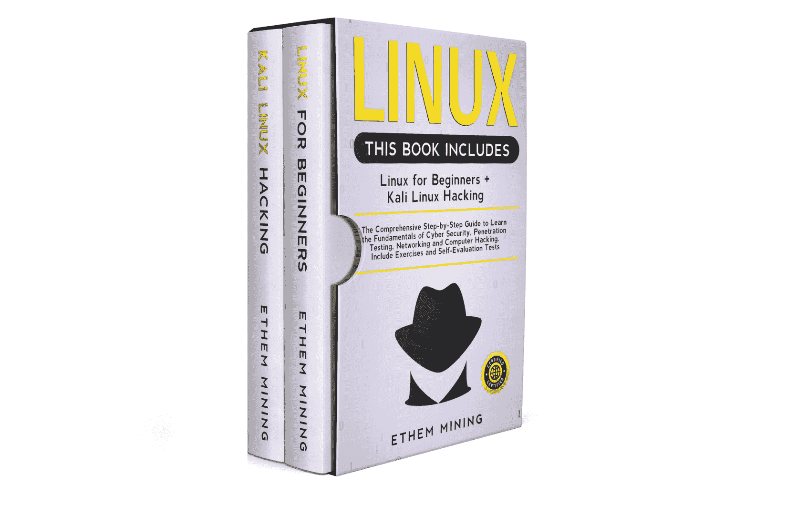

# Linux：两本合一：学习网络安全、渗透测试、网络和计算机黑客基础的全面分步指南……包含练习与自测题

学习网络安全基础、渗透测试、网络和计算机黑客技术的全面分步指南。包含练习和自评估测试。

是的，这一点被强调了多次，因为它非常重要。即使在读完这本指南后，如果你对自己和自己的能力仍完全没有信心，那么暂时放弃 Kali Linux 来建立你的技能可能更好——这没关系。

也许到此时，你已经采纳了本书最后一章的建议，并决定也研究 `Python`，提高你的脚本编写能力，这样你就能更好地利用自己的命令。这也是一个非常棒的决定，并将为你的旅程提供指导，仅仅因为你将拥有更多的知识。

无论你接下来选择做什么，不论是追求更多通用的 Linux 知识，还是尝试寻找如何最好与你已经安装的 Kali Linux 交互，有一点是肯定的：你希望在阅读这本书的过程中学到一些东西。在本书结束之际，我带着最诚挚的希望，希望你发现这本书对 Kali Linux 的大世界及其提供的一切是有见地、有帮助且富有洞察力的。无论你是新手还是熟悉其他 Linux 发行版的人，祝你的事业好运，并记住——仅仅因为你觉得现在事情可能很复杂，并不意味着你必须放弃它。如果你愿意，你可以付出努力学习，结果将随之而来。祝你好运，并记住保持你的渗透测试符合道德。

最后，如果你发现这本书是有见地、有启发性、有趣、具有操作性或对你有其他益处，请不要犹豫，在 Amazon 上留下你的见解和反馈。你的反馈和意见我们非常感谢。再次感谢你陪伴我走过这段旅程，祝你好运！

