# Linux 2合1

## 第 1 章 什么是 Linux?

### 4 命令行

#### Bash Shell

##### Shell 基础

##### 在 Bash Shell 中执行命令

##### 命令行快捷键

##### 使用命令行编辑文件

##### Linux 文件层次结构

##### 绝对路径

##### 相对路径

##### 路径导航

##### 使用命令行管理文件

##### 创建目录

##### 复制文件

##### 移动文件

##### 删除文件和目录

##### 通配符：使用 `*` 和 `?` 模式匹配

##### 波浪号

##### 大括号扩展

### 5 操作系统

### 6 如何安装

### 7 设置 Linux

### 8 计算机

### 9 软件包

### 10. Linux 发行版

## 11 选择合适的发行版

### 基础 Shell 自定义

### 环境变量

### 添加别名

### 移除别名

## 12 软件安装与包管理

### 命令行安装软件包

### `apt`

### `apt-get`

### `apt` 缓存

### 其他 Linux 版本和包管理器

### `dpkg`

### `yum`

### `rpm`

## 13 测试网络连接性

### `ping`

### `traceroute`

### `/etc/hosts`

### `DNS`

## 14 文件操作

### `touch`

### `cat`

### `echo`

### `more`

### `less`

### `head-tail`

### `tee`

### `tac`

### `rev`

### `sort`

### `wc`

### `nl`

- `pr`

- `paste`

- `grep`

- `cut`

- `tr`

- `cmp`

- `diff`

- `find`

- `exec`

- `xargs`

## 15. 探索 Shell

## 16. 归档与压缩

## 17. 奖励

### Bash Shell

### Shell 命令

### 组合你的 Shell 命令

## 18. 如何创建基础脚本

### 你的第一个 Shell 脚本

### 在可用的 Shell 脚本中使用参数

## 结论

# 描述

Linux 是由不同的互连程序组成的相当复杂的系统。Linux 系统包含许多组件。尽管大多数组件是可以互换的并允许大量的自定义，但 Linux 必须包含某些组件才能正常运行。当然，某些程序比其他程序更重要，但核心原理始终保持不变。

该程序负责 Linux 系统的正常启动。它为 Linux 内核和初始 RAM 磁盘（称为 ignited）选择最佳参数。内核是操作系统的核心。它在启动后立即启动初始化进程。init 进程可以被任何合适的替代品（如 systemd）替换，但引导加载程序的功能保持不变。初始 RAM 磁盘为你提供临时内存，在加载根系统之前加载关键文件。

如果你有一台运行基础输入/输出系统的旧电脑，你可以在主引导记录（MBR）中找到引导加载程序，它占用磁盘上的前 512 字节。新电脑具有统一扩展固件接口（UEFI），并存储在名为 EFI 的特殊分区中。设备通电后会立即进行自检。这种自检称为电源自检（POST），如果成功，引导加载程序将由 `BIOS` 或 `UEFI` 加载。

尽管引导加载程序很小且简单，但非常关键。在大多数与 Linux 相关的论坛上，你会发现遇到引导程序遇到问题的人，也会发现帮助你解决问题的人。Linux 系统上可以安装许多不同的引导加载程序，但下面我们将讨论最流行且最易使用的几个。

本指南将重点关注：

- 什么是 Linux？
- 什么是 Ubuntu？
- Linux 安装过程
- Linux 命令行
- 变量
- 使用 Shell
- 嵌套 If 语句
- 布尔运算符
- 日志分析
- 创建启动盘

# 引言

在本章中，我将提供一些关于该操作系统架构的简要信息，并讨论初学者可以选择的不同 Linux 发行版。

## Linux 架构

Linux 架构可以分为两个空间：用户空间（User Space）和内核空间（Kernel Space）。

- 用户空间：这是使用应用程序的地方。用户空间的 `GNU C library` 是连接到内核并在用户空间和内核空间之间切换的接口。它使用所有可用内存。
- 内核空间：所有的内核服务在此处处理。内核空间进一步分为：
  - 系统调用：用户进程可以通过 `System Call`（系统调用）访问内核空间。执行 `System Call` 时，参数从用户空间传递到内核空间。这是实现基本函数的层。
  - 内核代码：这是架构无关的代码，可以在 Linux 支持的所有架构中看到。
  - 相关的内核代码：这是针对特定平台的代码层。

## Linux 发行版

每个 Linux 发行版由 Linux 内核加上工具和配置文件组成。大多数 Linux 发行版都可以从它们的网站下载。让我们根据以下标准看看几个流行的 Linux 发行版（或称为版本）之间有何不同：

### 可用性

如前所述，Linux 是免费软件，但提供支持合同和专有组件的公司会收费提供它。在下表中，`Red Hat Enterprise` 和 `SUSE Enterprise` 都提供商业版 Linux，但它们也有免费的替代方案——`Fedora` 和 `openSUSE`。

### 包格式

Linux 发行版以包的形式出现。包是分组在一个文件中的文件。`RPM` 是最常用的。

### 发布周期

这是发行版发布新软件的频率。发布周期较短的发行版以最短的时间提供最新的软件，而发布周期较长的发行版则旨在提供尽可能稳定的环境。一个发行版可以兼顾这两种。看看 Ubuntu，它既发布长期支持（`LTS`）版本（周期较长），也通过 6 个月的周期发布最新软件。

为了帮助你决定哪种是适合你的的发行版，请考虑上述标准并研究以下其他领域：

- 桌面环境：进行研究并看看你中中的发行版是否具有你喜欢的界面视觉效果和操作感，请检查它的可定制程度如何。
- 硬件兼容性：取决于你正在使用的硬件，在你安装发行版时，某些驱动程序可能尚未可用。先从在线资源检查哪些驱动是可以开箱即用的。
- 社区支持：寻找拥有大型在线社区的。社区越大，越容易找到文档并获得支持。

# 第 1 章 什么是 Linux？

Linux 是一系列基于 `Linux Kernel` 的免费开源操作系统家族；该操作系统内核由 Linus Torvalds 于 1991 年 9 月 17 日首次发布。Linux 通常被封装在 Linux 发行版（简称 `distro`）中。发行版包含了 Linux 内核以及支持性的系统软件和库，其中许多组件由 `GNU Project` 提供。

（来源：Wikipedia.org）

`Linux 内核`于 1991 年以 `0.0.1` 版本问世。今天仍负责内核开发的 Linus Torvalds 并没有意识到他发布这个小业余项目会引发什么。

今天，Linux 一术通常被用作整个系统的同义词。但严格来说，只有`内核`被称为 Linux。只有当结合遵循 `GNU` 准则的应用程序和程序时，它才成为我们今天熟悉并喜爱的系统。

第一个 Linux 发行版发布于 1994 年。它们致力于开发作为 Windows 和 MacOS 替代品的可用系统：

- Debian
- Suse
- Slackware
- RedHat

2002 年 `Open Office (Version 1)` 的发布是一个巨大的进步。它是一个功能齐全的开源办公套件，免费提供。当然，与 `Microsoft Office` 相比，它的功能仍然有限，但 `Open Office` 随着时间的推移变得越来越好。

`Libre Office` 后来作为 `Open Office` 的独立分支开发。这个广泛且已非常成熟的办公套件预装在 `Ubuntu 18.04` 中。

目前有无数种不同的 Linux 发行版。

然而，它们大多数都是基于 Debian、OpenSuse、Ubuntu、Arch Linux、Gentoo 或 Red Hat。

# 第 2 章 什么是 Ubuntu？

Ubuntu 操作系统诞生于 2004 年。

Ubuntu 项目由马克·舒特沃斯（Marc Shuttleworth）创立，他是一位非洲百万富翁，并通过他的 Canonical 公司担任主要赞助商。

在祖鲁语中，Ubuntu 的意思是“对他人的仁爱”。

该项目的重点是开发一个全球范围内尽可能的人都能使用的操作系统。

项目特别关注直观的易用性和通用无障碍的工具。

Ubuntu 是一项免费提供的开源软件。

自第一个版本发布以来，其认可度和流行程度一直在稳步提升。

Ubuntu 基于 Debian。这意味着 Debian 创建的软件包管理系统和软件选择被 Ubuntu 所采纳。

然而，随着时间的推移，这两个发行版逐渐分道扬扬。

例如，Ubuntu 经常被指责过于商业化，而 Debian 则继续遵循开源哲学，拒绝了 Ubuntu 引入的一些创新。

Ubuntu 每年的 4 月和 10 月发布一个新版本，每个版本获得为期九个月的支持。

它以发布年份和月份命名。

Ubuntu 18.10 是于 2018 年（18）的 10 月（10）发布的。

支持意味着 Ubuntu 操作系统将以安全更新和错误修复的形式接收更新。

然而，每隔两年（偶数年！）会发布一个特殊版本，该版本将获得 Ubuntu 为期 5 年的支持。

这被称为 LTS 版本。

LTS 代表“长期支持”（Long-Term-Support）。

当前版本是 Ubuntu 18.04。

该版本的支持将在 5 年后的 2023 年 4 月结束。

下一个 LTS 版本 Ubuntu 20.04 将于 2020 年 4 月发布。

该版本的支持将在 5 年后的 2025 年 4 月结束。

所有其他版本的支持时长均为 9 个月。

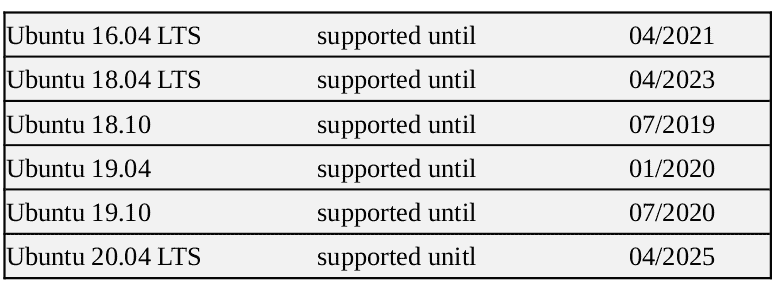

短期支持系统的优势在于，它们包含的软件通常比上一个常规 LTS 版本的更更新。

LTS 版本本质上在五年内保持不变。

更新仅包含错误修复和安全补丁。

从长远来看，这对于某些用户可能太保守了。

然而，软件越旧，经过的测试就越多，因此越稳定。

较新版本的应用程序（如在短期支持版本中的程序）可能更不稳定，因为它们的测试周期较短。

在这份快速指南中，我将介绍 Ubuntu 18.04 LTS。

其中很大大部分内容也适用于 Ubuntu 18.10 和 Ubuntu 19.04。

对于初学者，建议先尝试 LTS 版本。

如果 LTS 版本不能完美支持你的硬件，那么使用短期版本是有意义的。

除了代表发布日期的官方名称外，Ubuntu 版本还有一个额外的幻想名称。

例如 18.04 是 Bionic Beaver（仿生二齿海狸），18.10 是 Cosmic Cuttlefish（宇宙乌贼鱼）。

# 第 3 章 Linux 安装过程

在本节中，我们将重点介绍安装和配置 Debian 的过程，向你展示过程中的每一个步骤。

## 安装类型

Debian 提供了多种进行正确设置的方法。这包括图形界面安装和文本界面安装；我们将使用前者。对于安装媒体，Debian 开发者提供了三种变体：

* 用于 32 位和 64 位的 CD 或 DVD
* 用于 32 位和 64 位的网络镜像（所谓的 `Netinst-ISO`）
* 用于 32 位或 64 位的微型 CD

我们还提供了测试媒体。这些包括用于 32 位和 64 位的实时运行镜像（live images），允许你在将 Debian 安装到计算机之前先尝试它。在编写本文期间，版本 9.5 是 Debian 的当前稳定发布版。这里描述的设置基于此发布版本和 `amd64` 架构。

从 `www.debian.org/distrib` 下载网络镜像后，系统不需要再引用额外的静态镜像。相反，它依赖于网络连接来检索要安装的软件包，并保持操作系统处于最新状态。

整个过程将花费大约一小时，并允许你根据特定需求选择精简的软件。你不需要的软件包将不会出现在你的系统中。你可以在需要时随时添加它们。

我们安装的目标系统是一个基于 XFCE 的单用户桌面系统，带有网络浏览器和音乐播放器。对于网络浏览器，我们使用 `Mozilla Firefox`，对于音乐播放器，我们使用 `VLC`。这两个程序都是 Linux 发行版的永久组件。我们用于演示的环境是一个基于 `VirtualBox` 的虚拟机，拥有 4 GB 内存和 15 GB 磁盘空间。

## 逐步安装 Linux

### 启动菜单

为了开始安装 Debian，首先从你下载的 ISO 镜像启动计算机（在我们例中是 `VirtualBox` 镜像）。如果你也使用虚拟机，请查看虚拟机供应商网站获取如何启用 ISO 镜像的帮助。接下来等待启动菜单出现在屏幕上。下图显示了提供的不同选项。使用光标键导航启动菜单，按回车键选择项目。

不同的选项有：

* `Graphical install`:使用图形化安装程序开始安装过程
* `Install`:使用文本界面安装程序开始安装过程
* `Advanced options`:选择更多选项，如 `Expert mode`（专家模式）、`Automated install`（自动安装）或 `Rescue mode`（救援模式）（更多细节见下图）
* `Help`:获取更多帮助
* `Install with speech synthesis`:带有语音支持启动安装过程

从主启动菜单中选择 `Graphical install` 并按回车键继续。

### 语言选择

接下来，选择你希望在整个安装过程中使用的语言。对话框和消息将进行相应的翻译。此选择不会不可更改地决定你的 Linux 系统将使用的语言；你以后一直可以选择不同的语言。

下图显示了对话框。英语已预选，因此你只需点击对话框右下角的 `Continue`（继续）按钮即可。

### 位置选择

第三，根据你的位置进行选择（见下图）。根据你之前设置的语言，列出的是主要使用所选语言的国家。这也会影响区域设置，例如你计算机所在的时区。为了进行不同的设置，请从列表末尾选择 `other`（其他）并从那里继续。完成后，点击 `Continue` 按钮进入第四步。

### 键盘布局选择

第四步，从列表中选择你的键盘布局（见下图）。对于美国，预选是美式英语。如果你使用不同的键盘布局，请从列表中选择正确的项。完成后，点击 `Continue` 按钮进入第五步。

### 网络设置

第五步包括从 ISO 镜像加载安装程序组件，并检测网络硬件以加载正确的网络驱动程序。然后，安装程序尝试连接互联网，通过你的本地网络服务器通过 DHCP 获取 IP 地址。

完成后，你可以设置计算机的主机名（见下图）。为你的机器选择一个唯一的名称，该由单一名称组成且在你的本地网段中不存在。使用水果、地点、乐器、作曲家和电影角色命名是很常见的。在这种情况下，我们选择了 `debian95` 名称，它简单代表了 Linux 发行版及其版本号。

完成后，按下 `Continue` 键进入步骤六，添加诸如 `yourcompany.com` 的域名（见下图）。在当前情况下，不需要这样做。这就是为什么我们让输入框为空。点击右下角的 `Continue` 按钮继续安装。

# 用户与角色

我们的 Linux 系统至少需要两个用户才能进行适当的操作。其中一个是固定名称为 `root` 的管理用户，另一个是普通用户，在本文例中我们将其命名为 `User`。

在接下来的两个步骤中，你将为 `root` 用户设置密码（见下图），并为普通用户设置全名用户名。为了简单起见，我们使用 `Debian User` 作为全名，使用 `User` 作为用户名。对于这两个用户，请选择不同的且你记得的密码。稍后你将需要这些密码来登录计算机。

# 时区

设置正确的时区对于与其他服务的通信至关重要，尤其在网络环境中。请从下图中列表中选择值。列表中的项目是基于你之前选择的位置。完成后，点击 `Continue` 按钮定义存储介质及相应的分区。

# 存储介质与分区

Linux 系统可以分布在多个不同的存储介质上，如硬盘和闪存驱动。此外，一个存储介质可以分为多个磁盘分区。为了实现这一点，Debian 的安装程序提供了以下方法（见下图）：

- **Guided - use entire disk**：按照提供的步骤操作，使用整个磁盘空间进行 Linux 安装。这将创建固定大小的分区。
- **Guided - use the entire disk and set-up LVM**：按照提供的步骤操作，使用整个磁盘空间进行 Linux 安装。此选项利用逻辑卷管理（LVM）创建以后可以更改大小的分区。
- **Guided - use the entire disk and set-up encrypted LVM**：按照提供的步骤操作，使用整个磁盘空间进行 Linux 安装。此选项利用逻辑卷管理（LVM）创建以后可以更改大小的加密分区。
- **Manual**：单独创建分区。这是专家模式，需要对分区和文件系统参数有更深入的知识。

从列表中选择 `Guided-use the entire disk` 项。分区大小的值根据经验并以算法的形式实现。不需要手动计算。点击右下角的 `Continue` 按钮继续安装。

接下来，选择要分区的磁盘。在我们的情况下，只有一个可用磁盘（见下图）。在本文指南后续，第一块 SCSI 磁盘将被称为 `/dev/sda`。

磁盘分区是指存储介质上被单独组织的部分，旨在包含 Linux 文件系统树的分支。没有通用的方法来正确进行这种分离。本指南展示了一个简单但安全的解决方案，适用于基础系统。对话框中的菜单提供以下选项：

- **All files in one partition**：仅使用单个分区保留程序和用户数据
- **Separate /home partition**：在不同的分区中存储程序和用户数据
- **Separate /home, /var, and /tmp partitions**：在不同的分区中保留用户数据、变量数据临时数据

点击右下角的 `Continue` 按钮继续安装。

下一步是确认分区方案。这是根据经验自动计算的，包含以下分区：


- `sda1`：第一块 SCSI 磁盘的第一个分区是主分区，大小为 3 GB，使用 `ext4` 文件系统格式化，称为文件系统树根（用 `/` 表示）。
- `sda5`：第一块 SCSI 磁盘的第五个分区是大小为 1.3 GB 的逻辑分区，使用 `ext4` 文件系统格式化，预留用于存储文件系统树的变量数据（用 `/var` 表示）。
- `sda6`：第一块 SCSI 磁盘的第六个分区是大小为 3.3 GB 的逻辑分区，格式化为交换分区系统。
- `sda7`：第一块 SCSI 磁盘的第七个分区是大小为 311 MB 的逻辑分区，使用 `ext4` 文件系统格式化，预留用于存储文件系统树的临时数据（用 `/tmp` 表示）。
- `sda8`：第一块 SCSI 磁盘的第八个分区是大小为 8.8 GB 的逻辑分区，使用 `ext4` 文件系统格式化，预留用于存储文件系统树的用户数据即家目录（用 `/home` 表示）。

由于历史原因，硬盘只能包含四个主分区。如果划分为所谓的逻辑分区或逻辑驱动器，第四个分区被称为扩展分区（Extended Partition）。在我们的情况下，逻辑分区 `/dev/sda5`、`/dev/sda6`、`/dev/sda7` 和 `/dev/sda8` 存储在主分区 `/dev/sda4` 上。分区 `/dev/sda2` 和 `/dev/sda3` 未使用。

从上述列表中，选择 `Finish partitioning and write changes to disk` 项。点击右下角的 `Continue` 按钮继续并确认分区方案（见下图）。从列表中选择 `yes` 并点击 `Continue` 按钮对磁盘进行分区。注意，所选存储设备上的所有数据将丢失，磁盘将为空。

将存储介质划分为单分区后，分区将按照之前定义的文件系统进行格式化。在我们的情况下，分区 `/dev/sda1`、`/dev/sda5`、`/dev/sda7` 和 `/dev/sda8` 将获得 `ext4` 文件系统，分区 `/dev/sda6` 将获得交换分区。一旦完成此步骤，将安装 Debian 基础系统。

# 包管理

ISO 镜像包含了安装程序和用于设置 Linux 基础系统的包。例如，这包括下方将安装的 Linux 内核。

下一步是您必须决定是否使用额外的安装介质。在我们的情况下，我们只有一个安装盘，因此可以从菜单中选择 `No`（见下图）。然后点击 `Continue` 按钮继续。

如前所述，Debian 软件是以包的形式组织的。这些包由多个软件存储库提供。存储库通过大学、个人、公司和其他组织维护的软件包镜像提供。这些镜像分布在不同的国家。

在下一步中，您将需要决定从哪个国家获取 Debian 软件包。建议选择地理位置上靠近您的镜像，以尽力地减少通过网络从镜像传输数据到您计算机所需的时间。

第一步，选择您所在的国家。第二步，从列表中选择一个优选镜像（见下图）。列表包含了大学、互联网服务提供商、政府服务和其他组织。

如果您的计算机网络包含用于与外部世界通信的代理服务器，请在此处输入相应信息。在这种情况下，我们没有代理服务器，因此留空输入框。点击 `Confirm` 按钮继续。

一旦设置了这些参数，Debian 安装程序将连接到之前选择的软件包镜像并从那里获取软件包列表。软件包列表包含了可用的软件包，包括名称、大小和描述。取决于网络连接的质量和带宽，此步骤需要一段时间。

接下来，您会被要求参与 `Popcon`，即 Debian 软件包流行度投票（见下图）。此信息是可选的，仅供负责 Debian 软件包的团队使用。根据 `Popcon`，他们可以确定哪些 Debian 软件包是安装频率最高的。这些信息直接影响安装镜像的准备，以及针对不同的架构保留或忽略哪些软件包。

在我们的情况下，我们不参与 `Popcon`，并将选择留为 `No`。点击 `Confirm` 按钮继续选择软件任务（`tasksel`）。

## 软件选择

Debian 提供了精心安排的软件包选择，称为“任务”（tasks）。其背后的思想是将用于特定用途的软件包分组，以简化安装。

从对话框中的列表（见下图）中，可以在不同的桌面环境、Web 服务器、打印服务器、SSH 服务器以及标准系统程序之间进行选择。要进行最小化安装，只需启用列表中的最后两个选项。我们将稍后安装 XFCE 桌面环境。

确认软件选择后，Debian 安装程序将从软件包镜像检索所需的包、解压并安装它们。下方的条显示进度。在这种情况下，必须下载 140 个软件包。

## 设置 GRUB

为了启动新安装的 Debian 系统，我们也必须设置此信息。这个过程被称为系统引导。处理这一步骤的软件组件名为 `Grand Unified Boot Loader`（准确来说是 `GRUB` 或 `GNU GRUB`）。

`Yes` 选项已预选，因此我们可以点击 `Continue` 继续。Debian 安装程序需要知道将 `GRUB` 安装在哪里。下图菜单列出了需要考虑的存储介质。在我们的情况下，我们选择列表中的第二项（`/dev/sda`）。然后点击 `Continue` 继续。

现在我们几乎完成了基础安装，剩下的只需阅读一个对话框。

## 完成安装

以下对话框告知您安装已完成。然后点击 `Continue` 重启新安装的系统。

几秒后，屏幕上会出现基于文本的 `GRUB` 引导菜单。……（此处省略）……您的 Debian 系统将启动并初始化必要的系统服务。

最后，在名为 `tty1` 的第一个文本终端上（见下图）将看到一个黑白屏幕，要求您登录系统。登录提示由两个部分组成：您的 Linux 系统主机名（`debian95`），后面跟着空格和单词 `login`。

```
Debian GNU/Linux 9 debian95 tty1
debian95 login: _
```

登录系统后，您将添加更多软件以使用基于 XFCE 桌面的图形用户界面。在安装过程的此时，只能通过以管理员 root 用户登录来添加更多软件。

为了实现这一点，在登录提示处输入 `root`，按 `Enter`，等待 `Password:` 文本出现，然后输入您之前为 root 用户设置的密码。Linux 系统将用登录消息欢迎您（见下图）。登录消息的第一行将显示您上次登录的时间，随后是当前运行的 Linux 内核版本（第二行）以及使用建议（第五行到第八行）。

在显示欢迎消息后，Debian 会打开一个命令行提示符：

```
root@debian95 ~#
```

此命令行提示符由四个部分组成：

- `root`：登录的用户名。
- `debian95`：Linux 系统主机名。
- `~`：当前目录。在这种情况下，它是当前登录用户的家目录。如果没有特殊设置，对于普通用户定义为 `/home/username`，对于管理员用户定义为 `/root`。`~` 只是它的缩写。
- `#`：登录符号。`#` 符号代表用户 `root`，而 `$` 用于没有权限的普通用户。

**重要**：您现在已以管理员 root 用户身份登录。请小心您输入的命令，并在疑问时检查两次。任何错误都可能导致需要重新安装或修复 Linux 系统。

## 添加图形用户界面

在当前阶段，Debian 系统已完全激活并可用于生产。对于适用于普通用户的桌面系统，它仍然缺少一个优秀且易用的图形用户界面。在这一步中，我们将改变这一点并安装 XFCE 桌面管理器。

为了这样做，我们将安装以下软件包：

- `aptitude` 软件包管理器
- `xdm` 显示管理器
- `xfce4` 桌面环境

Debian 使用 `apt` 软件包管理器来处理软件包及相关包列表的安装、更新和删除。此外，`apt` 解析所有的软件包依赖关系并确保相关软件在系统中可用。

在我们的情况下，必须从软件包镜像检索并安装总计约 450 MB 的数据/软件。如前所述，这需要运行的互联网连接来下载所需的软件包。

为了安装这三个软件包，请在命令行提示符处输入以下命令。只需输入 `#` 符号后的命令：

```
root@debian95 ~# apt-get install aptitude xdm xfce4
```

`apt` 将显示有关要安装软件包的进一步信息。这包括依赖包列表和推荐包。最后，您将看到一个命令行提示符。输入 `Y` 或按 `Enter` 安装 `aptitude`、`xdm` 和 `xfce4` 以及依赖包。

对于 `xdm` 显示管理器，必须确认两个对话框（见下图）。按两次 `Enter` 确认使用 `xdm`。

检索要安装的软件包需要花费一些时间。完成后，命令行提示符将再次出现。为了激活有关图形桌面环境的更改，请重启系统。在命令行提示符处输入如下命令 `reboot`：

```
root@debian95 ~# reboot
```

重启 Linux 系统后，Debian 将用图形化启动界面欢迎我们（见下图）。按下 `Enter` 以默认设置启动 Linux 系统。

几秒后，将看到图形化登录界面（见下图）。使用之前创建的名为 `user` 的普通用户登录系统。输入 `user`，按下 `Enter`，然后输入用户的密码。再次按下 `Enter` 确认并登录。

接下来，将看到 XFCE 桌面（见下图）。该桌面包含几个默认元素：顶部导航栏、底部导航栏和桌面图标。所有提到的元素将在下文中进行更详细的解释。

- **顶部导航栏**：此处显示了访问不同应用程序、四个虚拟桌面屏幕、时钟以及一个用于各种用户操作的按钮，例如锁定屏幕、切换用户、切换到待机模式和退出当前会话。
- **底部导航栏**：此栏包含几个按钮，用于隐藏所有打开的窗口并显示空桌面、打开终端、文件管理器、网络浏览器、查找应用程序以及直接使用你的主目录打开文件管理器。

## 添加额外软件

到目前为止，你的 Linux 系统上可使用的软件相当有限。在完成所有这些操作后，下一步是添加以下四个 Debian 软件包，让你的生活变得简单一点：

- `firefox-esr`：Web 浏览器 Mozilla Firefox（扩展支持版）。
- `gnome-terminal`：由 GNOME 项目维护的终端模拟器。
- `xscreensaver`：适用于 X11 系统的基础屏幕屏保护程序。
- `vlc`：视频播放器 Video Lan Client（VLC）。

这四个软件包的安装将通过终端模拟器中的命令行完成（我们将在指南的后部分详细介绍终端）。目前，在你的系统中，已经安装了 X11 终端模拟器 `xterm`。要打开 `xterm`，请点击底部导航栏中的终端按钮，或从右键菜单中选择 `Application > System > Xterm`。

第一步，打开 `xterm`。接下来，在命令行提示符旁输入如下命令 `su` 并按下 `Enter`：

```
user@debian95: ~$ su
Password:
```

你可能记得之前的步骤提到，只有管理员用户可以在 Debian 系统上安装、更新或删除软件。`su` 命令是 switch user 的缩写，会更改你的当前角色。在不带额外名称的情况下，角色将变为管理员 root 用户。在密码提示符处输入管理员的密码并按下 `Enter`。

作为管理员用户，按照如下安装软件包 `firefox-esr`、`gnome-terminal`、`xscreensaver` 和 `vlc`：

```
root@debian95: ~# apt-get install firefox-esr gnome-terminal xscreensaver vlc
```

输出所示：

安装四个软件包后，你可以切换回普通用户角色。按下 `Ctrl+D` 退出管理员部分，再次按下 `Ctrl+D` 关闭 `xterm`。

### 安装 Firefox 具有以下效果

- 应用程序菜单中可以使用新软件 `Firefox`。
- 命令行中可以使用新命令 `Firefox`。
- 底部导航栏中的地球图标链接到 Firefox Web 浏览器。

### 安装 GNOME terminal 软件包具有以下效果

- 命令行和应用程序菜单中都可以使用新软件 `gnome-terminal`。
- 底部导航栏中的终端图标链接到 GNOME 终端。
- 右键菜单中的 `Open Terminal Here` 项指向 GNOME。

为了查看更改，请从右键菜单中选择 `Open Terminal Here` 项。下图显示了终端窗口。它具有白色背景和更大的字体，更易阅读。

## 退出 Linux

为了正确使用 Linux，你必须学会如何退出 Linux 并重启系统。在下面，你将学习如何退出 XFCE 桌面环境、关闭 Linux 系统以及重启系统。我们将介绍两种方法；第一种基于图形界面，第二种也可以用于服务器和无线路由器等非图形化系统。

### 退出 XFCE 桌面环境

退出 XFCE 桌面并注销当前会话最简单的方法是点击顶部导航栏右上角的按钮。按钮上标记有你的用户名，在我们的案例中是 `Debian User`。从小菜单中选择标记为 `Log Out` 的最后一项。或者，你可以从左上角的 `Application` 按钮或右键菜单中选择 `Log Out` 项。

会打开另一个窗口，其中包含标记为 `Log Out`、`Restart`、`Shutdown`、`Suspend` 和 `Hibernate` 的五个按钮。点击 `Log Out` 退出会话。随后，你将返回登录界面。

### 关闭 Linux 系统

关闭整个 Linux 系统的方法与退出 XFCE 类似。点击顶部导航栏右上角的按钮。按钮上标记有你的用户名，在我们的案例中是 `Debian User`。从小菜单中选择标记为 `Shut Down` 的项。在下一个对话框中点击标记为 `Shut Down` 的按钮停止 Linux 系统。

在终端会话中，管理员用户可以运行 `halt` 或 `shutdown -h now` 命令。普通用户不允许执行这些命令。

```
# halt
```

### 重启 Linux 系统

要重启 Linux 系统，点击顶部导航栏右上角的按钮。按钮上标记有你的用户名，在我们的案例中是 `Debian User`。从小菜单中选择标记为 `Restart` 的项。在下一个对话框中点击标记为 `Restart` 的按钮重启 Linux 系统。

在终端会话中，管理员用户可以运行 `reboot` 或 `shutdown -r now` 命令。普通用户不允许执行这些命令。

```
# reboot
```

随后，系统将重启，你将返回启动界面。

# 第 4 章 Linux 命令行

此时，你应该对基本命令有了相当的了解，并且 Linux 已经安装在你的系统中。你现在面临着一个绝佳的机会——一个完全空白的，你可以在这里开始设计操作系统。通过 Linux，你可以轻松地定制你的操作系统，使其完全按照你的意愿运行。为了开始，你需要安装一些可靠且功能强大的应用程序。

Linux 相比于一些流行的操作系统还有另一个优势。这包括一次性安装多个包的能力，而无需在窗口之间等待完成一个或多个过程。这完全取决于在命令行中输入什么信息。例如：

```bash
sudo apt-get install comp beta-browser
```

一次性安装多个包除了具有便利性外，还有更多优势。在 Linux 中，这些优势包含了更新。Linux 不需要一个一个地更新每个应用程序，而是允许通过更新管理器同时更新所有应用程序。

Linux 仓库非常多样化，对其进行适当的搜索将帮助你识别许多你认为有用的程序。如果某个应用程序在仓库中不可用，Linux 将为你提供如何添加独立仓库的指令。

## 命令行

使用 Linux 允许你根据自己的需求定制系统。对于那些不精通技术的人来说，发行版的设置是一个更改内容的好地方，直到你获得你想要的结果。然而，你可能会花费几个小时来反复调整可用设置，却仍然找不到完美适合你的设置。

幸运的是，Linux 有一个解决方案，那就是命令行形式。尽管命令行听起来很复杂，似乎只有技术天才才能理解，但它其实非常容易辨别。

使用命令行调整操作系统中的事物的美之处在于，它的限制是天空，创造力可以无限丰富。

要开始，你需要使用“壳（The Shell）”。这基本上是一个可以接收来自键盘的命令并确保操作系统执行这些命令的程序。你还需要启动“终端（Terminal）”。终端也是一个程序，它允许你与壳交互。

要进入终端，你应该从菜单中选择终端选项。通过这种方式，你可以进入 shell 会话。这样你就可以开始你的命令提示符。

在你的 shell 会话中，你应该看到一个 shell 提示符。在 shell 提示符中，你会看到你的用户名和你使用的机器名称，后面跟着美元符号。它显示如下：

```bash
[name@mylinux me] $
```

如果你尝试在该 shell 提示符下输入内容，你会看到来自 `bash` 的消息。例如：

```bash
[name@mylinux me] $
lmnopqrst
bash: lmnopqrst
command not found
```

这是一个错误消息，系统通过它告诉你无法理解你输入的信息。如果你按下上箭头键，你会发现可以回到上一个命令，即 `lmnopqrst` 那一个。

如果你按下下箭头键，你会发现自己处于一个空行。

这一点非常重要，因为你可以看到自己是如何形成命令历史的。命令历史将有助于你在学习如何使用命令提示符时回溯自己的步骤并进行修正。

## 用于系统信息的命令行

最基础、可能最有用的命令行是那些帮助你获取系统信息的。首先，你可以尝试以下命令。

### 日期命令

这是一个帮助你显示日期的命令。

```bash
root@nagsis: -# date
Thursday May 21 12.31.29 IST 2o15
```

### 日历命令

此命令将帮助显示当前月份或任何即将到来的月份的日历。

```bash
root@nagsis: -# cal
```

### uname 命令

此命令用于 Unix 名称，提供关于机器名称、操作系统和内核的详细信息。

```bash
root@nagsis: -# uname –a
Linux Nagsis 3.8.0-19-generic #30
Ubuntu SMp Wed May 20 16:36:12 UTC
2013 i686 i686 GNU/Linux
```

## 使用命令行导航 Linux


你可以像使用鼠标一样使用命令行，轻松地导航你的 Linux 操作系统以完成所需的任务。在本节中，你将接触最常用的命令。

在 Linux 中查找文件非常简单，就像它们在熟悉的 Windows 程序中顺序排列一样，它们也遵循分级目录结构。这种结构类似于你可能会看到的文件夹列表，被称为目录（directories）。

文件系统中的主目录被称为根目录（root directory）。在其中，你可以找到文件和子目录，子目录可能包含额外的排序后的文件。所有文件都存储在单棵树下，即使有多个存储设备。

```bash
pwd
```

`pwd` 代表打印工作目录（print working directory）。这些命令将帮助你选择一个可以存储所有文件的目录。命令行没有提供文件结构的任何图形化表示。然而，当使用命令行界面时，你可以查看父目录中的所有文件，以及子目录中可能存在的所有路径。

这就是 `pwd` 派用用场。每当你仅仅站在一个目录时，你就处于工作目录中。当你登录 Linux 操作系统的一瞬间，你将到达主目录（当你在该目录时，它将是你的工作目录）。在该目录中，你可以找到所有的文件。要识别你所处目录的名称，你应该使用以下 `pwd` 命令。

```bash
[name@mylinux me] $pwd
/home/me
```

然后你可以使用 `ls` 命令在目录中开始探索`ls` 代表列出目录中的文件（list files）。因此，要查看工作目录中的所有文件，请输入以下命令，你将看到如下所示的结果。

```bash
[name@mylinux me] $ls
Desktop         bin             linuxcmd
GNUstep         ndeit.rpm       nsmail
```

```bash
cd
```

`cd` 代表更改目录（change directory）。当你想要离开工作目录并查看其他文件时，你需要这个命令。要使用此命令，你需要知道你想要查看的工作目录的路径名。有两种不同的路径名供你辨别：绝对路径（absolute pathname）和相对路径（relative pathname）。

绝对路径是从你的根目录开始的，通过遵循文件路径，它可以轻松地带你进入所需的目录。假设你某个目录的绝对路径是 `/usr/bin`。该目录名为 `usr`，在它内部还有另一个名为 `bin` 的目录。如果你想使用 `cd` 命令访问你的绝对路径，你应该输入以下命令：-

```bash
[name@mylinux me] $cd/user/bin
[name@mylinux me] $pwd
/usr/bin
```

当你想要将新的工作目录 `/usr/bin` 更改到父目录（即 `/usr`）时，可以使用相对路径。

```bash
[name@mylinux me] $cd..
[name@mylinux me] $pwd
/usr
```

使用 Linux 操作系统需要你对终端和命令行有所了解。了解这些是什么，并至少稍微熟悉它们的用法以及可用的标准命令是至关重要的。

## 什么是终端？

终端被描述为“在某些其他显示架构中模拟视频终端的程序。虽然它通常与 shell（壳）或文本终端同义，但‘终端’一词涵盖了所有远程终端，包括图形界面。图形用户界面内部的终端模拟器通常被称为终端窗口”。

准确来说，终端仅仅是外壳。终端内部运行着一个被称为 shell 的命令行解释器。

Debian Linux 支持很长的终端软件列表。这包括 `Aterm`，以及 `GNOME terminal`、`Kterm`、`Mate Terminal`、`Rxvt`、`Xterm` 和 `Xvt`。这些终端软件的不同实现方案在稳定性、对字符集的支持、设计、颜色和字体，以及应用背景图像或使用透明度方面各不相同。

在本书中，我们将使用 `GNOME terminal`，因为它稳定、简单且易于调整。要增大或减小终端窗口内显示的内容大小，请使用双键组合 `CTRL+` 和 `CTRL-`。

## 6.2 什么是 shell？

简单来说，shell 是一个复杂的命令行解释器。在循环中，shell 读取字符，在某些条件下对其进行修改，并执行结果。

在某些条件下，在从命令行读取到执行实际结果之间，shell 必须解释你输入中的特殊字符。下表显示了可用的特殊字符：

| 字符 | 含义 |
| :--- | :--- |
| `$name` | 变量替换 |
| `name=` | 变量赋值 |
| `'command'` | 命令替换 |
| `$(command)` | 命令替换 |
| `< > >> 2> 2>>` | 输入和输出重定向 |
| `&#124;` | 命令管道 |
| `" ' \` | 引号 |
| `* [ ] ?` | 通用文件名创建（通配符匹配） |
| `;` | 命令分隔符 |
| `&` | 在后台运行命令 |
| `&#124;&#124; &&` | 在特定条件下运行命令 |
| `{ } ( )` | 命令分组 |

为了方便起见，shell 会通过以下过程将命令行分为单个单词，以确定命令：

| 步骤 | 描述 | 特殊字符 |
| :--- | :--- | :--- |
| 1 | 读取到命令分隔符并标记（命令替换） | `\n & &#124; &#124;&#124; &&; $(...) \ "..." '..."` |
| 2 | 标记（输入-/输出重定向，值赋值） | `< > >> 2> 2>> name=` |
| 3 | 分分为单个单词 | 空格，制表符 |
| 4 | 变量替换 | `$name` |
| 5 | 命令替换 | 标记，见步骤 1 和 2 |
| 6 | 输入-/输出重定向 | 标记，见步骤 1 和 2 |
| 7 | 变量赋值 | 标记，见步骤 1 和 2 |
| 8 | 分分为单词 | 基于 IFS |
| 9 | 创建文件名文件名 | `* [ - ]` |
| 10 | 命令执行 | |

在步骤 1 和 2 中，标记仅发生在步骤 5 到 7 中，且没有后续操作。如果标记完成，则执行步骤 5 到 7。接下来，shell 会移除所有特殊字符。在步骤 10 中，命令行仅包含执行命令所需的参数。shell 将第一个单词解释为要执行的命令名称，其余单词为其参数：

| `command arg1 arg2 arg3 ...` | |

## 6.3 可用的 shell

你的 Linux 系统允许使用各种 shell。每个 shell 都可以通过我们之前安装的 Debian 软件包管理器 `Aptitude` 作为独立的软件包进行安装。shell 的列表很长，因此我们只列出一些最常用的可用 shell：

*   Almquist Shell (`ash`)
*   Bourne Again Shell (`bash`)
*   Debian Almquist Shell (`dash`)
*   Z Shell (`zsh`)
*   C Shell (`csh`)
*   Korn Shell (`ksh`)
*   Tenex C Shell (`tcsh`)

除非另有说明，本文中的示例均基于 Bourne Again Shell (`bash`)。在编写本文档时，它是 Debian 的默认 shell。

你的 Linux 系统允许哪些其他 shell？这在配置文件 `/etc/shells` 中设置。使用 `cat` 命令可以查看允许的 shell 列表：

```bash
user@debian95: ~$ cat /etc/shells
# /etc/shells: valid login shells
/bin/sh
/bin/dash
/bin/bash
/bin/rbash
/usr/bin/screen
user@debian95: ~$
```

当前终端中使用的 shell 名称存储在 shell 变量 `$0` 中。以下简单命令输出 shell 的名称：

```bash
user@debian95: ~$ echo $0
bash
user@debian95: ~$
```

要更改当前使用的 shell，请查看下一节介绍的 `chsh` 命令和配置文件 `/etc/passwd`。

# 第 6 章 变量

在 Linux 中，创建变量非常简单。例如，为了将名字 John 存储到变量 `name` 中，你可以像像下面所示进行操作：

```bash
[root@archserver ~] # name="John"
```

双引号告诉 Linux 你正在创建一个变量，该变量将持有字符串类型的值：John。如果你的字符串只包含一个单词，你可以忽略引号，但如果你存储的是包含多个单词和空格的短语，则必须使用双引号。要查看任何变量内部的值，必须在 `echo` 命令中提到变量名之前使用美元符号 (`$`)。如下所示：

```bash
[root@archserver ~] # echo $name
John
```

如果你漏掉了美元符号 (`$`)，`echo` 将把传递给它的参数视为字符串并打印该字符串，例如：

```bash
[root@archserver ~] # echo name
name
```

你应该记住，变量标识符和值之间不应该有任何空格。标识符基本上是变量的名字：

```bash
[root@archserver ~] # x=5 # 这种语法是正确的，没有空格
[root@archserver ~] # x = 10 # 这种语法是错误的，因为变量名和值之间存在空格
```

Linux 中还存在其他变量，这些变量存储了一些在在使用任何 Linux 发行版时非常有用的值。这些预定义变量通常被称为全局变量。例如，`$HOME` 就是这些全局变量之一。`$HOME` 变量存储了默认目录的路径，在我们的案例中就是 HOME 文件夹。我们可以使用 `echo` 命令查看存储在 `$HOME` 文件夹中的路径：

```bash
[root@archserver ~] # echo $HOME
/root
```

我们也可以使用我之前将值存储到新创建变量的相同方法来更改这些全局变量的值。目前，我建议你不要尝试这样做，因为这些操作只涉及资深 Linux 用户，而你现在还不是，但很快就会了。其他的全局变量有：

1. `PATH`
2. `PS1`
3. `TMPDIR`
4. `EDITOR`
5. `DISPLAY`

尝试 `echo` 它们的值，但不要修改它们，因为它们会影响你的 Linux 系统的运行：

```bash
[root@archserver ~] # echo $PS1
[\u@\h \W] \$

[root@archserver ~] # echo $EDITOR

[root@archserver ~] # echo $DISPLAY
:1

[root@archserver ~] # echo $TMPDIR
```

所有全局变量中最重要的是 `$PATH` 变量。`$PATH` 变量包含了你可以从任何目录使用的所有程序的目录/位置。`$PATH` 就像 WINDOWS 操作系统中的环境变量。两者都持有指向程序的目录路径。让我们打印 `$PATH` 变量。我们的输出可能有所不同，所以如果你看到不同的内容请不要担心：

### 示例

```bash
[root@archserver ~] # echo $PATH
```

输出：

```
/usr/local/sbin:/usr/local/bin:/usr/bin:/usr/bin/site_perl:/usr/bin/vendor_perl:/usr/bin/core_perl
```

上述示例的输出显示了 Linux 寻找 `site_perl`、`vendor_perl` 或 `core_perl` 相关文件的路径。你也可以向路径变量添加值。但再次强调，在现阶段，你不应该更改 `$PATH` 变量中存在的任何值。

如果你想查看你使用的命令位于 Linux 目录结构的中的哪个位置，你应该使用 `which` 命令。它将打印出 Linux 获取所传递命令定义的目录。

### 示例

```bash
[root@archserver ~] # which ls
/usr/bin/ls

[root@archserver ~] # which pwd
/usr/bin/pwd

[root@archserver ~] # which cd
which: no cd in (/usr/local/sbin:/usr/local/bin:/usr/bin:/usr/bin/site_perl:/usr/bin/vendor_perl:/usr/bin/core_perl)

[root@archserver ~] # which mv
/usr/bin/mv
```

# 第 7 章 使用 Shell

有时，你会发现在处于 GUI 桌面环境中某些某些运行不正常——有时程序会崩溃，整个系统会拒绝响应鼠标点击。甚至会出现 GUI 完全无法启动的情况。当你遇到故障时，你仍然可以告诉你的操作系统该做什么，但你必须使用文本屏幕或 Shell 来操作，Shell 是 Linux 的命令解释器。

由于 Linux 本质上是一个 Unix 程序，你将经常使用文本终端完成许多任务。尽管桌面提供了通过鼠标点击访问任何内容的便利性，但在某些情况下，你需要访问终端。

学习如何输入命令可以让你在使用 X Window 系统错误时避免很多麻烦，X Window 系统是控制你在桌面 GUI 中看到的所有菜单和窗口的程序。要修复此错误，或防止它阻止你访问所需的程序或文件，你可以调出终端并改用命令。在将来，你可能想在桌面上保持一个终端开启，因为它可以让你操作电脑的速度比点点点击快得多。

## Bash Shell

如果你过去用过 MS-DOS 操作系统，那么你熟悉 `command.com`，它是 DOS 的命令解释器。在 Linux 中，这被称为 Shell。所有不同发行版中的默认 Shell 称为 `bash`。

Bourne-Again Shell，或 `bash`，可以运行你存储在计算机中作为可执行文件的任何程序。它还可以运行 Shell 脚本，即由 Linux 命令组成的文本文件。简而言之，这个 Shell 充当命令解释器，或者说是将你输入的任何内容视为命令并执行该输入预期的功能的程序。

调出终端窗口只需点击桌面上的一个像显示器的图标即可——点击它将带你进入提示符。如果你找不到该图标，只需在主菜单中搜索并选择带有 Terminal（终端）或 Console（控制台）标签的项目。

**提示**：你有权选择除 `bash` 之外的 Shell，就像你可以选择桌面一样。你随时可以通过在终端中输入 `chsh` 命令来更改你发行版所使用的 Shell。

## Shell 命令

每个 Shell 命令都遵循这种格式：

遵循上述格式的命令行，后面通常会跟着参数（也称为参数）。在输入命令行时，你需要输入一个空格来分隔主命令和选项，并分隔一个选项和其他选项。然而，如果你想使用一个语法中包含空格的选项，则需要将该选项包含在中。看这个示例：

`grep` 命令允许你在文件中查找文本，在这个例中是查找 Emmett Dulaney。一旦你按下回车，你将得到以下结果：

如果你想读取一个文件，可以使用 `more` 命令。尝试输入此命令：

你将得到类似这样的结果：

要查看计算机上正在运行的所有程序，请使用 `ps` 命令。尝试在终端上输入此命令：

选项 `ax`（选项 `a` 列出所有运行进程，而选项 `x` 显示其他进程）允许你查看系统中所有可用的进程，如下所示：


命令行选项的数量及其相应的格式取决于具体的命令。这些选项看起来像 `–X`，其中 `X` 代表一个字符。例如，你可以选择为 `ls` 命令使用 `–l` 选项，它将列出目录的内容。看看在用户的目录下输入 `ls –l` 命令会发生什么：

如果你输入的命令太长无法包含在一行内，请按下 `\`（反斜杠）键然后按回车。之后，在下一行继续输入剩余命令。尝试输入以下命令并在输入一行后按回车：

这将显示 `/etc/passwd` 文件中的所有内容。

你还可以通过 `;`（分号）符号将不同的短命令连接在一起（也称为连接）并放在同一行内。看这个命令：

此命令将让你跳转到用户的家目录，显示你切换进入的目录的内容，然后显示当前目录的名字。

## 组合你的 Shell 命令

如果你想要创建一个更复杂的命令，例如查找 `/dev` 目录中是否有一个名为 `sbcd` 的文件（因为你的 CD 光驱需要该文件），你可以选择组合不同的命令来使整个过程更短。你可以做的是输入 `ls /dev` 命令来显示 `/dev` 目录的内容，并查看是否包含你要的文件。

然而，当命令返回结果时，`/dev` 目录中可能会有太多条目。但是，你可以将之前学过的 `grep` 命令与 `ls` 命令结合，搜索你正在寻找的精确文件。现在，输入以下命令：

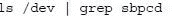

这将向你显示目录列表（`ls` 命令的结果），同时 `grep` 命令会搜索字符串“sbpcd”。管道符（`|`）作为你使用的两个独立命令之间的连接，其中第一个命令的输出将作为第二个命令的输入。

# 第 8 章 嵌套 If 语句

在我们继续讨论缩进的话题时，这是一个很好的例子，展示了缩进如何让你的生活变得简单。你的脚本可能有许多 ‘if’ 语句，你还可以在另一个“语句”中嵌套“if”语句。

例如，你可能想如下所示分析命令行给出的数字：

让我们来拆解一下：

在第四行，很明显，只有当第一个命令行参数大于 100 时，你才会执行后续操作。

在第八行，我们看到了‘if’ 语句的一种小变体。如果你想检查任何表达式，可以使用双括号。

在第十行，两个‘if’语句都必须为真，程序才会运行。

**提示**

通常，虽然你可以嵌套任意数量的 `if` 语句，但如果你需要嵌套深度超过 3 层，可能需要考虑重新组织你的逻辑。

## If Else

你会同意我的观点：在某些情况下，你希望在语句为真时执行某个特定操作，而在语句为假时执行另一组操作。你可以通过‘else’ 机制来实现。

看这里：

现在，如果文件作为命令行参数传递，你就可以可以轻松地从文件中读取；‘else’ 则如下所示从“stdin”读取。


**注意**：`stdin`（标准输入）是一个输入流，数据被发送到程序并由程序读取。这将在稍后进行详细讨论。

## If Elif Else

我们有时也会面临一系列条件，这些条件可能会通向不同的路径。

看这里：

在这个例子中，情况可能是这样的：

你 18 岁或以上，所以你可以去派对；如果你没有，但有监护人的许可，你可以去，但必须在午夜前回来。否则，你就不能参加派对。

看起来是这样的：

你可以拥有任意数量的 `elif` 分支；最后的 `else` 也是可选的。

# 第 9 章 布尔运算符

现在，如果你只想在满足多个条件时才执行某些事，该怎么办？确实，在某些情况下，你可能希望在满足一个或多个条件时执行操作。这就是布尔运算符的场（为了适应这些情况）。

它们包括：

* `And`（`&&`）
* `Or`（`||`）

例如，考虑一下，如果你的文件既可读且大小大于零，你就执行某项操作：

也许你现在还想在用户是 Andy 或 Bob 的情况下，执行一些稍微不同的操作：

## Case 语句

你可能还想根据对应一组模式的变量来采取不同的路径。你显然可以使用一系列的 `elif` 和 `if` 语句，但这很快就会变得臃肿。幸运的是，我们可以使用 `case` 语句让代码变得更整洁。

查看以下示例以理解我在说什么：

这是一个更基础的示例：

现在让我来为你拆解一下：

在第四行，我们看到该行启动了 `case` 机制。

在第五行，`start` 等于 `$1`；然后你执行随后的操作。`)` 表示该模式的结束。

在第七行，这组语句的结束用双分号（`; ;`）标识。下一个考虑的 `case` 紧随其后。

在第十四行，必须注意每个 `case` 的测试都是一个模式。`*` 表示任意数量的任意字符。它本质上是在没有其他 `case` 匹配时的通配符。尽管不是必须，但它经常被使用。

在最后一行，我们看到了 `esac`。它是 `case` 的反写；它向你展示你已经处于 `case` 语句的结束。之后的所有语句都将正常执行。

现在让我们来看一个稍微复杂的 `case`，其中模式的使用稍多。

### 活动：做出你自己的决定

1. 编写一个 Bash 脚本，接受两个数字作为命令行参数。
2. 创建一个接受文件作为命令行参数并对其分析的脚本。例如，你可以检查文件是否可写或可执行。如果是真，则打印一条消息；如果是假，则打印另一个。
3. 现在创建一个脚本，根据当前的星期几打印消息。例如，周六打印“Happy surf day”，周日打印“TGIF for Sunday”等。

# 第 10 章 常用 Linux 文件和目录操作

现在你已经开始练手了，你一定渴望进行更多的编码，并真正开始在系统中玩起来。我保证你会的，但首先，还有一些真正需要学习的理论，这样当你进入系统时，你就能真正理解它为什么这样做，以及如何利用你学过的命令做更多事情。所以，让我们深入研究你需要学习的核心概念。

## Linux 中的一切皆为文件

这是一个非常重要的概念——Linux 中的一切，无论它在哪里或在做什么，都是一个文件。文本文件显然是文件。目录也是文件。你的电脑键盘是一个只读文件，你电脑的显示器——即使这也是一个文件，尽管它是可写文件。一切。起初，这对你的操作没有任何实际影响，但你必须始终记住这一点，因为它将帮助你理解 Linux 如何进行目录和文件管理。

## Linux 被称为“无扩展名系统”

这一点稍微难理解，但随着你阅读这本书并学习更多，你会发现它是有道理的。文件扩展名通常由点之后的一系列 2、3 或 4 个字符组成。你已经在 Word（`.doc`、`.docx`）、`.pdf` 等文件中见过这些了。这个扩展名告诉了你正在处理的文件类型。以下是你会遇到的一些常见类型：

* `File.exe`：一个程序或可执行的文件
* `File.txt`：一个纯文本文件
* `File.png`、`File.jpg`、`File.gif`：所有的图像文件

在许多系统中（如 Windows），这种文件扩展非常重要，因为系统会利用它来确定处理的是什么类型的文件。在 Linux 中，情况不同。Linux 系统会忽略该扩展名，而是调查文件本身以查看它要做什么。例如，你可以有一个名为 `monkey.gif` 的文件，一张猴子的照片。你可以给文件起一个新名字，比如 `monkey.txt` 甚至只是 `monkey`，Linux 都会将其视为它原本的图像文件。正因如此，你有时发现很难判断文件的类型，但在 Linux 中有一个非常简单的方法，使用一个简单的命令：`file`。

```bash
file [path]
```

现在你可能在问自己为什么命令行参数是路径而不是文件。回想一下，记住我们在命令行上指定的每个目录或文件都是路径。而且，由于目录也是文件，说路径无非通往系统位置的行程，而位置就是文件。

## Linux 是大小敏感的

这是最重要的概念之一，也是最容易给 Linux 新手带来问题的一个。你已经知道 Windows 等系统在文件引用方面是不区分大小的，但 Linux 不同。你可以拥有多个名称相同但大小写不同的目录或文件。例如：

```bash
ls Documents
```

```text
FILE2.txt File2.txt file2.TXT
```

```text
...
```

```bash
file Documents/file2.txt
```

```text
Documents/file2.txt: ERROR: cannot open 'file2.txt' (No such file or directory)
```

每一个文件都被 Linux 视为一个独立的文件。

大小写也适用于命令行选项。例如，当你使用命令 `ls` 时，有两个不同的选项：`ls` 和 `lS`，它们的作用各不相同。常见的错误之一是在应该输入大写字母的地方输入了小写字母，然后纳闷为什么你的程序没有按预期运行。

## 文件或目录名中的空格

虽然在目录名或文件名中包含空格是完全可以的，但你必须保持适度的谨慎。当我们想要在命令行上分隔多个项目时，我们会在每个项目之间使用空格。空格告诉了我们程序名称是什么，以及如何识别命令行上的不同参数。例如，如果我们想进入一个名为 `Summer Holiday` 的目录，接下来的示例将无法工作：

```bash
ls Documents
FILE2.txt File2.txt file2.TXT Summer Holiday
...
cd Summer Holiday
```

```text
bash: cd: Holiday: No such file or directory
```

为什么呢？嗯，Linux 将 `Summer Holiday` 视为 2 个独立的命令行参数，因此命令 `cd` 只会进入第一个参数。防止这种情况发生的唯一方法是告诉终端 `Summer Holiday` 只是一个参数，有两种方法可以实现，两种都是完全有效的。

### 引号

第一种方法是用引号包裹整个项目。你可以使用单引号或双引号（尽管两者之间有细微差别），但务必确保开始和结束引号时使用的是相同的符号。例如，不要用单引号开始却用双引号结束。引号内部的任何内容都将被视为一个整体项目，例如：

```bash
cd 'Summer Holiday'
pwd
/home/cleopatra/Documents/Summer Holiday
```

### 转义字符

另一种方法是使用转义字符，即反斜线（`\`）。转义字符会消除或转义其后跟随字符的特殊含义，例如：

```bash
cd Holiday\ Photos
pwd
/home/cleopatra/Documents/Summer Holiday
```

从这个示例中可以看出，分隔 `Summer` 和 `Holiday` 的空格通常具有特殊含义：将每个单词视为独立的命令行参数。通过使用转义字符，我们消除了这种含义，这样这两个单词就合并成了一个参数。

我们之前提到过所谓的 TAB 补全。如果你在到达目录名称中的空格之前使用它，终端会自动转义空格。

## 隐藏目录和文件

Linux 有一种非常棒的方法来指定目录或文件是否隐藏。如果名称以 `a.`（`a` 跟着一个点）开头，它就是一个隐藏目录或文件。隐藏它们不需要特殊的命令或特殊操作。

有几个原因你可能想要隐藏目录或文件，其中之一是它们与特定用户的配置有关。这些内容可以被隐藏，以免干扰用户可能正在执行的日常任务。

所以，如果你想隐藏一个文件或目录，只需创建它或将其重命名为以 `a.` 开头的名字。同样，如果你想取消隐藏一个目录或文件，只需将其重命名，删除名称开头的 `a.` 即可。你学过的列出目录和文件的命令**不会**显示隐藏内容。相反，你可以修改命令添加 `-a` 作为命令行选项，从而显示这些隐藏文件和目录。

```bash
ls Documents
FILE2.txt File2.txt file2.TXT
...
ls -a Documents
. .. FILE2.txt File2.txt file2.TXT. hidden.file.txt
...
```

在这个示例中，你可以看到，当列出目录和文件时，前两个是 `.` 和 `..`，如果你需要复习这些内容，请回到路径章节。

## 总结

这里是你在本节中学到的内容的简要总结：

* `file` 用于获取目录或文件类型的信息。
* `ls -a` 列出目录中的所有文件，包括隐藏文件。
* 在 Linux 中，一切都是文件，包括目录。
* 文件扩展名并不重要，因为 Linux 会检查文件以确定它是什么。
* Linux 是一种区分大小写的语言，所以请注意大小写。

## 实际操作

现在我们需要将所有内容付诸实践，请尝试以下操作：

* 使用几个不同的条目运行 `file` 命令，并确保你使用了绝对路径和相对路径的组合。
* 接下来，给出一个显示家目录中所有内容的命令，包括任何隐藏的目录或文件。

## 关于运行命令的更多内容

理解 Linux 在很大程度上取决于知道正确的命令行选项，根据你对命令的操作来改变它们的工作方式。这些选项许多都有长版本和简写版本；例如，我们之前看到，当我们要列出目录中的所有内容（包括隐藏条目）时，我们使用 `-a` 或 `--all`。长格式只是一个易于人类眼睛阅读的版本。你可以使用其中任何一种，因为它们的结果相同。长格式的优点是，当你回看代码时，你会发现更容易理解命令的作用，而使用简写允许你轻松地将多个命令组合在一起。

```bash
pwd
/home/cleopatra
ls -a
ls --all
ls -alh
```

所以，你可以看到长格式选项都以两个横杠（`--`）开头，而简写选项都以单个横杠（`-`）开头。当你使用单个横杠时，可以通过在后面添加代表这些选项的所有字母来调用多个命令选项。要查看最后一个选项的作用，请查阅手册页。

## Man pages

这些是查询手册页的命令：

* `man <command>`：查找命令的手册页
* `man -k <search term>`：使用关键字搜索包含该词的所有页面
* `/<term>`：在手册页中用于搜索单词“term”
* `n`：在页面上搜索完成后，选择下一个项目
* 记住：手册页非常有用，所以请根据需要经常使用它们。当你有这些工具可用时，不需要尝试记住所有内容。

## 实际操作

尝试以下操作以进行练习：

* 浏览 `ls` 的手册页。尝试一些选项并尝试它们的组合使用。不要忘记在 `ls` 命令中使用多种相对路径和绝对路径。
* 现在在 `man` 手页中尝试一些搜索。根据你搜索的内容，你可能会得到几个很大的列表。查看一些页面以了解它们的大致内容。

## 删除目录

正如你所见的，创建一个新目录很容易，删除或移除目录也同样容易。但有一点你需要注意——Linux 命令行不包含任何撤销（UNDO）选项。这意味着要对自己的操作非常小心，因为一旦删除了目录，它就永远消失了。要删除目录，我们使用简单的命令 `rmdir`，它是 remove directory（删除目录）的缩写。

```bash
rmdir [options] <Directory>
```

这里还需要注意两点。第一，类似于 `mkdir`（创建目录）支持 `-v` 和 `-p` 选项，`rmdir` 也支持这些选项。其次，在删除目录之前，它必须是空的。然而，有一种方法可以避免这一点，我们稍后会来看。

```bash
rmdir linuxpractice/foo/bar
ls linuxpractice/foo
```

## 创建空文件

有很多涉及文件数据操作的命令，如果你引用一个不存在的文件，它会为你创建该文件。我们可以使用 `touch` 命令来创建一个空文件。

```bash
touch [options] <filename>
```

```bash
pwd
/home/cleopatra/linuxpractice
ls
foo
touch example1
ls
example1 foo
```

我们可以使用 `touch` 命令来修改文件的访问和修改时间。除非你正在测试一个依赖这些访问和修改时间的系统，否则你通常不需要这么做。基本上，这里发生的情况——这也是一个你可以充分利用的点——是：当你 `touch` 一个不存在的文件时，系统会为你创建它。

在 Linux 中有很多事情并不是直接完成的，但如果你学习了某些命令的行为，并学会如何创造性地使用它们，你就能实现你的目标。我们讨论过命令行可以为你提供一系列构建块，你可以以任何想要的方式使用这些构建块，但只有当你完全理解它们的工作原理而不仅仅是为什么时，你才能变得高效。

现在，我们只有一个空文件，但很快，我们将学习如何向文件中写入数据，以及如何提取数据。

## 复制文件或目录

有几个原因导致你可能想要复制目录或文件——也许你对某些内容进行修改，所以你会创建一个原始文件的副本。这样，如果出现问题，你就可以轻松恢复原来的状态。为了实现这一点，我们使用 `cp` 命令，它的意思是 copy（复制）。

```bash
cp [options] <source> <destination>
```

该命令有几个可用选项，我们将在稍后讨论其中一个。不过，首先查看 `cp` 的 man 页（帮助文档），看看还有哪些可用选项。

```bash
ls
example1 foo
cp example1 sammy
ls
sammy example1 foo
```

你发现源路径和目标都是路径了吗？这意味着我们可以使用绝对路径和相对路径来引用它们。请看这几个示例：

```bash
cp /home/cleopatra/linuxpractice/example2 example3
cp example2 ./../backups
cp example2 ./../backups/example4
cp /home/cleopatra/linuxpractice/example2 /otherdir/foo/example5
```

所以，当使用 `cp` 时，目标可以是指向目录的路径，也可以是指向文件的路径。如果指向一个文件（如上面的第一、第三和第四行示例所示），将创建一个源文件的副本，并且它将具有目标路径中指定的文件名。如果指向一个目录，那么文件将被复制到该目录，并保持与源文件相同的名称。

默认情况下，`cp` 只能复制文件，因此如果你想复制目录，则需要使用 `-r` 选项，它的意思是 recursive（递归）。递归意味着进入目录，查看其中包含的文件和目录。要查看子目录，你需要在每个目录内部执行的操作。

```bash
ls
sammy example1 foo
cp foo foo2
cp: omitting directory 'foo'
cp -r foo foo2
ls
sammy example1 foo foo2
```

在这个示例中，我们正从 `foo` 目录将所有文件和目录复制到 `foo2`。

## 移动文件或目录

使用 `mv` 命令可以非常简单地移动文件，它的意思是 move（移动）。它的工作方式与 `cp` 非常相似，不同之处在于移动目录时不需要使用 `-r`。

```bash
mv [options] <source> <destination>
```

```bash
ls
sammy example1 foo foo2
mkdir backups
mv foo2 backups/foo3
mv sammy backups/
ls
backups example1 foo
```

让我们详细查看一下：

- 第 3 行：创建了一个名为 `backups` 的新目录。
- 第 4 行：名为 `foo2` 的目录被移动到了名为 `backups` 的目录中，并重命名为 `foo3`。
- 第 7 行：名为 `sammy` 的文件被移动到了 `backups` 目录中。因为我们没有提供目标名称，所以它保留了原有的名称。

注意，我们再次对源和目标使用了路径，这些都是绝对路径或相对路径。

## 重命名文件和目录

就像我们使用 `touch` 命令那样，`mv` 的行为也可以创造性地使用以产生不同的结果。通常，我们使用 `mv` 将文件或目录移动到新目录。这种移动的一部分包括对该文件或目录重命名。如果我们指定目标和源是同一个目录但命名不同，那就是对 `mv` 重命名目录或文件的创造性用法。

```bash
ls
backups example1 foo
mv foo foo3
ls
backups example1 foo3
cd .
mkdir linuxpractice/testdir
mv linuxpractice/testdir /home/cleopatra/linuxpractice/frieda
ls linuxpractice
backups example1 foo3 frieda
```

让我们深入研究一下：

- 第 3 行：名为 `foo` 的文件被赋予了新名称 `foo3`。两个路径都是相对路径。
- 第 6 行：移动了父目录。我们这样做是为了在下一行中，展示如何在包含它们的目录外部对这些文件或目录运行命令。
- 第 8 行：名为 `testdir` 的目录被重命名为 `frieda`。对源使用了相对路径，对目标使用了绝对路径。

## 删除文件

正如我们在 `rmdir` 中看到的那样，当你删除文件时，是无法撤销的，所以操作时要小心。删除或移除文件的命令是 `rm`，它的意思是 remove（移除）。

```bash
rm [options] <file>
```


```bash
ls
backups example1 foo3 frieda
rm example1
ls
backups foo3 frieda
```

## 删除非空目录

`rm` 命令也可以通过几个不同的选项进行修改。同样，查看 `rm` man 页了解可以做什么，但最有用的选项之一是 `-r`。像 `cp` 一样，它的意思是递归，我们配合 `rm` 使用它来删除指定的目录及其内部的所有内容。

```bash
ls
backups foo3 frieda
rmdir backups
rmdir: failed to remove 'backups': Directory not empty
rm backups
rm: cannot remove 'backups': Is a directory
rm -r backups
ls
foo3 frieda
```

你可以配合 `-r` 使用的另一个选项是 `i`，它的意思是 interactive（交互）。这将在删除任何文件或目录之前向你确认，并提供一个改变主意并取消命令的选项。

## 最后的说明

我已经说过好几次了，我会一直说：当我们在命令行引用文件或目录时，它们是路径。它们可能是绝对路径或相对路径，在大多数情况下都是如此。我不会再次提醒你这一点，我的示例也没有显示，所以请记住。

## 总结

以下是你在本节中学学习的内容：

- `Mkdir`：意思是 Make Directory，允许我们创建新目录。
- `Rdir`：意思是 Remove Directory，允许我们删除目录。
- `Touch`：允许我们创建空文件。
- `Cp`：意思是 Copy，允许我们复制目录或文件。
- `Mv`：意思是 Move，允许我们移动或重命名文件或目录。
- `Rm`：意思是 Remove，允许我们删除文件。
- 没有撤销你所做操作的操作，所以删除和移动文件目录时要小心。
- 命令行选项：有很多选项，所以通过查看每个命令的 man 页来熟悉它们的功能以及你可以做什么。

## 实际操作

你现在有了几种不同的命令可以与系统交互，所以让我们练习一下。尝试以下操作：

- 在你的用户目录下创建一个全新的目录（这将允许你进行实验）。
- 在目录内部创建一些文件和目录，并在每个目录内部创建更多文件和目录。
- 现在给它们中的一些起新名字。
- 回到用户目录，将一个文件从子目录复制到你创建的第一个目录中。
- 将文件移动到另一个目录。
- 重命名几个文件。
- 同时移动并重命名文件。
- 最后，查看用户目录下已经存在的目录。你可能有下载、文档、图片和音乐。思考一下其他可以帮助整理物品的目录，并开始设置它们。

在本章中，我们将学习如何在 Linux 系统中定位日志，并对其进行解释，以用于系统管理和故障排除。我们将描述 Linux 系统中 `syslog` 的基本架构，并学习维护时区配置的同步性和准确性，以确保系统日志的时间戳是正确的。

## 系统日志架构

在本节中，我们将学习 Red Hat Enterprise Linux 7 系统中系统日志的架构。

### 系统日志

系统中运行的进程和操作系统内核所产生的事件都需要被记录。这些日志将有助于系统审计和解决系统中面临的问题。按照惯例，所有基于 Linux 的系统的日志都存储在 `/var/log` 目录路径下。

Red Hat Enterprise Linux 7 默认构建了一个用于标准日志的系统。该日志系统被许多程序使用。有两个服务 `systemd-journald` 和 `rsyslog`，它们分别负责处理 Red Hat Enterprise Linux 7 中的日志记录。

`systemd-journald` 收集并存储一系列进程的日志，列出如下：

- 内核
- 启动过程的早期阶段
- Syslog
- 各种守护进程在运行状态标准输出和错误

所有这些活动都以结构化模式记录。因此，所有这些事件都记录在一个集中管理的数据库中。所有与 `syslog` 相关的消息也会由 `systemd-journald` 转发到 `rsyslog` 以进一步处理。随后，`rsyslog` 会根据设施（facility）或类型以及优先级对消息进行排序，然后将其写入 `/var/log` 目录下的持久化文件中。

让我们根据系统和服务，逐查看存储在 `/var/log` 中的所有类型的日志。

| 日志文件 | 用途 |
| :--- | :--- |
| `/var/log/messages` | 大多数 syslog 消息都存储在此文件中，但与邮件处理、认证、cron 任务和调试错误相关的消息除外 |
| `/var/log/secure` | 与认证和安全相关的错误存储在此文件中 |
| `/var/log/maillog` | 邮件服务器相关的日志存储在此文件中 |
| `/var/log/cron` | 定期执行的任务被称为 cron。相关日志存储在此文件中 |
| `/var/log/boot.log` | 与启动相关的消息存储在此处 |

## Syslog 文件审查

在本节中，我们将学习如何审查系统日志，这可以帮助系统管理员排除系统相关问题。

### Syslog 文件

syslog 协议被系统中的许多程序用于记录其事件。日志消息通过两点分类：

- 设施（Facility），即消息类型
- 优先级（Priority），即消息的严重程度

让我们逐一概述这些优先级。

| 代码 | 优先级 | 严重程度 |
| :--- | :--- | :--- |
| 0 | emerg | 系统状态不可用 |
| 1 | alert | 需要采取立即行动 |
| 2 | crit | 情况严重 |
| 3 | err | 情况非紧急但存在错误 |
| 4 | warning | 存在警告情况 |
| 5 | notice | 事件正常但重要 |
| 6 | info | 存在信息性事件 |
| 7 | debug | 消息处于调试级别 |

`rsyslog` 根据消息的优先级和类型来决定处理这些日志消息的方法。这已在 `/etc/rsyslog.conf` 文件以及 `/etc/rsyslog.d` 中的其他 `.conf` 文件中配置好。作为系统管理员，你可以覆盖此默认配置并自定义 `rsyslog` 文件的方式，以便根据你的需求处理这些日志消息。被 `rsyslog` 服务处理的消息可能会出现在许多不同的日志文件中。你可以通过将严重性字段更改为 `none` 来防止这种情况，这样指向此服务的消息就不会附加到指定的日志文件中。

### 日志轮转

Red Hat Enterprise Linux 7 和其他 Linux 变体中设有 `logrotate` 工具，以便日志文件不会堆积在 `/var/log` 文件系统中并耗尽磁盘空间。日志文件在轮转时会加上轮转日期。例如，如果一个名为 `/var/log/message` 的旧文件在 2016 年 10 月 23 日进行了轮转，它将变为 `/var/log/messages-20161023`。旧日志文件轮转后会创建一个新的日志文件并通知相关服务。旧日志文件通常在几天后丢弃，默认为四周。这样做是为了释放磁盘空间。有一个 `cron` 任务用于轮转日志文件。日志文件每周轮转一次，但可能根据日志文件的大小而异，执行得更快或更慢。

### Syslog 条目分析

由 `rsyslog` 程序记录的系统日志最旧的日志消息位于文件顶部，最新的消息位于文件末尾。使用一种标准格式来维护 `rsyslog` 记录的日志条目。让我们查看 `/var/log/secure` 文件的格式。

```
Feb 12 11:30:45localhostsshd [1432] Failed password for user from 172.25.0.11 port 59344 ssh2
```

- 第一列显示日志条目的的时间戳。
- 第二列显示生成日志消息的主机。
- 第三列显示记录事件的程序或进程。
- 最后一列显示发送的消息。

### 使用 `tail` 命令监控日志文件

系统管理员的常见做法是重现问题，以便实时生成针对该问题的错误日志。`tail -f /path/to/file` 命令可监控实时生成的日志。该命令会显示日志文件的最后 10 行，同时继续打印实时生成的新错误日志。例如，如果你想查看登录失败尝试的实时日志，可以使用以下 `tail` 命令，这将帮助你查看实时日志。

```
[root@desktop ~] # tail -f /var/log/secure
…

Feb 12 11:30:45localhostsshd [1432] Failed password for user from 172.25.0.11 port 59344 ssh2
```

### 使用 `logger` 发送 syslog 消息

你可以使用 `logger` 命令向 `rsyslog` 服务发送消息。当你对 `rsyslog` 配置文件进行了某些更改并想测试它时，该命令非常有用。你可以执行以下命令，它将发送一条记录在 `/var/log/boot.log` 中的消息：

```
[root@desktop ~] # logger -p local7.notice “Log entry created”
```

## 审查 Systemd Journal

在本节中，我们将通过分析 systemd journal 中的日志来审查系统状态并排除问题。

systemd journal 使用结构二进制文件记录数据。数据中包含了有关日志事件的额外信息。对于 syslog 事件，这包含了原始消息的严重性和优先级。

当你以 root 用户运行 `journalctl` 时，将显示完整的系统日志，从文件中最旧的日志条目开始。

优先级为 `notice` 或 `warning` 的消息会被 `journalctl` 命令以粗体显示。高优先级的消息将以红色显示。

成功使用 `journalctl` 命令进行故障排除和审计的方法是限制命令的输出，使其仅显示相关输出。

让我们查看用于限制 `journalctl` 命令输出以仅显示所需内容的各种方法。

你可以使用以下命令显示最后 5 个 journal 条目。

```
[root@server ~] # journalctl -n 5
```

你可以使用优先级标准来过滤 `journalctl` 输出，以帮助排除问题。你可以配合 `journalctl` 命令使用 `-p` 选项指定一个或多个优先级级别，显示高层级的条目。`journalctl` 识别的优先级级别包括 `info`、`debug`、`notice`、`err`、`warning`、`crit`、`emerg` 和 `alert`。

你可以使用以下命令来实现上述输出。

```bash
[root@server ~] # journalctl -p err
```

`journalctl` 有一个类似于 `tail -f` 的命令，即 `journalctl -f`。这会再次列出最后 10 行日志记录，然后实时打印日志条目。

```bash
[root@server ~] # journalctl -f
```

你还可以使用其他过滤器来根据你的需求过滤 `journalctl` 条目。你可以传递 `--since` 和 `--until` 选项根据时间戳过滤日志条目。你需要传递如“今天”、“昨天”或格式为 `YYYY-MM-DD hh:mm: ss` 的实际时间作为参数。

让我们来看下面的几个示例。

```bash
[root@server ~] # journalctl --since today

[root@server ~] # journalctl --since “2015-04-23 20:30:00” --until “2015-05-23 20:30:00”
```

日志条目还附带有更多字段，只有当你在使用 `journalctl` 命令时通过 `verbose` 选项时，这些字段才会可见。

```bash
[root@server ~] # journalctl -o verbose
```

对于系统管理员来说，以下关键词是非常重要的：

- `_COMM`：命令名称
- `_EXE`：显示进程的可执行路径
- `_PID`：显示进程的 PID
- `_UID`：显示与进程关联的用户
- `_SYSTEMD_UNIT`：显示启动进程的 systemd 单元

你可以组合一个或多个选项，根据你的需求获取 `journalctl` 命令的输出。来看下面的示例，它将打印包含 systemd 单元文件 `sshd.service` 且 PID 为 `1183\.` 的日志条目。

```bash
[root server ~] # journals _SYSTEMD_UNIT=sshd.service _PID=1183
```

## 系统日志保存

在本节中，我们将学习如何修改 `systemd-journald` 配置，使日志存储在磁盘而非内存中。

### 持久存储系统日志

系统日志默认保留在 `/run/log/journal`，这意味着当系统重启时，条目会被清除。日志是 Red Hat Enterprise Linux 7 中的一种新实现。

我们可以确定，如果创建 `/var/log/journal` 目录，日志条目就可以记录在那里。这将带给我们一个优势，即即使在重启后历史数据可用。然而，尽管我们有了持久性日志，但数据无法永久保存。系统存在日志轮机制，每月触发一次日志滚动。此外，默认情况下，不允许日志累积超过其所占文件系统的 10%，或者留少于 15% 的文件系统可用空间。你可以根据需求在 `/etc/systemd/journald.conf` 配置文件中更改这些值，一旦 `systemd-journald` 进程启动，新值将生效并记录。

如前讨论的，通过在 `/var/log/journal` 创建目录，可以使日志条目持久化。

```bash
[root@server ~]# mkdir /var/log/journal
```

你需要确保 `/var/log/journal` 目录的所有者为 `root`，组所有者为 `systemd-journal`，并且目录权限设置为 `2755`。

```bash
[root@server ~]# chown root:systemd-journal /var/log/journal

[root@server ~]# chmod 2755 /var/log/journal
```

要使这些生效，你需要重启系统，或者作为 root 用户向 `systemd-journald` 进程发送特殊的信号 `USR1`。

```bash
[root@server ~]# killall -USR1 systemd-journald
```

这将使得 systemd 日志条目即使在系统重启后也是持久的，现在你可以使用命令 `journalctl -b` 根据最近的启动情况显示最简的输出。

```bash
[root@server ~]# journalctl -b
```

如果你正在调查与系统崩溃相关的问题，你需要过滤日志输出，仅显示系统崩溃之前的条目。理想情况下是系统崩溃前的最后一次重启。在这种情况下，你可以将 `-b` 选项与负数结合，表示回溯的启动次数以限制输出。例如，要显示到上一次启动的内容，可以使用 `journalctl -b -1`。

## 维护时间准确性

在本节中，我们将学习如何确保系统时间准确，以便记录在日志文件所有事件日志都能显示准确的时间戳。

### 设置本地时区和时钟

如果你想分析跨多个系统的日志，确保所有系统的时钟保持同步至关重要。系统可以使用网络时间协议 `NTP` 从互联网获取正确时间。互联网上有公开的 NTP 项目，如网络池项目（Network pool Project），它们允许系统获取正确时间。另一个选项是维护一个由高质量硬件组成的时钟，为所有本地系统提供时间。

要查看 Linux 系统上的当前日期时间设置，可以使用 `timedatectl` 命令。该命令将显示当前时间、NTP 同步设置和时区等信息。

```bash
[root@server ~]# timedatectl
```

Red Hat Enterprise Linux 7 维护一个已知时区的数据库。可以使用以下命令列出。

```bash
[root@server ~]# timedatectl list-timezones
```

时区的名称基于 IANA 维护的 `zoneinfo` 数据库。时区的命名规范基于海洋或大陆，随后是该时区或区域内最大的城市。例如，如果我们看美国的山地时间（Mountain Time），表示为“America/Denver”。

选择正确的城市名称至关重要，因为有时同一时区内的不同地区可能维持不同的夏令时设置。例如，美国亚利桑那州没有实施任何夏令时，因此属于“America/Phoenix”时区。

`tzselect` 命令用于识别 zoneinfo 时区名称是否正确。用户将收到关于其当前位置的问题提示，并通常会给出正确时区的输出。在建议时区时，它不会自动对系统上的当前时间进行任何更改。一旦你知道应该使用哪个时区，可以使用以下命令进行显示。

```bash
[root@server ~]# timedatectl set-timezone America/Phoenix

[root@server ~]# timedatectl
```

如果你想更改系统的当前日期和时间，可以使用 `timedatectl` 命令的 `set-time` 选项。时间和日期可以用“YYYY-MM-DD hh:mm:ss”格式进行指定。如果你只想设置时间，可以省略日期参数。

```bash
[root@server ~]# timedatectl set-time 9:00:00

[root@server ~]# timedatectl
```

你可以使用 `timedatectl` 命令的 `set-ntp` 选项使用网络时间协议的自动时间同步。传递的参数是 `true` 或 `false`，这将开启或关闭该功能。

```bash
[root@server ~]# timedatectl set-ntp true
```

## Chronyd 服务


系统的本地硬件时钟通常是不准确的。`chronyd` 服务通过与配置的网络时间协议 NTP 服务器同步，来保持本地时钟运行正常。如果网络不可用，它会将本地时钟同步到 `driftfile` 中计算并记录的 RTC 时钟漂移上，该文件维护在 `/etc/chrony.conf` 配置文件中。

`chronyd` 服务的默认行为是使用 NTP 网络池项目的时钟来同步时间，不需要额外配置。如果你的系统位于隔离网络中，建议更改 NTP 服务器。

有一个被称为“层值”（stratum value）的值，由 NTP 时间源报告。这决定了 NTP 时间源的质量。层值指的是系统到达高性能参考时钟所需的跳数（hops）。源参考时钟的层值为 `0`。连接到源时钟的 NTP 服务器的层值为 `1`，而尝试与该 NTP 服务器同步的系统其层值为 `2`。

你可以使用 `/etc/chrony.conf` 文件来配置两种类型的时间源：服务器（server）和对等节点（peer）。服务器的层级比本地 NTP 服务器高一级。对等节点的层级与本地 NTP 服务器相同。你可以在配置文件中指定一个或多个服务器和对等节点，每行一个。

例如，如果你的 `chronyd` 服务与默认的 NTP 服务器同步，你可以根据需要更改配置文件，以根据需求更改 NTP 服务器。每当你在配置文件中更改源时，都需要重启服务以使更改生效。

```bash
[root@server ~]# systemctl restart chronyd
```

`chronyd` 服务还有另一个名为 `chronyc` 的服务，它是 `chronyd` 服务的客户端。一旦设置了 NTP 同步，你可能想知道系统时钟是否正确同步到 NTP 服务器。你可以使用 `chronyc sources` 命令，或者如果你想要更详细的输出，可以使用带有详细信息选项的命令 `chronyc sources -v`。

```bash
[root@server ~]# chronyc sources –v
```

# 第 12 章 创建可启动 U 盘

一旦下载了 ISO 文件，你需要创建一个可启动的 U 盘。这意味着你必须准备一个 U 盘，以便用它启动 Ubuntu。

完成此任务你需要一个合适的程序。

有几个应用程序可以完成此任务。

在我看来，Etcher 是一个很好的选择。

Etcher 对 Linux、Windows 和 MacOS 都是免费的。

[`www.balena.io/etcher/`](https://www.balena.io/etcher/)

下载相应的版本，然后创建所需的 U 盘。

Etcher 操作直观易懂。


1. 选择镜像（Ubuntu 18.04 的 ISO 文件）。
2. 选择驱动器（你将看到插入空闲 USB 端口的盘列表）。
3. 选择你想要用于 Ubuntu 的那一个。
4. 刻录（开始！）

双击确认选择了正确的 U 盘。

U 盘上的所有内容将被完全擦除！

# Systemd 日志持久

在本节中，我们将学习如何修改 `systemd-journald` 配置，使日志存储在磁盘而非内存中。

## 永久持久化系统日志

系统日志默认保存在 `/run/log/journal` 中，这意味着当系统重启时，条目会被清除。日志是 Red Hat Enterprise Linux 7 中的一种新实现。

我们可以确保，如果创建 `/var/log/journal` 目录，日志条目就可以记录在那里。这将带给我们一个优势，即即使在重启后历史数据仍然可用。然而，尽管我们有了持久的日志，也无法保留任何永久数据。系统存在日志轮转机制，每月触发一次日志。此外，默认情况下，不允许日志堆积超过其所占文件系统的 10%，或者留少于 15% 的文件系统可用空间。你可以根据需求在 `/etc/systemd/journald.conf` 配置文件中更改这些值，一旦 `systemd-journald` 进程启动，新值将生效并被记录。

如前所述的，可以通过在 `/var/log/journal` 创建目录来使日志条目永久化。

```bash
[root@server ~]# mkdir /var/log/journal
```

你需要确保 `/var/log/journal` 目录的所有者为 `root`，组所有者为 `systemd-journal`，并且目录权限设置为 `2755`。

```bash
[root@server ~]# chown root:systemd-journal /var/log/journal
[root@server ~]# chmod 2755 /var/log/journal
```

要使这些更改生效，你需要重启系统，或者以 root 用户身份向 `systemd-journald` 进程发送特殊信号 `USR1`。

```bash
[root@server ~]# killall -USR1 systemd-journald
```

这将使得 systemd 日志条目即使在系统重启后也是永久的，你现在可以使用 `journalctl -b` 命令显示最近一次启动的最要输出。

```bash
[root@server ~]# journalctl -b
```

如果你正在调查与系统崩溃相关的问题，你需要过滤日志输出，仅显示系统崩溃发生之前的条目。理想情况下，那是系统崩溃前的最后一次重启。在这种情况下，你可以将 `-b` 选项与负数结合，指示回溯的重启次数以限制输出。例如，要显示到上一次启动的输出，可以使用 `journalctl -b -1`。

# 维护时间准确性

在本节中，我们将学习如何确保系统时间准确，以便所有记录的事件日志都是准确。

## 设置本地时区和时钟

为了确保系统时间准确，以便所有记录的事件日志显示准确的时间戳。系统可以通过网络时间协议（NTP）获取正确的时间。如果你要在多个系统中分析日志，确保这些时钟是同步的。

要查看 Linux 上的日期和时间设置，可以使用 `timedatectl` 命令。该命令将显示当前时间、NTP 同步设置和时区。

```bash
[root@server ~]# timedatectl
```

Red Hat Enterprise Linux 7 维护了一个已知时区的数据库。可以使用以下命令列出：

```bash
[root@server ~]# timedatectl list-timezones
```

时区的名称基于 IANA 维护的 `zoneinfo` 数据库。时区的命名规范基于海洋或大陆。例如，如果我们看美国的山地时间，它表示为“America/Denver”。

选择正确的城市名称至关重要，因为有时同一时区内的地区可能维护有不同的夏令时设置。例如，美国亚利桑那州没有实行夏令时，因此属于“America/Phoenix”时区。

`tzselect` 命令用于识别时区信息名称是否正确。用户将收到关于其当前位置的提示问题，并会给出正确时区的输出。在建议时区时，它不会自动对系统当前时间进行任何更改。一旦你确定了应该使用哪个时区，可以使用以下命令进行设置：

```bash
[root@server ~]# timedatectl set-timezone America/Phoenix
[root@server ~]# timedatectl
```

如果你想更改系统的当前日期和时间，可以使用 `timedatectl` 命令的 `set-time` 选项。日期可以用“YYYY-MM-DD hh:mm:ss”格式指定。如果你只想设置时间，可以省略日期参数。

```bash
[root@server ~]# timedatectl set-time 9:00:00
[root@server ~]# timedatectl
```

你可以使用 `timedatectl` 命令的 `set-ntp` 选项使用网络时间协议的自动同步。传递的参数是 `true` 或 `false`，这将开启或关闭该功能。

```bash
[root@server ~]# timedatectl set-ntp true
```

系统的本地硬件时钟通常是不准确的。`chronyd` 服务用于通过与配置的网络时间协议（NTP）服务器同步来保持本地时钟准确。如果网络不可用，它会将本地时钟同步到漂移文件（driftfile）中计算并记录的 RTC 时钟漂移，该文件维护在 `/etc/chrony.conf` 中。

`chronyd` 服务的默认行为是使用 NTP 网络池项目中的时钟来同步时间，不需要额外配置。如果你的系统恰好位于隔离网络，建议更改 NTP 服务器。

存在一种被称为“分层值”（stratum value）的概念，由 NTP 时间源报告。这决定了 NTP 时间源的质量。分层值是指系统到达高性能参考时钟所需的“跳”数。源参考时钟的分层值为 `0`。连接到源时钟的 NTP 服务器其分层值为 `1`，而尝试与该 NTP 服务器同步的系统其层值则是 `2`。

你可以使用 `/etc/chrony.conf` 文件配置两种类型的时间源：服务器（server）和对等节点（peer）。服务器的分层级比本地 NTP 服务器高一级。对等节点的分层级与本地 NTP 服务器相同。你可以在配置文件中指定一个或多个服务器和对等节点，每行一个。

例如，如果你的 `chronyd` 服务与默认 NTP 服务器同步，你可以根据需要更改配置文件以更换 NTP 服务器。每当你更改配置文件中的源时，都需要重启服务才能使更改生效。

```bash
[root@server ~]# systemctl restart chronyd
```

`chronyd` 服务还有另一个名为 `chronyc` 的服务，它是 `chronyd` 服务的客户端。一旦设置好 NTP 同步，你可能想知道系统时钟是否正确同步到 NTP 服务器。你可以使用 `chronyc sources` 命令，或者如果你想获得更详细的输出，可以使用带有冗余选项的 `chronyc sources -v` 命令。

```bash
[root@server ~]# chronyc sources –v
```

# 第 13 章 编程 – 逻辑拆解

在本章中，我们将讨论许多构成编程的基础概念。事实是，尽管有许多编写程序的方法以及属于其中的许多不同概念，但许多概念在每一个实现过程中都保持着相当灵活流动的状态。我的意思是，无论你如何编程，你将编写的所有程序中都有很多共同点。

我坚信“概念性”：我认为如果你要学习某种东西，你首先需要从概念角度了解它是如何工作的，然后在以后将其联系到僵化的思维和结构中。我们也将连接所有这些概念！然而，现在，我们只需要把它们当作：概念本身来讨论。

## 程序及其运行方式

所以我们首先讨论的是程序，它们是什么，以及它们在 Linux 中是如何运行的，因为这本书专门关于如何学习在 Linux 上进行编程。程序本身是一个相对简单的概念，它们也有许多不同的名称：这里的“程序”一词可以适用于从你为了自动化某些过程而编写的脚本，到像 Word 或 Google Chrome 这样的桌面应用，再到像《侠盗猎手 5》这样的桌面视频游戏，以及介于两者之间的许多不同内容。

程序可以在前台运行，这意味着它们就在你面前执行特定的功能；或者它们也可以作为后台进程运行，在你完全不知情的情况下持续运行。作为后台进程运行的程序示例可能是你计算机上不断运行的时钟应用程序。你可能永远不会去考虑它，但这是一个在后台不断运行的内核级程序，记录事件发生的时间。事实上，有大量的程序会以这种方式运行，用户在初始执行协议后既察觉不到它们，或者它们隐藏在非常深的后台，以至于用户必须调用它们才能使用。

作为一名新程序员，特别是从事 Linux 编程，你将进行大部分编程工作将在控制台中完成。这对于你作为 Linux 用户和程序员来说尤为重要。为什么呢？因为 Linux 的很大魅力来自于它提供的极其有用且深入的命令行工具。

控制台（Console）、命令行（command line）和终端（terminal）指的是同一种东西；在 Unix 类系统中，最常用的术语是终端（Terminal）。这一切本质上都指的是相同的内容：人们如何通过文本手动输入命令并执行程序，而不是通过更“现代”的程序执行方法。本质上，命令行提供了用户与计算机之间最纯粹的通信；Unix 系统被广泛复制和模拟的原因之一，是因为它们提供了用户与计算机之间历史上最好的接口方法之一。这在今天以 Unix 为模型的 Linux 系统中仍然适用。

请注意，并非所有的 Linux 发行版都是平等的；某些将依赖终端。然而，许多发行版确实通过终端提供了极高的可能性，即使它们的主要目的是推向用户远离这种低级界面。例如，虽然 Elementary OS（一种基于极其简单优雅的用户体验的高级操作系统）对命令线的重视远不如 Arch Linux（一种高度可定制并高强度使用命令行的 Linux 发行版），但它们都提供了只有通过命令行及相关工具使用才能访问的丰富功能。

正如我所说的，作为一名 Linux 程序员，你早期将编写的大多数程序至少会通过命令行打印输出。然而，极有可能，这些程序也会从命令行进行编译和执行，这仅仅是因为这是处理该任务的“正确”方式，这将让你对你的工具——计算机变得最熟悉。

## 是什么构成了程序？

当我在这里说“制作”（make）时，我字面意思就是制作：人们如何与计算机通信，然后创建出计算机可以理解的东西？

嗯，首先，它们被称为“编程语言”是有原因的。想象一下：你精通英语和法语。如果你在街上遇到一个母语是西班牙语的人，你将无法真正与他们交流。但是，如果他们说西班牙语和法语，那么在笨手笨脚交谈一番后，你们都可以用法语进行交流，尽管你们的母语不同。

这对于程序是什么以及它们如何工作，可能是最好的类比。计算机原生以非常简单且数学化的方式理解事物；它们解析 1 和 0 的序列以执行极其复杂的数学函数，并最终只是对数学值进行操作。另一方面，人类虽然会说数学，但通常不愿意花费大量的时间，用 1 和 0 的序列独立地编写计算机的每一个细节。如果每个程序员都这样做，即使是一个简单的程序，编写也需要数年时间。

因此，编程语言提供了一个折中方案。虽然语言之间可以形成长期的遗传渊源，但所有语言从根本源上都是为了同一个目的：将人类易于理解的指令分解为计算机可以理解的术语。

实现这一目标主要有两种方法。第一种是将程序所编写的语言直接翻译成计算机原生支持的语言。这被称为“编译代码”。基于将代码编译为计算机原生语言的语言被称为“编译型语言”。

第二种是提供一个可以让程序运行的沙箱——一个可以在其中执行程序的虚拟机或运行时环境。这个运行时环境与操作系统被直接隔离开，因为程序并不是运行在真实的操作系统上（尽管程序完全有能力在操作系统上执行功能，例如读写文件），而是运行在一个与操作系统分离的抽象环境中。这意味着你编写的代码不需要翻译成计算机能理解的语言——它只需要能被运行代码的虚拟环境所理解即可。

那么，各种方式各有什么优缺点呢？每种方式都有自己的优点和缺点。编译型程序的执行速度通常会更快，因为它们被直接翻译成机器码，然后由操作系统直接运行。这意味着除了程序本身所需的内容外，编译型程序没有额外需要加载的内容。编译型程序通常还提供了许多计算机直接接口，这是解释型程序所没有的。例如，对于编译型程序，由于你是在直接与计算机通信，你通常会负责诸如分配或释放内存存储等操作。

同时，解释型语言也自带许多优势。首先，在现代计算硬件上，执行时间通常并不那么重要，因为计算机远比以前快得多。此外，编译型语言的优势之一也可以是解释型语言的优势：编译型语言与计算机如此接近，这使得它们的管理、部署和快速原型设计变得有些困难。然而，解释型语言提供了足够的抽象层次，让程序员可以合理地快速构建原型。也许解释型语言最大的吸引力在于，你不需要为每台计算机以不同的方式对其进行编译；程序运行在解释器中，此如此。这意味着如果一个操作系统拥有该语言的解释器，用该语言编写的程序就能在该操作系统上运行。最流行的解释型语言之一 `Java` 实际上正是基于这些原因而获得了大量的主流认可：在动荡的计算机市场中，许多不同的操作系统争夺市场地位，“编写一次，处处运行”的想法极具吸引力，而当时的市场还很年轻，对于需要在多个系统上运行的软件来说，还没有简单的解决方案。

在本书中，我们将涵盖一种解释型语言和一种编译型语言，其中 `C++` 是编译型语言，而 `Python` 是解释型语言。你将亲身感受到这两种不同形式之间的对比。不过不要被这个安排吓到；正如我在本章开头提到的，编程语言总是非常相似的。有一些支撑每种编程语言的概念，我们将在本章讨论这些概念。

## 程序流——过程式、函数式、面向对象等

这是不同编程语言之间最大的区别之一；它们在编写和编写程序的方式上通常有自己偏好的范式。

从历史角度看，函数式或过程式语言曾占据统治地位。这意味着所有代码的编写方式都是以线性和过程化的方式进行的，在复用方面的限制非常少。程序有明确定义的起点和终点，并且从一个点到另一个点的路径相当狭窄。这是有合逻辑的，因为当时的计算机更简单，内存和硬盘空间也更小；本质上，程序员浪费时间或空间的余地更小。一切的设计都是为了让计算机解析时尽可能简单直接，以便让任何东西在功率消耗上都不比需要的更大或更耗能。

然而，这种范式开始发生变化。在这一过程中，最重要的语言可能是 `Ada` 和 `Smalltalk`。这些语言早就展示了面向对象编程的力量，这种力量后来成为当前计算硬件上大多数程序的主要运行机制。`C++` 最终作为 `C` 语言的扩展版本出现，专门为了包含面向对象编程的潜力而创建。随后出现了 `Java`，以及大量不同脚本语言的开发，这些语言旨在帮助程序员快速上手，例如 `Python`、`Perl` 和 `Ruby`。所有这些语言的核心都有重要的概念。许多现代语言，如 `C#` 和 `Go`，也在使用面向对象的范式。

那么，什么是面向对象编程呢？鉴于你将使用的两种语言都配备了为了适应面向对象编程的不同特性，本书在随后的章节将重点介绍这一内容。本质上，与函数式或过程式编程范式相比，面向对象编程提供了一种更加模块化、可复用且易于理解的编程方法。面向对象的理念在很大程度上在于，它允许程序员开始将事物拆解成大块。当我们开始讨论对象和类时，稍后会详细讨论这一点。虽然这对于使用 `Bash` 的短 Linux 脚本可能派不上用，但当你稍后开始使用 `C++` 和 `Python` 处理实际应用程序时，它将始终有用，因此现在涵盖所有概念是非常重要的，这样当它们实际上开始以某种方式被使用时，你已经熟悉了底层思想。

## C 和 C 风格语言


在概念上，这可能是本章要涵盖最重要的内容之一。理解不同的编程语言就是理解整个起源过程。在这个起源过程的一个阶段，有一种名为`C`的语言。这之所以很重要，是因为`C`和基于`Unix`的操作系统配合得近乎完美。

让我带回到 1972 年：Dennis Ritchie 和 Ken Thompson 正在开发一种语言，将作为`B`语言的自然继者，而`B`语言本身又是`BCPL`的自然继者。这种语言在那个时代是最容易上手的语言之一。它提供了许多其他语言不具备的功能，它足够简单，让任何人都能很轻松地学会，并降低了使用和操作计算机的基础门槛。

然而，这种语言很快就变成了意义巨大的东西。Brian Kernighan 和 Dennis Ritchie 是 AT&T 实验室的员工——正是这个实验室成为了`Unix`的创造者。嗯，在开发`Unix`之后，Ken Thompson 决定用`C`语言编写一个`Unix`版本，而不是之前使用的那种非常特定的机器语言。

这意味着首先，Unix 现在可以在任何可以编译`C`代码的计算机上运行。然而，这种做法反过来又为`C`代码提供了一个稳定且极其受欢迎的示例，证明了它的运行效果有多好。这意味着随着`C`迅速获得动力，每者的流行程度是相辅相成的。

结果是产生了历史上最有影响力的编程语言之一——`C`。大部分 Unix 程序将用`C`编写，早期的`C`支持很大程度上取决于 Unix，而当类 Unix 操作系统开始开发时，它们通常会遵循 Unix 的做法，使用`C`或`C`与`C++`的组合进行开发。

`C`最终启发了一系列不同的语言，如`C++`。然而，它不仅仅是`C++`；作为初级程序员经常听到的很多语言，其遗产很大归功于`C`。`Java`、`Perl`、`PHP`、`Python`、`C#`、`JavaScript`、`Objective-C`、`Go`和`Rust`只是许多很大源自`C`和`C`标准过程语言之一。

现在请注意，每种编程语言都试图解决许多相同的问题，而且它们通常基于对给定问题的算法或数学断言——根结底，核心重点是解决向计算机程序员提出的问题——因此在许多方面，它们是相对相似的。但`C`风格的语言具有许多相似之处，例如它们的类型系统（我们稍后会讲）或通用的语法。

本章在涵盖编程概念时，涵盖了`C`风格编程语言的核心概念，但这些概念也适用于许多其他语言——尽管它们可能以不同的形式出现。

## 变量与值

这是我们在本章要处理的第一个真正的编程概念，也是最重要的概念之一。计算机的全部目的，嗯，就是计算。计算机的设计是为了操纵值；事实上，这是它们的主要目的！因此，编程的主要功能之一维护、回和操纵不同的值是有合逻辑的。

那么到底什么是值呢？我们之前讨论过计算机如何将内容读取为`1`和`0`。归根结底，这不完全正确，但也确实。计算机上发生的一切要么是一次性的计算，要么存储在某处；它可能临时存储在名为`RAM`的快速访问内存中，也可能作为硬盘上的固态数据长期存储。无论何种情况，重点都是计算机是围绕存储和更改数据构建的，这些数据被称为“值”。

在编程方面，值可以是任何内容。例如，值可以是从整数、小数到长字符串、单个字符，甚至甚至是真或假的属性的任何东西。

当然，有时你可能需要跟踪某个值。这时变量就派上用场了。变量提供了一种方法，为计算机活动内存中的给定值提供名称和一种一致的引用手段。

然而，这仍然不仅于此。例如，当你处理不同的值时，计算机终究只是将它们读取为你作为程序员所看到的表象的极大简化。因此，计算机需要一种方法来区分所有这些不同形式，因为一个事物的二进制表示并不是另一个的二进制表示，尽管它们看起来具有相同的值。

这其中的例子是在像`Java`这样的语言中比较字符串。如果你直接比较字符串，将得到错误的数据，因为字符串实际上是 ASCII 值的数组，而它们本身持有的是二进制值。如果你直接将一个值与另一个值进行比较，你将遇到数学比较，而不是字符串字面量比较（后者是 ASCII 值之间的相互比较）。然而，如果你使用对象比较方法直接比较字符串对象，而不是数学值比较，那么你可能发现这两个字符串是非常相似的。

这些不同的值被称为“类型”。类型数不胜数，且不同的类型存在于每种编程语言中。然而，大多数`C`风格的语言对其支持的类型有几条基本的“指南”。

首先，你有原生类型（primitive types），这些是原生支持的、不是由特定语言的 API 或其他基础软件定义的类型。这些诸如`ints`（整数）、`floats`（浮点数）、`chars`（单个字符）以及可能的`booleans`（真假值）。

然后，你有对象类型（object types），正如我之前提到的，我们稍后会深入讨论。对象类型是数据的构造形成，作为由原生数据类型表示的不同特征的集合。一种非常流行且经常被表示的对象类型是`string`，它是 ASCII 字符序列。

有些语言要求你显式说明给定变量将持有什么类型的值。这些被称为显式类型语言。而其他语言不需要你做这种区分，它们只需让你声明变量。这些被称为隐式类型语言。

两者之间没有明确的偏好，这实际上取决于你试图实现什么，以及你处理的数据结构有多复杂。然而，归根结底，两者实现了相同的目标：建立一个为给定值建立名称的系统，其他所有内容都可以与之对应。

## 对象与类

这可能是书中最人生畏的话题之一，但它与值和变量的主题相关，所以我们应该现在就解决它。我们讨论过面向对象的编程如何完全改变了编程的范式，但我们还没有讨论过为什么，以及什么是对象。

首先，想一辆汽车。汽车由许多不同的属性组成。每辆汽车都有品牌和型号；它有特定数量的门；它有特定尺寸的引擎；它可能有敞篷顶也可能没有；此类推。这些都是变量，可能会根据汽车的任何定义发生变化。

但在编程中，大多数时候，你被迫一次只处理一个给定的变量。除非你建立了一套处理多个变量的正确范式。建立一个`class`（类）允许你将一组不同的变量组合在一起。

也就是说，与其创建一组不同的独特变量来引用特征，你只需要将所有变量堆放在一起。这意味着你可以将所有相同的变量应用于不同的车辆。参考这段伪代码。设置有关汽车的重要信息的传统方法如下：

```
car1make = “Ford”
car1model = “Taurus”
car1color = “gold”
car1doors = 4
car1year = 1998

car2make = “Pontiac”
car2model = “Grand Am”
car2color = “silver”
car2doors = 4
car2year = 2004
```

如你所见，这非常杂乱。此外，你可能很难跟上所有不同的汽车。幸运的是，有一种更好的处理方法：建立一个共同特征的`class`，然后可以使用它来规范汽车的建立：

```
class car {
  make
  model
  color
  doors
  year
}
```

从这里开始，你可以创建对象。对象只是给定`class`的实例。

```
car one = new car(“Ford”,’Taurus”, “gold”, 4, 1998)
car two = new car(“Pontiac”, “Grand Am”, “silver”, 4, 2004)
```

然后，你拥有所有汽车的引用属性堆在一起，可以即时回回：

```
print one.make
```

这将访问`car`类的对象`one`，然后打印出属性`make`，这意味着它将在控制台上打印出“Ford”。

还有许多其他概念构成了面向对象编程。事实上，有四个核心思想驱动着它：抽象、封装、继承和多态。

### 抽象

抽象的理念是，程序员应该尽可能远离编程中的琐碎任务，而且想法不应该需要大量的样板代码。相反，编程应该是一系列思想的发生过程，程序员应该通过这些不同思想的综合来执行操作。因此，抽象的本质是，编程实际上不需要围绕代码本身，而是应该围绕代码的自然流以及代码在实现最终目标时的效率。

### 封装

封装的理念是，一切都应该被整齐地封装在一起，并且程序应该是自给自足的。当需要时，事物应该能够组合以形成新的思想，而程序本身应该是这些形成的新思想的扩展。在此，面向对象编程还应该提供某种程度的扩展性——这意味着在面向对象编程过程中开发的概念，可以在单个程序规模或多个不同程序的规模上被重用。

### 继承

继承的理念是，类应该能够以自然的家族树形式相互派生。考虑这种关系的一种好方法是生物树。生物树在宏观生物学层面根据共同特征被组织成不同的生物家族。随着这些细分并变得越来越具体，相同的共同特征会从父家族标记延续到子家族标记，但子级标记将具有更具体的特征。例如，鸟类和哺乳动物都有脊椎，因此被归类为脊动物门`chordata`。然而，鸟类和哺乳动物之间也有许多差异，例如哺乳动物胎生，而鸟类产卵。这些具体规格在从父级`chordata`的子级标记中发挥作用。然而，某物可以进一步具体化并不意味着早期的规格会消失；给某物一个精确的规格并不会撤销更广泛的规格，将鸟类分类在`chordata`之外并不会夺走它的脊椎。它们只是超越更宽泛分类进入更精确分类的方法。

例如，我们可以有一个名为`wheeledTransport`的类，其中唯一的属性是`numberOfWheels`。这是一个非常宽泛的分类；汽车、自行车和滑板都符合这一分类。因此，我们可以扩展该分类，以包含这三类对象的类定义，并对它们各自是什么进行进一步定义。然而，我们仍然可以访问父类属性`numberOfWheels`，因为它将从父类`wheeledTransport`继承而来。

### 多态

多态是面向对象编程的最后一个主要定义。多态的理念是，某物可能有多个定义，并在使用时选择理想的定义。这现在听起来并不完全合理，但在面向对象编程中，你可以进行称为参数重载的操作，这是多态的一个极佳例子。参数重载是指两个不同的函数声明，它们都接收不同的参数，但具有相同的函数名。例如：

```
bark() {
  ...
}

bark(numberOfTimes) {
  ...
}
```

虽然这两个函数名都是`bark`，但第二个接收参数`numberOfTimes`，该参数随后可以在函数中使用。第一个不接受任何参数。稍后在代码中使用哪一个将取决于用户是否给函数调用提供了参数。我们稍后会讨论函数和方法，所以不用担心。

理解类和对象是不仅在 Linux 上、而且在通用范围内成为一名合格程序员的主要基石之一。这是现代编程使用的关键点之一，你需要对它有正确的理解才能完成任何其他工作。

## 数据集

编程的另一个基础部分是理解数据集。数据集基本上如其名所示。在编程中，会有很多时候你需要将数据分组。一个直接的例子是某种运行记录，例如成绩。这种传统的做法可能类似于：

```
student1Grade1 = 99
student1Grade2 = 94

1Grade3 = 92
student2Grade1 = 81
student2Grade2 = 90
student2Grade3 = 89
student3Grade1 = 91
student3Grade2 = 93
…
```

如你所见，这相当笨拙，而且跟踪所有信息将变得复杂。此外，正如我们稍后将讨论，当你需要给某物分配新值时，你经常会发现自己正在编写极其冗长的语句。

那么，如何处理这个问题呢？更好的方法是通过建立数据集来将数据连接起来。数据集有三种主要类型：数组、向量和字典。向量、列表和集合基本上是三个可以交换的术语，它们之间只有微小的差异；例如，`Python`在很大程度上放弃了数组，取而之的是列表，而列表在功能上类似于向量。

数组具有固定的初始大小。这意味着在程序运行时，会为列表的每个成员分配内存。数组不需要立即填充，但空间会保持开放供数组中的每个元素填充；如果数组溢出，则被称为数组溢出，这在具体上是不被允许的，你会遇到编译错误（即你的程序由于此类问题而拒绝编译或运行）。

向量、列表和集合没有预设的大小。它们根据数据集的大小自动缩放。它们永远不会比需要的大，也不会比需要的小。这既可以是好事也可以是坏事。数组在内存利用上更有效，因为它们提前分配了所有数据；然而，如果你不在意这个问题——在现代硬件上这通常不需要担心——那么向量、列表和集合是访问数据内数据的更好的方式。

字典与向量、列表和集合非常相似，在于它们会自动缩放。然而，字典在数据片段之间建立了一种本质关系，将一个数据片段识别为`key`（键），链接到另一个`value`（值）。把它想象成本真实的字典；如果定义是值，那么你可以使用单词本身作为键来找到给定单词的值。这意味着你可以通过键搜索所需的特定值。这就是字典背后的核心思想。

## 算术和赋值操作

### 控制流（条件语句）

这是新程序员需要理解的最先且最重要的部分之一。事实是，如果没有一种确定如何做决策的方法，你编写许多程序将是毫无用处的。决策是几乎任何程序中最大的核心问题。即使对于一个原本直接的程序，能够测试基本条件——例如脚本是否能够连接到下载服务器——对于拥有一个运行良好且无 bug 的程序也是至关重要的。

我们之前稍微讨论过编程中某些事物可以是真或假。这是这些信息开始变得重要的时刻。判断某事是真是假对程序的运行产生巨大影响。

但在计算术语中，“真”或“假”到底意味着什么呢？计算机无法理解这种简单的关系。计算机不像我们一样拥有逻辑和熵增逻辑的大脑。这意味着它们无法从逻辑意义上理解某事是真是假。然而，它们也可以。这是怎么做到的呢？

计算机并不通过抽象思维来看待；相反，它们将事物视为一系列开启与关闭、是与否、`0`或`1`的序列。正是这些二进制过程，使得计算机能够对逻辑过程进行渲染。在低层工程中，这些过程被表示为类似`AND`、`OR`、`XAND`和`XOR`门，但在这一层级，我们仅称这些为布尔逻辑过程。

能够确定某事是否为真并做出决策，对任何良好的程序都是至关重要的。计算机有一种非常简单的方法来实现这一点：条件语句。

条件语句本质上是将一个值与另一个（或可能多个）值进行比较，以确定给定陈述的真假性。

假设我说“7 小于 3”。嗯，你会立刻反对——不，不是这样的！你这样做是正确的，因为我听起来像个白痴。那么，接下来该如何处理呢？是什么让你说出“不，那不对”的？

在潜意识中，当我说这样的话时，你取了我说的两个数字——`7`和`3`——然后将它们相互比较。你意识到`7`比`3`大，你可能还在潜意识的某种数轴上将它们视觉化。在没有察觉的情况下，你比较这两个值的方式与计算机所做的方式非常相似。

然而，计算机并不具备比较这类数字的直觉知识。直觉是人类特有的东西，许多人认为直觉是无法编程的，因为它包含了随机生成的思维以及对过去事件极其广泛的知识的结合。因为缺乏这种直觉感，你需要显式地告诉它需要比较什么。然后它会告诉你该陈述是否为真。

无论你比较的是什么，无论是`3`与`7`，还是一个字符串与另一个字符串，你始终这样做都是为了得到一个结果：即计算机告诉你该比较结果是真是假。通过这种方式，比较本身就可以作为一个值存在。这是最晦涩、也最难理解的概念之一。比较本身可以包含值，因为它们可以是真也可以是假，其中假为`0`，真为`1`。

这意味着陈述`3`小于`7`是真的。但同时也意味着对该陈述为真的评估可以被视为一个值本身——即真/假二分法中的一个“真”值。这还意味着由于布尔变量可以存储真或假的信息，它们也可以存储比较结果的真或或性：

```
myComparison = 3 < 7
```

上述变量`myComparison`将等于“true”或`1`，取决于你使用的语言。

然而，这里的关键点不在于这个值可以被存储——那只是对你以后有帮助的一部分信息。关键点在于，真或假的值可以通过（可能是一系列）对值的比较来评估。通过比较两个不同的事物，事物可以被评定为真或假。事物也可以根据其本质被评定为真或假——例如，如果你有一个名为`isRunning`的布尔变量，并且在每次启动程序时都将其设置为`true`，在想要结束时将其设置为`false`，你就可以通过比较`isRunning`的真假性与“真”的真假性，来检查`isRunning`是否为真。

换句话之，事物可以是真也可以是假。你可以利用这一重要信息做出程序范围内的决策，从而改变程序的运行轨迹。做到这一点的方法就是酷所在：`if`语句。

`if`语句是编程的重要基础之一。它允许你评估某物，然后查看评估结果是否为真。如果是真，它让你执行某些操作。如果不是真，它将完全跳过内部的代码。你将在本书涉及的两种语言中都会看到这种结构，因此理解它非常重要。

`if`语句的基本语法如下：

```
if (condition) {
    code
}
```

这适用于多种语言。`C`、`C++`、`Java`和`PHP`都会立刻跃入脑海。你可以通过所谓的`else`语句在`if`语句的基础上进行构建。这强制了一种有趣的二元性，即存在两种不同的条件。我喜欢将这些称为“被动条件”和“主动条件”。

被动条件是仅依赖于`if`语句的条件。所发生的是评估`if`语句内部的代码。如果结果证明为真，那么`if`语句中的内容将被执行。然而，如果结果不是真，那么`if`语句中的内容将被跳过，就像该条件根本不存在一样。这里没有强制子句来确保你将遵守某种范式。它只是简单的开启或关闭——如果条件不匹配，整个语句都会被忽略。

然而，`else`语句赋予了你主动条件。主动条件是具有强制子句的条件。所发生的是评估第一个`if`语句。如果结果证明为真，那么`if`语句将被执行。然而，如果它不是真，那么`else`语句将被执行——无论如何。这里没有被动性；如果`if`语句没有执行，条件的另一个分支就必须执行。

## 控制流（循环）

控制流的另一个主要方面发生在循环中。那么什么是循环？循环基本上是一种对一组代码进行若干次重复，直到达到某个终点的方法。你从未真正思考过它，但你一直在使用循环逻辑。

考虑大声从一数到十数。这对你来说可能完全不像一个循环；毕竟，你只是在说不同的数字。但每当你数数时，你都在经历循环逻辑！

这样想：如果你大声从一数到十，那么你所做的是先想一个数字`n`，然后用嘴说出数字`n`，然后在脑海中将`n`增加`1`。这种情况不断发生，直到你达到要数的那个数字。


编程中的循环遵循相似的逻辑。循环主要有两种类型，但它们在 C++ 和 Python 中的功能方式不同，因此我们将在专门的章节中深入讨论。在此期间，请只需关注一个观点：循环是控制流的重要组成部分。在编程中，很多时候你都需要反复执行某些操作。循环为满足这一需求提供了绝佳的机会。

## 函数与方法

函数是本书目前将讨论的编程逻辑中最后一个主要部分，因为它是我们需要解决的早期概念性编程的最后一个主要支柱。不要误会我的，我们还可以从概念角度涵盖许多更深层次的话题，但这里本书的范围开始变得更加明确。

你可能记得在高中或大学的数学课上接触过函数。函数始终是一种数学操作，你取某个变量，然后对其进行数学运算以获得另一个值。例如，`f(x)` 涉及获取 `x` 并执行某些数学运算以得到 `f(x)`，这在功能上是一个 `y` 值。

顺便说一下，函数和方法在功能上是同一个东西。首选术语取决于所使用的语言。在较旧的语言或过程化语言（如 `C`）以及同时期的衍生语言（如 `C++`）中，“函数”（function）是首选术语。同时，在 `Java` 或 `Python` 等面向对象的语言中，“方法”（method）是首选术语。

无论如何，方法和函数只是对给定值应用数学运算的思想，并为你提供一种满足该特定需求的方法。例如，你可以创建一个名为 `calculateSquareFootage` 的函数，它接受参数 `length` 和 `width`，然后返回一个名为 `area` 值，这就是函数 `calculateSquareFootage` 的总值。`area` 可以是 `length` 乘以 `width`。

定义这样一个函数可以被称为函数定义（function definition）。这是一个需要掌握的重要术语，请记住。总之，继续。一旦你定义了一个函数，你可能想在以后使用它。这被称为调用函数（calling a function）或调用方法（calling a method）。

你通过说出名称加上你想发送的值来调用函数。例如，调用 `calculateSquareFootage(3, 4)` 将返回值 `12`。我们可以将此值保存到变量中或直接将其打印出来。

这是关于函数的最后一点重要性：返回值！几乎所有函数都会为你返回一个值，这是它们的主要目的之一。当然，并非所有函数都必须如此——`void` 函数没有返回值的要求。然而，如果你使用在声明函数时必须指定类型的语言，那么其他每个函数都必须返回一个与函数类型对应的值。值的返回标志着函数的结束。

再次，并不是所有函数都必须返回值——`void` 函数不需要这样做。此外，许多脚本语言（例如 `Python`）完全避免了函数类型化，这意味着当函数内部没有更多代码时，该函数就运行结束并被终止，回到程序的主代码部分。

基本上，函数有两个主要目的。

第一个主要目的是，它们允许你对程序中的某些交互和计算进行规范化，使你不必重复输入相同的内容。这本身就具有某种模块化，是一个非常好的特性。

第二个主要目的是，它们允许你理理代码。通过将一个巨大的主代码块划分成较小的函数，你使代码更具可读性，在很多时候，还让它更容易理解。

类可以有自己定义的函数，也可以有多个同名但参数不同的函数（遵循多态规则）。这也能许多其他很酷的功能。当你使用最终源自创建类的对象（例如 `vector` 或 `string`）时，它们通常会有内置方法，你可以使用这些方法来操作对象。这非常有用！

## 结论

在本章中，我们拆解了一些最棘手的编程概念，并尝试尽可能让它们易于理解。深入理解编程是一件非常困难的事情。然而，如果你想成为一名程序员，理解底层概念是非常重要的。你学到的这些概念的酷之处在于，它们不仅适用于 Linux 系统，还适用于你将要写的任何代码。事实上，在 Linux 上编程并没有什么特别的。为 Windows 编写的 `C++` 代码和为 Linux 编写的 `C++` 代码之间没有太大区别，在两个平台之间编写 `Python`、`Java` 或 `PHP` 代码也没有什么分歧。但是，有一些关键概念贯穿所有这些极其受欢迎的语言，为了理解如何编程，你必须理解它们。

现在我们已经学习了 Linux 系统是什么，以及如何通过学习几个基础命令来开始 Linux 操作。这些命令帮助我们导航系统，因此，我建议你尽可能多地执行练习，以便你理解每个命令的作用以及运行每个命令的输出。在接下来的会话中，我们将学习更多关于 `grep` 和正则表达式、管道与重定向、进程管理以及最后的 bash 脚本的内容，这些将组成 Linux 系统的中级水平。这将让我们做好准备，进入 Linux 系统的高级水平，并学习如何使用我们学的命令来编写良好的 GNU/Linux 软件，学习线程、进程以及进程间通信等。

# Linux 命令行：面向黑客的理解命令行基础、管理和安全的高级指南

开始你的黑客攻击和网络快速学习。包含要点、技巧和练习。

你知道吗？由于 Android 在手机、平板电脑和其他移动设备上的主导地位，Linux 已经成为所有通用系统中安装量最大的系统之一。

尽管它不是桌面式电脑的首选系统，但 Linux 仍然是自由开源协作项目的典范。由于它运行在嵌入式系统上，因此在电视、设施自动化控制、视频游戏机、网络路由器、智能手表以及前提到的移动设备上非常有用。

Linux 简单的设计使其深受程序员的青睐。虽然其他人喜欢一点复杂性，但有些程序员更倾向于直观的概念。在它的原始本质上，它是大型机、超级计算机和许多服务器上的领先操作系统（OS）。

作为一名 Linux 初学者，请从学习基础知识开始。Linux 的核心要素有哪些？

## Linux 历史

1991 年，Linux 正式发布。最初，它的开发重点是为不同的 Intel x86 架构个人电脑提供一个免费操作系统。它的创始人林纳斯·托瓦尔斯（Linus Torvalds）宣布，该操作系统的创建部分是因为当时缺乏可用的微服务器内核。

作为一个开源协作项目，它的源代码可以免费使用。根据各自许可的条款，它也可以为了商业和非商业分发进行修改。

由于它符合 `POSIX`（或可移植操作系统接口），Linux 是一个可靠的操作系统。它已经并并通过了 `API`（或应用程序编程接口）、标准实用程序接口和命令行 shell 的评估。

## Linux 组件

Linux 无缝运行归功于它的核心组件。共有七个。

### 七个核心组件

#### 应用可用性 (Applications availability)

Linux 提供了数千个应用程序，且这些应用程序可以立即安装。它就像 Windows Store 和 App Store 一样，让你搜索偏的应用程序。搜索完成后，你可以从一个中心位置安装该应用。

#### 守护进程 (Daemons)

守护进程是作为后台服务的 Linux 组件。后台服务的示例包括声音、打印和调度。它们在桌面登录后或在启动期间启动。

#### 桌面环境 (Desktop environments)

桌面环境指的是与用户交互的组件。示例有 `GNOME`、`Unity` 和 `Cinnamon Enlightenment`。每一个环境都带有配置工具、文件管理器、计算器、网络浏览器和其他内置功能。

#### 图形服务器 (Graphical server)

图形服务器是 Linux 的一个子系统。它的主要职责是在你的屏幕上显示图形。你也可以将其称为“X”或“X server”。

#### 引导加载器 (The boot loader)

Linux 对你计算机启动过程的管理由引导加载器处理。通常，它以启动屏的形式存在。一旦启动屏弹出，它将缓慢进入启动过程。

#### 内核 (The kernel)

Linux 的核心被称为 `kernel`。它负责内存、外围设备和 CPU 的管理。

#### Shell (The shell)

Shell 是 Linux 的命令行。它允许通过在文本界面中输入命令进行控制。

## 合并 (Concatenate): 一个常用的 Linux 特性

Linux 操作系统运行流畅的原因之一是简单的功能。这些功能可以同时处理多个任务。其中一个功能就是合并或 `cat`。

### 合并功能

*   `/etc/pass` – 用于显示文件内容

示例：

```bash
# cat /etc/password
root:x:0:2:root:/root:/bin
bin:x:1:1:bin:/root:/bin:/sbin/nologin
nard:x:300:400::/home/nard:/bin/bash
```

*   `test test1` – 用于查看多个文件的内容

示例：

```bash
# cat first test second test
Hello everybody
Hi world!
```

*   `-n` 选项 – 用于显示文件内容；使用行号

示例：

```bash
# cat -n song titles.txt
1  Pop
2  Snow in Summer
3  Your Black Heart
4  And I Know It Is A Home
5  And These Places Could
6  Be Much Bigger
7  Brighter Than Tomorrow
8  And Please If You Really Really Try
9  You Will Find There Is No Need
10 To Cry During This Moment
11 In This Place You Will Feel
12 There Is No Hurt Or Sorrow
```

*   `-e` 选项 – 用于将多行显示在单行

示例：

```bash
# cat -e test
Hi there everybody, how do you do?$
Hey, am alright.$
How was your training and where was it?$
$Let us do maybe practice some more in Linux.
```

结果：

Hi there everybody, how do you do?

Hey, am alright. How was your training and where was it? Let us do maybe practice some more in Linux.

*   `-T` – 用于显示何时应该使用“tab”以及何时开始新行；“^|” 是使用“tab”的指示

示例：

```bash
# cat -T test
Hi there ^Ieverybody, how do you do?
Hey, ^Iam alright.
^I^IHow was your training ^Iand where was it?
Let us do ^Imaybe practice some more in Linux.
```

结果：

Hi there

everybody, how do you do?

Hey,

am alright.

How was your training           and where was it?

Let us do

maybe practice some more in Linux.

*   `test` – 用于在单一结构中显示多个文件的内容

示例：

```bash
# cat first test; cat second test; cat third test
This is first test file
This is second test file.
This is third file.
```

## 十个基础命令

在此之前，Linux 古老的结构以及它的命令行是一个令人望而却步的因素。虽然其他人喜欢一点复杂性，但有些程序员更倾向于直观的概念。在它的原始本质上，它是大型机、超级计算机和许多服务器上的领先操作系统（OS）。

作为一名 Linux 初学者，请从学习基础知识开始。Linux 的核心要素有哪些？

### Linux 历史

1991 年，Linux 正式发布。最初，它的开发重点是为不同的 Intel x86 架构个人电脑提供一个免费操作系统。它的创始人林纳斯·托瓦尔斯（Linus Torvalds）宣布，该操作系统的创建部分是因为当时缺乏可用的微服务器内核。

### 十个基础命令（续）

*   `/etc/pass` – 用于显示文件内容

示例：

```bash
# cat /etc/password
root:x:0:2:root:/root:/bin
bin:x:1:1:bin:/root:/bin:/sbin/nologin
nard:x:300:400::/home/nard:/bin/bash
```

*   `test test1` – 用于查看多个文件的内容

示例：

```bash
# cat first test second test
Hello everybody
Hi world!
```

*   `-n` 选项 – 用于显示文件内容；使用行号

示例：

```bash
# cat -n song titles.txt
1  Pop
2  Snow in Summer
3  Your Black Heart
4  And I Know It Is A Home
5  And These Places Could
6  Be Much Bigger
7  Brighter Than Tomorrow
8  And Please If You Really Really Try
9  You Will Find There Is No Need
10 To Cry During This Moment
11 In This Place You Will Feel
12 There Is No Hurt Or Sorrow
```

*   `-e` 选项 – 用于将多行显示在单行

示例：

```bash
# cat -e test
Hi there everybody, how do you do?$
Hey, am alright.$
How was your training and where was it?$
$Let us do maybe practice some more in Linux.
```

结果：

Hi there everybody, how do you do?

Hey, am alright. How was your training and where was it? Let us do maybe practice some more in Linux.

*   `-T` – 用于显示何时应该使用“tab”以及何时开始新行；“^|” 是使用“tab”的指示

示例：

```bash
# cat -T test
Hi there ^Ieverybody, how do you do?
Hey, ^Iam alright.
^I^IHow was your training ^Iand where was it?
Let us do ^Imaybe practice some more in Linux.
```

结果：

Hi there

everybody, how do you do?

Hey,

am alright.

How was your training           and where was it?

Let us do

maybe practice some more in Linux.

*   `test` – 用于在单一结构中显示多个文件的内容

示例：

```bash
# cat first test; cat second test; cat third test
This is first test file
This is second test file.
This is third file.
```

#### 系统状态命令

```bash
Cpu(s):  0.2%us, 0.4%sy, 0.4%ni, 88%id, 0.1%wa, 0.1%hi, 0.1%si, 0.1%st

Mem:  1040502k total, 90025k used, 950477k free, 10048k buffers

Swap: 48444k total, 0k used, 48444k free, 70022k cached

PID USER  PR USER NI VIRT RS SHR W %CPU %MEM TIME+ 
1812 trs 19 2 22301 947 912 W  0.01  0.1  0:01:30 sshd
1803 trs 19 2 22301 947 912 W  0.01  0.1  0:01:22 bash
7719 trs 19 2 22301 947 912 W  0.01  0.1  0:00:58 sshd
8811 trs 19 2 22301 947 912 W  0.01  0.1 0:00:40 bash
```

### 10. `last` – 显示用户活动详情，例如时间、日期、系统启动、终端和内核版本

#### 示例：`last`


```
trs  pts/1       198.172.51.1     Fri Jun 24 05:35  still logged in
trs  pts/0       198.172.51.1     Fri Jun 24 04:30  still logged in
reboot  system boot  3.7.18-09.e19.i Fri Jun 24 04:28 - 11:38  (03:43)
root    pts/1       198.172.51.1     Wed Jun 22 9:36 - down  (03:53)
root    pts/0       :0.0             Wed Jun 22 9:32 - 13:09  (02:32)
root    tty1        :0                   Wed Jun 22 9:03 - down  (04:26)
reboot  system boot  3.7.18-09.e19.i Wed Jun 22 08:53 - 14:33  (04:35)
narad    pts/2       198.172.51.1     Tue Jun 21 06:08 - down  (01:15)
```

# 第 1 章：什么是 Linux？

简单来说，`Linux` 是一个操作系统。操作系统本质是任何技术产品中用于管理与该产品相关的每一项硬件资源的软件。所以，如果你拥有一部手机并启动它，你就拥有了所有可能使用或不使用的预装应用程序。这些应用程序被称为软件。这些软件被加载到操作系统中，而由操作系统负责存放和管理输入到手机应用程序中的信息。

如果我们用比喻来说，你家里的布线就是它的“操作系统”。它容纳了你和你使用的所有物品，并管理着你的电和水。家里的布线负责你所依赖的所有基本功能，当你想要升级房屋时，也必须升级布线。

操作系统的运行方式大体相同。

现在，操作系统由许多不同的部分组成：`bootloader`（引导加载）是负责你技术产品启动过程的软件。当你打开手机或笔记本电脑时，屏幕上通常会闪过一个屏幕，显示你所拥有的产品的标志，然后在加载主界面或锁屏界面之前消失。

这就是`bootloader`的前沿部分。

然后是`kernel`（内核），这是`Linux`操作系统中被称为“Linux”的那部分。`kernel`是整个系统的稳定核心，它帮助管理该技术产品的内存。

最流行的发行版有 Linux Mint、Arch Linux、Deepin、Ubuntu Linux、Debian、openSUSE 和 Fedora。这些“发行版”中的每一个对桌面环境布局都有不同的理解，但差异并不仅于此。某些发行版比其他版本需要更高的计算机技能，某些具有更现代的图形美学（也就是说，它们看起来比其他的更漂亮），而有些则是专门为在 Linux 上进行编码和学习编程而构建的。

找到适合你的 Linux 发行版完全取决于你的需求以及你认为重要的事情。如果你是一个真正的初学者，你会想要一个对新手友好的系统。那些是 Ubuntu、Deepin 或 Linux Mint。如果你认为自己的技能水平中等，可以使用像 Fedora 或 Debian 这样的发行版。请记住，因为 Linux 是免费修改和分发的，随着你技能的提高，你可以获取不同的操作系统版本，以便不断根据你的需求对其进行定制。

但是，当人们最终选定想要使用的 Linux 发行版时，首先面临的总是这项艰巨的安装操作系统任务。不要担心——Linux 是曾经上市的所有操作系统中安装过程最简单的之一。不仅如此，许多更新过的发行版现在都提供一种被称为“现场发行版”（live distribution）的东西，你只需将刻好的光盘或 U 盘插入你的技术设备，并在不对设备硬盘进行任何重大更改的情况下运行操作系统。

是的，这意味着你可以获得所选 Linux 发行版的全部功能，而无需一开始就承诺安装。这对于正在尝试新系统的人来说太棒了，它让你在投入使用之前对产品进行“试驾”的能力。然后，当你找到了想要使用的发行版时，只需双击光盘或 U 盘主文件中的“安装”图标，并按照提示的安装过程操作即可。

# 第 5 章：Linux 命令行

在本章中，我们将学习 Linux 命令行以及如何使用它在你的 Linux 操作系统上执行各种任务。在本章结束时，你将熟练掌握命令行中使用的基本命令，以及用于管理 Linux 系统上文件和文件夹的命令。

## Bash Shell

Linux 操作系统上可用的命令行工具被称为`BASH`，它是 Bourne-Again Shell（再次出生的 Bourne Shell）的缩写。命令行工具本质上是一个接口，允许你以文本模式向计算机及其操作系统发出指令。在多年开发的许多类 Unix 系统中有许多不同类型的 shell 接口，但红帽企业 Linux 7 使用的是`bash` shell。`bash` shell 是以前流行的名为 Bourne Shell 的 shell 的演进和改进版本。

`bash` shell 会显示一个字符串，这意味着它正在等待用户输入命令。你看到的这个字符串被称为 shell 提示符（shell prompt）。对于非 root 用户（超级用户）来说，shell 提示符以`$`符号结束。

```
[student@desktop ~]$
```

如果 root 用户登录了系统，shell 提示符以`#`符号结束。此符号的变化让用户快速知道自己是以 root 身份还是普通用户登录的，从而避免错误和意外。

```
[root@desktop ~]#
```

如果你需要一个简单的比较，Linux 操作系统中的`bash` shell 类似于 Windows 操作系统提供的命令提示符（command prompt）工具，但你可以说`bash`中使用的脚本语言与命令提示符中可以进行的脚本要复杂得多。`Bash`还可以与 Windows 7 和 Windows Server 2008 R2 提供的 PowerShell 工具相提并论。许多专业人士将`bash` shell 称为一种非常强大的管理工具。你可以使用`bash` shell 提供的脚本语言在你的 Linux 系统上自动化许多任务。此外，`bash` shell 还有执行许多其他任务的选择，这些任务如果通过图形界面尝试是非常复杂的甚至是不可能的。

`bash` shell 通过名为终端（terminal）的工具访问。终端的输入是你的键盘，输出设备是你的显示器。Linux 操作系统还提供了被称为虚拟控制台（virtual consoles）的东西，也可以用来访问`bash` shell。因此，你在物理控制台上有多个虚拟控制台，每个虚拟控制台都可以作为一个终端。此外，你可以使用每个虚拟控制台为不同的用户创建登录会话。

### Shell 基础

在 shell 提示符输入的命令分为三部分：

1. 你想要运行的命令
2. 定义命令行为的选项（Options）
3. 参数（Arguments），即命令的目标

命令基本上定义了你想要执行的程序。跟在命令后面的选项可以没有、一个或多个。选项控制命令的行为并定义命令将做什么。选项通常使用一个横杠或两个横杠。这样做是为了让我们将选项与参数区分开来。例如：`-a`或`--all`。

参数也跟在命令行命令后面，可以像选项一样是一个或多个。参数指示了命令应该操作目标。

让我们来看一个示例命令：

```bash
usermod -L John
```

此示例中的命令是`usermod`。

选项是`-L`。

参数是`John`。

这条命令的作用是锁定系统上用户`John`的密码。

为了在命令行命令上有效操作，用户知道一个命令可以使用哪些选项是至关重要的。如果你运行任何命令并带有`--help`选项，你将获得一组可以与该命令传递的选项。因此，没有必要背诵所有命令要使用的所有选项。列表还会告诉你每个选项的作用。

用法说明（use statements）有时看起来非常困难且难以阅读。一旦你习惯了某些约定，阅读语句就会变得简单得多。

- 选项被方括号`[ ]`包围。
- 如果命令后面跟着`…`，它指定了属于该类型的任意长度的项目列表。
- 如果有多个项目，并且如果用管道符`|`将它们隔开，则意味着你只能指定其中一个。
- 变量使用带有角括号`<`的文本表示。所以，如果你看到`<filename>`，你必须将其替换为你想要传递的文件名。

例如，检查下面的命令：

```bash
[student@desktop ~]$ date --help

date [OPTION]... [+FORMAT]
```

这表示命令`date`接收由`[OPTION]...`表示的选项以及另一个选项`[FORMAT]`，后者将以`+`符号为前缀。

### 在 Bash Shell 上执行命令

Bourne Again Shell（即`bash`）负责解释用户在 shell 提示符上输入的命令。我们已经学习了在 shell 提示符处输入的字符串是如何被分为三个部分的：命令、选项和参数。你输入到 shell 中的每一个单词都使用空格隔开。系统中已安装的程序由你输入的每个命令定义，并且每个命令都有与其关联的选项和参数。

当你在 shell 提示符上输入了命令以及选项和参数并准备好运行时，可以按下键盘上的 Enter 键，这将执行该命令。随后你将在终端上看到该命令的输出，当输出完成后，你会再次看到 shell 提示符，这表明之前的命令已成功执行。如果你想在单行中输入多个命令，可以使用分号`;`来分隔命令。

让我们来看一些 Red Hat Enterprise Linux 7 以及其他基于 Linux 的操作系统命令行中日常常用的简单命令。

`date`命令将显示系统的当前日期和时间。你也可以使用此命令来设置系统时间。如果你为`date`命令传递一个带有`+`符号的参数，它表示你希望在输出中显示的日期格式。

```bash
[student@desktop ~]$ date
Sat Aug 5 08:15:30 GMT 2019

[student@desktop ~]$ date +%R
08:15

[student@desktop ~]$ date +%x
08/05/2019
```

`passwd`命令可更改用户的密码。但是，在设置新密码之前，你需要为指定用户指定原始密码。该命令要求你指定强密码，因此必须包含小写字母、大写字母、数字和符号。你还需要确保指定的密码不是字典中的单词。root 用户有权更改系统上任何其他用户的密码。

```bash
[student@desktop ~]$ passwd
Changing password for user student.
Changing password for student.
(current) UNIX password: type old password here
New password: Specify new password here
Retype new password: Type new password again
passwd: all authentication tokens updated successfully.
```

Linux 操作系统中没有指定文件类型和扩展名。`file`命令可以扫描任何文件并告诉它是什么类型。你需要将想要分类的文件作为参数传递给`file`命令。

```bash
[student@desktop ~]$ file /etc/passwd
/etc/passwd: ASCII text
```

如果你将文件夹/目录作为参数传递给`file`命令，它会告诉你这是一个目录。

```bash
[student@desktop ~]$ file /home
/home: directory
```

下一组命令是`head`和`tail`，它们分别打印文件的前十行和最后十行。这两个命令都可以与选项`-n`结合使用，该选项用于指定你想显示的行数。

```bash
[student@desktop ~]$ head /etc/passwd
This will print the first 10 lines that are in the passwd file.

[student@desktop ~]$ tail - n /etc/passwd
This will print the last 3 lines that are in the passwd file.
```

`wc`命令用于统计作为参数的文件行数、单词和字符数。它支持`-l`、`-w`、`-c`等选项，分别代表行、单词和字符。

```bash
[student@desktop ~]$ wc /etc/passwd
30 75 2009 /etc/passwd
```

这显示`passwd`文件中有 30 行、75 个单词和 2009 个字符。

在使用`wc`命令时传递`-l`、`-c`、`-w`选项，它将根据你传递的选项仅显示行、单词或字符的计数。

`history`命令显示你之前输入的所有命令以及命令编号。你可以使用`!`标记配合命令编号来扩展该命令输入的内容及其输出。

```bash
[student@desktop ~]$ history
1 clear
2 who
3 pwd

[student@desktop ~]$ !3
/home/student
```

这显示我们使用`!3`来扩展`pwd`命令，它显示了当前的工作目录，输出结果为`/home/student`，这是 student 用户的家目录。

你可以使用箭头键在`history`命令提供的输出中导航。向上箭头会将你带到上方的命令，向下箭头将带你到下方的命令。使用右箭头和左箭头键，你可以在当前命令上移动并进行编辑。

### 编辑命令行的快捷键

当你与`bash`交互时，命令行中提供了编辑功能。这可以帮助你在正在输入的命令中移动以便进行编辑。我们已经看到了如何使用箭头键配合`history`命令在命令间移动。以下列表将帮助你在处理命令工作时使用编辑功能。

- `Ctrl+a`：将你的光标带到命令行的开头
- `Ctrl+e`：将你的光标带到命令行的末尾
- `Ctrl+u`：清空从光标位置到行首的行内容
- `Ctrl+k`：清空从光标位置到行尾的行内容
- `Ctrl+Left Arrow`：将光标带到上一个单词的开头
- `Ctrl+Right Arrow`：将光标带到下一个单词的开头
- `Ctrl+r`：在使用的命令历史列表中搜索模式

### 使用命令行管理文件

在本节中，我们将学习执行管理 Linux 中文件和目录所需的命令。你将学习如何使用`bash` shell 提示符上的命令来移动、复制、创建、删除和组织文件及目录。

### Linux 文件系统层次结构

让我们先了解 Linux 操作系统文件系统的层次结构。Linux 文件系统是一棵树，由目录构成了文件系统的层次结构。然而，这是一个倒置树，因为在 Linux 中根从层次结构的顶部开始，分支（即目录和子目录）延伸到根下方。

由`/`表示的根目录位于文件系统层次结构的顶部。虽然根用`/`表示，但请注意斜杠字符`/`也用于分隔目录和文件名。例如，`etc`是根目录的一个子目录，表示为`/etc`。同样，如果`/etc`目录下有一个名为`logs`的文件，我们将其引用为`/etc/logs`。

根目录`/`的子目录是标准的，并根据特定用途存储文件。例如，`/boot`下的文件将包含执行 Linux 操作系统启动过程所需的文件。

现在我们来介绍 Red Hat Enterprise Linux 7 文件系统层次结构中的重要目录。

- `/usr`：随软件安装的共享库存储在此目录中。它还有进一步重要的子目录，例如：
  - `/usr/bin`：用户命令文件
  - `/usr/sbin`：用于系统管理的命令
  - `/usr/local`：本地自定义的软件文件
- `/etc`：系统配置文件存储在此处。
- `/var`：动态变化的文件（如数据库、日志文件等）存储在此目录中。
- `/run`：该目录包含运行期间创建且自上次启动以来创建的文件。在此处创建的文件在下次启动时重新创建。
- `/home`：这是系统中创建的所有用户的家目录。用户可以在其特定的家路径下存储他们的个人数据和配置。
- `/root`：这是 root 用户的家目录，root 也是系统的超级用户。
- `/tmp`：这是一个用于存储临时文件的目录。超过 10 天且未被访问或修改的文件将被自动删除。在`/var/tmp`还有另一个目录，其中 30 天未访问或修改的文件将被自动删除。
- `/boot`：启动过程所需的文件存储在此处。
- `/dev`：包含引用系统硬件设备的文件。

现在让我们来学习如何在 Linux 文件系统中定位和访问文件。在本节中，我们将学习如何使用绝对文件路径、更改我们当前工作的目录，并学习可以帮助我们确定目录位置和内容的命令。

### 绝对路径

绝对路径是指一个完全限定的名称。它从根目录`/`开始，随后是每个子目录，直到到达一个特定的文件。Linux 系统中存在的每个文件都有一个定义的绝对路径，可以使用简单的规则进行识别。如果路径的第一个字符是`/`，则意味着它是绝对路径名。例如，系统消息记录在一个名为`messages`的文件中。`messages`的绝对路径是`/var/log/messages`。系统中也存在相对路径名，因为绝对路径名有时会变得非常长，难以输入。当你首次登录 Linux 系统时，你会被自动放置在主目录位置。系统也有一个初始目录。之后，用户和系统都会根据需要导航到其他目录。用户或系统进程的当前位置被称为工作目录。

### 相对路径

相对路径是指到达某个文件所需的唯一路径，但此路径仅相对于你当前所在的目录，且不以`/`开头。上述规则非常简单：如果路径不以`/`开头，它就是该文件的相对路径。例如，如果你已经在`/var`目录下工作，那么`messages`的相对路径将是`log/messages`。

### 路径导航


你可以使用`pwd`命令，它将输出你当前工作目录的路径。一旦知道了这些信息，你就可以使用相对路径将其切换到不同的目录。`ls`命令配合目录路径使用时，会指定该目录的内容。如果你不指定目录，它将列出你当前所在目录的内容。

```
student@desktop ~]$ pwd
/home/student
```

```
student@desktop ~]$ ls
Documents
```

你可以使用`cd`命令来切换目录。例如，如果你在`/home/student`目录并想进入`Music`目录，可以使用相对路径到达那里。然而，如果你想进入`Downloads`目录，则需要使用绝对路径。

```
student@desktop ~]$ cd Music
student@desktop Music]$ pwd
/home/student/Music
```

```
student@desktop ~]$ cd /home/student/Downloads
student@desktop Downloads]$ pwd
/home/student/Downloads
```

如你所见，为了方便，shell提示符将显示你当前工作目录的最后一部分。如果你在`/home/student/Music`，shell提示符只显示`Music`。`cd`命令用于在目录间导航。如果你使用相对路径或绝对路径作为参数`cd`参数，你的工作目录将切换到该路径。你还可以使用`cd ..`，这会带你回到之前工作的目录；如果你再次使用它，你将回到切换出的那个目录。如果你一直使用它，你将在固定目录之间交替切换。

`touch`命令是另一个简单的命令，如果应用于已存在的文件，它会更新其时间戳而不修改文件内容。如果通过传递不存在的文件名作为参数使用，它将创建一个该文件名的空文件。这允许新用户触摸并创建文件，因为这些文件不会以任何方式危害系统。

```
student@desktop ~]$ touch Documents/test.txt
```

这将在`Documents`子目录中创建一个名为`test.txt`的空文本文件。`ls`命令列出你所在目录的文件和目录。如果你向`ls`命令传递一个目录路径，它将列出该路径下的文件和目录。`ls`命令可以配合选项使用，进一步帮助列出文件：`-l`将列出所有文件及其目录的时间戳和权限，它还会列出该文件的所有者和组`-a`可以与`-l`结合使用，额外列出隐藏的文件和目录`-R`与上述两个选项配合将递归列出所有子目录的文件和目录。当你列出文件和目录时，你会发现前两个列表是`.`和`..`。`.`表示当前目录，`..`表示父目录，这些存在于系统的每个目录中。

## 使用命令行进行文件管理

当我们谈论文件管理时，我们在讨论如何创建、删除、复制和移动文件。同样的动作操作也可以在目录上执行。了解当前工作目录非常重要，这样当你管理文件和目录时，你就知道是否需要指定相对路径或绝对路径。让我们来看几个可以用于文件管理的命令。

| 活动 | 单源 | 多源 |
| :--- | :--- | :--- |
| 复制文件 | `cp file1 file2` | `cp file1 file2 file3 dir` |
| 移动文件 | `mv file1 file2` | `mv file1 file2 file3 dir` |
| 删除文件 | `rm file1` | `rm -f file1 file2 file3` |
| 创建目录 | `mkdir dir` | `mkdir -p par1/par2/dir` |
| 复制目录 | `cp -r dir1 dir2` | `cp -r dir1 dir2 dir3 dir4` |
| 移动目录 | `mv dir1 dir2` | `mv dir1 dir2 dir3 dir4` |
| 删除目录 | `rm -r dir1` | `rm -rf dir2 dir3` |

`mv file1 file2`：此操作是重命名。

`cp -r dir1 dir2`

`rm -r dir1`：`-r`用于递归处理目录。

`mv dir1 dir2`：如果`dir2`存在，则将`dir1`的内容移动到`dir2`。如果不存在，则将`dir1`重命名为`dir2`。

注意：你在目标位置指定的文件应该是唯一的文件。如果你指定了一个已存在的文件，你将覆盖该文件的内容。

```bash
[student@desktop ~]$ cd Documents
[student@desktop Documents]$ cp one.txt two.txt
```

这将将`one.txt`的内容复制到`two.txt`。

同样地，你可以像下面所示，从当前目录复制到另一个目录下的文件。

```bash
[student@desktop ~]$ cp one.txt Documents/two.txt
```

这将将家目录下的`one.txt`内容复制到Documents子目录下的`two.txt`。

### 移动文件

`mv`命令可以用于两种操作。如果你在同一目录中使用它，它将重命名文件。如果你指定了另一个目录，它会将文件移动到目标目录。重命名或移动文件时，文件内容会被保留。还需要注意，如果文件巨大，从一个目录移动到另一个目录可能需要更长时间。

```bash
[student@desktop ~]$ ls
Hello.txt
[student@desktop ~]$ mv Hello.txt Bye.txt
[student@desktop ~]$ ls
Bye.txt
```

你可以看到，在这个示例中，由于我们是在同一目录下进行操作，`mv`命令只是将`Hello.txt`文件重命名为`Bye.txt`。

```bash
[student@desktop ~]$ ls
Hello.txt
[student@desktop ~]$ mv Hello.txt Documents
[student@desktop ~]$ ls Documents
Hello.txt
```

在这个示例中，你将看到`mv`命令将`Hello.txt`文件从家目录移动到了Documents子目录。

### 删除文件和目录

`rm`命令可用于删除文件。要删除目录，你需要使用`rm -r`，它将删除整个路径上的目录、子目录和文件。

注意：在命令行操作时，没有所谓的垃圾箱或回收站。如果你删除了某些东西，它将被永久删除。

```bash
[student@desktop ~]$ ls
File1.txt Directory1
[student@desktop ~]$ rm file1
[student@desktop ~]$ ls
Directory1
[student@desktop ~]$ rm -r Directory1
[student@desktop ~]$ ls
```

上面的命令演示了如何如何使用`rm`命令和`-r`选项删除文件和目录。

另外注意，还有一个`rmdir`命令，只要目录是完全空的，就可以用来删除目录。

# 文件通配符 (Globbing)

当你处理许多文件时，文件管理可能会变得非常混乱。为了克服这一障碍，Linux提供了一种名为文件通配符（globbing）的功能，也称为路径名扩展。它使用一种名为模式匹配的技术（也称为通配符），通过使用元字符来实现，并允许同时对多个文件执行操作。

## 使用`*`和`?`进行模式匹配

```bash
[student@desktop ~]$ ls a*
alpha apple
```

你可以看到，`*`用作通配符匹配模式，匹配任何以`a`开头的文件。

你可以尝试将起始位置放置在不同的位置，例如`*a`和`*a*`。

```bash
[student@desktop ~]$ ls ???
aretabmap
```

问号的数量定义了文件名中的字符数。输出将显示所有文件名为3个字符的文件。你也可以尝试增加问号。

## 波浪号扩展

波浪符号`~`后跟一个斜杠`/`指向活动用户的家目录。它后面可以跟目录名称，并可与`cd`和`ls`等命令配合使用。

```bash
[student@desktop ~]$ ls ~/Documents
file.txthello.txt
[student@desktop ~]$ cd Documents
[student@desktop Documents]$ cd ~/
[student@desktop ~]$
```

### 大括号扩展

当命令中有某些内容且你不希望重复输入时，可以使用大括号命令。它可以用于逗号分隔的字符串以及具有顺序性质的表达式。你还可以使用嵌套的大括号。

```bash
[student@desktop ~]$ echo {sunday, monday, tuesday}.log
sunday.log monday.logtuesday.log
[student@desktop ~]$ echo file{1..3}.txt
file1.txtfile2.txtfile3.txt
[student@desktop ~]$ echo file{a{1, 2}, b, c}.txt
filea1.txtfilea2.txtfileb.txtfilec.txt
```

到此这里本章结束，你已经学习了如何使用Linux系统的命令行界面通过简单命令来管理文件和目录。这些命令大部分适用于任何版本的Linux操作系统，而不仅仅是Red Hat Enterprise Linux 7。

# 6. Linux操作系统的优势

在本章中，我们将查看Linux的主要优势。这里并没有列出全部，但包含了该操作系统的主要优点。

### 1. Linux更快

是的，如此。Linux内核操作系统在性能方面确实优于Windows。这就是为什么Web服务器通常配备此系统。

当然，并不是每个发行版都自榜性能。例如，闻名的Ubuntu如果不设置，运行效果会比同样的Windows 7差得多。但有`Xubuntu`和`Lubuntu`，它们不会让你失望。

### 2. Linux具有更好的可定制性

Windows本身并没有提供足够的余地来利用预装工具来更改外观。它们提供的帮助有限。但Linux不同！

我使用这种环境——我是一个活跃的Linux用户、程序员以及Hacker网站的创始人。今天我想告诉你们为什么值得切换到基于Linux的操作系统。

### 3. 大多数发行版都是免费的

我考虑过的一点……但实际上，对于组织来说这是一个决定性因素。几乎所有的发行版即使用于商业用途也是免费分发的。你不需要激活，只需下载并安装即可。

### 4. Linux是开源的

由于Linux本身是免费的，它有许多基于开源原则构建的工具。你不仅需要为程序付费，还可以对它们进行修改。这解释了已安装程序的透明性——在官方仓库中，恶意软件无法运行的。

### 5. Linux更安全

Linux根源于史前的UNIX系统——从那时起，许多原则保持不变。由于所有代码都是底层的，它不依赖于任何额外的库，设备很难被破解。而且Linux用户数太少，黑客不会关注其作为攻击平台。

### 6. 无需绑定数百个账户

如果微软Windows要求用户绑定多个账户，那么Linux中没有这种事情。首先，账户本身是可选的，其应用程序数量可以忽略不计。此外，即使需要，几乎所有与Linux相关的服务都绑定到Ubuntu One。

### 7. 随心选择！

你是设计师？作家？画家？翻译员？那么，肯定有一套为你准备好的发行版，其中包含了所有工作所需的程序！

如果你在Windows上必须下载所有内容，那么许多Linux发行版已经针对特定需求进行了定制。例如，Ubuntu Studio适用于小型（或大型）工作室，TuxTrans适用于翻译，Fedora Design Suite适用于艺术家，KXStudio适用于音乐家。

### 8. 稳定性

如果Windows需要大量的更新，且计算机内存每六个月就会满，这种情况在Linux中不会发生。Linux没有通常意义上的注册表，所有安装的包和程序都容易控制。所以，告别频繁重装吧！

### 9. Linux轻量化

将Ubuntu或Xubuntu（分别为1.8 GB和1.3 GB）与5 GB的Windows 7进行对比。与此同时，Linux程序的集合不仅不逊于微软的产品，反而更胜一筹！程序也是如此——它们的体积要小得多。

## 10. 响应迅速的社区

Linux与Windows不同，在Windows中你只能独自面对问题。首先，有一个官方的英语社区（https://www.linux.org/forums/）。

## 7. 如何安装Linux

### 版本

现在我们简要介绍一下安装哪个版本的Linux。这是一个非常流行的发行版，具有许多功能。它还提供了来自FLOSS（自由开源自由软件）社区的支持。不过，Ubuntu本身也有许多“变体”。它们基本上是相同的Ubuntu核心，只是不同的图形/桌面环境。你会看到它们被列为XFCE、Openbox、GNOME、Unity或KDE等，仅举几个。

这些发行版的不同变体本身也有不同的元素，例如窗口管理器和桌面环境。

窗口管理器允许与图形用户界面进行所有交互的软件。这些元素提供了不同的窗口面板、菜单和任务栏、设置和外观。如果两者结合，它们会为你提供更多选项（这适用于GNOME和KDE版本的Linux桌面环境）。你也可以下载多个环境，并在每次启动时需要不同的桌面环境时在它们之间切换。Ubuntu的大多数此类环境都同时带有环境和窗口管理器。

### 桌面版安装

同样，这个版本的Linux将为你提供许多人在使用电脑时习惯并预期的图形界面(GUI)。

### 关于安装

在开始之前，为了保险起见，在尝试任何一个版本之前，你应该确保你已经备份了电脑。Linux崩溃的概率没有Windows那么大，但谨慎行事并保护你的数据是最好的。

打开`www.Ubuntu.com`网站。始终使用正规网站获取你的发行版和其他需求。一旦你看到了需要的发行版，请检查你电脑的要求。有足够的空间安装吗？是否有硬件或软件组件不符合该发行版声称的要求？在这个阶段，你可以决定在继续之前是否需要修复或添加任何内容。你甚至可能决定选择另一个发行版。

从网页上，选择你喜欢的Linux CD镜像（`.ISO`文件），并选择下载到光盘或USB盘中。强烈建议下载到外部介质，而不是直接安装到硬盘上。它是便携的，是非永久的，并且不会更改你的电脑系统。你可以直接从制作的副本启动系统。关于这一点后续会有更多介绍。桌面版本也会比服务器版本小得多。

下载完成后，你应该从光驱驱动器或USB启动。这被称为“现场环境”（live environment）。好消息是，这完全不会影响或改变你的电脑。不过，你也有将发行版安装到电脑的选项。下载期间请保持耐心，因为无论哪种情况，下载可能需要一段时间。记住，这个版本相对于服务器版本要大一点。这取决于你的硬件、系统年龄以及互联网速度。

通过安装，你可以轻松地在使用之间保存设置、文件和其他组件，这是通过USB或光盘重启无法实现的。不过，你也可以开启“持久化”（persistence）设置将文件保存到驱动器，以便下次使用USB盘重启时使用。

### 尝试（使用现场）或安装Ubuntu (www.linuxandubuntu.com)

对于在驱动器上安装：

对于硬盘安装，我们建议使用引导式安装，除非你对Linux更通晓（如果是的话，你可能就不会读这本指南了）。

Ubuntu在安装系统之前做出了以下额外建议：

* 确保你已接入电源并连接到互联网。保持连接。

* 在安装时下载更新，并选择同时安装第三方软件。

你应该记住，通过在整个硬盘上安装Ubuntu，你将擦除驱动器上当前的所有数据。在实际驱动器上安装Ubuntu之前，请备份所有数据！如果这吓到了你，你可能想考虑现场安装。如果你还想在安全且远离易损坏硬件的地方保留另一份备份，请尝试诸如Jungle Disk的云端程序。它的订阅费用较低，但这项服务是值得的，而且与Linux兼容性良好。

`[www.ubuntu.com](http://www.ubuntu.com)`

对于CD/USB（现场）安装：

如果你明智地选择了现场环境安装，一旦下载并从CD或USB重启，你只需按照系列提示操作。某些提示只是要求你提供简单信息，例如语言和偏好。某些提示将询问你之后想对系统做什么，或者谁可能具有访问系统的权限。其他提示包括一个关于分分区的问题（供高级用户使用）。如果“Secure Boot”（安全启动）不允许你在Windows上使用某些新版本启动Linux，你可能需要禁用该设置。

重启后，你会立即看到你的标签包含功能、应用程序、浏览器浏览器以及类似MAC或Windows的工具。主目录或我的电脑就是你的“C”盘。

注意：如果你的电脑没有读取CD或USB并自动安装，请尝试按`F12`键进入菜单允许启动。

### 虚拟化

任何发行版的另一个强大功能是虚拟桌面，它允许你在操作系统之间切换。虚拟桌面正是如此。它是虚拟环境中的用户界面，存储在远程服务器上而不是本地。虚拟操作系统运行在应用程序内部。这比双系统启动要简单且高效得多。

你可以在App中获取这些程序。Linux上流行的程序有Microsoft Virtual PC、`VMWare`、`VMWare Workstation`或`VirtualBox`。研究这些程序以探索这一选项。

VirtualBox Manager Screenshot (www.lifehacker.com)

### 双启动选项

所以你有选择安装Linux或使用现场环境。你也可以选择单独运行Linux，完全删除你当前的操作系统并用Linux替它。你也可以选择它与你当前的系统（如Windows）并排运行。


如果你选择后者，可以对系统进行分区以允许两者共存，并根据需要进行切换。能够排除 Windows 故障或恢复数据是拥有分区或现场 USB/光盘的另一个好处。有些人喜欢同时拥有两种类型系统的选项，而有些人则将专门保留其中一种。

维护两者的一种方法是设置双启动配置，保留两个操作系统。Wubi 是一个可以自动安装的程序，它不会影响电脑的分区（划分区域）。如果你想探索这一点，请前往 Wubi 网站 `www.wubi-installer.org` 访问该程序。

如果你更精通技术，可以手动创建自己的双启动安装并创建分区。另一个需要注意的点是，如果你有 MAC OS，在共享空间时可能有其他需要考虑因素。系统可能需要特殊程序来帮助共存。可以安装 `rEFInd` 程序，它将帮助你在启动时访问所需的操作系统。

### Ubuntu 桌面版的外观

到目前，你已经选择了你喜欢的版本，并决定使用 Ubuntu 的桌面版。

一旦你启动并运行，桌面版本可能看起来如下。如你所见，GUI 提供了一个让 Windows 和 MAC 用户非常熟悉的界面。你将看到图标、任务栏、工具，并了解如何通过切换窗口来实现多任务处理。

## 服务器版本

同样以 Ubuntu 作为安装示例，你将首先从网站 [www.Ubuntu.com](http://www.ubuntu.com) 获取并下载 `.ISO` 文件。根据任务选择所需的版本（桌面版、笔记本版、服务器版、云版等），并在检查电脑设置后刻录你需要的镜像。请确保硬件要求是兼容的。

如果你想要服务器，可能需要选择更大的位宽。将其下载到光盘或 USB 盘中，再次强调，优选使用 live 环境（即时环境），然后从该设备而不是硬盘重启。

由于文件较大且受网络速度影响，可能需要一些时间。请耐心等待。它也不会占用太多空间。系统的新旧也无所谓。在大多数情况下，你可以追溯到 5-6 年前的旧系统。记住，服务器版本是精简版的，没有图形界面。

Ubuntu 安装程序启动菜单屏幕 (www.pendrivelinux.com)

按照任何提示操作。你会看到一个要求名称/主机名的提示，你可以直接称其为 Server，除非你想给它起个绰号。对于指南中提供的任何设置，请回答 yes，但在你需要提供特定响应的某些选择题除外。某些问题对于初学者来说可能过于技术。建议只留在你胜任的操作范围内。

当你执行重启并进入设置提示时，你会立即注意到 `Shell`（终端）。记住，服务器版意味着你在遵循完安装指南后，必须具备命令的知识。文件系统层级标准（`FHS`）将帮助你通过命令行导航 Linux 的位置并使用相关命令。

在安装过程中，你按照提示添加用户名、密码和其他设置功能。加密选项可以保护你主目录下的文件，但在你获得更多关于 Linux 的知识之前，建议现在不要这样做。更新频率也不需要那么高，但你之后可以进行定期的手动更新，那样就可以了。与 Windows 不同，你不需要频繁的自动更新。

你还将选择希望它成为什么类型的服务器。如果你不确定，应该在 Google 上搜索一下。例如，网站或文件存储需要哪种类型的服务器？一旦选定类型，它将安装你需要的，且仅安装你需要的。再次强调，这是一个精简版本，你将有机会根据你的选择，准确地选择你需要的内容。

Ubuntu 服务器版示例 ([www.pwrusr.com](http://www.pwrusr.com))

## 服务器双启动

也可以对服务器版本进行分区。然而，这通常比桌面版的处理过程要复杂得多。建议在决定分区服务器以与其他操作系统共享空间之前，真的先做一些研究。这可能不是初学者现在应该深入研究的内容。但话说回来，如果你不探索，就无法学习。

## 为 MariaDB 添加数据库

在我写的其他其他关于 Linux 的书中，我曾让用户使用名为 `phpmyadmin` 的 Web 工具来添加用户和数据库。在本书中，我想尝试不同的方法，通过命令行界面完成。

随着我们开始安装 WordPress，它需要一个数据库来存储信息。在接下来的步骤中，我们将创建该数据库以及一个连接该数据库的用户。

开始，我们必须使用以下命令登录 MariaDB 的 root 账户：

```bash
sudo mysql –u root –p
```

正如你可能猜到的，`u` 标记代表用户，`p` 代表密码。

系统会提示你输入 MariaDB 的 root 密码。这是在你运行安全安装的命令时设置的。

一旦登录成功，下一步是创建数据库。我们将此数据库命名为 `wordpress`。

```sql
CREATE DATABASE wordpress;
```

请注意，这里的大小写是重要的，就像其他命令一样。此外，所有的 MySQL 和 MariaSQL 语句必须以分号结尾。

这很简单！现在我们需要创建一个新用户账户，该账户只能操作我们创建的数据库。这可以实现良好的安全性并对数据库权限进行更好的控制。

对我来说，我将新用户账户命名为 `wpuser`。在下面的命令中，你可以根据需要使用不同的名称，并将 `password` 改为安全的密码。在连接 WordPress 到数据库时我们需要这个密码。

```sql
CREATE USER wpuser@localhost IDENTIFIED BY ‘password’;
```

现在你有了一个数据库和一个用户账户，但该账户尚未访问 `wordpress` 数据库。我们需要使用以下命令授予该用户访问 `wordpress` 数据库的权限。

```sql
GRANT ALL PRIVLEGES ON wordpress.* TO wpuser@localhost IDENTIFIED BY ‘password’;
```

我们的用户现在拥有了数据库的访问权限，但我们需要执行名为 `flush` 的操作以便让 MySQL/MariaDB 知道我们所做的权限更改。使用以下命令：

```sql
FLUSH PRIVLEGES;
```

现在执行完这些命令后，可以使用以下命令退出 MySQL/MariaDB：

```sql
exit
```

简单对吧？关于使用 MySQL 和 MariaDB 还有很多需要学习的内容。我建议你继续扩展这些主题的知识，因为它们是非常紧缺的技能。

## 8. 安装和设置 Linux

从当前的操作系统中安装 Linux 有几种方法。你可以选择从 live CD 或 USB 驱动器下载 Linux，然后从你的系统里启动 Linux 以进行安装。对于初学者来说，这可能会有点困惑，但它不需要大量的技术知识，一旦你通过了第一次，如果决定这样做，安装另一个系统其实非常简单。对于本书，我们将以在当前运行 Windows 的电脑上安装 Linux 为例。

### 从 Live CD 安装

要从 live CD 安装 Linux，你首先需要下载相应的文件。在执行操作之前，你需要选择你的发行版并访问主页。从那里，你可以进入下载页面找到适合你系统的文件。每个系统通常有几个不同的文件：有些针对笔记本电脑优化，另一些针对桌面级优化，并提供 32 位和 64 位的版本。定位到系统所需的版本后，下载 `.ISO` 文件。

一旦文件下载到电脑上，就将其刻录到空白 CD 中。你可以下载程序来实现，但通常你的操作系统应该自带一些程序，让这一步变得相对简单。

文件刻录到 CD 后，重启电脑。在操作系统启动之前，你会看到进入启动菜单的选项。在菜单中，告诉电脑从 CD 启动，保存选项并再次重启。如果你不去哪里选择这些选项，请咨询你的操作系统手册并查找启动选项。这应该为你提供设置启动选项的步骤说明。

然后你将面临安装 Linux 或试用的选项。强烈建议在安装 Linux 之前进行试运行，以确保你对桌面有一个良好的感受，并且它符合你的设想。一旦完成试运行，选择安装选项非常简单。

### 从 Live USB 安装

如果你决定从 USB 盘安装（这是更现代的选择），你需要安装一个额外的软件。如果你运行的是 Windows，`Unetbootin` 是一个选择。它下载简单，启动也很方便。从那里，你可以从提供的列表中选择你想要的发行版，并将其下载到 USB 盘中。并不是所有的发行版都由 `Unetbootin` 提供，但这并没有限制你的选择。你只需要从你发行版的下载页面将 `.ISO` 文件下载到桌面，然后让 `Unetbootin` 识别该文件即可。

然后，你需要按照与 CD 相同的过程操作：在连接好安装了发行版的驱动器的情况下重启电脑，进入 `BIOS`，选择启动项并将 USB 硬盘设为列表中的第一个选项，保存设置并再次重启。你将进入 `Unetbootin` 菜单，在其中你可以像使用光盘 CD 方法一样启动 Linux 会话。

## 安装过程

发行版在你系统上的安装方式各不相同，但你通常会获得一个引导你完成整个过程的设置指南。如果你决定在另一个操作系统（如 Windows）旁边安装 Linux，那么在安装过程中需要进行一些工作，以确保一切运行顺利。

在这种情况下，第一步是对你的驱动器进行分区。这将告诉你的电脑你想将 Linux 安装在何处。这是一个简单的任务，不需要你花费太多精力。你只需要在硬盘上选择一个空间，并将你的一些空闲空间用于操作系统的安装和运行。

如果你正在安装 Ubuntu，程序通常会通过选择自己的空间为你完成这一点。从那里开始，剩下的安装过程就相当简单。

对于其他发行版，你需要自己对空间分区，而某些分区工具可能会很复杂。在这种情况下，你需要创建两个新分区。一个为操作系统本身留出空间，建议至少留出 10 GB。你应该将此分区命名为 `Ext4` 并将挂载点设为 `/`。然后创建第二个名为 `swap space`（交换空间）的分区。这是存放内存的地方，以便运行操作系统并保持任务的快速处理。如果你可用的内存（RAM）较小，请将交换分区的大小设置为可用内存的两倍。如果你有足够的内存（3GB 以上），则将交换分区的大小设为与你的可用 RAM 相同。

## GRUB 及其他引导程序

在 Linux 完成安装过程之前，它会在你的系统上安装一个名为 `GRUB` 的新引导程序。这将替换你标准的引导程序，并在启动时提供打开 Windows 或 Linux 桌面的选项。在安装过程的这一部分，你不需要进行任何工作；你只需要坐好让你的发行版安装 `GRUB` 即可。

对于使用 Mac 的用户来说，这是过程中的一个部分会有所不同，你需要手动将 `GRUB` 安装到 Linux 分区。

Windows 用户：请注意，如果你决定在任何时候卸载并重新安装 Windows，你将在重新设置好操作系统后手动安装一次 `GRUB`。

如果你更倾向于具有更增强用户界面的东西，可能想要安装另一个与 Linux 兼容的引导程序。一个例子是名为 `Burg` 的引导程序。然而，你不需要立即这样做，可以等完成 Linux 的安装之后再设置新的引导程序。

如果你遵循了这些步骤，你已经就绪了。你的 Linux 分区现在应该已经安装完成，你只需要重启电脑进入 `GRUB` 菜单。从那里，你可以决定是想启动 Linux 还是 Windows。显然，出于本书的目的，我们希望启动 Linux 以首次感受一下。你会发现你的 Linux 发行版预装了几个应用程序。其中一些对你有用，另一些则没有，但你可以查看每一个并弄清楚哪些是可以使用的。

在某些情况下，安装新的操作系统可能会导致硬件变得不稳定。这通常是因为硬件没有意识到你正在使用 Linux，可能会发生一些通信错误。这在 Wi-Fi 上尤为常见。你可以采取一些步骤来确保所有硬件都与你的新安装兼容。

## 9. 计算机与数学

运算对计算机来说是自然而然的，幸运的是编程语言往往让它变得简单。这些符号非常直观，你在使用它们时应该有太大问题。我将列出常用数学符号以及你何时可以使用它们：

- `+`：这个符号无疑表示加法。
- `-`：这个符号表示减法。
- `*`：这个符号表示乘法。
- `/`：这个符号表示除法。
- `%`：这个符号是取模运算。它指的是给定除法题的余数。例如，`7%2` 将是 `1`，因为 7 除以 2 的余数是 `1`。
- `**`：这个符号将数字转换为指数。例如，`2**2` 将是 2 的平方，即 4。
- `//`：这个符号指的是取整除（地板除）。

此外，还有一些赋值运算符旨在让编程中的算术运算更直观。赋值运算符是用于给赋值值的运算符。最常用的是等号，它给某个事物一个特定的值。然而，还有更多选择。

例如，与其输入 `x = x + 1`，你只需要输入 `x++`。与其输入 `x--`，你只需要输入 `x--`。

还有简写赋值运算符。这些用于获取算术运算并将其缩短。例如，与其写 `x = x + 3`，你可以简单地写 `x += 3`。

以下是简写运算符及其用途：

- `x += y`：`x + y`
- `x -= y`：`x - y`
- `x *= y`：`x * y`
- `x /= y`：`x / y`
- `x **= y`：`x**y`
- `x //= y`：`x // y`

## 计算机与逻辑

在章的这一部分，我们将开始讨论逻辑的基础。逻辑是一个非常密集的话题，但它也相当简单。本质上，当涉及到我们做出的陈述时，倾向于用非常抽象的术语来考虑它们。我们甚至在真正不需要抽象的地方做了不必要的抽象。这不是计算机的工作方式。

正如我之前提到的，计算机是愚笨的。它们完全按照你所提供的字面意思来处理事物。如果你对计算机说些什么，它将其解释为该陈述的字面形式。

这很重要，因为逻辑也用于我们每天做的几乎每一个决策，如果你不理解处理逻辑的不同方式，将这些决策映射到计算机将证明非常困难。

在 Java、C++ 和 Python 中，这些都是比较运算符：

- `<`：小于
- `<=`：小于等于
- `>`：大于
- `>=`：大于等于
- `==`：等于
- `!=`：不等于

这些被用于构建语句。语句是逻辑比较，包含一个或多个内置比较。以下是一个逻辑比较的伪代码版本：

```python
peaches = 6
bananas = 3
peaches > bananas
//由于此语句为真，所以“peaches > bananas”为真。
```

使用这些语句对于构建程序的内部逻辑至关重要。你还可以将不同的语句组合成一个更大的语句。

这些语句是使用“条件运算符”构建的。你需要在底层需要了解的三个主要运算符：`and`、`or` 和 `not`。

- `And`（与）表示两个语句是连接的。这意味着如果其中任何一个语句为假，整个语句就为假。只有当两个语句都真时，它才为真。
- `Or`（或）表示两个语句是分离的但隐式连接的。如果其中任何一个语句为真，那么整个语句就为真。不需要两个都为真，语句就能返回真。
- `Not`（非）表示跟随其后的整个语句是不真实的。因此，包括 `not` 运算符在内的整个语句的有效性取决于不带 `not` 运算符的语句是否为假。例如，如果 `morePeaches` 为真，那么 `not morePeaches` 为假；相反，如果 `morePeaches` 为假，那么 `not morePeaches` 为真。

## 条件语句

说了这么多，现在是时候开始谈论如何在程序中使用语句来构建程序运行的逻辑线条了。条件语句用于检查给定语句是否为真，然后采取相应的行动。例如，如果条件语句是 `if` 鸡蛋数量大于零，程序将评估这是否为真，如果是，则执行某些操作。这是第一种条件语句，被称为 `if` 语句。

以下是基础 `if` 语句的伪代码：

```python
if (statement) {
    // 执行的代码
}
```

这就是我喜欢称说的“被动 `if` 语句”。我之所以这样命名，是因为这些语句只有在比较语句被认为真时才会执行。然而，这些语句中没有逃逸条款，没有程序方法可以指定当语句结果为假时应该发生什么。程序将直接跳过该语句，继续执行代码中的后续内容。

你还可以通过所谓的 `else` 语句来创建一个“活跃 `if` 语句”。`else` 语句是 `if` 语句的附录，当初始 `if` 语句证明不为真时提供一组要执行的操作。这是一个活跃 `if` 语句的示例：

```python
if (statement) {
    // 执行的代码
} else {
    // 如果第一个块失败则执行的代码
}
```

当你使用活跃 `if` 语句时，即使语句为假，仍然会有东西运行。你需要使用哪一种在很大程度上取决于你特定时刻的需求。决定使用哪一种是一种技能，随着你经验的增加，这种技能会增长。

但有时，你需要捕获多个子句。例如，你可能想在数字小于 6、数字大于 37 以及数字处于两者之间时分别执行某些操作。对于这种情况，你需要 `if` 子句的另一个部分。

那么，你如何这样做呢？你使用 `else if` 语句。`else if` 语句提供了一种进入兜底的 `else` 语句之前测试额外语句的方法。它们被夹在你的 `if` 语句和 `else` 语句之间，你可以根据情况拥有任意数量的此类语句：

```python
if (statement1) {
    // 块 1
} else if (statement2) {
    // 块 2
} else {
    // 兜底块
}
```

如果 `statement1` 证明为真，则执行第一个代码块。如果 `statement2` 证明为真，则执行第二个代码块。如果两者都不为真，则执行第三个块。这是控制流的最形式。

## 循环

控制流的另一种形式被称为循环。你每天都在使用循环，甚至完全没有考虑到。就像 `if` 语句一样，你不断在脑海中进行比较，你只是没有思考它们是如何……嗯，是如何作为比较的。

循环允许你做什么？循环提供了一种有条理的方法检查语句是否为真，如果是真或假，你就可以采取相应的行动。你在内部逻辑中一直使用循环，只是没有考虑过它们是循环。想一下大声从 1 数到 10。你从数字 0 开始，尽管你并没有说出来——你将数字加 1，然后大声说出来。只要数字 `n` 小于或等于数字 10，这种持续就会进行。

有两种不同的主要循环类型：`while` 循环和 `for` 循环。它们的作用截然不同，但从一开始这可能不会完全清楚。此外，学习如何正确使用这些循环更多是一个经验问题，而不是某种以任何形式从书中妥善传授的内容，但我们可以概述这两者的最基本要素和主要区别，并开始区分它们的用途。

### While 循环


`while` 循环主要用于简单的语句检查。也就是说，只要你只需要在给定语句为真或假的持续时间内反复运行某些内容，`while` 循环就是你的朋友。这使得它们被用于所谓的“游戏循环”。游戏循环之所以这样命名，是因为它们允许你重复一段内容，直到某个变量被标记为真或假。它们在计算机游戏中很常见，变量可能是类似 `GameOver = False`，循环将不断运行直到 `GameOver` 为真。每当有东西触发 `GameOver = true` 时（例如玩家耗尽生命值或庄家赢得纸牌游戏），循环将退出并发生其他事情。

```python
while (statement) {
    // 执行代码直到语句为假
}
```

### `for` 循环

另一种循环是 `for` 循环。在像 `C` 和 `Java` 这样的 C 语言中，两者之间的区别不像在 `Python` 等语言那样清晰。然而，通过在 `Python` 中使用它，它在 `C++` 和 `Java` 中的主要用途变得极其清晰。`for` 循环旨在迭代。它们的作用允许你定义特定的集合或范围，创建一个迭代变量（这是一个随着集合或范围移动的每次循环实例而以某种方式变化的变量），然后遍历循环直到定义的集合或范围被迭代完毕。

```python
for (iterator variable; range definition; increment setting) {
    // 执行代码直到范围迭代完毕
}
```

### `do while` 循环

还有 `do while` 循环。`do while` 循环的作用是允许你定义一个代码块，它肯定会执行一次，但只有当给定语句为假时它才会执行更多。与普通的 `while` 循环相比——如果给定的初始语句是不真实的，那么整个循环将不会执行。通过 `do while` 循环，你确保这种情况不会发生，给你安全感，知道给定代码至少执行一次。

```python
do {
    // 代码至少执行一次，如果 while 条件为真则执行更多
} while (statement)
```

循环是控制流的另一个重要部分，允许你将程序分为不同的路径，这些路径可以根据程序执行的方式而改变。它允许你响应用户输入或任何其他变量。总而言之，它让你编写出一个不是从 A 点到 B 点直直路径的程序。

# 方法

方法（Methods）允许你在编程中添加一个层级，称为模块化（modularity）。我们将在接下来的章节中以更深入的方式讨论这一概念，但模块化本质上是指事物能够被反复拆解和重复利用的能力。方法允许你为程序添加一层模块化，因为它们让你能够反复重用某段代码。它们还允许你解耦代码的不同部分，使代码更具可读性和易于管理。

模块化编程的另一个优点是，它允许你更改代码的一个部分，并让更改处处生效，而无需你去检查和重构在大型程序中可能多达数百行的代码。这是一个巨大的区别，并将会在未来为你节省大量的痛苦、挫败感以及调试上花费的时间。

那么，方法到底是什么呢？嗯，为了更好地理解它们，可能在几分钟内使用它们的另一个名称：函数（functions）。（函数和方法在功能上是相同的东西；方法通常是更现代语言中使用的名称，而在 `C` 和 `C++` 等语言中通常倾向于使用函数——除了名称外，它们是完全相同的东西。）

这是我们到目前为止第二次引用高中数学课，它与上一次同样相关。还记得你在高中代数课上吗，你会有一个像 `f(x) = 3x + 4` 的函数，并代入给定的 `x` 值？例如，如果 `f(x)` 是 `f(3)`，那么你就会把三代入方程？

从抽象且非常基础的角度来看，这种方式与编程中函数的工作方式极其相似。在函数 `f(x)` 中，`x` 被称为参数（argument）。你向函数输入某些东西。函数本身只是整个语句的名称——术语 `3x + 4` 可以被称为函数的动作（action）。该动作对函数的参数执行操作。结果就是函数返回的内容。上述的 `f(3) = 3(3) + 4` 的最终值将是 `13`。因此，在所有操作完成且动作执行后，返回的结果就是函数的返回值。由于 `f(x) = 3x + 4`，参数为 `3` 的 `f(x)` 的返回值就是 `f(3) = 13`。

在编程中，这会有一点点变化。例如，函数可以完全接受任何参数。这在数学上也是成立的，函数 `f(x)` 可以仅仅是 `14 + 4`。`x` 的所有值都将 `14 + 4`。如果函数没有参数，那么无论你定义什么动作，都会以相同的方式发生。如果你需要在不同时间运行同一段代码，这样做会更好，如下所示：

```javascript
function bark() {
    print "bark!"
}

bark();
```

每当调用函数 `bark` 时，它都会打印出 `bark`。为什么这样做很有用呢？想象有一段代码，你必须多次打印 `bark`——这很困难，但这是一本教程书，所以试试吧，有些书确实有更奇怪的例子。如果你决定想让它说“barkbark!”而不是“bark!”，你只需要更改函数中的那行代码，而不需要去程序中每一处写着“print ‘bark!’”的行并进行修改。

方法的设计意图相对简单，且理解起来也并不困难。以下是方法的伪代码：

```text
method(arguments) {
    // actions
    return value;
}
```

# 文件输入与输出

这是在我们进入面向对象编程（object-oriented programming）这一大体概念之前需要讨论的最后一个主题。文件输入和输出是编程中不可或缺的一部分，在你编程生涯的某个阶段几乎会被要求。它并不困难，大多数文件输入输出操作将遵循类似的逻辑线条。

首先，你打开文件。打开文件意味着如果你是在写入则创建它，如果你是在追加或读取则打开它。在后一种情况下，你通常需要设置某种异常（exception）来捕获文件不存在的情况。否则，你的程序将会崩溃。

然后，你修改文件。读取和写入文件是自言自足的。你要么读取数据、写入文件，或者两者兼有。你还可以向文件追加内容。这就是你前往文件末尾并在其添加数据的地方。

之后，你关闭文件。关闭文件是关闭程序与文件之间的流（stream）。这确保了不会发生损坏或数据泄漏。如果你不使用资源，保持其开启是没有意义的。

这些都是通过方法完成的简单操作，相对于你将使用的特定编程语言。我们将在特定编程语言的章节中详细介绍它们。

# 面向对象编程

面向对象编程并不是非常困难的概念。然而，它是一个重要的概念，标志着你作为程序员能力上的一个重要里程碑，因为你从编写没有细微差别的简单程序，转变为编写更解耦、可以扩展到更大规模的程序。

面向对象编程有几个方面。第一个是模块化（modularity）。模块化的理念是，事物能够在不同的上下文中被反复重用，你应该能够在不破坏整个系统的情况下拆分并替换部分。

还有抽象（abstraction）。抽象是一种解耦的想法；它通过让程序员避免沉重工作并使用简单的术语来代语言内部的内容，来减轻其负担。这种理念执行后将产生非常易于阅读且易于处理的代码。抽象还指的是，它让程序员免于直接处理内存等低级操作。

然后，是多态性（polymorphism）。多态性的理念是用不同的类型执行抽象操作。

除了多态性，还有继承（inheritance）。继承的理念是事物应该能够基于另一个单元的特性来构建自身。

最后，是封装（encapsulation）。封装的理念是事物应该整齐地聚集在一起。

## 那么对象到底是什么？而且，什么是类？

类简单是将不同的值和函数分组在一个标题下的方法。这允许你创建该类的的新实例，每个实例都有其独特的类变量和函数。然而，它们共享核心函数和变量。例如，如果我创建一个名为 `dog` 的类，我可以创建名为 `corgi`、`yorkie` 等 `dog` 的实例。但如果 `dog` 定义了一个名为 `bark` 的函数，所有的 `dog` 实例都会使用同一个 `bark` 函数。如果 `dog` 类将 `numberOfLegs` 定义为 `4`，那么所有狗的 `numberOfLegs` 值都为 `4`。

当人们说对象时，他们指的是类的实例。例如，所有 `dog` 的实例——`corgi`、`yorkie` 等——都是对象。

面向对象编程广义上是指经常使用对象的语言。在我们本书研究的编程语言中，`Java` 是唯一主要的面向对象的语言；然而，面向对象编程如此流行，这种方法已经潜移默化地渗透到了其他编程形式中。因此，了解核心术语和实践是非常重要的。

在如今的世界上，软件可能非常复杂。这种复杂性部分源于程序被拆分为单个组件，并以单个包的形式提供，例如二进制数据、共享库和文档。这种软件开发概念被称为“模块化”，并被广泛接受和使用。例如，Debian 提供了超过 60,000 个不同的软件包。

包管理涵盖了处理这些软件包所需的所有操作，包括安装、配置、删除和更新软件包。它还涵盖了解决软件包依赖（相互依赖包）。

## 9.1 理解包架构

为了解释 Linux 包架构，我们将使用 Debian 进行说明。Debian 发行版以其稳定性和卓越的软件包系统闻名。以下描述适用于所有基于 Debian 的 Linux 发行版，例如 Ubuntu、Linux Mint、Knoppix、Kali Linux、Grml 和 Xandros。请记住，软件包名称可能不同，发行特定的包镜像以及软件包类的名称也可能不同。

Debian 包管理生态系统包含多个不同的组件，如软件包列表、包源和包镜像、不同的软件包、管理包设置的软件以及软件包缓存。下文将详细介绍这些组件。

### 软件包列表（Package Lists）

Debian 包含一个可用软件包列表。该列表在 `/etc/apt/sources` 文件中引用，特定组件和个人添加的内容在 `/etc/apt/sources.list.d` 目录下的文件中引用。例如，通讯软件“Skype”使用“skype-stable.list”文件。列表使用文本格式，每行一个包源：

```text
deb http://ftp.de.debian.org/debian/ stretch main contrib non-free
deb-src http://ftp.de.debian.org/debian/ stretch main contrib non-free
```

每一行要么指向二进制包类型（`deb`），要么指向源包类型（`deb-src`）。包类型之后是包源，包源指的是提供软件软件包的仓库。接下来，该行包含 Debian 版本的名称，该名称可以指定为发布版本的别名或分支。

别名源自电影《玩具总动员》中的一个角色。分支指的是版本的开发阶段，可以是 `oldoldstable`（上上一个版本）、`oldstable`（上一个版本）、`stable`（当前版本）、`testing`（下一个版本）、`unstable`（未来版本）或 `experimental`（实验性）。在分支名称之后，是软件包类的名称。

Debian 9 Stretch 的安全更新条目如下：

```text
deb http://security.debian.org/ stretch/updates main contrib non-free
deb-src http://security.debian.org/ stretch/updates main contrib non-free
```

为了从引用的包源刷新软件包列表，请调用以下命令：

```bash
apt-get update
```

### 包源（Package Sources）

Debian 项目维护着一个名为“包镜像（package mirrors）”的官方包源列表。该列表分为主镜像和次要镜像。主镜像提供所有支持的架构范围，而次要镜像仅提供子集。对于美国，官方主包镜是：

```text
ftp.us.debian.org
```

你可以在此处查看你所需的包镜像的当前状态：

### 软件包类型（Package Types）

Debian 将其软件包分为三类：

- `Main` - 自由软件包。
- `Contrib` - 依赖于非自由软件包的自由软件包。
- `Non-free` - 不提供源代码的非自由软件包。

属于非自由类的软件包包括固件驱动程序、Skype 通讯软件和 Flash 插件。源包列表中的每一个条目都指定了它们的软件类别。

### 软件包管理工具（Package Management Tools）

为了维护你 Linux 系统上安装的软件包选择，提供了几种工具：

- `dpkg` - 用于管理单个软件包。
- `apt`、`aptitude`、`synaptic` - 用于管理带有依赖关系的包。
- `tasksel` - 用于管理整个软件集合（任务）。

下图描述了工具操作的不同层级以及它们如何协同工作。两个带有虚线轮廓的框指的是处理包管理任务的共享库。

在较低层次，我们有 `dpkg`。它的任务是安装单个 Debian 软件包或删除已安装软件包。为了查询软件包和文件，它利用了 `dpkg-deb` 和 `dpkg-query` 两个工具。`dpkg` 允许你维护包基础，但不处理包依赖关系。

通常，上层由工具 `apt`、`aptitude` 和 `synaptic` 表示。这些工具的任务是通过将所有操作合并到一个应用程序中来简化包管理。这些工具使用共享库 `libapt-inst` 或 `libapt-pkg`，或者与 `dpkg` 通信以执行包管理任务。这包括处理包依赖。

### 软件包缓存（Package Cache）

软件包缓存位于 `/var/cache/apt/archives`。每当你通过 `apt-get` 或 `aptitude` 安装软件包时，相应的软件包就会被检索并本地存储在此路径下。为了说明，下面使用 `ls` 列出了缓存的 `deb` 包：

```bash
ls /var/cache/apt/archives/*.deb
/var/cache/apt/archives/cpuid_20140123-2_amd64.deb
/var/cache/apt/archives/libxml2-utils_2.9.1+dfsg1-5+deb8u7_amd64.deb
/var/cache/apt/archives/python3-bitarray_0.8.1_amd64.deb
```

安装的软件包越多，缓存的 `deb` 包就越多。建议通过 `aptitude` 或 `apt-cache` 定期清理包缓存：

```bash
aptitude clean
```

```bash
apt-cache clean
```

## 9.2 日常管理任务

本节涉及系统管理员日常生活中需要的基本的包操作。

### 显示已安装软件包

`dpkg -l` 命令列出已安装的软件包。下图显示了其输出。

单列包含以下信息：

- `status` - 软件包状态，例如已安装（`ii`）或已删除但配置（`rc`）。
- `name` - 软件包名称。
- `version` - 软件包版本。
- `architecture` - 软件包构建的架构或平台。
- `description` - 软件包的简要描述。

### 安装软件包

要安装软件包，使用 `apt-get` 命令。下面的输出显示了安装“htop”软件包的情况。

### 更新已安装软件包

更新已安装的软件包方法如下：首先，使用本章之前提到的 `apt-get update` 更新包列表。然后运行 `apt-get install` 更新软件包。如果有可用的更新版本，新软件包将从包镜像检索，旧软件包将被删除，并安装新的。

### 删除已安装软件包

删除已安装软件包的操作与安装或更新类似。`apt-get` 命令具有删除软件包的选项，如下所示。

此步骤删除了除了配置文件以外的所有软件包内容。为了完全删除软件包及其配置文件，请添加 `--purge` 选项：

```bash
apt-get remove --purge htop
```

这些发行版的创建考虑了软件打包、安装过程以及更新过程。这使得每种发行版与众有所不同，并构成了用户在选择发行版时的基础。

Linux 既有针对初学者的发行，也有针对计算机专家的。这些发行版的创建是为了确保所有用户的需求都能良好满足，并确保在使用电脑时不会遇到问题。针对新手的发行版更容易学习、理解和使用；而针对计算机专家的发行版则复杂得多，对于计算机技能较少的用户来说可能具有挑战性。

这些发行版是已经创建的不同 Linux 版本。它们也被简称为 `Distros`。几乎所有的发行版都可以免费下载、刻录到 CD 或复制到 USB 闪存，并安装到用户所需的任意数量计算机上。

## 流行的 Linux 发行版

最流行的 Linux 发行版如下：

- Linux Mint
- Ubuntu Linux
- Deepin
- Fedora
- Arch Linux
- OpenSUSE
- Debian

`Ubuntu Linux` 拥有最现代的用户界面，在上述发行版中是最受欢迎的。不过，也有人偏好较老旧的版本，如 `openSUSE`。这些发行版中的每一个都对桌面和其他计算机有自己的独特之处。因此，你必须理解它们，才能做出完美的选择。

今天有 100 多种这样的发行版。因此，为了做出明智的选择，你需要详细研究它们，并记住你电脑的需求。

对于台式机和笔记本电脑，请选择 `Ubuntu`、`Mint`、`Fedora`、`Debian` 或 `openSUSE`。这取决于你的专业水平。`openSUSE` 非常适合各种笔记本电脑。该发行版带的工具支持 Wi-Fi 连接和其他适合笔记本用户的功能，例如简化的扩展域站。没有其他发行版能在笔记本电脑上与 `openSUSE` 竞争。

这里的服务器例如：

- Ubuntu Server
- Red Hat Enterprise Linux
- CentOS
- SUSE Enterprise Linux

某些服务器发行版是免费的；例如 `CentOS` 和 `Ubuntu Server`；而某些则带有相关的费用，如 `Red Hat Enterprise Linux` 和 `SUSE Enterprise Linux`。付费版本包含了支持，且成本相当低。因此，如果你想要一个付费的发行版，在财务上也不会有太大负担。

### 最广泛使用的发行版


`Ubuntu Linux` 是最广泛使用的 Linux 发行版。大多数一直使用 Windows 操作系统的用户现在都在选择 `Ubuntu`。原因可能是：

a) 因为与其他 Linux 发行版相比，学习它非常容易。

b) 它拥有最广泛的应用范围供你选择。这意味着只要安装了正确的程序，你可以在机器上做任何事情。

c) 它的应用程序中心开发良好，使用户可以轻松搜索想要安装的应用程序。

`Linux Mint` 多年来人气也一直在增长。许多人认为它的流行已经足以威胁到 `Ubuntu` 多年来的统治地位。`Linux` 的开发是基于用户的建议，旨在让 `Ubuntu` 变得，这意味着用户在使用时会有更好的体验。

## 确定合适的发行版

在这一阶段，最重要的是选择合适的发行版。如果你知道自己需要什么，这完全不是问题。以下准则可以指导你：

a) 你是什么类型的计算机用户？你是熟练的还是新手？选择一个与你的计算机技能水平匹配的 Linux 发行版，以便你从中受益。你还需要一个一直让你学得更快、使用得更好的发行版。

b) 你倾向于标准还是现代的桌面界面？这因人而异。有许多人偏好现代桌面界面，也有许多计算机用户选择标准桌面界面。花时间了解它们的优缺点是好的，这样你就能根据自己的需求选择更好的界面。

c) 你想要的是服务器发行版还是桌面发行版？这取决于你想成为系统管理员，还是系统仅供你自己的电脑使用。

如果你的计算机技能只是基础水平，最好坚持使用对友好的发行版，如 `Ubuntu Linux`、`Linux Mint` 或 `Deepin`。平均水平以上的计算机用户可以选择 `Fedora` 或 `Debian` 等发行版。精通计算机使用和系统管理技能的高手可以选择 `Gentoo` 等发行版。这是一种高级得多的 Linux 发行版。

寻找服务器发行版的用户必须在桌面界面之间进行选择，或者决定是否仅通过命令行来使用。

系统管理员可以根据他们想要的功能来选择发行版。如果你正在寻找一种能提供所有服务器功能和开箱即用功能的服务器发行版，请选择 `centOS`。如果你正在寻找一种允许你根据需要添加功能的桌面发行版，可以选择 `Ubuntu Linux` 或 `Debian` 发行版。

如果新用户能对比仅适合新手使用的发行版，工作将变得简单得多。这样，你可以在做出正确选择时节省时间，并最终做出最佳选择。

## Shell 配置与自定义

在你的用户目录中有几个隐藏的配置文件，允许你配置自己的 shell。由于我们只查看 `BASH` shell，我们将探索用于控制 `BASH` shell 环境的配置文件。其他 shell 将有它们自己的配置文件，工作方式类似，但使用的语法可能不同。

由于这只是对 shell 的简单介绍，我们不会深入探讨这些文件，而是更多地利用此机会让你意识到它们的存在以及可以执行的潜在自定义。这些文件及其自定义将有利于你自己进一步的探索。

记住，我们可以查看主目录中的隐藏文件，在这种情况下，无论我们是否在主目录中，都可以使用以下命令来请求长列表格式以获取最详细的信息：

```
$ ls –al ~
```

并不是所有系统默认都会包含每个文件，但如果我们需要，只需添加它们即可。

由于我们在这里讨论的是对系统配置文件的编辑或修改，值得提到，对你正在操作的文件创建一个备份始终是一个好主意。这样，如果修改后的文件由于某些原因不起作用，你就可以回到原始文件，或者使用 `diff` 命令查看工作副本和非工作副本之间的差异。

正如我们所看到的，环境变量用于为属性设置默认值并控制 shell 函数的方式。这些启动脚本所承担的最角色之一是初始化环境变量，因为这意味着我们不需要在每次使用 shell 时都设置它们，而且它们是持久的。

### 登录时设置环境变量

理解启动 shell 会话的不同方式非常重要。分为了登录、非登录、交互式和非交互式 shell 会话，`bash` shell 会根据会话启动的方式读取并处理不同的配置文件。

# Shell 会话与配置

登录会话（login shell）要求用户在启动前先通过身份验证，例如在使用`SSH`(Secure SHell)连接时。如果我们从已验证的会话启动 Shell 会话（例如使用 `bash` 命令），则会启动非登录会话（non-login shell），因为我们不会被要求提供身份验证详情。

此外还有交互式和非交互式 Shell 会话之分。当 Shell 会话附加到终端上时，它是交互式的；反之，它是非交互式的。通过 `SSH` 开始的普通会话通常是交互式登录会话。当从命令行运行脚本时，它们通常在非交互式、非登录会话中运行。

Shell 会话的类型决定了使用哪些文件进行初始化以及顺序。

## 配置文件

作为登录会话启动的会话首先从全局 `/etc/profile` 文件读取配置详情。然后，它们会在用户主目录中查找第一个登录 Shell 配置文件以获取用户特定的配置详情，它会在 `~/.bash_profile`、`~/.bash_login` 和 `~/.profile` 中读取它能找到第一个文件。一旦找到一个，就不会再读取后续文件。

相反，非登录 Shell 会话会读取 `/etc/bash.bashrc` 然后是用户特定的 `~/.bashrc` 文件来构建其环境。

非交互式 Shell 读取 `BASH_ENV`环境变量，然后读取其中指定的文件来定义新环境。

我们已经学习过如何创建 Shell 变量和环境变量。我们将利用这些知识在 Shell 会话启动时创建它们。由于我们通常希望为登录和非登录会话都设置用户特有的环境变量，因此我们将在 `~/.bashrc` 文件中定义这些变量。

在这些文件中，我们可以这样设置环境变量，例如：

```bash
export VARNAME=value
```

注意，这里没有命令提示符 `$`，因为这些是输入到文件中的命令。

一旦你编辑了这些文件之一，它们将在每次启动 Shell 会话时被读取。为了强制当前 Shell 会话立即读取该文件，我们可以使用：

```bash
$ source ~/.bashrc
```

如果我们要设置系统级范围的变量，通常最好是根据情况将它们添加到 `/etc/profile`、`/etc/bash.bashrc` 或 `/etc/environment`。

## 别名 (Aliases)

Bash 启动脚本中可以使用的另一个有用命令是 `alias` 命令。

```bash
alias
```

### 添加别名

`alias` 允许我们为命令或命令加选项的组合创建一个不同的名称，在输入简单的命令名时将使用该名称。例如，为删除命令 `rm` 添加一个别名通常很有有用，这可以确保使用交互模式 `rm –i`，这样你每次删除任何内容时都必须确认。

如果我们在其中一个启动脚本中添加以下行，那么每当我们输入 `rm` 时，它将使用 `rm -i`：

```bash
alias rm="rm –i"
```

我们可以使用现有现有名称并更改其行为，或者使用完全随机的名称代表一个命令字符串。

虽然我不建议这样做，但 `alias` 也可以用于从 MS-DOS（如果你有相关经验的话）切换到 Linux，使用如下别名：

```bash
alias dir="ls"
alias rename="mv"
alias md="mkdir"
alias copy="cp"
alias del="rm -i"
```

以及其他你认为对个人有帮助的别名。

### 删除别名

可以使用 `unalias` 命令删除已创建的别名。例如，如果在全局设置脚本中设置了别名，你可能想在个人脚本中删除它们。如果我们在上面使用的 `rm` 别名是全局设置的，我们可以在个人的启动脚本中删除它，如下：

```bash
unalias rm
```

这使得我们能够更自由地在全局和用户特定层级自定义我们的 Shell 会话工作方式。

# 13. 软件安装与包管理

由于通常需要安装新软件包来增强系统功能，我们将花一点时间简要概述如何从命令行执行此操作。这与文中提到的许多其他任务相比更多是一项系统管理任务，但是一项至关重要的任务。

根据你使用的系统和目标，可以使用几种不同的程序和命令。由于本指南重点关注 Ubuntu，我们将仔细查看 `apt` 系列命令，但也会提到一些你可能在不同 Linux 发行版（如 Red Hat、Debian 等）中遇到的其他程序。

## 在命令行安装软件包

我们将首先查看 Ubuntu 上的包管理、安装、删除和更新。软件包是软件包，是安装某个软件或实用程序所需的适当文件、库、依赖项、元数据等的集合。我们将使用一个名为 `JuliansPackage` 的虚拟包。

### Ubuntu apt

`apt` 系列是用于包管理的命令行工具，为软件包系统管理提供了命令行界面。我们将查看 `apt`、`apt-get` 和 `apt-cache` 以及一些常用的用法和可用的基础命令。存在几个使用 `apt` 系列的前端图形界面，例如 `aptitude` 和 `synaptic`。可用的 `apt-get` 和 `apt-cache` 命令被认为是较低级别的命令行选项。

我们可以执行几项与 `apt-get` 类似的系统级和特定包的任务，我们稍后将详细介绍。`apt` 的工作方式类似于 `apt-get` 和 `apt-cache` 的一个前端。

重要的是，我们必须确保拥有 root 权限以便使用这些系统管理命令。

现在，让我们简要查看 `apt`。如果我们想更新 APT 软件包数据库，可以使用：

```bash
$ apt update
```

升级系统上所有已安装的软件包：

```bash
$ apt upgrade
```

获取可用软件包列表：

```bash
$ apt list
```

要搜索 APT 软件包数据库，可以使用：

```bash
$ apt search Julian
```

此搜索使用了正则表达式（其核心是 apt cache），并应该会显示包 `JuliansPackage`。

对于处理单个软件包，我们可以使用以下命令。

按名称安装软件包：

```bash
$ apt install JuliansPackage
```

以及删除一个软件包：

```bash
$ apt remove JuliansPackage
```

### apt-get

`apt-get` 是一个用于包管理的低级命令行工具，通常被认为是其他使用 APT 库的工具的后端，例如 `aptitude`，甚至作为纯命令行工具的 `apt`。

有几个 `apt-get` 命令是适用于系统范围的，而不是用于单个软件包。它们允许我们更新 APT 可用软件包数据库、安装已安装软件包的更新、删除不再需要的软件包，甚至在新发行版可用时执行完整的发行版升级。我们将首先查看系统级命令。

为了从系统存储库更新 APT 软件包列表，可以使用：

```bash
$ apt-get update
```

一旦更新了软件包列表，可以使用以下命令升级所有已安装的软件包：

```bash
$ apt-get upgrade
```

如果我们想整个发行版升级到不同的版本（例如当新发行版发布时），可以使用：

```bash
$ apt-get dist-upgrade
```

自动删除任何不再需要的软件包，例如仅由已删除的包使用的库：

```bash
$ apt-get autoremove
```

这些是处理系统的。以下命令处理单个软件包或多个命名的软件包。

安装软件包（在此处称为 `JuliansPackage`），使用：

```bash
$ apt-get install JuliansPackage
```

上面的命令需要确认后继续。我们可以通过添加 `-y` 选项来强制命令继续：

```bash
$ apt-get –y installs JuliansPackage
```

如果我们想同时安装多个软件包，可以在命令行中如下所示列出它们。

```bash
apt-get install JuliansPackage JacksPackage
```

要删除一个软件包，我们使用：

```bash
apt-get remove JuliansPackage
```

还有其他几个可用的命令供高级使用，例如 `purge`、`source`（用于检索源代码文件）等。查看 `man apt-get` 可以获取更完整的可用命令和选项列表。

### apt cache

`apt-cache` 允许对 APT 软件包缓存执行各种操作。这些操作不会操纵系统状态，但允许该功能搜索软件包并从软件包元数据生成有价值的输出。一个非常有用的命令是 `search`，它允许使用正则表达式搜索词对 APT 软件包数据库进行搜索。

```bash
apt-cache search Julian
```

这使我们能够获取可能想要安装但不确定安装命令中所需名称的软件包的正确名称。上面的搜索将显示出我们的软件包 `JuliansPackage`。

### 其他版本的 Linux 发行版和包管理器

重要的是，根据 Linux 发行版的不同，存在不同的替代方案，例如 `yum`、`rpm`、`dpkg`。

### dpkg

`dpkg` 是用于安装、构建、删除和管理 Debian `.deb` 软件包的软件。`dpkg` 可以在命令行中使用，其行为由由操作和一个和一个参数列表组成的命令控制。

`dpkg` 还有一个图形化前端 `aptitude`，对于倾向于这种工作方式的人来说，它是访问命令和管理软件包更用户友好的方法。由于本书是关于命令行的，我们不会介绍 `aptitude`。

我们只需提到几个最常用用途的常用命令，因为 Ubuntu 深度基于 Debian。

列出系统上所有安装的软件包，请使用：

```bash
dpkg -l
```

要安装 deb 软件包，我们可以如下使用 `dpkg`：

```bash
dpkg –i JuliansPackage.deb
```

要删除 deb 软件包，我们使用以下命令。注意，我们使用的名称不包含 `.deb` 扩展名。

```bash
dpkg –r JuliansPackage
```

因此，有几个使用 `dpkg` 的基本命令，即使你习惯使用 Ubuntu 系统和 `apt` 命令，可能也会发现需要这样做，因为某些软件包可能仅以 `.deb` 软件包的形式提供。

### Yum

`yum`（Yellowdog Updater, Modified）是管理 Red Hat Linux RPM 软件包的主要命令行工具，它取代了下文的 `rpm` 命令。`yum` 可用于所有的包管理任务，如获取、安装、删除和查询。我们将查看 `yum` 的两个最常见的用法。

使用 `yum` 安装 rpm 软件包，我们使用：

```bash
yum install JuliansPackage.rpm
```

这将执行依赖关系检查并询问我们是否想要继续，我们需要确认。我们可以使用 `–y` 选项来避免这一点：

```bash
yum –y installs JuliansPackage.rpm
```

同样，为了删除软件包（首先需要确认，然后不需要确认），我们使用：

```bash
yum remove JuliansPackage.rpm
```

```bash
yum –y removes JuliansPackage.rpm
```

我们可以使用以下命令将软件包更新到最新版本：

```bash
yum update JuliansPackage.rpm
```

这些是一些基础的命令。如果你正在使用使用 `yum` 作为包管理器的 Red Hat 系系统，请查看 `man yum`。

### rpm

RPM 软件包管理器 `RPM` 可用于在使用 `rpm` 软件包格式的类 Unix 系统（特别是 Red Hat Linux）上安装软件。软件包由文件存档和特定的软件包信息（包括名称、版本和描述）组成。

首先，必须以 root 身份执行以下命令，可以使用 `sudo` 命令或切换到 root 用户。

要安装软件包（我们在此称之为 `JuliansPackage.rpm`），我们使用：

```bash
rpm –i JuliansPackage.rpm
```

要从早期版本升级它，我们使用：

```bash
rpm –U JuliansPackage.rpm
```

要删除已安装的软件包，我们使用：

```bash
rpm –ev JuliansPackage.rpm
```

通常，熟悉此命令的最佳方法是使用 `man rpm`。

这就是对不同 Linux 发行版上各种包管理技术和命令行工具的简要介绍。我们将通过几个实用的命令行工具，完成对 Linux 命令行解释器一些简单方面的简要之旅。

## 14. 测试网络连通性

有时你的网络可能不如预期工作，你需要通过测试网络连通性来排除故障。

本节将涵盖以下命令：

- `ping`

- `traceroute`

### ping

`ping` 命令是一个基础故障排除命令，可验证网络连通性。

本节将涵盖以下子节：

- 回环地址 (Loopback)

- 默认网关 (Default Gateway)

- IP

- 主机名 (Hostname)

#### Loopback

如果你 ping` 回环地址 `127.0.0.1`，它将验证网络服务正在运行。在下面的示例中，`ping` 命令执行成功。每一行 `64 bytes from 127.0.0.1: icmp_seq=1 ttl=64 time=0.073 ms` 都表示一次成功的 `ping`。`ping` 命令将持续直到你按下 `Ctrl+C`。

在下面的示例中，回环地址的 ping 是失败的，因为网络服务没有运行。

#### Default Gateway

在网络中，默认网关是引导出网络进入互联网的路由器或设备。如果你的系统无法与默认网关通信，那么它无法访问互联网。默认网关通常是网络中的第一个可用 IP 地址，但这不是强制要求的。例如，如果网络是 `10.0.2.0/24`，那么默认网关将是 `10.0.2.1`。在下面的示例中，ping `10.0.2.1` 是成功的，这意味着系统可以与默认网关通信。

如果你无法 `ping` 默认网关，并不意味着你的系统有问题，因为可能是网络的问题。

#### IP


如果你可以 `ping` 默认网关，下一步是 `ping` 默认网关之外的内容，最好是互联网上的东西。在下面的示例中，`ping 8.8.8.8` 是成功的，这意味着一切正常，系统可以访问互联网。`ping` 命令使用了 `-c 3` 选项，这会导致 `ping` 命令执行三次后停止，而不是持续直到按下 `Ctrl+C`。

## Hostname

虽然 `ping` 互联网上的 IP 地址可以显示你的网络连通性是否正常，但它并没有提供全视图。要通过主机名访问网页和其他服务，需要 DNS 配置并正常工作。

## traceroute

`traceroute` 命令用于追踪 IP 数据包从你的系统到另一个系统的路径。在下面的示例中，`traceroute` 命令用于追踪到 `www.somewebite.com` 的数据包。

## 5.4 名称解析

名称解析是将主机名转换为 IP 地址的过程。按照今天互联网的工作方式，我们大多数使用主机名和域名来连接网站和其他资源。然而，你的系统需要知道你想去的地方的 IP 地址才能到达。

- `/etc/hosts`
- DNS

### /etc/hosts

当互联网非常年轻时，你必须知道想要访问的任何站点的 IP 地址。然后创建了 hosts 文件并在互联网用户之间共享，这因为互联网上的人并不多。hosts 文件保存主机名到 IP 地址的手动映射。随着 DNS 的出现，hosts 文件不再是必须的，但它仍然在 Linux 中作为备用名称解析方法存在。

本节将涵盖以下子节：

- Ubuntu
- Fedora
- Debian

## Ubuntu

下面的示例显示了默认的 Ubuntu hosts 文件。

如果你想向主机名映射中添加自定义 IP，必须编辑 `/etc/hosts` 文件。以下是条目的语法格式：

`ip_address hostname`

## Fedora

下面的示例显示了默认的 Fedora hosts 文件。

如果你想向主机名映射中添加自定义 IP，必须编辑 `/etc/hosts` 文件。以下是条目的语法格式：

`ip_address hostname`

## Debian

下面的示例显示了默认的 Debian hosts 文件。

如果你想向主机名映射中添加自定义 IP，必须编辑 `/etc/hosts` 文件。以下是条目的语法格式：

`ip_address hostname`

## DNS

域名系统（DNS）是一种基于资源定位符、主机名和域名的互联网系统进行命名的系统，并在发生变化时提供快速分发更新的机制。

当你使用网络浏览器连接到网站时，你会输入类似 `www.somewebsite.com` 的内容，这被称为通用资源定位符（URL）。从右向左看，URL 以 `.com` 开头，这是一个顶级域名（TDL）。有很多顶级域名，如 `.com`、`.net`、`.org`、`.mil` 等，每个顶级域名都有一个控制它的组织。URL 的下部分是域名，`somewebsite`。当有人注册域名名时，该域名将在控制该域的适当顶级域名机构处注册，该机构反过来会发布有关该域名的 DNS 信息。URL 的最后部分是资源定位符 `www`，它是网页的资源定位符。

本节将涵盖以下命令：

- `nslookup`
- `dig`

### nslookup

`nslookup` 命令可用于查询 DNS 服务器关于域名的信息。

`nslookup` 命令的基本用法是在命令行中执行，如下例所示。

输出列出了 DNS 服务器的 IP 地址。`Non-authoritative answer` 一行意味着答案不是来自负责该域的主要 DNS 服务器，而是来自另一个知道答案的 DNS 服务器。输出的最后部分是你正在查找的名称和 IP 地址。

如果你在不输入域名的情况下输入 `nslookup` 命令，将进入交互模式。在交互模式下，你会有一个 `>` 字符，这意味着 `nslookup` 正在等待你的输入。

交互模式下的 `server` 选项将显示你正在从哪个 DNS 服务器获取名称解析。你也可以使用 `server` 选项更改用于查询的 DNS 服务器。这不会改变用于普通名称解析的服务器。在下面的示例中，DNS 服务器被更改为 `10.8.4.3`。

`set` 类型选项允许你更改要查找的 DNS 记录类型。默认情况下，`nslookup` 显示 `a` 记录，这些是资源记录。在下面的示例中，类型被设置为 `ns`，用于名称服务器或 DNS 服务器。下面的示例显示了 `somewebsite.com` 域的四个名称服务器。

在下面的示例中，类型被设置为 `mx`，用于邮件交换器或电子邮件服务器。下面的示例显示了 `somewebsite.com` 域的五个邮件服务器。

在下面的示例中，类型被设置为 `a`，用于资源记录。下面的示例显示了 `www.somewebsite.com` 的 `a` 记录。

在下面的示例中，类型被设置为 `aaaa`，用于 IPv6 资源记录。下面的示例显示了 `www.somewebsite.com` 的 `aaaa` 记录。

要退出 `nslookup` 交互模式，请输入 `exit`。

### dig

`dig` 是另一个可用于查询 DNS 域名信息的命令。

`dig` 命令的基本用法是在命令行中执行，如下例所示。输出列出了 `www.somewebsite.com` 的 IP 地址。标记行 `AUTHORITY: 0` 意味着答案是非权威的。

`dig` 命令默认查找记录。`dig` 命令还可以使用 `-t` 选项后跟记录类型（`ns`、`mx`、`a` 或 `aaaa`）来查找其他类型的记录。

### route

`route` 命令用于查看系统已知的网络路由。在大多数只有一个网卡（NIC）的系统中，路由方面并没多少可做的。系统拥有的最重要的路由是到默认网关的路由，即通往互联网的路由。

如果你的系统有多个网卡，那么会有多条路由。确保默认网关指向正确的方向非常重要。添加默认网关的语法如下：

`route add default gw ip_address dev interface_name`

在下面的示例中，`route` 命令用于将 `192.168.56.1` 添加默认网关，可以通过 `enp2s0` 接口访问。

## 15. 文件操作

在本章中，我们将讨论创建文件、复制、移动、查看内容、将命令输出重定向文件等。在这里我们处理的文件通常是文本文件。

我们的主题顺序将如下：与其说是分类顺序，不如说是根据需要使用命令的时机来给出示例，因此主题将提供更高效的处理方式。我认为这是一种更好的叙述风格。

### touch

创建文本文件最简单的方法之一是使用 `touch` 命令。例如，通过 `touch test` 命令，我们可以创建一个名为 `test` 的文本文件（如果你愿意，可以命名为 `test.txt`）。

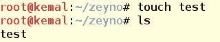

该命令不仅用于创建文本文件，你还可以用它更新现有文件的时间戳。

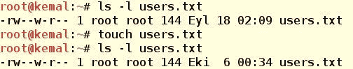

### cat

`cat` 命令用于从终端屏幕读取文件内容，也用于向文本文件写入内容。例如，要写入一个空 test 文件，让我们输入 `cat > test` 命令（注意 `>` 运算符的使用），输入我们想要的短语，并按 `CTRL + D` 结束文本。因此，我们在控制台上输入的内容将记录到我们的文件中。要读取文件内容，我们可以使用 `cat test` 命令。

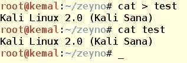

在上面的示例中，我们将文本写入了现有的文件中。即使没有名为 `test` 的文件，我们的命令也会创建一个文件并保存到指定短语的文件中。

如果你再次检查上面的示例，我们使用了 `>` 运算符，我们将其称为重定向运算符。该运算符用于重定向要生成的文件。该运算符有许多使用方式。给定的表达式、命令输出等可以重定向到文件，也可以将文件内容作为参数。

我们稍后会提供关于这些示例。现在我们只讨论 `>` 和 `>>` 运算符。要向现有的文本文件写入任何内容，文件必须是空白的。如果文件为空，它将删除旧内容并写入新内容。当然，这是使用 `>` 运算符的情况。如果我们使用 `>>` 运算符，在不删除文件内容的情况下，我们输入的短语将添加到文件的最后一行。让我们通过一些示例来解释我们的意思。

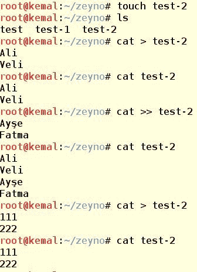

让我们解释一下我们在做什么：

- `touch test-2` 我们创建一个新的文本文件。
- `cat > test-2` 我们给出命令，然后输入我们想要的短语，最后按 `Ctrl + D` 结束。
- `cat test-2` 我们查看文件内容。
- `cat >> test-2` 我们写了一些新的短语，最后按 `CTRL + D` 结束文件。
- `cat test-2` 我们看到最后输入的内容添加到了文件内容中。
- `cat > test-2` (请注意，我们只使用了一次 `>`) 我们向文件中添加了新内容。
- `cat test-2` 当我们再次检查文件内容时，我们发现旧内容已被删除，我们输入的内容被最终写入了。

我们学习到可以使用 `cat` 命令读取文件内容。如果我们在使用 `cat` 命令时带有 `-A` 参数，文本中的制表符将以 `^|` 显示，行尾将以 `$` 显示。

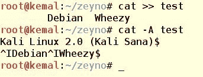

在想要查看内容的文本文件中将小写字母转换为大写字母，或者反之，我们可以结合使用 `cat` 和 `tr` 命令。例如，要将 test 文件中的小写字母转换为大写字母，可以使用 `cat test | tr 'a-z' 'A-Z'`。

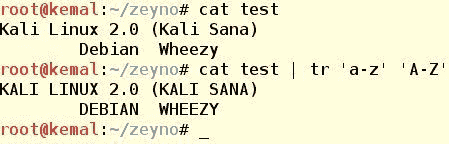

### 管道 (Piping)

在这里，我想简要介绍我们以后再次使用的 `|` 符号和管道（pipe）。如上面的示例所示，通过管道操作，一个命令的输出作为另一个命令的输入。当我们查看示例时，读取 test 文件的内容被作为输入传递给 `tr` 命令，而 `tr` 命令根据文件内容中所使用的参数进行转换。管道过程是通过 `"|"` 实现的。是的，让我们再次回到示例中。

我们讨论过可以使用 `cat` 命令在终端读取文本文件的内容。现在，例如，让我们用 `cat /etc/passwd` 命令查看 `passwd` 文件的内容。

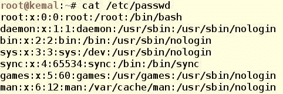

文件内容原样显示。如果我们想带行号查看内容，必须使用 `cat -n /etc/passwd` 命令。

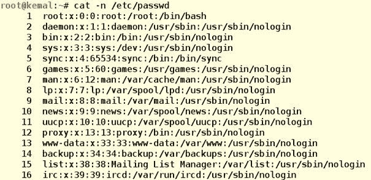

### echo

通常情况下，使用此命令，任何所需的语句将作为输出发送到终端屏幕。此外，它还可以用于创建文件并向其中写入任何字符串。现在让我们创建一个新文件和表达式，并让你们使用 `echo` 命令将其写入文件。

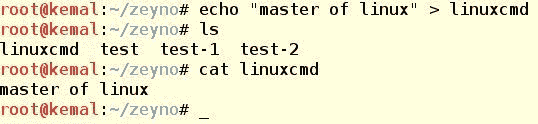

如你所看到的，通过 `echo "master of the linux" > linuxcmd` 命令，我们创建了之前不存在的 `linuxcmd` 文件并写入了 "master of linux"。之前存在的空文件也可以这种方式写入。但如果文件不是空的，我们就可以像之前在 `cat` 命令中那样使用 `>>` 操作符了。

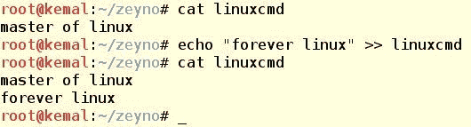

我提到过使用操作符命令输出重定向可以到一个文件。顺便，我们也来一个小例子。例如，将 `ls -l` 命令的输出重定向到我们创建的文件列表中。这意味着命令输出的内容被写入我们命名为 `list` 的文件中。要做到这一点，只需使用 `ls -l > list` 命令即可。

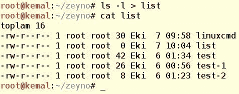

现在举例说明如何以另一种方式使用 `echo` 命令并获取附加信息。首先，让我们用 `ls` 命令查看我们所在目录的内容，然后使用 `echo *` 命令，检查两个命令的输出是否相同。

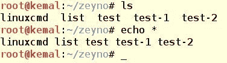

如你所见，两个命令的输出是相同的。原因是在启动 `echo` 命令 shell 之前，带有 `*` 字符的 `/zeyno` 目录下所有的文件索引名都会进入命令行并作为每一个参数传递给 `echo`。这意味着 `echo *` 命令屏幕上本应该出现星号（`*`），但并没有出现。所以这意味着星号字符没有作为参数发送给 `echo`。

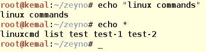

在稍作提醒之后，让我们继续其他示例。要打印当前目录下以大写字母 t 开头的文件名，可以使用 `echo t*` 命令。

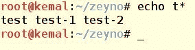

如果你想列出文件名以字母 d 结尾的文件，这次可以使用 `echo *d` 命令。

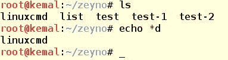

通过检查以下示例，找出为什么那样。作为你们的作业 😊

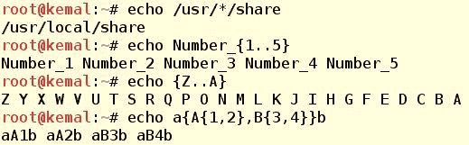

当使用终端命令时，如果该语句中的反引号（`` ` ``）之间有一个短语，它会被 shell 视为一个命令。例如，当给出 `echo ls` 命令时，自然地 `ls` 表达式（字符串）会打印在屏幕上。然而，如果你使用 `` echo `ls` `` 形式的命令，这时发送到终端的内容将被 shell 视为命令，并执行该命令在显示器上打印表达式输出（即：`ls` 命令输出中的所有字符串将作为参数传递给 `echo` 命令，因此这些语句也会被打印到屏幕上）。

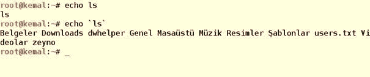

### more

从终端读取文本文件，我们可以使用的命令之一是 `more` 命令。该命令用于命令输出大于输出的情况，以便我们更舒适地阅读。例如，当我们给出 `more /etc/passwd` 命令时，较长的命令输出会出现在屏幕上，每次当你按回车键，它就会逐行继续。按空格键可以翻页。返回上一页使用 `b` 键。当我们想要退出时，可以按 `q` 键。

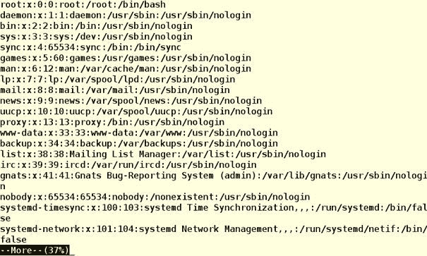

### less

再次，为了读取文件内容，你可以使用的另一个命令是 `less` 命令。使用此命令像 `more` 命令一样，我们显示长文件的输出以便于阅读。使用向上和向下方向键翻页。按空格键进入下一页，按 `b` 键回到上一页。退出如之前提到的使用 `q` 键。

### head-tail

在查看文件内容时，查看前十行使用 `head`，查看后十行使用 `tail` 命令。这些参数是如此，但如果你想查看特定的行数，必须用 `-n` 参数指定。例如，查看前五行使用 `head -n 5`，查看后五行可以使用 `tail -n 5` 命令。


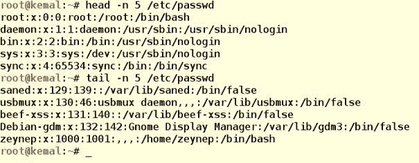

### tee

为了同时打印标准输出（即终端/控制台）并写入指定的文件，你必须使用`tee`命令。如果文件不存在，它将被创建并写入。写入完成后，按`Ctrl + D`退出以返回命令行。

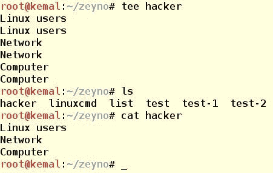

如你所见，首先通过`tee hacker`命令创建了名为`hacker`的文件，然后输我们在终端写入的表达式，同时也写入了文件。

### tac

为了从文件内容的结尾开始向前查看，我们可以使用`tac`命令。

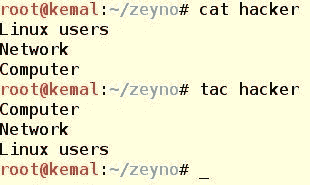

有一个有趣的命令是`rev`，它可以反转显示屏幕上的每一行内容。

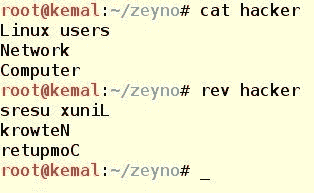

### sort

为了按照字母顺序将文本文件/文档的内容输出到终端，可以使用`sort`命令。如果使用`sort -r`，则会按字母反向顺序进行排序。

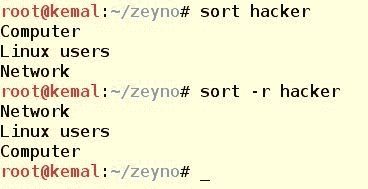

### wc

如果你知道文件的行数、字符数或单词数，可以使用`wc`（wordcount）命令。通过`-l`获取行数，通过`-c`获取字符数，通过`-w`参数获取单词数。如果在不带任何参数的情况下使用`wc`，它会显示所有统计。

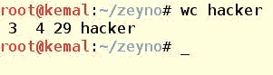

### nl

之前我们通过`cat -n`来对打印过程进行编号，现在也可以用`nl`命令来实现。例如，在对hacker文件进行行编号时，可以使用`nl hacker`命令。

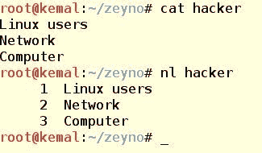

如果想对一个长行的文本文件进行编号，并同时查看开头的几行，可以使用`nl [TextFile] | head -n [number]`命令。

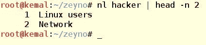

同样，如果要从最后提取几行，则使用`tail`命令代替`head`。

### pr

为了分割页面文档的内容，我们使用`pr`命令。例如，为了查看一个名为`list`的文件并分割其页面内容，可以使用`pr list`命令。因此，如果你对其进行打印，将获得更整齐的输出。

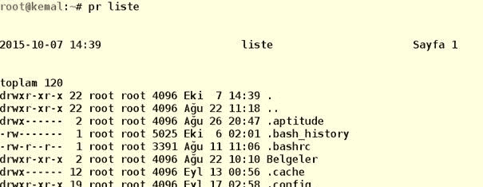

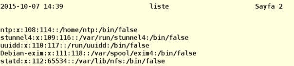

### paste

为了将两个或多个位于对应列的文件按空格合并，可以使用`paste`命令。例如，假设我们有两个名为`LISTA`和`LISTB`的文件。为了并列列出这些文件的行，可以使用`paste LISTA LISTB`命令。

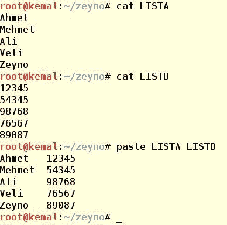

如果你愿意，可以合并这些文件的内容并重定向到新文件。例如，当我们使用`paste LIST LISTB > LISTC`命令时，两个文件的内容将并列显示，同时创建一个名为`LISTC`的新文件并保存。

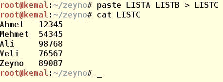

### grep

要在文件或命令输出中搜索表达式（字符串），可以使用`grep`命令。在看命令示例之前，让我们来看一些重要的参数。

- `-v`：反转命令行行为，列出**不包含**所寻单词的行。
- `-i`：搜索时不区分大小写。
- `-r`：在给定目录的子目录中搜索。
- `-n`：显示搜索词所在的行号。
- `-c`：指定索引表示你查找的单词出现的次数。
- `-l`：在合适的模板列列出文件名。

让我们举个简单的例子。例如，在`/etc/passwd`文件中，列出包含zeynep的行，可以使用`grep zeynep /etc/passwd`或`cat /etc/passwd | grep zeynep`命令。

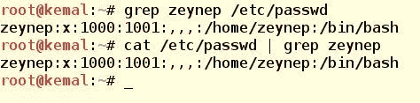

现在尝试`cat LIST | grep -ni ali`命令。通过这个命令：在`LIST`文件中，不区分大小写地搜索ali表达式并显示行号。

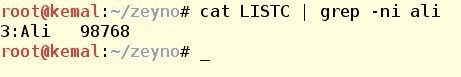

另一个例子让我们检查`grep -ri " .`命令。通过这个命令：递归地（包括子目录）在当前目录中，不区分大小写地搜索文件行。

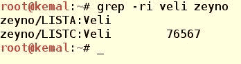

接下来的例子是`grep -c "ali" LIST`命令：在`LIST`文件中，我们学习ali出现了多少次。

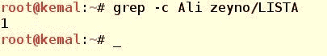

我们的最后一个例子，接下来的例子中我没有放整个屏幕图像：

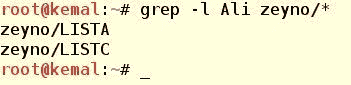

### cut

在要检查的文件中查看某些行，我们使用`cut`命令。例如，列出第1和第7字段：`cut -d ":" -f 1,7 /etc/passwd | head -n 5`

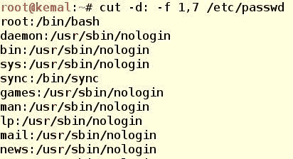

在这里，我们通过`-d`指定字段分隔符，可以使用管道符`|`。例如，通过`cat /passwd | cut -d ":" -f 1,7`可以获得相同的结果。

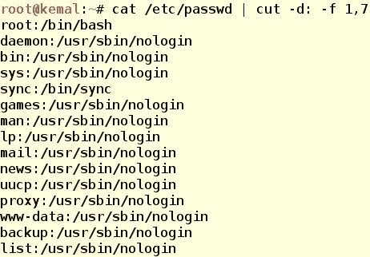

因为命令输出很长，我没有放整个屏幕。要在开头或结尾列出行，仍然可以使用`head`和`tail`命令。

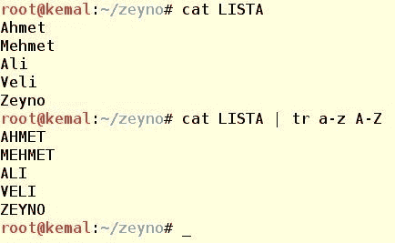

### tr

早些时候我们提到了`tr`命令，让我们来看几个例子。通过这个命令，我们可以对文件的字符进行更改。这些操作用于更改小写字母或反转并删除字符。例如，对于`LIST`文本文件，将小写字母转换为大写，可以使用`cat LIST | tr a-z A-Z`命令。

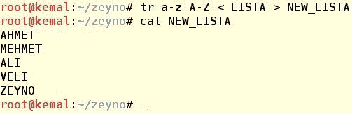

我们讨论过重定向运算符`>`和`>>`。除此之外，我们还有`<`运算符。与其他不同，这些运算符将文件作为输入。读取文件内容并启用相关操作。现在，让我们结合使用`tr`命令、`>`和`<`。例如，使用命令`tr a-z A-Z < LIST > NEW_LISTA`。

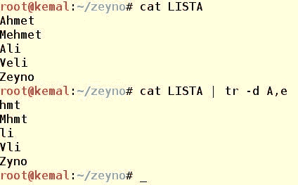

通过我们的命令，我们将`LIST`文件作为输入，将文本中的小写字母转换为大写创建`NEW_LISTA`文件并写入文件。如果配合`d`使用`tr`命令，指定的字符将被忽略。例如，当我们使用`cat LISTA | tr -d A,e`命令时，`LISTA`文件中的`A`和`e`字符将被忽略。

### cmp

我们可以比较文件的命令之一是`cmp`命令。例如，我使用`cmp hacker test`命令比较两个名为hacker和test的文件。结果中，它将显示文件之间的差异、首次差异发生的行号以及字节数。

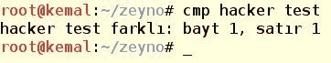

使用此命令有几个参数，但你可以通过尝试它们来查看`man cmp`。例如，当你使用`-l`参数时，每个差异的字节数以及不同的字节值将会被发送到标准输出（屏幕/终端）。

### diff

再次，这是一个用于比较文件的命令。如果比较两个文件，使用`diff`命令；如果比较三个文件，则应该使用`diff3`命令。例如，要再次查看hacker和test文件之间的差异，使用`diff hacker test`命令。

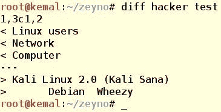

现在，使用`diff3 hacker test linuxcmd`命令比较两个文件，并查看hacker、test和linuxcmd之间的差异。

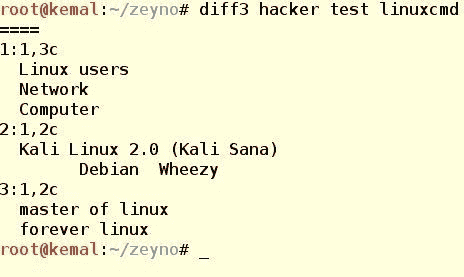

如果你在`diff`命令中使用`-y`，输出将并列显示在屏幕上。

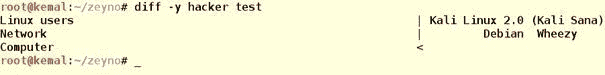

不仅是文件，`diff`命令也可以比较目录。例如，使用`diff -r zeyno /home`命令，递归地`-r`比较`zeyno`和`/home`目录并列出差异。

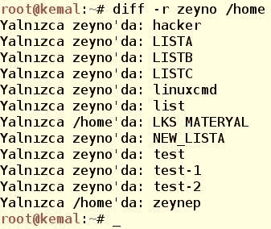

### find

有时，你只知道名称的一部分，但会有你不记得在哪个目录的文件和目录。为了找到这些文件并执行与其相关的各种操作，我们使用`find`命令。

使用模式的格式是`find [file_path] [search_phrase]`。因此，我们在第一个目录搜索中输入将要执行的操作，然后用`-name`定义搜索表达式。例如，要列出`/etc`目录下的conf文件，我们可以使用`find /etc -name *.conf`命令。

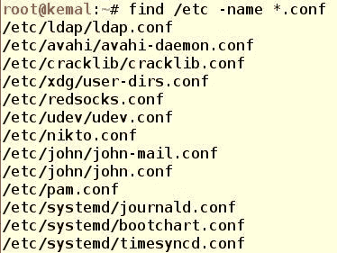

另一个例子是`find /etc -name *apache*`，我们在`/etc`目录下搜索包含apache单词的文件。

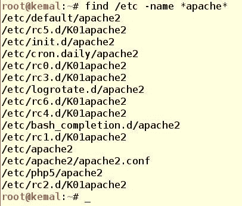

在进行搜索时可以使用一些参数来方便我们的工作，并帮助我们获得想要的结果：

- `perm 755`（访问权限为755的文件/目录）
- `-type f`（文件）
- `-type d`（目录）
- `-size +100k`（大于100 Kbytes的文件）
- `-ctime 3`（恰好在3天前修改的文件/目录）
- `-ctime -7`（在7天内更改时间较短的文件/目录）
- `-ctime +7`（在7天前更改时间较长的文件/目录）

#### 让我们举一些例子

例如，我们想让`find /root -type f -name '*.txt'`命令在工作目录下列出扩展名为txt的文件。工作目录是那时我们已经尝试进入`/root`的目录，而不是输入`/root`，我们可以使用`.`（点）来使用此命令。因为点标记了我们正在哪个目录中工作。

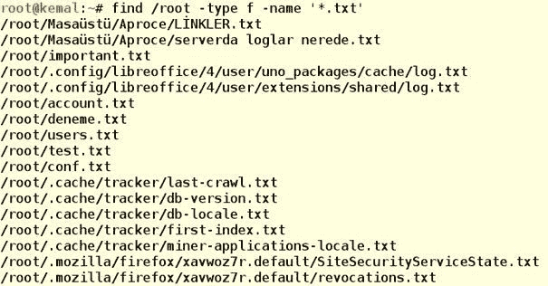

例如，通过`find . -name '*.jpg' -mtime +90 -print`，我们命令列出90天前修改过的jpg文件。


### exec

为了对文件执行各种操作，请在使用`find`命令时配合`exec`。

例如，使用`find /home/depo -name *.jpg`命令在depo文件夹中查找jpg文件。那个文件夹里有很多东西，因此一定有一些照片。

现在，让我们结合`-exec`使用`find`命令，并删除找到的jpg文件。为了实现这一点，我们必须使用`find /home/depo -name *.jpg -exec rm {} \;`命令。在命令中，包含`{}`的文件被放在这些括号中作为参数，`-exec`之后相应的执行指定的程序。让我们看看结果。


如你所见，因为jpg文件被删除了，当我们用`find`搜索时找不到它们了。

### xargs

另一个我们可以配合`find`命令使用的工具是`xargs`工具。`xargs`可以单独使用，也可以完成与`-exec`类似的工作。

现在，让我们结合`-exec`使用`find`命令，我们要删除它找到的jpg文件。为了实现这一点，我们必须使用`find /home/depo -name *.jpg -exec rm {} \;`命令。在命令中，包含`{}`的文件被放在这些括号中作为参数，`-exec`之后相应的执行指定的程序。让我们看看结果。


如你所见，因为jpg文件被删除了，当我们用`find`搜索时找不到它们了。


如你所见，因为 `jpg` 文件被删除了，当我们用 `find` 搜索时找不到它们了。

### xargs

另一个我们可以配合 `find` 命令使用的工具是 `xargs` 工具。`xargs` 可以单独使用，也可以完成与 `-exec` 类似的工作。

现在，让我们结合 `-exec` 使用 `find` 命令，我们要删除找到的 `jpg` 文件。为了实现这一点，我们必须使用 `find /home/depo -name *.jpg -exec rm {} \;` 命令。在命令中，包含 `{}` 的文件被放在这些括号中作为参数，`-exec` 之后相应的执行指定的程序。让我们看看结果。


如你所见，因为 `jpg` 文件被删除了，当我们用 `find` 搜索时找不到它们了。

# 16. 探索 Shell

## Shell

Shell 是一个命令解释器。它是用户与操作系统之间的接口。用户在 Shell 提示符上输入命令，操作系统执行该命令。作为命令语言解释器，Shell 的基本目的是将人类可读的命令转换为系统操作。Shell 是通过调用其他程序的特殊程序。Shell 在用户登录时启动。尽管有多种 Shell 如 `Bash`、`Korn`、`C Shell` 等，但 `Bash` 是 Linux 的默认 Shell。根据使用的 Shell，命令也有所不同。

### Shell Script

通常，我们在交互模式下使用 Shell，用户输入并获取输出。然而，有时我们会使用 Shell 脚本。脚本脚本是你编写的一系列命令。复杂的脚本会检查条件并运行循环。高级管理员使用 Shell 脚本自动化管理任务并监控系统。假设你想在调用程序之前检查磁盘空间、内存可用性和环境变量。有两种方法实现：你可以每次运行程序前手动输入所有命令，或者使用 Shell 脚本。Shell 脚本通常以 `.sh` 扩展。下图显示了 Shell 脚本的一个示例。


## Command line Interface

命令行界面 (`CLI`) 是访问 Shell 的方式。如果你安装 CentOS 时没有 GUI 或使用 Minimal 版本，你将只通过虚拟终端获得命令行界面。当你安装带有 GUI 的 Linux 时，你有两种方式访问 `CLI`：

*   虚拟终端

*   图形终端

### Virtual Terminals

虚拟终端是全屏命令行界面。如果你在本地上运行 CentOS 服务器，你将在同一台服务器上获得多个虚拟终端。多个虚拟终端允许管理员在需要时切换到另一个终端。即使安装了图形桌面环境，你仍然可以访问虚拟终端可以通过按下 `Ctrl+Alt+F2` 直到 `F6` 访问 CentOS 虚拟终端。返回图形界面，按下 `Ctrl+Alt+F1`。按下 `Ctrl+Alt+F2` 你将![00041.jpeg]获取像这样的虚拟终端

登录并开始输入命令

带有图形桌面环境的系统可以通过终端模拟器在 GUI 内部获取 `CLI`。终端允许你打开窗口并让你与 shell 交互。根据 Linux 发行版上安装的图形桌面环境不同，你有许多终端模拟器可用，如 `gnome-terminal`、`konsole`、`rxvt`、`xterm`、`LXterminal`、`guake`、`terminator`、`tilde`、`yakuake` 等。带有 GNOME 桌面环境的 CentOS Linux 的默认终端模拟器。要启动 Gnome terminal，按下“活动”（Activities）并点击终端图标。

## 命令提示符

虽然你可以自定义提示符，但通常你会在提示符末尾看到 `#` 或 `$`。其中 `#` 表示用户以 `root`（管理员）用户身份登录，而 `$` 提示符表示普通用户。你可以在提示符中显示额外信息，如用户名、当前目录和服务器名称，甚至可以显示当前日期和时间。

## 命令结构

通常，如果你从 shell 提示符运行命令，其格式如下：

`command –options <filename>`

示例 

`tail –f myfile`

然而，文件名并非用于所有命令。在某些命令中，只使用命令或命令和选项

`ls –la`

## bash shell 技巧

无论你是在虚拟终端还是使用终端模拟器，命令格式都是相同的。以下是你可以在日常任务中使用的 `bash` shell 的有用功能

### TAB 自动补全

TAB 自动补全是 `Bash` shell 最实用的功能之一。在输入部分命令、目录或文件名后按下 `TAB`，它具有预测命令、目录或文件名的能力。如果只有一个匹配选项，Shell 将自动补全单词，否则它将提供所有可能的补全。例如，假设你想切换目录到 `abc`，你输入 `cd ab` 并按 `TAB`，系统会自动补全该单词。

### Bash 历史

Shell 将你在 shell 中输入的命令保存在你主目录下的文件中。你可以通过输入 `history` 命令查看最后输入的命令。

```bash
$ history
```

如果你想再次执行上一个命令，可以按 `UP` 方向键然后按 `ENTER` 键。你可以反复按 `UP` 方向键在命令历史中向回滚动。

### 通配符

通配符或通配字符是 shell 命令中表示一个或多个字符的符号。最常用的通配符是 

*   `*` 星号

*   `?` 问号

*   `[ ]` 方括号

其中 

### 星号 (*)

代表零或多个字符

示例 

```bash
$ ls b*
```

列出所有以 `b` 开头的文件

### 问号 (?)

代表单个字符

示例

```bash
$ ls ?at
```

列出文件名第一个字母可以是任意字符的文件，如 `bat`、`cat` 或 `hat` 

### 方括号

表示字符范围

示例

```bash
ls b[1-5]
```

列出所有以 `b` 开头的文件，且第二个字符应该是从 1 到 5 的数字。它可以是 `b1`, `b2`, `b3`, `b4` 和 `b5`

### 检查当前 shell

```bash
# echo $SHELL
```

## 17. 归档与压缩

归档是将一组文件和目录收集并存储到一个文件中的过程，`Tar`、`cpio`、`zip` 和 `ar` 是执行此操作的实用程序示例。而压缩是使用数学压缩算法减小文件大小的过程。这对于互联网发送大文件非常有用。压缩工具的示例有 `gzip`、`bzip2`、`xz` 等。

### GZIP

通过 `gzip` 你可以压缩和解压缩单个文件。当你使用 `gzip` 命令压缩任何文件时，该文件将被扩展名为 `.gz` 文件替换，同时保持相同的权限模式、访问和修改时间。简单来说，你看不到原始文件，只有压缩后的文件。

### 语法

```bash
gzip filename
```

示例

```bash
gzip sysctl.conf
```

### 解压缩

使用 `gunzip` 命令解压缩文件。然而，此命令将删除压缩文件，你只会看到解压缩后的文件。

### 语法

```bash
gunzip filename
```

示例

```bash
gunzip sysctl.conf.gz
```

### BZIP2

`bzip` 使用名为 Burrows Wheel block sorting 的压缩算法压缩文件。与 `gzip` 类似，它会删除原始文件并创建一个相同名称加 `.bz2` 扩展名的压缩文件。每个压缩文件都具有相同的修改日期、权限，如果可能的话，与对应的原始文件具有相同的所有者

### 语法

```bash
bzip2 filename
```

示例

```bash
bzip2 sysctl.conf
```

### 解压缩

使用 `bunzip2` 解压缩用 `bzip2` 命令压缩的文件。默认情况下，如果存在同名文件则不会覆盖，除非你给出 `-f` 选项

### 语法

```bash
bunzip2 filename
```

示例

```bash
bunzip2 sysctl.conf.bz2
```

### XZ

`xz` 是 `lzma` 工具的继承者，它会自动为压缩文件添加 `.xz` 扩展名并删除原始文件。像 `bzip` 和 `gzip` 一样，它将保持相同的修改日期、权限，如果可能的话，与对应的原始文件具有相同的所有者

### 语法

```bash
xz filename
```

示例

```bash
xz sysctl.conf
```

### 解压缩

### 语法

```bash
unxz filename
```

示例

```bash
unxz sysctl.conf
```

### ZIP

`Zip` 是归档和压缩工具。它会自动为压缩文件添加 `.xz` 扩展名（注：原文此处可能有误，通常为 `.zip`）并删除原始文件。像 `bzip` 和 `gzip` 一样，它将保持相同的修改日期、权限，如果可能的话，与对应的原始文件具有相同的所有者

### 语法

```bash
zip filename
```

示例

```bash
zip file.. file.conf
```

你也可以配合通配符使用 `zip`

```bash
zip.zip s*
```

### 递归压缩文件（包含子目录）

### 语法

```bash
zip -r zipfile.zip directory
```

示例

```bash
zip -r abc.zip directory
```

### 查看压缩文件内容

### 语法

```bash
unzip -l zipfile.zip
```

示例

```bash
unzip -l asp.zip
```

### 解压缩

使用 `unzip` 命令解压缩文件

### 语法

```bash
unzip filename
```

### ar

表示字符范围 是不广为人知的 `rar` 的先身，`rar` 仍在使用。它仅用于归档

### 语法

```bash
ar -cv archive.ar files
```

示例

```bash
ar -cv archive.ar files
```

## 18. 如何创建基础脚本

正如我们在学习命令行界面时看到的，你通常是交互式地探索它的。这意味着你每次输入一个命令，以便看到每个命令的结果。

在我们开始本节之前，你可以先看看这个 [gif](http://www.compciv.org/files/images/cli/cli-grep-murder.gif)，它使用命令行探索莎士比亚剧本目录；统计数量

### 你的第一个 Shell 脚本

我们将从简单的东西开始。在某处创建一个垃圾目录，比如 `/tmp/my-playground`。你的实际工作空间不需要充斥测试代码。

Shell 脚本简单就是一个符合要求的文本文件。要创建它，我们将使用 `nano` 编辑器。

### Nano？

`nano` 是一个文本编辑器。它预装在几乎所有的 Linux 发行版中。新用户喜欢它主要是因为它的简单性，与其他命令行文本编辑器如 `emacs` 和 `vi/vim` 相比，它脱颖而出。它基本上包含许多其他有用功能，如行号、语法高亮和简单的搜索（等）。

输入 `nano hello.sh` 并运行

`Nano` 将打开并为你提供一个空文件进行编辑。现在，输入以下 shell 命令。

```bash
echo ‘hello world’
```

在键盘上，按下 `ctrl + x` 退出编辑器。当询问你是否要保存文件时，按下 `yes` (`y`)。

随后，`Nano` 将确认你是否要保存该文件。按下 `enter` 确认该操作。

现在使用以下命令运行脚本 `hello.sh`：

```bash
bash hello.sh
```

当你将其作为 `gif` 来看时，这些步骤看起来[如下](http://www.compciv.org/files/images/cli/cli-bash-script-hello-world.gif)。

[`bit.ly/2piclinux`](http://bit.ly/2piclinux)

因此，`hello.sh` 并不特别有趣，但它至少捕捉到了你想要执行的本质，即将一系列命令封装到一个文件中（即脚本），这样你就可以根据需要反复运行该脚本。这可以帮助你避免在重复输入入命令时可能出现的拼写错误，并允许该脚本在不同的场景下被复用。

## 在可复用的 Shell 脚本中使用参数

现在让我们尝试让 `hello.sh` 变得复杂一点。现在不再是重复输出 `hello world`，而是通过创建脚本让它对某个值（例如，人的名字）说“hello”。这会让脚本看起来更好一点。你可以这样使用它：

该 `gif` [如下所示](http://www.compciv.org/files/images/cli/cli-bash-hello-excitedly.gif)。

[`bit.ly/2linux5`](http://bit.ly/2linux5)

首先，你通过在“world”的位置添加一个变量来定制“hello world”。尝试在命令行中交互式地完成这一操作：

输出是：

`Hello Dan`

因此，这里的问题是，如何让脚本 `hello.sh` 读取你传递给它的参数（在本例中为人的名字）？

你通过一个特殊的 `bash` 变量来实现。你从命令行传递给脚本的第一、第二个和第三个参数分别由包含 `$1`、`$2`、`$3` 的变量表示。因此在上面的示例中，当 `hello.sh` 开始运行时，名字 `George` 将保存在变量 `$1` 中。

重新打开 `hello.sh` 并将代码更改为如下内容：

保存更改后，运行以下命令查看输出。


如果你希望输出以全大写形式返回，只需按如下修改 `hello.sh`，确保通过 `tr` 管道输出，以便将所有小写字母替换为大写字母。

现在如果你追求简洁，你可能会发现 `$yourname` 变量并不是必要的。代码将简化如下：

现在慢一点，我的朋友。如果你能创建一个脚本，你就可以这样执行：

……那么恭喜你，你学习了一个重要的概念。你刚刚学习了程序员如何将复杂的内容装进一个可以被单行运行的“容器”中。在我们开始做出某些决定之前，让我们看看如何使用一种被称为“变量”的功能来引用数据，这包括命令的输出或结果。

## 结论

感谢你读完《计算机黑客工具》，希望这些内容对你有所帮助，并能为你提供实现目标（无论目标为何）所需的所有工具。

下一步是遵循互联网上的不同示例来练习黑客技术。作为一名黑客，你需要记住最重要的的一点是遵守伦理。在攻击任何目标之前，务必尝试获得许可。

如果你想进一步精通黑客技术，我们还有另一个模块详细解释了其他黑客工具以及黑客所需的脚本知识。如果你能够很好地集中注意力而不偏离，黑客可以是一个很好的职业。这本书大致从最开始开始，即我安装 Linux Mint，一直讲到了无线黑客方法。
