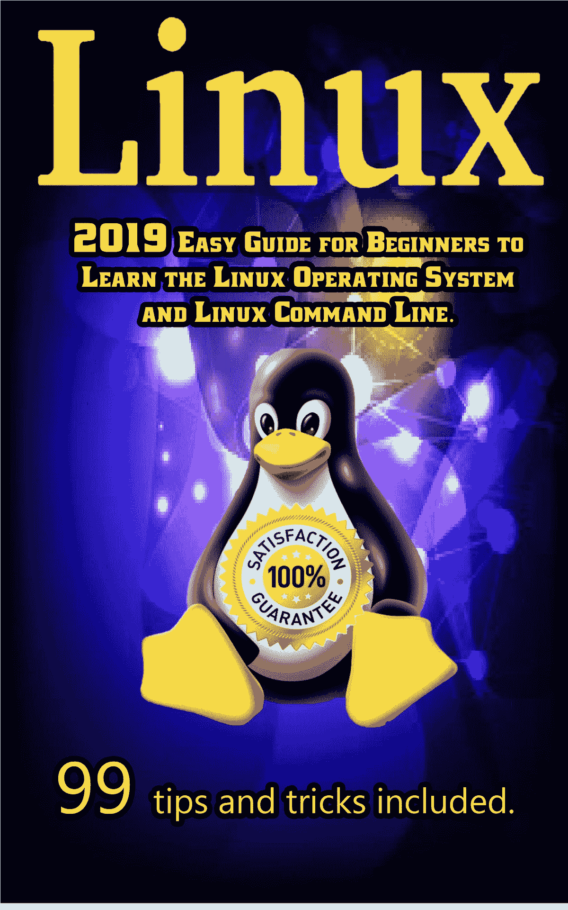
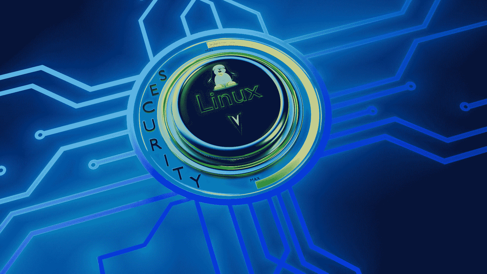
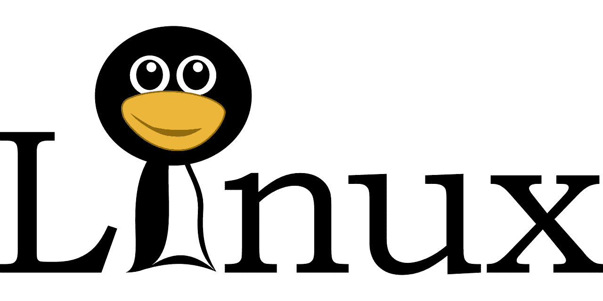

# Linux：2019 初学者指南，学习 Linux 操作系统和 Linux 命令行，包含 99 个技巧

## 介绍

对大多数人来说，Linux 代表着很多：一个带有复杂命令的糟糕系统，或者是一个专家使用的操作系统，但我们认为 Linux 应该是一个基础操作系统，就像 Windows 或 macOS X 一样。它允许你像在 Windows 下一样工作，但运行机制不同。

多年来，Windows 操作系统因为易于使用而比 Linux 更受青，但情况已不再如此。Linux 现在拥有一套美观、舒适且易于使用的图形界面，使其与 Windows 操作系统并平。它的命令更加简化，而且最新版本（发行版）进行了大量升级以提升用户体验。

尽管大多数人将 Linux 视为一个独立的操作系统，但从现实意义上说，Linux 几乎无不在。它的存在无处不在，几乎所有设备都在运行 Linux。从你的安卓 手机到智能冰箱，甚至包括军事使用的步枪。

Linux 通常被称为内核（kernel），它在操作系统中执行着各种功能。它的功能涉及处理底层工作，包括：内存管理、外围设备访问（硬盘、CD-ROM 读器、键盘、鼠标、显卡……）、网络管理、程序之间的微处理器时间共享（多任务处理）等。

与 Windows 强制性的 GUI（图形用户界面）不同，Linux 下有不同的图形界面，主要的有 Gnome、KDE 和 XFCE。你甚至可以在没有 GUI 的情况下运行 Linux，或者只在需要时启动 GUI。因此，通过 Linux，你对图形用户界面拥有完全的控制权，这对于喜欢折腾的用户来说非常有趣。

GNU 是为 Linux 内核引入了许多工具的项目，例如著名的 `GCC` 编译器以及数以千计的实用（`tar`、`tail`、`man`、`bash`……）。这些工具让用户获得了执行许多任务的许可，包括通过点击一或两个按钮而无需编写命令即可复制、格式化和删除系统文件。

这些与 Linux 内核相关的 GNU 工具组成了 Linux 操作系统。Linux 是免费的，不同的公司接管并决定根据自己的喜好打造一个操作系统。这些被称为发行版（distributions）。其中最著名的包括 RedHat、`Fedora`、`Mandriva`、`Debian`、`Slack`、Gentoo、Archros 等……此外，该平台赋予了用户选择软件的自由。这包括对命令以及界面的选择。意料之的是，这一特征让困于默认设置的 Windows 用户感到惊喜。幸运的是，Linux 拥有许多 Windows 用户应该探索的优势。首先，崩溃的概率较低且支持多任务处理。通过这一点，你可以同时运行多个程序而不会遇到任何问题。Linux 发行版（称为 distros）是 Linux 操作系统的版本，带有安装程序和管理工具，就像我们 Windows 7、8 和 10 一样。带有内核设计的 Linux 发行版比大多数使用命令的开源 Linux 更容易操作。这种发行版消除了用户在执行操作之前编译现有代码的需求。随着时间的推移，更多的发行版由供应商开发，每种都带来了新功能。目前，有数千个发行版供选择，包括 Ubuntu、Debian、Fedora 和 Slack。

市场上有百万个发行版，人们很容易对选择哪种发行版感到困惑。对于任何开始学习 Linux 的人来说，考虑价格和取向是非常重要的。

- **取向**：例如，RedHat 高度倾向于企业级服务器（数据库、Web 服务器……），Mandriva 和 Ubuntu 更多面向办公用户和互联网用户，Phonix 设计为直接从 USB 闪盘启动等。
- **它们的“制造”方式**：例如，RedHat 由大公司设计，而 Debian 的设计更具民主（互联网用户的参与）。
- **价格**：有些是付费的（RedHat、Mandriva……），其他是免费的（Fedora、Debian……）。注意，你可能需要为免费发行版支付费用，但价格仅用于支付支持（CD）、运费和任何纸质说明书。没有任何阻止你自己下载并刻录它们。

在选择软件时，很难定论。这完全取决于你的水平以及你想用它做什么。为了知道哪一个更好，我鼓励你下载各种发行版进行测试，并找到你最喜欢的一个。如果你不知道从何开始，推荐以下几个：

- `Kali`（如果你不想在磁盘上安装任何东西）。这个版本的 Linux 直接从 CD 启动，不向磁盘写入任何内容。磁盘安装是必要的。Ubuntu 是一个很棒的发行版，可以像 `Kali` 那样使用（不安装任何东西），也可以安装在磁盘上。它的界面非常简洁且易于使用。安装后，只需点击几次即可访问数百个额外的软件。如果你想在电脑上安装 Linux，这就是首选发行版。有些是这些发行版的衍生版本。例如，Kali 是源自 Debian 的发行版，Morphix 是派自 Kali 的等。Ubuntu 是最流行的 Linux 发行版。Linux 由 Linus Torvalds 创建，目的是为了应对那些大多价格过高的大型系统。GNU 项目也出于类似的动机启动（GNU 的意思是“GNU 不是 Unix”）。Linux 被认为是一个免费的操作系统，这意味着你可以自由地使用、修改和重新发布（Unix、Windows 或 MacOS 则不是这样）。这些 Unix 今日仍然存在并仍在售：HP-UX（惠尔-帕奇 Unix）、AIX（IBM Unix）、Solaris（Sun Unix）、IRIX（Silicon Graphics 的 Unix）……Unix 是一个注册商标，任何想要创建 Unix 的公司必须遵循许多严格的规则。凭借其免费、开源和高性能，Linux 与其他 Unix 相比日益受欢迎。即使是那些开发自己 Unix 的大公司也开始了！（如 IBM、Sun、HP……）。Linux 和 Windows 并不打算重启另一个“我的系统比你的好”的争论。Linux 和 Windows 系统之间的竞争就像 iPhone 和三星 Galaxy 版本之间的争论。它们无法消失，用户也永远不会厌倦更多。这些竞争让每个制造商都推出了改进的版本，这真正塑造了用户体验。在这里，我们不想批评或加冕某个胜者。因为从实际意义上说，两者都有自己的用途。没有哪个版本是完美的。都有自己的优缺点。然而，最好的取决于用户以及你打算如何使用。另一方面，我想提供一些可以帮助你在 Linux 和 Windows 之间做出决定的元素。“决定”也是一个很大的词，因为没有什么能阻止你在电脑上安装两个并在之间切换！但是，必须强调的是 Linux 需要比 Windows 更多的时间。如果你准备好花时间，学习 Linux 是非常有成就感的，它不仅让你理解正在发生什么（如果你愿意的话），最重要的是能完全按照你想做的。对于像 Ubuntu 或 Archros 这样的发行版，如果你不想，就不必动手。

## 第 1 章 – Linux 文件系统

### FDI
`/dev/hdb8` 是第 2 个 IDE 硬盘和第 8 个逻辑分区。

### SCSI and ZIPE
`/dev/sda1` 是第一个 SCSI 硬盘和第一个分区。

### FLOPPY
`/dev/fd0` 是第一个软盘驱动器 (A: )。一张 3 1/2 英高密度软盘上的块数为 1440。在挂载之前，必须对软盘进行格式化处理。

### NULL
`/dev/null` 是垃圾桶，倒入其中的文件将无法找回。

### CD-ROM

`/dev/cdrom`。`/dev/cdrom` 文件与 `/dev/cdrom0` 设备名称之间存在一个符号链接。可移动光驱器被挂载为外部硬盘。你首先需要使用 `fdisk` 对磁盘进行分区，然后使用 `mk2fs` 创建分区表并安装文件系统，然后你需要使用 `mkdir` 创建挂载点并使用 `mount` 挂载分区。最后，在 `/etc/fstab` 文件中添加一行，以便设备在每次启动时自动挂载。

### 访问权限
权限（Access rights or permissions）允许某些用户或用户组限制对某些文件或目录的访问。共有三种访问权限：
- `read (r)`：用于读取文件的访问权限（允许打印、显示和复制文件，并允许遍历目录或显示目录中的文件）
- `write (w)`：用于写入文件的权限（允许修改文件，并允许删除文件或在目录中保存文件）
- `execute (x)`：执行文件的可能性（允许执行程序、可执行文件，并允许访问目录文件的管理信息，如 inode、权限表等）

对于每个文件，权限针对三类用户进行设置：
- `user (u)`：文件的所有者
- `group (g)`：拥有该文件的组
- `all (a)`：所有用户

查看当前目录下所有文件的权限：`ls -la`

访问权限也可以以八进制形式表示，即使用 0 到 7 的数字（仅需 3 位即可设置所有可能性）。每种权限（`r`、`w`、`x`）对应一个八进制值（`4`、`2`、`1`），八进制值按每个用户进行累加（u, g, o）。对于每个用户（u, g, o），八进制值可以取 0, 1, 2, 3, 4, 5 和 6。例如，所有类型权限（`rwx rwx`）的组合相当于八进制值 `777`。
- `0`：意味着无权限
- `1`：执行权限（`--x`）
- `2`：写入权限（`-w-`）
- `3`：对应执行和写入权限（`-wx`）
- `4`：对应读取权限（`r--`）
- `5`：读取和执行权限（`rx-`）
- `6`：对应读取和写入权限（`rw-`）
- `7`：读取、写入和执行权限（`rwx`）

例如：
- `666`：赋予所有人读写权限
- `64`：赋予所有人权限
- `700`：赋予文件所有者权限

当设置了特殊权限（`s` 和 `t`）时，八进制数可以是四。

### 文件命名规则
旧版 Unix 限制为 14 个字符，但现在处理的长文件名为 1 到 255 个字符。禁止使用斜杠 `/`，因为它是树中的目录分隔符并代表根目录（树的顶部）。以点开头的文件是隐藏文件或隐藏文件，在不使用 `-a` 选项的情况下，`ls` 命令默认不会显示它们，大多数命令除非明确提到，否则不会考虑它们。双点 `..` 标识父目录，点 `.` 标识当前目录或工作目录。这两个文件存在于所有目录中。因此，由于指针已经存在，无法以单个点或两个点命名文件（在同一目录下不能有两个同名文件，且无法删除指向当前目录或父目录的指针）。

## 第 2 章 – Linux 优势

从计算机新手那里，我们经常听到“Linux 很复杂”或“Linux 是极客的东西”。当然，也有只有热情的专家才能操作的 Linux 发行版；也有一些是专门为大众设计的：Linux Mint、Ubuntu 及其衍生版本。你会发现 GNU Linux 非常易用，而且比大多数人认为的要友好得多。

使用 Linux 的优势是什么？亲手操作这款软件，你就是主机的主人。除非你明确要求，否则 Linux 完全不会做任何事情，不像由系统决定一切而非用户的专有系统。你不需要被强制安装你不想要的东西，也不会强加给你一个完全全新的系统。嗯，从开始你可能什么都不需要安装的；一个月没有病毒，没有锁定，简而言之没有臃肿软件。在使用 Windows 多年后，Linux 赋予的自由可能会令人敬畏。然而，应该理解的是 Linux 允许你操纵自己的操作系统，根据你的喜味对其进行布局，就像它赋予你做任何事情的权利一样。

### 安全与效率
即使某些发行版很复杂，也有一些非常适合初者的 Linux 发行版。一切的设计都是为了让初者的生活更简单。这意味着你不需要硕士学位就能操作 Linux。此外，Linux 提供了一个在技术和人性上都可靠的环境。当你第一次安装发行版时，最引人注目的是它朴素的外观。通常，桌面上只有两个图标：“工作区”和一个个人文件夹。甚至垃圾桶都没有！这看起来很简陋，但它也是 Linux 体验的象征：简单以及根据需要添加东西的选择。当你穿过界面时，这种简单性一而易见。与 Windows 不同，大多数尚未精通系统的人浪费时间安装无用软件并禁用强制执行的功能；在 Linux 下，你不需要做这些。不需要卸载一堆无用的软件。相反，你自己选择要添加的软件。准确地说，从软件库的成千上万软件中选择并安装软件没有什么都更容易了。不需要浪费时间在网上搜索所需的应用程序，这些程序很容易包含病毒或损坏你的系统文件。Linux 最具说服力的特征之一，而且很重要，是安装软件后不需要重启。更新时也可以立即生效而无需重启系统。与 Windows 更新的缓慢沉重相比，这简直是一股清风。

### 安全
在 Linux 上不需要防病毒软件。这听起来如此但事实如此，因为这个操作系统的构建目标就是尽可能安全，它是类 Unix 系统（Linux、BSD）基因中的一部分。安全性与系统的其他组件同样重要。尽管如此，大多数计算机操作人员不得不对 Linux 的安全构建给出解释。另一方面，购买以 Linux 作为默认系统的 PC 是稀奇的。当你第一次启动新电脑时，你甚至不会考虑将启动什么样的操作系统。你唯一关注的是 PC 启动了并且你可以使用它。然而，如果你的电脑是 Linux 操作系统，只需启动 PC 并使用它即可。总结一下，轻松安装 Linux 的最好方法是让这个程序成为硬盘上唯一的系统。大多数人会告诉你你可以和 Windows 一起安装 Linux。我们不是在争论在此过程中是否会遇到一两个问题。如今，Linux 通常以发行版的形式出现，可以放在 DVD 或 USB 闪存盘上。这种发行版通常可以从相应发行版的官方网站免费下载。虽然寻找软件很容易，但最大的挑战是选择最适合你电脑的发行版。如果你直接在搜索中提问“应该选择哪个 Linux 发行版？”然后阅读网站的回应，你很快就会陷入困惑，无法得到预期的正确答案。遗憾的是，我们无法帮你决定最适合你的发行版，因为我们不知道你使用的电脑类型，也无法解读每个人的需求。然而，我建议你测试一些流行的发行版，以决定哪种方案最适合你。这个列表将非常有争议性，而且对其他人来说肯定不同。尽管 Linux 社区努力为你提供最好的产品，遗憾的是，它并不总是有机会从计算机组件制造商那里获得所有必要信息来开发配套这些组件的驱动程序，在少数情况下，选定的发行版与你的电脑部分兼容。例如，对于未识别的 WIFI 卡或最近开发的显卡，可能不存在驱动让它们正常工作。

## 第 3 章 – 如何安装

默认情况下，大多数时候当你购买电脑时已经安装了操作系统。这通常是 Windows。也可以选择 Mac OS。另一方面，购买以 Linux 作为默认系统的 PC 是稀奇的。当你第一次启动新电脑时，你甚至不会考虑将启动什么样的操作系统。你唯一关注的是 PC 启动了并且你可以使用它。然而，如果你的电脑是 Linux 操作系统，只需启动 PC 并使用它即可。以单个点或两个点命名文件，由于指针已经存在（在同一目录下不能有两个同名文件，且无法删除指向当前目录或父目录的指针）。

### 新版本
在 Linux 下，一切的设计都是为了让初者的生活更简单。这意味着你不需要硕士学位就能操作 Linux。此外，Linux 提供了一个在技术和人性上都可靠的环境。当你第一次安装发行版时，最引人注目的是它朴素的外观。通常，桌面上只有两个图标：“工作区”和一个个人文件夹。甚至垃圾桶都没有！这看起来很简陋，但它也是 Linux 体验的象征：简单以及根据需要添加东西的选择。当你穿过界面时，这种简单性一而易见。与 Windows 不同，大多数尚未精通系统的人浪费时间安装无用软件并禁用强制执行的功能；在 Linux 下，你不需要做这些。不需要卸载一堆无用的软件。相反，你自己选择要添加的软件。准确地说，从软件库的成千上万软件中选择并安装软件没有什么都更容易了。不需要浪费时间在网上搜索所需的应用程序，这些程序很容易包含病毒或损坏你的系统文件。Linux 最具说服力的特征之一，而且很重要，是安装软件后不需要重启。更新时也可以立即生效而无需重启系统。与 Windows 更新的缓慢沉重相比，这简直是一股清风。

### 安全
在 Linux 上不需要防病毒软件。这听起来如此但事实如此，因为这个操作系统的构建目标就是尽可能安全，它是类 Unix 系统（Linux、BSD）基因中的一部分。安全性与系统的其他组件同样重要。尽管如此，大多数计算机操作人员不得不对 Linux 的安全构建给出解释。另一方面，购买以 Linux 作为默认系统的 PC 是稀奇的。当你第一次启动新电脑时，你甚至不会考虑将启动什么样的操作系统。你唯一关注的是 PC 启动了并且你可以使用它。然而，如果你的电脑是 Linux 操作系统，只需启动 PC 并使用它即可。总结一下，轻松安装 Linux 的最好方法是让这个程序成为硬盘上唯一的系统。大多数人会告诉你你可以和 Windows 一起安装 Linux。我们不是在争论在此过程中是否会遇到一两个问题。如今，Linux 通常以发行版的形式出现，可以放在 DVD 或 USB 闪存盘上。这种发行版通常可以从相应发行版的官方网站免费下载。虽然寻找软件很容易，但最大的挑战是选择最适合你电脑的发行版。如果你直接在搜索中提问“应该选择哪个 Linux 发行版？”然后阅读网站的回应，你很快就会陷入困惑，无法得到预期的正确答案。遗憾的是，我们无法帮你决定最适合你的发行版，因为我们不知道你使用的电脑类型，也无法解读每个人的需求。然而，我建议你测试一些流行的发行版，以决定哪种方案最适合你。这个列表将非常有争议性，而且对其他人来说肯定不同。尽管 Linux 社区努力为你提供最好的产品，遗憾的是，它并不总是有机会从计算机组件制造商那里获得所有必要信息来开发配套这些组件的驱动程序，在少数情况下，选定的发行版与你的电脑部分兼容。例如，对于未识别的 WIFI 卡或最近开发的显卡，可能不存在驱动让它们正常工作。

## 选择你想要使用的 Linux 发行版

* 必须首先安装 ISO 镜像
* 一旦下载了 ISO 镜像，通常可以在硬盘的“下载”（Download）目录中找到它。
* 将 Linux 放入 USB 优盘或 DVD
* 现在我们需要将此镜像置到 DVD 或 USB 优盘上。

根据 32 位或 64 位的选择，互联网上有多种免费工具可用于制作 USB 优盘或 DVD。UnetBootIn 可能适用于 32 位系统，而 Rufus 或其他发行版工具适用于 64 位发行版。

* 接下来，你将需要刻录 ISO 镜像并将你想要的发行版放入 USB 优盘。
* 只要我们的 USB 优盘或 DVD 准备就绪，你就可以指示电脑启动安装程序。

对于旧电脑，这是通过更改 bios 中的参数来实现；对于较新的电脑，这是在启动 PC 时按下键盘上的某个键来实现。

## 安装 Linux
一旦你进入所选发行版的界面，就可以找到一个用于在硬盘上安装 Linux 的图标。注意，在安装之前你应该知道，在整个硬盘上安装 Linux 会**删除**磁盘上的所有数据。因此，要么你的电脑是专门为安装 Linux 准备，要么你对磁盘进行了完整备份。坦率地说，所有发行版的安装过程都是相同的。唯一的区别在于 Linux Mint，在那种情况下你需要安装之前清除磁盘。

## 第 4 章 – Linux 特性、组件与架构

Linux 操作系统是一种免费、易用且快速的操作系统。它驱动着全球的服务器和笔记本电脑，Linux 操作系统具有许多特性，其中突出的特性包括：

### 可移植性
Linux 程序可以安装在任何硬件上；这并不一定取决于它的大小；这意味着它的软件可以在不同类型的硬件上以相同的方式运行。Linux 内核和其他应用程序都支持其安装。

### 免费可用
Linux 源代码是开源的，是一个基于社区开发的项目。Linux 仍在演进中，多个团队正在协作以增强其功能。

### 通信
该操作系统具有与其他用户通信的完美功能。用户可以通过这些网络在两个或多个计算机网络之间或在单个中心系统的网络内轻松交换程序、邮件或数据。

### 为多用户设计
Linux 操作系统是一个多用户操作系统，多个用户可以同时访问系统资源，如 RAM、应用程序甚至内存。

### 多任务处理
Linux 操作系统可以同时运行多个应用程序，并且它将保持活动状态。

### 安全可靠
无需担心使用 Linux 操作系统，因为它通过身份验证功能为用户提供安全性，例如数据加密、密码保护和对特定文件的受控访问。Linux 用于安全性的三个概念是：
* **身份验证**（Authentication）：这是关于声称某人的身份，并为该用户分配密码和登录名以便于访问。
* **授权**（Authorization）：Linux 为用户发布访问限制，每个文件都有读、写和执行权限，由操作系统决定谁可以访问、修改和执行此类文件。
* **加密**（Encryption）：这是关于将一个文件编码为不可读的格式，操作系统通过这样做帮助保持用户文件和秘密的安全。

## Shell
它提供了一个出色的解释器程序，可执行 Linux 操作系统的命令。此外，它还可以用于执行其他类型的操作并调用应用程序。

### 提供组织良好的系统
Linux 操作系统提供了一个对系统文件组织完美的系统。

### 支持自定义
Linux 操作系统在全球范围内使用，因此提供多种语言版本。

### 支持安装
此操作系统有自己的仓库，用户只需通过 Shell 或终端即可轻松下载并安装应用程序。

### USB 和 CD 特性
Linux 发行版具有 USB 和 CD 选项，用户可以在不安装的情况下运行 Linux。

### 具有图形用户界面
Linux 操作系统不仅有命令行，还有软件包可以使整个界面图形化。

## Linux 操作系统的组件和架构
Linux 系统的核心组件包括以下内容：

### 内核（Kernel）
内核可以认为是与硬件直接通信的系统核心组件。内核帮助系统资源（如磁盘、外部设备、处理器和内存）分配给在计算机上运行的程序。内核有助于每个程序相互分离，这样当程序遇到错误时，其他程序就不会受到影响。虽然用户不需要担心内核，但记录显示某些版本的内核在特定的硬件或软件上运行更好。

### 守护进程（Daemons）
守护进程是 Linux 系统的另一个出色的组件；它们被称为 Daemons，因为它们对用户通常是不可见的并且静默运行。它们帮助处理如下进程：
* 响应连接的 USB 设备
* 为用户配置网络连接
* 管理文件系统
* 以及管理用户登录。

## Shell
Shell（又称为命令行）实现了一种文本接口，允许用户通过从键盘输入命令来运行程序并控制系统。如果没有 Shell 或桌面环境的帮助，要让一个系统完成大部分工作将是具有挑战性的。Linux 有多种 Shell，每种 Shell 具有不同的特性。某些 Linux 系统使用 `bash`（即 Bourne again shell），且 Linux Shell 支持多任务处理，可以同时运行多个程序。

## 设备即文件
由于系统可以对文件进行读和写操作，计算机也可以发送和接收数据，因此，Linux 操作系统现在将连接到系统的设备表示为目录中的文件。事实仍然是，这些文件无法被移动或重命名，而且它们并不存储在任何磁盘上。这完全与应用程序有关。

## X 窗口服务器
窗口服务器组件是命令行 Shell 的图形化替代方案。它有助于绘制图形，并能够处理来自鼠标、键盘、平板电脑和其他设备的输入。该组件是网络透明的，这意味着它允许你在图形化环境中工作，该环境可以在你的个人计算机上，也可以通过网络连接到另一台远程计算机上。今天最常用的 X 服务器是 `X.org`。许多图形化程序都需要 X 服务器才能运行，这意味着它们可以与任何桌面环境或窗口管理器配合。

## 窗口管理器
窗口管理器组件是一个帮助与 X 服务器通信的程序。它的真实职责是管理窗口。该组件有助于在窗口被点击时将其置到最前、绘制窗口框、隐藏窗口以最小化其程序，以及在屏幕上移动窗口。目前流行的窗口管理器程序包括 Compiz fusion、Xfwm、KWin 和 Metacity。

## 文件系统
文件系统是 Linux 操作系统的另一个核心组件。这些是基于 Linux 的发行版使用的几种文件系统。这些文件包括 `squashFS`、`BTRFS`、`NIFS`、`VFS` 和 `EXT3/4`。

计算机的硬盘有一个简单的接口，它只接受诸如添加块号并将其放入内存地址之类的命令。现在，如果想编辑一段文本并希望将其保存到磁盘中，那么使用块号来识别如文本所需的数据片段将非常笨拙。问题在于首先要使用原始块号告诉你的程序将文件保存在，而且你必须确保这些块没有被用于存储其他文件，如音乐收藏、家庭照片或可能是你的系统内核。

为了解决这个问题，引入了文件系统。这些文件被组织成称为目录的组。每个文件通常通过路径来识别，路径解释了它在层次结构中的位置。因此在 Linux 中，我们有根目录，它是顶层目录。根目录始终只有少量的子目录。这些：

*   `Bin`
*   `Home`
*   `Media`
*   `Tmp`
*   `Var`
*   以及 `bin`

## Linux 体系
Linux 操作系统在四层上正常工作，包括：

*   硬件
*   内核
*   shell
*   以及应用程序

## Applications/utilities

应用程序
这些是在 shell 中运行的实用程序。它们由任何应用程序组成，包括文本编辑器、网络浏览器、媒体播放器等。

**Shell**：这是一个接口，负责接收用户输入并向 `Kernel`（内核）发送指令。Shell 再次接收内核的输出，并将结果传回输出 shell。

**Hardware（硬件）**：硬件由连接到系统的所有物理设备组成，包括 `RAM`、`CPU`、硬盘、主板等许多。

**Kernel（内核）**：这类似于任何操作系统的核心组件，直接与硬件交互。

## 第 5 章 – Linux 与其他操作系统的对比

尽管 Linux 操作系统可以轻松在同一台机器上与其他操作系统共存，但它与其他操作系统（如 `windows OS/2`、`Windows 95/98`、`Windows NT` 以及其他个人电脑 UNIX 实现）之间仍然存在差异。我们可以通过以下几点来对比 Linux 和其他操作系统。

### Linux 是 UNIX 的版本
`Window NT` 和 `window OS/2` 可以说像 Linux 一样都是多任务操作系统。从技术角度来看，`Windows NT` 和 `window OS/2` 在网络、相同的用户界面、安全性等功能方面非常相似，但并没有像 Linux 这样的一个 UNIX 版本。因此，这里的区别在于 Linux 是 UNIX 的版本，并因此受益于整个 UNIX 社区的贡献。

###充分利用 X86 处理器
众所周知，像 `windows 95/96` 这样的 Windows 无法充分利用 `X86 processor` 的功能，但 Linux 操作系统完全运行在该处理器的保护模式下，并探索其中所有的功能，包括多处理器功能。

### Linux 操作系统是免费的
其他操作系统都是商业操作系统，尽管 Windows 稍微便宜一些。对于大多数个人电脑用户来说，这些其他操作系统的成本非常高。某些商业操作系统的费用高达 1000 美元，而 Linux 是免费的。Linux 软件是免费的，因为一旦访问互联网或其他计算机网络，就可以免费下载安装。另一个很好的选择是，从已经安装该软件的朋友系统中复制 Linux OS。

### 运行完整的 UNIX 系统
与其他操作系统不同，你可以在家里使用 Linux 运行完整的 UNIX 系统，而无需为个人电脑支付其他 Unix 实现的高昂费用。此外，还有工具可以使 Linux 与 Windows 交互，因此从 Linux 访问 Windows 文件变得非常简单。

### Linux OS 的功能比 Windows NT 多
尽管个人电脑领域仍有更先进的操作系统崛起，例如目前因为服务器计算而流行的 `Microsoft Windows NT`，但它无法像 Linux OS 那样从 UNIX 社区的贡献中获益。此外，`Windows NT` 是一个专有系统，其界面和设计由一家公司（微软）所有并控制，因此只有该公司或微软可能会实现该设计，因此在很长一段时间内可能没有免费版本。

### Linux OS 更加稳定
尽管 Linux 和 `Windows NT` 等其他操作系统正在争夺服务器计算市场的公平份额。`Windows NT` 背后只有微软营销机器的全力支持，但 Linux 操作系统拥有一个由成千上万开发者组成的社区的帮助，这些开发者通过开源模型真正帮助了 Linux 的进步。从这一对比来看，说明每个操作系统都有其优缺点，但 Linux 比其他操作系统更出色，因为其他操作系统很容易崩溃且经常发生崩溃，特别是 `Windows NT`，而 Linux 机器更稳定，可以持续运行长时间。

### Linux 的网络性能优于其他
在网络性能方面，可以认为 Linux OS 显著更好，尽管 Linux 可能比 `Windows NT` 小，但它具有更好的性能，并能与其他操作系统进行良好竞争。

### Linux 与其他 UNIX 配合更好
与无法与其他 UNIX 实现协作的其他操作系统不同，Linux 通过开源模型支持广泛的硬件、声音、图形等。

### 启动与命名
从主分区启动 Linux 是事实上的标准（它可以从其他操作系统的任何分区启动）。在 Linux 中，主分区被称为 `rootFS`。在 Windows 中，启动文件必须位于在主分区上。

### Linux OS 是可定制的
操作系统可以根据用户需要进行定制，例如，可以更改桌面环境。在 Windows 中，界面是由公司固定的的。

### Linux 命令
Linux 命令行非常强大。你可以使用各种命令来快速完成任务。

- `ls`: 列出目录中的文件。你可以使用 `ls -a` 查看隐藏文件，或使用 `ls -l` 查看详细信息。
- `cd`: 切换目录。例如，`cd /var/log` 进入日志目录。`cd ..` 返回上一级，`cd ~` 回到主目录。
- `pwd`: 打印当前工作目录。
- `clear`: 清除终端屏幕。快捷键 `Ctrl+l` 具有相同功能。
- `Ctrl+d`: 注销或退出当前的 shell 会话。
- `Ctrl+s`: 停止显示（经常意外按下）。使用 `Ctrl+q` 恢复显示。
- `Ctrl+k`: 删除光标后的所有文本。`Ctrl+u` 删除光标到行首的命令。
- `Ctrl+y`: 粘贴用 `Ctrl+k` 或 `Ctrl+u` 删除的文本。
- `Ctrl+r`: 在历史中搜索之前的命令。
- `history`: 显示之前执行的命令列表。
- `man`: 显示命令的帮助页。例如，`man ls`。
- `grep`: 在文本或文件中搜索模式。
- `sudo`: 以超级用户权限运行命令。
- `chmod`: 修改文件权限。
- `cp`: 复制文件和目录。
- `mv`: 移动或重命名文件和目录。
- `rm`: 删除文件或目录。使用 `rm -rf` 进行递归删除。
- `touch`: 创建新文件或更新时间戳。
- `cat`: 显示文件内容。
- `nano` 或 `vi`: 终端的简单和高级文本编辑器。

Linux 命令行非常强大且灵活。你可以使用管道符号 `|` 将多个命令组合在一起。

此命令允许你搜索命令历史记录。通常，你使用向上方向键来返回已输入过的命令。而通过 `ctrl+ r`，你可以对这些历史进行搜索：按下 `ctrl+ r`，然后输入你想搜索的命令片段。

! !

根据 bash 快捷键的实际用法，双感叹号允许你重新运行上上条命令。这无疑是本节中最复杂的命令，特别是对初学者而言。

`for` 是一个循环指令。循环用于对变量中的所有元素多次执行某操作。例如，我们可以轻松地重命名目录中的所有文件，将空格替换为连字符，或将逗号替换为句号。

- `ctrl + z`：在 Windows 上，这用于撤销操作；但在 Linux 上，它用于暂停当前进程。
- `bg`: 用于从后台暂停的进程中恢复。
- `fg`: 用于恢复后台运行的进程（如果同时运行了多个进程，使用 `fg %n`）。
- `at`: 用于设定一个一小时后运行的事件，例如 `at 18:22` 或 `at now`。
- `q`: 用于列出待处理的任务。
- `atrm`: 删除任务。
- `sleep`: 此命令允许在两个命令执行之间进行暂停。示例：`touch gt.txt && sleep 10 && rm gt.txt`

`crontab` 实际上是一个读取并修改名为 "crontab" 文件的命令。以下是最常用的选项：

- `e`: 修改 crontab。
- `l`: 显示当前的 crontab。
- `r`: 移除你的 crontab。注意，删除操作是立即生效且无需确认的！

## 系统命令

`sudo`这用于以 root 身份执行命令。`sudo su`切换到 root 身份并保存状态。
`chmod`更改文件或文件夹的权限。它修改了用户对文件的访问权限。
`Chown`更改文件/文件夹的所有者（只能在 root 下使用）- `-R` 选项用于递归。

### 用户命令

* `adduser`添加一个用户。
* `password`更改用户的密码，例如 `passwd roger`。
* `deluser`删除一个用户。
* `addgroup`创建一个组。
* `usermod`修改一个用户（选项：`-l` 更改名称，`-g` 分配一个组，`-G` 分配多个组（用逗号分隔））。
* `del group`删除一个组。
* `groups`检查用户加入了哪些组。
* `chgrp`更改文件所属的组（等同于 `chown user: group`）。

### CPU 和内存使用

* `free`显示被文件占据的空间和剩余的空内存。
* `load`以图的形式显示 CPU 负载。
* `ps -ef`查看所有启动的进程。或者，可以使用 BSD 语法 `ps aux`。
* `ps -ejH`以树状显示进程。
* `Ps -ul`列出指定用户启动的进程，例如 `ps -u buzut`。
* `top`实时显示系统活动：负载、内存、SWAP、进程…… `top` 的优点是几乎随处可安装。
* `htop`是 top 的改进版本，图形化更多，信息更清晰，并且可以根据某些标准对显示进行排序。
* `glance`类似于 top 和 htop，`glance` 是你机器的仪表板，因为它一眼汇总了所有重要指标：CPU、负载、内存、交换、i/o 磁盘、磁盘填充率。
* `iotop`是 top 的变体，正如其名称所示，它提供了 I/O 磁盘的实时预览。

### 系统

* `who`此命令用于显示连接到系统的人以及他们正在做什么。
* `who`用于显示谁连接到了你的系统。
* `date`显示日期时间。
* `kill`杀死程序的所有实例。
* `reboot`重启操作系统。
* `shutdown`计划重启或停止。关机这与 shutdown 类似，但 `Poweroff` 带有额外的选项可以注销或重启系统。
* `halt`允许用户“关闭”系统。然而，使用此命令后系统可能保持电源开启（取决于之前的选项和系统默认设置）。
* `last`此命令显示连接历史。
* `lsof`列出打开的文件。此命令对于查看哪个文件正在使用非常有用。
* `hostname`根据 `/etc/hostname` 文件中的内容显示机器的主名。
* `uname`关于系统和内核的信息。`-r` 选项允许获取正在使用的内核版本。
* `lsb_release``lsb_release -a` 提供你正在使用的 Linux 发行版的所有信息。
* `lshw`提供系统硬件的详细信息，如内存配置、固件版本、主板配置……使用 `-short` 选项将获得更易读的输出。`-c` 选项也用于了解尚未配置的网络接口名称。
* `lsblk`列出所有连接到硬盘的设备。
* `lspci`列出所有 PCI 设备。
* `lsusb`列出所有 USB 设备。
* `sysctl`此命令用于查看和配置内核（热）设置。
* `dmidecode`读取 bios 信息。
* `dmesg`显示内核缓冲区中的消息。

### 运行多个命令

`|`管道，将前一个命令的输出传递给后一个命令。
`&&`只有在前一个命令执行成功时才执行后一个命令。
`;`无论前一个命令执行与否都执行后一个命令。
`>`重定向输出到文件（覆盖原有内容）。
`>>`将输出追加到文件末尾。

