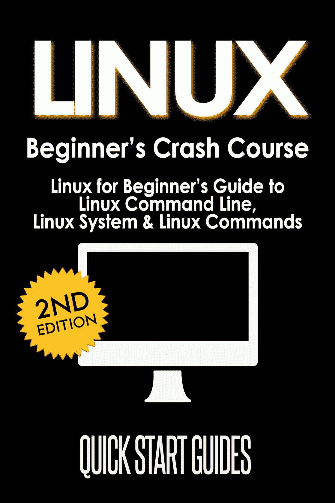

# LINUX：第二版！初学者速成 - Linux 初学者指南：Linux 命令行、Linux 系统及 Linux 命令（计算机科学、Linux 编程、Linux 操作系统第 1 册）





# 引言


Linux 曾被认为是一个不受主流的操作系统，在很一段时间内，它在强大的 Windows 阴影下默默无闻。但最近，Linux 在软件开发者和企业中赢得了广泛赞誉。这种 Unix 变体曾经仅为极客和发烧友熟悉，现在在普通家庭电脑用户中也流行。

Linux 是免费的，并且可以在不同的平台上运行。它一直在积累一个忠实的用户群，并日益吸引以下人群的兴趣：

- ● 熟悉 Unix 并兴趣在个人电脑上运行它的的人
- ● 对实验操作系统原理感兴趣的人
- ● 想要获得最大控制权操作系统的的人
- ● 不满 Microsoft Windows 的人

管理 Linux 比使用 Windows 更困难，但 Linux 更加灵活，并拥有更多的配置选项。

许多企业似乎也克服了对 Linux 的非理性疑虑，并将 Linux 应用于许多业务应用程序。由于 Linux 是开源的，公司在进行此类适配时无需担心许可问题。这使其成为一个非常有吸引力的提议。

# 第 1 章：Linux 及其他操作系统

如果你是一名计算机程序员，你已经了解 Linux 了。如果不是，你可能读过关于它的介绍，或者从朋友那里听过。无论如何，Linux 都是有趣的，你对 Linux 了解得越多，关于它的有趣问题就越多。

## 什么是 Linux？

通常来说，PC 用户分为两类。大多数人将电脑视为神奇的工具，用于浏览网页、玩游戏、看电影和听音乐等酷活动。他们甚至可能知道硬件组件，如 `RAM`、处理器以及音视频卡。但他们并不真正关心这些简单过程背后的复杂性。他们打开浏览器，输入地址，网站就不知怎么打开了。他们对了解它是如何发生的并不。

然后是第二类人，他们实际上对内部运作原理感兴趣。几乎所有人都将操作系统视为额外的软件。其实不是。操作系统和硬件组件一样，是计算机的一个重要部分。在需要时，操作系统可以升级或更换为更合适的系统。

## Linux 的优势

你可能会认为谈论 Linux 的人夸大了它有多么棒，但事实上，它与其他操作系统相比确实有许多真实优势。这些包括：

### 无崩溃性

Linux 是一个不会崩溃的操作系统。当你使用 Linux 时，不会遇到屏幕光标冻结、系统突然崩溃或不重启系统就无法消除的错误信息。在 Linux 操作系统上运行的程序或应用程序可能会崩溃，但操作系统仍将运行。没有任何应用程序可以在崩溃时将其崩溃。在 Linux 中，与其他操作系统不同，你只需在程序崩溃后清理并继续即可。Linux 无崩溃的可靠性在处理航天或核能等操作时是一项巨大的资产，因为在这些领域，你无法承担系统崩溃可能导致的巨大费用、受伤或死亡风险。

### 安全性

Linux 的下一个优势是安全性。Linux 操作系统的安全性远高于有很多安全漏洞的 Windows。其原因是投入了多年大量的计算机科学研究。在 Linux 中，如果你没有适当的权限，将不允许访问特定的硬件或系统中的特定文件夹。隐私可以设置为个人所有，他们只能访问自己的文件。`root` 用户将拥有整个系统的访问权限，并限制其他用户的访问。

### 免费且共享

Linux 的另一个主要优点是它是免费的操作系统。更新将免费下载，当操作系统的新版本发布时，你可以无需额外费用即可替换当前版本。事实上，你实际上可以下载任何你版本的 Linux。由于它是免费软件，可以在一组人之间共享。默认应用程序如图像查看器、音乐播放器、图像编辑器等都可以共享。这在 Windows 或大多数其他操作系统中是不可能的，因为复制此类应用程序并与他人共享会让你成为软件盗版。但在 Linux 中，与其他用户共享软件是完全合法的——实际上是被鼓励的。

### 兼容性

Linux 的另一个好处是它甚至可以在旧硬件上运行。你不需要像运行其他操作系统最新版本那样需要高性能、尖端的 PC。例如，Windows 的新版本需要新硬件才能运行。Linux 操作系统即使在过时的硬件上也可以工作。因此，如果你想运行 Linux，就不需要新电脑。如果你在同一台硬件上安装 Linux 和任何其他操作系统，你可以亲身看到差异。Linux 操作系统的运行会比 Windows 这样耗电的操作系统更快、更好。Linux 社区鼓励用户回收和重复使用组件，以充分利用现有硬件。你实际上可以通过旧电脑系统上安装 Linux 让它重获新生。即使你不需要它，也可以把它送给没有电脑的朋友或家人。

### 灵活性

Linux 操作系统极其灵活。Linux 运行在几乎 60% 的电脑上，并可以使用宽带网络连接。你可以将旧硬件变成 Web 服务器、邮件服务器、防火墙或你设想的任何其他。使用其他操作系统这样做将花费你巨额资金，因为你需要一台性能极高的计算机。

### Linux 社区

但 Linux 最好的特性无疑是 Linux 社区。Linux 不仅仅是一个计算机操作系统。当你开始使用 Linux 时，你就成了遍布全球巨大社区的一部分。成为 Linux 社区的一部分有其自己的优势。其中之一是无论你遇到什么问题，离找到解决方案都不远。该社区的大多数人都是 Linux 传教士，喜欢帮助他人解决问题。Linux 社区的新成员被称为 newbies（新手），这听起来像是贬义，但实际上是从专业 Linux 程序员那里学习的好机会。这些程序员相信知识应该被自由共享，并乐意帮助他人学习 Linux。当有人宣称自己的身份是 newbie 时，人们会花时间帮助他。毕竟，那些专业人士曾经也是 newbie。

## 操作系统的特征

操作系统可以被视为计算机硬件与用户之间的接口或中介。操作系统为用户提供了一个环境，允许他们高效、方便地执行不同的程序。从技术上讲，操作系统是管理其运行的硬件并控制各种程序执行的软件。操作系统负责分配处理器、内存、设备和信息等服务和资源。Linux 就是其中一种操作系统。任何操作系统的重要功能如下：

- ● 内存管理
- ● 设备管理
- ● 处理器管理
- ● 安全性
- ● 文件管理
- ● 系统性能的控制
- ● 错误检测
- ● 作业计费
- ● 用户与其他软件之间的协调

### 内存管理

内存管理是管理主存或主要内存。内存可以被视为一个巨大的字节或字数组，它有自己的地址。


主内存为 CPU 提供直接访问和更快的存储空间。因此，如果你想执行一个程序，它应该存储在计算机的主内存中。每个操作系统（包括 `Linux`）都会执行以下内存管理活动：

- 跟踪主内存，包括已使用的内存和未使用的内存。对于已使用的内存，操作系统还会跟踪哪些用户正在使用它。
- 在多程序设计时，操作系统将决定如何为不同的进程分配内存。
- 每当某个进程请求额外内存时，分配内存。
- 当特定进程终止或不再需要内存时，操作系统还负责内存的去分配。

### 处理器管理

在多程序设计环境中，操作系统是决定每个进程处理器分配时间的的程序。对于处理器管理，每个操作系统都会执行以下活动：

- 使用调度器程序跟踪进程状态和处理器状态。
- 将处理器分配给给定的进程。
- 在不需要时分配合处理器。

### 设备管理

设备之间使用它们各自的驱动程序进行通信，但 OS 负责这种通信。操作系统的设备管理器会执行以下活动：

- 跟踪所有可用设备。`I/O controller` 是负责执行此任务的程序。
- 设备管理器决定将特定设备分配给进程。它还负责进程需要设备的时间分配。
- 高效地将设备分配给进程。
- 去分配也由设备管理器处理。

### 文件管理

为了方便使用和导航，文件系统被组织成目录，文件和其他目录存储在其中。操作系统执行以下文件管理活动：

- 它跟踪文件状态、使用情况、位置、信息等。文件系统是这些设施的集合。
- 操作系统的文件管理器是决定资源分配的程序。
- 它还决定谁可以使用这些资源。
- 资源的去分配由文件管理器处理。

### 其他重要活动

以下是操作系统执行的其他重要活动：

- 安全性 – 通过使用密码或类似技术，操作系统将防止对数据和程序的未经授权访问。
- 系统性能控制 – 操作系统通过记录服务请求的延迟和系统给出的响应来控制系统性能。
- 计数 – 操作系统负责跟踪不同用户在各种作业上使用的资源和时间。
- 错误检测辅助 – 为了检测错误，操作系统将产生位置、错误消息、转储和其他其他错误检测和调试辅助。
- 其他软件与用户之间的协调 – 操作系统负责协调汇编器、编译器、解释器以及任何其他软件分配给使用计算机系统的其他用户。

## 操作系统类型

操作系统从计算机的第一代就开始被使用，并且在此期间不断演变。以下是几种最重要的类型。

### 批处理操作系统

使用批处理操作系统时，用户不直接与计算机交互。用户准备的每个作业都会传输到打孔卡等离线设备，然后提交给计算机操作员。为了获得更好的性能和速度，这些作业被分组成一组。计算机将一次性运行这组作业。程序员将程序交给操作员，操作员根据类型将这些程序排序成具有相似要求的批次。虽然这是一种良好的做法，但批处理操作系统有几个缺点：

- 作业与用户之间没有交互。
- 由于 CPU 与机械 I/O 设备（显然慢得多）之间的速度差异，CPU 大部分处于空闲状态。
- 很难提供所需的属性。

### 分时操作系统

分时是一种技术，多个终端位于一个计算机系统上并可以被同时使用。多任务处理或分时是多程序设计的逻辑扩展。不同用户之间同时共享处理器时间被称为分时。分时系统与多程序批处理系统的主要区别在于，多程序批处理系统旨在最大化处理器效率，而分时系统的主要目标是最小化响应时间。

在这里，作业是频繁的。它们可以切换并由处理器执行，这意味着用户可以获得立即响应。例如，在事务处理中，处理器在计算量内（即在短脉冲内）执行程序。每个用户的响应时间最多为几秒钟。操作系统使用多程序设计和 CPU 调度为每个用户提供一小部分时间。所有最初设计为批处理操作系统的计算机系统都被修改为分时系统。

以下是分时操作系统的某些优点：

- 用户获得快速响应。
- 避免了软件重复。
- 减少了 CPU 空闲时间。

但分时操作系统也有一些缺点：

- 可靠性低。
- 数据和程序的完整性和安全性面临风险。

### 分布式操作系统

分布式操作系统使用多个 CPU 处理多个用户和多个实时应用程序。由于数据处理任务分布在不同的处理器之间，作业执行的效率提高了。

进程之间使用高速总线等各种线路进行相互通信。这也可以称为松散耦合系统。分布式操作系统中的处理器被称为计算机、站点、节点等，它们的功能和大小可能有所不同。

以下是分布式操作系统的某些优点：

- 资源共享设施允许一个站点的用户访问和使用位于另一个站点的资源。
- 使用电子邮件增加了数据交换速度。
- 即使分布式操作系统中的一个站点故障，其他站点可能不受影响并可能继续运行。
- 客户获得更好的服务。
- 主机的负载减轻了。
- 数据处理延迟减少。

### 网络操作系统

网络操作系统运行在服务器上，并为服务器提供数据管理、组管理、用户管理、应用管理、安全管理和其他一些网络功能。网络操作系统负责网络中所有计算机的文件共享和打印机访问。这些网络通常是私有网络或局域网，但可以是任何类型。`Linux` 可以作为强大且高效的网络操作系统。

网络操作系统的优点是：

- 集中服务器的稳定性很高。
- 服务器可以管理安全。
- 任何硬件或软件更新都可以轻松地集成到系统中。
- 可以从不同类型的系统或不同位置远程访问服务器。

网络操作系统的缺点包括：

- 初始成本和维护成本很高。
- 服务器大多数操作依赖于中央位置。


● 需要频繁的更新和定期维护。

## 实时操作系统

实时操作系统可以定义为一种数据处理系统，其处理和响应输入所需的时间间隔非常快，以至于它可以控制环境。所有的实时处理都是在线的，但在线系统并不非都是实时系统。系统响应输入并带有更新信息给出输出所需的时间被称为响应时间。与在线处理的响应时间相比，这种方法的响应时间非常快。

存在两种类型的实时操作系统：

### 硬实时系统

硬实时系统保证关键任务的准时完成。外存存储缺失或受到限制。数据可以以 `ROM` 格式存储。硬实时系统中没有虚拟内存。

### 软实时系统

软实时系统的限制比硬实时系统少少。软实时系统会优先考虑关键任务，并保持这些优先级，直到每个任务完成。与硬实时系统相比，软实时系统的实用性相对有限。例如，像行星探测器和深海探索等先进科学项目可以使用软实时系统，它们也具有虚拟现实和多媒体应用。

# 第 2 章：Linux 的组件、特性与架构

Linux 操作系统是最流行的 操作系统版本。Linux 基本上设计为兼容 `UNIX`，且这两个操作系统的功能非常相似。

## 组件

Linux 操作系统有三个主要组件：

● `Kernel` – 内核被认为是 Linux 操作系统的核心，负责系统的主要活动。内核直接与硬件交互，并在其内部包含各种模块。内核通过为应用程序或系统提供所需的抽象，隐藏了所有的底层硬件细节。

● `System Library` – 系统库可以被视为特殊的程序或函数，系统实用程序或应用程序通过它们来访问内核的功能。这些库可以实现几乎所有功能也由操作系统实现。系统库不需要内核模块的代码即可获得访问权限。

● `System Utility` – 系统实用程序是负责执行特定独立任务的程序。

## 特性

以下是 Linux 操作系统的一些重要特性：

● `Portable` – 可移植性意味着软件可以以相同的方式在不同类型的硬件上运行。Linux 内核和应用程序可以安装在任何种的硬件平台上。

● `Open Source` – Linux 源代码免费可用。开发是一个基于社区的项目。多个团队协作工作以增强 Linux 操作系统的能力，并且它在不断演进。

● `Multi-User` – Linux 是一个多用户系统，意味着多个用户可以同时访问系统资源，如 `memory`/`RAM`/应用程序。 

● `Multiprogramming` – Linux 是一个多程序系统，意味着多个应用程序可以同时运行。

● `Hierarchical File System` – Linux 提供了一个标准文件结构，系统文件/用户文件就排列在其中。

● `Shell` – Linux 提供了一个特殊的解释器程序，可用于执行操作系统命令。它可以用于各种类型的操作、应用程序等。

● `Security` – Linux 使用身份验证功能（如密码保护/对特定文件的受控访问/数据加密）提供用户安全。

## 架构

以下层是 Linux 系统架构的一部分：

● `Hardware`– 所有的外围设备，如硬盘、`CPU` 和 `RAM`，都是硬件层的一部分。

● `Kernel` – 内核是操作系统的主要或核心组件。它与系统硬件直接通信，为上层组件提供底层服务。

● `Shell` – Shell 是用户与内核之间的接口。Shell 接受用户提供的命令并执行内核函数。

● `Utilities` – 实用程序是为用户提供操作系统大部分功能的程序。

# 第 3 章：Linux 内核

在本章中，我们将学习 Linux 内核。Linux 内核是类似于 `UNIX` 的计算机操作系统。它在全球范围内被广泛使用。Linux 操作系统完全基于 Linux 内核。它通过 Linux 发行版部署在传统的计算机系统中，也部署在路由器等嵌入式设备上。运行手机和平电脑的 Android 移动操作系统也是使用 Linux 内核构建的。

1991 年，芬兰计算机科学学生 Linus Torvalds 为个人使用创建了 Linux 内核。最初他没有在其他平台上使用它的打算，但他逐渐开发使其能够在不同的计算机架构上运行。近 12,000 名软件开发者和 1,200 家公司为开发做出贡献。Linux 内核是开源软件，这意味着内核源代码可以被访问和修改。`LKML` 或 Linux 内核邮件列表托管了有关开发的讨论。

内核是用户应用程序与 CPU、内存和其他设备之间的接口。

GNU 编译器集合 (`GCC`) 支持一个 C 语言版本（通过向标准 C 引入更改和扩展开发），该版本已用于编写 Linux 内核。除了 C 语言，汇编语言也被用于编写若干小部分代码。由于 `GCC` 支持 C 的多种扩展，在一段时间内它是唯一具有构建 Linux 内核能力的编译器。

## 内核源码

内核源码可以在大多数 Linux 发行版中找到。安装到你的系统的 Linux 内核是使用这些源码开发的。它们可以在 `ftp://ftp.cs.helsinki.fi` 找到，并在其他网站上有镜像。如果你没有互联网访问，可以以合理的价格从提供知名网站快照的供应商处获取光盘。某些供应商还提供定期更新的订阅服务。你本地的 Linux 用户组是另一个极佳的选择。

在源码树的最顶 `/usr/src/Linux` 可以找到几个目录：

`Arch`: 特定于架构的内核代码存在此子目录中。它进一步划分为子目录，每个架构一个。`Alpha` 和 `i386` 是子目录的示例。

`Include`: 构建内核代码所需的包含文件存在此子目录。它也为每个架构划分了一个子目录。编辑内核 Makefile 然后重新运行内核配置程序可以更改架构。

`Init`: 内核的初始化代码存在此目录。为了理解内核的工作，这里可以很好的起点。

`MM`: 与内存管理相关的文件存在此目录。每个架构的内存管理相关代码存在 `arch/*/mm/` 中。

`Drivers`: 这包含系统的设备驱动，它们被分为不同的类别。

`IPC`: 进程间通信代码存在此目录。

`Modules`: 模块由此目录创建并持有。


**FS**: 文件系统的代码位于此目录。该目录有几个子目录，每个子目录对应一个文件系统。

- **Kernel**: 这包含了内核代码。特定架构内核的代码可以在 `arch/*/kernel` 中找到。
- **Net**: 这是内核的网络代码。
- **Lib**: 内核的库代码位于此目录。特定架构的库代码位于 `arch/*/lib/`。
- **Scripts**: 在内核配置期间使用的脚本位于此目录。

# 第 4 章：Linux 进程

## task_struct

为了让 Linux 高效地处理系统中运行的进程，使用名为 `task_struct` 的数据结构来表示每个进程。（在 Linux 中，process 和 task 术语是可以互换的。）`task_struct` 数据结构包含一个名为任务向量（task vector）的指针数组。

任务向量的大小限制了系统中发生的进程数量。默认最大条目数为 512。创建新进程会导致从内存中分配一个新的 `task_struct`。将其添加到任务向量中即完成了创建。当前指针指向当前运行的进程，以便于查找。

除了普通进程外，Linux 还支持实时进程。这些实时进程之所以得此名，是因为它们预期会对外部请求做出迅速响应。调度器处理它们的方式与普通进程略不同。通过将复杂的 `task_struct` 数据结构划分为以下功能区域，使其变得简单：

### State（状态）

进程的状态根据执行情况发生改变。每个 Linux 进程都有以下状态之一：

#### Running（运行）
在此状态下，进程准备就绪或正在系统中运行。准备就绪意味着进程已准备好被系统处理器之一接管执行。

#### Waiting（等待）
等待状态意味着进程正在等待资源或事件的发生。等待进程分为两种类型：可中断和不可中断。信号可以中断某些等待进程，这些被称为可中断进程；信号无法中断的等待进程则被称为不可中断进程。

#### Stopped（停止）
停止的进程显然已经停止了，通常是通过接收信号停止的。进程需要处于停止状态才能进行调试。

#### Zombie（僵尸）
这是一个死去的进程，由任务向量中的 `task_struct` 数据结构组成。因此，它被称为僵尸。

### Scheduling information（调度信息）

这是调度器用于决定进程运行顺序的信息。

### Identifiers（标识符）

数字进程标识符标识系统中的每一个进程。

## Inter-process communication (IPC）（进程间通信）

Linux 支持的重要 IPC 机制包括信号、管道、消息队列、共享内存、信号量等；将在后续章节详细学习。

## Links（链接）

在运行 Linux 的系统中，进程并非相互独立。所有进程都有父进程。唯一没有父进程的进程是初始进程。没有创建新进程；而是从之前发生的进程克隆出来的。表示进程的任务结构指向父进程，也指向兄弟进程（共享父进程的进程）。可以使用 `pstree` 命令查看进程之间运行的关系：

```
init(1)-+-crond(98)
      |-emacs(387)
      |-gpm(146)
      |-inetd(110)
      |-kerneld(18)
      |-kflushd(2)
      |-klogd(87)
      |-kswapd(3)
      |-login(160)---bash(192)---emacs(225)
      |-lpd(121)
      |-mingetty(161)
      |-mingetty(162)
      |-mingetty(163)
      |-mingetty(164)
      |-login(403)---bash(404)---pstree(594)
      |-sendmail(134)
      |-syslogd(78)
      `-update(166)
```

## Times & timers（时间与计时器）

内核另一个重要职责是跟踪创建进程所花费的时间。它还跟踪进程在其生命周期内消耗的 CPU 时间。随着时钟移动，内核不断更新当前进程在系统中花费的时间。

## File systems（文件系统）

Linux 在支持各种文件系统方面非常灵活。这有助于它与其他流行的操作系统共存。Linux 总共支持 15 种文件系统。它们是：

- ext
- ext2
- vfat
- affs
- minix
- sysv
- hpfs
- ncp
- umsdos
- iso960
- ufs
- xia
- msd
- proc
- smb

未来还将添加更多文件系统。

## Virtual memory（虚拟内存）

Linux 使用虚拟内存来高效管理内存。它允许每个进程拥有自己的虚拟地址空间。

## Processor specific context（处理器特定上下文）

可以将进程看为 `task_struct` 中寄存器、栈等的集合。当进程被挂起时，必须保存上下文。

## How Linux organizes data（Linux 如何组织数据）

高效的操作系统应该良好地组织数据。如果你用过其他操作系统（如 Windows），你可能会发现这很容易，因为大多数操作系统组织数据的方式相似。内核可以创建许多充当设备的伪设备。Linux 接收、存储并向设备收发数据。给定的硬件单元可以有多个设备；例如，Linux 系统会将磁盘的分区显示为独立的设备。

### Devices（设备）

设备对应于硬件。下表列出了一些典型的 Linux 设备：

| Device | Description |
| :--- | :--- |
| atibm | 总线鼠标 |
| audio | 声卡 |
| cdrom | CD-ROM  |
| console | 当前虚拟控制台 |
| fd n | 软驱器（n 指定驱动器；例如，fd0 是第一个软驱器） |
| ftape | 不回带的流式磁带驱动器 |
| hd xn | 非 SCSI 硬盘（x 指定驱动器，n 指定分区；例如，hda1 是第一个非 SCSI 硬盘的第一个分区） |
| inportbm | 总线鼠标 |
| lp n | 并行端口（n 指定设备号；例如，lp0 是第一个并行端口） |
| modem | 调制解调器 |
| mouse | 鼠标 |
| nftape | 支持回带的流式磁带驱动器 |
| nrft n | 支持回带的流式磁带驱动器（n 指定设备号；例如，nrft0 是第一个流式磁带） |
| nst n | 不支持回带的流式 SCSI 磁带驱动器（n 指定设备号；例如，nst0 是第一个流式 SCSI 磁带） |
| null | 接受无限输出的伪设备 |
| printer | 打印机 |
| psaux | 辅助指针设备，如轨迹球或 IBM ThinkPad 上的旋钮 |
| rft n | 不支持回带的流式磁带驱动器（n 指定设备号；例如，rft0 是第一个流式磁带） |
| scd n | SCSI 设备（n 指定设备号；例如，scd0 是第一个 SCSI 设备） |
| sd xn | SCSI 硬盘（x 指定驱动器，n 指定分区；例如，sda1 是第一个 SCSI 硬盘的第一个分区） |
| sr n | SCSI CD-ROM（n 指定驱动器；例如，sr0 是第一个 SCSI CD-ROM） |


| st n | 支持回退的流式 SCSI 磁带驱动（n 指定设备号；例如，`st0` 是第一个流式 SCSI 磁带驱动） |
| tty n | 虚拟终端（n 指定特定的虚拟终端；例如，`tty0` 是第一个虚拟终端） |
| ttyS n | 调制解调器（n 指定端口；例如，`ttyS0` 是第一个串口上的入站调制解调器连接） |
| zero | 提供无尽零字节字节流的伪设备 |

# 第 5 章：Linux 文件系统

无论你使用的是 Linux 还是 Windows，在存储任何数据之前都必须进行分区。每当在 Linux 中格式化分区时，操作系统会在该分区上写入称为文件系统的特殊数据。

每个操作系统都支持自己的一套文件系统。与 Windows 相比，Linux 支持多种类型的文件系统。Linux 支持的文件系统列如下表所示：

| Filesystem | 描述 |
| :--- | :--- |
| coherent | 与 Coherent Unix 使用的文件系统兼容的文件 |
| ext | `ext2` 文件系统的前身；为了兼容性而支持 |
| ext2 | 标准的 Linux 文件系统 |
| hpfs | 与 IBM OS/2 使用的文件系统兼容的文件 |
| iso9660 | 用于 CD-ROM 的标准文件系统 |
| minix | 一种旧的 Linux 文件系统，仍偶尔用于软盘 |
| msdos | 与 Microsoft FAT 文件系统兼容的文件，供 MS-DOS 和 Windows 使用 |
| nfs | 与 Sun 网络文件系统兼容的的文件系统 |
| ntfs | 与 Microsoft Windows NT 的 NTFS 文件系统兼容的文件 |
| sysv | 与 AT&T System V Unix 使用的文件系统兼容的文件 |
| vfat | 与 Microsoft FAT32 文件系统兼容的文件，供 Windows 9x 使用 |
| xenix | 与 Xenix 使用的文件系统兼容的文件 |

# 第 6 章：进程间通信

进程间通信是指各种通信协议在不同进程之间共享数据的过程。服务器和客户端是使用进程间通信的两种类型的应用程序。在这种应用中，客户端映射到单个或多个服务器，并向这些服务器以数据的形式请求信息。服务器或多个服务器发送数据。不同的平台为客户端提供了访问数据的不同方式。以下是 Linux 为实现进程间通信提供的机制：

1. 内核或进程向它们想要通信的进程发送信号。信号是 Linux 平台提供的最廉价的进程间通信形式，可以是事件或状态的形式。事件和状态都推断或通知某个进程或内核的处理过程中发生了某些变化。

2. `|` 被称为管道。它由平台使用的 shell 设置，用于将输入从一个进程传输到另一个进程。管道的两个端在两端文件描述符的帮助下被链接为一种一对一的通信机制。这些文件描述符与单一的只读或只写功能相关。要发送细节的一端使用读取文件描述符来从进程中读取数据。同时，获取数据的一端将使用写入描述符，以便其能够写入接收到的数据。由于数据流是单向的，这种机制被称为半双机制。具有父子关系的进程可以使用这些管道，父进程为子进程创建管道以便与其通信，并并在子进程之间也创建管道以便它们之间进行通信。这种现象发生是因为文件描述符被复制到了它们的地址空间中。

3. 先入先出（`FIFO`）管道也称为命名管道，其使用方式与无名管道相同。唯一的区别是，当进程之间互不相关时使用它们。使用这些管道的进程使用 `FIFO` 文件而不是文件描述符进行通信。`FIFO` 文件具有与文件描述符相同的机制：一个 `FIFO` 文件具有读取功能，另一个具有写入功能。因此这种机制也是半双工的。

4. 为了让单个或多个进程从单个或多个进程进行读写，我们使用消息队列。这种机制类似于信箱。想要共享数据的进程来并将包含数据的包放在消息队列上然后离开。想要获取数据的进程来并取出包。这节省了大量时间，因为共享数据的进程不需要等待另一个进程。消息队列有两种不同的规范。首先是 `SysV` 消息队列，发送的消息包含一个数字，以便接收消息的进程可以获取匹配特定数字的数据或接受除匹配特定数字包之外的所有内容。其次，`POSIX`是一种基于优先级的机制。它按优先级顺序发送包。当进程发送包时，会将优先级数字附加在包上。因此，当另一个进程接收详细信息时，首先获取最高优先级包中的数据。

5. 有计数器按顺序对接收共享资源的进程进行队列。这些计数器被称为信号量。它们锁定共享资源，使得只有一个进程可以访问共享资源。一旦该进程完成对资源的使用，资源就会被释放。然后，优先级下一个进程将获得资源，或者请求资源但不考虑优先级的进程将获得资源。这与 `SysV` 和 `POSIX` 消息队列机制类似，因此它们被称为 `SysV` 信号量和 `POSIX` 信号量。

6. 多个进程共享可用内存空间的机制被称为共享内存机制。这有助于共享内存的两个或多个进程更有效地通信，从而减少对内核的干扰。共享内存也有两种类型：`SysV` 共享内存和 `POSIX` 共享内存，它们的工作方式与上述相同。也就是说，其中一种考虑优先级，而另一种则不考虑。

# 第 7 章：Linux Shell

如你所知，计算机只能理解 0 和 1，即二进制语言。在第一代计算中，指令直接以二进制语言给出。但二进制语言极难理解，用它编写代码既耗时又困难。为了解决这个问题，操作系统引入了一种称为 shell 的特殊程序。shell 接受以英文输入的命令并检查它们是否有效。如果给定的命令有效，shell 将其传递给内核。shell 是命令行解释器。它可以从文件或从键盘等标准输入设备获取输入。虽然 shell 不是内核的一部分，但它使用内核来创建文件、执行程序等。

最根本的是，shell 是用户和系统内核之间的接口，但 shell 可以在不将它们传递给内核的情况下执行某些基本命令。

如果你想知道系统中存在的可用 shell，请使用以下命令：

```
$ cat /etc/shells
```

尽管操作系统中有许多可用 shell，但它们都设计用于执行相同的工作。不同的 shell 有不同的语法和不同的内置函数。在 MS-DOS 中，`command.com` 是 Windows 操作系统使用的 shell。它比 Linux 中存在的 shell 弱得多。


所有的 Shell 都通过文件或键盘等输入设备接收用户输入的命令，并向 Linux 操作系统传递信息，说明用户的需求。

如果用户使用键盘等输入设备给出命令，则被称为命令行界面（CLI）。下下方的命令显示了你当前正在使用的 Shell：

```
$ echo $SHELL
```

## Shell 脚本

所有的 Shell 都是交互式的，这意味着它们接受用户的命令并可以执行这些命令。你可以一个一个地给出命令，也可以将它们按顺序全部存储在一个文本文件中，并交给 Shell 执行。一次性给出所有命令被称为 Shell 脚本编写（shell scripting）。

Shell 脚本通常定义如下：

“Shell 脚本是编写在纯文本文件中的系列命令。Shell 脚本就像 MS-DOS 中的批处理文件，但它比 MS-DOS 批处理文件强大得多。”

### 编写 脚本的原因

- 你可以直接或通过文件向 Shell 脚本提供输入，它会在屏幕上输出结果。
- 你可以使用 Shell 脚本创建自己的命令。
- Shell 脚本通过一次性执行所有命令来为你节省大量时间。
- Shell 脚本可用于自动化日常任务。
- 你还可以使用 Shell 脚本实现系统管理的自动化。

### 如何编写 Shell 脚本

编写 Shell 脚本时，请遵循以下步骤：

- 使用编辑器如 `mcedit` 或 `vi`。
- 在 Shell 脚本中编写一组命令后，你应该使用 `chmod permission your-script-name` 为准备好的脚本设置执行权限。例如， `$ chmod +x your-script-name` 或 `$ chmod 755 your-script-name`。系统管理员或所有者应具有读/写/执行权限（7）。设置组权限时，你应该只使用读取和执行权限（5）。
- 现在，你应该按照下面的语法执行你编写的脚本：

语法：
```
bash your-script-name
sh your-script-name
./your-script-name
```

示例：
```
$ bash bar
$ sh bar
$ ./bar
```

- 注意，`./` 表示当前工作目录，点 `.` 表示在当前 Shell 中执行给定的命令文件，而不初始化新的 Shell 副本。使用点的语法为 `. command-name;`；例如，`$ . foo`。

- 现在你可以使用 `vi` 命令列表编写一个名为 `First Shell` 的新 Shell 脚本（或任何其他编辑器）：

```
$ vi first
#
## My first shell script
#
clear
echo "First Shell"
```

- 保存脚本后，你可以通过 `$ ./first` 运行它，但你必须先用 `$ chmod 755 first` 设置权限。现在当你输入 `$ ./first` 时，屏幕会被清空，然后打印出 Shell 脚本中给的消息：

输出：`First Shell`

| 脚本命令 | 含义 |
| :--- | :--- |
| `$ vi first` | 启动 vi 编辑器 |
| `# # My first shell script #` | `#` 后面跟随任何文本都会被视为注释。注释提供了关于脚本的更多信息；它是对 Shell 脚本的逻辑解释。语法：`# comment-text` |
| `clear` | 清除屏幕 |
| `echo "First Shell"` | 在屏幕上打印消息或变量值，我们使用 `echo` 命令。echo 命令的一形式如下：语法：`echo "Message"` |

## 基础命令行编辑

为了编辑和回溯命令，可以使用下面的组合键：

- `CTRL + L`: 清除屏幕。
- `CTRL + W`: 删除光标起始处的单词。
- `CTRL + U`: 清除整行，即删除命令行中的所有单词。
- `向上和向下方向键`: 回溯命令。
- `Tab`: 自动完成文件、目录、命令名等。
- `CTRL + R`: 搜索之前使用的命令。
- `CTRL + C`: 取消当前运行的命令。
- `CTRL + T`: 交换光标前最后两个字符。
- `ESC + T`: 交换光标前最后两个单词。
- `CTRL + H`: 删除光标起始处的字母。

### 执行命令

要执行命令，只需在终端中输入它并按回车键。例如，`date` 命令将当前日期和时间作为输出，所以当你输入 `date` 并按回车时，你会得到类似 `Wed Jan 27 05:35:56 IST 2015` 的内容。

### Bash 命令

以下是来自 http://ss64.com/bash/ 的所有 bash 命令按字母排序列表：

- `alias`: 创建别名
- `apropos`: 搜索帮助手册页 (`man -k`)
- `apt-get`: 搜索并安装软件包（Debian/Ubuntu）
- `aptitude`: 搜索并安装软件包（Debian/Ubuntu）
- `aspell`: 拼写检查器
- `awk`: 查找并替换文本，数据库排序/验证/索引
- `basename`: 从文件名中提取目录和后缀
- `bash`: GNU Bourne-Again SHell
- `bc`: 任意精度计算器语言
- `bg`: 发到后台
- `break`: 退出循环
- `builtin`: 运行 shell 内置命令
- `bzip2`: 压缩或解压命名文件
- `cal`: 显示日历
- `case`: 条件执行命令
- `cat`: 合并并打印（显示）文件内容
- `cd`: 目录
- `cfdisk`: Linux 分区表操作
- `chgrp`: 更改所有组
- `chmod`: 更改访问权限
- `chown`: 更改所有者组
- `chroot`: 在不同的目录下运行命令
- `config`: 系统服务（级别）
- `cksum`: 打印 CRC 和计数
- `clear`: 清除终端
- `cmp`: 比较两个文件
- `comm`: 按行比较排序后的文件
- `cp`: 将一个或多个文件复制到另一个位置
- `cron`: 执行命令的守护进程
- `crontab`: 调度在稍后时间运行命令
- `csplit`: 将文件分成上下文决定的部分
- `cut`: 将文件分成部分
- `date`: 显示或更改日期和时间
- `dc`: 桌面计算器
- `dd`: 转换并复制文件，写入磁盘头，引导记录
- `ddrescue`: 数据恢复工具
- `declare`: 声明变量并赋予属性
- `df`: 显示空磁盘空间
- `diff`: 显示两个文件之间的差异
- `diff3`: 显示三个文件之间的差异
- `dig`: DNS 查找
- `dir`: 简单列出内容
- `dircolors`: `ls` 的颜色设置
- `dirname`: 将完整路径转换为路径
- `dirs`: 显示目录列表
- `dmesg`: 打印内核和驱动程序消息
- `du`: 估算文件空间占用
- `echo`: 在屏幕上显示消息
- `egrep`: 搜索文件中匹配扩展表达式的行
- `eject`: 弹出移动式介质


### 内置命令

- `enable`: 启用和禁用内置 shell 命令
- `env`: 环境变量
- `ethtool`: 以太网卡设置
- `eval`: 求值多个命令/参数
- `exec`: 执行命令
- `exit`: 退出 shell
- `expect`: 自动化通过终端访问的任意应用程序
- `expand`: 将制表符转换为空格
- `export`: 设置环境变量
- `expr`: 求值表达式
- `false`: 什么都不做，返回失败状态
- `fdformat`: 低级格式化软盘
- `fdisk`: Linux 分区表操作器
- `fg`: 将作业发送至前台
- `fgrep`: 在文件中搜索固定字符串的行
- `file`: 确定文件类型
- `find`: 搜索符合特定标准的文件
- `fmt`: 重新格式化文本
- `fold`: 折换文本以适应指定的宽度
- `for`: 扩展单词并执行命令
- `format`: 格式化磁盘或磁带
- `free`: 显示内存使用情况
- `fsck`: 文件系统检查和修复
- `ftp`: 文件传输协议
- `function`: 定义宏
- `user`: 识别/杀死访问文件的进程
- `gawk`: 在文件中查找并替换文本
- `getopts`: 解析位置参数
- `grep`: 在文件中搜索匹配给定模式的行
- `groupadd`: 添加用户安全组
- `groupdel`: 删除组
- `groupmod`: 修改组
- `groups`: 打印用户所属的用户组
- `gzip`: 压缩或解压命名文件
- `hash`: 记住名称参数的完整路径
- `head`: 输出文件的开头部分
- `help`: 显示内置命令的帮助
- `history`: 命令历史
- `hostname`: 打印或设置主机
- `htop`: 交互式查看器
- `iconv`: 转换文件的字符集
- `id`: 打印用户和组信息
- `if`: 条件执行命令
- `ifconfig`: 配置网络接口
- `ifdown`: 停止网络接口
- `ifup`: 启动网络接口
- `import`: 捕获 X 服务器屏幕并将图像保存到文件
- `install`: 复制文件并设置属性
- `ip`: 路由、设备和隧道
- `jobs`: 列出活动作业
- `join`: 在公共字段上合并行
- `kill`: 通过 PID 杀死进程
- `killall`: 通过名称杀死进程
- `less`: 一次显示一屏
- `let`: 对 shell 变量进行算术运算
- `link`: 创建文件的链接
- `ln`: 为文件创建符号链接
- `local`: 变量
- `locate`: 查找文件
- `logname`: 打印当前登录用户名
- `logout`: 退出登录 shell
- `look`: 显示以给定字符串开头的行
- `lpc`: 行打印机控制
- `pr`: 离线打印
- `lprint`: 打印文件
- `lprintd`: 终止打印作业
- `lprintq`: 列出打印队列
- `lprm`: 从打印队列删除作业
- `ls`: 列出文件信息
- `lsof`: 列出打开的文件
- `make`: 重新编译一组程序
- `man`: 手册
- `mkdir`: 创建新文件夹
- `mkfifo`: 创建 FIFOs（命名管道）
- `mkfs`: 创建 ISO9660/HFS 文件系统
- `mod`: 创建块或特殊文件
- `more`: 一次显示一屏
- `most`: 浏览或翻页文本文件
- `mount`: 挂载文件系统
- `tools`: 操作 MS-DOS 文件
- `mtr`: 网络诊断 (traceroute/ping)
- `mv`: 移动或重命名文件或目录
- `mmv`: 批量移动和重命名（文件）
- `netstat`: 网络信息
- `nice`: 设置命令或作业的优先级
- `nl`: 行编号并写入文件
- `nohup`: 运行不受挂断的命令
- `notify-send`: 发送桌面通知
- `nslookup`: 交互式查询 Internet 服务器
- `open`: 用默认应用程序打开文件
- `op`: 运算符算符
- `passwd`: 修改用户密码
- `paste`: 合并文件行
- `pathchk`: 检查文件移植性
- `ping`: 测试网络连接
- `pkill`: 通过全名或部分名杀死进程
- `popd`: 恢复当前目录的上一个值
- `pr`: 准备打印文件
- `printcap`: 打印机能力数据库
- `printenv`: 打印环境变量
- `printf`: 格式化并打印数据
- `ps`: 进程状态
- `pushd`: 保存并更改当前目录
- `pv`: 监控通过数据进度
- `pwd`: 打印工作目录
- `quota`: 显示磁盘使用情况
- `quotacheck`: 扫描文件系统的磁盘使用情况
- `quotactl`: 设置磁盘配额
- `ram`: ram 设备
- `rar`: 压缩归文件
- `rcp`: 在两机器间复制文件
- `read`: 从标准输入读取一行
- `readarray`: 从 stdin 读取到数组变量
- `readonly`: 将变量/函数标记为只读
- `reboot`: 重启系统


# 第 8 章：命令行教程

现在你已经了解 Linux 是什么了，是时候开始实际使用它了。我们将从基础命令行教程开始，但首先你需要知道如何打开终端。这并不难，但所有的系统都不同，因此请仅将此作为指南：

- Mac 用户应该打开“应用程序”(Applications)，“实用工具”(Utilities)，然后点击“终端”(Terminal)。快捷键是按下 `Command+Space` 打开 Spotlight 搜索，然后输入单词 `Terminal`。在结果出现时点击它。
- Linux 用户应该在 `Applications>System` 或 `Applications>Utilities` 中查找。快捷键是在桌面上右键点击，并寻找“在终端中打开”选项。如果有该选项，点击它。
- Windows 用户可以直接在开始菜单的搜索栏中输入单词 `Command`。点击`命令提示符`(Command Prompt) 即可直接进入。

## 注释 / 备注

描述后带有点（•）的命令是默认 shell 命令。

## 命令列表

- `rename`: 重命名文件
- `renice`: 更改运行进程的优先级
- `remsync`: 通过电子邮件同步远程文件
- `return`: 退出 shell 函数
- `rev`: 反转文件行
- `rm`: 删除文件
- `rmdir`: 删除文件夹
- `rsync`: 远程复制（同步文件树）
- `screen`: 终端复用，通过 `ssh` 运行 shell
- `scp`: 安全拷贝（远程文件复制）
- `sdiff`: 交互式合并两个文件
- `sed`: 流编辑器
- `select`: 接受输入
- `seq`: 打印数字序列
- `set`: 操作变量和函数
- `sftp`: 安全文件传输程序
- `shift`: 移动位置参数
- `shopt`: Shell 选项
- `shutdown`: 机或重启 linux
- `sleep`: 延迟指定时间
- `slocate`: 查找文件
- `sort`: 排序文本文件
- `source`: 从文件运行命令 `.`
- `split`: 将文件分割为固定大小的部分
- `ssh`: 安全 Shell 客户端（远程登录程序）
- `stat`: 显示文件或文件系统状态
- `strace`: 跟踪系统调用和信号
- `su`: 切换用户
- `sudo`: 以其他用户身份执行命令
- `sum`: 输出文件的校验和
- `suspend`: 挂起此 shell 的执行
- `sync`: 将磁盘数据与内存同步
- `tail`: 输出文件的最后部分
- `tar`: 在归档中存储、列表或提取文件
- `tee`: 将输出重定向到多个文件
- `test`: 评估条件表达式
- `time`: 测量运行时间
- `timeout`: 带时间限制运行命令
- `times`: 用户和系统时间
- `touch`: 修改文件时间戳
- `top`: 列出系统上运行的进程
- `put`: 设置终端相关属性、颜色、位置
- `traceroute`: 追踪主机路由路径
- `trap`: 在设置信号时运行命令 (bourne)
- `tr`: 翻译、压缩和/或删除字符
- `true`: 什么都不做，成功返回
- `tsort`: 拓扑排序
- `tty`: 在 `stdin` 上打印终端的文件名
- `type`: 描述命令
- `ulimit`: 限制资源
- `umask`: 用户文件创建掩码
- `umount`: 卸载设备
- `unalias`: 别名
- `uname`: 打印系统信息
- `expand`: 将空格转换为制表符
- `uniq`: 唯一文件处理
- `units`: 将单位尺度转换为另一种
- `unrar`: 从 rar 归档提取文件
- `unset`: Remove 变量或函数
- `unshar`: 解包 shell 脚本
- `until`: 执行命令（直到错误）
- `uptime`: 显示运行时间
- `useradd`: 创建新用户账户
- `userdel`: 删除用户账户
- `usermod`: 修改用户账户
- `users`: 列出当前登录的用户
- `uuencode`: 编码二进制文件
- `udecode`: 解码由 `uuencode` 创建的文件
- `v`: 详细列表目录内容 (`ls -l -b`)
- `vdir`: 详细列表目录内容
- `vi`: 文本编辑器
- `vmstat`: 报告虚拟内存统计
- `wait`: 等待进程完成 •
- `watch`: 定期执行/显示程序
- `wc`: 打印字节、字和行数
- `where`: 在用户的 `$path` 中搜索程序，查找帮助页
- `which`: 在用户的 `$path` 中搜索程序
- `while`: 执行命令
- `who`: 打印所有登录的用户名
- `whoami`: 打印当前用户和名称 (`id`)
- `wget`: 通过 HTTP、FTP 获取网页或文件
- `write`: 向另一个用户发送消息
- `xargs`: 执行实用程序并传递参数列表
- `xdg-open`: 在用户偏好的应用程序中打开文件或 URL
- `yes`: 持续打印字符串直到被中断
- `zip`: 打包并压缩（归档）文件
- `.`: 在当前 shell 中运行命令脚本
- `!!`: 再次运行上一个命令


第 1 行始终以你的用户名@bash 提示符开头。我们还在那里放置了一个命令 – `ls` – 而且该命令始终是你输入的第一个内容。紧随其后的是我们所说的命令行参数。请注意，命令和第一个参数之间必须有一个空格。第一个命令行参数是 `-l`，这被称为“选项”（option）。它们用于更改命令的行为方式。它们总是列在任何其他参数之前，并以破折号 (-) 开头。

第 2 到第 5 行是运行你输入的命令后产生的输出。几乎所有的命令都会产生输出，并且输出将紧挨列在所执行的命令下方。少数命令只负责执行任务，除非发生错误，否则不会产生任何信息。

第 6 行再次是提示符。一旦命令运行完毕，终端就可以再次使用并会显示提示符。如果没有显示提示符，命令可能仍在运行。

## 快捷键

虽然终端初看起来可能有点让人无从下手，但不必担心。Linux 充满了实用的快捷键，它们会让事情变得简单得多，还能防止你犯下拼写错误等错误。我将在本章中介绍一些快捷键，因此在遇到它们时请做下笔记。

你的第一个快捷键是这个——每当你输入一个命令，它都会存储在历史记录中，你可以使用向上和向下箭头键遍历这些历史。所以你不需要重新输入已经输入过的命令；如果你需要再次输入相同的命令，只需使用箭头键找到它即可。如果你想编辑命令，使用左、右箭头键将光标移动到你需要更改的位置。

## 基础导航

我们将查看的第一个命令是 `pwd`，它代表“打印工作目录”（Print Working Directory）。许多 Linux 命令都缩写为缩写词，这使得它们更容易记忆。）此命令的作用正如其字面意思——将工作目录打印到屏幕上。试一试：

```
pwd
/home/Simon
```

你在终端中输入的许多命令只有在你处于正确位置时才会起作用。但由于你会经常移动位置，很容易迷路。只需在命令提示符处输入 `pwd` 就能告诉你你所在的位置，所以当你疑问时请随时利用它。

你可能还想知道的是当前位置有什么内容。查找该内容的命令是 `ls`，它是“列出”（list）的缩写。

```
ls
bin Documents public_html
```

当 `pwd` 在不带参数的情况下运行时，`ls` 则更有威力。在这个示例中，我们没有给它提供任何参数，因此我们只得到了当前位置内容的列表。但你可以用它做更多事情，例如：

```
ls [options] [location]
```

`[]` 方括号表示其中的文本是可选的，因此该命令可以带上它们运行，也可以不带它们运行。下面的示例展示了以不同方式运行 `ls` 命令，以便让你直观了解它可以做什么：

```
ls
bin Documents public_html
```

这是 `ls` 最基础的格式——结果是我们当前所在目录的内容的列表。

```
ls -l
total 3
drwxr-xr-x  2 Simon users 4096 Mar 23 13:34 bin
drwxr-xr-x 18 Simon users 4096 Feb 17 09:12 Documents
drwxr-xr-x  2 Simon users 4096 May 05 17:25 public_html
```

使用带有命令行选项 `-l` 的 `ls` 命令表示我们想要进行“长列出”（long listing），它包含：

● 第一个字符表示文件类型——普通文件 (-) 或目录 (d)
● 随后的九个字符是文件或目录权限
● 下一个字段是块数
● 下一个字段是文件或目录的所有者
● 下一个字段是目录或文件所属的组
● 接下来是文件大小
● 接下来是文件的修改时间
● 最后是目录或文件的名称

```
ls /etc
a2ps.cfg aliases alsa.d cups fonts my.conf systemd
…
```

这一次，`ls` 是带有命令行参数 `/etc` 运行的，这告诉 `ls` 不要列出当前目录；而应该列出该目录的内容。（省略号 `…` 表示为了节省空间删减了部分输出；如果你实际运行此命令，你将得到一个长长的目录和文件列表。）

```
ls -l /etc
total 3
-rwxr-xr-x  2 root root 123 Mar 23 13:34 a2ps.cfg
-rwxr-xr-x 18 root root 78 Feb 17 09:12 aliases
drwxr-xr-x  2 Simon users 4096 May 05 17:25 alsa.d
…
```

现在 `ls` 带有命令行选项和命令行参数运行，结果是 `/etc` 目录的详细列出列表。

## 路径

在最后这些命令中，我们开始引入路径。学习这些是什么以及如何使用它们非常重要，因为在学会这一点之前，你无法精通 Linux 语言。当我们命令行中一个目录或文件时，我们说论的就是路径。就像在物理世界一样，路径是到达某地的方法，在这种情况下是指到达系统中的特定目录或文件。

### 绝对路径与相对路径

我们使用两种不同的路径——绝对路径和相对路径来引用目录或文件。两者都可以使用，因为它们都能带你到达同一个地方。首先，你需要理解 Linux 有一种所谓的层次结构。最顶端是根目录（root）。根目录包含子目录，以此此类推。任何子目录都可以包含文件。

绝对路径相对于由 `/` 指定的根目录来指定特定的文件或目录。相对路径相对于你的当前位置指定文件或目录，且不以斜杠开头。

看这个示例：

```
pwd
/home/Simon

ls Documents
file1.txt file2.txt file3.txt
…
```

现在 `ls` 是使用相对路径运行的。但此命令的结果取决于你在系统中的哪个位置。如果你在另一个系统用户的家目录下，它将为你提供该用户 Documents 目录内容的列表。

```
ls /home/Simon/Documents
file1.txt file2.txt file3.txt
…
```

最后，`ls` 使用绝对路径运行。此命令不依赖于你所在的位置；结果将完全相同。

### 构建块

当你学习 Linux 时，很快就会发现有许多完成任务的方法。以下是构建块，它们将帮助你构建路径：

● `~`（波浪号）——主目录的快捷方式。例如，如果你的主目录是 `/home/Simon`，你可以通过路径 `/home/Simon/Documents` 引用 Documents 目录，或者只需输入 `~/Documents`。
● `.`（点）——当前目录的引用。回到之前的示例，我们使用相对路径引用 Documents。我们也可以写成 `./Documents`。
● `..`（双点）——父目录的引用。如果你想在层次结构中继续向上遍历，可以在单个路径中使用多次 `..`。例如，如果你在 `/home/Simon`，你只需输入 `ls../../`，你就会得到根目录的列表作为输出。

现在你开始发现你可以以多种方式引用位置。至于应该使用哪种方式，答案是你可以使用其中任何一种。如果你在命令行中引用目录或文件，你引用的都是一个路径，它可以由我们谈过的任何元素组合而成。最好的方法是你认为最方便的那种方式。

看看这些示例：

```
pwd
/home/Simon

ls ~/Documents
file1.txt file2.txt file3.txt
…

ls ./Documents
file1.txt file2.txt file3.txt
…
```


```
ls /home/Simon/Documents
file1.txt file2.txt file3.txt
…
ls ../../
bin boot dev etc home lib var
…
ls /
bin boot dev etc home lib var
…
```

试着在你的系统命令行中输入这些命令——我保证它们会对你来说变得更有意义。请务必花时间学习关于路径的所有知识并真正理解它们；你将经常使用它们。

# 第 9 章 – 在 Linux 中移动

你可以使用名为 `cd` 的命令在 Linux 中移动。它代表 "change directory"（更改目录），其工作原理如下：

```
cd [location]
```

如果你运行 `cd` 而不使用任何参数，它将自动带你回到主目录。但通常情况下，它会在命令行上带有一个参数运行运行，即你想要切换到的目录位置。这通过路径的形式指定，并可以使用我们在上一节中讨论过的任何构建模块作为相对路径或绝对路径。

看下这些示例：

```
pwd
/home/Simon

cd Documents
ls
file1.txt file2.txt file3.txt even…
cd /
pwd
/
ls
bin boot dev etc home lib var
…
cd ~/Documents
pwd
/home/Simon/Documents

cd ../../
pwd
/home

cd
pwd
/home/Simon
```

## Tab 补全

重复输入这些路径可能会变得很乏味，你可能会出错。然而，命令行中有一个非常巧妙的机制可以帮助这个问题。它被称为 Tab 补全（tab completion）。当你开始输入路径时，无论你在命令行的哪个位置以及使用什么命令，都可以按下 `Tab` 键来调用自动补全。如果没有变化，意味着完成该路径有多种可能性。再次按下 `Tab` 键将显示这些可能性。继续输入你的路径然后再次按 `Tab`，将范围缩小到正确的那个。在自己的命令行上试试看，看看效果如何。

## 文件

在 Linux 中，一切皆文件。目录、文本文件，甚至你的键盘（但仅指你的系统可以读取的那个）——它们都是文件。你的系统写入的显示器也是一个文件。这对你的操作不会产生影响，但你应该记住这一点，有助于你理解 Linux 是如何工作的。

### 无扩展名系统

这可能需要一些时间适应，但随着你深入编程，它将开始变得有意义。文件扩展名通常是文件名末尾点号后的 2 到 4 个字符。扩展名告诉你是文件的类型。一些常见的扩展名有：

● `file.exe` – 一个可执行的文件或程序
● `file.txt` – 一个纯文本文件
● `file.png` – 图像文件
● `file.gif` – 图像文件
● `file.jpg` – 图像文件

在 Windows 等系统中，文件扩展名非常重要，因为系统使用它来判断正在处理的是什么类型的文件。Linux 的不同之处在于它忽略文件扩展名，而是检查文件本身以查看它是什么。例如，你可以将系统中的一个 `.jpg` 文件（也许是你房子的照片）的扩展名更改为 `.txt`。Linux 会忽略这一点，查看文件内容，然后将其处理为它实际的图像文件。但不总是容易确定一个文件应该被视为什么类型，这时一个名为 `file` 的小命令派上用场了。

```
file [path]
```

现在，你可能在想，为什么命令行上指定的是路径而不是文件？记住，当在命令行上指定文件或目录时，它实际上是一个路径。此外，目录无非一种特定类型的文件；路径被用来带我们到达系统中的特定位置，而那个位置就是一个文件。

## Linux 是大小写敏感的

记住这一点非常重要，这也是 Linux 新手遇到问题最大的原因之一。许多操作系统对大小写不敏感，但 Linux 敏感，尤其是当你引用文件时。在 Linux 中，完全可能存在两个名称除大小写外完全相同的文件或目录，例如：

```
ls Documents
FILE1.txt File1.txt file1.TXT
…
file Documents/file1.txt
Documents/file1.txt: ERROR: cannot open 'file1.txt' (No such file or directory)
```

Linux 将所有这些都视为不同的文件。在处理命令行选项时，你也应该注意大小写。例如，使用 `ls` 命令时，有两个选项——`S` 和 `s`，它们执行不同的任务。最常见的错误之一是在应该输入小写字母的地方输入了大写字母，然后纳奇为什么输出不符合你的预期。

## 名称中的空格

在目录和文件名中使用空格没有问题，但你对它们要小心。命令行中的空格用于分隔内容——我们通过它们确定程序名并能够识别命令行上的参数。假设你想移动到一个名为 `Holiday Photos` 的目录。这个示例将不起作用：

```
ls Documents
FILE1.txt File1.txt file1.TXT Holiday Photos
…
cd Holiday Photos
bash: cd: Holiday: No such file or directory
```

在这个示例中，`Holiday Photos` 被视为两个独立的命令行参数。`cd` 命令只移动到第一个参数指定的目录。为了解决这个问题并使其生效，我们需要让终端知道 `Holiday Photos` 被视为一个单一的命令行参数。有两种同样有效的方法可以做到。

### 引号

第一种是将 `Holiday Photos` 包裹在引号中——单引号或双引号都可以，只要使用成对的即可。引号内的任何内容都会被视为一个单一项目：

```
cd 'Holiday Photos'
pwd
/home/Simon/Documents/Holiday Photos
```

### 转义字符

另一种方法是使用所谓的转义字符。这是一个反斜杠 (`\`)，它的作用是抵消下一个字符具有的特殊含义：

```
cd Holiday\ Photos
pwd
/home/Simon/Documents/Holiday Photos
```

在这个示例中，单词 `Holiday` 和 `Photo` 之间的空格通常具有特殊含义——将它们作为独立的命令行参数分隔。然而，在前面加上反斜杠抵消了该含义。如果你在遇到目录名中的空格之前使用 Tab 补全，终端会自动为你转义空格。

## 隐藏文件与目录

Linux 有一种非常好的机制来告诉你目录或文件已被隐藏。如果文件或目录的名字以点 (`.`) 开头，它就被归类为隐藏。隐藏文件或目录不需要特殊的命令或操作。你可能想要隐藏文件或目录有很多原因。例如，你可能有另一个用户隐藏了他们的配置文件以免干扰到你。

要隐藏文件或目录，只需在名称开头添加一个点。如果你已经创建了文件，只需在前面加一个点重命名。同样，你可以删除文件或目录前面的点来取消隐藏。

记住一点——`ls` 命令不会列出任何隐藏的目录或文件，除非你通过添加命令行选项 `-a` 来修改命令。只有这样，它才会列出所有隐藏的内容。

```
ls Documents
FILE1.txt File1.txt file1.TXT
…
ls -a Documents
. .. FILE1.txt File1.txt file1.TXT .hidden .file.txt
…
```

## 手动页

Linux 提供了一组页面，告诉你有关于每一个命令的所有信息——它们是做什么的、如何工作、如何运行它们以及每个命令接受的命令行参数。对于 Linux 新手来说，其中一些可能有点难以理解，但它们是一致的。一旦你掌握了几个，它们就会对你产生意义，你会发现它们处理起来更方便。手动页通过以下命令调用：


`man <要查找的命令>`

例如：

`man ls`

## 名称
`ls` - 列出目录内容

## 概要
`ls [option] ... [file] ...`

### 搜索
你可以通过手册页搜索特定的关键词。当你需要提醒自己需要哪个命令时，这非常有帮助——即当你知道想做什么，但不确定需要使用哪条命令时。在找到你想要的内容之前，你可能需要尝试几次。你可能还会发现你搜索的特定关键词出现在多个页面中，这时你就必须筛选这些页面以找到正确的一个。语法如下：

`man -k <search term>`

你还可以在手册页内部进行搜索。当你处于某个页面并想搜索该页面上的内容时，按下正斜杠（`/`）键，然后输入搜索词。按回车键，结果就会出现。如果搜索词出现多次，你可以按‘n’在它们之间移动。

## 关于运行命令的更多信息
精通 Linux 的很大程度上在于知道使用正确的命令行选项，来修改命令的行为以适应你的需求。大多数命令都有长格式版本和简写版本。例如，我们上面讨论过隐藏文件。我们可以使用命令 `-a` 或者使用 `-all` 来列出所有目录项和任何隐藏文件。前者是简写版本，后者是长格式。你可以使用任何一个版本；它们没有区别，因为它们的作用是相同的。使用长格式有一个优势，那就是你可能会发现更容易记住你的命令在做什么。然而，简写方法的优势是你可以将多个命令链在一起：

```
pwd
/home/Simon
ls -a
ls --all
ls -alh
```

以长格式编写的命令行选项以双横杠（`--`）开头，而简写版本以单横杠（`-`）开头。通过在横杠后紧跟所有指示这些选项的字母，可以一次性调用多个选项。

## 创建目录
随着时间的推移，你将积累大量数据。正如此，你应该使用 Linux 的层级系统创建一个目录系统来组织和管理这些数据。养成为新内容创建新目录并将现有文件存储在正确目录中的习惯。

创建目录很容易的；我们只需要使用 `mkdir` 命令（它是 `make directory` 的缩写），如下所示：

`mkdir [options] <Directory>`

使用 `mkdir` 并提供一个目录名称，它就会为你创建它：

```
pwd
/home/Simon
ls
bin Documents public_html
mkdir linuxtutorialwork
ls
bin Documents linuxtutorialwork public_html
```

在上面的示例中，我们首先检查当前位置，然后运行列出命令，以便确切知道该目录包含什么。然后我们运行 `mkdir` 命令创建一个名为 `linuxtutorialwork` 的目录。记住，当我们在命令行中提供目录名称时，我们提供的是路径。

在接下来的示例中，我们看到了几种创建创建目录的方法：

```
mkdir /home/Simon/foo
mkdir ./blah
mkdir ../dir1
mkdir ~/linuxtutorialwork/dir2
```

`mkdir` 有一些非常有用的选项。其中第一个是 `-p`，它告诉 `mkdir` 命令根据需要创建父目录。第二个是 `-v`，它命令 `mkdir` 告诉它正在做什么。

这是一个带有 `-p` 选项的示例：

```
mkdir -p linuxtutorialwork/foo/bar
cd linuxtutorialwork/foo/bar
pwd
/home/Simon/linuxtutorialwork/foo/bar
```

现在让我们看看使用 `-v` 选项的相同示例：

```
mkdir -pv linuxtutorialwork/foo/bar
mkdir: created directory 'linuxtutorialwork/foo'
mkdir: created directory 'linuxtutorialwork/foo/bar'
cd linuxtutorialwork/foo/bar
pwd
/home/Simon/linuxtutorialwork/foo/bar
```

## 删除目录
创建一个新目录很容易，删除一个目录也很容易。请记住，当你在 Linux 上使用命令行删除东西时，没有“撤销”选项。所以，请务必小心，并养成在执行删除之前双重检查一切的习惯。我们用于删除目录的命令是 `rmdir`，它是 `remove directory` 的缩写：

`rmdir [options] <Directory>`

这里需要记住两点：首先，`rmdir` 同时支持 `-p` 和 `-v` 选项；第二，在删除目录之前它必须是空的。

```
rmdir linuxtutorialwork/foo/bar
ls linuxtutorialwork/foo
```

## 创建空文件
许多涉及数据操作的命令有一个特性：如果我们引用一个尚存在的目录，它们会为我们创建。我们可以使用名为 `touch` 的命令创建空文件：

`touch [options] <filename>`

例如：

```
pwd
/home/Simon/linuxtutorialwork
ls
foo
touch example1
ls
example1 foo
```

`touch` 命令用于修改文件的修改时间和和访问时间。它并不是总是需要的，但如果你正在测试一个依赖文件修改时间或文件访问时间的系统，使用它可能会很有帮助。正如我之前提到的，重要的是，如果你“碰（touch）”一个不存在的文件或目录，它将为你创建。

我们在 Linux 中执行的大部分工作无法自动完成的，但当你知道某个命令的行为以及系统的一些深层方面时，你就可以以创造性的方式使用命令来获得你想要的结果。

## 复制文件或目录
有时你可能想复制目录或文件，例如，如果你正准备对其进行更改，并且想要一个备份，这样万一出错，一切也不会丢失！执行此操作的命令是 `cp`，它是 `copy` 的缩写：

`cp [options] <source> <destination>`

该命令有很多选项，我现在将演示其中一个：

```
ls
example1 foo
cp example1 barney
ls
barney example1 foo
```

你看到目标和源都是路径了吗？根据这些示例，可以使用相对路径和绝对路径来引用它们：

```
cp /home/Simon/linuxtutorialwork/example2 example3
cp example2 ../../backups
cp example2 ../../backups/example4
cp /home/Simon/linuxtutorialwork/example2 /otherdir/foo/example5
```

当你使用 `cp` 命令时，它可以是文件的路径，也可以是目录的路径。如果指向文件，将创建源文件的副本，并以目标路径指定的 {命名。如果路径指向目录，文件将被复制到该目录中，并与源同名。

默认情况下，`cp` 只复制文件。如果我们使用 `-r` 选项（代表 `Recursive`，递归），我们就可以复制目录。递归意味着你想查看一个目录，并且你想查看其中包含的所有文件和目录。对于子目录，只需进入它们并重复命令，以此此类推：

```
ls
barney example1 foo
cp foo foo2
cp: omitting directory 'foo'
cp -r foo foo2
ls
barney example1 foo foo2
```

在这个示例中，名为 `foo` 的目录中包含的文件和目录被复制到了 `foo2`。

## 移动文件或目录
如果你想移动目录或文件，可以使用 `mv` 命令，它是 `move` 的缩写。它的工作方式与 `cp` 非常相似，但有一个小小的优势——我们不需要使用 `-r` 选项来移动目录：

`mv [options] <source> <destination>`

例如：

```
ls
barney example1 foo foo2
mkdir backups
mv foo2 backups/foo3
mv barney backups/
ls
backups example1
```

让我们分解一下。在第三行，创建一个名为 `backups` 的新目录。在第四行，将名为 `foo2` 的目录移动到新的 `backups` 目录并重命名为 `foo3`。然后将名为 `barney` 的文件移动到 `backups` 目录。它保留了相同的名称，因为我们没有提供新的目标名称。

## 重命名文件 & 目录


与 `touch` 命令一样，我们可以以稍微不同的方式使用 `mv` 命令的基本行为，从而获得不同的结果。如你在上面示例的第 4 行所示，我们可能需要为目录或文件指定一个新名称，当它被移动时，它就会被重命名。如果你指定目标与源相同的目录名称，但提供一个不同的名称，你就是使用了 `mv` 命令来更改文件或目录的名称，如下例：

```
ls
backups example1 foo
mv foo foo3
ls
backups example1 foo3
cd ..
mkdir linuxtutorialwork/testdir
mv linuxtutorialwork/testdir /home/Simon/linuxtutorialwork/fred
ls
backups example1 foo3 fred
```

所以首先，在第 3 行，名为 `foo` 的文件使用相对路径被重命名为 `foo3`。然后通过 `cd ..` 我们回到父目录，这样在下一行中，我们可以展示即使我们不在它们的当前目录，也可以对目录或文件运行命令。在第 8 行中，名为 `testdir` 的目录使用源的相对路径和目的的绝对路径被重命名为 `fred`。

## 删除文件

与 `rmdir` 一样：当我们删除文件时，操作是无法撤销的——务必小心你的操作！我们使用 `rm` 命令（remove 的缩写）来删除或移除文件：

```
rm [options] <file>
```

例如：

```
ls
backups example1 foo3 fred
rm example1
ls
backups foo3 fred
```

## 删除非空目录

`rm` 命令有许多改变工作方式的选项。一个非常有用的选项是 `-r`，表示递归（recursive），与 `cp` 命令中的相同。当你带 `-r` 参数运行 `rm` 时，你可以删除仍然包含文件和目录的目录：

```
ls
backups foo3 fred
rmdir backups
rmdir: failed to remove 'backups': Directory not empty
rm backups
rm: cannot remove 'backups': Is a directory
rm -r backups
ls
foo3 fred
```

配合 `-r` 使用的一个很好的选项是 `-i`，表示交互（interactive）。如果你使用它，每当你给出删除目录或文件的命令时，在每个项目被删除之前都会收到一个提示——这让你在出错时有取消的选择。

## 通配符

通配符是构建块，允许你设计出一种模式，来定义 Linux 上的一组目录或文件。请记住，当我们在命令行中引用目录和文件时，我们指的是一个路径。当我们这样做时，我们可以在路径中使用通配符，这允许我们将其转换为一组目录或文件。

基础通配符有：

● `*` 代表零个或多个字符。
● `?` 代表单个字符。
● `[]` 代表字符范围。

对于第一个示例，我们将使用 `*` 来列出所有以字母“b”开头的项目：

```
pwd
/home/Simon/linuxtutorialwork
ls
barry.txt blah.txt bob example.png firstfile foo1 foo2
foo3 frog.png secondfile thirdfile video.mpeg
ls b*
barry.txt blah.txt bob
```

### 底层原理

这非常有趣。初看之下，你可能认为 `ls` 命令接收了参数 `b*` 并将其翻译为调出请求的匹配项。然而，这种翻译是由 `bash` 完成的，它是负责为提供命令行界面的程序。当我们输入此命令时，它会发现我们包含了通配符。然后，在运行命令之前，它会将该模式替换为每一个匹配的目录或文件。我们给出命令：

```
ls b*
```

在程序执行之前，它被翻译为

```
ls barry.txt blah.txt bob
```

程序本身不会看到通配符，也不会知道它们被用过。这意味着你可以在命令行的任何需要时候使用它们。

### 更多示例

让我们再看几个关于通配符行为如何运行的例子。对于这些示例，假设我们正在一个名为 `linuxtutorialwork` 的目录中工作，该目录包含了上面示例列出的所有文件。我们将继续使用 `ls` 命令，但请注意通配符可以与任何命令配合。

在这个示例中，我将请求所有以 `.txt` 结尾的文件。我使用了绝对路径，但通配符在绝对和相对路径中均有效：

```
ls /home/Simon/linuxtutorialwork/*.txt
barry.txt blah.txt
```

现在，让我们把 `?` 运算符加入进来。在下一个示例中，我想查找所有第二个字母是“i”的文件。注意，我们正在使用多个通配符来构建这个模式：

```
ls ?i*
firstfile video.mpeg
```

或者，我们可以查找所有具有三个字母扩展名的文件：

```
ls *.???
barry.txt blah.txt example.png frog.png
```

最后，让我们看看范围运算符，它由一对方括号 `[]` 表示。与我们看过的前两个通配符（它们都指定了任意字符）不同，这个范围运算符将你限制在一个特定的子集中。例如，我们可以找到所有以“s”或“v”开头的文件：

```
ls [sv]*
secondfile video.mpeg
```

当我们使用范围时，我们还可以使用连字符 `-` 来包含一个集合。在这个示例中，我们想要找到所有名称中包含数字的文件：

```
ls *[0-9]
```

我们还可以使用脱字符符号 `^` 来反转范围。这意味着它将寻找**不是**这些字符之一的文件：

```
ls [^a-k]*
secondfile thirdfile
```

### 真实世界的示例

虽然这些示例展示了通配符是如何工作的，但你可能会问自己它们是什么。通配符无处不在，随着你的学习，你会发现许多使用它们的方法。这仅仅是它们能做的一小部分。

在这个示例中，我们正尝试查看目录中所有的文件类型：

```
file /Simon/*
bin: directory
Documents: directory
frog.png: image data
public_html: directory
```

将所有 `jpg` 或 `png` 类型（图像文件）的文件移动到另一个目录：

```
mv public_html/*.??g public_html/images/
```

在下一个示例中，我们想要找到 `bash_history` 文件的大小和修改时间——它位于每个用户的家目录下，保存了用户输入过的每个命令的历史。你也可以用它来定位隐藏文件：

```
ls -lh /home/*/.bash_history
-rw------- 1 harry users 2.7K Jan 4 07:32 /home/harry/.bash_history
-rw------- 1 Simon users 3.1K Jun 12 21:16 /home/Simon/.bash_history
```

## 权限

Linux 权限规定了三件事——你如何读取、写入和执行一个文件。每个权限都用单个字母表示：

● `r` read（读取）——你可以查看文件的内容。
● `w` write（写入）——你可以更改文件的内容。
● `x` execute（执行）——如果文件是程序或脚本，你可以执行或运行它。

对于每个文件，我们可以定义三类不同的人来指定权限：

● `owner`（所有者）——拥有文件的个人。（通常是创建文件的人，但某些用户可以将所有权授予他人。）
● `group`（组）——每个文件都属于一个组。
● `others`（其他人）——所有不在组内的所有其他的人。

所以，这就是三种权限和三类不同的人。实际上，关于权限就只有这些，所以让我们看看如何查看和更改它们。

### 查看权限

查看特定文件的权限涉及使用 `ls` 命令的详细列表选项：

```
ls -l [path]
```

例如：

```
ls -l /home/Simon/linuxtutorialwork/frog.png
-rwxr----x1harryusers2.7KJan 4 07:32/home/Simon/linuxtutorialwork/frog.png
```

我们查看输出的前 10 个字符来识别权限。


- 第 1 个字符标识文件类型。横杠（`-`）表示普通文件，而 `d` 表示目录。
- 第 2、3 和 4 个字符标识所有者的特定权限。字母表示权限类型，横杠（`-`）表示没有权限。示例显示所有者拥有所有三种权限。
- 第 5 到第 7 个字符显示用户组的权限。在这里，用户组成员仅被允许读取文件。
- 最后三个字符表示其他用户（others）的权限。在示例中，我们可以看到他们执行文件的权限，但无法进行读取或写入。

## 修改权限

要更改目录或文件的权限，我们使用 `chmod` 命令，它的全称是“change file mode bits”（更改文件模式位）。这些位是权限的指示器，其语法如下：

```bash
chmod [permissions] [path]
```

`chmod` 的权限参数由三个部分组成，即：

- 权限针对谁进行？ – `UGOA` = 用户 (user)、组 (group)、其他用户 (others)、全部 (all)
- 我们是在授予权限还是移除权限？ – 用 `+` 或 `-` 表示
- 设置的是哪种权限？ – 读取 (read)、写入 (write)、执行 (execute)

查看下面的示例看看是否变得更清晰。我们正在授予用户组执行权限，并从用户（即所有者）处移除写入权限。

```bash
ls -l frog.png
-rwxr----x 1 harry users 2.7K Jan 4 07:32 frog.png
chmod g+x frog.png
ls -l frog.png
-rwxr-x--x 1 harry users 2.7K Jan 4 07:32 frog.png
chmod u-w frog.png
ls -l frog.png
-r-xr-x--x 1 harry users 2.7K Jan 4 07:32 frog.png
```

与其单独授予权限，你可以同时授予多个权限：

```bash
ls -l frog.png
-rwxr----x 1 harry users 2.7K Jan 4 07:32 frog.png
chmod g+wx frog.png
ls -l frog.png
-rwxrwx--x 1 harry users 2.7K Jan 4 07:32 frog.png
chmod go-x frog.png
ls -l frog.png
-rwxrw---- 1 harry users 2.7K Jan 4 07:32 frog.png
```

虽然文件所有者可以移除自己的文件读取、写入和执行权限看起来可能有点奇怪，但这样做有充分的理由。你可能有一个文件包含了你不希望意外更改的数据。虽然你可以移除权限，但无法移除设置权限的能力，这意味着你保留了对所拥有的每个文件的完全控制权。

## 设置权限的简写

我们上面看到的权限设置方法足够简单，但如果你需要定期对特定文件应用一组权限，可能会变得有些繁琐。你可以使用简写来实现。要理解简写系统如何工作，你必须首先了解数字系统的原理。通常的数字系统是十进制，即十进制系统。这意味着它有 10 个符号 – `0` 到 `9`。还有八进制系统，它有八个符号 – `0` 到 `7`。现在，由于三种权限且每种权限都有开启或关闭两种状态，共有 8 种组合。这些数字也可以用二进制表示，二进制只有两个符号 – `0` 和 `1`。下表显示了我们如何从八进制映射到二进制：

| OCTAL | BINARY |
| :--- | :--- |
| 0 | 000 |
| 1 | 001 |
| 2 | 010 |
| 3 | 011 |
| 4 | 100 |
| 5 | 101 |
| 6 | 110 |
| 7 | 111 |

现在，所有的八进制值都可以用三个二进制位表示，并且包含了所有一和零的组合。现在我们有三种权限和三个位。`1` 代表开启，`0` 代表关闭，借此，我们可以使用单个八进制数字来代表针对特定人的特定权限。使用三个数字，我们可以为所有者、组和其他用户设置权限。让我们来看一个示例 – 不要忘记参考上面的表格来查看它是如何运作的：

```bash
ls -l frog.png
-rw-r----x 1 harry users 2.7K Jan 4 07:32 frog.png
chmod 751 frog.png
ls -l frog.png
-rwxr-x--x 1 harry users 2.7K Jan 4 07:32 frog.png
chmod 240 frog.png
ls -l frog.png
--w-r----- 1 harry users 2.7K Jan 4 07:32 frog.png
```

一种方便的方法是记住不同文件类型的常用序列，例如，`750` 和 `755` 用于脚本。

## 目录的权限

我们可以对目录使用相同的权限，但它们的行为会有所不同：

- `r` – 你有读取目录内容的能力（即执行 `ls`）。
- `w` – 你有写入目录的能力（即创建文件和目录）。
- `x` – 你有进入目录的能力（即 `cd`）。

让我们来看一个示例：

```bash
ls -l frog.png
-rw-r----x 1 harry users 2.7K Jan 4 07:32 frog.png
chmod 751 frog.png
ls -l frog.png
-rwxr-x--x 1 harry users 2.7K Jan 4 07:32 frog.png
chmod 240 frog.png
ls -l frog.png
--w-r----- 1 harry users 2.7K Jan 4 07:32 frog.png
```


在上一章中，我们创建了一些空文件。在本章中，我们将查看一个可以帮助我们向这些文件中填充内容并允许我们编辑内容的工具。`vi` 是一个非常棒的文本编辑器，与你过去使用的大多数文本编辑器都不同。学习它需要花费一些时间，但一旦你学会了，你就会发现它是有多强大。

本质上，`vi` 是一个命令行编辑器。正如你现在所知，命令行与 Linux 的 GUI 有些不同。它只是一个让你输入文本和输出文本的窗口，仅此而已。`vi` 在这些严格的限制内工作，使其成为极其强大的编辑器。它是一个纯文本编辑器，类似于 Mac 上的 TextEdit 或 Windows 上的记事本。它不是文字处理器，但比上述任何一种内置编辑器都要强大。

使用 `vi` 不需要鼠标；一切操作都在键盘上完成的。

它有两个独立的模式——插入模式（Insert，输入）和编辑模式（Edit）。在插入模式下，你输入内容以写入文件。在编辑模式下，你可以在文件中移动并编辑内容，如删除、搜索、复制、替换、保存等。人们常犯的错误之一是在未进入编辑模式的情况下就开始输入命令，或在未进入插入模式的情况下开始输入内容。在开始前务必检查。尽管如此，如果你犯了这些错误，也很容易恢复。

要运行 `vi` 文本编辑器，你使用单个命令行参数，指定你想要编辑的文件名：

```
vi <file>
```

如果你没有指定文件名，可以在 `vi` 内部打开它，但实际上关闭编辑器并重新启动更简单。请记住，你可以使用相对路径或绝对路径来指定文件名。

首先，在打开终端的情况下，移动到你创建的名为 `linxtutorialwork` 的目录。我们要创建一些文件，并将它们存储在这里，以便与你做的其他操作隔离开。

现在我们需要编辑第一个文件，在命令行中输入：：

```bash
vi firstfile
```

运行此命令时，它将打开文件，但如果文件不存在，它会在打开之前创建它。当你进入 `vi` 时，它看起来可能这样（取决于你运行的系统）：

```
~
~
~
~
~
"firstfile" [New File]
```

始终从编辑模式开始。在这种情况下，我们现在想要进入插入模式，所以按 `i`。你可以从屏幕左下角看到你进入了插入模式。

```
~
~
~
~
~
INSERT --
```

输入一些文本，任何你喜欢的都可以，然后按 `Esc`。这会将你回到编辑模式。

## 保存并退出

有几种方法可以实现；只需选择适合你的方法即可，但请务必通过查看屏幕左下角先确保你正处于编辑模式。如果它是空的，你是安全的；如果显示 `INSERT`，你需要先回到编辑模式。要做到这一点，你只需按 `Esc`——如果你已经在编辑模式下，它将什么都不做。然后，输入以下任意命令保存并退出：

- `:wq` + `Enter`
- `ZZ`

大多数 `vi` 命令会在输入键序列后立即执行。如果命令以冒号 (`:`) 开头，你需要按下 `Enter` 键来完成命令。

保存并退出当前所在的文件。

## 查看文件的其他方法

你可以在 `vi` 中编辑文件，也可以查看文件。然而，还有几个命令更适合这种操作。第一个是 `cat`，concatenate 的缩写。它通常用于合并两个文件，但也可以用于查看文件：

```bash
cat <file>
```

仅带一个命令行参数运行 `cat` 命令将让你在屏幕上看到文件内容，随后是提示符。如果你带有参数运行 `cat` 命令，光标将移动到下一行，但不会发生其他事情。如果你输入一些文本然后按 Enter，`cat` 会把你输入的内容镜像到屏幕上。你可以通过按 `Ctrl+C` 退出，这是 Linux 中的取消信号。（你可以用它来退出在 Linux 中遇到的大多数麻烦。）

```bash
cat firstfile
## 在这里你会看到
## 你在文件中输入的任何内容
```

如果你只有一个小文件要查看，这是一个很方便的命令，但当文件较大时，内容会飞过你的屏幕，你只能看到最后一页。要查看较大的文件，我们使用另一个名为 `less` 的命令：

```bash
less <file>
```

`less` 命令允许你使用方向键在文件内容中移动。你可以使用空格键前进到下一页，或者按“b”返回上一页。当你完成后，只需按“q”即可退出。

尝试在你创建的文件上同时使用这两个命令，看看效果如何。

## 在 vi 中导航文件

现在，回到那个文件并输入更多内容。在插入模式下，你可以使用方向键进行移动。再输入两个段落，然后按 `Esc` 回到编辑模式。

以下列表显示了一些用于遍历文件的命令；练习它们并掌握它们的工作原理：

- 方向键 – 移动光标
- `j`, `k`, `h`, `l` – 将光标向下、向上、向左向右（类似于方向键）
- `^` (脱字符符号) – 将光标移动到当前行开头
- `$` – 将光标移动到当前行末尾
- `nG` – 移动到第 n 行（例如，`5G` 移动到第 5 行）
- `G` – 移动到最后一行
- `w` – 移动到下一个单词的开头
- `nw` –向前移动 n 个单词（例如，`2w` 向移动两个单词）
- `b` – 移动到上一个单词的开头
- `nb` – 向后移动 n 个单词
- `{` – 向后移动一个段落
- `}` – 前移动一个段落

## 删除内容

你现在已经知道了在 `vi` 中移动的几种方法。删除操作也类似；你可以使用多种不同的删除命令来定义想要删除的内容。下面的列表显示了一些删除方法。请练习它们，但务必在阅读完关于如何撤销删除的章节之后：

- `x` – 删除单个字符
- `nx` – 删除 n 个字符（例如，`5x` 删除五个字符）
- `dd` – 删除当前行
- `dn` – `d` 后跟一个移动命令。删除到移动命令将带你去的地方（例如，`d5w` 意味着删除 5 个单词）。

### 撤销

在 `vi` 中撤销删除相当简单；只需使用字母“u”。

- `u` – 撤销上一次操作（你可以一直按 `u` 继续撤销）
- `U`（注意是大写）– 撤销对当前行的所有更改

## 进阶

现在你知道如何插入内容、删除、撤销删除、保存并退出。这就是在 `vi` 中进行基础编辑工作。虽然我们在这里无法介绍 `vi` 的所有细节，但你应该自己探索该文本编辑器的其他功能：

- 复制和粘贴
- 搜索和替换
- 缓冲区 (buffers)
- 标记 (markers)
- 范围 (ranges)
- 设置

享受其中；学习 `vi` 有时是痛苦的，但一旦你掌握了它，就不会想用任何其他文本编辑器了。

# 结论

几年前，Linux 只是计算机爱好者一个词。但现在，你可以在世界上所有的数据中心和服务器中找到 Linux。Linux 操作系统非常直接，不像其他操作系统那样复杂。Linux 是免费提供的，这使得每个想要学习的人都能使用。一旦你在你的电脑上安装了 Linux，你就成了一个巨大的 Linux 社区的一部分，你可以从愿意帮助像你这样的新手的人那里学习关于 Linux 的一切。


在本教程中，我们涵盖了 Linux 内核和 Shell 脚本，以及进程间通信等主题，并介绍了许多可以在 Linux 中执行大多数简单任务的命令。我为你提供了使用 Linux 的基础概述，并附带了大量示例供你尝试。

学习 Linux 实际上真的没有那么困难。一旦你进入状态，你会发现自己学得相当容易，但是——我必须强调这一点——你必须不断练习。不要认为一旦你学会了某些东西，它就会永远留在你的脑海里——如果你不使用它，它就会忘记。而且不要忘记，事物总在变化，技术也在不断进步。如果你跟不上这些变化，你很快就会落后，并且不得不重新开始。

感谢你下载我的书，希望你觉得这个教程对你有帮助。


## 你喜欢这本书吗？

在你离开之前，我想再次感谢你购买我的书。

我知道你可以在关于这个主题的许多书中进行选择，但你选择了这本，因此对你的选择以及一直读到最后，我感激不不尽。

我想请你帮个小忙。

如果你喜欢这本书，或者觉得它在某些方面对你有帮助，能否请你花一分钟在 Amazon 上为它写一条真实的评价？

你的评价将帮助我的书被更多人看到，他们会感激的，我也一样。

[点击此处留下评价！](http://www.amazon.com/LINUX-Beginners-Commands-Programming-Operating-ebook/product-reviews/B014ECOU50/ref=cm_cr_dp_see_all_summary?ie=UTF8&showViewpoints=1&sortBy=byRankDescending)
