# Linux：三合一：Linux 入门 + Linux 命令行与 Shell 脚本 + Linux 安全与系统管理

## LINUX

## LINUX FOR BEGINNERS

Andy Vickler

## 简介


Linux 是一个操作系统，就像 Windows、Mac OS 和 iOS 一样，但与 Windows 或 iOS 相比，Linux 非常轻量级且非常灵活。如今，Linux 无处不在，从智能手机到家用电器，从汽车到超级计算机，从个人电脑到企业服务器。在这本书中，你将了解关于 Linux 的一切，以及为什么它成为了从学生到企业和商家都首选的操作系统。
Linux 是 Linus Torvalds 的杰作，他是一名计算机科学学生，希望创建一个免费、易用且能够满足世界上每个人需求的操作系统。Linux Torvalds 是 UNIX 操作系统的用户，他很快就明白 UNIX 可以被改进以让每个人的生活更轻松。他向 UNIX 的开发者提出了他的修改建议，但被拒绝了。就在那时，Torvalds 决定开发他自己版本的 UNIX 操作系统，并将其命名为 Linux。他想要创建一个能够接受用户反馈并进行修改以方便每个用户使用的操作系统。他与麻省理工学院（MIT）的学生程序员合作，在 1991 年左右推出了一个可用的 Linux 操作系统版本。
一直存在一种普遍的误解，认为 Linux 是一个技术性很强的操作系统，新用户通常会对它望而却步。但事实是，近年来，与 Windows、MAC 等同类产品相比，Linux 操作系统变得更加用户友好。如今有数千种 Linux 发行版可供选择，可以根据用户需求进行定制，并拥有更多的软件，使计算机用户的每项任务都变得更加容易。
这就是 Linux 的精髓所在，一个让你生活更轻松的操作系统。这本书将帮助你舒适地进入 Linux 世界；随着你的进步，它会为你打开一个充满计算可能性的新世界。

## 第一章

## Linux 简介

## Linux 的历史

最初，一台计算机可能像汽车或房子那么大。自然，操作计算机是一项非常复杂的任务。每台计算机都有自己独特的操作系统，这使得操作它们变得更加困难。每个操作系统都有一个特定的用途，只能在某台特定的计算机上运行，不能用于另一台计算机。
1969 年，来自贝尔实验室的一群开发者决定开发一个可以在任何计算机上运行的通用操作系统。他们将该操作系统命名为‘Unix’。它拥有一个可回收的代码，现在通常被称为‘内核’，可以与任何计算机一起使用。这段代码也是开源性质的。
随着岁月的流逝，IBM 和 HP 等公司在 20 世纪 80 年代开始开发他们版本的 Unix。然而，多种 Unix 变体并没有获得太多普及。
1991 年，芬兰赫尔辛基大学的一名名叫 Linus Torvalds 的学生设想了 Unix 的学术版本，并开始编写他的代码。Linux 开发了如今被称为 Linux 内核的 Unix 操作系统变体。这是他出于乐趣开始的项目，但他当时并不知道，他正在给予世界上一个将被永远使用的最强大的工具之一。

## 什么是 Linux？

Linux 是一个强大的操作系统，就像 Windows、Mac OS 和 iOS 一样。你可能会惊讶地发现，最流行的移动操作系统 Android 也是由 Linux 驱动的。操作系统管理任何计算设备（如笔记本电脑、台式机、智能手机、平板电脑等）的硬件。简单来说，操作系统处理系统中其他软件和硬件之间的所有通信。如果没有操作系统，任何软件都将停止运行。
Linux 操作系统由许多部分组成。让我们逐一查看它们。

### 引导加载程序

引导加载程序是管理计算机引导过程的模块。你可能已经接触过了它，尽管你对它知之甚少。它通常是你打开计算机时弹出几秒钟然后消失的那个屏幕。

### 内核

内核是操作系统的基本单元，控制着计算机的中央处理器（CPU）、内存和其他设备。

### 初始化系统

这是 Linux 操作系统中控制守护进程的部分。当今最流行的初始化系统是 `systemd`。`systemd` 守护进程在引导加载程序将控制权移交给它之后管理引导过程。

### 守护进程

在 Linux 的引导过程中，一些后台服务被初始化。这些被称为守护进程，包括声音、打印、调度等服务。

### 图形服务器

负责在显示器上显示用户界面的 Linux 子系统称为图形服务器。它也被称为 X 服务器，或简称为 X。

### 桌面环境

用户与之交互的 Linux 操作系统部分称为桌面环境。Linux 提供多种桌面环境，每种环境都配有一套应用程序，供用户启动操作系统时常用，例如配置工具、文件管理器、游戏、网络浏览器等。

## 应用程序

用户默认不会在桌面环境中找到他们所需的所有应用程序。Linux 拥有大量可以手动安装的应用程序列表。Linux 的现代版本也有类似应用商店的东西，你可以轻松地下载和安装应用程序。

## 为什么你应该使用 Linux？

几乎每个新用户心中都会有这个疑问。当已经有像 Windows 和 Mac OS 这样的其他操作系统时，你为什么要使用 Linux？当随笔记本电脑或台式机附带的默认操作系统能完成工作时，你为什么要去了解一个全新的操作系统架构？
我们希望通过向你提出另一个问题来回答这个问题。你计算机上附带的默认操作系统工作正常吗，或者你是否最终面临病毒、恶意软件、速度慢等挑战？此外，你是免费获得默认操作系统的，还是必须为其许可付费？如果你正在应对这些挑战，Linux 是你的完美解决方案。它是任何计算机的零成本操作系统，并且非常可靠。是的，它完全免费。你可以在任意数量的计算机上安装 Linux，而不必花一分钱。
如果免费的操作系统不足以吸引你，那么一个永远不出问题的操作系统如何呢？十多年来，我既将 Linux 用于个人用途，也将其用作服务器系统，从未出现过任何恶意软件、勒索软件或病毒的问题。Linux 对这些攻击并不非常脆弱。使用 Linux 操作系统的服务器只有在软件更新时才需要重启，并且可以数年不重启而不会引起任何性能问题。

## 开源

我们之前提到过 `开源` 这个词。开源究竟意味着什么？开源指的是以下方面。
- 你可以将软件用于任何用途
- 你可以研究软件并自由地进行修改
用它来根据你的需求进行自定义
- 你可以将软件重新分发任意数量的人
- 你可以将软件的自定义版本重新分发任意数量的人
这些要点将帮助你理解共同维护 Linux 平台的 Linux 社区。换句话说，Linux 是一个**属于人民、为了人民**的操作系统。这也是世界上大多数用户偏爱 Linux 的原因之一。

## Linux 发行版

鉴于其开源特性，目前市面上有多种 Linux 发行版可满足各类用户需求。Linux 确保了其操作系统品类中存在能满足每个人需求的版本。
我们将介绍十种最受欢迎的 Linux 发行版。

### Debian

Debian 被誉为其他热门发行版（如 Ubuntu、Deepin、Mint 等）的“母发行版”。Debian 10 是 Debian 发行版的最新主要版本，代号为 Debian Buster。它以提供稳定性、高性能和极佳的用户体验而闻名。
Debian 发行版打包了超过 59,000 个软件包，并支持几乎所有类型的计算机架构。用户喜爱 Debian 发行版，因为它在技术和稳定性之间保持了平衡。Debian 发行版分为三个分支，即：稳定版（Stable）、测试版（Testing）和不稳定版（Unstable）。
顾名思义，稳定版是公开发布并得到用户接受的一个版本；但它并不包含所有最新的应用程序。对于那些希望拥有一个稳定操作系统并可以稍后自行安装其他应用程序的用户来说，它非常完美。理想情况下，你应为你的计算机选择 Debian 稳定版。
Debian 测试版是发布间隔较短的版本，包含未推送至稳定版的最新软件。正如名称所示，测试版用于测试新软件，以便如果在测试中发现漏洞，可以在推送到稳定版之前对其进行修补。
Debian 不稳定版是 Debian 系统的开发基地。它是实验性的，被视为 Debian 开发人员的试验场。

### Gentoo

Gentoo 是一个专为开发人员、系统管理员和网络管理员等专业用户设计的 Linux 发行版。它不是初学者的理想选择。推荐给那些已经熟悉 Linux 并希望更深入理解 Linux 操作系统的用户。
Gentoo 有一个名为 `Portage` 的软件包管理器，其他少数几个 Linux 发行版也在使用它。

### Ubuntu

Ubuntu 是全球初学者最喜欢和最受欢迎的 Linux 发行版之一。Ubuntu 专为希望从 Windows 或 Mac OS 过渡到 Linux 的用户而设计。Ubuntu 默认使用名为 `GNOME` 的桌面环境，其中包括日常使用的应用程序，如网络浏览器、办公工具、图像编辑器、媒体播放器等。
Ubuntu 是许多其他 Linux 发行版的基础，例如 Lubuntu、Kubuntu 和 Linux Mint。
对于新用户来说，Ubuntu 是首选的 Linux 发行版，因为其界面易于使用。用户可以立即开始使用默认应用程序，并从第一天起开始理解 Linux。

### Linux Mint


# Linux 发行版概览

Linux Mint 发行版基于 Ubuntu，是一个由社区驱动的发行版。它具有非常友好且优雅的界面，深受初学者和专业人士的喜爱。Mint 是一个非常简单且强大的 Linux 发行版。

Linux Mint 发行版提供三种变体。

1. Cinnamon
2. XFCE
3. MATE

请注意，Linux Mint 不再支持 32 位系统，只能安装在 64 位系统上。

如果你希望拥有一个用于日常任务的稳定操作系统，你可以将 Linux Mint 与其他选项一同考虑。Mint 还从 Linux 社区接收持续更新。

## Red Hat Enterprise Linux

简称为 RHEL，Red Hat Enterprise Linux 是一个满足商业需求的发行版。由于其稳定性和定期更新使其成为一个非常安全的操作系统，Red Hat Enterprise Linux 是服务器配置中的流行选择。

它可以配置在物理服务器和虚拟服务器上，也可以在云平台上使用。Red Hat 在容器化技术方面已经达到了完美。

Red Hat 还提供培训和认证课程，其中两个最受欢迎的课程是 RHCSA（Red Hat 认证系统管理员）和 RHCE（Red Hat 认证工程师）。

如果你正在寻找一个具备安全性、效率和稳定性的服务器，你应该毫不犹豫地选择 Red Hat Enterprise Linux。RHEL 一直使用 `yum` 作为其软件包管理器，但在其最新发布的 Red Hat Enterprise Linux 8 中，它现在使用 `DNF` 作为其软件包管理器。

## CentOS

CentOS Linux 发行版是一个由社区驱动的项目，提供了一个可靠且健壮的操作系统的。CentOS 基于 Red Hat Enterprise Linux，并且是一个完美的替代品，因为它是免费下载和安装的。它具有与 Red Hat Enterprise Linux 相同的功能，并且也提供免费的安全更新。

## Fedora

Fedora 是一个用户友好且简单的 Linux 发行版，在新用户中非常流行。它是一个多功能的发行版，适用于笔记本电脑、桌面电脑、服务器，甚至 IoT 设备。与 CentOS 一样，Fedora 也是基于 Red Hat Enterprise Linux。它也被用作在部署企业版 RHEL 之前的 Red Hat Enterprise Linux 测试环境。它主要用于研究目的，是学生和开发者的最爱。

Fedora 也使用 `DNF` 软件包管理器。

## Kali Linux

Kali Linux 是一个专注于安全的 Linux 发行版。它由一家名为 Offensive Security 的组织开发。该操作系统专为希望从事数字取证和渗透测试的学生设计。专业人员也将其用于相同的目的，即评估企业和业务的数字安全性。Kali Linux 预装了所有必要的测试工具，如 Nmap、Metasploit 等。

Kali Linux 是网络安全专业人员或希望将网络安全作为职业生涯的学生的 Linux 操作系统。Kali Linux 还运行认证课程，如《使用 Kali 进行渗透测试》和《Kali Linux 认证专业人士》。

Kali Linux 使用 `APT` 软件包管理器。

## Arch Linux

Arch Linux 发行版是一个极客风、轻量级的发行版，专为高级到专家级用户设计，这些用户并不介意操作系统上运行的默认软件和服务。它为用户提供了大量选项，以玩转配置并根据其偏好自定义操作系统。Arch 专为那些深知操作系统内部机理的老牌 Linux 用户设计。

Arch Linux 遵循滚动发布模式，并接收定期更新。这意味着你可以安装任何版本并立即将其更新到最新版本。Arch Linux 的软件包管理器被称为 `Pacman`。

## OpenSUSE

OpenSUSE 是一个由非常庞大的 Linux 社区开发和维护的现代发行版。它有两个分支，SUSE Leap 和 SUSE Tumbleweed。

SUSE Leap 专为桌面用户设计。它也是测试和企业开发目的的好选择。它在开源开发人员和系统管理员中很受欢迎。

SUSE Tumbleweed 是一个滚动发布版本，包含所有最新的软件栈和集成开发环境（IDEs），是一个出色的发行版。鉴于它拥有所有最新的开发工具，它是开发人员或高级用户的一个非常好的选择。

OpenSUSE 中的软件包管理器被称为 `Yast`。

这些只是最常见和最受欢迎的 Linux 发行版，并没有这样的详尽列表。市场上有超过 600 种 Linux 发行版，还有 500 多种正在开发中。

# Linux 对比 Windows 对比 Mac

企业投入大量资金以确保其系统的安全性。网络安全解决方案包括用于防火墙、身份管理等专用安全应用程序。谈到操作系统时，每个系统都安装了反恶意软件和防病毒软件，但系统的安全程度在很大程度上取决于操作系统本身的功能。Windows 系统更安全，还是 Mac 系统更安全？在本节中，我们将从一个网络安全角度比较三个主要操作系统——Windows、Linux 和 Mac。

## Windows

据我们认为，Windows 并不被认为比 Mac 或 Linux 安全性低，这并非因为它的标准低或 Microsoft 没有在其安全性方面投入足够的精力，而是因为它在组织中被大规模使用。由于 Windows 用户数量巨大，攻击者主要目标是 Windows 操作系统。鉴于这一事实，每天都有新的恶意软件被开发出来以攻击 Windows 系统。从技术上讲，Windows 与其他操作系统一样安全。此外，Microsoft 的安全团队几乎每周都会为 Windows 部署安全补丁。信不信由你，Windows 拥有最大的恶意软件和病毒特征数据库。尽管如此，攻击者一直在利用在系统上发现的任何未修补的漏洞，即使只有很短的时间。话虽如此，Windows 操作系统在开箱即用时并没有任何你可能选择其他操作系统...

系统高于其他系统。攻击者之所以更倾向于针对Windows系统而非Linux或macOS系统，仅仅是因为在Windows系统上他们成功的几率更高。

在过去几年中，微软在定期为Windows系统开发和部署补丁方面变得非常积极。Windows系统预装了反恶意软件，能够检测各种恶意软件的特征码和病毒特征码。

Windows还为其应用商店维护了一个沙盒环境，以保护系统免受其他安全解决方案可能遗漏的恶意软件和病毒的攻击。Windows还使用了一种哈希机制，以检查系统上的数据是否被篡改。该哈希过程发生在应用程序首次安装并运行期间。

## macOS

macOS以其默认的安全性而闻名。但这仅意味着在安装完成后，它没有运行多个可被攻击者利用的网络服务。苹果在其最新设备中集成了T2安全芯片，使得macOS比旧设备更安全。Apple T2芯片包含安全飞地（Secure Enclave）协处理器，该处理器实现了FileVault安全功能、安全启动、Touch ID以及存储加密。T2芯片还默认不允许自由软件或开源软件在macOS上启动。macOS上的安全实现主要围绕启动过程、操作系统的实时操作以及软件更新展开。

与Windows系统相比，macOS系统面临的病毒问题较少，但这并不意味着Mac系统在恶意软件方面是绝对安全的。Mac系统时不时也会遇到漏洞。与Mac或Linux系统相比，连接到互联网的Windows系统普及程度要高得多。因此，理所当然地，针对Windows系统的攻击数量更多，但近年来，Mac正在获得市场份额，攻击者也开始关注苹果的操作系统。

苹果还引入了另一项名为系统完整性保护（System Integrity Protection, SIP）的安全功能，该功能在2015年发布的操作系统中引入。它包括由内核直接强制执行的安全实现。该过程可以防止进程强行向系统强制更改。

## Linux

与Windows和macOS不同，Linux操作系统是完全开源的。这意味着全世界每天有数百万人在“玩转”Linux代码。Linux社区一直在寻找操作系统中的任何漏洞，并尽快修补它们。显然，审查代码的人越多，操作系统就越安全。相比之下，如果你有一个小团队负责审查操作系统代码，如Windows和macOS的情况，出现问题是自然的，漏洞的数量也会更多。

普遍认为，与Windows或macOS相比，Linux的安全性能要好得多，这是因为Linux提供了多种选项，可以在任何进程在实时环境中运行之前，在沙盒环境中运行它。Linux还拥有许多相互配合的安全方面。甚至在使用防火墙实施安全之前，Linux仅通过实施权限解决99%的安全问题。

例如，让我们谈谈Fedora，这是一个流行的Linux发行版。Fedora有一个默认功能，称为安全增强型Linux（Security-Enhanced Linux，简称SELinux）。SELinux自动应用安全策略、访问控制以及许多其他安全功能。Fedora还有一个名为位置无关可执行文件（Position-Independent Executable, PIE）的编译器功能，它为其所有进程创建了一个强化包装器。该过程也被称为安全强化。


与普遍看法相反，由于开源的特性，Linux中的漏洞可以被立即发现并修补，但Linux缺少额外的安全措施，如沙盒机制和哈希算法。世界上大多数人不敢信任Linux操作系统，因为它是开源的、免费的，且安全支持有限。许多企业认为，既然人们可以随意修改开源代码，它就不安全，但这一逻辑是错误的。当今世界上大多数Web服务器都运行在Linux操作系统上，特别是因为它对攻击具有更高的安全性。

## 我们能从这次比较中得出什么结论？

在全球范围内，超过75%的桌面运行的是Windows操作系统版本，而苹果的市场份额约为10%。在代码和功能方面，Windows和macOS是截然不同的操作系统。最新的Windows版本使用Windows NT内核，而macOS使用UNIX内核。
如果我们谈论Windows、Linux或Mac，或任何其他操作系统的漏洞，它们都非常相似。开发操作系统是一项非常复杂的任务，它们都会遇到类似的安全问题。你可以说Mac系统并不一定比Windows系统更安全。这里要关注的重点是谁是攻击者的目标。假设攻击者希望在全球范围内尽可能多地针对用户。在这种情况下，他们不会对像Linux或macOS这样用户基础较小的操作系统感兴趣。
macOS并没有任何特定的东西使其安全性降低。Windows、Linux和macOS的区别在于，加载在这些系统中的恶意软件在安装之前必须编码为不同的格式。在这种情况下，没有一种放之四海而皆准的解决方案。
非常简单。攻击者针对拥有最大用户基础的操作系统。自然，当今世界上大多数恶意软件都是为Windows系统开发的。这意味着，如果Mac或Linux用户接收了一封旨在发送给Windows用户的恶意软件邮件并点击它，它甚至不会启动，因为macOS或Linux无法识别该恶意代码。这并不意味着macOS或Linux系统没有恶意软件，但它们非常罕见。归根结底，Mac和Linux系统比Windows系统更安全，但原因并非全世界所有人都认为的那样。
此外，攻击者回避Linux系统，因为它的用户基础非常小。在操作系统市场中，Linux的市场份额不到5%。Linux默认也不向用户授予管理员权限，从而保护系统免受用户因无知而造成的损害。此外，Linux有一个庞大的社区每天都在致力于发现漏洞，从而能够迅速修补操作系统。
每个操作系统都有其优缺点。具体选择哪个操作系统最好，取决于个人或组织的需求。

# 第二章

## Ubuntu

我们在上一章讨论了Linux的各种发行版。我们已经了解到，Ubuntu是Linux发行版中最佳的一款，能让新用户从Windows平滑过渡到Linux。我们将在这本书中使用Ubuntu Linux发行版。
让我们快速回顾一下Ubuntu的历史。
2004年4月，大约十几位来自GNOME、Debian和GNU Arch项目的开发人员聚集在一起，在Mark Shuttleworth的带领下进行头脑风暴。Shuttleworth只问了他们一个问题——是否可能创建一个更好的操作系统。他们所有人的答案都一样，“是的。”然后，他们就系统如何运作以及负责该操作系统的社区进行了头脑风暴。该团队致力于回答Shuttleworth提出的这些问题，并决定将这些答案变为现实。他们将自己命名为Warthogs，并给自己设定了6个月的时间表来开发一个概念验证操作系统。他们操作系统的第一个版本被命名为Warty Warthog，因为他们假设第一个版本会有其自身的瑕疵（warts）。在这个版本发布后，他们开始真正着手开发。
如果你有机会接触任何有幸看到Warthogs第一个版本的人，他们会告诉你看到这款操作系统多年来取得的进步是多么令人满足。Ubuntu有一个非常强大的开局，并超出了所有人的预期。在很短的时间内，Ubuntu就跻身GNU/Linux发行版排名第一的位置。与任何GNU/Linux发行版相比，Ubuntu的增长令人惊叹，并经历了令人印象深刻的第一年。在此之后，它在随后的年份里继续增长。
令人惊讶的是，就在发布几年后，数百万用户已经转移到Ubuntu。并且来自这些数百万用户的成千上万的用户还通过开发代码、文档和翻译来回报Ubuntu。鉴于此，Ubuntu每天都在进步。

## Ubuntu 是什么意思？

疣猪（The Warthogs）团队拥有优秀的队伍和明确的目标愿景，但当时团队还没有为该项目命名。正是舒勒沃思（Shuttleworth）坚持认为该名称应为Ubuntu。
Ubuntu是一个源自多种南非语言（如科萨语和祖鲁语）的术语和概念。它指的是一种南非伦理或意识形态，可译为“对他人的善意”或“我之所以为我，是因为我们共同存在。”其他人也将Ubuntu翻译为“相信一种连接全人类的普世分享纽带。”南非人权活动家德斯蒙德·图图大主教对Ubuntu的描述如下。
> “具备Ubuntu精神的人对他人开放且平易近人，肯定他人的价值，并不因他人能力强或品质好而感到威胁。他或她拥有恰当的自信，这种自信源于知道自己属于一个更伟大的整体，并且当他人受辱或受压迫时，这种自信会因个体的渺小而感到受损。”
舒勒沃思选择Ubuntu作为项目名称有许多理由。
- 1. 这是一个南非概念。参与Ubuntu开发的人员可能并非来自南非，但该项目的根源在南非。舒勒沃思希望名字能体现这一点。
- 2. 该项目关注与他人建立关系，并为一个分享和协作的社区奠定基础。这是自由软件的核心支柱。
- 3. Ubuntu团队希望建立一个高度功能化的社区，该社区建立在人际连接和相互尊重之上的个人关系。Ubuntu这一术语将向人们传达该项目的形成方式及其未来愿景。
由于以上所有原因，这个名称完美无缺，并一直沿用至今。

## 愿景

Ubuntu的全职开发人员需要获得薪酬，而舒勒沃思需要一家公司来雇佣他们。舒勒沃思希望自由和开源社区中最优秀的开发人员致力于Ubuntu的开发。开发人员将来自世界各地，从而消除地理或国界限制。舒勒沃思决定不建立一家所有人坐在一起实体办公的公司，而是通过一家虚拟公司来雇佣开发人员。尽管这存在一些缺点，如时区差异、带宽和延迟问题等，但它也带来许多好处。员工的分布式特性意味着公司可以从世界任何地方招聘新员工，而无需要求他们打包行李搬迁到新国家工作。这也消除了办公室中常见的“饮水机闲聊”问题，即员工通常在饮水机上花时间进行个人交谈。由于这是一家虚拟公司，员工会在即时通讯工具上进行个人交流，同时也在从事项目工作。该公司名为Canonical（规范），在初创时期，最接近办公室的地方是舒勒沃思在伦敦的住所。如今，该公司在全球多地设有办公室，但大多数员工居家办公。不用说，开发人员非常依赖互联网协作。

## Ubuntu 社区

Ubuntu如今取得的成就归功于Ubuntu社区。我们已经知道，Ubuntu的定义也围绕着人和社区展开。我们将在专门的一章中讨论如何成为Ubuntu社区的一员。

## 目标与承诺

### 哲学目标

Ubuntu最重要的目标是哲学层面的。你可以在其网站上找到关于Ubuntu哲学的详细文档。我们在下方逐字列出了其网站上的主要哲学观点。

### Ubuntu 的哲学

Ubuntu是一个由哲学驱动的Linux操作系统，其目标是向全球分发自由软件，使人类从中受益。Ubuntu哲学的核心理念如下。
- 1. 用户应能够下载、安装、分发、使用和修改软件以满足任何需求，并且应能免费完成这些操作，无需支付任何许可费。
- 2. 每个拥有计算机的用户都应能够使用该软件，且支持他们首选的语言。
- 3. 即使用户有残障，他们也有权使用支持其残障的计算机软件。
Ubuntu哲学的这些核心理念体现在其操作系统中。当你在计算机上安装Ubuntu时，基础操作系统及其附带的所有软件已经符合上述理想。Ubuntu始终致力于向用户提供具有完整自由度的软件许可类型。

## 自由软件

在Ubuntu中，“自由软件”中的“自由”一词指的是使用软件的自由，而非指成本，尽管Ubuntu仍然致力于提供免费软件。Ubuntu在自由软件方面的主要目标是给使用其软件的用户完整的自由。这种自由使Ubuntu用户能够成长并拥有美好的体验。
什么是自由软件？根据自由软件基金会（Free Software Foundation）的定义，自由软件具有以下一组自由。
- 运行任何软件以满足任何需求的自由
- 理解软件并使其满足自己需求的自由
- 重新分发软件以帮助其他人的自由
- 修改软件并公开发布，使每个人从中受益的自由

## 开源

“开源”（Open-source）一词于1998年引入，旨在将其与英语单词“自由”（free）区分开来。开源计划（Open-source Initiative）定义了开源软件。自那时起，开源变得非常流行并持续增长。
Ubuntu是一个开源操作系统。关于自由软件和开源软件是否相同一直存在争论，但Ubuntu坚持认为它不认为自由软件和开源软件是不相容或不同的。Ubuntu支持来自这两个运动的人群。
如果你阅读上述目标，你会意识到Ubuntu明确指出了用户应拥有使用自由软件的自由。为什么这如此重要？首先，用户实际上从比其他操作系统更快、更好、更灵活的软件中受益。用户还超越了软件消费者和使用者角色。Ubuntu希望赋能软件，使其按照用户的需求运行。软件必须是自由的，Ubuntu将其列入其哲学目标中。


自由软件并不是 Ubuntu 提出的目标的终点。它还有两个同样重要的目标。第一个目标是每个计算机用户都应能够使用最适合他们的语言使用计算机。这是对这样一个事实的承认：世界上并非所有人都懂英语，但世界上大多数软件仅使用英语。软件中有大量的文本内容，且必须使用某种语言编写；但如果仅使用英语，世界上许多人将无法使用该软件。计算机是教育和赋能的工具，但只有当用户理解其界面时才能做到这一点。Ubuntu 认为，确保世界上任何用户在使用 Ubuntu 时都能使用其首选语言，是人民和 Ubuntu 社区的责任。这种翻译通过 Ubuntu 关于修改能力的第一个哲学观点成为可能，修改能力是自由软件和开源软件的一个特性。

最后，正如用户不应因语言限制而被限制使用软件一样，他们也不应因任何残障而被限制使用计算机。Ubuntu 确保其对于视力残障、肢体残障或听力残障的用户是可访问的。所有的这些残障状况均被纳入考量，并已开发出多种替代输入和输出方法。世界上有许多智力超群的人身患某种残障。Ubuntu 欢迎残障人士加入 Ubuntu 社区，参与贡献，使 Ubuntu 成为一个真正面向所有人的操作系统。

## 行为准则目标

如果 Ubuntu 的哲学目标描述了 Ubuntu 项目“为何”而存在，那么“如何”行事则由行为准则来界定。Ubuntu 的行为准则是一份非常重要的文件，它规范了 Ubuntu 社区内的政策与合作方式。如果您完全认同此文件，就可以成为一名 Ubuntu 活动者。这也是成为 Ubuntu 项目成员的重要一步。

Ubuntu 行为准则涵盖“作为 Ubuntu 社区成员，在任何论坛、邮件列表、维基、网站、IRC 频道、装机活动、公开会议或私人通讯中的行为”。Ubuntu 行为准则还深入阐述了以下几个标题所代表的内容。

- 体贴入微
- 保持尊重
- 协作合作
- 不确定时，寻求协助
- 意见不合时，咨询他人
- 体面地退让

您也可以认为所有这些标题大多是基本的礼貌或常识。Ubuntu 的行为准则中没有任何激进或具有争议性的内容。这些标题是有意设置的，但每个人都很难完全遵守。Ubuntu 不强制推行此行为准则，因为举止尊重、协作和体贴是个人选择。Ubuntu 的行为准则并非旨在禁止任何语言或行为的法律。它的存在只是作为一种提醒，表明尊重和协作对于开发和维护一个健康的项目以及更健康的社区至关重要。

Ubuntu 社区中没有人凌驾于行为准则之上，甚至连 Mark Shuttleworth 也不例外。行为准则不可豁免，也不是可选的。Ubuntu 还有一部领导层行为准则，对 Ubuntu 社区中处于领导职位的人员提出了更多期望，但无论是行为准则还是领导层行为准则，其设计初衷都不是为了消除分歧和冲突。Ubuntu 社区中的争论与其他任何在线社区一样普遍。将 Ubuntu 社区与其他社区区分开来的一点在于，它确保争论是在健康的相互尊重和合作环境中进行的。这有助于展开更好的辩论并产生更好的结果，确保情感受的伤害更小，自尊受损的程度更低。

过去曾出现行为准则和领导层行为准则被误用的情况，但它们不能在与对手争论时充当大棒使用。它们应作为指引，以达成所有人的共识。违反行为准则的情况很少发生。当群体认为某位群体成员不符合行为准则时，他们会私下向该成员发出温和的提醒，告知行为准则正在生效。这几乎总能立即终结冲突。违反行为准则的问题极少被提交给社区委员会。

## 技术目标

尽管我们已经看到，一个尊重他人的社区以及对行为准则的遵守构成了 Ubuntu 项目的骨干，但我们必须理解，Ubuntu 归根结底是一个技术产品。Ubuntu 在拥有哲学目标的同时，拥有一些技术目标是合情合理的。

Ubuntu 的第一个也是最重要的技术目标，是确保定期发布版本。正如我们之前所见，2004 年 4 月，Warthog 团队在其首次会议后六个月内为概念验证版本设定了发布日期。自那以后，该团队一直坚守六个月一次的发布周期，唯一的例外是 LTS 版本，其发布时间额外延长了六周，以确保一切无误。此次延期在征求社区批准后实施。此外，由于该版本额外花费了六周，团队仅用了四个半月就发布了下一个版本。频繁发布非常重要，这样用户才能持续享受最新的自由软件。可预测的发布有助于使用 Ubuntu 的企业规划业务变更。定期发布让使用 Ubuntu 的企业能够通过这一可靠的软件成长和扩展，而无须担忧。

虽然定期发布很重要，但在软件发布后提供支持同样重要。任何软件都有缺陷，Ubuntu 也不例外。主要版本发布后的软件缺陷通常是轻微的，但修复它们也可能引入更严重的新缺陷。软件发布后，缺陷应谨慎修补，或者干脆不修复。Ubuntu 社区仅在主要版本之间进行修复，且前提是这些变更可以经过彻底测试。大多数时候，缺陷会导致用户数据丢失或影响操作系统的安全性。这些缺陷会由 Ubuntu 社区立即修复，并通过更新推送到系统中。Ubuntu 社区还确保版本发布时缺陷极少，并且如果发现缺陷也能出色地修复，但始终存在新缺陷出现的可能性。Ubuntu 社区承诺自发布之日起支持每个主要版本 18 个月。此外，对于 LTS 版本，例如最初的 Ubuntu 6.06 LTS 版本，社区超出了通常的 18 个月，为桌面系统提供了三年的支持，为服务器系统提供了五年的支持。这种三年和五年的模式因其受到个人用户和企业的广泛欢迎，至今仍在 Ubuntu 的 LTS 版本中延续。

Ubuntu 项目的第三个主要技术目标是在独立但平等的模式下同时支持桌面和服务器系统。Ubuntu 在桌面系统中很流行，但有一组 Ubuntu 开发者致力于改进 Ubuntu 在桌面和服务器上的表现。Ubuntu 社区为这两类系统都提供了安装介质，因为他们认为两者都至关重要。这两类系统的软件都经过了广泛测试，并提供相应的文档。在本书中，我们将介绍如何在桌面和服务器系统上使用 Ubuntu。

最后，Ubuntu 项目的最后一个技术目标是让用户更容易超越其作为自由软件用户和消费者的角色，通过利用 Ubuntu 哲学中的一部分自由来实现。正因如此，Ubuntu 的开发始终围绕使用一种编程语言——Python 展开。Ubuntu 开发者确保 Python 在整个操作系统中广泛使用。Ubuntu 开发者在桌面应用程序、文本编辑器、控制台应用程序以及 Ubuntu 整体系统中使用了 Python 编程语言。这使得用户只需学习一种语言即可利用系统、自动执行任务，并根据需求进行修改。

## 超越愿景

如果没有对其衍生版本的简要讨论，对 Ubuntu 的介绍就是不完整的。Linux 的 Ubuntu 风味基于 Debian，但 Ubuntu 也有自己的子风味。它们如下所示。

### Kubuntu

Kubuntu 是 Ubuntu 的一个子风味，是 Windows 或 macOS 的替代方案，包含所有必要的应用程序，使用户能够工作、分享甚至娱乐。与使用 GNOME 桌面环境的 Ubuntu 不同，Kubuntu 使用 KDE 桌面环境，其安装程序预装了电子邮件、办公、摄影、音乐等应用程序。

### Edubuntu

Edubuntu 是 Ubuntu 的另一个子风味，旨在通过教育软件鼓励学校中的计算教育。Edubuntu 操作系统每年都有各种变化，但 Edubuntu 项目的主要重点始终不变：为学校提供免费且具有教育意义的软件。Edubuntu 拥有一项功能，您可以在教室的服务器计算机上运行单一操作系统，其他每个学生都可以通过客户端系统连接，并在服务器计算机上拥有自己的会话。这有助于学校在将此类设置的成本降至最低的同时，为学生提供计算系统。

### Xubuntu

Xubuntu 是 Ubuntu 的另一个衍生版本，由一个专门的社区维护。它的设计旨在提供优雅且用户友好的界面。Xubuntu 面向那些希望拥有美观桌面且同时希望轻松地完成日常任务。Xubuntu 最大的优点在于它非常轻量，即使在硬件较旧的电脑上也能流畅运行。

我们探讨了个人愿景和一个团队的愿景如何共同促成了一个美丽操作系统（基于某种哲学）的现象级成功。我们理解了 Ubuntu 的愿景不仅仅是一个技术产品，而是通过鼓励用户与构建该操作系统的社区之间相互尊重，将人类社区团结起来。

## 第三章：安装 Ubuntu

试用 Ubuntu 非常简单。你可以直接从 U 盘等媒体中运行 Ubuntu，甚至无需将其安装到电脑的硬盘上。如果你电脑上已经安装了其他操作系统，例如 Windows 或 macOS，这是一个很好的选择。你只需从 U 盘运行 Ubuntu，而无需担心安装过程会覆盖现有的操作系统。

### 选择 Ubuntu 版本

Ubuntu 的开发者确保其构建的操作系统易于安装。他们已经考虑到 Ubuntu 用户将分布在一个广泛的范围内，包括具有多种目的、希望在各种系统上安装 Ubuntu 的众多用户。官方网站上提供了各种版本的 Ubuntu。本书将重点介绍 Ubuntu 20.04 LTS 的安装，该版本于 2020 年 4 月发布。鉴于这是一个长期支持（LTS）版本，它将获得 Ubuntu 社区的支持直到 2025 年 4 月。此版本的 Ubuntu 支持三种主要类型的电脑，并带有少数几种变体。

#### i386

这是 Intel 处理器的架构，也包括 Apple 硬件。如果你不确定下载哪个版本，请选择这个。它适用于 32 位和 64 位的 Intel 处理器。


### AMD64

这是 AMD 处理器的架构，如果你的电脑配备 AMD 处理器，你应该选择这个版本，因为它能高效地适配你的硬件。

### ARM

ARM 指的是用于小型设备（如树莓派、平板电脑和智能手机）的低功耗处理芯片。ARM 和 Ubuntu 之间有一项协议，承诺继续为 ARM 芯片开发 Ubuntu，这使得 Ubuntu 成为第一个支持 ARM 设备的主要发行版。

## Ubuntu 20.04 LTS 的功能

### Linux 内核 5.4

随着 Linux 内核 5.4 的引入，Ubuntu 20.04 LTS 增加了对更广泛范围处理器的支持，并且功耗、启动速度等方面也得到了改进。此版本还增加了对 USB-C 以及几项其他安全特性的支持。

### GNOME 3.36

Ubuntu 的桌面环境 GNOME 也进行了更新和改进。系统动画现在更加流畅，同时对 CPU 的负载更小。

### ZFS 0.8.3 文件系统

文件系统的性能得到了提升，加密现在已成为默认功能。

### 新的登录屏幕

登录屏幕已重新设计。

### 更新版本的编程语言

此版本增加了 Python 3.8、PHP 7.4、OpenJDK 11、Rustc 1.41、Glibc 2.31、Ruby 2.7.0、GCC 9.3、Golang 1.13 和 Perl 5.30。

## 安装 Ubuntu 20.04 LTS 的前置条件

需要以下系统要求。这些是建议的资源。

- 2 GHz 双核处理器
- 25 GB 可用磁盘空间
- 4 GB 内存
- USB 支持

还需要一个至少 4 GB 的 U 盘来创建 Ubuntu 安装介质。

## 安装

让我们来看看在电脑上下载和安装 Ubuntu 的步骤。

### 下载安装介质

打开网页浏览器并访问 `https://ubuntu.com/download`，并选择适合你硬件的版本，正如我们之前讨论的那样。Ubuntu 最流行的版本是：

- Ubuntu 桌面版
- Ubuntu 服务器版
- Ubuntu 衍生版

找到适合你系统的版本后，点击旁边的绿色下载按钮。你将被重定向到一个感谢页面，下载随即开始。我们将下载并安装 Ubuntu 桌面版。

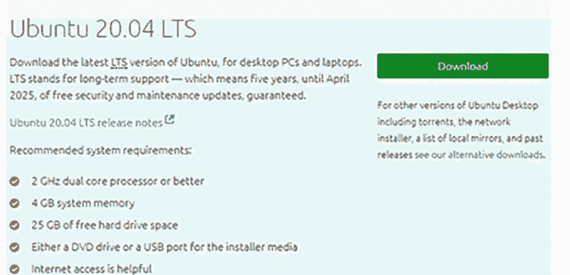

下载的文件将是 `.ISO` 格式。我们将使用此文件来创建可启动 U 盘。

根据你需要的保存位置保存该文件。

### 创建可启动 U 盘

如前所述，你需要一个空间在 4GB 或更大的 U 盘。此过程还将删除 U 盘上的所有现有文件。确保已备份 U 盘上的任何重要数据。我们还将在一个 Windows 系统上创建这个可启动 U 盘。

你将在 Windows 上需要一个第三方应用程序，例如 `Rufus`，来创建可启动 U 盘。

你可以从 `https://rufus.ie/` 下载 `Rufus`。向下滚动到下载部分，点击最新版本的 `Rufus` 开始下载。

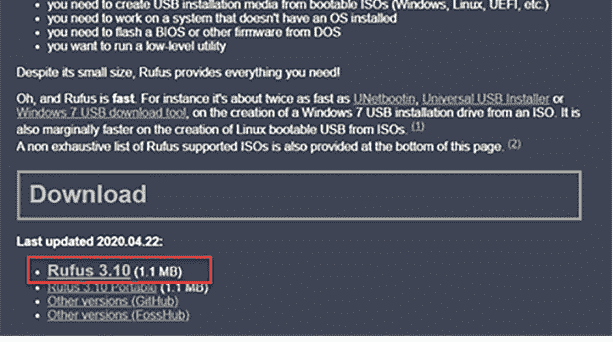

下载完成后启动该文件。

你会看到一个弹出窗口。该窗口询问你是否要检查在线更新。点击“否”。

**Rufus 更新策略**

你是否允许 `Rufus` 在线检查应用程序更新？

更多信息 [是] [否]

`Rufus` 应用程序启动后，将你的 U 盘插入电脑。应用程序将识别它，并将其列在“设备”字段中。

**在“设备”字段中选择 U 盘**

在“启动选择”下拉菜单中，选择“磁盘或 ISO 映像”。点击旁边的“选择”按钮。在你的电脑上，选择你之前下载的 Ubuntu ISO。

**Rufus 3.0.1304**

| 驱动器属性 | |
| :--- | :--- |
| 设备 | Ubuntu 18.04 LTS amd64 (G:) [8GB] |
| 启动选择 | `ubuntu-18.04-desktop-amd64.iso` |
| 分区方案 | MBR |
| 目标系统 | BIOS 或 UEFI |
| | - [ ] 显示高级驱动器属性 |
| 格式化选项 | |
| :--- | :--- |
| 卷标 | Ubuntu 18.04 LTS amd64 |
| 文件系统 | FAT32 (默认) |
| 集群大小 | 4096 字节 (默认) |
| | - [ ] 显示高级格式化选项 |

**状态**

准备就绪

点击“开始”按钮。

此过程会将 Ubuntu 安装文件写入你的 U 盘，使其成为可启动 U 盘。

*从 U 盘启动 Ubuntu*

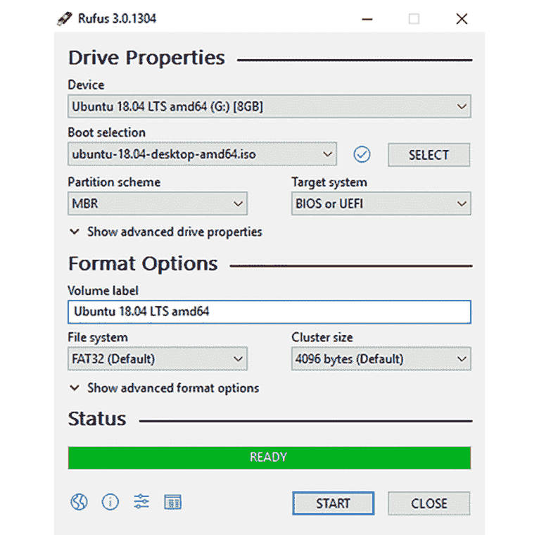

1. 关闭电脑，并拔除所有其他连接的 USB 设备。
2. 插入新创建的可启动 U 盘，并打开电脑。
3. 现在，你的电脑可能会自动从 U 盘启动；如果没有，你需要进入电脑的 BIOS 设置并配置启动设备，以便电脑可以从 U 盘启动。
4. 每个电脑制造商进入 BIOS 设置的方式都不同。当开启电脑时，你应该能在几秒钟内看到用于进入 BIOS 设置的键盘按键提示。
5. 如果一切顺利，你会看到一个启动提示，询问你想从哪里启动。选择 U 盘。现在你应该能看到 Ubuntu 实时光盘菜单。

**从 U 盘运行 Ubuntu**

你可以在决定将其安装到硬盘之前，直接从 U 盘运行 Ubuntu。`.ISO` 文件具有一种实时模式，可以直接从 U 盘运行。点击“试用 Ubuntu”即可启动此模式。

**安装 Ubuntu 20.04 LTS 桌面版**

点击“安装 Ubuntu”即可开始 Ubuntu 的安装。

**选择键盘布局**

此屏幕上的默认选择将是英语和英语。如果你习惯使用不同的键盘，可以更改布局。准备好后点击“继续”。

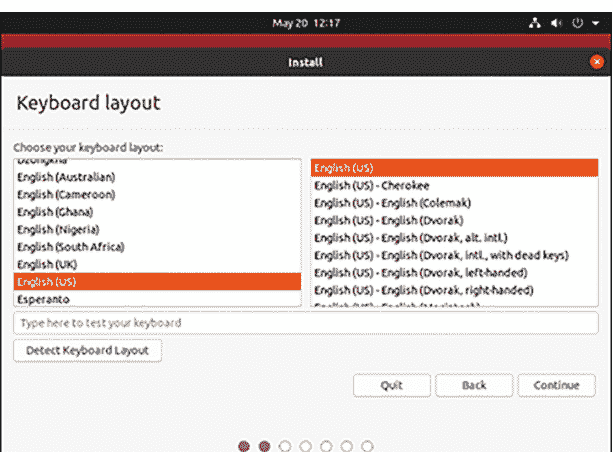

**启动时安装的应用程序**

**标准安装**

这将包括完整的 Ubuntu 桌面安装，涵盖所有软件、媒体播放器和游戏。

**最小安装**

此选项将安装 Ubuntu 桌面的最小版本，软件数量有限。你还需要确认以下更多选项。

**安装时下载更新**

有时，安装程序需要从 Ubuntu 存储库下载额外的文件。这些不是强制性的，但此选项可以为你节省时间，并且在安装时即时更新系统。

**安装用于图形和 Wi-Fi 硬件以及额外媒体格式的第三方软件**

您正在安装 Ubuntu 的系统中可能包含额外的硬件，例如显卡和 Wi-Fi 网络卡。Ubuntu 安装中附带的开源驱动程序可能默认不支持您的硬件。在这种情况下，应启用此选项，以便安装程序在必要时下载适用于您硬件的第三方驱动程序。

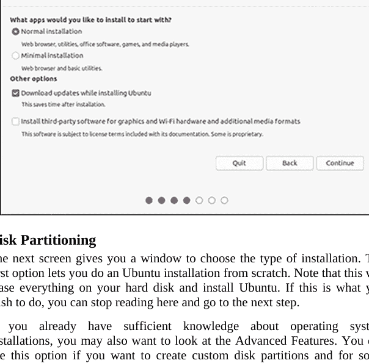

## 磁盘分区

下一个界面为您提供一个窗口来选择安装类型。第一个选项允许您从零开始安装 Ubuntu。请注意，这将擦除硬盘上的所有内容并安装 Ubuntu。如果您希望这样做，可以停止阅读并直接进行下一步。

如果您对操作系统安装已有足够的知识，您还可能希望查看高级功能。如果您想创建自定义磁盘分区，或者使用一些额外选项（例如：

- *在新版 Ubuntu 安装中使用 LVM*

`LVM` 或逻辑卷管理是一个可用于在 Linux 上创建虚拟驱动器的工具。它与 `gparted` 工具非常相似。

## 为新安装的 Ubuntu 加密以增强安全性

如果您希望加密硬盘上的所有数据（包括安装文件），可以启用此选项。您将获得一个选项来创建用于稍后解密数据的解密密钥。

如果您希望创建自定义分区，可以选择 *其他（Something Else）*。

选择此选项后，您将进入一个屏幕来创建自定义分区。您可以创建物理分区，Linux 会将这些分区视为独立的物理硬盘。

您可以通过点击“继续”来应用对磁盘分区所做的更改。

您将看到一个确认框，上面写着 *将更改写入磁盘吗？* 这是您检查分区更改的最后机会，只有在这个屏幕上点击“继续”后，您的分区才会生效。

## 选择时区

安装完成后，您需要设置时区。

在框中输入您所在城市的名称。这将有助于系统为您设置时区。点击“继续”。

您以后也可以从 Ubuntu 桌面更改时区。

## 创建用户账户

在下一个界面中，系统会提示您创建用户账户。您需要输入以下详细信息来创建用户账户。

- **名称：** 在此处输入您的姓名
- **计算机名称：** 您可以在此处为系统提供主机名
- **用户名：** 这将作为您的用户账户名
- **密码：** 输入您选择的密码并确保其强度。安装程序会告知您密码的强度。
- **自动登录：** 理想情况下不应启用此选项。
- **要求输入密码才能登录：** 理想情况下，应启用此选项。

点击“继续”以继续安装过程。

安装程序将开始将 Ubuntu 文件写入硬盘，具体时间取决于您的系统硬件。安装完成后，请从系统中拔出可启动的 USB 驱动器。系统将提示您重启。点击“立即重启”。


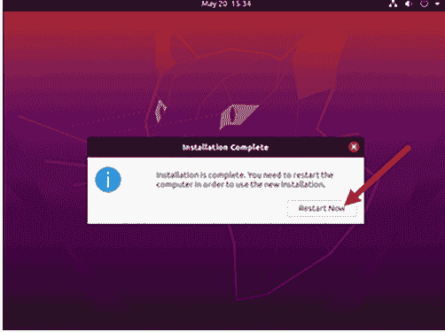

系统将重启，并应该能够启动到新安装的 Ubuntu 20.04 LTS。

您现在已经成功在系统中安装了 Ubuntu。如果您的系统通过以太网或 Wi-Fi 连接到网络，您将看到提示以下载并安装更新。建议安装更新以保持系统最新状态。

在本章中，我们介绍了最常见的 Ubuntu 安装过程，其中包括创建可启动的 USB 驱动器，并在系统中从零开始安装 Ubuntu（之前可能已安装过 Windows）。还有其他安装方法，您可以在安装 Ubuntu 的同时保留现有的 Windows 操作系统。这是通过在不同于 Windows 操作系统安装位置的分区上创建 Ubuntu 安装来实现的。由于这是一本面向初学者的书，因此本书不涵盖此类安装方式。

# 第四章

## 开始使用 Ubuntu

既然您已经安装了 Ubuntu，现在是时候开始使用您的 Linux 操作系统了。与 Windows 或 macOS 等需要付费才能获取额外软件的收费操作系统不同，Ubuntu 已内置了您入门所需的软件。您将在 Ubuntu 中找到从办公套件、网络浏览器到电子邮件和媒体工具的一切。安装完成后，您即可开始使用 Ubuntu。

每个人使用计算机的方式都独一无二，每个用户都喜欢根据自己的需求定制计算机的外观和感觉。鉴于此，Linux 允许您使用其提供的多种图形界面之一。因此，Linux 上有数百种图形界面，以满足每个用户的需求。

尽管 Linux 有多种图形界面可用，但其中两种最为流行，分别是 GNOME 和 KDE。这些环境都具有用户友好且易于使用的界面。它们在桌面外观以及进一步个性化的能力方面存在一些差异。

KDE 环境赋予用户完全的控制和配置选项，以个性化桌面。用户可以配置桌面的各个方面，并自由修改桌面的外观和感觉。

另一方面，GNOME 灵感来源于 Windows 和 macOS 的桌面，并优先考虑简单性。GNOME 也很容易自定义，但会向用户隐藏某些选项。

Ubuntu 用户可以选择这两种桌面环境中的任意一种，也可以与其他一些桌面环境一起使用。

Ubuntu 20.04 的默认桌面环境是 GNOME 3.36，但这并不意味着您不能安装其他桌面环境。让我们看看它为用户提供了什么。

### 主题

Ubuntu 20.04 LTS 附带了一个全新的 Yaru 主题，从启动到桌面都可以看到它。操作系统开发者通常希望他们的操作系统具有独特的外观，这有助于建立品牌形象。2020 年 1 月，Ubuntu 的母公司 Canonical 与 Yaru 团队和 Ubuntu 设计团队合作进行了一次设计冲刺。Yaru 是在 Ubuntu 18.10 中引入的。

Yaru 有三种类型的变体，并且还有一个声音主题。在设计冲刺期间，设计师和开发人员还识别出了一些可以惠及桌面的 UI 改进。您可以使用“外观”设置在浅色、标准和深色之间切换桌面主题。您还可以使用 Yaru 提供的默认声音警报。

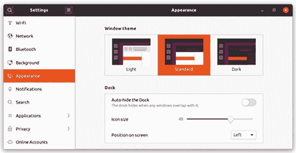

重新设计的 Yaru 主题还允许您更改启动 splash 屏和安装程序窗口。Yaru 团队现在已经实现了让仅在桌面上可用的 spinner 在启动屏幕上也能显示。如果您使用全磁盘加密选项安装了系统，那么启动菜单中的密码框将匹配桌面主题。

Ubuntu 近年来每个主要版本都收到一个新的动物吉祥物。这次，一个设计精美的生物也融入了该版本，并为其取了一个名字。Ubuntu 20.04 LTS 的吉祥物名为 Felicity。


默认主题壁纸以 Felicity 为特色。除了吉祥物壁纸外，该主题还包含更多壁纸。所有图片均来自无版权网站，每张图片都非常清晰。

## GNOME 3.36

自 Ubuntu 17.10 发布以来，Ubuntu 默认将 GNOME 桌面作为默认桌面环境。Ubuntu 团队与 GNOME 开发人员和 Ubuntu 社区深入合作，为 Ubuntu 用户创造了一个稳固的 GNOME 体验。Ubuntu 还与 Debian 的开发人员有联系，以保持更新 GNOME 到最新的软件包。

GNOME 3.36 包含了对用户可见的更改，以实现美观的用户界面和隐藏式更改提升了用户界面的性能，并使桌面体验更加稳定。

新增的“勿扰”开关可静音所有通知，帮助希望专注于当前工作的用户。GNOME 3.36 还配备了简洁美观的登录和锁定屏幕，从而实现了干净的用户界面。登录和锁定屏幕会对用户的实际桌面背景进行模糊处理。

状态菜单提供快速挂起选项。此外，喜欢对应用网格进行整理的用户可以使用此版本 GNOME 中的“更好的应用文件夹管理”功能。

遵循每个新 GNOME 版本的传统，桌面和系统动画现在更加流畅，而且对 CPU 的负载也不大。

## 主要应用程序

Ubuntu 现在可以轻松集成 Microsoft Exchange 和 Google Suite。它默认搭载 Firefox 75 作为默认 Web 浏览器，并持续提供保护用户隐私的功能。

Ubuntu 的默认邮件客户端是 Thunderbird，可让您在桌面上快速访问任何提供商的电子邮件。无论您的邮件服务提供商是 Gmail、Microsoft、其他 POP 或 IMAP 提供商，您都可以在 Thunderbird 上轻松配置电子邮件帐户。Ubuntu 20.04 LTS 预装了 Thunderbird 68.7.0。

您还将获得 LibreOffice 6.4 以满足您所有的生产力需求。这是一个免费但功能强大的办公套件，可让您轻松执行任何与办公相关的任务。

## 一级 OEM 支持

Ubuntu 是一个非常流行的操作系统，被广泛应用于学校、企业、政府和公共部门。Ubuntu 团队与 HP、Dell 和 Lenovo 等计算机制造商密切合作，以满足这些领域预装硬件的需求。让我们通过一些示例来看 Ubuntu 如何与 OEM 合作伙伴合作，为桌面用户的 Linux 体验增添价值。

随着 Ubuntu 20.04 LTS 的发布，在安装通用版本 Ubuntu 时，您可以获得认证设备体验。当您在 OEM 制造商的认证硬件上安装 Ubuntu 时，该特定硬件的所有功能将在设备上自动启用，就像使用出厂镜像一样。

例如，如果您在 Dell 设备上安装了 Ubuntu，启动画面将自动显示 Dell 徽标。Ubuntu 还包含 PulseAudio 14.0、BlueZ 5.53 和 Sound Open Firmware，以支持 SoundWire 和 SMIC，这些功能由 OEM 制造商在其硬件上提供。

鉴于安全性至关重要，我们也可以看到许多设备配备了指纹识别器，用户更喜欢这种方式来解锁系统，而不是输入密码。Ubuntu 和 libfprint 项目也在努力使这种集成成为可能，从而使硬件厂商能够缓解其配备生物特征认证的设备带来的顾虑。

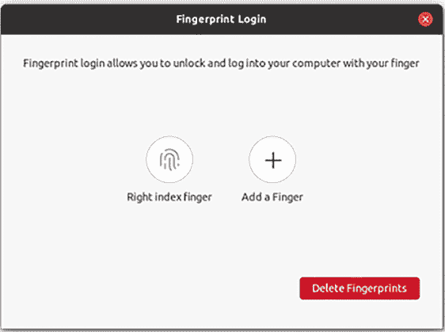

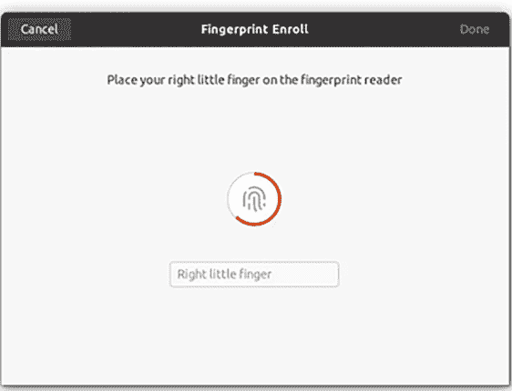

X11 分数缩放功能自 Ubuntu 19.04 起已成为 Ubuntu 的一部分，但从未通过用户界面暴露给用户。这在 Ubuntu 20.04 LTS 中终于得以实现，使 Ubuntu 用户可以通过显示设置轻松启用分数缩放。他们可以从 100% 到 200%，以 25% 的增量调整显示比例。

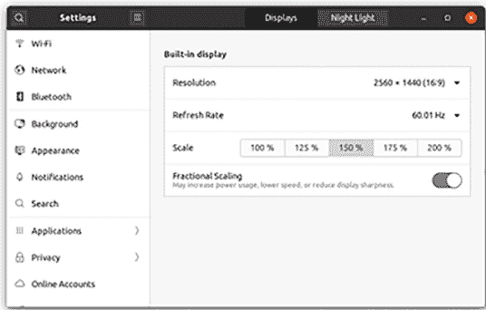

## 性能计算与游戏

机器学习和人工智能是数据工程领域的最新技术，企业正在迅速采用这些技术。Ubuntu 已注意到这一点，并已在为从开发人员工作站到服务器机架，再到边缘和云的企业集成人工智能支持。

Ubuntu 通过提供所需的应用程序、库和驱动程序的最新版本，赋能桌面和服务器的数据科学。数据科学家可以使用强大的 Ubuntu 系统上的 Kubeflow 创建 AI 模型，然后将其部署到服务器或公有云。从华尔街到硅谷，Ubuntu 已成为机器学习的标准。它是初创公司和财富 50 强公司的首选。

如果您系统中的 GPU 用于娱乐和游戏，Ubuntu 20.04 LTS 的新功能将使您非常满意。如果您是游戏玩家，Ubuntu 20.04 LTS 拥有更新的 Steam 软件包，支持新控制器和虚拟现实外设。Ubuntu 还将默认安装 Feral Interactive 的 GameMode。GameMode 是一个守护进程，它通过暂时优化操作系统和游戏进程来提供丰富的游戏体验。目前，GameMode 优化 CPU 调节器、进程优先级、输入/输出优先级、内核调度器、GPU 性能模式、抑制屏幕保护程序、GPU 超频以及自定义脚本。

如果您的系统具有混合图形，现在可以通过 GNOME shell 中可用的独立 GPU 启动应用程序。可以通过使用菜单中的“在独立 GPU 上启动”项来完成此操作。这支持 NVIDIA 和 AMD GPU。


如果您是直播流媒体者或视频内容创作者，Ubuntu 还通过 FFmpeg 支持 VA-API 和 nvenc。这些是集成在 GPU 中用于编码、解码、过滤等的功能。这些功能还通过将密集任务从 CPU 卸载到 GPU 进行处理来减轻 CPU 负担。Shotcut 和 OBS Studio 等应用程序利用 nvenc 从这些硬件编码功能中受益匪浅。

## ZFS 和 ZSYS

ZFS 文件系统作为实验性项目在 Ubuntu 19.10 中引入。Ubuntu 20.04 LTS 默认搭载 ZFS，具备通过硬件加密、存储池修剪、设备移除和性能改进等功能。如前所述，ZFS 仍处于实验阶段。

Zsys 是 Ubuntu 和 ZFS 的集成工具。每当安装新软件或更新整个操作系统时，Zsys 都会自动对系统状态进行快照。此功能有助于用户在系统回滚到之前稳定状态，如果新软件或新更新导致系统出现问题。您可以在启动菜单中找到这些快照。这也可以用于创建未来的备份。

## 自 Ubuntu 18.04 LTS 以来的更改

众所周知，Ubuntu 用户喜欢坚持使用长期支持（LTS）版本。从 Ubuntu 18.04 LTS 升级到 20.04 LTS 的用户将看到大量更改，因为 Ubuntu 20.04 汇集了通过 Ubuntu 18.10、19.04 和 19.10 推出的所有功能。让我们突出最有趣的更改。

GNOME 磁盘现在支持在格式化任何磁盘时使用开源磁盘加密。窗口预览和桌面缩放的性能已得到改进。每当应用程序崩溃时，错误报告工具现在会自动发送崩溃报告。这很有帮助，因为用户在工作时不再被打断。

通过调整 GNOME 设置中的声音面板，麦克风和扬声器的支持已得到改进。通过添加搜索器，桌面文件搜索已得到改进。通过改进 Alt+Tab 功能和窗口预览功能，应用程序切换已变得更加流畅。随着“安全图形模式”的引入，可以调查系统中的意外错误。

CPU 使用率已优化，从而带来更好的桌面性能。大多数显卡的输入/输出延迟也已优化。这意味着用户将享受更快、更流畅的帧率。Ubuntu 还允许使用 DLNA 共享功能，将媒体共享到智能电视或任何其他支持 DLNA 的设备。NVIDIA GPU 的图形驱动程序现已内置于 Ubuntu 安装介质中。这允许用户直接安装驱动程序。

Ubuntu 是一个伟大的操作系统，我们在本章中讨论的内容只是冰山一角。我们鼓励您探索更多功能，以便根据您的需求自定义 Ubuntu 的外观和感觉，并充分享受 Ubuntu 桌面。

## 第五章

### 安装 Ubuntu 20.04 LTS 后要做的事情

Ubuntu 20.04 LTS 的代号是 Focal Fossa。Ubuntu 一直引以为傲的是，其操作系统内置了帮助用户在安装后快速上手的应用程序。默认的应用程序和设置都按照大多数人的喜好进行配置。但我们并不想假设你也是“大多数人”。你可能不需要所有默认功能，或者你可能想要比默认配置更多的内容。

本章将帮助你调整 Ubuntu 20.04 LTS，以提升你的 Ubuntu 使用体验。

### 有什么新功能？

每个版本的 Ubuntu 都与其前一版本不同，Ubuntu 20.04 LTS 也不例外。得益于新的内核压缩算法，Ubuntu 20.04 的启动时间已得到显著改善。我们之前已经讨论过 Yaru 主题以及开机启动画面中显示的 OEM 制造商标志。

### 深色模式

如今，无论是移动设备还是计算机，深色模式都是最新潮流。每个人都希望自己的设备具备深色模式，而现在这在 Ubuntu 上是完全可能的。

Ubuntu 默认不开启深色模式，但你可以轻松切换。请遵循以下步骤。

- 打开“设置” > “外观”
- 选择“深色窗口”设置

就这样。你会看到变化是即时的，从背景到工具栏，所有元素都会立即变暗。不过，所有应用程序本身并不会采用深色主题。

值得注意的是，深色模式不会影响 Ubuntu 中 GNOME Shell 的用户界面，例如日历、通知和系统菜单。

如果你厌倦了深色模式，可以随时从“外观”设置面板中切换回默认主题。

### 调整 GNOME

GNOME Tweaks 是一款应用程序，通过它你可以进一步自定义你的桌面。

你可以获得以下选项：

- 将窗口按钮从默认的右侧移至左侧
- 更改某些主题
- 更改桌面的字体和字号
- 在时钟上显示星期
- 在工作区之间切换
- 自动居中新窗口
- 以及其他更多功能

Ubuntu Tweak 是一款应用程序，通过它你可以对桌面进行微调。

在你的 Ubuntu 系统上启动 Firefox，并访问链接 `apt://gnome-tweaks` 来安装 GNOME Tweaks。

### 获取强大的文件预览工具

有一个名为 GNOME Sushi 的工具，它是 GNOME Shell 桌面可用的空格键预览工具。

如果你曾经是 Mac 用户，你会知道空格键预览是什么意思。苹果的操作系统是第一个具备此功能的系统，并因此变得流行。你可以在文件管理器中选择一个文件，然后按空格键即可快速预览该文件。

同样，你可以使用 Sushi 预览媒体、图像、文档，获取文件或文件夹的信息等，而无需打开专门的应用程序。此外，当你最终找到想要打开的文件时，Sushi 会给你一个选项来执行该操作。

Sushi 是免费且开源的，就像 Ubuntu 一样。你可以在 Ubuntu 软件中心通过搜索其名称来找到它。或者，你可以再次启动 Firefox 并输入 URL `apt://gnome-sushi`。

### 最小化应用程序

在 Windows 中，当你点击任务栏上的任何应用程序时，它会最小化。此功能在 Ubuntu 上默认未启用，但你可以启用它。

此设置不易通过用户界面访问，但你可以通过命令行完成。

只需打开 Linux 终端并输入以下命令以启用 Ubuntu 的最小化功能。

```
gsettings set org.gnome.shell.extensions.dash-to-dock click-action 'minimize'
```

这将立即生效。现在你可以点击坞中的任何应用，你会看到它被最小化。

### 显示电池百分比

如果你在笔记本电脑上安装了 Ubuntu，并希望一眼看到电池百分比，那么这个功能非常有用。它让你无需打开状态栏即可知道剩余的电池百分比。

为此，你需要使用我们在上面讨论过的 GNOME Tweaks 应用。

1. 启动 GNOME Tweaks
2. 选择“顶栏”
3. 启用“电池百分比”设置

你也可以通过命令行启用此功能，在终端中输入以下命令。

```
gsettings set org.gnome.desktop.interface show-battery-percentage true
```

### 调整触摸板滚动

如果你在笔记本电脑上安装了 Ubuntu，并且对触摸板的默认滚动方式（即“自然滚动”）感到不适，你可以选择更改它。你可以将其更改为内容随滚动方向移动，即向下滚动时页面向下移动。

1. 打开“设置”
2. 选择“鼠标和触摸板”
3. 将“自然滚动”选项切换为“开”

就这样，现在你应该能够按照自己的喜好舒适地滚动了。

### 设置 Livepatch

Livepatch 是 Ubuntu 中的一个选项，它允许自动更新 Linux 内核，而无需重启系统。

此功能主要针对服务器，但在桌面系统上也能正常工作。

从应用程序网格中启动 Livepatch 应用，你就可以在安装安全更新到 Linux 内核后无需重启了。

### 自动删除回收站

在“设置”的“隐私”选项中隐藏着一个自动删除回收站选项。你可以简单地启用它，以便定期删除回收站中的文件。如果你时不时忘记手动操作，自动释放空间会非常有用。

### 安装出色的软件

你可以找到适用于 Ubuntu 的免费和付费软件。但你需要哪些软件？

你可以浏览 Ubuntu 软件中心，并安装你认为适合自己的软件。

### 在你的 Ubuntu 系统中不要做的事

有少数几件事不建议在你的 Ubuntu 20.04 LTS 系统中做。让我们简要了解一下。

- 不要卸载默认桌面

Ubuntu 的默认桌面环境是 GNOME Shell 桌面。并非每个用户都会喜欢这个桌面，但 Ubuntu 提供了选项，允许你在保留默认 GNOME Shell 的同时安装其他桌面环境，但在安装新桌面后卸载默认桌面环境是一个糟糕的决定。如果你卸载了 Ubuntu 系统的默认桌面环境，可能会损害系统性能，并导致不可逆的损坏。

- 不要运行随机命令

你会在互联网上发现数百万个声称能做出惊人效果的 Linux 脚本。虽然其中一些是真实的，但大多数可能会损坏你的系统。

应遵循的简单规则是：如果你不知道某个特定 Linux 命令的功能，就不要运行它。即使对于一次性执行多个功能的命令，也应严格遵守此规则。在终端上运行脚本之前，始终审查脚本的内容。

## 第六章

### Linux 命令行

在本章中，我们将带你了解 Linux 命令行。Linux 命令行类似于 Windows 中的命令提示符，可以使用命令行而不是图形界面来执行几乎任何任务。到本章结束时，你将能够熟练地通过命令行管理文件和目录。

### Bash Shell


# BASH

BASH（Bourne-Again Shell 的缩写）是一个 Linux 实用工具，它帮助通过命令行与操作系统进行交互。它是每个 Linux 发行版首选的 shell，因此，你也会在 Ubuntu 上找到它。可以通过名为终端的实用工具在 Ubuntu 上访问 Bash shell。

你可以通过选择桌面左下角的应用按钮，然后单击屏幕底部的“全部”来启动 Ubuntu 上的终端。继续选择“实用工具”，你将看到所有系统工具位于“实用工具”下。单击“终端”以启动它。

启动 bash shell 后，你会看到一串字符串，表示期望用户输入。这个字符串称为 shell 提示符。如果你是 Ubuntu 系统的 root 用户或超级用户，提示符将以 `#` 号结尾。如果你是普通非 root 用户，提示符将以 `$` 符号结尾。

```
[root@desktop ~]#
[student@desktop ~]$
```

如上所述，Linux Bash shell 就像 Windows 中可用的命令提示符，但两者使用不同的脚本语言，Bash shell 中的脚本语言比 Windows PowerShell 实用工具中可用的脚本语言要优越得多。你可以自动化许多任务

使用 Bash 外壳在 Linux 操作系统中执行任务。你还可以使用 Bash 外壳来执行那些在图形界面上做起来相当复杂的任务。

正如前文所述，在 Ubuntu 中可以通过终端访问 Bash 外壳。键盘作为终端的输入设备，显示器作为输出设备，向你展示命令的结果。Linux 还提供虚拟控制台来访问 Bash 外壳。这有助于你在单台物理机器上拥有多个虚拟控制台，并且多个用户可以通过这些虚拟控制台登录。

## 外壳基础

在 Linux 的外壳提示符中输入的命令由三部分组成。

1. `你想运行的命令`
2. `将定义命令行为的选项`
3. `作为命令目标的参数`

命令定义了你要执行的程序。命令后面可以跟随选项，也可以完全没有选项。选项将定义命令的行为和功能方式。你可以使用一个短划线（dash）或两个短划线（dashes）来指定一个选项。短划线附加在选项后面，以便将选项与参数区分开来。

示例 `-a` 或 `--all`

参数也跟随在命令之后，你可以有一个或多个参数。参数是命令执行所针对的目标。

基本命令看起来像这样。

`usermod -L John`

在这个示例中，命令是 `usermod`

选项是 `-L`

参数是 `John`

此命令用于锁定 Linux 系统中用户 `John` 的密码。

知道哪些选项适用于哪些命令对于在命令行上高效工作非常有用。任何命令后的 `--help` 选项都会给你一个可用于该特定命令的选项列表。死记硬背每个选项并不是很重要。列表还提供了每个选项功能的描述。

让我们通过 `grep` 命令来看一个例子。`grep` 命令用于在字符串或文件中进行搜索。如果文件中包含的字符串与你在 `grep` 命令中指定的字符串匹配，输出将显示文件中包含该指定字符串的每一行。


# `grep --help` 输出

```
[student@desktop ~]$ grep --help

Usage: grep [OPTION]... PATTERN [FILE]...

Search for PATTERN in each FILE or standard input.

PATTERN is, by default, a basic regular expression (BRE).

Example: grep -i 'hello world' menu.h main.c

Regex Selection and Interpretation:
-E, --extended-regexp         PATTERN is an extended regular expression (ERE)
-F, --fixed-strings           PATTERN is a set of newline-separated fixed strings
-G, --basic-regexp           PATTERN is a basic regular expression (BRE)
-P, --perl-regexp           PATTERN is a Perl regular expression
-e, --regexp=PATTERN        use PATTERN for matching
-f, --file=FILE             obtain PATTERN from FILE
-i, --ignore-case			ignore case distinctions
-w, --word-regexp			force PATTERN to match only whole words
-x, --line-regexp			force PATTERN to match only whole lines
-z, --null-data			a data line ends in 0 byte, not newline

Miscellaneous:
-s, --no-messages			suppress error messages
-v, --invert-match			select non-matching lines
-V, --version			display version information and exit
--help			display this help text and exit

Output Control:
-m, --max-count=NUM		stop after NUM matches
-b, --byte-offset			print the byte offset with output lines
-n, --line-number			print line number with output lines
--line-buffered			flush output on every line
-H, --with-filename		print the file name for each match
-h, --no-filename			suppress the file name prefix on output
--label=LABEL			use LABEL as the standard input file name
-o, --only-matching		show only the part of a line matching PATTERN
-q, --quiet, --silent	suppress all normal output
--binary-files=TYPE	assume that binary files are TYPE; TYPE is 'binary', 'text', or 'without-match'
-a, --text			equivalent to --binary-files=text
-I                equivalent to --binary-files=without-match
-d, --directories=ACTION  how to handle directories; ACTION is 'read', 'recurse', or 'skip'
-D, --devices=ACTION     how to handle devices, FIFOs, and sockets; ACTION is 'read' or 'skip'
-r, --recursive           like --directories=recurse
-R, --dereference-recursive likewise, but follow all symlinks
--include=FILE_PATTERN  search only files that match FILE_PATTERN
--exclude=FILE_PATTERN  skip files and directories matching FILE_PATTERN
--exclude-from=FILE   skip files matching any file pattern from FILE
--exclude-dir=PATTERN  directories that match PATTERN will be skipped.
-L, --files-without-match print only names of FILES containing no match
-l, --files-with-matches  print only names of FILES containing matches
-c, --count               print only a count of matching lines per FILE
-T, --initial-tab         make tabs line up (if needed)
-Z, --null                print 0 byte after FILE name

Context Control:
-B, --before-context=NUM print NUM lines of leading context
-A, --after-context=NUM print NUM lines of trailing context
-C, --context=NUM  print NUM lines of output context
-NUM  same as --context=NUM
--group-separator=SEP use SEP as a group separator
--no-group-separator use empty string as a group separator
--color[=WHEN],
--colour[=WHEN]   use markers to highlight the matching strings; WHEN is 'always', 'never', or 'auto'
-U, --binary    do not strip CR characters at EOL (MSDOS/Windows)
-u, --unix-byte-offsets  report offsets as if CRs were not there (MSDOS/Windows)

'egrep' means 'grep -E'. 'fgrep' means 'grep -F'.

Direct invocation as either 'egrep' or 'fgrep' is deprecated.

When FILE is -, read standard input. With no FILE, read . if a command-line -r is given, - otherwise. If fewer than two FILES are given, assume -h.
Exit status is 0 if any line is selected, 1 otherwise;
if any error occurs and -q is not given, the exit status is 2.

Report Bugs to: bug-grep@gnu.org
GNU Grep home page: <http://www.gnu.org/software/grep/>
General help using GNU software: <http://www.gnu.org/gethelp/>
```

起初，你可能会发现命令行有点难懂，但一旦你习惯了命令行，你会比图形界面更喜欢它。

## 命令行基本语法

让我们尝试理解命令行的基本语法。

- 选项使用方括号 `[]` 包裹
- 如果命令后跟有 `...`，则表示属于同一类型的项列表
- 如果你指定了多个项并使用管道符 `|` 分隔，则表示应使用其中仅一项


变量使用尖括号 `<>` 指定。如果你在语法中看到 `<filename>`，你知道你需要将其替换为实际的文件名

让我们看一个例子。

```
[student@desktop ~]$ date --help
date [OPTION]... [+FORMAT]
```

这表明命令是 `date`，它接受由 `[OPTION]` 表示的选项。它还接受以 + 号开头的另一个选项 `[FORMAT]`。

## 执行命令

Bash 外壳的主要功能是解释用户输入的命令，并将其转换为 Linux 操作系统的特定系统指令。我们已经知道，你在外壳提示符上输入的字符串由三部分组成：命令、选项和参数。在命令提示符上输入的每个单词都需要用空格分隔。Linux 系统已经有一个脚本文件，其中定义了你所输入命令的功能。你可以通过向命令传递选项和参数来操纵这个脚本。

让我们来浏览一下最常用的命令。

`date` 命令会显示你在 Linux 系统中设置的当前日期和时间。如果需要，你也可以使用同一命令来设置新的日期和时间。如果你希望以特定格式显示日期和时间，可以在命令后跟上 + 号作为参数。

```
[student@desktop ~]$ date

Sat Aug 5 08:15:30 GMT 2019

[student@desktop ~]$ date +%R

08:15

[student@desktop ~]$ date +%x

08/05/2019
```

`passwd` 命令用于更改 Linux 系统中某个用户的密码。该命令会要求你先输入该用户的现有密码，之后才允许你设置新密码。Linux 系统要求使用强密码，包含大写和小写字母、数字以及符号。此外，密码不能是字典中的单词。非 root 用户只能通过命令行更改自己的密码。root 用户有权通过命令行更改任何用户的密码。

```
[student@desktop ~]$ passwd

Changing password for user student.

Changing password for student.

(current) UNIX password: type old password here

New password: Specify a new password here

Retype new password: Type new password again

passwd: all authentication tokens updated successfully.
```

与 Windows 中的文件格式不同，Linux 文件系统中的文件不使用任何扩展名来指定类型。如果你想了解任何文件的格式，仍然可以使用 `file` 命令。文件需要作为参数与命令一起传递。

```
[student@desktop ~]$ file /etc/passwd
/etc/passwd: ASCII text
```

如果你向此命令传递目录而不是文件，输出将告诉你它是一个目录。

```
[student@desktop ~]$ file /home
/home: directory
```

你可以使用 `head` 和 `tail` 命令分别打印文件的前 10 行或最后 10 行。这些命令也接受 `-n` 选项，可用于指定要输出的自定义行数。

```
[student@desktop ~]$ head /etc/passwd
```

此命令将打印 `passwd` 文件的前 10 行。

```
[student@desktop ~]$ tail -n4 /etc/passwd
```

此命令将打印 `passwd` 文件的最后 4 行。

你可以将文件作为参数传递给 `wc` 命令，以获取文件中的行数、单词数和字符数。该命令支持 `-l, -w, -c` 选项，分别代表行数、单词数和字符数。

```
[student@desktop ~]$ wc /etc/passwd
40    80    2000 /etc/passwd
```

这表明 `passwd` 文件有 40 行，80 个单词和 2000 个字符。

如你所见，如果你没有指定任何选项使用 `wc` 命令，输出将显示所有信息。如果你为命令传递了特定选项，它将仅显示该特定参数的输出。

`history` 命令将显示你过去输入的所有命令。这些命令旁边也会有一个编号。然后你可以输入 `!` 加上该命令编号，以查看你之前输入的完整命令。

```
[student@desktop ~]$ history
1 clear
2 who
3 pwd
[student@desktop ~]$ !3
/home/student
```

你可以看到 `!3` 展开了 `pwd` 的完整命令，甚至显示了用户当前工作目录的输出。

你可以使用键盘方向键来浏览 `history` 命令的输出。向上箭头键带你到上面的命令，而向下箭头键带你到下面的命令。向左和向右箭头键将帮助你编辑当前所在的命令。

## 通过命令行管理文件

本节将介绍一些重要的命令，帮助你管理 Linux 上的文件和目录。你将学习用于创建、删除、复制、移动和组织文件和目录的命令。

### Linux 文件系统层次结构

要充分理解 Linux 文件系统，首先需要理解 Linux 文件系统的层次结构。Linux 文件系统层次结构在视觉上像一棵倒置的树，根位于顶部，然后向下分支形成其他部分。

根目录表示为 `/`，位于文件系统层次结构的顶部。`/` 字符也用于在 Linux 中表示文件路径。例如，`var` 是根目录下的一个子目录，表示为 `/var`。类似地，`var` 目录下有一个名为 `log` 的子目录，其路径表示为 `/var/log`。

根目录有一组特定的子目录，用于存储特定的文件。例如，`boot` 子目录将包含负责 Linux 系统启动过程的文件。

让我们来浏览一下根目录下的主要子目录。

- `/usr`

该子目录包含所有用户共用的软件文件。它进一步细分为以下内容。

- `/usr/bin`: 用户命令文件

- `/usr/sbin`: 系统管理使用的命令

- `/usr/local`: 本地定制的软件文件

- `/etc`

与系统配置相关的文件存储在此子目录中。

- `/var`

该子目录存储动态变化的文件，如数据库、日志等。

- `/run`

某些在运行时创建的文件存储在此子目录中。这些文件将在后续启动时重新创建。

- `/home`

该子目录下列出了 Linux 系统的所有不同用户。每个用户都有自己特定的主目录。用户可以在其主目录下存储所有数据。用户无法访问其他用户的主目录。

- `/root`

这是 `root` 用户的主目录，除了 `root` 用户外，任何人都无法访问。

- `/tmp`

顾名思义，该子目录存储所有临时文件。如果该目录中的文件超过十天且未被访问，系统将自动删除它们。类似的目录存在于 `/var/tmp`，其中也有临时文件。这里的文件如果在最后 30 天内未被访问，将被自动删除。

- `/dev`

Linux 系统上的硬件设备作为文件存储在此子目录下。

### 文件和目录管理

在 Linux 操作系统上管理文件或目录指的是创建、修改和删除文件或目录。让我们来浏览一下在 Linux 中用于管理文件和目录的常用命令。

| 操作 | 单一源 | 多个源 |
| :--- | :--- | :--- |
| 复制文件 | `cp file1 file2` | `cp file1 file2 file3 dir` |
| 移动文件 | `mv file1 file2` | `mv file1 file2 file3 dir` |
| 删除文件 | `rm file1` | `rm -f file1 file2 file3` |
| 创建目录 | `mkdir dir` | `mkdir -p par1/par2/dir` |
| 复制目录 | `cp -r dir1 dir2` | `cp -r dir1 dir2 dir3 dir4` |
| 移动目录 | `mv dir1 dir2` | `mv dir1 dir2 dir3 dir4` |
| 删除目录 | `rm -r dir1` | `rm -rf dir1 dir2 dir3` |

```
mv file1 file2
```

此命令将 `file1` 重命名为 `file2`

```
cp -r dir1 dir2
```

此命令将 `dir1` 的内容复制到 `dir2`

```
rm -r dir1
```

此命令将删除 `dir1` 的内容

`-r` 用于递归处理源目录

```
mv dir1 dir2
```

如果 `dir2` 存在，此命令将 `dir1` 的内容复制到 `dir2`。如果 `dir2` 不存在，`dir1` 将被重命名为 `dir2`

```
cp file1 file2 file3 dir
mv file1 file2 file3 dir
cp -r dir1 dir2 dir3 dir4
mv dir1 dir2 dir3 dir4
```

文件或目录内容会被复制或移动到末尾指定的目录。

```
rm -f file1 file2 file3
```

```
rm -rf dir1 dir2 dir3
```


此命令删除了文件或目录。请谨慎使用，因为 `-f` 使用了强制选项，将删除所有内容且无任何确认提示

```
mkdir -p par1/par2/dir
```

该命令将创建新目录。请谨慎使用，因为使用 `-p` 将从父目录开始继续创建目录，无论是否有输入错误

让我们通过示例来看看这些命令是如何工作的。

### 目录创建

你可以使用 `mkdir` 命令来创建目录和子目录。只要指定的名称不存在或父目录指定正确，目录创建应该不会有问题。否则，你将收到错误。如果你在创建目录时使用 `-p` 选项，如果父目录不存在，它将被创建。你需要对此保持谨慎

选项，因为它不检查任何拼写错误。

```
[student@desktop ~]$ mkdir Drawer
[student@desktop ~]$ ls
    Drawer
```

可以看到，该命令在 `student` 用户的家目录中创建了一个名为 `Drawer` 的新目录。

```
[student@desktop ~]$ mkdir -p Thesis/Chapter1
[student@desktop ~]$ ls -R
    Thesis    thesis_chapter1
```

当我们在使用 `mkdir` 命令时使用 `-p` 选项，父目录 `Thesis` 和子目录 `Chapter1` 会同时被创建。

## 复制文件

在 Linux 系统中，可以在命令行使用 `cp` 命令来复制文件。该命令可用于复制一个或多个文件，你可以复制同一目录内的文件，也可以从一个目录复制到另一个目录。

你需要指定一个唯一的目的地文件。如果文件已存在，复制操作将使用源文件的内容覆盖现有文件。

```
[student@desktop ~]$ cd Documents
[student@desktop Documents]$ cp one.txt two.txt
```

在上面的示例中，`one.txt` 文件的内容被复制到了 `two.txt` 文件。

```
[student@desktop ~]$ cp one.txt Documents/two.txt
```

在上面的示例中，`one.txt` 文件的内容被复制到了 `Documents` 目录下的 `two.txt` 文件。

## 移动文件

你可以使用 `mv` 命令将文件从一个位置移动到另一个位置。`mv` 命令还有一个备用功能。如果你在同一个目录内使用 `mv` 命令，它仅仅会对源文件执行重命名操作。如果你将目的地指定为不同的目录，源文件将被移动到目的地目录下方。

如果文件大小巨大，将一个目录移动到另一个目录的操作可能需要更长的时间。

```
[student@desktop ~]$ ls

Hello.txt

[student@desktop ~]$ mv Hello.txt Bye.txt

[student@desktop ~]$ ls

Bye.txt
```

`mv` 操作在同一个目录内进行。文件只是从 `Hello.txt` 重命名为 `Bye.txt`。

```
[student@desktop ~]$ ls

Hello.txt

[student@desktop ~]$ mv Hello.txt Documents

[student@desktop ~]$ ls Documents

Hello.txt
```

`mv` 操作不在同一个目录内进行。文件从 `Hello.txt` 移动到了 `Documents` 目录下。

## 删除文件和目录

`rm` 命令用于在 Linux 中删除文件和目录。将其与 `-r` 结合使用，它将递归删除指定路径下的所有内容。

请注意，Linux 没有像 Windows 中的回收站这样的概念。因此，当你在 Linux 中删除某些内容时，它是被永久删除的。没有再次恢复它的方法。

```
[student@desktop ~]$ ls
File1.txt Directory1
[student@desktop ~]$ rm file1
[student@desktop ~]$ ls
Directory1
[student@desktop ~]$rm -r Directory1
[student@desktop ~]$ ls
[student@desktop ~]$
```

在上面的示例中，你可以看到 `rm` 和 `rm -r` 命令如何用于删除文件和目录。

此外，请注意，如果目录中不包含任何文件，你同样可以使用 `rmdir` 命令来删除它。

# 第七章 在 Linux 中使用 Vim 编辑文本文件

在本章中，我们将学习如何在 Linux 中编辑文本文件。在任何 Linux 发行版的图形界面上都有可用于编辑文本文件的应用程序，但在 Linux 中编辑文本文件的本质是通过命令行。在 Linux 中通过命令行编辑文本文件的习惯会让你走得更远，我们个人建议这是在 Linux 中编辑文件的最佳方式。

Linux 中有许多文本编辑器，如 `nano`、`vi` 和 `vim`。我们将在书中使用 Vim 文本编辑器，因为它是最流行的。如果你按照安装章节在电脑上安装了 Ubuntu，`vim` 可能在或可能不在默认情况下可用。但没有什么好担心的。在 Ubuntu 上安装 `vim` 非常容易。

在你的 Ubuntu 系统上启动终端并输入以下命令。

```
apt install vim
```

请记住，你需要以 `root` 用户身份登录才能运行此命令。

按回车，系统将在你的 Ubuntu 系统上安装 `vim`。

## Vim 简介

对于初学者以及随着你在 Linux 系统上的经验增长，编辑文件是一项重要的技能。如果你开始热爱 Linux 作为操作系统并想以此为职业，你可能需要查看 Linux 系统管理员职位。Linux 系统管理员每天使用像 `vim` 这样的文本编辑器来编辑 Linux 中的配置文件，并编写自己的 shell 脚本以自动执行任务。

`Vim` 是一个强大的工具。它支持多种编程语言的文本补全模式脚本、文件类型插件以及许多其他功能。`Vim` 非常流行，互联网上有针对它的第三方插件，可以帮助你完成很多事情，例如编辑简单文件、各种编程语言的自动补全，以及像待办事项列表这样非常简单的任务。

## Vim 版本

`Vim` 有三个版本，每个版本都有其用途，但是可以并排拥有这三个版本并使用它们。以下是 `vim` 的版本。

### Vim-Minimal

此包包含一个较旧版本的 `vim`，通常仅称为 `vi`。可以与此版本 `vim` 一起使用的命令也是只能与 `vi` 一起使用的命令。

### Vim-Enhanced

此包包含 `vim`，并包括语法高亮、拼写检查和文件扩展名插件。

### vim-X11

此 `vim` 包包含 `gvim`，它也支持通过图形界面编辑文件。`gvim` 最受欢迎的功能是其菜单栏。对于最初难以记住终端中 `vim` 命令的新手来说很受欢迎。它也支持在终端内的 `vim` 会话中使用鼠标。

## Vim 模式

`Vim` 并不是以其易用性著称，因为它有多种模式。这意味着你使用的键盘按键会根据你所处的模式具有不同的功能。你不必担心，本章将一步步指导你使用 `vim`，你会爱上它的。

`vim` 中存在以下三种模式。

| 功能 | 模式 |
|---|---|
| 命令模式 | 在此模式下，你可以进行文件导航、剪切、复制和粘贴功能以及其他简单命令。撤销和重做等命令也可以在此模式下执行 |
| 插入模式 | 在此模式下可以进行普通的文本编辑。插入模式的一个变体称为替换模式，在此模式下你可以替换文本而不是插入它 |
| Ex 模式 | 在此模式下可以执行打开文件、保存文件或退出 `vim` 等功能。它还支持其他一些复杂功能。可以使用此模式将程序的输出插入到当前文件中。`Vim` 配置也可以从此模式进行。`ex` 中可以做的一切都可以在此 `vim` 模式下完成 |

## Vim 工作流程

本节将教你如何使用 `vim` 打开文本文件，插入和替换文本，在 `vim` 中移动光标，保存文件，以及查看帮助选项。

## Vim 编辑器基础

无论你在长期内选择使用哪种文本编辑器，它都应该能帮助你执行这三个主要任务。

- 创建新文件或打开现有文件
- 修改文件内容
- 保存更改并退出

## 在 Vim 中打开文件

你可以通过将文件名作为 `vim` 命令的参数，轻松地在终端上的 `vim` 中打开文件。例如，如果你想打开文件，只需键入下面的命令。

```
[student@desktop ~]$ vim filename
```

请注意，如果在 `vim` 命令中指定的文件不存在，`vim` 最终会创建一个该名称的新文件并将你直接带到编辑器。

默认情况下，`vim` 以命令模式启动。你会在 `vim` 编辑器左下角看到诸如文件名、字符数、行数等信息。你还会看到关于当前屏幕上显示的文本文件哪部分的信息，例如表示全部的 `All`，表示文件顶部的 `Top`，表示文件最后几行的 `Bot`，或者你可能看到一个百分比，指示你当前所处的文件部分。在 `vim` 术语中，最后一行被称为尺标。

### 在 Vim 中编辑文本

当你在 `vim` 的命令模式下时，你的键盘按键不会完全按你的意图行事。这是因为命令模式不支持插入文本，它是用来指定一些功能给 `vim` 的，例如光标移动或复制粘贴。


你可以通过使用命令模式中与各种功能相对应的命令，从命令模式切换到插入模式。让我们看看这些命令。

| 按键 | 结果 |
|---|---|
| `i` | 这将切换你到插入模式，你可以开始在光标当前位置之前输入 |
| `a` | 这也将切换你到插入模式，但会在光标当前位置之后开始输入 |
| `I` | 这将移动光标到当前行的开头，并切换你到插入模式 |
| `A` | 这将移动光标到当前行的末尾，并切换你到插入模式 |

## 插入和替换模式

- `R`：切换到替换模式，从光标当前所在的字符开始。在替换模式下，你不能插入额外的字符，但你输入的每个字符都会替换文档中的当前字符。
- `o`：在当前行下方打开一个新行，然后切换到插入模式。
- `O`：在当前行上方打开一个新行，然后切换到插入模式。

你可以通过 Vim 底部显示 `--INSERT--` 或 `--REPLACE--` 的指示器来判断是否处于插入模式或替换模式。

要返回到命令模式，只需按下键盘上的 `Esc` 键即可。

在命令模式下，你可以使用键盘按键来导航你的文件。下表列出了最常用按键。

| 按键 | 结果 |
| :--- | :--- |
| `h` | 光标向左移动一个位置 |
| `j` | 光标向下移动一行 |
| `k` | 光标向上移动一行 |
| `l` | 光标向右移动一个位置 |
| `^` | 光标移动到当前行的开头 |
| `$` | 光标移动到当前行的末尾 |
| `gg` | 光标移动到文档的第一行 |
| `G` | 光标移动到文档的最后一行 |

请注意，在返回 Vim 命令模式时，你可以按下键盘上的 `Esc` 键来取消当前命令。确保已返回到命令模式的好习惯是按两次 `Esc` 键。

### 在 Vim 中保存文件

你可以从 Ex 模式保存 Vim 中的文件。你可以通过在 Vim 命令模式下按下冒号 (`:`) 键来进入 Ex 模式。因此，如果你正处于 Vim 的插入模式，先按 `Esc` 键进入命令模式，然后按冒号键进入 Ex 模式。当你处于 Ex 模式时，你会看到 Vim 标尺上的冒号，这表明你正处于 Ex 模式。你可以在 Ex 模式下输入命令，然后按回车键完成该命令。

下表列出了可在 Vim 的 Ex 模式中使用的命令列表。

| 命令 | 结果 |
| :--- | :--- |
| `:wq` | 保存当前文件并退出 Vim |
| `:x` | 如果没有未保存的更改则保存当前文件，然后退出 Vim |
| `:w` | 保存当前文件并停留在编辑器中。不退出 Vim |
| `:w <filename>` | 使用不同的文件名保存当前文件 |
| `:q` | 仅在没有未保存更改的情况下退出当前文件 |
| `:q!` | 忽略任何未保存的更改并退出当前文件 |

在上述表格中，`w` 代表 write（写入），意味着将更改写入文件并保存。`q` 代表 quit（退出），感叹号表示强制执行命令。

### 在 Vim 中获取帮助

Vim 拥有广泛的在线帮助，可以通过 Vim 本身访问。你可以在 Vim 的命令模式下输入 `:help`，帮助屏幕将弹出并提供大量的帮助文档。如果你想查找特定主题的帮助，可以输入 `:help subject`。

帮助屏幕将在一个新的分割窗口中启动。你也可以在 Vim 的命令模式下输入命令 `vimtutor`。这将启动一个 Vim 引导式教程，对新用户非常有用。

### 在 Vim 中编辑

在本节中，我们将介绍在编辑时非常有用的 Vim 快捷键。它们在复制和粘贴、替换文本等任务中也非常有用。我们还将了解 Vim 中的撤销和重做选项。

### 在 Vim 中移动

大多数 Linux 编辑器都有限制，你只能通过单个字符或单行移动光标。这些选项也可通过 Vim 的命令模式实现，但 Vim 提供了额外的选项，让你可以轻松导航整个文档。这些 Vim 选项让你可以在 Vim 中按单词、句子和段落移动文本文件。请注意，这些选项仅在 Vim 的命令模式下有效，在插入模式下完全无效。

| 按键 | 功能 |
| :--- | :--- |
| `w` | 光标移动到下一个单词的开始处 |
| `b` | 光标移动到上一个单词的开始处 |
| `(` | 光标移动到当前句子或上一个句子的开始处 |
| `)` | 光标移动到下一个句子的开始处 |
| `{` | 光标移动到当前段落或上一个段落的开始处 |
| `}` | 光标移动到下一个段落的开始处 |

上述命令也可以接受数字作为前缀。例如，如果你输入 `5w`，光标将移动到接下来五个单词之后。同样，如果你输入 `13`，光标将移动到 13 行后的一行的开头。在 Vim 术语中，这被称为计数（count）。

## 文本替换

你可以使用 Vim 中的 `change`（修改）命令来替换文本文档中的一个或多个单词。你可以通过按下键盘上的 `c` 键，然后跟上所需的光标移动来执行 Vim 中的修改命令。例如，如果你在键盘上输入 `cw`，光标将从当前位置移动到你所在单词的末尾。Vim 将切换到插入模式，你要删除的文本将被替换。

你还可以使用一些快捷键来更轻松地执行编辑操作。

- 如果你输入 `cc`，即按两次 `c` 键，替换功能将应用于文本文档中的一整行。因此，如果你在此命令前加上数字，你可以替换一整行或多行。这也适用于其他功能，例如删除一行。
- 移动命令可以加上 `i` 或 `a` 作为前缀来操作你的移动。例如，如果你使用命令 `ciw`，你可以替换整个单词，而不仅仅是从你当前的位置开始。你可以从整个文档中替换该单词。同样，你可以使用 `c$` 替换直到行末的所有内容。如果你想删除某些内容时，这种方法也很有用。
- 如果你想选择并替换光标下的单个字符，可以使用 `r`。
- 你可以使用 `~` 来更改光标下字符的大小写。

## 文本删除

Vim 中的文本删除与 Vim 中的文本替换类似。你可以使用 `d` 命令在 Vim 中删除文本，适用于文本替换的移动命令也适用于文本删除。你还可以使用命令 `D` 从光标所在点删除一整行文本。你可以使用 `x` 命令删除光标下的单个字符。

## 复制和粘贴

Vim 中的复制和粘贴术语与大多数文本编辑器中常用的术语不同。复制操作称为 yank（取），粘贴操作称为 put（放）。分配给这些操作的键盘按键反映了这一点，yank 的命令是 `y`，put 的命令是 `p` 或 `P`。

你可以像使用替换和删除一样使用取（yank）的方法。你也可以在取操作前加上数字前缀。例如，`5aw` 将复制当前单词和接下来的五个单词。你可以使用 `yy` 命令复制整行。

你可以使用 `p` 或 `P` 命令来粘贴某些内容。当你使用小写 `p` 时，内容粘贴在光标之后或当前行之下。当你使用大写 `P` 时，内容粘贴在光标之前或当前行之上。与所有命令一样，你也可以在 put 命令前添加数字前缀，以执行多行的粘贴操作。

## Vim 中的多个寄存器

寄存器指的是存储复制内容的剪贴板。大多数文本编辑器只有一个剪贴板，但 Vim 有 26 个剪贴板或寄存器。Vim 中还有几个特殊寄存器。多个寄存器的存在使复制粘贴操作对用户来说非常方便，因为他们不必担心丢失数据或过多移动光标。用户可以指定他们想使用的寄存器。如果未指定寄存器，Vim 默认使用 `unnamed`（未命名）寄存器。普通寄存器命名为 `a` 到 `z`，可以通过在命令的计数和实际希望使用的命令之间使用 `registername`（寄存器名）语法来使用。例如，如果你想将当前行和接下来的四行复制到寄存器 `p`，可以使用命令 `4"p` `yy`。

如果你希望将存储在特定寄存器中的内容粘贴到文档中，你可以在 `p` 命令前使用 `registername`（寄存器名）。例如，如果你想粘贴寄存器 `b` 中的内容，命令将是 ` "b` `p`。

当你将内容存储到命名字符串寄存器时，它也会自动存储到未命名寄存器中。

也可以将 Vim 寄存器用于删除和替换操作。同样，如果你没有指定任何命名字符串寄存器，Vim 将使用默认的未命名寄存器。使用寄存器版本的大写字母会导致文本被追加而不是被替换。

*特殊寄存器*

Vim 拥有一组编号从 0 到 9 的 10 个特殊寄存器。最近复制的文本存储在 `0` 中，最近删除的文本存储在 `1` 中。

存储在命名字符串寄存器中的内容在所有会话中保留，但存储在特殊寄存器中的内容在你离开会话后会被清除。

*Vim 中的可视模式*

Vim 还支持可视模式，这可以免去你不断计算字符、单词、行或句子数量的烦恼。当你处于可视模式时，Vim 标尺上会显示为 `--VISUAL--`。可视模式允许你通过移动光标来选择文本。在 Vim 的可视模式下，使用取（yank）、替换（replace）或删除（delete）命令时不需要移动光标。这些命令会自动应用于光标选中的文本。

Vim 的可视模式有三种形式。

1. 基于字符的可视模式，以 `v` 键启动
2. 基于行的可视模式，以 `V` 键启动
3. 基于块的可视模式，以 `Ctrl+V` 组合键启动

在 Vim 的可视模式下，你也可以使用鼠标来选择文本。

## 在 Vim 中搜索

在 Vim 中，你可以使用两种方式在文档中搜索内容。


进入`/path/to/xxx`目录，找到`xxx.json`。

在表达式`cvar = avar + bvar`中，加法运算符（`+`）将`avar`与`bvar`相加，得到它们的和`cvar`

在`List.of(arg0, arg1, arg2)`中，`List`接口的工厂方法`of()`接受一系列的元素，返回包含它们的只读列表。

之后我们这样调用`cmd`命令：`cmd arg0 arg1 arg2`。

```
if (condVar > someVal) {console.log("xxx")}
```
[/content]

Wait that's example. Need actual.

Let's redo properly.

[content]
如果你按下 `/` 键，搜索将从当前光标位置之后开始

如果你按下 `?` 键，搜索将扫描光标当前位置之前的文档内容

在搜索模式下，你可以使用正则表达式来搜索文档中的内容以查找匹配项。你可以使用键盘上的 `n` 和 `N` 键来导航到上一个匹配项和下一个匹配项。

有一个快捷方式可以帮助你搜索当前位于光标下的单词。你只需使用 `*` 键即可在文档中找到该单词的下一个出现位置。

## 在 Vim 中搜索和替换

你可以通过 Vim 的 `ex` 模式来实现搜索和替换功能。你可以针对正则表达式（如模式、范围、标志、字符串等）实现搜索和替换。

范围可以是行号或行号范围。它也可以是一个简单的搜索词，用于匹配当前文档中的行。搜索和替换功能仅作用于当前行或 Vim 可视模式中的高亮行。

### 示例

假设一个文档中在多个位置都有单词 `cat`。你希望用 `dog` 替换该单词。你不关心大小写，并且希望仅当 `cat` 作为一个独立单词时应用替换。在这种情况下，你可以使用以下命令。

```
:%s/^<cat>$/dog/gi
```

## 撤销和重做

Vim 和任何文本编辑器一样，支持撤销和重做操作。你可以在命令模式下按下 `u` 键来撤销操作，在命令模式下按下 `Ctrl+r` 组合键来重做操作。

# 第八章

## Linux 中的用户和组

本章将向你介绍 Linux 中的用户和组及其密码策略。读完本章后，你将了解 Linux 系统中用户和组角色的所有知识，以及操作系统如何使用它们。

### 用户和组

在本节中，我们将学习用户和组，并试图理解它们如何与 Linux 操作系统相关联。

#### 什么是用户？

在 Linux 操作系统上运行的每个程序或进程都作为用户运行。用户是操作系统中文件或目录的所有者。可以基于用户为文件或目录创建访问权限和限制。因此，当进程作为某个用户运行时，特定进程可以访问的目录和文件将取决于该进程的用户。

你可以在 Linux 终端输入 `id` 命令来查看当前登录到操作系统的用户详细信息。如果你希望获取其他用户的基本信息，可以将另一个用户名作为参数传递给 `id` 命令。

你可以使用 `ls -l` 命令来了解与文件或目录关联的用户。该用户将是该文件或目录的所有者。

你可以使用 `ps` 命令来了解 Linux 操作系统中正在进行的进程。默认输出将仅列出当前 shell 的所有正在进行的进程列表，但你可以通过使用 `ps a` 命令列出所有 shell 中的正在进行的进程。如果你想知道与特定进程关联的用户，也可以将 `u` 选项传递给 `ps` 命令。输出的第一列将显示拥有该进程的用户。

你刚刚了解到的输出通过用户名提供用户详细信息，但 Linux 系统使用称为 UID 的用户 ID 来跟踪其所有用户。Linux 系统维护一个数据库，将用户名映射到数字 ID。所有用户的信息存储在 `/etc/passwd` 文件中的文件中。该文件包含以下七个字段。

| 字段 | 描述 |

| :--- | :--- |

| username | Linux 系统中某用户的用户名。 |

| password | 该用户的密码，但不再存储在此处。现在它以哈希格式存储在 `/etc/shadow` 文件中的文件中。 |

| UID | 分配给 Linux 系统中某用户的数字 ID。 |

| GID | 用户的组 ID。我们将在本章稍后讨论组。 |

| GECOS | 使用任意文本，通常是对应用户的完整姓名。 |

| /home/dir | 用户在 Linux 系统中的主目录。这是存储该用户所有文件的目录。 |

| shell | 说明用户登录时运行的程序。对于普通用户，它将是命令提示符。 |

#### 什么是组？

Linux 系统像维护用户一样维护组。组也是使用数字来维护的，这些数字简称为组 ID 或 GID。组的信息存储在 `/etc/group` 文件中的文件中。

组有两种类型：主组和附加组。

##### 主组

- 每个用户恰好关联一个主组

- 用户的主组在 `/etc/passwd` 文件的第 4 个字段中定义，如 GID 字段所列

- 主组是用户创建的任何新文件的组所有者

- 用户的主组号默认与该用户相同。主组也被称为用户私有组（UPG），因为它只有该用户作为成员

##### 附加组

- 用户可以属于零个或多个附加组

- 附加组的存在是为了让用户不局限于一个组，并且可以根据用户的组向用户分配资源

#### 超级用户

本节介绍 Linux 系统的超级用户，通常称为 root 用户。

##### Root 用户

每个操作系统都有一个被称为超级用户的用户，该用户拥有对操作系统的所有访问权限和权利。如果你以前使用过 Windows 操作系统，你可能听说过被称为管理员的超级用户。同样，在 Linux 操作系统中，超级用户被称为 `root` 用户。`root` 用户拥有在 Linux 系统中做任何事情的完全权限，通常用于管理系统。`root` 用户只能执行修改整个操作系统的任务，例如安装或卸载软件、管理文件和目录等。

`root` 用户只能管理附加到操作系统的额外设备。某些例外情况，例如 USB 驱动器，也可以由普通用户管理。普通用户可以添加或删除 USB 驱动器中的文件，但如果你希望对固定硬盘驱动器执行相同的操作，你需要以 `root` 用户身份登录。

你可能听过一句谚语：“权力越大，责任越大。”这也适用于 `root` 用户。`root` 用户拥有如此多的权限和访问权，如果滥用，可能会损坏整个系统。`root` 用户可以添加或删除文件、修改用户账户、在系统中制造漏洞等。如果 `root` 用户的密码泄露，其他人就可以接管系统。Linux 中的基本规则是，你应始终以普通用户身份登录，并在需要时将任务升级为 `root` 用户。

##### su 命令

Linux 中的 `su` 命令用于切换到另一个用户账户。你需要将用户名作为参数传递给 `su` 命令，以便让系统知道你想切换到哪个账户。如果你不传递任何参数，系统将把你切换到 `root` 账户。如果你是普通用户并试图切换到另一个用户账户，系统将要求你输入该用户的密码；但如果你以 `root` 用户身份登录并试图切换到另一个用户账户，系统不会要求你输入任何密码。

```
su - <username>

[student@desktop ~]$ su -

Password: rootpassword

[root@desktop ~]#
```

如果你输入 `su username` 命令，你将登录到一个 nologin shell 会话中。如果你需要为新切换的用户提供一个登录 shell，你需要在使用命令时使用连字符 `-`，如上面的示例所示。这意味着 nologin shell 将保留当前 shell 的所有设置和配置，而带有连字符的登录将为新用户创建一个具有干净登录的新 shell。使用连字符登录是一个好习惯。

##### sudo 和 root

Linux 操作系统实现了一个针对用户的非常严格的模型。虽然 `root` 用户拥有做任何事情和做所有事情的权力，但普通用户不能直接进行系统更改。在 Linux 的早期，解决这一挑战的方法是允许普通用户通过 `su` 命令切换到 `root` 用户，直到完成任务为止。这被视为一种劣势，因为普通用户可以获得拥有所有权限的 `root` 用户身份。这意味着他们可以更改系统的任何内容，甚至删除重要的目录。此外，通过 `su` 命令切换到 `root` 用户意味着普通用户将知晓 `root` 用户账户的密码。这显然不是一个切实可行的解决方案。

这时，Linux 引入了 `sudo` 的概念。`sudo` 命令模拟普通用户成为 `root` 用户并运行特定的 `root` 命令。`sudo` 的设置定义在存储于 `/etc/sudoers` 的文件中。虽然使用 `su` 命令需要知晓 `root` 用户的密码，但使用 `sudo` 命令只需要知晓您自己的密码。这意味着 `root` 用户可以通过 `sudo` 为普通用户分配特定权限，使其能够执行与系统相关的任务，而无需泄露 `root` 密码。

让我们看看下面的示例，其中学生用户通过 `sudo` 权限运行 `usermod` 命令。学生用户可以使用此权限修改其他用户账户并锁定该账户。

```bash
[student@desktop ~]$ sudo usermod -L username
[sudo] password for student: studentpassword
```

通过 `sudo` 运行命令也有巨大好处。在 Linux 系统上使用 `sudo` 运行的所有命令都会记录在 `/var/log/secure` 的文件中。

### 用户账户管理

本节将教授你如何创建、修改和删除存在于 Linux 操作系统中的用户账户。你可以通过 Linux 命令行上的众多工具来管理 Linux 中的本地用户账户。让我们简要介绍一下这些工具。

#### useradd 用户名

此命令用于向系统添加新用户。与命令一起传递的用户名用于创建新用户。当你不在此命令上使用其他选项时，用户将以默认参数及其在 `/etc/passwd` 文件中的相应值创建。请注意，此命令不会为新用户设置密码，在设置密码之前，用户将无法登录到 Linux 系统。


你可以输入 `useradd --help` 命令来获取 `useradd` 命令的手册，这将为你提供可以与此命令一起传递的选项列表。如果你手动为 `useradd` 命令传递选项，它们将覆盖 `/etc/passwd` 文件中用户的默认属性。

用户的某些参数，如 UID 和密码老化策略，是从存储于 `/etc/login.defs` 的文件中获取的。此文件仅在新用户创建时使用。修改此用户不会影响系统中现有用户的属性。

### usermod 用户名

这是一个可用于更改 Linux 系统中现有用户属性的命令。你可以输入命令 `usermod --help` 来获取可以与此命令一起使用的所有选项列表。让我们看看这些选项。

| 选项 | 描述 |
| :--- | :--- |
| `-c, --comment COMMENT` | 此选项用于向 GECOS 字段添加值，例如全名 |
| `-g, --gid GROUP` | 可以使用此选项指定用户的主组 |
| `-G, --groups GROUPS` | 将一个或多个补充组与用户关联 |
| `-a, --append` | 此选项与 `-G` 选项一起使用，将用户添加到指定的所有补充组，而不将用户从其他组中移除 |
| `-d, --home HOME_DIR` | 此选项允许你为用户修改新的主目录 |
| `-m, --move-home` | 你可以使用 `-d` 选项将用户主目录的位置移动到新位置 |
| `-s, --shell SHELL` | 使用此选项更改用户的登录 shell |
| `-L, --lock` | 使用此选项锁定用户账户 |
| `-U, --unlock` | 使用此选项解锁用户账户 |

### userdel 用户名

正如命令所示，这将删除用户账户及其在 `/etc/passwd` 文件中的记录；但此命令不会删除用户的主目录。你可以使用 `userdel -r 用户名` 命令将用户从 `/etc/passwd` 文件中删除，并删除其主目录。

### id

此命令，正如我们之前讨论的那样，显示当前登录用户的详细信息。在使用 `id` 命令时指定其他用户名，还将显示其他用户的基本详细信息。

### passwd 用户名

此命令可用于为你创建的用户设置初始密码。它也可用于修改现有用户的密码。

`root` 用户可以修改任何用户的密码并将其设置为任何值。如果未满足密码强度标准，将显示警告，但 `root` 用户只需重新输入相同的密码即可为用户设置该密码。

如果普通用户试图设置密码，它必须满足至少八个字符的标准，不得与用户名匹配，并且不得是字典中可以找到的单词。

### UID 范围

这些是在 Linux 操作系统中为特定目的保留的范围。

- UID 0 始终分配给 `root` 用户。
- UID 1-200 由系统静态分配给系统进程。
- UID 201-999 分配给不拥有系统中任何文件的系统进程。每当安装的软件请求进程时，它们会被动态分配。
- UID 1000+ 分配给系统的普通用户。

## 组管理

与用户的情况一样，你也可以在本地级别创建、修改或删除系统中的组。

请记住，在将用户添加到组之前，该组必须先存在。你可以通过 Linux 中的几个工具来管理本地组。让我们看看这些用于组的命令。

### groupadd 组名

此命令用于添加新组。与命令一起传递的组名将在系统上创建，并为其分配一个 GID。该组定义在存储于 `/etc/login.defs` 的文件中。

你还可以通过使用以下选项 `-g GID` 来指定特定的 GID。

```bash
[student@desktop ~]$ sudo groupadd -g 5000 team
```

你还可以使用此命令结合 `-r` 选项来创建系统特定的组，分配给它的 GID 将来自 GID 的系统值范围。

```bash
[student@desktop ~]$ sudo groupadd -r professors
```

### groupmod

此命令可用于修改系统中已存在的组的属性。你可以使用此命令执行诸如更改组名到 GID 的映射等任务。你可以将此命令与 `-n` 选项一起使用来更改组名。

```bash
[student@desktop ~]$ sudo groupmod -n professors lecturers
```

如果你想更改现有组的 GID，也可以将 `-g` 选项与此命令一起使用。

```bash
[student@desktop ~]$ sudo groupmod -g 6000 ateam
```

### groupdel

此命令用于从 Linux 系统中删除组。

```bash
[student@desktop ~]$ sudo groupdel ateam
```

请注意，`groupdel` 命令可能无法用于用户的主组。与 `userdel` 的情况一样，你需要确保在删除组后，用户不拥有任何文件。

### Usermod

这是一个用户命令，但可用于修改用户的组。这可以通过命令 `usermod -g 组名` 来完成。

```bash
[student@desktop ~]$ sudo usermod -g student student
```

你还可以使用此命令通过 `usermod -aG 组名 用户名` 将用户添加到补充组中。

```bash
[student@desktop ~]$ sudo usermod -aG wheel student
```

`-a` 选项确保修改被追加到用户的属性中。如果你不使用 `-a` 选项，用户将被添加到指定的组中，并从所有其他组中删除。

## 用户密码管理

本节将带你了解 Linux 系统中用户密码是如何管理的。我们将涵盖用于用户密码老化策略的 shadow 密码文件，也可以手动锁定用户账户。起初，Linux 系统将用户的加密密码存储在 `/etc/passwd` 文件中，该文件对所有人开放。这一直是一个安全的路径，直到攻击者开始使用字典攻击针对此文件。这时，Linux 开发人员决定将密码移动到更安全的位置，即 `/etc/shadow` 文件。这个新文件具有

通过密码老化策略设置密码过期时间的功能。

当前密码由三部分组成。让我们以一个密码哈希值为例来看一下。

```
**$1$gCLa2/Z$6Pu0EKAzfCjxjv2hoLOB/**
```

- 1. 此哈希值中的 `1` 表明所使用的哈希算法。数字 1 指的是 MD5 哈希算法。如果使用 SHA-512 哈希算法，则你会看到数字 6。
- 2. 你看到的 `gCLa2/Z` 部分表示用于加密哈希值的盐（salt）类型。最初，盐是随机选择的：未加密的密码与盐结合形成加密的哈希值。使用盐确保即使两个或更多用户拥有相同的密码，它们在 `/etc/shadow` 文件中的哈希项也不会相同。
- 3. `6Pu0EKAzfCjxjv2hoLOB/` 是加密的哈希值。

当用户登录到 Linux 系统时，系统检查该用户的凭证是否存在于 `/etc/shadow` 文件中。然后，系统获取用户的密码，并将其与该用户在 `/etc/shadow` 文件中存储的密码哈希值进行验证。如果匹配，用户即可登录。如果不匹配，用户会收到一条错误信息，提示密码不正确。

让我们来看一看 `/etc/shadow` 文件的格式。

- 名称：
- 密码：
- 最后更改时间：
- 最小使用天数：
- 最大使用天数：
- 警告天数：
- 失效天数：
- 过期日期：
- 空白字段：

*名称*：这是用户在登录 Linux 系统时输入的用户名。

*密码*：此字段以加密格式存储用户的密码。如果此字段开头有一个感叹号，则表示该密码已被锁定。

*最后更改时间*：此字段记录用户密码最后一次更改的时间戳。

*最小使用天数*：此字段定义密码更改前所需的最少天数。0 表示未为账户设置最小使用天数。

*最大使用天数*：此字段定义密码更改前允许的最大天数。

*警告天数*：此字段显示用户开始看到密码过期通知的警告期。同样，如果设置为 0，用户将不会收到任何警告。

*失效天数*：此字段显示密码过期后账户保持不活动状态的天数。在此期间，用户仍可登录系统以重置密码。如果用户未在此字段定义的天数内执行此操作，用户账户将被锁定并变为不活动状态。

*过期日期*：此字段显示账户被设置为过期的日期。

*空白字段*：此字段为空，保留供将来使用。

## 密码老化

Linux 中的密码老化策略旨在确保用户账户的安全性。默认情况下，该策略保持 90 天的间隔，之后用户将被强制更改密码。该策略的优点是，即使某人获取了用户的密码，一旦密码使用满 90 天，他们也将无法再访问。该策略还有一个缺点，即当用户不断更改密码且无法记忆时，他们可能会倾向于将密码写在某处。

在 Linux 操作系统中，可以通过两种方式来强制执行密码老化。

1. 在命令行使用 `chage` 命令。
2. 通过用户管理设置中的图形界面。

如果你拥有 sudo 权限，可以使用带有 `-M` 选项的 `chage` 命令来设置用户的密码有效期。请查看下面的示例。


```
[student@desktop ~]$ sudo chage -M 90 alice
```

在上面的示例中，用户 `alice` 的密码有效期被设置为 90 天。90 天后，Alice 将被强制重置密码。你只需将天数设置为 9999（相当于 273 年）即可简单禁用密码老化。

## 访问限制

使用 `chage` 命令，你可以为用户账户设置过期时间。一旦达到过期时间，将不允许用户登录系统。你还可以使用带有 `-L` 选项的 `usermod` 命令来锁定用户账户。

```
[student@desktop ~]$ sudo usermod -L alice
[student@desktop ~]$ su - alice
Password: alice
su: Authentication failure
```

如果某个特定用户在系统上不再需要，可以使用 `usermod` 命令同时锁定并使账户过期。

```
[student@desktop ~]$ sudo usermod -L -e 1 alice
```

当账户被锁定时，用户将无法登录 Linux 系统。这种做法主要由组织实施，用于锁定已离职员工的用户账户。如果该员工重新加入组织，必要时可以使用 `usermod -u username` 命令解锁该账户。

## Nologin Shell

当你希望授予用户登录访问权限，但不希望授予他们与系统交互的 Shell 时，就需要使用 nologin shell。一个简单的例子是邮件系统，它需要用户名和密码来检查邮件，但用户不需要访问完整的 Linux 操作系统。可以在创建用户时赋予用户 nologin shell，或者稍后修改其 Shell。这是通过将用户的 Shell 定义为 `/sbin/nologin` 来实现的。如果这样做，用户将无法登录 Linux 系统。

```
[root@desktop ~]# usermod -s /sbin/nologin student

[root@desktop ~]# su - student

Last login: Tue Mar 5 20:40:34 GMT 2015 on pts/0

The account is currently not available.
```

当你为用户分配 nologin shell 时，他们无法与系统交互，但同时也拥有对系统的某些访问权限。该用户将能够使用 Web 应用程序进行文件传输等。

# 第九章

## Linux 文件系统和权限

本章将向你介绍 Linux 文件系统的权限，以及如何使用命令行工具更改文件和目录权限。本章结束时，你将了解 Linux 操作系统中权限是如何工作的，以及如何将权限应用于文件和目录以限制访问。

### Linux 文件系统权限

文件权限是 Linux 的一项功能，通过它可以控制对文件和目录的访问。Linux 的文件系统模型非常简单，且具有灵活性，新的 Linux 用户可以轻松理解并应用权限到文件和目录。

Linux 系统上有三种类型的用户。权限是相对于文件或目录应用于这三种用户的。这三种用户类型如下。

1. 用户
2. 组
3. 其他

权限的层级结构使得用户可以覆盖组权限，而组可以覆盖其他权限。

在 Linux 中，应用于文件或目录的权限分为三类。

1. 读取
2. 写入
3. 执行

让我们了解一下这些权限对文件和目录的影响。

| 权限 | 对文件的影响 | 对目录的影响 |
| :--- | :--- | :--- |
| `r`（读取） | 读取文件内容 | 列出目录内容（即文件名）。 |
| `w`（写入） | 写入文件内容 | 在目录中创建或删除文件。 |
| `x`（执行） | 文件可以作为命令执行 | 访问目录中的文件，具体取决于文件本身的权限。 |

默认情况下，如果 Linux 系统文件是可执行文件，用户将具有读取和执行的访问权限。如果用户只有读取权限，他们可以读取文件内容，但无法看到其他信息，例如文件的权限设置或文件的时间戳。如果用户只有对文件的“执行”权限，他们将无法列出目录中的文件，但如果已知文件名，则可以执行该文件。

如果用户对目录具有写入权限，他们可以在目录中删除任何文件，即使他们对该文件本身没有任何权限。

让我们看看如何了解 Linux 系统上分配给文件的权限。

你可以使用带有 `-l` 选项的 `ls` 命令来列出目录内容及其所有权和权限详细信息。

```bash
[student@desktop ~]$ ls -l test
-rw-rw-r--.  1 student student 0 Feb  5 15:45 test
```

如果你想了解目录本身及其内容的权限和所有权，可以使用 `-d` 选项。

```bash
[student@desktop ~]$ ls -ld /home
drwxr-xr-x.  5 root root 4096 Feb 8 17:45 /home
```

Linux 中的读取权限等价于 Windows 中存在的“列出文件夹内容”权限。

Linux 中的写入权限等价于 Windows 中的“修改”权限。

Windows 中的“完全控制”选项等价于 Linux 文件系统中 root 用户的权限。

## 使用命令行管理权限

本节将教你如何在 Linux 中通过命令行管理文件和目录的权限和所有权。

### 更改文件和目录的权限

你可以在 Linux 中使用 `chmod` 命令来更改文件和目录的权限。由于在 Linux 中权限也被称为文件或目录模式，因此 `chmod` 是 change mode（更改模式）的缩写。该文件的语法非常简单。命令后面跟的是你希望设置在文件或目录上的权限，随后是文件名或目录名。提供这些指令有两种方法：数字方法和符号方法。

让我们先看看符号方法，其语法如下。

```
chmod WhoWhatWhich files directory
```

- Who（谁）：用户 `u`、组 `g`、其他 `o`，以及 `a` 代表所有
- What（什么）：`+` 用于添加，`-` 用于移除，`=` 用于精确设置
- Which（哪些）：`r` 代表读取，`w` 代表写入，`x` 代表执行

你需要使用字母来指定你希望更改权限的各个组。如上文所示，`u` 代表用户，`g` 代表组，`o` 代表其他人，`a` 代表所有人。

当你使用符号方法设置权限时，没有必要为文件或目录指定一组新的权限。你只需修改现有权限即可。可以通过使用符号 `+`、`-` 和 `=` 来分别添加、移除或替换权限来实现这一点。

权限由三个字母定义，其中 `r` 代表读取，`w` 代表写入，`x` 代表执行。如果你使用符号方法为文件定义权限并使用大写 `X`，那么执行权限仅在该文件是目录，或者该文件已为用户、组和其他人设置了执行权限时，才会被应用于该文件。

数字方法的语法如下所示。

```
chmod ### files|directory
```

- `#` 的每一位代表一个访问级别，即用户、组和其他
- `#` 是读取 `r=4`、写入 `w=2` 和执行 `x=1` 的总和

数字方法可用于使用三位数字设置文件的权限，有时还有第四位数字用于特殊权限。每个权限数字可以是 0-7 之间的数字，它展示了我们可以拥有的读取、写入和执行权限的组合可能性。

如果我们理解数字值和符号值之间的映射关系，我们也可以轻松地学会进行转换。数字方法中的每一位数字代表为特定组设置的权限。从左到右开始，第一位数字代表用户的权限，第二位数字代表组的权限，第三位数字代表其他人的权限。对于每个组，可以通过使用 4、2 和 1 的组合来分别设置读取、写入和执行权限。

权限的符号表示看起来像 `rwxr-x---`

在 `rwxr-x---` 的例子中，用户的权限是 `rwx`，代表读取、写入和执行。如果我们将其转换为数字形式，它将是 4、2 和 1，其总和为 7。

接下来是组的权限，它是 `r-x`。因此，组拥有“读取和执行”权限，但没有写入权限。将其转换为数字形式，意味着组拥有 4 和 1 的权限，其总和为 5。

最后，其他人的权限设置为 `---`，这意味着其他人没有读取、写入或执行权限，其数字表示为 0。

综合该文件所有三种用户类型的权限，该文件整体的权限将是 `750`。

也可以进行反向操作，即我们有文件的数字权限并将其转换为符号形式。

考虑权限 `640`。

我们知道最左边的数字代表用户权限。数字 6 可以分解为 4 和 2 的总和。这意味着用户拥有读取和写入权限，但没有执行权限，可以符号化地表示为 `rw-`。

接下来是组的数字，它是 4。这意味着组只有读取权限，没有写入和执行权限。这可以符号化地表示为 `r--`。

最后，其他人的数字是 0。这意味着其他人没有读取、写入或执行权限。这可以符号化地表示为 `---`。

总体而言，该文件的权限将符号化地表示为 `rw-r-----`。

请注意，如果你想将权限递归地应用于目录树下的文件，可以使用 `-R` 选项配合 `chmod` 命令。

### 更改文件和目录的所有权

在 Linux 中，新创建文件的默认所有权属于创建该文件的用户。该文件的默认组拥有者也是创建该文件的用户的主组。通过更改用户和组所有权，可以控制对文件和目录的访问。


你可以使用 `chown` 命令来更改 Linux 中文件或目录的所有权。让我们看一个例子。

```
[root@desktop ~]# chown student newfile
```

上述示例显示文件 `newfile` 的所有权正在更改为 `student`。

`-R` 选项可用于配合 `chown` 命令，以递归更改目录下所有文件的所有权。你可以如下使用命令。

```
[root@desktop ~]# chown -R student parentdirectory
```

你也可以使用 `chown` 命令来更改文件和目录的组所有权。命令后面跟着以冒号 `:` 为前缀的组名。

请看下面的例子。

```
[root@desktop ~]# chown student:admins newfile
```

此命令将把文件的组所有权更改为 `admins`。

请注意，只有 `root` 用户有权更改文件或目录的所有权；但如果你是文件或目录的所有者，你可以更改其所有权。非 `root` 用户可以将文件的所有权更改为他们已经所属的组。

## 管理文件访问和默认权限

本节涉及 Linux 中文件或目录的特殊权限。对于初学者来说，这可能有点令人不知所措，但我们包含它是因为你已经学过关于权限的内容。我们将创建一个目录，该目录下的文件默认对拥有该目录的组的用户具有写入访问权限。这是通过一种称为粘滞位（sticky bits）的特殊权限来实现的。

让我们看看什么是特殊权限以及你可以如何应用它们。权限中有一个称为 `setuid` 和 `setgid` 的位。这允许可执行文件以该文件的用户或该文件的组身份运行，而不是以实际运行命令的用户身份运行。

一个例子是 `passwd` 文件。如果你查看 `passwd` 文件的权限，它们看起来像这样。

```
[student@desktop ~]$ ls -l /usr/bin/passwd
-rwsr-xr-x. 1 root root 34598 Jul 15 2011 /usr/bin/passwd
```

当文件上设置了粘滞位时，它会限制该文件被删除。只有该文件的用户所有者或 `root` 用户可以删除此类文件。`/tmp` 目录就是一个例子。

```
[student@desktop ~]$ ls -ld /tmp
drwxrwxrwt 39 root root 4096 Jul 10 2011 /tmp
```

`setgid` 位允许文件从父目录继承权限，而不是从用户设置权限。

让我们来看看特殊权限如何影响文件和目录。

| 特殊权限 | 对文件的影响 | 对目录的影响 |
|---|---|---|
| `u+s` `suid` | 文件将以拥有该文件的用户身份执行，而不是以运行命令的用户身份执行 | 无影响 |
| `g+s` `sgid` | 文件将以拥有该文件的组身份执行 | 目录中新创建文件的组拥有者将与目录的组拥有者匹配 |
| `o+t` `sticky` | 无影响 | 对目录具有写入权限的用户只能删除他们拥有的文件。他们不能删除或强制写入由其他用户拥有的文件 |

让我们看看我们如何为文件和目录设置特殊权限。

- 符号表示法中，`setuid` 是 `u+s`，`setgid` 是 `g+s`，粘滞位是 `o+t`

从数值上看，特殊权限使用位于每个用户第一个数字前的第四位。`setuid` 为 `4`，`setgid` 为 `2`，`sticky` 为 `1`。

让我们试着理解一下默认权限。创建文件的进程会为该文件设置默认权限。例如，如果你使用 `vim` 或 `nano` 等文本编辑器创建了一个文件，那么该文件默认对所有用户都具有读取和写入权限。但它默认不具有所有用户的执行权限。由编译器创建的文件默认是可执行二进制文件，这些文件将具有执行权限。

`mkdir` 命令可用于创建目录，这些目录默认具有读取、写入和执行权限。

根据研究，权限不会在文件创建时立即直接设置在文件或目录上。已知 shell 进程的 `umask` 会清除这些权限。你可以使用不带任何选项或参数的 `umask` 命令来查看 shell 的当前 `umask` 值。

```
[student@desktop ~]$ umask

0002
```

Linux 系统中的每个进程都有一个关联的 `umask`。`umask` 基本上是一个八进制位掩码，用于清除由该进程新创建的文件和目录的权限。如果 `umask` 设置了某一位，则新创建文件上对应的权限会被清除。

让我们看一个例子。

在上面的例子中，位掩码值为 `0002`。这意味着其他用户的位被设置为 `2`。由此我们可以推断，特殊用户和组的权限不会被清除，因为它们被设置为 `0`。由于 `umask` 位被设置为 `2`，其他用户的权限将被清除。

`bash` shell 用户在系统中的 `umask` 默认值定义在 `/etc/profile` 和 `/etc/bashrc` 文件中。

## 第十章

### Linux 引导过程

你是否好奇当你启动基于 Windows 或 Linux 的电脑时具体发生了什么？本章将带你了解 Linux 系统的引导过程。这将让你深入理解从启动 Linux 电脑到呈现登录界面，最终到达桌面的整个过程。

如果你想擅长调整 Linux 配置，理解 Linux 引导过程就非常重要。这些知识还将教你在电脑未按预期启动时排查任何问题。你将了解 Linux 的引导和启动序列，以及 `GRUB2` 引导加载程序。你还将了解某些系统守护进程，例如 `systemd` 初始化。

初始化 Linux 操作系统并使其可供“引导和启动”用户使用分为两个部分。当你开启电脑电源时，引导过程启动，并在控制权被内核接管并传递给 `systemd` 时结束。一旦 `systemd` 接管，启动过程随之启动，并在 Linux 系统稳定并达到用户可以开始使用的状态时结束。

理解 Linux 引导和启动过程很容易。它由以下几个阶段组成：

- BIOS POST
- 引导加载程序 (`GRUB2`)
- 内核初始化
- 初始化 `systemd`

在本章中，我们将详细讨论使用 `GRUB2` 引导加载程序的 Linux 引导和启动过程，因为大多数 Linux 发行版都使用它。少数 Linux 发行版仍然使用旧的软件进行引导和启动过程，但我们将不涉及它们。

#### 引导序列

Linux 的引导序列可以通过几种方式启动。最简单的是为你的 Linux 系统开启电源。如果系统上已创建用户或以 `root` 用户登录，你可以通过命令行发起系统重启以触发引导序列。

#### BIOS POST

Linux 引导序列的第一步与 Linux 及其操作无关。第一步完全是关于启动系统中的硬件，这是所有操作系统共有的。当你按下系统的电源按钮时，会启动一项称为开机自检（Power On Self Test，简称 POST）的测试。POST 是基本输入输出系统（BIOS）的一部分。

BIOS 最早于 1981 年随着 IBM 开发其第一台电脑而引入。POST 是 BIOS 的一个模块，用于检查系统中所有硬件是否正常工作。如果 POST 失败，则表明系统存在问题。系统将处于不可用状态，BIOS 将不会启动。

POST 和 BIOS 的功能是检查启动系统所需的所有硬件是否正常工作。它们还会跟随一个名为 `INT 13H` 的 BIOS 中断，该中断负责查找可引导设备（如硬盘）并通过定位其引导扇区来启动该设备。当中断找到包含有效引导记录的第一个引导扇区时，该记录被加载到内存中，控制权转移至引导扇区中的代码。

可以说，引导扇区是引导加载程序的第一阶段。多年来，Linux 发行版中使用了大约三种引导加载程序：`LILO`、`GRUB` 和 `GRUB2`。最新且最流行的引导加载程序是 `GRUB2`，现在每个最新的 Linux 发行版都使用 `GRUB2`。

#### GRUB2

`GRUB2` 代表 GRand Unified Bootloader version 2（GRUB 第二代）。`GRUB2` 是一个定位操作系统内核并将其加载到系统内存中的模块。

Linux 从未官方宣布 `GRUB2` 的任何阶段，但我们想告诉你，`GRUB2` 运行在 3 个阶段。让我们逐一查看。

##### 第一阶段

正如在 POST 和 BIOS 部分中所述，当 POST 过程成功时，控制权由 BIOS 接管，BIOS 开始查找任何可引导设备。然后它在可引导设备上定位主引导记录（MBR），并将其加载到系统内存中，从而执行引导记录。`GRUB2` 第一阶段的引导代码非常小，因为要求它必须容纳在可引导设备的前 512 字节扇区内，同时还包括分区表的元数据。因此，分配给引导代码的空间仅为 446 字节。这个 446 字节的文件被称为 `boot.img`，它不包含分区表。

由于引导记录尺寸较小，它不保存任何关于文件系统的信息。`GRUB2` 引导加载程序第一阶段的主要目标是定位下一阶段。在引导记录和可引导设备的第一分区之间，是 `GRUB2` 引导加载程序的 1.5 阶段。第一阶段将 1.5 阶段加载到内存中，并将控制权传递给 1.5 阶段。

##### 1.5 阶段


1.5 阶段始终位于引导记录与可引导设备的第一分区之间。由于技术问题，多年来这片空间未分配给任何用途。硬盘上的第一个分区从第 63 扇区开始。主引导记录从第 0 扇区开始。这意味着在主引导记录与硬盘驱动器的第一分区之间，有 62 个扇区，即 512 字节扇区，或 31,744 字节。这是可以存储包含 GRUB2 1.5 阶段的 `core.img` 文件的空间。`core.img` 文件的大小为 25,389 字节。这意味着它可以舒适地放置在主引导记录之后、第一分区之前。

由于有足够的空间来存储 GRUB2 1.5 阶段的代码，不需要太多空间，额外的空间被用于包含文件系统驱动程序，如 FAT、EXT 和 NTFS。这意味着标准的 EXT 文件系统就足以存储 GRUB2 第二阶段代码。GRUB2 第二阶段代码的位置在 `/boot/grub2`。

## 第二阶段

执行 GRUB2 第二阶段所需的所有文件都位于 `/boot/grub2` 及其子目录中。GRUB2 第二阶段没有像第一阶段和 1.5 阶段那样的镜像文件。相反，它根据需要从 `/boot/grub2/i386-pc` 目录加载运行时模块。

GRUB2 第二阶段的主要目标是找到 Linux 内核并将其加载到内存中，以便将控制权传递给内核。Linux 内核文件存储在 `/boot` 目录中。可以很容易地识别 Linux 内核文件，因为它们都以 `vmlinuz` 为前缀。你可以通过列出 `/boot` 目录的内容来列出你的 Linux 系统的所有内核文件。

因此，当你的系统启动时，你会看到一个屏幕，其中列出了你的 Linux 系统上可用的所有内核，你可以选择其中一个将控制权传递给相应的内核。

## 内核

今天可用的所有内核都存储为压缩格式以优化空间，但它们可以自我解压。我们知道 Linux 内核位于 `/boot` 目录中。当你在引导菜单上选择特定内核时，它将被执行并开始自我解压，以便系统可以使用这些文件。当内核被执行时，它会调用 `systemd`，并最终将控制权传递给 `systemd`。

这就是 Linux 引导过程的结束。在此时点，引导加载程序和 `systemd` 均处于运行状态，但由于其他什么尚未运行，对最终用户来说还毫无用处。

## 启动序列

Linux 启动序列在引导序列结束后启动。

启动序列负责将 Linux 操作系统引导至对用户可用的状态，以便用户可以登录并开始使用系统执行任务。

### systemd

`systemd` 被称为 Linux 操作系统中所有进程的“母亲”。它负责启动 Linux 操作系统并将其引导至可用状态。在开发 `systemd` 服务之前，这一任务是由 `init` 服务执行的，但相比 `init`，`systemd` 拥有更多功能，例如初始化和管理系统服务、挂载文件系统等等。

`systemd` 的首要任务是挂载配置文件 `/etc/fstab` 中定义的所有文件系统。`systemd` 还可以访问存储在 `/etc` 目录中的其他所有配置文件。`systemd` 会将系统带入由存储在 `/etc/systemd/system/default.target` 文件中的定义状态或目标。如果是桌面环境，默认目标通常是 `graphical.target`；如果是 Linux 服务器，默认目标通常是 `multi-user.target`。

目标 `Targets` 和服务 `Services` 是 `systemd` 服务的单元。目标的配置文件定义了该特定目标的依赖项。`systemd` 会初始化这些依赖项。这些依赖项指的是基于已初始化的目标运行 Linux 操作系统所需的服务。当 `systemd` 加载完所有目标的依赖项后，可以说系统已启动并运行，或者系统正在该特定目标级别下运行。

启动序列有两个检查点：`sysinit.target` 和 `basic.target`。虽然 `systemd` 是并行启动服务的，但事实是某些服务需要在其他服务之前初始化。只有当特定检查点的所有服务和目标都成功初始化后，该检查点才算通过。

只有当其所有服务和目标都成功初始化后，才会到达 `sysinit.target` 检查点。`sysinit.target` 有多个依赖项，这些依赖项在 `sysinit.target` 内部并行初始化。

`sysinit.target` 首先启动所有达到 `basic.target` 所需的低级服务。然后 `basic.target` 会初始化一些额外的服务以到达下一个目标。

一旦成功到达这两个检查点，系统就可以移动到 `graphical.target` 或 `multi-user.target`。但请注意，即使 `graphical.target` 的依赖项尚未初始化，Linux 系统也可以先到达 `multi-user.target`。

如果默认目标设置为 `multi-user.target`，你将看到基于文本的登录提示符。该目标常用于安装了不带图形界面的 Linux 的服务器。如果你在个人桌面上安装了 Linux 并包含了 GNOME 桌面环境，默认目标将是 `graphical.target`。在这种情况下，你将看到一个图形界面用于登录 Linux 桌面。

至此，启动序列结束。你可以简单地在那基于文本的登录提示符或图形界面登录屏幕上输入你的用户名和密码，开始使用你的 Linux 系统。

每个现代的 Linux 操作系统都以 GRUB2 和 `systemd` 作为其核心组件。这两个组件协同工作以加载 Linux 内核、启动服务并使 Linux 系统对任何最终用户可用。

# 第十一章

## Shell 脚本简介

为 Linux 开发的开源编程语言被称为 Shell 脚本。简单来说，Shell 脚本是一系列单独的 Linux 命令组合在一起以自动执行。Shell 脚本可以包含单行或多行代码，这些代码存储在单个文件中，这样用户在需要执行特定任务时无需每次手动输入。

本章将向你介绍 Shell 脚本的基础知识，并简要讨论一些 Shell 脚本的高级概念。本章将作为你进入 Shell 脚本世界的垫脚石。

## 编写 Shell 脚本

你可以使用文本编辑器来编写 Shell 脚本。Linux 有一套内置的文本编辑器，如 `nano`、`vi` 和 `vim`。你可以使用其中任何一个开始编写 Shell 脚本。你需要确保的一件事是你创建的用于 Shell 脚本的文件是可执行的。你可以通过对文件名运行以下命令来使任何文件可执行。

```bash
$ chmod a+x filename.sh
```

然后，你只需将文件存储在一个 Linux 操作系统可以轻松访问的位置。

创建 Shell 脚本的步骤如下。

- 1. 使用你选择的文本编辑器创建一个新文件。将脚本文件保存为 `.sh` 扩展名。
- 2. 脚本文件的第一行应始终是 `#!/bin/sh`
- 3. 输入一些 Linux 命令。
- 4. 将文件保存为 `filename.sh`
- 5. 在 Linux shell 上使用以下命令执行你的脚本。

```bash
bash filename.sh
```

`#!` 被称为 shebang 运算符。它告诉脚本 Linux 系统解释器的位置。当你在 shell 脚本的第一行输入 `#!/bin/sh` 时，Linux 操作系统知道执行该脚本的解释器位于 `/bin/sh`

让我们创建一个简单的 shell 脚本。

```bash
#!/bin/sh
ls
```

将此脚本保存为 `list.sh`

你可以在 shell 上使用以下命令运行此脚本。

```bash
[student@desktop ~]$ bash list.sh
```

Documents Movies Books Pictures

此脚本的结果是 `ls` 函数，它列出了目录的内容。

## 为脚本添加注释

注释用于每种编程语言，shell 脚本也不例外。你可以使用以下语法为你的 shell 脚本添加注释。

```bash
#this is a comment
```

如果我们以上面的脚本为例，你可以这样添加注释。

```bash
#!/bin/sh
#this is my first script
```

## ls

你也可以在 shell 脚本中添加多行注释。你可以通过将注释放在 `:'` 和 `'` 之间来实现。

考虑下面的例子。

```bash
#!/bin/bash
:'
  This script calculates
  the square of 5.
'
((area=5*5))
echo $area
```

因此，`:'` 和 `'` 之间的字符串，即此脚本计算 5 的平方，在脚本中被注释掉了。

## Shell 变量

任何编程语言中的变量都用于以字符和数字形式存储数据。Shell 脚本也支持变量，这些变量存储的数据可以被 Linux shell 访问。

例如，下面的简单示例显示了一个存储一些数据然后打印它的变量。

```bash
variable ="Hello"
echo $variable
```

让我们看另一个使用变量的 shell 脚本示例。

```bash
#!/bin/sh
echo "what is your name?"
read name
echo "How do you do, $name?"
read remark
echo "I am $remark too!"
```


## 这个脚本是如何工作的？

当你运行这个脚本时，系统会打印问题，“what is your name?”

然后你会看到系统正在等待你的输入。如果你输入 Mark，字符串 Mark 就会被存储在变量 `name` 中。在下一行代码中，脚本使用提供的名字来问下一个问题，“How do you do Mark?” 其中变量 `name` 被替换为你之前输入的字符串。系统再次期望你输入这个答案。当你输入时，它会被存储在另一个名为 `remark` 的变量中。所以如果你的回答是“fine”，脚本将在下一行代码中用你的字符串替换变量 `remark`，并打印输出为“I am fine too!”

## 更多 Shell 脚本示例

### 你好世界

每个人学习新编程语言时输入的第一个程序通常是 Hello World。它是一个简单的程序，将打印输出“Hello World。”使用 `nano` 或 `vim` 等文本编辑器创建一个名为 `helloworld.sh` 的文件，并在其中输入以下代码。

```bash
#!/bin/bash

echo "Hello World"
```

保存文件并更改文件权限使其可执行。

```bash
$ chmod a+x hello-world.sh
```

现在运行以下其中一个命令来运行你的脚本。

```bash
$ bash hello-world.sh
```

### 回声命令

您可以使用 `echo` 命令将输出打印到 bash shell。如果您曾阅读过关于 C 编程的资料，它相当于 C 编程中 `printf` 命令的功能。

创建一个名为 `echo.sh` 的新 shell 脚本，并在其中键入以下代码行。

```bash
#!/bin/bash
echo "Printing text"
echo -n "Printing text without newline"
echo -e "Removing \t special \t characters\n"
```

赋予脚本可执行权限并运行它以查看输出。传递给 `echo` 命令的 `-e` 选项告诉该命令，传入的字符串包含特殊字符，需要特殊执行。

### 当循环

如果您想在脚本中多次运行某个命令，您可以多次输入该命令，或者将其放在 `while` 循环中。

创建一个名为 `while.sh` 的新脚本，并在其中放置以下代码行。

```bash
#!/bin/bash
i=0
while [ $i -le 2 ]
do
    echo "Number: $i"
    ((i++))
done
```

上述 `while` 循环的流程如下。

```bash
while [ condition ]
do
    commands 1
    commands n
done
```

现在运行该脚本以了解其具体工作原理。

### For 循环

`For` 循环与 `while` 循环类似，它允许您在一次迭代中运行一行或多行代码。让我们看一个例子。

```bash
#!/bin/bash
for (( counter=1; counter<=10; counter++ ))
do
    echo -n "$counter "
done
printf "\n"
```

将此脚本保存为 `for.sh` 并运行它，看看会发生什么。它将在屏幕上打印从 1 到 10 的数字。您可以随意修改脚本，尝试打印另一组数字。

### If 语句

`If` 语句在 Linux shell 脚本中很常见。它们用于创建条件，并具有以下流程。

```bash
if CONDITION
then
    STATEMENTS
fi
```

如果给定的条件为真，则语句将被执行。`fi` 关键字标志着 `If` 语句的结束。让我们看一个例子。

```bash
#!/bin/bash
echo -n "Enter a number: "
read num
if [[ $num -gt 10 ]]
then
    echo "Number is greater than 10."
fi
```

这段代码将要求用户输入一个数字。现在，`If` 条件指出，如果数字大于 10，则执行下一行代码。如果数字小于或等于 10，程序将完全不打印任何输出。

`-gt` 代表大于，`-lt` 代表小于，而 `-le` 和 `-ge` 分别代表小于或等于和大于或等于。

### If-Else 语句

您可以通过添加 `Else` 来增加对 `If` 语句的控制。逻辑很简单。当 `If` 语句为真时，执行其下的指令；否则，执行 `Else` 语句下的指令。

让我们看一个例子。

```bash
#!/bin/bash
read n
if [ $n -lt 10 ];
then
    echo "It is a one-digit number"
else
    echo "It is a two-digit number"
fi
```

这与上面的代码类似，如果输入的数字小于 10，程序将打印“它是一个一位数”，否则它将打印“它是一个两位数”。

### AND 运算符

如果您想添加多个条件，需要在执行下一行代码之前满足这些条件，您可以使用 `AND` 运算符。由 `AND` 运算符分隔的所有条件都必须满足。如果不满足，`AND` 运算符之后的代码将不会执行。让我们看一个示例脚本以了解其工作原理。

```bash
#!/bin/bash

echo -n "Enter Number:" 
read num
if [[ ( $num -lt 10 ) && ( $num%2 -eq 0 ) ]]; then
    echo "Even Number"
else
    echo "Odd Number"
fi
```

`AND` 运算符由 `&&` 符号表示。

现在，根据此脚本，如果用户输入的数字小于 10，并且该数字除以 2 的余数为 0，程序将打印“偶数”。否则，它将打印“奇数”。

### OR 运算符

如果您想添加多个条件，并且只需要其中一个满足即可执行下一行代码，您可以使用 `OR` 运算符。由 `OR` 运算符分隔的条件中必须有一个得到满足。如果没有，`OR` 运算符之后的代码将不会执行。让我们看一个示例脚本以了解其工作原理。

```bash
#!/bin/bash

echo -n "Enter any number:"

read n

if [[ ( $n -eq 15 || $n -eq 45 ) ]]
then
    echo "You won"
else
    echo "You lost!"
fi
```

`||` 符号表示 `OR` 运算符。

根据上述脚本，如果用户输入等于 15 或等于 45，程序将打印“你赢了”。否则，它将打印“你输了！”

### Elif 语句

`elif` 语句是 `if-else` 语句的扩展。让我们看看如何使用 `elif` 语句在脚本中添加更多条件。

```bash
#!/bin/bash

echo -n "Enter a number: "
read num
if [[ $num -gt 10 ]]
then
    echo "Number is greater than 10."
elif [[ $num -eq 10 ]]
then
    echo "Number is equal to 10."
else
    echo "Number is less than 10."
fi
```

上述脚本不言自明。您也可以修改其中的一部分来尝试新事物。

### Switch 结构

Linux bash 脚本中提供的另一个强大工具是 `switch` 结构。如果您想创建嵌套条件，`switch` 结构非常方便。它是 `if-else-elif` 嵌套的一种更简便的替代方案。查看下面的示例。

```bash
#!/bin/bash
echo -n "Enter a number: "
read num
case $num in
    100)
        echo "Hundred!!" ;;
    200)
        echo "Double Hundred!!" ;;
    *)
        echo "Neither 100 nor 200";;
esac
```

`switch` 的条件放在 `case` 和 `esac` 关键字之间。

条件放在 `)` 符号之前。

### 连接

连接是被称为字符串处理的更广泛术语的一项功能。字符串处理是指操作字符串以获得所需的输出。连接是一个字符串处理功能，它将两个或多个字符串追加在一起。让我们看一个例子。

```bash
#!/bin/bash
string1="Ubuntu"
string2="Linux"
string=$string1$string2
echo "$string is a great operating system for Linux beginners."
```

上述脚本的输出将是“UbuntuLinux 是 Linux 初学者使用的优秀操作系统”

### 两个数字相加

Linux 脚本执行算术运算非常容易。下面的脚本从用户那里接受两个数字作为输入，将它们相加并打印和。


```bash
#!/bin/bash
echo -n "Enter first number:"
read x
echo -n "Enter second number:"
read y
(( sum=x+y ))
echo "The result of addition=$sum"
```

使用 `bash` 脚本添加数字非常简单明了。

# 多个数字相加

将多个数字相加可能有点棘手，您将不得不使用循环。让我们看一个例子。

```bash
#!/bin/bash

sum=0

for (( counter=1; counter<5; counter++ ))
do
    echo -n "Enter Your Number:"
    read n
    (( sum+=n ))
    #echo -n "$counter "
done

printf "\n"
echo "Result is: $sum"
```

运行此脚本，看看该脚本允许你加多少个数字后才打印总和。

Linux shell 脚本可用于在 Linux 操作系统上执行您希望完成的任何任务。它具有无限潜力，您用它能实现的事情实际上没有上限。我们鼓励您练习本章中提供的每个 `bash` 脚本，甚至对其进行修改，看看输出如何变化。

# 结论

Linux 操作系统及其发行版非常安全，因此如今受到全球个人和企业的青睐。就个人用户而言，Ubuntu 等 Linux 发行版有助于用户从任何其他操作系统无缝过渡到 Linux。由于安装免费且具有开源性质，Linux 已被证明对学生非常有益。

只需少量的资金投入，用户就可以拥有一个功能齐全的操作系统，并用于日常所有任务。Linux 的各种发行版几乎满足了世界上每个用户的需求。就企业和公司而言，用户数据是最重要的实体，数据丢失可能会大规模影响企业的品牌形象。

多年来，Linux 已被证明是一个安全且稳定的操作系统，企业可以运行其应用程序并存储关键客户数据。Linux 操作系统的安全补丁发布速度也比任何其他操作系统都更快。这使得 Linux 成为任何以安全为主要顾虑的企业的理想操作系统。我们在本书中还阅读了多个章节，这些章节表明，与其他操作系统相比，Linux 提供的许多功能是无可比拟的。

我们在本书中讨论了 Linux 的 Ubuntu 发行版，我们希望这个发行版能让你对进入 Linux 世界的旅程充满热情。Ubuntu 只是你接触 Linux 的开始，通过选择 Linux 作为首选操作系统，在计算机科学领域中还有更多东西值得探索。一旦你习惯了作为 Linux 桌面用户，我们鼓励你探索其他 Linux 发行版，如 Kali Linux、Red Hat Enterprise Linux 等。

Red Hat Enterprise Linux 将帮助你进入一个被称为 Linux 系统管理的领域。使用 Linux 服务器的企业始终需要有人管理服务器，以确保服务器始终保持运行状态，从而保证他们的业务在互联网上始终运行。

Kali Linux 由拥有渗透测试团队的企业用于测试的服务器是否存在任何安全漏洞。因此，从网络安全的角度来看，这个发行版应运而生。

除了这两个发行版之外，还有许多其他口味的 Linux 等待着你，使用 Linux 的潜力是无限的。

## 参考文献

- 10 Things To Do After Installing Ubuntu 20.04 LTS. (2020, April 23). OMG! Ubuntu! https://www.omgubuntu.co.uk/2020/04/things-to-do-after-installing-ubuntu
- An introduction to the Linux boot and startup processes. (n.d.). Opensource.com. https://opensource.com/article/17/2/linux-boot-and-startup
- Chawla, V. (2020, October 8). Windows Vs macOS Vs Linux: Best OS For Cybersecurity. Analytics India Magazine. https://analyticsindiamag.com/windows-vs-macos-vs-linux-for-cybersecurity/
- How to Install Ubuntu 20.04 LTS {With Screenshots}. (2020, May 25). Knowledge Base by PhoenixNAP. https://phoenixnap.com/kb/install-ubuntu-20-04
- Kiario, J. (n.d.). 10 Linux Distributions and Their Targeted Users. Www.tecmint.com. https://www.tecmint.com/linux-distro-for-power-users/
- Linux History - javatpoint. (n.d.). Www.javatpoint.com. https://www.javatpoint.com/linux-history
- Prakash, A. (n.d.). 16 Things to do After Installing Ubuntu 20.04 - It’s FOSS. Https://Itsfoss.com/. https://itsfoss.com/things-to-do-after-installing-ubuntu-20-04/
- Shell Scripting Tutorial for Linux/Unix Beginners. (2019, November 21). Guru99.com. https://www.guru99.com/introduction-to-shell-scripting.html
- What is Linux? - Linux.com. (2018). Linux.com. https://www.linux.com/what-is-linux/
- What’s new in Ubuntu Desktop 20.04 LTS? (n.d.). Ubuntu. https://ubuntu.com/blog/whats-new-in-ubuntu-desktop-20-04-lts

# Linux

# Linux 命令行

# 与 Shell 脚本

安迪·维克兰

## 引言

这本关于 Linux 命令行和 Shell 脚本的书籍，提供了经过验证的步骤和策略，教你如何使用键盘输入命令以及编写 Shell 脚本来创建你定制的程序。Linux 比 Windows 和 Mac 操作系统更难驾驭，它是三者中安全性最高的。当你学会了 Linux，你就可以创建定制软件并使用它来完成常见的日常任务。你可以自定义你希望计算机运行的方式。

Linux 操作起来很有趣，但并不简单。与拥有图形界面的 Windows 不同，Linux 拥有命令行。如果你不熟悉什么是命令行，可以参考 Windows 中的 Dos 或命令提示符。那是一个黑色的屏幕，你需要在上面输入命令来完成你的日常任务。

我写这本书分为两部分：第一部分处理命令，第二部分处理 Shell 脚本。除非你很好地掌握了 Linux 命令和 Shell 脚本，否则你无法熟练地操作系统。我在书中打包了你需要用到的最常用且重要的命令。我还包含了一些你在命令行中输入命令后可以看到的结果。

Shell 脚本部分可能比较难。如果你有编程背景，读起来会很有趣。为了练习脚本编写，你需要在编辑器中工作，但别担心，你会在本书后面的章节中找到关于 Linux 编辑器的内容。你可以编写自己的脚本，或者复制我的脚本并粘贴到编辑器中练习。为了方便，我包含了每个脚本的结果，以便你可以进行比较。我还包含了许多关于如何使用命令的基本脚本示例。

## 第一章

### 什么是 Linux？

作为一名 Linux 学生，你首先应该了解 Linux 的起源，以理解这个操作系统背后的概念。Linux 是计算机操作系统中硬件和软件之间的软件层。它允许你在计算机上进行生产性活动并创建定制程序。简单来说，操作系统是软件和计算机系统硬件之间的媒介。操作系统允许你将数据存储在存储设备上，如硬盘、固态硬盘和 USB 驱动器。它管理数据从一个元素到另一个元素的传输；例如，它监督数据从操作系统流向办公室或家庭中的打印机。如果你在计算机系统中安装了普通的 Windows 环境，例如微软 Windows 操作系统，Windows 操作系统将运行硬件。它控制鼠标、键盘、打印机、扫描仪和其他附件。根据你的需要，你将不得不安装 Microsoft Office、Adobe 阅读器、pdf 转换器和其他软件。你需要为每个程序付费并在系统中安装它们。


# Linux 操作系统介绍

就控制硬件的过程而言，Linux 与 Windows 操作系统相同。它的不同之处在于它充当软件指令代码和物理设备之间的媒介。最大的区别在于你在 Linux 操作系统中将使用的软件类型。与在 Windows 系统上运行的软件相比，这些软件将是不同类型的。你不能在 Linux 环境中安装和运行 Microsoft Office 或 Adobe Photoshop。Linux 运行不同的服务器，如 Web 虚拟化服务器、Apache 服务器、数据库服务器等。

然而，Linux 有几个专为个人桌面计算机制作的发行版。这些发行版类似于 macOS 和 Windows 操作系统。它们运行相同类型的程序，如文字处理器、图像编辑器和游戏。这些 Linux 发行版似乎更针对寻找免费系统替代方案的家用用户。

Linux 起初并不是作为操作系统或 Windows 操作系统的挑战者而起步的。最初，Linux 恰好是由 Linus Torvalds 创建的一个内核。Linus 当时是赫尔辛基大学的一名学生。内核在系统中仍然很有用。起初，Linux 内核与 GNU 操作系统一起使用。你可以说没有内核，GNU 系统是不完整的。

内核被定义为 Linux 的一个组成部分。内核被认为是操作系统的核心部分，负责应用程序和硬件的所有接口。目前市场上有两种类型的内核，即类 Unix 内核和 Windows 内核。

## Linux 操作系统的诞生

在 1991 年至 1994 年之间，Linus 更进一步，创建了 Linux 操作系统。他将 GNU OS 与 Linux 内核结合起来。一开始，他想创建一个不免费的操作系统，但相反，他需要某种可以根据他的编程需求定制的东西。Linux 起初看起来是他的个人项目。这就像一份副业。UNIX 不同于 Linux 操作系统。

Linus 从零开始构建了整个 Linux 系统。他创建 Linux 是因为他希望为大众构建一个开源操作系统。当时，UNIX 不是开源的。人们必须付费给某人才能使用 UNIX。同样，微软也是一个收费的操作系统。

因此，Linux 提出了开源操作系统的想法。他与来自麻省理工学院（MIT）的朋友一起完善了这个想法。除了构建开源操作系统，他们还需要一个易于使用且高效的操作系统，以便他们可以根据其编程需求进行定制。

## Linux 发行版

当 Linus 正在创建 Linux 操作系统时，他暂停了一段时间。在此期间，他使操作系统的代码公开。这允许每个人参与系统的创建。科学家和电脑迷也开始研究这个概念。他们根据自己的判断修改了操作系统。

主要的教育机构和公司喜欢这个新操作系统的概念，因为任何拥有源代码的人都可以将 Linux 安装在他的计算机上。就是这样，人们开始创建不同版本的 Linux 操作系统。加利福尼亚大学伯克利分校的学生试图开始创建一个版本。来自中国和不同职业的人们也开始创建版本以满足他们的个人需求。

源代码向公众公开促进了发行版（distros）或发行版本的创建。发行版是人们随时间创建的不同版本的 Linux。Linux 有不同的版本，其许多发行版为其提供了多种能力。当你必须决定你需要使用哪个 Linux 发行版时，你必须决定你想让计算机在 Linux 上做什么。我通过一个与 Windows 操作系统类似的类比来解释。当你在我们的计算机上安装 Microsoft Windows 操作系统时，每个发行版都以特定方式构建以完成事情。

有一个名为 Trustix 的 Linux 版本。Linux Trustix 被标记为市场上最安全的 Linux 操作系统。它就像一块砖头。你设置好 Linux Trustix，没有人能够入侵它，除非你做了极其愚蠢的事情。病毒不会偷偷潜入。它是一个安全且坚固的服务器。然而，在你拿起源代码并安装系统之前，你必须决定你确实需要一个安全的服务器。

如果你正在寻找一台你可以使用一些办公应用的计算机，你可能需要 Ubuntu Linux 桌面版本。如果你在寻找一台超级安全的计算机，那么你可能需要 Linux Trustix。如果你期待带有企业级支持的东西，你可能需要使用一个与技术支持中心配对的 Linux 发行版来帮助你。在这种情况下，Red Hat Linux 将是满足你需求的答案。同样，你必须决定你想让计算机做什么，以确定最适合安装在你计算机系统中的 Linux 发行版。

## Linux 是开源的

既然你已经了解了 Linux 的起源及其发行版，是时候前进到开源许可证的概念了，这正是 Linux 区别于其他操作系统的所在。Linux 拥有开源许可证。你可能在人生的某个阶段听说过开源软件。开源并不意味着你的软件可以免费使用。如果你将所有开源软件都视为免费，你将会面临危及自己的编程职业生涯以及公司的风险。这在法律上是不好的；因此，我们必须讨论开源软件以消除误解。

开源软件意味着，每当程序员为某个软件编写代码时，他们会把代码交给你，让你看看他或她最初是如何编写该程序的。这并不意味着该程序可以免费使用。开源供应商收费的方式有多种。

第一种方式是采用开源模式，即免费提供软件。但是，当你需要该软件的支持或培训时，他们会收取一定金额。例如，你可以为 Linux 服务器下载 MySQL 服务器。你会发现它既实用又强大。尽管你已经了解了 MySQL 程序的各种细节，但该软件仍有一些方面你可能需要学习或需要支持。因此，你会联系软件开发者，请求对该软件的培训或支持。在此时，你不得不为程序员或开发者的开发工作支付费用。

开发者获得报酬的另一种方式是通过非商业开源许可证。这是大多数人容易陷入困境的地方。你必须付费才能使用它。

如果你想在家庭环境中使用软件，那没有任何问题。一旦你将其用于连接业务服务器，你就需要支付许可费以将该软件用于商业用途。最糟糕的是，许可费可能超过 8,000 美元。在某些情况下，费用可能会如此之高。因此，有意识地清楚了解你如何以非商业、个人或商业目的使用该软件是明智的。

开源软件程序员获得报酬的第三种方式是通过付费开源许可证。你们中的一些人可能会问，如果软件是付费的，它怎么可能拥有开源许可证？如果软件的程序员允许你查看其代码，那么该软件就称为开源，即使是付费软件也是如此。

这些程序员赚钱的第四种方式是通过开源软件的经常性许可费。这类似于大多数开源许可程序。他们会让你免费下载和测试他们的软件。他们也会让你查看其代码，以便你了解软件的工作方式。但是，如果你想要获得该软件的合法权利，你就必须支付年度或月度费用。这比一次性高昂的许可费便宜得多。

## Linux Shell（Linux 外壳）

现在我将继续讲解 Linux 操作系统的 Linux 外壳。任何操作系统的外壳都是你与该系统进行交互的界面。以 Microsoft Windows 为例。Windows 的外壳是其图形用户界面（GUI），你可以看到鼠标指针正在工作。你使用指针在屏幕上导航，并点击图标和文件夹等不同的桌面元素。

外壳通常分为两种类型，第一种是图形用户界面（GUI），第二种是行用户界面（LUI）。LUI 看起来就像 DOS 提示符。如果你曾经有机会使用 Microsoft DOS 提示符，你应该知道，你看到并操作的那个屏幕就是行用户界面（LUI）。这是一个黑白屏幕。你在屏幕上看到一堆命令，以获取计算机的特定输出。

Linux 是一个技术型操作系统，这就是为什么程序员、工程师和极客们喜欢它。他们更喜欢使用这种行用户界面，因为它有助于他们的编程。安装 Linux 时，你可以像 Windows 那样在系统上安装 Linux 图形用户界面。在这里，你可以使用鼠标点击物品，或者访问更适合程序员的行用户界面。然而，Linux 上的行用户界面依赖于一堆命令来工作。

你需要牢记，Linux 上的行用户界面比图形用户界面（GUI）更强大。但是，当你为 Linux 外壳安装了行用户界面时，你看到的将是提示符而不是鼠标。如果你不知道什么是命令提示符，或者不知道该做什么，你很可能会被困住。为了帮助你，我将提供 Linux 命令和 shell 脚本的功能示例。

## Root（根用户）

下一个你必须仔细消化和理解的概念是根用户（root）的概念。在 Linux 操作系统中，root 与任何事物的顶层相关联。在 Linux 上工作时，你会更经常听到“root”这个词。根用户指的是计算机的管理员。根用户是计算机系统中任何用户所能达到的最高级别用户。如果你能以根用户身份登录，你可以使用任何命令并对计算机做任何事情。根用户指的是 Linux 操作系统的根。它是操作系统安装在你的硬盘上的那个点。如果你从 Windows 操作系统的角度来思考，C:/ 是操作系统的根，因为那是你安装 Windows 操作系统的地方。

根用户拥有多种权限以及任何用户所能达到的最高级别访问权限。Linux 操作系统有许多文件夹，而 home 文件夹则装满了用户的数据，如设置、文档、程序等。因此，home 目录可以是特定用户的最高级别。需要牢记的最重要的一点是，当你在 Linux 操作系统中谈论根用户时，根级别是最高级别。根用户对操作系统中的一切拥有完全访问权限。一旦我们开始输入命令并让 Linux 操作系统执行不同的任务，我们将意识到根用户概念的重要性。以非根用户身份登录时我们会被阻止的地方，以根用户身份在那里我们将拥有访问权限。

## 使用 Linux 操作系统的理由


你应该学习 Linux 操作系统的原因是服务器的功能。Linux 操作系统非常坚固。一旦你安装了 Linux 操作系统，并且克服了怪癖并设置了配置，Linux 操作系统将运行而不会过热或在工作中途死机。它会持续运行。一旦你正确安装了 Linux 操作系统，它就有能力运行一百五十天而不关机。
Linux 操作系统与 Windows 不同，因为你必须每周重启它以避免某些内存损失。如果你配置得当，Linux 操作系统会运行并完成任务，而对环境状况的担忧最少。在你的计算机上安装 Linux 操作系统时，几乎不会出现操作问题。

### 安装 Linux 操作系统

在本节中，我将带你了解如何安装 Linux 操作系统以试用它并体验使用 Linux 操作系统的过程。我将解释 Ubuntu Linux 服务器版的安装过程。这是开源的，可以免费使用。无论你将 Ubuntu 用于商业还是个人用途，都不会收费。打开 Google 并访问 Ubuntu 网站，下载 ISO 文件以安装 Ubuntu 服务器版。将文件刻录到光盘上或加载到 U 盘上。我希望你已经知道制作可启动 U 盘的刻录过程。为了节省时间，我不深入探讨这部分。
由于它是服务器版，你的屏幕上将没有图形用户界面。你会看到一个行用户界面，简单来说就是黑白屏幕。你的屏幕上会有一个闪烁的光标。你必须输入命令才能继续工作，否则你就会被困住。让我回答一下你们脑海中浮现的问题：为什么 Linux 操作系统服务器版的屏幕是黑白的？最大的原因是安全。Linux 操作系统的服务器版本拥有行用户界面，因为每个功能对于黑帽黑客来说都像是一个攻击向量。你在计算机图形界面上安装的每个程序都会给黑客一个进入你系统的漏洞。由于 Linux 操作系统没有图形界面或外部应用程序，遭受黑客攻击的风险是最低的。
虽然 Mac 操作系统是安全的，但黑客已经破解了 Mac 操作系统使用的 Adobe Flash 小应用程序的入侵技术。多年来，黑客已经学会了入侵 Mac 操作系统一直使用的 Adobe Flash 小应用程序的技术。尽管 Mac 操作系统在安全方面很稳固，但 Adobe Flash 已经演变成了安全漏洞。黑客现在能够借助 Flash 软件接管 Mac 电脑。然而，Linux 操作系统不受此漏洞影响。让我们继续了解在您的计算机上安装 Linux 操作系统的过程。
安装的第一步是下载 Ubuntu Linux 服务器操作系统。访问 `www.ubuntu.com`。在 Ubuntu 主页上，您会找到 Ubuntu 的不同版本以执行多种任务。您会找到 Ubuntu 的桌面版本。您还会看到上网本版本。此外还有云版本，以及适用于平板电脑和手机的版本。您需要定位 Ubuntu 的服务器版本并找到其下载链接。
如果您希望在您的计算机系统中安装 Ubuntu，您应确保文件是从 DVD 启动，而不是从硬盘启动。您可以通过按键盘上的 `DELETE` 或 `F1` 键进入主板的 BIOS 设置来实现这一点。在那里，您可以设置您希望系统从此处启动的位置。许多主板制造商进入 BIOS 设置的方式不同，因此您应查阅主板用户手册，了解应如何执行此操作。
下载文件并使其准备好从 CD 或 DVD 启动后，您可以继续安装。系统会询问您希望使用哪种语言安装 Ubuntu Linux 操作系统。选择所需的语言并按 `Enter` 键。Linux 将安装在您的计算机系统中。

## 第二章

### 使用 Linux 命令

当我们谈论 Linux 命令行时，我们指的是 Linux shell（shell 程序）。Linux shell 是一个接受键盘命令并将其传递给您的操作系统以执行它们的程序。所有 Linux 发行版都有一个 shell 程序，即 `bash`。`bash` 是 Bourne Again Shell 的缩写。这指的是 `bash` 是 `sh`（原始 UNIX shell 程序）的下一级版本这一事实。
当您在图形用户界面中使用时，您需要另一个程序，即终端模拟器，以便与 Linux shell 进行交互。如果您查看桌面菜单，您将能够找到其中一个。

### 让我们开始

是时候开始在您的 Linux 操作系统的命令行上工作了。您需要采取的第一步是启动终端模拟器。打开后，您应该会看到以下行。

```
linuxbox1:~$
```

这被称为 shell 提示符。您将看到，每当 Linux shell 准备好接受输入时，都会显示它。根据您使用的发行版不同，其外观可能会有所不同。如果您看到的是一个 `(#)` 而不是美元符号 `($)`，那么终端会话将为您提供超级用户权限。您要么是以 root 用户身份登录，要么选择了提供超级用户权限的终端模拟器。让我们在 shell 上输入一些内容，看看它为您做了什么。

```
linuxbox1:~$ hkkhhhhk
/bin/sh: hkkhhhhk: not found
```

如果您想查看命令历史，可以按向上箭头键进行检查。无论您是否编写并输入了一百条命令，您都会在屏幕上看到它们所有。当您按下向下箭头时，命令历史将消失。您可能会认为命令行都是关于键盘的。然而事实并非如此。您可以使用终端模拟器中的鼠标。

### Linux 操作系统的第一批命令

是时候在您的 Linux 系统中输入第一批命令，以查看终端如何工作。这些是执行一些常见任务时最简单命令。第一行的第一个命令是日历命令，您可以使用它显示当月的完整日历。

```
linuxbox1:~$ cal
January 2021
Su Mo Tu We Th Fr Sa
               1  2
 3  4  5  6  7  8  9
10 11 12 13 14 15 16
17 18 19 20 21 22 23
24 25 26 27 28 29 30
31
```

您还可以尝试日期和时间命令。通过输入简单的命令，您可以在屏幕上显示当前时间和数据。参见以下命令。

```
linuxbox1:~$ date
Sun Jan 24 10:35:23 UTC 2021
```

使用操作系统时，您需要了解系统中的确切空间，以保持系统运行平稳且易于管理。

```
linuxbox1:~$ df
Filesystem     1K-blocks      Used Available Use% Mounted on
/dev/root        5120000    2417728   2702272  47% /
devtmpfs         125912          0    125912   0% /dev
tmpfs            126068          8    126060   0% /run
none             126068          0    126068   0% /dev/shm
```

如果您想查看空闲内存量，必须输入 `free` 命令。

```
linuxbox1:~$ free
             total       used       free     shared    buff/cache   available
Mem:       252140       5252     245980          8         908       243104
Swap:           0          0          0
```

完成工作并希望结束终端会话时，只需在命令行上输入 `exit` 即可关闭终端会话。

### 基本命令

本章的这一部分将引导您了解 Unix 命令和实用工具。第一行介绍的是 `cat` 命令，它将显示文件的内容。我将使用系统信息文件，然后返回到 shell 提示符。这是最容易理解的命令之一。您可以获取一个或多个文件的输出并阅读它们。
注意：从现在开始，我将使用 Fedora 发行版来测试命令。

### Linux 中的文件导航

你们中的大多数人可能熟悉图形用户界面。在那个系统中导航非常容易。您看到一个完美的文件树，以查看系统中的不同文件。您可以在几秒钟内打开并浏览它们。但在 Linux 中情况并非如此。Linux 操作系统中没有图形的文件显示。最好将 Linux 文件系统视为一个迷宫。您当前所在的目录是当前目录。您上方的目录是父目录。您可以使用 `pwd` 命令显示当前工作目录。

```
[gha@localhost ~]$ pwd
/root
```

#### ls 命令

`ls` 命令将显示系统中某个目录的内容。默认是当前目录。您可以使用 `ls -l` 命令显示文件的较长版本。您还可以使用 `ls -F` 命令显示文件类型信息。

```
[gha@localhost ~]$ ls
bench.py  hello.c
```

您可以使用 `cd` 命令更改当前工作目录。只需在 shell 中输入 `cd` 以及您要工作的目录的路径名。路径名是您沿着树分支到达目标目录所采用的一般路径。您可以以两种方式指定。第一种方式是绝对路径名。绝对路径名从根目录开始，并逐分支跟随树，直到完成文件或目标目录的路径。以您的系统中的一个目录为例，其中安装了大多数系统程序。


```
[gha@localhost ~]$ cd /usr/downloads
[gha@localhost downloads]$ pwd
/usr/downloads
[gha@localhost downloads]$ ls
```

此命令将列出该目录中的文件。`ls` 命令是 Linux 操作系统中广泛使用的命令之一。借助此命令，您可以查看目录的内容并确定文件数量和目录属性。如您所见，您可以输入 `ls` 命令来查看包含在当前工作目录内的文件和子目录列表。

```
[gha@localhost ~]$ ls /usr
bin games include lib lib64 libexec local sbin share src tmp
```

您可以使用以下命令列出用户主目录和 `/usr`。

```
[gha@localhost ~]$ ls ~ /usr
/root:
bench.py  hello.c

/usr:
bin games include lib lib64 libexec local sbin share src tmp
```

您可以向 `ls` 命令添加 `-l` 以更改显示格式并揭示更多详细信息。通过将 `-l` 添加到相同的 `ls` 命令，您可以将输出更改为较长格式。

### 选项和参数命令

大多数 Linux 命令由一个字符组成，前面有一个破折号。然而，有些较长，由两个破折号后跟一个单词组成，例如 GNU 支持项目中的那些。一些命令甚至允许将两个或更多短选项相互连接。在下面的示例中，我们将给 `ls` 命令两个选项 – 第一个 `l` 将缩短长输出，而第二个 `t` 按修改时间对结果进行排序。

让我们看看 `-l` 命令的结果。

```
[gha@localhost ~]$ ls -l
total 8
```

`-rw-r--r-- 1 root root 114 Dec 26 15:19 bench.py`

`-rw-r--r-- 1 root root 185 Sep 9 2018 hello.c`

现在我将把 `-t` 添加到 `-l` 中，以延长（展开）输出内容（如果可能的话）。

```
[gha@localhost ~]$ ls -l
total 8
-rw-r--r-- 1 root root 114 Dec 26 15:19 bench.py
-rw-r--r-- 1 root root 185 Sep 9 2018 hello.c
```

你可以使用 `reverse` 命令反转输出的顺序。请查看该命令的语法如下所示：

```
[gha@localhost ~]$ ls -lt --reverse
total 8
-rw-r--r-- 1 root root 185 Sep 9 2018 hello.c
-rw-r--r-- 1 root root 114 Dec 26 15:19 bench.py
```

让我们来看一下一些可以与 `ls` 命令搭配使用的杂项命令。

- `ls` 用于列出所有以句点开头且名称正确的文件。它也通常会列出那些平时被隐藏的文件。
- `ls --all` 是同一命令的长选项形式。
- `ls -d` 用于指定目录并显示其内容。它并不显示该目录本身。你可以将此命令与 `-l` 命令搭配使用，以探索该目录的详细信息，而不是其内容。
- `ls --directory` 用于生成有关目录或其内容的更多详细信息。
- `ls -F` 用于在列出的名称末尾添加特定的指示符字符，例如如果该名称已在目录中，则添加正斜杠。
- `ls --classify` 用于在列出的名称末尾添加目录字符。
- `ls --human-readable` 用于以长格式列表显示内容，并以人类可读的格式显示文件，而不是以字节形式显示。
- `ls -S` 用于按文件大小对结果进行排序。
- `ls -t` 用于按修改时间对结果进行排序。

### 了解文件类型

随着我们开始探索系统，你应该学习的最有用的事项之一就是文件里有什么内容。为此，我们使用 `file` 命令来帮助我们确定文件类型。Linux 并不要求文件名来指定文件内容，因此，例如，即使你期望 `.jpg` 文件包含图像，Linux 并不强制要求如此。当调用 Linux 的 `file` 命令时，它会打印出文件内容的描述。

```
[gha@localhost ~]$ file image.jpg
```

文件类型有很多种，并且像许多其他操作系统一样，Linux 将系统中的所有内容都视为文件。

### less 命令

我们使用 `less` 命令来查看文本文件。Linux 操作系统包含若干人类可读的文本文件，`less` 命令为我们提供了一种浏览这些文件的简单方式。需要检查文本文件，因为其中一些文件将包含系统设置。你会看到这些文件被标记为配置文件，它们都存储在特定的格式中。当你能够阅读这些文件时，你会对 Linux 的工作方式有一个了解，并且你会发现系统使用的若干程序（称为脚本）也存储在同一方式中。

一旦执行了 `less` 命令，你就可以向前或向后滚动文本文件。假设你正在查看定义系统用户账户的文件。你可以使用此命令：

```
[gha@localhost ~]$ less /etc/passwd
```

一旦输入了命令，你就可以查看特定文件的内容。如果它是一个长文件，请使用键盘上的箭头键来导航内容。下面你可以看到使用 `less` 命令导航文件的其他常见键盘快捷键：

- Page Up 回退一页
- Page Down 前进一页
- Spacebar（空格键） 前进一页
- Up Arrow（上箭头） 在页面上向上滚动一行
- Down Arrow（下箭头） 在页面上向下滚动一行
- G 跳转到文本文件的末尾
- 1G 或 g 移动到页面上文件的开头
- h 显示页面上的帮助屏幕
- n 搜索不同字符的下一个可能出现位置
- /characters 在页面上向前搜索字符的下一个出现位置
- q 退出 `less` 命令

你的 Linux 文件系统与其他类 UNIX 系统类似，Linux 文件系统层次结构标准（File System Hierarchy Standard）是规定其设计的已发布标准。以下是你可以探索的一些目录：

- `/` 是根目录，它起着一切起点的角色。
- `/bin` 是包含二进制文件或程序的根目录，这些程序对于系统启动和运行是必需的。
- `/boot` 是包含 Linux 内核的根目录。这是引导加载程序，并包含系统启动所需的驱动程序。
- `/var` 是存储最可能变化的数据的根目录。你会在此目录中找到大量池文件、数据库和用户邮件。
- `/var/log` 是包含不同日志文件的根目录。它还包含某些系统活动记录。打包在目录内的文件非常重要。你应该时不时监控它。其中最有用的是 `/var/log/messages`。在某些系统上，你可能需要以超级用户身份登录才能访问日志文件。
- `/tmp` 用于存储由许多程序创建的临时文件。某些配置可能导致系统每次重启时清空此目录。
- `/usr` 在你的 Linux 操作系统中是最大的。它可能包含常规用户使用的程序和支持某些文件。
- `/proc` 是一个特殊目录，因为它不是用于在硬盘上存储文件的文件系统。相反，它是内核维护的虚拟文件系统，其中的文件是内核的快照，是可读的，并将告诉你内核如何查看计算机。
- `/root` 如果你正在操作 root 账户，则是主要的主目录。
- `/tmp` 用于存储临时或短暂文件。请注意，某些配置可能会在你的系统重启时清空此目录。
- `/usr/bin` 携带一些由 Linux 发行版安装的可执行程序。该目录包含许多程序并不罕见。
- `/usr/lib` 是位于 `/usr/bin` 中不同程序的共享库。
- `/usr/sbin` 加载了许多系统管理程序。
- `/usr/local` 是一棵树，包含不属于实际发行版但仍需用于系统范围使用的程序。从源代码编译的程序位于 `/usr/local/bin`，你会在 Linux 系统的新安装中找到它。然而，直到系统管理员向其中添加文件之前，它将保持为空。
- `/usr/share` 充满了 `/usr/bin` 中程序使用的共享数据。此目录包含不同的东西，如图标、配置文件、声音文件和屏幕背景。
- `/usr/share/doc` 包含按软件包组织的文档文件。
- `/lib` 填满了核心系统程序使用的共享库文件。这些程序类似于 Windows 操作系统中的 DLL。
- `/mnt` 用于较旧的 Linux 操作系统。`/mnt` 目录携带系统中可移动设备的某些挂载点。条件是这些设备必须手动挂载。
- `/lost+found` 用于文件系统损坏事件的部分恢复。此目录保持为空，直到你的系统经历了一些糟糕的事情。
- `/media` 用于现代 Linux 操作系统。`/media` 目录包含可移动媒体（如 CD-ROM、USB 驱动器）以及其他自动挂载设备的挂载点。

# 第三章 文件与目录命令


本章将引导你了解在 Linux 操作系统中用于导航文件和目录的命令。你可以操纵目录和文件。其中一些任务很容易完成。当使用命令进行导航时，与使用图形用户界面相比，你拥有更多的权力和灵活性。虽然后者容易操作且适合执行简单任务，但你需要命令行来完成复杂的任务。在图形用户界面中，将一个目录中的 HTML 文件复制到另一个目录很难；然而，在命令行系统中更容易做到。在我继续探索你可以用于操纵文件和目录的命令之前，我将解释一些你可以在 Linux 中使用的特殊字符。

## 特殊字符

当你与他人讨论 Linux 时，你可能会听到一些 Linux 用户在操作过程中遇到的特殊字符。每个特殊字符都有特定的任务，了解这些任务将使事情变得更容易。

- `\*` 技术上称为星号。它用于正则表达式并作为 glob 字符。
- `’` 技术上称为撇号或单引号。它用于字面量字符串。
- `.` 技术上称为点。它用于表示你正在工作的当前目录、主机名或文件分隔符。
- `$` 技术上称为美元符号。它用于表示变量或表示行的末尾。
- `\` 技术上称为反斜杠。它用于宏和字面量。
- `/` 在技术上被称为正斜杠。它用作搜索命令或目录分隔符。
- `!` 在技术上被称为惊叹号。它用于命令历史记录和否定操作。
- `|` 在技术上被称为管道符。它用于命令管道。
- `_` 在技术上被称为下划线。它用作某些特定空间的廉价副标题。
- `` ` `` 在技术上被称为反引号或反引号字符。它用于命令替换。
- `"` 在技术上被称为双引号。它用于半字面字符串。
- `{}` 在技术上被称为花括号或大括号。它用于范围或语句块。
- `^` 在技术上被称为脱字符。它用于表示行首和否定。
- `[]` 在技术上被称为方括号或中括号。它用于范围。
- `~` 在技术上被称为波浪号或波浪线。它用作目录快捷键和否定操作。
- `#` 在技术上被称为井号、哈希或尖号。它用于预处理器、注释和替换。

## 命令行编辑

当你在 Linux shell 中移动和探索时，你会发现你可以通过方向键在 shell 中自由移动。这在大多数 Linux 操作系统上是标准的。了解 Linux 操作系统上的标准键盘快捷键是个好主意。

- `CTRL-B` 用于将屏幕上的光标向左移动。
- `CTRL-F` 用于将屏幕上的光标向右移动。
- `CTRL-E` 用于将屏幕上的光标移动到行尾。
- `CTRL-A` 用于将屏幕上的光标移动到行首。
- `CTRL-P` 用于查看屏幕上的任何前一个命令。它用于将光标向上移动。
- `CTRL-N` 用于将光标向下移动，它也用于查看下一个命令。
- `CTRL-K` 用于删除从光标位置到行尾的所有内容。
- `CTRL-W` 用于删除屏幕上的光标前的单词。
- `CTRL-U` 用于删除从光标位置到行首的所有内容。
- `CTRL-Y` 用于粘贴你之前通过命令 `CTRL-U` 在屏幕上剪切的已擦除文本。它类似于文字处理器中的复制和粘贴。

## Linux 目录命令

`mkdir` Linux 命令用于创建目录。其工作方式如下：

```
mkdir directoryname
```

## cp 命令

另一个命令，`cp` 命令，用于复制目录和文件。你可以以不同的方式使用它，例如：

```
cp file1 file2
cp files... directoryname
```

你可以使用以下选项与 `cp` 命令一起使用。

- `cp` 命令选项 `-a` 或 `--archive` 用于复制目录和文件及其完整属性，包括权限和所有权。通常，副本采用执行复制操作的用户平均默认属性。
- `cp` 命令选项 `-u` 或 `--update` 用于当你从一个目录复制到另一个目录，并且你正在复制那些在目标目录中不存在或比目标目录中的文件更新的文件时。
- `cp` 命令选项 `-v` 或 `--verbose` 用于在你执行复制操作时显示信息性消息。
- `cp` 命令选项 `-i` 或 `--interactive` 用于在覆盖现有文件之前，提示用户进行确认。如果你未指定该选项，`cp` 命令将覆盖现有文件，这对你的文档记录不利。
- `cp` 命令选项 `-r` 或 `--recursive` 用于递归复制内容和文件。当你复制目录时，需要这个特定选项。

### cp 命令示例

- Linux 命令 `cp item1 item2` 将 `item1` 的文件复制到 `item2` 的文件中。如果 `item2` 存在，它将被 `item1` 的内容覆盖。如果它不存在，系统将创建它。
- Linux 命令 `cp -i item1 item2` 将 `item1` 的文件复制到 `item2` 的文件中。然而，唯一的例外是，如果 `item2` 存在，在文件被覆盖之前会提示用户。
- Linux 命令 `cp item1 item2 dir1` 将 `item1` 和 `item2` 的内容复制到 `dir1` 中。在执行此命令之前，目录 `dir1` 必须存在。
- Linux 命令 `cp dir1* dir2` 使用通配符。它将 `dir1` 的所有文件复制到 `dir2` 中。条件是，在执行命令之前，`dir2` 必须存在。
- Linux 命令 `cp -r dir1 dir2` 将目录 `dir1` 复制到目录 `dir2` 中。如果 `dir2` 不存在，它将创建 `dir2`，并且包含与目录 `dir1` 相同的内容。

## mv 命令

`mv` Linux 命令根据用户的使用方式执行文件的移动和重命名。执行命令后，原始文件名将不再存在。`mv` 命令的使用方式与 `cp` 命令相同。

```
mv file1 file2
```

就像 `cp` 命令一样，`mv` 命令带有不同的选项，如下所示：

- `mv` 命令选项 `-u` 或 `--update` 用于当你从一个目录移动到另一个目录，并且你正在移动那些在目标目录中不存在或比目标目录中的文件更新的文件时。
- `mv` 命令选项 `-v` 或 `--verbose` 用于在你执行移动操作时显示信息性消息。
- `mv` 命令选项 `-i` 或 `--interactive` 用于在覆盖现有文件之前，提示用户进行确认。如果你未指定该选项，`mv` 命令将覆盖现有文件，这对你的文档记录不利。

### mv 命令示例

- Linux 命令 `mv item1 item2` 将 `item1` 的文件复制到 `item2` 的文件中。如果 `item2` 存在，它将被 `item1` 的内容覆盖。如果它不存在，系统将创建它。无论哪种情况，文件 `item1` 都将不再存在。
- Linux 命令 `mv -i item1 item2` 将 `item1` 的文件移动到 `item2` 的文件中。然而，唯一的例外是，如果 `item2` 存在，在文件被覆盖之前会提示用户。
- Linux 命令 `mv item1 item2 dir1` 将 `item1` 和 `item2` 的内容移动到 `dir1` 中。在执行此命令之前，目录 `dir1` 必须存在。
- Linux 命令 `mv dir1* dir2` 使用通配符。它将 `dir1` 的所有文件移动到 `dir2` 中。条件是，在执行命令之前，`dir2` 必须存在。
- Linux 命令 `mv dir1 dir2` 将目录 `dir1` 移动到目录 `dir2`。如果 `dir2` 不存在，你必须创建它并将 `dir1` 的内容移动到 `dir2` 中。

## rm 命令

`rm` 命令用于删除目录和文件，例如：

```
rm file...
```

在此命令中，`file` 是一个或多个目录和文件的名称。使用此命令可能具有极高的危险性。一旦你用 `rm` 命令删除了某物，你将永远无法恢复它。Linux 假设你是故意删除文件的。它不会将其还给你。因此，你应该谨慎使用它。假设你想删除某个目录中的 HTML 文件。

因此，当你使用通配符与 `rm` 命令时，你应该用 `ls` 命令测试通配符，以查看你将从系统中删除的文件的内容。然后你可以使用方向键调出命令并将其替换为 `rm`。

- `rm` 命令选项 `-r` 或 `--recursive` 用于递归删除目录。这意味着如果你要删除的目录具有子目录，你也可以删除它们。如果你想删除一个目录，你应该指定此选项。
- `rm` 命令选项 `-f` 或 `--force` 用于忽略不存在的文件。它不进行提示。它倾向于覆盖 `-i` 交互选项。
- `rm` 命令选项 `-v` 或 `--verbose` 用于在你执行删除操作时显示信息性消息。
- `rm` 命令选项 `-i` 或 `--interactive` 用于在删除现有文件之前，提示用户进行确认。如果你未指定该选项，`rm` 命令将覆盖现有文件。

该命令会静默删除现有文件，这对您的文档记录并不好。

### rm 命令示例

- Linux 命令 `rm item1` 会静默删除 `item1` 的文件。
- Linux 命令 `rm -i item1` 会删除 `item1` 的文件。唯一的例外是，在文件被删除之前，系统会提示用户确认。
- Linux 命令 `rm item1 dir1` 会删除 `item1` 和 `dir1` 的内容。在执行此命令之前，目录 `dir1` 必须存在。
- Linux 命令 `rm -rf item1 dir1` 的作用与上述命令相同，区别在于如果 `item1` 和 `dir1` 都不存在，`rm` 命令将继续静默执行。

## 第四章

### 命令的实际操作

你已了解了一系列命令。每个命令都有一些神秘的选项和参数。本章将引导你使用更多命令，使你更熟悉 Linux 命令行。


### type 命令

这是一个内置的 Linux 命令，用于显示 Shell 将要执行的命令的典型类型。看看你可以如何使用它。

```bash
[gha@localhost ~]# type type
type is a shell builtin

[gha@localhost ~]# type ls
ls is aliased to `ls --color=auto`

[gha@localhost ~]# type cp
cp is /bin/cp
[gha@localhost ~]# type mv
mv is /bin/mv
[gha@localhost ~]# type rm
rm is /bin/rm
[gha@localhost ~]# type cd
cd is a shell builtin

[gha@localhost ~]# type help
help is a shell builtin
```

你可以看到，所有这些不同命令的结果都是不同的。

### which 命令

有时，特定系统上安装了多个版本的 executable 程序。虽然在桌面系统上这种情况不常见，但在大型服务器上并不罕见。你可以使用 `which` 命令来确定可执行文件的确切位置。

```bash
[gha@localhost ~]# which ls
ls='ls --color=auto'
  /bin/ls
```

`which` 命令仅适用于可执行文件，而不适用于内置命令或别名。它们通常是可执行程序的替代。如果你尝试对 Shell 内置命令使用 `which` 命令，你可能会得到无响应或一个大的错误消息。

```bash
[gha@localhost ~]# which help
/usr/bin/which: no help in (/usr/local/sbin:/bin:/sbin:/usr/bin:/usr/local/bin)
```

## 命令文档

你可以更进一步，从系统中查找每种命令的可用文档。

### help 命令

Bash Shell 为 Shell 内置命令提供了内置的帮助功能。如果你想使用它，可以输入 `help` 以及 Shell 内置命令的名称。参见以下示例。

```bash
[gha@localhost ~]$ help cd
cd: cd [-L|P [-e]] [-@] [dir]
```

更改 Shell 工作目录。

将当前目录更改为 `DIR`。默认的 `DIR` 是 `HOME` Shell 变量的值。

`CDPATH` 变量用于定义通往 `DIR` 所在目录的搜索路径。`CDPATH` 通过冒号 (`:`) 分隔来指示替代文件名。空名称表示当前目录，如果目录名前有一个斜杠 (`/`)，则不使用 `CDPATH`。

这里的细节比我提到的要长。我精简了内容以节省空间。你可以在终端上输入该命令，看看当你操作 Linux 操作系统时遇到困难，`help` 命令如何帮助你。当你在命令语法描述中看到方括号时，请记住它们仅表示可选项目。如果你在描述中看到竖线字符，则表示互斥项目。一些可执行程序支持 `--help` 选项。当你应用该选项时，它会显示对该命令支持的语法和相关选项的冗长描述。

```bash
[gha@localhost ~]$ mkdir --help
Usage: mkdir [OPTION]... DIRECTORY...
```

如果 `DIRECTORY` 不存在，则创建 `DIRECTORY`。

长选项的强制参数对于短选项也是强制的。

```bash
-m, --mode=MODE  set file mode (as in chmod), not a=rwx - umask
```

### man 命令

大多数旨在用于命令行使用的可执行程序都提供一种正式的文档，称为 man 页面或手册页面。Linux 加载了一个名为 `man` 的特殊分页程序来查看详细信息。你可以输入 `man` 命令，然后是命令的标题。man 页面的格式各异，包含命令语法的标题或摘要、列表以及对命令用途的描述。man 页面不包含示例，它们作为特殊的参考资料，而非教程。参见以下示例。

```bash
[gha@localhost ~]$ man ls
LS(1)    User Commands    LS(1)

NAME

ls - list directory contents

SYNOPSIS

ls [OPTION]... [FILE]...

DESCRIPTION

List information about the FILEs (the current directory by default).

Sort entries alphabetically if none of -cftuvSUa nor --sort is specified.
```

在大多数 Linux 操作系统中，`man` 使用 `less` 来显示手册页面，因此在显示页面时，所有熟悉的 `less` 命令都适用。`man` 显示的手册分为不同的部分，涵盖用户命令和系统管理命令。此外，它还涵盖文件格式、编程接口等内容。参见下面的手册完整布局：

- `man` 命令的第 1 部分显示用户命令。
- `man` 命令的第 2 部分显示内核系统调用的编程接口。
- `man` 命令的第 3 部分显示 C 库的编程接口。
- `man` 命令的第 4 部分显示特殊文件，例如设备节点和驱动程序。
- `man` 命令的第 5 部分显示文件格式。
- `man` 命令的第 6 部分显示游戏和娱乐（如屏幕保护程序）的详细信息。
- `man` 命令的第 7 部分显示杂项。
- `man` 命令的第 8 部分显示与系统管理相关的命令。

有时，你可能需要查看手册的特定部分以找到你需要的内容。如果你不指定部分号，你总是会在第 1 部分中获得特定匹配的第一个实例。

### apropos 命令

可以根据特定的搜索词在 man 页面列表中搜索可能的匹配项。这种粗糙的方法通常很有用。语法如下：

```bash
[gha@localhost ~]$ apropos floppy
```

### whatis 命令

Linux 操作系统中的 `whatis` 命令显示 man 页面的名称和简短描述。语法如下：

```bash
[gha@localhost ~]$ whatis ls
```

随 Linux 发行版系统提供的 man 页面被标记为参考文档，而非教程。许多 man 页面很难阅读，难到我们大多数人直接跳过它们，甚至不看第二眼。然而，最难的 man 页面属于 bash。它们长、复杂且几乎不可读。然而，它们的长度也是它们的强项，因为它们包含大量有用的信息供你增加知识。当你读完一页后，它对你来说就会开始变得有意义。

### info 命令

GNU 项目提供 info 页面作为 man 页面的替代选项。一个名为 `info` 的阅读程序显示这些页面，并且这些页面像网页一样通过超链接连接。例如：

```text
[gha@localhost ~]$ info ls
Next: dir invocation, Up: Directory listing
10.1 'ls': List directory contents
======================================
```

在 `ls` 程序中，你可以找到关于任何类型文件的信息，包括目录。通常，接受任意混合选项和文件参数。

默认情况下，`ls` 将列出非选项命令行参数的内容，即使它们也是目录，但这不是递归列表，且以 "." 开头的文件会被排除在外。

`info` 程序读取 info 文件 – 这些是进入单独节点的结构，每个节点包含一个主题。info 文件中的超链接帮助用户在节点之间移动，这些超链接由前导星号标识。通常，激活这些超链接需要用户用光标点击并按 Enter 键。`info` 命令提供此信息：

- info 菜单中的 `?` 键显示命令帮助。
- info 菜单中的 Page up 或 Backspace 键显示上一页。
- info 菜单中的 Page down 或 Spacebar 键显示下一页
在信息菜单中按 `n` 键将显示菜单中的下一个节点。
在信息菜单中按 `p` 键将显示菜单中的上一个节点。
在信息菜单中按 `u` 键将显示当前显示节点的父节点。
在信息菜单中按 Enter 键允许你跟随光标当前位置的超链接。
在信息菜单中按 `q` 键允许你退出菜单。

## 第五章

### Linux 命令的重定向命令与键盘技巧

在本章中，我们将讨论命令行最酷的功能，即 I/O 重定向。I/O 代表输入/输出。借助此功能，你可以重定向命令的输入和输出，并将多个命令连接起来，从而构建出一个强大的命令，即管道。

程序的输出有两种类型。首先，是包含程序生成数据的结果。其次，是指示程序运行状态的状态和错误消息。如果你查看 `ls` 命令，你会发现它在你的屏幕上输出结果和错误消息。

该程序将输出发送到另一个名为标准错误的文件。标准错误和输出都连接到屏幕，并且它们会被保存到磁盘文件中。许多程序从一个名为标准输入 `stdin` 的功能获取输入，该功能连接到键盘。


I/O 重定向允许你更改输出流向的位置以及输入来源的位置。在 Linux 中，通常输出流向屏幕，输入从键盘流入；I/O 拥有改变这一状况的能力。

### 重定向

I/O 重定向有助于你重新定义输出的方向。若要重定向标准输出到文件而非屏幕，你必须使用重定向运算符，后跟文件名。将特定命令的输出存储到文件内通常更有用。你可以告诉 shell 将 `ls` 命令的输出直接到一个名为 `ls-output.txt` 的文件中，而不是屏幕。

```
[gha@localhost ~]$ ls -l /usr/bin > ls-pt.txt
```

我创建了一个 `/usr/bin` 目录的长列表，然后将结果发送到了文件 `ls-pt.txt`。

### 键盘技巧

Unix 是为热爱打字的人设计的操作系统。命令行不允许使用鼠标操作。Linux 命令可能非常详尽，因此，你应该学习一些键盘技巧。

#### 文本修改

以下列表展示了如何在 Linux 命令行中修改文本。术语“killing”（剪除）和“yanking”（粘贴）分别指的是剪切和粘贴。

- 键盘技巧 `CTRL-D` 将帮助你删除光标当前位置的字符。
- 键盘技巧 `CTRL-T` 将帮助你交换光标当前位置的字符与其前一个字符。
- 键盘技巧 `Alt-U` 将帮助你将从光标当前位置到单词结束点之间的字符转换为大写。
- 键盘技巧 `Alt-L` 将帮助你将从光标当前位置到单词结束点之间的字符转换为小写。
- 键盘技巧 `Alt-T` 将帮助你交换光标当前位置的单词与其前一个单词。
- 键盘技巧 `CTRL-K` 将帮助你剪除从光标当前位置到行结束点的文本。
- 键盘技巧 `CTRL-U` 将帮助你剪除从光标当前位置到行起始点的文本。
- 键盘技巧 `ALT-D` 将帮助你剪除从光标当前位置到当前单词末尾的文本。
- 键盘技巧 `ALT-Backspace` 将帮助你剪除从光标当前位置到当前单词起始点的文本。如果光标当前位于单词的起始处，它也将剪除前一个单词。
- 键盘技巧 `CTRL-Y` 将帮助你从剪除环中粘贴文本，并将其粘贴到光标当前位置。

#### 补全命令

`shell` 帮助你另一种方式是通过补全。这发生在你输入命令时按下 `Tab` 键的时候。当你输入命令到一半时，你可以输入 `tab` 来补全该命令。需要记住的重要事项是你不应该按 `Enter` 键。

- 键盘技巧 `Alt-$` 将帮助你显示所有可能补全项的列表。你还可以通过按两次 `Tab` 键来实现这一点。这样做要容易得多。
- 键盘技巧 `Alt-*` 将帮助你插入可能的补全项。当你打算使用多个匹配项时，这非常有用。

#### 搜索历史

`Bash` 会维护你输入的命令历史。命令列表保存在主目录中名为 `.bash_history` 的文件中。历史功能对于减少你需要输入的打字量非常有用，尤其是当你将其与命令行编辑结合使用时。以下是 `history` 命令的语法。

```
[gba@localhost ~]$ history | less
```

默认情况下，`Bash` 会存储你最近输入的 500 条命令。假设你想查找你用于列出 `/usr/bin` 的命令。以下是执行此操作的方法。

```
[gba@localhost ~]$ history | grep /usr/bin
```

当你通过 `history` 命令导航时，可以使用一组键盘按键。

- 你可以使用键盘快捷键 `CTRL-P` 移动到最新的历史条目。这与向上箭头的操作相同。
- 你可以使用键盘快捷键 `CTRL-N` 移动到下一个历史条目。这与向下箭头的操作相同。
- 你可以使用键盘快捷键 `ALT->` 移动到底部，即当前的命令行。
- 你可以使用键盘快捷键 `ALT-<` 移动到历史列表的起始点。
- 你可以使用键盘快捷键 `CTRL-R` 执行反向增量搜索。此选项从当前命令行向上在历史列表中进行增量搜索。
- 你可以使用键盘快捷键 `CTRL-O` 执行列表中的当前项目，然后移动到下一个项目。如果你期望重新执行列表中的一系列命令，这将非常方便。
- 你可以使用键盘快捷键 `ALT-N` 执行向前搜索。这不是增量式的。
- 你可以使用键盘快捷键 `ALT-P` 执行反向搜索。这也是非增量式的。配合此键盘快捷键，你可以输入搜索字符串，然后在执行搜索之前按 `ENTER`。

#### 历史扩展

`shell` 通过使用 `!` 字符为历史列表中的不同项目提供特殊类型的扩展。我们已经看到数字可以跟在感叹号后面以插入历史列表中的特定条目。还有许多其他扩展功能。历史扩展机制有许多可用元素，但这一主题过于深奥。

- 你可以输入序列 `!` 以重复最新的命令。不过，按下向上箭头然后按 `ENTER` 可能更容易。
- 你可以输入序列 `!?string` 以重复包含该字符串的最新历史列表项。
- 你可以输入序列 `!string` 以重复以该字符串开头的最新历史列表项。
- 你可以输入序列 `!number` 以重复最新的特定编号的历史列表项。

## 第六章

### 进程命令

当今的操作系统能够多任务处理，这意味着它们可以一次做不止一件事。它们在执行程序之间快速切换，并由 Linux 内核管理此过程。Linux 使用进程来组织在 CPU 中排队等待执行的程序。

有时，计算机系统可能会变慢，或者某个特定应用程序可能会停止工作。本章旨在展示你可以使用哪些命令行工具来终止在系统操作期间不能正常工作的特定进程。

当你的系统启动时，内核会将某些活动作为进程激活。随后，一个名为 `init` 的程序被启动。该程序运行称为初始化脚本的 `shell` 脚本，用于启动系统服务。这些服务中的许多实现为守护程序，在后台工作并在没有用户界面的情况下执行其任务。你可以在这里找到进程命令：

```
[gha@localhost ~]$ ps
  PID TTY          TIME CMD
   48 hvc0     00:00:00 sh
   82 hvc0     00:00:00 ps
```

结果列出了分别是 `sh` 和 `ps` 的进程。如果我们向 `ps` 命令添加选项，我们可以在屏幕上看到详细结果。参见以下示例。

```
[gha@localhost ~]$ ps x
  PID TTY          STAT TIME COMMAND
   1 ?        S      0:00 /bin/sh /sbin/init
   2 ?        S      0:00 [kthread]
   3 ?        I      0:00 [kworker/0:0]
   4 ?        I<     0:00 [kworker/0:0H]
   5 ?        I      0:00 [kworker/u2:0]
   6 ?        I<     0:00 [mm_percpu_wq]
   7 ?        S      0:00 [ksoftirqd/0]
   8 ?        S      0:00 [kdevtmpfs]
   9 ?        I<     0:00 [netns]
```

10 ?  S  0:00 [oom_reaper]

11 ?  I< 0:00 [writeback]

12 ?  I< 0:00 [crypto]

13 ?  I< 0:00 [kblockd]

14 ?  S  0:00 [kswapd0]

15 ?  I  0:00 [kworker/0:1]

33 ?  S  0:00 [khvcd]

43 ?  Ss 0:00 dhcpd

48 hvc 0 Ss 0:00 sh -1

71 ?  I  0:00 [kworker/u2:1]

102 hvc0 R+ 0:00 ps x
```

`x` 选项告知 `ps` 需要显示所有进程，无论哪个终端在控制它们。由于系统正在运行许多进程，因此会产生长长的列表，而且通常很有帮助的做法是将 `ps` 的输出通过管道传递给 `less` 并以这种方式查看。某些选项组合会产生许多输出行，最好在终端中最大化模拟器窗口是一个好主意。

### 进程状态

以下是进程状态的详细说明。

- 进程状态 `R` 表示正在运行。该进程要么正在运行，要么处于系统中就绪等待运行的状态。
- 进程状态 `S` 表示睡眠。该进程处于睡眠模式且未运行。它正在等待某个事件发生以便启动，例如按键操作或网络数据包。
- 进程状态 `Z` 表示僵尸进程。这是一个已终止的子进程，但其父进程尚未将其清理。
- 进程状态 `D` 表示不可中断睡眠。该进程正在等待 I/O 操作，如磁盘驱动器响应。
- 进程状态 `T` 表示停止。该进程已收到停止指令。
- 进程状态 `N` 表示低优先级进程。它是一个好的进程，当所有其他高优先级进程都得到服务后，它将获得处理器时间。
- 进程状态 `<` 表示高优先级进程。可以赋予进程更高的重要性，允许其在 CPU 上获得更多时间。优先级较高的进程“ nice”值更低（即不那么温和），因为它占用了更多的 CPU 时间。

其他字符可能跟随在此进程之后，这些字符表示其他进程的特征。可以将 `aux` 命令与 `ps` 一起使用，以提供另一组选项：


```
[gha@localhost ~]$ ps aux

USER PID %CPU %MEM VSZ RSS TTY STAT START TIME COMMAND
root 1 0.0 1.3 3136 2516 ? S 14:35 0:00 /bin/sh /sbin/i
root 2 0.0 0.0 0 0 ? S 14:35 0:00 [kthreadd]
root 3 0.0 0.0 0 0 ? I< 14:35 0:00 [kworker/0:1]
root 4 0.0 0.0 0 0 ? I< 14:35 0:00 [kworker/0:0H]
root 5 0.0 0.0 0 0 ? I 14:35 0:00 [kworker/u2:0]
root 6 0.0 0.0 0 0 ? I< 14:35 0:00 [mm_percpu_wq]
root 7 0.1 0.0 0 0 ? S 14:35 0:02 [ksoftirqd/0]
root 8 0.0 0.0 0 0 ? S 14:35 0:00 [kdevtmpfs]
root 9 0.0 0.0 0 0 ? I< 14:35 0:00 [netns]
root 10 0.0 0.0 0 0 ? S 14:35 0:00 [oom_reaper]
root 11 0.0 0.0 0 0 ? I< 14:35 0:00 [writeback]
root 12 0.0 0.0 0 0 ? I< 14:35 0:00 [crypto]
root 13 0.0 0.0 0 0 ? I< 14:35 0:00 [kblockd]
root 14 0.0 0.0 0 0 ? S 14:35 0:00 [kswapd0]
root 15 0.0 0.0 0 0 ? I 14:35 0:00 [kworker/0:1]
root 33 0.0 0.0 0 0 ? S 14:35 0:00 [khvcd]
root 43 0.0 0.7 1944 1472 ? Ss 14:35 0:00 dhcpd
root 48 0.0 1.5 6204 2940 hvc0 Ss 14:35 0:00 sh -l
root 71 0.0 0.0 0 0 ? I 14:35 0:00 [kworker/u2:1]
root 160 0.0 1.4 8180 2740 hvc0 R+ 15:02 0:00 ps aux
```

此命令显示属于系统所有用户的进程。当您使用不带前导连字符的选项时，它将以 BSD 风格行为调用命令。以下是 BSD 风格 `ps` 列标题的详细信息。

- BSD 风格的 `ps` 列标题，即 `USER`，指代用户 ID。这表示进程的所有者。
- 称为 `RSS` 的 BSD 风格 `ps` 列标题表示常驻集大小（Resident Set Size）。这表示进程使用的物理内存（RAM）量。
- BSD 风格的 `ps` 列标题，即 `VSZ`，指代系统的虚拟内存大小。
- BSD 风格的 `ps` 列标题，即 `%CPU`，指代 CPU 使用率的百分比。

## 使用 Top 命令查看进程

`ps` 命令揭示了你的 Linux 机器在做什么的大量信息。然而，它只提供了执行 `ps` 命令时机器状态的快照。为了查看机器活动的动态视图，我将使用 `top` 命令。

```
[gha@localhost ~]$ top
  top - 15:10:01 up  34 min,  0 users,  load average:  0.05, 0.05, 0.02
  Tasks:  20 total,   1 running,  19 sleeping,   0 stopped,   0 zombie
  %Cpu(s):  1.9 us,  4.9 sy,  0.0 ni, 93.2 id,  0.0 wa,  0.0 hi,  0.0 si,  0.0 st
  MiB Mem :  182.0 total,  171.2 free,    4.9 used,     5.8 buff/cache
  MiB Swap:   0.0 total,    0.0 free,    0.0 used,   172.1 avail Mem

  PID USER  PR  NI VIRT  RES  SHR S  %CPU  %MEM     TIME+ COMMAND
  180 root  20   0 8424 3084 2584 R  7.4   1.7   0:01.82 top
    1 root  20   0 3136 2516 2148 S  0.0   1.4   0:00.95 init
    2 root  20   0    0    0    0 S  0.0   0.0   0:00.00 kthreadd
    3 root  20   0    0    0    0 I  0.0   0.0   0:00.00 kworker/0+
    4 root  0 -20    0    0    0 I  0.0   0.0   0:00.00 kworker/0+
    5 root  20   0    0    0    0 I  0.0   0.0   0:00.00 kworker/u+
    6 root  0 -20    0    0    0 I  0.0   0.0   0:00.00 mm_percpu+
    7 root  20   0    0    0    0 S  0.0   0.0   0:02.45 ksoftirqd+
    8 root  20   0    0    0    0 S  0.0   0.0   0:00.10 kdevtmpfs
    9 root  0 -20    0    0    0 I  0.0   0.0   0:00.00 ksoftirqn
   10 root  20   0    0    0    0 S  0.0   0.0   0:00.00 oom_reaper
   11 root  0 -20    0    0    0 I  0.0   0.0   0:00.00 writeback
   12 root  0 -20    0    0    0 I  0.0   0.0   0:00.00 crypto
   13 root  0 -20    0    0    0 I  0.0   0.0   0:00.00 kblockd
   14 root  20   0    0    0    0 S  0.0   0.0   0:00.00 kswapd0
   15 root  20   0    0    0    0 I  0.0   0.0   0:00.03 kworker/0+
   33 root  20   0    0    0    0 S  0.0   0.0   0:00.00 kthread
   43 root  20   0 1944 1472 1196 S  0.0   0.8   0:00.22 dhcp4cd
   48 root  20   0 6204 2940 2380 S  0.0   1.6   0:01.04 sh
   71 root  20   0    0    0    0 I  0.0   0.0   0:00.01 kworker/u+
```

当您在命令行输入 `top` 命令时，您会看到数字在不断更新。它们每三秒更新一次。

## 第七章

### 在 Linux 中处理编辑器

在转向 Linux Shell 脚本编写之前，我们应该熟悉那些我们将不得不用来编写 Shell 脚本的文本编辑器。本章将引导您了解诸如搜索、复制、剪切和粘贴等功能。您练习学习编辑器的次数越多，您在 Linux 中编写 Shell 脚本的速度就越快。

### Vim 编辑器

如果您在命令行模式下工作，可能需要熟悉一个将在 Linux 控制台中运行的文本编辑器。`vim` 编辑器是 Unix 使用的原始编辑器。它利用控制台的图形模式来模拟文本编辑窗口，这使您可以查看文件的不同行，在文件之间移动，并编辑、插入或替换一段文本。`vim` 编辑器与内存缓冲区中的数据配合工作良好。您需要输入 `vim` 以及您要编辑的文件名，才能用指定的文件打开编辑器。

如果启动编辑器时未提供文件名，它将打开但不加载任何文件。`vim` 编辑器会检测会话的终端类型，并使用全屏模式，以便控制台窗口可以使用编辑区域。初始窗口将显示文件内容和窗口底部的信息行。如果内容未占满整个屏幕，则会在文件中未包含的行上放置波浪号（~）。`vim` 编辑器有两种操作模式——普通模式和插入模式。当打开文件进行编辑时，`vim` 进入普通模式，某些按键会被解释为命令。

在插入模式下，在光标处输入的每个键都会插入到缓冲区中。要进入插入模式，请按下 `i` 键；要退出插入模式并返回普通模式，请按下 `ESC` 键。

只要 `vim` 检测到正确的终端类型，您就可以使用箭头键在普通模式下在文本中移动。如下所示，`vim` 命令包括光标导航：

- `vim` Linux 编辑器中的命令 `h` 用于向左移动一个字符。


## Vim Linux 编辑器中的基本移动命令

- `vim` Linux 编辑器中的命令 `l` 用于向右移动一个字符。
- `vim` Linux 编辑器中的命令 `j` 用于向下移动光标一行。
- `vim` Linux 编辑器中的命令 `k` 用于向上移动光标一行。
- `vim` Linux 编辑器中的命令 `PageDown` 或 `Ctrl-f` 用于向前移动一屏数据。
- `vim` Linux 编辑器中的命令 `PageUp` 或 `Ctrl-b` 用于向后移动一屏数据。
- `vim` Linux 编辑器中的命令 `gg` 用于跳转到缓冲区的第一行。
- `vim` Linux 编辑器中的命令 `G` 用于移动到缓冲区的最后一行。
- `vim` Linux 编辑器中的命令 `num G` 用于移动到缓冲区中的指定行号。

`vim` 编辑器在普通模式下带有一个特殊功能，称为命令行模式。命令行模式提供了一个交互式命令行，您可以在其中输入额外的命令来控制 `vim` 编辑器中的不同类型操作。要进入 `vim` 编辑器的命令行模式，您必须在普通模式下按下冒号键。光标将移动到信息行。此时您将在屏幕上看到一个冒号出现，表示您现在应该输入命令。

当您在命令行模式下时，您可以输入若干命令将缓冲区保存为文件并退出编辑器。

## Vim 命令

- 在 Linux 系统中的 `Vim` 编辑器中，命令 `q` 用于在未对缓冲区数据做出任何更改时退出系统。
- 在 Linux 系统中的 `Vim` 编辑器中，命令 `wq` 用于将缓冲区数据保存至文件，然后退出编辑器。
- 在 Linux 系统中的 `Vim` 编辑器中，命令 `q!` 用于退出编辑器并丢弃对缓冲区数据所做的更改。
- 在 Linux 系统中的 `Vim` 编辑器中，命令 `w 文件名` 用于以不同的文件名保存您的文件。

### 数据编辑

当您处于插入模式时，您可以向缓冲区插入数据。有时，进入缓冲区后，您需要添加或删除一些数据。当您处于正常模式时，`Vim` 编辑器将提供若干命令用于编辑缓冲区中的数据。当您在 `Vim` 编辑器内部时，应特别注意使用 PC 键盘上的删除键或退格键。`Vim` 编辑器将键盘上的 `Delete` 键识别为 `x` 命令功能，这将删除当前光标位置处的字符。

### 复制和粘贴

这些编辑器的标准功能之一是能够剪切或复制数据，然后将其粘贴到文档中。剪切和粘贴文本很简单。当 `Vim` 删除您的数据时，它会将其转发到单独的寄存器中。然后，您可以使用 `p` 命令检索该数据。您可以使用 `dd` 命令删除不同的文本行。当您尝试复制文本时，您可能会发现这稍显复杂。

- 在 Linux 系统中的 `Vim` 编辑器中，`x` 用于删除光标当前位置处的字符。
- 在 Linux 系统中的 `Vim` 编辑器中，`R 文本` 用于用文本覆盖光标当前位置的数据，直到您按下 `Esc` 键。
- 在 Linux 系统中的 `Vim` 编辑器中，`r 字符` 用于替换任何单个字符。
- 在 Linux 系统中的 `Vim` 编辑器中，`dd` 用于删除光标当前位置处的行。
- 在 Linux 系统中的 `Vim` 编辑器中，`A` 用于在光标当前位置行的末尾追加数据。
- 在 Linux 系统中的 `Vim` 编辑器中，`a` 用于在光标当前位置的旁边追加数据。
- 在 Linux 系统中的 `Vim` 编辑器中，`J` 用于删除光标当前位置到行尾的换行符。
- 在 Linux 系统中的 `Vim` 编辑器中，`dw` 用于删除光标当前位置处的单词。
- 在 Linux 系统中的 `Vim` 编辑器中，`d$` 用于从光标当前位置删除文本至行的结束位置。

## KDE 编辑器系列

如果您使用的是基于 KDE 桌面的 Linux 发行版，您将会看到几个与文本编辑器相关的选项。KDE 项目将官方支持几款编辑器，例如 `Kate` 和 `KWrite`。这两款都是图形化文本编辑器，包含许多高级功能和一些额外的便利特性，而这些特性在一些常见的标准编辑器中并未见到。本节将介绍每个编辑器以及您在 shell 脚本编写中可能用到的功能。

### KWrite 编辑器

这是 KDE 环境中的基本编辑器。它提供类似 Word 的文本编辑功能，支持代码语法编辑和语法高亮，并可用于不同类型的编程语言。它使用颜色编码来区分注释、常量和函数。您应该注意，`for` 循环带有一个图标，将开始和结束的大括号连接起来。编辑窗口提供剪切和粘贴功能。

该编辑器有许多命令行参数，您可以使用这些参数来定制其启动方式。

- `KWrite` 编辑器命令 `--stdin` 触发编辑器从标准输入设备读取数据，而不是从文件读取。
- `--column` 触发编辑器指定文件中的列号，以便在编辑器窗口中启动处理。
- `--encoding` 触发编辑器指定文件的字符编码类型。
- `--line` 触发编辑器指定文件中的行号，以便在编辑器窗口中启动。

`KWrite` 编辑器在窗口顶部提供一个工具栏和一个菜单栏用于编辑，允许您选择不同的功能，然后更改编辑器的配置设置。菜单栏将包含以下项目：

- `文件` 帮助您加载、保存、导出或打印来自不同文件的文本片段。
- `编辑` 辅助您操作缓冲区中的文本。
- `查看` 帮助您管理编辑器窗口中文本的外观。
- `书签` 帮助您处理指针，以便返回到文本中的特定位置。
- `工具` 具有一些用于操作文本的专用功能。
- `设置` 帮助您配置编辑器处理文本的方式。
- `帮助` 将提供关于编辑器及其命令的信息。

#### KWrite 编辑器的编辑菜单

以下是 `KWrite` 编辑器“编辑”菜单中不同命令的简要说明：

- `撤销` 用于撤销您在编辑器中的最新操作。
- `重做` 用于撤销您刚刚撤销的最新操作。
- `剪切` 用于删除您选中的文本，然后将其放入剪贴板。
- `复制` 用于将您选中的任何文本片段复制到剪贴板。
- `以 HTML 复制` 用于将选中的文本以 HTML 代码的形式复制到剪贴板。
- `粘贴` 用于将剪贴板的当前内容插入到屏幕光标的当前位置。
- `全选` 用于选中编辑器中的整个文本。
- `取消选择` 用于取消当前选中的文本片段。
- `块选择模式` 允许您选择列之间的文本片段，而不是所有行。
- `覆盖模式` 用于在插入模式和覆盖模式之间切换，用新键入的文本替换文本，而不是插入新文本。
- `查找` 用于生成“查找文本”对话框，允许您自定义文本搜索。
- `向前查找` 用于在缓冲区中向前重复上一次的查找操作。
- `向后查找` 用于在缓冲区中向后重复上一次的查找操作。
- `替换` 用于在屏幕上显示“替换为”对话框。您可以使用它来自定义文本搜索。
- `转到行` 用于生成“转到”对话框。它允许您输入特定的行号。光标将跳转到指定的行。

#### KWrite 编辑器工具

`KWrite` 提供了广泛的工具，供用户编写和编辑 shell 脚本。其中一些工具如下：

- `KWrite` 编辑工具“只读模式”将锁定文本，使您在使用编辑器时无法进行更改。
- “文件类型”将选择文本片段中使用的文件类型方案。
- “拼写检查”将在文本片段的起始位置启动拼写检查程序。
- “高亮显示”将根据内容（如程序代码或配置文件）高亮显示文本。
- “增加缩进”将段落的缩进增加一级。
- “自动缩进”将基于您在编辑器中所做的选择，自动调整缩进。
- “拼写检查”将在文本的起始点启动拼写检查程序。
- “拼写检查选中文本”将在文本片段的选定部分启动拼写检查程序。
- “减少缩进”将段落的缩进减少一级。
- “清除缩进”将段落缩进恢复至原始设置。
- “对齐”将选定行的当前行恢复至默认缩进设置。
- “取消注释”将基于文件类型从当前行删除注释符号。
- “小写”将选中的文本或光标当前位置的字符设置为小写。
- “大写”将选中的文本或光标当前位置的字符设置为大写。
- “首字母大写”将选中文本或光标当前位置的单词的首字母设置为大写。
- “合并行”将当前位置的选定文本或行与下一行合并为单一行。
- “单词换行”将启用文本片段内的自动换行。如果一行超过编辑器窗口边缘，它将在下一行继续显示。

## GNOME 编辑器

如果您正在通过 GNOME 桌面环境操作 Linux 操作系统，您将看到一个图形化文本编辑器，您可以轻松且良好地使用。它是一个基本文本编辑器，具有一些用于提升编辑乐趣的高级功能。当您以多文件模式启动 `gedit` 时，它会将文件加载到单独的缓冲区中，并在编辑器主窗口内将它们各自显示为标签页窗口。`gedit` 编辑器内部的左侧框架将显示您正在编辑的文档。

### 编辑器的基本功能

除了编辑窗口外，`gedit` 还使用菜单栏和工具栏，允许您设置配置和功能设置。工具栏提供了对菜单栏项的快速访问，具体包括：

- 菜单项“文件”帮助您加载新文件、保存现有文件，以及打印来自不同文件的文本片段。
- “编辑”辅助您操作缓冲区中的文本，并设置编辑器偏好。
- “查看”帮助您设置编辑器中与显示相关的功能。它还用于设置文本高亮显示模式。


- `搜索`帮助您查找并替换编辑器活动缓冲区中的文本片段。
- `工具`用于访问已安装在 gedit 中的插件工具。
- `文档`帮助您管理在缓冲区区域中打开的不同文件。
- 帮助功能将为您提供关于编辑器及其命令的信息。您将会看到一份完整的手册，介绍如何使用编辑器以及操作命令。

## 偏好设置

编辑菜单提供偏好设置项，允许您自定义编辑器的操作。偏好设置对话框包含选项卡区域，您可以根据需求设置编辑器的各项功能。

## 视图

视图标签页提供了许多选项，用于在编辑器窗口中显示文本。

- 在视图标签页中您可以找到的第一个选项名为“文本换行”。它决定了您如何在编辑器中处理长文本。启用此选项后，长文本将自动换行至编辑器的下一行。“不要将单词拆分为两行”选项会禁止在长单词中自动插入连字符，以防止该单词在两行之间被拆分。
- 在视图标签页中您可以找到的第二个选项名为“行号”。此选项在编辑器窗口的左侧边距显示行号。
- 在视图标签页中您可以找到的第三个选项是“当前行”，用于高亮显示光标所在的行。这使您可以轻松找到光标位置。
- 在视图标签页中您可以找到的第四个选项名为“右边距”，用于启用右边距。此选项还允许您设置编辑器窗口中的列数。列数的默认值为 80。
- 在视图标签页中您可以找到的第五个选项名为“括号匹配”。启用此选项后，当编写 if-then 语句、for 循环、while 循环或其他涉及括号的代码行时，它将允许您轻松匹配括号。

行号显示和括号匹配功能为用户提供了便捷的环境。这使得故障排查变得容易，且许多其他文本编辑器并不具备此功能。

## 编辑器标签页

编辑器标签页提供了处理缩进和制表符的选项。它还管理编辑后保存文档的方式。

- 编辑器标签页中的“制表符停止位”选项允许您设置按下 Tab 键时应跳过的空格数。跳过的默认值为 8。您可以重置该值。该功能还有一个复选框，用于插入空格而非制表符。
- 在编辑器标签页中您可以找到的第二个选项名为“自动缩进”。启用后，允许 gedit 自动为代码元素和段落（如 if-then 语句和循环）进行行缩进。
- 在编辑器标签页中您可以找到的第三个选项名为“文件保存”，提供两种文件保存功能。您可以选择在编辑窗口中打开的文件创建备份副本。您还可以设置是否按预选的时间间隔保存文件。

## 字体与颜色

“字体与颜色”选项提供两项设置的配置。

- “字体与颜色”标签页中的“字体”选项允许您将“等宽 10”选择为默认字体，或从对话框中选择自定义的字体样式和大小。
- “字体与颜色”标签页中的“颜色”选项允许您选择用于文本、选中文本、背景和选择颜色的默认颜色方案。它还用于为列表中不同类别选择自定义颜色。

默认颜色与 GNOME 标准桌面主题相匹配，该主题已选用于桌面。当您选择其他颜色时，这些颜色会随之改变以匹配桌面主题。

## 语法高亮

“语法高亮”标签页提供了配置 gedit 在编程模式下如何高亮显示不同元素的选项。gedit 编辑器具有检测文本文件中存在的编程语言的能力。它会为该文本自动设置适当的语法高亮。此外，它还允许您通过选择喜爱的颜色来高亮显示代码的不同元素，从而自定义高亮功能。这些元素会根据您选择的编程代码类型而变化。对于 shell 脚本，您可以选择 sh 高亮显示模式，该模式包含特定的颜色方案。

## 插件

“插件”标签页提供了对 gedit 中使用的插件的控制。插件是旨在与 gedit 交互并提供附加功能的独立程序。gedit 有许多可用的插件。然而，并非所有插件都默认安装在系统中。已启用的插件在其名称旁边的复选框中显示对勾。某些插件（如“外部工具”插件）在您选择后会提供一些额外的配置功能。它允许您设置快捷键以启动 gedit 显示输出的终端。

- 您可以使用“更改大小写”插件来更改所选文本片段的大小写。
- 您可以使用“文档统计”插件来报告单词数、字符数、行数和非空格字符数。
- 您可以使用“插入日期/时间”插件在光标当前位置以多种格式插入当前时间和日期。
- 您可以使用“外部工具”插件在编辑器中提供特定的 shell 环境以执行脚本和命令。
- 您可以使用“缩进行”插件提供取消缩进和高级行缩进功能。
- 您可以使用“文件浏览窗格”插件提供文件浏览器，以简化文件选择和编辑过程。
- 您可以使用“标签列表”插件提供常用字符串的特定列表，以便轻松输入到文本中。
- 您可以使用“模式行”插件在编辑器窗口底部提供 emacs 风格的消息。
- 您可以使用“Python 控制台”插件在编辑器窗口底部提供交互式控制台，以便借助 Python 编程语言输入命令。
- 您可以使用“拼写检查器”插件为文本文件提供正确的字典拼写检查。
- 您可以使用“代码片段”插件在文本中存储一些常用的文本片段以便检索。
- 您可以使用“排序”插件对整个文件或所选文本片段进行排序。

## Emacs 编辑器

Emacs 是一款流行的编辑器，其存在早于 Unix，开发者喜爱它是因为它可以移植到 Linux。它最初是作为控制台编辑器诞生的，类似于 vi，但很快迁移到了图形环境。它提供了对原始控制台编辑器的访问，并在图形环境中使用图形 X 窗口进行文本编辑。

当从命令行启动 emacs 编辑器时，它会确定是否存在活动的 X 窗口会话，并以图形模式启动。控制台模式版本需要使用多个您必须学习的命令来编辑程序。需要使用键盘上的 CTRL 和 Meta 键进行特定的按键组合。通常，Meta 键映射为 PC 的 ALT 键，尽管在某些系统中可能并非如此。使用缩写 – CTRL 缩写为 C-，Meta 缩写为 M-。

## Emacs 编辑器基本命令

要从命令行编辑 emacs 文件，需要以下命令：

```
$ emacs myfile.c
```

当打开 emacs 控制台窗口时，您会看到简短的介绍和帮助屏幕。按下任意键后，文件加载到缓冲区中，并显示文本。您在窗口顶部看到标准的菜单栏，但在控制台模式下无法使用，仅在图形模式下可用。与 vim 编辑器不同，emacs 编辑器只有单一模式，您进入和退出插入模式以在插入命令和文本之间切换。当您键入可打印字符时，emacs 会在光标的当前位置插入它们，而当键入命令时，该命令会被执行。要在缓冲区中移动光标，需要使用方向键以及 PageUp 和 PageDown 键。其他用于移动光标的命令包括：

- 您可以使用 `C-p` 命令向上移动文本中的上一行。
- 您可以使用 `C-n` 命令向下移动文本中的下一行。
- 您可以使用 `C-b` 命令向左移动一个字符。
- 您可以使用 `C-f` 命令向右移动一个字符。

如果您希望进行更长距离的移动，可以使用以下命令。

- 您可以使用 `M-f` 命令向右移动到下一个单词。
- 您可以使用 `M-b` 命令向左回到上一个单词。
- 您可以使用 `M-a` 命令移动到当前句子的开头。
- 您可以使用 `M-e` 命令移动到当前句子的结尾。
- 您可以使用 `C-e` 命令移动到当前句子的末尾。
- 您可以使用 `C-a` 命令移动到当前句子的开头。
- 您可以使用 `M->` 命令移动到文本的最后一行。
- 您可以使用 `M-<` 命令移动到文本的第一行。
- 您可以使用 `M-v` 命令向后移动一屏数据。
- 您可以使用 `C-v` 命令向前移动一屏数据。

您可以使用以下命令将编辑器缓冲区保存为文件并退出 emacs 编辑器：

- 您可以使用 `C-x C-s` 命令将当前缓冲区中已编写的内容保存为文件。
- 您可以使用 `C-x C-c` 命令退出 emacs 编辑器并停止编辑器的操作。
- 您可以使用 `C-z` 命令退出 emacs 编辑器。然而，该命令不会保持会话运行，因此您无法返回该会话。

## 编辑数据

Emacs 编辑器在插入和删除文本方面功能强大。插入文本只需将光标移动到您希望插入文本的位置并键入文本即可。退格键用于删除光标位置之前的字符以删除文本。删除键也用于删除光标位置处的字符。

编辑器还提供了删除（kill）文本的选项；删除（delete）和切除（kill）文本之间的区别在于，当文本被切除时，它会被放入一个临时区域，并且可以随时取回，而删除的文本则会被永久移除。Emacs 提供了以下命令来切除文本：

- 您可以使用 `M-Backspace` 命令切除光标当前位置之前的一个单词。
- 您可以使用 `M-k` 命令切除从光标当前位置到句子末尾的所有内容。
- 您可以使用 `M-D` 命令切除光标当前位置之后的一个单词。
- 您可以使用 `C-k` 命令切除从光标当前位置到该行末尾的所有内容。

您还可以通过将光标移动到要切除部分的开头，按下 `C-空格键` 或 `C-@`，并将光标放置在部分的末尾来大尺度地切除文本。然后按 `C-w`，所有指定的文本都会被切除。

## 常用 Linux 命令

要详细讨论的 Linux 命令实在太多了，但我们已经介绍了一些最常见的命令。如果您想了解任何 Linux 命令的功能，只需使用以下语法和命令名称访问其手册页：

```
$ man command-name
```

下表为您展示了更多命令，包括它们的语法以及对它们功能的描述：

| 命令 | 语法 | 描述 |
| :--- | :--- | :--- |
| adduser/addgroup | $ sudo adduser $ sudo addgroup | 这两个命令分别向系统添加用户或组 |


# Linux 命令参考表

| 命令 | 用法 | 说明 |
| :--- | :--- | :--- |
| `agetty` | `$ agetty -L 9600 ttyS1 vt100` | 一个管理虚拟和物理终端的程序。由 init 调用，当建立连接时打开 tty 端口 |
| `alias` | `$ alias home='cd'` | 为特定的 Linux 命令创建快捷方式或别名 |
| `apropos` | `$ apropos adduser` | 搜索并显示命令或程序的手册页描述 |
| `apt` | `$ sudo apt update` | Ubuntu 和 Debian 系统的高级包管理器 |
| `apt-get` | `$ sudo apt-get update` | 用于安装、移除和升级软件包以及升级操作系统 |
| `aptitude` | `$ sudo aptitude update` | 基于文本的 GNU/Linux 包管理系统，用于安装或移除软件包 |
| `arch` | `$ arch` | 显示机器硬件或架构名称 |
| `arp` | `$ sudo arp-scan` | ARP 将 IP 网络地址映射到 MAC 地址 – 此命令扫描指定网络上的所有活动主机 |
| `at` | `$ sudo at` | 安排任务在未来指定的时间执行 |
| `atq` | `$ atq` | 用于查看在 at 命令中排队的任务 |
| `atrm` | `$ atrm (job number)` | 用于根据任务编号从 at 命令队列中删除任务 |
| `awk` | `$ awk ''` | 一种用于处理文本以及作为报告和数据提取工具的程序 |
| `basename` | `$ basename bin/findhosts.sh` | 打印去除绝对路径中目录的文件名 |
| `bc` | `$ echo 20.05 + 15.00 \| bc` | 强大的递归 CLI 计算器语言 - 参见语法下的示例 |
| `bzip2` | `$ bzip2 -z filename` `$ bzip2 -d filename.bz2` | 压缩或解压指定的文件 |
| `cal` | `$ cal` | 打印日历 |
| `cat` | `$ cat file.txt` | 查看文件内容，连接文件或数据并显示 |
| `chgrp` | `$ chgrp (new) (old)` | 更改文件的组所有权。先提供新名称，后提供现有名称 |
| `chmod` | `$ chmod` | 更改或更新指定文件的访问权限 |
| `chown` | `$ chown` | 更改或更新目录或文件的组和用户所有权 |
| `cksum` | `$ cksum` | 显示输入文件的字节计数和 CRC 校验和 |
| `clear` | `$ clear` | 清屏 |
| `cmp` | `$ cmp file1 file2` | 逐字节比较两个文件 |
| `comm` | `$ comm file1 file2` | 按行比较已排序的文件 |
| `cp` | `$ cp` | 将目录和文件从一个位置复制到另一个位置 – 必须指定位置 |
| `date` | `$ date` | 显示和设置系统时间和日期 |
| `df` | `$ df -h` | 显示指定文件系统的磁盘空间使用情况 |
| `diff` | `$ diff file1 file2` | 逐行比较指定文件，还可以查找和定位目录之间的差异 |
| `dir` | `$ dir` | 类似于 ls 命令，它列出目录内容 |
| `dmidecode` | `$ sudo dmidecode` | 检索有关 Linux 系统硬件的信息 |
| `du` | `$ du` | 显示文件在目录及相关子目录中如何使用磁盘空间 |
| `echo` | `$ echo` | 获取指定的文本行并打印它 |
| `eject` | `$ eject` | 弹出 DVD、CD ROM 和其他可移动介质 |
| `env` | `$ env` | 列出和设置当前环境变量 |
| `exit` | `$ exit` | 退出 shell |
| `expr` | `$ expr` | 计算指定的表达式 |
| `factor` | `$ factor` | 显示指定数字的质因数 |
| `find` | `$ find` | 使用用户、权限、数据、文件类型大小等属性在目录和子目录中搜索指定文件 |
| `free` | `$ free` | 显示系统的内存使用情况。在命令中添加 -h 以人类可读格式显示信息 |
| `grep` | `$ grep` | 在文件中搜索指定模式并显示包含该模式的行 |
| `groups` | `$ groups` | 显示指定用户所属的组 |
| `gzip` | `$ gzip` | 压缩指定文件并将其替换为带有 .gz 扩展名的文件 |
| `gunzip` | `$ gunzip` | 展开/还原使用 gzip 压缩的文件 |
| `head` | `$ head (file or stdin)` | 显示指定的文件或 stdin 的前 10 行 |
| `history` | `$ history` | 显示命令或检索用户已经执行的命令的信息 |
| `hostname` | `$ hostname` | 打印或设置 Linux 系统主机名 |
| `hostnamectl` | `$ hostnamectl` | 控制系统主机名并修改或打印主机名及相关设置 |
| `hwclock` | `$ sudo hwclock` | 管理硬件时钟并读取或设置它 |
| `hwinfo` | `$ hwinfo` | 查看系统以了解硬件配置 |
| `id` | `$ id` | 显示当前或指定用户名的组和用户信息 |
| `ifconfig` | `$ ifconfig` | 配置、查看和控制指定 Linux 系统的网络接口 |
| `ionice` | `$ ionice` | 设置/查看进程 I/O 调度类和指定进程优先级 |
| `iostat` | `$ iostat` | 显示分区和设备的输入/输出和 CPU 统计信息，并生成关于如何更新配置以实现输入/输出平衡的报告 |
| `ip` | `$ sudo ip` | 显示/管理设备、路由、隧道和策略路由 |

## Linux 命令参考表

| 命令 | 用法 | 说明 |
| :--- | :--- | :--- |
| `iptables` | `$ sudo iptables` | 使用可配置的表规则管理传入/传出流量 |
| `iw` | `$ iw list` | 管理无线设备和配置 |
| `iwlist` | `$ iwlist` | 显示指定无线接口的详细信息 |
| `kill` | `$ kill` | 使用指定进程的 PID 终止该进程 |
| `killall` | `$ killall (进程名称)` | 使用其名称终止指定进程 |
| `kmod` | `$ kmod` | 管理内核模块 |
| `route` | `$ route` | 显示或操作 IP 路由表 |
| `sudo` | `$ sudo` |  |
| `last` | `$ last` | 显示最后登录的用户 |
| `ln` | `$ ln -s` | 使用 -s 标志在文件之间创建软链接 |
| `locate` | `$ locate (文件名)` | 通过指定名称查找文件 |
| `login` | `$ sudo login` | 创建新的系统会话 |
| `ls` | `$ ls` | 列出目录内容，使用 -l 标志将创建长列表 |
| `ishw` | `$ sudo ishw` | 提供有关机器硬件配置的基本详细信息 – 使用超级用户权限以获取更详细的信息 |
| `iscpu` | `$ iscpu` | 显示有关系统架构的信息 |
| `lsof` | `$ lsof` | 显示进程已打开的文件详情 |
| `lsusb` | `$ lsusb` | 显示有关系统 USB 总线及已连接设备的信息 |
| `man` | `$ man (命令)` | 显示指定命令或程序的手册页 |
| `mkdir` | `$ mkdir` | 创建一个或多个目录 |
| `more` | `$ more (文件名)` | 一次显示一屏长文件内容 |
| `mv` | `$ mv` | 重命名目录或文件，或将它们移动到结构中的指定位置 |
| `nc/netcat` | `$ nc/netcat` | 执行 UDP、TCP 或 UNIX 域套接字操作 |
| `netstat` | `$ netstat` | 显示有关网络子系统的有用信息 |
| `nice` | `$ nice` | 显示或更改指定运行程序的 nice 值。必须指定调整后的 nice 值，否则将显示当前 nice 值 |
| `nmap` | `$ nmap` | 开源网络扫描器 |
| `nproc` | `$ nproc` | 显示当前进程可用的处理单元数量 |
| `passwd` | `$ passwd` | 为指定账户创建或更新密码，也可以更改有效期。 |
| `pidof` | `$ pidof` | 显示正在运行的命令或进程的进程 ID |
| `ping` | `$ ping` | 确定网络或互联网主机之间的连接性 |
| `ps` | `$ ps` | 显示有关活动运行系统进程的信息 |


| `pstree` | `$ pstree` | 以树状格式显示运行中的进程，根节点为 init 或 PID |
| `pwd` | `$ pwd` | 显示当前或工作目录的名称 |
| `reboot` | `$ reboot` | 用于停止、重启或关闭系统 |
| `rename` | `$ rename` | 可以一次性重命名多个文件，例如将所有扩展名为 `.html` 的文件重命名为 `.php` 扩展名 |
| `rm` | `$ rm (文件/目录名称)` | 删除指定的目录或文件 |
| `rmdir` | `$ rmdir (目录名称)` | 删除或移除空目录 |
| `scp` | `$ scp` | 允许在网关机之间安全地复制文件 |
| `shutdown` | `$ shutdown` | 安排停止、关机或重启系统/机器的时间 |
| `sleep` | `$ sleep` | 延迟或暂停命令执行指定的时间段 |
| `sort` | `$ sort (文件名)` | 对指定文件或标准输入中的文本行进行排序 |
| `split` | `$ split` | 将指定文件分割成较小的部分 |
| `ssh` | `$ ssh` | 使用加密且安全的通信在不安全的网络上访问并在指定的远程机器上运行命令 |
| `stat` | `$ stat` | 显示指定文件或文件系统的状态 |
| `su` | `$ su` | 在登录会话中从一个用户 ID 切换到另一个用户 ID 或 root。如果未指定用户名，默认为 root |
| `sudo` | `$ sudo` | 允许系统用户以其他用户或 root 身份运行命令 |
| `sum` | `$ sum` | 显示所有指定文件的块数和校验和 |
| `tac` | `$ tac` | 连接指定文件并以反向顺序显示 |
| `tail` | `$ tail` | 将指定文件的最后 10 行显示到标准输出 |
| `talk` | `$ talk person (登录名) $ talk ‘user@host’` | 与其他网络或系统用户交谈。登录名用于与同一台机器上的人交谈，`user@host` 用于与另一台机器上的用户交谈 |
| `tar` | `$ tar` | 强大的文件归档实用程序 |
| `tree` | `$ tree` | 跨平台命令行程序，用于以树状格式递归显示或列出目录内容 |
| `time` | `$ time` | 运行程序并提供使用的系统资源摘要 |
| `top` | `$ top` | 显示所有 Linux 系统进程的 CPU 和内存使用情况 |
| `touch` | `$ touch` | 更改文件的时间戳或创建文件 |
| `uname` | `$ uname` | 显示系统信息，如版本、发布日期、主机名、内核名称、操作系统等。使用 `-a` 标志可显示所有信息 |
| `uptime` | `$ uptime` | 显示系统运行时长、已登录用户数量及负载平均值 |
| `users` | `$ users` | 显示当前用户的名称 |
| `vim/vi` | `$ vim file` | 用于编辑程序和文本文件的文本编辑器 |
| `w` | `$ w` | 显示负载平均值、正常运行时间以及有关当前用户及其进程等信息 |
| `wall` | `$ wall (消息)` | 向所有系统用户发送指定消息 |
| `watch` | `$ watch` | 反复运行指定程序并显示程序输出。还可以监视文件或目录的变化 |
| `wc` | `$ wc (filename)` | 显示指定文件的单词、换行符和字节计数，以及多个文件的总计 |
| `wget` | `$ wget` | 非交互方式下载网络文件 |
| `whatis` | `$ whatis (command)` | 显示指定命令的简短手册页描述 |
| `which` | `$ which` | 显示当前环境中可能执行的指定文件的绝对路径 |
| `who` | `$ who` | 显示有关当前已登录用户的信息 |
| `whereis` | `$ whereis (command)` | 显示指定命令的手册、源代码和二进制文件 |
| `yes` | `$ yes (字符串)` | 重复显示指定字符串，直到被终止或结束 |
| `zip` | `$ zip` | 打包并压缩归档文件 |

# 第八章

## Linux Shell 脚本

命令行工具适合解决计算问题，但它们并不能使你在 Linux 世界中成为大师艺术家。Shell 使你在 Linux 中成为主宰。你应该了解 Shell 的工作原理以及如何编写不同类型的 Linux Shell 脚本。通过学习命令行的和 Linux Shell，你将能够独立执行许多任务。

简而言之，Shell 脚本是一个包含一系列命令的文件。Shell 将读取该文件并执行这些命令，就好像它们是在命令行上输入的一样。Shell 的独特之处在于它既是一个强大的命令行接口系统，又是一个脚本语言解释器。你在命令行上可以做的大多数事情也可以在 Shell 脚本内部完成。你在 Shell 脚本中可以做的很多事情也可以在 Linux 的命令行上完成。

我们现在已经涵盖了大多数 Shell 脚本功能；然而，我们重点介绍了那些在命令行上更常用的功能。在编写程序时，Shell 为我们提供了许多功能。

## 编写 Shell 脚本

Shell 脚本与普通文本文件类似，这就是为什么你需要文本编辑器来编写脚本。最好的文本编辑器会提供语法高亮功能，让你可以看到不同脚本元素的颜色编码视图。语法高亮将帮助你发现常见的各种错误，并使用 `kate` 或 `vim` 来编写 Shell 脚本。系统对于阻止旧文本文件作为程序运行有些挑剔。这一切都是有原因的。你需要设置脚本文件的权限以允许执行。你还应该将脚本放在一个你可以轻松找到的位置，因为 Shell 会搜索文件并执行它。

### Linux Shell 脚本的格式

我现在将进入编写阶段，向你展示如何编写 Shell 脚本。该脚本的语言非常简单。请看以下脚本：

```bash
[gha@localhost ~]$ echo 'I am learning Linux'
I am learning Linux
```

这就是 Shell 脚本。现在我将在同一脚本中添加一个注释。

```bash
[gha@localhost ~]$ echo 'I am learning Linux' # I have added a comment to the code.
I am learning Linux
```

现在你需要使脚本可执行。请看以下内容：

```bash
[gha@localhost ~]$ ls -l Linux_learning
[gha@localhost ~]$ chmod 755 Linux_learning
```

文本 `Linux_learning` 是我保存该脚本的文件名。`chmod` 命令在 Linux 中用于使脚本可执行。

#### 显示文本

大多数 Shell 命令都会产生特定的输出，这些输出会显示在你运行脚本的控制台监视器上。你可能需要添加文本消息，以帮助脚本用户了解脚本内部将发生的事情。你可以使用我在上一节中提到的 `echo` 命令来实现这一点。`echo` 命令可以显示简单的文本字符串。使用 `echo` 命令编写脚本有多种不同的技术。我将探索所有这些技术。

```bash
[gha@localhost ~]$ echo I am learning Linux shell scripting
I am learning Linux shell scripting
```

最值得注意的是，你不需要使用引号来包围字符串文本，这在其他编程语言中是常见的。然而，有时需要使用引号。你需要单引号或双引号来显示文本字符串。

```bash
[gha@localhost ~]$ echo 'I am learning Linux shell scripting.'
I am learning Linux shell scripting
```

在下一个示例中，使用引号将是不可避免的。

```bash
[gha@localhost ~]$ echo "Adam says, \"I am learning Linux shell scripting.\""
Adam says, "I am learning Linux shell scripting."
```

你可以看到，当你需要添加直接引语形式的文本时，你必须给文本添加引号。

#### if-then 语句

许多 Linux Shell 脚本程序需要在脚本内部的不同命令之间进行某种逻辑流控制，这意味着 Shell 倾向于执行不同的命令。此外，它还保留了执行其他不同命令的能力，允许脚本根据其他不同命令的结果对命令进行循环。我们将它们称为结构化命令。它们也被称为条件语句。


结构化命令允许你改变程序操作的流程。当某些命令被特定的条件捕获时，一些命令会被执行，而另一些则被跳过。在其他编程语言中，`if`语句后面的对象是系统用于评估真或假的等式。`Bash Shell`的`if`语句不是这样工作的。相反，它执行在`if`行上定义的命令。如果该命令的退出状态被视为零，则列在`then`部分的命令将执行。如果该命令的退出状态是其他值，则`then`命令将被搁置，`Bash Shell`会跳转到脚本中的下一个命令。

```bash
$ cat testing5
#!/bin/bash
# I am now testing the if statement for bash shell
if date
then
    echo "The structured command has completely worked"
fi

$ bash -f main.sh
Tue Jan 26 05:02:54 UTC 2021
The structured command has completely worked
```

该脚本在`if`行使用了`date`命令。如果该命令成功执行，`echo`语句必须显示文本字符串。当你从命令行运行脚本时，你会得到与上述相同的结果。`Shell`将执行`date`命令。由于退出状态为零，它还将执行列在`then`部分的`echo`语句。在下一个示例中，我将测试一个错误的命令，看看它是如何工作的。

```bash
$ cat testing2
#!/bin/bash
# It is time to run a test on a bad command
if hgjdksslh
then
    echo "it is not going to work"
fi
    echo "I cannot run the command because you're out of the if statement."

$ bash -f main.sh
    I cannot run the command because you're out of the if statement
```

由于上述命令是一个错误命令，它产生了一个非零的退出状态。`Bash Shell`将跳过`then`部分中的`echo`语句。

## if-then-else 语句

`if-then`语句提供了一种选项来确定命令是否成功。如果返回非零的退出状态码，`Bash Shell`将转到下一个脚本命令。在这种情况下，如果我们能有另一组可以执行的命令就最好，这就是`if-then-else`语句发挥作用的地方。

如果`if`语句命令产生零退出状态码，则执行语句`then`部分的命令。如果返回非零的退出状态码，则执行语句`else`部分的命令。

```bash
$ cat testing4
#!/bin/bash
# I am now going to test the else section
testinguser=thisisabadtest
if grep $testinguser /etc/passwd
then
    echo "The files for user $testinguser are:"
    ls -a /home/$testinguser/b*
else
    echo "The user name $testinguser cannot be found on the system"
fi

$ ./test4
The user name thisisabadtest cannot be found on the system

$ bash -f main.sh
The user name thisisabadtest cannot be found on the system
```

有时，你可能需要检查脚本代码中的某些内容。与其使用单独的`if-then`语句，可以使用`else`语句的不同版本。这称为`elif`，它通过后续的`if-then`语句继续`else`语句。它提供了一个不同的评估命令，这与第一个`if`语句非常相似。如果返回零的退出状态码，`Bash Shell`将执行第二个`then`语句中的命令。

## 高级 if-then 功能

`Linux`中有一个双括号命令，允许你在进行比较时整合一些高级数学公式。`test`命令允许简单的比较操作。然而，双括号命令提供了更多数学符号，许多来自其他语言的程序员都在使用这些符号。

表达式项可以是任何形式的数学赋值或表达式。除了`test`命令使用的标准运算符外，双括号命令还提供了可供使用的额外运算符。

你还可以使用双括号命令的高级功能来进行字符串比较。双括号命令格式使用我们在`test`命令中使用过的标准字符串比较。它的不同之处在于模式匹配选项。你将能够定义需要与字符串值匹配的正则表达式。

```bash
$ cat testing2
#!/bin/bash
# I will now be using pattern matching
if [[ $MyUSER == r* ]]
then
    echo "Hello $MyUSER I know you from the days when you used to work in a restaurant in Europe."
else
    echo "Sorry, I have never seen you before. I don't know you."
fi

$ bash -f main.sh
Sorry, I have never seen you before. I don’t know you.
```

更常见的情况是，你可能会发现自己试图评估某些变量的值，以找出可能值集合中的特定值。在这种典型场景中，你可能会编写一个冗长的`if-then-else`语句，如下所示：

```bash
$ cat testing555
#!/bin/bash
# I am now looking for some possible values
if [ $MyUSER = "rich" ]
then
    echo "Welcome $MyUSER to the heavens on the earth."
    echo "Please enjoy your visit in plush green fields and lush green mountains. I wonder if you want to take a bath in the river beneath the valley."
elif [ $MyUSER = Jason ]
then
    echo "Welcome $MyUSER to the lakes of Madora."
    echo "Please enjoy your stay in the shining waters of Madora lakes. I hope you enjoy the resorts, the sun, the breeze, the food, and the drinks."
elif [ $MyUSER = Simra ]
then
    echo "Welcome $MyUSER to the lakes of Madora."
    echo "Please enjoy your stay in the shining waters of Madora lakes. I hope you enjoy the resorts, the sun, the breeze, the food, and the drinks."
elif [ $MyUSER = Linda ]
then
    echo "Don't forget to logout when you're done"
else
    echo "Sorry, you're not allowed here"
fi
```

## for 命令

在对一系列命令进行迭代时，编程中这是正常的做法。很多时候，你可能需要重复执行不同的命令。通常，你需要重复执行一堆命令，直到程序满足指定条件，例如处理目录内的文件或文本文件中的所有行。

`Bash Shell`提供`for`命令来开发一个遍历值集的循环。每次迭代倾向于通过使用系列中的单个值来执行一组命令。`for`命令最基本的使用之一是在`for`命令本身内部定义的列表中的值进行迭代。

```bash
$ cat testing111
#!/bin/bash
# This is the basic for command in Linux
for mytest in Alabama Texas Alaska Virginia Arizona Ohio Arkansas South Dakota California North Dakota Colorado New Jersey Florida Michigan
```

## while 命令

我计划在夏季继续在美国境内进行我的旅行环游。我下一个要去的州是阿拉巴马州

我计划在夏季继续在美国境内进行我的旅行环游。我下一个要去的州是德克萨斯州

以此类推，直到最后一行：


我计划在夏季继续在美国境内进行我的旅行环游。我下一个要去的州是佐治亚州

每次 `for` 命令遍历对象列表时，它都会将 `mytest` 变量分配给列表中的下一个项。`$mytest` 变量在 `for` 命令语句中的用法与其他脚本变量相同。在最终迭代之后，`$test` 变量在 shell 脚本的剩余部分中保持有效。除非你更改它，否则它将保留最终迭代的值。

```bash
v=$ cat testing111
#!/bin/bash
# This is the basic for command in Linux
```

```bash
for mytest in Alabama Texas Alaska Virginia Arizona Ohio Arkansas South Dakota California North Dakota Colorado New Jersey Florida Michigan Georgia
do
    echo "I am planning to continue my travel circle across the United States in the summer. The next state I will visit is $mytest"
done
echo "The last US state I traveled to was $mytest"
mytest=Connecticut
echo "Now I am going to visit $mytest"
```

```bash
$ bash -f main.sh
```

我计划在夏季继续在美国境内进行我的旅行环游。我下一个要去的州是阿拉巴马州

我计划在夏季继续在美国境内进行我的旅行环游。我下一个要去的州是德克萨斯州

以此类推，直到最后一行：

我计划在夏季继续在美国境内进行我的旅行环游。我下一个要去的州是佐治亚州

我最后去过的美国州是佐治亚州

现在我要去康涅狄格州

可以看到，`$mytest` 变量保留了其原始值，并允许我们在 `for` 循环之外对其进行修改。让我们再看看另一个 `for` 循环示例：

```bash
v=$ cat testing111
#!/bin/bash
# This is the basic for command in Linux
for mytest in pumpkin potato tomato spinach ginger garlic cauliflower cabbage pepper beet ladyfinger broccoli
do
    echo "I am planning to make a shift to the cooking schedule as the summer sets in. I have bought lots of vegetables. However, today I plan to cook $mytest."
done
echo "The last vegetable I cooked was $mytest"
mytest=onion
echo "Now I am going to cook $mytest"
```

```bash
$ bash -f main.sh
```

随着夏季的到来，我计划调整烹饪日程。我买了很多蔬菜。不过，今天我打算做南瓜。

随着夏季的到来，我计划调整烹饪日程。我买了很多蔬菜。不过，今天我打算做土豆。

这会一直持续遍历每种蔬菜，最后以：

随着夏季的到来，我计划调整烹饪日程。我买了很多蔬菜。不过，今天我打算做西兰花。

我最后做的蔬菜是西兰花

现在我要做大葱

在处理 `for` 命令时，你可能遇到的最大问题是如何使用包含多个单词的值。`for` 循环假定每个值之间应由空格分隔。如果你的数据值包含空格，你可能会遇到另一个问题。你可以在美国州名的示例中看到这一点。`bash` 编辑器将 `South` 和 `Dakota` 视为两个不同的值。

`for` 命令为我们提供了引号来分隔包含多个单词的值。你可以使用双引号来分隔 `for` 命令中的不同值。请参见以下示例。

```bash
v=$ cat testing111
#!/bin/bash
# This is the basic for command in Linux
```

```bash
for mytest in Alabama Texas "New York" Alaska Virginia Arizona Ohio Arkansas "South Dakota" California "North Dakota" Colorado "New Jersey" Florida Michigan Georgia "North Carolina" "South Carolina" "New Mexico" "Rhode Island" "West Virginia" "New Hampshire" Vermont
do
    echo "I am planning to continue my travel circle across the United States in the summer. The next state I will visit is $mytest"
done
echo "The last US state I traveled to was $mytest"
mytest=Connecticut
echo "Now I am going to visit $mytest"
```

```bash
$ bash -f main.sh
```

我计划在夏季继续在美国境内进行我的旅行环游。我下一个要去的州是阿拉巴马州。

我计划在夏季继续在美国境内进行我的旅行环游。我下一个要去的州是德克萨斯州。

继续遍历各个州，直到最后一个：

我计划在夏季继续在美国境内进行我的旅行环游。我下一个要去的州是佛蒙特州

我最后去过的美国州是佛蒙特州

现在我要去康涅狄格州

现在 `for` 命令可以区分单字词和多字词的值。另外，最好的是，当你使用双引号时，`shell` 会去掉引号本身（即引号不作为值的一部分）。

## 通过变量读取列表

在 `shell` 脚本中经常发生的情况是，你积累了一组存储在变量中的值列表。然后需要遍历该列表。你可以借助 `for` 命令来完成此操作。

```bash
$ cat testing111
#!/bin/bash
# This is the basic for command in Linux

list="Alabama Texas New York Alaska Virginia Arizona Ohio Arkansas
South Dakota California North Dakota Colorado New Jersey Florida
Michigan Georgia North Carolina South Carolina New Mexico Rhode Island
West Virginia New Hampshire Vermont"

list="$list" Idaho"
for state in $list
do
    echo "I am planning to continue my travel circle across the United States in the summer. The next state I will visit is $state"
done
```

```bash
$ bash -f main.sh
```

我计划在夏季继续在美国境内进行我的旅行环游。我下一个要去的州是阿拉巴马州

我计划在夏季继续在美国境内进行我的旅行环游。我下一个要去的州是德克萨斯州

一直到最后一个州：

我计划在夏季继续在美国境内进行我的旅行环游。我下一个要去的州是爱达荷州

`$list` 变量包含用于迭代的值列表。需要注意的是，代码使用另一个赋值语句来将项连接到现有列表。即使你忘记在列表中添加项，之后也可以通过连接方法将它们添加上去。我将在下一个示例中向列表中再添加五项。

```bash
$ cat testing111
#!/bin/bash
# This is the basic for command in Linux
list="Alabama Texas Alaska Virginia Arizona Ohio Arkansas California Colorado Florida
Michigan Georgia Vermont Iowa Nebraska Arkansas Kansas Kentucky Tennessee Utah
Maine Missouri Minnesota"
list=$list" Idaho"
list=$list" Oregon"
list=$list" Montana"
list=$list" Delaware"

for state in $list
do
    echo "I am planning to continue my travel circle across the United States in the summer. The next state I will visit is $state"
done
```


```bash
$ bash -f main.sh
```

我计划在夏季继续在美国境内进行我的旅行环游。我下一个要去的州是阿拉巴马州

我计划在夏季继续在美国境内进行我的旅行环游。我下一个要去的州是德克萨斯州

此输出将继续列出各州，直到最后一个：

我计划在夏季继续在美国境内进行我的旅行环游。我下一个要去的州是特拉华州

有一种方法可以生成用于自定义用途的值，以便使用特定命令的输出。

```bash
$ cat testing111
#!/bin/bash
# I will read values from files
myfile="states"
```

```bash
for state in `cat $myfile`
do
    echo "I am planning to continue my travel circle across the United States in the summer. The next state I will visit is $state"
done
```

```
Alabama
Alaska
Arizona
Arkansas
California
Colorado
Delaware
Florida
Georgia
Idaho
Iowa
Kansas
Kentucky
Maine
Michigan
Minnesota
Missouri
Montana
Nebraska
Ohio
Oregon
Tennessee
Texas
Utah
Vermont
Virginia
```

## while 命令

`while` 命令是 `if-then` 语句和 Linux `for` 循环的结合体。它允许你定义一个命令来测试条件，然后遍历一组命令，直到达到零退出状态。它将在每次迭代的开始处分析测试命令。当达到非零退出状态时，`while` 命令停止该组命令的执行。

```bash
$ cat test10
#!/bin/bash
# This is a while command test in Linux
var15=20
while [ $var15 -gt 0 ]
do
    echo "This is $var15 in the while loop."
    var15=$var15 - 1
done
```

```bash
$ bash -f main.sh
This is 20 in the while loop.
This is 19 in the while loop.
```

这是 `while` 循环中的 18。

循环继续到最后一行：

这是 `while` 循环中的 1。

## 多个测试命令

你可以在 `while` 循环中打包多个测试命令。

```bash
$ cat test1133
#!/bin/bash
# Now I am testing a multicommand while loop in Linux shell
var15=20
while echo $var15
[ $var15 -ge 0 ]
do
  echo "This operation is being conducted inside the while loop."
  var15=$[ $var15 - 1 ]
done
```

```bash
$ bash -f main.sh
20
This operation is being conducted inside the while loop.
19
This operation is being conducted inside the while loop.
18
This operation is being conducted inside the while loop.
17
This will continue until it reaches the last number:
This operation is being conducted inside the while loop.
0
This operation is being conducted inside the while loop.
-1
```

第一个测试命令显示 `var15` 变量的当前值。第二个命令将使用测试命令来获知 `var15` 变量的值。`echo` 语句在循环内返回一条简单消息，表明循环已完成其执行过程。

### until 命令

`until` 命令的作用与 `while` 命令相反。它要求指定一个产生非零退出状态的简单测试命令，此时 `bash` shell 将执行 `while` 循环中的命令。

然而，与 `while` 命令类似，`until` 命令语句也可以包含多个测试命令，最终命令的退出状态是决定因素。

```bash
$ cat test1222
#!/bin/bash
# In this code block I will be using the until command
var15=100
until [ $var15 -eq 0 ]
do
    echo You are seeing the operations of the until command. The next digit in the loop is $var15
    var15=$[ $var15 - 5 ]
done
```

```bash
$ bash -f main.sh
You are seeing the operations of the until command. The next digit in the loop is 100

You are seeing the operations of the until command. The next digit in the loop is 95

You are seeing the operations of the until command. The next digit in the loop is 90

And continuing, until it reaches the final digit:

You are seeing the operations of the until command. The next digit in the loop is 5
```

该示例已成功测试 `var15` 变量，以确定循环何时停止——当变量值降至零时，`until` 命令立即停止。

```bash
$ cat test1222
#!/bin/bash
# In this code block, I will be using the until command
var15=100
until echo $var15
    [ $var15 -eq 0 ]
do
    echo You are seeing the operations of the until command. The next digit in the loop is $var15
    var15=$[ $var15 - 5 ]
done
```

```bash
$ bash -f main.sh
100
You are seeing the operations of the until command. The next digit in the loop is 100

95
You are seeing the operations of the until command. The next digit in the loop is 95

90
Again, this will continue to the last digit in the loop:

You are seeing the operations of the until command. The next digit in the loop is 5

0
```

## 嵌套循环

循环语句可以在循环内部使用其他命令，包括同一循环的其他命令。此过程称为嵌套循环。你将在另一个迭代内部拥有迭代，这将增加命令执行的次数。参见示例以了解如何嵌套循环。

```bash
$ cat test1444
#!/bin/bash
# The following code block shows nesting for loops
for (( x = 1; x <= 7; x++ ))
do
    echo "You are seeing the operations of the until command. The next digit in the loop is $x:"
    for (( y = 1; y <= 7; y++ ))
    do
        echo " Now you are seeing what is going on inside loop: $y"
    done
done
```


```bash
$ bash -f main.sh
You are seeing the operations of the until command. The next digit in the loop is 1:

Now you are seeing what is going on inside loop: 1

Now you are seeing what is going on inside loop: 2

And so on, finishing with

Now you are seeing what is going on inside loop: 7

You are seeing the operations of the until command. The next digit in the loop is 2:

Now you are seeing what is going on inside loop: 1

Now you are seeing what is going on inside loop: 2

Again, this will continue until it ends with

Now you are seeing what is going on inside loop: 7

You are seeing the operations of the until command. The next digit in the loop is 3:

Now you are seeing what is going on inside loop: 1

Now you are seeing what is going on inside loop: 2

Ending with:

Now you are seeing what is going on inside loop: 7

You are seeing the operations of the until command. The next digit in the loop is 4:

Now you are seeing what is going on inside loop: 1

Now you are seeing what is going on inside loop: 2

Ending with:

Now you are seeing what is going on inside loop: 7

The entire cycle continues through the loop, until it reaches:

Now you are seeing what is going on inside loop: 7
```

你可以尝试更改循环中的数字来收缩或扩展两个循环的大小。通过更改循环中的数字，你将能够改变循环的行为方式。

```bash
$ cat test1444
#!/bin/bash
# The following code block shows nesting for loops
for (( x = 1; x <= 3; x++ ))
do
    echo "You are seeing the operations of the until command. The next digit in the loop is $x:"
    for (( y = 1; y <= 5; y++ ))
    do
        echo " Now you are seeing what is going on inside loop: $y"
    done
done
```

```bash
$ bash -f main.sh
You are seeing the operations of the until command. The next digit in the loop is 1:

Now you are seeing what is going on inside loop: 1

Repeated to:

Now you are seeing what is going on inside loop: 5

You are seeing the operations of the until command. The next digit in the loop is 2:

Now you are seeing what is going on inside loop: 1

Repeated to:

Now you are seeing what is going on inside loop: 5

You are seeing the operations of the until command. The next digit in the loop is 3:

Now you are seeing what is going on inside loop: 1

And finishing on:

Now you are seeing what is going on inside loop: 5
```

嵌套循环遍历外层循环迭代的值。对于两个循环，`do` 和 `done` 命令之间没有区别。你可以通过配对 `for` 循环和 `while` 循环来创建嵌套循环。

```bash
$ cat test15
#!/bin/bash
# This is how we can place a for loop in a while loop
var15=15
while [ $var15 -ge 0 ]
do
    echo "You are seeing the operations of nesting loops. The next digit in the loop is $var15:"
    for (( var12 = 1; var12 < 3; var12++ ))
    do
        var13=$[ $var15 * $var12 ]
        echo " Now you are seeing what is going on inside loop: $var15 * $var12 = $var13"
    done
    var15=$[ $var15 - 1 ]
done
```

```bash
$ bash -f main.sh
You are seeing the operations of nesting loops. The next digit in the loop is 15:

Now you are seeing what is going on inside loop: 15 * 1 = 15

Now you are seeing what is going on inside loop: 15 * 2 = 30

This will continue down to the final line:

You are seeing the operations of nesting loops. The next digit in the loop is 0:

Now you are seeing what is going on inside loop: 0 * 1 = 0

Now you are seeing what is going on inside loop: 0 * 2 = 0
```

在下一个示例中，我将配对 `until` 和 `while` 循环来测试嵌套循环的限制。参见以下示例。

```bash
$ cat test16
#!/bin/bash
var15=10
until [ $var15 -eq 0 ]
do
    echo "You are seeing the operations of the nested until and while loops: $var15"
    var12=1
    while [ $var12 -lt 5 ]
    do
        var13=$(echo "scale=4; $var15 / $var12" | bc)
        echo " This is how the inner section of the nested loop functions: $var15 / $var12 = $var13"
        var12=$[ $var12 + 1 ]
    done
    var15=$[ $var15 - 1 ]
done
```


```bash
$ bash -f main.sh
You are seeing the operations of the nested until and while loops: 10

This is how the inner section of the nested loop functions: 10 / 1 = 10.0000

This is how the inner section of the nested loop functions: 10 / 2 = 5.0000

This is how the inner section of the nested loop functions: 10 / 3 = 3.3333

This is how the inner section of the nested loop functions: 10 / 4 = 2.5000

This cycle is repeated, until it reaches the final one of:

You are seeing the operations of the nested until and while loops: 1

This is how the inner section of the nested loop functions: 1 / 1 = 1.0000

This is how the inner section of the nested loop functions: 1 / 2 = .5000

This is how the inner section of the nested loop functions: 1 / 3 = .3333

This is how the inner section of the nested loop functions: 1 / 4 = .2500
```

## 循环控制

你可能认为一旦循环开始，你就会被困在里面，直到循环完成其执行过程。然而，有出路。你可以向代码中添加几个命令，帮助你控制循环内部的操作。

`break`命令是退出正在进行的循环的最简单方式。你可以使用`break`命令退出`while`和`until`循环。

```bash
$ cat test17
#!/bin/bash
for countries in 2 3 4 5 6 7 8 9 10 11 12 13 14
do
    if [ $countries -eq 12 ]
    then
        break
    fi
    echo "I am going to visit $countries after Covid-19 is over."
done
echo "I have visited all the countries."
```

```bash
$ bash -f main.sh
I am going to visit 2 countries after Covid-19 is over.

I am going to visit 3 countries after Covid-19 is over.

I am going to visit 4 countries after Covid-19 is over.
```

疫情结束后，我打算访问 5 个国家。

疫情结束后，我打算访问 6 个国家。

疫情结束后，我打算访问 7 个国家。

疫情结束后，我打算访问 8 个国家。

疫情结束后，我打算访问 9 个国家。

疫情结束后，我打算访问 10 个国家。

疫情结束后，我打算访问 11 个国家。

我已经访问了所有的国家。

`for`循环已经运行完毕，直到使用了`break`关键字。当`if-then`条件满足时，`bash` shell 执行了`break`命令，从而终止了`for`循环。这种技术在`until`和`while`循环中同样有效。

```bash
$ cat test18
#!/bin/bash
# 跳出 while 循环
countries=1
while [ $countries -lt 15 ]
do
    if [ $countries -eq 8 ]
    then
        break
    fi
    echo "I am going to visit $countries after Covid-19 is over."
    countries=$[ $countries + 1 ]
done
echo "I have visited all the countries."
```

**`$bash -f main.sh`**

疫情结束后，我打算访问 1 个国家。

疫情结束后，我打算访问 2 个国家。

一直持续到：

疫情结束后，我打算访问 7 个国家。

我已经访问了所有的国家。

在接下来的示例中，我将在`for`循环中使用`break`语句。

```bash
$ cat test1444
#!/bin/bash
# 下面的代码块展示了嵌套的 for 循环
for( ( x = 1; x <= 4; x++ ) )
do
    echo "You are seeing the operations of the until command. The next digit in the loop is $x:"
    for( ( y = 1; y <= 7; y++ ) )
    do
        if[ $y -eq 5]
        then
            break
        fi
        echo " Now you are seeing what is going on inside loop: $y"
    done
done
```

```bash
$ bash -f main.sh
```

你正在查看`until`命令的操作。循环中的下一个数字是 1:

现在你正在查看内部循环中发生的事情: 1

现在你正在查看内部循环中发生的事情: 2

现在你正在查看内部循环中发生的事情: 3

现在你正在查看内部循环中发生的事情: 4

这个循环对四个数字重复进行，并以以下内容结束：

你正在查看`until`命令的操作。循环中的下一个数字是 4:

现在你正在查看内部循环中发生的事情: 1

现在你正在查看内部循环中发生的事情: 2

现在你正在查看内部循环中发生的事情: 3

现在你正在查看内部循环中发生的事情: 4

你可以在 shell 脚本中重定向循环的输出，或者将其通过管道传输以供使用。你需要在`done`命令后面添加一个处理命令。

循环是许多编程语言的重要组成部分，包括 Linux，在`bash` shell 中有三种类型的循环命令可用于脚本中。

第一种是`for`命令，它允许你迭代命令行中的值列表、包含在变量中的值，或通过文件通配（用于文件提取）获得的值。

第二种是`while`命令，它提供了一种通过使用命令的条件和普通命令进行循环的方法。这样，可以测试不同的变量条件，只要返回零退出状态，`while`循环就会继续迭代一组指定的命令。

第三种是`until`命令，它提供了一种迭代命令的方式，但基于产生非零退出状态的命令或条件。利用此功能，你可以设置一个必须在迭代结束前满足的条件。可以通过产生不同的循环层来将循环配对在 shell 脚本中。`bash` shell 提供了`continue`和`break`命令，我们使用它们来改变多个循环值的正常循环流程。

## 更多基础 Shell 脚本

以下是一些你可以尝试的`bash` shell 脚本的更简单示例：

### Hello World 程序

大多数新程序员通过 Hello World 程序开始学习他们选择的语言。它是最简单的程序之一，除了在标准输出上打印一个简单的字符串“Hello World”外，什么也不做。在 Linux 中，可以使用`nano`或`vim`等编辑器创建`hello-world.sh`文件，然后将下面的代码复制并粘贴到其中：

```bash
#!/bin/bash
echo "Hello World"
```

保存文件并退出。

需要使用下面的命令使该文件可执行：

```bash
$ chmod a+x hello-world.sh
```

然后，你可以使用以下任一命令运行该文件：

```bash
$ bash hello-world.sh
$ ./hello-world.sh
```

结果是你传递给`echo`的字符串打印在屏幕上。

## 如何使用 echo 打印

`echo`命令将打印`bash`的信息，与 C 中的`printf`函数没有太大区别。事实上，它们共享许多相同的选项，包括重定向和转义序列。

创建一个新文件并将其命名为`echo.sh`。使用第一个示例中的说明使该文件可执行：

```bash
#!/bin/bash
echo "Printing text"
echo -n "Print text without newline"
echo -e "\nRemoving \t special \t characters\n"
```


运行此脚本以查看它的操作。脚本中有两个选项：`-n` 用于不换行，而 `-e` 告诉 `echo` 你传递了一个包含一些特殊字符的字符串，它需要额外功能。

## 如何使用注释

注释是任何脚本中最有用的部分之一，并且对于更高质量的代码是必需的。它们告诉编写代码的人和其他阅读代码的人代码的作用，但不应冗长乏味 – 保持简短且切中要点。常见的做法是在包含关键逻辑的任何代码中放置注释。`#` 符号用于注释一行，你可以从下面的示例中看到：

```bash
#!/bin/bash

# 添加两个值
((sum=25+45))

# 打印结果
echo $sum
```

该脚本将给我们一个 70 的结果。看看每一行之前如何使用注释，除了第一行。第一行是一个 `shebang`，它告诉系统应该使用哪个解释器来运行脚本。

## 如何使用多行注释

一些编码人员使用多行注释来记录他们的脚本，你可以从下面看到这是如何做的：

```bash
#!/bin/bash
: '
This script will calculate
the square of 5.
((area=5*5))
echo $area
'
```

多行注释不使用 `#`，相反，它们被 `'` 和 `'` 字符包围。

## 如何使用 While 循环

当你想要多次运行一条指令时，会使用 `while` 循环。看看下面的脚本以了解其工作方式：

```bash
#!/bin/bash
i=0
while [ $i -le 2 ]
do
    echo Number: $i
    ((i++))
done
```

`while` 循环采取你下面看到的格式：

```bash
while [ condition ]
do
    commands 1
    commands n
done
```

你必须包括括号周围的空格 – 这不是可选的；这是强制性的。遗漏会导致错误。

## 如何使用 For 循环

另一个流行且广泛使用的构造是 `for` 循环。这用于对一组代码进行高效迭代，你可以在这里看到一个简单的示例：

```bash
#!/bin/bash
for ((counter=1; counter<=10; counter++ ))
do
    echo -n "$counter "
done

printf "\n"
```

创建一个文件并将其命名为 `for.sh`，保存此代码，使其可执行。然后运行它，你应该会在屏幕上看到从 1 到 10 的数字。

## 如何接收用户输入

在 `bash` shell 脚本中实现用户交互至关重要，并且需要获取用户输入。下面的示例展示了如何在 shell 程序中获取用户输入：

```bash
#!/bin/bash

echo -n "Enter anything:"
read anything

echo "You Entered: $anything."
```

在此脚本中，变量名跟随 `read` 构造，这就是我们获取用户输入的方式。变量用于存储用户输入，`$` 符号用于访问它。

## 如何使用 If 语句

`if` 语句是 shell 脚本中使用的最常见的条件构造之一，其格式如下：

```bash
if CONDITION
then
    STATEMENTS
fi
```

如果条件为真，则执行语句。`fi` 关键字标记语句的结束，你可以从下面的示例中看到它是如何工作的：

```bash
#!/bin/bash

echo -n "Enter a number: "
read num

if [[ $num -gt 10 ]]
then
    echo "Number is greater than 10."
fi
```

只有当给定的输入数字大于 10 时，你才会得到输出。`-gt` 选项表示“大于”，如果使用 `-lt`，则表示“小于”。`-le` 表示“小于等于”，而 `-ge` 表示“大于等于”。你必须包含 `[[ ]]` – 它们不是可选的。

## 如何使用 If Else 获得更多控制权

通过组合 `else` 和 `if` 结构，你可以对脚本中的逻辑进行更多的控制。请查看下面的示例：

```bash
#!/bin/bash
read n
if [ $n -lt 10 ];
then
    echo "It is a one-digit number."
else
    echo "It is a two-digit number."
fi
```

`else` 部分必须位于 `if` 语句的操作部分之后、`fi`（关闭语句的标记）之前。

## 如何使用 AND 运算符

我们可以使用 `AND` 运算符来检查多个条件是否都已满足。运算符分隔的每一部分都必须为真；否则，`AND` 语句将仅返回 `false`。请查看下方的脚本，了解该运算符的工作方式：

```bash
#!/bin/bash
echo -n "Enter Number:"
read num

if [[ ( $num -lt 10 ) && ( $num%2 -eq 0 ) ]]; then
    echo "Even Number"
else
    echo "Odd Number"
fi
```

我们使用双与号 (`&&`) 来表示 `AND` 运算符。

## 如何使用 OR 运算符

另一个重要的结构是 `OR` 运算符。使用它有助于我们在 shell 脚本中实现强大且复杂的逻辑。与 `AND` 运算符不同，只要有一个操作数为真，带有 `OR` 运算符的语句就会返回 `true`。当 `OR` 运算符两侧的操作数都为 `false` 时，才返回 `false`。这里有一个示例：

```bash
#!/bin/bash
echo -n "Enter any number:"
read n

if [[ ( $n -eq 15 || $n -eq 45 ) ]]; then
    echo "You won"
else
    echo "You lost!"
fi
```

这是一个简单的示例，展示了 `OR` 运算符在 Linux shell 脚本中的工作情况。只有当输入数字 15 或 45 时，用户才会被判定为获胜者。

我们使用 `||` 符号来表示 `OR` 运算符。

## 如何使用 Elif

`elif` 语句意为“否则如果”，用于实现某些链式逻辑。请查看这个示例以了解其工作原理：

```bash
#!/bin/bash

echo -n "Enter a number: "
read num

if [[ $num -gt 10 ]]
then
    echo "Number is greater than 10."
elif [[ $num -eq 10 ]]
then
    echo "Number is equal to 10."
else
    echo "Number is less than 10."
fi
```

这是一个不言自明的示例，因此我不会深入过多细节。你可以随意尝试并修改变量名或其值，以查看它们如何起作用。

## 如何使用 Switch 结构

这是 Linux 脚本中另一个非常强大的结构，当您需要使用嵌套条件，但不想编写复杂的 `if-else-elif` 链时，可以使用它。下面是其工作原理的一个示例。

```bash
#!/bin/bash

echo -n "Enter a number: "
read num

case $num in
    100)
        echo "Hundred!" ;;
    200)
        echo "Double Hundred!" ;;
    *)
        echo "Neither 100 nor 200" ;;
esac
```

条件位于两个关键字 `case` 和 `esac` 之间。我们使用 `*` 来匹配所有不是 100 或 200 的输入。

## 如何使用命令行参数

您可能希望直接从命令 shell 获取参数，原因有很多，下一个示例展示了如何使用 `bash` shell 做到这一点：

```bash
#!/bin/bash
echo "Total arguments : $#"
echo "First Argument = $1"
echo "Second Argument = $2"
```

运行该脚本时，在名称后面附加两个额外参数。该脚本保存为 `test.sh`，您可以在此处看到调用过程：

```bash
$ ./test.sh Hey Howdy
```

`$1` 访问第一个参数，而 `$2` 访问第二个参数，依此类推。我们使用 `$#` 来获取总参数数量。

## 如何使用名称获取参数

下一个示例展示了如何使用参数名称获取命令行参数：

```bash
#!/bin/bash
for arg in "$@"
do
    index=$(echo $arg | cut -f1 -d=)
    val=$(echo $arg | cut -f2 -d=)
    case $index in
        X) x=$val;;
        Y) y=$val;;
    esac
done
((result=x+y))
echo "X+Y=$result"
```

保存并调用此脚本为 `test.sh`，并像这样调用它：


```bash
$ ./test.sh X=44 Y=100
```

您应该看到返回结果为 `X+Y=144`。我们将参数存储在 `'$@'` 中，然后使用 Linux 的 `cut` 命令来获取它们。

## 如何连接字符串

许多现代 shell 脚本都使用字符串处理，其中一种最常见的方法是字符串连接。Bash 使这变得简单且精确，下面的示例向您展示了它是如何工作的：

```bash
#!/bin/bash

string1="Ubuntu"
string2="Pit"
string=$string1$string2
echo "$string is a fantastic Linux resource for beginners."
```

运行此脚本应得到输出："UbuntuPit is a great Linux Resource for Beginners."

## 如何切片字符串

大多数编程语言都提供了现成的函数来帮助您截取字符串的一部分。Bash 没有，但下面的示例展示了如何使用参数扩展来实现这一点：

```bash
#!/bin/bash
Str="Learn the Bash Commands from UbuntuPit"
subStr=${Str:0:20}
echo $subStr
```

运行此脚本应以 "Learn the Bash Commands" 作为输出。参数扩展的形式为 `${VAR_NAME:S:L}`，其中 `S` 表示切片的起始位置，`L` 表示切片应该有多长。

## 如何使用 Cut 提取子字符串

Linux 有一个名为 `cut` 的命令，您可以在脚本中使用它来截取字符串的一部分——这就是子字符串，下一个示例展示了这是如何工作的：

```bash
#!/bin/bash
Str="Learn the Bash Commands from UbuntuPit"
#subStr=${Str:0:20}

subStr=$(echo $Str | cut -d ' ' -f 1-3)
echo $subStr
```

## 如何添加两个值

在 Linux shell 脚本中进行算术运算很容易。您可以从下面的示例中看到，两个数字作为输入并被加在一起：

```bash
#!/bin/bash
echo -n "Enter the first number:"
read x
echo -n "Enter the second number:"
read y
(( sum=x+y ))
echo "The result of the addition=$sum"
```

由此可以看出，在 bash shell 中相加两个数字非常简单明了。

## 如何添加多个值

如果您想在脚本中获取多个用户输入并将它们相加，您需要使用循环。下一个示例展示了这是如何做到的：

```bash
#!/bin/bash
sum=0
for (( counter=1; counter<5; counter++ ))
do
    echo -n "Enter the Number:"
    read n
    (( sum+=n ))
done
printf "\n"
echo "Result is: $sum"
```

如果您不包含 `(( ))`，您将无法执行加法运算。相反，它将执行连接操作，因此请确保在执行脚本前仔细检查。

## Bash 函数

所有计算机编程语言都依赖函数，Linux Shell 脚本也不例外。函数允许您创建经常需要使用的代码块，而不是反复编写相同的代码。在下个演示中，您可以看到这些函数在 bash 脚本中是如何工作的：

```bash
#!/bin/bash
function Add()
{
    echo -n "Enter a Number: "
    read x
    echo -n "Enter another Number: "
    read y
    echo "Addition is: $(($x+$y))"
}

Add
```

我们在这里做的是相加两个数字，但与之前的加法示例不同，这次我们使用了一个名为 `Add` 的函数。每当您需要再次进行加法计算时，只需调用该函数即可。

## 带有返回值的函数

函数最好的特性之一是您可以使用它们在函数之间传递数据。这在许多不同的场景中非常有用，请查看下一个示例以了解其工作原理：

```bash
#!/bin/bash

function Greet() {
    str="Hello $Name, what brings you to UbuntuPit.com?"
    echo $str
}

echo "-> what's your name?"
read name

val=$(Greet)
echo -e "-> $val"
```

输出将显示来自名为 `Greet` 的函数的数据。

## 如何使用 Bash 脚本创建目录

开发人员提高生产力的一种方法是使用 shell 脚本来运行系统命令。下一个示例是一个简单的例子，演示了如何在 shell 脚本中创建目录：

```bash
#!/bin/bash
echo -n "Enter directory name ->"
read newdir
cmd="mkdir $newdir"
eval $cmd
```

请仔细查看此脚本，您会发现它所做的不过就是调用一个名为 `mkdir` 的 shell 命令并将目录名称传递给它。结果应该是您的文件系统中创建了一个新目录。执行命令也可以放在反引号（``）内，如下所示：

```bash
`mkdir $newdir`
```

## 如何创建目录之前先检查其是否存在

如果我们创建的上述程序中存在同名文件夹，它将无法工作

在当前工作目录中。相反，我们需要首先检查是否存在名为 `$dir` 的文件夹，如果不存在，我们可以创建一个。以下是其实现方法：

```bash
#!/bin/bash
echo -n "Enter the directory name ->"
read dir
if [ -d "$dir" ]
then
    echo "The directory exists"
else
    mkdir $dir
    echo "Directory created"
fi
```

如果你想提升你的 bash 脚本编写技能，请使用 `eval` 来编写上述程序。

## 如何读取文件

Bash 脚本提供了一种读取文件的有效方式。下面的示例演示了如何使用 shell 脚本来读取文件。首先创建一个新文件并将其命名为 `editors.txt`，使其可执行，并添加以下内容：

- 1. Vim
- 2. Emacs
- 3. ed
- 4. nano
- 5. Code

这段代码的结果是这五行会显示在你的屏幕上。

```bash
#!/bin/bash
file='editors.txt'
while read line; do
    echo $line
done < $file
```

## 如何删除文件

在下一个程序中，我们将查看如何在 shell 脚本中删除文件。首先，程序以文件名形式要求用户输入。如果文件存在，它将被删除。在这个例子中，使用 `rm` 命令进行删除：

```bash
#!/bin/bash
echo -n "Enter the filename ->"
read name
rm -i $name
```

当要求输入文件名时，请输入 `editors.txt`，并在询问确认时按 Y 键。文件应该被删除。

## 如何向文件追加内容

下一个 shell 示例向你展示了如何使用 bash 脚本向文件系统中的一个文件追加数据。这将向 `editors.txt` 文件中添加一行额外的内容：

```bash
#!/bin/bash
echo "Before you append the file"
cat editors.txt
echo "6. NotePad++" >> editors.txt
echo "After you append the file"
cat editors.txt
```

至此，你应该已经注意到 bash 脚本正在使用标准终端命令。

## 如何测试文件是否存在

在下一个示例中，我们可以看到如何使用 bash 程序来查找文件是否存在：

```bash
#!/bin/bash
filename=$1
if [ -f "$filename" ]; then
    echo "File exists"
else
    echo "File does not exist"
fi
```

参数是文件名，它直接从命令行传递。

## 如何从 Shell 脚本发送邮件

从 bash 脚本发送邮件非常简单。在下面的示例中，你可以看到执行此操作的一种方法：

```bash
#!/bin/bash
recipient="admin@example.com"
subject="Greetings"
message="Welcome to UbuntuPit"
mail -s $subject $recipient <<< $message
```


这将向指定的收件人发送电子邮件，并包含指定的主题行和消息。

# 如何解析日期和时间

在下一个脚本示例中，你可以看到如何使用脚本来处理时间和日期。我们使用 `date` 命令获取所需信息，脚本将进行必要的解析：

```bash
#!/bin/bash
year=`date +%Y`
month=`date +%m`
day=`date +%d`
hour=`date +%H`
minute=`date +%M`
second=`date +%S`
echo `date`
echo "Current Date is: $day-$month-$year"
echo "Current Time is: $hour:$minute:$second"
```

保存并运行该程序以查看其工作原理，并且也请从你自己的终端运行 `date` 命令。

运行此程序以查看其工作原理。此外，尝试从你的终端运行 `date` 命令。

# 如何使用 Sleep 命令

你可以使用 `sleep` 命令让 shell 脚本在每条指令之间暂停。这对许多事情都有用，包括当你想要执行系统级任务时。在下一个示例中，可以看到 `sleep` 命令在 shell 脚本中的工作方式：

```bash
#!/bin/bash
echo "How long should you wait?"
read time
sleep $time
echo "Waited for $time seconds!"
```

程序停止最后一条指令的执行，持续时间由用户指定。

# 如何使用 Wait 命令

我们可以使用 `wait` 命令来暂停 bash 脚本系统进程。下面的示例详细演示了这在 bash 脚本中是如何工作的：

```bash
#!/bin/bash
echo "Testing the wait command"
sleep 5 &
pid=$!
kill $pid
wait $pid
echo $pid was terminated.
```

保存并运行程序，亲自查看其工作原理。

# 如何显示最近更新的文件

有时，你可能需要定位最近更新的文件 – 这在特定操作中可能需要。下方你可以看到一个简单的程序，展示如何在 bash 中使用 `awk` 命令来执行此操作。它将列出当前工作目录中最近更新或最近创建的文件之一。

```bash
#!/bin/bash
ls -lrt | grep ^- | awk 'END{print $NF}'
```

将此代码复制到文件中并运行它，以查看其工作原理。

# 如何添加批量扩展名

在下面的程序中，我们为指定目录内的每个文件应用了一个自定义扩展名。为了演示目的，请创建一个全新的目录并在其中放入几个文件。在我的文件夹中，我有五个文件。每个文件名都是 `test` 后跟 0 到 4 之间的数字。为了演示，脚本将在每个文件末尾添加 `.UP` – 你可以添加任何想要的扩展名，只需确保相应地修改脚本。

```bash
#!/bin/bash
dir=$1
for file in `ls $1/*`
do
    mv $file $file.UP
done
```

一个重要提示 – 你不应该尝试从常规目录运行此脚本，只能从测试目录运行。你还必须提供一个包含文件目录名的命令行参数 – 当前工作目录应使用点（`.`）表示。

# 如何打印文件或目录的数量

下面的脚本将使用 Linux 提供的 `find` 命令来查找指定目录中有多少文件夹或文件。你要查找文件的目录名称应从命令行传递。

```bash
#!/bin/bash
if [ -d "$@" ]; then
    echo "Files found: $(find "$@" -type f | wc -l)"
    echo "Folders found: $(find "$@" -type d | wc -l)"
else
    echo "[ERROR] Please retry with another folder:"
    exit 1
fi
```

如果你指定的目录不可用，系统将要求你尝试使用其他目录。如果你没有权限访问指定目录，也会出现相同的消息。

# 如何清理日志文件

在下一个演示中，你可以看到 shell 脚本如何在实际生活中轻松使用。我们将删除存储在名为 `/var/log` 的目录中的所有日志文件。如果你想清理不同的日志，只需更改持有目录的变量：

```bash
#!/bin/bash
LOG_DIR=/var/log
cd $LOG_DIR

cat /dev/null > messages
cat /dev/null > wtmp
echo "Logs cleaned up."
```

重要提示 – 此 shell 脚本必须以 root 身份运行。

# 使用 Bash 备份你的脚本

Shell 脚本提供了一种强大且有效的目录和文件备份方式。在下一个示例中，你可以看到如何备份过去 24 小时内修改过的所有文件和目录。Linux 的 `find` 命令用于此目的。

```bash
#!/bin/bash

BACKUPFILE=backup-$(date +%m-%d-%Y)
archive=${1:-$BACKUPFILE}

find . -mtime -1 -type f -print0 | xargs -0 tar rvf "$archive.tar"
echo "Directory $PWD backed up in archive file \"$archive.tar.gz\"."
exit 0
```

备份成功完成后，文件名和目录名将被打印出来。

# 如何查看用户是否为 Root

在下一个示例中，你可以看到如何使用 bash 脚本来查看用户是否为 root：

```bash
#!/bin/bash
ROOT_UID=0
if [ "$UID" -eq "$ROOT_UID" ]
then
    echo "You are root."
else
    echo "You are not root"
fi
exit 0
```

输出完全取决于运行脚本的用户。Root 用户通过 `$UID` 进行匹配。

# 如何从文件中移除重复行

处理文件可能需要大量时间，并且可能会严重降低管理效率。最耗时的任务之一是在文件中查找重复行，但一个简短、简单的 shell 脚本可以解决问题：

```sh
#!/bin/sh

echo -n "Enter the Filename-> "
read filename
if [ -f "$filename" ]; then
    sort $filename | uniq | tee sorted.txt
else
    echo "No $filename in $PWD...try again"
fi
exit 0
```

此脚本将检查指定文件的每一行，并删除任何重复项。然后这些行被放入一个新文件中，保留原始文件不变。

# 如何进行系统维护

如果你想让生活更轻松一些，你可以使用一个小 shell 脚本来升级你的系统，而不是全部手动操作。以下是执行此操作的一个示例：

```bash
#!/bin/bash
```

```bash
echo -e "\n$(date "+%d-%m-%Y --- %T") --- 开始执行任务\n"
apt-get update
apt-get -y upgrade
apt-get -y autoremove
apt-get autoclean
echo -e "\n$(date "+%T")\t 脚本终止"
```

该脚本还会删除你不再需要的旧软件包。请务必使用 `sudo` 运行它 — 否则将无法正常工作。

Linux 中的 Shell 脚本编程并没有你想象的那么难，而且你的脚本可以随心所欲地多样化。它们能做的事情没有上限，如果你对此感到陌生，刚接触 Linux 和 bash 脚本，请花时间学习这些基础脚本 – 它们将成为你几乎想要做的任何事情的基础。一旦你学会了它们，就花时间动手实践，修改内容，了解其工作原理，并确切理解它们能做什么。

我试图向你提供关于当今 Linux Shell 脚本编程所需知识的适当见解。然而，这个主题远比这更深入，所以我保持内容基础且简单，以帮助你学习。虽然技术性不算太强，但它是一个很好的起点。

# 第九章

## 用于函数的 Linux Shell 脚本编程

在编写脚本时，你很可能会在多个地方使用相同的代码。如果代码量较小，重写它并不是什么大问题，但如果你有需要在多个地方使用的大量代码，就会变得繁琐。bash shell 提供了解决方案 — 封装。通过这种方式，代码被封装在一个函数中，并且可以在整个代码中的任何需要它的地方使用。

### 基础知识

当你开始编写更复杂的脚本时，执行特定任务的代码部分很可能会需要被重用。这可能是像多次显示消息以获取用户答案这样简单的任务，也可能是更复杂的任务，例如需要在脚本中反复使用的复杂计算。无论是什么情况，不得不反复编写代码开始变得令人厌烦，但幸运的是，bash shell 让这件事变得容易。我们只需编写一次代码并将其包裹在一个函数中。根据内容为其命名，并且当你需要在脚本的任何地方使用那段代码时，只需调用函数名即可。


### 创建函数

函数可以用两种格式创建。第一种是使用关键字 `function`，并为函数分配名称。函数的名称属性定义了函数，但名称不应是保留关键字；它应该是唯一的，并与函数内容相关。命令由几个 bash shell 命令组成，当函数被调用时，命令将按照其在函数中编写的顺序执行。

第二种格式遵循其他编程语言中使用的相同函数创建模式。

```bash
$ cat test15567
#!/bin/bash
function Myfunction1 {
  echo "You are looking at the example of a Linux shell function."
}
count=1
while [ $count -le 10 ]
do
  Myfunction1
  count=$[ $count + 1 ]
done
  echo "You have reached the end of the loop."
  Myfunction1
  echo "This is the finishing point of your Linux shell script. Where do you want to go now?"
$ bash -f main.sh
```

You are looking at the example of a Linux shell function.

You are looking at the example of a Linux shell function.

再重复八次，直到最后一行：

You have reached the end of the loop.

You are looking at the example of a Linux shell function.

This is the finishing point of your Linux shell script. Where do you want to go now?

当提到名称 `Myfunction1` 时，bash shell 返回其定义并执行其中定义的命令。定义不需要在 shell 脚本中位于最前面，但如果你试图在定义之前使用函数，就会抛出错误消息：

```bash
$ cat test15567
#!/bin/bash
count=1
echo "You are seeing this line that comes before the function definition."

function Myfunction1 {
  echo "You are looking at the example of a Linux shell function."
}

while [ $count -le 10 ]
do
  Myfunction1
  count=$[ $count + 1 ]
done
  echo "You have reached the end of the loop."
  function Myfunction2
  echo "This is a definition of another function"
$ bash -f main.sh
```

You are seeing this line that comes before the function definition.

You are looking at the example of a Linux shell function.

再重复九次，直到最后一行：

You have reached the end of the loop.

main.sh: line 1: $: command not found

main.sh: line 17: syntax error near unexpected token `echo'

main.sh: line 17: `echo "This is a definition of another function"'

### 值得深思的问题

当我们定义第一个函数时，shell 在一系列命令之后定义了该函数。当我们在脚本中使用 `Myfunction1` 时，shell 立即定位到了它。然而，我们的脚本试图在使用 `Myfunction2` 之前定义它，从而抛出了错误消息。

这里的要点是，函数必须在使用之前定义，并且你需要小心对待函数名称。这些名称必须是唯一的，并且不能是关键字。如果函数被重新定义，新定义会覆盖旧定义。重要的是，我们在屏幕上没有得到错误消息，但显然出了错；找出问题所在将很困难，这些是你开始编写 Linux 脚本时需要牢记的所有事项。

```bash
$ cat test15567
#!/bin/bash
count=1
function Myfunction1 {
echo "You are looking at the example of a Linux shell function."
}

Myfunction1

function Myfunction1 {
echo "This is a definition of another function"
}
Myfunction1

echo "This Linux script ends here."
$ bash -f main.sh
```

You are looking at the example of a Linux shell function.

This is a definition of another function

This Linux script ends here.

### 在 Linux 函数中返回一个值

bash shell 倾向于将函数视为具有退出状态的迷你脚本。你可以通过三种不同的方式为函数生成退出状态。默认情况下，退出状态是由函数中的最后一条命令返回的。在函数执行之后，你可以使用标准的 `$?` 变量来确定其退出状态。

### 向函数传递参数

bash shell 将函数视为迷你脚本，这意味着你可以像普通脚本一样向函数传递参数。函数可以使用标准的参数环境变量来表示在命令行上传递给函数的参数。

```bash
$ cat test6
#!/bin/bash
# In this example, I will be passing parameters to a function
function addmedigits {
if [ $# -eq 0 ] || [ $# -gt 2 ]
then
echo -1
elif [ $# -eq 1 ]
then
echo $[ $1 + $1 ]
else
echo $[ $1 + $2 ]
fi
}
echo -n "I am now Adding 30 and 85: "
valuedigits=$(addmedigits 30 85)
echo $valuedigits
echo -n "Shall we try adding a single number: "
valuedigits=$(addmedigits 10)
echo $valuedigits
echo -n "I am not trying to add any numbers now: "
valuedigits=$(addmedigits)
echo $valuedigits
echo -n "Finally, I am trying to add three numbers: "
valuedigits=$(addmedigits 40 15 90)
echo $valuedigits
bash -f main.sh
```

I am now Adding 30 and 85: 115

Shall we try adding a single number: 20

I am not trying to add any numbers now: -1

Finally, I am trying to add three numbers: -1

`addmedigits` 函数检查传递给函数的参数数量。如果没有参数或参数多于两个，返回值设为 -1。如果只有一个参数，它将自身相加得出结果。如果有两个参数，它将它们全部相加得出结果。由于函数使用特殊的参数环境变量来表示其参数值，因此它无法访问脚本命令行中的脚本参数值。

### 向函数传递数组

向函数传递数组是一门精确的艺术，但一开始可能会令人困惑。如果将数组变量作为单个变量传递，它将不起作用：

```bash
$ cat badtest3
#!/bin/bash
function func555 {
echo "The parameters being used in the function are: $@"
myarray=$1
echo "The array that is received is as follows: ${myarray[*]}"
}
thisarray=(1 2 3 4 5 6 7 8 9 10)
echo "This is the original array : ${thisarray[*]}"
func555 $thisarray
$ bash -f main.sh
```


This is the original array : 1 2 3 4 5 6 7 8 9 10

The parameters being used in the function are: 1

The array that is received is as follows: 1

如果你尝试将数组变量用作函数参数，该函数只会获取数组变量中的第一个值。要修复这个问题，需要将数组变量分解为其各个值，然后将这些值用作函数参数。你可以将这些参数在函数中重新组合为一个新的数组变量。下面是一个示例：

```bash
$ cat test10
#!/bin/bash
function testingfunction {
local myarray
myarray=(`echo "$@"`)
echo "This the new value of the array: ${myarray[*]}"
}
thisarray=(1 2 3 4 5 6 7 8 9 10)
echo "This the original value of the array ${thisarray[*]}"
testingfunction ${thisarray[*]}
```

```bash -f main.sh```

该数组的原始值：1 2 3 4 5 6 7 8 9 10

该数组的新值：1 2 3 4 5 6 7 8 9 10

名为 `$thisarray` 的变量包含各个数组值，将它们放置在函数的命令行中。然后，该函数使用命令行参数构建数组变量，一旦进入函数内部，你就可以像使用其他数组一样使用该数组。

```bash
$ cat test11
#!/bin/bash
function addingthearray {
    local sum=0
    local thisarray
    thisarray=(`echo "$@"`)
    for values in ${thisarray[*]}
    do
    sum=$[ $sum + $values ]
    done
    echo $sum
}
iarray=(1 2 3 4 5 6 7 8 9 10 11 12 13)
echo "This is the original value of the array: ${iarray[*]}"
arg1=`echo ${iarray[*]}`
therealresult="addingthearray $arg1"
echo "This is the final result : $therealresult"
bash -f main.sh
```


该数组的原始值：1 2 3 4 5 6 7 8 9 10 11 12 13

最终结果：91

# 处理用户输入

你已经学习了如何编写在 Linux 操作系统上与数据、文件和变量交互的 shell 脚本。然而，有时你需要编写必须与运行脚本的人员进行交互的脚本。Shell 提供了几种从人员处获取数据的方法，包括一些命令行参数、命令行选项以及从键盘读取输入。本章将指导你如何在 bash shell 脚本中结合不同的方法，以从运行脚本的人那里获取数据。

称为位置参数的变量由 bash shell 分配给命令行参数，包括由 shell 执行的程序名称。我们对位置参数变量使用标准数字 - `$0` 是程序名称，`$1` 是第一个参数，`$2` 是第二个参数，依此类推，直到 `$9`。

# 结论

既然你已到达本书的末尾，你应该已经很好地掌握了 Linux 命令行和 shell 脚本编程。与其他操作系统不同，Linux 操作系统较为复杂。你不会看到一个可以操作鼠标的图形界面。正是这种“全键盘”特性使得 Linux 难以学习。然而，带着这本书在口袋里，它并没有那么难。你可以随时将这本书作为参考指南，操作 Linux 命令行或跳转到编辑器编写 shell 脚本时都可以使用。保持一致并定期练习代码将帮助你比仅仅阅读脚本更快地学习命令和代码。

把这本书放在手边，你就随时可以触手可及地使用键盘快捷方式和命令。现在，让我们开始探索 Linux！

# 参考书目

- 22 best Linux text editors for coding (2020 Reviews). (2020, July 12). Knowledge Base by phoenixNAP. https://phoenixnap.com/kb/best-linux-text-editors-for-coding
- Bash while loop examples. (2020, November 5). nixCraft. https://www.cyberciti.biz/faq/bash-while-loop/
- Blum, R. (n.d.). Linux Command Line and Shell Scripting. https://inf.ocs.ku.ac.th/Download/Wiley_Linux_Command_Line_and_Sh
- Broida, R. (2017, February 9). How to install Linux. CNET. https://www.cnet.com/how-to/how-to-install-linux/
- Ward, B. (n.d.). How Linux Works. index-of.es/. https://index-of.es/Varios-2/How%20Linux%20Works%20What%20Every%20Superuser%20Sh

# LINUX 安全与管理

Andy Vickler

## 简介

如果你是 Linux 的新手，将很难在线找到正确的信息。本书包含你安装操作系统所需的所有信息，并指导你如何在你的系统或虚拟系统上使用它。本书还提供了关于如何配置用户访问权限和其他信息以维护 Linux 系统中网络和服务器安全的信息。你不需要在使用之前了解任何 Linux 知识，因为书中的信息将指导你每一步！

本书介绍了在虚拟系统上使用 Linux 的理念，并提供了关于不同 Linux 发行版的信息。你可以使用这些信息来确定哪些发行版最适合你，并将其下载到你系统中。你还将学习 root 账户的重要性以及服务器上的其他账户。本书还提供了关于控制用户访问权限方法的信息。你将学习如何授予和撤销用户权限以帮助你保护数据。

本书涵盖了如何保护操作系统中的信息、文件和文件夹。你将接触到一系列可用于保护系统中数据的工具，以及如何使用这些工具加密和解密信息。如有需要，你还可以使用密码来加密和解密服务器和网络上的文件和文件夹。

由于 Linux 是一个操作系统，而数据存储于服务器或网络上，因此你需要测试网络和服务器强度。本书将阐明你可以使用的方法来识别系统中的任何漏洞。它还将让你知道如何使用扫描来识别系统中的漏洞。你可以使用本书中的信息来确定如何克服这些漏洞。

感谢购买本书。希望你能进一步了解 Linux 以及如何在文件和文件夹中保护信息。

## 第一章：在虚拟机上使用 Linux

你曾经想过使用 Linux 但不想在系统上直接使用吗？如果使用双启动，你的系统可能会出现麻烦，最好的办法是在虚拟机上使用 Linux。如果你使用 Windows，在虚拟机上使用 Linux 很简单。步骤很直接。在本章中，我们将查看在虚拟机（特别是 VMware Workstation）上安装和使用 Linux。

如果你想使用虚拟机，你需要找到一台允许使用虚拟化的 PC。你可能曾尝试使用 CD 在系统上安装 Linux，但可能不确定是否适合双启动。你应该在 PC 上安装 Linux 操作系统，但使用虚拟机来实现。

虚拟机是复制设备硬件条件的工作环境。该环境镜像了个人计算机中的一切，并受系统不同组件的限制。这意味着你不能期望在一个只有两个核心的处理器上拥有四核 CPU。你可以在多个系统上实现虚拟化，结果在支持虚拟化的 CPU 计算机上会更优越。

你可以使用不同的虚拟机在计算机上安装 Linux 操作系统。VMware 是虚拟机和应用的主要制造商之一。在本章中，我们将查看如何使用 VMware 设计的工作站播放器在 Windows 上安装 Linux OS。

### 安装工作站播放器

如果你想要工作站播放器，你需要从 VMware 网站下载最新版本。他们不断升级工作站播放器应用程序和工具。在这个例子中，我们将使用 VMware workstation 15 player，该文件大小为 150 MB。最新版本可能更大，因此请确保你有良好的互联网连接。

这些工作站播放器可用于家庭、非商业和个人用途，且免费。非营利组织和学生可以使用此版本，因为他们无需在安装操作系统时花费任何费用。VMware 工作站播放器执行标准虚拟机必须具备的所有功能。你还可以使用 VMware 产品，因为每个产品都提供了广泛的可视化解决方案，你可以用于任何业务。如果你想了解他们的产品，可以在其网站上阅读。下载 VMware 工作站播放器后，点击安装程序并按照安装向导步骤设置你的虚拟工作站。建议你在安装期间下载增强键盘驱动程序，因为你现在可能不需要但稍后会需要。完成安装并在向导提示时重启系统。

### 选择正确的发行版

你应该阅读可用的不同 Linux 发行版，并选择最适合你的那个。某些 Linux 发行版最适合在虚拟机上运行，而其他发行版则无法在虚拟机上运行。所有 64 位和 32 位版本的 Linux 在虚拟机上运行良好。你不能在虚拟机上运行 Raspberry Pi 和其他 ARM 架构的 Linux 发行版等 Linux 发行版。如果你想在 Windows 机器上使用 ARM Linux 环境，应该尝试 QEMU。如果你不知道该选择哪个发行版，请从下表中选择任意一个：

### Linux 发行版

由于有很多选择，你可能发现很难为你的系统选择合适的 Linux 发行版。你怎么知道那是你应该用于系统的最佳选择呢？如果你想使用 Linux 发行版玩游戏怎么办？你想使用使用与 macOS 相同结构的漂亮发行版吗？

在本节中，我们将查看可用的不同 Linux 发行版列表。这些发行版在过去几年中被各种个人积极使用。最好下载一个你可以安全用于系统的 Linux 发行版。你还应检查你使用的发行版是否定期使用安全补丁进行更新。

#### 商业 Linux 发行版

##### 红帽企业版 Linux (Red Hat Enterprise Linux)

该发行版类似于 Fedora，但用于商业用途。此发行版专为enterprise级客户设计。您可以使用其各种附加组件和变体。如果您想成为系统管理员，您需要获得相应的认证。

##### SUSE 企业版 Linux

这个 Linux 发行版专为企业设计，供商业用户使用。正因如此，该变体易于与不同的办公程序配合使用。您可以在各种设备上运行此发行版，甚至可以在关键系统中使用它。该发行版的许多版本也可在 Linux 网站上获取。

#### 游戏 Linux 发行版

##### SparkyLinux Game Over 版

SparkyLinux 有各种版本，但这款专注于游戏的版本使用率最高。该游戏版本预装了各种游戏、LXDE 桌面环境、PlayOnLinux、Steam 和 Wine。该发行版上有大量高级和免费游戏供您轻松使用。

##### SteamOS

自 Linux 附带 Steam 客户端以来，许多游戏玩家开始将 Linux 作为他们的操作系统。如果您是游戏玩家，安装 SteamOS 版本的 Linux 会更加容易。SteamOS 是您可以用于游戏的最佳 Linux 发行版之一，它经过优化，在任何游戏中都能表现出色，并内置了声音驱动、专有图形支持和 Steam 客户端。

#### 通用 Linux 发行版

##### Ubuntu

这是一个基于 Debian 的操作系统，使用 GNOME 作为桌面环境。由于它是默认环境，因此您无法更新此环境。这个 Linux 发行版定期提供补丁更新，并在每个新版本中不断改进。该操作系统的最新版本专为混合设备、台式机笔记本设计。因此，如果您打算从 Windows 或 macOS 迁移，您需要使用 Ubuntu 操作系统。

##### openSUSE

该发行版是一个由 Linux 社区为各种项目构建的通用操作系统，但主要用于 openSUSE 项目。该发行版既被初学者使用，也被经验丰富的 Linux 用户采用。此发行版附带一个名为 YaST 的管理程序，用于控制和监控安装、软件包管理以及其他功能。

##### Fedora

这个 Linux 发行版由被 IBM 收购的红帽公司开发，默认使用 GNOME 桌面环境。您可以切换到 LXDE、XForms 通用环境 (Xfce)、Cinnamon、KDE 和 MATE 以及其他桌面环境。Fedora 的一些变体，如 Fedora spins，可供有特殊需求的人使用。

##### Debian

Debian 是一个古老的 Linux 发行版，与其他 Linux 发行版相比，它是最佳版本。它默认附带 GNOME 桌面环境，但也可以用于 FreeBSD 内核。开发人员正在努力使其与其他内核（如 Hurd）兼容。一些 Linux 发行版，如 Raspbian 和 Ubuntu，都是基于 Debian 的。

##### Slackware Linux

这是另一个专为简洁性和安全性而构建的发行版。这是一个类 Unix 的发行版，由于提供了可用的 Web、FTP 和邮件服务器，因此用于服务器和文件管理。如果您从未尝试管理服务器或使用 Unix 服务器，您可以使用此服务器作为实时光盘。您还可以将其作为虚拟机使用，以更好地了解如何更好地使用 Linux 发行版。

##### Mageia

这个 Linux 发行版由一个非营利分支社区开发，具备主要桌面环境应有的各种功能。此发行版默认使用的桌面是 GNOME 和 KDE。

##### SparkyLinux

当开发人员测试 Linux 的 Debian 版本时，这个 Linux 版本逐渐演进而来。此 Linux 版本拥有一个定制的轻量级 LXDE 桌面。您还可以将此与其他定制桌面一起使用。

##### Gentoo Linux

您可以在任何台式机上使用此发行版。它兼容多种需求，其性能和多功能性使其成为 Linux 操作系统中最佳的版本之一。Gentoo Linux 拥有 Portage，这是一个先进的软件包管理系统。由于 Gentoo 可用于不同的系统，您将获得对系统的完全访问权限，并按需控制它。然而，对于新手来说，这可能会成为一个问题。

##### CentOS

社区企业操作系统或 CentOS 是由红帽社区构建的发行版，是红帽企业版 Linux (Red Hat Linux Enterprise) 的重建版本。这是该发行版的免费版本。如果您不想处理不同的 Linux 发行版，您可以在工作中使用红帽企业版，在家里使用 CentOS。

#### 轻量级 Linux 发行版

##### Linux lite

Linux lite 发行版基于 Ubuntu LTS 发布版，具有非常小的占用空间。它使用简单干净的 Xfce 桌面。此发行版还使用简单的 Windows 风格开始菜单，使任何 Windows 用户都能感到亲切。此发行版具有较小的资源占用，这意味着您可以在配备 512 MB RAM 和 700 MHz CPU 的 PC 上使用它。正因如此，这个版本被称为“轻量级”。如果您想延长电池寿命，可以在旧电脑或笔记本电脑上使用此版本。

##### Lubuntu

这是另一个基于 Ubuntu 的轻量级 Linux 版本，非常适合在笔记本电脑或台式机上使用。它使用轻量级桌面环境，并内置了为速度和能效设计的轻量级应用程序。您可以在旧移动设备、电脑和上网本上使用此操作系统。它不需要高速 RAM，系统要求很少。如果您希望购买最佳操作系统以维持设备的电池寿命，您绝对应该选择这个。

##### Xubuntu

这个 Ubuntu 衍生版使用 Xfce 桌面，这意味着它既轻量又优雅。您可以在不同的笔记本和便携式电脑上使用它。如果您拥有低配置的设备，可以在这些设备上使用此发行版。由于它很轻，因此不需要许多系统资源。正因如此，您也可以将其用于旧设备。

##### Puppy Linux

Puppy Linux 使用小型发行版，您可以通过 RAM 运行它。这意味着该版本非常适合较旧的笔记本电脑或计算机，即使在没有硬盘的计算机或笔记本电脑上也可以使用此发行版。大多数公司和个人使用此工具来删除恶意软件。

##### Manjaro Linux

这个 Linux 发行版是一个易于使用、快速且轻量级的发行版，镜像了 Arch Linux 发行版。此版本利用了 Arch Linux 的优势，更易于访问且用户友好。正因如此，初学者也可以使用 Manjaro Linux。默认使用的桌面是 Xfce，但根据您习惯使用的选项，您可以切换到其他选项。

##### Arch Linux

这个 Linux 版本是一个注重用户体验的发行版。Arch Linux 发行版旨在保持简单和容易。它通过补丁定期更新。Arch 拥有 Pacman，一个在 Linux 中使用的定制软件包管理器，使用户能够轻松地构建、共享和修改软件包。如果您是初学者，推荐使用此发行版，因为它需要对操作系统有一定的实践经验。

##### NuTyX

您想定制当前使用的系统吗？如果是，您应该使用此发行版。NuTyX 允许您跨整个操作系统交付无臃肿软件和基础裸机版本。您还可以使用“集合”概念自定义操作系统。您可以选择想要使用的一切。例如，您可能发现有一系列窗口管理器或桌面环境可供选择，您可以选择最适合您的那一个。通过这些选择，您可以开发出一个用户决定的、具有多种可能性的操作系统。您可以将其用作专注的家庭影院或多用途桌面。

##### Bodhi

这是一个基于 Ubuntu 的操作系统发行版，自带美观且轻量的 Enlightenment 桌面。Bodhi 可以自定义，并附带应用程序和主题。您可以使用这些来扩展您可能已下载的基本操作系统。

#### 多媒体 Linux 发行版

##### Fedora Design Suite

通过使用 Fedora Design Suite 衍生版 Fedora，您可以节省安装艺术应用和工具的时间。此设计套件附带 GIMP 和 Inkscape。它还附带可用于艺术和插图的不同应用程序和工具。这是一个专注于桌面排版 (DTP) 的发行版。

##### Ubuntu Studio

Ubuntu Studio 于 2007 年发布，是 Linux 用户的首选默认选择。如果您富有创造力，可以使用此发行版来发挥您的才华。此发行版还附带 Xfce 桌面环境，并具有低内核延迟。因此，此发行版的一切都朝向媒体制作。您也可以使用不同的发行版来完成此任务，但对于摄影师、音乐制作人、设计师和其他用户来说，Ubuntu Studio 是最好的选择。

#### 适合初学者的 Linux 发行版

##### Endless OS

如果您刚开始使用 Linux，可能希望保持一切简单。最适合此目的的 Linux 发行版是 Endless OS。家庭经常使用它，因为它附带多种应用程序。使用它是最好的 OS 如果您在家没有互联网连接，可以使用此系统。如果您不确定需要在 Linux 操作系统上运行哪个应用程序，也可以使用它。如果您是一位经验丰富的用户，这并不是理想的选择。如果您是开源操作系统的新手，您可以使用此系统来获取更多关于 Linux 工作原理的信息。

##### Linux Mint

Linux Mint 是一个现代且优雅的发行版，功能强大且易于使用。该发行版基于 Ubuntu，可靠性高。其开发理念中考虑了软件管理器。自 2011 年以来，它一直是评分最高的 Linux 操作系统之一。许多 macOS 和 Windows 用户选择将其作为新的虚拟桌面。Linux Mint 还提供了多种桌面选项。您可以使用 Cinnamon 桌面，这是 Linux Mint 的默认选项。或者，您也可以使用 KDE、Xfce 或 MATE。如果您是初学者，也可以使用 Debian 和 Linux Mint 的组合。

##### Deepin

Deepin 是另一个基于 Ubuntu 的发行版，它配备了时尚的 DDE（Deepin 桌面环境）。该发行版非常适合 Linux 新用户。它简单直观，并提供多种系统设置面板显示。Deepin 受到 macOS 的启发并基于其开发。该发行版还有一个易于使用的软件中心。与其他 Linux 发行版相比，它的工具功能更优越。因此，如果您正在从 macOS 转换，Deepin 是一个很棒的选择。

##### Pop!_OS

这是另一个基于 Ubuntu 的操作系统，由 Linux 硬件制造商 System 76 制造。它使用 GNOME 桌面作为默认环境，并且具有可更改的主题。颜色会根据 System 76 的品牌标识而变化。该发行版还自带应用程序和安装浏览器，使您可以更轻松地安装所需的 Linux 应用程序。某些应用程序可能不匹配主题，但对于初学者来说，这是一个易于使用的发行版。

##### Zorin OS

如果您是 Linux 的新手，可以使用 Zorin OS，因为它专门针对初学者设计。该发行版有助于缓解从使用其他操作系统到 Linux 的过渡。该操作系统基于 Ubuntu，并拥有许多类似 Windows 应用程序的应用。这使得使用 Zorin OS 变得容易，因为您知道如何操作这些应用程序。您还可以配置 Zorin OS 发行版的桌面，使其看起来像 Linux、Windows 或 macOS。

##### Elementary OS

另一个基于 Ubuntu 的发行版是 Elementary OS，自 2013 年以来，它与其他发行版有着显著的差异化。该发行版最显著的特点之一是使用简单而美观的默认应用程序和工具。这些应用程序还保持了操作系统的美学吸引力，例如使用 Epiphany 网页浏览器和用于电子邮件的 Mail。

Elementary OS 还具有不同的功能，可用于改进各种操作系统功能。您还可以使用不同的生产力应用程序。如果您想更改桌面布局以匹配 macOS，可以使用 Elementary OS。

##### RoboLinux

从 Windows 切换到 Linux，或者反之，都很困难，因为并非所有应用程序和工具都兼容。Linux 中的各种发行版已经找到了解决此问题的方法。与其他发行版不同，RoboLinux 提供了更好或更简单的解决方案。它允许您轻松地在设备上设置 Windows 虚拟机。您可以在 RoboLinux 上轻松设置 Windows XP 及更高版本。这避免了双启动（dual booting）。您可以随时访问您所有的 Windows 应用程序。

##### Kubuntu

在 Ubuntu 操作系统上开发了许多不同的变体或衍生版本。另一个流行的 Ubuntu 选项是 Kubuntu，该发行版使用 KDE 桌面作为默认环境。如果您查看该环境下的系统，它与 Ubuntu 相同，并且拥有与 Ubuntu 相同的版本发布。

#### Raspberry Pi Linux 发行版

Raspberry Pi 是一台极其常见且流行的 Linux 机器，但本列表中提到的其他发行版将无法运行，因为 Pi 使用的是 ARM 处理器，而不是 AMD 或 Intel 的 32 位或 64 位 CPU。出于这个原因，Raspberry Pi 基金会致力于开发专业发行版。其中一些是现有 Linux 操作系统的 Pi 友好版本，这些将在以下章节中介绍。

##### Raspbian Stretch

对于 Raspbian Pi，默认使用的操作系统是基于 Debian 的 Raspbian Stretch。后者由 Raspberry Pi 基金会开发。Raspbian Stretch 是一个 ARM Linux 发行版，拥有多种编程工具和应用程序。初学者可以使用这些工具来了解在 Linux 上如何编码。Raspbian 还基于 LXDE 的 PIXEL 环境，使其成为最佳选择，特别是当您使用 Raspberry Pi 时。

##### Kano OS

Kano OS 类似于 Raspbian，但更侧重于编程。该操作系统旨在帮助孩子们更多地了解如何编码。系统带有交互式用户界面，这为您的孩子提供了编码所需的工具，而无需太多麻烦。

##### DietPi

您是否在做需要使用极简操作系统的开发项目？如果是，您应该选择 DietPi。这是一个非常轻量级的基于 Debian 的操作系统，可用于所有型号的 Raspberry Pi。如果您拥有单板计算机，也可以使用它。Raspbian Stretch Lite 是大多数 Pi 用户选择的一个选项，特别是当他们使用具有小占地面积的应用程序时。DietPi 与其他 Raspbian Pi 操作系统的区别在于您在系统上运行该操作系统所需的存储空间。DietPi 只需要 1 GB 存储，而其他系统需要 2 GB 或更多。

#### Linux 安全与恢复发行版

##### Qubes 3.2

我确信您知道 Linux 是一个非常安全的操作系统，而且比 Windows 更好。最安全的 Linux 发行版是 Qubes。当前版本是 3.2，与 Qubes 的早期版本相比，这是一个更好的升级。爱德华·斯诺登（Edward Snowden）表示 Qubes 是一个相对安全的操作系统，这一评价足以让您在虚拟机中使用此发行版。如果您是一个注重安全性的用户，您需要选择 Qubes。该发行版以自由、安全和各种隐私功能而闻名。它还附带沙盒，允许您在执行不同功能时隔离应用程序和硬件。

##### Kali Linux

Kali Linux 以前被称为 BackTrack。它是一个渗透测试 Linux 发行版，经常被在线安全社区使用。这是一个基于 Debian 的发行版，使您更容易执行各种取证任务。

##### Parted Magic

这个 Linux 发行版用于管理系统上的磁盘空间。您可以对硬盘进行分区，并将信息复制到其他服务器，作为操作系统的主要应用程序。Parted Magic 使安全擦除和数据恢复变得更容易。

##### GParted

GParted 是一个单一用途的发行版操作系统，使您更容易对硬盘进行分区。您可以使用图形界面轻松完成此操作。Linux 用户熟悉使用各种发行版操作系统的标准版本。这是一个专用且独立的操作系统，但也可以使用 CD 运行。如果您希望在不启动计算机或操作系统的情况下管理系统的磁盘空间，可以使用 GParted。

##### Tails

Tails 是一个围绕安全和隐私理念运作的 Linux 发行版操作系统。这是一个您可以通过 USB 闪存盘、SD 卡或 DVD 使用的操作系统。您可以在任何地方使用此操作系统，而不用担心留下痕迹。您通过不同的路由器（称为洋葱路由器或 TOR）路由您在系统上执行的所有操作，以保持匿名。您还可以使用不同的加密工具来保护您发送或接收的所有信息，免受窥探。

布鲁斯·施奈尔（Bruce Schneier），美国著名密码学家，非常喜欢使用 Tails，这本身就是一种强有力的背书。

你正在寻找一种使用安全且便携工具的新方法。但你如何确定哪款 Linux 发行版最适合你？可供选择的操作系统有很多，但你需要选择那款能满足你需求的操作系统的。既然有不同用途的 Linux 发行版，你可以选择最适合你的那一款。如果你希望携带一个可通过 USB 闪存盘运行的发行版，你需要整理出最好的便携式 Linux 发行版列表。

### 设置虚拟机

当你的 Linux 发行版 ISO 文件正在下载时，你应该花时间配置虚拟机设置。为此，你需要启动工作站播放器（Workstation Player）。请遵循以下步骤创建虚拟机：

- **步骤一**：当安装向导打开时，选择创建新虚拟机的选项
- **步骤二**：选择默认选项，即安装光盘映像文件（ISO）。以这种方式操作最好，可以防止安装期间发生任何问题
- **步骤三**：如果你找不到 ISO 文件，请使用浏览选项进行搜索
- **步骤四**：选择“客户机操作系统（guest OS）”并进入安装的下一步
- **步骤五**：你需要选择 Linux 作为客户机操作系统的类型
- **步骤六**：从列表中选择操作系统版本
- **步骤七**：点击“下一步”选项进入下一阶段，并输入虚拟机名称
- **步骤八**：确认需要保存操作系统文件的位置，并让安装向导完成过程

一旦选中操作系统并配置好安装向导，你需要构建你的虚拟机。请遵循以下步骤进行操作：

- **步骤一**：从选项中选择合适的磁盘容量以选择最大磁盘大小。如果你愿意，可以保持默认设置
- **步骤二**：你也可以选择将虚拟磁盘拆分为多个段。建议这样做，因为你可以轻松地将虚拟机迁移到你的新系统上
- **步骤三**：一旦你对详细信息感到满意，你应该确认它们并进入下一步
- **步骤四**：点击“完成”以安装你的虚拟机

此时，Linux 虚拟机将成为你 VMware 工作站播放器的一部分。

### 自定义虚拟硬件

当你下载虚拟机后，你可以在安装 Linux 之前对其进行自定义。你可能因以下原因需要这样做：

- 你正在使用的 Linux 发行版可能需要特定类型的操作系统
- 你的操作系统中可能缺少某些组件

你可以通过访问虚拟机的设置轻松修复此问题。在这里，你可以操作虚拟机的硬件，并以超出硬盘（HDD）的方式调整设置。你可以更改网络适配器配置、内存、处理器等。

在查看其他内容之前，你需要查看处理器屏幕。你会发现对虚拟化引擎的引用。当你将虚拟机安装到系统中时，这将自动运行。如果遇到问题需要排查处理器故障，你需要设置 AMD-V 或 Intel VT-x。

虚拟桌面设置中的内存屏幕将帮助你解决内存性能问题。你的虚拟机将包含你所需使用的 RAM 详情。它会告诉你需要在物理机和虚拟机上维护的设置。建议你遵循这些设置。如果你将内存大小设置为低于或高于推荐值，可能会导致问题或使系统变慢。

这意味着你的系统无法按应有的方式运行。

然后你需要花时间在显示设置上。如果你愿意，可以保持默认设置，但如果出现问题，你可以调整 3D 加速开关。你可以根据不同用途为不同的显示器设置不同的配置。需要注意的是，你设置的某些模式会与你使用的不同桌面发生冲突。

如果你对这些更改感到满意，请确认它们并点击播放按钮以启动你的虚拟机。

### 下载和安装工具

既然你已经下载了虚拟机，你应该重新启动它。此时，系统将询问你查看可以在此阶段下载和安装的不同 VMware 工具。你只需要同意向导说明，并让工具安装在你的虚拟机上。这些工具将提高你的虚拟机性能，使你能在客户机和主机之间（分别对应虚拟机和物理机）共享文件夹。

### 在 VMware 上安装 Linux

当你启动虚拟机时，ISO 会直接引导到你的实时环境（live environment）。此版本的 Linux 只是临时的，当你关闭设备时，它不会驻留在你的系统内存或启动介质中。如果你想按预期方式使用该环境，你应该使用虚拟机的安装选项。

在此阶段，安装向导将继续在实际机器上安装操作系统。你需要遵循安装向导步骤，创建账户，并在提示时设置其他选项。安装完成后，你就可以使用 Linux 虚拟机和客户机操作系统了。过程就是这么简单。

### 在虚拟机上运行 Linux

既然你已经在系统上启动了虚拟机，你可以使用系统上的播放按钮在虚拟机上运行你想使用的发行版。如果你正在寻找要安装的软件，你可以选择作为你的 Linux 发行版一部分预装的应用程序。如果你想，也可以下载不同的应用程序。

如果你希望通过系统访问 Linux 终端，你可以不使用 VMware 工作站来实现。

### 在 Windows 虚拟机上安装 Linux 发行版

如果你使用 Windows 操作系统，通过虚拟机访问系统中 Linux 的最简单方法就是这样。VMware 的工作站播放器拥有最好的工具来帮助你完成这项工作。你可以在你的 VMware 工作站上轻松安装 Linux。让我们快速回顾一下步骤：

- **步骤一**：你需要下载 VMware 工作站播放器。建议下载最新版本
- **步骤二**：安装工作站播放器并重启 Windows
- **步骤三**：配置并创建虚拟机
- **步骤四**：在你的机器上安装你选择的 Linux 发行版
- **步骤五**：重启虚拟机并使用操作系统

过程就是这么简单，你不必局限于单独使用一种操作系统。你可以从上述提到的 Linux 发行版列表中选择，并将它们全部安装在你的工作站播放器上。

## 第二章

## 保护 Linux 用户账户

### 不要使用 Root 账户登录

你的 Linux 操作系统中的 root 用户类似于 Windows 中的管理员用户。在某些情况下，你可能希望登录 Windows 的管理员账户。你绝不应该使用 root 账户或用户登录 Linux。微软一直致力于通过用户访问控制（UAC）改进在 Windows 上遵循的安全实践。Linux 没有现成的此类工具，因此你应该避免使用 root 用户。

### 使用 Sudo 账户

用户需要避免使用 root 账户来访问操作系统。Ubuntu 向不同用户授予 sudo 访问权限。Ubuntu 锁定 root 账户，因此任何用户都不必费尽心思去启用 root 账户并获取密码即可登录 root 账户。

早期版本的 Linux 发行版允许用户通过图形化登录屏幕访问 root 账户。他们可以进入 root 桌面。许多应用程序可能无法作为 root 应用程序运行，而其他应用程序可能会抛出错误。如果你是从使用 Windows 转到 Linux，你可能希望使用 root 登录操作系统。你可能认为这与在 Windows 上使用管理员账户没有区别。这是一件糟糕的事情，因为它使你的系统处于危险之中。

当你在 Ubuntu 上使用 sudo 账户时，你获得 root 权限。如果你使用 su，你只能访问 root shell 来运行你可能需要执行的命令，然后退出 root shell。通过 sudo，你可以在系统中强制执行正确的安全实践。这些访问还确保你可以以 root 用户身份运行命令，而不必退出 root shell。你只有在 root shell 中才能以 root 用户身份访问和运行应用程序。

#### *减少损害*

当您使用个人账户访问操作系统时，系统会确保您运行的任何程序都不会向硬盘上的其他程序或系统写入数据。使用个人账户运行的程序仅会修改您的主目录。在获取 root 账户访问权限之前，您无法修改任何系统文件。这是维护计算机安全的一种简单方式。

假设您使用 Google Chrome 作为默认网络浏览应用。如果 Chrome 存在漏洞，且您使用 root 账户运行操作系统，您的系统将向恶意软件和其他网页开放。恶意软件可以通过不同的网页推入您的系统，并被用于读取系统上的各种文件，包括存储在个人文件夹中的文件。它们还可能破坏不同的系统功能。如果您使用受限用户账户登录系统，恶意网页仍可以发送恶意软件，但它无法读取操作系统上的源文件或替换任何命令。恶意软件只会损害您账户文件夹中的信息。这可能会导致问题，但相比于整个系统被攻破，这种损害要好得多。

使用受限访问账户可以保护您的系统免受有缺陷和恶意应用程序的伤害。例如，您可能会拥有一个存在缺陷的应用程序，该缺陷会删除其可以访问的文件。因此，当您运行它时，应用程序会从您的账户文件夹中删除所有文件。这对您来说显然不是好事，但如果您有备份，可以轻松恢复文件。如果该应用程序可以访问 root 账户，它可以删除硬盘上的每个文件。这意味着您需要重新在计算机上安装完整的操作系统。

#### *细粒度权限*

旧版本的 Linux 发行版使用 root 账户在系统上运行各种管理程序。现代发行版系统使用诸如 PolicyKit 之类的工具，以区分 Linux 上不同用户账户可以执行的操作或功能。您也可以确定可以在应用程序中定义的权限。

例如，如果您的操作系统上有软件管理应用程序，您可以使用 PolicyKit 确保该应用程序仅在必要时安装和更新您的软件。该应用程序仅基于您设置的权限在您的操作系统上运行。只有操作系统中使用此软件的不同程序的一部分将具有提升的或更高的权限。只有这部分可以安装和管理您操作系统中的软件。

您正在使用的程序将没有 root 访问权限，这意味着它不能在应用程序或系统中创建安全漏洞或安全问题。您还可以使用 PolicyKit 确保只有部分用户有权更改系统管理设置。您也可以确保这些用户没有 root 账户的访问权限，并且不能对操作系统进行任何更改。这允许您毫不费力地控制谁可以在您的系统上执行操作。

在 Linux 中，您可以使用 root 账户登录图形桌面。当系统运行时，您还可以删除硬盘上的每个文件，或者向硬盘写入随机信息或噪声。这将彻底破坏并毁掉您的文件系统。这是一个糟糕的主意。您可能知道自己在做什么，但您的系统设计的目的并不是让您使用 root 账户运行应用程序和工具。如果您使用 root 账户，您将绕过安全机制，使您的操作系统容易受到任何黑客攻击。

# 管理用户账户安全

如果您想保护操作系统的安全，您需要对用户账户保持控制权。本节将介绍您如何执行某些用户账户管理功能和任务。我们还将介绍如何实现安全措施。

### 添加新用户

如前所述，您应避免使用 root 账户执行任何功能，特别是任何常规操作。如果您在新服务器或虚拟机上部署了操作系统，服务器上只会有一个 root 账户。这意味着您需要为将访问操作系统的每个人创建新账户。如果只有您一个人，请创建一个用户名。为此，在 shell 中运行以下命令：`adduser <username>`。

您还需要创建一个密码并输入关于该用户的关键信息，您可以使用用户创建流程来完成此操作。在 Red Hat 和 CentOS 变体中，您需要解锁账户以创建密码。使用以下命令执行此操作：`passwd <username>`。

如果您想使用已创建的账户来管理系统和其他文件，您需要授予它 sudo 权限。如果您使用的是基于 Ubuntu 的 Linux 操作系统，可以使用以下命令执行此操作：`adduser <username> sudo`。在 CentOS 变体中向不同用户添加 sudo 权限时，需要使用不同的命令：`gpasswd -a <username> wheel`。Debian 用户无需添加任何 sudo 权限，因为可能已将其作为默认设置授予该账户。如果未提供这些权限，请使用命令：`apt-get install sudo`。完成此操作后，您可以使用上述命令将该账户添加到 sudo 用户列表中。重要的是要注意，权限用户组的更改仅在设置更新后登录时才会生效。

如果用户被授予 sudo 权限，他就可以执行 root 账户允许执行的操作。由于操作是在 root shell 中执行的，因此不会牺牲安全性。如果需要向服务器添加更多用户，请授予他们 sudo 访问权限。不要授予他们 root 访问权限，因为与每个用户共享密码是危险的。也建议您使用 sudo 账户而不是 root 账户。

### 禁用 Root 登录

在 Linux 上设置好您的账户后，您需要禁用 root 账户的远程访问。如果您希望防止任何安全泄露，必须执行此操作。配置文件包含 OpenSSH 服务器设置，在 Ubuntu 或 Debian 上，您可以使用以下命令通过文本编辑器打开它：`sudo nano /etc/ssh/sshd_config`。如果您使用的是 Red Hat 或 CentOS 变体，可以使用以下命令：`sudo vi /etc/ssh/sshd_config`。您还可以搜索不同的身份验证设置和选项，并更改登录 root 账户的权限。您可以通过使用命令将设置更改为 no 来实现：`PermitRootLogin no`。

使用命令保存该文件。完成更新后，重启服务器。如果使用云服务器和 CentOS，可以使用命令：`sudo systemctl restart sshd`。在使用 Ubuntu 的系统中，使用以下命令调用配置文件并重启系统：`sudo service ssh restart`。相同的命令在 Debian 上也可用。

### **Linux 中的密码策略**

如果您允许用户远程访问服务器，您需要使用 Linux 中称为 PAM 的模块来执行和实施密码策略。您可以通过 `pam_cracklib.so` 调用此模块。您可以使用此模块将用户输入的密码与任何字典单词进行检查。这可以防止使用弱密码。该模块还允许您定义任何新密码要求，例如复杂性和长度。在 Debian 和 Ubuntu 系统上，您可以使用命令安装此模块：`sudo apt-get install libpam-cracklib`。

Red Hat 和 CentOS 变体随附此模块。安装这些发行版后，您需要打开并编辑配置文件。如果您使用 Debian 或 Ubuntu，请在文本编辑器中打开该文件。可以使用以下命令执行此操作：`sudo nano /etc/pam.d/common-password`。在 CentOS 上，该文件将以新名称存储。使用命令 `sudo vi /etc/pam.d/system-auth` 访问该文件。

在 Debian 或 Ubuntu 上安装该模块时，密码已在服务器上配置，并且会执行检查。因此，您需要找到对应的设置并对其进行更改，使其看起来像这样：`password required pam_cracklib.so retry=3 minlen=8 difok=3 dcredit=1 ucredit=1 lcredit=1`。如果您使用 CentOS，可能需要将上述整行直接添加到配置文件中，但这取决于您使用的版本。

让我们看看这些参数并了解它们的含义：

- **Retry**：此参数定义用户输入错误密码的次数
- **Minlen**：此参数定义每个密码应具有的最小长度
- **Difok**：此参数用于检查与上一个密码相比，当前密码中重用的字符数量
- **Dcredit**：这表示您的密码中需要包含的数字数量

5.  **Ucredit：** 这定义了大写字母的数量。
6.  **Lcredit：** 这定义了小写字母的数量

您可以更新这些设置并保存更新后的设置。您需要了解，除管理员用户外，这些策略将应用于服务器上的所有用户。后者负责维护 root 密码的强度。

### 限制 SSH 访问

您可以使用 OpenSSH 服务器根据用户所属的组来限制连接服务器的数量。这是一个非常实用的技巧，特别是当用户数量众多且其中有用户不应远程访问您的服务器时。您可以使用此方法为服务器增加更多安全性。例如，当您运行 Web 服务时，您可能不希望所有人都通过同一服务器访问该服务。为此，您需要创建新的用户组。为组使用一个恰当的名称。在下面的命令中，我们将创建一个名为 sshusers 的用户组：`sudo groupadd sshusers`。

如果您想成为该组的一部分，请使用以下命令将您的用户名添加到组名中：`sudo gpasswd -a <username> sshusers`。如果您想查看谁已被添加到该组，可以使用以下命令：`groups <username>`。该命令的输出将显示该用户名所属的不同组。您也可以为同一用户在列表中包含另一个用户组。列表中还将包含与用户名相同的名称。

上述命令的输出为：`user: user sudo sshusers`。

完成此操作后，您可以指定要用于 OpenSSH 的组。为此，您需要使用编辑器打开配置文件。如果您的系统中安装了 nano，可以使用以下命令：`sudo nano /etc/ssh/sshd_config`。否则，可以使用命令 `sudo vi /etc/ssh/sshd_config`。在配置文件的末尾，您需要添加以下行：`AllowGroups sshusers`。

请确保您选择的配置选项没有被前面的井号注释掉。保存文件并退出编辑器。现在，重启 SSH 服务器。如果您使用的是 Debian 或 Ubuntu 服务器，请使用此命令：`sudo service ssh restart`。对于 Red Hat 和 CentOS 变体，您可以使用此命令执行相同操作：`sudo systemctl restart sshd`。

使用新配置后，不属于特定组的用户将被拒绝通过 SSH 访问服务器。即使他们输入的密码正确，也不会被授予访问权限。这降低了人们通过暴力破解攻击入侵服务器的可能性。这是保护您正在使用的 Linux 服务器最简单的方法。

### 理解账户权限

作为一名 Linux 安全专业人员或系统管理员，您需要管理系统用户及其活动。您还需要使用不同的工具来限制用户在系统上可以执行的操作。重要的是要记住，用户可能会犯错。这些错误可能包括将管理员权限分配给 Linux 新手用户、以 root 权限在系统上运行应用程序或脚本，或者在系统中留下漏洞，使黑客能够访问它。既然责任在您，您需要尽一切努力确保用户不在系统上执行任何他们不应执行的操作。您可能甚至不想去清理这些混乱。

您的主要目标应该是控制用户在访问 Linux 服务器时可以做什么和不可以做什么。Linux 系统上的用户需要账户才能访问系统。当用户在任何操作系统、数据或应用程序上执行任何活动时，都可以直接访问这些账户。每个系统都需要特定的账户才能正常运行。它还需要应用程序，而应用程序需要账户才能访问服务器。

您可以通过多种方式和不同的工具来管理分配给用户的权限。管理用户访问和权限的最佳方式是使用特权访问管理工具，因为这样可以允许您集中管理活动。

在本节中，我们将回顾在管理 Linux 账户和权限时需要牢记的九个重要实践。重要的是要记住，这些并不是保护账户的唯一方法。新的方法不断涌现，您可以根据您的维护系统类型了解更多相关信息。

#### 管理 Linux 用户账户

在 Linux 上创建账户很容易，我们在上一节中已经看到了用于执行此操作的命令。移除或禁用您不再需要的账户变得更加困难。如果您不删除这些账户，它们将继续保持活跃状态，这可能引起更多问题。每个 Linux 系统都需要一个账户，用户可以使用它来访问服务器，以在操作系统上执行任何活动或访问存储的数据。系统需要账户才能正常运行。应用程序也需要能够用于连接服务器的账户。

大多数人认为账户管理只围绕管理用户账户进行。他们不担心功能账户、系统账户或应用账户。这给您的服务器风险管理留下了许多空白。

#### 降低权限

说到特权账户，您需要限制这些用户的访问权限和权利，以确保他们仅拥有执行所需活动的权限，而不是更多。确保用户仅执行他们需要执行的操作非常重要。如果您给予用户的访问权限超过其需求，您将很难控制用户可以做什么。在分配权限时，您需要考虑以下几点：

- 1. 系统管理员是否需要使用 root 账户？
- 2. 系统管理员是否需要运行只有 root 账户才能执行的命令？
- 3. 数据库管理员是否需要访问 root 账户？

#### 管理密码

您可能已经实施并强制执行了密码策略以及设置策略时人们需要遵守的参数。话虽如此，目标应该是减少系统中使用的密码数量。仍然有些场合和时间需要使用密码。如果您在系统上使用密码，必须找到一种方法来管理它们。

在管理系统上的密码时，需要注意以下几点：

- 1. 确保密码定期更换
- 2. 防止使用旧密码
- 3. 评估系统中使用的密码的复杂性

这些是密码管理的基本要素。您需要将此扩展到服务器上的所有密码，包括 root、用户、功能、服务账户和应用密码。

#### 减少共享账户的使用

作为管理员，您永远不应与服务器上的其他用户共享账户。管理员需要拥有独立的账户，以便对执行的所有操作负责并进行追踪。您需要跟踪每个用户的操作。每个 Linux 系统都自带一个 root 账户。服务器上的应用程序将有关联的账户，而这些账户拥有各自的一组权限。这限制了应用程序对系统的访问权限。

有时，数据管理员或应用管理员需要在操作系统、数据服务或应用程序上执行特权活动。您需要实施并强制执行一个系统，让用户可以访问不同的账户而无需登录特权账户。这是一个 sudo 命令，可用于访问操作系统。作为管理员，您可以扩展用户的权限，而不允许他们共享账户。它提供了所需的问责制和可追溯性，以识别他们执行的活动。

#### 控制对账户的访问

重要的是要理解，并非系统中存在的每个账户都需要通过网络访问。您必须在整个服务器上实施并强制执行权限控制。只有这样做，才不会出现有人登录错误账户或在您的服务器上执行未经授权的活动。确保每个用户都不使用 SSH 配置访问服务器也很重要。并非服务器上的每个用户账户都需要从网络上的不同计算机访问服务器。您没有授予用户从任意位置访问服务器的权限。用户仅应通过访问服务器来执行分配给他的任务。

## **维护日志**

记录服务器上发生的所有事件至关重要。你需要记录每个用户对服务器的访问、更改、补丁、权限和功能。这并非详尽的列表，你同样可以关注用户活动中的其他方面。你和你的团队需要花费时间来查看这些信息并评估所有已执行的活动。这是你绝对需要做的事情。

你应该报告哪些用户有权执行哪些活动。不同的法规要求你具备此类信息。记录针对不同账户的所有更改、权限的变更、用户的删除或添加，以及用户执行的其他任何活动都至关重要。只有了解用户正在执行的活动，你才能更改服务器的规则。

## **记录和管理特权活动**

了解哪个用户访问了服务器、使用了哪台主机、从哪里访问服务器以及如何访问非常重要。更重要的是，你需要了解用户的权限，并分析该用户对服务器做了什么。你需要收集并分析这些数据，以查看系统上正在执行哪些活动。

如果你是管理员，你可以管理用户权限、活动及其活动的时序。这是一个强大的工具。为了理解用户在系统上正在做什么，你可以使用未分配给用户的权限来运行命令。此类权限的示例包括数据库管理员或应用程序管理员。这些用户只能执行配置或维护活动。如果这些用户拥有过高的权限，可能会导致各种问题。你需要管理管理员访问权限，即使你看似不信任该管理员。应仔细审查这些账户，并监控其活动。这样做的原因并非在于能够使用这些账户的人，而在于这些账户是黑客的宝贵资产。

## **在发现可疑活动时通知或发出警报**

一旦你在 Linux 上实施并建立了审计和日志记录系统，你需要设置自动通知，以警示系统中任何服务器上出现的可疑活动。这并不意味着你可以设置信号来报告任何轻微违规，而是指那些可能导致服务器被入侵的行为。你的通知和警报系统必须基于规则来定义，以阻止不当行为。当你记录这些活动时，它会显示某用户正在执行其不应执行的功能。然后，你可以使用这些通知来定义规则，以防止此类情况再次发生。这一过程将使你能更容易地主动应对，而非被动反应。这一过程基于通过执行来检测的概念。该概念意味着你使用相同的规则来检测和预防任何不良行为的发生。

## **统一和集中管理**

所有 Linux 发行版都允许你原生地执行迄今为止列出的所有操作。例如，你可以使用 SSH 来配置用户如何访问服务器以及可以从哪里访问。你还可以使用它来定义用户可以使用该访问权限执行哪些活动。如果你只处理一个系统和少数用户，手动执行此操作很容易。如果你拥有多台服务器，维护服务器配置所需投入的工作量就会增加。在手动更新每个用户的访问权限和用户组时，你也可能会出错。

将权限管理与访问控制相结合至关重要。如果你单独看待这两个领域，就会犯错误。在 Linux 安全领域，你还需要结合访问控制和账户管理。为此，你需要拥有允许你集中管理访问控制、账户管理和权限管理领域的工具。

# 第三章

## 使用防火墙保护服务器

作为系统管理员，你需要学习如何为 Linux 服务器配置和维护防火墙。在本章中，我们将研究如何使用 `firewall-cmd` 命令来管理服务器。

如果你之前从事过网络安全工作，你就知道防火墙是其中的重要组成部分。因此，作为系统管理员，了解防火墙的工作原理对你来说很重要。只有理解了防火墙的工作原理，你才能保护服务器并就希望允许哪些流量进入和离开服务器做出正确的选择。防火墙是另一种称呼，有些人将其与在网络游戏末尾或外部发生的《创：光速争锋》（Tron）式战斗混淆。与《创：光速争锋》式战斗（释放流氓数据包以保护用户数据或技术堡垒）不同，防火墙仅仅是一小部分软件，你可以用它来控制网络中的传入和传出流量。

### 端口

你可以使用防火墙来管理流入和流出服务器的任何流量，它通过监控网络中使用的端口来实现这一点。就防火墙而言，“端口”一词不指任何物理连接端口，如 VGA、HDMI 或 USB。就防火墙而言，端口是在操作系统中创建的人工连接或结构。该端口用作连接各种数据源与操作系统之间或创建路径的方式，以传输特定类型的数据。你可以用不同的词来命名端口，但“端口”这个词用得太多。我想说的是，端口并没有什么新或不同的地方。它只是将数据移动到正确位置的一种方式。

操作系统中有不同的端口，有些比其他端口使用得更频繁。这些端口是约定俗成的。如果你接触过 HTTP 并且了解编程，你就知道通过 HTTP 移动的流量使用端口 80。类似地，HTTPS 使用端口 443；SSH 使用端口 22，而 FTP 使用端口 21。当数据从一个系统移动到另一个系统时，会通过该端口传输的数据集或数据包会添加一个前缀。这个前缀将决定应使用哪个端口来传输数据包。如果末端端口接受通过该协议发送的数据和信息，则意味着数据被端点成功接受。

如果你不知道这是如何工作的，可以通过访问任何 URL 来了解。在你的系统上打开任何浏览器，并使用命令 `example.com:80` 通过网站利用网络使用 HTTP 请求向系统的端口 80 发送请求。这样做，你会发现自己在作为响应的着陆页上。当你尝试访问网站时，无需输入端口。你只需输入 URL，网络就会查看正在调用的协议并将流量移动到相应的端口，因此你仍然可以到达你的网站。如果你想测试这是如何工作的，你可以运行基于终端的 web 浏览器中的代码。

```


```
$ curl --connect-timeout 3 "http://example.com:80" | head -n4

  <doctype html>

  <html>

  <head>

      <title>Example Domain</title>
```

同样，可以使用不同的端口来拒绝访问网站。例如，你可以在上述表示法中添加端口号 79（使用 `example.com:79` 的表示法）。这将促使网站尝试访问错误的端口，该端口将拒绝访问网站。

```
$ curl --connect-timeout 3 "http://example.com:79"

  curl: (7) Failed to connect: Network is unreachable
```

网络上的协议和端口之间存在关联，这些约定由专家设定。如果需要，你可以轻松地在计算机上更改这些设置。当人们开始使用计算机和网络时，他们害怕更改网络或服务器中的端口，因为他们认为这可能导致攻击。现在，攻击变得更为复杂，这意味着黑客通过网络或 web 服务器运行端口扫描器来确定端口是否发生变化，不会从中获得任何信息。防火墙将查看在 web 服务器上的任何端口执行的活动。

## 使用 Firewall-cmd 接口

您正在使用的操作系统将在机架中具备以服务器和网络形式存在的基础设施。此接口的目标是运行防火墙。或者，您的调制解调器和路由器可能已预装了防火墙。这将作为互联网上任何网站使用的主要网关和路径。请记住，防火墙是预先配置好的，并且可以使用您可以更改的其他接口。在本节中，我们将查看您在 Linux 发行版上通过 `firewall-cmd` 接口可以使用的不同命令。

您可以使用 `firewall-cmd` 接口在 Linux 上管理 `firewalld` 守护程序。此接口将互联网连接到 Linux 内核上的 `Netfilter` 框架。具有嵌入式防火墙的调制解调器中不会找到此堆栈。您可以在任何 Linux 发行版上使用它，这允许您使用 `systemd` 命令。如果网络上没有激活的防火墙，您就无法使用 `firewall-cmd` 接口来控制任何内容。因此，您需要做的第一件事是检查该接口是否在你的系统上运行：

```
sudo systemctl enable --now firewalld
```

使用此命令，你可以启动网络上的防火墙守护程序，并确保系统在重启时守护程序会加载。

### 阻止所有流量

在配置使用的防火墙时，大多数专家会建议你阻止防火墙上的所有流量。专家还建议，一旦你阻止了所有流量，你就可以将网络对某些端口开放。这意味着你需要确切了解你的服务器需要什么以及如何识别它。

如果你在组织内工作，该组织有自己的 DNS 缓存服务或 DNS，你需要在处理 DNS 通信之前解锁端口。如果你完全依赖 SSH 配置并使用它来更改和远程访问服务器，你不能阻止它。你需要了解哪些服务在操作系统上运行，并理解该服务是否是组织内部的。你还需要确定服务器中不同服务之间是否存在交互。

对于专有软件，服务器可能会对外部端口进行调用，而你可能不知道这些调用的存在。如果你的服务器上有应用程序会对任何严格的防火墙产生恶劣反应，你需要使用逆向工程。你可能还需要联系应用程序的支持热线，以了解应用程序正在生成的流量类型。你还需要了解应用程序为什么会有这种行为。对于开源软件，这不是一个常见问题。但对于复杂的软件堆栈则不然。例如，大多数媒体播放器都会向互联网发起调用。它们需要使用互联网来获取专辑封面或播放列表。这类应用程序的一个例子是 Spotify。如果你想听不同的音乐，你需要保持互联网连接开启。

`firewall-cmd` 有预定义设置，这些被称为区域（`zones`）。这些区域内部配置了默认值，服务器可以选择使用。当你使用这些区域时，你不需要从零开始为服务器构建防火墙。一个区域仅适用于网络接口的一个部分，这意味着如果你的服务器有两条以太网线或接口，你将有一个区域负责一条以太网。因此，你需要识别系统中的不同区域。如果你想查看系统中的所有区域，请使用以下代码行：

```
$ sudo firewall-cmd --get-zones

block dmz drop external home internal public trusted work
```

如果你想进一步了解特定区域中允许的内容，你可以运行以下代码行：

```
$ sudo firewall-cmd --zone work --list-all

work

target: default

icmp-block-inversion: no

interfaces: ens3

sources:

services: cockpit dhcpv6-client ssh

ports:

protocols:

masquerade: no

forward-ports:

source-ports:

icmp-blocks:

rich rules:
```

当你使用网络接口中现有的区域作为构建防火墙的起点时，你会让自己的工作变得更简单。或者，你可以选择从头创建一个防火墙。

### 创建区域

你需要使用 `--new-zone` 命令在你的 Web 服务器上添加一个新区域。使用 `firewall-cmd` 命令执行的任何操作仅在你重启计算机之前有效。要在防火墙上使任何设置永久化，你需要使用 `--permanent` 标签以确保你写入的设置被保存。让我们考虑一个例子，其中你可以添加一个名为 `corp` 的新区域。如果你想使 `corp` 区域永久化，你需要使用 `--permanent` 标志并重载防火墙以保存规则。这意味着你的新区域将处于激活状态。

```
$ sudo firewall-cmd --new-zone corp --permanent

success

$ sudo firewall-cmd --reload
```

现在你有了一个新的区域，你可以将网络接口分配给它。在此之前，你需要使用 `ssh` 服务从外部访问该区域。你也可以使用 `--permanent` 标志将此更改为你的服务器的永久更改。这将确保即使在系统重启时更改也会保持。

```
$ sudo firewall-cmd --zone corp --add-service ssh --permanent
```

现在你可以使用 `corp` 区域，因为它已激活。除了 SSH 端口外，它不会接受任何端口的流量。我们也尚未向此区域分配任何网络接口。如果你想激活 `corp` 区域并将其设置为默认区域，你需要在代码中使用 `--change-interface` 选项。

```
$ firewall-cmd --change-interface ens3 \
--zone corp --permanent
```

该接口由 `NetworkManager` 控制，将区域设置为 'corp'。

成功

当你将 `corp` 区域设置为服务器中使用的默认区域时，你在代码中使用的每个命令都将应用于 `corp` 区域。除非你在代码中指定其他区域，否则 `firewall-cmd` 命令将访问 `corp` 区域。你可以决定 `corp` 是否作为默认区域，具体取决于你是否希望它作为主要区域。如果你想这样做，你需要使用以下代码行：

```
$ sudo firewall-cmd --set-default corp
```

你还可以查看分配给接口的接口和区域。为此，你需要使用以下代码行：

```
$ sudo firewall-cmd --get-active-zones

corp

    interfaces: ens3

work

    interfaces: ens4
```

### 移除或添加服务

你现在已经阻止了除 SSH 以外所有协议对网络的访问。因此，你可以根据正在使用的协议打开网络中使用的端口。允许或通过防火墙管理流量的最简单快捷的方法是包含预定义的网络或服务。如果你想查看网络上可用的服务列表，你可以使用以下代码行：

```
$ sudo firewall-cmd --get-services

RH-Satellite-6 amanda-client amqp

amqps apcupsd audit bacula bacula-client

bgp bitcoin bitcoind-rpc bitcoin-testnet ceph

cockpit dhcp dhcpv6 dhcpv6-client distcc dns

[...]
```

让我们考虑一种情况，其中你需要运行 Web 服务器。为此，你需要在你想使用的网络上安装 Web 服务器。你可以在 Debian 或 Ubuntu 上使用 `apache2`，或在 Fedora 或 RHEL 上使用 `httpd` 软件包。在以下示例中，我们将使用 `httpd` 服务：

```
$ sudo dnf install httpd

$ sudo systemctl enable --now httpd
```

你现在应该从本地网络测试 Web 服务器，并查看其工作情况。

```
$ curl --silent localhost:80 | grep title
```


# Test Page for the Apache HTTP Server on Red Hat Enterprise Linux

```
然后你应该使用网络，并通过任何浏览器（最好是外部浏览器）连接到你网络中的 Web 服务器。
```

```
$ curl --connect-timeout 3 192.168.122.206

curl: (28) Connection timed out after 3001 milliseconds
```

## 解封一个服务

如果你希望允许 HTTP 协议的流量通过你的网络或防火墙，你需要在你的网页中包含 HTTP 服务

server.

```bash
$ sudo firewall-cmd --add-service http --permanent

$ sudo firewall-cmd --reload
```

你应该使用外部浏览器测试此包含：

```bash
$ curl --silent 192.168.122.206 | grep title
<title>Test Page for the Apache HTTP Server on Red Hat Enterprise Linux</title>
```

现在，你知道如何将服务包含或添加到你的 Web 服务器中。因此，删除一个服务对你来说也很简单。

```bash
$ sudo firewall-cmd --remove-service http --permanent

$ sudo firewall-cmd --reload
```

## 移除和添加端口

你可能会在系统或网络上查找预定义服务时遇到麻烦。网络或端口也可能假设所使用的默认值不匹配，并可能会拒绝访问。除了将服务添加到防火墙外，你还可以使用 `--add-port` 命令添加协议类型或端口号。例如，如果你想在自定义区域中为 SSH 协议使用非标准端口，你可以使用以下命令添加详细信息：

```bash
$ sudo firewall-cmd --add-port 1622/tcp --permanent
success
$ sudo firewall-cmd --reload
```

要删除该端口，请使用 `--remove-port`：

```bash
$ sudo firewall-cmd --remove-port 1622/tcp --permanent
success
$ sudo firewall-cmd --reload
```

## 防火墙的深层运用

使用 `firewall-cmd` 命令，你可以做很多事情，而不仅仅是上面列出的那些。你可以定义 ICMP 阻止，定义可以使用网络向你的系统发送数据和流量的来源，甚至定义你希望允许的服务。通过实验来学习对你来说很容易。因此，你可以在 GNOME 虚拟机中安装 Fedora 或 Red Hat Enterprise Linux。这将允许你使用 `firewall-cmd` 命令的不同选项来操作和塑造流量。

# 第四章

## 保护你的服务器

在上一章中，我们探讨了如何使用防火墙保护服务器。我们也查看了用户帐户和其他详细信息的重要性。在本章中，我们将研究不使用防火墙来保护服务器的不同方法。

### 定期更新服务器

如果你可以管理员身份访问服务器，你需要定期更新它。为此，请运行以下命令：`apt-get update && apt-get upgrade`。在运行升级时，确保你处于 VPS 或虚拟实例中非常重要。因为这可能会损坏镜像和服务器。所以，你需要检查是否可以在你的主机上执行此操作。

### 创建次要用户帐户

你需要这样做以确保没有用户使用 root 帐户登录服务器。如果你想降低服务器被未授权访问的可能性，你需要创建一个用户，并确保赋予他们相关权限，以确保他们无法在服务器上执行未授权的活动。我们已经查看了如何向服务器添加新用户。如果你希望用户拥有具有指定权限集的服务器访问权，你可以赋予他 sudo 访问权限。

你需要在配置文件中更新这些术语。完成此操作后，你可以保存并关闭文件。你需要确保用户能够以他们所需的方式访问服务器，你可以通过在同一服务器上登录第二个终端来确认这一点。对你来说，这样做特别重要。让我们现在移除通过 SSH 访问服务器的 root 用户。如果你想实现这一点，你需要编辑配置文件：`/etc/ssh/sshd_config`。在重新加载 SSH 之前，确保你使用不同的 shell 登录到同一台服务器非常重要。这是为了确保你不会把自己从服务器中注销。现在，打开配置文件并将行 `#PermitRootLogin yes` 更新为 `PermitRootLogin no`。然后，你可以使用以下命令重启服务：

```bash
/etc/init.d/sshd restart
Stopping sshd: [ OK ]
Starting sshd: [ OK ]
```

请记住，当你在服务器上安装操作系统时，Linux 没有默认的 root 密码。没有 root 登录，但作为管理员，你将拥有 sudo 权限和管理员访问权。

### 设置 SSH 密钥

服务器上的 SSH 密钥允许你使用授权的密钥对安全地连接到服务器。这是你需要执行的额外步骤，以确保服务器不会受到任何未授权访问。你需要使用 root 用户帐户登录到 SSH，并运行以下命令：`ssh-keygen -t rsa -C "you@example.com"`。一旦你点击接受，默认的文件位置和名称将随文件名一起添加到服务器中。你可以重新输入你的用户帐户密码，并将公钥添加到服务器上的文件中。使用以下代码行来执行此操作：

```bash
cd ~/.ssh
cp id_rsa.pub authorized_keys
```

现在你应该将公钥复制到服务器上 root 帐户中的 SSH 目录。为此，你可以运行以下命令：

```bash
cd ~/.ssh
scp authorized_keys root@host.servername.com:/root/.ssh/
```

现在你可以直接连接到服务器了。

### 检查和配置防火墙

运行以下命令来检查和配置你的防火墙。你也可以使用上一章中提供的信息来完成此操作。

```bash
root@server:~# ufw app list
Available applications:
OpenSSH
```

```bash
root@server:~# ufw status
Status: active
To                          Action      From
--                          -------     ----
22/tcp                      ALLOW       Anywhere
22                          ALLOW       Anywhere
8080/tcp                    ALLOW       Anywhere
80/tcp                      ALLOW       Anywhere
Anywhere                    DENY        58.218.92.34
80                          DENY        202.54.1.5
22 (v6)                     ALLOW       Anywhere (v6)
22/tcp (v6)                 ALLOW       Anywhere (v6)
8080/tcp (v6)               ALLOW       Anywhere (v6)
80/tcp (v6)                 ALLOW       Anywhere (v6)
```

### 限制开放端口的使用

当你在系统中安装 Linux 时，你不必担心任何正在监听和监控通过服务器传递的数据的网络服务。当你启动服务器时，你可以确定管理员和 root 用户应该是谁，并确定可以使用服务器的各种端口和服务。你需要测试服务器上的开放端口。为此，请运行以下代码行：

```bash
root@server:~# /home# netstat -tulpn
Active Internet connections (only servers)
Proto Recv-Q Send-Q Local Address           Foreign Address         State PID/Program name
tcp     0      0 0.0.0.0:22                0.0.0.0:*               LISTEN 69941/sshd
tcp6    0      0 :::22                     :::*                    LISTEN 69941/ss
```


### 设置实时内核补丁

你可以使用 canonical livepatch 服务来确定你的服务器何时需要安全修复，特别是对于不需要重启的重大内核安全问题。作为 Linux 用户，你可以免费利用这些服务，最多支持三个区域或节点。订阅中的每台机器都可以找到修复安全问题和漏洞的方法。你可以在 Linux 网站上了解有关这些工具的更多信息。

### 内核加固

内核中有不同的内置保护，你可以使用这些方法来确保内核不被破坏。

### 用户空间加固

你需要更多地了解如何加固用户空间。你可以使用不同的加固工具和应用来实现这一点。一个常见的选项是在构建工具或应用程序时使用编译器标志。如果你使用内核来启动应用程序，这一点尤其正确。如果需要，你可以向应用程序或工具添加额外功能。重要的是要记住，这些额外功能可以添加到服务器上的所有应用程序中，而不仅仅是操作系统的官方应用。

### 使用安全启动

当 Linux 开发者发布 Ubuntu 时，他们向操作系统中加入了安全启动。开发者添加了安全启动选项，在引导加载程序中强制执行它，并开启了内核的非强制执行模式。在这种设置下，无法认证安全启动的版本无法启动，内核也不会验证认证。

### 设置双因素认证

如果你想为服务器添加额外的保护层，你可以在服务器上设置多因素或双因素认证。你需要小心设置，因为如果你错误地输入密码，可能会把自己锁在外面。为此，请遵循以下步骤：

- **第一步**
  - 通过 SSH 访问服务器，并运行以下命令，使用 Google 作为你的认证机制。
  
  ```bash
  apt-get install libpam-google-authenticator
  ```

- **第二步**
  - 现在你应该运行 `google-authenticator` 命令，以在服务器的主目录中创建一个秘密密钥。
  
  ```bash
  google-authenticator
  ```
  
  *你是否想要基于时间的认证令牌 (y/n)* y
  
  *你的新秘密密钥是：73GRSXVJNUXZWN2T*
  
  *你的验证代码是 389485*
  
  *你的紧急备用代码是：*

  99536578
  44768915
  90480600
  82281337
  56945099

  是否要我更新你的 `/root/.google_authenticator` 文件（y/n） y

  是否要禁止多次使用同一认证令牌？这将限制你大约每 30 秒只能登录一次，但会增加你发现甚至阻止中间人攻击的机会（y/n） y

  默认情况下，令牌的有效时长为 30 秒。为了补偿客户端和服务器之间可能存在的时间偏差，我们允许在当前时间前后各多生成一个令牌。如果你遇到时间同步不佳的问题，可以将时间窗口从默认的 1:30 分钟增加到约 4 分钟。你希望这样做吗（y/n） y

  如果你登录的计算机没有针对暴力破解登录尝试进行加固，你可以为认证模块启用速率限制。默认情况下，这将攻击者的尝试限制在每 30 秒不超过 3 次登录。你是否要启用速率限制（y/n） y

### 步骤三

现在你应该编辑 SSH 端口的配置文件。该文件名为 `vim /etc/ssh/sshd_config`，你可以通过 PAM（可插拔认证模块）访问它。在保存更改并关闭文件之前，你需要运行以下命令：

```
UsePAM yes
ChallengeResponseAuthentication yes
```

现在，你可以使用以下命令重启服务器：

```
systemctl restart ssh
```

### 步骤四

现在你已经设置好了 SSH，需要编辑另一个包含 PAM 的配置文件。此文件用于 SSH 守护进程。你需要向文件 `vim /etc/pam.d/sshd` 添加以下命令：`auth required pam_google_authenticator.so`。

### 步骤五

现在你需要保存文件。关闭文件并重启服务器。现在你将通过 Google 身份验证器进行身份验证。

## 关闭互联网协议

识别你经常使用的互联网协议（IPv4 或 IPv6）非常重要。例如，如果你不经常使用 IPv6 协议，则需要在配置文件中禁用它。向配置文件添加以下代码行以执行此操作：

```
vim /etc/sysconfig/network
NETWORKING_IPV6=no
IPV6INIT=no
```


## 安装前了解应用程序/工具

在服务器安装应用程序或工具之前，你需要检查是否有新的软件或工具随该应用一起添加到服务器中。这会使你的服务器面临风险，因为它会为服务器增加新的入口，从而导致漏洞。

## 移除不必要的启动进程

Linux 具有多种在系统中运行的启动进程，这些被称为目标（`targets`）。你需要查看设置，看在修改配置文件之前需要更改或更新什么。你可以配置服务器，确保只设置了所需的包或服务器。这将减少你花在清理服务器空间上的时间。

## 定期审查活动

Linux 上的每个文件都将位于服务器和基础设施上。你可以访问包含备份的文件夹或目录。在此目录中，你将拥有服务器上所有文件的详细信息以及不同的日志及其详情。你需要定期审查日志，以确保服务器上未发生任何未授权的活动。如果你想查看文件，可以运行命令：`less file.log`。你可以使用不同的命令来查看目录中的日志。

## 开始备份

如果服务器发生灾难或遭到入侵，拥有备份非常重要。备份是你最后一道防线，建议你遵循 3-2-1 备份方法。在此方法中，你需要执行以下操作：

- **步骤一**：保留 3 份数据副本 – 其中一份为主要来源，另外两份为备份
- **步骤二**：你需要将数据存储至少两种存储介质上，例如磁带驱动器、云、本地驱动器等
- **步骤三**：需要有一份数据存储在现场外

对于组织而言，记录这些备份并确保它们拥有任何失败备份的详细信息也至关重要。Linux 是一个成熟的系统，与其他操作系统相比，它相当安全。该操作系统具有无与伦比的能力来适应并设置不同的配置。因此，如果你希望拥有一个自我管理且安全的系统，它是最佳系统之一。Linux 还为你提供使用专用服务器选项的选择，这是稳定且快速的。

## 只安装你需要的东西

这是需要牢记的重要事项 – 不要下载你发现的所有东西。你需要安装你打算使用的包。你的服务器永远不应该过载。这意味着你应该只在需要时安装那些包、应用程序和工具。如果你在系统上发现任何不必要的应用程序、服务器或包，你需要删除它。如果你的服务器上包的数量较少，你可以避免修补代码。

## 使用 SELinux

`SELinux` 是你需要对内核进行的一种增强，它使用 `MAC`（强制访问控制）系统确保任何应用程序或工具都基于一组资源进行定义。如果你想要安装包，请使用以下命令：`apt-get install selinux-basics selinux-policy-default auditd`。

下载包后，你需要加载策略脚本。这是实际脚本的修改版本，并作为 `SELinux` 包的一部分包含在内。然后你应该将此脚本移动到文件夹 `/usr/share/initramfs-tools/scripts/init-bottom/`，并运行下面写的命令：`update-initramfs -u`。你可以使用它来更新 `SELinux` 包。完成后，你需要运行以下命令来配置 `PAM`、`GRUB` 和自动重新标记创建：`selinux-activate`。

现在你应该重启服务器，确保你所做的更改已在服务器上生效。系统可能需要时间来标记启动服务器时的文件系统。当系统准确标记文件后，它将会第二次重启。现在，运行命令并确保你在服务器和系统上已正确设置所有内容。自行执行审计将有助于你发现 `SELinux` 安装中的不同问题。你可以使用 Debian `SELinux` 文档了解更多关于此的内容。

`SELinux` 或安全增强型 Linux 是 Linux 开发者提供的一种安全机制，可用于内核。`SELinux` 提供三种操作：

- **Disabled（禁用）**：使用此模式时，你可以禁用服务器上的 `SELinux` 使用
- **Permissive（宽容模式）**：如果使用此模式，当在服务器上执行未经授权的活动时，你将仅收到警告或警报。它还会记录用户执行的操作
- **Enforcing（强制模式）**：在此模式下，`SELinux` 的功能没有限制，这意味着它关注服务器安全的每个方面

你可以通过 `/etc/selinux/config` 文件来管理这些模式。

## 保护控制台访问

保护 Linux 服务器从端到端的安全性非常重要，这意味着你需要通过控制台保护服务器的访问。设置 `BIOS` 后，你需要禁用外部设备的使用，如 `USB` 闪存盘、`CD` 或 `DVD`。你还需要设置 `BIOS` 并使用 `grub` 引导加载程序密码来保护更新后的设置。

## 限制旧密码的使用

当提示用户更新密码时，你可以确保用户不使用旧密码。你的 Linux 服务器将在文件 `/etc/security/opasswd` 中保存旧密码。你可以使用 `PAM` 模块确保服务器执行此操作。如果你不确定如何做到这一点，请遵循以下给出的步骤：

- 如果你使用 `CentOS`、`Fedora` 或 `RHEL`，可以打开文件 `/etc/pam.d/system-auth`。为此，运行命令：`# vi /etc/pam.d/system-auth`
- 如果你使用 `Ubuntu` 或 `Debian`，可以使用命令 `# vi /etc/pam.d/common-password` 打开文件 `/etc/pam.d/common-password`
- 你需要向配置文件的 `auth` 部分添加以下命令：`auth sufficient pam_unix.so likeauth nullok`

完成此操作后，你需要向配置文件添加以下行，以确保用户不重用其最近的几个密码。你可以决定希望服务器存储多少密码。

```
password    sufficient    pam_unix.so nullok use_authtok md5 shadow remember=5
```


## 密码历史

此行将指示服务器需要记住用户的最后五个密码。因此，如果用户输入其中一个较早的密码，他将收到来自 Linux 的错误提示，要求他选择不同的密码。

## 检查监听端口

你需要查看服务器中的不同端口，并查看它们提供的服务。为此，你可以运行以下命令：`netstat -tunlp`。根据你获得的列表，你可以确定是否有需要禁用系统中的端口。你可以使用命令 `chkconfig` 来做到这一点。然后你可以关闭服务器中所有你不需要的端口。为此，你可以运行命令：`chkconfig`

## 禁用根用户登录

如前所述，确保不使用 root 账户登录服务器非常重要。因此，你需要在服务器配置文件中禁用 root 账户的 SSH 端口访问权限。在此之前，让我们看一个示例，创建一个具有 sudo 权限的用户，这样你可以使用 SSH 端口访问服务器并执行必要的任务。当你登录服务器时，如果需要，可以从该用户切换到 root 账户。首先，让我们创建一个新用户。执行以下命令：`useradd user1`。现在，你可以使用以下命令为该用户账户设置密码：`passwd user1`。既然你已经在服务器上创建了一个用户，你可以使用以下行授予它 sudo 权限：`echo 'user1 ALL=(ALL) ALL' >> /etc/sudoers`。然后，你需要使用 SSH 通过新的用户账户访问服务器。这是确保你能够登录服务器的一种方法。

现在，我们需要禁用 root 账户对 SSH 端口的访问权限。这意味着没有任何用户可以使用 SSH 通过 root 账户登录服务器。你需要打开配置文件 `nano /etc/ssh/sshd_conf` 来执行此操作。然后，你需要将文件中的 `PermitRootLogin` 行更新为 no。保存该文件并关闭它。重启后，你会看到设置已更新。

在退出服务器之前，你应该测试是否可以使用之前创建的用户 ID 通过 SSH 登录服务器。为此，你可以在终端中打开另一个实例，并使用 SSH 登录服务器。如果一切正常，你可以以 root 用户身份退出服务器。

## 更改端口

你还可以更改 SSH 用于访问网络的默认端口。你可以添加一层安全性以确保服务器安全。为此，你需要更新 `/etc/ssh/sshd_config` 文件。在该文件中，你需要将端口号 22 替换为你想要使用的端口号。保存文件后，你可以重启服务器。为此，你需要使用以下命令：`service sshd restart`。然后，你可以使用以下命令通过更新的端口号登录服务器：`ssh username@IP -p 1110`。

## 禁用快捷键

当你按下快捷键 Ctrl+Alt+Delete 时，服务器会自动重启。因此，最好禁用此快捷键，以防止有人误操作导致系统重启。该设置在名为 `/etc/init/control-alt-delete.conf` 的配置文件中。你只需在配置文件中注释掉 ‘#start on control-alt-delete’ 这一行即可。

## 无密码登录

你可以使用 SSH 登录服务器。如果在文件中配置好详细信息，就可以免去密码。你唯一需要做的就是通过生成 SSH 密钥来进入服务器。确保用户只能从他生成 SSH 密钥的那台机器进入服务器非常重要。让我们看看如何生成 SSH 密钥以访问服务器：`ssh-keygen -t rsa`。生成密钥后，你可以使用以下命令将密钥添加到你要访问的服务器：`cat ~/.ssh/id_rsa.pub`。

如果服务器上有多个用户，你可以为每个用户分配一个 SSH 密钥，以便他们从各自的系统访问服务器。你可以使用以下命令执行此操作：

```
cd /home/user1

ls -ll
```

出于安全原因，为了确保只有部分用户拥有 SSH 密钥的访问权限，你可以在 SSH 目录中配置用户列表。你可以使用以下命令执行此操作：

```
mkdir .ssh

cd /home/admin/.ssh

vim authorized_keys
```

在更改所有者之前，你还可以创建一个公共 SSH 密钥并将其添加到配置文件中。为此，运行以下命令：`chown user1 authorized_keys`。

如果你不想使用 SSH 密钥，你需要禁用 SSH 登录。为此，你需要使用以下命令行编辑配置文件：

```
Edit /etc/ssh/sshd_config

PasswordAuthentication no

PermitRootLogin no
```

完成此操作后，你可以使用命令 `ssh user-name@serverIP -p(port Number)` 确保只有授权用户才能进入服务器。

# 使用 fail2ban

如果你想使用应用程序查看服务器频繁遭受攻击的来源，可以使用 fail2ban。该应用还会告诉你服务器上发生的任何自动攻击。它还针对防火墙工作，并在发现服务器存在问题时更新它。Fail2ban 会更改防火墙配置，并推送该配置以封锁 IP 地址，封锁时间长短或永久封锁，具体取决于攻击类型。

如果你想在系统上安装 fail2ban，请运行以下命令：`sudo apt install fail2ban -y`。然后，你应该使用以下命令复制系统中找到的配置文件：`sudo cp /etc/fail2ban/jail.conf /etc/fail2ban/jail.local`。如果你没有 jail.local 文件，你需要创建它，然后将 jail.conf 文件的内容复制到 jail.local 文件中。你可以使用以下命令：

```
cp /etc/fail2ban/jail.conf /etc/fail2ban/jail.local

Edit /etc/fail2ban/jail.local file
```

现在你需要对文件进行必要的更改：

```
[sshd]

enabled = true

port = ssh (如果默认端口已更改，请提供端口号)

protocol = tcp

filter = sshd

logpath = /var/log/secure

maxretry = 3 (主机被禁止连接的最大尝试次数)

findtime = 600

bantime = 600
```

注意：`findtime = 600`（你可以使用此参数设置应用程序在几秒钟内寻找重复的错误身份验证时关注的窗口）和 `bantime = 600`（主机被禁止连接的时间持续时间 - 以秒为单位）。

在重启应用程序之前，你需要通过将 `bantime` 参数设置为 -1 来封锁 IP。完成此操作后，你可以使用以下命令重启应用程序：`sudo service fail2ban restart`。

就这么简单。该应用程序将继续检查系统上的日志文件并查找任何攻击。该应用程序还将拥有一组 IP 地址列表，它将从中阻止访问服务器。如果你想查看此列表，请使用以下命令：`sudo fail2ban-client status sshd`。

你还可以使用 fail2ban 来记录 SSH 登录。你需要确保定期更新该应用程序，以便你可以通过 SSH 访问服务器。

# 创建新的特权账户

现在你应该创建一个用户账户。请记住，不要使用 root 账户登录服务器。你也可以创建自己的账户。如前所述，你应该创建一个 sudo 账户并用于访问服务器。现在，使用 sudo 账户登录服务器。我们已经查看了如何创建新账户并赋予其 sudo 权限访问。

# 上传 SSH 密钥

创建新服务器时，你需要 SSH 密钥来访问服务器。如果你想使用预生成的 SSH 密钥，或者创建新密钥。为此，运行以下命令：`ssh-copy-id <username>@<ip_address>`。现在，使用 SSH 密钥登录新服务器时，你可以避免输入密码。

# 保护 SSH

完成此操作后，你需要进行以下更改：

- 第一步：移除 SSH 协议的密码认证
- 第二步：不允许用户远程访问 root 账户
- 第三步：你还需限制对 IPv6 和 IPv4 的访问

为此，你需要修改 SSH 配置文件。打开文件后，你会找到以下代码行：

```
PasswordAuthentication yes

PermitRootLogin yes
```

你需要更改它，使这些行看起来如下：

```
PasswordAuthentication no

PermitRootLogin no
```

然后你需要限制 SSH 服务使用的 IP 类型 – 要么 IPv4 要么 IPv6。你可以通过修改配置文件中的 AddressFamily 选项来实现。如果你想更改为仅使用 IPv4，进行以下更改：

```
AddressFamily inet
```


只有当你重启 SSH 服务时，你的更改才会在服务器上生效。请记住，在重启 SSH 服务器之前，应该有两个活动的服务器连接。当你有一个额外的连接时，如果重启没有按计划进行，你可以修复可能出现的任何问题。如果你使用 Ubuntu，可以运行以下命令：`sudo service sshd restart`。如果你使用具有 Systemd 配置的任意 Linux 发行版，请运行以下命令：`sudo systemctl restart sshd`。

## 创建防火墙

在上一章中，我们看了如何在系统上安装、启用和配置防火墙，使其仅允许你允许的网络流量访问服务器。如果你需要，也可以在服务器上使用简易防火墙，具体取决于你的编码能力。如果你不能编码，使用简易防火墙。你可以使用以下命令在系统上安装它：`sudo apt install ufw`。

简易防火墙默认拒绝任何传入连接，并允许所有出站流量。这意味着你系统或服务器上的所有工具和应用都可以连接到互联网，但如果任何外部事物试图连接服务器，它将不允许。你需要使用以下命令确保你可以访问服务器上的 HTTPS、HTTP 和 SSH 协议：

```
$ sudo ufw allow ssh
$ sudo ufw allow http
$ sudo ufw allow https
```

## 移除未使用的网络服务

每个 Linux 操作系统都包含与网络协作的应用程序和服务器的端点。你需要使用这些应用程序和服务器中的大多数，但可以移除其中一些。使用命令 `ss`，你可以查看 Linux 服务器上正在使用的网络服务和应用程序。

```
$ sudo ss -atpu
```

该命令的输出会根据你在系统上使用的发行版而有所不同。以下是你可能看到的输出示例。输出显示 Nginx (`nginx`) 和 SSH (`sshd`) 服务是唯一处于活动状态的服务。这些服务正在监听服务器上的所有活动，并等待与另一台服务器建立连接。

```
tcp  LISTEN  0 128  *:http   *:* users:((“nginx”,pid=22563,fd=7))
tcp  LISTEN  0 128  *:ssh    *:* users:((“sshd”,pid=685,fd=3))
```


移除未使用或休眠的应用或服务的过程因你使用的发行版类型而异。这也取决于操作系统的包管理器。如果你使用 Ubuntu 或 Debian，需要运行以下命令：`$ sudo apt purge <service_name>`。在 CentOS 或 Red Hat 系统上，你需要运行命令 `$ sudo yum remove <service_name>`。如果你再次运行 `ss -atup`，你可以确定未使用或休眠的服务是否已停止运行，并且已从你的操作系统中卸载。

在本章中，我们探讨了在未使用防火墙的情况下加固 Linux 服务器时需要牢记的技巧。你可以根据你和你团队使用系统的方式，为服务器添加额外的安全层。这些层包括入侵检测软件、访问控制和管理、双因素认证、单独的应用配置等。

## 第五章

### Linux 中的密码加密方法

由于密码是如今使用的主要安全机制，确保服务器或系统上的每个用户都拥有一个难以猜测且安全的密码非常重要。Linux 发行版附带了密码程序，以确保用户密码的强度。如果你希望为存储在服务器中的密码增加另一层保护，也可以使用市场上可用的其他加密软件。你需要确保用于保护密码的程序持续得到更新。

你现在比以往任何时候都更需要使用加密软件。你可以使用不同的方法来加密数据，每种方法都有其自身的特点。我们将在本章后半部分讨论这些方法。由于 Linux 发行版使用单向密码加密方法，因此没有用户可以得知其他用户的密码。使用的方法称为数据加密标准 `DES`。

一旦密码被加密，它们就会存储在服务器上的一个文件中。如果你不使用影子密码，密码将存储在 `/etc/passwd` 文件中。否则，它们将存储在 `/etc/shadow` 文件中。当用户登录服务器或网络时，他输入的密码将被加密，并与存储其密码的文件进行比对。如果密码匹配，用户就可以进入系统。否则，他的访问将被拒绝。根据在服务器上输入的内容，用户会被给予一定数量的尝试机会。数据加密算法或标准作为一种双向算法工作，允许用户使用正确的密钥对任何消息进行编码和解码。大多数 Linux 发行版仅使用单向算法，这意味着没有用户可以逆转加密来识别密码。

除非密码很强，否则你可以使用不同的方法（如暴力破解或密码注入）来猜测用户的密码。使用 `PAM` 模块，用户可以通过模块中不同的例程来加密其密码。如果你仍然不确定所使用的密码，你可以使用 `Crack` 来评估你的密码强度以及系统上每个其他用户的密码。专家建议用户尽可能频繁地在服务器上运行 `Crack` 程序，以识别任何不安全的密码。只有这样做，你才能确定系统中密码的强度。

### Pretty Good Privacy `PGP` 和公钥密码学

如果你使用公钥密码学，加密和解密通过服务器传输的信息将使用不同的密钥。传统的密码学形式使用同一个密钥来加密和解密信息，并且该密钥对双方都可用。假设密钥在用户之间被小心传递。公钥密码学方法使用两个不同的密钥，以防止在传输过程中用于解密信息的密钥丢失。公钥对任何执行加密的人都可用。然而，用户必须确保他们使用的解密密钥保持私密。他们不应通过网络与任何人共享此密钥。

`PGP` 是你可以用来保护系统和服务器上数据的另一种隐私选项。如果你选择使用它，请确保你拥有适用于你所在国家且被允许的版本。美国政府施加了一些出口限制。因此，当你在该国境外传输任何信息时，你不能使用强加密。

### S/MIME、SSL 和 S-HTTP

大多数用户不了解这些加密形式和安全协议之间的区别。他们也不知道如何使用它们。在本节中，我们将逐一讲解每个协议，以了解如何使用它们来保护你的网络和服务器。

#### S/MIME

`S/MIME` 或安全多用途互联网邮件扩展 `Secure Multipurpose Internet Mail Extension` 是一种标准加密协议。它用于通过互联网传输的所有消息，特别是电子邮件。`S/MIME` 是一个开放标准，由三位程序员——Ron Rivest、Adi Shamir 和 Leonard Adleman（即 `RSA`）——开发。因此，你会经常在 Linux 中看到它的使用。

#### SSL

`SSL` 或安全套接字层 `Secure Sockets Layer` 是在 Linux 中常用的加密方法。它被开发用于在数据通过互联网传输时提供安全性，由 Netscape 编程。`SSL` 还使用不同的加密协议，并确保客户端和服务器得到身份验证。该协议将在传输层运行。它还会创建一个安全加密通道，数据将在其中传输。这使得通过连接传输的数据加密变得容易。当你访问安全网站时，会使用这种加密方法。例如，你可能想要访问受保护的在线文档。为了做到这一点，你可以使用 Communicator。使用此方法时，`SSL` 将使用不同的加密软件与 Communicator 创建安全的通信网络。

#### S-HTTP

`S-HTTP` 是另一种互联网协议，用于在数据通过互联网传输时提供安全性。该协议最初设计用于在数据通过网络传输时提供机密性、完整性和身份验证。它还支持密码算法，并允许通过协商不同通过互联网通信方之间的选项，使用多个密钥管理系统。该协议限于使用特定的加密软件，你可以实施它以确保每个个人只能访问安全信息。

#### Linux IPSEC 实现

除了加密 IP 封装 `CIPE` 和其他形式的数据加密，Linux 中使用了不同的互联网协议安全 `IPSEC` 方法。互联网工程任务组 `IETF` 开发了 `IPSEC` 方法和工具，以确保在 IP 网络之间传输的数据是安全的。这些方法和工具使用不同的密码学程序来加密数据。你还可以使用这些方法管理访问控制、机密性、完整性和身份验证。

`Linux FreeS` 或 `WAN IPSEC` 是 `IPSEC` 的免费实现，可用于几乎任何系统。此服务允许你在使用不受信任的网络或连接时构建安全隧道。`IPSEC`

网关机器将加密所有通过不可信网络传输的信息。该机器还会在目的地解密信息。`IPSEC` 网关机器促进了虚拟专用网络 `VPN` 的开发和使用，以确保机器使用安全的网络，特别是当它们来自不同的位置和不同的设备但连接到同一台服务器或网络时。

#### 安全 Telnet `stelnet` 和安全 Shell `ssh`

`ssh` 和 `stelnet` 是一组或一套允许用户远程登录服务器或系统的程序。这些程序使用加密连接，从而可以安全地登录。

另一个名为 `openssl` 的程序集被用作 `rcp`、`login` 和 `rsh` 的替代方案。这是这些程序的安全替代品。此程序集使用公钥加密技术来加密主机之间传输的通信或数据。它还用于对服务器或系统中的用户进行身份验证。该程序也可用于用户远程登录服务器。登录之后，用户可以在主机之间复制数据，并防止 DNS 欺骗、中间人攻击以及其他黑客攻击。该程序集压缩用户在连接之间传输的数据，并保护传输的数据安全。

`SSLey` 是另一种具有类似 `stelnet` 众多特性的 `SSL` 协议。它作为 Netscape 的 `SSL` 协议的一部分而开发。它可以用于多种数据库和算法，包括 `IDEA`、`DES` 和 `Blowfish`。

#### 可插拔认证模块或 PAM

Red Hat Linux 和 Debian Linux 发行版的新版本使用统一的认证机制在网络和其他逻辑连接之间移动数据。这被称为 `PAM`，即可插拔认证模块 `Pluggable Authentication Modules`。这些模块允许用户根据需要在适当的时候更改其认证方法和要求。他们还可以使用这些模块封装任何本地认证方法，而无需重新编译信息或二进制文件。以下是你可以使用 `PAM` 执行的功能：

- 通过为每个用户设置资源限制来防止用户发起拒绝服务 `DoS` 攻击
- 允许用户仅在特定时间间隔内从特定设备和地点登录服务器
- 使用影子密码
- 使用不同的加密形式（包括 `DES`）来保护密码，以确保它们无法通过暴力破解攻击被检测到

如果在服务器或网络中启用了此功能，你可以防止系统遭受众多攻击。

### CIPE 或加密 IP 封装

这种加密的目标是为服务器和系统提供一个安全设施。这种加密保护了不安全分组网络上子网之间的互连，防止流量分析、窃听和伪造消息注入。使用 `CIPE`，你可以在服务器和网络层级加密数据。所有以分组形式在网络上传输的信息都会被加密，这些分组由紧邻网络驱动的加密引擎接收和发送。

`CIPE` 不加密通过网络或连接传输的数据。它甚至不加密网络或套接字层级的数据。它仅加密位于不同主机上的网络、套接字和程序之间的逻辑连接。这与 `SSH` 有很大不同。你还可以使用 `CIPE` 通过隧道技术创建新的 `VPN`。如果你想避免修改正在使用的应用软件，可以使用低级加密方法。这些方法确保连接在 `VPN`（虚拟专用网络）中的两个网络之间的逻辑连接能够透明地工作。

### 使用影子密码

你可以使用影子密码来确保用户密码被加密，并且信息保存在普通用户无法访问的文件中。RedHat 和 Debian Linux 的新版本默认使用此设置。加密后，密码存储在服务器目录中的一个文件中，服务器上的每个用户都可以访问该文件。如果有人在该文件上运行密码破解或猜测程序，他们就能获取系统中每个用户的密码。

影子密码将存储在一个不同的文件中，该文件仅管理员或特权用户可访问。如果你想使用影子密码，需要确保每个需要密码的应用程序、工具或实用程序都能访问该信息。你可能还需要重新编译密码列表以支持用户对系统的访问。使用 `PAM`，你可以插入一个影子模块，该模块无需你重新编译系统的任何密码。

### John the Ripper 和 Crack

如果你在服务器上使用密码程序，但发现没有使用难以猜测的密码，那么你需要运行密码破解程序。这个程序将帮助你确定你和你的用户使用的密码是否安全可靠。密码破解程序背后的理念很简单——程序会查看字典中的每个单词并尝试这些单词的变体。它还会加密这些单词并将这些单词与你的密码进行比对。如果程序找到匹配项，它将知道用户的密码。

有许多密码破解程序可供使用，但人们通常使用 `John the Ripper` 和 `Crack`。这些程序可能会占用你 CPU 的时间，但能产生出色的结果。在黑客在你的系统和服务器上运行这些程序之前，你需要先使用它们来检查是否存在弱密码。如果有，立即要求用户更改密码以避免任何黑客攻击。你可能会疑惑，当黑客只能通过某个漏洞访问服务器时，他们如何访问服务器上的密码文件。不幸的是，服务器上确实存在漏洞，经验丰富的黑客可以很容易地找到这些漏洞。

你还可以尝试 Linux 中使用的其他加密方法，如透明加密文件系统 `TCFS`、加密文件系统、显示安全性、`X11` 和 `SVGA`。我们将在本书后续部分详细讨论它们。

# 第六章

# 加密和解密密码保护文件的工具

编码或保护文件以确保只有选定用户可以访问该文件的过程被称为加密。即使在计算机出现之前，我们就一直在使用加密的概念。当国家处于战争状态时，他们开发代码来与战区内的间谍或士兵通信。这是他们确保其他人无法理解所传递信息的一种方式。

Linux 发行版附带标准工具，用于加密和解密系统或服务器中的信息。在本章中，我们将研究七种你可以使用密码来加密和解密文件的工具。

## GNU Privacy Guard 或 GnuPG

`GnuPG`，通常称为 `GPG`，是一组或一套各种加密软件，用 C 语言编写。如果你想用它来加密和解密文件，最好下载该文件的最新版本。过去几年发布的大多数 Linux 发行版默认都会安装此软件包。如果你发现服务器或系统中未安装，请使用以下命令进行安装：

```bash


# GPG

`$ sudo apt-get install gnupg`

`# yum install gnupg`

在本章的所有示例中，我们将使用一个名为 `tecmint.txt` 的文件来加密和解密。该文件位于系统桌面上，如有需要将被移动到不同的位置。在继续之前，让我们查看该文件的内容。为此，运行以下命令：`$ cat ~/Desktop/tecmint/tecmint.txt`。

现在你可以使用工具对 `tecmint.txt` 进行加密。当你使用 `-c` 选项运行 `GPC` 命令时。这是一种对称密码，它将为 `tecmint.txt` 文件创建一个扩展名为 `.gpg` 的加密文件。你可以查看目录中的内容以确定哪个文件被加密了：

```bash
$ gpg -c - ~/Desktop/Tecmint/tecmint.txt

$ ls -l ~/Desktop/Tecmint
```

如果你想加密任何文件，需要两次输入短语 `paraphrase`。在上面的示例中，我们使用加密算法 `CA S T5` 来加密文件。如果你经常使用特定算法，可以指定不同的算法。如果你想查看可用的不同算法，请输入以下命令：`$ gpg −version`。

要解密上面加密的文件，你需要使用下面的命令。在此之前，你需要从桌面删除原始文件，只保留加密文件。我们这样做是因为解密算法将用原始文件替换加密文件，如果你在桌面上仍有旧文件时执行解密，可能会收到错误。要运行的命令是：

```bash
$ rm ~/Desktop/Tecmint/tecmint.txt

$ gpg ~/Desktop/Tecmint/tecmint.txt.gpg
```

请记住你在加密时使用的密码非常重要。如果你想解密文件，需要使用相同的密码。

## Bcrypt

`Bcrypt` 是基于 `Blowfish` 密码的一种功能，开发人员试图确保所使用的算法不像 `Blowfish` 密码那样弱。当大多数组织得知由于一个小漏洞，用户可以从任何地方攻击该算法时，他们停止使用 `Blowfish` 密码。要在系统中安装该工具，请运行以下命令：

```bash
$ sudo apt-get install bcrypt

# yum install bcrypt
```

加密文件时，需要运行以下命令：`$ bcrypt ~/Desktop/Tecmint/tecmint.txt`。运行此命令时，服务器将在你的桌面上创建一个新文件并替换原始文件。要解密文件，需要运行以下命令：`$ bcrypt tecmint.txt.bfe`。

由于 `bcrypt` 在加密方面并非非常安全，因此它不能用于某些没有自身安全层的 Debian 版本上。

## Ccrypt

该工具是专为 Linux 开发的，类似于 Unix 使用的 `crypt` 工具。`Ccrypt` 是一个用于流和文件加密及解密的实用程序。该工具使用一种名为 `Rijndael` 的密码。你可以使用以下命令在你的系统上安装该工具或应用程序：

```bash
$ sudo apt-get install ccrypt

# yum install ccrypt
```

该工具分别使用 `cccrypt` 和 `ccdecrypt` 来加密和解密文件。你需要注意，在加密文件时，你需要使用原始文件 `tecmint.txt`。加密后，你需要用文件 `tecmint.txt.cpt` 替换原文件。当你解密文件时，原始文件会出现在文件夹中，而不是加密文件。你可以使用 `ls` 命令来执行此操作。

当你要加密文件时，请使用以下命令：

```bash
$ cccrypt ~/Desktop/Tecmint/tecmint.txt
```

同样，用于解密文件的命令是：

```bash
$ ccdecrypt ~/Desktop/Tecmint/tecmint.txt.cpt
```

你必须确保在加密和解密文件时输入相同的密码。

## 4-Zip

用户通常使用这个工具，它是最著名的归档格式。由于该工具使用频繁，因此使用的文件被称为归档文件。如果你还没有在系统上安装此应用程序或工具，你可以使用 `yum` 或 `apt` 进行安装。

```bash
$ sudo apt-get install zip

# yum install zip
```

你可以使用以下命令通过组合多个文件来创建一个加密的 `zip` 文件：

```bash
$ zip --password mypassword tecmint.zip tecmint.txt tecmint1.1.txt tecmint2.txt
```

使用上述代码，你正在使用 `mypassword` 加密你希望的文件。该工具将创建一个名为 `tecmint.zip` 的归档。将有两个压缩文件，即 `tecmint1.txt` 和 `tecmint2.txt`，你可以使用以下命令来解密文件：

```bash
$ unzip tecmint.zip
```

你需要在加密和解密文件时提供相同的密码。

## Openssl

`Openssl` 是一种用于加密和解密文件和消息的加密工具。这需要在命令提示符上运行，如果你熟悉编码，它很容易使用。如果你的系统上没有安装该应用程序，你可以使用以下命令进行安装：

```bash
$ sudo apt-get install openssl

# yum install openssl
```

让我们首先看看使用此工具加密文件时需要运行的命令：

```bash
$ openssl enc -aes-256-cbc -in ~/Desktop/Tecmint/tecmint.txt -out ~/Desktop/Tecmint/tecmint.dat
```

在上面的命令中，我们使用了各种选项/关键字来加密文件。让我们看看这些术语的含义：

- `enc`：加密
- `-out`：这是文件将被解密的路径
- `-in`：这是你的加密文件将被存储的位置
- `-aes-256-cbc`：这是用于加密和解密文件的算法

现在，让我们看看如何使用此工具解密文件。请在命令提示符中运行以下命令：

```bash
$ openssl enc -aes-256-cbc -d -in ~/Desktop/Tecmint/tecmint.dat > ~/Desktop/Tecmint/tecmint1.txt
```

## 7-Zip

这是一个开源工具，使用 `C++` 编写，可用于压缩和解压缩存储在文件中的大多数信息。如果你的系统中还没有此工具，你可以使用 `yum` 或 `apt` 命令将其安装，如下所示：

```bash
$ sudo apt-get install p7zip-full

# yum install p7zip-full
```

完成此操作后，你需要使用工具将文件压缩到 `zip` 文件夹中，并使用密码进行加密。请运行以下命令以加密文件：

```bash
$ 7za a -tzip -p -mem=AES256 tecmint.zip tecmint.txt tecmint1.txt
```

如果你想要解密文件，你需要运行以下命令：

```bash
$ 7za e tecmint.zip
```


请记住，你在加密和解密文件时需要提供相同的密码。

## Nautilus 加密实用程序

到目前为止，我们查看的是基于命令的工具。`Nautilus` 加密实用程序是一个图形用户界面工具。你可以在图形界面中加密和解密文件。

### 加密

如果你想使用 `Nautilus` 加密实用程序来加密文件，你需要按照以下步骤操作。

- **步骤一：** 选择你需要加密的文件
- **步骤二：** 接下来要做的是将文件加密到 zip 文件夹中，并选择你想保存的位置。你还需要选择你想用来加密文件的密码
- **步骤三：** 完成此操作后，你会注意到加密文件已在该位置创建。

### 解密

- **步骤一：** 在用户界面中打开创建的 zip 文件。你会看到文件名旁边有一个锁图标。该图标表示你需要在查看文件内容之前输入密码
- **步骤二：** 如果你输入了正确的密码，文件将为你打开

这并不是一份关于你可以用来通过加密保护文件的工具的非详尽列表。

# 第七章

## 使用工具在 Linux 上加密文件

在本章中，我们将查看你可以使用的不同工具，用于加密各种文件和文件夹并将其挂载到分区上。

### Tomb

这是一个开源且免费工具，可用于轻松加密数据。你也可以轻松地使用它来备份 Linux 系统上的文件。它由简单的程序和 shell 脚本组成，你可以使用它们在你的系统中实现内置的加密工具，例如 `LUKS` 和 `cryptsetup`。该工具旨在提高你的数据的安全性，确保你在加密数据时不会丢失任何数据。它使用经过充分测试的方法和标准。它易于实施。该工具具备正确的实践和方法，用于存储数据以及将加密数据挂载到文件或分区上。

### Cryptmount

`Cryptmount` 是一个专门针对 Linux 操作系统创建的开源且免费工具。该工具允许你在创建的分区中挂载任何加密文件，而无需使用管理员或 root 权限。该工具使用 `devmapper` 机制或进程，这提供了许多优势。它还有助于你提高内核的功能。它还支持特权用户交换的移动和分区。它还支持系统在启动时使用 `crypto-swap` 机制。你还可以将多个加密系统和文件存储到一个磁盘上。

### CryFS

`CryFS` 是一个开源且免费的基于云的加密应用程序，允许你加密并存储云端的任何地方的文件。设置极其简单，你可以在后台运行它。它适用于所有流行的云服务，包括 `iCloud`、`Dropbox` 和 `OneDrive`。该工具确保数据仅存在于你的系统和云端，没有其他任何地方。这些数据包括元数据、文件内容和目录结构。

### GnuPG

GNU 隐私云，`GnuPG` 或 `GPG` 是一个你可以用来在服务器上加密文件的免费且开源工具。它附带一套加密工具，你可以使用此工具作为 Symantec `PGP` 加密软件的替代方案。此工具或应用程序符合各种特定于 `RFC 4880` 和 `OpenPGP` 的标准和规范。我们在前一章中已经探讨了如何使用它。

### VeraCrypt

这是一个开源、免费且跨平台的工具，可以为任何用户提供在需要时加密文件的选项。你可以使用不同的身份验证方法使用该工具来加密选定的分区或整个设备。`VeraCrypt` 允许用户：

- **步骤一**：创建磁盘，加密它们并将它们挂载到 shell 上
- **步骤二**：确保文件看起来是真实的
- **步骤三**：流水线处理
- **步骤四**：将驱动器和存储单元并行化到不同的分区

### EncFS

这是另一个在 Windows 和 Mac 上用于挂载 `EncFS` 文件夹的开源且免费工具。你还可以使用它来编辑、创建、导出和更改 `EncFS` 文件夹的加密密码。如果你希望使用此工具，你需要下载最新版本。它也与 Linux 兼容。

### 7-zip

这是一个免费且流行的工具，并在一定程度上是开源的。你可能需要付费才能使用该工具的一些功能。它是一个多源平台，使用文件归档机制将文件或目录压缩到容器中。这些容器被称为归档。`7-zip` 是一个流行的实用工具，因为它使用 `LZMA` 格式实现了较高的压缩比

`LZMA2` 与 `7z` 格式。它还附带一个 `FAR` 管理器的插件，并且可以与 Windows 集成。`7-zip` 的其他功能包括 `AES-256` 加密。

### Dm-crypt

`Dm-crypt` 是另一种用于加密存储在磁盘级别的文件和文件夹的工具。它通过加密可移植容器、磁盘和分区来实现这一点。该工具的开发旨在解决 `cryptoloop` 工具中发现的可靠性和漏洞问题。它还可以用于备份不同形式的大量数据。

### eCryptfs

`eCryptfs` 是一个开源且免费的软件和工具集合，可用于加密 Linux 中使用的磁盘上的数据。此工具的工作方式类似于 `GnuPG` 工具，并在文件和系统上实施符合 `POSIX` 标准的加密层。它是 Linux 内核的一部分，并随大多数 Linux 发行版预装。Linux `2.6.19` 版本之后的每个版本都附带此工具。`eCryptfs` 对初学者来说易于使用，因为它帮助你在不担心文件系统的情况下加密分区和目录。

### Cryptsetup

`Cryptsetup` 是一个用于启用用户使用 `DMCrypt`（一种侧重于 Linux 统一密钥设置 [`LUKS`] 设计的内核模块）加密各种文件的工具或应用程序。此密钥已成为 Linux 硬盘上使用的标准加密技术，因为它与 Linux 上可用的每个发行版都兼容。此设计还确保通过密码和其他加密方法保护信息，使数据能够通过网络平滑地迁移或传输。

# 第八章

## 使用 Cryptsetup 设置加密文件系统交换空间

Linux 基金会认证工程师 [`LFCE`] 经过训练并具备处理 Linux 网络服务的知识。他们将被训练在这些系统中安装、排除故障和管理网络服务。他们还负责维护、设计和实施 Linux 系统中使用的架构。如果你是认证的 `LFCE`，你可以做所有事情来管理系统或网络中存储的数据和文件。

加密的目的是确保只有受信任的人访问你的信息，尤其是敏感数据。这是在发生数据泄露时保护数据不被黑客使用的最佳方式。你还可以使用此方法来保护数据不被从你的硬盘或机器中窃取或丢失。

简而言之，加密的目的是让你使用锁来访问系统或服务器上的信息。这是为了确保信息仅在你运行系统时可用。你可以确保任何未经授权的用户无法解锁系统。这意味着如果有人试图查看磁盘上的内容，他将无法在文件中找到任何信息。

在本章中，我们将查看如何使用 `dm-crypt` 在服务器中设置加密文件系统。`dm-crypt` 是 `device-mapper` 和 `cryptographic` 的缩写。这是内核中用于加密数据的标准工具。需要注意的是，`dm-crypt` 工具只能在块级别使用。你可以用它来加密整个设备、环回设备或分区。

### 使用驱动器、环回设备或分区进行加密

在对驱动器执行加密之前，你需要备份驱动器、分区或环回设备上的所有文件，然后再清除选定空间中的数据。在你进一步操作之前，这对你来说很重要。你还需要清除所使用的设备中的数据，为此，我们将使用 `dd` 命令。我们也可以用不同的工具（如 `shred`）执行这些操作。现在我们将使用命令 `# dd if=/dev/urandom of=/dev/sdb bs=4096` 在设备 `/dev/sdb1` 上创建一个分区。

### 测试加密

在我们查看如何使用 `cryptsetup` 加密文件之前，我们需要确保内核已编译了你使用的加密功能。为此，你可以编写以下命令：`# grep -i config_dm_crypt /boot/config-$(uname -r)`。你需要确保内核模块 `dm-crypt` 已正确设置，以确保服务器和网络中的文件和系统可以被加密。

### 安装 cryptsetup

`Cryptsetup` 是一个用于在服务器或网络上创建、配置、访问和管理任何加密文件的工具。你可以使用 `dm-crypt` 来执行此操作。运行以下命令在你的系统上安装该工具：

```bash
# aptitude update && aptitude install cryptsetup   # [在 Ubuntu 上]

# yum update && yum install cryptsetup             # [在 CentOS 上]

# zypper refresh && zypper install cryptsetup     # [在 openSUSE 上]
```


### 设置加密分区

Cryptsetup 默认使用 Linux 统一密钥设置 [LUKS] 作为默认操作模式，因此你可以继续使用它。你可以使用以下命令设置分区和密码短语：`# cryptsetup -y luksFormat /dev/sdb1`

在上面的命令中，你可以使用一些默认参数运行 `cryptsetup`。如果你不知道这些参数是什么，可以使用命令列出它们：`# cryptsetup --version`。使用屏幕上的参数列表，你可以确定是否想要更改密钥、密码或哈希参数。如果你想要更改它们，需要在参数前添加符号“-”，并为其添加一个标志。然后你可以更改从文件 `/proc/crypto` 中获取的参数。然后你需要为你创建的 LUKS 打开分区。系统会要求你输入之前使用的密码短语。如果你的身份验证通过，你将看到该分区在服务器或系统中已被加密。这将出现在 `/dev/mapper` 中，并使用以下名称：`# cryptsetup luksOpen /dev/sdb1 my_encrypted_partition`。

我们现在将使用 `ext4` 格式保存分区。为此，运行以下命令：`# mkfs.ext4 /dev/mapper/my_encrypted_partition`。这将允许你在分区中创建一个挂载点，这有助于你将加密的分区挂载到分区上。你也可以使用下面的命令来确定挂载操作是否成功：

```bash
# mkdir /mnt/enc

# mount /dev/mapper/my_encrypted_partition /mnt/enc

# mount | grep partition
```

如果你完成了从加密的文件系统读取或写入，你需要使用以下命令将其卸载：`# umount /mnt/enc`。执行此操作后，你可以使用以下命令关闭 LUKS 分区：`# cryptsetup luksClose my_encrypted_partition`。

### 测试加密

既然你已经加密了文件，你需要检查你加密的分区或交换空间是否安全。

- **步骤一：** 你需要做的第一件事是进入你创建的 LUKS 分区。为此，运行命令：`# cryptsetup luksOpen /dev/sdb1 my_encrypted_partition`
- **步骤二：** 现在，输入你用于加密文件的密码短语
- **步骤三：** 接下来要做的是使用以下命令挂载分区：`# mount /dev/mapper/my_encrypted_partition /mnt/enc`
- **步骤四：** 你需要使用命令在挂载点中创建一个虚拟文件：`# echo "This is Part 3 of a 12-article series about the LFCE certification" > /mnt/enc/testfile.txt`
- **步骤五：** 你还需要使用命令验证是否可以访问和使用你在挂载点中创建的文件：`# cat /mnt/enc/testfile.txt`
- **步骤六：** 要卸载系统，你需要输入命令：`# umount /mnt/enc`
- **步骤七：** 现在完成后，你可以使用命令关闭分区：`# cryptsetup luksClose my_encrypted_partition`
- **步骤八：** 当你尝试在常规文件系统中挂载该文件时，它会显示错误。如果确实如此，说明你正确地对分区进行了加密

### 添加额外的安全层

你还可以通过加密服务器中的交换空间来增加另一层安全性。当你在服务器中输入密码短语以加密服务器中的分区时，当你启动系统时，它将被存储在 RAM 中。如果任何黑客想要使用此密钥，他们可以轻松解密数据中的此信息。特别是对于笔记本电脑，因为即使在其休眠会话中，RAM 的分区也保持完整，位于内存的交换层或区域中。

如果你想避免留下黑客可访问的副本，你需要使用下面提到的过程来加密此交换层或分区：

- **步骤一：** 在 RAM 中创建一个将用作交换空间的分区或隔离区。你需要保持正确的大小并使用前面提到的加密机制。如果需要，你可以将此部分命名为 `swap`
- **步骤二：** 一旦设置好此分区，你需要使用以下命令激活交换空间：

```bash
# mkswap /dev/mapper/swap

# swapon /dev/mapper/swap
```

- **步骤三：** 现在你应该更改 `/etc/fstab` 文件中交换空间的条目。为此，使用以下命令：`/dev/mapper/swap`

| none | swap | sw | 0 0 |
| :--- | :--- | :--- | :--- |

- **步骤四：** 最后需要做的事情是保存文件并重新启动服务器。为此，运行以下命令：`swap /dev/sdd1 /dev/urandom swap`

重启系统后，你可以使用以下命令验证交换空间是否处于活动状态：`# cryptsetup status swap`。

## 第九章
### 在 Linux 中使用访问控制列表

既然你已经知道如何使用密码来加密和保护你的文件和数据，让我们了解一下如何在 Linux 中控制对服务器的访问。

### 访问控制列表（ACL）简介

ACL 为您提供针对文件和目录的灵活且额外的权限。它的设计是为了让您能够处理 Linux 中不同的文件权限。ACL 还允许您识别需要为每个用户或一组用户设置的权限。您还可以使用它来保护任何磁盘资源。

### ACL 的用途

假设存在这样一种情况：你有一个用户，他不属于服务器或网络中的任何用户组。该用户需要访问文件并对它们进行修改，因此你需要通过命令授予他访问权限。这时，访问控制列表的概念就派上用场了。使用 ACL，你可以为系统中的特定用户授予灵活的权限。如果你是管理员，可以使用 ACL 来定义目录和文件的细粒度访问权限。你可以使用关键字 `setfacl` 和 `getfacl` 来设置 ACL 并查看服务器或系统上的 ACL。例如，如果你运行以下命令：`getfacl test/declarations.h`，你将收到如下输出：

```
# file: test/declarations.h

# owner: mandeep

# group: mandeep

user::rw-

group::rw-

other::r--
```

### 设置 ACL 的命令列表

在本节中，我们将查看你可以在系统中用于设置 ACL 的不同命令。

#### 为用户添加权限

你可以使用以下命令来执行此操作：

```
setfacl -m "u:user:permissions" /path/to/file
```

#### 为组添加权限

要执行此操作，请运行以下命令：

```
setfacl -m "g:group:permissions" /path/to/file
```

#### 允许文件和目录继承 ACL 条目

你可以使用以下命令，允许文件或目录继承其所属目录中 ACL 里找到的属性或特权：

```
setfacl -dm "entry" /path/to/dir
```

#### 删除 ACL 中的特定条目

要执行此操作，你可以运行以下命令：

```
setfacl -x "entry" /path/to/file
```

#### 删除 ACL 中的条目

有时候，你可能会想要删除 ACL 中的条目。要执行此操作，你需要运行以下命令：

```
setfacl -b path/to/file
```

例如，你可以使用以下命令来删除针对用户 Mandeep 的权限声明：

```
setfacl -m u:mandeep:rwx test/declarations.h
```

### 修改 ACL

#### 为用户添加权限

要执行此操作，你需要输入你要添加到列表中的用户名称或用户 ID。使用以下命令来执行此操作：

```
# setfacl -m "u:user:permissions"
```

#### 为组添加权限

这与上一节的操作类似。你可以使用组名称和 ID 来添加权限。使用以下命令来执行此操作：

```
# setfacl -m "g:group:permissions"
```

#### 允许文件或目录继承 ACL 条目

你可以使用命令让文件和目录获取所在目录的属性。要执行此操作，你需要使用以下命令：

```
# setfacl -dm "entry"
```

例如，当你运行命令 `setfacl -m u:mandeep:r-x test/declarations.h` 时，输出结果将是下图中所示的样子。

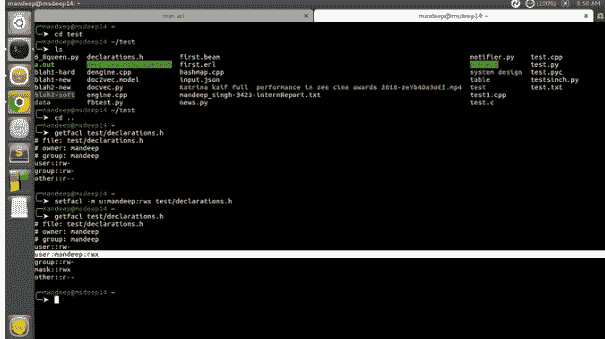

### 查看 ACL

你可以使用以下命令来查看 ACL 中写入的权限：

```
# getfacl filename
```


`getfacl` 和 `setfacl` 命令之间的区别是相当明显的。因此，请注意它们。我们在用户名称 `Mandeep` 上多使用了一行，这在上面的图中可以看到。你可以使用上述命令将 ACL 中的权限从 `rwx` 更改为 `r-x`。

### 删除 ACL

如果你想删除你在 ACL 中设置的任何命令，请使用带有 `-b` 选项的 `setfacl` 命令。请参考以下示例：

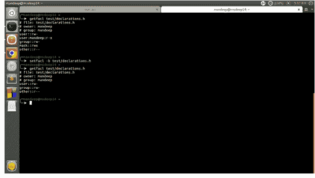

现在，比较你在运行 `getfacl` 命令时使用和未使用带有 `-b` 选项的 `setfacl` 命令之前的输出。你会看到第二个输出列表中没有名为 `mandeep` 的条目。你还可以使用 `ls` 命令查找通过 ACL 设置的任何额外权限。

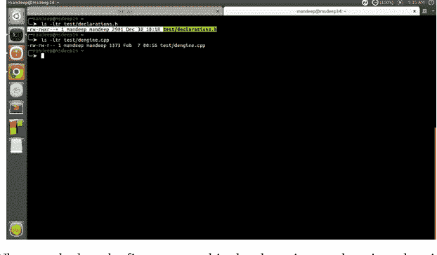

当你查看上述图片中的第一条命令时，ACL 权限的末尾紧挨着一个加号。这表明有一些额外的权限可以在 ACL 中设置，你可以使用 `getfacl` 命令来做到这一点。

#### 使用默认 ACL

默认 ACL 使用特定的权限类型，该权限直接分配到你正在做出更改的目录。这使得使用 Linux 自带的 ACL 变得更加容易。让我们看看如何使用它。我们现在将创建一个目录或文件，并使用以下命令通过 `-d` 选项将默认 ACL 分配给文件或目录：

```
mkdir test && setfacl -d -m u:dummy:rw test
```


现在，你已经了解了如何在系统和服务器中维护安全性。接下来的两章将介绍如何进行渗透测试和扫描，以发现你的服务器和网络中的任何漏洞。

## 第十章

### 下载和安装 Kali Linux

如果你想对系统的安全状况进行分析，你需要使用 Kali Linux 发行版。这是一个强大的工具，你可以用它来评估系统中的漏洞。在本章中，我们将查看如何在你的系统中下载和安装 Kali Linux 发行版，以及如何使用该操作系统内置的各种渗透测试工具。这些工具将在渗透测试生命周期的各个阶段帮助任何系统管理员进行渗透测试。

我们已经介绍了如何使用虚拟机在系统上安装操作系统的详细信息，但让我们来看看当你直接在系统上安装操作系统时应该做什么。对于从未安装过操作系统的读者来说，无需担心，因为本章将指导你详细安装 Kali Linux 操作系统。通过本章的信息，你将了解如何安装 Kali Linux 以及从哪里下载安装介质。

Kali Linux 是一个用于检查系统是否存在漏洞的工具。该操作系统可以快速安装在硬盘等永久介质上，但也可以安装在 U 盘上，并在需要时通过 U 盘进行实时启动。这是系统管理员工具包中非常便捷且便携的工具。如果你作为系统管理员在工作时能够访问本地机器，你可以利用 Kali Linux 实时磁盘将其启动到目标组织基础设施内本地可用的物理机器上。Kali Linux 操作系统中可用超过 400 种工具和应用。

#### 下载 Kali Linux

Kali Linux 是 Linux 操作系统的一个发行版，我们在第一章中讨论过这一点。该操作系统是免费的，你可以从官方网站下载 ISO 映像文件。你可能需要使用不同的系统下载 ISO，然后将其刻录到 DVD 或 U 盘上，以确保将其安装到你的系统上。你可以从以下 URL 下载映像：<https://www.kali.org/downloads/>

如果你需要更多材料来了解配置、高级操作和其他特殊情况，你可以在官方 Kali Linux 网站 <http://www.kali.org/official-documentation/> 上找到这些信息。

建议你在 Kali Linux 网站上注册，以访问社区，在那里你可以讨论你的问题并了解更多关于如何解决它们的方法。

在你从网站下载映像文件之前，你需要确保选择了正确的架构。你的系统架构是 32 位或 64 位，你需要选择适用于你系统的映像。一旦下载完成，你可以使用映像刻录软件将 Kali Linux 安装介质复制到 DVD 或 U 盘上。

在本章中，我们将查看如何使用 U 盘和硬盘通过实时启动来安装 Kali Linux。

#### 硬盘安装

一旦开始安装过程，你需要将 DVD 放入驱动器，并将 U 盘插入以安装用于加载操作系统的介质。根据你想使用的工具，你应该在计算机的 BIOS 设置中设置启动优先级，以便通过正确的介质进行此安装。

##### 首次启动 Kali Linux

如果你成功从 U 盘或 DVD 安装了 Kali Linux 可执行文件，屏幕上将显示关于操作系统和硬盘上其他操作系统的现有信息选项。它还将用 Kali Linux 替换文件。其他高级选项允许你使用现有的操作系统将操作系统加载到硬盘的一部分上。这超出了本书的范围。现在让我们看看如何安装操作系统。

### 设置默认值

接下来的几个界面将包含您在设置 Kali Linux 操作系统时需要使用的默认配置。您可以选择各种选项，例如语言、位置以及键盘语言。您需要选择要应用于区域和设备的设置。您还需要点击“下一步”选项以继续安装流程。系统会显示关于安装进度的信息。

### 初始网络设置

您的系统上会出现一个界面，您可以使用它输入主机名。请确保该词是唯一的。当您点击“下一步”时，安装管理器会要求您输入完全限定域名。安装管理器将使用此域名在您的网络或服务器上下载并安装 Kali Linux。如果您在安装 Kali Linux 并将其作为独立系统运行时不需要，可以跳过此步骤。如果您不确定该做什么，可以将选项留空并继续。

### 密码

在此界面，安装管理器将要求您选择 `root` 账户的密码。`root` 账户是超级用户或特权账户，可用于拥有系统权限。Kali Linux 系统自带 `root` 账户的默认密码，即“toor”。建议您将密码更改为您所期望的复杂度。您还需要确保输入的密码符合以下标准：包含大写字母、小写字母、数字和符号。请确保设置一个复杂的密码，以保护您的系统免受非法访问。选择密码后，您需要点击“继续”以进入安装流程的下一步。

### 系统时钟

屏幕上会出现另一个提示界面，您可以选择设置闹钟。现在，请选择时区并继续安装。

### 磁盘分区

在使用硬盘安装 Kali Linux 时，当涉及到使用分区，您可以采用不同的方法。关于磁盘分区，有很多信息需要了解。在本章中，我们将仅查看称为“向导式分区”的基本流程。由于我们使用的是向导式分区机制，您需要使用整个磁盘来安装操作系统。选择该选项并继续安装过程。

在下一个界面，您将获得关于系统上所有硬盘的信息。由于大多数系统仅配有一个硬盘，因此您将在列表中看到一个而不是多个硬盘。选择您要用于安装 Kali Linux 的硬盘。现在，选择“继续”。在下一个界面，安装程序将提示您确定如何使用可用的硬盘。

我假设您是一位正在阅读本书的新手，并将指导您应该怎么做。您需要选择“所有文件”选项并选择一个分区。这将使过程变得非常简单。选择后，点击“继续”。在接下来的部分，您将获得所有可作为输入使用的选项。您将被给予所选的详细信息进行审查。如果您对您提供的详细信息感到满意，您可以继续该信息。将只有一个主分区，所有文件和文件夹将保存在此分区中。次要分区称为交换分区（`swap`）。后者用作虚拟内存系统，在此系统中，您在 RAM 和 CPU 之间切换，文件在这两个位置之间移动。简单来说，这被称为缓冲内存。

重要的是确保所有的交换分区仅在 Linux 系统上。这是加密交换分区并保护交换分区中信息的最佳方式。交换分区的大小需要与安装在您系统上的 RAM 大小相同。完成后，您可以选择“完成”并进入下一步。完成选择后，您可以确认您所选的选项。您还会看到一个提示，选择“是”以继续安装。如有必要，您可以更改分区方案，但只有在操作系统处于激活状态时才能这样做。这将损坏您的系统。点击“继续”后，您会看到一个进度条界面，安装程序将开始将文件复制到您的硬盘。系统完成安装流程所需的时间取决于您系统中的硬件。

### 配置包管理器

当您将文件复制到硬盘完成后，您将收到一个提示，询问您希望如何为系统配置包管理器。此包管理器对您的系统非常重要，当 Kali Linux 系统需要基于软件的新更新来更新包存储库时，它将使用此管理器。由于这是了解 Kali Linux 可用包源的唯一方式，您需要使用与 Kali Linux 所在位置镜像的网络。

现在，您需要点击“是”以继续安装流程。您还将被另一个界面提示，以指定使用第三方 URL 网络包。当您的 Kali Linux 系统是企业系统的一部分，且其在本地服务器上存储 Kali Linux 包的本地存储库时，也会使用此设置。如果您不想填写这些详细信息，可以留空并继续安装流程。

### 安装 GRUB 加载器

当您进入下一个界面时，安装程序将弹出一个提示，询问您是否希望在计算机上运行 Kali Linux 系统时安装 GRUB 引导加载器。Grand Unified Bootloader（`GRUB`）是在 Kali Linux 操作系统启动时将显示在您屏幕上的主界面。`GRUB` 提供一个菜单，您可以在启动计算机上的 Kali Linux 之前使用该菜单进入高级设置。如果您是高级用户，则无需执行此操作，但如果您是新用户，则需要安装它。选择“是”并点击“继续”。

### 完成安装

您现在处于安装阶段的末尾，您将看到系统的完成界面。完成后，您可以点击“继续”，您的系统将自动重新启动。如果需要，您可以在重新启动系统前移除安装 DVD 或使用 USB 闪存盘。此时，您将在系统上看到 Kali Linux 欢迎界面。您需要使用最初设置的 `root` 账户登录，最终访问 Kali Linux。

### USB 驱动器安装

您可以使用 USB 驱动器、拇指驱动器或闪存盘来安装 Kali Linux。这是一种存储设备，您可以将其插入系统端口。如果您想在系统上安装 Kali Linux，建议使用至少 10 GB 或更多存储空间的 USB 驱动器。每台新的计算机系统都允许您从 USB 设备启动 Kali Linux 操作系统。您可以选择在系统的 BIOS 设置中将 USB 设备的启动优先级设置为最高。我们将介绍如何使用 USB 驱动器在 Windows 或 Linux 机器上安装 Kali Linux。您可以查看 Kali Linux 网站上提供的文档以更好地理解这一点。

使用 USB 驱动器时，您需要记住两个术语——持久性（`persistence`）和非持久性（`non-persistence`）。前者指系统在重启后仍保留您对文件所做的修改或更改的能力。后者指系统在重启时会丢失更改的事实。在本章中，我们将分别介绍在 Linux 和 Windows 操作系统上安装持久性和非持久性 Kali Linux 的方法。这样，您将学会这两种方法。

#### Windows 非持久性安装

在通过 Windows 操作系统使用 USB 驱动器安装 Kali Linux 之前，您需要从以下 URL 下载 Win32 Disk Imager：https://sourceforge.net/projects/win32diskimager/

像您使用硬盘安装时那样下载 Kali Linux 的 ISO 文件后，可以将 USB 驱动器插入系统。当前的操作系统会自动检测到此设备，并为该文件分配驱动器。然后，您需要启动 Win32 Disk Imager 应用程序，然后点击文件夹图标浏览不同的文件和文件夹。您需要选择 Kali Linux 的 ISO，下载文件并点击“确定”按钮。从下拉菜单中选择要分配给 USB 驱动器的驱动器字母。现在，您需要点击“写入”按钮，以便您的操作系统将 Kali Linux 操作系统写入您的 USB 驱动器。

此过程需要一些时间，具体取决于您系统的硬件。当安装程序完成将 ISO 复制到 USB 驱动器后，您需要重启计算机。将 USB 设置为最高启动优先级

### 从系统的 BIOS 设置中驱动启动

理解每个系统根据其制造商拥有自己的 BIOS 设置用户界面非常重要。因此，你需要仔细选择启动优先级设置。完成此操作后，你需要重启系统，屏幕上出现的第一件事将是 Kali Linux 启动菜单。你可以选择“Live”选项，这是在从 USB 驱动器直接启动 Linux 时的第一个选项。

### Linux 持久化安装

请记住，你拥有的内存大小非常重要，特别是如果你使用 USB 驱动器在系统上安装 Kali Linux。根据你使用的操作系统类型，你需要创建一个 Kali Linux USB 驱动器。在开始安装 Kali Linux 之前，你需要确保设备上已安装了 `GParted` 应用程序。如果你在安装 `GParted` 时遇到问题，你需要阅读文档，看看应该做些什么来消除安装过程中的任何错误。你可以使用终端中的以下任何命令来安装此工具：
```


`apt-get install gparted`

`aptitude install gparted`

`yum install gparted`

```
```

一旦你在系统上下载了 GParted，你需要从官方网站下载 Kali Linux ISO，并将 USB 驱动器插入你的计算机系统。如果你想查看 USB 驱动器所在的位置，需要在 Linux 终端中使用以下命令。

```
mount | grep -i udisks | awk '{print $1}'
```

USB 驱动器中的文件将使用 `/dev/sdb1` 的名称保存。当你将 Linux 安装到系统上时，你必须确保查看正确的文件，因为文件可能从一个系统到下一个系统有所不同。在以下命令中，你可以删除末尾的数字，以确保你在文件名之间切换。

使用 `dd` 命令将 Kali Linux ISO 写入 USB 驱动器，如下所示。

```
dd if=kali_linux_image.iso of=/dev/sdb bs=12k
```

使用以下命令启动 Gparted 应用程序。

```
gparted /dev/sdb
```

现在你的驱动器上应该有一个分区，其中包含 Kali Linux 镜像。接下来要做的是通过右键单击驱动器并从菜单中选择“新建”选项，在驱动器中创建另一个分区。当你选择菜单栏中可用的分区菜单时，这将出现。以下是你需要遵循的步骤，具体步骤可能因你使用的机器而异：

- 驱动器中未分配的空间呈灰色显示
- 你现在应该使用下拉菜单从分区中选择“新建”选项
- 你可以使用图形滑块指定驱动器的大小
- 现在，选择文件系统并将其更新为 ext4
- 选择“添加”选项并点击下拉菜单。你需要选择应用到系统的所有操作的选项
- 当你看到提示时，点击确定，设置将更新

你可以使用以下命令为 USB 驱动器添加持久化功能。

```
mkdir /mnt/usb
mount /dev/sdb2 /mnt/usb
echo "/ union" > /mnt/usb/persistence.conf
umount /mnt/usb
```

就是这样。你现在已经创建了一个持久化的 Live Kali Linux USB。重启你的系统，你应该能够使用 USB 驱动器启动 Kali Linux 操作系统。

# 第十一章

## 渗透测试生命周期

作为系统管理员，你需要在组织中执行渗透测试，以确保你的网络和服务器启用了正确的安全设置。在本章中，我们将查看渗透测试中使用的不同阶段。通过本章，你将更多地了解系统管理员的不同工具以及他们在每个阶段需要遵循的流程。这样，你将理解渗透测试生命周期的五个阶段，并对安全专业人员在从事渗透测试时使用的工具有一个了解。

### 渗透测试生命周期的五个阶段

在本节中，我们将查看渗透测试生活方式的五个阶段，信息被简单地分解，以帮助你理解在每个阶段对你有什么具体的期望。

#### 阶段 1：侦察

这是渗透测试阶段的第一步。让我们假设你正在执行一项军事行动。军官和分析师正在浏览外国领土地图，另一个房间里的其他人正在看新闻，试图了解可以采取哪些行动来击败敌人。另一组人正在处理他们需要收集的信息，以确保团队能够进入敌方领土并将其据为己有。当你在道德黑客过程中进行渗透测试时，你需要这样做。

如果你没有专业知识来运行渗透测试，组织将聘请一个团队来执行此测试。在此阶段，你需要发现目标系统的信息，并使用公共和私有来源收集有关系统的信息。你可以通过查找有关互联网的信息轻松地做到这一点，因为大多数信息都是公开的。在此阶段，你只需要了解目标网络和服务器中存在什么。你不需要侵入网络和服务器，因为你只需要扫描并记录你在执行接下来的几个步骤时需要的信息。

#### 阶段 2：扫描

让我们考虑你和一个团队在一个军事任务中，你需要到达一个山顶。这个山顶在你的敌人战线后面，你的一个士兵隐藏在灌木丛中。这个士兵将回来并给你有关敌方营地的信息。此任务的目标是让你确定敌人正在进行的活动类型。这名士兵还将告诉你进入敌方领土的不同方式以及营地周围的安全措施。

这名士兵被告知了他需要做什么才能获取他需要的信息。他被告知了必须查看什么。这正是你在侦察阶段所做的。你收集信息，并使用这些信息在扫描阶段确定你需要扫描哪些服务器和网络以发现任何漏洞。你可以使用各种工具来扫描目标网络，Kali Linux 自带内置选项。你需要在利用阶段使用此阶段收集的信息，以确定你需要利用哪些区域以提取信息。

#### 阶段 3：利用

如果你与一个团队一起执行渗透测试，你需要确保你能够轻松穿过网络和服务器而不被发现。你还需要找到一种进入服务器而不被抓的方法。你需要在服务器中找到正确的缺口，并通过服务器的开放门进入系统和网络。你还需要在服务器内部花费时间，看看你可以从系统中提取哪些信息。你需要在利用阶段这样做。目标是确保你快速进入和退出网络和服务器，并携带你需要的信息而不被任何人发现。在此阶段，你需要利用系统并查找有关业务的敏感信息。如果需要，你可以反复这样做。

#### 阶段 4：保持访问

当你执行渗透测试时，你必须确保对你正在使用的服务器和网络拥有无限制的访问权限。你需要确保可以访问你需要的信息。作为系统管理员，你需要找到一种在你发现如何进入目标系统和网络的同时保持访问权限的方法。你还需要找到一种利用服务器并查看你可以通过网络获取或访问哪些信息的方法。你还需要找到一种进出系统而不被抓的方法。因此，利用在利用阶段收集的信息，他们自动化了一种保持对目标系统持续访问的方式。

#### 阶段 5：报告

当你对你的系统和服务器执行渗透测试时，你需要站在整个团队和上级面前，告诉他们你从执行的渗透测试中学到了什么。你需要解释每一个步骤，并详细列出你在测试中发现的所有内容。你需要扩展你发现结果的细节。在渗透测试生命周期的末尾，你还需要准备一份报告，解释你的渗透测试的每个阶段。你需要解释发现的漏洞、利用的漏洞以及在测试中针对的服务器、网络和系统。在某些情况下，你可能需要提供有关发现的信息。你需要确保管理层会查看他们可以使用的不同方法来保护他们的服务器和网络。

# 第十二章

## 扫描

在本章中，你将了解渗透测试的第二阶段，这是最重要的一步，因为你会更多地学习如何扫描服务器以及可以采取哪些措施来识别任何漏洞。在这个阶段，你需要从侦察阶段的发现中获取输入，并收集关于操作系统和使用该系统信息的人的信息。当作为系统管理员执行测试时，你可以回到侦察阶段，看看是否有你需要获取的关于进程和人员的新信息。

本阶段的目标是让你扫描网络和服务器中的信息，并识别目标的信息。你可以更多地了解你的信息和网络系统。在此期间，你需要专注于获取关于存活主机、设备类型（笔记本、台式机、路由器、移动设备等）、操作系统、软件以及对外提供的公共服务（SMTP、FTP、Web 应用程序等）的信息。你可以利用这个阶段移除系统中的任何基本漏洞。这些漏洞在扫描阶段很容易检测到。你可以在扫描过程中使用不同的工具，但我们将重点介绍用于执行此过程的主要工具 `Nmap`。本阶段的目标是让你收集可以传递给道德黑客过程下一步的信息。

### 网络流量

你需要更多地了解网络流量及其工作原理，以便理解此阶段使用的不同工具和流程。网络中两个设备之间的通信之所以能够发生，完全是因为网络流量。最流行的网络流量模式是无线以太网和有线以太网。在本节中，我们将研究网络流量的主要方面：防火墙和端口，并看看你可以如何利用它们来提高系统的安全性。

### 防火墙和端口

组织拥有防火墙的主要原因之一是保护用于传输信息的系统、网络和服务器。你可以保护系统中的内部服务器和网络，以确保外部网络和内部网络之间的通信是安全的。防火墙是软件或硬件，具有规则，充当网络的大门看守。防火墙中定义了访问控制，使你能够监控入站流量（称为 `ingress`）和出站流量（称为 `egress`）。满足这些规则的流量确保防火墙在黑客攻击过程中永远不会被丢弃。这是通过打开和关闭防火墙上的端口来实现的，这些端口允许或拒绝流量。

本书前面我们已经研究了什么是端口，以及在 Linux 操作系统中如何使用和调整它们。

### PING

`Ping` 是一个基于 ICMP 的应用程序，你和系统中的每个其他用户都暴露于此。当你使用 `ping` 命令时，你可以发送一个代码 0 和类型 8 的数据包，表明该数据包只是一个回显。收到此数据包的系统将立即以类型 0 代码 0 的数据包（即回显回复）响应。成功的 `ping` 向系统表明 `ping` 仅在存活网络上进行。这意味着你正在从存活主机操作。当你使用 `ping` 命令时，可以使用 Windows 命令提示符。默认情况下，`ping` 至少发送请求四次。如果你在 Linux 终端中使用此 `ping`，命令将持续运行，直到你中断它。

让我们看一下成功和失败的 `ping` 命令。

如果被 `ping` 的主机是存活的：

```
Ping 192.168.1.1

Pinging 192.168.1.1 with 32 bytes of data:

Reply from 192.168.1.1: bytes=32 time=2ms TTL=64

Reply from 192.168.1.1: bytes=32 time=1ms TTL=64

Reply from 192.168.1.1: bytes=32 time=1ms TTL=64
```


`Reply from 192.168.1.1: bytes=32 time<1ms TTL=64`

如果主机不可达：

```
Ping 192.168.1.200

Pinging 192.168.1.200 with 32 bytes of data:

Reply from 192.168.1.129: Destination host unreachable.

Reply from 192.168.1.129: Destination host unreachable.

Reply from 192.168.1.129: Destination host unreachable.

Reply from 192.168.1.129: Destination host unreachable.

Reply from 192.168.1.129: Destination host unreachable.

Ping statistics for 192.168.1.200:

Packets: Sent 5, Received 4, Lost 1 (20% loss)
```

## 路由跟踪

如果你使用 `traceroute` 命令，你会发现 ICMP `ping` 命令用于确定系统和网络之间存在的设备数量。这是它在目标系统上发起跟踪的一种方式。`traceroute` 命令通过操纵网络数据包的生存时间值（也称为 TTL）来工作。这个术语表示数据包在网络中移动的次数，并在数据包过期之前由主机反复广播。

在基于 Linux 的系统上，运行 `traceroute` 的命令是 `traceroute`。如果你想在 Windows 上运行该命令，你可以这样做以检查系统和网络中的漏洞。让我们以到 `google.com` 的路由跟踪为例：

```
tracert www.google.com
```

Tracing route to www.google.com [74.125.227.179]
over a maximum of 30 hops:

```
1 1 ms<1 ms 1 ms 192.168.1.1

2 7 ms 6 ms 6 ms 10.10.1.2

3 7 ms 8 ms 7 ms 10.10.1.45

4 9 ms 8 ms 8 ms 10.10.25.45

5 9 ms 10 ms 9 ms 10.10.85.99

6 11 ms 51 ms 10 ms 10.10.64.2

7 11 ms 10 ms 10 ms 10.10.5.88

8 11 ms 10 ms 11 ms 216.239.46.248

9 12 ms 12 ms 12 ms 72.14.236.98

10 18 ms 18 ms 18 ms 66.249.95.231

11 25 ms 24 ms 24 ms 216.239.48.4

12 48 ms 46 ms 46 ms 72.14.237.213

13 50 ms 50 ms 50 ms 72.14.237.214

14 48 ms 48 ms 48 ms 64.233.174.137

15 47 ms 47 ms 46 ms dfw06s32-in-f19.1e100.net [74.125.227.179]
```

Trace complete.

你可以在 Kali Linux 上使用不同的工具来运行这些跟踪，这些工具使用 ICMP、TCP 和 UDP 协议来扫描目标系统和网络。成功扫描的结果将提供操作系统、网络主机名、IP 地址以及在网络上运行的服务等信息。一些扫描工具也可以用于发现服务器和网络中的任何漏洞。在扫描阶段收集到的详细信息可用于利用阶段来攻击特定目标。

### Nmap：扫描器之王

`Nmap` 扫描工具是系统管理员使用的最受欢迎的扫描工具之一，因为它是最简单的方法，可帮助你列出目标网络上存在的所有活跃主机。你还可以使用它来确定操作系统、服务、端口，在某些情况下甚至确定用户凭证。此工具使用选项、开关和命令的组合，在此生命周期中的扫描阶段查找系统中的详细信息和漏洞。

#### 定时选项

我们在上面已经了解到，`Nmap` 扫描中的默认定时选项并不指定任何内容，但你也可以使用默认值或从以下选项中选择。`Nmap` 有一个功能，允许用户指定其要使用的定时选项。此选项可用于覆盖工具中使用的默认时间选项。如果需要，你可以选择加速过程或减慢过程。

使用这种定时模板，你可以启用各种设置，特别是添加扫描和端口并行处理之间的延迟的设置。可以使用 `scan_delay`、`max_scan_delay`、`max_parallelism` 选项来解释不同的定时模板。我们可以使用这些选项来衡量每个定时模板，以便在扫描目标网络时使用适当的定时模板。

如果你需要将目标系统中的探针设置为最小数量，可以使用 `scan_delay` 选项。你可以使用 `max_scan_delay` 来定义扫描仪在扫描服务器和网络中的端口和 IP 地址时所做的延迟之间的最大时间。如果你问为什么这很重要，那是因为某些系统只以特定速率响应探针。当你使用这些选项时，你将调整不同的探针，并找到满足所扫描系统要求的方法。`max_parallelism` 允许你控制同时探针的数量。

该选项允许 `Nmap` 逐个或以串行或并行方式发送扫描探针。让我们来看看你可以在 `Nmap` 工具中使用的不同计时选项。

## -T0 谨慎模式

当你使用此计时选项时，扫描速度较慢，且网络链接较慢。在 Linux 网络或服务器上运行这些扫描时，你可能会被检测到。使用此计时选项时，扫描将按顺序进行，并且每 5 分钟暂停一次。由于基础 `scan_delay` 的值比默认值高，因此在使用此计时模板时，`max_delay` 设置将被忽略。

## -T1 隐蔽模式

这种计时方法用于对网络和服务器执行隐蔽扫描。与之前的计时相比，它在保持谨慎的同时更好且稍快。此扫描也是按顺序扫描目标系统，但将 `scan_delay` 减少到大约 15 秒。`scan_delay` 的数量减少了，但由于该值较高，`Nmap` 将忽略 `max_scan_delay`。

## *目标*

在 `Nmap` 命令字符串中，使用的 IP 地址目标是一个重要部分。如果你最终使用了错误的目标，你可能会扫描空的 IP 系统或空间。根据规定，你不可以这样做。设置 `Nmap` 扫描目标有几种方法，我们将来看看两种常用的方法：IP 地址范围和扫描列表。

### IP 地址范围

使用 IP 地址范围来定义系统中的目标是一个定义你想使用的范围或端口的简单过程。让我们以一个 C 类 IP 地址范围作为示例。如果你使用 C 类 IP 地址，你可以在 254 个不同的主机上运行扫描。为此，你可以使用下面的命令。通过这种方式，你可以扫描属于 C 类的特定 IP 地址范围上的所有主机。

```
nmap 10.0.2.1-255
```

你可以使用无类别域间路由（CIDR）在服务器或系统端口上运行相同的扫描。CIDR 是一种指定 IP 地址范围的快速方法，但这超出了本书的范围。

```
nmap 10.0.2.1/24
```

如果使用的 IP 地址非常小，你可以使用较小的范围来定义扫描中使用的目标。例如，如果你想扫描范围内指定的 IP 地址，可以使用以下命令：`nmap 10.0.2.1-50`

### 扫描列表

当你需要使用 `Nmap` 命令扫描列表时，可以将文本文件作为输入。该文件将包含你目标服务器或系统中存在的 IP 地址。如果需要，你可以选择使用以下 IP 地址并将其存储在目标文本文件中。

- 10.0.2.1
- 10.0.2.15
- 10.0.2.55
- 10.0.2.100

上述命令的语法如下：

```
nmap -iL target.txt
```

### 端口选择

`Nmap` 命令结构允许你使用 `-p` 开关来确定你想使用的端口。这将帮助你确定要扫描的端口。根据你需要扫描的内容，你可以指定单个端口或端口范围。

```
nmap -sS -p 1-100

nmap -sU -p 53, 25, 143, 80
```


你也可以选择将两个命令组合起来，如下例所示：`nmap -sS -p 1-100, 53, 25, 143, 80`

## 输出选项

你在网络和服务器上执行的扫描结果将输出 Nmap 命令结果。你可以在终端窗口中打印信息，但这并不总是个好主意。作为管理员，你需要将带有输出的文件保存下来，以便你可以使用它来确定如何消除系统中的任何漏洞。你可以将扫描的输出重定向到文件。如果你更喜欢，有一些内置命令可供使用，这允许你重定向输出并将其移动到文件中。让我们来看看这些选项中的每一个。

#### `-oN` 常规输出

你可以使用此输出选项创建常规文本文件，以确保以文本文件的形式存储输出。你可以使用此文件评估输出。你还可以将其用作其他程序的输入键：`nmap -oN output.txt 10.0.2.111`

#### `-oX` 可扩展标记语言（XML）输出

某些应用程序和工具在执行渗透测试时将 XML 文件作为其输入，因此，此选项非常容易使用。你也可以使用以下命令将输出存储在 XML 格式中：`nmap -oX Output.txt 10.0.2.111`

#### `-oS` 脚本小子输出

当你执行渗透测试时，脚本小子攻击的输出文件无法使用，但这些是确定你的网络和服务器安全性的好方法。你 cannot 将以下语法中的输出用于任何工业用途。

```
nmap -oS output.txt 10.0.2.111
```

## Nmap 脚本引擎

如果你不想使用内置包，你需要学习如何在 Nmap 中构建自定义脚本。如果你愿意使用 Nmap 中预配置的渗透测试，可以使用以下 URL：https://nmap.org/nsedoc/。

例如，你可以使用此脚本获取 MAC 地址和 NetBIOS，其中每一个都是你针对目标系统所需的重要信息。你可以按照下面的例子使用标志`—script`，随后是 Nmap 命令和脚本名称。

```
nmap --script nbstat.nse 10.0.2.111
```

作为系统管理员，你必须有脚本数据库并定期更新它。每次你对服务器或网络执行新的渗透测试时，更新 Nmap 脚本也很重要。为此，使用以下命令：`nmap --script-updatedb`。

## 结论

如果你是试图了解更多信息的 Linux 系统管理员或工程师，那么你找到了正确的书籍。这本书包含了关于 Linux 以及如何在你的系统或虚拟机上使用它的所有所需信息。你学习了 Linux 的不同发行版系统以及每个发行版如何与其他不同。

本书涵盖了加密和解密信息的不同方法。它还提供了关于你可以使用的不同方法来保护网络和系统中的服务器、文件和文件夹的信息。你学习了如何使用访问控制列表管理用户访问系统的不同方法。注意用户访问服务器和网络很重要，因为这些个人在保护系统信息方面发挥着关键作用。你更深入地学习了管理访问控制的不同方法，并发现了如何管理系统中的权限。到书的结尾，你能够学习如何改进网络安全，包括你可以用于测试系统的不同方法，以及如何寻找漏洞。

现在是时候深入挖掘并让你的系统保持最新和安全了！

## 参考文献

- 7 个用于加密/解密并在 Linux 中保护文件密码的工具。(2015). Tecmint.com. https://www.tecmint.com/linux-password-protect-files-with-encryption/
- 保护 Linux 服务器的 16 种方法。(2019, 3月26日). Liquid Web. https://www.liquidweb.com/kb/security-for-your-linux-server/
- Linux 中的访问控制列表(ACL) - GeeksforGeeks. (2018, 5月2日). GeeksforGeeks. https://www.geeksforgeeks.org/access-control-lists-acl-linux/
- comments, 08 O. 2019 P. H. M. F. 92up 6. (n.d.). 保护你的 Linux 服务器的 7 个步骤。Opensource.com. https://opensource.com/article/19/10/linux-server-security
- 控制 Unix 和 Linux 账户权限：9 个最佳实践 | BeyondTrust. (n.d.). Www.beyondtrust.com. 检索自 https://www.beyondtrust.com/blog/entry/controlling-unix-linux-account-privileges-9-best-practices
- Hoffman, C. (n.d.). 为什么你不应该以 root 身份登录你的 Linux 系统。How-to Geek. 检索自 https://www.howtogeek.com/124950/htg-explains-why-you-shouldnt-log-into-your-linux-system-as-root/
- 如何管理 Linux 用户账户安全 - 教程。(n.d.). UpCloud. 检索自 https://upcloud.com/community/tutorials/manage-linux-user-account-security/
- 如何在 Linux 中使用“Cryptsetup”工具设置加密文件系统和交换空间 - 第 3 部分。(n.d.). Www.tecmint.com. 检索自 https://www.tecmint.com/disk-encryption-in-linux/
- S, R. (n.d.). Linux 中的加密方法 | Unixmen. 检索自 https://www.unixmen.com/encryption-methods-linux/

- skenlon. (n.d.). *使用 firewall-cmd 保护您的 Linux 网络*. Enable Sysadmin. 转载自 https://www.redhat.com/sysadmin/secure-linux-network-firewall-cmd

- *最佳 Linux 发行版*. (2019, 2月3日). MUO. https://www.makeuseof.com/tag/best-linux-distributions/
