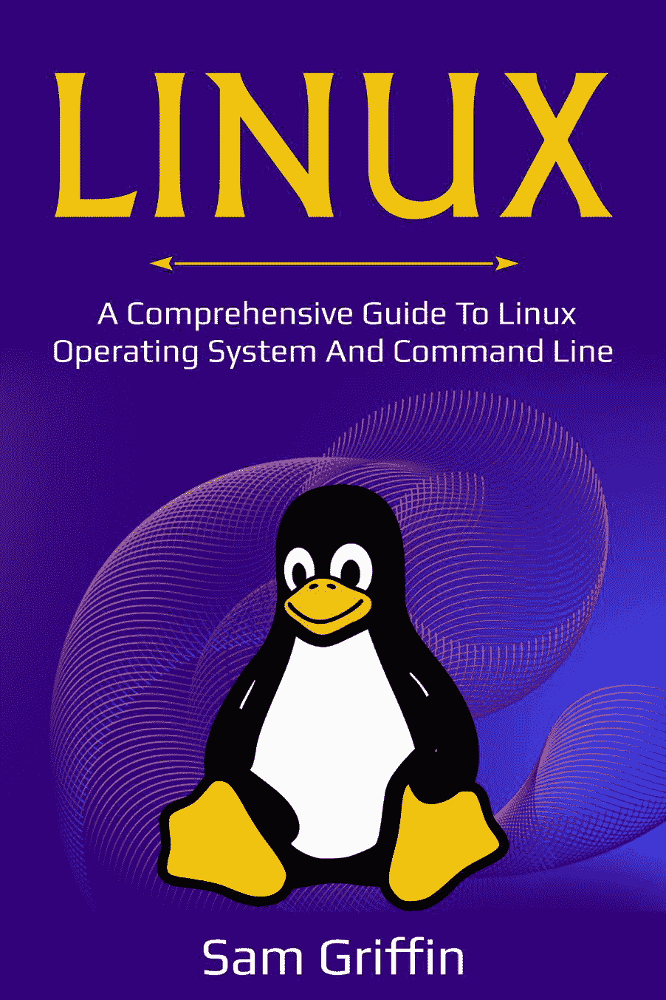

# Linux：Linux 操作系统与命令行全面指南



## 介绍

`Linux` 一词指的是由 Linus Torvalds 和其他几位贡献者开发的操作系统或内核。它于 1991 年 9 月首次公开发布，它的出现彻底改变了用户在个人和专业领域体验计算的方式。在微软公司正向用户收取 `Windows` 操作系统费用的时代，`Linux` 作为开源操作系统提供给世界。这意味着它是免费的，并允许程序员根据自己的需求对其进行定制。他们可以使用该内核为基础创建自己自定义版本的操作系统。开发 `Linux` 操作系统使用的主要代码是用 `C` 语言编写。

如今，`Linux` 内核被数千个操作系统使用，其中最受欢迎的包括 `Debian`、`Ubuntu`、`RedHat` 和 `Fedora`。这个列表不仅限于这四个，因为每年都会开发出采用原始 `Linux` 系统内核的新操作系统。

随着 `Linux` 的发明，人类在计算技术上达到了一个里程碑，如今，`Linux` 驱动着我们几乎所有的设备，如手机、笔记本电脑、云服务器和其他超级计算机。

这还导致产生了一个名为`Linux 系统管理员`的流行职业。`Linux` 系统管理员的职责围绕以下任务展开：

- 熟悉 `Linux` 文件系统
- 管理 `Linux` 系统的名为 `Root` 的超级用户
- 精通 `Linux` 命令行
- 管理用户、文件和目录

这与在家里维护你的个人电脑类似，但规模更大，你负责的是整个组织的计算机系统。

如今，几乎每个处理数据和数据相关应用的业务都会使用基于 `Linux` 的计算机，被称为`服务器`。`Linux` 服务器管理着企业与其客户之间的所有交互，因此，它管理着海量的客户数据。在当今世界，数据是新的货币，对企业来说至关重要。如果 `Linux` 服务器长时间停机，可能会给企业造成数千美元的损失。以购物巨头亚马逊（Amazon）的网站为例，如果亚马逊网站即使只离线五分钟，其销售额也将遭受巨大影响。这正是 `Linux` 知识大显身场的地方，而 `Linux` 系统管理员将转危为安。确保 `Linux` 系统始终在线运行，并确保企业网站永不离线（即使只有一秒）是 `Linux` 系统管理员的职责。

这仅仅是涉及 `Linux` 操作系统知识和使用的众多工作之一。在接下来的章节中，我们将更多地讨论 `Linux`、它的起源、用途以及它是如何工作的！

## 第 1 章：Linux 的特性

Linus Torvalds 曾在赫尔辛基大学学习，经常使用 `Minix`（这是 `UNIX` 操作系统的一个版本）。他和其他几人意识到，一些修改可以使这个操作系统更加高效，并向 `Minix` 的开发者 Andrew Tanenbaum 提交了这些更改的请求。然而，Andrew 认为这些更改是无关的，并拒绝了他们的请求。正是此时 Linus 决定创建自己的操作系统，并将根据终端用户的反馈进行开发。他开始用 `C` 语言编写代码，`Linux` 的 95% 是用 `C` 编写的，其余部分使用 `Assembly` 语言，这在当时是第二流行的语言。

### Linux 是一种什么样的操作系统？

`Linux` 可以归类为`分层架构操作系统`，由以下层组成：

#### 硬件层

这包括所有外围设备，如`硬盘`、`内存`、`CPU` 等。

#### 内核

`kernel` 是操作系统的核心。它位于软件和硬件之间，所有关于输出输出指令都通过 `kernel` 处理。

#### Shell/GCC

`shell` 是位于用户和 Linux 内核之间的接口。`shell` 隐藏了内核函数的复杂性。

#### 应用程序

软件是操作系统提供的一种实用程序，供用户使用。

#### 用户

这包括可以与操作系统和应用程序进行交互的系统用户。

### Linux 操作系统特性

`Linux` 是一个非常简单、免费、快速且易于使用的操作系统。它在全球范围内用于驱动个人电脑和笔记本电脑。`Linux` 提供了以下特性：

#### Live CD/USB

几乎每个 `Linux` 操作系统发行版都提供名为 `Live CD/USB` 的功能。该功能允许你从 `CD` 或 `USB` 驱动器运行整个 `Linux` 操作系统，而无需安装在计算机的物理硬盘上。

#### 图形界面

`Linux` 的图形界面被称为 `X Windows 系统`，它是命令行的替代方案。多年来，人们认为 `Linux` 只是命令行操作系统，但它提供了一个整洁且友好的图形界面。`Linux` 有安装包可以让界面看起来与 `Windows` 图形界面完全一样。

#### 国际键盘支持

`Linux` 被全球的人们使用，因此提供多种语言。此外，它还支持大多数国家的区域键盘布局。

#### 应用程序支持

`Linux` 维护自己的软件库，用户只需在 `Linux` shell 或终端上输入简单的命令即可下载并安装数千应用程序。如果需要，`Linux` 也支持某些 `Windows` 应用程序。

### Linux 操作系统特点

`Linux` 提供许多功能，一些重要的特性如下：

#### 多用户支持

这是 `Linux` 操作系统的的一种特性，同一个系统、内存、硬盘空间、处理器等可供多个用户使用。这并不是通过单一终端实现的，而是通过多个终端用户访问这些资源。终端的最小输入输出设备包括鼠标、键盘和显示器。这些终端连接到主 `Linux` 主机或 `Linux` 服务器，各种用户可以使用这些资源。

#### 客户端/服务器

`客户端/服务器` 架构是 `Linux` 系统多用户能力的应用，许多客户端连接到同一个 `Linux` 服务器。客户端向服务器发送请求；服务器处理并将输出返回给客户端。因此，客户端终端也被称为`哑终端`（Dumb Terminal）。

#### 多任务处理

Linux 能够在给定的时间内处理多一个任务。例如，假设你执行了一个对巨大列表进行排序的任务，同时，你正在记事本中输入内容。这些是两个同时进行的任务，Linux 会通过实施调度策略来高效地共享 CPU 时间，使得在你打字时，CPU 会分配给你的记事本。当你停止打字时，它将会被分配给你正在执行的排序任务。

## 可移植性

让 Linux 在大众中极受欢迎的特性是可移植性。然而，可移植性并不意味着 Linux 的体积比其他操作系统小并且可以放在光盘或 USB 驱动器上携带。Linux 的可移植性是指操作系统在各种硬件系统中以类似方式运行的能力。

## 安全性

对于使用系统进行日常工作的用户或组织来说，安全性是任何操作系统至关重要的方面。Linux 提供了若干规定来保护用户免受未经授权的系统和数据访问。

Linux 安全三个主要概念如下：

### 身份验证

这指的是在 Linux 操作系统上创建用户及其关联密码。除非在 Linux 操作系统上为其创建用户和密码，否则无法访问 Linux 系统。

### 授权

Linux 系统在文件和目录级别为用户设置了授权限制。这些涉及读、写和执行等权限。根据文件或目录的权限，特定用户可以读取它、对其进行更改，或者如果文件是可执行的则执行它。

### 加密

Linux 允许将操作系统上的所有文件编码为一种称为密文的可读格式。这确保了即使有人成功进入你的系统，也无法读取你在 Linux 系统硬盘上的数据。

## 通信

Linux 有非常出通的通信安排。同一系统中的用户可以相互通信。此外，连接到网络的不同系统的用户也可以相互通信。数据、邮件甚至程序都可以在网络用户之间交换。

## 第 2 章：Linux 命令行

本章将介绍 Linux 命令行以及如何使用它在 Linux 操作系统上执行不同类型的任务。完成本章后，你将了解用于管理 Linux 系统文件和文件夹的 Linux 命令行基础命令。

### Bash Shell

Bash 是 Bourne-Again Shell（再次 Bourne Shell）的缩写。Linux 操作系统的工具帮助你通过 Linux 命令与系统交互。当我们谈论命令行工具时，我们指的是允许你以文本模式向计算机及其操作系统提供指令的接口。如今各种基于 Linux 的操作系统中都有多种 shell 接口，但最流行的是 bash shell。它是之前使用的名为 Bourne Shell 的 Linux shell 的演进版本。

bash shell 会向你显示一个表示它正在等待用户输入的字符串。显示的字符串被称为 shell 提示符。如果你是 root 用户，shell 提示符将以 `#` 符号结尾。对于非 root 用户，它以 `$` 结尾。

```text
[root@desktop ~]#
[student@desktop ~]$
```

为了便于理解，Linux 操作系统的 `bash` shell 就像 Windows 操作系统中提供的命令提示符工具一样。但 `bash` shell 中提供的脚本语言与 Windows 命令提示符中的脚本语言相比要优得多。我们也可以将 `bash` shell 与 Windows 7 中引入并在后续版本中持续使用的 `PowerShell` 工具进行比较。许多专业人士赞誉 `bash` shell 是一个系统管理的强大工具。`bash` shell 提供的脚本语言可以自动化 Linux 操作系统中的许多任务。此外，`bash` shell 还允许你执行某些通过图形用户界面无法实现的复杂任务。

你可以使用名为 `terminal`（终端）的工具访问 `bash` shell。键盘作为 `terminal` 的输入，显示器显示你的命令的输出。也可以使用 Linux 系统中的虚拟控制台访问 `bash` shell。这让你可以在基础物理控制台上拥有多个虚拟控制台，每个虚拟控制台都作为一个独立的终端。可以使用许多虚拟控制台创建多个用户的登录会话。

### Shell 基础

你在 shell 提示符上输入的命令由三部分组成：

1. 你想要运行的命令
2. 定义命令行为的选项（Options）
3. 命令的目标的参数（Arguments）

命令是你想要执行的程序的定义。你可以在命令后跟上选项，也可以完全不加选项。选项控制命令的行为并定义了命令将如何工作。选项使用单横线或双横线指定。添加横线是为了将选项与参数区分开。

示例：`-a` 或 `--all`

参数也跟在命令提示符的命令后面，和选项一样，可以是一个或多个。参数是命令执行的目标。

让我们来看一个基础命令：

```bash
usermod -L John
```

示例中的命令是 `usermod`。选项是 `-L`。参数是 `John`。此命令将锁定系统上用户 John 的密码。

你需要知道哪些选项可以与哪些命令结合使用，以便有效使用命令行。你可以在任何命令后运行 `--help` 来获取与特定命令可用的选项列表。因此，你不需要背诵每个给定命令对应的每个选项，列表会告诉你每个选项的作用。

让我们看看当你查询 `grep` 命令的帮助时会发生什么。`grep` 命令用于在文件中扫描字符串。如果文件包含该字符串，输出将显示所有包含它的的行。

```text
[student@desktop ~]$ grep --help

Usage: grep [OPTION]... PATTERN [FILE]...

在每个 FILE 或标准输入中搜索 PATTERN。

默认情况下，PATTERN 是一个基础正则表达式 (BRE)。

Example: grep -i 'hello world' menu.h

Regexp selection and interpretation（正则表达式选择与解释）:
-E,--extended-regexp PATTERN 是一个扩展正则表达式 (ERE)
-F,--fixed-strings PATTERN 是一组用换行符分隔的固定字符串
-G,--basic-regexp PATTERN 是一个基础正则表达式 (BRE)
-P,--perl-regexp PATTERN 是一个 Perl 正则表达式
-e,--regexp=PATTERN 使用 PATTERN 进行匹配
-f,--file=FILE 从 FILE 获取 PATTERN
-i,--ignore-case 忽略大小写
-w,--word-regexp 强制 PATTERN 仅匹配整个单词
-x,--line-regexp 强制 PATTERN 仅匹配整行
-z,--null-data 数据行以 0 字节而非换行符结束

Miscellaneous（杂项）:
-s,--no-messages 抑制错误消息
-v,--invert-match 选择不匹配的行
-V,--version 显示版本信息并退出
--help 显示此帮助文本并退出

Output control（输出控制）:
-m,--max-count=NUM 在匹配 NUM 次后停止
-b,--byte-offset 在输出行中打印字节偏移量
-n,--line-number 在输出行中打印号
--line-buffered 每行刷新输出
-H,--with-filename 为每个匹配打印文件名
-h,--no-filename 抑制输出上的文件名前缀
--label=LABEL 使用 LABEL 作为标准输入文件名的前缀
-o,--only-matching 仅显示行中匹配 PATTERN 的部分
-q,--quiet,--silent 抑制所有正常输出
```

`--binary-files=TYPE` 假设二进制文件为 `TYPE`；

`TYPE` 为 `'binary'`、`'text'` 或 `'without-match'`

`-a,--text` 等同于 `--binary-files=text`

`-I` 等同于 `--binary-files=without-match`

`-d,--directories=ACTION` 如何处理目录；

`ACTION` 为 `'read'`、`'recurse'` 或 `'skip'`

`-D,--devices=ACTION` 如何处理设备、FIFO 和套接字；

`ACTION` 为 `'read'` 或 `'skip'`

`-r,--recursive` 类似于 `--directories=recurse`

`-R,--dereference-recursive` 同样，但遵循所有的符号链接

`--include=FILE_PATTERN` 仅搜索匹配 `FILE_PATTERN` 的文件

`--exclude=FILE_PATTERN` 跳过匹配 `FILE_PATTERN` 的文件和目录

`--exclude-from=FILE` 跳过匹配 `FILE` 中任何文件模式的文件

`--exclude-dir=PATTERN` 匹配 `PATTERN` 的目录将被跳过。

`-L,--files-without-match` 仅打印不包含匹配项的 `FILEs` 名称

`-l,--files-with-matches` 仅打印包含匹配项的 `FILEs` 名称

`-c,--count` 仅打印每个 `FILE` 匹配行的计数

`-T,--initial-tab` 使制表符对齐（如果需要）

`-Z,--null` 在 `FILE` 名称后打印 0 字节

上下文控制：

`-B,--before-context=NUM` 打印 `NUM` 行前置上下文

`-A,--after-context=NUM` 打印 `NUM` 行后置上下文

`-C,--context=NUM` 打印 `NUM` 行输出上下文

`-NUM` 等于 `--context=NUM`

`--group-separator=SEP` 使用 `SEP` 作为分组分隔符

`--no-group-separator` 使用空字符串作为分组分隔符

`--color[=WHEN]`、`--colour[=WHEN]` 使用标记高亮匹配字符串；

`WHEN` 为 `'always'`、`'never'` 或 `'auto'`

`-U,--binary` 不在行尾删除 CR 字符（MSDOS/Windows）

`-u,--unix-byte-offsets` 报告偏移量，仿佛 CRs 不存在（MSDOS/Windows）

`'egrep'` 意味着 `'grep -E'`。`'fgrep'` 意味着 `'grep -F'`。

直接调用 `'egrep'` 或 `'fgrep'` 已废弃。

当 `FILE` 为 `-` 时，读取标准输入。如果没有 `FILE` 且给了命令行 `-r`，则读取 `.`，否则。如果提供的少于两个 `FILEs`，假设为 `-h`。

如果选择了任何行，退出状态为 0，否则为 1；如果发生任何错误且未给出 `-q`，退出状态为 2。

向此处报告漏洞：`bug-grep@gnu.org`

GNU Grep 主页：`<http://www.gnu.org/software/grep/>`

GNU 软件通用帮助：`<http://www.gnu.org/gethelp/>`

命令行提示符的语法最初可能很难理解。一旦习惯了以下约定，理解命令语法将变得更容易：

- 选项在方括号 `[]` 中
- 如果在命令后跟随 `...`，它表示该类型项的任意长度列表
- 如果有多个由管道 `|` 分隔的项，意味着你可以只指定其中一个
- 尖括号 `<>` 用于指定变量。所以，如果你看到 `<filename>`，你应该知道你必须将其替换为所需的文件名

让我们来看一个例子：

```bash
[student@desktop ~]$ date--help
date [OPTION]... [+FORMAT]
```

这表示命令是 `date`，它接受由 `[OPTION]` 表示的选项。它还接受另一个以 `+` 号为前缀的选项 `[FORMAT]`。

### 在 Bash Shell 上执行命令

bash shell 的主要功能是解释用户在命令行提示符上输入的命令，然后将它们转换为 Linux 系统的指令。我们已经学习了你在命令行提示符上输入的字符串语法，分为三部分 - 命令、选项和参数。你必须使用空格来分隔你在命令行提示符上输入的每个单词。你输入的命令在 Linux 系统中已经预定义了对应的程序，然后是选项和参数来定制该命令。


# Linux 常用命令与用户、组管理

让我们看看 Linux 操作系统中日常使用的常用命令。

## 常用命令

### `date`

`date` 命令显示你 Linux 系统的当前日期和时间。如果你想设置新的日期和时间，可以使用此命令。如果你想让命令的输出以特定格式显示，可以为 `date` 命令传递一个带有 `+` 的参数。

```bash
[student@desktop ~]$ date
Sat Aug 5 08:15:30 GMT 2019
[student@desktop ~]$ date +%R
08:15
[student@desktop ~]$ date +%x
08/05/2019
```

### `passwd`

`passwd` 命令用于更改系统用户的密码。此命令要求你输入用户的当前密码来设置新密码。Linux 系统要求强密码，由大写和小写字母、符号和数字组成。此外，正在设置的密码不能是字典单词。普通用户只能使用 `passwd` 命令更改自己的密码。root 用户有权更改 Linux 系统上任何用户的密码。

```bash
[student@desktop ~]$ passwd
Changing password for user student.
Changing password for student.
(current) UNIX password: type old password here
New password: Specify new password here
Retype new password: Type new password again
passwd: all authentication tokens updated successfully.
```

### `file`

与 Windows 不同，Linux 文件系统中没有指定的文件格式或文件扩展名。然而，你可以使用 `file` 命令来查找任何文件的格式。你需要将文件作为参数传递给 `file` 命令。

```bash
[student@desktop ~]$ file /etc/passwd
/etc/passwd: ASCII text
```

如果你将文件夹/目录作为参数传递给 `file` 命令，输出将告诉你这是一个目录。

```bash
[student@desktop ~]$ file /home
/home: directory
```

### `head` 和 `tail`

`head` 和 `tail` 命令帮助你打印文件的前十行或最后十行。这两个命令都支持 `-n` 选项，可用于指定你想显示的自定义行数。

```bash
[student@desktop ~]$ head /etc/passwd
This will print the first 10 lines of the passwd file.
[student@desktop ~]$ tail -n4 /etc/passwd
This will print the last 4 lines of the passwd file.
```

### `wc`

`wc` 命令在传递文件作为参数时，会统计文件中单词数、行数和字符数。它支持 `-l`、`-w`、`-c` 选项，分别代表行、单词和字符。

```bash
[student@desktop ~]$ wc /etc/passwd
30   75   2009 /etc/passwd
```

这表示 `passwd` 文件有 30 行、75 个单词和 2009 个字符。

如所示，如果你不带任何选项使用 `wc` 命令，它会显示所有三个选项的输出。如果你只需要特定选项的输出，可以为 `wc` 命令传递该特定选项。

### `history`

`history` 命令将显示你之前使用过的所有命令以及命令的编号。如果你配合命令编号使用 `!` 符号，你将看到完整的命令以及其打印的输出。

```bash
[student@desktop ~]$ history
1 clear
2 who
3 pwd
[student@desktop ~]$ !3
/home/student
```

正如你所见，`!3` 会扩展为输入的 `pwd` 命令，该命令输出了用户当前工作目录为 `/home/student`。

## 使用命令行管理文件

在本节中，我们将学习 Linux 系统中用于管理文件和目录的命令。你将学习用于移动、复制、创建、删除以及组织文件和目录的命令。

### Linux 文件系统层次结构

让我们理解 Linux 操作系统的文件系统层次结构。Linux 文件系统是一棵树，从根目录开始并向下分支，形成文件系统层次结构的其他部分。这是一棵倒置树，因为它向下分支形成从根目录延伸的目录和子目录。

根目录表示为 `/`，位于 Linux 文件系统层次结构的顶端。`/` 字符代表 Linux 系统中的根目录以及文件和目录路径。例如，根目录的一个子目录 `var` 被标记为 `/var`。同样，`/var` 目录下还有另一个名为 `log` 的子目录，被标记为 `/var/log`。

根目录拥有标准的子目录，用于存储特定的文件。例如，`/boot` 子目录将包含 Linux 系统启动时所需的所有文件。

让我们遍历根目录下的标准子目录。

#### `/usr`

所有用户共享的软件库都存储在这个目录中。它进一步划分为以下重要目录：

- `/usr/bin`：用户命令文件
- `/usr/sbin`：用于系统管理的命令
- `/usr/local`：本地自定义的软件文件

#### `/etc`

该目录包含所有的系统配置文件。

#### `/var`

动态变化的文件（如日志文件、数据库等）存储在此目录中。

#### `/run`

自上次启动以来在运行期间创建的文件存储在此目录中。这些文件在下次系统启动时会重新创建。

#### `/home`

这是 Linux 系统上所有用户的家目录。用户可以在各自的家目录下存储数据和其他文件。一个用户无法访问另一个用户的家目录。

#### `/root`

这是 root 用户的家目录，除了 root 用户外，没有人可以访问它。

#### `/tmp`

临时文件存储在此目录中。该目录中超过 10 天且未被访问的文件会被自动删除。另一个类似的目录是 `/var/tmp`，其中未被访问超过 30 天的文件会被自动删除。

#### `/dev`

该目录包含引用 Linux 系统中硬件设备的文件。

### 管理文件和目录

当我们谈论文件管理时，指的是 Linux 系统上文件的创建、删除和修改。同样的一组操作也可以应用于目录。

让我们来看一组你应该掌握的用于管理 Linux 系统中文件和目录的常用命令：

| 活动 | 单一源 | 多源 |
| :--- | :--- | :--- |
| 复制文件 | `cp file1 file2` | `cp file1 file2 file3 dir` |
| 移动文件 | `mv file1 file2` | `mv file1 file2 file3 dir` |
| 删除文件 | `rm file1` | `rm -f file1 file2 file3` |
| 创建目录 | `mkdir dir` | `mkdir -p par1/par2/dir` |
| 复制目录 | `cp -r dir1 dir2` | `cp -r dir1 dir2 dir3 dir4` |
| 移动目录 | `mv dir1 dir2` | `mv dir1 dir2 dir3 dir4` |
| 删除目录 | `rm -r dir1` | `rm -rf dir1 dir2 dir3` |

现在让我们逐一通过这些文件管理命令，看看它们是如何工作的。

#### 目录创建

`mkdir` 命令可创建目录或子目录。如果目录名称已存在，或者你没有正确为子目录指定父目录，你将看到错误。如果你在指定 `mkdir` 命令时使用 `-p` 选项，它会在父目录不存在时创建它们。因此，在使用 `-p` 命令时要小心，因为如果你输入了错误的拼写和路径，可能会创建不必要的目录。

```bash
[student@desktop ~]$ mkdir Drawer
[student@desktop ~]$ ls
Drawer
```

如你所示，该命令在学生用户的家目录下创建了一个名为 `Drawer` 的新目录。

```bash
[student@desktop ~]$ mkdir -p Thesis/Chapter1
[student@desktop ~]$ ls -R
Thesis thesis_chapter1
```

在上述带有 `-p` 选项的示例中，你会发现目录 `Thesis` 及其子目录 `chapter1` 同时创建。

#### 复制文件

`cp` 命令用于复制 Linux 系统中的文件。你可以复制一个或多个文件，该语法还允许将一个文件复制到同一目录下的另一个文件，或者复制到不同目录下的文件。

注意：你指定的目标文件应该是唯一的。如果你指定了一个存在的文件，该文件的内容将被覆盖。

```bash
[student@desktop ~]$ cd Documents
[student@desktop Documents]$ cp one.txt two.txt
```

上面的示例演示了如何将 `one.txt` 的内容复制到 `two.txt`。

```bash
[student@desktop ~]$ cp one.txt Documents/two.txt
```

这个示例演示了如何将 `one.txt` 的内容复制到位于不同目录的 `two.txt`。

#### 移动文件

`mv` 命令用于移动文件并带有一个额外操作。如果你在同一目录中使用 `mv` 命令，它将对文件进行重命名。然而，如果你对文件使用 `mv` 命令并指定另一个目录作为目标，它将该文件移动到目标目录。

注意：如果文件大小巨大，从一个目录移动到另一个目录可能需要更多时间。

```bash
[student@desktop ~]$ ls
Hello.txt
[student@desktop ~]$ mv Hello.txt Bye.txt
[student@desktop ~]$ ls
Bye.txt
```

在上面的示例中，由于 `mv` 操作在同一目录内进行，它只是将文件 `Hello.txt` 重命名为 `Bye.txt`。

```bash
[student@desktop ~]$ ls
Hello.txt
[student@desktop ~]$ mv Hello.txt Documents
[student@desktop ~]$ ls Documents
Hello.txt
```

在这个示例中，`mv` 命令的目标是另一个目录，因此文件被移动了。

#### 删除文件

你可以使用 `rm` 命令删除文件和目录。可以使用 `rm -r` 删除目录，这会删除该目录及其子目录以及其中所有的文件。

注意：与 Windows 不同，Linux 操作系统不维护类似回收站的功能，被删除的文件无法恢复。一旦使用 `rm` 命令删除，文件和目录将无法恢复。它们会被永久删除。

```bash
[student@desktop ~]$ ls
File1.txt Directory1
[student@desktop ~]$ rm file1
[student@desktop ~]$ ls
Directory1
[student@desktop ~]$ rm -r Directory1
[student@desktop ~]$ ls
```

上面的示例演示了如何使用 `rm` 和 `rm -r` 命令删除文件和目录。

请注意，如果目录没有文件或子目录，可以使用 `rmdir` 命令删除目录。

# 第 3 章：用户/组管理与文件权限

在本章中，我们将学习 Linux 中的用户和组。我们将讨论用户管理和用户的密码策略。在本章结束时，你将了解用户和组在 Linux 系统中的角色，以及操作系统如何解释它们。你将学习创建、修改、锁定和删除本地创建的用户和组。

## 用户和组

本节将涵盖用户、组及其与系统的关联。

### 什么是用户？

Linux 系统上的每个进程或任务都以用户的身份运行，每个文件都属于一个特定的用户。用户可以限制对文件或目录的访问。这意味着如果一个进程是以用户身份运行的，该进程有权访问的文件和目录由该用户决定。

你可以使用 `id` 命令获取当前登录系统的用户详细信息。你也可以将另一个用户作为参数传递给 `id` 命令获取该特定用户的基本信息。

你可以使用 `ls -l` 命令获取与文件或目录关联的用户详细信息。`ls -l` 输出的第三列将提供所有该文件或目录的用户。

`ps` 命令可以用于获取进程信息。`ps` 命令的默认输出会为你提供一个在当前 shell 中运行的所有进程的列表。你可以使用 `ps a` 命令来获取整个系统中运行的所有进程列表。如果你想知道某个正在运行的进程的所有者，可以使用 `ps u` 命令在第一列列出拥有该进程的用户。

输出将通过名称显示用户，但 Linux 系统有一个 UID 用户 ID（user ID）来跟踪内部用户。Linux 系统维护着一个数据库，其中用户名映射到一个数字。在 `/etc/passwd` 处有一个平面文件，存储了所有用户的信息。该文件有七个字段，如下：

`username: password: UID: GID: GECOS: /home/dir: shell`

让我们简要讨论一下这些字段：

- `username`：这是用户的基于文本名称，映射到 `UID`。
- `password`：过去用户的密码存储在这里，但现在它们被存储在 `/etc/shadow` 的不同位置。
- `UID`：这是给给用户的唯一数字 ID，以便操作系统能够从根本上识别用户。
- `GID`：`GID` 代表组 ID（Group ID）。它是用户在系统中的主组。
- `GECOS`：这是一个文本字段，默认是用户的全名。
- `/home/dir`：每个用户在 Linux 系统中都被分配了一个家目录。用户的家目录存储在此字段下。
- `shell`：shell 是用户在成功登录 Linux 系统后访问的程序。对于普通用户来说，这是提供用户命令提示符的程序。

### 什么是组？

就像用户一样，Linux 系统也有组，它有组名和映射到组名的 `GID`。你可以在 `/etc/group` 文件中找到与组相关的信息。

组有两种类型：主组（Primary）和补充组（Supplementary）。让我们了解这些组的特征。

#### 主组

- 每个用户都恰好属于一个主组。
- `/etc/passwd` 文件中的第四个字段通过组 ID `GID` 定义了本地用户的主组。
- 当用户创建一个新文件时，该文件的组所有者是该用户的主组。
- 默认情况下，用户的主组名称与用户名相同。该组也是用户私有组（UPG），用户是该组的唯一成员。

#### 补充组

- 用户可以是零个或多个补充组的成员。
- 本地用户的主组列在 `/etc/group` 文件的最后一个字段。对于本地组，使用逗号分隔的值来识别用户的成员身份。它位于 `/etc/group` 文件的最后一个字段。
- `groupname: password:GID:list, of, users, in, this, group`

引入补充组是为了让用户能够成为多个组的一员。这通过将资源和服务分配给组而不是单个用户，从而更容易进行分配。

## 超级用户（Superuser）

我们将在本节中介绍被称为 `root` 的 Linux 超用户。你将学习如何通过成为超级用户或 root 用户来完成对 Linux 系统的访问。

每个操作系统都有拥有系统所有访问权限和权利的超级用户。如果你曾是 Windows 用户，可能已经知道过被称为 `administrator` 的 Windows 超用户。这个超级用户在 Linux 系统中被称为 `root`。`root` 用户可以覆盖系统上的所有内容，通常用于系统管理。诸如安装新软件、删除现有软件、文件以及目录管理等任务，都可以由 `root` 用户执行。

即使是操作系统上的设备也只能由 `root` 用户管理，少数除外。普通用户可以管理如 USB 驱动器之类的移动设备。因此，普通用户可以更改移动存储设备上的文件和目录。然而，对固定存储设备上的文件和目录的修改只能由 `root` 用户完成。

由于 `root` 用户拥有所有无限权限，他们也可以破坏系统。`root` 用户可以删除文件和目录、修改或删除用户账户、创建系统后门等。如果 `root` 账户被破解，攻击者可以完全控制系统。因此，始终建议创建普通用户，仅在需要时提升权限到 `root` 用户。

## 管理用户账户

在本节中，你将学习在本地系统中创建和修改用户账户。用户账户可以通过 Linux 命令列表进行管理。让我们逐一通过这些命令。

### `useradd username`

此命令通过作为参数传递的 `username` 创建新用户。如果你在不带任何显式选项的情况下运行该命令，它还会为 `/etc/passwd` 文件中的新用户应用所有默认属性。默认命令还不会为新用户设置密码。因此，在用户登录系统之前，需要设置密码。

你可以输入 `useradd --help` 命令来查看该命令可以使用的所有选项。使用这些选项，你可以覆盖由 `useradd` 命令设置的默认属性。

### `usermod --help`

| 选项 |  |
| :--- | :--- |
| `-c, --comment` | 此选项用于在 `GECOS` 字段中添加全名等值 |
| `-g, --gid GROUP` | 使用此选项指定用户的主组 |
| `-G, --groups` | 将一个或多个补充组与用户关联 |
| `-a, --append` | 该选项配合 `-G` 使用，将用户添加到指定的组而不从其他组中移除 |
| `-d, --home HOME_DIR` | 此选项允许你修改用户的家目录 |
| `-m, --move-home` | 使用 `-d` 将用户的家目录移动到新位置 |
| `-s, --shell` | 使用此选项更改登录 shell |
| `-L, --lock` | 使用此选项锁定账户 |
| `-U, --unlock` | 使用此选项解锁账户 |

### `userdel username`

此命令用于从 `/etc/passwd` 中删除用户。但注意，此命令不会删除用户的家目录。

### `id`

此命令将显示 `/etc/passwd` 中设置的当前用户属性，包括 UID 和组详情。


`id username` 将显示作为参数传递给命令的用户属性。

### `passwd username`

此命令可用于为新用户设置密码，或为现有用户修改密码。`root` 用户可以将任何其他用户的密码设置为任何值。如果不符合密码标准，将收到警告，但 `root` 用户只需再次输入相同的密码即可完成设置。对于普通用户来说，`passwd` 命令只能更改其密码，但必须满足所有的密码策略。

### UID 范围

Linux 为特定的用户留了特定的数字范围。

- `UID 0` 始终分配给 `root` 用户。
- 系统静态地将 `UID 1-200` 分配给系统进程。
- `UID 201-999` 分配给未拥有任何文件的系统进程。每当安装的软件请求进程时，就会动态分配。
- `UID 1000+` 分配给系统普通用户。

## 管理组账户

本节将带你创建、修改和删除本地组账户。

如果你想将用户添加到组，该组必须已经存在。有几种命令行工具可以管理本地组。在这里，我们将逐一通过这些命令。

### `groupadd groupname`

此命令将创建一个指定组名称的组并为该组分配默认属性。它会将下一个可组 ID（GID）分配给该组，并将其存储在`/etc/login.defs`文件中。你也可以在使用`groupadd`命令时使用`-g`选项指定自定义 GID。

```bash
student@desktop ~]$ sudo groupadd -g 5001 Bteam
```

`-r`选项将创建一个系统特定的组，并为其分配一个为系统组保留的 GID。

```bash
student@desktop ~]$ sudo groupadd -r moderators
```

### `groupmod`

此命令用于修改现有组的属性，例如更改组名。可以通过在使用命令中使用`-n`选项并传递新名称作为参数来更改组。

```bash
student@desktop ~]$ sudo groupmod -n moderators admins
```

如果你想更改组的 GID，可以使用该命令的`-g`选项。

```bash
student@desktop ~]$ sudo groupmod -g 5005 Bteam
```

### `groupdel groupname`

此命令将删除该组。

```bash
student@desktop ~]$ sudo groupdel Bteam
```

使用`groupdel`命令可能无法对用户的主组生效。

### `usermod`

此命令可用于修改用户的组组成部分。可以通过使用`usermod -g groupname username`语法来实现此目标。

```bash
student@desktop ~]$ sudo usermod -g student
```

如果你想将用户添加到附加组，可以使用`usermod -aG groupname username`语法。

```bash
student@desktop ~]$ sudo usermod -aG wheel student
```

`-aG`选项确保所有修改都以追加模式进行。如果不使用该选项，将把用户添加到指定的组，并将其从所有其他组中移除。

## Linux 文件系统权限

文件权限是 Linux 系统的一项功能，可以通过它来管理和控制用户对文件的访问。

文件权限可以应用于三类用户。它们如下：

- 用户（user）
- 组（group）
- 其他（other）

用户权限优于组权限，而组权限优于其他权限。应用于文件或目录的权限类型如下所示：

- 读取（read）
- 写入（write）
- 执行（execute）

让我们了解这些权限对文件和目录的影响。

| 权限 | 对文件的影响 | 对目录的影响 |
| :--- | :--- | :--- |
| `r`（read） | 读取文件内容的权限 | 可以列出目录中的文件名。 |
| `w`（write） | 写入文件内容的权限 | 可以在目录中创建或删除文件。 |
| `x`（execute） | 文件可以作为命令执行 | 根据文件本身的权限访问目录中的文件。 |

默认情况下，用户对任何文件都具有读取和执行权限，以便他们可以读取该文件并在它是可执行文件时执行它。如果用户仅对文件具有读取权限，他们只能读取文件而不能修改它。如果用户对某个文件只有执行权限，他们将无法列出文件，并且需要预知道文件名才能对其运行并执行操作。

假设用户对某个目录具有写入权限。在这种情况下，他们可以删除目录中的任何文件，无论他们对目录中文件的权限如何。

你可以使用`ls -l`命令列出文件和目录以及相关的所有权和权限。

```bash
student@desktop ~]$ ls -l test
-rw-rw-r—.  1  student   0  Feb  5  15:45  test
```

你可以使用`ls -l directoryname`命令列出特定目录的内容，以及关于所有权和权限的信息。如果你只想查看目录及其属性而不查看其内容，可以使用`-d`选项。

```bash
student@desktop ~]$ ls -ld /home
drwxr-xr-x.  5  root    4096  Feb  8  17:45  /home
```

Linux 的读取权限等于 Windows 的“列出文件夹内容”权限。

Linux 的写入权限等于 Windows 的“修改”权限。

Linux 中的 root 用户权限等于 Windows 中的“完全控制”权限。

### 使用命令行管理文件系统权限

本节将向你展示如何使用 Linux 命令行管理文件的文件系统权限和所有权。

`chmod`命令用于更改 Linux 中文件的权限。`chmod`是 change mode（更改模式）的缩写，因为权限也被称为文件或目录模式。该命令的语法后跟着相应相应更改的指令。在 Linux 中更改权限有两种方法：数字法和符号法。

让我们先看看符号法。语法看起来如下：

`chmod WhoWhatWhich files|directory`

- Who（对象）是用户`u`、组`g`、其他`o`以及代表所有的`a`。
- What（操作）是`+`添加、`-`移除、`=`精确设置。
- Which（权限）是`r`用于读取、`w`用于写入、`x`用于执行。
- 字母用于指定你想要更改权限的不同组。`u`代表用户，`g`代表组，`o`代表其他，`a`代表所有。

没有必要为文件指定一组新的权限。在使用符号法时，可以使用`+`、`-`和`=`来修改现有权限。

权限值是`r`用于读取、`w`用于写入、`x`用于执行。

让我们看看数字法。

许多人（大多数是普通用户）并不关心操作系统的开源特性，但在工业级领域，这是最重要的特性之一。

## 安全

Windows 操作系统存在漏洞，攻击者和黑客每天都在利用这些漏洞。相比之下，Linux 并不像 Windows 那样脆弱。它有自己的漏洞，但与 Windows 相比非常安全。

Linux 操作系统的各项功能使其具备了安全性。包管理进程、仓库、命令行控制以及其他一些功能让 Linux 成为比 Windows 安全得多的操作系统。

当你的电脑上运行 Windows 操作系统时，你还需要购买防病毒软件来保护电脑免受攻击者和黑客的侵害。Linux 则没有这种防病毒软件。虽然 Linux 也有一些防病毒工具可用，但你并不需要它们。

Linux 默认的安全特性让你的体验更加舒适，并帮助你节省费用，因为你不需要投资购买昂贵的防病毒软件。

## 拯救旧电脑

随着操作系统的不断进化，系统的硬件需求呈指数级增长。例如，如果你今天购买最新版本的 Windows 10，你需要确保你的系统符合运行 Windows 10 操作系统的最低硬件要求。你无法在硬件低于标准的系统上运行它。

但 Linux 并非如此。你甚至可以挑选十年前的系统并在上面安装 Linux。这并不意味着你可以在配备旧处理器和 256 MB 内存的系统上安装任何 Linux 发行版。然而，Linux 有多个可以安装在低端系统上的发行版，例如`Puppy Linux`。

我们可以说，有一系列 Linux 发行版可以适用于从高端到低端的系统。相比之下，Windows 并没有提供这种灵活性。

总的来说，如果你将高端 Windows 系统与高端 Linux 系统进行比较，在性能方面 Linux 系统将优于 Windows。这也是今天世界上基于 Linux 的服务器比 Windows 多的众多原因之一。

## 程序员友好

Linux 支持今天所有的主流编程语言，如 C、C++、Java、Python、Ruby、Perl 等。此外，它还配备了许多对编程用途非常有用的应用程序。

开发者一直认为，在功能方面，Linux 终端远优于 Windows 命令提示符。Linux 终端中有许多原生库。程序员还指出，使用 Linux 提供的包管理器管理任务更加容易。

`Bash`脚本编写是程序员偏好 Linux 而不是 Windows 的另一个主要原因。

Linux 还对用于服务器管理的`SSH`提供原生支持。Linux 命令行中的许多命令使得与 Windows 相比，Linux 是服务器操作系统的显而易见的选择。

## 软件更新

当微软发现需要修复重大问题时，就会为 Windows 推送软件升级。这意味着更新可能会破坏你的系统体验，或者你可能需要等待长时间的更新来修复你的系统。如果你多年一直使用 Windows 操作系统，你就会知道 Windows 更新往往产生的问题比解决的还要多。

然而，使用 Linux，你会发现软件更新的发布是为了修补最微小的错误，并且不会破坏你的系统。因此，Linux 使用快速有效的更新来解决你的问题。遗憾的是，Windows 并非如此。

## 定制化

使用 Linux 操作系统替代 Windows 的最大优势是定制化。如果你喜欢尝试和调整操作系统的外观和功能，Linux 是最适合你的操作系统。

Linux 提供了大量的主题和图标，你可以自定义的不仅仅是 Linux 操作系统的图形界面。你只需修改几行代码即可自定义 Linux 二进制文件，让应用程序按照你的需求工作。

## 多发行版

Windows 没有多个版本，但在许可证激活期、内置软件和价格方面提供了不同的包和计划。

相反，有数百种 Linux 发行版可以满足特定需求。因此，根据自己的需求，用户可以在数百种 Linux 发行版之间选择安装到他们的系统上并工作。

例如，有为道德黑客、程序员、旧电脑、儿童提供的 Linux 发行版，列表以此类推。每个人都有适合自己的 Linux 版本。

## 免费使用

Linux 操作系统对所有人免费。Windows 并非如此。你不需要花费 100 到 200 美元来获取如`Ubuntu`、`Debian`等基于 Linux 的发行版。它们都是免费的。

当你选择 Linux 作为你的操作系统时，你会节省大量的资金，可以将这些节省的资金投入到升级系统的硬件组件。

## 社区支持

如果你在使用 Linux 操作系统时遇到任何障碍，不需要聘请专家修复。你只需要在 Google 上搜索 Linux 社区支持帖子，寻找回答你所面临问题的。你可能会发现某人在过去遇到过类似的问题，并讨论了解决方案。如果你没有找到现有帖子，可以通过发布你的问题来开启新主题，Linux 社区的成员会乐意为你提供解决方案。你通常可以在发布帖子后的几分钟内收到查询回复。

互联网上有许多活跃的 Linux 用户，他们随时准备回答其他 Linux 用户的查询。Linux 论坛的活跃成员数量远多于任何基于 Windows 的论坛。

## 可靠性

正如我们所知，Windows 随着时间的推移往往变得越来越缓慢。你的电脑会开始频繁崩溃，或者在几年后变慢，你需要重新安装 Windows 来解决问题。

不需要重新安装 Linux 来提高你的用户体验，因为它默认运行得比 Windows 系统流畅得多。

Windows 的另一个痛点是，在进行任何更改后都需要重启系统。

- 安装新软件后重启
- 卸载软件后重启
- Windows 更新后重启
- 系统变慢时重启

然而，在 Linux 中，你不需要上述任何原因重启系统。你可以继续工作，Linux 不会因为这些任务要求重启。

另一个证明 Linux 可靠的事实是它在全球 Web 服务器中的采用率。几乎每个互联网巨头，如 Amazon、Google 和 Facebook 的服务器都运行在 Linux 操作系统上。世界上几乎每台超级计算机也运行在 Linux 上。

为什么大家在关键任务中都喜欢 Linux 而不是 Windows？原因很简单。Linux 比 Windows 可靠得多。

这并不意味着 Linux 零问题。但当我们从大局来看时，Linux 具有更可靠的设计。

## 隐私

微软承诺过，它从每个 Windows 用户那里收集的数据是匿名的。然而，自 Windows 10 发布以来，这种说法一直缺乏说服力。微软在数据收集以及应该收集和不应该收集什么方面已经收到了许多批评。

如果你访问过 Windows 10 的隐私设置，你会发现所有选项默认都是开启的。即使你拒绝了向微软发送数据，微软仍然会继续从你的系统中收集数据。微软不会在新闻稿中承认他们正在收集数据，但他们确实在收集数据。你需要使用第三方工具来禁用 Windows 自带的间谍软件。

如果你担心隐私问题，那么 Linux 再次是适合你的完美操作系统。Linux 系统不会收集大量数据，作为 Linux 用户，你不需要任何第三方工具就可以保护自己的隐私。

# 第 5 章：Linux 内核

一个操作系统由以下模块组成：

- **引导加载程序（Bootloader）**：这是负责操作系统启动过程的软件模块。
- **内核（Kernel）**：这是操作系统的核心模块，向`CPU`、内存和其他外围设备发送指令。
- **守护进程（Daemons）**：这些是运行在 Linux 操作系统后台的服务。
- **网络（Networking）**：这些是用于在设备之间发送和接收信息的通信相关服务。
- **Shell**：这是一个用于处理 Linux 系统用户输入的命令行指令的模块。
- **图形化服务器（Graphical Server）**：这是在你的屏幕上显示图形的子系统。
- **桌面环境（Desktop Environment）**：这是用户与系统之间主要的交互点。
- **应用程序（Applications）**：这些是执行用户执行的任务的软件，例如文本编辑器。

## 内核空间与用户空间

### 内核空间

内核处于特权系统状态并拥有受保护的内存空间。它还对系统硬件拥有完全访问权限。系统空间和内存空间合称为内核空间。系统服务硬件的核心访问在内核空间内管理，并作为服务提供给系统的其余部分。

### 用户空间

用户空间是用户应用程序存在并运行的区域。在用户空间中，用户应用程序可以通过内核调用访问可用资源的一部分。可以使用内核的核心服务创建如办公软件或游戏等用户应用程序。

## Linux 内核

Linux 内核首次于 1991 年 9 月 17 日正式发布，从那时起它克服了重重困难，成为了 Linux 系统的定义性组件。

内核分为三种：单体内核、微内核或混合内核。Linux 内核是单体内核。Linux 系列操作系统（俗称为 Linux 发行版）以该内核为基础。与微内核不同，单体内核通过`CPU`、内存和`IPC`工作，并包含设备驱动程序、文件管理系统和系统调用。单体内核在硬件通信以及同时执行多个线程方面最佳。这就是为什么 Linux 进程的响应速度如此快。

Linux 内核也有一些缺点。它需要巨大的安装程序和内存占用。由于它在监视模式下运行，它也存在安全漏洞。相比之下，微内核处理系统调用可能较慢，且内核和用户服务独立运行。与单体内核相比，它们的体积更小。微内核易于扩展，但需要编写更多代码来实现。Linux 内核使用`C`和`Assembly`汇编语言编写。

### Linux 内核与硬件的关系

内核利用名为`中断（interrupts）`的概念来控制系统硬件。当硬件想要使用系统资源时，它向`CPU`发送`中断`，从而向内核发送`中断`。内核能够禁用中断（无论是单个还是多个）以提供同步。Linux 中的中断不运行在进程的上下文中，而是运行在与任何进程无关的中断上下文中。

### 与其他 UNIX 内核相比，Linux 内核有什么不同？

Linux 内核与其他经典的 UNIX 内核之间存在显著差异，如下：

- 内核模块可以在 Linux 中动态加载。
- Linux 内核的本质是抢占式的。
- Linux 支持对称多处理器。
- Linux 是开源且免费的。
- Linux 内核忽略了 UNIX 的标准特性，因为 Linux 开发者认为这些特性开发得不好。
- Linux 是一个面向对象的模型，具有设备类、用户空间设备文件系统和可以热插的事件。
- Linux 内核不区分普通进程和线程。

## Linux 内核架构

### Linux 内核的组件

内核上一个资源管理器。它管理的资源可以是进程、内存或硬件设备。内核在用户和竞争资源的进程之间管理并分配资源。Linux 内核位于内核空间，位于执行用户应用程序的用户空间下方。用户空间通过`GNI`库与内核空间通信，使得系统调用接口得以连接。

三个主要层级：

1. **系统调用接口（System Call Interface）**：这是内核的最顶层，负责`read`和`write`等操作。
2. **内核代码（Kernel Code）**：这一层位于系统调用接口之下。它对 Linux 支持的所有架构通用的，因此被称为与架构无关的代码。
3. **架构相关的代码（Architecture-dependent Code）**：这一层位于与架构无关的代码之下。它形成了一个通常被称为板级支持包（Board Support Package，简称`BSF`）层。该内核层级包含了负责启动操作系统并将设备驱动程序加载到系统内存的引导加载程序包。

**系统调用接口**：这一薄层位于用户空间和内核之间，接收用户的输入函数调用并将其传递给内核。该接口取决于架构。


- **进程管理（Process Management）**：主要用于进程管理。进程在内核中被称为线程，代表单个处理器的虚拟化。
- **内存管理（Memory Management）**：内存通过页进行管理以提高效率。Linux 具有管理内存的函数以及虚拟和物理映射的硬件。Linux 还具有名为`交换空间（Swap Space）`的功能，它将硬盘空间纳入内存管理。
- **虚拟文件系统（Virtual File System）**：虚拟文件系统为文件系统提供了接口抽象。用户可以使用内核的虚拟文件系统在系统调用接口和文件系统之间切换。
- **网络协议栈（Network Stack）**：这是一个包含维护网络所需的所有协议的层。
- **设备驱动程序（Device Drivers）**：Linux 内核拥有大量的设备驱动程序源代码，包含连接到 Linux 系统的硬件设备的库。
- **架构相关的代码（Architecture-dependent Code）**：这些代码包含很大程度上依赖架构的元素，因此应考虑架构以确保正常运行。

### 系统调用与中断

应用程序使用系统调用将信息传递给内核。应用程序使用包含此任务特定功能的库来做到。然后，这些库通过系统调用指示内核执行应用程序请求的任务。

Linux 内核为用户态应用程序提供了许多接口，这些接口具有各种属性并能够执行多项任务。存在两种不同的应用程序编程接口（API），称为内核-用户空间和内核内部。Linux API 支持内核-用户空间 API，并允许来自用户空间的应用程序访问内核的系统资源和服务。它由源自 GNU C 库的子程序和系统调用接口组成。

## Linux ABI

ABI 是应用程序二进制接口（Application Binary Interface），指代内核-用户空间 ABI。Linux ABI 可以定义为位于各种程序模块之间的接口。API 和 ABI 的区别在于，ABI 用于访问外部编译的代码，而 API 是一个管理软件的结构。相对于 Linux 内核，ABI 是由 Linux 发行版定义的。每种架构都需要特定的指令集，例如`x86-64`。Linux 产品的用户对 ABI 的使用多于 API。

## 系统调用接口

如前所述，系统调用接口在内核中起着作用。它是所有系统调用的统称和集合。

## C 标准库

内核系统调用是 GNU C 库的一部分。Linux API 是 GNU C 库的一部分，被称为`Glibc`的系统调用接口。

## 可移植操作系统接口（POSIX）

POSIX 是用于维护不同操作系统之间兼容性的标准的统称。它负责声明与命令行 Shell 和实用程序接口绑定的 API。POSIX 为 Linux API 定义了有用的功能，还为内核定义了额外的功能，例如：

- Cgroups 子系统
- 直接渲染管理器（Direct Rendering Manager）的系统调用
- 一名为`readahead`的功能
- `Getrandom`调用
- 如`epoll`、`futex`、`dnotify`、`splice`、`inotify`和`fanotify`等系统调用

## 模块化内核

Linux 内核的早期版本是单体内核，这意味着多个静态部分固定在一个部分中。然而，现代 Linux 内核包含多个模块，根据需要动态地提供给内核。这与单体内核不同，因此被称为模块化内核。模块化内核的优势是代码可以作为模块加载到内核中而无需重启系统。

### Linux 可加载内核模块（LKM）

可以使用内核源码树以模块的形式向 Linux 内核添加代码。如果可以在内核运行时向内核添加代码将是有益的。模块化代码也被称为可加载内核模块。模块具有特定的任务，分为三类：系统调用、文件系统驱动和设备驱动程序。

你可以将 Linux 中的可加载内核模块与其他操作系统提供的内核扩展进行比较。可以通过加载可加载内核模块或将其附加到基础内核中来将模块添加到内核。

与将代码绑定到基础内核相比，可加载内核模块具有以下优势：

- 你不需要重新构建内核，因此可以节省时间并避免错误。
- 可以使用加载内核模块发现 bug 等系统问题。
- 可加载内核模块节省空间，因为你只需要在需要时加载它们。
- 可加载内核模块的维护和调试速度快。

### 可加载内核模块的用途

可加载内核模块有以下用途：

- **设备驱动程序**：内核使用此模块与系统上的硬件通信。在使用设备之前，需要将设备驱动程序加载到内核。
- **文件系统驱动程序**：这些驱动程序用于翻译文件系统的内容。
- **系统调用**：在用户态运行应用程序采用系统调用获取内核的服务。
- **网络驱动程序**：这些驱动程序翻译网络协议。
- **可执行解释器**：这些负责加载和管理可执行文件。

### 编译 Linux 内核

与流行观点相反，编译 Linux 内核是一项简单的任务。让我们通过编译 Linux 内核的逐步指南。我们使用 Fedora 13 KDE 发行版作为示例。建议备份你的数据和 GRUB，以确保在发生意外情况时有备份。

1. 从`http://kernel.org/`下载源码。
2. 在终端中进入下载目录，并使用以下命令从下载包中提取源码：

```bash
tar xvjf Linux-2.6.37.tar.bz2
```

3. 使用命令在编译前清除构建区域：

```bash
make mrproper
```

4. 使用类似`xconfig`的配置，这将有助于运行任何程序。
5. 选择你希望内核拥有的功能和模块。
6. 生成`.config`文件，然后进入`MakeFile`。
7. 通过运行`make`命令执行编译。
8. 通过运行命令安装模块：

```bash
modules_install
```

9. 将内核和系统映射拷贝到`/boot`目录。
10. 运行`new-kernel-pkg`命令为新模块构建依赖列表。

就是这样。你通过 10 个简单的步骤编译了自定义的 Linux 内核。

### 升级内核

Linux 内核可以轻松地从现有版本升级到新版本，同时保留所有现有版本的配置数据。首先，你需要在内核源码目录中为内核的`.config`文件创建备份。这是防止意外情况最坏结果的安全措施。升级 Linux 内核的步骤如下：

- 从`kernel.org`网站下载 Linux 内核的最新源码。
- 对旧源码树进行修改以更新到最新版本。
  - 通过添加备份的旧内核文件重新配置新内核。
- 构建新内核。
- 现在你可以安装新构建的内核。

### 下载内核源码

Linux 内核开发者理解到并非所有用户都想下载整个源码，因为可能会消耗磁盘空间和带宽。因此，他们还发布了补丁来升级现有的内核。用户只需要知道该补丁是否与现有的内核版本兼容，因为补丁将成功升级特定的内核版本。

Shell 脚本（Shell scripting）是指为 Linux shell 开发的开源计算机编程语言。Shell 脚本无非就是编写一系列将自动执行的 Linux 命令。Shell 脚本的代码可以短到只有一行，也可以很长，包含重复的命令，这些命令可以存储在单个脚本中，从而减少每次手动输入命令的费力。

在本章中，我们将尝试教你 Linux 中 shell 脚本的基础知识。我们还将讨论一些 shell 脚本的高级概念。本章旨在讨论 shell 脚本的工作原理，并将作为你进入 shell 脚本世界的启动器。

## 如何在 Linux 中编写 Shell 脚本

Shell 脚本是用文本编辑器编写的。Linux 系统上有多种文本编辑器可用，如`vi`、`vim`和`nano`。你可以打开任何文本编辑器并开始编写 shell 脚本或 shell 程序。你需要确保为 shell 脚本创建的文件具有执行权限。然后，你只需要将 shell 脚本文件存放在 Linux shell 可以访问的位置即可。

以下是创建 shell 脚本的步骤：

1. 使用如`vi`等文本编辑器创建一个新文件。为脚本文件命名并赋予`.sh`扩展名。
2. 脚本的第一行使用`#! /bin/sh`。
3. 编写一些 Linux 命令。
4. 将文件保存为`filename.sh`。
5. 你可以使用命令`bash filename.sh`执行该脚本文件。

`#!`被称为 shebang 运算符。它将脚本指向解释器所在的位置。因此，当你将 shell 脚本的第一行指定为`#! /bin/sh`时，脚本会被指向位于`/bin/sh`的 Bourne shell。

让我们尝试创建一个小而简单的脚本：

```bash
#!/bin/sh

ls
```

你可以将此脚本命名为`list.sh`。你可以使用以下命令运行此脚本：

```text
[student@desktop ~]$ bash list.sh
Documents Movies Books Pictures
```

如你所见，该脚本仅仅是执行了`ls`函数的功能。

### 在你的 Shell 脚本中添加注释

注释在 shell 脚本中的用法与任何编程语言一样。添加注释的语法如下：

```bash
#this is a comment
```

以上面的脚本为例，带有注释的脚本看起来像这样：

```bash
#!/bin/sh

#this is my first script

Ls
```

### Shell 变量

变量以数字和字符的形式存储数据。同样，shell 变量也存储了 shell 可以访问的信息。

例如，下面的 shell 脚本创建了一个 shell 变量并打印它：

```bash
variable ="Hello"
echo $variable
```

让我们来看另一个使用变量的小 shell 脚本：

```bash
#!/bin/sh

echo "what is your name?"
read name
echo "How do you do, $name?"
read remark
echo "I am $remark too!"
```

### 这个脚本是如何运行的？

当你执行此脚本时，首先会收到问题“what is your name?”。然后你将获得输入名字的选项。如果你输入`John`，字符串`John`将被程序存储在变量`name`中，在下一个问题中，程序将使用它存储的`John`为你提供一个新问题“How do you do John”，其中变量`$name`被替换为你输入的名字。对这个问题的回答也将被存储在一个新变量`remark`中。因此，如果你回答“excellent”，程序的下一条语句会将`$remark`替换为它，并给你输出“I am excellent too!”。

这是一个简单的脚本，你可以开发出更复杂的脚本，包含循环、条件语句和函数。

## 第 7 章：Linux 启动过程

你是否好奇过你的 Windows 或 Linux 系统是如何启动并准备好整个系统供你使用的？在本章中，我们将讨论 Linux 系统的整个启动过程，并解释从你按下电源按钮到出现登录界面和桌面之间发生的一切。

如果你想精通 Linux 的配置并解决任何有关启动的问题，理解 Linux 的启动过程和启动流程至关重要。本章将带你了解 Linux 的引导和启动过程，主要关注被称为`GRUB2`的引导加载程序以及被称为`systemd`的系统初始化 Linux 程序。

要启动 Linux 系统，你需要一些序列来使其进入就绪状态。这个过程在你按下电源按钮时启动，并在 Linux 内核启动并将控制权移交给`systemd`时结束。在`systemd`启动后，启动过程将接管控制权，并在 Linux 系统处于任何用户均可使用的状态时结束。

Linux 的引导和启动序列易于理解。它包含以下步骤，我们将详细讨论：

1. BIOS POST
2. 引导加载程序（`GRUB2`）
3. 内核初始化
4. 初始化`systemd`

在本章中，我们将使用`GRUB2`和`systemd`引导和启动序列，因为大多数 Linux 发行版都使用它们。然而，可能有少数 Linux 发行版仍在使用旧的软件进行引导和启动。

### 启动序列

在 Linux 中启动启动序列有两种方法。第一种方法简单如开启系统，这将触发启动序列。如果系统已经有了普通用户或 root 用户，他们可以使用命令行或 GUI 重启系统。当你重启系统时，它会首先关闭系统并再次启动引导序列。

### BIOS POST

Linux 启动序列的第一步与 Linux 无关。这一步处理硬件初始化，并适用于各种操作系统。当你按下电脑电源按钮时，通电自检（POST）会被初始化，它是基础输入输出系统（BIOS）的子集。

`BIOS`是 IBM 在 1981 年开发第一台计算机时开发的。`POST`是`BIOS`的子集，用于确保所有硬件正常工作。如果通电自检失败，表明系统可能无法使用，`BIOS`将无法初始化。

`BIOS`和`POST`检查系统的简单运行，随后调用一个名为`13H`的 BIOS 中断。此中断查找任何可启动设备并定位其引导区。当它遇到包含有效引导记录的有效引导区时，将其加载到内存中，并将控制权交给引导区中的代码。

因此，引导加载程序的第一阶段是引导区。多年来，Linux 发行版使用了三种引导加载程序：`LILO`、`GRUB`和`GRUB2`。最新且最流行的引导加载程序是`GRUB2`，几乎所有的 Linux 发行版都使用它。

### GRUB2

`GRUB2`是第二版通用统一引导加载程序。它现在是大多数 Linux 发行版首选的引导加载程序。`GRUB2`模块让计算机足够智能，能够定位操作系统内核并加载到内存中。

尽管 Linux 从未正式发布过`GRUB2`的任何阶段通知，它包含三个阶段。让我们进一步讨论：

#### 第一阶段

正如我们在`POST`和`BIOS`节中所述，当 POST 结束，`BIOS`会搜索任何连接的可启动设备，定位其上的主引导记录（`MBR`），然后将其加载到 RAM 中并执行引导记录。

`GRUB2`第一阶段的引导代码大小非常小，以至于它可以存放在硬盘上带有分区表的第一个 512 字节扇区。分配给引导代码的最大磁盘空间约为 446 字节。这个 446 字节的第一阶段文件称为`boot.img`。分区表不是该文件的一部分。

由于引导记录非常微小，它不包含任何关于文件系统结构的信息。因此，在第一阶段，`GRUB2`引导加载程序仅用于定位下一个阶段的内容。`GRUB2`引导加载程序的`stage 1.5`位于引导记录和可启动驱动的主分区之间。在将`GRUB2`的`stage 1.5`加载到内存后，由`stage 1.5`接管控制权。

#### Stage 1.5

如前所述，`stage 1.5`必须位于引导记录和可启动设备的主分区之间。出于技术原因，磁盘的这部分多年一直处于闲置状态。从扇区`63`处开始进行分区。主引导记录（MBR）从扇区`0`开始。这意味着中间有 62 个扇区（每个扇区 512 字节），或者简单说是 31,744 字节，这里可以存储包含`GRUB2` `stage 1.5`的`core.img`文件。`core.img`文件的大小为 25,389 字节，显然在主引导记录扇区之后有足够的空间存储它。

由于有足够的空间容纳许多关于`stage 1.5`的代码，还有空间存放额外的代码以支持`EXT`、`NTFS`和`FAT`等文件系统驱动程序。这意味着`GRUB2 stage 2`代码也可以保存在标准的`EXT`文件系统中。`GRUB2` `stage 2`的默认位置位于`/boot/grub2`。

#### Stage 2

`GRUB2` `stage 2`的所有必要文件都位于`/boot/grub2`及其子目录下。`GRUB2`并没有像`stage 1`和`stage 2`那样的镜像文件。相反，它拥有内核，这些内核会在需要时从`/boot/grub2/i386-pc`目录中加载。

`GRUB2` `stage 2`的目的是检测 Linux 内核并将其加载到内存中，从而赋予内核完全控制权。Linux 内核文件存储在`/boot`目录中。这些文件很容易识别，因为它们都以`vmlinuz`开头。`/boot`目录的内容将为你提供当前 Linux 系统上已安装的所有内核列表。

你将在`GRUB2` `stage 2`中获得系统中安装的内核列表，选择其中一个内核将把引导过程的控制权交给相应的内核。

### Kernel

如今所有的内核都以压缩格式提供，但也会自我解压。如所述，内核可以在`/boot`目录中找到。当你选择一个内核时，它会被加载到内存中，开始执行并应该自我解压变为可用的格式。当内核被解压时，它将调用`systemd`，控制权从内核传递给`systemd`。

这是引导过程结束的地方。在这一时刻，引导加载程序和`systemd`都在运行，但由于没有其他应用程序运行，它们对系统用户来说是没用的。

### The Startup Sequence

引导序列结束后，将启动启动序列，最终将 Linux 系统带到终端用户可以执行生产性任务的状态。

### Systemd

Linux 系统的基础进程是`systemd`，负责启动 Linux 系统并将其带到用户可以使用的状态。在`systemd`之前，Linux 系统使用一种名为`init`的服务。与`init`相比，`systemd`的功能非常广泛，因为它们可以处理 Linux 系统的无数领域，例如挂载文件系统、启动和管理与系统进程相关的服务等。

首先，`systemd`将挂载`/etc/fstab`配置文件中定义的所有文件系统。它还可以访问`/etc`下所有的配置文件。

读取位于`/etc/systemd/system/default.target`的配置文件，以确定系统应该启动到哪种目标或状态。对于个人桌面，这通常是`graphical.target`。对于作为服务器的 Linux 系统，默认目标通常是`multi-user.target`。


服务和目标（targets）是`systemd`服务的单元。每个目标都有在其配置文件中定义的依赖项。`systemd`还会启动目标的依赖项。这些依赖项意味着根据所启动的目标运行 Linux 系统时所需的服务。当目标的依赖项被加载且系统启动运行时，我们可以说 Linux 系统正在以该目标模式下运行。

## 启动过程中的检查点

启动过程的检查点是两个目标：`sysinit.target`，然后是`basic.target`。尽管已知`systemd`会同时启动服务，但某些服务需要在所有其他服务和目标初始化之前启动。在启动特定检查点所需的所有目标和服务启动之前，系统无法通过该检查点。

### `sysinit.target`

`sysinit.target`将在其所有依赖项初始化后启动。关于`sysinit.target`的依赖项有多个任务，这些任务在`sysinit.target`内部并行执行。

`sysinit.target`将初始化所有对于进入`basic.target`至关重要的小型服务。`basic`目标具有一些额外的函数以到达下一个目标。这些包括设置可执行文件的路径、通信套接字等。

### `graphical.target`和`multi-user.target`

最后，在完成这些之后，就可以初始化`graphical.target`或`multi-user.target`。然而，请注意，在达到图形目标的依赖项之前达到`multi-user.target`是重要的。

如果你的系统默认目标是`multi-user.target`，你将看到一个文本输入提示以登录控制台。不运行图形界面的 Linux 服务器通常默认目标为`multi-user.target`。如果你在系统中安装了 Linux 并包含了 GNU 桌面图形用户界面，将默认目标设置为`graphical.target`将带你进入图形登录。

这就是启动序列的结束。你现在可以输入用户名和密码登录系统了。

## 引导过程的核心组件

`GRUB2`和`systemd`是引导过程的核心组件，也是任何现代 Linux 系统的启动过程。这两个关键部分协同工作，加载 Linux 内核并启动使 Linux 系统用户所需的其他服务。

## Conclusion

Linux 是一个非常安全的系统，因此被全球范围的企业使用。用户数据是当今最昂贵的资产，因此任何数据泄露都可能给组织带来巨大损失。事实证明 Linux 是企业运行应用程序和存储客户数据的一种非常安全的操作系统。Linux 操作系统的开源特性确保了安全补丁的发布速度比当今世界上任何其他操作系统都快。这使得 Linux 成为任何关注安全的企业的理想平台。

这本书是对 Linux 世界的介绍，希望它能鼓励你探索 Linux 领域更高级的学习选项！
