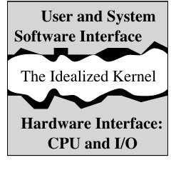
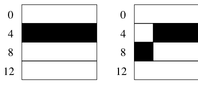
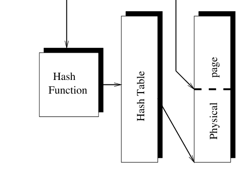
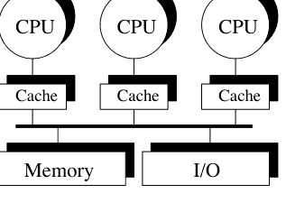

# Linux：一个可移植的操作系统（理硕士学位论文）

我们探讨了 Linux 在将操作系统移植到多个 CPU 和总线架构时发现的硬件可移植性问题。我们还讨论了软件接口的可移植性问题，特别是与其他共享相同硬件平台的操作系统之间的二进制兼容性。文中描述了 Linux 采用的方法，并对其中一些示例进行了更详细的介绍。

# 致谢

虽然 Linux 项目与我个人关系密切（部分是因为名字的原因），但我想非常明确的是，Linux 操作系统是由全球许多人合作完成的一个巨型项目。

即使去掉任何运行的 Linux 系统中不可或缺的用户级程序，仅内核就包含了来自世界各地数百人的代码。

感谢你们。

## 引言

本论文旨在介绍 Linux 内核的可移植性问题。它不仅是为了作为我的硕士论文，我希望它能真正对那些想要将 Linux 移植到其他架构的人有用，或者对那些只想了解 Linux 在不同平台上的设计问题和目标的人（相对于 Linux 本身的更通用目标）有用。

为了使这些内容具有实践意义，我尝试解释通用问题，随后通常会针对一个或多个特定的移植案例进行评论，并对实践中实现的内容提供一些提示¹。

请注意，在本文背景下，“Linux”一词通常指的是由基本内核以及通常运行在内核之上的所有系统和用户应用程序构建的整个系统；而在本文的语文中，仅考虑内核本身。系统和用户应用程序的可移植性在这里被视为一个完全不同的问题，尽管它们显然存在一些共同的关注点。

此外，你不应该期望这是一篇对内核进行逐行（或非常底层）的解释——恰恰相反。本文论文并不是试图解释所有特定函数的功能，而是试图解释基本概念，具体的示例应被视为仅说明 Linux 在软件层面如何在某些特定硬件上运行的。

论文通常遵循一种通用格式：每个章节首先解释通用问题和潜在解决方案，然后是一个“实现”部分，给出 Linux 特有的实现细节。读者应该能够在对 Linux 本身几乎或完全不了解的情况下跟随文本，尽管显然要求读者对这些问题有通常了解。

## Linux 可移植性历史

从一开始就关注 Linux 的人可能会发现这篇论文的标题“Linux：一种可移植的操作系统”是一个相当讽刺的陈述。可移植并不是 Linux 最初的特质；早期 Linux 版本极其不稳定。

> ¹ 出于相同的原因，本文将以电子版提供，当人们发送评论或系统发生变化时，我会尝试保持其更新。Linux 绝不是一个静态系统，某些问题（特别是涉及多路 CPU 的问题）还非常新，仍然可能发生重大变化。

原始的 Linux 不仅极度以 PC 为中心，沉溺于 PC 提供的功能，而且除了用户级之外，完全不关心大多数可移植性问题。为 Linux 编写的原始 Intel `80386` 架构可能是 CISC（复杂指令集）设计的范例，并且对其他当前 CPU 甚至梦都不敢想实现的功能具有高级支持（例如参见 [CG87]）。

Linux 甚至没有尝试避免早期版本中提供的 x86 特性——恰恰相反。Linux 起初是一个探索在 CPU 上能做什么的项目，它使用了你能找到的几乎每种 CPU 特性，从用于进程间保护的分段到硬件辅助进程切换。

然而，最初不容置疑的方法实际上是一个不可移植的实现，而不是一个内在不稳定的设计。与其它 UNIX 兼容的目标导致了一个具有可移植接口的系统，而实现细节是独立的。这种可移植的设计本质上让 Linux 本身具有了相当的可移植性。

第一个基于非 Intel `80386` 架构的 Linux 是向 Motorola `680x` 家族的移植，这在 Linux 开发的早期就出现得相当早。然而，原始的 Linux/68k 项目并不真正关注可移植性，而是让 Linux 运行在基于 68k 的 Amiga 和 Atari 计算机上。

请注意这里“可移植性”与“在不同架构上运行的能力”概念之间的根本区别。可移植程序的设计和实现方式使其能够在不同的系统上运行，而即使是非可移植的程序，也可以被强制运行在其他系统上。原始的 Linux/68k 项目并没有尝试让 Linux 可移植，它只是尝试重写内核，以便让新版本运行在新架构而不是原始架构上。

虽然 Linux/Alpha 项目本身是一个巨大的进步，但可移植工作始于作者获得 Digital 公司提供的 Alpha 系统，人们希望在新的 Alpha 架构上制作 Linux。很早以前就明确了，为了能够同时维护基于 Intel 的稳定平台并支持一个新的且在某些方面有根本性不同的平台，内核需要一些重大的重构，以从根本上提高其可移植性。这些问题和最终结果正如本文所述。

目前的状况是，Alpha 移植已完全成功，并被广泛使用且完全集成到主内核源码中。同时，可移植性问题不仅从 Alpha 移植的角度得到了考虑，还从更通用的规模进行了考虑。结果是其他移植工作变得容易得多，原始的 Linux/68k 项目已将其基础更新新的可移植布局，该工作的集成正在进行中 [Law97]。

除了 Alpha 和 68k 移植，到 Sparc 架构的移植也非常成功，并且处于活跃使用中并大部分集成到基础源码中。除了这四个之外，还有对其他架构的移植，包括 MIPS [Bai96]、PowerPC [Dou96] 和 ARM (StrongARM) [Kin96] 系列 CPU。

同时，Linux 内核已移植到虚拟环境如 Mach [App99] 和 L4 微内核 [Hoh96]。在这些环境中，Linux 内核运行在另一个内核之上，该内核提供了物理机器的另一种视图，以获得两者的优势。

## 可移植性关注点

与其他某些软件产品不同，操作系统并没有内在的生存理由：操作系统的作用仅仅是执行实际工作的用户与执行任务的硬件之间的接口。没有可行用户程序的操作系统是无用的，而不能与可用硬件协同工作的操作系统同样是没有意义的。操作系统的价值取决于它支持用户进程的优劣程度，以及它在硬件上实现其提供的服务的优劣程度。

因此，内核本身由它运行的硬件和它支持的软件共同定义（图 1）。在编写操作系统并将其移植到新架构时，应该考虑方程式中的这两个部分。负责移植的人很少能选择自己理想的硬件，同样，移植工作可能会受到用户层级的限制。

| 用户与系统软件接口 |

| :--- |

| 内核 |

| 硬件接口：CPU 和 I/O |

图 1：内核：用户与硬件之间的接口

在硬件方面，关注点可以大致分为两类：CPU 子系统的架构（包括内存管理、缓存以及可选的多路处理器处理细节）以及 I/O 接口的架构。另一方面，软件方面的问题通常与兼容性有关：我们想在多大程度上（如果有的话）与其它、可能类似的操作系统兼容。

然而，比硬件和软件移植细节本身更重要的，是拥有一个易于实现移植的通用设计。它应该允许在不影响现有代码的情况下轻松添加新接口（包括软件和硬件两侧）。在 Linux 的情况下，由于其广泛的开发工作，这一点尤为重要：这是一个分布式开发社区，开发者之间没有直接的面对面接触，且缺乏解决冲突的中央权威。

虽然设计移植工作应该能够在不相互影响的情况下独立工作，但通用的维护关注需要大量的代码共享。如果不同的架构最终都独立完成所有工作而代码非常少，那么可移植性的整个目标就丢失了；不同的平台可能被视为独立的项目。

出于维护考虑，特定架构的代码需要保持短小和简单，所有复杂的功能都应该由所有平台共享的体系无关代码处理。这反过来要求所有架构之间共享一个共同概念。那个概念就是虚拟机。

## 虚拟机概念

创建一个能够适应不同硬件和软件要求的的可移植系统，最常见的方法是使用虚拟机概念 [GC94, p. 70], [Tan92, p. 22]。

与其拥有所有必须单独处理的独立架构，虚拟机的想法是创建一个机器的理想化抽象，通过这种抽象让通用代码在真实硬件上运行。通用代码本身不需要感知实际硬件细节，这种代码可以在如图 2 所示的任何物理硬件上运行。

虚拟化机器的想法本身并不新：仅仅操作系统通常是用某种高级语言编写的这一事实，本身就是通过将高级语言翻译为硬件特定代码的编译器帮助，对底层硬件的一种虚拟化。

通过虚拟机抽象，我们只是将高级语言已经提供的虚拟化扩展到一种可以处理在实际物理硬件上实现内核所需的细节的东西。虽然大多数高级语言对于虚拟化普通层面的活动很有帮助，但我们需要将其扩展到涵盖硬件的所有细节。

这一概念被广泛使用是因为它非常有用：在 Windows NT 上，虚拟机被称为 `HAL`（硬件抽象层），而 SVR4 UNIX 则有一个更受限的 `HAT`（硬件地址翻译）层来处理依赖机器的虚拟内存地址 [GC94, pp. 92]。



图 2：虚拟机

通过这种不直接与虚拟机建立接口的理想化内核，将操作系统移植到另一个平台或另一个用户级二进制接口的操作就不再是一个需要重写所有内容的问题。相反，必须在物理机上实现指向虚拟机的外围接口，而大多数代码可以保持不变。

显然，虚拟机语义的选择具有首要意义，它决定了系统可移植的难易程度，以及所产生的操作系统的效率。实现一个层次过高的虚拟机会导致产生大量特定架构的代码，而一个规范过多的虚拟机则可能无法在某些特定硬件上高效运行。

## Linux 内核虚拟机

虽然使用虚拟机来干净地处理移植性问题的概念非常有用且被广泛，但它为内核增加了一层抽象。事实上，取决于具体的实现方式，它可能会增加两层抽象：内核与用户空间之间的层，以及内核与硬件之间的层。

在许多情况下，内核与用户空间之间的层是可以被忽略的，因为原始内核接口通常以系统调用的形式或或直接导出给用户进程。这是大多数操作系统采用的历史性方法，仅仅因为当时操作系统是为硬件制造的，而且之前不存在用户级的标准。

然而，在 Linux 的情况下，Linux 所移植的架构上通常存在先有的用户级标准，为了发挥最佳效用，Linux 需要符合这些标准以利用现有的应用程序。因此，硬件抽象层和用户级抽象层通常都是需要的。

抽象层存在的问题在于，当概念必须在层与层之间转换时，它们会产生开销。这通常是硬件抽象层被避弃的原因之一：它们增加了额外的处理，而这些处理可以通过直接在裸硬件或软件接口上进行编程来避免。这一点必须被考虑在内，特别是 Linux 的最初目标之一就是高效。

# 2 Linux —— 设计与实现

与大多数现代研究型操作系统不同，Linux 处理操作系统的方法是非常务实的，它并没有集中于新内核的*设计*，而是将重点放在稳健且高效的*实现*上。他们没有丢弃经过证明的理念，而是以新的方式对它们进行了精炼。[Tor93]

Linux 的设计基于三个主要设计问题，这些问题直接影响了实现。主要问题是：

- 简单性。这种显而易见性有时意味着它会被忽视，但操作系统内核是一个复杂的实体，必须在一个不受控且甚至可能是敌对的环境中工作。操作系统中的编程错误比普通程序的可接受度得多，而且安全问题至关重要。复杂的设计更难验证错误或安全问题，因此要求基础服务具有简单性。

- 效率。内核参与了机器中几乎所有的活动，因此内核必须足够高效，以确保*永远*不被视为性能瓶颈。

- 兼容性。虽然内核的基本操作对操作系统领域的研究人员来说至关重要，但只要他们的程序运行正常，大多数人并不想知道发生了什么。因此，操作系统最重要的特性之一就是它不给用户（无论是普通用户还是程序员）带来任何惊喜。即使是新功能也应该作为*子集*提供，而不是*取代*用户所习惯的功能。

这些设计问题结合非常务实的编程方法，导致了一个系统既具有传统单体设计的特征，又带有新研究项目向现代微内核演变的迹象。微内核设计本身由于对该方法的效率和简单的怀疑而被丢弃，但在开发过程中，许多通常与微内核关联的特征都实现在了一个更传统的单体内核之上。

该设计还受到 Linux 源代码对任何可以访问互联网的人开放这一点的深远影响。这不仅导致了一个物理上遍布全球的充满活力的开发社区，也直接影响了设计本身。

与其专注于一个与世界其他部分（无论是硬件还是软件）接口的内核二进制文件，Linux 的方法是提供可用于创建我们所需二进制文件的源码。这种方法允许在编译时而不是运行时指定接口。

更传统的链接时和运行时接口自然也是可用的，并提供了对更动态功能集的访问。通过将模块在运行时动态链接到内核中，用户可以根据需要添加和删除功能，但源码的可用始终增加了通过编译时指定配置并让编译器处理接口问题来提高性能的可能性。

## 2.1 设计 —— 兼容性

三个主要设计问题——简单性、效率和兼容性——自然地形成了内核实现的基础。兼容性问题定义了系统的外部轮廓，而简单性和效率问题则定义了其内部实现。

与其他 UNIX 操作系统保持兼容的愿望在某种程度上定义了导出给系统和用户应用程序的内核接口。注意，兼容性扩展到了机器本身之外：兼容性问题不仅要求指向内核的编程和用户接口，还涉及系统与其他外部要求的集成。这些要求包括在外部网络上遵循标准协议，并且能够与其他操作系统在同一台机器上共存。这可能涉及支持通用的磁盘分区或特定的启动序列。

由于兼容性显然限制了系统的外部接口，许多新的操作系统项目选择较低的兼容性，以便能够充分表达设计者的意愿。这类项目不再受限于他人所做的事，而是可以向设计美学的新高度飞跃，至少在设计者眼中是如此。

遗憾的是，这些项目在现实生活中往往倾向于失败，由于缺乏通用应用程序或接口，只能获得一个小众市场（如果有的话）。正如早之前提到的，一个操作系统的价值不在于它能做什么，而在于它允许他人做什么。因此，通常需要更务实的方法。

虽然兼容性显然限制了系统的设计，但它同时也使其与其他系统的集成变得更容易，并可能允许大量的现有应用程序直接在新的内核上运行。在 Linux 的情况下，与通用 UNIX 兼容意味着大量免费的 UNIX 应用程序可以直接在 Linux 之上。因此，虽然兼容性的约束有时可能感到束缚，但它允许系统在他人工作的基础上构建。

然而，虽然兼容性对系统的可用性是有好处，但它往往也是枯燥的。大量兼容的操作系统并不能让系统设计者的心跳跳得更快，也不会让系统在实现层之外展示创新。

## 2.2 实现

虽然系统的基本形状受到兼容性问题的限制，但设计者可以自由决定这种形状实际上是如何实现的。

虽然现代操作系统研究倾向于微内核和面向对象的设计，但 Linux 倾向于一种更传统的设计。与它试图兼容的 UNIX 不同，Linux 使用了主要由可移植 `ANSI C` 编写的单体内核。

尽管良好的 C 语言通常适用于系统编程（毕竟这是该语言原始用途之一），但 Linux 内核还使用了 GNU 提供的某些特性，这使得能够高效地实现某些功能。两个值得的 C 扩展是内联函数和嵌入 C 代码中的内联汇编代码。

需求（通常是硬件本身提出的需求，例如故障处理例程）。

选择传统设计是因为人们对基于微内核的操作系统的性能和简单性存在严重怀疑。虽然在微内核的性能方面已经做了大量工作（例如参见 [BGG+91]），但首先就需要如此大量的工作，这一事实表明这些问题绝非显而易见。

此外，虽然简单性被用作基于微内核设计的论点之一，但考虑到微内核设计中不同模块之间所需的复杂交互，这一论点充其码是可疑的。这种问题通常由于复杂的性能问题而变得更加恶化，而微内核的这种基础简单性往往被这些问题的复杂性所淹没。

这绝并不是要反对微内核本身，作者认为文献中夸大了微内核的优势，而一种简单直观的传统方法可能更符合用户的需求。微内核往往最适用于分布式系统，而不是 UNIX 类型的操作环境。甚至对于在何种层级进行分布的问题仍然存在。

尽管如此，非常基础的 UNIX 设计在某种程度上倾向于使用微内核方法处理用户服务。当考虑到由基础非内核 UNIX 进程完成的所有服务时，传统的单内核 UNIX 内核可以被视为一个小小的微内核。虽然许多其他操作系统倾向于在内核中处理用户验证和会话处理（在某些情况下甚至处理图形服务！），但这种心态正是 UNIX 的哲学，这些服务通过用户级进程提供。

## 2.3 内核组织

基础 Linux 内核直接围绕其提供的主要服务组织：进程处理、内存管理、文件系统管理、网络访问和硬件驱动程序。这些领域分别对应内核源码目录 `kernel`、`mm`、`fs`、`net` 和 `drivers`。此外，这些区域通常被进一步划分为特定的服务（见图 3）。

Linux 的基本可移植性原则是“单一源”概念，即所有架构共享相同的基础源码树。依赖于架构的代码位于：

> ²参见第 4.4.2 节关于 Linux 分布式环境实现，位于 `arch` 目录，其中包含每个支持的架构的子目录。虽然对于架构必须提供什么没有绝对的规则，但共同的考量导致了架构子目录具有类似的组织形式，大多数都遵循以下设置：为进程处理（`kernel`）、内存管理（`mm`）和针对特定架构优化的库例程（`libb`）分别设置了独立的目录。

源码的这种层次化划分不仅更容易获取系统概述，还起到了内核模块化的作用。虽然没有什么能阻止编写忽略这种概念布局的代码，但可维护性要求开发者在系统的不同部分之间保持整洁的接口。模块化不仅让源码更易于理解，当许多开发者同时在同一个项目上工作时，这也是一项要求。不同的开发者可以在他们内核的特定区域工作，而不必担心其他区域发生什么。

内核的模块化本质也导致了有限的面向对象设计。虽然内核使用的 C 语言本身并不支持这种面向对象，但可以通过使用函数指针和公共数据结构来管理这些影响。这在文件系统代码中尤为显著，其中实现通用 UNIX 文件系统语义的虚拟文件系统将通过这种对象接口看到底层的实现³

- `kernel`
- `mm`
- `fs`
  - `ext2`
  - `nfs`
  - `proc`
- `arch`
  - `alpha`
  - `i386`
  - `m68k`
  - `mips`

## 2. 虚拟机的实现

虽然虚拟机方法所需的抽象层可能会产生性能问题，但 Linux 有一个巨大的优势：源码的可获得性和单内核。

与其采用二进制级的抽象，不如将抽象层移动到源码级。这样，许多所需的转换可以在编译器在编译时处理，而不是在运行时处理，因此不会对性能产生不利影响。

> ³ 使用 `C++` 允许在语言层面上描述这类对象接口特征。这在 Linux 开发过程早期尝试过，但当时的编译器技术不够稳定，而且人们担心过于高层的接口可能会隐藏内核中至关重要的细节。

图 3：内核组织

由于是单内核，因此没有必须考虑的外部实体和固定协议，因此编译器可以自由优化掉在特定架构上不需要的操作。更具体地说，由于没有其他东西依赖于这些内部数据结构，这些结构可以根据需要在源码级进行裁切，以尽可能地匹配用户或硬件的需求。

Linux 内核虚拟机是通过创建特定架构的头文件以及在通用内核代码与特定架构文件之间的通用 API 实现的。这些头文件创建了代码运行的虚拟机镜像。


虚拟机头文件使用 C 语言预处理器（`#def` 指令）定义机器，并使用各种类型和内联函数在物理硬件之上实现虚拟机。虽然内联函数不是标准 C，但大多数编译器都实现了它们，且普通的 Linux C（GNU 编译器，也称为 "`gcc`"）对它们的支持非常广泛。由于 GNU 编译器本身具有很好的可移植性，使用 C 扩展并不是问题。

使用 `gcc` 允许架构头文件使用内联汇编例程来实现无法用可移植 C 语言高效表达的代码。这结合内联函数，允许编译器将虚拟机语义映射到任何特定硬件之上，这意味着虚拟机抽象几乎或完全没有损失。

除了特定架构的头文件外，每个架构在系统源码的 `arch` 目录中都有自己的子目录。该目录包含了为每个架构构建规则的内核源码：应该使用哪些文件、编译器为该架构需要哪些特殊选项等。这种方法在针对特定架构的代码方面提供了最大的灵活性，并且对代码的功能没有施加任何限制。

即使在内核的特定架构部分中，共同的考量也导致了特定架构内核源码的基础布局。大多数架构倾向于拥有包含内核功能的子目录（例如系统调用接口、陷阱处理）、低级内存管理代码（例如页表初始化和缺页异常处理）以及经过优化的特定架构库代码（例如内存拷贝、网络校验和计算）。

此外，许多架构为没有浮点运算能力的硬件提供了软件浮点数学仿真，或者对于需要软件支持下溢和溢出特殊情况的硬件提供支持。

# 3 软件接口可移植性问题

操作系统可移植性方面一个经常被忽视的问题是软件接口侧。这个问题在传统上一直被忽略，因为操作系统的设计者还负责设计系统和应用程序软件的接口，因此操作系统内核可以自由地实现任何想要的接口。

然而，计算机行业已经成熟，大多数现代操作系统必须面对接口标准已经存在的事实，这些标准无法被忽略。有时标准是在源码级的，这允许在实际实现标准时有很大的自由度。在 UNIX 世界，这种做法最为人知的例子是 `POSIX`（可移植操作系统接口）[Ins96]。

更多时候，标准是二进制兼容标准，用于运行为之前的操作系统设计的遗留程序。在这种情况下，设计者必须非常密地遵循二进制标准的接口细节，以确保在升级到新的操作系统内核时遗留程序不会崩溃。

有时面临的问题另一个是同一平台上存在多个标准，这些标准具有细微的差异^4，甚至可能存在矛盾的要求。虽然这种情况并不多见，但可能是系统设计者首要考虑的问题之一。

操作系统的多个接口问题通常由所谓的“OS 人格”（OS personalities）来处理。一种人格处理一种接口标准的接口问题，而所有人格共享相同的通用操作系统例程。

在某种意义上，OS 人格的概念与硬件的可移植性问题非常相似，而虚拟机抽象可以用于处理多接口的情况。理想化的内核并不直接实现任何接口，软件的可移植性就变成了一个将所需的用户接口映射到理想化内核镜像之上的问题。

OS 人格与硬件平台的一个主要区别是，内核通常一次只运行在一个物理平台上，但它可能需要并发处理多个人格。微内核操作系统通常通过为每种人格添加一个人格服务器来处理这个问题（见图 4）。

然而，在这种人格服务器方法中，处理此类人格的开销非常高，这也是迁移线程（例如 [FL94]）以及将系统服务移动到内核地址空间（参见 [LHHL93]）的主要原因之一。更重要的是，当人格服务器的概念允许独立于人格的系统视图时，大多数实际系统使用倾向于使用一个主人格。其他人格主要用于向后兼容或非原生系统的仿真。

## 3.1 软件接口的实现

由于 Linux 的主要目标从未是作为一个模拟其他系统的平台，因此 Linux 处理软件接口人格问题的方法非常直接。

Linux 内核接口并没有支持同等重要性的多个人格概念，而是只为了一个主人格进行接口，系统针对该主人格进行了优化。拥有一个主人格允许对常见情况使用编译时优化，并意味着内部结构可以针对预期的系统使用进行优化。人格与通用代码之间的集成要紧密得多（图 5）。

^4 有时这些差异并不十分细微。

通用代码与主软件接口之间的这种紧密绑定并没有排除次要人格的使用，这应该被视为一种优化而非一种局限。此外，应该注意的是，主人格可以适应平台，它并不是虚拟内核本身固有的。例如，在 Alpha 平台上，主人格是兼容 Digital UNIX 的接口；而 Spar 上的 Linux 它的主人格看起来像在相同硬件上的原始 Sun 操作系统。

除了主人格外，还可以存在任意数量的次要人格。这些次要人格可以根据需要运行时动态加载到内核中，正如原始 Intel 平台上的 `iBCS2-personality` 所示 [91]。

`iBCS2` 代表 Intel Binary Compatibility Specification 2（二进制兼容规范 2），是 `i386` 平台上非 Linux UNIX 类操作系统通常使用的二进制格式。

注意，这些次要人格与主人格具有相同的全部资源访问权限，其区别与其说是概念上的，不如说是优化上的问题：对于哪种人格，内部数据结构通常只需要从内部内核数据结构对用户模式请求进行最小的转换；而次要人格可能必须将用户请求转换为适合内核的格式。

除了次要人格外，还可以存在三级人格：即操作系统内核未直接支持但在用户空间中可以仿真的环境，通常至少需要内核的支持。这就是 Linux/x86 能够通过外部仿真器和内核的最小支持（暴露高效仿真所需的硬件功能）来运行 DOS 和 Windows 程序。

用于运行 Macintosh、Commodore 64 和其他二进制格式的类似仿真器。另一个例子是通过 Java 解释器或即时编译（`JIT`）编译器运行 Java 程序 [GM95]。对于 Java（以及可能的其他二进制格式），内核会自动注意到 Java 二进制并启动适当的仿真技术，以便与原生程序无缝集成。

图 5：主人格

## 3.2 人格

在 Linux 的设计中，基本方法是尽可能地遵守标准的 UNIX 语义。然而，正如许多 UNIX 讨厌者对你所说的，标准 UNIX 的概念在某种程度上是一个自相矛盾的。

UNIX 的问题之一是，虽然运行的基本方法是相同的，但不同的厂商制作了细节上各异的 UNIX 版本。在 UNIX 四个世纪的历史中，演化出了很多差异。

虽然 UNIX 社区已经开始通过各种标准来解决这个问题，而且目前的 UNIX 状态绝不像五年前那样碎片化，但情况绝非完美。由于任何形式的 UNIX 都可以适用于几乎存在的任何计算机硬件，UNIX 标准显然倾向于源代码标准，而不是二进制接口标准。

为了真正兼容人们心目中的“UNIX”，仅仅遵循标准是不够的。标准通常比任何真实的 UNIX 都要局限得多，而 POSIX 品牌一直是许多操作系统（并非所有系统都像 UNIX 类）的喜欢的消遣——它们遵循某一个标准并不意味着系统的行为正如用户所预期的那样。

因此，Linux 的兼容性问题远超纸面标准，与其说是所有 UNIX 的子集，不如其理念是成为人们预期行为的超集。

虽然成为所有 UNIX 行为真正的超集在技术上是不可行的（也不一定是个好主意），但 Linux 尝试提炼 UNIX 的本质，并实现人们对这种系统的所有相关功能。遵循标准通常使得移植那些考虑到标准编写的程序变得容易，但 Linux 比此更进一步。

现在，在理论上成为人们应该预期内容的超集应该是简单的。遗憾的是，事实并非如此。主要问题是基本的 UNIX 操作是相似的，细节上的差异往往会导致两个系统以不同且矛盾的方式执行相同的事情。

例如，虽然读取目录内容的标准接口是通过 C 库层面的 `readdir()` 接口，但该接口在较低层次的实际实现在不同的 UNIX 操作系统可能非常不同。显然，读取目录的操作必须由所有这些不同的接口处理。

考虑到当前的默认 Linux 源码包含 17 (!) 个不同的文件系统，如果所有这些文件系统都必须了解读取目录的所有可能接口，那么代码的重复将是可怕的。目录内容必须通过虚拟接口处理，该接口可以为所有不同的系统进行适当的转换。

兼容性中的另一个问题是不同的 UNIX 操作系统支持的数据结构布局的不同以及各种操作系统类型大小的差异。这表明基本的内核例程应该是类型无关的，以便处理不同的布局。虽然这种类型化可以在编译时完成（允许为主人格产生最优代码），但源码仍然应该能够适应任何类型布局，而不会变成条件编译的乱团。

最后，必须处理各种环境常数的问题。错误代码随系统而变化，各种系统调用使用的命令号（特别是 `ioctl()` 和 `fcntl()`）也是如此。所有这些都必须整洁地分离到特定体系头文件中，允许内核共享基础源码但在细节上有所不同。

# 4 硬件可移植性问题

虽然软件接口的可移植性问题对于任何操作系统都很重要，但在谈论可移植性时，人们往往首先考虑硬件可移植性问题。这些硬件可移植性问题大致分为几个主要领域。

第一个关注点，也是内核外普通代码中常见的领域，是 CPU 的数据表示问题。大多数 CPU 内部问题都被编译器隐藏了：程序员通常不需要担心 CPU 的寄存器数量或实际的代码生成。但某些问题往往需要被考虑：例如内存中值的字节序（`byte order`）和对齐，以及内部寄存器的宽度。

大多数其他可移植性考虑因素通常是不影响用户级程序的问题：系统内存管理和缓存的差异，以及可能的许多进程处理细节。同样，I/O 架构的差异不应该让用户看到，但它们直接影响操作系统。

## 4.1 数据表示的可移植性问题

任何可移植性问题中显而易的问题都是目标硬件的 CPU 架构。事实上，这个问题显而易见，以至于 I/O 架构等问题往往被完全忽略。

大部分 CPU 可移植性是通过使用可移植语言并配备能够将代码翻译到各种不同架构的编译器来处理的。这种可移植性是任何大型项目或或少要求的，而真正的可移植性工作在于确保语言所保证的语义能够跨平台正确迁移。

如果一种语言足够完备，编译器就可以处理 CPU 可移植性中的所有问题，迁移将变成将所有内容重新编译到新架构的问题。然而，目前不存在适用于创建操作系统等系统级编程的语言。

Linux 与现在的大多数操作系统一样是用 C 语言编写的，C 具有良好的可移植性，同时允许与架构进行紧密交互。这种紧密交互允许程序员在需要时进行非常底层的编程，但 C 允许这种低级编程的事实显然比其他一些编程语言暴露了更多的机器特性。因此，编写得糟糕的 C 代码绝不在另一台机器上以你预期的方式运行。

在将 Linux 移植到其他架构的过程中，也出现过必须修复编译器错误才能继续工作的情况。这主要发生在 Linux 移植到 Alpha 时，因为在启动 Linux 移植时，Alpha 的 `gcc` 端口本身还相当新。

### 4.1.1 不同的数据大小

不同 CPU 之间更明显的区别之一是内部数据寄存器和虚拟地址空间的大小。因此，例如，Intel 80x86 拥有 32 位寄存器和地址空间，而 Alpha 的寄存器和地址空间是 64 位的。这导致 C 语言中的标准数据类型在不同架构上不同。

这种基本数据类型的差异往往被作为可移植性中的主要问题提出。然而，至少在 Linux 内核本身的情况下，数据类型的大小大多是无关的，尽管对于从 32 位架构移动到 Alpha 这样的 64 位架构曾有很多紧张情绪，但事实证明在现实生活中这并不是什么大问题。

在普通的可移植代码中，底层硬件类型的大小并不并不。在很多情况下，C 语言中的“long”是 32 位还是 64 位是完全无关的，大多数内核代码将使用某些特定机器的本地原生的大小。

然而，在某些情况下，数据大小是重要的，通常是因为该大小是由某些外部实体定义的——例如，在文件系统中通常是这种情况，因为物理磁盘上的数据布局具有某种与机器无关的标准。同样，大多数网络代码依赖于能够处理特定大小的地址，而到设备控制器的硬件接口通常具有非常严格的类型结构，这与主机 CPU 类型无关。

#### 数据大小 — 实现

在 Linux 中，特定特定的头文件导出了一小部分特定类型，供操作系统部分在需要某些特定类型大小时使用。包含 `<asm/types.h>` 文件使得当某些特定需要 8 位、16 位或 32 位无符号整数时，可以使用 C 类型 `u8`、`u16` 和 `u32`。

相应的有符号数据类型（`s8`、`s16` 和 `s32` 也可用，但应尽量减少它们，因为任何需要特定位数的对象通常不是普通整数。

由于标准 C 的命名规则，这些类型仅在编译内核代码时可用。如果需要将特定类型暴露给用户空间实现，则存在在类型名称前面加有下划线的相同类型版本（`~u8`、`~u16` 等）。这些主要用于在无法暴露这些类型正常名称的公共头文件中。

#### 未解决的问题

虽然当前的 Linux 内核已证明可以移植到各种硬件（包括不同的字长和字节序），但数据类型的可移植性问题绝未被完全处理。

一个经常被忽略的数据大小问题是字符集的大小。虽然 8 位字符目前是标准，但它忽略了主要在亚洲使用的宽字符问题。Linux 内核通过不在内核本身中进行任何字符翻译来规避这个问题，并将所有此类问题留给用户空间。

对于内核而言，所有数据都是 8 位字节流，而对这些字节的解释（可能通过将两个或多个字节组合成更宽的字符）交给用户程序。标准控制台驱动程序通过使用 UNIC 和可加载字体集支持各种字符翻译，设置字体和转换表策略策略在用户级处理。在图形用户环境和系统控制台上执行此操作的工具已经存在，因此从这个意义上说，这些问题已经解决了。

另一个类型相关的问题是字长不是 2 的幂的机器或不可字节寻址的机器。虽然这类机器在过去存在过并且在某些地方仍然存在，但人们认为在可预未来不太可能创建这样的机器（至少对于 Linux 移植有意义的更大市场而言）。

由于类似的原因，整数位级表示的问题尚未被考虑，实现补码之外其他整数表示的机器可能需要一些可移植性工作。目前的可移植性工作还没有担心此类问题。

### 4.1.2 对齐限制和字节序的影响

比数据大小复杂得多的是某些特定 CPU 上数据内存访问的细节。即使两个 CPU 共享相同的数据类型，该数据在内存中的表示也可能是不同的，并且许多 CPU 限制内存访问仅限对齐地址。



图 6：对齐

相比之下，Sun Spark 系列架构是大端序，且内存访问必须是对齐的；如果程序试图在一个不能被 4 整除的字节地址上存储 32 位字，CPU 将触发陷阱（图 6）。大多数其他现代架构也可能在未对齐访问时触发陷阱。

这些内存访问细节被证明比数据大小本身麻烦得多。寄存器的大小对于大多数代码来说并不重要，而它重要的情况是有良好定义的，并且通常寻找起来没有问题。

内存中的值 0x12345678

| | 0x12 | 0 |

|---|---|---|

| 1 | 0x34 | 1 | 0x56 |

| 2 | 0x56 | 2 | 0x34 |

| 3 | 0x78 | 3 | 0x12 |

大端序 小端序

对于对齐，问题在于虽然编译器可以确保所有内部内核数据都是正确对齐的，但内核不能假设外部事件是对对齐的，特别是用户空间参数。

图 7：字节序

对于字节序，问题在于字节序的影响比数据大小要普遍得多，且更难发现。任何数据结构的大小通常可以通过仅更改内核用于访问数据的 C 结构体类型来轻松更改。然而，当字节字节序，我们在 C 语言级别上没有等效的更改，因此任何字节

顺序的变化必须由程序员手动处理，而不是让编译器来完成。

#### 对齐与字节序 — 实现

与类型大小一样，对齐限制和字节序问题都有它们各自的头文件，这允许内核虚拟机使用任何对齐方式或字节序。众所周知，虚拟机始终会在未对齐的内存访问时触发陷阱（trap），如果访问在编译时已知是未对齐的，可以通过一个简单的内联函数来处理，该函数执行额外工作，通过将未对齐的数据加载为两次对齐的加载来完成⁶。

然而，许多访问的对齐情况在编译时是不可知的。为了安全起见，所有这些访问都必须使用可能复杂的未对齐访问函数，这会对性能产生负面影响，特别是在未对齐访问很少见的情况下。这在许多用户级访问中尤为如此，因为用户提供的指针几乎是对齐的，但在某些特殊情况下可能是未对齐的。

为了高效地处理这些罕见的未对齐访问，内核虚拟机假设访问是对齐的，如果发生了未对齐的陷阱，则陷阱处理程序将修复偶尔出现的未对齐情况。触发陷阱的代价将比显式处理未对齐情况高得多，但如果未对齐访问很少见，这种方法效果良好。为了让用户意识到潜在的性能下降，系统在必须处理未对齐错误时会打印警告。在正常情况下，这些信息永远不会出现。

请注意，某些代码（特别是网络代码）会积极尝试对齐所有数据，但不会保证结构始终是对齐的。这是乐观式未对齐陷阱有效工作的一个典型示例。

涉及字节序时，虚拟机对机器的本地字节序不作任何假设。事实上，在大多数情况下，字节序并不重要。然而，在字节序重要的情况下（例如具有指定字节序的磁盘布局或网络代码），存在相应的函数在 CPU 字节序以及小端和大大端（big-endian）字节序之间进行转换⁷。

> ⁶在对齐不重要的硬件上，内联函数显然不需要执行任何额外工作，因此对于在硬件中处理未对齐访问的架构来说没有开销。
> ⁷小端字节序主要由使用标准 PC 字节序的各种文件系统和设备驱动使用，而大端字节序由互联网网络协议使用。

#### 未解决的问题

特别是在涉及对齐时，所有问题仍未完全解决。虽然通过陷阱处理罕见的未对齐情况是高效的，并能确保在存在可能的未对齐数据时也能正确行为，但这一特定的设计决策可能需要重新考虑。

当前虚拟机设计的问题在于，存在各种硬件实现，并不符合该虚拟机设计所预期的硬件模型。最重要的是，该设计*要求*硬件支持通过陷阱处理未对齐访问，而事实并不总是如此。

虽然大多数硬件都符合该虚拟机模型的预期，但在某些情况下，CPU 可能会通过简单忽略低地址位来处理未对齐内存访问，而不是在访问时触发陷阱。这就是选择错误的虚拟机概念可能导致未来需要重新设计的问题示例。

关于未对齐数据的另一个未解决问题是编译器对未对齐访问概念的支持。目前的虚拟机依赖程序员的显式操作来支持未对齐访问，但未来的版本可能依赖编译器指令，让编译器自动创建必要的代码来处理未对齐访问。这种编译器支持已经在某种程度上存在，并且可以像隐藏类型大小问题一样对程序员隐藏。

## 4.2 内核内存管理

内核中最复杂的领域之一（特别是在可移植性方面）是虚拟内存管理。

- 内存是系统中最基本的资源之一，因此内存管理层的性能对系统至关重要。因此，使内存管理高效具有首要意义：例程序不仅必须快速，而且必须足够聪明，通过激进地共享物理页来最大限地利用系统性能。
- 内存管理代码还充满了竞态条件和死锁，尝试共享尽可能复杂的内存管理程序将是一件好事，这样就不需要维护多份相互独立的此类复杂性副本。


然而，更糟糕的是，内存管理通常是完全没有硬件标准的领域之一，不同的 `CPU` 使用非常不同的方法将虚拟地址映射到物理内存页。因此，内存管理是传统上通常非常依赖架构的领域，只有极高层的代码在不同架构间共享，尽管我们希望共享更多内容。

### 虚拟地址

虽然通用的虚拟到物理内存映射可以被视为任何将虚拟地址映射为物理地址的函数，但极端的性能意味着该函数必须相当简单。事实上，在底层，所有 `CPU` 都使用通常称为 `TLB`（转换旁表缓冲区）的片上虚拟内存缓存，虚拟内存映射方案最终转换为向此缓存中填充适当的翻译信息。

| L1 索引 | L2 索引 | 页内偏移 |
| --- | --- | --- |
| L1 | L2 | 页树 |
|  |  | 物理页 |

图8：双级页树

虽然任何映射策略都是可能的，但当前的 `CPU` 倾向于以三种不同的方式处理虚拟内存：通过页树、哈希表或纯软件填充 `TLB`。但即使基本方法相似，底层细节通常也不同。

取决于内存管理单元，页表可能包含除必要的翻译信息外的额外信息。某些架构支持脏和访问位，供系统判断用户是否写入了页面，或者该页面最近是否被访问过。其他架构则要求操作系统手动跟踪这些信息。

例如，原始平台 `Intel 086` 具有双级页树（见图 8），并在硬件中实现了脏和访问位。相比之下，`Digital Alpha` 从系统的角度来看也拥有页树，但由于虚拟地址空间更大，`Alpha` 的深度为二，且缺乏对脏和访问位的硬件支持。

另一方面，`PowerPC` 和一些 `Sparc CPU` 完全没有页表；它们使用哈希表来查找与虚拟地址对应的物理页（图 9）。如果在哈希表中找不到该页面，它们将尝试交换。[Int93b]

### 虚拟地址

| 页索引 | 页内偏移 |
| --- | --- |

由于哈希映射通常无法完全描述内存设置，因此它们更准确地称为片上 `TLB` 的内存扩展，以免与全页混淆。



图9：内存扩展的 `TLB`

最后，`MIPS CPU` 和 `Sun` 最新的 `UltraSparcs` 没有任何架构指定的页表；它们拥有片上 `TLB`，任何 `TLB` 缺失都会导致软件陷阱以重新填充 `TLB`⁸（如果对于违规虚拟地址没有可用物理页，则处理页错误）。[Int93a]

### 4.2.1 通过虚拟页表进行内存管理

如上，不存在标准的虚拟内存映射方法。事实上，`Sparc` 系列 `CPU` 在架构的不同版本中使用了上述三种不同的映射策略。然而，尽管物理硬件存在这些根本差异，我们仍希望尽可能地使用通用代码。

实现这一目标的方法是在 `Linux` 内核虚拟机（见第 1 章）中使用通用的虚拟映射方案，并将该通用内存管理方案映射到物理硬件上。这允许我们在所有支持的架构上共享所有内存管理代码，任何改进

> ⁵在 `Digital Alpha` 架构中也是如此，但 `Alpha` 架构还规定了一种称为 `PAL-code` 的低级软件，使其看起来似乎具有三级页表 [Dig92, pp. 3–2]。

所有平台都自动支持内存管理。架构特定代码唯一需要了解的是从虚拟机到物理硬件的映射。

虽然虚拟机方法的原理易于理解，但细节并非显而易见。应该使用何种映射方案来使到硬件的转换尽可能高效，同时又足够的通用性，使得该方案作为任何现实硬件的超集而有用？如果虚拟机限制太死，它将无法利用大地址空间或特殊的硬件特性。

### 虚拟地址

| L1 索引 | L2 索引 | L3 索引 | 页内偏移 |
| --- | --- | --- | --- |
| L1 | L2 | L3 |  |
| 目录 | 页表 | 表 | 物理页 |

图 10：三级页表树

高效性，使得映射信息不会占用大量的物理内存，而这些内存可以被更好地用于文件系统缓存或运行用户程序。记住，内核不仅需要在内存中保留虚拟机的页表，物理机器的页表也会占用空间。

还有次要考虑的问题：虚拟机的内存映射必须是内存高效的。考虑到对虚拟机页表提出的各项要求，最终的选择并不困难。事实证明，多级页表树是一种可以通过增加层级来轻松扩展以匹配大虚拟内存空间的方法。它是灵活、简单且高效的。

多级页表不仅是解决页表问题的良好通用答案，它还可以轻松地与实际硬件紧密映射，使得从虚拟机到物理机的的页表映射易于实现。事实上，通过选择正确的虚拟机页表设置，内核虚拟机和物理内存管理单元可以使用相同的页表。在这些情况下，映射开销显然为零。

原生原生使用多级页表的架构包括 `Intel 80x86`、`Digital Alpha` 和 `Motorola 68k` 系列。`Intel` 硬件使用两级页表 [CG87, p. 465]，而 `68k` 和 `Alpha` 使用三级页表 [Dig92, p. 3-1]。由于三级页表已足够映射 40-45 位的虚拟地址空间，且目前没有硬件支持更多位宽，因此这是 `Linux` 内核虚拟机的选择（见图 10）。

值得注意的是，n 级虚拟页表可以通过简单地将其中一层“隐藏”在另一层内部，轻松地映射到 n-1 级的物理页表（图 11）。`Linux/x86` 实际上通过这种方法从内核的三级页表创建两级页表。隐藏方法还允许未来扩展内核虚拟页表，而不会破坏任何二级或三级页表。

| L1 索引 | L3 索引 | 页内偏移 |
| --- | --- | --- |
| L1 | L3 |  |
| 目录 | L2 |  |
| 页表 |  | 物理 |

图 11：隐藏的中间页表层

将多级页表树映射到如 `MIPS` 或 `UltraSpar` 等纯 `TLB` 架构同样简单。`TLB` 填充代码可以只需手动跟踪页表，由于数据结构的简单性，这种填充代码通常可以直接直接在 `TLB` 缺失处理程序中用低级汇编语言编写，以获得最佳性能。

对于 `PowerPC` 等哈希内存 `TLB` 扩展的情况，映射不再简单，但有一种适用于这些情况或任何其他内存管理设置的通用方法。该算法如下：

- 1. 芯片内 `TLB` 缺失。
- 2. 硬件执行哈希表查找，如果找到映射：填充 `TLB` 并重启访问。
- 3. 未找到映射：硬件调用内核页错误处理程序。
- 4. 内核页错误处理程序执行内核页表漫游，并将找到的页插入哈希表并返回。
- 5. 重试内存访问，这一次在第 2 阶段的哈希表中找到了该映射。

上述算法显然可以用于任何硬件，并且是当无法直接进行更简单的映射时的回退方案。

### 4.2.2 页表映射一致性

虽然将虚拟页表和物理页表分离利于可移植性，但它们显然也引入了一个新问题：保持两个页表一致性的问题。当虚拟页表更改时，显然需要某种方法使硬件页表失效。

即使当虚拟页表直接映射到物理页表，且页表本身只有一份副本时，一致性问题本身也会以 `TLB` 一致性的形式出现。尽管外部内存页表已随虚拟页表同步正确更新，内部 `CPU` 芯片内 `TLB` 通常也需要失效。

由于芯片内 `TLB` 失效与物理页表的实际布局无关都是一个问题，我们可以将 `TLB` 刷新的概念泛化，以涵盖独立的硬件页表的情况。因此，对于虚拟内核而言，任何硬件页表都被仅视为 `TLB` 的扩展。这一概念允许我们创建如下的更改虚拟页表的算法：

- 1. 修改虚拟页表。
- 2. 使 `CPU` 芯片内 `TLB` 信息失效。
- 3. 如果硬件页表与虚拟页表分离，则使硬件页表失效。

再次，该算法将在任何硬件页表上正常工作。内核需要注意竞态条件，确保在虚拟页表更改后绝不会使用硬件页表信息，但由于页表的更改是高度局部化的，这通常不是问题。

> 9 注意，即使虚拟页表和物理页表可以映射到相同的布局，它们也应该在概念上被视为分离的。

主要问题是找到合适的失效粒度：使过多的硬件状态失效可能是非常昂贵的的，特别是在具有 `TLB` 内存扩展的情况下。这个问题与硬件对多个地址空间的支持密切相关：当我们更改进程的虚拟映射时，不一定需要使与其它运行进程关联的所有硬件状态失效。

描述内核页表的所有信息可以在体系相关的头文件 `<asm/pgptable.h>` 中找到。该头文件描述了在失效和修改虚拟页表时要采取的操作，并且是整个内存管理树中除初始设置代码和低级异常处理之外的主要体系相关文件。

为了让读者了解虚拟页表方法的成功之处，可以注意到，大多数架构可以将所需的体系相关页表信息精炼为只有 500 行左右的 `<asm/pgptable.h>` 文件，其中大部分是注释或描述硬件页表的简单单行内联函数。

## 4.3 确保缓存一致性和原子操作

针对 `Intel` 系列电脑的原始 `Linux` 面的问题之一不需要担心 `CPU` 缓存一致性。传统上，基于 `x86` 系列 `CPU` 的计算机一直都在硬件中处理缓存一致性，操作系统和运行在 `CPU` 上的程序都不需要关心缓存一致。

然而，`Intel CPU` 在这方面是例外而非普通，在大多数其他架构上，操作系统必须感知系统中的缓存，并确保在软件中维护一致性。

### 4.3.1 指令缓存一致性

缓存一致性问题最简单的形式源于常见的所谓的哈佛架构 [HP96, p. 55]，其中指令缓存和数据缓存是分离的，如图 12 所示。

虽然分离指令缓存和数据缓存可能会因为缓存使用模式的不平衡导致缓存利用效率降低，但它也允许芯片设计者

为了将指令流和数据流解耦，从而允许更简单且高效的实现。此外，虽然统一缓存架构在理论上在缓存利用方面可能更高效，但哈佛架构风格的拆分缓存能够保证指令缓存不会被数据访问完全冲刷（反之亦然），且这种工作可以起到平衡因素的作用。

然而，尽管引入独立的指令缓存和数据缓存通常对性能有益，但拆分缓存也引入了两个独立缓存之间的一致性问题。指令缓存一致性问题在于如何保持指令缓存相对于其所缓存的数据的变化保持同步。

最显而易见的解决方案是确保硬件维持缓存一致性，并且每当内存数据发生变化时，都更新指令缓存的内容。这就是原始 `Linux` 平台所做的，就像 `Linux` 设计之初就是这样设计的。

| 总线 | 数据缓存 | 控制 |
|---|---|---|
| 单元 | 指令缓存 | 和 |
|  |  | ALU |

图 12：哈佛架构缓存

虽然硬件对指令缓存一致性的支持为程序员简化了工作，并且在 `Intel 80x86` 平台上出于兼容性原因是必须的，但这并不是工程师们普遍倾向的解决方案。结果，大多数其他现代平台都不支持这种硬件一致性。

不支持硬件指令缓存一致性的主要原因是，最初拆分指令和数据缓存的原因是为了能够将指令流逻辑与数据流逻辑解耦，而必须维持一致性破坏了这种解耦。为了维持一致性，指令缓存本质上必须嗅探所有数据流量¹⁰，从而引入了不必要的复杂性。

更重要的是，现代编程语言和范式规避使用所谓的“自修改代码”，且至少在理论上，指令流不应该被动态更改。对于该问题的工程观点可以归结为：是否要为支持一种本就不应该发生的事情增加复杂度。答案变得显而易见。

> ¹⁰或者，通常情况下，指令缓存和数据缓存必须维持某种排斥策略，保证相同的数据不会同时存在于数据缓存和指令缓存中。

# Linux 下的指令缓存

如果现代编程语言和范式规避自修改代码，为什么指令缓存一致性问题从一开始就是一个问题？为什么操作系统不能简单地忽略这个问题，并完全停止使用自修改代码呢？

经过思考，产生某种形式的指令缓存一致性的原因变得显而易见。尽管内核不需要修改*自身*，但内核显然会导致任何运行中的程序被修改。每当启动新进程并将可执行文件镜像加载到内存指令镜像中时，该镜像就会被修改，并且某种形式的失效。

因此，每当运行新程序时，操作系统都必须支持有限的代码修改，尽管这显然不再是*自修改代码*的问题了。同样，每当内核更改进程的虚拟映射时，如果新映射有有任何可能*被不再有效的旧数据污染，它就必须使旧指令缓存失效。

除了进程的许多更改外，`Linux` 下实现用户态回调（`UNIX` 术语中的*信号*）的正常方法是在进程栈上编写一个简短的跳板函数（`trampoline function`），用于返回内核态。虽然这不是用户态回调的唯一可能实现方式，但它是非常灵活的一种，并且会导致内核修改进程的指令流，从而要求指令缓存与内存镜像保持一致。

最后，虽然自修改代码是不受欢迎的，但除非安全问题要求，否则任何操作系统都不应对用户程序强制执行其一套道德准则。因此，用户空间中的自修改代码至少应该是可能的，并可能需要内核的支持。需要注意的是，通常不能期望内核知道进程何时修改其指令流，因此这种支持不应是自动的，但如果硬件不支持这种支持指令缓存一致性的用户级接口，用户应该有某种方式请求内核帮助。

然而，尽管有这些考虑，指令缓存一致性问题最终并不十分棘手。有两个原因使得软件可以简单且高效地处理指令缓存一致性。第一个原因存在于指令缓存的工作方式：指令缓存从不修改指令流。因为指令缓存从不被修改，维持一致性仅仅是使当前指令缓存失效并读取新的修改副本的简单问题。这里没有冲突的回写问题，也不需要对指令缓存进行排他访问。

另一个指令缓存一致性相当容易处理的原因是，需要指令缓存失效的情况的情况是定义明确且易于定位的。此外，虽然失效操作可能耗时较高，但需要该操作的情况非常罕见，因此极少成为主要的性能问题。

由于需要指令缓存失效的时机与虚拟内存管理的变化重合，`Linux` 内核本身从不关心冲刷指令缓存的问题。如果架构需要特殊的指令冲刷序列，它们可以隐藏在 `TLB` 代码本身中，因为内核虚拟机大部分时候可以忽略这个问题。

同样，由于用户回调可能需要指令缓存冲刷的情况可以在回调代码本身中处理，因为这在任何情况下本质上都是特定于架构的。虽然特定架构的代码需要感知指令缓存，但它们不需要导出到虚拟机级别。

## 4.3.2 数据缓存一致性

虽然指令缓存一致性很容易处理，但数据缓存内部的一致性问题通常非常重要。虽然指令缓存的一致性问题源于它们与普通数据缓存解耦，但数据缓存的一致性问题可能是两种不同情况的结果：数据的多用户访问和缓存别名（`cache aliases`）。在这两种情况下，数据都存在于多个地方，从而产生了数据一致性问题。

尽管一致性问题基本上与独立的指令缓存相同，但由于数据缓存不是不改变的静态实体，情况变得复杂得多。结果，简单地使过时数据已不再不可接受的——由于在同一位置存在多个写入者的情况下需要合理的语义，一致性问题变得更加复杂。

此外，尽管指令缓存和数据缓存在正常情况下不应重叠，但在涉及数据缓存重复时绝非如此。没有准则允许我们假设数据缓存重复是一个异常且罕见的事件，这进一步增加了增加了复杂。

数据缓存一致性问题的正常情况源于两个独立实体都访问该数据。如果一个或多个实体出于性能原因缓存了数据，数据存在于多个地方的事实就在数据被修改时引入了一致性问题。

需要注意的是，有多个实体访问相同数据并不意味着多多处理。单处理器环境中的一个共同问题是使用使用 `DMA`（直接内存访问）直接从内存读取或写入数据的 `I/O` 设备引入的缓存一致性问题。

虽然大多数系统支持硬件缓存一致性，但规则仍有例外。不支持硬件一致性的架构要求任何公共数据都始终通过主内存系统访问，操作系统必须确保在任何 `DMA` 活动发生之前所有缓存都是最新的并冲刷到内存中。

## 4.3.3 反对虚拟数据缓存的情况

与多用户情况不同，缓存别名发生在在同一个缓存的多个区域发现相同位置时，导致了与存在多个实体相同的一致性问题。

这种缓存别名是如何产生的？一个将相同数据放在不同位置的缓存算法可以被认为是完全损坏的缓存算法，因为它不仅会导致别名问题，如果反复发生，显然还会导致糟糕的缓存利用率。

虽然这种带有充分理由的缓存策略在极端情况下是愚蠢的，但它确实存在于当前的硬件中，因此是内核需要了解的。这些缓存别名的原因通常是虚拟索引缓存。

缓存中最基础的问题之一是缓存是如何进行索引的，即如何进行缓存查找。两种主要的缓存类型是虚拟索引缓存和物理索引缓存。正如其名称所示，区别在于使用缓存数据的虚拟地址还是物理地址进行缓存索引。

在物理索引缓存中，通过内存位置的物理地址来查找缓存位置，因此，一个物理内存地址始终能通过索引被找到，且不会发生别名（`aliasing`）。

相比之下，虚拟索引缓存将使用运行程序所看到的虚拟地址作为缓存查找索引。这对于 `CPU` 设计具有一些显而易见的优势：在进行缓存索引之前不需要计算物理地址，缓存查找可以得更快，并能与虚拟地址到物理地址的翻译并行进行。

然而，虚拟缓存的使用直接导致了别名问题，因为不同的虚拟地址指向同一个物理内存位置。结果是不同的虚拟地址可能导致不同的缓存位置，产生上述的别名问题 [IKWS92]。

需要注意的是，虚拟索引由此产生的别名对于指令缓存来说并不是一个问题：虽然别名可能会导致缓存利用率略微，但可以通过更简单的查找过程来抵消，而且由于指令缓存不会修改其内容，别名问题的最坏影响实际上被避免了；事实上，虚拟指令缓存往往可以为操作系统简化指令缓存失效（见 4.3.1）的问题。

然而，在数据缓存的情况下，别名问题要么需要额外的反别名硬件，要么必须通过操作系统的适当支持来处理。由于虚拟索引的初衷是硬件简单化，因此通常留给操作系统来收拾这些烂摊子。

双重映射最平凡的例子是页面同时存在于内核空间和用户空间的情况。由于内核地址空间包含了所有物理内存，这种情况会发生在任何用户页上。幸运的是，只有在少数情况下，这些映射在缓存中实际上会发生冲突。

双内核-用户映射通常不会导致别名问题的原因是，大多数情况下，用户进程对其使用的任何页面具有完全控制权，而内核不会通过内核地址读取或写入该页面。因此，别名不是一个问题。必须确保内核在任何数据拷贝中始终使用虚拟地址，但由于这本身就是正常的运行模式，所以该问题是不值一提的（见第 6 章关于内存管理问题的后续）。

尽管大多数常见的内存映射不会导致别名问题，但存在少数情况并非如此，特别是在内存映射文件方面。当用户进程请求将文件映射到用户内存时，用户可访问的页通常也会通过内核通过映射文件维护的页缓存访问。

由于所有用户程序都以内存映射的形式加载到用户空间，这种将同一个物理页映射到多个虚拟地址的双重映射是非常常见的。然而，绝大多数映射都是 `UNIX` 术语中所谓的“私有映射”（`private mappings`），即对于公共共享页，映射是只读的；如果进程写入该页，虚拟内存子系统将强制触发陷阱（`trap`）并分配一个新的页面副本（所谓的 `COW`，写时复制行为）。

对于私有映射，仍然只有一个实体（内核）可以更改与别名映射关联的物理页，且 `UNIX` 内存语义并不要求此类私有映射保持 100% 的同步。别名问题仍然要求内核在第一次读取内核副本页面时进行处理，但这只是确保副本存在于主内存中而不仅仅存在于内核虚拟缓存中的一个简单问题。

简而言之，对于私有映射，关于缓存一致性的数据缓存别名问题并不棘手。由于同一物理物理页可能在多个位置出现重复，为了获得相同的性能，虚拟缓存应该比同等性能的物理索引缓存更大 [WHL93]。


让虚拟索引数据缓存对 UNIX（以及因此是对 Linux）变得非常糟糕的是共享内存映射的语义，这种语义允许不同的进程在多个位置映射同一个物理页，并允许对该页进行完全的读写访问。这主要用于应用程序之间数据的快速共享，并被使用 MIT 共享内存扩展的 X 服务器以及想要并发访问和更改内存数据的进程（通常是数据库）使用。

由于进程被认为能够直接访问共享内存而无需操作系统的干预，这些共享内存映射的访问不受操作系统本身的直接控制。因此，操作系统通常无法对这类共享映射强制执行缓存一致性。Linux 通常采用的方法是完全禁用此类页的缓存，这在在使用共享映射时会产生非常明显的性能开销。

一种允许逻辑共享内存同时避免禁用缓存的可能方法是使用页表来对共享页的访问序列化。内核可以保护共享页，并允许一次只有一个进程修改它们。通过这种方式，内核控制了所有共享资源，并在新进程需要访问共享页时通过适时刷新缓存来确保永远不会发生别名。因此，内存并没有真正在物理上被共享，而是操作系统让用户进程看起来是那样的。

使用虚拟内存子系统序列化访问可能允许具有这种软件强制缓存一致性机制的分布式共享内存机器（所谓的共享虚拟内存，[AMMR92]），与硬件一致性支持相比，一致性开销是巨大的，且性能对于许多共享内存的传统用途（例如线程间锁）来说通常是不可接受的。在非分布式系统中，禁用所有缓存通常更好，因为那样性能在不同情况下至少是可预测的。由于于原因，没有 Linux 端口使用页表共享内存序列化。

通常，应该尽可能避免数据虚拟缓存。然而，共享内存区域的问题使其处理在本质上变慢；尽管大多数应用程序不需要一致的共享内存，但那些需要的却受到了惩罚。请注意，由于缓存别名，虚拟缓存还可能比物理缓存引发更多的缓存缺失——即使没有由写入引起的任何一致性问题。

需要注意的是，大多数具有虚拟缓存的架构只有靠近 CPU 的小容量虚拟缓存，地址翻译的延迟影响更大。它们随后拥有较大的物理索引的二级或三级缓存。

让使用虚拟数据缓存方法更加可疑的是，地址翻译通常可以通过巧妙的缓存设计隐藏。许多物理索引缓存采用的一种方法是设置一个一级缓存，通过虚拟地址的低位进行索引，而这些位在虚拟地址翻译过程中不会改变——即页偏移（page offset）。这种方法限制了缓存的大小¹，但由于索引在地址翻译过程中不会改变，因此缓存查找和地址翻译可以并行完成 [HP96, p. 425]。

> ¹ 最大缓存大小限制为 $pagesize_{CPU} \times associativity_{cache}$

## 4.4 多处理器问题

虽然多处理曾是超级计算和大型服务器的专属领域，但技术的进步意味着拥有多个处理器的计算机变得越来越常见。这使得这些多处理器机器对 Linux 开发者更有吸引力。同时，Linux 本身获得了更广泛的接受，这反过来使得 Linux 对拥有高端多处理器硬件的人更具吸引力。

结果是Linux 在过去两年中针对这些多处理器机器进行了积极开发，“可移植性”问题不仅改变了底层的 CPU 架构，还改变了在不同 CPU 配置上运行 Linux 的可能性。

现代多处理环境通常有不同的类型，关键问题在于如何访问内存总线。内存总线通常是任何多处理环境的主要限制（内存子系统是主要的 {问题）。

更常见的架构是集中式内存多处理器，所有处理器如图 13 所示平等共享内存。这通常通过公共内存和 I/O 总线实现，由于所有处理器对机器的所有资源都有直接且相等的访问，它通常被称为 SMP（对称多处理）。



由于扩展性问题，另一种主要类型的多处理器具有分布式主内存，每个 CPU 都有自己的本地内存（见图 14）。内存总线不再是常见的瓶颈，且 CPU 之间更加独立。因此，这种机器的性能可以扩展到多得多的处理器。这些机器的通用术是 MPP（大规模并行处理）。

需要注意的是，内存的物理分布并不意味着所有处理器都具有逻辑地址空间。许多 MPP 类型的机器通过全局可寻址的内存空间提供处理器间的通信。这类分布式共享内存机器通常被称为 NUMA（非统一内存访问）；所有内存都是全局可访问的，但取决于 CPU 距离内存的远近，其访问速度会有所不同。在这种背景下，SMP 机器通常被称为 UMA（均一内存访问）。

由于两种多处理器处理方法在内存访问上导致了根本不同的行为，Linux 内核采用了两套完全不同的策略来处理这些问题。

### 4.4.1 对称多处理器处理

虽然将操作系统从一个 CPU 架构移植到另一个架构起初看起来与在多个 CPU 上运行操作系统的问题完全不同，但所涉及的问题本质上是相同的。在这两种情况下，都是为了让操作系统在新的硬件配置上高效运行。

在某种程度上，甚至问题都是相似的：系统初始引导的问题以及关于处理器间信号传递的硬件细节在某些方面与移植到另一个架构相似。同样，SMP 环境下的缓存一致性问题可以被看作是单处理器系统中虚拟缓存和 DMA 常见的缓存一致性问题的扩展。

但尽管如此，将操作系统移植到新的 CPU 架构与从单 CPU 到多 CPU 的“移植”之间也存在相似之处，不过多处理器处理增加了一些独特的问题。主要问题是：

- 数据结构的一致性；需要保护内部内核数据结构免受多个 CPU 的同时访问，通常通过某些同步原语来实现。
- 允许应用程序充分利用多个处理器的存在。

除了上述点外，对称多处理器处理还暴露了某些 CPU 内部的其它缓存，特别是虚拟内存地址翻译（通常称为转换检测表缓冲区，即 TLB）。在单 CPU 系统上，保持 TLB 与当前虚拟内存映射同步是轻而易举的，因为只有一个 CPU 会更改翻译，而且是在非常受控的情况下进行的。

在多个 CPU 的情况下，虚拟内存映射的变化必须广播给任何可能使用该映射的其他 CPU，且 CPU 在原始 CPU 确定可以安全丢弃旧映射之前，必须失效该映射。

最后，由于多个 CPU 共享相同的内存，内存访问的顺序至关重要。由于 CPU 和系统内存之间存在缓存，从一个 CPU 的任何更新到达另一个 CPU 的顺序绝非显而易见。特别是在高速实现中，写入可能在一个 CPU 上被延迟，而读取 CPU 可能会对内存数据进行激进预取，这些问题变得非常重要。

#### 实现 SMP 内核

任何多处理器环境中最显而易的问题是需要保护内部数据结构不被多个不同的处理器以不可预测的方式更改。使问题变得更加微妙的事实是，虽然未受保护的数据结构可能是一个大问题，但实际症状通常罕见且难以重现。

基本问题是，更新复杂的数据结构通常无法以原子方式完成，因此需要某种方法保护其他处理器，防止它们看到部分完成的更新。虽然在某些情况下，通过使用适当的数据结构可以将问题降至最低，其中最终更新可以通过一次原子更新完成（即所谓的自锁或无锁数据结构 [PLJ94]），但通用的答案是通过使用锁来保护更新。

然而，使用锁来避免数据结构上的竞态条件也有自己的问题——死锁和性能。如果操作系统花费大量时间获取必要的锁，细细粒度锁定会对性能产生显著影响，而且必须确保不会出现循环锁依赖导致死锁。

更糟糕的是，长期从事编程的程序员往往并不很好理解死锁和竞态条件问题。目前的编程语言和范式产生了一种结果，即大多数程序员对任何给定程序中发生的情况持有非常线性的观点，而并发性通常没有被良好理解。因此，任何同步方法必须足够简单理解，以至于微妙的陷阱不会让内核编程变得太难。

当前 Linux 内核处理内核锁的方法必须适应仅使用一个内核锁的简单方法。这种方法类似于传统单处理器 UNIX 的非重入方法——即运行在内核模式的进程永远不会被另一个进程抢占。单锁方法简单地将这一要求扩展到多个 CPU。每当请求内核服务时，在进入内核之前必须获取内核锁，因此内部数据结构的完整性得到了轻而易举的保证。

虽然单锁方法足以确保数据结构的完整性且不会导致死锁情况，但它确实存在明显的扩展性问题。这种方法对于 CPU 数量有限且计算负载大部分时间在用户空间运行、仅偶尔进入内核模式的系统来说是可行的，但对于内核密集型任务，它的扩展性差且表现不佳。

因此，当前的 Linux 内核预计不会在超过 2-4 个 CPU 的 SMP 环境中真正有用，目前的关注点之一是内核中锁的最优平衡是什么。目前正在努力将一个锁首先拆分为几个较小的锁，随后确定这些锁中的竞争热点。

希望在不使用过数量锁的情况下实现合理的扩展性，特别是目前良好扩展性的目标是针对较少量的处理器。虽然基于总线的硬件可以扩展到更多处理器，但对于少数几个处理器来说，成本效益似乎高得多，目前四个处理器似乎是一个良好的目标。对于真正的顶端硬件，解决方案在任何情况下通常都不是 SMP（见第 4.2 节）。

### 4.4.2 大规模并行系统

虽然小规模 SMP 共享均一内存机器变得常见，但它们无法提供真正高性能计算所需的扩展性。通过数十或上百个处理器，大规模并行处理系统填补了这一空白，Linux 对于这些类型的系统也越来越具有吸引力。

然而，使得均一全局内存访问机器对许多处理器变得 Practical 的硬件扩展性考虑，也使得 SMP 的软件锁方法扩展得更好，但关于死锁和锁粒度的实际担忧（见前一章）使得这种方法的可行性存疑。

扩展问题的软件解决方案与硬件解决方案完全相同：将节点相互解耦。不是在每个节点上运行相同的操作系统镜像，而是每个节点获取操作系统的本地副本，每个节点都有自己的内存存储。不同的操作系统内核通过高性能内部网络相互通信，但同时可以被视为独立的实体。

注意，SMP 和 MPP 并不是互斥的方法，最有趣的方法之一是将两者结合成一个混合系统。这种混合系统将由连接到高性能网络的多个独立节点组成，每个节点将包含处于 SMP 配置的少量处理器。

虽然运行 Linux 的这种混合系统尚不存在，但实际上有两个以 Linux 为基础操作系统的独立高性能 MPP 项目。第一个项目是 Beowulf [BSS95]。

> NASA CESDIS 研究中心的 Beowulf 项目旨在通过通用现成硬件创建廉价的高性能计算硬件，并使用 Linux 作为操作系统。节点由普通 PC 硬件构建，通过 10Mbps 和 100Mbps 以太网连接在一起。

带宽。虽然最大配置允许在一台机器上集成 1024 个此类 CPU，但 Linux 到今仅运行在 16、32 和 64 节点的机器上。

尽管硬件基础非常不同且项目目标也不同，但这两个项目的基本方法是相似的。虽然基础内核已经添加了一些对 MPP（大规模并行处理）硬件的支持，但大部分工作是在用户空间中通过标准的并行编程接口（并行虚拟机 — PVM 和消息传递接口 — MPI）完成的。通过这种方式可以在适当层次处理分布式环境的复杂性，让内核本身保持相当简单。

请注意，这种方法与基于微内核的分布式系统有本质区别。后者不是在内核底层处理分布的复杂性，而是几乎完全在用户空间处理分布，仅有极少的内核支持。这允许了更大的灵活性，因为不同的节点并不一定运行相同的操作系统或具有相似的硬件。

## 4.5 设备驱动：访问 I/O 总线

我们之前的注意力很大程度上集中在移植性问题中的 CPU 子系统上。在某种程度上，CPU 子系统是任何架构中最可见的部分，而硬件的 I/O 特性往往被忽视。因此，例如，我们谈论 Linux/Alpha 和 Linux/x86 —— 对应 Linux 已移植的 CPU 架构 —— 但从未谈论过 Linux/sbus 和 Linux/PCI 等。

I/O 架构经常被忽视的一个原因是，它不应该被应用程序直接看到。虽然人们习惯了为不同的 CPU 架构准备单独的二进制版本，但在 I/O 方面情况并非如此。I/O 细节被期望由操作系统完全隐藏，尽管 I/O 架构的差异预计会影响性能，但并不预期它会反过来影响其他方面。

然而，尽管用户缺乏这种关注，I/O 细节很容易成为任何移植工作中最大的部分。虽然编译器和虚拟机抽象可以非常有效地隐藏 CPU 细节，但通常没有可用的“I/O 编译器”来隐藏各种设备的细节。因此，大部分的驱动程序移植工作必须从头开始由手工完成。

通常让此问题变得更加棘手的是缺乏对 I/O 架构细节的文档支持。虽然新 CPU 架构的所有相关细节通常可以在 CPU 制造商的一到两份架构手册中轻松获得，但 I/O 细节往往并非如此。执行工作的人通常被迫从许多独立（且通常是不完整的）的来源收集信息。

### 4.5.1 专有总线

让 I/O 架构移植变得更加困难的，与其说是架构的通用复杂性，不如说是与 I/O 子系统相关的海量细节。就在几年前，每家主要制造商都有自己的 I/O 总线标准（并有几种不同的标准），就像他们拥有自己的 CPU 架构一样。

但 CPU 是被良好定义的，而 I/O 架构不仅由实际驱动物理总线的细节定义，还由连接到总线上的设备定义。通常必须支持成千上万没有共同接口的设备。与 CPU 不同，这些设备中的大多数倾向于出现必须处理和恢复的故障模式。

事实上，设备代码的数量是如此惊人，以至于当前 Linux 内核中近一半是由设备驱动程序组成的。虽然由于驱动程序本身并不十分复杂，但它们数量庞大，移植工作的很大一部分是通过设备驱动程序工作实现的。

让所有问题变得糟糕的是，驱动程序之间共享的通用代码非常稀少。虽然存在通用驱动层，但大部分通用驱动层与其说是关注驱动本身，不如说是关注所有驱动程序必须向世界其他部分展示的通用接口。

通用驱动程序的一个例子是 UNIX tty 层，该层与键盘或字符终端等串行输入设备有关。该层包含了任何 tty 设备所需的通用代码——字符转换、会话处理以及在发生线路断开等异常事件时要采取的操作。然而，整个通用代码关注的是通用 UNIX 兼容性所需的问题，而不是实际设备的低级细节。

幸运的是，在 I/O 处理的“丛林”中确实存在一些真正的标准。主要的此类标准是 SCSI（小型计算机系统接口），它提供了一种通用的硬件总线标准，用于从磁磁盘、光盘到扫描仪和带带驱动器的各种设备。虽然 SCSI 标准没有规定操作系统看到的实际编程接口，但通用标准允许在不同的 SCSI 适配器驱动之间共享通用代码。

### 4.5.2 PCI —— 新兴标准

虽然 I/O 架构的情况非常复杂，且不同的 I/O 子系统之间通常无法共享多少代码，但过去几年引入了一种新标准，它可能会结束至少部分混乱。这个新标准是由 Intel 和其他计算机公司引入的 PCI（外围组件互连）总线标准。

PCI 的趣味之处不在于技术本身，而在于成为一个合理通用标准的潜力。PCI 已经具有了革命性意义，因为它吸引了许多不同的供应商使用相同的标准，而不是继续使用不与他人共享的专有标准。尽管 PCI 起初主要被 PC 制造商采纳，但它产生的大量 PCI 兼容硬件使得 PCI 对其他供应商来说成为一个极具吸引力的提议。

目前，PCI 同时用于基于 x86、PowerPC 和 Alpha 的系统，随后 Sun 宣布基于 PCI 的 Sparc 工作站将在 1997 年初上市。这个列表中令人印象深刻的是，这四个主要架构不仅恰好是 Linux 的主要 Linux 平台，它们还占据了现代 CPU 市场的很大一部分。因此，PCI 可能会显著减少 I/O 架构移植的工作量。

需要注意的是，转向 PCI 使实际 I/O 总线接口的移植问题变得更容易，而且它绝不是所有问题的答案。最值得注意的是，庞大的 PC 硬件市场不仅让 PCI 最初成为一个可行的标准，还导致了前所未有的不同 PCI 适配器出现。因此，虽然有一个通用总线避免了一个层的移植问题，但它确实没有消除适配器的多样性，因此未来对设备驱动程序开发的需求依然存在。

# 5 示例架构

虽然 Linux 目前在某种程度上支持七种架构（Digital Alpha、80x86、Motorola 68k、MIPS、PowerPC、Sparc、Acorn ARM），但其中三种架构因对 Linux 移植产生根本性影响而脱颖而出。

原始的 Intel 平台显然是任何 Linux 工作的基础：它提供了廉价且无处不在的硬件，并且是迄为止最流行的 Linux 平台，也是开发工作最集的平台。

同时，Digital Alpha 平台作为现代 64 位硬件基础脱颖而出，并且是第一个移植目标。与 Sparc 架构一起，这两个架构定义了目前大部分的 Linux。

## 5.1 Alpha

Digital Alpha 架构是行业中较新的 RISC 设计之一，得益于 Digital 公司的广泛支持，它是第一个受到欢迎的非 Intel 架构。

赫尔辛基大学计算机科学系致力于创建一个真正可移植操作系统的基础。因此，Digital 项目一直致力于开发一个 32 位的端口，假设这样会更简单；而作者则致力于将 Linux 纯净地移植到 64 位架构，并充分利用所提供的硬件。

事实证明，32 位的 Linux/Alpha 在较早日期就实现了启动，而可移植的 64 位内核重写紧随其后，并迅速证明了其更具通用性。Digital 的努力并没有停止，他们放弃了 32 位试点项目，现在正致力于让 Linux 在不同的 Alpha 硬件上运行，并为内核提供所需的环境。SMP（对称多处理）工作也在进行中，以利用 Alpha 的多处理能力。

Alpha 为 Linux 引入的主要变化包括：

- 将内核重新组织为与架构无关和特定架构的部分。原始内核在源码中嵌入了内联汇编语句，但可移植性要求对访问特定硬件特征的代码提供一个清晰且定义良好的接口。
- 虚拟内存管理重写。更宽的地址空间需要更深层次的页表树，结合通用的可移植性考量，导致了目前的内存管理实现。
- 内核类型的整洁性。更宽的数据类型要求对内核内部数据结构进行清理。虽然原始 Linux 内核交替使用 C 类型“int”和“long”，并同时使用它们来处理 32 位值，但 Alpha 要求对内核使用的不同数据类型进行清晰分离。
- 内核数据结构的严格对齐。

此外，Alpha 端口还暴露了内核本身的一些不完善的假设。例如，Linux 内核最初假设字节访问是原子的，并在某些情况下使用值来标记异步事件。在 Alpha 上，最小的原子更新是 32 位字，而所有的字节访问都是通过多条指令完成的。结果是，依赖原子更新的代码发生了细微的崩溃。

Linux 移植到 Alpha 还涉及其他细微问题。例如，字节访问的缺失在 C 语言编程层面是不可见的，因为编译器会自动生成正确的指令序列，但出于性能考虑，应该避免连续的字节访问，转而使用优化的 64 位代码。将一些基础库功能重写为优化的汇编代码，在某些用例中对速度有了显著的提升。

Linux/Alpha 端口还引入了与其他操作系统的原生二进制兼容性问题。二进制兼容性不仅让 Linux/Alpha 能够访问 Digital UNIX 二进制文件，还通过对已知的二进制文件测试早期版本的操作系统，加速了系统的引导过程。


由于 64 位架构导致 Alpha 上不同数据大小的问题，加上二进制兼容性要求，使得内核接口能够透明地处理不同类型的大小变得至关重要。一个明显的例子是内核访问用户数据。

在 Linux/Alpha 端口之前，向用户态写入数据项是通过函数 `put_fs_byte`、`put_fs_word()` 和 `put_fs_long()` 完成的——分别对应 8、16 和 32 位实体。这与原始数据类型映射得很好。这些函数奇特的命名源于在 Intel 平台上使用 `fs` 段寄存器来访问用户态。

在 Alpha 上，这显然运行得并不好。不仅是因为这种命名在 Alpha 上是不符合直觉的（因为没有 `fs` 段寄存器），而且在 Intel 平台上是 16 或 32 位的数据类型在 Alpha 上可能是 32 位或 64 位。因此，整个固定大小数据的概念必须被抛弃，访问用户态的接口被重命名为 `put_user()`。这个宏在编译时自动确定正确的数据大小，并使用适当的方法进行访问。这类更改使得在不同系统上使用适当类型成为可能，而无需担心实际发生的访问。

Linux/Alpha 作为 Linux 较早的端口之一，是一个非常稳定的平台，被广泛应用于需要卓越浮点性能或访问 64 位硬件的各种环境中。该端口已完全合并到标准 Linux 源码中。

## 5.2 Sparc 系列计算机

虽然 Alpha 架构为 Linux 内核的可移植性奠定了基础，但由 David Miller 领导的 Sparc 系列计算机移植则巩定了这一地位。

两点使得 Sparc 架构在这种背景下非常有趣。首先，硬件是随处可见的：旧的 Sparc 硬件通常可以在任何大学的角落找到。从这个意义上说，硬件的可用性在程度上类似于标准 PC 硬件。另一个让 Sparc 成为有趣平台的原因是，Sparc 架构是最老的 RISC 架构之一，并在几家不同制造商手中经历了几代迭代。虽然该架构的不同版本对于用户态程序看起来相似，但在系统编程层面的差异是令人震惊的。因为 Sparc 端口在某种意义包含了几个“微移植”，并引发了许多在前两个架构 [SPA94a, SPA94b, Ros93] 中并未出现的问题。

Sparc 与 Motorola 680x 移植还引入了不同的 Linux 排序。虽然 Intel 8086 和 Digital Alpha 架构都是小端序（little-endian），而 m68k 是大端（big-endian）。此外，不同版本的 Sparc CPU 使用了不同的虚拟内存管理技术，它们还使用了虚拟和物理缓存或两者的混合。

虽然这种多变性使得移植变得困难，但也使 Sparc 成为内核虚拟机的极佳测试环境。Linux/Sparc 端口不仅运行良好，而且非常成功，这一事实确实表明 Linux 虚拟机足够通用，可以处理任何合理的硬件实现。

Sparc 端口为 Linux 引入的最大变化在于内存管理和字节序。字节序的变化主要与文件系统代码有关——特别是 ext2 文件系统和 MS-DOS 文件系统。内存管理的变化主要由性能和缓存失效问题引起。但 Intel 80x86 平台和 Alpha 在硬件中处理数据缓存一致性问题，使得 Sparc 端口必须在软件中解决这个问题。

此外，虽然虚拟机的三级页被证明是非常优秀的设计，但性能问题要求 Sparc 的页表 TLB 失效必须更加细粒度。原始 Linux 在每次需要失效时都会使整个 TLB失效，后来在某些情况下扩展为使单页翻译失效。然而，在 Sparc 上，这种两级粒度是不够的。

Sparc 上需要更细粒度失效的原因是 TLB 的大小和复杂性。在 Intel 80x86 和 Alpha 上，TLB 仅由片内 TLB 组成，可以快速失效并重新填充。因此，虽然需要注意，但 TLB 失效在这些架构上通常不是性能问题。相比之下，在某些 Sparc 硬件上，CPU 使用内存中的哈希表来扩展片内 TLB，失效这种操作要昂贵得多。

因此，Sparc 和 PowerPC 内存内 TLB 扩展对 TLB 失效需要更精细的粒度控制。内存内 TLB 大得多——有数千或数百万条目，而片内 TLB 最多只有数百条目。

类似的粒度问题也涉及缓存一致性代码，导致了以下刷新缓存和 TLB 条目的接口：

```
flush_cache_all(), flush_tlb_all(): 在异常情况下刷新所有条目（启动时和内核映射本身改变时）。
```

```
flush_cache_mm(), flush_tlb_mm(): 当进程发生剧烈变化（如执行新的二进制镜像）时，刷新整个进程和 TLB。
```

```
flush_cache_range(), flush_tlb_range(): 刷新进程中的范围页，用于当进程映射部分因新映射而改变时。
```

```
flush_cache_page(), flush_tlb_page(): 刷新单页。
```

在硬件处理缓存一致性的硬件上，缓存刷新操作将为空操作（no-ops）并被编译器移除。同样，在大多数带有片内 TLB 的 CPU 上，TLB 范围失效通常会使整个进程 TLB失效——复杂的部分失效并不需要（硬件也不支持）。

Linux/Sparc 现在和 Alpha 端口一样，是 Linux 最稳定的平台之一，并应用于现实场景¹²

¹²截至 1996 年 11 月，Linux 特定的列表树已由 `vger.rutgers.edu` 上运行 Linux 的 Sparc sun4m 机器处理。

# 6 未来工作

虽然 Linux 开发的可移植性阶段已趋于平缓，大多数问题已得到解决，但并非所有问题都已最终定稿。

通过对各种平台的多次移植，已经清楚地证明了基础 Linux 内核具有极佳的可移植性。不同的平台支持不同的 CPU、内存接口和 I/O 总线，并且通常有自己的软件二进制标准要求。所有这些问题通常已经得到了解决，从这个意义上说，Linux 内部的可移植性工作已取得了圆满成功。

然而，Linux 内核中仍然存在直接影响可移植性问题的实现问题。这些通常是跨领域的问题，即其他领域的性能需求需要新的硬件接口，从而需要对虚拟机进行扩展。

其中一个特殊问题是在高带宽应用中使用虚拟内存管理单元（MMU）进行数据拷贝。当内存速度超过高性能计算的瓶颈时，使用虚拟内存重映射可以成为避免物理数据拷贝的方法。

虽然目前的 Linux 内存管理已被证明是一种高效且可移植的设计，但上述优化问题引发了新的关注。这种优化在何时是值得的，而在何时应该放弃它而采用传统的物理内存拷贝？这些问题不仅取决于内存拷贝本身的瓶颈程度，还取决于虚拟映射更改的代价有多高。这反过来取决于虚拟内存硬件，取决于缓存子系统的设计，因为虚拟缓存会导致新的缓存一致性问题，而这些问题到目前为止并不存在。

另一个需要改进的领域是 Linux 内核中多处理器处理的硬件抽象。目前的 SMP（对称多处理）工作仅支持 Intel x86 和 Sparc 平台，该领域仍需进一步工作。没有内存一致性的硬件对 SMP 有什么影响？合适的锁粒度是什么？对于 SMP 安全锁来说，开销更大的硬件会有什么影响？

此外，尽管基础设计已被证明具有很强的可移植性，但我们预计明年的大部分时间将用于移植的低级扩展，并使不同的架构提升到目前 i386、Alpha 和 Sparc 平台所提供的支持水平。可移植性工作远未完成。

最后，需要指出的是，可移植性工作没有对原始的 Linux/Intel 版本产生任何负面影响。目前的可移植 Linux 不仅与原始 Linux 完全兼容，而且移植工作还迫使内核代码进行了清理。因此，结果是一个更整洁的内核，对硬件侧有了更好的抽象。

此外，虚拟机的良好设计不仅避免了负面的性能影响——性能实际上还得到了提高。这主要由于与可移植性工作并行的其他性能优化，但可移植性问题要求的更好抽象带来了更易优化的接口。

原始的三个设计目标——简单性、效率和兼容性——现在加入了第四个目标：可移植性。

# 参考文献

- [AMMR92] R. Ananthanarayanan, Sathis Menon, Ajay Mohindra, and Umakishore Ramachandran. Experiences in integrating distributed shared memory with virtual memory management. In ACM Operating Systems Review, volume 26, pages 4–26, July 1992.

- [App96] Apple Computer, Inc. Mklinux: Linux for Power Macintosh, 1996. http://www.mklinux.com/, checked January 24, 1997.

- [Bäch96] Ralf Bächle. The Linux/MIPS FAQ, 1996. http://www.unix-ax.universiegen.de/~nils/mips/linux-mips.html, checked January 26, 1997.

- [BGG91] Allan Brick, Michel Bien, Marc Guillement, Jim Lipkis, Douglas Orr, and Marc Rozier. A new look at microkernel-based UNIX operating systems: Lessons in performance and compatibility. In Proceedings of EuroSpring 1991 Conference, Norway, May 1991. http://ftp.chorus.fr/pub/reports/CS-TR-91-7.ps, checked December 3, 1996.

- [BSS95] Donald J. Becker, Thomas Sterling, David Savarese, John E. Dobson, Udaya A. Ranawak, and Charles V. Packer. Bewwulf: a parallel workload for scientific computation. In Proceedings, International Conference on Parallel Processing, USA, 1995. http://cesdis1.gsfc.nasa.gov/linux-web/papers/ICPP95/final.ps, checked December 31, 1996.

- [CG87] John H. Crawford and Patrick P. Ginger. Programing the 80386. SYBEX, USA, 1987.

- [Dig92] Digital Equipment Corporation, Maynard, Massachusetts. Alpha Architecture Reference Manual, Part III: DEC OSF/1 Alpha Software, 1992.

- [Dig94] Digital Equipment Corporation, Maynard, Massachusetts. Alpha AXP Architecture Handbook, 1994.

- [Dou96] Cort Dougan. Linux for PowerPC, 1996. http://www.cs.nmt.edu/~cort/linuxppc/, checked January 26, 1997.

- [FL94] Bryan Ford and Jay Lereau. Evolving Mach 3.0 to a migrating thread model. In Proceedings of the Winter 1994 USENIX Conference, pages 97–114, USA, January 1994. http://www.usenix.org/publications/library/proceedings/sf94/ford.html, checked December 31, 1996.

- [GM95] James Gosling and Henry McGil. The Java Language Environment. Sun Microsystems Computer Company, Mountain View, CA, USA, October 1995. http://ftp.javascript.com/docs/whitepaper.A4.ps.tar.Z, checked January 24, 1997.

- [Hoh96] Michael Hohmuth. Linux-Emulation upon Mikrokern, 1996. http://www.inf-tu-dresden.de/~mh1/prj/linux-on-14/, checked January 24, 1997.

- [HP96] John L. Hennessy and David A. Patterson. Computer Architecture: A Quantitative Approach. Morgan Kaufmann Publishers, Inc., San Francisco, California, second edition, 1996.

- [IKWS92] Jon Inoue, Ravindranath Konuru, Jonathan Walpole, and Bart Sears. The effects of virtually addressed caches on virtual memory design and performance. In ACM Operating Systems Review, volume 26, pages 14–29, 1992.

- [Ins96] The Institute of Electrical and Electronic Engineers. Portable Operating System (POSIX)—Part 1: C, 1996.

- [Int91] Intel Corporation.386 Family Binary Specification, 2, 1991.

- [Int93a] Integrated Device Technology, Inc. ID79R460 Processor’s Manual, version 1.0, 1993.

- [Int93b] International Business Machines. PowerPC Architecture, first edition, 1993.

- [Kin96] Russell King. ARM Linux, 1996. http://whirig.ecs.soton.ac.uk/~rmky2/linux, checked January 26, 1997.

- [Law97] Chris Lawrence. The Linux/n6 Home Pages, 1997. http://www.class.net/pub/lawren/index.html, checked January 24, 1997.

- [HL93] Jay Lepray, Mike Hibler, Bryan Ford, and Jeffrey Law. In-kernel servers on Mach 3.0: Implementation and performance. In Proceedings of the Third USENIX Symposium, pages 39–55, USA, April 1993. http://www.usenix.org/publications/library/proceedings/mach3/lepray.html, checked December 31, 1996.

- [PL94] Sundeep Prakash, Yang Hang Lee, and Theodore Johnston. A non-blocking algorithm for shared queues using compare-and-swap. In IEEE Transactions on Computers, volume 43, pages 548–559, 1994.

- [Ros93] Ross Technology, Inc., Austin, Texas. SPARC RISC User’s Guide Hyper-SPARC, 1993.

- [SPA94a] SPARC Technology Business, USA. microSPARC User’s Manual, 1994.

- [SPA94b] SPARC Technology Business, USA. SuperSPARC and MultiCache Controller User’s Manual, 1994.

- [Tan92] Andrew S. Tanenbaum. Modern Operating Systems. Prentice-Hall International, Inc., Englewood Cliffs, New Jersey, 1992.

- [TMSMS96] Andrew Tridell, Paul Mackernas, David Sitsky, and David Walsh. AP/Linux — a modern OS for the AP1000+. In 6th Parallel Computing Workshop, pages p2-c-1 – p2-c-9, Japan, November 1996. http://cap.anu.edu.au/cap/projects/linux/aplinux-pcw96.tex, checked December 31, 1996.


- [Tor93] Linus Torvalds. Linux—a case study in software development. In Proceedings of the NLUUG autumn conference 1993, pages 133–140, Ede, The Netherlands, November 1993.

[WHL93] C. Eric Wu, Yarsun Hsu, 和 Yew-Huey Liu. 高性能计算机系统缓存类型的定量评估. 发表于 IEEE Transactions on Computers，第 42 卷，第 1154–1162 页，1993年11月。
