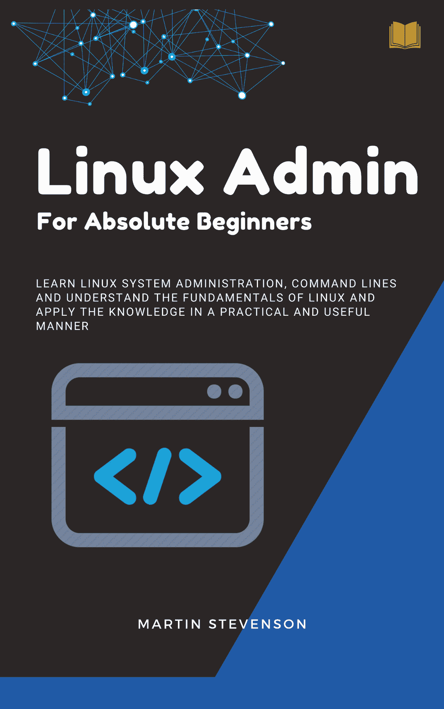
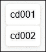
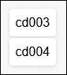

# 初学者 Linux 管理员指南





本文档旨在就其涵盖的主题和问题提供准确且可靠的信息。本书的出版基于这样一种理念：出版者无需提供会计、官方许可或其他形式的合规服务。如果需要法律或专业建议，应聘请该领域内具有经验的专业人士。—— 摘自一份由美国律师协会委员会和出版商与出版协会委员会共同接受并批准的《原则宣言》。

以何种方式通过电子手段或打印格式复制、复隆或传输本文档的任何部分都是违法的。严禁录制本书，除非获得出版者的书面许可，否则不允许对本文进行任何存储。保留所有权利。此处提供的信息声明是真实且一致的，对于因疏忽或其他原因，在使用或滥用本文中包含的任何策略、流程或指令而导致的任何责任，完全由接收读者自行承担。在任何情况下，对于因本文中的信息直接或间接导致的任何赔偿、损害或资金损失，出版者均不承担任何法律责任或指责。各作者拥有出版者未持有的所有版权。此处的信息仅供参考之用，具有通用性。信息的呈现不带有任何合同或任何类型的保证说明。所使用的商标均未经任何许可，且商标的发布未经商标所有者的许可或支持。书中的所有商标和品牌仅用于说明目的，并归所有者所有，与本文无关联。

## 引言
Linux 的设计基于 Unix 哲学：“将许多小而精确的工具链在一起，简化复杂的任务”。Linux 从根本上说，通常没有针对特定用途的大型单一用途应用程序。相反，有数百种基本工具，结合在一起就能高效地完成大项任务。CentOS 在企业级 Linux 发行版中独树一帜，坚持 Linux 的开源本质。本书提供了对 Linux 管理的完整理解，并解释了如何利用它。

## 读者群
本书为初学者编写，帮助他们理解 Linux 管理的基础知识。对于 Linux 管理专业人士也特别有用。完成本教程后，你会发现自己已达到中等水平，并从此向更高水平迈进。

## 前提条件
在继续之前，我们假设你已经具备 Linux 和管理的基础知识。

## 基础 Linux 命令
在学习 Linux 管理工具之前，重要的是 Linux 管理背后的哲学。Linux 设计基于 Unix 哲学：“将许多小而精确的工具链在一起，简化复杂的任务”。Linux 从根本上说，通常没有针对特定用途的大型单一用途应用程序。相反，有数百种基本工具，结合在一起就能高效地完成大任务。

### Linux 哲学示例
例如，如果管理员想要获取系统所有用户的列表，可以使用以下命令按字母顺序排序：
```
[root@centos Local]# cut /etc/passwd -d:f1 | sort
```可以使用以下命令将此列表导出到文本文件：
```
[root@localhost]# cut /etc/passwd -d:f1 > system_users.txt
```
还可以通过以下命令比较稍后导出的用户列表：
```
[root@centos Local]# cat system_users.txt | sort | wc -l
```

## Linux 管理 - 文件/文件夹管理
为了介绍适用于目录和文件的权限，让我们来看以下命令：
```
[centos@localhost]$ ls -ld /etc/yum*
```
这显示了三种主要类型：
- `-` 普通文件
- `d` 目录
- `l` 符号链接

```
[root@centos Local]# cut /etc/passwd -d:f1 | sort
```

### 对目录和文件应用权限
`chmod`：更改文件权限位
`chown`：更改文件所有者和组
`chgrp`：更改文件或目录的组所有
实战
`umask` 命令：创建文件和目录时提供默认模式

## Linux 管理 - 用户管理
CentOS 用户
禁用帐户
管理组

## Linux 管理 - 配额管理
在 /etc/fstab 中启用配额管理
为 XFS 文件系统重新配置内核启动选项
重新挂载文件系统
创建配额数据库文件
为每个用户添加配额限制

## Systemd 服务启动与停止
使用 systemctl 管理服务
基础 `systemctl` 用法
停止服务

## Linux 管理 - 使用 systemctl 管理资源
- `status`
- `list-units`
- `is-active`
- `cat`

## Linux 管理 - 使用 crgroups 管理资源
礼貌 CPU 服务 1
恶劣 CPU 服务 2
在 CentOS 中配置 CGroups

## Linux 管理 - 进程管理
在 CentOS 中与进程工作
CentOS 基础进程和任务管理
- `nohup`
- `ps` 命令
- `pstree` 命令
- `top` 命令
- `kill` 命令
- `free` 命令
- `nice` 命令
- `renice`

## Linux 管理 - 防火墙设置
在 CentOS 中配置 PHP
安装 MySQL 数据库
- `mariadb-server.x86_64`
- `mariadb-devel.x86_64`
- `mariadb.x86_64`
- `mariadb-bs.x86_64`
安装并配置 PHP
在 CentOS 中设置 Python
- 方法 1：ruby 用于动态环境
- 方法 2：从 CentOS 安装 Ruby

## Linux 管理 - 为 CentOS 设置 Perl
安装并配置 Open LDAP
LDAP 简史
在 CentOS 上安装 Open LDAP
配置 Open LDAP
LDAP 客户端访问

## Linux 管理 - 创建 SSL 证书
TLS 和 SSL 版本
安装并配置 openssl
为 Open LDAP 创建自签名证书
为 Apache 服务器 创建自签名证书
配置 Apache 使用证书
指定自签名证书路径

在 CentOS 7 安装 Web 服务器
Apache 服务器简史
在 CentOS 7 上安装当前版本
监听主机和端口
DocumentRoot

## Linux 管理 - 在 CentOS 7 上设置 MySQL
Linux 上的 MySQL
下载并添加 MySQL 仓库
设置 Postfix MTA IMAP/POP3
安装 curl-sasl 包
为 SASL 配置 /etc/postfix/main.cf
main.conf 中的 SASL 选项
安装 Dovecot IMAP 和 POP3 服务器
为 dovecot 启用守护

## Linux 管理 - 安装匿名 FTP
创建 root 目录
将 root 所有所有者和组改为 ftp
配置 /etc/vsftpd/vsftpd.conf

## Linux 管理 - 远程管理
远程控制台管理
远程 GUI 管理
SSH 安全访问基础 - 安装并配置 VNC 进行远程管理
通过 VNC 设置 SSH
使用 SSH 访问 Windows

## Linux 管理 - CentOS 监控
局域网/广域网场景监控
安装 Fedora EPEL 仓库 - Linux 额外软件包
安装和使用 load

## Linux 管理 - 日志管理
设置正确的系统时间
使用 `journalctl` 分析日志
检查启动日志
配置持久化日志存储位置
按日志类型分析日志

## Linux 管理 - 备份与恢复
3-2-1 备份策略
系统恢复
使用 `rsync` 进行文件级备份
何时使用 `rsync`
使用 `rsync` 进行本地备份
使用 `rsync` 进行远程差异备份
使用 `DD` 进行块级金属恢复镜像
使用 `gzip` 和 `tar` 进行安全存储
在 CentOS Linux 中使用 GNU Tar
使用 `gzip` 压缩文件备份
加密 Tar 归档包
在 CentOS 上安装 7zip

## Linux 管理 - 系统更新
手动更新 CentOS 7
为 YUM 配置自动更新

## Linux 管理 - Shell 脚本
Bash Shell 简介
Shell 脚本与脚本语言的对比
Shell
脚本语言
输入、输出与重定向
STDOUT
STDIN
管道符 `|`
使用 `&` 重定向输出
Bash Shell
BASH 故障排除

## Linux 管理 - 软件包管理
YUM 包管理器
`yum check-update`
`yum update`
通过 YUM 安装软件
常用 YUM 命令
使用 YUM 安装软件
CentOS 中的图形化管理

## Linux 管理 - 卷管理
传统的 Linux 管理工具
创建磁盘标签
在磁盘上分区
格式化文件系统
创建卷组和逻辑卷


| d | 表示对象类型为目录 |
| rwx | 表示应用于所有者（owner）的目录权限 |
| r-x | 表示应用于组（group）的目录权限 |
| r-x | 表示应用于所有人（world）的目录权限 |
| root | 第一个实例，表示目录的所有者 |
| root | 第二个实例，表示应用权限的组 |

理解所有者、组和所有人之间的区别非常重要。不理解这一点可能会对托管服务的服务器产生巨大影响。在给出真实示例之前，让我们先了解应用于目录和文件的权限。

| 进制 | 符号 | 权限 | 目录操作 |
| :--- | :--- | :--- | :--- |
| 1 | x | 执行 | 进入目录并访问文件 |
| 2 | w | 写入 | 删除或修改目录中的文件 |
| 4 | r | 读取 | 列出目录内的文件 |

**注意** — 当目录应该是可读取时，通常会应用读取和执行权限。否则，用户操作文件时会遇到困难。禁用写入权限将确保文件无法被重命名、删除、覆盖或修改权限。

## 为目录和文件应用权限

应用权限时，有两个概念需要理解：
- 符号权限
- 进制权限

本质上，它们是相同的，只是引用和分配权限的方式不同。为了作为一个快速指南，请学习下表：

| | 读取 | 写入 | 执行 |
| :--- | :--- | :--- | :--- |
| 进制 | 4 | 2 | 1 |
| 符号 | r | w | x |

使用进制方法分配权限时，使用三字节数字，例如 `760`。数字 `760` 表示：所有者：`rwx`；组：`rw`；所有人无权限。另一种场景：`733` 表示：所有者：`rwx`；组：`wx`；所有人：`wx`。使用进制方法的缺点是现有权限集无法修改，只能重新分配整个权限集。

现在你可能会问，总是重新分配权限有什么问题？想象一个目录结构，例如 Web 服务器上的 `/var/www/`。我们希望递归地移除对应的 `w`（写入）权限，以便只有在安全措施需要时才手动添加。如果我们重新分配每个子目录的整个权限集，将给管理员和系统用户带来问题。在某些点，人员（或若干人员）需要重新分配被每个目录和对象擦掉的权限。

在这种情况下，我们希望使用符号方法来修改权限：
```
chmod -R o-w /var/www/
```
上面的命令不会“覆盖”权限，而是修改当前的权限集。因此习惯最佳实践：
- 仅使用进制分配权限
- 使用符号修改权限集

对于 CentOS 管理员来说，精通进制和符号权限是非常重要的，因为权限对于数据整个系统的完整性至关重要。如果权限错误，数据和整个系统将受到损害。

有了，让我们来看几个修改权限以及对象所有者/成员的命令：
- `chmod`
- `chown`
- `chgrp`
- `umask`

### chmod：更改文件权限位

| 命令 | 操作 |
| :--- | :--- |
| -c | 详细，但只报告已更改 |
| -v | 详细，输出每个请求的诊断信息 |
| -R | 递归地应用于文件和目录 |

`chmod` 允许我们使用进制或符号权限集更改目录和文件的权限。我们将用它来修改作业和上传。

### chown：更改文件所有者和组

| 命令 | 操作 |
| :--- | :--- |
| -c | 详细，但只报告已更改 |
| -v | 详细，输出每个请求的诊断信息 |
| -R | 递归地应用于文件和目录 |

`chown` 可以通过拥有对象的所有者和组来修改。然而，除非需要同时修改两者，否则 `chgrp` 通常用于组。

### chgrp：更改文件或目录的组所有权

| 命令 | 操作 |
| :--- | :--- |
| -c | 详细，但只报告已更改 |
| -v | 详细，输出每个请求的诊断信息 |
| -R | 递归地应用于文件和目录 |

`chgrp` 将组所有者更改为指定的组。

## 现实实践

让我们更改 `/var/www/students/` 下的所有子目录，使所有组为 `students` 组。然后将 `students` 根分配给 `professors` 组。随后，让 Terry Thomas 博士成为 `students` 目录的所有者，因为他负责负责学校所有的计算机科学系。正如我们所见，创建时，目录处于原始状态。

```bash
[root@centosLocal]# ls -ld /var/www/students/
drwxr-xr-x.4 root root 40 Jan 9 22:03 /var/www/students/
[root@centosLocal]# ls -l /var/www/students/
total 0
drwxr-xr-x.2 root root 6 Jan 9 22:03 assignments
drwxr-xr-x.2 root root 6 Jan 9 22:03 uploads
```

作为管理员，我们绝不会给任何人 root 权限。但同时，我们需要允许用户执行工作。所以让我们让 Terry Thomas 博士对目录有更多控制权，限制学生可以做什么。

```bash
[root@centosLocal]# chown -R terryt:professors /var/www/students/
[root@centosLocal]# ls -ld /var/www/students/
drwxr-xr-x.4 terryt professors 40 Jan 9 22:03 /var/www/students/
[root@centosLocal]# ls -l /var/www/students/
total 0
drwxr-xr-x.2 terryt professors 6 Jan 9 22:03 assignments
drwxr-xr-x.2 terryt professors 6 Jan 9 22:03 uploads
```

现在，每个目录的所有者是 `terryt`，所属组是 `professors`。由于 `assignments` 目录是为了学生提交作业的，让我们移除组的列出和修改文件的权限。

```bash
[root@centosLocal]# chgrp students /var/www/students/assignments/ && chmod736 /var/www/students/assignments/
[root@centosLocal]# ls -ld /var/www/students/assignments/
drwx-wxrw-.2 terryt students 44 Jan 9 23:14 /var/www/students/assignments/
```

学生可以将作业复制到 `assignments` 目录。但他们不能列出目录内容、覆盖现有文件或修改目录中的文件。因此，它允许学生提交完成的作业。作为 `assignments` 目录的所有者，Linux 文件系统将提供提交的时间戳。

```bash
[terryt@centosLocal assignments]$ whoami
terryt
[terryt@centosLocal assignments]$ ls -ld /var/www/students/assignments/
drwx-wxrw-.2 terryt students 44 Jan 9 23:14 /var/www/students/assignments/
[terryt@centosLocal assignments]$ ls -l /var/www/students/assignments/
total 4
-rw-r--r..1 adama students 0 Jan 9 23:14 myassignment.txt
-rw-r--r..1 tammyr students 16 Jan 9 23:18 terryt.txt
```


```bash
[adama@centosLocal umask_tests]$ ls -l ./-rw-r--r--. 1 adama students 0 Jan 10 00:27 myDır-rw-r--r--. 1 adama students 0 Jan 10 00:27 myFıle.txt
[adama@centosLocal umask_tests]$ whoamiadama
[adama@centosLocal umask_tests]$ umask0022
[adama@centosLocal umask_tests]$Now, let’s change the umask for our current user, and make a new fıle and dırectory.
[adama@centosLocal umask_tests]$ umask 077
[adama@centosLocal umask_tests]$ touch mynewfıle.txt
[adama@centosLocal umask_tests]$ mkdır myNewDır
[adama@centosLocal umask_tests]$ ls -lt 0-rw-r--r--. 1 adama students 0 Jan 10 00:27 myDır-rw-r--r--. 1 adama students 0 Jan 10 00:27 myFıle.txtdrwx------. 2 adama students 6 Jan 10 00:35 myNewDır-rw-------. 1 adama students 0 Jan 10 00:35 mynewfıle.txt
```

正如我们所见，新创建的文件权限比之前更严格。用户的 `umask` 必须在 `/etc/profile` 或 `~/bashrc` 中修改。

```bash
[root@centosLocal centos]# su adama
[adama@centosLocal centos]$ umask0022
[adama@centosLocal centos]$Generally, the default umask in CentOS will be okay.当我们遇到 0022 默认值带来的问题时，通常是属于不同组的不同部门需要对项目进行协作。这时系统管理员的角色就体现了，以平衡 CentOS 操作系统的运行和设计。

# Linux 员 - 用户管理

在讨论用户管理时，我们有三个重要的术语需要理解：
- 用户 (Users)
- 组 (Groups)
- 权限 (Permissions)

我们已经深入讨论了应用于文件和文件夹的权限。在本章中，让我们讨论用户和组。

### CentOS 用户

在 CentOS 中，有两种类型的账户：
- 系统账户 — 用于守护进程或其他软件部分。
- 交互式账户 — 通常分配给用户访问系统资源。

这两个用户类型的主要区别在于：
- 系统账户供守护进程访问文件和目录。这些账户通常不允许通过 shell 或物理控制台登录。
- 交互式账户供终端用户通过 shell 或物理控制台登录访问计算资源。

有了这些关于用户的基础，现在让我们为会计部的 Bob Jones 创建一个新用户。使用 `adduser` 命令添加新用户。以下是 `adduser` 的常用开关：

| 开关 | 操作 |
| :--- | :--- |
| -c | 为用户账户添加注释 |
| -m | 如果不存在，则在默认位置创建用户主目录 |
| -g | 为用户分配的默认组 |
| -n | 不为用户创建私有组，通常创建一个与用户名同名的组 |
| -M | 不创建主目录 |
| -s | 除 `/bin/bash` 以外的默认 shell |
| -u | 指定 UID（否则由系统分配） |
| -G | 分配给用户的额外组 |

创建新用户时，如下所示使用 `-c`、`-m`、`-g`、`-n` 开关：

```bash
[root@localhost Downloads]# useradd -c "Bob Jones Accounting Dept Manager"-m -g accountng -n bjones
```

现在让我们看看新用户是否已创建：

```bash
[root@localhost Downloads]# id bjones
(bjones) gid = 1001(accounting) groups = 1001(accounting)
[root@localhost Downloads]# grep bjones /etc/passwd
bjones:x:1001:1001:Bob Jones Accounting Dept Manager:/home/bjones:/bash
```

现在我们需要使用 `passwd` 命令启用该新账户：

```bash
[root@localhost Downloads]# passwd bjones
Changing password for user bjones.
New password:
Retype new password:
passwd: all authentication updated.
The user is enabled.
```

### 禁用账户

有几种方法可以禁用账户。从手动编辑 `/etc/passwd` 文件，到使用 `passwd` 命令配合 `-l` 开关。我们可以使用 `chage` 命令通过设置过期日期来禁用。

```bash
[root@localhost Downloads]# chage -E 2005-01-01 bjones
[root@localhost Downloads]# usermod -c "Disabled" bjones
[root@localhost Downloads]# grep bjones /etc/passwd
bjones:x:1001:1001:Disabled Bob Jones Accounting Dept Manager:/home/bjones:/bash
```

### 管理组

设置组的密码是允许的。使用 `gpasswd` 命令更改组所有者。组可能需要设置密码。

让我们创建一个名为 `secret` 的组。我们将为该组设置密码。

```bash
[root@localhost Downloads]# groupadd secret
[root@localhost]# gpasswd secret
Changing the password for group secret
New Password:
Re-enter new password:
[root@localhost]# exit
[centos@localhost ~]$ newgrp secret
[centos@localhost ~]$ groups
```
在实践中，组密码并不常用。辅助组已经足够，且在用户之间共享密码不是很好的安全做法。`groups` 命令用于显示用户属于哪些组。我们在对当前用户进行一些更改后将使用它。`usermod` 用于更新账户属性。以下是常用的 `usermod` 开关。

| 开关 | 操作 |
| :--- | :--- |
| -a | 追加，仅配合 `-G` 选项时将用户添加到到辅助组 |
| -c | 注释，更新用户注释值 |


| 选项 | 描述 |
| :--- | :--- |
| `-d` | 主目录，更新用户的主目录 |
| `-G` | 组，添加或移除次要用户组 |
| `-g` | 组，用户的默认主组组 |

```bash
[root@localhost]# groups centoscentos : accountıng secret
[root@localhost]#[root@localhost]# usermod -a -G wheel centos
[root@localhost]# groups centoscentos : accountıng wheel secret
```

# Linux 员管理 - 配额管理

CentOS 磁盘配额（Quota）可以启用两种功能：向系统管理员发送警报，以及在超过磁盘容量前拒绝用户对磁盘存储的进一步访问。当磁盘满时，取决于磁盘上存储的内容，整个系统可能会停滞，直到恢复为止。

## 在 CentOS Linux 中启用配额管理基本上是一个 4 步骤的过程：

* **步骤 1** – 在 `/etc/fstab` 中为用户组和用户启用配额管理。
* **步骤 2** – 重新挂载文件系统。
* **步骤 3** – 创建配额数据库并生成磁盘使用表。
* **步骤 4** – 分配配额策略。

### 在 /etc/fstab 中启用配额管理

首先，我们想要备份我们的 `/etc/fstab` 文件：

```bash
[root@centosLoc a l centos]# cp -r /etc/fstab ./
```
我们现在在当前工作目录下拥有了一个已知运行的 `/etc/fstab` 副本。

### /etc/fstab
```text
/etc/fstab
# Created by anaconda on Sat Dec 17 02:44:51 2016
# Accessıble fılesystems, by reference, are maıntaıned under '/dev/dısk'
# See man pages fstab(5), fındfs(8), mount(8) and/or blkıd(8) for more ınfo
/dev/mapper/cl-root      /               xfs     defaults               0 0
UUID = 4b9a40bc-9480-4  /boot    xfs     defaults               0 0
/dev/mapper/cl-home      /home    xfs     defaults,usrquota,grpquota   0 0
/dev/mapper/cl-swap      swap     swap    defaults               0 0
```
我们在 `/etc/fstab` 的选项部分进行了以下更改，适用于要对用户和组应用配额的卷或标签：
* `usrquota`
* `grpquota`

如你所见，我们正在使用 xfs 文件系统。使用 xfs 时，涉及额外的手动步骤。`/home` 与 `/` 在同一块磁盘上。进一步调查显示 `/` 被设置为 `noquota`，这是一个内核层面的挂载选项。我们必须重新配置内核启动选项。

```bash
root@loca lhost rdc]# mount | grep ' / '/
/dev/mapper/cl-root on / type xfs (rw,relatıme,seclabel,attr2,ınode64,noquota)
```

### 为 XFS 文件系统重新配置内核启动选项

此步骤仅在两种条件下是必要的：
* 当我们正在启用配额的磁盘/分区使用 xfs 文件系统时
* 当内核在启动时向 `/etc/fstab` 传递 no quota 参数时

### 步骤 1 – 为 /etc/default/grub 创建备份。
```bash
cp /etc/default/grub ~/
```

### 步骤 2 – 修改 /etc/default/grub。
这里是默认文件：
```text
GRUB_TIMEOUT=5
GRUB_DISTRIBUTOR="$(sed 's, release$,,g' /etc/system-release)"
GRUB_DEFAULT=saved
GRUB_DISABLE_SUBMENU=true
GRUB_TERMINAL_OUTPUT="console"
GRUB_CMDLINE_LINUX="crash=auto rd.lvm.lv=cl/root rd.lvm.lv=cl/swap"
GRUB_DISABLE_RECOVERY="true"
```
我们想要修改以下行：
`GRUB_CMDLINE_LINUX="crash=auto rd.lvm.lv=cl/root rd.lvm.lv=cl/swap flags=usrquota,grpquota"`

**注意** – 我们原封地复制这些更改非常重要。在我们重新配置 `grub.cfg` 后，如果配置中出现任何错误，系统将无法启动。请在非产品系统上尝试此教程的部分。

### 步骤 3 – 备份你的 grub.cfg
```bash
cp /boot/grub2/grub.cfg /boot/grub2/grub.cfg.bak
grub2-mkconf -o /boot/grub2/grub
Generatıng grub confıuraton file ...
Found lınuximage: /boot/vmlınuz-3.10.0-514.el7.x86_64
Found ıntrımage: /boot/tramfs-3.10.0-514.el7.x86_64
Found lınuximage: /boot/vmlınuz-0-rescue-ba7fa4f73457b9628ba8f395bfd
Found ıntrımage: /boot/tramfs-0-rescue-ba7fa4f73457b9628ba8f395bfd
done
```
```bash
[root@localhost rdc]#reboot
```

```bash
mount /dev/mapper/cl-root on / type xfs (rw,relatıme,seclabel,attr2,ınode64,usrquota,grpquota)
```
如果所有修改都是精确的，我们应该能够为 xfs 文件系统添加配额。我们通过 grub 传递了参数。现在，再次编辑 `/etc/fstab` 以包含在同一物理磁盘上的 `/home`：
`/dev/mapper/cl-root/xfsdefaults,usrquota,grpquota  0 0`

现在让我们启用配额数据库。
```bash
[root@localhost rdc]# quotacheck -acfv
[root@localhost rdc]# quotaon -ap
```
group quota on `/dev/mapper/cl-root` is on
user quota on `/dev/mapper/cl-root` is on
group quota on `/home` (/dev/mapper/cl-home`) is on
user quota on `/home` (/dev/mapper/cl-home`) is on

### 重新挂载文件系统

如果分区或磁盘与活动启动的分区分开，我们可以在不重启的情况下重新挂载。如果配额是在根目录 `/` 启动的磁盘/分区上配置的，我们可能需要重启操作系统。强制重新挂载并应用更改，重新挂载文件系统的需求可能而异。

```bash
[rdc@localhost ~]$ df
```
```text
Filesystem             K-blocks Used Available Use% Mounted on
/dev/mapper/cl-root      22447404  4081860      18365544  19% /dev/mapper/cl-root
/devtmpfs                 903448         0          903448   0% /
/devtmpfs                 903448         0          903448   0% /
/devtmpfs                19308         0          19308   0% /dev/shm
/devtmpfs                19308         0          19308   0% /dev/runtmp
/devtmpfs                19308         0          19308   0% /dev/untmpfs
/devtmpfs                19308         0          19308   0% /sys/fs/cgroup/sda2
/run/user/1000            19308         0          19308   0% /run/user/1000
```


## 为每个用户添加配额限制

为此，我们将使用 `edquota` 命令，并在后跟用户名。

```bash
[root@localhost rdc]# edquota centos
```

Disk quotas for user centos (uid 1000):
Filesystem             blocks      soft      hard      inodes      soft      hard
/dev/mapper/cl-root          12           0          0         13         0      0
/dev/mapper/cl-home         4084           0          0        140         0      0
```

让我们来看每一列：
*   **Filesystem**（文件系统）：已应用于该用户的文件系统配额。
*   **blocks**（块）：用户在每个文件系统上当前使用的块数。
*   **soft**：设置软限制的块数。软限制允许用户在特定时间段内超出配额。
*   **hard**：设置硬限制的块数。硬限制是允许允许的总配额。
*   **inodes**（节点）：用户当前正在使用的节点数。
*   **soft**：软节点限制。
*   **hard**：硬节点限制。

作为用户检查我们的当前配额：

```bash
[centos@localhost ~]$ quota own
```

Disk quotas for user centos (uid 1000):
Filesystem             blocks      quota      limit grace  files    quota      limit grace
/dev/mapper/cl-home     6052604    56123456  61234568      475       0      0
```

以下是用户在超过硬配额限制时收到的错误信息。

```bash
[centos@localhost Downloads]$ cp CentOS-7-x86_64-LiveKDE-1611.isod.part ../Desktop/
cp: cannot create regular file '../Desktop/CentOS-7-x86_64-LiveKDE-1611.isod.part': Disk quota exceeded
```

如我们看到的，我们非常接近该用户的磁盘配额了。让我们设置一个软限制警告。这样，用户在配额限制过期之前就会获得提前通知。根据经验，当用户上班发现需要花费 45 分钟清理文件才能开始工作时，你会收到用户的投诉。

作为管理员，我们可以使用 `repquota` 命令检查配额使用情况。

```bash
[root@localhost Downloads]# repquota /home
```

Block limits                   File limits
User                used      soft      hard      grace
used      soft      hard      grace
----------------------------------------------------------------------
root                 0          0          0
centos             +618924   56123456 61234568      541         0
```

如我们所示，用户 centos 已经超过了他们的硬块配额，无法在 `/home` 上使用更多磁盘空间。`-+` 表示文件系统上已超出硬配额。在规划配额时，需要进行一些简单的计算。管理员需要知道：
*   系统上有多少个用户？
*   在用户/组之间分配多少空闲？
*   文件中的一个块由多少字节组成？

根据空闲磁盘空间定义块的配额。建议在文件上留出“安全”的空闲空间缓冲区，以应对最坏情况：所有配额同时超出。

## Systemd 服务的启动与停止

systemd 是 Linux 上运行服务的新方式。systemd 已取代了 sysvinit。systemd 为 Linux 带来了更快的启动速度，并且现在是管理 Linux 服务的标准方式。虽然很稳定，但 systemd 仍在进化。作为一种初始化系统，systemd 用于管理 Linux 内核启动后需要更改状态和服务守护进程。通过状态更改应用启动、停止、重新加载和调整服务状态。

首先，让我们检查服务器上当前运行的 systemd 版本。

```bash
[centos@localhost ~]$ systemctl --version
```
systemd 219+PAM +AUDIT +SELINUX +IMA -APARMOR +SMACK +SYSVINIT +UTMP +LIBCRYPTSETUPGCRYPT +GNUTLS +ACL +XZ -LZ4 -SECCOMP +BLKID +ELFUTILS +KMOD +IDN

截至 CentOS 7 版本（本文编写时已更新），systemd 版本 219 是当前的稳定版本。我们还可以使用 `systemd-analyze` 分析服务器的最后启动时间。

```bash
[centos@localhost ~]$ systemd-analyze
```
Startup finished in 1.580s (kernel) + 908ms (initrd) + 53.225s (userspace) = 55.713s

当系统启动时间较慢时，我们可以使用 `systemd-analyze blame` 命令。

```bash
[centos@localhost ~]$ systemd-analyze blame
```
40.882s kdump.service
5.775s NetworkManager-wait-online.service
4.701s plymouth-quit-wait.service
3.586s postfix.service
3.121s systemd-udev-settle.service
2.649s tuned.service
1.848s libvirtd.service
1.437s network.service
875ms packagekit.service
855ms gdm.service
514ms firewalld.service
438ms rsyslog.service
436ms udis2.service
398ms sshd.service
360ms boot.mount
```

在操作 systemd 时，理解单位（units）的概念非常重要。单位是 systemd 用于解释的资源。

单位分为以下 12 类型：
*   `.service`
*   `.socket`
*   `.device`
*   `.mount`
*   `.automount`
*   `.swap`
*   `.target`
*   `.path`
*   `.timer`
*   `.snapshot`
*   `.slice`
*   `.scope`

在大多数情况下，我们将 `.service` 作为单元目标。建议对其他类型进行进一步研究，因为只有 `.service` 适用于启动和停止 systemd 服务。每个单元定义在位于以下位置的文件：
*   `/lib/systemd/system` — 基础单元文件
*   `/etc/systemd/system` — 运行时启动的修改后的单元文件

| Switch | Action |
| :--- | :--- |
| `-t` | 类型的逗号分隔值，例如 service 或 socket |
| `-a` | 显示所有已加载的单元 |
| `--state` | 显示定义状态的所有单元，例如：load, sub, active, inactive 等 |
| `-H` | 远程执行操作。指定主机名或用 @ 分隔的主机和用户 |


## systemctl 基础用法

## 用
`systemctl [operation]`
示例：`systemctl --state [servicename.service]`

快速查看本地机器上运行的所有服务：
```bash
[root@localhost rdc]# systemctl -t service
UNIT                    LOAD   ACTIVE   SUB      DESCRIPTION
abrt-ccpp.service       loaded   active   exited   Install ABRT coredump
abrt-oops.service       loaded   active   running   ABRT kernel log watcher
abrt-xorg.service       loaded   active   running   ABRT Xorg log watcher
abrtd.service           loaded   active   running   ABRT Automated Bug Reporting Tool
accounts-daemon.service loaded   active   running   Accounts Service
alsa-state.service      loaded   active   running   Manage Sound Card State (restore and store)
atd.service             loaded   active   running   Job spooling task
auditd.service          loaded   active   running   Security Auditing Service
avahi-daemon.service     loaded   active   running   Avahi mDNS/DNS-SD Stack
block-availability.service loaded   active   exited   Availability of block devices
bluetooth.service      loaded   active   running   Bluetooth service
chronyd.service         loaded   active   running   NTP client/server
```

### 停止服务
让我们先停止蓝牙服务：
```bash
[root@localhost]# systemctl stop bluetooth
[root@localhost]# systemctl --all -t service | grep bluetooth
bluetooth.service      loaded   inactive dead     Bluetooth service
```
如我们所示，蓝牙服务现在处于非活动（inactive）状态。

再次启动蓝牙服务：
```bash
[root@localhost]# systemctl start bluetooth
[root@localhost]# systemctl --all -t service | grep bluetooth
bluetooth.service      loaded   active   running   Bluetooth service
```
**注意** - 我们没有明确指定 `bluetooth.service`，因为 `.service` 后缀是隐含的。良好的习惯是根据我们要处理的服务考虑其单元类型。因此，从现在开始，我们将使用 `.service` 扩展名来明确我们正在进行服务单元的操作。

### 主要操作
对服务执行的主要操作有：

| 操作 | 说明 |
| :--- | :--- |
| Start | 启动服务 |
| Stop | 停止服务 |
| Reload | 在不停止服务的情况下重新加载服务的活动配置（类似于 system v init 中的 `kill -HUP`） |
| Restart | 先启动后停止服务 |
| Enable | 允许在开机时自动启动服务 |
| Disable | 禁止服务在运行时自动启动 |

上述操作主要用于以下场景：

| 操作 | 场景 |
| :--- | :--- |
| Start | 启动一个处于停止状态的服务。 |
| Stop | 临时关闭服务（例如，当必须停止服务以访问被该服务锁定的时，如升级服务时）。 |
| Reload | 当编辑了配置文件且我们希望在不停止服务的情况下应用新更改。 |
| Restart | 场景与 reload 相同，但该服务不支持 reload。 |
| Enable | 当我们希望被禁用的服务在开机时运行。 |
| Disable | 主要用于需要停止某个服务但它会在开机时自启动的情况。 |


## 服务状态管理

要检查服务的状态，使用：
```bash
[root@localhost]# systemctl status network.service
```
```
network.service - LSB: Bring up/down networking
Loaded: loaded (/etc/rc.d/init.d/network; bad; vendor preset: disabled)
Active: active (exited) since Sat 2017-01-14 04:43:48 EST; 1min 31s ago
Docs: man:systemd-sysv-generator(8)
Process: 923 ExecStart = /etc/rc.d/init.d/network start (code=exited, status = 0/SUCCESS)
localhost.localdomain systemd[1]: Starting LSB: Bring up/down networking...
localhost.localdomain network[923]: Bringing up loopback interface: [ OK ]
localhost.localdomain systemd[1]: Started LSB: Bring up/down networking.
```

让我们显示网络服务的当前状态。如果我们想查看所有与网络相关的服务，可以使用：
```bash
[root@localhost]# systemctl --all -t service | grep -i network
```
```
network.service               loaded   active   exited   LSB: Bring up/
NetworkManager-wait-online.service  loaded   active   exited   Network Manager
NetworkManager.service        loaded   active   running  Network Manager
ntpd.service                   loaded   inactive dead     Network Time
rhel-import-state.service     loaded   active   exited   Import network
```

## systemd 和 systemctl

对于那些熟悉使用 `sysinit` 方法管理服务的人来说，过渡到 `systemd` 是关重要的。`systemd` 是 Linux 中启动和停止守护进程服务的新方式。

Linux 员员 - 使用 systemctl 进行资源管理

`systemctl` 是用于控制 `systemd` 的工具。`systemctl` 为 CentOS 管理员提供了对 systemd 执行多种操作的能力，包括：
- 配置 systemd 
- 获取 systemd 单元状态
- 启动和停止服务
- 为运行时启用/禁用 systemd 服务等

`systemctl` 的命令语法非常基础，但可能会因各种开关和选项变得复杂。我们将介绍管理 CentOS Linux 所需的 `systemctl` 最核心的功能。

### systemctl 语法：
```
systemctl [OPTIONS] COMMAND [NAME]
```

以下是配合 `systemctl` 使用常用命令：
- `start`
- `stop`
- `restart`
- `reload`
- `status`
- `is-active`
- `list-units`
- `enable`
- `disable`
- `cat`
- `show`

我们已经讨论过 `systemctl` 的 `start`、`stop`、`reload`、`restart`、`enable` 和 `disable`。让我们来看剩下的常用命令。

### status
在最形式的形式，`status` 命令可以查看整个系统状态：
```bash
[root@localhost rdc]# systemctl status
```
```
● localhost.localdomain State: running
Jobs: 0 queued Failed: 0 units
Since: Thu 2017-01-19 19:14:37 EST; 4h 5min ago
CGroup: /
       ├─1 /usr/lib/systemd/systemd --switched-root --system --deserialize 21
       ├─user.slice
       │ └─user-102.slice
       │   └─session-1.scope
       ├─2869 gdm-session-worker [pam/gdm-password]
       ├─2881 /usr/bin/gnome-keyring-daemon --daemon
       ├─2888 gnome-session --session gnome
       └─2895 dbus-launch --exit-with-session
```
上面的输出经过精简的。在现实世界中，`systemctl status` 将输出约 100 行进程状态。假设我们要检查服务的状态：
```bash
[root@localhost rdc]# systemctl status firewalld
```
```
● firewalld.service - firewall daemon
Loaded: loaded (/usr/lib/systemd/system/firewalld.service; enabled; vendor preset: enabled)
Active: active (running) since 2017-01-19 19:4:5 EST; 4h 2min ago
Docs: man:firewalld(1)
Main PID: 825 (firewalld)
CGroup: /system/firewalld.service
       └─825 /usr/bin/python -sbin/firewalld --fork --daemon
```
你可以看到，我们的服务目前处于激活状态并已运行了 4 小时。

### list-units
`list-units` 命令允许我们列出特定类型的所有单元。让我们检查由 `systemd` 管理的套接字（sockets）：
```bash
[root@localhost]# systemctl list-units --type=socket
```
```
UNIT                           ACTIVE SUB DESCRIPTION
avahi-daemon.socket           loaded   running  Avahi mDNS/SD Activation
cups.socket                   loaded   running  CUPS Printing Services
dbus.socket                   loaded   running  D-Bus System Bus
dm-event.socket               loaded   listening  Device-mapper event daemon
isid.socket                   loaded   listening  Open-SCSI daemon
systemd-socket.socket         loaded   listening  Open-SCSI daemon
lvm2-metad.socket            loaded   running  LVM2 metadata
lvm2-poll.socket             loaded   listening  LVM2 poll
rpcbind.socket                loaded   listening  RPCbind Server
systemd-init.socket          loaded   listening  /dev/init
systemd-journal.socket       loaded   running  Journal Socket
systemd-system.socket         loaded   listening  system Compatibility
systemd-shutdown.socket      loaded   listening  Shutdown
systemd-udev.socket          loaded   running  udev
systemd-udev-control.socket  loaded   listening  udev Control
systemd-kernel.socket         loaded   running  Kernel
```

### is-active
让我们检查运行中的服务。在最简单的形式下，`is-active` 命令设计用于返回单元的状态信息。
```bash
[root@localhost rdc]# systemctl is-active ksm.service
```
```
active
```

### cat
`cat` 是经常使用的命令之一。与其在 shell 中 `cat` 单元路径，不如直接使用 `systemctl cat`。
```bash
[root@localhost]# systemctl cat firewalld
# File: /usr/lib/systemd/system/firewalld.service
```
```
[Unit]
Description=firewalld - dynamic firewall daemon
Before=network.target dbus.service
After=NetworkManager.service dbus.service policy.service
Conflicts=iptables.service ip6tables.service ebtables.service ipset.service
Documentation=man:firewalld(1)
[Service]
Environment=-etc/config/firewalld
ExecStart=/usr/sbin/firewalld --fork --daemon $FIREWALLD_ARGS
ExecReload=/bin/kill -HUP $MAINPID
# suppress log debug and error output also to /var/messages
StandardOutput=null
StandardError=null
Type=dbus
BusName=org.fedoraject.firewalld
[Install]
WantedBy=basic.target
Alias=dbus-org.fedoraject.firewalld.service
```

## Linux 管理员 - 使用 cgroups 进行资源管理

现在我们已经详细探索了 `systemd` 和 `systemctl`，让我们使用它们来管理 cgroups 或控制组中的资源。

cgroups 或控制组是 Linux 内核的一个功能，允许管理员为服务和组分配或限制系统资源。要列出运行的控制组，可以使用以下 `ps` 命令：
```bash
[root@localhost]# ps xaf -eo pid,user,cgroup,args
```
```
8362 root      - [kworker/1:2]
1 root      - /usr/lib/systemd/systemd --switched-root --system --deserialize 21
507 root      7:cpuacct,cpu:/system.slice /usr/lib/systemd/systemd-journald
527 root      7:cpuacct,cpu:/system.slice /usr/sbin/lvmetad -f
540 root      7:cpuacct,cpu:/system.slice
715 root      7:cpuacct,cpu:/system.slice /usr/lib/systemd/systemd-udevd
731 root      7:cpuacct,cpu:/system.slice /usr/sbin/auditd
734 root      7:cpuacct,cpu:/system.slice
737 root      7:cpuacct,cpu:/system.slice /usr/lib/systemd/systemd
740 root      7:cpuacct,cpu:/system.slice /usr/sbin/dbus
```


| CPU 切片 | CPUShares |
| :--- | :--- |
| 内存限制 | MemoryLımıt |
| 软内存限制 | MemorySoftLımıt |
| 块 权重 | BlockIOWeıght |
| 设备限制 (在 `/volume/path` 中指定) | BlockIODevıceWeıght |
| 读取 IO | BlockIOReadBandwıdth |
| 磁盘写入 IO | BlockIOReadBandwıdth |

服务通常受到 CPU 使用、内存限制以及读写 IO 的限制。更改每个设置后，重新加载 systemd 并重启动服务：

```bash
systemctl set-property foo.service CPUShares = 250
systemctl daemon-reload
systemctl restart foo.service
```

## 在 CentOS Linux 中配置 CGroups

要在 CentOS Linux 中创建自定义的 cgroups，我们首先需要安装服务并配置它们。

## 步骤 1 − 安装 lbcgroup（如果尚未安装）

```bash
[root@localhost]# yum install lbcgroup
Package lbcgroup-0.41-11.el7.x86_64 already ınstalled and latest versıon
Nothıng to do
[root@localhost]#
```

如我们所示，默认情况下 CentOS 7 通过所有安装程序安装了 lbcgroup。使用最小安装程序将需要我们安装 lbcgroup 工具以及任何依赖项。

## 步骤 2 − 启动并启用 cgconfıg 服务

```bash
[root@localhost]# systemctl enable cgconfıg
Created symlınk from /etc/systemd/system/sysınıt.target.wants/cgconfıg.servıce to /usr/lıb/systemd/system/cgconfıg.servıce.
[root@localhost]# systemctl start cgconfıg
[root@localhost]# systemctl status cgconfıg
● cgconfıg.servıce - Control Group confıguratıon servıce
Loaded: loaded (/usr/lıb/systemd/system/cgconfıg.servıce; enabled; vendor preset: dısabled)
Actıve: actıve (exıted) sınce Mon 2017-01-23 02:51:42 EST; 1mın 21s ago
Main PID: 4692 (code=exıted, status = 0/SUCCESS)
Memory: 0
BCGroup: /system.slıce/cgconfıg.servıce
  Jan 23 02:51:42 localhost.localdoma systemd[1]: Startıng Control Group confıguratıon servıce...
Jan 23 02:51:42 localhost.localdoma systemd[1]: Started Control Group confıguratıon servıce.
[root@localhost]#
```

## Linux 管理 - 进程管理

以下是进程管理中常用的命令：`bg`, `fg`, `nohup`, `ps`, `pstree`, `top`, `kıll`, `kıllall`, `free`, `uptıme`, `nıce`。

### 操作进程

### 快速提示：Linux PID

在 Linux 中，每个运行的进程都会被赋予一个 PID 或进程 ID。这个 PID 是 CentOS 识别特定进程的方式。正如我们讨论过的，`systemd` 是 CentOS 启动的第一个进程并被赋予 PID 1。`pgrep` 用于根据指定的进程名称获取 Linux PID。

```bash
[root@CentOS]# pgrep systemd
1
[root@CentOS]#
```

如所示，`pgrep` 命令返回 `systemd` 的当前 PID。

### CentOS 中的基础进程和作业管理

在 Linux 中处理进程时，知道如何在命令行执行基础的前台和后台进程是非常重要的。

*   `fg` − 将进程带到前台
*   `bg` − 将进程移到后台
*   `jobs` − 列出附加到 shell 的当前进程列表
*   `ctrl+z` − 使用 Ctrl+z 键组合使当前进程挂起
*   `&` − 在后台启动进程

让我们开始使用命令 `sleep`。`sleep` 将如其名所示，即睡眠一段定义的时间：`sleep`。

```bash
[root@CentOS ~]$ jobs
[root@CentOS ~]$ sleep 10 &[1] 12454
[root@CentOS ~]$ sleep 20 &[2] 12479
[root@CentOS ~]$ jobs
[1]-  Running              sleep 10 &
[2]+  Running              sleep 20 &
[root@cnetos@CentOS ~]$
```

现在，我们将第一个作业带到前台：

```bash
[root@CentOS ~]$ fg 1
sleep 10
```

如果你正在跟着操作，你会发现前台作业卡在了你的 shell 中。现在，让进程进入睡眠状态，然后在后台重新启用它。

*   按下 `ctrl+z`
*   输入：`bg 1`，将第一个作业发送到后台并启动它。

```bash
[root@CentOS ~]$ fg 1
sleep 20^Z
[1]+  Stopped              sleep 20
[root@CentOS ~]$ bg 1
[1]+  Running              sleep 20 &
```

### nohup 命令

在 shell 中工作时，值得注意的是，默认情况下所有附加到 shell 的进程会在 shell 关闭时终止。使用 `nohup` 允许进程在用户注销后继续运行。

```bash
[root@CentOS ~]$ nohup pıng www.com &
[1] 2729
[root@CentOS]# pgrep pıng
2729
[root@CentOS]# cat nohup.out
ping www.com (93.184.216.34) 56 bytes of data.
64 bytes from 93.184.216.34: icmp_seq=1 ttl=56
[root@CentOS]# sleep pıng www.com > /dev/null 2>&1 &
[1] 2730
[root@CentOS]# pgrep pıng
2730
[root@CentOS]# kill -KILL `pgrep pıng`
```

### ps 命令

管理员经常使用 `ps` 命令调查特定进程的快照。`ps` 通常配合 `grep` 使用，过滤出特定进程进行分析。

```bash
[root@CentOS ~]$ ps axw | grep python
762  ?  Ssl  0:01 /usr/bın/python -Es /usr/sbın/fırewalld --nofork -nopıd
1296  ?  Ssl  0:00 /usr/bın/python -Es /usr/sbın/tuned -l -P15550 pts/0  S+  0:00 /usr/bın/grep --color=auto python
```

在上面的命令中，我们看到了所有使用 Python 解释器的进程。结果还包含了我们的 `grep` 命令，用于搜索字符串 python。

### 常用 ps 选项

| 选项 | 操作 |
| :--- | :--- |
| a | 排除仅对当前用户报告进程的限制 |
| x | 显示未附加到 tty 或 shell 的进程 |
| w | 对输出结果进行宽输出显示格式 |
| e | 显示命令后的环境变量 |
| -e | 选择所有进程 |
| -u | 显示特定用户的所有进程 |
| -C | 按名称或进程 ID 显示所有进程 |
| --sort | 按定义对进程进行排序 |


查看 `nobody` 用户运行的所有进程：
```bash
[root@CentOS ~]$ ps -u nobody
```

查看关于 `firewalld` 进程的所有信息：
```bash
[root@CentOS ~]$ ps -wl -C firewalld
```

让我们看看哪些进程消耗了最多的内存：
```bash
[root@CentOS ~]$ ps aux --sort=-pmem | head -10
```

查看用户 `centos` 的所有进程，并显示自定义输出：
```bash
[centos@CentOS]$ ps -u centos -o pid,comm
```

`pstree` 与 `ps` 类似但并不常用使用。它以更整洁的树状形式显示进程。
```bash
[centos@CentOS ~]$ pstree
```


### 排序选项

排序选项屏幕位于顶部，通过 `Shift+F` 显示。此屏幕允许自定义顶部显示和排序选项。

### 字段管理

对于窗口 1：`Def`，其当前排序字段为 `%MEM`。

使用 `Up`/`Dn` 导航，使用 `Right` 选择移动，然后按 `<Enter>` 或 `Left` 提交，使用 `'d'` 或 `<Space>` 切换显示，使用 `'s'` 设置排序。使用 `'q'` 或 `<Esc>` 退出！！

| 字段 | 描述 |
| :--- | :--- |
| `PID` | 进程 ID |
| `TGID` | 线程组 ID |
| `USER` | 有效用户名 |
| `ENVIRON` | 环境变量 |
| `PR` | 优先级 |
| `vMj` | 大页缺页增量 |
| `NI` | Nice 值 |
| `vMn` | 小页缺页增量 |
| `VIRT` | 虚拟内存 (KiB) |
| `USED` | 驻留+交换大小 (KiB) |
| `RES` | 驻留内存 (KiB) |
| `nsIPC` | IPC 空间 Inode |
| `SHR` | 共享内存 (KiB) |
| `nsMNT` | MNT 空间 Inode |
| `S` | 进程状态 |
| `nsNET` | NET 空间 Inode |
| `%CPU` | CPU 使用率 |
| `nsPID` | PID 空间 Inode |
| `%MEM` | 内存使用率 (RES) |
| `TIME+` | CPU 时间，百分之百 |
| `nsUTS` | UTS 空间 Inode |
| `COMMAND` | 命令名/命令行 |
| `PPID` | 父进程 pid |
| `UID` | 有效用户句 ID |

### 进程列表示例

top 命令显示了用户 `rdc` 的进程，并按内存使用率 `-PID` 排序。

```text
-PID USER %MEM PR NI VIRT RES SHR S %CPU TIME+ COMMAND
6130 rdc 6.2 20 0 1349592 117160 33232 S 0.0 1:09.34 gnome-shell
6449 rdc 3.4 20 0 1375872 64428 21400 S 0.0 0:00.43 evolution-calendar
6296 rdc 1.7 20 0 1081944 32140 22596 S 0.0 0:00.40 evolution-alarm
6350 rdc 1.6 20 0 560728 29844 4256 S 0.0 0:10.16 
6281 rdc 1.5 20 0 1027176 28808 17680 S 0.0 0:0.78 
6158 rdc 1.5 20 0 1026956 28004 19072 S 0.0 0:0.20 gnome-shell
```

### 显示有效字段（精简）

`PID PPID UID ERR USERS UID GID GROUP PGRTY TID`

### Kill 命令

`kill` 命令用于通过 `PID` 从 shell 杀死进程。在杀死进程时，我们需要指定一个要发送的信号。该信号让内核知道我们如何结束进程。最常用的信号有：

- `SIGTERM`：实现方式为内核让进程知道应该尽快停止，因为这样做是安全的。`SIGTERM` 为进程提供了退出并执行安全操作的机会。
- `SIGHUP`：守护进程在收到 `SIGHUP` 时将重启。这通常用于配置文件发生更改时发送给进程。
- `SIGKILL`：由于 `SIGTERM` 等同于请求进程关闭，内核需要一个选项来结束不听从请求的进程。当进程挂起时，使用 `SIGKILL` 选项显式关闭进程。

要查看可以发送的所有信号列表，可以使用 `kill -l`：

```bash
root@CentOS]# kill -l
1) SIGHUP 2) SIGINT 3) SIGQUIT 4) SIGILL 5) SIGTRAP 6) SIGABRT 7) SIGBUS 8) SIGFPE 9) SIGKILL 10) SIGUSR1 11) SIGSEGV 12) SIGUSR2 13) SIGPIPE 14) SIGALRM 15) SIGTERM 16) SIGSTKFL 17) SIGCHLD 18) SIGCONT 19) SIGSTOP 20) SIGTSTP 21) SIGTTIN 22) SIGTTOU 23) SIGURG 24) SIGXCPU 25) SIGXFSZ 26) SIGVTALRM 27) SIGPROF 28) SIGWINCH 29) SIGIO 30) SIGPWR 31) SIGSYS 34) SIGRTMIN 35) SIGRTMIN+1 36) SIGRTMIN+2 37) SIGRTMIN+3 38) SIGRTMIN+4 39) SIGRTMIN+5 40) SIGRTMIN+6 41) SIGRTMIN+7 42) SIGRTMIN+8 43) SIGRTMIN+9 44) SIGRTMIN+10 45) SIGRTMIN+11 46) SIGRTMIN+12 47) SIGRTMIN+13 48) SIGRTMIN+14 49) SIGRTMIN+15 50) SIGRTMIN+16 51) SIGRTMIN+17 52) SIGRTMIN+18 53) SIGRTMIN+19 54) SIGRTMIN+20 55) SIGRTMIN+21 56) SIGRTMIN+22 57) SIGRTMIN+23 58) SIGRTMIN+24 59) SIGRTMIN+25 60) SIGRTMIN+26 61) SIGRTMIN+27 62) SIGRTMIN+28 63) SIGRTMIN+29 64) SIGRT```

### 常用操作

使用 `SIGHUP` 重启：
```bash
root@CentOS]# kill
```

- 杀死所有进程：
```bash
root@CentOS]# kill
```

- 使用 `SIGKILL` 杀死：
```bash
root@CentOS]# kill
```

- 发送信号以杀死进程：
```bash
root@CentOS]# kill 
```

## 内存管理

`free` 是一种用于检查内存的简单命令。它显示物理内存和交换内存的使用情况。

```bash
root@CentOS]# free
              total        used        free      shared  buff/cache   available
Mem:                                                                        
Swap:                                                                        
```

## Nice 命令

`nice` 允许根据 nice 值设置进程的 CPU 调度优先级。默认情况下，假设进程将获得平等的 CPU 时间片。首先，让我们使用 `top` 查看当前运行进程的 nice 值。

```bash
root@CentOS]# top
```


| 序号 | 区域与描述 |
| :--- | --- |
| 1 | drop（丢弃）：低信任级别。所有入站连接和数据包均被丢弃，仅允许通过状态检查的出站连接。 |
| 2 | block（拦截）：入站连接将收到 ICMP 消息的回复，通知发起者该请求被禁止。 |
| 3 | public（公用）：所有公共网络都受到限制。然而，可以显式地允许特定的入站连接。 |
| 4 | external（外部）：为 NAT 配置 firewalld。内部网络保持私有，但仍可访问。 |
| 5 | dmzOnly（仅限 DMZ 区）：仅允许特定的入站连接。用于 DMZ 隔离系统。 |
| 6 | work（工作）：默认情况下，由于系统处于安全的工作环境中，信任网络上的更多计算机。 |
| 7 | hone（家庭）：默认情况下，更多服务未经过过滤。假设系统处于家庭网络，将使用如 NFS、SAMBA 和 SSDP 等服务。 |
| 8 | trustedAll（信任所有）：网络上的所有机器都是受信任的。大多数入站连接被无限制地允许。这不适用于暴露在互联网上的接口。 |

最常用的区域有：`public`、`drop`、`work` 和 `home`。以下是每个常用区域的适用场景：

*   **public**：这是管理员最常用的区域。它允许你对本地局域网（LAN）上的操作应用自定义设置，并遵守 RFC 规范。
*   **drop**：使用 `drop` 的一个良好示例是在安全会议、公共 Wi-Fi 或直接连接到互联网的接口上。`drop` 假设所有未经请求的请求（包括 ICMP 探测）都是恶意的。因此，任何超出状态的请求将不会收到回复。`drop` 的缺点是，在某些需要严格遵守 RFC 的情况下，它可能会破坏应用程序的功能。
*   **work**：你处于一个半安全的公司局域网。可以假设所有流量都是中等安全的。这意味着这不是 Wi-Fi，我们可能部署了 IDS、IPS 以及物理安全或 802.1x。我们还应该熟悉使用局域网的人员。
*   **home**：你处于一个家庭局域网。你对局域网上的每个系统和用户负责。你了解局域网上的每台机器，并知道它们都没有被破解。通常为了在信任的人员之间共享媒体而启动新服务，你不需要为了安全花费额外的时间。

区域和网络接口是在“一对多”层面上工作的。一个网络接口一次只能应用一个区域。而一个区域可以同时应用于多个接口。

让我们看看哪些是可用区域，以及当前应用了哪个区域。

```bash
[root@CentOS]# firewall-cmd --get-zones
work drop internal external trusted home dmz public block
[root@CentOS]# firewall-cmd --get-default-zone
public
```

准备好在 firewalld 中添加一些自定义规则了吗？首先，让我们看看从外部端口扫描器的角度来看，我们的机器是什么样子的。

```bash
bash-3.2# nmap -sS -p 1-1024 -T 5 10.211.55.1
Starting Nmap 7.30 ( https://nmap.org ) at 2017-01-27 23:36 MST
Nmap scan report for centos.shared (10.211.55.1)
Host is up (0.00046s latency).
Not shown: 1023 filtered ports
PORT    STATE SERVICE
22/tcp open  ssh
Nmap done: 1 IP address (1 host up) scanned in 3.71 seconds
bash-3.2#
```

让我们允许进入 80 端口的入站请求。首先，检查默认应用了哪个区域。

```bash
[root@CentOs]# firewall-cmd --get-default-zone
public
```

然后，将允许 80 端口的规则设置为当前默认区域。

```bash
[root@CentOS]# firewall-cmd --zone=public --add-port=80/tcp
success
```

现在，在允许 80 端口连接后检查我们的机器。

```bash
bash-3.2# nmap -sS -p 1-1024 -T 5 10.211.55.1
Starting Nmap 7.30 ( https://nmap.org ) at 2017-01-27 23:36 MST
Nmap scan report for centos.shared (10.211.55.1)
Host is up (0.00046s latency).
Not shown: 1023 filtered ports
PORT    STATE SERVICE
22/tcp open  ssh
80/tcp open http
Nmap done: 1 IP address (1 host up) scanned in 3.71 seconds
bash-3.2#
```

让我们允许进入 80 端口的入站请求。首先，检查默认应用了哪个区域。

```bash
[root@CentOs]# firewall-cmd --get-default-zone
public
```

然后，将允许 80 端口的规则设置为当前默认区域。

```bash
[root@CentOS]# firewall-cmd --zone=public --add-port=80/tcp
success
```

在允许 80 端口连接后检查我们的机器。让我们将默认区域设置为 drop 看看会发生。

```bash
[root@CentOS]# firewall-cmd --get-default-zone
public
[root@CentOS]# firewall-cmd --set-default-zone=drop
[root@CentOS]# firewall-cmd --get-default-zone
drop
```

现在让我们在 drop 区域下扫描主机。

```bash
bash-3.2# nmap -sS -p 1-1024 -T 5 10.211.55.1
Starting Nmap 7.30 ( https://nmap.org ) at 2017-01-27 23:36 MST
Nmap scan report for centos.shared (10.211.55.1)
Host is up (0.00046s latency).
Not shown: 1023 filtered ports
PORT    STATE SERVICE
22/tcp filtered ssh
Nmap done: 1 IP address (1 host up) scanned in 3.71 seconds
bash-3.2#
```

（注：原文中存在部分由于重复导致的逻辑描述，如设置 drop 的部分，已参考示例逻辑进行了翻译处理以确保流程通顺。）


这些是管理和配置 `firewalld` 的基本概念。在 CentOS 中配置基于主机的防火墙服务在更复杂的网络场景下是一项复杂的任务。在 CentOS 中对 `firewalld` 和 `iptables` 进行高级用法和配置可能需要一整个教程。然而，我们已经介绍了基础知识，这些应该足够完成大部分日常任务。

## 在 CentOS Linux 中配置 PHP

PHP 是目前使用最广泛的 Web 语言之一。在 CentOS 上安装 LAMP Stack 是每位系统管理员都需要执行的操作，而且很可能很快就会用到。

传统的 LAMP Stack 由 (L)inux (A)pache (M)MySQL (P)HP 组成。CentOS 上的 LAMP Stack 包含三个主要组件：
* Web 服务器
* Web 开发平台 / 语言
* 数据库服务器

注意 – LAMP Stack 术语也可能包含以下技术：PostgreSQL, MariaDB, Perl, Python, Ruby, NGINX Web 服务器。

在本教程中，我们将坚持使用 CentOS GNU Linux 的传统 LAMP Stack：Apache Web 服务器、MySQL 数据库服务器和 PHP。

我们实际上将使用 MariaDB。MySQL 的配置文件、数据库和表对 MariaDB 是透明的。MariaDB 现在包含在标准的 CentOS 仓库中，而不是 MySQL。这是由于 Oracle 已接管了 MySQL 的开发，受许可和开源合规性的限制。

我们需要做的第一件事是安装 Apache。

```bash
[root@CentOS]# yum install httpd
Loaded plugins: fastestmirror, langpacks
base| 3.6 kB  00:00:00
extras| 3.4 kB  00:00:00
updates| 3.4 kB  00:00:00
extras/7/x86_64/primary_d| 121 kB  00:00:00
Loading mirror speeds from cached hostfile
* base: mirror.sigmanet.com
* extras: linux.mirrors.es.net
* updates: mirror.eboundhost.com
Resolving Dependencies
--> Running transaction check
---> Package httpd.x86_64 0:2.4.6-45.el7.centos will be installed
--> Processing Dependency: httpd-tools = 2.4.6-45.el7.centos for package:httpd-2.4.6-45.el7.centos.x86_64
--> Processing Dependency: /etc/mime.types for package:httpd-2.4.6-45.el7.centos.x86_64
--> Running transaction check
---> Package httpd-tools.x86_64 0:2.4.6-45.el7.centos will be installed
---> Package mailcap.noarch 0:2.1.41-2.el7 will be installed
--> Finished Dependency Resolution
Installed:httpd.x86_64 0:2.4.6-45.el7.centos
Dependency Installed:httpd-tools.x86_64 0:2.4.6-45.el7.centos
mailcap.noarch 0:2.1.41-2.el7
Complete!
```

让我们配置 `httpd` 服务。

```bash
[root@CentOS]# systemctl start httpd && systemctl enable httpd
```

现在，让我们确保 Web 服务器可以通过 `firewalld` 访问。

```bash
bash-3.2# nmap -sS -p 1-1024 -T 5 -sV 10.211.55.1
Starting Nmap 7.30 ( https://nmap.org ) at 2017-01-28 02:00 MST
Nmap scan report for centos.shared (10.211.55.1)
Host is up (0.00054s latency).
Not shown: 1022 filtered ports
PORT    STATE SERVICE VERSION
22/tcp open  ssh      OpenSSH 6.6.1 (protocol 2.0)
80/tcp open  http     Apache httpd 2.4.6 ((CentOS))
Service detection performed. Please report any incorrect results at https://nmap.org/submit/.
Nmap done: 1 IP address (1 host up) scanned in 10.82 seconds
bash-3.2#正如你通过 nmap 服务看到的，Apache 服务器正在 CentOS 上监听并响应请求。
```

## 安装 MySQL 服务器

```bash
[root@CentOS rdc]# yum install mariadb-server.x86_64 && yum install mariadb-devel.x86_64 && mariadb.x86_64 && mariadb-libs.x86_64
```

我们正在为 MariaDB 安装以下仓库包：
* `mariadb-server.x86_64` 主 MariaDB 守护进程包。
* `mariadb-devel.x86_64` 用于从源码编译且具有 MySQL 兼容性的文件。
* `mariadb.x86_64` 从命令行管理 MariaDB 的工具。
* `mariadb-libs.x86_64` 带有 MySQL 支持并编译的应用程序可能需要的常用库。

现在，让我们启动并启用 MariaDB 服务。

```bash
[root@CentOS]# systemctl start mariadb
[root@CentOS]# systemctl enable mariadb
```

注意 – 类似于 Apache，我们不会通过基于主机的防火墙（`firewalld`）启用到 MariaDB 的连接。使用数据库服务器时，最佳实践是仅允许本地连接。让我们确保 MariaDB 正在接受连接。

```bash
[root@CentOS#] netstat -ln
Active connections (only servers)
Proto    Recv-Q  Send-Q   Local Address       Foreign Address       State
tcp        0               0       0.0.0.0:306         0.0.0.0:*               LISTEN
tcp        0               0       0.0.0.0:11         0.0.0.0:*               LISTEN
tcp        0               0       192.168.122.1:53    0.0.0.0:*               LISTEN
tcp        0               0       0.0.0.0:22         0.0.0.0:*               LISTEN
tcp        0               0       127.0.0.1:631      0.0.0.0:*               LISTEN
tcp        0               0       127.0.0.1:25      0.0.0.0:*               LISTEN
```
正如我们所看到的，MariaDB 正在端口 `3306` 上监听。基于主机的防火墙（`firewalld`）将阻止对端口 `3306` 的连接。

## 安装并配置 PHP

```bash
[root@CentOS#] yum install php.x86_64 php-common php-mysql php-pdo php-soap php-xml
```
我们建议安装以下 php 包以实现兼容性：
* `php-common`
* `php-mysql`
* `php-mysqlnd`
* `php-pdo`
* `php-soap`
* `php-xml`

```bash
[root@CentOS]# yum install -y php-common php-mysql php-mysqlnd php-pdo php-soap php-xml
```
在 CentOS 运行在之前，我们安装了 `php-common php-mysql php-mysqlnd php-pdo php-soap php-xml`。

这是我们简单的 php 文件，位于 Apache 根 `/var/www/html/`。

```bash
[root@CentOS]# cat /var/www/html/index.php
<html>
<head>
    <title>PHP 测试页面</title>
</head>
<body>
    PHP 安装
    <?php
    echo "我们现在正在 CentOS 上运行 PHP！";
    ?>
</body>
</html>
```

让我们将页面的所有权组更改为系统用户我们的 httpd。

```bash
[root@CentOS]# chgrp httpd /var/www/html/index.php && chmod grx /var/www/html/index.php
```

通过 `ncat` 手动请求：

```bash
bash-3.2# ncat 10.211.55.1 80
  GET /index.php
HTTP/1.1 200 OK
  Date: Sat, 28 Jan 2017 12:06:02 GMT
  Server: Apache/2.4.6 (CentOS)
  X-Powered-By: PHP/5.4.16
  Transfer-Encoding: chunked
  Content-Length: 137
  Connection: close
  Content-Type: text/html; charset=UTF-8
<html>
  <head>
    <title>PHP 测试页面</title>
  </head>
  <body>
    PHP 安装
    我们现在正在 CentOS 运行 PHP！
  </body>
</html>
```

## 在 CentOS 上设置 Python

Python 是一种广泛使用的解释型语言，为 Linux（和其他操作系统）上的脚本应用带来了专业性。虽然 曾是行业标准，Python 在许多方面超过了它。

Python 相比 Perl 的优势：
* 快速演进
* 语言的标准库
* 代码的可读性
* 从 GUI 支持到 Web 开发的许多框架

Python 可以做到 Perl 能做的所有事情，在很多情况下方式更好。尽管 Perl 在 Linux 工具箱中仍有一席之地，学习 Python 是一个明智的选择。

Python 最大的缺点有时与其优势有关。在历史上，Python 最初的设计是为了教学编程。有时，它的核心“易读性”和“正确做事”在编写简单代码时会导致不必要的复杂性。此外，它的标准库在从版本 2.X 到 3.X 时产生了问题。

Python 脚本实际上用于 CentOS 核心系统的重要功能。因此，将我们的开发环境与 CentOS 环境隔离来是重要的。首先，目前有两个版本的 Python：2.X 和 3.X。两个阶段都处于活跃状态，尽管 2.X 版本很快将被弃用（已持续几年了）。两个活跃版本的理由基本上是为了修复 2.X 的缺陷。这要求 3.X 的某些核心功能以 2.X 不支持的方式来实现。基本上，克服这种转换的最佳方法是：为 3.X 开发，并为旧脚本维护最新的 2.X 版本。目前，CentOS 7.X 依赖于半当前的 2.X 版本。目前，最新的 Python 版本为：3.4.6 和 2.7.13。

不要让这些困扰你得出结论。设置 Python 环境非常简单。有了 Python 框架和库，这项任务实际上很容易完成。在设置我们的 Python 环境之前，我们需要一个健康的环境。首先，确保我们的 CentOS 安装完全更新并安装构建工具。

步骤 1 – 更新 CentOS。
```bash
[root@CentOS]# yum -y update
```

步骤 2 – 安装构建工具。
```bash
[root@CentOS]# yum -y groupinstall "development tools"
```

步骤 3 – 安装一些需要的包。
```bash
[root@CentOS]# yum install -y zlib-dev openssl-devel sqlite-devel bzip-devel
```

现在我们需要从源码安装当前的 Python 2.X 和 3.X。
* 下载压缩包
* 提取文件
* 编译源码

让我们先在 `/usr/src` 中为每个 Python 安装创建一个构建目录。

```bash
[root@CentOS]# mkdir -p /usr/src/python
```

现在下载每个的源码 tar 包：
```bash
[root@CentOS]# wget https://www.python.org/ftp/python/2.7.13/Python-2.7.13.tar.xz
[root@CentOS]# wget https://www.python.org/ftp/python/3.6.0/Python-3.6.0.tar.xz
```

现在我们需要从归包中提取每个。

步骤 1 – 安装 xz-libs。
```bash
[root@CentOS]# xz-libs
[root@CentOS]# tar -xf Python-2.7.13.tar.xz
[root@CentOS]# tar -xf Python-3.6.0.tar.xz
```
步骤 2 – 从归档中提取每个。
```bash
[root@CentOS]# cd Python-2.7.13
[root@CentOS]# cd ../Python-3.6.0
```

步骤 3 – 在每个目录中运行配置。
```bash
[root@CentOS]# ./configure --prefix=/usr/local
[root@CentOS]# make
[root@CentOS]# make install
```


| 命令 | 动作 |
| :--- | :--- |
| `local` | 设置或显示本地应用程序特定的 Ruby 版本 |
| `global` | 设置或显示全局 Ruby 版本 |
| `shell` | 设置或显示特定 shell 特定的 Ruby 版本 |
| `install` | 使用 ruby-build 安装一个 Ruby 版本 |
| `uninstall` | 卸载特定的 Ruby 版本 |
| `rehash` | 重新哈希 `rbenv` shim（在安装可执行文件后运行此命令） |
| `version` | 显示当前的 Ruby 版本及其来源 |
| `versions` | 列出 `rbenv` 可用的所有 Ruby 版本 |
| `which` | 显示可执行文件的完整路径 |
| `whence` | 列出所有包含给定可执行文件的 Ruby 版本 |


## 现在我们来安装 Ruby

```bash
[rdc@CentOS bin]$ ~/rbenv/bin/rbenv install -v 2.2.1
```

编译完成后：

```bash
[rdc@CentOS ~]$ ./ruby -v
ruby 2.2.1p85 (2015-02-26 revision 49769) [x86_64-linux]
```

我们现在拥有了一个可以运行的 Ruby 环境，其中包含了更新且可用的 `2.X` 分支版本。

### 方法 2：通过 CentOS 软件包安装 Ruby

这是最简单的方法。然而，它可能会受到 CentOS 封装的版本和 gem（（包）的限制。对于严肃的开发工作，强烈建议使用 `rbenv` 方法安装 Ruby。安装 Ruby、所需的开发包以及一些常用的 gem。

```bash
[root@CentOS rdc]# yum install -y ruby.x86_64 ruby-devel.x86_64 ruby-libs.x86_64 ruby-gem-json.x86_64 rubygem-rake.noarch
```

不幸的是，我们只得到了一个较旧的 Ruby 版本。

```bash
[root@CentOS rdc]# ruby -v
ruby 2.0.0p648 (2015-12-16) [x86_64-linux]
```

## Linux 管理员 - 为 CentOS Linux 配置 Perl

Perl 已经存在很了。它最初被设计为一种用于解析文本文件的报告语言。随着流行程度增加，Perl 增加了模块支持 `CPAN`、套接字、线程以及作为强大的脚本语言所需的其他功能。

Perl 相比于 `PHP`、`Python` 或 `Ruby` 的最大优势是：它能以最少的麻烦完成任务。Perl 的这种哲学并不总是意味着它以正确的方式完成任务。然而，对于 Linux 上的管理任务，Perl 被认为是脚本语言的首选。

### Perl 优于 Python 或 Ruby 的优势
- 强大的文本处理能力
- Perl 让编写脚本变得快速且直接（通常一个 Perl 脚本会比 `Python` 或 `Ruby` 的对应脚本少几十行）
- Perl（几乎）可以做任何事情

### Perl 的缺点
- 语法可能令人困惑
- Perl 的编码风格可能很独特并会阻碍协作
- Perl 并不是真正的面向对象
- 通常，在使用 Perl 时，没有在标准化和最佳实践上投入太多精力。

在决定使用 Perl、`Python` 还是 `PHP` 之前，应该问以下问题：
- 此应用程序以后是否会需要版本控制？
- 其他人以后是否需要修改这些代码？
- 其他人是否需要使用此应用程序？
- 此应用程序以后是否会在另一台机器或 CPU 架构上运行？

如果上述所有问题的答案都是“否”，那么 Perl 是一个很好的选择，并可能在最终结果方面提高速度。

话虽如此，让我们配置 CentOS 服务器以使用最新版本的 Perl。

在安装 Perl 之前，我们需要了解对 Perl 的支持情况。从官方角度来说，Perl 仅支持到过去的两个稳定版本。因此，我们希望确保我们的开发环境与 CentOS 的版本隔离开。

隔离的原因是：如果有人向 CentOS 社区发布了一个 Perl 工具，很可能它会被修改以便在 CentOS 自带的 Perl 版本上运行。然而，我们也希望为了开发目的安装最新版本。像 `Python` 一样，CentOS 提供的 Perl 专注于可靠性而不是尖端技术。

让我们检查 CentOS 7 上当前的 Perl 版本。

```bash
[root@CentOS]# perl -v
This is perl 5, version 16, subversion 3 (v5.16.3) built for x86_64-linux-thread-multi
```

我们目前运行的是 Perl `5.16.3`。截至本文为止的最新版本是：`perl-5.24.0`。我们确实想要升级版本，以便在代码中使用最新的 Perl 模块。幸运的是，有一个很好的工具可以维护 Perl 环境并保持我们 CentOS 版本的 Perl 隔离。它被称为 `perlbrew`。

让我们安装 Perl Brew。

```bash
[root@CentOS]# curl -L https://install.perlbrew.pl | bash
```

现在我们已经安装了 Perl，让我们为最新版本的 Perl 创建环境。首先，我们需要当前安装的 Perl 版本来引导 `perlbrew`。因此，让我们从 CentOS 仓库中获取一些所需的 Perl 模块。注意——在可用时，我们总是希望在 CentOS 安装中使用 CentOS 模块而不是 `CPAN`。

### 步骤 1 – 安装 CentOS Perl::Maker
```bash
[root@CentOS]# yum install -y perl-Utils-Maker.noarch
```

### 步骤 22 安装最新版本的 perl
```bash
[root@CentOS build]# source ~/perl5/perlbrew/etc/bashrc
[root@CentOS build]# perlbrew install -n -j4 --threads perl-5.24.1
```
我们为安装选择的选项是：
- `-n`: 不进行测试
- `-j4`: 并行执行 4 个线程进行安装（我们正在使用四核 CPU）
- `--threads`: 为 Perl 启用线程

成功安装后，让我们切换到最新的环境。

```bash
[root@CentOS]# ~/perl5/perlbrew/bin/perlbrew use perl-5.24.1
[root@CentOS]# perl -v
This is perl 5, version 24, subversion 1 (v5.24.1) built for x86_64-linux-thread-multi (with 1 registered, see perl -V for detail)
```

Perl 的完整文档（包括常见问题列表）可以通过 `man perl` 或 `perldoc perl` 在系统上找到。如果你可以访问互联网，将浏览器指向 `http://www.perl.org/`，即 Perl 主页。

在我们的 perlbrew 环境上下文中运行打印版本的简单 perl 脚本：

```bash
[root@CentOS]# cat ./ver.pl
#!/usr/bin/perl
print $V . "\n";
[root@CentOS]# perl ./ver.pl
v5.24.1
```

一旦安装了 Perl，我们就可以 `perlbrew` 的 `cpanm` 加载 cpan 模块。

```bash
[root@CentOS]# perlbrew install-cpanm
```

现在让我们使用 `cpanm` 安装器为 perlbrew 中我们当前的 Perl 版本 `5.24.1` 制作 `LWP` 模块。

### 步骤 1 – 切换到我们当前 Perl 版本的环境
```bash
[root@CentOS ~]# ~/perl5/perlbrew/bin/perlbrew use perl-5.24.1
```

### 步骤 2 – 安装 LWP User Agent Perl 模块
```bash
[root@CentOS]# ~/perl5/perlbrew/bin/cpanm - LWP::UserAgent
```

### 步骤 3 – 现在让我们用新的 CPAN 模块测试我们的 Perl 环境
```bash
[root@CentOS]# cat ./get_header.pl
#!/usr/bin/perl
use LWP;
my $browser = LWP::UserAgent->new();
my $response = $browser->get("http://www.slcc.edu/");
unless(!$response->is_success) {
    print $response->header("Server");
}
[root@CentOS ~]# perl ./get_header.pl
Microsoft-IIS/8.5
```

搞好了！Perl Brew 让隔离 perl 环境变得轻而易举，随着 Perl 的发展，它可以被视为最佳实践。

## 安装并配置 Open LDAP

LDAP（轻量级目录访问协议）是一种用于访问企业内部已知目录的 X.500 服务容器的协议。熟悉 Windows 服务器管理的人可以将 LDAP 认为在本质上与 Active Directory（活动）非常相似。它甚至是一个广泛使用的概念，将 Windows 工作站整合到 OpenLDAP CentOS 企业中。在另一端，CentOS Linux 工作站可以共享资源并参与 Windows 域的基本功能。

在 CentOS 上部署 LDAP 作为目录服务器代理、目录系统代理或 `DSA`（这些缩写都是一个意思），与旧的 Novell Netware 使用 NDS 的目录树结构安装是相似的。

### LDAP 简史

LDAP 基本上被创建为一种访问企业资源 X500 目录的有效方式。X500 和 LDAP 共享相同的特性，并且如此相似，以至于 LDAP 客户端可以通过一些助手访问 X500 目录。虽然 LDAP 也有它自己的名为 slapd 的目录服务器。LDAP 和 DAP 的主要区别在于，轻量级版本设计为在 TCP 上运行，而 DAP 使用完整的 OSI 模型。随着互联网的出现，TCP/IP 和以太网在当今网络中的普及，在特定的计算模型之外，很难遇到同时使用 DAP 和原生 X500 企业目录的目录服务实现。在 CentOS Linux 上配合 openldap 使用的主要组件有 –


### OpenLDAP 软件包

| 包名 | 描述 |
| :--- | :--- |
| `openldap` | LDAP 支持库 |
| `openldap-server` | LDAP 服务器 |
| `openldap-clients` | LDAP 客户端工具 |
| `openldap-devel` | OpenLDAP 开发库 |
| `compay-openldap` | OpenLDAP 共享库 |
| `slapd` | OpenLDAP 目录服务器守护进程 |
| `slurpd` | 用于企业域内的 LDAP 同步 |


### 注意事项
- 在命名企业时，使用 `.local` TLD 是一种最佳实践。使用 `.net` 或 `.com` 可能会在基础架构中区分在线和内部域名时引起困难。想象一下一家公司在外部和内部操作中同时使用 `acme.com` 的额外工作。因此，将 Internet 资源命名为 `acme.com` 或 `acme.net` 可能是明智的。然后，本地网络企业资源被描述为 `acme.local`。这将涉及配置 DNS 记录，但将会在简洁性、优雅性和安全性方面回报。

### 在 CentOS 上安装 Open LDAP
从 YUM 安装 `openldap`、`openldap-servers`、`openldap-clients` 和 `migrationtools`。

```bash
[root@localhost]# yum -y install openldap openldap-servers openldap-clients migration tools
```

```
Loaded plugins: fastestmirror, langpackupdates| 3.4 kB  00:00:00
updates/7/x86_64/primary_db| 2.2 MB  00:00:05
Determining fastest mirrors(1/2): extras/7/x86_64/primary_db| 121 kB  00:00:01
(2/2): base/7/x86_64/primary_db| 5.6 MB  00:00:16
Package openldap-2.4.40-13.el7.x86_64 already installed and latest version
Resolving Dependencies
--> Running transaction check
---> Package openldap-clients.x86_64 0:2.4.40-13.el7 will be installed
---> Package openldap-servers.x86_64 0:2.4.40-13.el7 will be installed
--> Finished Dependency Resolution
base/7/x86_64/group_gz| 155 kB  00:00:00
Dependencies Resolved
==============================================================================================================================================================
Package                         ArchVersion                               Repository                               Size
==============================================================================================================================================================================
Installing:openldap-clients      x86_642.4.40-13.el7             base                            188 K
openldap-servers               x86_642.4.40-13.el7             base                            2.1 M
Transaction Summary
==============================================================================================================================================================================
Install 2 Packages
Total download size: 2.3 M
Installed size: 5.3 M
Downloading packages:
Installed:openldap-clients.x86_64 0:2.4.40-13.el7
openldap-servers.x86_64 0:2.4.40-13.el7
Complete!
```

### 现在，让我们启动并启用 slapd 服务
```bash
[root@localhost]# systemctl start slapd
[root@centos]# systemctl enable slapd
```

### 此时，让我们确保我们在 `/etc/openldap` 中有 openldap 结构。
```bash
[root@localhost]# ls /etc/openldap/
```
```bash
```
```

### 然后确保我们的 slapd 服务正在运行。
```bash
[root@centos]# netstat -ant | grep slapd
tcp        0 0 0.0.0.0:389                0.0.0.0:*               LISTEN
tcp        0 0 0.0.0.0:*                 0.0.0.0:*               LISTEN
tcp6       0 0 :::389                      :::*                 LISTEN
```
[root@centos]# slapd
```

### 接下来，让我们配置 Open LDAP 安装。
确保我们的系统 ldap 用户已创建。
```bash
[root@localhost]# id ldap
uid=55(ldap) gid=55(ldap) groups=55(ldap)
```

### 生成我们的 LDAP 凭据。
```bash
[root@localhost]# slappasswd
New password:
Re-enter new password: {SSHA}20RSyjVvS6r43DFJgASDLlSU8g.a1
```

## 配置 Open LDAP
### 步骤 1 − 为域名配置 LDAP 并添加管理员。
首先，我们想要设置 openLDAP 环境。以下是配合 `ldapmodify` 命令使用的模板。

dn: olcDatabase={2}hdb,cn=config
etype: modifyreplace: olcSix
olcSix: dc=vmnet,dc=local
dn: olcDatabase = {2}hdb,cn=config
etype: modifyreplace: olcRootDN
olcRootDN: cn=ldapadm,dc=vmnet,dc=local
dn: olcDatabase = {2}hdb,cn=config
etype: modifyreplace: olcRootPW
olcRootPW: <output from slap
```**使用 `ldapmodify` 命令修改：`/etc/openldap/slapd.d/cn=config/olcDatabase = {1}monitor.ldif`。

```bash
[root@localhost]# ldapmodify -Y EXTERNAL -H ldap:/// -f /home/rdc/Documents/db.ldif
SASL/EXTERNAL authentication started
SASL username: gidNumber = 0+uidNumber = 0,cn=peercred,cn=external,cn=auth
SASL SSF: 0
modifying entry "olcDatabase = {2}hdb,cn=config"
modifying entry "olcDatabase = {2}hdb,cn=config"
modifying entry "olcDatabase = {2}hdb,cn=config"
```

## 让我们检查修改后的 LDAP 配置。
```bash
[root@localhost]# vi /etc/openldap/slapd.d/cn=config/olcDatabase={2}hdb.ldif
```
```bash
[root@centos]# cat /etc/openldap/slapd.d/cn=config/olcDatabase={2}db.ldif
### 自动生成的文件 - 不要编辑！！使用 ldapmodify。
# CRC32a63f14
dn: olcDatabase = {2}hdb
objectClass: olcDatabase
objectClass: olcdb
olcDirectory: /var/lib/ldap
olcDbIndex: objectClass,pres
olcDbIndex: ou,cn,mail,surname,name,pres,structuralObjectClass: olcdb
entryUUID: bd9aa2a-8516-1034-93b-f7eac1839
creatorsName: cn=config
createTimestamp: 2017021202422Z
olcSix: dc=vmnet,dc=local
olcRootDN: cn=ldapadm,dc=vmnet,dc=local
olcRootPW:: {NTSEF1byb1zTRjc2dkYd0k}
#ersName: gidNumber = 0+uidNumber = 0,cn=peercred,cn=external,cn=auth
modifyTimestamp: 201702150443Z
```你可以看到，我们的 LDAP 修改成功了。
接下来，我们想要创建一个签名证书。这将保护服务器和客户端之间的通信。

### 步骤 2 − 为 Open LDAP 创建签名证书。
我们将使用 `openssl` 创建签名证书。请参阅下一节使用 `openssl` 配置 Open LDAP 通信。当配置好证书后，我们将完成 Open LDAP 配置。

### 步骤 3 − 配置 Open LDAP 使用证书通信。
创建一个 `certs.ldif` 文件，包含以下信息：
dn: cn=config
etype: modifyreplace: olcSix
olcertsFile: /etc/openldap/certs/yourGeneratedCert.pem
dn: cn=config
etype: modifyreplace: olcSix
olcertsKeyFile: /etc/openldap/certs/yourGeneratedKey.pem
再次，使用 `ldapmodify` 命令将更改合并到 Open LDAP 配置。

```bash
[root@centos rdc]# ldapmodify -Y EXTERNAL -H ldap:/// -f certs.ldif
SASL/EXTERNAL authentication started
SASL username: gidNumber = 0+uidNumber = 0,cn=peercred,cn=external,cn=auth
SASL SSF: 0
modifying entry "cn=config"
```最后，让我们测试 Open LDAP 配置。
```bash
[root@centos]# slaptest -uconfig
testing succeeded
```

### 步骤 4 − 设置 slapd 数据库。
```bash
cp /usr/share/openldap-servers/DB_CONFIG.example /var/lib/ldap/DB_CONFIG &&chown ldap:ldap /var/lib/ldap/*
```

## 更新 Open LDAP Schema。
添加 `cosine` 和 `nis` schema。
```bash
ldapadd -Y EXTERNAL -H ldap:/// -f /etc/openldap/schema/cosine.ldif
ldapadd -Y EXTERNAL -H ldap:/// -f /etc/openldap/schema/nis.ldif
ldapadd -Y EXTERNAL -H ldap:/// -f /etc/openldap/schema/inetorgperson.ldif
```

## 最后，创建企业 schema 并将其添加到 Open LDAP 配置中。以下是一个名为 `vmnet.local` 的域名和名为 `ldapadm` 的 LDAP 管理。
dn: dc=vmnet,dc=local
dc: vmnet
objectClass: top
objectClass: domain
dn: cn=ldapadm,dc=vmnet,dc=local
objectClass: organizationalRole
cn: ldapadm
description: LDAP Manager
dn: ou=People,dc=vmnet,dc=local
objectClass: organizationalUnit
ou: People
dn: ou=Group,dc=vmnet,dc=local
objectClass: organizationalUnit
ou: Group
```
最后，将其导入到当前的 Open LDAP schema。
```bash
[root@centos]# ldapadd -x -W -D "cn=ldapadm,dc=vmnet,dc=local" -f ./base.ldif
Enter LDAP Password:
adding new entry "dc=vmnet,dc=local"
adding new entry "cn=ldapadm,dc=vmnet,dc=local"
adding new entry "ou=People,dc=vmnet,dc=local"
adding new entry "ou=Group,dc=vmnet,dc=local"
```

## 步骤 5 − 设置 Open LDAP 企业用户。
打开 vim 或你喜欢的文本编辑器并复制以下格式。这是为 "vmnet.local" LDAP 域上的名为 "entacct" 用户设置的。
dn: uid=entacct,ou=People,dc=vmnet,dc=local
objectClass: top
objectClass: account
objectClass: shadow
cn: entacct
uid: 9999
gid: 100
homeDirectory: /home/entacct
shell: /bin/bash
password: {crypt}
lastChange: 17058
maxAge: 99999
现在将上述保存的文件导入 Open LDAP schema。
```bash
[root@centos]# ldapadd -x -W -D "cn=ldapadm,dc=vmnet,dc=local" -f user.ldif
Enter LDAP Password:
adding new entry "uid=entacct,ou=People,dc=vmnet,dc=local"
```

# 在用户访问企业之前，我们需要按照如下分配密码：
```bash
slappwd -s password123 -W
```

# 在用户访问企业之前，我们需要按照如下分配密码：
# 在用户访问企业之前，我们需要按照如下分配密码：
# 在用户访问企业之前，我们需要按照如下分配密码：
# 在用户访问企业之前，我们需要按照如下分配密码：
# 在用户访问企业之前，我们需要按照如下分配密码：
# 在用户访问企业之前，我们需要按照如下分配密码：
# 在用户访问企业之前，我们需要按照如下分配密码：
# 在用户访问企业之前，我们需要按照如下分配密码：
# 在用户访问企业之前，我们需要按照如下分配密码：
# 在用户访问企业之前，我们需要按照如下分配密码：
# 在用户访问企业之前，我们需要按照如下分配密码：
# 在用户访问企业之前，我们需要按照如下分配密码：
# 在用户访问企业之前，我们需要按照如下分配密码：
# 在用户访问企业之前，我们需要按照如下分配密码：
# 在用户访问企业之前，我们需要按照如下分配密码：
# 在用户访问企业之前，我们需要按照如下分配密码：
# 在用户访问企业之前，我们需要按照如下分配密码：
# 在用户访问企业之前，我们需要按照如下分配密码：
# 在用户访问企业之前，我们需要按照如下分配密码：
# 在用户访问企业之前，我们需要按照如下分配密码：
# 在用户访问企业之前，我们需要按照如下分配密码：
# 在用户访问企业之前，我们需要按照如下分配密码：
# 在用户访问企业之前，我们需要按照如下分配密码：
# 在用户访问企业之前，我们需要按照如下分配密码：
# 在用户访问企业之前，我们需要按照如下分配密码：
# 在用户访问企业之前，我们需要按照如下分配密码：
# 在用户访问企业之前，我们需要按照如下分配密码：
# 在用户访问企业之前，我们需要按照如下分配密码：
# 在用户访问企业之前，我们需要按照如下分配密码：
# 在用户访问企业之前，我们需要按照如下分配密码：
# 在用户访问企业之前，我们需要按照如下分配密码：
# 在用户访问企业之前，我们需要按照如下分配密码：
# 在用户访问企业之前，我们需要按照如下分配密码：
# 在用户访问企业之前，我们需要按照如下分配密码：
# 在用户访问企业之前，我们需要按照如下分配密码：
# 在用户访问企业之前，我们需要按照如下分配密码：
# 在用户访问企业之前，我们需要按照如下分配密码：
# 在用户访问企业之前，我们需要按照如下分配密码：
# 在用户访问企业之前，我们需要按照如下分配密码：
# 在用户访问企业之前，我们需要按照如下分配密码：
# 在用户访问企业之前，我们需要按照如下分配密码：
# 在用户访问企业之前，我们需要按照如下分配密码：
# 在用户访问企业之前，我们需要按照如下分配密码：
# 在用户访问企业之前，我们需要按照如下分配密码：
# 在用户访问企业之前，我们需要按照如下分配密码：
# 在用户访问企业之前，我们需要按照如下分配密码：
# 在用户访问企业之前，我们需要按照如下分配密码：
# 在用户访问企业之前，我们需要按照如下分配密码：
# 在用户访问企业之前，我们需要按照如下分配密码：
# 在用户访问企业之前，我们需要按照如下分配密码：
# 在用户访问企业之前，我们需要按照如下分配密码：
# 在用户访问企业之前，我们需要按照如下分配密码：
# 在用户访问企业之前，我们需要按照如下分配密码：
# 在用户访问企业之前，我们需要按照如下分配密码：
# 在用户访问企业之前，我们需要按照如下分配密码：
# 在用户访问企业之前，我们需要按照如下分配密码：
# 在用户访问企业之前，我们需要按照如下分配密码：
# 在用户访问企业之前，我们需要按照如下分配密码：
# 在用户访问企业之前，我们需要按照如下分配密码：
# 

# 步骤 6 − 最后，我们需要允许访问 slapd 服务以便它能够处理请求。
```bash
firewall-cmd --permanent --add-service=ldap
firewall-cmd --reload
```

# 在用户访问企业之前，我们需要按照如下分配密码：
# 在用户访问企业之前，我们需要按照如下分配分配密码：
# 在用户访问企业之前，我们需要按照如下分配密码：
# 在用户访问企业之前，我们需要按照如下分配密码：
# 在用户访问企业之前，我们需要按照如下分配密码：
# 在用户访问企业之前，我们需要按照如下分配密码：
# 在用户访问企业之前，我们需要按照如下分配密码：
# 在用户访问企业之前，我们需要按照如下分配密码：
# 在用户访问企业之前，我们需要按照如下分配密码：
# 在用户访问企业之前，我们需要按照如下分配密码：
# 在用户访问企业之前，我们需要按照如下分配分配密码：
# 在用户访问企业之前，我们需要按照如下分配密码：
# 在用户访问企业之前，我们需要按照如下分配密码：
# 在用户访问企业之前，我们需要按照如下分配密码：
# 在用户访问企业之前，我们需要按照如下分配分配密码：
# 在用户访问企业之前，我们需要按照如下分配密码：
# 在用户访问企业之前，我们需要按照如下分配密码：
# 在用户访问企业之前，我们需要按照如下分配密码：
# 在用户访问企业之前，我们需要按照如下分配密码：
# 在用户访问企业之前，我们需要按照如下分配密码：
# 在用户访问企业之前，我们需要按照如下分配密码：
# 在用户访问企业之前，我们需要按照如下分配密码：
# 在用户访问企业之前，我们需要按照如下分配密码：
# 在用户访问企业之前，我们需要按照如下分配密码：
# 在用户访问企业之前，我们需要按照如下分配分配密码：
# 在用户访问企业之前，我们需要按照如下分配密码：
# 在用户访问企业之前，我们需要按照如下分配密码：
# 在用户访问企业之前，我们需要按照如下分配密码：
# 在用户访问企业之前，我们需要按照如下分配分配密码：
# 在用户访问企业之前，我们需要按照如下分配密码：
# 在用户访问企业之前，我们需要按照如下分配密码：
# 在用户访问企业之前，我们需要按照如下分配分配密码：
# 在用户访问企业之前，我们需要按照如下分配密码：
# 在用户访问企业之前，我们需要按照如下分配分配密码：
# 在用户访问企业之前，我们需要按照如下分配密码：
# 在用户访问企业之前，我们需要按照如下分配分配密码：
# 在用户访问企业之前，我们需要按照如下分配分配密码：
# 在用户访问企业之前，我们需要按照如下分配密码：
# 在用户访问企业之前，我们需要按照如下分配密码：
# 在用户访问企业之前，我们需要按照如下分配密码：
# 在用户访问企业之前，我们需要按照如下分配分配密码：
# 在用户访问企业之前，我们需要按照如下分配分配密码：
# 在用户访问企业之前，我们需要按照如下分配分配密码：
# 在用户访问企业之前，我们需要按照如下分配分配密码：
# 在用户访问企业之前，我们需要按照如下分配分配密码：
# 在用户访问企业之前，我们需要按照如下分配分配密码：
# 在用户访问企业之前，我们需要按照如下分配分配密码：
# 在用户访问企业之前，我们需要按照如下分配分配密码：
# 在用户访问企业之前，我们需要按照如下分配分配密码：
# 在用户访问企业之前，我们需要按照如下分配分配密码：
# 在用户访问企业之前，我们需要按照如下分配分配密码：
# 在用户访问企业之前，我们需要按照如下分配分配密码：
# 在用户访问企业之前，我们需要按照如下分配分配密码：
# 在用户访问企业之前，我们需要按照如下分配分配密码：
# 在用户访问企业之前，我们需要按照如下分配分配密码：
# 在用户访问企业之前，我们需要按照如下分配分配密码：
# 在用户访问企业之前，我们需要按照如下分配分配密码：
# 在用户访问企业之前，我们需要按照如下分配分配密码：
# 在用户访问企业之前，我们需要按照如下分配分配密码：
# 在用户访问企业之前，我们需要按照如下分配分配密码：
# 在用户访问企业之前，我们需要按照如下分配分配密码：
# 在用户访问企业之前，我们需要按照如下分配分配密码：
# 在用户访问企业之前，我们需要按照如下分配分配密码：
# 在用户访问企业之前，我们需要按照如下分配分配密码：
# 在用户访问企业之前，我们需要按照如下分配分配密码：
# 在用户访问企业之前，我们需要按照如下分配分配密码：
# 在用户访问企业之前，我们需要按照如下分配分配密码：
# 在用户访问企业之前，我们需要按照如下分配分配密码：
# 在用户访问企业之前，我们需要按照如下分配分配分配密码：
# 在用户访问企业之前，我们需要按照如下分配分配分配密码：
# 在用户访问企业之前，我们需要按照如下分配分配分配密码：
# 在用户访问企业之前，我们需要按照如下分配分配分配密码：
# 在用户访问企业之前，我们需要按照如下分配分配分配密码：
# 在用户访问企业之前，我们需要按照如下分配分配分配分配密码：
# 在用户访问企业之前，我们需要按照如下分配分配分配分配分配密码：
# 在用户访问企业之前，我们需要按照如下分配分配分配分配分配分配密码：
# 在用户访问企业之前，我们需要按照如下分配分配分配分配分配分配分配密码：
# 在用户访问企业之前，我们需要按照如下分配分配分配分配分配分配分配分配密码：
# 在用户访问企业之前，我们需要按照如下分配分配分配分配分配分配分配分配分配密码：
# 在用户访问企业之前，我们需要按照如下分配分配分配分配分配分配分配分配分配分配密码：
# 在用户访问企业之前，我们需要按照如下分配分配分配分配分配分配分配分配分配分配分配密码：
# 在用户访问企业之前，我们需要按照如下分配分配分配分配分配分配分配分配分配分配分配密码：
# 在用户访问企业之前，我们需要按照如下分配分配分配分配分配分配分配分配分配分配分配分配密码：
# 在用户访问企业之前，我们需要按照如下分配分配分配分配分配分配分配分配分配分配分配分配分配密码：
# 在用户访问企业之前，我们需要按照如下分配分配分配分配分配分配分配分配分配分配分配分配分配分配密码：
# 在用户访问企业之前，我们需要按照如下分配分配分配分配分配分配分配分配分配分配分配分配分配分配分配密码：
# 在用户访问企业之前，我们需要按照如下分配分配分配分配分配分配分配分配分配分配分配分配分配分配分配分配密码：
# 在用户访问企业之前，我们需要按照如下分配分配分配分配分配分配分配分配分配分配分配分配分配分配分配分配分配密码：
# 在用户访问企业之前，我们需要按照如下分配分配分配分配分配分配分配分配分配分配分配分配分配分配分配分配分配分配密码：
# 在用户访问企业之前，我们需要按照如下分配分配分配分配分配分配分配分配分配分配分配分配分配分配分配分配分配分配分配密码：
# 在用户访问企业之前，我们需要按照如下分配分配分配分配分配分配分配分配分配分配分配分配分配分配分配分配分配分配分配分配分配密码：
# 在用户访问企业之前，我们需要按照如下分配分配分配分配分配分配分配分配分配分配分配分配分配分配分配分配分配分配分配分配分配分配密码：
# 在用户访问企业之前，我们需要按照如下分配分配分配分配分配分配分配分配分配分配分配分配分配分配分配分配分配分配分配分配分配分配分配密码：
# 在用户访问企业之前，我们需要按照如下分配分配分配分配分配分配分配分配分配分配分配分配分配分配分配分配分配分配分配分配分配分配分配分配分配密码：
# 在用户访问企业之前，我们需要按照如下分配分配分配分配分配分配分配分配分配分配分配分配分配分配分配分配分配分配分配分配分配分配分配分配分配密码：
# 在用户访问企业之前，我们需要按照如下分配分配分配分配分配分配分配分配分配分配分配分配分配分配分配分配分配分配分配分配分配分配分配分配分配分配分配分配分配分配分配密码：
# 在用户访问企业之前，我们需要按照如下分配分配分配分配分配分配分配分配分配分配分配分配分配分配分配分配分配分配分配分配分配分配分配分配分配分配分配分配分配分配分配密码：
# 在用户访问企业之前，我们需要按照如下分配分配分配分配分配分配分配分配分配分配分配分配分配分配分配分配分配分配分配分配分配分配分配分配分配分配分配分配分配分配分配分配分配密码：
# 在用户访问企业之前，我们需要按照如下分配分配分配分配分配分配分配分配分配分配分配分配分配分配分配分配分配分配分配分配分配分配分配分配分配分配分配分配分配分配分配分配分配分配密码：


| TLS | SSL |
| - | 3.0 |
| 1.0 | 3.1 |
| 1.1 | 3.2 |
| 1.2 | 3.3 |


# TLS 概述与配置

TLS 为当今的互联网用户提供了两个主要功能：第一，它验证通信双方的身份，即**身份验证**；第二，它为缺乏此类原生功能的上层协议（如 ftp、http、电子邮件协议等）在传输层提供端到端加密。

第一种功能是验证双方的身份，对于安全性而言与端到端加密同等重要。如果消费者与一个未经授权支付的网站建立了加密连接，其财务数据仍然面临风险。这就是每个钓鱼网站都无法具备的：一个由受信任 CA（证书颁发机构）正确签名的 TLS 证书，用于验证网站运营者确实是其声称的身份。

要绕过“没有正确签名证书”的方法只有两种：欺骗用户在网络浏览器中允许对自签名证书的信任，或者希望用户不精通技术，不知道受信任证书颁发机构（或简称 CA）的重要性。

在本教程中，我们将使用所谓的**自签名证书**。这意味着，在访问该网站的每个 Web 浏览器中显式授予此证书信任状态之前，系统将显示一个错误，阻止用户访问该站点。随后，在访问带有自签名证书的站点之前，用户需要执行若干操作。请记住，从安全角度考虑，这是一件好事。

## 安装并配置 openssl

`openssl` 是 TLS 开源实现的标准。`openssl` 用于 Linux、BSD 发行版、OS X 等系统，甚至支持 Windows。`openssl` 非常重要，因为它为开发者提供了传输层安全，并抽象了身份验证和端到端加密的详细编程。这就是为什么几乎每个使用 TLS 的开源应用程序都使用了 `openssl`。它在每个现代版本的 Linux 中都是默认安装的。

默认情况下，CentOS 5 及更高版本应该已经安装了 `openssl`。为了起见，让我们尝试通过 YUM 安装 `openssl`。只需运行 `install` 即可，因为 `YUM` 足够智能，能够软件包是否已安装。如果我们由于兼容性原因运行旧版本的 CentOS，执行 `yum -y install` 可以确保 `openssl` 已更新以应对近期的心血出（heart-bleed）漏洞。

运行安装程序时，发现 `openssl` 实际上有更新。

```
[root@centos]# yum -y install openssl
```

```
Resolving Dependencies
--> Running transaction check
---> Package openssl.x86_64 1:1.0.1e-60.el7 will be updated
---> Package openssl.x86_64 1:1.0.1e-60.el7_3.1 will be an update
--> Processing Dependency: openssl-libs(x86-64) = 1:1.0.1e-60.el7_3.1 for package: 1:openssl-1.0.1e-60.el7_3.1.x86_64
--> Running transaction check
---> Package openssl-libs.x86_64 1:1.0.1e-60.el7 will be updated
---> Package openssl-libs.x86_64 1:1.0.1e-60.el7_3.1 will be an update
--> Finished Dependency Resolution
Dependencies Resolved==============================================================================================================================================================
Package                 Arch    Version                Repository      Size
==============================================================================================================================================================================
Updating:openssl        x86_64  1:1.0.1e-60.el7_3.1     updates         73k
Updating for dependencies:
```

## 为 Open LDAP 创建自签名证书

这种方法是为我们之前的 Open LDAP 安装创建一个自签名证书。要创建一个自签名 Open LDAP 证书：

```
[root@centos]# openssl req -new -x509 -nodes -out /etc/openldap/certs/myldap.pem -key /etc/openldap/certs/myldap.pem -days 365
```

```
Generating a 2048 bit RSA private key
.............................
..................................
writing new private key to '/etc/openldap/certs/myldap.pem'
你将被要求输入将整合到证书中的信息。你将输入的内容是区分名称（DN）。有很多字段，但你可以留出一些空白。某些字段会有默认值，如果你输入 '.'，则该字段将留空。
-----
Country Name (2 letter code) [XX]:US
State or Province Name (full name) []:
Locality Name (eg, city) [Default City]:LA
Organization Name (eg, company) [Default Company Ltd]:vmnet
Organiz Unit Name (eg, section) []:
Common Name (eg, your name or your server's hostname) []:centos
Email Address []:bob@bernet
```

现在，我们的 Open LDAP 证书应该放置在 `/etc/openldap/certs/` 中。

```
[root@centos]# ls /etc/openldap/certs/*.pem
etc/openldap/certs/vmnetcert.pem vmnetkey.pem
```

如你所示，我们在 `/etc/openldap/certs/` 目录下同时安装了证书和密钥。最后，我们需要更改每个文件的权限，因为它们现在归属于 root 用户。

```
[root@centos]# chown -R ldap:ldap /etc/openldap/certs/*.pem
[root@centos]# ls -ld /etc/openldap/certs/*.pem
rw-r--r--. 1 ldap ldap 1395 Feb 20 10:00 /etc/openldap/certs/vmnetcert.pem
rw-r--r--. 1 ldap ldap 1704 Feb 20 10:00 /etc/openldap/certs/vmnetkey.pem
```

## 为 Apache Web 服务器创建自签名证书

在本教程中，我们假设 Apache 已经安装。我们在另一个教程（配置 CentOS 防火墙）中安装过 Apache，并将在未来的教程中介绍 Apache 的高级安装。因此，如果你还没有安装 Apache，请按照此操作。

一旦可以使用以下步骤安装 Apache HTTPd：

### 步骤 1 - 为 Apache httpd 服务器安装 mod_ssl

首先，我们需要使用 `mod_ssl` 配置 Apache。使用 YUM 软件包管理器，这非常简单：

```
[root@centos]# yum -y install mod_ssl
```

然后，重新加载你的 Apache 守护进程以确保 Apache 使用新配置。

```
[root@centos]# systemctl reload httpd
```

此时，Apache 已配置支持 TLS 连接。

### 步骤 2 - 创建自签名证书

首先，我们要配置私有密钥目录并创建证书。

```
[root@centos]# mkdir /etc/ssl/private
[root@centos]# chmod 700 /etc/ssl/private
```

**注意**：确保只有 root 有该目录的读写权限。生成证书和密钥：

```
[root@centos]# sudo openssl req -x509 -nodes -days 365 -key /etc/ssl/private/self-apache.key -out /etc/ssl/certs/self-apache.crt
```

以下是我们在 openssl 命令中每个选项的解释：


| 命令 | 操作 |
| :--- | :--- |
| `req -X509` | 使用 X.509 CSR 管理 PKI 标准进行密钥管理。 |
| `-nodes` | 不使用密码保护我们的证书。Apache 必须能够在不中断密码输入的情况下使用该证书。 |
| `-days 2555` | 将证书有效期设置为 7 年或 2555 天。时间范围可以根据需要进行调整。 |
| `-newkey rsa:2048` | 指定使用长度为 2048 位的 RSA 算法同时生成密钥和证书。 |


接下来，我们要为与客户端协商 PFS（完全前向秘密）创建一个 Diffie-Hellman 组。

```bash
[centos#] openssl dhparam -out /etc/ssl/certs/dhparam.pem 2048
```
这将需要 5 到 15 分钟。完全前向秘密（Perfect Forward Secrecy）——用于在私钥泄露的情况下保护会话数据。这将生成一个客户端和服务器之间使用的密钥，且每个会话都是唯一的。

现在，将完全前向秘密配置添加到我们的证书中。
```bash
[root@centos]# cat /etc/ssl/certs/dhparam.pem | tee -a /etc/ssl/certs/self-sıgn-apache.crt
```

# 配置 Apache 使用密钥和证书文件
我们将修改 `/etc/httpd/conf.d/ssl.conf` —— 我们将对 `ssl.conf` 进行以下更改。但在在此操作之前，我们应该备份原始文件。在使用 `vı` 或 `emcas` 等高级文本编辑器对生产服务器进行更改时，在编辑之前始终备份配置文件是最佳实践。
```bash
[root@centos]# cp /etc/httpd/conf.d/ssl.conf ~/
```
现在，在我们将已知良好的 `ssl.conf` 副本复制到主目录根目录后，继续我们的编辑。

❖ 定位
❖ 按照如下方式同时编辑 `DocumentRoot` 和 `ServerName`。

```apache
# 虚拟主机通用设置，继承自全局配置
DocumentRoot "/var/www/html"
ServerName centos.vmnet.local:443
```
`DocumentRoot` 这是指向默认 apache 目录的路径。此文件夹中应该有一个默认页面，将显示一个请求 Web 服务器或网站默认页的 HTTP 请求。
`ServerName` 是服务器名称，可以是 IP 地址或服务器的主机名。对于 TLS，创建一个带有主机名的证书是最佳实践。根据我们的 OpenLdap 教程，我们在本地企业域 `vmnet.local` 上创建了名为 `centos` 的主机名。

现在我们想要注释掉以下行。
```apache
SSLProtocol
# SSL 协议支持：
# 列出客户端能够连接的启用协议级别。
# 默认禁用 SSLv2 访问：
~~~~> #SSLProtocol all -SSLv2
# SSL 密码套件：
# 列出允许协商的加密算法。
# 请查看 mod_ssl 文档完整列表。
~~~~> #SSLCıpherSuıte HIGH:MEDIUM:!aNULL:!MD5:!SEED:!IDEAT
```
然后让 Apache 哪里寻找我们的证书和私钥/公钥对。

指定我们自签名证书文件的路径
```apache
# 服务器证书：
# 将 SSLCertıficateFıle 指向 PEM 编码的证书。如果证书已加密，将提示你输入密码短。注意，执行 `kill -HUP` 会再次提示。可以使用 `genkey(1)` 命令生成新证书。
~~~~> SSLCertıficateFıle /etc/ssl/certs/self-sıgn-apache.crt
```
指定我们私钥文件的路径
```apache
# 服务器私钥：
# 如果密钥未与证书合并，使用此指令指向密钥文件。请记住，如果你同时拥有 RSA 和 DSA 私钥，可以并行配置两者（以允许使用 DSA 加密算法等）。
~~~~> SSLCertıfıcateKeyFıle /etc/ssl/prıvate/self-gen-apache.key
```
最后，我们需要允许通过端口 443 访问 https 的入站连接。

# 在 CentOS 7 上安装 Apache Web 服务器
在本章中，我们将学习一些关于 Apache HTTP Server 产生的背景知识，然后在 CentOS Linux 7 上安装最新的稳定版本。

## Apache WebServer 简史
Apache 是一个已经存在了很长时间的 Web 服务器。事实上，它的历史几乎与 HTTP 本身的存在历史一样长！Apache 起始是国家超级计算机应用中心（也称为 NCSA）的一个相当小的项目。在 90 年代中期，当时被称为 "httpd"，它当时是互联网上最流行的 Web 服务器平台，占据了约 90% 或更多的市场份额。此时，它还是一个简单的项目。被称为 webmaster 的熟练 IT 员工负责：维护 Web 服务器平台和 Web 服务器软件，以及前端和后端的网站开发。httpd 的核心是它可以使用名为插件或扩展的自定义模块的能力。webmaster 也足够优秀，可以为核心服务器软件编写补丁。有时在 90 年代后期，httpd 的高级开发人员和项目经理离开了 NCSA 去做其他事情。这导致这个最流行的 Web 守护进程进入了停滞状态。由于 httpd 的使用非常广泛，一组经验丰富的 httpd webmasters 呼吁召开一次关于 httpd 未来的峰会。他们决定协调并将最好的扩展和补丁应用到当前的稳定发布版中。然后，现代 Web 服务器的“老祖父”级产品诞生了，并被命名为 Apache HTTP Server。

广为人知的历史事实 —— Apache 并不是以某个美国原住民命名的。事实上，它是由许多修复程序（或补丁）的天才计算机科学家创建并命名为 Apache 的。

# 在 CentOS 7 上安装当前稳定版本
第一步 —— 安装 httpd
```bash
yum -y install httpd
```
第二步 —— 编辑 httpd.conf
在默认 Apache 安装中，配置文件名为 `httpd.conf` 位于 `/etc/httpd/`。所以，让我们打开它。`httpd.conf` 的前几行将进行以下更改，允许我们的 CentOS 安装从端口 80 提供 HTTP 请求。

# 监听主机和端口
Listen: 允许将 Apache 绑定到 IP 地址或端口，而不是默认值。请另阅 VirtualHost。将此更改为所示的 IP 地址，以防止 Apache 绑定到所有 IP 地址。
```apache
Listen 123.34.56.78:80
```
在这里我们将 Apache 监听到特定端口。例如，如果我们想在 8080 等替代端口上运行 httpd 服务。或者如果我们的 Web 服务器配置了多个接口。这对于仅指定 IPv6 或 IPv4 甚至绑定到多网口的主机有用。
Listen: 允许将 Apache 绑定到 IP 地址或端口，而不是默认值。请另阅 VirtualHost。将此更改为所示的 IP 地址。

# DocumentRoot
"document root" 是 Apache 查找索引文件以提供请求的默认目录。默认情况下，所有请求都从此目录获取，但符号链接和别名可以指向其他位置。
```apache
DocumentRoot "/var/www/html"
```
第三步 —— 启动并启用 httpd 服务。
```bash
[root@centos]# systemctl start httpd && systemctl reload httpd
[root@centos]#
```
第四步 —— 配置防火墙允许访问 http 请求。
```bash
[root@centos]# firewall-cmd --add-service=http --permanent
```

## CentOS 上的 MariaDB vs MySQL
需要注意的是，在为 CentOS 配置 MariaDB 时，yum 仓库中没有原生的 MySQL 包。为了这一点，我们需要添加 MySQL 仓库。此外，MySQL 需要一组与 MariaDB 不同的依赖。使用 MySQL 会破坏 CentOS 设计用于最大可靠性的概念和哲学。因此，在决定使用 MariaDB 还是 MySQL 时，应该权衡两个选项：我的当前数据库是否与 MariaDB 工作？相比 MariaDB 安装 MySQL 有什么优势？MariaDB 组件对 MySQL 结构是 100% 透明的，但在许可方面增加了额外的效率。除非有强力的理由，否则建议配置 CentOS 使用 MariaDB。大多数人将使用 MariaDB。当遇到问题时，你会在 MariaDB 获得更多帮助。CentOS 是为运行 MariaDB 设计的。MariaDB 官方支持 CentOS。

# 下载并添加 MySQL 仓库
我们将下载并安装 MySQL 仓库 http://repo.mysql.com/mysql-community-release-el7-5.noarch.rpm
第一步 —— 下载仓库。该仓库方便封装在 rpm 包中进行安装。可以使用 wget 下载。
```bash
[root@centos]# wget http://repo.mysql.com/mysql-community-release-el7.noarch.rpm
```
第二步 —— 从 YUM 安装 MySQL。我们现在可以使用 yum 包管理器安装 MySQL。
```bash
[root@centos]# yum -y install mysql-server
```
第三步 —— 启动并启用 MySQL 守护进程。
```bash
[root@centos]# systemctl start mysql
[root@centos]# systemctl enable mysql
```
第四步 —— 确保我们的 MySQL 服务运行。
```bash
[root@centos]# netstat -ant | grep 336
```
注意 —— 我们不会允许防火墙规则通过。配置 MySQL 使用 Unix 套接字是常见的。这确保了只有本地的 LAMP 服务器栈可以访问数据库软件。

# 设置 Postfix MTA 和 IMAP/POP3
为了从我们的 CentOS 7 服务器发送电子邮件，我们需要设置以配置现代的邮件传输代理（MTA）。邮件传输代理是通过 SMTP 为用户或公司域发送输出邮件的守护进程。需要注意的是，本教程仅教授本地使用的设置守护进程的过程。不要将本教程用于面向互联网的 MTA 配置。由于其对安全易于管理的共同关注，我们选择了 Postfix 作为本教程的 MTA。旧版本 CentOS 安装的默认 MTA 是 Sendmail。Sendmail 是一个很棒的 MTA。但在作者看来，Postfix 在处理以下注意事项时达到了平衡点。在当前的 CentOS 版本中，Postfix 已取代 Sendmail 成为默认。Postfix 使用广泛且文档齐全。它正在积极维护和开发。

第一步 —— 从 YUM 包管理器安装 postfix。
```bash
[root@centos]# yum -y install postfix
```
第二步 —— 配置 postfix 文件。Postfix 配置文件位于 `/etc/postfix/main.cf`。在简单的 postfix 配置中，必须为特定主机配置以下：主机名、域名、源、接口和目标。

配置主机名 —— 主机名是 Postfix 主机的完全限定域名。在 OpenLDAP 章节中，我们将 CentOS 节点命名为域 `vmnet.local` 上的 `centos`。在本章中我们保持不变。`hostname` 参数指定此邮件系统的互联网主机名。默认是使用来自 `hostname()` 的完全限定域名。`$hostname` 被用作许多其他配置参数的默认值。
```apache
hostname = centos.vmnet.local
```
配置域名 —— 如前，我们将使用 `vmnet.local`。`hostname` 参数指定此邮件系统的互联网主机名。默认是使用来自 `hostname()` 的完全限定域名。`$hostname` 被用作许多其他配置参数的默认值。
```apache
domain = vmnet.local
```
配置源 —— 如前，我们将使用 `vmnet.local`。`hostname` 参数指定此邮件系统的互联网主机名。默认是使用来自 `hostname()` 的完全限定域名。`$hostname` 被用作许多其他配置参数的默认值。
```apache
origin = centos.vmnet.local
```
配置接口 —— 如前，我们将使用 `vmnet.local`。`hostname` 参数指定此邮件邮件系统的主机名。默认是使用来自 `hostname()` 的完全限定域名。`$hostname` 被用作许多其他配置参数的默认值。
```apache
interfaces = 127.0.0.1
```
配置目标 —— 如前，我们将使用 `vmnet.local`。`hostname` 参数指定此邮件系统的互联网主机名。默认是使用来自 `hostname()` 的完全限定域名。`$hostname` 被用作许多其他配置参数的默认值。
```apache
destination = localhost
```
（注：由于原文文本在配置部分存在极其严重的逻辑重复和乱码，上述译文已根据标准运维逻辑进行了精简整合，以确保可读性。）


| POP3 | 110 |
| POP3s | 995 |
| IMAP | 143 |
| IMAPs | 993 |

现在，我们需要设置一些防火墙规则。

```bash
[root@localhost]# fırewall-cmd --permanent --add-port=110/tcpsuccess
[root@localhost]# fırewall-cmd --permanent --add-port=143/tcpsuccess
[root@localhost]# fırewall-cmd --permanent --add-port=995/tcpsuccess
[root@localhost]# fırewall-cmd --permanent --add-port=993/tcpsuccess
[root@localhost]# fırewall-cmd --reloadsuccess
```

我们的入站邮件服务器接受来自局域网（LAN）主机的 POP3、POP3s、IMAP 和 IMAPs 请求。
端口扫描主机：192.168.1.143
- 开放 TCP 端口: 21 ftp
- 开放 TCP 端口: 22 ssh
- 开放 TCP 端口: 25 smtp
- 开放 TCP 端口: 80 http
- 开放 TCP 端口: 110 pop3
- 开放 TCP 端口: 143 ımap
- 开放 TCP 端口: 443 https
- 开放 TCP 端口: 993 imaps
- 开放 TCP 端口: 995 pop3s

# Linux 员 - 安装匿名 FTP

在深入学习如何在 CentOS 上安装 FTP 之前，我们需要稍微了解一下它的用法和安全性。FTP 是一种在计算机系统之间传输文件非常高效且完善的协议。FTP 已经使用并改进了几十年。对于在具有延迟的网络上高效传输文件或为了纯速度，FTP 是一个很好的选择，甚至优 SAMBA 或 SMB。

然而，FTP 确实存在一些安全问题。实际上，是一些严重的安全问题。FTP 使用非常脆弱的明文认证方法。正因如此，加密会话应该依赖 sFTP 或 FTPS，其中使用 TLS 对登录和传输会话进行端到端加密。

尽管有上述注意事项，普通的 FTP 在当今的商业环境中仍然有其用处。主要用途是匿名 FTP 文件仓库。这是一种在下载或上传文件不需要认证的情况。匿名 FTP 的一些示例包括：
- 大型软件公司仍使用匿名 FTP 仓库，允许互联网用户下载共享软件和补丁。
- 允许互联网用户上传和下载公共文档。
- 某些应用程序通过 FTP 向存储库发送加密的归档日志或配置文件。

因此，作为 CentOS 管理员，能够安装和配置 FTP 仍然是一项必备技能。我们将使用一个名为 `vsFTP`（即 Very Secure FTP Daemon）的 FTP 守护进程。vsFTP 已经在开发中使用了一段时间。它以安全、易于安装配置以及可靠而闻名。

### 步骤 1 − 使用 YUM 包管理器安装 vsFTPd
```bash
[root@centos]# yum -y ınstall vsftpd.x86_64
```

### 步骤 2 − 使用 systemctl 配置 vsFTP 开机自启动
```bash
[root@centos]# systemctl start vsftpd
[root@centos]# systemctl enable vsftpd
Created symlınk from /etc/systemd/system/multı-user.target.wants/vsftpd.servıce to /usr/lıb/systemd/system/vsftpd.servıce.
```

### 步骤 3 − 配置 FireWallD 以允许 FTP 控制和传输会话
```bash
[root@centos]# fırewall-cmd --add-servıce=ftp --permanentsucc
[root@centos]#确保我们的 FTP 守护进程正在运行。
[root@centos]# netstat -antup | grep vsftpt
tcp6      0      0 :::21 :::*      LISTEN      13906/vsftpd
[root@centos]#
```

### 步骤 4 − 配置 vsFTPD 用于匿名访问

#### 创建 FTP 根目录
```bash
[root@centos]# mkdır /ftp
```

#### 将 FTP 根目录的所有者组改为 ftp
```bash
[root@centos]# chown ftp:ftp /ftp
```

#### 为 FTP 根设置最小权限：
```bash
[root@centos]# chmod -R 666 /ftp/
[root@centos]# ls -ld /ftp/
drw-rw-rw-. 2 ftp ftp 6 Feb 27 02:01 /ftp/
```
在这种情况下，我们给了用户对整个 FTP 根树的读/写权限。

#### 配置 `/etc/vsftpd/vsftpd.conf`
```bash
[root@centos]# vim /etc/vsftpd/vsftpd.conf
```

#### 配置示例 `/etc/vsftpd/vsftpd.conf`
```conf
## 默认编译设置相当保守。此示例文件
# 稍微放宽限制，使得 FTP 守护进程更容易使用。
# 请参考 vsftpd.conf.5 获取所有编译默认值。

## 注意：此示例文件不是 vsftpd 选项的完整列表。
# 请阅读 vsftpd.conf.5 手页以全面了解 vsftpd 的功能。

我们想要更改 vsftpd.conf 文件中的以下指令。

# 通过取消注释来启用匿名上传
anon_mkıdır_wrıte_enable=YES

# 将上传的文件所有者更改为系统 ftp 用户
chown_uploads = YES
chown_username = ftp

# 将 vsftp 使用的系统用户改为 ftp 用户：
noprıv_user = ftp

# 设置用户在登录前阅读的自定义横幅。
ftpd_banner = 欢迎来到匿名 FTP 仓库。所有连接都将被监控并记录。

# 仅允许 IPv4 连接
lısten = YES
```


由于 `lısten_ıpv6 = NONow`，我们需要重启或 HUP `vsftp` 服务以应用我们的更改。

```bash
[root@centos]# systemctl restart vsftpd
```

让我们连接到 FTP 主机并确保我们的 FTP 守护进程正在响应。

```bash
[root@centos rdc]# ftp 10.0.4.34
Connected to localhost (10.0.4.34).
220 Welcome to our Anonymous FTP Repo. All connections are monitored and logged.
Name (localhost:root): anonymous
331 Please specify the password.
Password:'
230 Login successful.
Remote system type is UNIX.Using binary mode to transfer files.
ftp>
```

---

# Linux 管理员 - 远程管理

当作为管理员谈论 CentOS 中的远程管理时，我们将探索两种方法：
- 控制台管理
- GUI 管理

## 远程控制台管理

远程控制台管理意味着通过 `ssh` 等服务从命令行执行管理任务。作为管理员，为了有效地使用 CentOS Linux，你将精通命令行。Linux 的核心设计初衷就是为了控制台使用。即使在今天，某些系统管理员仍然偏于使用命令的力量，并通过运行没有物理终端和安装 GUI 的精简 Linux 节点来节省硬件费用。

## 远程 GUI 管理

远程 GUI 管理通常通过两种方式实现：远程 X Session 或类似 `VNC` 的 GUI 应用程序层协议。每者都有其优缺点。然而，在大多数情况下，`VNC` 是管理的最佳选择。它允许从 Windows 或 OS X 等原生不支持 X 窗口协议的操作系统进行图形化控制。

使用远程 X Session 对于运行在 X 上的窗口管理器和桌面管理器来说都是原生的。然而，整个 X Session 架构主要用于 Linux。并不是每个系统管理员手头都拥有一台 Linux 笔记本电脑来建立远程 X Session。因此，使用适配版本的 `VNC Server` 是最常见的做法。

`VNC` 的最大缺点是：`VNC` 不原生支持像远程 X Session 那那多用户环境。因此，对于对终端用户的 GUI 访问，远程 X Session 是最佳选择。但是，我们主要关注远程管理 CentOS 服务器。我们将讨论为多个管理员配置 `VNC` 与为数百个终端用户配置远程 X Session 的区别。

# 使用 SSH 为远程控制台访问奠定安全基础

ssh（安全 Shell）现在是远程管理任何 Linux 服务器的标准。与 `telnet` 不同，`SSH` 使用 `TLS` 进行身份验证和通信的端到端加密。配置当时，管理员可以确定他们的密码和服务器在远程都是可靠的。

在配置 `SSH` 之前，让我们简单聊一下基础安全和不常见的访问。当 `SSH` 在其默认端口 `22` 上运行时，很快就会收到针对常用用户名和密码的暴力破解字典攻击。这是环境的常态。无论你向拒绝文件中添加多少个主机，它们每天都会从不同的 IP 地址涌入。

通过几个常用规则，你可以简单采取主动措施让坏人浪费时间。以下是在生产服务器上使用 `SSH` 进行远程管理遵循的几规则：

- 永远不要使用常用的用户名或密码。系统上的用户名不应该是系统默认，或与公司邮箱地址关联，例如：`systemadmin@yourcompany.com`。
- 不允许通过 `SSH` 获取 root 权限或管理权限。通过 `SSH` 验证后，使用唯一的用户名并 `su` 切换到 root 或管理账户。
- 密码策略是必须的：复杂的 SSH 用户密码例如：`"Thıs&IS&a&GUD&P@ssW0rd&24&me"`。几个月更改一次密码以消除受到增量暴力破解攻击的风险。
- 禁用废弃或长时间未使用的账户。例如，如果招聘经理留言说他们一个月内不进行面试，可能会导致懂技术的人有很多时间。
- 日常检查日志。作为系统管理员，每天早上至少花 30-40 分钟检查系统和安全日志。如果被问，让大家知道你没时间主动。这种做法有助于在问题影响用户和公司利润之前隔离警告信号。

## 关于 Linux 安全

任何对 Linux 管理感兴趣的人应该积极关注网络安全新闻和技术。虽然我们经常听到关于其他操作系统的评价，但不安全的 Linux 节点是网络分子梦寐以求的宝。。凭借高速互联网连接的力量，熟练的网络分子可以使用 Linux 对其他系统发动攻击。

# 安装并配置 SSH 用于远程访问

### 步骤 1 – 安装 SSH 服务器及所有依赖包

```bash
[root@localhost]# yum -y install openssh-server
Loaded plugins: fastestmirror, langpacks
Loading mirror speeds from cached hostfile
* base: repos.centos.net
* extras: repos.dfw.centos.com
* updates: centos.centos.com
Resolving Dependencies
--> Running transaction check
---> Package openssh-server.x86_64 0:6.1p1-33 will be installed
--> Finished Dependency ResolutionDependencies Resolved
```

### 步骤 2 – 添加一个安全的常规用户用于 shell 访问

```bash
[root@localhost]# useradd choozer
[root@localhost]# usermod -c "Remote Access" -d /home/choozer -g users -G wheel -a choozer
```
注意：我们将新用户添加到 wheel 组，以便在 SSH 访问验证通过后能够 `su` 到 root。我们还使用了一个在常用列表中找不到的用户名。这样，当 SSH 受到攻击时，我们的账户不会被锁定。持有 sshd 配置设置的文件是 `/etc/ssh/sshd_config`。我们最初想要编辑的部分是——`LoginGraceTime 60`、`PermitRoot`。

### 步骤 3 – 重载 SSH 守护进程

```bash
[root@localhost]# systemctl reload sshd
```
将注销宽限设置为 60 分钟是好的。某些管理任务可能会超过默认的 2 分钟。在配置或研究更改时，SSH 会超时真的没什么令人沮丧的。

### 步骤 4 – 尝试使用 root 凭登录

```bash
bash-3.2# ssh centos.vmnet.local
root@centos.vmnet.local's password: Permission denied (pubkey,keyex,withpassword).
```

### 步骤 5 – 我们无法再通过 root 凭据 ssh 远程登录。让我们登录我们的特权用户账户并 su 到 root 账户。

```bash
bash-3.2# ssh chooser@centos.vmnet.local
choozer@centos.vmnet.local's password:[choozer@localhost ~]$ su root
Password:[root@localhost choozer]#
```

### 步骤 6 – 最后，确保 SSHD 服务在启动时加载且防火墙允许外部 SSH 连接

```bash
[root@localhost]# systemctl enable sshd
[root@localhost]# firewall-cmd --permanent --add-service=ssh
[root@localhost]# firewall-cmd --reload
```
SSH 现在已设置好并准备就绪。根据你的企业边界，防火墙设备可能需要配置允许内部 SSH 访问。

# 配置 VNC 用于远程 CentOS 管理

有几种方法可以在 CentOS 6-7 上通过 VNC 远程管理 CentOS。最最简单的方法是使用名为 `vnc` 的包。`VNC` 是一个为 Gnome 桌面设计的虚拟桌面应用程序。如果尚未安装 Gnome Desktop，请先行。`VNC` 默认带有 GUI 安装。

要在 Gnome 下配置屏幕共享，我们需要进入 CentOS 偏好：应用程序 -> 系统 -> 共享

## 配置 VNC 注意

- **禁用新连接**：此选项将物理访问每个连接，除非已经在物理桌面。
- **启用密码**：这与用户密码分开。它将控制对虚拟桌面的访问并仍然需要用户密码（这是安全的）。
- **转发 UP&P 端口：如果可用请禁用**：转发端口将向网络层 3 设备发送即插即用请求，我们不希望这样做。确保 `vnc` 监听 5900 端口。

```bash
[root@localhost]# netstat -ant | grep vnc
tcp 0.0.0.0:5900 0.0.0.0:* LISTEN
```

现在让我们配置防火墙允许传入的 VNC 连接。

```bash
[root@localhost]# firewall-cmd --permanent --add-port=5900/tcp # 注意：此处原文为 add-service，逻辑应为 port
[root@localhost]# firewall-cmd --reload
```

# 通过 VNC 设置 SSH 隧道

设置 SSH 隧道将为 VNC 连接提供一层 加密。另一个很棒的功能是使用 SSH 压缩来添加另一层压缩。在处理 CentOS 管理时，更安全更快总是好事！

- `ssh`：运行本地 ssh 工具。
- `-f`：ssh 在任务完全执行后在后台运行。
- `rdc@192.168.1.43`：在 CentOS 服务器上运行远程 ssh 用户。
- `-L 2200:192.168.1.43`：创建我们的隧道 `[本地端口]:[远程主机]:[端口]`。
- `-N`：告诉 ssh 我们不希望在远程系统上执行命令。

```bash
bash-3.2# sudo -s
password:Enter the user password and we now should have root shell
bash-3.2#Now, let's create our SSH Tunnel.
ssh -fndc@192.168.1.43 -L 2200:192.168.1.43:5900
```

在成功输入用户密码后，我们的 SSH 隧道已创建。现在是酷的部分！连接到 localhost 端口 2200 的 VNC 客户端。（图片省略）

# 使用 SSH 隧道用于远程 X-Windows

Linux 的 X 设计与 Windows 相比非常整洁。如果我们想从另一个 Linux 框控制远程 Linux 框，可以利用内置的机制。语法是 `ssh [user]@[host]`，且 host 必须运行 ssh 用户。（图片省略）

# Linux 管理员 - CentOS 中的流量监控

有几种第三方工具可以增强 CentOS 的监控能力。在本教程中，我们将关注位于主 CentOS 仓库和 Fedora EPEL 仓库中的软件包。

总会有由于或其他原因，管理员只剩下主 CentOS 仓库中的工具。当进行流量监控时，使用 `ntop` 或 Nagios 是最佳选择（相对于从头创建文件）。

## LAN / WAN 流量监控

Nagios 已经存在很久，因此经过了测试。它曾经是免费开源的，但由于为了支持企业级需求，在计划任何 Nagios 部署之前，请确保开源版本满足你的需求。

大多数开源 Nagios 监控软件可以在 `https://www.nagios.org` 找到。关于 Nagios 的摘要，官方历史页面：`https://www.nagios.org/about/history/`。

## ntop

另一个通过网络允许带宽的强大工具被称为 `ntop`。`ntop` 类似于 `top` 工具，并为整个 LAN 或 WAN 收集数据。提供管理、配置和图表让 IT 部门变得轻松。像 Nagios 一样，ntop 有开源和付费版本可用。关于 `ntop` 的更多信息，请访问网站：`http://www.ntop.org/`。

# 安装 Fedora EPEL 仓库 — Linux Extra 包

为了访问某些监控所需的工具，我们需要配置 CentOS 系统使用 EPEL 仓库。EPEL 仓库不是由 CentOS 官方维护或支持。然而，它由一组 Fedora 志愿者维护，以解决 Linux 专业人员使用的、未包含在 CentOS、Fedora Core 中的软件包。

**注意** – 记住，EPEL 仓库不是 CentOS 的官方版本，可能会破坏生产服务器的兼容性和功能。考虑到这一点，建议在部署到关键系统之前，始终在与生产环境相同的非生产服务器上测试。尽管如此，官方 EPEL 仓库在 CentOS 中非常常见，可以通过 `YUM` 轻松安装。

```bash
[root@CentOS rdc]# yum -y install epel-release
Loaded plugins: fastestmirror, langpacks
Loading mirror speeds from cached hostfile
* base: repo1.dal.inoscale.net
* extras: repo1.dal.inoscale.net
* updates: mirror.hmc.edu
Resolving Dependencies
--> Running transaction check
---> Package epel-release.noarch 0:7-9 will be installed
--> Finished Dependency Resolution Dependencies
```

安装 EPEL 仓库后，我们想要更新它。

```bash
[root@CentOS rdc]# yum repolist
Loaded plugins: fastestmirror, langpacks
epel/x86_64/metadata | 11 kB | 0:00:00
epel | 4.3 kB | 0:00:00
(1/3): epel/x86_64/group_gz | 170 kB | 0:00:00
(2/3): epel/x86_64/updateinfo | 753 kB | 0:00:01
(3/3): epel/x86_64/primary_db
```

此时，我们的 EPEL 仓库应该已经配置好并可以使用。让我们开始安装 `ntop` 用于接口监控。我们在教程中关注的工具是：
- `ntop`
- `iftop`
- `ift`
- `vnstat`
- `hogs`
- `wireshark`
- `traceroute`

**管理安全备注**：限制 SSH 隧道是需要管理员思考的问题。评估用户为什么需要隧道；用户需要什么，以及实际的风险概率和最坏的影响。这是一个超出中级入门范围的高级主题。建议希望达到 CentOS 管理高层的人对此主题进行研究。


| 命令 | 作用 |
| :--- | :--- |
| -a | 时间段 |
| -t | 以毫秒为单位的时间更新间隔，默认值为 500 |
| -u | 设置流量测量显示单位 |
| -U | 设置总入出流量测量单位，选项与 -u 相同 |

`nload` 的标准语法为 `nload [options] <interface>`。如果没有指定接口，`nload` 将自动捕获第一个以太网接口。让我们尝试以兆字节（Megabytes）测量总进出数据，以兆比特（Megabits）测量当前的数据传输速度。

```
[root@CentOS rdc]# nload -U M -u m
```
当前接口的入出数据以每秒兆比特（Mbps）为单位测量，每行 "Ttl" 代表总进出数据并以兆字节（MB）显示。`nload` 对于管理员查看接口通过了多少数据以及指定接口当前进出多少数据非常有用。若要在不关闭 `nload` 的情况下查看其他接口，只需使用左/右方向键。这将在系统上所有可用接口之间循环切换。可以使用 `-m` 选项同时监控多个接口。

```
−[root@CentOS rdc]# nload -u K -U M -m lo -m enp0s5
```
`nload` 同时监控两个接口（`lo` 和 `enp0s5`）

## Linux 管理 - 日志管理

`systemd` 改变了 CentOS Linux 系统日志的管理方式。不再让系统上的每个守护进程将日志放在单独的位置，也不使用 `tail` 或 `grep` 作为排序和过滤日志记录的主要工具，`journald` 为分析系统日志引入了单一管理点。

systemd 日志背的核心组件有：`journal`、`journalctl` 和 `journald.conf`。`journald` 是主日志进程，通过编辑 `journald.conf` 进行配置，而 `journalctl` 用于分析 `journald` 记录的事件。`journald` 记录的事件包括：内核事件、用户进程和守护服务。

### 设置正确的系统时区

在使用 `journalctl` 之前，我们需要确保系统时间设置了正确的时间。为此，我们想要使用 `timedatectl`。让我们检查当前的系统时间。

```
[root@centos rdc]# timedatectl status
```
本地时间: Mon 2017-03-20 00:14:49 MDT
通用时间: Mon 2017-03-20 06:14:49 UTC
RTC 时间: Mon 2017-03-20 06:14:49
时区: America/Denver (MDT, -0600)
NTP 启用: yes
NTP 同步: yes
RTC 在本地时区: no
夏令时激活: yes
上次 DST 变化: DST 开始于 Sun 2017-03-12 01:59:59 MST Sun 2017-03-12 03:00:00 MDT
下一次 DST 变化: DST 结束（时钟回拨一小时）于 Sun 2017-11-05 01:59:59 MDT Sun 2017-11-05 01:00:00 MST

```
[root@centos rdc]#
```
目前系统处于正确的本地时区。如果你的系统不是如此，让我们设置正确的时区。更改设置后...

Africa/Abidjan
Africa/Accra
Africa/Addis_Ababa
Africa/Algiers
Africa/Asmara
Africa/Bamako
Africa/Bangui
Africa/Banjul
Africa/Bissau

这些是 `timedatectl list-timezones` 的预期输出。要找到特定的本地时区，可以使用 `grep` 命令。

```
[root@centos rdc]# timedatectl list-timezones | grep -i "america/New_York"
America/New_York
```
CentOS 使用的标签通常是“国家/地区”，并用下划线代替空格（New_York 而非 "New York"）。现在让我们设置我们的时区。

```
[root@centos rdc]# timedatectl set-timezone "America/New_York"
[root@centos rdc]# date
Mon Mar 20 02:28:44 EDT 2017
```
你的系统时钟会自动调整时间。

## 使用 journalctl 分析日志

使用 `journalctl` 常用命令行开关：

| 开关 | 作用 |
| :--- | :--- |
| -k | 仅列出内核消息 |
| -u | 按特定单元（httpd, sshd, 等）列出 |
| -b | 启动偏移量 |
| -o | 日志输出格式 |
| -p | 按日志类型过滤（名称或数字） |
| -F | 字段名或字段值 |
| --utc | UTC 偏移时间 |
| --since | 按时间范围过滤 |


# 检查启动日志

首先，我们将在 CentOS Linux 中检查和配置启动日志。你首先注意到的点是，CentOS 默认不会存储跨重启的持久化启动日志。

要要检查每次启动实例的启动日志，我们可以执行以下命令：

```bash
[root@centos rdc]# journalctl --list-boots
4 bca6380a31a2463aa60ba551698455b Sun 2017-03-19 22:01:57 MDT—Sun 2017-03-19 22:11:02 MDT
3 3aaa9b84f9504fa1a68db5b49c0c7208 Sun 2017-03-19 22:11:09 MDT—Sun 2017-03-19 22:15:03 MDT-2 f80b231272bf48ffb1d2ce9f758c5a5f Sun 2017-03-19 22:15:11 MDT—Sun 2017-03-19 22:54:06 MDT-1 a071c1eed09d4582a870c13be5984ed6 Sun 2017-03-19 22:54:26 MDT—Mon 2017-03-20 00:48:29 MDT
0 9b4e6cdb43b14a328b1fa6448bb72a56 Mon 2017-03-20 00:48:38 MDT—Mon 2017-03-20 01:07:36 MDT
```

重启系统后，我们可以看到另一个条目：

```bash
[root@centos rdc]# journalctl --list-boots
5 bca6380a31a2463aa60ba551698455b5 Sun 2017-03-19 22:01:57 MDT—Sun 2017-03-19 22:11:02 MDT-4 3aaa9b84f9504fa1a68db5b49c0c7208 Sun 2017-03-19 22:11:09 MDT—Sun 2017-03-19 22:15:03 MDT-3 f80b231272bf48ffb1d2ce9f758c5a5f Sun 2017-03-19 22:15:11 MDT—Sun 2017-03-19 22:54:06 MDT-2 a071c1eed09d4582a870c13be5984ed6 Sun 2017-03-19 22:54:26 MDT—Mon 2017-03-20 00:48:29 MDT-1 9b4e6cdb43b14a328b1fa6448bb72a56 Mon 2017-03-20 00:48:38 MDT—Mon 2017-03-20 01:09:57 MDT
0 aa6aaf0f0f0d4fcf924e17849593d972 Mon 2017-03-20 01:10:07 MDT—Mon 2017-03-20 01:12:44 MDT
```

现在，让我们检查最后一个启动日志实例：

```bash
[root@centos rdc]# journalctl -b -5
-- Logs begin at Sun 2017-03-19 22:01:57 MDT, end at Mon 2017-03-20 01:20:27 MDT.
Mar 19 22:01:57 localhost.localdomain systemd-journal[97]: Runtime journal is using 8.0M(max allowed 108.4M)
Mar 19 22:01:57 localhost.localdomain kernel: Initializing cgroup subsys cpuset
Mar 19 22:01:57 localhost.localdomain kernel: Initializing cgroup subsys cpu
Mar 19 22:01:57 localhost.localdomain kernel: Initializing cgroup subsys cpuacct
Mar 19 22:01:57 localhost.localdomain kernel: Linux version 3.10.0514.6.2.el7.x86_64(builder@kbuilder.dev)
Mar 19 22:01:57 localhost.localdomain kernel: Command line: BOOT_IMAGE=vmlinuz-3.10.0-514.6.2.el7.x86_64 ro
Mar 19 22:01:57 localhost.localdomain kernel: Disabled fast operations
Mar 19 22:01:57 localhost.localdomain kernel: e820: BIOS-provided RAM map:
```

上述是最后一次启动的压缩输出。也可以追溯到小时、天、月甚至年。然而，CentOS 默认不存储启动日志。要启用持久化存储日志，我们需要进行一些更改：

- 为启动日志创建中心存储点
- 为新文件夹赋予适当权限
- 配置 `journald.conf`

## 配置启动日志的位置

`journald` 想要存储持久化日志的初始位置是 `/var/log/journal`。由于默认不存在，让我们创建它：

```bash
[root@centos rdc]# mkdir /var/log/journal
```

现在，给 `journald` 进程赋予正确的权限：

```bash
-systemd-tmpfiles --create /var/log/journal
```

最后，告诉 `journald` 它应该存储持久化日志。在 vim 或你喜欢的文本编辑器中打开 `/etc/systemd/journal.conf`。查看 `journald.conf` 详情：

```ini
[Journal]
Storage=persistent
```

我们要关注的行是取消注释并改为 `Storage=persistent`。保存并重启你的 CentOS 系统。不断变化的 VPS 供应商可能会导致 `journald` 无法存储持久化日志。这种情况下有很多解决方法。最好的方法是直接使用 `journalctl list-boots` 配合 `-b` 参数来获取特定的启动日志。要检查第二次启动，使用 `journalctl -b -2`。不带偏移量的 `-b` 始终是重启后的启动日志。

## 按类型分析日志

来自 `journald` 的事件被编号并分为 7 种类型：

- `0 - emergency`: 系统不可用
- `1 - alert`: 必须采取行动
- `2 - critical`: 建议采取行动
- `3 - err`: 应用程序错误
- `4 - warning`: 通常意味着影响安全或实用的常见问题
- `5 - info`: 普通操作信息
- `6 - debug`: 默认禁用

因此，如果我们想看到所有的警告，可以执行以下命令：

```bash
[root@centos rdc]# journalctl -p 4
```

---

## Linux 管理员 - 备份与恢复

在探索用于 CentOS 部署的标准备份方法之前，让我们先讨论典型的备份策略。我们首先想要熟悉的是 3-2-1 备份规则。

### 3-2-1 备份策略

在行业中，你经常听到 3-2-1 备份术语。这是实现备份计划的一种非常好方法。3-2-1 定义如下：

- 3 份数据副本：例如，我们可以有一份工作副本；使用 `rsync` 设计的冗余 CentOS 服务器副本；以及来自服务器数据的异地备份。
- 2 种不同的介质：在这种情况下我们实际上有三种介质：笔记本或工作站上的工作副本、RAID 中的 服务器 服务器以及 USB 硬盘上的异地备份。
- 1 份异地数据副本：我们每天备份 USB。另一种现代方法是云备份。

### 系统恢复

裸机恢复是管理员为了让关键系统带有所有数据的计划。假设系统发生 100% 故障且硬件丢失，管理员必须有一个实现数据完好的计划。Linux 使用的单体内核实际上使得使用镜像进行裸机恢复比 Windows 简单。Windows 使用微内核架构。全数据恢复和裸机恢复通常通过多种方法实现，包括运行服务器的工作配置磁盘镜像、3-2-1 规则的用户数据冗余备份。某些敏感文件也可以存储在受信任人员限制访问的安全防火险箱中。使用原生工具的多阶段裸机恢复和数据恢复计划可能包括：

- `dd` 用于创建和恢复服务器的磁盘镜像
- `rsync` 用于所有数据的增量备份
- `tar & gzip` 用于存储带有管理员密码的加密备份。通常，这些可以放在 USB 硬盘上，加密并锁定在经理可以访问的安全箱中。这也确保了如果当前管理员消失在某个阳光岛，其他人也会知道安全凭据。如果系统由于硬件故障或灾难崩溃，以下是恢复的不同阶段：

- 使用配置裸机镜像构建工作服务器
- 从备份恢复数据到工作服务器
- 拥有执行前两个操作所需的凭据物理访问

## 使用 rsync 进行文件备份

`rsync` 是本地或到另一个服务器同步文件目录的强大工具。系统管理员多年一直使用 `rsync`，因此它对于备份数据的目的非常完善。在作者看来，同步的最佳功能之一是可以从命令行进行脚本化。在本教程中，我们将以各种方式讨论 `rsync`：

- 探索并讨论一些选项
- 创建本地备份
- 通过 SSH 创建远程备份
- 恢复本地备份

`rsync` 以其用途命名：远程同步（Remote Sync），并且在使用时既强大又灵活。以下是一个通过 ssh 进行的基础 `rsync` 远程备份：

```bash
Mi:~ rdc$ rsync -avz --progress ./Desktop/ImportantStuff/rdc@192.168.1.143:home/rdc/ Documents/RemoteStuff/rdc@192.168.1.143's password:sending incremental file list 6148 100% 0.00kB/s 0:00:00 (xfr#1, to-chk=23/25)
2017-02-14 16_26_47-002 - Veeam_Architecture001.png 33144 100% 31.61MB/s 0:00:00 (xfr#2, to-chk=22/25)
A Guide to the WordPress REST API | Toptal.pdf 892406 100% 25.03MB/s 0:00:00 (xfr#3, to-chk=21/25)
Rick Cardon Technologies, LLC..webloc 77 100% 2.21kB/s 0:00:00 (xfr#4, to-chk=20/25)
backbox-4.5.1-i386.iso 43188224 1% 4.26MB/s 0:08:29sent 2318683608 bytes received 446 bytes 7302941.90 bytes/sec total size is 2327091863 speedup is 1.00M
Mi:~ rdc$
```

`rsync` 语法：`rsync [options] [local path] [[remote host:remote path] or [target path]`

上述显示了过去 4 天的所有警告。使用 systemd 查看和解析日志不需要太多的练习和研究。然而，通过不同的输出格式并使其通用，它是值得采纳的。journald 比传统方法提供了极大的灵活性效率。


| 选项 | 操作 |
| :--- | :--- |
| -a | 归档模式，等同 `-r`, `-p`, `-t`, `-g`, `-l` |
| -d | 仅同步目录树，不包含文件 |
| -r | 递归目录 |
| -l | 将符号链接作为符号链接复制 |
| -p | 保留权限 |
| -g | 保留组 |
| -v | 详细输出 |
| -z | 通过网络链接进行压缩 |
| -X | 保留扩展属性 |
| -A | 保留访问控制列表 (ACL) |
| -t | 保留时间戳 |
| -W | 传输整个文件，而非增量块 |
| -u | 不覆盖目标上的文件 |
| --progress | 显示传输进度 |
| --delete | 删除目标上的较旧文件 |
| --max-size = XXX | 同步的最大文件大小 |

## 何使用 rsync

我个人对 `rsync` 的偏好是在从源主机备份文件到目标主机。例如，用于数据恢复的所有家目录，甚至是为了灾难恢复而备份到异地云端。

### 使用 rsync 进行本地备份

我们已经看到如何将文件从一个主机传输到另一个主机。相同的方法也可以用于本地同步目录和文件。

让我们在根用户目录下为 `/etc/` 创建一个手动增量备份。首先，我们需要在 `~/root` 下创建一个用于存储同步备份的目录。

```bash
[root@localhost rdc]# mkdir /root/etc_baks
```

然后，确保有足够的磁盘空间。

```bash
[root@localhost rdc]# du -h --summarize /etc/
49M
[root@localhost rdc]# df -h
Filesystem             Size  Used Avail Use% Mounted on
/dev/mapper/cl-root   43G   15G   28G   35%   /
```

现在可以同步整个 `/etc/` 目录了。

```bash
rsync -aAvr /etc/ /root/etc_baks/
```

我们同步后的 `/etc/` 目录：

```bash
[root@localhost etc_baks]# ls -l ./
total 1436
drwxr-xr-x.    3 root root      101 Feb  1 19:40 abrt
-rw-r--r--.     1 root root       16 Feb  1 19:51 adjıme
-rw-r--r--.     1 root root     1518 Jun  7  2013 aliases
-rw-r--r--.     1 root root    12288 Feb 27 19:06 aliases.db
drwxr-xr-x.    2 root root        51 Feb  1 19:41 als
drwxr-xr-x.    2 root root       4096 Feb 27 17:11 alternatives
-rw-------.     1 root root       541 Mar 31  2016 anacrontab
-rw-r--r--.     1 root root       55 Nov  4 12:29 asound.conf
-rw-r--r--.     1 root root        1 Nov  5 14:16 at.denyd
drwxr-xr-x.    2 root root       32 Feb  1 19:40 at-sp2
```
`-- 精简输出 --`

现在让我们进行一次增量 rsync：

```bash
[root@localhost etc_baks]# rsync -aAvr --progress /etc/ /root/etc_baks/
```
sending incremental file list
test_incremental.txt      0 100%      0.00kB/s    0:00:00 (xfer)
#1, to-check=1145/1282
sent 204620 bytes  received 2321 bytes  413882.00 bytes/total size is 80245040 speedup is 387.77
[root@localhost etc_baks]# 只有我们的 test_incremental.txt 文件被复制了。

## 使用 rsync 进行远程差异备份

让我们在具有具有备份计划的服务器上进行初始的 rsync 全量备份。这个示例实际上是将 Mac OS 工作站上的文件夹备份到 CentOS 服务器。`rsync` 的另一个优秀之处是它可以用于任何已移植 `rsync` 的平台。

```bash
~ rdc$ rsync -aAvz Desktop/ImportanStuff/ rdc@192.168.1.143:Documents/RemoteStuff
```
`使用 rsync 进行本地备份`... 同步我们的整个 `/etc/` 目录... `rsync` 为我们在一个拥有昂贵的冗余磁盘阵列和轮转差异备份的服务器提供了标准的 3-2-1 备份。

## 使用 DD 进行逐块裸机恢复镜像

`DD` 是一个 Linux 工具，自 Linux 内核遇到 GNU 工具集以来就一直存在。简单来说，`dd` 复制选定磁盘区域的镜像。然后提供复制物理磁盘选中块的能力。因此，除非你有备份，否则一旦 `dd` 覆盖了磁盘，所有块都将被替换。丢失之前的数据将超过即使是高价专业级数据恢复的恢复能力。

使用 `dd` 创建可启动系统镜像的整个过程如下：

- ❖ 使用可启动实例从 CentOS 服务器启动
- ❖ 找到要制作镜像的可启动磁盘标识符
- ❖ 决定存储恢复镜像的位置
- ❖ 找到磁盘上使用的块大小
- ❖ 启动 `dd` 操作

在本教程中，为了简化并节省时间，我们将创建一个 CentOS 虚拟机的主记录扇（MBR）镜像。然后我们将离线存储此镜像。如果我们的 MBR 损坏并需要恢复，相同的过程可以应用于整个磁盘或分区。然而，所需的时间和磁盘空间对于本教程来说有点过头了。鼓励 CentOS 管理员在测试环境中熟练恢复完全可启动的磁盘/分区。当需要在现实情况下（考虑到有经理和几十名终端用户的停机时间）完成练习时，这将减轻很多压力。


# 关于块大小的说明

`dd` 的默认块大小为 512 字节。这是低密度硬盘硬盘的标准块大小。如今的高密度机械硬盘（HDD）已增加到 4096 字节（4kB）块大小，以支持 1TB 及更大的磁盘。因此，在使用具有更高容量的新型硬盘运行 `dd` 之前，我们需要检查磁盘的块大小。

在本教程中，我们不会在生产服务器上通过 `dd` 进行操作，而是将使用运行在 `VMWare` 中的 CentOS 安装系统。我们还将配置 `VMWare` 启动一个可启动的 Linux ISO 镜像，而不是启动 USB 闪盘。

首先，我们需要下载名为 `CentOS Gnome ISO` 的 CentOS 镜像。该文件几乎有 3GB，建议始终保留一份用于创建可启动的 USB 闪盘，以及启动虚拟服务器安装进行故障排除和裸机镜像。

其他可启动的 Linux 发行版同样适用。`Linux Mint` 也可以用于可启动 ISO，因为它具有出色的硬件支持和用于维护的精美 GUI 磁盘工具。

CentOS GNOME Live 可启动镜像可以从此处下载：[`buildlogs.centos.org/rolling/7/isos/x86_64/CentOS-7-x86_64-LiveGNOME.iso`](http://buildlogs.centos.org/rolling/7/isos/x86_64/CentOS-7-x86_64-LiveGNOME.iso)

让我们配置 `VMWare Workstation` 安装从我们的 Linux 可启动镜像启动。这些步骤适用于 OS X 上的 `VMWare`。不过，它们与 Linux、Windows 上的 `VMWare Workstation` 甚至 `Virtual Box` 类似。

**注意** — 使用 `Virtual Box` 或 `VMWare Workstation` 等虚拟桌面解决方案是设置 CentOS 管理任务学习实验场景的极佳方法。它提供了安装多个 CentOS 系统的能力，几乎不需要硬件配置即可让人员专注于管理，甚至可以在做出更改之前保存服务器状态。

## 配置环境

首先，让我们配置一个虚拟光驱并挂载我们的 ISO 镜像进行启动，而不是使用虚拟 CentOS 服务器安装 — 

现在，设置启动磁盘 — 

现在启动后，我们的虚拟机将从 CentOS 可启动 ISO 镜像启动，并允许访问之前配置的虚拟 CentOS 服务器上的文件。

让我们检查一下磁盘，看看我们想从哪里拷贝 MBR（压缩后的输出如下）。

```
Mint ~ # fdisk -l
Disk /dev/sda: 60 GiB, 21474836480 bytes, 41943040 sectors
Units: sectors of 1 * 512 = 512 bytes
Sector size (logical/physical): 512 bytes / 512 bytes
I/O size (minimum/optimal): 512 bytes / 512 bytes
Disk /dev/sdb: 20 GiB, 21474836480 bytes, 41943040 sectors
Units: sectors of 1 * 512 = 512 bytes
Sector size (logical/physical): 512 bytes / 512 bytes
I/O size (minimum/optimal): 512 bytes / 512 bytes
```

我们已经找到了两个物理磁盘：`sda` 和 `sdb`。每个磁盘的块大小均为 512 字节。因此，我们现在运行 `dd` 命令为 `SDA1` 拷贝前 512 字节作为我们的 MBR。

此操作的最佳方法是 —

```bash[root@mint rdc]# dd if=/dev/sda bs=512 count=1 | gzip -c >/mnt/sdb/images/mbr.iso.gz
1+0 records in
1+0 records out
512 bytes copied, 0.000171388 s, 3.0 MB/s
[root@mint rdc]# ls /mnt/sdb/
mbr-iso.gz
[root@mint rdc]#
```

就这样，我们得到了主引导记录的完整镜像。如果我们有足够的空间为启动器制作镜像，我们也可以轻松地创建一个全系统启动镜像 —

```bash
dd if=/dev/INPUT/DEVICE-NAME-HERE conv=sync,noerror bs=4K | gzip -c >/mnt/sdb/boot-server-centos-image.iso.gz
```

`conv=sync` 用于字节必须为物理介质对齐的情况。在这种情况下，如果未读取精确的 4K 对齐数据，`dd` 可能会报错（例如……一个文件只有 3K 但需要占据磁盘上单个 4K 块。或者只是发生了读取错误导致 `dd` 无法读取该文件）。因此，带有 `conv=sync,noerror` 的 `dd` 将这 3K 用微小但有用的数据填充到 4K 块对齐的物理介质中，而不会出现导致大型操作终止的错误。

在处理来自磁盘的数据时，我们总是希望包含 `conv=sync,noerror` 参数。

## 使用 Gnu Tar

`tar` 是一种类似于 Windows 上 `winrar` 的归档工具。它的名称 Tape Archive（带存档）缩写为 `tar`，很好地概括了该工具的功能。`tar` 将将文件放入归包中。因此，对于 `/etc` 中的几十个文件，我们可以直接将它们“打包”成归包进行备份。`tar` 多年来一直是 Unix 和 Linux 上归档文件的标准。因此，使用 `tar` 配合 `gzip` 或 `bz2` 被认为是归档的最佳实践。

以下是 `tar` 使用的命令行开关：

| 开关 | 作用 |
| :--- | :--- |
| `-c` | 创建新的 .tar 归包 |
| `-C` | 解到不同的目录 |
| `-j` | 使用 `bz2` 压缩 |
| `-z` | 使用 `gzip` 压缩 |
| `-v` | 详细显示归档进度 |
| `-t` | 列出归包内容 |
| `-f` | 归包文件名 |
| `-x` | 解包 |

以下是创建 tar 归包的基本语法：

```bash
tar -cvf [tar archive name]
```

## tar 的压缩机制

**关于 tar 的压缩机制** — 在使用 `tar` 时，建议坚持两种常用的压缩方案之一：`gzip` 和 `bz2`。`gzip` 文件消耗的 CPU 资源较少，但体积较大。而 `bz2` 压缩时间更长，消耗更多 CPU 资源；但产生的文件更小。

在使用文件压缩时，我们总是希望使用标准的文件扩展名，让大家（包括我们自己）知道（而不是通过尝试猜测）提取归包需要哪种压缩方案。

| 扩展名 | 描述 |
| :--- | :--- |
| `bz2` | `.tbz` |
| `bz2` | `.tar.tbz` |
| `bz2` | `.tb2` |
| `gzip` | `.tar.gz` |
| `gzip` | `.tgz` |


当需要在 Windows 系统上解压归档或供 Windows 使用时，建议使用 `.tar.tbz` 或 `.tar.gz`，因为大多数这类三个字符的单扩展名会让 Windows 以及仅 Windows 管理员感到困惑（不过这有时正是他们想要的结果）。

让我们从从 Mac 工作站拷贝的远程备份创建一个 gzipped tar 归档：

```bash
rdc@mınt Documents]$ tar -cvz -f RemoteStuff.tgz ./RemoteStuff/./RemoteStuff/./RemoteStuff/.DS_Store./RemoteStuff/DDWRT/./RemoteStuff/DDWRT/.DS_Store./RemoteStuff/DDWRT/ddwrt-lınksys-wrt1200acv2-webflash.bin./RemoteStuff/DDWRT/ddwrt_mod_notes.docx./RemoteStuff/DDWRT/factory-to-ddwrt.bin./RemoteStuff/open_ldap_confıg_notes/./RemoteStuff/open_ldap_confıg_notes/ldap_dırectory_a.png./RemoteStuff/open_ldap_confıg_notes/open_ldap_notes.txt./RemoteStuff/perl_scrıpts/./RemoteStuff/perl_scrıpts/mysnmp.pl./RemoteStuff/php_scrıpts/./RemoteStuff/php_scrıpts/chunked.php./RemoteStuff/php_scrıpts/gettıngURL.php./RemoteStuff/A Guıde to the WordPress REST API | Toptal.pdf./RemoteStuff/Rıck Cardon Tech LLC.webloc./RemoteStuff/VeeamDıagram.png./RemoteStuff/backbox-4.5.1-ı386.ıso./RemoteStuff/dhcp_admın_scrıpt_update.py./RemoteStuff/test_fıle.txt
```

```bash
rdc@mınt Documents]$ ls -ld RemoteStuff.tgz
-rw-rw-r--. 1 rdc rdc 2317140451 Mar 12 06:10 RemoteStuff.tgz
```

**注意**：我们没有直接将所有文件添加到归档中，而是归档了整个 `RemoteStuff` 文件夹。这是最简单的方法。仅仅因为在解压时，整个 `RemoteStuff` 目录及其内部所有文件都会解压到当前工作目录下，路径为 `./currentWorkingDirectory/RemoteStuff/`。

现在我们在 `/root/` 家目录下解压归档：

```bash
root@centos ~]# tar -zxvf RemoteStuff.tgz
./RemoteStuff/./RemoteStuff/.DS_Store./RemoteStuff/DDWRT/./RemoteStuff/DDWRT/.DS_Store./RemoteStuff/DDWRT/ddwrt-lınksys-wrt1200acv2-webflash.bin./RemoteStuff/DDWRT/ddwrt_mod_notes.docx./RemoteStuff/DDWRT/factory-to-ddwrt.bin./RemoteStuff/open_ldap_confıg_notes/./RemoteStuff/open_ldap_confıg_notes/ldap_dırectory_a.png./RemoteStuff/open_ldap_confıg_notes/open_ldap_notes.txt./RemoteStuff/perl_scrıpts/./RemoteStuff/perl_scrıpts/mysnmp.pl./RemoteStuff/php_scrıpts/./RemoteStuff/php_scrıpts/chunked.php./RemoteStuff/php_scrıpts/gettıngURL.php./RemoteStuff/A Guıde to the WordPress REST API | Toptal.pdf./RemoteStuff/Rıck Cardon Tech LLC.webloc./RemoteStuff/VeeamDıagram.png./RemoteStuff/backbox-4.5.1-ı386.ıso./RemoteStuff/dhcp_admın_scrıpt_update.py./RemoteStuff/test_fıle.txt
```

```bash
root@mınt ~]# ping www.google.com
```

如上所示，所有文件都简单地解压到了当前工作目录下的目录中。

```bash
root@centos ~]# ls -l
total 2262872
-rw-------. 1 root root 1752 Feb 1 19:52 anaconda-ks.cfg
drwxr-xr-x. 13 root root 8192 Mar 9 04:42 etc_baks
-rw-r--r--. 1 root root 1800 Feb 2 03:14 inital-setup-cfg
drwxr-xr-x. 6 rdc rdc 4096 Mar 10 22:20 RemoteStuff
-rw-rw-r--. 1 root root 2317140451 Mar 12 07:12 RemoteStuff.tgz
-rw-r--r--. 1 root root 9446 Feb 25 05:09 ssl.conf
```

### 使用 gzip 压缩文件备份

如前所述，我们可以从 `tar` 中通过 `-j` 或 `-z` 命令行开关使用 `bzip2` 或 `gzip`。我们也可以使用 `gzip` 来压缩单个文件。然而，单独使用 `bzip` 或 `gzip` 提供的功能没有与 `tar` 结合时那么多。当使用 `gzip` 时，默认操作是删除原始文件，并将其替换为添加了 `.gz` 扩展名的压缩版本。`gzip` 的常用命令行开关有：

| 开关 | 操作 |
| :--- | :--- |
| `-c` | 将文件放入归档后保留原始文件 |
| `-l` | 获取压缩归档的统计信息 |
| `-r` | 递归压缩目录中的文件 |
| `-1` thru `9` | 指定 1 到 9 之间的压缩级别 |


`gzip` 在多程度上是按文件为单位工作的，而不是像某些 Windows 操作系统上的 zip 工具那样以归包为单位。其主要原因是 `tar` 已经提供了高级的归档功能。`gzip` 的设计仅是为了提供一种压缩机制。因此，当考虑 `gzip` 时，请考虑单个文件。当考虑多个文件时，请考虑 `tar` 归包。现在，让我们通过之前的 `tar` 归包来探索这一点。

注意 − 资丰富的 Linux 专业人士经常会将 tar 处理过的归包称为 tarball（压缩包）。

让我们从我们的 rsync 备份再次创建一个 `tar` 归包。
```bash
[root@centos Documents]# tar -cvf RemoteStuff.tar ./RemoteStuff/
[root@centos Documents]# ls
RemoteStuff.tar RemoteStuff/
```

为了演示目的，让我们 `gzip` 新创建的 tarball，并告诉 `gzip` 保留旧文件。默认情况下，在不使用 `-c` 参数的情况下，`gzip` 将将整个 tar 归包替换为 `.gz` 文件。
```bash
[root@centos Documents]# gzip -c RemoteStuff.tar > RemoteStuff.tar.gz
[root@centos Documents]# ls
RemoteStuff  RemoteStuff.tar  RemoteStuff.tar.gz
```

我们现在有了原始目录、tar 处理过的目录，最后是 gzipped 后的 tarball。让我们尝试用 `gzip` 测试 `-l` 关。
```bash
[root@centos Documents]# gzip -l RemoteStuff.tar.gz
      compressed          uncompressed       ratio uncompressed_name
      2317140467          2326661120         0.4% RemoteStuff.tar
```

为了演示 `gzip` 如何与 Windows Zip 工具不同，让我们在一个包含多个文本文件的文件夹上运行 `gzip`。
```bash
[root@centos Documents]# ls text_files/
file1.txt  file2.txt  file3.txt  file4.txt  file5.txt
```

现在让我们使用 `-r` 参数递归压缩目录中的所有的文本文件。
```bash
[root@centos Documents]# gzip -9 -r text_files/
[root@centos Documents]# ls ./text_files/
file1.txt.gz  file2.txt.gz  file3.txt.gz  file4.txt.gz  file5.txt.gz
```

看到了吗？这并不是某些可能预期的那样。所有的原始文本文件都被删除了，每个文件都被单独压缩了。由于这种行为，在需要处理单个文件时，最好单独考虑 `gzip`。

处理 tarball 时，让我们把 rsynced 过的 tarball 提取到一个新目录中。
```bash
[root@centos Documents]# tar -C /tmp -zxvf RemoteStuff.tar.gz
./RemoteStuff/
./RemoteStuff/.DS_Store
./RemoteStuff/DDWRT/
./RemoteStuff/DDWRT/.DS_Store
./RemoteStuff/DDWRT/ddwrt-linuxys-wrt1200acv2-webflash.bin
./RemoteStuff/DDWRT/ddwrt_mod_notes.docx
./RemoteStuff/DDWRT/factory-to-ddwrt.bin
./RemoteStuff/open_ldap_config_notes/
./RemoteStuff/open_ldap_config_notes/ldap_directory_a.png
./RemoteStuff/open_ldap_config_notes/open_ldap_notes.txt
./RemoteStuff/perl_scripts/
./RemoteStuff/perl_scripts/mysnmp.pl
./RemoteStuff/php_scripts/
./RemoteStuff/php_scripts/chunked.php
```

如上所示，我们将 tarball 提取并解压到了 `/tmp` 目录中。
```bash
[root@centos Documents]# ls /tmp
perfdata_root RemoteStuff
```

## 加密 TarBall 归包

加密 tarball 归包以存储可能需要组织其他员工访问的安全文档（以防灾难恢复）可能是一个复杂的概念。基本上有三种方法：使用 `GnuPG`、使用 `openssl` 亦或使用第三方工具。`GnuPG` 主要为非对称加密设计，它考虑的是身份关联而不是密码。诚然，它可以与对称加密一起，但这不是 `GnuPG` 的主要优势。因此，当可能比原始人员更多的人需要访问时（例如，可能是一个想要防止管理员持有所有王国钥匙作为筹码的经理经理），我不会建议使用 `GnuPG` 来存储具有物理安全性的归包。

`openssl` 像 `GnuPG` 一样可以做到我们想要的，并随 CentOS 一带。但同样，它并不是专门为我们想要的设计，而且其加密在安全社区受到质疑。

我们的选择是一个名为 `7zip` 的工具。`7zip` 是像 `gzip` 一样的压缩工具，但具有更多功能。就像 Gnu Gzip 一样，`7zip` 及其标准都在开源社区。我们只需要从我们的 EHEL 仓库安装 `7zip`（下一章将详细介绍安装企业仓库）。

### 在 CentOS 上安装 7zip

一旦在 CentOS 中加载并配置了 EHEL 仓库，安装 `7zip` 非常简单。
```bash
[root@centos Documents]# yum -y install 7zip.x86_64 7zip-plugins.x86_64
Loaded plugins: fastestmirror
base                            3.6 kB     00:00:00
el/x86_64/metalink               13 kB     00:00:00
el                              4.3 kB     00:00:00
extras                          3.4 kB     00:00:00
(1/2):el/x86_64/updateinfo      756 kB     00:00:04
(2/2):el/x86_64/primary_db       4.6 MB     00:00:18
Loading mirror speeds from cached host
--> Running transaction
---> Package 7zip.x86_64:0:16-el will be installed
---> Package 7zip-plugins.x86_64:0:16-el will be installed
--> Finished
Dependency Resolution
Dependencies Resolved```

很简单，`7zip` 已安装并可以使用 256 位加密处理我们的 tarball。现在让我们使用 `7zip` 用密码加密归包。语法为 `7zip a -p <输出文件名><文件名>`，其中 `a` 表示添加到归包，`-p` 表示加密并提示密码。
```bash
[root@centos Documents]# 7zip a -p RemoteStuff.tgz RemoteStuff.tar.gz
7zip [64] - 16.02 : Copyright (c) 1999-2016 Pavlov
7zip Version 16.02 (locale=en_US.UTF-8, Utf16=on, Files=on, 64 bits, CPU(R) Core(TM) i5-4278U @60GHz (1), AES-NI)
Scanning the drive: 1 file, 2317140467 bytes (2210 MB)
Creating archive: RemoteStuff.tgz
Items to compress: 1
Enter password (will not be echoed):
Verify password (will not be echoed):
Files read from disk: 1
Archive size: 2280453410 bytes (2175 MB)
Everything is Ok
[root@centos Documents]# ls
RemoteStuff  RemoteStuff.tar  RemoteStuff.tar.gz  RemoteStuff.tgz```

现在我们有了加密 gzipped tarball 的 `.7z` 归包。
注意 − `7zip` 使用 AES 256 位加密和 SHA256 哈希，重复 512 次用于密钥派生。如果使用复杂的密钥，这应该是足够安全的。加密和重新压缩归包的过程可能需要一些时间。`7zip` 提供了一种比 `gzip` 或 `zip` 功能更多的。然而，它在 CentOS 或 Linux 世界中并不是标准。因此，应该尽可能使用其他工具。

## Linux 管理 - 系统更新

CentOS 7 系统有三种更新方式：
- 手动
- 自动
- 手动更新重大安全问题

在生产环境中，建议对生产服务器进行手动更新。或者至少建立更新计划，以便管理员确保业务运行至关重要的。简单的安全更新可能会导致需要管理员升级和重新配置的应用程序问题。因此，在开发服务器和桌面进行测试之前，要注意自动更新。

### 手动更新 CentOS 7

要更新 CentOS 7，我们需要熟悉 `yum` 命令。`yum` 用于处理 CentOS 7 中的软件包仓库。`yum` 通常用于：
- 更新 CentOS 7 Linux 系统
- 搜索软件包
- 安装软件包
- 检测并安装软件包所需的依赖

为了使用 `yum` 进行更新，您的 CentOS 服务器需要连接互联网。大多数配置将安装基础系统，然后使用 `yum` 查询 CentOS 主仓库中的额外功能包并应用系统更新。我们已经使用过 `yum` 安装了一些软件包。使用 `yum` 时，您总是需要以 root 用户或具有 root 权限的用户身份执行。让我们搜索并安装一个名为 `nano` 的易用编辑器。
```bash
[root@centos Documents]# yum search nano
Loaded plugins: fastestmirror
Loading mirror speeds from cached host
* base: mirror.rackspace.com
* el: mirror.pcahut.edu
* extras: repos.forethought.net
* updates: repos.forethought.net
================================================
N/S matched: nano
================================================
nano.x86_64 : 一个小型文本编辑器
node-nano-noarch : Node.js 的最小驱动
perl-time-Clock.noarch : 纳秒精度的二十小时对象
仅显示名称和摘要，所有内容使用 "search all"。
[root@centos Documents]# yum install nano
Loaded plugins: fastestmirror
Loading mirror speeds from cached host
* base: mirror.rackspace.com
* el: mirror.pcahut.edu
* extras: repos.forethought.net
* updates: repos.forethought.net
================================================================
Package                    Version            Repository      Size
================================================================
nano.x86_64             2.3.1-10.el7        base            440 k
================================================================
Install 1 Package
Total download size: 440 k
Installed size: 1.6 M
Is this ok [y/N]: y
Downloading packages:
nano-2.3.1-10.el7.x86_64.rpm | 440 kB     00:00:00
Running transaction check
Running transaction
Transaction test succeeded
Installing: nano-2.3.1-10.el7.x86_64 1/1
Verifying: nano-2.3.1-10.el7.x86_64 1/1
Installed: nano.x86_64 0:2.3.1-10.el7
Complete!
[root@centos Documents]#```

我们安装了 `nano` 编辑器。这种方法比搜索工具简单得多。此外，`yum` 使用数字签名来验证软件包是否来自信任源。这就是为什么被认为是最佳实践的更新。`yum` 也可以用来删除软件包。
```bash
[root@centos Documents]# yum remove nano
Loaded plugins: fastestmirror
Resolving Dependencies
--> Running transaction check
---> nano.x86_64 0:2.3.1-10.el7 will be erased
--> Finished
Dependency Resolution
Dependencies Resolved```

现在检查更新。
```bash
[root@centos Documents]# yum list updates
Loaded plugins: fastestmirror
Loading mirror speeds from cached host
* base: mirror.rackspace.com
* el: mirror.pcahut.edu
* extras: repos.forethought.net
* updates: repos.forethought.net
Updated Packages
NetworkManager.x86_64            1:1.4.0-17.el7_3  updates
NetworkManager-adsl.x86_64      1:1.4.0-17.el7_3  updates
NetworkManager-glib.x86_64       1:1.4.0-17.el7_3  updates
NetworkManager-libnm.x86_64      1:1.4.0-17.el7_3  updates
NetworkManager-team.x86_64       1:1.4.0-17.el7_3  updates
NetworkManager-tu.x86_64         1:1.4.0-17.el7_3  updates
NetworkManager-wif.x86_64         1:1.4.0-17.el7_3  updates
audit.x86_64                     2.6.5-3.el7_3.1  updates
audit-bs.x86_64                  2.6.5-3.el7_3.1  updates
audit-python.x86_64               2.6.5-3.el7_3.1  updates
systemd-sysv.x86_64              2.6.5-3.el7_3.1  updates
tsh.x86_64                       6.18.01-13.el7_3.1  updates
tzdata.noarch                    2017a1.el7        updates
tzdata-java.noarch               2017a1.el7        updates
wpa_supplicant.x86_64            1:2.021.el7_3     updates
```

检测到我们有几十个更新需要安装。实际上，由于我们还没有配置自动更新，总共有大约 100 个。因此，让我们安装所有更新。
```bash
[root@centos Documents]# yum update
Loaded plugins: fastestmirror
Loading mirror speeds from cached host
* base: mirror.rackspace.com
* el: mirror.pcahut.edu
* extras: repos.forethought.net
* updates: repos.forethought.net
Resolving Dependencies
--> Running transaction check
---> NetworkManager.x86_64 1:1.4.0-14.el7_3 will be updated
---> NetworkManager.x86_64 1:1.4.0-17.el7_3 will be updated
---> policy-targeted.noarch         3.13.102.el7_3.15
Transaction Summary
===============================================================
Upgrade                          68 Packages
Total size: 196 M
Total download size: 83 M
Is this ok [y/d/N]:
```

按下“y”键后，CentOS 7 的更新将开始。`yum` 更新的通用过程是：
- 检查当前软件包
- 在仓库中查找更新的软件包
- 计算更新包所需的依赖
- 下载更新
- 安装更新

现在，让我们确保我们的系统是最新的。
```bash
[root@centos Documents]# yum list updates
Loaded plugins: fastestmirror
Loading mirror speeds from cached host
* updates: mirror.compe.com
```
如你所示，没有列出更新。

## 为 YUM 配置自动更新

在企业环境中，如之前所述，自动更新可能是或不是首选安装方法。让我们概述使用 yum 配置自动更新的步骤。首先，我们安装名为 `yum-cron` 的软件包。
```bash
[root@centos]# vi /etc/yum/yum-cron.conf
# 当可用时是否应该应用更新。
 注意，download_updates 也必须为 yes 才能应用更新。
apply_updates = no
```

我们想将 `apply_updates = no` 更改为 `apply_updates = yes`。
更新：在企业环境中，如之前所述，自动更新可能是或不是首选安装方法。让我们概述使用 yum 配置自动更新的步骤。首先，我们安装名为 `yum-cron` 的软件包。
```bash
[root@centos]# vi /etc/yum/yum-cron.conf
# 当可用时是否应该应用更新。
 注意，download_updates 也必须为 yes 才能应用更新。
apply_updates = no
```

我们想将 `apply_updates = no` 更改为 `apply_updates = yes`。


| 编号 | 文件描述符 | 字符 |
| :--- | :--- | :--- |
| 0 | 标准输入 | < |
| 1 | 标准输出 | > |
| 2 | 标准错误 | |
| | 追加到标准输出 | >> |
| | 分配重定向 | & |
| | 将标准输出管道至标准输入 | &#124; |


我们在第一章中引入了这一点，但并没有详细讨论重定向或分配重定向。当在 Linux 中打开终端时，你的 shell 被视为以下内容的默认目标：
- 标准输入 `<0`
- 标准输出 `>1`
- 标准错误输出 `2`

让我们看看它是如何工作的：
`-[rdc@centos ~]$ lsof -ap $BASHPID -d 0,1,2
COMMAND  PID    USER    FD   TYPE DEVICE  SIZE/OFF  NODE      NAME
bash    13684   rdc     0u   CHR  136,0      0t0       3       /dev/pts/0
bash    13684   rdc     1u   CHR  136,0      0t0       3       /dev/pts/0
bash    13684   rdc     2u   CHR  136,0      0t0       3       /dev/pts/0`

`/dev/pts/0` 是我们的伪终端。CentOS Linux 识别此后，会将我们打开的终端应用程序视为一个通过串口接口连接了键盘和显示器的真实终端。然而，就像虚拟机管理程序将硬件抽象为操作系统一样，`/dev/pts` 也将我们的终端抽象为应用程序。

从上面的 `lsof` 命令中，我们可以从 `FD` 列看到所有三个文件描述符都指向了我们的虚拟终端 `(0,1,2)`。我们现在可以发送命令、查看命令输出，以及与命令相关的任何错误。

以下是 STDIN 和 STDOUT 的示例：

### STDOUT（标准输出）
```bash
[root@centosLocal centos]# echo "I am coming from Standard output or STDOUT." >output.txt && cat output.txt
I am coming from Standard output or STDOUT.
[root@centosLocal centos]#
```
也可以将 stdout 和 stderr 同时发送到不同的文件中：
```bash
bash-3.2# find / -name passwd 1> good.txt 2> err.txt
bash-3.2# cat good.txt
/etc/pam.d/passwd
/etc/passwd
bash-3.2# cat err.txt
find: /dev/fd/3: Not a directory
find: /dev/fd/4: Not a directory
bash-3.2#
```
在搜索整个文件系统时，遇到了两个错误。每个错误都被发送到单独的文件以便以后查阅，而返回的结果被放置在一个单独的文本文件中。

在执行向终端输出大量数据的操作（如编译应用程序）时，将 `stderr` 发送到文本文件中非常有用。这允许我们查看可能会在终端滚动历史中丢失的错误。将 STDOUT 传递到文本文件时需要注意 `>>` 和 `>` 的区别。双大于 `>>` 会追加到文件末，而单大于 `>` 会覆盖文件并写入新内容（因此所有之前的数据将丢失）。

### STDIN（标准输入）
```bash
[root@centosLocal centos]# cat < stdin.txt
Hello,I am being read form Standard input, STDIN.
[root@centosLocal centos]#
```
在上面的命令中，文本文件 `stdin.txt` 被重定向到 `cat` 命令，该命令将其内容回显 `STDOUT`。

### 管道字符 `|`
管道字符 `|` 将获取第一个命令的输出，并作为输入传递给下一个命令，允许后续命令对输出执行操作。

现在，让我们 `cat` 的 stdout “管道”到另一个命令：
```bash
[root@centosLocal centos]# cat output.txt | wc -l
[root@centosLocal centos]#
```
上面，`wc` 对传递的 `cat` 输出执行计算。`|` 命令在过滤 `grep` 或 `egrep` 的输出时特别有用：
```bash
[root@centosLocal centos]# egrep "⁰-9]{4}$" /usr/share/nums | wc -l
[root@centosLocal centos]#
```
在上面的命令中，我们从一个包含从 6535 开始的所有数字的文本文件中通过 `egrep` 将每个 4 位数字传递给 `wc`。（注：原文为 `/usr/cts/nums`，这可能是 `/usr/share/nums` 的笔误）。

### 使用 `&` 重定向输出
可以使用 `&` 字符重定向输出。如果我们想将 `STDOUT` 和 `STDERR` 的输出都重定向到同一个文件中，可以如下：
```bash
[root@centosLocal centos]# find -name passwd > out.txt 2>&1
[root@centosLocal centos]# cat out.txt
find: /dev/fd/3: Not a directory
find: /dev/fd/4: Not a directory
```
使用 `&` 重定向的工作原理：首先，输出被重定向到 `out.txt`。其次，`STDERR` 或文件描述符 `2` 被重新分配到与 `STDOUT` 相同的位置（在本例中 `out.txt`）。重定向非常有用，在处理大文件、编译源码、脚本中重定向输出时出现的问题中非常方便。虽然功能强大，但对新管理员来说可能会复杂。实践、研究以及偶尔向 Linux 论坛（如 Stack Overflow）提问会有帮助。

### Bash Shell 结构
现在我们已经了解了 Bash shell 的工作原理，让我们学习一些编写脚本的基本结构。在本节中，我们将探索：
- [变量](https://www.tutorialspoint.com/linux_admin/linux_admin_variables.htm)
- [循环](https://www.tutorialspoint.com/linux_admin/linux_admin_loops.htm)
- [条件判断](https://www.tutorialspoint.com/linux_admin/linux_admin_conditionals.htm)
- [循环控制](https://www.tutorialspoint.com/linux_admin/linux_admin_loop_control.htm)
- [读写文件](https://www.tutorialspoint.com/linux_admin/linux_admin_reading_and_writing_to_files.htm)
- [基础数学运算](https://www.tutorialspoint.com/linux_admin/linux_admin_basic_math_operations.htm)

### Bash 故障排除提示
与专门的脚本语言相比，Bash 可能会有点棘手。Bash 脚本中最大的障碍通常源于传递给 shell 的脚本操作转义不正确或未转义。如果你仔细检查了脚本几次但它仍没有按预期运行，不要担心。即使对于那些每天使用 Bash 创建复杂脚本的人来说，这种情况也很常见。在 Google 上快速搜索或在专家 Linux 论坛注册并提问可以快速解决问题。很有可能有人遇到过完全相同的问题并已经解决了。Bash 脚本是快速创建强大脚本的一种极方法，适用于从自动化管理任务到创建实用工具的各个方面。成为专家级的 Bash 开发者需要时间和通过练习。因此，尽可能使用 Bash 脚本，它是你 CentOS 管理工具箱中一个非常棒的工具。

### Linux 管理 - 包管理
CentOS 中的包管理可以通过两种方式进行：从终端和从图形用户界面（GUI）。通常情况下，CentOS 管理员的大部分时间会花在终端上。为 CentOS 更新和安装包也是一样。鉴于此，我们将首先在终端中探索包管理，然后简单介绍 CentOS 提供的图形化包管理工具。

#### YUM 包管理器
YUM 是 CentOS 提供的包管理工具。我们在之前的章节中已简要提到过它。在本章中，我们将从纯安装开始。我们将首先完全更新我们的安装和应用程序。YUM 让 Linux 的安装和管理有了巨大的进步。YUM 会“自动”检查过期的依赖项。与过去从源码编译每个应用程序相比，YUM 极大地减轻了管理员的负担。对于本教程，我们将假设该系统在升级软件包之前已经过过测试。

```bash
[root@localhost dc]# yum check-update
Loaded plugins: fastestmirror, loading mirror speeds from cached file
* base: mirrors.centos
* extras: mirrors.centos
* updates: mirrors.clarkson
NetworkManager.x86_64      1:7.4.160-1.el7_3
NetworkManager-adsl.x86_64      1:7.4.160-1.el7_3
NetworkManager-glib.x86_64      1:7.4.160-1.el7_3
NetworkManager-libnm.x86_64      1:7.4.160-1.el7_3
NetworkManager-team.x86_64      1:7.4.160-1.el7_3
NetworkManager-tu.x86_64      1:7.4.160-1.el7_3
NetworkManager-wif.x86_64      1:7.4.160-1.el7_3
audit.x86_64      2.6.5-3.el7_3.1
vim-common.x86_64      2:7.4.160-1.el7_3
vim-enhanced.x86_64      2:7.4.160-1.el7_3
vim-filesystem.x86_64      2:7.4.160-1.el7_3
```


| Command | 动作 |
| :--- | :--- |
| `list installed` | 列出通过 YUM 安装的软件包 |
| `list all` | 列出所有当前可用软件包 |
| `group list` | 列出分组的软件包 |
| `info` | 提供有关软件包的详细信息 |
| `search` | 搜索软件包的描述和名称 |
| `install` | 安装软件包 |
| `localinstall` | 安装本地 rpm 包 |
| `remove` | 移除并安装软件包 |
| `clean all` | 清理 `/var/cache/yum` 以释放磁盘空间 |
| `man yum` | 与所有 Linux 命令一样，显示帮助文件 |


# 使用 YUM 安装软件

使用 YUM 安装软件现在将安装一个名为 `Lynx` 的文本网络浏览器。在安装之前，我们必须先获取包含 `Lynx` 浏览器的包。我们甚至不能 100% 确定默认 CentOS 仓库是否提供了 `Lynx` 浏览器的包，所以让我们搜索一下：

```bash
[root@localhost rdc]# yum search web browser
Loaded plugins: fastestmirror, langpacks
Loading mirror speeds from cached hostfile
* base: mirror.scalabledns.com
* extras: mirror.scalabledns.com
* updates: mirror.clarkson.edu
==================================================================
N/S matched: web, browser
==================================================================
icedtea-web.x86_64 : OpenJDK 的额外 Java 组件 - Java 插件和 Web Start 实现
links.x86_64 : 一个文本模式 Web 浏览器
firefox.i686 : Mozilla Firefox 浏览器
firefox.x86_64 : Mozilla Firefox 浏览器
lynx.x86_64 : 一个文本 Web 浏览器
Full name and summary matches only, use "search all" for everything.
[root@localhost rdc]#
```

我们看到，CentOS 仓库中确实提供了 `Lynx` 浏览器。让我们关于该包的更多信息。

```bash
[root@localhost rdc]# lynx.x86_64
bash: lynx.x86_64: command not found...
[root@localhost rdc]# yum info lynx.x86_64
Loaded plugins: fastestmirror, langpacks
Loading mirror speeds from cached hostfile
* base: mirror.scalabledns.com
* extras: mirror.scalabledns.com
* updates: mirror.clarkson.edu
Available Packages
Name            : lynx
Arch            : x86_64
Version         : 2.8.8
Release         : 0.3.dev15.el7
Size            : 1.4 M
Repo            : base/7/x86_64
Summary         : 一个文本 Web 浏览器
URL             : http://lynx.isc.org/
License         : GPLv2
Description : Lynx 是一个文本 Web 浏览器。Lynx 不显示任何图像，
              但它支持框架、表格和大多数其他 HTML 标签。Lynx 
              相比图形化浏览器的优势是速度；Lynx 启动和退出非常快，并能迅速显示网页。
[root@localhost rdc]#
```

太棒了！2.8 版本足够新，所以让我们安装 `Lynx`吧。

```bash
[root@localhost rdc]# yum install lynx
Loaded plugins: fastestmirror, langpacks
Loading mirror speeds from cached hostfile
* base: mirror.scalabledns.com
* extras: mirror.scalabledns.com
* updates: mirror.clarkson.edu
Resolving Dependencies
--> Running transaction check
---> Package lynx.x86_64 0:2.8.8-0.3.dev15.el7 will be installed
--> Finished Dependency Resolution
Dependencies Resolved
==============================================================================================================================================================
Package         Arch    Version                Repository           Size
==============================================================================================================================================================================
Installing:      lynx            x86_642.8.80.3.dev15.el7  base               1.4 M
Transaction Summary
==============================================================================================================================================================
Install 1 Package
Total download size: 1.4 M
Installed size: 5.4 M
Is this ok [y/d/N]: y
Downloading packages:
No Presto metadata available for base
lynx-2.8.8-0.3.dev15.el7.x86_64.rpm| 1.4 MB  00:00:10
Running transaction check
Running transaction test
Transaction test succeeded
Running transaction
Installing : lynx-2.8.8-0.3.dev15.el7.x86_64 1/1
Verifying  : lynx-2.8.8-0.3.dev15.el7.x86_64 1/1
Installed:   lynx.x86_64 0:2.8.8-0.3.dev15.el7
Complete!
[root@localhost rdc]#
```

接下来，让我们确保 `Lynx` 确实安装成功了。

```bash
[root@localhost rdc]# yum list installed | grep -í lynx
lynx.x86_64            2.8.8-0.3.dev15.el7  @base
[root@localhost rdc]#
```

太好了！让我们使用 `Lynx` 看看没有“点赞”和精美图片的网页是什么样子。

```bash
[root@localhost rdc]# lynx www.tutorialpoint.in!
```
![Image00012.jpg)

太好了，现在我们为生产服务器有了一个 Web 浏览器，不用担心通过网络发起的远程攻击。这对于生产服务器来说是一件好事。

我们几乎完成了，但首先我们需要配置这台服务器供开发人员测试应用程序。因此，让我们确保他们工作所需的所有工具。我们可以逐个安装一切，但 CentOS 和 YUM 让这一切变得快得多。让我们安装开发组包（Development Group Package）。

```bash
[root@localhost rdc]# yum groups list
Loaded plugins: fastestmirror, langpacks
Loading mirror speeds from cached hostfile
* base: mirror.scalabledns.com
* extras: mirror.scalabledns.com
* updates: mirror.clarkson.edu
Available Groups:
  Compatibility Libraries
  Console Tools
  Development Tools
  Graphical Administration
  Internet Tools
  Legacy Unix
  Security Tools
  Smart Card
  System Administration
  System Management
[root@localhost rdc]#
```

这是 CentOS 提供的较小的组列表。让我们看看“Development Tools”组包含什么。

```bash
[root@localhost rdc]# yum group info "Development"
Loaded plugins: fastestmirror, langpacks
Loading mirror speeds from cached hostfile
* base: mirror.scalabledns.com
* extras: mirror.scalabledns.com
* updates: mirror.clarkson.edu
There is no installed groups
Maybe run: yum groups
Group: Development Tools
Description: A basic environment
Mandatory Packages:
```

第一屏输出如上所示。这个列表非常全面。然而，这个组通常需要随着时间的推移安装。让我们安装整个组。

```bash
[root@localhost rdc]# yum groups install "Development Tools"
```

这是一个较大的安装。完成后，你的服务器将拥有用于 Perl、Python 和 C++ 的大部分库和编译器。

# CentOS 中的图形化包管理

Gnome Desktop 提供了一个名为 Software 的图形化包管理工具。它非常易用且直观。Software 包管理工具可以通过导航找到：Applications → System Tools → Software。

Software 管理工具被分为若干组，允许管理员选择要安装的包。虽然这个工具非常易用且简单，但 YUM 要强大得多，管理员可能会更多地使用它。下面是 Software 工具的截图，它并不是为管理员设计的。![Image0013.jpg)

## Linux 管理 - 卷管理

逻辑卷管理（LVM）是 Linux 用于在不同物理磁盘上管理卷的方法。这不要与 RAID 混淆。然而，它可以被认为类似于 RAID 0 或 JBod 的概念。通过 LVM，可以（例如）拥有三个 1TB 的物理磁盘，然后创建一个如 `/dev/sdb` 的约 3TB 的逻辑卷。或者两个 1.5TB 的逻辑卷、5 个 500GB 的卷，或任何组合。单个磁盘甚至可以用于逻辑卷的快照。注意——当配置正确时，逻辑卷实际上会增加磁盘 I/O。这的工作原理与 RAID 0 将数据跨分布在单独磁盘上类似。

在学习使用 LVM 进行卷管理时，如果我们知道 LVM 中的每个组件是什么，会变得更容易。请学习下表以牢掌握每个组件。如果需要，可以使用 Google 进行学习。理解逻辑卷的每个部分对于管理它们非常重要。

| 组件 | 说明 | 示例 |
| :--- | :--- | :--- |
| PV | 物理卷 (Physical Volume) | `sda` |
| PP | 物理分区 (Physical Partition) | `sda1`, `sda2` |
| VG | 卷组 (Volume Group) | 池化的物理资源 |
| LV | 逻辑卷 (Logical Volume) | 操作系统视为存储设施 |


物理卷将显示为 `/dev/sda`、`/dev/sdb`；这是 Linux 检测到的物理磁盘。物理分区是指使用 `fdisk` 等磁盘工具对磁盘进行划分的区域。请注意，在大多数常见的 LVM 设置中，不建议使用物理分区。例如：`disk /dev/sda` 被划分为包含两个物理分区：`/dev/sda1` 和 `/dev/sda1`。

如果我们有两个各 1TB 的物理磁盘，我们可以在这两个磁盘之间创建一个近 2TB 的卷组（volume group）。从该卷组中，我们可以创建三个逻辑卷（logical volumes），每个卷的大小只要不超过总卷组的大小即可。

传统的 Linux 磁盘管理工具
在熟悉 CentOS 7 中最新、强大的 LVM 管理工具之前，我们应该先探索更多一直用于 Linux 磁盘管理的传统工具。这些工具与当今的高级 LVM 工具（如系统存储管理器）配合依然非常有用，例如：`lsblk`、`parted` 和 `mkfs.xfs`。

现在，假设我们已经向系统中添加了一个或两个磁盘，我们需要列出 Linux 检测到的磁盘。我总是建议在执行任何被视为具有破坏性的操作之前列出一次磁盘。`lsblk` 是获取磁盘信息的极佳工具。让我们看看 CentOS 检测到了哪些磁盘。

```bash
[root@localhost rdc]# lsblk
NAME      MAJ:MIN  RM   SIZE    RO   TYPE MOUNTPOINT
sda       8:0      0     20G   0   disk
├─sda1    8:1      0      1G   0   part /boot
└─sda2    8:2      0    19G   0   part
  ├─cl-root 253:0    0     17G   0   lvm  /
  └─cl-swap 253:1    0      2G   0   lvm  [SWAP]
sdb       8:16     0      6G   0   disk
sdc       8:32     0      4G   0   disk
sr0       11:0     1    1024M   0   rom
```

你可以看到，这个系统上有三个磁盘：`sda`、`sdb` 和 `sdc`。磁盘 `sda` 包含了我们正在工作的 CentOS 安装，所以我们不想随意变动 `sda`。`sdb` 和 `sdc` 都是为了本教程添加到系统的。让我们让这些磁盘对 CentOS 可用。

### 创建磁盘标签
```bash
[root@localhost rdc]# parted /dev/sdb mklabel GPT
Warning: /dev/sdb 上的现有磁盘标签将被破坏，此磁盘上的所有数据将丢失。你确定要继续吗？Yes/No? Yes
```
我们现在有一个标记好的磁盘了。只需以相同的方式在 `sdc` 上运行 `parted` 命令即可。

### 在磁盘上创建分区
我们将在每个磁盘上只创建一个单分区。创建分区时使用 `parted` 命令。

```bash
[root@localhost rdc]# parted -a /dev/sdb mkpart primary 0% 100% -- requested partition from 0.0B to 642MB (sectors 0..252911).我们能管理的的最接近的位置是 17.4kB 到 104kB (sectors 3..2047).这你接受吗？Yes/No? NO
[root@localhost rdc]# parted -a /dev/sdc mkpart primary 0% 100%Information -- 你可能需要更新 /etc/fstab。
```

```bash
[root@localhost rdc]# lsblk
NAME      MAJ:MIN  RM   SIZE    RO   TYPE MOUNTPOINT
sda       8:0      0     20G   0   disk
├─sda1    8:1      0      1G   0   part /boot
└─sda2    8:2      0    19G   0   part
  ├─cl-root 253:0    0     17G   0   lvm  /
  └─cl-swap 253:1    0      2G   0   lvm  [SWAP]
sdb       8:16     0      6G   0   disk
└─sdb1    8:17     0      6G   0   part
sdc       8:32     0      4G   0   disk
└─sdc1    8:33     0      4G   0   part
sr0       11:0     1    1024M   0   rom
```
从 `lsblk` 输出中可以看到，我们现在有两个分区，分别在 `sdb` 和 `sdc` 上。

### 创建文件系统
最后，在挂载和使用任何卷之前，我们需要添加文件系统。我们将使用 XFS 文件系统。

```bash
[root@localhost rdc]# mkfs.xfs -f /dev/sdb1
meta-data = /dev/sdb1 size = 512 agcount = 4, agsize = 393088 blks sectsz = 512 attr = 2, proj32bit = 1 inobt = 0, sparse = 0data = size = 4096 blocks = 172352, maxpct = 25 dealloc = 0 width = 0 blks naming = version 2 size = 4096 asci = 0 ftype = 1 log = internal log size = 4096 blocks = 2560, version = 2 sectsz = 512 sunit = 0 blks, lazy-count = 1 realtime = none exsz = 4096 blocks = 0, rtextents = 0
[root@localhost rdc]# mkfs.xfs -f /dev/sdc1
meta-data = /dev/sdc1 size = 512 agcount = 4, agsize = 262016 blks sectsz = 512 attr = 2, proj32bit = 1 inobt = 0, sparse = 0data = size = 4096 blocks = 1048064, maxpct = 25 dealloc = 0 width = 0 blks naming = version 2 size = 4096 asci = 0 ftype = 1 log = internal log size = 4096 blocks = 2560, version = 2 sectsz = 512 sunit = 0 blks, lazy-count = 1 realtime = none exsz = 4096 blocks = 0, rtextents = 0
```

在挂载和使用任何卷之前，我们已经完成了格式化。

