### Linux 管理：初学者指南


## 网络专业图书馆

红帽 Linux 6.1 光盘版！

### Linux 管理
#### 入门指南

- 安装和配置 Linux 内核 2.2，包括 GNOME 和 KDE
- 将 Linux 集成到 Windows NT 网络中
- 配置 Internet 和 Intranet 服务，包括 DNS、POP、SSH、NFS、LPD 和 DHCP
- 实施网络技术，如 IP 伪装、防火墙和路由


书中，您将学习如何：

- 安装红帽 Linux....第 2 章
- 设置 GNOME 和 KDE....第 3 章
- 用 Linux 替代 Windows....附录 B
- 添加用户....第 5 章
- 在 UNIX 命令行下工作....第 6 章
- 添加磁盘....第 7 章
- 创建启动脚本....第 7 章
- 使用 LILO....第 7 章
- 建立文件系统配额....第 6 章
- 使用 Syslog（系统日志记录器）....第 9 章
- 保护您的服务器....第 10 章
- 理解网络基础....第 24 章
- 设置主 DNS 服务器....第 12 章
- 配置匿名 FTP 服务器....第 13 章
- 快速启动 Web 服务器....第 14 章
- 理解 SMTP 和 POP 之间的区别....第 15 章
- 安全地访问您的服务器....第 17 章
- 通过 NFS 与网络共享磁盘....第 18 章
- 使用 NIS 设置全网络密码文件....第 19 章
- 设置 Linux 以替代 Windows NT....第 20 章
- 向 Windows NT 打印机打印....第 21 章
- 使用 DHCP 简化加入网络的过程....第 22 章
- 处理备份....第 23 章
- 在 Linux 中设置路由表....第 24 章
- 设置 IP 伪装....第 25 章
- 配置防火墙....第 25 章
- 在 /proc 中创建设置....第 26 章
- 自行编译内核....第 10 章
- 使用红帽 Linux 附带的开发工具....附录 A


 dedicate 给 Heidi，我永远的另一半。
以及给妈妈和爸爸。

### 关于作者

Steve Shah 于 1986 年开始他的技术生涯，当时他是 Apple II 的程序员，在 BASIC 和 6502 汇编语言上进行“黑客”操作（他至今仍记得相当多其中内容）。1992 年，当他接触到 SCO UNIX 时，他在头衔中增加了“系统管理员”一职。如今，他在著名的硅谷通过 Taos Mountain 担任 Alteon Web Systems 的顾问，同时从事这两项工作。在工作、睡眠以及折腾 Linux 的某个迷人方面之余，Steve 喜欢花时间陪伴他可爱的妻子 Heidi，并磨练他的 DJ 技能。

### 关于技术编辑

Arthur Chan 拥有加州大学河滨分校的计算机科学学位。自 1989 年以来，他一直在使用 UNIX 操作系统。在为迪士尼在线（Disney Online）、Cadence Design Systems 以及其他私营和政府机构工作与咨询之后，他搬到了 Spinway.com，今天他正在帮助架构和部署由数百台主机和程序组成的 Linux 环境下的“主要由 Linux 构成的基础设施”。


### 致谢

给所有准作家们的个人建议：不要在刚结婚后就开始一个图书项目。尽管我犯了这个极其愚蠢的错误，但我那 wonderful 的妻子兼挚友 Heidi 决定包容我，对此我感激不尽。这本书直接和我对妻子和空闲时间的关注产生了竞争，但她从头到尾都支持本书的创作，并且每当我周五晚上回家告诉她我不得不继续工作时，她都表现出了惊人的耐心。更令人惊讶的是，当我的“10 分钟休息”开始拖得太长时，她会督促我，并很快让我再次投入工作。这本书的成功既是我做的牺牲，也是她做的牺牲。Heidi：如果有一天我决定表现得像个 13 岁的小孩一样不成熟，我希望你能做我的老师。

在 Heidi 救我于水火之前，我出色的家人让我得以了解周围技术世界的方方面面。为此，我要感谢我的父母 Manjari 和 Jagdish，以及我的姐姐 Mona。

我从未理解为什么作者们总是如此频繁地感谢他们的编辑。我是说，作者不是在做苦差事吗？然后我真正写了一本书并明白了这一点。我有幸遇到了不仅业务能力强，而且对我表现出极大耐心的编辑。Jane Brownlow 和 Tara Davis 应该为她们的工作获得奖章。我的技术编辑兼好友 Art Chan（他还通过撰写 DHCP 章节帮我赶上了掉队的进度表）不允许我省略那些最终使这本书成为我引以为豪之作的细节。Art 在技术上做到了什么，Carol Henry 在语法上就做到了什么。因为 Carol 将我写的东西替换成了英语，所以这本书才如此易懂，对此我深感感激。最后但同样重要的是，向 Madhu Prasher 和她的艺术家团队致敬，她们将文本连同我手绘的“艺术作品”一起，将其变成了一本书。我向她们所有人脱帽致敬。

除了妻子、家人和编辑外，我还要感谢我在 Ateeon Web Systems 的同事们，他们长久以来宽容了我的抱怨。他们让工作变成了一个有趣的地方，结果我回家后还有足够的精力继续工作。此外，向 Syzygy 的团队成员致敬，正是他们最初让我接触了 UNIX。

我还要感谢所有让 Linux 成为我热爱谈论、写作和日常使用的系统的开发者。他们让我得以站在经理和客户面前，告诉他们 Linux 是解决他们问题的真实方案。

最后，感谢我所遇到的所有伟大的老师。正是他们的 dedication 使我得以成功。

### 引言

系统管理员是一群独特的人。作为一个群体，我们可能是参考书和培训书籍最重要的消费者，而且我们可能对它们的要求最高（至少，我的所有同行都是如此）。当然，我们也会对浪费我们时间的书籍感到恼火。我们也是充满好奇心的群体。我的大多数 IT 朋友都是 gadgets 爱好者（包括我妻子）。我们喜欢生活在新技术的前沿，并在用户之前了解什么是热门话题。我们学习新事物有两个非常简单的原因：因为有趣，以及因为我们需要在首席执行官在*商业周刊*上看到该技术并要求知道为什么我们没有运行它之前，理解这项技术。而 Linux 似乎正是其中一个热门话题。

### Linux 管理：初学者指南

Deidrakh 会争辩说 Linux 自 20 世纪 90 年代中期以来就一直是一个热门话题（它自 1991 年起可用）。我个人是在 1994 年首次接触 Linux 的，当时我的一些朋友建议我更好地利用我“巨大”的 340MB 硬盘。我在 1995 年部署 Linux 作为服务器操作系统，当时我所在地区的一家咖啡店决定变成“网络咖啡馆”。1997 年，Linux 已经足够成熟，让我可以将其部署在一个 100 用户的办公环境中作为主要服务器，在那里服务器崩溃意味着在任何时间都可能被打扰。Linux 在这些角色中表现良好，但即使我也得承认，直到行业巨头决定它值得关注之前，它都没有真正受到瞩目。（我最喜欢的一幅漫画显示 Linux 的吉祥物企鹅绑在一个标有“IBM”的大型喷气发动机上，标题是“如何让企鹅飞起来？”）

但当 IBM 开始将 DB2 移植到 Linux，SGI 采纳 Linux 作为一个主要桌面操作系统，甚至 Dell 也将在服务器上预装 Red Hat Linux 作为一个选项时——那才是真正引起了轰动。

### 谁应该阅读这本书

这本书的标题说明它是一本“初学者指南”，这大体上是正确的。标题真正应该说的是它是一本“Linux 入门指南”，因为我们对读者做出了一些假设。

首先，我们假设你已经熟悉 Windows 环境。至少，你应该是 Windows 的高级用户，并对网络化的 Windows 环境有所了解。虽然你不需要是 NT 专家，但接触一些 NT 将有助于你理解我们讨论的提升概念。我们之所以做出这个假设，是因为我们不想浪费时间重复大多数来自 Windows 背景的人已经知道的内容，而是专注于 Linux 带来的新事物。

除了你的 Windows 背景外，我们假设你对这里介绍的主题有更多了解的兴趣。毕竟，我们要用 30 或 40 页的篇幅来讨论那些有整本书专门论述的主题！因此，这里的每一章都包含对其他文本的引用。我们敦促你利用这些引用——无论你认为自己变得多么高级，总有更多的东西需要学习。

### 这本书的内容

*Linux 管理：初学者指南* 分为五个部分。

- **第一部分** 第一部分面向那些没有 Linux 经验并希望有人手把手教他们安装和开始使用的人。
    - 第 1 章重点介绍 NT 和 Linux 之间的架构差异，并帮助你理解为什么 Linux 环境中的某些事物是这样运作的。
    - 第 2 章对安装章节进行了独特的处理：我们不是仅仅重复产品的安装说明，而是帮助你具体配置你的 Linux 系统


作为服务器。第 3 章扩展了安装过程，向你展示如何设置 Linux 中两种最流行的图形环境：GNOME 和 KDE。我们为此专门分配了整整一章，因为我们认为，当你需要登录服务器履行管理职责时，拥有一个舒适的工作环境是非常重要的。最后，第 4 章记录了在 Linux 下安装软件的过程。我们介绍了两种最流行的方法（至少对于系统管理员而言）：使用 RPM 包以及自行编译软件包。

**第二部分**

第二部分面向所有 Linux 系统（不仅仅是服务器）常见的功能管理。其中一些章节，包括第 5 章和第 6 章，实际上是教程，帮助你有效地使用该系统。毕竟，如果你不知道如何使用新的操作系统，那它有什么乐趣呢？第 7 章开始深入探讨启动和关闭的细节，以及如何设置 Linux 的引导管理器 LILO。第 8 章转向磁盘，讨论管理磁盘、创建分区和配置配额的过程。第 9 章探访你作为系统管理员将接触到的系统最底层部分：核心系统服务。这些包括诸如 *init* 等关键进程，它是所有进程的“祖父”。编译 Linux 内核这一略显复杂的任务在第 10 章中有详细记录，该章不仅一步步指导你完成过程，还解释了其中的原理。我们将以一章关于基本系统安全的内容来结束第二部分。

**第三部分**

在第三部分中，我们将研究运行互联网站点所需的所有服务。这包括 DNS、FTP、Web、SMTP 邮件、POP 邮件和安全外壳（SSH），分别在第 12 到 17 章中介绍。在这些章节中，我们一步步讲解安装、编译和配置服务器软件的过程，包括配置流程。在适当的地方，我们甚至提供了常见配置的完整配置文件。

**第四部分**

第四部分与第三部分方向相反。与其研究面向互联网上所有人的服务，我们考察的是仅提供给内部网络用户的服务。从第 18 章的 NFS 开始，你将学习如何设置服务器端和客户端。然后，第 19 章解释了 NIS 客户端和服务器的配置，包括针对公司级部署的一些现成方案。第 20 章面向那些希望用 Samba 替换 NT 文件和打印服务器房间的用户。第 21 章讨论了打印解决方案，包括 LPD 系统。第 22 章描述了 DHCP，向你展示如何配置服务器和客户端组件。最后，我们在第 23 章中通过讨论备份的细节来结束。这包括对随 Linux 附带的工具的介绍，以及对商业软件包的参考。

**第五部分**

第五部分深入探讨 Linux 网络中一些更复杂的功能。第 24 章帮助你理解用于配置网络卡片和路由表的命令行工具。第 25 章考察了 `ipchains` 工具及其在配置 IP 伪装和 IP 防火墙中的作用。最后，第 26 章检查了 `/proc` 文件系统。

**附录**

附录 A 记录了随 Red Hat Linux 提供的编程语言。附录 B 列出了许多可用的 Linux 工具，使 Linux 可以作为你的主要桌面操作系统使用。

本书的第一稿是用专为 Linux 开发的 StarOffice 5.0 撰写的，该软件最初由一家名为 StarDivision 的德国公司销售。Sun Microsystems 收购了 StarDivision，现在免费提供 StarOffice 给任何想使用它的人。你可以通过访问 Sun 的网页 http://www.sun.com 了解有关 StarOffice 的更多信息。

一旦我准备好某个章节，准备提交给 Osborne/McGraw-Hill 令人惊叹的编辑团队进行各个阶段的编辑，该章节就从 StarOffice 保存为 Microsoft Word 格式，并通过一个名为 Mutt（http://www.mutt.org）的基于文本的邮件程序以电子邮件形式发送。文档经过多位运行 Windows 的人员处理，最终被发回给我进行修订。我需要带着这些文档出差，因此将它们复制到了运行 Microsoft Office 的 Macintosh PowerBook 240 上进行编辑。然后每个文档都发回给 Osborne 进行制作。

我为什么要告诉你这一切？这样，如果你听到有人说 Linux 不能与其他操作系统良好协同工作或无法用于实际的日常工作，你就会想起你手中现在的这本书，并知道他们错了！

# 第一部分

将 Linux 安装为服务器


### 第 1 章

Linux 发行版与 Windows NT 的技术摘要

除非你身处某个荒岛或与世隔绝、无视媒体和商业新闻，否则你对 Linux 是什么以及你为什么可能对它感兴趣已经相当了解了。所以我不会用你在其他书中可能看到的典型“Linux 历史”介绍来烦扰你。相反，我们将看看 Linux 和 Windows NT 之间的技术差异（Windows NT 很可能正是你考虑用 Linux 替代的平台）。本章还解释了 GNU（“GNU 不是 UNIX”）许可证，这可能有助于你理解 Linux 许多方面之所以如此的原因。

# Linux 和 Linux 发行版

通常，人们理解 Linux 是一个完整的软件包，包含开发工具、编辑器、图形用户界面（GUI）、网络工具等。更正式地说，这些软件包称为*发行版*。你很可能听说过 Red Hat、Caldera 和 SuSE 等 Linux 发行版，它们获得了大量报道，并已打包用于数千次安装。Slackware 和 Debian 等非商业 Linux 发行版知名度较低，尚未达到同等的人气规模。

那么，如果我们认为发行版是“运行 Linux 所需的一切”，那么 Linux *确切*地是什么？Linux 本身是操作系统的核心：*内核*。内核是充当“运营主管”的程序。它负责启动和停止其他程序（如编辑器），处理内存请求，访问磁盘，以及管理网络连接。内核活动的完整列表很容易成为一章的内容，事实上，已经出版了几本记录内核内部功能的书。

内核是一个不依赖于其他程序的程序。也是它赋予了所有那些 Linux 发行版“Linux”的名字。所有发行版使用完全相同的内核，因此所有 Linux 发行版的基本行为都是相同的。

区分一个发行版与下一个发行版的是随每个发行版提供的“增值”工具。例如，Red Hat 包含一个非常有用的工具 Xconfigurator，它使配置图形界面变得非常简单。问“哪个发行版更好？”就像问“可乐和百事哪个更好？”（几乎所有可乐都有相同的基本成分——碳酸水、咖啡因和高果糖玉米糖浆——从而产生相似的解渴效果和轻微的咖啡因与糖分带来的“兴奋感”。归根结底，这是个人偏好的问题。）

# “免费”软件和 GNU 许可证

20 世纪 80 年代初，理查德·斯托曼（Richard Stallman）在软件行业发起了一场运动。他布道（并且至今仍在坚持）软件应该是免费的。注意，这里的“免费”并非指价格，而是指像“自由”意义上的“自由”。这意味着不仅要分发产品，还要分发完整的源代码。

斯托曼的政策显然与 80 年代初销售预包装软件的观念大相径庭，但他对“免费”软件的概念与贝尔实验室早期的 UNIX 发行版是一致的。早期 UNIX 系统确实包含完整的源代码（到 20 世纪 70 年代末，源代码通常从 UNIX 发行版中移除，只能通过向 AT&T 支付大笔款项获得）。这一政策一直有效，直到 FreeBSD 和 Linux 项目出现。

“赠送”源代码的想法很简单：软件用户永远不应该被迫与可能支持也可能不支持用户软件意图的开发者打交道。用户不应该不得不等待错误修复的发布。更重要的是，在其他程序员审查下开发的代码通常比在封闭环境中编写的代码质量更高。然而，免费软件最大的好处来自用户本身：如果他们需要新功能，他们可以将该功能添加到程序中，然后回馈给源代码，让其他人也能从中受益。

从这种思路中产生了一种愿望，即向公众发布一个完整的类 UNIX 系统，且不受许可证限制。当然，在构建任何操作系统之前，你需要先构建工具。GNU 项目就是这样诞生的。

注意：GNU 代表“GNU 不是 UNIX”，递归缩写是黑客幽默的一部分。如果你不明白为什么有趣，别担心，你仍然是大多数。

# 什么是 GNU 通用公共许可证？

GNU 项目中产生的最重要的成果是 GNU 通用公共许可证（GPL）。该许可证明确指出发布的软件是自由的，没有人可以夺走这些自由。接受软件并进行转售是可以的，甚至可以获利；然而，在此转售中，卖方必须发布完整的源代码，包括任何更改。由于转售的软件包仍处于 GPL 之下，该软件包可以免费分发，并且其他人可以再次进行获利转售。最重要的是责任条款：程序员对其软件造成的任何损害不承担责任。

# “免费”软件的优势

如果 GNU 从商业化角度看是错误的想法，那么看看近年来成功的免费软件包激增——它们表明该系统确实有效。这种成功演变有两个原因：首先，如前所述，在同伴的密切关注下，代码本身的错误更有可能被发现并快速修复。其次，在 GPL 系统下，程序员可以在不用担心被起诉的情况下发布代码。如果没有这种保护，没有人会发布他们的代码。

这一概念自然引出了一个问题：还有谁愿意免费发布他们的作品。答案很简单：大多数项目一开始并不是功能齐全、打磨光滑的作品。它们很可能始于一项快速的黑客式修改，以解决困扰程序员的具体问题。作为一种快速且肮脏的黑客式修改，代码没有销售价值。但当与有类似问题和需求的他人共享时，它变成了一个有用的工具。其他程序用户开始添加他们需要的功能，这些添加又回到原始程序中。因此，该项目作为群体努力的结果而演变。


# Linux 管理：入门指南

最终达到完美状态。这个完美化的程序包含了可能来自数百甚至数千名程序员贡献的零散代码片段。事实上，原始作者的代码痕迹可能很少。

以下是通用许可软件成功的另一个原因：任何在商业软件上工作过的项目经理都知道，开发软件的真实成本不在于开发阶段。真正的成本在于销售、营销、支持、文档编写、打包和发货该软件的费用。一个程序员在周末进行随意的“探索”以修复一个微小且简陋程序中的问题，他既没有兴趣、时间，也没有资金支持来将该“补丁”变成一个盈利的产品。

当林纳斯·托瓦兹发布 Linux 时，他将其发布在 GPL（通用公共许可证）之下。由于他开放的性格，Linux 拥有大量值得注意的贡献者和分析师。这种参与使 Linux 变得非常强大且功能丰富。托瓦兹本人估计，自 v 2.2.0 内核以来，他的贡献仅占总代码库的 5%。有些人已经通过 Linux 赚了钱，因为任何人都可以获取 Linux 内核（以及其他支持程序），重新打包并转售它们。只要这些个人发布内核的完整源代码及其个人软件包，并且只要软件包受 GPL 保护，一切就是合法的。这当然意味着在 GPL 下发布的软件包可以被其他人以其他名称转售以获取利润。

归根结底，使一个人的软件包比另一个人的更有价值的是增值功能、支持渠道和文档。甚至 IBM 也对此表示同意；这就是他们在 20 世纪 30 年代到 70 年代赚取大量利润的方式：钱不在于产品本身，而在于伴随产品的服务。

# NT 与 Linux 的主要区别

正如您可能想象的那样，Microsoft Windows NT 和 Linux 操作系统之间的差异无法在本节有限的范围内完全讨论。在随后的章节中，我们将逐题考察这两个系统之间的具体对比。在某些章节中，您会发现我们没有得出任何比较，因为实际上并不存在主要差异。

但在深入细节之前，让我们花一点时间讨论这两个操作系统之间主要的架构差异。

## 单用户 vs. 多用户 vs. 网络用户

Windows NT 是根据微软联合创始人比尔·盖茨的愿景设计的：一台计算机、一个磁盘、一个用户。为了讨论方便，我们将这种理念称为单用户。在这种安排下，两个人无法在同一台机器上同时并行工作（例如）运行 Microsoft Word。（另一方面，有人可能会质疑使用像 Word 这样庞大的程序这样做是否明智！）Linux 从 UNIX 中借用了其理念。当 UNIX 在 20 世纪 70 年代初在贝尔实验室最初开发时，它存在于一台 PDP-7 计算机上，该计算机需要由整个部门共享。它需要一种设计，允许*多个用户*同时登录中央机器。不同的人们可以在完全相同的时间编辑文档、编译程序并进行其他工作。机器上的操作系统负责处理“共享”细节，使每个用户似乎拥有一台独立的系统。这种多用户传统持续了整个 20 世纪 80 年代并进入 90 年代，其他 UNIX 系统也是如此。并且自 Linux 在 20 世纪 90 年代初诞生以来，它一直支持多用户设置。

如今，多用户设置最常见的实现方式是支持服务器——专门用于运行大型程序以供许多客户端使用的系统。部门的每个成员都可以在桌面上拥有一个较小的工作站，具备足以应付日常工作的性能。当他们需要执行需要显著更多 CPU 性能或内存的操作时，可以在服务器上运行该操作。

“等等”，您可能正在争辩，“Windows NT 确实允许人们将计算密集型工作卸载到单台机器！看看 SQL Server 就知道了。” 嗯，这个立场只对了一半。Linux 和 Windows NT 确实都具备通过网络提供数据库等服务的能力。我们可以将这种安排下的用户称为*网络用户*，因为用户实际上从未真正登录到服务器，而是向服务器发送请求（服务器完成工作后通过网络将结果发送回给用户）。这里的“陷阱”在于，应用程序必须特别编写以执行这种服务器/客户端职责。在 Linux 下，用户可以运行系统管理员允许的任何服务器程序，而无需重新设计该程序。大多数用户发现能够在其他机器上运行任意程序是一个巨大的优势。

## GUI 与内核的分离

借鉴 Macintosh 的设计概念，Windows NT 开发者将图形用户界面（GUI）与核心操作系统集成在一起。简单来说：两者缺一。这种操作系统与用户界面紧密耦合的好处是系统外观的一致性。虽然微软在应用程序外观方面并没有强加像苹果那样严格的规则，但大多数开发者倾向于在*应用程序*中坚持基本的外观和感觉。

Linux（以及一般意义上的 UNIX）将这两个元素——用户界面和操作系统——保持分离。X-Window 系统界面作为用户级别的应用程序运行，这使其更加稳定。如果 GUI（对于 NT 和 Linux 来说都非常复杂）失败，Linux 的核心不会随之崩溃。X-Windows 与 NT GUI 的另一个区别在于它不是一个完整的用户界面。它仅定义基本对象应如何在屏幕上绘制和操作。X-Windows 最显著的功能是它能够在网络上显示窗口并投射到另一个工作站屏幕上。这允许坐在主机 A 上的用户登录主机 B，在主机 B 上运行应用程序，并将所有输出路由回主机 A。两个人可以同时登录同一台机器，同时运行 Microsoft Word 的 Linux 等效程序（如 *Appleware*、*WordPerfect* 或 *StarOffice*）。

除了 X-Windows 核心外，还需要一个窗口管理器来创建有用的环境。Linux 附带了几个窗口管理器，并包括对“标准”通用桌面环境（CDE）的支持，以便所有 UNIX 看起来都相同。（另一方面，当您阅读本书时，默认将是 Red Hat 的 GNOME 环境或独立的 KDE 环境）。当设置为默认时，GNOME 和 KDE 都提供一个即使对普通 Windows 用户来说也很友好的环境。

哪个更好——Windows NT 还是 Linux——为什么？这取决于您想做什么。Windows NT 提供的集成环境方便且复杂度较低，但它缺乏 X-Windows 中允许应用程序在另一个工作站上通过网络显示窗口的功能。Windows NT 的 GUI 一致但无法关闭，而 X-Windows 不需要在服务器上运行（并消耗宝贵的内存）。

## 网络邻居

在 Windows NT 下，网络邻居是用户访问服务器以连接远程磁盘和打印机的友好方式。这种安排要求用户知道要访问哪个服务器以及连接哪个共享。更有趣的事情是，用户可以通过 DOS 盘符机制连接共享并使它们看起来像独立的磁盘。结果，客户端和服务器之间的区别对用户来说是清晰的。

Linux 使用网络文件系统（NFS），对网络访问采取了非常不同的方法。不是用户连接到服务器上的共享，而是目录被挂载。挂载过程产生了一种错觉，即存在一个完全本地的统一目录结构。实际上，其中一些目录存在于服务器上。这种安排的一个常见例子是挂载的主目录。用户的主目录驻留在服务器上，客户端在启动时（自动）挂载这些目录。因此，/home 存在于客户端，但 /home/username 存在于服务器上。

共享网络磁盘的最大好处是用户永远不需要知道服务器名称或目录路径，而他们的无知就是你的快乐！不再有连接到哪个服务器的问题。更好的是，当需要更改服务器配置时，用户甚至不需要知道。在 Linux 下，您可以更改服务器名称并在客户端系统上调整此信息，而无需发布通知或重新教育用户。任何曾经不得不让用户适应新服务器安排的人都明白可能发生的后果。

打印的工作方式也大致相同。在 Linux 下，打印机接收独立于打印机实际主机名的名称。如果打印机不支持 TCP/IP，这一点尤为重要。客户端指向一个打印机服务器，其名称未经行政授权不能更改。设置不会在您不知情的情况下改变。打印服务器可以根据需要重定向所有打印请求。Linux 的统一界面将大大改善安装中可能混乱的打印机安排。这也意味着您不需要在多个位置安装打印驱动程序。

> 注意：如果您打算使用 Samba 包通过 Linux 为 Windows NT 客户端提供服务，您仍然需要处理关于服务器共享和打印机分配的通知用户问题。


## 救援中的 Linux：一个故事

在我们不久前工作的一个现场，我曾不得不处理一种颇为奇特的打印环境。两台打印机仅支持 AppleTalk 协议。其中一台支持 TCP/IP 协议，但其 Windows 驱动不稳定，且 Macintosh 用户无法访问它。Linux 来救了急：我使用 Samba 作为与 Windows 的接口，并使用 Netalkalk 作为与 Macintosh 用户的接口，所有用户都指向同一个服务器。在最上层之下，是所有用于执行琐碎任务（如将基于 Windows 的请求转换为 UNIX 打印请求）的协议转换脚本，这些脚本馈入一个 AppleTalk 转换器。但归根结底，打印功能在所有平台上都是统一的，所有用户都可以访问所有打印机。这就是配置的魅力！

## 注册表与文本文件

我将 Windows NT 注册表视为终极配置数据库——拥有成千上万的条目，其中只有很少一部分有完整的文档记录，有些位于服务器上，有些位于客户端。

“什么？”你说你的注册表损坏了？“狂笑”好吧，是的，我们可以尝试从昨晚的备份中恢复它，但随后 Excel 开始表现异常，而技术员（仅接听电话就要收费 50 美元）建议重新安装……

如果你没明白我的意思，我想说的是 Windows NT 注册表系统，充其量是非常难以管理的。虽然从理论上讲这是个不错的主意，但我从未在与注册表的斗争中毫发无伤地胜出。

Linux 没有“注册表”。这既是一种福，也是一种祸。福处在于，配置文件通常被保存为一系列文本文件（想想注册表出现之前的 Windows .INI 文件）。这种设置意味着你能够使用你喜欢的文本编辑器来编辑配置文件，而不是使用像 regedit 这样的工具。在许多情况下，这也意味着你可以直接在配置文件中添加注释，这样六个月后你不会忘记为什么以特定方式设置某项内容。在 Linux 中，大多数配置文件位于 /etc 目录或其子目录中。

无注册表安排的祸处在于，没有编写配置文件的标准方式。每个应用程序或服务器都可以有自己的格式。许多应用程序现在都附带基于 GUI 的配置工具。因此，你可以轻松完成基本设置，然后在需要进行更复杂调整时手动编辑配置文件。

实际上，使用文本文件来存储配置信息通常被证明是一种高效的方法。一旦设置好，它们很少需要修改；即便如此，它们也是纯文本文件，因此在需要时查看起来很容易。更有帮助的是，编写脚本读取相同的配置文件并相应修改其行为非常容易。这在自动化服务器维护操作时尤其有帮助，而这在拥有许多服务器的大型站点中至关重要。

## 域

对于一组 Windows NT 系统要协同工作良好，它们应存在于一个域中。这需要一台配置为初级域控制器（PDC）的专用 NT Server 系统。域是 Windows NT 安全模型的基础。

Linux 网络安全模型的基础是 NIS（网络信息服务）。NIS 是一个简单的数据库（基于文本文件），与客户端工作站共享。每个主 NIS 服务器（顺便提一下，与 PDC 通常需要的那样不同，它不需要一个完整的专用系统）建立一个域。任何希望加入该域的客户端工作站都被允许这样做，只要它设置其域名。为了设置域名，你必须使用 root 用户——Linux 中与 Administrator 用户等价的角色。然而，成为域的一部分并不会立即授予你原本没有的权限。域管理员仍然必须将你的登录信息添加到主 NIS 密码列表中，以便网络中的其他系统识别你的存在。

NIS 和 NT 域之间的关键区别在于，NIS 服务器本身不像 PDC 那样执行身份验证。相反，每台主机从服务器查找登录和密码信息，并将其与用户输入的信息进行比较。具体由哪个应用程序适当地验证用户，则取决于该应用程序。值得庆幸的是，验证用户所需的代码非常简单。

另一个重要区别是，NIS 可以用作通用数据库，因此可以保存任何需要与网络其余部分共享的信息。（这通常包括 NFS 的挂载表和电子邮件别名。）唯一的限制是每个 NIS 映射只能有一个键，并且数据库机制在超过约 20,000 个条目时扩展性不佳。当然，一个拥有 2,000 用户的站点无论如何也不应该将他们全部放在单个 NIS 域中！

关于 NT 域和 NIS 的最后一点说明：两者对于基础操作系统的运行都不是必需的。然而，如果你需要维护一个具有合理安全级别的多用户站点，它们都是关键的。

## 其他参考文献

如果你有兴趣深入了解这场技术革命的幕后细节（了解事物如何运作总是有帮助的），我推荐以下文本：

- 《计算机：信息革命史》，马丁·坎贝尔-凯利和威廉·阿斯普雷合著。（Harper Collins, 1997）
- 《Unix 的四分之一个世纪》，彼得·萨洛斯著。（Addison-Wesley, 1994）

这些文本都没有专门讨论 Linux。《Unix 的四分之一个世纪》确实讲述了 Unix 的历史，直到该系统开始成为重要玩家为止。彼得·萨洛斯对林纳斯·托瓦兹最初为何认为有必要创建 Linux 进行了有趣的讨论。

若要获取关于 Linux 本身的最新信息，请从 Linux 主页 http://www.linux.org 开始。

## 摘要

在本章中，我们涵盖了三个重要主题：Linux 发行版、GNU 许可证（GPL）以及 Windows NT 和 Linux 之间的主要设计差异。你现在应该对接下来要发生的事情有更清晰的画面。

Linux 是一个功能非常强大的操作系统，能够完成许多事情。也许其最重要的特性是可配置性——它几乎像橡皮泥一样！你可以将它塑造成从基础到最复杂形状的任何东西。而且想破坏它并不容易。在你阅读本书剩余部分以及在环境中开始使用 Linux 时，请务必记住这一点。在陷入认为你必须从比尔叔叔（盖茨）那里获取所需功能的陷阱之前，请快速访问万维网，查看是否已经存在一个可以解决你问题的项目。

Linux 不仅仅是一个富有生产力和效率的操作系统；它还给了你创造性思考的机会。例如，作者现在已经设法让家里的 Windows 保持闲置两年了。事实上，本书的初稿是在基于 Linux 的字处理软件中编写的。

### 第 2 章

# 在服务器配置中安装 Linux

# Linux 管理：入门指南

Linux 近期成功的一个关键属性是安装工具的显著改进。多年前那个令人极其恐惧的过程现在已经变得几乎微不足道。更棒的是，安装软件的方法有很多；光盘（虽然仍然是最常见的选择）不再是唯一的选择。网络安装也是默认选项列表的一部分，在安装大量主机时它们可以成为巨大的帮助。

> 注意：“随本书提供的 Red Hat Linux 6.1 版本是‘出版商版’。这意味着 Red Hat 不得不做出特殊努力，将所有包的源代码（除了易于安装的格式外）放置到一张 CD 上。因此，一些较少使用的包必须被移除。要查看完整列表，请参阅位于 CD-ROM 根目录中的 README_publishers-edition 文件。”

大多数默认配置下安装的 Linux 已经具备成为服务器的能力。由于稍微天真一点的设计决策，这是不幸的：被设计为服务器意味着该机器提供所有服务！从磁盘服务到打印机、邮件、新闻到……所有事情都出现在服务器上。众所周知，现实情况是大多数服务器专门执行一或两个任务，而安装的任何其他服务只会占用内存并拖累性能。

在本章中，我们讨论与服务器相关的安装过程。这需要我们要做两件事：区分服务器和客户端工作站，并根据决定的功能精简服务器的操作。

我们将对 Red Hat Linux 和 Caldera Linux 执行此过程。

## 安装前

在进入实际安装阶段之前，花一点时间评估以下两件事很重要：

- 系统将运行的硬件。
- 提供所需服务的服务器理想配置。

让我们从检查硬件问题开始。

## 硬件

与任何操作系统一样，我们在开始安装过程之前应确定哪些硬件配置可行。每个商业供应商都会发布硬件兼容性列表（HCL）并在其网站上提供。请确保获取列表的最新版本，以便你对所选硬件有信心。一般而言，大多数流行的基于 Intel 的配置都能顺利工作；（Red Hat 的网站位于 http://www.redhat.com/hardware，Caldera 的 HCL 位于 http://www.calderasystems.com/products/openlinux/hardware.html。）


适用于所有操作系统的一项通用建议是避免使用处于最前沿阶段的硬件和软件配置。尽管它们看起来令人印象深刻，但经过一些稍旧硬件的成熟过程尚未被它们经历。对于服务器而言，这通常不是问题，因为服务器不需要配备最新最炫酷的设备，比如花哨的显卡。毕竟，你的主要目标是为我们的用户提供高可用性的服务器，而不是玩《毁灭战士》（Doom）。（虽然值得指出的是，这位作者在他作为初级管理员时不太负责任的岁月里，发现即使玩《毁灭战士》并充当文件服务器，Linux 也异常稳定。）

## 服务器设计

当系统成为服务器时，其稳定性、可用性和性能就成为重大议题。通常，购买更多硬件可以改善这三方面，但这并不令人幸免。花额外的数千美元来获取在所有三个领域都能达到卓越水平的系统是可悲的，因为通过一点调优，你本可以从现有硬件中提取出所需的性能水平。使用 Linux，这并不难做到。更棒的是，其提升效果非常显著。

管理服务器配置时，你必须做出的最重要且现有的决定不是技术性的，而是行政性的。你必须设计出一个对普通用户不友好的服务器。这意味着不要安装可爱的多媒体工具，不支持声卡，以及不使用花哨的 Web 浏览器（只要尽可能做到）。事实上，应制定一条规则，严格禁止将服务器用于普通用途——不仅是对站点用户，也包括站点管理员。

设计服务器的另一个重要方面是确保其拥有良好的环境。作为系统管理员，你通过将服务器放置在单独的、加锁（或同等安全级别）的房间中，确保服务器的物理安全。非管理人员接触服务器的唯一途径应通过网络。服务器机房本身应通风良好并保持凉爽。错误的环境是一起等待发生的事故。过热系统和那些自以为懂得如何修复问题的用户可能对服务器稳定性的危害与劣质软件一样大，甚至可能更大。

一旦系统放置在安全的地方，安装电池备份同样至关重要。备用电源有两个关键作用：首先，它（显然）在停电期间保持系统运行，使其能够优雅地关机，从而避免文件损坏或丢失；其次，它确保电压尖峰、跌落和其他噪声不会干扰系统的健康状态。

以下是一些你可以做的具体措施来改善你的服务器状况：

- 利用图形用户界面（GUI）与核心操作系统解耦这一事实，除非有人需要坐在控制台前运行应用程序，否则避免启动 X-Windows。毕竟，X-Windows 与其他任何应用程序一样，需要内存和 CPU 时间才能工作，而这些资源最好留给服务器进程。
- 确定服务器需要执行哪些功能，并禁用所有其他功能。未使用的功能不仅浪费内存和 CPU，而且在安全领域也只是另一个需要处理的问题。

与某些其他操作系统不同，Linux 允许你挑选内核中所需的功能。（你将在第 10 章中了解这个过程。）默认内核已经经过了合理的调优，所以你不必担心它，但如果你确实需要更改某个功能或升级内核，请仔细选择要添加和不添加的内容。在添加功能之前，确保你真正需要它。

> **注：** 你可能会听到一个过时的建议，即重新编译你的内核以最大程度地利用系统资源。这已不再适用。重新编译内核的唯一原因是为了升级内核或添加对新设备的支持。记住——不要在不稳定和表现合理的系统上大惊小怪（瞎折腾）。

## 正常运行时间

本章所有内容关于照顾服务器并确保愚蠢的事情不会导致它们崩溃，都源于一个长期的 UNIX 哲学：**正常运行时间（Uptime）是好的。更长的正常运行时间更好。** UNIX `Uptime` 命令实用程序告知用户系统已运行了多长时间。自上次启动以来，目前有多少用户已登录，以及系统正在经历多少负载。后两者是用于日常系统健康和长期规划的有用指标。例如，服务器负载最近一直较高，也许是时候购买一个更快/更大/更好的服务器了……

但最重要的数字是服务器自上次重启以来已运行了多长时间。长的正常运行时间是妥善维护、日常维护以及从实际角度看系统稳定性的标志。你会发现 UNIX 管理员像汽车爱好者炫耀马力那样炫耀其服务器的正常运行时间。这也是为什么你会听到 UNIX 管理员咒骂那些每次小改动都需要重启的 Windows 安装。相比之下，你很难找到需要重启才能生效的 UNIX 系统更改。

你现在开始在意这一点。六个月后，你可能会对任何不必要重启系统的人大喊。不必试图向非管理员解释这种现象，因为他们只会对你投以异样的眼光。你只需在内心深处知道，你的正常运行时间比他们的更好。

## 双启动问题

如果你是 Linux 的新手，当你只是想要试驾一下时，可能还没有准备好提交完整的系统。所有 Linux 发行版都可以只安装在硬盘的某些分区上，而保留其他分区。通常，这意味着允许 Microsoft Windows 与 Linux 共存。

由于我们专注于服务器安装，我们将不会详细讲解构建双启动系统的细节；然而，任何在磁盘上创建分区方面有一点经验的人应该都能弄清楚。如果你遇到困难，你可能需要参考随你的发行版提供的安装指南，或其他许多可用的 Linux 入门指南之一。

一些快速提示：如果 Windows 95 或 Windows 98 当前将整个硬盘作为 C: 盘占用，你可以使用 Fips 工具对磁盘进行分区。只需进行碎片整理，然后运行 fips.exe。如果你正在使用 Windows NT，并且已经用数据分配了所有分区，你可能需要手动移动一些数据以释放一个分区。不过，不要麻烦尝试缩小 NTFS 分区，因为它是一个日志记录文件系统；它不能被碎片整理和调整大小。

> **注：** 从灵活性的角度来看，NTFS 听起来不像一件好事，但事实并非如此。如果你必须运行 NT，请使用 NTFS。

你可能会发现使用 Partition Magic 等商业工具特别有帮助。

## 安装方法

随着局域网和互联网连接的连通性和速度提高，通过网络而不是使用本地 CD-ROM 进行安装变得越来越流行的选择。

通常，当你决定在多台机器上部署 Linux 时，你会发现网络安装变得非常重要，因此需要一种快速的安装程序，以便许多系统可以同时安装。

通常，服务器安装不适合自动化，因为每台服务器通常都有独特的任务，因此每台服务器都会有略有不同的配置。

例如，与不执行自身日志记录的文件服务器相比，专门处理通过网络发送到它的日志信息的服务器将为适当的日志目录设置特别大的分区。

鉴于此，我们将仅专注于从 CD-ROM 安装系统的技术。当然，一旦你通过 CD-ROM 完成了整个过程，你会发现基于网络的安装非常简单明了。

## 如果就是不行……

你执行了安装程序……两次。这本书说它应该能正常工作。安装手册说它应该能正常工作。你上周交谈的 Linux 专家说它应该能正常工作。

但它就是不工作。

用 Douglas Adams 的不朽名言来说，**不要惊慌**。没有哪个操作系统能 100%  smoothly（顺畅地）安装。（是的，即使对于 MacOS 也是如此）硬件并不总是像广告所说的那样工作，硬件组合相互冲突，或者你朋友为你刻录的那张 CD-ROM 存在 CRC 错误。（记住：你刻录一份 Linux 副本是合法的！）或者（令人高兴地）软件存在错误。

使用 Linux，你可以走几条路径来获得帮助。如果你从 Caldera 或 Red Hat 购买了副本，你可以随时致电技术支持，与一名致力于与你一起解决该问题的知识渊博的人联系。如果你没有购买套装，你可以尝试联系诸如 LinuxCare 等公司。


（www.linuccor.com）这是一家专门提供技术援助的商业公司。最后，但同样重要的，是寻求在线帮助这一选项。有不可胜数的网站可以帮助你入门。这些网站不仅包含有用的提示和技巧，还有文档和讨论区，你可以在那里发布你的问题。显然，你会想从专门针对你发行版的那家网站入手：Red Hat Linux 对应 www.redhat.com，Caldera Linux 对应 www.caldera.com。（其他发行版也有自己的网站。请查看你的发行版以获取其相应的网站信息。）

以下是一些推荐用于安装帮助的网站：

- comp.os.linux.admin 这是一个新闻组，而不是网站。你可以通过 http://www.deja.com 在线阅读它。
- http://www.ojichan.com/linux-admin/ 该网站包含一本名为《Linux Administration Made Easy》（Linux 管理入门）的书。这本书侧重于“食谱式”的管理任务，并包含了一些安装 Red Hat Linux 的有用提示。不幸的是，这本书在 Linux 管理的更高级领域方面有些欠缺（但话又说回来，这正是你买这本书的原因！）。
- http://www.linux.doc.org/ 该网站汇集了大量关于各种 Linux 相关主题的精彩信息，包括安装指南。不过需要警告的是：并非所有文档都是最新的。在遵循说明之前，请务必检查任何文档的最后更新日期。这里既有“食谱式”的帮助指南，也有对正在发生的事情提供更完整解释的指南。

## 安装 Red Hat Linux

在本节中，我们将记录在独立系统上安装 Red Hat Linux 6.1 所需的步骤。我们将采取一种宽松的态度来处理这一过程，安装所有可能与服务器操作相关的工具。后续章节将解释每个子系统的用途，并帮助你确定是否真的需要保留它。

你有两种方式来启动引导过程：可以使用启动软盘或 CD-ROM。本安装指南假设你将通过 CD-ROM 引导以开始 Red Hat 安装过程。如果你有一台较旧的机器，无法从 CD-ROM 引导，则需要使用启动磁盘，并从中开始该过程。

> 注意：使用启动磁盘会改变某些安装步骤的顺序，例如使用何种语言以及使用硬盘还是 CD-ROM 进行安装。一旦通过了最初的差异部分，你会发现图形化步骤是相同的。

如果你的系统支持可启动 CD-ROM，这显然是更快的方法。如果你的发行版没有附带启动磁盘且你无法从 CD-ROM 引导，你需要创建启动磁盘。我们将假设你有一个可用的 Windows 安装环境来创建启动磁盘。

**“但我不想使用图形化安装程序！”**
别担心。Red Hat 意识到仍有相当多的人更喜欢基于文本的安装工具，有些人甚至需要在不支持图形的系统中使用这些工具。如果你属于其中任何一种情况，请在从 CD-ROM 或软盘启动 Linux 时，在 boot: 提示符处输入 `text`。

> 注意：其他 UNIX 操作系统的用户可以使用 `dd` 命令将启动映像创建到软盘上。请按照随发行版提供的说明，使用 `dd` 命令操作你的软盘设备。

## 创建启动磁盘

Windows 启动且 CD-ROM 放入相应驱动器后，打开一个 MS-DOS 提示窗口（开始 \ 程序菜单 \ MS-DOS 提示），这将给你一个命令 shell 提示符。切换到 CD-ROM 驱动器盘符并进入 `dosutil` 目录。在那里你会找到 `rawrite.exe` 程序。只需运行该可执行文件；系统会提示你提供源文件和目标软盘。源文件位于同一个驱动器上，名为 `images/boot.img`。

## 开始安装

要开始安装过程，请通过 CD-ROM 引导。这将向你展示一个欢迎屏幕，介绍 Red Hat 6.0。在屏幕底部会有一个提示符，内容为：

```
boot:
```

如果你不按任何键，该提示符将自动超时并开始安装过程。你可以按 **ENTER** 立即开始该过程。

如果你过去有 Red Hat 安装经验，并且不希望系统自动探测你的硬件，可以在 boot: 提示符处输入 `expert`。不过对于大多数安装，你最好还是使用默认设置。

> 注意：在操作系统加载初始部分并自动检测硬件时，如果它没有检测到你的 SCSI 子系统，请不要感到惊讶。SCSI 支持是在稍后的过程中激活的。

## 选择语言

第一个菜单会询问你想使用哪种语言继续安装过程（见图 2-1）。


图 2-1. 安装过程中选择语言

该接口的操作方式与其他任何 Windows 风格界面非常相似。只需指向并点击你的选择即可。准备就绪后，点击屏幕右下角的 Next（下一步）按钮。

屏幕左侧是上下文敏感帮助。如果你不想看它，可以点击屏幕左下角的 Hide Help（隐藏帮助）按钮。

此时，屏幕右下角的 Back（返回）按钮是灰色的，因为之前没有可供选择的选项。

## 选择键盘类型

下一个菜单允许你选择你拥有的键盘类型。选项分为三个对话框：第一个列出支持的键盘类型；第二个列出键盘可拥有的可用布局；第三个框允许你选择可用的其他变体。底部的对话框供你输入，从而让你测试键盘是否正常工作。如果你不想，可以不输入任何内容。

对我们大多数人来说，键盘类型将是通用（Generic）选项之一，布局将是 US English（美式英语），变体将设置为 None（无）（见图 2-2）。

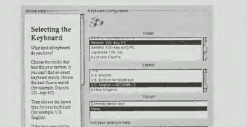

图 2-2. 键盘类型安装菜单

> 提示：如果你以后想更改键盘布局或类型，可以运行程序 `/usr/sbin/kbdconfig`。

完成后，点击 Next（下一步）继续，或点击 Back（返回）回到语言选择菜单。

## 选择鼠标

现在你可以选择想在 X-Windows 环境中使用的鼠标类型（X-Windows 是 Linux 的图形用户界面）。很有可能，自动探测器已经能够识别你拥有的鼠标类型。

如果你需要帮助 Linux，只需从顶部菜单框中选择你的鼠标类型（见图 2-3）。如果你看到鼠标品牌名称左侧有一个加号 (+)，点击该加号将为该特定品牌打开新一层选择。

如果你有一个串口鼠标，你还需要选择它使用的串口，你可以使用屏幕下方的框来完成此操作。

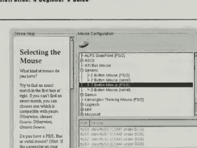

图 2-3. 鼠标类型安装菜单

按钮鼠标。该模拟功能允许你点击双键鼠标的两个按钮来模拟第三个（中）键。

> 提示：如果你以后更改了鼠标类型，可以运行 `/usr/sbin/mouseconfig` 重新配置你的鼠标。

## 欢迎使用 Red Hat Linux

选定了输入设备和语言后，你现在可以开始 Red Hat Linux 的实际安装阶段了。这将以一个欢迎屏幕开始，其对应的帮助栏告诉你如果购买了盒装版本如何注册 Red Hat Linux。阅读完注册信息后，只需点击 **Next（下一步）** 即可继续。

## 升级还是安装？

我们将看到一个屏幕，让我们选择如何安装 Red Hat Linux。如果你处于升级路径中，这个选择很简单——只需点击 **Upgrade（升级）**，然后点击 **Next（下一步）**。你会看到一些屏幕，告知你正在升级的内容，同时在执行升级操作。


在本章中，我们假设正在进行全新安装。这将在全新安装 Red Hat 6.1 之前清空磁盘中的所有现有内容。

请注意，“Install”下方有一个选项，用于以服务器配置安装 Linux（参见图 2-4）。这种方法为你预选了所有软件包，并包含磁盘分区方案。在本章中，我们选择“Custom”，以便能够精细调整安装和配置方式。

## 为 Linux 创建分区

由于我们选择了自定义安装，因此需要为 Linux 安装创建分区。如果你习惯了 Windows 安装过程，你会发现此过程与你将 Windows 分区到独立驱动器的方式略有不同。

简而言之，每个分区在启动时会被*挂载*（mounted）。挂载过程使该分区的内容可用，就像系统上的另一个目录一样。例如，根目录（/）将位于第一个（根）分区上。根目录下会存在一个名为 /usr 的子目录，但它里面没有任何内容。然后可以挂载另一个分区，使得进入 /usr 目录即可查看新挂载分区的内容（参见图 2-5）。

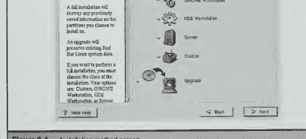

图 2-4. 安装方法屏幕

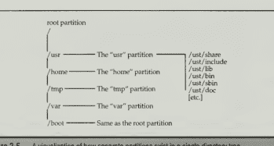

图 2-5. 显示独立分区如何在单一目录树中存在的可视化图示

由于所有分区在挂载后表现为一个统一的目录树，而不是独立的驱动器，安装软件不会区分不同的分区。它只关心每个文件应进入哪个目录。因此，只要已挂载的分区代表目录树中文件通常所在的各个部分，安装过程就会自动将文件分布在所有已挂载的分区上。在 Linux 下，文件最重要的分组位于 /usr 目录，所有实际程序都驻留于此。（用 Windows 术语来说，这类似于 C:\Program Files。）

由于我们要配置一台服务器，我们需要了解服务器在其生命周期内将存在的其他大型文件分组。它们包括：

- /usr，所有程序文件将驻留于此（类似于 C:\Program Files）。
- /home，每个人的主目录将位于此（假设该服务器将托管这些用户）。这对于防止用户访问整个磁盘并导致其他关键组件（如日志文件）没有空间很有用。
- /var，日志文件的最终目的地。由于日志文件可能受到外部用户的影响（例如，访问网站的个人），因此将它们分区隔离非常重要，以防止任何人通过生成大量日志条目使整个磁盘填满，从而发起拒绝服务（DoS）攻击。
- /tmp，临时文件放置的位置。由于该目录被设计为任何用户都可写入（类似于 Windows 下的 C:\TEMP 目录），我们需要确保任意用户不会滥用它并填满整个磁盘；我们通过将其放在独立分区上来确保这一点。
- 交换分区（Swap）。这不是用户可访问的文件系统，但它是虚拟内存存储的位置。虽然 Linux（和其他 UNIX 操作系统）可以像 Windows 一样使用普通磁盘文件来保存虚拟内存，但你会发现将其放在独立分区上可以提高性能。

现在你明白为什么在磁盘上创建多个分区而不是单个大分区是个好主意，尽管你可能习惯了在 Microsoft Windows 下后者的做法。随着你对 Linux 下磁盘分区的机制和原因更加熟悉，你可能会选择回到单个大分区。届时，当然，你将对两个系统有足够了解，从而理解为什么其中一种可能比另一种更适合你。

现在，既然我们对 Linux 下的分区有了背景知识，让我们回到安装过程本身。你应该处于类似图 2-6 的屏幕。

Disk Druid 分区工具由 Red Hat 开发，作为创建分区并将其关联到它们将被挂载的目录的一种简便方法。启动 Disk Druid 时，你将看到磁盘上所有现有的分区。每个分区条目将显示以下信息：

- 挂载点（Mount point）：分区挂载的位置。最初，这里不应包含任何条目。
- 设备（Device）：Linux 将每个分区与一个独立的*设备*关联。对于安装目的，你只需知道对于 IDE 磁盘，每个设备以 `/dev/hdX` 开头，其中 X 是：
  - a 表示主链，主磁盘
  - b 表示主链，从磁盘
  - c 表示从链，主磁盘
  - d 表示从链，从磁盘
  - Y 是磁盘的分区号。例如，/dev/hda1 是主链主磁盘上的第一个分区。SCSI 遵循相同的基本概念，只是不以 /dev/hd 开头，而是每个分区以 /dev/sd 开头，并遵循 /dev/sdX 格式，其中 X 是代表唯一物理驱动器的字母（a 代表 SCSI id 1，b 代表 SCSI id 2，等等）。Y 代表分区号。因此，/dev/sdb4 是 SCSI id 为 2 的磁盘上的第四个分区。系统比 Windows 更复杂一些，但每个分区的位置都是明确的——更令人困惑的是，“E: 对应哪个物理设备？”
- 请求大小（Requested）：定义分区时请求的最小大小。
- 实际大小（Actual）：为该分区分配的实际空间量。
- 类型（Type）：分区的类型。Linux 的默认类型是 Linux 原生，但 Disk Druid 也理解许多其他类型，包括 FAT、VFAT 和 NTFS。

屏幕的后半部分显示*驱动器摘要*（drive summaries）。每一行代表一个单独的驱动器及其特征。提供的信息包括：

- 磁盘几何参数，以柱面/磁头/扇区（Cylinders/Heads/Sectors）格式表示
- 磁盘总大小
- 已分配（已分区）的磁盘容量
- 仍可分区的可用磁盘容量

屏幕中间是你可以使用 Disk Druid 执行的操作的菜单选项。
这些按钮是：

- Add：创建新分区。
- Edit：更改突出显示分区的参数。
- Delete：删除突出显示的分区。
- Next：将更改提交到磁盘。
- Back：中止使用 Disk Druid 所做的所有更改并退出程序。

> 注意：在 Disk Druid 中做的更改在单击 Next 按钮之前不会提交到磁盘。

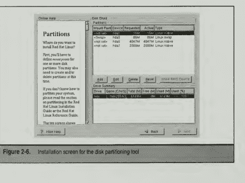

### 添加分区

要创建新分区，请单击 **Add** 按钮。这将弹出一个对话框，应类似于 **图 2-7**。对话框中的每个元素如下：

- 挂载点：你希望此分区在启动时自动挂载到的目录。
- 大小（megs）：分区的兆字节大小。
- 可增长？（Growable?）：通过使用空格键勾选此框，你是在告诉 Disk Druid 你希望以后能够扩展此分区。如果你有一个特别大的磁盘，并且不知道如何分配空间，你可能会发现很有用，即根据需要为每个分区指定大小并选择可增长选项。因此，随着系统的使用，当你看到哪些分区比其他分区需要更多空间时，你可以轻松扩展必要的分区，而无需重新分区你的磁盘。
- 类型：将驻留于该磁盘上的分区类型。默认情况下，你会希望选择 **Linux Native**，但交换分区除外，交换分区应选择 **Linux Swap**。
- 允许的驱动器（Allowable Drives）：指定应在哪些驱动器上创建分区。

输入所有信息后，单击 **OK** 继续。

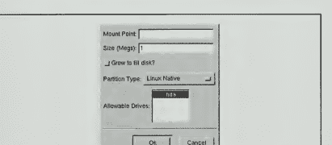

图 2-7. 添加分区对话框


## Linux 管理：入门指南

  至少，你需要两个分区：一个用于存储所有文件，另一个用于交换空间。如果内存少于 128MB，交换空间的大小通常设置为可用内存的两倍；如果内存多于 128MB，则设置为与内存相同的量。实际上，除了根分区外，你还希望为 /oss、/var、/home 和 /tmp 单独建立分区。显然，你可以根据服务器的用途调整这个配置。

## 其他分区操作任务

  一旦你完成了添加分区的步骤，并且对涉及的变量（挂载点、大小、类型、设备等）感到熟悉，实际编辑和删除分区的过程就相当简单了。编辑条目意味着更改你在添加分区时设置的完全相同的条目，而删除条目只需要你确认确实想要执行删除操作。

  我们故意省略的最后一个细节是添加网络文件挂载（NFS）的过程。这需要更完整的说明，将在第 8 章中介绍。

## 格式化分区

  此屏幕将向你显示所有新创建分区的列表（见图 2-8）。由于我们要清除之前安装的磁盘，我们要选择所有分区进行格式化。（更准确地说，Red Hat 将在其上创建文件系统。）


图 2-8. 格式化分区屏幕

> **提示：** 如果你使用的是较旧的驱动器，并且不确定其可靠性，请单击“在格式化时检查坏块”选项，该选项列在所有分区的下方。这将导致格式化过程明显变长，但至少你可以确定磁盘是否可靠。

## 安装 LILO

  LILO 是 Linux 的启动管理器。如果你对启动管理器的功能不熟悉，它负责处理实际加载操作系统的启动过程。如果你熟悉 Windows NT，你已经在处理 NT 加载程序（NTLDR），它在启动时显示菜单，允许你选择启动 Windows NT 还是 Windows 95（或者你唯一的选择）。LILO 实际上做的是同样的事情，只是没有花哨的菜单。

  Red Hat 工具用于设置 LILO 的屏幕有三个部分（见图 2-9）。屏幕顶部允许我们选择是否要创建启动磁盘。出于显而易见的原因，拥有一个启动磁盘是个好主意。

  屏幕中间部分允许你选择是否要将 LILO 设置在主引导记录（MBR）上，还是将 Linux 所在的第一个分区上。主引导记录（MBR）是系统启动时系统读取的第一个内容。基本上，它是内置硬件测试结束并将控制权移交给软件的地方。如果你选择在这里安装 LILO，当你开机或重启系统时，LILO 将加载并显示“boot:”提示符，并允许你选择要加载哪个操作系统。在服务器配置中，应该只有一个选择！

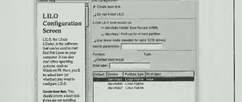

图 2-9. LILO 设置屏幕

  如果你已经在另一个启动加载器上使用并更喜欢它，那么你就希望将 LILO 放在根分区的第一个扇区。这将允许你首选的启动加载器先运行，然后如果你决定启动 Linux，它将把控制权移交给 LILO。

  中间部分还有一个使用“线性模式”的选项。这只适用于某些 SCSI 驱动器或以 LBA 模式访问的驱动器。

  中间部分的最后一个选项是一个文本框，允许你输入在启动时使用的内核参数。大多数人可以忽略这个框。如果特定功能或设备的文档要求你在这里传递参数，请添加；否则请留空。

  最后，屏幕底部允许你选择 LILO 在启动时允许你选择的操作系统。在配置为同时支持 Windows 和 Linux 的系统上，你会在这里看到你的选择。由于我们的系统仅设置为 Linux，因此我们将看到一个选择。

> **注意：** 例外情况是基于 SMP 的系统，它们将有两个选择。第一个选择，linux，被设置为支持多处理器。如果这对你不起作用，linux-up 也将可用；它只会利用一个处理器，但至少可以让你启动并运行。

## 设置网络

  Red Hat 现在准备配置你的网络接口卡（见图 2-10）。你拥有的每个接口卡将作为屏幕顶部的标签页菜单列出。以太网设备被列为 eth0、eth1、eth2，等等。对于每个接口，你可以使用 DHCP 进行配置，也可以手动设置 IP 地址。如果你选择手动配置，请确保准备好 IP 地址、子网掩码、网络和广播地址。

  最后，如果你希望接口在启动时启用，请单击“在启动时激活”。

  在屏幕的下半部分，你将看到用于赋予机器主机名、网关和相关 DNS 信息的配置选项。

  填写完所有信息后，只需单击“下一步”继续。

## 时区配置

  时区配置屏幕（见图 2-11）允许你选择机器所在的时区。如果你的系统硬件时钟以 UTC 计时，请确保单击 UTC 按钮，以便 Linux 可以确定两者之间的差异并正确显示本地时间。

## 创建账户

  Red Hat 安装工具为你创建一个名为“root”的账户。此用户账户在性质上类似于 Windows NT 下的 Administrator 账户：被允许访问此账户的用户对系统拥有完全控制权。

  因此，使用一个好的密码保护此账户至关重要。请确保不要选择字典单词或姓名作为密码，因为它们容易被猜测和破解。

## 第 2 章：在服务器配置中安装 Linux

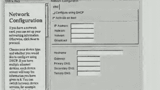

图 2-10. 网络配置屏幕


图 2-11. 时区配置屏幕

  保护 root 的一部分意味着不允许用户通过网络以 root 用户身份登录。这可以防止攻击者通过自动登录脚本猜测你的 root 密码。为了允许合法用户成为 root 用户，你需要以自己的身份登录，然后使用 su（切换用户）命令。因此，如果你打算执行远程管理，仅设置 root 密码是不够的；你还需要设置一个真实的用户。

  通常，设置一个普通用户来执行日常工作被认为是个好主意。这提供了保护，使你在浏览网络或执行非管理任务时不会意外破坏配置文件或其他重要组件。这条规则的例外当然是某些服务器配置，在这些配置中，除了 root 用户外不应有任何用户（例如，防火墙）。

  在图 2-12 中，我们可以看到让我们设置 root 密码以及创建新用户的屏幕。

  首先选择 root 密码并将其输入到屏幕顶部的 root 密码框中。在下面紧邻的 root 密码确认框中再次输入。两次输入密码可以保护你在出错时不会把自己锁在系统之外。

  屏幕的其余部分用于创建新用户。为此，只需在账户名称框中输入他们的用户名，在姓名框中输入他们的真实姓名，在密码和密码（确认）框中输入他们的密码。单击“添加”将此新用户插入这些框下方的列表中。

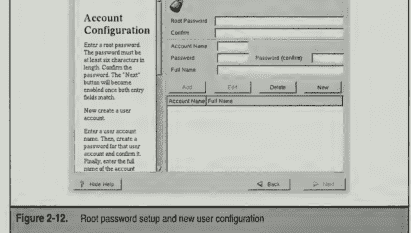


# 注意：您无需添加 root 用户。

  如果在添加新用户时出现任何错误，您也可以对其进行删除和编辑。

  单击“下一步”继续。

# 认证配置

  Linux 将用户列表保存在 /etc/passwd 文件中。每个系统都有自己的该文件副本，列在一个 /etc/passwd 中的用户无法登录到另一个系统，除非他们在另一个系统的 /etc/passwd 文件中也有条目。为了允许用户登录到计算机网络中的任何系统，Linux 使用网络信息系统（NIS）来处理远程密码文件的问题。

  除了列出用户外，/etc/passwd 文件还以加密格式包含每个用户的所有密码。在很长一段时间内，这是可以接受的，因为攻击此类文件以破解密码的计算成本太高，尝试这样做几乎是徒劳的。在过去几年中，可负担的 PC 获得了必要的计算能力，从而对这种类型的安全性构成威胁，因此必须使用影子密码。使用影子密码时，实际的加密密码条目不再保存在 /etc/passwd 文件中，而是保存在 /etc/shadow 文件中。/etc/passwd 文件仍然可以被系统中的任何用户读取，但 /etc/shadow 只能被 root 用户读取。这显然是安全性的一大提升，除非您有特定的理由不这样做，请务必勾选 Shadow Passwords 复选框（参见图 2-13）。

  另一个很好的安全技巧是使用 MD5 加密密码。由于计算哈希值需要更长的时间，因此该算法支持更长的密码（256 个字符，而不仅仅是 8 个），如果攻击者试图攻击您的系统，破解所需的时间也会更长。

  如果您的站点具有现有的 NIS 基础设施，请在此窗口中输入相关的 NIS 域和服务器名称。如果您不知道或希望稍后处理此事，您可以放心地忽略此步骤。

  当您选中所有复选框并填写相关条目后，单击“下一步”以继续到下一个屏幕。

# 选择软件包组

  在这里，您可以选择安装到系统上的软件包。Red Hat 将这些软件包分为几个高层级的描述类别，这使我们能够快速选择想要安装哪类软件包，并安全地忽略细节。您也可以选择不安装 Red Hat 附带的所有软件包；但请注意，完整安装可能需要高达 1.5GB 的软件！

  查看选项（图 2-14），我们看到 Red Hat 提供的顶级组菜单。我们只需选择感兴趣的组，可以选择“全部”来安装所有软件包；或者我们可以点击屏幕底部标有“选择单个软件包”的按钮。做出决定后，我们只需点击“下一步”。

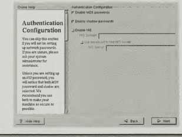

图 2-13. 认证配置屏幕

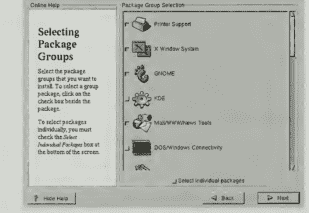

图 2-14. 选择软件包组屏幕

  如果您选择“选择单个软件包”，您将看到如图 2-15 所示的屏幕。在屏幕左侧，您将看到软件包的逻辑分组；在屏幕右侧，您将看到该组中存在的软件包。当您点击一个软件包时，屏幕底部将显示该软件包的名称及其简要描述。在描述的正上方，有一个按钮，如果您想安装该软件包，请点击它。

  如果您选择选择单个软件包，Red Hat 将检查并验证这些软件包所需的所有先决条件是否满足。如果有任何未满足，您将在一个类似于图 2-16 的屏幕中看到这些软件包。

  如果需要安装任何软件包才能使您选择的所有软件包正常工作，只需确保标有“安装软件包以满足依赖关系”的按钮处于选中状态即可。

  完成选择软件包后，点击“下一步”。

## 配置 X-Windows

**警告：** 这是在所有通过此过程选择的更改提交之前，配置 Red Hat Linux 的最后一步。在此屏幕之后，分区将被写入，软件包将被安装。这是您中止的最后机会！

  X-Windows 是 Linux 图形用户界面的基础。它是与实际视频硬件通信的部分。诸如 KDE 和 GNOME（您更可能听说过这些）等程序使用 X-Windows 作为与硬件通信的标准机制。

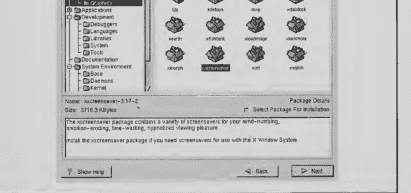

**图 2-15.** 选择单个软件包

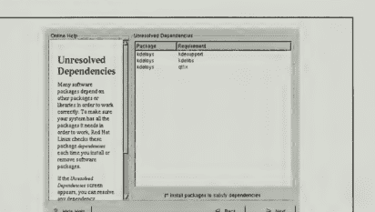

**图 2-18.** 解决先决条件软件包。

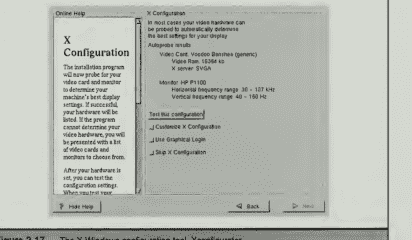

**图 2-17.** X-Windows 配置工具，XConfigurator。

  使 X-Windows 有趣的原因是它与基础操作系统解耦。实际上，Linux 使用的 X 版本，XFree86，也可用于许多其他基于 UNIX 的系统，例如 Sun 的系统。这意味着可以运行服务器而从不启动图形环境，正如我在本章前面提到的，这通常是的好主意。通过关闭 GUI，您节省了内存和系统资源，这些资源可以用于实际的服务器进程。

- 当然，这并没有改变许多不错的管理工具仅在 X-Windows 下可用的事实，因此设置它仍然是一个好主意。

  Red Hat 将首先尝试自动检测您拥有的网卡和显示器类型。如果您拥有品牌显示器和显卡，您可能会拥有最简单的体验。如果 Linux 无法确定显卡和显示器的类型，系统会提示您输入必要的信息。

> 注意：在输入信息之前，您应该有关于显示器频率的信息。尝试向显示器发送过高的频率可能会导致物理损坏。当显示器远不如现在坚固且 X-Windows 配置工具尚不存在时，作者就是这样烧坏了他第一台彩色显示器的。

  一旦 Red Hat 拥有必要的信息，您将看到类似于图 2-17 的屏幕。在硬件配置描述下有四个选项：测试此配置、自定义 X 配置、使用图形登录、跳过 X 配置。

  第一个选项是一个按钮，按下后立即测试您的 X-Windows 配置。它将让您验证设置是否有效。第二个是一个切换开关，开启后，允许您选择 X-Windows 的分辨率和颜色。默认情况下，XConfigurator 试图使用具有最大可用颜色的最高分辨率。对于某些人来说，这种分辨率设置太高，使字体难以阅读。

  使用图形登录的选择也就是如此。您可以让 X-Windows 在启动时自动启动，这样每个人看到的登录界面都是图形化的，而不是基于文本的。对于在桌面上拥有 Linux 系统的初级用户来说，这个选择通常很讨人喜欢。

  最后，如果您不需要 X-Windows 或希望稍后配置它，您可以点击不配置 X-Windows 的按钮。

  完成选择后，点击“下一步”继续。

## 开始了！

  Red Hat 现在将开始执行安装过程中您选择的所有软件包的安装过程。根据硬盘、CD-ROM 和机器的速度，这可能从短短几分钟到 20 分钟不等。状态指示器（参见图 2-18）将让您知道进程进行到何种程度以及系统预计还需要多长时间。

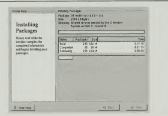

图 2-18. 安装状态

# 启动盘创建

  如果您在安装过程中早期选择了创建启动盘，系统会在此处提示您插入一张空白盘（参见图 2-19）。这张盘将允许您在发生故障时启动系统，以便您可以重新配置/重置那些给您带来问题的组件。

  如果您在此时决定不想现在创建启动盘，可以点击标有“停止创建启动盘”的按钮来跳过此过程。

# 完成了！

  就是这样！安装过程结束了。系统将提示您按下一个键以重启系统。当系统重启时，请务必在您的 CD 硬盘之前移除系统中任何能够启动的 CD-ROM 或软盘。


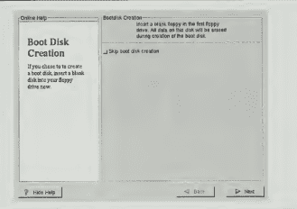
图 2-19. 创建启动磁盘界面

## 摘要

在本章中，我们讨论了搭建服务器的流程，包括选择合适的硬件、建立正确的环境，最后安装 Red Hat 6.1。在我们开始实际安装 Red Hat Linux 之前的所有评论都适用于任何你构建的服务器，无论其操作系统是什么。

安装 Red Hat 本身的步骤也相当简单。任何经历过早期版本安装流程的人都会注意到，这个过程变得多么简单，以及为了开始工作需要做出的配置选择减少得多么多。Linux 之所以美妙，是因为尽管这些选项不再是安装过程的一部分，但一旦你完成安装并真正启动系统，你仍然可以随意更改和调整它们。

别忘了在需要帮助时，搜索我本章前面提到的那些地方。而且，一旦你成为 Linux 专家，别忘了帮助别人。

### 第 3 章

## GNOME 和 KDE

GNOME 和 KDE 最近备受瞩目，因为它们为基于 Unix 的操作系统（最典型的是 Linux）提供了真正易于使用的界面。在本章中，我们将介绍各种让 GNOME 和 KDE 更适合你的技巧和窍门。由于大多数发行版都预装了一个（或两者），所以在开始使用之前，你无需处理安装或配置过程。

然而，在深入了解细节之前，我们需要退后一步，更多地了解 X-Windows 系统及其与 GNOME 和 KDE 的关系。这将帮助你更好地理解 Linux 的全貌以及它与 Windows NT 在基本架构上的一个主要区别。

> **注意：** 本章假设你以 root 身份登录。不过，这里讨论的所有更改同样适用于任何其他用户。

### X-WINDOWS 的历史

像 Linux 这样的基于 Unix 的操作系统的开发者，在用户环境方面与 Microsoft Windows 甚至 Macintosh OS 的开发者有着截然不同的世界观。Unix 领域的人们相信，呈现给用户的界面应该 100% 独立于核心操作系统。因此，Linux 的核心（内核）与其用户界面完全解耦。这允许你选择最适合我们的界面，而不是被困在他人强制的愿景或潜在的随机“市场调研”中。更重要的是，这种独立性带来的稳定性来自于大型程序与核心操作系统的分离。如果在 Windows 或 MacOS 下图形用户界面（GUI）崩溃，你必须重启。而在 Linux 下，你可以终止 GUI 并重启它，而不会影响系统提供的其他服务（如网络文件服务）。

在 20 世纪 80 年代中期，创建了一个不依赖操作系统的图形用户环境基础，被称为 X-Windows。“X”（其常用缩写）仅仅定义了应用程序与图形硬件通信的方法。还建立了一组定义良好的函数，程序员可以调用它们来执行基本的窗口操作。

关于窗口如何绘制以及鼠标点击如何处理的 basic 定义并不包括窗口外观的定义。（实际上，处于自然状态的 X-Windows 没有真正的外观。它甚至不会在窗口周围画线！）外观控制交给了一个名为窗口管理器的外部程序。窗口管理器负责绘制边框、使用颜色以及使环境赏心悦目；窗口管理器只需要使用 X-Windows 子系统的标准调用在屏幕上绘制即可。窗口管理器并不规定应用程序本身如何使用窗口。这意味着应用程序开发人员有灵活性开发最适合应用程序的直观用户界面。

由于窗口管理器位于 X-Windows 子系统外部，且 X-Windows 应用程序编程接口（API）是开放的，任何想要开发新窗口管理器的程序员都可以这样做，而且许多人确实这样做了。在当今的语境下，我们可以将这种开放形式与像 WinAMP 这样的 MP3 播放器联系起来，这些播放器允许开发人员为基础播放器构建“皮肤”。

锦上添花的是应用程序与 X-Windows 之间的关系。典型的应用程序编写为直接与其通信，从而能够与用户选择使用的任何窗口管理器一起工作。图 3-1 展示了这种关系。


图 3-1. X-Windows、窗口管理器、应用程序和核心操作系统之间的关系

### 缺点

尽管 X-Windows 在技术上很有趣且多功能，但编程却让人头疼。Windows 程序员可能会将 X-Windows 编程类比为在可视化工具和 MFC 库出现之前为原始 MS Windows 编程。例如，在 X 和 MS Windows 下，编写一个简单的程序来显示一个窗口、显示文本“Hello World”并提供一个按钮供用户退出，代码都可能长达数百行！

在这里，Unix 领域的人们从 Macintosh OS 和 MS Windows 环境中汲取了教训（值得注意的是，后者借鉴了 20 世纪 70 年代末 Xerox 的工作）；未能提供一个既对用户又对程序员合理一致且易于使用和开发的用户界面，意味着可用性的丧失。

商业 Unix 供应商试图通过通用桌面环境（Common Desktop Environment）来修复这个问题，以便他们的用户获得一致的视觉和操作感受，并开发了一个名为 Motif 的改进的 X-Windows 库。对于 Linux 来说，这两项发展都带来了问题，因为它们违背了开源的理想。更令人不愉快的是，它们并没有比之前可用的东西好多少。

### KDE 和 GNOME 的登场

伴随着不友好的编程环境和不友好的用户界面，X-Windows 有潜力有一天变成一个遗留界面。这将非常不幸，因为它提供了一个设计（并且仍然是）远超其他商业产品的解决方案。该协议是开放的，这意味着任何想要编写 X 客户端或 X 服务器的人都欢迎加入。当然，X-Windows 的一个最佳特性是它允许在一个主机上运行应用程序，而在另一个主机上显示。

在 20 世纪 90 年代后期，两个小组推出了针对 X-Windows 问题的解决方案；GNOME 和 KDE。KDE 提供了新的窗口管理器和必要的库，使为其编写应用程序变得更容易。GNOME 提供了一个通用框架，供其他窗口管理器和应用程序与其协作。它们各自对事物应该如何运作有自己的想法，但由于它们都运行在 X-Windows 之上，因此并不是完全不兼容的。

> 注意：尽管你可能在新闻组或网站上听到相反的说法，这两个小组之间并非“处于战争状态”。相反，它们欢迎这种公开竞争。每个小组都可以从对方的想法中获益，反过来，这两个小组都可以为我们用户提供商出色的两个选择。

### 这对我们意味着什么

上一节的关键短语是“并非完全不兼容”。为了使 KDE 和 GNOME 提供诸如拖放等功能，它们必须提供一种统一的方式让应用程序相互通信，以及一套开发者库来实现这一点。不幸的是，由于这两种方法不同，它们并不兼容。因此。

这对应用程序而言可能有些令人困惑。取决于应用程序从其库中调用的功能，只要库存在，它仍然可能在另一个环境中工作。一个很好的例子是 ksys 程序。它是针对 KDE 编写的，但由于它所依赖的功能在库中 100% 可用，因此运行 GNOME 但拥有 KDE 库的系统（如 Red Hat）将允许该应用程序毫无问题地运行。另一方面，如果一个应用程序依赖 KDE 窗口管理器本身，那么该应用程序在 GNOME 下将无法工作。


作为用户，我们的意思是，选择一个环境而不是另一个，有可能导致我们无法使用某些应用程序。截至撰写本文时，这还不是一个大问题。实际上，两个团队正在合作，以提高它们之间的兼容级别。这让我们不得不做出选择。如果你不确定自己更喜欢什么，那就试试两者。看看自己更喜欢哪一个，而不是依赖某个网页的观点（甚至更糟糕的是本作者的观点）！我使用什么并不重要。你喜欢什么才是最重要的。这就是拥有两个竞争系统的全部意义所在。

## 关于 KDE

KDE 是一个桌面环境（K 桌面环境）。它与我们之前描述过的典型窗口管理器略有不同。除了描述界面应该如何显示之外，KDE 还提供了一组库，如果使用这些库，应用程序就可以利用窗口管理器提供的一些特殊功能。这包括像拖放支持、标准化打印支持等。

这种窗口管理技术的另一面是，一旦应用程序被设计为在 KDE 下运行，它就必须在 KDE 中才能工作。这与早期的窗口管理器相比是一个巨大的变化，早期窗口管理器中的应用程序是独立于窗口管理器的。

从程序员的角度来看，KDE 提供了一个比直接处理 X 接口更容易处理的库。KDE 还提供了一个标准化的面向对象的框架，允许一套工具基于另一套工具进行构建，这是仅使用 X-Windows 所无法实现的。

在本节中，我们假设你的系统上已经安装了 KDE。这对于 Caldera 来说是正确的，因为它只提供 KDE；如果你在安装过程中选择了使用它，对于 Red Hat 也是如此。

**注意：** 有关 KDE 的更多详细信息和信息，请访问其网站 [http://www.kde.org](http://www.kde.org)。

### 许可问题

直到最近，Qt 库开发者施加的许可限制仍有一些问题，而 KDE 正是基于 Qt 库的。这禁止在不向 The Gnome Project 支付费用的情况下商业使用 KDE，The Gnome Project 因此启动。

最近，KDE 的许可已被反转。修订后的许可，称为 QPL，现在更加开放，并允许商业使用；然而，它与大多数随 Linux 发行版分发的软件包所使用的 GPL 和 Berkeley 风格许可不同。像任何文档一样，如果你认为自己可能存在问题，值得阅读一下。

你可以通过访问 KDE 的网站了解有关此许可的更多信息。

## 启动 X-Windows 和 KDE

在设置 X-Windows 时，你可能有选择直接启动系统进入 X 的机会。如果是这样，你只需要登录即可——你就在那里——你正在使用 KDE 和 X-Windows。如果没有选择该选项，你将看到一个基于文本的登录提示。要进入 X-Windows 环境，只需登录并像这样运行 startx：

```
[root@ford /root]# startx
```

稍后，你也将进入 KDE。你的屏幕看起来可能如图 3-2 所示。

如果你的屏幕看起来不像那样，而是显示 GNOME 横幅窗口启动，那么你需要编辑决定启动哪个窗口管理器的文件。为此，通过点击屏幕左下角的熊爪并选择登出来退出 GNOME。这将带你回到文本模式。使用你喜欢的编辑器编辑 .xinitrc 文件。如果你没有喜欢的编辑器，试试像这样使用 pico：

```
[root@ford /root]# pico .xinitrc
```

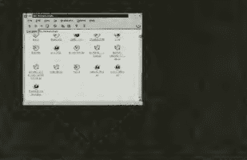

图 3-2. 打开文件管理器的 KDE 桌面

**注意：** 如果你不熟悉 pico，不用担心。所有可用的命令始终显示在屏幕底部。任何以脱字符符号（`^`）**开头**的命令意味着你使用 CTRL 键与指定的其他键组合。例如，`^X` 意味着 CTRL-X。

很可能该文件是空的。如果是这样，只需添加以下内容：

```
#!/bin/sh
startkde
```

如果文件不是空的，请转到最后一行。它可能以字符串 "exec," 开头，这告诉系统执行一个程序。将该行更改为读取 "startkde"。

## KDE 基础

KDE 与其他图形桌面（如 Windows 或 MacOS）有许多共同点。它有一个桌面，其中可以存在文件和文件夹。一个需要注意的关键点是，由于 Linux 将系统上的所有硬盘都放置在一个统一的目录树中，你不会像在“我的电脑”下那样，找到一个允许你浏览特定磁盘的特殊图标。

在屏幕底部，你会发现 KDE 的面板。最左边的 K 按钮相当于 Windows 的开始按钮。通过点击它，你会看到一个菜单，显示一些只需点击相应菜单项即可启动的应用程序。

使面板与 Windows 开始菜单不同的是，它也是一个常用应用程序的快捷方式栏。你可以通过点击 K 按钮并选择“面板”来配置该栏，拥有你想要的任何快捷方式。在此菜单下有许多配置选项。

如果你想完全隐藏面板，可以通过点击面板最右侧或左侧的箭头来实现。这将使面板向该方向隐藏。再次点击箭头以将面板调回。

## KDE 控制中心

KDE 控制中心很像 Windows 的控制面板，只是它专门针对桌面配置项（见图 3-3）。

控制中心提供了一系列令人印象深刻的工具，以便愉快地配置 KDE。这包括对各种主题、颜色、背景、屏幕保护程序、某些应用程序和某些类型硬件的支持。查看所有功能最好的方法是进行尝试和玩耍——这是你作为系统管理员难得的机会，可以在不破坏系统的情况下与界面进行交互。

在本节中，我们将逐步介绍几个常见任务。它们应该能让你了解可以做到什么，以及弄清楚如何做的典型方法。如前所述，界面非常像 Windows，因此在其中导航应该相对容易。

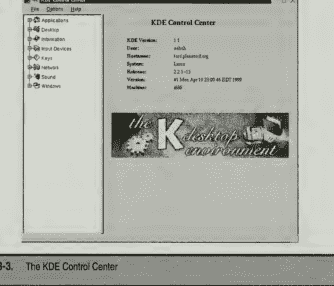

### 使用多个桌面

你可以调用的最强大的工具之一是虚拟桌面。唯一危险的是，当你在没有此功能的系统上工作时感到的恼怒。

虚拟桌面的本质是，它们允许你同时有效地拥有多个屏幕。你只需点击屏幕底部的虚拟桌面选择器，选择你要使用的屏幕即可。

大多数 KDE 安装默认设置为四个虚拟屏幕。如果你想调整它，请执行以下操作：

- 1. 打开**控制中心**
- 2. 选择**应用程序**。
- 3. 选择**面板**。
- 4. 在控制中心右侧的选项卡式窗口中，选择**桌面**（见图 3-4）。
- 5. 向右移动“可见”滑块以增加桌面数量。（当然，你也可以向左移动以减少桌面数量。）
- 6. 点击窗口底部的“应用”以使更改生效。

如果每个桌面都有特定用途，你还可以通过突出显示桌面并更改同一面板上的桌面名称字段来更改桌面的标签。在图 3-4 中，你可以看到桌面 1 被重命名为 Misc（杂项），桌面 2 被重命名为 StarOffice，而其他桌面保持不变。

> **提示：** 如果你更喜欢键盘快捷键，你可以设置一个快捷键，允许你在控制中心中从一个桌面移动到另一个！在“Keys I Global Keys”菜单下。只需点击你想要的操作（切换桌面），然后选择你要使用的按键组合来移动。和许多长期使用 fvwm 窗口管理器的人一样，我个人更喜欢使用 CTRL-方向键从一个桌面跳到另一个桌面。

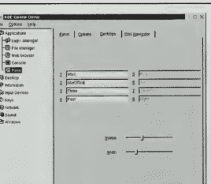

图 3-4. 设置额外的桌面


## 启动其他应用程序

启动新应用程序有多种方式。作为系统管理员，你很可能已经打开了一个命令窗口（通常被称为“xterm”），因此你可能觉得直接在那里运行应用程序非常方便。事实上，本书的大部分内容都假设你是从该提示符运行应用程序的。只需点击桌面面板上的终端图标，或者点击 K 菜单，选择实用程序，然后点击终端，即可打开一个终端窗口。这会启动 kterm，它在功能上等同于 xterm。一旦打开，你可以输入想要运行的命令名称并按 ENTER 键。

> 注意：本书中讨论的许多命令必须从终端窗口运行。

在 KDE 中，你还可以通过按下 ALT-F2 调出相当于 Windows 开始菜单中“运行”选项的功能。这会在屏幕中央弹出一个小窗口，你可以在其中输入要运行的命令。当你按 ENTER 执行命令或按 ESC 取消时，该窗口会自动消失（参见图 3-5）。

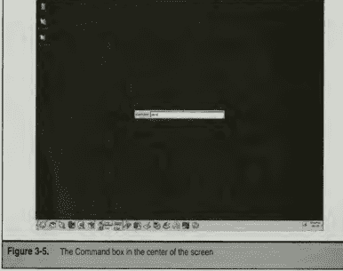

图 3-5. 在 KDE 下更改颜色

最后一种方法是使用文件浏览器通过目录列表进行搜索，并双击想要的应用程序名称。这种方法当然最繁琐，但如果你不记得应用程序的名称，它可能很有用。常见的检查目录包括 /usr/bin, /usr/sbin, /bin, /sbin, 和 /usr/X11R6/bin。

## 更改颜色方案

如果你对桌面环境很挑剔，你可能希望更改桌面颜色方案的外观。使用 KDE 的控制中心，这很简单。首先调出控制中心，然后点击左侧窗口中的桌面选项。这将弹出一个类似图 3-6 的窗口。

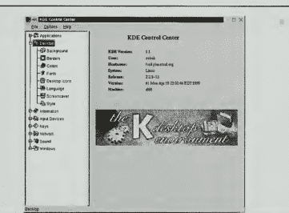

图 3-6. 控制中心下的桌面选项

### 更改背景

点击桌面下的背景菜单选项。这将弹出一个类似图 3-7 的配置面板。

要更改背景，只需从相应的菜单中选择一个颜色或壁纸。如果你选择壁纸，可以通过点击屏幕底部的应用按钮来预览壁纸的效果，再决定是否确认。如果你喜欢看到的效果，点击确定即可保留更改。如果不喜欢，只需将其恢复为原始设置，并再次点击应用。

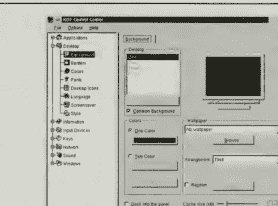

图 3-7. 更改背景配置面板

### 更改颜色

要更改颜色，点击桌面下的颜色菜单选项。这将弹出一个类似图 3-8 的配置面板。

只需点击你最喜欢的颜色组合。如果你想创建一个新的组合，点击列表下方的添加按钮，并给你的新设置起一个名字。高亮显示此设置，然后在面板右侧选择要为每个小部件分配的颜色。例如，要更改普通文本的颜色，打开小部件下拉框。选择普通文本。下拉框下方的条将显示当前颜色。点击该条以调出颜色轮盘，以便选择你最喜欢的新颜色。

一如既往，完成后点击应用。

### 更改屏幕保护程序

要更改屏幕保护程序，点击桌面下的屏幕保护程序选项。这将弹出一个类似图 3-9 的配置面板。

在菜单框中选择你喜欢的屏幕保护程序。它的演示将在同一面板中显示在监视器图片中。你可以通过点击测试来试用全屏版本的屏幕保护程序。如果该屏幕保护程序有配置选项，还可以使用设置按钮进行配置。

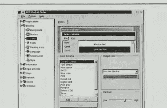

图 3-8. 在 KDE 下更改颜色

从这个菜单中，你还可以选择除了启动屏幕保护程序外锁定屏幕。如果你需要将工作站留在显眼的位置，例如办公室，这非常方便。

但最有趣的功能是角落激活。仔细查看监视器的图片，我们可以看到屏幕的四个角落有小的灰色方块。点击这些方块会显示一个菜单，让我们可以选择忽略、保护屏幕或锁定屏幕。默认值是忽略。但是，通过选择保护屏幕或锁定屏幕，你只需将光标移动到该角落，即可立即触发该操作。例如，我将屏幕的右下角设置为保护屏幕。当我想立即激活屏幕保护程序时，只需将鼠标移入该角落，*嗖的一下*！我的屏幕保护程序就激活了。左下角设置为锁定屏幕。因此，如果我预知自己要离开办公桌很长一段时间，我可以通过将鼠标移入左下角立即锁定屏幕。

屏幕保护程序的默认行为是在指定的分钟数后激活（在屏幕保护程序配置窗口中指定）。将任意角落设置为激活屏幕保护程序并不会使默认行为失效。

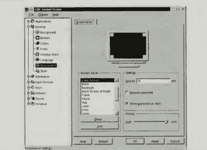

图 3-9. 选择合适的屏幕保护程序

## 关于 GNOME

GNOME（GNU 网络对象模型环境）与 KDE 一样，提供了一个完整的桌面环境和应用程序框架，使开发和易用性更加简单。使 GNOME 与众不同的是它如何实现这些目标。与 KDE 不同，GNOME 不是一个窗口管理器。GNOME 提供开发库和会话管理——这些是我们用户看不到的基础功能。在这个基础之上是一个窗口管理器，它负责桌面的整体外观。默认窗口管理器是 Enlightenment，但也有几种选择可用。

> 注意：根据官方网站，GNOME 的正确发音是 guh-NOME。这是因为 GNOME 中的“G”代表 gnu，而 GNU 的正确发音是 guh-wnu。GNOME 团队在同一段落中表示，如果你把它发音为“NOME”，没人会生气。

从开发人员的角度来看，GNOME 非常有意思。它通过 CORBA 技术定义与其他世界的接口。因此，任何可以使用 CORBA 进行通信的开发系统都可以用来开发符合 GNOME 标准的应用程序。（请参阅他们的开发者网页 http://www.gnome.org 以获取更多信息。）对于用户来说，这意味着有潜力开发许多利用 GNOME 功能的应用程序。当然，像 KDE 一样，GNOME 也能很好地与现有的 X-Windows 应用程序配合工作。

> **注意：** 如果你没有安装 GNOME，你可以从 GNOME 网站 http://www.gnome.org 下载应用程序和安装说明。各种发行版的预编译软件包也可以在他们的网站上获得。

## 启动 X-Windows 和 GNOME

如果你使用的是 Red Hat Linux 并选择了其默认设置，你已经将 GNOME 安装为默认 GUI。根据 X-Windows 的配置方式，你可能已经有了一个图形登录提示。在这种情况下，登录会自动将你带入 X-Windows 环境。如果你有一个基于文本的登录，只需运行 `startx` 以启动 X，如下所示：

```
[root@ford /root]# startx
```

这应该会弹出一个看起来像图 3-10 的屏幕。

如果默认启动的 GUI 不是 GNOME，你可以通过编辑主目录中的 .xinitrc 文件来更改个人设置以使用 GNOME。首先尝试退出窗口管理器。如果你正在 KDE 中（左下角有一个大写的“K”），点击 K 以调出菜单。在该菜单中应该有一个注销选项。如果你真的卡住了，还可以按 CTRL-ALT-BACKSPACE 来终止底层的 X-Windows 管理器。这将把你带回文本模式。使用你喜欢的编辑器编辑 .xinitrc 文件。如果没有喜欢的，试试 pico，如下所示：

```
[root@ford /root]# pico .xinitrc
```

> **注意：** 如果你不熟悉 pico，别担心。所有可用的命令始终显示在屏幕底部。任何以脱字符（^）开头的命令意味着你需要使用 CTRL 键以及其他指定的键。例如，^X 意味着 CTRL-X。

很可能该文件是空的。如果是这种情况，只需添加以下内容：

```
#!/bin/sh
gnome-session
```

如果文件不为空，转到最后一行。它可能以字符串“exec”开头，这告诉系统执行一个程序。将该行更改为“gnome-session”。


# GNOME 基础

如果你熟悉 GUI 界面，GNOME 桌面应该会给你一种宾至如归的感觉。主要差异有两点：第一，桌面上没有“我的电脑”图标。这是因为 Linux 没有为每个分区分配独立驱动器字母的概念。相反，所有分区都在一个单一目录树中提供访问，从而消除了选择驱动器的需求。

第二，屏幕底部的面板。这个面板像是 MS Windows 任务栏的增强版；它显示当前运行的应用程序，以及日期和时间，面板左侧的熊掌按钮类似于“开始”按钮。最大的区别在于这个面板是完全可配置的：你可以移动其中的项目，停靠动态应用程序，为其他应用程序设置快捷方式，并在虚拟桌面间切换。如果某个任务下你觉得它碍事，只需点击面板最右侧或最左侧的右箭头或左箭头按钮，它就会滑出屏幕，直到你再次点击箭头按钮。

## GNOME 配置工具

默认情况下，面板上的按钮（参见图 3-11）从左到右依次为：GNOME 帮助系统、GNOME 配置工具、终端仿真程序（有时被称为“xterm”）以及 Netscape Communicator。
如果你想改变面板的外观，请点击屏幕左下角的熊掌图标，并选择“面板”菜单。这将打开一系列子菜单，允许你配置面板的各个方面，包括将运行中的程序（小部件）停靠其中以及设置新的快捷方式（启动器）。

GNOME 配置工具允许你控制 GNOME 的外观和行为，其工作方式类似于 Windows 控制面板。要启动 GNOME 配置工具，请点击那个看起来像工具栏的面板按钮。

**提示：** *如果你不确定某个按钮的功能，只需将鼠标指针在该按钮上停留几秒钟。一个小描述就会出现在指针旁边。一旦你将鼠标移开按钮，该描述会自动消失。*

如果你的面板上没有看到工具箱按钮，可以尝试点击屏幕左下角的熊掌图标。这将打开一个包含“设置”选项的菜单。选择“设置”会打开一个子菜单，其中一个选项是 GNOME 配置工具。高亮该菜单选项以启动该工具。
启动后，GNOME 配置工具的外观大致如图 3-12 所示。在本节中，我们将逐步介绍几个常见任务。这些任务能让你了解可以做什么以及查找操作方法的典型步骤。正如我们之前提到的，该界面非常像 Windows，因此在其中导航应该相对容易。

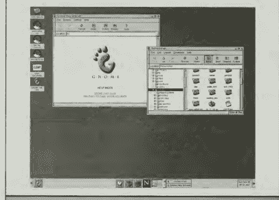

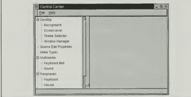

图 3-12. GNOME 配置工具

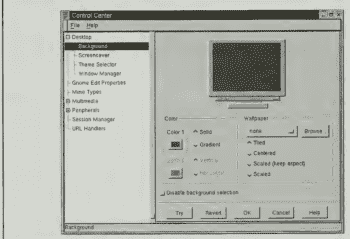

图 3-13. 背景面板

## 更改背景

要更改你的背景设置，请点击“桌面”菜单，然后点击“背景”菜单。这将弹出一个如图 3-13 所示的面板。背景面板分为两组：颜色和壁纸。颜色组允许你设置背景颜色。你可以选择两种颜色并在它们之间做渐变，水平或垂直均可。要选择颜色本身，请点击“Color 1”或“Color 2”字符串下方紧挨着的方框；这将弹出一个颜色查看器，你可以从中选择所需的颜色。

要更改壁纸，请点击“浏览”按钮以查看可用壁纸列表。找到你喜欢的壁纸后，只需选中它并点击“应用”以使更改生效。

## 设置屏幕保护

要在 GNOME 下设置屏幕保护，请点击“桌面”菜单，然后点击“屏幕保护”菜单。这将弹出一个如图 3-14 所示的面板。到达此处后，选择屏幕保护非常简单：只需从列表中选择你最喜欢的模块即可。屏幕保护的样子示例将显示在新窗口中的屏幕保护演示里。如果屏幕保护有任何可配置参数，在可能的屏幕保护列表下方会有一个按钮变为启用状态。

全局屏幕保护设置位于屏幕保护面板的下半部分。在那里，你可以选择系统在启动屏幕保护前等待多久，以及在使用高级电源管理功能尝试关闭显示器前等待多久。

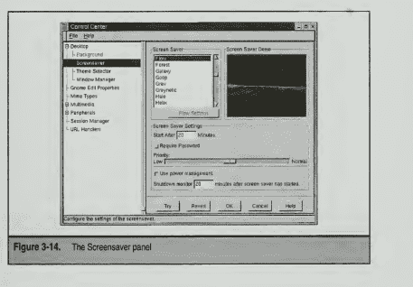

## 主题

主题是 GNOME 允许你配置窗口管理器外观的方式。这些变化不仅仅局限于改变颜色：它们可以改变所有应用程序的桌面、窗口、边框和字体的外观。（MacOS 8 或 WinAMP 的用户应该对此技术很熟悉。）如果你不确定能做出多大的改变，请访问位于 http://www.themes.org 的主题网站。

要在 GNOME 控制中心中访问主题菜单，只需点击“桌面”菜单，然后点击“主题选择器”菜单。这将弹出一个如图 3-15 所示的面板。

默认情况下，GNOME 仅带有默认主题。如果你对更改主题感兴趣，可以访问 http://www.themes.org 并下载新的主题。

选择主题后，你可以点击“预览”按钮，在最终确定之前查看该主题在屏幕上的效果。

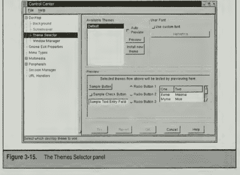

**图 3-15. 主题选择器面板**

## 窗口管理器

正如我们在本节前面提到的，GNOME 并没有指定必须与其一起使用的窗口管理器。所有窗口管理器都执行相同的基本任务，但在界面、风格和外观上的细微差别使它们各具特色。Red Hat 随附并与 GNOME 协同工作的默认窗口管理器是 Enlightenment。

要从控制中心更改窗口管理器，请点击“桌面”菜单，然后点击“窗口管理器”菜单。这将带你进入一个如图 3-16 所示的面板。

如果你想更好地了解使用不同窗口管理器时屏幕的样子，可以点击窗口底部的“尝试”按钮。如果你决定这种外观并不符合你的兴趣，可以点击“还原”返回到原始设置。

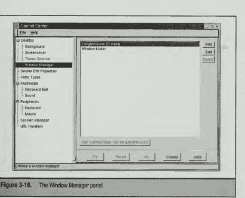

## 摘要

在本章中，你学习了 X-Windows 环境，特别是 KDE 和 GNOME。一些要点包括：

- X-Windows 环境*不是*核心操作系统的一部分。
- 窗口管理器运行在 X-Windows 之上，我们可以选择最适合我们的任何窗口管理器。
- *KDE 环境*是窗口管理器和用于开发 GUI 应用程序的应用程序框架的结合。
- KDE 的控制面板称为*控制中心*，可以通过点击窗口左下角的 K 图标找到。
- KDE 的网站是 <http://www.kde.org>。
- *GNOME* 为其他窗口管理器和库定义了应用程序框架。因此，你可以使用多个窗口管理器，如 Enlightenment 和 Window Maker。
- GNOME 的网站是 <http://www.gnome.org>。

GNOME 和 KDE 代表了 Linux 和整个 Unix 图形用户界面质量的重大进步。希望在这两个环境中工作的舒适度足以说服更多用户将双启动配置转变为单启动 Linux 配置。

### 第 4 章

安装软件


## 第 4 章：安装和管理软件

鉴于系统管理的大部分工作都围绕着安装提供特定服务所需的软件，讨论安装新软件包的机制以及编译以源代码形式分发的软件包就显得尤为重要。

通常，大多数应用程序的安装模式都非常相似。留意典型的信息来源，并辅以适度的常识，就能使大多数安装过程顺利进行。因此，本章的意图不仅是展示安装特定类型软件包的通用步骤，还包括故障排除策略。

> **注意：** 本书中讨论的所有软件包都已经过测试，以验证它们在 Linux 下是否可用，以及是否能够顺利编译和安装。你不应该在安装过程中遇到问题，但各种变更和不同的硬件配置都可能导致软件故障。总是最好了解并理解这样一个简单的事实：如果它正常工作，那就是正常工作。

在本章中，我们将讨论两种最常见的安装方法：使用 RedHat 软件包管理器 (RPM) 和自行编译源代码。本章中输入的所有命令都以 root 用户身份执行。最简单的方法是登录为 root。（第 6 章将向你展示如何使用 `su` 命令将你的用户 ID 更改为其他人的 ID。）一般来说，如果你登录的不是 root，请首先打开一个终端窗口。在提示符处，输入 `su -` 并输入 root 的密码。

### RedHat 软件包管理器 (RPM)

RedHat 软件包管理器的主要功能是允许安装和删除文件（通常是预编译的软件）。它使用起来非常方便，围绕它已经构建了几个图形界面，使其更加易用。RedHat、Caldera 以及其他发行版也开始使用此工具来分发它们的软件。事实上，本书中提到的几乎所有软件都可以以 RPM 形式获得。我们在其他章节中通过自行编译软件的原因是，我们可以使用 RPM 中不可用的选项进行编译。

基本上，RPM 文件是一个包含特定程序运行所需所有文件的集合。它还包含程序描述、版本信息以及执行安装本身所需的脚本。

RPM 工具对给定主机上安装的所有 RPM 软件包进行通用管理。这包括跟踪哪些软件包已安装、它们的版本号以及它们的文件位置。所有这些信息都保存在主机上的一个简单的数据库文件中。

一般来说，以 RPM 形式提供的软件比需要编译的软件更易于安装和维护。权衡在于，使用 RPM 意味着你接受了 RPM 中提供的默认参数。在大多数情况下，这些默认值是可以接受的。然而，如果你需要更深入了解服务的运行状况，你可能会发现自行编译源代码对于了解软件包组件的存在方式及其协作方式更具教育意义。

但假设你只想安装一个简单的软件包，RPM 是完美的选择。有几种优秀的 RPM 软件包资源，例如：

- http://www.rpmfind.net
- ftp://ftp.redhat.com/pub/contrib
- http://www.linuxapps.com

当然，如果你对 RPM 本身的更多细节感兴趣，你可以访问位于 http://www.rpm.org 的 RPM 网站。RPM 随 RedHat Linux（及其衍生版本）以及 Caldera Linux 一起提供。如果你不确定 RPM 是否随你的发行版提供，请咨询你的供应商。

> **注意：** 尽管软件包名称中包含 “RedHat”，但该软件也可以与其他发行版一起使用。事实上，RPM 甚至已经移植到其他操作系统，例如 Solaris 和 IRIX！RPM 的源代码是开源软件，因此任何人都可以主动采取措施使系统为他们工作。

#### 安装新软件包

安装新软件包的最简单方法是使用 RPM 的 `-i` 选项。例如，如果我们下载了一个名为 `bc-1.05a-4.i386.rpm` 的软件包并希望安装它，我们会输入：

```bash
[root@f0rd /root]# rpm -i bc-1.05a-4.i386.rpm
```

如果安装顺利，我们不会看到任何错误或信息。这是安装 RPM 最常见的方法。另一方面，如果软件包已经存在，我们会看到以下信息：

```
error: package bc-1.05a-4 is already installed
```

某些软件包依赖于其他软件包。例如，一个游戏可能依赖于已经安装的 SVGA 库。在这种情况下，你会收到一条消息，指示需要首先安装哪些软件包。只需安装那些软件包，然后返回到原始软件包即可。

如果你需要升级已存在的软件包，请使用 `-U` 选项，如下所示：

```bash
[root@f0rd /root]# rpm -U bc-1.05a-4.i386.rpm
```

RPM 的一些其他命令行选项列在表 4-1 中。例如，要强制安装软件包而不考虑依赖项或其他错误，我们会输入：

```bash
[root@f0rd /root]# rpm -i --force --nodeps package-name.rpm
```

其中 `package-name.rpm` 是要安装的软件包名称。

**表 4-1. RPM 命令行选项**

| 命令行选项 | 描述 |
| :--- | :--- |
| `--force` | 安装的“大锤”。通常，当你明知正在安装某种特殊或不寻常的配置，而 RPM 的安全措施正在阻止你这样做时，你会使用它。`--force` 选项告诉 RPM 放弃任何合理性检查，即使它认为你是在试图将方钉楔入圆孔也要执行安装。请小心使用此选项。 |
| `-h` | 打印哈希标记以指示安装过程中的进度。与 `-v` 选项一起使用以获得更美观的显示效果。 |
| `--percent` | 打印完成的百分比以指示进度。如果你正在从另一个程序（如 Perl 脚本）运行 RPM，并且想要了解安装状态，这会很方便。 |
| `--nodeps` | 如果 RPM 抱怨缺少依赖项文件，但你仍希望安装进行，在命令行传递此选项将导致 RPM 不执行任何依赖项检查。 |
| `--test` | 此选项不执行实际安装；它只是检查安装是否会成功。如果它预期会有问题，它会显示这些问题是什么。 |
| `-v` | 告诉 RPM 详细报告其操作。 |

#### 查询软件包

有时，了解当前安装了哪些软件包以及它们的作用会很有用。你可以使用 RPM 查询选项来做到这一点。

要列出所有已安装的软件包，只需输入：

```bash
[root@ford /root]# rpm -qa
```

准备好面对一长串软件包列表吧！如果你在寻找特定的软件包名称，你可以使用 `grep` 命令来指定软件包名称（或名称的一部分），如下所示：

```bash
[root@ford /root]# rpm -qa | grep -i 'name'
```

> **注意：** `grep` 中的 `-i` 参数告诉它进行不区分大小写的搜索。

如果你只想一次查看一屏所有的软件包，你可以使用 `more` 命令，如下所示：

```bash
[root@ford /root]# rpm -qa | more
```

要了解特定文件属于哪个软件包，请输入：

```bash
[root@ford /root]# rpm -qf filename
```

其中 `filename` 是你想要检查的文件名。

要了解已安装软件包的目的，你必须首先知道软件包的名称（取自 `rpm -qa` 的列表），然后指定它，如下所示：

```bash
[root@ford /root]# rpm -qi packageName
```

其中 `packageName` 是你想要获取其信息的软件包名称。

要了解软件包中包含哪些文件，请输入：

```bash
[root@ford /root]# rpm -qlp packageName
```

其中 `packageName` 是你想要获取其信息的软件包名称。

#### 卸载软件包

使用 RPM 卸载软件包与安装它们一样简单。在大多数情况下，你只需要输入：

```bash
[root@ford /root]# rpm -e packageName
```

其中 `packageName` 是在 `rpm -qa` 列表中列出的软件包名称。

#### GNORP

对于喜欢好的 GUI 工具来简化生活的人来说，有 gnorp。虽然它原本是为在 GNOME 环境下运行而设计的，但它在 KDE 下也能很好地工作。它执行命令行版本所做的所有功能，而无需你记住命令行参数。当然，这也带来了无法通过脚本操作的价格，但这就是我们拥有命令行版本的原因。

### 自行编译软件

开源软件的关键优势之一是你手中拥有源代码。如果开发者选择停止开发它，你可以继续。如果你发现一个


问题，你可以修复它。换句话说，你掌控着局势，而不是受制于无法控制的商业开发者。但拥有源代码也意味着你需要能够编译它。否则，你拥有的只是一堆几乎无用的文本文件。

尽管本书中几乎所有的软件都可以以 RPM 包的形式获得，但我们仍然会逐步讲解自行编译的过程，这样我们就可以挑选和选择编译时选项，而这是使用 RPM 包无法做到的。因此，自己编译软件包是一个不错的主意，你最好对此感到习惯。

在本节中，我们将逐步讲解编译 SSH 包的过程。SSH 是一个允许安全连接到远程主机（SSH 在第 17 章中介绍）的工具。SSH 是一个典型的软件包；你会发现，大多数你需要编译的其他软件包都遵循相同的一般模式。

## 获取和解包软件包

以源代码形式提供的软件通常以*tarball*（tar 压缩包）的形式发布——也就是说，它被归档到一个大的单一文件中，然后被压缩。用于此的工具是 tar 和 gzip；tar 处理将许多文件合并为单一大文件的过程，而 gzip 负责压缩。

> 注意：不要将 gzip 与 WinZip 混淆。它们是两个不同的程序，使用两种不同的（但可比的）压缩方法。不过需要注意的是，WinZip 知道如何处理 tarball。

通常，会选择一个单独的目录来构建和存储 tarball。这允许系统管理员将每个软件包的 tarball 保存在一个安全的地方，以防他或她以后需要从中提取内容。这也让所有管理员除了基础系统外，还能知道系统上安装了哪些软件包。一个适合此用途的目录是 *usr/local*，因为站点本地的软件通常安装在 *usr/local* 中。

大多数 tarball 在解包时会为所有文件创建一个新的目录。SSH tarball（例如，ssh-2.0.13.tar.gz）会创建目录 ssh-2.0.13。大多数软件包都遵循这一标准。如果你发现某个软件包不遵循这一标准，最好创建一个具有合理名称的子目录，并将所有解包的源代码文件放在那里。这允许多个构建同时发生，而不会有两次构建相互冲突的风险。

首先下载 SSH tarball。你可以从位于 http://www.ssh.fi 的官方 SSH 网站获取它。

要解包 SSH tarball，首先将文件移动到 *usr/local/src* 目录，如下所示：

```
[root@ford /root] # mv ssh-2.0.13.tar.gz /usr/local/src
```

> 注意：这假设 SSH tarball 名为 ssh-2.0.13.tar.gz，并且已下载到 /root 目录。

一旦到位，使用 cd 命令更改目录到 /usr/local/src，如下所示：

```
[root@ford /root] # cd /usr/local/src
```

然后使用以下命令解包 tarball：

```
[root@ford /usr/local/src] $ tar -xvzf ssh-2.0.13.tar.gz
```

tar 命令中的 z 参数调用 gzip 在解 tar 过程之前解压文件。v 参数告诉 tar 在解包过程中显示它正在解 tar 的文件名。这样你就能知道所有源代码正在解包的目录名称。我们现在应该有一个名为 /usr/local/src/ssh-2.0.13 的目录。我们可以通过使用 cd 命令进入该目录来测试：

```
[root@ford /usr/local/src] $ cd /usr/local/src/ssh-2.0.13
```

## 查找文档

一旦你进入了包含所有源代码的目录，就开始查找文档。一定要阅读随源代码提供的文档！如果有任何特殊的编译说明、注意事项或警告，很可能在此处提及。首先阅读相关文件可以为你省去大量的痛苦。

那么，相关文件是什么？通常，发行版中在源代码目录的根目录下有两个文件：README 和 INSTALL。README 文件通常包括软件包的描述、对额外文档（包括安装文档）的引用，以及对软件包作者的引用。INSTALL 文件通常包含编译和安装软件包的说明。

当然，这些并非绝对。每个软件包都有其独特之处。了解它们的最佳方法就是简单地列出目录内容，并寻找额外文档的明显迹象。就 SSH 而言，有一个名为 SSH2QUICKSTART 的文件。根据文件名猜测，它很可能包含用于配置、编译和安装 SSH2 的食谱式说明。有些软件包包含不同的大写：readme, README, README，等等。还有一些引入主题变体：README.1st 或 README.Now，等等。

另一个常见的额外信息来源是一个名为“doc”或“documentation”的子目录。就 SSH 而言，存在的唯一目录是 apps, include, 和 lib。

要查看文本文件，使用 more 命令：

```
[root@ford ssh-2.0.13] $ more README
```

要在编辑器中查看文本文件，使用 pico 命令：

```
[root@ford ssh-2.0.13] $ pico README
```

## 配置软件包

大多数软件包都附带一个自动配置脚本；除非其文档另有说明，否则可以安全地假设它们存在。这些脚本通常名为“configure”，并且接受参数。所有 configure 脚本中有一小部分通用的标准参数可用，但有趣的内容是在逐个程序的基础上发生的。每个软件包都有一小组可以在编译时启用、禁用或设置特殊值的特性，它们必须通过 configure 进行设置。

要查看软件包附带哪些 configure 选项，只需运行：

```
[root@ford ssh-2.0.13] # ./configure --help
```

是的，“help”前面是两个破折号（“--”）。

就 SSH 而言，我们将看到一长串可以启用和禁用的功能列表。（关于这些选项与 SSH 相关的含义说明，请参阅第 17 章。）

一个常见的可用选项是 --prefix。此选项允许你设置软件包安装的基础目录。默认情况下，大多数软件包使用 /usr/local。软件包中的每个组件都将安装到 /usr/local 中的相应目录。例如，SSH 的服务器组件称为 sshd，它被安装到 /usr/local/sbin。

在所有你想设置的选项都设置好之后，最后一次运行 configure 会创建一种称为“makefile”的特殊类型文件。Makefiles 是编译阶段的基础。

## 编译你的软件包

编译你的软件包是容易的部分。你只需要运行 make，如下所示：

```
[root@ford ssh-2.0.13] # make
```

make 工具读取由 configure 脚本创建的所有 makefiles。这些文件告诉 make 编译哪些文件以及编译顺序——这是至关重要的，因为可能有数百个源代码文件。

根据你的系统速度、可用内存以及它执行其他任务的忙碌程度，编译过程可能需要一段时间才能完成，所以不要感到惊讶。

当 make 工作时，它会显示它正在运行的每个命令及其所有相关参数。此输出通常是编译器的调用以及传递给编译器的所有参数——这是一些非常繁琐的工作，甚至程序员都倾向于自动化处理！

如果编译顺利通过，你不会看到任何错误消息。大多数编译器错误消息都非常清晰和明确，所以不用担心可能错过错误。如果你确实看到错误，不要惊慌。大多数错误消息并不反映程序本身的问题，而是以某种方式与系统有关。通常，这些消息是由不适当的文件权限（参见第 6 章中的 chmod 命令）或找不到的文件引起的。在后者情况下，确保你的路径至少包含 /bin, /sbin, /usr/bin, /usr/sbin, /usr/local/bin, /usr/local/sbin, 和 /usr/X11R6/bin 目录。你可以通过发出命令来回显你的路径：

```
[root@ford ssh-2.0.13] # echo $PATH
```

请参阅第 6 章以获取关于 **env** 命令的信息，以便你正确地设置路径。

一般来说，放慢速度并阅读错误消息。即使格式有点奇怪，它也可能用平实的英语解释出了什么问题，从而让你快速修复它。如果错误仍然令人困惑，查看随软件包提供的文档，看看是否有你可以联系寻求帮助的邮件列表或电子邮件地址。大多数开发人员都非常乐意提供帮助，但你需要注意保持礼貌并直奔主题。（换句话说，不要以一段关于为什么他们的软件很糟糕的长篇大论开始一封电子邮件！）

## 安装软件包

与编译阶段类似，安装阶段通常也很顺利。在大多数情况下，一旦编译完成，你只需要运行：

```
[root@ford ssh-2.0.13] # make install
```

这将启动*安装脚本*（通常嵌入在 Makefile 中）。由于 make 在执行每个命令时都会显示该命令，你会看到大量的测试文件。不用担心——这是完全正常的。除非你看到错误消息，否则软件包已安装。

如果你确实看到错误消息，最可能是因为权限问题。查看它在失败前试图安装的最后一个文件，然后检查放置文件到那里所需的所有权限。你可能需要在此步骤使用 chmod, chown, 和 chgrp 命令；有关更多细节，请参阅第 6 章。

## 清理

一旦软件包安装完毕，你可以做一些清理，以删除安装过程中创建的所有临时文件。既然*我们*拥有原始的源代码 tarball，完全可以简单地删除编译源代码所在的整个目录。就 SSH 而言，你会删除 /usr/local/src/ssh-2.0.13。首先转到你要删除的目录的上一个目录级别。在这种情况下，那就是 /usr/local/src。

```
[root@ford /usr/local/src] # cd /usr/local/src
```


现在使用 `rm` 命令来删除实际目录，如下所示：

```bash
[root@ford src]$ rm -rf sub-2.0.13
```

> **注意：** `rm` 命令，特别是带 `-rf` 参数时，非常危险。它会递归删除整个目录，而不会停下来验证**任何**文件。以 root 用户身份运行时，这可能会给你的系统带来严重的麻烦。务必非常小心，并确保你删除的是你打算删除的内容。没有“撤销”命令。

## 摘要

在本章中，你学习了如何在 Linux 下使用 RPM 方法以及自行编译软件来安装软件。希望这些信息能消除你对处理开源系统的恐惧！

需要记住的关键点包括：

-   使用 RPM 的典型安装命令是 `rpm -i *packagename.rpm*`。
-   使用 RPM 的典型升级命令是 `rpm -U *packagename.rpm*`。
-   使用 RPM 的典型包移除命令是 `rpm -e *packagename*`。
-   大多数源代码以 **tarball**（打包文件）的形式提供，可以使用 `tar` 命令解压。
-   一旦解压，阅读随包提供的文档非常重要。
-   使用 `./configure` 命令配置包。
-   通过运行 `make` 命令编译软件。
-   通过运行 `make install` 命令安装已编译的软件。

# 第二部分
单主机管理


### 第 5 章
用户管理

在 Linux 下，每个文件和程序都必须有一个 *用户* 作为所有者。每个用户都有一个唯一的标识符，称为用户 ID（UID）。每个用户还必须属于至少一个 *组*，组是由 *系统管理员* 建立的一个用户集合。用户可以属于多个组。与用户类似，组也有唯一的标识符，称为组 ID（GID）。

文件或程序的可访问性基于其 UID 和 GID。正在运行的程序继承调用该程序的用户权利和权限。（*set-UID*，将在本章稍后讨论，构成了这一规则的例外。）每个用户的 *权限* 可以通过两种方式之一定义：*普通用户* 或 *root 用户*。普通用户只能访问他们拥有的或获准运行的内容；授予权限的原因要么是用户属于该文件的组，要么是因为该文件对所有用户都可访问。*root 用户* 被允许访问系统中的所有文件和程序，无论 *root* 是否拥有它们。root 用户通常被称为 *超级用户*。

如果你习惯于 Windows NT，你可以将该系统的用户管理与 Linux 的用户管理进行类比。例如，Linux 的 UID 类似于 Windows 的 SID。与 Windows NT 相反，你可能会觉得 Linux 的安全模型令人抓狂地简单：要么你是 *root*，要么你*不是*。普通用户不能以 NT 下授予普通用户 *管理员* 访问权限的方式拥有 root 权限。你还会注意到 Linux 中明显缺乏访问控制列表（ACL）。哪个系统更好？这取决于你想要什么以及你问谁。

在本章中，我们将探讨单主机用户管理技术。跨网络的用户管理将在 *网络信息服务（NIS）* 章节（第 19 章）中讨论。让我们从探索包含用户信息的实际数据库文件开始。然后，我们将考察用于自动管理这些文件的 *系统工具*。

## 关于用户

在 Linux 中，一切都附有一个所有者。鉴于此，一个没有 *用户* 的 Linux 系统是不可能存在的！至少，它需要一个 *root* 用户；然而，大多数 Linux 发行版都附带设置了几个 *特殊用户*。这些 *用户* 作为自我文档化工具运行得很好，因为每个用户都拥有与其用户名相关的所有文件——例如，*用户 www* 被设置为拥有与 *万维网服务* 相关的所有文件。这些 *用户* 被配置为仅 *授予* 少数 *特定人员* 访问权限，因此你不必担心它们的滥用。

为了让 *用户账户* 正常工作，需要设置一些 *事项*。在本节中，我们讨论这些项目以及为什么它们*必须*存在。实际的设置 *账户* 过程将在本章稍后讨论。

## 主目录

每个实际登录系统的用户都需要一个独特的配置文件存放位置。这允许每个用户在定制的环境中工作，而无需更改由另一个用户定制的环境——即使两个用户同时登录系统。这个位置被称为 *主目录*。在这个目录中，用户不仅可以存放其配置文件，还可以存放常规工作文件。

为了保持一致性，大多数站点将主目录放在 `/home` 下，并以用户的登录名为目录命名。因此，如果你的登录名是 *hid*，你的主目录将是 `/home/*hid*`。系统账户（例如 root 用户的账户）是此规则的例外。主目录通常设置为 `/` 或特定于该账户 *需求* 的某个路径（例如，如果安装了 Apache Web 服务器，www 账户可能希望将其主目录设置为 `/usr/local/apache`）。在大多数 UNIX 变体中，root 的主目录传统上为 `/`。许多 Linux 安装使用 `/root`。

将主目录放在 *linux* 下是完全任意的——但它在组织上有一定道理。系统并不关心我们将主目录放在哪里，只要每个用户的位置在密码文件（本章稍后讨论）中指定即可。你可能会看到一些站点使用 `/u` 或按部门拆分 *主* 目录，从而创建 `/home/*engineering*`、`/home/*accounting*`、`/home/*admin*` 等，然后让用户位于每个部门之下。例如，工程部门的 Bozeme 博士将是 `/home/*engineering*/*bozeme*`。

## 密码

每个账户应该有一个密码，或者被标记为无法登录。这对系统的安全至关重要——弱密码往往是系统安全受损的原因。

最初密码背后的哲学其实很有趣，尤其是我们今天仍依赖其很大一部分。其理念很简单：不依赖受保护的文件来保持密码的秘密，而是系统使用 NSA 开发的一种名为 DES 的算法对密码进行加密，并允许加密值公开查看。最初使其安全的是，该加密算法在计算上很难破解。大多数人能做的最好事情是暴力字典攻击，即自动化系统遍历大型字典，并依赖用户倾向于为密码选择英文单词的特性。许多人试图破解 DES 本身，但由于它是一个任何人都可以研究的开放算法，它在实际部署之前变得更加防弹。

当用户在登录提示符下输入密码时，输入的密码会被加密。然后，加密值会与用户的密码条目进行比较。如果两个加密值匹配，用户被允许进入系统。执行加密的实际算法在计算上足够便宜，单次加密不会花太长时间。然而，字典攻击所需的数万次数加密将需要极其漫长的时间。除了加密的密码外，密码文件还可以包含关于用户主目录、UID、shell、真实姓名等信息，而无需担心如果任何由任何用户运行的应用程序都被允许读取它会导致系统安全受损。

但随后出现了问题：处理器速度每 18 个月翻倍的摩尔定律确实成真了，家用电脑变得足够快，程序能够在几天内而不是几周或几个月内执行暴力字典攻击。字典变得更大，软件变得更智能。密码的特性需要重新评估。

影子密码是一个解决方案。在影子密码方案中，加密的密码条目从 `passwd` 文件中移除，并放置在一个名为 `shadow` 的单独文件中。常规的 `passwd` 文件将继续对系统上的所有用户可读，而实际的加密密码条目只能被 root 用户读取。（登录提示符以 root 权限运行。为什么不直接让常规密码文件仅 root 可读呢？嗯，事情没那么简单。由于密码文件开放了这么多年，围绕它成长起来的其余系统软件依赖于密码文件始终对所有用户可读这一事实。更改这一点只会导致软件故障。）

另一个解决方案是改进用于执行密码加密的算法。一些 Linux 发行版遵循了 FreeBSD 操作系统的道路，使用了 MD5 方案。这增加了破解密码的复杂性，当与影子密码结合使用时，效果相当好。（当然，这是假设你让你的用户选择了好的密码！）

> 提示：选择好的密码总是一件麻烦事。你的用户最终会问：“那么，全能的系统管理员，什么样的密码才是好密码？” 这是你的答案：一个非词汇单词（不是英语、西班牙语、德语或任何人类语言的单词），最好包含混合大小写、数字和标点符号——像一个看起来像自由文本的字符串。嗯，这很简单且很棒，但作为一个对强密码的提醒，大多数人会通过将其写下来并放在容易看到的地方迅速使其失去作用。所以最好让它难忘！我更喜欢选择一句短语，然后选取短语中每个单词的首字母的技术。因此，短语“fool me VERY GOOD for you and me”变成 oGVyAm。即使生成的密码不可忘，该短语也是难忘的。

## Shell

当用户登录系统时，她期望一个能帮她提高效率的环境。用户遇到的第一个程序被称为 shell。如果你习惯了 Windows 世界，你可能会将其等同于 `command.com` 或程序管理器。

在 UNIX 下，大多数 shell 是基于文本的。我们在第 6 章中详细讨论的 shell 是 root 用户的默认 shell，即 Bourne Again Shell，简称 bash。Linux 附带了多个可供选择的 shell。你可以在 `/etc/shells` 文件中看到其中大部分列表。决定哪个 shell 适合你有点像选择喜欢的啤酒——适合你的不一定适合所有人——但人们往往对自己的选择很固执！

使 UNIX 如此有趣的是，你不必局限于 `/etc/shells` 中提供的 shell 列表。在严格的定义中，每个用户的密码条目


## 启动脚本

在 DOS 系统中，我们习惯于在系统启动时自动运行 `autoexec.bat` 和 `config.sys` 文件。由于 DOS 是一个单用户系统，这两个程序不仅执行加载设备驱动程序等系统功能，还负责配置我们的工作环境。

另一方面，UNIX 是一个多用户环境。允许每个用户拥有自己独立的配置文件，这样即使在同一时间有其他用户登录，系统也会显得像是为每个特定用户定制过的。配置文件的形式是 shell 脚本——当用户登录时，shell 启动后会执行的一系列命令。以 bash 为例，这个文件是 `.bashrc`（是的，文件名前面有一个点——以点开头的文件名，也称为点文件，在普通的目录列表中是隐藏的，除非用户使用特殊选项来列出它们。）你可以将 shell 脚本看作类似于批处理文件，只不过 shell 脚本的功能要强大得多。特别是 `.bashrc` 脚本，其性质与 `autoexec.bat` 类似。

创建用户账户时，你应该提供一组默认的点文件以帮助用户入门。如果你使用随 Linux 附带的工具，则无需担心创建这些文件，因为这些工具会自动为你完成这一操作。

## 邮件

创建新用户不仅意味着创建用户的家庭目录并设置环境，还意味着使用户能够发送和接收电子邮件。在 Linux 下配置邮箱非常简单，如果你使用随 Linux 附带的工具来创建账户，甚至不需要你自己动手做这些！

邮箱保存在 `/var/spool/mail` 目录中。每个用户都有一个基于其登录名的邮箱文件。因此，如果用户的登录名是 `jwom`，其邮箱将位于 `/var/spool/mail/jwom`。空邮箱是一个零长度文件。所有邮箱的所有者都应是各自的用户，并且权限设置应确保其他人无法读取其内容。（有关如何执行这些操作的具体细节，请参见第 6 章中的 `chmod`、`chown` 和 `chgrp` 命令。）

要在系统中的任何位置创建一个零长度文件，只需像下面这样使用 `touch` 命令：

```
[root@ford /root]# touch myfile
```

这将在当前目录中创建一个名为 `myfile` 的新文件。

## 用户数据库

如果你已经习惯了 Windows NT 的用户管理，那么你对管理用户数据库琐碎细节的“用户管理器”工具一定很熟悉。这个工具很方便，但因为它使得开发自己的管理工具变得更加棘手（读取或操作用户信息的唯一其他途径是通过一系列 API 调用）。

相比之下，Linux 沿袭了传统 UNIX 的路径，将所有用户信息存储在纯文本文件中。这样做的好处很简单：它允许你使用如 `pico` 这样的文本编辑器等任何其他工具之外的手段来修改用户信息。在许多情况下，大型网站会利用这些文本文件，开发自己的用户管理工具，这样它们不仅创建新账户，还能自动向公司电话簿、网页等添加内容。

然而，对于第一次接触 UNIX 风格的用户和组管理的人来说，可能更倾向于使用 Linux 发行版附带的基本用户管理工具。我们将在本章稍后讨论这些工具。现在，让我们来看看 Linux 的文本文件是如何结构的。

### /etc/passwd 文件

`/etc/passwd` 文件存储用户的登录名、加密密码条目、用户 ID（UID）、默认组 ID（GID）、姓名（有时称为 GECOS）、家庭目录和登录 shell。

该文件每行记录一个用户，每个用户的条目由冒号分隔。例如：

```
sssh:boQavVhf4CkAxg:100:102::/svee Shash:/usr/sash:/bin/csh
```

一般来说，登录名不应超过 8 个字符。如果你在异构的 UNIX 环境中工作，这一点尤为重要，因为不同的 UNIX 系统处理较长登录名的方式各不相同。

我们在本章前面已经讨论过 `passwd` 条目的细节。在上面的代码列表中，你实际上可以看到 DES 加密密码的样子（位于第一列之后的信息）。许多站点通过修改加密密码条目来禁用账户，这样当被禁用账户的用户输入密码时，它将与 `passwd` 文件中的值不匹配。（出于此原因修改密码的可靠方法是向条目中插入一个星号（*）。例如，上述条目可以修改为 `boQavVhf4CkAxg*`。）

> **提示：** 以这种方式禁用账户时，除了添加一个星号字符外，添加一个星号来指示账户最初被禁用的原因可能也很有帮助。例如，如果你发现某用户正在下载盗版软件，你可以通过将加密条目修改为 `boQAVhf4Ck2xg*caught pirating` 来禁用其账户。

用户 ID（UID）对每个用户必须是唯一的，UID 零除外。任何 UID 为零的用户都具有 root（管理员）权限，因此可以完全控制系统。通常，只有拥有登录名 "root" 的用户才具有这个特定的 UID。允许其他用户或用户名拥有 UID 零被视为不良做法。这与 Windows NT 模型有着显著的不同，在 Windows NT 中，任意数量的用户都可以拥有管理员权限。

> **注意：** 某些 Linux 发行版为 "nobody" 用户保留 UID 1（或 65535）。

用户的姓名可以是任意自由形式的文本条目。虽然该字符串中可能存在不可打印字符，但这被视为不良做法。此外，用户的姓名不能跨越多行。

> **注意：** 虽然用户密码条目的整行不能跨越多行，但其长度可能超过 80 个字符。

用户的家庭目录如本章前面所讨论。最后一个条目，即用户的 shell，也是如此。因此，一个系统的完整密码文件可能看起来像这样：

```
root::0:0:/root:/root:/bin/bash
bin:*:1:1:bin:/bin:
daemon:*:2:2:daemon:/sbin:
adm:*:3:4:adm:/var/adm:
lp:*:4:7:lp:/var/spool/lpd:
sync:*:5:0:sync:/sbin:/bin/sync
shutdown:*:6:0:shutdown:/sbin:/sbin/shutdown
halt:*:7:0:halt:/sbin:/sbin/halt
mail:*:8:12:mail:/var/spool/mail:
news:*:9:13:news:/var/spool/news:
uucp:*:10:14:uucp:/var/spool/uucp
operator:::11:0:operator:/root:
games:*:12:100:games:/usr/games:
gopher:*:13:30:Gopher:/usr/lib/gopher-data:
ftp:*:14:50:FTP User:/home/ftp:
pop:*:15:15:POP Admin:/tmp:/bin/tcsh
nobody:::99:99:Nobody:/:
sssh:Kss9rEr9biEjE::500:500:Steve Shoah:/home/sssh:/bin/tcsh
hdc:bfCAbiV2vIZbMr:501:501:H. D. Core:/home/hdc:/bin/bash
jyom:*:502:502:Mr. Yom:/home/jyom:/bin/bash
```

### /etc/shadow 文件

家用计算机速度的提升使得黑客更容易对密码列表发动字典攻击。这导致加密密码从 `/etc/passwd` 文件中分离出来。`/etc/passwd` 文件保持对所有用户可读，但保存在 `/etc/shadow` 文件中的密码只能由具有 root 权限的程序（如 `login` 程序）读取。

除了加密密码字段外，`/etc/shadow` 文件还包含关于密码过期以及账户是否被禁用的信息。`/etc/shadow` 文件中每一行的格式包含以下内容：

- 登录名
- 加密密码
- 自 1970 年 1 月 1 日起密码更改后的天数
- 允许更改密码前的天数
- 必须更改密码后的天数
- 密码即将过期前警告用户的天数
- 密码过期后禁用账户的天数
- 自 1970 年 1 月 1 日起账户被禁用的天数
- 保留字段

每个用户都有一行条目，由冒号分隔。这里有一个例子：

```
sshhh:boQwWhaCAKxa:10750:0:99999:7:-1:-1:134529868
```

条目中的 -1 意味着无穷大。如果在指示密码过期前天数的字段中出现 -1，则实际上是将用户标记为永远无需更改其密码。

### /etc/group 文件

正如你所知，每个用户至少属于一个组，即其默认组。如果需要，用户可以被分配到额外的组。`/etc/passwd` 文件包含每个用户的默认组 ID（GID）。这个 GID 在 `/etc/group` 文件中映射到组名和组的其他成员。`/etc/group` 文件中每一行的格式如下：

- 组名
- 组的加密密码
- 组 ID 号（GID）
- 逗号分隔的成员用户列表

同样，每个字段由冒号分隔。一个条目看起来类似这样：

```
project:baHRiKFNJrPE:102:ssahh,hdc
```

与 `/etc/passwd` 文件类似，组文件必须允许所有用户读取，以便应用程序可以测试用户和组之间的关联。组名不应超过


## 用户管理工具

密码数据库文件具有明确的纯文本格式，这一点的妙处在于，任何人都可以轻松编写自己的管理工具。事实上，许多站点管理员已经这样做了，以便将他们的工具与组织的其他基础设施集成在一起。他们可以从允许更新公司电话和电子邮件目录、LDAP 服务器、网页等的同一表单中创建新用户。当然，并非每个人都希望“自行开发”工具——这就是 Linux 附带了多个预先编写好的工具来帮你完成这项工作。在本节中，我们将讨论可以从命令行界面和图形用户界面工作的用户管理工具。学习如何使用两者当然是首选路线，因为你永远不知道某一天你可能会在什么情况下需要添加用户。

### 命令行用户管理

你可以从六个命令行工具中选择，以执行与 GUI 工具相同的操作：`useradd`、`userdel`、`usermod`、`groupadd`、`groupdel` 和 `groupmod`。使用 CLI 工具的明显优点是易用性。然而，缺点是可以通过它执行的操作无法自动化。这正是命令行工具变得非常便利的地方。

#### useradd

顾名思义，useradd 允许你向系统添加单个用户。与 GUI 工具不同，没有交互式提示。相反，所有参数都必须在命令行上指定。以下是如何使用此工具：

```
useradd [-c comment] [-d homedir] [-e expire_date] [-f inactive_time]
[-g initial_group] [-G group[,...]] [-m [-k skeleton_dir]] [-M]
[-n shell] [-u uid [-o]] [-n] [-r] login
```

不要被这个长长的选项列表吓倒！我们将逐一检查它们并讨论其相关性。

在您深入研究这些选项之前，请注意方括号中的任何内容都是可选的。因此，我们可以发出像这样简单的命令：

```
[root@ford /root]# useradd sshah
```

以添加一个登录名为 sshah 的新用户。任何未指定的值都使用默认值。（要查看默认值，只需运行 useradd -D；我们稍后将讨论如何更改默认值。）表 5-1 显示了命令选项及其描述。

| 选项 | 描述 |
| :--- | :--- |
| -c comment | 允许你在 GECOS 字段中设置用户名。与任何命令行参数一样，如果值包含空格，你需要在文本周围加引号——例如，要将用户名设置为 Steve Shah，你必须指定 `"Steve Shah"`。 |
| -d homedir | 默认情况下，用户的 home 目录是 /home/login。所以如果我的登录名是 sshah，我的 home 目录将是 /home/sshah。创建新用户时，用户的 home 目录会与用户账户一起创建。所以如果你想将默认值更改为其他位置，你可以使用此参数指定新位置——例如，-d /home/sysadmin/sshah |
| -e expire-date | 账户可以在特定日期后过期。默认情况下，账户永不过期。要指定日期，请确保将其放置在 MM/DD/YY 格式中（在此系统中将 2000 年的年份指定为 00）——例如，使用 `-e 04/01/00` 在 2000 年 4 月 1 日过期。 |
| -f inactive-time | 指定密码过期后账户仍可用的天数。值为 0（零）表示账户立即禁用。值为 -1 表示即使密码已过期，账户也永远不会被禁用（例如，`-f 3` 允许账户在密码过期后存在三天）。默认值为 -1。 |
| -g initial-group | 使用此选项，你可以指定用户在密码文件中的默认组。你可以使用组的编号或名称；但是，如果你使用组名，该组必须存在于 /etc/group 文件中。—例如，`-g project` |
| -G group[, ...] | 允许你指定新用户将属于的其他组。如果你使用 `-G` 选项，你必须指定至少一个其他组。但是，你可以通过用逗号分隔列表来指定其他组。（例如，要将用户添加到 group project 和 admin，你应该指定 `-G project,admin`。） |
| -m [-k skel-dir] | 默认情况下，系统会自动复制用户的 home 目录。此选项是显式命令来创建用户的 home 目录。创建目录的一部分是将默认配置文件复制进去。这些文件默认来自 /etc/skel 目录。你可以使用次要选项 `-k` skel_dir 来更改此设置。（你必须指定 `-m` 才能使用 `-k`。）例如，要指定 /etc/Admnskel 目录，我们将使用 `-m -k /etc/Admnskel` |
| -M | 如果你使用 `-m` 选项，则不能使用 `-M`，反之亦然。此选项告诉命令**不**创建用户的 home 目录。 |
| -N | Red Hat Linux 在添加用户过程中创建一个与新用户登录名相同的新组。你可以使用此选项禁用此行为。 |
| -s shell | 用户的登录 shell 是用户登录到系统时运行的第一个程序。这通常是一个命令行环境，除非你是从 X Windows 登录屏幕登录。默认情况下，这是 Bourne Shell (/bin/bash)。有些人喜欢其他 shell，如 Turbo C Shell (/bin/tcsh)。此选项让你可以选择在新用户登录时要运行的任何 shell。（/etc/shells 中提供了 shell 列表。） |
| -u uid | 默认情况下，程序会自动找到下一个可用的 UID 并使用它。如果由于某种原因你需要强制新用户的 UID 为特定值，可以使用此选项。请记住，UID 必须对所有用户唯一。 |
| login | 最后，唯一不是可选的参数！你必须指定新用户的登录名。 |

例如，要创建一个名为 H.D. Core、是 admin 和 support 组（默认组 admin）的成员、喜欢使用 Turbo C Shell 并希望登录名为 "hdc" 的新用户，我们将使用这一行：

```
[root@ford /root]# useradd -c "H. D. Core" -G admin,support -s /bin/tcsh hdc
```

#### userdel

userdel 执行与 useradd 完全相反的操作——它移除现有用户。这个简单明了的命令只有一个可选参数和一个必需参数：

```
userdel [-r] username
```

通过仅指定用户的登录名运行该命令，例如，`userdel sshah`，/etc/passwd 文件、/etc/shadow 文件中的所有条目以及 `/etc/group` 文件中的引用都会自动删除。通过使用可选参数——例如，`userdel -r sshah`——用户在主目录中拥有的所有文件也会被删除。

#### usermod

**usermod** 允许你修改系统中现有的用户。它的工作方式与 **useradd** 非常相似。确切的命令行用法如下：

```
usermod [-c comment] [-d hamedir] [-m] [-e expire date]
[-f inactive time] [-g initial group]
[-G group[, ...]] [-l login] [-s shell]
[-u uid] login
```

在使用此命令时指定的每个选项都会导致该特定参数的用户更改。这里列出的所有参数（除了一个）与为 **useradd** 程序记录的参数相同。那一个选项是 -l。

-l 选项允许你更改用户的登录名。此选项和 -u 选项是唯一需要特别注意的选项。在更改用户的登录名或 UID 之前，你必须确保用户没有登录到系统或没有正在运行的进程。如果用户在登录或运行过程中更改这些信息，将导致不可预测的结果。

以下是使用 **usermod** 更改用户 hdc 的示例，使其注释字段读取 "HD Core" 而不是 "H.D. Core"：

```
[root@f0d /root]# usermod -c "H.D. Core" hdc
```

#### groupadd

group 命令类似于 user 命令；然而，它们不是对单个用户操作，而是对列在 `/etc/group` 文件中的组进行操作。请注意，更改组信息不会自动导致用户信息更改。例如，如果你删除一个 GID 为 100 的组，而用户的默认组指定为 100，用户的默认组不会更新以反映该组不再存在的事实。

**groupadd** 命令将组添加到 `/etc/group` 文件。此程序的命令行选项如下：

```
groupadd [-g gid] [-r] [-f] group
```

表 5-2 显示了命令选项及其描述。例如，假设你想添加一个名为 research、GID 为 800 的新组；你应输入

```
[root@f0d /root]# groupadd -g 800 research
```


| 选项 | 描述 |
|---|---|
| -g gid | 将新组的 GID 指定为 gid。默认情况下，该值通过查找第一个可用值自动选定。 |
| -r | 默认情况下，Red Hat 会搜索大于 499 的第一个 GID。`-r` 选项告知 `groupadd` 正在添加的组是系统组，并且应使用 499 以下的第一个可用 GID。 |
| -f | 添加新组时，如果指定的组已存在，Red Hat Linux 将直接退出而不报错。使用该选项，程序在退出前不会更改组设置。这在脚本场景中很有用，如果你希望组已存在时脚本能继续执行。 |
| group | 此选项为必填项。它指定要添加的组名为 group。 |

### 表 5-2. 更多命令选项及其描述

### groupdel

比 `userdel` 更简单，`groupdel` 命令用于删除 `/etc/group` 文件中指定的现有组。此命令唯一需要的用法信息如下：

```
groupdel group
```

其中 `group` 是要删除的组的名称。例如，如果想像移除 research 组，你会输入以下命令：

```
[root@ford /root]# groupdel research
```

### groupmod

`groupmod` 命令允许你修改现有组的参数。此命令的选项为

```
groupmod -g gid -n group-name group
```

其中 `-g` 选项允许你更改组的 GID，`-n` 选项允许你指定组的新名称，当然，你需要将现有组的名称作为最后一个参数指定。

例如，如果 superman 研究组想将其名称更改为 batman，你会输入以下命令：

```
[root@ford ~root]# groupmod -n batman superman
```

这样就完成了。

### 使用 LinuxConf 操作用户

LinuxConf 包是一个功能极其强大的配置工具，你会发现自己在许多不同的任务中都会使用它。其中一个功能是其创建、删除和修改用户信息的能力。

要启动 LinuxConf，请确保你已以 root 用户登录，并启动了 X Windows 环境。如果你使用的是带 Enlightenment 的 GNOME（Red Hat 的默认设置），你会在左下角的菜单中看到 LinuxConf 作为一个菜单选项。如果它没有出现在那里（或者你未使用默认窗口管理器），你可以从终端窗口输入命令 *linuxconf* 来启动 LinuxConf。

一旦你启动了 LinuxConf，你可以滚动到用户管理部分，它应该如图 5-1 所示。

从这个窗口，你可以执行三个基本功能：添加新用户、修改现有用户和删除用户。

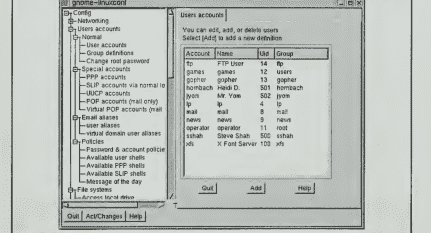

图 5-1. LinuxConf 的打开窗口。

### 添加用户

要添加用户，请先点击窗口底部的 Add 按钮。这将按照图 5-2 所示改变窗口。

除了包含单词 (opt)（表示可选）的字段外，所有字段都必须填写。这包括新账户的登录名和用户的真实姓名。所有其他字段都有关联的默认值。这些参数对应于 `useradd` 程序中的条目。

除了基本用户参数外，LinuxConf 允许你设置一些关于用户访问某些应用程序的权限以及电子邮件设置的参数（如果用户需要将电子邮件转发到另一个地址）。这些选项可通过窗口中的选项卡访问。图 5-3 显示了 Privileges（权限）选项卡。

在你按照喜好设置好参数后，点击窗口底部的 Accept 按钮。下一个窗口会要求你设置用户的初始密码。一旦密码设置完成，你将返回到现有用户列表，其中包含了你的新添加项。

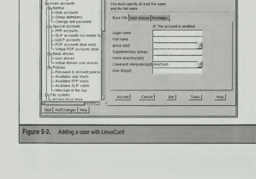

图 5-2. 使用 LinuxConf 添加用户

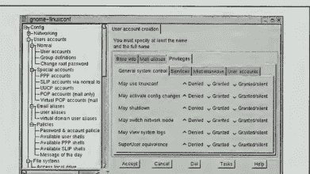

图 5-3. 使用 LinuxConf 添加用户时的 Privileges 选项卡。

### 修改用户

修改用户设置非常简单。在 LinuxConf 的打开窗口中，选择你希望修改设置的用户。你会看到一个与图 5-4 所示类似的窗口，它看起来像添加用户设置，但已完全填写。窗口中的所有字段均可修改。在所有修改完成后，点击 Accept。

> **注意：** 请记住，在更改用户的登录名或 UID 之前，确保该用户未登录或未运行任何进程。

### 删除用户

要删除用户，请按照图 5-1 所示，从用户列表中点击用户名。一旦看到用户信息，你应该会注意到窗口底部有一个标有 Del 的按钮。点击此按钮即可开始账户移除过程（图 5-5）。

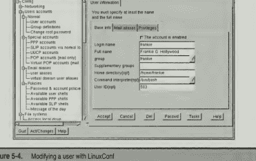

图 5-4. 使用 LinuxConf 修改用户

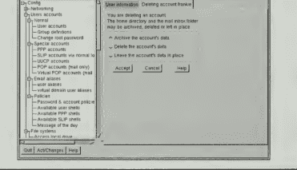

图 5-5. 使用 LinuxConf 删除用户

一旦你决定了如何处理该用户的主目录，点击 Accept 以返回用户列表。如果你选择归档用户的主目录，可以在 `/home/oldaccounts` 目录中找到一个包含数据的压缩 tar 文件（gzipped tar file）。

### 添加组

要添加新组，请点击 LinuxConf 打开窗口左侧的 Group Definitions（组定义）。这将在窗口右侧显示当前组的列表（图 5-6）。

如果你点击 Add 按钮，你会看到一个窗口，你可以在其中填写要创建的新组名称。虽然窗口显示多个字段，但唯一的必填项是你想创建的组名称。其他所有项目都有系统会为你提供的有效默认值。完成后，点击 Accept，你将返回到组列表，其中应包含你新添加的组。

### 修改组

与修改用户类似，要修改组，只需从组列表中选择要编辑的组名称，打开一个类似于添加组窗口的窗口。这次字段将填写该组的现有值。只需更改你想更改的字段并点击 Accept，更改即可生效。

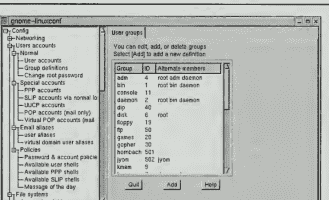

图 5-6. 使用 LinuxConf 添加组

### 删除组

要删除组，请从图 5-6 所示的组列表中选择该组。你会看到组的详细信息，其下方将包含一个标有 Del 的按钮。点击 Del 打开一个屏幕，要求你确认你的决定。点击 Yes，你将看到组列表，其中已减去你刚刚删除的组。

## SETUID 和 SETGID 程序

通常，当用户运行程序时，该程序继承用户拥有的所有权限（或缺乏的权限）。如果用户无法读取 `/var/log/messages` 文件，程序也无法读取。注意，此权限可能与拥有程序文件（通常称为二进制文件）的用户权限不同。例如，程序 `ls`（用于生成目录列表）归 root 用户所有。其权限设置使得系统的所有用户都可以读取该程序。例如，如果用户 ssh 运行 `ls`，该 `ls` 实例绑定的是授予用户 ssh 的权限，而不是 root 的权限。

然而，有一个例外。程序可以被标记为所谓的 `SetUID` 位，这允许程序以程序所有者的权限运行，而不是以运行该程序的用户权限运行。再次以 `ls` 为例，在其上设置 `SetUID` 位并使文件归 root 所有，意味着如果用户 ssh 运行 `ls`，该 `ls` 实例将以 root 权限运行，而不是以 ssh 的权限运行。`SetGID` 位的工作原理相同，区别在于它不是应用于文件的所有者，而是应用于文件的组设置。

要启用 `SetUID` 位或 `SetGID` 位，你需要使用 `chmod` 命令，该命令在第 6 章中有详细说明。要使程序具有 `SetUID` 权限，请在即将分配的权限值前加上前缀 4。要使程序具有 `SetGID` 权限，请在即将分配的权限值前加上前缀 2。例如，要使 `/bin/ls` 成为 `SetUID` 程序（顺便说一句，这是坏主意），你会输入：

```
[root@ford /root]# chmod 4755 /bin/ls
```

## 当文件没有所有者时

本节的标题有点误导性。无论何种情况，文件总是有所有者的。更准确的标题应该是：“当文件所有者的 UID 无法映射到 `/etc/passwd` 文件中的条目时”——但我的编辑反对这样做。

当用户被创建时，它会获得一个新的且唯一的 UID。该用户创建的任何文件都由该用户所有。为了简单起见，Linux 不使用用户名，而是使用 UID 来表示文件所有权。然后系统使用 `/etc/passwd` 文件在用户的 UID 和登录名之间进行映射，以便 `ls` 可以生成更具人类可读性的目录列表。

那么，当一个用户从 `/etc/passwd` 文件中移除，但仍存在由他拥有的文件时，会发生什么？实际上没有什么特别的事情。最明显的影响是当你执行相关文件的目录列表时。它不会显示所有者


文件的，它会显示一个数字。这个数字代表拥有此文件的 UID。如果创建一个新用户，其 UID 与旧用户的 UID 相同，那么显示的拥有者将是相同的 UID，从而看起来像是新用户拥有了该文件。由于这种行为，在删除用户账户时，确保删除该用户拥有的所有文件非常重要。

## 摘要

本章阐述了 Linux 下用户的本质。这里阅读到的许多内容也适用于 UNIX 的其他变体，这使得在不同 UNIX（而非 NT/UNIX）的异构环境中管理用户变得更容易。

涵盖的最重要问题包括：

- 每个用户拥有一个唯一的 UID
- 每个组拥有一个唯一的 GID
- /etc/passwd 文件将 UID 映射到用户名
- Linux 通过多种方式处理加密密码
- Linux 包含帮助管理员管理用户的工具
- 如果你决定编写自己的工具来管理用户数据库，现在你会理解其格式

对于从 Windows 95/98/NT 环境过来的管理员来说，这些变化相当显著，起初可能有点棘手。不过不用担心，UNIX 安全模型相当直观，你应该很快就能熟悉其运作方式。

如果亲自构建工具来管理用户这一想法吸引你，务必查阅关于 Perl 脚本语言的相关书籍。它非常适合操作表格数据（如 /etc/passwd 文件）。凭借其网络功能和对 NT 的支持，Linux 甚至允许你构建一个跨平台的 adduser 工具，不仅可以创建和设置 UNIX 账户，还可以创建 NT 账户。鉴于市面上有如此多的 Perl 书籍，每本侧重点略有不同，并假设读者具有不同程度的编程背景，因此很难推荐某一本特定的书。花点时间在当地书店翻阅几本书吧。

### 第 6 章

命令行


随着时间的推移，正是 UNIX 的命令行选项赋予了系统强大的功能和灵活性。UNIX 高手的随意观察者常常惊讶于几条精心输入的命令所带来的结果。不幸的是，这使得 UNIX 对普通用户来说不够直观。因此，图形用户界面（GUI）已成为许多 UNIX 工具的事实标准。

然而，更有经验的用户发现，GUI 很难呈现所有可用选项。通常，这样做会使界面变得与命令行等效物一样复杂。GUI 设计往往过于简化，最终有经验的用户会回归到命令行全面的功能上。

> **提示：** 在你开始争论哪种界面更好之前，请记住两种类型的界面都有其用途。每种界面都有其弱点和优势。最终，选择精通两种方法的人将占据优势。

在我们开始学习 Linux 下的命令行界面之前，请理解本章远非详尽的资源。我们没有试图深入覆盖所有工具，而是选择详细描述我们认为对日常工作最为关键的少数工具。


> **注意：** 在本章中，我们假设你以非 root 用户身份登录并启动了 X Windows 环境。如果你正在使用 GNOME 环境（这是最新版本的 Red Hat Linux 的默认行为），你可以启动“X-terminal”。点击屏幕左下角的 GNOME 图标，选择 Utilities，然后选择 Color Xterm。在本章中输入的所有命令都应键入在选定 Color Xterm 后出现的窗口中。

## BASH 简介

在第 5 章中，我们了解到用户密码条目参数之一是登录 shell，这是用户登录工作站时运行的第一个程序。shell 类似于 Windows 程序管理器，不同之处在于 shell 程序使用的是，当然，任意的。

Shell 只是一个提供系统接口的程序。特别是 BASH（Bourne Again）shell 是一个仅包含命令行的接口，包含一些内置命令、启动其他程序的能力，以及控制从其中启动的程序的权限（作业控制）。你可以将其想象成加强版的命令提示符（com）或 Cmd。

存在各种 shell，大多数具有相似的功能，但实现方式不同。再次为了比较的目的，你可以将各种 shell 想象成各种 Web 浏览器；在几种不同的浏览器中，基本功能是一样的——显示来自 Web 的内容。在任何类似的情况下，每个人都声称自己的 shell 比其他的好，但归根结底，这真的取决于个人偏好。

在本节中，我们将检查 BASH 的一些内置命令。关于 BASH 的完整参考本身就可以写成一本书，因此我们将坚持那些对系统管理员日常操作影响最大的命令。不过，我确实建议你最终学习 BASH 的操作。关于这一主题的优秀书籍并不缺乏。

### 作业控制

在 BASH 环境中工作时，你可以从同一个提示符启动多个程序。每个程序都是一个作业。每当启动一个作业时，它会接管*终端*。（这是对实际使用哑终端（如 VT-100 和 Wyse-50）与机器接口的年代的回顾。）在今天的机器上，*终端* 是你启动机器时看到的纯文本界面，或者是 BASH 运行的 X Windows 系统创建的窗口。如果一个作业控制*终端*，它可以发出控制代码，使纯文本界面（例如 Pine 邮件阅读器）更具吸引力。程序完成后，它将完全控制权交还给 BASH，并重新显示提示符供用户使用。

然而，并非所有程序都需要这种终端控制。有些程序，包括通过 X Windows 系统与用户交互的程序，可以构建为放弃终端控制，允许 BASH 呈现用户提示符，即使被调用的程序仍在运行。在以下示例中，Netscape Navigator 接收这样的指令，通过 `&` 后缀呈现：

```
[root@ford /root]# netscape &
```

在你按下 ENTER 之后，BASH 将立即呈现提示符。这称为*后台化*任务。

如果一个程序正在运行并控制*终端*，你可以通过在终端窗口中按 CTRL-Z 让程序放弃控制。这将完全停止正在运行的作业并将控制权交还给 BASH，以便你可以输入新命令。

在任何时候，你都可以通过输入以下命令来了解 BASH 正在跟踪多少个作业：

```
[root@ford /root]# jobs
```

列出的正在运行的程序将处于两种状态之一：*运行中* 或 *已停止*。如果作业已停止，你可以将其在后台启动运行，从而允许你保持对*终端* 的控制。或者，已停止的作业可以在前台运行，这将*终端* 的控制权交还给该程序。

> **注意：** 你无法后台化需要通过终端窗口进行交互的任务。

## 环境变量

环境变量的概念在 UNIX 下与在 Windows NT 下相同；唯一的区别在于它们如何设置、查看和删除。

### 打印环境变量

要列出所有环境变量，请使用 `printenv` 命令。例如：

```
[root@ford /root]# printenv
```

要显示特定的环境变量，请将变量作为参数指定给 `printenv`。例如，以下是查看环境变量 OSYPE 的命令：

```
[root@ford /root]# printenv OSYPE
```

### 设置环境变量

要设置环境变量，请使用以下格式：

```
[root@ford /root]# variable=value
```

其中 *variable* 是变量名，*value* 是你想要分配给变量的值。例如，以下是设置环境变量 FOO 的值为 BAR 的命令：

```
[root@ford /root]# FOO=BAR
```

一旦设置值，请使用 `export` 命令进行最终确认。export 命令的格式如下：

```
[root@ford /root]# export variable
```

其中 *variable* 是变量的名称。在设置 FOO 的示例中，我们将输入

```
[root@ford /root]# export FOO
```

> **提示：** 你可以将设置环境变量的步骤与 export 命令结合起来，如下所示： `[root@ford /root]# export FOO=BAR`


如果要设置的环境变量值包含空格，请用引号将该变量括起来。以上述示例为例，要将 FOO 设置为“Welcome to the BAR of FOO”，我们需要输入

```
[root@ford /root]# export FOO="Welcome to the BAR of FOO"
```

## 取消设置环境变量

若要移除一个环境变量，请使用 **unset** 命令：

```
[root@ford /root]# unset variable
```

其中 **variable** 是你想要移除的变量名。例如，以下是移除环境变量 FOO 的命令：

```
[root@ford]# unset FOO
```

## 管道（Pipes）

管道是一种机制，它可以将一个程序的输出作为另一个程序的输入。可以将单个程序串联起来，组成极其强大的工具。

让我们使用 grep 程序来提供一个管道使用的简单示例。给定一个输入流，grep 工具会尝试匹配传递给它的参数，并只显示匹配的行。例如，如果我们想查找所有包含字符串“OSTYPE”的环境变量，我们可以输入以下命令：

```
[root@ford /root]# printenv | grep "OSTYPE"
```

竖线字符（|）代表 **printenv** 和 **grep** 之间的管道。

Windows 下的命令 shell 也利用管道功能。主要区别在于，Linux 管道中的所有命令都是并发执行的，而 Windows 则按顺序运行每个程序，并使用临时文件来保存中间结果。

## 重定向（Redirection）

通过*重定向*，我们可以将程序的输出自动发送到文件中。此过程由 shell 而非程序本身处理，从而提供了一种执行此任务的标准机制。（使用重定向比记住每个程序如何执行此任务要容易得多！）

重定向分为三类：输出到文件、追加到文件以及将文件作为输入。

要将程序的输出收集到文件中，请在命令行的末尾加上大于号符号 (>) 以及你想将输出重定向到的文件名。例如，以下是将目录列表的输出收集到名为 /tmp/directory_listing 的文件中的命令：

```
[root@ford /root]# ls > /tmp/directory_listing
```

如果你正在重定向到一个现有文件并且希望向其中追加额外数据，请使用两个连续的 > 符号 (>>) 后跟文件名。继续以目录列表为例，我们可以通过输入以下命令将字符串“Directory Listing”追加到 /tmp/directory_listing 文件的末尾：

```
[root@ford /root]# echo “Directory Listing” >> /tmp/directory_listing
```

重定向的第三类，即使用文件作为输入，是通过使用小于号符号 (<) 后跟文件名来实现的。例如，以下是将 /etc/passwd 文件输入到 grep 程序的命令：

```
[root@ford /root]# grep 'root' < /etc/passwd
```

# BASH 命令行快捷方式

从命令行工具（如 command.com）转向命令行接口时的困难之一，就是在一个拥有众多快捷方式的 shell 中工作。如果你不仔细，这些“改进”可能会让你感到惊讶。本节解释了这些快捷方式中最常见的几种及其行为。

## 文件名扩展

在 BASH 等基于 UNIX 的 shell 中，命令行上的通配符在作为参数传递给应用程序之前会被扩展。这与基于 DOS 的工具的默认运行模式形成鲜明对比，后者通常必须执行自己的通配符扩展。UNIX 方法也意味着你必须小心使用通配符字符。

BASH shell 中的通配符字符本身与 command.com 中的相同：星号 (*) 匹配所有文件名，问号 (?) 匹配单个字符。如果你因为某种原因需要将这些字符作为其他参数的一部分使用，你可以通过在前面加反斜杠 (\) 字符来转义它们。这将导致 shell 将星号和问号解释为普通字符，而不是通配符。

## 环境变量作为参数

在 BASH 中，你可以在命令行上使用环境变量作为参数。（虽然 command.com 也支持这样做，但这并不是一种常见做法，因此常常被遗忘的惯例。）例如，发出参数 $POO 将导致 Poo 环境变量的值被传递，而不是字符串“$POO”。

## 多条命令

在 BASH shell 中，可以使用分号 (;) 分隔命令，从而在同一行上执行多条命令。例如，要在同一行上执行以下命令序列

```
[root@ford /root]# ls -l
[root@ford /root]# cat /etc/passwd
```

你可以改为输入以下内容：

```
[root@ford /root]# ls -l ; cat /etc/passwd
```

## 反引号

哇，这太野了：你可以将一个程序的输出作为另一个程序的参数。听起来很奇怪？好吧，习惯就好——这是所有 UNIX shell 中最有用且最具创新性的功能之一。

反引号 (\`) 允许你将命令嵌入到其他命令的参数中。你会经常看到本书中使用这种技术，将一个文件中的数字取出并将其作为参数传递给 kill 命令。当 DNS 服务器 named 需要被终止时，就会发生这种典型情况。当 named 启动时，它会将其进程标识符写入文件 /var/run/named.pid。因此，终止 named 进程的通用方法是使用 cat 命令查看 /var/run/named.pid 中的数字，然后使用该值发出 kill 命令。例如：

```
[root@ford /root]# cat /var/run/named.pid
253
[root@ford /root]# kill 253
```

以这种方式终止 named 进程的一个问题是它无法自动化——我们要依赖人类读取 /var/run/named.pid 中的值并告知 kill 该数字。另一个问题与其说是麻烦，不如说是困扰：停止 DNS 服务器需要两个步骤。

然而，使用反引号，我们可以将步骤合并为一个，并以可自动化的方式完成。反引号版本看起来像这样：

```
[root@ford /root]# kill `cat /var/run/named.pid`
```

当 BASH 看到这条命令时，它首先会运行 cat /var/run/named.pid 并存储结果。然后它会运行 kill 并将存储的结果传递给它。从我们的角度来看，这一切在一步优雅的操作中完成。

> **注意：** 在本章中，到目前为止，我们查看的是 BASH shell 内部的功能。本章的其余部分探讨了可在 BASH 外部访问的几个常见命令。

# 文档工具

Linux 带有两个极其有用的工具，使文档更易于访问：man 和 info。目前，这两个文档系统之间存在大量重叠，因为许多应用程序正在将文档迁移到 info 格式。这种格式被认为优于 man，因为它允许以类似网页的方式将文档超链接在一起，而不必实际使用 HTML 格式编写。

另一方面，man 格式已经存在了几十年。对于成千上万的实用工具，它们的 man 页面是其唯一的文档。此外，许多应用程序继续使用 man 格式，因为许多其他类 UNIX 操作系统（如 Sun Solaris）使用 man 格式。

man 和 info 文档系统将在未来很长一段时间内存在。我强烈建议你熟悉这两个系统。

## man 命令

我们在本书早期提到过，man（manual 的缩写）页面是在线文档，涵盖工具的使用及其相应的配置文件。man 命令的格式如下：

```
root@ford /root]# man program_name
```

其中 program_name 标识你感兴趣的程序。例如：

```
root@ford /root]# man ls
```

在阅读有关 Unix 和与 UNIX 相关的信息源（新闻组等）时，你可能会遇到跟在数字括号后的命令引用——例如，1a(1)。该数字代表手册页面的部分（见表 6-1）。每个部分涵盖不同的主题领域，以适应某些工具（如 print）既是 C 编程语言中的命令又是命令行命令的事实。

要引用特定的 man 部分，只需将部分号作为第一个参数，将命令作为第二个参数指定即可。例如，要获取有关 print 的 C 程序员信息，你可以输入：

```
root@ford /root]# man 3 print
```

要获取命令行信息，你可以输入：

```
root@ford /root]# man 1 print
```

默认情况下，最低的部分号会首先打印。

不幸的是，这种组织有时难以使用。你可能会发现使用为此文档库开发的图形界面很有帮助，它是 GNOME 项目的一部分；它被称为 gnome-help-browsing。寻找这个 inter


| 手册章节 | 主题 |
| :----------- | :------------ |
| 1 | 用户工具 |
| 2 | 系统调用 |
| 3 | C 库调用 |
| 4 | 设备驱动程序信息 |
| 5 | 配置文件 |
| 6 | 游戏 |
| 7 | 软件包 |
| 8 | 系统管理工具 |

表 6-1. 手册页章节

面对屏幕底部的工具栏，或者屏幕左下角的菜单选择。如果你没有这个图标，你始终可以自己通过终端窗口启动它：
`[root@ford /root]$ gnome-help-browser`

> 提示：`man` 命令的一个实用选项是在命令参数前加上 `-k`。使用此选项时，`man` 将搜索所有手册页的摘要信息，并列出与你指定命令匹配的页面及其章节编号。例如：
> `[root@ford /root]$ man -k printf`

## texinfo 系统

另一种常见的文档形式是 texinfo。texinfo 已被确立为 GNU 标准，它是一种类似于超链接万维网格式的文档系统。由于文档可以相互进行超链接，texinfo 通常更易于阅读、使用和搜索。

若要阅读有关特定工具或应用程序的 texinfo 文档，请使用指定工具名称作为参数调用 `info`。例如，若要阅读关于 `emacs` 的内容，请键入：
`[root@ford /root]$ info emacs`

通常，在使用 `info` 之前，你希望确认手册页是否存在（因为手册格式中可用的信息仍然比 texinfo 多得多）。另一方面，某些手册页会明确指出 texinfo 页面更具权威性，应当阅读它们。

## 文件列表、所有权和权限

在 Linux 下管理文件与在 Windows NT 下管理文件不同，并且与在 Windows 95/98 下管理文件有着根本的不同。在本节中，我们将讨论 Linux 的基本文件管理工具。我们将首先介绍一些有用的通用命令的具体细节，然后退后一步，查看一些背景信息。

### 列出文件：ls

**ls** 命令用于列出目录中的所有文件。在 26 多个可用选项中，这里列出的是最常用的。这些选项可以以任何组合使用。请参见 *texinfo* 页面以获取完整列表。

| **ls 选项** | **描述** |
|:---|:---|
| -l | 长列表格式。除了文件名外，还显示文件大小、日期/时间、权限、所有权和组信息。 |
| -a | 所有文件。显示目录中的所有文件，包括隐藏文件。隐藏文件的名称以句点开头。 |
| -1 | 单列列表格式。 |
| -R | 递归列出所有文件和子目录。 |

要以长列表格式列出目录中的所有文件：

```
[root@ford /root]# ls -1a
```

要列出以 A 开头的目录中的非隐藏文件：

```
[root@ford /root]# ls A*
```

### 文件和目录的类型

在 Linux（以及一般的 UNIX）下，几乎一切都抽象为文件。最初这样做是为了简化程序员的工作。应用程序无需直接与设备驱动程序通信，而是使用特殊文件（对应用程序而言看起来像普通文件）作为桥梁。几种类型的文件满足了所有这些文件用途。

### 普通文件

普通文件就是普通的文件。它们包含数据或可执行文件，操作系统对其内容不做任何假设。

### 目录

目录文件是普通文件的一个特殊实例。目录文件列出了其他文件的位置，其中一些可能是其他目录。通常，目录文件的内容……

文件对于你的日常操作并不重要，除非你需要自行打开并读取文件，而不是使用现有应用程序来导航目录。（这类似于直接读取 DOS 文件分配表，而不是使用 command.com 来导航目录，或使用 findfirst\findnext 系统调用。）

### 硬链接

Linux 文件系统文件中的每个文件都有自己的 i 节点。i 节点跟踪文件的属性及其在磁盘上的位置。如果你需要使用两个独立的文件名引用同一个文件，你可以创建一个硬链接。硬链接将与原始文件具有相同的 i 节点，因此其外观和行为与原始文件完全相同。每创建一个硬链接，引用计数就会增加。当删除一个硬链接时，引用计数就会减少。只要引用计数没有达到零，文件就会保留在磁盘上。

请注意，硬链接不能存在于两个不同分区上的文件之间。这是因为硬链接引用的是原始文件的 i 节点，而文件的 i 节点在不同的文件系统之间可能不同。

### 符号链接

与通过 i 节点指向文件的硬链接不同，符号链接通过文件名指向另一个文件。这使得符号链接（通常缩写为 symlinks）可以指向位于其他分区甚至其他网络驱动器上的文件。

### 块设备

由于所有设备驱动程序都通过文件系统访问，块设备类型的文件用于与磁盘等设备进行接口。块设备文件有三个识别特征：它有一个主要编号，一个次要编号，并且在使用 `ls -l` 命令查看时，权限的第一个字符显示为 b。例如：

```
[root@ford /root]# ls -l /dev/hda
brw-rw--- 1 root disk 3, 0 May 5 1998 /dev/hda
```

请注意文件权限开头的 b；3 是主要编号，0 是次要编号。

块设备文件的主要编号标识所代表的设备驱动程序。当访问此设备时，次要编号作为参数传递给设备驱动程序，告知它正在访问的是哪个设备。例如，如果有两个串行端口，它们将共享相同的设备驱动程序，因此具有相同的主要编号，但每个串行端口将具有唯一的次要编号。

### 字符设备

与块设备类似，字符设备是允许你通过文件系统访问设备的特殊文件。块设备和字符设备之间的明显区别在于，块设备以大块形式与实际设备通信，而字符设备则一次处理一个字符。（硬盘是块设备；调制解调器是字符设备。）

字符设备的权限以 c 开头，并且文件具有主要编号和次要编号。例如：

```
[root@ford /root]# ls -l /dev/ttyS0
crw------- 1 root tty 4, 64 May 5 1998 /dev/ttyS0
```

### 命名管道

命名管道是一种特殊类型的文件，允许进程间通信。使用 `mkfifo` 命令（本章稍后讨论），你可以创建一个命名管道文件，一个进程可以打开它进行读取，另一个进程可以打开它进行写入，从而使两者能够相互通信。当程序拒绝从命令行管道接收输入，但另一个程序需要向该程序提供数据，且你没有磁盘空间创建临时文件时，这种方式特别有效。

对于命名管道文件，其文件权限的第一个字符是 p。例如：

```
[root@ford /root]# ls -l mypipe
prw-r--r-- 1 root root 0 Jun 16 10:47 mypipe
```

### 更改所有权：chown

`chown` 命令允许你将文件的所有权更改给其他人。只有 root 用户可以执行此操作。（普通用户不能“赠送”文件所有权，也不能从其他用户那里“窃取”所有权。）该命令的格式如下：

```
[root@ford /root]# chown [-R] username filename
```

其中 username 是你想要分配所有权的用户的登录名，filename 是指定文件的名称。filename 也可以是一个目录。

当指定的文件名是目录名时，适用 `-R` 选项。此选项指示命令递归遍历目录树，并将新的所有权不仅应用于目录本身，还应用于其中的所有文件和目录。

### 更改组：chgrp

`chgrp` 命令行实用程序允许你更改文件的组设置。它的工作原理与 `chown` 非常相似。其格式如下：

```
[root@ford /root]# chgrp [-R] groupname filename
```


## 更改模式：chmod

权限分为四个部分。

- 第一部分由权限字符串的第一个字符表示。“普通”文件没有特殊值，用连字符（-）表示。如果文件具有特殊属性，则用字母表示。这里我们最关注的两个特殊属性是目录（d）和符号链接（l）。
- 权限的第二、第三和第四部分由三字符一组来表示。第一部分指示文件所有者的权限。第二部分指示组权限。最后一部分指示世界权限。在 UNIX 上下文中，“世界”指的是系统中的所有用户，无论其组设置如何。

以下是用于表示权限的字母及其对应的值。当组合属性时，将它们的值相加。**chmod** 命令用于设置权限值。

| 字母 | 权限 | 值 |
|---|---|---|
| r | 读 | 4 |
| w | 写 | 2 |
| x | 执行 | 1 |

尽管 **chmod** 确实拥有更“易读”的权限格式，但理解编号方案很重要，因为它在编程中被使用。此外，并非所有人都使用字母名称方案。通常假设，如果你理解文件权限，你也会理解其数值含义。

以下是三种权限最常见的组合。其他组合，例如 -wx，确实存在但很少使用。

| 字母 | 值 | 权限 |
|---|---|---|
| --- | 0 | 无权限 |
| r-- | 4 | 只读 |
| rw- | 6 | 读写 |
| rwx | 7 | 读、写和执行 |
| r-x | 5 | 读和执行 |
| -x | 1 | 仅执行 |

对于每个文件，这三个三字母片段组合在一起。第一个片段表示文件所有者的权限；第二个片段表示文件组的权限；最后一个片段表示系统中所有用户的权限。表 6-2 描述了一些常见的文件权限设置。

| 权限 | 数字等效值 | 描述 |
|:---|:---|:---|
| -rw------- | 600 | 所有者具有读和写权限。通常用于大多数文件。 |
| -rw-r--r-- | 644 | 所有者具有读和写权限；组和世界只有读权限。确保你希望让其他人读此文件。 |
| -rw-rw-rw- | 666 | 每个人都有读和写权限。不推荐；这种组合允许任何人、任何地方访问和更改文件。 |
| -rwx------- | 700 | 所有者具有读、写和执行权限。对于所有者希望运行的程序（编译 C 或 C++ 程序生成的文件），这是最佳组合。 |
| -rwxr--r-x | 755 | 所有者具有读、写和执行权限。其他人具有读和执行权限。 |
| -rwxrwxrwx | 777 | 每个人都有读、写和执行特权。与 666 设置类似，应避免这种组合。 |
| -rwx--x--x | 711 | 所有者具有读、写和执行权限；其他人只有执行权限。对于希望让他人运行但不希望他人复制的程序非常有用。 |
| drwx------ | 700 | 这是一个通过 mkdir 命令创建的目录。只有所有者可以读和写此目录。注意：所有目录都必须设置可执行位。 |
| drwxr-xr-x | 755 | 只有所有者可以更改此目录，但其他人可以查看其内容。 |
| drwx--x--x | 711 | 这是一个方便的组合，用于保持目录世界可读，但限制通过 ls 命令访问。只有知道文件名的某个人才能读取文件。 |

## 文件管理和操作

本节涵盖管理文件和目录的基本命令行工具。对于任何使用过命令行界面的人来说，这些内容都将很熟悉。功能相同，但执行命令不同。

### 复制文件；cp

**cp** 命令用于复制文件，并且有许多选项。有关详细信息，请参阅 man 页面。默认情况下，此命令静默运行，仅在发生错误条件时显示状态信息。以下是 **cp** 最常见的选项。

| cp 的选项 | 描述 |
| :--- | :--- |
| -f | 强制复制；不请求验证 |
| -i | 交互式复制；在每个文件复制之前，与用户验证 |

要将 *index.html* 复制到 *index-orig.html*：

```
[root@ford /root]# cp index.html index-orig.html
```

要交互式地将所有以 *.html* 结尾的文件复制到 */tmp* 目录：

```
[root@ford /root]# cp -i *.html /tmp
```

### 移动文件；mv

**mv** 命令用于将文件从一个位置移动到另一个位置。也可以跨分区移动文件。这需要执行复制操作，因此移动命令可能需要更长时间。以下是 **mv** 最常见的选项。

| 选项 | 描述 |
| :--- | :--- |
| -f | 强制移动 |
| -i | 交互式移动 |

要将文件从 */usr/src/myprog/bin/* 移动到 */usr/bin*：

```
[root@ford /root]# mv /usr/src/myprog/bin/* /usr/bin
```

没有明确的改名工具，因此我们可以使用 **mv**。要将 */tmp/blah* 重命名为 */tmp/bleck*：

```
[root@ford /root]# mv /tmp/blah /tmp/bleck
```

### 链接文件：ln

`ln` 命令允许你建立硬链接和软链接。（参见本章前面的“文件和目录类型”。）`ln` 的一般格式如下：

```
[root@ford /root]# ln original_file new_file
```

尽管 `ln` 有许多选项，但你几乎永远不需要使用其中大多数。最常见的选项 `-s` 创建符号链接而不是硬链接。

要创建一个符号链接，使 `/usr/bin/myadduser` 指向 `/usr/local/bin/myadduser`：

```
[root@ford /root]# ln -s /usr/local/bin/myadduser /usr/bin/myadduser
```

### 查找文件：find

`find` 命令允许你根据各种条件搜索文件。就像我们已经讨论过的工具一样，`find` 有大量你可以在其 man 页面上阅读的选项。`find` 的一般格式如下：

```
[root@ford /root]# find start_dir [options]
```

其中 `start_dir` 是开始搜索的目录。表 6-3 显示了与 `find` 一起使用的最常见选项：

要查找 `/tmp` 中至少七天内未被访问的所有文件：

```
[root@ford /root]# find /tmp -atime 7 -print
```

要查找 `/usr/src` 中名为 core 的所有文件并删除它们：

```
[root@ford /root]# find /usr/src -name core -exec rm {} \;
```

要查找 `/home` 中以 .jpg 结尾且大小超过 100k 的所有文件：

```
[root@ford /root]# find /home -name "*.jpg" -size +100k
```

### 转换和复制文件：dd

`dd` 命令读取文件的内容并将其发送到另一个文件。使 `dd` 与 `cp` 不同的是，`dd` 可以对文件进行即时转换，并从磁带、软盘驱动器或其他设备接受数据。当 `dd` 访问设备时，它不对文件系统做任何假设，而是以原始格式拉取数据。因此，即使磁盘是外部格式，`dd` 也可以用于生成磁盘镜像。

| **find 的选项** | **描述** |
| :--- | :--- |
| `-mount` | 不搜索除开始搜索的文件系统之外的其他文件系统。 |
| `-atime n` | 文件至少在 n*24 小时前被访问过。 |
| `-ctime n` | 文件至少在 n*24 小时前被更改过。 |
| `-inum n` | 文件具有 i 节点 n。 |
| `-amin n` | 文件在 n 分钟前被访问过。 |
| `-cmin n` | 文件在 n 分钟前被更改过。 |
| `-empty` | 文件是空的。 |
| `-mmin n` | 文件在 n 分钟前被修改过。 |
| `-mtime n` | 文件在 n*24 小时前被修改过。 |
| `-nouser` | 文件的 UID 不对应于 /etc/passwd 中的真实用户。 |
| `-nogroup` | 文件的 GID 不对应于 /etc/group 中的真实组。 |
| `-perm mode` | 文件的权限确切设置为 *mode*。 |
| `-size n[ck]` | 文件至少有 n 个块/字符/千字节。一块等于 512 字节。 |
| `-print` | 打印找到的文件名。 |
| `-exec cmd\;` | 对找到的每个文件，执行 *cmd*。重要：务必在每个 *cmd* 后跟随 \; 字符，否则 BASH 会感到困惑。 |
| `-name name` | 文件的名称应为 *name*。你可以在此处使用正则表达式。 |


表 6-4 显示了 dd 的最常见参数。

要生成软盘的镜像（对外部文件格式特别有用）：

```
[root@ford /root]# dd if=/dev/fd0 of=/tmp/floppy_image
```


| 选项 | 描述 |
| :--- | :--- |
| `if=infile` | 指定输入文件为*infile*。 |
| `of=outfile` | 指定输出文件为*outfile*。 |
| `count=blocks` | 指定*blocks*为`dd`在停止之前应操作的块数。 |
| `ibs=size` | 将输入设备的块大小设置为*size*。 |
| `obs=size` | 将输出设备的块大小设置为*size*。 |
| `seek=blocks` | 在输出端跳过*blocks*个块。 |
| `skip=blocks` | 在输入端跳过*blocks*个块。 |
| `swab` | 将大端序输入转换为小端序，或者反之亦然。 |

> 表 6-4. dd 的常用参数

## 文件压缩：gzip

注意：`gzip` 与 PKZip 或 WinZip 的文件格式不通用；不过，WinZip 可以解压缩 `gzip` 文件。

在 UNIX 的早期发行版中，压缩文件的工具名为 `compress`。不幸的是，该算法被某人申请了专利，此人希望以此大赚一笔。大多数站点不愿支付专利费，因此寻找并找到了一种拥有无专利算法的替代压缩工具：`gzip`。更棒的是，`gzip` 通常能比 `compress` 获得更好的压缩率。

提示：文件扩展名通常可以识别用 `gzip` 压缩的文件。这些文件通常以 `.gz` 结尾（用 `compress` 压缩的文件以 `.Z` 结尾）。

最常与 `gzip` 一起使用的可选参数如下；完整列表请参阅 man 手册页。

| 选项 | 描述 |
| :--- | :--- |
| `-c` | 将压缩文件写入 `stdout`（从而允许输出通过管道传递给另一个程序） |
| `-d` | 解压缩 |
| `-r` | 递归查找所有应被压缩的文件 |
| `-9` | 最佳压缩 |
| `-1` | 最快压缩 |

注意，gzip 是“就地”压缩文件的，这意味着压缩过程完成后，原始文件会被删除，只剩下压缩后的文件。

要压缩一个文件然后解压缩它：

```
[root@ford /root]$ gzip myfile
[root@ford /root]$ gzip -d myfile.gz
```

要压缩所有以 .html 结尾的文件并使用尽可能高的压缩率：

```
[root@ford /root]$ gzip -9 *.html
```

## 创建特殊文件：mknode

如前所述，Linux 通过文件访问其所有设备。系统将某个文件理解为设备接口时，该文件必须是块设备或字符设备类型，并拥有主设备号和次设备号。要创建具有必要值的此类文件，您使用 `mknode` 命令。`mknode` 命令也可以用于创建命名管道。

命令格式如下：

```
[root@ford /root]$ mknode name type [maj|c] [minor]
```

其中 name 是文件名，type 可以是表示块设备的 b，表示字符设备的 c，或表示命名管道的 p。如果您选择创建块设备或字符设备（在安装需要该操作的设备驱动程序时），您需要指定主设备号和次设备号。随附该驱动程序的文档应该会告诉您主设备号和次设备号应使用什么值。

要创建一个名为 /tmp/mypipe 的命名管道：

```
[root@ford /root]$ mknode /tmp/mypipe p
```

## 创建目录：mkdir

Linux 中的 `mkdir` 与其他 UNIX 以及 MS-DOS 中的同名命令相同。唯一可用的选项是 `-p`，它会在父目录不存在时创建它们。例如，如果您需要创建 /tmp/bigdir/subdir/mydir，而当前仅存在 /tmp 目录，使用 `-p` 将自动创建 bigdir 和 subdir，以及 mydir。

要创建一个名为 mydir 的目录：

```
[root@ford /root]$ mkdir mydir
```

> **注意：** `rmkdir` 命令不像 DOS 中的那样可以简写为 `md`。

## 删除目录：rmdir

对于熟悉 DOS 版本该命令的人来说，`rmdir` 命令没有什么新奇的；它只是删除一个*现有的*目录。为该命令可用的唯一命令行参数是 *-p*，它也会删除父目录。例如，在一个名为 /tmp/bigdir/subdir/mydir 的目录中，如果您想删除从 bigdir 到 mydir 的所有目录，您可以单独发出此命令：

```
[root@ford /tmp]$ rmdir -p bigdir/subdir/mydir
```

要删除一个名为 *mydir* 的目录：

```
[root@ford /root]$ rmdir mydir
```

> **注意：** `rmdir` 命令不像 DOS 中的那样可以简写为 `rd`。

## 显示当前工作目录：pwd

您难免会遇到坐在一台已登录的工作站前，却不知道自己处于目录树的哪个位置的情况。要获取此信息，您需要 `pwd` 命令。它没有参数，其唯一任务就是打印当前工作目录。DOS 的等效操作是在命令行单独输入 `cd`；然而，BASH 的 `cd` 命令会带您回到主目录。

要获取当前工作目录，请使用：

```
[root@ford /src]$ pwd
/usr/local/src
```

## 磁带归档：tar

如果您熟悉 PKZIP 程序，那么您已习惯于压缩工具不仅减小文件尺寸，还将文件整合到压缩归档中。在 Linux 下，这个过程被分为两个工具：`gzip` 和 `tar`。

`tar` 程序将多个文件组合成一个大的文件。它与压缩工具分开，因此允许您选择使用哪种压缩工具，甚至是否使用压缩。此外，`tar` 能够像 `dd` 一样读写设备，这使得 `tar` 成为备份到磁带设备的良好工具。

注意：尽管 `tar` 程序的名字中包含 *tape*（磁带）一词，但在创建归档时并不一定需要读写磁带驱动器。实际上，在日常情况中（除备份外），您很少会使用 `tar` 配合磁带驱动器。

以下是 `tar` 命令的结构、其最常用选项以及几个使用示例：

```
[root@ford /root]# tar [commands and options] filename
```

| *tar* 的选项 | 描述 |
| :--- | :--- |
| -c | 创建新归档 |
| -t | 查看归档的内容 |
| -x | 提取归档的内容 |
| -f | 指定归档所在的文件（或设备）名称 |
| -v | 在操作过程中显示详细信息 |
| -z | 假设文件已（或将被）用 gzip 压缩 |

要创建一个名为 `apache.tar` 的归档，包含 `/usr/src/apache` 中的所有文件：  
`[root@ford /src]# tar -cf apache.tar /usr/src/apache`

要创建一个名为 `apache.tar` 的归档，包含 `/usr/src/apache` 中的所有文件，并在进行时显示发生的情况：  
`[root@ford /src]# tar -cvf apache.tar /usr/src/apache`

要创建一个名为 `apache.tar.gz` 的**gzip 压缩**归档，包含 `/usr/src/apache` 中的所有文件，并在进行时显示发生的情况：  
`[root@ford /src]# tar -cvzf apache.tar.gz /usr/src/apache`

要提取名为 `apache.tar.gz` 的**gzip** tar 归档的内容，并在进行时显示发生的情况：  
`[root@ford /root]# tar -xvzf apache.tar.gz`

## 拼接文件：cat

cat 程序起着一个极其简单的作用：显示文件。可以用它做更有创意的事情，但其几乎所有的用法都是简单显示文本文件的内容——很像 DOS 下的 type 命令。由于可以在命令行上指定多个文件名，因此可以将文件拼接成一个大而连续的文件。这与 tar 不同，结果文件没有显示不同文件边界的控制信息。

要显示 /etc/passwd 文件：

```
[root@ford /root]# cat /etc/passwd
```

要显示 /etc/passwd 文件和 /etc/group 文件：

```
[root@ford /root]# cat /etc/passwd /etc/group
```

要将 /etc/passwd 与 /etc/group 拼接并放入文件 /tmp/complete 中：

```
[root@ford /root]# cat /etc/passwd /etc/group > /tmp/complete
```

要将 /etc/passwd 文件追加到名为 /tmp/orb 的现有文件中：

```
[root@ford /root]# cat /etc/passwd >> /tmp/orb
```

## 一次显示一屏文件：more

more 命令的工作方式与 DOS 版本的程序非常相似。它获取一个输入文件并逐屏显示。输入文件可以来自其 stdin，也可以来自命令行参数。

虽然很少使用，但可以在 man 手册页中找到额外的命令行参数。

要逐屏查看 /etc/passwd 文件：

```
[root@ford /root]# more /etc/passwd
```

要逐屏查看由 ls 命令生成的目录列表：

```
[root@ford /root]# ls | more
```

## 磁盘使用情况：du

您经常需要确定磁盘空间在哪里以及被谁消耗，尤其是在空间紧张的时候！`du` 命令允许您基于目录来确定磁盘使用情况。以下是可用的部分选项：

| du 的选项 | 描述 |
| :--- | :--- |
| `-c` | 在运行结束时产生总计 |
| `-h` | 以人类可读的格式打印大小 |


## du 选项

- `-k` 以千字节为单位显示大小，而不是以块大小显示。（注意：在 Linux 系统中，一个块等于 1K，但这并非所有 UNIX 系统都如此。）
- `-s` 汇总：仅为每个参数打印一行输出。

要显示 /home 目录下每个目录占用的空间，并以人类可读格式展示：

```
[root@ford /root]# du -sh /home/*
```

## 显示文件的目录位置：which

which 命令搜索整个路径以查找命令行中指定的文件名。如果找到该文件，命令输出将包含文件的实际路径。此命令用于定位完全限定的路径。

要找出 ls 命令所在的目录：

```
[root@ford /root]# which ls
```

## 定位命令：whereis

whereis 工具搜索路径并显示程序的名称及其绝对目录、源文件（如果可用）以及该命令的手册页（同样，如果可用）。

要查找 grep 命令的程序、源代码和手册页的位置：

```
[root@ford /root]# whereis grep
```

## 磁盘空间：df

df 命令逐分区显示可用空间量。必须挂载驱动器/分区才能获取此信息。NFS 信息也可以以此方式收集。这里列出了一些 df 参数；较少使用的其他选项在 df 手册页中有说明。

| df 选项 | 描述 |
| --- | --- |
| `-h` 生成人类可读的可用空间数量，而不是可用块数。 |
| `-l` | 仅列出本地挂载的文件系统。不显示任何网络挂载文件系统的相关信息。 |

要显示所有本地挂载驱动器的可用空间：

```
[root@ford /root]# df -l
```

要以人类可读格式显示当前工作目录所在文件系统的可用空间：

```
[root@ford /root]# df -h .
```

要以人类可读格式显示 /tmp 所在文件系统的可用空间：

```
[root@ford /root]# df -h /tmp
```

## 同步磁盘：sync

与其他大多数现代操作系统一样，Linux 维护一个磁盘缓存以提高效率。缺点当然是，在任意时刻，并非所有你想要写入磁盘的数据都已写入磁盘。

要安排将磁盘缓存写入磁盘，你可以使用 `sync` 命令。如果 `sync` 检测到写入磁盘缓存的操作已经被安排，内核将被指示立即刷新缓存。此命令不接受任何命令行参数。

要确保磁盘缓存已被刷新：

```
[root@ford /root]# sync ; sync
```

# 进程操作

在 Linux（以及通常的 UNIX）系统中，每个正在运行的程序至少包含一个进程。从操作系统的角度来看，每个进程都是独立的，与其他进程互不干扰。除非它明确要求与其他进程共享资源，否则进程仅限于分配给它的内存和 CPU 资源。那些超出其内存分配的进程（这可能损坏其他正在运行的程序并使系统不稳定）会立即被终止。这种处理进程的方法极大地提高了 UNIX 系统的稳定性：用户应用程序无法损坏其他用户程序或操作系统。

本节介绍用于列出和操作进程的工具。它们是系统管理员日常工作中非常重要的组成部分。

## 列出进程：ps

`ps` 命令列出系统中所有的进程，包括其状态、大小、名称、所有者、CPU 时间、挂钟时间等更多信息。有许多可用的命令行参数，其中最常用的一些在表 6-5 中进行了描述。

**表 6-5. ps 的命令行参数**

| **选项** | **描述** |
| --- | --- |
| `-a` | 显示所有具有控制终端的进程，而不仅仅是当前用户的进程。 |
| `-r` | 仅显示正在运行的进程（参见本节后面关于进程状态的描述）。 |
| `-x` | 显示没有控制终端的进程。 |
| `-u` | 显示进程的所有者。 |
| `-f` | 显示进程之间的父子关系。 |
| `-l` | 生成长格式列表。 |
| `-w` | 显示进程的命令行参数（最多半行）。 |
| `-ww` | 显示进程的所有命令行参数，无论长度如何。 |

与 **ps** 命令一起使用的最常见参数组合是 **-axuwwo**。这些参数显示所有进程（无论是否有控制终端）、每个进程的所有者以及所有进程的命令行参数。让我们来看看运行 **ps -axuwwo** 的输出。

```
USER          PID  ACU   PMEM  VSS   S  STAT START     TIME COMMAND
root             1  0.0    0.3  1056  476 ?  S  Jun10  0:04 init
root             4  0.0    0.0    0    0 ?  Ss Jun10  0:00 [kthreapd]
root             5  0.0    0.0    0    0 ?  S  Jun10  0:00 [ksoftirqd/0]
root             6  0.0    0.0    0    0 ?  S  Jun10  0:00 [kswapd]
root             9  0.0    0.0    0    0 ?  Ss  Jun10 0:00 [mdrecoveryd/0]
root           102  0.0    0.2 1068 880 ?  S  Jun10  0:00 /usr/lib/egd/egd -p 10 -s 3
bin            233  0.0    0.2 1058 898 ?  S  Jun10  0:00 portmap
root           300  0.0    0.4  1272 840 ?  S  Jun10  0:00 x11xorg -0
root           311  0.0    0.5  1376 968 ?  S  Jun10  0:00 klogd
root           320  0.0    0.2  1132 284 ?  S  Jun10  0:00 /usr/krb5d/kad
root           339  0.0    0.4  1284 532 ?  S  Jun10  0:00 cron
root           357  0.0    0.3  1232 508 ?  S  Jun10  0:00 inetd
root           371  0.0    1.1  2538 1424 ? S  Jun10  0:00 named
root           385  0.0    0.4  1284 516 ?  S  Jun10  0:00 lpd
root           399  0.0    0.8  2384 116 ?  S  Jun10  0:00 telnetd
xfs            429  0.0    0.7  1988 928 ?  S  Jun10  0:00 xfs
root           467  0.0    0.2  1060 384 tty2 S  Jun10  0:00 /sbin/admgetty tty2
root           468  0.0    0.2  1060 384 tty3 S  Jun10  0:00 /sbin/admgetty tty3
root           469  0.0    0.2  1060 384 tty4 S  Jun10  0:00 /sbin/admgetty tty4
root           470  0.0    0.2  1060 384 tty5 S  Jun10  0:00 /sbin/admgetty tty5
```

输出的第一行提供了列表的列标题，如下所示：

- **USER** 进程的所有者。
- **PID** 进程标识号。
- **%CPU** 进程占用的 CPU 百分比。注意：对于多处理器系统，此列的总和可能超过 100%。
- **%MEM** 进程占用的内存百分比。
- **VSZ** 进程占用的虚拟内存量。
- **RSS** 进程占用的实际（常驻）内存量。
- **TTY** 进程的控制终端。此列中的问号表示进程不再连接到控制终端。
- **STAT** 进程的状态：
    - **S** 进程正在睡眠。所有准备好运行（即正在多任务处理，且 CPU 当前关注其他任务）的进程都将处于睡眠状态。
    - **R** 不可中断睡眠（通常与 I/O 相关）。
    - **D** 进程正在被调试器跟踪或已停止。
    - **T** 进程已成为“僵尸”。这意味着要么 (1) 父进程尚未使用 `wait` 系统调用确认其子进程的死亡，要么 (2) 父进程被不当 `killed`，在父进程完全 `killed` 之前，`init process`（第 9 章）无法回收子进程。僵尸进程通常表明软件编写不佳。

此外，每个进程的 STAT 条目可以具有以下修饰符之一：W = 内存中没有常驻页（L 已完全换出）；< = 高优先级进程；N = 低优先级任务；L = 内存中的页已锁定（通常表示需要实时功能）。

- **START** 进程启动的日期。
- **TIME** 进程在 CPU 上花费的时间量。
- **COMMAND** 进程的名称及其命令行参数。

## 显示进程的交互式列表：top

top 命令是 ps 的交互式版本。top 不会提供静态视图，而是每隔 2-3 秒（用户可调整）刷新屏幕，显示进程列表。从这个列表中，你可以重新调整进程优先级或终止它们。图 6-1 显示了 top 屏幕。

top 程序的主要缺点是它会占用大量 CPU。在繁忙的系统上，该程序往往会使系统管理问题变得复杂。用户开始运行 top 以查看当前状态，结果发现还有其他几个人也在运行该程序，这使系统速度变得更快（变慢）。

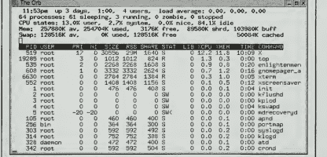

**图 6-1.** top 程序运行示例


默认情况下，`top` 被配置为可供所有人使用。根据您的环境，您可能需要谨慎行事，将 `top` 的使用权限限制为仅限 root 用户。要做到这一点，请使用以下命令修改该程序的权限：

```
[root@ford /root]# chmod 0700 /usr/bin/top
```

## 向进程发送信号：`kill`

该程序的名称具有误导性；它实际上并不终止进程。它所做的是向运行中的进程发送*信号*。操作系统默认为每个进程提供一组标准的*信号处理程序*，以处理传入的信号。从系统管理员的角度来看，最重要的处理程序是针对 9 号和 15 号信号的：即*终止*进程和*结束*进程。当调用 `kill -11` 时，它至少需要一个参数：从 `ps` 命令得出的进程标识号（PID）。当仅传入 PID 时，`kill` 会发送 15 号信号，即“终止进程”。某些程序会拦截此信号并执行一系列操作，以便它们可以干净地关闭。其他程序则只是停止运行。无论如何，`kill` 都不是确保进程停止的可靠方法。

### 信号

- `kill` 的可选参数是 `-n`，其中 `n` 代表一个信号号。
- 作为系统管理员，我们最感兴趣的是 9（终止）和 15（挂断）号信号。
- 终止信号 9 是停止进程的一种隐式方式。它不是请求进程停止，而是操作系统直接杀掉进程。唯一失败的情况是当进程正处于系统调用（例如请求打开文件）的过程中，在这种情况下，进程将在从系统调用返回后死亡。
- 挂断信号 1 是对 UNIX 的 VT100 终端时代的某种回顾。当用户的终端连接在会话中途断开时，该终端上所有正在运行的进程都会收到挂断信号（通常称为 SIGHUP 或 HUP）。这使进程有机会执行干净的关闭操作，或者在后台进程的情况下忽略该信号。如今，HUP 信号用于告知某些服务器应用程序去重新读取其配置文件（您将在后续章节中看到此操作的实例）。大多数应用程序只是忽略该信号。

### Kill 的安全问题

终止进程的权力显然是非常强大的，这使得安全预防措施变得至关重要。用户只能终止其拥有权限的进程。如果非 root 用户尝试向除其自身以外的进程发送信号，将会返回错误消息。root 用户是此限制的一个例外；root 可以向系统中的所有进程发送信号。这当然意味着 root 在使用 kill 命令时需要格外小心。

第 6 章：命令行

## 示例

要终止编号为 2059 的进程：

```
[root@ford /root]# kill 2059
```

要对编号为 593 的进程进行“几乎保证”的终止：

```
[root@ford /root]# kill -9 593
```

向 init 程序（其 PID 始终为 1）发送 HUP 信号：

```
[root@ford /root]# kill -1 1
```

## 杂项工具

以下工具不属于本章涵盖的任何特定类别。它们都对日常系统管理任务做出了重要贡献。

### 显示系统名称：uname

uname 程序会生成一些可能在不同情况下有帮助的系统详细信息。也许您已经远程登录了一台又一台不同的计算机，以至于忘记了自己身处何处！此工具对脚本编写者也有帮助，因为它允许他们根据系统信息更改脚本的路径。

以下是 uname 的命令行参数：

| uname 选项 | 描述 |
| :--- | :--- |
| -m | 打印机器硬件类型（例如，对于 Pentium Pro 及更高架构为 “i686”）。 |
| -n | 打印机器的主机名。 |
| -r | 打印操作系统的发行版名称。 |
| -s | 打印操作系统的名称。 |
| -v | 打印操作系统的版本。 |
| -a | 打印上述所有内容。 |

要获取操作系统的名称和发行版：

```
[root@ford /root]# uname -s -r
```

### 谁已登录：who

在允许用户登录其他用户的机器或特殊服务器的系统中，您需要知道谁已登录。您可以使用 who 命令生成此类报告：

```
[root@ford /root]# who
```

who 报告看起来像这样：

```
ssshah ttyp1 Jun 14 18:22
root pts/9 Jun 14 18:29 (:0)
root pts/11 Jun 14 21:12 (:0)
root pts/12 Jun 14 23:38 (:0)
```

### 切换用户：su

一旦您以某个用户身份登录到系统，无需注销并重新登录即可假设另一个身份（例如 root 用户）。相反，请使用 su 命令进行切换。该命令只有两个命令行参数，且两者均为可选的。不带任何参数运行 su 会自动尝试使您成为 root 用户。系统会提示您输入 root 密码，如果您输入正确，系统将切换到 root shell。如果您已经是 root 用户并希望切换到另一个 ID，在使用此命令时无需输入新密码。

例如，如果您以自己的身份登录并希望切换到 root 用户，请输入此命令：

```
[ssshah@ford ~]$ su
```

如果您以 root 用户登录并希望切换到用户 sshah，请输入此命令：

```
[root@ford /root]# su - sshah
```

可选的连字符（-）参数告诉 su 切换身份并运行该用户的登录脚本。例如，如果您以 root 用户登录并希望切换到具有所有登录和 shell 配置的用户 sshah，请输入此命令：

```
[root@ford /root]# su - sshah
```

## 编辑器

编辑器是常见工具中体积最大的，但也是最有用的。没有它们，对文本文件进行任何更改都将是一项艰巨的任务。无论您使用哪种 Linux 发行版，您都会获得一些编辑器。在您处理另一个问题之前，最好花几分钟时间熟悉一下它们。

> **注意：** 并非所有发行版都会附带此处列出的所有编辑器。

### vi

vi 编辑器自 20 世纪 70 年代起就已存在于基于 UNIX 的系统中，其界面也由此体现。vi 可以说是最早仍实际使用独立命令模式和数据输入模式的编辑器之一，因此大多数初学者都觉得使用它很不愉快。但在您对它置之不理之前，请花点时间无论如何都要熟悉它。在困难的情况下，您可能无法使用漂亮的图形化编辑器，而 vi 在所有 UNIX 系统中都随处可见。

Linux 发行版中附带的 vi 版本是 VIM（“VI Improved”）。它保留了使 vi 最初受欢迎的大量特性，并拥有在当今典型环境中很有用的许多功能（包括如果正在运行 X Windows 则提供图形界面）。

要启动 vi，只需输入

```
[root@ford /root]# vi
```

了解 vi 更多知识的最简单方法是启动它并输入“help”。

### emacs

有人争辩说 emacs 本身就是一个操作系统。它庞大、功能丰富、可扩展、可编程，并且全方位惊人。如果您来自 GUI 背景，一开始可能会发现 emacs 是一个令人愉悦的工作环境。表面上看，它的界面工作方式类似于 Notepad。在底层，它提供了 GNU 开发环境的完整接口、邮件阅读器、新闻阅读器、Web 浏览器，甚至还有一个精神病医生（好吧，不完全像）。

要启动 emacs，只需输入

```
[root@ford /root]# emacs
```

一旦 emacs 启动，您可以通过按 ESC-X 然后输入 doctor 来“访问”精神病医生。要获取使用 emacs 的帮助，请按下 CTRL-H。

### Joe

此处列出的编辑器中，Joe 最类似于简单的文本编辑器。它的工作方式很像 Notepad，并提供屏幕帮助。任何记得原始 WordStar 命令集的人都会惊喜地发现，所有那些紧抓着 CTRL-K 命令的脑细胞都可以在 Joe 中重新投入使用。

要启动 Joe，只需输入

```
[root@ford /root]# Joe
```

### Pico

Pico 是另一个受简洁性启发的编辑器。通常与 pine 邮件阅读系统配合使用，pico 也可以作为独立编辑器使用。与 Joe 一样，它可以以类似 Notepad 的方式工作，但 pico 使用其自己的一组键位组合。谢天谢地，所有可用的键位组合始终显示在屏幕底部。

要启动 pico，只需输入

```
[root@ford /root]# Pico
```

## 摘要

在本章中，我们通过 BASH shell 讨论了 Linux 的命令行界面。随着您继续阅读本书，您会发现许多对本章信息的引用，因此请确保您熟悉在命令行上工作。起初您可能会觉得这有点麻烦，特别是如果您习惯于使用 GUI 来执行此处提到的许多基本任务——但请坚持下去。您最终甚至可能发现自己在命令行上工作得比使用 GUI 更快！

显然，本章无法涵盖作为默认 Linux 安装的一部分可用的所有命令行工具。我强烈建议花一些时间查看一些可用的参考书，例如 *Linux in a Nutshell*（O’Reilly and Associates 出版），这本书提供了对 Linux 系统相当细节的较少的综合性处理方法。此外，还有大量关于 shell 编程的文本，处于不同级别并从不同角度出发。选择适合您的任何一本；即使您不进行系统管理，shell 编程也是一项非常值得学习的技能。


### 第 7 章

## 启动与关机

随着操作系统的日益复杂，启动和关机的过程也变得更加全面。任何经历过从基于纯 DOS 的系统向基于 Windows NT 的系统过渡的人，都亲自体验过这种转变——不仅核心操作系统会被加载和关闭，而且必须启动和停止一系列令人印象深刻的服务。与 Windows NT 类似，Linux 也包含一系列作为启动过程一部分而被启动的服务。

在本章中，我们将逐步介绍 Linux 环境的启动和关机过程。我们将讨论自动化此过程的脚本，以及过程中允许修改的部分。

> **警告：** 在真实系统上按照本章进行操作时，请大量运用常识。在尝试修改启动和关机脚本时，请记住，系统有可能进入无法通过重启恢复的非功能性状态。不要在生产系统上尝试新的流程；请备份您希望更改的所有文件；最重要的是，准备好启动盘，以防您进行了不可逆的更改。

# LILO

LILO 是 Linux Loader（Linux 加载器）的缩写，它是一款启动管理器。只要每个系统都位于自己的分区上，它就允许您启动多个操作系统。（在基于 PC 的系统中，启动分区还必须位于 1024 个磁柱的界限之内。）除了启动多个操作系统外，使用 LILO 您还可以选择各种内核配置进行启动。这在尝试内核升级但尚未正式采用之前特别有用。

LILO 的整体工作原理很简单：指定一个配置文件（`/etc/lilo.conf`），其中说明哪些分区是可启动的（如果分区是 Linux，则指定加载哪个内核）。当运行 `/sbin/lilo` 程序时，它会获取此分区信息，并用必要的代码重写引导扇区，以根据配置文件中的规定呈现选项。在启动时，会显示一个提示符（通常是 **LILO:**），您可以选择指定操作系统。（通常，在超时期之后会自动选择默认选项。）LILO 从所选分区加载必要的代码，并将完全控制权交给该分区。

> **注意：** 如果您熟悉 NT 的启动过程，可以将 LILO 类比为 OS 加载器（NTLDR）。同样，LILO 配置文件 `lilo.conf` 也类比为 BOOT.INI。

# 配置 LILO

LILO 配置文件是 `/etc/lilo.conf`。在大多数情况下，您不需要对该文件进行重大修改。当您确实需要更改此文件时，选项非常清晰且易于遵循。让我们通过查看一个简单配置开始。这里显示的文件可能与您默认 `lilo.conf` 文件中的内容非常相似：

```
boot=/dev/hda
prompt
timeout=50
image=/boot/vmlinuz-2.2.5-15
   label=linux
   root=/dev/hda2
   read-only
other = /dev/hda1
   label = dos
   table = /dev/hda
```

第一行 `boot=/dev/hda` 告诉 LILO 将引导扇区写入何处。通常，这是引导驱动器的第一个扇区：基于 IDE 的磁盘为 `/dev/hda`，基于 SCSI 的磁盘为 `/dev/sda`。这个扇区更常被称为*主引导记录*（MBR）。MBR 的作用是告知 PC 设计者在启动操作系统时首先加载什么。一旦加载，存储在 MBR 中的程序将负责接管启动过程。

当您希望其他程序（如 NT OS 加载器）处理 MBR 时，可以指定将引导扇区写入另一个分区。然后，控制权可以从 MBR 中指定的代码传递到该分区。

回到我们的配置文件，我们看到下一条命令是 `prompt`。此指令告诉 LILO 在启动时显示 `LILO:` 提示符。在此提示符下，用户可以输入要启动的引导映像的名称，或者按 TAB 键列出可用选项。默认情况下，除非指定了 timeout 命令，否则 LILO 将无限期等待输入。

`timeout=50` 命令告诉 LILO 在 50 个十进制秒（5 秒）后选择默认引导映像并开始启动过程。

下一行开始一个新的小块。通过以下行：

```
image=/boot/vmlinuz-2.2.5-15
```

我们指定了一个特定的引导映像。由于这是第一个块，它将是默认引导映像。要启动的影像是文件 `/boot/vmlinuz-2.2.5-15`，它是一个 Linux 内核。块内的行 `label=linux` 是作为 LILO 提示符处可用启动选项列表的一部分显示给用户的名称。

块内的另一行是

```
root=/dev/hda2
```

它告诉 LILO 放置 `/boot/vmlinuz-2.2.5-15` 文件的分区。

如果您不确定内核位于哪个分区，请转到内核目录并输入 `df`。

这将产生类似于以下的响应：

```
[root@ford /boot]# df .

Filesystem           1k-blocks     Used Available Use% Mounted on
/dev/hda2              108870     56119     47129  54% /
```

第一列，其中条目以 `/dev` 开头，是您内核所在的设备。在此示例中，内核（位于启动目录中）存在于 `/dev/hda2` 分区上。（有关分区的更多信息，请参阅第 8 章。）

块中的最后一个选项是 `read-only`，它告诉 LILO 在启动内核时以只读权限挂载根文件系统。这是必要的，以便根文件系统可以在启动过程中检查自身是否存在损坏。完成后，根文件系统会自动重新挂载为读/写访问。

第一个块到此结束。一个块与下一个块通过以 `image=` 或 `other=` 开头的行分隔。在我们的示例中，下一个块以 `other=/dev/hda1` 开头。在此示例中，`/dev/hda1` 分区实际上被设置为完整的 DOS 安装环境。（这也可能是 Windows 95 或 Windows NT。）

与前面的块一样，我们看到 `label=` 行；然而，相似之处仅此而已。下一行是 `table=/dev/hda`，它指定了正在尝试启动的分区（`/dev/hda1`）上操作系统的表信息存储位置。

> **注意：** 尽管 DOS 和 Windows 是双启动配置中最常见的“其他”操作系统，但它们并不是您仅有的选择。LILO 可用于启动任何理解分区的其他操作系统。

### 额外的 LILO 选项

除了上述选项外，还可以在 `lilo.conf` 文件中放置许多其他选项。本节描述了最常见的选项。通过这些选项，您应该能够顺利配置大多数（如果有的话是所有）系统。对于需要额外配置的罕见情况，您可以阅读 `lilo.conf` 的手册页（man page）；它简要列出了所有可用选项。

### lilo.conf 中的全局选项

以下全局选项适用于整个配置文件，而不仅仅是一个特定的块。

- **default=***name***
  - 指定应该启动的默认操作系统。如果未指定，则第一个块为默认值。
- **message=***message-file***
  - 您可以指定在显示 **LILO:** 提示符之前显示一条消息（其文本在 *message-file* 中）。该消息不能长于 64K，并且如果更改了消息，必须重建映射文件。（参见后续章节“运行 **LILO**”。）
- **prompt**
  - 强制 **LILO** 显示 **LILO:** 提示符并等待用户响应。如果指定了此选项且未指定 **timeout** 选项，则无法执行自动重启。
- **timeout=***deciseconds***
  - 指定在提示符处等待的十秒数（十分之一秒），在超过该时间后选择默认启动选项并继续启动过程。

### 每块选项

本节中列出的选项仅适用于指定可启动操作系统的特定块。

- **image=***image-name***
  - 指定要启动的 Linux 内核。
- **other=***image-name***
  - 指定要启动的其他任意操作系统。
- **table=***device-name***
  - 对于特定块，指定存储分区表的设备。
- **label=***name***
  - 如果用户在 **LILO** 提示符处请求列出选项，则应显示的块名称。该标签在所有块中应该是唯一的。
- **password=***password***
  - 指示仅当用户正确指定 *password* 时才启动映像。
- **restricted**
  - 如果向内核传递任何命令行参数，用户必须输入密码。（如果您需要密码保护单用户模式环境，这一点尤为重要。）


**注意**：如果您选择使用 `password` 或 `restricted` 选项，应当设置 `/etc/lilo.conf` 文件的权限，使其仅允许 root 用户读取。在默认权限设置下，该文件只能由 root 用户修改，但任何人都可以读取。将读取权限设置为仅 root 可用的命令是 `chmod 600 /etc/lilo.conf`。

## 内核选项

LILO 可以向内核传递选项。这些选项可能包括请求进入单用户模式（这是其最常见的用途）。如果您设置了 `passwd` 或 `restricted` 选项，您可以偶尔通过在 `lilo>` 提示符下传递参数来向内核传递选项（例如请求进入单用户模式）。例如，在 `lilo>` 提示符下：您可以输入 `linux s`，以启动带有 `linux` 标签的内核镜像，并向其传递参数 `s`。这将以单用户模式启动 Linux。显然，这些选项仅适用于 Linux 内核。

-   `append=string`：将 `string` 追加到用户指定的任何命令行参数中。
-   `literal=string`：与 `append` 类似，只是 `string` 会替换用户命令行中传递的参数，而不是追加。
-   `read-only`：指定根文件系统应以只读方式挂载。在内核加载并使用 `fsck` 工具对其进行检查后，根文件系统会被重新挂载为 `read/write`（读写）。

## 添加新的启动内核

在第 10 章中，我们讨论了编译新内核以便启动的过程。该过程的一部分需要在 `/etc/lilo.conf` 文件中添加一个条目，以便 LILO 了解新内核。更重要的是，此条目允许您保留现有的、可用的配置，以防新内核不符合您的预期。您始终可以重新引导并选择一个可用的旧内核。

为了便于讨论，让我们假设您编译了 2.3.12，因为您胆子较大，想要尝试 Alex Peterson 博士的新 Toyne/Netwreck 协议。您已编译了新内核 `vmlinuz-2.3.12`，并将其放置于 `/boot` 目录中。您的第一步是将相关信息追加到 `/etc/lilo.conf` 文件中。该代码块看起来如下：

```
image = /boot/vmlinuz-2.3.12
label=linux-2.3.12
root = /dev/hda2
read-only
```

然而，如果我们将其追加到 */etc/lilo.conf* 文件的末尾，vmlinuz-2.3.12 并不会成为默认启动的内核。为了实现这一点，我们必须做以下两件事之一：要么将此块置于文件最前，要么使用 *default* 命令。在本例中，我们将使用 *default* 命令。由于该命令不能是代码块的一部分，我们在文件开头插入它，如下所示：

```
default=vmlinuz-2.3.12
```

就这样。以下是最终的 */etc/lilo.conf* 文件：

```
default=vmlinuz-2.3.12
boot=/dev/hda
prompt
timeout=50
image=/boot/vmlinuz-2.2.5-15
label=linux
root=/dev/hda2
read-only
other = /dev/hda1
label = dos
table = /dev/hda
image=/boot/vmlinuz-2.3.12
label=linux-2.3.12
root=/dev/hda2
read-only
```

既然 */etc/lilo.conf* 文件已经编辑并保存，您所需要做的只是运行 LILO。

## 运行 LILO

现在您已熟悉 */etc/lilo.conf* 文件，是时候实际运行 LILO 引导管理器程序，让它完成重要工作了。通常这是一个相对平淡无奇的过程。

在大多数情况下，您只需要运行不带任何参数的 LILO 即可。结果看起来可能如下：

```
[root@ford /boot]# li1o
Added linux
Added dos
```

LILO 已从 */etc/lilo.conf* 中获取信息并将其写入相应的引导扇区。

查看 LILo 的手册页（man page）会发现许多命令行选项。然而，其中大多数都有 lilo.conf 的对应配置，因此我们在此不予详述。下表列出了 lilo 命令最重要的选项。

| LILo 命令选项 | 描述 |
| :--- | :--- |
| -t | 测试配置，而不实际加载它。单独使用 -t 选项不会告诉您太多信息，但当它与 -v 选项（下文定义）一起使用时，您可以确切看到 LILo 实际会执行的操作。 |
| -C config-file | 默认情况下，LILo 会查找 /etc/lilo.conf 配置文件。您可以使用此命令行选项指定一个备用文件。 |
| -r root-directory | 告知 LILo 在执行任何操作前先 chroot 到指定目录。chroot 命令会将根目录更改为 root-directory 中指定的目录。通常，当从软盘启动以修复损坏的系统时，会使用此选项，以便 LILo 知道应查找文件的目录。（例如，如果您从软盘启动并将根文件系统挂载到 /mnt 目录，您可能希望以 `lilo -r /mnt` 的方式运行 LILo。） |
| -v | 使 LILo 以其正在执行的操作提供详细输出。 |

## 启动步骤

在本节中，我将假设您已熟悉大多数操作系统的启动过程，因此已知您的硬件引导周期。我们将从 Linux 引导加载程序（对于 PC 通常是 LILo）开始。

**内核加载** 一旦 LILo 启动且您选择加载 Linux 作为操作系统，首先被加载的就是内核。请记住，此时内存中尚不存在任何操作系统，且 PC（由于其不幸的设计）没有便捷的方式来访问其所有内存。因此，内核必须完全加载到可用的前 1 MB RAM 中。为了做到这一点，内核是经过压缩的。文件头部包含将 CPU 带入保护模式（从而解除内存限制）并解压缩内核剩余部分所需的代码。

**内核执行** 内核加载到内存后，它可以开始执行。它只知道内置的功能，这意味着此时作为模块编译的内核部分是无用的。至少，内核必须具备足够的代码来设置其虚拟内存子系统和根文件系统（通常是 ext2 文件系统）。内核启动后，硬件探测将确定应初始化哪些设备驱动程序。从这里开始，内核可以*挂载*根文件系统。（您可以将此过程与*Windows* 识别和访问其 C: 盘的能力相类比。）内核挂载根文件系统并启动一个名为 *init* 的程序。

> **注意**：显然，我们省略了对 *Linux* 内核启动诸多细节的讨论；这些细节实际上只对内核开发人员感兴趣。如果您好奇，可以访问位于 <http://www.redhat.com/5080.> 的内核黑客指南。

## init 进程

*init* 进程（我们将在第 9 章中更详细地考察）是启动的第一个非内核进程，因此它获得进程 ID 号 1。*init* 读取其配置文件 */etc/inittab*，并确定应从哪个*运行级别*开始。本质上，*运行级别*决定了系统的行为。每个级别（由 0 到 6 之间的整数指定）都有特定的用途。如果存在 *initdefault*，则选择该*运行级别*；否则，您将提示输入一个运行级别值。运行级别值如下：

-   0：停止系统
-   1：进入单用户模式（未启用网络）
-   2：多用户模式，但不包含 NFS
-   3：完整多用户模式（正常操作）
-   4：未使用
-   5：与*运行级别* 3 相同，只是使用 X Windows 登录而非基于文本的登录
-   6：重启系统

当被告知进入某个*运行级别*时，*init* 按照 */etc/inittab* 文件的指示执行脚本。默认*运行级别*取决于您在安装阶段是否指示系统应使用基于文本的登录还是 X Windows 登录。

## rc 脚本

在前一节中，我们提到 */etc/inittab* 文件指定了当*运行级别*更改时要运行的脚本。这些脚本*负责*启动或停止特定于该*运行级别*的服务。

由于需要管理的服务数量众多，因此使用了*rc* 脚本。主要的脚本 */etc/rc.d/rc* 负责以正确的顺序调用每个*运行级别*中相应的脚本。您可以想象，这样的脚本很容易变得极难控制！为了防止这种情况发生，使用了一个稍为复杂的系统。

对于每个*运行级别*，在 */etc/rc.d* 目录中存在一个子目录。这些*运行级别*子目录遵循 *rcX.d* 的命名方案，其中 X 是*运行级别*。例如，*运行级别* 3 的所有脚本都在 */etc/rc.d/rc3.d* 中。


## 138 Linux 管理：初学者指南

在运行级别目录中，会创建指向 `/etc/rc.d/init.d/` 目录中脚本的符号链接。不过，与直接使用 `/etc/rc.d/init.d/` 目录中脚本的原始名称不同，如果脚本用于启动服务，符号链接会以 `S` 开头；如果脚本用于停止（或终止）服务，则以 `K` 开头。（有关符号链接的信息，请参见第 6 章。）

在许多情况下，这些脚本的执行顺序至关重要。（如果你尚未配置网络接口，就无法使用 DNS 来解析主机名！）为了强制规定顺序，会在 S 或 K 后缀处添加一个两位数。较小的数字先于较大的数字执行；例如，`/etc/rc5.d/S10network` 先于 `/etc/rc5.d/S51named` 启动（前者配置网络设置并启动 DNS 服务器）。

`/etc/rc.d/init.d/` 目录中指向的脚本是主力；它们执行启动和停止服务的实际操作。当 `/etc/rc4.d/rc` 遍历特定运行级别的目录时，它会按数字顺序调用每个脚本。它首先运行以 K 开头的脚本，然后运行以 S 开头的脚本。对于以 K 开头的脚本，传递的参数为 `stop`。同样，对于以 S 开头的脚本，传递的参数为 `start`。

让我们深入查看 `/etc/rc.d/2.d/` 目录，看看里面有什么：

```
[root@froot rc2d]# ls -l

total 0
lrwxrwxrwx  1 root  root     15 Aug 11 1998 S32hspd -> ../init.d/hspd
lrwxrwxrwx  1 root  root     15 Jul 29  1998 S51sound -> ../init.d/sound
lrwxrwxrwx  1 root  root     16 Jun 10  09:16 K20rsatd -> ../init.d/rsatd
lrwxrwxrwx  1 root  root     17 Jul 29  1998 K42syslog -> ../init.d/syslogd
lrwxrwxrwx  1 root  root     15 Jul 29  1998 K51svcd -> ../init.d/svcd
lrwxrwxrwx  1 root  root     16 Sep 27  1998 K22dipimd -> ../init.d/dipimd
lrwxrwxrwx  1 root  root     19 Sep 27  1998 K53x3sysd -> ../init.d/x3sysd
lrwxrwxrwx  1 root  root     19 Sep 27  1998 S35x3d -> ../init.d/x3d
lrwxrwxrwx  1 root  root     16 Sep 27  1998 K35sysrep -> ../init.d/sysrep
lrwxrwxrwx  1 root  root     15 Feb 22  22:02 K58named -> ../init.d/named
lrwxrwxrwx  1 root  root     19 Jun 19  1998 S30init -> ../init.d/init
lrwxrwxrwx  1 root  root     14 Jul 29  1998 K32reboot -> ../init.d/reboot
lrwxrwxrwx  1 root  root     13 Jul 29  1998 K48xfsd -> ../init.d/xfsd
lrwxrwxrwx  1 root  root     15 Jun 19  09:32 S55serv -> ../init.d/fta
lrwxrwxrwx  1 root  root     17 Jun 19  09:32 S19portmap -> ../init.d/portmap
lrwxrwxrwx  1 root  root     14 Jun 19  09:29 S19swap -> ../init.d/swapd
lrwxrwxrwx  1 root  root     17 Jul 29  1998 S15network -> ../init.d/network
lrwxrwxrwx  1 root  root     14 Jul 29  1998 S25mandas -> ../init.d/mandas
lrwxrwxrwx  1 root  root     15 Jul 29  1998 S31x3log -> ../init.d/x3log
lrwxrwxrwx  1 root  root     15 Jul 29  1998 S41crond -> ../init.d/crond
lrwxrwxrwx  1 root  root     16 Jan 19  1998 S53pcfd -> ../init.d/pcfd
lrwxrwxrwx  1 root  root     13 Jun 19  1998 S56ipd -> ../init.d/ipdd
lrwxrwxrwx  1 root  root     19 Jun 29  1998 S50smail -> ../init.d/smail
lrwxrwxrwx  1 root  root     13 Jul 29  1998 S38dns -> ../init.d/dns
lrwxrwxrwx  1 root  root     23 Jul 29  19 1998 U11umount -> ../init.d/11umount
lrwxrwxrwx  1 root  root     11 Jun 19  1998 D981local -> ../etc.local
```

因此，当调用 `K50` 时，它实际上启动的是 `/etc/rc.d/init.d/<sub> stop`。相反，如果调用 `S90xfs`，实际执行的是 `/etc/rc.d/init.d/xfs start`。

## 编写你自己的 rc 脚本

在维护 Linux 系统运行过程中，你迟早需要修改启动或关闭脚本。要实现这一点，有两条途径：

-   如果更改仅在启动时生效，且改动较小，你可以直接编辑 `/etc/rc.d/rc.local` 脚本。该脚本在启动过程的最后阶段运行。
-   另一方面，如果你的添加内容更为复杂，和/或需要关机过程明确停止，则应在 `/etc/rc.d/init.d` 目录中添加一个脚本。该脚本应接受 `start` 和 `stop` 参数，并据此执行相应操作。

第一个选项，即编辑 `/etc/rc.d/rc.local` 脚本，当然是两者中较简单的一种。要在此脚本中添加内容，只需在你的首选编辑器中打开它，并在末尾追加你希望执行的命令。这适用于简单的一行或两行更改。

但是，如果你确实需要一个独立的脚本，则需要选择第二个选项。编写 rc 脚本的过程并不像看起来那么困难。让我们通过一个示例来逐步进行，以了解其工作原理。（你可以使用我们的示例作为骨架脚本，根据需要对其进行修改以添加所需内容。）

假设你想启动一个特殊程序，该程序每 60 分钟弹出一条消息，提醒你需要离开键盘休息一下（如果你不想得腕管综合征，这是个好主意！）。该脚本将包括以下内容：

-   脚本用途的说明（以免我们一年后忘记！）
-   在尝试启动之前验证程序确实存在
-   接受 `start` 和 `stop` 参数并执行必要的操作

给定这些参数，以下是我们将编写的脚本。（请注意，以 `#` 符号开头的行仅为注释，不属于脚本的操作部分，第一行除外。）

```
#!/bin/sh
#
# Carpa. Start/Stop the Carpal Notice Daemon
#
# description: Carpald is a program which wakes up every 60 minutes and
# tells us that we need to take a break from the keyboard
# or we'll lose all functionality of our wrists and never
# be able to type again as long as we live.
#
# processname: carpald

# Source function library.
. /etc/rc.d/init.d/functions

[ -f /usr/local/sbin/carpald ] || exit 0

# See how we were called.
case "$1" in
start)
echo -n "Starting carpald: "
daemon carpald
echo
touch /var/lock/subsys/carpald
;;
stop)
echo -n "Stopping carpald services: "
killproc carpald
echo
rm -f /var/lock/subsys/carpald
;;
status)
status carpald
;;
restart|reload)
$0 stop
$0 start
;;
*)
echo "Usage: carpald [start|stop|status|restart|reload]"
exit 1
esac

exit 0
```

一旦你编写好新脚本，只需从相应的运行级别目录创建必要的符号链接（symlinks，如第 6 章所述），即可让脚本启动或停止。在我们的示例脚本中，我们希望它仅在运行级别 3 或运行级别 5 时启动。这是因为我们假设这两个运行级别是我们进行日常工作的唯一时间段。最后，我们希望当进入运行级别 6（重启）时，守护进程被终止。以下是我们输入用于创建所需符号链接的命令：

```
[root@ford /root]# cd /etc/rc.d/rc3.d
[root@ford rc3.d]# ln -s ../init.d/carpald S99carpald
[root@ford rc3.d]# cd ..
[root@ford /etc/rc.d]# cd rc5.d
[root@ford rc5.d]# ln -s ../init.d/carpald S99carpald
[root@ford rc5.d]# cd ..
[root@ford /etc/rc.d]# cd rc6.d
[root@ford rc6.d]# ln -s ../init.d/carpald K00carpald
```

请注意，对于运行级别 3 和 5，我们在 S 前缀前使用了数字 99；这确保了该脚本将是启动过程中最后启动的项目之一。对于运行级别 6，我们则希望相反——carpald 应在其他组件之前关闭。组件的启动顺序通常是从最关键到最不关键，而关闭组件则是从最不关键到最关键。

这似乎相当复杂，不是吗？好消息是，既然我们已经设置了它的脚本，以后就再也不需要重复这一过程了。更重要的是，该脚本将在启动和关机期间自动运行，并能够自我管理。前期的开销与长期的收益相比是值得的。

## 启用和禁用服务

有时，你可能会发现你根本不需要在启动时开始某个特定服务。如果你正在考虑用 Linux 替换 Windows NT 文件和打印服务器，这种情况尤为常见。

如前面各节所述，你只需重命名特定运行级别目录中的符号链接，即可使服务不启动；将其重命名为以 K 开头而不是 S。一旦你习惯了操作命令提示符和符号链接，你会发现这是启用和禁用服务的最快方式。

不过，在熟悉这一过程时，你可能会发现图形界面 `system-config-services`（或类似的 GUI 工具，在上下文中常被称为服务管理器）更容易操作。尽管它最初是为 KDE 环境设计的，但在 Red Hat Linux 6.0 中，它也能在默认安装的 GNOME 环境中运行。要启动它，只需打开一个 xterm 窗口并输入该命令。随后会弹出一个窗口，显示你所有的选项，如果不需要，还包括帮助部分（参见图 7-1）。


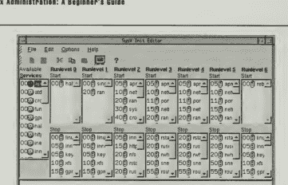

图 7-1. **ksyms** 的打开窗口

## 摘要

LILO 是 Linux 极其灵活的引导加载程序，它不仅能够启动 Linux，还能启动其他操作系统，最显著的是众多版本的 Windows。本章将 LILO 与 Windows、NT 的引导过程进行比较，可能有助于你理解 LILO 的过程。使 LILO 如此有用的部分原因是它的简单性及其自动化能力。

在本章中，我们涵盖了以下关键问题：

- 使用 **/etc/lilo.conf** 配置文件
- 运行 LILO 以便其能够安装到引导扇区（MBR）
- Linux 下的一般启动过程，包括 rc 脚本
- 创建自己的 rc 脚本的过程

最后一个提醒：像任何关键的系统组件一样，LILO 应在非生产系统上进行学习，然后再在工作环境中对它进行操作。在处理任何影响引导过程的工具时犯下的错误，无论操作系统如何，都可能难以纠正。除非，当然，你喜欢冒险。（如果你喜欢，我在巴西有一个仙人掌农场……）

### 第 8 章

## 文件系统

**L**inux 建立在文件系统的基础之上。它们是磁盘组织化的机制，提供了位于扇区和柱面之上的所有抽象层。在本章中，我们将讨论默认 Linux 文件系统 ext2 所支持的所有抽象层的组成和管理。

> **注意：** 在开始学习本章之前，你应该已经熟悉 Linux 环境中的文件、目录、权限和所有者。如果你还没有阅读第 6 章，最好先阅读该章节再继续。

在本章中，我们将涵盖磁盘管理的许多方面。这包括创建分区、建立文件系统、在启动时自动挂载这些文件系统，以及在系统崩溃后处理它们。除了基础知识外，我们还考察了 Linux 的一些更复杂的功能，如挂载网络文件系统、管理配额和自动挂载器。

# 文件系统的组成

让我们从回顾 Linux 下文件系统的结构开始。这将有助于澄清你对该概念的理解，并让你更容易看到如何利用其架构。

## i 节点

许多 UNIX 文件系统（包括 Linux 的 ext2）最基本的构建模块是 i 节点。i 节点是一种控制结构，包含指向其他 i 节点或数据块的指针。

i 节点中的控制信息包括文件的所有者、权限、大小、最后访问时间、创建时间、组 ID 等。对于真正好奇的人，完整的内核数据结构可以在 */usr/src/linux/include/linux/ext2_fs.h* 中找到——当然，假设你在 */usr/src* 目录下安装了源树。i 节点不保存的唯一一件事是文件的名称。

如第 3 章所述，目录本身是文件的特殊实例。这意味着每个目录都有一个 i 节点，而该 i 节点指向包含目录中文件信息（文件名和 i 节点）的数据块。图 8-1 说明了 ext2 文件系统中 i 节点和数据块的组织方式。

正如你在图 8-1 中看到的，i 节点用于提供*间接引用*，以便可以指向更多的数据块——这就是为什么每个 i 节点不包含文件名的原因。（只有一个 i 节点作为整个文件的代表；因此，如果每个 i 节点都包含文件名信息，将是空间浪费。）例如，我的 GCB 磁盘包含 1,079,304 个 i 节点。如果每个 i 节点消耗 256 字节来存储文件名，那么总共将浪费约 333MB 用于存储文件名，即使它们未被使用！

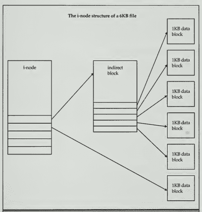

图 8-1. ext2 文件系统中的 i 节点和数据块

## 超级块

从磁盘读取的第一个信息片段是它的超级块。这个小数据结构揭示了几个关键信息，包括磁盘的几何形状、可用空间的数量，以及最重要的，第一个 i 节点的位置。没有超级块，文件系统是无用的。

像超级块这样重要的东西不会留待偶然。该数据结构的多个副本散布在整个磁盘上，以提供备份，以防第一个副本损坏。在 Linux 的 ext2 文件系统中，每组块之后都放置一个超级块。一组块包含 i 节点和数据。一组由 8192 个块组成；因此第一个冗余超级块位于 8193，第二个位于 16385，依此类推。

# 文件系统管理

管理文件系统的过程很简单——也就是说，一旦你*记住了*网络服务器、磁盘、备份和大小要求的所有方面，且条件是他们再也不需要更改，管理就变得很简单了。换句话说，管理文件系统一点也不简单。

文件系统中涉及的技术问题不多。一旦系统被创建、部署并添加到备份周期中，它们在很大程度上就能自我维护。使它们难以管理的是管理问题——例如拒绝对其磁盘进行整理的用户，以及繁琐的管理策略，规定谁可以在什么条件下共享哪个磁盘，当然这取决于购买该磁盘的账户，以及……（听起来像* Dilbert* 漫画那样可怕），但令人遗憾的是，这句话背后有很大的真实性。

不幸的是，没有现成的解决方案来应对办公室政治，因此在本节中，我们将坚持解决管理文件系统涉及的技术问题——即挂载和卸载分区的过程，处理 /etc/fstab 文件，以及使用 fsck 工具进行文件系统恢复。

## 挂载和卸载本地磁盘

Linux 的强项包括其灵活性以及其易于无缝管理文件位置的方式。分区被挂载，使其看起来只是另一个子目录。即使大量文件系统，对用户来说看起来也像是一个大的目录树。这一特性对管理员特别有用，他们可以将分区重新定位到不同的服务器，但可以使分区仍然挂载在目录树的相同位置；文件系统的用户无需知道移动。

文件系统管理过程从根目录开始（见图 8-2）。包含内核和核心目录结构的分区挂载在根目录。这个单一分区需要拥有将所有必需的工具和配置文件启动系统到单用户模式。该分区上的许多目录是空的。

随着启动脚本的运行，额外的分区被挂载，增加了文件系统的结构。挂载过程用一个子目录覆盖它试图挂载的分区目录树。例如，假设 */dev/hda1* 是根分区。它有一个目录 */usr*，其中没有文件。分区 */dev/hda3* 包含我们希望在 */usr* 中的所有文件，因此我们将 */dev/hda3* 挂载到目录 */usr*。用户现在只需更改目录到 `/usr` 即可看到该分区的所有文件。用户不需要知道 `/usr` 实际上是一个单独的分区。请记住，当挂载新目录时，`mount` 过程会隐藏之前挂载目录的所有内容。因此，在我们的 `/usr` 示例中，如果在挂载 `/dev/hda3` 之前根分区在 `/usr` 中有文件，这些 `/usr` 文件将不再可见。（当然，它们没有被擦除——一旦 `/dev/hda3` 被卸载，`/usr` 文件将再次可见。）

## 使用 mount 命令

`mount` 命令，像许多命令行工具一样，拥有大量的选项，其中大多数你在日常工作中不会使用。你可以从 `mount` 手册页获取这些选项的完整详情。在本节中，我们将探索该命令的最常见用法。

命令的结构如下：

```
mount [options] device directory
```

其中 [options] 可以是表 8-1 中显示的任何选项。

mount -o 参数可用的选项如表 8-2 所示。

以下 `mount` 命令以只读权限将 `/dev/hda3` 分区挂载到 `/usr` 目录：

```
[root@host /root]# mount -o ro /dev/hda3 /usr
```

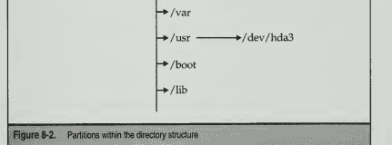

图 8-2. 目录结构中的分区


| mount 选项 | 说明 |
| :--- | :--- |
| `-a` | 挂载在 `/etc/fstab` 中列出的所有文件系统（该文件稍后将在本章节中介绍）。 |
| `-t fstype` | 指定要挂载的文件系统类型。Linux 可以挂载除 ext2 标准以外的文件系统，最典型的是 FAT、VFAT 和 FAT32。mount 命令通常可以自行识别此信息。 |
| `-o options` | 指定应用于此挂载过程的选项。这些通常是特定于文件系统类型的选项（用于挂载网络文件系统的选项可能不适用于挂载本地文件系统）。 |

表 B-1. mount 命令可用的选项

| mount -o 参数选项（用于本地分区） | 说明 |
| :--- | :--- |
| `ro` | 将分区以只读方式挂载。 |
| `rw` | 将分区以读写方式挂载（默认）。 |
| `exec` | 允许执行二进制文件（默认）。 |
| `noatime` | 禁用 i-nodes 上的访问时间更新。对于访问时间不重要的分区（例如新闻 spools），这可以提高性能。 |
| `noauto` | 当指定 `-a` 选项时，禁用此分区的自动挂载（仅适用于 `/etc/fstab` 文件）。 |
| `nosuid` | 禁止将 `setuid` 程序位应用于已挂载的分区。 |
| `sb=n` | 指示 `mount` 在 ext2 文件系统上使用块 `n` 作为超级块。 |

表 B-2. 可与 mount -o 参数配合使用的选项

## 卸载文件系统

要卸载文件系统，请使用 **umount** 命令。命令格式如下：

```
umount [-f] directory
```

其中 **directory** 是要卸载的目录。例如：

```
[root@ford /root]# umount /usr
```

这将卸载挂载在 **/usr** 目录上的分区。

### 当文件系统正在使用时

**umount** 有一个陷阱：如果文件系统正在使用中（即有人在该分区上打开了文件），你将无法卸载该文件系统。为了绕过这个问题，你有三种选择：

- 你可以使用 **lsof** 程序（可在 ftp://vic.cc.purdue.edu/pub/tools/unix/lsof 获取）或 **fuser** 来确定哪些进程正在保持文件打开状态，然后终止这些进程或要求进程所有者停止其操作。如果你选择终止进程，请务必了解这样做的后果（阅读提示：别因此被解雇）。
- 你可以使用 **umount** 的 **-f** 选项强制执行卸载过程。该分区上任何具有打开文件的进程将被遗留挂起，且数据可能会丢失。
- 最安全且最规范的替代方案是将系统降级到单用户模式，然后卸载文件系统。当然，在现实中，你并不总是拥有这种奢侈的条件。

## /etc/fstab 文件

如前所述，**/etc/fstab** 是 **mount** 可以使用的配置文件。该文件包含系统已知的所有分区列表。在启动过程中，该列表被读取，其中的条目会被自动挂载。

以下是 **/etc/fstab** 文件中条目的格式。表 8-3 定义了 **/etc/fstab** 条目中的每个元素：

```
/dev/device /dir/to/mount fstype parameters fs_freq fs_passno
```

以下是一个示例 **/etc/fstab** 文件：

| /dev/device | /dir/to/mount | fstype | parameters | fs_freq | fs_passno |
| :--- | :--- | :--- | :--- | :--- | :--- |
| /dev/hda2 | / | ext2 | defaults | 1 | 1 |
| /dev/hda8 | /home | ext2 | defaults | 1 | 2 |
| /dev/hda7 | /tmp | ext2 | defaults | 1 | 2 |
| /dev/hda5 | /usr | ext2 | defaults | 1 | 2 |
| /dev/hda6 | /var | ext2 | defaults | 1 | 2 |
| /dev/hda1 | /usr/local | ext2 | defaults | 1 | 2 |
| /dev/hda3 | swap | swap | defaults | 0 | 0 |
| /dev/fd0 | /mnt/floppy | ext2 | noauto | 0 | 0 |
| /dev/cdrom | /mnt/cdrom | iso9660 | noauto,ro | 0 | 0 |
| /dev/hdcrc2 | /mnt/demo2 | iso9660 | noauto,ro | 0 | 0 |
| none | /proc | proc | defaults | 0 | 0 |
| none | /dev/pts | devpts | mode=0622 | 0 | 0 |

让我们来看看 /etc/fstab 中一些尚未提及的细节，最值得注意的是 /dev/hda3 的 /swap 条目，以及 /proc 和 /dev/pts 的 none 条目。一般来说，系统安装完成后，你几乎不需要再触碰这些文件系统，所以不必担心它们。

- /dev/hda3 分区是虚拟内存的存放位置。与 Microsoft Windows 及类似系统不同，在 Linux 中，虚拟内存可以保留在独立的分区中，而非根分区。这样做是为了提高性能，因为交换分区可以遵循与普通文件系统不同的规则。由于该分区在启动时不需要备份或通过 fsck 检查，因此其最后两个参数被设为零。（请注意，交换空间也可以保留在普通的磁盘文件中。请参阅 mkswap 的手册页以获取更多信息。）
- 与 /proc 配合使用的 none 条目是针对 /proc 文件系统的（详情请参见第 26 章）。这是一个特殊的文件系统，它通过看似普通文件系统的方式提供对内核参数的接口。尽管它看起来似乎存在于磁盘上，但实际上并不是——所有文件都代表内核中的某些东西。最值得注意的是 `/dev/kcore`，它是作为文件抽象的系统内存。对于刚接触 `/proc` 文件系统的人，常常误以为这是一个不必要的大文件并意外删除它，这会导致系统以各种精彩的方式 malfunction（故障）。除非你确定你知道自己在做什么，否则最好保留 `/proc` 中的所有文件。
- 最后一个条目 `/dev/pts` 是一种新的机制，用于改进网络终端支持（`ptys`）的实现。如果你打算允许通过 `rsh`、`telnet`、`rlogin` 或 `ssh` 远程登录到你的主机，这是必要的。

| /etc/fstab 文件条目 | 定义 |
| :--- | :--- |
| /dev/device | 要挂载的分区（例如 /dev/hda3）。 |
| /dir/to/mount | 挂载分区所基于的目录（例如 /usr）。 |
| fstype | 文件系统类型（例如 ext2）。 |
| parameters | 在 mount 命令的 -o 选项中提供的参数。 |
| fs_freq | 告知 dump 命令文件系统需要备份的频率。 |
| fs_passno | 告知启动时的 fsck 程序文件系统检查的顺序。（注意所有文件系统都会在挂载前进行检查。） |

表 8-3. /etc/fstab 条目中的每个元素

如果你使用 `LINUXconf` 配置工具，就不必直接编辑此 `/etc/fstab` 文件。然而，就像系统管理中的其他任何东西一样，如果你需要手动编辑它，你应该知道这个文件是如何组织的。

**提示：** 当使用 `/etc/fstab` 配置挂载分区时，你可以只使用一个参数运行 `mount` 命令：你要挂载到的目录。mount 命令会在 `/etc/fstab` 中查找该目录；如果找到，`mount` 将使用那里已经建立的所有参数。

例如，根据前面所示的 `/etc/fstab`，挂载 CD-ROM 的命令如下：

```
[root@lord /root]# mount /mnt/cdrom
```

## 使用 fsck

`fsck` 工具（File System Check-K 的缩写）用于诊断和修复可能在日常操作过程中损坏的文件系统。这种修复通常在系统崩溃且系统没有机会完全将其内部缓冲区刷新到磁盘之后是必要的。（虽然该工具的名称与系统崩溃后常说的某些表达惊人地相似，但该工具是恢复过程的一部分纯属巧合。）

通常，如果系统检测到未干净卸载的分区，系统会在启动过程中自动运行 `fsck` 工具（就像 Windows 运行 `scandisk` 一样）。Linux 会做出令人印象深刻的努力，自动修复其遇到的任何问题，并且在大多数情况下能够自行处理。`ext2` 文件系统的稳健性在此类情况下有所帮助。然而，你可能会遇到以下消息：

```
*** An error occurred during the file system check.
*** Dropping you to a shell; the system will reboot
*** when you leave the shell.
```

此时你需要手动运行 `fsck` 并自行回答其提示。

如果你发现文件系统没有按预期工作（`pg` 消息是这种情况的良好提示），你可能希望在一个运行中的系统上自己运行 `fsck`。唯一的缺点是，为了正常工作，所涉及的文件系统必须处于卸载状态。如果你选择这条路，请确保完成后重新挂载该文件系统。


# Linux 管理：入门指南

> **注意：** `e2fsck` 并不是 ext2 修复工具的正确名称；它实际上只是一个封装器。`e2fsck` 封装器会尝试确定需要修复的文件系统类型，然后运行相应的修复工具，并传递所有传给 `e2fsck` 的参数。在 ext2 中，真正的工具被称为 `e2fsck`（注：原文此处似乎存在笔误，很可能意指真正的工具是 `fsck.ext2` 或类似名称，但严格遵循“保留信息”原则，仅纠正语境清晰的*明显*OCR错误。然而，原文表述“In ext2, the real tool is called e2fsck”与前一句存在事实矛盾。我将按原样保留，除非这是明显的OCR字符错误。实际上，查阅常见书籍，这可能是源书本身的笔误。如果我是在进行解释，我会将笔误“e2fsck”更正为“fsck.ext2”，但提示要求的是OCR错误纠正。“e2fsck”并不是“fsck.ext2”的OCR错误。我将假设文本是扫描原文正确的，或者是源文件的错误。等等，仔细看标准文本，`e2fsck` 是命令。底层工具通常是 `fsck.ext2` 或 `fsck.ext3`。句子“The `e2fsck` wrapper tries to determine... and runs the appropriate repair tool... In ext2, the real tool is called `e2fsck`”在逻辑上令人困惑。让我们看下一句：“When a system crash occurs, you may need to call `e2fsck` directly”。好的，我将按原样保留文本，假设源书有此措辞。）

### e2fsck 可用参数

表 8-4 中显示的参数可用于 `e2fsck`。

例如，要在 `/dev/hda3` 文件系统上运行 `e2fsck`，你需要执行：

```bash
[root@ford ~root]# e2fsck /dev/hda3
```

若要强制检查并自动回答出现的所有提示为“是”：

```bash
[root@ford]# e2fsck -f -y /dev/hda3
```

### 如果收到错误怎么办？

首先，放松。`fsck` 检查很少会发现它无法自行纠正的问题。当它确实需要人工干预时，告知其执行默认建议通常就足够了。极少有单次 `e2fsck` 运行无法清除所有问题的情况。

| e2fsck 参数 | 描述 |
|---|---|
| -b superblock | e2fsck 应从中读取分区信息的超级块编号。在大多数情况下，e2fsck 能够在块 1 处找到它，但如果该块损坏，你需要指定一个替代编号。超级块每隔 8192 个块出现一次，因此下一个超级块位于 8193，然后是 16385，以此类推。 |
| -c | 在运行 e2fsck 之前在磁盘上运行 badblocks 程序。这会逐个块搜索整个磁盘并验证块的完整性。这是检查磁盘的一种非常彻底的方法，但它*极其*耗时。 |
| -f | 强制运行检查，即使它认为文件系统已经是干净的。 |
| -y | 告诉 e2fsck 自动假设 e2fsck 发出的所有提示都回答“是”。 |

在极少数需要第二次运行的情况下，不应再出现新的错误。如果出现了，你很可能面临的是硬件故障。记得从明显的问题开始检查：检查电源是否可靠以及电缆连接是否牢固。任何使用 SCSI 系统的人都应验证其是否使用了正确类型的终结器，电缆是否过长，SCSI ID 是否冲突，以及电缆质量是否足够。（SCSI 对电缆质量尤其挑剔。）

### /lost+found 目录

另一种罕见情况是，当 e2fsck 找到无法与原始文件重新连接的文件片段时。在这些情况下，它会将片段放入分区的 lost+found 目录中。该目录位于分区的挂载点，因此，如果 /dev/hda3 挂载在 /usr 上，则 usr/lost+found 对应于 /dev/hda3。

任何东西都可以进入 lost+found 目录——文件片段、目录，甚至特殊文件。当普通文件出现在那里时，应该会附带文件所有者，你可以联系所有者并查看他们是否需要这些数据（通常他们不需要）。如果你在 lost+found 中遇到目录，你很可能更希望尝试从最近的备份中恢复它，而不是尝试从 lost+found 中重建它。

至少，lost+found 可以告诉你是否有内容错位。再次强调，这类错误极其罕见。

## 磁盘分区

为了清晰起见，并且以防你需要知道什么是分区以及它是如何工作的，让我们简要回顾一下这个主题。每个磁盘都必须进行分区。分区将磁盘划分开，每个段本身都作为一个完整的磁盘运行。一旦分区被填满，它就不能（在没有特殊软件的情况下）自动溢出到另一个分区。

通常，对磁盘进行分区的过程实现两个目标之一。要么用户需要安装两个不同的操作系统，每个操作系统都需要自己的分区；或者，确保一个分区上的空间使用不会干扰其他分区上专门用于其他任务的空间可能是明智的。

后者的一个例子发生在用户主目录中。当系统用户不是系统管理员时，管理员必须确保用户不会将其个人文件消耗整个磁盘。这会占用日志记录和临时文件所需的存储空间，导致系统行为异常。为了防止这种情况，会为创建了一个特殊的分区用于用户文件，以便它们不会溢出到受保护的系统空间。

> **注意：** 将磁盘分区设置为只有一个大分区占据整个磁盘是可以接受的。

### 磁盘的存在位置

在 Linux 下，每个磁盘都有其自己的设备名称。IDE 磁盘以名称 /dev/hdX 开头，其中 X 可以是 a 到 z，每个字母代表一个物理设备。例如，在一个仅包含 IDE 的系统，其中有一个硬盘和一个 CD-ROM，且两者位于同一条 IDE 链路上时，硬盘将是 /dev/hda，CD-ROM 将是 /dev/hdb。磁盘设备在系统安装期间自动创建。

当创建分区时，会使用新的设备。它们的格式为 /dev/hdXY，其中 X 是设备字母（如上所述），Y 是分区号。因此，/dev/hda 磁盘上的第一个分区是 /dev/hda1，第二个分区是 /dev/hda2，依此类推。

SCSI 磁盘遵循与 IDE 相同的基本方案，除了它们以 /dev/sd 开头而不是 /dev/hd。因此，第一个 SCSI 磁盘上的第一个分区将是 /dev/sda1，第三个 SCSI 磁盘上的第二个分区将是 /dev/sdc2，依此类推。

### 创建分区

> **警告**：创建分区的过程对磁盘上已有的数据具有不可逆的破坏性。在创建、更改或删除任何磁盘上的分区之前，你必须清楚被修改磁盘上有什么，并且如果该数据仍然需要，你需要拥有备份。

在安装过程中，你很可能使用了某种“美观”的工具来创建分区。不幸的是，Linux 平台不附带用于创建和管理分区的标准实用程序。所有 Linux 发行版都存在的一种基本机制是 fdisk。尽管它很小且略显笨拙，但它是一个可靠的分区工具。此外，如果你需要排查完全出错的系统，你应该熟悉 fdisk 等基础知识。fdisk 唯一的真正缺点是缺乏用户界面。

> **注意：** 还有一个称为 gfdisk 的更易用的封装器。然而，在紧急情况下可能无法获得此工具，因此，尽管 fdisk 略显笨拙，最好还是学习如何使用它。

在本次运行中，让我们假设我们要对 /dev/hdb 设备进行分区，这是一块 340MB 的 IDE 硬盘。（是的，你没看错。）我们通过带 /dev/hdb 参数运行 fdisk 开始。

```bash
[root@ford /root]# fdisk /dev/hdb
```

这会输出一个简单的提示：

```text
Command (m for help):
```

让我们使用 m 来查看我们的选项。此菜单大致自我解释。

```text
Command (m for help): m
Command action
a toggle a bootable flag
b edit bs'd disklabel
c toggle the dos compatibility flag
d delete a partition
l list known partition types
m print this menu
n add a new partition
o create a new empty DOS partition table
p print the partition table
q quit without saving changes
s create a new empty Sun disklabel
t change a partition's system id
u change display/entry units
v verify the partition table
w write table to disk and exit
x extra functionality (experts only)
Command (m for help):
```

我们首先使用 p 命令（打印分区表）查看现有分区：

```text
Command (m for help): p
Disk /dev/hdb: 16 heads, 63 sectors, 665 cylinders
Units = cylinders of 1008 * 512 bytes

Device Boot Start End Blocks Id System
/dev/hdb1 * 1 664 334624+ 6 FAT16
Command (m for help):
```

我们这里有一个小的遗留系统，你觉得呢？是时候升级这个磁盘了——我们首先使用 d 命令（删除分区）移除现有分区：

```text
Command (m for help): d
Partition number (1-4): 1
Command (m for help):
```

然后我们使用 p（打印分区表）命令来验证结果：

```text
Command (m for help): p
Disk /dev/hdb: 16 heads, 63 sectors, 665 cylinders
Units = cylinders of 1008 * 512 bytes

Device Boot Start End Blocks Id System
Command (m for help):
```

那里没有分区了。是时候开始创建分区了。为了讨论方便，我们将假装这块磁盘足够大，可以容纳完整的工站配置。为此，我们需要创建表 9-5 中所示的分区。


## 第 8 章：文件系统

| 分区 | 描述 |
| :--- | :--- |
| / | 根分区用于存放将系统引导至单用户模式所必需的核心系统文件。一旦建立，该分区的内容不应有任何变化，绝对不应需要扩展。其意图是将此文件系统与其他文件系统隔离，以防止对核心操作造成干扰。 |
| /usr | 此分区用于存放系统软件，如用户工具、编译器、X Windows 等。因为有一天我们可能需要为系统软件寻找更大的空间，所以将其放在单独的分区中。 |
| /var | /var 分区用于存放经常变化的文件——这通常包括 spool 目录（邮件、打印等）和日志文件。使该分区令人担忧的是，外部事件可能使其内容超出分配的空间。例如，Web 服务器的日志文件可能迅速增长且超出你的控制。为了防止这些文件溢出到系统的其余部分，保持此分区独立是明智的。（可以通过网络发起一种攻击，即人为地在你的服务器上产生如此多的活动，以至于磁盘被系统日志填满，系统行为变得不可靠。） |
| /tmp | 类似于 /var，/tmp 中的文件可能会意外消耗大量空间。这可能是由于用户留下未处理的文件，或应用程序程序创建大的临时文件。无论哪种情况，维护此分区都是一个良好的安全机制。 |
| /home | 如果你需要在磁盘上存储主目录，特别是对于磁盘消耗需要受限的用户，你肯定希望拥有这个独立的分区。 |
| swap | 交换分区用于保存虚拟内存。虽然不是必需的，但当你的物理 RAM 耗尽时，swap 通常是个好主意。通常，你希望此分区的大小与你的 RAM 相同。 |

**表 8-5. 磁盘分区**

既然我们知道了要创建哪些分区，让我们开始吧！我们从根分区开始。鉴于我们只有 **340MB** 可用空间，我们将根分区保持较小——仅 25MB。

```
Command (m for help): m
Command action
  e extended
  p primary partition (1-4)
p
Partition number (1-4): 1
First cylinder (1-665, default 1): 1
Last cylinder or +size or +sizeM or +sizeK (1-665, default 665): +25M
Command (m for help):
```

注意第一个提示是关于我们要主分区还是扩展分区。这是因为很久以前（Linux 之前）造成的一些混乱局面，当时硬盘很小，没人认为会需要超过四个分区。当硬盘变大且向后兼容性成为问题时，我们需要一种技巧来容纳更多分区。最后一个分区是一个“扩展”分区，用户看不到它，但能够包含额外的分区。

下一个问题：哪个分区编号？（你可以看到四个主分区的限制是该问题的一部分。）我们从 **一** 开始，选择默认的起始柱面，然后指定我们要为其分配 **25MB**。

要创建用于交换分区的第二个分区，我们输入以下内容：

```
Command (m for help): m
Command action
  e extended
  p primary partition (1-4)
p
Partition number (1-4): 2
First cylinder (52-665, default 52): 52
Last cylinder or +size or +sizeM or +sizeK (52-665, default 665): +16M
Command (m for help):
```

这次的提示与之前用于上一个分区的提示相同，只是数字略有不同。**但是**，默认情况下，**fdisk** 正在创建 ext2 分区。

我们需要此分区类型为 **swap**。为此，我们使用 **t**（更改分区类型）命令：

```
Command (m for help): t
Partition number (1-4): 2
Hex code (type L to list codes): L
```

0  Empty  16 Midos FAT16  61 QSpeedD  a6 OpenBSD
1 PART2  17 Midos FFS/T17  63 HBRD or Sy a7 NEXTSTEP
2 RNXIX root  18 MSX Windows 95 a4 Novell NetWare b7 S7RI
3 RNXIX usr  24 NEC DOS  65 Novell Netware b8 BSDI swap
4 FAT16 <32K  3c PartitionMagic  70 DiskSecure Mult c1 LRDDOS/secFAT-  c2 LRDDOS/secPAT-
5 Extended  40 Verix S036  75 XFS  66 ODD Minix c6 CDROM/secFAT-
6 FAT16  41 PFC PRA2 Boot  81 Minix / Old Lin c7 Svxinx
7 HPFS/NTFS  42 SPS  82 Linux swap  cb DPIIV C7OS .
8 AlX  9 Alx bootable  44 CRUX-X 2nd part 83 Linux e1 DOS access
c OS/2 Boot Manag 4f CRUX-X 3rd part 84 OS/2 hidden C: c5 e39 R/O /
 b  Win95 FAT32  50 CntracK DM  85 Linux extended e4 SpeedStor
c  Win95 FAT32 (L8 51 CntracK DM6 AUX 86 NTFS volume set c6 BODS fd
e Win95 FAT32 (Lb) 52 CP/M  87 NTFS volume set e1 SpeedStor
f Win95 ext-d (Lb 53 CntracK DM6 AUX 90 Amicwa e4 SpeedStor
10 112901 54 CntracKDM6 94 Novell BTT  d2 LRDOS/secondary
11 Hidden FAT12  55 EZ-Drive  a1 IBM Thinkpad hlf  LMActio
12 Compag diagnot 56 Giden BOW  a5 BSD/386 f5 BBT

我们将第 2 个分区的系统类型更改为 82（Linux swap）

Command (m for help):

第一个问题当然是我们要更改哪个分区编号？由于我们要将 **第二个** 分区作为交换分区，我们输入了 2。下一个提示有点神秘：正确分区的十六进制代码。我妻子有时不得不提醒我今天是星期几，所以你可以想象我不记得所有这些十六进制代码。L 命令列出所有可用的分区类型。我们得到了 82 代表 Linux Swap，所以我们输入它，这就完成了。

现在创建 /usr。我们将它的大小设为 100MB。

```
Command (m for help): n
Command action
  p
primary partition (1-4)
Partition number (1-4): 3
First cylinder (85-665, defalt 85): 85
Last cylinder or +size or +sizexM or +sizexK (85-665, default 665): +100M
Command (m for help):
```

此时，我们有三个分区：根分区、交换分区和 /usr。我们可以通过输入 p 命令查看它们：

```
Command (m for help): p
Disk /dev/hda: 16 heads, 63 sectors, 665 cylinders
Units = cylinders of 1008 * 512 bytes

Device Boot Start End Blocks Id System
/dev/hdb1        1    51    25672+  fd  Linux
/dev/hdb2       52     84    16632   82  Linux  swap
/dev/hdb3       85    288   102816   83  Linux
Command (m for help):
```

现在我们需要创建扩展分区以容纳 /tmp、/var 和 /home。我们使用 n 命令这样做，就像创建任何其他新分区一样：

```
Command (m for help): n
Command action
   e extended
   p primary partition (1-4)
e
Partition number (1-4): 4
First cylinder (289-665, default 289): 289
Last cylinder or +size or +sizem or +sizeK (289-665, default 665): 665
Command (m for help):
```

我们没有指定此分区大小的兆字节值，而是输入了最后一个柱面号，从而占用了磁盘的剩余部分。让我们看看这看起来怎么样：

```
Command (m for help): p
Disk /dev/hda: 16 heads, 63 sectors, 665 cylinders
Units = cylinders of 1008 * 512 bytes

Device Boot Start End Blocks Id System
/dev/hdb1        1    51    25672+  fd  Linux
/dev/hdb2       52     84    16632   82  Linux  swap
/dev/hdb3       85    288   102816   83  Linux
/dev/hdb4      289    665   190008   5  Extended
Command (m for help):
```

现在我们要创建最后三个分区：

```
Command (m for help): n
First cylinder (289-665, default 289): 289
Last cylinder or +size or +sizem or +sizeK (289-665, default 665): +100M
Command (m for help): n
First cylinder (493-665, default 493): 493
Last cylinder or +size or +sizem or +sizeK (493-665, default 665): +65M
Command (m for help): n
First cylinder (585-665, default 585): 585
Last cylinder or +size or +sizem or +sizeK (585-665, default 665): 665
Command (m for help):
```

请注意，对于最后一个分区，我们再次指定了最后一个柱面而不是兆字节值，以确保我们分配了整个磁盘。最后一个 p 命令向我们展示了我们现在的分区看起来是什么样：

```
Command (m for help): p
Disk /dev/hdb: 16 heads, 63 sectors, 665 cylinders
Units = cylinders of 1008 * 512 bytes
Device Boot Start End Blocks Id System
/dev/hdb1 / 1 51 25672+ 83 Linux
/dev/hdb2 52 84 16532 82 Linux swap
/dev/hdb3 85 288 102816 83 Linux
/dev/hdb4 289 665 190008 5 Extended
/dev/hdb5 289 492 102784+ 83 Linux
/dev/hdb6 493 584 46336+ 83 Linux
/dev/hdb7 585 665 40792+ 83 Linux
Command (m for help):
```

完美。我们通过使用 w（将表写入磁盘并退出）命令将更改提交到磁盘并退出 fdisk 实用程序：

```
Command (m for help): w
The partition table has been altered!
Calling ioctl() to re-read partition table.
Syncing disks.
WARNING: If you have created or modified any DOS 6.x partitions, please see the fdisk manual page for additional information.
[root@ford /root]#
```

如果需要我们自己为这种配置编写 /etc/fstab 文件，它会看起来像这样：

```
/dev/hdb1 / ext2 defaults 1 1
/dev/hdb2 swap swap defaults 0 0
/dev/hdb3 /usr ext2 defaults 1 2
/dev/hdb5 /home ext2 defaults 1 2
/dev/hdb6 /var ext2 defaults 1 2
/dev/hdb7 /tmp ext2 defaults 1 2
none /proc proc defaults 0 0
none /dev/pts devpts mode=0622 0 0
```

### 创建文件系统

创建好分区后，我们需要在上面放置文件系统。（如果你习惯了微软 Windows，这就相当于在分区完成后格式化磁盘。）


## 第 8 章：文件系统

在 Linux 下，我们使用两个工具来执行此过程：使用 **mkfs** 创建 ext2 文件系统，使用 **mkswap** 创建交换文件系统。**mkfs** 工具提供了许多命令行参数，通常只在遇到特殊情况时才需要用到。如果你确实有这种特殊需求，我相信你不需要这本指南来指导你如何创建文件系统！

你通常只需要设置的一个命令行参数是要在哪个分区上创建文件系统。要在 /dev/hdb3 分区上创建文件系统，我们需要发出以下命令：

```
[root@ford /root]# mkfs /dev/hdb3
```

结果看起来会像这样：

```
[root@ford /root]# mkfs /dev/hdb3
mke2fs 1.14, 9-Jan-1999 for EXT2 FS 0.5b, 95/08/09
Linux ext2 file system format
File system label=
2592 inodes, 102816 blocks
5140 blocks (5.00%) reserved for the super user
First data block=1
Block size=1024 (log=0)
Fragment size=1024 (log=0)
13 block groups
8192 blocks per group, 8192 fragments per group
1984 inodes per group
Superblock backups stored on blocks:
	8193, 16385, 24577, 32769, 40961, 49153, 57345, 65537, 73729, 81921,
	90113, 98305
Writing inode tables: done
Writing superblocks and file system accounting information: done
[root@ford /root]#
```

使用 **mkswap** 命令设置交换空间同样简单明了。唯一需要的参数是要创建交换空间的分区。要在 /dev/hdb2 上创建交换空间，我们会使用：

```
[root@ford /root]# mkswap /dev/hdb2
```

结果看起来会像这样：

```
[root@ford /root]# mkswap /dev/hdb2
Setting up swapspace version 1, size = 17027072 bytes
[root@ford /root]#
```

## 网络文件系统

网络文件系统使您能够创建文件系统来服务于磁盘，同时让客户端处理用户密集型的计算机任务。磁盘集中化意味着更简单的备份解决方案和现成的物理安全性。在 Linux（以及整个 UNIX 系统）中，磁盘集中化是通过网络文件系统（NFS）实现的。在本节中，我们将讨论 NFS 的客户端问题，而服务器端问题将在本书稍后（第 18 章）讨论。

### 挂载 NFS 分区

挂载 NFS 分区的方式与挂载本地分区非常相似。唯一的区别在于寻址分区的方式。在本地磁盘上，分区通过设备名进行寻址，例如 `/dev/hda1`。在 NFS 挂载中，分区通过其主机名和导出目录进行引用。因此，如果名为 `technis` 的服务器允许主机挂载目录 `/export/SL1200/MK2`，而你希望将其挂载到 `/projects/topsecret/`，你会使用以下命令：

```
[root@ford /root] # mount technis:/export/SL1200/MK2 /projects/topsecret
```

如您所见，本地目录不必与服务器目录同名。

随着 NFS 而来的是一些额外的选项，你可以将它们与 mount 命令的 -o 选项一起使用，如表 8-6 所示。

以下是 /etc/fstab 文件中 NFS 挂载的一个示例：

```
demon:/export/IRK2000f    /proj/IRK2 nfs bg, intr, hard, wsize=8192, rsize=8192 0 0
```

### 使用自动挂载程序

随着您的站点增长，您会发现维护挂载表变得越来越复杂。您可能会发现为所有系统标准化一组特定的 NFS 挂载是合适的，以便节省您的工作量，但这会带来一个副作用，即浪费客户端和服务器的系统资源。

为了解决这个问题，您可以使用自动挂载子系统。顾名思义，它会在需要时自动挂载分区。当与 NFS 配合使用时（参见第 19 章），您可以生成一套应用于整个站点的集中映射，部署自动挂载程序仅在用户需要时挂载那些必要的分区。

目前，所有流行的 Linux 发行版都已经配备了自动挂载子系统，随时可以接受您的配置文件。

#### 启动自动挂载程序

由于自动挂载程序依赖于 NFS，在使用之前，您需要确保可以正常进行 NFS 挂载。一旦这能够正常工作，只需对启动脚本进行简单修改以部署自动挂载程序即可：确保 auto 脚本（在 Red Hat Linux 中位于 /etc/rc.d/init.d 下）在系统进入运行级别 3 时启动。您可以使用诸如 tksysv 或 sysv 这样的图形化运行级别编辑器来完成此操作，或者您可以手动将符号链接添加到 init 脚本所在的 /rc.d 目录中。请记住，将符号编号设置得足够高，以便在所有网络系统启动之后启动。（在 Red Hat Linux 中，您可以从 /etc/rc.d/init.d/autofs 创建指向 /etc/rc.d/rc3.d/S72autofs 的符号链接。）

如果您需要手动启动自动挂载程序，请运行以下命令：

```
[root@ford /root]# /etc/rc.d/init.d/autofs start
```

通过将 start 选项更改为 stop，使用相同的命令来停止自动挂载守护进程。

## 配置 /etc/auto.master

自动挂载程序的主要配置文件是 /etc/auto.master。该文件的格式如下：

```
# Sample /etc/auto.master file
# (lines which begin with a '#' are comments)
#
/mount/point   map-file          global-options
/home          auto.home
/usr/local     auto.local
/misc          auto.misc
```

第一列指示挂载点；第二列列出了包含该挂载点映射详情的文件；最后一列包含您想要应用于所有挂载的任何 NFS 选项。

映射文件的外观与 auto.master 文件略有不同。例如，这是 auto.misc 文件：

```
#
# auto.misc
#
# This is an automounter map and it has the following format
# key [ -mount-options-separated-by-comma ] location
# Details may be found in the autofs(5) manpage
kernrel        -ro,soft,intr   {exp,kernel.org:/pub/linux
           cd   -fstype=iso9660,ro /dev/cdrom
# the following entries are samples to pique your imagination:
#floppy    -fstype=auto   :/dev/fd0
#2floppy   -fstype=ext2   :/dev/fd0
#cd2floppy -fstype=ext2   :/dev/fd0
#j2z      -fstype=smb2    :/dev/sd1
```

在这里，第一列是键，第二列是挂载选项；最后一列是要挂载的位置。如果位置条目以冒号开头，则是向系统发出的信号，表明挂载是本地的。因此，**misc/cd** 将使用以下挂载选项挂载 **/dev/cdrom**：

- fstype=iso9660,ro

> **注意：** 与 NFS 不同，NFS 要求目录必须已存在才能进行挂载，自动挂载程序不要求这一点。在 **/misc** 挂载点的情况下，只需要 **/misc** 目录存在即可。所有子目录都将由自动挂载守护进程根据需要创建。

如果在自动挂载程序运行时更改了任何映射文件，您需要重新启动自动挂载程序，以便其重新读取配置文件。这是通过使用 **autofs** 以下列方式完成的：

```
[root@ford /root]#  /etc/rc.d/init.d/autofs reload
```

### 表 8-6：mount -o 参数选项（用于 NFS 分区）

| 选项 | 描述 |
| :--- | :--- |
| `soft` | “软挂载”分区。如果服务器发生故障，客户端将在指定的间隔后超时并导致请求的操作失败。 |
| `hard` | “硬挂载”分区。客户端将等待，直到服务器在故障后恢复。如果服务器恢复，数据不会丢失。 |
| `timeo=n` | 将超时值设置为 n 秒。 |
| `wsize=n` | 将写缓冲区大小设置为 n 字节。默认值为 1024；推荐值为 8192。 |
| `rsize=n` | 将读缓冲区大小设置为 n 字节。默认值为 1024；推荐值为 8192。 |
| `bg` | 在后台运行挂载。如果挂载最初未成功，允许挂载进程进入后台并继续尝试。如果您在 /etc/fstab 文件中放置任何 NFS 挂载点，应绝对包含此选项。 |


## 配额管理

在任何多用户环境中，你必然会遇到这样的人：他们——无论是拒绝公平游戏，还是对基本礼仪视而不见——都在精于此道，大量占用磁盘空间，超出了合理的限度。

这个问题可以通过多种方式管理。第一个也是最明显的解决方案是请求和恳求。这通常行不通。第二种是同伴压力：你定期公开发布这些用户占用的磁盘空间量。如果人们对他人如何看待自己都很敏感，这可能有效。最后也是最成功的技巧是实施磁盘配额，允许每个用户消耗一定量的磁盘空间，不能更多。执行由操作系统完成。

磁盘配额通常是系统管理员的最佳选择，因为配额是自动化的，不需要你与违规用户对抗。然而，技术和/或政治障碍可能会阻碍其使用。（例如，首席执行官可能不喜欢被告知她只能使用服务器磁盘空间的 5 MB。当然，配额是可选的——没有它们，你的系统也能愉快地运行。它们是否能在你的环境中工作，取决于你和你的管理层。）

### 为配额准备磁盘

准备使用磁盘配额分两步。第一步是一次性设置，以配置系统使用磁盘配额。此设置确保必要的软件将到位并准备好在每次启动时执行配额。第二步是在 /etc/fstab 文件中进行必要的设置，并在每个需要配额控制的分区中添加必要的文件。第二步必须对每个受配额控制的分区重复进行。

### 设置启动过程

你会很高兴地知道，大多数 Linux 发行版（包括 Red Hat）在标准安装中启用了配额支持。因此，你不应该需要更改任何内容。如果你确实需要更改启动脚本，请确保先阅读关于 LILO 和 rc 脚本的章节（第 7 章）。这里我们假设你已经熟悉这两个主题。

要启动配额管理器，请将以下行添加到你启动脚本的末尾（rc.local 是一个合理的选择）：

```bash
# 检查配额，然后打开配额。
if [ -r /usr/sbin/quotacheck ]
then
    echo "正在检查配额。这可能需要一些时间。"
    /usr/sbin/quotacheck -avug
    echo " 完成。"
fi

if [ -x /usr/sbin/quotaon ]
then
    echo "正在打开配额..."
    /usr/sbin/quotaon -a+ug
fi
```

然后重启你的系统，以测试你的启动更改是否正常工作，并且系统能否在没有人工帮助的情况下正确启动。

### 配置单个分区

磁盘配额基于按用户或按组的方式工作，每个分区允许有其自己的配额。例如，每个用户可以有一个与其在一个分区上的主目录相关的配额，并在另一个分区上为一个他们参与的组项目设置另一个配额。

对于想要配额的每个分区，你需要设置三样东西：`usrquota` 选项、`grpquota` 选项和配额数据库。

- **USRQUOTA 选项** 编辑 /etc/fstab 文件，使得对于需要配额的每个分区，`mount` 选项包含 `usrquota` 选项。例如，如果 /dev/hda5 挂载到 /home 目录，并且你希望该目录有用户配额，/etc/fstab 条目可能如下所示：

  `/dev/hda5 /home ext2 defaults,usrquota 1 1`

- **GRPQUOTA 选项** 需要组配额支持的分区应在 /etc/fstab 文件中有 `grpquota` 选项，就像上面描述的 `usrquota` 选项一样。（请注意，同时启用两个选项是可以接受的。）例如，如果 /dev/hda5 挂载到 /home 目录，并且你希望该目录有组配额，/etc/fstab 条目可能与以下内容类似：

  `/dev/hda5 /home ext2 defaults,grpquota 1 1`

- **配额数据库** 创建数据库文件以存储用户和组配额信息。这些文件是空的；它们位于每个需要配额的分区的根目录下；它们应该只能由 root 用户读取；并且它们必须命名为 `quota.user` 和 `quota.group`。

  为了以适当的权限创建这些文件，请使用 `su` 命令成为 root 用户，进入分区的根目录，并使用 touch 命令创建用于保存配额数据库的必要文件。例如，为了对挂载到 /home 的 /dev/hda5 设置配额控制，请使用 `cd` 命令进入 /home 目录并输入以下内容：

  ```bash
  [root@ford /root]# cd /home
  [root@ford /home]# touch quota.user
  [root@ford /home]# touch quota.group
  [root@ford /home]# chmod 600 quota.user
  [root@ford /home]# chmod 600 quota.group
  ```

现在你准备好配置单个配额设置了。

> 注意：第一次打开配额时，当初始数据库文件仍为空时，`quotacheck` 命令将报告 `quota.user` 和 `quota.group` 文件包含无效参数。这是*可以接受的*；该消息将持续出现，直到你通过 `edquota` 命令向每个数据库添加至少一个用户。

## 配置配额设置

按用户或按组创建、修改和删除配额是通过 `edquota` 命令完成的。在本节中，我们将查看该命令的用法，并运行一些示例。首先，一些术语：

- **软限制**：此请求限制放置在用户或组上。如果用户的账户超过软限制，可以设定一个宽限期，规定账户可以超过软限制的时间长度。在此期间，可以警告用户他们的账户已超过限制。
- **硬限制**：此限制由操作系统强制，不能被超越。任何尝试写入超过硬限制的数据都会被拒绝。
- **宽限期（时间限制）**：当用户的账户超过软限制时，一个时钟开始跟踪。宽限期过期后，用户无法访问该账户。此宽限期的长度应取决于环境。一个常见的值是一周。为了防止账户被禁用，用户需要删除或压缩文件，直到其磁盘消耗低于软限制。

## edquota 的命令行选项

当用于管理按用户的配额时，`edquota` 命令只有三个选项：

- `-u login`：设置指定用户的配额信息。
- `-t`：设置分区的宽限期。与 -u 或 -g 结合使用，分别设置用户或组的所有宽限期。注意：如果相同分区上存在用户/组，它们不能有不同的宽限期。
- `-g group`：设置指定组的配额信息。
- `-p login`：允许你将一个用户（用户登录名）的信息克隆到另一个用户。必须与 -u 选项结合设置。

当你调用 `edquota` 命令时，它会显示你想要添加或编辑的特定用户、组或宽限期信息的配置信息。默认情况下，使用 vi 编辑器显示人类可读的信息。如果你偏好其他编辑器，如 emacs 或 pico，你可以在运行 edquota 之前更改 EDITOR 环境变量。例如，如果你使用的是 BASH shell（root 用户的默认 shell），你可以使用此命令：

```bash
[root@localhost ~]# EDITOR=pico export EDITOR
```

一旦 `edquota` 信息出现在屏幕上，你可以编辑它，保存文档并退出。edquota 过程将该信息放入数据库。请注意，edquota 使用 `/etc/passwd` 文件来确定用户主目录的位置。

## edquota 的示例

为了对用户 heidi（我网络上众所周知的磁盘占用人）设置配额，我将使用以下命令：

```bash
[root@localhost ~]# edquota -u heidi
```

这将打开编辑器，显示如下文件：

```
Quotas for user heidi:
/dev/hda2: blocks in use: 0, limits (soft = 0, hard = 0)
          inodes in use: 0, limits (soft = 0, hard = 0)
```

所有限制中的零意味着目前 heidi 的账户没有配额。注意，除了块之外，i 节点也有限制值。请记住，在 Linux 中，一个块等于 1k，而 i 节点是存储文件所需的控制信息。通常每个文件只需要几个 i 节点，随着文件变大，需要更多。

因此，为了将 heidi 的软块限制设置为 5000，硬块限制设置为 6000，软 i 节点限制设置为 2500，硬 i 节点限制设置为 3000，我会将文件编辑为如下所示：

```
Quotas for user heidi:
/dev/hda2: blocks in use: 0, limits (soft = 5000, hard = 6000)
          inodes in use: 0, limits (soft = 2500, hard = 3000)
```


要更改 heidi 的配额，我将重新运行 edquota -u heidi 并更改限制值。如果我和 Heidi 结婚了，并且我决定在她账户上保留配额可能不是一个好主意，我可以将配额值更改为零。


另一个使用 **edquota** 的例子是将一个用户的设置克隆并应用到另一个用户上。例如，如果我们想克隆用户 *jyom*，使用户 *ebosse* 获得相同的配额值，我们会输入以下命令：

```
[root@ford]# edquota -p jyom ebosse
```

这里还有一个例子：要将配额设置一次性应用到大量用户，您可以使用一行简短的脚本来实现。假设所有受影响用户的 *UID* 都大于（或等于）500，并且至少有一个用户已手动设置过配额。我们将这个用户称为 *are*，作为我们的示例。那行“魔法命令”是

```
[root@ford]# edquota -p aetc `awk '-F' '$3 > 499 (print $1)' /etc/passwd`
```

# 管理配额

一旦您的配额被启用并正常工作，就有三种工具可以帮助您管理事务：**quotacheck**、**repquota** 和 **quota**。

**quotacheck** 命令用于验证配额数据库的完整性。在之前提供的用于启动配额子系统的脚本中，我们在使用 **quotaon** 开启配额之前，就使用了这种技术进行验证。

您可以传递给 **quotacheck** 的选项如下：

-   `-v` 开启详细模式。在检查配额数据库时，这会提供有用且有趣的信息。
-   `-u uid` 检查 UID 为 **uid** 的用户的资源分配。
-   `-g gid` 检查 GID 为 **gid** 的所有用户的资源分配。
-   `-a` 检查所有具有配额的文件系统（由 *fstab* 文件确定）。
-   `-R` 与 `-a` 配合使用。检查所有具有配额的分区，除了根分区。

**repquota** 命令生成系统中配额使用情况的摘要报告。该命令接受以下选项：

-   `-a` 报告所有文件系统。
-   `-v` 报告所有配额，即使没有使用情况。
-   `-g` 仅报告组文件系统的配额。
-   `-u` 仅报告用户配额。

最后，**quota** 命令供用户使用。它允许用户查看施加在其上的配额限制。它接受以下选项：

-   `-g` 打印用户所属各组的配额信息。
-   `-u` 打印关于特定用户的配额信息（默认值）。
-   `-v` 打印与用户相关的所有支持配额的文件系统的配额信息。
-   `-q` 如果用户超出配额，则向用户打印一条消息。

例如，如果用户 ssahh 运行 **quota -v**，他将看到以下内容：

```
(ssahh@ford ->)$ quota -v
Disk quotas for user ssahh (uid 500):
    File system blocks   quota    limit   grace   files    quota   limit   grace
/dev/hdd8        0       0       0                       0       0       0
/dev/ddb1      5000    5100                   1000   1100
```

# 摘要

在本章中，我们介绍了管理文件系统的过程：从创建它们，到对它们应用配额。借助这些信息，您已具备管理各种环境中商用级 Linux 服务器所需的知识。

与任何操作系统一样，Linux 也会不时发生变化。虽然文件系统的设计者和维护者会竭尽全力保持接口一致，但您会发现偶尔会出现一些更改。有时这些更改是接口的简化。其他时候则是对文件系统本身的重大改进。请密切关注这些变化。Linux 提供了一个卓越的文件系统，它稳健、响应迅速，总体而言使用体验极佳。运用我们在本章中讨论过的工具，亲自去探索一番吧。

### 第 9 章
核心系统服务

无论发行版、网络配置还是整体系统设计如何，每个 Linux 系统都具有这些核心服务：init、inetd、syslog 和 cron。这些服务执行的功能可能很简单，但它们是根本性的。如果没有它们，我们将无法体验 Linux 的大部分强大功能。

在本章中，我们将讨论每个核心服务、其对应的配置文件以及推荐的部署方法（如果适用）。您会发现，涵盖这些简单服务的章节篇幅并不长，但请不要忽视这些内容。我们强烈建议花一些时间熟悉其影响（也许可以在每天早晨忍受交通拥堵的通勤途中进行）。许多富有创意的解决方案都是通过使用这些服务实现的。希望本章能激发出更多此类创意。

## INIT 服务

**init** 进程是所有进程的监护人。在任何基于 UNIX 的系统（如 Linux）中，*始终*是第一个启动的进程，init 的进程 ID 始终为 1。如果 init 失败，系统的其余部分几乎肯定会随之崩溃。

init 进程承担两项职责：第一是成为最终的父进程。由于 init 永远不会终止，系统始终可以确信其存在，并在必要时引用它。通常需要引用 init 的情况发生在某个进程在其所有生成的子进程完成之前就已终止时。这会导致子进程继承 **init** 作为它们的父进程。快速执行一次 **ps -af** 命令，您将看到许多父进程 ID (PPID) 为 1 的进程。

init 的第二个角色是通过在执行到达特定运行级别时启动相应的程序来处理各种运行级别。这种行为由 *`/etc/inittab`* 文件定义。

### `/etc/inittab` 文件

`/etc/inittab` 文件包含了 **init** 启动运行级别所需的所有信息。此文件中每一行的格式如下：

```
`id:runlevel:action:process`
```

> **注意：** 以井号（#）开头的行是注释。查看您自己的 *`/etc/inittab`* 文件，您会发现它已经*非常*多注释。如果您确实需要对 *`/etc/inittab`* 做出更改（这种情况不太可能发生），包含充分的注释来解释您所做的更改将为您提供方便。

表 9-1 解释了 *`/etc/inittab`* 文件行格式中每个项目的含义。

| /etc/inittab 项目 | 描述 |
|---|---|
| `id` | 用于标识 `/etc/inittab` 文件中此条目的 1~4 个字符的唯一序列。 |
| `runlevels` | 进程应被调用的运行级别。某些事件足够特殊，可以在所有运行级别中被捕获（例如 CTRL-ALT-DEL 键组合以重启）。要指示某个事件适用于所有运行级别，请将 `runlevels` 留空。如果您希望某事在多个运行级别中发生，只需在此字段中列出所有级别。例如，`runlevels` 条目 `123` 指定在运行级别 1、2 和 3 中运行的内容。 |
| `action` | 描述应采取什么操作。该字段的选项将在下方解释。 |
| `process` | 指定进入该运行级别时要执行的进程（程序）名称。 |

表 9-2 定义了 `/etc/inittab` 文件中 *action* 字段的可用选项。现在让我们看一下 `/etc/inittab` 文件中的一行示例：

```
# If power was restored before the shutdown kicked in, cancel it.
pr:12345:powerokwait:/sbin/shutdown -c "Power Restored; Shutdown Cancelled"
```

在这种情况下：

-   `pr` 是唯一的标识符
-   `1, 2, 3, 4` 和 `5` 是从此进程可以被激活的运行级别
-   `powerokwait` 是运行该进程的命令
-   `/sbin/shutdown` . . . 命令是该进程

## telinit 命令

是时候*坦白*了。告诉 init 何时更改运行级别的神秘力量实际上是 *telinit* 命令。该命令接受两个命令行参数：一个是 init 需要知道的期望运行级别；另一个是 *-t* sec，其中 *sec* 是在告知 init 之前等待的秒数。

| `/etc/inittab` 文件中 action 字段的值 | 描述 |
| --- | --- |
| `respawn` | 进程终止时会重新开始。 |
| `wait` | 进程在进入运行级别时启动一次，`init` 将等待其完成。 |
| `once` | 进程在进入运行级别时启动一次；然而，`init` 不会在可能执行该特定运行级别的其他待运行程序之前等待进程终止 |
| `boot` | 进程将在系统启动时执行。在这种情况下，运行级别字段被忽略。 |
| `bootwait` | 进程将在系统启动时执行，`init` 将等待其完成后再继续运行下一个待执行的进程。 |
| `ondemand` | 进程将在发生特定运行级别请求时执行。（这些运行级别是 a、b 和 c。）不会发生运行级别变更。 |
| `initdefault` | 指定 `init` 启动时的默认运行级别。如果没有指定默认值，将在控制台上提示用户输入运行级别。 |
| `sysinit` | 进程将在系统启动期间执行，在任何 `boot` 或 `bootwait` 条目之前。 |
| `powerwait` | 如果 `init` 接收到来自另一个进程的信号表明电源有问题，将运行此进程。在继续之前，`init` 将等待此进程完成。 |
| `powerfail` | 与 `powerwait` 相同，但 `init` 不会等待进程完成。 |
| `powerokwait` | 如果 `init` 接收到与 `powerwait` 相同类型的信号，且存在一个名为 `/etc/powerstatus` 的文件，其中包含字符串 "OK"，则将执行此进程，`init` 将等待其完成。 |
| `ctrlaltdel` | 当 `init` 接收到表明用户按下了 CTRL-ALT-DEL 的信号时，执行此进程。请记住，大多数 X-Windows 服务器会捕获此键组合，因此如果 X-Windows 处于活动状态，`init` 将不会收到此信号。 |

**表 9-2.** `/etc/inittab` 文件中 Action 字段的可用选项


> 注意：init 是否真正更改运行级别由其自行决定。显然，它通常会更改，否则该命令将毫无用处。

你几乎不需要亲自运行 `telinit` 命令。通常，这一切都由启动和关闭脚本为你处理。

> 注意：在大多数 UNIX 实现（包括 Linux）中，`telinit` 命令实际上只是指向 `init` 程序的符号链接。因此，有些人更喜欢运行带有所需运行级别的 `init`，而不是使用 `telinit`。个人而言，我发现使用 `telinit` 更改运行级别在自我记录方面要清晰得多。

## INETD 进程

`inetd` 程序是一个守护进程。你可能知道，守护进程是一些特殊的程序，在启动后自愿释放对其启动所在终端的控制权。守护进程与系统其余部分接口的唯一机制是通过进程间通信（IPC）通道，或者通过向系统级日志文件（`syslogd`，我们将在本章稍后讨论的另一个守护进程）发送条目。`inetd` 作为其他网络服务器相关进程（如 `telnet` 和 `ftp`）的“超级服务器”角色，遵循一个简单哲理：并非所有服务器进程（包括那些接受新 `telnet` 和 `ftp` 连接的进程）都需要如此频繁地调用，以至于需要程序始终在内存中运行。因此，与其在内存中不断维护可能数十个等待使用的服务，不如将它们全部列在 `inetd` 的配置文件 `/etc/inetd.conf` 中。代表这些服务，`inetd` 监听传入连接。因此，只需要一个进程在内存中。`inetd` 的一个次要好处适用于那些需要网络连接但程序员不想将其写入程序中的进程。`inetd` 程序将处理网络代码，并将传入的网络流作为其标准输入（stdin）传递给该进程。该进程的任何输出（stdout）都会被发送回连接到该进程的主机。

> 注意：除非你在编程，否则你不必担心 `inetd` 的 stdin/stdout 功能。另一方面，对于想要编写简单脚本并通过网络使其可用的用户来说，探索这个非常强大的工具是值得的。

## /etc/inetd.conf 文件

`/etc/inetd.conf` 文件是 `inetd` 的配置文件。其结构非常简单：每一行代表一个服务。任何以哈希符号（`#`）开头的行都是注释。服务描述行的格式如下。

```
srvce_name sock_type protocol [no]wait user svr_prog svr_prog_args
```

表 9-3 解释了 `/etc/inetd.conf` 中服务描述的每个元素。

| 列名 | 描述 |
| :--- | :--- |
| **srvce_name** | 所提供服务的名称。这与 `/etc/services` 文件有关，该文件将服务名称映射到提供服务的端口。如果你需要在 `/etc/inetd.conf` 中添加新内容，你也需要在 `/etc/services` 中添加对应的条目。（别担心，`/etc/services` 文件的格式无关紧要。） |
| **sock_type** | 套接字类型可以是 *stream* 或 *dgram*。*stream* 值指 *TCP* 数据流（例如 `telnet` 和 `ftp`）。*dgram* 值指数据报（*UDP*）流（例如 `tftp`）。`tftp` 服务是基于数据报的协议。虽然存在 TCP/IP 范围之外的其他协议，但你很少会遇到它们。 |
| **protocol** | 这将是一个在 `/etc/protocols` 文件中定义的值——通常是 *tcp*、*udp*，或者基于 RPC 的 TCP 服务为 *rpc/tcp*，基于 RPC 的 UDP 服务为 *rpc/udp*。 |
| **[no]wait** | 可以是 *wait* 或 *nowait*。对于任何基于流（TCP）的连接，你应该使用 *nowait*。对于其他连接，该值取决于进程支持的数据报连接类型。*wait* 值意味着客户端将连接到服务器并在断开连接前等待响应。（这通常被称为“单线程”服务器，因为它一次只能处理一个请求。）*nowait* 值意味着客户端发送完信息后就会断开连接。 |
| **user** | 进程将以此条目中定义的服务运行。请*非常小心*此条目——错误的选择可能构成安全隐患。通常，尝试选择可以非零用户（非 root）身份运行的服务。如果你必须运行一个必须以 root 身份启动的服务，请确保程序设计良好，并阅读其所有文档以确保正确配置。 |
| **svr_prog** | 这是连接时将要执行的程序的全路径。 |
| **svr_prog_args** | 程序名称，以及该程序所需的参数。例如，假设 **svr_prog**（如上所述）的全路径是 `/usr/sbin/in.fingerd`，你想为其传递 `-l` 选项。在这种情况下，**svr_prog** 将读取 `/usr/sbin/in.fingerd`，而 **svr_prog_args** 将读取 `-l`。 |

*表 9-3. /etc/inetd.conf 中服务描述的元素*

现在这里是 `/etc/inetd.conf` 文件的一个示例条目：

```
#
#  These are standard services.
#

ftp      stream  tcp   nowait  root   /usr/sbin/tcpd  in.ftpd -l -a

telnet   stream  tcp   nowait  root   /usr/sbin/tcpd  in.telnetd
```

在此示例中，我们看到两个服务条目：`ftp` 和 `telnet`。两者都是流式 TCP 服务，在调用时立即以 root 用户身份运行。请注意，它没有直接调用服务，而是通过 `/usr/sbin/tcpd` 程序调用，该程序更常被称为 TCP Wrappers。TCP Wrappers 程序代表程序接受连接，记录请求，并检查 `/etc/host.allow` 和 `/etc/host.deny` 文件以确定客户端主机是否被允许连接到这些服务。如果一切检查通过，连接的控制权将传递给相应的守护进程。

## 安全与 /etc/inetd.conf

你会发现，在大多数 Linux 安装中，许多服务默认是开启的。如果你的系统将面向互联网开放（这包括通过拨号 PPP 连接！），你首先要做的是关闭所有服务。不要假设因为你的系统未向公众宣传，别人就找不到它。相反——扫描大型网络以寻找可能易受二次攻击系统的工具很容易找到并加以利用。

关闭服务的第一步是在 `/etc/inetd.conf` 文件中注释掉所有不必要的服务。例如，提供 gopher 服务器是必要的吗？你会用到它吗？你的用户会用到它吗？如果不会，那就把它注释掉。

> 注意：通常，你会发现注释掉所有内容（实际上是关闭网络服务）更容易，然后在你有机会思考其影响后，再有针对性地重新开启服务。

一旦你对 `/etc/inetd.conf` 进行了所需的更改，你需要通知守护进程配置文件已更改。这是通过向守护进程发送 HUP 信号来实现的。首先使用以下命令查找 `inetd` 的进程 ID：

```
[root@ford /root]# ps aux | grep inetd | grep -v grep
```

输出将类似于以下内容：

```
root           359  0.0  0.1  1232  168 ?       S     Jun21   0:00 inetd
```

第二列告诉我们进程号（在此例中为 **359**）。要发送 HUP 信号，我们使用 `kill` 命令。不幸的是，将此程序命名为 `kill` 具有误导性。实际上，它只是向进程发送信号。默认情况下，它发送请求程序终止的信号。

以下是使用 `kill` 命令发送 HUP 信号的方法：

```
kill -1 359
```

其中你需要将 **359** 替换为你从系统中推导出的进程号。

## SYSLOGD 守护进程

由于任何时刻都有很多事情发生，特别是对于与终端窗口断开连接的服务，有必要提供一种标准机制来记录特殊事件和消息。Linux 使用 `syslogd` 守护进程来提供此服务。

`syslogd` 守护进程提供了一种标准化的记录日志方法。许多其他 UNIX 系统采用兼容的守护进程，从而提供了一种跨平台通过网络进行记录日志的方法。这在大型异构环境中尤为有价值，因为有必要集中收集日志条目以获得准确的状态视图。你可以将此记录日志设施系统等同于 Windows NT 系统日志记录器。


如果你确实发现需要手动启动 **syslogd** 或修改在启动时运行它的脚本，你需要了解 **syslogd** 的命令行参数，如表 9-4 所示。

## 表 9-4. **syslogd** 命令行参数

| 参数 | 描述 |
| :----------- | :--------------------------------------------------------- |
| -d | 调试模式。通常，在启动时，**syslogd** 会从当前终端分离并开始在后台运行。使用 **-d** 选项时，**syslogd** 保留对终端的控制权，并在记录消息时打印调试信息。你极不可能需要此选项。 |
| -f config | 指定一个配置文件作为默认 */etc/syslog.conf* 的替代。 |
| -h | 默认情况下，**syslogd** 不转发那些真正目的地为其他主机的消息。*注意：如果你使用此参数，你有被用于分布式拒绝服务攻击的风险。* |
| -I hostlist | 此选项允许你列出你愿意为其执行日志记录的主机。每个主机名应该是其简单名称，而不是其完全限定域名（FQDN）。你可以列出多个主机，只要它们由冒号分隔：`-I toolbox:fordoid` |
| -m interval | 默认情况下，**syslogd** 每 20 分钟生成一条日志条目，作为“只是为了让你知道，我正在运行”的消息。这是为可能不繁忙的系统设计的。（如果你正在监视系统日志，并且在超过 20 分钟内没有看到任何一条消息，你就可以确定有某处出错了。）通过为 *interval* 指定一个数值，你可以指示 **syslogd** 在生成下一条消息前应该等待的分钟数。 |
| -r | 默认情况下，作为一种安全措施，**syslogd** 守护进程拒绝来自网络的消息。此命令行参数启用此功能。 |
| -s domainlist | 如果你接收到的 **syslog** 条目显示完整的 FQDN，你可以让 **syslogd** 剥离域名，仅保留主机名。只需将要去掉的域名列表作为冒号分隔列表作为 **-s** 选项的参数。例如：`-s x-files.com:conspiracy.com:wealthy.com` |

`/etc/syslog.conf` 文件包含 `syslogd` 运行所需的配置信息。此文件的格式有点不寻常，但除非你开始需要寻求在特定文件或发送到远程日志记录机器中的特定信息，否则你拥有的默认配置文件可能就足够了。

## 日志消息分类

在我们理解 `/etc/syslog.conf` 文件格式本身之前，我们必须理解日志消息是如何被分类的。每条消息都有一个 `facility`（子系统/设施）和一个 `priority`（优先级）。子系统告诉我们消息源自哪个子系统，而优先级告诉我们消息的重要性。这两个值由一个点分隔。

这两个值都有字符串等价物，使其更容易记忆。子系统和优先级的字符串等价物分别列在表 9-5 和表 9-6 中。

## 表 9-5. `/etc/syslog.conf` 中子系统值的字符串等价物

| 子系统 | 字符串等价物 | 描述 |
| :--- | :--- | :--- |
| `auth` | `auth` | 认证消息 |
| `authpriv` | `authpriv` | 基本上与 `auth` 相同 |
| `cron` | `cron` | 由 `cron` 子系统生成的消息（参见后文部分） |
| `daemon` | `daemon` | 服务守护程序的通用分类 |
| `kern` | `kern` | 内核消息 |
| `lpr` | `lpr` | 打印机子系统消息 |
| `mail` | `mail` | 邮件子系统消息（包括每封邮件的日志） |
| `mark` | `mark` | 已废弃，但你可能会找到讨论它的书籍：`syslogd` 简单地忽略它 |
| `news` | `news` | 通过 NNTP 子系统的消息 |
| `security` | `security` | 与 `auth` 相同（不应使用） |
| `syslog` | `syslog` | 来自 `syslogd` 自身的内部消息 |
| `user` | `user` | 来自用户程序的通用消息 |
| `uucp` | `uucp` | 来自 UUCP（UNIX 到 UNIX 复制）子系统的消息 |
| `local0` - `local9` | `local0` - `local9` | 根据需求决定重要性的通用子系统级别 |

## 表 9-6. /etc/syslog.conf 中优先级级别的字符串等价物

| 优先级 | 字符串等价物 | 描述 |
| :--- | :--- | :--- |
| `debug` | `debug` | 调试语句 |
| `info` | `info` | 杂项信息 |
| `notice` | `notice` | 重要声明，但不一定是坏消息 |
| `warning` | `warn` | 潜在危险情况 |
| `err` | `error` | 错误条件 |
| `crit` | `crit` | 关键情况 |
| `alert` | `alert` | 指示重要事件的消息 |
| `emerg` | `emerg` | 紧急情况 |

**注意：** 优先级级别按照 syslogd 的严重程度排序。因此，*debug* 被认为完全不严重，而 *emerg* 则最关键。例如，子系统与优先级字符串的组合 *mail,crit* 指示邮件子系统存在关键错误（例如，磁盘空间已耗尽）。Syslogd 认为此消息比 *mail,info* 更重要，后者可能只是记录另一条消息的到达。

Syslogd 也理解通配符。因此，你可以定义一大类消息；例如，*mail.* 指代所有与邮件子系统相关的消息。

## /etc/syslog.conf 的格式

以下是配置文件中每行的格式：

```
facility.priority...  由逗号分隔的目标  日志记录的文件/进程/主机
```

例如，

```
kernel.info    /var/log/kernlog
```

syslogd 可以发送日志消息的位置也非常灵活。它可以保存消息到文件，发送消息到 FIFO，发送到用户列表，或者（对于大型站点的集中式日志记录情况）发送到主日志主机。为了区分这些位置元素，以下规则应用于位置条目：

- 如果位置以斜杠（`/`）开头，则消息指向文件。
- 如果位置以管道符（`|`）开头，则消息指向 FIFO。
- 如果位置以 `@` 开头，则消息指向主机。

表 9-7 展示了根据这些规则的位置条目示例。

如果你在位置条目前输入任何特殊字符，syslogd 假设该位置是一个逗号分隔的用户列表，消息将被写入他们的屏幕。如果你使用星号（`*`），syslog 将消息发送给所有登录的用户。通常，以交叉影线符号（`#`）开头的行是注释。

现在让我们看一些配置文件的条目示例：

```
# Log all the mail messages in one place.
mail.* /var/log/mailog
```

在这个例子中，我们表明邮件子系统中所有优先级的消息都应放置在 /var/log/mailog 文件中。

## 表 9-7. 位置条目示例

| 位置样式 | 描述 |
| --- | --- |
| /var/log/logfile | 一个文件。<br>注意：如果你在文件名前加一个破折号，syslogd 将在写入后不同步文件系统。这意味着如果在系统有机会刷新其缓冲区之前发生崩溃，你有丢失部分数据的风险。另一方面，如果某个应用程序日志记录过于冗长，使用此选项可以赢得性能。<br>提醒：如果你希望消息发送到控制台，你需要指定 /dev/console。 |
| /tmp/mypipe | 一个管道。这种类型的文件是使用 mknod 命令创建的（参见第 6 章）。通过 syslogd 向管道的一侧提供数据，你可以运行另一个程序读取管道的另一侧。这是让程序解析日志输出并寻找关键情况的有效方式，以便在必要时呼叫你。 |
| @loghost | 一个主机名。此示例将消息发送到 loghost。loghost 上的 syslogd 守护进程随后记录该消息。 |

考虑下一个示例：

```
# Everybody gets emergency messages, plus log them on another
# machine.
*.*.emerg                                       @ghost;root
```

在这个例子中，我们看到任何具有 *emerg* 日志级别的子系统都被发送到一个运行名为 *loghost* 的 syslog 的另一个系统。此外，如果用户 *hdc*、*sashab* 或 *root* 已登录，被记录的消息将写入该用户的控制台。

你也可以为单个事件在一行中指定多个选择器。例如：

```
*.*;mail.none;authpriv.none                      /var/log/messages
```

## /etc/syslog.conf 文件示例

以下是一个完整的 syslog.conf 文件：

```
# Log all kernel messages to the console.
# Logging much else clutters up the screen.
*kern.*                                           /dev/console

# Log anything (except mail) of level info or higher.
# Don’t log private authentication messages!
*.info;mail.none;authpriv.none                   /var/log/messages

# The authpriv file has restricted access.
authpriv.*                                        /var/log/secure

# Log all the mail messages in one place.
mail.*                                            /var/log/maillog

# Everybody gets emergency messages, plus log them on another
# machine.
*.*.emerg                                         *

# Save mail and news errors of level err and higher in a
# special file.
mail.*.err;news.*.err                             /var/log/spooler

# Save boot messages also to boot.log
local7.*                                          /var/log/boot.log
```

## Cron 程序

cron 程序允许系统中的任何用户安排程序在任何日期、任何时间或每周的特定一天运行，精确到分钟。使用 cron 是一种极其高效的方法来自动化你的系统，定期生成报告，并


## 第 6 章：核心系统服务

执行其他周期性任务。（对 cron 的一些不那么诚实的用法包括：设置它去调用一个系统，当你想从会议中脱身时让你被呼叫！）

正如本章中讨论过的其他服务一样，cron 由启动脚本启动，并且很可能已经为您配置好了。快速检查进程列表应显示它在后台安静地运行。

```text
[root@ford ~]# ps auxw | grep cron | grep -v grep
root:       341  0.0  0.0 1284  112 ?       S     Jun21   0:00 cron
[root@ford ~]#
```

cron 服务通过每分钟唤醒一次并检查每个用户的 crontab 文件来工作。该文件包含用户希望在特定日期和时间执行的事件列表。任何与当前日期和时间匹配的事件都会被执行。

cron 命令本身不需要命令行参数或特殊信号来指示状态变化。

### crontab 文件

允许您编辑由 cron 执行的条目的工具是 crontab。本质上，它只是验证您修改 cron 设置的权限，然后调用文本编辑器以便您进行修改。完成后，crontab 将文件放在正确的位置并将您带回提示符。

您是否具有适当的权限由 crontab 通过检查 /etc/cron.allow 和 /etc/cron.deny 文件来确定。如果其中任何一个文件存在，您的操作生效必须明确列在其中。例如，如果 /etc/cron.allow 文件存在，您的用户名必须列在该文件中才能编辑您的 cron 条目。相反，如果唯一存在的文件是 /etc/cron.deny，除非您的用户名列在那里，否则您隐式地被允许编辑您的 cron 设置。

列出您的 cron 任务（通常称为 crontab 文件）的文件格式如下。所有值必须列为整数。

| 分钟 | 小时 | 日 | 月 | 星期几 | 命令 |
| :--- | :--- | :--- | :--- | :--- | :--- |

如果您想为某一列（例如，您希望程序在凌晨 4:00、中午 12:00 和下午 5:00 运行）拥有多个条目，则需要将这些时间值放在一个逗号分隔的列表中。请确保列表中不输入任何空格。对于在凌晨 4:00、中午 12:00 和下午 5:00 运行的程序，小时值列表应为 4,12,17。注意 cron 使用军事时间格式（24小时制）。

对于星期几条目，0 代表星期日，1 代表星期一，依此类推，直到 6 代表星期六。

任何包含单个星号（*）通配符的条目，在对应的列中使用时，将匹配任何分钟、小时、日、月或星期。

当文件中的日期和时间与当前日期和匹配时，命令将作为设置该 crontab 的用户执行。生成的任何输出都会通过电子邮件发送回用户。显然，这可能会导致邮箱中充满消息，因此节省报告是很重要的。控制故障的一个好方法是仅输出错误条件，并将任何不可避免的输出发送到 /dev/null。

让我们看一些示例。以下条目每两小时运行一次 /usr/bin/ping zaphod 程序：

`0 0,4,8,12,16,20 * * * /usr/bin/ping zaphod`

这里是一个在每个星期五晚上 10:00 运行 /usr/local/scripts/backup_level_0 程序的条目：

`0 22 * * 5 /usr/local/scripts/backup_level_0`

最后，这是一个在 4 月 1 日（无论那天是星期几）凌晨 4:01 发送邮件的脚本：

`1 4 1 4 * /bin/mail dad@dodcsain.com < /home/ssahab/joke`

### 摘要

在本章中，我们讨论了随每个 Linux 系统提供的四个核心服务。这些服务不需要网络支持，并且可以在不同主机之间有所不同，因此非常有用，因为它们可以工作，无论系统是否处于多用户模式。

本章的快速回顾：init 是系统中所有进程的“父亲”，其 PID 为 1。它还控制运行级别，并可以通过 /etc/inittab 文件进行配置。inetd 是一个监督管理器，代表大量较少使用的小型服务监听服务器请求。当它接受这些服务之一的请求时，inetd 启动实际的服务，并在网络与实际服务之间安静地转发数据。其配置文件是 /etc/inetd.conf。

syslog 是系统范围的日志守护进程。除了由系统生成的日志条目外，syslog 还可以通过网络接受日志消息（只要您启用了该功能）。其配置文件是 /etc/syslog.conf。

最后，cron 服务允许您安排事件在特定日期和时间发生，这对于备份和电子邮件提醒等周期性事件非常有用。它依赖的所有配置文件都通过 crontab 程序处理。

在本章的每一部分中，我们讨论了如何配置不同的服务，甚至建议了一些超出系统默认设置的用途。我强烈建议您探索这些服务并熟悉可以通过它们完成什么。我编写了几个强大的数据收集和分析工具，需要像 cron 和 syslog 这样的东西才能工作，以及一些有趣且无用的东西。不要害怕享受其中的乐趣！

### 第 10 章
### 编译 Linux 内核

Linux 最伟大的优势之一是它的源代码对任何希望了解内部的人都开放。用于分发 Linux 的 GNU GPL（通用公共许可证）甚至允许您修改源代码并分发您的更改！对源代码的真正更改（至少，那些被认为严肃的更改）必须通过加入官方内核树的过程。这需要大量测试以及证明这些更改将使整个 Linux 受益的证据。在审批过程的最后，代码会获得 Linux 项目原始开发人员核心小组的最终批准或否决，该小组拥有 Linus Torvalds 的信任。正是这种广泛的审查过程使得 Linux 代码的质量如此引人注目。

> **注意：** 核心开发团队在地域上相当多样化。关键人物包括位于英国的 Alan Cox，位于莫斯科的 Alexey Kuznetsov，以及位于硅谷（北加利福尼亚）的 Linus 本人。

对于曾在其他操作系统下使用过 Linux 的系统管理员来说，这种代码控制方式与等待公司发布补丁、服务释放或某种“热修复”的哲学是一个重大转变。您不必经过公共关系、销售工程师和其他前端部门，而是可以选择直接联系子系统的作者并解释您的问题。补丁可以在内核下一个官方版本发布之前创建并发送给您，让您重新运行起来。

当然，这种工作方式的另一面是，您需要能够自己编译内核，而不是依赖他人提供预编译代码。而且，当然，您不会经常这样做，因为生产环境一旦稳定，很少需要编译内核。但如果需要，您应该知道该怎么做。幸运的是，这并不难。

> **注意：** 不久前，大多数基于 UNIX 的商业操作系统要求每当进行配置更改时重新链接其内核。大多数 UNIX 系统不再需要这一步骤——然而，大多数 UNIX 系统也不附带源代码。

在本章中，我们将逐步讲解获取内核源代码树、配置、编译以及最终安装结果的过程。

> **警告：** 内核是 Linux 系统启动时加载的第一个东西。如果内核工作不正常，系统的其余部分很可能也无法启动。请确保手头有一个紧急引导磁盘，以防您需要恢复到旧配置。另请参阅第 7 章中关于 Lilo 的部分。

### 内核到底是什么？

在我们深入了解编译过程之前，让我们退后一步，确保您对内核的概念及其在系统中的作用感到熟悉。大多数情况下，一个


# 第 10 章：编译 Linux 内核


通常提到 Linux，指的是 Linux *发行版*。如第 1 章所述，发行版包含了让 Linux 在网络环境中作为功能完整的操作系统运行所需的一切。（例如，Red Hat Linux 就是一个*发行版*。）发行版包含来自独立于 Linux 项目的代码；事实上，这些项目中的许多也可以在其他类 UNIX 平台上存在。例如，随所有 Linux 发行版一起提供的 GNU C 编译器，也存在于许多其他操作系统上（可能比大多数人意识到的还要多）。

那么，什么是纯粹的 Linux 定义？是*内核*。任何操作系统的内核都是该系统软件的核心。比内核更基础的*唯一*东西就是硬件本身。

内核有许多职责。其工作的本质是将底层硬件从软件中抽象出来，并为应用软件提供运行环境。具体而言，该环境必须处理网络、磁盘访问、虚拟内存和多任务处理等问题——这些任务的完整列表本身就可以写成一章！今天的 Linux 内核包含大约 190 万行代码（包括设备驱动程序）。相比之下，贝尔实验室 1976 年发布的第六版 UNIX 大约只有 9000 行代码。图 10-1 说明了内核在完整系统中的位置。

尽管内核只是完整 Linux 系统的一小部分，但它是迄今为止最关键的部分。如果内核失败或崩溃，系统的其余部分也将随之崩溃。幸运的是，Linux 可以夸耀其内核的稳定性。Linux 系统的*正常运行时间*（两次重启之间的时间长度）通常以年为单位表达。事实上，UNIX 系统总体上经常宣称拥有极长的正常运行时间。（本书作者的记录是在一个医疗计费系统上运行了超过 13 个月，最终仅因地震后的电力故障而中断。）

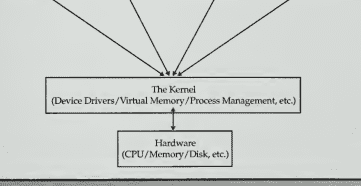

图 10-1. Linux 内核如何融入完整系统的视觉表示。

## 查找内核源代码

你的 Linux 发行版可能拥有其安装的具体内核的源代码，无论该版本是什么。如果你发现需要下载其他（可能更新的）版本，查找源代码的第一个地方是官方内核网站：http://www.kernel.org。该网站列出了镜像内核源代码的网站，以及几个免费工具和通用实用程序。

在网站的内核下载链接下，你会找到一个基于国家代码的镜像网站列表。虽然你可以连接到*任何*一个网站，但留在*你自己*所在的国家通常会获得最佳性能。访问 http://www.xz.kernel.org，其中 *xz* 是你所在国家的互联网国家代码。对于美国，该地址是 http://us.kernel.org。

> 注意：由于在线信息系统如何在多个站点之间分配负载，你每次访问时可能会看到不同的*网页*。不要担心——所有别名每晚都会同步。只需跟随链接到存储你感兴趣的内核副本的目录即可。

### 获取正确的版本

网站列出的*可用*内核将包含 v1.0、v1.1 等文件夹；以及 v2.2、v2.3 等。在你遵循自然倾向获取最新版本之前，请确保你理解 Linux 内核版本系统是如何工作的。

由于 Linux 的开发模式鼓励公众贡献，内核的最新版本*必须*随时对每个人开放。然而，这带来了一个问题：正在进行重大更新的软件可能不稳定，且未达到生产质量。

为了解决这个问题，早期的 Linux 开发者采用了一种系统，使用奇数内核（1.1、1.3、2.1、2.3 等）来表示设计与开发周期。因此，奇数内核带有免责声明，表明它们可能*不*稳定，且*不*应用于可靠性至关重要的情况。

另一方面，偶数内核（1.0、1.2、2.0、2.2 等）*被认为*已准备好用于生产系统。它们已允许在公众的使用（和审查）下成熟。

除非你喜欢生活在技术前沿（我们中的一些人确实如此），否则你会想要获取最新的偶数内核。从顶级内核目录来看，这意味着你将进入 v2.2 目录。在本章中，我们将使用 linux-2.2.10.tar.gz。

## 解压内核源代码

直到现在，你看到的大多数软件包都是文件扩展名为 .rpm 的文件。你习惯了使用随系统提供的工具之一（如 gLinux 或 gNorpm）来安装软件包。内核源代码有点不同，需要更多的用户参与。让我们一步步来解压内核。

你将从移除现有的树开始，以便如果新版本不起作用，你可以回退到它。旧树安全后，你将为你要解压的 Linux 版本创建一个新目录。只有在那之后你才准备好解压它。总的来说，这是一个非常直接的过程。

在本章的其余部分，我们将假设你正在 /usr/src 目录下工作。这是内核源代码树的传统位置。

保存当前源代码树。在解压新的源代码树之前，请保存并重命名当前的树。在 /usr/src 的目录树中，你会看到一个名为 linux 的目录。

```bash
[root@ford src]# ls -l
total 2
drwxr-xr-x 3 root     root      1024 Jun 10 09:33 linux
-rw-r----- 1 root     root     11292345 Jun  6 21:34 linux-2.2.10.tar.gz
drwxr-xr-x  7 root     root      1024 Jun 10 09:36 redevat
[root@ford src]#
```

linux 目录中包含当前的源代码树。（请注意，包括 Red Hat 在内的一些发行版默认不安装完整的源代码树。只安装了开发所需的必要文件。）升级的安全路径是将现有目录重命名为带有表示其关联版本号的后缀。使用 uname 命令找出当前版本号，如下所示：

```bash
[root@ford src]# uname -r
2.2.5-15
[root@ford src]#
```

在这种情况下，我们要将 linux 目录重命名为 linux-2.2.5-15。

```bash
[root@ford src]# mv linux linux-2.2.5-15
```

> 注意：如果之前有人更新了正在运行的内核，那么正在运行的内核可能与 /usr/src/linux 中的源代码不匹配。在这种情况下，你可以通过查看 /usr/src/linux 目录中的 Makefile 文件来了解内核版本。在文件顶部你会看到三个标识值：version、patch level 和 sublevel。如果 version=2，patch-level=3，且 sublevel=30，则你的内核版本为 2.3.30。

### 修改目录结构

现在利用这个机会为你的目录结构增加一些清晰度。在我们的例子中，我们必须使用 *uname* 命令来查找内核的当前版本，从而确定 *linux* 目录的名称。这在第一次时工作得相当好。然而，如果你需要多次升级并希望保留旧的内核源代码，你会想要找到一种更好的方法来跟踪目录与内核版本之间的关联！

因此，与其创建一个名为 *linux* 的新目录，我们将利用我们知道我们正在处理 2.2.10 内核这一事实。我们将目录命名为 *linux-2.2.10*。

这种命名约定有一个小陷阱。我们下载的内核会自动解压到一个名为 *linux* 的目录中。此外，系统中已存在的*开发*工具期望某些文件位于 */usr/src/linux*，而不是 */usr/src/linux-2.2.10*。因此，我们使用符号链接，如下所示：

```
[root@ford src]# mkdir linux-2.2.10
[root@ford src]# ln -s linux-2.2.10 linux
[root@ford src]# ls -l
total  3
lrwxrwxrwx   1 root     root         12 Jul  6 21:23 linux -> linux-2.2.10
drwx------  2 root     root         1024 Jul  6 21:23 linux-2.2.10
drwx------  1 root     root         11292245 Jul  6 21:34 linux-2.2.10.tar.gz
drwxr-xr-x   3 root     root         1024 Jun 10 09:33 linux-2.2.5-15
drwxr-xr-x   7 root     root         1024 Jun 10 01:36 reddot
```

### 解压内核

现在是重头戏：解压内核本身。这是使用 **tar** 命令完成的：

```
[root@ford src]# tar -xf linux-2.2.10.tar.gz
```

你会听到硬盘转动了一会儿——毕竟这是一个大文件！在一台配备合理快速 IDE 硬盘的 Pentium II-350MHz 上，这一步只需不到 2 分钟。

# 构建内核

现在，你拥有一个已解压的内核树，随时准备进行配置。在本节中，我们将回顾配置内核的过程。这与 Windows NT 等操作系统形成对比，后者是预先配置好的，因此可能包含许多你并不需要的功能支持。

- Linux 的设计哲学允许个人决定内核的重要部分。（如果你没有 SCSI 子系统，浪费内存去支持它有什么意义？）这种个性化的设计有一个重要的好处，即允许你精简功能列表，使 Linux 能够在功耗较低的系统上以同样的优秀表现运行……


lent performance. You may find that a box incapable of supporting Windows NT Server is more than enough for a Linux server.

构建内核需要两个步骤：配置和编译。由于 Linux 内核发行版的快速演进，本章将不会深入探讨配置的具体细节。然而，一旦你理解了基本流程，你就应该能够将其应用于不同版本。为了便于讨论，我们将引用上一节中解包的 v2.2.10 内核作为示例。

## `make xconfig` 流程

构建内核的第一步是配置其包含的功能。通常，你期望的功能列表将基于你需要支持的任何硬件。当然，这意味着你需要一份该硬件的列表。以下命令将列出通过 PCI 总线连接到系统的所有硬件：

```
[root@ford src]# cat /proc/pci
```

有了这份硬件列表，你就可以开始配置内核了。首先使用 *startx* 命令启动 X-Windows。一旦 X-Windows 启动并运行，输入以下命令：

```
[root@ford ~]# cd /usr/src/linux
[root@ford linux]# make xconfig
```

第二条命令调用了 *make* 实用工具。这个开发工具帮助你创建描述编译程序所需所有步骤的脚本，并且与许多为 UNIX 其他用户设计的优秀工具一样，*make* 也找到了其他用途。其中之一就是用它来编译和运行 GUI 配置工具。也存在非 GUI 工具，可以使用 *make config* 或 *make menuconfig* 命令启动。

*make xconfig* 命令会显示一个如图 10-2 所示的窗口。在这个初始窗口中，你将看到所有顶级配置菜单。通过单击按钮，你可以打开 *子菜单*，其中列出了你可以启用的所有具体功能。大多数选项都有默认设置，但建议你审查所有设置，以确保 *它们* 按预期设置。

当你浏览完所有菜单后，单击保存并退出按钮。

## 内核功能与模块

图 10-3 展示了配置工具中的“常规设置”子菜单。前三列包含选项按钮 Y（是）、M（模块）和 N（否）。第四列包含相关选项的名称，第五列提供了一个帮助按钮，点击它将弹出一个解释该功能的相关窗口。

回答“是”或“否”以启用或禁用内核功能很简单，但让我们仔细看看非常酷的 *模块* 配置选项。作为系统管理员，你当然会发现有些情况，你只需要内核功能在极短的

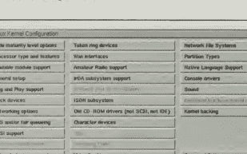

图 10-2. Unix 内核配置工具

时间内。 （一个例子是对软盘的支持；你很少需要这个功能，但拥有它仍然是个好主意。另一方面，启用该支持意味着内核需要更多的内存空间，这意味着留给应用程序的空间更少。）

借助模块系统，内核设计者创建了一种方法，使内核的部分，即称为模块的部分，可以根据需要动态地加载和卸载。因此，不常用的功能可以启用，但在不使用它们时不会浪费内存。谢天谢地，内核可以自动确定何时加载什么；你享受简化的运行好处，而不必承担额外的管理任务负担。

> **注意：** 传统上，内核被编写为要求所有组件，无论使用频率如何，始终驻留在内存中。然而，今天的典型 Linux 内核仅在内存中保留系统绝对核心的部分，这部分总是需要的。设备驱动程序和某些网络功能现在作为模块支持。

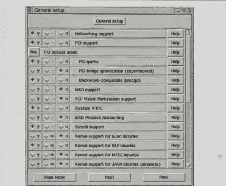

图 10-3. 内核配置工具中的常规设置子菜单

自然，并非所有东西都适合编译为模块。内核在加载和卸载模块之前必须知道一些事情，例如如何访问硬盘和解析文件系统。如果你不确定某个特定功能是否可以编译为模块，请尝试看看。只要你有一种方法可以访问系统配置（我们将在本节稍后讨论），你始终可以回去并将任何配置选项中的“模块”改为“是”。

由于 Linux 发行版不断演进，新的和变更的内核选项经常出现，因此不可能审查每一个设置。我们将在这里查看顶级菜单，这些菜单变化不大。

## 代码成熟度级别选项

此菜单只有一个选项：你是否希望访问最新和最棒（因此可能是实验性的）内核开发？你对这个问题的回答决定了菜单其余部分中可用的项目。显然，生产服务器不应该运行实验代码。另一方面，如果你计划摆弄桌面上的系统并且愿意承担一些风险，那么实验代码可能会提供一些有益且有趣的功能。（通常，即使是实验代码也足够稳定，可用于日常工作。发布的很少导致系统崩溃——但确实会发生。）

## 处理器类型和功能

这是另一个相对不言自明的设置项列表。2.2.10 内核只有四个问题：

- 你正在运行什么类型的处理器？
- 你是否需要数学仿真？（在 386、386SX 或 486SX 系统上运行内核时是必需的——是的，它们仍然存在！）
- 你想利用内存寄存器吗？
- 你希望内核具有 SMP 芯片支持吗？（这让你可以利用具有多个 CPU 的系统。）

## 可加载模块支持

这些问题决定了你是否想要支持前文所述模块。除非你有特定需求需要避免它们，否则你应该回答这一系列问题的“是”。

## 常规设置

在内核配置的全局方案中，这个菜单至关重要。你在这里的设置决策将启用或禁用其他项目，因此请仔细选择。

除了二进制文件类型支持项外，所有选项都是不言自明的。不久前，编译后的程序存储在一个名为 a.out 的文件格式中。不幸的是，当涉及到共享库时，这种方案有严重的限制，随着 UNIX 的演进，这变得越来越成为一个问题。ELF 格式被创建以解决这些限制并做得更多。Linux 目前使用 ELF 二进制格式用于其所有程序。你的系统不太可能需要 a.out 支持，你可以安全地对该选项说“否”。

## 即插即用支持

有时，这个功能被更亲切地称为“即插即祈祷支持”（Plug and Pray Support）。Linux 对 PnP 设备的支持确实有效；然而，基于 PC 的硬件性质使其不可靠。一般来说，定义你从系统中需要什么比依赖 PnP 为你找到它更安全。

## 块设备

此菜单列出了 Linux 对硬盘和 CD-ROM 等设备的选项支持，包括许多特定于芯片的选项。除非你确定你的特定芯片组，否则你会希望保留这些增强设置。Linux 的默认行为应该工作得很好。

## 网络选项

至少，你应该启用 UNIX 域套接字和 TCP/IP 网络选项。

Linux 最大的成就之一是它对复杂网络配置的支持。事实上，设计路由器、交换机等商用网络设备的公司通常会检查 Linux 代码。不久前，一家主要网络制造商宣布其最新产品实际上基于 Linux！探索网络选项的细节超出了本章的范围。然而，一般来说，我确实高度建议任何寻求通用网络解决方案的人在投资昂贵的商业解决方案之前，看看 Linux 提供了什么。

## QoS 和公平排队

QoS（服务质量）是 Linux 内核的一个高级网络功能。它允许你指定在数据包发送前如何优先级化每个数据包，让你指定各种服务级别。除非你确切知道在这个功能列表中想要什么选项以及使用它们的后果，否则最好保持这些设置不变。

## SCSI 支持

设置这些选项以将 SCSI 支持添加到 Linux 中。如果你确实需要 SCSI 支持，启用详细错误报告非常值得所需的额外内存——尤其是当你正在跟踪棘手的 SCSI 错误时。

## SCSI 低级驱动程序

如果你在之前的菜单中启用了 SCSI 支持，现在你需要指定你系统的 SCSI 卡。一些卡提供额外的可配置项，例如 Adaptec AIC7xxx 支持。除非你确定你想要的值，否则将这些设置保持默认。

## 网络设备支持

与 SCSI 子系统一样，网络子系统需要为网卡设置驱动程序。这个卡列表放置得有点奇怪，但无论它们是否可用，你都可以看到所有选项，因此选择你的卡并不困难。

如果你认为可能需要来自不同制造商的第二个网络接口卡，或者你只是想预见到可能用其他东西替换该卡，你可以指定对多个卡的支持。当内核加载时，它将自动探测所有它支持的卡，并为每个它发现的卡启用驱动程序。

## 业余无线电支持

希望将 Linux 带入野外？令人惊讶的是，你仍然可以通过业余无线电驱动程序保持与网络的连接。这些设置允许你配置一个点对点链接，TCP/IP 可以位于其上。有关更多细节和相关网站，请阅读此菜单中所有选项的帮助信息。

## IRDA 支持

对红外设备的支持现在是 Linux 的标准部分，这对于拥有 IR 端口的笔记本电脑用户来说特别有用。如果你决定尝试一下，请阅读随 Linux 内核源代码提供的 /usr/src/linux/Documentation/networking/irda.txt 文件。


## ISDN 子系统
如果您希望利用 ISDN 调制解调器的功能，请选择这些选项。与前面的某些菜单不同，ISDN 支持项并不独立于设备驱动项，因此请谨慎设置。

## 旧式 CD-ROM 驱动程序
你还记得 CD-ROM 尚未使用 IDE 接口的日子吗？Linux 在那个时期就已经存在了，当时编写了许多设备驱动程序来处理这种介质。如果你正在较旧的系统上安装 Linux，可能会发现这些设置非常有用。

## 字符设备
此菜单涵盖一类通用设备，它们每次向系统传输一个字节的数据（这与像硬盘这样以字节块传输数据的设备形成对比）。你可以在这里找到串行端口、终端和看门狗定时器的支持。

## 鼠标
此菜单涵盖对典型 PC 鼠标的支持。

## 看门狗卡
看门狗卡是连接到系统电源或复位按钮的特殊工具。内部运行有一个小定时器，必须在到期前复位；否则，系统将被强制重启。（定时器复位通常通过软件完成。）这种定时器功能允许在系统崩溃严重到系统无法自我保护并继续运行时进行自动重启。远程和高使用率系统必须配备看门狗卡。请确保你购买的设备包含在此菜单中！

## Linux 视频
不要将这些驱动程序与 X-Windows 所需的常规视频支持混淆。此菜单中列出的卡提供音频/视频捕获和叠加功能。

## 游戏杆支持
如果你打算在系统上玩游戏，请编译这些设置。

## FTAPE，软盘磁带设备驱动程序
这是旧系统的又一个遗留物。在 Zip 磁盘和 PC 网络备份解决方案出现之前，任何想要备份 DOS 系统的人都需要连接一个磁带驱动器。最经济的选择是通过软盘驱动器接口连接到系统。此类设备仍在使用中，但如果你不需要此设备驱动程序，可以安全地忽略此菜单。

## 文件系统
除了其原生的 ext2 文件系统外，Linux 还支持大量文件系统。这对于非 PC 安装特别有用，例如使用 Sun SPARC 或 Apple Macintosh 的系统。通常，如果你不识别某个特定项，或者文件系统不是你的硬件原生的，你可以禁用它。你必须启用的唯一文件系统是对 ext2 的支持。

> **警告：** 虽然有一个选项可以将 ext2 编译为模块，但不要这样做！内核在加载附加模块之前，必须知道如何从 ext2 文件系统读取模块！

## 网络文件系统
这些选项提供基于网络的文件系统支持，如 NFS、NCP 和 SMB。如果你正在与其他 UNIX 系统协作，请确保支持 NFS。如果你正在与基于 Windows 的系统协作，你将需要支持 SMB。而基于 Netware 的系统将需要支持 NCP。（但请记住，仅仅因为你的网络使用 Netware 并不意味着你必须支持 NCP。你可能只是觉得它方便而已。）

## 分区类型
如果 Linux 需要与必须使用自己分区方案的另一个系统共享磁盘，你需要启用对该特定方案的支持。然而，如果你的 Linux 系统是独立的，你可以安全地忽略这些设置。

## 本地语言支持
本地语言支持 (NLS) 在你需要提供对语言特定字符和按键的轻松访问时非常有用。默认的语言支持是英语。除非你需要其他选项，否则你可以安全地忽略它们。

## 控制台驱动程序
随着 Linux 增强其对跨平台环境的适应性，为多种类型的控制台提供了更多选项。默认情况下，Linux 支持 VGA 控制台，这通常是 PC 用户所需的全部内容。如果你需要 Linux 在其他控制台上显示，请选择此菜单中的支持。

## 声音及额外低级声音驱动程序
这两个菜单包含声卡及其功能的设置。这让你可以利用 Real Audio 播放器，播放 MP3 文件等等。

## 内核开发
除非你计划自己进行内核开发，否则请对此问题回答“否”。

## 编译内核
内核构建阶段的这一部分迄今为止是最简单的，但它也是最耗时的。编译本身分为三个阶段：第一阶段创建依赖树，这是一种委婉的说法，意味着系统确定哪些文件需要编译，哪些可以忽略。第二阶段是清理。此特定树中任何以前的编译都会被整理，旧文件被移除。即使树是全新的，包含此清理步骤也无害。最后一步是编译本身。一旦开始，最后这一步就不需要任何关注。

由于需要编译的代码量很大，请做好至少等待几分钟的准备。快速的 Pentium 基系统可能需要四到五分钟以上才能处理完整个源代码。

以下是执行编译阶段的命令。命令中的编译阶段由分号分隔：

```bash
[root@ford linux]# make dep;make clean;make zImage;make modules;make modules_install
```

最后阶段的开始包括 `zImage` 参数，以便告知系统压缩最终的内核，使其在启动时占用更少的空间（对于基于 PC 的 Linux 系统是必需的）。

> **提示：** 如果你发现你的内核仍然太大，请尝试使用 `make bzImage` 代替仅 `make zImage`。这种更具侵略性的压缩方案会使启动时间稍长，但在 Pentium 级系统上差异几乎不可察觉。

## 安装内核
现在你拥有了它：一个完全编译好的内核，只等待安装。你现在可能有一些问题：编译好的内核究竟在哪里，我该把它安装到哪里去？

- 第一个问题很容易回答。假设你有一台 PC 并且正在 /usr/src/linux 目录中工作，编译好的内核将被命名为 `**/usr/src/linux/arch/i386/boot/zImage**`。该文件的映射文件将是 `*/usr/src/linux/System.map*`。安装阶段需要这两个文件。

> **注意：** 如果你执行了 `make bzImage` 而不是 `make zImage`，编译好的内核将是 `*/usr/src/linux/arch/i386/bzImage*`。

现在，让我们安装编译好的内核。首先将 zImage 文件复制到 /boot，并将 zImage 重命名为

```bash
vmlinuz-x.x.xx
```

其中 x.x.xx 是内核的版本号。对于本章中使用的示例内核，它将是 vmlinuz-2.2.10。因此，我们示例的准确命令如下：

```bash
[root@root linux]# cp /usr/src/linux/arch/i386/boot/zImage /boot/vmlinuz-2.2.10
```

> **注意：** 将内核图像命名为 vmlinuz-2.2.10 的决定在一定程度上是任意的。这是方便的，因为内核图像通常被称为 vmlinuz，且版本号的后缀在你有多个内核可用时很有用。当然，如果你想拥有同一内核的多个版本（例如，一个支持 SCSI，另一个不支持），那么你需要设计一个更具代表性的名称。

可读的名称，使调试更容易。虽然这主要是为了开发人员的利益，但在你报告问题时也很方便。

使用与内核图像本身相同的约定，像这样复制 *System.map* 文件：

```bash
[root@ford linux]# cp /usr/src/linux/System.map /boot/System.map-2.2.10
```

有了合适的文件就位，你准备好编辑 *lilo.conf* 文件，使系统在启动时将这些内核识别为选项。有关 *lilo.conf* 文件格式的详细信息，请参阅第 7 章。让我们考虑一个原始配置，其中此内核将被标记为 *linux-2.2.10*，并且 *df /boot* 命令（参见第 6 章）告诉我们图像位于 */dev/hda1* 分区。我们将在 *lilo.conf* 文件中插入以下行：

```
image=/boot/vmlinuz-2.2.10
    label=linux-2.2.10
    root=/dev/hda1
    read-only
```

要使此内核默认启动，请确保以下行

```
default=/boot/vmlinuz-2.2.10
```

出现在文件的顶部附近。

现在是最激动人心的部分：运行 *lilo*！

```bash
[root@ford linux]# lilo
Added  linux-2.2.10 *
Added  linux
Added  dos
[root@ford linux]#
```

*lilo* 的输出包含由 */etc/lilo.conf* 文件告知它的启动选项。将启动的默认内核是第一个（带有 '*' 标记的那个）。重启并让它飞吧！注意：关于 LILO 的完整详细信息，请参阅第 7 章。

## 它不起作用！
你说内核*没有*飞起来？相反，它在启动过程中*冻结*了？或者它完全启动了，但什么都没起作用？首先，*不要*恐慌。这种问题每个人都会遇到，即使是专业人士。毕竟，他们更有可能先尝试未测试的软件。所以不要恐慌；这种情况绝对是可以修复的。

第一件事：注意我们在 */etc/lilo.conf* 文件中添加新条目时，*没有*移除以前的条目。我们现在将使用它。重启，并在 LILO: 提示符处输入我们*知道*可以正常工作的前一个内核的名称。这通常被称为 *linux*。此操作应使您回到已知的系统状态。

现在回到内核配置，验证所选的所有选项是否适用于你的系统。例如，你是否错误地启用了 Sun UFS 文件系统的支持，而不是 Linux 的 *ext2* 文件系统？你是否设置了任何使选项失


……是否依赖于其他选项的设置？请记住使用配置界面中每个内核选项旁边的“帮助”按钮，确保你理解每个选项的功能，以及你需要做些什么才能使它正常工作。

当你确信设置正确时，再次通过编译过程并重新安装内核。记得重新运行 `lilo` 以使更改生效。重启并再次尝试。

别担心，每次编译内核，你都会变得更熟练。当你犯错误时，回过头来查找并修复它会变得更容易。

## 修补内核（PATCHING THE KERNEL）

与其他操作系统一样，Linux 会通过升级来修复漏洞、提高性能并添加新功能。这些升级以两种形式出现：完整的新内核版本和补丁。对于至少没有下载过完整内核的人来说，完整的新内核版本是一个不错的选择。而对于那些已经下载过完整内核的人，补丁是一个更好的解决方案，因为它们只包含更改后的代码。

你可以将补丁类比为 Windows 的热修复（HotFix）或服务包。单独来看，它们是无用的；但当添加到现有版本的 Windows 中时，你（希望如此）会得到一个改进后的产品。

你可以在许多互联网网站上了解有关内核新补丁的信息。你的发行版供应商的网站是一个很好的起点；它列出的不仅是内核更新，还包括发行版其他部分的补丁。另一个来源是位于 [http://www.kernel.org](http://www.kernel.org/) 的官方 Linux 内核归档库。在那里，我们获取了作为安装章节示例的完整内核。

在本节中，我们将应用一个补丁，将我们安装的 2.2.10 内核更新到 2.2.11。

### 下载和解包补丁

补丁文件位于与内核下载相同的目录中。这适用于 Linux 的每个主要版本；因此，用于将 2.2.10 更新到 2.2.11 的补丁位于 Linux 内核 FTP 站点上的 `/pub/linux/kernel/v2.2/` 目录中。同样，从 Linux 2.3.0 到 2.3.1 的路径位于 `/pub/linux/kernel/v2.3/` 目录中。

每个补丁文件名前缀为“patch”，后缀为补丁所安装的 Linux 版本号。请注意，每个补丁仅将 Linux 提高一个版本；因此，`patch-2.2.11` 文件只能应用于 Linux-2.2.10。如果你拥有 Linux-2.2.9 并希望将其升级到 2.2.11，你需要两个补丁，即 `patch-2.2.10` 和 `patch-2.2.11`。

补丁文件在 FTP 服务器上以 gzip 压缩格式存储。因此，在本示例中，我们将下载 `patch-2.2.11.gz`。

从 FTP 站点获取文件后，将其移动到 `/usr/src/` 目录（假设你在上一节中将内核解包到了 `/usr/src/linux`）。使用 `gzip` 命令解压缩补丁：

```
[root@ford src]# gzip -d patch-2.2.11.gz
```

其中 **patch-2.2.11.gz** 是你的补丁文件的名称。这会在同一目录下生成一个名为 **patch-2.2.11** 的文件。不必担心需要删除 **patch-2.2.11.gz**；**gzip** 命令会自动为你删除原始文件。

现在，你已准备好应用补丁。

### 应用补丁

> **注意：** 本节假设你已按照本章前面几节的说明下载并解包了 Linux 内核。本示例中的补丁 **patch-2.2.11** 只能应用于 **Linux-2.2.10**。如果你正在修补其他版本，请在发出命令时记得使用相应的版本号。

要将 **patch-2.2.11** 应用于 **Linux-2.2.10**（应位于 **/usr/src/linux** 目录中），请发出以下命令：

```
[root@ford src]# patch -p0 < patch-2.2.11
```

屏幕上会打印出一系列文件名。这些文件中的每一个都已通过补丁文件更新。如果升级过程中出现任何问题，你将在此处看到报告。

### 如果补丁成功……

如果补丁成功且未收到错误，你几乎就完成了！只需重新编译内核。如果你不想改变内核的配置，你可以简单切换到 **/usr/src/linux** 目录并按如下方式重新编译内核：

```
[root@ford linux]# make dep;make clean;make image;make modules;make modules_install
```

编译完成后，请按照“安装内核”一节的说明进行操作。

> **注意：** 如果你编译的内核太大，别忘了可以使用 **make bzImage** 代替。

### 如果补丁未成功……

如果在修补内核的过程中出现错误，请不要绝望。这通常意味着以下两种情况之一：

- 补丁版本号无法应用于内核版本号（例如，你试图将 **patch-2.2.11** 应用于 **Linux-2.2.9**）。
- 内核源代码本身已更改。这种情况发生在忘记自己做过更改的开发者身上！

修复这两种情况的最简单方法是删除位于 **/usr/src/linux** 中的内核，并再次在那里解包完整内核。这将确保你拥有一个纯净的内核。然后应用补丁。虽然繁琐，但如果你做过一次，第二次就会更容易、更快捷。

## 总结（SUMMARY）

在本章中，我们讨论了配置和编译 Linux 内核的过程。这并不是一件简单的事，但这样做赋予你对计算机进行精细控制的能力，而这在大多数其他操作系统中是不可能的。编译内核是一个重要但直接的过程。Linux 开发社区提供了出色的工具，使这一过程尽可能无痛。

除了编译内核，我们还通过 Linux 内核网站 http://www.kernel.org 上可用的补丁，介绍了使用补丁升级内核的过程。

当你第一次编译内核时，如果可能，请在非生产机器上操作。这给了你时间仔细调整众多可用的操作参数。这也意味着如果出现问题，你不会烦扰你的用户！

对于好奇内核内部机制的程序员来说，有许多参考资料可用。（当然，源代码本身是最终文档。）不幸的是，最近出版的关于 Linux 内核的书籍仅涵盖了 2.0 系列。自那时以来，许多组件发生了重大变化；尽管如此，现有的书籍提供了一般性的指导方向。一个特别好的资源是 Alessandro Rubini 著的、由 O'Reilly and Associates 出版的 *Linux Device Drivers*（Linux 设备驱动程序）。它专注于编写设备驱动程序，但也包含大量通用内核信息。

### 第 11 章

## 保护单个服务器

你不需要费大力气就能发现，有人又发现了一种新的且令人兴奋的方式来入侵你的系统。诸如 http://www.securityfocus.com 这样的网站以及如 BugTraq 这样的邮件列表定期向公众公布这些新的漏洞利用。而让系统管理员处境更加麻烦的是“脚本小子”（script kiddies）的泛滥。这些人本身不具备入侵其他网站的技术知识；他们使用预先构建的脚本，通常只是为了炫耀给朋友看并制造麻烦。

在本章中，我们讨论保护服务器的基本技术。如果你遵循这些提示，你更有可能挡脚本小子。但要提醒的是：没有系统是完美的。每天都会有新的漏洞被发现，新的攻击工具发布的频率也比我们愿意想象的要高得多。保护你的系统很像对抗疾病——只要你保持基本的卫生习惯，你可能就是安全的，但你永远不可能免受侵害。

> **注意：** 在我被黑客群体痛骂之前，让我澄清一些事情。黑客并不邪恶。大多数黑客（通常）不会恶意入侵系统。黑客表现出令人印象深刻的理解系统内部结构的能力，以及为棘手问题寻找巧妙解决方案的能力。事实上，针对损坏系统的快速补丁通常被称为“黑客补丁”（hacks），因为它们巧妙但不一定干净或规范。它们只是有效，并应因其本质而受到赞赏。

那么，媒体不断提到的这些“恶棍”是谁呢？他们是破解者（crackers）——那些“破解”系统并完全打算做不友好事情的个体。他们让黑客名声扫地，并让整个互联网变得令人烦恼的多疑。如今几乎所有的网络管理教材都有像本章一样的章节，解释你需要关闭哪些新的、对网络友好的功能，以便破解者无法滥用它们。由于 Back Orifice 等对破解者友好的程序，IT 经理必须始终保持警惕，保护其 Windows NT 系统免受未经授权的访问。这是我们不得不面对的悲哀现实。

## TCP/IP 与网络安全

本章假设你有在 TCP/IP 网络上配置系统的经验。由于这里的重点是网络安全而不是网络入门，本节仅讨论影响系统安全性的 TCP/IP 部分。如果你好奇 TCP/IP 的内部工作原理，务必阅读后面关于 TCP/IP 及相关主题的良好参考资料的章节。

### 端口号的重要性

IP 网络上的每个主机至少有一个 IP 地址。此外，每个基于 Linux 的主机都在运行许多独立进程。每个进程都有潜力成为网络客户端、网络服务器或两者兼有。显然，如果一个数据包的目标是


仅凭 IP 地址无法标识，操作系统将无法知道应将数据包的内容传递给哪个进程。

为了解决这个问题，TCP/IP 使用了一个用于标识 **TCP** 或 **UDP** 端口的组件。从一个主机到另一个主机的每个连接都有一个源端口和一个目的端口。每个端口都用一个 0 到 65535 之间的整数进行标记。

为了标识两个主机之间所有可能的独特连接，操作系统会跟踪四项信息：源 IP 地址、目的 IP 地址、源端口号和目的端口号。这四个值的组合对于所有主机间连接来说都是唯一的。（实际上，操作系统跟踪了大量连接信息，但仅这四项元素就足以唯一标识一个连接。）

发起连接的主机会指定目的 IP 地址和端口号。显然，源 IP 地址已经是已知的。但是，源端口号——即使连接具有唯一性的值——是由源操作系统分配的。它会搜索其已打开连接的列表，并分配下一个可用的端口号。根据约定，这个数字总是大于 1024（端口号 0 到 1023 保留给系统使用）。从技术上讲，源主机也可以自行选择其源端口号。不过，为了做到这一点，没有其他进程必须先占用该端口。通常，大多数应用程序会让操作系统为它们挑选源端口号。

了解这一机制后，我们就能看出源 IP 如何能向目的主机 B 上的单一服务打开多个连接。主机 B 的 IP 地址和端口号将始终保持不变，但主机 A 的端口号在每个连接中都会不同。因此，源和目的 IP 及端口号的组合（四元组）是唯一的，两个系统之间可以拥有多个独立的数据流（连接）。

为了让服务器提供服务，它必须运行监听特定端口号的程序。其中许多端口号被称为知名服务，因为与某个服务相关的端口号是已批准的标准。例如，端口 80 是 HTTP 协议的知名服务端口。

在本章稍后，我们将查看 `netstat` 命令，它是网络安全的重要工具。当你牢固理解了端口号代表什么之后，你就能轻松识别和解读 `netstat` 命令提供的网络安全统计数据。

## 获取 TCP/IP 的更多信息

如前所述，本书并未包含 TCP/IP 内部机制的细节。但从理解网络及其安全问题的角度来看，了解 TCP/IP 协议族的知识对系统管理员来说至关重要。以下是几本深入探讨这一主题的优秀书籍的建议。

特雷尔·帕内尔（Terrell Parrnell）和克里斯托弗·诺尔（Christopher Null）撰写的《**网络管理员参考指南**》（Oborne/McGraw-Hill 出版）是一个良好的起点。这本书从高层视角讨论网络管理，本身就是一本扎实的著作（尽管它非常侧重于 NT 系统）。它讨论了 TCP/IP，但不会深入细节。

TCP/IP 的终极“圣经”（被全球各地的网络开发人员和管理员所引用）是 W. Richard Stevens 的《TCP/IP 详解》系列。这些书以详尽的细节带你深入了解 TCP/IP 及相关服务。作为一名系统管理员，你主要会对卷 1《协议》感兴趣，它涉及协议族并对 IP 堆栈给出了强有力的解释。如果你内心深处有个内核黑客，对 TCP/IP 实现感到好奇，不妨看看 Stevens 在卷 2《实现》中对 BSD 网络代码的逐行分析。（虽然 Linux 的网络代码与卷 2 中记录的代码鲜有相似之处，但其中的总体指导思想和哲学依然 invaluable。）

另一本优秀的书是克雷格·亨特（Craig Hunt）的《TCP/IP 网络管理》（O'Reilly & Associates 出版），它是一本扎实的网络管理参考书。它的主题范围比 Stevens 的卷 1 更广，但技术深度稍逊。

最后，如果你负责实施防火墙（我建议你这样做），O'Reilly & Associates 出版的一本关于防火墙设计的书《构建互联网防火墙》（由 D. Brent Chapman 等编辑）是一本好书。另外，由 Cheswick 和 Bellovin（他们构建了 AT&T 的第一个防火墙）撰写的《防火墙和互联网安全》也是一本有趣的书，尽管对于今天的典型网络基础设施而言，其实用性可能不高。

## 跟踪服务

服务器提供的服务是使其成为服务器的原因。这些服务是通过绑定到网络端口并监听传入请求的进程来完成的。例如，Web 服务器可能会启动一个绑定到端口 80 并监听下载网站页面请求的进程。除非有进程监听特定端口，否则 Linux 将简单地忽略发送到该端口的数据包。

> **注意：** 请记住，当一个进程向另一个服务器发出请求时，它也会在一个端口上打开连接。实际上，该进程正在监听来自该端口的数据。然而，在客户端，进程知道它与谁通信，因为它发起了请求。客户端进程将自动忽略任何不是从其连接到的服务器发出的、发送给它的任何数据包。

本节讨论 `netstat` 命令的用法，它是用于跟踪系统中网络连接（以及其他事项）的工具。毫无疑问，它是你武器库中用于故障排除安全性和日常网络问题的最有用调试工具之一。

### 使用 netstat 命令

为了跟踪哪些端口是打开的以及哪些端口有进程在监听，我们使用 `netstat` 命令。例如：

```
[root@ford /root]# netstat -anu

Active Internet connections (servers and established)
Proto Recv-Q Send-Q Local Address           Foreign Address         State
tcp    1   0 209.179.251.53:1297  199.184.252.5:80  CLOSE_WAIT
tcp    1   0 209.179.251.53:1296  199.184.252.5:80  CLOSE_WAIT
tcp    57  0 209.179.158.59:1167  199.97.226.1:21   CLOSE_WAIT
tcp    0   0 192.168.1.1:6000   192.168.1.1:1052  ESTABLISHED
tcp    0   0 192.168.1.1:1052   192.168.1.1:6000  ESTABLISHED
tcp    0   0 0.0.0.0:4243      0.0.0.0:*          LISTEN
tcp    0   0 0.0.0.0:1036     0.0.0.0:*          LISTEN
tcp    0   0 0.0.0.0:1035     0.0.0.0:*          LISTEN
tcp    0   0 0.0.0.0:1034     0.0.0.0:*          LISTEN
tcp    0   0 0.0.0.0:1033     0.0.0.0:*          LISTEN
tcp    0   0 0.0.0.0:1032     0.0.0.0:*          LISTEN
tcp    0   0 0.0.0.0:1031     0.0.0.0:*          LISTEN
tcp    0   0 0.0.0.0:1024     0.0.0.0:*          LISTEN
tcp    0   0 0.0.0.0:6000     0.0.0.0:*          LISTEN
tcp    0   0 0.0.0.0:80       0.0.0.0:*          LISTEN
tcp    0   0 0.0.0.0:1515     0.0.0.0:*          LISTEN
tcp    0   0 192.168.1.1:53   0.0.0.0:*          LISTEN
tcp    0   0 127.0.0.1:53     0.0.0.0:*          LISTEN
tcp    0   0 0.0.0.0:99       0.0.0.0:*          LISTEN
tcp    0   0 0.0.0.0:113      0.0.0.0:*          LISTEN
tcp    0   0 0.0.0.0:23       0.0.0.0:*          LISTEN
tcp    0   0 0.0.0.0:21       0.0.0.0:*          LISTEN
tcp    0   0 0.0.0.0:111      0.0.0.0:*          LISTEN
udp    0   0 0.0.0.0:1024     0.0.0.0:*          
udp    0   0 192.168.1.1:53   0.0.0.0:*          
udp    0   0 127.0.0.1:53     0.0.0.0:*          
udp    0   0 0.0.0.0:111      0.0.0.0:*          

[root@ford /root]#
```

默认情况下（无参数），`netstat` 将提供所有已建立的网络套接字和域套接字连接。这意味着我们不仅会看到实际通过网络工作的连接，还会看到进程间通信（从安全监控的角度来看，这些没有用）。因此，在上面的命令示例中，我们要求 `netstat` 显示所有端口（a），无论它们是正在监听还是已实际连接，针对 TCP（t）和 UDP（u）。我们还告诉 `netstat` 不要花时间从 IP 地址解析主机名（-n）。

在 `netstat` 的输出中，每一行代表一个 TCP 或 UDP 网络端口，如输出的第一列所示。Recv-Q（接收队列）列列出的数量


内核接收到但未被进程读取的字节数。接下来，Send-Q 列告诉我们发送到连接另一端的字节数，但尚未得到确认。

第四列和第六列对于系统安全来说是最有趣的。Local Address（本地地址）列显示了你自己服务器的 IP 地址和端口号。请记住，你的服务器将自身识别为 127.0.0.1、0.0.0.0 以及其正常的 IP 地址。在存在多个接口的情况下，每个正在监听端口都会显示在两个接口上，因此会表现为两个不同的 IP 地址。端口号通过冒号与 IP 地址分隔。在上述 netstat 输出示例中，一个以太网设备的 IP 地址为 192.168.1.1，而 PPP 连接的地址为 209.179.251.53。你的 IP 地址会根据你的配置而有所不同。

第五列 Foreign Address（外部地址）标识了连接的另一端。对于正在监听新连接的端口，默认值将是 0.0.0.0:*。这个 IP 地址没有什么意义，因为我们仍在等待远程主机连接到我们！

第六列告诉我们要看连接的状态。netstat 的 man 页面列出了所有状态，但你最常看到的是 LISTEN 和 ESTABLISHED。LISTEN 状态意味着你的服务器上有一个进程正在监听该端口并准备好接受新连接。ESTABLISHED 状态意思仅仅是——客户端和服务器之间已建立连接。

## netstat 输出的安全含义

通过列出所有可用的连接，你可以了解系统正在做什么的快照。你应该能够解释并证明列出的所有端口的合理性。如果你的系统正在监听一个你无法解释的端口，这应该会引起怀疑。

如果你一直将内存 shell 用于其他用途，并且没有记住服务及其相关端口号，你可以查看 /etc/services 文件来查找你需要匹配的详细信息。然而，某些服务（最著名的是那些使用 portmapper 的服务）没有固定的端口号，但是有效的服务。要查看与某个端口关联的进程，请使用 netstat 的 -p 选项。留意使用网络的奇怪或不寻常的进程。例如，如果 BASH shell 正在监听网络端口，你可以相当确定有异常情况发生。

最后，请记住你只关心连接的目的地部分；这告诉你要连接哪个服务以及它是否合法。不幸的是，netstat 并没有明确告诉我们谁发起了连接，但通过一点思考我们通常可以弄清楚。一般的经验法则是端口号大于 1024 的一侧是发起连接的一侧。显然，这个一般规则并不适用于通常在高于 1024 的端口上运行的服务，例如 X Windows（端口 6000）。

## 关闭服务

netstat 命令的一个用途是确定你的服务器上启用了哪些服务。使 Linux 开箱即用地更容易安装和管理，导致了越来越多默认设置是不安全的，因此跟踪服务变得尤为重要。

在评估哪些服务应该保留，哪些应该移除时，请回答以下问题：

- **我们需要这项服务吗？** 这个问题的答案非常重要。在大多数情况下，你应该能够禁用大量默认启动的服务。例如，独立 Web 服务器不应该需要运行 NFS。
- **如果我们需要这项服务，默认设置是否安全？** 这个问题也可以帮助你排除一些服务——如果它们不安全且无法使其安全，那么它们很可能应该被移除。例如，Telnet 服务通常是最早被移除的候选者，因为它要求通过互联网发送明文密码。
- **服务软件需要更新吗？** 所有软件都需要不时进行更新，例如 Web 和 FTP 服务器。这是因为随着功能的增加，新的安全问题会出现。因此，务必记住跟踪服务器软件的开发进展，并在安全公告发布后立即安装升级。

### 关闭 inetd 服务

要关闭通过 *inetd* 程序启动的服务，只需编辑 *file/inetd.conf* 配置文件并注释掉该服务。要将服务条目指定为注释，请在行首加上井号（#）。有关 inetd 的更多信息，请参见第 9 章。记得在对 *file/inetd.conf* 文件进行任何更改后，向 *inetd* 发送 HUP 信号。输入以下命令：

```bash
[root@localhost /root]# /etc/init.d/inetd reload
```

### 关闭非 inetd 服务

如果服务不是由 *inetd* 运行的，那么它很可能是由 *boot* 时启动的进程运行的。阻止这种情况发生的最简单方法是更改 *script*。转到 *file/etc/rc.d* 目录并查找指向启动脚本的符号链接。在其中一个 `rc` 目录中（有关启动脚本的信息请参见第 7 章），我将符号链接重命名为以 X 开头而不是 S。如果你决定重新启动服务，再次将其重命名为以 S 开头非常容易。如果你已经重命名了启动脚本但想要 *stop* 当前运行的进程，请使用 *ps* 命令查找进程 ID 号，然后使用 *kill* 命令实际终止进程。例如，以下是终止 *portmap* 进程的命令以及产生的输出：

```bash
[root@localhost /root]# ps aux | grep portmap
bin 255 0.0 0.1 1084 364 ? S 0u308 0:00 portmap
root 6834 0.0 0.1 1352 440 pts/0 S 01:55 0:00 grep portmap
[root@localhost /root]# kill 255
```

> 注意：一如既往，在终止进程之前，请务必确定你要终止的是什么，特别是在生产服务器上。

## 关于 syslog 服务的说明

*syslog* 是一个非 inited 服务，虽然会出现在 *netstat* 输出中，但可以安全忽略。从历史上看，该服务默认绑定到网络端口并监听网络消息以记录日志。由于通过网络记录任意消息存在危险，Linux 开发者添加了一种机制，使得 *syslog* 仅当使用 *-r* 选项启动时才记录来自其他主机的请求。默认情况下，*syslog* 不使用 *-r* 启动，因此你可以安全地让它在你的系统中保留。

## 监控系统

收紧服务器安全的过程不仅仅是为了保障你的服务器安全，也是为了让你有机会清楚地看到正常的服务器行为应该是什么样子。毕竟，一旦你知道正常的行为是什么，异常的行为就会像红肿的手指一样显眼（例如，如果你在设置服务器时关闭了 talent scanner，看到 talent 的日志条目意味着出了严重的问题！）。

用于执行监控的商业软件包确实存在，对于你的整个站点来说可能值得检查，但我们将把这些功能讨论留给 *Network World* 或 *PC Week*。这里，我们将看看其他各种优秀的工具，这些工具有助于你完成系统的监控。其中一些工具随所有 Linux 发行版提供；有些则不是。它们都是免费且容易获得的。

## 充分利用 syslog

在第 9 章中，我们探索了 *syslog*，这是将各种程序的消息保存为一组文本文件用于记录目的的系统日志记录器。到现在为止，你很可能已经看到了我们使用 *syslog* 获得的日志消息类型。这些包括与安全相关的消息，如谁登录了系统，他们何时登录，等等。

可想而知，分析这些日志以构建系统服务使用情况的延时影像图是可能的。这些数据也可以指出可疑的活动。

例如，为什么主机 *crackerpoisonothing-better-to-do.net* 在如此短的时间内发送了那么多 Web 请求？他在寻找什么？他是否找到了系统的漏洞？

## 日志解析

定期对系统日志文件进行检查是维护安全的重要组成部分。不幸的是，滚动浏览一整天的日志是一项耗时且无趣的任务，揭示的有意义事件很少。为了减轻繁重的工作，拿一本关于脚本语言（如 Perl）的书，编写小脚本解析日志。设计良好的脚本通过丢弃它识别为正常行为的内容并显示其他所有内容来工作。这可以将一天活动的数千条日志条目减少到可管理的几行。这是检测试图闯入和潜在安全漏洞的有效方法。希望，看着脚本小子试图并失败地突破你的防线会成为一种娱乐。


第 11 章：保护单台服务器

## 存储日志条目

遗憾的是，仅解析日志可能是不够的。如果有人入侵了你的系统，你的日志文件很可能已被妥善清除——这意味着所有这些优秀的脚本将无法为你提供任何信息。为了规避这一问题，可以考虑在网络中专门分配一台主机用于存储日志条目。配置 `/etc/syslog.conf` 文件，将其所有消息发送到此单一主机，并配置该主机使其仅监听 syslog 端口（514）。在大多数情况下，这就足以在集中位置收集到任何不良事件的证据。

如果你真的非常多疑，可以考虑将一台基于 DOS 的 PC 连接到日志主机的串口，并使用 Telix 等终端仿真软件记录发送到日志主机的所有消息。（你也可以使用另一台运行 minicom 处于日志模式的 Linux 机器——但请务必确保*不要*将这台第二台 Linux 机器连接到网络！如果你使用 COM1，请将 /etc/syslog.conf 配置为将所有消息发送到 /dev/tty50；如果你使用 COM2，则发送到 /dev/ttyS1。当然，也请勿将 DOS 文件连接到网络。）这样一来，即使日志主机也遭到攻击，日志文件也不会被销毁。日志文件将安全地存储在 DOS 系统上，除非物理接触，否则无法登录该系统。

为了获得最高程度的监控能力，请将一台并口打印机连接到 DOS 系统，并让终端仿真软件将接收到的串口所有内容回显到打印机上。这样，如果 DOS 系统故障或在攻击中受损，你将拥有日志的硬拷贝。（请注意，使用打印机记录日志的一个严重缺点是，你无法轻松搜索日志。如果你选择这种配置，建议同时也保留一份电子副本，以便更轻松地搜索。）

> **提示：** 考虑使用 *swatch* 之类的软件包，当检测到表明存在问题的日志条目时，向你发送寻呼消息。你可以在 http://www.stanford.edu/~atkins/swatch 上了解更多相关信息。

## 使用 MRTG 监控带宽

监控服务器上使用的带宽量会产生一些非常有用的信息。其实用性的最大用途在于证明升级的必要性。通过向管理层展示系统利用率水平，你正在提供硬性数据来支持你的主张。你的数据也可以轻松转换为图表（管理层喜欢图表）。监控带宽的另一个有用方面是识别系统中的瓶颈，从而帮助你更好地平衡系统负载。但绘制带宽图表最有用的方面是识别何时出现问题。

一旦你安装了 MRTG（多路由器流量图，可从 http://www.mrtg.org 获取）等软件包来监控带宽，你就会迅速得出你站点“正常”状态的标准。利用率的大幅下降或增加是需要调查的现象。检查你的日志，寻找包含异常或非常规条目的配置文件。

## COPS

COPS 工具（计算机预言家与密码系统）提供了一种简单且自动化的方法，用于检查系统中不寻常的设置。此类检查包括查找主目录中的 `setuid` 程序、主目录上异常的权限设置、使系统暴露给未授权外部访问的配置文件等等。

COPS 最重要的功能之一是它被设计为每晚自动通过 `cron` 条目运行（有关 *cron* 的更多信息，请参见第 9 章）。如果有需要报告的内容，报告将通过电子邮件发送给你。

你可以在 <http://ftp.cert.org/pub/tools> 研究和下载最新版本的 COPS。

## TripWire

TripWire 采用了一种非常多疑的安全方法。如果有变化发生，TripWire 会告诉你。这种全面的保护消除了某人向你的系统中放置“后门”或“定时炸弹”的机会。

TripWire 生成系统中每个文件的 MD5 校验和并保存它们。建议将此校验和信息存储在只读介质上。（随着低成本 CD-R 系统的普及，这种安排并不难以实现。）一旦存储准备就绪，你可以通过 `cron` 安排一个作业，该作业运行并比较系统中的所有文件与其已知的良好 MD5 校验和。差异将被报告。

这里的想法是你先执行安装，然后为网络部署准备系统。但在*实际*将系统连接到网络之前，你运行 TripWire 工具来生成并存储所有校验和。你可以确信你的 MD5 校验和列表在其只读存储位置是安全的。

当然，设置 TripWire 配置的过程是耗时的。然而，除了切断网络连接外，很难再比这更严格地加固系统了。

## SATAN

SATAN（系统管理员分析网络工具）于 1990 年代中期发布，当时媒体纷纷建议称其为黑客工具包。——但 SATAN 的作者 Dan Farmer 在多大程度上声明，它实际上是*系统管理员*而非恶人的黑客工具包。

SATAN 通过探测你网络中潜在的安全漏洞来工作。这个程序特别有趣，因为它可以从内部和外部针对你运行。从外部运行时，它是暴露防火墙缺口的一种有效方式；从内部主机运行时，它是对内部弱点的一次极佳调查。

尽管 SATAN 比较老旧，无法识别当今使用的许多新型攻击，但它确实执行了许多“转动门把手看看是否打开”式的检查，这些检查同样重要。你应该假设其他人会对你运行 SATAN，所以要确保你知道自己有哪些弱点，并尽快修复它们。

与 COPS 类似，SATAN 可从 ftp://ftp.cert.org/pub/tools 获取。

## 有用的网站和邮件列表

对于 TCP/IP 而言，可用的安全信息远比本章所能涵盖的要多得多。保持你自己和系统处于最新状态的最好方法是定期访问讨论此类问题的网站，并加入定期发布该领域发展动态的邮件列表。

### CERT

关于系统安全可靠且及时的信息，首要网站是计算机应急响应小组（CERT）。CERT 网站 http://www.cert.org 维护着频繁的通告和大量保护你站点的工具。更令人印象深刻的是 CERT 的电话响应团队，如果你不确定如何应对针对你站点的攻击，他们将帮助你处理。CERT 网页告诉你如何联系他们。

最起码，你应该加入 CERT 邮件列表或订阅 comp.security.announce 新闻组；那里是发送经过审核的 CERT 通告的地方。你很少会看到每月超过一两条通告，所以不用担心你的邮箱本来就已经很满了，还要被塞进更多内容！

### BugTraq

获取一般系统信息的另一个良好来源是 BUGTRAQ 邮件列表。此列表常有流量，但由于它是经过审核的，你不必担心无用的争吵会耗尽你的邮箱。讨论的内容并非专门关于安全，而是关于影响各类系统的严重错误。作为系统管理员，你还会在这里找到许多其他有用的信息。有关订阅 BUGTRAQ 列表的信息，请访问 http://www.securityfocus.com/forums/bugtraq/faq.html。你还可以在同一站点找到过往讨论的存档。

### Rootshell

http://www.rootshell.com 网站最近因定期公布的安全漏洞数量而获得更多媒体关注。此站点不运行邮件列表，但每月在此发布多达 30–40 个涉及各类操作系统的安全问题。许多报告都附带示例工具，帮助你测试系统可能存在漏洞的地方。


## 安全焦点

与 Rootshell 类似，Security Focus 网站（[http://www.securityfocus.com](http://www.securityfocus.com)）是一个全面披露与各操作系统相关的安全问题的站点。该网站维护活跃，其安全问题列表几乎每天都有更新。它还包含互联网上关于安全相关故事的链接。

## 杂项

在深入下一章之前，我想提出两个与 Linux 无关，但始终存在且将来也会持续存在问题的安全问题。

第一个问题是“模糊安全”（security through obscurity）。这个短语描述的是那些愚蠢地认为，只要不告诉任何人系统中有什么或某事是如何完成的，他们的系统就是安全的这类人的行为。这显然是错误的。程序可以被逆向工程分析，探针可以揭示比我们要展示的更多关于系统或网络内部的信息。为什么“模糊安全”行不通的经典例子是 PGP（Pretty Good Privacy，[http://www.pgp.com](http://www.pgp.com)）。由于其源代码，以及其底层算法已向全世界揭示并因此被无数密码学专家研究，PGP 被认为是最安全的信息存储手段。在此之前，没有任何专有加密系统达到过这种信任级别。

第二个问题是社会工程学：即潜在的入侵者在开始使用键盘之前先使用电话的过程。只要打几个电话，表现出一点点权威性，并向毫不怀疑的人索取信息，就可以学到惊人的东西。记者经常使用这种技术来获取新闻故事的内部消息，因为他们知道普通内部人员处理探测性问题的能力远低于公关代表。社会工程学也适用于询问密码、网络基础设施、操作系统等问题。

防止社会工程学突破你站点安全的唯一方法是确保你的系统用户受过教育并有所意识。他们应被告知不要向任何来电索取关键信息的人透露重要信息。政策无需复杂才能有效；例如，“MIS 部门绝不会询问你的密码。如果有人询问你的密码，请立即上报。”

安全是那些你无论说多少都不够的话题。在撰写本章时，我考虑过许多显然超出本书范围的主题。深入探讨其中大多数主题需要增加许多章节。

请不要在探索系统安全问题时不采取广泛的角色。这被认为是一个耗时的任务，但在这个复杂网络和操作系统时代，它是不可被忽视的。如果你的环境与当今大多数环境类似，你很可能运行着几种不同的操作系统，需要应对它们所有方面的安全。

# 第三部分

互联网服务


### 第 12 章

DNS

如果公交车身广告上显示的是 "http://204.71.200.68" 而不是 "http://www.yahoo.com"，万维网还能取得如此巨大的成功吗？恐怕不能。自从 1970 年代创建 TCP/IP 以来，将数字 IP 地址映射为人类友好格式的需求一直是一个问题。虽然这种转换不是强制性的，但它确实使网络对我们大多数人来说更加有用且易于操作。

最初，IP 地址到名称的映射是通过维护一个 HOSTS.TXT 文件完成的，该文件通过 FTP 分发到互联网上的所有机器。随着主机数量的增长（早在 20 世纪 80 年代初开始），很快就明确，由一个人维护包含所有主机信息的单个文件并不是管理 IP 地址到主机名关联的现实方式。为了解决这个问题，设计了一个分布式系统，其中每个站点维护有关其自身主机的信息。每个站点的一个主机被视为“权威”，该单个主机地址保存在一个主表中，所有其他站点都可以查询该表。这就是 DNS（域名系统）的精髓。

例如，如果 hostA 想要联系 hostB，将发生以下查询：

- 1. hostA 询问谁负责 siteB 的所有主机名。
- 2. hostA 会收到类似 "nameserverB" 的答复。
- 3. 然后 hostA 询问 nameserverB "hostB 的 IP 地址是什么？"
- 4. nameserverB 会回答 hostB 的 IP 地址。
- 5. 掌握了 hostB 的 IP 地址后，hostA 就可以开始与 hostB 直接通信。

如果这看起来像是为了获取像另一个主机的 IP 地址这样简单的东西而做的大量额外工作，请意识到唯一的其他选择是有一个中心站点维护所有主机（数量以千万计）的主副本列表，并且每天必须更新那些主机名数万次——这简直是不可能的！更值得考虑的是每个站点的需求。某个站点可能需要维护一个私有 DNS 服务器，因为其防火墙要求 IP 地址对外部网络不可见，但站内部网络必须能够找到互联网上的主机。如果你被必须为互联网上的每个主机管理此事的展望吓倒了，那你就没有看清全貌！

在本章中，我们将深入讨论 DNS，因此你将拥有配置和部署满足你任何需求的自己的 DNS 服务器所需的一切。

> 注意：在本章中，你会看到“DNS 服务器”和“名称服务器”这两个术语互换使用。从技术上讲，“名称服务器”有点模棱两可，因为它可以应用于将名称解析为数字以及反之的许多命名方案。在本章的上下文中，除非另有说明，“名称服务器”始终指 DNS 服务器。

> 警告：本章使用的许多主机名、域名和 IP 地址示例是真实存在的。请友善一点，不要使用它们的设置来配置你的 DNS 服务器！

## DNS 之前：/etc/hosts 文件

并非所有站点都运行 DNS 服务器。并非所有系统都需要 DNS 服务器。在足够小且没有互联网连接的站点中，对于每个主机保留本地网络中所有主机名与其对应 IP 地址的表的副本来说是合理的。这个表存储在 /etc/hosts 文件中。

> **提示：** 即使主机可以访问 DNS 服务器，你可能仍想保留一个本地的 hosts 文件，使特定主机在查询 DNS 服务器之前可以先查找 IP 地址。（如果这个文件的用途起初不明显，请不要担心。你随着时间会发现——就像我当我说它们用途非常广泛时那样。）

/etc/hosts 文件以简单的表格格式保存其信息。IP 地址在第一列，所有相关的主机名在第二列。只有空格分隔条目。行首的井号（#）代表注释。这是一个示例：

```
# Host table for Steve's internal network

127.0.0.1 local: local: localdomain # localhost
192.168.1.1 ford # Steve's Linux box (router)
192.168.1.2 oid # Linux kernel basking testbed
192.168.1.3 toybox # Heidi's Mac (MacOS/NeOS)
192.168.1.4 spacer # Steve's Solaris 7 Toy
192.168.1.5 tynmac # The portable
192.168.1.6 bsod # Win98 because SJSU requires it
```

通常，如果你的 DNS 服务器没有响应，你的 /etc/hosts 文件必须至少包含必要的到 IP 映射，以允许你的系统启动。

### 使用 NIS 分发 Hosts 文件

/etc/hosts 文件是通过 NIS（网络信息服务，简而言之，这是一种让你维护集中式表格信息数据库的机制。参见第 19 章）分发的绝佳候选对象。当然，任何能够连接到 NIS 服务器并从中读取表的 UNIX 主机都可以使用这些信息。对你来说，好处很简单：你可以维护一个所有网络工作站都可以访问的集中式主机列表。当你更新中央列表时，网络上的所有主机都可以看到它。由于 NIS 主机表更容易管理，一些站点甚至更倾向于通过 NIS 而不是 DNS 来维护此主机列表。

如果你选择利用 NIS 分发你的 hosts 文件，仍保持本地管理的 /etc/hosts 文件中最少条目非常重要。你总是希望你的系统在无法联系 NIS 服务器的情况下拥有启动所需的内容。


## DNS 的核心机制

在本节中，我们将探讨一些必要的背景知识，帮助你理解 DNS 服务器和客户端的安装与配置。

### 域名与主机

到目前为止，你很可能都是通过使用**完全限定域名 (FQDN)** 来引用网站的，例如：www.hyperreal.org。该 FQDN 中每个句号之间的字符串都有特定的含义。从右端开始向左看，首先是**顶级域名**（`.org`、`.com`、`.net`、`.mil`、`.gov`、`.edu`、`.int` 以及代表国家的两字母代码，如代表美国的 `.us`）。

> **注意：** 获得一个新的顶级域名批准是一个艰难的过程。在撰写本文时，关于创建新顶级域名的问题仍在进行激烈的辩论。它们是否会在短期内实际部署目前仍未知。

由这些顶级域名构成了实际的**组织边界**。公司、ISP（互联网服务提供商）、教育社区和非营利组织通常会在一个或多个域名下获得唯一的名称。以下是一些示例：redhat.com、caldera.com、planetoid.org、hyperreal.org 和 theory.com。这些名称的分配由 IANA（互联网编号分配机构）授权下的特殊小组负责。在视觉上，你可以将 DNS 格式想象成一棵倒置的树，如图 12-1 所示。这棵树的根是一个单点号（period）；这就是理论上应该出现在每个 FQDN 之后的那个句号。因此，www.planetoid.org 的正确 FQDN 实际上是 www.planetoid.org.（末尾带有根句号）。大多数应用程序已经假定用户不会添加末尾的句号。


图 12-1. DNS 树，两层深度

所有域名都放置在**根服务器**中——这些是散布在全球各地的 DNS 服务器。每个域名包含了两层深度内（planetoid.org、redhat.com 等）的域名到其主要名称服务器的完整映射。某个域名的主名称服务器只是一个了解其域名下所有主机和子域存在的 DNS 服务器。例如，根服务器知道 planetoid.org 的主名称服务器是 207.116.116.254。这是根服务器关于 planetoid.org 所知道的一切。要了解存在于 planetoid.org 内部的主机，你必须询问位于 207.116.116.254 的 DNS 服务器。当被问及 planetoid.org 时，位于 207.116.116.116.254 的 DNS 服务器只知道 planetoid.org 内部的主机——没有其他信息。如果你问它关于 whitehouse.gov 的信息，它会转而去询问 whitehouse.gov 的主名称服务器。（请参阅本章后面关于缓存名称服务器的信息。）

通过以这种方式分布式地保持 DNS，跟踪连接到 Internet 的所有主机的任务被委派给每一方，由其负责维护自己的信息。列出所有主名称服务器的中央存储库，称为**根服务器**，是现存域名的唯一列表。显然，如此关键的列表本身会在多个服务器和多个地理区域进行镜像。日本发生的地震可能会摧毁亚洲的根服务器，但全球其他所有根服务器可以弥补空缺，直到它重新上线为止。用户可能注意到唯一的区别是解析域名时的延迟略微增加。挺令人惊叹的，不是吗？

既然现在你知道了域名是如何解析的，你就可以开始看到主机和域名的分离。**主机名**是 FQDN 中第一个句号之前的第一个词。例如，在 FQDN Iax.hypereal.org 中，主机名是 Iax，域名是 hypereal.org。当某个远程用户（在 Internet 术语中）询问“Iax.hypereal.org 的 IP 地址是多少？”时，根服务器会告诉用户去询问 ns.hypereal.org。当 ns.hypereal.org 被问到同样的问题时，它可以权威地回答“209.133.83.16。”

### 子域名

但我刚才看到了网站 www.cs.u.c.edu。你说，“主机名组件是什么，域名组件是什么？”

欢迎来到子域名这个奇特而神秘的世界。子域名表现出域名的所有属性，除了它被委派的是域的一个子部分，而不是站点的所有主机。以 u.c.edu 站点为例，计算机科学系的子域名是 cs.u.c.edu。当 u.c.edu 的主名称服务器接收到一个 FQDN 以 cs.u.c.edu 结尾的主机名请求时，主服务器会将请求向下转发给 cs.u.c.edu 的主名称服务器。只有 cs.u.c.edu 的主名称服务器才知道其下方存在的所有主机。

图 12.2 展示了从根服务器到 u.c.edu，再到 cs.u.c.edu 的关系。当然，“www” 是主机名。

为了更清楚地说明，让我们跟踪一个 DNS 请求的路径。查询从顶级域名开始。在 edu 内部是 u.c.edu，找到了 u.c.edu 的五个权威 DNS 服务器。让我们随机选择 blueu 服务器进行联系，并询问关于 www.cs.u.c.edu 的信息。blueu 的 DNS 配置使得对于任何以 cs.u.c.edu 结尾的内容，服务器必须联系 cs.u.c.edu 以获取权威答案。对 www.cs.ucr.edu 的请求随后传递给 momo.cs.ucr.edu，它返回 138.23.169.15。

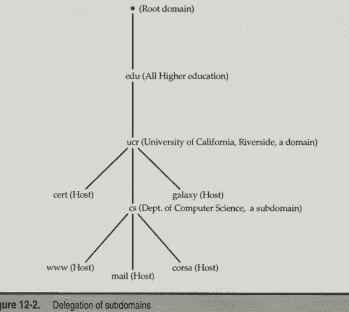

请注意，当一个站点名称似乎反映了子域名的存在时，并不意味着实际上存在子域名。虽然主机名规范不允许使用句号，但 BIND 名称服务器一直允许使用句号（BIND 将在 upcoming section "Installing a DNS Server" 中介绍）。因此你会偶尔看到主机名中使用句号。是否存在子域名由该站点 DNS 服务器的配置来处理。例如，www.cert.ucr.edu 并不意味着 cert.ucr.edu 是一个子域名。相反，它意味着 www.cert 是 ucr.edu 域中一个系统的主机名。

### in-addr.arpa 域

DNS 允许双向解析。*正向* 解析将名称转换为 IP 地址，而反向解析将 IP 地址转换回主机名。反向解析过程依赖于 in-addr.arpa 域。

如前一节所述，域名解析通过从右向左查看每个组件，以末尾的句号指示 DNS 树的根。顶级域名数量很少，但每向上走一层树都会扇出。遵循此逻辑，IP 地址也必须有一个顶级域名。这个域被称为 in-addr.arpa。

与 FQDN 不同，一旦在 in-addr.arpa 域下，IP 地址是从左到右解析的。每个八位组进一步缩小可能的主机名范围。图 12-3 给出了 IP 地址 138.23.169.15 反向解析的视觉示例。


**图 12-3**。**138.23.169.15 的反向 DNS 解析**

## 服务器类型

DNS 服务器有三种类型：主服务器、辅助服务器和缓存服务器。*主* 服务器是被视为特定域名具有权威性的服务器。一个*权威* 服务器是驻留该域配置文件的服务器。当域的 DNS 表发生更新时，是在此服务器上执行的，并作为主名称服务器的本地分发者。

*辅助* 服务器作为备份运行，通常可以信任辅助服务器拥有正确的条目。主服务器知道辅助服务器的存在，并向它们发送表的定期更新。当站点查询辅助名称服务器时，辅助服务器以权威性回答。然而，由于有可能在主要服务器能够告知辅助服务器最新更改之前查询辅助服务器，有些人将辅助服务器称为“非完全权威”。现实地说，你通常可以信任辅助服务器拥有正确的信息。（此外，除非你知道哪个是哪个，否则无法区分来自主服务器和来自辅助服务器的查询响应。）

*缓存* 服务器就是那样：缓存服务器。它们不包含任何特定域名的配置文件。相反，当客户机请求缓存服务器解析名称时，该服务器首先检查其本地缓存。如果找不到匹配项，它将找到主服务器并询问。然后该响应会被缓存。实际上，由于 DNS 请求的时间特性，缓存服务器运行得相当好。也就是说，如果你刚刚询问了 hyperlocal.org 的 IP 地址，你很可能在不久的将来再次这样做。（Web 使这一点更加普遍。）客户机可以区分缓存服务器和主服务器或辅助服务器，因为当缓存服务器回答请求时，它以“非权威性”回答。

> **注意：** 可以配置 DNS 服务器以对特定域名具有特定级别的权威性。例如，一个服务器可以是 domain.com 的主服务器，同时是 example.net 的辅助服务器。所有 DNS 服务器都充当缓存服务器，即使它们是其他任何域的主服务器或辅助服务器。

## 安装 DNS 服务器

大多数 Linux 发行版在系统首次安装时都提供了安装 DNS 服务器的选项。Linux 和几乎所有 UNIX 服务器选择的 DNS 服务器是 BIND：伯克利互联网名称域服务器（Berkeley Internet Name Domain Server）。（曾有一段时间，有关 Windows NT 名称服务器与 BIND 惊人相似的传闻甚嚣尘上。这个传闻从未被证实或否认。）在撰写本文时，最新的 BIND 版本是 8.2.1。

> **注意：** 鉴于 BIND 软件的关键性质，它已被互联网软件基金会（ISC）接管，以确保其持续发展。你可以在 [http://www.isc.org.](http://www.isc.org.) 上了解更多关于 ISC 的信息。在撰写本文时，ISC 还负责开发 DHCP 服务器以及 INN 新闻服务器。

如果你的发行版确实附带了 BIND，你很可能不需要升级。这种服务器软件异常稳定，并且更新频率极低——


...sequently。一旦配置好 BIND，你几乎就不需要再关心其运行状况了。（多棒，不是吗？）尽管如此，还是要留意新版本的发布。新的错误和安全问题会不时被发现，并应予以修复。当然，新功能也会随之发布，但除非你有相关需求，否则这些版本的发布并不那么关键。所有新的 BIND 版本均可在 http://www.isc.org 获取。在本节中，我们将讨论下载和编译 BIND 的过程。如果你的发行版使用包管理软件，你可能需要查找 BIND 软件的预编译版本。然而，如果你选择使用预编译版本，请务必确保从可信来源下载。

> **注意：** 尽管 BIND 对任何希望下载它的人免费开放完整的源代码，但它享有 ISC 商业级管理和支持的益处。当然，你需要为商业级支持付费，但由他们商业级合同支持的那些软件，与你可免费下载的软件是相同的。

## 下载、解压和阅读的内容

BIND 以三个归档文件分发：(1) 完整源代码；(2) 文档（BIND 操作指南，俗称“BOG”）；(3) 外部开发者的贡献。外部贡献通常包括各种工具和脚本，用于简化 BIND 管理或处理一般的 DNS 任务。然而，这些工具并非官方软件包的一部分，因此不在你与 ISC 签订的任何 BIND 支持合同覆盖范围内。这些“第三方”软件包通常值得下载，并检查它们是否适用于你的特定环境。

你可能希望将这三个 BIND 归档文件下载到一个拥有充足空闲空间的目录中。在本例中，我创建了 `/usr/local/src/bind` 目录。一旦你下载了这三个文件（`bind-contrib.tar.gz`、`bind-doc.tar.gz` 和 `bind-src.tar.gz`），必须按如下方式解压它们：

```bash
[root@ford bind]# tar -xzvf bind-contrib.tar.gz
[root@ford bind]# tar -xzvf bind-doc.tar.gz
[root@ford bind]# tar -xzvf bind-src.tar.gz
```

这些 `tar` 命令（参见第 6 章）将创建三个目录：`contrib`、`doc` 和 `src`。由于 `contrib` 目录不是正式 BIND 软件包的一部分，我们将不再进一步讨论它。`src` 目录包含程序的源代码。现在让我们看看 `doc` 目录中包含了什么。

## BIND 文档

`doc` 目录包含 BIND 的各种文档，以及所有指定 DNS 标准的相关 RFC 文档。该目录包含以下子目录：

- **bog**：`doc` 归档中最显着的项是 *Bind Operators Guide*，更常被称为 **BOG**。在 **bog** 子目录中，你会发现代表该文档的两个文件：`file.lst`，这是任何文本编辑器都可读取的 ASCII 文档；以及 `file.psf`，这是一个你可以发送到打印机的 PostScript 文件。
- **html**：*html* 子目录包含 Bind 在线文档。最好通过指向 *index.html* 文件并使用 Web 浏览器遵循相关链接来阅读。（所有文档链接都指向同一目录中的其他文件。）
- **man**：*man* 子目录保存了随 BIND 附带的所有工具的手册页。
- **misc**：*misc* 目录包含无法整齐归入其他文档的文档。BIND 常见问题解答也在这里，以及一些 PostScript 格式的技术白皮书。（没有 PostScript 打印机？别担心，你可以使用 GhostView 来阅读这些文件。查看 *gv* 的手册页以获取更多信息。）
- **notes**：这些是程序员写给程序员的笔记。
- **old**：此文件包含旧版 BIND 的文档。
- **port**：在此查找有关移植到特定操作系统信息。Linux 用户无需担心这一点；自 Linux 1.2 时代以来，BIND 一直非常稳定。
- **rfc**：此子目录包含与 BIND 功能相关的 RFC 文档。
- **ttac**：troff 宏存储在此处。Troff 是一个复杂的系统，允许你生成排版质量的文档。BIND 的几份文档是用 troff 编写的（并转换为 LaTeX 以便查看）。除非你希望探索 troff，否则可以忽略此子目录。

## 编译 BIND

通过使用 *make* 实用程序，编译 BIND 的过程很大程度上是自动化的。

> **提示：** 如果你打算在 Linux（或任何 UNIX）上进行任何开发工作，我强烈建议了解 *make*。一本特别好的书是 Andrew Gran 和 Steve Talbot（O’Reilly & Associates 出版）著的 *Managing Projects with Make, Second Edition*。

一旦你解开了源代码并使用 *cd* 命令进入 *src* 目录，你需要决定在构建过程中 BIND 临时文件的位置。*tmp/bind* 目录非常适合此用途（当然假设它尚未存在）。你可以将此位置更改为你通常放置临时文件的任何其他位置，并相应调整命令。因此，为了从 *src* 目录开始编译，我们运行此命令：

```bash
[root@ford src]# make DST='' tmp/bind SRC='tmp' links
```

一旦此命令执行完毕，我们切换到 `/tmp/bind` 目录：

```bash
[root@ford src]# cd /tmp/bind
```

然后使用以下命令确保没有陈旧文件残留：

```bash
[root@ford bind]# make clean
```

接下来，**make** 需要根据其新目录更新其部分配置信息：（程序员可能会认识到这是在设置 *依赖关系*。）输入此命令：

```bash
[root@ford bind]# make depend
```

最后，输入执行最终编译的命令：

```bash
[root@ford bind]# make
```

根据你的系统速度，这可能需要几分钟。一旦所有文件编译完成，发出一个命令将 BIND 程序文件复制到系统中的正确位置。

> **注意：** 你可能觉得有必要分两步编译和安装软件似乎很奇怪，但这实际上是一件好事：它给了你机会在将软件最终放置到服务器磁盘上的最终位置之前，从临时目录尝试该软件。

执行安装的命令是

```bash
[root@ford bind]# make install
```

该命令安装了表 12-1 中列出的工具。

**表 12-1. BIND 编译/安装安装的文件**

| 安装的工具 | 描述 |
| :--- | :--- |
| `/usr/bin/addr` | 将 IP 地址转换为十六进制值，反之亦然。 |
| `/usr/bin/nslookup` | 允许从命令行进行主机名到 IP 和 IP 到主机名的解析，以及其他任何 DNS 相关的记录查询。 |
| `/usr/bin/dig` | 显示地址解析过程中涉及的查询过程，包括所有中间 DNS 服务器。 |
| `/usr/bin/dnsquery` | nslookup 的另一种替代方案 |
| `/usr/bin/host` | nslookup 的另一种替代方案 |
| `/usr/sbin/named` | 负责提供 DNS 服务的实际服务器进程。 |
| `/usr/sbin/named-xfer` | 由 named 执行的辅助程序，用于从其他 DNS 服务器获取信息。这为调试区域传输提供了更强大的工具集，区域传输是一种机制，其中一个 DNS 服务器接收关于另一个 DNS 服务器表中所有主机的数据。（本章稍后会有更多介绍。） |
| `/usr/sbin/ndc` | 用于控制 named 程序的程序。 |
| `/usr/bin/nsupdate` | 允许你在实时服务器上更新 DNS 表中的信息。 |
| `/usr/sbin/named-bootconf` | 用于将 BIND 版本 4 配置文件转换为 BIND 版本 8 的实用工具。 |

## 配置客户端

在本节和下一节中，我们将深入探讨配置 DNS 客户端和服务器这一充满野心和刺激的过程！好吧，也许它们并没有那么令人兴奋——但不能否认它们对任何联网站点基础设施的重要性。所以你最好对 DNS 配置产生一些温暖舒适的感觉。

## 客户端 DNS（又称解析器）

到目前为止，我们一直在研究服务器和整个 DNS 树。这个等式的另一部分当然是客户端——即联系 DNS 服务器将主机名解析为 IP 地址的主机。


在 Linux 下，DNS 的客户端部分由解析器（resolver）处理。实际上，它是 C 编程函数库的一部分，该库在程序启动时与程序链接。由于这一切都是自动且透明地发生的，用户无需了解其中的任何细节。这就像一点小小的魔法，让用户能够开始浏览互联网。

从系统管理员的角度来看，配置 DNS 客户端并非魔法，但非常简单直接。只涉及两个文件：/etc/resolv.conf 和 /etc/nsswitch.conf。

## /etc/resolv.conf 文件

/etc/resolv.conf 文件包含客户端知道其本地 DNS 服务器是什么所必需的信息。（每个站点至少应该拥有自己的缓存 DNS 服务器。）此文件有两行：第一行指定默认搜索域，第二行指定主机名称服务器的 IP 地址。

默认搜索域主要适用于拥有自己本地服务器的站点。当指定了默认搜索域时，客户端文件会自动将该域名附加到请求的站点之后并首先检查该地址。例如，如果我们指定默认域为 yahoo.com，然后尝试连接到主机名 my，客户端软件会自动尝试联系 my.yahoo.com。使用相同的默认设置，如果我们尝试联系主机 www.stat.net，软件会尝试 www.stat.net.yahoo.com（这是一个完全合法的主机名），发现它不存在，然后尝试 stat.net（单独的主机名，它是存在的）。

当然，您可以提供多个默认域。但是这样做会稍微减慢查询过程，因为需要检查每个域。例如，如果同时指定了 yahoo.com 和 stanford.edu，并对 www.stat.net 执行查询，我们将得到三个查询：www.stat.net.yahoo.com、www.stat.net.stanford.edu 和 www.stat.net。

/etc/resolv.conf 文件的格式如下：

```
search domainname

nameserver IP-address
```

其中 domainname 是要搜索的默认域名，IP-address 是你的 DNS 服务器的 IP 地址。例如，这是我的 /etc/resolv.conf：

```
search planetoid.org

nameserver 127.0.0.1
```

因此，当我联系 zaphod.planetoid.org 时，我只需要指定 zaphod 作为主机名。由于我在自己的机器上运行名称服务器，所以我指定了本地主机地址。

## /etc/nsswitch.conf 文件

/etc/nsswitch.conf 文件告诉系统应该在哪里查找某些类型的配置信息（服务）。当识别出多个位置时，/etc/nsswitch.conf 文件还指定了最好找到信息的顺序。典型的使用 /etc/nsswitch.conf 设置的配置文件包括密码文件、组文件和主机文件。（要查看完整列表，请用你喜欢的文本编辑器打开该文件。）

/etc/nsswitch.conf 文件的格式很简单：服务名称在每行的开头（注意 /etc/nsswitch.conf 不仅适用于主机名查找），后跟一个冒号。然后是包含信息的位置。如果识别出多个位置，条目按系统需要执行搜索的顺序列出。位置的有效条目包括 files、nis、dns、[NOTFOUND] 和 NISPLUS。注释以井号（#）开始。

例如，如果你用喜欢的编辑器打开该文件，你会看到类似如下的行：

```
hosts:      files nisplus nis dns
```

这行告诉系统，所有主机名查找应首先从 /etc/hosts 文件开始。如果在此处找不到条目，则检查 NISPLUS。如果在 NISPLUS 中找不到主机，则检查常规 NIS，等等。在你的站点上，可能 NISPLUS 并未运行，且你希望系统在检查 NIS 记录之前先检查 DNS 记录。在这种情况下，你会将该行更改为：

```
hosts:      files dns nis
```

就这样。保存你的文件，系统会自动检测到更改。

对于这一行的唯一建议是，主机文件（files）在查找顺序中应始终排在第一位。

NIS 和 DNS 的首选顺序是什么？这非常依赖于站点。你是否希望在尝试 NIS 之前用 DNS 解析主机名，取决于 DNS 服务器在网络连接方面是否比 NIS 服务器更近。如果一个服务器比另一个更快，防火墙问题、站点策略问题和其他此类因素[决定了选择]。

## 使用 [NOTFOUND]

在 /etc/nsswitch.conf 文件中，你会看到一些以 [NOTFOUND] 结尾的条目。这是一个特殊指令，允许你在系统失败所有先前的条目后停止搜索信息的过程。例如，如果你的文件包含 **hosts: files [NOTFOUND] dns nis** 这一行，系统将只尝试在 /etc/hosts 文件中查找主机信息。如果所需信息不在那里，NIS 和 DNS 将不会被搜索。

## /etc/named.conf 文件

/etc/named.conf 文件是 BIND 的主配置文件。根据此文件的规范，BIND 确定其行为方式以及必须读取的附加配置文件（如果有）。如果你读过其他关于 DNS 和 BIND 的书籍，你可能会认为我打错字了，我*真正*想说的是 /etc/named.boot。完全不是这样——/etc/named.boot 文件用于旧版本的 BIND（4.x，最新版本为 4.9.3）。ISC 已经停止支持该系列，现在仅支持 8.x 系列的 BIND，该版本使用完全新的文件格式——因此也是新的文件名。

本章的这一节涵盖了设置通用 DNS 服务器所需的知识。你可以在 BIND 文档的 html 目录中找到关于新配置文件格式的完整指南（我们从 bind-doc.tar.gz 中解压出来的）。

> **TIP:** 如果你继承了一个运行 4.x 版本 BIND 的服务器，你可以将现有的 /etc/named.boot 文件转换为 /etc/named.conf 的适当格式。使用随 named 源代码发行版提供的 named-convert.pl 脚本。

/etc/named.conf 文件的一般格式如下：

```
statement {
    options;          // comments
};
```

**statement** 关键字告诉 BIND 我们即将描述其操作的一个特定方面，而 *options* 是应用于该语句的具体命令。大括号是必需的，以便 BIND 知道哪些选项与哪些语句相关；每个选项之后以及右大括号之后都有分号。

### 注释

注释可以采用以下格式之一：

- // 表示 C++ 风格注释
- /* ... */ 表示 C 风格注释
- # 表示 Perl 和 UNIX shell 脚本风格注释

在第一种和最后一种风格（C++ 和 Perl/UNIX shell）中，一旦注释开始，它将持续到行尾。在常规 C 风格注释中，需要右斜杠星号 */ 来指示注释结束。这使得 C 风格注释更容易用于多行注释。不过，总的来说，你可以选择你最喜欢的注释格式并坚持下去。没有哪种风格比另一种更好。

### statement

你可以使用以下 statement 关键字：

| 关键字 | 描述 |
| :--- | :--- |
| acl | 访问控制列表（Access Control List）——一种确定他人对你的 DNS 服务器拥有什么类型访问权限的机制。 |
| include | 允许你包含另一个文件，并将该文件当作常规 /etc/named.conf 文件的一部分来处理。 |
| logging | 指定哪些信息会被记录，哪些会被忽略。对于记录的信息，你还可以指定信息记录的位置。 |
| options | 用于全局服务器配置问题。 |
| controls | 允许你声明供 `ndc` 工具使用的控制通道。 |
| server | 设置服务器特定的配置选项。 |
| zone | 定义一个 DNS 区域（稍后将详细讨论）。 |

关于所有这些选项的完整文档，请阅读 `bind-docs.tar.gz` 归档中 `html` 目录里的文本。它列出了完整的规范以及关键字的用法。你可能一开始会觉得文档的某些部分难以理解，但不用担心。如果你来自非 UNIX 背景，你可能需要操作 Linux 一段时间才能理解可用的关键字。为了让你入门，以下部分讨论了最常见的选项。幸运的是，一些更复杂选项的默认值通常就足够了。

## ACL

访问控制列表（ACL）允许你指定一组地址，这些地址对你的 DNS 服务器拥有访问权限或没有访问权限。每组都有一个名称，你可以在其他配置选项中使用此名称。`ACL` 语句中的条目本身并不改变 BIND 的行为。

有四个默认 ACL：`any` 指定所有主机；`none` 拒绝所有主机；`localhost` 允许此 BIND 系统上所有接口的 IP 地址；`localnet` 允许此系统拥有接口的任何网络中的任何主机。

要指定你自己的 ACL，请使用此格式：

```
acl name_of_your_acl {
   address-list
};
```

其中 `name_of_your_acl` 是你希望定义的 ACL 名称；`address-list` 是由 ACL 定义的地址列表。默认情况下，所有被拒绝（仅限此 ACL），因此你只需添加具有访问权限的地址列表。此地址列表包含由分号分隔的单个地址。单个地址可以采用三种格式之一：

- 点分十进制表示法 (92.168.1.2)
- IP 前缀表示法 (192.168.2/24)，其中 /24 代表子网掩码中“开启”位的数量。例如，/24 代表子网掩码 255.255.255.0。大多数网络设备允许这种类型的地址指定。
- 现有 ACL 的名称。不允许引用文件中后面定义的 ACL（前向引用）。


# include（包含）

若要否定某个地址，请在该地址前加一个感叹号 (!)。地址列表从左到右依次评估，因此如果您在指定否定之前先指定某地址可访问，那么该地址将获得访问权限。例如，假设您希望允许 192.168.1 网络上的所有人访问，但排除 192.168.1.2。以下语句：

```
192.168.1/24; !192.168.1.2;
```

仍会允许 192.168.1.2 访问，因为第一个表达式 192.168.1/24 已允许其通过。若要拒绝 192.168.1.2 但允许 192.168.1/24 的其余部分，您需要如下指定地址列表：

```
!192.168.1.2; 192.168.1/24
```

以下是一个 ACL 语句示例：

```
acl_punks{
# 这些人觉得把咖啡机旁边的糖换成盐很有趣。
!192.168.1.45; !192.168.1.74;
};

acl_our_network{
# punks: 192.168.1/24; 192.168.2/24; // everybody but_punks
};
```

请注意，定义 ACL 并不会自动启用它。它只是允许您将地址作为一组进行引用，而无需反复列出地址列表。

如果您发现配置文件开始变得难以管理，可以考虑将其拆分为较小的组件。每个文件都可以包含到主 `/etc/named.conf` 文件中。注意，不能在另一个语句内部使用 `include` 语句。

这是一个 `include` 语句的示例：

```
include "/var/named.conf";
```

> **警告：** 致各位 C 和 C++ 程序员：请务必不要以磅符号 (\*) 开头写 `include` 行，尽管您的本能可能会告诉您该符号在 `/etc/named.conf` 文件中用于开始注释。（相信我，这确实是一个错误。这是一个非常令人沮丧且难以排查的 bug！）

# logging（日志记录）

`logging` 语句用于指定您希望记录哪些信息以及记录到哪里。当此语句与 `syslog` 设施结合使用时，您可以获得一个极其强大且可配置的日志记录系统。记录的项目包括关于 `named` 状态的一系列统计数据。默认情况下，它们记录在 `/var/log/messages` 文件中。

不幸的是，此日志记录语句的可配置性以额外的复杂性为代价，但 **named** 默认设置的日志记录对于大多数用途来说已经足够好。如果您想重新配置日志记录过程，请阅读 bind-doc.tar.gz 归档文件中的 **logging.html** 文件。

# Options（选项）

BIND 配置有许多可用的选项；参见表 12-2。显然，您不需要指定所有这些选项才能使系统工作，但了解有哪些选择是有好处的，如果您需要进行额外的配置。

通常，除非有明确原因，否则不要更改这些选项的默认值。

| 选项 | 描述 |
| :--- | :--- |
| directory path-name; | named 配置文件的其余部分的位置。 |
| named-xfer path-name; | named-xfer 程序的路径名。默认情况下，这是 /usr/sbin/named-xfer。 |
| dump-file path-name; | 当 named 服务器从 ndc 程序接收信号（ndc dumpdb）时，数据库信息应转储到的文件路径名。 |
| memstatistics-file path-name; | 内存使用统计信息在退出时写入的文件路径名，前提是该表定义的 deallocate-on-exit 选项设置为 Yes。默认情况下，文件名为 named.memstats。 |
| pid-file path-name; | named 服务器在启动后立即写入其进程 ID 的文件路径名。默认是 /var/run/named.pid。此文件由 ndc 程序使用。 |
| statistics-file path-name; | 当运行 `ndc stats` 命令时，服务器附加统计信息的文件路径名。 |
| auth-nxdomain yes/no; | 如果您指定 Yes（默认值），服务器将对它是权威域的域名查询始终给出权威答复。注意：除非您确实知道自己在做什么，否则不要指定 No。 |
| deallocate-on-exit yes/no; | 当设置为 Yes 时，服务器将输出内存分配的完整报告。这会导致更长的关闭时间，但对于分析内存使用非常有用。默认是 No。 |
| fake-iquery yes/no; | 默认是 No。如果为 Yes，服务器将模拟过时的 IQUERY 查询类型。与 `auth-nxdomain` 选项一样，除非您知道自己在做什么，否则不要打开此选项。 |
| fetch-glue yes/no; | Yes（默认值）告诉服务器获取（并缓存）必要的记录以回答关于其不具权威的域的查询。将此设置为 No，并结合 `recursion` 选项，可以防止您的缓存因恶意攻击而增长和损坏。然而，客户端必须为每个查询做更多工作。 |
| host-statistics yes/no; | 告诉 BIND 是否跟踪查询它的主机的统计信息。虽然信息很有用，但跟踪会消耗大量内存；因此默认是 No。 |
| multiple-cnames yes/no; | DNS 表规范不允许 CNAME 记录指向其他 CNAME 记录，因此此选项的默认值为 No。由于旧版本的 BIND 允许这样做，您可以选择将此选项设置为 Yes 来启用这种向后兼容性。（CNAME 记录是主机别名，将在本章后面讨论。） |
| notify yes/no; | 默认是 Yes。导致主 DNS 服务器发送一条 NOTIFY 消息，通知所有主服务器的从服务器其表已更新。NOTIFY 消息导致从服务器几乎立即执行区域传输（从主服务器获取最新信息）。 |
| recursion yes/no; | 如果为 Yes（默认值），服务器将尝试遍历 DNS 树以获取关于所请求 IP 地址的信息。这将相同的任务负担从客户端转移出去。（参见 fetch-glue 选项了解关闭递归的原因。） |
| forwarders ip-list; | 指定一个 IP 地址列表，当当前服务器没有答案时查询这些地址。转发器是可选的；地址通常来自上游提供商。示例 ip-list（使用虚构地址）：`Forwarders ( 192.168.8.24; 192.168.3.12; );` |
| forward first/only; | 仅适用于您已设置 `forwarders`（参见上一条目）的情况。默认设置 `First` 使服务器在自行解析请求之前先向转发器查询未知信息。将此选项更改为 `Only`，服务器将仅查看转发器，不尝试自行解析任何地址。 |
| check-names type action; | 根据客户端上下文验证域名名的完整性。`type` 的值：`master` = 主名称服务器；`slave` = 从名称服务器；`response` = 缓存服务器和客户端。`action` 的值：`ignore` = 不检查；`warn` = 通过生成日志条目响应；`fail` = 生成日志条目并拒绝响应查询。默认值：`Check-names master fail`；`Check-names slave warn`；`Check-names response ignore`；`check-names` 选项可以在 `zone` 语句中指定，在这种情况下，它覆盖该特定 `zone` 在 `options` 语句中的配置设置。在 `zone` 语句中使用时，不要指定 `type`，因为它可以从 `zone` 信息中推导出来。 |
| allow-query { address-list ; } | 指定允许哪些 IP 地址向服务器生成查询。默认情况下，允许所有主机。使用分号分隔 `address-list` 中的地址（与本节前面 `acl` 地址列表的格式相同）。您也可以在 `address-list` 中按名称引用 `acls`。 |
| allow-transfer { address-list ; } | 指定哪些主机可以与您的 DNS 服务器执行区域传输。通常，此列表仅包括作为您主服务器从服务器的主机。默认情况下，任何人都可以执行区域传输，但我建议您将此限制在只有正当理由的人。 |
| listen-on { address-list ; } | 默认情况下，named 服务器将在所有接口上监听 53 端口以接收 DNS 查询，但您可以通过在 `address-list` 中指定其他地址来更改此设置。格式与前面解释的 `acl` 地址列表相同。要选择 named 监听的端口，请在 `listen-on` 语句之后但在第一个大括号之前添加端口 `portnum`。`portnum` 的值是您希望 named 监听的端口号。例如：`listen-on port 1031 { 192.168.1.1 ; } ;` 告诉 BIND 在配置为 192.168.1.1 的接口上监听 1031 端口以接收 DNS 查询。而：`listen-on { 192.168.1.1 ; } ;` 告诉 BIND 在配置为 192.168.1.1 的接口上监听其默认端口 53 以接收 DNS 查询。 |


## 表 12-2. BIND 配置选项

| 选项 | 描述 |
| :--- | :--- |
| `query-source-addresses address\port;` | 当服务器需要联系其他 DNS 服务器时，默认情况下它会使用系统上的任意 IP 地址，且源端口为随机的高端口（端口号 1024 到 65535）。如果需要特定配置以便让 DNS 服务器通过防火墙，您可以指定特定的源地址和端口或消息来源。如果只需要指定其中一项而不同时指定另一项，您可以使用通配符 (*) 字符。例如，语句：`Query-source-addresses * port 53;` 表示从 named 想要使用的任意 IP 地址发送查询，但明确使用 53 端口。 |
| `max-transfer-time-in number;` | 指定区域传输在终止前可以运行多少分钟。默认值为 120 分钟。 |
| `transfer-format one-answer/many-answers;` | 当 named 进程响应请求时，它一次只返回一个答案（默认情况），尽管可能有空间将多个答案打包到一个传输中。这是因为仍在使用的一些旧版本 BIND 和其他 DNS 服务器不支持多个响应。如果您知道您的 DNS 服务器将仅与其他 BIND 8.x 服务器一起工作，您可以将此选项更改为 many-answers 以提高性能。 |
| `transfers-in number;` | 可以同时运行的入站区域传输的最大数量。默认值为 10。增加此值可能会加速更新过程，但代价是增加系统负载。 |
| `transfers-out number;` | 可以同时运行的出站区域传输的最大数量。默认值为 10。截至撰写本文时，此选项由 BIND 解析但尚未使用。 |
| `transfers-per-ns number;` | 从单个远程名称服务器可以同时运行的入站区域传输的最大数量。默认值为 2。可以增加，但代价是增加远程名称服务器的负载。 |
| `coresize size;` | 如果 named 崩溃，Linux 将生成 core dump（核心转储），即程序在崩溃瞬间使用的内存映像。数据可用于程序员进行“尸检”分析。请注意：该映像可能非常大；如果 DNS 系统的磁盘空间不足，请考虑限制核心文件大小。Linux 下的默认值为无限制。size 参数可以以字节（无后缀）、K、MB 或 GB 指定。例如，以下所有值均为 1 吉字节：`coresize 1073741824;` `coresize 1048576K;` `coresize 1024M;` `coresize 1G;` |
| `datasize datasize;` | 指定分配给 named 的内存。Linux 下的默认值 = 您拥有的所有内存。datasize 值遵循与 coresize 的 size 值相同的约定。因此，`1073741824` 等同于 `1048576K`，等同于 `1024M`，等同于 `1G`。 |
| `files number;` | named 可以同时打开的文件最大数量。请注意：BIND 同时打开的文件越多，其性能受处理所有这些文件句柄的影响就越大。（C 程序员由于 select 系统调用对此问题很熟悉。） |
| `stacksize number;` | named 可以从系统栈（用于跟踪程序中的临时变量）获取的最大内存量。Linux 下的默认值是无限制。对于 number，请遵循与核心大小和数据大小相同的约定。 |
| `cleaning-interval number;` | 指定服务器从缓存中删除过期记录之间的间隔。默认为每 60 分钟一次。如果设置为 0，则不会发生定期清理。 |
| `interface-interval number;` | 默认情况下，服务器每 60 分钟扫描一次系统上的接口列表。如果启用 listen-on（在本表前文定义），named 将开始监听其发现的任何新接口上的 DNS 请求。如果某个接口已消失，named 将停止监听该接口上的请求。如果将此选项设置为 0，服务器仅在 named 启动时检查可用接口。 |
| `statistics-interval number;` | 指定 named 服务器生成服务器统计信息并将其存入日志文件的频率。默认为每 60 分钟一次。如果设置为 0，则不生成统计信息。 |
| `topology ( address-list ; );` | 当存在多个转发器时，named 显示对假设比其他服务器更近的服务器有偏好。默认情况下，named 服务器偏好自身，然后是同一子网上的服务器。您可以指定另一种偏好顺序（address-list 的顺序）。您还可以嵌入表示地址组的子列表。例如，在此配置中：<br>`topology (`<br>`192.168.3.12;`<br>`( 192.168.11.25; 192.168.42/24; )`<br>`192.168.8.24;`<br>`);`<br>首选给 192.168.3.12，对 192.168.11.25 和 192.168.42.0 网络上的所有主机显示同等偏好，最后偏好给 192.168.8.24。 |

## server

**server** 语句告诉 BIND 关于它可能会处理的其他名称服务器的特定信息。**server** 语句的格式如下：

```
server ip-address {
    bogus yes/no;
    transfer-format one-answer/many-answers;
};
```

其中 **ip-address** 是所讨论服务器的 IP 地址。

语句中的第一项 `bogus` 告诉服务器其他服务器是否发送错误信息。这在处理可能因配置错误而向您发送错误信息的其他站点时很有用。第二项 `transfer-format` 告诉 BIND 该服务器是否可以在单个查询响应中接受多个答案。据我们所知，能够处理多个响应的唯一服务器是 BIND 8.x 版本服务器。

一个示例 `server` 条目可能看起来像这样：

```
server 192.168.3.12 (
        bogus no;
        transfer-format many-answers;
);
```

## 关于区域

区域语句允许您定义一个 DNS 区域——其定义常被混淆。这里是细则：**DNS 区域与 DNS 域不是同一回事**。区别很细微，但很重要。

让我们回顾一下：域是*沿组织边界*指定的。单个组织可以划分为更小的管理子域。每个子域都有自己的区域。所有区域共同构成整个域。

例如，bigcompany.com 是一个域。其中包含子域 eng.bigcompany.com、marketing.bigcompany.com、sales.bigcompany.com 和 admin.bigcompany.com。这四个子域中的每一个都有自己的区域，而 bigcompany.com 在其内部有一些不属于任何子域的主机，因此它拥有自己的区域。结果是，bigcompany.com 实际上由五个区域组成。

在最简单的模型中，单个域没有子域时，就主机、配置等信息而言，区域和域的定义是相同的。

在 `etc/named.conf` 文件中设置区域的过程在下一节中讨论。

## 配置服务器

是时候享受大乐趣了：配置名称服务器！哦，你觉得没意思？好吧，等你发现人们了解这些东西能赚多少钱时，态度就会改变。

在早先的一节中，您学习了*主*、*从*和*缓存*名称服务器之间的区别。简而言之，主名称服务器包含该区域最新 DNS 信息的数据库。当区域管理员想要更新这些数据库时，主名称服务器首先获得更新，世界上其他地方向它请求更新。从服务器显式跟踪主服务器，主服务器在更改发生时通知从服务器。主服务器和从服务器在它们的回答中被视为同等权威。缓存名称服务器没有权威记录，只有缓存条目。


## 更新主区域的 /etc/named.conf 文件

区域条目的最基本语法如下：

```
zone domain-name {  
type master;  
file path-name;
};
```

**path-name** 指的是包含该区域数据库信息的文件。例如，要为 `planetioid.org` 域创建一个区域，其数据库文件位于 `/var/named/planetioid.org.db`，我们可以使用以下配置：

```
zone "planetioid.org" {
type master;
file "planetioid.org.db";
};
```

请注意，`/etc/named.conf` 文件中的 **directory** 选项会自动为 `planetioid.org.db` 文件名添加前缀。因此，如果我们指定 **directory** 为 `/var/named/`，服务器软件将自动在 `/var/named/planetioid.org.db` 中查找 `planetioid.org` 的信息。

现在谈到的仅仅是*正向解析*——即允许他人查询名称并获取 IP 地址的机制。良好的网络行为规范要求同时也提供 IP 到主机名的映射（如果你希望向某些站点发送电子邮件，这也是必须的）。为此，你需要在 in-addr.arpa 域中提供一个条目。

in-addr.arpa 条目的格式是将你的 IP 地址的前三个八位组反转，后跟 in-addr.arpa。假设 planetooid.org 的网络地址是 192.168.1，那么 in-addr.arpa 域将是 1.168.192.in-addr.arpa。因此，`/etc/named.conf` 文件中的 **zone** 语句如下：

```
zone "1.168.192.in-addr.arpa" {
type master;
file "planetioid.org.rev";
};
```

现在你已经准备好了 `/etc/named.conf` 条目，是时候实际编写 planetooid.org.db 和 planetooid.org.rev 文件了。

### 额外选项

主区域还可以使用 **options** 语句中的一些配置选项。这些选项包括：

- check-names
- allow-update
- allow-query
- allow-transfer
- notify
- also-notify

在区域配置中使用这些选项中的任何一个都只会影响该区域。有关这些选项的工作方式，请参阅本章前面关于 /etc/named.conf 讨论中的“Options”小节以获取更多信息。

## 更新从区域的 /etc/named.conf

从服务器的区域条目格式与主服务器非常相似。对于正向解析，格式如下：

```
zone domain-name {
    type slave;
    masters { IP-address-list; };
};
```

其中，domain-name 是作为主名称服务器完全相同的名称，而 IP-address-list 是存储该区域主名称服务器 IP 地址的列表。

可以在从区域配置中列出的推荐额外选项是：

```
file path-name;
```

其中，path-name 是服务器保存主区域文件副本的完整路径位置。通过保留本地副本，你可以减少更新所需的带宽并提高性能。

### 额外选项

从区域配置也可以使用 options 语句中的一些配置选项。这些选项包括：

- check-names
- allow-update
- allow-query
- allow-transfer
- max-transfer-time-in
- notify
- also-notify

有关这些选项的工作方式，请参阅本章前面关于 /etc/named.conf 讨论中的“Options”小节以获取更多信息。

## 更新缓存区域的 /etc/named.conf 文件

缓存配置是所有配置中最简单的。即使你运行的是主服务器或从服务器，它也是每个 DNS 服务器配置所必需的。这是为了允许服务器递归地搜索 DNS 树以查找互联网上的其他主机所必需的。

你需要两个区域条目：一个是缓存，另一个是将 localhost 条目设为其自身的主区域。第一个条目如下：

```
zone ".*" {
	type hint;
	file "named.ca";
};
```

行 *type hint*; 指定这是一个缓存区域条目，行 *file* “*named.ca*”; 指定将用于用指向根服务器的条目预填缓存的文件。这个 named.ca 文件随 BIND 包提供。你也可以在 ftp://rs.internic.net 找到最新文件。

第二个区域条目如下：

```
zone "0.0.127.in-addr.arpa" {
	type master;
	file "named.local";
};
```

这是用于将本地主机地址解析回本地主机名的反向条目。named.local 文件包含以下内容：

```
$		IN SOA		localhost. root.localhost. (
		1997022700		; Serial
		28800			; Refresh
		14400			; Retry
		3600000			; Expire
		86400 )			; Minimum

1		IN NS		localhost.
```

如果你现在还看不懂，别担心。知道这对缓存服务器来说就足够了即可。后续部分将帮助你理解此文件。

## DNS 记录类型

好吧，我有点撒谎。你*还*没有准备好创建 planetoid.org.db 和 planetoid.org.rev 文件——还差得远呢。首先你需要理解 DNS 的所有记录类型：SOA、A、NS、A、PTR、CNAME、MX、TXT 和 RP。

### SOA：Start of Authority（权威起始）

SOA 记录开始了站点 DNS 条目的描述。此条目的格式如下：

```
domain.com.    IN SOA ns.domain.com. hostmaster.domain.com. (   
                1999080801    ; serial number
                10800         ; refresh rate in seconds (3 hours)
                1800          ; retry in seconds (30 minutes)
                1209600       ; expire in seconds (2 weeks)
                604800 )      ; minimum in seconds (1 week)
```

第一行包含一些我们需要留意的细节：

- `domain.com.` 当然应该替换为你的*域*名。注意 `domain.com.` 结尾的 `period`（句号）吗？它应该在那里——确实，DNS 配置文件对此极其挑剔。结尾的句号是服务器区分相对主机名和完全限定域名 (FQDN) 所必需的；例如，`old` 和 `old.planetsolar.org` 之间的区别。

- `IN` 告诉名称服务器这是一个互联网记录。还有其他类型的记录，但已经很多年没有人需要它们了。我们可以安全地忽略它们。

- `SOA` 告诉名称服务器这是“Start of Authority”记录。

- `ns.domain.com.` 是该域名称服务器的 FQDN（即最终将驻留此文件的服务器）。再次注意，不要漏掉那个尾随的句号。

- `hostmaster.domain.com.` 是域管理员的电子邮件地址。注意这个地址中缺少 `@`。`@` 符号被替换为句号。因此，此示例中提到的电子邮件地址是 `hostmaster@domain.com`。这里也使用了尾随句号。

记录的其余部分从第一行的左括号后开始。第一行是序列号。它用于告知名称服务器文件何时已更新。注意——在管理 DNS 记录的过程中，更改时忘记递增此数字是一个常见的错误。（在正确位置忘记加句号是另一个常见错误。）

> **TIP：** 为了以合理的方式维护序列号，请以下列顺序使用日期格式：YYYYMMDDxx。尾部的 xx 是一个额外从 00 开始的两位数，这样如果你在一天的多次更新中，仍然可以区分哪个是哪个。

值列表中的第二行是以秒为单位的刷新率。此值告诉从 DNS 服务器应多久查询一次主服务器以查看记录是否已更新。

第三个值是以秒为单位的重试率。如果从服务器尝试但无法联系主 DNS 服务器以检查更新，从服务器会在指定的秒数后再次尝试。

第四个值旨在用于已缓存区域数据的从服务器。它告诉这些服务器，如果它们无法联系主服务器进行更新，应在指定的秒数后丢弃该值。一到两周是该间隔的良好数值。

最后一个值，*minimum*，告诉缓存服务器，如果它们无法联系主 DNS 服务器，在使条目过期之前应等待多长时间。五到七天是此条目的良好指导值。

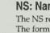

> **NOTE：** 不要忘记在最后一个值后放置右括号。

### NS：Name Server（名称服务器）

NS 记录用于指定哪些名称服务器维护此区域的记录。此记录的格式如下：

```
IN NS     ns1.domain.com.
IN NS     ns2.domain.com.
```

你可以为域拥有尽可能多的备用名称服务器——至少两个是个好主意。大多数 ISP 如果你使用他们的连接，他们愿意充当从 DNS 服务器。

### A：Address Record（地址记录）

A 记录用于提供从主机名到 IP 地址的映射。A 地址的格式很简单：

```
host name IN A IP-Address
```

例如，对于主机 oid.planetoid.org，其 IP 地址为 192.168.1.2，其 A 记录看起来像这样：

```
oid IN A 192.168.1.2
```


# 251

# 第 12 章：DNS

名称服务器会将其理解为 oid.planetoid.org。因此，如果你想使用 FQDN（完全限定域名），请务必在末尾加上句号。

### PTR：指针记录

PTR 记录用于执行反向名称解析，从而允许某人指定一个 IP 地址并确定对应的域名。该记录的格式与 A 记录非常相似，只是值被颠倒了：


*IP-address* 可以采取两种形式之一：仅 IP 地址的最后一个八位组（让名称服务器自动附加来自 in-addr.arpa 域名信息），或者是完整的 IP 地址（末尾加上句号）。*host name*（主机名）必须具有完整的 FQDN。例如，主机 oid 的 PTR 记录如下所示：


### MX：邮件交换器

MX 记录负责告知其他站点你区域的邮件服务器。如果你网络上的某台主机生成了带有其主机名的出站邮件，回复消息的人不会直接将邮件发回给该主机。相反，回复邮件的服务器会查询该站点的 MX 记录，并将邮件发送到那里。

在互联网站点主要由基于 UNIX 的系统组成，且 Sendmail 配置为将邮件转发到邮件中心（NULL host）时，缺少 MX 记录是可以接受的。但随着越来越多的非 UNIX 系统加入网络，MX 记录变得至关重要。如果 pc.domain.com 使用其基于 PC 的邮件阅读器（无法接受 SMTP 邮件）发送消息，那么让回复方有可靠的方式了解 pc.domain.com 的邮件服务器身份非常重要。

MX 记录的格式如下：


其中 *domainname* 是站点的域名（当然末尾要有句号）；*weight* 是邮件服务器的重要性（如果存在多个邮件服务器，数字最小的优先级高于数字较大的）；而 *host name* 自然是邮件服务器的名称。*host name* 必须有一个 A 记录，这一点也很重要。

以下是一个示例条目：

```
domain.com.    IN MX 10 mailserver1
           IN MX 20 mailserverbackup
```

通常，MX 记录出现在 DNS 配置文件的顶部。如果未指定域名，则默认名称从 SOA 记录中获取。

### CNAME：别名记录

CNAME 记录允许你为主机名创建别名。当你希望提供一个易于记忆的高可用性服务名称，但仍需为主机分配一个实际名称时，这非常有用。

CNAME 的另一个流行用途是通过一个易于记忆的名称来“创建”一个新服务器，而完全不需要投资新的服务器。例如：一个站点按照 UNIX 传统惯例将邮件服务器命名为 mailhost。随着非 UNIX 用户进入互联网视野，他们假设邮件服务器会被命名为 mail；为了适应这种假设，创建了一个 CNAME 记录而不是重命名服务器，这样所有指向名为 mail 的主机的请求都会透明地解析到 mailhost。

以下是 CNAME 记录的格式：

```
newhost name IN CNAME oldhost name
```

例如，对于上面提到的 mail 到 mailhost 的映射，我们的条目可能如下所示：

```
mailhost IN A 192.168.1.10
mail IN CNAME mailhost
```

> 警告：将 MX 记录指向 CNAME 记录是一种极其糟糕的做法。官方的 DNS 规范文档明确禁止这样做。BIND 允许这样做，但仅为了与过去的一个损坏功能保持向后兼容。

### RP 和 TXT：文档条目

有时，将联系信息作为数据库的一部分提供会很有用——不仅仅是作为注释，而是作为其他人可以查询的实际记录。这可以使用 RP 和 TXT 记录来实现。

TXT 记录是一种自由格式的文本条目，你可以将任何你认为合适的信息放入其中。通常情况下，你只想在这些记录中放入联系信息。每个 TXT 记录必须与特定的主机名关联。例如：

```
hhgtg.planetoid.org. IN TXT “Contact: Marvin”
IN TXT “SysAdmin/Android”
IN TXT “Voice: 800-555-1212”
```

RP 记录被创建作为主机联系信息的显式容器。该记录说明谁是特定主机的负责人；以下是一个示例：

```
hhgtg.planetoid.org. IN RP marvin.domain.com. planetoid.org.
```

### 将所有内容整合起来

现在，我们在 /etc/named.conf 文件中拥有了所需的条目，并了解了所有的 DNS 记录类型。是时候创建实际数据库来支持服务器了。

数据库文件格式不是非常严格，但随着时间的推移形成了一些惯例。遵守这些惯例会让你的工作更轻松，并为接管你创建的系统的管理员铺平道路。

> **提示：** 充分使用注释。在此文件中，注释行以分号开始。虽然 DNS 数据库文件中没有太多关于正在发生的事情的技术内容，但变更历史是关于正在完成什么以及原因的有用参考。

每个数据库文件必须以 SOA 记录开始，并且至少包含一个 NS 记录。其他所有内容都是可选的。（当然，“其他所有内容”才是使文件有用的部分！）你可能会发现遵循以下通用格式很有帮助：

```
SOA record
NS records
MX records
A and CNAME records
```

例如，下面是一个包含四个主机的单个域名的完整区域配置文件：

```
@ IN SOA domain.com. hostmaster.domain.com. (
    1999022300 ; serial number
    10800 ;Refresh every 3 hours
    1800 ;Retry every 30 minutes
    1209600 ;Expire in 2 weeks
    604800 ) ;Minimum 1 week
    IN NS ns.domain.com.
    IN MX 10 mail.domain.com.
imp IN A 192.168.1.1 ; Internet gateway
mail IN A 192.168.1.2 ; mail server
techies IN A 192.168.1.3 ; web server
www IN CNAME techies
ns IN A 192.168.1.4 ; name server
peanutbutter IN A 192.168.1.5 ; firewall
```

以下是对应的反向文件：

```
@ IN SOA 1.168.192.in-addr.arpa. hostmaster.domain.com. (
    1999010501 ; Serial
    10800 ; Refresh rate (3 hours)
    1800 ; Retry (30 minutes)
    1209600 ; Expire (2 weeks)
    604800 ) ; Minimum (1 week)
    IN NS ns.domain.com.
1 IN PTR imp.domain.com.
2 IN PTR mail.domain.com.
3 IN PTR techies.domain.com
4 IN PTR ns.domain.com
5 IN PTR peanutbutter.domain.com.
```

### 完整的配置

到目前为止，我们已经给出了配置文件的片段。希望这足以让你了解 DNS 的全貌，并为编写自己的配置文件提供充分的指导。话虽如此，一个好的示例总是有益的。

以下是一个主域名（domain.com）的完整配置，它同时作为朋友 example.com 的从域。作为交换，example.com 域作为我们的从域。我们允许在我们两个站点之间进行区域传输，但不允许与其他站点进行。domain.com 站点的 ISP 也提供 DNS 服务，当我们无法自行解析信息时，我们将请求转发给该服务。

以下是 /etc/named.conf 文件：

```
options {
	directory "/var/named";
	forwarders {
		192.168.2.1;
		192.168.2.2;
	};
	allow-transfer { 10.0.0.1; 10.0.0.2; }  // the example.com name servers
};

//
// a caching only name server config
//
zone ".*" {
	type hint;
	file "named.ca";
};

zone "0.0.127.in-addr.arpa" {
	type master;
	file "named.local";
};

//
// our primary information
//
zone "domain.com" {
	type master;
	file "named.domain.com";
};

zone "1.168.192.in-addr.arpa" {
    type  master;
    file  "named.rev";
};

//
// our secondary information for example.com
//
zone "example.com" {
    type  slave;
    file  "example.com.cache";
    masters { 10.0.0.1; 10.0.0.2; };
};
```

以下是 /var/named/named.ca 文件：

```
;  This file holds the information on root name servers needed to
;  initialize cache of Internet domain name servers
;  (e.g. reference this file in the `cache   .file`
;  configuration file of BIND domain name servers).
;
;  This file is made available by InterNIC registration services
;  under anonymous FTP as
;
;          file            /domain/named.root
;          on server       FTP.RS.INTERNIC.NET
;          -OR- under Gopher at  RS.INTERNIC.NET
;
;          under menu      InterNIC Registration Services (NSI)
;              submenu     InterNIC Registration Archives
;                  file    named.root
;
;          last update:     Aug 22, 1997
;          related version of root zone: 1997082200
;
;  formerly NS.INTERNIC.NET
;
.
```


C.ROOT-SERVERS.NET.   3600000 NS   C.ROOT-SERVERS.NET.  
                                         A   192.33.4.12  
; 原为 TERP.UMD.EDU

D.ROOT-SERVERS.NET.   3600000 NS   D.ROOT-SERVERS.NET.  
                                         A   128.8.10.90  
; 原为 NS.NASA.GOV

E.ROOT-SERVERS.NET.   3600000 NS   E.ROOT-SERVERS.NET.  
                                         A   192.203.230.10  
; 原为 NS.ISC.ORG

F.ROOT-SERVERS.NET.   3600000 NS   F.ROOT-SERVERS.NET.  
                                         A   192.5.5.241  
; 原为 NS.NIC.DDN.MIL

G.ROOT-SERVERS.NET.   3600000 NS   G.ROOT-SERVERS.NET.  
                                         A   192.112.36.4  
; 原为 AOS.ARL.ARMY.MIL

H.ROOT-SERVERS.NET.   3600000 NS   H.ROOT-SERVERS.NET.  
                                         A   128.63.2.53  
; 原为 NIC.NORDU.NET

```
3600000 NS i.ROOT-SERVERS.NET.
i.ROOT-SERVERS.NET. 3600000 A 198.32.64.12
;
托管于日本，由 WIDE 运营
;
M. 3600000 NS M.ROOT-SERVERS.NET.
M. 3600000 A 202.12.27.33
; 文件结尾
```

以下是 `/var/named/named.local` 文件的内容：

```
@ IN SOA localhost. root.localhost. (
19970122100 ; 序列号
28800 ; 刷新间隔
14400 ; 重试间隔
3600000 ; 过期时间
86400 ) ; 最小值
IN NS localhost.
1 IN PTR localhost.
```

以下是 `/var/named/named.domain.com` 文件的内容：

```
@ IN SOA domain.com. hostmaster.domain.com. (
19960422300 ; 序列号
10800 ;每 3 小时刷新一次
1800 ;每 30 分钟重试一次
1209600 ;2 周后过期
604800 ) ; 最小值 1 周
IN NS ns.domain.com.
IN MX 10 mail1.domains.com.
imp IN A 192.168.1.1 ; 互联网网关
mail IN A 192.168.1.2 ; 邮件服务器
technics IN A 192.168.1.3 ; Web 服务器
www IN CNAME technics
ns IN A 192.168.1.4 ; 名称服务器
peanutbutter IN A 192.168.1.5 ; 防火墙
```

以下是 `/var/named/named.rev` 文件的内容：

```
@ IN SOA 1.168.192.in-addr.arpa. hostmaster.domain.com. (
1997010501 ; 序列号
10800 ; 刷新速率（3 小时）
1800 ; 重试（30 分钟）
1209600 ; 过期（2 周）
604800 ) ; 最小值（1 周）

1 IN NS ns.domain.com.
2 IN PTR imp.domain.com.
3 IN PTR mail.domain.com
4 IN PTR technics.domain.com
5 IN NS ns.domain.com
6 IN PTR peanutbutter.com
```

我们无需创建任何文件来作为 example.com 的从服务器。我们只需要在 /etc/named.conf 文件中添加我们已有的条目即可。

就是这样：一个完整的初级域名配置。

## DNS 工具箱

本节介绍了几种你在使用 DNS 时需要熟悉的技术工具。它们能帮助你更快地排查问题。

### nslookup

**nslookup** 工具是 DNS 工具中的佼佼者。通过学习 nslookup 提供的所有功能，你可以避免去学习 BIND 附带的那些较小的工具。

在最简单的用法中，nslookup 允许你从命令行将主机名解析为 IP 地址。例如：

```
[root@ford root]# nslookup theorw.com
Server: localhost
Address: 127.0.0.1

Name: theorw.com
Address: 209.133.83.16
```

在输出中，我们可以看到 nslookup 默认查询的服务器名称，以及该服务器返回的结果。此示例是在一台名称服务器上运行的，因此它被配置为回查自身以解析主机名；因此，服务器名称为 localhost。

我们还可以使用 nslookup 执行反向查找。例如：

```
[root@ford root]# nslookup 209.133.83.16
Server: localhost
Address: 127.0.0.1

Name: taz.hyperreal.org
Address: 209.133.83.16
```

这可能会带来各种有趣的发现。在这种情况下，我们看到 theorw.com 与 taz.hyperreal.org 是相同的。很可能 taz.hyperreal.org 也“虚拟托管”了其他域名。

> 本书的目标之一是通过展示系统间的相似性，帮助 NT 管理员熟悉 Linux。本节直观地展示了对这两个操作系统而言最重要的某些概念，以便你可以看到它们的基础是如何建立的。

## Linux 管理蓝图

## 目录

- Linux 与 Windows NT 认证....2
- Linux 与 Windows NT 网络....4
- Linux 与 Windows NT 启动过程....6
- Linux 与 Windows NT 关机过程....8

## Linux 与 Windows NT 认证

### Linux 认证

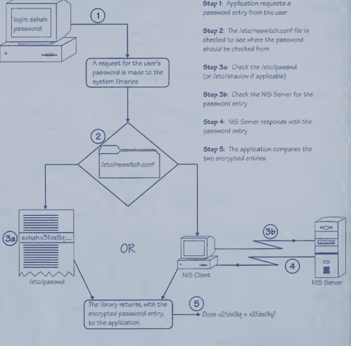

- **步骤 1：** 应用程序请求用户输入密码
- **步骤 2：** 检查 /etc/nsswitch.conf 文件以确定应从何处检查密码
- **步骤 3a：** 检查 /etc/passwd（或 /etc/shadow，如适用）
- **步骤 3b：** 检查 NIS 服务器上的密码条目
- **步骤 4：** NIS 服务器响应密码条目
- **步骤 5：** 应用程序比较这两个加密条目

### Windows NT 认证

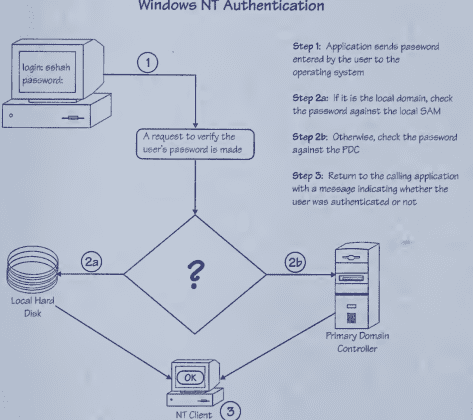

Linux 和 NT 之间的主要区别在于，Linux 在核心操作系统之外执行所有认证问题。这为认证方式提供了很大的灵活性，并提高了整个系统的稳定性，因为它允许 Linux 内核保持简洁。其代价是用户界面的一致性，以及应用程序开发人员需要处理自己的认证流程。

## Linux 与 Windows NT 网络

### Linux 网络

- 混合 Windows 客户端、Unix 客户端和 Macintosh 客户端
- Linux 内部网服务器（Apache Web 服务器）
- Linux 文件服务器（NFS/Samba/Netatalk）
- Linux 打印服务器（LPR/Samba/Netatalk）
- Linux 数据库（例如 IBM DB2）
- Linux 备份（例如 Legato）
- （次要 DNS/NIS）
- Linux DNS/NIS 服务
- Linux 防火墙

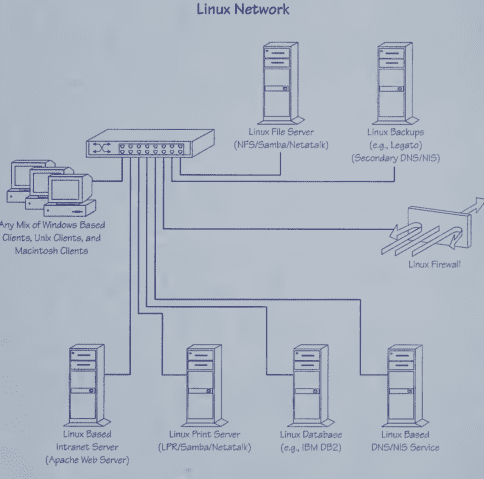

### Windows NT 网络

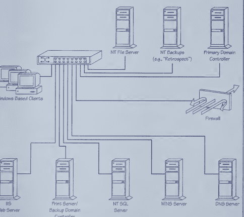

这两个网络在功能上是等价的：NT 能做的，Linux 也能做。然而，Linux 通常可以用更少的服务器来实现这一点，并且还可以支持 Windows 和 Macintosh 客户端。这是通过使用 Samba 软件包来与 Windows 客户端互操作，以及使用 Netatalk 来与 Macintosh 客户端互操作实现的。

## Linux 与 Windows NT 启动过程

### Linux 启动过程

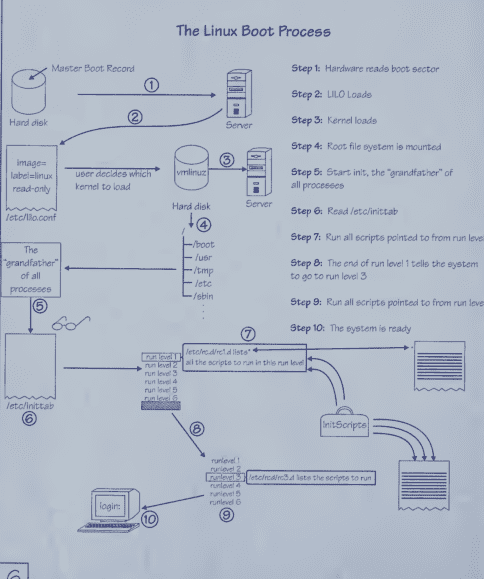

- 步骤 1：硬件读取引导扇区
- 步骤 2：LILO 加载
- 步骤 3：内核加载
- 步骤 4：根文件系统挂载
- 步骤 5：启动 init，所有进程的“祖父”
- 步骤 6：读取 /etc/inittab
- 步骤 7：运行运行级别 1 指向的所有脚本
- 步骤 8：运行级别 1 的结束告诉系统转到运行级别 3
- 步骤 9：运行运行级别 3 指向的所有脚本
- 步骤 10：系统准备就绪

### NT 启动过程


NT 和 Linux 的启动过程之间存在平行关系。如果你理解其中一个背后的逻辑，你就能理解另一个背后的逻辑：它们都从读取 MBR 开始，都以向用户提供登录提示结束。值得注意的相似点包括 NTLDR 和 LILO。它们看起来不同，行为也不同，但最终做的是完全相同的事情。NTDETECT、NTKSRNL 和 HAL 是三个组件，它们在 Linux 内核中都已完成。尽管 SMSS 和 init 采取的路径大不相同，但它们的目标是一样的：启动必要的服务。

## Linux 与 Windows NT 关机过程

### Linux 关机


- 步骤 1：调用 shutdown 或 reboot 命令
- 步骤 2：告知 Init 更改到运行级别 6
- 步骤 3：/runlevel 6 中的脚本调用带有“Stop”参数的 init 脚本
- 步骤 4：将未决缓冲区写入磁盘（sync）
- 步骤 5：卸载文件系统
- 步骤 6：系统停止

### NT 关机


- 步骤 1：调用 shutdown 命令
- 步骤 2：通知 WINS 服务器该机器正在离开网络
- 步骤 3：断开所有网络服务的连接
- 步骤 4：关闭与 PDC 的持久连接
- 步骤 5：将“最后已知良好”信息写入注册表
- 步骤 6：关闭服务
- 步骤 7：系统停止

不幸的是，Linux 和 NT 的关机程序并没有显示出像它们的启动过程那样多的相似之处。这源于 Linux 的 NIS、NFS 和 LPR 服务与 NT 的 PDC 和 SMB 协议的本质区别。Linux 不为这些服务维护持久连接；而 NT 则维护。


# nslookup

查看 nslookup 所有功能的最佳方式是在不带任何命令行参数的情况下运行它。这将带你进入一个提示符界面，你可以在这里输入名称以解析为 IP 地址，或输入 IP 地址以解析为主机名，也可以输入命令来发出特定类型的请求。输入 `help` 命令可获取可用命令列表。此外，nslookup 的手册页也提供了大量关于其用法的信息。在 nslookup 命令行中可用的最有用的命令之一是 **server**，它允许你在执行查询时更改所使用的名称服务器。这样做是调试那些似乎返回错误查询结果的 DNS 服务器的绝佳方式。或者，你可能正在配置一个尚未公开知晓的 DNS 服务器，并需要首先对其进行测试。

# dig

域名信息聚合器 dig 是一个收集有关 DNS 服务器信息的出色工具。它旨在获取关于查询解析过程的详细信息，并获取比通过 nslookup 可获得的更完整的信息。尽管这两个工具之间存在很大的重叠，但你很快就能判断出何时使用 dig，何时使用 nslookup 更好。与 nslookup 一样，dig 的手册页也非常详尽且信息丰富。

# whois

whois 命令用于确定域名的所有权。关于域名所有者的信息并非其记录的必需部分，也不惯例性地放置在 TXT 或 RP 记录中。因此，你需要使用 whois 技术来收集此信息，该技术会报告域名的实际所有者、其邮寄地址、电子邮件地址以及技术联系人电话号码。

要使用 whois，只需在命令行中指定相关的域名，如下所示：

```
[root@ford root]# whois mcgraw-hill.com

Domain Name: MCGRAW-HILL.COM

Administrative Contact:
    Wegman, Mike [MH1053]    mweyman@MCGRAW-HILL.COM
    609-426-5291 [FAX] 609-426-7721
Technical Contact, Zone Contact:
    ANS Hostmaster [AH-ORG]    hostmaster@ANS.NET
    (800)456-6300
Fax - (914) 789-5310
Billing Contact:
Accounts Payable (AP209-ORG) accounts-payable@ANS.NET
914-701-5381
Fax - A

Record last updated on 10-Mar-99.
Record created on 07-May-94.
Database last updated on 8-Aug-99 03:53:54 EDT.

Domain servers in listed order:

NS-01A,ANS.NET 139.221.47.7
NS-01B,ANS.NET 139.221.47.8
NS-02A,ANS.NET 207.24.245.179
NS-02B,ANS.NET 207.24.245.178
```

保持你自身域名的 whois 信息最新至关重要。如果发生异常事件，例如你的站点遭到攻击或变成垃圾邮件中继站，你很可能会首先通过电话联系你，而不是电子邮件。在这种情况下，没有当前且相关信息可能会给你带来巨大伤害。

# 其他参考资料

显然，任何存在时间像 DNS 这么久的协议都无法在短短几页中总结完毕。如果你需要探索本章节未讨论到的更多 DNS 内容，我强烈推荐以下文本：

- Paul Albitz 和 Cricket Liu 撰写的（O’Reilly & Associates 出版）**《DNS and BIND, Third Edition》**，非常出色地深入探讨了 DNS 中真正复杂的细节。如果你正在寻找子域划分、DNS 负载均衡或基本上做任何非常规操作的方法，请翻阅这本书。像你正在阅读的这一章这样的章节是获得合理稳固理解并开始上手的好方法，但正是像 *DNS and BIND* 这样的书籍能让你如鱼得水。
- 在第 11 章中，我推荐 Richard Stevens 撰写的**《TCP/IP Illustrated, Volume 1》**。这本书包含专门针对 DNS 的一章，提供逐包分析以及如何运作的基本解释。
- 有几个与 DNS 相关的 RFC，最值得注意的是 1034 和 1035。其中几个包含在 BIND 文档的 bind-docs.tar.gz 归档中。你也可以从 http://www.rfc-editor.org 在线获取它们。如果你对前沿技术感兴趣，请访问 Internet Engineering Task Force 网站 http://www.ietf.org 查看他们的最新动态。

## 摘要

在本章中，我们涵盖了启动各种类型 DNS 服务器所需的所有信息。我们讨论了：

- 通过互联网进行名称解析
- 编译 BIND 名称服务器
- /etc/hosts 文件（以及关于 NIS 的一些内容）
- 配置 Linux 客户端使用 DNS 的过程
- 配置 DNS 服务器作为主服务器、从服务器和缓存服务器
- 建立站点所需的记录类型
- /etc/named.conf 文件中大部分选项
- 用于配合 DNS 服务器进行故障排除的工具
- 额外信息资源

结合 BIND 文档中关于服务器应如何配置的信息，以及本章中展示的完整服务器的实际配置文件，你应该能够进行从头到尾的完整安装。

与任何软件一样，没有什么是完美的，BIND 及此处讨论的相关文件和程序可能会出现一些问题。别忘了查阅网站以及专门针对 DNS 和 BIND 的各种新闻组以获取更多信息。特别值得注意的是这些：

- comp.protocols.dns.bind
- comp.protocols.dns.ops
- comp.protocols.dns.std

你会发现很多人可以帮你解决这些问题。记得在你自己学会之后帮助别人！

# **第 13 章**

# FTP

文件传输协议（FTP）自 1971 年左右起就已存在于互联网中。值得注意的是，自那以后该协议几乎没有发生变化。另一方面，客户端和服务器却几乎一直在不断改善和精炼。本章讨论了一种特别精炼的服务器——华盛顿大学 FTP 服务器（通常称为 wu-ftp）的安装和配置。

大多数 Linux 发行版都默认将 wu-ftpd 作为其 FTP 服务器。许多商业非 Linux FTP 站点也使用 wu-ftpd，而不是其各种 UNIX 版本自带的服务器，原因与 wu-ftpd 在 Linux 下成为首选服务器相同：稳定性、灵活性和安全性。

在本章中，我们将讨论如何下载最新版本的 wu-ftpd 并对其进行编译和安装。我们还将展示如何配置私有访问以及匿名访问。最后，我们将展示如何使用 wu-ftpd 设置虚拟域。

## FTP 的机制

将文件从一台计算机传输到另一台计算机似乎微不足道，但实际上并非如此——至少如果你做得正确的话并非如此。在本节中，我们将逐步剖析 FTP 客户端/服务器交互的细节。虽然这些信息对于启动 FTP 服务器至关重要，但在考虑安全问题以及故障排除问题时也同样重要——尤其是那些未明确表现为 FTP 相关的故障排除问题。（是网络问题还是 FTP 问题？）

### 客户端/服务器交互

当 FTP 客户端想要连接到 FTP 服务器时，它会随机选择一个高位端口（端口号大于 1024）作为源端口，并将 FTP 服务器上的端口号 21 作为目的端口。端口 21 是在 FTP 标准中定义的通用 FTP 服务器端口。一旦连接建立，客户端就可以登录并发出命令以浏览 FTP 服务器的目录。

当客户端发起文件传输请求时，它会获取另一个随机高位端口并开始在该端口上监听连接。它将这个新端口号通过现有连接发送给 FTP 服务器。FTP 服务器获取此端口号，并从其某个随机高位端口发起一个新的连接到客户端提供的端口号。原始连接保持打开状态，以便客户端和服务器可以互相发送额外的“带外”消息（例如，关于传输的信息）。

这种设计构思于 20 世纪 70 年代初，假设了在互联网很长一段时间内都合理的情况：互联网用户是一群友好的人，他们知道自己在做什么。这在一定程度上受到事实的保护，即互联网主干由美国国家科学基金会（NSF）资助，因此除非与研究机构合作，否则不允许商业组织接入。学术和政府资助的研究实验室构成了大多数用户。

大约在 1990-1991 年，NSF 停止为互联网主干买单，互联网转向商业化。起初，这并不是一件大事。然后万维网出现了，网络人口激增——连同其安全问题一起激增。


如今，许多网站开始使用防火墙来保护其内部网络免受“大坏网络”（即互联网）的侵害。然而，防火墙（理所当然地）认为，从互联网的高端口到内部网络高端口的任意连接是非常糟糕的事情。

因此，许多防火墙实现了针对 FTP 的应用层代理，这些代理会跟踪 FTP 请求，并在需要从远程站点接收数据时打开那些高端口。

当然，并非所有防火墙都如此智能。许多站点依赖数据包过滤防火墙，它们并不真正理解通过它们的数据，但知道发送到任意高端口的数据是有害的，因此会将其弹出。这种类型的防火墙会立即破坏 FTP，因为 FTP 依赖于能够与客户端在高端口建立回传连接。

现在回想一下 FTP 最初被创建时的情景，那时带宽是非常宝贵的。当某人在主机 C 上，想要将文件从主机 A 传输到主机 B 时，将文件从主机 A 传输到主机 C，再从主机 C 传输到主机 B 的过程最终会浪费大量的带宽。因此，FTP 协议的设计者想出了一个解决方案：让坐在主机 C 上的人能够将文件从主机 A 直接传输到主机 B。这是通过被动传输来实现的。

被动传输是通过由客户端启动数据传输连接，而不是由服务器端启动连接来实现的。从防火墙的角度来看，这使得客户端可以安全地保持在防火墙之后，而无需为允许回传连接设置复杂的规则。

## 获取最新的 WU-FTPD

与其他服务器软件一样，wu-ftp 会定期更新和升级。这些更新现在（当然通过 FTP）可在 ftp://ftp.wu-ftpd.org 获取。网站 http://www.wu-ftpd.org 也是获取 wu-ftp 守护进程状态信息的好去处。截至今日，wu-ftpd 的最新版本是 2.5.0；然而，许多 CD-ROM 发行版附带的是 2.4.2V1R2。建议进行升级，因为 wu-ftp 开发小组不再支持之前的版本。如果你继承了一个运行 VR14（补丁）之前任何版本 wu-ftp 的 Linux 系统（或任何 UNIX 系统），升级就尤为重要，因为存在一个广为人知的安全漏洞，脚本小子（参见第 11 章）确实已经利用该漏洞入侵了网站。

你可以从 ftp://ftp.wu-ftpd.org/pub/wu-ftpd/wu-ftpd-2.5.0.tar.gz 下载版本 2.5.0。

下载此软件包后，你需要使用以下命令将其解包：

```bash
[root@ford src3]# tar -xzvf wu-ftpd-2.5.0.tar.gz
```

这将在当前目录下创建一个名为 wu-ftpd-2.5.0 的子目录，所有源代码文件都将在该目录中解包。为了保持一致性，你可能希望将此以及你自己编译的任何其他软件解包到 /usr/local/src 目录中。

### 阅读 README

你会发现 wu-ftpd 附带了一些纯文本格式的文档文件。其中一个文件包含了在多个不同计算平台上编译 wu-ftpd 的步骤（如果你对此感兴趣的话）。我强烈建议你花几分钟时间阅读其中的内容。在这个版本中，以及在未来版本中，软件包附带的文档包含了大量关于查找在线帮助资源的信息，以及开发人员希望你知道的有关该软件的注意事项。在向任何讨论论坛提问之前，阅读软件包附带的文档也是很有帮助的。

### 编译和安装 wu-ftpd

从 wu-ftpd 解包到的子目录中，你只需输入

```bash
[root@ford wu-ftpd-2.5.0]# ./build1111 mx
```

即可完成。该脚本会为你处理编译和验证过程。在编译过程结束时，你应该看到类似这样的内容：

| 测试 | 数据 | BSS | 十进制 | 十六进制 文件名 |
|------|------|-----|-----|--------------|
| 12940| 15156| 72608| 213704| 3422b bin/ftpd |

如果你有现有的配置，最好备份配置文件，以免安装过程将其覆盖。你需要保存的文件如下：

- /etc/ftpass
- /etc/ftpgroups
- /etc/ftphosts
- /etc/ftptusers

保存这些文件后，你就可以准备进行安装了。如果你还不是 root 用户，请使用 su 命令成为 root 用户。然后输入命令

```bash
[root@ford wu-ftpd-2.5.0]# ./build install
```

这将使所有二进制文件和手册页安装到相应的位置。

二进制文件就位后，我们现在准备编辑 /etc/services 文件，以便系统能够将 FTP 的端口号映射到 /etc/inetd.conf 中列出的 FTP 服务。确保 /etc/services 包含以下两行：

```
ftp-data  20/tcp
ftp       21/tcp
```

我们现在准备编辑 /etc/inetd.conf 文件，以便每当有人尝试连接时，系统都能自动启动 FTP 服务器。要进行更改，请用你喜欢的文本编辑器打开 /etc/inetd.conf。在文件的顶部附近，你应该能找到一行以 "ftp." 开头的行。如果你找不到这样的行，则需要添加一行。你可以将此行添加到文件中的任何位置。

确保 /etc/inetd.conf 文件中的 ftp 行内容如下：

```
ftp stream tcp nowait root /usr/sbin/tcpd in:ftp -l -a
```

正如你从第 9 章中回忆起的，/etc/inetd.conf 文件由 inetd 程序管理，该程序充当一种“超级服务器”，代表许多服务器应用程序监听网络请求，并在检测到连接请求时启动服务器应用程序。如果其配置文件 /etc/inetd.conf 被更改，你需要向 inetd 进程发送信号，以告诉它重新加载其配置文件。这可以通过两种方式进行：

- 运行以下命令：
  ```bash
  kill -1 `ps auxw | grep inetd | grep -v grep | awk '{print $2}'`
  ```
- 检查你的发行版是否在你的 /var/run/inetd.pid 文件中为你跟踪进程 ID。如果是，你可以使用
  ```bash
  kill -1 -1 `cat /var/run/inetd.pid`
  ```

现在你应该能够 ftp 到你自己的系统了。如果你现在还无法登录，请不要担心——我们稍后会介绍这些细节——但至少在这一点上，你应该能够看到 FTP 登录提示。

## 配置 WU-FTPD

wu-ftpd 软件包附带几个示例配置文件，这些文件非常容易修改并部署在你的 FTP 服务器上。在本章后面，如果你只是想快速入门，我们甚至会提供一些我们自己的简单预制配置。

### 通过 /etc/ftpaccess 文件控制访问权限

`/etc/ftpaccess` 文件包含五种类型的命令：

- 访问控制
- 客户端的自动横幅信息
- 日志配置
- 权限
- 目录和文件类型控制

我们将检查属于每个组的每个特定命令。

### 访问控制

能够控制谁可以进入你的 FTP 服务器，谁不能进入，是服务器管理的一个关键方面。以下命令允许你做到这一点。

**CLASS**  
class 命令在你的系统上定义一个新的用户类。它不授予或撤销任何特定权限，但定义一个类对于在后续章节中提到的命令中引用一组用户是必要的。

class 命令的格式为

```
class classname type address...
```

其中 *classname* 是你正在定义的新类的名称。*type* 是三个值之一：anonymous（匿名）、real（实际用户）或 guest（访客）。匿名用户正是如此：他们可以无需你的明确许可即可访问服务器。（请注意，通过定义允许匿名用户的类，你实际上并没有设置匿名 FTP。）实际用户必须拥有系统上的账户和一个有效的 shell。（就 FTP 而言，我们将有效 shell 定义为在 /etc/shells 文件中列出的任何 shell。）访客用户是那些在服务器上拥有实际账户的人，但被明确列在访客组中（稍后讨论）。最后，*address...* 是已定义类可以源自的 IP 地址列表。星号 (*) 是一个通配符，表示所有 IP 地址对正在定义的类都是有效的。

例如，class 语句

```
class myclass anonymous 10.10.*
```

定义了类 myclass，它仅包括 IP 地址以 10.10 开头的匿名用户。

你可以拥有任意数量的类条目。

**AUTOGROUP**  
autogroup 命令用于设置匿名用户通过 FTP 服务器登录时所属的 UNIX 组。通过显式设置他们所属的组，你可以对哪些文件他们可访问、哪些文件不可访问保持严格控制。


autogroup 命令的格式为

```
autogroup groupname class...
```

其中 `groupname` 是希望匿名用户所属的组名（注意 `groupname` 应与 `/etc/group` 文件中的条目对应），而 `class...` 是指希望受此命令影响的类列表。例如，如果你定义了三个类：

```
class a anonymous,real 10.10.*
class b anonymous,real,guest 192.168.5.*
class c anonymous,real 192.168.7.10 192.168.7.11 192.168.7.12
```

你可以这样指定一个 autogroup 类：

```
autogroup anonftp a b
```

现在，任何来自类 a 或 b 并以匿名身份登录的人，都必须工作在 `anonftp` 组的约束范围内。

### DENY

`deny` 命令允许你根据某人的源 IP 地址或主机名来阻止其访问你的站点。（注意：由于将主机名反向解析为 IP 地址并不可靠，建议仅使用 IP 地址。）`deny` 命令的格式如下：

```
deny address message_file
```

其中 `address` 是 IP 地址，`message_file` 是当你希望他们尝试连接时发送给他们消息的文件名。例如，命令

```
deny 192.168.66.7 /home/tftp/no_evil_crackers
```

会导致 `/home/tftp/no_evil_crackers` 文件的内容发送给任何试图从 IP 地址 192.168.66.7 登录服务器的用户。

### GUESTGROUP

当你有真实用户但希望他们仅拥有类似匿名用户那样受限的 FTP 权限时，`guestgroup` 命令非常有用。该命令的格式为

```
guestgroup groupname
```

其中 `groupname` 是你希望受到限制的组名（取自 `/etc/group`）。为了以这种方式限制用户，除了在 `/etc/ftpaccess` 文件中添加此条目外，你还需要更改每个用户的 `/etc/passwd` 条目格式。新的格式应使用 `/` 字符拆分其主目录。在拆分前应为其有效根目录，拆分后应为用户的相对主目录。例如，条目

```
ssah::/ftp/hsah:/home/ssah:256:1024:Steve Shaw:/bin//ftponly
```

意味着 `/ftp` 是该用户新的相对根目录。这将阻止用户甚至查看实际的 `/home` 目录，或其他任何目录。正因为如此，你需要在 `/ftp` 中放置 `bin`、`etc` 和 `lib` 目录，其中包含足够的库和二进制文件，以便他们至少能够 ftp 到系统中。这与我们将稍后讨论的匿名用户配置是相同的。

相对于 `/ftp` 会有一个名为 `ssah` 的子目录，这将作为他们通过 FTP 登录的主目录。由于 `/bin//ftponly` 不是一个真实的 shell，他们无法通过 telnet 登录系统。但是，请确保 `/bin//ftp` 列在 `/etc/shells` 文件中。

### LIMIT

`limit` 命令允许你根据类和一天中的时间来控制通过 FTP 登录到系统的最大用户数。`limit` 命令的格式为

```
limit class n times message_file
```

其中 `class` 是受影响的类名，`n` 是最大数量，`times` 是允许用户登录的日期和时间，`message_file` 是显示给不被允许进入的用户的信息文件。

`times` 条目的格式稍显复杂。该参数采用逗号分隔的字符串形式，其中每个选项对应于单独的一天。从周日到周六的形式分别为 `Su`、`Mo`、`Tu`、`We`、`Th`、`Fr` 和 `Sa`，并且所有工作日都可以引用为 `Wk`。时间应保持军事格式，小时和分钟之间不使用冒号分隔。范围由连字符（`-`）指定。

例如，要将类 `anonyeoples` 在周一至周四全天限制为最多 25 人，在周五限制为最多 7PM，你会使用如下行：

```
limit anonyeoples 25 Mo-Th,Fr:0000-1900 /home/ftp/.message_too_many
```

如果超过最大限制，文件 `/home/ftp/.message_too_many` 的内容将返回给用户。

> **注意：** 对 `limit` 命令的支持适用于那些在可用带宽方面有限制，或需要在某些时间用于其他任务的服务器。例如，提供产品数据表的 FTP 服务器在正常营业时间应保持对客户可访问。只有当业务流量减缓的深夜时段，才可能接受服务器托管你的乐队唱片目录。`limit` 命令允许你完成此类配置。

### LOGINFAILS

此命令允许你限制用户连接到你的站点时连续登录失败的次数。该命令的格式为

```
loginfails n
```

其中 `n` 是你愿意容忍的登录失败次数。例如，如果你希望系统在某人连续三次输入密码错误时自动断开连接，你可以使用

```
loginfails 3
```

### PRIVATE

你可能会发现有必要与他人共享文件，但不希望授予他们系统账户，同时也不希望将文件放入 100% 公开可访问的目录。通过设置一个私有组，你要求客户端使用 `SITE GROUP` 和 `SITE PASS` 命令，以便他们可以切换到需要密码的特权组。为了使 FTP 服务器支持此功能，你需要使用以下命令设置 `private` 标志：

```
private switch
```

其中 `switch` 是 `ON` 或 `OFF`。

因为你需要为这些特殊组要求密码，所以你需要使用 `/etc/ftpgroups` 文件。`/etc/ftpgroups` 中访问组的格式为

```
access_group_name:encrypted_password:real_group
```

其中 `access_group_name` 是客户端用户用来引用特殊组的名称，`encrypted_password` 是用户访问该组时需要提供的密码（通过 `SITE PASS`），`real_group` 是在 `SITE`/group 文件中引用的实际组。

要为该文件生成加密密码条目，你需要使用 `crypt` 函数。可以通过以下简单的 Perl 脚本访问它：

```perl
#!/usr/bin/perl
print 'Enter password to encrypt: ';
chomp ($password=<STDIN>);
print "The encrypted password is: ", crypt($password,$password), "\n";
```

只需输入这些内容并将其保存为文件。将其权限更改为可执行（例如，`chmod 755 my_perl_script`）并运行它。它会提示你输入想要设置的密码，然后打印出加密后的字符串。

## 横幅消息控制

当用户通过 FTP 登录到你的站点时，你可能会发现向他们展示某种消息会很方便。当用户连接时，你可以显示通用的横幅消息，或者当他们进入特定目录或执行特定操作时显示特殊消息。本节讨论如何使用 `wu-ftp`/`etc/ftpaccess` 文件中的命令来实现这一点。

### BANNER

此命令允许你向已连接到 FTP 服务但尚未登录的用户显示一条消息。此命令的格式为

```
banner filename
```

其中 `filename` 是你希望显示的文件名（包含完整路径）。该文件应是一个纯 ASCII 文本文件。例如：

```
banner /home/ftp/welcome_to_my_ftp_site
```

> **注意：** 管理繁忙 FTP 服务器的管理员们评论说，良好的横幅消息实际上对于限制关于你站点的一对一询问数量非常关键。引用我的技术编辑的话，“人们确实会阅读它们！”

### EMAIL

`email` 命令允许你指定站点维护者的电子邮件地址。诸如 `message`（稍后讨论）等命令也使用此信息。此命令的格式为

```
email address
```

其中 `address` 是站点管理者的电子邮件地址。你应该考虑在此处使用通用的电子邮件地址，例如“ftp@ftp.yoursite.com”，并使用 `etc/aliases` 文件（参见第 15 章关于 Sendmail 的内容）将该别名扩展到你所有的实际管理员。`email` 命令使用示例如下：

```
email ftp@ftp.yoursite.com
```

### MESSAGE

当你需要为特定类的用户或进入特定目录的用户设置特殊消息时，`message` 命令非常有用。该命令的格式为

```
message path [when [class...]]
```

其中 `path` 是要向用户显示的文件，`when` 是显示消息必须为真的条件，`class`（可选）是适用于该条件的类列表。

`when` 参数是使此命令与 `banner` 命令真正不同的地方。`when` 可以有两种形式之一：`LOGIN` 或 `CWD=path`。如果是 `LOGIN`，消息在成功登录后显示。如果是 `CWD=path`，当用户进入 `path` 目录时显示消息。

消息文件本身是一个带有某些特殊关键字的普通文本文件。这些关键字如下：

| 选项 | 描述 |
| :--- | :--- |
| %T | 本地时间 |
| %F | 路径所在分区的可用空间 |
| %C | 当前工作目录 |
| %E | 使用 email 命令指定的电子邮件地址 |


# 选项表

| 选项 | 描述 |
| :--- | :--- |
| %R | 客户端主机名 |
| %L | 服务器主机名 |
| %U | 登录时提供的用户名 |
| %M | 登录类中允许的最大用户数 |
| %N | 该类中的用户数量 |

> **注意：** 由匿名登录触发的消息必须相对于匿名 FTP 目录。

消息命令运行示例如下：

```
message ./too.many.users LOGIN anounusers
```

其中 `too.many.users` 文件的内容如下：

```
抱歉 %R，但 %L 的 %M 个用户限额中已使用 %N 个。我们正在努力获取更大的服务器，在此期间感谢耐心等待。请稍后再试。
您的 FTP 管理员，%E
```

**README**

`readme` 命令允许服务器在特定文件最后更新时间时自动通知用户。该命令的格式为：

```
readme path when class
```

其中 `path` 是您希望 FTP 服务器监控的文件的完整路径名，`when` 是您希望告知用户的时间（`when` 的格式与 `message` 命令相同），而 `class` 是该命令适用的类。`when` 和 `class` 参数是可选的。例如：

```
readme ./README CWD=/pub/patches
```

> **注意：** 由匿名登录触发的消息必须相对于匿名 FTP 目录。

# 日志记录

您可以使用 `wu-ftpd` 来配置关于其使用情况应记录哪些信息。这些信息是掌握使用率信息的好方法，有助于您更好地规划和服务组织。

本节讨论用于自定义日志条目的命令。

**LOG 命令**

如果您希望记录连接到您的 FTP 服务的用户输入的每个命令，请使用 `log commands`。其用法如下：

```
log commands typelist
```

其中 `typelist` 是您希望记录其命令的用户类型的逗号分隔列表，如 `class` 命令所描述。有效的用户类型为 anonymous（匿名）、guest（访客）和 real（真实用户）。例如，如果您希望记录所有匿名用户键入的命令，您将键入：

```
log commands anonymous
```

**LOG TRANSFERS**

如果您希望仅记录用户在您服务器之间传输的文件，而不是记录所有键入的命令，您将使用此命令：

```
log transfers typelist directions
```

其中 `typelist` 是您希望记录其命令的用户类型（如 `class` 命令所描述，即 anonymous、guest 和 real），而 `directions` 是传输必须采取的方向的逗号分隔列表，以便其被记录（即 inbound 入站和 outbound 出站）。例如，要记录所有访客用户的入站和出站连接，请键入：

```
log transfers guest inbound,outbound
```

# 其他服务器命令

当然，总有一些命令不适合归入任何特定类别。请考虑以下情况。

**ALIAS**

创建常用目录的快捷方式通常很方便。通过使用 `alias` 命令，您可以做到这一点。该命令的格式为：

```
alias alias-name actual-directory
```

其中 `alias-name` 是别名本身，而 `actual-directory` 是希望设置快捷方式的完整目录。例如：

```
alias redhat /pub/linux/distributions/redhat
```

这将允许用户键入命令：

```
cd redhat
```

系统会自动将其带到 `/pub/linux/distributions/redhat` 目录。

**CDPATH**

作为 shell 中 PATH 环境变量的等价物，`cdpath` 允许您为连接到您的 FTP 服务的用户建立目录路径。该命令的格式为：

```
cdpath directory
```

其中 `directory` 是您希望添加到路径中的目录名称。例如，如果您使用了：

```
cdpath /pub/linux
cdpath /pub/recipies
```

并且用户键入命令 `cd microwave`，`wu-ftpd` 将搜索以下目录：

- `./microwave`
- 名为 `microwave` 的别名
- `/pub/linux/microwave`
- `/pub/recipies/microwave`


> **注意：** 别名和 cdp ath 之间的主要区别在于，别名指定了一个从一个目录名到另一个目录名的单一映射。另一方面，cdp ath 指定了一个目录列表，当用户键入 `cd` 命令时应检查这些目录。

**COMPRESS**

`wu-ftpd` 服务器提供在执行过程中进行文件转换的功能。它能执行的一种特定转换是在文件发送给用户之前对其进行压缩或解压缩。这对于可能没有使用与您相同的压缩工具的客户端，或者希望通过在发送前压缩文件以节省带宽的慢速链路客户端特别有用。

该命令的格式为：

```
compress switch class
```

其中 `switch` 为 ON 或 OFF，而 `class` 为 real、anonymous 或 guest。使用此功能的陷阱在于，您还必须配置您的 `tftp/conversions` 文件。我们将在本章稍后讨论这一点。

**TAR**

与 `compress` 命令类似，`tar` 命令允许客户端在下载文件前对文件进行 tar 或解 tar 操作。（有关使用 `tar` 的更多信息，请参见第 6 章。）此命令的格式为：

```
tar switch class
```

其中 `switch` 为 ON 或 OFF，而 `class` 为 anonymous、real 或 guest。

> **注意：** 这是用户递归下载子目录的一种很好的机制。

# 权限

在 FTP 服务器上设置文件权限非常重要。您需要确保设置了正确的权限，这样您不想共享的文件就不会被共享，而不应被修改的文件也不会被修改。本节讨论的命令有助于您维护这种完整性。

**CHMOD**

此命令允许您决定是否要授予用户更改您站点上文件权限的权利。（他们必须拥有该文件才能更改其权限。）该命令的格式为：

```
chmod switch class
```

其中 `switch` 为 ON 或 OFF，而 `class` 为 anonymous、guest 或 real。通常，您只想将此类型的权限授予真实用户。例如：

```
chmod ON real
```

**DELETE**

`delete` 命令告知服务器用户是否有权删除他们在 FTP 服务器上拥有的文件。该命令的格式为：

```
delete switch class
```

其中 `switch` 为 ON 或 OFF，而 `class` 为 anonymous、guest 或 real。例如：

```
delete ON real
```

**OVERWRITE**

此命令允许您决定是否允许用户通过上传来覆盖现有文件。该命令的格式为：

```
overwrite switch class
```

其中 `switch` 为 ON 或 OFF，而 `class` 为 anonymous、guest 或 real。例如：

```
overwrite ON real
```

**RENAME**

`rename` 命令允许您决定用户是否可以在 FTP 服务器上重命名他们拥有的文件。该命令的格式为：

```
rename switch class
```

**UMASK**

`umask` 命令允许您决定您的 FTP 服务器用户是否可以更改其默认 umask。用户的 umask 决定了其创建的任何文件的默认权限。umask 是八进制数，表示其权限的反义。例如，umask 为 077 意味着创建的任何文件都可以被所有者读取、写入或执行，但不能被其他人访问。

该命令的格式为：

```
umask switch class
```

其中 `switch` 为 ON 或 OFF，而 `class` 为 anonymous、real 或 guest。例如：

```
umask ON real
```

**PASSWD-CHECK**

提供匿名访问的网站通常要求该网站的用户将电子邮件地址作为密码输入；`wu-ftpnd` 允许您决定在运行匿名网站时，对执行密码检查的严格程度。该命令的格式为：

```
passwd-check strictness enforcement
```

其中 `strictness` 为 none、trivial 或 rf622，而 `enforcement` 为 warn 或 enforce。如果 `strictness` 为 none，用户可以在密码字段中输入任何内容，`wu-ftpnd` 都会接受。trivial 仅要求电子邮件地址中必须包含 @ 符号。指定 rf622 要求电子邮件地址完全符合消息头标准。（例如，shah@domain.com 不是符合 rf622 的电子邮件地址。）

此命令的执行方式有两种：warn，意味着如果用户的密码不符合要求，`wu-ftpnd` 将警告用户然后继续；以及 enforce，意味着 `wu-ftpnd` 不允许用户访问，直到他们提供了有效地址为止。

请注意，这仅影响匿名访问。

**PATH-FILTER**

`path-filter` 命令允许您对上传到服务器的文件的文件名应用过滤器。该命令的格式为：

```
path-filter typelist message allowed-regex denied-regex
```

其中 `typelist` 是此命令影响的用户的逗号分隔列表；可用的用户类型为 anonymous、guest 和 real。`Message` 是如果用户的文件名未能通过此过滤器时向用户显示的文件。`Allowed-regex` 是用户想要上传文件时文件名必须匹配的正则表达式。`Denied-regex` 是用户想要上传文件时文件不能匹配的正则表达式。例如，以下行：

```
path-filter anonymous /home/ftp/badfilename UL.* gifs
```

告诉我们，匿名用户必须看到他们上传的文件名以字母“UL”开头，但不能以“.gif”结尾。如果文件名不符合此标准，`/home/ftp/badfilename` 的内容将被发送给用户。


## 上传

你可以使用 `upload` 命令，并结合 `path-filter`，来控制放置在服务器上的文件。`upload` 命令指定了客户端在特定目录中放置文件的权限，以及文件放置到该目录后将获得的权限。该命令的格式为

```
upload directory dirglob switch owner group perms mkdir
```

其中 `directory` 是受此命令影响的目录，`dirglob` 是用于确定 `directory` 下的子目录是否为创建上传的有效位置的 regular expression，而 `switch` 为 YES 或 NO，从而确定是否允许在 `directory` 中进行上传。`owner`、`group` 和 `perms` 参数分别确定了文件的属主、所属组和权限。最后，你可以将 `mkdir` 操作指定为 DIRS 或 NODIRS，从而确定客户端是否可以在指定的 `directory` 下创建子目录。例如：

```
upload /home/ftp /incoming yes ftp ftp 0400 nodirs
```

> 注意：upload 命令仅影响列出的目录，而不影响其下的任何子目录。这可以防止远程用户在服务器上创建任意目录并在那里隐藏文件。

## 日志文件

正如我们之前讨论的，日志文件在日常运维中非常重要。借助它，你可以分析你的 TFTP 站点，并确定诸如最常访问的文件是什么以及整个站点的使用模式等问题。

TFTP 日志文件的默认位置是 `/var/log/xferlog`。日志的每一行都包含表 13-1 中所示的条目。

| 日志标题项 | 描述 |
|---|---|
| **当前时间** | 条目发生的时间。其格式为 DDD MMM dd hh:mm:ss YYYY，其中 DDD 是星期几，MMM 是月份，dd 是月中的日期，hh:mm:ss 是以小时、分钟和秒表示的时间，YYYY 是年份。 |
| **传输时间** | 执行该特定条目传输所花费的秒数。 |
| **远程主机** | 客户机的主机名。 |
| **文件大小** | 正在传输的文件的大小。 |
| **文件名** | 正在传输的文件名。 |
| **传输类型** | a 代表 ASCII，b 代表二进制。 |
| **特殊操作标志** | 服务器对文件执行的操作列表：A 表示文件被压缩，U 表示文件被打包（tarred），连字符 (-) 表示未执行任何操作。 |
| **方向** | 传输的方向，其中 o 表示出站，i 表示入站。 |
| **访问模式** | 执行事务的用户类型：a 代表匿名，r 代表真实用户，g 代表来宾。 |
| **用户名** | 如果用户类型设置为 real，则为本地用户名。 |
| **服务名称** | 启动 FTP 服务器的名称。 |
| **认证方法** | 服务器对用户执行的认证类型。0 表示未进行认证，1 表示用户必须使用唯一的登录/密码组合登录。 |
| **已认证用户 ID** | 如果用户必须使用唯一的登录/密码组合登录，则此处显示该登录名。匿名传输列示为 anonymous。 |

## 即时文件转换

有时，客户端没有必要的工具来使用其正在下载的文件，因为该文件要么被压缩，要么以它们无法读取的格式归档。（在 WinZip 开始解包这些文件之前，这种情况在 tar.gz 文件上尤为常见。）另一些情况下则相反：客户端能够处理压缩文件，并更喜欢以压缩格式接收文件。当然，文件压缩只是你可以使用 `ifc/ftpfileconversions` 文件设置的无限种用途之一。该文件的格式为

```
stripips:stripos:addnopp:addnopost:external:type:options:desc
```

字段如表 13-2 所示。

## 示例条目

以下是一个使用 gzip 按需压缩文件的示例条目。这将允许想要获取文件 `opt_1_disccography.tar` 的人改为请求文件 `orb_discography.tar.gz`，让服务器在使用 gzip 压缩该文件后再发送给他。实现此功能的配置行如下：

```
:::gz::bin/gzip -9 -c %s::”RG[!T_ASCII]::O_COMPRESS::GZIP
```

| 字段 | 描述 |
| :--- | :--- |
| **Stripoff** | 去前缀是文件名在传输前被移除的起始字符。例如，如果去前缀设置为 “weding”，且完整文件名为 “weding.ring”，用户只需请求文件 “ring”，wu-ftpd 就会知道要获取哪个文件以及如何对其进行转换。 |
| **Strippost** | 去后缀与去前缀类似，只是针对文件的末尾。例如，如果去后缀设置为 “.gz”，且服务器上的文件名为 “ring.gz”，如果客户端请求文件 “ring”，服务器将知道执行配置文件中与此行匹配的操作。 |
| **Addonpost** | 添加后缀是去前缀的反义词，它不是移除文件名的末尾，而是向其追加。这用于文件未压缩但在压缩并发送给客户端时添加了 .gz 后缀的情况。 |
| **Addonpre** | 添加前缀是去后缀的反义词。它允许在将文件发送给客户端之前，为文件名添加前缀。 |
| **External** | 此条目指定当过滤器匹配时运行的程序（外部于 wu-ftpd）。对于下载，转换后的结果文件应发送到程序的标准输出 (stdout)。上传则发送到程序的标准输入 (stdin)。你可以使用 %s 代替文件名本身，在外部命令的命令行中指定客户端请求的文件名。服务器会自动搜索并替换所有 %s 的出现为客户端的文件名。 |
| **Type** | 在 wu-ftpd 的世界中，文件存在三种类型之一：普通文件、ASCII 文件和目录（分别为 T_REG、T_ASCII 和 T_DIR）。此字段允许你指定如果文件名过滤器匹配，wu-ftpd 应该操作的文件类型。你可以通过用管道符 (\|) 分隔多个选项来指定多个选项。例如，T_REG\|T_ASCII 指定你希望过滤器应用于任何类型的文件。 |

**表 13-2. /etc/ftpconversions 文件的字段**

| 字段 | 描述 |
| --- | --- |
| **Options** | 此字段决定该过滤器是否将压缩、解压缩或打包文件。每个选项分别由 O_COMPRESS、O_UNCOMPRESS 和 O_TAR 表示。你可以通过在命令之间使用管道 (I) 符号来同时对文件执行多种操作。例如，O_COMPRESS|O_TAR 表示该过滤器将对客户端请求同时进行压缩和打包。 |
| **Desc** | 这是一个自由格式字段，允许你描述该过滤器执行的操作。 |

**表 13-2 /etc/tftp/conversions 文件的字段（续）**

前两个参数（去前缀和去后缀）不是必需的，因为我们没有从文件名中移除任何内容。第三个参数（添加前缀）不适用，因为我们不想在文件名开头添加任何内容。第四个参数，gz（添加后缀），指定在该过滤器执行完毕后，文件名应追加 .gz。第五个参数（外部命令）指定了 gzip 程序的精确调用方式，以执行文件压缩。注意使用 %s 代替了文件名。第六个参数（文件类型）告诉 wu-ftpd 它既可以对纯 ASCII 文件也可以对普通文件执行压缩。第七个参数 O_COMPRESS（选项字段）告诉服务器正在执行的文件操作是压缩。最后，最后一个字段是该过滤器作用的简单人类可读提示：运行 gzip。

虽然这看起来令人望而生畏，但不要担心！你不太需要修改随 wu-ftpd 提供的默认配置文件，因为它涵盖了最常见的转换。

## 配置主机访问

/etc/ftphosts 文件允许你根据源 IP 地址明确允许或拒绝用户。文件中的每一行可以采取以下形式

```
allow username address
```

或

```
deny username address
```

其中 username 是连接 FTP 服务时使用的登录名，address 是源 IP 地址。你可以用逗号分隔的列表列出多个地址。


# 库存配置

鉴于可用的选项繁多，配置 ftp-wu-ftpd 服务器可能显得有些 daunting（令人望而生畏），但事实并非如此。与 DNS 配置类似，最常见的配置也是相对最容易实施的。在本节中，我们将介绍这些组合，以助您上手。

# 仅限匿名访问

在 UNIX 模型下，每个进程都必须有一个所有者。对于匿名 FTP 用户而言，该所有者应仅具有最小的文件访问权限，且只能查看指定公共 FTP 区域内的文件。为实现这一点，您需要确保已设置 “ftp” 用户。（在 Red Hat Linux 下会自动完成此操作。）

# 设置匿名用户

> *提示：如果您使用的是 Red Hat Linux，可以简单地安装 anontftp-2.8-1.i386.rpm RPM 包，而无需执行本节中讨论的步骤。*

您可以通过检查 /etc/passwd 文件轻松确认是否拥有匿名用户。如果存在名为 “ftp” 的用户名，则此步骤已由系统处理。如果没有，您需要使用类似以下命令创建名为 “ftp” 的新用户：

```bash
[root@ford /root]# echo "*/bin/ftponly" >> /etc/shells
and
[root@ford /root]# useradd -c "FTP User" -d /home/ftp -f -s\
    /bin/ftponly ftp
```

第一条命令告知系统 “/bin/ftponly” 是一个可接受的用户 Shell。这对于 useradd 命令使用该 Shell 是必要的，尽管该 Shell 实际上并不存在。您希望将某人的 Shell 设置为一个不存在的 Shell，但将其列在 /etc/shells 中的原因是，这样他们可以通过 FTP 登录到系统，但不能通过 telnet 登录。

第二条命令创建 ftp 用户账户。您可以将 /home/ftp 目录更改为您希望发生匿名 FTP 访问的任何位置。（如果您打算使站点变大，可能需要专门分区。）另外请记住，-r 选项创建系统账户，因此不会自动创建主目录。

出于组织目的，如果 ftp 组尚不存在，您还应该创建一个 ftp 组。这通过以下命令完成：

```bash
[root@ford /root]# groupadd -r ftp
```

账户创建后，您需要确保匿名 ftp 用户的主目录已设置好。这是用户连接该服务时将看到的目录。

### 设置匿名 FTP 目录

> **提示：** 如果您使用了 anonftp-2.1-1096.rpm RPM 包，也可以跳过这些步骤，因为目录结构已经为您设置好。

匿名 FTP 目录应具有以下子目录：

- pub
- bin
- etc
- lib

这些目录的权限应使用以下命令设置：

```bash
[root@ford /home/ftp]# chown root.root bin etc lib
[root@ford /home/ftp]# chown root.ftp pub
[root@ford /home/ftp]# chmod 111 bin etc
[root@ford /home/ftp]# chmod 755 lib
[root@ford /home/ftp]# chmod 2755 pub
```

当匿名 ftp 用户登录时，服务器会执行 chroot，这是一种系统功能，它将根目录的定义从匿名 FTP 文件所在的任何目录更改为新定义。例如，如果匿名 FTP 文件位于 /home/ftp，则 chroot 命令可以将根目录定义更改为 /home/ftp，因此 “cd /” 实际指的是 /home/ftp。这样做的目的是确保任何远程用户都无法看到系统中的其他文件，尤其是敏感文件，如 /etc/passwd。执行 chroot 的副作用是，正在运行的程序必须在此新根目录中可用，否则无法使用。因此，您必须将下表中显示的文件复制到以下目录中。（注意：我们假设 /home/ftp 是存放匿名 ftp 文件的目录。）

| 源文件 | 目标位置 | 权限 |
| :--- | :--- | :--- |
| /lib/libm-2.1.lso | /home/ftp/lib | 755 |
| /lib/libc-2.1.lso | /home/ftp/lib | 755 |
| /lib/libns1-2.1.lso | /home/ftp/lib | 755 |
| /lib/libnss_files-2.1.lso | /home/ftp/lib | 755 |
| /usr/bin/compress | /home/ftp/bin | 111 |
| /bin/cpio | /home/ftp/bin | 111 |
| /bin/gzip | /home/ftp/bin | 111 |
| /bin/ls | /home/ftp/bin | 111 |
| /bin/sh | /home/ftp/bin | 111 |
| /bin/tar | /home/ftp/bin | 111 |

请记住使用 chmod 命令正确设置上述文件的权限（参见第 6 章）。

您还需要创建一些符号链接。以下命令系列将创建它们：

```bash
[root@ford ~root]# cd /home/ftp/lib
[root@ford lib]# ln -s ld-2.1.1.so ld-linux.so.2
[root@ford lib]# ln -s libc-2.1.so libc.so.6
[root@ford lib]# ln -s libnsl-2.1.so libnsl.so.1
[root@ford lib]# ln -s libnss_files-2.1.1.so libnss_files.so.2
[root@ford lib]# cd /home/ftp/bin
[root@ford bin]# ln -s gzip csgz
```

最后，您需要设置一个简单的 passwd 和 group 文件。这些文件的用途不是为了认证，而是为了显示。请记住，每个文件的所有者都以 UID 表示，而 /etc/passwd 文件提供了从 UID 到登录名的映射。同样适用于组、GID 和 /etc/group 文件。因此，您需要创建 /home/ftp/etc/group，其中至少包含以下内容：

```text
root::0:
ftp::X:
```

其中 X 是上一节中由 groupadd 命令建立的 ftp 组的 GID。

/home/ftp/etc/passwd 文件需要包含以下内容：

```text
root::0:0::
ftp::X:XX:YY::
```

其中 XX 是由 useradd 命令创建的 ftp 用户的 UID，YY 是由 groupadd 命令建立的 ftp 组的组号。

## 设置 /etc/ftpaccess

设置匿名 FTP 服务器的关键是用户 “ftp” 和相应的目录。设置完成后，您只需要在 /etc/ftpaccess 文件中进行最少的配置。一个简单的文件如下：

```text
class anonclass  anonymous *
class nonanon    real.guest *
```

# 并没有看起来那么疯狂

您一定认为这很疯狂。在 NT 下，您只需点击一个按钮并将文件拖到文件夹中，TA-DA！您就拥有了一个匿名 FTP 服务器。所有这些配置工作确实太繁琐了！嗯，您有道理——NT 确实繁琐。然而，世界各地的 ISP 仍然选择 UNIX 而不是 NT 作为公共 FTP 服务器是有原因的：安全性和可配置性。

我们已经看到了 wu-ftpd 的可配置性，接下来让我们谈谈安全性。当用户登录 UNIX 匿名 FTP 服务器时，他们通过 chroot 指令被限制在一组子目录中，这是无法逃逸的。一旦发出 chroot 命令，系统将不允许进程撤销它。当 wu-ftpd 服务器接受匿名用户的登录时，它在接收匿名用户的任何请求之前立即执行 chroot。在 Windows NT 下，客户端必须真正信任 FTP 服务器提供的安全模型，以防止客户端窥探系统中的其他文件。此外，由于 wu-ftpd 的源代码是公开显示的，您不需要担心系统中的后门，这是您在使用闭源软件包时永远无法确定的事情。（任何处理过网络制造商的人都知道，商业系统中存在后门。）

```text
email ftp@dorian.com
loginfails 3
limit nonanon 0 0x0000-2359 /home/ftp,.norealusers
readme README* login
readme README* cwd*

message /welcome.msg
message /message login
tar yes login
compress no anonclass
chmod no anonclass
delete no anonymous
overwrite no anonymous
rename no anonymous
log transfers anonymous inbound,outbound
passwd-check rfc822 warn
```

这里的關鍵行是类定义，我们将非匿名用户与匿名用户分开，以及 limit 行，它限制非匿名用户每周 0 天全天候访问。（尝试登录的真实用户会被发送 /home/ftp/.norealeusers 文件的内容。）文件的其余部分相当通用；您将在许多不同的配置中看到它。

## 设置传入目录

如果您需要允许匿名用户将文件存放到您的系统中，您需要为他们设置一个特殊的传入目录。放在那里的文件只能由 root 用户检索，而不能由其他匿名用户检索。这是为了防止那些动机不纯的人将您的 FTP 服务器变成他们存放色情内容、盗版软件或非法内容（如被盗信用卡号）的公共访问站点。当然，这意味着作为站点管理员，您需要付出额外的开销，但人工安全屏障是确保匿名上传的文件适合保留在服务器上供他人下载的唯一途径。

要创建此目录，请前往您的匿名 FTP 目录（例如，/home/ftp）并创建一个名为 “incoming” 的子目录，如下所示：

```bash
mkdir incoming
```

然后更改权限，使得只有用户 ftp 可以写入，但匿名用户无法读取：

```bash
chmod 300 incoming
chown ftp.ftp incoming
```

最后，在您的 /etc/ftpaccess 文件中添加以下两行以控制上传位置：

```text
upload /home/ftp * no
upload /home/ftp/incoming yes ftp ftp 0000 nondos
```

第一个 upload 命令拒绝向 FTP 服务器上的所有目录上传。第二个命令明确开放了一个目录，允许匿名用户在该目录中上传文件。

## 仅限注册用户及混合访问

运行支持混合访问的服务器是完全可接受的；也就是说，它既为匿名用户也为常规用户提供对服务器的访问。同样，也可以配置服务器，使其仅允许注册用户访问。

### 混合访问

首先按照仅限匿名访问的方式配置服务器。设置完成后，更改 /etc/ftpaccess 文件，使其内容如下：

```text
class all real,guest,anonymous *
class ftp@admin.com
```


```
loginfails  5
readme  README*       login
readme  README*       cwd=* 
message .welcome.msg  login
message .message      cwd=
compress      yes      all
tar         yes      all
chmod       no       guest,anonymous
delete      no       guest,anonymous
overwrite   no       guest,anonymous
rename      no       guest,anonymous
log transfers anonymous,real inbound,outbound
passwd-check rfc822 warn
```

请注意，此配置未向匿名用户开放上传权限。假设你的匿名 FTP 目录位于 /home/ftp，你需要在 /etc/ftpaccess 文件中添加以下行：

```
upload /home/ftp * no
upload /home/ftp /incoming ftp ftp 0000 nodirs
```

（请阅读有关在匿名 FTP 服务器上设置上传支持的相关章节，以了解如何设置 incoming 目录本身。）

### 仅限注册用户

拒绝匿名 FTP 用户访问有两种技术。第一种是不希望 /etc/passwd 文件中有 "ftp" 用户。这种方法非常简单且有效。但是，如果你必须保留匿名 FTP 的配置，你可以使用 /etc/ftpaccess 文件中的 limit 命令以与匿名 FTP 访问拒绝真实用户相同的方式拒绝匿名 FTP 访问。

用于进行此类配置的 /etc/ftpaccess 文件内容如下：

```
class all real,guest *
class anon anonymous
email ftp@domain.com
loginfails 5
limit anon 0 0 wk0000-2359 /home/ftp,nonanonymous
readme  README*       login
readme  README*       cwd=*
message .welcome.msg  login
message .message      cwd=
compress      yes      all
tar         yes      all
chmod       no       guest
delete      no       guest
overwrite   no       guest
rename      no       guest
log transfers real inbound,outbound
password-check rfc822 warn
```

其中 `/home/ftp/noanonymous` 是一个文本文件，发送给尝试以匿名身份连接的客户端，以告知其不允许匿名访问。

## 配置虚拟 FTP 服务器

使用 **wu-ftp**，只要每个服务器拥有自己的 IP 地址，你就可以在同一台主机上设置多个 FTP 服务器。（这是 FTP 协议的限制，而非 wu-ftp 实现本身的限制。）一旦你为主机设置了匿名 FTP，这个过程就相当简单。本节假设你已经配置了 IP 别名并正确调整了 arp 表。（这将在本书稍后的“高级网络”部分中讨论。）这个关于该过程的*快速入门指南*假设你有一块以太网卡，并希望添加单个虚拟 IP 地址：

1.  确保你的新 IP 地址同时存在于本地主机表（*etc/hosts*）和 DNS 表中。（在此示例中，我们将该主机称为“earth”。）
2.  运行 *ifconfig* 命令来配置 *eth0* 设备，指定相应的地址、子网掩码和广播地址。例如，要在 *eth0* 上配置 *192.168.1.42* 设备，我会使用：

```
ifconfig eth0:0 192.168.1.42 netmask 255.255.255.0 broadcast 192.168.1.255
```

3.  调整 arp 表。为此你需要知道你的以太网卡的硬件地址。运行 *ifconfig* -a 命令以获取此信息。假设你的以太网卡硬件地址是 *00:10:48:CB:15:9F*，请输入：

```
arp -s earth 00:10:48:CB:15:9F pub
```

建立虚拟 IP 地址后，你需要创建一个类似于匿名站点的目录结构。这应放置在你希望作为虚拟 FTP 站点的目录中。然后在 *ftp/accesses* 文件的末尾添加 virtual 命令。该命令的格式为：

```
virtual IP ftype directory
```

其中 *IP* 是你的虚拟 FTP 服务器的 IP 地址，*ftype* 是 *directory* 所指的文件类型。*ftype* 的值可以是 root、banner 或 logfile。如果 *ftype* 是 root，*directory* 应为虚拟站点中设置匿名 FTP 文件的*目录*。如果 *ftype* 是 banner 或 logfile，则 *directory* 条目应为相应的文件。

例如，要在 IP 地址 192.168.1.42 上设置虚拟 FTP 服务器，我可以将配置设置如下：

```
virtual 192.168.1.42 root /home/earth
virtual 192.168.1.42 banner /home/earth/.welcome.banner
virtual 192.168.1.42 logfile /var/log/xferlog.earth
```

**注意：** 匿名 FTP 访问所需的所有文件都必须在虚拟 FTP 服务器的根目录中设置。在我们的示例中，这意味着在 *home/earth* 目录中设置 bin、etc、lib 和 pub 子目录。

## 总结

华盛顿大学 FTP 守护进程（www.wu-ftpd.org）是一个功能强大的 FTP 服务器，提供了以安全方式运行商业 FTP 服务器所需的所有功能。在本章中，我们讨论了编译、安装和配置 wu-ftpd 服务器的过程。

具体而言，我们涵盖了：

- wu-ftpd 的所有配置选项
- 建立虚拟 FTP 服务器
- 设置匿名 FTP 服务器
- 设置匿名服务器与仅限普通用户的 FTP 服务器结合使用
- FTP 协议及其对防火墙影响的详细信息

这些信息足以让你的 FTP 服务器平稳运行一段时间。当然，像任何关于软件的印刷媒体一样，本文献也会过时，信息终将变得过时。请务必不时访问 wu-ftpd 网站，以了解最新的发展以及最新的文档。

### 第 14 章

使用 Apache 设置你的 Web 服务器

在本章中，我们讨论在 Linux 服务器上安装和配置 *Apache HTTP* 服务器（www.apache.org）的过程。Apache 是根据 GNU GPL 发布的免费软件。根据网络上最受尊敬的统计数据之一（由 Netcraft Ltd 发布，www.netcraft.co.uk），Apache 的市场份额超过 50%。互联网社区给予如此高度的认可，源于 Apache 服务器软件提供的以下优势和利益：

- 它非常稳定
- 多个主要 Web 站点，包括 www.hotmail.com，都在使用它
- 整个程序及相关组件都是开源的
- 它支持大量平台（所有流行的 UNIX 变体，一些不太流行的 UNIX 变体，甚至 Windows NT）
- 它极其灵活
- 它已被证明是安全的

在介绍配置 Apache 的必要步骤之前，我们将回顾 HTTP 协议的一些基础知识，以及 Apache 的一些内部机制，例如其进程所有权模型。这些信息将帮助我们理解为什么 Apache 被配置为以这种方式工作。

## HTTP 的机制

HTTP（超文本传输协议）当然是万维网（World Wide Web）基础的重要组成部分，而 Apache 是 HTTP 协议的服务器端实现。诸如 Netscape Navigator 和 Microsoft Internet Explorer 等浏览器是 HTTP 的客户端实现。

截至撰写本文时，HTTP 协议版本为 1.1，并在 RFC 2616 中有文档记录（详情请参见 ftp://ftp.isi.edu/in-notes/rfc2616.txt）。

### 标头

当 Web 客户端连接到 Web 服务器时，客户端建立此连接的默认方法是联系服务器的 TCP 端口 80。一旦连接建立，Web 服务器保持沉默；必须由客户端发出符合 HTTP 规范的命令来向服务器提出请求。每个命令都附带一个请求标头，其中包含有关客户端的信息。例如，当在 Linux 下使用 Netscape Navigator 作为客户端时，Web 服务器将从客户端接收到以下信息：

```
GET / HTTP/1.0
Connection: Keep-Alive
User-Agent: Mozilla/4.06 [en] (X11; U; Linux 2.2.5-15 i686)
Host: localhost:8000
Accept: image/gif, image/x-xbitmap, image/jpeg, image/jpg,
image/png, */*
Accept-Encoding: gzip
Accept-Language: en
Accept-Charset: iso-8859-1,*,utf-8
```

第一行包含 HTTP GET 命令，该命令要求服务器获取文件。其余信息构成了标头，告知服务器关于客户端的信息、客户端将接受的文件类型等。许多服务器使用这些信息来确定可以向客户端发送什么以及不能发送什么，同时也用于日志记录目的。

除了请求标头外，还可能发送其他标头。例如，当客户端使用超链接获取服务器站点时，标头中还会出现一个显示客户端源站点的条目。

当服务器接收到一个空行时，它知道请求标头已完成。一旦接收到请求标头，服务器会响应实际请求的内容，前面加一个服务器标头。服务器标头告诉客户端关于服务器的信息、客户端即将接收的数据量以及传入的数据类型。例如，向 Red Hat 6.0 下默认安装的 Apache HTTP 服务器发送上述请求标头，会产生以下服务器响应标头：

```
HTTP/1.1 200 OK
Date: Tue, 24 Aug 1999 12:59:46 GMT
Server: Apache/1.3.6 (UNIX) (Red Hat/Linux)
Last-Modified: Wed, 07 Apr 1999 21:17:54 GMT
Etag: "1a005-799-370bcb82"
Accept-Ranges: bytes
Content-Length: 1945
Keep-Alive: timeout=15, max=100
Connection: Keep-Alive
Content-Type: text/html
```

响应标头之后是一个空行，然后是传输的实际内容。

### 非标准端口

HTTP 请求的默认端口是 80 端口，但你也可以配置 Web 服务器使用其他（任意选择的）未被其他服务占用的端口。这允许站点在同一主机上运行多个 Web 服务器，每个服务器使用不同的端口。一些站点使用这种配置来支持多种 Web 服务器配置，以处理各种类型的客户端请求。


## 进程所有权

当网站在非标准端口上运行 Web 服务器时，你可以在网站 URL 中看到该端口号。例如，地址 `http://www.redhat.com/` 如果添加了端口号，将显示为 `http://www.redhat.com:80/`。

> 警告：不要犯“通过隐蔽性获取安全”的错误。如果你的服务器位于非标准端口上，这并不能保证互联网上的捣乱者找不到你的网站。由于攻击网站所用工具的自动化性质，扫描服务器并查找哪些端口正在运行 Web 服务器所需的 C 代码不到 100 行。使用非标准端口并不能使你的网站“安全”。

正如在其他章节中讨论的那样，在 UNIX 上运行 Web 服务器迫使你处理 Linux（以及通用 UNIX）模型。就权限而言，这意味着每个进程都有一个所有者，并且该所有者在系统上拥有有限的权限。

每当启动一个程序（进程）时，它都会继承其父进程的权限。例如，如果你以 root 身份登录，你用来执行所有工作的 shell 都具有与 root 用户相同的所有权限。此外，从这个 shell 启动的任何进程都将继承 root 用户的所有权限。进程可以放弃权限，但不能获取权限。

> 注意：Linux 继承原则有一个例外：配置了 setuid 位的程序（见第 6 章中的 `chmod` 命令）不会从父进程继承权限，而是以文件所有者本身指定的权限启动。例如，包含程序 `su` 的文件（`/bin/su`）由 root 拥有并设置了 setuid 位。如果用户 `sshah` 运行程序 `su`，该程序不会继承 `sshah` 的权限，而是将以 root 的权限启动。

## Apache 进程所有权

对于网络设置，Apache HTTP 服务器必须以 root 权限启动。具体来说，它需要绑定到端口 80，以便能够监听请求并接受连接。完成此操作后，Apache 可以放弃其权限并以非 root 用户身份运行，如配置文件中所指定。默认情况下，这是用户 `nobody`。

作为用户 `nobody`，Apache 只能读取用户 `nobody` 有权限读取的文件。因此，如果文件的权限设置为仅文件所有者可读，则所有者必须是 `nobody`。对于任何你想让用户 `nobody` 访问的文件，请将该文件的权限设置为可被所有人读取：

```
chmod a+r filename
```

其中 `filename` 是文件名。

对于使用 CGI 脚本的网站，安全性尤为重要。通过限制 Web 服务器的权限，你可以降低有人向服务器发送恶意请求的可能性。而且，服务器进程和相应的 CGI 脚本只能破坏它们可以访问的内容。作为用户 `nobody`，脚本和进程无法访问 root 可以访问的关键文件。（请记住：root 可以访问所有内容，无论权限如何。）

> 注意：如果你决定在服务器上允许 CGI 脚本，请严格关注其编写方式。务必确保通过网络输入的数据不能让 CGI 脚本执行它不应该做的事情。虽然没有这方面的统计数据，但大多数成功的网站攻击通常是因为 Web 服务器配置不当和/或 CGI 脚本编写不良所致。

## 安装 Apache HTTP 服务器

虽然大多数 Linux 发行版都预装了 Apache HTTP 服务器，但你可能需要执行升级或调整配置。本节将指导你完成下载 Apache 源代码、编译它并最终安装它的过程。Apache 配置命令将在后续章节中介绍。

如果你想继续使用 Linux 发行版默认的 Apache 安装，可以跳过本节。你只需要知道 Apache 配置文件和顶层页面的位置，以及如何重启服务器。对于 Red Hat Linux，这些位置如下：

-   配置文件：`/etc/httpd/conf`
-   顶层页面：`/home/httpd`
-   重启服务器：`/etc/rc.d/init.d/httpd restart`

Apache HTTP 服务器的最新版本始终位于 `http://www.apache.org/dist`。截稿时，最新版本是 Apache 1.3.9，可在 `apache_1.3.9.tar.gz` 归档文件中找到。

1.  下载 Apache 归档文件并将其放入工作目录。通常，`/usr/local/src` 是用于存储和编译程序的位置。
2.  使用以下命令解包程序：
    ```
    [root@ford src]$ tar -xzvf apache_1.3.9.tar.gz
    ```
    这将创建 `apache_1.3.9` 目录，其中包含编译程序所需的文件。

### 编译 Apache

Apache HTTP 服务器实际上是一个核心系统，具有支持动态加载模块的基本功能。模块执行诸如动态 URL 拼写纠正、URL 重写、cookie 跟踪等任务。默认配置由最流行的模块组成。由于 Apache 正在持续开发，请参阅程序的 *install* 文件以了解当前默认设置和可用的可选模块。

在本示例中，我们将使用默认配置。

1.  首先运行随 Apache 附带的 `configure` 脚本。如果你不确定系统上是否存在现有的 Web 服务器，你应该配置 Apache 安装到 `/usr/local/apache` 目录，如下所示：
    ```
    [root@ford apache_1.3.9]# ./configure --prefix=/usr/local/apache
    ```
2.  配置完成后，运行 `make` 编译程序：
    ```
    [root@ford apache_1.3.9]# make
    ```
3.  将 Apache 安装到相应目录：
    ```
    [root@ford apache_1.3.9]# make install
    ```

就这样。你现在已经安装了 Apache。

### 在繁忙系统上安装 Apache

在 *流量* 较大的系统上，你可能需要“在线”升级 Web 服务器，这意味着 Web 服务器因升级而停止服务的时间应等于关闭旧版本并启动新版本所需的时间。

为了适应这种情况，创建目录 `/usr/local/apache_version`，其中 *version* 是你正在安装的 Apache 版本号。在我们的示例中，我们将创建目录 `/usr/local/apache_1.3.9` 并在那里安装 Apache。为此，在运行 `configure` 时更改 `--prefix` 选项指定的目录。一旦创建了这个特殊目录，就从 `/usr/local/apache` 创建指向 `/usr/local/apache_1.3.9` 的符号链接。

下次你需要升级 Apache 时，你可以配置并安装到新目录——例如 `/usr/local/apache_1.4.0`——同时 `/usr/local/apache_1.3.9` 保持活动状态。一旦在 `/usr/local/apache_1.4.0` 中 *一切* 都设置好，你可以停止服务器进程（本章后面会讨论），更改符号链接使其指向 `/usr/local/apache_1.4.0`，然后启动新的 Apache。这使得升级停机时间仅为你输入三条命令的时间！更好的是，如果 1.4.0 版本不适合你，退回旧版本将很容易。只需关闭服务器，将 `/usr/local/apache` 指回 `/usr/local/apache_1.3.9`，然后再次启动。

## 第 14 章：使用 Apache 设置 Web 服务器

287

### 确保没有“nobody”用户冲突！

如前所述，Apache 默认以用户 `nobody` 身份运行。通过查看 `/etc/passwd` 文件并查找该条目来确保此用户存在。（如果需要，请参阅第 5 章了解如何确认特定用户是否存在。）

### 启动和关闭 Apache

Linux 的一个最棒的功能是能够启动和关闭系统服务而无需重新启动。这在 Apache 服务器中很容易做到。

启动 Apache：

```text
[root@ford root]# /usr/local/apache/bin/apachectl start
```

关闭 Apache：

```text
[root@ford root]# /usr/local/apache/bin/apachectl stop
```

### 在启动时启动 Apache

由于许多 Linux 发行版都预装了 Apache，如果你想运行新编译的版本，就需要禁用现有配置。为此，检查 `rc.d` 目录并找到指向现有 Apache 启动脚本的符号链接。现有脚本通常命名为 `httpd` 或 `apache`。

例如，在 Red Hat Linux 中，`/etc/rc.d/rc3.d/S85httpd` 脚本指向 `/etc/rc.d/init.d/httpd`，后者启动默认的 Apache 安装。要将此更改为运行最近编译的版本，我们需要替换该链接，使其指向 `/usr/local/apache/bin/apachectl`。

在 Red Hat Linux 中，实现此更新的命令如下：

```text
[root@ford apache_1.3.9]# cd /etc/rc.d/rc3.d
[root@ford rc3.d]# rm S85httpd
[root@ford rc3.d]# ln -s /usr/local/apache/bin/apachectl S85httpd
```

不要忘记对关闭脚本执行相同操作。以下是 Red Hat Linux 下的相应命令：

```text
[root@ford rc3.d]# cd /etc/rc.d/rc6.d
[root@ford rc6.d]# rm K15httpd
[root@ford rc6.d]# ln -s /usr/local/apache/bin/apachectl K15httpd
```

有关启动和关闭脚本的详细信息，请参阅第 7 章。


## 测试安装

你可以使用默认主页对 Apache 安装进行快速测试。为此，请使用以下命令启动服务器（如有必要）：

```bash
[root@ford /root]# /usr/local/bin/apache/bin/apachectl start
```

Apache 附带一个默认主页 `index.html`，位于 `/usr/local/apache/htdocs`。要检查 Apache 安装是否顺利，请启动 Web 浏览器并让它访问你的机器。例如，对于主机名为 `franklin.domain.com` 的机器，你将访问 `http://franklin.domain.com`。在那里，你应该看到一个简单的 Web 页面，其标题为“It Worked!”（成功了！）。如果没有，请重新检查你的 Apache 安装步骤，确保过程中没有遇到任何错误。（Linux 错误消息有时非常简洁，容易忽视。）

## 配置 Apache

Apache 支持丰富的配置选项，与 sendmail 不同，这些选项合理且易于理解。这使得设置 Web 服务器的各种配置变得简单。

本节介绍基本配置。默认配置实际上相当不错，而且（信不信由你）开箱即用，因此如果默认配置符合你的要求，只需开始创建你的 HTML 文档！Apache 允许几种常见的自定义。在我们逐步创建简单 Web 页面之后，我们将看看如何在 Apache 配置文件中进行这些常见的自定义。

### 创建简单的根级别页面

你可以立即开始向 Apache 添加文件。如果你愿意，可以在 `/usr/local/apache/htdocs` 目录中放置顶级页面。放在该目录中的任何文件必须对所有人可读。

如前所述，Apache 的默认 Web 页面是 `index.html`。让我们更仔细地看看如何更改默认主页，使其显示“Welcome to ford.planetoid.org”。

以下是命令：

```bash
[root@ford]# cd /usr/local/apache/htdocs
[root@ford]# echo "Welcome to ford.planetoid.org" > index.html
[root@ford]# chmod 644 index.html
```

我们也可以使用 `vi` 或 `pico` 等编辑器编辑 `index.html` 文件，使其更加有趣。

### 创建主页

想要创建主页的用户只需采取以下步骤：

```bash
[ssah@ford]$ cd
[ssah@ford]$ chmod a+x .
[ssah@ford]$ mkdir public_html
[ssah@ford]$ chmod a+x public_html
```

通过执行这些命令，放置在特定用户的 **public_html** 目录中并设置为对所有人可读的文件，将可通过以下 URL 在 Web 上访问：

```text
http://yourhostname.domain.com/~username
```

其中 *yourhostname.domain.com* 是用户机器的完全限定域名，*username* 是创建该 Web 页面的用户登录名。默认加载的文件名是 `index.html`。

例如，用户 `ssah` 将输入以下内容以创建主页：

```bash
[ssah@ford]$ cd ~/public_html
[ssah@ford]$ echo "Welcome to Steve's Homepage" > index.html
[ssah@ford]$ chmod 644 index.html
```

如果 ssah 的站点名称是 `ford.domain.com`，他的 URL 将是 `http://ford.domain.com/~ssah`。（当然，希望他最终会回过头去编辑 `index.html` 文件，使其包含更有趣的内容。）

### Apache 配置文件

Apache 的配置文件位于 `/usr/local/apache/conf` 目录。在那里，你会看到三个文件 *srm.conf*、*access.conf* 和 *httpd.conf*。

> **注意：** 前两个配置文件 srm.conf 和 access.conf 只是存根文件，不再使用。它们只包含一条说明，指出所有配置更改都应放入 httpd.conf 文件。

学习配置文件内容的最佳方法是阅读 *httpd.conf* 文件。默认安装文件注释详尽，解释每个条目、其角色以及你可以设置的参数。

## 常见配置更改

默认配置设置开箱即用，无需修改。然而，大多数站点管理员希望进行本节中描述的更改。

### 将 Nobody 变成 Somebody

Apache 的默认用户 `nother`（注：原文为 nobody，此处保留原文逻辑，实际指非特权用户）允许 Apache 在没有 root 权限的情况下运行。当然，由于其他子系统也会使用 `nobody` 登录，你将希望限制它们对某些文件的访问。

创建一个登录名明确指向特定文件组的新用户；例如，`www`。为了配合此登录，你还希望创建一个名为 `www` 的组。对于 `www` 登录：

- 将 shell 设置设为 `/bin/false`，这样用户就无法登录该账户。
- 将密码设为 `*`，这样没有人可以使用 ftp 访问该账户。

（别担心——用户账户上的这些设置不会阻止进程以该用户身份运行。）

一旦创建了 `www` 账户和组，编辑 **httpd.conf** 文件，将 **User** 和 **Group** 条目设置为 `www`。例如：

```apache
User www
Group www
```

别忘了更改 `/usr/local/apache` 目录中所有文件的权限，使它们由 `www` 拥有，并且组设置也为 `www`，如下所示：

```bash
[root@host /root]# cd /usr/local/apache
[root@host /root]# chown -R www:www .
```

### 更改主机名

在许多站点中，服务器承担多种用途。例如，使用量不大的内部网 Web 服务器可能应该与其他服务共享其使用配额。在这种情况下，你在上一节中建议的计算机名称不是一个好选择，因为它暗示该机器只有一个用途。

更好的做法是给服务器一个中性的名称，然后建立 DNS CNAME 条目或在 **/etc/hosts** 文件中设置多个主机名条目。换句话说，你可以给系统几个名称来访问服务器，但它只需要知道它的真实名称。考虑一个主机名为 **dixon.eng.domain.org** 的服务器，它也用作 Web 服务器。

你可能正考虑给它分配主机名别名 `www.eng.domain.org`。然而，由于 `dixon` 只知道自己是 `dixon`，访问 `www.eng.domain.org` 的用户在浏览器中看到服务器的真实名称是 `dixon` 时会感到困惑。

Apache 提供了一种绕过此问题的方法，使用 **ServerName** 指令。通过指定希望 Apache 作为 Web 服务器返回的主机名，名为 `dixon` 的系统可以拥有对站点用户不可见的 `www` 别名。以下是 ServerName 指令的示例：

```apache
ServerName www.eng.domain.org
```

### 服务器管理员

出于几种原因，使用电子邮件别名作为 Web 站点管理员通常是个好主意。首先，管理员可能不止一个。通过使用别名，别名可以扩展为电子邮件地址列表。其次，如果当前管理员离职，你不需要遍历所有 Web 页面来更改站点管理员的名称。

假设你已经设置了电子邮件别名，使 `www@domain.com` 代表你的 Web 管理员（见 *第 15 章* 了解如何使用 **sendmail** 和 Linux 进行此设置），你需要编辑 **httpd.conf** 文件中的 `ServerAdmin` 行，使其如下所示：

```apache
ServerAdmin www@domain.com
```

> **注意：** 显然，我们无法在短短几页内涵盖 Apache HTTP 服务器*所有*内容。软件在线手册随发行版提供，并将为你提供所需的信息。它以 HTML 编写，因此你可以在浏览器中访问它。只需指向 `file:/usr/local/apache/docs/manual/index.html`。

### 总结

在本章中，我们介绍了从头开始使用 Apache 安排自己的 Web 服务器的过程。仅本章内容就足以让你开始拥有顶级页面和基本配置。

我强烈建议花些时间浏览 Apache 手册。它编写得当、简洁，并且足够灵活，你可以设置几乎任何可以想象到的配置。

除了手册文档外，还编写了几本关于 Apache 的优秀书籍。《Apache: The Definitive Guide, Second Edition》，O'Reilly & Associates (1999)，非常详细地涵盖了 Apache 的细节。文本专注于 Apache 且仅专注于 Apache，因此你不需要翻阅数百页才能找到所需内容。


### 第 15 章

## SMTP

### Linux 管理：初学者指南

简单邮件传输协议（SMTP）是互联网上邮件传输的事实标准。任何希望拥有能够在互联网上收发邮件的邮件服务器的人，都必须支持该协议。由于其平台独立性和在所有主流操作系统上的可用性，许多内部网络也开始在其私有邮件服务中使用 SMTP。

在本章中，我们将首先讨论作为协议的 SMTP 的机制及其与其他电子邮件相关协议（如 POP 和 IMAP）的关系。然后，我们将讨论互联网上最流行的邮件服务器 Sendmail，它几乎随所有 Linux 发行版一起提供。作为对 Sendmail 讨论的一部分，我们将介绍几种常见的配置，最后提供一些有关更多信息的参考资源。

与其他关于 Sendmail 的文档相比，您可能会发现这里提供的信息有所不同，即我们在一定程度上采取了一种“倒退”的方式。鉴于大多数 Linux 安装都预装了 Sendmail 并预先配置为单站点、单服务器解决方案，您可能希望先将其作为测试平台，然后再雄心勃勃地将企业邮件服务器迁移到该解决方案上。因此，了解与 Sendmail 协作所需的文件比从零开始学习如何下载、编译和配置它更有用。

我们先从 SMTP 本身的一些背景信息开始，然后深入探讨与完整的 Sendmail 安装相关的文件领域。最后，我们给出了从零开始下载、编译和配置 Sendmail 的必要章节。

## SMTP 的机制

SMTP 协议定义了邮件从一个主机发送到另一个主机的方式。也就是说，它并不定义邮件应如何存储。它也不定义邮件服务器应如何以收件人可读的方式发送邮件。

SMTP 的优势在于其简洁性，而这源于 20 世纪 80 年代早期网络的著名特性。（SMTP 协议最初于 1982 年定义。）当时人们除了口香糖和胶水外，用一切手段将网络连接在一起。SMTP 是第一个独立于传输机制的邮件标准。这意味着使用 TCP/IP 网络的人可以使用与使用“线绳罐头”的人相同的格式来发送消息。

SMTP 还与操作系统无关，这意味着每个系统可以使用自己的邮件存储方式，而无需担心消息发送者的邮件存储方式。你可以将其与电话系统的工作方式相类比：每个电话服务提供商都有自己的独立计费系统；然而，他们都就一种标准方式达成协议，将其网络连接在一起，以便电话可以从一个网络透明地传输到另一个网络。

## 基本的 SMTP 细节

你是否有过这样的经历：一位“朋友”代表某个政府机构给你发送电子邮件，通知你你欠了上一年的税款以及额外的罚款？不知怎的，这类消息往往会在 4 月 1 日左右进入许多人的邮箱，这一天也被称为愚人节。好吧，猜猜看，我们将展示他们是如何做到的。更有趣的是，我们将展示你如何自己做到这一点。（当然，我并不提倡这种行为。）

这样做的目的是展示 SMTP 协议如何从一个主机向另一个主机发送消息。在这个例子中，你充当发送主机，而你连接到的任何机器都是接收主机。比学习如何伪造电子邮件更重要的是学习如何排查邮件相关的问题。

SMTP 协议仅要求主机能够将纯 ASCII 文本发送到另一个主机。通常，这是通过联系邮件服务器上的 SMTP 端口（端口 25）来实现的。你可以使用 telnet 程序来完成此操作。例如：

```
root@cord /root]# telnet mailserver 25
```

主机 mailserver 应替换为收件人的邮件服务器。mailserver 后面的“25”告诉 telnet 程序，你希望与服务器端口 25 通信，而不是正常的端口 23。（端口 23 用于远程登录，端口 25 用于 SMTP 服务器。）

邮件服务器将以类似以下的问候消息响应：

```
220 mail ESMTP Sendmail 8.9.3/8.9.3; 26 Aug 1999 23:17:44 -0700 (PDT)
```

你现在正在直接与 SMTP 服务器通信。

虽然有许多 SMTP 命令，但有四个值得注意：

- HELLO
- MAIL FROM:
- RCPT TO:
- DATA

HELO 命令用于客户端向服务器介绍自己。HELO 的参数是发起连接的主机名。当然，大多数邮件服务器都会对此信息持怀疑态度，并自行进行双重检查。例如：

```
helo super-duper-strong-coffee.com
```

如果你不是来自 super-duper-strong-coffee.com 域，许多邮件服务器会响应告诉你它们知道你的真实 IP 地址，但它们不会阻止连接继续进行。（一些邮件服务器会包含关于你为什么没有使用真实 HELO 声明的注释。）

MAIL FROM: 命令需要发件人电子邮件地址作为参数。这告诉邮件服务器电子邮件的起源。例如，

```
mail from: dilbert@domain.com
```

意味着该消息来自 dilbert@domain.com。

RCPT TO: 命令也需要电子邮件地址作为参数。该电子邮件地址是电子邮件收件人的地址。例如，

```
rcpt to: pointy-hair-manager@domain.com
```

意味着该消息将发送到 pointy-hair-manager@domain.com。现在服务器知道了发件人和收件人，它需要知道要发送什么消息——这是通过使用 DATA 命令来完成的。一旦发出，服务器将期望完整的消息，其中包含相关报头信息，然后是一个空行、一个点，然后是另一个空行。继续这个例子，dilbert@domain.com 可能希望向 pointy-hair-manager@domain.com 发送以下消息：

```
DATA
354 Enter mail, end with "." on a line by itself
From: Dilbert <dilbert@domain.com>
To: Pointy Hair Manager <pointy-hair-manager@domain.com>
Subject: On time and within budget.
Date: Sat, 1 Apr 2000 04:01:00 -0700 (PDT)

Just an fyi, boss. The project is not only on time, but it is within
budget too!

.
250 MRA28719 Message accepted for delivery
```

这就是全部内容。要关闭连接，请输入命令 QUIT。这是发送电子邮件的应用程序使用的基本技术，当然，它们通常使用 C 代码而不是 telnet 来执行此操作，但客户端和服务器之间发送的实际内容保持不变。

## 安全影响

Sendmail，大多数互联网站点使用的邮件服务器，也是大多数 Linux 发行版使用的软件包。与其他服务器软件一样，其内部结构和设计很复杂，开发期间需要大量注意。然而，近年来，Sendmail 的开发者采用了非常偏执的方法来设计，以缓解这些问题。基本上，他们以非常严格的安全模式提供该软件包，并留给我们根据需要放宽其安全性。这意味着确保软件配置正确（从而不易受攻击）的责任落在我们身上。

部署任何邮件服务器时需要记住的一些问题：

- 当电子邮件发送到服务器时，它会触发哪些程序？
- 这些程序设计得安全吗？
- 如果它们不能被安全设计，你如何限制它们的破坏？
- 这些程序以什么权限运行？

就 Sendmail 而言，我们需要后退一步检查其架构。

邮件服务有三个不同的组件。邮件用户代理（MUA）是用户看到的部分，例如 Eudora、Outlook 和 Pine 程序。MUA 仅负责阅读邮件并允许用户编写邮件。邮件传输代理（MTA）处理将（MUA）是使消息一旦在站点接收到，并将其传输到适当的用户邮箱的过程。

许多邮件系统将这些组件集成在一起。例如，Microsoft Exchange Server 将 MTA 和 MDA 功能集成为一个单一系统。Lotus Domino 也以类似的方式工作。另一方面，Sendmail 仅作为 MTA 工作，将执行本地邮件投递的任务交给另一个外部程序。这允许每个操作系统或站点配置根据自己的需要使用自己的定制工具，例如，以便能够使用特殊的邮箱存储机制。

在最简单的配置中，站点通常更喜欢使用 Procmail 程序来执行实际的邮件投递。这是因为其先进的过滤机制，以及其从一开始就设计得安全。许多旧配置继续使用默认的 `/bin/mail` 程序来执行邮件投递。使用特定程序的安全问题因操作系统而异。

由于 Sendmail 必须以 root 用户身份运行才能绑定到端口 25 并在此接受邮件，其子进程默认以相同的权限级别运行。这意味着 MDA 必须设计得安全。通过邮件别名和转发文件使用 Sendmail 派生的任何其他程序也是如此。（我们将在本章稍后讨论这一点。）

最近，Sendmail 开始附带一种名为 smrsh 的工具。这个特殊的 shell 限制了子进程可以执行的操作，因此可以帮助防止 Sendmail 派生的程序以 root 用户身份执行恶意操作。如果你发现自己需要使用外部程序处理邮件，你应该考虑使用 smrsh 作为包装器，以禁止利用你程序中的漏洞来执行潜在危险操作。

Sendmail 本身是一个开源软件包。自 20 世纪 80 年代初发布以来，它一直是这样。这使得它受益于公众对漏洞、安全缺陷和其他设计问题的审查。Sendmail 的基础版本是免费的，可以商业和非商业用途。许多大型站点，如 Yahoo，使用 Sendmail 并相信其设计方法。

在 20 世纪 90 年代末，Sendmail 的创建者 Eric Allman 成立了一家名为 Sendmail Inc. 的公司，在那里销售该软件包的商业版本。该软件包的商业版本与免费版本仅在配置工具方面有所不同，


安装工具、支持和文档。实际的邮件服务器软件本身是相同的。

## SMT 与 POP

SMT 不是 POP。POP 也不是 SMT。既然我们把这一点弄清楚了，让我们澄清一下这一切的含义：

- SMT 是仅用于发送消息的传输协议。用户无法连接到 SMT 服务器来读取他们的邮件。
- 邮局协议（POP）则正好相反。客户端可以使用 POP 从 POP 服务器上读取邮件，但客户端主机不能使用 POP 服务器来发送电子邮件。有关 POP 的更多信息，请参见第 16 章。

经常让一些人感到困惑的是，运行 SMT 服务器软件的机器与运行 POP 服务器软件的机器可以是同一台机器。这是因为 SMT 使用端口 25 接受连接，而 POP（具体来说是版本 3）在端口 110 接受连接。

## 推荐读物

Sendmail 最大的特性之一也是其最大的问题：可配置性。（有人甚至可能认为整个基于 UNIX 的操作系统也是如此。）显然，我们无法在本章中涵盖关于 Sendmail 的一切；相反，我们为您提供设置最常见配置所需的信息，并希望能提供足够的基础知识，使您能够有信心去探索更复杂的设计。

如果您决定接受深入了解 Sendmail 的挑战，不妨看看那本真正权威的著作：《*Sendmail, Second Edition*》（O'Reilly & Associates，1997 年）。这本书由 Sendmail 的主要开发者 Eric Allman 合著。这本书的缺点在于它非常巨大——超过 1100 页。这不是一本入门读物！然而，如果您在任何时候在互联网讨论论坛上发布关于 Sendmail 的问题，请做好心理准备，至少会有一个人告诉您去买这本书。（由于封面上有一只老鼠的图片，这本书也被戏称为“老鼠书”。）

您的书架上可能还有另外一两本关于系统管理的书籍——否则我就太天真了——这些书也涵盖了 Sendmail。您可能发现我涵盖的内容与它们之间有一个区别：我不会详细介绍 sendmail.cf 配置文件中所有命令的细节。这是因为大多数配置选项都可以通过使用随 Sendmail 提供的配置宏来完成。宏不仅对您更友好，也更容易让您的继任者了解您对系统做了什么，而不必担心他们的升级会破坏您所做的某些细微（未文档化）的调整。如果您确实决定深入研究 sendmail.cf 文件的格式，请务必明白，仅仅几页内容是不足以让您完全掌握并正确处理的。

认真研究与配置文件中定义的规则集。**一如既往，请运用良好的系统管理员常识，并在进行更改之前备份任何文件。**

## 查找和安装 SENDMAIL

大多数 Linux 发行版都预装并预配置了 Sendmail，用于简单的服务器配置。虽然这意味着您在初始部署时不需要处理安装 Sendmail 的问题，但这并不意味着您永远不需要升级！本节将介绍下载干净版本的 Sendmail 源代码、编译它并将其安装的过程。

### 下载 Sendmail

查找 Sendmail 的最佳地点是其主站点 http://www.sendmail.org 或列在该网页上的镜像站点之一。截至本文撰写时，Sendmail 的最新版本为 8.9.3。我们将以下载和编译它为例进行说明。

Sendmail 网站实际上是一个相当令人印象深刻的有用信息集合，涉及 Sendmail 的各个方面。您将找到 Sendmail 常见问题解答、指向有用电子文档的指针，以及当然，指向该软件商业版本的链接，位于 http://www.sendmail.com。我强烈建议您阅读一遍常见问题解答，即使您并不理解所有内容，或者甚至还没有需要回答的问题。这样，当您确实遇到一个问题时，您将对可以在网站上找到什么帮助有更好的了解。

Sendmail 的最新版本可以在 ftp://ftp.sendmail.org/pub/sendmail 找到。包含 Sendmail 8.9.3 的文件是 ftp://ftp.sendmail.org/pub/sendmail/sendmail.8.9.3.tar.gz。

与我们下载的其他软件包类似，您应该将其下载到一个有足够空间进行解包和编译的目录中。/usr/local 目录通常很适合这样做。在此示例中，我们假设我们在这个目录下工作。

解压源代码归档的命令是

```bash
[root@ford src]# tar -xfz sendmail.8.9.3.tar.gz
```

这将创建目录 /usr/local/src/sendmail-8.9.3 以包含所有源代码。

### 编译 Sendmail

Sendmail 的开发者在使 Sendmail 尽可能容易编译方面做得非常出色，尤其考虑到 Sendmail 支持的平台数量。要开始这个过程，请确保您位于 /usr/local/src/sendmail-8.9.3/src 目录中。在那里，输入

```bash
[root@ford src]# ./Build
```

这将生成 Sendmail 二进制文件及相应的手册页。

此时，安装新版本 Sendmail 的工作已完成约 25%。剩下的过程要求我们构建一个配置文件，这个过程并没有我们希望的那么直观。但优点仍然大于缺点，这解释了 Sendmail 的持续成功。

### 周边程序

Sendmail 附带几个小型程序，有助于管理系统或在其内置功能之上提供额外的安全功能。在本节中，我们将逐步了解理解、编译和安装这些程序的过程。

**MAILSTATS** Sendmail 可以维护其性能和吞吐量统计信息。为了以人类可读的形式呈现这些信息，您需要使用 mailstats。该程序随 Sendmail 源代码树提供，位于 *mailstats* 子目录中。要编译和安装此程序，进入 *mailstats* 目录并输入

```bash
[root@ford mailstats]# ./Build; ./Build install
```

**MAKENAP** 为了提高性能，Sendmail 将其许多表保存在数据库格式中。这当然需要有一个工具将这些表（由我们使用文本编辑器创建）转换为数据库格式。Makenap 就是那个工具。它随 Sendmail 源代码树提供，位于 *makenap* 子目录中。要编译和安装此程序，进入 *makenap* 目录并输入

```bash
[root@ford makenap]# ./Build; ./Build install
```

**PRALIASES** Sendmail 别名文件允许您为用户创建替代电子邮件地址，等等。（请参见本章后面关于 `/etc/aliases` 的部分。）虽然我找不到这个工具任何真正好的用途，特别是因为别名文件是以人类可读格式保存的，但确实可以不使用 praliases 来转储别名文件。praliases 程序包含在 Sendmail 源代码分发中，位于 *praliases* 子目录中。要编译和安装它，进入 *praliases* 目录并输入

```bash
[root@ford praliases]# ./Build; ./Build install
```

**SMRSH** smrsh 工具（以及 Sendmail 中相应的功能）是帮助保护 Sendmail 的好方法。它本质上限制了 Sendmail，使其只能运行放置在特殊目录中的程序。如果程序不在那里，它就不能被运行。这防止了外部人员试图向 Sendmail 发送虚假信息以执行恶意操作。强烈建议您编译、安装并配置该功能以在 Sendmail 中使用。

要编译和安装它，进入 *smrsh* 目录并输入

```bash
[root@ford smrsh]# ./Build; ./Build install
```


## 使用 MC 文件配置 SENDMAIL

Sendmail 的配置文件以复杂著称，这很大程度上与 Sendmail 在 20 世纪 80 年代作为连接不同邮件系统的关键纽带这一历史背景有关。定义 Sendmail 行为的*规则集*允许重写头部，甚至对特定的头部条目执行特殊操作。这种可配置性水平，加上它是免费的且带有源代码分发，使其成为互联网主机上*事实上的*邮件服务器。

你可能会认为，随着连接不同邮件系统的需求结束，配置文件应该会简化，但事实并非如此。这是因为许多人利用 Sendmail 的灵活性创建了强大的消息解决方案，这是其他任何邮件服务器都无法实现的。因此，尽管该配置文件最初设计于近 20 年前，我们仍在使用 Sendmail 配置文件的基本结构。

> **注意**：这并不意味着配置文件的实际格式保持不变。它并没有。已经进行了一些更改，某些命令还添加了新参数等。

使其可以忍受的原因是开发的一组宏，这些宏扩展后使生成配置文件的过程变得更加容易。Sendmail 允许你使用 M4 宏语言，该语言最初开发于 1970 年代，因此现在在所有 UNIX 变体（包括 Linux）上可用，它可以将简短且简单的、易于人类理解的配置文件转换为正式的配置文件。

在本节中，我们将逐步讲解开发适合你站点需求的正确宏文件的过程。

## 来自经验的一点说明

> 如果你 ever 处于需要更改 Sendmail 配置的情况，你可能会受诱直接编辑 */etc/sendmail.cf* 文件——特别是如果更改看起来相对简单。这样做的问题是，小的更改往往没有记录。邮件服务器以某种方式“经过调整”这一事实，会随着人员重叠而由一代系统管理员传递给下一代，但总会到来一个没有重叠的时刻；因此，使系统尽可能自文档化符合站点的最佳利益。对于 Sendmail，这意味着抵制直接对 */etc/sendmail.cf* 文件进行修改的冲动，而是将所有更改应用于 MC 文件（MC 文件在下节详细讨论，包含引用那些会被扩展为成为 */etc/sendmail.cf* 文件的宏的参考）。只要 MC 文件正确反映 */etc/sendmail.cf* 文件，你的继任者就能接手你留下的工作，而无需承受不必要的停机时间来理解你所做的微小更改。

> **提示**：编写 M4 文件的最终权威来自 Sendmail 的开发人员。快速查看 Sendmail 发行版中相对 cf 目录下的 README 文件，就会发现一个名为 README 的文件。该文件记录了随 Sendmail 提供的所有宏。虽然你最初可能会觉得这份文档令人望而生畏，但它确实涵盖了通过 M4 宏配置 Sendmail 所需的一切。

## Sendmail 所需的足够 M4 语言

M4 语言实际上是一种完整的宏语言（阅读关于 M4 的信息页以获取完整文档）；然而，Sendmail 配置文件只需要其中的一小部分子集来构建完整的配置文件。在本节中，我们将记录这些命令是什么以及如何使用它们。

本部分中的任何命令都应放在一个以 .mc 扩展名结尾的纯文本文件中，例如 mynode.mc。在下一节中，我们将讨论如何将 .mc 文件转换为 sendmail.cf 文件。

> **警告**：M4 是一种基于流的语言，这意味着它没有行的概念。因此，每当它看到识别的命令时，它就会展开该命令，无论上下文如何。这意味着注释中对命令的任何引用都必须加引号。

### divert

divert 命令告诉 M4 忽略输入，直到它看到另一个 divert 命令。这允许你在宏文件中放置自由形式的注释，这是记录你的工作的极佳方式；你可以解释*为什么*你要设置这些参数，这样未来需要处理你的工作的管理员就能理解设置背后的逻辑。

要标记注释块的开始，请使用

```
divert(-1)
```

要标记注释块的结束，请使用

```
divert(0)
```

例如：

```
divert(-1)
# mysite.mc - Sendmail 配置文件
# 13 月 13 日的星期五第 13 天。
# 有关更多详细信息，请参阅 /usr/local/doc/sendmail-config.txt。
# 由 H.D. Core (hdc@domain.com) 开发
divert(0)
```

### dnl

该指令是 M4 理解行概念的最接近方式。dnl 指令代表“删除至新行”（Delete till New Line），其目的是消除宏扩展之间不必要的空格。你会看到它在随 Sendmail 提供的 .mc 文件中被广泛使用。请注意，使用 dnl 并不是必需的。

### define

define 命令是一个基本构建块，允许你为变量赋值。该命令的格式为

```
define( 'variable', 'value')
```

例如，要将 QUEUE_DIR 设置为 /var/spool/mqueue，我们将使用

```
define( 'QUEUE_DIR', '/var/spool/mqueue')
```

### undefine

该命令与 define 命令相反——它接收一个已经定义的变量并撤销该设置。它在某些情况下很有用，例如当随 Sendmail 提供的预定义宏包含了你想要的所有设置（除了你不想要的其中一两个）。在这种情况下，你可以取消定义你不想要的设置，而不是手动定义一个新的宏。

例如，要取消定义变量 PROCMAIL_PATH，我们会输入

```
undefine( 'PROCMAIL_PATH')
```

## 随 Sendmail 提供的宏

M4 本身并不能使配置 Sendmail 变得更加容易——是你可以在 M4 脚本中使用的随 Sendmail 软件包提供的宏使其变得更容易。

在本节中，我们将讨论这些宏。

在阅读本节之前，请花点时间查看随 Sendmail 提供的 .mc 文件，以便你知道那里有什么。如果现在还看不出意义来，请不要担心——先看看那里有什么，然后阅读本节会比反过来更加顺畅。所有 .mc 文件都位于名为 cf 的子目录中，该目录在你解包 Sendmail 源代码存档时创建。

### OSTYPE

OSTYPE 宏必须在本节讨论的其他任何宏之前使用。它设置特定指定操作系统所需的最少定义。在我们的情况下，我们只需像下面这样提供字符串 linux 作为其参数：

```
OSTYPE( `linux')
```

通过使用此宏，我们可以避免手动配置大量设置。配置选项包括：

- Sendmail 相关文件的位置
- 用于将邮件投递到个人信箱的程序选项
- 在 Sendmail 外部执行程序时使用的 Shell
- USENET 新闻接口选项
- 用于重新发送的 SMTP、UUCP 和 FAX 选项
- 使用 procmail 的选项

你可以在随 Sendmail 提供的 *cf/README* 文件中查看具体功能。我们不会详述所有可用的选项，因为它们对 Linux 的默认值不需要调整，而且它们可能因版本而异。

### DOMAIN

如果你正在为单个站点配置大量邮件服务器，你可能希望将设置锁定为站点的域宏。（请参阅 *etc/mail/domains* 目录中的示例。）这些宏本质上是站点特定的条目，你可以设置并在网络中共享，以便其他管理员不必重复某些邮件配置选项。

例如，如果你想为站点设置域配置并将其命名为 *mysite.m4*，你会如下使用 DOMAIN 宏：

```
DOMAIN(mysite)
```

对于大多数站点来说，这是不必要的，也不值得在 *etc/mail/domains* 目录中设置新的域条目所做的额外工作。

### MAILER

在第一部分中，我们讨论了邮件传输代理（MTAs）和邮件投递代理（MDAs）之间的区别。Sendmail 仅是一个 MTA，因此需要另一个程序来执行实际的邮件投递。*MAILER* 宏允许你指定执行消息投递的程序。

我们有三个感兴趣的邮件器：*local*、*smtp* 和 *procmail*。*local* 邮件器旨在用于需要投递到信箱的消息。*smtp* 邮件器用于需要中继到其他站点的消息。例如，如果你的网络中有一个邮件服务器和许多客户端，你可能希望配置防火墙，使得唯一允许通过防火墙在 SMTP 端口（25）上进行通信的主机是你的邮件服务器。这意味着你网络上的所有客户端都需要通过你的邮件服务器进行中继，因此需要 smtp 邮件器。

最后一个邮件器是最有趣的。Procmail 是一个通用的邮件过滤工具，极其灵活。最棒的是，它还考虑了安全问题。


这使得 procmail 成为 Linux 系统自带默认本地邮件器（local mailer）的绝佳替代方案。更棒的是？Procmail 很可能已经包含在你的 Linux 发行版中了。

> **注意：** Sendmail 支持比本文介绍的更多的邮件器（mailers）；然而，它们的使用更多是例外而非规则。如果你遇到了例外情况，最好自己阅读 `cf/README` 文件，而不是依赖我的解释（以及简化）。

示例：如果要使用 smtp 邮件器进行中继（relay），并使用 procmail 进行本地投递，你需要在 `.mc` 文件中包含以下行：

```
MAILER(procmail)
MAILER(smtp)
```

> **注意：** 你的 `.mc` 文件中必须有一个邮件器宏（mailer macro）。

## MASQUERADE_AS

通常有必要制造一种所有电子邮件都源自同一位置的假象，而实际上可能并非如此（例如，UNIX 主机自行处理电子邮件服务，但通过你的服务器中继发送到 Internet）。在这种情况下，你应该使用 MASQUERADE_AS 宏来设置主机名伪装（masquerading）。该命令的格式如下：

```
MASQUERADE_AS (domainname)
```

其中 *domainname* 是你希望消息伪装成的域名。

EXPOSED_USER 宏与 MASQUERADE_AS 宏配合使用，为特定用户设置伪装的例外。例如，你可能希望知道消息是否源自 root 用户。EXPOSED_USER 的用法是：

```
EXPOSED_USER (usernames)
```

其中 *usernames* 是应该不被伪装的用户列表（以逗号分隔）。

## FEATURE

Sendmail 附带了一些需要显式启用的功能。你想要启用的每个功能都应通过 FEATURE 宏来启用，如下所示：

```
FEATURE(feature_name)
```

其中 *feature_name* 是你希望启用的功能名称。在本节中，我们将介绍 Sendmail 支持的功能列表。

### USE_CW_FILE

如果你的邮件服务器有多个名称，你需要让 Sendmail 知道。这最初是通过放置在最终配置文件中的一个特殊宏来传达的，但这种做法使修改变得更加困难。此功能告诉 Sendmail 在 `/etc/sendmail.cw` 文件中查找邮件服务器名称列表。该文件的格式 simply 是一个主机名列表，每行一个主机名。

### USE_CT_FILE

Sendmail 有一个命令行选项，允许你将传出消息的发件人名称更改为你用户名以外的名称。默认情况下，Sendmail 只允许 root 用户这样做而不在邮件头中生成警告。使用此功能，你可以通过将用户添加到 `/etc/sendmail.ct` 文件来增加更多受信任用户。该文件的格式是每行一个用户。

### REDIRECT

当用户离开系统时，通常需要提供转发信息。这是通过 Sendmail 中的 redirect 功能来实现的。发送到 `address.REDIRECT@lmailserver` 的消息会向邮件发送者返回一个 SMTP 代码，告诉他们将电子邮件转发到 *address*。这是通过 `/etc/aliases` 文件（本章稍后讨论）为已离开的用户设置别名来实现的。例如，如果用户 `jshah` 已离职，且他的新电子邮件地址是 `jshah@example.net`，你可以在 `/etc/aliases` 文件中设置如下条目：

```
jshah:    jshah@example.net.REDIRECT
```

### MAILERTABLE

如果你正在执行虚拟主机服务，你可能希望根据文件被发送到的域以不同方式路由你的电子邮件。mailertable 功能允许你在 `/etc/mailertable` 文件中这样做，其中每行的格式为：

```
receiverhost   mailer:hostname
```

其中 *receiverhost* 是你接收邮件的主机，*mailer* 是邮件器（如由 MAILER 宏定义），*hostname* 是你希望将消息传递到的机器。*receiverhost* 和 *hostname* 具有额外的灵活性。具体来说，它们可以有通配符主机名。这是通过在主 *receiverhost* 字符串前加一个句点来实现的，这告诉 Sendmail 允许在 *receiverhost* 字符串前面有任意主机名。例如，如果我们指定 `.receiverhost` 为 `.domain.com`，它将接受目的地为 `anything.domain.com` 的消息。如果 *receiverhost* 前面没有句点，则必须完全匹配主机名。

例如，为了将发送到 `.domain.com` 域中任何主机的所有消息中继到主机 `mail.outsourced-mail-server.com`，我们将创建一个如下所示的条目：

```
.domain.com              smtp:outsourced-mail-server.com
```

在使用之前，Mailertable 必须转换为 Sendmail 的数据库格式。这是通过 `makemap` 程序完成的，该程序与 Sendmail 一起编译。要与 mailertable 文件一起使用，我们会这样写：

```bash
[root@lford /etc]# makemap hash /etc/mailertable.db < /etc/mailertable
```

### DOMAINTABLE

Domaintable 允许你告诉 Sendmail 透明地将一个域名映射到另一个域名。当你的站点更改域名时，这非常有用。一旦你通过 FEATURE 命令启用它，你就需要设置包含名称映射信息的数据库。该数据库通常是 `/etc/domaintable`。该文件的格式是：

```
olddomain.com    newname.com
```

与 mailertable 类似，Sendmail 要求使用 `makemap` 命令将此表转换为数据库格式，如下所示：

```bash
[root@lford /etc]# makemap hash /etc/domaintable.db < /etc/domaintable
```

### ALWAYS_ADD_DOMAIN

这告诉 Sendmail 始终为所有投递的邮件添加你的域名，即使它是本地投递的。这是一种确保电子邮件地址外观统一的好方法，无论收件人是在你的域内还是域外。

### VIRTUAILERTABLE

如果你托管虚拟域，你会很快发现自己面临电子邮件地址的长命名空间冲突。virtualtable 功能允许你通过设置电子邮件地址到真实用户名的特殊映射来绕过此问题。因此，在同一系统上托管多个 `info@` 电子邮件地址（如 `info@domain.com`、`info@example.net` 等）成为可能。virtualertable 的格式如下：

```
fake-address        real-address
```

其中 *fake-address* 是你需要托管的地址，*real-address* 是电子邮件实际发送到的位置。因此，如果你托管 `domain.com` 和 `example.net`，你可能会这样做：

```
info@domain.com   domain-info@real-domain.com
info@example.net  example-info@real-domain.com
```

这样，任何发送到 `info@domain.com` 的消息都会改为发送到 `domain-info@real-domain.com`，而 `info@example.net` 的消息则发送到 `example-info@real-domain.com`。

你可以设置额外的灵活性，使右列条目没有用户名，但有 `@domain.com` 部分。这导致发送到 `@domain.com` 的任何用户名的消息都被转发到一个单一地址。例如：

```
@domain.com       jaffe@jaffe-networks.com
```

这将导致任何发送到 `anyuser@domain.com` 的消息被转发到 `jaffe@jaffe-networks.com`。

该表与我们讨论的其他表类似，需要使用 `makemap` 命令转换为数据库格式，如下所示：

```bash
root@ford [etc]# makemap hash /etc/virtusers.db < /etc/virtusers
```

## NULLCLIENT

如果你的网络中有 UNIX 机器，并希望它们都通过中心服务器中继电子邮件，你需要将它们配置为空客户端（null clients）。告诉 Sendmail 它是一个空客户端，本质上是要它移除其智能，并将任务推给中心服务器。虽然这看起来可能很奇怪，但这实际上是个好主意，因为它允许你集中邮件服务。空客户端将它们的所有消息中继到邮件枢纽（mail hub），由其负责适当的投递，即使投递仍停留在你的网络本地。

要指定邮件枢纽，请使用以下 define 语句：

```
define(`MAIL_HUB', 'mailhubhost')
```

其中 *mailhubhost* 是作为邮件枢纽的主机的名称。

## LOCAL_PROCMAIL

此功能告诉 Sendmail 使用 procmail 作为本地邮件器。

## SMRSH

Sendmail 的一个安全问题是，配置它的人们（即我们）会犯错。最常见的错误之一是以不安全的方式设置可以通过别名扩展运行的程序，从而可能被远程用户利用。

我们实际上是用锤子打自己的脚。

Sendmail 试图通过 SendMail 受限 Shell（smrsh）拿走这把锤子。它是一个功能非常简化的 shell，功能有限，因此由于配置错误而被利用的可能性更少。

此功能接受一个参数，指定 smrsh 的位置。如果 smrsh 位于 `/usr/sbin` 目录中，我们会这样指定：

```
FEATURE(`smrsh', `/usr/sbin/smrsh')
```

## PROMISCUOUS_RELAY

默认情况下，Sendmail 不允许任何站点通过你的站点中继邮件。这样做是为了保护你免受垃圾邮件发送者将你的系统作为跳板（hopping point）的侵害。如果出于某种原因你必须允许随机人员通过你的邮件服务器中继，你可以使用此功能。

> **注意：** 允许随机人员通过你的服务器中继是一个非常坏的主意。它使你的站点暴露于拒绝服务攻击、带宽窃取以及来自不满意非请求电子邮件收件人的愤怒邮件洪水的噩梦。理解像这样开放系统的后果。


**RELAY_ENTIRE_DOMAIN** Sendmail 的默认行为是仅中继由访问数据库（后文将讨论）中列出的主机发来的邮件。使用此功能后，您允许您的域内的任何主机通过您进行邮件中继。

**RELAY_BASED_ON_MX** 此功能指示 Sendmail 查询请求通过您进行邮件中继的主机的 DNS MX 记录。如果 Sendmail 发现该主机的 MX 记录与 Sendmail 运行所在的主机相同，则消息将被接受中继。

**ACCEPT_UNQUALIFIED_SENDERS** 通常，Sendmail 会拒绝来自不合格电子邮件地址（即未包含域名部分）的邮件。例如，来自 ssh@localhost.com 的邮件是可接受的，但来自 ssh@localhost.com 的邮件则不可接受（此处原文示例似乎有误，通常指仅有用户名而无域名的地址，如 `ssh` 或 `ssh@localhost` 与 `ssh@localhost.com` 的对比，但在翻译中保留原文逻辑：此处意指拒绝未经域名资格认证的地址）。使用此功能可告知 Sendmail 不要求发件人电子邮件地址必须包含完整的域名资格认证。

**ACCEPT_UNRESOLVABLE_DOMAINS** Sendmail 默认要求发件人的域名必须可通过 DNS 解析。这可以防止人们伪造来自不存在域名的电子邮件。如果您的站点由于某种原因对 Internet DNS 命名空间的访问受限（例如，如果您位于防火墙后面），您需要使用此功能告知 Sendmail 接受来自不可解析域名的消息。

**ACCESS_DB** 此功能启用访问数据库，它允许您根据源域名或电子邮件地址，指定是否要接受、拒绝、丢弃，或带有特殊代码拒绝所有传入电子邮件。我们将在本章后面讨论垃圾邮件控制时，更详细地探讨该功能的配置文件。

**BLACKLIST_RECIPIENTS** 有些用户永远不应该收到电子邮件，例如 nobody、bin 或 lp。您可以使用此功能结合 access_db 功能将这些用户列入黑名单，使他们无法收到电子邮件。

关于黑名单配置如何与 access_db 协同工作，将在垃圾邮件控制部分进行讨论。

## 可配置参数

Sendmail 为其功能提供了许多可配置参数。在本节中，我们将逐步讲解这些参数，说明它们的用途及其默认值。您会发现，在大多数情况下，默认值都是非常好的，您无需更改任何内容。

您可以在 cf/README 文件中看到非常长的可配置选项列表；然而，其中许多选项使用频率极低，当您读完本章时，可能根本想不起来它们的存在。因此，表 15-1 首先列出了最常见的选项。

> 注意：配置文件中的某些参数表示时间值。这些值的格式是一个数字后跟一个字母，其中字母表示：s 代表秒，m 代表分钟，h 代表小时，或 d 代表天。例如，10m 表示 10 分钟，3d  表示 3 天，等等。

**表 15-1. Sendmail 最常用的可配置参数**

| 选项名称 | 描述 | 默认值 |
| --- | --- | --- |
| confMAILER_NAME | 用于内部生成邮件的名称（通常用于退回邮件的错误消息）。 | MAILER-DAEMON |
| confDOMAIN_NAME | 您的域名。仅当 Sendmail 无法自行确定您的域名时才应设置此选项。 | 无默认值 |
| confCW_FILE | 包含服务器可能已知主机名文件的完整路径（参见 use_cw_file 功能）。 | /etc/sendmail.cw |
| confCT_FILE | 包含受信任用户文件的完整路径（参见 use_ct_file 功能）。 | /etc/sendmail.ct |
| confCR_FILE | 中继域名文件的完整路径。这是 Sendmail 将为其进行中继的域名列表。（应使用 access_db 功能替代。） | /etc/mail/relay-domains |
| confALIAS_WAIT | 当邮件别名文件更新时，必须使用 newaliases 命令将其转换为内部数据库格式。此参数告诉 Sendmail 在重新构建数据库本身之前等待 newaliases 运行多长时间。 | 10 分钟 (10m) |
| confMIN_FREE_BLOCKS | 邮件存储分区中必须存在的空闲块数量，Sendmail 才能接受新消息。此选项允许 Sendmail 保护系统免受电子邮件突发流量的影响。 | 100 个块，其中在 Linux 下 1 个块等于 1K |
| confMAX_MESSAGE_SIZE | Sendmail 将接受的最大消息大小（以字节为单位）。 | 无限 |
| ConfAUTO_REBUILD | 指定是否需要时 Sendmail 是否应自动重建别名字数据库。 | 否 |
| ConfLOG_LEVEL | 指定 Sendmail 的日志记录级别。级别数字越高，执行的日志记录越多。级别代码如下：<br>0: 最小日志记录<br>1: 严重系统故障和潜在的安全问题<br>2: 通信丢失（网络问题）<br>3: 瞬态错误、格式错误的地址、转发/包含错误<br>4: 次要故障、过时的别名字数据库、通过 check_rule 集连接拒绝<br>5: 消息收集统计<br>6: 错误消息创建、VERB 和 EXPN 命令<br>7: 投递失败（主机或用户未知，等等）<br>8: 成功投递和别名字数据库重建<br>9: 消息正在被延迟<br>10: 数据库扩展（别名、转发和用户数据库查找）<br>11: NFS 错误和作业结束处理<br>12: 所有 SMTP 连接<br>13: 无效的用户 shell 和权限不当的文件 | 日志级别 9 |
| confME_TOO | 确定当消息发送到包含发件人作为成员之一的别名时（例如用户 hcd 发送消息给 management，该别名展开为 hcd,julia,eco），是否也应该将该消息发送给发件人。 | 否（不将消息发回给发件人） |
| confTO_INITIAL | 连接远程站点发送邮件时 Sendmail 应等待的超时时间。 | 5 分钟 (5m) |
| confTO_IDENT | 尝试通过 IDENT 协议识别试图向 Sendmail 发送邮件的人的用户名时，Sendmail 应等待的超时时间。 | 30 秒 (30s) |
| confTO_QUEUEWARN | 在用户被告知其通过 Sendmail 中继的消息因无法联系远程站点而被延迟之前，等待的超时时间。 | 4 小时 (4h) |
| ConfSMTP_LOGIN_MSG | 发送给试图连接 Sendmail 的用户的问候语。有些站点已开始自定义此字符串，以便远程站点不知道实际运行的是什么类型的邮件服务器。从本质上讲，这是一种通过隐匿实现的安全措施，其底层理念是，“不必告诉他们的就不必告诉他们”。只需明白，隐匿邮件服务器的类型并不意味着如果攻击者足够坚定，他们就无法突破。 | 服务器的主机名、Sendmail 的版本以及 Sendmail 配置文件的版本 |
| confDOUBLE_BOUNCE_ADDRESS | 如果发生错误，Sendmail 会向站点管理员发送电子邮件通知。站点管理员由此选项定义。大多数站点保持默认值不变，并使用别名将消息路由到系统管理员。 | Postmaster |

**示例：** 要将 procmail 程序的路径设置为 /usr/bin/procmail，我们可以使用：

```
define(`PROCMAIL_MAILER_PATH', `/usr/bin/procmail')
```

## 完整的示例配置

这是一个完整的 .mc 文件：

```
OSTYPE(`linux')
define(`confAUTO_REBUILD')
define(`confFO_CONNECT', 'lm')
define(`confTRY_NULL_MX_LIST', true)
define(`PROCMAIL_MAILER_PATH', '/usr/bin/procmail')
FEATURE(`smrsh', '/usr/sbin/smrsh')
FEATURE(`virtusertable', /hash -o /etc/mail/virtusertable')
FEATURE(`redirect')
FEATURE(always_add_domain)
FEATURE(use_cw_file)
FEATURE(local_procmail)
MAILER(procmail)
MAILER(smtp)
FEATURE(`access_db')
FEATURE(`blacklist_recipients')
FEATURE(`accept_unresolvable_domains')
```

## 将宏编译到配置文件中

一旦您将所有宏放入 _mc 文件中，您就准备好将其转换为 Sendmail 可以理解的完整配置文件了。这个过程非常简单明了。


## 安装 Sendmail

确保您的配置文件位于 /etc/fcf 目录中，该目录相对于源代码解压时创建的主 Sendmail 目录而言。为了方便讨论，让我们称我们正在处理的文件为 ourconfig.mc。

- 运行命令：

```bash
[root@ford ~]# cd ../mc/Mcf -o ourconf.mc > ourconf.cf
```

就这样。文件 ourconf.cf 已创建并可以使用。

现在 Sendmail 已经编译完成，其配置文件也已准备就绪。我们只需要将这些成果实际安装到指定位置并启动即可。但是，像任何服务一样，在执行安装之前，您应该确保为所有现有的二进制文件和配置文件创建备份。在最坏的情况下（如果一切都不起作用），您应该能够快速恢复到旧配置，以便您的用户经历尽可能少的停机时间。理想情况下，您应该能如此快速地安装新版本，以至于甚至没人注意到邮件服务器曾经宕机过。

当您完成了 Sendmail 二进制文件和配置文件的备份后，返回您最初运行 ./Build 的目录（/usr/local/src/sendmail-8.9.3/src）并输入：

```bash
[root@ford src] # ./Build install
```

这将把 Sendmail 二进制文件复制到 /usr/sbin，并将 man 页面安装到相应的目录中。二进制文件就位后，您需要将配置文件复制到 /etc 目录中。返回您创建 ourconf.cf 文件的目录并输入：

```bash
[root@ford ~]# cp ourconf.cf /etc/sendmail.cf
```

文件就位后，终止 Sendmail 并重启它。建议的命令行参数是 -bd 和 -q1h。-bd 选项告诉 Sendmail 进入守护进程模式，使其安静地在后台处理电子邮件，而 -q1h 选项告诉它每小时回去处理一次未处理的电子邮件。（Sendmail 的默认配置是尝试立即处理电子邮件，如果无法联系到目标主机，它会将其排队以便将来投递。）因此，启动 Sendmail 的命令行是：

```bash
[root@ford /root] # /usr/sbin/sendmail -bd -q1h
```

如果没有现成的启动脚本，为 Sendmail 创建一个启动脚本是个好主意。（很可能在您安装 Linux 时已经为您创建了一个。）有关启动和关闭脚本的更多信息，请参阅第 7 章。

## 超出主配置文件的内容

通读 Sendmail 提供的功能，我们看到有许多功能可以启用或禁用附加配置文件的使用。其中一些文件非常直观，在前面的部分用一两句就解释清楚了，但有两个文件特别复杂：别名文件和访问数据库文件。在本节中，我们将研究它们的格式并学习如何编写自己的文件。

### 别名文件

Sendmail 的邮件别名文件是其最强大的功能之一。它允许您创建邮件列表，为用户设置备用电子邮件别名，甚至将电子邮件直接管道传输到外部应用程序。大多数配置将别名的文件放置在 `/etc/aliases` 或 `/etc/mail/aliases`。不太可能出现在其他位置。

别名文件的格式相当直观。所有注释行都以井号（`#`）开头，其余部分可以自由格式。各行也可以是空行，以帮助定义逻辑块。

每个别名必须以别名名称开头，随后立即跟上冒号。行的其余部分是 Sendmail 将该地址扩展成的内容。行的内容可以是六种事物之一：另一个别名、别名列表、另一个用户、用户列表、文件或外部应用程序。别名和用户名可以混合使用。冒号右侧引用的任何别名必须已经定义。

假设 domain.com 域拥有用户 boson, yom, achan, julia, sangeet, hde, 和 sshah。让我们看看其中一些别名可以配置成做什么。

**示例：** 我们想要为 Sangeet 设置一个简单的别名。由于她是首席执行官（CEO），我们按如下方式设置别名：

```text
ceo: sangeet
```

现在，任何发送到 `ceo@domain.com` 的邮件都将透明地发送给 Sangeet。

**示例：** 我们想要为三个部门创建别名：engineering（工程）、mis 和 management（管理）。我们可以创建以下别名：

```text
engineering: boson, yom
mis: achan, sshah
management: julia, hde, ceo
```

任何发送到 `management@domain.com` 的邮件将自动转发给用户 julia、hde 和 ceo。ceo 地址将被扩展为 sangeet。

**示例：** 我们想要创建别名 everybody，使得发送到它的任何邮件都自动转发给所有部门。我们可以通过以下别名实现：

```text
everybody: engineering, mis, management
```

发送到 everybody@domain.com 的邮件将扩展为 engineering、mis 和 management。这些别名中的每一个都将扩展为其各自的用户，其中 management 别名还有一项扩展将 ceo 转换为 sangeet。

看懂其中的趋势了吗？

> **警告：** 取决于与 Sendmail 一起编译的数据库后端，每个别名可能无法容纳超过约 1000 个字符的地址数量。从良好的管理实践角度来看，请尝试将每个单独的别名保持在一个可管理的规模内，以便轻松追踪每个别名扩展的内容。

**示例：** 如果我们希望发送到特定地址的所有邮件都复制到文件中，只需在别名的右侧开始部分使用斜杠字符 (/)，表明该行的其余部分是文件名。因此，如果我们希望发送到 log@domain.com 的消息放入名为 /tmp/log 的文件中，我们会这样设置别名：

```text
log: /tmp/log
```

**示例：** 如果我们希望将发送到特定别名的所有电子邮件管道传输到外部程序，我们可以通过此文件实现。假设外部程序是 /etc/smrsh/external_program。

```text
abuse: "| /etc/smrsh/external_program"
```

> **注意：** 如果您配置 Sendmail 使用 smrsh，您需要确保将二进制文件放在正确的目录中，以便 smrsh 知道它们在那里。如果您坚持使用 Red Hat 的 Smsh 安装，该目录是 /etc/smrsh。如果您自行编译，默认目录是 /usr/sbin。

完成创建别名文件后，您需要使用 newaliases 命令将文件转换为 Sendmail 可以快速读取的数据库格式。只需输入：

```bash
[root@ford /etc]# newaliases
```

### “访问”数据库（垃圾邮件控制）

在配置 Sendmail 时，您可以选择启用 access_db。此功能允许您使用 /etc/mail/access 文件来列出特定域名、主机名、IP 地址和用户的特殊操作。此功能特别有趣，因为它将 Sendmail 中所有的垃圾邮件控制机制统一到一个配置文件中。该文件的格式很简单：以井号（#）开头的行是注释，允许空行，其余行包含实际的配置信息。

使用 access_db 功能时默认启用的功能允许您列出主机名、域名、IP 地址或电子邮件地址，并指定是否希望对源自该处的电子邮件执行特定操作。操作列于表 15-2 中。

| 操作 | 描述 |
| :--- | :--- |
| OK | 接受消息，即使有其他规则本来会拒绝它。例如，如果您启用了拒绝无法解析为 IP 地址的域名消息的功能，您可以使用 OK 操作指定特定的例外域名。 |
| RELAY | 除非明确开启，默认的 Sendmail 配置不为其他域中继消息。此操作为特定域覆盖该规则。 |
| REJECT | 拒绝来自此站点/人员的所有消息。这将导致向发件人发送一条简短的消息，告知其消息已被拒绝。 |
| DISCARD | 完全丢弃消息。不会向发件人发送任何消息。出于其他所有原因，该消息被接受。 |
| SMTP-code message | SMTP-code 必须是 RFC 821 中指定的有效 SMTP 代码。message 可以是您希望与 SMTP-code 一起返回的任何文本。 |

**表 15-2. access_db 功能**

**示例：** 要拒绝来自 annoying-web-site.com 的所有消息，您的条目应为：

```text
annoying-web-site.com REJECT
```

**示例：** 要丢弃来自 badperson@badpeople.com 的所有消息，我们应使用：

```text
badperson@badpeople.com DISCARD
```

**示例：** 要中继来自 138.23.x.x 网络的所有消息，我们应使用：

```text
138.23 RELAY
```

**示例：** 要拒绝来自 spamathon.com 的所有消息，并附带 SMTP 消息“550 No Spam Here.”，我们应使用：

```text
spamathon.com 550 No Spam Here.
```

**示例：** 我们可以将这些示例合并到一个文件中：


## 接受或拒绝来自不同站点邮件的规则。

-   annoying-web-site.com: 拒绝（REJECT）
-   badperson@badpeople.com: 丢弃（DISCARD）
-   spamathon.com: 550 这里没有垃圾邮件。

如果您启用了 *blacklist_recipients* 功能，您可以列出您不希望接收其邮件的用户电子邮件地址。例如：
    myuser@domain.com: 550 已被列入黑名单...

## 现实生活中发送邮件的问题

电子邮件通常是任何站点上使用最频繁的服务。鉴于其使用频率，您必然会遇到一些需要获取更多邮件系统信息的情况。尽管这些情况并非 Sendmail 特有的问题（磁盘和网络问题通常是罪魁祸首），但了解随 Sendmail 附带的一些辅助工具对于调试问题会有所帮助。

在本节中，我们将回顾其中一些工具以及您可能使用它们的场景。

## mailq

当 Sendmail 接受一条消息时，它会立即将其放入队列。这使得 Sendmail 能够比处理消息的速度更快地接受邮件——这是高流量环境中的一个关键功能。由于消息被放入队列等待后续处理，用户可能会在发送消息和消息到达目的地之间经历延迟。毕竟，发件人和收件人之间可能存在多个队列，每个队列都有其自身的队列长度、处理时间和带宽限制。

导致延迟的另一个原因 simply 是 Sendmail 认为某些组件故障且无法发送出站消息。这也会导致队列增长。

无论如何，查明服务器的队列长度都很重要。在使用 Sendmail 时，这是通过使用 *mailq* 命令来完成的，如下所示：

```
[root@ford /root]# mailq
```

这将列出队列中的所有消息、它们的消息标识符、消息的发件人以及消息的接收方。

## Sendmail 是否在运行？

当邮件速度特别慢时，您可能会开始质疑 Sendmail 是否甚至正在运行！从网络中的任何主机快速检查此问题的方法是尝试通过 telnet 连接邮件服务器的 25 端口，就像我们在本章第一部分所做的那样。您应该能在及时的时间范围内看到来自服务器的响应。如果响应缓慢，可能是由以下几种可能性造成的：

-   邮件服务器非常忙碌。可以通过登录服务器并运行 uptime 命令来检查。它将报告三个值，分别代表当前负载平均值、5 分钟前的负载平均值以及 15 分钟前的负载平均值。这些负载平均值代表等待 CPU 时间的平均进程数。对于每个处理器，高于 1.0 的值意味着系统要做的事情比它有时间做的事情更多，这意味着进程在 CPU 处理之前必须等待更长时间。周期性的突发是正常的，但持续负载如果显著大于处理器数量，意味着您需要研究更大/更快的邮件服务器解决方案。
-   邮件服务器如此忙碌，以至于 Sendmail 停止了处理消息。这是 Sendmail 防止服务器失控的一种方式。相反通过处理消息增加负载，它只是将消息排队以供将来处理。这可能会使邮件投递时间大大增加。它停止处理的默认负载平均值是 8。
-   DNS 损坏。DNS 损坏的典型迹象是，尽管负载平均值接近零，但性能极其迟缓。服务器响应前的几分钟延迟是由服务器发起 DNS 请求，然后必须等待直到超时才能放弃解析主机名或 IP 地址并尽最大努力继续造成的。在消息投递的情况下，这意味着将消息保留在队列中，直到 DNS 修复。
-   池空间不足。当磁盘空间耗尽时，Sendmail 会变得特别暴躁。使用 df 命令快速检查磁盘空间分配可以揭示这是否是一个问题。（有关 df 的更多信息，请参阅第 6 章。）

如果 Sendmail 完全没有响应，您可能需要重新启动它。为此，请尝试使用启动脚本：

```
[root@ford /root]# /etc/rc.d/init.d/sendmail start
```

如果这不起作用，您可以手动启动 Sendmail，如下所示：

```
[root@ford /root]# sendmail -bd -q15m
```

-bd 参数告诉 Sendmail 进入守护进程模式，-q15m 告诉 Sendmail 每 15 分钟检查一次其队列。

## Sendmail 在哪里保存其队列和暂存区？

Sendmail 仅维护一个队列，该队列在 Linux 下存储在 /var/spool/mqueue 中。邮件暂存区本身存储在 /var/spool/mail 中，其中每个用户的邮件暂存区都存储在一个以其登录名为文件名的文件中。

由于邮件暂存区和邮件队列可能会增长，基于用户和外部人员的输入，文件空间可能会意外耗尽，导致 Sendmail 因没有足够的工作空间而变得暴躁。因此，让这两个暂存区位于独立分区上是个好主意（特别是 /var/spool/mail）。这样做，网络外部的用户如果发送过大的消息，将无法导致整个系统宕机；它们只能影响 Sendmail 的行为。

当然，磁盘空间不可用是如何或为什么并不重要：如果空间不在那里，Sendmail 就不会正常工作。因此，当您注意到异常行为时，请确保检查此问题。

## 如何从队列中删除条目

在作为系统管理员的生活中，您必然会遇到坚持要做极其疯狂事情的用户——比如给半个地球之外连接速度很慢的朋友发送一个 100 MB 的电影文件。


### 来自经验的一则注意事项：

我曾经有一个用户试图向办公室里的 80 个人发送一个 40MB 的 PowerPoint 演示文稿！是什么让这种情况变得非常糟糕？我的邮件暂存区分区只有 2GB 的空间（80 份副本乘以 40MB 等于 3.2GB）。什么能让情况变得更糟？主任收到了 4 份副本，这导致他的邮件客户端在下载消息时崩溃。我是如何知道出问题的（在我的用户尖叫之前）？我能听到我可怜的小 Sun IPX 上的硬盘正在努力工作。（Sun IPX 的性能大致相当于 60 MHz Pentium。）

## 第 19 章：SMTP

在这种情况下，您可能需要手动清除队列中的一个条目。为此，您需要首先找出是哪条消息是麻烦制造者。有时这很明显——例如在 `/var/spool/mqueue` 中的大消息——文件大小会像拇指肿了一样突出。其他时候，在使用 `mailq` 命令查看邮件队列时，需要一点直觉。在队列中停留数天的消息不太可能成功投递，可能需要清除，因为它导致 Sendmail 不必要地浪费时间尝试发送它。无论哪种情况，您都应该看到消息 ID 号码。（在 Sendmail 中，这是字母和数字的混合。）然后，您可以通过查找包含消息 ID 的文件名来识别邮件队列中的消息。快速执行此操作的方法是：

```
[root@root /root]# ls -l /var/spool/mqueue | grep messageID
```

其中 `messageID` 是麻烦制造者的 ID 号码。

有了这些信息，您就可以从队列中删除文件了。只需使用 `rm` 命令删除队列文件。例如，如果您发现消息 ID RAA735 导致了问题，您可以像这样删除该消息：

```
[root@root /root]# rm -f /var/spool/mqueue/RAA735
```

做完此操作后，别忘了检查 Sendmail 是否仍然正常工作。如果您删除邮件时 Sendmail 恰好正在处理该特定邮件，Sendmail 可能需要重新启动。

### 清空队列

如果您的站点与世界其他地区失去连接（例如，如果您的互联网连接已断开），Sendmail 会安静地接受来自用户的消息以供以后投递。当 Sendmail 发现它可以再次接触其他服务器时，它会安静地开始自行处理队列。

在大多数情况下，您可以让 Sendmail 自行处理，让它通过其队列。Sendmail 在自我调节和确保在不压倒系统或您的网络连接的情况下处理队列方面做得很好。

然而，存在需要 Sendmail 加快并更快通过其队列的情况。一种情况可能是中断时间足够长，以至于 Sendmail 以正常速度处理队列需要不合理的长时间，特别是考虑到大量新电子邮件进入系统。（毕竟，尝试联系您邮件服务器的其他站点耐心地将其消息排队，直到它们可以连接。现在它们都在投递！）


在这些情况下，你需要 Sendmail 更快地处理其队列。若要强制 Sendmail 更快地处理队列，请终止并重启 Sendmail，并设置更高的处理速率。例如，若要每分钟处理一次队列以启动 Sendmail，你可以输入：

`root@ford /root$ sendmail -bd -q15m`

## 邮件日志

记录通过系统的邮件量有两个好处：一是提供服务器活动历史，这对于排查系统（或系统用户）的不良行为非常有用；二是提供可量化的指标来衡量对服务器施加的压力。后者在说服有预算权限的人升级服务器时特别有用！

Sendmail 使用 *syslog* 机制记录其活动。大多数 Linux 发行版预配置了将发送至 *syslog* 的来自 *mailer* 的消息放入一个名为 *var/log/mail.log* 的独立日志文件中。（你可能需要检查 *etc/syslog.conf* 文件以确定你的系统是否如此配置。）

在每天处理数百到数千条消息的系统上，这些日志会快速增长。确保你有轮换日志的方法。（Red Hat Linux 已预配置此功能。如果是手动操作，只需将当前日志文件重命名为新名称（例如，将 *maillog* 重命名为 *maillog.old*），然后创建一个名为 *maillog* 的空新文件。文件设置完成后，重启 *syslog* 守护进程，使其知道如何处理新文件。）

## 摘要

在本章中，你学习了如何配置 Sendmail 邮件服务器。虽然起初可能看起来令人生畏，但其方法论很快就能被理解。更重要的是，你了解到配置它远没有很多人所说的那么可怕。

你从本章中应记住的最重要事项是：

- Sendmail 使用一系列用 M4 宏语言编写的宏进行配置。
- 这些宏中的大多数在 Sendmail 源代码中预定义。
- 使用这些宏将所有你需要的功能指定到一个以 *.mc* 扩展名结尾的文件中。
- 创建此宏文件后，将其“编译”为最终配置文件 *etc/sendmail.cf*。

位于 /etc/sendmail.cf 之外的配置文件通常作为纯文本文件存储，但随后会被转换为数据库格式，以便 Sendmail 可以快速引用。

与 Sendmail 相关的二进制文件很少。服务器应用程序本身是位于 /usr/sbin/sendmail 的单个文件，称为 sendmail。它应通过启动脚本在系统启动时启动，如第 7 章所述。

Sendmail 附带一些外围程序，如 smrsh，这对日常系统管理操作非常有用。smrsh 工具具有特别显著的功能。

如我们看到的，Sendmail 是一个非常强大的程序，可以处理一些令人惊叹的配置。利用其灵活性，让你的创造力来决定用它做什么。

### 第 16 章

## 邮局协议 (POP)

邮局协议，简称 POP，是一种标准化机制，允许任何操作系统的工作站从邮件服务器下载邮件。POP 的创建源于两个发展：

- 非 UNIX PC 在互联网上的普及，这些 PC 缺乏运行完全功能 SMTP 服务器（如 Sendmail）的能力。
- 通过拨号设施连接到互联网的工作站数量增多，这些设备很少处于 100% 连接状态。

在 POP 下，运行 SMTP 服务器的邮件服务器可以接受消息并将其存储在邮件暂存区；任何类型的工作站上的用户，只要使用支持 POP 的邮件阅读器，就可以连接到 POP 服务器（该服务器可以读取由 SMTP 服务器写入的邮件暂存区）并下载他们的邮件。当用户想要发送邮件时，工作站可以联系本地 SMTP 服务器并将传出消息中继给它。参见图 16-1。

本章详细讨论 POP 版本 3 (POP3) 协议及其安全影响。然后，我们将逐步说明下载、编译和安装的过程。


图 16-1. 使用 SMTP 和 POP 发送和接收邮件

## POP 的机制

POP 与我们之前讨论的其他服务一样，需要一个服务器进程来处理请求。服务器进程在端口 110 上监听这些请求。

POP 服务器发出的每个请求和响应都是明文 ASCII，这意味着使用 Telnet 测试 POP 服务器的功能非常容易。（当有用户声称“邮件服务器坏了”，而实际问题是他们不熟悉系统时，这尤其有用。）与 SMTP 服务器一样，POP 服务器可以用非常短的命令列表来控制。

为了查看最常用的命令，让我们逐步连接到一个 POP3 服务器，登录，列出可用消息，读取一条，然后断开连接。

> 注意：我们使用 telnet 命令读取邮件只是为了查看发送到服务器的实际 POP3 命令和服务器响应。实际上，一旦服务器设置完成，你可以使用 Eudora 或 Netscape Communicator 等邮件阅读器来读取邮件。了解实际的 POP3 命令有助于排查用户报告的问题。通常，使用 Telnet 快速检查 POP 服务器是否响应比尝试使用实际的邮件客户端更容易——尤其是当你怀疑邮件客户端有 bug 时！

### 使用 Telnet 读取邮件

我们首先通过 telnet 连接到 POP3 服务器。在命令提示符下，输入：

```
root@ord /root)# telnet pop3server.domain.com 110
```

POP3 服务器响应如下：

```
+OK QPOP (version 2.53) at pop3server.domain.com starting.
```

服务器现在等待我们给出命令。（别担心看不到提示符！）首先，我们要登录，然后通过 USER 命令告诉服务器我们的登录名：

```
USER yourlogin
```

这里的 yourlogin 当然是你的登录 ID。服务器响应：

```
+OK Password required for yourlogin.
```

现在，使用 PASS 命令告诉服务器你的密码。

> 警告：系统会回显你的密码，所以如果有人看着你，不要这样做！

```
PASS yourpassword
```

其中 **yourpassword** 是你的密码。服务器响应：

```
«OK yourlogin has X messages (Y octets)»
```

其中 **X** 和 **Y** 将是实际数字。**X** 表示你邮箱中的消息数量，**Y** 表示你邮箱中的字节数。你现在已登录，可以发出命令读取邮件。

我们首先使用 **LIST** 命令列出等待的消息。输入：

**LIST**

服务器将列出你邮箱中的所有消息。第一列代表消息编号，第二列代表消息大小。我们邮箱的响应目前看起来像这样：

```
«OK 5 messages (13040 octets)»
1 4246
2 2303
3 2334
4 1599
5 2558
```

现在让我们尝试实际读取一条消息，使用 **RETR** 命令。RETR 需要的唯一参数是要读取的消息编号。我们从简单的开始：要读取消息 1，我们输入：

```
RETR 1
```

服务器响应类似于以下内容：

```
Return-Path: <bob@domain.com>
Received: from localhost (localhost [127.0.0.1])
        by ford.domain.com (8.9.3/8.9.3) with ESMTP id WA08271
        for <sahsha@localhost>; Wed, 23 Jun 1999 22:32:38 -0700
Received: from domain.com
        by localhost with POP3 (fetchmail-5.0.0)
Received: (from budel@localhost)
        by dehatstar.domain.com (8.9.2/8.8.7)  Wed, 23 Jun 1999 22:32:38 -0700 (PDT)
Received: for sahsha@localhost: (single-drop); Wed, 23 Jun 1999 08:05:52 -0700 (PDT)
From: “R. D. Core” <chd@cdehatstar.domain.com>
Message-Id: <199906231505.LAA06752@dehatstar.domain.com>
Subject: Always remember!...
```


永远记住：这是一个巨大的迪斯科世界。

通常，邮件客户端会为我们提供便利，解析信息并以比此处显示的形式更易读的方式呈现。但通过这个示例，你可以了解发件人是谁、主题行以及消息的日期。此时，你可以随意发出许多 RETR 命令来读取你的邮件。读取邮件不会导致其被删除。要删除邮件，你必须显式发出带有指定消息编号参数的 `DELE` 命令。既然我们已经读取了消息 1，我们可以通过输入以下命令来删除它：

```
DELE 1
```

服务器会返回以下响应：

```
+OK Message 1 has been deleted.
```

与 RETR 命令类似，你可以根据需要发出多次 DELE 命令。实际上，只有当你使用 QUIT 命令结束会话时，消息才真正被删除。就这样。现在，你对 POP3 命令的了解已经足够，能够测试服务器，并在必要时在没有适当邮件客户端的情况下阅读邮件！

## 知道何时需要帮助

*我需要定期阅读我的邮件。* 几年前的一次经历比任何事都更清楚地证明了这一点。我主目录所在的服务器宕机了，导致我无法登录。这是一个我没有管理员权限的系统，所以我不得不等待系统管理员修复服务器。在感到沮丧时，我下载了 POP3 的 RFC 规范（RFC 1939，http://ftp.isi.edu/in-notes/rfc1939.txt），从中我找出如何通过 POP3 命令和 Telnet 来阅读我的邮件。我耐心地用这种方法阅读了所有的邮件（几十条消息），甚至通过 Telnet 直接向 SMTP 服务器发出 SMTP 命令回复了几封邮件。当系统管理员到达时，我早已阅读并回复了早上所有的电子邮件。虽然令人遗憾，但这是事实……

## POP 与其他协议之间的冲突

IMAP 是另一种邮件客户端可用于访问服务器上存储邮件的协议。尽管它具有与 POP 类似的特性，但请记住，IMAP 是一种不同的协议，需要自己的服务器守护进程来服务请求。

> **注意：** 如果用户试图同时使用 POP 邮件客户端和 IMAP 邮件客户端，作为管理员，你可以预期会收到恢复其邮件存储的请求。由于 POP 和 IMAP 是独立的协议，它们的服务器守护进程也将独立运行。因此，如果两者同时启动并读取相同的邮件存储，文件损坏是可能的结果。在引入新用户到你的系统时，提醒他们永远不要同时使用两个邮件客户端。

当人们使用如 Pine、Elm 或 Mutt 等直接读取磁盘上邮件存储的邮件客户端时（通常通过 NFS 挂载的存储磁盘；有关更多信息，请参见第 18 章关于网络文件系统的内容），就会发生此类冲突。这些客户端会复制存储文件，执行所有更改，然后重写存储文件。如果在该过程进行中使用了另一个邮件客户端，可能会发生文件损坏。更有可能的是，用户会丢失消息或看到旧消息重新出现。

## QPOPPER

你的 Linux 发行版很可能已经附带了某种版本的 POP3 服务器。虽然你很少需要更新 POP3 守护进程，但你仍然应该知道如何操作。在本节中，我们将介绍下载、编译和安装 QPopper 的过程。UNIX 版本来自高通公司的 Eudora 部门，是免费的。最新版本 2.53 可在 ftp://ftp.eudora.com/eudora/servers/unix/poper/ 获取。

### 安装 QPopper

QPopper 最新的非 beta 版本非常稳定且可靠。我在生产服务器上使用了它一年多，尚未将系统故障归因于它。用户对“邮件服务器”的抱怨最终无一例外地追溯到他们的邮件客户端或某些网络问题。如今，你无法对许多软件说出这样的话！

所以，让我们从 ftp://ftp.eudora.com/eudora/servers/unix/poper/qpopper2.53.tar.Z 下载 QPopper 2.53 开始。记住要将其下载到一个足够大的目录以进行解包和编译。（/usr/local/src 是一个不错的选择。）

接下来，解压缩该程序。假设你将 QPopper 下载到了 `/usr/local/src`，你将使用以下命令进行解包：

```
[root@ford src]# uncompress qpopper2.53.tar.Z
```

当归档文件被解压后（qpopper2.53.tar），使用 tar 命令从归档文件中提取单独的文件，如下所示：

```
[root@ford src]# tar -xf qpopper2.53.tar
```

这将创建一个名为 qpopper2.53 的子目录，其中包含程序包中的所有源文件和文档。

### 编译 QPopper

在编译 QPopper 之前，你需要进行配置。QPopper 附带了一个 configure 脚本，可以替你完成大部分工作。它只需要你提供一些额外指令，其余部分会自动处理。如果你想查看所有配置选项，可以使用 `--help` 参数运行 `configure` 命令，如下所示：

```
[root@ford qpopper2.53]# ./configure --help
```

表 16-1 列出了可用于 `configure` 命令的选项。

| 配置选项 | 描述 |
| :--- | :--- |
| `--enable-apop=path`<br>`--with-popuid=user` | 这两个选项需配合使用。`--enable-apop=path` 选项启用经过身份验证的 POP（APOPOP）服务，这是普通 POP 的扩展。APOP 扩展允许用户以加密格式而非明文形式发送密码。`path` 参数指定认证文件存放的位置，通常是 `/etc/pop.auth`。`user` 参数指定拥有该文件的用户名。在此处，`bin` 用户是一个不错的选择。（APOP 数据库的配置将在本章后面讨论。） |
| `--enable-bulletins=path` | 公告是一种方便的机制，无需向所有邮箱发送相同消息即可向所有用户发布公告。相反，你只需编写一条消息，每个用户都会将其视为下次邮件下载的一部分。如果你有很多用户，这将节省磁盘空间和时间。`path` 是发布新公告的目录。有关公告的详细信息将在本章后面讨论。 |
| `--enable-servermode` | 服务器模式旨在使 QPopper 守护进程在高负载环境中更高效地运行。如果你有大量活跃用户，请考虑使用此选项。 |
| `--enable-specialauth` | 如果你使用影子密码，则必须使用此选项。（参见本章后面的“特殊认证”部分。） |

以下是启用经过身份验证的 POP（APop）、支持影子密码并建立服务器模式的配置行示例：

```
[root@ford qpopper2.53]# ./configure --enable-apop=/etc/pop.auth --with-popuid=bin --enable-specialauth --enable-servermode
```

当你运行 configure 脚本时，它会显示找到的所有信息。其中大部分涉及库和编译器支持问题，在此并不相关。

> **提示：** 在 configure 过程出错且你需要帮助的不太可能发生的情况下，请务必保存并使用脚本生成的信息。

QPopper 配置完成后，只需运行 `make` 命令来编译整个程序。即使在相对较慢的系统上，这也应该不到一分钟即可完成。`make` 命令：

```
[root@ford qpopper2.53]# make
```

完成后，你会得到两个二进制文件：`popper` 和 `popauth`。前者是实际的服务器守护进程，后者是管理 APOP 账户所需的工具。此外，你还将拥有 `popper` 和 `popauth` 的手册页。

尽管你可以选择将二进制文件安装到几乎任何地方，但将它们放在 `/usr/bin` 目录中是最有意义的，因为该目录还保存着许多其他应用程序。以下是将 `popper` 和 `popauth` 复制到 `/usr/bin` 的命令：

```
[root@ford qpopper2.53]# cp popper /usr/bin
[root@ford qpopper2.53]# cp popauth /usr/bin
[root@ford qpopper2.53]# chmod 755 /usr/bin/popper
[root@ford qpopper2.53]# chmod 4755 /usr/bin/popauth
[root@ford qpopper2.53]# chown root:root /usr/bin/popper
[root@ford qpopper2.53]# chown root:root /usr/bin/popauth
```

> **注意：** 如果你在 `./configure` 语句中使用了 `--with-popuid` 选项，请确保该选项中指定的用户与 `/usr/bin/popauth` 程序中的用户相匹配。在此安装中，我假设你使用的是 `bin` 用户。如果需要，你可以将上述 `chown` 行中的 `bin` 更改为你指定的用户。

要安装手册页，我们将以 `.8` 结尾的文件复制到 `/usr/man/man8` 目录，如下所示：

```
[root@ford qpopper2.53]# cp *.8 /usr/man/man8
[root@ford qpopper2.53]# chown root:root /usr/man/man8/popper.8
[root@ford qpopper2.53]# chown root:root /usr/man/man8/popauth.8
[root@ford qpopper2.53]# chmod 644 /usr/man/man8/popper.8
[root@ford qpopper2.53]# chmod 644 /usr/man/man8/popauth.8
```

### 设置 QPopper

`QPopper` 服务通过 `inetd` 守护进程运行，我们在第 9 章中讨论过该守护进程。以下是你需要做的设置步骤：

- 移除其他 POP 条目 - 编辑 `/etc/inetd` 文件的第一步是移除可能为其他 POP 服务设置的现有条目。（例如，Red Hat Linux 预配置了一个 POP3 服务。）要移除现有条目，请查找对应于 `/etc/services` 文件中列出的 POP 服务器的服务名称。使用 `grep` 实用工具并指定搜索字符串可以快速找到此信息，例如：

```
[root@ford /root]# grep '110/tcp' /etc/services

pop-3                110/tcp                     # POP version 3
```

如果已经定义了服务名称，你会看到类似以下的一行：


> **提示：** `grep` 实用程序的功能远不止上述所示。你了解得越多，在日常工作中就会发现它的用途越广泛。所有操作系统默认都应包含它！你可以通过阅读其手册页来进一步了解 `grep`：`man grep`

```bash
[root@ford /root]# man grep
```

如果你的 `grep` 命令和搜索字符串没有产生任何输出，那么你需要编辑 `/etc/services` 文件，并插入上述提到的行：

```bash
pop-3     110/tcp                 # POP version 3
```

### 配置 Qpopper 作为 POP3 服务

既然你已知服务名称已定义，请编辑 `/etc/inetd.conf` 文件，确保与该服务关联的程序是正确的。首先，用你喜欢的编辑器打开 `/etc/inetd.conf`，查找以字符串 `pop-3` 开头的行。如果你没看到，则说明未定义现有的 POP3 服务。如果你看到了，请通过在前面加 `#` 符号将其注释掉。

然后，通过插入以下行将 popper 指定为 POP3 服务程序：

```bash
pop-3   stream   tcp   nowait   root   /usr/bin/popper
```

如果你拥有 TCPWrappers 用于日志记录（查找 `/usr/sbin/tcpd` 或 `/usr/local/sbin/tcpd`），你可以通过将上述行更改为以下形式来使用它：

```bash
pop-3   stream   tcp   nowait   root   /usr/sbin/tcpd  /usr/sbin/popper
```

当然，如果你的 `tcpd` 副本位于其他目录，请确保修改后的行中反映了这一事实。

接下来，我们给 inetd 守护进程（见第 9 章）一个“踢”，以便它重新读取其配置文件。如果你的系统通过文件 `/var/run/inetd.pid` 跟踪 inetd 的进程 ID（PID），你可以使用这一行：

```bash
[root@ford /root]# kill -1 `cat /var/run/inetd.pid`
```

或者，如果你的系统不使用该方法，你可以输入这一行自行找出 PID：

```bash
[root@ford /root]# ps -no-heading -c | grep inetd | awk '{print $1}'
```

你会得到一个数字作为输出。假设你把这个数字称为 `pid`，那么你应该输入以下语句：

```bash
[root@ford /root]# kill -1 pid
```

这就开始运行了！

## 测试

要快速检查你的 Qpopper 安装是否成功，可以使用上一节中讨论的 `telnet` 命令，如下所示：

```bash
[root@ford /root]# telnet localhost 110
```

如果你的安装成功了，你应该会看到类似这样的行：

*OK QPOP (version 2.53) at popserver.domain.com starting.*

如果你没看到它，请记得检查你是否已执行了以下操作：

- 将 **popper** 二进制文件复制到正确的位置
- 正确设置 **popper** 的权限
- 按此处描述编辑了 *etc/services* 和 *etc/inetd.conf* 文件
- 发出了 *kill -1* 命令（也称为“向进程发送 HUP 信号”）

一般来说，这些步骤是在安装 Qpopper 守护进程时最容易被忽略或执行错误的步骤。你也可以检查系统日志（*var/log/messages*）来查看 QPopper 是否留下了任何问题的通知。

# 高级 QPOPPER 配置

在关于编译 Qpopper 的章节中，用于配置协议选项的表格包括一些高级参数，如服务器模式、特殊认证、已认证 POP（Authenticated POP）以及公告（bulletins）支持。在本节中，我们将研究设置这些高级功能的过程，以及你可以在 *etc/inetd.conf* 中为 popper 设置的一些命令行选项。

## 服务器模式

当用户连接到 Qpopper 服务时，Qpopper 会备份正在读取的邮件存储池（mail spool），并对备份进行操作。然而，当用户使用会立即下载后删除服务器上所有邮件，或只是将邮件保留在服务器上的邮件客户端时，制作备份会浪费系统资源。

在服务器模式下，Qpopper 不会制作备份副本；相反，它直接从原始邮件箱获取用户的请求。这在用户倾向于积累大量邮件存储池的网站中非常有用。在这种情况下，使用服务器模式会导致 Qpopper 操作更快，系统开销更小。

要开启服务器模式，请在运行 *./configure* 脚本时设置以下选项：

```
--enable-servermode
```

## 特殊认证

*Linux 支持使用影子密码文件*。使用影子密码文件时，普通的 *etc/passwd* 文件被分成两个文件：*etc/passwd* 和 *etc/shadow*。*etc/passwd* 文件中存储用户的登录名、UID、GID、主目录和 shell，但不存储用户的加密密码条目。这些信息已被移动到 *etc/shadow* 文件中，该文件只能由 root 用户读取（与 *etc/passwd* 不同，后者全球可读）。

Qoppper 也支持使用影子密码。要启用该支持，请在运行 *configure* 脚本时使用以下选项：

```
--enable-specialauth
```

> **注意：** 当然，Qoppper 对影子密码的支持是一个优势，但它并没有解决 POP 协议允许密码以明文形式通过网络传输这一根本问题。这当然会带来更大的安全隐患。有关更多详情，请参阅下一节关于 APOP 的内容。

## 已认证 POP（Authenticated POP）

POP 的一个基本安全缺陷是它通过网络以明文传输密码。在局域网（LAN）上，这或许可以接受，因为你可以更紧密地控制网络被窃听的位置和窃听者。然而，对于互联网则绝不能这么说。明文密码对远程用户构成了实际问题，他们可能需要从多个远程位置访问电子邮件，并希望使用现有的基于 POP 的邮件阅读器。

为了绕过这一安全风险，创建了一个 POP 协议的扩展，称为已认证 POP（Authenticated POP），简称 APOP，其工作方式与普通 POP 非常相似。关键的区别在于，客户端不再通过 `user` 和 `pass` 命令集来认证用户；相反，客户端告知服务器它将使用 APOP，服务器则响应告知客户端当前的系统时间。然后，客户端使用服务器的系统时间作为密钥来加密密码。（使用协议的系统时间作为加密密钥，允许客户端每次将相同的密码加密为不同的值。）由于服务器知道该密钥，它取已知的密码并使用相同的密钥进行加密。然后将生成的加密条目进行比较。如果密码正确，则允许客户端访问。使用的加密方法是 MD5 哈希。

幸运的是，管理 APOP 服务的流程相对简单。对于用户而言，只需使用支持 APOP 认证方法的邮件阅读器即可。否则无需进行其他特殊工作。

### 设置 APOP 用户

在 APOP 下设置用户的第一步是建立数据库。使用以下命令完成：

```bash
[root@ford /root]# /usr/bin/popauth -init
```

创建数据库后，你可以使用以下命令向其中添加用户：

```bash
[root@ford /root]# /usr/bin/popauth -user user
```

其中 `user` 是你正在添加的用户的登录名。要从数据库中删除某人，请使用以下命令：

```bash
[root@ford /root]# /usr/bin/popauth -delete user
```

请记住，只有 root 和由 `/configure` 中的 `--with-popuserid` 选项指定的 APOP 管理员才被允许执行用户添加和删除操作。普通用户只能使用 `popauth` 命令更改他们的密码，方法如下：

```bash
[user@ford ~]$ /usr/bin/popauth
```

### 发布公告

如果你需要向所有用户发送消息，你可以向每个用户发送相同的消息，或者使用*公告（bulletin）*。一旦设置了公告，系统将自动跟踪用户是否已查看。如果用户尚未查看公告，它将在该用户下次检查电子邮件时显示为普通的电子邮件消息。一旦用户下载了公告，它就不会再次出现，即使该公告本身对其他用户仍可用。是不是很酷？

要使用公告，只需在 `/configure` 脚本中使用以下行：

```
--enable-bulletins=path
```

其中 *path* 是你打算放置公告的目录。该存储的一个良好默认位置是 */var/spool/bulletins*。

### 创建公告

最好将每个新公告的文件名命名为在字母顺序上紧随前一个公告文件名的名称。一种好的方法是为每个文件名添加数字前缀，如下所示：

- 00001-welcome_to_the_system
- 00002-downtime_on_oct_12
- 00003-halloween_party_announcement

等等。文件本身的结构应像 Sendmail 投递的完整电子邮件消息一样。例如：

```text
From apop Wed Nov 9 13:31:08 1998
Date: Wed, 9 Nov 1998 13:31:07 -0800 (PST)
From: "Mail Administrator" <helpdesk@domain.com>
Subject: Welcome to the System
```


欢迎来到 Domain,Com！我们又是另一家充满激情和刺激感的互联网公司，我们的股票价值最终会被全球各地的过山车设计师所使用。如果您在计算机方面遇到任何问题，请发送电子邮件至 helpdesk@domain.com 或拨打分机号 411。

谢谢，并欢迎您加入公司。

> **注：** 在公告中，请务必遵守 RFC 822 的头部格式，尤其是在日期方面（许多邮件阅读器对此元素非常挑剔）。

## 公告目录维护

每当新用户登录系统时，他会收到公告目录中的所有单个公告。显然，给新人员发送去年办公室派对的邀请函是没有意义的，因此请务必定期整理公告目录。有序地命名公告文件名有助于您完成这项任务。

但请注意，如果您重用公告编号，Qpopper 会感到困惑。假设您删除了系统中三个公告中的第二个。您删除了第二个公告，但没有创建一个新的公告来取代第二个公告在字母顺序中的位置。相反，请创建一个新的公告编号。如果您想重用我们建议的数字来制作公告文件名，那么您必须确保下一个（第四个）公告以 00004 开头，即使您删除了第二个（00002）。

> **注：** 公告是将信息传达给所有用户的好方法，但此方法要求您的所有用户都使用 POP 邮件阅读器阅读邮件。根据您的站点情况，这可能无法实现。在使用公告进行通用通知之前，最好先核实这一点。

## Qpopper 的命令行选项

您可以在命令行中设置 Qpopper 的一些特性。为此，请编辑您的 */etc/inetd.conf* 文件，使这些选项出现在行末。并且请记住使用 `kill -HUP` 命令向 inetd 守护进程发送信号，如本章前面所述。

以下是 Qpopper 的命令行选项。

| 选项 | 描述 |
| :--- | :--- |
| -b buil ldir | 不使用 `./configure --enable-bulletin` 选项的值来指定公告目录，而是将其设置为该选项中 `buil ldir` 指定的值。 |
| -r time out | 将连接超时设置为 `timeout` 秒，而不是默认的 600 秒。建议值在 30 到 120 秒之间。 |

## 摘要

在本章中，我们研究了使用 Qualcomm 的 Qpopper 服务器软件设置 POP 服务器的步骤。与其他大多数服务相比，POP 的设置和管理异常简单，几乎没有例外。Qpopper 运行良好且协作性强；我在商业站点上使用它取得了极佳的成功。在三年时间里，我从未因为邮件服务器问题而责怪它。

当然，Qpopper 和其他任何服务器软件一样，您需要关注来自 Qualcomm 的安全公告和更新。2.53 版本已经可用超过一年，至今未发现安全漏洞，因此它是一个安全的选择。（试着对 Exchange Server 这么说吧！）

一旦 POP 服务器运行起来，需要解决的一个严重问题是通过明文密码进行 POP 认证。Qpopper 支持使用 APOP，这解决了该安全问题，因此请认真考虑使用它。所有 Eudora 邮件阅读器都支持 APOP。由于这是一个开放标准，任何其他开发人员都可以学习如何支持它并将其添加到其邮件客户端的支持协议列表中，而无需向 Qualcomm 支付任何许可费或版税。

在其他大多数章节中，我推荐了一些阅读材料以获取特定主题的更深入知识。就 POP 而言，没什么太多的东西需要了解。记录 POP 协议的 RFC 1939 可以在 ftp://ftp.isi.edu/in-notes/rfc1939.txt 找到。


### 第 17 章

## 安全外壳（SSH）

将计算机连接到公共网络（如互联网）的一个不幸副作用是，外面有些人会在某个时刻试图入侵您的系统，因为他们愚蠢地认为这样做很酷。这显然不是好事。

在第 9 章中，我们讨论了保护 Linux 系统安全的技巧，这些技巧都旨在将远程访问限制在系统的最基本需求上。但如果您需要从远程位置执行系统管理任务怎么办？Telnet 极不安全，因为它以明文传输整个会话（包括登录、密码等）。如果您无法安全地登录到它，又怎能享受真正的多用户系统的优势呢？

> **注：** 明文意味着数据未加密。在任何系统中，当密码以明文形式在线路上发送时，可以使用数据包嗅探器来确定用户的密码是什么。如果您使用 root 之前，这尤其糟糕。阅读此处的 Windows NT 用户请注意，他们的网络登录默认情况下是加密的，让我们记住这一点：身份验证后，PDC 返回一个令牌供 NT 客户端使用，以避免在用户想要访问整个登录生命周期内使用过的网络共享时每次都重新验证。因此，数据包嗅探器捕获令牌后，可以将其重新发行给小偷以获取服务器访问权限。简而言之，黑客甚至不需要密码就可以入侵。用 Homer J. Simpson 的不朽话语来说：DoH！

为了解决远程登录与密码安全之间的问题，开发了一个名为安全外壳（SSH）的包。它允许用户像使用 telnet 一样连接到远程服务器——不同之处在于会话是 100% 加密的。使用数据包嗅探器的人只会看到一堆垃圾数据流过。如果他们捕获了这些垃圾数据，解密它们可能需要数十年。

在本章中，我们首先简要而概括地看一下密码学概念。然后我们将研究 SSH 的版本、获取途径，以及如何安装和配置它。

> **注：** SSH 并非完全免费软件。您希望阅读随发行版提供的许可文件中的具体细节，基本上协议规定您只能在非商业用途（即教育或个人使用）中免费使用该软件。如果您确实想在商业环境中使用 SSH，请访问 Data Fellows 的网站 http://www.ssh.fi 获取信息。

## 公钥密码学

让我先开始做个免责声明：我不是密码学专家，本章也绝对不是一定关于密码学课程的决定性来源。您在这里将发现的是一般性的讨论，以及一些指向深入探讨该主题的优秀书籍的指引。

安全外壳依赖于一种称为公钥密码学的技术。它的工作原理类似于银行的金库保险箱：您需要两把钥匙才能打开箱子。在公钥密码学的情况下，您需要两把数学钥匙：一把公钥和一把私钥。您的公钥可以发布在公共网页上、印在 T 恤上或张贴在城市最繁忙地段的广告牌上。任何索取它的人都可以获得一份副本。另一方面，您的私钥必须尽可能受到保护。正是这一信息使得您想要加密的数据真正安全。每个公钥/私钥组合都是唯一的。

实际加密数据并将其从一个人发送到另一个人的过程需要几个步骤。让我们观察爱丽丝（Alice）和鲍勃（Bob）如何一步步完成这个过程，见图 1 至图 5。


观察这些步骤，请注意在任何时刻秘密密钥都没有通过网络发送。还要注意，一旦数据使用鲍勃的公钥和爱丽丝的私钥加密，唯一能解密它的密钥对只有鲍勃的公钥和爱丽丝的公钥。因此，如果有人在传输过程中截获了数据，他们无法在没有私钥的情况下解密数据。

为了使事情更加有趣，SSH 定期更改其私钥，以便数据流每隔几分钟以不同方式加密。因此，即使有人碰巧破译了某次传输的密钥，这个奇迹也只在密钥再次更改前的几分钟内有效。

## 密钥特性

那么密钥到底是什么？它本质上是一个具有特殊数学属性的非常大的数字。某人能否破解一种加密方案取决于他们发现密钥的能力。因此，密钥越大，发现它就越困难。低级加密（美国允许出口的那种）有 56 位。这意味着有 2$^{56}$ 个可能的密钥。为了让您感受一下规模，2$^{10}$ 等于 1024，2$^{20}$ 等于 1,048,576（约 100 万），2$^{30}$ 等于 1,073,741,824（约 10 亿），而 2$^{80}$ 是 120,892,581,961,462,917,470,610,594,037,173,202,964,565,287,419,343,892,550,913,642,087,751,241,250,914,958,231,730,966,244,196,388,325,262,859,564,089,722,446,120,795,013,104,138,867,853,528,770,793,543,575,416,526,731,692,920,080,496,513,464,509,696,018,241,434,901,819,831,811,765,276,329,668,007,951,019,520。虽然这看起来像是大量可能性，但已被证明一个松散连接的 PC 网络如果专门用于遍历每一种可能性，理论上可以破解低级


用不到一个月的时间即可完成加密代码的开发。已有设计表明，一台造价 250,000 美元的计算机能够在几秒内破解 56 位密钥。如果 25 万美元对你来说是一笔巨款，那么想想一旦有人成功将此计算机用于此类目的，信用卡欺诈带来的潜在风险有多大。

为了使密钥足够难以被破解，专家建议至少使用 128 位。因为每增加一位，可能性实际上就会加倍，128 位提供了真正的挑战。如果你想真正让加密更加牢固，建议密钥长度达到 512 位或更高。SSH 可以使用多达 1024 位来加密你的数据。

使用更高位加密的权衡之处在于，它需要计算机耗费更多的数学处理能力来生成和验证密钥。这需要时间，因此会使身份验证过程稍微慢一些——但大多数人认为这是值得的。

> **注意：** 虽然尚未得到证实，但人们相信，即使是声名狼藉的美国国家安全局（NSA）也无法破解使用 1024 位以上密钥加密的密码。

## 密码学参考文献

SSH 支持多种加密算法。公钥加密恰好是站点间执行加密最有趣的方法，也可以说是最安全的方法。如果你想更多地了解密码学，这里有一些值得阅读的好书：

- Simon Garfinkel 著《*PGP*》，由 O'Reilly and Associates 出版
- Bruce Schneier 著《*Applied Cryptography: Protocols, Algorithms and Source Code in C*》（应用密码学：协议、算法和 C 语言源代码），第二版，由 John Wiley & Sons 出版
- William Stallings 著《*Cryptography and Network Security: Principles and Practice*》（密码学与网络安全：原理与实践），第二版，由 Prentice Hall 出版

《*PGP*》一书专门针对 PGP 程序，但它还包含大量历史内容以及优秀的通用密码学教程合集。《*应用密码学*》一书可能对很多人来说有点难以消化，尤其是非程序员，但它非常出色地解释了实际的密码学算法是如何工作的。（这本书在密码学爱好者中堪称圣经。）最后，《*密码学与网络安全*》在原理方面比实践方面更重，但如果你对密码学的理论方面而非代码本身感兴趣，这本书会很有用。

## SSH 版本与分发版

由于美国对使用密码学产品的出口限制法律——许多人都认为这些法律可笑至极——大多数 Linux 发行版并不附带 SSH。简而言之，美国法律认为任何使用密码学的产品都与弹药属于同一类别——这意味着从美国向日本发送一份 SSH 副本，其非法程度不亚于向恐怖分子出售 AK-47 突击步枪。该法律的例外情况是使用非常弱密钥（截至今日发稿时为 56 位以下）的密码算法，这意味着这些密钥当然也很容易被破解。在美国政府现代化其限制措施之前，所有密码工具都必须在境外开发，然后带回美国。Secure Shell（安全外壳）是在芬兰开发的，然后供美国买家使用。一旦带回美国，该方就不能再次出口它。

值得庆幸的是，推动 SSH 成为加密连接标准的行动已经展开，从而使该协议成为公开知识。这意味着许多其他人开始着手为非 UNIX 操作系统编写 SSH 客户端。不过，你不会看到太多新的 UNIX 开发工作，因为 SSH Communications Security 已经提供了一个带有完整源代码的免费客户端/服务器版本，访问地址为 http://www.ssh.fi/sshprotocol2。SSH Communications Security 与 Data Fellows 有关联，后者为 Windows 和 Mac OS 环境提供商业版本的 SSH 客户端。由于 Windows 和 Mac OS 都不支持多用户登录，因此它们没有对应的 SSH 服务器。

### SSH 版本

SSH 协议的第二版于 1998 年发布。随着这个新版本，新的客户端和服务器也随之而来，但它们与旧版本不向后兼容。目前大多数 Windows 和 Macintosh 客户端仅支持版本 1。

由于升级到支持 SSH 版本 2 是个好主意，你最好让这两个版本的服务器并行运行。如何在配置部分实现这一点将在本章稍后的章节中解释。

### SSH 客户端的替代供应商

你们中的许多人每天都在异构环境中工作。不可能忽视世界上所有的 Windows 95/98/NT 和 Mac OS 系统。为了让这些人能够使用真正的操作系统工作，他们需要某种从远程站点登录的机制。而且由于 Telnet 不安全，SSH 为我们提供了解决方案。

值得庆幸的是，Data Fellows 并不是唯一为非 UNIX 操作系统制作 SSH 客户端的组织。以下是几个 SSH 客户端的简要列表：

- NiftyTelnet，适用于 Mac OS
  - http://www.Lysator.liu.se/~jonroyd/freeware/niftyssh/
  - 由于 RSA 算法的专利法，无法在美国合法运行。（参见本章稍后的“使用 RSAREF”部分。）
- MindTerm（多平台）
  - http://www.mindbright.com/mindterm
  - 完全使用 Java 编写，适用于许多 UNIX 平台（包括 Linux）以及 Windows 和 Mac OS。有关已测试操作系统的完整列表，请参阅网页。
- TeraTerm SSH，适用于 Windows
  - http://www.zip.co.m.au/~roca/ttssh.html
  - 此包是 TeraTerm 终端模拟器的 DLL。DLL 和主包均免费。
- FreeSSH，适用于 Windows
  - http://akson.sgh.wav.pl/~chopin/sssh/index_en.html
  - 一个简单的 SSH 客户端，在 16 位和 32 位 Windows 下均可运行（对于那些尚未准备好放弃 Windows 3.11 的人来说很方便）。
- SecureCRT，适用于 Windows
  - http://www.vandyke.com/products/SecureCRT/
  - SSH 的商业实现。
- PilotSSH，适用于 PalmPilot
  - http://www.isaac.cs.berkeley.edu/~pilot/
  - 如果你必须从 PalmPilot 获得连接性，请使用此软件。

## 下载、编译和安装 SSH

如前所述，由于出口限制，Linux 发行版不包含 SSH。你必须从 http://www.ssh.fi/sshprotocol2 的 SSH 网站下载它。该包将以压缩的 .TAR 文件形式提供，命名类似于 ssh-version-tar.gz，其中 version 是你正在下载的 SSH 版本。截至今日发稿时，最新版本为 2.0.13。

除了 SSH 版本 2.x 的实现外，如果你希望为客户端提供 SSH 版本 1 的兼容性，你还希望下载最新的版本 1 实现（1.2.27）。

下载 SSH 包后，将其移动到你希望进行编译的目录。就本章讨论而言，我们假设该目录是 /usr/local/src。包存储在 /usr/local/src 后，使用以下命令解包它：

```
[root@fund src]$ tar -xvzf ssh-2.0.13.tar.gz
```

这将把整个源代码解包到 /usr/local/src/ssh-2.0.13 目录中。

如果你正在安装 SSH 版本 1 支持，请下载 ssh-1.2.27.tar.gz，将其移动到 /usr/local/src 目录，并使用此命令解包它：

```
[root@fund src]$ tar -xvzf ssh-1.2.27.tar.gz
```

如果你需要 SSH 版本 1 支持，请继续阅读关于编译版本 1 的以下部分；否则，你可以跳到关于编译版本 2 的部分。

## 编译 SSH 版本 1

影响 SSH 版本 1 行为的多个选项需要在编译时设置。这些选项作为 ./configure 程序的命令行参数提供，并在表 17-1 中进行了描述。

让我们看一个例子：要配置 SSH1 使用 TcpWrappers 库 /usr/lib/libwrap.a，我们需要输入此命令：

```
[root@src ssh-1.2.27]# ./configure --libwrap=/usr/lib/libwrap.a
```

要编译和安装，请依次执行 make 和 make install 命令如下：

```
[root@src ssh-1.2.27]# make; make install
```

| 选项 | 描述 |
| :--- | :--- |
| `--with-none` | 允许未加密的连接（如果用户请求）。 |
| `--with-secureid=PATH` | 启用对 SecureID 卡的支持。对于 `PATH`，输入 SecureID 软件的路径。 |
| `--with-tls=PATH` | 启用对 TIS 的支持。对于 `PATH`，输入 TIS 软件所在目录。 |
| `--with-libwraps=PATH` | 启用 TcpWrappers 支持。对于 `PATH`，输入处理 TcpWrappers 的库（通常是 /usr/lib/libwrap.a）。 |
| `--with-ssocks` | 启用 SOCKS 防火墙支持。 |
| `--with-ssocks5=PATH` | 启用 SOCKS5 防火墙支持，其中 `PATH` 是 SOCKS5 库的位置。 |
| `--with-rserf=PATH` | 如果你在美国使用此 SSH 包，你必须使用 RSAREF 库进行编译，以避免侵犯 RSA Security 的专利。（默认使用标准的 RSA 算法。）对于 `PATH`，输入 rserf.a 文件所在的目录。（注意，你需要自己编译此库。） |

表 17-1. SSH 版本 1 的配置选项


## 第 17 章：安全外壳协议（SSH）

### 使用 RSAREF

RSA 是 SSH1 用于执行公钥交换的算法。不幸的是，该算法在美国拥有专利，因此未经授权的使用者必须向软件开发者支付版税。该算法的一个功能较弱的版本已对公众开放，称为 RSAREF。这种替代方案可以在免费软件中合法使用，而无需支付版税。SSH1 可以使用 RSAREF2 来替代实际的 RSA 算法。

> **警告：** 如果你在美国境内使用 SSH1，请务必在 http://ftp.funet.fi/pub/cryptocryptography/assmencrypt/rarsaref2.tar.gz 下载 RSAREF2 库。如果你不在美国，请务必使用默认的 RSA 算法。（这些专利会让你疯掉！）将 RSAREF2 文件移动到你想要编译的位置。在本讨论中，我们假设该位置为 `/usr/local/src`。使用以下命令解包归档文件：

```bash
[root@ford src]# tar -xvf rsaref2.tar.gz
```

这将创建一个名为 `rsaref2` 的目录。切换到 `/usr/local/src/rsaref2/install/unix` 目录并运行 `make`，如下所示：

```bash
[root@ford src]# cd /usr/local/src/rsaref2/install/unix; make
```

当你返回到命令提示符时，当前目录中会有一个名为 `rsaref.a` 的文件。将此文件复制到 `/usr/lib` 并将权限设置为 644，如下所示：

```bash
[root@ford unix]# cp rsaref.a /usr/lib/; chmod 644 /usr/lib/rsaref.a
```

这就完成了 RSAREF 的安装。若要将其作为 SSH1 `.configure` 命令行的一部分使用，请确保包含此命令行参数：

```
-rsaref=/usr/lib/rsaref.a
```

### 编译 SSH 版本 2

如果你已经编译了 SSH1 并处理了所有关于 RSAREF 库的麻烦事，你会很高兴地知道，SSH2 的开发者已经完全重写了他们的程序，废弃了用于密钥交换的 RSA 算法。SSH2 使用一种无专利的算法，该算法已经过公众长时间的分析，并被认为与 RSA 同样安全。

首先，进入解压源码所在的 SSH2 目录。如果你从 `/usr/local/src` 开始，那么 SSH2 目录将是 `/usr/local/src/ssh2-2.0.13`。与 SSH 版本 1 一样，SSH2 也有一些编译时选项。表 17-2 对这些选项进行了说明。

| 选项 | 描述 |
| :--- | :--- |
| `--with-secureid=PATH` | 包含对 SecureID 卡的支持。 |
| `--with-t1s=PATH` | 包含对 TIS 的支持。 |
| `--with-libwrap=PATH` | 使用 TCpWrappers 库（通常为 /usr/lib/libwrap.a）。 |

表 17-2. SSH 版本 2 的配置选项

这是一个配置支持 TCpWrappers 的 SSH2 的示例：

```
[root@ford ssh-2.0.13]# ./configure --with-libwrap=/usr/lib/liblirwrap.a
```

一旦 SSH2 配置完成，你只需要运行 `make; make install` 即可编译和安装，如下所示：

```
[root@ford ssh-2.0.13]$ make; make install
```

就这样。你完成了安装。很简单，不是吗？

### 配置 SSH

通常，SSH 的默认安装会设置满足你所有需求的配置文件。唯一值得注意的例外是你希望让 SSH2 与 SSH1 并行运行的情况。在这种情况下，你需要调整 SSH2 的配置文件。

由于配置文件中会因版本不同而添加新元素，因此浏览随 SSH1 和 SSH2 守护程序附带的手册页是一个明智之举。查看是否有你认为对默认配置文件来说是必要的更改。你会发现这些手册页写得非常出色且易于使用。

在本节中，我们将专注于特定的配置问题，这些问题要么超出了 SSH 文档的范围，要么通常是 SSH 的流行更改。

### 配置 SSH2 和 SSH1 并行工作

由于 SSH2 不与 SSH1 向后兼容，且你可能需要继续支持许多 SSH1 客户端，因此配置 SSH1 和 SSH2 客户端协同工作是个好主意。这是通过配置 SSH2 服务器守护程序来实现的，使得当 SSH1 客户端连接时，它会透明地将控制权移交给 SSH1 服务器守护程序。这样做的好处是，无需同时运行 SSH1 和 SSH2 服务器守护程序。

为了让 SSH2 做到这一点，我们需要告诉它 SSH1 服务器守护程序的位置。这是通过编辑 `/etc/ssh2/ssh2d_config` 文件来实现的。查找以下内容：

```text
Ssh1Compatibility	yes
Ssh1Path	<set by configure>
```

第一行 `Ssh1Compatibility` 已经默认为我们设置好了。现在只需要告诉它 SSH1 守护程序的位置。除非它已被移动，否则它应该位于 `/usr/local/sbin/sshd`。因此，我们需要取消第二行的注释，并将路径设置为 `/usr/local/bin/ssh2d1` 而不是：

```text
Ssh1Path	/usr/compat/bin/sshd1
```

你也可以对作为此包一部分编译的 SSH 客户端这样做。这允许你将 SSH2 客户端命名为 `ssh`，当它联系到仍在运行版本 1 的 SSH 服务器时，自动切换到“ssh1”。要进行此更改，请将以下两行插入 `/etc/ssh2/ssh2d_config` 文件：

```text
Ssh1Compatibility	yes
Ssh1Path	/usr/compat/bin/ssh1
```

### 服务器启动和关闭

如果你希望用户能够通过 SSH 登录到你的系统，你需要在启动时启动服务器进程。干净且合适的方法是创建一个启动脚本（如我们在第 7 章中讨论的），用于启动 `/usr/local/compat/bin/ssh2d` 进程以启动安全外壳服务器。然而，在过去几年里，我一直在使用 SSH，但从未需要关闭过它——所以这里是“作弊”技巧：你可以编辑 `/etc/rc.d/rc.local` 文件，使其最后一行指令如下：

```bash
# 启动 SSH 服务器守护程序
# 
# /usr/compat/bin/ssh2d
```

如果你确实需要停止 SSH 服务器而不关闭整个系统，你可以简单地终止 sshd 进程。要了解服务器的进程号，使用 `ps` 命令：

```bash
[root@ford /root]# ps -C sshd
  PID TTY          TIME CMD
 26847 ?        00:00:00 sshd
```

在这种情况下，sshd 的 PID 是 26847，因此要终止此进程，请输入：

```bash
[root@ford /root]# kill 26847
```

你当然可以随时重启守护程序，只需运行：

```bash
[root@ford /root]# /usr/compat/bin/ssh2d
```

### 配置客户端进行密钥交换

当用户使用 SSH 客户端时，会尝试使用公钥方法从客户端向服务器交换加密密钥。如果用户尚未建立公钥，SSH 将默认使用一种较弱加密技术。[这种“较弱”的加密仍然显著优于使用 telnet。] 此过程假设客户端主机与服务器主机不同，且用户在服务器主机上拥有账户，拥有其自己的登录 ID 和主目录。bash shell 使用波浪号（~）来表示当前用户的主目录。

要创建公钥和私钥，请使用 `ssh-keygen`。当运行此脚本时，系统会提示用户输入密码短语。该短语应与普通密码不同（并且最好更长——因此术语称为密码短语而非密码）。当输入正确的密码短语后，会在相对于用户主目录的 .ssh2 子目录中创建两个文件。例如，如果你的主目录是 /home/you，系统会创建 /home/you/.ssh2。整个密钥生成过程如下所示：

```
[your@client --]$ ssh-keygen
Generating 1024-bit dsa key pair
Key generated.
1024-bit dsa, created by you@ford Sun Sep 26 16:08:02 1999
Passphrase : Always Remember : It's A Great Big Big Disco World
Again : Always Remember : It's A Great Big Big Disco World
Private key saved to /home/you/.ssh2/id_dsa_1024_s
Public key saved to /home/you/.ssh2/id_dsa_1024_a.pub
```

现在让我们逐步了解用户在客户端和服务器上设置公钥所需的步骤：

- 1. 在 `.ssh2` 目录中创建一个名为 `identification` 的文件。在此文件中，你将确定要使用的公钥名称（idKey）。使用以下命令：
  ```
  [you@client --]$ cd -- ./.ssh2/
  [you@client .ssh2]$ echo "idKey id_dsa_1024_a" > identification
  ```
- 2. 登录到将使用 ssh 的服务器，并在那里输入第 1 步中的相同两个命令。你可以使用相同的密码短语。
- 3. 将你的公钥（`/.ssh2/id_dsa_1024_a.pub`）从客户端主机复制到服务器主机（在相应位置），并在复制过程中将其重命名为 `local.pub`。
- 4. 在服务器的 `/.ssh2` 目录中创建一个名为 `authorization` 的文件，并在文件中输入以下行：
  ```
  Key Local.pub
  ```


现在您已经配置好可以使用 ssh 登录服务器了。如果一切操作正确，登录时系统会提示您输入**密码短语（pass phrase）**，而不是密码。**从多个客户端主机连接到同一台服务器**：要做到这一点，您需要为每个客户端重复上述步骤。操作时，请进行以下更改：

-   在步骤 3 中，使用另一个文件名，而不是 Local.pub。
-   在步骤 4 中，授权文件应当是追加（append）而不是为每个新的客户端主机重新创建。您可以通过用喜欢的编辑器打开该文件，并将新行添加到文件末尾来实现追加。

## 与 SSH 相关的应用程序

SSH2 软件包实际上还附带了两个使用相同加密技术的额外程序。

-   **安全复制（scp）**：Secure Copy（scp）旨在作为 rcp 命令的替代品，rcp 允许您在一台主机与另一台主机之间进行远程复制。rcp 命令最显著的问题是，用户倾向于配置远程访问设置，从而允许对您的系统进行过多的访问。为了缓解这一问题，请指示用户改用 scp 命令。scp 的格式与 rcp 相同，因此用户在此过渡过程中不应遇到问题。

> 注意：scp 程序既随 SSH1 提供，也随 SSH2 提供。

-   **安全 FTP 传输（sftp）**：SSH2 附带的另一个实用应用程序是 sftp 客户端，它允许您执行安全的 FTP 传输。它的操作方式与普通 FTP 客户端非常相似，因此用户可以轻松完成过渡。sftp 的最大缺点是执行安全 FTP 传输没有标准；因此 sftp 仅适用于运行相应 SSH2 守护程序的站点。
-   将您的用户迁移到 scp 和 sftp，您将在使您的系统更加安全方面迈出重要一步。

## 总结

Secure Shell（SSH）工具是 Telnet 远程登录的优越替代品。采用 SSH 软件包将使您加入许多其他站点的行列，这些站点正完全禁用 Telnet 访问，并仅允许通过防火墙进行 SSH 访问。鉴于互联网的开放性，要求用户做出这一改变并非不合理。在考虑使用 Secure Shell 时，请记住以下关键问题。

-   SSH 的编译和安装非常容易。
-   用 SSH 替换 Telnet 不需要大量的重新培训。
-   SSH 存在于许多平台上，不仅仅是 UNIX。
-   如果没有 SSH，您正在使您的系统暴露在潜在的网络攻击之下，攻击者可以“嗅探”从您的互联网连接中直接获取的密码。

SSH 并非完全免费；请务必阅读随软件包提供的许可文件，以确定是否需要付费才能使用。如果确实需要支付费用，请记住由于 Secure Shell 的保护，您将节省多少成本。

最后，让我提醒您，使用 SSH 并不会使您的系统绝对安全。没有替代方案可以取代良好的安全实践。遵循第 9 章的教训，您应当禁用任何暴露于不可信网络（如互联网）的系统中所有不必要的服务；仅允许那些绝对必要的服务。这意味着，如果您正在运行 SSH，您应该禁用 Telnet、rlogin 和 rsh。

# 第四部分

内联网服务


### 第 18 章

网络文件系统（NFS）


网络文件系统（NFS）是 UNIX 在网络上共享文件和应用的方式。NFS 的概念与 Windows NT 的磁盘共享有些相似，它允许您连接到一个磁盘并像操作本地驱动器一样操作它——这对于与同事共享文件或大型磁盘来说是一个非常实用的工具（通常两者都很方便）。

除了角色相似外，NFS 和 NT 共享之间还有一些重要差异，这要求采用不同的管理方法。当然，您用于控制网络驱动器的工具也不同。在本章中，我们将讨论这些差异；然而，本章的主要目的是向您展示如何在 Linux 环境中部署 NFS。

## NFS 的机制

第 8 章介绍了挂载和卸载文件系统的过程。同样的概念也适用于 NFS，不同之处在于每个挂载请求都指定了提供磁盘共享的服务器。当然，服务器必须配置为允许将请求的分区与客户端共享。

让我们看一个例子。对服务器 *nox* 上的 /export/home 发起 NFS 挂载请求，使该共享在本地显示为 /home 目录，操作如下：

```
[root@ford /root]# mount nox:/export/home /home
```

假设 *mount* 命令是在名为 *ford* 的主机上运行的，那么 *ford* 上的所有用户都可以像查看其他目录一样查看 *home* 的内容。Linux 将负责向服务器发起所有网络请求。

*远程过程调用*（RPC）负责处理客户端和服务器之间的请求。RPC 技术为任何 RPC 客户端提供标准机制，以便联系服务器并确定调用应指向哪个服务。因此，每当某个服务希望使其在服务器上可用时，它都需要向 RPC 服务管理器 *portmapper* 注册自身。Portmapper 负责告知客户端实际服务在服务器上的位置。

## 挂载和访问分区

客户端请求挂载服务器分区涉及几个步骤：

1.  客户端联系服务器的 *portmapper*，以确定哪个网络端口被分配为 NFS 挂载服务。
2.  客户端联系挂载服务并请求挂载一个分区。挂载服务检查客户端是否有权限挂载请求的分区。（客户端挂载分区的权限基于 /etc/exports 文件。）如果客户端有权限，挂载服务将返回肯定答复。
3.  客户端再次联系 portmapper，这次是为了确定 NFS 服务器位于哪个端口。（通常，这是端口 2049。）
4.  每当客户端想要向 NFS 服务器发起请求（例如，读取目录）时，都会向 NFS 服务器发送一个 RPC。
5.  当客户端完成操作时，它会更新自己的挂载表，但不会通知服务器。

> 注意：通知服务器是不必要的，因为服务器不跟踪已挂载其文件系统的所有客户端。由于服务器不维护关于客户端的状态信息，客户端也不维护关于服务器的状态信息，因此客户端和服务器无法区分是系统崩溃还是系统真的很慢。因此，如果 NFS 服务器重启，一旦服务器重新上线，所有客户端都可以自动继续与服务器进行的操作。

## NFS 的安全考量

不幸的是，NFS 并不是共享磁盘的安全方法。使 NFS 更安全所需的步骤与设置其他系统没有区别。唯一需要注意的是，您必须能够信任客户端系统上的用户，尤其是 root 用户。如果您在客户端和服务器上都是 root 用户，那么担心的事情就少一些。在这种情况下，重要的是确保非 root 用户不会变成 root——这本来就是您应该做的！

如果您处于无法完全信任需要共享磁盘的人的情况，花时间和精力寻找替代的资源共享方法（例如，只读共享磁盘）是值得的。

一如既往地，请保持关注来自计算机应急响应团队（www.cert.org）的最新安全公告。并跟上您的发行版供应商提供的所有补丁。

## NFS 版本

NFS 不是静态协议。标准委员会帮助 NFS 演变以利用新技术以及使用模式的变化。如今标准已发展到 3.0 版，4.0 版正在制定中。Linux 的 NFS 实现在这方面不幸地落后于时代——它仅支持 2.0 版。正在努力支持 NFS 3.0 版，但这当然需要时间。

大多数其他支持 NFS 的操作系统可能都有 NFS 2.0 模式，允许您使用 Linux 服务器。其中一些系统（包括 IRIX）要求您针对仅允许 NFS 2.0 的服务器显式指定 NFS 挂载选项（-vers=2）。详情请参阅相应收货商文档。


## 启用 NFS

截至本文撰写时，所有 Linux 发行版都预装了 NFS 服务器，通常已默认启用 NFS。如果您不确定系统状态，请使用 **chkconfig** 工具。该工具会显示 NFS 在运行级别 3 和 5 中已启动。

如果您不确定 NFS 是否正在运行，可以运行 **rpcinfo** 命令进行检查，方法如下：

```
[root@ford /root]# rpcinfo -p
```

如果您的系统正在运行 NFS，您会看到类似以下的内容：

```
program  vers  proto  port
100000   2      tcp    111  rpcbind
100000   2      udp    111  rpcbind
100024   1      udp    965  status
100024   1      tcp    967  status
100011   1      udp    976  rquotad
100011   2      udp    976  rquotad
100005   1      udp    988  mountd
100005   1      tcp    990  mountd
100005   2      udp    993  mountd
100005   2      tcp    995  mountd
100005   3      udp    998  mountd
100005   3      tcp    1000 mountd
100003   2      udp    2049 nfs
100021   1      udp    1090 nlockmgr
100021   3      udp    1096 nlockmgr
100021   1      tcp    2597 nlockmgr
100021   3      tcp    2597 nlockmgr
```

如果 NFS 未运行，**nfs** 和 **mountd** 的条目将缺失。
要在不重启的情况下启动 NFS，请输入此命令：

```
[root@ford /root]# /etc/rc.d/init.d/nfs start
```

要在不关机的情况下停止 NFS，请输入此命令：

```
[root@ford /root]# /etc/rc.d/init.d/nfs stop
```

如果您通过 **chkconfig** 启用了 NFS，每次启动系统时 NFS 都会自动启动。

## NFS 的组成部分

Linux 下的 NFS 由四个部分组成：

- **rpc.statd** 此守护进程处理客户端和服务器之间的文件锁定问题。
- **rpc.quotad** 顾名思义，**rpc.quotad** 提供了 NFS 与配额管理器之间的接口。无论用户是通过 NFS 访问数据还是本地访问，都将受到相同的限制。
- **rpc.mountd** 当发出挂载分区的请求时，**rpc.mountd** 守护进程负责验证客户端是否具有足够的权限发起该请求。此权限存储在 /etc/exports 文件中。（后续章节将详细介绍 /etc/exports 文件。）
- **rpc.nfsd** NFS 系统的主要组件。此进程实际上负责处理 NFS 请求。

### 对 NFS 的内核支持

从 Linux 2.2 开始，就存在基于内核的 NFS 支持，其运行速度远快于早期的实现。不幸的是，基于内核的 NFS 服务器支持仍被视为实验性代码。它不是必需的；如果您未在编译内核时包含对它的支持，那么您将无法使用它。如果您有机会尝试 NFS 的内核支持，我强烈建议您这样做。如果您选择不使用它，请不要担心：处理 NFS 服务器服务的 nfsd 程序是完全自包含的，并且提供了提供 NFS 服务所需的一切。

> **注意**：另一方面，客户端必须在内核中具备 NFS 支持。这种内核支持已经存在了很长时间，并且以非常稳定而闻名。

## 配置 NFS 服务器

设置 NFS 服务器是一个两步的过程。第一步是创建 /etc/exports 文件。此文件定义了服务器磁盘的哪些部分将与网络的其余部分共享，以及它们共享的规则。（例如，客户端是否只允许读取分区？他们是否允许写入分区？）第二步是启动读取 /etc/exports 文件并遵循其规范的 NFS 服务器进程。

非常简单，不是吗？

### /etc/exports 配置文件

NFS 服务器只有一个配置文件：/etc/exports。此文件列出了可共享的分区、可以共享的主机以及相应的权限。/etc/exports 文件中每个条目的格式如下：

```
/dir/to/export		client1(permissions)	client2(permissions) \
			client3(permissions)	client4(permissions)
```

- /dir/to/export 是您希望与其他用户共享的目录；例如，/export/home。
- client1、client2 等是 NFS 客户端的主机名。
- permissions 是每个客户端对应的权限。

表 18-1 描述了每个客户端的有效权限。

| 权限选项 | 含义 |
| :--- | :--- |
| secure | 客户端请求挂载的端口号必须低于 1024。此权限默认开启。 |
| ro | 允许对分区进行只读访问。 |
| noaccess | 客户端将被拒绝访问 /dir/to/mount 下的所有目录。这允许您将 /dir 目录导出给客户端，然后将 /dir/to 指定为不可访问，同时保留对 /dir/from 等位置的访问权限。 |
| no_root_squash | 一种简单的安全措施导致服务器默认忽略在 NFS 挂载分区上由 root 用户发起的请求。如果您想禁用此措施并允许客户端主机上的 root 用户访问 NFS 挂载目录，您需要使用此权限导出该目录。 |

**表 18-1. 共享分区的 NFS 客户端权限**

| 权限选项 | 含义 |
| :--- | :--- |
| **squash_uids**=uid-list | 当发起 NFS 请求时，它包含发起请求的用户的 UID。这使得 NFS 服务器也能强制执行权限。当您希望限制某些 UID 访问特定共享分区时，请使用此选项。变量 uid-list 是您要拒绝的 UID 的逗号分隔列表。范围也是允许的；例如：**squash_uids**=5, 10–15, 20, 23 |
| **squash_gids**=gid-list | 其工作原理与 **squash_uids** 相同，仅作用于 GID 而非 UID。 |
| **rw** | 正常的读写访问。 |

**表 18-2. 共享分区的 NFS 客户端权限（续）**

> **提示**：使用 NIS 是保持 UID 同步的一种便捷方法。详情请参见第 19 章。

以下是一个完整的 NFS /etc/exports 文件示例：

```
#
# /etc/exports for nfservor.domain.com
#
/export/home demon(rw) technics(rw) vestax(rw) \
 unixadmin(rw,no_root_squash) \
 demon(rw,no_root_squash) \
 technics(rw,no_root_squash) \
 vestax(rw,no_root_squash) \
 unixadmin(rw,no_root_squash)
/export/anonftp ftpserver(ro,no_root_squash)
```

### 告知 NFS 服务器进程关于 /etc/exports 的信息

一旦编写好 /etc/exports 文件，请使用 **exportfs** 命令告知 NFS 服务器进程重新读取配置信息。**exportfs** 的参数如下：

| **exportfs 命令选项** | **描述** |
| :--- | :--- |
| -a | 导出 /etc/exports 文件中的所有条目。 |
| -r | 重新导出 /etc/exports 文件中的所有条目。 |
| -u *client:/dir/to/mount* | 取消将目录 /dir/to/mount 导出到主机 *client*。 |
| -o *options* | 此处指定的选项与表 18-1 中描述的客户端权限相同。这些选项仅适用于 **exportfs** 命令行上指定的文件系统，而不适用于 /etc/exports 中的其他条目。 |
| -v | 详细输出。 |
| -i | 忽略 /etc/exports 文件。 |

以下是 **exportfs** 命令行的示例。

- 导出所有文件系统：
    ```
    [root@ford /root]# exportfs -a
    ```
- 将目录 /export/stuff 导出到主机 taos，并赋予读写和 no_root_squash 权限：
    ```
    [root@ford /root]# exportfs -o rw,no_root_squash taos:/export/stuff
    ```

> **注意**：在大多数情况下，您只需使用 **exportfs -r** 即可。

### 常见问题

在导出文件系统时，您可能会发现服务器似乎拒绝客户端访问，尽管客户端已列在 /etc/exports 文件中。通常，这是因为服务器将连接它的客户端 IP 地址解析为完全限定域名 (FQDN)，而 /etc/exports 文件中列出的主机名未包含域名。（例如，服务器认为客户端主机名是 denon.domain.com，但 /etc/exports 文件仅列出了 denon。）

另一个常见问题是，服务器对主机名/IP 配对的感知不正确。这可能由于 /etc/hosts 文件或 DNS 表中的错误而发生。您需要验证该配对是否正确。

## 配置 NFS 客户端

在 Linux 下配置 NFS 客户端非常容易，因为它们不需要加载任何新的或额外的软件。唯一的要求是内核必须编译以支持 NFS。所有发行版都默认启用此功能。

除了内核之外，唯一的更改是 mount 命令中的选项。

### mount 命令

mount 命令最初在第 8 章中讨论过。请注意 NFS 分区挂载的两个变化：指定 NFS 服务器名称，以及在 mount 命令行上 -o 之后指定的选项。

以下是一个 mount 命令行示例：

```
[root@ford /root]# mount -o rw,bg,intr,soft denon:/export/home /home
```

这些挂载选项也可以用于 /etc/fstab 文件中。/etc/fstab 文件中的相同条目将如下所示：

```
denon:/export/home      /home       nfs      rw,bg,intr,soft 0 0
```

在上面的示例中，denon 是 NFS 服务器名称。-o 选项列在表 18-2 中。

> **注意**：请记住，NFS 服务器同时也可以是 NFS 客户端。

### 关于软挂载与硬挂载

NFS 操作默认是“硬”的，这意味着它们会无限期地继续尝试联系服务器。然而，这种设置并不总是有益的。如果执行所有系统的紧急关机，这会引发问题。如果服务器恰好比客户端先关机，客户端在等待服务器重启时会停滞关机过程。启用软挂载允许客户端在若干次重试后超时连接（通过 soft=range 选项指定）。


## mount

| 命令行选项 | 描述 |
|---|---|
| **bg** | 后台挂载。如果挂载最初失败（例如服务器宕机），挂载进程将把自己发送到后台处理，并持续尝试执行直到成功。这对于在启动时挂载的文件系统非常有用，因为它可以防止系统在服务器宕机时因挂载命令而挂起。 |
| **intr** | 指定可中断挂载。如果某个进程在已挂载的分区上处于 I/O 挂起状态，此选项允许中断该进程并丢弃 I/O 调用。**注意：** 参见本节中的“intr 选项的重要性”。 |
| **soft** | 为该分区启用“软”挂载，允许客户端在重试若干次（通过 retrans 选项指定）后使连接超时。**注意：** 参见本节中的“关于软挂载与硬挂载”。 |
| **retrans=r** | r 值指定软挂载系统的最大连接重试次数。**注意：** 参见本节中的“关于软挂载与硬挂载”。 |
| **rsize=x** | 将读取块大小设置为 x 字节；默认值为 1024 字节。将其增加到 8192 字节通常可以提高性能。 |
| **wsize=x** | 将写入块大小设置为 x 字节；默认值为 1024 字节。将其增加到 8192 字节通常可以提高性能。 |

关于首选的“指定 retrans=r 值的软挂载”配置，有一个例外：当你有必须无论发生什么情况都要提交到磁盘的数据，并且你不希望在数据提交之前将控制权返回给应用程序时，不要使用这种配置。（NFS 挂载的邮件目录通常就是这样挂载的。）

### INTR 选项的重要性

当进程发起系统调用时，内核会接管该操作。在内核处理系统调用期间，进程无法控制自身。如果发生内核访问错误，进程必须继续等待，直到内核请求返回；进程不能放弃并退出。在正常情况下，内核的控制不是问题，因为内核请求通常能很快得到解决。然而，当出现错误时，这可能非常烦人。因此，NFS 提供了一个以可中断标志（intr 选项）挂载分区的选项，它允许正在等待 NFS 请求的进程放弃并继续。

总的来说，除非你有理由不使用它，否则通常使用它是个好主意。

**注意：** 保持 UID 同步。每个 NFS 客户端向 NFS 服务器发出的请求都包含发起请求用户的 UID。服务器使用此 UID 来验证用户是否拥有访问请求文件的权限。然而，为了让 NFS 权限缓存正确工作，客户端和服务器的用户 UID 必须保持同步。在两个系统上使用相同的用户名是不够的。（你可以将其类比为在 Windows NT 下保持 SID 的同步。）

## NFS 分区的常见用途

**用于存放流行程序。** 如果你习惯使用 Windows NT，你可能接触过拒绝安装在网络共享上的应用程序。出于这样或那样的原因，这些程序希望每个系统都有它们自己的软件副本——这很麻烦，特别是如果你有很多机器需要该软件。Linux（以及通用的 UNIX）很少出现禁止在网络磁盘上安装软件的情况。（最常见的例外是高性能数据库。）因此，许多站点将使用频繁的软件安装在一个专门分区上，并将其导出到网络中的所有主机。通常，该分区挂载在每个客户端的 /usr/local 目录上，因为该分区包含的是本地站点特有的软件。

**用于存放主目录。** NFS 分区的另一个常见用途是存放主目录。通过将主目录放在可 NFS 挂载的分区上，可以配置自动挂载系统和 NFS，使用户能够登录到网络中的任何机器，并使他们的主目录可用。异构站点通常使用此配置，以便用户可以在不同版本的 UNIX 之间无缝切换，而无需担心随身携带数据。

**用于共享邮件队列。** 位于邮件服务器上的磁盘可用于存储所有用户邮箱，然后通过 NFS 导出到网络上的所有主机。传统的 UNIX 邮件读取器直接从队列文件中读取用户邮件。对于大型邮件服务器，如果可能使用多台服务器来提供 POP 邮箱，那么所有邮箱都位于一个与所有服务器共享的 NFS 分区上。

当然，这些想法只是建议。你很可能有通过 NFS 共享磁盘的自身理由。

## 排除 NFS 故障

与许多主要服务一样，NFS 拥有帮助其应对错误条件的机制。在本节中，我将讨论一些常见的错误情况以及 NFS 如何处理它们。

### 状态文件句柄

如果一个文件或目录被一个进程使用，而另一个进程删除了该文件或目录，第一个进程将从服务器收到错误消息。通常此错误是“Stale NFS Filehandle”（陈旧的 NFS 文件句柄）。

*陈旧* 文件句柄最常出现在使用 X-Window 环境的系统中，且打开两个终端窗口时。例如，第一个终端窗口在某个特定目录（比如 /home/user/mydir）中，而该目录从第二个终端窗口被删除。下次你在第一个终端窗口中按下 ENTER 键时，你将看到错误消息。

- 要解决此问题，只需不使用相对目录，更改到一个你知道存在的目录（例如，cd /tmp）。

### 权限被拒绝

如果你以 root 身份登录并尝试访问一个 NFS 挂载的文件，你很可能会看到“Permission denied”（权限被拒绝）消息。通常这意味着挂载该文件系统的服务器没有确认 root 的权限。（通常出于安全原因发生这种情况。）

解决此问题的快速方法是成为你试图控制的文件的所有者用户。例如，如果你是 root 并且试图访问由用户 hdc 拥有的文件，请使用 su 命令变成 hdc：

```
[root@ford /root]# su - hdc
```

当你完成对该文件的操作后，你可以退出 hdc 的 shell 并返回到 root。

请注意，此变通方法假设 hdc 作为系统上的用户存在，并且 hdc 在客户端和服务器上具有相同的 UID。

### 硬挂载与软挂载

虽然我们在配置 NFS 客户端的部分中涵盖了硬挂载和软挂载，但在这里值得做一些额外的评论。当服务器宕机时，理解 NFS 上硬挂载和软挂载之间的差异对于你的故障排除工作至关重要。

对于硬挂载的 NFS 文件系统，客户端必须在允许其他操作之前将所有更改提交到服务器。客户端将继续尝试联系服务器，直到服务器返回确认为止。从用户的角度看，即使客户端系统没有崩溃，它也可能看起来像已经崩溃了。

将文件系统配置为硬挂载的目的是确保通过 NFS 访问的数据不会丢失。对于关键文件系统（如邮件队列），这是一个非常重要的属性。

另一方面，软挂载在将数据写入 NFS 服务器磁盘方面并不那么执着。客户端将尝试访问服务器并提交未写入的数据，但在指定的超时期限（重试次数）之后，客户端将放弃并将控制权交还给用户。虽然这有导致数据丢失的风险，但它允许客户端更优雅地处理失败的 NFS 服务器。

## 总结

在本章中，我们讨论了设置 NFS 服务器和客户端的过程。这需要很少的更改，因此以这种方式共享磁盘应该相对无痛。请记住一些关键点：

- NFS 是一个无状态协议。客户端无法区分崩溃的服务器和缓慢的服务器；因此，当服务器重新上线时，恢复是自动的。（在相反的情况下，当客户端崩溃而服务器保持运行时，恢复也是自动的。）
- NFS 中的关键服务器进程是 rpc.statd、rpc.quotad、rpc.mountd 和 rpc.nfsd。
- 使用 rpcinfo -p 查看系统上的所有 RPC 服务。
- 使用 exportfs -a 导出 /etc/exports 文件中指定的所有文件系统。

NFS 是共享磁盘的强大工具。务必花一些时间实验它，以满足你的系统资源共享需求。


### 第 19 章

### 网络信息服務 (NIS)

网络信息服務 (NIS) 使得在局域网内共享关键文件成为可能。通常，像 `/etc/passwd` 和 `/etc/group` 这类理想状态下应在所有主机上保持一致的文件，通过 NIS 进行共享。通过这种方式，任何拥有相应 NIS 客户端的网络机器都可以读取这些共享文件中包含的数据，并将这些文件的网络版本作为本地版本的扩展来使用。

使用 NIS 获得的主要好处是，你可以维护一份数据的中央副本，每当该数据更新时，它会自动传播到所有网络用户。对于用户而言，NIS 呈现出一个更统一的系统外观——无论他们正在哪台主机上工作，他们的所有工具和文件始终都在那里。

如果你来自 Windows NT 背景，你可能会将 NIS 视为功能上更灵活的主域控制器 (PDC)。事实上，NIS 实际上更符合 PDC 等目录服务的特征。

在本章中，我们将探索 NIS、它的运作方式以及它如何为你带来益处。最后，我们将解释如何配置 NIS 的客户端和服务器部分。最后，我们将讨论一些与 NIS 相关的工具。

#### NIS 内部结构

网络信息服務实际上只是一个客户端可以查询的简单数据库。它包含一系列独立的表。每个表最初都是一个纯文本文件，例如 `/etc/passwd`，该文件在性质上是表格形式的，并且至少有一列对于每一行都是唯一的（一个键/值对的数据库）。NIS 通过名称来跟踪这些表，并允许以两种方式进行查询：

- 列出整个表
- 基于对给定键的搜索提取特定条目

一旦数据库在服务器上建立，客户端就可以向服务器查询数据库条目。通常，当客户端在本地数据库中找不到条目时，会被配置为查找 NIS 映射，这时就会发生这种情况。主机可能只包含一个简单文件，其中仅包含系统在单用户模式下（没有网络连接时）运行所需的条目——例如 `/etc/passwd` 文件。当程序发出请求查找用户密码信息时，客户端检查其本地 passwd 文件，发现该用户不存在；然后客户端向 NIS 服务器发出请求，查找 passwd 表中对应的条目。如果 NIS 确实有该条目，它会返回给客户端，然后返回给最初请求信息的程序。该程序本身并不知道使用了 NIS。如果 NIS 映射返回的答案是用户 passwd 条目不存在，情况也是如此。程序会接收到信息，而不会知道中间发生了多少活动。

这当然适用于我们告诉 NIS 共享的所有文件。其他流行的共享文件包括 `/etc/group` 和 `/etc/hosts`。

> **注意：** 尽管从技术上讲将 NIS 的表称为数据库是正确的，但它们通常被称为映射 (maps)。（在此上下文中，我们正在将键映射到值。）以 *passwd* 文件为例，我们将用户的登录名（我们知道它是始终唯一的）映射到密码条目的其余部分。

#### NIS 服务器

NIS 只能有一个权威服务器，原始数据文件保存在该服务器上（这有点像 DNS）。这个权威服务器被称为 *主* NIS 服务器。如果你的组织规模足够大，你可能需要在多台机器上分发负载。这可以通过设置一个或多个*辅助*（从属）NIS 服务器来实现。除了帮助分发负载之外，辅助服务器还提供了一种更好地处理服务器故障的机制。即使主服务器或其他辅助服务器宕机，辅助 NIS 服务器也可以继续回答查询。

每当*主* NIS 服务器更新时，辅助 NIS 服务器都会接收到更新，从而保持主服务器和从服务器处于*同步*状态。将辅助服务器与主服务器保持同步的过程称为*服务器推送*。作为其更新脚本的一部分，NIS 主服务器还会将映射文件的副本推送到辅助服务器。在接收到这些文件后，辅助服务器也会更新其数据库。直到辅助服务器也完全更新时，NIS 主服务器才认为自己是完全最新的。

> **注意：** 服务器可以同时既是服务器又是客户端。

#### 域

主 NIS 服务器建立*域*，类似于 PDC 的域。一个显著的区别是，NIS 域不需要 NIS 服务器管理员明确允许客户端加入。此外，NIS 服务器只发送数据；它不执行身份验证。用户身份验证过程留给每个单独的主机；NIS 仅提供一个集中的用户列表。

> **注意：** 请记住，NIS 模型假设所有客户端都是同一管理域的成员，因此由同一系统管理员进行管理。

> **提示：** 由于 NIS 域必须被命名，使用与 DNS 域名不同的名称是一个良好的实践（虽然并非强制要求）。当每个人都清楚哪个是哪个时，你与同行管理员讨论网络域时会轻松得多。

#### NIS 与黄页 (Yellow Pages)

当 NIS 在 1980 年代最初开发时，它被称为黄页（简称 YP）。当 Sun Microsystems（SunOS 操作系统（也称为 Solaris 1）的开发商）开始在英国销售其系统时，发生了冲突：“黄页”一词是英国电信公司的商标。为了避免诉讼，Sun 将该软件包重新命名为网络信息服務，其他 UNIX 厂商也纷纷效仿。

如今你会发现所有 NIS 工具仍以 yp 作为前缀，而不是 nis。出于某种原因，文件名没有随着软件包的正式名称一起更改。因此，请不要被 YP 和 NIS 的混合引用所困惑。它们都是同一件事。

## 配置主 NIS 服务器

Linux 发行版通常已经编译并安装了 NIS。你所要做的就是启用该服务（如果尚未启用）。为此，你可以使用 `chkconfig` 工具，并确保 `ypserv` 是运行级别 3 和 5 启动过程的一部分。

启用 NIS 后，你需要进行配置。执行此操作有四个步骤：

1. 建立域名。
2. 启动 `ypserv` 守护进程以启动 NIS。
3. 编辑 `Makefile`。
4. 运行 `ypinit` 以创建数据库。

### 建立域名

设置 NIS 域名是通过 `domainname` 命令完成的。假设我们要设置一个名为 ornet.domain.com 的域；我们可以像这样告诉系统 NIS 域的名称：

```
[root@ford /root]# domainname ornet.domain.com
```

当然，为了在每次重启时都能建立此设置，我们需要将 `domainname` 命令放入一个 `rc` 脚本中。

- 如果你使用的是 Red Hat，你可以编辑 /etc/sysconfig/network 并添加这一行：
  `NIS_DOMAIN=ornet.domain.com`
- 非 Red Hat 用户可以编辑 /etc/rc.d/init.d/ypserv 脚本。搜索包含 "domainname." 的行，如果找不到，则在第一行后的任何位置添加一行。该行应如下所示：
  `domainname ornet.domain.com`
  并且你会用你自己的 NIS 域名替换 ornet.domain.com。
- 设置域名应在 NIS 服务器启动之前进行。

### 启动 NIS

ypserv 守护进程负责处理 NIS 请求。如果你正在向正在运行的服务器安装 NIS，你很可能不希望重启服务器以完成安装。相反，你可以简单地自己运行 init 脚本，如下所示：

```
[root@ford root]# /etc/rc.d/init.d/ypserv start
```

如果你需要随时停止 NIS 服务器，你可以使用以下命令

```
[root@ford root]# /etc/rc.d/init.d/ypserv stop
```

### 编辑 Makefile

你在其他许多章节中看到过 make 命令用于编译程序。然而，make 工具并不执行编译——它只是跟踪哪些文件需要被编译，然后调用必要的程序来执行编译。实际包含 make 指令的文件称为 Makefile。

make 工具是高效的，因为它调用的程序是任意的。你可以用你首选的编译器替代特定 Linux 发行版附带的编译器。当 make 看到文件的日期和时间已更改时，make 认为这意味着文件的内容已更改。如果文件已更改，这就告诉 make 该文件需要重新编译。

将这个概念应用于 NIS 非常简单明了。在这种情况下，有一系列需要转换为数据库格式的纯文本文件。我们需要一个工具来恢复任何已更改的文件——你可以看到 make 正符合需求！

切换到 /var/yp 目录，我们看到一个名为 Makefile 的文件（是的，全部是一个单词，且 M 大写）。此文件列出了通过 NIS 共享的文件，以及一些附加的-


## 指定从服务器：NOPUSH

如果您计划设置 NIS 从服务器，则需要告知 NIS 主服务器将生成的映射推送到从服务器。如果您希望使用从服务器，请将 `NOPUSH` 变量更改为 `false`。

> **注意**：如果您现在不需要从服务器但认为以后会需要，您可以在稍后添加服务器时更改此选项。

```makefile
# If we have only one server, we don't have to push the maps to the
# slave servers (NOPUSH=true); if you have slave servers, change this
to "NOPUSH=false" and put all hostnames of your slave servers in
# the file /var/yp/ypservers.
NOPUSH=true
```

请记住在 `/var/yp/ypservers` 文件中列出从服务器的主机名。并且，对于您在其中列出的每个主机名，请确保在 `/etc/hosts` 文件中列出相应的条目。

## 最小 UID 和 GID：MINUID 和 MINGID

当添加账户时，在 `/etc/passwd` 和 `/etc/group` 文件中创建的最小 UID 和 GID 会因您的 Linux 发行版而异。请务必设置您愿意通过 NIS 共享的最小 UID 和 GID 值。显然，您不希望通过 NIS 共享 root 条目，因此最小值永远不应为零。

```makefile
# We do not put passwd entries with lower UIDs (the root and system
# entries) in the NIS passwd database. For security. MINUID is the
# lowest uid that will be included in the passwd maps.
MINUID=500
# MINGID is the lowest gid that will be included in the group maps.
MINGID=500
```

## 将 Shadow 密码与真实密码合并：MERGE_PASSWD

为了使 NIS 能够用于其他系统对用户进行身份验证，您需要允许共享加密的 passwd 条目。如果您使用 shadow 密码，NIS 会自动为您处理此操作，通过从 `/etc/shadow` 文件中获取加密字段并将其合并到 NIS 共享的 `/etc/passwd` 副本中。除非有特定原因不想启用加密密码共享，否则请保持 `MERGE_PASSWD` 设置不变。

```makefile
# Should we merge the passwd file with the shadow file ?
# MERGE_PASSWD=true/false
MERGE_PASSWD=true
```

## 将 Group Shadow 密码与真实组合并：MERGE_GROUP

`/etc/group` 文件允许将密码应用于组设置。由于 `/etc/group` 文件需要公开可读，一些系统已开始支持 shadow 组文件——这些文件在性质上类似于 shadow passwd 文件。除非您有 shadow 组文件，否则需要将 `MERGE_GROUP` 设置设为 `false`。

```makefile
# Should we merge the group file with the gshadow file ?
# MERGE_GROUP=true/false
MERGE_GROUP=false
```

## 指定文件名

以下 Makefile 片段显示了预配置为通过 NIS 共享的文件。然而，仅因为它们列在这里，并不意味着它们会被自动共享。此列表只是为 Makefile 中稍后的使用建立文件名。

大多数条目以 `$(YPSRCDIR)` 开头，这是一个在 Makefile 此部分之前刚设置的变量。该变量的默认值是 /etc，这意味着运行 Makefile 时，`$(YPSRCDIR)` 的任何出现都会被替换为 /etc。因此，`GROUP` 将等于 `/etc/group`，`PASSWD` 将变为 `/etc/passwd`，等等。此外，变量 `$(YPYPWDIR)` 也设置为 /etc。

> **注意**：在原文中，该变量在一个实例中引用为 `$(YYPWDIR)`，在另一个实例中引用为 `$(YPSRCDIR)`，且代码块使用的是 `$(YPYPWDIR)`。标准 NIS Makefile 使用 `YPSRCDIR` 和 `YPYPWDIR`。文本提到“该变量的默认值是 /etc”，这通常适用于 `YPSRCDIR` 或基础目录。代码块明确定义 `GROUP = $(YPYPWDIR)/group`。我将保留文本可能的意图，即 `YPYPWDIR` 和 `YPSRCDIR` 均设置为 /etc。

```makefile
# These are the files from which the NIS databases are built. You
# may edit these to taste in the event that you wish to keep your NIS
# source files separate from your NIS server's actual configuration
# files.
#
GROUP		= $(YPYPWDIR)/group
PASSWD		= $(YPYPWDIR)/passwd
SHADOW		= $(YPYPWDIR)/shadow
GSHADOW		= $(YPYPWDIR)/gshadow
ADJUNCT		= $(YPYPWDIR)/passwd.adjunct
ALIASES		= $(YPSRCDIR)/aliases # could be in /etc or etc/mail
MAILALIAS	= /etc/aliases
ETHERS		= $(YPSRCDIR)/ethers # ethernet addresses (for rarpd)
BOOTPARAMS	= $(YPSRCDIR)/bootparams # for booting Sun boxes
				# (bootparamd)
HOSTS         = $(YPSRCDIR)/hosts
NETWORKS      = $(YPSRCDIR)/networks
PROTOCOLS     = $(YPSRCDIR)/protocols
PUBLICKEYS    = $(YPSRCDIR)/publickey
RPC           = $(YPSRCDIR)/rpc
SERVICES      = $(YPSRCDIR)/services
NETGROUP      = $(YPSRCDIR)/netgroup
NETID         = $(YPSRCDIR)/netid
AMD_HOME      = $(YPSRCDIR)/amd.home
AUTO_MASTER   = $(YPSRCDIR)/auto.master
AUTO_HOME     = $(YPSRCDIR)/auto.home
```

## 共享的内容：all 条目

在以下 Makefile 条目中，`all:` 后面列出的所有映射即为将被共享的映射。

```makefile
all: passwd group hosts rpc services netid protocols netgrp mail \
       #shadow publickey # networks ethers bootparams amd.home \
       auto.master auto.home passwd.adjunct
```

请注意，续行符反斜杠（`\`）用于确保 make 程序将整个行视为一行，即使它实际上是三行。此外，请注意第二行以 `#` 开头，这意味着该行的其余部分被注释掉了。

根据此格式，您可以看出配置为共享的映射是 passwd、group、hosts、rpc、services、netid、protocols、netgrp 和 mail。这些条目对应于 Makefile 前一部分中列出的文件名。当然，并非所有站点都希望共享这些条目，或者它们希望共享额外的映射（如 autoconf、auto_master、auto_home）。要更改您希望共享的映射，请更改该行，使您不希望共享的映射列在 `#` 符号之后。

例如，假设您只希望共享 passwd、group、auto_master、auto_home 和 netid 映射。您将 `all` 行更改为以下内容：

```makefile
all: passwd group auto.master auto.home netid \
       # hosts rpc services protocols netgrp mail \
       # shadow publickey networks ethers bootparams amd.home \
       # passwd.adjunct
```

请注意，`all` 行中的顺序并不重要。上述条目的放置只是为了使它们易于阅读。

## 使用 ypinit

一旦 Makefile 准备就绪，您需要使用 ypinit 命令初始化 YP (NIS) 服务器。

> **注意**：请记住，在运行 ypinit 命令之前，必须已经设置域名。这是使用本章前面所示的 domainname 实用程序完成的。

```bash
[root@ford /root]# /usr/lib/yp/ypsetup -m
```

其中，`-m` 选项告诉 ypinit 将系统设置为主 NIS 服务器。假设我们在名为 ford.domain.com 的系统上运行此命令，我们将看到系统响应如下：

此时，我们需要构建一个将要运行 NIS 服务器的主机列表。ford.domain.com 在 NIS 服务器主机列表中。请继续添加其他主机的名称，每行一个。当您完成列表时，输入 `<control D>`。

```text
next host to add:  ford.domain.com
next host to add:
```

继续输入所有辅助 NIS 服务器的名称。当您添加完所有必要的服务器后，按 CTRL-D。这些条目将为您放置在 `/var/yp/ypservers` 文件中；如有必要，您可以稍后通过编辑该文件来更改它们。

完成后，ypinit 将自动为您运行 make 程序，以构建映射并将其推送到您指定的任何辅助服务器。

## Makefile 错误

如果在 Makefile 中犯了错误，当 ypinit 运行 make 程序时您可能会遇到错误。如果您看到此错误：

```text
gmake[1]: *** No rule to make target '/etc/shadow', needed by `passwd.byname'.  Stop.
```

请不必担心。这意味着您指定了在此错误消息中不存在的文件进行共享。您可以创建该文件，或者返回编辑 /etc/Makefile 以不共享该文件。（参见前一部分“共享的内容：The all Entry”。）

另一个常见的错误消息是：

```text
failed to send `clear' to local ypserv: RPC: Program not registered
Updating passwd.byid...
failed to send `clear' to local ypserv: RPC: Program not registered
gmake[1]: *** No rule to make target `/etc/ypgroup', needed by `group.byname'.  Stop.
gmake[1]: Leaving directory `/var/yp/orthew.planetsoird.org'
```


这里实际上有两条错误消息。你可以忽略第一条消息，它表示 NIS 服务器尚未启动。第二条错误消息与上一段中描述的是同一问题。一旦修复了该问题，请键入以下命令：

```
[root@ford /root]# cd /var/yp;make
```

以重建映射表，正如下一节所述。

### 更新 NIS 映射表

如果你更新了配置为由 NIS 与网络其余部分共享的文件，则需要重建映射文件。（例如，你可能向 `/etc/passwd` 文件中添加了一个用户。）要重建映射表，请使用以下 **make** 命令：

```
[root@ford /root]# cd /var/yp;make
```

## 配置 NIS 客户端

好消息是，配置 NIS 客户端比配置 NIS 服务器容易得多！要设置 NIS 客户端，你需要执行以下步骤：

- 1. 编辑 `/etc/yp.conf` 文件。
- 2. 设置启动脚本。
- 3. 编辑 `/etc/nsswitch.conf` 文件。

### 编辑 /etc/yp.conf 文件

`/etc/yp.conf` 文件包含客户端守护程序 **ypbind** 启动并找到 NIS 服务器所需的信息。你需要决定客户端将如何找到服务器，方式如下：

- 使用广播
- 指定服务器的主机名

当需要将客户端移动到不同的子网，并且只要同一子网中存在 NIS 服务器就不希望重新配置客户端时，广播技术是合适的。当然，这种技术的缺点是，你必须确保每个子网中都有一个 NIS 服务器。

> **注意：** 当你使用广播方法时，必须在每个子网中都有一个 NIS 服务器，因为广播不能跨越多个子网。如果你不确定特定的 NIS 服务器是否在同一子网中，可以通过 **ping** 广播地址来查明。如果 NIS 服务器是响应的主机之一，那么你就确定广播方法有效。

客户端与服务器建立连接的另一种技术是指定服务器的主机名。当需要对网络进行子网划分，但不需要在每个子网中都有 NIS 服务器时，此方法效果很好。这允许客户端移动到网络内的任何位置并仍能找到 NIS 服务器——但是，如果你需要更改客户端使其指向另一个 NIS 服务器（以平衡网络负载），则需要你自己进行修改。

**广播方法：** 如果你选择使用广播技术，请编辑 /etc/yp.conf 文件，使其内容如下：

```
domain mydomainname broadcast
```

其中 *mydomainname* 是你的 NIS 域的名称。

**服务器主机名方法：** 如果你想直接指定 NIS 服务器的名称，请编辑 /etc/yp.conf 文件，使其内容如下：

```
domain mydomainname server servername
```

其中 *mydomainname* 是你的 NIS 域的名称，*servername* 是你希望该客户端指向的 NIS 服务器的名称。

> 注意：请记住，你还必须在 /etc/hosts 文件中为 **servername** 添加一个条目。在 NIS 启动时，你可能还无法访问 DNS，而且肯定还无法访问 NIS 主机表。出于这个原因，客户端必须能够在不使用其他服务辅助的情况下完成主机名到 IP 地址的解析。

### 设置启动脚本

NIS 客户端运行一个名为 ypbind 的守护程序以与服务器的通信。通常，这是在 /etc/rc.d/init.d/ypbind 启动脚本中启动的。使用 **keygrip** 程序检查你的启动脚本，并确认 **ypbind** 在运行级别 3 下启动。

- 若要启动守护程序而无需重启，请使用此命令：
  ```
  [root@ford /root]# /etc/rc.d/init.d/ypbind start
  ```
- 如果你需要先停止守护程序，请键入：
  ```
  [root@ford /root]# /etc/rc.d/init.d/ypbind stop
  ```

### /etc/nsswitch.conf 文件

/etc/nsswitch.conf 文件负责告诉系统搜索信息的顺序。该文件的格式如下：

```
filename: servicename
```

其中 `filename` 是需要参考的文件的名称，`servicename` 是用来查找该文件的服务名称。可以列出多个服务，用空格分隔。以下是有效的服务：

- `files`
  使用主机本身的实际文件。
- `yp`
  使用 NIS 执行查找。
- `nis`
  使用 NIS 执行查找（nis 是 yp 的别名）。
- `dns`
  使用 DNS 执行查找（仅适用于主机）。
- `[NOTFOUND=return]`
  停止搜索。
- `nis+`
  使用 NIS+。（由于 Linux 下 NIS+ 实现目前处于实验状态，请避免使用此选项。）

以下是 `/etc/nsswitch.conf` 文件中的一个示例条目：

```
passwd: files nis
```

此设置意味着搜索 passwd 条目的请求将首先通过 `file` 方法完成。如果在其中未找到所需条目，则会检查 NIS。`/etc/passwd` 文件应该已经存在并填充了大多数所需信息。你可能需要调整文件中某些 `servicename` 的列出顺序。（如果你按照第 12 章的讨论安装了 DNS 服务器，则已经适当地调整了此文件。）

### 测试 NIS 客户端配置

在 `/etc/yp.conf` 和 `/etc/nsswitch.conf` 文件建立，并且 `ypbind` 客户端守护程序全部设置完成后，你应该可以使用 `ypcat` 命令将 NIS 服务器上的映射表转储到你的屏幕上。为此，请键入以下命令：

```
[root@host /root]# ypcat passwd
```

这将 `passwd` 映射表转储到屏幕上——当然，前提是你正在通过 NIS 共享你的 `passwd` 映射表。如果不是这样，请选择你正在共享的映射表，并使用该文件名配合 `ypcat` 命令。

如果你没有看到映射表被转储，你需要再次检查客户端和服务器的配置并重试。

## 配置辅助 NIS 服务器

随着你的站点增长，你肯定会发现需要将 NIS 服务负载分布到多个主机上。NIS 通过使用辅助 NIS 服务器来支持这一功能。一旦配置好，这些服务器无需额外的维护，因为主 NIS 服务器在你重建映射表时（使用本章前面描述的 `make` 命令）会向它们发送更新。

设置 *辅助* NIS 服务器有三个步骤：

- 1. 设置域名。
- 2. 设置 NIS 主服务器向从服务器推送数据。
- 3. 运行 *ypinit* 来初始化从服务器。

### 设置域名

与配置主 NIS 服务器一样，在启动辅助服务器的实际初始化过程之前，你需要先建立 NIS 域名：

```
[root@fd /root]# cd /usr/lib/yp/ypmaster
[root@fd /root]# make MYDOMAIN=mydomain
```

其中 *mydomainname* 是你站点的 NIS 域名。

当然，*辅助* 服务器的域名必须设置为在启动时自动建立。如果你使用的是 Red Hat Linux，可以通过在 */etc/sysconfig/network* 文件中设置 NIS_DOMAIN 变量来完成。否则，你可以编辑你的 */etc/rc.d/init.d/ypserver* 文件，使其在初始注释之后做的第一件事就是在那里设置域名。

> 注意：请确保在继续 *ypinit* 安装步骤之前手动设置域名。

### 设置 NIS 主服务器向从服务器推送数据

如果你尚未配置将向从 NIS 服务器推送数据的主 NIS 服务器，现在应该这样做。这需要两项任务：

1. 编辑 */var/yp/ypservers* 文件，使其列出主服务器将向其推送映射表的所有辅助 NIS 服务器。例如，如果你想让主服务器向主机 *technics* 和 *denon* 推送映射表，你将编辑 */var/yp/ypservers*，使其如下所示：
   ```
   technics
   denon
   ```
2. 你还需要确保 *Makefile* 中包含行 `NOPUSH=false`。有关详细信息，请参阅配置 NIS 主服务器部分。

### 运行 ypinit

完成这些设置步骤后，你就可以准备运行 *ypinit* 命令来初始化辅助服务器。键入以下命令：

```
[root@fd /root]# /usr/lib/yp/ypinit -s master
```


其中 `-a` 选项指示 `ypinit` 将系统配置为从服务器，而 **master** 是 NIS 主服务器的名称。

该命令的输出会抱怨 `ypxfrd` 未运行——你可以忽略这一点。从服务器试图通过 `ypxfrd` 守护进程从主服务器拉取映射（maps）。但这不会成功，因为你没有配置主 NIS 服务器以接受通过 `ypxfrd` 拉取映射的请求。相反，你配置了主服务器以便在主服务器有更新时将映射推送到从服务器。此时必须手动启动服务器进程。它与主服务器上的进程相同：`ypserv`。要启动它，请运行以下命令：

```
[root@ford /root]# /etc/rc.d/init.d/ypserv start
```

> **注意：** 请确保将服务器进程的启动作为启动过程的一部分。你可以使用 `keysv` 程序来执行此操作。`ypserv` 程序应在运行级别 3 和 5 中启动。

为了测试从服务器，请回到主服务器并尝试执行服务器端推送。再次运行 `make` 命令来执行此操作，如下所示：

```
[root@ford /root]# cd /var/yp; make all
```

这将强制所有映射重新构建并推送到从服务器。输出看起来可能如下所示：

```
Updating passwd.byname....
Pushed passwd.byname map.
Updating passwd.byuid....
Pushed passwd.byuid map.
Updating hosts.byname....
Pushed hosts.byname....
[etc...]
```

最后一行的 `[etc...]` 表示列表将继续显示所有正在共享的映射。

### NIS 工具

为了帮助你处理 NIS，已经编写了一些工具，让你可以通过命令行从数据库中提取信息：

- `ypcat`
- `ypwhich`
- `ypmatch`

第一个工具，**ypcat**，会转储 NIS 映射的内容。这对于需要从中提取信息的 **NIS** 脚本非常有用。*ypcat* 可以拉取整个映射，然后可以使用 *grep* 来查找特定条目。*ypcat* 命令对于服务的简单测试也很有用，如本章前面所示。

**ypwhich** 命令返回正在响应你请求的 NIS 服务器的名称。如果 *NIS* 未按预期工作，这也是一个很好的诊断工具。例如，假设你在主 NIS 表中做了一个更改，但某个特定客户端无法看到该更改。你可以使用 *ypwhich* 来查看客户端绑定到哪个服务器。如果它绑定到从服务器，那么可能是因为该从服务器未列在主服务器的 *var/yp/ypservers* 文件中。

**ypwhich** 使用示例如下：

```
[root@ford /root]# ypwhich
```

**ypmatch** 命令是 *ypcat* 的近亲。然而，它不是拉取整个映射，而是向 *ypmatch* 提供一个键值，并且仅拉取与该键对应的条目。以 *passwd* 映射为例，我可以使用以下简单命令拉取 sshask 的条目：

```
[root@ford /root]# ypmatch sshask passwd
```

# 在配置文件中使用 NIS

NIS 最受欢迎的用途之一是共享 `/etc/passwd` 文件，这样通过对主 `/etc/passwd` 映射进行单一修改，每个人就可以登录到网络上的所有主机。一些 Linux 发行版一旦检测到 NIS 正在运行就会自动支持此功能。其他发行版仍然需要在 `/etc/passwd` 中设置明确，以便登录程序知道同时检查 NIS 和基础密码文件。

> **注意：** 系统是否自动使用 NIS 进行登录取决于系统使用的 C 库。基于较新 glibc 的发行版（如 Red Hat 和 Caldera）自动使用 NIS，而基于 libc5 的版本（如 Debian）则不使用。并非所有发行版都最终选定了某一个库，且此话题一直是争论的热点。然而，随着 libc5 开发停止，所有发行版最终都会使用 glibc 是不可避免的。

假设你需要在 `/etc/passwd` 文件中添加特殊令牌，以允许 NIS passwd 文件中列出的用户登录。

以下是你应添加到客户端 `/etc/passwd` 文件中的基本设置，以允许 NIS passwd 列表中列出的所有用户登录主机：

```
*:::::::
```

> **注意：** 基于 glibc 的系统不需要此 /etc/passwd 文件的添加，但存在于此不会使 glibc 感到困惑或导致其行为异常。

如果你希望拒绝所有人登录该主机，除了那些在 /etc/passwd 文件中明确列出的用户，请使用以下设置：

```
+:::::/bin/false
```

这会覆盖所有用户的 shell 设置，因此当尝试登录客户端时，登录程序会尝试将 /bin/false 作为用户的登录程序运行。由于 /bin/false 作为 shell 无法工作，用户会被立即踢出系统。

要允许少数明确列出的用户进入系统，同时拒绝其他人，请使用这些命令：

```
+username
+username2
+username3
+:::::/bin/false
```

这仅允许 username、username2 和 username3 特定用户登录系统。

# 在真实网络中实施 NIS

在本节中，我们将讨论 NIS 在真实网络环境中的部署。这更像是一组样本的集合，而不是一本烹饪手册。毕竟，我们已经描述配置和设置 NIS 服务器和客户端的细节。无需重复！

显然，这里描述的每个场景都会有例外。出于某种原因，一些小型网络可能会产生异常大量的 NIS 流量。一些大型网络的 NIS 流量可能非常轻量，以至于只需要一个主服务器。无论如何，对以下内容施加一点常识，你应该就没有问题。

# 小型网络

我们将小型网络定义为拥有少于 30 到 40 个 UNIX/Linux 系统，且所有系统都存在于同一子网的网络。

在这种情况下，单个 NIS 主服务器就绰绰有余。除非你网络中的某些系统正在生成不合理数量的 NIS 请求，所有其他系统都可以配置为客户端，通过广播或直接连接查询主服务器。如果你不打算划分你的网络，你可能希望坚持使用广播，因为它简化了将主机添加到网络的过程。

NIS 服务器本身不需要太强大。如果你确实有一台强大的机器来处理该任务，不要害怕让它与另一个轻量级服务或两个共享负载。（DHCP 通常是负载共享的良好候选者。）

# 分段网络

分段网络为处理广播式服务（如 ARP 或 DHCP）增加了复杂性。然而，对于一个正在增长的网络来说，分段很可能是必要的。通过将你的流量分段到两个或更多离散的网络中，你可以更好地将每个分段上的流量控制在可控水平。此外，这种安排有助于你为内部系统实施更严格的安全措施。例如，你可以将会计和人力资源放到另一个子网，以使得工程部门更难在网络中放置监听器并获取机密信息。

对于 NIS，分段意味着两种可能的解决方案。第一种解决方案假设在中间有一个较大的网络，它不需要大量的 NIS 流量。这通常是在异构网络中的情况，其中 Microsoft Windows 已经进入了许多桌面工作站。在这种情况下，保留单个 NIS 主服务器可能就足够了。*无论如何，该网络的客户端应配置为直接联系服务器，而不是使用广播。* 这是因为只有与 NIS 服务器位于同一子网的客户端才能通过广播联系它，而且保持一致的客户端工作站配置要容易得多。

另一方面，如果你确实认为有足够的 NIS 流量，将负载分散到多个服务器（每个子网一个）是一个好主意。在这种情况下，主 NIS 服务器配置为在映射更新时向从服务器发送更新，而客户端可以一致地配置为使用广播来找到正确的 NIS 服务器。通过使用广播，客户端可以在不需要重新分配其 NIS 服务器的情况下从一个子网移动到另一个子网。

# 比建筑物更大的网络

网络的增长超过其所在建筑物的规模并不罕见。通过各种方法连接的远程办公室意味着各种管理决策——不仅仅是关于 NIS！

然而，对于 NIS，至关重要的是在每个 WAN 链路的每一侧都放置一个服务器。例如，如果你有通过 T1 链路相互连接的三个校园，你应该至少有三个 NIS 服务器，每个校园一个。这种安排是必要的，因为 NIS 依赖于低延迟链路才能表现良好，特别是因为它是一个基于 RPC 的协议。（执行一个简单的 `ls -l` 命令可能会导致字面上的数百次查找。）

取决于你公司的组织及其管理，你可能或不希望将 NIS 分割以允许多个 NIS 域存在。一旦做出这一管理决策，你可以将每个校园视为单个站点，并决定多少个 NIS 服务器


需要部署。如果你打算维护一个统一的 NIS 空间，那么应该只有一个 NIS 主服务器；其他校园中的 NIS 服务器都应该是从服务器。

## 摘要

在本章中，我们讨论了安装 **NIS 主服务器**、NIS 从服务器和 NIS 客户端的过程，以及如何使用这些服务器上可用的部分工具。以下是关于 NIS 需要牢记的关键点：

- NIS 服务器在性质上虽然类似于 PDC，但并不相同。具体来说，NIS 服务器不执行身份验证。
- 由于你的 *网络* 中的任何人都可以加入 NIS 域，因此假定你的网络已经是安全的。大多数站点发现这种安排的利大于弊。
- 一旦设置好 **Makefile** 并运行了 **ypinit**，NIS 主服务器就不需要额外的设置了。对需要通过 NIS 共享的文件（如 `/etc/passwd`）所做的更改，可以通过运行 `cd /var/yp; make` 来更新和传播。
- NIS 从服务器列在主服务器的文件：`/var/yp/ypservers` 中。
- NIS 从服务器通过服务器推送接收来自服务器的信息。
- 设置 NIS 从服务器基本上只是运行 **`ypinit -s`** 命令。
- NIS 客户端需要调整其 `/etc/yp.conf` 和 `/etc/nsswitch.conf` 文件，然后只需启动 **ypbind** 程序即可。
- 务必在客户端的密码文件中建立 NIS 特有的设置。

### 第 20 章

# Samba

Samba 是一个强大的工具，允许基于 UNIX 的系统（如 Linux）与基于 Windows 的系统互操作。Samba 通过理解微软的网络协议 SMB（会话消息块）来实现这一点。从系统管理员的角度来看，这意味着你可以部署一个基于 UNIX 的服务器，而无需在网络中的所有 Windows 客户端上安装 NFS。相反，客户端可以使用它们“母语”与服务器通信——这意味着为你减少了麻烦，并为用户提供了无缝集成。难怪 Samba 如此受欢迎！

本章介绍了下载、编译和安装 Samba 的步骤。幸运的是，Samba 的默认配置很少需要修改，因此我们将重点介绍如何使用 Samba 执行常规任务以及如何避免一些常见的陷阱。在管理方面，你将获得关于使用 Samba Web 管理工具（SWAT）和 smbclient 命令行实用程序的简短课程。最后，我们将记录使用加密密码的过程。

无论你选择让 Samba 处理什么任务，请务必花时间阅读程序的文档。这些文档写得很好，完整且详尽。花一下午的大部分时间读完这些文档，你将获得大量的知识。

> **注意** Samba 实际上已经移植到了大量的平台——几乎是你能想到的任何 UNIX 变体，甚至包括几个非 UNIX 环境。在本次讨论中，我们当然最感兴趣的是 SambaLinux，但请记住，Samba 也可以部署在你的其他 UNIX 系统上。

## SMB 的机制

为了完全理解 Linux/Samba/Windows 之间的关系，你需要理解这两个操作系统与它们各自的文件、打印机、用户和网络的关系。为了更好地看出这些关系的对比，让我们来看看在同一环境中同时使用 Linux 和 Windows 的一些基本问题。

### 用户名和密码

UNIX 登录/密码机制与 Windows PDC（主域控制器）模型有着根本的不同。这意味着系统管理员在两个系统之间保持登录和密码的一致性非常重要。用户需要访问两个系统，而无需担心重新身份验证或与特定服务器不匹配的缓存密码。

你有几个管理选项来处理用户名和密码问题：

- Linux 密码认证模块（PAM）允许你针对 PDC 对用户进行身份验证。这意味着你仍然需要有用户列表——一个本地的，一个在 PDC 上——但你的用户只需跟踪他们在 Windows 系统上的密码即可。

Samba 作为 PDC 允许你将所有登录和密码保留在 Linux 系统上，而所有 Windows 机器都与 Samba 进行身份验证。

- **使用 Perl 自己开发解决方案，允许你使用自己的自定义脚本。对于拥有成熟的登录和密码维护系统的站点来说，提出一个自定义脚本并非不合理。这将使用 WinPerl 和允许更改安全访问管理器（SAM）以更新 PDC 密码列表的 Perl 模块来实现。Linux 端的 Perl 脚本可以与 WinPerl 脚本通信以保持账户同步。**

在最坏的情况下，你总是可以手动维护这两个系统（早期的一些系统管理员确实不得不这样做），但这种方法容易出错，管理起来也很麻烦。

## 加密密码

从 Windows NT 4/Service Pack 3、Windows 98 和 Windows 95 OSR2 开始，Windows 在与 PDC 以及任何需要身份验证的服务器（包括 Linux 和 Samba）通信时使用加密密码。然而，Windows 使用的加密算法与 UNIX 的不同，因此不兼容。

处理此冲突的选择如下：

- 编辑 Windows 客户端上的注册表以禁用加密密码的使用。
    - 需要更改的注册表条目列在 Samba 包中的 docs 目录中。
- 配置 Samba 使用 Windows 风格的加密密码。

第一种方案的好处是不会迫使你转向更复杂的密码方案。另一方面，你必须在所有客户端上应用注册表修复。当然，第二种选择具有相反的效果：在服务器端稍微增加一些复杂性，你就不必修改任何客户端。

设置 Windows 风格加密密码的过程将在本章后面的“加密密码支持”部分中讨论。

## smbd 和 nmbd 之间的区别

Samba 实际上由两个守护进程组成：smbd 和 nmbd。smbd 守护进程处理客户端的文件系统和打印服务的实际共享。它通过绑定到端口 139 然后监听请求来启动。每当客户端进行身份验证时，smbd 都会创建自己的一个副本；原始进程返回到监听端口 139 的新请求，而副本处理来自客户端的连接。这个新副本还将其实效用户 ID 从 root 更改为经过身份验证的用户。（例如，如果用户 shah 针对 smbd 进行了身份验证，那么新副本将以 shah 的权限运行，而不是 root 的权限。）只要存在来自客户端的连接，该副本就会保留在内存中。

**nmbd** 守护进程负责处理 NetBIOS 名称服务器请求。它通过绑定到端口 137 开始工作；然而，与 smbd 不同的是，**nmbd** 不会创建自己的新实例来处理每个查询。除了名称服务器请求外，**nmbd** 还处理来自主浏览器、域浏览器和 WINS 服务器的请求。

为了使 Samba 正常工作，必须启动这两个守护进程。

# 编译和安装 Samba

大多数 Linux 发行版都预装了 Samba。尽管如此，就像我们在本文中讨论的所有其他服务一样，如果你希望将该软件包升级到新版本，你应该能够自己编译该软件。自成立以来，Samba 在多种不同的 UNIX 平台上拥有用户，因此它被设计用于处理各种版本的 UNIX（包括 Linux）。在编译过程中很少出现问题。

截至本文写作时，Samba 的最新版本是 2.0.5a。

> **注意：** 如果你的系统上安装了旧版本的 Samba，为了避免将来的混淆，最好花点时间立即卸载旧软件包。

首先，从 http://www.samba.org 下载 Samba 源代码到你要编译它的目录。在本例中，我们假设该目录是 /usr/local/src。

1. 使用 **tar** 命令解包 Samba：
    ```
    [root@ford src]# tar -xvzf samba-2.0.5a.tar.gz
    ```

2. 步骤 1 为源代码创建了一个名为 **samba-2.0.5a** 的子目录。进入该目录。

> **提示：** 首先使用你喜欢的文本编辑器阅读名为 *Manifest* 的文件。该文件解释了随 Samba 附带的所有文件，并给出了 Samba 文档的位置。虽然这不是立即至关重要的，但长期来看会有所帮助。

3. 在 **samba-2.0.5a** 目录中，会有另一个名为 *source* 的子目录。进入该目录。

4. 在运行 `/configure` 之前，评估你希望为 Samba 安装配置的选项。


## Samba 配置（`.configure`）选项

| Samba 配置（`.configure`）选项 | 描述 |
| :--- | :--- |
| **--with=smbmount** | 用于在 `smbmount` 命令中包含支持。（此功能目前特定于 Linux。未来的 Samba 版本将包含一个通用的挂载工具，该工具可跨多个操作系统工作。） |
| **--with=pam** | 如果您的 Linux 发行版自带 PAM（如 Red Hat 那样），请启用此功能，以便 Samba 可以利用通过密码认证模块（Password Authentication Module）提供的选项。 |

5.  使用您为 Samba 安装所选的选项运行 `./configure` 命令。例如，若要支持 `smbmount` 和 PAM 功能，请键入以下命令：

    ```bash
    [root@ford source]# ./configure --with=smbmount --with=pam
    ```

6.  像这样运行 `make`：

    ```bash
    [root@ford source]# make
    ```

7.  像这样运行 `make install`：

    ```bash
    [root@ford source]# make install
    ```

    此时 Samba 已安装到 `/usr/local/samba` 目录中。

8.  Samba 手册页的默认位置使得在使用 `man` 时无法访问它们。为了使它们可用，键入以下命令：

    ```bash
    [root@ford samba]# cd /usr/local/samba/man
    [root@ford man]# cp man1/* /usr/man/man1
    [root@ford man]# cp man5/* /usr/man/man5
    [root@ford man]# cp man7/* /usr/man/man7
    [root@ford man]# cp man8/* /usr/man/man8
    ```

9.  现在将默认配置文件复制到 `/usr/local/samba/lib` 目录中。假设您将 Samba 解压到了 `/usr/local/src` 目录，那么默认配置文件将位于 `/usr/local/src/samba-2.0.5a/examples` 目录中。要复制正确的文件，请键入以下命令：

    ```bash
    [root@ford samba]# cd /usr/local/src/samba-2.0.5a/examples
    [root@ford examples]# cp smb.conf.default/... /usr/local/samba/lib/smb.conf
    ```

    *（注：OCR 文本中的“smb.conf.default/...”可能暗示了一个路径。根据上下文，它应该是 `cp smb.conf.default /usr/local/samba/lib/smb.conf` 或类似形式。我将保留逻辑但清理换行符。）*

    基于上下文的更正命令序列：
    ```bash
    [root@ford samba]# cd /usr/local/src/samba-2.0.5a/examples
    [root@ford examples]# cp smb.conf.default /usr/local/samba/lib/smb.conf
    ```

10. Samba 目录上的默认权限仅允许 root 用户访问它们。您需要允许其他用户访问文件，除了私有目录（private directory）。为此，请发出这些命令：

    ```bash
    [root@ford man]# cd /usr/local/samba
    [root@ford samba]# chmod -R 755 bin lib lib man var
    ```

## 设置 SWAT

SWAT 是 Samba Web 管理工具，您可以通过浏览器界面管理 Samba。它是手动编辑 Samba 配置文件的绝佳替代方案，但请不要让它让您觉得配置文件很复杂！

使 SWAT 与其他基于浏览器的管理工具略有不同的是，SWAT 不依赖 Web 服务器（如 Apache）。相反，SWAT 在无需实现完整 Web 服务器的情况下执行所有必要的 Web 服务器功能。这主要通过通过 inetd 守护进程运行来实现。

设置 SWAT 非常简单。步骤如下：

1.  将 `/usr/local/samba/swat` 的权限设置为全局可读：

    ```bash
    [root@ford samba]# chmod -R 755 /usr/local/samba/swat
    ```

2.  编辑 `/etc/services` 文件，使其包含以下行：

    ```
    swat    901/tcp
    ```

3.  编辑 `/etc/inetd.conf` 文件，使其包含以下行：

    ```
    swat    stream    tcp    nowait:400    root    /usr/local/samba/bin/swat swat
    ```

4.  使用以下命令向 inetd 进程发送 HUP 信号：

    ```bash
    [root@ford ~]# kill -1 `ps -C inetd|awk '{if (/$inetd/) print $1}'`
    ```

    这样你就完成了！只需将 Netscape Navigator 指向端口 901 上的 Samba 服务器，即可进入 SWAT 登录提示界面。例如，如果您的服务器主机名是 `ford`，请使用 URL `http://ford:901`。要执行所有服务器任务，您需要以 root 身份登录。

> **警告：** 通过 SWAT 以 root 身份登录会导致 root 密码从 Web 浏览器发送到 Samba 服务器。因此，避免在不可信网络上执行管理任务。最好直接在服务器上运行 Navigator，或者在客户机主机和 Samba 服务器主机之间设置 SSH 隧道。

## Samba 管理

本节描述了 Samba 管理的一些问题。我们将了解如何启动和停止 Samba，如何使用 SWAT 执行常见的管理任务，以及如何 **smbclient** 使用。最后，我们将研究使用加密密码的过程。

### 启动和停止 Samba

大多数 Linux 发行版都有脚本可以启动和停止 Samba，您无需太费心。如果您使用的是随 Linux 发行版附带 Samba 安装，您不需要更改这些脚本。它们处理 **启动时引导** 和 **停止关机**。

> **注意：** 如果您没有用于自动启动 Samba 的脚本，花费一些时间编写它们是个好主意。请参阅第 7 章了解编写和放置脚本的详细信息。

启动 Samba 只需两个步骤。首先，启动 **smbd** 进程。虽然您可以在命令行上设置许多参数，但通常最好在配置文件（*smb.conf*）中设置它们。如果您使用 SWAT，它会将该文件为您保存。您可能拥有的唯一命令行参数是 `-D` 选项，告诉 Samba 以 **守护进程** 方式运行：

```bash
[root@ford samba]# /usr/local/samba/bin/smbd -D
```

接下来，启动 **nmbd** 进程。与 **smbd** 一样，许多参数可以通过命令行设置，但如果您将配置更改保留在 *smb.conf* 文件中，维护起来可能更容易。您可能拥有的唯一命令行参数是 `-D` 选项，告诉 **nmbd** 以 **守护进程** 方式运行。

```bash
[root@ford samba]# /usr/local/samba/bin/nmbd -D
```

> **注意：** 您应该以 root 用户身份启动 **smbd** 和 **nmbd**。

停止 Samba 比启动它稍显棘手。使用 `ps` 命令列出所有 Samba 进程。从这个列表中，找到由 root 拥有的 **smbd** 实例并终止该进程。这将终止所有其他 Samba 连接。

> **注意：** 如果您对 Samba 的配置进行了更改，您将需要停止然后重新启动 Samba，以便这些更改生效。重新建立连接是客户机的责任。这是 SMB 协议的一部分，而不是 Samba 的限制。

## 使用 SWAT

在 Samba 2.0 版本之前，配置它的官方方法是编辑 **smb.conf** 文件。虽然该文件在性质上冗长且易于理解，但相当庞大且笨拙。这也意味着在 NT 下设置共享比使用 Samba 设置共享仍然更容易。许多个人开发了编辑过程的图形前端。许多这些工具仍在使用并得到增强——您可以通过访问 Samba 的网站 http://www.samba.org 阅读更多关于它们的信息。然而，从 2.0 版本开始，Samba 附带 SWAT，即 Samba Web 管理工具。

使用 SWAT 非常容易。所有配置都通过 Web 浏览器完成。然后 SWAT 从浏览器获取信息并构建 **smb.conf** 文件。对于习惯编辑配置文件的人来说，这可能会有一点烦恼，因为 SWAT 不会在配置文件本身中保留注释。因此，服务器配置文档必须保持外部于 Samba，而不是以注释形式嵌入配置文件中。

> **注意：** 如果您更喜欢在配置文件中保留注释，或者如果您需要编写一些自己的工具来自动化某些管理任务，您不应该使用 SWAT。这里体现了基于文本的配置文件之美。您有一个选择——如果您不想要 GUI，可以使用不使用 GUI 的方式，并且由于文件格式是公开的，任何人想要编写自己的管理工具都可以。

### SWAT 菜单

当您连接到 SWAT 并以 root 登录时，您将看到图 20-1 中显示的主菜单。从这里，您可以找到几乎所有关于 Samba 配置文件、守护进程和相关程序的文档。所有链接均不指向外部网站，因此您可以随时阅读它们而无需连接网络。

窗口顶部是用于以下菜单选项的按钮：

-   **主页**：主菜单页面
-   **全局**：影响 Samba 所有操作方面的配置选项
-   **共享**：用于设置磁盘共享及其相应选项
-   **打印机**：用于设置可让 NT 客户端访问的打印机
-   **状态**：**smbd** 和 **nmbd** 进程的状态，包括连接到这些进程的所有客户端及其正在执行的操作（与 **smbstatus** 命令行程序列出的信息相同）
-   **查看**：生成的 **smb.conf** 文件
-   **密码**：密码设置


图 20-1. SWAT 主菜单

## 全局设置

全局设置页面列出了所有影响 Samba 运行各个方面的设置。这些设置分为五个组：基础、安全、日志、浏览和 WINS。在每个选项的左侧都有一个链接，指向该设置及其值的相应文档。

## 共享

在 Windows NT 中，设置共享意味着创建一个新文件夹，右键点击它，并允许将其共享。通过右键点击该文件夹并选择“属性”，可以建立额外的控制权限。

使用 SWAT 时，通过创建新共享来实现相同的功能。然后，你可以选择该共享并点击“选择共享”。这将显示该共享的所有可配置参数。

## 打印机

Samba 会自动让 /etc/printcap 文件中列出的所有打印机（参见第 21 章）通过 SMB 供 Windows 客户端使用。通过这一系列菜单，你可以修改 Samba 对这些打印机的处理方式，甚至添加额外的打印机。你无法在此处做的事情是向主系统添加打印机——你必须通过编辑 /etc/printcap 文件来完成这一点。有关该过程的更多信息，请参见第 21 章。

## 状态

状态页面显示 smbd 和 nmbd 守护进程的当前状态。这些信息包括已连接的客户端及其操作。该页面默认每 30 秒自动更新一次，但你可以根据喜好更改此频率（这是页面上的一个选项）。除了状态信息外，你还可以打开或关闭 Samba，或者请求其重新加载配置文件。如果你对配置进行了任何更改，这将是必要的。

## 查看

当你更改 Samba 配置时，SWAT 会跟踪这些更改并确定需要放入 smb.conf 文件中的信息。打开“查看”页面，你就可以看到 SWAT 正在为你组装的文件。

## 密码

如果你打算支持加密密码，请使用密码页面。你需要为用户提供一种在不登录到 Linux 服务器的情况下修改其密码的方法。此页面允许用户正好做到这一点。

> **注意：** 对于除了支持人员之外的所有人，禁止访问你的服务器几乎总是一个好主意。这减少了因错误操作而影响服务器性能或稳定性的可能性。

## 创建共享

1. 点击主 SWAT 窗口上的“共享”按钮。这将显示如图 20-2 所示的页面。


**图 20-2. 创建共享**

2. 在“创建共享”按钮旁边的文本框中，输入你要创建的共享名称，然后点击“创建共享”。例如，要创建一个名为 MYSHARE 的共享，屏幕将如图 20-3 所示。

**图 20-3. 编辑 MYSHARE**


3. 更改 MYSHARE 的设置。你可能希望自定义共享的注释（这将在 Windows 资源管理器中显示），所有共享内容应驻留的目录，以及各种安全和浏览选项。

4. 输入所有信息后，点击屏幕顶部的“提交更改”按钮。

5. 要使更改出现在浏览你服务器的任何系统中，请进入“状态”菜单并点击“重启 smbd”按钮，以重启 smbd 守护进程。

就这样了。现在你应该能够从浏览网络的 Windows 客户端中看到此共享。

## 使用 SMBCLIENT

`smbclient` 程序是一个命令行工具，它允许你的 Linux 系统充当 Windows 客户端。你可以使用此实用程序连接到其他 Samba 服务器，甚至是真实的 Windows NT 服务器。它是一个功能非常灵活的程序，可用于浏览其他服务器、向它们发送和检索文件，甚至向它们打印。

在本节中，我们将展示如何使用 `smbclient` 进行基本浏览、远程文件访问和远程打印机访问。但是，请记住 `smbclient` 是一个非常灵活的程序，其唯一限制是你的想象力。

### 浏览服务器

在图形界面如此多的情况下，我们习惯于将浏览等同于“点击”。但是，如果你的意图只是了解服务器提供什么服务，这本身并不是支持整个 GUI 的充分理由。

使用带有 `-L` 选项的 `smbclient`，你可以在不使用 GUI 的情况下查看 NT 或 Samba 服务器提供的服务。命令格式如下：

```bash
[root@ford root]# smbclient -L hostname
```

其中 `hostname` 是服务器名称。例如，如果我们想查看主机 `ford` 提供什么，我们输入：

```bash
[root@ford root]# smbclient -L ford
```

这将返回如下类似的信息：

```text
Added interface ip=192.168.1.1 host=192.168.1.255  nmask=255.255.255.0
Password:
Domain=[MYGROUP]  OS=[UNIX]  Server=[Samba 2.0.5a]
```

| 共享名称 | 类型 | 注释 |
|---|---|---|
| MYSHARE | Disk | |
| IPC$ | IPC | IPC Service (Samba Server) |
| lp | Printer | |

| 服务器 | 注释 |
| :--- | :--- |
| FORD | Samba Server |

| 工作组 | 主服务器 |
| :--- | :--- |
| MYGROUP | |

> **注意：** 根据服务器配置，你可能会被提示输入密码。如果服务器允许来宾浏览，你可以简单地在“password:”提示符处按 ENTER 键并查看浏览列表。否则，你需要输入你的密码。

### 远程文件访问

`smbclient` 实用程序允许你使用命令行混合 DOS/FTP 客户端界面访问 NT 或 Samba 服务器上的文件。对于最直接的使用，你只需运行以下命令：

```bash
[shenh@ford ~]$ /usr/local/samba/bin/smbclient //server/share
```

其中 *server* 是服务器名称，*share* 是你想要连接的共享名称。默认情况下，Samba 自动将所有用户的 home 目录设置为共享。（例如，用户 `sshak` 可以通过访问 `//ford/sshak` 来访问服务器 `ford` 上的 home 目录。）

连接成功后，你可以使用 `cd`、`dir` 和 `ls` 命令浏览目录。你还可以使用 `get`、`put`、`mget` 和 `mput` 来回传输文件。在线帮助详细解释了所有命令。只需在提示符处输入 `help` 即可查看可用的命令。

以下是一些你可能需要使用 `smbclient` 连接服务器时的命令行参数。

| smbclient 参数 | 描述 |
| :--- | :--- |
| **-I destIP** | 你要连接的目标 IP 地址。 |
| **-U username** | 你要连接的用户名，而不是你当前登录的用户。 |
| **-W name** | 将工作组名称设置为 *name*。 |
| **-D directory** | 从 *directory* 开始 |

> **注意：** `smbclient` 也有 *tar* 模式。你会发现从 *smbtar* 命令访问此模式更容易，因为 *smbtar* 提供了与常规 *tar* 更加一致的接口。*smbtar* 的手册页会告诉你更多关于它的信息。

### 远程打印机访问

市场主管买了一台全新的彩色激光打印机，但你对手腕支架（以缓解你的腕管综合征）的请求被拒绝了。让你使用打印机是公平合理的，对吧！

如果该打印机位于未配置 Lpd 的 NT 服务器上，但它确实通过 SMB 共享该打印机，以便其他 Windows 工作站可以打印，那你运气很好了。你可以使用 `smbclient` 向其他 NT 或 Samba 服务器提交打印任务，就像 Windows 客户端那样。

要使用 **smbclient** 连接到服务器上的打印机，请使用 `-r` 参数并指定打印机的服务名称，如下所示：

```bash
[root@ford root]# smbclient //ford/lp -p
```

这将使你以打印机身份连接到该服务。然后你可以发出打印命令以及本地文件名称。例如，如果在我运行 **smbclient** 的目录中有一个名为 *bleeker* 的文件，我可以发出此命令：

```bash
smbclient: print bleeker
```

以打印文件 *bleeker* 的内容。

此远程打印机访问功能的可能用途包括在 `/etc/printcap` 文件中设置特殊过滤器，以便所有打印到特定打印机的文件自动重定向到网络上的 Windows 打印机。（参见第 21 章。）

## 使用 SMBMOUNT

如果你的内核配置为支持 SMB 文件系统（大多数随 Linux 发行版提供内核均如此配置），你可以像挂载 NFS 分区一样，将 NT 或 Samba 共享实际挂载到你的系统上。这对于访问远程服务器上的大磁盘非常有用，而无需将单个文件在网络上穿梭。

要使用 **smbmount**，只需运行以下命令：

```bash
[root@ford /mnt]# smbmount //ford/sahash /mnt/sahash
```

其中 `//ford/sahash` 是要挂载的共享，`/mnt/sahash` 是要挂载到的目录。要卸载此目录，运行 `umount`：

```bash
[root@ford /mnt]# umount /mnt/sahash
```

## 加密密码支持

由于 Windows 使用的密码哈希算法与 Linux 不同，Samba 需要维护自己的密码文件，以支持加密密码。


## 快速获取现有用户列表的快捷方法

在 `/etc/passwd` 文件中快速获取现有用户列表，并为他们实现加密密码支持的快捷方法是使用 Samba 附带的 `mkssmbpasswd.sh` 脚本。其用法如下：

```
[root@ford /root]* cd /usr/local/samba/private
[root@ford private]* ./bin/mkssmbpasswd.sh < /etc/passwd > smbpasswd
[root@ford private]* chmod 500 . ; chmod 600 smbpasswd
```

> **注意**：如果你正在使用 NIS，你需要使用 `ypcat passwd` 从 NIS 服务器获取密码列表并将其存储到一个文件中。然后，不要使用 `/etc/passwd`，而是使用包含 `ypcat passwd` 结果的文件。

上述命令将创建具有适当文件权限的 `smbpasswd` 列表。不幸的是，由于 UNIX 密码无法被反转以生成可重新哈希以便在 Samba 下使用的明文密码，因此 `smbpasswd` 文件中的用户列表不包含有效的密码。这需要由用户通过 `smbpasswd` 命令或 SWAT 界面进行设置。

## 允许 NULL 密码

如果你需要允许用户没有密码（这是一个坏主意），你可以通过编辑 `smbpasswd` 文件并更改用户条目的第三个字段来实现，使其内容为 "NO PASSWORDxxxxxxxxxxxxxxxxxxxxxx"。例如，如果 UID 为 100 的用户 Bob 需要没有密码，他在 `smbpasswd` 文件中的条目将如下所示：

```
bob:100:NO PASSWORDxxxxxxxxxxxxxxxxxxxxx:
XXXXXXXXXXXXXXXXXXXXXXXXXXXX::U:::LCT-00000000::
```

Bob 的全名：//bob/home//bob/shell

请注意，此命令行应该在一行连续的行中，其中不包含反斜杠。

除了这样设置密码字段外，你还需要告诉 Samba 允许 NULL 密码。这可以在 SWAT 全局参数中完成。

## 使用 smbpasswd 更改密码

更喜欢命令行而非 Web 接口的用户可以使用 `smbpasswd` 命令来更改他们的 Samba 密码（请注意，这与位于 `/usr/local/samba/private` 目录中的 `smbpasswd` 文件不同）。该程序的工作原理与普通 passwd 程序类似，只是该程序不会更新 `/etc/passwd` 或 NIS 密码文件。

## SAMBA 故障排除

针对 Samba 连接问题有四种典型的解决方案。

- 重启 Samba。这可能是必要的，因为 Samba 要么进入了未定义状态，要么（更可能的是），你对配置做了更改但忘记重启 Samba 以使更改生效。
- 确保配置选项正确。smb.conf 文件中的错误通常出现在目录名、用户名、网络编号和主机名中。常见的错误是当新的客户端被添加到对服务器拥有特殊访问权限的组中，但没有告诉 Samba 被添加的新客户端名称。
- 监控加密密码。它们可能不匹配——服务器被配置为使用加密密码而客户端没有；或者（更可能的是）客户端正在使用加密密码而 Samba 尚未被配置为使用它们。如果你迫切需要让客户端工作，你可能只想使用 Samba 源代码附带的 regedit 脚本禁用客户端端加密（参见 docs 子目录）。
- 监控缓存密码。Windows 通常会在以 pwl 结尾的文件中缓存密码。这不仅是一个安全风险（pwl 文件加密很差），而且如果你的密码在服务器上已更改，Windows 可能会继续提供缓存的密码，而不是提示你输入新密码。只需删除 pwl 文件以强制 Windows 提示你输入密码。

## 总结

在本章中，我们讨论了编译、安装和配置 Samba 的过程，以便你的 Linux 服务器能够集成到基于 Windows 的网络中。Samba 是一个强大的工具，有潜力取代专门用于磁盘和打印机共享的 NT 服务器。随着完整的 PDC 开发的进行，在不久的将来自，我们就可以在没有一台 Windows NT 服务器的情况下，为一整栋充满 Windows NT 工作站的建筑提供服务。

> **注意**：当前版本 Samba 附带的 PDC 实现仍被视为实验性的，因此此处不予涵盖。如果你有兴趣尝试，请阅读 Samba 发行版中 docs 目录下的 DOMAIN.txt 文件。但请注意警告，Samba 开发团队尚未认为此代码达到生产级质量。

浏览大量文档可能不是你最喜欢的消遣方式，但你会发现 Samba 的文档是完整的、有用的且易于阅读的。至少浏览一下这些文件，看看里面有什么，这样你就知道在需要更多信息时可以去哪里获取。

如果你发现自己在尝试用 Samba 做更新、更疯狂的事情，可以考虑看看一些专门介绍 Samba 的书籍。我推荐 John D. Blair（该程序的一位开发者）撰写的 Samba（SSC Publishing 出版）。该书涵盖了 Samba 1.9.18 及其之前的版本，但其关于配置文件（正文的大部分内容）的讨论对于 Samba 2.0 仍然适用。由 O'Reilly & Associates 于 1999 年 11 月出版的“官方”Samba 书籍：Robert Eckstein、David Collier-Brown 和 Peter Kelly 撰写的 Using Samba，涵盖了 Samba 2.0 和 SWAT。

### 第 21 章

## 打印

行打印机守护进程（**lpd**）是 Linux 处理打印请求的方式。这些请求可以是指向连接到本地系统的打印机的请求，也可以是指向通过网络访问的打印机的请求。lpd 进程还可以处理来自网络中其他客户端的打印请求（见图 21-1）。

在本章中，我们将记录设置新打印机的过程。此外，还包括有关其他 Linux 发行版提供的附加工具的信息。这些基于 Perl 的硬软件程序与 lpd 协同工作作为客户端，并提供与打印相关的功能。

> 注意：虽然 lpd 代表行打印机守护进程，但该程序的用途并不限于行打印机。你可以使用 lpd 配合几乎所有通过网络或串行/并行端口访问的打印机。

## LPD 基础

Linux 的打印守护进程继承了其 UNIX 前身的足迹，这给我们带来了很多好处。不仅我们的 Linux 系统与其他 UNIX 系统的打印功能兼容，而且我们还获得了出色的灵活性。

lpd 使用的模型实际上类似于电子邮件过程。守护进程安静地监听通过网络到达它的打印请求。这意味着守护进程认为来自其他主机的打印请求与源自守护进程所在同一主机的请求相同，从而使得配置文件更容易管理。

对于每个到达的打印作业，文件首先被放入一个 spool 目录。通常，这个目录是 */var/spool/lpd/printname*，其中 *printname* 是作业要发送到的打印机名称。一旦 spooled，lpd 通过打印机独立于发送者获取请求的打印作业。这允许发送者恢复操作，而不是用户不得不盯着沙漏图标看。

以下是 lpd 过程将打印作业发送到打印机的步骤：

- 在 *etc/printcap* 中查找打印机配置信息。
- 如果打印机要求作业通过打印过滤器，则通过过滤器发送文件。
- 如果打印机物理连接到服务器，则将过滤后的打印请求直接发送到打印设备。
- 如果打印机是远程的（通过网络访问），则联系相应的 lpd 服务器并将过滤后的作业发送到该服务器。

## 启动 lpd

最有可能的情况是你的 Linux 发行版在启动时启动 lpd。为了确定，你可以使用 **ps -aux** 命令查看系统上的运行进程；它会显示正在运行的内容。


图 21-1. 行打印机守护进程 (lpd) 的输入和输出

如果你没有在列表中看到 lpd，你需要按照第 7 章中讨论的那样为它创建一个启动脚本。你需要启动程序 /usr/sbin/lpd。lpd 的唯一要求是启用网络。

> 注意：启用网络并不要求你的计算机拥有网络卡片并连接到网络。TCP/IP 提供了一种模式，允许系统通过回环接口连接回自身。该接口也称为 localhost，工作时不需要特殊硬件，并且始终具有 IP 地址 127.0.0.1。


# 允许远程用户

如果你希望网络中的打印机将你的系统用作打印服务器，你需要告诉 `lpd` 哪些系统被允许这样做。这可以通过将它们列在 `/etc/hosts.lpd` 文件或 `/etc/hosts.etcquiv` 文件中来实现。

> **注意**：通过完全移除 `/etc/hosts.lpd` 和 `/etc/hosts.etcquiv` 文件，你可以允许任何计算机连接到你的 `lpd` 服务器。当然，这是一种危险的配置，特别是当系统直接连接到互联网时。

# 配置 /etc/printcap

更新 `/etc/printcap` 文件的最佳方式是使用管理工具，例如 Red Hat Linux 的 `printtool` 实用程序。此类管理工具负责维护打印格式信息。当然，如果你希望定制你的打印方案（这是让 Linux 使用起来有趣的事情之一），你就需要能够自己编辑 `/etc/printcap` 文件。

`/etc/printcap` 文件中列出的每个打印机条目应按以下格式排列：

```
printername1|printername2|printername3....\
    :command=value1\
    :command2:\
    :command=value
```

其中 `printername1` 是打印机名称，`printername2` 和 `printername3` 是 `printername1` 的别名。每个**命令**后面都可以跟随一个值（参见下一节的表 21-1）。例如，在下面的 `/etc/printcap` 文件中，打印机名称为 `myprinter`，其别名为 `lp`：

```
myprinter|lp:\
    :sd=/var/spool/lpd/lp:\
    :sh:\
    :rm=intrepid:\
    :rp=engrtspd
```

# /etc/printcap 中的命令

表 21-1 列出了可用于 printcap 文件中的有效命令及其对应的值。

大多数情况下，`/etc/printcap` 命令的默认值都适用。通常会被更改的值包括 **if**（用于会计目的）、**mc**、**of**、**rm** 和 **rp**。

### 表 21-1. /etc/printcap 文件中的命令

| 名称 | 默认值 | 描述 |
| :--- | :--- | :--- |
| af | N/A | 指定存储会计信息的文件名称。仅当你想要跟踪详细的打印机使用情况时才需要此项。 |
| br | 0 | 打印机的波特率（仅适用于串行打印机）。 |
| ff | \f | 用于生成换页符的字符。 |
| fo | N/A | 在每个打印作业前生成换页符。默认情况下，未指定此项（意味着为假）。如果你需要换页符（对于旧的拖车进纸打印机有时是必要的），请在文件中包含此项（意味着为真）。 |
| lf | None | 执行输入过滤的文本过滤器名称。 |
| lf | /dev/console | 发送错误日志的文件名。 |
| lo | lock | 锁定文件的名称。默认文件名为 "lock"。 |
| lp | /dev/lp | 用于输出的设备名称（仅适用于本地打印机）。 |
| mx | 1000 | 可打印文件的最大尺寸（以 KB 为单位）。将此值设置为零表示没有限制。 |
| of | None | 出站过滤器名称（应用于从队列到打印机途中的文件的过滤器）。 |
| pl | 66 | 页面长度（以文本行数计）。 |
| pw | 132 | 页面宽度（以字符数计）。 |
| px | 0 | 页面宽度（以像素计）。 |
| py | 0 | 页面长度（以像素计）。 |
| rm | None | 用于远程打印的机器名称。 |
| rp | lp | 远程打印机的队列名称。 |
| sd | /var/spool/lpd | 暂存目录的名称。 |
| st | status | 状态文件的名称。默认文件名为 "status"。 |
| sh | N/A | 抑制打印突发页眉。 |

# 示例

这里是一个打印到名为 `zaphod` 的网络打印机的机器的 /etc/printcap 条目：

```
lp|zaphod:\
\ :sd=/var/spool/lpd/lp:\
\ :md#0:\
\ :sh:\
\ :rm=zaphod:\
\ :rp=
```

在这种情况下，未指定打印队列的名称，因为列出的远程主机本身就是打印机，因此只有一个队列。这在支持 `lpd` 协议的大量支持网络的打印机中很常见。（几乎所有内置以太网的 HP 系列打印机都支持 `lpd` 协议。）

> **注意**，“sh” 条目意味着 “抑制突发页眉” 为真。

# 使用 Samba 进行打印

利用 `lpd` 允许将任意程序用作过滤器这一事实，可以使用 Samba 的 `smbclient` 程序使你的 Linux 机器使用由 Windows 机器共享的打印机。

当 `lpd` 调用过滤器时，它会向过滤器传递以下参数：

```
-w width -l length -i indent -n login -h host accounting-file
```

宽度和长度参数取自 `pw` 和 `pl` 设置；login 是用户的登录名，host 是发起请求的计算机名称。account-log-file 参数来自 **af** 设置。

显然，这些参数不能直接传递给 `smbclient` 程序，因此我们使用一个封装器将这些参数转换为 `smbclient` 可以使用的形式。Red Hat Linux 附带了一个名为 `smbprint` 的封装器，我们将以此作为脚本的基础。该脚本可以命名为任意名称（我们将我们的命名为 `smb2linc`），并且可以放在任何位置；不过，建议将位置设置为 `/usr/bin` 或 `/usr/local/bin`，在本示例中我们将假设使用 `/usr/local/bin`。以下是该脚本本身：

```
#!/bin/sh

# 下面这行假设 smbclient 程序安装在
# /usr/local/samba/bin 目录中。如果没有，请务必
# 进行修改。
SMBC=/usr/local/samba/bin/smbclient

eval acct_file=${$}
spool_dir=dirname ${acct_file}
config_file=${spool_dir}/.config
eval `cat ${config_file}`
(
echo 'print -'
cat
) | $SMBC '\\\\${server}\${service} $password -U $server -N -P
```

此 **smbprint** 脚本假设以下条件成立：

- 在此打印机的 */etc/printcap* 文件中启用了会计文件选项（*af* 条目）。
- 存在 */var/spool/lpd/PRINTER-NAME/.config* 文件，其中 *PRINTER-NAME* 是打印机名称。此配置文件应包含以下行：

```
server=PC_SERVER
service=PR_SHARENAME
password='password'
```

其中 *PC_SERVER* 是打印机所在的 Windows 机器的名称，*PR_SHARENAME* 是 Windows 机器上打印机的名称；而 *password* 是你用于该系统的密码。

> **警告**：这种特定的配置有些危险，因为它要求你将密码以明文格式写入磁盘。此外，它假设只有一个人将使用该系统；即你。更好的配置方式是以无需密码即可打印的方式与*用户*共享打印机。

一旦设置好这个 **smbprint** 脚本，我们就需要创建 *printcap* 中脚本的 *users* 条目，如下所示：

```
printername:\
:sd=/var/spool/lpd/printername:\
:if=/var/spool/lpd/printername/:acc:\
:if=/usr/local/bin/smbprint:\
:mx=0:\
:lp=/dev/null;
```

其中 *printername* 是你希望打印作业发送到的打印机名称。请记住，我们假设你将脚本命名为 **smbprint** 并将其放置在 */usr/local/bin* 中。如果你将其放在其他地方或命名为其他名称，请确保在输入过滤器（*if*=）行中反映出来。

# 实施你的更改

更新 */etc/printcap* 文件后，你需要重新启动 `lpd` 才能使更改生效。为此，请使用以下命令查找行打印机守护程序的进程 ID（PID）：

```
[root@ford /root]# ps -C lpd
```

然后发出 *kill* 语句来终止该进程，如下所示：

```
[root@ford /root]# kill XXXX
```

其中 *XXXX* 是 `lpd` 的 PID。（当然，PID 号不一定为四位数。）然后重新启动 `lpd`：

```
[root@ford /root]# /usr/sbin/lpd
```

> **提示**：如果你使用的是 Red Hat Linux，可以简单地运行以下命令，而不是手动终止进程并重新启动：

```
[root@ford /root]# /etc/rc.d/init.d/lpd restart
```

# LPD 客户端

有几个外围工具作为客户端与 `lpd` 协同工作。它们在以下章节中讨论。

## lpr

在 Linux 下，*lpr* 是执行打印操作的命令行工具。大多数提供打印服务的应用程序在 X Windows 下通过对话框隐藏 `lpr`。使用 `lpr` 非常简单，只需输入：

```
[root@ford /root]# lpr filename
```

其中 *filename* 是你想要打印的文件名称。此命令将文件发送到默认打印机（*/etc/printcap* 文件中列出的第一个打印机）。如果你希望将作业发送到另一台打印机，请使用 *-P* 选项，如下所示：

```
[root@ford /root]# lpr -P printername filename
```

其中 *printername* 是打印机名称，*filename* 是你想要打印的文件名称。表 21-2 显示了可用于 `lpr` 的所有选项。


## 表 21-2. lp 可用的选项

大多数情况下，您使用 `lp` 时唯一的参数是 `-P`，当您需要打印到非默认打印机时，它会很有帮助。

| 1pr 选项 | 描述 |
| :--- | :--- |
| `-P` | 将作业发送到另一台打印机（非默认打印机）。 |
| `-m` | 在作业完成后发送邮件。 |
| `-r` | 在文件已被打印排队后删除该文件。（此参数不能与 `-8` 选项一起使用。） |
| `-8` | 不创建文件的副本用于打印队列，而是使用符号链接。注意：如果使用此选项，在打印作业完成之前，您不能以任何方式更改文件；然而，这对于非常大的文件是一个方便的选项。 |
| `#n` | 指定每个列出的文件的打印份数；*n* 是份数。 |
| `-l cols` | 将打印输出缩进 *cols* 个字符列。 |

### lprm

`lprm` 工具允许您删除已进入打印队列但尚未开始打印的打印作业。以下是 `lprm` 的命令行参数：

| lprm 参数 | 描述 |
| :--- | :--- |
| `-P` *printername* | 指定要从中移除打印作业的打印机（*printername*）。否则，假设使用默认打印机（在 /etc/printcap 文件中列出的第一个）。 |
| `-` | 从指定的打印机中移除用户拥有的所有作业。 |
| *Number* | 从队列中移除作业 *Number*。如果您不确定您的作业编号是多少，请使用 `lpr` 命令查看打印队列的内容。 |

以下是使用 `lprm` 命令从名为 zaphod 的打印机中移除 17 号作业的示例：

```bash
[root@ford /root]# lprm -P zaphod 17
```

### lpq

`lpq` 程序按打印顺序列出打印机队列中的所有作业。通常，列出的第一个作业正在积极打印。当然，例外情况是打印机本身出现问题时。

使用 `lpq` 时唯一的命令行参数是 `-P` 选项，用于指定您想要查看哪个打印机的队列。`lpq` 的默认值是 `/etc/printcap` 文件中列出的第一个打印机。以下是一个示例，显示了打印机 zaphod 队列中列出的内容：

```bash
[root@ford /root]# lpq -P zaphod
```

### 总结

本章解释了如何在 Linux 下设置打印机服务器软件（`lpd`），并描述了与该软件配合使用的相应客户端工具。打印是一项主要自动化的任务；一旦设置好，它很少需要额外的关注。事实上，大多数打印问题通常与打印机本身有关。

本章还介绍了设置基本打印机配置的过程，如何为网络使用设置打印机，甚至如何用于由 Windows 服务器托管的远程打印机。这些选项为打印操作提供了极大的灵活性！例如，我不久前管理的一个服务器将几代打印机连接在一起。通过利用 `lpd` 中可用的过滤功能，结合 Samba 的 `smbj1ant` 工具和 Netatalk 应用程序（允许访问 AppleTalk 打印机），我能够将所有打印服务统一到一个服务器上，并使它们对所有用户可用，而不管其操作系统如何。

### 第 22 章

## DHCP

为几台服务器配置 IP 地址是一项相当简单的任务。然而，为整个部门、建筑或具有异构系统的企业手动配置 IP 地址可能是令人望而生畏的。

Linux DHCP（动态主机配置协议）客户端和服务器可以帮助完成这些任务。客户端计算机被配置为从网络获取其 IP 地址。当启动 DHCP 客户端软件时，它会向网络广播请求以获取 IP 地址。如果一切顺利，网络上的 DHCP 服务器将响应，向客户端发送地址和其他完成网络配置所需的信息。

这种动态寻址对于配置移动或临时机器也非常有用。在办公室之间旅行的人可以将他们的机器插入当地网络并获取适合其位置的地址。

在本章中，我们将介绍配置 DHCP 服务器和客户端的过程。这包括编译和安装必要的软件，然后逐步编写其配置文件的过程。在本章末尾，我们将逐步讲解一个完整的示例配置。

> **提示：** DHCP 是一种标准。因此，任何能够与其他 DHCP 服务器和客户端通信的操作系统都可以与 Linux DHCP 工具配合使用。使用 Linux DHCP 服务器组件的一个常见解决方案是在办公室环境中，那里有大量基于 Windows 的客户端。Windows 系统可以配置为使用 BOOTP（引导协议），以获取其 IP 地址。这减少了对另一个 Windows NT 服务器及其相关许可成本的需求。

### DHCP 的根源

在网路计算机（NCs）的潮流之前很久，当磁盘存储空间非常昂贵时，网络工作站制造商制造了没有本地硬盘的机器，而是从共享服务器挂载存储。这些“无盘”机器使用一种名为 BOOTP（引导协议）的协议启动，从服务器获取其地址。动态主机配置协议（DHCP）最初派生自 BOOTP 协议。事实上，DHCP 协议的大部分直接取自 BOOTP。

### DHCP 的机制

当客户端被配置为从网络获取其地址时，它以 DHCP 请求的形式请求地址。DHCP 服务器监听客户端请求。一旦收到请求，它会检查其本地数据库，并发出适当的响应。响应总是包括地址，并且可以包括名称服务器、网络掩码和默认网关。客户端接受来自服务器的响应并相应地配置其本地设置。

DHCP 服务器维护一个它可以颁发的地址列表。每个地址都伴随一个相关的“租约”，规定客户端在必须联系服务器续租地址之前可以使用该地址的时间长度。当租约过期时，客户端不允许使用该地址。

Linux DHCP 服务器的实现包括许多 DHCP 服务器实现中常见的几个关键功能。服务器可以配置为从地址池中颁发任何空闲地址，或向特定机器颁发特定地址。除了处理 DHCP 请求外，Linux DHCP 服务器还处理 BOOTP 请求。

### DHCP 服务器

DHCPD，即 DHCP 服务器，负责在客户端请求时提供 IP 地址和其他相关信息。由于 DHCP 协议是基于广播的，因此对于需要提供 DHCP 服务的每个子网，都必须存在一个服务器。

#### 下载、编译和安装 DHCP 服务器

ISC DHCP 服务器是 Unix 机器的事实标准实现。此版本随许多 Linux 发行版发布。如果在发行版中未找到它，可以从 ISC 站点 http://www.isc.org 获取 ISC DHCP 服务器的源代码。截至撰写本文时，服务器的最新版本为 3.0p10。

一旦下载完软件包，请按所示方式解压缩软件。在此示例中，假设源目录为 `/usr/local/src`：

```bash
[root@delirium src]# tar -xvzf dhcp-3.0p10.tar.gz
```

进入目录并使用 `configure` 命令配置软件包：

```bash
[root@delirium dhcp-3.0p10]# ./configure
```

目前，`--with-nsupdate` 是 `configure` 命令可用的唯一可选参数。如果安装了 Bind 8.2 并且希望在 DHCP 服务器中启用动态 DNS 支持，则调用此选项。

要编译和安装，请发出 `make; make install` 命令：

```bash
[root@delirium dhcp-3.0p10]# make; make install
```

#### 配置 DHCP 服务器

ISC DHCP 服务器的主要配置文件默认是 `/etc/dhcpd.conf`。该配置文件包含两个概念：

-   一组声明，用于描述连接到系统的网络、主机或组，以及可能各自实体可颁发的地址范围。可以使用多个声明来描述多组客户端。当需要多个概念来描述一组客户端或主机时，声明也可以相互嵌套。
-   一组参数，描述服务器的行为并配置适当的响应。参数可以是全局的，也可以是局部于某组声明的。

> **注意：** 由于每个站点都有独特的网络和独特的地址，因此每个站点都需要建立自己的配置文件。如果您第一次接触 DHCP，您可能想从本章末尾提供的示例配置文件开始，并根据您网络的特点进行修改。

与 UNIX 中的大多数配置文件一样，该文件是 ASCII 文本，可以使用您最喜欢的文本编辑器进行修改。配置文件的通用结构如下：

```text
Global parameters:
Declaration1 {
    [parameters related to declaration1]
    [nested sub declaration]
}
Declaration2 {
    [parameters related to declaration2]
    [nested sub declaration]
}
...
```

如上所述的大纲所示，声明块将一组客户端分组。可以为声明的每个块应用不同的参数。


## 组（GROUP）

我们可能由于多种原因需要对不同的客户端进行分组，例如组织需求、网络布局和管理域。为了协助对这些客户端进行分组，我们引入了以下声明。

对每个主机反复单独列出参数和声明会使配置文件难以管理。**组（group）** 声明允许你将一组参数和声明应用于客户端列表、共享网络或子网。组声明的语法如下：

```
group label {
    [parameters]
    [subdeclarations]
}
```

*标签（label）* 是用于标识该组的用户定义名称。*参数（parameter）* 块包含应用于该组的参数列表。当需要更细粒度的级别来描述可能属于当前声明的额外客户端时，会使用*子声明（subdeclarations）*。

暂时忽略参数字段。我们将在本章后面详细讨论它。

## 主机（HOST）

**主机（host）** 声明用于将一组参数和声明应用于特定主机，此外还应用指定给组的参数。这通常用于固定地址启动或 BOOTP 客户端。主机声明的语法如下：

```
host label {
    [parameters]
    [subdeclarations]
}
```

*标签（label）* 是用于主机组的用户定义名称。*参数（parameters）* 和 *子声明（subdeclarations）* 如组声明中所述。

## 共享网络（SHARED-NETWORK）

**共享网络（shared-network）** 声明将同一物理网络的成员的一组地址分组。这允许出于管理目的将参数和声明进行分组。语法如下：

```
shared-network label {
    [parameters]
    [subdeclarations]
}
```

*标签（label）* 是用于共享网络的用户定义名称。*参数（parameters）* 和 *子声明（subdeclarations）* 如前面的声明中所述。

## 子网（SUBNET）

子网声明用于将一组参数和/或声明应用于匹配该声明描述的一组地址。语法如下：

```
subnet subnet-number netmask netmask {
  [parameters]
  [subdeclarations]
}
```

*标签（label）* 是用于子网的用户定义名称。*参数（parameters）* 和 *子声明（subdeclarations）* 如前面的声明中所述。

## 范围（RANGE）

对于动态启动，范围声明指定了可以颁发给客户端的有效地址范围。语法如下：

```
range [dynamic-bootp] starting-address [ending-address] ;
```

*dynamic-bootp* 关键字用于提醒服务器，接下来的地址范围适用于 BOOTP 协议。*starting-address* 和可选的 *ending-address* 字段是 IP 地址起始块和结束块的实际地址。假设这些块是连续的并且位于同一地址子网中。

# 参数

我们在本章前面简要介绍了这个概念。开启这些参数将改变服务器对相关客户端组的行为。我们将在下一节中讨论这些参数。

## ALWAYS-REPLY-RFC1048

此参数的语法如下：

```
always-reply-rfc1048;
```

这主要用于 BOOTP 客户端。有些 BOOTP 客户端要求服务器的响应完全符合 BOOTP RFC 标准。开启此参数可确保满足该要求。

## AUTHORITATIVE

此参数的语法如下：

```
authoritative;
not authoritative;
```

*authoritative* 参数用于默认将特定网络标记为“权威”；服务器将假设自己是权威的。当网络段被标记为“*非权威（not authoritative）*”时，服务器将向客户端发送 DHCPNAK。届时，客户端可能会重试其请求。

## DEFAULT-LEASE-TIME

此参数的语法如下：

```
default-lease-time seconds;
```

*seconds* 的值是如果客户端未请求任何持续时间，则分配给已颁发 IP 地址的租期。

## DYNAMIC-BOOTP-LEASE-CUTOFF

此参数的语法如下：

```
dynamic-bootp-lease-cutoff date;
```

BOOTP 客户端不了解 *租期（lease）* 的概念。默认情况下，DHCP 服务器分配一个永不到期的 IP 地址。在某些情况下，让服务器停止为一组 BOOTP 客户端颁发地址可能很有用。在这种情况下，使用该参数。

日期以 *YYYY/MM/DD HH:MM:SS* 的形式指定，其中 *W* 是 *cron* 格式中的星期几（0=周日，6=周六）；*YYYY* 是年份；*MM* 是月份（01=一月，12=十二月）；*DD* 是两位数字格式的日期；*HH* 是 24 小时制中的两位数字小时（0=午夜，23=23 点）；*SS* 是两位数字表示的秒数。

## DYNAMIC-BOOTP-LEASE-LENGTH

此参数的语法如下：

```
dynamic-bootp-lease-length seconds;
```

虽然 BOOTP 客户端没有使它们收到的地址过期的机制，但让服务器假设它们不再使用该地址，从而释放地址供进一步使用，有时是安全的。如果已知 BOOTP 应用程序持续时间较短，则很有用。如果是这样，服务器可以相应地设置“*seconds*”的数量，并在该时间过去后使其过期。

> **注意：** 使用此选项时要小心，因为在其他主机停止使用该地址之前颁发地址可能会引入问题。

## FILENAME

此参数的语法如下：

```
filename *filename*;
```

在某些应用程序中，DHCP 客户端可能需要知道用于启动的文件名称。这通常与 **next-server** 结合使用，以检索远程文件用于安装配置或无盘启动。

## FIXED-ADDRESS

此参数的语法如下：

```
fixed-address address [address ...];
```

此参数仅出现在“主机”声明下。它指定了可分配给客户端的地址集。

## GET-LEASE-HOSTNAME

此参数的语法如下：

```
get-lease-hostname [true | false];
```

如果设置为 true，服务器将解析声明范围内的所有地址，并将其用于 **hostname** 选项。

## HARDWARE

此参数的语法如下：

```
hardware [etherent|token-ring] hardware-address;
```

为了使服务器能够识别特定主机，必须使用硬件参数。**hardware-address**（有时称为 MAC 地址）是接口的物理地址，通常是由冒号分隔的一组十六进制八位字节。此参数用于固定地址的 DHCP 客户端，并且是 BOOTP 客户端必需的。

## MAX-LEASE-TIME

此参数的语法如下：

```
max-lease-time seconds;
```

客户端可以选择请求租期的持续时间。只要租期不超过此选项指定的秒数，请求就会被批准。否则，将授予此处指定的最大秒数的租期。

## NEXT-SERVER

此参数的语法如下：

```
next-server server-name;
```

当通过网络启动时，客户端可以给定一个文件名（由 **file-name** 参数指定）和一个用于获取启动信息的服务器。该服务器由 **next-server** 参数指定。

## SERVER-IDENTIFIER

此参数的语法如下：

```
server-identifier hostname;
```

DHCP 响应的一部分是服务器地址。在多宿主系统上，DHCP 服务器颁发第一个接口的地址。不幸的是，该接口可能无法被服务器的所有客户端或声明范围访问。在那些罕见情况下，可以使用此参数来发送客户端应与其通信的服务器的正确接口的 IP。

## SERVER-NAME

此参数的语法如下：

```
server-name name;
```

该名称是由远程启动客户端启动的服务器的宿主名称。此参数用于远程客户端或网络安装应用程序。

## USE-HOST-DECL-NAMES

此参数的语法如下：

```
use-host-decl-names [true|false];
```

此参数与其他主机声明在同一范围内使用。它将使用声明中的主机名将 host-name 选项添加到主机声明中。

## USE-LEASE-ADDR-FOR-DEFAULT-ROUTE

此参数的语法如下：

```
use-lease-addr-for-default-route [true|false];
```

某些网络配置使用一种称为 proxyarp（代理 ARP）的技术，以便主机可以跟踪其子网外其他主机的状态。如果您的网络配置支持 proxyarp，您希望将客户端配置为使用自身作为默认路由。这将强制它使用 arp（地址解析协议）来查找所有远程地址（远程意指子网外）。

> **注：** 应谨慎使用 **use-lease-addr-for-default-route** 命令，因为并非每个客户端都可以配置为使用其自身接口作为默认路由。

## 选项

目前，DHCP 服务器支持超过 60 个选项。选项的通用语法如下：

```
option option-name [modifiers]
```

表 22-1 是最常用选项的摘要。


| 选项 | 描述 |
| --- | --- |
| 广播地址（Broadcast-address） | 客户端子网中指定为广播地址的地址 |
| 域名（domain-name） | 客户端在进行主机查找时应使用的本地域名 |
| 域名服务器（domain-name-servers） | 客户端用于解析主机名的 DNS 服务器列表 |
| 主机名（host-name） | 用于标识客户端名称的字符串 |
| NIS 域（nis-domain） | NIS 域名（参见第 19 章） |
| NIS 服务器（nis-servers） | 可绑定的可用 NIS 服务器列表 |
| 路由器（Routers） | 客户端应优先使用的路由器列表 |
| 子网掩码（subnet-mask） | 客户端应使用的网络掩码 |

表 22-1. 常见的 DHCP 选项

## dhcpd.conf 示例

以下是一个简单的 DHCPD 配置文件的示例。

```
subnet 192.168.1.0 netmask 255.255.255.0 {
    # 选项
    option routers 192.168.1.1;
    option subnet-mask 255.255.255.0;
    option domain-name "uidzero.com";
    option domain-name-servers delirium.uidzero.com;

    # 参数
    default-lease-time 21600;
    max-lease-time 43200;

    # 声明
    range dynamic-bootp 192.168.1.25 192.168.1.49;

    # 嵌套声明
    host vertigo {
        hardware ethernet 00:80:c6:56:72:00;
        fixed-address 192.168.1.50;
    }
}
```

在这个示例中，定义了一个子网。指示 DHCP 客户端使用 192.168.1.1 作为其默认路由，并使用 255.255.255.0 作为其子网掩码。DNS 信息会传递给客户端；它们将使用 uidzero.com 作为域名，并使用 delirium.uidzero.com 作为 DNS 服务器。租约时间设置为 21600 秒，但如果客户端请求更长的租约，它们可能被授予最长可达 43200 秒的租约。分配的 IP 地址范围从 192.168.1.25 开始，最高可达 192.168.1.49。MAC 地址为 00:80:c6:56:72:00 的机器将始终被分配 IP 地址 192.168.1.50。

## 一般运行时行为

启动后，守护进程会耐心地等待客户端请求到达，在此之前不会执行任何处理。当请求被处理并发放地址后，它会在名为 dhcpd.leases 的文件中跟踪该地址。如果服务器发生故障，该文件的内容将用于跟踪已分配给特定客户端的地址。

## DHCP 客户端守护进程

DHCPCD 是许多流行 Linux 发行版中包含的客户端守护进程，它是用于与前几节中描述的 DHCP 服务器通信的软件组件。如果被调用，它将尝试从可用的 DHCP 服务器获取地址，然后相应地配置其网络设置。

### 下载、编译和安装 DHCP 客户端

如果该软件还不是您的 Linux 发行版的组成部分，可以手动获取、编译并安装它。许多 Linux 发行版中包含的 Linux DHCP 客户端可以在 http://www.physnet.com/download 找到。截稿时，该软件的最新版本是 1.3.18-p1。

下载完成后，应按如下所示解压软件包：

```
[root@delirium src] tar -xvfz dhcpd-1.3.18-p1.tar.gz
```

当前版本的软件未捆绑 GNU configure 实用程序；然而，其配置相当简单。编辑 *Makefile* 以确保设置了正确的标志。这可以通过运行 emacs、vi 甚至 pico 来完成。完成后，运行 make 实用程序来构建客户端守护进程。通过使用 make install 命令完成安装。

### 配置 DHCP 客户端

客户端通常从启动文件中运行，但也可以手动运行。通常在其他网络服务之前启动它，因为如果 DHCP 客户端守护进程无法获取地址，其他网络服务将不会启动。有关创建启动脚本的更多细节，请参阅第 7 章。

另一方面，也可以在启动后从命令行调用客户端。客户端守护进程可以在不添加任何选项的情况下启动。如果成功，客户端将使其自身在后台模式下创建一个副本并退出。旧版本会打印出分配的地址。

```
[root@delirium root]# dhcpd
```

可选地，可以启动带有额外标志的客户端守护进程，从而轻微改变软件的行为。命令的完整语法如下所示：

```
dhcpd [-0krDHR] [-t timeout] [-c filename] [-h hostname]
[-i vendorClassID] [-I clientID] [-l leasetime] [interface]
```

表 22-2 中详细描述了这些选项。

表 22-2. DHCP 客户端选项

| 选项 | 描述 |
| :--- | :--- |
| `-i vendorClassID` | 为 DHCP 服务器提供附加信息。供应商类是一个字符串，可用于帮助服务器将客户端分类到特定组中。默认情况下，dhcpd 将 `system name`、`system release` 和 `machine type` 作为字符串发送。 |
| `-I clientID` | 除了发送以太网地址外，还可以强制客户端发送另一个标识符字符串。大多数服务器使用以太网地址作为标识符，但也存在例外情况。 |
| `-h hostname` | 在由 dhcpd 发送的 DHCP 消息中包含指定的主机名。有些 DHCP 服务器可以配置为接受来自一组客户端的 DHCP 消息。 |
| `-H` | 强制 dhcpd 将主机名设置为服务器指定的名称。默认情况下，客户端不会这样做。 |
| `-k` | 终止当前正在运行的 dhcpd 守护进程。 |
| `-l leasetime` | 客户端希望 DHCP 租约持续请求的秒数。当然，服务器可以拒绝此值并发出少于请求值的租约。 |
| `-r` | 如果使用此选项调用，dhcpd 将像 BOOTP 客户端一样工作。这是为了极少数的只有 BOOTP 客户端可用的情况，或者用于测试。 |
| `-R` | 默认情况下，dhcpd 将替换 `/etc/resolv.conf` 文件，以便使用服务器返回的参数配置 DNS 解析。在某些情况下，您可能不希望发生这种情况。指定此选项将防止这种情况发生。 |
| `-t timeout` | 超时是 dhcpd 尝试获取地址的秒数。 |
| `interface` | 指定一个接口供 dhcpd 配置。如果没有指定任何内容，dhcpd 将配置第一个以太网接口（eth0）。 |

## 摘要

DHCP 是一个有用的工具，可以为大型机器组或移动工作站动态配置地址。由于 DHCP 是一个开放协议，服务器和客户端的架构和平台无关紧要。

运行 Linux 的计算机可以提供 DHCP 请求服务。用于此目的的软件高度可配置，并具有在机器故障后保持持久性的机制。

还存在用于从网络上的 DHCP 服务器配置 Linux 机器网络的软件。此客户端守护进程具有一系列选项，使其能够与各种 DHCP 服务器通信。

### 第 23 章

备份

## 评估您的备份需求

未进行备份的服务器是等待发生的灾难。执行备份是任何服务器维护的关键部分，无论您使用什么操作系统。在本章中，我们讨论随 Linux 提供的备份选项。也存在许多商业软件包，您可以从几百美元到几千美元不等购买它们。最适合您的软件包取决于您的站点及其需求。

制定备份方案并非轻而易举的任务。它要求您考虑网络各部分、服务器以及分布其中的资源之间的相互作用。更棘手的是决定备份的执行顺序。例如，如果您想并行备份多个分区，如果 SCSI 总线上存在争用，您可能会失去这种并行的好处！当然，您还必须安排定期发生并定期验证备份。

不幸的是，设置网络备份没有食谱式的解决方案。每个组织根据其站点、网络和增长模式有不同的需求。为了做出明智的决定，您需要考虑以下问题：

- 您需要备份多少数据？
- 您将使用什么类型的硬件进行备份过程？
- 您需要支持多少网络吞吐量？
- 数据必须多快恢复？

### 多少数据？

确定要备份的数据的准确计数是估算网络备份需求的最重要问题。使这个问题难以回答的是，您必须在确定中包括预期的增长。鉴于大多数机构预算紧张，在规划备份时，总是明智地尽量在财务可行的范围内尽可能提前规划。

### 什么类型的硬件？

选择备份介质可能很棘手。许多高密度选项很有吸引力，显而易见的原因是您可以将更多数据压缩到单个磁带上。当然，高容量磁带通常成本更高。努力寻找一个最佳解决方案，以最佳价格备份最多的系统数据，同时平衡您对介质容量的要求。

> 注意：许多磁带驱动器的广告吹嘘令人印象深刻的容量，但请记住，这些数字是针对磁带上的压缩数据，而不是实际数据。磁带上的未压缩数据量通常约为压缩容量的一半。这一点很重要，因为压缩算法根据数据类型实现不同程度的压缩


被压缩。例如，文本数据可以被很好地压缩。某些图形或音频格式几乎无法被压缩或压缩率极低。在估算单个存储单元可以保存的数据量时，请务必考虑服务器上的数据混合情况。

需要考虑的硬件方面之一是磁带机及其与备份服务器的关系。磁带机会不会与系统中的其他外设产生竞争？

例如，磁带机是否会与正在备份的磁盘位于同一个 SCSI 链路上？最后，你是否有能力足够快地向磁带机提供数据，使其能够进行流式传输（stream）？如果磁带机无法流式传输，它将停止写入，直到获取更多数据。当磁带机重新对齐并寻找下一个可用写入位置时，在较慢的系统中，这种暂停可能长达数秒。即使暂停时间很短，如果在单次备份运行期间发生数千次，这也可能使你的备份运行时间增加数小时。

## 需要多少网络吞吐量？

不幸的是，在规划备份操作时，网络吞吐量很容易被忽视。但是，如果你通过一根细吸管输入数据，那么拥有非常快速的备份服务器和磁带机又有什么好处呢？

花必要的时间来了解你的网络基础设施。查看数据来源和去向。使用 SNMP 工具，如 MRTG（[http://www.mrtg.org](http://www.mrtg.org)），来收集关于你的交换机和路由器的统计数据。如果你需要备份通过集线器连接的主机，请考虑使用备份顺序器，该顺序器不会在同一冲突域中的两台主机上同时进行备份。

收集所有这些将有助于你估算执行备份所需的带宽。完成分析后，你将能够确定哪些升级能为你带来最高的投资回报。

## 什么类型的恢复？

当收到从磁带恢复数据的请求时，你很可能会感到时间紧迫，需要尽快将数据交还给用户。用户等待的时间将取决于用于备份的工具。这意味着你需要将响应时间的成本纳入备份评估中。你愿意花多少钱来获得恢复所需的响应时间？显然，更快的恢复通常意味着更高的价格。

> **注意：** 尽管本章仅提及磁带备份，但此处讨论的问题适用于任何其他介质的备份，例如 CD-R 甚至 Zip 磁盘。每种介质都有其优缺点。CD-R 和 Zip 磁盘提供对数据的快速访问，但缺乏磁带驱动器的高容量。选择最适合你的系统需求的介质。

## 管理备份设备和文件

磁带设备与其他大多数设备一样，以文件的形式与 Linux 交互。文件名将取决于磁带驱动器的类型、你选择的工作模式（自动回绕或非回绕）以及连接到系统的驱动器数量。

例如，SCSI 磁带驱动器使用以下命名方案：

| 设备名称 | 用途 |
|---|---|
| `/dev/stX` | 自动回绕 SCSI 磁带设备；X 是磁带驱动器的编号。磁带驱动器的编号顺序与 SCSI 链路上驱动器的顺序一致。 |
| `/dev/ntstX` | 非回绕 SCSI 磁带设备；X 是磁带驱动器的编号。磁带驱动器的编号顺序与 SCSI 链路上驱动器的顺序一致。 |

假设你有一个单独的 SCSI 磁带驱动器。你可以使用以下任一文件名访问它：`/dev/st0` 或 `/dev/ntst0`。如果你使用 `/dev/st0`，驱动器将在每个文件写入后自动回绕磁带。然而，如果你使用 `/dev/ntst0`，你可以向磁带写入单个文件，标记磁带的结尾，但然后停留在磁带的当前位置。这允许你向单个磁带写入多个文件。

> **注意：** 非 SCSI 设备显然会使用不同的命名方案。不幸的是，如果设备不是 SCSI 设备，备份设备的命名没有统一标准。例如，QIC-02 磁带控制器使用 `/dev/qtpc*` 系列文件名。如果你使用的是非 SCSI 磁带设备（这在如今已很少见），你需要查找其对应的驱动程序文档，以了解它将使用什么设备名称。

> **提示：** 你可能会发现创建符号链接很有用，从 `/dev/stape` 指向回绕模式的适当设备名称，以及从 `/dev/nrtape` 指向非回绕模式（例如，`/dev/stape` → `/dev/st0` 和 `/dev/nrtape` → `/dev/ntst0`）。这将在发出命令时更容易记住磁带设备的名称。有关使用 `ln` 命令创建符号链接的信息，请参阅第 6 章。

这些备份设备文件与磁盘文件的不同之处在于没有文件系统结构。文件被连续地写入磁带，直到磁带满或写入卷末标记。如果磁带处于非回绕模式，写入头将停留在最后一个文件结束标记之后的位置，准备写入下一个文件。

将磁带设备想象成类似于一本书，有章节。书的装订和纸张，就像磁带本身一样，提供了放置文字（文件）的地方。是出版商（备份应用程序）的标记将整本书分成较小的子部分（文件）。如果你（读者）是一个自动回绕的磁带驱动器，你每次读完一个单文件就会关闭磁带，然后当你准备好读取下一个位置（章节）时，又得在磁带上搜索以找到它。然而，如果你是一个非回绕的磁带驱动器，你会将磁带保持在最后阅读的那一页。

## 使用 mknod 创建设备文件

如果你没有文件 /dev/st0 或 /dev/ns0，可以使用 mknod 命令创建一个。（有关 mknod 的解释，请参阅第 6 章。）SCSI 磁带驱动器的主设备号是 9，次设备号决定了是哪个驱动器以及它是自动回绕还是非回绕。数字 0 到 15 代表驱动器编号 0 到 15，自动回绕。数字 128 到 143 代表驱动器编号 0 到 15，非回绕。磁带驱动器是一个字符设备。

因此，要创建 /dev/st0，我们要输入这个 mknod 命令：

```bash
[root@ford /root]# mknod /dev/st0 c 9 0
```

要创建 /dev/ns0，我们要使用这个命令：

```bash
[root@ford /root]# mknod /dev/ns0 c 9 128
```

## 使用 mt 操作磁带设备

mt 程序提供对磁带驱动器的简单控制，例如回绕磁带、弹出磁带或定位到磁带上的特定文件。在备份的背景下，mt 最有用的用途是作为一种回绕和定位机制。

mt 的所有操作都在命令行上指定。表 23-1 显示了该命令的参数。

**表 23-1. mt 命令的参数**

| mt 命令的参数 | 描述 |
| :--- | :--- |
| -f tape_device | 指定磁带设备。第一个非回绕 SCSI 磁带设备是 /dev/ns0。 |
| fcf count | 向前跳过指定数量（count）的文件。磁带定位在下一个文件的第一块上；例如，fcf 1 将使磁头准备好读取磁带的第二个文件。 |
| asf count | 将磁带定位到由 count 指定的文件开头。定位通过首先回绕磁带，然后跳过 count 个文件标记来实现。 |
| rewind | 回绕磁带。 |
| erase | 擦除磁带。 |
| status | 给出磁带的状态。 |
| offline | 使磁带离线，并如适用，卸载磁带。 |
| load | 加载磁带（适用于磁带更换器）。 |
| lock | 锁定驱动器门（仅适用于某些磁带驱动器）。 |
| unlock | 解锁驱动器门（仅适用于某些磁带驱动器）。 |

> **注意：** 如果你不使用非回绕磁带设备，磁带驱动器将在你用 *it* 执行操作后自动回绕。如果你试图定位到特定文件，这可能会非常令人沮丧！

**示例** 回绕 `/dev/nst0` 中的磁带：

```
[root@ford /root]# mt -f /dev/nst0 rewind
```

**示例** 移动磁头，使其准备好读取磁带上的第三个文件：

```
[root@ford /root]# mt -f /dev/nst0 asf 2
```

## 命令行工具

Linux 附带了几个帮助你执行备份的工具。尽管它们缺乏管理前端，但它们简单易用，并且能完成工作。许多正式的备份软件包实际上使用这些实用程序作为其底层备份机制。

## dump 和 restore

*dump* 工具通过创建整个文件系统的副本来工作。然后 *restore* 工具可以获取此副本并从中提取任何和所有文件。

为了支持增量备份，*dump* 使用 *dump 级别* 的概念。dump 级别 0 意味着完整备份。任何高于零的 dump 级别都是相对于上次发生较低 *dump 级别* 时的增量。例如，dump 级别 1 涵盖自上次级别 0 dump 以来文件系统的所有更改，dump 级别 2 涵盖自上次级别 1 dump 以来文件系统的所有更改，依此类推，涵盖一直到 *dump 级别 9*。

考虑一种情况，你有三个级别：第一个是级别 0，第二个是级别 1，第三个也是级别 1。第一个 dump 当然是完整备份。第二个 dump（级别 1）包含自第一个 dump 以来所做的所有更改。第三个 dump（也是级别 1）包含 *自第一个 dump 以来* 的所有更改。

*dump* 实用程序将其所有 dump 的信息存储在 `/etc/dumpdates` 文件中。此文件列出了每个备份的文件系统，它是何时备份的，以及在哪个 *dump 级别*。根据这些信息，你可以确定用于恢复的磁带。例如，如果你在周一执行级别 0 dump，在周二和周三执行级别 1 增量备份，然后在周四和周五执行级别 2 增量备份，那么一个在周二最后修改但在周五被意外删除的文件可以从周二的夜间增量备份中恢复。一个在前一周最后修改的文件将在周一的级别 0 磁带上。

> **注意：** *dump* 工具随所有 Linux 发行版一起提供。此实用程序依赖于文件系统，Linux 版本仅适用于 Linux 的原生文件系统（ext2）。


## 使用 dump

dump 工具是一个命令行实用程序。它接受许多参数，但最相关的那些如表 23-2 所示。

例如，这里是对 /dev/rdal 文件系统执行级别 0 的 dump 到 /dev/st0 的命令：

```bash
[root@lord /root]# dump -0 -t /dev/st0 /dev/rdal
```

### 抑制磁带大小计算

dump 工具需要知道磁带的大小，单位是每英寸比特数和每盘磁带英尺数。它使用这些信息来提供多卷备份，以便在准备好时提示操作员插入下一盘磁带。但是，如果你不知道磁带的每英寸比特数和英尺长度，你可能仍然知道 dump 内容可以装入磁带。（例如，你可能知道你正在 dump 的分区是 2 GB，而磁带容量是 5 GB 未压缩。）在这种情况下，你可以使用一个小技巧来阻止 dump 计算磁带大小。不要直接 dump 到设备，而是将输出发送到标准输出，然后使用 `cat` 程序将 dump 重定向到磁带。使用前一节的示例，你应该输入以下命令：

```bash
[root@ford /root]# dump -0 -f - /dev/hda1 | cat > /dev/st0
```

由于你将输出发送到标准输出，你还可以借此机会对流应用自己的压缩过滤器，而不是依赖硬件压缩。例如，若要使用 `gzip` 压缩你的 dump，你应输入：

```bash
[root@ford /root]# dump -0 -f - /dev/hda1 | gzip --fast -c > /dev/st0
```

> **警告：** dump 正在积极使用的文件系统被认为是有风险的。确保文件系统未使用的唯一方法是先将其卸载。不幸的是，很少有人能够负担得起在备份所需时间内卸载系统的奢侈。其次最好的事情是定期执行验证备份这一枯燥且令人不悦的任务。验证最好通过*列出*文件来检查，看看 `restore` 程序（稍后讨论）是否能完全读取磁带并从中提取文件。这是繁琐的，也不有趣。但许多系统管理员都因糟糕的备份而失业——不要成为其中之一。

| dump 命令的参数 | 描述 |
|---|---|
| -n | dump 级别，其中 n 是 0 到 9 之间的数字。 |
| -b blocksize | 将 dump 块大小设置为 blocksize，以千字节为单位。如果你正在备份许多大文件，使用较大的块大小将提高性能。 |
| -B count | 指定每盘磁带要 dump 的记录数（count）。如果待 dump 的数据多于磁带空间，dump 将提示你插入新磁带。 |
| -f filename | 指定结果 dump 文件的位置（filename）。你可以将 dump 文件设置为位于另一个文件系统上的普通文件，也可以将 dump 文件写入磁带设备。SCSI 磁带设备是 /dev/st0。 |
| -u | 在成功 dump 后更新 /etc/dumpdates 文件。 |
| -d density | 磁带的密度，单位为每英寸比特数。 |
| -B size | 磁带的尺寸，单位为英尺。 |

*表 23-2. dump 命令的参数*

## 使用 dump 备份整个系统

dump 实用程序通过创建单个文件系统的存档来工作。如果你的整个系统由多个文件系统组成，你需要为每个文件系统运行 `dump`。由于 `dump` 将其输出创建为单个大文件，你可以使用非卷绕磁带设备将多个 dump 存储到单个磁带上。

假设我们备份到 SCSI 磁带设备 `/dev/st0`，我们必须首先确定要备份哪些文件系统。这些信息可以在 *fstab* 文件中找到。显然，我们不想备份 */dev/srdisk* 这样的文件，所以我们跳过它们。根据我们的数据，我们可能希望也可能不希望备份某些分区（如 **swap** 和 **/tmp**）。假设这剩下 **/dev/hda1**、**/dev/hda3**、**/dev/hda4** 和 **/dev/hda6**。为了将它们备份到 **/dev/st0** 并在途中进行压缩，我们将发出以下一系列命令：

```bash
[root@ford /root]# mt -f /dev/st0 rewind
[root@ford /root]# dump -0uf - /dev/hda1 | gzip --fast -c > /dev/st0
[root@ford /root]# dump -0uf - /dev/hda3 | gzip --fast -c > /dev/st0
[root@ford /root]# dump -0uf - /dev/hda5 | gzip --fast -c > /dev/st0
[root@ford /root]# mt -f /dev/st0 rewind
[root@ford /root]# mt -f /dev/st0 eject
```

第一条 `mt` 命令是为了确保磁带完全卷回并准备好接收数据。然后是针对分区运行的所有 `dump` 命令，其输出通过 `gzip` 管道传输后才发送到磁带。为了使备份稍微快一点，使用 `gzip` 的 --fast 选项。这会导致压缩效果不如普通 `gzip` 压缩好，但速度快得多，并且占用更少的 CPU 时间。`gzip` 的 -c 选项告诉它将输出发送到标准输出。然后我们卷回磁带并将其弹出。

## 使用 restore

`restore` 程序读取由 `dump` 创建的 dump 文件，并从中提取单独的文件和目录。虽然 `restore` 是一个命令行工具，但它确实提供一种更直观的交互模式，让你可以从磁带上遍历目录结构。表 23-3 显示了 `restore` 实用程序的命令行选项：

### 典型的 restore

`restore` 的典型调用如下：

```bash
[root@fdoroot]# restore -iv /dev/st0
```

这将从设备 */dev/st0*（第一个 SCSI 磁带设备）拉取 dump 文件，打印出 `restore` 采取的每个步骤，然后提供一个交互式会话，让你决定从 dump 中恢复哪些文件。

| restore 实用程序的选项 | 描述 |
|---|---|
| -i | 为 *restore* 启用交互模式。该实用程序将读取磁带的目录内容，然后给你一个类 shell 界面，你可以移动目录并标记要恢复的文件。当你标记完所有想要的文件后，*restore* 将遍历 dump 并恢复这些文件。此模式对于恢复单个文件非常有用，尤其是当你不确定它们所在目录时。 |
| -r | 重建文件系统。如果你丢失了文件系统中的所有内容（例如磁盘故障），你可以简单地重新创建一个空文件系统并 *restore* 所有 dump 中的文件和目录。 |
| -b blocksize | 将 dump 的块大小设置为 *blocksize* 千字节。如果你不提供此信息，*restore* 会为你确定。 |
| -t filename | 从文件 *filename* 读取 dump。 |
| -t directory | 指定用于 restore 的临时工作空间（*directory*）。默认值是 /tmp。 |
| -v | 详细选项；它显示 *restore* 正在采取的每个步骤。 |
| -y | 在发生错误时，自动重试，而不是询问用户是否想要重试。 |

*表 23-3. restore 实用程序的命令行选项*

### 完整的 restore

如果整个文件系统丢失，你可以使用 `mke2fs` 命令重新创建文件系统，然后使用 `restore` 填充文件系统。例如，假设我们的外部 SCSI 驱动器（`/dev/sda`），它上面有一个单一分区（`/dev/sda1`），发生故障。用新驱动器替换后，我们将像这样重新创建文件系统：

```bash
[root@ford /root]# mke2fs /dev/sda1
```

接下来，我们需要在适当位置挂载分区。我们假设这是 `/home` 分区，所以输入以下内容：

```bash
[root@ford /root]# mount /dev/sda1 /home
```

最后，当 dump 磁带在 SCSI 磁带驱动器（`/dev/st0`）中时，我们使用以下命令执行 restore：

```bash
[root@ford /root]# cd /home; restore -rf /dev/st0
```

> **提示：** 如果你使用 `gzip` 压缩了 dump，你需要在 `restore` 处理它之前先解压。只需让 `gzip` 解压磁带设备并将其输出发送到标准输出。标准输出应管道传输到 `restore`，`-f` 参数设置为从标准输入读取。命令如下：

```bash
[root@ford /root]# gzip -d -c /dev/st0 | restore -ivf -
```

## tar

在第 6 章中，我们讨论了使用 **tar** 创建文件存档。我们没有讨论的事实是 **tar** 最初旨在将文件存档到磁带上（**tar** = tape archive，磁带存档）。由于 Linux 对设备采用与文件相同处理的灵活方法，我们一直使用 **tar** 作为将一组文件存档和解压到单个磁盘文件的手段。相同的 **tar** 命令可以重写为将文件发送到磁带上。

**tar** 命令比 `dump` 更容易存档文件的子集。`dump` 实用程序只适用于完整的文件系统，但 **tar** 可以针对普通的目录进行操作。这是否意味着 **tar** 比 `dump` 更适合备份？嗯，有时候……总体而言，在备份整个文件系统时，`dump` 被证明比 **tar** 效率高得多。此外，`dump` 存储了关于文件的更多信息，需要稍多的磁带空间，但使该文件的恢复更容易。另一方面，**tar** 真正是跨平台的——在 Linux 下创建的 **tar** 文件可以被任何其他 UNIX 系统下的 **tar** 命令读取。而且 `gzipped` 的 **tar** 文件甚至可以被 WinZip 程序读取！你更适合使用 **tar** 还是 `dump` 取决于你的环境和需求。


**注意：** 关于使用 **tar** 的信息，请参见第 6 章。

# 总结

备份是系统维护中最重要的方面之一。你的系统可能设计精良、维护得当，但如果没有可靠的备份，整个系统可能在瞬间付诸东流。请将备份视为你网站的保险政策。

本章介绍了 Linux 下磁带机的基础知识，以及一些用于控制磁带机和将数据备份到磁带机的命令行工具。借助这些信息，你应该能够执行系统的完整备份。幸运的是，**dump**、**restore** 和 **tar** 并不是你在 Linux 下备份的唯一选择。市面上还有许多商业和非商业备份软件包。诸如 Legato 和 Veritas 这样的高端软件包已经提供 Linux 备份支持一段时间了，并具有一些令人印象深刻的解决方案。而 bru 和 Lonerter 等更简单的程序则适合由单人管理的那几台服务器。

无论你决定如何执行数据备份任务，请务必确保确实执行了备份。


# 第五部分

高级 Linux 网络

### 第 24 章

网络配置

出于多种原因，了解如何手动配置网络服务显得至关重要。首先也是最重要的是，当一切都在崩溃且你无法启动你喜欢的图形界面（GUI）时，能够从命令行处理网络配置是关键所在。另一个原因是远程管理：你可能无法从远程站点运行图形配置工具。防火墙和网络延迟等问题可能会限制你的远程管理只能使用命令行。最后，能够通过脚本执行网络配置总是很好的，而命令行工具最适合用于脚本化操作。

在本章中，我们将介绍用于通过网络接口执行命令行管理所需的两个工具：**ifconfig** 和 **route**。

## 网络入门

在本节中，我们将回顾 TCP/IP 的一些基础，这应该足以让你理解 IP 地址、广播和路由的本质。如果你希望深入了解更多内容，请查阅专门讲解网络技术的书籍。其中两本特别好的书是 Craig Hunt（O’Reilly & Associates 出版社）著的 *TCP/IP 网络管理* 和 Richard Stevens（Addison-Wesley 出版社）著的 *TCP/IP 详解卷 1*。

> **注意：** 本节假设你已经对 IP 地址有一定了解。本章的重点是更详细地解释 IP 的本质及其特性。如果你需要先了解一些更基础的信息，请查看 Marshall Wilesky 和 Candace Laden（IDG Books 出版社）著的 *TCP/IP 傻瓜教程*，这本书不做任何前置假设，并在几章内逐步建立更技术化的水平，而不是在几页内完成。

## IP 地址

互联网是由相互连接的大型网络组成的。所有这些网络都同意与其他某个网络连接，从而允许每个人相互连接。这些组件网络中的每一个都被分配了一个网络地址。

传统上，在 32 位 IP 地址中，网络部分通常占用 8、16 或 24 位，分别用于编码 A 类、B 类或 C 类网络。由于 IP 地址中剩余的位用于枚举网络中的主机，因此用于描述网络的位数越少，可用于枚举主机的位数就越多。例如，A 类网络剩下 24 位用于主机部分，这意味着该网络内可以有高达 16,777,214 台主机。（B 类和 C 类网络分别有 65,534 和 254 个节点。）

为了更好地组织各种网络类别，在 IP 发展的早期就决定由前几位来确定地址所属的类别。为了便于阅读，IP 地址的第一个八位组（octet）指定了类别。

**注意：** 八位组是 8 位，在 IP 常见的点分十进制表示法中，指的是第一组数字。例如，在 IP 地址 192.168.1.42 中，第一个八位组是 192。

范围如下：

| 类别 | 八位组范围 |
| :--- | :--- |
| A | 0–126（10 除外） |
| B | 128–191（172 除外） |
| C | 192–223 |

**注意：** 还有 D 类和 E 类范围。D 类用于组播，E 类保留用于实验用途。

你可能注意到这些范围中有一些空隙。这是因为有一些特殊地址保留用于特殊用途。第一个特殊地址你很可能已经熟悉：**127.0.0.1**。这也称为环回地址。每个使用 IP 的主机都会设置它，以便其可以引用自身。这样做看起来有点奇怪，但仅仅因为一个系统能够使用 IP 协议并不意味着它被分配了一个 IP 地址！另一方面，127.0.0.1 地址几乎是有保证存在的。（如果它不存在，更有可能的是某些地方出了问题。）

还有三个值得注意的范围：**10.0.0.0** 网络中的所有 IP、**172.16** 到 **172.31** 网络以及 **192.168** 网络被视为*私有* IP。这些范围不允许分配给互联网上的任何人，因此你可以将它们用于内部网络。

**注意：** 我们将*内部网络*定义为位于防火墙后、未真正连接到互联网、或在连接到互联网的网络边缘有路由器执行网络地址转换（NAT）的网络。（大多数防火墙也执行这种地址转换。）

## 子网划分

想象一个拥有数千台主机的网络。（对于中等规模的公司来说这并不不合理。）试图将它们全部塞进一个大的单一网络中，可能会让你拔光头发，用头撞墙，或者两者兼有。而且这还只是比喻说法。即使在一个稍微繁忙的网络上，超过十几台主机也会导致严重的性能问题。甚至将主机迁移到交换机上也不能完全解决问题——交换机在能处理的主机数量方面也有其局限性。当然，在触及交换机的局限性之前，你更有可能遇到管理方面的问题——管理单个大型网络是非常困难的。此外，随着组织的发展，各个部门将开始进行隔离。人力资源通常是第一个需要自己安全网络的地方，以便不让许多工程师窥探他们不该看的东西。为了支持这种需求，你需要创建子网络，这一任务通常被称为子网划分。

假设我们的公司网络是 10.0.0.0，我们可以通过在其中设置更小的 C 类网络来进行子网划分，例如 10.1.1.0、10.1.2.0、10.1.3.0 等等。这些较小的网络因此将拥有 24 位网络组件和 8 位主机组件。由于前 8 位将用于标识你的公司网络，我们可以使用网络组件中剩余的 16 位来指定子网，从而给我们提供 65,534 个可能的子网络。当然，你不必使用它们全部！

> 注意：正如我们在本节中看到的，IP 地址的主机组件通常被设置为全零。这是一种约定，目的是让人类容易识别哪些地址对应于整个网络，哪些地址具体对应于主机。

## 子网掩码

如前所述，IP 地址分为两部分：网络地址和主机地址。根据地址的类别，特定网络中的地址数量可能在 254 到 1600 万之间。为了对这些地址范围进行子网划分，主机地址的某一部分必须分配给子网网络地址。通过计算组成网络和子网地址所需的位数，你可以确定子网掩码中有多少位。

例如，如果我们处于 10.1.1.0 网络（二进制等价于 00001010 00000001 00000001 00000000），并且不需要进一步进行子网划分，我们可以说表示网络需要 24 位，因此我们需要 24 位的子网掩码。由于我们需要在子网掩码和网络地址之间执行按位与（AND）运算，我们希望选择一个数字，以确保前 24 位保留，同时使最后 8 位清零。唯一保证该特定属性的子网掩码是 255.255.255.0，其二进制等价于 11111111 11111111 11111111 00000000。

设置子网掩码的目的，在于告知系统其 IP 地址中哪些位对应其网络组件，哪些位对应其主机组件。基于这两部分信息，主机可以确定其广播地址——即对应于向局域网中所有主机发送单个数据包的那个 IP 地址。通常，这是通过将网络组件之后的所有位设置为全 1 来计算的；因此，子网掩码为 255.255.255.0（24 位）的网络地址 10.1.1.0，其广播地址为 10.1.1.255。


## CIDR

  尽管你可能拥有整个 A 类或 B 类地址，但将整个网络配置为一个大型的主机集群并不现实。除了管理上的噩梦之外，你将很难找到任何类型的网络能够容纳如此多的主机集中在一起。例如，以太网每个网段仅允许多达 1024 台主机。

  为了解决这个问题，这些大型网络通常被划分为更小的子网。这是通过扩展表示网络地址的位数来实现的，这种技术被称为无类域间路由（CIDR），因为它违反了 A、B、C 类网络的描述。

  典型的场景是在私有 IP 网络中，其中 10 网络用于组织内部结构。大多数组织并没有 1600 万台计算机紧密连接在一起，因此组织的每个部门都成为一个子网。通常，合理的选择是使用 24 位掩码（255.255.255.0）来实现子网中的 254 台主机（记住 0 是网络地址，255 是广播地址），这是一个足够合理的主机组规模。

  例如，市场部可能是 10.1.1.0 网络，销售部可能是 10.1.2.0，工程部可能是 10.1.3.0，而管理部可能是 10.1.4.0。公司网络上的所有主机都使用 255.255.255.0 的子网掩码。对于销售团队来说，这意味着他们所有主机的 IP 地址都在 10.1.2.1 到 10.1.2.254 的范围内。

## 模块与网络接口

Linux 下的网络设备打破了通过文件隐喻访问所有设备的传统。直到网络驱动初始化网卡并注册到内核时，才存在一种机制供任何人访问该网卡。通常，以太网设备注册为 ethX，其中 X 是设备号。第一个设备是 eth0，第二个是 eth1，等等。

根据你的内核是如何编译的，网络接口卡的设备驱动程序可能已作为模块编译。对于大多数发行版，这是默认的传输机制，因为它使探测硬件变得更容易。

如果驱动程序配置为模块，并且你设置了可自动加载模块，你需要在 `/etc/conf.modules` 文件中告知内核设备名称与要加载的模块之间的映射。例如，如果我的 eth0 设备是 3Com 3C905 以太网卡，我会在 `/etc/conf.modules` 文件中添加如下行：

```
alias eth0 3c59x
```

其中 3c59x 是设备驱动程序的名称。

> **提示：** 如果你购买了 Red Hat 6.0 和一块全新的 3Com 3C905C 网卡，你可能会惊讶地发现驱动程序无法工作。这是因为新网卡在 Red Hat 6.0 之后推出，而所需的新驱动程序未能包含在发行版 CD 中。你可以从 http://lcedis.cls.csd.nasa.gov/nilw 下载此驱动程序（以及其他许多驱动）。

你需要为拥有的每个网卡进行此设置。例如，如果我有一块基于 DEC Tulip 芯片组的网卡和一块 SMC-1211（基于 RealTek 8139 芯片组，这是廉价 100baseT 卡中常见的芯片组）在同一台机器中，我需要确保 `/etc/conf.modules` 包含以下行：

```
alias eth0 tulip
alias eth1 rt8139
```

其中 tulip 指带有 DEC Tulip 芯片的网卡，而 rt8139 指 SMC 1211 卡。

> **注意：** 这些 alias 命令不会是 `/etc/conf.modules` 文件中唯一的条目。

## IFCONFIG

ifconfig 程序负责设置网络接口卡（NICs）。其所有操作均可通过命令行选项执行，在原生格式下，它没有菜单或图形界面。

已经编写了许多工具来包装 ifconfig 的命令行界面以提供菜单驱动或图形界面，其中许多随 Linux 发行版一起提供。例如，Caldera 用户可以通过 COAS 配置其网络接口，Red Hat 用户可以使用 netcfg 程序。

在本节中，我们仅关注 ifconfig 的命令行版本。

### 简单用法

在其最简单的用法中，你只需提供正在配置接口的名称和 IP 地址即可。ifconfig 程序将根据 IP 地址推导其余信息。因此，我们可以输入：

```
ifconfig dev ip netmask bcast
```

其中 dev 是正在配置的网络设备，ip 是设置的 IP 地址，netmask 是子网掩码，bcast 是广播地址。例如：

```
[root@ord /root]# ifconfig eth0 1.1.1.1 netmask 255.255.255.0 broadcast 1.1.1.255
```

这将把 eth0 设备的 IP 地址设置为 1.1.1.1，子网掩码为 255.255.255.0，广播地址为 1.1.1.255。

> **提示：** 你可以通过不带参数运行 `ifconfig` 列出所有活动设备。你可以通过运行 `ifconfig -a` 列出所有设备，无论其是否活动。

### 在启动时设置 NIC

不幸的是，每个发行版自动化其网卡设置过程的方式略有不同。由于 Red Hat Linux 的流行性以及随本书附带的 Red Hat 副本，我们在下一节中涵盖 Red Hat Linux。但对于其他发行版，你需要通过以下两种方式之一处理此过程：

1. 使用随该发行版提供的管理员工具添加网卡支持。这通常是最简单且最可靠的方法。例如，Caldera Linux 使用 COAS 工具。

2. 找到负责配置网卡的启动脚本。（使用 grep 工具查找运行 ifconfig 的脚本效果很好。）在脚本末尾添加必要的 ifconfig 语句。另一个添加 ifconfig 语句的常见位置是在 rc.local 脚本中——虽然没那么漂亮，但同样有效。

### 在 Red Hat Linux 下设置 NIC

Red Hat Linux 拥有一个使在启动时配置网卡变得容易的系统设置。这是通过在 `/etc/sysconfig/network-scripts` 目录中创建在启动时读取的文件来实现的。Linux 下的所有图形工具都会为你创建这些文件，但对于那个渴望手动编辑文件的你，以下是你需要知道的：

对于每个网络接口，`/etc/sysconfig/network-scripts` 目录中都有一个 ifcfg 文件。该文件名以设备名称为后缀，因此 ifcfg-eth0 对应 eth0 设备，ifcfg-eth1 对应 eth1 设备，等等。

这些每个文件的格式如下：

```
DEVICE="eth0"
IPADDR="192.168.1.1"
NETMASK="255.255.255.0"
NETWORK=192.168.1.0
BROADCAST=192.168.1.255
ONBOOT="yes"
BOOTPROTO="none"
IPV4SUM_802_2=""
IPXPRIMARY_802_2="no"
IPXACTIVE_802_2="no"
IPXNETNUM_802_3=""
IPXPRIMARY_802_3="no"
IPXACTIVE_802_3="no"
IPXNETNUM_ETHER1=""
IPXPRIMARY_ETHER1="no"
IPXACTIVE_ETHER1="no"
IPXNUMID_SNAP=""
IPXPRIMARY_SNAP="no"
IPXACTIVE_SNAP="no"
```

所有以 IPX 开头的条目都是用于 IPX 协议套件的。在本节中，我们只关注文件顶部的 IP 相关信息。具体来说，我们关注以下字段：

```
DEVICE="eth0"
IPADDR="192.168.1.1"
NETMASK="255.255.255.0"
NETWORK=192.168.1.0
BROADCAST=192.168.1.255
ONBOOT="yes"
```

这些字段决定了 eth0 设备的 IP 配置信息。注意每个值如何对应 ifconfig 中的参数。要更改此设备的配置信息，只需更改 ifcfg 文件中的信息并运行：

```
[root@ford /root]# cd /etc/sysconfig/network-scripts
[root@ford network-scripts]# ./ifdown ifcfg-eth0
[root@ford network-scripts]# ./ifup ifcfg-eth0
```

如果需要配置第二个网络接口卡，请将 ifcfg-eth0 文件复制到 ifcfg-eth1，并更改 ifcfg-eth1 中的信息以反映第二块网卡的信息。一旦完成，Red Hat 将在下一次启动时自动配置它。如果需要立即激活该卡，请运行：

```
[root@ford /root]# cd /etc/sysconfig/network-scripts
[root@ford network-scripts]# ./ifup ifcfg-eth1
```

## 附加参数

ifconfig 命令的格式如下：

```
[root@ford /root]# ifconfig device address options
```


其中 *device* 是以太网设备名称（例如，*eth0*），*address* 是你希望应用于该设备的 IP 地址，而 *options* 是以下选项之一：

| 选项 | 描述 |
|---|---|
| *up* | 启用该设备。此选项是隐含的。 |
| *down* | 禁用该设备。 |
| *–arp* | 允许该设备响应 *arp* 请求（默认设置）。 |
| *noarp* | 禁止该设备响应 *arp* 请求。 |
| *mtu* *value* | 将该设备的最大传输单元（MTU）设置为 *value*。在以太网中，默认值为 1500。关于本节后文提到的某些 *gigabit* 以太网卡，请参阅下方提示。 |
| *netmask* *address* | 将该接口的子网掩码设置为 *address*。如果未提供值，*ifconfig* 将根据 IP 地址的类别计算子网掩码。*A* 类地址的子网掩码为 255.0.0.0，*B* 类为 255.255.0.0，*C* 类为 255.255.255.0。 |
| *broadcast* *address* | 将该接口的广播地址设置为 *address*。如果未提供值，*ifconfig* 将以与子网掩码类似的方式，根据 IP 地址的类别计算广播地址。 |
| *pointopoint* *address* | 建立点对点连接（PPP），其中远程地址为 *address*。 |

> 许多 *gigabit* 以太网卡现在都支持巨型以太网帧（Jumbo frames）。巨型帧的长度为 9000 字节，这（恰好）可以容纳一个完整的 NFS 数据包。这使得文件服务器性能更好，因为它们花费在将数据包分片以适配 1500 字节以太网帧上的时间更少。当然，为了让此功能发挥效用，你的整个网络基础设施必须支持巨型帧。如果你拥有支持巨型帧的网络卡和相应的网络硬件，非常值得阅读相关资料以了解如何开启这些功能。某些基于 Top 1 芯片集的流行网卡（例如 Alton AceNIC、3Com SC885、NetGear GA620、Farolon PN9000SX 和 Gigl AcelNIC）可以通过在配置 *ifconfig* 时更改 MTU 设置（例如，`ifconfig eth0 192.168.1.1 mtu=9000`）将帧大小设置为 9000 字节。

## 使用 ROUTE

如果你的主机连接到具有多个子网的网络，你需要一个路由器。这个位于网络之间的设备将数据包重定向到其实际目的地。（通常，大多数主机不知道通往目的地的正确路径；它们只知道目的地本身。）

如果主机甚至对数据包应发往何处没有任何线索，它将使用其 *默认路由*。此路径指向一个路由器，该路由器理想情况下知道数据包应该去那里，或者至少知道另一个能做出更明智决策的路由器。典型的 Linux 主机知道三条路由：第一条是回环路由，它简单地指向回环设备；第二条是通往局域网（LAN）的路由，使得发往同一 LAN 内主机的数据包直接发送给他们；最后，第三条路由是默认路由。此路由用于需要离开局域网与其他网络通信的数据包。

如果你在安装时设置了网络配置，那么这项设置很可能已经为你处理好了，所以你不需更改它，这当然并不意味着你不能更改它……

> *注意*：实际上有些情况下你需要手动更改路由。通常，当同一主机安装了多个网卡，且每个网卡连接到不同的网络时，这是必要的。你应该知道如何添加路由，以便根据目标地址将数据包发送到适当的网络。

## 简单用法

典型的 route 命令结构如下：

```
[root@ford /root]# route cmd type addy netmask mask gw gw dev dn
```

参数如下：

| 参数 | 描述 |
|---|---|
| cmd | 根据你是添加还是删除路由，分别为 add 或 del。如果你正在删除路由，唯一其他需要的参数是 ifadd。 |
| type | 根据 addy 代表的是网络地址还是主机地址，分别为 -net 或 -host。 |
| addy | 我们想要提供路由的目标网络。 |
| netmask mask | 将 addy 地址的子网掩码设置为 mask。 |
| gw gw | 将 addy 的路由器地址设置为 gw。通常用于默认路由。 |
| dev dn | 将所有发往 addy 的数据包通过 ifconfig 设置的网络设备 dn 发送。 |

*示例*：以下是如何在我的主机上设置默认路由，该主机有一个以太网设备和一个 `192.168.1.1` 的路由器：

```
[root@ford /root]# route add -net default gw 192.168.1.1 dev eth0
```

*示例*：此命令行设置系统，使所有发往 192.168.1.42 的数据包都通过第一个 PPP 设备发送：

```
[root@ford /root]# route add -host 192.168.1.42 netmask \
    255.255.255.255 dev ppp0
```

*示例*：以下是如何删除发往 192.168.1.42 的路由：

```
[root@ford /root]# route del 192.168.1.42
```

> **注意：** 如果你使用网关，你需要确保在引用另一路由该网关之前，存在通往该网关的路由。例如，如果你的默认路由使用 192.168.1.1 处的网关，你需要确保先拥有通往 192.168.1.0 网络的路由。

## 显示路由

你有两种方法可以显示路由表：route 命令和 netstat。

### Route

使用 route 是最简单的——只需不带任何参数运行 route 即可。下面是一个完整的运行示例，以及输出结果：

```
[root@ford /root]# route
Kernel IP routing table
     Destination    Gateway      Genmask      Flags Metric Ref Use Iface
     10.10.2.0      *            255.255.255.0  UH     0       0 0     eth1
     192.168.1.0    *            255.255.255.0  U      0       0 0     eth0
     127.0.0.0      *            255.0.0.0      U      0       0 0     lo
     default        firewall     0.0.0.0        UG     0       0 0     eth1
```

我们看到两个网络。第一个网络是 192.168.1.0 网络，可以通过第一个以太网设备 eth0 访问。第二个网络是 10.10.2.0 网络，它通过第二个以太网设备 eth1 连接。默认路由是 10.10.2.0；然而，因为 IP 地址在 DNS 中解析为主机名 firewall，所以 route 打印其主机名而不是 IP 地址。

我们已经讨论过目的地、网关、子网掩码（在此表中称为 genmask）和 iface（接口，由 route 的 dev 选项设置）。表中的其他条目具有以下含义：

| 条目 | 描述 |
| :---- | :---------- |
| Flags | 连接状态的摘要，每个字母都有特定含义：<br>U: 连接已激活<br>H: 目的地是主机<br>G: 目的地是网关 |

### netstat

通常，netstat 程序用于显示主机上所有网络连接的状态。但是，使用 `-r` 选项，它也可以显示内核路由表。你应该注意到，大多数其他基于 UNIX 的操作系统都要求你使用这种方法查看路由。

以下是 `netstat -r` 调用的示例及其相应输出：

```
[root@arilIan /root]# netstat -r
Kernel IP routing table
Destination     Gateway         Genmask         Flags  MSS  Window  irtt  Iface
192.168.1.0     0.0.0.0       255.255.255.0   U      0    0       0     eth0
127.0.0.0       0.0.0.0       255.0.0.0       U      0    0       0     lo
default         192.168.1.1   0.0.0.0         UG     0    0       0     eth0
```

在这个示例中，我们看到一个简单的配置。主机有一个网卡，连接到 192.168.1.0 网络，并且默认网关设置为 192.168.1.1。

像 route 命令一样，netstat 也可以接受 `-n` 参数，使其不执行主机名解析。

## 摘要

在本章中，我们涵盖了理解 Linux 系统上基本网络服务如何配置的四个主要组成部分：

- IP 网络基础（理论）
- 内核模块及其在网络设备驱动程序中的应用
- 使用 ifconfig
- 使用 route

不幸的是，IP 网络基础并不像名字听起来那么简单。除了我们讨论的内容外，还有大量相关信息，但要深入研究则需要另一本书。关于该主题，我推荐 Craig Hunt 的《TCP/IP Network Administration》（O'Reilly & Associates 出版）和 Richard Stevens 的《TCP/IP Illustrated, volume 1》（Addison-Weasley 出版）。如果你寻找更温和的入门介绍，可以看看 Marshall Wilensky 和 Candace Liden 的《TCP/IP for Dummies》（IDG Books 出版）。尽管书名如此，这本“傻瓜”书籍对 TCP/IP 的原理和原因提供了智能但稍慢的入门介绍。

虽然我们此前在书中讨论过内核模块，但这次我们重新审视该主题，旨在具体理解内核模块及其与网络设备驱动程序的关系。在设置新的网络接口时，请记住 /etc/conf.modules 文件！

本章的最后两节介绍了用于配置网卡和设置路由的命令行工具。虽然这些工具在各种发行版中存在不同形式的图形化版本，但在命令行上熟悉它们（特别是 route 命令）是成为一名熟练的 Linux 系统管理员的重要组成部分。对于远程管理来说，这也特别方便！


### 第 25 章

## 高级 Linux 网络

事实证明，Linux 不仅是一个出色的服务器平台，也是一个出色的网络路由器。它支持商业级路由器所需的所有关键功能，却无需承担商业级路由器的高昂费用。甚至一些网络设备公司也开始在其产品中使用 Linux：例如，被 Cabletron 收购的 Yager Systems 公司在其早期的一个路由平台中使用了 Linux。

Linux 作为网络平台之所以如此流行，部分原因在于其代码库的稳定性以及庞大的用户安装基础，后者不断发现并创造性地部署 Linux 的新方法（从而测试其功能的所有方面）。这意味着我们可以像部署其他任何网络 appliance 一样部署基于 Linux 的路由系统。

不幸的是，这些高级功能的问题在于它们要求你相当好地理解 TCP/IP。（这对于所有网络设备而言都是如此，无论供应商或操作系统如何。）工具本身非常直观，但有时这些概念可能难以掌握。至少，你应该理解 IP 地址、子网掩码和端口号。了解路由表的工作原理是一个加分项。理解 TCP 数据包结构意味着你在读完本章后会渴望更多知识。

在本章中，我们讨论 Linux 网络代码的三个特定组件：IP 别名、数据包过滤和 IP 伪装。第一个概念在许多操作系统中都很常见：它是单个网络接口拥有多个 IP 地址的能力。数据包过滤稍复杂一些，大多数其他操作系统需要将其作为单独的包购买，或者根本无法执行此任务。简而言之，数据包过滤允许你根据各种属性（如源地址和目的地址）决定是否接受或处理数据包。最后，IP 伪装是网络地址转换（NAT）的一种变体，允许你仅使用一个 IP 地址来表示整个网络。

内核支持所有这些功能；然而，它们需要用户空间工具来操纵其配置。用户空间工具在本章中解释，但我假设你已经在内核中启用了这些功能。如果你使用的是随 Linux 发行版提供的那个内核，你很可能不需要更改任何内容。另一方面，如果你重新编译了内核，请确保你已包含对上述所有功能的支持。它们都可以在内核配置工具的网络菜单中选择。

> **注意：** 假定你正在使用内核版本 2.2 或更高版本，文中引用的所有工具和功能都基于此假设。如果你有一个较旧的 Linux 系统，强烈建议你升级，以利用最新发展中的功能和性能改进。

### IP 别名

Linux 可以使用单个网卡响应多个 IP 地址。此功能的典型用途是需要支持 HTTP/1.0 协议的 Web 服务器，因此要求每个域名拥有自己的 IP 地址。既然一台运行 Linux 的合理强大的 PC 完全有能力在单个服务器上托管多个域名，那么设置系统使其能够响应多个 IP 地址就显得合情合理。

> **注意：** 默认情况下，随你的发行版提供的内核应允许你执行 IP 别名；然而，如果你出于某种原因需要编译自己的内核，请确保在网络选项中启用 IP 别名。

要设置 IP 别名，你需要使用 ifconfig 命令和一个特殊的设备名称：不要使用网卡的实际设备名称（例如，eth0），别名要求你在设备名称后加一个冒号和数字的后缀（如 eth0:0）。每个别名设备都应有唯一的数字。例如，第一个别名设备应为 eth0:0，第二个为 eth0:1，然后 eth0:2，等等。每个设备最大 IP 别名数量的默认内核设置为 127。

> **注意：** 在创建设备的别名之前，你必须先配置该设备。换句话说，在可以配置 eth0:0 之前，必须配置 eth0。

ifconfig 行的其余部分与正常设备的工作方式完全相同。

**示例：** 要将 eth0:0 配置为 10.1.1.2，子网掩码为 255.255.255.0，广播地址为 10.1.1.255，我们会输入：

```bash
[root@ford /root]# ifconfig eth0:0 10.1.1.2 netmask 255.255.255.0 broadcast 10.1.1.255
```

**示例：** 要将 eth1:3 配置为 10.1.2.3，子网掩码为 255.255.255.0，广播地址为 10.1.2.255，我们会输入：

```bash
[root@ford /root]# ifconfig eth1:3 10.1.2.3 netmask 255.255.255.0 broadcast 10.1.2.255
```

### 数据包过滤

在一个完美的世界中，我们不必担心谁在向我们发送数据，因为在完美的世界中，没有人会怀有恶意。不幸的是，这是一个不完美的世界，我们需要担心互联网上那些一心一意要向我们的服务器发送可能危及站点安全数据包的个人。例如，除非你特意配置了你的机器以 NFS 形式将其磁盘导出到全世界，否则互联网上的任何人想要联系你的 NFS 挂载守护进程都没有理由。对于 IMAP、POP、telnet 等其他服务也是如此。

在一个完美的世界中，所有的软件都是无懈可击的，并且会自行拒绝造成问题的连接或数据包。但我们要知道我们并不生活在完美的世界中，因此我们需要使用一种机制，在服务器软件看到可疑数据包之前拒绝它们。

让事情更有趣的是，Linux 可以被配置并用作路由器。在这种配置下，你可能不仅需要提供对服务器的保护，还需要为网络某一侧的所有机器提供保护：常见的场景包括充当防火墙的 Linux 系统。

那么我们怎么做呢？引入数据包过滤。

> **警告：** 不要一开始就认为阅读本章会让你成为防火墙专家！人们已经设法编写了多卷本的网络安全、防火墙和数据包过滤书籍。作为一本通用系统管理书籍，我们并不关注运行安全防火墙的所有细微细节。我们感兴趣的是理解 Linux 下可用的数据包过滤工具的基础知识。凭借这些知识，你应该能够拿起一本防火墙书籍，弄清楚如何使 Linux 成为一个真正安全的防火墙。如果你的兴趣在于为家庭网络或小型办公室网络设置一个简单的防火墙，本章将足以让你完成流程并拥有一个相对安全的站点。与任何安全问题一样，一点多疑可以走很长的路。跟上安全补丁和更新的步伐，并确保及时应用它们。

> **提示：** 如果你有兴趣设置更复杂的防火墙配置，请查阅 Chapman 和 Zwicky 的*Building Internet Firewalls*（O'Reilly & Associates，1995）。这本书现在有点过时了，但大多数基本原理仍然正确。另一本好书是 Cheswick 和 Bellovin 的*Firewalls and Internet Security*（Addison-Wesley，2000）。这本书讨论了许多关于安全的哲学问题。第一版于 1994 年出版的一章“An Evening with Berferd”，记录了他们试图捕捉正在实施行为的黑客的经历。最后，你可以查看一本非技术性书籍，读起来纯粹是娱乐：Clifford Stoll 的*The Cook's Egg: Tracking a Spy Through the Maze of Computer Espionage*（Pocket Books，1995）是一个关于在 Web 和互联网大规模商业化之前追踪黑客的故事。那里没有太多技术信息，但存在的内容可读性足够好，不会让你感到烦恼。

### 数据包过滤的工作原理

数据包过滤器只不过是操作系统中的一个组件，它检查每个数据包并将其与某些标准集进行对照。基于这些标准，如果数据包被允许通过，操作系统将其传递给应用程序。另一方面，未被允许通过的数据包可以触发对发送者的故障响应，或者干脆被丢弃，好像它从未发生过一样。采取的行动取决于数据包过滤器的设置（见图 25-1）。

在我们深入了解如何设置数据包过滤规则的过程之前，我们需要退后一步，看看数据包告诉我们的哪些信息，以便我们知道可以使用哪些标准来决定是否接受数据包。

每个通过 IP 网络的数据包都有一个 IP 头。这个头包含有关数据包源以及目的地的信息。如果数据包也是 TCP 或 UDP 数据包，它还有这些协议对应的头（见图 25-2）。


这些数据报中所有信息的目的，都是帮助网络设备弄清楚如何将从源主机发送的数据报引导至目的主机。一旦数据报到达目的主机，该主机就可以决定是否要接收它。IP 头部指定了哪台主机应该接收该数据报，而 TCP 头部则指定了目的主机上的哪个应用程序应获取这些数据（见图 25-3）。


## IP 头部


观察 IP 和 TCP 头部，我们可以看到可用于决定接受数据报的字段。最有趣的 IP 字段是

- 源/目的 IP 地址
- 源/目的端口号

源和目的数字很直观——它们指示数据报的来源和去向。能够根据目的地进行过滤听起来可能很愚蠢；毕竟，如果我们已经收到了数据报，那么不就是我们就是目的地吗？但我们不能忘记 Linux 可能被用作路由器的可能性。在这种情况下，源和目的 IP 地址中可能并不包含我们的 IP 地址。

通过检查源和目的端口号，我们可以选择允许哪些服务。例如，如果你正在运行一个大型 X 站点，且用户数据集中存储在一个集中式 NFS 服务器上，你需要允许内部主机使用 NFS 协议相互通信；然而，来自外部网络的人员没有理由联系你的 NFS 相关服务。因此，你可以阻止目的端口为 111（portmapper）和 2049（NFS 通常在此处响应）的数据报。

当然，这些并不是你可能想要检查的唯一项目，但它们肯定是最常见的。

> **注意：** 这些选项同时适用于 TCP 和 UDP。一些站点还基于 ICMP 数据包进行过滤。我们将在本章后文详细讨论这一点。

在本节中，我们将讨论使用 `ipchains` 工具设置数据包过滤器的过程。当与 IP 伪装（IP Masquerading）结合使用时，你就拥有一个完整的数据包过滤防火墙解决方案。

> **注意：** 大多数发行版自带的默认内核已经支持内核中的数据过滤。如果你因某种原因需要自行编译内核，请务必在配置时启用网络防火墙功能。

## IP 链与数据包过滤

在 Linux 中，决定数据报是被允许进入系统还是被转发的规则集，存储在一系列链（chains）中。每个链定义了一组规则，用于决定数据报是否可能进入或离开系统。所有这些链相互链接，形成一个完整的规则库。当数据报穿过系统时，每个适用链中的每条规则都会按顺序应用于该数据报。当数据报匹配某条规则时，系统查看对应的操作并执行它。

不幸的是，这些链仅存储在内存中，这意味着在重启后你将丢失所有设置。因此，如果你想保留设置，你需要编写一个简单的脚本在启动时重新创建它们。不过请放心，这类脚本非常易于编写，我们稍后会在过程中逐步讲解几个示例。

### ipchains

执行链操作的实际控制工具（恰如其名地）被称为 **ipchains**。根据你的发行版不同，你可能已经将其作为安装的一部分获取，也可能没有。无论哪种情况都不要担心——你可以从 http://www.rustcorp.com/~linux/ipchains 下载最新版本。

从这个网站，你需要获取两个文件：最新版本的 **ipchains**（截稿时为 1.3.9）和最新的辅助脚本（截稿时为 1.1.2）。**ipchains** 程序也可以从该网站获取预编译格式；但自行编译源代码也很简单。由于辅助脚本是用 shell 脚本编写的，因此不需要编译。

一旦我们准备好 **ipchains**，我们将了解存在哪些命令行选项，然后给出一些使用示例。在下一节中，我们将过一些实用示例场景，让你看到 **ipchains** 的实际应用。

> 提示：本章的大部分内容源自我探索指南以构建自己的防火墙、`ipchains` 手册页以及 `ipchains` HOWTO 指南的发现。该指南可在 `ipchains` 网页上找到。另一个获取 **ipchains** 帮助的好地方是 http://anaudit.freedom.org/linux/2.2。

### 编译和安装 ipchains

在本节中，我们假设你已将 **ipchains-1.3.9.tar.gz** 下载到 */usr/local/src* 目录中。

首先使用 **tar** 命令解压归档，如下所示：

```
[root@ford src]# tar -xvzf ipchains-1.3.9.tar.gz
```

这将创建一个名为 */usr/local/src/ipchains-1.3.9* 的目录。使用 **cd** 命令进入该目录并运行 **make**：

```
[root@ford src]# cd ipchains-1.3.9
[root@ford ipchains-1.3.9]# make
```

编译只需几秒钟。完成后，运行 **make install**：

```
[root@ford ipchains-1.3.9]# make install
```

这将把 **ipchains** 二进制文件安装到 */sbin*，并将 **ipchains** 手册页安装到 */usr/man/man8*。

### 安装辅助脚本

在本节中，我们假设你已将 **ipchains-scripts-1.1.2.tar.gz** 下载到 */usr/local/src* 目录中。

对应手册页。我们只需要简单地将其复制到相应位置，如下所示：

```
[root@ford src]# cd ipchains-scripts-1.1.2
[root@ford ipchains-scripts-1.1.2]# cp ipchains-restore /usr/bin
[root@ford ipchains-scripts-1.1.2]# cp ipchains-save /usr/bin
[root@ford ipchains-scripts-1.1.2]# cp iptwa-wrapper /usr/bin
[root@ford ipchains-scripts-1.1.2]# cp ipchains-restore.8 /usr/man/man8
[root@ford ipchains-scripts-1.1.2]# cp ipchains-save.8 /usr/man/man8
[root@ford ipchains-scripts-1.1.2]# cp iptwa-wrapper.8 /usr/man/man8
```

### 使用 ipchains

`ipchains` 程序是一个命令行工具，用于操作数据包过滤（也称为 *防火墙*）链。有四种类型的链：输入链、转发链、输出链和用户自定义链。输入链是应用于从网络进入系统的数据报的规则集。转发链应用于当 Linux 被配置为路由器时穿过 Linux 系统的数据报。当然，输出链应用于离开系统的数据报。用户自定义链可应用于输入、转发或输出数据报。图 25-4 展示了这种关系。


**操作** 要设置这些链，我们需要向 `ipchains` 程序传递特定参数。参数的格式取决于你想要执行的操作——操作总是第一个参数。

有效的操作在表 25-1 中列出。

| 参数 | 操作 |
| :--- | :--- |
| -A | 将一条或多条规则追加到选定链的末尾。如果该规则适用于多组 IP 地址和端口号组合，则规则将为每个组合添加。 |
| -D | 从选定链中删除一条或多条规则。你可以指定规则号，或者指定应删除规则的参数。（例如，你可以删除所有适用于 IP 地址 192.168.3.19 的规则。） |
| -R | 替换选定链中的规则。如果源和/或目的名称匹配多个条目，替换将失败，并且程序将返回错误。 |
| -I | 在选定链的给定规则号处插入一条或多条规则。 |
| -L | 列出链。如果没有请求特定链，则列出所有链。 |
| -F | 清空选定链。这与删除特定链中的所有条目相同。 |
| -Z | 清零 `ipchains` 为记账目的保留的所有计数器。 |
| -N | 创建新链。 |
| -X | 删除链。在执行此操作之前，链必须为空——也就是说，你需要先清空链。 |
| -P | 为给定链设置默认策略。 |

表 25-1. `ipchains` 程序的参数及其操作


## 表 25-2. 参数类型

在浏览需要特定参数的操作之前，让我们先定义表 25-2 中的参数类型。

| 参数类型 | 含义 |
| :--- | :--- |
| **Chain** | 调用 *ipchains* 将要操作的链的名称。三个默认链分别为 input（输入）、forward（转发）和 output（输出）。 |
| **Rulespec** | 规则规范。规则规范的格式将在本节稍后解释。 |
| **Rulenum** | 您要操作的规则的编号。（假设规则编号已存在。） |
| **Target** | 内核在找到与链中列出的某条规则匹配的包时应采取的操作：有效目标为 ACCEPT、REJECT 和 DENY。ACCEPT 表示允许该数据包通过其当前正在处理的任何链。DENY 表示丢弃数据包，系统简单地假装从未收到它。REJECT 是 DENY 的友好版本：它拒绝接受数据包，但会向发送者发送一条 ICMP 消息以表明这一点。 |
| **Options** | 可应用于每条规则的附加修饰符。当然，这些并非必需。选项将在本节稍后讨论。 |

既然您理解这些定义，我们就可以查看每个操作所需的参数：

- **要添加规则，请使用**
  `[root@ford/root]# ipchains -A chain rulespec options`
- **要删除规则，请使用**
  `[root@ford/root]# ipchains -D chain rulespec options`
  或者您可以使用格式
  `[root@ford/root]# ipchains -D chain rulenum options`
- **要替换规则，请使用**
  `[root@ford/root]# ipchains -R chain rulenum rulespec options`
- **要插入规则，请使用**
  `[root@ford/root]# ipchains -I chain rulenum rulespec options`
- **要列出规则，请使用**
  `[root@ford/root]# ipchains -L chain options`
- **要清空选定的链，请使用**
  `[root@ford/root]# ipchains -F chain options`
- **要将链的一组计数器清零，请使用**
  `[root@ford/root]# ipchains -Z chain options`
- **要创建新链，请使用**
  `[root@ford/root]# ipchains -N chain options`
- **要删除链，请使用**
  `[root@ford/root]# ipchains -X chain options`
- **要为给定链设置策略，请使用**
  `[root@ford/root]# ipchains -P chain target options`

## 规则规范

规则规范（*或简写为 rulespec*）由一系列独立的命令行参数组成。这些参数如下：

- **-P protocol**: 指定该规则应适用的 IP 数据包类型。
  有效的协议是那些列在 `/etc/protocols` 文件中的协议，或者是未列在那里任何协议的数字值。典型值为 tcp、udp、icmp 或 all，其中 all 指所有有效协议。如果您在协议前加上感叹号 (!)，则反转测试。例如，说 “-P !icmp” 实际上意味着 “对于所有不是 icmp 的协议”。

- **-s source [mask port]**: 陈述为了让该规则匹配，源 IP 地址必须是什么。典型用途是拒绝已知的敌对或不可信网络。在此选项中，source 是 IP 地址，mask 是可以用点分十进制表示法（例如 255.255.255.0）或指定子网掩码中的位数（例如，25 等同于子网掩码 255.255.255.128）表示的子网掩码。端口值允许您指定想要操作源端口号。您可以使用 port1:port2 格式使用值范围，其中 port1 是下限，port2 是上限。端口号是可选的。例如，要指定来自 192.168.42.0 网络中任何主机的 1024 到 65535 范围内的任意端口，我们会说 “-s 192.168.42.0/24 1024:65535”。在 IP/子网掩码组合或端口号前加上感叹号 (!) 会否定表达式。例如，要指定除 192.168.42.7 以外的任何主机，我们会说 “-s !192.168.42.7”。

- **-source-port port**: 指定一个端口（如果 port 格式为 port1:port2，则为端口范围），其中 port 是最低端口号，port2 是最高端口号，无需指定 IP 地址。例如，如果您想为源端口为 0 到 1023 的所有主机设置规则，您会使用 “-source-port 0:1023”。

- **-d destination [mask port]**: 与 -s 选项相同，但这适用于目的而不是源 IP 地址。

- **-destination-port port**: 与 -source-port 选项相同，只不过此选项适用于目的端口而不是源端口。

- **-icmp-type typename**: 对类型为 typename 的 ICMP 数据包应用规则。您可以运行 “ipchains -h icmp” 来查看类型列表。最常见的类型是 echo-reply，用于 ping 程序。在 typename 前加上感叹号 (!) 会反转类型。例如，要为除 port-unreachable 消息外的所有 ICMP 数据包设置规则，我们会说 “-icmp-type ! port-unreachable”。

- **-j target**: 指定如果规则匹配时执行的操作应为 target，其中 target 是用户定义的链或预定义目标之一（ACCEPT、DENY、REJECT）。

- **-i interface**: 指定该规则应适用的接口，其中 interface 是设备名称（例如 eth0）。如果规则未指定此选项，则假设规则适用于所有接口。如果 interface 前缀有感叹号 (!)，则反转规则。例如，要将规则应用于除 ppp1 以外的所有接口，我们会说 “-i !ppp1”。

- **-f**: 将此规则应用于任何数据片段。由于 IP 片段头部信息未包含在每个片段中，因此无法将其应用于任何现有规则。您可以通过配置内核在交付所有数据包之前进行分片重组来完全避免这种混乱。如果您确实允许来自某些接口的片段，请将此选项与 -i 选项结合使用。通过在 -i 前缀加上感叹号 (!)，您可以反转其含义。例如，为了表示我们要拒绝除来自 eth0 外的所有片段，我们会使用 “-f -i !eth0”。

OPTIONS: 可以为规则指定附加选项，如表 25-3 所示。

### 表 25-3. 可以为规则指定的附加选项

| 选项 | 描述 |
| :--- | :--- |
| -b | 双向应用规则。这实际上等同于设置一条额外的规则，其中源和目的信息被反转。 |
| -v | 详细输出。 |
| -n | 给出数字输出。通常，使用详细选项列出所有规则或更改规则会导致所有 IP 地址解析其名称，使输出更具可读性。如果您正在调试问题且主机名解析不可用，应使用此选项，以免系统因等待 DNS 请求超时而停滞。 |
| -1 | 为所有匹配规则的数据包开启内核日志记录。 |
| -x | 在使用 -1 操作打印规则信息时显示精确数字。通常，输出会四舍五入到最接近的 1,000 或 1,000,000。 |
| -y | 仅匹配设置了 SYN 标志但未设置 ACK 或 FIN 位的数据包。TCP 头中的 SYN 位用于发起连接。通常此选项用于阻止传入连接但允许传出连接。您可以在此选项前加上感叹号 (!) 来反转它，从而匹配所有未设置 SYN 位且设置了 ACK 或 FIN 位的数据包。 |

## 使用 IPCHAINS 的示例

正如我们目前所见，ipchains 可能有点让人头疼难以理解。不过通常，只要几个实际操作的例子就能更好地理解所有操作及其相应选项之间的关系。所以让我们通过一些例子来了解。

示例：我们想要设置一条规则，使得来自 192.168.1.8 的连接被丢弃，但我们允许向它们打开连接。

```bash
[root@ford /root]# ipchains -A input -p tcp -s 192.168.1.8 -j DENY -y
```

示例：我们想要阻止任何人对我们的 8080 端口的所有连接，并记录所有尝试：

```bash
[root@ford /root]# ipchains -A input -p tcp -destination-port 8080 -j DENY -1
```

示例：我们想要阻止所有来自 ntp.ucsd.edu 的数据包，除了来自 123 端口的数据包。这通过两个过滤器完成：第一个允许来自 ntp.ucsd.edu 123 端口数据包；第二个拒绝来自 ntp.ucsd.edu 的其他所有内容。这之所以有效是因为规则按顺序检查——如果数据包来自 ntp.ucsd.edu 的 123 端口，它将匹配第一条规则并立即接受数据包。第二条规则将被检查。另一方面，如果数据包来自 ntp.ucsd.edu 的 124 端口，第一条规则将不适用，但第二条规则适用，因此数据包将被拒绝。

```bash
[root@ford /root]# ipchains -A input -p tcp -s ntp.ucsd.edu 123 -j ACCEPT
[root@ford /root]# ipchains -A input -p tcp -s ntp.ucsd.edu -j DENY
```

## 烹饪书解决方案

人们在使用数据包过滤时有很多常见的需求。在本节中，我们提出了四种烹饪书解决方案，针对两种常见场景：

- 过滤掉 Ping of Death（死亡之 ping）
- 过滤掉外部人员不需要的外部服务

### 过滤掉 Ping of Death

Ping of Death 已经存在相当一段时间了。虽然大多数操作系统已发布修复此问题的补丁，但您的网络上可能仍有一些未受保护的旧系统。如果您的 Linux 系统正作为它们的路由器，您希望使用数据包过滤提供保护。

但在我们为 Ping of Death 构建过滤器之前，我们必须首先了解它是什么。要理解这一点，我们必须先了解什么是 ping。

正如我们在本章早些时候看到的，IP 数据包封装了许多其他协议，例如 TCP 和 UDP。另一种常见的 IP 数据包类型是 ICMP，即 Internet


## 控制消息协议

控制消息协议允许一个主机向另一个主机发送带外消息，以告知其传输过程中可能遇到的问题。不过，最常见的用途是信息性的——即 ICMP 回显应答。

ICMP 回显应答是一种特殊的包，当收到这种包时，必须立即原样返回。无需专门的守护进程或用户级进程来处理这些数据包，所有工作都在内核中完成。此消息的目的有两个：一是确保系统正在运行；二是测量响应时间，以便发送方确定网络延迟。能够生成并发送 ICMP 消息的工具称为 ping。

通常情况下，ICMP 数据包非常小。它们只需要包含将数据包传输到目的地的必要信息（即 IP 头部）以及少量用于描述消息的字节。因此，许多系统假设数据包永远不会超过某个特定大小。

“死亡之 Ping”（Ping of Death）是一个非常大的 ICMP 数据包。由于这种尺寸超出了许多系统的缓冲区分配，内核无法正确处理，通常会导致系统崩溃。

为了保护您的系统（或您负责路由的系统）免受“死亡之 Ping”的攻击，我们可以简单地对 ICMP 分片进行过滤，因为在任何合理的情况下，ICMP 数据包都不大到需要分片。ipchains 实现此功能的具体命令如下：

```bash
[root@ford /root]# ipchains -A input -p icmp -f DENY -l
```

## 过滤外部人员不需要使用的服务

Linux 的一个非常流行的用途是 IP 伪装（IP Masquerading）。这是指一个 Linux 系统使用一个 IP 地址代表整个机器网络。网络中的所有机器都将 Linux 系统作为其默认网关并经由它路由。事实上，当我写这段文字时，我的网线正通过我的 Macintosh 和连接互联网（通过拨号 PPP）的 Linux 系统上网。Mac 的配置方式与其他局域网机器完全相同（我将在本章稍后讨论如何配置 IP 伪装）。

由于我家中网络还有其他几台机器，我希望能保持 NFS 和 Samba 等服务可用，以便有效地共享资源。但是，当连接到互联网时，保持这些服务可用会使我的系统容易受到外部攻击。

为了保护我们自己，我们已经为所有希望保持对局域网可用但对互联网上所有人不可用的服务设置了数据包过滤。具体来说，我们想要阻止对以下服务的访问：

- 端口映射器（端口 111）
- NTP 服务器（端口 123）
- Telnet（端口 23）
- Ftp（端口 21）
- Finger（端口 79）
- Auth（端口 113）
- X-Windows（端口 6000-6010）

为了使事情更复杂一些，我们不希望阻止内部网络人员访问这些服务，并且我们允许 ntp.ucsd.edu 联系我们的 123 端口，因为我们要使用它来同步时钟。此外，每次拨号连接互联网时，我们的 IP 地址都会改变。当我们未连接时，ppp0 接口也会消失，因此我们需要一个脚本在启动连接时自动重新启用规则，以及另一个脚本在结束互联网连接时刷新这些规则。

第一个脚本如下所示：

```bash
#!/bin/sh
# 
# 为 ppp0 上的 tcp 端口 111、123、23、21、 
# 79、113 和 6000-6010 设置防火墙过滤
# 同时拒绝任何传入的 ICMP 回显应答数据包。
# 使用 -l 选项，以便所有符合这些标准的数据包
# 都被记录日志。
# 

# 这里使用了 /sbin/
iprc/sbin/ipchains

# 首先确保没有残留规则
SIRC -F - input

# 拒绝所有来自外部的端口映射器请求 (111)
SIRC -A - input -p tcp --destination-port 111 -j DENY -l -i ppp0

# 允许 ntp.ucsd.edu 连接到我们的 123 端口，只要它是
# 从 123 端口发起的，拒绝其他人试图联系
# 我们的 123 端口
SIRC -A - input -s ntp.ucsd.edu 123 --destination-port 123 -j ALLOW -l -i ppp0
SIRC -A - input -p tcp --destination-port 123 -j DENY -l -i ppp0

# 拒绝来自所有人的 telnet
SIRC -A - input -p tcp --destination-port 23 -j DENY -l -i ppp0

# 拒绝来自所有人的 POP
SIRC -A - input -p tcp --destination-port 21 -j DENY -l -i ppp0

# 拒绝来自所有人的 finger
SIRC -A - input -p tcp --destination-port 79 -j DENY -l -i ppp0

# 拒绝来自所有人的 ident
SIRC -A - input -p tcp --destination-port 113 -j DENY -l -i ppp0

# 拒绝来自所有人的 X-Windows
SIRC -A - input -p tcp --destination-port 6000:6010 -j DENY -l -i ppp0
```

> **提示：** 您可能已经注意到，我们在调用 *ipchains* 时都使用了 `-l` 选项。如前所述，此选项会将到达规则的所有数据包记录到系统日志记录器（`syslogd`）中。这样做有两个目的：第一个是调试。如果您看到处理该规则时产生的日志条目，弄清楚哪些规则被特定类型的连接触发就会容易得多。第二个目的是信息性的——看到有人在敲我们的过滤防火墙的大门总是好事！（不幸的是，您会经常看到这种情况。即使在拨号连接上...）

您可以将此文件保存为 `/usr/local/bin/start_firewall`。请务必使用 chmod 将此文件设置为可执行，如下所示：

```bash
[root@ford /root]# chmod 0755 /usr/local/bin/start_firewall
```

当我们结束互联网连接时，我们使用以下脚本刷新防火墙规则：

```bash
#!/bin/sh

# 从防火墙中删除所有输入过滤器。

/sbin/ipchains -F input
```

您可以将此文件保存为 `/usr/local/bin/stop_firewall`。请务必使用 chmod 将此文件设置为可执行，如下所示：

```bash
[root@ford /root]# chmod 0755 /usr/local/bin/stop_firewall
```

## 规则的选择

我们用于设置防火墙的脚本使用了一种称为*显式拒绝*的技术。这只是意味着我们设置了显式拒绝特定端口的规则——其他所有端口都是允许的。我们选择这种方法是因为它最容易处理：如果一个数据包被拒绝，很容易找到导致其被拒绝的规则。

另一种技术是*显式允许*，这完全是相反的。所有数据包都被拒绝，除非显式允许。*显式允许*是维护防火墙更安全的方式，但更复杂。我们必须仔细考虑我们想要允许进出我们网络的所有数据包，对于每个我们要允许的实例，我们必须有一个规则来允许它。对于传入的数据包，我们必须考虑我们从高端口（端口号大于 1024）发起连接的情况——我们的过滤器必须允许这些数据包进入。这需要理解 TCP 连接的各种状态以及决定数据包用途的标志。

您可以使用 iptables 中的 -P 选项来更改链是显式允许还是显式拒绝。

## IP 伪装

家庭和小型办公用户的一个常见场景是只有一个拨号账户，但有多台计算机想要使用它——通常还是同时使用。更棘手的是，拨号只提供给你一个 IP 地址。

IP 伪装通过允许您的 Linux 系统执行两个技巧来解决这个问题：充当路由器和执行网络地址转换，简称 NAT。

其工作原理如下：您的局域网使用一组私有 IP 地址。对于小网络，192.168 段非常适用。在本示例中，我们将使用 24 位子网掩码的 192.168.1.0 网络。网络地图将如图 25-5 所示。


位于 192.168.1.1 的 Linux 系统（“Ford”）将成为我们的伪装者。它内部装有调制解调器，并配置为通过 PPP 拨号连接到互联网服务提供商。当拨号连接建立后，它有两个接口：eth0 用于连接局域网，ppp0 用于连接互联网。此时，在这两个接口之间还没有数据包转发。

我们要做的是让 Ford 代表局域网上的主机路由数据包，使得当数据包发送往互联网时，它们看起来像是从 Ford 发出的。当有数据包作为响应返回时，Ford 应该意识到这实际上是发给内部网络中某台机器的，并将其转发给相应的主机。图 25-6 从宏观角度说明了这一点，展示了网络上所有主机之间的关系。图 25-7 专注于 Ford 及其 IP 伪装引擎。

**注意：** 不要以为 IP 伪装仅适用于拨号调制解调器。ppp0 接口可以是任何类型的网络接口。例如，在防火墙配置中，外部接口可以简单地是插入企业网络的第二块以太网卡。


**图 25-6.** 网络上主机之间的关系


**图 25-7.** IP 伪装引擎的工作状态

## 三行 IP 伪装解决方案

如果你的家庭网络与刚才描述的网络相似（内部网络位于 192.168.1.0，且有一台 Linux 机器，其调制解调器被设置为在 ppp0 接口上进行拨号 PPP），你只需在 *etc/rc.d/rc.local* 启动脚本中添加三行代码即可启用 IP 伪装：

```bash
ipchains -P forward DENY
ipchains -A forward -i ppp0 -j MASQ
echo 1 > /proc/sys/net/ipv4/ip_forward
```

> **注意：** 如果你的外网连接在不同的接口上，请将 ppp0 更改为相应的接口。

> **注意：** 此脚本假设你的 ppp0 接口已启用。如果没有，请先启用该接口，然后运行此脚本。

第一次调用 ipchains 将默认转发行为设置为 DENY，这样当 IP 转发被启用时，只有我们明确允许的包才能通过。第二次调用 ipchains 实际添加了伪装规则。这引入了一种新的目标，这是在数据包过滤部分中未讨论过的。（你必须先了解什么是 IP 伪装，才能理解为什么它应该是一个目标！）这非常简单：在转发链中添加一条仅适用于 ppp0 接口的规则。所有通过此链转发的包都会被伪装。最后一行简单地在内核中启用 IP 转发。第二条规则起作用的原因稍显复杂，如果你觉得困惑并选择忽略它，也不要觉得难过！

当启动 PPP 会话时，默认路由会更改，使其指向 ppp0 设备以及 PPP 连接另一侧的第一跳（你的 ISP）。因此，当一个数据包从局域网进入你的系统且 IP 转发已启用时，Linux 试图确定将其发送到哪里。查看路由表后，它看到默认路由是将数据包发送到 ppp0 设备，以便将其发送到互联网。将数据包从局域网接口转发到 PPP 接口的过程要求数据包通过转发链。

当 Linux 遍历转发链时，它发现第一条规则符合标准：数据包的目的去向是 ppp0 设备。因此，Linux 转向目标规范，在这种情况下是 MASQ（masquerade 的缩写）。正如我们在本节前面描述的那样，伪装引擎负责重写数据包，并让数据包整体作为互联网的一部分进行转发。

当一个数据包从互联网进入 ppp0 接口时，Linux 会与伪装引擎检查数据包是否真正是发给别人的。如果是，数据包将被解除伪装，然后发送给局域网上的原始发送者。

## 伪装代理

不幸的是，并非所有协议都能完美地进行伪装。FTP 就是一个完美的例子：当 FTP 客户端联系 FTP 服务器时，它首先联系服务器的 21 端口。客户端通过这个端口传递所有的登录和密码信息。然而，当客户端请求服务器发送文件时，服务器会向客户端发起一个新的连接。如果客户端被伪装，那么 IP 伪装器将是真正接收到新连接请求的机器。IP 伪装器很可能会拒绝新连接，因为它没有程序在监听该端口，传输会立即中断。（阅读第 13 章关于 FTP 服务器的内容，以获取更多关于此及其他 FTP 可用模式的信息。）

FTP 是许多协议之一，这些协议会做类似的事情。为了让这些协议能够被伪装，必须放置一个特殊的代理。Linux 附带了一些最常见的代理：FTP、Real Audio、IRC、Quake、VDO Live 以及其他（参见以下列表）。

| 模块名称 | 描述 |
| :---------------- | :---------------- |
| ip_masq_ftp | FTP 服务 |
| ip_masq_irc | IRC 伪装 |
| ip_masq_quake | 允许在伪装网络上玩 Quake 游戏 |
| ip_masq_radio | 正确转发 Real Audio 数据包 |
| ip_masq_vdolive | 正确转发 VDO Live 数据包 |

要使用这些模块，只需确保在启动时加载（insmod）它们即可。例如，如果你想支持 Real Audio 和 FTP 伪装，请在你的启动脚本中添加以下内容：

```bash
insmod ip_masq_ftp
insmod ip_masq_audio
```

> **注意：** 大多数发行版都预编译了这些内核模块。如果你选择自己编译内核，请务必在配置内核时选择这些功能，否则你将无法加载它们！

## 摘要

在本章中，我们讨论了在 Linux 下执行高级网络管理所需的工具。具体来说，我们介绍了使用 IP 别名、数据包过滤和 IP 伪装的技术。鉴于我们讨论的内容，你可以设置一个具有多个 IP 地址的简单 Linux 路由器，并为网络执行基本的防火墙和 NAT 功能。

所有这一切的关键工具是 ipchains。使用它，你可以操纵 Linux 处理进入、离开或穿过它的数据包的许多细节。能够添加任意链，且一个链可以指向另一个链，等等，其潜在复杂度真是令人惊叹。

如果你有兴趣了解更多关于 Linux 网络的知识，有许多网站可供学习。其中最重要的是 http://sana.freedom.org/linux/2.2，它包含了一个关于 Linux 网络工具、文档和更多信息的出色摘要。有关 IP 伪装的更多信息，请访问 http://jmanzink.kernelsource.org 和 http://ipmasq.cjb.net，在那里你可以找到最新新闻、开发人员以及工具和技术的文档。最后，这是 ipchains 工具的官方主页，http://www.rustcorp.com/linux/ipchains。

如果你感觉充满冒险精神，你可以在 http://netfilter.kernelsource.org 上了解 ipchains 的下一代产品，称为‘netfilter’。这需要你运行内核版本 2.3 或更高版本。其文档仍然比较简略，但对于我们中的一些人来说，这正是乐趣的一半。

如果你对 Linux 网络印象深刻（你应该感到印象深刻！），但你没有时间去亲自管理基于 Linux 的路由器/防火墙，请看看位于 http://www.watchguard.com 的 Firebox。

### 第 26 章

## /proc 文件系统

每个操作系统都提供一种机制，让系统管理员探查操作系统的内部并在需要时设置操作参数。在 Linux 中，这种机制就是 `/proc` 文件系统。Windows NT 在一定程度上通过注册表允许这样做，而 Solaris 通过 ndd 工具允许这样做（Solaris 也有一个 `/proc` 文件系统。）

在本章中，我们将讨论 `/proc` 文件系统及其在 Linux 下的工作原理。我们将浏览一些概览，研究 `/proc` 中一些有趣的条目，并以一些关于使用 `/proc` 执行常见管理任务的说明结尾。

### /PROC 文件中有什么？

由于 Linux 内核是服务器操作中的关键组件，因此有一种与内核交换信息的方法非常重要。传统上，这是通过系统调用完成的——这些特殊功能是为程序员编写的，用于请求内核代表他们执行功能。然而，在系统管理的背景下，系统调用意味着开发人员需要为我们编写一个工具（当然，除非你喜欢自己编写工具）。当你只需要进行简单的调整或从内核中提取一些统计数据时，编写一个自定义工具比必要的努力要多得多。

为了改善用户和内核之间的通信，创建了 `/proc` 文件系统。整个文件系统特别有趣，因为它并不真正存在于磁盘上的任何位置；它是内核信息的一种纯粹抽象。目录中的所有文件都对应于内核中的一个函数或一组变量。

> **注意：** `/proc` 是抽象的这一事实并不意味着它不是文件系统。它确实意味着必须开发一个特殊的文件系统模块，以不同于常规基于磁盘的文件系统的方式读取 `/proc`。

例如，要查看我们服务器中处理器类型的报告，我们可以使用以下命令读取 `/proc/cpuinfo` 文件：

```bash
[root@world /root]# cat /proc/cpuinfo
```

内核可以动态创建显示处理器信息的报告并将其返回给 `cat`，以便我们可以查看它。这是一种简单而强大的方式，让我们可以检查内核。`/proc` 目录支持使用子目录的易读层次结构，因此查找信息很容易。例如，`/proc/sys` 目录提供有关 SCSI 子系统的报告。

更大的优势是信息流是双向的。内核可以为我们生成报告，我们也可以轻松地将信息传回内核。例如，在 `/proc/sys/net/ipv4` 目录中执行 `ls -l` 将向我们显示一个文件列表，这些文件不仅是只读的，而且是可读写的。


嗨！/proc 下的大部分文件都是 0 字节，而其中一个却 HUGE（巨大）！这是怎么回事？” 如果你注意到所有那些 0 字节文件，请不必担心——/proc 中大多数文件都是 0 字节，因为 /proc 实际上并不存在于磁盘上。当你使用 `cat` 读取 /proc 文件时，文件的内容是由内核中的一个特殊程序动态生成的。因此，报告永远不会被写回磁盘，从而不占用空间。你可以将其类比为网站中的 CGI 脚本，由 CGI 脚本生成的网页不会写回服务器磁盘，而是每次用户访问页面时都会重新生成。

> **警告：** 你在 /proc 中看到的那个巨大文件是 proc/kcore，它很可能指向 RAM 的内容。因此，如果你有 128MB 的 RAM，/proc/kcore 文件也是 128MB。读取 /proc/kcore 就像读取内存的原始内容（当然，这需要 root 权限），这意味着如果你试图清除 /proc/kcore，你实际上是在清除你的内存！（换句话说，千万别这么做！）

## 调整 /proc 中的文件

/proc/sys/net/ipv4 中的文件代表 TCP/IP 堆栈中可以动态“调优”的参数。使用 `cat` 命令查看特定文件，你会发现大多数文件只包含一个数字。但通过更改这些数字，你可以影响 Linux TCP/IP 堆栈的行为！

例如，文件 /proc/sys/net/ipv4/ip_forward 默认包含 0（关闭）。这告诉 Linux 在存在多个网络接口时不执行 IP 转发。但我们希望设置类似 IP 伪装的功能（见第 25 章），就需要允许转发发生。在这种情况下，你可以编辑 /proc/sys/net/ipv4/ip_forward 文件并将数字更改为 1（开启）。

一种快速进行此更改的方法是使用 `echo` 命令，如下所示：

`[root@ford /root]# echo "1" > /proc/sys/net/ipv4/ip_forward`

> **警告：** 在削弱 Linux 内核参数时务必小心。没有安全网可以防止你对关键参数做出错误设置，这意味着你完全有可能使系统崩溃。如果你对某个项目不确定，最好先保持原样，直到你确切知道它的用途为止。

## 一些有用的 /PROC 条目

表 26-1 列出了在管理 Linux 系统时可能发现有用的几个 /proc 条目。请注意，这远非详尽列表。如需更多详细信息，请自行浏览目录并查看发现的内容。或者，你也可以阅读 Linux 内核源代码 Documentation 目录中的 proc.txt 文件。

除非另有说明，你可以简单地使用 `cat` 程序查看 /proc 目录中特定文件的内容。

**注意：/proc 中默认设置的更改无法在重启后保留。如果需要永久更改某个值，请编辑启动脚本，使更改在启动时生效。例如，为了在每次系统启动时启用 SYN Flood 保护，请在 /etc/rc.d/rc.local 文件末尾添加行 `echo "1" > /proc/sys/net/ipv4/tcp_syncookies`。**

| 文件名 | 内容 |
| :--- | :--- |
| /proc/cpuinfo | 系统中所有 CPU 的信息。 |
| /proc/interrupts | 系统中的 IRQ（中断请求）使用情况。 |
| /proc/mdstat | RAID 配置的状态。 |
| /proc/sem/info | 内存使用状态。 |
| /proc/modules | 与 `lsmod` 输出相同的信息。 |
| /proc/pci | 系统中所有已知 PCI 设备的旧式报告。 |
| /proc/rtc | 实时时钟的状态。 |
| /proc/sound | 当前活动的声卡和支持它们的系统资源的信息。 |
| /proc/swaps | 交换（虚拟内存）分区和/或文件的状态。 |
| /proc/version | 内核的当前版本号、其编译所在的机器以及编译日期和时间。 |
| /proc/ide/* | 所有 IDE 磁盘的信息。 |
| /proc/scsi/* | 所有 SCSI 磁盘的信息。 |
| /proc/net/arp | ARP 表（与 `arp -a` 的输出相同）。 |
| /proc/net/dev | 每个网络设备的信息（数据包计数、错误计数等）。 |
| /proc/net/snmp | 每个协议的 SNMP 统计数据。 |
| /proc/net/socketstat | 网络套接字使用率的统计数据。 |
| /proc/sys/dev/cdrom/info | 已安装光驱的信息。 |
| /proc/sys/fs/* | 内核文件系统使用的设置。其中许多是可写值；除非你确定这样做的后果，否则请谨慎更改。 |
| /proc/sys/net/core/netdev_max_backlog | 当内核接收网络数据包的速度快于处理速度时，会将其放入特殊队列。默认情况下，队列中允许的最大数据包数为 300。在特殊情况下，你可能需要编辑此文件并更改允许的最大值。 |
| /proc/sys/net/ipv4/icmp_echo_ignore_all | 默认 = 0，意味着内核将响应 ICMP 回显应答消息。将其设置为 1 可告知内核停止响应这些消息。 |
| /proc/sys/net/ipv4/icmp_echo_ignore_broadcasts | 默认 = 0，意味着内核允许向广播或多播地址发送 ICMP 响应。这会导致你的机器被用于拒绝服务攻击的风险。将此值更改为 1 可防止此风险。 |
| /proc/sys/net/ipv4/ip_forward | 默认 = 0，意味着内核不会在网络接口之间转发数据包。要允许转发（用于路由或 IP 伪装），请将其更改为 1。 |
| /proc/sys/net/ipv4/ip_local_port_range | Linux 在发起连接时将使用的端口范围。默认 = 1024–6500。对于高使用量的系统，请使用此命令将其更改为 31000–61000：<br>`echo "31000 61000" > /proc/sys/net/ipv4/ip_local_port_range` |
| /proc/sys/net/ipv4/syn_cookies | 默认 = 0（关闭）。更改为 1（开启）可启用系统对 SYN Flood 攻击的保护。内核必须在编译时启用 TCP_SYN_COOKIES（这在大多数发行版中是通常状态）。 |

### 枚举的 /proc 条目

列出 /proc 目录会发现大量仅以数字为名称的目录。这些数字是系统中每个运行进程的 PID（进程 ID）。在每个进程目录内都有几个文件，描述了进程的状态。这些信息对于了解系统如何感知进程以及进程消耗了哪些资源非常有用。（从程序员的角度来看，进程文件也是程序获取自身信息的简单方式。）

### 使用 /proc 执行的常见报告和设置

在本节中，我们将逐步介绍使用 /proc 可以执行的几项操作，以补充日常管理任务。通过 /proc 可用的报告和可调整选项在网络相关任务中特别有用。

#### SYN Flood 保护

当 TCP 发起连接时，它做的第一件事是向目的地发送一个特殊数据包，其中标志位设置为表示连接的开始。这个标志位称为 SYN 标志。目的地主机通过向源发送一个确认请求（恰当地称为 SYNACK）来响应。然后目的地等待源返回一个确认标志，表示双方已就交易参数达成一致。一旦这三个数据包被发送（三次握手），源和目的地主机就可以来回传输数据包。

由于可能多个主机同时联系单个主机，因此目的地主机跟踪收到的所有 SYN 数据包至关重要。SYN 条目存储在一个表中，直到三次握手完成。一旦完成，连接就会离开 SYN 跟踪表并移动到跟踪已建立连接的另一个表中。

SYN Flood 发生在源主机向目的地发送大量 SYN 数据包，但不打算响应 SYNACK 时。这导致目的地主机的表溢出，从而使操作系统不稳定。显然，这不是好事。

Linux 可以使用 syncookies 来防止 SYN Flood。syncookie 是内核中的一种特殊机制，用于跟踪 SYN 数据包到达的速率。如果 syncookie 检测到速率超过某个阈值，它开始积极清除那些在合理间隔内未进入“已建立”状态的 SYN 表条目。第二层保护在于表本身。如果表收到会导致表溢出的 SYN 请求，该请求将被忽略。这意味着客户端可能暂时无法连接到服务器——但这也可以防止服务器完全崩溃并导致服务器宕机。

要开启 syncookie 支持，请输入此命令：

`[root@ford /root]# echo "1" > /proc/sys/net/ipv4/tcp_syncookies`


## 高流量服务器上的问题

像任何操作系统一样，Linux 的资源也是有限的。如果在处理请求（如 Web 访问请求）时系统资源开始不足，它将开始拒绝新的服务请求。

/proc 中的以下条目允许您处理更大的负载：

- /proc/sys/fs/file-max
- /proc/sys/net/ipv4/ip_local_port_range
- /proc/sys/net/ipv4/tcp_max_syn_backlog

此列表中的第一个条目 /proc/sys/fs/file-max 指定了 Linux 在任何给定时间支持的最大打开文件数。默认值为 4096，但在一个拥有大量网络连接且非常繁忙的系统上，这可能会迅速耗尽。将其提高到更大的数值，如 8192 或 16384，将会提供帮助。

如果您正在增加可能打开的文件数量，您需要增加系统可用的端口数量。下界和上界设置在 /proc/sys/net/ipv4/ip_local_port_range 文件中；默认值分别为 1024（下界）和 4096（上界）。在负载较重的系统上，您希望将这些默认值更改为 31000 和 61000，方法是在 /etc/rc.d/rc.local 启动文件末尾添加以下行：

```bash
echo "31000 61000" > /proc/sys/net/ipv4/ip_local_port_range
```

最后，如果您正在接收大量连接，那么这些连接的速度也会很快。一波新的连接可能需要一些时间来处理，队列中的连接必须等待。随着队列的增长，队列空间耗尽的可能性也在增加。队列的默认长度是 128 个连接。如果您经常看到连接被拒绝，您可以增加这个长度。

> 注意：在更改连接队列长度之前，务必先查看您的服务器进程。确保系统拒绝连接的原因不是 CPU 负载过高。如果是这种情况，增加可用连接数量不会有帮助。您可以使用 vmstat 命令监控 CPU 利用率；阅读其手册页以获取更多信息。

## 调试硬件冲突

调试硬件冲突总是一项繁琐的工作。使用 /proc 中的一些条目可以减轻负担。这两个条目专门用于告知您硬件状况：

- /proc/pci，详细列出了系统中所有的 PCI 设备——当您不知道设备制造商和型号且不想打开机器时，这非常有用！
- /proc/ioports，告诉您设备与 I/O 端口的关系，以及是否存在任何冲突。随着 PCI 设备成为主流，这并不是一个大问题。尽管如此，只要您还能买到带有 ISA 插槽的新主板，您就会始终需要这个选项。

## 摘要

在本章中，我们学习了 /proc 文件系统以及如何利用它窥探 Linux 内核内部以及影响内核的运行。完成这些任务所使用的工具相对简单（echo 和 cat），但一个不存在于磁盘上的伪文件系统这一概念可能有点难以理解。

从系统管理员的角度来看 /proc，我们学会了如何在 /proc 文件系统中导航，以及如何从各个子系统（特别是网络子系统）获取报告。我们学习了如何设置内核参数以适应可能的未来增强。

如果您有兴趣更深入地研究 /proc 文件系统，请查看 Linux 文档项目中的内核指南（http://www.linuxdoc.org/LDP/tk/tk.html）。即使没有操作系统的背景，您可能会发现这是一份有趣且富有启发性的读物。为了最大程度地利用它，您应该对 C 语言中的数据结构有一些了解。

### 附录 A

### 随 Red Hat Linux 附带的编程语言

本附录描述了随 Red Hat Linux 附带的一些编程语言。

### C/C++ 编程套件

Red Hat Linux 随附 egcs 编译器工具，提供完整的 C 和 C++ 编程套件。它们包括编译器（gcc/g++）、预处理器（cpp）和调试器（gdb/xgdb）。编译器随附完整的头文件和库集合，包括 STL 库的实现。将代码从其他 C 编译器迁移到 gcc 是相对直接的。将较旧代码从 C 和 C++ 编译器迁移到 g++ 并不那么干净，主要是由于对 C++ 标准的持续分歧。官方 C++ 标准于 1998 年底确立，因此我们有望很快看到更简单的过渡路径。

最接近可与 C 和 C++ 编译器一起工作的完整集成开发环境的是 Emacs 编辑器。Vim（VI Improved）编辑器也是 C/C++ 开发的流行选择。

> 注意：Objective C 也使用 egcs 编译器套件支持；然而，它主要用于运行 NEXTSTEP 操作系统的系统。

### GNU Fortran 77

egcs 编程套件的一部分是实现了 Fortran 77 的 g77 编译器。如果您需要此工具，请务必确保 egcs C/C++ 开发工具也已安装，因为它们共享通用的后端优化器和代码生成器。


### 历史插曲

GNU Fortran 77 始于 20 世纪 80 年代中期，是自由软件基金会（FSF）的 GNU 项目的一部分。FSF 在 20 世纪 90 年代大力推广该项目；然而，随着时间推移，编译器中 bug 修复和新功能添加的速度减慢。这令一群正在修复 bug 和编写新功能的开发人员感到沮丧，他们发现自己的工作处于搁置状态，等待维护者将其集成到主要发行版中。心烦意乱后，这组程序员拿到底层源代码，应用了他们的所有更改，并以“egcs”的名义发布了更新。意识到 egcs 包对自由软件运动更有利，FSF 决定在 1999 年 4 月认可它作为官方的 GNU C/C++ 编译器。如果没有两个团队的出色工作，我们就不会拥有今天的世界级编译器。

### Tcl

Tcl 是一种跨平台脚本语言，相对容易学习。由于其内置了构建图形用户界面的原语，对于工具构建者来说越来越受欢迎，因为它使得创建易于使用的跨 UNIX、Windows 和 Macintosh 的前端变得容易。例如，要编写臭名昭著的“Hello, World”程序，在 Tcl 中您只需要以下代码行：

```tcl
button .b -text 'Hello, World!' -command exit
pack .b
```

Tcl 也是面向对象的，并且易于扩展。更多请访问 http://www.tcltk.com 和 http://www.telconsortium.org。

### Expect

Expect 是 Tcl 的衍生产品，是一种旨在自动化其他应用程序的脚本语言，例如 tclnet 和 ftp。它本质上允许脚本在看到特定输出时向应用程序发送特定输入。如果您习惯了终端仿真软件包（如 ProComm 或 Telix）中的一些脚本工具，您会发现在 Expect 中会感到宾至如归。并且由于它在背后拥有 Tcl 的全部功能，只要稍加创意，您就可以完成一些非常有趣的壮举。使用 Expect 必须安装 Tcl。

### ITcl

ITcl 是 Tcl 的扩展，为基本 Tcl 语言提供了令人印象深刻的面向对象功能数组，例如局部命名空间和真正的继承。使用 Tcl 编写超过几千行程序的开发者很可能会发现 ITcl 是一个非常有用的补充。使用 ITcl 必须安装 Tcl。

### TclX

TclX 是 Tcl 语言的一系列扩展，使访问文件、执行网络操作、调试代码和执行高级数学函数变得更加容易。使用 TclX 必须安装 Tcl。

### Tk

Tk 小部件集是一系列小部件，使编写在 UNIX、Windows 和 Macintosh 环境中工作的 GUI 变得更加容易。设计者的目标是为编写 GUI 提供一个环境，使其时间只比编写基于文本的应用程序长一点点。使用 Tk 必须安装 Tcl。


## TiX

TiX（Tk 接口扩展）是 tk 软件包的扩展，提供了更多的小部件，包括 MS Windows 风格的文件选择框。使用这个库是一个很好的方法，让你能够专注于你的程序，而不必处理构建界面的细节。要使用 TiX，你需要同时安装 tk 和 tcl。

### Jikes

Jikes 是一个将 Java 源代码编译为字节码的编译器，最初由 IBM 研究院开发。（它仍由 IBM 以开源模式维护——更多项目信息请访问 http://www.ibm.com/research/jikes。）其特性包括严格遵循语言规范、极快的编译速度，以及一种复杂的依赖关系分析，允许增量编译和自动 Makefile 生成。

### Kaffe

Kaffe 是一个 Java 虚拟机，允许你执行 Java 字节码。使 Kaffe 特别有趣的是它配备了一个即时（JIT）编译器，该编译器在执行之前将 Java 字节码转换为机器的本地代码。这种转换会导致程序启动时性能略有下降，但程序的整体执行速度与编译后的 C 程序几乎相同。Kaffe 提供了所有这些以及机器独立性的优势。如果你想了解 Java 或者需要执行 Java 程序，不妨看看 Kaffe 和 Jikes。

### Perl

Perl 是一种多平台脚本语言，在字符串处理和快速原型开发方面特别强大。具有 C、awk 和 Bourne Shell 背景的程序员在 Perl 中会感到如鱼得水，因为它将这些语言的最佳特点结合在一个统一的软件包中。

鉴于 Perl 的影响因素，它成为了一种出色的系统管理语言。从 Shell 和 awk 杂糅使用转过来的用户会发现 Perl 在速度上有显著改善，因为与 Shell 脚本不同，它在运行时不需要创建任何额外的进程。

除了系统管理，Perl 已成为 Web 开发者的首选语言。由于有许多可用的模块使 Perl 作为 CGI 脚本语言更易使用，再加上 Apache 通过 mod_perl 模块对其内置支持，你看到 Perl 的可能性比这里列出的其他语言（可能除了 C）都大。如果你有兴趣了解更多关于 Perl 的信息，请访问 http://www.perl.com。

## awk

awk 是一种与 Perl 类似的脚本语言，但其功能远不如 Perl 丰富。大多数使用 awk 的人通常将其与 Shell 脚本结合使用，因为它提供了一种快速简便的方法来执行复杂的过滤，而这在 Perl 中通常需要多行代码。然而，对于更复杂的解决方案，Perl 通常是更好的选择。

## Python

Python 是一种脚本语言，从第一天起就 boasts 面向对象的设计，正如许多用户所说，它比大多数其他编程语言更容易学习。与 Perl 和 Tcl 类似，它提供跨平台兼容性以及对 GUI 工具包的简单接口。

初次接触编程的人可能会发现 Python 比 C、C++ 甚至 Perl 更直观。Red Hat 的大多数工具都是用 Python 编写的，原因也是如此。

## Scheme

根据随 Scheme 提供的文档描述，它“是 Lisp 编程语言的一个静态作用域且正确尾递归的方言，设计具有清晰简单的语义和最少数的表达式形成方式。” 随 Red Hat 发行的版本称为 UMB-Scheme，这是一个公共领域实现，安装后可通过命令 umbrscheme 调用。

### 附录 B
完成常规工作

本书的重点是在 Linux 下处理系统管理职责。虽然这很有趣且不错，但它没有解决公司近期试图让 Linux 对桌面更友好以及其消除需要重启系统以启动 Microsoft Windows 的目标这一趋势。

以本文无畏的作者为例，他的朴素家园在四年多的时间里基本上保持无 Windows 环境。我个人在这段时间里一直使用 Linux 来执行基本的日常任务，如文字处理、互联网浏览等。直到我亲爱的妻子被所谓的加州州立大学系统命令去修一门 Visual Basic 课程时，Windows 98 才悄悄潜入网络。（那台新机器被亲切地命名为“同化者”。）

这段漫不经心的引言旨在表明，使用 Linux 作为桌面操作系统生活在一个 Windows 世界中是可能的。本附录的目的是介绍一些允许你这样做的工具。虽然这远非详尽的列表，但仍是一个很好的起点。

### StarOffice

StarOffice 是一套完整的类似 MS Office 的工具套件，包括文字处理器、电子表格、演示文稿制作器、日历、电子邮件、HTML 创作工具和浏览器。熟悉 MS Office 的人应该会发现过渡非常容易，特别是它支持导入和导出 MS Office 文档。

在我写这篇文章时，Sun Microsystems 是该软件包的官方拥有者，并改变了其许可，任何愿意从其网站（http://www.sun.com）下载的人都可以免费获取。如果你不想下载全部 70MB，你可以以略低于 20 美元的价格从 Sun 获取一张 CD。标签价格在那里是为了覆盖运费和压盘成本。

稳定性也适用于 Solaris 和 Windows。

就稳定性而言，这是一个相对稳固的软件包。本书的第一稿就是用这个软件包写的，使用了在 Word 7.0 中开发的模板。非常酷的东西。

### ApplixWare

ApplixWare 套件是 MS Office 系列以及 StarOffice 的另一个竞争者。就内存或磁盘占用而言，它不像 StarOffice 那么沉重，因此响应速度往往快得多。这种速度是以牺牲功能为代价的。但如果你需要一个不复杂且类似 Office 的软件包，你可能会发现这是一个很棒的工作工具。

你可以在 http://www.applix.com 上了解更多关于 ApplixWare 的信息。

### Corel WordPerfect 8

对于那些记得 WordPerfect 是国王时期的人（我仍然保留着 WordPerfect 5.1），Linux 上有 WordPerfect 8。它看起来很令人印象深刻。你可以在 http://www.corel.com 上了解更多关于它（以及 Corel Linux 发行版）的信息。

### Netscape Communicator

Netscape 在很长一段时间内都为 Linux 提供了其浏览器。（还记得 mcom.com 吗？）就 Web 浏览器而言，Netscape 是一个完整的软件包，支持电子邮件、网络新闻和浏览。由于 Windows 版本的 Netscape 源自相同的源代码，你会发现两个版本在功能和菜单方面完全相同。

Red Hat Linux 和 Caldera Linux 都预装了 Netscape。如果你想获取关于 Netscape 的最新信息，请访问 http://www.netscape.com。

### 绘画/图像处理工具

有五个强大的工具用于绘画和图像处理。在绘画方面，有 Kpaint，它与 Windows Paint 工具有着惊人的相似之处。你也可以使用 xpaint，它稍具灵活性，但使用不同的（仍然直观的）界面。

在图像查看/处理方面，有 Electric Eyes (ee) 和 xv。第一个是一个简单的查看器，由于 xv 的许可限制，它已开始作为 xv 的替代品随 RedHat Linux 一起发布。然而，xv 工具在互联网上仍然可用，比 Electric Eyes 强大且灵活得多，但是商业使用要求你购买许可证。

GNU 图像处理程序 (GIMP) 是一个功能齐全的软包，旨在成为 Linux 版的 Photoshop。它提供了许多滤镜和工具用于处理照片级逼真的图像。

### 金融工具

电子表格当然是每个金融人员的梦想工具，StarOffice 和 ApplixWare 都附带一个能够读取和写入 Excel 文件的电子表格。除了这两个软件包，还有几个值得注意的工具：来自 Falkor Technologies 的 BB Stick Tool 是一个综合的股票跟踪和分析工具，适用于 Linux、Windows、Solaris 和 Trir。你可以在 http://www.falkor.com 上查看更多相关信息。

对于家庭财务，有 GnuCash。它还没有完全达到 Quicken 的水平，但它确实提供了基本功能，对于那些不需要 Quicken 高级功能的人（包括我们）来说，它是一个受欢迎的简化方案。GnuCash 的网站位于 http://www.gnucash.org。

### 桌面工具

Korganizer 是一个个人信息管理器，允许你轻松存储日历和日程信息、联系人以及其他你希望存储在 Palm Pilot 中或用于 Outlook 的杂物。使 Korganizer 特别出色的是它使用 vCalendar 文件格式，这是所有大型 PIM 工具（如 Lotus Notes、Netscape、Outlook 和 Palm Pilot）都支持的标准。这使得交换你的信息非常直观。你可以在 http://people.redhat.com/~pbroven/korganizer/ 上获取更多关于 Korganizer 的信息。


另一个有用的程序是 XnotesPlus，它基本上可以为您的屏幕提供“黄色便签”功能。它最有用的功能之一（除了其出色的界面外）是能够与 Palm Pilot 同步笔记。您可以在 [http://www.graphics-muse.org](http://www.graphics-muse.org) 上了解更多关于此工具的信息。

## 电子邮件客户端

在 UNIX 系统下，最受欢迎的图形化电子邮件客户端是 Netscape Communicator 套件。除了它已随 Netscape 提供且免费外，其功能集也相当不错。它附带拼写检查器、良好的文件夹管理以及总体令人愉悦的界面。Communicator 预先安装在许多 Linux 发行版中，但您可以随时在 [http://www.netscape.com](http://www.netscape.com) 获取最新版本。

那些习惯了 Eudora 或类似邮件客户端的用户可能会觉得 Arrow 更亲切。它提供完全图形化的界面，同时保持与基于文本的邮件客户端（如 Pine、Mutt 或 Emacs）的邮件文件夹文件的兼容性。地址簿设计精良，功能集也非常丰富。您可以在 [http://www.col.cocteh.org/~glenn/arrow/](http://www.col.cocteh.org/~glenn/arrow/) 获取有关此软件包的更多信息。

另一个出色的邮件阅读器是 Mahogany Mail。它提供全面的图形化界面，并具备商业级软件的功能。更棒的是，这个邮件阅读器在 Windows 和 Linux 之间是跨平台的，并且 MacOS 版本正在开发中。因此，对于试图在异构站点中寻找标准的团队来说，这可能就是您的答案。您可以在 [http://www.phy.hw.ac.uk/~karsten/M/index.html](http://www.phy.hw.ac.uk/~karsten/M/index.html) 了解更多关于 Mahogany Mail 的信息。

### 音频工具

什么样的桌面会缺少一个播放音乐的好工具呢？对于对 MP3 感兴趣的人，XMMS 是一个出色的工具，可与 WinAmp 相媲美。您可以在 [http://www.xmms.org](http://www.xmms.org) 了解更多关于 XMMS 的信息。

如果您最喜欢的网站或广播电台使用 Real Audio，您可以在 [http://www.real.com](http://www.real.com) 下载 Real Player 的 Linux 版本。

一个不错的 CD 播放器（针对实体 CD）是 kscd，它随 KDE 环境一起提供。

## 实时聊天

实时聊天领域中有两个值得关注的 Linux 客户端：Yahoo 为其聊天技术提供了 Linux 客户端，您可以在 [http://www.yahoo.com](http://www.yahoo.com) 下载。如果您已经熟悉 Yahoo，您会发现各个 Yahoo 客户端之间没有太大差异，因为它们都是用平台无关语言编写的同一程序。

对于 ICQ 用户，请查看 [http://gnomeicq.geder.net/](http://gnomeicq.geder.net/) 上的 GnomeICQ。它是一个完整的 ICQ 客户端，与现有的 ICQ 规范兼容。

## 推荐网站

面向 Linux 的新软件数量每天都在增加。特别是随着 KDE 和 GNOME 的最近发展，许多程序员对基于图形的用户工具开发产生了兴趣。

如果您正在寻找新软件，这里有一些活跃的网站供您访问，以了解最新动态：

-   **http://www.linuxapps.com** 关于处于不同开发阶段的新 Linux 应用程序的完整指南。该网站组织得非常整齐，使得查找所需的工具变得相当容易。
-   **http://www.freshmeat.net** Freshmeat 是应用程序和小工具的绝佳混合体。作为系统管理员，您会发现很多理由访问这个网站，看看有哪些新的激动人心的发展能让您的生活更轻松一些。
-   **http://www.kde.org/apphomepages.html** 这里是 KDE 应用程序列表。您会找到利用 KDE 环境开发的最新应用程序。
-   **http://www.linuxjournal.com** 虽然这其实是一个杂志的网站，但编辑和作家在对大量软件（包括商业和非商业软件）的介绍方面做得非常出色。文章本身也相当不错。
-   **http://www.linuxsoftware.org** 这是另一个组织良好的网站，包含指向各种兴趣和需求的應用程式和工具的指针。
-   **http://www.linuxberg.com** Linuxberg 提供了一种稍微不同的方式来组织软件集合。具体而言，他们在最高层级将软件分解为用户界面类别，当您正在寻找的应用程序必须满足某些标准时（例如，应用程序必须由命令行驱动等），这非常有用。
-   **http://www.rpmfind.net** 该网站是一个非常全面的软件包集合，这些软件包可快速安装为 RPM 格式。它不像其他一些网站那样美观，但非常值得一看。

### 索引

-   /
-   /etc/auto.master 文件，163-164
-   /etc/cron.allow 和 /etc/cron.deny 文件，184
-   /etc/dhcpd.conf 文件，430，436-437
-   /etc/exports 文件，372-374
-   /etc/fstab 文件，149-151，160，162，375
-   /etc/tpaccess 文件，268-278，284-289
-   /etc/tpconversions 文件，275，280-281
-   /etc/tphosts 文件，281
-   /etc/group 文件，82-83，269，271，383，387
-   /etc/hosts 文件，221，300，383，386，391
-   /etc/hosts.allow 和 /etc/hosts.deny 文件，177
-   /etc/hosts.equiv 文件，420
-   /etc/hosts.lpd 文件，420
-   /etc/inetd.conf 文件，175-178，211，343-344，348
-   /etc/initab 文件，137，172-174
-   /etc/lilo.conf 文件，30，130-135，201
-   /etc/named.boot 文件，233
-   /etc/named.conf 文件，232-248
    -   缓存区域，248
    -   主区域，246-247
    -   示例，254-255
    -   辅助区域，247
-   /etc/nsswitch.conf 文件，231-232，391-392
-   /etc/passwd 文件，33，80，282-283，382-383，395
-   /etc/printcap 文件，408，420-424
-   /etc/rc.d 目录，137
-   /etc/rc.d/init.d 目录，138-139
-   /etc/rc.d/init.d/ypbind 启动脚本，391
-   /etc/rc.d/init.d/ypserv 脚本，385，393
-   /etc/rc.d/rc，137-138
-   /etc/rc.d/rc.local 脚本，139，361
-   /etc/rc.d/rc2.d 目录，138
-   /etc/resolv.conf 文件，231
-   /etc/services 文件，267，343-344
-   /etc/shadow 文件，31-82，344，386
-   /etc/shells 文件，78，268，270，282
-   /etc/sysconfig/network 文件，385，393
-   /etc/sysconfig/network-scripts 目录，461
-   /etc/syslog.conf 文件，180-183，213
    -   格式，181-183
    -   示例，183
    -   值字符串等效项，180-181
-   /etc/yp.conf 文件，390-391
-   /home 目录，24，77，156
-   /home/ftp 目录，282
-   /home/ftp/etc/group 文件，284
-   /home/ftp/etc/passwd 文件，284
-   /proc 文件
    -   默认设置的更改，496
    -   常见报告和建议，498-500
    -   调试硬件冲突的条目，499-500
    -   枚举条目，498
    -   高容量服务器上的使用，499
    -   与 none 条目一起使用，150
    -   调整，495
    -   有用条目，495-498
-   /proc 文件系统，150-151，493-500
-   /proc/ioports 文件，500
-   /proc/kcore 文件，495
-   /tmp 目录，24，156
-   /usr 目录，23-24，75，158
-   /usr/bin 目录，343
-   /usr local 目录，70
-   /usr/local/bin 目录，422-423
-   /usr/local/rc 目录，68，265
-   /usr/sbin/tcpd 程序，177
-   /usr/sbin finger，191
-   /usr/named 目录，24，156
-   /var/log 目录，178
-   /var/log/kerlog 条目，278-279
-   /var/named/named.ca 文件，255-257
-   /var/named/named.local 文件，257
-   /var/named/named.rev 文件，257-258
-   /var/spool/mail 目录，79
-   /var/yp 目录，385
-   /var/yp/ypservers 文件，386，389

### A

-   访问控制，FTP 服务器，268-278
-   访问控制列表 (ACLs)，76，234-235
-   服务访问，阻止，484-486
-   access_conf 文件，299
-   access_db 功能 (Sendmail)，319，326-328
-   账户。参见 用户账户 (users)
-   ACLs (访问控制列表)，76，234-235
-   活动设备，列出所有，461
-   活动文件系统，转储，448
-   add Partition 对话框，27
-   管理 (root) 用户，10，30，76，80，369
-   alias 命令 (tpaccess)，274
-   aliases 文件 (Sendmail)，325-326
-   all 条目 (Makefile)，388
-   always_add_domain 功能 (Sendmail)，317
-   always-reply-rfc1048 参数 (DHCP 服务器)，432
-   业余无线电支持，197
-   匿名 FTP 目录，设置，283-284
-   匿名用户
    -   检查，282
    -   设置，282-283
-   仅限匿名用户访问 (FTP 服务器)，282-286
-   Apache 配置文件，295，299
-   Apache HTTP (Web) 服务器
    -   常见配置更改，300-301
    -   编译，295-297
    -   配置，298-301
    -   默认主页 (index.html)，298
    -   所有权处理方式，294-295
    -   安装，295-298
    -   最新版本，295
    -   设置，291-301
    -   软件，292
    -   启动时开始，297
    -   启动和关闭，297
    -   测试安装，298
-   APoP 用户，设置，346-347
-   跨网络共享应用程序，368-379
-   AppixlWAre 套件，508
-   创建归档，450
-   使用 tar 归档，116-117
-   Arrow (电子邮件客户端)，510
-   星号 (*) 字符，80，83，102
-   对网站的攻击可能性，295
-   音频工具，510
-   身份验证 POP (APoP)，346-347
-   身份验证，用户，10
-   身份验证配置，33
-   Authoritative 参数 (DHCP 服务器)，432-433
-   权威服务器 (DNS)，226，383
-   autoconfiguration 脚本，70
-   autofs 脚本，162，164
-   autogroup 命令 (tpaccess)，268-269
-   Automounter
    -   配置，163-164
    -   启动，162-163
    -   停止，163
    -   使用，162-164
-   Awk 脚本语言，505

### B

-   后门，214
-   背景配置，KDE 桌面，51-52
-   后台作业，99
-   背景面板，GNOME 桌面，57-59
-   后台运行任务，解释，99
-   反斜杠 (\)，102，388
-   反引号 (`)，103
-   备份设备文件，与磁盘文件相比，444


# B

- 备份设备、命名，444
- 备份设备与文件、管理，443–446
- 备份介质、选择，442–443
- 备份需求、评估，442–443
- 备份电源、用途，15
- 备份，441–451
  - 以及数据的精确计数，442
  - 用于备份的命令行工具，446–450
  - 到磁带设备，116–117
  - 对于备份而言 tar 与 dump 的比较，450
  - 使用 dump，448–450
- 平衡系统负载，213
- 带宽
  - 为备份估算带宽，443
  - 使用 MRTG 监控，213
- banner 命令（fpaccess），271–272
- Banner 消息控制（wu-ftpd），271–273
- bash (Bourne Again) Shell，78, 98
  - 内置命令，99–102
  - 命令行快捷键，102–103
  - 环境变量，100–101
  - 正在跟踪的作业数量，99
  - 简介，98–103
  - 同一行上的多个命令，103
  - 管道，101
  - 重定向，101–102
- bashrc 脚本，79
- 电池备份，15
- BB Stock Tool，509
- Bell Labs Unix，5–6
- 大型网络、在其中部署 NIS，397–398
- 二进制（文件）、所有者，94
- BIND（Berkeley 互联网名称域名服务器），224, 226
  - 归档文件，227
  - 配置选项，236–244
  - 文档，227–228
  - 下载与编译，227–230
  - 由其安装的文件，229–230
  - 安装，226–230
- blacklist_recipients 特性（Sendmail），319
- 尖端硬件和软件配置，15
- 块设备，107, 196
- 启动盘创建，13, 38–39
- 启动映像，131
- Linux 的启动管理器，29
- 启动过程，18, 129–142
- BOOTP 协议，428
- Bootnelicks、识别，213
- 广播地址、配合 ifconfig 使用，461
- 广播方法（NIS 客户端到服务器通信），390–391
- 浏览服务器、使用 smbclient，411–412
- BugTraq 邮件列表，215
- 公告目录维护（Qpopper），345
- 在 Qpopper 中发布公告，347–348
- 总线系统、在其上安装 Apache，256–297

# C

- 缓存密码、监控，415
- 缓存服务器，226–248
- Caldera Linux，4
- C 或 C 程序，103, 117–118
- C/C++ 编程工具包，502
- cd（更改目录）命令，69, 228–229
- CD 播放器，510
- cdpath 命令（（空格）），275
- CD-ROM、从其启动，18
- CD-ROM 驱动器、对旧版本的支持，198
- CERT（计算机应急响应小组），215, 369
- cckick 命令，154
- CGI 脚本安全性，295
- 字符设备，107–108, 198
- 聊天、实时，510
- chgrp 命令，108
- chmod 命令，94, 109–110, 276, 486
- chown 命令，108
- chroot 命令，283
- CIDR（无类别域间路由），459
- class 命令（（空格）），268
- IP 地址中的类别范围，456–457
- ClearText（明文），解释，352
- ClearText ASCII（明文 ASCII），337
- 客户端请求挂载服务器分区，368–369
- 客户端/服务器交互（FTP），264–265
- 客户端 DNS（解析器），230–232
- 克隆用户，169
- CNAME（规范名称）DNS 记录，252
- 代码成熟度级别选项，196
- 颜色方案、KDE 桌面，51–53
- 命令框、位于屏幕中央，50
- 命令行 Linux，97–128
- 命令行用户管理工具，83–89
- 命令行快捷键（bash），102–103
- 命令
  - 查找，119
  - 从终端窗口运行，50
- 注释格式（在 /etc/named.conf 中），233
- 被注释掉的行，172, 175, 211, 233, 388
- 注释掉服务，211
- 通用桌面环境（CDE），7, 44
- 编译器错误消息，70–71
- 编译 Linux 内核，187–204
- 自行编译软件，67–72
- Compress 命令（（空格）），275
- 创建压缩归档，117
- 压缩备份，442
- 压缩文件，114–115
- 计算机应急响应小组（CERT），215, 369
- 文件拼接，117–118
- Linux 的可配置性，11
- Configure 命令（Qpopper），341–342
- configure --help 命令，70
- configure --prefix 命令，70
- 更改连接队列长度，499
- 连接状态，210
- Samba 的连接问题，415
- 控制台驱动程序，199
- 上下文敏感帮助，20
- 控制结构，参见 i-modes
- 转换文件，112–114
- COPS（计算机神谕和密码系统），214
- 复制文件，111–114
- CORBA 技术，54–55
- 核心系统服务，171–185
- Corel WordPerfect 5，508
- KDE 桌面的角落激活特性，53
- 响应时间的成本、与恢复相关，443
- cp 命令，111
- cpp 预处理器，502
- 破解者（crackers），206
- cron 命令，183–185
- 从 cron 条目运行 COPS，214
- 列出 cron 任务，184
- crontab 文件，184–185
- 密码学，346, 352–355, 362, 401
- DES 加密密码，77, 80
- 桌面工具，509
- 桌面，48–49
- 目标 IP 地址，207
- 目标端口，207
- 目标端口号，207
- 开发软件、实际成本，6
- 设备驱动程序、NIC，459–460
- 设备文件、使用 mknod 创建，445
- 设备、列出所有活动设备，461
- df（磁盘空闲）程序，119–120
- DHCP 客户端，428
  - 配置，438
  - 选项，437–439
- DHCP 客户端守护进程（dHclient），437–439
- DHCP（动态主机配置协议），427–440
  - 机制，429
  - 根源，428
- DHCP 服务器，428–437
  - 编译与安装，430
  - 配置，429–437
  - 声明，431–432
  - 解码，429
  - 选项，435–436
  - 参数，432–435
  - 解包，429
- dhcdp.conf 文件，430, 436–437
- Dig 工具（DNS），259
- 目录
  - 创建，115–116
  - 解释，106–107, 144
  - 与内核版本，192
  - 挂载，8
  - 挂载，147
  - 删除，116
- 目录文件、解释，106–107
- 显示文件的目录位置，119
- 目录路径、必要性，8
- 目录结构
  - 修改，192
  - 其中的分区，147
- 目录树、其中的分区，24
- 磁盘设备名称，153
- Disk Druid 分区工具，25–26
- 磁盘分区、参见 Partitions (disk)
- 磁盘配额，165–170
- 磁盘占用大户、参见 165–170
- 无盘工作站，428
- 磁盘
  - 共享的好处，8
  - 位置，153–154
  - 同步，120
- 发行版（Linux）
  - 选择，4
  - 解释，189
- dvrt 命令（M4），312
- dnl 指令（M4），313
- DNS 客户端、配置，230–245
- DNS 数据库、创建，252–258
- DNS 文档条目、RP 和 TXT，252
- DNS（域名服务），219–261
  - 故障，329
  - /etc/hosts 文件中的 CNAME 条目，300
  - 域名与区域，245
  - 域名与主机，222–223
  - 引用，260
  - 服务，231–232
- DNS 记录类型，248–252
- DNS 解析，224–225
- DNS 服务器，220
  - 安装，226–230
  - 类型，223, 226
- DNS 工具，258–260
- DNS 树深度两层，222
- DNS 区域、与 DNS 域名的区别，245
- 文档文件、发行版，69
- 文档工具，104–105
- DOIMAIN 宏（Sendmail），314
- 域名（NIS）
  - 建立，10, 384–385, 389
  - 对于次级服务器，393
- domainname 命令，384, 389
- 域，10
  - DNS，222–223
  - NIS 与 NT，10
  - 顶级，222
- domainlateable 特性（Sendmail），317
- 点文件、定义，79
- 驱动器摘要，25–26
- du（磁盘使用率）命令，118–119
- 双启动问题，16–17
- Dump 级别、概念，446
- dump 工具，446–450
  - 备份整个系统，448–449
  - 命令参数，447
  - 与抑制磁带大小计算相关，447–448
  - 与 tar 比较，450
- 动态寻址（DHCP），428
- dynamic-boot-lease-cutoff 参数（DHCP 服务器），433
- dynamic-boot-lease-length 参数（DHCP 服务器），433

# E

- echo 命令，495
- EDITOR 环境变量，168
- 编辑器，127–128, 168
- edquota 命令，167–169
- egcs 软件包，502
- Electric Eyes（ee），509
- ELF 二进制格式，196
- emacs 编辑器，127
- 电子邮件，79, 303–333
  - 使用 telnet 阅读，337–339
  - 使用 POP 进行邮件处理，335–349
- 网站管理员的电子邮件别名，301
- 电子邮件客户端，510
- email 命令（ftpsrcs），272
- 启用经过身份验证的 POP（APOP），341
- 加密密码，77, 80, 401, 413–415
- 加密并发送数据
  - 高位，355
  - 低级别，354–355
  - 过程，353–354
- 加密算法、Windows 与 UNIX 对比，401
- 加密密钥特性，354–355
- Enlightenment 窗口管理器，54, 61
- 环境变量（bash），100–101
  - 作为参数，102
  - 打印，100
  - 设置，100
  - 取消设置，101
- 错误消息、编译器，70–71
- 转义字符、使用反斜杠表示，102
- ESTABLISHED 状态（连接），210
- 以太网设备配置，459–462
- 以太网帧
  - 巨型帧（jumbo），463
  - 带有 TCP 数据包成分头部，473
- e2fsck 工具，152–153
- Eudora（电子邮件客户端），510
- Expect 脚本语言，503
- 实验代码，196
- 专家安装，19
- 显式允许（防火墙），486
- 显式拒绝（防火墙），486
- export 命令，100
- EXPORTS 命令，374, 379
- 导出文件系统、常见问题，374–375
- EXPOSED_USER 宏（Sendmail），315
- 扩展分区，157
- ext2 文件系统，161, 198

# F

- fdisk 工具，154, 157–160
- FEATURE 宏（Sendmail），315–319
- 文件归档、创建到磁带，450
- 文件压缩，114–115
- 即时文件转换，278–281
- 文件句柄、陈旧（stale），373
- 文件所有权，94–95
- 文件权限，109–110, 276
- 文件系统导出、常见问题，374–375
- 文件系统共享，401
- 文件系统，28, 143–170, 198
  - /proc，483–500
  - 导出时的常见问题，375
  - 转储活动文件系统，448
  - 创建，160–161
  - 管理，140–153
  - 共享，401
  - 结构，144–146


### 索引

### F

- 文件类型，106
- 文件系统扩展（bash），102
- 文件名参数（DHCP 服务器），433-434
- 文件名（NIS），指定，387-388
- 文件
  - 连接，117-118
  - 复制，111
  - 加密和转换，112-114
  - 一次显示一屏，118
  - 查找，112
  - 在服务器上的分组，24
  - 对 nobody 用户隐藏，294
  - 安装和移除，64
  - 链接，112
  - 列表显示，106
  - 创建特殊文件，115
  - 管理，106-120
  - 移动，111
  - 权限，109-110
  - 跨网络共享，368-379
  - 显示目录位置，119
  - 全局可读，298
- 包中包含的文件，查找，67
- 安装过程中创建的文件，清理，71-72
- 过滤 Ping of Death（死亡之 ping），483-484
- 过滤服务，484
- 财务工具，509
- find 命令，112-113
- 查找文件，112
- fi ps 工具，17
- 防火墙漏洞，暴露，214
- 防火墙链，477
- 防火墙，265, 472, 484-491
- 固定地址参数（DHCP 服务器），434
- 刷新队列（Sendmail），331-332
- 前台作业，99
- 格式化分区，28
- Fortran 编译器，502
- 正向 DNS 解析，224
- 前向引用，351, 246
- FQDN（完全限定域名），222-223, 374-375
- 自由软件
  - 优势，5-6
  - 概念，4-5
- 自由软件基金会（FSF）GNU 项目，502
- 可用空间，显示，119-120
- FreeBSD，5
- Windows 版 FreeSSH1，357
- fsck（文件系统检查）工具，151-153
- 软盘磁带设备驱动程序，198
- FTP（文件传输协议），263-289
  - 允许伪装，490
  - 客户端/服务器交互，264-265
  - 即时文件约定，278-281
  - 机制，264-265
  - 端口，264
- 创建 ftp 主机，282
- 配置 FTP 主机访问，281
- FTP 日志文件，278
- FTP 服务器
  - 访问控制，268-278
  - 仅限匿名访问，282-286
  - 传入目录，286
  - 混合访问，286-287
  - 仅限受限用户，287-288
  - 安全性和可配置性，285
  - 标准配置，282-288
  - 虚拟，288-299
- 完全限定域名（FQDN），222-223, 374-375

### G

- 盖茨，比尔，6
- 网关，465
- gcc /g++ 编译器，502
- gdb /xvgsd 调试器，502
- GECOS，80
- 通用设置页面，Linux 内核配置，195-196
- GET 命令（HTTP），293
- get-lease-hostname 参数（DHCP 服务器），434
- GID（组 ID），76, 82-83, 386
- GNOME 配置工具，57-61
- GNOME（GNU 网络对象模型环境），8, 42, 54-61
  - 出现，44
  - 基础，56-57
  - 更改背景，57-59
  - 更改壁纸，59
  - 更改窗口管理器，61
  - 可配置面板，56-57
  - 面板上的默认按钮，57
  - 下载和安装，55
  - 与 KDE 不兼容，44
  - 与 Red Hat Linux 集成，55
  - 设置屏幕保护程序，59
  - 启动屏幕，59
  - 主题，60
- 启动 GNOME 和 X-Windows，55-56
- Gnome-help-browser，104
- GnomeLCQ，510
- Gnorpom GUI 工具，67
- GNU Fortran 77，502
- GNU 图像处理程序（GIMP），509
- GNU 项目，5, 502
- GNU 通用许可证（GPL），5, 188
- GnuCash，509
- 配额宽限期，167
- 图形或文本安装，19
- 图形用户界面（GUI），7, 42, 98
- 大于符号（>），102
- 大于符号（>），102
- grep 命令，66-67, 101, 343-344, 395
- 组声明，DHCP 服务器，431
- 组文件，设置，284
- 组 ID（GID），76, 82-83, 386
- 组影子密码，387
- groupadd 命令，87, 282
- groupdel 命令，88
- 服务器上的文件分组，24
- groupmod 命令，88-89
- 组
  - 更改，108
  - 创建，300
  - 定义，76
- 块组，解释，146
- groupquota 选项，166
- g77 编译器，502
- guessstring 命令（lpaccess），269-270
- 分离用户界面和内核，7-8, 42
- GUI（图形用户界面），7, 98
- 按需 gzip 压缩，278-281
- gzip 实用工具，68, 114-115, 202, 448, 450
  - -o 选项，449
  - 用于压缩转储，448
  - 与 WinZip 对比，68
- gzip 压缩归档
  - 创建，117

### H

- 黑客，206
- 硬限制（用于配额），167
- 硬链接，解释，107
- 硬挂载 NFS 文件系统，378
- 用于备份的硬件，442–443
- 硬件兼容性列表（HCL），14
- 硬件配置选项，37
- 硬件冲突，调试，459–500
- 安装前的硬件问题，14–15
- 硬件参数（DHCP 服务器），434
- 头信息（HTTP），292–293
- HELO 命令（SMTP），305
- 帮助，上下文敏感，20
- 获取 Linux 帮助，17–18
- 高容量备份磁带，442
- 高比特加密，355
- 高流量服务器 / 为此提供的 proc 项，499
- 主目录，76–77, 153
  - 创建，115–116
  - 用于此的 NFS 分区，377
- 主机文件，使用 NIS 分发，221
- 主机（DNS），222–223
- 主机到主机的连接值，207
- HTTP GET 命令，293
- HTTP 头信息，292–293
- HTTP（超文本传输协议），292–295
- HTTP 请求，默认端口，293
- httpd.conf 文件，299–301
- HUP 信号，124, 178, 211

### I

- ICMP（互联网控制消息协议），483–484
- ICQ 客户端，510
- IDE 磁盘名称，153
- ifconfig 命令，460–463, 471
- lilo.conf 文件中的 Image=，132
- IMAP 协议，POP 及其相关，340
- in-addr.arpa 域名，224–225
- include 语句（在 */etc/named.conf* 中），235
- index.html（Apache 默认主页），298
- 间接引用，解释，144
- inetd 守护进程，175–178, 185, 211, 267, 344, 404
- inetd.conf 文件，175–178, 211, 343–344, 348
- info 文档系统，104–105
- 红外端口设备驱动程序，197
- 继承原则（Linux），294
- init 进程，137, 172–175
- init 进程 ID，172
- init 脚本（NIS），385
- initdefault runlevel，137
- i 节点
  - 和数据块，145
  - 解释，107, 144
  - 限制值，168
- insmod 命令，491
- 安装 Apache HTTP 服务器，295-298
- 安装 DHCP 服务器，430
- 安装 DNS 服务器，226-230
- 安装内核，200-202
- 安装 LILO，29-30
- 将 Linux 安装为服务器，13-39
  - 以及创建分区，23-28
  - 图形或文本安装，19
  - 帮助，18
  - 方法，17, 23
  - 以及文件移除，64
  - 选择键盘类型，20-21
  - 选择语言，19-20
  - 选择鼠标，21-22
  - 状态指示器，37-38
- 安装包，65-66, 71
- 安装 Samba，402
- 安装 Sendmail，324
- 安装软件，63-72
- 独立安装 Red Hat Linux 6.1，18-39
- 互联网服务，定义，457
- 互联网服务，217-364
- 互联网软件协会（ISC），226
- 进程间通信（IPC）通道，175
- 进程间通信，209
- 使用 iup 选项挂载分区，377
- 内联网服务，365-451
- IP 地址八位组，456-457
- IP 地址，456-458
  - 配置，428
  - 主机组件，458
  - 与关联租约一起颁发，429
  - 特殊保留，457
- IP 地址到名称映射，220
- IP 别名，470-471
- IP 链
  - 防火墙化，477
  - 和包过滤，475-483
- IP 配置信息，462
- IP 头信息，473-475
- IP 伪装，484-491
  - 工作原理，487
  - 三行解决方案，489-490
- ipchains 工具，476-483
  - 编译和安装，476-477
  - 使用示例，483
  - 辅助脚本，476-477
  - 使用 -t 选项，486
  - 参数类型，479
  - 参数和操作，478
  - 规则规范，480-482
  - 使用，477-483
- IPX 协议，462
- 红外（IRDA）支持，197
- 综合业务数字网（ISDN）子系统，198
- iTel 脚本语言，503

### J

- Java 虚拟机，504
- jikes Java 编译器，504
- 作业控制（bash），99
- 作业
  - 程序作为，99
  - 在后台运行，99
  - 在前台运行，99
- jo（编辑器），128
- Jumbo：以太网帧，463
- 即时（JIT）编译器，504

### K

- 与用户界面解耦，42
- 检查，494
- 与其交换信息，494
- 解释，4, 189
- 特性和模块，193-199
- 锁定，199
- 安装，200-202
- 加载，136
- 奇数与偶数，190
- 包含该文件的分区，132
- 修补，202-203
- 重新编译，16
- 稳定性，189
- 构建步骤，193
- 对 NFS 的支持，371
- 升级，16
- lilo.conf 中的内核选项，30, 134
- 内核路由表，显示，466
- 查找内核源代码，190-191 解包，191-192
- 内核源代码树位置，191
- 内核和系统（图表），189
- 内核版本号，查找，191
- 内核版本管理，190-192
- 内核网站，190
- 关键特性（加密），354-355
- 密钥交换，为客户端配置，362-363
- 键盘快捷键，设置，49
- 键盘类型，选择，20-21
- 键盘类型安装菜单，21
- Kaffe，504
- KDE 控制中心，47-51
- KDE 桌面，48-49
  - 更改背景，51-52
  - 更改颜色方案，51-53
  - 更改屏幕保护程序，52-54
  - 角激活功能，53
  - 打开文件管理器时，46
  - kpanel，47
- KDE（K 桌面环境），8, 42, 45-54
  - 出现，44
  - 基础，47
  - 与 GNOME 不兼容，44
  - 许可证问题，45
  - 修订后的许可证，45
  - 启动应用程序，50
  - 使用多个桌面，48-49
- KDE 库，45
- 启动 KDE 和 X-Windows，46-47
- 内核配置工具，194
- 内核执行，136-137
- 内核和 GNU，分离，7-8
- 内核映像，200
- 内核（Linux），131
  - 添加到 /etc/lilo.conf 文件，134-135
  - 构建，192-200
  - 编译，187-204
  - 概念和作用，188-190
  - 配置特性，193


# L
- 密钥生成过程，362
- kill 命令，103，124-125，178，211，424
  - -l 选项，348
  - 相关安全问题，124
  - 与终止进程的区别，124
- Korganizer，509-510
- kpaint，509
- kscd CD 播放器，510
- ksysv 启动窗口，142
- ksysv 工具，44，141-142，384，391，394
- kterm，50
- L 命令（磁盘），158
- 语言，安装期间的选择，19-20
- RedHat Linux 支持的编程语言，501-505
- 笔记本红外端口，197
- 大型网络，NIS 在其中的部署，397-398
- 租约，与 IP 地址关联，429
- 小于号 (<)，102
- LILO (Linux Loader) 引导管理器，130-142
  - 引导过程，136-137
  - 命令行选项，136
  - 配置，130-135
  - 安装，29-30
  - 选项，132-134
  - 运行，135-136
  - 设置屏幕，29
- lilo.conf 文件，130-135
  - 默认值，131
  - 编辑，201
  - 全局选项，132-133
  - 内核选项，30，134
  - 每块选项，133
- limit 命令 (rprocess)，270
- Linux 模式（在 LILO 中），30
- 链接器文件，112
- 硬链接，107。*另见* 符号链接
- Linux 核心开发组，188
- Linux 发行版，4，189
  - 选择，4
  - 与 Microsoft Windows 共存，16-17
  - 与 Windows NT 的比较，3-11
- Linux 主页，10
- Linux 内核。*参见* 内核 (Linux)
- Linux 内核配置通用设置，195-196
- Linux 内核配置工具，194-199
- Linux 分区。*参见* 分区
- Linux 密码身份验证模块 (PAM)，400
- Linux Shell，78
- Linux 6.1 出版商版（随本书附带），14
- Linux 系统作为 Windows 客户端，411-413
- Linux 系统引导，18，23，129-142
- Linux 文本文件，80-83
- Linuxberg，511
- LinuxCare，17
- Linuxconf 软件包（配置工具），89
  - 添加组，93
  - 添加用户，90
  - 添加组，94
  - 修改组，93
  - 修改用户，91-92
  - 删除用户，91-93
  - 用户权限选项卡，91
  - 用于管理用户，89-94
- Lisp 编程语言，505
- LIST 命令 (telnet)，338
- LISTEN 状态（连接），210
- Lin 命令，112
- 负载均衡，213
- 负载共享，397
- 可加载模块支持，196
- 本地磁盘，挂载和卸载，146-151
- 本地邮件程序 (Sendmail)，314
- localhost，234，419
- localnet (ACL)，234
- local_procrunl 特性 (Sendmail)，318
- 位置条目，示例，182
- Log 命令 (wu-ftpd)，274
- 日志条目，自定义，273
- 日志条目 (syslog)，存储，213
- 日志文件 (FTP)，278
- 日志消息分类，180-181
- 日志消息设施和优先级，180
- 使用 syslog 的日志消息，212
- 日志解析，212
- 日志传输 (wu-ftpd)，274
- logger 命令，178
- 日志记录，标准化，178
- logging 语句（在 /etc/named.conf 中），235-236
- 日志记录 (wu-ftpd)，273-274
- logstash，记录发送到它消息，213
- 登录 Shell，解释，98
- loginfails 命令 (rprocess)，270-271
- 登录/密码机制 (UNIX)，400
- 应用程序间的视觉风格，7
- 环回地址，457
- 环回接口 (localhost)，419
- lost+found 目录，153
- 低强度加密，354-355
- lpd 客户端，424-426
- lpd (行打印机守护进程)，418，426
  - 允许远程用户，420
  - 基础知识，418-420
  - 输入和输出图，419
  - -f 选项，426
  - 处理步骤，418
  - 启动，418-419
- lpr 命令行工具，424-425
  - 选项，425
  - 使用 -P 参数，425
- lprm 工具，425-426
- ls 命令，106，397
- ls -1 命令，397
- ls of program，149

# M
- m 命令 (fdisk)，154-155
- 宏 (Sendmail)，311-319，323-324
- Mahogany Mail，310
- 邮件，79，303-333
  - 使用 telnet 读取，337-339
  - 使用 POP 处理，335-349
- 邮件别名文件 (Sendmail)，325-326
- 邮件投递代理 (MDA)，307
- 邮件过滤工具 (Procmail)，314-315
- Mail FROM: 命令 (SMTP)，306
- 邮件枢纽，解释，318
- 邮件日志 (Sendmail)，332
- 邮件服务器，部署时的问题，307
- 邮件服务，组件，307
- 邮件传输代理 (MTA)，307
- 邮件用户代理 (MUA)，307
- 邮箱，79
- MAILER 宏 (Sendmail)，314-315
- mailalert 特性 (Sendmail)，316-317
- mailq 命令 (Sendmail)，328
- mailstats (Sendmail)，310
- Make all 命令，394
- make bzlimage 命令，200
- make 命令，70，193，228-229，341，358，385，430
- make config 命令，193
- Make Install 命令，229，358，360，403，430，476
- make menuconfig 命令，193
- make sconfig 命令，193
- make zimage 命令，200
- Makefiles，70
  - all 条目，388
  - 编辑，385-388
  - 适用于 Linux 的选项，386-388
  - 与 vpinit 的关系，389-390
- makemap (Sendmail)，310
- man 命令，104-105
- man 文档系统，104-105
- man (手册) 页面，104-105
- man 页面章节，104-105
- man 章节引用，104
- Manifest 文件 (Samhain)，402
- Maps (NIS)
  - 配置为共享，388
  - 导出，395
  - 解释，382-383
  - 重建，390
  - 更新，390
- MASQUERADE_AS 宏 (Sendmail)，315
- 伪装代理，490-491
- 主引导记录 (MBR)，29，131
- 主 NIS 服务器，383-390
- max-lease-time 参数 (DHCP 服务器)，434
- MC 文件，323
  - 用于配置 Sendmail，311-324
  - 编写，312
- MD5 加密方法，346
- MD5 加密密码，33，780
- MERGE_GROUP 设置 (Makefile)，387
- MERGE_PASSWD 设置 (Makefile)，386-387
- message 命令 (fpaccess)，272-273
- 消息文件关键字 (fpaccess)，272-273
- 消息脚本（示例），139-141
- M4 宏语言，311-312
- Microsoft Windows NT。*参见* Windows NT
- MindTerm SSH 客户端，356
- MINUID 和 MINIGD，386
- 混合访问，FTP 服务器，286-287
- mkr 命令，115-116
- mkfs2 实用工具，161
- mknod 命令，108，115，445
- mkswap 实用工具，161
- 移动设备，配置，428
- 模块 (Linux)，194-195，459-460
- 监视器频率，37
- 系统监视，212-215
- more 命令，118
- Motif，44
- mount 命令，147-148，151，375-377
  - -o 选项，147-148，163，375
  - 选项，148，376
- 挂载表，维护，162
- 已挂载目录，解释，8
- 已挂载分区，23，162
- 挂载分区，368-369，377
- 挂载根文件系统，137
- 挂载和卸载本地磁盘，146-151
- 挂载，硬挂载与软挂载的区别，375-379
- 鼠标，选择，21-22
- 鼠标类型安装菜单，22
- 移动文件，111
- MRTG (多路由器流量图工具)，213
- mt 命令，448
  - 用于操作磁带设备，445-446
  - 参数，445
- 同一行上的多个命令 (bash)，103
- 多桌面，KDE，48-49
- /etc/hosts 文件中的多个主机名条目，300
- 创建多个分区，25
- 多用户环境，6-7，79
- mv 命令，111
- MX (邮件交换器) DNS 记录，251
- 美国国家安全局 (NSA)，355
- NetBIOS 名称服务器请求处理，402
- Netmarks，458，461
- Netscape Communicator，509
- netstat 命令，207，465-466
  - 选项，209，466
  - 使用 -p 选项，210
  - 使用 -r 选项，466
  - 相关安全影响，210
  - 使用方法，208-210
- 网络地址转换 (NAT)，470
- 网络计算机 (NC)，428
- 网络配置，455-467
- 网络设备支持，197
- 网络磁盘，共享的好处，8
- 网络文件系统。*参见* NFS
- 网络文件系统，161-164
- 网络信息服务。*参见* NIS
- 网络基础设施，443
- 网络接口卡 (NIC)，459-463
  - 在启动时设置，461
  - 在 Red Hat Linux 下设置，461-462
- 网络接口，与模块的关系，459-462
- 网络邻域，8
- 网络安全。*参见* 安全
- 网络服务。*参见* 服务 (网络)
- 网络终端支持 (ptys)，151
- 网络吞吐量，443
- 网络用户。*参见* 用户账户 (users)
- 网络
  - 高级内容，453-500
  - 查找更多信息，456
  - 选项，196-197
  - 设置，30
- 网络配置屏幕，31
- next-server 参数 (DHCP 服务器)，434
- NFS 客户端对共享分区的权限，372-373
- NFS 客户端，配置，375-377
- /etc/fstab 文件中的 NFS 挂载，162
- NFS 挂载请求，368
- NFS (网络文件系统)，8，199，367-379
  - 作为一种无状态协议，379
  - 检查其是否正在运行，370
  - 组件，371
  - 概念，368
  - 在 Linux 下部署，368-379
  - 启用，370-371
  - 硬挂载，378
  - 内核支持，371
  - 其中的关键服务器进程，379
  - 实现方式，368-369
  - 安全性，369
  - 启动和停止，370
  - 故障排除，377-378
  - 版本，369
- NFS 数据包，463
- NFS 分区
  - 常见用途，377
  - 挂载，162，376
- NFS 权限检查，377
- NFS 服务器进程，/etc/exports 及其关系，374
- NFS 服务器
  - 作为 NFS 客户端，375
  - 配置，371-375
- Nifty/Telnet SSH 客户端，356
- NIS 客户端服务，392
- NIS 客户端，配置，390-392
- NIS 客户端到服务器的通信方法，390-391
- NIS 分发 /etc/hosts 文件，221
- NIS 域名，383-385
- NIS 域，10，383-385
- NIS 文件名，设计，387-388
- NIS 映射
  - 配置为共享，388
  - 导出，395
  - 解释，382-383
  - 重建，390
  - 更新，390
- 设置 NIS 主服务器以推送到从服务器，393
- NIS (网络信息服务)，10，33，221，381-398
  - 组件，382-383
  - 在实际网络中的实现，396-398
  - 跟踪表格，382
  - 需要记住的关键点，398
  - 与 PDC 的比较，382
  - 拆分为多个域，397
  - 启动，385
  - 表格与数据库的比较，383
  - 在配置文件中使用，395-396
  - Yellow Pages 及其关系，384
- NIS 服务器，383
  - 在每个 WAN 链路两侧部署，397
  - 配置辅助服务器，392-394


### 初始化
- 设置次级，393
- 停止，385

### NIS
- 获取 NIS 服务器名称，395
- 将 NIS 服务负载分配给主机，392
- NIS 空间，统一性，398
- NIS 工具，384, 394-395
- NIS.DOMAIN 变量，393

### NLS（原生语言支持），199

### nmbd 守护进程
- 401-402
- 使用 -D 选项，405
- 与 smbd 的区别，401-402
- 状态，408

### nobody 用户，81, 294, 297, 300
### None 条目
- 使用 /proc，150
- None 条目（ACL），234

### 非平凡程序（内核），4
### NOPUSH 变量（Makefile），386
### 普通文件，可解释的，106
### 普通用户，定义，76
### NS（名称服务器）DNS 记录，250, 253
### nslookup 工具（DNS），258-259
### NT
参见 Windows NT

### NT 加载器（NTLDR），29
### NTFS 分区，17
### NT 客户端，解释，318
### 在 Samba 中允许 NULL 密码，414
### nullclient 特性（Sendmail），318

### O
### 八位位组（IP 地址），456-457
### Linux 在线帮助，18
### OSTYPE 宏（Sendmail），313-314
### lilo.conf 文件中的 Other，132

### 带外消息，264
### overwrite 命令（fpaccess），276
### 文件所有权，94-95, 108

### P
### p 命令（磁盘），155, 158-160
### 查找文件所属的包，67
### 包组，选择，33-35

### 打包
- 可以编译，67-72
- 配置，70
- 查找目的，67
- 安装，65-66, 71
- 查询，66-67
- 安装顺序，65
- 解决先决条件，36
- 选择，35
- 卸载，67
- 升级，65
- 查看全部，67

### 数据包过滤，471-487
- 工作原理，472-475
- IP 链和，475-483

### IP 伪装，484-491
### 数据包通过过滤器的路径，473
### 死亡之旗，483-484
### 数据包处理图，477
### 数据包嗅探，352
### 绘画工具，509
### 父进程 ID（PPID），172
### 分区条目信息，25
### 分区操作任务，28
### 分区号，157
### 分区类型，157, 199

### 分区（磁盘）
- 配置磁盘配额，166-167
- 创建，23-28, 154-160
- 在目录树中，24
- 解释，153
- 格式化，28
- 容纳内核，132
- 最小值，28
- 在启动时挂载，23
- 挂载，146, 368-369
- 挂载和访问，368-369
- 大小调整，159-160
- 在目录结构中，147

### 口令短语（在 ssh-keygen 中），362

### 被动传输，解释，265
### 密码表（NIS），382
### passwd-check 命令（lpaccess），277

### 密码认证模块（PAM），400

### 含星号的密码字段，83

### 密码文件
- 示例，81
- 设置，284

### 密码，77-78, 81-82
- 使用 swpassword 更改，414
- 选择，77
- 加密的，33, 77, 80, 401, 413-415
- 在混合操作系统环境中处理，400
- 易记的，78
- 合并影子与真实，386-387
- 根用户，32
- 影子，78
- 用户账户，30

### 补丁，下载和解包，202
### 修补内核，202-203
### 路径，查看，71
### path-filter 命令（lpaccess），277
### Samba 的 PDC 实现，415
### PDP-7 编译器，6
### Perl 脚本语言，401, 504

### 权限被拒绝错误消息，378

### 权限，94, 109-110, 276
- 在 FTP 目录上，283
- FTP 服务器，276
- 在 .licor.conf 文件上，134
- 组成部分，109-110
- 问题，71
- 进程，294

### 个人信息管理器，509-510

### PGP（Pretty Good Privacy），216
### pico 编辑器，46-47, 128

### PID（进程 ID），查找，178, 344, 424
### PilotSSH，357
### pine 邮件阅读系统，128
### Ping，390
### 死亡之 Ping，过滤，483-484
### 管道，命名管道，108, 115
### 管道（bash），101
### 即插即用支持，196
### POP 条目，移除，343-344

### POP（邮局协议），335-349
- 与其他协议冲突，340
- 机制，337-340

### Popper 服务，340-349
- 发送和接收邮件，336
- 处理请求的服务器进程，337
- 与 SMTP 的区别，308

### POP 版本 3（POP3）协议，336
### popauth 文件，342, 347

### POP3 守护进程，更新，340
### POP3 服务，设置 Qopfer 作为，344
### 流行程序，NFS 分区，377
### 端口 80，264, 293

### 端口号
- 重要性，206-207
- 源和目标，475
- 知名端口，207

### portmapper，368-369
### pallises（Sendmail），310
### 先决条件包，解决，36
### 主域配置文件，254-258
### 主域配置选项，246-247
### 主域控制器（PDC），10
### 主名称服务器（DNS），223
### 主 NIS 服务器域，383
### 端口分区，157
### 主服务器（DNS），226
### 打印请求，处理，418
### 打印命令，100
### 打印机访问，smbclient 实用工具，413
### 打印机服务共享，401
### 通过 SMB 供 Windows 客户端使用的打印机，408
### 打印，8-9, 417-426
### 使用 Samba 打印，422-423
### printtool 实用工具，420
### private 命令（lptaccess），271
### 私有 IP，解释，457
### proc 文件。参见 /proc 文件；/proc 文件系统

### 进程 ID（PID），查找，178, 344, 424
### 进程操作，120-125
### 进程所有权（HTTP），294-295
### 进程权限，294

### 进程
- 交互式列表，123-124
- 列出，120-122
- 完成的服务，208
- 信号，124-125
- 僵尸，122

### 处理器类型和特性，196
### 处理器（服务器），报告，494
### Procmail 程序，307, 314-315
### 程序文件（二进制），所有者，94

### 程序输出
- 作为另一个程序的输入，101
- 作为另一个程序的参数，103
- 发送到文件，101

### 程序状态（bash），99
### 编程语言，与 RedHat Linux 一起使用，501-505
### promiscuous_relay 特性（Sendmail），318
### prompt 命令，131

### ps 命令，120-123, 211, 361, 405
- 使用 -af 选项，172
- 使用 -auxw 选项，121, 418
- 命令行参数，121

### PTR（指针）DNS 记录，251
### ptys（网络终端支持），151
### 公钥密码术，352-355, 362
### 创建公钥和私钥，362
### public .html 目录，299
### pwd 命令，116
### pwi 文件，415
### Python 脚本语言，505

### Q
### QoS（服务质量），197
### QPL，45

### Qt 库

### 查询包，66-67
### 问号通配符字符，102

### 配额数据库，166
### 配额管理，165-170
### 配额管理器，启动，165
### 配额设置，配置，167-169
### quotacheck 命令选项，169
### quotation 命令，167
### quota.user 和 quota.group 文件，166-168

### 范围声明（DHCP 服务器），432

### rc 脚本，137-141
- 每 60 分钟发送一条消息，139-141
- 运行顺序，138
- 编写你自己的，139-141

### rc.local 脚本，461
### rep 命令，363
### RCPT TO: 命令（SMTP），306
### readme 命令（fpaccess），273

### README 文件，69
### lilo.conf 文件中的只读，132
### Real player，510
### 实时聊天，510
### 恢复，响应时间的成本，443
### Red Hat GNOME 环境。参见 GNOME

### Red Hat Linux，4
- Apache 配置文件，295
- 使用 GNOME，55
- 编程语言，501-505
- 注册，22
- 在其下设置 NIC，461-462
- 更新：Apache 计数，297
- 更新或安装，22-23

### Red Hat Linux 6.1
- 独立安装，18-39
- 随本书附带的，14

### 重定向特性（Sendmail），316
### 重定向（bash），101-102
### 引用计数，解释，107
### regidit 脚本（Samba），415
### 仅限注册用户，FTP 服务器，287-288
### 注册 Red Hat Linux，22
### 注册表（Windows NT），与文本文件的区别，9
### 相对根目录，270
### relay_based_on，MX 特性（Sendmail），319
### relay_entire_domain 特性（Sendmail），319
### 远程文件访问，smblent 实用工具，412
### 远程打印机访问，smblent 实用工具，413
### 远程过程调用（RPCs），解释，368
### 使用 SSH 的远程服务器连接，352
### rename 命令（faccess），276
### 重新分区磁盘，17
### request 命令，169
### 请求头，292-293
### 解析器，230-232
### 响应头，293
### restore 程序，446, 448-450
### RETR 命令（telnet），338-339
### 反向 DNS 解析，224-225
### 反向查找（DNS），258
### rm（删除目录）命令，72
### rmdir 命令，116
### 根目录，146, 270
### 根文件系统挂载，137
### 根分区，23, 157
### 根密码，32
### 根权限（Apache），294
### 根用户，10, 30, 76, 80, 369
### 根级页面（Apache），298
### rootshell.com，215
### route 命令，463-466
### 路由表，显示，465
### 路由器，463-464

### 路由
- 更改，464
- 显示，465
- Linux 主机已知，464

### RP DNS 记录，252
### rpc 命令，371
### rpcinfo \* 命令，370, 379
### RPM 命令行选项，65-66
### 使用 RPM 方法安装软件，63-72
### RPM 包，相关资源，65
### RPM 查询选项，66
### RPM（RedHat 包管理器），64-67
### RPM 网站，65
### RSA/REF 算法，359
### RSA/REF 算法，359
### 规则规范（Sendmail），311
### ipchains 的规则规范（rulespecs），480-482
### 运行级别目录，其中的符号链接，138
### 运行级别，137-138, 175

### Samba 包，8, 399-416
- 管理，405
- 允许 NULL 密码，414
- 作为 PDC，401
- 更改密码，414
- 编译和安装，402-404
- 配置选项，403-404
- 连接问题，415
- 文档，400, 415
- 加密密码支持，413-414
- man 页面，403
- 清单文件，402
- PDC 实现，415
- 重启，415
- 作为守护进程运行，405
- 启动和停止，405
- 故障排除，415
- 用于打印，422-423

### 下载 Samba 源代码，402
### Samba Web 管理工具（SWAT），400
### SATAN（系统管理员网络分析工具），214
### 计划程序运行，183-185
### Scheme 编程语言，505


### Linux 管理：初学者指南

- scp（安全复制）程序，363
- 屏幕保护程序
  - 更改 KDE 桌面，52–54
  - 设置 GNOME，59
- 屏幕保护程序面板，GNOME，59
- 脚本小子（Script kiddies），206
- SCSI 磁盘名称，154
- SCSI 低级驱动程序，197
- SCSI 支持，197
- SCSI 磁带驱动器命名方案，444
- 次要 DNS 服务器，226
- 次要 NFS 服务器，383, 389
  - 配置，392–394
  - 设置步骤，393
- 次要区域配置选项，247
- 安全外壳（SSH），351–364
- SecureCRT SSH 客户端，357
- 安全性
  - CGI 脚本的安全性，295
  - 与 /etc.conf 相关，177–178
  - netstat 输出的安全性，210
  - NFS 的安全性，369
  - Sendmail 的安全性，306–308
  - 服务器安全性，205–216
  - TCP/IP 与安全性，206–208
  - 通过混淆实现安全性，216, 294
  - 网站和邮件列表的安全性，215–216
- Security Focus 网站，216
- 安全漏洞，网络，214
- 分段网络，在其中部署 NIS，397
- 语义（Semantics），199
- Sendmail，311–333
  - 别名文件，325–326
  - DNS 故障，329
  - 常见可配置参数，320–323
  - 编译，309–310
  - 可配置性，308
  - 可配置参数，319–323
  - 使用 MC 文件配置，311–324
  - 下载，309
  - 功能特性，315–319
  - 获取最新版本，309
  - 安装，324
  - 邮件日志记录，332
  - 空间不足，329
  - 周边程序，310
  - 队列和暂存区，330–332
  - 实际问题，328–332
  - 推荐文本资料，308
  - 重启，329–333
  - 规则集，311
  - 安全影响，306–308
  - smrsh 工具，307
  - 垃圾邮件控制，326–328
  - 时间值参数，319
  - 在非常繁忙的邮件服务器上，329
  - 是否正在运行，329
- Sendmail Inc.，307
- Sendmail 宏，311–319, 323–324
- 服务器
  - 备份，441–451
  - 使用 smbclient 浏览，411–412
  - 设计对普通用户不友好，15
  - 解释，7
  - 文件分组，24
  - 安装 Linux 作为服务器，1–72
  - 主机名/IP 配对感知，375
  - 物理访问，15
  - 搜索，205–216
  - 以及关于客户端的状态信息，369
- 服务器管理员，电子邮件别名，301
- 服务器带宽使用，监控，213
- 服务器设计，15
- 服务器环境，15
- 服务器头，293
- 服务器主机名方法，390–391
- 服务器安装，13–39
- 服务器安装方法，17
- 服务器机器指定，14
- 服务器模式（Popper），345
- 服务器名称，8
- 服务器处理器，报告，494
- 服务器推送，解释，383
- 服务器机房，15
- 服务器安全，205–216
- 服务器启动和关闭，130–142, 361
- 服务器语句，在 /etc/named.conf 中，244–245
- ServerAdmin 语句，在 /etc.conf 文件中，301
- 服务器标识符参数（DHCP 服务器），434–435
- 服务器名称指令（Apache），300–301
- 服务器名称参数（DHCP 服务器），435
- Servername 语句，在 /etc/hosts 文件中，391
- 服务描述行格式，175
- /etc/netd.conf 中的服务描述，176–177
- 服务软件更新，211
- 服务（DNS），231–232
- 服务（网络）
  - 阻止访问，484–486
  - 注释掉，211
  - 配置，455–467
  - 启用和禁用，141
  - 过滤，484
  - 需求，211
  - NIS 客户端，392
  - 安全性，211
  - 关闭，210–212
  - 跟踪，208–212
  - 通过注释掉关闭，177–178
- 服务（软件），成本，6
- SetCID 位，94
- SetUID 位，94, 214
- sftp（安全 FTP 传输）客户端，363
- su（sUPress bURst page）头，422
- shadow 密码文件，345
- 影子密码，33, 78, 81–82, 346, 386–387
- 共享
  - 在 SWAT 中创建，408–411
  - 在 Windows NT 下设置，408
- 共享邮件暂存区，NFS 分区，377
- 共享映射，388
- 共享网络声明，DHCP 服务器，431–432
- 通过 NFS 共享磁盘，377
- 共享文件系统和打印机服务，401
- 共享网络磁盘，8
- 共享网络文件和应用，368–379
- Shell 脚本，定义，79
- Shell，78–79, 98
- 关闭服务，210–212
- 向进程发送信号，124–125
- 信号处理程序，124
- 单主机管理，73–216
- 单用户，6–7
- Slackware，4
- 从属服务器，指定，386
- 小型网络，在其中部署 NIS，396–397
- SMB（会话消息块），400–404
- smbclient 实用程序，400, 411–413, 422
  - 带 -p 参数，413
  - 参数，412
  - 远程文件访问，412
  - 远程打印机访问，413
  - tar 模式，412
- smb.conf 文件，406
- smbd 守护进程，401–402, 405
  - 带 -D 选项，405
  - 与 nmbd 对比，401–402
  - 状态，408
- smbmount 命令，403, 413
- smbpasswd 命令，414
- smbprint 脚本，422–423
- smbtar 命令，412
- 基于 SMP 系统的 LILO 选项，30
- smrsh 工具（Sendmail），307, 310, 318
- SMTP 命令，常见，305–306
- smtp 邮件传输程序（Sendmail），314
- SMTP（简单邮件传输协议），303–333
  - 机制，304
  - 与 POP 对比，308
  - 发送和接收邮件，336
- SOA（权威起始）DNS 记录，249–250, 253
- 社会工程学（安全漏洞），216
- 软限制（用于配额），167
- 软挂载 NFS 文件系统，378–379
- 软件
  - 编译，67–72
  - 安装，63–72
  - 实际成本，6
- 源代码文档，69
- 源代码（内核），查找，190–192
- 源 IP 地址，207
- 源端口，解释，207
- 源端口，编号，207
- 电子表格，509
- ssm.conf 文件，299
- SSH 包
  - 相关应用，363
  - 客户端供应商，356–357
  - 编译和安装，357–360
  - 配置，360–363
  - 并行使用 SSH2 和 SSH1，360–361
  - 版本和发行版，355–357
- SSH 版本 1（SSH1）
  - 编译，358–359
  - 配置选项，358
- SSH 版本 2（SSH2）
  - 编译，359, 360
  - 配置选项，360
- ssh-keygen，362
- Linux 的稳定性，42
- 陈旧文件句柄，378
- 陈旧 NFS FileHandle 错误消息，378
- Stallman, Richard，4
- 安装独立 Red Hat Linux 6.1，18–39
- 标准输入（stdin），175
- 标准输出（stdout），175
- StarOffice，508
- UNIX 下的启动脚本，79
- 启动和关闭（服务器），130–142, 361
- startx 命令，46
- 连接状态，210
- 语句关键字（在 /etc/named.conf 中），233–234
- 状态指示器（安装），37–38
- 停止正在运行的作业，99
- Stream-TCP 服务，177
- 存根文件，299
- su（切换用户）命令，126, 166, 266, 378
- 子域（DNS），223–224
- 子网声明，DHCP 服务器，432
- 子网，路由器，463
- 子网划分，432, 457–459, 463
- 超级块，145–146
- 超级服务器，定义，76
- SuSE，4
- 交换文件，24, 161
- 交换分区，156, 157
- SWAT
  - 创建共享，408–411
  - 通过它登录为 root，404
  - 主菜单，407
  - 菜单，406–408
  - 设置，404
  - 使用，406–411
- Swatch 包，213
- 交换机，局限性，457–458
- 符号链接（symlinks），107, 192, 296–297, 444
  - 创建，284
  - 重命名，141
  - 在运行级别目录中，138
- SYN 标志，498
- SYN Flood 防护，498–499
- SYNACK，498
- sync 命令，120
- 同步 UUID，377
- 同步磁盘，120
- Syscookie 支持，开启，498
- Syscookies，解释，498
- syslogd 守护进程，178–183, 185, 212–213, 235, 332, 486
  - 命令行参数，179
  - 调用，179
  - 位置条目规则，181
  - 通配符，181
- 系统备份。参见“备份”
- 系统启动，18, 23, 129–142
- 系统调用，解释，494
- 系统负载均衡，213
- 系统监控，212–215
- 系统名称，显示，124–125
- 系统安全。参见“安全性”
- 系统服务（核心），171–185。另参见“服务（网络）”
- system.map 文件，200–201
- 系统范围日志文件。参见“syslogd 守护进程”

## T

- t 命令（fdisk），157
- 磁带归档，116–117
- 磁带设备
  - 管理，443–445
  - 使用 mt 命令操作，445–446
- 磁带驱动器备份，442–443, 446
- tar 实用程序，68–69, 116–117, 192, 227, 341, 450, 476
  - 与 dump 对比，450
  - 在 fpaccess 中，275
- Tarballs（打包归档）
  - 构建和存储，68
  - 下载，68
  - 解释，68
  - 解包，68–69
- Tcl 脚本语言，503
- Tcl 脚本语言扩展，503


### 索引

### T
- TCP 头部，473-475
- TCP 端口，207
- TCP/IP
  - 获取更多信息，207-208
  - 网络安全与，206-208
- TCPrappers，177, 360
- TCPrappers 库，358
- 技术支持，17
- telnet 命令，173, 175, 344
- telnet，使用其阅读邮件，337-339
- 临时文件，清理，71-72
- 终端，解释，99
- 终端进程，124
- Terra Term SSH，357
- textinfo 文档，105
- textinfo 系统，105
- 文本文件 (Linux)，9, 80-83
- 基于文本的安装，19
- 主题，GNOME，60
- 主题选择器面板，GNOME，60
- 三次握手，解释，498
- Tigon IN NICS，463
- 波浪号符号 (~)，bash shell，362
- 时间炸弹，214
- 时间值参数 (Sendmail)，319
- 时区配置屏幕，30-31
- timeout 命令，131
- tk 包的 Tix 扩展，504
- Tk 小部件集，503
- tp 命令，123-124
- 顶级域，222
- Torpades，Linux，6, 188
- TripWire，214
- TXT DNS 记录，252

### U
- UDP 端口，207
- UIDs (用户 ID)，76, 80
  - 最小值，386
  - 用于设置文件所有权，94-95
  - 同步，377
  - 为零，80
- umask 命令 (ifconfig)，277
- umount 命令，149
- uname 命令，125-126, 191-192
- undefined 命令 (M4)，313
- 卸载软件包，67
- UNIX
  - 来自贝尔实验室，5-6
  - 多用户环境，79
  - 与 NT 在公共 FTP 服务器方面的比较，285
  - 独立的 CUL，7
- 卸载文件系统，149
- 解包内核，191-192
- unset 命令，103
- 升级，必要性，213
- 升级或安装 Red Hat Linux，22-23
- 升级软件包，65
- upload 命令 (ifconfig)，278
- 运行时间，Linux，189-190
- uptime 命令，16
- use_ct_file 特性 (Sendmail)，316
- use_cw_file 特性 (Sendmail)，316
- use-host-dec-names 参数 (DHCP 服务器)，435
- use-lease-addr-for-default-route 参数 (DHCP)，435
- 用户账户 (users)，6-7, 76
  - 身份验证，10
  - 克隆，169
  - 配置，32
  - 创建，30-33, 300
  - 禁用，80
  - 列出已登录用户，125
  - 管理，75-95
  - 无需服务器名称和目录路径，8
  - root (管理权限)，10, 30, 76, 80, 369
- 用户数据库，79-83
- 用户 ID (UID)，76, 80
  - 最小值，386
  - 用于设置文件所有权，94-95
  - 同步，377
  - 为零，80
- 用户界面，7, 42, 98
- 用户管理工具，83-94
- 用户名，81, 400
- useradd 命令，84-86
- userdel 命令，86-87
- usermod 命令，87
- 用户，占用大量磁盘空间，165-170
- usrquota 选项，165

### V
- vi 编辑器，127
- Linux 视频，198
- Vim 编辑器 (VI 改进版)，127, 502
- virtual 命令，288-289
- 虚拟 FTP 服务器，配置，288-289
- 虚拟主机，258
- 虚拟 IP 地址，288
- 虚拟内存，150
- virtuserver 特性 (Sendmail)，317-318
- vmilinux 命令，200
- vmstat 命令，499

### W
- w 命令 (fdisk)，160
- 看门狗卡，98
- Web 服务器
  - 在非标准端口上运行，293-294
  - 使用 Apache 设置，291-301
  - 在线升级，296
- 用于下载应用程序的网站，511
- 知名服务，解释，207
- whereis 工具，119
- which 命令，119
- who 命令，126
- whois 命令，126
- whois 命令 (DNS)，259-260
- 通配符字符 (bash)，102
- 窗口管理器，7, 42-43, 54
  - 更改，61
  - 解释，42
- 窗口管理器面板，GNOME，61
- Windows NT，3-11
  - 与 Linux 共存，16-17
  - 域，10
  - 集成 GUI，7
  - 以 Linux 作为客户端，411-413
  - 网上邻居，8
  - NT 加载程序 (NTLDR)，29
  - 公共 FTP 服务器，285
  - 共享，408
- Windows NT 注册表，9
- 与基于 Windows 的系统互操作，399-416
- WordPerfect 5，508
- 工作目录，显示，116
- 世界可读文件，298
- wu-ftpd (华盛顿大学 FTP 服务器)，264
  - /etc/ftpaccess 文件，268-278
  - 编译和安装，266-267
  - 配置，267-289
  - 获取最新版本，265-267
  - README 文件，266
  - 标准配置，282-288
- www 用户，76

### X
- Xconfigurator，36-37
- Xfree86，37
- .ximrc 文件，编辑，46, 55
- XMS5，510
- XnotesPlus，510
- xpain，509
- xterm，50
- xv 工具，509
- X-Window 系统界面，7
- 启动 X-Windows 和 GNOME，55-56
- 启动 X-Windows 和 KDE，46-47
- X-Windows (X)，7
  - 配置，35-37
  - 关系图，43
  - 历史，42-45
  - 开放 API，43
  - 为其编程，43
  - Xconfigurator，36-37

### Y
- Yahoo Linux 聊天客户端，510
- Yellow Pages，NIS 与，384
- YP (NIS) 服务器，初始化，389-390
- ypbind 守护进程，390
- ypcat 命令，392, 395, 414
- ypcat passwd 命令，414
- ypinit，384, 389-390, 393-394
  - 带有 -m 选项，389
  - 为辅助 NIS 服务器运行，393-394
  - 带有 -s 选项，393-394
- ypmatch 命令，395
- ypserv 守护进程，384-385, 394
- ypwhich 命令，395
- ypxfrd 守护进程，394

### Z
- 零长度文件，创建，79
- 僵尸进程，122
- 区域配置文件，253
- 区域语句，位于 /etc/named.conf 中，245


redhat

www.redhat.com

版权所有 1999 Red Hat, Inc.

### 关于光盘

随书附带的光盘包含适用于 Intel i386（或更高配置）平台的 Red Hat Linux 6.1 发行版出版商版。它包含了安装 Red Hat Linux 或开始使用该操作系统所需的一切。要开始安装过程，只需插入光盘并重新启动计算机即可。

> **注意：** 在尝试从硬盘启动之前，您可能需要配置系统以从光盘启动。如果您不确定如何操作，请查阅随系统提供的手册。

如果您的系统无法直接通过光盘启动（这在较旧的 PC 上很常见），您将需要创建一个启动盘。有关详情，请参阅第 2 章中的“创建启动盘”部分。

Red Hat Linux 6.1 在通过光盘启动后尝试启动其图形化安装程序。然而，*如果您的系统不包含兼容的显卡，安装过程将停止，并且会提示您重新启动。* 请继续重新启动——当您看到初始安装屏幕时，只需输入单词 **text** 然后按 ENTER。这将执行基于文本的安装，该安装几乎可以在任何计算机上正常工作。

有关安装过程的完整详情，请参阅第 2 章中的“安装 Red Hat Linux”部分。

此光盘上的所有软件均归各自的所有者版权所有。大多数软件也在 GNU 通用公共许可证（版本 2）下分发。请参阅光盘根目录中的 COPYING 文件以查看完整的许可协议文本。（第 1 章包含许可协议的摘要。）

与其他大多数软件不同，Linux 社区（包括 Red Hat）鼓励您制作和分发光盘的副本。使用安装光盘，您甚至可以为他人制作一个可启动的光盘副本。如果有一天您发现您不再需要这张光盘，您可以把它给需要它的人。内核是免费的公共库。毕竟，您可以免费从互联网下载最新版本的内核。

有关 Red Hat Linux 的更多详情，请访问该公司的网站 http://www.redhat.com。

## 警告：在打开光盘包装之前，请仔细阅读以下版权声明和有限光盘保修条款及条件。

### 版权声明

本软件受美国版权法和国际版权条约条款的保护。除非在光盘内容中另有说明，否则您必须像对待书籍一样对待本软件。但是，您可以将其复制到计算机上供自己使用，并且您可以为软件制作存档副本，其唯一目的是备份软件并保护您的投资免受损失。说“就像书一样”，The MacGrane-Hill Companies, Inc. ("Osborne/McGraw-Hill") 的意思是，例如，本软件可以被任何数量的人使用，并且可以随意从一个计算机位置移动到另一个位置。换句话说，它不被视为个人的、个体的或专有的物品。它不被视为单份副本。它不被视为单用户。它不被视为单一位置。它不被视为单次时间。它不被视为单次使用。它不被视为单次阅读。它不被视为单次聆听。它不被视为单次观看。它不被视为单次播放。它不被视为单次运行。它不被视为单次处理。它不被视为单次计算。它不被视为单次解决。它不被视为单次设计。它不被视为单次构建。它不被视为单次创建。它不被视为单次写作。它不被视为单次打字。它不被视为单次输入。它不被视为单次录入。它不被视为单次输出。它不被视为单次显示。它不被视为单次打印。它不被视为单次存储。它不被视为单次复制。它不被视为单次 duplicating。它不被视为单次 reproducing。它不被视为单次 recording。它不被视为单次 photographing。它不被视为单次 filming。它不被视为单次 broadcasting。它不被视为单次 transmitting。它不被视为单次 communicating。它不被视为单次 sharing。它不被视为单次 exchanging。它不被视为单次 transferring。它不被视为单次 moving。它不被视为单次 transporting。它不被视为单次 carrying。它不被视为单次 taking。它不被视为单次 bringing。它不被视为单次 delivering。它不被视为单次 sending。它不被视为单次 mailing。它不被视为单次 posting。它不被视为单次 shipping。它不被视为单次 forwarding。它不被视为单次 routing。它不被视为单次 directing。它不被视为单次 guiding。它不被视为单次 leading。它不被视为单次 following。它不被视为单次 trailing。它不被视为单次 accompanying。它不被视为单次 escorting。它不被视为单次 chaperoning。它不被视为单次 supervising。它不被视为单次 overseeing。它不被视为单次 watching。它不被视为单次 observing。它不被视为单次 monitoring。它不被视为单次 inspecting。它不被视为单次 examining。它不被视为单次 reviewing。它不被视为单次 checking。它不被视为单次 verifying。它不被视为单次 confirming。它不被视为单次 validating。它不被视为单次 authenticating。它不被视为单次 certifying。它不被视为单次 attesting。它不被视为单次 testifying。它不被视为单次 witnessing。它不被视为单次 signing。它不被视为单次 dating。它不被视为单次 initialing。它不被视为单次 endorsing。它不被视为单次 approving。它不被视为单次 authorizing。它不被视为单次 permitting。它不被视为单次 allowing。它不被视为单次 tolerating。它不被视为单次 condoning。它不被视为单次 sanctioning。它不被视为单次 blessing。它不被视为单次 supporting。它不被视为单次 backing。它不被视为单次 helping。它不被视为单次 assisting。它不被视为单次 aiding。它不被视为单次 serving。它不被视为单次 working for。它不被视为单次 laboring for。它不被视为单次 toiling for。它不被视为单次 slaving for。它不被视为单次 striving for。它不被视为单次 struggling for。它不被视为单次 fighting for。它不被视为单次 battling for。它不被视为单次 waging for。它不被视为单次 prosecuting for。它不被视为单次 carrying on for。它不被视为单次 pursuing for。它不被视为单次 chasing for。它不被视为单次 hunting for。它不被视为单次 seeking for。它不被视为单次 searching for。它不被视为单次 looking for。它不被视为单次 seeking out for。它不被视为单次 spying out for。它不被视为单次 exploring for。它不被视为单次 investigating for。它不被视为单次 examining into for。它不被视为单次 delving into for。它不被视为单次 digging into for。它不被视为单次 probing into for。它不被视为单次 prying into for。它不被视为单次 nosing into for。它不被视为单次 butting into for。它不被视为单次 meddling in for。它不被视为单次 interfering in for。它不被视为单次 muddling in for。它不被视为单次 fumbling in for。它不被视为单次 blundering in for。它不被视为单次 blundering into for。它不被视为单次 blundering about for。它不被视为单次 blundering around for。它不被视为单次 blundering up and down for。它不被视为单次 blundering to and fro for。它不被视为单次 blundering hither and thither for。它不被视为单次 blundering here and there for。它不被视为单次 blundering about everywhere for。它不被视为单次 blundering about nowhere for。它不被视为单次 blundering about everywhere and nowhere for。它不被视为单次 blundering about all over the place for。它不被视为单次 blundering about all over the map for。它不被视为单次 blundering about all over the world for。它不被视为单次 blundering about all over the universe for。它不被视为单次 blundering about all over the cosmos for。它不被视为单次 blundering about all over the void for。它不被视为单次 blundering about all over the nothingness for。它不被视为单次 blundering about all over the emptiness for。它不被视为单次 blundering about all over the darkness for。它不被视为单次 blundering about all over the light for。它不被视为单次 blundering about all over the fire for。它不被视为单次 blundering about all over the water for。它不被视为单次 blundering about all over the earth for。它不被视为单次 blundering about all over the air for。它不被视为单次 blundering about all over the wind for。它不被视为单次 blundering about all over the rain for。它不被视为单次 blundering about all over the snow for。它不被视为单次 blundering about all over the ice for。它不被视为单次 blundering about all over the stone for。它不被视为单次 blundering about all over the wood for。它不被视为单次 blundering about all over the metal for。它不被视为单次 blundering about all over the glass for。它不被视为单次 blundering about all over the plastic for。它不被视为单次 blundering about all over the paper for。它不被视为单次 blundering about all over the cloth for。它不被视为单次 blundering about all over the leather for。它不被视为单次 blundering about all over the fur for。它不被视为单次 blundering about all over the hair for。它不被视为单次 blundering about all over the silk for。它不被视为单次 blundering about all over the cotton for。它不被视为单次 blundering about all over the wool for。它不被视为单次 blundering about all over the linen for。它不被视为单次 blundering about all over the hemp for。它不被视为单次 blundering about all over the jute for。它不被视为单次 blundering about all over the rayon for。它不被视为单次 blundering about all over the nylon for。它不被视为单次 blundering about all over the polyester for。它不被视为单次 blundering about all over the acrylic for。它不被视为单次 blundering about all over the spandex for。它不被视为单次 blundering about all over the lycra for。它不被视为单次 blundering about all over the elastane for。它不被视为单次 blundering about all over the rubber for。它不被视为单次 blundering about all over the latex for。它不被视为单次 blundering about all over the silicone for。它不被视为单次 blundering about all over the graphite for。它不被视为单次 blundering about all over the diamond for。它不被视为单次 blundering about all over the gold for。它不被视为单次 blundering about all over the silver for。它不被视为单次 blundering about all over the copper for。它不被视为单次 blundering about all over the iron for。它不被视为单次 blundering about all over the steel for。它不被视为单次 blundering about all over the titanium for。它不被视为单次 blundering about all over the aluminum for。它不被视为单次 blundering about all over the zinc for。它不被视为单次 blundering about all over the lead for。它不被视为单次 blundering about all over the mercury for。它不被视为单次 blundering about all over the tin for。它不被视为单次 blundering about all over the bismuth for。它不被视为单次 blundering about all over the antimony for。它不被视为单次 blundering about all over the arsenic for。它不被视为单次 blundering about all over the selenium for。它不被视为单次 blundering about all over the tellurium for。它不被视为单次 blundering about all over the polonium for。它不被视为单次 blundering about all over the astatine for。它不被视为单次 blundering about all over the radon for。它不被视为单次 blundering about all over the francium for。它不被视为单次 blundering about all over the cesium for。它不被视为单次 blundering about all over the rubidium for。它不被视为单次 blundering about all over the potassium for。它不被视为单次 blundering about all over the sodium for。它不被视为单次 blundering about all over the lithium for。它不被视为单次 blundering about all over the hydrogen for。它不被视为单次 blundering about all over the helium for。它不被视为单次 blundering about all over the neon for。它不被视为单次 blundering about all over the argon for。它不被视为单次 blundering about all over the krypton for。它不被视为单次 blundering about all over the xenon for。它不被视为单次 blundering about all over the radium for。它不被视为单次 blundering about all over the barium for。它不被视为单次 blundering about all over the strontium for。它不被视为单次 blundering about all over the calcium for。它不被视为单次 blundering about all over the magnesium for。它不被视为单次 blundering about all over the beryllium for。它不被视为单次 blundering about all over the boron for。它不被视为单次 blundering about all over the carbon for。它不被视为单次 blundering about all over the nitrogen for。它不被视为单次 blundering about all over the oxygen for。它不被视为单次 blundering about all over the fluorine for。它不被视为单次 blundering about all over the phosphorus for。它不被视为单次 blundering about all over the sulfur for。它不被视为单次 blundering about all over the chlorine for。它不被视为单次 blundering about all over the bromine for。它不被视为单次 blundering about all over the iodine for。它不被视为单次 blundering about all over the astatine for。它不被视为单次 blundering about all over the tennessine for。它不被视为单次 blundering about all over the moscovium for。它不被视为单次 blundering about all over the nihonium for。它不被视为单次 blundering about all over the flerovium for。它不被视为单次 blundering about all over the moscovium for。它不被视为单次 blundering about all over the livermorium for。它不被视为单次 blundering about all over the tennessine for。它不被视为单次 blundering about all over the oganesson for。它不被视为单次 blundering about all over the ununennium for。它不被视为单次 blundering about all over the ununoctium for。它不被视为单次 blundering about all over the ununseptium for。它不被视为单次 blundering about all over the ununhexium for。它不被视为单次 blundering about all over the ununpentium for。它不被视为单次 blundering about all over the unquadecium for。它不被视为单次 blundering about all over the unquintium for。它不被视为单次 blundering about all over the unsexium for。它不被视为单次 blundering about all over the unseptium for。它不被视为单次 blundering about all over the unoctium for。它不被视为单次 blundering about all over the unennium for。它不被视为单次 blundering about all over the unbiunium for。它不被视为单次 blundering about all over the untrium for。它不被视为单次 blundering about all over the unquadium for。它不被视为单次 blundering about all over the unpentium for。它不被视为单次 blundering about all over the unhexium for。它不被视为单次 blundering about all over the unseptium for。它不被视为单次 blundering about all over the unoctium for。它不被视为单次 blundering about all over the unennium for。它不被视为单次 blundering about all over the unbiunium for。它不被视为单次 blundering about all over the untrium for。它不被视为单次 blundering about all over the unquadium for。它不被视为单次 blundering about all over the unpentium for。它不被视为单次 blundering about all over the unhexium for。它不被视为单次 blundering about all over the unseptium for。它不被视为单次 blundering about all over the unoctium for。它不被视为单次 blundering about all over the unennium for。

### 有限保修

Osborne/McGraw-Hill 保证此处包含的物理紧凑光盘在自购买之日起六十天内在材料和工艺上无缺陷。如果您的书中附带的光盘在材料或工艺上存在缺陷，请致电 McGraw-Hill，电话号码为 1-800-217-0509，周一到周五，上午 9 点至下午 5 点（东部标准时间），McGraw-Hill 将更换有缺陷的光盘。

您从本有限保修中获得的利益唯一补救措施仅限于更换有缺陷的光盘，不包括或延伸至任何其他索赔、公平或权利，以涵盖任何其他损害赔偿，包括但不限于利润、数据或软件使用的损失，或特殊的、附带的或后果性的损害赔偿或其他类似索赔，即使 Osborne/McGraw-Hill 已被告知此类损害赔偿的可能性。在任何情况下，Osborne/McGraw-Hill 对您或任何其他人员造成的任何损害赔偿的责任均不得超过建议零售价或实际支付的使用软件许可价格的较低者，无论索赔形式如何。

OSBORNE/MCGRAW-HILL 明确否认所有其他明示或默示的保修，包括但不限于任何默示的适销性或特定用途适用性保修。具体而言，Osborne/McGraw-Hill 不对软件适用于任何特定目的做出陈述或保修，任何默示的适销性保修仅限于覆盖物理光盘（而非软件）的六十天有限保修期限，并在此明确具体否认其他默示保修。

此有限保修提供指定的有限补救措施，并可能具有可能因州而异的其他权利。某些州不允许排除附带或后果性损害赔偿，或限制默示保修的持续时间，因此上述某些内容可能不适用于您。

本协议构成双方之间关于使用产品的完整协议。任何购买订单的条款对本协议的条款没有影响。Osborne/McGraw-Hill 未在任何时间坚持严格执行本协议不构成对本协议项下任何权利的放弃。本协议不根据纽约法律构建和管辖。如果本协议的任何条款被判定为违法，该条款将在最大允许范围内强制执行，其余条款将继续有效。

### 不提供与技术 CD-ROM 相关的技术支持。

本书包含 Red Hat Software, Inc. 的 Red Hat Linux 出版商版副本，您可按照 GNU 通用公共许可证使用。官方 Red Hat Linux，您可通过购买 Red Hat Software, Inc. 的产品，完成 GNU 通用公共许可证。Red Hat Software 的文档，以及关于官方 Red Hat Linux 安装的 90 天免费电子邮件技术支持。您还可以从 Red Hat Software 购买除安装以外网站的技术支持。您可以通过该公司的网站 (www.redhat.com) 或免费电话号码 1-888-REDHAT 从 Red Hat Software 购买官方 Red Hat Linux 和技术支持。

您还可以访问 Red Hat 6.1 光盘的下载资源，一些极少使用的文件（如 TKX）、一些外语 XFree86 字体、DOS 模拟器以及一些 Alpha 和 Sparc 源代码文件未包含在内。请查阅光盘上的英文专用版 README 以获取所有列表。如果您确实想要其中任何文件，可以从 ftp.redhat.com 下载。


### CD-ROM 上的 Red Hat Linux 6.1

### CD-ROM 内容

随*《Linux管理：入门指南》*附赠的附加 CD-ROM 包含 Red Hat Linux 6.1 发行版的出版商版（适用于 Intel i386（或更高）平台）。它包含安装 Red Hat Linux 并开始使用操作系统所需的一切。


有关安装过程的完整详情，请参阅**第 2 章：在服务器配置中安装 Linux**。您可以使用此 CD-ROM 安装任意数量的系统。

有关 Red Hat Linux 的更多详细信息，请访问 Red Hat 的网站：http://www.redhat.com。

### 《Linux管理：入门指南》


**Red Hat® Linux 6.1，CD 上的出版商版！**

### 在一台工作站或整个网络上安装、部署和管理 Linux

获取开始使用任何 Linux 发行版（Red Hat、Caldera 或 SuSE）所需的所有信息。无论您是从 Windows NT 迁移到 Linux，还是将 Linux 引入您的网络拓扑中，《Linux管理：入门指南》都提供了您所需的深入覆盖，包括 Linux 内核 2.2 的完整细节。您将学习如何安装和配置 Linux，处理单机管理，设置互联网和互联网服务，以及实施网络技术。此外，八页的蓝图概述了管理 Linux 和 Windows NT 之间的关键差异。

- 将 Linux 整合到您的网络拓扑中
- 在服务器配置中安装 Linux
- 编译和配置 Linux 内核 2.2
- 配置 GNOME、KDE、X-Windows 和 shell
- 处理单机管理
- 配置并保护关键互联网服务，包括 DNS、FTP、HTTP、SMTP、POP 和 SSH
- 提供内网服务，如 NFS、NIS、CIFS、LPD 和 DHCP
- 设置网卡（NIC）、IP 伪装、代理和防火墙

Steve Shah 是多个 UNIX 和 Linux 出版物特约作者。他自 1992 年起就是 UNIX 开发人员，自 1994 年起开始使用 Linux。总共，他使用过 UNIX 和三个版本的 Windows。


OSBORNE
出版集团
www.osborne.com

**39.99 美元（美国售价）**

SR23-9560-00


