# Linux 管理指南

本书涵盖：

- 系统管理员的职责
- 系统配置文件
- 连接到微软网络
- 域名系统 (DNS)
- 配置 Web 服务器
- 优化互联网服务


介绍并配置 vftpd ................................................................ 107
优化 Web 服务 ................................................................ 148

# 引言

《Linux 管理》一书体现了我们致力于根据读者需求通过深入研究交付高质量书籍的承诺。本书是 Cogent Learning Solutions 和 Dreamtech Press 作者及编辑丰富的教学技巧和技术精准度的结晶。旨在为计算机科学领域的学生和专业人士提供优质服务。本书进一步扩展了我们为 Linux 管理相关概念提供全面且易于理解的资料的理念。通过展示相关、真实的案例来确保卓越的学习体验。我们设计这本书是为了随着你迈向计算能力的提升而不断成长，提供你所需的参考资料。

Linux 操作系统基于 UNIX 操作系统。它是免费分发的开源软件。它是一个健壮可靠的操作系统，可以运行在各种硬件上。Linux 管理是实现操作系统最大效益的一项关键任务。你可以将 Linux 管理视为管理系统文件、网络配置、系统配置、互联网和网络服务、邮件和 FTP 服务以及 Apache Web 服务器维护的结合。

# 关于本书

《Linux 管理》扩展了为 Linux 管理技术提供全面参考资料的方法。它帮助你学习用于 Linux 管理、维护和优化的规范方法。在本书中，你将学习 Linux 操作系统及其服务的安装、配置、维护和优化。

本书主要涵盖：

- Linux 简介
- 系统和网络配置
- 微软网络和网络服务简介
- Apache Web 服务器
- 优化互联网服务

# 如何使用本书

本书的每一章都提供了图表、表格和实验，以简化概念的学习。本书包含 6 章，用于解释 Linux 管理技术的概念和特征。

在特定章节中查找主题也非常简单。你只需要打开该章节的第一页，查看显示的主题列表及其页码即可。

## 本书规范

我们在本书中使用了标准规范。本书对于 Fedora Core（一个基于开源社区的 Linux 项目）的用户非常有帮助。本节将帮助你熟悉这些规范，以确保获得获得卓越的学习体验。

保留字、方法、接口、变量（用于代码列表）、异常等在正文中通过不同的字体深浅进行区分显示。

插图带有说明，帮助你更好地理解图片。插图的表示格式如下：


▲ 图 1：Linux 操作系统

Linux 是一个非常稳定且易于自定义的操作系统。

表格有编号，并放置在章节中引用处的下方。表格的格式所示：

| 表 1：显示了不同的操作系统 |
| 名称 | 发明 |
| UNIX | 开发于 20 世纪 60 代 |
| GNU | 开发于 20 世纪 60 代 |

我们的唯一意图是提供一本包含深入且充分信息的书籍，让你能够尽情阅读并从中学习。

# 01 Linux 简介

## 目标

- 理解 UNIX
- 探索 Linux
- 介绍 GNU
- 探索 Linux 发行版
- 描述 Linux 系统管理员的各种职责
- 解释启动和关机过程
- 理解文件系统结构
- 学习文件系统的运行和管理

UNIX、Linux 和 GNU 是三个基于开源的操作系统。根据需要，用户可以在无需源码作者许可的情况下对这些源码进行修改。

Linux 基于开发于 20 世纪 60 代的 UNIX 内核，它保留了模块化概念，这使其变得非常稳定且易于自定义。GNU 开发于 1984 年；其目标是提供一个完整的兼容 Unix 的软件系统。Linux 是由 Lin Torvalds 创建的类 UNIX 操作系统。它是免费分发的，并且可以在互联网上免费获取。该源代码允许任何使用它的人进行修改，但条件是对原始源码所做的更改必须在互联网上免费重新分发。Linux 的一个优势是它是免费的，一个 Linux 发行版可以免费地安装在任意数量的计算机上。由于其性能，它是商业 UNIX 和微软操作系统的首选替代方案。今天全球范围内大部分网络都是构建在 Linux 平台之上的。Linux 和 GNU 确保了稳定性、安全性和适应性。在本章中，你将学习基于 UNIX、Linux 和 GNU 的类 UNIX 操作系统。

本章从介绍 UNIX、Linux 和 GNU 等操作系统开始。讨论了 Linux 发行版以及 Linux 系统管理员的各种职责。然后，你将探索文件系统管理员在安装和配置服务器及应用程序性能、创建和维护用户账户、备份和恢复文件、监控和调优性能、配置安全系统以及用于监控安全的各种工具方面的职责。通过这些，你将学习系统的启动和关机，包括各种支持进程、脚本和服务。在结束时，你还将探索文件系统的概念，并学习文件系统的结构、工作和管理。

让我们首先通过下一节理解 UNIX 开始本书。

## 理解 UNIX

UNIX 是一个具有受保护内存的多任务操作系统，由贝尔实验室于 1969 年开发。UNIX 系统提供了一个易于使用的环境，因为它具有与 MS Windows 类似的 GUI。UNIX 操作系统使用与机器无关的语言创建。它是由 Open Group 纯管理的商标，符合一项规范 —— 单一 UNIX（The Single UNIX）。它定义了所有强制函数的接口名称和行为。

由于其网络能力，UNIX 常用于此，因为访问网络不需要额外的软件。Linux 作为一个操作系统，常用于各种环境，因为它促进了可移植性、分级目录结构、多用户系统、高效的虚拟内存、访问控制和安全、灵活性和强大。简单性、专注能力、可复组件、过滤器、开放文件格式和灵活性是 UNIX 程序和操作系统共享的一些特征。

让我们在下一节中探索 Linux。

## 探索 Linux

Linux 是基于 Linux 内核（管理系统资源的中央组件系统）的自给自足的操作系统。Linux 是一个多任务多用户操作系统，这意味着用户能够登录，并且每个用户都可以满意地执行多个任务。Linux 是自由开源软件之一，其源代码在 GNU 公共许可证（GPL）和其他可用许可证条款下被自由使用、免费修改和重新分发。在与其他操作系统协作时，Linux 确保了高安全级别、无病毒环境以及定期的病毒预防。无论其动态性质如何，由于它在功能和接口方面都是完全的。Linux 操作系统可以安装在任何使用 x86 兼容微处理器的系统上。

Linux 使用户能够使用不同的界面工作，例如命令行界面（CLI）和图形用户界面（GUI）。Linux 操作系统常用于各种环境，因为它促进了可移植性、分级目录结构、多用户系统、高效的虚拟内存、访问控制和安全、灵活性和强大。UNIX 程序和操作系统共享的一些特征是简单性、专注能力、可复组件、过滤器、开放文件格式和灵活性。

让我们在下一节中探索 GNU。

## 探索 GNU

GNU 是一个由自由软件基金会资的类 UNIX 操作系统。GNU 项目启动于 1984 年；其背后的目的是自由分发遵循通用许可证（GPL）的操作系统。GNU 是应用程序、库和开发工具的软件集合，外加用于分配资源的程序。

## 1.4 发行版

Linux 发行版（通常称为 distros）是在 Linux 内核和操作系统之上构建的软件包。它是执行单一功能或添加额外能力所需的软件集合。有各种发行版，用户可以根据需求进行选择和安装。发行版包由编译和安装 Linux 源码组成。

每个发行版都有三个使其与众不同的属性：硬件、易用性和软件库的大小。一些常用的发行版包：

- Fedora：为你提供图形化界面、强大的企业支持和配置工具。它作为一个通用发行版，适用于服务器和桌面应用程序。
- Knop：主要设计为活动光盘（Live CD），因为它提供了一种从硬盘拷贝文件的快速且安全的模式，且不需要操作系统。它还提供了高效的压缩和自动硬件检测。
- Mandriva：它既服务于大型机构（企业市场），也服务于中型机构（消费者市场）。它是简单且安全的。它使用基于 RPM 的包管理，并带有配置工具。
- S：这是一个用于桌面安装的友好发行版包。它提供了如 Yaast（另一个设置工具）之类的配置工具，是一个稳定的发行版包。


- Debian：作为许多其他发行版的基础；它提供了安全性。Debian 建立在开源的基础上，仓库维护着成千上万个供安装和使用的软件包。Debian 关注三个分支：`Stable`（最新发布版）、`Unstable`（持续演化的分支）和`Testing`（下一个版本的测试版）。

- Ubuntu：基于 Debian 发行版不稳定分支的发行版包，它提供了最好的默认桌面。它涵盖了硬件兼容性和易于安装、快速发布周期、更新的各种软件包、快速下载镜像、优秀的文档以及专注的社区等特点。

# 第一章

## 理解 Linux 系统管理员的职责

Linux 是一种支持多任务的自给自足操作系统。在这方面，系统管理员的称号意味着某些责任，并且应该更好地理解自己的职责。由于 Linux 是一台多用户操作系统，与其他操作系统相比，它需要更高效的管理。管理系统是一个学习的过程，但同时也意味着，在配置系统时所积累的技能和对系统的理解将使你优于其他计算机。Linux 系统管理员对系统在做什么以及如何工作了如指掌。Linux 系统管理员负责维护一个包含几十台机器的业务网络。系统管理的本质是保持不变的；它不取决于安装规模的大小。但系统管理员的角色会随着用户需求的变化而发生改变。

Linux 系统管理员是拥有访问权限的人，即“超级用户（`superuser`）”。这意味着，他/她有权访问一切内容，包括所有用户账户、所有系统配置、包含其中所有文件的主目录以及系统上的所有文件。

作为系统管理员，你有责任随时跟踪你系统上执行的任何任务，并监控保持系统活跃或正常运行所需的所有事项：安装新程序、为用户创建账户（并在不再需要时删除）、确保文件系统、硬件和当前使用的系统资源的安全性、已登录用户、正在运行的命令等。

尽管系统管理员的职责可能会随平台而变化，但某些哲学是保持不变的。这包括：自动化一切（获得服务的可预测性和一致性的利益）、维护定期文档、尽可能与用户进行沟通（为他们提供正在进行的操作的逐步说明、必要的警告、在个人和小组之间平衡可用资源、处理安全问题、为变化的环境做提前计划，并在问题发生之前进行预判）。

在接下来的章节中，让我们来学习 Linux 系统管理员在安装和配置服务器方面的职责。

### 安装和配置服务器

服务器本质上是一个通过向系统或其他计算机提供服务来促进其运行程序。它是现代操作系统和网络设计中最重要的元素。它涉及存储文件并使其可读可写、管理一个或多个打印机的软件、管理网络流量、为客户端运行应用程序；传输协议；Web 访问。

在 Linux 运行 操作系统中，服务器有更广泛的概念。由于对更强大服务器的需求，需要更高的配置来处理如服务器优化、安全及其监控等所有技术问题。当一台机器连接到位于你物理控制之外的服务器时，安全性变成了一个大问题。它允许用户访问他们所需的文件，同时也防止他们打开你正在管理的系统。系统管理员的职责是专门配置服务器，以确保最核心的服务器保持不可访问状态。他/她必须意识到不良实践和安全漏洞。

让我们学习 Linux 系统管理员在安装和配置应用软件方面的职责。

## 安装和配置应用程序

为了确保执行环境正确，系统管理员提供配置良好且经过验证的软件。为了让应用程序运行顺利并产生预期结果，系统管理员保证了所需的配置。他们提供了一种调度软件安装过程的机制，确保分配充足的内存，并解决软件故障和依赖问题。

应用程序的配置和管理为用户与程序的交互确立了基准。为此，系统管理员提供默认配置，被称为“骨架配置（`Skeleton configurations`）”。这包括配置用户桌面以提供访问，并限制其对各种应用程序的访问。例如，公司系统管理员将提供这种配置。系统管理员提供一系列活动来控制硬件和软件配置，并维护针对不同所有权的软件维护策略。

让我们学习 Linux 系统管理员在创建和维护用户账户方面的职责。

## 创建和维护用户账户

要访问任何计算机，用户都需要一个账户，计算机通过该账户区分用户。为每个用户创建一个账户，其中包含关于该特定用户的所有文件和信息。

用户可以访问任何账户，但系统管理员在登录时对每个用户账户都有访问权限。他们每天访问账户。系统管理员执行一些管理任务，包括创建和操作用户账户（添加、修改、删除或复制账户）、需要时更改密码、定义可以共享文件或目录访问权限的相关用户组以及提供连接服务器的访问。他/她还负责通过在用户账户上提供定义访问水平的角色来维护安全性。

让我们学习 Linux 系统管理员在备份和恢复文件方面的职责。

## 备份和恢复文件

数据是计算机中唯一且重要的投资；你应该保护它，因为数据是有价值的，重建它可能会花费你大量的精力。你应该采取措施避免数据丢失。文件可能会因为硬件或软件故障、人为或自然行为、误删文件，或者在你重新安装或升级系统时而丢失。

数据丢失可能导致各种不便。硬件问题可以通过正确配置设备或在需要时仅更换设备来修复。软件错误也是由配置不当引起的，可以通过找到文件的根源来修复。人为行为是不可预测的；他们可能会错误或故意破坏数据。任何时候都可能发生自然灾害。

为了最大限度地减少数据中断，系统管理员维护文件的备份，以便在需要时恢复它们。备份文件是系统管理中最重要的任务之一。备份文件意味着将数据的一个或多个存储在某些可移动介质（如硬盘、磁带）上以防止丢失。恢复文件意味着将备份文件从可移动介质复制到工作目录。建议维护适当且定期的备份以防止数据损坏。在备份文件时你可能需要考虑成本、速度和可用性来选择合适的存储介质（可移动介质）。在备份文件时，系统管理员需要决定“什么”和“如何”因素。

- 哪些是需要备份的文件？
- 多多多久执行一次备份？

根据损坏程度，恢复备份文件与维护备份文件同样重要。对备份介质进行定期测试以及制定详细恢复计划也是一个好主意。

让我们学习 Linux 系统管理员在监控和调整性能方面的职责。

## 监控和调整性能

监控和性能调整是系统管理的重要组成部分，目标是让 Linux 运行良好。系统管理员识别瓶颈并提出解决方案，这需要他们对 Linux 各组件如何工作有良好的理解。

管理员进行的持续评估通过产生最佳性能来帮助最小化响应时间和最大化吞吐量。为此，需要仔细检查应用程序需求及其逻辑和物理结构。系统调优是使用各种诊断工具的持续实践。为了了解系统运行情况，需要监控 CPU、内存、I/O 和网络。性能调整要求你对硬件——各个模块如何通信有深入的理解。

系统取决于你在安装时的决定；其他的以后添加。通过系统性能工具，你可以检测异常应用程序（消耗过多资源），从而减少、判断何时需要升级硬件、关闭不必要的服务以释放内存、注意故障的早期迹象并采取适当措施最大限度地减少任何潜在中断。系统管理员需要反复监控和调整我们的系统，因为整体负载可能会随时间变化。为了从系统中获得最佳性能，请仔细监控你的系统并谨慎使用 Linux 内置配置。

## 配置安全系统

计算机安全是系统管理员的基础任务。Linux 管理涉及运行安全 Linux 系统和维护数据完整性的任务和决策。有效的安全系统为个人和公司实体提供强力保护，并在系统某些部分受到攻击者威胁时保护其他部分。任何连接到其他机器的机器都容易受到攻击但 Linux 为构建安全且一致的主机提供了良好的基础，这种主机不会受到病毒、蠕虫和间谍软件利用的根本性设计缺陷。

如果你正在处理 Web，意味着允许有权的人进行访问，并防止你的个人信息（如密码）被未经授权的人访问。任何连接到互联网的计算机都需要一些预防措施以减少黑客威胁。计算机安全有许多不同的特征，范围从从加密到身份验证，从防火墙到检测系统，从虚拟机到信任与能力系统。系统管理员负责确保用户或程序只执行其被允许的操作。他/她应该：

- 确保系统拥有防火墙。
- 如果可能，不要允许来自未知网络的连接。
- 注意你的计算机可以访问的所有网络服务，并且应该了解每项服务是如何使用的以及为什么是必要的。阻止机器上所有不必要的服务。
- 如果不需要，则卸载软件软件包。有时系统破解者会利用从未使用软件中产生的漏洞来操纵系统的完整性。

系统管理员必须配置网络、系统应用和服务以维护安全性，并意识到可用于监控黑客威胁的工具。让我们来学习用于监控安全性的各种工具。

### 使用工具监控安全

Linux 是那些追求安全网络的人的首选操作系统，但由于它是开源的，因此很容易被黑客利用。

对于 Linux 管理员来说，意识到黑客用于监控和应对此类活动的工具以及软件是非常关重要的，以确保网络的安全。防止你的机器被用于非法目的并保护其免受未经授权访问的控制是最大的问题，因为你永远无法绝对安全。你永远不知道会有什么样的安全威胁出现在那里。这就是为什么作为 Linux 管理员，理解安全工具非常重要。

在学习了 Linux 系统管理员的各种角色后，让我们讨论系统的启动和关机。

## 启动与关机

许多进程运行以启动系统并使其进入工作状态。系统检查硬件和软件的连接性，随后初始化许多服务和脚本。要关闭 Linux 系统，将终止所有进程，然后卸载文件系统，最后在控制台上打印关机信息。其目的是以安全的方式启动系统。

在下一节中，你将学习系统启动和关机的各种方法。让我们先讨论引导加载程序（Boot Loaders）。

## 引导加载程序


启动是指当用户开启计算机系统时启动操作系统的过程。当计算机启动时，基本输入输出系统（BIOS）程序会执行一些系统完整性检查。BIOS 是启动过程的第一步。一旦加载，BIOS 会测试系统、搜索并检查外围设备，然后找到用于启动系统的有效设备。

通常，它会在软磁盘、CD-ROM 或硬盘中查找引导加载程序。然后，BIOS 将存位于可启动磁盘第一个扇区的任何程序加载到内存中，该程序称为主引导记录或 MBR。MBR 的大小只有 512 字节，包含了机器代码

# 第 1 章

用于启动机器的指令（称为引导加载程序）以及分区表。一旦检测到引导加载程序并加载到内存中，BIOS 就会将控制权交给它。

## GRUB

通用统一引导程序（Grand Unified Boot loader，简称 GRUB）是一个程序，它允许用户在系统启动时选择加载已安装的操作系统或内核。它还允许用户从系统中安装的多个内核中选择并执行一个内核，并为其传递参数。

GRUB 按以下阶段将其加载到内存中：

- 阶段 1 或主引导加载程序存在 MBR 内超过 512 字节的磁盘空间中，并由 MBR 读取到内存。
- 阶段 1.5 引导加载程序也很小。它由阶段 1 引导加载程序读取到内存。阶段 1.5 引导加载程序位于 `/boot/` 分区或 MBR 和 `/boot/` 的一小部分。取决于哪个文件系统包含阶段 2，会使用不同的 1.5 版本，在某些情况下它甚至是可选的。
- 阶段 2 或二级引导加载程序显示 GRUB 菜单和命令环境。此界面允许用户选择要启动的内核或操作系统。一旦 GRUB 确定了启动哪个操作系统，它就会将其加载到内存并将机器的控制权交给该操作系统。它还会将 initrd（内存盘镜像）读取到内存。

GRUB 配置文件是 `/boot/grub/grub.conf`。GRUB 显示启动界面，如果你不输入任何内容，它会等待几秒；它将加载 grub 配置文件指定的默认内核镜像。GRUB 拥有文件系统的知识。

在 Linux 中，GRUB 提供了多引导和多磁盘系统。GRUB 允许你使用几乎任何操作系统、最流行的文件系统以及 BIOS 能够识别的几乎任何硬盘。GRUB 包含许多其他功能；最重要的包括：

- GRUB 通过通过在 x86 机器上提供真实的基于命令的预操作系统环境，在加载操作系统方面提供了最大的灵活性。
- GRUB 支持逻辑块寻址（LBA）模式，访问任何 IDE 和所有 SCSI 硬盘都需要该模式。
- GRUB 的配置文件在每次系统启动时都会从磁盘读取，防止你在每次更改启动选项时都重写 MBR。

## LILO

默认情况下，Linux 加载器（也称为 LILO）是 Linux 的引导加载程序。它是多功能的，不依赖于特定的文件系统，并且可以从软磁盘和硬盘启动 Linux 内核镜像。

从 BIOS 的角度来看，主引导记录（Main Boot Record）允许分区可启动并链加载其中存在的代码。LILO 包含硬编码的引导条目。由于对于单个扇区来说太大，LILO 分阶段加载。它的工作过程可以通过屏幕上打印的字母来追踪。

在引导扇中找到的第一阶段加载程序简单地打印 'L'，然后加载第二阶段。第二阶段随 LILO 一起加载并打印 'I'，然后执行第二阶段。第二阶段尝试从磁盘上读取映射文件（map file），该文件提供了可用操作系统的信息。此映射文件在安装时创建，或通过命令行提示符处执行 `lilo` 命令创建。在成功加载 LILO 后打印 'O'；LILO 在映射文件的帮助下从磁盘加载并读取内核，然后开始启动。

# 第1章

## 内核初始化

在 Linux 中，启动过程分为两个阶段。在第一阶段，BIOS 将启动程序加载到内存中。在第二阶段，引导程序（boot loader）将操作系统内核加载到内存中。内核分析硬件内存。它还会检查可用物理内存总量，并留出用户进程内存。

### 硬件配置

Linux 内核的配置也遵循硬件部分的配置进行。在启动过程中，内核会定位或配置这些设备，并打印设备信息。

### 系统进程

一旦硬件配置完成，内核将在用户空间创建几个进程，如 `init`、`kentend`、`kswapad`、`kuptated` 和 `bdflush`。这些进程本质上是自发的。在这些进程中，只有“init”进程可以由我们控制，我们对其他进程没有控制。

### 启动脚本

启动脚本执行重要任务，如设置计算机名称和时区、检查硬盘、挂载系统磁盘、删除临时文件、配置具有正确 IP 地址的网络接口以及启动网络服务。启动脚本位于 Linux 机器的 `/etc/rc/init.d/` 文件夹中。

### 多用户模式

在系统启动到特定的运行级别（run level）之前，任何用户都无法登录系统。只有在所有级别完成后，图形登录界面才会出现。只有当系统经历了上述阶段且没有出现任何故障时，系统的引导才完成并准备好执行任务。

## Init 进程

在启动过程中，一旦内核和驱动程序加载，就会执行最后一步 init 进程。它通过 ID '1' 标识，负责启动系统进程。当 init 命令启动时，它成为系统上自动启动的所有进程的根进程。

你可以将 Linux 系统启动到不同的运行级别。系统行为在不同的运行级别下会有不同。运行级别是系统的软件定义。Linux 有 10 个不同的运行级别（仅使用7个），如表1所示：

| 表 1：运行级别显示 |
| 运行级别值 | 说明 |
| :--- | :--- |
| 0 | 关机 |
| 1 | 单用户模式 |
| 2 | 多用户，带有某些网络服务 |
| 3 | 多用户，带网络 |
| 4 | 未使用 |

| 表 1：Linux 运行级别显示 |
| 运行级别值 | 说明 |
| :--- | :--- |
| 5 | 带有 Windows（GUI界面）的全多用户模式 |
| 6 | 重启 |

首先，它运行 `/etc/rc.d/sysinit` 脚本，该脚本设置环境变量路径、检查文件系统并执行系统初始化所需的所有其他步骤。init 进程从 `/etc` 位置读取，并从存储在文件 `/etc/initabb` 中的脚本（'/initabb' 是 init 配置文件）中创建进程。该文件允许 init 在每行上启动多个 getty 实例，从而除了标准登录外还为登录您的服务器提供终端。它还控制任何特定系统所需的独立进程。

init 程序通过查看 init 配置文件默认的适当 rc 目录来启动所有后台进程。该配置文件引导 init 进程运行 shell 脚本 `/etc/rc.d/sysinit`（不应对其被篡改），该脚本反过来执行许多任务，包括网络配置、键盘映射、系统时钟、分区挂载和 hosts 文件。

为了避免机器处理速度缓慢，请删除未使用的服务。你可以通过运行位于 `/etc/rc.d/.init/` 目录下的服务脚本来启动或重启单个进程。

## RC 脚本

RC 脚本定义了系统启动时每个服务的基本功能及其依赖关系。这些脚本在启动时自动运行，但必要时可以手动调用。Script.d 由配置文件 `/etc/rc.conf` 控制。使用 order/rc 对脚本进行排序。该配置文件引导 init 进程运行 shell 脚本 `/etc/rc.d/sysinit`（不应对其被篡改），该脚本随后执行包括网络配置、键盘映射、系统时钟、分区挂载和 hosts 在内的许多任务。

## Linux 导言

| 名称 | 大小 | 类型 | 修改日期 |
| --- | --- | --- | --- |
| bin | 105 个项 | 文件夹 | 2010年12月5日 周日 上午10:37:53 EST |
| boot | 9 个项 | 文件夹 | 2009年6月17日 星期三 下午06:08:01 EDT |
| dev | 194 个项 | 文件夹 | 2012年4月6日 周五 上午11:36:39 EDT |
| etc | 246 个项 | 文件夹 | 2012年4月6日 周五 上午11:37:01 EDT |
| home | 2 个项 | 文件夹 | 2012年4月3日 周二 下午02:17:04 EDT |
| lib | 183 个项 | 文件夹 | 2010年12月4日 周六 晚上09:53:31 EST |
| lost+found | 7 个项 | 文件夹 | 2009年6月4日 星期四 下午01:04:35 EDT |
| media | 0 个项 | 文件夹 | 2012年4月2日 周一 下午06:57:16 EDT |
| mnt | 0 个项 | 文件夹 | 2009年6月17日 星期三 下午06:07:30 EDT |
| opt | 0 个项 | 文件夹 | 2009年3月4日 星期三 上午08:13:09 EDT |
| proc | 238 个项 | 文件夹 | 2012年4月6日 周五 上午11:21:53 EDT |
| root | 0 个项 | 文件夹 | 2012年4月6日 周五 上午11:41:25 EDT |


| sbin | 280 个项 | 文件夹 | 2009年4月2日 周一 晚上09:27:27 EDT |
| selinux | 6 个项 | 文件夹 | 2009年3月4日 星期三 上午08:13:09 EST |
| srv | 0 个项 | 文件夹 | 2009年3月4日 星期三 上午08:13:09 EST |
| sys | 10 个项 | 文件夹 | 2012年4月6日 周五 上午11:48:26 EDT |
| tmp | 51 个项 | 文件夹 | 2009年6月4日 星期四 下午01:06:14 EDT |
| usr | 12 个项 | 文件夹 | 2009年11月23日 周一 上午04:17:10 EST |
| var | 20 个项 | 文件夹 | |

> ▲ 图 1：Fedora 的文件系统组织结构

根据 FHS（文件系统层次结构标准），`/ `目录包含以下目录：

- `/bin`：此目录包含二进制可执行程序。它包含了系统所有用户使用的基本命令，如 `ps`、`ls`、`ping`、`grep` 和 `cp`。`bin` 目录不能包含这些。
- `/boot`：此目录包含与系统启动相关的文件，如引导加载程序的静态文件、内核 `initrd`、`vmlinuz`、`grep` 等等。它构成了操作系统的核心。
- `/dev`：此目录包含文件，你可以通过这些文件控制终端以及连接到系统的任何设备。
- `/etc`：此目录包含所有程序所需的大多数配置文件。它还包含用于启动特定程序的启动和关闭脚本。
- `/lib`：此目录包含支持 `/bin` 和 `/sbin` 下二进制程序的共享库和内核模块。
- `/media`：此目录包含可移动设备的挂载点，例如用于 CD-ROM 的 `/cdrom`；用于软盘器的 `/media/floppy`；用于 CD 刻录机的 `/media/cdrecorder`。
- `/mnt`：此目录包含临时挂载文件系统的挂载点。

# 第一章

- `/opt`：`opt` 代表 optional（可选），此目录包含安装在系统上的应用程序。
- `/sbin`：此目录包含系统管理员用于管理目的的基本系统二进制文件和可执行程序。
- `/srv`：`srv` 代表 service（服务）；此目录包含系统提供的服务数据。
- `/selinux`：此目录包含运行内核内存中关于 `selinux` 的信息。
- `/tmp`：此目录包含系统和用户创建的临时文件。
- `/usr`：此目录包含支持 `/bin` 和 `/sbin` 下二进制程序的共享库和内核模块。
- `/var`：此目录包含所有程序所需的大多数配置文件。它还包含启动特定程序的启动和关闭脚本。
- `/root`：此目录包含运行内核内存中关于 `selinux` 的信息。
- `/proc`：此目录包含文件，你可以通过这些文件控制终端以及连接到系统的任何设备。
- `/home`：此目录包含个人用户数据。
- `/mnt`：此目录包含临时挂载文件系统的挂载点。

## 使用文件系统

根据 FHS，`/ `目录包含以下目录：

- `/bin`：此目录包含二进制可执行程序。它包含了系统所有用户使用的基本命令，如 `ps`、`ls`、`ping`、`grep` 和 `cp`。`bin` 目录不能包含这些。
- `/boot`：此目录包含与系统启动相关的文件，如引导加载程序的静态文件、内核 `initrd`、`vmlinuz`、`grep` 等等。它构成了操作系统的核心。
- `/dev`：此目录包含文件，你可以通过这些文件控制终端以及连接到系统的任何设备。
- `/etc`：此目录包含所有程序所需的大多数配置文件。它还包含用于启动特定程序的启动和关闭脚本。
- `/lib`：此目录包含支持 `/bin` 和 `/sbin` 下二进制程序的共享库和内核模块。
- `/media`：此目录包含可移动设备的挂载点，例如用于 CD-ROM 的 `/cdrom`；用于软盘器的 `/media/floppy`；用于 CD 刻录机的 `/media/cdrecorder`。
- `/mnt`：此目录包含临时挂载文件系统的挂载点。

### ext2（扩展系统）

`ext2` 是 Linux 的默认文件系统。它使用：

- 块作为存储的基本单位。
- `inode` 作为键。
- 块组将逻辑划分为可管理的区域。

### ext3（第三扩展系统）

`ext3` 与 `ext2` 关系紧密，并允许原地升级。它包含了日志功能，减少了系统崩溃时文件损坏的可能性。

### ext4（第四扩展系统）

`ext4` 是 `ext3` 的增强，该文件系统在处理大量文件时性能和扩展性更好。它具有以下特性：

- 多块分配
- 延迟分配
- 日志校验
- 以及等更多功能。

### reiserfs

`reiserfs` 是 Ext2 文件系统的强大替代方案。这是一个日志文件系统，曾是某些 Linux 发行版的默认文件系统。它为服务器性能而设计，因为它提供了更好的磁盘利用率、访问性能和快速的崩溃恢复。`reiserfs` 关注元数据而非数据本身。

### JFS（日志文件系统）

`JFS` 是由 IBM 在 2000 年开发的。`JFS` 设计旨在满足以性能为最终目标的环境的需求。它动态分配 `inode` 空间并在不再需要时释放它。

# 第1章

### XFS (扩展文件系统)

`XFS` 是一种高性能的 64 位日志文件系统。它可以处理大文件，并在高端硬件上表现良好。与 `reiser` 一样，`XFS` 关注元数据的完整性，但对数据完整性的关注较少。它通过使用分配组（allocation groups）提供扩展性，通过高效管理磁盘空间提供高性能，并避免了文件系统碎片。

让我们学习一下 NTFS。

### NTFS (新技术文件系统)

`NTFS` 是一种 b 树文件系统，这意味着它在性能和可靠性方面具有优势。它提供日志功能并支持加密和压缩。`NTFS` 支持从 Fedora 7 开始被添加到 Fedora 仓库中。读写 `NTFS` 的由 `NTFS-3G` 驱动程序提供。

让我们学习一下 FAT。

### FAT (文件分配表)

它是 DOS 文件系统。它最初为 QDOS 创建，用于 360K 软盘。它能处理非常大的文件系统。`FAT` 有四个版本：`FAT12`、`FAT16`、`VFAT` 和 `FAT32`。

让我们学习一下 ufs。

### ufs

该文件系统在 Sun Microsystems 操作系统和早期的 BSD 操作系统中流行。它在 Linux 内核中提供只读支持。

让我们讨论内存和虚拟文件系统。

- 内存和虚拟文件系统

Linux 包含一个灵活且强大的文件处理机制，旨在支持各种文件结构。虚拟文件系统 (`VFS`) 的开发是为了在应用程序和文件系统实现之间提供一个抽象层。这些文件要么存在内存中，要么是虚拟的。`VFS` 不占用磁盘空间，并提供有关运行系统进程的信息。

下面列了一些 `VFS`。让我们先学习它们。

### cramfs

`cramfs` 是一种免费的只读 Linux 文件系统，旨在简单和高空间效率。它具有最少的功能。它们设计用于将文件系统压缩到小型闪存设备上。它是一种非常简单、压缩且只读的文件系统，主要用于嵌入系统和小足迹系统。文件大小限制在 16MB 以下，文件系统为 256MB。

让我们学习一下 tmpfs。

Linux 简介 17

### tmpfs

`tmpfs` 是一种将所有文件保留在虚拟内存中的文件系统，也就是说你的硬盘上不会创建任何文件，但在内存不足的情况下会使用交换空间（`swap space`）作为备份存储。`tmpfs` 在系统重启时会丢失所有数据。`tmpfs` 使用的内存随其包含的文件而增长和收缩，并可以交换到空间中。

让我们学习一下 ramfs。

### ramfs

它们基本上是 `cramfs`，但 `ramfs` 中没有备份存储。`ramfs` 不使用交换空间，它们是动态的。

让我们学习一下 ramfs。

### romfs

`romfs` 是一种节省空间的小型只读文件系统，专为启动磁盘和初始内存盘（`ramdisk`）设计。它不使用压缩。当作为 `init` 使用时，它可以以压缩格式存储在启动介质上并在加载到内存盘时进行解压。

让我们学习一下 devfs。

### procfs

它用于以分级类文件结构访问有关进程的内核信息和其他系统信息。`proc` 文件系统提供了内核空间和用户空间之间的通信方法。在 `/proc` 文件系统中，可以从读取或写入虚拟文件，作为与内核中单元进行通信的手段。

### devfs

它用于展示设备文件。它提供了一个检查设备可用性的工具。它跟踪当前注册的设备驱动程序，并自动在 `/dev` 中创建和删除相应的设备节点。

让我们学习一下 sysfs。

### sysfs

它持有有关总线、设备、固件、文件系统等的信息。它从内核导出设备和驱动程序的信息到用户空间，并用于配置。它充当内核内部数据结构的接口。

让我们讨论 Linux 中的磁盘管理。

- Linux 磁盘管理

在安装 Linux 时，主要的关注点是磁盘驱动器的分区。对系统文件和用户文件所需的空间进行了估计。存储技术在提高 Linux 服务器的性能、可用性和管理性方面起着关重要的作用。

让我们学习 Linux 中的磁盘分区和磁盘管理。

## 磁盘分区


由于 Linux 支持每文件系统，它可以挂载来自其他系统的磁盘并与分区协作。Linux 支持常见的实践包括 x86 分区、BSD、Solaris、UnixWare、Alpha、OSF、SGI 和 Sun。在使用硬盘之前，必须对其进行分区和格式化。`FDISK` 用于分区和格式化驱动。你必须在硬盘上指定一个点（挂载点），系统和用户将通过它访问硬盘。访问新分区后，为其创建一个目录。添加挂载点后，你需要根据需要编辑 `fstab` 文件。该文件在启动期间会被读取，并自动挂载所有列出的设备。

`fstab` 文件遵循以下内容，如图 2 所示：

```
### /etc/fstab
# Created by anaconda on Wed 21 17:07:30 2009
# Accessible filesystems, by reference, are maintained under '/dev/disk'
# See man pages fstab, findfs(8), mount(8) for more info
UUID=96d8f7b9-0fcb-4249-b4d4-9daaa30ab0c7 /boot ext3 defaults 1 2
/dev/mapper/vg-root / ext4 defaults 0 1
/dev/mapper/vg-swap / swap defaults 0 0
```

让我们讨论逻辑卷。

## 逻辑卷

物理卷被划分为卷组（Volume Groups），然后组合成逻辑卷。卷组是用于一组组合在一起磁盘的术语。逻辑卷管理（LVM）在物理存储上提供了一个抽象层，并为系统、应用程序和逻辑命名卷提供了很大的灵活性。在 LVM 中，文件系统可以跨磁盘扩展，可以在不重新格式化磁盘的情况下创建逻辑卷或减小逻辑卷。LVM 可用的命令如表 2 所示：

# 第一章

### 表 2：lvmhelp 命令的输出

| 命令 | 描述 |
| :--- | :--- |
| `lvmchange` | 更改逻辑卷管理器的属性 |
| `lvmdiskcan` | 扫描 LVM2 可见的所有设备 |
| `lvmdump` | 创建用于诊断目的的 lvm2 信息转储文件 |
| `lvreduce` | 减小逻辑卷的大小 |
| `lvremove` | 删除逻辑卷 |
| `lvrename` | 重命名逻辑卷 |
| `lvsize` | 调整逻辑卷的大小 |
| `lvs` | 报告逻辑卷的信息 |
| `lvscan` | 扫描（所有磁盘）以查找逻辑卷 |

让我们学习 RAID。

## RAID（廉价磁盘冗余阵列）

RAID 为 Linux 存储提供了数据保护因为它因为它了一种可靠的、冗余的手段来保护服务器上的关键数据。它的目标是提高磁盘性能并提供数据冗余。通过 RAID，信息通过等技术分布在不同的物理硬盘上，例如：通过条带化（striping）和磁盘镜像（disk mirroring）实现冗余、更低的读写延迟或更高的带宽，以及从硬盘崩溃中恢复的能力。RAID 可以使用软件和硬件进行部署。

- **软件 RAID**：它提供了最廉价的解决方案，抽象了多个设备并优于单个设备。软件 RAID 的性能取决于服务器的 CPU 性能，与今天最快的 CPU 相比，其最佳性能优于硬件 RAID。Linux 内核中的 MD 是软件解决方案的一个示例。软件 RAID 提供以下功能：多线程重建过程、基于内核的配置、阵列在 Linux 机器之间无需重建的移植性、使用空闲系统资源进行基础阵列重建、支持热插拔驱动、利用某些 CPU 优化的自动检测。

- **硬件 RAID**：硬件阵列管理 RAID 子系统，并向主机每个 RAID 阵列仅显示单个磁盘。大多数专用用户使用硬件 RAID 控制器。控制器简单地将 RAID 显示为另一个逻辑驱动器。它们不需要处理器资源。它们提供读写缓存，缓存取决于 I/O 负载。硬件实现提供了保证的性能，且不会给主机计算机带来计算开销，并支持许多操作系统。

可以使用六种 RAID 级别：

- **RAID-0** 不具冗余性，是效率最高的阵列类型，可产生更高的吞吐量但不提供容错能力。它至少需要两块磁盘，并使用一种名为条带化（stripping）的方法将数据写入两块驱动器。

- **RAID-1** 提供冗余、更快的、无数据丢失和容错环境。它至少需要两块磁盘，并使用一种名为镜像（mirroring）的方法将数据写入驱动器。每块驱动器都是另一块驱动器的精确镜像，当其中一个驱动器故障时可以使用。

- **RAID-5** 使用纠错码，便于没有内置错误检测的驱动器使用。现在 RAID-2 不被广泛使用，因为所有磁盘都支持内置错误检测。

- **RAID-3** 不允许多个 IO 操作同时运行。它在几块磁盘上以分级进行数据条带化。它需要硬件支持才能高效使用。用于单用户环境。

- **RAID-4** 不支持多个同时写入。它在几块磁盘上以块级进行数据条带化。 4 级阵列的读取性能非常好，并提供小范围随机写入。

- **RAID-5** 用于多用户环境。它通常需要三块或更多磁盘，并在驱动器之间提供奇偶校验。这可以加速多处理系统中的小型写入，但读取性能明显较低。

> 请参考书末的“实验：安装 Fedora Linux 和配置 Grub 引导加载器”以及“实验：安装应用程序”。

在结束本章之前，让我们总结一下本章讨论的关键点。

## 总结

在本章中，你学习了如 UNIX、Linux 和 GNU 等不同的操作系统。你还学习了 Linux 系统管理员的各种职责和责任。此外，你探索了涉及 Linux 的启动和关机过程。你还熟悉了引导加载器、init 进程和 rc 脚本的工作原理。

# 习题

- **Q1 拥有 root 权限的术语是什么？**

  - a. admin

  - b. virtual user

  - c. superuser

  - d. root

  答案是 c。

- **Q2 以下哪个是默认引导加载器？**

  - a. LILO

  - b. GRUB

  - c. rc

  - d. init

  答案是 b。

- **Q3 以下哪项不涉及启动过程？**

  答案是 d。

- **Q4 rc 脚本中作为符号链接的正确组合是？**

  - a. S 和 K

  - b. K 和 E

  - c. S 和 E

  - d. A 和 S

  答案是 a。

- **Q5 用于查看系统中可用文件系统的命令是哪个？**

  - a. cat/filesystems

  - b. cat/func/filesystems

  - c. cat/proc/filesystems

  - d. cat/opt/filesystems

  答案是 c。

# 02 Linux 系统网络配置

## 目标

- 探索 Linux 系统配置文件

- 理解 TCP/IP 网络

- 介绍网络文件系统

配置文件执行各种功能。某些包含系统行为、网络连接、文件共享、程序配置，某些负责管理系统外观。系统配置文件是管理员安装系统后首次设置的。网络配置文件负责提供 TCP/IP 协议所需的配置以实现跨网络通信。通过网络文件系统 (`NFS`)，Linux 提供了网络文件共享。

本章从介绍系统配置文件开始。你还将讨论系统级 Shell 配置、环境设置、网络配置文件以及 rc 脚本的管理。之后，你还学习了网络接口卡 (`NIC`) 和子网划分。通过这些，你学习了处理网关和路由器、配置动态主机配置协议、使用网络工具配置网络以及编辑你的网络配置。最后，你还将探索网络文件系统的概念，并学习其安装、`NFS` 客户端和服务器配置、自动挂载服务以及检查 `NFS` 安全。

让我们从节节开始系统配置文件。

## 2.1 系统配置文件

所有的配置文件都放在 `/etc` 目录或其目录下。`etc` 目录下的文件仅由 root 修改；将单个程序的配置文件放在此目录下对管理员是有益的。这些文件包含重要且敏感的信息，正确设置 `/etc` 中所有文件的权限至关重要。某些文件应该是所有人可读可写的。包含非常重要数据的文件不应该是世界可写的。

让我们现在开始讨论一些重要的系统 Shell 配置。

`pathmunge` `/usr/local/sbin`

else

`pathmunge` `/usr/local/sbin` after

`pathmunge` `/usr/sbin` after

`pathmunge` `/sbin` after

```
if [ -x /usr/bin/id ]; then
USER="$(id -u)
LOGNAME=$USER
MAIL="/var/spool/mail/$USER"
fi
```

```
HOSTNAME=`/bin/hostname 2>/dev/null`
HISTSIZE=1000

EXPORT PATH USER LOGNAME HOSTNAME HISTSIZE

for i in /etc/profile.d/*.sh; do
  if [ -r "$i" ]; then
    if [ "$PS1" ]; then
      . $i
    else
      $i >/dev/null 2>&1
  fi
done
```

unset i


`unset pathmun`

Shell 在启动时会读取几个配置文件，并按指定顺序：

- `bash`: `bashrc` 由 `bash` 读取。

它在启动时读取以下文件：

* `/etc/profile`
* `/etc/profile.d/.bash_profile`（所有文件）
* `~/.bash_login`
* `~/.profile`

它在注销时读取以下文件：

* `~/.bash_logout`

- `tcsh`: `cshrc` 由 `tcsh` 读取。

它在启动时读取以下文件：

* `/etc/csh.cshrc`
* `/etc/csh.login`

然后它会读取用户家目录下的配置文件：

* `~/.tcshrc`
* `~/.history`
* `~/.login`
* `~/.cshdirs`

# 第 2 章

- `zsh`: `zshrc` 由 `zsh` 读取。

它在启动时读取以下文件：

- `/etc/zshenv`
- `~/.zshenv`
- `/etc/zprofile`
- `~/.zprofile`
- `/etc/zshrc`
- `~/.zshrc`
- `/etc/zlogin`

非登录 shell 还会读取：

- `~/.bashrc`
- `~/.zlogout`
- `/etc/zlogout`

它在注销时读取以下文件

让我们讨论一下负责系统环境设置的文件。

## 系统环境设置

处理系统环境设置的文件有：

```
欢迎使用 Linux 系统。
系统扫描在每天晚上 10 点到凌晨 1 点进行。
```

> `/etc/issue`: 此文件显示运行在你的系统上的 Linux 版本和内核版本。此文件中的信息将作为登录前的横幅显示在控制台上。默认文件看起来所示：

```
Fedora release 11 (leonidas)
kernel \ on an m \(
```

> `/etc/issue`: 当你尝试 telnet 连接到系统时，它会提供信息。它会显示连接到你系统的人。也可以修改此消息。

> `aliases`: 这些是邮件程序的别名。它包含许多系统账户别名。`aliases` 文件为所有基本系统账户（如 `bin`、`daemon` 和 `root`）的邮箱发送邮件。每当你进行这些更改时，都需要运行新命令以使更改在 `sendmail` 中生效。

> `fstab`: 此文件包含关于你的文件系统的重要信息。这些信息由 `mount`、`umount` 和 `fsck` 等关键程序读取。`mount` 程序在启动时运行，并挂载 `fstab` 文件中列出的所有文件系统（标记为 `noauto` 的除外）。列出 `fstab` 中的所有文件系统以避免手动挂载文件系统。当 `fsck` 在重启运行时，它会检查 `fstab` 中列出的所有文件系统的一致性，并列出由于系统崩溃或突然断电导致挂载不当而损坏的所有文件系统。

如下所示，`fstab` 文件具有描述不同配置值的字段。第一个字段表示文件系统。第二个字段是用于访问文件系统的挂载点。第三字段列出文件系统类型，第四字段是任何所需的挂载选项的位置。第五字段为 0 或 1，决定是否对该文件系统进行备份。最后一个字段设置 `fsck` 检查这些文件系统的顺序。

```
### /etc/fstab
# Created by anaconda on dev by reference, are maintained under '/dev/disk'
# Accessible filesystems, by reference, see pages fstab(5), mount(8) and /vol_id(8) for more info
UUID=96e0b27b-0cfb-4429-9daaa0a0ac/boot 1 2
/dev/mapper/vg-vadmin-lv_root/ ext4 1 1
/dev/mapper/vg-vadmin-lv_swap swap 0 0
tmpfs /dev/shm tmpfs 0 0
devpts /dev/pts devpts 0 0
sysfs /sys sysfs 0 0
proc /proc proc 0 0
```

> `grub.config`: 统一引导加载程序 (`grub`) 提供了一个图形界面，用于选择想要运行的操作系统或内核。`/etc/grub.conf` 是位于 `/boot/grub/grub.conf` 的实际文件的符号链接。

```
# grub generated by anaconda
# 注意：在修改此文件后，你不需要重新运行 grub
# 注意：你有一个 /boot 分区。这意味着
# 所有内核和 initrd 路径都是相对于 /boot/ 的，例如：
# root(hd0)
# kernel/vmlinuz-generic ro root=/dev/mapper/vg-vadmin-lv_root
default=0
# /dev/sda
timeout=1
splashimage=(hd0,0)/grub/splash.xpm
hiddenmenu
title Fedora (2)
```

在上述代码中，`default=0` 表示默认项。`timeout=1` 是超时时间。`splashimage` 是启动图像路径。`hiddenmenu` 隐藏菜单。`title` 是菜单标题。

## 第2 章

- 文件: `/etc/resolv.conf` 是主机域名解析器配置文件。此文件帮助 Linux 了解由哪个 DNS 服务器将域名解析为 IP 地址。

- 文件: `/etc/nsswitch.conf` 是系统数据库和名称切换配置文件。它列出了主机名的查找顺序，例如本地文件、NIS 服务器、DNS 服务器。

- 设置 IP 地址：在网络上配置计算机时，设置 IP 地址是首要步骤。IP 地址在安装时设置。之后，你可以手动编辑配置文件来设置 IP 地址。编辑 `/etc/sysconfig/network-scripts/ifcfg-eth0` 文件可以在您的第一个网网接口 `eth0` 上设置 IP 地址。图 1 显示了 `/etc/sysconfig/network-scripts/ifcfg-eth0` 文件。

在以下行中插入 IP 地址：

```
IPADDR=""

$ ifcfg-eth0 (/etc/sysconfig/network-scripts) - gedit
File Edit New Search Help Documents php
New Open Save Print Undo Refresh Copy Find Replace
ifcfg-eth0 X
Network Interface
DEVICE=eth0
HWADDR=00:50:56:d2:61:f7
BOOTPROTO=dhcp
IPADDR=192.168.1.246
NETMASK=255.255.255.0
TYPE=Ethernet
GATEWAY=192.168.1.1
DNS1=8.8.8.8
DNS2=8.8.4.4
ONBOOT=yes
IPV6=no
USERBCMP=no
PREFIX=4
NAME="System eth0"
UUID=5f5d0000-d77ffb-45f1-d6d8-d55f53e3
```


- 设置主机名：主机名在两个不同的文件中设置：`etc/network` 和 `/etc/hosts`。在 `/etc/network` 文件中修改显示主机名的行。在 `/etc/hosts` 文件通过添加主机名进行修改。

- 设置 DNS 域名解析：编辑 `resolv.conf` 文件以添加您的 DNS 服务器地址。你可以最多添加三个 DNS 服务器 IP 地址。如果列表中的第一个没有响应，您的计算机可以连接到第二个 DNS IP 地址，依此类推。编辑 `/etc/resolv.conf` 添加 DNS IP 地址列表，如下：

```
nameserver 1.2.3.4
nameserver 1.2.3.5
nameserver 1.2.3.6
```

- 创建主机名到 IP 地址映射的本地文件：`etc/hosts` 文件存储了主机名及其对应 IP 地址的列表。它包含以下格式的 IP 地址到主机名的映射：

## Linux 中的系统和网络配置

| IP_address | canonical_hostname | aliases |

| :--- | :--- | :--- |

| 192.168.1.66 | ad.bsc.edu | ad |

| 192.168.1.67 | sam.xena.edu | sam |

| 192.168.1.68 | bob.xena.edu | bob |

- 设置名称服务解析顺序：为了告诉 Linux 服务器查找主机名的首选方法，请在 `/etc/nsswitch.conf` 文件中进行配置。在给定的代码中，编辑以下行：

```
hosts: files nisdns
```

这里，`files` 指 `/etc/hosts` 文件，`nis` 指您网络上的任何 NIS 服务器，`dns` 指 DNS 服务器。


### `/etc/nsswitch.conf`

```
#
### /etc/nsswitch.conf
# 一个名称服务切换配置文件的示例。此文件应该
# 将最常用的服务放在开头。
# 条目 '[NOTFOUND-return]' 意味着如果对上一个条目的搜索
# 没有结果，则停止对该条目的搜索。请注意，如果搜索由于其他原因
#（例如没有 NIS 服务器响应）失败，则将继续搜索下一个条目。
# 
# 合法条目有：
# nisplus 或 nis+ 使用 NIS (NIS 版本 2)，也称为 YP
# nis 或 yp 使用 DNS (域名系统服务)
# dns 使用本地文件
# files 使用本地数据库 (.db) 文件
# db 使用兼容模式下的 NIS
# compat
# hesiod 使用 hesiod 进行用户查找
# [NOTFOUND=return] 如果目前未找到，则停止搜索
# 
# 使用 db 时，将 "db" 放在 "files" 文件夹中，以便在数据库中
# 首先要查找的条目
# 示例：
# passwd: db files nis nis
# shadow db files nis nis
# group: db files nis nis

passwd: files nis
shadow: files nis
group: files nis

hosts: db files nis nis dns
```

```
hosts:    files nis dns

# 示例 - 遵循 nisplus 告诉我们的... #services: nisplus [NOTFOUND=return] files
# networks: nisplus [NOTFOUND=return] files
# protocols: nisplus [NOTFOUND=return] files
# rpc: nisplus [NOTFOUND=return] files
# ethers: nisplus [NOTFOUND=return] files
# netmasks: nisplus [NOTFOUND=return] files
```

```
bootparms: nisplus [NOTFOUND=return] files

ethers:    files
netmasks:  files
networks:  files
protocols: files
rpc:       files
services:  files
```

```
netgroup:  files nis
publickey: nisplus
autount:  files
alias:   files
```

从 `xinetd` 启动服务：`xinetd`（扩展互联网守护进程）是一个管理互联网连接的开源守护进程。它提供了比 `inetd`（互联网守护进程）更安全的替代方案。它通过启动程序来提供互联网服务，也被称为超级服务器，因为它监听其配置文件列出的所有服务端口。当请求来临时时，`xinetd` 会启动相应的服务器。它提供详细的日志记录，并允许您将特定服务绑定到主机上的特定 IP 地址上。每个服务都有自己的配置文件，位于 `/etc/xinetd/` 目录中。`/etc/xinetd.conf` 是 `xinetd` 的配置文件。

`xinetd` 配置中的服务可以分为两组：

- 组中的服务被称为多线程服务，它们需要一个新的服务器进程。
- 组中的服务被称为单线程服务，它们不需要新的服务器进程。

通过 rc 脚本启动服务：`xinetd` 配置中的服务可以分为两组：

- 组中的服务被称为多线程服务，它们需要一个新的服务器进程。
- 组中的服务被称为单线程服务，它们不需要新的服务器进程。

其他网络配置：`xinetd` 配置中的服务可以分为两组：

- 组中的服务被称为多线程服务，它们需要一个新的服务器进程。
- 组中的服务被称为单线程服务，它们不需要新的服务器进程。

管理服务：`xinetd` 配置中的服务可以分为两组：

- 组中的服务被称为多线程服务，它们需要一个新的服务器进程。
- 组中的服务被称为单线程服务，它们不需要新的服务器进程。

# 第2章

这些在启动时配置。下面的代码显示了 `chkconfig -list` 的输出：


```
[@vadmin admin] chkconfig --list
atd 0:off 1:off 2:off 3:on 4:on 5:on 6:off
auditd 0:off 1:off 2:on 3:on 4:on 5:on 6:off
avahi-daemon 0:off 1:off 2:on 3:on 4:on 5:on 6:off
bluetooth 0:off 1:off 2:on 3:on 4:on 5:on 6:off
cpspeed 0:off 1:off 2:on 3:on 4:on 5:on 6:off
crond 0:off 1:off 2:on 3:on 4:on 5:on 6:off
cups 0:off 1:off 2:on 3:on 4:on 5:on 6:off
dhcp-fwd 0:off 1:off 2:off 3:off 4:off 5:off 6:off
dchcp6r 0:off 1:off 2:off 3:off 4:off 5:off 6:off
dchcp6s 0:off 1:off 2:off 3:off 4:off 5:off 6:off
dhcpcd 0:off 1:off 2:off 3:off 4:off 5:off 6:off
dhrelay 0:off 1:off 2:off 3:off 4:off 5:off 6:off
dnsmasq 0:off 1:off 2:off 3:off 4:off 5:off 6:off
dovecot 0:off 1:off 2:on 3:on 4:on 5:on 6:off
firstboot 0:off 1:off 2:on 3:on 4:on 5:on 6:off
haldeemon 0:off 1:off 2:on 3:on 4:on 5:on 6:off
hrted 0:off 1:off 2:on 3:on 4:on 5:on 6:off
iptables 0:off 1:off 2:on 3:on 4:on 5:on 6:off
iptables 0:off 1:off 2:on 3:on 4:on 5:on 6:off
irda 0:off 1:off 2:on 3:on 4:on 5:on 6:off
irobalance 0:off 1:off 2:off 3:off 4:off 5:off 6:off
iscscli 0:off 1:off 2:on 3:on 4:on 5:on 6:off
iscsisid 0:off 1:off 2:on 3:on 4:on 5:on 6:off
livyum 0:off 1:off 2:on 3:on 4:on 5:on 6:off
livysys-late 0:off 1:off 2:on 3:on 4:on 5:on 6:off
lm_sensors 0:off 1:off 2:on 3:on 4:on 5:on 6:off
ldmonitor 0:off 1:off 2:on 3:on 4:on 5:on 6:off
libman 0:off 1:off 2:on 3:on 4:on 5:on 6:off
messagebus 0:off 1:off 2:on 3:on 4:on 5:on 6:off
ultipathd 0:off 1:off 2:off 3:off 4:off 5:off 6:off
named 0:off 1:off 2:on 3:on 4:on 5:on 6:off
netconsole 0:off 1:off 2:off 3:off 4:off 5:off 6:off
netfs 0:off 1:off 2:on 3:on 4:on 5:on 6:off
netplugd 0:off 1:off 2:on 3:on 4:on 5:on 6:off
network 0:off 1:off 2:on 3:on 4:on 5:on 6:off
nfs 0:off 1:off 2:on 3:on 4:on 5:on 6:off
nflocklock 0:off 1:off 2:off 3:off 4:off 5:off 6:off
mmb 0:off 1:off 2:on 3:on 4:on 5:on 6:off
ccsd 0:off 1:off 2:off 3:off 4:off 5:off 6:off
ntpd 0:off 1:off 2:off 3:off 4:off 5:off 6:off
ptdate 0:off 1:off 2:off 3:off 4:off 5:off 6:off
openport 0:off 1:off 2:on 3:on 4:on 5:on 6:off
postfix 0:off 1:off 2:on 3:on 4:on 5:on 6:off
psacct 0:off 1:off 2:off 3:off 4:off 5:off 6:off
postfix 0:off 1:off 2:off 3:off 4:off 5:off 6:off
postfix 0:off 1:off 2:off 3:off 4:off 5:off 6:off
rpcbind 0:off 1:off 2:on 3:on 4:on 5:on 6:off
rpcd 0:off 1:off 2:on 3:on 4:on 5:on 6:off
rpcbind 0:off 1:off 2:off 3:off 4:off 5:off 6:off
rsyslog 0:off 1:off 2:on 3:on 4:on 5:on 6:off
syslogd 0:off 1:off 2:off 3:off 4:off 5:off 6:off
sendmail 0:off 1:off 2:on 3:on 4:on 5:on 6:off
smartd 0:off 1:off 2:off 3:off 4:off 5:off 6:off
```

# Linux 中的系统与网络配置

| 服务 | 0 | 1 | 2 | 3 | 4 | 5 | 6 |
| :--- | :--- | :--- | :--- | :--- | :--- | :--- | :--- |
| smb | off | off | on | on | on | off | off |
| slot | off | off | off | off | off | off | off |
| squid | off | off | off | on | off | on | off |
| squidguard | off | off | off | off | off | off | off |
| sshd | off | off | on | on | on | on | off |
| transparent-proxying | off | off | off | off | off | off | off |
| udev | off | off | off | on | off | on | off |
| unbound | off | off | off | off | off | off | off |
| vncserver | off | off | off | off | off | off | off |
| vsftpd | off | off | off | off | off | off | off |
| winbind | off | off | off | off | off | off | off |
| wine | off | off | on | on | off | on | off |
| wpa_supplicant | off | off | off | off | off | off | off |
| xinetd | off | off | off | on | on | on | off |
| ybindd | off | off | off | off | off | off | off |

使用 `chkconfig` 关闭服务，请使用以下语法：

```
chkconfig --level[0-6] 服务名 off|reset
```

例如：

- 关闭 `gpm` 进程，输入：

  `chkconfig --level 2 gpm off`

- 关闭 `xinetd`，输入：

  `chkconfig xinetd on`

> 运行 `chkconfig --list` 查看服务的更改。修改服务后，始终重启系统。

在学习系统配置文件后，让我们在下一节学习 TCP/IP 网络。

## 2.2 TCP/IP 网络

传输控制协议/网协议（TCP 和 IP）是由国防部（DOD）的研究项目开发的，用于计算机通信。它连接网络并提供基本的网络功能。网络通信中还有其他协议，如地址解析协议 (ARP)、域名系统 (DNS)、互联网控制消息协议 (ICMP)、用户数据报协议 (UDP)、路由信息协议 (RIP)、简单邮件传输协议 (SMTP)、Telnet 等。

在网络上传输信息的每个设备都通过唯一地址标识。该地址具有两个部分的标准格式：

字体 网络层：网络地址

- 介质访问控制 MAC 地址：设备地址


# 理解网络类

`IP`协议 (`IP`) 地址是分配给每个永久或临时连接机器的唯一数字。它有两个用途：位置地址和主机标识。

尽管 `IPv6` 已经开发，但大多数主机/设备仍在使用 `IPv4`（互联网协议第四版）进行寻址。新的 `IPv6` 使用 128 位作为 IP 地址，目前仍在开发过程中。在下一节中，你将学习 `IPv4`（互联网协议第四版）寻址。

`IPv4` 地址分为类。IP 地址通常由 4 个十进制数字组成，并采用标准表示法（例如：`286.123.234.756`）。这些数字必须在 0 到 255 的范围内。

- `A` 类地址用于大型网络
- `B` 类设计用于中大型网络
- `C` 类用于小型局域网 (`LANs`)
- `D` 类和 `E` 类用于多组播和实验目的

# Linux 37 中的系统与网络配置

`TCP` 被认为是一种可靠的网络通信手段，因为任何大小的数据都可以通过划分为数据包进行传输。它提供了对丢失数据的重传以及对乱序数据进行排序的功能。

在学习了各种网络类之后，让我们学习如何设置网络接口卡。

## 设置网络接口卡 (NIC)

网络接口卡是计算机用于向网络其他部分发送数据的一种硬件设备。在本节中，你将通过编辑配置文件从命令行配置网络接口卡。

为了确保你的网络接口能够正常工作，并且在配置 `NIC` 之前，请确保 IP 地址为 `127.0.0.1` 的回环设备运行正常。你可以使用 `ifconfig` 命令查看当前的网络接口配置。当你在控制台提示符输入 `ifconfig` 时，将得到输出，如图 3 所示：

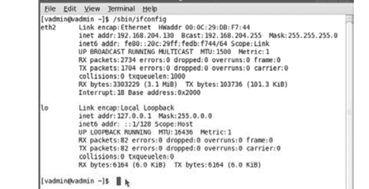

图 3：显示当前网络接口配置的 `ifconfig` 命令。

该命令将显示一个名为 `lo` 的设备，地址为 `127.0.0.1`（仅在配置了回环时显示）。你可以使用以下命令添加该设备：

```
ifconfig lo 127.0.0.1
```

你可以通过 `route` 命令向系统提供有关你设备的更多信息。此类操作：

```
route add -net 127.0.0.1
```

## 第 2 章

现在，你的回环设备已配置好，你可以在 `ifconfig` 命令的列表中检查你的设备 `lo`。要配置网络卡，需使用 `ifconfig` 命令，并使用 `'eth0'` 作为以太网设备的名称。你需要路由器、IP 地址、子网掩码、域名服务器 (`DNS`) 和宽带地址。

- 在系统安装期间，网络接口卡已经安装并配置好了。在执行配置指令之前，使用 `ifconfig` 查看已配置的网络卡。

表 1：显示了通常用于不与外部世界连接的网络 IP 号：

| 网络类 | 子网掩码 | 网络地址 |
|---|---|---|
| A | 255.0.0.0 | 10.0.0.0 - 10.255.255.255 |
| B | 255.255.0.0 | 172.160.0.0 - 172.31.255.255 |
| C | 255.255.255.0 | 192.168.0.0 - 192.168.255.255 |

要为内部网络配置接口，请使用以下命令：

```
ifconfig eth0 <netmask> broadcast <>
```

在下行中，`<>` 被替换为相应的值。在 `/etc/sysconfig/network-scripts/` 中会创建一个名为 `ifcfg-eth0` 的文件。该文件向你展示你在代码中提供的详细信息。图 4 显示了列表：

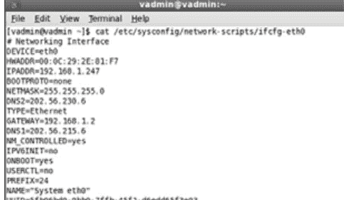

> 图 4：网络设备 `eth0` 的配置文件。

通过你为一台计算机配置网络卡的方法，你也可以向你的网络添加额外的计算机。在其他计算机上重复上述过程。你只需要更改其他计算机的 IP 地址。例如，第二台计算机可以拥有地址 `192.168.2.6`，第三台计算机可以拥有地址 `192.168.2.7`，以此此类推。

在网络中的每台计算机上配置网络卡后，修改 `/etc` 目录下的以下文件：

- `/etc/nsswitch.conf`
- `/etc/hosts`
- `/etc/resolv.conf`
- `/etc/sysconfig/network`

`/etc/resolv.conf` 文件包含域名解析器的所有配置信息。该文件应该包含以下行：

```
hosts: files dns
```

`/etc/hosts` 文件包含了网络上的所有计算机（局域网或外部网络）。`/etc/nsswitch.conf` 文件告诉域名解析器检查 `/etc/hosts` 文件，并返回 `/etc/hosts` 文件中找到的主机的所有有效地址。

`/etc/resolv.conf` 文件提供了用于解析主机名的服务器信息，如图 4 所示：

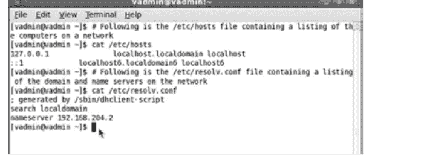

> 图 4：`/etc/hosts` 文件包含了网络上计算机的列表。

`/etc/resolv.conf` 文件包含了网络上的域名和名称服务器列表。`/etc/sysconfig/network` 文件包含以下行：

```
NETWORKING=yes
HOSTNAME=(host and domain name of you)
```

第一行启用你的系统网络功能，第二行显示你的系统的主机名以及域名。

让我们探索子网划分。

## 理解子网划分

子网划分是将网络划分为两个或多个网络的逻辑实践。在节一节中，你学习了内部网络，现在你将学习与外部世界的网络连接。这包括配置路由器、获取 IP 地址和建立连接。让我们从 IP 地址开始并处理子网划分。

IP 号被分配给主机上的网络接口。许多计算机可以拥有单个网络接口和单个 IP 号。一台计算机也可能拥有多个网络接口。使用 `ifconfig` 和 `route` 命令为单个 `NIC` 分配多个 IP 地址：

```
ifconfig eth0:1 192.168.1.4
route add -host 192.168.1.4 dev eth0
```

第一条命令为虚拟接口 `eth0:1` 提供 IP 地址，第二条命令为该地址向实际设备 `eth0` 添加路由。

你也可以通过创建别名文件来实现。将位于 `/etc/sysconfig/network-scripts/ifconfig-eth0` 的设备 `eth0` 配置文件复制到同一目录下的另一个文件，即 `eth0:1`。在新建的文件中进行以下更改：

显示行为：

```
DEVICE=eth0
```

将其更改为：

```
DEVICE=eth0:1
```

IP 地址 (`IPv4`) 是网络上设备的唯一标识符。它是一个 32 位数字，划分为四个字节。子网划分取用一个或多个主机位，并让它们在本地接口上显示为网络位。在 `C` 类中，网络被划分为两个子网。将第一位改为 1，你得到 `255.255.255.128` 作为子网掩码。这为你的每个子网提供了 126 个可能的 IP 号。

为了便于阅读，每个字节都以十进制表示。

# 42 第 2 章

网络、广播地址以及每个接口的 IP 地址。下表 2 所示了 `C` 类网络的两个子网：

## 表 2：为 C 类网络创建两个子网

| 网络 | 子网掩码 | 广播 | 第一个 IP | 最后一个 IP |
|---|---|---|---|---|
| 192.168.1.0 | 255.255.258 | 192.168.1.127 | 192.168.1.121 | 192.168.1.126 |
| 192.168.1.128 | 255.255.258 | 192.168.1.255 | 192.168.1.129 | 192.168.1.254 |

> 如果你有四个子网，将前两个主机改为 1，你就会得到 `255.255.255.192` 的子网掩码。每个子网上有 62 个可用的 IP 地址。

对 `A` 类和 `B` 类网络执行与 `C` 类网络相同的步骤。下表 3 和表 5 显示了 `A`、`B`、`C` 类网络的子网。

## 表 3：A 类子网和子网掩码

| 位数 | 子网数量 | 子网掩码 | 主机数 |
|---|---|---|---|
| 2 | 2 | 255.192.0.0 | 4194302 |
| 3 | 6 | 255.224.0.0 | 2097150 |
| 4 | 14 | 255.240.0.0 | 1048576 |
| 5 | 30 | 255.248.0.0 | 524286 |
| 6 | 62 | 255.252.0.0 | 262142 |
| 7 | 126 | 255.254.0.0 | 131070 |
| 8 | 254 | 255.255.0.0 | 65534 |
| 9 | 510 | 255.255.128.0 | 32766 |
| 10 | 1022 | 255.255.192.0 | 16382 |
| 11 | 2046 | 255.255.224.0 | 8190 |
| 12 | 4094 | 255.255.240.0 | 4094 |


| 13 | 8190 | 255.255.248.0 | 2046 |

| 14 | 16382 | 255.255.252.0 | 1022 |

| 15 | 32766 | 255.255.254.0 | 510 |

| 16 | 65534 | 255.255.255.0 | 254 |

| 17 | 131070 | 255.255.255.128 | 126 |

| 18 | 262142 | 255.255.255.192 | 62 |

| 19 | 524286 | 255.255.255.224 | 30 |

| 20 | 1048576 | 255.255.255.240 | 14 |

| 21 | 2097150 | 255.255.255.248 | 6 |

| 22 | 4194302 | 255.255.255.252 | 2 |

### 表 4：B 类子网和子网掩码

| 位数 | 子网数量 | 子网掩码 | 主机数 |
|---|---|---|---|
| 2 | 2 | 255.255.192.0 | 16382 |
| 3 | 6 | 255.255.224.0 | 8190 |
| 4 | 14 | 255.255.240.0 | 4094 |
| 5 | 30 | 255.255.248.0 | 2046 |
| 6 | 62 | 255.255.252.0 | 1022 |
| 7 | 126 | 255.255.254.0 | 510 |
| 8 | 254 | 255.255.255.0 | 254 |
| 9 | 510 | 255.255.255.128 | 126 |
| 10 | 1022 | 255.255.255.192 | 62 |
| 11 | 2046 | 255.255.224.0 | 30 |
| 12 | 4094 | 255.255.240.0 | 14 |
| 13 | 8190 | 255.255.248.0 | 6 |
| 14 | 16382 | 255.255.252.0 | 2 |

### 表 5：C 类子网和子网掩码

| 位数 | 子网数量 | 子网掩码 | 主机数 |
|---|---|---|---|
| 1 | 2 | 255.255.255.128 | 126 |
| 2 | 4 | 255.255.255.192 | 62 |
| 3 | 8 | 255.255.255.224 | 30 |
| 4 | 16 | 255.255.255.240 | 14 |
| 5 | 32 | 255.255.255.248 | 6 |
| 6 | 64 | 255.255.255.252 | 2 |

# 第 2 章

DHCP 服务器由文件 `/etc/dhcpcd.conf` 控制。每当你对此文件进行更改时，你都需要重启 DHCP 服务。`/etc/dhcpcd.conf` 包含以下内容，如图 5 所示：

```
dhcpd.conf
dbs-update-style none;
dbs-updates none;
option 150 150 = string;
dient-clientclass;
lease-time per-client;
allow boot;
subnet 192.168.1.45 mask 255.255.255.0 {
  interface eth0;
```

> 图 5：`/etc/dhcpcd.conf` 文件。

要启动服务器，运行命令：`service dhcpd start`

要配置 DHCP 客户端，请确保其已正确配置。在 `/etc/sysconfig/network-scripts/ifcfg-eth0` 文件中修改 `BOPROTO` 所在的行，如图 6 所示。将其更改为 `BOPROTO=dhcp` 并保存更改。使用命令 `service network restart` 重启网络，你的系统将从 DHCP 服务器获取 IP 信息。

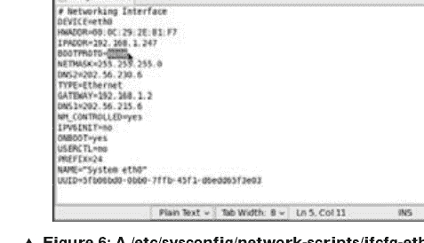

> 图 6：`/etc/sysconfig/network-scripts/ifcfg-eth0` 文件。

让我们学习如何使用网络配置工具配置网络。

## 使用网络配置工具配置网络

Fedora 提供了一个图形化配置工具，你可以用它来配置系统中安装的网络接口设备。要在 Fedora 中启动网络配置工具，选择 系统（System）-> 管理（Administration）-> 网络（Network），网络配置窗口将打开（图 7）。你可以通过点击网络配置窗口中的新建选项来配置各种类型的设备。出现“添加新设备类型”窗口，显示设备类型列表，如图 8 所示：

## Linux 中的系统和网络配置

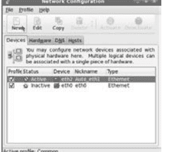

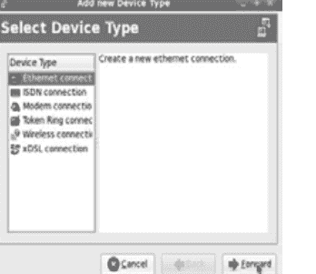

- **图 7：网络配置窗口。**
- **图 8：添加新设备类型的列表。**

网络配置窗口包含以下选项卡（图 9）：
- **Devices (设备)**：列出系统中所有安装并配置的设备。
- **Hardware (硬件)**：列出系统中安装的实际硬件。
- **DNS**：显示主机名、域名和名称服务器。
- **Hosts (主机)**：显示系统主机名到静态 IP 地址的映射。

### 添加以太网设备

使用网络工具，你可以轻松地添加和配置以太网设备。按照下方提供的步骤添加以太网设备。

1. 在*添加新设备类型（Add new Device Type）*窗口中选择以太网连接（Ethernet Connection），并点击下一步（Forward）（图 9）。
2. 出现一个窗口，显示以太网设备列表（图 10）。如果你的网卡（NIC）在列表中，选择它并点击下一步。如果你的网卡不在列表中，选择“其他以太网卡（Other Ethernet Card）”并点击下一步，如图 10 所示：

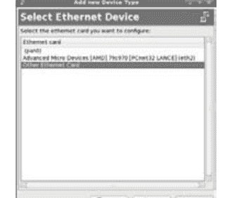

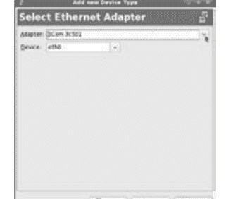

- **图 9：选择你的以太网设备。**
- **图 10：选择你的以太网适配器。**

出现“选择适配器（Select Adapter）”窗口。从适配器下拉列表中选择你的网卡，并从设备（Device）下拉列表中选择你的设备（图 11）。

3. 选择合适的选项后点击下一步。

出现“网络设置（Network Settings）”窗口。选择合适的选项以设置自动从 DHCP 获取 IP 信息或手动设置静态 IP。你也可以设置主机名。

4. 选择合适的选项后点击下一步。

出现“创建新设备（Create New Device）”窗口。如果你想更改之前的选择，可以点击下一步，如图 12 所示：

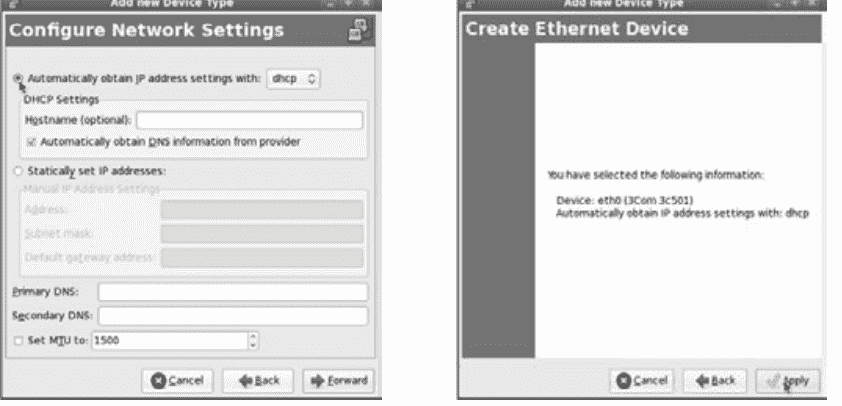

- **图 11：网络设置**
- **图 12：创建新设备**

5. 点击“应用（Apply）”按钮。

设备已创建并显示列表中。

点击文件 -> 保存（File -> Save）以保存更改。

### 添加无线设备

使用网络工具，你可以轻松地添加和配置无线设备。按照下方提供的步骤添加无线设备。

1. 在*添加新设备类型（Add new Device Type）*窗口中选择无线连接（Wireless Connection），并点击下一步（Forward）（图 13）。
2. 出现一个窗口，显示无线设备列表（图 14）。如果你的网卡在列表中，选择它并点击下一步。如果你的网卡不在列表中，选择“其他以太网卡（Other Ethernet Card）”并点击下一步，如图 14 所示：

## Linux 中的系统和网络配置

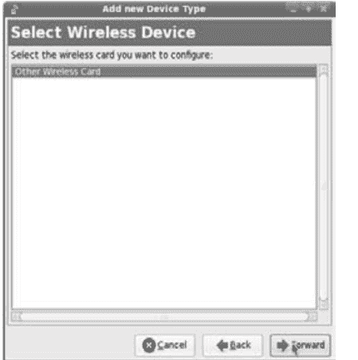

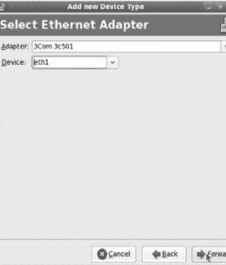

- **图 13：选择你的以太网设备。**
- **图 14：选择你的以太网适配器。**

出现“选择适配器（Select Adapter）”窗口。从适配器下拉列表中选择你的网卡，并从设备（Device）下拉列表中选择你的设备（图 15）。

3. 选择合适的选项后点击下一步。

出现“网络设置（Network Settings）”窗口。选择合适的选项以设置自动从 DHCP 获取 IP 信息或手动设置静态 IP。你也可以设置主机名。

4. 选择合适的选项后点击下一步。

出现“创建新设备（Create New Device）”窗口。如果你想更改之前的选择，可以点击下一步，如图 16 所示：

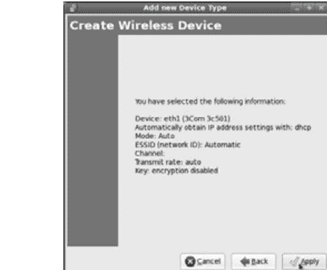

- **图 15：网络连接**
- **图 16：网络设置**


5. 点击“应用（Apply）”按钮。

设备已创建并显示列表中。

点击文件 -> 保存（File -> Save）以保存更改。

### 编辑网络配置

让我们学习如何编辑网络配置。

你可能需要配置网络连接设备，无论是调制解调器、无线还是有线网卡。

删除网卡

使用网络配置工具可以轻松删除网络设备。按照所需的步骤：

1. 在 Fedora 中启动网络配置工具，选择 系统（System）-> 管理（Administration）-> 网络（Network），网络配置窗口将打开。

2. 点击硬件（Hardware）选项卡。

3. 选择要删除的设备并点击删除（Delete）。

4. 点击文件 -> 保存（File -> Save）以保存更改。

更改网卡配置

使用网络配置工具更改网络设备的配置。按照所需的步骤：

1. 在 Fedora 中启动网络配置工具，选择 系统（System）-> 管理（Administration）-> 网络（Network），网络配置窗口将打开。

2. 选择要修改的设备并点击工具栏上的“编辑（Edit）”。

出现设备属性窗口，如图 18 所示：

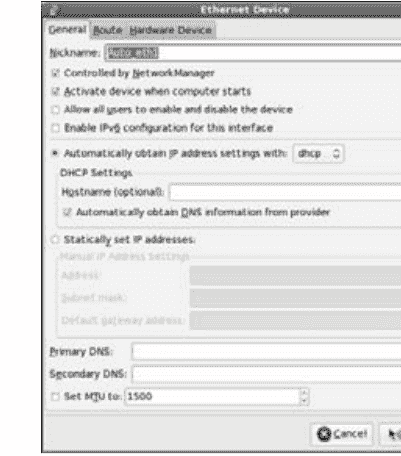

> 图 18：设备属性窗口。

属性窗口中有三个选项卡：

- **General (常规)**：你可以为设备输入昵称，并选择在系统启动时是否激活设备。你还可以设置其他用户启用和禁用设备的权限。你可以选择自动或手动获取 IP 信息。

- 路由：您输入指向其他网络的静态路由。你需要输入网络 IP 地址和网关 IP 地址。如果你使用 DHCP，则不需要输入任何信息。

- 硬件设备：它包含与以太网设备相关的硬件信息。

进行必要的更改。

1. 更改后点击 OK 按钮。

2. 点击文件→保存，以保存更改。

### 管理 DNS

网络配置工具的 DNS 选项卡允许您配置主机名、域名、名称服务器和搜索域。按照所需的步骤配置 DNS 设置：

1. 在 Fedora 中启动网络配置工具，选择 系统→管理→网络配置窗口将随之打开。

2. 点击 DNS 选项卡（图 19）。

3. 为您的系统输入适当的信息。

4. 选择 文件→保存，保存您的更改，如图 19 所示：

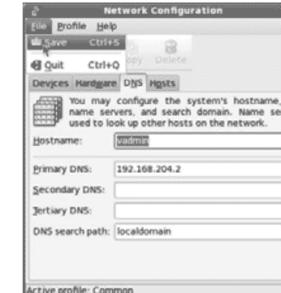

> 图 19：管理 DNS 设置。

### 管理 Hosts

Hosts 选项卡允许您向 `/etc/hosts` 文件添加、编辑或删除主机。该文件包含 IP 地址及其对应的主机。按照所需的步骤操作：

1. 在 Fedora 中启动网络配置工具，选择 系统→管理→网络配置窗口将随之打开。

2. 点击 Hosts 选项卡（图 20）。

3. 点击工具栏上的“新建”打开“添加/编辑 Hosts”对话框（如果有的话）。

4. 输入主机名、其 IP 地址以及主机名的别名（如果有）。

5. 点击 OK 按钮将条目添加到列表（图 20）。

6. 选择 文件→保存，保存您的更改。

# Linux 53 中的系统和网络配置

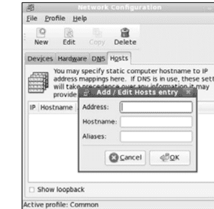

▲ 图 20：管理 Hosts。

# 使用配置文件

您可以为每个物理硬件设备创建多个逻辑网络设备。配置文件可以用于网络创建多个配置集。默认有一个名为 Common 的配置。要创建一个新配置，请按照所需的步骤操作：

1. 在 Fedora 中启动网络配置工具，选择 系统→管理→网络，网络配置窗口将随之打开。

2. 点击菜单中的 配置文件→新建（图 21）。

3. 为配置输入名称，如图 22 所示：

点击 OK 按钮创建配置。

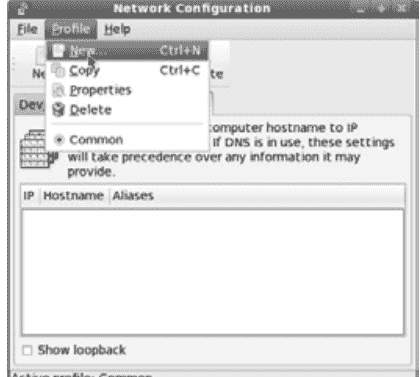

▲ 图 21：创建新配置

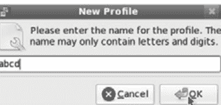

▲ 图 22：新配置对话框

# 第 2 章

如果配置未列出所有设备，请点击“添加”按钮添加它们。如果物理设备已经创建了某个设备，请使用“复制”按钮复制现有设备。

在上一节学习了 TCP/IP 网络 之后，让我们来讨论网络文件系统。

## 2.3 网络文件系统

网络服务通过网络文件系统（NFS）提供文件共享。Linux 内核支持 NFS。NFS 是由 Sun Micros 公司在 20 世纪 90 年代开发的。NFS 是一种允许不同计算环境之间通信的协议。它是一种在网络上存储文件的机制。它是一个分布式文件系统，允许用户认为远程访问的文件就像本地文件一样；它允许用户以访问本地文件的方式访问远程主机上的文件。它允许您使用标准的 Linux 命令访问位于另一个系统、甚至是不同城市或不同国家的文件和目录。

使用这种方法，管理员提供了一个中央服务器。在中央服务器上的文件锁对客户端是完全透明的。这种文件锁可以确保文件不会被其他用户损坏。NFS 基于客户端/服务器关系。将其资源或文件系统提供供远程访问的计算机称为服务器。服务器包含多个守护进程，使这些文件可见并供客户端共享。实际上，使文件系统可过程被称为“导出”（在服务器上通过 `/etc/exports` 文件进行配置）。

使用服务器资源的计算机被视为客户端。NFS 将导出的文件系统计为本地的，就像挂载文件一样。这被称为 NFS 挂载。使用客户端/服务器格式，服务器允许客户端轻松访问 NFS 文件。

NFS 提供了一个无缝的网络，让客户端看起来子文件系统属于客户端自己。例如，用户可以使用操作系统命令对远程文件和目录进行创建、读取、写入和设置文件属性的操作。NFS 使信息共享变得极其简单，因为一台机器上的文件到另一台计算机通过网络进行共享，且不需要对程序进行任何修改。

让我们学习 NFS 的不同版本。

### NFS 版本

NFS 协议经历了进展和修订。最初的 NFS 实现仅支持 UDP 数据包，而较后的版本支持 TCP 连接；使用这两种协议各有优缺点。

- NFS 版本 2 (NFSv2) 较旧且被广泛支持。它完全通过用户数据报协议（UDP）运行。NFSv2 只允许读取前 2 GB 的文件。

- NFS 版本 3 (NFSv3）具有更多功能，包括 64 位文件句柄、处理大于 2 吉字节（GB）的文件、服务器上的安全异步写入以及更健壮的错误处理。

- NFS 版本 4 (NFSv4) 可以通过防火墙并在互联网上运行，不再需要 portmapper，利用 ACL（访问控制列表）并利用状态操作。

NFS 版本 2 和 3 在实现上相似，版本 4 略有不同。NFS 版本 2 和 3 服务器是非状态的，这意味着服务器不保留任何客户端的事务信息。NFS 要求客户端记住稍后使用 NFS 时所需的任何信息。对客户端信息的需求成为新版本 NFSv4 的基础。NFSv4 是有状态的，因为它定义了打开文件和锁定操作。NFS 版本 4 旨在提供协议支持以利用集群服务器部署的优势，包括对分布在多个服务器上的文件提供并行访问的能力。

让我们讨论 NFS 的优缺点。

# NFS 优缺点

NFS 提供的主要优势是集中化管理，这减少了管理员在备份方面的工作量、限制了对敏感数据的访问、共享了软件和计算能力。NFS 允许用户登录到任何服务器，并通过 IP 地址、组等透明地访问其文件。

安全问题可能是 NFS 最大的缺点。因为 NFS 基于 RPC（远程过程调用），它从根本上说是不安全的。RPC 是攻击尝试最常见的目标之一。NFS 的另一个缺点是性能方面，它在深度网络流量期间会变慢。如果系统正在导出关键数据或应用程序由于任何原因变得不可用，那么没有人可以访问该资源，并且会导致服务器故障或磁盘崩溃。

让我们讨论如何规划 NFS 安装。

# 规划 NFS 安装

在数据数据共享，规划 NFS 安装至关重要。在安装 NFS 之前，你必须决定要导出哪些文件系统，通过何种挂载方案来维护网络透明性。在设计或规划 NFS 安装时，实施涉及配置适当的守护进程。测试性能瓶颈并检查挂载是否按设计运行。需要定期监控，以检查导出的文件系统的可用性并维护网络安全。

在设计 NFS 安装时，需要对导出适当的文件系统做出决策，识别哪些用户允许挂载导出的文件系统，识别客户端用于访问导出的文件系统的挂载方案，并选择一种能够保持网络透明性并易于使用的命名规范。在设计 NFS 服务器时，需要记住以下几点以简化管理任务并维护网络透明性：

- 如果一个文件系统避免了在多台机器上复制相同的静态数据，则认为该文件系统最适合 NFS 导出。此类文件系统是在大量用户之间共享的文件系统，例如 `/home`、工作组项目目录、如 `/usr/share` 的共享数据目录以及包含共享应用程序二进制文件和数据的文件系统。

# 第 2 章

- 始终使用 `/home/username` 挂载主目录，因为它是 Linux 中的根目录。

- 在设计 NFS 服务器时，要考虑未来的增长。在 NFS 服务器上创建逻辑卷集，以便在需要时为导出的系统增加磁盘空间。

- 将多个导出项分布在多个磁盘上，以最大限度地减少故障的影响并提高整体磁盘和网络性能。NFSv4 的复制能力可用于此目的。


只有本地文件及其子文件可以被导出。已经挂载在 NFS 中的文件无法被导出。

现在，来配置 NFS 服务器

# 配置 NFS 服务器

在配置 NFS 服务器时，你既是服务器也是客户端。然而，对每个设置的客户端都需要进行修改，以获得服务器对该客户端的授权。你可以通过 `/usr/sbin/exportsmap` 编辑其配置文件（`/etc/exports`）来在 Linux 中手动配置 NFS 服务器。

在 Linux 系统中，`/etc/exports` 文件是主配置文件。`/etc/exports` 控制哪些文件系统被导出到远程主机，以及每个导出的选项。配置文件、守护进程、命令和初始化脚本构成了 NFS 服务器的主要部分。

## 守护进程和 NFS 服务器命令

守护进程是 `nfs-utils` 包的一部分，可能位于 `/sbin` 目录或 `/usr/sbin` 目录。NFS 服务需要六个守护进程，例如：`/sbin/portmap`、`/usr/sbin/rpc.mount`、`/usr/sbin/rpc.nfs`、`/usr/sbin/rpc.statd`、`/usr/sbin/rpc.lockd`、`/usr/sbin/rpc.rqotd`（如果需要）。大多数 Linux 发行版在启动脚本中启动这些守护进程，但在使用 NFS 服务器之前，建议确保这些守护进程已初始化。

按以下顺序启动守护进程：

- `portmap` 允许客户端发现 NFS 服务器上的 NFS 服务
- `nfsd` 执行大部分工作
- `mountd` 处理初始挂载请求
- `statd` 处理文件锁定
- `rquotd`（如果需要）处理导出卷上的用户文件配额
- `idmapd` 将用户名和组名映射到 NFSv4 ID（反之亦然）
- `svgssd` 创建安全上下文

> 提示：`lock` 由 `nfsd` 按需调用，无需手动启动

守护进程由三个初始化脚本控制：`/etc/rc.init.d/portmap`、`/etc/rc.init.d/nfs` 和 `/etc/rc.init.d/nfslock`。`exportfs` 命令用于操作导出列表。`showmount` 命令提供有关客户端和挂载文件系统的信息。`nfsstat` 命令提供有关 NFS 子系统的详细信息。`portmap` 守护进程通过 `portmap` 脚本启动，也称为 portmapper。


### Linux 中的系统和网络配置

`stams` 在启动时自动运行。`portmapper` 提供的信息被所有基于 RPC 的程序使用。`/etc/rc.d/init.nfs` 是主要的 NFS 启动脚本。`/etc/rc.d/init.nfs` 和 `portmapper` 都需要一个参数，例如 `start`、`stop`、`restart`、`status` 或 `reload`。NFS 服务还需要提供文件锁定的守护进程，此类守护进程是锁定的，并且

要手动启动 NFS 服务器，应首先初始化 `portmapper`，然后是 NFS，最后是 NFS 锁管理器。关闭服务器时的类似顺序是：`stop`、`stop lock`，然后是 NFS，最后是 `stopmap`。`rpcbind` 命令被 NFS 守护进程使用。`rpcbind` 显示使用 RPC 协议程序的信息。`rpcinfo` 列出所有注册的 RPC 程序 `/etc/sysconfig` 启用 NFS。一旦所有守护进程按规定顺序到位，你就可以配置服务器。

可以通过编辑 `/etc/exports` 并使用 `/usr/sbin/exportsfs` 命令手动配置 NFS 服务器。

你需要配置三个配置文件来配置 NFS 服务器：`/etc/exports`、`/etc/hosts` 和 `/etc/hosts`。`/etc/exports` 文件包含 NFS 服务器导出到远程主机的目录，并包含选项。导出文件系统的一行标识了该系统及其共享方式。每个导出的文件系统都有单独的一行，包含导出的文件系统名称和主机名，用空格分隔。在主机标识符之后直接将选项放在括号中，主机和第一个括号之间没有任何空格。

它具有如下结构：

```
directory host1(option1,option12) host2(option21,option22)
```

- 此处 `directory` 是主机或导出的文件的名称。通过共享目录，同一文件系统内的所有目录也会被共享。
- 此处 `host1` 和 `host2` 是客户端机器或共享导出项的主机或网络。机器可以通过其 DNS 地址或 IP 地址列出（例如 `machie.com/192.168.0.7`）。
- 此处 `option` 描述了每个主机或网络拥有的访问类型。

主机名可以识别为单主机、网组、IP 网络和通配符。下面列出了识别主机名的方法：

- `Singlehost`：通过 DNS、主机名或 IP 地址指定特定主机。
- `wildcards`：使用 `*` 或 `?` 指定主机名。通配符不应与 IP 地址一起，因为它们会导致意外的反向 DNS 查找失败。
- `IP addresses`：根据 IP 地址指定主机。
- `Netgroups`：一个 NIS 组（写为 `@group-name`）允许访问此文件系统。

# 第 2 章

例如 `*:exercise.com`。它允许 `sales.example.com`。

NFS 服务器选项有：

- `ro`：默认选项，只读。客户端将无法写入。
- `rw`：允许客户端读写。
- `root_stack`：将用户 ID (`UID`) 或组 ID (`GID`) 0 的请求映射到匿名用户。
- `subtree_check`：验证请求的部分。如果只导出卷的一部分，子树检查可确保文件位于导出部分。
- `sync`：强制服务器在通知客户端之前执行磁盘写入。`no_delay` 选项关闭此功能，但仅在使用 `sync` 选项时可用。

需要注意哪些不能被导出的：

通过在 `/etc/exports` 文件中列出目录，该目录内的所有子目录都会被导出。如果导了一个目录，没有必要同时导出父目录和子目录。如果父子目录在同一个文件系统中，则无法同时导出。

FAT 或 VFAT 文件系统的设计与 NFS 的预期不符。它们并非为多用户机器设计的，因此导出这些文件系统并不是一个好主意。

`/etc/exports` 的格式非常特殊，特别是对空格的使用。例如：

- 1. `/home sam.example.com(rw)`
- 2. `/home sam.example.com (rw)`

第一行允许来自 `sam.example.com` 的用户对 `/home` 目录具有读写权限。第二行允许 `sam.example.com` 的用户以只读（默认）方式挂载目录，而其他地方可以挂载

通过指定网络和子掩码可以获取范围机器的访问。例如 `/local 192.168.0.0/255.255.255.0 (ro)` 允许访问 IP 地址在 `192.168.0.0` 到 `192.168.0.255` 之间的所有机器。

你需要在主机名后的括号内提供选项以指定对导出文件的访问。例如：

- 1. `/exported/directory sam.example.com`

## Linux 中的系统与网络配置

2. `/another/exported/directory sam.example.com(rw,sync)`

在第一个示例中，`example.com` 可以挂载 `/exported/directory/`，因为此示例未指定任何选项。在第二个示例中，`sam.example.com` 可以挂载 `/another/exported/directory/read/write`，并且所有传输在客户端写入请求完成之前提交磁盘。

> 空行会被忽略。以井号 (`#`) 开头的行是注释。长行可以使用反斜杠 (`\`) 折行。始终使用一个空格字符将文件系统与主机以及主机之间分开。文件中除注释行外，不应有其他空格字符。

`/etc/hosts.allow` 和 `/etc/hosts.deny` 包含了可以使用你计算机上服务的机器列表。当服务器接收来自机器的请求时，会执行以下操作：

它首先检查 `hosts.allow`，查看机器是否列在其中，如果在，则允许访问。如果与 `hosts.allow` 列表不匹配，服务器将检查 `hosts.deny`，查看客户端是否在列表中。如果存在于 `hosts.deny` 中，则拒绝访问。如果两个文件（`hosts.allow` 和 `hosts.deny`）中的列表都不匹配，则允许访问。

它通过限制连接到提供 NFS 服务的守护进程来提供 NFS 访问。`portmapper` 守护进程告知如何找到你系统上的所有 NFS 服务。因此，限制对 `portmapper` 的访问是防止未经授权的客户端通过 NFS 破坏你系统的最佳防护。

通常情况下，NFS 通过以下方式拒绝对你不希望允许的 IP 地址的访问：

- 第一步是在 `/etc/hosts.deny` 中添加以下条目：
- `portmap:ALL`
- `lockd:ALL`
- `mount:ALL`
- `quotad:ALL`
- `stat:ALL`


> 一些管理员选择在 `/etc/hosts.deny` 文件中放入条目 条目，这将拒绝所有主机或任何查看这些文件的服务的访问，除非被显式允许。不建议使用此条目。

上一步，我们需要向 `/etc/hosts.allow` 添加一个条目，以赋予我们需要访问的任何主机权限。条目格式如下：
- `service`: [`or /network/mask`], `host` [`or /network/mask`]

这里，`host` 是客户端的 IP 地址。某些版本中可以使用主机的 DNS 名称，但强烈不建议这样做。

例如，你想允许访问 `place1.go.com` 和 `place2.go.com`，假设这些机器的 IP 地址分别为 `192.168.0.1` 和 `192.168.0.2`。

我们可以向 `/etc/hosts.allow` 添加以下条目：
- `portmap`: `192.168.0.1`, `192.168.0.2`
- `lockd`: `192.168.0.1`, `192.168.0.2`
- `rquotad`: `192.168.0.1`, `192.168.0.2`
- `mountd`: `192.168.0.1`, `192.168.0.2`
- `statd`: `192.168.0.1`, `192.168.0.2`

让我们在下一节讨论 NFS 客户端的配置。

### 配置 NFS 客户端

配置 NFS 客户端比配置 NFS 服务器更简单。配置 NFS 客户端系统需要 `portmap`、`NFS` 文件锁定守护进程（`statd` 和 `lockd`）、在客户端的 `/etc/fstab` 中添加 NFS 导出条目，并使用 `mount` 命令挂载导出内容。以下选项常用于 NFS 挂载：
- `hard`: 无法终止失败的 NFS 操作，并在服务器未对系统做出响应后允许其继续重试。
- `soft`: 如果托管的导出文件系统不可用，它允许 NFS 文件操作失败并终止。
- `intr`: 如果服务器未响应，允许信号中断 NFS 请求。
- `nfsvers`: 它指定要使用的 NFS 协议版本，其中 n 为 1、2、3 或4。如果没有指定版本，`mount` 命令使用内核支持的最高版本。
- `lock`: 使用 `statd` 和 `lock` 守护进程启用文件锁定。
- `port`: 指定 NFS 服务器端口。标准 NFS 端口是 TCP `2049`。
- `rsize`: 设置一次传输的 NFS 读取缓冲区（字节）。默认值为 `1024`，NFS4 的默认值为 `8192`。
- `wsize`: 设置一次传输的 NFS 写入缓冲区（字节）。默认值为 `1024`，NFS4 为 `8192`。
- `tcp`: 指定 NFS 挂载使用 TCP 协议（禁用 udp）。
- `udp`: 指定 NFS 挂载使用 UDP 协议（禁用 tcp）。
- `timeout`: 设置 NFS 操作终止的时间。通常与 `soft` 选项使用。
- `retry`: 设置 NFS 操作重试的时间。

NFS 客户端需要 `portmapper` 来正确路由 RPC 调用到服务器的特定端口。以下初始化脚本用于检查 `portmapper`：
```
$ portmap status
```
使用以下启动 `portmapper`：
```
$ portmap start
```

# Linux 系统与网络配置

运行 `statd` 和 `lockd` 以使用文件锁定，使用脚本 `/etc/rc.d/nfslock`。
```
# nfslock start
```
在配置并启动必要的守护进程后，使用 `mount` 命令挂载 NFS 共享。格式如下：
```
# mount -t <nfs-type> -o <options><host>:/remote/export</local/directory>
```
在这里，
- `<nfs-type>` 用于 NFSv2 或 NFS3 服务器。
- `<options>` 是 NFS 系统的选项列表，用逗号分隔。
- `<host>` 是远程主机。
- `<remote/export>` 是导出的目录。
- `<local/directory>` 是要挂载的本地目录。

让我们在后续节讨论自动服务。

NFS 客户端可以配置为赋予我们需要访问的任何主机权限。条目格式如下：
- `service`: [`or /network/mask`], `host` [`or /network/mask`]

这里，`host` 是客户端的 IP 地址。某些版本中可以使用主机的 DNS 名称，但强烈不建议这样做。

例如，你想允许访问 `place1.go.com` 和 `place2.go.com`，假设这些机器的 IP 地址分别为 `192.168.0.1` 和 `192.168.0.2`。我们可以向 `/etc/hosts.allow` 添加以下条目：
- `portmap`: `192.168.0.1`, `192.168.0.2`
- `lockd`: `192.168.0.1`, `192.168.0.2`
- `rquotad`: `192.168.0.1`, `192.168.0.2`
- `mountd`: `192.168.0.1`, `192.168.0.2`
- `statd`: `192.168.0.1`, `192.168.0.2`

# 第 2 章

... 赋予我们需要访问的任何主机权限。条目格式如下：
- `service`: [`or /network/mask`], `host` [`or /network/mask`]

这里，`host` 是客户端的 IP 地址。某些版本中可以使用主机的 DNS 名称，但强烈不建议这样做。

例如，你想允许访问 `place1.go.com` 和 `place2.go.com`，假设这些机器的 IP 地址分别为 `192.168.0.1` 和 `192.168.0.2`。我们可以向 `/etc/hosts.allow` 添加以下条目：
- `portmap`: `192.168.0.1`, `192.168.0.2`
- `lockd`: `192.168.0.1`, `192.168.0.2`
- `rquotad`: `192.168.0.1`, `192.168.0.2`
- `mountd`: `192.168.0.1`, `192.168.0.2`
- `statd`: `192.168.0.1`, `192.168.0.2`

# 使用自动服务

NFS 客户端可以配置为赋予我们需要访问的任何主机权限。条目格式如下：
- `service`: [`or /network/mask`], `host` [`or /network/mask`]

...（为了简洁已省略文本）

通过在 `/etc/exports` 中使用 `root_squash` 选项，我们通过 NFS root squash 维护安全性。通过该选项，服务器将 root 的 UID/GID 指定为匿名（`nobody`）用户的 UID，从而防止客户端 root 账户仅拥有服务器 root 账户的权限。建议关闭 root squash。例如，如果具有 UID `0` 的客户端用户访问文件系统，服务器将其替换为服务器 `nobody` 账户的 UID。这意味着客户端的 root 用户无法访问或更改内容。导出 NFS 共享时使用 `all_squash` 选项将使用 nfs `nobody` 用户的 UID。要关闭它，请使用 `no_root_squash` 选项。通过此命令，客户端的 root 用户可以变成任何其他用户并访问并更改文件。

# Linux 中的系统与网络配置

您可以通过以下选项来提供客户端安全：

通过对所有挂载磁盘使用 `nousuid` 选项来禁用 SUID root 程序。这可以防止服务器的 root 用户在文件系统中创建 suid-root 程序，从而以普通用户身份登录客户端，然后利用 suid-root 程序在客户端也变为 root 用户。您还可以使用 `noexec` 选项禁止在挂载的文件系统上执行文件。对于需要执行脚本或程序的 NFS 共享，此选项可能是不切合实际的。NFS 通过 `rpc-stat` 和 `rpc-lockd` 支持全锁定功能。请在客户端上运行这些选项以便其正常工作。

因此，通过使用 TCP wrappers、`root_squash` 和 suid 选项、数据过滤器和守护进程，您可以提高 NFS 的整体安全性。


> 请参考书末的“实验- 建立拨号上网 PPP”、“实验- 配置 TCP/IP”以及“实验- 建立 NFS 文件服务器”。

在结束本章之前，让我们总结一下本章中讨论的关键点。

## 总结

在本章中，您学习了不同的系统配置文件，包括负责系统环境设置的全系统配置文件。您学习了包括管理初始化脚本在内的网络配置文件。此外，您探索了 TCP/IP 网络。您还学习了网络分类、设置网卡（NIC）、子网划分以及与网关和路由器的工作。您还学习了配置动态主机配置协议（DHCP）、使用网络配置工具配置网络以及编辑您的网络配置。您还熟悉了网络文件系统及其安装。最后，您学习了配置 NFS 服务器和 NFS 客户端、使用自动挂载（`automount`）服务以及 NFS 安全。

## 练习

Q1. 在以下哪一行中可以更改 `/etc/profile` 文件中的默认路径？

- a. pathymage
- b. pathfile
- c. pathmunge
- d. pathchange

答案是正确选项。

Q2. 以下哪个文件负责显示用户每次登录时都会看到的消息？

- a. `/etc/issue`
- b. `/etc/motd`
- c. `/etc/fstab`
- d. `/etc/issue.net`

答案是正确选项。

Q3. 下哪项不是 cron 文件的正确子目录？

a. cron.monthly b. cron.daily

c. cron.weekly d. cron.yearly

答案 d. 是正确选项。

Q4. 导出文件系统的正确结构是什么？

a. directoryhost1(option) host2(option)

b. directoryhost2(option) host1 (option)

c. directoryhost1, host2 (option),(option)

d. host1 (option) host2(option)directory

答案 a. 是正确选项。

Q5. 使用哪种方法来标识主机名？

a. singlehost b. wildcards

c. a 和 b d. 均都不是

答案 c. 是正确选项。

# 03 微软网络与网络服务简介

## 目标

- 探索 Linux 通过 Samba 服务器与微软网络进行的工作原理
- 描述各种网络服务
- 理解互联网服务

本章让您学习网络服务。在章节的开头，您学习了如何通过 Samba 服务器将 Linux 系统与微软网络连接。您还学习了 Samba 服务器的安装和配置、创建 Samba 用户以及 Windows 电脑与 Samba 服务器的连接。之后，您学习了基于局域的服务：基于 NTP 的时间服务器和缓存代理服务器。您还讨论了优化网络服务的步骤。在章节末尾，您探索了一些安全的互联网服务和一些不安全的服务，包括配置 xinded 服务器。您还学习了 xiinded 服务与独立服务的比较、Linux 作为服务器以及 Linux 防火墙包的配置。

让我们开始 Linux 系统与微软网络的连接。

## 3.1 连接到微软网络

网络就是计算机之间的通信。主要目标是提供一种简单的信息共享方式。使用 Samba 程序，您的 Fedora Core 可以与 Windows 客户端通信或共享文件和打印机。Samba 是一个让您的 Linux 系统能够通过服务器消息块（SMB）在计算机之间实现文件共享和打印服务的程序。SMB 是微软 Windows 服务器使用的标准协议名称。运行 Windows 95 或更高版本的计算机使用 SMB 进行通信以共享服务。如果您有一个 Windows 和 Linux 机器的网络，使用 Samba 将非常有利。

让我们在下一节学习 Samba。

### 安装和配置 Samba 服务器

所有当前的 Fedora 发行版包含四个 Samba 包：Samba、Samba-client、Samba-common 和 Samba-swat。要检查系统是否安装了 Samba，请在终端窗口输入以下命令：

```
rpm -q samba
```

如果系统中没有安装 Samba，命令将显示显示未安装 Samba 的输出。如果已安装 Samba，RPM 查询将返回系统上 Samba 程序的版本号：

```
samba-3.4.7-0.50.fc11.1586
```

您可以从 Samba 官网（www.samba.org）下载最新版本的 Samba。按照说明下载 Samba，并在终端窗口输入命令进行安装：

```
yum -y install samba-client samba-swat system-config-samba
```

按下回车键并等待命令提示符返回。最后，如果命令提示符没有返回错误，则 Samba 已安装。为了让 Samba 提供服务，您需要对其进行配置。


> 请参考书末的“实验- 建立拨号上网 PPP”、“实验- 配置 TCP/IP”以及“实验- 建立 NFS 文件服务器”。

该文件由不同的部分组成，以方括号中的名称开始，直到下一个部分结束。每个部分包含定义部分属性的参数。有三个特殊部分：`[global]`, `[homes]` 和 `[printers]`。

让我们详细讨论。首先，学习 `[global]`。

`[global]`

它是 `smb.conf` 文件的部分。包含了适用于整个服务器的配置参数以及可能适用于其他部分的默认设置。`[global]` 下有一系列选项。`[global]` 中最重要的选项如下：

```
[global]
workgroup = milton
server string = Milton's Samba Server %v
log file = /var/log/samba/log.%m
max log size = 50
security = user
passdb backend = tdbsam
coptions = raw
username map = /etc/samba/smusers
```

让我们学习 `[homes]`。

`[homes]`

它是定义用户登录的部分。它为大量客户端提供了快速、方便的服务，以访问其主目录。通过 `browseable` 和 `writable` 选项，您可以限制访客对主目录的访问。`[home]` 中最重要的选项如下：


```
[homes]
comment=Home Directories
browse=no
writable = yes
create mode = 0664
directory mode = 0775
max connections = 1
```

让我们学习 `[printers]`。

`[printers]`

它是为打印机提供配置的部分。它允许客户端为指定的目录设置打印选项。`[printers]` 中最重要的选项如下：

```
[printers]
comment = All printers
path=/var/spool/samba
browseable=yes
printable = yes
```

### 创建 Samba 用户

通过执行用户级 Samba 安全机制，为每个在 Windows 下使用 Linux 文件系统和打印机的人员分配 Linux 用户账户。你需要为每个用户提供一个 SMB 密码。要添加或创建新的 Samba 用户，你需要执行以下命令：

在终端窗口中以 root 用户身份输入命令：

```
useradd -m bob
```

这将添加一个名为 "bob" 的用户。为新用户添加 Linux 密码：

```bash
passwd bob
```

终端将提示你为用户 bob 修改密码：

```
Changing password for user bob
New password: ******
Retype new password: ******
```

> 重复上述命令，为来自 Windows 工作站的所有用户添加账户，以便其提供访问你的 Linux 系统的权限。

以下命令用于在 Fedora Linux 系统上创建用户账户或创建 Samba 密码文件 (`smbpasswd`)：

```bash
cat /etc/passwd | smbpasswd.sh > /etc/samba/smbpasswd
```

此命令仅创建了用户账户，而没有创建密码。你需要使用 `smbpasswd` 命令为你的用户创建密码，格式如下：

```bash
smbpasswd bob
New SMB password: ******
Retype new SMB password: ******
```

> 为每个用户重复上述命令。

让我们使用命令连接到 Samba 客户端。

### 将 Windows PC 连接到 Samba 服务器

你可以连接到任何运行 SMB 协议的计算机。可以通过两种方法通过命令行连接。以下是连接到 Samba 客户端的方法：

`smbclient` 工具提供了以下命令，

```
smbclient://computer name/share name
```

## 微软网络与网络服务导言

将 `computer name` 替换为想要连接的 Samba 服务器的主名或 IP 地址，将 `share name` 替换为想要浏览的目录名称。输入 `exit` 退出连接。


若要查询网络中的 Samba 服务器，请使用 `findsmb` 命令。

- `smbmount` 工具提供了以下命令，

```
smbmount //computerName/directory/mysystem/mount/point
```

将 `computer name` 替换为想要连接的 Samba 服务器的主名或 IP 地址，将 `directory` 替换为想要浏览的目录名称。输入 `exit` 退出连接。


通过在目录上执行 `ls` 命令来检查挂载是否成功。

要在 Windows PC 上测试连接，请执行以下步骤：

在计算机上，双击网络窗口。会出现一个包含 Linux 系统图标的列表。双击图标查看所有共享。会弹出一个提示输入用户名和密码以进入目录。在提供适当的登录凭据后，你可以在 Linux 和 Windows 计算机之间共享文件。

学习了连接微软网络后，让我们学习网络服务。

### 3.2 附加网络服务

任何管理员都可以持续控制对新或增强服务的请求。一个常用的请求服务是时间服务器。它提供权威时钟，局域网（LAN）上的其他系统通过它同步时钟。在下一节中，你将学习两种非本质局域网服务：基于 NTP 的时间服务器和缓存代理服务器。

让我们配置时间服务器。

### 配置时间服务器

时间服务器运行在某机器上的守护进程，供其他系统同步时钟。通常，你会将你的时间服务器与一个或多个位于局域网外的参考时间服务器同步。在某些情况下，时间服务器与专门设计的时钟同步时间。这种硬件时钟是一个特殊用途的独立设备，旨在保持准确性。它的主要目标是保持局域网内系统时间的一致性，以便时间敏感的操作。系统和服务器之间的时钟异常会导致影响。

最重要且广泛用于发布和同步时间的协议是网络时间协议 (`NTP`)。`NTP` 是一种用于同步你的 Linux 系统时钟与准确时间源的协议。`ntpd` 守护进程具有双重用途：它可以作为服务器监听时间同步请求并提供响应，也可以作为客户端与其他时间服务器通信以调整本地系统时间。

### 参考时钟

最重要且广泛用于发布和同步时间的协议是网络时间协议 (`NTP`)。`NTP` 是一种用于同步你的 Linux 系统时钟与准确时间源的协议。`ntpd` 守护进程具有双重用途：它可以作为服务器监听时间同步请求并提供响应，也可以作为客户端与其他时间服务器通信以调整本地系统时间。

# 第 3 章

涉及 `autokey`。它在 Fedora 核心默认配置中没有安装。要创建一个基础的 `autokey` 设置并配置到 `/etc/ntp` 服务器，请按照以下步骤操作：

- 将以下几行添加到 `/etc/ntp.conf` 中：

```
broadcast 224.0.1.1 autokey
crypto pw serverpassword
keysdir /etc/ntp
```

- 使用以下命令生成密钥文件和证书：

```
# cd /etc/ntp
# ntp-keygen -T -I serverpassword
```

输出显示了某些文件的生成。

如果 `ntp-daemon` 未在运行，请使用以下命令重启 `ntpd`：

```bash
# service ntpd restart
```

如果 `ntpd` 未在运行，请使用以下命令启动 `ntp-daemon`：

```bash
# service ntpd start
```

- 使用以下 `chkconfig` 验证 `ntp` 是否在启动时启动，以及是否在所有多用户运行级别下启动：

```bash
# chkconfig -level 0123465 ntpd off
# chkconfig -level 345 ntpd on
```

这些步骤都启用了 NTP 的 `autokey` 加密，并配置了在启动时启动和停止 NTP 服务。

让我们学习如何配置 NTP 客户端。

### 配置 NTP 客户端

`NTP` 客户端可以通过几个步骤进行配置。在 Fedora 中启动“日期/时间属性”工具，选择 `→` 管理 `→` 日期/时间；将打开日期/时间属性窗口（图 3.1）。您也可以通过终端窗口输入 `system-config-date` 打开此窗口。

如果 NTP 已经在系统上运行，则“日期/时间”选项卡将显示禁用（灰色）。点击“网络时间协议”选项卡来配置 NTP。选择“启用网络时间”选项来配置 NTP。这允许您更改“`NTP` 服务器”选项中的内容，如图 1 所示：

# 微软网络和网络服务介绍

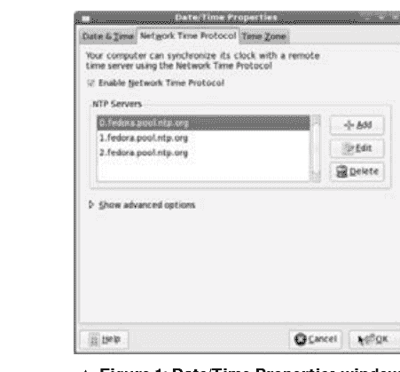

你可以从服务器列表中选择，通过点击“添加”按钮添加新服务器，并通过“删除”删除任何服务器。要配置高级 NTP 选项，点击“显示高级选项”。这些选项允许您使用系统时钟作为参考钟并使用 NTP 广播。在进行所需的更改后点击“确定”。

如果您的 NTP 服务器要使用 `autokey` 加密，您还需要配置 NTP 客户端使用 `autokey` 加密。请按照所需的步骤在 `/etc/ntp.conf` 中配置 NTP 客户端：

- 在客户端的 `/etc/ntp.conf` 中添加以下几行：

```
crypto pw clientpassword
keysdir /etc/ntp
timeserver autokey
```

将 `clientpassword` 替换为您选择的密码，将 `timeserver` 替换为配置为服务器的系统名称或 IP 地址。

- 使用以下命令生成客户端密钥和证书：

```bash
# cd /etc/ntp
# ntp-keygen -H -p clientpassword
```

输出显示了某些文件的生成。

- 使用 `ftp` 或 `scp` 导入服务器配置中创建的密钥。以下示例使用了 `scp`：


```bash
# cd /etc/ntp
# scp user@timeserver:/etc/ntp/ntpkey_IFFKEY_timeserver.3318548048
# ln -s ntpkey_IFFKEY_timeserver.3318548048 ntpkey_iffkey_timeserver
```

将 `user` 替换为您使用时间服务器的机器上具有 `scp` 权限的用户。

- 如果 `ntpd` 正在运行，使用以下命令重启 `ntpd`：

```bash
# service ntpd restart
```

如果 `ntpd` 未在运行，使用以下命令启动 `ntpd`：

```bash
# service ntpd start
```

- 执行以下命令验证 `ntpd` 客户端是否与服务器通信：

```bash
# ntpq -p timeservername
```

将 `timeservername` 替换为您正在使用的时间服务器名称。

要确保主机正在检索时间服务器的时间，运行以下命令：

```bash
# ntpstat
```

输出显示了 `ntpd` 同步的服务器、时钟精度以及 `ntpd` 重新同步的间隔。使用 `grep` 命令，您可以记录日志条目以查看 `ntpd` 的活动。

```bash
# grep ntpd /var/log/message
```

输出列出了：`ntpd` 的启动、它正在监听的接口报告以及同步活动。


> 使用 NTP 时必须遵循某些准则。

如果您的网络中少于 100 台系统，您应该使用层 2 服务器。如果您的网络中有超过 100 个 `ntpd` 客户端，将它用于专用硬件时钟作为时间服务器是一个好主意。与其同步，不如……（注：原文此处似乎不完整，已按原意转译）。

# 微软网络与网络服务介绍 77

此命令更新 NAT 表 (`-t nat`)，在预路由链 (`-A PRERUTING`) 中添加一条规则。到达网络接口 `eth0` (`-i eth0`) 的 TCP 协议数据包 (`-p tcp`) 且目标端口为 80 (`--dport 80`) 将被重定向 (`-j REDIRECT`) 到端口 3128 (`--to-port 3128`)，该端口是 Squid 监听的端口。使用以下命令验证规则是否生效：

```bash
# sudo /bin/iptables -L -t nat
```

输出显示 `PRERUTING` 链已修改，将 HTTP 数据包重定向到端口 3128。现在你已经准备好启动 Squid 了。

### 启动 Squid

输入以下命令启动 Squid：

```bash
# service squid start
```

要设置 Squid 自动启动和停止，输入以下命令：

```bash
# chconfig --level 0123456 squid off
# chconfig --level 34 squid on
```

第一条命令允许 Squid 在所有级别运行。第二条命令使 Squid 在系统进入运行级别 3、4 或 5 时启动。

让我们测试上述节中的配置。

### 测试配置

要测试配置，你需要配置网络浏览器使用代理。在 Firefox 中，选择“网络”选项卡。出现“选项”窗口；从工具栏点击“高级”选项卡。从连接设置中点击“设置”（图2）。出现“连接设置”窗口（图3）。点击“手动代理配置”单选按钮，并在 HTTP 代理文本框中输入代理服务器的主机名或 IP 地址。文本框中输入端口 3128。进行以下更改后点击确定以保存设置。关闭窗口，你现在可以访问 Web。

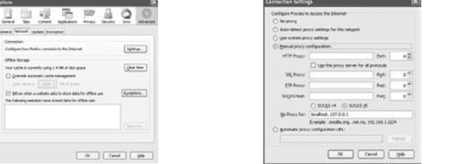

图 2：选项窗口

图 3：连接设置窗口

让我们讨论优化网络服务的步骤。

## 第3 章

## 优化网络服务

为了提高 Fedora Core 网络服务的性能，需要一些一些步骤来消除资源的资源浪费并提高整体吞吐量。在接下来的章节中，你将学习可以实施以优化 X Windows、NFS、NIS 和 SAMBA 服务的措施。这些措施仅是优化的起点，性能调整是一个永无止的过程。

让我们讨论这些步骤。首先，学习如何优化你的 X Windows 系统。

## 优化 X Windows 系统

X Window 系统允许一个主机上的应用程序在通过任何网络（局域网或互联网）连接的另一个主机上显示。优化 X Windows 系统并不是遵循基本步骤的问题。通过尽可能使用鼠标、显卡、显示器和键盘等可用硬件，可以手动优化 X Windows 系统的配置。可以采取以下步骤提高 X Windows 的性能：

- 在运行 X 的硬件上正确配置硬件（包括升级硬件）将带来性能最大的提升。
- 建议使用轻量级窗口管理器，并降低运行 X 的色彩深度。
- 避免使用全色背景壁纸，因为纯色图像非常消耗内存。形状窗口和边框消耗资源，因此应尽量避免。
- 运行本地字体服务器，因为字体需要跨网络发送。删除不使用的字体以释放内存并加快服务器的字体处理速度。
- 确保使用更新的 X 服务器和驱动程序。
- 卸载不需要的模块以释放内存。
- 以较低值运行 X，通过增加其相对于其他进程的优先级，你可以获得更好的吞吐量。

始终记住对你的 X Windows 进行仔细配置，因为任何错误步骤都可能对硬件造成不可恢复的损坏。上述建议逐一明确改进水平。

现在学习优化 NFS。

### 优化 NFS

为了获得最佳性能，必须从客户端和服务器的角度分析你的环境。`NFS` 对网络性能非常敏感，特别是网络阻塞和带宽问题。以下是一些可以提高 NFS 系统性能的建议：

- 为 NFS 使用日志文件系统，这样在崩溃时你可以比非日志文件系统更快地恢复数据。它还维护了数据的完整性。
- 建议使用多个磁盘。扩展 NFS 文件系统。

## 微软网络与网络服务介绍

为了获得最佳性能，必须从客户端和服务器的角度分析你的环境。`NFS` 对网络性能非常敏感，特别是网络阻塞和带宽问题。以下是一些可以提高 NFS 系统性能的建议：

- 为 NFS 使用日志文件系统，这样在崩溃时你可以比非日志文件系统更快地恢复数据。它还维护了数据的完整性。
- 建议使用多个磁盘。扩展 NFS 文件系统。

## 优化网络服务

为了提高 Fedora Core 网络服务的性能，需要一些一些步骤来消除资源的资源浪费并提高整体吞吐量。在接下来的章节中，你将学习可以实施以优化 X Windows、NFS、NIS 和 SAMBA 服务的措施。这些措施仅是优化的起点，性能调整是一个永无止的过程。

让我们讨论这些步骤。首先，学习如何优化你的 X Windows 系统。

## 优化 X Windows 系统

X Window 系统允许一个主机上的应用程序在通过任何网络（局域网或互联网）连接的另一个主机上显示。优化 X Windows 系统并不是遵循基本步骤的问题。通过尽可能使用鼠标、显卡、显示器和键盘等可用硬件，可以手动优化 X Windows 系统的配置。可以采取以下步骤提高 X Windows 的性能：

- 在运行 X 的硬件上正确配置硬件（包括升级硬件）将带来性能最大的提升。
- 建议使用轻量级窗口管理器，并降低运行 X 的色彩深度。
- 避免使用全色背景壁纸，因为纯色图像非常消耗内存。形状窗口和边框消耗资源，因此应尽量避免。
- 运行本地字体服务器，因为字体需要跨网络发送。删除不使用的字体以释放内存并加快服务器的字体处理速度。
- 确保使用更新的 X 服务器和驱动程序。
- 卸载不需要的模块以释放内存。
- 以较低值运行 X，通过增加其相对于其他进程的优先级，你可以获得更好的吞吐量。

始终记住对你的 X Windows 进行仔细配置，因为任何错误步骤都可能对硬件造成不可恢复的损坏。上述建议逐一明确改进水平。

现在学习优化 NFS。

### 优化 NFS

为了获得最佳性能，必须从客户端和服务器的角度分析你的环境。`NFS` 对网络性能非常敏感，特别是网络阻塞和带宽问题。以下是一些可以提高 NFS 系统性能的建议：

- 为 NFS 使用日志文件系统，这样在崩溃时你可以比非日志文件系统更快地恢复数据。它还维护了数据的完整性。
- 建议使用多个磁盘。扩展 NFS 文件系统。

# 微软网络与网络服务介绍 81

你可以使用以下命令连接到支持 `ssh` 的服务器：

```
ssh -p port username@yourserver
```

将 `port` 替换为默认端口 22，将 `username` 替换为你的主机或 IP 地址，并将 `yourserver` 替换为你想要连接的服务器的主机或 IP 地址。

如果服务器支持 SSH 连接，你可以访问默认端口 22。第一次使用 SSH 时，它会询问你是否确认要继续，并要求你提供密码。成功连接后，你可以发送和接收数据。

让我们来学习 `scp`。

# scp

Secure Copy（安全复制）是 SSH 软件包的一部分。`scp` 命令允许你通过 `ssh` 连接复制文件。它是 RCP 和 FTP 的替代方案。`scp` 命令有三种用法方式：

- 从（远程）服务器拷贝文件到你的计算机，请使用以下语法：


```
scp file username@yourserver:/home/username/
```

- 从你的（远程）服务器拷贝到另一个（远程）服务器，使用以下语法：

```
scp username@yourserver:/home/username/file .
```

- 从（远程）服务器拷贝到另一个（远程）服务器，使用以下语法：

```
scp username@yourserver:/home/username/file username2@yourserver2:/home/username2/
```

在上述命令中，`file` 是要传输到服务器 `yourserver` 上用户为 `username` 的目录 `/home/username/` 的文件，末尾的点 `.` 表示当前本地目录。

让我们来学习 `sftp`。

# sftp

Secure File Transfer Program (安全文件传输程序) 是传统 FTP 的替代方案。它在 SSH 上执行所有功能。`sftp` 的语法为：

```
sftp user@host:file file
```

在这里，`user` 是本地 PC，`host` 是远程 PC，`file` 是文件名。

在学习了安全服务之后，让我们学习安全性较低的服务。

# 第 3 章 安全性较低的服务

有一些不安全的的服务是不应该使用的，因为它们的所有流量都以明文形式在网络上传输。在接下来的章节中，让我们讨论其中一些安全性较低的服务：

- Telnet：它是一种允许你访问远程主机虚拟终端的协议。它是一个基于文本的控制台应用程序。
- FTP：它是运行在端口 20 和 21 上的标准协议。你可以输入 `help` 命令来列出 FTP 中可用命令。两个重要的命令是 `put` 和 `get`，分别提供将文件从你的机器移动到远程机器以及从远程服务器拉取到你机器的功能。如果有多个文件，请使用 `mput` 和 `mget`。
- rsync：这个文件传输程序类似于 RCP。它发送加密流量。服务器在端口 873 上监听。
- ssh：它是一种用于在远程主机上执行命令的加密协议。
- login：它是一个将你的终端连接到远程机器终端的登录程序。它是不安全的协议，并以明文发送所有信息。
- finger：它允许远程系统上的用户搜索另一个系统上的用户信息。它显示用户的登录名、真实姓名、空闲时间、位置和电话号码。`finger` 守护进程监听端口 79。
- talk and expect：它们是实时聊天协议，分别运行在端口 517 和 518 上。输入 `talk username` 向其他人发送请求。

让我们用一台 Linux 机器作为服务器。

# 作为服务器的 Linux 机器

以下是 Linux 上可用的相同安全协议：

- HTTP：Apache 是 Linux 上最常见的 Web 服务器，通过系统的 rc 脚本启动。你可以轻松地配置 Apache 及其位于 `/etc/httpd/conf/` 的配置文件。Apache 监听端口号 80，并可以监听许多不同的网络端口。
- sshd：安全守护进程 `sshd` 通过系统的 rc 脚本启动。它的全局系统配置文件存在 `/etc/sshd_config` 中，用户的配置文件放置在 `$HOME/`。它监听端口 22。
- ftp：FTP 守护进程使用端口 20 和 21 启动 FTP 请求。其配置文件 `ftppass`、`ftpversions`、`ftgroups` 和 `ftpdusers` 位于。
- DNS：域名服务 `DNS` 将主机名映射到 IP 地址。它使用端口 53。

# 配置 inetd

`inetd` 守护进程是一个超级服务器，它监听传入的连接并启动相应的服务。`inetd` 的配置文件通常位于 `/etc/inetd.conf`。

要在 `inetd` 中启用某项服务，你必须在配置文件找到该服务并取消行的注释。一旦配置完成，必须重启 `inetd` 服务才能更改生效。

# 微软网络与网络服务介绍 81

你可以使用以下命令连接到支持 `ssh` 的服务器：

```
ssh -p port username@yourserver
```

将 `port` 替换为默认端口 22，将 `username` 替换为你的主机或 IP 地址，并将 `yourserver` 替换为你想要连接的服务器的主机或 IP 地址。

如果服务器支持 SSH 连接，你可以访问默认端口 22。第一次使用 SSH 时，它会询问你是否确认要继续，并要求你提供密码。成功连接后，你可以发送和接收数据。

让我们来学习 `scp`。

# scp

Secure Copy (安全复制) 是 SSH 软件包的一部分。`scp` 命令允许你通过 `ssh` 连接复制文件。它是 RCP 和 FTP 的替代方案。`scp` 命令有三种用法方式：

- 从（远程）服务器拷贝文件到你的计算机，请使用以下语法：

```
scp file username@yourserver:/home/username/
```

- 从你的（远程）服务器拷贝到另一个（远程）服务器，使用以下语法：

```
scp username@yourserver:/home/username/file .
```

- 从（远程）服务器拷贝到另一个（远程）服务器，使用以下语法：

```
scp username@yourserver:/home/username/file username2@yourserver2:/home/username2/
```

在上述命令中，`file` 是要传输到服务器 `yourserver` 上用户为 `username` 的目录 `/home/username/` 的文件，末尾的点 `.` 表示当前本地目录。

让我们来学习 `sftp`。

# sftp

Secure File Transfer Program (安全文件传输程序) 是传统 FTP 的替代方案。它在 SSH 上执行所有功能。`sftp` 的语法为：

```
sftp user@host:file file
```

在这里，`user` 是本地 PC，`host` 是远程 PC，`file` 是文件名。

在学习了安全服务之后，让我们学习安全性较低的服务。

# 第 3 章 安全性较低的服务

有一些不安全的的服务是不应该使用的，因为它们的所有流量都以明文形式在网络上传输。在接下来的章节中，让我们讨论其中一些安全性较低的服务：

- Telnet：它是一种允许你访问远程主机虚拟终端的协议。它是一个基于文本的控制台应用程序。
- FTP：它是运行在端口 20 和 21 上的标准协议。你可以输入 `help` 命令来列出 FTP 中可用命令。两个重要的命令是 `put` 和 `get`，分别提供将文件从你的机器移动到远程机器以及从远程服务器拉取到你机器的功能。如果有多个文件，请使用 `mput` 和 `mget`。
- rsync：这个文件传输程序类似于 RCP。它发送加密流量。服务器在端口 873 上监听。
- ssh：它是一种用于在远程主机上执行命令的加密协议。
- login：它是一个将你的终端连接到远程机器终端的登录程序。它是不安全的协议，并以明文发送所有信息。
- finger：它允许远程系统上的用户搜索另一个系统上的用户信息。它显示用户的登录名、真实姓名、空闲时间、位置和电话号码。`finger` 守护进程监听端口 79。
- talk and expect：它们是实时聊天协议，分别运行在端口 517 和 518 上。输入 `talk username` 向其他人发送请求。

让我们用一台 Linux 机器作为服务器。

# 作为服务器的 Linux 机器

以下是 Linux 上可用的相同安全协议：

- HTTP：Apache 是 Linux 上最常见的 Web 服务器，通过系统的 rc 脚本启动。你可以轻松地配置 Apache 及其位于 `/etc/httpd/conf/` 的配置文件。Apache 监听端口号 80，并可以监听许多不同的网络端口。
- sshd：安全守护进程 `sshd` 通过系统的 rc 脚本启动。它的全局系统配置文件存在 `/etc/sshd_config` 中，用户的配置文件放置在 `$HOME/`。它监听端口 22。
- ftp：FTP 守护进程使用端口 20 和 21 启动 FTP 请求。其配置文件 `ftppass`、`ftpversions`、`ftgroups` 和 `ftpdusers` 位于。
- DNS：域名服务 `DNS` 将主机名映射到 IP 地址。它使用端口 53。

# 配置 inetd

`inetd` 守护进程是一个超级服务器，它监听传入的连接并启动相应的服务。`inetd` 的配置文件通常位于 `/etc/inetd.conf`。

要在 `inetd` 中启用某项服务，你必须在配置文件找到该服务并取消行的注释。一旦配置完成，必须重启 `inetd` 服务才能更改生效。

# 微软网络与网络服务介绍 81

你可以使用以下命令连接到支持 `ssh` 的服务器：

```
ssh -p port username@yourserver
```


将 `port` 替换为默认端口 `22`，将 `username` 替换为你的主机或 IP 地址，并将 `yourserver` 替换为你想要连接的服务器的主机或 IP 地址。

如果服务器支持 SSH 连接，你可以访问默认端口 `22`。第一次使用 SSH 时，它会询问你是否确认要继续，并要求你提供密码。成功连接后，你可以发送和接收数据。

让我们来学习 `scp`。

# scp

Secure Copy (安全复制) 是 SSH 软件包的一部分。`scp` 命令允许你通过 `ssh` 连接复制文件。它是 RCP 和 FTP 的替代方案。`scp` 命令有三种用法方式：

- 从（远程）服务器拷贝文件到你的计算机，请使用以下语法：

```
scp file username@yourserver:/home/username/
```

- 从你的（远程）服务器拷贝到另一个（远程）服务器，使用以下语法：

```
scp username@yourserver:/home/username/file .
```

- 从（远程）服务器拷贝到另一个（远程）服务器，使用以下语法：

```
scp username@yourserver:/home/username/file username2@yourserver2:/home/username2/
```

在上述命令中，'file' 是要传输到服务器 'yourserver' 上用户为 'username' 的目录 '/home/username/' 的文件，末尾的点 `.` 表示当前本地目录。

让我们来学习 `sftp`。

# sftp

Secure File Transfer Program (安全文件传输程序) 是传统 FTP 的替代方案。它在 SSH 上执行所有功能。`sftp` 的语法为：

```
sftp user@host:file file
```

在这里，`user` 是本地 PC，`host` 是远程 PC，`file` 是文件名。

在学习了安全服务之后，让我们学习安全性较低的服务。

# 第 3 章

# 安全性较低的服务

有一些不安全的的服务是不应该使用的，因为它们的所有流量都以明文形式在网络上传输。在接下来的章节中，让我们讨论其中一些安全性较低的服务：

- Telnet：它是一种允许你访问远程主机虚拟终端的协议。它是一个基于文本的控制台应用程序。
- FTP：它是运行在端口 `20` 和 `21` 上的标准协议。你可以输入 `help` 命令来列出 FTP 中可用命令。两个重要的命令是 `put` 和 `get`，分别提供将文件从你的机器移动到远程机器以及从远程服务器拉取到你机器的功能。如果有多个文件，请使用 `mput` 和 `mget`。
- rsync：这个文件传输程序类似于 RCP。它发送加密流量。服务器在端口 `873` 上监听。
- ssh：它是一种用于在远程主机上执行命令的加密协议。
- login：它是一个将你的终端连接到远程机器终端的登录程序。它是不安全的协议，并以明文发送所有信息。
- finger：它允许远程系统上的用户搜索另一个系统上的用户信息。它显示用户的登录名、真实姓名、空闲时间、位置和电话号码。`finger` 守护进程监听端口 `79`。
- talk and expect：它们是实时聊天协议，分别运行在端口 `517` 和 `518` 上。输入 `talk username` 向其他人发送请求。

让我们用一台 Linux 机器作为服务器。

# 作为服务器的 Linux 机器

以下是 Linux 上可用的相同安全协议：

- HTTP：Apache 是 Linux 上最常见的 Web 服务器，通过系统的 rc 脚本启动。你可以轻松地配置 Apache 及其位于 `/etc/httpd/conf/` 的配置文件。Apache 监听端口号 `80`，并可以监听许多不同的网络端口。
- sshd：安全守护进程 (`sshd`) 通过系统的 rc 脚本启动。它的全局系统配置文件存在 `/etc/sshd_config` 中，用户的配置文件放置在 `$HOME/`。它监听端口 `22`。
- ftp：FTP 守护进程使用端口 `20` 和 `21` 启动 FTP 请求。其配置文件 `ftppass`、`ftpversions`、`ftgroups` 和 `ftpdusers` 位于。
- DNS：域名服务 (DNS) 将主机名映射到 IP 地址。它使用端口 `53`。

# 微软网络与网络服务介绍

- `rpc.ypbind`: NIS 服务器
- `squid`: Web 代理服务器
- `nessus`: 渗透测试服务器
- `postgresql`: 数据库服务器
- `mysql`: 数据库服务器
- `oracle`: 数据库服务器

让我们查看 Linux 防火墙包的配置。

# 配置 Linux 防火墙包

防火墙是一个用于描述允许或拒绝访问网络或服务器方法的通用术语。防火墙执行多种服务来保护你的网络。防火墙监控在你的网络和互联网之间的流量，以防止来自未授权服务的攻击。Linux 通过防火墙包提供安全保障，这允许你运行个人防火墙来保护你的机器。

> 

> 请参考书末尾的“使用 Samba 文件实验”、“分配代理实验”、“配置 IP Table 防火墙实验”、“设置设置硬件设备（打印机）实验”以及“在 Windows 下操作实验”。

在结束本章之前，让我们总结一下本章讨论的关键要点。

## 总结

在本章中，你学习了如何通过 Samba 服务器将 Linux 服务器连接到微软网络。你还学习了 Samba 服务器的安装和配置、创建 Samba 用户以及 Windows PC 与 Samba 服务器的连接。此外，你探索了基于局域网的服务：基于 NTP 的时间服务器和缓存代理服务器。你还讨论了优化网络服务的步骤，包括优化 Windows X 系统、NFS、NIS 和 Samba。在章节的末尾，你探索了一些安全的互联网服务和一些安全性不高的服务，包括配置 `xinetd` 和独立服务。你还了解了 `xinetd` 与独立服务的比较、Linux 机器作为服务器，以及防火墙包的配置。

## 练习

- Q1. SMB 的全称是什么？

a. Server Message Building

b. Server Message Block

c. Server Multi Block

d. Sender Message Block

答案：b 是正确选项

- Q2. `smb.conf` 文件中的特殊部分是哪些？

a. global, homes and drivers

b. global, directory and printers

c. global, homes and printers

d. local, directory and drivers

答案：c 是正确选项

- Q3. 下列哪项允许内核跨网络发送或转发数据包？

a. IP forwarding（IP 封包）

b. iptables

c. Netfilter

d. proxy server（代理服务器）

答案：a 是正确选项

- Q4. 启动 Squid 的正确命令是什么？

a. set squid start

b. service squid on

c. service_squid_start

d. service squid start

答案：d 是正确选项

- Q5. 下列哪项安全性较低的服务？

a. SH

b. Telnet

c. sftp

d. none of these（以上都不是）

答案：b 是正确选项

# 04 域名系统与邮件服务

### 目标

- 理解域名系统 (DNS)
- 学习邮件服务的配置
- 学习 FTP 配置

在本章中，你将学习域名系统 (DNS)，它用于名称地址解析以及不同类型的 DNS。你还探索了服务器配置文件，并学习了缓存 DNS 服务器、辅助 DNS 服务器和主服务器。在配置好服务器后，你学习了某些用于检查 DNS 配置和性能的验证工具。在了解 DNS 之后，你探索了 Linux 的邮件服务。你学习了电子邮件是如何运作的，然后配置你的系统为你提供服务。你讨论了消息发送过程中的各种进程。此外，你还发现了一些关于维护网络安全的技巧。在本章中，你还发现了 FTP 服务。FTP 是几乎每个网络使用的基础互联网服务。

> 安装本章中描述的所需包。你还需要按照系统在安装过程中的提示安装相关文件和包。

让我们开始介绍域名系统。

## 4.1 理解域名系统 (DNS)

DNS 提供了一种可扩展且分散的查找机制，可将域名翻译为 IP 地址。互联网是基于 IP 地址运行的。每当你使用域名时，DNS 服务就会将名称翻译为相应的 IP 地址。例如，域名 `www.example.com` 可能会翻译为 `198.123.124.7`。

让我们使用域名技术 `technology.com` 来讨论这些名称及其组织结构。例如：`welfare.com`，该域名的第一部分是机构、公司或组织的名称。点 (`.`) 之后的部分被称为顶级域名 (TLD)。有很多种顶级域名。下表 1 显示了一些常用的顶级域名。

# 第 4 章

| 表格 1：顶级域名列表 |
| 顶级域名 | 含义 |
| --- | --- |


# 微软网络与网络服务介绍

- `rpc.ypbind`: NIS 服务器
- `squid`: Web 代理服务器
- `nessus`: 渗透测试服务器
- `postgresql`: 数据库服务器
- `mysql`: 数据库服务器
- `oracle`: 数据库服务器

让我们查看 Linux 防火墙包的配置。

防火墙是一个用于描述允许或拒绝访问网络或服务器方法的通用术语。防火墙执行多种服务来保护你的网络。防火墙监控在你的网络和互联网之间的流量，以防止来自未授权服务的攻击。Linux 通过防火墙包提供安全保障，这允许你运行个人防火墙来保护你的机器。

> 
> 请参考书末尾的“使用 Samba 文件实验”、“分配代理实验”、“配置 IP Table 防火墙实验”、“设置设置硬件设备（打印机）实验”以及“在 Windows 下操作实验”。

在结束本章之前，让我们总结一下本章讨论的关键要点。

## 总结

在本章中，你学习了如何通过 Samba 服务器将 Linux 服务器连接到微软网络。你还学习了 Samba 服务器的安装和配置、创建 Samba 用户以及 Windows PC 与 Samba 服务器的连接。此外，你探索了基于局域网的服务：基于 NTP 的时间服务器和缓存代理服务器。你还讨论了优化网络服务的步骤，包括优化 Windows X 系统、`NFS`、`NIS` 和 `Samba`。在章节的末尾，你探索了一些安全的互联网服务和一些安全性不高的服务，包括配置 `xinetd` 和独立服务。你还了解了 `xinetd` 与独立服务的比较、Linux 机器作为服务器，以及防火墙包的配置。

## 练习

- Q1. SMB 的全称是什么？
  a. Server Message Building
  b. Server Message Block
  c. Server Multi Block
  d. Sender Message Block
  答案：b 是正确选项

- Q2. `smb.conf` 文件中的特殊部分是哪些？
  a. global, homes and drivers
  b. global, directory and printers
  c. global, homes and printers
  d. local, directory and drivers
  答案：c 是正确选项

- Q3. 下列哪项允许内核跨网络发送或转发数据包？
  a. IP forwarding
  b. iptables
  c. Netfilter
  d. proxy server
  答案：a 是正确选项

- Q4. 启动 Squid 的正确命令是什么？
  a. set squid start
  b. service squid on
  c. service_squid_start
  d. service squid start
  答案：d 是正确选项

- Q5. 下列哪项安全性较低的服务？
  a. SH
  b. Telnet
  c. sftp
  d. none of these
  答案：b 是正确选项

# 04 域名系统与邮件服务

### 目标

- 理解域名系统 `DNS`
- 学习邮件服务的配置
- 学习 FTP 服务配置

在本章中，你将学习域名系统 `DNS`，它用于名称地址解析以及不同类型的 DNS。你还探索了服务器配置文件，并学习了缓存 DNS 服务器、辅助 DNS 服务器和主服务器。在配置好服务器后，你学习了某些用于检查 DNS 配置和性能的验证工具。在了解 DNS 之后，你探索了 Linux 的邮件服务。你学习了电子邮件是如何运作的，然后配置你的系统为你提供服务。你讨论了消息发送过程中的各种进程。此外，你还发现了一些关于维护网络安全的技巧。在本章中，你还发现了 FTP 服务。FTP 是几乎每个网络使用的基础互联网服务。在章节的末尾，你学习了如何安装、配置和维护非常安全的 FTP 守护进程。

> 安装本章中描述的所需包。你还需要按照系统在安装过程中的提示安装相关文件和包。

让我们开始介绍域名系统。

## 4.1 理解域名系统 `DNS`

DNS 提供了一种可扩展且分散的查找机制，可将域名翻译为 IP 地址。互联网是基于 IP 地址运行的。每当你使用域名时，DNS 服务就会将名称翻译为相应的 IP 地址。例如，域名 `www.example.com` 可能会翻译为 `198.123.124.7`。

让我们使用域名技术 `technology.com` 来讨论这些名称及其组织结构。例如：`welfare.com`，该域名的第一部分是机构、公司或组织的名称。点 `.` 之后的部分被称为顶级域名 `TLD`。有很多种顶级域名。下表 1 显示了一些常用的顶级域名。

# 第 4 章

| 表格 1：顶级域名列表 |
| 顶级域名 | 含义 |
| --- | --- |
| `com` | 用于注册业务的 TLD |
| `edu` | 用于教育机构的 TLD |
| `gov` | 用于美国政府机构的 TLD |
| `mil` | 用于军事机构的 TLD |
| `net` | 用于网络附属组织的 TLD |
| `org` | 用于非商业组织的 TLD |
| `int` | 用于国际组织的 TLD |
| `us` | `.us` 域名，每个条目为较低层级 |
| `biz` | 用于商业的 TLD |
| `info` | 用于任何种组织的 TLD |
| `name` | 用于注册个人网站的 TLD |
| `museum` | 用于注册博物馆的 TLD |
| `coop` | 用于企业组织的 TLD |
| `aero` | 用于航空运输业的 TLD |
| `pro` | 用于职业人员的 TLD |
| `travel` | 用于旅行相关的 TLD |

[注：此处为译文衔接之前的文本：例如：`welfare.com`，该域名的第一部分是机构、公司或组织的名称。点 `.` 之后的部分被称为顶级域名 `TLD`。有很多种顶级域名。下表 1 显示了一些常用的顶级域名。]

DNS 提供了一种可扩展且分散的查找机制，可将域名翻译为 IP 地址。互联网是基于 IP 地址运行的。每当你使用域名时，DNS 服务就会将名称翻译为相应的 IP 地址。例如，域名 `www.example.com` 可能会翻译为 `198.123.124.7`。

让我们使用域名技术 `technology.com` 来讨论这些名称及其组织结构。例如：`welfare.com`，该域名的第一部分是机构、公司或组织的名称。点 `.` 之后的部分被称为顶级域名 `TLD`。有很多种顶级域名。下表 1 显示了一些常用的顶级域名。

顶级域名服务器被称为根域名服务器，因为它提供了关于域的信息。例如，如果你想搜索 `*.w.mhlenberg.com`，它会向根域名服务器查询 `.edu`，根域名会将搜索引导到较低级别的域名服务器，直到找到信息。

在图 1 中，你使用 `dig` 命令搜索关于 `.edu` 的信息。


图 1：在顶级根域名服务器中搜索 `.edu`

通过添加域名名称来继续搜索第二级域名，如图 2 所示：


| travel | 用于旅行相关的 TLD |

顶级域名服务器被称为根域名服务器，因为它提供了关于域的信息。例如，如果你想搜索 `*.w.mhlenberg.com`，它会向根域名服务器查询 `.edu`，根域名服务器会将搜索引导到较低级别的域名服务器，直到找到信息。

在图 1 中，你使用 `dig` 命令搜索关于 `.edu` 的信息。


图 1：在顶级根域名服务器中搜索 `.edu`

通过添加域名名称来继续搜索第二级域名，如图 2 所示：

# 第 4 章

vadmin@vadmin:~

```
File Edit View Help
(vadmin@vadmin:~ -15 dig muebleberg.org)
>>> dig 9.0.1-debug @8.8.8.8 +8.4 fr1 <<< muebleberg.org
>> global options:
>> get answer
>> query: QUERY; status: REFUSED; id: 54991
>> flags: qr QUERY: 1; ANSWER: 0; AUTHORITY: 0; ADDITIONAL: 0
>> WARNING: recursion requested not available

QUESTION SECTION
muebleberg.org. IN A

ANSWER SECTION
Server: 192.168.2.203 192.168.2.204
Time: Fri May 19 10:53:11 2023
MS: 5128 rcv: 32
```

图 2：二级域名的查询。

找到域名后，通过其本地域名服务器提供有关域名的信息。本地域名服务器有三种类型：

- *主服务器（Master）*：它被列为权威服务器，因为它包含了有关该域的所有信息，并在需要时提供这些信息。
- *从服务器（Slave）*：它维护主服务器的备用（包含与主服务器相同的信息）。当主服务器宕机或不可用时使用它。
- *缓存服务器（Caching）*：它用于向本地网络上的其他服务器和工作站提供信息。由于域名信息已存储在内存中，缓存服务器可以加快搜索。

在下一节中，你将学习主服务器和从服务器如何收集有关域名的信息。你必须配置服务器在需要时提供这些信息。

让我们学习如何配置服务器提供域名解析信息。

## 检查服务器配置文件

在配置服务器提供域名解析信息之前，你需要配置一些文件。这些文件取决于你系统中安装的 `BIND` 服务器。

- *`named.conf`*：该文件位于 `/etc/bind` 目录，包含全局属性和配置文件的来源。
- *`named.ca`*：该文件位于 `/var/named` 目录，包含根服务器的名称和地址。
- *`named.local`*：该文件位于 `/var/named` 目录，提供解析 `localhost` 回环地址的信息。

设置 `named` 服务器需要五个文件。它们如下：

- *`zone`（区域）*：该文件包含本地域内服务器和工作站的名称和地址，并提供这些名称到 IP 地址的映射。
- *`reverse zone`（反向区域）*：该文件提供将 IP 地址映射到名称的反向。

无论作为主服务器、从服务器还是仅缓存服务器，前三行都是必须的，最后两个文件是主域名服务器所需的。

要启动 `BIND` 服务器，使用 `/etc/rc.d/init.d/named` 脚本。

让我们详细讨论 `named.conf` 文件。

### named.conf

以下是 `/etc/named.conf` 文件的内容：

```
// named.conf
options {
    listen-on port 53 { 127.0.0.1 };
    listen-on port 53 { :1 };
    directory "var/named";
    dump-file "var/named/data/cache_dump.db";
    statistics-file "var/named/data/named_stats.txt";
    memastats-file "var/named/data/named_mem_stats.txt";
    allow-query { localhost };
}
logging {
    channelfile_debug {
        file "data/named.run";
        dynamic;
    }
    zone "." IN {
        type file;
        hint "named.ca";
        include "/etc/named.rfc1312.zones";
    }
}
```

以 `//` 开头的行是注释行。命令以语句的形式传递给文件。语句的信息包含在大括号 `{}` 中并以 `;` 结束。上面显示了几个命令。你可以在 `named.conf` 文件中拥有以下配置语句：

- *`options`*：它包含默认和全局配置。
- *`include`*：它包含来自另一个文件的信息。
- *`acl`*：它指定用于访问控制列表的 IP 地址。
- *`logging`*：它指定日志位置和内容。
- *`server`*：它提供远程服务器属性。
- *`zone`*：它提供区域信息。
- *`key`*：它指定用于身份验证的安全密钥。

让我们讨论这些语句。

# 第 4 章

## options

`options` 语句是 `named.conf` 的第一部分，用于指定 `named` 的工作目录。`named.conf` 文件中应定义一个 `options` 语句。`options` 语句定义了全局服务器配置选项并为其他语句设置默认值。你可以为 `options` 语句设置多个值。

`options` 语句使用以下语句：

```
options{
  value "property";
}
```

在上述语句中，`value` 指令被替换为有效的选项。在 `options` 语句中可以值列表是一个长列表；以下是常用的选项：

- *`allow-query`*：它指定允许查询域名服务器的主机。默认情况下，允许所有主机查询。
- *`allow-recursion`*：它适用于递归查询。默认情况下，允许所有主机对域名服务器执行递归查询。
- *`blackhole`*：它指定不允许查询的主机。
- *`directory`*：它指定 `named` 目录。
- *`forward`*：它指定转发行为。
- *`listen-on`*：它指定监听在哪些端口和接口进行查询（默认是 53）。
- *`notify`*：它控制当区域更新时通知从服务器。它接受 *yes* 或 *no*。
- *`pid-file`*：它指定持有进程 ID 的文件名。
- *`statistics-file`*：它指定统计文件的备用位置。默认情况下，`named` 统计保存在统计文件中。

### include

该语句允许在 `named.conf` 中包含任何文件的路径和名称。`include` 语句使用以下语法：

```
include "filename";
```

在此语句中，`filename` 被替换为路径。

### ACL

访问控制列表 `ACL` 定义了一个或多个 IP 地址列表。`acl` 语句定义了允许或拒绝访问服务器的主机组。

`acl` 语句采用以下形式：

```
acl <acl-name> {
  <match-element>; <match-element>; ...
};
```

在此语句中，将 `<acl-name>` 替换为访问列表的名称，将 `<match-element>` 替换为分号分隔的 IP 地址列表。

### Logging

在 `logging` 中，你指定服务器的日志选项。它可以包含通道（channel）和类别（category）。在通道中，你指定日志信息的位置。日志信息可以写入文件、发送到 `syslog` 或通过指定适当的命令丢弃。定义了自定义通道，类别选项用于对通道进行分类，并在 `named` 重启时启动日志。

以下是 `logging` 语句的语法：

```
logging {
channel<channel name {
  file-path to file>
  version<specify number>
  size<specify size in bytes> }
}
```

要丢弃信息，请选择 `null` 作为目标：

```
logging {
channel<channel name {
  null;
}
}
```

你需要替换上述语句中 `<>` 中的值。以下是使用类别语句的语法：

```
category category name {
channel name; channel name;
}
```


你可以选择以下类别：`cname`, `config`, `db`, `default`, `entilb`, `insist`, `lame-servers`, `load`, `maintenance`, `ncache`, `os`, `packet`, `panic`, `parser`, `queries`, `response-checks`, `security`, `statistics`, `xfer-in` 和 `update`。

你可以为信息设置严重级别。设置严重级别的语法如下：

```
severity from critical, error, warning, notice, info, debug \level,
dynam!
print-timechoose yes or no
print-severitychoose yes or no
print-categorychoose yes or no
```

斜体值被替换为你选择的值。

# 第 4 章

## server（服务器）

在 `server` 语句中，你定义了远程服务器的属性和行为。你可以指定本地服务器如何访问或响应定义的远程服务器，特别是在通知和区域传输方面。`server` 语句的语法与其他语句相同；以下是 `server` 语句的有效值：

- `bogus`: 指定为“yes”表示不查询远程服务器，为“no”表示向远程服务器发送查询。
- `transfer`: 指定传输的次数。
- `transfer-format`: 指定你想要一个答案还是多个答案。
- `keys`: 指定密钥 ID。

## zone（区域）

`zone` 语句指代区域文件。每个语句都以 `zone` 单词开头，后面跟着域名名和数据类。数据类包括 `hs`、`hesiod` 和 `chaos`。互联网的默认数据类是 `hs`。接随其后的是 `type` 选项，用于将服务器指定为主主服务器（master）、从服务器/根服务器（slave/stub）或提示服务器（hint）。`stub` 服务器仅加载 NS 记录。`hints` 文件用于初始化根缓存并包含根服务器列表。此外，其后面是指定区域的区域文件名称。`zone` 语句最常用的选项如下：

- `allow-query`: 它指定允许请求此区域信息的客户端（默认= allow）。
- `allow-transfer`: 它指定允许请求区域信息传输的从服务器（默认= allow）。
- `allow-update`: 它指定允许动态更新其区域信息的主机（默认= deny）。
- `file`: 它指定 `named` 工作目录中包含区域配置数据的文件名。
- `masters`: 它是访问权威区域的 IP 地址。
- `notify`: 它指定当区域更新时，是否向已通知的成员（从服务器）发送通知。此指令接受 `yes` 或 `no` 选项。

`zone` 语句采用以下形式：

```
zone<name><zone-class> {
<zone-options>;
  [zone-options>; ...]
};
```

在此语句中，

`<zone-name>` 是区域的名称，

`<zone-class>` 是区域的可选类，

`<zone-options>` 是一个描述区域特征的选项列表。

区域文件包含关于 IP 地址的资源记录 (`RR`)。区域文件可以包含以下类型的 RR：

- 权威起始记录 (`SOA`)

### 域名系统与邮件服务

它是区域文件的第一行。它将名称服务器识别为关于该信息的权威来源。每个区域文件中只有一个 `SOA`。`SOA` 包含以下数据：

```
@ IN SOA main.tactechnology.com. mail.tactechnology.com. (
2000052101 : Serial
 : Refresh 2w
 : Retry 1d
 : Minimum TTL
```

`SOA` 行的第一个字符是一个表示“查看此域名”的特殊符号，`IN` 代表 Internet，意味着权威起始（Start of Authority）。在本示例中，该域名的权威服务器是 `main.tactechnology.com`，`mail.tactechnology.com` 用于管理员的邮件地址。

括号内的信息会被传递给其他名称服务器（从主服务器），从主服务器使用这些信息来更新它们的记录。行 `2000052101; Serial` 序列号是将此数字与其存储的信息进行比较。如果序列号不同，则更新从服务器中的信息。如果序列号相同，则不需要下载文件。分号表示内容的结束。在上面的示例中，使用了以下注释：

- `Refresh`: 服务器在刷新数据之前等待的时间。
- `Retry`: 服务器在之前的尝试失败后，尝试再次联系主服务器之前等待的时间。
- `Expires`: 如果从主服务器在指定期间无法联系主服务器，则数据应该过期。
- `TTL`: 它指定数据的生存时间。它告诉缓存名称服务器持有数据所需的时间。

```
# host tactechnology.com
tactechnology.com 的地址为 12.129.206.112
```

通过使用 `-option` 参数，你可以搜索资源记录类型。例如，要查询某个域名的邮件服务器，请使用以下命令：

```
# host -t mx tactechnology.com
tactechnology.com mail is handled by 10 mail.tactechnology.com
```

`dig` 命令用于调试和获取其他有用信息。

```
dig (@server) domain name (type)
```

`dig` 也可以通过 `-x` 切换并指定 IP 地址进行反向查找。

```
dig -x domain name
```

你将从两个 `dig` 命令获得完全相同的服务器。

在学习了上一节的 DNS 之后，让我们学习邮件服务。

### 配置邮件服务

在配置邮件服务之前，你需要了解电子邮件的基本工作原理。在发送者和接收者之间，有几个程序使用网络协议来确保消息从发送者传输到接收者。为了让你的电子邮件正常工作，你需要配置以下项目：

- 程序：
  - 供用户读取和编写电子邮件的邮件用户代理（MUA）
  - 用于在网络中投递邮件消息的邮件传输代理（MTA）
  - 用于将消息投递到用户邮箱箱文件的邮件投递代理（MDA）
  - 用于通知用户新邮件的通知程序
- 用于在 MTA 之间封装和传输电子邮件消息的 SMTP 协议
- 程序通信的 TCP/IP 端口

让我们看看这些组件是如何协同工作传递消息的。

### 追踪邮件投递过程

在 Linux 中，电子邮件的创建、传输和传递是由专门为该任务设计的程序处理的。邮件投递过程涉及三个组件：邮件用户代理、邮件传输代理和邮件投递代理。这三个组件执行独立的任务，并且有一个优点：你可以替换其中一个程序而不影响整个系统的功能。

让我们详细学习这些过程，首先从探索 MUA 开始。

### 邮件用户代理 (MUA)

`MUA` 允许用户读取和编写电子邮件消息。它被广泛称为邮件客户端。`MUA` 为读写电子邮件消息提供了接口。目前有两种类型的 `MUA`：图形用户界面（GUI）和命令行界面（CLI）。两者提供相同的功能。`MUA` 将编写好的电子邮件消息发送到邮件传输代理（MTA）以在网络上传输消息。

现在让我们学习 MTA。

### 邮件传输代理 (MTA)

`MTA` 是负责跨网络发送消息的程序。`MTA` 在没有用户干预的情况下工作，因为大多数用户并不知道 `MTA` 的存在。`MTA` 读取邮件消息中 TO 部分的信息，确定接收者邮件服务器的 IP 地址。然后，`MTA` 尝试通过 TCP/IP 端口（通常是端口 25）连接到接收者的服务器。`MTA` 查询 DNS 邮件交换器以确定负责接收该邮件的主机。与目标 `MTA` 建立连接后，使用简单邮件传输协议（SMTP）传输消息。

在某些情况下，当消息无法投递时，`MTA` 将其存储在本地队列并在延迟后尝试重传。在某些情况下，`MTA` 会拒绝投递，导致消息退回并返回给发送者的 `MTA`。

当没有发生上述问题时，`MTA` 会向消息添加头部信息。该头部包含跟踪消息和描述消息投递的信息。最后，`MTA` 将消息传递给另一个名为邮件投递代理的程序，以将消息投递到接收者的邮箱箱。

现在让我们学习 MDA。

### 邮件投递代理 (MDA)

`MDA` 从 `MTA` 接收消息。它将其存储在接收者邮箱箱文件（称为邮件池 `mail spool`）中的新消息中。在许多情况下，`MDA` 实际上是本地投递代理（LDA）。任何实际处理消息并投递到可以供客户端应用程序读取点的程序都可以被视为 `MDA`。

> 你 Fedora 核心版上安装的默认 `MTA` 是 `Sendmail`。你 Fedora 核心版上一个流行的 `MDA` 是 `procmail`。

在对邮件服务进行简要介绍后，让我们学习 SMTP。

### 介绍 SMTP

在上一节中你了解到，`SMTP` 用于在 `MTA` 之间发送消息。`SMTP` 是用于在网络上的不同计算机之间传输电子邮件消息的 TCP/IP 协议。它也被称为存储和转发协议：

- 通过 `SMTP` 发送的消息直接从发送者的 `MTA` 传输到接收者的 `MTA`
- 当消息由于网络条件无法投递时，`MTA` 将其存储并尝试重传


SMTP 协议只能传输 ASCII 文本。它不支持字体、颜色、图形或附件。如果你想发送这些项目，则需要在使用 SMTP 时配合 MIME（多用途互联网邮件扩展）协议。

# 第 4 章

SMTP 有一个主要缺点，它假设发送和接收的 MTA 始终连接到互联网。这一缺点通过 POP3 克服。

让我们学习 POP3。

## POP3

开发 POP3 是为了解决 SMTP 面临的问题。POP3 运行在连接到网络的服务器上，该服务器持续发送和接收邮件。POP3 服务器存储它收到的任何消息，直到接收者请求它们。如果你想读取邮件，你需要 POP3 来检索在你未连接到互联网（离线）时到达 MTA 的消息。POP3 使用 MTA 的存储空间来保存消息直到它们被请求。你可以通过连接到服务器来检索服务器存储的消息。（注：原文此处有大量重复句子，翻译已按逻辑去重或保留核心含义）。IMAP4 允许用户在服务器上访问并管理邮件。与 POP3 通常将消息下载到本地设备并从服务器删除不同，IMAP4 允许用户在服务器上...

IMAP 的关键功能包括：

- 文件夹管理：用户可以在服务器上组织邮件。
- 服务器端搜索：服务器可以根据各种标准搜索邮件。
- 部分获取：用户可以只下载头部或邮件的特定部分。
- 多设备同步：在服务器上进行的更改（如标记为读或删除）会反映在所有设备上。

## 配置 Sendmail

各种传输代理在 Linux 中均可用。Sendmail 是最广泛使用的之一。在配置 sendmail 之前，你需要了解它的角色。它作为 MTA（邮件传输代理）。

你可以通过两种方式启动 sendmail 服务：

- `service sendmail start`
- 你也可以使用 telnet 连接到本地端口 25。使用以下命令：

```bash
# telnet localhost 25
Trying 127.0.0.1.
Connected to localhost.
Escape character is '^'.
220 vadmin ESMTP 8.14.3/8.14.3; Mon, 4 Jun 2012 02:23:59 -0400
QUIT
221 2.0.0 vadmin closing connection
Connection by foreign host.
```

如果你看到上述输出，说明 sendmail 正在运行。输入 `QUIT` 退出会话。

一旦你安装并运行了 sendmail，你就可以配置它。你可能需要编辑 `/etc/sendmail.cf`（sendmail 配置文件）。定位配置文件中以大写字母 DS 开头的行，如下所示：

```
# "Smart" relay host (may be null)
DS
```

修改该行以定义邮件中继主机名称，例如在我们的案例中，我们指定名为 `mailmessage.example.com` 的主机作为邮件中继主机。邮件中继主机是您网络上发送和接收邮件的计算机名称。在 DS 和主机名之间不要留任何空格。

```
# "智能" relay中继主机（可能为空）
DSmail.example.com
```

如果您的系统中尚未安装 `sendmail-cf` 软件包，请安装它，因为它包含了使用 m4 方法配置 sendmail 所需的 m4 宏文件（下一节描述）。

让我们讨论一下邮件队列。

## 邮件队列

当电子邮件没有被即时送达时，它将留在 MTA 的输出邮件队列中。这背后可能有许多原因。无论原因何，用户都可以继续使用他们的 UA 编写电子邮件。当他们发送消息时，sendmail 会将消息放入邮件队列并在设定一段时间后尝试重发。你可以通过检查启动 sendmail 的初始化脚本来查找这些间隔。`/etc/sysconfig/sendmail` 文件中的以下行描述了这些信息：

```
DAEMON=yes
QUEUE=1h
```

以 `QUEUE` 开头的行定义重试间隔为一小时。你可以以小时 (`h`)、分钟或秒 (`s`) 设置间隔。

让我们讨论一下别名。

## 邮件别名

邮件别名功能用于创建分发列表并使用户访问更方便。例如，如果你在拼写某人的名字时遇到困难，可以设置别名；即使你拼错了名字，邮件仍然到达目标收件者。你还可以将一个不存在的用户别名指向真实的用户。别名文件为 `/etc/aliases`，如下所示：

```
# 基本系统别名 -- 这些必须存在
mailer-daemon: root
postmaster: root
```

```
# 伪账户通用重定向
daemon: root
lp: root
sync: root
shutdown: root
usetup: news
ftpade: ftp
ftpadmin: ftp
ftp-adm: ftp
ftp-admin: ftp
```

```
# trap decode 以捕获安全攻击
decode: root
```

```
# 应该接收 root 邮件的人
#root: marc
# 用户 bob: marc
```

在上面的文件中，你可以看到 mailer-daemon 和 postmaster 的系统别名，指向伪账户的重定向（root 使用得最多），以及用户别名，例如 bob，它将所有发给 bob 的邮件重定向到真实用户 marc。

要在别名文件中创建条目，输入用户名后跟冒号，然后是某种空格，最后是别名。在冒号左侧可以指定多个用户名以创建分发列表。运行 `new` 命令使更改生效，因为你的别名文本文件会更新二进制文件。这一步是必要的，因为 sendmail 查看二进制文件 `/etc/aliases.db` 来读取别名信息。

让我们学习一些 sendmail 的命令。

## Sendmail 文件

Sendmail 使用以下文件和目录：

- `/usr/sbin/sendmail`: 它是 sendmail 守护进程的可执行镜像
- `mail`: 它显示邮件队列的内容
- `/var/spool/mqueue`: 存放邮件队列的目录
- `/var/spool/mail`: 存放用户邮件池的目录。例如：

```
ls -l /var/spool/mail/
-rw-rw---- 1 mail 2012-04-08 12:45 /var/spool/mail/bill1
-rw-rw---- 1 mail 2012-04-08 12:43 /var/spool/mail/ram
-rw-rw---- 1 root 2012-06-02 00:46 /var/spool/mail/root
```

- `/etc/access`: 列出了不允许向您的系统发送邮件的用户名、电子邮件地址、域名名和 IP 地址
- `/etc/mail-domains`: 列出了允许通过您的系统接收电子邮件的主机
- `/etc/local-host-names`: 列出了系统的其他名称
- `/etc/virtertable`: 将电子邮件地址映射到系统上的用户名

现在，让我们学习使用 postfix 邮件服务器。

## 使用 Postfix 邮件服务器

Postfix 被广泛使用，每天处理数千条消息。Postfix 兼容命令行级。Postfix 的开发是为了 sendmail 的高性能、更易用的替代品。在上一节中，你学习了邮件中继主机的语法：

```
d5relay.example.com
```

Postfix 的语法写法如下：

```
relayhost = relay.example.com
```

让我们了解更多关于 Postfix。

默认情况下，Fedora 使用 Sendmail。你必须停止 sendmail 以启动 postfix。使用以下行停止 sendmail：

```
# service sendmail stop
```

首先，确保您的系统中已安装了 postfix。输入以下命令检查：

```
# rpmquery postfix
postfix-2.5.6-3.fc11.1586
```

它返回了系统中安装的 postfix 版本。在继续之前，如果尚未安装，请安装 Postfix。

`/etc/postfix/main.cf` 是 postfix 的主配置文件。Postfix 支持大量的配置变量。以下是应当配置的变量。检查或编辑它们来配置 postfix：

- `mydomain` 变量指定您的域名：`mydomain = example.com`


- `hostname` 变量标识本地机器的完全限定域名：`myhostname = abcd.example.com`

- `myorigin` 变量标识源域：`myorigin = $mydomain`

- `mydestination` 变量告诉 postfix 它应该应该送达的地址：`mydestination = $hostname, localhost`

现在在别名文件中创建一个条目，输入用户名后跟冒号，然后是某种空格，最后是别名。在冒号左侧可以指定多个用户名以创建分发列表。运行 `new` 命令使更改生效，因为你的别名文本文件会更新二进制文件。这一步是必要的，因为 sendmail 查看二进制文件 `/etc/aliases.db` 来读取别名信息。

让我们学习一些 sendmail 的命令。

## 域名系统与邮件服务

要在启动时启动 postfix，请使用 chkconfig：

```
# chkconfig --levels 01234 sendmail off
# chkconfig --levels 01234 postfix off
# chkconfig --levels 01234 postfix on
```

最后在最后一步中，修改您的 syslog 配置 `/etc/syslog.conf` 来处理 postfix 消息。这种措施有助于 postfix 运行得更快，特别是在高负载时，但在系统崩溃时也可能导致数据丢失

# 第 4 章

主机名或域名。在进行所需的更改后，运行 `service postfix reload` 命令。

让我们来讨论 POP3 和 IMAP。

### 使用 POP3 和 IMAP 提供邮件服务

通常，邮件系统的配置基于 MTA。没有使用 MTA 的系统通过 IMAP 或 POP3 访问邮件。IMAP 的功能比 POP3 服务更多。

在本节中，你将学习如何配置 Dovecot IMAP 服务器，它也支持 POP3 和 IMAP。Dovecot 还支持 POP3 和 IMAPS（安全 POP3 和安全 IMAP），它们使用基于 SSL 的加密对身份验证和数据交换过程进行封装。

运行以下命令检查检查安装了 dovecot 软件包：

```bash
# rpmquery dovecot
```

如果安装了 dovecot，你将看到版本号输出。如果没有安装，请在继续之前安装 dovecot 软件包。安装 dovecot 后，配置 dovecot 服务在系统启动时启动。使用以下命令在开机时启动 dovecot：

```bash
#chkconfig --levels 012345 dovecot off
#chkconfig --levels 345 dovecot on
```

要测试服务器，使用 telnet 以普通用户的身份连接到 POP3 服务器。使用以下命令：

```bash
$ tel localhost pop3
```

输入 `(QUIT)` 并按回车键关闭连接。通过上述命令，你使用 telnet 连接到 POP3 端口（110 端口）。输出 `+OK` 表示连接已建立，你现在可以使用 POP3 协议检索消息了。如果收到的输出不是 `+OK`，请检查你的配置。

接下来连接到 IMAP 服务器，使用以下命令：

```bash
$ tel localhost imap
```

输入 `(LOGOUT)` 并按回车键关闭连接。通过上述命令，你使用 telnet 连接到 IMAP 端口（143 端口）。输出 `*OK` 表示你的 IMAP 和 POP 服务器已设置，并准备好为 IMAP 和 POP 客户端提供服务。如果收到的输出不是 `*OK`，请检查你的配置。

让我们探索一些维护邮件安全的准则。

### 维护邮件安全

邮件安全是最重要的问题，因为可能会来自未知第三方的攻击，他们可能会在互联网上嗅探你的数据。为了实现邮件安全，S/MIME 是最佳解决方案。S/MIME 代表安全/多用途互联网邮件扩展，是一项官方互联网标准，规定了邮件在不同邮件系统之间如何格式化和交换。它保护了你和你的用户的邮件完整性。

# 域名系统与邮件服务 107

关于邮件安全的详细信息，请参阅 sendmail 网站 http://www.sendmail.org/。邮件安全的常见威胁有：

- **防止窃听**：窃听是一种在未经他人同意的情况下秘密篡改他人私有数据的不道德行为。黑客只需通过数据包嗅探器嗅探你的邮件即可拦截通过邮件。数据包嗅探器是网络管理员用于记录和分析网络流量的工具。

- **使用加密**：许多产品允许对你的消息进行加密，只有你和收件人可以阅读。Lotus Notes 提供了邮件加密。你可以使用带有邮件加密数字信号来提供机密性。Fedora 提供了一套完整的数字签名和加密服务。

- **使用防火墙**：如果你收到来自网络外部的人的邮件，你应该设置防火墙来保护你的网络。防火墙防止未经授权的数据到达你的网络。

- **防止轰炸、垃圾邮件和欺骗**：当有人无意或恶意发送相同的消息时，就会发生轰炸。垃圾邮件是轰炸的一部分。垃圾邮件发送者向许多用户发送不需要的邮件。欺骗发生在有人从假地址向你发送邮件时。所有行为都可能对你的邮件安全造成严重威胁。你可以保护你的邮件系统免受这些欺诈。如果有人入侵了你的邮件系统，你应该向计算机应急响应小组 (`CERT`) 报告。

- **谨慎使用 SMTP**：为了减少攻击，当你收到来自网络外部的人的邮件时，你应该设置防火墙来保护你的网络。

## 第 4 章

```
## 不允许通过 ftp 登录的用户
root
bin
daemon
adm
lp
sync
shutdown
halt
mail
news
wucp
operator
games
nobody
```

为了对 FTP 服务器访问进行严格限制，如果你想防止用户登录系统，可以将该用户名添加到此文件的末尾，但这种方式更不够灵活。两个文件中列出的用户是相同的。以下是这两个文件的主要区别：`/etc/vsftpd/ftpusers` 无条件地拒绝通过 FTP 访问系统，而 `/etc/vsftpd/user_list` 文件则允许或拒绝访问，取决于 `/etc/vsftpd/user_list` 中 `user_deny` 指令的值，工作原理如下：

- 如果 `user_deny=NO`，则 `vsftpd` 仅允许 `/etc/vsftpd/user_list` 中列出的用户进行 FTP 访问

- 如果 `user_deny=YES`，则 `/etc/vsftpd/user_list` 中列出的所有用户都没有通过 FTP 登录的权限。

让我们详细讨论配置 vsftpd 特性。

## 配置 vsftpd 特性

`/etc/vsftpd.conf` 文件负责重要的 vsftpd 配置。它设置了 vsftpd 的行为。该配置文件具有定义格式。每行要么是注释（以 `#` 开头），要么是指令（选项 = 值）。大多数配置选项是布尔值（开启或关闭 / YES 或 NO）。第二组配置选项取数值，而第三组配置选项接受特定的字符串值。

以下是 `/etc/vsftpd.conf` 文件的内容，下方已删除了注释行的注释。要查看完整的 `/etc/vsftpd/vsftpd.conf` 文件内容，请在终端窗口中查看 `/etc/vsftpd/vsftpd.conf`。

```
### 配置文件 /etc/vsftpd/vsftpd.conf
anonymous_enable=YES
local_enable=YES
write_enable=YES
local_umask=022
#anon_upload_enable=YES
#anon_dir_write_enable=YES
dirmessage_enable=YES
xferlog_enable=YES
connect_from_port_20=YES
```

## 域名系统与邮件服务

```
#chown_uploads=YES
#chown_username=nobody
#xlog_file=/var/log/vsftpd.log
#xlog_format=YES
#idle_session_timeout=600
#data_connection_timeout=120
#nopriv_user=vsftpd
#async_buffer_enable=YES
#ascii_upload_enable=YES
#ascii_download_enable=YES
#ftd_banner_welcome to blah FTP service.
#deny_email_enable=YES
#banned_email_file=/etc/vsftpd/banned_emails
#chroot_list_enable=YES
#chroot_list_file=/etc/vsftpd/chroot_list
#listen=YES
pam_service_name=vsftpd
user_list_enable=YES
tcp_wrappers=YES
```


第一个配置选项 `anonymous_enable=YES` 允许匿名 FTP 访问。要禁用它，将此值设置为 `NO`。`local_enable=YES` 允许本地用户通过 FTP 访问系统。`write_enable=YES` 允许所有 FTP 指令变体允许用户修改文件系统，例如 `STORE`（存储）、`mkdir`（创建目录）和 `DELE`（删除）。

`anon_enable=YES` 和 `anon_dir_write_enable=YES` 控制匿名用户是否可以上传文件和创建目录。要禁用匿名上传，请注释掉这些指令。`chown_uploads=YES` 用于将上传文件的所有者更改为 `chown_username` 指令指定的用户名。建议使用 `nobody` 代替用户名 `ftp` 以降低安全风险，此时 `nobody` 用户不允许通过 FTP 登录。

`xferlog` 指令 `xlog_enable`、`xlog_file` 和 `xlog_std_format` 控制传输日志的位置和格式。`xlog_enable=YES` 将上传和下载记录在日志文件中。默认日志文件是 `/var/log/vsftpd.log`。`xlog_std_format=NO` 将日志格式从标准格式更改。`log_protocol=YES` 将所有 FTP 协议转储到日志文件中。通过 `message_file_enable=YES` 指令显示 `message` 文件的内容。你可以使用 `message_file` 指令更改 `message` 文件。`ftpd_banned` 指令允许在用户连接服务器时显示特定的禁用消息。

注释 `deny_email_enable=YES`，如果你想根据提供的电子邮件地址拒绝访问服务器，将要拒绝的电子邮件地址放入 `/etc/vsftpd/banned_emails` 文件。如果你想在不同的文件中存储封禁地址：取消 `banned_email_file=/etc/vsftpd/banned_emails` 指令并更改名称。

两个指令 `chroot_list_enable=YES` 和 `chroot_list_file=/etc/vsftpd/chroot_list` 在 vsftpd 以 `chroot` 模式运行时影响服务器。如果取消 `chroot_list_enable=YES`，vsftpd 在本地用户登录时进入其家目录。`/etc/vsftpd/chroot_list` 文件包含了应用此措施的用户列表。`chroot` 用于更改根目录，使得使用户只能看到整个文件系统的子集。

让我们学习如何禁用匿名 FTP。

## 禁用匿名 FTP

要完全禁用匿名 FTP，从 `/etc/passwd` 和 `/etc/group` 中删除 `ftp` 用户：

```
# cp -p /etc/passwd /etc/passwd.ftp
# cp -p /etc/group /etc/group.ftp
# userdel -r ftp
# find / -user ftp -xargs rm
```

通常，`userdel -r` 会删除 `ftp` 的家目录 (`/var/ftp`)，但在这种情况下无法删除文件，因为 `ftp` 用户拥有 `/var/ftp`。`userdel` 也删除了 `/etc/group` 中的条目，不需要执行组。`find` 命令查找 `ftp` 用户的所有文件并将其删除。使用数字 UID (50) 代替用户名 (`ftp`)，因为该用户名已不存在。

这种禁用匿名 FTP 的做法良好，如果你以后想允许匿名 FTP，你需要重建 `ftp` 用户和组。如果 `ftp` 用户不在文件中，vsftpd 不允许任何 ftp 登录。一种更灵活的方法是将 `ftp` 添加到 `/etc/vsftpd/user_list` 并在 `/etc/vsftpd/vsftpd.conf` 中设置 `anonymous_deny=YES` 和 `anonymous_enable=NO`。

让我们学习启用匿名上传。

## 启用匿名上传

执行以下步骤启用匿名上传：

- 编辑 `/etc/vsftpd/vsftpd.conf` 文件设置：

```
anon_mask=077
anon_upload_enable=YES
write_enable=YES
```

上述设置将匿名用户创建的文件的 umask 设置为 `077`，分别允许匿名上传和允许 ftp 写命令。

- 然后通过以下命令为匿名上传创建一个目录：

```
# mkdir /var/ftp/incoming
# chmod 770 /var/ftp/incoming
# chmod +s /var/ftp/incoming
```

- 设置 `/var/ftp/incoming` 的权限：

第一个命令赋予用户和组对 `/var/ftp/incoming` 的完全访问。第二个命令开启目录的设置组位（setgid），导致该目录的任何文件组所有成为所有目录的组。

- 使用以下命令将 `ftp` 用户组变为 `/var/ftp/incoming` 的所有者：

```
# chgrp ftp /var/ftp/incoming
```

- 重启 vsftpd：

```
# service vsftpd restart
```

这些步骤创建了一个 `/var/ftp/incoming` 目录，匿名 FTP 用户可以上传文件，但没有人可以检索文件。在 FTP 会话期间，甚至任何人无法看到该目录的文件列表。

> 提示。通过启用匿名上传会引入各种安全威胁。建议不要启用此功能。

让我们学习启用客用户

## 启用客用户账户

根据 vsftpd 文档，客用户是一个虚拟用户。任何非匿名登录都使用 FTP 服务器上不存在的本地登录用户名，称为客用户。客用户账户为 FTP 用户提供了比匿名 FTP 更宽的权限，而又不提供本地访问。客用户只能访问 FTP 服务器，而不是整个系统，这提供了一种安全措施。你可以创建一个访问某些匿名用户无法访问的文件客用户。你可以创建多个具有特定访问权限的客用户。

执行以下程序创建客用户账户：

- `useradd -d /var/ftp/rhlnsa3 -s /sbin/nologin`

在 `/var/ftp/rhlnsa3` 目录创建名为 `authors` 的用户，登录 shell 为 `/sbin/nologin`，禁用了该账户的本地登录。

- 使用以下命令添加此目录：

```
# echo 'This is a sample file.' > /var/ftp/rhlnsa3/sample.file
# chown authors:authors:/var/ftp/rhlnsa3/sample.file
```

- 然后创建一个文件，列出允许访问 authors 账户的用户用户名和密码。

```
bob
sob
carb
```

# 114 第4章

在上面的示例中，密码为 so 的用户 bob 和密码为 dong 的用户 carb 被存储在一个名为 `virtusers.txt` 的文件中。

- 然后，从 `virtusers.txt` 文件创建一个 Berkeley 数据库文件。使用以下命令：

```bash
# chmod -T t hash -f virtusers.txt /etc/vsfpd/vsfpd_login.db
```

这根据 `virtusers.txt` 的内容创建一个数据库文件并将其存储在 `/etc/vsfpd/vsfpd_login.db` 中。

- 为生成的文件设置权限，使得只有 root 用户可以访问，请使用以下行：

```bash
# chmod /etc/vsfpd/vsfpd_login.db
```

- 在 `/etc/pam.d/` 中创建一个 PAM（可插拔认证模块）文件。后续命令中指定的指令告诉 PAM 数据库模块使用 `vsfpd_login.db` 文件进行登录：

```bash
auth required /lib/security/pam_userdb.so db=/etc/vsfpd/vsfpd_login
account required /lib/security/pam_userdb.so db=/etc/vsfpd/vsfpd_login
```

- 编辑 `/etc/vsftd/vsfpd.conf`：

```conf
pam_vsfpd_name=ftp
guest_enable=YES
guest_username=authors
local_enable=NO
write_enable=NO
anon_readable_only=NO
root_local_users=YES
```


`pam_vsfpd_name=ftp` 开启了访用户功能。`guest_username=authors` 允许所有登录指向 `authors` 账户。`local_enable=YES` 允许本地用户登录，这对访用户是必须的。`anon_readable_only=NO` 使访用户可以读取目录内容，而 `root_local_users=YES` 导致 `vsfpd` 将 `authors` 用户 `chroot` 到 `/var/ftp/root`。

在做出更改后，启动或重启 `vsfpd` 服务：

```bash
# service vsfpd restart
```

使用你上面创建的任意用户名/密码组合来测试配置。

让我们尝试在 SSL 之上运行 `vsfppd`。

## 通过 SSL 运行 vsftpd

`Vsftpd` 使用安全套接层 (`SSL`) 支持来加密文件传输过程中的 FTP 控制通道。要在 `vsftpd` 中使用 `SSL`，你需要在 `/etc/vsftpd/vsftpd.conf` 文件中设置以下配置。

向 `/etc/vsftpd/vsftpd.conf` 添加以下条目：

```conf
ssl_enable=YES
allow_anon_ssl=YES
force_local_data_ssl=YES
force_local_logins_ssl=YES
ssl_tlv1=YES
```

创建一个自签名 RSA 证书文件：

```bash
# cd /usr/share/ssl/certs
```

按回车并等待终端返回输出。现在，启动或重启 `vsftpd` 服务器：

```bash
# service vsfpd start
```

在上一节讨论了 Open FTP 服务器的配置后，让我们讨论一下 SFTP 服务器。

## 使用 SFTP

除了在 SSL 之上运行 `vsftpd` 之外，你还可以使用 `sftp-server`。`sftp-server` 是 OpenSSH 安全客户端和服务器程序套件的一部分。它实现了 FTP 协议的服务器端。当 SSH 守护进程 `sshd` 接收到传入的 FTP 请求时，会调用它。

使用以下命令检查系统中是否安装了所需的 OpenSSH 软件包：

```bash
[root@vadeinmein ~]# rpmquery openssh-{clients,askpass,server}
openssh-clients-5.2pl-6.fc11.i586
openssh-clients-5.2pl-6.fc11.i586
openssh-askpass-5.2pl-6.fc11.i586
openssh-server-5.2pl-6.fc11.i586
```

如果未安装这些软件包，请在继续操作之前安装。然后检查 `/etc/ssh/sshd_config` 中是否存在以下行：

| 子系统 | 路径 |
| :--- | :--- |
| sftp | /usr/libexec/openssh/sftp-server |

该行告诉 `sshd` 执行 `/usr/libexec/openssh/sftp-server` 来提供 SFTP 子系统。

如果不存在，请将此行添加到 `/etc/ssh/sshd_config` 并重启 SSH 守护进程。

```bash
# service sshd restart
```

请参考实验。

# 第4章

## 总结

本章介绍了 BIND 的概览。之后，让我们总结一下要点。

### 练习题

1. 系统在哪个文件中进行查找？
   - a. `named.conf`
   - b. `resolve.conf`
   - c. `host.conf`
   **答案: c**

2. 哪些是必须的？
   - a. `named.conf`
   - b. 以上 a 和 b
   - c. 都不是
   **答案: b**

3. 正确的顺序是哪个？
   - a. MUA, MTA
   - b. MTA, MUA
   - c. 都不是
   **答案: a**

4. 默认是哪个？
   - a. MUA
   - b. Postfix
   - c. 都不是
   **答案: d**

5. `vsftp` 一词代表？
   - a. Vast FTP daemon
   - b. Secure FTP daemon
   - c. Simple FTP daemon
   **答案: b**

## 配置 Apache

Apache 的配置非常简单，因为开发者和维护者对其开发付出了持续努力。在配置 Apache Web 服务器之前，请确保你的系统中已安装了 Apache。使用以下命令验证你的系统中是否安装了 Apache：

```
# rpmqueryhttpd
httpd-2.2.15-fc11.i586

# rpmqueryhttpd [manual,devel]
httpd-manual-2.2.15-fc11.i586
httpd-devel-2.2.15-fc11.i586
```

如果尚未安装，请安装 Apache。如果你获得了输出内容，说明你的 Apache 已经安装，可以继续进行配置。

在本节中，你将以默认配置作为配置 Apache 的起点。你将学习相关的 Apache 配置指令以及 Fedora 提供的默认配置。

当 Apache 启动时，主服务器会读取并处理 `/etc/httpd/conf/httpd.conf` 文件（Apache 配置文件）。Apache 还会读取 `/etc/mime` 来配置 MIME 系统，因为它将文件扩展名映射到内容类型。

在主服务器执行一些检查并打开日志文件后，它会启动配置文件中定义的一个或多个进程。这些子服务器负责监听独立进程或线程。这取决于主服务器的运行时配置行为以及它的编译方式。这些服务器响应 HTTP 端口（默认为 80）上的请求。

Apache 包含约 950 条指令。其中某些指令针对特定操作系统，某些提供向后兼容性，另一些则用于处理特定情况。Apache 文件 `/etc/httpd/conf/httpd.conf` 被组织为三个部分：描述 Apache 全局特征的指令、描述主服务器或默认服务器的指令以及关于虚拟主机的配置。

让我们学习全局行为。

### 配置全局行为

第一部分由控制整个 Apache 服务器（全局环境）的指令组成。以下是 `/etc/httpd/conf/httpd.conf` 中全局环境的指令：

```
### Section 1: Global Environment
ServerTokens 0
ServerRoot "/etc/httpd"
Pidfile run/httpd.pid
Timeout 120
KeepAlive off
MaxKeepRequests 100
KeepAliveTimeout 15
<IfModule prefork_module.c>
StartServers 8
MinSpareServers 5
```

| | |
|---|---|
| MaxSpareServers | 20 |
| ServerLimit | 256 |
| MaxClients | 256 |
| MaxRequestsPerChild | 4000 |
| </IfModule> | |
| <IfModule module_worker.c> | 2 |
| StartServers | |
| MaxClients | 150 |
| MinSpareThreads | 25 |
| MaxSpareThreads | 75 |
| ThreadsPerChild | 25 |
| MaxRequestsPerChild | 0 |
| </IfModule> | |
| Listen 80 |
| Include conf.d/*.conf |


# Apache Web 服务器

## 指令行为

指令的注释部分已被删除以减少空间消耗。让我们讨论每条指令的行为。

在 `Server` 指令中，会附加日志文件或附加配置文件的名称。默认 `Server` 指令值为 `/etc/httpd`。在 `Pidfile` 指令中，定义服务器进程的 PID。默认其值设置为 `/httpd.pid`。`Timeout` 指令定义 Apache 等待发送和接收操作的最大时间。其单位为秒，值设置为 `120`。`KeepAlive` 指令（值=`On`）设置与客户端之间通过 `KeepAliveTimeout` 指定的直接连接。此处被设置为 `Off`。`MaxAliveRequests` 指令设置每个连接允许的请求数。默认支持 `100` 个。`KeepAliveTimeout` 指令设置了服务器上来自同一客户端的请求之间允许通过连接之前的间隔秒数。如果 `KeepAlive` 设置为 `On`，其值设置为 `15`。

`StartServers` 指令定义了 Apache 启动时创建的子服务器数量。默认 Apache 启动时创建 `8` 个子服务器。`MinSpareServers` 定义了允许的最小子服务器数量。默认值为 `5`，`MaxSpareServers` 定义了主服务器可以生成的子服务器的最大值。`ServerLimit` 指定了同时运行的服务器进程或线程数量的上限。默认上限为 `256`。`MaxClients` 指令设置支持的最大连接数。默认设置为 `256`。`MaxRequestsPerChild` 定义了每个子服务器终止之前执行的最大请求数。默认是 `4000`。

`LoadModule` 指令将文件名加载到服务器中并使用名称将其添加到活动模块列表中。`Listen` 指令定义了 Apache 监听连接的 IP 地址和端口组合。默认情况下它监听 `80` 端口，你可以使用多个指令。`Include` 指令包含以 `.conf` 结尾的文件内容。

对于大多数情况，配置文件中的默认值已经足够。通常不需要更改，除非将 `MaxSpareServers` 和 `StartServers` 的值分别减少到 `10` 和 `5`。将 `KeepAlive` 设置为 `On` 会获得更好的性能。

## 配置默认服务器

让我们学习配置默认服务器。

第二部分由定义“主”或“默认”服务器参数的指令组成，该服务器响应未被虚拟机处理的请求。这些指令还为所有虚拟主机的设置提供了默认值。虚拟主机是通过 `/etc/httpd/conf/httpd.conf` 中指定的 IP 地址或端口与主服务器区分的虚拟主机。

### Section 2: 'Main' server

```
ServerAdmin apache

Group apache

DocumentRoot "/var/www/html"

<Directory />

Options FollowSymLinks

AllowOverride None

</Directory>

<Directory "/var/www/html">

Options FollowSymLinks

AllowOverride None

</Directory>

<IfModule mod_dir.c>

DirectoryIndex index.html

</IfModule>

<IfModule mod_mime_type.c>

AddType text/plain *

</IfModule>

<IfModule mod_access_file.c>

Order Allow,Deny

</IfModule>

<IfModule mod_log_config.c>

ErrorLog logs/error.log

LogLevel warn

LogFormat "%h %l %u %t \"%r\" %>s %b" common

CustomLog logs/access_log combined

ServerSignature off

Alias /icons/ "/var/www/icons/"

<Directory "/var/www/icons/">

Options FollowSymLinks

AllowOverride None

</Directory>
```

```
BrowserMatch "^WebDAVFS/1.[0123]" redirect-carefully

BrowserMatch "^Agnome-vfs/1.0" redirect-carefully

BrowserMatch "^XML spy" redirect-carefully

BrowserMatch "^Dreamweaver-webdav-SKI" redirect-carefully
```


此章节的注释部分已删除，以减少空间占用。
表 1 显示了配置默认服务器的指令列表、每个指令的默认值及其描述。

## 表 1：默认服务器配置指令

| 指令 | 默认值 | 描述 |
| :--- | :--- | :--- |
| AccessFileName | .htaccess | 它列出请求文档完整路径中的一个或多个文件名，并对文件所在顶层目录同级或其下的目录或子目录进行访问控制 |
| AddCharset | charset | 它向 Apache 支持的字符集列表中添加字符集 |
| AddDefaultCharset | UTF-8 | 它设置 Apache 使用的默认字符集 |
| AddHandler | handler | 负责将处理器与 MIME 类型关联 |
| AddIcon | icon name | 它将以 name 结尾的文件映射为图标。它与 FancyIndexing（高级索引）配合使用 |
| AddIconByEncoding | iconencoding | 它根据 MIME 编码映射文件的图标。它与 FancyIndexing（高级索引）配合使用 |
| AddIconByType | mimetype | 它将 MIME 类型为 mimetype 的文件设置图标，并与 FancyIndexing（高级索引）配合使用 |
| AddLanguage | language | 它根据指定的 MIME 语言映射文件扩展名，覆盖之前的映射 |
| AddOutputFilter | output | 它为特定类型的服务器输出关联 MIME 类型的输出过滤器 |
| AddType | mimetype | 它为文件中读取的 MIME 类型列表结尾的文件添加指定的 mimetype |
| Alias | | 它将目录映射到 DocumentRoot（文件系统），允许 Apache 访问原本无法访问的目录，因为所有内容都必须在 DocumentRoot 之下 |
| CustomLog | logs/access_log combined | 它定义了 Apache 访问日志的名称以及记录服务器请求时使用的格式 |
| DefaultIcon | /icons/unknown.gif | 它为无法确定 MIME 类型的文件设置默认图标。它与 FancyIndexing（高级索引）配合使用 |
| DefaultType | text/plain | 当使用指令无法确定请求文档的 MIME 类型时，它定义了 MIME 类型 |
| <Directory> | directives | 它限制一组配置指令仅应用于其子目录 |
| DirectoryIndex | filename | 它在请求未指定特定文件时，指定一个或多个作为目录索引的文件名 |
| ErrorLog | logs/error_log | 它定义了相对于 ServerRoot 的 Apache 错误日志名称 |
| ForceLanguage | | 它使用 Language 中指定的值来返回有效结果。Fallback 从 LanguagePriority 中列出的值中返回值 |
| Group | apache | 它指定了子服务器执行时的组名称或 GID |
| HeaderName | Header.html | 它定义 HEADER.html 为文件，其内容将插入到目录列表的顶部 |
| HostnameLookup | Off | 它控制 Apache 如何对连接的主机或主机执行 DNS 查询 |
| IndexIgnore | filespec | 它定义了目录忽略的一个或多个文件名模式 |
| IndexOptions | opts | 它设置控制 Apache 目录索引功能行为的选项 |
| LanguagePriority | spec | 它指定了 spec 中的语言代码列表，指示语言的优先级顺序 |
| LogFormat | str name | 它定义了日志文件格式 str name，Apache 用于在访问日志中记录信息 |
| LogLevel | warn | 它控制错误日志中信息记录的数量和详细程度 |
| ReadmeName | README.html | 它读取 README.html 文件并将其内容追加到目录列表的末尾 |
| ScriptAlias | dirpath | 它的功能与 Alias 完全相同，但指示 dirpath 包含可执行的 CGI 脚本 |
| ServerAdmin | root@localhost | 它定义了显示在客户端连接错误消息中的电子邮件地址 |
| ServerName | | 它指定了服务器的备名称 |
| ServerSignature | On | 它指示 Apache 在生成的文档末尾附加 ServerName 和版本号 |
| TypesConfig | /etc/mime.types | 它设置 MIME 配置文件的文件名，该文件将扩展名映射到内容类型 |
| User | apache | 它指定了子服务器执行时的用户名，如果以 # 开头，则指定 UID |
| UserDir | public_html | 它定义了用户主目录下的一个子目录，当客户端请求属于特定用户的文档时使用该目录 |

让我们学习配置虚拟服务器。

# 配置虚拟服务器

表 2 显示了配置虚拟服务器的指令列表及其描述。

## 表 2：虚拟服务器配置指令

| 指令 | 描述 |
| <VirtualHost addr[:port]> | 它定义了一个 IP 地址为 addr 的虚拟主机。这些指令是之前列出的指令的一个或多个，并会覆盖 <VirtualHost> 默认服务器上的指令 |
| NameVirtualHost addr[:port] | 它为基于名的虚拟主机定义 IP 地址 addr |
| ServerAlias | 它在使用基于名的虚拟主机时，允许虚拟服务器响应一个或多个备主机名。单个 VirtualHost 指令可以有多个 ServerAlias 语句 |
| ServerName | 它将虚拟服务器的设置为 FQDN（完全域名） |

让我们学习启动和停止 Apache。

# 启动和停止 Apache

在配置 `httpd/conf/httpd.conf` 文件后，你现在可以启动和停止 Apache。以下是启动和停止 Apache 的命令：

```
#rootadmin# service httpd start

Starting httpd: [ OK ]

[root@admin]# service httpd stop [ OK ]

Stopping httpd:
```

你还可以使用以下额外的参数：

- `restart`: 停止并启动 Apache。
- `reload`: 通知 Apache 重新加载其配置文件（在不重启的情况下刷新运行中的服务器配置）。
- `configtest`: 告诉 Apache 解析其配置文件并在检测到任何错误时显示错误。

让我们讨论 SSI 的实现。

# 实现 SSI

SSI 指令放置在 HTML 页面中，并在发送到客户端之前在服务器上进行评估。它允许你动态生成现有 HTML 面的内容，而无需通过 CGI 程序或其他动态技术提供整个页面。它还为网页指定静态页眉和页脚提供了一种很好的方法。使用 SSI 的文件必须使用 `.shtml` 扩展名。

何时使用 SSI 以及何时由程序完全生成页面，通常取决于页面有多少部分是静态的，有多少部分在每次提供页面时需要重新计算。SSI 是添加小量信息（如当前日期）极极方法。但如果你的页面大部分部分是在提供时生成的，你需要寻找其他解决方案。

Apache 核心配置文件 (`httpd.conf`) 通过 `<Directory>` 块中的以下语句支持 SSI：

```apache
<Directory /var/www/>
Options indexes FollowSymLinksMultiviews +includes
AllowOverride None
Order allow,deny
allow from all
AddType text/html .shtml
AddOutputfilter INCLUDES .shtml
</Directory>
```


`AddType text/html .shtml` 行将 `.shtml` 路径添加到 `text/html` MIME 类型中。`AddOutputfilter INCLUDES .shtml` 指令告诉 Apache 以 `.shtml` 扩展的文件应使用 `mod_include` 进行处理，该模块提供了 Apache 的 SSI 支持。配置文件的参数用于告诉 Apache 哪些目录的内容需要针对 SSI 指令进行解析。

例如，你创建了一个目录 `/var/www/html/tests`，并想要为该目录启用 SSI。在路径 `/etc/httpd/conf.d` 目录下添加一个名为 `tests.conf` 的文件，其中包含上述 `<Directory>` 块。将 `<Directory>` 块中的路径替换为 `'/var/www/html/tests'`。`Includes` 指令指示 Apache 解析其为该目录提供的文件中的 SSI 指令。现在创建一个 Web 页面 `itself.shtml` 并将其放在 `/var/www/html/tests` 中，如下：

```html
<html>
<head>
<title>SSI Test Page</title>
</head>
<body>
<h1>SSI Test Page</h1>
<div id="div1">
<!-- exec cmd="ls -lh /var/www" -->
</div>
<div id="div2">
<!-- content -->
<!--#include virtual="footer.html" -->
</div>
</body>
</html>
```

SSI 指令采用以下格式：

```html
<!--#element attribute=value -->
```

SSI 指令看起来像 HTML 注释。如果在服务器上配置不当，浏览器将忽略其内容。在上面的 `itself.shtml` 中，第一条 `<!-- exec cmd="ls -lh /var/www" -- >` 语句使用内置的 `exec` 命令来执行 `'ls -lh /var/www'` 命令。
以下内容的输出所示：

```
# ls -lh /var/www
total 24k
drwxr-xr-x. 2 root 4.0K 2010-04-06 18:31 cgi-bin
drwxr-xr-x. 2 root 4.0K 2012-06-05 05:56 error
drwxr-xr-x. 2 root 4.0K 2010-04-06 18:31 html
drwxr-xr-x. 3 root 4.0K 2012-06-05 05:56 icons
drwxr-xr-x. 14 root 4.0K 2012-06-05 05:59 manual
```

# 第 5 章

第二个 `<#include virtual="footer.html">` -> SSI 指令包含了一个标准的页脚文件。为了确认 SSI 已正确配置并正常工作，请在 浏览器中运行测试页面（`ssitest.html`）。你可以看到所需的测试页面运行正常并展示了你的 SSI 配置，如图 1 所示：

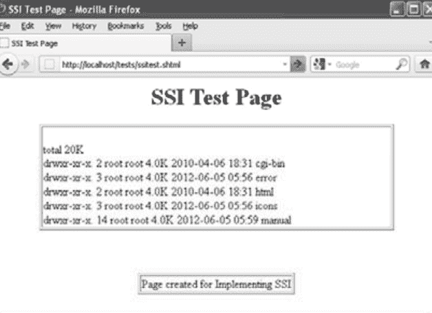

让我们学习启用 CGI。

### 启用 CGI

通用网关接口（CGI）是一种提供标准方法的协议，允许 Web 服务器与外部程序进行通信。这些通常被称为 CGIs、CGI 脚本或 CGI 程序。有许多编程和脚本语言可以提供 CGI 实现。在 Linux 中，使用 Perl、Python、Ruby 和 Bash 来创建 CGIs。CGI 脚本用于动态创建或更新 页面。CGI 比 SSI 灵活得多，因为它提供了额外的功能。

在学习 Apache 配置和启用 CGI 的步骤之前，请执行以下任务以确保 Apache 的配置允许 CGI 脚本执行。在 `httpd.conf` 中找到 `ScriptAlias` 指令。该指令将目录名称与文件系统路径相关联，意味着 Apache 会将该目录中的每个文件都视为脚本。如果没有，请添加以下指令：

```apache
ScriptAlias /cgi-bin/ /var/www/cgi-bin/
```

此指令告诉 Apache 任何调用 `/cgi-bin/` 的 URL 都应该从 `/var/www/cgi-bin` 提供。例如，在 `/var/www/cgi-bin` 目录下创建一个 CGI 测试脚本 `cgiscript.pl`。你可以使用以下内容来测试 CGI 的配置。

```perl
#!/usr/bin/perl
print 'Content-type: text/html\n\n';
print '<<html>';
print '<head>';
print '<title>CGI Test Page</title>';
print '</head>';
print '<body>';
print '<h1>CGI Test Page</h1>';
print '<div id="div1">';
print `ls -lh /var/www`;
print '</div>><!--content-->';
print '<div id="footer">';
print `cat /var/www`;
print '</div>';
print '</body>';
print '</html>';
```

## 第 5 章

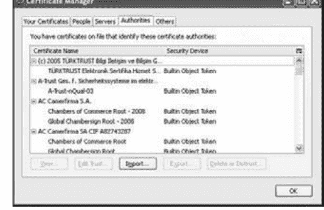

**图 4：** 显示证书列表的证书管理器

数字证书有两种类型：一种由 CA 签名，另一种是自签名的。现在，你已经在上一节内容中学习了由 CA 签名的证书。现在，让我们来学习自签名证书。

自签名证书是使用证书本身进行签名。它用于创建不信任正式 CA 提供的大型根树的安全服务器。按照规定，你不要在公共访问的网站上使用自签名证书，因为 Web 浏览器不会自动接受它们，而且它们没有提供足够的信任级别。

让我们学习如何在 Fedora Core 上创建自签名数字证书。

使用以下命令创建自签名证书（使用 root 用户的登录据）：

- 通过以下命令切换目录到 `/etc/pki/tls/certs`：

```bash
# cd /etc/pki/tls/certs
```

- 创建密钥对：

```bash
# makekeypair
umask 077 ;
usr/bin/openssl req -new -des3 1024 > /etc/pki/tls/private/localhost.key
Generating RSA private key, 1024 bit long modulus
+++++
+++++
e is 65537 (0x100001)
Enter pass phrase:
Verifying: Enter pass phrase:
```

此步骤用于创建用于加密和解密数据的公钥和私钥。请使用容易记忆但他人难以猜到的短语。生成的密钥文件为 `/etc/pki/tls/private/localhost.key`。

- 如果你想从 CA 获取数字证书，则你需要创建一个证书签名请求（在自签名证书中不需要此步）：

### Apache Web 服务器 133

```bash
# makecertreq
umask 077 :
/usr/bin/openssl -utf8 -new -key /etc/pki/tls/private/localhost.key -out
/etc/pki/tls/certs/localhost.csr
Enter pass phrase for /etc/pki/tls/private/localhost.key:
You are to be asked to enter information that will be incorporated
into your certificate request.
What you are about to enter what is called a Distinguished Name or a DN.
There are quite a few fields but you can leave some blank
For some fields there will be a default value.
If you enter '.', the field will be left blank.
----
```


Country Name (2 letter code) [GB]:`us`
State or Province (full name) [Berkshire]:`Pennsylvania`
Location Name (eg, city) [Newbury]:`Pittsburgh`
Organization Name (eg, [My Company Ltd]):`Possum Holler Entrps`
Organizational Unit Name (eg, section) [:`Coding`
Common Name (eg, your name or your server's hostname)
[]`mailmessage@example.com`
Email Address [:`webmaster@example.com`

Please enter the following 'extra' attributes
to be sent with your certificate request
A challenge password []`bob`
string is too short, it needs to be at least 4 bytes long
A challenge password []`vadmin`
An optional name []:`vadad`

请提供上述加粗文本所示输入。生成的文件为
`/etc/pki/tls/certs/localhost.csr`。证书签名请求 (CSR) 用于向 CA 发送请求，以生成由 CA 签名的证书供安装在你的 Web 服务器上。其内容包括你输入的域名信息、管理员的电子邮件地址以及你上面创建的公钥。

### 创建自签名

```bash
# makecertreq
umask 077 :
/usr/bin/openssl -utf8 -new -key /etc/pki/tls/private/localhost.key -x509 -out /etc/pki/tls/certs/localhost.crt -days 365
Enter pass phrase for /etc/pki/tls/private/localhost.key:
You are to be asked to enter information that will be incorporated
into your certificate request.
What you are about to enter what is called a Distinguished Name or a DN.
There are quite a few fields but you can leave some blank
For some fields there will be a default value.
If you enter '.', the field will be left blank.
```

Country Name (2 letter code) [GB]:`us`
State or Province (full name) [Berkshire]:`Pennsylvania`
Location Name (eg, city) [Newbury]:`Pittsburgh`
Organization Name (eg, [My Company Ltd]):`Possum Holler Entrps`
Organizational Unit Name (eg, section) [:`Coding`
Common Name (eg, your name or your server's hostname)
[]`mailmessage@example.com`
Email Address [:`webmaster@example.com`

提供上述加粗文本所示输入。生成的文件为
`/etc/pki/tls/certs/localhost.csr`。证书签名请求 (CSR) 用于向 CA 发送请求，以生成由 CA 签名的证书供安装在你的 Web 服务器上。其内容包括你输入的域名信息、管理员的电子邮件地址以及你上面创建的公钥。

Enter pass phrase for `/etc/pki/tls/private/localhost.key`:
You are to be asked to enter information that will be incorporated
into your certificate request.
What you are about to enter what is called a Distinguished Name or a DN.
There are quite a few fields but you can leave some blank
For some fields there will be a default value.
If you enter '.', the field will be left blank.

# 通过 Mailman 创建邮件列表

邮件列表是让具有共同兴趣或目标的人进行通信的一种简便方式。有许多邮件列表管理器可用，其中 Mailman 是最受欢迎的之一。Mailman 是 GNU 邮件列表管理器。使用 Mailman 最关键的特性是它提供了一个基于浏览器的管理界面。它可以被那些成员或参与者地理位置分散的小组使用。Mailman 的一些功能包括：

- 支持消息存档和垃圾邮件过滤
- 为每个邮件列表提供个人可定制的主页
- 自动自动处理退信邮件（bounce processing）
- 多个列表所有者和版主
- 列表级隐私功能，例如封闭订阅、私有存档、私有成员列表和基于发送者的发布规则
- 支持虚拟域名
- Web 订阅与取消订阅
- 摘要（Digest）的创建、维护和投递
- 集成 Usenet 网关
- 基于密码的身份验证
- 订阅黑名单

在配置 Mailman 之前，运行以下命令以确保系统是否已安装 Mailman：

```bash
# rpmquery mailman
mailman-2.12-4.fc11.i586
```

如果尚未安装 Mailman，请进行安装。如果你得到上述输出，说明你的系统中已经安装了 Mailman，可以继续进行配置。请使用以下步骤完成你的 Mailman 配置：

- 编辑 `/etc/httpd/conf.d/mailman.conf`，以为 Web 服务器设置设置域名。找到以下行：

```apache
RedirectMatch ^/mailman[/]* http://www.example.com/mailman/listinfo
```

取消上述该行的注释，并将 `www.example.com` 更改为你的 Web 服务器的域名。例如：

```apache
RedirectMatch ^/mailman[/]* http://localhost/mailman/listinfo
```

- 重启 Apache：

```bash
# service httpd restart
```

- 创建站点密码：

```bash
/usr/lib/mailman/bin/mmsitepass sekritword
Password changed.
```

- 为站点版主创建一个密码：

```bash
/usr/lib/mailman/bin/mmsitepass -c sekritword
Password changed.
```

站点版主是有权创建、管理和删除邮件列表的人。

- 创建一个名为 `mailman` 的邮件列表。此列表将发送密码提醒和其他列表管理器消息，并按照提示完成列表创建过程：

```bash
# /usr/mailman/bin/newlist mailman
Enter the email of the person running the list: ank@exp.com
Initial mailman password:
Create a new, unpopulated mailing list.
```

编辑 `/aliases` 并添加别名。你还需要注释掉已经存在的两个 Mailman 别名。注释掉以下行：

```text
mailman: postmaster
mailman-owner: mailman
```

- 然后，使用 `newialases` 工具更新二进制别名数据库：

```bash
# newialases
```

- 重启你的 MTA：

```bash
# service sendmail restart      ---如果使用 Sendmail
# service postfix restart        ---如果使用 Postfix
```

- 启动 mailman 服务：

```bash
# service mailman start
```


- 如果你想让 Mailman 在启动时启动，请相应地使用以下命令：

```bash
# chkconfig --levels 012345 mailman off
# chkconfig --levels 345 mailman on
```

当初始 Mailman 配置完成后，现在你已经准备好创建一个邮件列表并测试安装情况。

要使用基于浏览器的界面创建邮件列表，请打开浏览器并输入 `url://localhost/mailman/create/`。将本地主机名替换为运行 Mailman 的服务器名称。你应该看到一个屏幕，如图 5 所示：

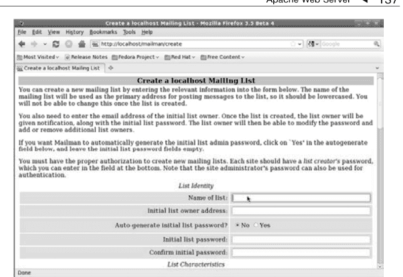

创建一个 localhost 邮件列表

你可以向下方表单输入相关信息来创建邮件列表。邮件列表的名称将用作发送到列表的消息的显示名称，因此应该是小写的。列表创建后，你将无法更改它。

你还需要...

| 标识 |
| :--- |
| 列表名称 |
| 初始列表密码 |
| 描述 |
| 所有者邮箱地址 |
| 自动生成列表？ | 是 |
| 确认列表： |

# Apache Server 139

许多人使用 RSS 聚合器来跟踪自己的 RSS 馈。聚合器是一种应用程序或浏览器扩展程序，它可以从你指定的站点列表中收集 RSS 馈，并将它们全部呈现在同一个界面中。其中一种 RSS 馈 聚合器是 Firefox 扩展程序 Sage，如图 6 所示：


> 图 6：在 Mozilla Firefox 中使用 Sage 聚合器

如图 6 所示，浏览器屏幕右侧显示了从屏幕左侧面板（包含 Sage 侧边栏）选择的新闻文章摘要。侧边栏始终存在，这使得你更容易跳转到感兴趣的新闻或 RSS 馈。

以下是一个 RSS 馈文件示例：

```xml
<?xml version="1.0" encoding="ISO-8859-1" ?>
<rss version="2.0">
<channel>
<title>Example of RSS feed file</title>
<link>http://localhost/</link>
<description>Example-en-us</description>
<language>en-us</language>
<image>
<title>rss_1</title>
<url>http://localhost/rss_1.jpg</url>
<link>http://localhost/rss_1</link>
</image>
<item>
<title>RSS Feed</title>
<link>http://localhost/rss_1/xml</link>
<description>RSS feeds example is complete!</description>
<item>
</channel>
</rss>
```

该文件包含了创建 RSS 馈所需的关键标签。表 3 显示了 RSS 馈中各种所需的元素：

| 标签 | 描述 |
|---|---|
| channel | 界定单个通道的内容 |
| description | 为分发项目描述通道或其头条 |
| image | 描述代表通道的图标或图像 |
| item | 界定单个分发项目 |
| language | 告知读者馈流编写的语言 |
| link | 包含指向主页或单个分发项目的链接 |
| rss | 将内容定义为 RSS 数据并指定版本 |
| title | 标识通道或分发项目 |

让我们学习一下 htDig 搜索功能。

# 添加搜索功能

Fedora core 提供了 htDig 搜索引擎。它是一个为单网域或内网设计的完整文档搜索和索引系统。它能够搜索包含多个服务器和数千文档的站点或域名。htDig 能够处理数千份文档，因为它使用了快速静态搜索索引。htDig 的一些主要功能包括：

- **内网搜索：** 它能够通过充当 WWW 浏览器来搜索网络上的许多服务器。
- **免费可用：** 整个系统根据 GNU 通用公共许可证作为免费软件发布。
- **布尔表达式搜索：** 它可以使用布尔表达式搜索复杂数据。
- **可配置的搜索结果：** 可以通过 HTML 模板根据你的需求轻松配置搜索输出。
- **模糊搜索：** 可以使用可配置的算法进行搜索。目前支持以下算法（可任意组合）：精确、发音（soundex）、隐喻、常用词结尾（词干提取）、同义词、去除重音符号、子串和前缀。
- **HTML 和文本文件搜索：** HTML 文档和纯文本文件均可搜索。
- **可以向 HTML 文档添加关键词：** 可以向 HTML 文档添加任意数量的关键词，这些关键词在查看文档时不会显示。
- **过期文档邮件通知：** 可以 HTML 文档中添加特殊的元数据，用于在特定时间通知文档的维护者。
- **可以索引受保护服务器：** htDig 可用于索引受用户名和密码保护的服务器或服务器部分。
- **数据库子集的搜索：** 可以轻松设置仅返回 URL 匹配模式的文档的搜索。
- **源码索引：** 该搜索引擎根据 GNU 公共许可证 2.0 的条款发布。

要开始使用，你需要创建初始搜索数据库，然后创建自定义索引以促进快速搜索。你不需要手动执行，因为 htDig 使用名为 `rundig` 的脚本自动创建数据库并进行索引维护。执行以下命令：

```bash
/usr/bin/rundig
```

此命令读取 htDig 配置文件 `/etc/htdig/htdig.conf` 并爬取由搜索 URL 指定的站点。该变量查找并遵循 HTML 文件中指向所索引域内文档的每个超链接。要搜索所需内容，请在浏览器中打开 `http://localhost/htdig/`，如图 7 所示：

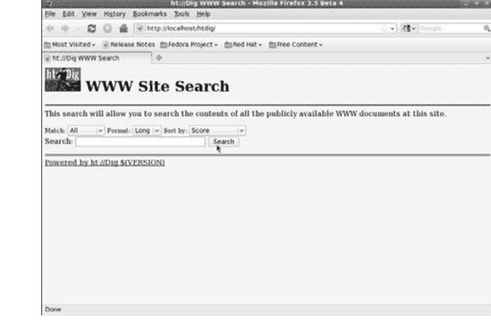

▲ 图 7：查看 htDig 搜索页面。

在搜索框中输入并按下搜索按钮即可定位所需内容。这就是 htDig 搜索引擎的工作方式。

请参考书末的实验——使用 Apache Web 服务器。

在结束章节之前，让我们总结一下本章讨论的关键点。

## 总结

本章介绍了 Apache Web 服务器配置。你还学习了如何启用和测试 Apache 的 SSI、CGI 和 PHP。此外，你探索了使用 SSI 创建安全服务器。你学习了 Mailman，它涵盖了邮件列表服务。你还熟悉了 SquirrelMail，这是一个流行的电子邮件解决方案。在章节最后，你发现了 RSS 馈。

## 练习

- Q1. Apache 支持什么代码？
  a. XML
  b. HTML
  c. DHTML
  d. Javascript
  Ans: b

- Q2. 负责监听和响应的默认端口是？
  a. 20
  b. 60
  c. 80
  d. 40
  Ans: c

- Q3. 下列哪项用于加密服务器与 Web 客户端之间的通信？
  a. SSL
  b. HTTP
  c. SSP
  d. FTP
  Ans: a

- Q4. 发行证书的第三方被称为
  a. Certified Authority
  b. Issue Certification
  c. Certification Issue
  d. Certification Authority
  Ans: d

- Q5. 运行 SquirrelMail 浏览器端电子邮件包需要以下哪项？
  a. IMAP
  b. 以上所有
  c. PHP
  d. Apache
  Ans: b

# 第 6 章

- 文件系统调优：在支持的文件系统上，禁用文件访问和修改时间戳的更新。这可以将需要执行的文件操作减少三分之二。
- 索引：在限制范围内，索引可以提高性能，但也会带来额外的内存、磁盘和 CPU 使用成本。建议对不经常搜索的数据不建立索引。
- 日志：如果大量的消息日志影响了您的 LDAP 服务器的性能，请在 `slapdd.conf` 中添加以下条目。

```
loglevel 0
```


- 该条目禁用通过系统日志进行记录。
- 系统内存：增加物理内存，可以增加 OpenLDAP 缓存的大小以使用更多的内存。
- 接下来让我们学习 DNS 服务的优化。

# 优化 DNS 服务

优化 DNS 服务是为了减少进行 DNS 查询时涉及的延迟。通过减少发送到远程服务器（即使该服务器是您所连接的子网的服务）的 DNS 查询次数，你可以获得极佳的性能。通过维护 DNS 信息的本地缓存，你可以增强请求 DNS 服务的客户端程序的性能。

在客户端，运行纯缓存服务器（caching-only server）是增强性能的唯一选择。在服务器端，你有更广泛的选项来提高性能。让我们讨论一下。

让我们从优化 DNS 客户端开始。

## 提高 DNS 客户端的性能

在 DNS 客户端，可以在 `/etc/named.conf` 中修改服务器选项以运行纯缓存服务器。该文件在安装 BIND 时创建。默认情况下，BIND 允许所有主机进行区域传输（zone transfers）。区域传输仅对于主备服务器是必要的，对于 DNS 客户端则。你可以通过向 `/etc/named.conf` 中添加以下行来禁用它们：

```
allow-transfer {

   ;

};
```

你可以配置纯缓存服务器，使其仅响应来自特定主机的持续查询。在 `/etc/named.conf` 的 `options` 部分添加以下行，将 `www.xxx.yyy.zzz` 替换为您的网络 IP 地址：

```
allow-query {

   www.xxx.yyy.zzz;

   localhost;

};
```

你可以配置纯缓存服务器使其仅响应来自特定主机的递归查询。在 `/etc/named.conf` 的 `options` 部分添加以下行，将 `www.xxx.yyy.zzz` 替换为您的网络 IP 地址：

```
allow-recursion {

www.xxx.yyy.zzz;

localhost;

}
```

通常，纯缓存服务器无法直接访问互联网，因此它会创建一个缓存文件来存储 DNS 信息。你可以指定你想要转发请求的服务器 IP 地址。在 `/etc/named.conf` 的 `options` 部分添加以下行，将 `www.xxx.yyy.zzz` 替换为您的网络 IP 地址：

```
forwarders-transfer {

www.xxx.yyy.zzz;

}
```

接下来，提高 DNS 服务器的性能。

## 提高 DNS 服务器的性能

BIND 允许所有主机进行区域传输，这对于主备服务器是必要的。你可以通过向 `/etc/named.conf` 添加以下行来指定备服务器的 IP 地址，将 `www.xxx.yyy.zzz` 替换为备服务器的 IP 地址：

```
allow-transfer {

none;

}
```

你可以配置主服务器使其仅响应来自特定主机的持续查询。在 `/etc/named.conf` 的 `options` 部分添加以下行，将 `www.xxx.yyy.zzz` 替换为您的内部 IP 地址：

```
allow-query {

www.xxx.yyy.zzz;

localhost;

}
```

你可以配置备服务器使其仅响应来自特定主机的递归查询。在 `/etc/named.conf` 的 `options` 部分添加以下行，将 `www.xxx.yyy.zzz` 替换为您的内部 IP 地址：

```
allow-recursion {

www.xxx.yyy.zzz;

localhost;

}
```

让我们讨论一下日志。

## 使用日志

你可以配置纯缓存备服务器和主服务器自动轮转 `/var/log/named.log` 文件，以防止文件系统被旧信息填满。在 `/etc/logrotate.d` 文件（在 BIND 安装期间创建）中进行以下更改：

- 删除显示内容的行：

```
create 0644 named named
```

- 将行：

```
/bin/service named reload 2> /dev/null || true
```

改为：

```
/bin/kill -HUP 'cat /var/run/named.pid 2> /dev/null 2>' /dev/null || true
```

- 禁用 LAME 服务器的日志，因为这些服务器似乎是某个域名的名称服务器但实际上不是。使用以下行：

```
logging(

category lame-servers { null; };

);
```

让我们学习邮件服务的优化。

# 优化邮件服务

为了提高您的邮件服务的速度，你可以采取以下方法之一：使用多个邮件服务器将邮件处理负载分散到多个系统上，你还可以将 Sendmail 替换为另一个邮件服务器，以从 Sendmail 获取速度，并尝试多种方法来从 Postfix 获得更好的性能。

让我们学习帮助你从 Sendmail 获取速度的技巧以及可以从 Postfix 获得更好性能的方法。

首先关于提高 Sendmail 的性能

## 提高 Sendmail 的性能

你可以在 `/etc/sendmail.cf` 文件中配置许多选项来运行纯缓存服务器。[等待，检查上下文：……从 Sendmail 获取速度以及可以从 Postfix 获得更好性能的方法。

## 提高 Postfix 的性能

如果你有大量邮件停留在 Postfix 的输出队列中，你可能正在向繁忙的站点发送邮件。你可以通过为该站点创建传输（transport）项来解决此问题，并为每个连接设置更短的超时时间。

# 优化 Internet 服务

例如，假设有两个繁忙站点 `slow.com` 和 `reallysite.net` 你难以及时获取邮件。在 `/etc/postfix/transport` 中创建以下项：

| slow.com | deadbeasts: |
| reallysite.net | deadbeasts: |

接下来在 `/etc/postfix/main.cf` 中创建相应的项，将并发连接数增加到 50，允许更多邮件传输到 `slow.com` 和 `reallysite.net`：

| deadbeasts | unix - n | smtp |
| -0 | smtp_timeout=-5 | smtp_helo_timeout=5 |

上述 `/etc/postfix/master.cf` 中的项告诉 postfix，deadbeasts 的 SMTP 连接将在 5 秒后超时，且必须在 HELO 命令后 5 秒内开始 SMTP 事务，否则关闭连接。
为了减少传入邮件的超时时间，如下修改 `/etc/postfix/master.cf`：

| relay | unix - n | smtp |
| -0 | smtp_timeout=2 -o smtp_helo_timeout=2 |

如果 postfix 响应传入 SMTP 连接的速度慢，但 POP 或 IMAP 连接响应速度很快，那么你需要运行更多的 SMTP 服务进程。编辑 `main.cf` 中的 `smtpd` 项并增加进程限制。同时增加 `main.cf` 中的 `default_process_limit` 项以允许 FTP 服务。
让我们讨论如何优化 FTP 服务

# 优化 FTP 服务

众所周知，`vsftpd` 是一个安全且极快速的 FTP 守护进程。可以通过以下步骤获得更高的性能：

- 如果可能，禁用 `/etc/n.conf` 中用于 passwd、shadow 和 group 查询的 NIS 和 NISplus。这可以避免将必要的库加载到 vsftpd 内存空间，并避免使用 NIS 查询可以通过文件查找更快解决的问题。
- 将大目录拆分为较小目录以提高 CPU 性能。
- 限制并发连接数。
- 利用 vsftpd 的带宽限流功能，限制单个连接或连接类消耗的网络带宽。

## 第 6 章

### 优化 Web 服务

可以通过以下设置对 Apache 进行微调，以获得高效性能：

- 增加 `MaxClients` 设置会增加 httpd 服务器开始拒绝额外连接之前的最大并发连接数。你可以将其设置为 256。计算 `MaxClients` 的规则如下：

```
MaxClients = (Physical RAM - shared Memory for httpd Process) / Size
```


### Apache 性能优化指令

- `Timeout` 指令控制服务器等待直到关闭连接的时间。
- `RequestsPerChild` 指令控制 httpd 进程在启动新的子进程之前可以提供的 HTTP 请求数。
- `MaxKeepAlive` 用于设置来自同一条连接的请求总数的上限。

明智地设置上述指令的值可以提供高效的性能。如果你的服务器运行大量的 CGI 脚本或使用 PHP，你应该遵循以下提示对其进行优化：

- 将 `Lookups` 设置为 `Off`。如果你需要将 IP 地址解析为主机名，可以使用 Apache 的日志解析程序。
- 使用 IP 地址代替主机名以避免进行反向和正向查询。
- 建议对所有目录设置 `FollowLinks`，永远不要设置 `SymLinksMatch`。
- 在 Web 服务空间内处处使用 `AllowOverride`。
- 关闭 `MultiViews` 选项以增强性能。
- 避免使用 NFS 挂载的文件系统存储文件，直到确实必要。
- 使用 NFS 挂载文件系统，因为它比读写更快。这不仅提高了性能还提高了安全性。
- Apache 依赖于系统资源，因此使用更多内存更好。它可以提高 Apache 在缓存中存储请求页面的能力。

在学习了优化互联网服务的步骤后，让我们来看看系统管理涉及的一些任务。可以使用不同的工具和命令管理系统。这包括维护系统以保持更新、安装定期更新、使用可用版本升级系统，以及维护系统中的账户。在下一节中，你将发现管理系统所需的步骤。

# 系统管理

## 更新系统

要一次性更新整个 Fedora 系统的软件，请在终端中运行以下语句（使用 root 登录）：

```
# yum update
```

数据文件将从 `yum` 配置的每个存储库中下载。这些索引和头文件将搜索有关较新版本软件包的信息。在连接缓慢的情况下，下载过程可能需要几秒钟。

系统将显示所有可用更新的列表。按 `y` 接受更新。然后将下载并安装相关软件包。此外，当有系统更新时，你的系统会显示通知图标，如图 1 所示：


图 1：显示系统更新通知图标。

此图标提供了“显示更新”和“更新系统”选项。当你点击图 2 中的“软件更新”时，会打开“软件更新”窗口：


图 2：显示可用更新列表

点击“安装更新”按钮安装软件更新。你可以通过点击通知图标菜单中的“立即更新”选项来开始自动更新系统。

你还可以配置设置来检查系统的更新。选择“系统（System）-> 软件更新（Software Updates）”，会出现“软件更新偏好（Software Update Preferences）”窗口。此窗口允许你进行更新设置，如图 3 所示：


图 3：软件更新偏好窗口

你可以设置系统检查更新，并按时间间隔（每小时/每周/每天）自动安装所有主要升级。它还提供了在使用移动宽带时检查更新的选项。它还设置了关于通知的配置。你还可以检查与系统更新相关的日志。Fedora 提供了一个日志查看器，可以查查下载并安装了哪些更新。它还提供了匹配包名、版本或架构的过滤选项。通过“应用程序（Applications）-> 系统（System）-> 软件日志查看器（Software Log Viewer）”，会弹出一个窗口显示软件更新详情，如图 4 所示：


图 4：系统更新日志

接下来，让我们讨论内核的升级和自定义。

## 升级和自定义内核

自定义内核和升级内核是两个不同的过程，但它们产生相同的输出。自定义意味着重新配置现有的内核源码树、重新编译它、安装新内核并启动它。升级内核是指拥有一个新的内核镜像。无论你是自定义还是升级，结果都是一样的，即在你的系统中配置了一个新内核。你可以使用 `yum` 命令来升级内核。这可能需要几分钟完成。使用以下命令升级内核：

```
# yum update kernel
```

现在学习管理用户和组账户。

## 管理用户和组

管理用户和组账户是一项基本的系统活动。你有两种方法：通过命令行工具或界面。

表 1：管理基本命令
| 命令 | 描述 |
|---|---|
| useradd/groupadd | 创建用户/组 |
| userdel/group | 删除用户/组 |
| usermod/groupmod | 修改用户/组 |
| passwd/gpasswd | 设置用户/组密码 |
| chsh | 设置用户默认 shell |
| chage | 修改密码信息 |

### 添加新用户或组

要向系统添加新用户，请输入以下命令：

```
# useradd [options] username
```

其中，`options` 是表 2 所示的命令行选项。运行以下命令来分配密码：

```
# passwd username
```

表 2：`useradd` 命令选项
| 选项 | 描述 |
|---|---|
| -c 'comment' | 注释可以替换为任何字符串 |
| d home_directory | 使用替代 /home/username 的主目录 |
| -e date | 禁用账户日期，格式为 YYYY-MM-DD |
| -f days | 密码过期到账户禁用之间的天数 |
| g group_name | 用户默认组的组名或组 ID。该组在指定之前必须存在 |
| g group_list | 用户所属的所有（其他）组名或组 ID 列表，用逗号分隔。这些组在指定之前必须存在 |
| -m | 如果主目录不存在则创建它 |
| -M | 不创建主目录 |
| -N | 不为用户创建私有组 |
| - password | 使用 crypt 加密后的密码 |
| -r | 创建一个 UID 小于 1000 且没有主目录的系统账户 |
| -s | 用户的登录 shell，默认为 /bin/bash |
| -u uid | 用户的 ID，必须是唯一的且大于 999 |

表 3：`groupadd` 命令选项
| 选项 | 描述 |
|---|---|
| -f, --force | 当与 -g gid 使用且 gid 已经存在时，groupadd 将为组选择另一个唯一的 gid |
| -g gid | 组的组 ID，必须是唯一的且大于 999 |
| -K, --key=value | 覆盖 /etc/login.defs 的默认值 |
| -o, --non-unique | 允许创建重复的组 |
| -p, --password password | 为新组使用此加密密码 |
| -r | 创建一个 GID 小于 1000 的系统组 |

### 删除用户账户或组账户

使用以下命令删除用户/组账户：

```
userdel/groupdel [-r] username/groupname
```

选项 `-r` 会删除该账户的所有相关文件。

## 启用密码过期策略

建议要求用户定期更改密码。要为用户配置密码有效期，请运行以下命令：

```bash
# chage [options] username
```


其中，`options` 是表 4 所示的命令行选项。

| 表 4：`chage` 命令行选项 |
| 选项 | 说明 |
| :--- | :--- |
| `-d days` | 指定自 1970 年 1 月 1 日以来更改密码的天数 YYYY-MM-DD。 |
| `-E date` | 指定账户锁定的日期，格式为 YYYY-MM-DD。除了日期外，也可以使用自 1970 年 1 月 1 日起的天数。 |
| `-l days` | 指定密码过期后账户锁定前的未活动天数。如果值为 0，则密码过期后账户不会锁定。列出当前账户设置 |
| `-m days` | 指定用户必须更改密码的最少天数。如果值为 0，则密码不过期 |
| `-M days` | 指定密码有效的最大天数。当此选项指定的天数加上 `-d` 选项指定的天数小于当前日期时，用户必须在使用账户前更改密码 |
| `-W days` | 指定在密码过期前警告用户的天数 |

# 现在学习使用用户管理器界面管理用户和组

## 使用用户管理器界面管理用户和组

用户管理器应用程序允许您在图形化用户界面中查看、修改、添加和删除用户及组。要启动应用程序，选择 系统（System）-> 管理（Administration）-> 用户和组（Users and Groups）。会出现一个窗口，带有用户（Users）和组（Groups）两个标签，显示用户组账户列表及其信息，如图 5 所示：

# 第 6 章

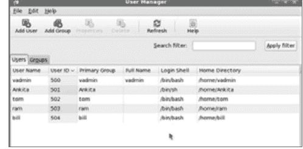

### 图 5：用户组账户列表

## 添加新用户或组账户

您可以点击用户管理器窗口菜单上的“添加用户”（Add User）和“添加组”（Add Group）选项。点击“添加用户”选项后，会出现创建新用户的窗口，如图 6 所示：


### 图 6：创建新用户

填写相应信息以添加新用户账户。您需要提供用户名、全名、密码、默认登录 shell，并还可以指定其主目录。点击 OK 按钮保存用户账户。

要创建新组，点击“添加组”选项，打开创建新组窗口，如图 7 所示：


### 图 7：创建新组

添加组名，同时您也可以为新组手动指定组 ID（GID）。点击 OK 按钮保存组账户。

## 删除用户或组账户

要删除特定的用户或组账户，请从列表中选择账户名称并点击菜单中的“删除”（Delete）选项。将收到确认提示。点击“是”（Yes）按钮继续删除账户，如图 8 所示：

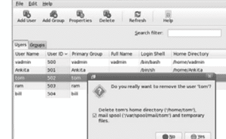

图 8：删除用户账户

## 修改用户或组账户

您可以对已创建的用户账户进行更改。选择您想要修改的账户。点击菜单中的“属性”（Properties）选项。出现用户属性窗口，显示不同的标签：

- 用户数据（User Data）：包含用户的个人信息。您可以修改用户的用户名、密码、主目录和登录 shell（图 9）。

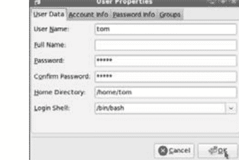

图 9：用户数据信息

- 账户信息（Account Info）：包含账户信息。您可以设置用户账户的过期日期（图 10）。

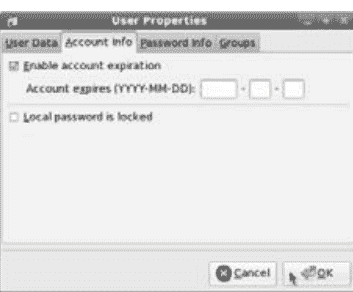

图 10：账户信息

- 密码信息（Password Info）：包含密码信息。您可以设置用户账户的过期日期（图 11）。

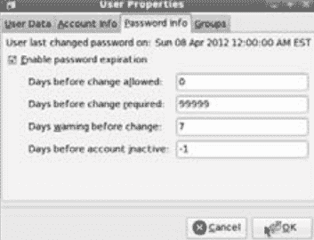

图 11：密码信息

- 组（Groups）：您可以将用户添加到列表中显示的任何组（图 12）。

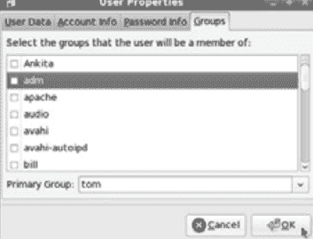

图 12：组信息

您可以对已创建的组账户进行更改。选择您想要修改的组账户。点击菜单中的“属性”（Properties）选项。出现属性窗口，显示不同的标签：

- 组数据（Group Data）：您可以更改组名（图 13）。

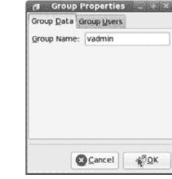

图 13：组数据信息

- 组数据：您可以更改组名（图 14）。


图 14：组数据

## 总结

在结束本之前，我们学习了如何通过命令行和用户管理器界面管理用户和组。我们学习了密码过期策略。我们学习了如何添加、删除和修改用户及组。

## 练习

1. 哪个选项可以用于设置密码有效期？
a. `-d`
b. `-E`
c. `-l`
d. `-m`

2. 哪个选项可以用于列出当前账户设置？
a. `-d`
b. `-E`
c. `-l`
d. `-M`

3. 哪个命令可以用于更新系统？
a. `yum`
b. `install`
c. `deltas`
d. `useradd`

4. 哪个命令用于创建用户？
a. `createuser`
b. `adduser`
c. `newuser`
d. `useradd`

5. 哪个命令用于设置密码过期日期？
a. `passwd`
b. `chage`
c. `deltas`
d. `expire`

## 实验 1：安装 Fedora Linux 并配置 GRUB 启动器

目标：

- 安装 Fedora 并配置 GRUB 启动器。
- 要求：
- 速度为 200 MHz 的处理器（用于文本模式）或 400 MHz（用于图形模式）
- 内存 64 MB（用于文本模式）或 192 MB（用于图形模式）
- 用于安装 Fedora 的 CD 或 DVD
- 3 GB 磁盘空间

按照以下步骤安装 Linux：

1. 插入 CD/DVD 并重启电脑。出现欢迎界面（图 1）。
2. 从列表中选择安装选项。在这种情况下，我们选择了“安装或升级现有系统”选项（图 1）。出现“发现磁盘”（Disc Found）对话框（图 2）。
3. 选择“跳过”（Skip）选项（图 2）。

图 1：欢迎界面

图 2：发现磁盘对话框

# fedora

实验室 161


▲ 图 7：计算机名称

▲ 图 8：选择城市

- 13. 选定的城市出现在下拉列表框中（图 9）。
- 14. 点击“下一步”按钮（图 9）。
- 15. 一个屏幕（图 10），你可以在其中输入根密码。
- 16. 在“根密码”和“确认密码”文本框中输入系统管理员（root）的密码（图 10）。
- 17. 点击“下一步”按钮（图 10）。


▲ 图 9：点击“下一步”按钮

▲ 图 10：输入密码

显示分区部分的屏幕出现（图 11）。在我们的情况下，由于我们正在进行全新安装，因此我们使用整个驱动器。

- 18. 点击“下一步”按钮（图 11）。

出现将存储配置写入磁盘的对话框（图 12）。

- 19. 点击“将更改写入磁盘”按钮（图 12）。

## 162 ► 实验室


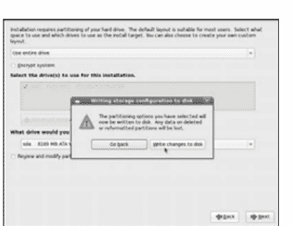

▲ 图 11：分区的驱动器

▲ 图 12：将存储配置写入磁盘的对话框

显示写入更改写入磁盘过程进度的屏幕如图 13 所示：


▲ 图 13：磁盘进程进度

出现引导加载配置屏幕。在我们的情况下，我们使用默认设置（图 14）。

- 18. 点击**下一步**按钮

出现自定义设置屏幕（图 15）。

- 19. 勾选**软件开发**复选框（图 15）。
- 20. 勾选**Web 服务器**复选框（图 15）。
- 21. 选中**立即自定义**单选按钮（图 15）。
- 22. 点击**下一步**按钮（图 15）。

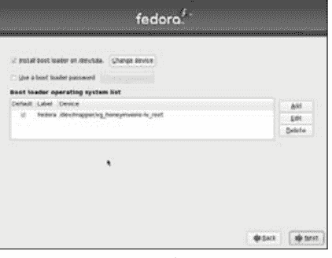

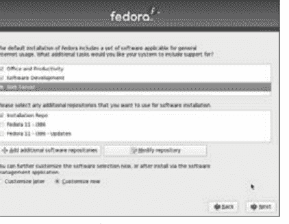

▲ 图 14：引导加载配置屏幕

▲ 图 15：自定义偏好

出现自定义需求屏幕（图 16）。

- 23. 点击“下一步”按钮（图 16）。

出现显示 Fedora Linux 安装开始进度的屏幕（图 17）。

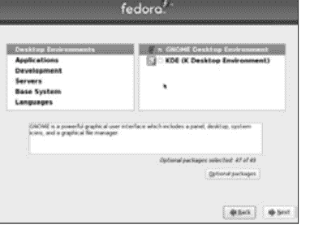

图 16：自定义需求屏幕


图 17：Fedora Linux 安装进度

- 你可以通过点击“可选软件包”来根据要安装的包选择可选软件包。

出现一个显示 Fedora Linux 安装情况的屏幕（图 18）。

当 Fedora Linux 安装完成后，会出现一个显示恭喜消息的屏幕（图 19）。

- 24. 点击“重启”按钮（图 19）。


图 18：正在安装 Fedora Linux


图 19：恭喜屏幕

Fedora 11 操作系统首次启动（图 20）。

出现引导配置向导。出现欢迎屏幕（图 21）。

- 25. 点击“前进”按钮（图 21）。

## 164 实验室


▲ 图 20：欢迎屏幕

▲ 图 21：引导配置向导

- 出现许可证信息屏幕（图 22）。
- 26. 点击“前进”按钮（图 22）。
- 27. 出现创建用户屏幕（图 23）。
- 28. 在“用户名”文本框中输入用户名（图 23）。
- 29. 在“全名”文本框中输入用户全名（图 23）。
- 30. 在“密码”文本框中输入密码（图 23）。
- 31. 在“确认”按钮处重新输入密码（图 23）。
- 32. 点击“前进”按钮（图 23）。


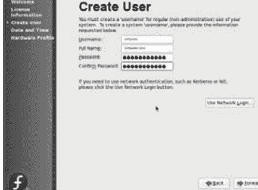

▲ 图 22：许可证信息页

▲ 图 23：创建用户页

- 出现日期和时间屏幕（图 24）。
- 32. 设置你的日期和时间（图 24）。
- 33. 点击“前进”按钮（图 24）。

出现硬件配置屏幕（图 25）。

- 34. 点击“完成”按钮（图 25）。

## 日期和时间


### 硬件配置

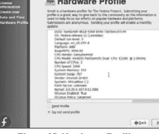

▲ 图 24：日期和时间

出现登录屏幕（图 26）。

- 35. 点击用户名。
- 36. 在文本框中输入密码（图 27）。
- 37. 点击“登录”按钮（图 27）。


▲ 图 26：登录

▲ 图 27：Fedora 桌面

出现 Fedora 桌面如图 28。


▲ 图 28：Fedora 桌面

## 配置 GRUB

安装 Fedora 后，让我们学习 GRUB。

GRUB 是一个引导加载器，它可以让你启动多个操作系统。

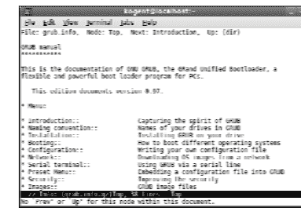

▲ 图 29：终端窗口

## 安装软件

目标：
- 安装软件

需求：
- 添加/删除软件开始获取软件包信息、解决软件包关系并下载和安装软件包。

- 1. 从菜单选择“系统”（图 1）。

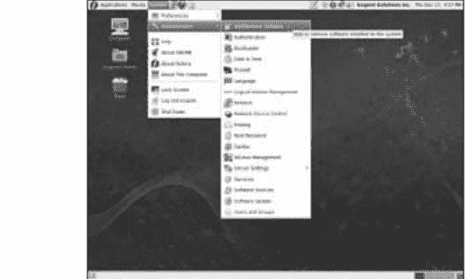

▲ 图 1：系统

窗口左侧显示各种类别，如多媒体、教育和游戏。

- 输入与要安装的包相关的词或短语（图 3）。

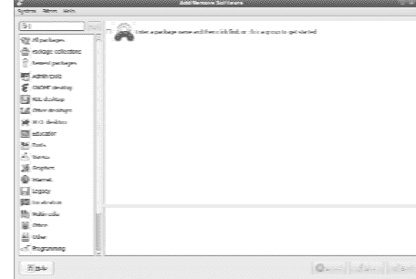

▲ 图 3：搜索

你可以通过勾选窗口中的复选框来选择所需的包（图 5）。在我们的情况下，我们勾选了音频读取器复选框（图 5）。一旦你选择了一个包，“应用”按钮就会启用。

- 点击“应用”框（图 5）。

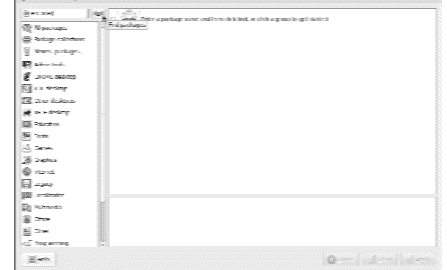

▲ 图 4：搜索结果

出现一个对话框，要求下载安装所选包所需的额外包（图 6）。

- 点击“安装”按钮（图 6）。

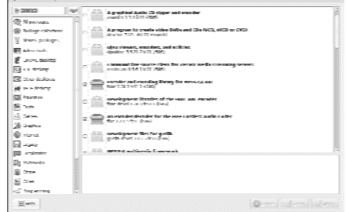

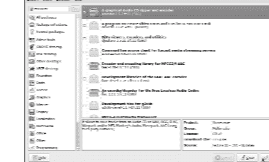

▲ 图 5：选择软件包

▲ 图 6：安装软件包

出现验证对话框，要求你输入根密码。一旦你输入根密码，添加/删除软件应用程序开始获取软件包信息、解决软件包关系并下载和安装软件包（图 7）。整个过程需要几分钟。

添加/删除窗口现在清理了软件包（图 7）。当软件包安装完成后，会出现一个对话框允许你直接运行该软件。然而，你可以关闭它并在需要时随时启动。对话框提供了启动软件包的完整路径。例如，打开 CD 刻录应用程序的路径是应用程序->声音和视频->Asunder CD 刻器。

- 点击“关闭”按钮关闭对话框（图 8）。

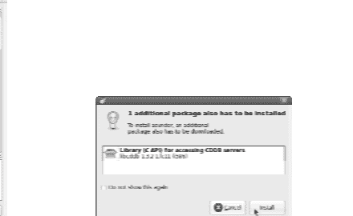

▲ 图 7：下载软件包

▲ 图 8：点击“关闭”

# 实验-3：使用 Shell 脚本

目标：

- 使用 Linux Shell 脚本编写。

要求：

- 安装了 LINUX 操作系统的系统
- 一个 Vim 文本编辑器

让我们执行以下步骤通过 Vim 编辑器在文件中插入文本：

1. 点击应用程序（Applications）菜单。出现一个下拉菜单（图 1）。
2. 将鼠标指针悬停在系统工具（System Tools）选项上。出现一个子菜单（图 1）。
3. 选择终端（Terminal）选项，如图 1 所示：


出现一个终端窗口，如图 2 所示：

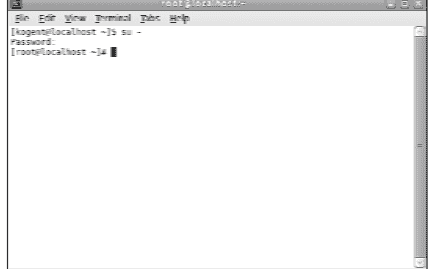

你可以通过 `su -` 命令从本地用户 `$`切换到 root 用户 `#`。在我们的案例中，已经以 root 用户身份登录，如图 LP-2.4 所示。

4. 在命令提示符处输入文件名。在我们的案例中，我们输入 `first` 作为文件名（图 3）。

5. 按回车键。文件在 Vim 编辑器中打开（图 4）。

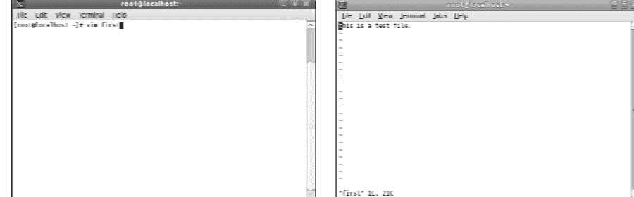

图 3：运行 vim 命令

图 4：Vim 文本编辑器

如果文件存在，将显示文件的第一页；否则将创建一个空文件和屏幕，你可以在其中输入文本。

6. 按 INSERT 键输入文本。在我们的案例中，我们输入了 `hello world`，如图 5 所示：


图 5：输入文本

你也可以通过按下键盘上的 i 键切换到插入模式（Insert mode），在文件中插入文本。

插入新文本后，让我们学习如何从 Vim 编辑器中保存并退出。

执行以下步骤保存文件并退出 Vim 编辑器：

1. 按 ESC 键切换到命令模式以保存文件。你可以看到插入模式消失了（图 6）。

2. 输入 `w` 保存当前文件（图 7）。


图 6：切换到命令模式


图 7：保存文件

3. 按回车键。文件中的更改已保存（图 8）。
4. 输入 `q` 退出 Vim 编辑器（图 8）。


图 8：显示已保存的更改


图 9：退出编辑器

5. 按回车键。终端窗口再次出现，如图 10 所示：


图 10：再次出现的终端窗口

# 实验-4：设置拨号 PPP

目标：

- 使用拨号 PPP 连接到互联网。

要求：

- Fedora Linux 操作系统
- 拨号连接

接入互联网

你有多种方法连接互联网。接入互联网最常用的方法之一是设置拨号连接。设置拨号连接需要普通的电话线。拨号连接支持在特定时间进行数据传输或语音通话。

设置拨号 PPP

让我们学习创建互联网连接。执行以下步骤设置拨号 PPP。

1. 点击桌面顶部的系统（System）菜单。出现一个下拉菜单（图 1）。
2. 从下拉菜单中选择管理（Administration）选项。出现子菜单（图 1）。
3. 从子菜单中选择网络（Network）选项（图 1）。出现对话框（图 2）。
4. 在密码框中输入 root 用户的密码（图 2）。
5. 点击 OK 按钮（图 2）。

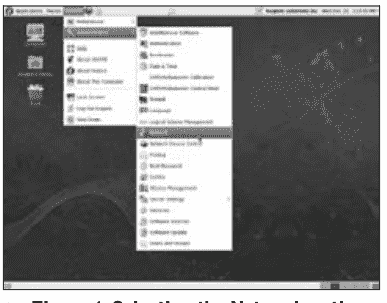

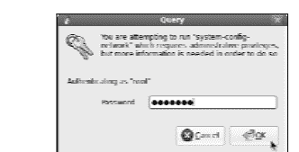

出现网络配置窗口（图 3）。

6. 点击新建（New）按钮（图 3）。
7. 出现新建设备（Add new Device）向导（图 4）。
8. 从设备面板中选择调制解调器连接（图 4）。
9. 点击前进（Forward）按钮（图 4）。

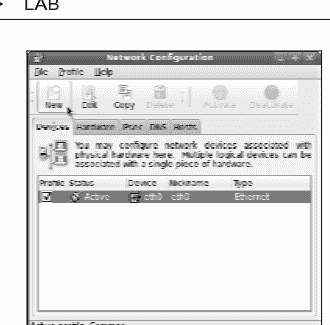

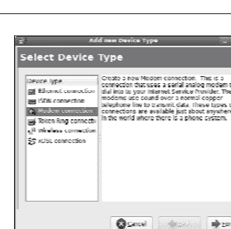

图 3：网络配置窗口

图 4：新建设备类型

搜索调制解调器属性的向导屏幕出现。

1. **调制解调器设备（Modem Device）：** 让你选择 `/dev/ttyS0` 作为第一个串口 (COM1)，选择 `/dev/ttyS1` 作为第二个串口 (COM2)。这与 `dev/modem` 选项关联。
   - **波特率（Baud Rate）：** 计算机与调制器通信的速率。默认波特率为每秒 11520 位。
   - **流控（Flow Control）：** 防止数据发送到调制解调器。如果调制器器不支持硬件流控（CTS），你可以选择软件流控（XON/XOFF）。
   - **调制解调器音量（Modem Volume）：** 调制器的声音。该属性默认关闭。
   - **使用拨号（Use Tone Dialing）：** 允许你在电话上设置拨号的选项。如果电话不支持拨号，你可以将其关闭；大多数情况下它是开启的。

2. 点击前进按钮。出现提供者向导。在其中指定以下 ISP 信息：
   - **互联网提供商（Internet Provider）：** ISP 的名称。
   - **电话号码（Phone Number）：** 用于连接 ISP 的电话号码。
   - **提供者名称（Provider Name）：** ISP 的名称。
   - **登录名称（Login Name）：** ISP 提供的连接名称。
   - **密码（Password）：** 登录密码。

3. 点击前进按钮。出现 IP 设置向导。如果已存在拨号连接，选择自动获取 IP 设置（Automatically Obtain IP Settings）；如果 ISP 有静态 IP 地址，则选择静态 IP 地址（Statistically Set IP Addresses），并在 IP 设置向导中输入你的 IP 地址、子网掩码和网关地址。点击前进按钮。

出现拨号连接窗口。此窗口显示了你在前面的步骤中输入的信息。

4. 点击应用（Apply）按钮，然后点击前进按钮。
出现网络配置窗口，显示新连接。

5. 从菜单栏选择文件（File）菜单。出现下拉菜单。
6. 从下拉菜单中选择保存（Save）选项。保存新配置。
7. 从网络配置窗口选择 PPP 设备名称。
8. 点击激活（Activate）按钮启动拨号连接到 ISP。
在 ISP 验证你的登录 ID 和密码后，建立 PPP 连接。

# 启动拨号 PPP 连接

设置拨号连接后，你已成功配置了它，但它没有设置为自动连接。执行以下步骤手动启动连接。

1. 右键点击面板，选择添加到面板（Add to Panel）→ 调制解调器灯（Modem Lights），然后选择添加（Add）。面板上会出现一个调制解调器灯图标。
2. 点击面板上的新图标。提示确认消息以验证是否要与调制器建立连接。
3. 点击连接（Connect）启动连接。

桌面上会出现一个图标，你可以选择它立即通过拨号连接到互联网。

# 实验-5：配置 TCP/IP

目标：

- 在客户端机器上分配代理。

要求：

- 网卡
- 网络计算机

执行以下步骤在 Linux 中配置网卡或以太网卡：

1. 在终端窗口输入 `system-config-network` 命令，如图 1 所示：

```


root@localhost:~ 
likogentlocalhost -ls - 
root@localhost:~ -system-config-network-


# LAB 177


图 4：点击编辑按钮

出现网络适配器配置对话框（图 5）。

如果您的系统中安装了两个以上的以太网卡，您可以为您的以太网卡分配不同的设备名称。

- 6. 点击设备（Device）选项旁边的箭头按钮。会出现一个下拉列表（图 5）。
- 7. 为您的以太网卡选择设备名称。在我们的案例中，我们选择了 `eth1` 作为所选以太网卡的设备名称（图 6）。
- 8. 点击确定（OK）按钮，关闭网络适配器配置对话框（图 6）。

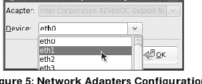

图 5：网络适配器配置对话框


图 6：输入设备名称

网络配置窗口再次出现（图 8）。出现一个下拉菜单。

- 9. 从菜单中选择文件（File）菜单。
- 10. 从文件菜单中选择保存（Save）按钮以保存网络配置窗口中的更改，如图 8 所示：


图 7：打开文件菜单

图 8：选择保存选项

当您从文件菜单选择保存选项时，会出现一个对话框，通知您您的更改已保存，并建议您重启电脑（图 9）。

- 11. 点击确定（OK）按钮（图 9）。
- 12. 网络配置窗口再次出现（图 10）。
- 13. 从网络配置窗口菜单栏中选择文件（File）菜单。出现一个下拉列表（图 10）。
- 14. 点击下拉列表中的退出（Quit）选项以退出网络配置窗口（图 10）。


**图 9：** 显示消息的对话框，网络配置窗口随之关闭。

**图 10：** 选择退出（Quit）选项

# LAB-6：使用 FTP 服务器

目标：

- 安装、配置并访问 FTP 服务器。

要求：

- 一台网络计算机
- Linux 操作系统
- FTP 服务器配置文件
- 一台客户端计算机

## 安装 FTP 服务器

执行以下步骤安装 FTP 服务器：

- 1. 打开终端（Terminal）窗口并进入 root 模式。
- 2. 在终端窗口中输入 `yum install vsftpd` 命令（图 1）。
- 3. 按 `ENTER` 键设置 FTP 服务器安装过程（图 1）。
- 4. 按 `y` 键确认下载 FTP 软件包。


▲ 图 1：yum 命令

▲ 图 2：下载 FTP 软件包

FTP 服务器只需几分钟即可安装完成，如图 3 所示：


▲ 图 3：已安装的 FTP 服务器

安装 FTP 服务器后，让我们学习如何配置 FTP 服务器。

## 配置 FTP 服务器

配置 FTP 服务器时，会使用 `vsftpd` 配置文件。FTP 服务器配置文件存储在 `/etc` 目录下。您需要使用文本编辑器（如 `vi`）编辑此 `/etc` 文件来配置服务器。

执行以下步骤配置 FTP 服务器：

- 1. 在终端窗口中输入 `/etc/vsftpd.conf` 命令（图 4）。
- 2. 按 `ENTER` 键（图 5）。

`vsftpd` 配置文件包含：


> 图 4：配置 FTP 服务器


> 图 5：vsftpd 配置文件

- 3. 按键盘上的 Insert（插入）键进入插入模式（图 AT-2.46）。
- 4. 在 `allow_wrappers=Yes` 文本后输入 `pasv_max_port=1024`（图 6）。
- 5. 在 `pasv_max_port=1024` 语法后输入 `local_root=/home/kgoment/download`（图 6）。


> 图 6：插入模式

- 6. 按 `ESC` 键。
- 7. 按冒号（:`）组合键并输入 `wq` 保存（图 7）。

一旦您在编辑器中输入 `wq`，配置文件就会被保存。
- 8. 在终端中输入 `/etc/init.d/vsftpd restart`（图 8）。
- 9. 按 `ENTER` 键（图 8）。

FTP 服务器已重启。


图 2：Samba 服务器配置窗口


图 3：创建 Samba 共享窗口

+ 出现“选择目录”对话框（图 4）。
选择您想要共享的目录。在我们的示例中，我们选择了 `/tmp` 目录（图 4）。
点击 `OK` 按钮，如图 4 所示：


图 4：选择目录对话框

+ 重新出现“创建 Samba 共享”窗口（图 5）。
勾选可写（Writable）和可见（Visible）复选框（图 5）。
在“创建 Samba 共享”窗口中选择访问（Access）选项卡，如图 5 所示：


图 5：基本选项卡

打开访问选项卡（图 6）。

10. 选择“允许所有人访问”（Allow access to everyone）单选框（图 7）。
11. 点击 `OK` 按钮（图 7）。


▲ 图 6：访问选项卡

重新出现 Samba 服务器配置窗口，显示已目录现在已共享（图 8）。

12. 点击 Samba 服务器配置窗口标题栏上的“关闭窗口”按钮，现在窗口如图 8 所示：


▲ 图 7：OK 按钮


图 8：关闭窗口

与 Samba 服务器共享文件后，现在让我们学习如何从 Windows 访问 Samba。

## 从 Windows 访问 Samba 共享

在 Samba 服务器中，您可以访问 Microsoft Windows（如 Windows Vista/XP）上的共享文件夹或目录。您还可以访问您已共享的文件或文件夹的内容。

执行以下步骤从 Windows Vista 访问 Samba 共享：

+ 1. 点击按钮。出现开始菜单（图 9）。
2. 从开始菜单中选择“网络”（Network）选项。
出现网络窗口（图 10）。
3. 在网络窗口的地址栏中输入 `192.168.1.36`（图 10）。
4. 按下回 键。


▲ 图 9：开始菜单


▲ 图 10：访问网络

出现“连接到 192.168.1.36”对话框（图 11）。

+ 5. 在“用户名”（User name）框中输入用户名。在我们的示例中，我们已经输入了（图 12）。
+ 6. 在“密码”（Password）文本框中输入密码。
+ 7. 点击 `OK` 按钮（图 12）。


▲ 图 11：连接到 192.168.1.36 对话框

▲ 图 12：输入凭据

打开 `192.168.1.36` 电脑的共享目录，如图 13 所示：


▲ 图 13：共享目录

你可以看到 `192.168.1.36` 电脑的 `tmp` 目录，你可以从 Windows Vista 访问。

### 实验 8：使用 Apache Web 服务器

目标：
安装 Apache Web 服务器并使用它托管网页。

要求：

- Fedora 11 操作系统
- 一台联网计算机

### 安装 Apache Web 服务器

您需要安装 Apache Web 服务器以便在 Linux 中创建自己的网页。让我们执行以下步骤安装 Apache Web 服务器：

+ 1. 在终端中输入 `sudo yum install httpd` 以在 Linux 中安装 Web 服务器（图 1）。
2. 按下回 键。包管理器检查软件包依赖项并升级软件包（图 2）。


▲ 图 1：sudo 命令

▲ 图 2：已升级的软件包

+ 3. 在询问确认安装 Web 服务器时，按下键盘上的 `y` 键（图 3）。
4. 按下回 键。
Web 服务器的安装继续，剩余的软件包和更新正在下载中：


▲ 图 3：Web 服务器安装

几分钟后，安装完成。
安装 Apache 服务器后，让我们学习如何使用 Apache 服务器托管网页。

### 通过 Apache 服务器托管网页

您不需要在 Web 浏览器的地址栏再次输入网页地址。Apache 服务器的默认位置为 `/var/www/html`。

执行以下步骤使用 Apache 服务器托管网页：

+ 1. 点击 GNOME 桌面上的“应用程序”（Applications）菜单。出现下拉列表（图 4）。
2. 从下拉菜单中选择“附件”（Accessories）选项。出现子菜单（图 4）。
3. 从子菜单中选择“文本编辑器”（Text Editor）选项，如图 4 所示：


图 4：启动 gedit 文本编辑器

+ 4. 在文本编辑器窗口中输入你想显示在网页上的文本。在我们的示例中，我们输入了 Welcome to the world。
5. 点击“保存”（Save）按钮，所示：

+ 7. 从“位置”（Places）侧边栏中选择位置。在我们的示例中，我们选择了（图 6）。
出现“另存为”（Save as）对话框（图 6）。


▲ 图 5：另存为

+ 8. 从“文件系统”（File System）中选择位置（图 7）。


▲ 图 6：另存为框

+ 8. 从“文件系统”（File System）中选择位置（图 7）。


▲ 图 7：文件系统

+ 9. 从“文件系统”（File System）中选择位置（图 8）。

▲ 图 8：文件系统

+ 10. 从“文件系统”（File System）中选择位置（图 9）。

▲ 图 9：文件系统

+ 11. 点击 `OK` 按钮（图 11）。
12. 点击 `OK` 按钮（图 12）。
13. 点击 `OK` 按钮（图 13）。


▲ 图 10：OK 按钮


▲ 图 11：OK 按钮

3. 启动你的 NFS 服务器：
```


`service nfs start`

4. 运行以下命令检查所有服务是否运行正常：

```
rpcinfo -p
```

5. 现在连接到 `192.168.0.101` 并挂载 `/home` 目录，请使用以下命令：

```bash
# mount 192.168.0.100/home /mnt/home
```

将 `/mnt/home` 挂载点替换为适合你的路径。

6. 在服务器上使用以下命令来列出所有当前导出的目录。

```bash
# showmount -a
```

至此，你已成功设置了 NFS。

# 实验-10：分配代理

## 目标

- 在客户端机器上分配代理。

## 要求

- 一台连接互联网的计算机
- Mozilla Firefox 浏览器

代理服务器调解两台或多台计算机之间的连接，以增加网络的安全性和隐私。你可以通过 Squid 代理服务器在客户端上分配代理。
让我们执行以下步骤，使用 Squid 代理服务器在客户端上分配代理：

1. 从 GNOME 桌面的顶部面板点击 Mozilla Firefox 图标，如图 1 所示：


▲ 图 1：GNOME 桌面

出现 Firefox 窗口（图 2）。出现下拉列表（图 2）。

2. 从菜单栏选择“编辑（Edit）”。
3. 从下拉列表中选择“首选项（Preferences）”，如图 2 所示：


▲ 图 2：编辑菜单

出现 Firefox 首选项窗口（图 3）。

4. 从 Firefox 窗口选择“高级（Advanced）”选项卡（图 3）。
出现高级选项卡（图 4）。

5. 点击连接（Connection）选项下方的“设置（Settings）”按钮，如图 4 所示：


▲ 图 3：Firefox 首选项对话框

出现连接设置对话框（图 5）。

6. 选择“手动代理配置（Manual proxy configuration）”单选按钮（图 5）。

7. 在 HTTP 代理文本框内输入 IP 地址。在本例中，我们输入了 `192.168.1.36`（图 5）。

8. 在端口框内输入端口号。在本例中，我们输入了 `3128`（图 5）。

9. 勾选 HTTP 代理部分下的“所有协议使用此服务器（Use this server for all protocols）”（图 5）。

10. 点击“确定（OK）”按钮（图 5）。

再次出现 Firefox 首选项窗口（图 6）。

11. 点击“关闭（Close）”按钮关闭 Firefox 首选项，如图 6 所示：


▲ 图 5：连接设置对话框

▲ 图 6：选择高级选项卡

12. 点击 Linux 桌面顶部的 Mozilla Firefox 图标，如图 7 所示：


▲ 图 7：点击 Mozilla Firefox 图标

13. 在 Mozilla Firefox 窗口的地址栏中输入 `google.com` 地址（图 8）。
14. 按下回车（ENTER）键。出现 Google 首页，如图 9 所示：


▲ 图 8：输入 google URL

▲ 图 9：Google 首页

代理设置已应用到客户端机器 `192.168.1.36` 上。
你需要确保防火墙设置配置恰当。如果某些网站被列在限制网站列表中，你将打开该网站。例如，如果 Gmail 网站地址（`http://www.gmail.com`）在防火墙设置中被列为限制网站，你将在 浏览器中看到错误信息，如图 10 所示：


▲ 图 10：显示错误页面

# 实验-11：使用 C 语言编程

## 目标

- 使用 C 语言编写并运行程序。

## 要求

- 安装了 LINUX 操作系统的系统
- `gedit` 文本编辑器

### 列表 1：显示简单的 C 程序

```c
#include <stdio.h>

/* 在标准输出打印 welcome to ABC world */

int main() {
    printf("welcome to ABC world\n");
    return 0;
}
```

列表-1 包含以下代码语句：

- `include <stdio.h>`: 指代使用哈希 (`#`) 符号的预处理器语句，用于输入/输出函数。
- `/* ... */`: 代表注释，提供额外信息。
- `int main()`: 程序执行开始的地方的主函数。
- `printf()`: 用于打印欢迎消息的函数。
- `return 0;`: 终止函数的语句。
- `{}`: 用于封装函数体的大括号。

执行以下步骤编写程序：

1. 打开 `gedit` 文本编辑器（图 1）。


▲ 图 1：gedit 编辑

2. 选择“文件（File）”菜单（图 2）。
3. 选择“另存为（Save As）”选项（图 3）。
4. 出现另存为对话框（图 4）。


▲ 图 3：另存为对话框

5. 在名称（Name）框输入文件名（图 5）。
6. 选择你想保存的位置（图 5）。
7. 点击“保存（Save）”按钮（图 5）。

文件已保存在 `gedit` 窗口中（图 6）。


▲ 图 5：选择位置

`gedit` 窗口显示代码（图 6）。


▲ 图 6：gedit 窗口

保存程序后，让我们编译并执行它。在编译程序期间，编译器将源代码翻译成机器码。在编译和执行程序之前，你必须已编写并保存为 `.c` 扩展名。在 Linux 中，可以使用 GNU C (`gcc`)。

```bash
gcc Hello.c -o Hello
```


其中，`Hello` 是文件名。

使用以下步骤编译 C 程序：

1. 打开终端（图 7）。


▲ 图 7：打开终端

2. 输入 `gcc Hello.c -o Hello` 来编译程序（图 8）。
3. 按回车键。光标移动到下一行（图 8）。
4. 输入 `./Hello` 命令运行程序（图 8）。
5. 按回车键。程序的输出显示在终端窗口（图 9）：


▲ 图 8：编译程序


▲ 图 9：程序输出

# 实验-12：配置 IP Table 防火墙

**目标：**

- 配置 Linux 防火墙。
- 配置 IP Table 防火墙。

**要求：**

- Fedora Linux 操作系统

防火墙在 Fedora Linux 中默认安装。执行以下步骤配置防火墙：

1. 选择“系统（System） -> 管理员工具（Administration） -> 防火墙（Firewall）”（图 1），打开防火墙配置窗口。


▲ 图 1：打开防火墙

2. 打开防火墙配置窗口，显示防火墙配置向导的基本信息。点击“下一步（Forward）”继续，如图 2 所示：


▲ 图 2：防火墙配置向导的基本信息

3. 弹出下一个窗口，询问基本防火墙设置。点击下拉列表进行选择：

- 具有网络访问的系统
- 无网络访问的系统

4. 选择适当的选项并点击“前进”（Forward）（图 3）。在新窗口中选择用户技能水平（初学者或专家）。然后点击“前进”按钮，如图 4 所示：


图 3：选择系统类型

5. 弹出配置窗口。选择您希望保存配置的路径或选择加载默认配置。点击“确定”按钮，如图 5 所示：

6. 防火墙窗口显示了所有主机和网络允许的服务列表。勾选可用服务的复选框，并取消勾选想要限制的服务。然后点击“应用”（Apply），如图 6 所示：


图 5：配置路径设置


图 6：服务列表

7. 弹出配置窗口以验证现有的防火墙配置。点击“是”（Yes）保存您的更改。


图 7：确认保存更改

8. 要添加信任服务（Trusted Service）未提供的其他端口，点击左侧面板中的“其他端口”（Other Ports）（图 8）。然后点击“添加”（Add）按钮（图 8）。

端口和协议窗口。选择您想要添加的端口并点击“添加”按钮，如图 8 所示：


图 8：添加其他端口

9. 左侧面板中的其他选项有：

- 受信接口（Trusted Interface）是一个网络适配器（物理或软件类型），已知流量来自安全网络环境。
- 伪装（Masquerading）允许所有内部系统在通过互联网通信时使用 Fedora 系统的 IP 地址。它将任何内部 IP 地址免受恶意外部实体的影响，并避免为网络上的每台计算机分配公网 IP 地址。
- ICMP（网络控制协议）用于网络上的客户端系统相互发送错误消息。ICMP 过滤类别允许阻止特定的 ICMP 消息类型。
- 自定义规则（Custom Rules）类别允许指定并将 `iptables` 规则加载到防火墙。这提供了高度的灵活性，可以执行如阻止来自特定 IP 地址或地址范围的消息等任务。

10. 点击配置窗口左侧面板中的“端口转发”（Port Forwarding）选项。此选项用于配置将流量转发到防火墙所在系统上的不同端口。点击“添加”按钮：

弹出端口转发窗口，如图 9 所示：


图 9：端口转发窗口

选择用于转发流量的网络设备、使转发生效的协议和端口，以及流量重定向到的内部网络系统 IP 地址。如果需要，也可以在目标系统上提供备用端口号。要将流量转发到本地系统的不同端口，请选择“端口转发”选项并指定目标端口。

点击“确定”完成配置。

11. 点击菜单上的“启用”（Enable）或“禁用”（Disable）选项来启用或禁用系统上的防火墙，如图 10 所示：


图 10：启用或禁用防火墙

## 配置 Linux iptables 防火墙

Linux 上最流行的防火墙包是 `iptables`。它默认安装在 Fedora Linux 中。按照以下步骤配置 IP Table 防火墙：

### 启动 iptables

可以使用命令在启动后启动、停止和重启 `iptables`：

```
service iptables start
service iptables stop
service iptables restart
```

要配置 `iptables` 在开机时启动，请使用 `chkconfig` 命令：

```
chkconfig iptables on
```

检查 `iptables` 是否正在运行。使用以下命令进行检查：

```
service iptables status
```

### iptables 中的数据包处理

所有由 `iptables` 检查的数据包都会通过一系列内置表进行处理。总共有三张表。

第一个是 `mangle` 表，负责修改 IP 头中的服务质量（QoS）位。这在家庭或小型办公环境中很少使用。

第二个是 `filter` 队列，负责数据包过滤。它有三个内置链，您可以在其中放置防火墙规则。这些是：

- `Forward chain`（转发链）：过滤发往防火墙保护服务器的数据包。
- `Input chain`（输入链）：过滤指向防火墙的数据包。
- `Output chain`（输出链）：过滤源自防火墙的数据包。

第三个表是 `nat` 表，负责网络地址转换。它有三个内置链：

- `PREROUTING`：用于路由决策之前的 NAT。
- `FORWARD`：用于路由决策后的 NAT。
- `POSTROUTING`：用于数据包路由后的 NAT。

206 实验

| 表-3 显示常用的 ICMP (Ping) 匹配标准 |
| 匹配 | 描述 |
| :--- | :--- |
| `--icmp-type <type>` | 最常用的类型是 echo-reply（回显响应）和 echo-request（请求） |

示例：

```
iptables -A OUTPUT -p icmp --icmp-type echo-request -j ACCEPT
iptables -A INPUT -p icmp --icmp-type echo-reply -j ACCEPT
```

正在配置 `iptables` 以允许防火墙发送 ICMP Echo 请求（ping），并接受预期的 ICMP 回显响应。

示例：

```
iptables -A INPUT -p icmp --icmp-type echo-request \
-m limit --limit 1/s -i eth0 -j ACCEPT
```


`iptables` 中的 `limit` 功能指定了每秒允许的最大匹配数。你可以以 `/second,/minute /hour /day` 的格式格式指定时间间隔，也可以使用缩写，例如 `3/second` 等于 `3/s`。

在这种情况下，ICMP Echo 请求被限制为每秒不超过一个。当调优时，此功能允许你过滤掉具有拒绝服务（DOS）攻击和网络风暴特征的异常大量流量。

一些常用的扩展匹配标准见表-4：

| 表-4：显示常用的扩展匹配标准 |
| 切换器 | 描述 |
| :--- | :--- |
| `-m multiport -sports <port,port>` | 由逗号分隔的多种 TCP/UDP 源端口。与不使用 `-m` 时不同，它们不需要在一个范围之内。 |
| `-m multiport -dports <port,port>` | 由逗号分隔的多种 TCP/UDP 目的端口，与不使用 `-m` 时不同，它们不需要在一个范围之内。 |
| `-m multiport -ports <port,port>` | 由逗号分隔的多种 TCP/UDP 端口。假设源端口和目的端口相同且不需要在一个范围之内。 |
| `-m -state <state>` | 最频繁测试的状态是：ESTABLISHED、NEW、RELATED 和 INVALID |

基于上一个示例的示例：

```
iptables -A FORWARD -s 0/0 -i eth0 -d 192.168.1.58 -p TCP \
--port 1024:65535 -m multiport --dports 80,443 -j ACCEPT
```

```
iptables -A FORWARD -d 0/0 -i eth0 -s 192.168.1.58 -i eth1 -p TCP \
-m state --state ESTABLISHED -j ACCEPT
```

配置 `iptables` 允许防火墙当 TCP 数据包从任何 IP 地址通过 `eth0` 接口进入且目标为 `eth1` 接口可达的 `192.168.1.58` 时进行路由。源端口在 1024 到 65535 之间，目的端口为 80 (www/http) 和 443 (https)。允许接受来自 192.168.1.58 的返回数据包。你不需要指定源端口和目的端口，只需使用 `-m state` 和 `-state ESTABLISHED` 选项允许已连接的数据包通过。

## 使用自定义链

你可以配置 `iptables` 使用用户定义的链。此功能经常用于帮助 `iptables` 的处理。例如：

```
iptables -A input-queue -i eth0 -d 206.229.110.2 -j fast-input-queue
iptables -A output-queue -o eth0 -s 206.229.110.2 -j fast-output-queue
iptables -A fast-input-queue -p icmp -j icmp-queue-in
iptables -A output-queue -p icmp -j icmp-queue-out
iptables -A icmp-queue-out -p icmp --icmp-type echo-request \
  -m state NEW -j ACCEPT
iptables -A icmp-queue-in -p icmp --icmp-type echo-reply -j ACCEPT
```

五个链有助于提高速度。表-5 总结了每个链的功能：

| 表-5：显示自定义链 |
| 链 (Chain) | 描述 |
| :--- | :--- |
| INPUT | iptables 内置的 INPUT 链 |
| OUTPUT | iptables 内置的 OUTPUT 链 |
| fast-input-queue | 用于识别特定协议并将数据包转发到特定链的输入链 |
| fast-output-queue | 用于识别特定协议并将数据包转发到特定链的输出链 |
| icmp-queue-out | 用于 ICMP 的输出队列 |
| icmp-queue-in | 用于 ICMP 的输入队列 |

### 保存你的 iptables

`service` 命令将 `iptables` 配置永久保存到 `/etc/sysconfig/iptables` 文件。这是一个示例的 `/etc/sysconfig/iptables` 配置，允许 ICMP、IPSec (ESP 和 AH 数据包)、已建立的以及 SSH。

```bash
# /etc/sysconfig/iptables

# Generated by iptables-save v1.2 on Nov 8 11:00

INPUT ACCEPT [0:0]

FORWARD ACCEPT [0:0]

OUTPUT ACCEPT [0:0]
```

### 208 实验

Fedora 带有一个名为 `tshirt` 的程序，你可以用它生成防火墙规则。它提供了安全级别的提示，并给你简单的自定义选项。`tshirt` 将你的链保存到新的 `/etc/sysconfig/iptables` 文件中。这也有助于让 `iptables` 正常工作。基础初始化应该包含在所有脚本中以确保。

### 允许 DNS 访问防火墙

以下语句适用于作为 DNS 客户端的防火墙：

```bash
iptables -A OUTPUT -p udp -o eth0 --dport 53 --sport 1024:65535 -j ACCEPT
iptables -A INPUT -p udp -i eth0 --sport 53 --dport 1024:65535 -j ACCEPT
```

### 允许 WWW 和 SSH 访问防火墙

以下语句适用于通过管理员远程管理的作为 Web 服务器的防火墙。允许端口 80 和 22 的入站数据包，从而建立连接的第一步。登录 Web 服务器的用户连接作为出站连接被拒绝。

```bash
# 允许已建立的连接
iptables -A OUTPUT -o eth0 -m state ESTABLISHED,RELATED -j ACCEPT
iptables -A INPUT -p tcp -i eth0 --dport 22 --sport 1024:65535 \
-m state NEW -j ACCEPT
```

### 允许防火墙访问互联网

此 `iptables` 脚本允许防火墙上的用户使用 浏览器上网。HTTP 流量使用 TCP 端口 80，HTTPS 使用端口 443。

```bash
# 来自防火墙的端口 80 (www) 和 443 (https) 连接
iptables -A OUTPUT -o eth0 -p tcp \
  -state NEW,ESTABLISHED,RELATED -o eth0 \
  -m multiport --dport 80,443 --sport 1024:65535
# 允许已建立的连接
iptables -A INPUT -j ACCEPT -m state ESTABLISHED,RELATED \
  -i eth0 -p tcp
```

如果你想接受所有来自防火墙的 TCP 流量，删除该行：

```bash
-m multiport --dport 80,443 --sport 1024:65535
```

### 允许家庭网络访问防火墙

在示例中，`eth1` 直接使用 `192.168.1.0` 网络的 IP 地址连接到家庭网络。

```bash
# 允许从防火墙到受保护网络的双向流量
iptables -A INPUT -j ACCEPT -p all -s 192.168.1.0/24 -i eth1
iptables -A OUTPUT -j ACCEPT -p all -d 192.168.1.0/24 -o eth1
```

### 伪装 (Masquerading)

伪装意味着来自一个或多个受保护网络上的所有设备的流量看起来像是来自防火墙互联网侧的单个 IP 地址。示例：

```bash
# 加载 NAT 模块
modprobe iptables_nat
```

```bash
# 通过修改 ip_forward /proc sysctl 文件启用路由
echo 1 > /proc/sys/net/ipv4/ip_forward
```

```bash
# 允许伪装
iptables -A POSTROUTING -t nat -o eth0 -s 192.168.1.0/24 -d 0/0 \
  -j MASQUERADE
```

```bash
# 在伪装之前，数据包通过 filter 表的 FORWARD 链路由。
iptables -A FORWARD -t filter -o eth0 -m state \
```


206 实验

| 表-3 显示常用的 ICMP (Ping) 匹配标准 |
| 匹配 | 描述 |
| :--- | :--- |
| `--icmp-type <type>` | 最常用的类型是 echo-reply 和 echo-request |

示例：

```bash
iptables -A OUTPUT -p icmp --icmp-type echo-request -j ACCEPT
iptables -A INPUT -p icmp --icmp-type echo-reply -j ACCEPT
```

正在配置 `iptables` 以允许防火墙发送 ICMP Echo 请求（ping），并接受预期的 ICMP 回显响应。

示例：

```bash
iptables -A INPUT -p icmp --icmp-type echo-request \
-m limit --limit 1/s -i eth0 -j ACCEPT
```

`iptables` 中的 `limit` 功能指定了每秒允许的最大匹配数。你可以以 `/second,/minute /hour /day` 的格式指定时间间隔，也可以使用缩写，例如 `3/second` 等于 `3/s`。

在这种情况下，ICMP Echo 请求被限制为每秒不超过一个。当调优时，此功能允许你过滤掉具有拒绝服务（DOS）攻击和网络风暴特征的异常大量流量。

一些常用的扩展匹配标准见表-4：

| 表-4：显示常用的扩展匹配标准 |
| 切换 | 描述 |
| :--- | :--- |
| `-m multiport -sports <port,port>` | 由逗号分隔的多种 TCP/UDP 源端口。与不使用 `-m` 时不同，它们不需要在一个范围之内。 |
| `-m multiport -dports <port,port>` | 由逗号分隔的多种 TCP/UDP 目的端口，与不使用 `-m` 时不同，它们不需要在一个范围之内。 |
| `-m multiport -ports <port,port>` | 由逗号分隔的多种 TCP/UDP 端口。假设源端口和目的端口相同且不需要在一个范围之内。 |
| `-m -state <state>` | 最频繁测试的状态是：ESTABLISHED、NEW、RELATED 和 INVALID |

基于上一个示例的示例：

```bash
iptables -A FORWARD -s 0/0 -i eth0 -d 192.168.1.58 -p TCP \
--port 1024:65535 -m multiport --dports 80,443 -j ACCEPT
```

```bash
iptables -A FORWARD -d 0/0 -i eth0 -s 192.168.1.58 -i eth1 -p TCP \
-m state --state ESTABLISHED -j ACCEPT
```

配置 `iptables` 允许防火墙当 TCP 数据包从任何 IP 地址通过 `eth0` 接口进入且目标为 `eth1` 接口可达的 `192.168.1.58` 时进行路由。源端口在 1024 到 65535 之间，目的端口为 80 (www/http) 和 443 (https)。允许接受来自 `192.168.1.58` 的返回数据包。你不需要指定源端口和目的端口，只需使用 `-m state` 和 `-state ESTABLISHED` 选项允许已连接的数据包。

## 使用自定义链

你可以配置 `iptables` 使用用户定义的链。此功能经常用于帮助 `iptables` 的处理。例如：

```bash
iptables -A input-queue -i eth0 -d 206.229.110.2 -j fast-input-queue
iptables -A output-queue -o eth0 -s 206.229.110.2 -j fast-output-queue
iptables -A fast-input-queue -p icmp -j icmp-queue-in
iptables -A output-queue -p icmp -j icmp-queue-out
iptables -A icmp-queue-out -p icmp --icmp-type echo-request \
  -m state NEW -j ACCEPT
iptables -A icmp-queue-in -p icmp --icmp-type echo-reply -j ACCEPT
```

五个链有助于提高速度。表-5 总结了每个链的功能：

| 表-5：显示自定义链 |
| 链 (Chain) | 描述 |
| :--- | :--- |
| INPUT | `iptables` 内置的 INPUT 链 |
| OUTPUT | `iptables` 内置的 OUTPUT 链 |
| fast-input-queue | 用于识别特定协议并将数据包转发到特定链的输入链 |
| fast-output-queue | 用于识别特定协议并将数据包转发到特定链的输出链 |
| icmp-queue-out | 用于 ICMP 的输出队列 |
| icmp-queue-in | 用于 ICMP 的输入队列 |

### 保存你的 iptables

`service` 命令将 `iptables` 配置永久保存到 `/etc/sysconfig/iptables` 文件。这是一个示例的 `/etc/sysconfig/iptables` 配置，允许 ICMP、IPSec (ESP 和 AH 数据包)、已建立的以及 SSH。

```bash
# /etc/sysconfig/iptables
# Generated by iptables-save v1.2 on Nov 8 11:00
INPUT ACCEPT [0:0]
FORWARD ACCEPT [0:0]
OUTPUT ACCEPT [0:0]
```

### 208 实验

Fedora 带有一个名为 `tshirt` 的程序，你可以用它生成防火墙规则。它提供了安全级别的提示，并给你简单的自定义选项。`tshirt` 将你的链保存到新的 `/etc/sysconfig/iptables` 文件中。这也有助于让 `iptables` 正常工作。基础初始化应该包含在所有脚本中以确保。

### 允许 DNS 访问防火墙

以下语句适用于作为 DNS 客户端的防火墙：

```bash
iptables -A OUTPUT -p udp -o eth0 --dport 53 --sport 1024:65535 -j ACCEPT
iptables -A INPUT -p udp -i eth0 --sport 53 --dport 1024:65535 -j ACCEPT
```

### 允许 WWW 和 SSH 访问防火墙

以下语句适用于通过管理员远程管理的作为 Web 服务器的防火墙。允许端口 80 和 22 的入站数据包，从而建立连接的第一步。登录 Web 服务器的用户连接作为出站连接被拒绝。

```bash
# 允许已建立的连接
iptables -A OUTPUT -o eth0 -m state ESTABLISHED,RELATED -j ACCEPT
iptables -A INPUT -p tcp -i eth0 --dport 22 --sport 1024:65535 \
-m state NEW -j ACCEPT
```

### 允许防火墙访问互联网

此 `iptables` 脚本允许防火墙上的用户使用 浏览器上网。HTTP 流量使用 TCP 端口 80，HTTPS 使用端口 443。

```bash
# 来自防火墙的端口 80 (www) 和 443 (https) 连接
iptables -A OUTPUT -o eth0 -p tcp \
  -state NEW,ESTABLISHED,RELATED -o eth0 \
  -m multiport --dport 80,443 --sport 1024:65535
# 允许已建立的连接
iptables -A INPUT -j ACCEPT -m state ESTABLISHED,RELATED \
  -i eth0 -p tcp
```


如果你想接受所有来自防火墙的 TCP 流量，删除该行：

```bash
-m multiport --dport 80,443 --sport 1024:65535
```

### 允许家庭网络访问防火墙

在示例中，`eth1` 直接使用 `192.168.1.0` 网络的 IP 地址连接到家庭网络。

```bash
# 允许从防火墙到受保护网络的双向流量
iptables -A INPUT -j ACCEPT -p all -s 192.168.1.0/24 -i eth1
iptables -A OUTPUT -j ACCEPT -p all -d 192.168.1.0/24 -o eth1
```

### 伪装 (Masquerading)

伪装意味着来自一个或多个受保护网络上的所有设备的流量看起来像是来自防火墙互联网侧的单个 IP 地址。示例：

```bash
# 加载 NAT 模块
modprobe iptables_nat
```

```bash
# 通过修改 ip_forward /proc sysctl 文件启用路由
echo 1 > /proc/sys/net/ipv4/ip_forward
```

```bash
# 允许伪装
iptables -A POSTROUTING -t nat -o eth0 -s 192.168.1.0/24 -d 0/0 \
  -j MASQUERADE
```

```bash
# 在伪装之前，数据包通过 filter 表的 FORWARD 链路由。
iptables -A FORWARD -t filter -o eth0 -m state \
  --state NEW,ESTABLISHED,RELATED -j ACCEPT
iptables -A FORWARD -t filter -i eth0 -m state \
  --state ESTABLISHED,RELATED -j ACCEPT
```

# 端口转发 NAT

端口由 `nat` 表的 `PREROUTING` 链处理。示例：

```bash
# 加载 NAT 模块
modprobe iptable_nat
# 获取网接口 eth0 的 IP 地址（限 linux）
external_int="eth0"
external_ip=$(ifconfig $external_int | grep 'inet addr' | \
awk '{print $2}' | sed -e 's/.*\:////')
# 通过修改 /proc 文件系统文件 ip_forward 来启用端口转发
echo 1 > /proc/sys/net/ipv4/ip_forward
# 允许目标为防火墙 IP 地址端口 8080 的流量转发到端口 8080
iptables -t nat -A PREROUTING -p tcp --i eth0 -d $external_ip --dport 8080 -j DNAT --to 192.168.1.200:8080
# NAT 之后，数据包通过 filter 表路由
iptables -A FORWARD -i eth0 -o eth1 -d 192.168.1.200 \
--dport 8080 --sport 1024:65535 -m state --state NEW -j ACCEPT
iptables -A FORWARD -t filter -i eth0 -o eth1 -m state \
--state ESTABLISHED,RELATED -j ACCEPT
iptables -A FORWARD -t filter -i eth0 -m state \
--state ESTABLISHED,RELATED -j ACCEPT
```

# 静态 NAT

在此示例中，特定的公共 IP 地址被翻译为受保护子网中的单台服务器。使用 NAT 指定用于保护网络中所有其他服务器发起的连接的别名 IP 地址。

```bash
# 加载 NAT 模块
modprobe iptable_nat
# 通过修改 /proc 文件系统文件 ip_forward 来启用端口转发
echo 1 > /proc/sys/net/ipv4/ip_forward
# NAT 流量：
# 为下方所有互联网 IP 地址创建别名
# 目标:                                     映射到服务器:
# 97.158.253.26            任何地方                192.168.1.100 (1:1 NAT - 入站)
# 任何地方                192.168.1.100           97.158.253.26 (1:1 NAT - 出站)
# 任何地方                192.168.1.0/24          97.158.253.29 (防火墙 IP)
# SNAT 用于将从保护网络发起的其他所有出站连接
#伪造成来自 IP 地址 97.158.253.29
# POSTROUTING:
# NAT 源地址。常用于 NAT
# 家庭网络到互联网的连接
```

LAB 211

# PREROUTING:

# NAT 目标 IP 地址。常用于 NAT
# - 从互联网到你家庭网络的连接

- 接口 `eth0` 是互联网接口
- 接口 `eth1` 是私有网络接口

# 用于 1:1 NAT 的 PREROUTING 语句
#（源自互联网的连接）
`iptables -t nat -A PREROUTING -d 97.158.253.26 -i eth0 \`
`- j DNAT --to-destination 192.168.1.100`

# 用于 1:1 NAT 的 POSTROUTING 语句
#（源自家庭网络服务器的连接）
`iptables -t nat -A POSTROUTING -s 192.168.1.100 -o eth0 \`
`- j SNAT --to-source 97.158.253.26`

# 用于 多对一 NAT 的 POSTROUTING 语句
#（源自整个家庭网络的连接）
`iptables -t nat -A POSTROUTING -s 192.168.1.0/24 \`
`- j SNAT -o eth0 --to-source 97.158.253.26`

# 允许转发到每个配置了 1:1 NAT 的服务器
#（源自互联网的连接）
`iptables -A FORWARD -p tcp -m state --state NEW -o eth0 -d 192.168.1.100 \`
`- multiport --dports 80,43,22`
`- m state --state NEW -j ACCEPT`

# 允许转发源自家庭网络的所有新建立的连接以及已建立的 DNAT 连接
`iptables -A FORWARD -t filter -i eth0 -m state \`
`--state NEW,ESTABLISHED,RELATED -j ACCEPT`

# 允许转发所有源自互联网的 1:1 NAT 连接
# 这些连接已通过上述 NEW 转发语句
`iptables -A FORWARD -t filter -i eth0 -m state \`
`--state ESTABLISHED,RELATED -j ACCEPT`

# LAB-13: 套接字编程

目标：

- 创建 `socket`
- 连接到远程服务器
- 发送一些数据
- 接收回复

要求：

- Fedora Linux 操作系统
- Linux 系统上安装了 `gcc` 编译器
- 远程服务器的 IP 地址

执行以下步骤进行套接字编程：

# 创建 socket
创建一个 `socket` 函数来返回 socket 描述符，该描述符可以在其他命令中使用，如下代码所示：

```c
#include <stdio.h>
#include <sys/socket.h>
#include <arpa/inet.h>
int main(int argc)
```

上述代码将创建一个具有以下类型的 `socket`：
- 地址族：`AF_INET`（这是 IPv4）
- 类型：`SOCK_STREAM`（这意味着面向连接的 TCP）
- 协议：`IPPROTO_TCP`（这是 IP 协议）

# 1. 创建一个名为 `sockaddr_in` 的结构。
结构语法如下：

```c
struct sockaddr_in {
    short sin_family;
    unsigned short sin_port;
    struct in_addr sin_addr;
};
```

# 2. 接下来，使用函数 `inet_addr` 将 IP 地址转换为长整数格式：

```c
server.sin_addr.s_addr = inet_addr("97.158.253.26");
```


上述代码需要远程服务器的 IP 地址，因为我们使用了 `yahoo.com` 的 IP 地址 (`97.158.253.26`) 作为示例。

# 3. 编写连接代码

它需要 `socket` 和 `sockaddr` 结构。如下：

```c
#include <stdio.h>
#include <sys/socket.h>
#include <arpa/inet.h>
int main(int argc) {
    int socket_desc;
    struct sockaddr_in server;
    // 创建 socket
    socket_desc = socket(AF_INET, SOCK_STREAM, 0);
    server.sin_addr.s_addr = inet_addr("97.158.253.26");
    server.sin_family = AF_INET;
    server.sin_port = htons(80);
    // 连接到服务器
    if (connect(socket_desc, (struct sockaddr *)&server, sizeof(server)) < 0) {
        printf("连接失败");
        return 1;
    }
    printf("已连接");
}
```

# 发送数据

创建一个发送数据的函数。它需要 `socket` 描述符、数据及其大小。发送到 `yahoo.com` 的代码：

```c
#include <stdio.h>
#include <string.h>
#include <sys/socket.h>
#include <arpa/inet.h>
int main(int argc, char *argv[])
{
    int socket_desc;
    struct sockaddr_in server;
    char *message;
    // 创建 socket
    socket_desc = socket(AF_INET, SOCK_STREAM, 0);
    if (socket_desc == -1) {
        printf("创建 socket 失败");
    }
    server.sin_addr.s_addr = inet_addr("97.158.253.26");
    server.sin_family = AF_INET;
    server.sin_port = htons(80);
    // 连接到服务器
    if (connect(socket_desc, (struct sockaddr *)&server, sizeof(server)) < 0) {
        puts("连接错误");
        return 1;
    }
    puts("已连接\n");
    // 发送数据
    message = "GET / HTTP/1.1\r\n\r\n";
    if (send(socket_desc, message, strlen(message), 0) < 0) {
        puts("发送失败");
        return 1;
    }
    printf("数据已发送\n");
    return 0;
}
```

在上述代码中，建立了到 IP 地址的连接，然后向其发送字符串。消息实际上是获取网站主页的 HTTP 命令。

# 接收回复

创建 `recv` 函数在 `socket` 上接收数据，如下所示：

```c
#include <stdio.h>
#include <string.h>
#include <sys/socket.h>
#include <arpa/inet.h>
int main(int argc, char *argv[])
{
    int socket_desc;
    struct sockaddr_in server;
    char *message, server_reply[2000];
    // 创建 socket
    socket_desc = socket(AF_INET, SOCK_STREAM, 0);
    if (socket_desc == -1) {
        printf("创建 socket 失败");
    }
    server.sin_addr.s_addr = inet_addr("97.158.253.26");
    server.sin_family = AF_INET;
    server.sin_port = htons(80);
    // 连接到远程服务器
    if (connect(socket_desc, (struct sockaddr *)&server, sizeof(server)) < 0) {
        puts("连接错误");
        return 1;
    }
    puts("已连接");
    // ... recv 逻辑在此处 ...
}
```

```php
puts("connect error");
return 1;
}
puts("Connected\n");
//Send some data
message = "GET /HTTP/1.1\r\n\n";
if (send(socket_desc, message, strlen(message), 0) < 0) {
    puts("Send failed\n");
    return 1;
}
puts("Data sent\n");
//Receive a reply from the server
if (recv(socket_desc, server_reply, 2000, 0) < 0) {
    puts("recv failed\n");
}
puts("Reply received\n");
puts(server_reply);
return 0;
```

上述代码的输出如下：

Connected
Data Send
Reply/ received
HTTP/1.1 302 Found
Location: http://www.yahoo.com/
Cache-Control: private
Content-Type: text/html; charset=UTF-8
Set-Cookie: 
PRE1F4EdDMD6b2Fb219;expires=TM-1323644706;U=1323644706;s=z6hDC9cZfGEowv_o;expires=Sun, 22-Dec-2013 12:51:46 GMT;path=/;domain=.yahoo.com
Date: Fri, 23 Dec 2011 12:51:46 GMT
Server: gws
Content-Length: 221
X-SS-Protection: 1; mode=block
X-Frame-Options: SAMEORIGIN
<<html>
<meta http-equiv="content-type" content="text/html;charset=utf-8">
<title>302 Moved</title>
</head>
<body>
<h1>302 Moved /</h1>
The document has been moved
<a href="http://www.yahoo.com/">here</a></a>></a>.
</body>
</html>

# 关闭套接字 (Close the Socket)

创建一个关闭套接字的函数。为此你需要包含 `unistd.h` 头文件。使用以下代码：

```
close(socket_desc);
```


# 实验 14：设置硬件设备（打印机） (LAB-14: Setting up a Hardware Device)

## 目标

- 在 Fedora 中设置打印机

## 要求

- Fedora Linux 操作系统
- 一台打印机

## 设置 USB 打印机

按照以下步骤在 Fedora 中设置 USB 打印机：

1. 对于 USB 打印机，将 USB 线连接到电脑。如果尚未安装打印程序，系统会提示你安装，大多数情况下 Fedora 会检测到你需要哪些驱动。
2. 点击**安装 (Install)** 开始安装驱动程序。如果系统要求你确认安装打印程序之外的其他附加软件包，点击**继续 (Continue)** 进行安装。
3. 查询窗口。提供 root 账户密码并点击**验证 (Authenticate)**。
完成此过程后，打印机已安装并准备好使用。

## 设置网络打印机

按照以下步骤在 Fedora 中设置网络打印机：

1. 选择**系统 (System)** → **管理 (Administration)** → **打印 (Printing)**，如图 1 所示：


2. 打印机配置窗口出现，点击**新建 (New)** 按钮，如图 2 所示：


▲ 图 2：打印机配置窗口
3. 在验证窗口中输入 root 密码并点击**OK**，如图 3 所示：


▲ 图 3：Root 验证
4. 系统扫描打印并在左侧列出可用打印机。从列表中所需的打印机并点击**下一步 (Forward)**，如图 4 所示：
5. 出现新建打印机窗口，为你的打印机选择型号 (Makes) 并点击**下一步 (Forward)**，如图 5 所示：


▲ 图 4：可用打印机列表


▲ 图 5：为打印机选择型号
6. 如果有多个驱动程序，请选择型号，然后点击**下一步 (Forward)**，如图 6 所示：
7. 在最后一个窗口中，填写信息来描述打印机。

- 打印机名称 (Printer Name)
- 描述 (Description)
- 位置 (Location)

点击**应用 (Apply)** 设置你的打印机，如图 7 所示：


▲ 图 6：为打印机选择型号

▲ 图 7：为打印机填写所需信息
8. 提供 root 密码以添加/编辑本地打印机并点击**验证 (Authenticate)**，如图 8 所示：


▲ 图 8：Root 验证
9. 作为最后一步，你可以选择打印测试页。根据喜好点击**否 (No)**或**是 (Yes)**。

# 实验 15：使用 X Window (LAB-15: Working with X-windows)

## 目标

- 在文本控制台和图形界面之间切换
- 为 xserver 设置显示器和鼠标
- 安装 KDE
- 远程桌面

## 要求

- Fedora Linux 操作系统
- NFS 服务器（例如：server.lab.com，IP 地址：192.168.0.0）
- NFS 客户端（例如：client.lab.com，IP 地址：192.168.0.1）
- 用于运行 VNC 的另一个操作系统

## 在文本控制台和图形界面之间切换

在 Linux 上工作时，你可以同时打开多个控制台。你可以可以使用键盘键在控制台之间切换：

- 使用 <Ctrl> + <Alt> + <F1> 随时切换到第一个文本控制台。
- 使用 <Ctrl> + <Alt> + <F2> 随时切换到第二个文本控制台。
- 使用 <Ctrl> + <Alt> + <F3> 随时切换到第三个文本控制台。
- 使用 <Ctrl> + <Alt> + <F4> 随时切换到第四个文本控制台。
- 使用 <Ctrl> + <Alt> + <F5> 随时切换到第五个文本控制台。
- 使用 <Ctrl> + <Alt> + <F6> 随时切换到第六个文本控制台。
- 使用 <Ctrl> + <Alt> + <F7> 随时切换到图形界面。

同样，你可以使用键盘键切换图形界面如下：

- 使用 <Ctrl> + <Alt> + <F8> 随时切换到图形界面。
- 使用 <Ctrl> + <Alt> + <F9> 随时切换到图形界面。
- 使用 <Ctrl> + <Alt> + <F10> 随时切换到图形界面。
- 使用 <Ctrl> + <Alt> + <F11> 随时切换到图形界面。
- 使用 <Ctrl> + <Alt> + <F12> 随时切换到图形界面。

## 为 xserver 设置显示器和鼠标

有两种方法在 Fedora 上配置 X server。第一种是 X 配置工具，它可以让你设置显示器和鼠标。另一种方法是编辑 `/etc/X11/xorg.conf`。

### 通过 X 配置设置

要应用显示设置，选择**系统 (System)** → **打印 (Printing)**，显示窗口出现。在分辨率、刷新率和旋转中进行更改。


▲ 图 1：显示设置

要应用鼠标设置，选择**系统 (System)** → **打印 (Printing)**，鼠标窗口出现。在通用和访问选项卡中进行更改。


▲ 图 2：鼠标设置通用选项卡

▲ 图 3：鼠标设置访问选项卡

### 通过编辑 X 配置设置

#### 显卡

使用以下命令可以获取显卡类型以及显存大小：

```
lspci
```

#### 打印机

在 X server 配置文件的 Monitor 部分中进行必要的更改：

- Identifier：为此 Monitor 部分指定唯一名称。这是一个必填项。
- VendorName：可选参数，指定打印机厂商。
- ModelName：可选参数，指定打印机型号。
- DisplaySize：可选参数，以毫米为单位指定显示区域尺寸。
- HorSync：指定打印机的水平同步频率（单位 kHz）。这些值帮助 X server 确定内置或指定条目的有效性。
- VertRefresh：指定打印机支持的垂直频率（单位 kHz）。这些值帮助 X server 确定内置或指定条目的有效性。
- Modeline：可选参数，指定特定分辨率下的额外视频模式，带有水平同步和垂直刷新率。请参考 xorg.conf(5) 手册获取 Modeline 条目的详细说明。
- Option <option-name>：可选项，为该部分指定额外参数。将 <option-name> 替换为手册页中为该部分列出的有效选项。

鼠标
X server 配置文件中的每个 InputDevice 都为 X server 配置一个输入设备。在 xorg.conf 中添加鼠标时通常使用以下选项：

- Protocol：指定鼠标使用的协议，例如 IMPS/2。
- Device：指定物理设备的位置。
- Emulate3Buttons：允许双键鼠标在同时按下两个按钮时模拟三键鼠标。请咨询 xorg.conf 手册以获取该部分的有效选项列表。

## 222 实验室

```bash
yum install switchdesk-gui
```

将 KDE 设置为默认桌面
你可以通过两种方式实现：

1. 运行 `switchdesk` 命令打开 Switchdesk 窗口。选择默认桌面（KDE 或 GNOME）并点击 OK。
2. 运行以下命令分别将你的默认桌面设置为 KDE 或 GNOME：

```bash
switchdesk KDE
```

```bash
switchdesk GNOME
```

## 使用 VNC 使用远程桌面

1. 运行以下命令在 fedora 上安装 VNC 服务：

```bash
yum install tigervnc-server
```

2. 为你正在配置 VNC 的账户提供用户名和密码。
3. 使用以下命令启动 vnc 服务：

```bash
vncserver :1
```

4. 随后，使用以下命令停止 vnc 服务：

```bash
vncserver -kill :1
```

5. 通过注释掉以下文件 `/home/vamin/.vnc/xstartup` 中的某行：


# twm &

- 6. 在最后一行添加：

```bash
exec gnome-session &
```

- 7. 接下来运行以下命令：

```bash
vncserver :1 -geometry 800x600 -depth 24
```

- 8. 在客户端计算机上安装 VNC viewer（在本例中，我们使用 Windows 7 作为客户端）。
- 9. 安装后启动 VNC viewer，会出现一个 VNC viewer : Connection Details 窗口，如图 4 所示：


▲ 图 4：连接详情

提供服务器或 IP 地址并点击 OK。
- 10. 提供你在步骤 2 中设置的密码，如图 5 所示：


▲ 图 5：身份验证窗口

使用 VNC 完全显示远程桌面，如图 6 所示：


▲ 图 6：使用 VNC 显示远程桌面

# 索引

## A

Apache Web 服务器, 117

## B

引导加载程序, 7

## C

缓存代理服务器, 75
CGI, 128

## D

守护进程, 56
DNS 服务器, 96
域名命名系统, 87

## F

文件系统结构, 12, 14
FTP 服务, 107

## G

GNU, 2
Grub, 8

## I

初始化进程, 10, 33

## L

LILO, 9
Linux 发行版, 3
Linux, 2
逻辑卷, 18

## M

邮件投递代理 (MDA), 99
邮件服务, 98
邮件传输代理 (MTA), 99
邮件用户代理 (MUA), 99
Mailman, 135

## N

网络配置文件, 30
网络文件系统, 54

## O

优化互联网服务, 143
优化网络服务, 78

## P

PHP, 129
Postfix 邮件服务器, 104

## R

RAID, 20
RC 脚本, 11
参考时, 71
RSS 订阅, 138

## S

Samba 服务器, 66
安全服务, 81
Sendmail, 100
SFTP, 115
Squid, 76
SquirrelMail, 137
SSI, 120
子网划分, 39
超级用户, 2
系统配置文件, 23

## T

TCP/IP 网络, 35
时间服务器, 70

## U

UNIX, 2
系统更新, 149

## V

Vsftpd, 108

## X

Xinetd 服务, 83

# Linux 管理

本书提供了 Linux 操作系统的实践。涵盖了管理视角的核心主题，例如系统管理员的角色和职责、配置文件的维护、网络管理、邮件服务以及 Web 服务器。它以易懂的语言提供了大量的示例，并在章节末尾设有练习。此外，本书还提供了一个独立的实验室，供读者检查和增强自己的实践技能。

## 在书中，你将学习到：

- 服务器和应用程序的安装与配置
- 引导加载程序、引导过程和虚拟文件系统
- 使用文件系统
- 备份和恢复文件
- 传输控制协议/网协议 (`TCP/IP`) 网络、网络文件系统 (`NFS`) 安装以及 `NFS` 服务器和客户端配置
- Samba 服务器的安装与配置
- Windows 连接 Samba 服务器
- 配置时间服务器并将 Linux 作为服务器
- 配置 `inetd` 服务和防火墙包
- 配置 DNS 服务器
- 配置发送和使用通过邮局协议 3 (`POP3`) 和互联网消息访问协议 (`IMAP`) 电子邮件、维护电子安全以及配置文件传输 (`FTP`) 服务器
- 配置 Apache Web 服务器并启用通用网关接口 (`CGI`) 和 `PHP` 预处理器
- 通过 `mailman` 创建邮件列表并设置 Web 邮箱
- 优化域名命名系统 (`DNS`)、邮件、`FTP` 和 Web 服务
- 管理账户
- 系统和软件包更新以及内核定制

# 关于作者

Kogent Learning Solutions Inc 和 Dreamtech Press 的专业团队已占据工程教科书市场，为工程技术教育带来了卓越的内容。Kogent Learning Solutions Inc 和 Dreamtech Press 团队通过仔细分析读者需求，并确保作者和编辑致力于满足这些需求，致力于提供高质量的内容。
