# Linux 初学者指南全书：[8 本快速参考指南 - 超值优惠！；8 本合一]

## 关于作者

**Emmett Dulaney** 是多本关于操作系统和认证书籍的作者。其他著作包括《CompTIA A+ 完整学习指南》(Sybex) 和《Security + 学习指南》(Sybex)。

Emmett 是 CertCities 的专栏作家，也是许多其他杂志的贡献者。

## 献辞

我想将本书献给 Naba Barkakati，她编写了前两个版本，并将大量信息浓缩成这部著作方面做得非常出色。

## 出版者致谢

我们对这本书感到自豪；请通过 `www.dummies.com/` 在线向我们反馈。

帮助本书营销的人员：

- Pat Ross, 项目经理
- Kevin Moss, 技术编辑
- Angela Denny, 文字编辑
- Christopher Looper, 编辑
- Cheryl Case, 媒体助理
- Rich Redmond, 项目协调员
- Laurie Moss, 校对
- Laurie Foster, 媒体助理
- Mary Wise, 索引员
- David Faust, 索引编制
- Richard Swad, 副总裁兼出版经理
- Christopher Cummins, 副总裁兼收购总
- Mary Bedarek, 收购总监
- Diane Graves, 服务副总裁
- Joyce Pepple, 排版总监
- Gerry Fahey, 制作副总裁
- Debbie Steele, 排版总监

## 致谢

我要感谢 Warren Wyrostek，他是业内最优秀的编辑。

- 设置拨号网络 ................................................................................................... 185

# 目录

- 配置 TCP/IP 网络...............................................199
- 将局域网连接到互联网.............................................................200
- 第 3 章：无线化 ................................................................203
- 理解无线以太网网络..................................................203
- 理解基础结构模式和自组织模式 (ad hoc modes)...................................205
- 理解无线等效隐私保护 (WEP)................................................205
- 使用 KNode...................................................................................................................... 267
- Debian 中的 GUI 系统管理工具............................................................................... 287
- Fedora 中的 GUI 系统管理工具............................................................................... 287
- 测试你的新闻组...................................................................... 486

# 第 3 章：管理 DNS ................................................................... 487

- 配置主名称服务器 ........................................ 505
- 存储内容 ... 547
- 流程控制 ... 549

## 引言

考虑到 Linux 的起源以及它的持续演进，它确实是极其令人惊叹的。Linux 最初只是一个人的爱好——芬兰的林斯·托瓦尔斯（Linus Torvalds）的作品，但现在它已经成长了一个功能强大的操作系统，其功能可以与任何商业 UNIX 操作系统媲美。更棒的是，Linux 及其所有源代码对任何人都是免费的。你只需要从互联网网站下载它，或者从许多 Linux 供应商处以低廉的价格通过 CD 或 DVD 获取它。

Linux 绝对是“一分钱一分货”规则的例外。尽管 Linux 在性能、功能和可靠性方面丝毫不逊色。Linux 的健壮性与其开发和更新的方式有关。全球许多开发者协作添加新功能。用户不断下载增量版本并在各种系统配置下进行测试。Linux 的修订版本经过的 Beta 测试比任何商业软件都要严谨。

自 1994 年 3 月 14 日 Linux 内核 1.0 发布以来，全球的 Linux 用户呈指数级增长。许多 Linux 发行版将操作系统与应用程序及工具相结合，旨在简化安装和使用。某些 Linux 发行版是商业化销售并提供支持的，而许多仍然继续免费提供。

与许多免费软件程序不同，Linux 提供了大量的在线信息，涵盖了为各种 PC 和外围设备安装和配置操作系统等任务。一小部分硬核 Linux 用户是擅长利用在线文档主动使用 Linux 的专家。然而，更多的用户是为了某些特定目的（例如设置 Web 服务器或 Linux）而转向 Linux 的。此外，还有大量的 Linux 用户在家里使用他们的系统。对于这些新用户来说，在线文档并不容易使用，而且文档并没有涵盖用户可能想到的特定 Linux 用法。

如果你正开始使用 Linux，你需要一份实用的指南，它不仅能帮助你完成 Linux 的安装和设置，还能向你展示如何使用 Linux 完成特定任务，例如设置 Web 服务器或开发软件。你可能还想在确定喜欢的发行版之前尝试不同的 Linux 发行版。

## 2 关于本书

因此，《傻瓜走：Linux 全功能式桌面参考指南》随书附了一张 DVD，其中包含了五种不同的 Linux 发行版——Debian GNU/Linux、Fedora、openSUSE Linux、Ubuntu 和 Xandros——以及安装和使用这些任何发行版的说明。

## 关于本书

《傻瓜走：Linux 全功能式桌面参考指南》在单书中为你提供了八本快速参考指南。合在一起，这八本微型书籍提供了关于安装、配置和使用 Linux 的详细信息。

你最喜欢这本书的一点是，你不需要按章节顺序阅读，甚至不需要阅读某个章节中的所有部分。你完全翻到你感兴趣的话题，快速获得你关于 Linux 紧迫问题的答案，无论是关于使用 OpenOffice.org 处理器还是设置 Apache Web 服务器。

以下是你通过这本书可以做的一些事情：

- 从书中附带的 DVD-ROM 安装并配置 Linux —— Debian、Fedora、Ubuntu 和 Xandros。
- 通过 DSL 或电缆调制调器将 Linux PC 连接到互联网。
- 使用 PPP 设置拨号网络。
- 为你的现有网络添加无线以太网。
- 获取特定 Linux 用用的技巧、技术和快捷方式，例如：
    - 设置和使用互联网服务：Web、邮件、新闻组、FTP、NFS 和 DNS。
    - 使用 Samba 设置 Windows 服务器。
    - 使用 Linux 命令。
    - 在 Linux 上使用 Perl、shell 和 C 语言。
    - 使用 OpenOffice.org 办公套件以及 Linux 自带的其他应用程序。
- 理解系统和网络安全的基础知识。
- 执行系统管理任务。

## 本书使用的约定

我在本书中使用了一种简单的标记风格。所有的列表、文件名、函数名、变量名和关键词均采用等宽字体打印，以便于阅读。新术语和概念首次出现时使用*斜体*并在并在处提供定义。我用**粗体**显示键入的命令。命令的输出和任何文件列表都将以等宽字体显示。

## 你不需要阅读的内容

每本微型参考书都专注于特定的任务领域——例如互联网或运行服务器——然后提供如何执行一系列相关任务的实操说明。你可以直接跳转到某个章节，阅读除了与你问题相关的几个段落或步骤列表外的任何内容。使用目录或索引来定位与你问题相关的页面。

你可以安全地忽略“技术细节”（Technical Stuff）图标旁边的文本以及侧栏。然而，如果你是那种喜欢了解 Linux 工作原理的某些隐藏细节的人，请尽管深入研究“技术细节”图标和侧栏。

## 你是谁？

我假设你对 PC 比较熟悉——你知道如何关闭它，并且涉猎过 Windows。考虑到大多数新 PC 都预装了 Windows，这个假设正确吗？


在安装 Linux 时，你可能想保留 Windows。我同样假设你在尝试安装 Linux 时愿意承担风险，有些东西可能无法正常工作。

# 本书组织方式

《傻瓜走：Linux 全功能式桌面参考指南》包含八本微型书籍，每本都专注于一组相关主题。如果你在寻找特定主题的信息，请查看书脊上的微型书籍名称或咨询目录。

这本参考书从一本微型书籍开始，解释系统管理过程（这非常有用，因为你通常不会购买预装了 Linux 的 PC）。第二本微型书籍作为 Linux 用户指南——它专注于探索 Linux 工作站的各个方面，包括 GNOME 和 KDE GUI 以及 Linux 自带的许多应用程序。第三本微型书籍涵盖网络，第四本微型书籍介绍互联网。第五本微型书籍介绍了系统管理。第六本微型书籍转向安全 Linux 系统及其网络的重要课题。第七本微型书籍向你展示如何运行各种互联网服务器，从邮件到 Web 服务器。第八本也是最后一本微型书籍向你介绍编程。

以下是八本书及其内容的快速概述：

第一本：Linux 基础：什么是 Linux？理解 Linux 2 内内核的新特性。安装、配置和排除不同 Linux 发行的故障。试用 Linux。

第二本：Linux 桌面：探索 GNOME 和 KDE。使用 shell（到底什么是 shell？），导航 Linux 文件系统。探索各种多媒体软件以及文本编辑器（vi 和 emacs）。

第三本：网络：通过拨号连接或高速在线连接（如 DSL 或调制缆）将 Linux 连接到互联网。配置和管理 TCP/IP 网络，包括无线网络。

第四本：互联网：使用各种互联网服务，如电子邮件、网页浏览和阅读新闻组。使用 FTP 传输文件。

第五本：管理：执行基础系统管理。管理用户账户和文件系统。安装应用程序。处理设备和打印机。使用 USB 设备。升级和自定义 Linux 内核。

第六本：安全：理解网络和高安全。保护主机和网络。执行安全审计。

## 侧边栏

有时，我会使用侧边栏来突出有趣但并非关重要的信息。侧边栏会解释你可能遇到过的概念，或者对相关主题提供一些见解。如果你赶时间，可以安全地跳过侧边栏。

第七 卷：互联网服务器：管理互联网服务。配置 Apache 服务器。设置 FTP 服务器。配置邮件和新闻服务器。提供 DNS。使用 NFS 进行文件共享。使用 Samba 设置 Windows 服务器。

第八 卷：编程：了解编程基础。探索 Linux 下的软件开发工具。编写 Shell 脚本。

## DVD 中包含什么内容？

此 DVD 包含了五种 Linux 发行版。你可以运行 Debian、Fedora、openSUSE 和 Ubuntu。你可以根据软件附带的许可协议使用此 DVD。

## 本书中使用的图标

遵循《傻瓜指南》（All-in-One Reference For Dummies）系列的悠久传统，我使用图标来帮助你快速定位有用信息。这些图标包括：

- 发行版特定图标指向适用于本书涵盖的特定发行版——Debian、Fedora、Knoppix、MEPIS、SUSE、Ubuntu 和 Xandros 的信息。
- “记住”（Remember）图标标记了一个通用且有趣的实——你想要知道并记住的事。
- “提示”（Tip）图标标记了你可以让工作变得更轻松的方法。

## 从何处开始


“警告”（Warning）图标突出了潜在的陷阱。通过这个图标，我在告诉你：

“注意！这可能会损坏你的系统！”


“技术细节”（Technical Stuff）图标标记了高级用户（或渴望成为高级用户的人）可能的技术信息。

是时候开始你的 Linux 冒险了。拿出 DVD 并安装 Linux——选择一个发行版，任何发行版（只要是 Debian、Fedora、openSUSE、Ubuntu 或 Xandros 即可）。然后翻到相关章节，让乐趣开始。使用目录和索引找到你想去哪里。不知不觉中，你将成为 Linux 专家！

我希望你喜欢查阅这本书就像我喜欢撰写它一样！

# 第一卷

# Linux 基础

第 5 浪 作者：Rich Tennant


> “很好

## 内容概览

+ 第 1 章：介绍 Linux ................................................................................................9

什么是 Linux? ...........................................................................................................................9

Linux 发行版包含什么 ................................................................................16

Linux 帮助你管理什么 .......................................................................................25

入门 ............................................................................................................................28

+ 第 2 章：安装 Linux ................................................................................................31

遵循安装步骤 ................................................................................................32

检查你的 PC 硬件 ........................................................................................34

尝试 Ubuntu Live CD ................................................................................................35

从 ISO 镜像刻录 CD 或 DVD ...............................................................................36

为 Linux 留出空间 .......................................................................................37

安装 Ubuntu................................................................................................................39

+ 第 3 章：故障排除和配置 Linux ...................................................41

使用文本模式安装 .......................................................42

排除 X 故障 .........................................................................42

解决其他安装问题 ............................................................................44

设置打印机 ......................................................................................50

管理 DVD 和 CD-ROM ................................................................................................54

安装其他软件.........................................................................................54


启动 Linux ................................................................................61

玩 Shell .......................................................................................64

关机 ................................................................................68

# 第 1 章：介绍 Linux

本章内容

- 解释什么是 Linux
- 概述 Linux 发行版通常包含什么
- 发现 Linux 帮助你管理什么
- 开始使用 Linux

既然你手里拿着这本书，可以肯定你已经听过关于 Linux 的东西。如果你想知道它是否值得考虑，以及它能帮你做什么，那么这一章就是为你准备的。在这里，我提供了 Linux 的概况，并告诉你如何立即开始使用它。


虽然 Linux 可以运行在许多平台上，但本书聚焦于适用于 Intel 8086 和 Pentium 处理器的 Linux（基本上是任何可以运行各种 Windows 的 PC）。

## 什么是 Linux?

PC 可以被视为硬件的组合——你可以触碰到的东西，机箱、显示器、键盘和鼠标。机箱包含了所有最重要的硬件——中央处理器（CPU），运行软件的微芯片（告诉计算机如何听你差遣的程序），你实际上无法触碰。在典型的基于 Pentium 的 PC 中，Pentium 微处理器就是 CPU。系统的其他重要硬件包括内存（RAM）和硬盘。

操作系统是运行软件（任何告诉计算机如何听你差遣的程序）的程序，它管理所有硬件并让它们运行良好。你作为用户通过点击菜单或输入晦涩的文本来提供这些命令。Linux 是操作系统，UNIX、Windows XP 和 Windows Vista 也是。Linux 操作系统模仿了 UNIX；在最基础的形式下，Linux 操作系统被称为 Linux 内核。

# 10 什么是 Linux?

## Linux 真的可以在任何计算机上运行吗？

Linux 运行在许多不同的计算机系统中——由于发行版非常多，它似乎可以在几乎任何类型的计算机上运行。Lin Torvalds 和程序员为 Intel x86（及兼容）处理器线开发了 Linux。本书涵盖 8086 和 Pentium 处理器。（这些被称为 IA32 处理器或 i386。）现在 Linux 也适用于基于其他处理器的系统——例如

- AMD 的 64 位 AMD64 处理器
- Motorola 68000 系列
- Alpha APs
- Sun SPARCs 和 UltraSPCs
- HP-RISC
- PowerPC 和 PowerPC64 处理器
- MIPS R4x0 和 R5x0。

IBM 为其 S390 和 z 系列大型机发布了自己的 Linux 版本。

# 什么是 Linux？

在技术术语中，Linux 是一个多用户、多任务的操作系统。这仅意味着 Linux 允许多个用户登录，并且每个用户都可以同时运行多个一个程序。在如今，几乎所有的操作系统都是多用户和多任务的，但 Linux 最初诞生于 1994 年时，多用户和多任务是非常重大的卖点。

第一卷

第一章

## Linux 发行版

一个 Linux 发行版由 Linux 内核（操作系统）和一组应用程序，以及一个易于使用的安装程序组成。

大多数人所说的 Linux是指某个特定的 Linux 发行版。

你会发现许多 Linux 发行版，每个版本包含标准的 Linux 操作系统以及以下软件包：

- `X Window 系统`：它是图形用户界面。
- 一个或多个图形化桌面：最流行的是 GNOME 和 KDE。
- 一系列应用程序：Linux 程序以即插可用软件的形式提供，但源代码（人类用来告诉计算机做什么的命令）也作为文档包含在内（或可供获取）。

目前的 Linux 发行版包含了大量的软件选择——因此某些发行版通常需要多张 CD-ROM 或单张 DVD-ROM（已包含在内）。

Linux 内核的开发与维护、Linux 发行版中的软件包以及 Linux 发行版本身是以开源项目的形式组织的。简而言之，开源意味着可以访问源代码并拥有在不受任何限制的情况下自由分发软件的权利。其定义比这段简短说明要丰富得多。要了解开源含义的细节以及可接受的开源许可，您可以访问开源倡议网站 www.opensource.org。

表 1-1 列出了几个 Linux 发行版以及各自的简要描述。除了表 1-1 所示的之外，还有许多 Linux 发行版。

要了解更多关于 Linux 发行版的信息，请访问 http://distrowatch.com 的 DistroWatch.com。在该网站上，你可以阅读特定发行版的介绍，并找到特定发行版 CD 或 DVD 的链接。

介绍 Linux

# 12 什么是 Linux？

| 发行版 | 描述 |
| :--- | :--- |
| Debian GNU/Linux | 这一非商业发行版始于 1992 年，一直是一个受欢迎的发行版，全球有很多志愿者开发者为该项目做出贡献。Debian 是一个巨大的发行版，安装需要花费一些时间。安装完基础系统后，你可以使用名为 `apt-get` 的软件包轻松安装和升级 Debian 软件包，其中 `apt` 代表高级软件包工具。Debian 可以在 where.debian.org 免费获取。Debian 是其他几个近期发行版（包括 Ubuntu 和 CentOS）的基础。 |
| Fedora | 这一发行版曾被称为 Fedora Core，是 Red Linux（来自 Red Hat 的发行版）的继者。Fedora Core 1 于 2003 年 11 月发布，是 Red Hat 9 的继者，Fedora 8 于 2007 年底发布。Fedora 免费提供，其软件包使用 Red Hat 软件包管理器 (`RPM`) 格式。你可以从 http://project.org 下载 Fedora。 |
| Gentoo Linux | 这是一个非商业的、基于源码（所有软件均以源代码形式提供）的发行版，于 2002 年出现。安装程序为 Gentoo Linux 许多二进制文件，但其理念是在用户的计算机上编译所有源码包。构建一个带有最新图形化桌面和开发工具的完整 Gentoo 系统非常耗时，需要下载并编译所有软件包。Gentoo Linux 可以在 www.gentoo.org 免费获取。 |
| Knoppix | 这种基于 Debian 的 Live CD 发行版以其创始人德国人 Klaus Knoppix 命名。Knoppix 可以作为恢复工具来修复已安装的 Linux 系统问题，因为你可以直接从 CD 运行 Knoppix，而无需安装到硬盘上（尽管其他发行版也可以这样做）。Knoppix 可以在 www.gentoo.org 免费获取（注：此处原文逻辑似乎有误，此处按字面翻译）。Knoppix 可以在 CD 免费获取。访问 knopper.net/knoppix/index.html。Knoppix 使用 Debian 格式。 |
| Linspace | 这种 Live CD 发行版基于 Debian，并以德国 Klaus Knoppix 命名。Knoppix 可以作为恢复工具...（此处重复且逻辑混乱）。要了解更多关于 Linspace 的信息，请访问 lin.com。 |
| 发行版 | 描述 | 第一卷 |
| :--- | :--- |
| Debian GNU/Linux | 这一非商业发行版始于 1992 年，一直是一个受欢迎的发行版，全球有很多志愿者开发者为该项目做出贡献。Debian 是一个巨大的发行版，安装需要花费一些时间。安装完基础系统后，你可以使用名为 `apt-get` 的软件包轻松安装和升级 Debian 软件包，其中 `apt` 代表高级软件包工具。Debian 可以在 where.debian.org 免费获取。Debian 是其他几个近期发行版（包括 Ubuntu 和 CentOS）的基础。 |
| Fedora | 这一发行版曾被称为 Fedora Core，是 Red Linux（来自 Red Hat 的发行版）的继者。Fedora Core 1 于 2003 年 11 月发布，是 Red Hat 9 的继者，Fedora 8 于 2007 年底发布。Fedora 免费提供，其软件包使用 Red Hat 软件包管理器 (`RPM`) 格式。你可以从 http://project.org 下载 Fedora。 |


# 什么是 Linux？

你可以在 `www.kernel.org` 在查询 Linux 内核的最新版本。

## 发行版特定的版本号

每个发行版也有自己的版本号。这些版本号通常遵循 `.x.y` 格式，其中 `x` 是主版本号，`y` 是次版本号。

与 Linux 版本不同，增加的奇数和偶数次版本没有特定的含义。Linux 发行版的每个版本都包含特定版本的 Linux 内核以及其他主要组件，如 GNOME、KDE 和各种应用程序。

活跃的 Linux 发行版开发者通常会定期发布新版本——大约每六个月一次。例如，Ubuntu 7.10 已于 2007 年 10 月发布；7.04 已于 2007 年 4 月发布；Linux 发行版的每个新主版本都提供重要的新功能。

Debian 在任何时候至少有三个版本：稳定版（stable）、不稳定版（unstable）和测试版（testing）：

- **Stable（稳定）**：大多数用户喜欢这个版本，因为它是最新官方发布的发行版。
- **Unstable（不稳定）**：这表示开发者正在开发此版本。
- **Testing（测试）**：该版本包含了一些经过某些测试但尚未准备好纳入稳定版中的软件包。

## Linux 标准基础 (LSB)

Linux 已经变得足够重要，以有一个针对 Linux 的标准被称为 Linux 标准基础（Linux Standard Base，简称 LSB）。LSB 是一组二进制标准，旨在减少 Linux 发行版之间的差异并提高应用程序的可移植性。LSB 背后的理念是提供应用程序二进制接口 (`ABI`)，以便软件可以在任何符合 LSB 标准的 Linux（或 UNIX）系统上运行。LSB 规范还引用了 POSIX（可移植操作系统接口）标准以及许多其他标准，例如 C 和 C++ 编程标准、X Window 系统版本 11 发布 6 (`X1R6`) 以及文件系统层次结构标准 (`FHS`)。LSB 版本1.2（通常称为 LSB 1.2）于 2002 年 6 月 28 日发布。LSB 1.3 于 2003 年 1 月推出，LSB 2.0 于 2004 年 8 月 30 日推出，LSB 3.0 于 2005 年 7 月 1 日推出，LSB 3.1 于 2005 年 10 月 31 日发布。截至本文写作，LSB 4.0 计划于 2008 年发布，但目前仍最新发布。

| 发行版 | 描述 | 第一章 |
| :--- | :--- | :--- |
| Debian GNU/Linux | 这一非商业发行版始于 1992 年，一直是一个受欢迎的发行版，全球有很多志愿者开发者为该项目做出贡献。Debian 是一个巨大的发行版，安装需要花费一些时间。安装完基础系统后，你可以使用名为 `apt-get` 的软件包轻松安装和升级 Debian 软件包，其中 `apt` 代表高级软件包工具。Debian 可以在 `where.debian.org` 免费获取。Debian 是其他几个近期发行版（包括 Ubuntu 和 CentOS）的基础。 |  |
| Fedora | 这一发行版曾被称为 Fedora Core，是 Red Linux（来自 Red Hat 的发行版）的继者。Fedora Core 1 于 2003 年 11 月发布，是 Red Hat 9 的继者，Fedora 8 于 2007 年底发布。Fedora 免费提供，其软件包使用 Red Hat 软件包管理器 (`RPM`) 格式。你可以从 `http://project.org` 下载 Fedora。 |  |
| Gentoo Linux | 这是一个非商业的、基于源码（所有软件均以源代码形式提供）的发行版，于 2002 年出现。安装程序为 Gentoo Linux 许多二进制文件，但其理念是在用户的计算机上编译所有源码包。构建一个带有最新图形化桌面和开发工具的完整 Gentoo 系统非常耗时，需要下载并编译所有软件包。Gentoo Linux 可以在 `www.gentoo.org` 免费获取。 |  |
| Knoppix | 这种基于 Debian 的 Live CD 发行版以其创始人德国人 Klaus Knoppix 命名。Knoppix 可以作为恢复工具来修复已安装的 Linux 系统问题，因为你可以直接从 CD 运行 Knoppix，而无需安装到硬盘上（尽管其他发行版也可以这样做）。Knoppix 可以在 `www.gentoo.org` 免费获取（注：此处原文逻辑似乎有误，此处按字面翻译）。Knoppix 可以在 CD 免费获取。访问 `knopper.net/knoppix/index.html`。 |  |
| Linspace | 这种 Live CD 发行版基于 Debian，并以其创始人 Klaus Knoppix 命名...（此处重复且逻辑混乱）。要了解更多关于 Linspace 的信息，请访问 `lin.com`。 |  |

| 发行版 | 描述 |
| :--- | :--- |
| Debian GNU/Linux | 这一非商业发行版始于 1992 年，一直是一个受欢迎的发行版，全球有很多志愿者开发者为该项目做出贡献。Debian 是一个巨大的发行版，安装需要花费一些时间。安装完基础系统后，你可以使用名为 `apt-get` 的软件包轻松安装和升级 Debian 软件包，其中 `apt` 代表高级软件包工具。Debian 可以在 `where.debian.org` 免费获取。Debian 是其他几个近期发行版（包括 Ubuntu 和 CentOS）的基础。 |
| Fedora | 这一发行版曾被称为 Fedora Core，是 Red Linux（来自 Red Hat 的发行版）的继者。Fedora Core 1 于 2003 年 11 月发布，是 Red Hat 9 的继者，Fedora 8 于 2007 年底发布。Fedora 免费提供，其软件包使用 Red Hat 软件包管理器 (`RPM`) 格式。你可以从 `http://project.org` 下载 Fedora。 |
| Gentoo Linux | 这是一个非商业的、基于源码（所有软件均以源代码形式提供）的发行版，于 2002 年出现。安装程序为 Gentoo Linux 许多二进制文件，但其理念是在用户的计算机上编译所有源码包。构建一个带有最新图形化桌面和开发工具的完整 Gentoo 系统非常耗时，需要下载并编译所有软件包。Gentoo Linux 可以在 `www.gentoo.org` 免费获取。 |
| Knoppix | 这种基于 Debian 的 Live CD 发行版以其创始人德国人 Klaus Knoppix 命名。Knoppix 可以作为恢复工具来修复已安装的 Linux 系统问题，因为你可以直接从 CD 运行 Knoppix，而无需安装到硬盘上（尽管其他发行版也可以这样做）。Knoppix 可以在 `www.gentoo.org` 免费获取（注：此处原文逻辑似乎有误，此处按字面翻译）。Knoppix 可以在 CD 免费获取。访问 `knopper.net/knoppix/index.html`。 |
| Linspace | 这种 Live CD 发行版基于 Debian，并以其创始人 Klaus Knoppix 命名...（此处重复且逻辑混乱）。要了解更多关于 Linspace 的信息，请访问 `lin.com`。 |

*(注：由于提供的待翻译文本存在大量重复和格式错乱，上述翻译尽可能根据原文内容进行了对应处理，并保留了原有的 Markdown 结构。)*


LSB 规范分为两部分——一个在所有类型处理器中保持相同的通用规范，以及一组特定硬件的规范，每种架构类型一套。例如，LSB 1.2 拥有针对 Intel 32 位 (`IA32`) 和 PowerPC 32 位 (`PPC32`) 处理器的特定架构规范。LSB 1.3 在 `IA32` 和 `PPC32` 规范的基础上，增加了 Intel 64 位 (`IA64`) 以及 IBM zSeries 32 位 (`s390`) 和 64 位 (`z390`) 处理器的规范。LSB 2.0 增加了 AMD 64 位 (`AMD64`) 和 `x86_64` 处理器的规范。当前的规范 LSB 2.1 支持多种架构：`IA32`、`IA64`、`PPC32`、`PPC64`（64 位 PowerPC）、`s390`、`z390` 和 `x86_64`。到目前，若干 Linux 发行版已通过 LSB 1.3、LSB 2.0、LSB 3.1、Mandriva Server、Red Hat Enterprise Linux 5、SUSE Linux Enterprise 10 和 Ubuntu 1.0。要了解更多关于 LSB 的信息，请访问 `www.linuxbase.org/LSB_Distribution`。

Linux 发行版带有 Linux 内核以及大量的软件。这些软件包包含了从图形桌面到创建新软件的编程工具等所有内容，并适用于典型的 Linux 发行版。如果没有这些软件，Linux 不会有今天这样流行。

Linux 发行版的核心是来自 GNU 项目的软件集合。如果你通过终端（一种在提示符处输入命令的交互命令行界面）使用 Linux 系统，那么你可能需要了解这些 GNU 工具。作为 Linux 用户，你可能没有意识到你在 Linux 系统中执行的所有任务在多大程度上涉及一个或多个 GNU 软件包。例如，GNOME 图形用户界面 (`GUI`) 和 `bash` shell 都是 GNU 软件程序。屏幕上的窗口模仿文本终端。如果你使用 `ed` 或 `emacs` 编辑器编辑文件，你又在使用 GNU 软件。如果你重新构建内核或使用 C 和 C++ 编译器（它是随 Linux 提供的 GNU 软件的一部分）开发软件，你是通过 `bash` 命令解释器完成的，它接受你输入的命令并响应这些命令运行程序。列表以此类推。

### 什么是 GNU 项目？

GNU 是一个递归缩写，代表 "GNU's Not Unix"（GNU 不是 Unix）。GNU 项目由 Richard Stallman 于 1984 年启动，旨在开发完整操作系统所需的除内核外的所有内容。所有 GNU 软件都以源代码的形式分发。然而，用户可能不需要为 GNU 软件的副本付费。GPL 打印在本书的末尾。

所有 GNU 软件根据通用公共许可证 (`GPL`) 分发，该许可证本质上要求软件以源代码形式分发，并规定任何用户都可以复制、修改和开发该软件。自由软件基金 (`FSF`) 是一家免税慈善机构，为 GNU 项目的工作筹集资金。要了解更多关于 GNU 的信息，请访问其主页 `GNU.org`。

表 1-2 | 知名软件包

| 软件包 | 描述 |
| :--- | :--- |
| `autoconf` | 生成自动配置软件包的脚本 |
| `automake` | 配合 `autoconf` 生成 `Makefile.in` |
| `bash` | Linux 中的默认 shell（命令解释器） |
| `bc` | 具有任意精度的交互式计算器 |
| `Binutils` | 包含一组处理二进制文件的工具：`ar`, `as`, `gas`, `gprof`, `ld`, `nm`, `objcopy`, `objdump`, `readlib`, `size`, `strings`, 和 `strip` |
| 表 1-2 | 续 |
| 软件包 | 描述 |
| :--- | :--- |
| `Coreutils` | 包含三个独立软件包 Fileutils、Shellutils 和 Textutils 的包，并实现了如 `chgrp`, `chmod`, `chown`, `cp`, `dd`, `df`, `dir`, `color`, `du`, `install`, `ln`, `mkdir`, `mkfifo`, `rm`, `rmdir`, `sync`, `touch` 等工具 |
| `GNUChess` | 国际象棋游戏 |
| `GNU C Library` | 用于所有 Linux 程序 |
| `cpio` | 将文件归拷贝到磁盘或文件系统的其他部分 |
| `diff` | 比较文件，以多种不同格式显示行差异 |
| `ed` | 行文本编辑器 |
| `emacs` | 可扩展、自定义的全屏文本编辑器和计算环境 |
| `Findutils` | 包含 `find`, `locate` 和 `xargs` 工具的包 |
| `finger` | 旨在让互联网上的用户获取其他信息的实用程序 |
| `awk` | GNU 项目对 `awk` 编程语言的实现 |
| `gcc` | C、C++、Objective C 以及其他语言的编译器 |
| `gdb` | C、C++ 和 Fortran 的源码调试器 |
| `gbm` | 传统 dbm 和数据库库的替代品 |
| `gettext` | 一组工具，允许软件维护人员对软件包的用户消息进行国际化（使其支持英语、法语和西班牙语等不同语言） |
| `ghostscript` | PostScript 和便携文档格式 (`PDF`) 语言的解释器 |
| `ghostview` | 一个 X 应用程序，通过 GUI 访问 `ghostscript`，能够在窗口中查看 PostScript 或 PDF 文件 |

## Linux 发行版包含的内容

| 软件包 | 描述 | 第一本书 |
| --- | --- | --- |
| `GNOME` | 为 Linux 用户可能执行的各种任务提供图形用户界面 (`GUI`) | 第 1 章 |
| `gnumeric` | 一个在 GNOME 中运行的表格程序（类似于 Microsoft Excel） | | |
| `grep package` | 包含 `grep`、`egrep` 和 `fgrep` 命令，用于查找匹配指定文本的行 | | |
| `groff` | 一种类似于 `troff` 的文档格式化系统 | | |
| `gtk+` | 用于 X 窗口系统的 GUI 工具包（用于开发 GNOME 应用） | | |
| `gzip` | 一个用于压缩和解压缩文件的 GNU 工具 | | |
| `indent` | 通过以几种不同风格中的一种缩进对 C 源代码进行格式化 | | |
| `less` | 一个逐页显示内容的程序，与 `more` 类似，但具有额外功能 | | |
| `libpng` | 用于便携网络图形 (`PNG`) 格式图像文件的库 | | |
| `m4` | 传统 UNIX 处理器的实现 | | |
| `make` | 一种用于确定大型软件包中哪些文件需要重新编译，并使用命令建议这些文件的工具 | | |
| `mtools` | 一组程序，允许使用户在 DOS 文件系统（通常是软盘）上读取、写入和操纵文件 | | |
| `curses` | 一个用于在纯文本终端上显示和更新文本的包 | | |
| `patch` | Larry Wall 程序的 GNU 版本，用于区分差异并将这些差异应用到原始文件中以生成修改后的版本 | | |
| `rcs` | (版本控制系统)：用于软件项目中源文件的版本控制和管理 | | |
| `sed` | `ed` 编辑器的流导向版本 | | |
| `Sharutils` | 一个包含 `shar`（将多个文件创建为存档）和 `unshar`（解压这些存档）的包 | | |
| `tar` | 一种磁带存档程序，支持多卷；具有存档稀疏文件（包含全零数据块）、处理压缩和解压缩以及创建远程存档的能力；以及用于增量和全量备份的其他功能 | | |
| `texinfo` | 一组实用程序，生成打印手册、纯 ASCII 文本和在线超文本文档（称为 `info`），并允许用户查看和阅读在线 `info` | | |
| `time` | 一种报告进程使用的用户时间、系统时间和实际时间的工具 | | |

## 20 Linux 发行版包含的内容

### GUI 和应用程序

面对现实吧——在终端上输入晦涩的 Linux 命令是无聊的。对于普通人来说，通过图形用户界面（`GUI`，读音为 GOOee）使用系统——即一个提供可以点击的图标和可以打开的小窗口窗口的界面——要容易得多。这就是 X 窗口系统（或 X）大显身手的地方。

X 类似于 Microsoft Windows，但 X 的工作原理细节与 Windows 完全不同。（与 Microsoft Windows 不同）它没有为图形应用程序提供任何特定的外观和操作感觉。这种外观和感觉来自 GUI，例如 `GNOME` 和 `KDE`，它们利用了 X 窗口系统。

大多数发行版都以 `XFree86` 或 `XOrg X11` 的形式附带 X 窗口系统——这些是针对 `x86` 系统的 X 窗口系统实现。`XFree86` 和 `XOrg` 兼容当今 PC 上的各种显卡。


直到 2004 年初，来自 XFree86 项目 (`www.xfree86.org`) 的 XFree86 仍然是 x86 系统上常用的 X 窗口系统实现。然而，在 4.4 版本左右，XFree86 许可条款的更改引起了 Linux 和 UNIX 供应商的关注——他们认为许可条款不再兼容 GNU 公共许可证 (`GPL`)。2004 年 1 月，几家供应商组成了 XOrg 基金会 (`www.x.org`)，以促进持续开发开源 X 窗口系统和图形桌面。X X11 的第一个版本使用了 XFree86 4.4 使用的相同代码，直到 XFree86 许可促成了 XOrg 基金会的成立为止。

至于 GUI，Linux 发行版包含一个或两个强大的 GUI 桌面：`KDE` (`K` 桌面环境) 和 `GNOME` (`G` 对象模型环境)。如果 PC 上同时安装了 `GNOME` 和 `KDE`，你可以选择你想要的桌面作为默认桌面，或者在两者之间切换。`KDE` 和 `GNOME` 提供了类似于 Microsoft Windows 和 Mac OS 的桌面。`GNOME` 还带有一个 `Nautilus` 图形外壳，使得查找文件、运行应用程序和配置你的 Linux 变得简单。有了 `GNOME` 或 `KDE`，你可以无需了解晦涩的 Linux 命令即可开始使用你的 Linux 工作站。然而，如果你以后需要直接使用这些命令，你只需要打开终端窗口并输入它们即可。

Linux 带有许多图形应用程序。最值得关注的程序之一是 `GIMP` (`GNU` 图像处理程序)，一个用于处理照片和其他图像的程序。`GIMP` 的功能与 Adobe Photoshop 相当。

提供常见的生产力软件——如文字处理、电子表格和数据库应用程序——这是 Linux 过去缺乏的领域。这种情况已经发生了变化，Linux 自带了 `OpenOffice.org` 办公生产力应用程序。现在你可能想检查这些 Linux 商业办公生产力应用程序，它们没有包含在这本书的 DVD-ROM 中：

- `Appliance`: 这个包是 Linux 生产力软件的良好示例。你可以找到它。
- `StarOffice`: 来自 `sun.com/staroffice`，`StarOffice` 是另一个。
- `CrossOver`: 来自 `CodeWeavers.com/products/crossover`，你可以使用

## Linux 发行版包含的内容

## 程序员想要了解的 Linux 相关

这些特性使得 Linux 成为一个高效的软件开发环境：

- `GNU` `C` 编译器 (`gcc`)：可以编译 ANSI 标准的 `C` 程序。
- `GNU` `C++` 编译器 (`g++`)：支持 ANSI 标准的 `C++` 特性。
- `GNU` `Java` 编译器 (`javac`)：可以编译 `Java` 语言的程序。
- `GNU` `make` 工具：允许你编译和链接大型程序。
- `GNU` 调试器 (`gdb`)：允许你单步执行程序以查找问题，并确定程序在何处以及如何失败的。（失败程序的内存映像被保存在一个名为 `core` 的文件中；`gdb` 可以检查此文件。）
- `GNU` 性能分析工具 (`gprof`)：允许你确定某个软件使用你计算机处理器时间的时间程度。
- `Subversion`、`并发版本系统` (`CVS`) 和修订控制系统 (`RCS`)：维护版本信息并控制对源文件的访问，确保两个程序员不会在无意中同时同一个源文件。
- `GNU` `emacs` 编辑器：准备源文件并启动编译-链接过程以构建程序。
- `Perl`：是一种脚本语言，你可以用它来编写脚本完成特定任务，将许多较小的程序与 Linux 命令结合起来。
- 工具语言及其图形化工具包 (`Tcl/Tk`)：允许你快速构建图形化应用程序。
- `Python`：一种与 `Perl` 和 `Tcl` 可比的解释型编程语言。（例如，Fedora 安装程序 `Anaconda` 就是用 `Python` 编写的。）
- 动态链接共享库：允许你的程序文件更小，因为所有的库代码都是共享的——系统内存中只加载一个副本。

在开发环境方面，Linux 拥有许多你可能在其他 UNIX 工作站（如 IBM、Microsystems 和 HP 的）上使用的基础工具（如编辑器、编译器和调试器）。

如果你在这些 UNIX 工作站之一工作，你可以在晚上回家使用一台 Linux PC，以极低的成本复制该开发环境。然后，你可以完成工作项目，或者为了兴趣编写代码并分享到互联网。

## 在线文档

随着你使用 Linux 变得熟练，你可能希望快速查找信息——而不必翻阅（咳）这本大书，例如。幸运的是，Linux 提供了足够的信息，在那些你模糊记得某个命令名称但不记得应该使用的确切语法的情况下，唤起你的记忆。

如果你使用 Linux 命令，可以使用该命令来查看该命令的手册页——通常称为 `man` page。（你确实必须记住该命令才能访问在线帮助。）

你也可以从 GUI 桌面获取帮助。但 `GNOME` 和 `KDE` 桌面带有帮助查看器，用于查看在线帮助信息。大多数发行版在桌面菜单中包含帮助选项，或在桌面上有一个帮助图标，你可以选择它来获取在线帮助。然后你可以通过点击初始帮助窗口上的链接来浏览帮助。一个典型的帮助窗口——这里是来自 Ubuntu 桌面的这个。

图 1-1：GUI 桌面可以使用在线帮助。

## Linux 帮助你管理什么

作为一个操作系统，Linux 充当中介，通过它——即“系统之主”——来管理所有硬件。硬件包括机箱、显示器、键盘、鼠标以及连接到机箱的任何设备。泛指外设是指任何连接到系统上的设备。如果你使用笔记本电脑，那么你的硬件就封装在笔记本中。

在该系统内部是你的大脑——微处理器（例如 Intel Pentium 4）或 CPU——它执行计算机程序中所包含的指令。当微处理器运行计算机程序时，该程序的指令被存储在内存或 RAM（随机存取存储——以任意顺序）中。

机箱还有另一个关键部分——硬盘（有时称为硬磁盘）。硬盘是计算机程序和数据的持久存储空间。它是持久的，体现在当你关闭 PC 电时，内容不会消失。硬盘被组织成文件，文件又以分级方式组织成目录和子目录（类似于在文件柜的抽屉里按文件夹组织文件夹）。

为了保持 Linux 系统正常运行，你或其他人必须确保硬件工作正常并定期备份文件。还涉及安全问题——确保只有特定人员可以访问和使用该系统。这些任务被称为系统管理。

如果你在拥有许多计算机的大型设施中使用 Linux，一名全职管理员会妥善地处理所有的系统管理工作。另一方面，如果你在家庭 PC 上运行 Linux，你就是系统管理员。不要让这个想法吓到你。你不需要知道任何魔术指令，也不需要准备晦懂的配置文件来成为系统管理员。大多数 Linux 发行版包含许多图形化工具，使系统管理变成一项点点点击的工作，就像运行任何其他应用程序一样。

## 磁盘、CD-ROM 和 DVD-ROM

某些 Linux 发行版采用单张 DVD-ROM 提供。安装后，Linux 内核和所有应用程序都存储在你的硬盘上——这是当你告诉 PC 执行某些操作时它首先查找的地方。

通常，硬盘在安装过程中准备好用于 Linux。之后，你通常不需要管硬盘，除非备份存储在那的数据或偶尔安装新应用程序。

在 Linux 中使用 CD-ROM 或 DVD-ROM 是很容易的。当你登录 `GNOME` 或 `KDE` 桌面时，只需向驱动器插入 CD 或 DVD，系统就应该自动检测到 DVD/CD-ROM。取决于 Linux 发行版，桌面上会出现 DVD/CD-ROM 图标，或者文件管理器会自动打开并显示 DVD/CD-ROM 的内容。如果失败了，你可以输入简单的 `mount` 命令将 DVD/CD-ROM 与系统上的目录关联。这种从 Linux 访问 CD 或 DVD 文件的过程被称为挂载 CD 或 DVD。

除了硬盘和 DVD-ROM 驱动器，你的 PC 可能还有其他驱动器，如软磁盘驱动器或 Zip 驱动器，在 Linux 中使用它们也很简单：插入磁盘并双击 GUI 桌面上的代表该磁盘驱动器的图标。这样做会对磁盘排序，以便你可以启动。

## 外设

连接到你 PC 的任何设备都是外设，安装在系统箱内的组件（如声卡）也是。你可以在 Linux 中配置和管理这些外设。

常见的外设之一是打印机，通常连接到 PC 的 USB 或并行端口。（许多发行版带有图形化打印机配置工具，你可以用它配置打印机。）

另一个需要配置的外设是声卡。大多数 Linux 发行版像 Windows 一样检测并配置声卡。然而，如果 Linux 无法正确检测声卡，你可能需要运行文本模式或图形配置工具。

Linux 在安装时配置其他外设，如鼠标和键盘。安装后你可以基本不管它们。

现在的 PC 带有 `USB`（通用串行总线）接口；打印机和扫描仪在内的许多设备接入 PC 的 `USB` 端口。

> 提示
>
> `USB` 设备的一个很棒的特性是你可以随时插入或拔出 `USB` 端口——设备在系统上电时不需要连接。这些设备被称为热插拔，因为你可以在系统处于“热”状态（即运行时）时插入设备。

Linux 支持许多热插拔 `USB` 设备。当你将设备插入 `USB` 端口时，Linux 会加载正确的驱动程序并让应用程序可以使用该设备。

## 文件系统与共享


目录和文件的整个组织结构被称为文件系统。你可以使用 Linux 管理文件系统。当你从 GNOME 或 KDE 图形化桌面浏览文件时，你会以熟悉的文件夹形式看到它们。

维护文件系统的一项关键任务是备份重要文件。在 Linux 中，你可以使用 `tar` 将软磁盘或 Zip 驱动器上的一个或多个目录归档。你甚至可以将文件备份到磁带上（如果你有磁带驱动器的话）。如果你有 CD 或 DVD 刻录机，还可以将你想要备份或留作后世之的文件刻录到 CD 或 DVD 中。

Linux 还可以与网络上的其他用户共享文件系统的部分。例如，你可以使用网络文件系统 `NFS` 通过网络与其他系统共享文件。对于用户来说，远程系统的文件似乎就位于本地系统上的某个目录中。

Linux 还带有 Samba 软件包，它支持与 Windows 系统进行文件共享。Samba 让 Linux 系统工作起来就像 Windows 文件或打印服务器一样。你也可以访问网络上其他 Windows 系统上的共享文件夹。

## 网络

既然大多数 PC 都在局域网 `LAN` 中或连接到互联网，你仍然需要管理网络。Linux 附带了一个网络配置工具来设置局域网。对于使用调制解调器连接互联网，通常有一个 GUI 拨号工具。

如果你通过 DSL（电信公司提供的那种快速互联网连接）或电缆调制解调器连接互联网，你需要一台带有以太网卡的 PC 连接到电缆或 DSL 调制解调器。这意味着你必须设置局域网并配置以太网卡。幸运的是，这些步骤通常是 Linux 安装的一部分。如果你以后想进行配置，可以使用 GUI 网络配置工具。

Linux 还包括用于配置防火墙的工具，防火墙是一个保护缓冲区，有助于保持你的系统相对安全，免受任何试图窥探你互联网连接的人。你可以通过 `iptables` 命令或运行 GUI 防火墙配置工具来配置防火墙。

## 入门

根据探索新主题的个人经验，我建议通过四个步骤来开始学习 Linux（以及《Linux 全合一傻瓜指南参考》）：

1. 在你的 PC 上安装 Linux（如第 1 册所示）。
2. 配置 Linux 使一切都符合你的心意（如第 1 册所示）。
3. 探索 GUI 桌面和应用程序（如第 2 册所示）。
4. 了解特定主题的细节，例如互联网服务器（如第 4 册所示）。

在本章的剩余部分，我将更详细地解释这一建议。

### 安装

Microsoft Windows 通常预装在你的新 PC 上，但 Linux 通常没有。你的第一个障碍是让 Linux 运行在你的 PC 上。虽然现在有些供应商提供预装 Linux 的电脑，但这仍然很罕见。

在你克服了最初对未知的恐惧后，我打赌你会发现 Linux 很容易安装——但你首先从哪里获得它呢？嗯，好消息是，它包含在本书的 DVD 中。当你把 DVD 插入 PC 后，第 1 册将逐步演示如何安装 Linux。

由于一个典型的完整 Linux 发行版非常庞大——需要几张 CD 或至少一张 DVD ——你最好的办法是去买或借一本在 CD 或 DVD 中包含 Linux 的书（例如本书）。然而，如果你有足够的耐心和带宽，Linux 是免费下载的。例如，你可以访问 Linux 网站 `www.linux.org` 并点击“下载”按钮。

### 配置

当你完成 Linux 安装后，下一步是配置各个系统组件（例如声卡和打印机）并调整任何需要的设置。第 1 册展示了如何配置 Linux 的细枝末节。

如果你没有看到图形登录界面，那么 X Window 系统在安装期间可能没有配置正确。你必须修复 X 配置文件以便 GUI 正常工作。

你可能想要配置你选择的 GUI 桌面 —— GNOME 或 KDE（或两者）。它们各都有配置工具。你可以使用这些工具来调整桌面的视觉效果和感受（背景、标题字体，甚至是整个配色方案）。第 2 册展示了如何让你的桌面更具个性化。

完成配置后，你系统上的所有硬件和应用程序都应该按照你的喜运行。

### 探索

当你拥有一台配置良好的 Linux PC 时，你就准备好探索 Linux 本身了。你可以从登录后的 GUI 桌面开始探索。

探索 GUI 命令（GNOME 和 KDE）以及组成 Linux 文件系统的文件夹和文件，正如第 2 册中讨论的那样。你也可以尝试桌面上的应用程序。你会发现许多可以探索的办公和多媒体应用程序。

还要尝试 shell —— 打开一个终端窗口并在窗口中输入 Linux 命令。你也可以探索第 2 册中涵盖的在模式下运行的文本编辑器。在没有 GUI 的情况下编辑文本文件是一个好主意，以防万一 GUI 无法使用。至少你不会无手无策。

### 了解更多

在探索了 Linux 的版图并了解了各项内容后，你就可以深入研究并查找特定的领域。例如，你可能对设置 Linux 服务器感兴趣。你可以学习设置单个服务器的细节，例如用于电子邮件的 `sendmail`、用于 Web 服务器的 `Apache` 以及用于新闻的 `NN` 服务器，正如第 4 册所示。

本书的其余部分涵盖了更多领域，例如安全、编程和系统管理。

当然，即使你的系统已按预期运行，这一步骤可能还会持续下去。

旅途愉快！

## 书籍

### 第一章 介绍 Linux

## 第2 章：安装 Linux

本章内容

- 理解安装步骤
- 列出你的 PC 硬件
- 检查 Ubuntu Live CD
- 为你的发行版刻录 CD 或 DVD
- 为 Linux 留出磁盘空间
- 安装 Ubuntu

### 遵循安装步骤

安装任何 Linux 发行版涉及许多步骤，我将简要地介绍这些步骤，而不涉及细节。然后，你可以根据特定发行版的详细步骤，从本书附带的 DVD-ROM 中安装你想要的内容。

某些 Linux 发行版要求你在安装之前准备好关于 PC 硬件的一些信息。如果你计划安装 Debian，请在开始安装之前提前收集有关你的 PC 及其外围组件的信息。幸运的是，大多数 Linux 程序都能检测并处理大多数外围设备。尽管如此，了解你的 PC 硬件仍然是一个好主意，这样在安装过程中出现问题时你可以进行故障排除。

第一步是从 CD 或 DVD 启动。你可以在任何带有 DVD 刻录机的系统上刻录 CD（如果你想刻录 DVD，必须有一个 DVD 刻录机，但 DVD 刻录机既可以刻录 CD 也可以刻录 DVD）。通常如果你有一个带有 CD/DVD 刻录机的 PC，可以直接使用该系统来刻录 CD。记住，你还必须有一个 DVD 驱器，因为你需要从本书附带的 DVD-ROM 中读取 CD。

第二步是确保你的 PC 可以从 DVD/CD 启动。大多数新 PC都可以直接从 DVD/CD 启动，但某些 PC 可能需要你的干预。通常，PC 可能被设置为在 DVD/CD 之前从硬盘启动，你必须进入 Setup（设置）更改启动设备的顺序。

要设置 PC 从 DVD/CD 启动，你需要在 PC 上电时进入 Setup。进入 Setup 和设置启动设备的具体步骤各异，但通常涉及按下某个键，例如 `F2`。当 PC 启动时，屏幕会有一条简短的消息告诉你要按哪个键。在 Setup 环境中，你可以将 DVD/CD 指定为启动设备。将 PC 设置为从 DVD/CD 启动后，只需将 CD 放入 DVD 驱器并重启 PC。

如果你计划运行 Live 发行版，第三步是从 Live CD 或 DVD 启动你的 PC。否则，第三步是为 PC 硬盘上的 Linux 留出空间。如果你正在运行 Windows，这一步的难易取决于你想用 Linux 替换 Windows 还是同时保留 Windows 和 Fedora。

### 遵循安装步骤

如果你想在不移除 Windows 的情况下安装 Linux，请记住你现有的操作系统使用了整个硬盘。这意味着你必须对硬盘进行分区（划分），以便 Windows 运行在一个部分，而 Linux 运行在另一个部分。这样做可能很危险，因为你面临损坏硬盘并抹掉其上所有内容的风险。因此，在进行重大更改之前，`务必` 备份你的系统。

为了在硬盘上留出 Linux 安装程序可以使用的空间，你应该使用分区程序来帮助创建分区。如果你的 PC 运行的是 Windows NT、2000 或 XP，你可能想要购买商业性的硬盘分区产品（`www.symantec.com/norton/products/overview.jsp?pcid=80`）。另一方面，你可以使用 Knoix 等其他发行版自带的名为 `GParted` 的 GUI（图形用户界面）工具进行硬盘分区。

注意，某些 Linux 发行版的安装程序（例如 OpenUSE 和 Xandros Desktop）可以通过缩小 Windows 分区的大小来自动为 Linux 创建分区。在这种情况下，你不需要使用 Partition Magic 或 `GParted` 等工具来缩小硬盘上 Windows 分区的大小。


为 Linux 留出硬盘分区后，你可以从所选发行版的 CD 启动 PC 并开始安装 Linux。安装过程中会发生许多步骤，这些步骤在不同发行版之间有所。当你走到这一步时，一切应该是一帆风顺的。只需通过安装界面，在一两个小时内即可完成。大多数安装程序都会弹出一个 GUI（某些人读音为 GO-ee）并引导你完成所有步骤。安装过程中的一个关键步骤涉及再次对硬盘进行分区，但这次不同。在几个配置步骤（如设置网络和时区）之后，选择要安装的软件包，然后让安装程序完成剩余安装工作。某些发行版让过程更加简单，取消了软件选择步骤；它们会安装一组默认的软件包。

安装完成后，重启 PC。当 Linux 第一次运行时，你有机会执行更多配置步骤并安装额外的软件包。

## 检查你的 PC 硬件

如果你担心 PC 可能无法运行 Linux，在开始安装 Linux 之前，你需要考虑你 PC 的以下一些关键组件：

- **DVD 驱器：** 你必须有一个 DVD 驱器（无论是 DVD-ROM 还是 DVD 刻录机），且 必须能够从该驱器启动。具体型号并不重要，重要的是 DVD 驱器是如何连接到 PC 的。新 PC 的 DVD 驱器连接到硬盘控制器（IDE，即集成驱动器电子设备，或 ATA，即 AT 附加）。如果你添加外部 DVD 驱器，它可能连接到 USB 端口。任何 IDE/ATA 或 USB DVD 在 Linux 中都能工作。

- **SCSI：** 另一种类型的硬盘控制器是 SCSI（小型计算机系统接口），Linux 也支持它。为了舒适地安装和玩 Linux，你需要大约 5GB 的硬盘空间。另一方面，要尝试 Live CD 版本，不需要太多空间。

- **键盘：** 所有键盘都能与 Linux 工作。

- **调制解调器：** 如果你计划拨号上网，你需要调制解调器。某些调制解调器是基于软件的，你可能需要驱动程序。

- **显示器：** Linux 适用于所有显示器。如果你想要 GUI，你需要一个能够显示屏幕的显示器。

- **鼠标：** 所有类型的鼠标都能与 Linux 工作。

- **网卡：** 并非所有的 PC 都有网卡，但如果你的有，安装程序可以检测到它。

- **处理器：** 400 MHz 或更高最好。处理器越快越好。兼容 Intel 的处理器，例如 AMD、Cyrix 和 VIA。

- **内存（RAM）：** RAM 是系统的内存。速度越快越好。同时安装 Windows 和 Linux 你需要 256MB。

- **显卡：** Linux 在文本模式下适用于所有显卡（也称为适配器），但如果你想要 GUI，你需要一个与 X 系统兼容的显卡。如果安装程序无法检测到显卡，知道你显卡的品牌和型号会有帮助。

- **打印机：** 除了硬件，你还需要了解你在 Linux 下使用的任何打印机对应的品牌和型号。

## 尝试 Ubuntu Live CD

### 从 ISO 镜像刻录 CD 或 DVD

#### 使用 Windows CD 刻录应用程序

在 Microsoft Windows 中，你可以使用如 Nero 等 CD 刻录应用程序，将 ISO 镜像刻录到可记录的 CD 上。如果你没有 Windows 版本的 CD 刻录程序，可以从 DVD 启动 Ubuntu，并在 GUI 桌面面上选择 CD/DVD 驱动器以启动 CD/DVD 刻录应用程序。从 ISO 镜像刻录 CD 的具体步骤取决于 CD 刻录程序。通用步骤如下：（如果你有 CD 刻录机，请使用提供的 DVD 刻录说明。）

- 1. 将 CD 刻录光盘放入 PC 的驱动器。
- 2. 启动 CD 刻录应用程序。
- 3. 在 CD 刻录应用程序中打开镜像文件。
- 4. 将一张空白的可记录 CD 放入刻录机中。
- 5. 将 ISO 镜像刻录到可记录 CD 上。

如果你的驱动器是 DVD/CD 复合刻录机，你必须先从 PC 硬盘拷贝 Linux 发行版的 ISO 镜像文件，这样你就可以使用同一个驱动器来刻录 CD。

通常，CD 刻录应用程序有一个工具栏按钮，你可以点击它将 ISO 镜像刻录到空白 CD 上。

- 6. 如果刻录机还有更多 ISO 镜像，对剩余的 ISO 镜像重复步骤 2–4。

Live发行版以单个 ISO 镜像的形式提供，你可以将其刻在单个 CD 上。其他发行版通常包含多个 ISO 镜像，你必须将每个镜像刻录到单独的 CD 上。

进入桌面后，你可以开始探索 Ubuntu。点击“示例（Examples)”文件夹，你会发现 Ubuntu 可以做的很多事情。你也可以从“系统（System, Administration)”菜单中选择“分区编辑器（Partition Editor)”来识别硬盘。

使用完 Ubuntu 后，从系统菜单退出。Ubuntu 关后，移除 DVD 并按回车。如果你决定要安装，点击桌面上的“安装（Install）”，程序将开始。

### 从 ISO 镜像刻录 CD 或 DVD

本书的附带 DVD 包含了 Debian、openSUSE 和 Xandros 发行版，以 ISO 镜像的形式存在，并组织在 DVD distros 文件夹下的单独文件夹中。要安装其中任何一个，你必须首先将所选发行版的 ISO 镜像刻录到 CD 或 DVD。你通常可以在带有 CD/DVD 刻录机的 PC 上执行此步骤，最可能是在使用 Microsoft Windows 时，因为大多数新 PC 都预装了 Windows。

## 为 Linux 留出空间

在 Windows PC 中，Windows 位于一个大分区上，占据了整个硬盘。你想缩小该分区为 Linux 腾出空间。在安装过程中，安装程序会将空闲用于 Linux 分区。

要尝试任何 Live 发行版（如 Ubuntu），你不需要重新考虑硬盘。只需从 Live CD 启动 PC 即可使用这些发行版。安装程序可以破坏性地缩小 Windows 分区（执行与 PartitionMagic 等工具相同的任务），因此你不需要提前执行调整步骤。要在硬盘上安装任何其他 Linux发行版，你必须对硬盘进行分区。如果你想在 Windows 下调整磁盘分区，可以使用 Norton PartitionMagic（来自 Symantec）在所有 Microsoft 操作系统中调整大小并划分分区。它是一个商业产品，所以你必须购买才能使用。


如果你没有 PartitionMagic，没必要花钱。只需从本书的附带 DVD 启动 Ubuntu，然后使用分区编辑器（正式称为 GParted）调整 Windows 分区的大小。GParted 可以调整 Windows 2000 和 XP 使用的 NTFS 分区的大小。

调整磁盘分区始终带有丢失硬盘所有数据的风险。因此，在使用 PartitionMagic 等分区工具调整硬盘分区之前，请备份你的硬盘。在完成备份后——在对分区进行任何操作之前——请确保你能够从备份中恢复文件。

### 使用 PartitionMagic 调整 Windows 分区大小

当你运行 PartitionMagic 时，它会在窗口中显示当前分区。如果你正在运行 Windows XP，你的硬盘通常有两个分区：一个包含 Windows XP 安装文件的较小隐藏分区，以及一个巨大的第二个 NTFS 分区作为 C 盘。你必须缩小现有 C: 盘的大小。这样做会在该分区之后创建未使用的空间。然后，在 Linux 安装期间，安装程序可以在未使用的空间中创建新的 Linux 分区。


- 1. 从 Ubuntu 桌面选择“系统-管理-分区编辑器”。
GParted 窗口出现，该工具显示它在你的 PC 上找到的设备。第一个硬盘以设备名称 `/dev/sda` 出现，第二个显示为 `/dev/sdb`，依此类推。
- 2. 从出现的 GParted 窗口中的设备列表中点击硬盘。
- 3. 从分区列表中点击你想要调整大小的分区。

这通常是最大的分区。对于 Windows 来说，这就是 C 盘。你必须缩小现有 C: 盘的大小。这样做会在该分区之后创建未使用的空间。然后，在 Linux 安装期间，安装程序可以在未使用的空间中创建新的 Linux 分区。

- 1. 从 Ubuntu 桌面选择“系统-管理-分区编辑器”。
GParted 窗口出现，该工具显示它在你的 PC 上找到的设备。第一个硬盘以设备名称 `/dev/sda` 出现，第二个显示为 `/dev/sdb`，依此类推。
- 2. 从出现的 GParted 窗口中的设备列表中点击硬盘。
- 3. 从分区列表中点击你想要调整大小的分区。


这通常是最大的分区。对于 Windows 来说，这就是 `C` 盘。你必须缩小现有 `C:` 盘的大小。这样做会在该分区之后创建未使用的空间。然后，在 Linux 安装期间，安装程序可以在未使用的空间中创建新的 Linux 分区。

### 使用 GParted 调整分区

1. 从 Ubuntu 桌面选择“系统-管理-分区编辑器”。

`GParted` 窗口出现，该工具显示它在你的 PC 上找到的设备。第一个硬盘以设备名称 `/dev/sda` 出现，第二个显示为 `/dev/sdb`，依此类推。

2. 从出现的 `GParted` 窗口中的设备列表中点击硬盘。

3. 从分区列表中点击你想要调整大小的分区。


# 使用 GParted 调整分区

## 操作步骤

1. 从 Ubuntu 桌面选择“系统-管理-分区编辑器”。

`GParted` 窗口出现，该工具显示它在你的 PC 上找到的设备。第一个硬盘以设备名称 `/dev/sda` 出现，第二个显示为 `/dev/sdb`，依此类推。

2. 从出现的 `GParted` 窗口中的设备列表中点击硬盘。

3. 从分区列表中点击你想要调整大小的分区。

这通常是最大的分区。对于 Windows 来说，这就是 `C` 盘。你必须缩小现有 `C:` 盘的大小。这样做会在该分区之后创建未使用的空间。然后，在 Linux 安装期间，安装程序可以在未使用的空间中创建新的 Linux 分区。


## 使用 GParted 调整分区大小

1. 从 Ubuntu 桌面选择“系统-管理-分区编辑器”。

`GParted` 窗口出现，该工具显示它在你的 PC 上找到的设备。第一个硬盘以设备名称 `/dev/sda` 出现，第二个显示为 `/dev/sdb`，依此类推。

2. 从出现的 `GParted` 窗口中的设备列表中点击硬盘。

3. 从分区列表中点击你想要调整大小的分区。

这通常是最大的分区。对于 Windows 来说，这就是 C 盘。你必须缩小现有 C: 盘的大小。这样做会在该分区之后创建未使用的空间。然后，在 Linux 安装期间，安装程序可以在未使用的空间中创建新的 Linux 分区。

## 安装 Ubuntu

本书附带 DVD 包含了以 ISO 镜像形式提供的 Ubuntu 安装程序。附带程序通过 ISO 镜像安装 Ubuntu。

要在 PC 上安装 Ubuntu，请遵循以下步骤：

1. 从 Ubuntu 安装程序（通过光驱设备）启动 PC。
2. 按回车或按 F1 查看更多帮助信息。
3. 选择语言并按回车。
4. 选择位置并按回车。
5. 选择键盘布局并按回车。
6. 为系统输入主机名并按回车。
7. 选择空闲空间（或选择现有分区并分配挂载点）。
8. 选择时区并按回车。
9. 创建用户账户。按照提示输入用户名称、用户名和密码。
10. 点击“是”并按回车安装 GRUB。

安装程序完成 GRUB 安装后将卸载并弹出光驱。消息提示第一阶段安装已完成。移除 CD 并按回车重启 PC。

PC 重启后，Ubuntu 将从在线仓库下载并安装更多软件包。（你的 PC 需要连接互联网才能完成所有工作。）

# 第 3 章：Linux 的故障排除与配置

本章内容

- 安装问题的故障排除
- 配置 X Window 系统
- 设置你的打印机
- 管理 DVD 和 CD-ROM
- 安装额外的软件包

在安装 Linux 过程中，安装程序会尝试检测关键硬件组件，例如 SCSI 控制器和网卡。根据检测到的结果，安装程序将引导你完成一系列安装步骤。例如，如果安装程序检测不到网卡，它将跳过网络配置步骤。如果你实际上没有网卡，这完全没有问题；但如果你有网卡，而安装程序错误地认为你没有，那么你就遇到了安装问题。

当你重新启动 PC 时，可能会出现的另一个安装问题是：你看到的不是图形化登录界面，而是文本终端。这意味着 X Window 系统（或 X）的配置出现了问题。

此外，通常 Linux 安装程序并不包含你 PC 系统上每件硬件的配置程序。例如，大多数安装在安装过程中都不会设置打印机。

在本章，我将向你介绍一些排除安装问题的方法。我将教你如何配置 X 以 GUI 界面启动，以及如何配置打印机。

你可能还需要从配套的 DVD-ROM 安装额外的软件包。我将介绍如何安装不同格式的软件包，例如 Red Hat 包管理器 (`RPM`) 和 Debian 包——这是大多数 Linux 软件使用的两种格式。

## 使用文本模式安装

大多数 Linux 安装程序都尝试使用 X Window 系统显示图形化安装界面。例如，如果安装程序未能检测到显卡，X 将不会启动。由于由于或其他原因，安装程序无法启动 X，你始终可以退到文本模式安装。你可以手动选择显卡，或之后使用单独的程序配置 X。你也可以通过编辑文本配置文件来配置 X。

表 3-1 列出了如何从书中 DVD 提供的 Linux 发行版的初始安装界面进入文本模式安装。通常，文本模式的安装顺序与我在本书第 2 章概述的图形化安装类似。你只需按照提示执行安装。

| 发行版 | 某些 Linux 发行版的文本模式安装 | 如何进入文本模式安装程序 |
| :--- | :--- | :--- |
| Debian | 在文本模式下运行 |  |
| Fedora | 从 Fedora CD 或 DVD 启动 PC 后，在启动提示符处输入 `text` |  |
| Knoppix | 在启动提示符处输入 `knoppix 2` 以文本模式启动 Knoppix（因为 Knoppix 是 Live CD 发行版，无需安装） |  |
| SUSE | 在第一个安装界面，按 F3 和方向键选择文本模式选项。按回车 |  |
| Ubuntu | 基于 Debian 安装程序，并在文本模式下运行 |  |
| Xandros | 启动 CD 时按住 Shift 键并选择救援控制台（Rescue Console）。当出现 `bash-00#` 提示时，输入 `quick_install` 并按照说明操作 |  |

## 故障排除 X


我每次安装 Linux 时都会遇到这个问题：安装期间 GUI 正常，但在安装后首次重启 PC 时，图形登录界面没有出现。相反，我看到了文本登录界面，或者启动过程可能会卡在灰色界面。如果你遇到了这个问题，可以这样进行故障排除：

1. 按 `Ctrl+Alt+Delete` 重启 PC。

PC 开始启动。你会进入 GRUB 引导程序提示启动操作系统的界面。（如果该发行版使用 LILO 作为引导程序，你会看到文本提示符。）

2. 对于 GRUB，按 `A` 键添加一个 Linux 内核使用的选项。对于 LILO，跳过此步。

GRUB 引导程序为 Linux 内核显示命令行并询问你的需求。

3. 对于 GRUB，输入空格后跟 `single` 并按回车。对于 LILO，输入 `linux single` 并按回车。

Linux 内核以单用户模式引导并显示如下提示符：

```
sh-00#
```

现在你准备好配置 X 了。

X 使用配置文件（取决于你的发行版，文件名为 `XConfig-4` 或 `xorg.conf`）来确定显示卡类型、显示器以及你想要的分辨率。Linux 安装程序会准备配置文件，但有时配置是不正确的。

要快速创建配置文件，请遵循以下步骤：

- 1. 输入以下命令：

```
X -configure
```

这将导致 X 服务器运行并创建一个配置文件。屏幕变为空，显示一些消息后 X 服务器退出。消息的最后一行如下：

```
To test the server, run 'X -config --etc/xorg.conf'
```

- 2. 使用 `vi` 等文本编辑器编辑 `/etc/xorg.conf.new` 文件，在 `Section "Files:"` 行之后插入以下行：

```
FontPath "unix:/7100"
```

在 Fedora 上，你还必须将 `/dev/mouse` 改为 `/dev/input/mice`。

- 3. 输入 `xfs` 启动 X 字体服务器。

- 4. 在 Debian 和 MEPIS 上，输入 `X-xf86config //X86Config.new` 尝试新配置。在 Fedora、SUSE、Ubuntu 上，输入 `X-xf86config //X86Config.new` 尝试新配置。如果你看到空白屏幕，光标正在闪烁。

- 5. 按 `Ctrl+Alt+Delete` 杀死 X 服务器。

6. 使用以下命令将新配置文件复制到 `/etc/xorg.conf`：

```
cp /etc/X86Config.new /etc/xorg.conf
```

- 7. 重启 PC。如果一切顺利，你将看到图形化界面。

## 46 解决其他安装问题

表 3-2（续）

| 命令 | 作用 |
|--- |--- |
| `knoppix myconf=scan` | 强制 knoppix 搜索名为 `knoppix.sh` 的文件并执行文件中的命令（如果有） |
| `knoppix noject` | 在你停止后不弹出 Live CD |
| `knoppix noprom` | 在你停止 knoppix 后不提示移除 Live CD |
| `knoppix nowheel` | 为 PS/2 鼠标或触控板强制使用 PS/2 协议（而不是自动检测鼠标） |
| `knoppix noxxxx` | 强制 knoppix 跳过部分硬件（xxxx 标识硬件或其不应被探测的位置）。`apic` = 高级可编程中断计数器，`agp` = 加速图形接口，`audio` = 声卡，`ddc` = 显示器数据通道，`hcp` = 主机配置协议，`fstab` = 文件系统，`firewire` = EE1394 速率总线，`pcmia` = PC 卡，`scsi` = 小型计算机接口标准，`swap` = 用于虚拟内存的硬盘，`usb` = 通用总线 |
| `knoppix pci=bios` | 针对故障 PCI 控制器直接使用 BIOS |
| `knoppix pnp=off` | 跳过即插用（PnP）BIOS 初始化 |
| `knoppix screen=1280x1024` | 将分辨率设置为 1280x1024 像素（任何你需要的分辨率，如 1024x768, 800x600, 640x480 等）。使用 MD5sum 检查 Live CD 的完整性 |
| `knoppix tohd=/dev/hd` | 将 Live CD 复制到指定的硬盘分区并从那里运行（需要 1GB 内存） |
| `knoppix toram` | 将 Live CD 复制到 RAM（内存）并从那里运行（需要 1GB 内存） |
| `knoppix vga=ext` | 使用 80 行文本模式 |
| `knoppix vsync=60` | 为 X 使用 60 Hz 的垂直刷新率（你想要使用的垂直刷新率） |
| `knoppix wheelbase` | 为滚轮鼠标启用 IMPS/2 协议 |
| `knoppix module=modname` | 强制 X 服务通过 `modname` 加载模块，以便 X 能在你的显卡上运行（`modname` 可以是 `ati`, `fbdev`, `i180`, `mga`, `nv`, `radeon`, `savage` 或 `s3` 之一） |
| `knoppix xserver=progame` | 启动 `progame` 提供的 X 服务（可以是 `XFree86` 或 `XF86_SVGA` 之一） |

## 解决其他安装问题

当你有多个 Knoppix 启动命令时，只需将它们合并成一行。例如，如果你想指定跳过 SCSI 自动检测、关闭 ACPI、使用美式键盘、滚轮鼠标，并要求 X 服务加载 `nv` 模块，可以在启动时输入以下内容：

```
knoppix nosci acpi=off lang=us wheelmouse module=nv
```

## Linux 的故障排除与配置

### 致命信号 11 错误

某些人在安装过程中遇到致命信号 11 错误消息——导致进程停止。此错误通常在安装程序启动 GUI 或文本界面时显示初始启动屏幕。安装期间出现信号 11 错误最可能的原因是与内存或 CPU（微处理器）缓存相关的硬件错误。

信号 11 也称为 `SIGSEGV`（段违规信号的缩写），可能在 Linux 应用程序中发生。当进程尝试访问其不应访问的内存位置时，就会发生段错误。操作系统会在问题发生前捕获它，并通过发送信号 11 来停止进程。当这种情况在安装期间发生时，安装程序在访问内存时发生错误，最可能的原因是硬件问题。信号 11 的常用建议疗法是在 BIOS 中关闭 CPU 缓存。要此操作，你需要在 PC 启动时进入设置（通过按功能键，如 `F2`），并在 BIOS 设置菜单中关闭 CPU 缓存。

如果问题是由于内存硬件错误引起的（换句话说，由于内存颗粒损坏），你可以尝试调换插槽中的内存位置。如果你有备用内存，也可以考虑用另一个内存模块替换现有的模块。

你可以在 `www.bitwizard.nl/sig11` 阅读更多关于信号 11 问题的信息。

## 解决 PC 重启问题

在某些 PC 上，当你在启动提示符处按回车时，初始 Linux 内核加载并立即重启 PC。这可能是由于 PC BIOS 中 ACPI 的实现不当。要绕过这一点，在启动提示符处输入 `linux acpi=off` 来关闭 ACPI。如果无效，请参阅表 3-3 查看可能想要尝试的其他选项。

## 使用 Linux 内核启动选项

当你从 DVD 或第一张 CD-ROM 启动 Linux 安装时，你会看到一个带有 `boot:` 提示符的文本屏幕。通常，你在该提示符处按回车或什么都不做。

## 48 解决其他安装问题

当你从 DVD 或第一张 CD-ROM 启动 Linux 安装时，你会看到一个带有 `boot:` 提示符的文本屏幕。通常，你在该提示符处按回车或什么都不做。

要使用这些选项，输入 `linux` 后紧跟：

```
linux mem=512
```

参阅表 3-3 获取其中一些选项。

表 3-3 | 启动选项 |

| 使用此选项 | 执行操作 |
|---| |
| `allowcdma` | 通过 DHCP 配置以太卡 |
| `apic` | 防止内核使用高级可编程中断计数器 (API) 芯片。 |
| `acpi=off` | 禁用 ACPI |
| `dd` | 提示使用驱动磁盘 |
| `display=IP_address:0` | 以文本模式运行安装程序 |
| `driverdisk` | 安装期间提示使用驱动磁盘 |
| `enforcing=0` | 关闭安全增强 Linux (SELinux) 强制性访问控制 |
| `expert` | 允许你对可移动介质进行分区 |
| `ide=nodma` | 禁用所有 IDE 设备的 DMA |

## 50 设置打印机

| 表格 3-3 (续) | 执行方法 |
|---|---|
| 使用此启动选项 | `noprobe` | 禁用自动硬件检测，并提示用户提供有关 PC 上安装的 SCSI 和网络硬件的信息。你可以通过这种方法向模块传递参数。 |
| `noshell` | 在安装期间禁用虚拟控制台 2（通过 `Ctrl+Alt+F2` 进入的那个）的访问 |


| `nousb` | 在安装期间禁用加载 USB 支持（如果安装程序在进程早期挂起，这可能很有用。） |
| `nousbstorage` | 在安装程序的加载器中禁用加载 `usbstorage` 模块。这可能有助于解决 SCSI 系统上的设备排序问题。 |
| `reboot=b` | 更改内核尝试重启 PC 的方式，以便内核在系统关机期间挂起时能够重启 |
| `pci=noacpi` | 使内核不使用 ACPI 路由中断请求 |
| `pci=biosirq` | 使内核使用 BIOS 设置来路由中断请求 (IRQs) |
| `rescue` | 以救援模式启动内核，在此你可以获得一个 shell 提示符并尝试修复问题 |
| `resolution=HHHVVV` | 使安装程序以指定的视频模式运行（确保你的 HHH VVV 使用的是标准分辨率数字，例如 640x480、800x600 或 1024x768 等。） |
| `selinux=0` | 禁用 SELinux 内核扩展 |
| `serial` | 在安装期间开启串口控制台支持 |
| `skipdc` | 跳过显示器的显示数据通道 (DDC) 探测。（如果探测导致问题，则此项有用。） |
| `vnc` | 启动 VNC（虚拟网络计算）服务器，以便你可以从运行 VNC 客户端的另一个网络系统控制 GUI 安装程序 |

## 设置打印机

在 Linux 发行版中，只有在安装发行版后才能设置打印机。以下章节概述了 Fedora 的打印机配置步骤，对于所有发行版来说也类似。

要设置打印机，请遵循以下步骤：

### 1. 从 GNOME 桌面，选择系统：管理：打印机。

如果你不是以 root 用户身份登录，打印机配置工具会提示你输入 root 密码（图 3-1）。打印机配置工具称为 `system-config-printer`。图 3-2 显示了主窗口。

图 3-1：必须是 root 用户才能运行打印机配置工具。

图 3-2：主打印机配置界面。

### 2. 点击“新建打印机”按钮来配置新打印机。

你必须首先选择打印机的连接类型。选项包括：LPT #1、串口端口 #1、AppSocket/HP JetDirect、Internet打印协议 (IPP)、LPD/LPR 主机或打印机，或其他（其他都不适用时的通用选项）。选择连接类型。

### 4. 输入主机名和打印机名称（见图 3-3）。然后点击“下一步”。

图 3-3：配置值包括打印机主机名。

### 4. 点击“下一步”继续。

从这里开始你所选择将取决于你安装的打印机类型。

在以下示例中，主机正在连接到网络打印机。

### 5. 在下一个屏幕（见图 3-4），从下拉列表中选择打印机品牌。然后点击“下一步”。之后，你需要选择实际型号。

图 3-4：选择打印机品牌。

### 6. 输入打印机名称、描述和位置（见图 3-5）

第一个值必须填写，而后两个是可选的但建议填写。

图 3-5：填写有关打印机的描述性信息。

### 7. 检查所有信息以确保其正确，并点击“应用”创建打印队列。

### 8. 你现在可以选择使用打印机配置工具编辑配置设置（见图 3-6）。

### 9. 打印测试页以确保所有工作运行正常，然后根据需要对设置进行任何修改。

图 3-6：使用打印机配置工具编辑配置。

## 管理 DVD 和 CD

用于 APT 的 GUI 软件包安装器 Synaptic Package Manager 使用非常直观：

## 安装软件

### 在 Debian、MEP 和 Ubuntu 中安装软件

在 Debian 以及基于 Debian 的发行版（如 MEPIS 和 Ubuntu）中管理软件包的最佳方法是使用 APT——高级软件包工具（Advanced Package Tool），你通过 `apt-get` 命令来控制它。

当你安装时，最后步骤之一是配置 APT 的源。源是 APT 用于查找并安装到你的系统的软件包的互联网服务器（包括 FTP 和 Web）。假设 APT 配置恰当且系统具有高速互联网连接，你可以通过以下命令开始安装任何软件包：

`apt-get install packageName`

`packageName` 是你想要安装的软件包名称。如果你不知道软件包名称，请先在终端窗口输入以下命令：

`apt-cache search keyword`

`keyword` 是与你想安装的软件包相关的关键词。例如，为了搜索描述中包含 screenshot 且包含 KDE 的软件包，我会输入以下命令。（我使用 grep 搜索输出中出现的文本 KDE。）

`apt-cache search screenshot | grep KDE`

该命令将输出以下行作为结果：

`ksn - KDE 截图应用程序`

这显示 `ksnapshot` 软件包是我需要的。如果该软件包尚未安装，可以通过以下命令进行安装：

`apt-get install knsnapshot`

这就是如何使用命令行工具在 Debian 中查找和安装软件包。

Debian、MEP 和 Ubuntu 还带有一个名为 Synaptic Package Manager 的 APT GUI 软件包安装器，它的使用非常直观：

- Debian：取决于版本，你可以在 GNOME 桌面选择“应用程序：系统工具：Synaptic Package Manager”，或者选择“管理：Synaptic Package Manager”。

## 56 安装其他软件

- MEPIS: 选择主菜单；Synaptic 软件包管理器（Synaptic Package Manager）。
- Ubuntu: 选择系统；管理；Synaptic 软件包管理器。

在 Ubuntu 中当提示输入密码时，请输入你的普通用户密码，因为 Ubuntu 中没有 root 用户。

Synaptic 软件包管理器启动后，它会显示一个“快速介绍”对话框，向你简要介绍如何标记软件包进行安装、升级或删除，以及如何进入菜单来执行这些操作。阅读完介绍后，点击“关闭”（Close）即可关闭该对话框。

如果你的软件包信息已于 48 小时，会出现另一个对话框提示你更新软件包信息。点击该对话框中的“重新加载”（Reload）。Synaptic 软件包管理器将下载最新的软件包信息，关闭对话框，并在主窗口显示有关软件包的信息。

通过点击 Synaptic 软件包管理器窗口左侧的类别，你可以在窗口右侧查看各种软件包列表。每个软件包左侧的方框表示该软件包是否已安装。如果你点击软件包名称，Synaptic 软件包管理器会在窗口右下侧显示所选软件包的信息。

要选择某个软件包进行安装或删除，点击其名称左侧的方框，并在弹出的菜单中选择“标记安装”（Mark for Installation）或“标记删除”（Mark for Removal）。如果选择安装的软件包需要其他软件包，Synaptic 软件包管理器将显示包含该信息的对话框，你可以点击“标记”（Mark）来安装所需的软件包。标记你需要的多个软件包，然后点击工具栏上的“应用”（Apply）来执行所有标记的操作。

## 在 Fedora 中安装软件

大多数 Fedora 软件以 RPM 文件的形式提供。RPM 文件基本上是一个单一软件包，包含了所有内容——安装软件产品所需的所有文件和配置信息。

从 GNOME 桌面，使用“添加或删除软件”（Add or Remove Software）实用——这是一个用于安装和卸载 RPM 的图形工具。按照以下步骤操作：

1. 选择应用程序；添加/删除软件。

如果你没有以 root 身份登录，对话框会提示你输入 root 密码。“添加或删除软件包”工具将启动并收集有关系统中已安装软件包状态的信息。在处理完所有安装软件包的信息后，该工具将显示“软件包管理器”对话框，其中包含所有软件包的列表（见图 3-7）。

第一卷

第三章

Linux 配置故障排除

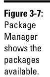

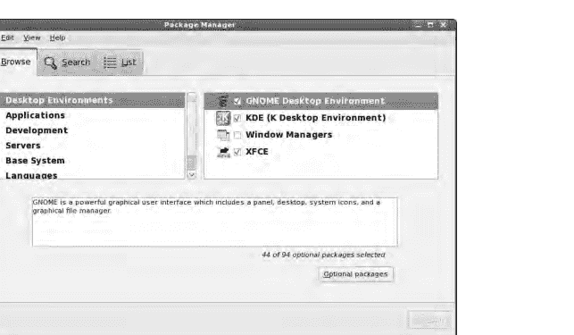


2. 要安装未安装的软件包组，选择软件包组名称左侧的复选框。

对于部分卸载的软件包组，点击软件包名称右侧列中出现的“详情”（Details）链接（这可能也显示为“可选软件包”Optional Packages ）。

会出现一个带有软件包组详细信息的对话框。

3. 在对话框中，通过点击名称选择你想要安装或删除的软件包，并点击“关闭”（Close）退出对话框。

你返回到“软件包管理”对话框，如果你添加或删除了任何软件包，“更新”（Update）按钮将变为激活状态。

4. 点击“更新”（Update）或“应用”（Apply）按钮，根据你在软件包列表中进行的任何添加或删除操作更新软件包。

## 在 SUSE 中安装软件

在 SUSE 中，按照以下步骤安装或删除软件。

1. 选择主菜单；启动 YaST 控制中心。


YaST 控制中心在左侧显示任务类别，在右侧显示该类别的特定任务。

2. 点击左侧的“软件”（Software）类别，使右侧显示软件选项。

3. 点击右侧的“管理”（Management）图标。

YaST 显示一个新窗口，你可以在其中搜索软件包。

4. 通过名称搜索软件包，或通过浏览可用软件包选择软件包。

要按名称搜索软件包，在窗口左上角的“搜索”字段中输入关键词并点击“搜索”。YaST 在窗口右侧显示匹配的软件包。要浏览软件包，点击左上角的“过滤”（Filter），从下拉列表中选择“软件包组”（Package Groups），并点击某个组以查看该组内单个软件包列表。

5. 点击右下角的“接受”（Accept）按钮开始安装所选软件包。

YaST 在安装软件包之前会检查依赖关系——如果某个软件包需要其他软件包才能正确安装。如果你想查看点击“接受”后会发生什么变化，请点击“过滤”并选择“安装摘要”（Installation Summary）。

## 在 Xandros 中安装软件

Xandros OS 带有 Xandros Networks，它让你能够在线购买软件，还可以从 CD 或 DVD 安装软件。要启动 Xandros Networks，双击桌面上的 Xandros 图标。Xandros Networks 将启动、连接到 Xandros 服务器并显示有关已安装、更新和新应用程序的信息。

要查看新应用程序列表，点击 Xandros 窗口左侧“新应用程序”（New Applications）标签左侧的加号。你将获得进一步的应用程序类别列表。如果你点击一个类别，窗口右侧将显示该类别内软件包的名称。你可以选择一个软件包或整个类别进行安装。

要安装任何所选软件包，选择“文件->进入模式”（File->Enter Mode）。系统会提示输入管理员（root）密码。输入 root 密码后，你可以选择“文件->安装所选”（File->Install Selected）。Xandros Networks 会检查依赖关系，在需要更多信息时提示你，并下载及安装新软件。


**提示** 如果你下载了 Debian 软件包，可以通过选择“文件->安装 DEB”（File->Install DEB）来安装。同样，菜单选项“文件->安装 RPM”（File->Install RPM）可以安装 RPM 软件包。

# 第四章：尝试 Linux

## 本章

- 启动 Linux
- 登录
- 玩 Shell
- 关闭

你坐在 PC 前准备启动。你知道电脑安装了 Linux。（也许是你自己安装的，但谁在记录呢？）你好奇开机后会发生什么，之后该做什么。别担心。如果你是第一次使用 Linux，本章将教你如何登录、查看图形桌面、尝试一些命令，最后关闭电脑。

如果你尝试 Ubuntu Live CD，你只需要从 Ubuntu Live CD 启动（如本小书第二章所述），就可以像使用任何其他发行版一样尝试它。

对于那些已经对 Linux 有一定了解的人，请翻看本章看看是否有什么新内容。你永远不知道自己不知道什么！

### 启动 Linux

当你开启电源时，PC 会经历正常的开机序列并加载引导程序——GRUB 或 LILO，取决于你的 Linux 发行版以及你在安装时的选择。引导程序（以前称为引导加载程序）是一个非常小的计算机程序，从硬盘将操作系统的加载到计算机内存中。启动计算机的过程被称为引导（boot）。

对于 Live CD，引导程序通常是 ISOLINUX，一种专为从 ISO 9660 CD-ROM 设计的引导程序。

## 62 启动 Linux

PC 设置为默认加载 Linux，等待几秒钟后，启动加载程序启动 Linux。更准确地说，启动加载程序将 Linux 内核——Linux 操作系统的核心——加载到 PC 的内存中。

其他的启动加载程序（例如 ISOLINUX）可能会显示文本启动：在提示符处，你可以输入启动命令来加载特定的操作系统以及传递给该操作系统的选项。

当 Linux 内核启动时，你会看到一系列打开消息，通常称为启动消息。（你可以随时在终端窗口中输入命令 `dmesg` 来查看这些消息。）这些消息中包含了 Linux 检测到的设备名称。启动消息中的前几行之一是：

```
Calibrating delay loop... 4997.12 BogoMIPS (lpj=2498560)
```

### 什么是 BogoMIPS 和 LPJ？

BogoMIPS 是 Linux 术语（在本章的一个实用的侧边栏中会有解释），用于衡量时间。BogoMIPS 的数值取决于你的处理器速度，无论是旧的 200 MHz 奔腾还是新的 4 GHz 奔腾 4。当内核必须等待某些事件发生短段时间时（例如当磁盘控制器准备就绪时获取其响应），内核会使用 BogoMIPS 测量值。

显示启动消息后，诸如 Fedora 等 Linux 发行版会切换到图形启动屏幕，显示有关系统启动进度的信息。当你安装后首次启动某些 Linux 发行版（如 Fedora 和 Xanders Desktop OS）时，你会得到一个首次配置程序，引导你完成一些配置步骤，例如设置日期和添加用户账户。要完成此类首次配置步骤，你只需要输入所需的信息。

Linux 之后，你通常会看到图形化登录界面。对于某些发行版（如 Knappix），你不需要作为用户登录即可进入桌面。在其他 Live CD 上，你必须登录。

图 4-1 显示了从 Ubuntu Live CD 启动 PC 后的 Ubuntu 桌面。对于某些发行版，你可能会被自动登录。对于其他发行版，会出现一个图形化登录界面，要求你使用安装期间（或任何时候）提供的用户名和密码进行身份验证。

总有一个 root 用户，他恰好是超级用户（管理员账户）。无论是你自己安装 Linux 还是别人为你安装，你都需要知道 root 密码。没有它，你就无法完成许多了解 Linux 如何工作所需的任务。


# 启动 Linux 63

第一卷

第四章

**图 4-1：** Ubuntu LiveCD 桌面。

通常你不应该以 `root` 身份登录。当你以 `root` 登录时，可能会意外损坏系统，因为当你是 `root` 时可以做任何事情。始终以普通用户登录。当你需要以 `root` 执行任何任务时，在终端窗口中输入 `su -` 并输入 `root` 密码。

在 Ubuntu 中，你只定义普通用户账户；Ubuntu 并没有提供让你定义 `root` 用户账户的机会。每当你想要执行任何需要 `root` 权限的任务，你都必须使用 `sudo` 命令。root 的默认密码是你在安装操作系统时提供的那个。

要以 `spiderman` 身份登录，在第一个文本字段中输入 `spiderman` 并按回车。（在开始输入之前将光标移动到登录框。）然后输入 `spiderman's` 密码并按回车。你会看到初始图形界面（简称为 GOE）。你看到什么取决于对 GUI 的选择——GNOME 或 KDE。如果有人替你做了决定，那就别管——GNOME 和 KDE 都是很好且多功能的。

第二卷第 1 和 2 章探讨了 GUI 桌面——首先是 GNOME，然后是 KDE。由于这些在那里已有介绍，本节将重点关注命令行——如果加载图形桌面出现问题，这是你唯一可以使用的界面。

## 64 玩转 Shell

当 Linux 启动时，你会收到一条显示 `calibrating delay loop... 49972 BogoMIPS (lpj=2498560)` 的消息，在 BogoMIPS 单词之前有一个数字。BogoMIPS 是那些困扰新 Linux 用户的术语之一，但它只是一个含义简单的术语。

BogoMIPS 是你的发明（是的，它的意思是启动 Linux 的 Linux Torvalds），虚假的 MIPS。如你所知，MIPS 是每秒百万次指令的缩写——衡量你计算机运行速度的指标。遗憾的是，MIPS 并不是非常好的性能指标；不同类型计算机的 MIPS 测量很难准确衡量。BogoMIPS 基本上是一种测量计算机速度的方法，与具体的进程类型无关。Linux 使用 BogoMIPS 数字来校准一个。

*基于所提供的原始文本流的修正：*

BogoMIPS 是那些困扰新 Linux 用户的术语之一，但它只是一个含义简单的术语。

BogoMIPS 是你的发明（是的，它的意思是启动 Linux 的 Linux Torvalds），虚假的 MIPS。如你所知，MIPS 是每秒百万次指令的缩写——衡量你计算机运行速度的指标。遗憾的是，MIPS 并不是非常好的性能指标；不同类型计算机的 MIPS 测量很难准确衡量。BogoMIPS 基本上是一种测量计算机速度的方法，与具体的进程类型无关。Linux 使用 BogoMIPS 数字来校准一个。


*为了清晰起见，重新处理第 89-91 页的内容：*

当 Linux 启动时，你会收到一条显示 `calibrating delay loop... 49972 BogoMIPS (lpj=2498560)` 的消息，在 BogoMIPS 单词之前有一个数字。BogoMIPS 是那些困扰新 Linux 用户的术语之一，但它只是一个含义简单的术语。

BogoMIPS 是你的发明（是的，它的意思是启动 Linux 的 Linux Torvalds），虚假的 MIPS。如你所知，MIPS 是每秒百万次指令的缩写——衡量你计算机运行速度的指标。遗憾的是，MIPS 并不是非常好的性能指标；不同类型计算机的 MIPS 测量很难准确衡量。BogoMIPS 基本上是一种测量计算机速度的方法，与具体的进程类型无关。Linux 使用 BogoMIPS 数字来校准一个。（等等，提示中提供的 OCR 文本在第 89 页非常混乱/重复。我将在保留内容的同时清理 OCR 痕迹）。

*查看用户提供的第 89 页文本，它似乎是糟糕的 OCR 输出。我将清理掉重复的短语（如 "jiffy", "UNX"），但保留真实的句子。*

## 66 玩转 Shell

### 理解 Shell 命令

因为 Shell 会解释你输入的内容，了解它是如何运作的。所有的 Shell 命令都有这种通用格式：

```
command option1 option2 ... optionN
```

单行通常被称为命令行。在命令行上，你输入一个命令，后面跟着更多参数（参数）。此类命令行选项（参数）帮助你指定你想让命令执行的操作。

一个基本规则是你必须使用空格或制表将命令与选项分开。你也必须在选项之间使用空格或制表。如果你想使用包含嵌套引号的选项。例如，要在文件中搜索单词，我输入 `grep` 命令。（`grep` 是这些用于文件中搜索的命令之一）。

```
grep WWW daemon /etc/passwd
```

当 `grep` 打印出包含这些单词的行时，看起来如下。（你在系统上看到的可能与我看到的不同）：

```
wwwrun:unix:30:8:var/lib/wwwrun:/bin/false
```

### 尝试一些 Linux 命令

当你打开终端时，尝试一些 Linux 命令好玩。我引导你通过一些随机示例，让你感受一下 提示符下可以做什么。（注意：我用加粗显示输入的命令，紧接着是该命令的输出）。

查看自上次开启电源以来 Linux PC 运行了多久，输入以下：

```
uptime
12:06:34 up 59 days, 16:23, 4 users, load average: 0.56, 0.55, 0.37
```

`up 59 days, 16:23` 部分告诉你，这台特定的 PC 已经运行了近两个月。

## 玩转 Shell 67

要查看你的系统运行的是哪个版本的 Linux 内核，可以使用如下的 `uname` 命令：

```
uname -srv
```

此命令运行了带有三个选项的 `uname`：`-srv`、`-s` 和 `-v`（如示例所示，它们可以组合为 `-srv`）。`-s` 选项让 `uname` 打印内核名称，`-r` 输出内核发布号，`-v` 打印内核版本号。该命令在你的某个 Linux 系统上生成如下输出：

```
Linux 2.6.23-1.27.fc8 #1 SMP Fri Oct 26 12:36:34 EDT 2007
```

在这种情况下，系统运行的是 Linux 内核版本 2.6.23。

要读取一个文件，请使用 `more` 命令。例如，输入 `more /etc/passwd` 来读取 `/etc/passwd` 文件。输出结果类似于：

```
root:x:0:0:/root:/bin/bash
bin:x:1:1:bin:/bin/bash
damon:x:2:daemon:/sbin:/bin/bash
lpd:x:4:Printing daemon:/var/spool/lpd:/bin/bash
mail:x:8:12:Mailer:/var/spool/clientmessagequeue:/false
news:x:9:News system:/etc/news:/bin/bash
uucp:x:10:Unix-to-Unix Copy system:/etc/uucp:/bin/bash
      lines deleted ...
```

要查看系统上运行的所有进程列表，请使用 `ps` 命令，如下：

```
ps ax
```

`ps` 命令有许多选项，你提供这些选项时不需要加的连字符。此示例使用了 `a` 和 `x` 选项。`a` 选项列出所有正在运行的进程，`x` 选项显示其余进程。结果是 `ps ax` 会打印系统上运行的所有进程列表，如下所示的 `ps` 命令示例输出：

| PID | STAT | COMMAND |
| :--- | :--- | :--- |
| 1 ? | S | 0:01 init [5] |
| 2 ? | SN | 0:00 [ksoftirqd/] |
| 3 ? | S< | 0:00 [events/] |
| 4 ? | S< | 0:00 [khelper] |
| 9 ? | S< | 0:00 [kthread] |
| 22 ? | S< | 0:00 [kblockd/] |
| 58 ? | S | 0:00 [kapmdd] |
| 79 ? | S | 0:00 [pdfflush] |
| 80 ? | S | 0:00 [pdfflush] |

## 68 机

```
82 ?          S    0:00 [aio/0]
... lines Deleted ...
5325 ?        Ss   0:00 /opt/kde3/bin/kdm
5502 ?        S    0:12 /usr/X1R6/bin/X -br -nolisten tcp
. v07 -auth/var/lib/xdm/authdir/authfiles/A:0-p1AOrt
5503 ?        S    0:00 -0
6187 ?        Ss   0:00 /sbin/portmap
6358 ?        Ss   0:00 /bin/sh /usr/X1R6/bin/kde
6566 ?        Ss   0:00 /usr/sbin/cpupsd
6577 ?        Ssl  0:00 /sbin/nscd
... lines deleted
```

即使你只是登录了一个用户，系统中还能运行这么多程序，惊讶吗？

正如你猜的，你可以通过 Shell 提示符完成一切，但这确实需要一些适应。

## 关机

当你准备关闭 Linux 时，如果你是 Linux PC 的唯一用户，必须按顺序操作，因为通常会有其他几个程序在后台运行。此外，Linux 等操作系统会尝试优化写入硬盘的方式。由于硬盘访问相对较慢（与访问内存的时间相比），数据通常保留在内存中并分大块写入硬盘。因此，如果你直接关闭电源，就会面临某些文件未能正确更新的风险。

任何用户（无需登录）都可以从桌面或图形化登录界面关闭系统，某些发行版（如 Debian）还会提示你输入 root 密码。点击菜单中的 Log Out（或在菜单中查找 Log Out）。这时会弹出一个注销框（如图 4-3 所示），提供重启、停止系统或仅注销的选项。要关闭系统，只需选择 Shutdown 并点击 OK。系统将以有序的方式关闭。

如果注销时没有关机选项，请先注销，然后在图形化登录界面选择 Shutdown。你也可以在终端中使用命令 `init 0` 来让 Linux 电脑关机。如果你在虚拟机软件管理器（如 VMware）中运行操作系统，有时需要执行此操作。

## 关机 69

第一册

第 4 章

尝试尝试

图 4-3：注销框

在系统关闭期间，你可能会看到有关关机的信息。你可能会惊讶地发现，即使没有人显式运行程序，竟然有这么多进程。如果你的系统没有自动关机，你可以手动关闭系统。

# 第一章：GNOME 桌面

本章内容

- 发现 GNOME 的常用功能
- 展示主菜单
- 介绍系统菜单
- 检查底部面板

Linux 发行版带有两种流行的（或两者兼备）图形化用户界面（GUI）——GNOME 和 KDE。它们与 Microsoft Windows 相似，但在某方面又不同。与 Microsoft Windows 不同的是，在 Linux 中你可以自由选择 GUI。如果你不喜欢 GNOME，可以使用 KDE；如果你不喜欢 KDE，可以使用 GNOME。如果同时安装了这两者，你可以在几秒钟内来回切换。在 Windows 上试试看吧！

GNOME 和 KDE 是独立于 Linux 开发的。事实上，GNOME 和 KDE 可以在 Linux 之外的其他 UNIX 系统上运行。你也可以在 Linux 中安装其他 GUI，例如 FVWM 和 Xfce。访问 `freesktop.org/wiki/Desktops` 获取其他 X 桌面（运行在 X Window 系统上的桌面）列表。


本章将探索 GNOME 的主要功能，而本迷你教程的第 2 章将对 KDE 进行类似的比较。你只需开始使用它们，就能了解这些 GUI。无论你决定使用哪种 GUI，所有的 GUI 应用程序无论是基于 GNOME 还是 KDE，都在所有桌面上运行。换句话说，你可以在 GNOME 下运行 KDE 应用，反之亦然。唯一的障碍是有时 GNOME 和 KDE 可能没有默认安装。

每个 Linux 发行版通常默认安装其中一种 GUI。每个发行版还会对 GNOME 或 KDE 进行定制，以创建一个该发行版特有的桌面。由于由于，你在发行版中看到的内容与此处描述的可能存在细微差异，但这些变化是微不足道的。你必须亲自探索桌面，因为这是熟悉 GUI 的最好方法。

## 了解 GNOME 的功能

GNOME 的初始桌面看起来与其他任何流行的 GUI 相似，例如 Microsoft Windows 或 Mac OS X 桌面。例如图 1-1 显示了典型的 GNOME 桌面。

运行 Live CD 时，如果安装了操作系统，某些图标将不会出现。安装后，桌面最初会显示你的电脑、主文件夹以及存放删除文件的回收桶。与其他发行版不同，Ubuntu 追求减少图标并保持整洁的外观。GNOME 桌面的另一个主要功能是面板——顶部和底部的栏。每个面板都类似于 Windows 任务栏。它左侧有按钮（各种程序的快捷方式），右侧有时间显示。面板中间部分显示你已启动（或系统为你自动启动）的任何应用程序按钮。

> 提示：将鼠标悬停在面板上的任何图标上，会弹出一个小窗口显示该图标名称。弹出窗口还会提供你可以对该图标做什么的提示。

图 1-1：Ubuntu 中整洁的 GNOME 桌面。

(img/49a40dc66bb14561782e2a1125eaccf3_99_0.png)

### 桌面上下文菜单

当你右键点击桌面空白区域时，GNOME 桌面将显示上下文菜单。该菜单提供以下选项：

- 创建新文件夹。
- 创建命令的快捷方式（创建启动器）。
- 创建新文档。
- 清理桌面或对齐图标。
- 配置桌面背景。

图 1-2 显示了典型 GNOME 桌面上的上下文菜单。带有右箭头的桌面菜单选项在你将鼠标指针悬停在箭头上时，会出现其他菜单。

图 1-2：GNOME 中的标准菜单选项。

(img/49a40dc66bb14561782e2a1125eaccf3_100_0.png)

### 图标上下文菜单

在 GNOME 中右键点击任何桌面图标都会出现另一个菜单（见图 1-3）。此上下文菜单中的许多项与单击时的相同，但右键点击某些图标（例如回收桶图标）会产生一个有些不同的菜单。你可以从图标菜单执行以下典型任务：

- 在文件管理器中打开文件夹。
- 使用你选择的应用打开文件。
- 将图标重命名为垃圾。
- 查看该图标的属性。

对于回收桶图标，图标上下文菜单通常提供删除回收桶中物品的选项（你有机会说“是”或“否”）。

> 提示：我打赌你在这里发现了一个规律。那就是右键点击。无论你在 GUI 桌面的哪个位置，在选择之前始终右键点击。当你右键点击时，一定会发现有用的东西！

图 1-3：GNOME 中回收桶图标的菜单选项。

(img/49a40dc66bb14561782e2a1125eaccf3_101_0.png)

### 面板

面板是横跨桌面顶部或底部的长条。在 GNOME 中，与 KDE 不同，有两个面板。图 1-4 显示了典型的视图。在那里你通常可以找到访问所有需要访问位置的快捷方法，还可以访问网络、搜索文件并执行其他常用功能。在大多数桌面中，顶层主菜单包含以下类别：

- **附件**：许多实用程序，例如科学计算器、字符选择器、软盘格式化器、字典和 Palm Pilot。
- **游戏**：纸牌游戏、麻将、扫雷、危险棋。
- **图形**：如 GIMP、数字相机界面、扫描仪界面、截图工具以及 Adobe Acrobat 查看器。
- **互联网**：如 浏览器、邮件阅读器和即时消息软件。
- **办公**：如 OpenOffice 办公套件包括 Writer 文字处理器、Calc 表格、Impress 幻灯片、绘画）。
- **音频与视频**：如 CD 播放器、声音混音器、录音机和音量控制。

面板是横跨桌面顶部或底部的长条。在 GNOME 中，与 KDE 不同，有两个面板。图 1-4 显示了典型的视图。

(img/49a40dc66bb14561782e2a1125eaccf3_102_0.png)

图 1-4：面板。

### 主菜单

GNOME 顶部面板左侧的第一个选项是主菜单。在那里你通常可以找到访问所有需要访问位置的快捷方法，还可以访问网络、搜索文件并执行其他常用功能。图 1-5 显示了菜单的层级结构。

图 1-5：GNOME 桌面上的标准菜单层级。

(img/49a40dc66bb14561782e2a1125eaccf3_103_0.png)

主菜单通常还有一些执行常用任务的菜单项，如安装/删除。每个发行版的主菜单类别不同，但其菜单结构简单到让你能轻松找到所需内容。

### 位置菜单

GNOME 顶部面板左侧的第二个选项是位置菜单。在那里你通常可以找到访问所有需要访问位置的快捷方法，还可以访问网络、搜索文件并执行其他常用功能。图 1-6 显示了此菜单的示例。

特别有用的是“搜索文件”选项，它会弹出如图 1-7 所示的对话框。该工具可以根据几乎任何标准（如创建日期、名称或包含特定短语）来查找文件。这是你尝试该工具并深入了解它的机会。

图 1-6：GNOME 位置菜单。

(img/49a40dc66bb14561782e2a1125eaccf3_104_0.png)

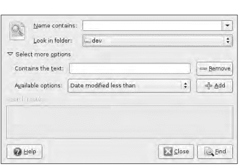

图 1-7：可以通过对话框更改默认搜索选项。

### 系统菜单

GNOME 顶部面板从左侧数的第三个菜单是*系统菜单*。这通常是你进行管理任务的地方。图 1-8 显示了示例。

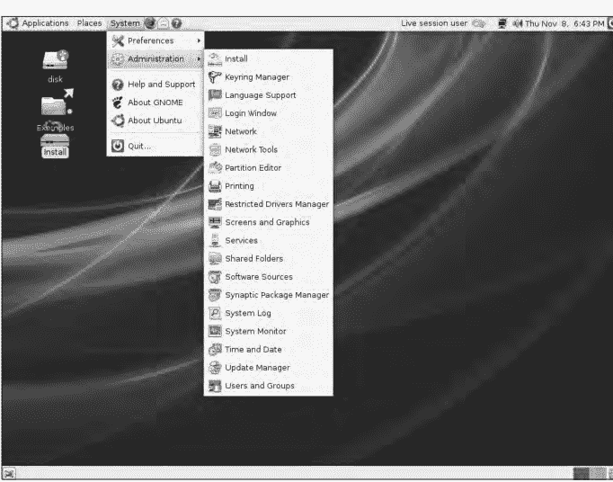

图 1-8：GNOME 中的标准系统菜单。

Firefox 允许你执行诸如选择默认打印机、配置笔记本电脑电源管理以及调整声音设置等任务。管理选项允许你运行所需的管理程序，以查看系统状况并进行更改（管理内容将在第五本书中详细介绍）。

此菜单上的其他选项允许你获取有关发行版的信息，并访问帮助和支持。

### 顶部面板图标

除了顶部面板中的菜单选项外，通常还有许多图标（参考图 1-1）。你可以通过将光标悬停在图标上并阅读弹出的描述来识别每个图标，但最常见的（按它们通常从左到右出现的顺序排列）

- Firefox 网页浏览器：启动流行的浏览器并访问互联网。
- Evolution 邮件：启动 Evolution 电子邮件和日历软件。
- 帮助：在 GNOME 文档查看器中显示在线帮助信息。
- 音量：显示音量控制条，你可以通过拖动滑块改变音量。
- 日期和时间：显示当前日期和时间；点击会打开显示当前日期的日历。


### 介绍 GNOME 底部面板

除了顶部面板，GNOME 还包含一个底部面板。图 1-9 显示了该菜单的示例。

图 1-9：GNOME 中的底部面板。


图 1-9 中出现的项目有：

- **显示桌面：** 点击隐藏所有窗口并显示桌面。
- **活动窗口：** 点击在正在运行的应用程序和窗口之间切换。
- **工作空间切换器：** 每个区块都会打开不同的工作空间。这与 KDE 桌面的桌面分页器（Desktop Pager）功能相同。探索三个菜单（应用程序、位置、系统），查看从这些菜单选择可以执行的任务类别。
- **垃圾桶：** 查看或清空垃圾桶内容。

# 第 2 章：KDE 桌面

## 本章内容

- 发现 KDE 的常用功能
- 介绍主菜单
- 配置面板和桌面

正如本迷你书第 1 章提到的，Linux 发行版带有两种流行的图形用户界面（GUI）之一（或两者都有）——GNOME 和 KDE。如果安装了两者，你可以在几秒钟内在它们之间切换。如果你不喜欢 GNOME，可以使用 KDE；如果你不喜欢 KDE，可以使用 GNOME。

本章将探索 KDE 的主要功能，正如本迷你书第 1 章扩展了 GNOME 一样。我强烈建议在决定最习惯哪种 GUI 之前尝试这两种 GUI。记住，你可以在 GNOME 下运行 KDE 应用程序，反之亦然。

每个发行版都对桌面进行自定义，以创建一个该发行版特有的桌面。由于由于，你看到的与这里描述的内容之间可能存在细微差异，但这些变化都是小不足道的。你需要自己探索桌面，因为那是熟悉 GUI 的最佳方法。


## 了解 KDE 的功能


KDE 的初始桌面就像其他流行的桌面，例如 Microsoft Windows 或 Mac OS X 桌面。图 2-1 显示了典型的 KDE 桌面。

KDE 代表 K Desktop Environment。KDE 项目始于 1996 年 10 月，旨在为使用 X Window 系统的 UNIX 系统开发通用的 GUI。KDE 的第一个版本于一年后的 1997 年 10 月发布。KDE 1.0 版本于 1998 年 7 月发布。


## 了解 KDE 的功能


**图 2-1：** 清洁的 KDE 桌面。

图 2-1 来自 Fedora 8，它力求减少桌面图标。桌面的底部是*面板*（panel）——它类似于 GNOME 中的顶部和底部栏，以及 Windows 任务栏。左侧有按钮（各种程序的快捷方式）、一组通向可用工作空间的按钮、一个任务区域以及右侧的时间显示。面板中间部分是任何你已启动（或系统为你自动启动）的应用程序的按钮。


将鼠标悬停在面板上的任何图标上，都会弹出一个小窗口显示该图标名称。弹出窗口还会提供关于你可以用该图标做什么的提示。

### 桌面右键菜单

当你右键点击桌面上的空白区域时，KDE 桌面会显示右键菜单。右键菜单提供了包含以下选项的菜单：

- Konsole（访问终端窗口）
- 新建（这可以是文件夹、文本文件、HTML 文件或链接）
- 运行
- 撤销
- 粘贴剪贴板内容
- 若干可以让你操作图标和窗口的选择
- 配置桌面 – 设置壁纸等
- 切换用户 – 到不同的用户
- 锁定会话 – 离开时锁定屏幕
- 退出 – 桌面上下文

| 第二部分 |
| :--- |
| 第 2 章 |
| KDE 桌面 |

图 2-2 显示了典型 KDE 桌面上的桌面右键菜单。带有右箭头的菜单选项在你将鼠标悬停在上面时，会弹出其他菜单。


### 图标右键菜单

在 KDE 中右键点击任何桌面图标都会出现另一个菜单（参见图 2-3）。右键菜单上的许多项无论你点击什么都是相同的，但右键某些图标（例如光驱设备图标）会产生不同的菜单。你可以从右键菜单中执行以下任务：

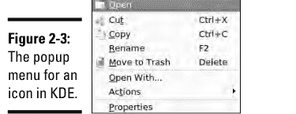

- 在文件管理器中打开文件夹。
- 使用你选择的应用程序打开文件。
- 切或复制。
- 重命名图标。
- 将图标移动到垃圾桶。
- 查看图标的属性。

对于光驱设备图标或其他设备，图标右键菜单通常提供弹出介质的选项。


无论你在 GUI 桌面的何处，在选择之前总是右键点击。你总能在右键点击时发现有用的东西！

### 面板

面板是横跨桌面底部的长条。与 GNOME 相比，默认只有一个面板。图 2-4 显示了 KDE 面板的典型视图。

图 2-4：KDE 面板。

| | 1 | 2 | 3 | 4 | | 晚上 7:45，周三，11/21 |

面板是图标的存放处。某些程序在你点击时会启动。某些图标显示状态（例如哪些程序正在运行）以及信息（如日期和时间）。

从左侧开始，第一个图标（无论是什么）是主菜单按钮 —— 它是 Microsoft Windows 中的开始按钮。然后是几个启动各种程序的图标，包括 Konqueror 网页浏览器和文件管理器。

## 了解 KDE 的特性

你会发现 KDE 非常易用，而且在许多方面与 Windows 的 GUI 相似。你可以从一个与 Windows 开始菜单类似的菜单中启动应用程序。与 Windows 一样，你可以直接将文件夹和应用程序放置在 KDE 桌面上。

当你将鼠标指针悬停在图标上方时，会弹出一个帮助气泡，并提供关于该图标的备用提示。

### 主菜单

KDE 面板最左侧的图标是主按钮（Main button）。你通常可以在那里找到所有的应用程序，它们按子单元组织。虽然显示的字母可以根据发行版进行更改，但它通常被标记为 K。点击主菜单弹出一级菜单。然后将鼠标悬停在带有箭头的任何菜单项上弹出下一级菜单，依此类推。你可以浏览菜单层次结构并在最终菜单中进行选择。图 2-5 显示了典型 KDE 桌面的主菜单层次结构。

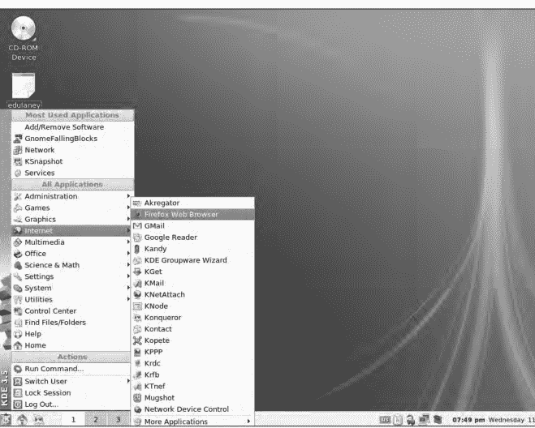

**图 2-5：KDE 菜单层次结构。**

我使用符号 `Internet: Firefox Web Browser` 来指代图 2-5 中高亮的菜单序列。这种符号风格将贯穿全本书。

在大多数桌面系统中，顶层主菜单具有以下类型的类别：

- 管理（Administration）：访问管理系统所需的实用程序，例如管理防火墙、添加用户和组等。图 2-6 显示了此类示例。

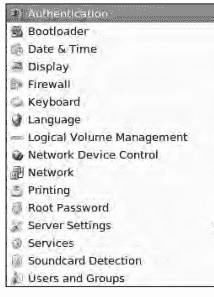

图 2-6：管理菜单选项。

- 游戏（Games）：还能是什么呢？游戏（而且非常多——有街机游戏、棋盘游戏、CAD 游戏等许多游戏）。
- 图形（Graphics）：如 Flickr、ColourPaint 和 KSnapshot 等用于在本章中截屏的程序出现在这里。
- 互联网（Internet）：互联网应用程序，如 Web 浏览器、电子邮件阅读器和即时消息传递。
- 多媒体（Multimedia）：多媒体应用程序，如 CD 播放器、声音混音器、录音器和音量控制。
- 办公（Office）：办公应用程序，如 OpenOffice.org Office 套件（包括 Writer 文字处理器、Calc 电子表格、Impress 幻灯片演示、Draw 绘程序等）。
- 设置（Settings）：访问配置设置以及进行更改所需的实用程序。图 2-7 显示了此类示例。

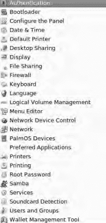

图 2-7：设置菜单选项。

- 系统（System）：系统配置所需的实用程序。图 2-8 显示了此类示例。

> 关于 KDE 有有一点你必须说：它为你提供了三个菜单，你可以在其中找到配置几乎任何内容所需：管理、设置和系统。

主菜单通常还包含一些常用任务的菜单项，例如添加/删除软件。

每个发行版的主菜单具有不同的类别，但菜单的组织足够相似，你通常可以找到需要的内容。

### 配置 KDE 底部面板

尽管 KDE 面板具有强大的功能，但它也具有极大的灵活性。如果你右键点击面板上的空白区域，就会出现图 2-9 所示的菜单。这赋予了你从面板添加和删除项以及创建一个新项的能力（允许你按照自己的意配置桌面）。


**图 2-9：在配置面板时你有很大的灵活性。**

### 配置 KDE 桌面

最强大的菜单选项是“配置面板”（Configure Panel）。选择它将带你进入图 2-10 所示的工具。从这里，你可以选择将面板放置在底部以外的位置、让它自动隐藏、当鼠标移动到项目上时停止弹出信息（称为工具提示），以及许多其他功能。


图 2-10：配置 KDE 面板非常简单。

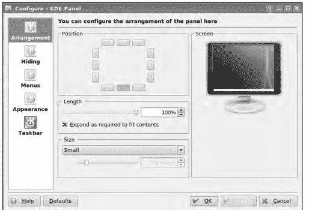

在桌面空白处点击右键后，你可以从弹出菜单中选择“桌面”（Desktop）。这样做会弹出图 2-11 所示的配置工具。

图 2-11：你可以更改桌面设置。

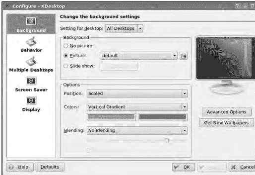

在配置背景和屏幕保护程序等项目的同时，你还可以设置屏幕大小并选择在屏幕顶部自动设置桌面菜单栏；这是一个非常有用的补充，我

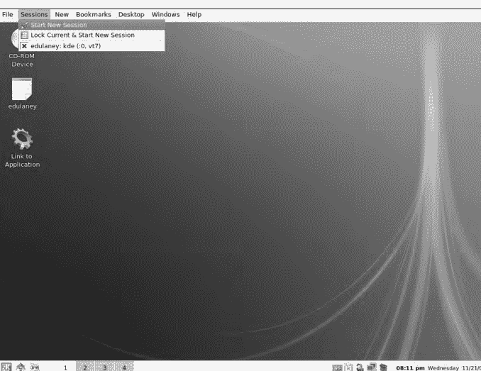

## 使用 bash Shell

这种在单屏幕上输入命令的行为通常被称为“命令行”。在命令行中，你输入一个命令，后面跟着零或多个选项（参数）。这些行选项字符串（或命令参数）会修改命令的工作方式，以便你能够让它执行特定的任务。

Shell 使用空格或制表符（tab）来区分命令和选项。自然地，你通过使用空格或制表符将命令与选项、以及选项与选项之间隔开来帮助它。


选项可以包含空格——你只需要将其放在引号外面，这样空格就会包含在内。例如，为了在密码文件中搜索我的名字，我输入了以下 `grep` 命令（`grep` 用于在文件中搜索文本）：

```
grep "Emmett Dulaney" /etc/passwd
```

当 `grep` 打印出带有我名字的行时，它看起来像这样：

```
deulaney:x:1000:100:Emmett Dulaney:/home/deulaney/bin/bash
```

如果你用自己的用户名创建了账户，请以该用户名作为参数输入 `grep` 命令，在 `/etc/passwd` 文件中查找该用户名。

在 `grep` 命令的输出中，你可以看到冒号（`:`）后面的 shell 名称（`/bin/bash`）。

当然，命令选项的数量及其格式取决于具体的命令。通常，这些选项（如 `-x`）是单个字符。例如，`ls` 命令列出目录的内容。你可以使用 `-l` 选项来查看更多细节。例如，这里是在用户主目录下输入 `ls -l` 的结果：

```
total 0
drwxr-xr-x users 48 2005-09-08 21:11 bin
drwx------ users 32 2005-09-08 21:16 Desktop
drwx------ users 80 2005-09-08 21:11 Documents
drwxr-xr-x users 80 2005-09-08 21:11 public_html
drwxr-xr-x users 464 2005-09-17 18:21 sdump
```

如果一个命令太长无法排在一行内，你可以按下反斜键（`\`）然后按回车。接着在下一行继续输入命令。例如，输入以下命令（每行后按回车）。

```
cat \
/etc/passwd
```

## 96 使用 bash Shell

`cat` 命令随后会显示 `/etc/passwd` 文件的内容。

你可以在一行中拼接（即串联）多个较短的命令。只需用分号（`;`）将命令隔开即可。例如，以下命令

```
cd; ls -l; pwd
```

会将当前目录切换到家目录，列出该目录的内容，然后显示目录名称。

## 组合 shell 命令

你可以组合简单的 shell 命令来创建一个更复杂的命令。例如，假设你想找出名为 `spbcd` 的设备是否存在于你系统的 `/dev` 目录中，因为某些文档说你为 Sound Blaster Pro CD-ROM 驱动器需要该设备。你可以使用 `ls /dev` 命令获取 `/dev` 目录的目录列表，然后浏览它以查看是否存在 `spbcd`。

遗憾的是，`/dev` 目录有很多非常棒的条目，你可能会发现很难找到任何名称中包含 `spbcd` 的项。不过，你可以将 `ls` 与 `grep` 组合，构造出一个完全符合你要求的命令行。这里是该命令行：

```
ls /dev | grep spbcd
```

shell 将 `ls` 命令的输出（目录列表）发送给 `grep` 命令，`grep` 会搜索字符串 `spbcd`。竖线（`|`）被称为管道（pipe），因为它在两个程序之间充当导管（想象成水管）——第一个命令的输出被喂送到第二个命令的输入中。

## 控制命令的输入和输出

大多数 Linux 命令都有共同特征——它们始终从标准输入（通常是键盘）读取，并写入标准输出（通常是屏幕）。错误信息被发送到标准错误（通常也到屏幕）。这三个设备通常被称为 `stdin`、`stdout` 和 `stderr`。

你可以让命令从文件获取输入，然后将其输出发送到另一个文件。让你知道一下，这种功能的专业术语是输入/输出重定向或 I/O 重定向。

表 3-1 显示了常用 I/O 重定向命令的语法，接下来的几节将解释如何使用这些命令。

| 表 3-1 | 常用标准 I/O 重定向 |

| :--- | :--- |

| 任务 | 命令语法 |

| 将 stdout 发送到文件 | command > file |

| 将 stderr 发送到文件 | command 2> file |

| 将 stdout 和 stderr 发送到文件 | command > file 2>&1 |

| 从文件读取 stdin | command < file |

| 从 file.in 读取 stdin并将 stdout 发送到 file.out | command < file.in > file.out |

| 将 stdout 追加到文件末尾 | command >> file |

| 将 stderr 追加到文件末尾 | command 2>> file |

| 将 stdout 和 stderr 追加到文件末尾 | command >> file 2>&1 |

| 从文件读取 stdin | command < file |

| 将 stdout 管道到文件 | command | file |

| 将 stderr 管道到文件 | command 2> file |

### 从文件获取 stdin

如果你想从文件读取输入，使用 `<` 符号。例如，输入：

```
cat < /etc/passwd
```

`cat` 命令显示 `/etc/passwd` 的内容。

### 保存输出到文件

如果你想将输出发送到文件，使用 `>` 符号。例如，输入：

```
cat /etc/passwd > output.txt
```

`cat` 命令显示 `/etc/passwd` 的内容。

### 追加到文件末尾

如果你想将输出追加到文件末尾，使用 `>>` 符号。例如，输入：

```
cat /etc/passwd >> output.txt
```

`cat` 命令显示 `/etc/passwd` 的内容。

### 重定向错误到文件

如果你想将错误信息重定向到文件，使用 `2>` 符号。例如，输入：

```
ls /nonexistent_directory 2> error.txt
```

`ls` 命令在 `error.txt` 中显示错误信息。

### 重定向 stdout 和 stderr

如果你想将 `stdout` 和 `stderr` 都重定向到文件，使用 `>2>&1` 符号。例如，输入：

```
ls /nonexistent_directory > output.txt 2>&1
```

`ls` 命令在 `output.txt` 中显示错误信息。

### 从文件读取 stdin

如果你想从文件读取输入，使用 `<` 符号。例如，输入：

```
cat < file.txt
```

`cat` 命令显示 `file.txt` 的内容。

### 重定向输入并发送输出

如果你想从一个文件重定向输入并将输出发送到另一个文件，使用 `<` 和 `>` 符号。例如，输入：

```
cat < input.txt > output.txt
```

`cat` 命令显示 `input.txt` 的内容。

# 100 使用 bash Shell

你可以在 `bash` 中使用三种类型的通配符：

- `*` **星号 (*)** 匹配文件名中的零个或多个字符。这意味着 `*` 表示目录中的所有文件。
- `?` **问号 (?)** 匹配任意单个字符。如果你输入 `test?`，它将匹配以 `test` 开头的五个字符的文本。
- **括号中的字符集** 匹配集合中的任意单个字符。例如，字符串 `[AB]*` 匹配任何以 a 或 B 开头的文件名。

当你想要对大量文件进行操作时，通配符非常有用。例如，要将 `/media/cdrom` 目录下的所有文件复制到当前目录，请输入以下命令：

```
cp /media/cdrom/*
```

`bash` 将通配符 `*` 替换为 `/media/cdrom` 目录中所有的文件名。命令末尾的点表示当前目录。

你可以将星号与文件名的其他部分配合使用选择特定的文件组。假设你想使用 `grep` 命令在 `/usr/include` 目录下的搜索符合以下条件的 `typedef struct` ：

- 文件名以 s 开头。
- 文件名以 .h 结尾。

通配符规范 `*.h` 表示所有符合这些标准的文件名。因此你可以使用以下命令执行搜索：

```
grep `typedef struct` /usr/include/s*.h
```

字符串中包含一个你想让 `grep` 命令查找的空格，因此你必须将字符串包含在引号中。这样，`bash` 就不会尝试将其中的单词视为独立的命令参数。

问号 `?` 匹配单个字符。假设你在当前目录下有四个文件——`image1.pcx`、`image2.pcx`、`image3.pcx` 和 `image4.pcx`。要将这些文件复制到 `/media/floppy` 目录，请使用以下命令：

```
cp image?.pcx /media/floppy
```

# bash Shell 101

`bash` 将单个问号替换为任意单个字符，并将四个文件复制到 `/media`。

第三种通配符格式 `[...]` 匹配方括号内特定字符集中的单个字符。你可能想将其与其他通配符结合，将文件名缩小到更小的集合。如果你想查看 `/etc/X11/xdm` 目录下所有以 x 或 X 开头的文件列表，输入以下命令：

```
ls /X11/xdm/]*
```

## 重复之前输入的命令


为了方便你重复长命令，bash 将多达 500 条命令存储为命令历史的一部分（基本上就是旧命令的列表）。要查看命令历史，输入 `history`，bash 将会显示你在之前的会话中输入的旧命令编号列表。

如果命令列表太长，你可以限制想要查看的命令数量。例如，要查看最近的十条命令，输入此命令：

```
history 10
```

要重复列表中的某个命令，只需输入感叹号 `!`，后跟该命令的编号。要重复命令 3，输入 `!!`

你可以在不知道命令编号的情况下重复命令。假设你几分钟前输入了 `more /usr/lib/xdm-config`，现在想再次查看该文件。要重复 `more` 命令，输入以下：

```
!more
```

通常，你可能想要重复上一个命令并为其添加额外的参数。假设 `ls -l` 显示了目录的内容。要重复该命令，输入两个感叹号如下：

```
!!
```

这是回想之前输入过的命令最简单的方法：只需按下向上箭头，bash 就会向后移动命令历史。要向前移动命令历史，按下向下箭头。

bash 将两个感叹号替换为上一个命令，然后将输出通过 `more` 命令传递：

```
!! | more
```

# 102 发现和使用 Linux 命令

在提示符处输入 Linux 命令，我指的是 Linux 随带的一些命令行工具。在本章中无法涵盖所有的 Linux 命令，但我想通过展示常见的 Linux 命令让你对这些范围有一个直观感受。以下表格按类别列出了常见的 Linux 命令。

| 表 3-2 帮助与缩写 |

| 命令名称 | 操作 |

|---|---|

| apropos | 查找指定关键字的在线手册 |

| info | 显示关于命令的在线帮助信息 |

| man | 显示在线帮助信息 |

| whatis | 类似于 apropos搜索单词 |

| alias | 定义命令的缩写 |

| type | 显示命令的类型和位置 |

| unalias | 删除定义的别名 |

# 103 发现和使用 Linux 命令

### 表 3-3 管理文件和目录

| 命令名称 | 操作 |

|---|---|

| cd | 更改当前目录 |

| chmod | 更改文件权限 |

| chown | 更改所有者和组 |

| cp | 复制文件 |

| ln | 创建符号链接 |

| ls | 显示目录内容 |

| mkdir | 创建目录 |

| mv | 重命名文件并移动 |

| rm | 删除文件 |

| rmdir | 删除目录 |

| pwd | 显示当前目录 |

| touch | 更新文件时间戳 |

### 表 3-4 查找文件

| 命令名称 | 操作 |

|---|---|

| find | 根据标准（如名称和日期）查找文件 |

| locate | 使用定期更新的数据库查找文件（由 updatedb 程序创建） |

| whereis | 查找可执行二进制所在的目录 |

| which | 在 PATH 环境中查找文件 |

### 表 3-5 处理文件

| 命令名称 | 操作 |

|---|---|

| cat | 在标准输出显示文件（可用于将多个文件合并为一个文件） |

| cut | 从每行提取指定的部分 |

| dd | 将数据块从一个文件复制到另一个（用于从设备复制数据） |

| diff | 比较两个文件并发现任何差异 |

# 104 发现和使用 Linux 命令

### 表 3-5 续

| 命令名称 | 操作 |

|---|---|

| expand | 将所有制表符转换为空格 |

| file | 显示文件的数据类型 |

| fold | 将每行文本折叠以适应指定的宽度 |

| grep | 在文本文件中搜索正则表达式 |

| less | 逐页显示文本文件（也可以向后翻页） |

| lpr | 打印文件 |

| more | 逐页显示文本文件（只能向前移动） |

| nl | 为文件中所有非空行行编号并输出到标准输出 |

| paste | 合并多个文件的对应行 |

| patch | 使用原始文件和修订副本之间的差异更新文本文件 |

| sed | 在应用指定编辑命令的同时将文件复制到标准输出 |

| sort | 对文本文件的行进行排序 |

| split | 将文件按指定大小分成若干较小文件 |

| tac | 反转文件（从最后一行开始，依此类推） |

| tail | 显示文件的最后几行 |

| tr | 在整个文件中用一组字符替换另一组字符 |

| uniq | 消除文本中的重复行 |

| wc | 统计文本文件的行数、单词和字符数 |

| zcat | 显示压缩文件（解压后） |

| zless | 逐页显示压缩文件（也可以向后翻页） |

| zmore | 逐页显示压缩文件 |

### 表 3-6 归档和压缩文件

| 命令名称 | 操作 |

|---|---|

| compress | 压缩文件 |

| cpio | 在归档中复制文件 |

| gunzip | 解压用 GNU Zip (gzip) 压缩的文件 |

# 发现与使用 Linux 命令 105

| 命令名称 | 操作 |

| --- | --- |

| gzip | 使用 GNU Zip 压缩文件 |

| tar | 创建一个或多个目录中文件的归档（最初设计用于磁带归档） |

| uncompress | 解压使用 `compress` 压缩的文件 |

## 表 3-7 管理文件

| 命令名称 | 操作 | 第二卷章节 |

| --- | --- | --- |

| bg | 在后台运行被中断的进程 | | |

| fg | 在前台运行进程 | | |

| free | 显示系统中空闲和已用内存 | | |

| halt | 关闭 Linux 并停止计算机 | | |

| kill | 向进程发送信号（通常用于终止进程） | | |

| lldd | 显示运行进程所需的共享库 | | |

| nice | 以较低优先级运行进程（称为 nice 模式） | | |

| ps | 显示当前运行的进程列表 | | |

| printenv | 类似于 `ps` 但能更清晰地显示父子关系 | | |

| reboot | 停止 Linux 然后重启计算机 | | |

| shutdown | 关闭 Linux | | |

| top | 显示最消耗处理器和内存的进程列表 | | |

| uname | 显示系统和 Linux 内核信息 | | |

## 表 3-8 管理用户

| 命令名称 | 操作 |

| --- | --- |

| chsh | 更改 `shell`（命令解释器） |

| groups | 打印包含指定用户的组列表 |

| id | 显示指定用户名的用户 和组 ID |

| passwd | 修改密码 |

| su | 以另一个用户或 `root` 启动新 shell（不带任何参数调用时） |

# 106 发现与使用 Linux 命令

## 表 3-9 管理文件系统

| 命令名称 | 操作 |

|---|---|

| df | 总结所有挂载存储设备的空闲和可用空间 |

| du | 显示磁盘使用信息 |

| fkdformat | 格式化软盘 |

| fdisk | 硬盘分区 |

| fsck | 检查并修复文件系统 |

| mkfs | 创建新文件系统 |

| mknod | 创建设备文件 |

| mkswap | 在文件或硬盘分区中为 Linux 创建交换空间 |

| mount | 将设备（例如 CD-ROM）挂载到系统中的目录 |

| swapoff | 停用交换空间 |

| swapon | 激活交换空间 |

| sync | 将缓冲（保存在内存中）的数据写入文件 |

| tty | 显示当前终端的设备名称 |

| ummount | 从文件系统卸载设备 |

## 表 3-10 日期与时间

| 命令名称 | 操作 |

|---|---|

| cal | 显示指定月份或年份的日历 |

| date | 显示当前日期时间或设置新的时间

## 变为 root（超级用户）

当你想要执行任何需要高权限的操作（例如管理你的系统）时，必须变成 root。通常使用日常用户名作为普通用户登录。但是，当你需要超级用户权限时，使用以下命令变为

```
su
```

那是 `su` 后面跟着一个空格和一个减号（或连字符）。然后 shell 会提示你输入 root 密码。输入密码并按回车。

# 发现与使用 Linux 命令 107

当你完成了以 root 身份想做的任何操作（并且你有权以 root 身份做任何事）后，输入 `exit` 回到你的普通用户名。


与其使用 `su -` 命令变为 root，你也可以输入 `sudo` 后面跟你想以 root 身份运行的命令。在 Ubuntu 中，你必须使用 `sudo` 命令，因为在安装 Ubuntu 时没有设置 root 密码。如果你在 `/etc/sudoers` 文件中列为授权用户，`sudo` 将像你以 root 身份登录一样执行命令。输入 `man sudoers` 读取更多关于 `/etc/sudoers` 文件的信息。

每当 shell 执行你执行的命令时，它都会启动一个进程。shell 本身与它运行的任何脚本或程序一样进程。

使用 `ps ax` 命令查看进程列表。当你输入 `ps ax` 时，bash 显示了当前的进程集。以下是我输入 `ps ax --cols 132` 几行输出（我包含了 `--cols 132` 选项以确保你可以完整看到每个命令）。

| PID TTY STAT TIME COMMAND |
|---|---|---|---|---|
| 1 ? | S | 0:00 [init] 5 |
| 2 ? | S | 0:00 [ksoftirqd/0] |
| 3 ? | S< | 0:00 [events/0] |
| 4 ? | S | 0:00 [shepherd] |
| 9 ? | S< | 0:00 [kthread] |
| 19 ? | S | 0:00 [kajcid] |
| 75 ? | S< | 0:00 [libx_d/0] |
| 115 ? | S | 0:00 [pdflush] |
| 116 ? | S< | 0:00 [pdflush] |
| 117 ? | S | 0:00 [kio-0] |
| 711 ? | S | 0:00 [kswapd] |
| 1075 ? | S | 0:00 [kworker] |
| 2086 ? | S | 0:00 [kworker/fs/0] |
| 2239 ? | S< | 0:00 [journald] |
| 6374 ? | S | 1:51 /usr/bin/audit |
| 6468 ? | S | 0:00 /var/lib/gdm/ |
| 6671 ? | S | 0:02 /opt/gnome/greeter |
| 6675 ? | S | 0:00 sshd [priv] |
| 6676 pts/0 | S< | 0:00 sshd@pts/0 |
| 6712 pts/0 | S | 0:00 vrtd |
| 14702 ? | S | 0:00 -t -u |
| 14752 pts/0 | R+ | 0:00 ps ax --cols 132 | | 108 发现与使用 Linux 命令

在此列表中，第一列有 PID 显示每个进程的数字。PID 代表进程 ID。如果你查看 `ps ax` 的输出，你会发现 `init` 是第一个进程，且 PID 为 1。这就是为什么 `init` 被称为所有进程的母进程。`COMMAND` 列显示创建进程的命令，`TIME` 列显示进程使用的 CPU 时间。`STAT` 列显示状态——S 表示进程正在睡眠，R 表示正在运行。符号显示优先级，例如 `<` 表示高优先级，且进程在前台运行。`TTY` 列显示终端。当你必须强制停止进程时，查看 `ps ax` 输出并注意故障进程的 PID。然后，使用 `kill` 命令。例如，通过输入以下命令：

```
kill 8550
```

如果进程在几秒后没有停止，重复该命令。停止顽固进程的下一步是输入 `kill -INT pid`，其中 `pid` 是进程号。如果这不起作用，尝试最后的手段命令：

```
kill -9 8550
```

`-9` 选项将信号 9 发送给进程。恰好信号 9 是 KILL 信号，它会导致进程退出。你也可以输入此命令 `kill -KILL pid`，其中 `pid` 是进程 ID。

## 使用日期和时间

你可以使用 `date` 命令显示当前日期时间或设置新的日期时间。在 shell 提示符处输入 `date`，你会得到如下结果：

```
Fri Mar 14 15:10:07 EST 2008
```

可以看出，`date` 命令单独显示当前日期时间。

### 109 发现与使用 Linux 命令

要设置日期，以 root 身份并输入 MMDDhmmYYYY 格式的日期时间，其中每个字符都是数字。例如，要将日期设置为 2008 年 12 月 31 日下午 9:30，你输入：

```
date 12312132008
```

MMDDmmYYYY 类似于 24 小时军制，具有以下含义：

* `MM` 是月份的两位数字（01 到 12）。
* `DD` 是日期的两位数字（01 到 31）。
* `hh` 是 24 小时制的小时（00 是午夜，23 是晚上 11 点）。
* `mm` 是分钟的两位数字（00 到 59）。
* `YYYY` 是四位年份（例如 2008）。

另一个有趣的日期相关命令是 `cal`。如果你输入不带选项的 `cal`，它会打印当前月份的日历。如果你在 `cal` 后面跟一个年份，`cal` 将该数字视为年份并打印该年份的日历。要查看特定年份特定月份，在年份后提供数字（1 = 一月，2 = 二月，依此类推）。要查看 2009 年 3 月的日历，输入 `cal 3 2009`，你会得到该月的日历如下：

March 2009

Su Mo We Th Fr Sa Su

1 2 3 4 5 6 7

8 9 10 11 12 13 14

15 16 17 18 19 20 21

22 23 24 25 26 27 28

29 30 31

## 处理文件

你可以使用 `grep` 搜索文本文件，并使用 `more` 分屏查看文件。例如，要在 `/etc/passwd` 文件中搜索我的用户名，我使用：

```
grep edulaney /etc/passwd
```

要分屏查看 `/etc/initab` 文件，我输入：

```
more /etc/initab
```

### 110 发现与使用 Linux 命令

每当翻过一个屏幕，我按下空格键进入下一页。

许多其他 Linux 命令也可以作用于文件——主要是文本文件，但某些命令也适用于任何文件。接下来的章节将描述一些常用的文件处理工具。

### 统计文本文件的单词数和行数

我一直对文件的大小很好奇。对于文本文件，字符数基本上就是文件的字节大小（因为每个字符占用一个字节的存储空间）。但是单词数和行数呢？

`wc` 命令派上了用场。`wc` 命令显示文本文件中总行数、单词数和字符总数。例如，输入 `wc /etc/inittab`，你会看到类似下面的输出：

> 如果不是为了让读者按行、单词、字符来查看这些内容。否则读者可能会将其视为 97 个字符和 2926 行。糟糕！TEWEW changed -ED

```
97 395 /etc/inittab
```

在这种情况下，`/etc/inittab` 报告 `/etc/inittab` 文件中有 97 行、395 个单词和 2,926 个字符。如果你只想查看一个文件的行数，可以使用 `-l` 选项并输入 `wc -l /etc/inittab`。得到的输出应该类似于：

```
97 /etc/inittab
```

如你所见，使用 `-l` 选项后，`wc` 只显示行数。

如果你不指定文件名，`wc` 命令将使用 shell 的管道 `|` 将另一个命令的输出传递给 `wc`，这在某些时候非常方便。

假设你想粗略统计系统上运行的进程数量。你可以使用 `ps` 命令获取所有进程的列表，但不需要手动数行数，只需将 `ps` 的输出通过给 `wc` 即可自动获得一个粗略计数：

```
ps ax | wc -l
```

在这里，`ps` 命令产生了 86 行输出。由于第一行仅显示表格列的标题，你可以估算出你的系统上大约有 85 个进程正在运行。（当然，这个计数可能包含了运行 `ps` 和 `wc` 命令本身所使用的进程，但谁会在乎精确数字呢？）

### 排序文本文件

你可以使用 `sort` 命令对文本文件中的行进行排序。要查看 `sort` 命令如何工作，首先输入 `cat /etc/passwd` 查看 `/etc/passwd` 文件的当前内容。现在输入 `sort /etc/passwd` 查看按字母排序后的行。如果你想排序并将排序后的版本保存到另一个文件中，必须像这样使用 bash shell 的输出重定向：

```
sort /etc/passwd > /sorted.text
```

该命令对 `/etc/passwd` 中的行进行排序，并将输出保存到你主目录下名为 `sorted.text` 的文件中。

## 从文件中替换或删除字符


另一个命令是 `tr` —— 它在整个文件中将一组字符替换为另一组字符（或者删除选定的字符）。假设你可能需要在 Linux 系统上偶尔使用 MS-DOS 文本文件。尽管你预计在任何系统上使用文本文件都没有问题，但你发现了一个陷阱：DOS 在每行末尾使用回车符（carriage return）加换行符（line feed），而 Linux 只使用换行符。

在你的 Linux 系统上，你可以使用带有 `-d` 选项的 `tr` 命令来消除 DOS 文件中多余的回车符。基本上，要将 DOS 文件 `filename.dos` 转换为名为 `filename.linux` 的 Linux 文件，请输入：

```
tr -d '\015' < filename.dos > filename.linux
```

在该命令中，`'\015'` 表示回车符的八进制代码。

## 将文件拆分成多个较小文件

当你想要将一个文件拷贝到软磁盘，但文件太大无法放入单张软盘时，`split` 命令就非常好用。此时你可以使用 `split` 命令将文件分成多个较小文件，每个文件都可以放入软盘中。

默认情况下，`split` 将每 1,000 行放入每个文件。新拆分文件按字母组命名，如 `aa`、`ab`、`ac` 等。你可以为文件名指定一个大小前缀。例如，要将一个名为 `hugefile.tar` 的大文件拆分为可以放入几张高密度 3.5 英软盘的小文件，可以使用如下 `split` 命令：

```
split -b 1440k hugefile.tar part.
```

该命令将 `hugefile.tar` 文件拆分为每个 1440K 的块，每个块都可以放入一张软盘。该命令会创建名为 `part.aa`、`part.ab`、`part.ac` 等的文件。

要将拆分后的文件合并回单个文件，请如下使用 `cat` 命令：

```
cat part?? > hugefile.tar
```

在这种情况下，两个问号匹配任意两个字符。

## 116 理解 Linux 文件系统

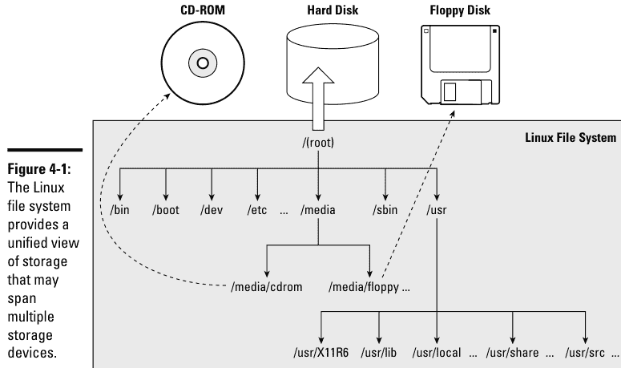

**图 4-1：**

Linux 文件系统提供了一个统一的存储视图，可以跨越多个存储设备。

在 Linux 中，你可以拥有长文件名（最多 256 个字符），且文件名是区分大小写的。这些文件名通常有多个扩展名，例如 `sample.tar.Z`。UNIX 文件名可以有多种形式，例如：`index.html`、`Makefile`、`binutils-2.15.92.0-5.i386.rpm`、`vsfptpd_2.0.3-1_i386.deb`、`.bash_profile` 和 `httpd_src.tar.gz`。

要找到一个文件，不仅需要文件名，你还需要关于目录层级的信息。显示通往文件的目录层级的扩展文件名被称为*路径名*（`pathname`）。正如其名所示，它是穿过文件系统迷宫到达文件的路径。图 4-2 显示了 Linux 中一个文件的典型路径名。

如图 4-2 所示，路径名包含以下部分：

- **根目录**，由正斜杠（`/`）字符指示。
- **目录层级**，每个目录名通过正斜杠（`/`）字符与前一个目录隔开。最后一个目录名之后有一个正斜杠（`/`）。
- **文件名**，包含一个名称和一个或多个可选的扩展名。（在每个扩展名之前有一个点。）

**图 4-2：** 文件的路径显示了通往文件的目录序列。

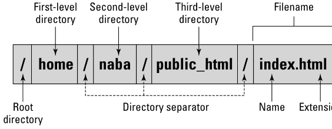

根目录 目录分隔符 名称 扩展名

Linux 文件系统有一组定义良好的顶层目录，其中某些目录具有特定用途。如果你知道这些目录的用途，在文件系统中穿行就会变得更容易。当你面对新情况时，你也会擅于猜测去哪里寻找特定类型的文件。4-1 描述了 Linux 文件系统中的顶层目录。

| 表 4-1 Linux 文件系统中的顶层目录 |
| :--- | :--- |
| 目录 | 说明 |
| / | 此根目录构成了文件系统的基础。无论物理位置如何，所有文件和目录逻辑上都包含在根目录中。 |
| /bin | 包含 Linux 操作系统的一部分的可执行程序。许多 Linux 命令，如 `cat`、`cp`、`ls`、`more` 和 `tar`，都位于 `/bin`。 |
| /boot | 包含 Linux 内核以及 Linux GRUB 启动管理器需要的其他文件。（内核和其他文件可以放在任何地方，但将它们放在 `/boot` 目录是惯例。） |
| /dev | 包含代表连接到系统的特殊设备文件 |
| /etc | 包含大多数配置文件和初始化脚本（位于 `/etc/rc.d` 子目录中） |
| /home | 所有用户家目录的常规位置。例如，用户的家目录是 `/home/user` |
| /lib | 包含启动 Linux 运行 `/bin` 中所有程序所需的库文件（包括可加载的驱动模块） |
| 表 4-1（续） |
| 目录 | 说明 |
| /lost+found | 丢失文件的目录。每个磁盘分区都有一个 `lost+found` 目录。 |
| /media | 用于在可移动介质（如 CD-ROM、软磁盘和 Zip 驱动器）上挂载文件系统的目录。如果你有 CD/DVD 刻录机，你会发现是 `/media/cd` 而不是 `/media/cdrom` 用于挂载文件系统的目录 |
| /opt | 为大型软件包提供存储区域。例如，某些发行版将 OpenOffice 软件套安装在 `/opt` 目录。 |
| /proc | 特殊目录，包含系统中运行进程的信息 |
| /root | `root` 用户的家目录 |
| /sbin | 包含通常用于系统管理任务的可执行文件。`halt` 和 `shutdown` 命令位于 `/sbin`。 |
| /srv | 包含本系统提供的服务（如 Web 和 FTP）的数据 |
| /sys | 特殊目录，包含 Linux 内核所看到的设备信息 |
| /tmp | 任何用户都可以用作临时工作目录的临时目录，这意味着该目录的内容被认为是不需要的，并且在每次系统启动时都会被删除 |
| /usr | 包含许多重要程序的子目录，例如 Windows 系统（在 `/usr/X11` 目录中）和在线手册。 |
| /var | 包含各种系统文件（如日志）以及存放其他信息的目录，例如 Web 服务器文件和匿名 FTP 文件 |

| 表 4-2 重要的 /usr 子目录 |
| :--- | :--- |
| 子目录 | 说明 |
| /usr/X11 | 包含 X Window 软件 |
| /usr/bin | 包含更多 Linux 命令的可执行文件，包括 Linux 中常用但并非核心操作系统的实用程序 |
| /usr/games | 包含一些 Linux 游戏 |
| /usr/include | 包含 C 和 C++ 编程语言的头文件（以 `.h` 结尾的文件）；还包括 `/usr/include/X11` 目录中的 X11 头文件以及 `/usr/include/linux` 目录中的 Linux 内核头文件 |
| /usr/lib | 包含 C 和 C++ 编程语言的库；包含许多其他库，如数据库库和图形工具库 |
| /usr/local | 包含本地文件。例如，`/usr/local/bin` 目录应该是在你系统上开发的任何执行程序的所在地 |
| /usr/sbin | 包含许多管理命令，如用于电子邮件和网络的命令 |
| /usr/share | 包含共享数据，如默认配置文件和图像。例如，`usr/share/gnome` 包含 GNOME 桌面应用的各种共享文件，如 `bash` shell、`Sawfish` 窗口管理器和 `GIMP` 图像处理程序 |
| /usr/share/man | 包含在线手册（可以通过 `man` 命令读取） |
| /usr/src | Linux 内核（核心操作系统）源代码 |

| 表 4-3 重要的 /var 子目录 |
| :--- | :--- |
| 子目录 | 说明 |
| /var/cache | 应用程序数据的存储区域 |
| /var/lib | 包含与应用程序当前状态的信息 |
| /var/lock | 确保资源只被一个应用程序使用的锁文件 |
| /var/log | 包含组织成子目录的日志文件。`syslog` 服务器将日志存储在 `/var/log`，具体内容取决于配置文件 `/etc/syslog.conf`。例如，`var/log/messages` 包含主日志日志；`/var/log/secure` 包含安全服务（如 `sshd` 和 `xinetd`）的日志消息；`/var/log/maillog` 包含消息日志。 |
| /var/mail | 包含用户邮箱 |
| /var/opt | 为存储在 `/opt` 中的软件包提供变动数据 |
| /var/run | 包含自启动以来的数据 |
| /var/spool | 包含等待处理的数据 |
| /var/tmp | 在系统重启之间保留的临时文件 |
| /var/yp | 包含网络信息服务 (`NIS`) 数据库文件 |


## 使用 GUI 文件管理器

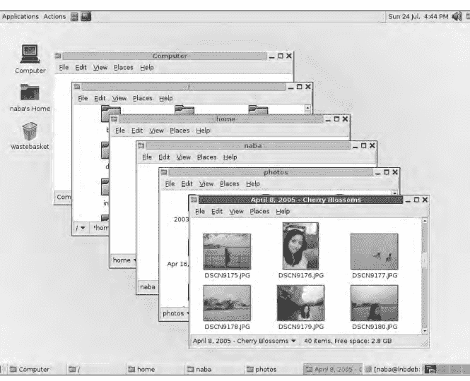

图 4-3: Nautilus 显示了文件夹内容。

第二卷

第4章

导航 Linux 文件系统

## 从 Nautilus 刻录 CD/DVD

如果你的系统有 CD 或 DVD 刻录机（可以是内置刻录机或连接到 USB 接口的外部设备），你可以使用 Nautilus 刻录 CD 和 DVD。从 Nautilus 对象窗口，你可以进入 Nautilus 中的 CD 刻器。只需遵循以下简单步骤即可：
- 1. 在任何 Nautilus 对象窗口中，选择“前往 (Go)：CD/DVD 创建器”。Nautilus 会打开一个 CD/DVD 创建器对象窗口。
- 如果你没有打开任何 Nautilus 窗口，双击桌面上的“计算机 (Computer)”图标。
- 2. 从其他 Nautilus 窗口，将你想放入介质的任何文件和文件夹拖放到 CD/DVD 创建器窗口中。
- 如果要获取电脑上的文件，双击“计算机”图标在 Nautilus 中打开它，并找到你需要的文件。然后将这些文件文件夹拖放到 CD/DVD 创建器窗口。
- 3. 从 CD/DVD 创建器窗口，选择“文件 (File)：写入光盘 (Write to Disc)”。
Nautilus 显示一个对话框，你可以在其中选择 CD 或 DVD 刻录机、写入速度以及其他几个选项，例如完成后是否弹出介质。你还可以指定类型。


- 4. 点击“写入 (Write)”按钮。Nautilus 会刻录 CD/DVD。

## 更改视图

如果你倾向于用树形视图而不是图标查看文件夹内容，你可以简单地更改显示方式：
- 1. 从 Nautilus 菜单中选择“查看 (View)”。
- 2. 点击“以列表形式显示 (View as List)”（相对于“以图标形式显示”）。
Nautilus 使用较小的图标以列表格式显示选目录的内容，并附带详细信息，例如每个文件或目录的大小以及每个最后修改的时间，如图 4-4 所示。

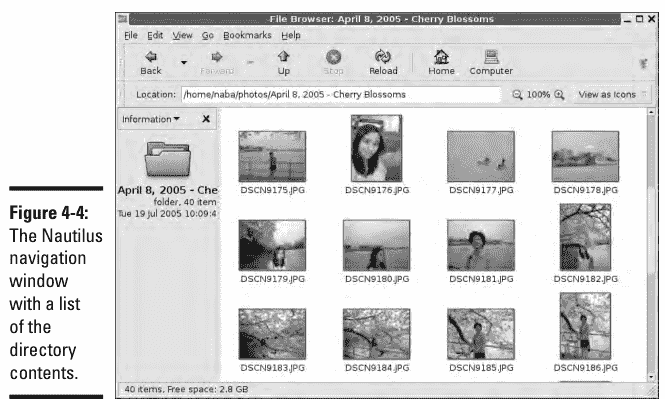

如果你点击列表视图顶部的任何列标题——名称 (Name)、大小 (Size) 或修改日期 (Date Modified)——Nautilus 将根据该列对列表排序。例如，点击“修改日期”。Nautilus 现在显示按最后修改时间排序的文件和目录列表。点击“名称”列将按字母顺序对文件和文件夹排序。你不仅可以通过 Nautilus 窗口在不同文件夹之间移动，还可以执行操作，如将文件从一个文件夹移动到另一个文件夹或删除文件。我没有列出每一步。这些步骤是直观的，与你在 GUI（如 Windows 或 Mac）中的操作相似。以下是你在 Nautilus 122 中可以进行的一些：
- 要将文件移动到不同的文件夹，将文件图标拖放到你想放置该文件的文件夹上。
- 要将文件复制到新位置，选择文件图标，并在 Nautilus 菜单中选择“编辑 (Edit)：复制 (Copy)”。或者你也可以右键点击图标并从右键菜单中选择。然后移动到你想复制文件的文件夹并选择“编辑：粘贴 (Paste)”。
- 要删除文件或目录，右键点击图标并从右键菜单中选择“移动到垃圾桶 (Move to Trash)”（只有在你有删除权限时才能执行此操作）。要永久删除它，右键点击桌面上的垃圾桶图标并从右键菜单中选择“清空垃圾桶 (Empty Trash)”。当然，你不会再看到该文件了。清空垃圾桶后，要从垃圾桶恢复文件，双击垃圾桶图标并将文件图标拖回你想保存它的文件夹。在清空垃圾桶之前，你都可以从垃圾桶恢复文件。
- 要重命名文件或目录，右键点击图标并从右键菜单中选择“重命名 (Rename)”。然后你可以在出现的文本框中输入新名称（或编辑名称）。
- 要创建新文件夹，右键点击窗口的空白区域并在右键菜单中选择“文件夹 (Folder)”。在新图标出现后，可以通过右键点击图标并从右键菜单中选择“重命名”来重命名它。如果你没有创建文件夹的权限，该菜单项将呈灰色。

## 使用 Conqueror

Conqueror 是 KDE 自带的一个文件管理器和 Web 浏览器。它的使用非常直观——类似于 Windows 桌面。你可以使用 Conqueror 管理文件和文件夹（也可以查看网页，使用 F9 切换左侧的导航栏）。

### 查看文件和文件夹

当双击 KDE 桌面上的图标时，Conqueror 会自动启动并打开该文件夹。点击 Conqueror 窗口左侧垂直工具栏上的“主目录 (Home Folder)”图标，然后点击主面板上的“文件夹 (Folder)”。Conqueror 在主窗口中显示你的主目录内容（将目录想象成包含其他文件和文件夹的文件夹）。图 4-5 显示了 Conqueror 中典型的用户主目录。


图 4-5：你可以在 Konqueror 中查看文件和文件夹。

如果你用过 Windows 资源管理器，可以用类似的方式使用 Conqueror。Konqueror 窗口垂直分为：
- 窄的左侧面板显示你可以点击以执行各种任务的图标。
- 宽的面板（可以开启或关闭）显示当前文件夹的树形视图。
- 最宽的面板（在右侧）使用图标显示当前文件夹中的文件和文件夹。
Konqueror 为不同文件使用不同的图标，并显示每个文件的预览。对于图像，预览是图片的缩略图。Konqueror 标题栏显示当前选目录的名称。位置框（窗口顶部）显示目录的完整名称——在此情况下，图 4-6 显示了用户 `/home` 目录的内容。

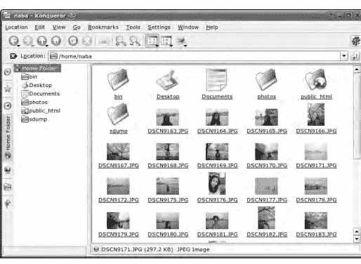

图 4-6：Conqueror 显示目录。

如果你点击列表视图顶部的任何列标题——名称 (Name)、大小 (Size)、类型 (Type) 或修改日期 (Date Modified)，Conqueror 将根据该列对列表排序。例如，点击“修改日期”。Conqueror 现在显示按最后修改时间排序的文件和目录列表。点击“名称”列将按字母顺序对文件和文件夹排序。

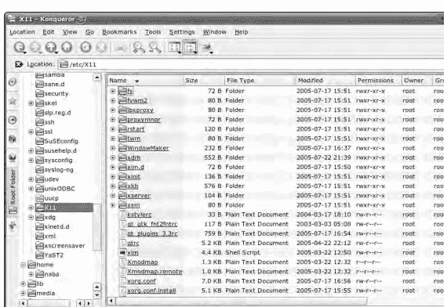

图 4-7：Conqueror 显示目录的详细列表。

### 使用 GUI 文件管理器 127

你想保存该文件。在不同的发行版中，系统会询问你是想复制还是移动，选择“移动”。在清空回收箱之前，你都可以从回收箱中恢复文件。
- **重命名文件或目录：** 右键点击图标并从右键菜单中选择“重命名”。然后你可以在弹出的文本框中使用新名称（或编辑旧名称）。
- **创建新文件夹：** 切换到视图<->模式<->图标视图。然后右键点击右侧窗格的空白区域，从右键菜单中选择“创建新文件夹”。输入新目录的名称并点击确定。（如果你没有创建目录的权限，可能会收到错误消息。）

### 查看网页

Konqueror 不仅仅是一个文件管理器。通过它，你可以像查看文件夹一样轻松查看网页。只需在“位置”文本框中输入 Web 地址，然后看会发生什么。例如，图 4-8 显示了我在工具栏的“位置”文本框中输入 www.irs.gov 并按下回车键后的 Konqueror 窗口。
Konqueror 在右侧显示网站。左侧窗格没有变化。

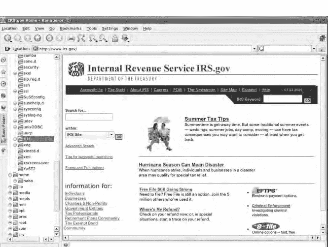

图 4-8：Konqueror 也可以浏览网页。

## 使用 Linux 命令导航文件系统

虽然像 Nautilus（GNOME 中）或 Konqueror（KDE 中）这样的 GUI 文件管理器容易使用，但只有在你拥有工作 GUI 桌面的情况下才能使用它们。有时，你可能没有图形环境来运行图形文件管理器。例如，你可能通过终端登录，或者 X 在你的系统中未正常运行。在这种情况下，你必须依靠 Linux 命令来处理文件和目录。当然，即使在图形环境下你也可以使用 Linux 命令——你只需要打开终端窗口并输入 Linux 命令。
在接下来的章节中，我将简要介绍一些在 Linux 文件系统中移动的 Linux 命令。

### 目录导航命令

在 Linux 中，当你以 root 身份登录时，主目录是 `/root`。对于其他用户，主目录通常在 `/home` 目录下。我的主目录（当我以 eludaney 登录时）是 `/home/eludaney`。这些信息存储在 `/etc/passwd` 文件中。默认情况下，你只有权限在自己的主目录中保存文件，并且只有你可以在自己的主目录中创建子目录以进一步组织你的文件。
Linux 支持“当前目录”的概念，即所有文件和目录命令所操作的目录。登录后，例如，你的当前目录就是主目录。要查看当前目录，输入 `pwd` 命令。
使用 `cd` 命令更改当前目录。要将当前目录更改为 `/usr/lib`，请输入：


然后，要将目录更改到`/usr/lib`中的`cups`子目录，请输入此命令：

```
cd cups
```

现在，如果你使用 `pwd` 命令，该命令将显示`/usr/lib/cups`为当前目录。

这两个示例说明你可以通过两种方式引用目录名称：

- **绝对路径**（例如`/usr/lib`），它指定目录树中的精确目录。将此比为为邮政服务投递给隔邻居的包裹提供完整的邮件地址。
- **相对目录名**（例如`cups`，它代表当前目录下的`cups`子目录，无论当前目录是什么）。将此比为告诉邮递员从你家到隔壁的路，以便他们投递包裹。

如果你在`/usr/lib`中输入`cd`，当前目录将变为`/usr/lib/cups`。然而，如果我在`/home/eduelaney`中输入相同的命令，shell将尝试将当前目录更改为`/home/uelaney/cups`。

不带任何参数使用`cd`命令可以将当前目录切回你的主目录。无论你在哪里，在 shell 提示符处输入`cd`都会带你回家！

波浪字符 (`~`) 指向你的主目录。因此，命令`cd`命令将当前目录更改为你的主目录。你也可以通过在波浪后附加用户名来引用另一个用户的主目录。因此，`cd ~username`将当前目录更改为该用户的家。

等等，还有更多。点 (`.`) 和两个点 (`..`)——通常被称为“点点”——也有特殊含义。单点 (`.`) 表示当前目录，而双点 (`..`) 则表示父级目录。例如，如果当前目录是`/usr/share`，你可以通过输入`..`来向上移动一级。

```
cd ..
```

### 目录列表和权限命令

你可以使用`ls`命令获取目录列表。默认情况下，不带任何选项的`ls`命令会以多列格式显示当前目录的内容。例如，查看`/etc/X11`目录内容的后续两个命令是：

```
cd /etc/X11
```

输出看起来如下。（在控制台上，你会看到一些处于不同颜色的项目。）

| X Xsession.d cursors rgb.txt xkb |

| X86Config-4 Xsession.options default-display-manager rstart xserver |

| Xresources Xrapper.config fonts sysconfig xsm |

| Xsession app-defaults gdm xinit |

从这个列表中（不带颜色），你无法判断条目是文件还是目录。要区分目录和文件，请使用`-F`选项：

```
ls -F
```


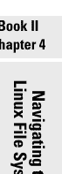

这一次，输出提供了关于文件类型的线索：

| X | Xsession.d/ | cursors/ | rgb.txt | xkb |

|---|---|---|---|---|

| X86Config-4 | Xsession.options | default-display-manager | restart/ | xserver/ |

| Xresources/ | Xrapper.config | fonts/ | syslog/ | |

| Xsession* | app-defaults/ | gdm@ | xinit/ | |

`ls -f`显示带有斜杠 (`/`) 的目录。文件名末尾的符号 (`@`) 表示该文件是一个链接。文件名末尾的星号 (`*`) 是一个可执行文件。

你可以通过`-l`选项查看有关文件和目录的详细信息：

```
ls -l
```

对于`/etc/X11`目录，`ls -l`的典型输出如下：

| total 84 | | | | |

|---|---|---|---|---|

| 2 root root | 20 Jul 15 22 | /usr/bin/X11/ |

| -rw-r--r-- 1 root | 2878 | Jul 16 50 | Free86 |

| drwxr-xr-x 2 root | 3456 | Jun 01 20 | Xresources |

| drwxr-xr-x 2 root | 4096 | Jul 15 20 | Xsession.d |

| -rw-r--r-- 1 root | 217 | Jun 15 59 | Xsession.options |

| -rw-r--r-- 1 root | 771 | Jul 15 20 | Xrapper.config |

| drwxr-xr-x 2 root | 4096 | Jul 15 20 | app-defaults |

| ... lines | | | | |

此列表显示了每个目录的大量信息——查看右侧列，你会发现最右侧显示的是目录名称。日期和时间显示了该文件最后修改的时间。日期左侧是文件的字节大小。文件组和所有者出现在文件大小左侧。大小左边的数字指示文件的链接数（在 Windows 中是快捷方式）。最后，最左侧显示文件的权限位，决定了谁可以读取、写入或执行文件。


最左列的第一个字母有特殊含义，如下所示：

- 如果第一个字母是 `l`，文件是指向另一个文件的符号链接。在其他情况下，它是指向其他内容的快捷方式。
- 如果第一个字母是 `d`，文件是一个目录。它在 GUI 中显示为文件夹。
- 如果第一个字母是横线 (`-`)，文件是普通的。我的意思是不是目录、链接或其他任何特殊内容。系统中的大多数项目都是普通文件。
- 如果第一个字母是 `b`，文件表示块设备，例如磁盘端口或终端。

在第一个字母之后，最左列显示一组九个字符，当每个字符都存在时显示为 `rwxrwxrwx`。每个字母表示一种特定的权限。横线 (`-`) 表示对该特定操作没有权限。将这九个字母视为三组三个 (`rwx`)，解释如下：

- 最左边的 `rwx` 组控制文件所有者的读取、写入和执行权限。也就是说，如果你在这个位置看到 `rwx`，文件所有者就可以读取 (`r`)、写入 (`w`) 和执行 (`x`) 该文件。字母处的横线表示没有权限。字符串 `rw-` 表示所有者具有读写权限但没有执行权限。虽然可执行程序（包括 shell 程序）通常具有执行权限，但目录将执行权限等同于权限。用户在打开和读取目录内容之前必须对目录拥有执行权限。
- 中间的三个 `rwx` 字母控制属于文件的其他用户的读取、写入和执行权限。
- 最右边的 `rwx` 组控制所有其他用户（统称为“世界”）的读取、写入和执行权限。

因此，权限设置为 `rw------` 的文件只有所有者可以访问，而设置为 `rwxrxr--` 的文件世界读取。

`ls`命令的一个有趣特性是它不会列出任何以点开头的文件。要查看这些文件，你必须使用带有`-a`选项的`ls`命令，如下：

```
ls -a
```


## 132 使用 Linux 命令导航文件系统

在你的主目录下尝试此命令，并将结果与不使用`-a`选项时看到的结果进行比较：

- `1.` 输入 `cd` 切换到你的主目录。
- `2.` 输入 `ls -F` 查看你主目录下的文件和目录。
- `3.` 输入 `ls -aF` 查看所有内容，包括隐藏文件。

大多数 Linux 命令使用单字符选项，每个选项前都带有一个减号（将其视为连字符即可）。当你想要使用多个选项时，使用一个连字符并*连接*（串联）各个选项字母，一个接一个。因此，`ls -a` 等同于 `ls -a -1` 以及 `ls -1 -a`。


## 更改权限和所有权的命令

你可能需要更改文件的权限设置以保护其免受他人干扰。使用 `chmod` 命令更改文件或目录的权限设置。

要有效使用 `chmod`，你需要指定权限设置。一种好的方法是按照表 4-4 所示的顺序（对象/操作/权限）连接列中的字母。

你只使用每列中的单个字符——括号中的文字仅用于解释。


| 表 4-4 | 文件权限字母代码 |

|---|---|---|

| u (用户) | + (添加) | r (读取) |

| g (组) | - (移除) | w (写入) |

| o (其他) | = (赋值) | x (执行) |

| a (所有) | s (设置用户 ID) | |

例如，赋予所有人对目录中所有文件的读取访问权限，从第一列选择 `a`（代表所有），从第二列选择 `+`（代表添加），从第三列选择 `r`（代表读取），得到权限设置 `a+r`。然后使用 `chmod` 使用整组选项，如下所示：

```
chmod a+r *
```


另一方面，允许所有人执行一个特定文件，输入：

```
chmod a+x filename
```

## 使用 Linux 命令导航文件系统 133

假设你有一个名为 `mystuff` 的文件想要保护。你可以让任何人无法访问它，但如果你输入以下命令，顺序如下：

```
chmod -awx mystuff
chmod u+rw mystuff
```

第一条命令关闭了所有人的权限，第二条命令为所有者（你）开启了读取和写入权限。输入 `ls -l` 验证更改已生效。（你会看到权限设置为 `------`）

有时，你必须更改文件的用户或组所有权才能让一切恢复正常工作。例如，假设你被指示（通过手册，还能什么？）创建一个名为 `cups` 的目录，并将其所有权交给用户 ID `lp` 和组 ID `sys`。你该如何执行操作呢？

嗯，你可以以 `root` 身份登录并使用创建目录命令 `mkdir` 在当前目录下创建 `cups` 目录：

```
mkdir cups
```

如果你使用 `ls -l` 命令检查详情，你会看到用户和组所有者是 `root`。

要更改所有者，使用 `change` 命令。例如，要将 `cups` 目录的所有权更改为用户 ID `lp` 和组 ID `sys`，输入 `chown`：

```
chown lp.sys cups
```

### 处理文件的命令

要将文件从一个目录复制到另一个目录，使用 `cp` 命令。如果你想将文件复制到当前目录并保留原文件名，在 `cp` 命令的第二个参数中使用 `.`（点）。因此，以下命令将来自 `/etc/X11` 目录的 `Xresources` 文件复制到当前目录（由单个点表示）：

```
cp /etc/X11/Xresources
```

`cp` 命令会创建文件的新副本，并保留原始文件。

如果你想将整个目录的所有内容（包括所有子目录及其内容）复制到另一个目录，请使用命令 `cp sourcedir destdir`。（此命令将 `sourcedir` 中的所有内容复制到 `destdir`）。例如，要将 `/etc/X11` 中的所有文件复制到当前目录，输入以下命令：

```bash
cp -ar /etc/X11 .
```

## 134 使用 Linux 命令导航文件系统

提示：要将文件移动到新位置，使用 `mv` 命令。原始副本将消失，新副本出现在目标位置。你可以使用 `mv` 重命名文件。如果你想将 `today.list` 的名称更改为 `old.list`，请如下所示使用 `mv` 命令：

```
mv today.list old.list
```

另一方面，如果你想将 `today.list` 文件移动到名为 `saved` 的子目录，使用此命令：

```
mv today.list saved
```

`mv` 的一个有趣特性是你可以用它来移动整个目录（带有所有子目录和文件）到新位置。如果你有一个包含许多文件和子目录的 `data` 目录，你可以使用以下命令将整个目录结构移动到 `old_data`：

```
mv data old_data
```

要删除文件，使用 `rm` 命令。例如，要删除名为 `old.list` 的文件，输入以下命令：

```
rm old.list
```

警告：使用 `rm` 命令要小心——尤其是当你以 `root` 身份登录时。

### 处理目录的命令

要组织主目录中的文件，使用以下命令。提示：要将文件移动到新位置，使用 `mv` 命令。原始副本将消失，新副本出现在目标位置。你可以使用 `mv` 重命名文件。如果你想将 `today.list` 的名称更改为 `old.list`，请如下所示使用 `mv` 命令：

```
mv today.list old.list
```

另一方面，如果你想将 `today.list` 文件移动到名为 `saved` 的子目录，使用此命令：

```
mv today.list saved
```

`mv` 的一个有趣特性是你可以用它来移动整个目录……（截断）

要删除文件，使用 `rm` 命令。例如，要删除名为 `old.list` 的文件，输入以下命令：

```
rm old.list
```

警告：使用 `rm` 命令要小心——尤其是当你以 `root` 身份登录时。

要组织主目录中的文件，使用以下命令。提示：要将文件移动到新位置，使用 `mv` 命令。原始副本将消失，新副本出现在目标位置。你可以使用 `mv` 重命名文件。如果你想将 `today.list` 的名称更改为 `old.list`，请如下所示使用 `mv` 命令：

```
mv today.list old.list
```

...（逻辑后续部分）

## 160 导航文件系统

有时，你必须更改文件的用户或组所有权才能让一切恢复正常工作。例如，假设你被指示（通过手册，还能什么？）创建一个名为 `cups` 的目录，并将其所有权交给用户 ID `lp` 和组 ID `sys`。你该如何执行操作呢？

嗯，你可以以 `root` 身份登录并使用创建目录命令 `mkdir` 在当前目录下创建 `cups` 目录：

```
mkdir cups
```

如果你使用 `ls -l` 命令检查详情，你会看到用户和组所有者是 `root`。

要更改所有者，使用 `change` 命令。例如，要将 `cups` 目录的所有权更改为用户 ID `lp` 和组 ID `sys`，输入 `chown`：

```
chown lp.sys cups
```

### 处理文件的命令

要将文件从一个目录复制到另一个目录，使用 `cp` 命令。如果你想将文件复制到当前目录并保留原文件名，在 `cp` 命令的第二个参数中使用 `.`（点）。因此，以下命令将来自 `/etc/X11` 目录的 `Xresources` 文件复制到当前目录（由单个点表示）：

```
cp /etc/X11/Xresources
```

`cp` 命令会创建文件的新副本，并保留原始文件。

如果你想将整个目录的所有内容（包括所有子目录及其内容）复制到另一个目录，请使用命令 `cp sourcedir destdir`。（此命令将 `sourcedir` 中的所有内容复制到 `destdir`）。例如，要将 `/etc/X11` 中的所有文件复制到当前目录，输入以下命令：

```bash
cp -ar /etc/X11 .
```

## 134 使用 Linux 命令导航文件系统

提示：要将文件移动到新位置，使用 `mv` 命令。原始副本将消失，新副本出现在目标位置。你可以使用 `mv` 重命名文件。如果你想将 `today.list` 的名称更改为 `old.list`，请如下所示使用 `mv` 命令：

```
mv today.list old.list
```

另一方面，如果你想将 `today.list` 文件移动到名为 `saved` 的子目录，使用此命令：

```
mv today.list saved
```

`mv` 的一个有趣特性是你可以用它来移动整个目录（带有所有子目录和文件）到新位置。如果你有一个包含许多文件和子目录的 `data` 目录，你可以使用以下命令将整个目录结构移动到 `old_data`：

```
mv data old_data
```

要删除文件，使用 `rm` 命令。例如，要删除名为 `old.list` 的文件，输入以下命令：

```
rm old.list
```

警告：使用 `rm` 命令要小心——尤其是当你以 `root` 身份登录时。

## 136 导航文件系统

# 使用 Linux 命令导航文件系统

在 `mount` 命令成功完成任务后，你可以通过将 `/media/cdrom0` 目录作为光盘的顶级目录来访问 DVD-ROM 上的。换句话说，你可以查看 DVD-ROM 的内容，输入：

```
ls -F /media/cdrom0
```

当你使用 DVD-ROM 时——为了将其从驱动器中弹出——你必须使用以下命令卸载光盘：

```
umount /dev/hdc
```

你可以将设备挂载到文件系统上的任何空目录。然而，每个发行版都有自定义的设备挂载位置。某些发行版使用 `/mnt` 中的目录，而另一些则使用 `/media` 目录作为挂载点。

### 检查磁盘使用的命令 — df 和 du

我想告诉你们两个可以使用的命令来检查系统的磁盘使用情况。这些命令非常简单。`df` 命令显示所有已挂载设备的磁盘使用摘要。当我在带有许多挂载存储设备的 PC 上输入 `df` 时，我得到的 `df` 输出结果如下：

| Filesystem | In-blocks | Used | Available | Use | Mounted on |
| --- | --- | --- | --- | --- | --- |
| /dev/hdb6 | 28249372 | 2177292 | 25672080 | 9% | / |
| tmpfs | 389968 | 12 | 389956 | 1% | /dev/shm |


| `/dev/hda5` | 5766924 | 1422232 | 4014674 | 26% | `/ubuntu/boot` |

| `/dev/hda7` | 6258100 | 2992200 | 3265900 | 51% | `/debian/boot` |

| `/dev/hda8` | 5766924 | 1503012 | 4263712 | 26% | `/ubuntu` |

| `/dev/sda9` | 5766924 | 1872992 | 3600984 | 35% | `/medias` |

| `/dev/hdb1` | 6258100 | 2992200 | 2911100 | 51% | `/medias` |

| `/dev/sda6` | 1687676 | 1059364 | 594312 | 6% | `/windows/C` |

| `/dev/hdb1` | 10742660 | 9613028 | 9781392 | 9% | `/windows/D` |

输出是一个列出设备、总大小（KB）、已用量、可用量、使用率以及挂载点的表格。

要以更易读的格式查看 `df` 的输出，请输入 `df -h`。以下是 `df -h` 命令的输出：

| Filesystem | Size | Used | Available | Use | Mounted on |

| --- | --- | --- | --- | --- | --- |

| `/dev/hdb6` | 27G | 2.3G | 25G | 9% | `/` |

| tmpfs | 375M | 12K | 375M | 1% | `/dev/shm` |

| `/dev/hda5` | 5.5G | 1.4G | 3.9G | 26% | `/ubuntu/boot` |

| `/dev/hda7` | 6.0G | 2.9G | 2.9G | 51% | `/debian/boot` |

| `/dev/hda9` | 5.5G | 1.4G | 3.9G | 26% | `/ubuntu` |

| `/dev/hda10` | 5.5G | 1.8G | 3.5G | 35% | `/mepis` |

| `/dev/hda11` | 6.0G | 2.9G | 2.9G | 51% | `/debian` |

| `/dev/hdb3` | 19G | 1.4G | 18G | 8% | `/xandros` |

| `/dev/hdb2` | 16G | 11.5G | 5.3G | 66% | `/windows/C` |

| `/dev/hdb1` | 103G | 9.2G | 94G | 9% | `/windows/D` |

如果你将此输出与 `df -h` 的输出（见之前的列表）比较，你会发现 `-h` 显示以 M（兆字节）和 G（字节）为单位的大小。这些显然比 1-blocks 更容易理解。

另一个命令 — `du` 可用于查找目录占用了多少空间。例如，输入 `du /etc/X11` 来查看 `/etc/X11` 目录下所有目录的内容。该目录包含 X Window 系统文件。你得到如下结果：

- 12 `/etc/X11/Resources`
- 36 `/etc/X11/Xession.d`
- 272 `/etc/X11/app-defaults`
- 20 `/etc/X11/cursors`
- 12 `/etc/X11/xinit`
- 12 `/etc/X11/fonts/misc`
- 8 `/etc/X11/fonts/100dpi`
- 8 `/etc/X11/fonts/75dpi`
- 8 `/etc/X11/fonts/Speed`
- 8 `/etc/X11/fonts/Type`
- 48 `/etc/X11/fonts`

每个目录后面都跟着一个数字 — 它告诉你是该目录使用的磁盘空间（KB）。因此，`/etc/X11` 作为一个整体使用了 2896KB（约 3MB）。如果你只想知道一个目录（包括所有文件和子目录）使用的总磁盘空间，可以使用 `-s` 选项：

```
du -s /etc/X11
2896 /home
```

正如 `df -h` 以兆字节和字节 输出磁盘空间信息一样，你可以使用 `du -h` 命令以更易读的格式查看 `du` 的输出。例如，查看我的主目录 (`/home`) 空间：

```
du -sh /home
645M /home
```

# 第 5 章：Linux 应用程序介绍

在本章中：

- 了解 Linux 应用程序
- 尝试办公应用程序
- 播放多媒体
- 处理图像

每个 Linux 发行版都带有许多应用程序。你只需要查看 GUI 桌面的菜单就可以看到大量的程序。通常，同类型会有多个应用程序。大多数发行版带有 OpenOffice.org 套件，包含文字处理器、电子表格、演示文稿、绘图程序和数学编辑器。某些商业发行版带有 StarOffice 等办公套件。播放多媒体（各种格式的音频和视频，如 MP3、MPEG、QuickTime）的应用程序可以播放 MP3 文件或 DVD 电影。Xandros 和 SUSE 等商业发行版通常带有这些解码器。

本章提供了某些 Linux 应用程序的概述。在这些这些时，可以使用它们。下表显示了主要应用程序的示例。对于主要的应用程序，还有一个相关的网站可以获取更多信息。此列表并不详尽。每个 Linux 发行版自带的应用程序比表中显示的更多。

### 表 5-1 办公应用程序

| 应用程序 | 描述 |

| --- | --- |

| OpenOffice.org | 免费开源套件（兼容 Microsoft Office），包括 Writer 文字处理器、Calc 电子表格、Impress 演示文稿、Draw 绘图程序和 Math 编辑器 (www.openoffice.org) |

| StarOffice | OpenOffice 的商业办公套件 (www.sun.com/staroffice) |

| CrossOffice | 允许 Linux 上安装和运行 Microsoft Office 软件的商业办公套件 (www.codeavers/products/office) |

| AbiWord | Microsoft Word 的免费文字处理程序 (www.abisource.com) |

| Dia | 绘图程序，设计类似于 Windows 应用 Visio (www.gnome.org/projects/dia) |

### 表 5-2 办公工具

| 应用程序 | 描述 |

| --- | --- |

| GNOME Calculator | GNOME 简单计算器 |

| KCalc | KDE 计算器 |

| Korganizer | KDE 日历和调度程序 (http://korganizer.kde.org) |

| Kontakt | KDE 个人信息管理套件 (www.kontakt.org) |

| Aspell | 模式拼写检查器 (http://aspell.sourceforge.net) |

| Dictionary | dict 字典服务器的图形客户端，你可以查询单词 |

### 表 5-3 文字编辑器

| 应用程序 | 描述 |

| --- | --- |

| emacs | 具有文本和图形界面的著名文本编辑器 (www.gnu.org/software/emacs) |

| Kwrite | KDE 文本编辑器 |

| Kate | KDE 高级文本编辑器 |

| vim | 具有文本模式界面的文本编辑器，兼容著名的 UNIX 编辑器 vi (www.vim.org) |

### 表 5-4 数据库

| 应用程序 | 描述 |

| --- | --- |

| PostgreSQL | 复杂的对象关系数据库管理系统 (www.postgresql.org)，支持结构化查询语言 (SQL) |

| MySQL | 支持 SQL 的流行数据库管理系统 (www.mysql.com) |

### 表 5-5 多媒体

| 应用程序 | 描述 |

| --- | --- |

| GNOME CD Player | 音 CD 播放器（需要正常的声卡） |

| KsCD | KDE 的音频 CD 播放器（需要正常的声卡） |

| amarOK | 多媒体音频播放器 (http://amarok.kde.org)，可以播放多种声音格式，如果你安装了 MP3 解码器，还可以播放 MP3 文件 |

| Rhythmbox | 多媒体音频播放器 (http://rhythmbox.sourceforge.net)，可以播放多种声音格式，如果你需要为该目的下载插件 |

| XMMS | X 多媒体系统：多媒体音频播放器 (www.xmms.org)，可以播放许多不同的声音格式，包括 MP3。（对于某些发行版，你需要下载插件来播放 MP3。） |

| xine | 免费多媒体播放器 (http://xine.org/)，可以播放 CD、DVD 和视频 CD (VCD)，还可以解码 AVI、MOV、WMV 和 MP3 等多媒体文件，只要拥有相应的解码器 |


# 142 Linux 概览

| Caffeine | 基于 xine 的 KDE 媒体播放器，因此 Caffeine 的功能与 xine 相似 (http://caffeine.sourceforge.net) |

| 表格 5-5（续） | 说明 |
| --- | --- |
| Totem | 一个基于 xine 的 GNOME 电影播放器，因此 Totem 的功能与 xine 类似 (www.gnome.org/projects/totem) |
| `cdrdao` | 一个命令行应用程序，可以根据文本文件中 CD 内容描述，以一次刻录 (DAO) 模式刻录或数据 CD-Rs (http://cdrdao.sourceforge.net) |
| `cdrecord` | 一个命令行应用程序，可以刻录音频和数据 CD-Rs 以及 DVD-Rs (http://cdrecord.berlios.de/old/private/cdrecord.html) |
| `growisofs` | 一个命令行应用程序，使用 `mkisof` 命令向常用于 CD-Rs 和 DVD-Rs 的 ISO 9660 文件系统追加数据 (http://growisofs....) |
| X-CD-Roast | `cdrecord` 和 `cdrdao` 的图形界面前端，使刻录数据和音频 CD-Rs 变得简单 (www.xcdroast.org) |
| K3b | 基于 KDE 的 `cdrecord`、`cdrdao` 和 `growisofs` 图形界面前端，用于刻录 CD-Rs 和 DVD-Rs (www.k3b.org) |
| digikam | 一个数字相机和照片管理应用程序，支持 gPhoto2 支持的所有数字相机 (www.digikam.org) |

| 表格 5-6 | 图形与图像 |
| --- | --- |
| The GIMP | GNU 图像处理程序：适用于照片修饰、图像合成和创作任务的应用 (www.gimp.org) |
| GQview | 强大的图像查看器 (http://gview.sourceforge.net) |
| KFax | KDE 的传真查看器 |
| KView | KDE 的简单图像查看器 |
| GGv | Gnome Ghostviewer (G): 一个 PostScript 文档查看器 (www.gnu.org/directory/print/misc/ggv.html) |
| Xpdf | Adobe PDF 文档查看器 (www.foolabs.com/xpdf) |

## Linux 概览 143

| 应用程序 | 说明 |
|---|---|
| XSane | 使用 SANE (Scanner Access Now Easy) 库访问扫描器的图形界面前端 (www.xsane.org) |
| KSnapshot | 截图程序 |
| Kooka | 一个使用 SANE 库的 KDE 扫描程序 (www.kde.org/apps/kooka) |
| xscanimage | 控制扫描器的图形界面前端 |

| 表格 5-7 | 互联网 | 第二部分第 5 章 |
|---|---|---|
| 应用程序 | 说明 | |
| Evolution | 个人信息管理应用程序，集成了电子邮件、日历、联系人管理和在线任务列表 (www.novell.com/products/evolution) |
| gFTP | 从互联网下载文件的图形化 FTP 客户端 |
| Gaim | GNOME 即时通讯客户端 (http://gaim.sourceforge.net) |
| Kopete / Mozilla | KDE 即时通讯客户端... / 起始于 Netscape 源代码的知名开源 Web 浏览器 (www.mozilla.org) |
| Firefox | Mozilla 项目推出的全新改进 Web 浏览器 (www.mozilla.org/products/firefox) |
| Thunderbird | Mozilla 项目的电子邮件客户端 (www.mozilla.org/products/thunderbird) |
| Epiphany | 用于 GNOME 的基于 Mozilla 的源浏览器 (www.gnome.org/projects/epiphany) |
| Lynx | 文本模式 Web 浏览器 (http://lynx.browser.org) |
| Knode | KDE 的图形化新闻阅读 (http://kode.sourceforge.net) |
| Pan | GNOME 的图形化新闻阅读 (http://pan.rebelbase.com) |
| Akregator | KDE 的 RSS 馈聚合和阅读器 (http://akregator.sourceforge.net) |
| KPhone | 支持会话协议 (SIP) 的互联网电话应用程序 (www.wirlab.net/kphone) |

## 144 办公应用程序与工具

| 表格 5-7（续） | 说明 |
| --- | --- |
| Linphone | 支持会话协议 (SIP) 和实时传输协议 (RTP) 的互联网电话应用程序 (www.linphone.org) |
| Skype | 使用 IP 拨打语音的互联网电话应用程序 (www.skype.com) |
| XChat | 网上继聊天 (IRC) 客户端 (www.xchat.org) |
| Konquer | KDE 中的 Web 浏览器和文件管理器 (www.konqueror.org) |
| KMail | KDE 的电子邮件客户端 (http://mail.kde.org) |

并不是所有的发行版都包含表 5-1 所示的所有应用程序，尽管你通常可以在任何发行版中下载并安装这些应用程序。

你通常在安装 Linux 发行版时会选择特定的应用程序组进行安装。你 Linux 系统上具体的应用程序列表取决于你在安装过程中做出的选择。

只要你拥有宽带（电缆或 DSL）互联网连接，在 Debian（以及基于 Debian 的发行版，如 MEPIS 和 Ubuntu）中安装缺失的应用程序非常简单。例如：

- Debian: OpenOffice.org 文
- Debian: OpenOffice.org 应用程序
- Debian: OpenOffice.org 文件
- Debian: OpenOffice.org 应用程序
- Debian: OpenOffice.org 文
- Debian: OpenOffice.org 应用程序
- Debian: OpenOffice.org 文件
- Debian: OpenOffice.org 应用程序
- Debian: OpenOffice.org 文
- Debian: OpenOffice.org 应用程序
- Debian: OpenOffice.org 文件
- Debian: OpenOffice.org 应用程序
- Debian: OpenOffice.org 文
- Debian: OpenOffice.org 应用程序
- Debian: OpenOffice.org 文件
- Debian: OpenOffice.org 应用程序
- Debian: OpenOffice.org 文
- Debian: OpenOffice.org 应用程序
- Debian: OpenOffice.org 文件
- Debian: OpenOffice.org 应用程序
- Debian: OpenOffice.org 文
- Debian: OpenOffice.org 应用程序
- Debian: OpenOffice.org 文件
- Debian: OpenOffice.org 应用程序
- Debian: OpenOffice.org 文
- Debian: OpenOffice.org 应用程序
- Debian: OpenOffice.org 文
- Debian: OpenOffice.org 应用程序
- Debian: OpenOffice.org
- Debian: OpenOffice.org
- :: Open..org 文
- Debian: OpenOffice.org 应用程序
- Debian: OpenOffice.org 文
- Debian: OpenOffice.org
- Debian: OpenOffice.org 应用程序
- Debian: OpenOffice.org 应用程序
- Debian: OpenOffice.org 文
- Debian: OpenOffice.org 应用程序
- Debian: OpenOffice.org 文
- Debian: OpenOffice.org 应用程序
- Debian: OpenOffice.org 文
- Debian: OpenOffice.org 应用程序


- Debian: OpenOffice.org 文
- Debian: OpenOffice.org 应用程序
- Debian: OpenOffice.org 文
- Debian: OpenOffice.org 应用程序
- Debian: OpenOffice.org 文
- Debian: OpenOffice.org 应用程序
- Debian: OpenOffice.org 文
- Debian: OpenOffice.org 应用程序
- Debian: OpenOffice.org 文
- Debian: OpenOffice.org 应用程序
- Debian: OpenOffice.org 文
- Debian: OpenOffice.org 应用程序
- Debian: OpenOffice.org 文
- Debian: OpenOffice.org 应用程序
- Debian: OpenOffice.org 文
- Debian: OpenOffice.org 应用程序
- Debian: OpenOffice.org
- Debian: OpenOffice.org

大多数 Linux 发行版带有：

## Writer

在任何 OpenOffice.org 窗口中选择`文件>文本文档`将启动带有空白文档的 Writer。使用 Writer 的方法与其他文字处理器类似。例如，你可以在空白文档中输入文本、格式化文本并在完成后保存。

Writer 使用起来简单且直观。如果你需要，可以获取在线帮助。在 Writer 菜单中选择`帮助>内容`。这将打开 OpenOffice.org 帮助窗口，其中包含关于 Writer 的帮助。你可以点击链接查看特定信息。

## Calc

Calc 是 OpenOffice.org 应用程序套中的电子表格程序。要启动 Calc，从主菜单的 Office 类别中选择电子表格，或在任何 OpenOffice.org 窗口中选择`文件->新建->电子表格`。

## 办公应用与 147

显示其主窗口，该窗口与基于 Windows 的电子表格相似，例如 Microsoft Excel。（事实上，Calc 可以读取和写入 Microsoft Excel 格式的电子表格。）

像使用 Microsoft Excel 一样使用 Calc。。你可以在单元格中输入内容、使用公式并对单元格进行格式。（例如，你可以指定值的类型和小数点后的位数。）图 5-2 显示了 Calc 中一个典型的电子表格。


图 5-2：使用 OpenOffice.org Calc 准备电子表格。

## 148 办公应用与工具

如果你想与 Microsoft Excel 交换文件，请将电子表格保存为 Microsoft Excel 格式（选择合适的 Excel 版本）。然后你可以将该文件传输到 Windows 系统并在 Excel 中打开。

## Impress

Impress 类似于 Microsoft PowerPoint。你可以使用 Impress 准备演示包（幻灯片演示）。要运行 Impress，请从主菜单中选择“演示文稿”（Presentation），或从任何 OpenOffice.org 窗口选择“文件：新建：演示文稿”。

当你首次启动 Impress 时，它会提示你选择演示样式和模板。要开始工作，选择“空演示文稿”并点击“创建”。要打开现有文档，请从演示文稿向导中选择相应的选项并点击“打开”。你可以在 Impress 中打开 Microsoft PowerPoint 文件。

5-3 显示了 Impress 中一个典型的幻灯片演示。

Impress 窗口显示第一张幻灯片，左侧是幻灯片的大纲视图。文档类型和模板的具体外观取决于你选择的内容。你可以开始在幻灯片上添加文本和其他图形对象（如图像、文本和线条）。


**图 5-3：**你可以在 OpenOffice.org Impress 中准备演示文稿。

## 办公应用与工具 149

要插入新幻灯片，请从菜单中选择“插入->幻灯片”。会出现一个空白幻灯片。然后你可以向该新幻灯片添加文本和图形。

要保存演示文稿，请选择“文件->保存”。对于新文档，你必须提供文件名并选择保存文件的目录。

如果你想与使用 Microsoft PowerPoint 的人共享幻灯片，请将演示文稿保存为 Microsoft PowerPoint 97/2000/XP 格式。


## 日历

KDE 附有 Contact —— 这是一个将 KDE 应用（如 KMail 邮件阅读器和 KOrganizer 日历程序）集成在特定信息管理器中的应用程序。你可以从面板图标或主菜单启动 Contact。（菜单项的具体位置取决于 Linux 发行版。）

当 Contact 启动时，它通常会显示 KMail 应用。不过，你可以点击日历窗口左侧面板上的图标切换到其他视图（见图 5-4）。例如，图 5-4 显示了你点击日历图标后的 Contact 窗口。在这种情况下，Contact 显示 KOrganizer 的输出——即 KDE 日历程序。KOrganizer 程序显示日历视图，你可以点击某个日期来设置或查看当天的日程。图 5-4 显示了一个典型的日历。

图 5-4：在 KOrganizer 中存储你的预约并查看日历。

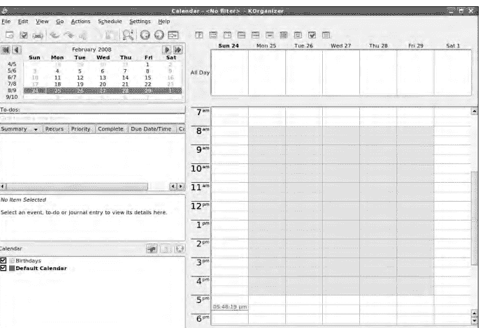

介绍 Linux 第 5 章

要为特定日期和时间添加事件或预约，请从日历中选择日期，双击时间，并在弹出的“新事件”对话框中输入预约的简要描述。完成后点击确定。完成添加事件和预约后，选择“文件：保存”以保存日历。

## 计算器

你可以选择 GNOME 计算器或 KDE 计算器。两者都是科学计算器，你可以进行典型的科学计算器操作，如平方根和倒数，以及三角函数（如正弦、余弦和正切）。

要使用计算器，请在主菜单的“实用工具”或“附件”类别中查找。图 5-5 显示了 SUSE 中的 KDE 计算器。

你可以通过从“设置”菜单中选择选项来显示额外的按钮。例如，选择“设置：三角按钮”以显示允许你使用计算器进行三角计算的按钮。


## 多媒体应用

大多数 Linux 发行版都包含许多多媒体应用——主要是多媒体音频播放器和 CD 播放器，还有用于数字相机和刻录 CD-ROM 的应用程序。要播放其他多媒体文件（如 MPEG 视频），你可能需要在你的 Linux 系统上下载并安装额外的软件。以下是多媒体任务以及你可以用于这些任务的应用程序快速概述：

- *使用数字相机：*使用数字相机工具从 Linux 中的数字相机下载照片（或直接将相机作为 USB 存储设备访问）。
- *播放音频 CD：*使用 Linux 自带的许多音频 CD 播放器之一。

## 多媒体应用 151

- *播放声音：*使用 Rhythmbox 或 XMMS 多媒体音频播放器。（Rhythmbox 或 XMMS）
- *刻录 CD：*使用 K3 刻录数据。

## 使用数字相机

大多数 Linux 发行版都包含许多多媒体应用——主要是多媒体音频播放器和 CD 播放器，还有用于数字相机和刻录 CD-ROM 的应用程序。要播放其他多媒体文件（如 MPEG 视频），你可能需要在你的 Linux 系统上下载并安装额外的软件。以下是多媒体任务以及你可以用于这些任务的应用程序快速概述：

- *使用数字相机：*使用数字相机工具从 Linux 中的数字相机下载照片（或直接将相机作为 USB 存储设备访问）。
- *播放音频 CD：*使用 Linux 自带的许多音频 CD 播放器之一。
- *播放声音：*使用 Rhythmbox 或 XMMS 多媒体音频播放器。
- *刻录 CD：*使用 K3 刻录数据。

## 多媒体应用 153

在你确定了音乐文件的位置后，Rhythmbox 就会启动并以组织的方式显示库。你就可以选择音乐并播放。

XMMS 是另一个音乐播放器，可以播放许多类型的音频文件，包括 Ogg Vorbis、FLAC（自由无损音频编码器，一种类似于 MP3 的音频格式）和 Windows WAV。

你可以从主菜单中选择音频播放器应用程序来启动 XMMS（查看“多媒体和声音”或“视频”下）。XMMS 启动后，你可以通过选择 `窗口→播放文件`或按 L 键来打开文件（例如 MP3 文件）。在“加载文件”对话框中选择一个或多个文件。点击“播放”按钮，XMMS 就会开始播放声音。


在免费发行版中，你可能无法播放 MP3 文件，因为没有包含 MP3 解码器。然而，在 Debian、Knoppix、SUSE 和 Xanders 中可以正常 MP3 播放。由于法律原因，Fedora 中的 Rhythmbox 和 XMMS 版本没有播放 MP3 文件所需的代码，因此在播放它们之前，你必须将 MP3 转换为支持的格式。不过，你可以下载 Rhythmbox 和 XMMS 的源码并构建带有 MP3 支持的应用程序。你也可以使用 Ogg Vorbis 格式处理压缩音频文件，因为 Ogg Vorbis 是一种专利和免版税的格式。

# 第二卷 第五章 介绍 Linux

## 刻录 CD

如今 GUI 文件管理器已经了刻录 CD 的。例如，`Nautilus` 和 `Xanders` 文件管理器内置了刻录 CD 功能。Linux 发行版还附带了独立的 GUI 程序，让你能够刻录 CD 和 DVD。例如，`K3b` 是一种流行的 KDE CD/DVD 刻录应用，可在 Knoppix 和 SUSE 中使用。

大多数 CD 刻录应用程序都很简单。你只需要收集想要刻录到 CD 或 DVD 的文件，然后开始刻录过程。当然，为了实现这一点，你的 PC 必须安装了 CD 或 DVD 刻录机。

`K3b` 窗口顶部用于浏览文件系统以选择你想刻录到 CD 或 DVD 的内容。左上角显示已安装的 CD 刻录设备；在此示例中，是一个 DVD/CD-RW 驱动器，它可以驱动 DVD 和 CD，但只能刻录 CD。

要刻录 CD，从 `K3b` 窗口底部显示的某个项目之一开始——例如，“新音频 CD 项目”或“新数据 DVD 项目”。然后你必须添加文件，并最后通过选择 项目+B 或按 `Ctrl+B` 将项目刻录到 CD 或 DVD。对于音频 CD，你可以拖放 MP3 文件以及音频轨道。

### 154 图形与成像

> 记住，`K3b` 需要外部命令行程序 `cdrecord` 和 `cdrdao` 才能刻录 CD。`K3b` 还需要 `growisof` 程序来刻录 DVD。

如果你在 Debian 中遇到关于缺少 `cdirdao` 的错误，请确保你的 Debian 系统已连接到互联网，然后输入 `apt-get install cdirdao` 来安装它。

## 图形与成像

你可以使用图形和成像应用程序来处理图像和图形（线条画和形状）。这些应用程序中，受欢迎的两个是：

- `GIMP`（GNU 图像处理程序）是一个用于查看和执行图像处理任务的程序，例如照片修饰和图像创建。
- Gnome Ghostview (`GGV`) 是一个能够显示 GIMP PostScript 文件的图形应用程序。

### GIMP

`GIMP` 是一个由 Peter Mattis 和 Spencer Kambill 编写的图像处理程序，并随程序以 GNU 通用公共许可证 (`GPL`) 发布。大多数发行版都带有此程序，尽管你可能需要专门选择一个包来安装。`GIMP` 可以与其他图像处理程序相提，例如 Adobe Photoshop 和 Corel PHOTO-PAINT。

要使用 `GIMP`，请在主菜单的“图形”类别下查找它。当你启动它时，`GIMP` 会显示一个带有版权和许可信息的窗口。点击“继续”按钮继续安装。下一个屏幕显示了当你进行 `GIMP` 安装时将创建的目录。

`GIMP` 的安装涉及在你的主目录下创建一个目录，并在该目录放置若干文件。这本质上包含了你可能对 `GIMP` 进行的任何偏好更改的信息。继续点击窗口底部的“继续”按钮。`GIMP` 会创建必要的目录，将必要的文件复制到这些目录，并引导你通过一系列对话框完成安装。

安装完成后，点击“继续”按钮。从现在起，你不会再次看到安装窗口；你只有在第一次运行 `GIMP` 时才需要处理安装。

随后，`GIMP` 会加载任何插件——增强其功能的外部模块。它显示一个启动窗口，在每个插件加载时显示有关该插件的消息。启动完成后，`GIMP` 在一个窗口中显示“每日提示”。你可以浏览提示并点击“关闭”按钮关闭提示窗口。同时，`GIMP` 会显示多个窗口。

这些窗口包括一个标题为“GIMP”的主工具箱、一个“工具选项”窗口、一个“画笔选择”窗口以及“图层、通道、路径”窗口。其中，主工具箱最重要的——事实上，你可以关闭其他窗口并使用工具箱工作。

工具箱有三个菜单：

- `文件菜单`具有创建新图像、打开现有图像、保存和打印以及退出的选项。
- `Xns 菜单`让你能够访问许多扩展。具体内容取决于安装了哪些扩展。
- `帮助菜单`是你可以获取帮助的地方。

要使用 `GIMP`，请在主菜单的“图形”类别下查找它。当你启动它时，`GIMP` 会显示一个带有版权和许可信息的窗口。点击“继续”按钮继续安装。下一个屏幕显示了当你进行 `GIMP` 安装时将创建的目录。

`GIMP` 的安装涉及在你的主目录下创建一个目录，并在该目录放置若干文件。这本质上包含了你可能对 `GIMP` 进行的任何偏好更改的信息。继续点击窗口底部的“继续”按钮。`GIMP` 会创建必要的目录，将必要的文件复制到这些目录，并引导你通过一系列对话框完成安装。

安装完成后，点击“继续”按钮。从现在起，你不会再次看到安装窗口；你只有在第一次运行 `GIMP` 时才需要处理安装。

随后，`GIMP` 会加载任何插件——增强其功能的外部模块。它显示一个启动窗口，在每个插件加载时显示有关该插件的消息。启动完成后，`GIMP` 在一个窗口中显示“每日提示”。你可以浏览提示并点击“关闭”按钮关闭提示窗口。同时，`GIMP` 会显示多个窗口。

这些窗口包括一个标题为“GIMP”的主工具箱、一个“工具选项”窗口、一个“画笔选择”窗口以及“图层、通道、路径”窗口。其中，主工具箱是最——事实上，你可以关闭其他窗口并使用工具箱工作。

工具箱有三个菜单：

- `文件菜单`具有创建新图像、打开现有图像、保存和打印以及退出的选项。
- `Xns 菜单`让你能够访问许多扩展。具体内容取决于安装了哪些扩展。
- `帮助菜单`是你可以获取帮助的地方。

要使用 `GIMP`，请在主菜单的“图形”类别下查找它。当你启动它时，`GIMP` 会显示一个带有版权和许可信息的窗口。点击“继续”按钮继续安装。下一个屏幕显示了当你进行 `GIMP` 安装时将创建的目录。

`GIMP` 的安装涉及在你的主目录下创建一个目录，并在该目录放置若干文件。这本质上包含了你可能对 `GIMP` 进行的任何偏好更改的信息。继续点击窗口底部的“继续”按钮。`GIMP` 会创建必要的目录，将必要的文件复制到这些目录，并引导你通过一系列对话框完成安装。

安装完成后，点击“继续”按钮。从现在起，你不会再次看到安装窗口；你只有在第一次运行 `GIMP` 时才需要处理安装。

随后，`GIMP` 会加载任何插件——增强其功能的外部模块。它显示一个启动窗口，在每个插件加载时显示有关该插件的消息。启动完成后，`GIMP` 在一个窗口中显示“每日提示”。你可以浏览提示并点击“关闭”按钮关闭提示窗口。同时，`GIMP` 会显示多个窗口。

这些窗口包括一个标题为“GIMP”的主工具箱、一个“工具选项”窗口、一个“画笔选择”窗口以及“图层、通道、路径”窗口。其中，主工具箱是最——事实上，你可以关闭其他窗口并使用工具箱工作。

工具箱有三个菜单：

- `文件菜单`具有创建新图像、打开现有图像、保存和打印以及退出的选项。
- `Xns 菜单`让你能够访问许多扩展。具体内容取决于安装了哪些扩展。
- `帮助菜单`是你可以获取帮助的地方。

### 图形与成像 155

### GNOME Ghostview

`GNOME Ghostview` 是一个图形应用程序，非常适合查看和打印 PostScript 或 PDF 文档。对于长文档，你可以查看并打印指定的页面。你还可以在不同的缩放级别查看文档。

# 第6 章：使用文本编辑器

本章内容

- 使用 GUI 文本编辑器
- 使用 `ed` 文本编辑器
- 了解 `vi` 文本编辑器

虽然桌面提供了一个美观且工作体验良好的图形界面，但很多工作是在该界面之外进行的。大多数 Linux 系统配置文件都是文本文件。此外，创建 shell 脚本以及与许多程序的操作进行交互——这一切都可以通过使用文本文件来实现。

当一切运行正常时，你可以使用图形化工具编辑（并创建）这些文件，但强烈建议你也应该学会如何在界面之外编辑它们，以防出现某些问题导致 X 窗口系统无法加载的情况。无论是在界面内还是界面外，你都会使用专为与文本文件进行特定交互而设计的程序：文本编辑器。

在本章中，你将接触几种文本编辑器——包括 GUI 编辑器和文本模式编辑器。

## 使用 GUI 文本编辑器

每种 GUI 编辑器——GNOME 和 KDE——都自带 GUI 文本编辑器（即具有图形用户界面的文本编辑器）。

要使用 GUI 编辑器，请在主菜单中并在相应的类别下搜索文本编辑器。例如，在 GNOME 桌面中，选择“应用程序/文本编辑器”（Applications/Text Editor）。当你打开并运行文本编辑器后，可以通过点击工具栏上的“打开”按钮来打开文件，这将弹出“打开文件”对话框。然后你可以点击“确定”按钮更改目录并选择要编辑的文件。

GNOME 文本编辑器随后会在其窗口中加载该文件。你可以同时打开多个文件，并在编辑文件时进行切换。图 6-1 显示了使用编辑器进行的一个典型编辑会话。


在这种情况下，编辑器打开了三个文件进行编辑：`hosts`、`fstab`、`motd`（全部来自 `/etc` 目录）。文件名显示在编辑器窗口工具栏下方的标签页中。你可以点击标签页在文件之间切换。当前文件名显示在窗口的标题栏中。

如果你打开了一个你只有读取权限的文件，窗口标题中的文件名后面会附加 `[只读]`（Read Only）字样，指示该文件是只读的。这通常发生在普通用户操作 root 可以修改的操作系统文件时。

其余的编辑步骤都是直观的。要输入新文本，点击定位光标位置并开始输入。你可以使用文本编辑区域上方工具栏上的按钮进行选择、复制、剪切和粘贴。

在 KDE 桌面中，你可以通过选择“菜单：编辑器：高级文本编辑器”（Menu:Editors:Advanced Text Editor）启动 KDE 高级文本编辑器（Kate）。要打开文本文件，选择“文件：打开”（File:Open）。Kate 会显示一个对话框。在此对话框中，你可以进入所需的目录，选择要打开的文件，然后打开并显示其内容。你可以对其进行编辑。

图 6-1：你可以使用 GNOME 文本编辑器编辑文本文件。

## 使用 ed 和 vi 进行文本编辑

GUI 文本编辑器允许你使用鼠标和键盘编辑文本文件，就像使用任何文字处理器一样。模式编辑器则是完全不同的东西——它们仅使用键盘工作，你必须输入晦涩的命令来执行编辑任务，例如剪切粘贴文本或输入和删除文本。Linux 带有两个文本编辑器：

- `ed`：一种行文本编辑器
- `vi`：一种全屏文本编辑器，支持名为 `ex` 的早期编辑器的命令集

与图形文本编辑器相比，`ed` 和 `vi` 编辑器的命令非常晦涩。然而，你仍然应该熟悉 `ed` 和 `vi` 的基本命令，有时这两个可能是唯一可用的编辑器。例如，如果 Linux 拒绝从硬盘启动，你可能需要从软盘启动。在这种情况下，你必须使用 `ed` 编辑器编辑系统文件，因为编辑器足够小，可以放入软盘中。我将带你了解 `ed` 和 `vi` 的基本文本编辑命令——它们并不难。

### 使用 ed

通常，只有当你启动最小版本的 Linux（例如从你设置为启动磁盘的软盘）且系统不支持全屏模式时才需要使用 `ed`。在所有其他情况下，你可以使用可以在全屏模式模式工作的 `vi` 编辑器。

当你使用 `ed` 时，你在命令模式或文本输入模式下工作：

- `命令模式`（Command mode）是默认模式。在此模式下，你输入的任何内容都是命令。`ed` 编辑器有一个简单的命令集，每个命令由一个或多个字符组成。
- `输入模式`（Input mode）用于输入文本。你可以通过命令 `a`（追加）、`c`（更改）或 `i`（插入）进入输入模式。输入文本行后，可以通过在单独的一行输入句号 `.` 来退出输入模式。

为了练习编辑文件，请执行以下命令将 `/etc/fstab` 文件复制到你的主目录：

```
cd
cp /etc/fstab .
```

现在，你的主目录下有一个名为 `fstab` 的文件。输入 `ed -p: fstab` 开始在 `ed` 中编辑文件。编辑器响应如下：

此示例使用 `-p` 选项将提示符设置为冒号（`:`），并打开 `fstab` 文件（在当前目录，即你的主目录）进行编辑。编辑器打开文件，并报告文件中的字符数。

编辑器打开文件，并报告文件中的字符数。此示例使用 `-p` 选项将提示符设置为冒号（`:`），并打开 `fstab` 文件（在当前目录，即你的主目录）进行编辑。编辑器打开文件，并报告文件中的字符数。

编辑器打开文件，并报告文件中的字符数。此示例使用 `-p` 选项将提示符设置为冒号（`:`），并打开 `fstab` 文件（在当前目录，即你的主目录）进行编辑。编辑器打开文件，并报告文件中的字符数。

编辑器打开文件，并报告文件中的字符数。此示例使用 `-p` 选项将提示符设置为冒号（`:`），并打开 `fstab` 文件（在当前目录，即你的主目录）进行编辑。编辑器打开文件，并报告文件中的字符数。

编辑器打开文件，并报告文件中的字符数。此示例使用 `-p` 选项将提示符设置为冒号（`:`），并打开 `fstab` 文件（在当前目录，即你的主目录）进行编辑。编辑器打开文件，并报告文件中的字符数。

编辑器打开文件，并报告文件中的字符数。

```
:p
```

此输出显示 `fstab` 有 9 行。示例：

```
:9
```

此输出显示 `fstab` 有 9 行。当你对更改满意时，可以使用 `w` 命令将更改写入文件。如果你想保存更改并退出，输入 `wq` 以同时完成这两个步骤：

```
:wq
```

编辑器保存文件中的更改，显示保存的字符数并退出。如果你想在不保存任何更改的情况下退出编辑器，请使用 `Q` 命令。

这些示例让你了解如何使用 `ed` 命令执行编辑文本文件的基本任务。表 6-1 列出了一些常用的 `ed` 命令。

#### 162 使用 ed 和 vi 进行文本编辑

| 表 6-1 常用 ed 命令 |
| 命令 | 功能 |
| :--- | :--- |
| `!command` | 执行 shell 命令。（例如，`!pwd` 显示当前目录。） |
| `$` | 移动到缓冲区中的最后一行 |
| `%` | 将随后的命令应用到缓冲区中的所有行。（例如，`%p` 打印所有行。） |
| `+` | 移动到下一行 |
| `+n` | 移动到后续 n 行（n 是你指定的数字） |
| `,` | 将随后的命令应用到缓冲区中的所有行。（例如，`,p` 打印所有行）。这与 `%` 类似。 |
| `-` | 移动到上一行 |
| `-n` | 移动到上一个第 n 行（n 是你指定的数字） |
| `|` | 指向缓冲区中的当前行 |
| `/text/` | 搜索指定的文本 |
| `;` | 指向行范围——从缓冲区中的当前行到某行 |
| `=` | 打印行号 |
| `?text?` | 反向搜索指定的文本 |
| `^` | 移动到上一行。（另见阅 — 命令。） |
| `^n` | 移动到上一个第 n 行（n 是你指定的数字）。另见阅 -n 命令。） |
| `a` | 在当前行后追加 |
| `c` | 修改指定的行 |
| `d` | 删除指定的行 |
| `i` | 在当前行前插入文本 |
| `n` | 移动到第 n 行 |
| 按回车键 | 显示下一行并将该行设置为编辑器行 |
| `q` | 退出编辑器 |
| `Q` | 不保存更改退出编辑器 |
| `r file` | 在当前行之后读取并插入文件内容 |
| `s/old/new/` | 将旧字符串替换为新字符串 |
| `u` | 撤销上一个命令 |
| `w file` | 将缓冲区的内容追加到指定文件的末尾 |
| `w file` | 将缓冲区保存到指定文件中。（如果没有文件名，则保存到默认文件——即 ed 当前正在编辑的文件。） |

### 使用 vi

在尝试过 `ed` 之后，你会发现 `vi` 简直是梦想成真，尽管它仍然是一个命令行编辑器。`vi` 编辑器是一个全屏文本编辑器，因此你可以同时查看几行。大多数 UNIX 系统（包括 Linux）都带有 `vi`。因此，如果你熟悉 `vi` 的基本功能，就可以在几乎任何基于 UNIX 的系统上编辑文件。

当 `vi` 编辑文件时，它会将文件读取到缓冲区（一块内存），这样你就可以更改缓冲区中的文本。`vi` 编辑器在编辑期间还会使用临时文件，但在保存更改之前，原始文件不会被修改。

要启动编辑器，输入 `vi` 并跟上要编辑的文件名，如下：

```
vi /etc/fstab
```

随后 `vi` 将文件加载到内存中并在文本屏幕上显示前几行，并将光标置于第一行，如图 6-2 所示。

**图 6-2：**

你可以使用 `vi` 全屏文本编辑器编辑文件。

```
$ Edit View Terminal Tags Impl:
unionfs / unionfs rw 0 0
tmps /top tmstab include nodelv 0 0
/etc/fstab [read-only] 2 lines, 59 characters
```

最后一行显示了文件的路径以及文件的行数（2）和字符数（59）。在这种情况下，文本 `[read-only]` 出现在文件名之后，因为我以普通用户身份登录时打开了 `/etc/fstab` 文件（这意味着我没有修改该文件的权限）。稍后，`vi` 显示的最后一行作为命令输入。其余行显示文件内容。如果文件行数少于屏幕行数，`vi` 会在第一列用波号（`~`）显示空行。

当前行由光标标记，光标显示为一个微小的黑色矩形。光标出现在字符的上方。

#### 164 使用 ed 和 vi 进行文本编辑

使用 `vi` 时，你会在三种模式之一中工作：

- `可视命令模式`（Visual command mode）是你默认进入的模式。在此模式下，你输入的任何内容都会被解释为适用于光标所在行的命令。`vi` 命令与 `ed` 命令相似。
- `冒号命令模式`（Colon command mode）用于读取或写入文件、设置选项以及退出 `vi`。所有冒号命令都以冒号（`:`）开头。当你输入冒号时，`vi` 将光标置于最后一行并等待你输入命令。当你按下回车键时，命令生效。
- `文本输入模式`（Text input mode）用于输入文本。你可以通过命令 `a`（在光标前插入）、`a`（在行尾追加）或 `i`（在光标后插入）进入输入模式。输入文本行后，必须按 `Esc` 键离开输入模式并重新进入命令模式。


所有这些模式的一个共同问题是你无法轻易判断 `vi` 处于哪种模式。你可能正在输入，却发现 `vi` 并不在输入模式下。如果你想确保 `vi` 处于命令模式，只需按几次 `Esc`（多按几次 `Esc` 也没有害）。要在 `vi` 中查看帮助，请在命令模式下输入 `:help`。查看完帮助后，输入 `:q` 退出帮助屏幕并回到正在编辑的文件。

`vi` 编辑器最初将光标置于第一行——你学习的最困难的事情之一就是如何移动光标。为了练习一下，请尝试表 6-2 中的命令。

| 表 6-2 | `vi` 中的光标移动 |
| :--- | :--- |
| 键 | 功能 |
| ↓ | 光标向下移动一行 |
| ↑ | 光标向上移动一行 |
| ← | 光标向左移动一个字符 |
| → | 光标向右移动一个字符 |
| W | 光标向前移动一个单词 |
| B | 光标向后移动一个单词 |
| Ctrl+D | 向下滚动半屏幕 |
| Ctrl+U | 向上滚动半屏幕 |

### 使用 ed 和 vi 进行文本编辑

你可以随时使用方便的冒号命令跳转到特定行。例如，要到第 n 行，输入以下内容并按回车：
`:n`

当你输入冒号时，`vi` 在屏幕最后一行显示冒号。从那时起，`vi` 将你输入的任何文本视为命令。你需要按下回车将命令提交给 `vi`。在冒号模式下，`vi` 接受所有命令。

要搜索字符串，首先输入斜杠（`/`）。`vi` 编辑器在屏幕最后一行显示斜杠。输入搜索字符串并按回车。`vi` 定位该字符串并将光标置于该字符串的开头。因此，要在 `/etc/fstab` 文件中定位字符串并删除光标所在的行，请输入 `dd`（两个 d）。`vi` 编辑器删除该行文本并使下一行变为当前行。

要在光标前开始输入，输入 `I`（大写的 i）。`vi` 编辑器切换到输入模式。你现在可以输入文本。完成文本后，按 `Esc` 返回可视模式。

| 命令 | 功能 |
|---|---|
| 搜索文本 | |
| `/string` | 向前搜索字符串 |
| `?string` | 向后搜索字符串 |
| 杂项 | |
| `u` | 撤销上一个命令 |
| `Esc` | 退出输入模式并进入可视命令模式 |
| `U` | 撤销当前行最近的更改 |

# 第三部分

## 网络

Rich Tennant 著

《第五波浪》


> “配置它比我们想象的要困难一点。”

## 目录摘要

### 第一章：连接互联网 ................................................................................171
- 理解互联网 ............................................................................171
- 决定如何连接互联网 ................................................................................172
- 使用 DSL 连接 .................................................................................................174
- 使用电缆调制解调器连接 ................................................................180
- 设置拨号上网 .............................................................................185

### 第二章：建立局域网 ...................................................191
- 理解 TCP/IP .......................................................................................191
- 设置以太网局域网 ................................................................................196
- 配置 TCP/IP 网络 ........................................................................199
- 将你的局域网连接到互联网 ................................................................200

### 第三章：无线化 ...................................................................................203
- 理解无线以太网网络 ....................................................203
- 设置无线硬件 .......................................................................207
- 配置无线接入点 ................................................................208
- 配置无线网络 ................................................................209

### 第四章：管理网络 ..................................................................213
- 发现 TCP/IP 配置文件 ...................................................213
- 检查 TCP/IP 网络 ................................................................................217
- 在启动时配置网络 ................................................................222

# 第一章：连接互联网

## 本章内容
- 理解互联网
- 决定如何连接互联网
- 使用 DSL 连接互联网
- 使用电缆调制解调器连接互联网
- 设置拨号 PPP 链路

说互联网对某些人来说是生命线几乎是保守的说法——事实上，可以说它可能正在成为许多人的生命线，因为当面对必须在没有互联网的情况下过一天的可能性时，他们会感到焦虑。鉴于互联网的普及和流行，可以很有把握地假设你想将 Linux 系统连接到互联网。在本章中，我将向你展示如何通过不同的方式连接互联网——取决于你拥有 DSL、电缆调制解调器还是拨号网络连接。

连接互联网的两个选项——DSL 和电缆调制解调器涉及将特殊的调制解调器连接到 Linux 系统上的以太网卡。在这种情况下，你必须在 Linux 系统上设置以太网网络（我在本教程的第二章中解释了网络）。在本章中，我将详细向你如何设置 DSL 或电缆调制解调器连接。

我还会向你展示另一种选择——拨号上网——即从你的 Linux 系统拨打互联网服务提供商（ISP），以防你执意用老派的方法。

## 理解互联网

你如何看待互联网取决于你的视角。普通人通过他们使用的服务来感受互联网。例如，作为一个用户，你可能把互联网看作一种信息交换媒介，具有以下功能：

- 电子邮件：使用如 `mom@home.net` 之类的地址向互联网上的任何其他用户发送电子邮件。
- 网页：从遍布互联网的数百万服务器上下载并查看文档。
- 新闻组：阅读新闻组并向名为 `comp.os.linux.networking` 或 `comp.os.linux.setup` 的新闻组发布新闻项目。
- 信息共享：下载软件、音乐文件、视频等。反之，你也可以提供供其他系统上的用户下载的文件。
- 远程访问：登录互联网上的另一台计算机，前提是你拥有那台远程计算机的访问权限。

技术人员说，互联网是全球性的网络网络。`internet`（不大写）是 `internetworking`（互联网，即网络之间的互连）的缩写。网协议（IP）的设计初衷是连接许多独立的网络。


在物理连接上，互联网类似于高速公路和道路网络。这种相似性促使大众媒体将互联网称为“信息超级高速公路”。正如高速公路和道路网络包括州际公路、许多州道和许多住宅街道一样，互联网拥有一些高容量的网络（例如，10 Gbps 的骨干网每秒可以处理 100 亿比特）以及大量容量从 56 Kbps 拨号到 10 Gbps 不等的低容量网络。


在物理连接上，互联网类似于高速公路和道路网络。这种相似性促使大众媒体将互联网称为“信息超级高速公路”。正如高速公路和道路网络包括州际公路、许多州道和许多住宅街道一样，互联网拥有一些高容量的网络（例如，10 Gbps 的骨干网每秒可以处理 100 亿比特）以及大量容量从 56 Kbps 拨号到 10 Gbps 不等的低容量网络。

## 决定如何连接互联网

### 172

这种相似性促使大众媒体将互联网称为“信息超级高速公路”。正如高速公路和道路网络包括州际公路、许多州道和许多住宅街道一样，互联网拥有一些高容量的网络（例如，10 Gbps 的骨干网每秒可以处理 100 亿比特）以及大量容量从 56 Kbps 拨号到 10 Gbps 不等的低容量网络。

在物理连接上，互联网类似于高速公路和道路网络。这种相似性促使大众媒体将互联网称为“信息超级高速公路”。正如高速公路和道路网络包括州际公路、许多州道和许多住宅街道一样，互联网拥有一些高容量的网络（例如，10 Gbps 的骨干网每秒可以处理 100 亿比特）以及大量容量从 56 Kbps 拨号到 10 Gbps 不等的低容量网络。

所以你想连接互联网，但不知道该怎么做？

- 数字用户线路（DSL）：你的当地电话公司或其他电信公司可能提供 DSL。DSL 通过普通电话线提供高速数据传输。通常，
- 电缆调制解调器：如果你所在地区的电缆电视公司提供接入服务，你可以使用它来连接你的系统。通常，电缆调制解调器的速度更快。
- 拨号上网：在 DSL 和电缆调制解调器出现之前，大多数使用的是拨号连接。当你将 PC 连接到连接电话线的解调器时，首先必须连接电话（向电话公司付费），然后选择并支付独立的 ISP——它会给你拨号号码以及其他必要的配置（如 IP 地址和电子邮件帐户）。

表格 1-1 总结了这些选项。你可以参考该表并选择适合你且符合要求的连接类型。

| 表格 1-1 拨号、DSL 和电缆的对比 |
| 特性 | 拨号 | DSL | 电缆 |
|---|---|---|---|
| 设备 | 解调器 | DSL 解调器、以太网卡 | 电缆调制解调器、以太网卡 |
| 还需要 | 电话服务和互联网服务提供商 (ISP) | 电话服务且距离局端 12,000 至 15,000 英内 | 电缆电视连接 |
| 连接类型 | 拨号连接 | 始终在线、独享 | 始终在线、共享 |

## 174 连接到 DSL

表 1-1（续）

| 特性 | 拨号 | DSL | 宽带 |
|---|---|---|---|
| 典型速度 | 最高 56 Kbps | 640 Kbps 下载，128 Kbps 上传（速度越高费用越高） | 1.5 Mbps 下载，128 Kbps 上传 |
| 一次性费用（估算） | 无 | 安装费 $100–200（自行安装免此）；设备 = $50–100（可能需要租赁，并可能需要激活费） | 安装费 $100–200（自行安装免此）；设备 = $50–100（可能需要租赁） |
| 典型月费（2005年） | 电话费 = 每月 $20，ISP费用 = 每月 $15–30 | 每月 $40–50；可能需要月租 | 每月 $40–50；可能需要月租 |

除了表 1-1 所示的三种选项外，其他一些选项还包括光入户（FTTH）、电力线宽带（BPL）、固定无线宽带（称为 FWB 或 WiFi）以及卫星互联网接入（例如 DIRECTWAY 和 StarBan）。如果你的地理区域提供其中一种或多种选项，并且你想使用其中一种来接入互联网，请遵循特定服务提供商关于设置互联网连接的说明。通常，卫星互联网接入覆盖较大的地理区域（即使是没有电话或宽带的地方），但其初始设备成本和月费比 DSL 高。有关接入互联网的更多信息，请访问 www.satellite-internet-access.net。

## 连接到 DSL

DSL 代表数字用户线路（Digital Subscriber Line）。DSL 使用你现有的电话线发送数字数据，同时还传输模拟语音信号（模拟信号是连续变化的，而数字数据由 1 和 0 表示）。电话线从你家延伸到局端，线路连接到电话公司网络。顺便说一下，从你家到局端的连接被称为本地环。当你注册 DSL 服务时，电话公司会将你的电话线连接到局端的一些特殊设备上。这些设备可以将数字数据与语音分离。从那时起，你的电话线就可以携带直接发送到局端互联网连接的数字数据。

## DSL 如何工作

一个名为 DSL 调制解调器的特殊盒子负责通过电话线将数字数据从你的 PC 发送到电话公司的局端。你可以使用用于普通电话通话的同一条电话线连接互联网——即使线路正在被 DSL 使用，你也可以进行语音通话。图 1-1 显示了典型的 DSL 互联网连接。

你的 PC 通过以太网连接与 DSL 调制解调器，这意味着你的 Linux 系统需要一个以太网卡。

你的 PC 通过以太网连接将数字数据发送到 DSL 调制解调器。DSL 调制解调器发送数字数据的频率与模拟信号使用的频率不同。语音信号仅占用电话线传输的所有频率的一部分。DSL 使用较高的频率传输数字数据，因此语音和数据可以在同一线上传输。

## 176 连接到 DSL

家与局端之间的距离——环长度是 DSL 性能的因素。遗憾的是，电话线可靠传输 DSL 信号的距离有限——三英里以内，这意味着只有当你（或办公室）位于电话公司局端约三英里范围内时才能获得 DSL 服务。你的电话公司可以告诉你你的位置是否可以使用 DSL。他们通常有一个网站，你可以在上面输入电话号码并获得关于 DSL 可用性的回复。例如，美国地区可以尝试 www.dslavailability.com。

## DSL 字母字汤：ADSL, ISDN, SDSL

我一直使用 DSL 这个术语，好像只有一种 DSL。正如你所想象的，事实从未那么简单。实际上有三种 DSL 变体，每种都有不同的特征。来看一下：

- **ADSL:** 非对称 DSL 是最常见的 DSL 形式，具有较高的下载速度（从互联网到 PC）和上传速度（从 PC 到互联网）。ADSL 的下载速度可达 8 Mbps，上传速度可达 1 Mbps。当你的位置距离局端约 2 英里（12,000 英尺）时，ADSL 效果最好。ADSL 服务根据你所需的下载和上传速度定价。一种流行的 ADSL 形式 G.lite 专门设计用于你语音通话的同一线路上。G.lite 的最大下载速度为 1.5 Mbps，最大上传速度为 512 Kbps。
- **ISDN:** ISDN（是一项较旧的技术，称为集成业务数字网络）是一种特殊的 DSL，工作在距离电话和局端最多五英里的范围内。缺点是 DSL 仅提供下行（从互联网到 PC）。
- **SDSL:** 对称 DSL 提供相等的下载和上传速度。

## 178 连接到 DSL

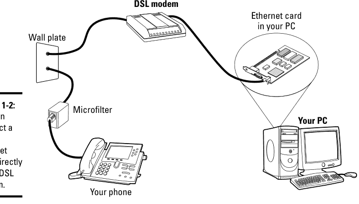

图 1-2：你可以将 PC 的以太网直接连接到 DSL 调制解调器。

> 警告！

同一条电话线传输语音信号和 DSL 数据，你需要微滤波器来保护 DSL 数据免受可能产生的干扰。你可以在电子商店或从 DSL 服务商处购买。

当你使用 DSL 将 Linux PC 连接到互联网时，连接是始终开启的，这意味着外部人员入侵 PC 的可能性更大。


你可以通过可以使用执行网络地址转换（NAT）的路由器保护你的 Linux 系统免受入侵，并作为额外奖励，与局域网（LAN）中的其他 PC 共享高速连接。NAT 路由器会将内部局域网的私有网协议（IP）地址翻译为单个公共 IP 地址，从而允许所有内部 PC 访问互联网。NAT 路由器将你的局域网与互联网隔离开——这使得入侵者难以访问你局域网上的系统。

如果你也想建立一个局域网，你需要一个以太网集线器或交换机将其他 PC 连接到网络。图 1-3 显示了一个通过 NAT 路由器和 DSL 调制解调器将局域网连接到互联网的典型设置。

设置类似图 1-3 所示的连接时需要注意以下点：

- 你需要一个具有两个 100BaseT 或 10BaseT 以太网端口的 NAT 路由器（100BaseT 和 10BaseT 端口类似于较大的电话插，被称为 RJ-45 接口）。通常，一个端口标记为 Internet（外部或 WAN，广域网），另一个标记为 Local 或 LAN（局域网）。
- 你还需要一个以太网集线器/交换机。对于小型家庭网络，你可以购买 4 口或 8 口的以太网集线器。基本上，你需要的集线器端口数等于你打算连接到局域网的 PC 数量。对于工作，你需要用交换机替换集线器。
- 使用 10BaseT 以太网线将 DSL 调制解调器的以太网端口连接到 NAT 路由器的 Internet 端口。（这些线看起来像带有较大的 RJ-45 插头的电话线，标记为第 5 类或 Cat 5 线。）
- 使用 100BaseT 以太网线将 NAT 路由器的 Local 端口连接到以太网集线器/交换机的端口之一。
- 现在将每台 PC 连接到以太网集线器/交换机。（当然，你必须先确保每台 PC 都安装并配置了以太网卡。）

### 提示

你也可以购买带有内置 4 口或 8 口以太网集线器的 NAT 路由器。使用这种集成的路由器和集线器，你只需要一个盒子即可建立局域网并通过 DSL 调制解调器连接到互联网。这些盒子通常以电缆/DSL 路由器的出售，因为它们同时支持 DSL 和电缆调制解调器。

图 1-3：NAT 路由器将你的 PC 与互联网隔离，并让你与局域网中的其他 PC 共享 DSL 连接。

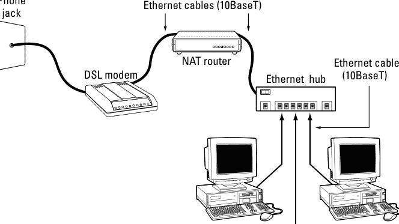

局域网（LAN）中的 PC。每台 PC 必须有一块 10BaseT 以太网卡。

## 180 连接电缆调制解调器

参考本小型书籍第 2 章获取有关如何在 Linux 系统配置网络的信息，以便你的系统可以访问互联网。

DSL 供应商通常使用称为以太网上的 PPP（PPPoE）的协议在 PC 与供应商中心办公室的设备之间建立连接。PPPoE 要求你提供用户名和密码以通过以太网建立网络连接。要为你的系统设置 PPPoE DSL 连接，你只需要运行一个配置系统用于 PPPoE 的实用程序。你可以在 GUI 桌面的主菜单中搜索该实用程序。

在 Ubuntu 中，你可以通过选择系统管理：网络，点击调制解调器连接并选择属性来设置 PPPoE DSL 连接。然后按照后续屏幕操作，确保提供请求的账户信息，如用户名和密码。

## 连接到电缆调制解调器

电缆公司还通过传输电视信号的同一同轴电缆提供高速互联网访问。在电缆公司在其设施安装了必要的设备以通过同轴电缆收发数字数据后，客户就可以申请电缆互联网服务。然后你就可以通过传输电视信号的同一条电缆获取高速互联网访问。

### 电缆调制解调器如何工作

一个名为调制解调器的盒子是通过电视网络访问互联网的核心。（见图 1-4）电缆调制解调器从你 PC 的以太网线获取数字数据，并将其放入一个不阻塞的频段中。（将其想象成另一个电视网络——但不是图像和声音，这个通道传输的是数字数据。）

电缆调制解调器将上行数据——从你的 PC 发送到互联网的数据——放在与从互联网到你 PC 的下行数据不同的通道中。根据设计，下行数据的速度远高于上行传输速度。假设是人们从互联网下载的内容远比他们能上传的内容要多。（对我们大多数人来说这可能是的。）

将这数百个电视频道传输到家中的电缆是一种非常强大的信号载体。特别是，电缆可以携带覆盖巨大频率范围（数百兆赫兹 MHz）的信号，且电缆可以携带数百个这样的通道。电缆调制解调器将上行数据放置在一个小频带，并期望在另一个频带接收下行数据。

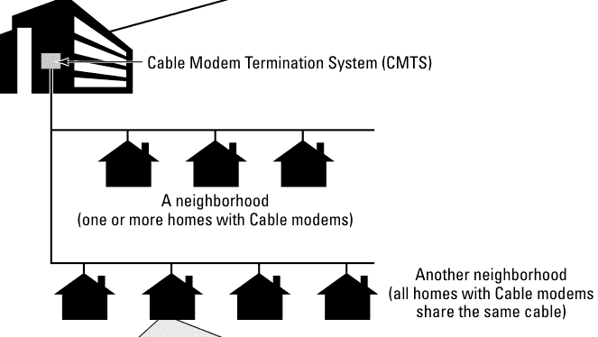

电缆公司前端（中心分配点）到互联网骨干网。电缆调制解调器终端系统 (CMTS)。一个社区（一个或多个带有电缆调制解调器的家庭）。另一个社区（所有带有电缆调制解调器的家庭共享同一条电缆）。

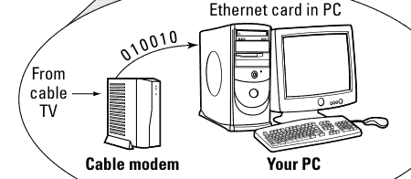

图 1-4：缆调制解调器通过电缆网络提供高速互联网。

## 182 连接电缆调制解调器

要设置电缆调制解调器访问，你的线电视供应商必须提供高速互联网。如果服务可用，你可以打电话申请。电缆公司通常有促销活动，例如免安装费或前三个月优惠率。寻找这些优惠。如果你足够好，当地电缆公司在你申请时可能正在进行促销。

安装由技术人员完成，他们将你的电缆分成两部分——一端通往电视，另一端通往电缆调制解调器。技术人员将电缆调制解调器的信息提供给电缆公司的后端进行设置。当这一切完成后，你就可以将 PC 的以太网卡接入电缆调制解调器，准备好享受高速互联网访问。图 1-5 显示了一个典型的电缆调制解调器设置。

电缆调制解调器连接到 PC 的以太网卡。如果你的 PC 中没有以太网卡，电缆公司的技术人员通常会提供一个。

关于图 1-5 中的电缆调制解调器设置，需要注意以下关键点：

- 使用二分器将接入电缆分成两部分。（电缆公司安装二分器。）
- 二分器需要额定为 1 GHz；否则它可能无法让互联网下行数据的频率通过。
- 使用同轴电缆连接调制的一个 F 型视频连接器。
- 使用 100BaseT 以太网连接将电缆调制解调器连接到 PC 上的以太网卡。
- 将电视连接到二分器的另一个视频输出。


## 连接电缆调制解器 183

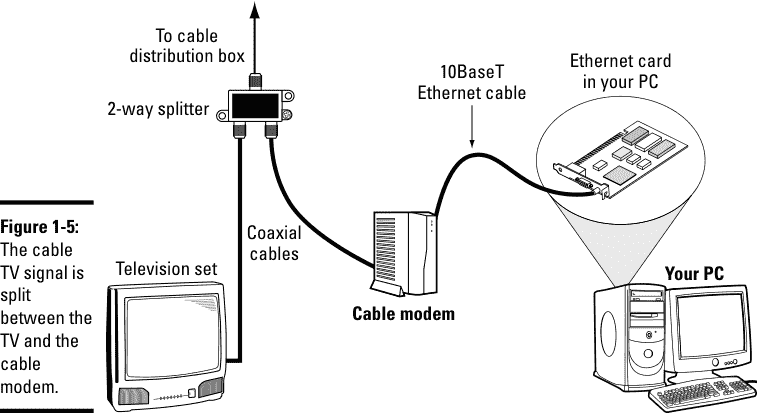

图 1-5：电缆电视信号在电视和电缆调制解器之间分配。

当你使用电缆调制解器将 Linux PC 直接连接到互联网时，连接是始终开启的，因此你更有可能遇到尝试入侵 PC 的人。Linux 包含了 `iptables` 数据包过滤功能，你可能希望保护你的 PC 免受不受欢迎的互联网连接。在 Ubuntu 中，你可以安装 `firestarter` 软件包（来自 Universe 仓库）。安装后，通过选择 `System\Administration\Firestarter` 来配置设置。这将启动防火墙向并引导你完成配置步骤。

为了将你的 Linux PC 或局域网与公网隔离开，你可能希望在 PC 和电缆调制解器之间添加一个 NAT 路由器。NAT 路由器的一个接口连接到互联网，另一个连接到你的局域网（LAN）和互联网。作为额外奖励，你甚至可以通过添加以太网集线器，与本地局域网（LAN）中的所有 PC 共享电缆调制解器连接。更好的做法是购买组合 NAT 路由器和集线器，这样你只需要一个盒子完成所有工作。

NAT 路由器和集线器通常以电缆/DSL路由器的名称出售，因为它们适用于 DSL 和电缆调制解器。

第三册

第一章

连接互联网

## 184 连接电缆调制解器

NAT 路由器将私有 IP 地址转换为公共 IP 地址。通过 NAT 路由器连接时，内部 LAN 中的任何 PC 访问互联网都就像它有自己唯一的 IP 地址一样。结果：你可以在多个 PC 之间共享单个互联网连接。对于整个上网家庭来说的理想解决方案！

图 1-6 显示了一个典型的设置，局域网中的许多 PC 共享一个电缆调制解器连接。

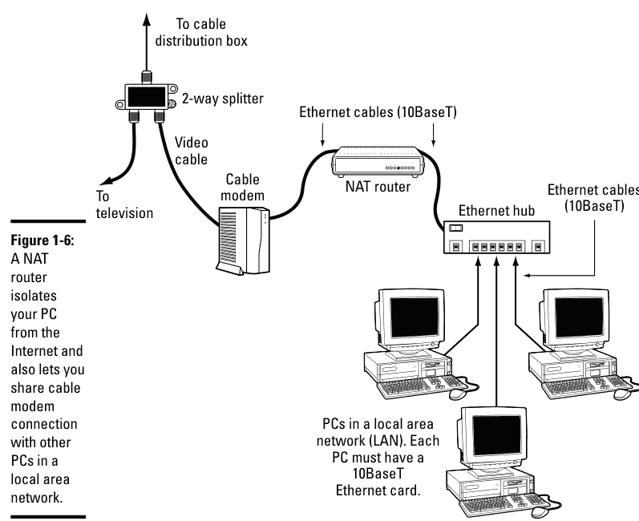

## 设置拨号网络

设置如图 1 所示的连接时需要注意以下几点：

- 你需要一个带有两个 100BaseT 以太网端口的电缆/DSL NAT 路由器（100BaseT 端口也称为 RJ-45 接口，看起来像大型手机接口）。通常，一个以太网端口标记为 `Ethernet`（外部或 WAN，广域网），另一个标记为 `Local`。
- 如果你计划建立 LAN，你还需要一个以太网集线器/交换机。对于家庭网络，你可以购买一个 4 口或 8 口的以太网集线器。基本上，你拥有一个端口数量等于你想要连接到本地局域网的 PC 数量的集线器。
- 考虑使用一个同时作为 NAT 路由器和具有多个以太网端口的集线器的单盒。
- 将视频线连接到电缆调制解器的视频输入端口。
- 使用 100BaseT 以太网线将电缆调制解器的端口连接到 NAT 路由器的互联网端口。（这些看起来像电话线，但以太网线具有更大的 RJ-45 接口并标记为 Category 5 Cat 线。）


- 使用 `100BaseT` 以太网线将 `NAT` 路由器的 `Local` 以太网端口连接到以太网集线器上的一个端口。

- 现在将每个 PC 连接到以太网集线器。当然，每台 PC 必须有一块以太网卡。

在本教程的第二章中，我将解释如何配置 PC，使其能够通过路由器访问互联网。

## 设置拨号网络

拨号网络是指通过调制解器将 PC 连接到远程网络。如果你足够老，还记得使用 Procom 或某些串口通信软件拨号的日子，请意识到拨号网络与旧的串口通信之间存在显著差异。这两种方法都使用调制解器拨号远程计算机以建立通信路径，但串口通信软件让你的计算机表现得像连接到远程计算机的哑终端。串口通信软件独占拨号连接。例如，你不能运行另一个通信软件的副本并使用同一个调制解器连接。

在拨号网络中，你的 PC 和远程系统都运行网络协议（称为 `TCP/IP`）软件。当你的 PC 拨号并建立通信路径时，网络协议通过拨号连接交换数据包。巧妙的地方在于，任何数量的应用程序都可以同一个拨号连接来发送和接收数据包。因此，你的 PC 变成了远程计算机所在网络的一部分。如果远程计算机不在网络上，拨号网络会创建一个连接远程计算机和你的 PC 的网络。

### 第三册

#### 第一章

##### 连接互联网

## 设置拨号网络

在本教程的第二章中，我将部分描述 `TCP/IP` 协议，但在描述如何设置拨号网络时，我必须使用这些术语，因为涉及到互联网协议 (`IP`) 地址和域名服务 (`DNS`) 等概念。

设置 `TCP/IP` 拨号连接涉及指定协议——即在通信链路上封装数据包的约定。点对点协议 (`PPP`) 就是这样一种在任何点对点链路上（包括拨号线路）建立 `TCP/IP` 连接的协议。Linux 支持 `PPP`，并附带了你可以使用的配置工具。

设置 `PPP` 你需要执行的操作如下是：

- 安装内部或外部调制解器。如果你的 PC 没有附带内部调制解器，你可以购买一个外部调制解器并将其连接到串口或 `USB` 端口。

- 将调制解器连接到电话线并通电。

- 获取 `ISP` 账户。你的系统会自动获取一个 `IP` 地址。

- 使用 `GUI` 工具（可用）设置 `PPP`。如果找不到 `GUI` 工具，请使用文本编辑器编辑 `/etc/dialconf` 并输入电话号码、用户名和密码。

- 使用 `GUI` 工具（可用）激活 `PPP`。如果没有 `GUI` 工具，以 root 登录并输入 `dialup` 建立。


我将在后面的章节中简要介绍这些步骤。

### 连接调制解器

`Modem` 是调制/解调器的缩写——一种将数字信号（1 和 0 的字符串）转换为在电话线上传输的连续模拟信号的设备。因此，调制解器是 PC 数字世界与电话模拟世界之间的中介。图 1-7 说明了调制解器的概念。

图 1-7：调制解器桥接了 PC 数字世界和电话的模拟世界。


在 PC 中，1 和 0 用电压电表示，但电话线上传的信号通常是不同频率的调调。调制解器位于 PC 和电话线之间，通过电话线进行数据通信。

在拨出外部调制解器之前，你必须确保调制解器已正确连接到 PC 的串口或 `USB` 端口。如果你有一个外部调制解器，确保调制解器已正确连接到电源并连接到电话线。购买正确的线缆将调制解器连接到 PC。你需要一根直连串口线将调制解器连接到 PC。两端的连接器取决于 PC 上的串口连接类型。调制解器端需要一个 25 口公接头。PC 端通常是 9 口母接头。你可以在大多数电脑商店买到这些线缆。通常，你可以找到标记为 `AT Modem Cable` 的 9 口母转 25 口公线缆。

## 设置拨号网络

如果 PC 具有内置调制调器，你只需要将电话线连接到内置调制调器卡背后的电话接口即可。如果它是 `Winmod`，你仍然需要连接线，但还需要在互联网上进行一些研究，并下载让 `Winmod` 在 Linux 中运行的驱动程序。安装好适用于 `Winmod` 的 Linux 驱动程序后，它的工作方式就像旧的串口调制调器一样。更多信息请参阅侧边栏“`Winmodems`：它们仅支持 Windows”。

### 设置并激活 PPP 连接

大多数 `ISP`（互联网服务提供商）通过其维护的一个或多个系统提供 `PPP` 拨号上网。如果你办理了服务，`ISP` 会为你提供建立与 `ISP` 系统 `PPP` 连接所需要的信息。通常，这些信息包括以下内容：

- 连接到远程系统的拨号号码。

- 登录远程系统时使用的用户名和密码。

- `ISP` 邮件服务器和新闻服务器的名称。

- `PPP` 连接的 `IP` 地址。如果 `IP` 地址是动态分配的，`ISP` 则不提供此地址（这意味着每次你的系统建立连接时，`IP` 地址都可能会变化）。

- `ISP DNS` 的 `IP` 地址。如果 `ISP` 动态分配 `IP` 地址，则不提供这些地址。

在这些信息中，前两项是设置 `PPP` 连接所需的。设置和建立 `PPP` 连接的后续步骤取决于发行版。对于带有 `GUI`（图形界面）网络连接工具的发行版，你可以轻松地找到输入 `ISP` 账户信息（号码、用户名和密码）的地方。接下来我介绍几种针对特定发行版的配置 `PPP` 方法。

#### Winmodems：它们仅支持 Windows

对许多 PC 和笔记本电脑自带的 `Winmod` 提个简单的警告：`Winmod` 是基于软件的内置调制调器——与传统的硬件调制调器完全不同。它们也被称为 Windows 调制调器或软件调制调器（简称 `softmod`），仅配合特殊软件工作（而该软件又仅适用于 Microsoft Windows）。对于 `Winmod` 和 Linux，你基本上只能自力更，但可以在 `www.linmodems.org` 的 Linux Winmod Support 帮助页面找到实用的指南。

### 设置拨号网络

`Debian` 有一个设置 `PPP` 连接的 `GUI` 工具，该工具使用了 `wdial`，而它默认并没有安装。请使用 `apt-get install wdial` 来安装它。然后你就可以使用 `GUI` 工具来配置和验证拨号 `PPP` 连接。

在 `Ubuntu` 中，从 `GNOME` 桌面选择 `System-Administration-Network`（系统管理-网络）。在第一个对话框中选择 `Modem Connection` 并继续配置。

### 配置 CHAP 和 PAP 身份验证

你的系统上的 `PPP` 服务器在 `PPP` 连接完全建立并运行之前，必须向 `ISP` 的 `PPP` 服务器进行身份验证。验证要求你拥有一个 `ISP` 的有效账户和一个密钥（即密码）。`PPP` 规定了两种在两端之间交换验证信息的方法：

- 挑战握手验证协议（`CHAP`）要求远程端从远程服务器名称发送一个随机生成的挑战。本地系统使用密钥，然后发送一个包含其名称以及通过单向哈希函数结合密钥和挑战的值的响应。远程系统随后将该值与其哈希值进行比对。如果值匹配，则验证成功；否则远程端将终止连接。在这种情况下，名称和密钥存储在 `/etc/ppp/chap-secrets` 文件中。

- 密码验证协议（`PAP`）类似于普通过程。当使用 `PAP` 时，本地系统会反复发送用户名（和密码）密钥，直到远程系统确认验证或结束连接。名称和密钥存储在 `/etc/ppp/pap-secrets` 文件中。

远程系统可以在 `PPP` 链路连接期间任何时候重复 `CHAP` 验证。

用户名和密码是以明文（未加密）发送的。

Linux `PPP` 服务器支持两种验证类型。对于 `PAP` 和 `CHAP`，`PPP` 服务器需要的信息都是名称和密钥——即用户名和密码对。这些验证信息存储在以下文件中：

- `/etc/ppp/chap-secrets` 存储 `CHAP` 的信息。一个 `chap-secrets` 文件的内容如下：

```
# Secrets for authentication server IP addresses
# client               secret
"edulaney"         *"myppassword"
```

- `/etc/ppp/pap-secrets` 存储 `PAP` 的信息。一个典型的 `pap-secrets` 文件如下：

```
# Secrets for authentication using PAP
# client server secret IP addresses
"eduelaney" * "password"
```

你可以看到，`chap-secrets` 和 `pap-secrets` 的条目格式相同。每行有四个字段，顺序如下：

- `client`：此字段包含身份验证期间使用的名称。你从 `ISP` 获得此名称。

- `server`：此字段包含远程服务器的名称。

- `secret`：此字段包含密钥（密码）。

- `IP addresses`：此字段包含服务器的 `IP` 地址。

## TCP/IP 与互联网


`TCP/IP` 已经成为互联网的首选协议——这是一个从 `ARPANet` 演变而来的网络网络。美国政府高级研究计划署（`ARPA`）于 20 世纪 70 年启动了关于一种信息传输新的研究，即在网络上发送数据包。其结果是 `ARPANet`：一个由连接的计算机组成的全国性网络。随后，`ARPA` 获得了国防前缀并变为 `DARPA`。在 `DARPA` 的赞助下，`TCP/IP` 协议成为了一套流行的网络互联协议集——即网络之间的通信。

`TCP/IP` 之所以繁荣，是因为该协议是开放的。这意味着该协议的技术描述出现在公共文档中，因此任何人都可以在特定的硬件和软件上实现 `TCP/IP`。

分层模型的优之处在于，每一层只负责其特定的任务，将其余部分交给其他层处理。层之间可以混合组合——你可以在任何物理介质上运行 `TCP/IP` 网络，从以太网到无线电波（在无线网络中）。软件也是模块化的，因为每层可以在不同的模块中实现。通常，传输层和网络层已经作为操作系统的一部分存在，任何应用程序都可以使用其中的任何一个。

`TCP/IP` 也取得了巨大进展，因为有了稳定的、可用的软件。`TCP/IP` 协议并非于网络架构和协议的纸面描述，而是作为可运行的软件开始的——谁能对已经运行的东西有异议呢？如今，结果是 `TCP/IP` 统治着互联网。

# IP 地址

当网络上有许多计算机时，你需要一种方法来唯一地标识每台计算机。在 `TCP/IP` 网络中，计算机的地址就是 IP 地址。`TCP/IP` 处理网络互联，其地址基于网络地址和主机地址的概念，必须提供网络地址和主机地址这两个概念来唯一地标识计算机：

- 网络地址指示计算机所在的网络。
- 主机地址指示该网络上的特定计算机。

# 下一代 IP (IPv6)

在 4 字节 IP 地址被创建时，可用地址的数量似乎是足够的。然而，现在 4 字节地址正在耗尽。互联网工程任务组（`IETF`）在 1991 年意识到 IP 地址的耗尽问题，并开始研究下一代 IP 地址方案。他们将其命名为 `IPng`（下一代互联网协议），并打算让它最终取代旧的 4 字节地址方案（对于 IP 称为 `IPv4`）。

`IPv6` 的设计旨在提供主机之间的直接互操作性，并使用户升级其系统使用 `IPv6` 而不影响当前的 `IPv4` 地址。许多操作系统正在开发 `IPv6` 的示例实现。针对 `IPng` 的替代寻址方案被提出并引发了辩论。第一个竞争者 128 位（十六进制）地址，在 1995 年 9 月被称为 `IPv6`，`IETF` 宣布了用于在以太网上传输数据包的 `IPv6` 核心协议集。128 位寻址方案允许总计大量的可分配地址。惯例是将每个字节写成十进制，并在每个数字后加一个点（.）。然后，你就会看到点点表示法的网络和主机地址。这种编写地址的方法是为人知的。

# 互联网服务与端口号

`TCP/IP` 协议族已成为互联网的通用语言，因为在任何支持 `TCP/IP` 的系统上都有许多标准服务。这些服务通过促进邮件、新闻和 Web 页面的传输，构建了互联网。这些服务有一些知名的名称，如下：

- `DHCP`（动态主机配置协议）用于动态配置计算机上的 `TCP/IP` 网络参数。`DHCP` 主要用于分配动态 IP 地址和其他配置 `TCP/IP` 网络所需的其他网络信息（如名称服务器、默认网关和域名）。`DHCP` 服务器在端口 67 上监听。
- `FTP`（文件传输协议）用于在互联网上的计算机之间传输文件。`FTP` 使用两个端口——数据在端口 20 上传输，控制信息在端口 21 上交换。
- `HTTP`（超文本传输协议）用于在系统之间传输文档。`HTTP` 是 Web 的底层协议。默认情况下，它在端口 80 上运行。
- `SMTP`（简单邮件传输协议）用于在系统间交换邮件。`SMTP` 使用端口 25。
- `NNTP`（网络新闻传输协议）通过存储和转发的方式在互联网上分发文章。`NNTP` 使用端口 19。
- `SSH`（安全外壳）用于不安全网络上的远程登录。`SSH` 使用端口 22。
- `TELNET` 用于在网络上登录到系统（用户必须提供有效 ID 和密码）。`TELNET` 默认使用端口 23。
- `SNMP`（简单网络管理协议）用于管理所有类型的网络设备。像 `FTP` 一样，`SNMP` 使用两个端口：161 和 162。
- `TFTP`（简单文件传输协议）用于从另一个系统下载文件（通常由终端机使用）。`TFTP` 发生在端口 69。
- `NFS`（网络文件系统）用于计算机间共享文件。`NFS` 通过 Sun 过程调用（`RPC`）设施使用端口 111。

每个服务都关联一个已知的端口。`TCP` 协议使用此类端口来定位系统上的服务（一个运行在系统上的特殊服务器进程）。

# 建立以太网 LAN

以太网是在连接到集线器、路由器或交换机的计算机之间移动数据包的标准方法（通过连接多个网段可以创建更大的网络）。要建立以太网 LAN，每台电脑都需要一张以太网卡。Linux 支持多种以太网卡。

以太网作为物理传输机制的好选择原因如下：

- 以太网是一种自 20 世纪 80 年代以来使用的成熟技术。
- 以太网提供了良好的数据传输率：通常为每秒千万位（10 Mbps），尽管 100 Mbps 和千兆兆以太网（1000 Mbps）也很常见。
- 以太网硬件通常集成在 PC 中，或者可以低成本安装（以太网卡约 10-20 美元）。
- 有了以太网，你可以轻松将笔记本电脑连接到你的以太网 LAN，而无需到处布线。（有关无线以太网的更多信息请参本书第 3 章。）

# 以太网的工作原理

以太网是如何运行的？本质上，它与任何对话一样：倾听和轮流。

在以太网中，网段内的所有系统都连接到同一根线上。由于使用了单根线，因此需要协议来发送和接收，因为电缆上只能存在一个数据包。以太网 LAN 使用载道监听多接入冲突检测（`CSMA/CD`）协议来共享传输介质。以太网卡遵循 `CSMA/CD` 协议传输以太网包。

`CSMA/CD` 协议的想法类似于你在聚会上对话的方式。你寻找暂停（检测载波）并在无人说话时说话。如果你和另一个人同时开始，你们都会意识到这个问题（这就是冲突检测）并停顿；然后你们中的一个人重新开始。正如你经验所知，一切都会顺利解决。

## 设置以太网 LAN

在以太网 LAN 中，每块以太网卡都会检查电缆信号——这就是载波感部分。如果信号电平较低，以太网卡就会在电缆上发送数据包；数据包包含发送者和预期接收者的信息。以太网上的所有以太网卡都会监听信号，当电缆中的信号电平超过阈值时，网卡就知道发生了冲突（即有两个数据包同时被发送）。双方在发送数据包之前都会等待随机的时间。

以太网于 20 世纪 70 年代初由罗童斯帕罗奥托研究中心（`PARC`）的罗伯特·梅特卡菲（Robert M. Metcalfe）发明。以太网通过三家公司的合作实现了标准化：数字设备公司（`DEC`）、英特尔（`Intel`）和施拓（`Xerox`）。使用公司名称的首字母，该以太网标准被称为 `DIX` 标准。后来，`DIX` 被包含在电气电子学会（`IEEE`）开发的 802 系列标准中。最终的太网规范被称为 `IEEE 802.3 CSMA/CD`，但人们继续称其为以太网。

以太网以数据包（离散块，也称为帧）发送数据。你不需要关心以太网数据包的内部，只需注意 6 字节的源地址和目的地址。每个以太网控制器在物理层都有唯一的 6 字节（48 位）地址；每个数据包都必须有一个地址。

### 以太网电缆

每当你听到专家谈论以太网时，也会听到一些用于传输数据电缆的困惑术语。以下是快速介绍：

原始的以太网使用粗同轴电缆，直径近半英寸。尽管 `IEEE 802.3` 将其命名为 `10Base5`。这一标记意味着几层含义：数据传输率为每秒 10 兆比特（10 Mbps）；传输是基带的（这意味着信号的承载能力专门用于传输以太网数据包），且电缆总长度不能超过 500 米。粗电缆价格昂贵，且电缆相当难以处理。除非你是个技术历史爱好者，否则你不需要关心 `10Base5`。

如今，其他形式的以太网布线更流行。粗以太网线的替代方案是细线或 Base2，它使用细且灵活的同轴电缆。一个细线以太网段最长可 185 米。更近期的替代方案是基于非屏蔽绞对线（UTP）的以太网，被称为 `10BaseT`。其他支持更高传输速率以太网布线选项包括用于 100 Mbps 以太网的 `100BaseT4`、`100BaseT2` 和 `100BaseTX`，以及用于千兆以太网的 `1000BaseT`。

电子工业协会/电信协会（`EIA/TIA`）定义了五类屏蔽和屏蔽绞对线：

- 第 1 类（`Cat 1`）：传统电话线。
- 第 2 类（`Cat 2`）：用于速率高达 4 Mbps 数据传输的电缆。
- 第 3 类（`Cat 3`）：可以传输频率高达 16 MHz 信号的电缆。`Cat 3` 是旧企业网络中最常见的布线类型，通常携带四对线。
- 第 4 类（`Cat 4`）：可以传输频率高达 20 MHz 信号的电缆。`Cat 4` 线现在并不被认为过时。
- 第 5 类（`Cat 5`）：可以传输频率高达 100 MHz 信号的电缆。`Cat 5` 通常有四对铜线。`Cat 5` UTP 是现今安装中最常用的电缆。该类电缆正在被第 5e 类（增强 `Cat 5`）取代。


- 第 5e 类（Cat 5e）：与 Cat 5 相似，但改进了参数，例如近端串扰和衰减。Cat 5 电缆支持 BaseT、100BaseT4、100BaseT2、100BaseTX 和 1000BaseT 以太网。Cat 5 是最低接受的线材。

- 第 6 类（Cat 6）：与 Cat 5e 相似，但能够传输高达 250 MHz 的频率信号。Cat 6 电缆可以支持所有现有以太网标准，并支持千兆以太网标准 1000BaseTX（在每个方向使用两对线，而 Cat 5 电缆上的 1000BaseT 以太网使用所有四对线）。

要建立 100BaseT 或 100BaseT 以太网网络，你需要以太网集线器——一个带有 RJ-45 接口的盒子。你通过从每台 PC 的以太网卡连接绞对线（通常是 Cat 5 电缆）到这个集线器来构建网络。你可以花费约 40 美元买一个 4 口 1000BaseT/1000BaseT 集线器。图 2-2 显示了一个典型的小型 100BaseT 以太网 LAN，你可以在小型办公室或家里搭建。

# 199 配置 TCP/IP

# 200 将你的 LAN 连接到互联网

# 201 设置以太网 LAN

# 202 配置 TCP/IP

# 202 将你的局域网（LAN）连接到互联网

你的局域网（LAN）可以混合使用各种计算机：有些可能运行 Linux，有些可能运行 Microsoft Windows 或任何支持 TCP/IP 的操作系统。在配置网络设置时，请记住选择允许 Linux 通过 DHCP 自动获取 IP 地址设置和 DNS 信息的选项。

# 第 3 章：无线连接

## 本章内容

- 理解无线以太网网络
- 设置无线硬件
- 配置无线网络

你的局域网上有笔记本电脑——或者，如果你不想用一团乱如麻的电线将 PC 连接到局域网——你也可以选择使用无线以太网网络。在典型场景下，你有一个电缆调制调器或 DSL 连接到互联网，并且你想连接一个或多个带有无线网卡的笔记本电脑，通过电缆或 DSL 调制调器访问互联网。本章将展示如何设置无线网络以连接到以太网 LAN 并访问互联网。

## 理解无线以太网网络

你可能听过 Wi-Fi。Wi-Fi 代表无线 Fidelity（无线保真）网络——一种与有线以太网类似的短距离无线网络。由 IEEE（电气与电子工程师学会）的组织发布的一系列标准定义了 Wi-Fi 网络工作的技术细节。制造商使用这些标准来制造你可以购买的组件，用于建立无线网络，无线网络也简称为 WLAN。

直到 2003 年中叶，两个流行的 IEEE 标准——802.11a 和 802.11b——用于无线以太网网络。这两个标准在 1999 年最终定稿，更新的标准正在制定中。所有标准都规定了无线网络在物理层上如何工作。在建立无线网络时，你不必纠结于所有这些标准的细节，只要了解一些相关细节就足够足够为你的无线网络购买正确的设备了。

你今天遇到的三个无线以太网标准具有以下主要特征：

- 802.11b：在 2.4 GHz 频段（2.4 GHz 到 2.4835 GHz）运行，最多支持三个不重叠的频段或通道。每个通道的最大比特率为 11 Mbps。802.11b 的一个缺点是 2.4 GHz 频段非常拥挤——许多设备（如微波炉、无线电话、医疗和科学设备以及蓝牙设备）都在 2.4 GHz 频段内工作。尽管如此，802.11b 在企业和家庭网络中非常流行。

- 802.11a：在 5 GHz 频段（5.725 GHz 到 5.850 GHz）运行，最多支持八个不重叠的通道。每个通道的最大比特率为 54 Mbps。5 GHz 频段没有 2.4 GHz 频段那么拥挤，但 5 GHz 频段在欧洲尚未批准。市场上有符合 802.11a的产品，某些无线访问点设计为同时处理 802.11a 和 802.11b 连接。

- 802.11g：在 2.4 GHz 频段支持高达 54 Mbps 的数据速率。（802.11b 使用相同的频段。）802.11g 通过使用 OFDM（正交频分复用）技术实现了更高的比特率，该技术也用于 802.11a。该设备符合与 802.11b 在同一频段工作的标准，但承诺更高的数据速率，并与 802.11b 设备向后兼容。供应商目前提供同时支持 802.11b 和 802.11g 连接标准的访问点。

在所有情况下，用户实际看到的最大吞吐量要少得多，因为无线信道的用户共享通道容量。此外，随着用户 PC 与无线访问点之间距离的增加，传输速率也会降低。

还有第三种标准——802.11n——预计很快将通用，它支持吞吐量五倍、范围翻倍的数据。你可以在 http://group.ieee.org/groups/802/11/Reports/tgn_update.htm 查看有关 IEEE 802.11n 项目的最新消息。

802.11g 访问点也可以与旧的（速度较慢的）802.11b 设备通信。你也可以考虑支持多种 802.11n 标准的 MIMO（多输入多输出）访问点，它实现了获得更高吞吐量和更好范围的技术。

要了解更多关于无线以太网的信息，请访问 www.wi-fi.org，这是 Wi-Fi 联盟的主页，该组织是 1999 年成立的非盈利国际协会，根据 IEEE 802.11 标准认证 LAN 互操作性。

### 理解基础结构模式和突发模式

802.11 标准定义了无线网络的两种工作模式：突发（ad hoc）和基础结构（infrastructure）。突发模式简单来说就是两个或多个无线网卡之间相互通信，而不通过访问点。基础结构模式是指所有无线网卡通过访问点相互通信的方法。对于本章的讨论，假设你将无线网卡设置为基础结构模式。

## 理解等效隐私 (WEP)

802.11 标准包含了等效隐私（WEP），用于保护无线通信免受窃听。WEP 依赖于 40 位或 64 位密钥。

### WEP 足够吗？

## 设置无线硬件

要建立无线连接，你需要在每台 PC 上配备一个无线接入点和一个无线网卡。你也可以在两个或多个带有无线网卡的 PC 之间建立自形成（ad hoc）无线网络，但那是仅限于这些 PC 的独立无线局域网。在本节中，我重点关注将无线连接到已建立 LAN 的场景，该 LAN 通过电缆调制调器或 DSL 提供有线 Internet 连接。

除了无线接入点外，你还需要连接 Internet 的电缆调制调器或 DSL 连接，以及本手册第一、第二章介绍的 NAT 路由器和集线器。图 3-1 显示了通过现有电缆调制调器或 DSL 连接访问无线 Internet 的典型设置。

到 Internet

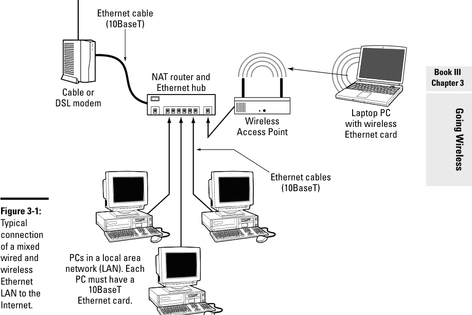

图 3-1：

混合有线无线以太网 LAN 到 Internet 的典型连接方式。

局域网（LAN）中的 PC。每台 PC 必须有一块 10BaseT 以太网卡。

## 配置无线接入点

如图 3-1 所示，LAN 中既有有线 PC 也有无线 PC。在本例中，电缆或 DSL 调制调器通过 NAT 路由器和集线器将 LAN 连接到 Internet。带有无线网卡的笔记本通过集线器 RJ-45 端口的无线接入点连接到 LAN。要将桌面级 PC 连接到此网络，可以使用 USB 网卡（连接到 USB 端口）。

> 如果你还没有为电缆或 DSL 连接购买 NAT 路由器和集线器，请考虑购买内置无线接入点的路由器和集线器。

## 配置无线接入点

配置无线接入点涉及以下任务：

- 为无线网络设置名称。（技术术语为 ESSID。）
- 设置无线接入点与无线网卡通信的频率或通道。接入点和网卡必须使用相同的通道。
- 决定是否使用加密。
- 如果使用加密，则设置加密密钥的位数和加密密钥的值。对于加密密钥，接入点内部有 24 位；你只需要指定网络位。因此，对于 64 位加密，你必须指定 40 位密钥，这相当于 10 个十六进制数字。（十六进制数字是 0-9 或字母 A-F）。对于 128 位加密密钥，你指定 104 位，即 26 个十六进制数字。
- 设置无线网卡连接到接入点时必须使用的方法。你可以选择开放访问（open access）或共享密钥（shared key）。开放访问方法是典型的（即使在使用加密时也是）。
- 将无线接入点设置为以基础设施（管理型）模式运行（因为这是你将无线网卡连接到现有以太网 LAN 的方式）。

配置无线接入点的具体方法取决于品牌和型号；供应商提供了配置无线接入点的说明。你通常通过 Windows PC 上的图形客户端应用程序进行配置。如果你启用了加密，请记住加密密钥，你必须在笔记本或桌面电脑的每块无线网卡上指定相同的密钥。

## 配置无线网络

在你的 Linux 笔记本电脑上，PCMCIA 或 PC 卡管理器会识别无线网卡并为网卡加载适当驱动程序。Linux 将无线网卡视为另一个以太网设备，并为其分配设备名称，例如 `eth0` 或 `eth1`。如果你在笔记本中已经有一块以太网卡，它将获得 `eth0` 设备名称，而无线 PC 卡将变成 `eth1` 设备。


你可能需要配置某些参数以允许网卡与无线接入点通信。例如，你必须指定分配给接入点的无线网络名称，且加密设置必须与接入点的设置匹配。你通常可以使用 Linux 发行版提供的网络配置工具来配置一切——只需选择“无线网络”（Wireless Network）选项并填写所需信息。

例如，在 Fedora 中，从 GNOME 桌面选择系统；网络（System;Network）。点击工具栏添加网络设备并选择“无线连接”（Wireless connection）（见图 3-2）。然后选择无线设备并进入配置无线连接的窗口。特别是，将模式（Mode）设置为“管理”（Managed），如果有则指定网络名称。你可以将获取 IP 地址的设置为 DHCP（一种用于获取网络配置参数的协议，包括从网络上的服务器获取 IP 地址）。完成后返回网络配置工具的主窗口，选择新的无线设备并点击“激活”（Activate）按钮。如果一切顺利，无线网络在几分钟后就会启动并运行。

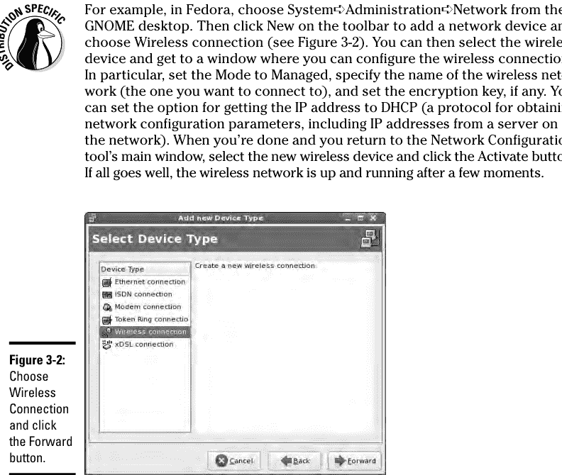

图 3-2：选择“无线连接”并点击“前进”按钮。

> 第三卷第三章
> 迈向无线

## 配置无线网络

在 Fedora 中，网络配置工具将你的无线网络设置保存在文本文件中。文本文件名取决于无线网络设备的名称。如果无线网络设备名称为 `eth0`，配置存储在文本文件 `/etc/sysconfig/network-scripts/ifcfg-eth0` 中。如果无线设备名称为 `eth1`，则文件为 `/etc/sysconfig/network-scripts/ifcfg-eth1`。

### 表 3-1：无线以太网接口配置文件设置

| 此参数 | 含义如下 |
| :--- | :--- |
| `BOOTPROTO` | 获取 IP 地址的协议名称。可以是 `dhcp` 或 `bootp`。 |
| `CHANNEL` | 1 到 14 之间的通道号（美国和加拿大）。必须与接入点设置的相同。在管理模式下，你不需要指定通道。 |
| `DEVICE` | 以太网接口的设备名称，第一个为 `eth0`，第二个为 `eth1`，以此此类推。 |
| `ESSID` | 扩展服务集（ESS）标识符，称为无线网络名称。它是区分大小的，且必须与接入点相同。用单引号提供名称（例如 `'HOME'`）。 |
| `HWADDR` | 无线网卡的硬件地址（也称为 MAC 地址）（六对冒号分隔的十六进制数字；例如 `00:02:ca:dc:1`）。无线卡驱动程序会自动检测此项 |
| `IPv6INIT` | 设置为 `yes` 初始化 IPv6。如果不使用 IPv6，请设置为 `no`。 |
| `MODE` | 无线网卡的运行模式。对于通过无线接入点的典型网络设置为 `Managed`。 |
| `NAME` | 无线网络的昵称。如果不指定，则使用主机名作为昵称。 |
| `ONBOOT` | 设置为 `yes` 在启动时激活无线接口；否则设置为 `no`。 |
| `PEERNDNS` | 设置为 `yes` 接口修改系统的 `/etc/resolv.conf` 文件，以从 DHCP 服务器（提供接口 IP 地址的服务器）获取 DNS 服务器。如果将此参数设置为 `no`，则 `/etc/resolv.conf` 文件保持不变。 |
| `RATE` | 连接的比特率（设置为以下之一：`1M`, `2M`, `5M`, `11M` 或 `auto`）。M 表示 Mbps 或每秒比特。设置为 `auto` 以使用最大传输速率。 |
| `TYPE` | 无线以太网接口设置为 `Wireless`。 |
| `USERCTL` | 设置为 `yes`，非 root 用户可以控制设备。设置为 `no` 以便只有 root 用户可以控制设备。 |

如果你手动编辑了无线接口的参数，输入以下命令重新激活接口：

```
/etc/init.d/network restart
```

## 212 配置无线网络

在 SUSE Linux 中，使用 YaST 来配置无线网络。SUSE 将无线配置参数存储在以 `ifcfgwlan` 开头的文件中，后面跟着数字（如 `0` 或 `1`），取决于无线网络接口的顺序。配置文件存储在 `/etc/sysconfig/network` 目录下。以下是 SUSE Linux 配置文件中典型的无线配置参数列表：

```
WIRELESS_MODE='Managed'
WIRELESS_ESSID='HOME'
WIRELESS_NICK=''
WIRELESS_RATE='auto'
WIRELESS_AUTH_MODE='open'
WIRELESS_KEY_0='0123-4567-89'
```

要检查无线网络接口的状态，请输入以下命令：

```
iwconfig
```

以下是带有带有无线以太网 PC 卡的 Fedora 笔记本电脑的典型输出（在其他 Linux 发行版中的输出也应该是类似的）：

```
lo no wireless extensions.
eth0 no wireless extensions.
sit0 no wireless extensions. Nickname:'localhost.localdomain'
eth1 IEEE 802.11 SSID:'HOME'
Mode:Managed Frequency:2.437 GHz Access Point:00:30:AB:06:EZ:SD
Rate:1 Mbps Activity:1/3
Retry limit:4 RTS:throff Fragment:throff
Encryption key:FDF3D-3FDE-FE Security mode:open
Power Management:off
Quality:51/92 Signal level:-40 dBm Noise level:-91 dBm
Rx invalid nid:0 Rx invalid crypt:0 Rx invalid frag:27
Tx excessive retries:0 Invalid misc:0 Missed beacon:
```

在这里，`eth1` 接口指的是无线网卡。我修改了加密密钥和其他参数以隐藏这些细节，示例输出显示了当无线链接正常时你通常会看到的内容。

# 第 4 章：网络管理

## 本章

- 查找 TCP/IP 配置文件
- 检查 TCP/IP 网络
- 在启动时配置网络

与 Linux 中的几乎所有内容一样，TCP/IP 的设置涉及准备许多配置文件（你可以用任何文本编辑器编辑的文本文件）。这些配置文件大多数位于 `/etc` 目录。Linux 安装程序试图通过隐藏 TCP/IP 配置文件的详细细节来提供帮助。尽管如此，如果你知道文件的名称及其用途，凭借专业知识手动编辑这些文件会更容易。

## 发现 TCP/IP 配置文件

在安装 Linux 时，你可以配置 TCP/IP 网络。然而，如果你想有效地管理网络，你就需要熟悉 TCP/IP 配置文件，以便在需要时编辑这些文件。（例如，如果你想检查名称服务器是否正确，你必须了解 `/etc/resolv.conf` 文件，该文件存储了名称服务器的 IP 地址。）

表 4-1 总结了基本的 TCP/IP 配置文件。我将在接下来的章节中描述这些文件。

| 表 4-1 基础 TCP/IP 网络配置文件 | |
| :--- | :--- |
| 此文件 | 包含以下内容 |
| `/etc/hosts` | 本地网络以及你经常访问的任何系统的 IP 地址和主机名 |
| `/etc/networks` | 网络名称和 IP 地址 |
| `/etc/host.conf` | 关于如何将主机名转换为 IP 地址的指令 |
| `/etc/resolv.conf` | 名称服务器的 IP 地址 |
| `/etc/hosts.allow` | 关于哪些系统可以访问你系统上的 Internet 服务指令 |
| `/etc/hosts.deny` | 关于哪些系统必须被拒绝访问你系统上的 Internet 服务指令 |
| `/etc/nsswitch.conf` | 关于如何将主机名转换为 IP 地址的指令 |

文本文件中的井号 (`#`) 表示注释。

### /hosts

`/etc/hosts` 文件包含你本地网络的 IP 地址和主机名列表。在没有名称服务器的情况下，你系统上的任何网络程序都将帮助确定与主机名对应的 IP 地址。将 `/etc/hosts` 想象成本地电话簿，你可以在其中查找本地主机的 IP 地址（而不是电话号码）。

以下来自一个系统的 `/etc/hosts` 文件，显示了典型局域网（LAN）上的 IP 地址和其他主机：

```
127.0.0.1         localhost           localhost.localdomain
# LAN 上的其他主机
192.168.0.100       lnbp933
192.168.0.50        lnbp600
192.168.0.200       lnbp200
192.168.0.233       lnbp233
192.168.0.40              lnbp400
```


如示例所示，文件中的每行都以 IP 地址开头，随后是该 IP 地址的主机名。（对于任何给定的 IP，你可以有多个主机名。）某些发行版（如 OpenSUSE 10）上的 `/etc/hosts` 具有以下内容：IP 地址、完全限定主机名、短主机名。在所有情况下，主机名（如短主机名）被视为别名。

### /etc/networks

`/etc/networks` 是另一个包含网络名称和 IP 地址的文本文件。这些网络名称通常在路由命令 (`/sbin/route`) 中使用，用于指定网络而不是其 IP 地址。如果你的 Linux 没有这个文件，请不要惊讶。

### /etc/host.conf

`/etc/host.conf` 是关于如何将主机名转换为 IP 地址的指令。Linux 使用一个特殊的库（即集合）来获取主机名对应的 IP 地址。`/etc/host.conf` 文件指定了哪些服务解析主机名。典型的，`host.conf` 文件可能包含以下内容：

```
order bind
```

`order` 选项指示解析的顺序。`multi` 选项指示 `/etc/hosts` 文件中的服务是否允许多个。在 `host.conf` 文件中，具有多个 IP 地址的主机被称为多宿主机。

### /etc/resolv.conf

`/resolv.conf` 是另一个由解析器用于确定主机名 IP 地址的文本文件。以下是示例 `/resolv.conf` 文件：

```
nameserver 192.168.0.1
search domain.com
```

`nameserver` 行提供了名称服务器的 IP 地址。如果你有多个名称服务器，请将它们列出来。按照它们出现的顺序进行查询。`search` 行告诉解析器如何搜索主机名。例如，当尝试查找主机名时，搜索指令允许解析器首先尝试 domain.com，然后是 domain.net，最后是 net。如果你的网络没有名称服务器，则可以安全地忽略此文件。TCP/IP 仍然工作，尽管你可能无法通过名称引用主机（除了 `/etc/hosts` 中列出的主机）。

### /etc/hosts.allow

`/etc/hosts.allow` 文件指定了哪些主机被允许使用你系统上的 Internet 服务（如 TELNET 和 FTP）。该文件在某些服务启动之前会被读取。只有当 `/etc/hosts.allow` 文件中的项意味着请求主机可以使用这些服务时，服务才会启动。

`/etc/hosts.allow` 中的项采用服务器:IP 地址的格式，其中服务器指的是提供特定 Internet 服务的程序，IP 地址标识允许使用该服务的主机。例如，如果你想让本地网络（网络地址为 192.168.0.0）的所有主机访问 TELNET 服务（由 inetnetd 程序提供），在 `/etc/hosts.allow` 中添加以下行：

```
telnetd:192.168.0.0
```

如果你想让所有本地主机访问所有 Internet 服务，你可以使用 `ALL` 关键字并重写该行：

```
ALL:192.168.0.0
```

最后，为了向所有主机开放所有 Internet 服务，你可以将地址替换为 `ALL`，如下：

```
ALL:ALL
```

你也可以使用主机名代替 IP 地址。要了解 `/etc/hosts.allow` 文件中条目的详细语法，请在终端窗口的 shell 提示符输入 `man hosts.allow`。

### /etc/hosts.deny

该文件是 `hosts.allow` 的相反。虽然主机可以访问系统上的 Internet 服务（如 TELNET 和 TFTP），但 `hosts.deny` 文件标识了必须被拒绝的主机。如果 `/etc/hosts.allow` 文件中没有适用于请求主机的规则，则会查询 `/etc/hosts.deny` 文件。如果 `/etc/hosts.deny` 文件中有适用于该主机的规则，则拒绝服务。

如果你已经在 `/etc/hosts.allow` 文件中设置了条目以允许特定主机的访问，那么你可以在 `/etc/hosts.deny` 中放置以下行，以拒绝所有其他主机访问你系统上的任何服务：

```
ALL:ALL
```

要查找 `/etc/hosts.deny` 文件中条目的详细语法，请在终端窗口的 shell 提示符中使用 `man hosts.deny`。

### /etc/nsswitch.conf

该文件被称为名称切换（name switch） NSS 文件，指定了如解析器库、NIS、NIS+ 和本地配置文件（如 `/etc/hosts` 和 `/etc/shadow`）等服务如何相互作用。

NIS 和 NIS+ 是另一种名称查找服务。较新版本的 Linux 内核使用 `/etc/nsswitch.conf` 文件来确定优先级：是本地配置文件、作为 DNS（域名命名服务）的服务，还是 NIS。

例如，`/etc/nsswitch.conf` 文件中的以下 hosts 条目表示解析器首先尝试 `/etc/hosts` 文件，然后尝试 NIS+，最后是 DNS：

```
hosts: files nis dns
```

你可以通过在终端窗口中输入 `man nsswitch.conf` 来了解 `/etc/nsswitch.conf` 文件。

## 检查 TCP/IP 网络

在配置以太网和 TCP/IP 后（在 Linux 安装期间或之后运行网络配置工具或命令），你可以无问题地使用各种网络应用程序。万一遇到麻烦，Linux 包含了几个工具来帮助你监控和诊断问题。

### 检查网络接口

使用 `/sbin/ifconfig` 命令查看当前配置的网络接口。`ifconfig` 命令用于配置网络接口（即将 IP 地址与网络设备关联）。如果你在不带命令行参数的情况下运行 `ifconfig`，该命令将显示当前网络接口的信息。以下是输入 `/sbin/ifconfig` 时的典型输出。

#### 218 检查 TCP/IP 网络

```
eth0

link encap:Ethernet HWaddr 00:74:85:c1:60

inet:192.168.0.7 Bcast:192.168.0.255 Mask:255.255.255

inet6: fe80::208:74ff:fe5:c10/64 Scope:link

UP BROADCAST RUNNING MTU:1500 Metric:1

RX packets:628851 errors:0 dropped:0 overruns:0 carrier:0

TX packets:574327 errors:0 dropped:0 overruns:0 carrier:0

collisions:0 txqueuelen:1000

interrupt:10 Base address:0

RX bytes:998303 (95.2 MB) TX bytes:7603428 (72.1 MB)

eth1

link encap:Ethernet HWaddr 00:02:2dc:f8:c5

inet:192.168.0.9 Bcast:192.168.0.255 Mask:255.255.255

inet6: fe80::202:20ff:fe86:c5/64 Scope:link

UP BROADCAST RUNNING MTU:1500 Metric:1

RX packets:3383 errors:0 dropped:0 overruns:0 carrier:0

TX packets:12442 errors:0 dropped:0 overruns:0 carrier:0

collisions:0 txqueuelen:1000

RX bytes:560194 (54.7 KB) TX bytes:250287 (24.4 KB)

lo

link encap:Loopback

inet:127.0.0.1 Scope:host

inet6::1/128 Scope:host

UP LOOPBACK RUNNING MTU:16384 Metric:1

RX packets:0 errors:0 dropped:0 overruns:0 carrier:0

TX packets:24560 errors:0 dropped:0 overruns:0 carrier:0

collisions:0 txqueuelen:0

RX bytes:291581 (2.8 MB) TX bytes:291581 (2.8 MB)
```

这显示了两个网络接口——（lo）和两个以太网卡（eth0 和 eth1）当前在该系统处于激活状态。对于每个接口，你可以看到 IP 地址以及数据包交付和发送的统计信息。如果 Linux 系统有拨号 PPP 链路正在运行，你也可以在输出中看到 `ppp0` 接口。

## 检查 IP 路由表


另一个网络配置命令 `/sbin/route` 在在你带命令行参数运行时会提供状态信息。如果你在检查到另一个主机（你通过 IP 地址指定）的连接遇到问题，请检查路由表查看是否指定了网关。然后检查网关的路由表，确保通往外部网络的路径在该路由表中。

`/sbin/route` 命令的典型输出如下：

| Kernel Destination Gateway Netmask Flags Metric Ref Use Iface |
|---|---|---|---|---|---|---|---|
| 192.168.0.0 | * | 255.255.255.0 | U | 0 | 0 | Use | eth0 |
| 192.168.0.0 | * | 255.255.255.0 | U | 0 | 0 | Use | eth1 |
| 169.254.0.0 | * | 255.255.0.0 | U | 0 | 0 | Use | eth1 |
| default | 192.168.0.1 | 0.0.0.0 | UG | 0 | 0 | Use | eth0 |

### 检查 TCP/IP 网络 219

如此路由表所示，本地网络使用 `eth0` 和 `eth1` 接口，默认网关是 `eth0` 接口。默认网关是一个处理指向 `192.168.0` 之外任何网络数据包的路由设备。在本例中，指向 `192.168.0.1` 的数据包会被网关连接到另一个网络。

## 检查到主机的连通性

要检查到特定主机的连接，请使用 `ping` 命令。`ping` 是一种广泛使用的 TCP/IP 工具，使用一系列 Echo Message（ICMP）消息来判断主机是否存活。以下示例显示了如何 ping 网络：

```
ping 192.168.0.1
64 bytes from 192.168.0.1: icmp_seq=1 ttl=64 time=0.482 ms
64 bytes from 192.168.0.1: icmp_seq=2 ttl=64 time=0.510 ms
64 bytes from 192.168.0.1: icmp_seq=3 ttl=64 time=0.495 ms
64 bytes from 192.168.0.1: icmp_seq=4 ttl=64 time=0.488 ms
64 bytes from 192.168.0.1: icmp_seq=5 ttl=64 time=0.479 ms

5 packets transmitted, 5 received, 0% packet loss, min/avg/max/mdev = 0.479/0.494/0.510/0.014 ms
```

按 `Ctrl+C` 停止 `ping`。输出显示 `ping` 的统计信息。如果主机不可达，将看到“Request timeout”（请求超时）或“Destination unreachable”（目标不可达）。

## 检查 TCP/IP 网络 220

## 检查状态

要检查网络状态，请使用 `netstat` 命令。该命令显示各种类型（如 TCP 和 UDP）的状态。你可以通过输入 `netstat -i` 查看接口状态，其结果类似于此：

| Interface | MTU | RX-OK | RX-ERR | RX-DRP | RX-OVR | TX-OK | TX-ERR | TX-DRP | TX-OVR | Flg |
|---|---|---|---|---|---|---|---|---|---|---|
| eth0 | 1500 | 61375 | 0 | 0 | 0 | 57495 | 0 | 0 | 0 | B |
| eth1 | 1500 | 4298 | 0 | 0 | 0 | 1375 | 0 | 0 | 0 | B |
| lo | 16316 | 3255 | 0 | 0 | 0 | 3255 | 0 | 0 | 0 | L |

在这种情况下，输出显示了回环接口和以太网接口的状态。表 4-2 描述了列的含义。

### 表 4-2 内核接口表列的含义

| Column | Meaning |
|---|---|
| Iface | 接口名称 |
| MTU | 最大传输单元 — 数据包可以携带的字节数 |
| Met | 接口的量值 — 路由软件在决定通过哪个接口发送数据包时使用的距离（跳数） |
| RX-OK, TX-OK | 接收 (RX) 或发送 (TX) 的无错误包数量 |
| RX-ERR, TX-ERR | 有错误的数据包 |
| RX-DRP, TX-DRP | 丢弃的数据包 |
| RX-OVR, TX-OVR | 因溢出丢失的数据包 |
| Flg | A=接收多播; B=允许广播; D=调试开启; L=回环接口（lo 上的标记）, M=接收所有数据包; N=此接口无 ARP; P=点点接口; R=接口是; U=接口是 |

`netstat` 的另一个有用选项是 `-an`，它显示所有活跃的 TCP 连接。以下是在一台 Linux PC 上输入 `netstat -an` 的典型结果：

| Proto | Recv-Q | Send-Q | Local Address | Foreign Address | State |
|---|---|---|---|---|---|
| tcp | 0 | 0 | localhost:2654 | localhost:1024 | ESTABLISHED |
| tcp | 0 | 0 | localhost:1024 | localhost:2654 | ESTABLISHED |
| tcp | 0 | 0 | LNBCXAN.nrockv01:~ssh | 192.168.0.6:1577 | ESTABLISHED |

## 检查 TCP/IP 网络 221

在这种情况下，输出列显示了协议（Proto）、接收和发送队列中的字节数（Recv-Q, Send-Q）、`hostname:service` 格式的本地 TCP 端口（Local Address）、远程端口（Foreign Address）以及连接状态。

输入 `netstat -la` 查看所有 TCP 连接——包括活动连接和 Linux 系统正在监听的连接（尚未建立连接）。例如，这里是 `netstat -ta` 命令的典型输出：

```
Active internet connections (servers and established)

Proto Recv-Q Send-Q Local Address       Foreign Address State

tcp 0 0       *:3379                               LISTEN

tcp 0 0       *:mysqld                               LISTEN

tcp 0 0       *:nprpc                               LISTEN

tcp 0 0       *:1                                                              LISTEN

tcp 0 0       localhost.localdomain:ip      *      LISTEN

tcp 0 0       localhost.localdomain:5335         LISTEN

tcp 0 0       localhost.localdomain:smtp      *      LISTEN

tcp 0 0       192.168.0.9:45876               www.redhat.com:http

ESTABLISHED   192.168.0.9:45877               www.redhat.com:http

ESTABLISHED   192.168.0.9:45875               www.redhat.com:http

ESTABLISHED

tcp 0 0       *:ssh                               LISTEN

tcp 0 0       :::ffff:192.168.0.7:ssh      :::ffff:192.168.0.3:49322 ESTABLISHED
```


## 嗅探网络包

嗅探网络包——听起来有点违法，对吗？其实不是，嗅探指的是查看 TCP/IP 网络包。其概念是捕获所有网络包以便你对其进行检查。

如果你喜欢嗅探 TCP/IP 包，可以使用 `tcpdump`，这是 Linux 自带的一个命令行工具。顾如其名，它会转储（打印）TCP/IP 网络包的头部。

要使用 `tcpdump`，请以 root 身份登录并在终端窗口中输入 `tcpdump` 命令。如果你想将输出保存到文件中并在稍后检查该文件，否则 `tcpdump` 将开始在窗口中快速闪过结果。例如，捕获 1000 个包并保存到名为 `tdout` 的文件中，尝试将 IP 地址转换为名称，输入以下命令：

```bash
tcpdump -c 1000 > tdout
```

捕获 1000 个包后，`tcpdump` 会退出。然后你可以检查输出文件 `tdout`。它是一个文本文件，你可以直接在文本编辑器中打开它，或输入 `more tdout` 来查看捕获的包。

## 启动配置网络

为了满足你的好奇心，这里是 `tcpdump` 典型输出中的几行：

```
20:05:57.723261 arp who-has 192.168.0.1 tell LNBECAN.rckov01.md.com.net
20:05:57.723843 arp reply 192.168.0.1 is-at 0:9:54:44:78:fc
20:06:01.732633 LNBECAN.rckov01.md.com.net:1038 > 192.168.0.6.auth: S53632100:53632100 (0) win 5840 <mas 1460,sackOK,timestamp 7300060zero_window: 0 (DP)
20:06:02.773072 LNBECAN.rckov01.md.com.net.ftp > 192.168.0.1596: P 1:72(71) ack win 5840 (DP)
20:06:04.55335 192.168.0.1596 > LNBECAN.rckov01.md.com.net.ftp : ack 72 win 65464 (DP)
20:06:05.462481 192.168.0.1596 > LNBECAN.rckov01.md.com.net.ftp : P 1:12(11) ack win 65464 (DP)
20:06:05.462595 LNBECAN.rckov01.md.com.net.ftp > 192.168.0.1596: ack 12 win 5840 (DP)
20:06:05.465384 LNBECAN.rckov01.md.com.net.ftp > 192.168.0.1596: P lines deleted...
```


进入`/path/to/xxx`目录，找到`xxx.json`。

输出确实提供了一些关于发生情况的线索。每行显示一个网络包的信息。每行都以时间戳开头，随后是包的详细信息（例如它的来源和去向）。我在这里不解释这些细节，但你可以使用 `tcpdump` 来了解更多细节（更重要的是，可以看到你可以如何使用 `tcpdump`）。

如果 Debian 中没有安装 `tcpdump`，使用 `apt-get install tcpdump` 安装。

你可以在 Linux 中使用另一种名为 Ethereal 的嗅探器。要了解更多关于 Ethereal 的信息，请 www.ethereal.com。

## 使用 GUI 工具

你可以通过多种图形界面检查网络状态。其中一种方法是使用系统监视器（GNOME，检查应用程序：系统工具：系统监视器（如图 4-1 所示））。

# 目录概览

## 第一章：Linux 下的电子邮件与即时通讯 ................................................ .229

理解电子邮件..................................................................................230

熟悉 Linux 中的邮邮件阅读器和 IM 客户端..................................................................232

在 Linux 中发送电子邮件....................................................................................................233

在 Linux 中使用即时通讯......................................................................................242

## 第二章：浏览网页 ................................................................ .245

探索万维网.........................................................................................245

在 Linux 中进行网页浏览...........................................................................................250

## 第三章：阅读新闻组和 RSS 馈 ................................. .257

理解新闻组......................................................................................257

从您的互联网服务提供商 (ISP) 阅读新闻组...............................................................262

在网站上阅读和搜索新闻组......................................................268

聚合 RSS 馈...............................................................................................271

## 第四章：使用 FTP ............................................................................ .273

使用图形化 FTP 客户端.....................................................................................273

使用命令行 FTP 客户端.........................................................................279

# 第一章：Linux 下的电子邮件与即时通讯

## 本章内容

- 理解电子邮箱
- 熟悉邮邮件件阅读器和 IM（即时通讯）客户端
- 介绍 Evolution、Thunderbird 和 KMail
- 使用 Pidgin 和 Kopete 进行即时通讯

电子邮箱（e-mail）是互联网的“杀手级”应用。通过电子邮件，你可以与互联网上的任何人（消息和文档：包括朋友、熟人、亲人以及完全的陌生人）交换消息和文档。在正常情况下，你可以从任何互联网主机向世界任何地方发送消息，而这些消息通常在几分钟内就能到达目的地——这是纸质邮件（也称为“蜗牛邮件”，这个比喻很贴切）无法做到的。

我喜欢电子邮件，因为我可以进行交流，而不需要玩那种“电话接力赛”（phone tag）的游戏——在那种游戏中，两个人互相给对方留下无尽的电话留言，却从未取得过联系。当我发送电子邮件时，它会在收件人方便的时候到达其收件箱。我想反之亦然——当人们发送电子邮件时，我可以在我方便的时候阅读并回复。

Linux 自带了几个客户端——也称为邮邮件阅读器——它们可以从你的互联网服务提供商（ISP）或多个网站下载邮件。安装后，你可以使用这些客户端读取和发送电子邮件。在本章中，我提到了 Linux 中可用的几种邮件客户端，并向你简要介绍了其中几个。由于它们之间具有相似性，通常当你学会了其中一种，就可以轻松地使用任何一种邮件阅读器。

另一种保持联系的方式符合当今年轻人的习惯。我说的是 IM——即时通讯（instant messaging）。IM 基本上就像一对一聊天，大多数 Linux 实现都包含了用于 AOL Messenger（或 AIM）的 AIM 客户端，以及其他即时通讯协议，如 Jabber、msn、MSN Messenger、Yahoo!、Gadu-Gadu、IRC（互联网中继聊天）和 SMS（短消息服务或短信）。我在本章中简要描述了几个 IM 客户端。

# 230 理解电子邮箱

## 理解电子邮箱

电子邮件消息指向电子邮件域下的一个用户名，这两个值由 @ 符号隔开。这意味着如果 John Doe 以用户名 `jdoe` 登录，他的电子邮件地址的前半部分就是 `jdoe`。唯一标识收件人所需的另一个信息是电子邮件域（也称为收件系统的完全限定域名）。如果 John Doe 的系统被命名为 `somewhere.com`，他的完整电子邮件地址就变成了 `jdoe@example.com`。有了这个地址，互联网上的任何人都可以向 John Doe 发送电子邮件。

## MUA 和 MTA 如何工作

两类邮件软件如下：

- 邮件代理（MUA）是邮邮件阅读器的华丽名称——它是你用于读取邮件、撰写回复和编写新消息的客户端。通常，邮件代理使用 POP3 或 IMAP4 协议从邮件服务器检索消息。POP3 是互联网访问协议版本 3，大多数 Linux 实现都带有 Balsa、Thunderbird、KMail 和 Evolution 等邮件代理。

- 邮件代理（MTA）是邮件服务器的华丽名称，负责发送和接收邮件文本。传输的具体方法取决于底层网络。在 TCP/IP 网络中，邮件代理使用简单邮件传输协议（SMTP）传递邮件。几乎每个 Linux 发行版都包含了 sendmail，这是一种流行的 TCP/IP 网络邮件传输工具。

图 1-1 显示了当 Alice 向 Bob 发送电子邮件消息时，MUA 和 MTA 是如何相互工作的。（如果你不知道，使用 Alice 和 Bob 来解释电子邮件和加密是惯例——只需查阅加密部分即可 1。）而且你可能已经知道了，互联网总是被描绘成一个云——互联网的边界是模糊的，所以云似乎代表了它。（或者是因为没人知道它从哪里开始，在哪里结束？）

图 1-1 中的场景是典型的。Alice 和 Bob 通过 ISP 连接到互联网，并通过 ISP 发送电子邮件。当 Alice 输入消息并发送时，她的邮件用户代理（MUA）将消息发送给其 ISP 的邮件传输代理（MTA）。在这种情况下，Bob 的 MUA 使用 POP3 或 IMAP4 从其 ISP 的服务器下载消息。

[图 1-1：MUA 和 MTA 如何工作]

| 组件 | 描述 |
| --- | --- |
| 邮件用户代理 (MUA) | 邮件传输代理 (MTA) |
| 邮件传输代理 (MTA) | 邮件用户代理 (MUA) |
| 协议 | SMTP |
| 协议 | POP3 / IMAP4 |

## 在 Linux 中发送电子邮件

如果你在你的发行版中没有看到邮件或即时消息客户端，可能你可以很容易地从网上下载并安装它。

## 在 Linux 中发送电子邮件

每个 Linux 发行版的 GUI 桌面都有一个或两个默认邮件客户端。GNOME 桌面通常提供 Evolution，而 KDE 桌面则使用 KMail。GNOME 和 KDE 桌面通常都带有 Mozilla 浏览器，而 Mozilla 也包含一个邮件客户端。

Debian 包含 KMail 和 Evolution。Fedora 和 Ubuntu 提供 Evolution 作为默认邮件客户端。MEPIS 和 SU 使用 KMail 作为默认邮件器，而 Xandros 提供了 KMail 和 Thunderbird 邮件。

在接下来的章节中，我将简要介绍 Evolution、Thunderbird Mail 和 KMail。所有的邮件客户端都是直观的，因此你只需要简单的介绍就能有效地使用它们。

## 介绍 Evolution

我听了很多关于 Evolution 的介绍，我想从这里开始。还有什么比直接上手更好的呢！

在 Fedora 中，你可以通过从 GNOME 或 KDE 桌面选择主菜单→互联网→Evolution 电子邮件来启动 Evolution。（在 Debian 中，我必须选择应用程序:Debian 菜单→应用→网络→Evolution。）

当你第一次启动 Evolution 时，会出现 Evolution 设置向导窗口，如图 1-2 所示。

点击“下一步”进入欢迎界面，设置向导将引导你完成以下步骤：

- 1. 在“身份”部分中输入你的姓名和电子邮件地址，并点击“下一步”按钮。

例如，如果你的电子邮件地址是 jdoe@someplace.com，就输入该地址。

- 2. 设置接收电子邮件的选项并点击“下一步”。

选择邮件下载协议类型——POP 或 IMAP。然后提供邮件服务器名称（例如 mail.comcast.net）。当 Evolution 第一次连接到邮件服务器时，会提示你输入密码。

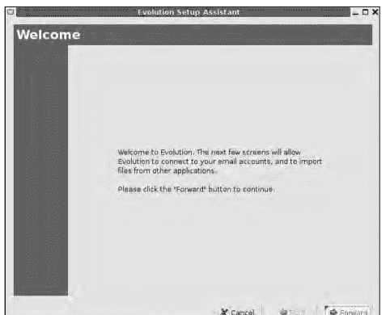

**图 1-2:** Evolution 设置向导引导你完成初始设置。

- 3. 提供有关接收电子邮件的更多信息——多久检查一次邮件以及是否在服务器上保留邮件——然后点击“下一步”。通常，你希望下载邮件并从服务器上删除它们（否则你的邮件就会堆积）。

- 4. 设置以下发送电子邮件的选项并点击“下一步”：
    - 选择服务器类型为 SMTP。
    - 输入服务器名称，例如 `smtp.comcast.net`。
    - 如果服务器要求你登录，勾选“服务器验证”框。
    - 输入你的用户名——与你登录 ISP 服务器时使用的用户名相同。（通常，你不需要登录即可发送邮件；只有在接收邮件时才需要登录。）

- 5. 表明是否想让此电子邮件账户成为你的默认账户，如果需要，给此电子邮件账户起一个描述性名称；点击“下一步”。

- 6. 点击“下一步”设置你的时区；点击“下一步”。

- 7. 点击“应用”完成。

完成 Evolution 设置后，Evolution 会打开其主窗口，如图 1-3 所示。

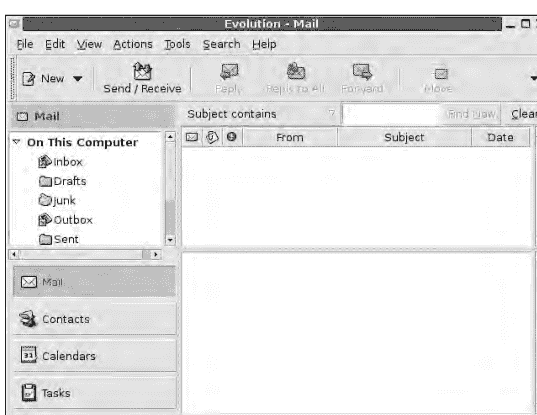

**图 1-3:** Evolution 处理邮件、联系人管理和待办事项。

Evolution 的主显示区域垂直分为两个窗口：左侧是一个带有快捷按钮的窄面板——邮件、联系人、日历排列成一列；右侧是一个较大的面板，Evolution 在其中显示当前选的快捷。在图 1-3 中，Evolution 显示的是收件箱。

你可以点击左侧窗口中的快捷按钮切换到不同的视图。这些按钮提供了访问 PIM（个人信息管理）所有必要组件的通道——电子邮件、日历、任务列表和联系人。你会发现 Evolution 中非常直观。

要访问你的电子邮件，点击收件箱图标。Evolution 打开你的收件箱，如图 1-4 所示。如果你开启了经常检查邮件的功能，Evolution 会提示你输入密码并下载邮件。电子邮件收件箱看起来与其他任何邮件器一样，例如 Outlook。

要阅读消息，点击收件箱上方窗口中的消息，消息文本就会出现在下方的窗口。图 1-4 显示了一封带有附件的消息。

要回复当前消息，点击工具栏上的“回复”按钮。会弹出一个邮件撰写窗口。你可以编写回复并点击工具栏上的“发送”按钮将其发送出去。很简单，不是吗？

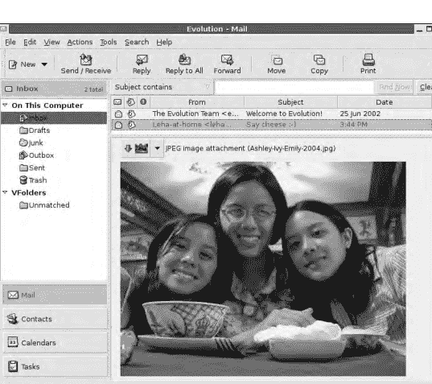

**图 1-4:** 在 Evolution 收件箱中阅读你的电子邮件。

要发送新电子邮件，点击 Evolution 工具栏上的“新邮件”按钮。会出现一个新的新邮件撰写窗口。你可以在其中输入消息，完成撰写后，点击“发送”。

Evolution 带有详尽的帮助。从 Evolution 菜单中选择“帮助?>内容”，Evolution 2.0 用户指南将会在窗口中出现。你可以在窗口中阅读用户指南。


## 介绍 Thunderbird

Mozilla Thunderbird 是一个重新设计的，它是 Mozilla Communicator 的开源继任者，作为邮件浏览器的补充效果非常好。随着 Thunderbird 普及度的增加，它不仅运行在 Linux 上，还运行在许多操作系统上，成为默认邮件器。

安装后，你可以通过选择选择 Debian 菜单→应用→网络→Thunderbird 来从 GNOME 桌面启动它。当你启动 Thunderbird 时，会弹出账户设置向导（如图 1-5 所示），提示你输入邮件账户信息。

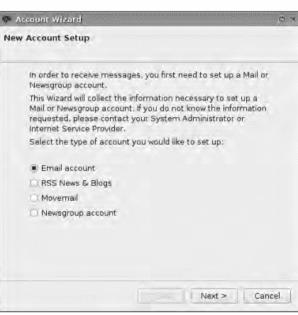

**图 1-5:** 在 Thunderbird 账户向导中输入你的邮件信息。

选择电子邮件账户单选框并点击“下一步”。向导将引导你完成以下步骤：

- 1. 输入你的身份信息——你的姓名和电子邮件地址，如 jdoe@someplace.com——点击“下一步”。
- 2. 提供有关你的 ISP 服务器的信息——协议类型（POP 或 IMAP）以及入站和出站服务器名称——点击“下一步”。入站服务器是 POP 或 IMAP 服务器，而出站服务器是你发送邮件的服务器（它是 SMTP 服务器）。
- 3. 输入 ISP 给你的用户名：下一步。
- 4. 输入一个你想用来标识此账户的名称并点击“下一步”。这个名称仅供 Thunderbird 使用，你可以取任何名称，例如“家庭账户”。
- 5. 验证信息。账户向导显示信息的摘要。如果正确，点击“完成”；否则，点击“上一步”修复错误。

选择电子邮件账户后，Thunderbird 的主窗口出现并显示收件箱的内容。不久会弹出一个对话框询问你的邮件密码。Thunderbird 需要密码从 ISP 下载你的邮件。输入密码并点击“确定”。

Thunderbird 下载邮件并以熟悉的格式显示。要阅读消息，点击该消息，全文将出现在下方的窗口，如图 1-6 所示。

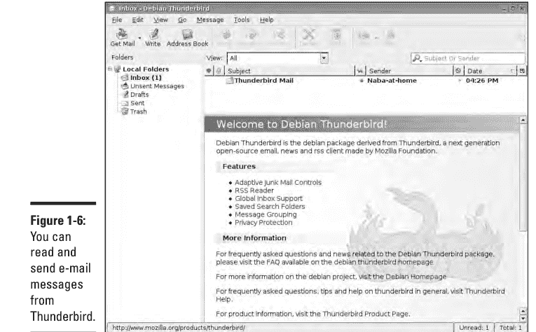

**图 1-6:** (未提供图片)

Thunderbird 使用非常直观。大多数时候，你可以点击工具栏按钮对电子邮件消息进行任何你想的操作。以下是每个工具栏按钮的功能：

- 获取邮件：从你的电子邮件账户下载邮件。（你可以设置多个账户。）
- 写：打开一个可以撰写和发送消息的窗口。
- 人员列表：打开联系簿窗口，可以在其中维护联系人列表。
- 回复：打开一个窗口，向你正在阅读的消息的人发送回复。

## Linux 下的电子邮件 (239)

-   回复所有人：打开一个窗口，向你正在阅读的邮件收件人列表中的所有人发送回复。
-   转发：在窗口中打开当前邮件，以便你可以将其转发给其他人。
-   删除：删除选中的邮件。
-   垃圾邮件：将选中的邮件标记为垃圾邮件。（你可以将选中的邮件标记为垃圾邮件，并选择“工具：垃圾邮件控制”来拦截类似的邮件。）
-   打印：打印选中的邮件。
-   停止：停止当前向邮件服务器的传输。

如果你使用任何 GUI 邮件阅读器——从 Microsoft Outlook Express 到 Novell GroupWise——你都会找到类似的工具栏按钮。在接下来的章节中，我将描述如何执行一些常见的电子邮件相关任务。

## 管理收件箱

Thunderbird 下载你的入站邮件并将其存储在收件箱（Inbox）文件夹中。你可以在左侧的窄窗口看到组织好的文件夹。（参考图 1-6。）你的每个电子邮件账户有一组文件夹。默认情况下，你拥有以下文件夹：

- 收件箱：存放该电子邮件帐户的所有入站邮件。
- 未发送邮件：包含尚未发送到邮件服务器的邮件。
- 草稿：包含你保存为草稿的邮件。（点击邮件撰写窗口上的“保存”按钮可以将某些内容保存为草稿。）
- 已送：存放你已成功发送的所有邮件。
- 垃圾箱：包含你删除的邮件。（要清空垃圾箱，从 Thunderbird 菜单中选择“文件：清空垃圾箱”。）

你可以创建其他文件夹来更好地组织邮件。要创建文件夹，请执行以下操作：

1. 右键点击 Thunderbird 窗口左侧的“本地文件夹”（Local Folder）标签，并在出现的菜单中选择“新文件夹”（New Folder）。

出现“新文件夹”对话框。

2. 填写文件夹名称，选择你想放置该文件夹的位置，然后点击“确定”。

新文件夹将出现在 Thunderbird 的左侧窗口中。你可以将邮件拖入该文件夹中。


## 240 Linux 下的电子邮件

当你从左侧窗口选择一个文件夹时，Thunderbird 会在右侧上方窗口显示该文件夹的内容。列表通常按日期排序，最新的邮件显示在列表末尾。如果你想以其他方式对列表排序——例如，按发送者或主题——只需点击该列标题，Thunderbird 就会根据该列对列表排序。

## 撰写和发送邮件

要发送电子邮件，你只需编写一封新邮件，或者回复你正在阅读的邮件。发送电子邮件的一般步骤如下：

1. 要回复邮件，请在阅读邮件时点击工具栏上的“回复”（Reply）或“回复所有人”（Reply All）按钮。要撰写新邮件，点击工具栏上的“撰写”（Compose）按钮。要转发邮件，点击“转发”（Forward）按钮。

邮件撰写窗口。

2. 在邮件撰写窗口中，填写类型并输入你的信息。

邮件可以包含图片以及指向网站的链接。要插入任何内容，请从菜单中选择“插入+图片”（Insert+Image）或“插入+链接”（Insert+Link）。

3. 如果你正在创建新邮件或转发邮件，请输入收件者的电子邮件地址。

要从地址录中选择收件人，点击工具栏上的“地址”（Address）按钮。你的地址录将打开，你可以从中选择收件人。

4. 当你写好邮件时，点击“发送”（Send）按钮。

Thunderbird 会询问你是否想以 HTML 格式或纯文本发送邮件。

5. 选择一种格式，然后点击“发送”发送邮件。

如果你插入了图片和网页链接，并且知道收件人可以阅读 HTML，请务必选择 HTML 格式；否则选择纯文本。


如果你想稍后完成邮件，请点击邮件撰写窗口中的“保存”然后关闭窗口。Thunderbird 将邮件保存在草稿文件夹中。当你准备好再次处理它时，进入草稿文件夹，然后双击保存的邮件以打开它。

## Linux 下的电子邮件 (241)

## 介绍 KMail

KMail 是适用于 KDE 的邮件阅读器。当你第一次运行 KMail 时，你会看到它的主窗口（见图 1-7），在 KMail 中配置好邮件帐户之前，你无法开始使用它发送和接收电子邮件。

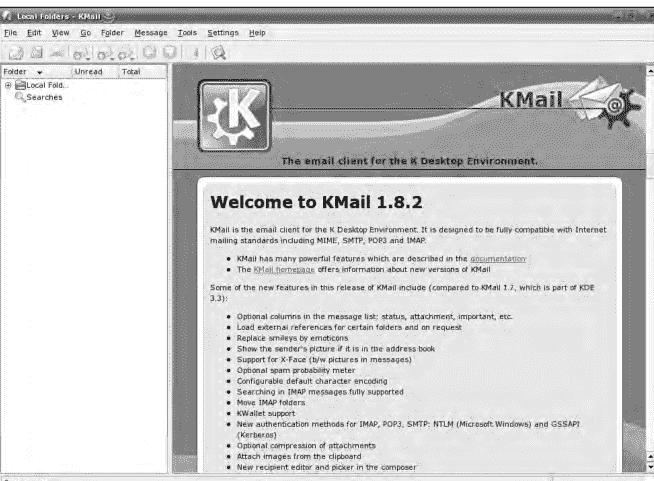

图 1-7:
初始 KMail 窗口。

要配置 KMail，选择设置（Settings)->配置 KMail（Configure KMail）。在配置 KMail 窗口中（见图 1-8），点击窗口左侧的“帐户”（Accounts）并设置你的电子邮件帐户信息。KMail 使用这些信息发送和接收邮件。

对于发送邮件，点击“发送”（Sending）选项卡上的“添加”（Add）按钮（见图 1-8）并选择邮件传输代理。通常，对于 ISP 提供的邮件帐户，你应该选择 SMTP 并输入邮件服务器。

好吧，既然你了解 AIM，你就知道该做什么了：和 Kopete 尽情 IM 聊天吧！

## 第 2 章：浏览网页

## 本章内容

- 发现万维网
- 理解 URL
- 检查 Web 服务器和 Web 浏览器
- 查看 Linux 版本的 Web 浏览器
- 使用 Mozilla Firefox 浏览网页

我怀疑你已经了解 Web 了，或者你一直躲在岩石下生活了好几年。你知道吗，正是 Web（或正式称为万维网 World Wide Web）让互联网变成了现在的样子。互联网已经存在了很长一段时间，但直到 1993 年 Web 的出现，它才进入大众。

在 Web 出现之前，你必须使用晦涩的 UNIX 命令来下载和使用文件，这对于我们大多数人来说实在太复杂了。有了 Web，任何人都可以通过浏览器来享受互联网的益处——浏览器是一种下载并显示文档的图形化应用程序。你只需要点击鼠标，就可以从阅读公司网站的文档，到跨国下载视频片段，一切轻而易举。

在本章中，我简要描述了 Web 并引入了 Mozilla Firefox —— 它是大多数 Linux 发行版中主要的 Web 浏览器（以及邮件和新闻阅读器）。我还简要讨论了如何创建你自己的网页。

> KDE 桌面通常使用 Konqueror 作为 Web 浏览器，但在用过一个 Web 浏览器后，你可以轻松使用任何其他 Web 浏览器。

## 发现万维网

如果你在工作中使用过文件服务器，你就知道共享文件的便利之处。你可以使用桌面上的文字处理器来访问共享服务器上的任何文档。

现在想象有种文字处理器，它可以让你打开并查看位于互联网上任何一台计算机上的文档。你可以以其完整的姿貌查看文档，其中带有格式化的文本和图形。如果该文档引用了另一个文档（可能位于另一台计算机上），你可以通过点击该引用来打开该链接文档。这种对分布式文档的轻松访问本质上就是万维网提供的服务。

当然，文档必须是标准格式，以便任何计算机（带有适当的 Web 浏览器软件）都能访问并解释该文档。此外，在不同系统之间交换 Web 文档需要一种标准的协议。

标准的 Web 文档格式是超文本标记语言 (HTML)，交换 Web 文档的标准协议是超文本传输协议 (HTTP)。HTML 文档是文本文件，不依赖于任何特定的操作系统，它们可以在从 Windows 和 Mac 到任何类型的 Unix 和 Linux 系统上运行。

Web 服务器向任何发出适当 HTTP 请求的客户端提供 HTML 文档。Web 浏览器则是实际上从 Web 服务器下载 HTML 文档并以图形方式显示内容的客户端软件。

## 像巨大的蜘蛛网

万维网是 Web 服务器与这些服务器提供的 HTML 文档的结合。在这种情况下，Web 就像一本巨大的书，其页码散落在互联网各处。你使用运行在计算机上的 Web 浏览器来查看这些页面——页面像巨大的蜘蛛网一样连接在一起，文档无处不在，如图 2-1 所示。

## 发现 247 小时的广域网

想象一下网页——HTML 文档是通过类似于巨大蜘蛛网的网络连接连接在一起的，这样你就明白为什么 Web 被称为 Web（网）了。“World”（广域）一词源于网页散落在世界各地。

## 链接和 URL

就像真实书籍页一样，网页包含文本和图形。然而与真实书籍不同，网页可以包含多媒体，如视频片段、声音以及指向其他网页的链接。

网页中的链接是对其他网页的引用，你可以从一个页面跳转到另一个页面。Web 浏览器通常将这些链接显示为下划线（带不同颜色）或图像。每个链接都像对你的一条指令——类似于你会在真实书中看到的“更多信息，请参阅第 4 章”。在网页中，你只需要点击链接；Web 浏览器就会跳转到被引用的页面，即使该文档实际上可能位于互联网上远远的计算机上。

网页中的链接被称为超文本链接（hypertext links），因为当你点击链接时，Web 浏览器会跳转到该链接引用的网页。

这种安排引发了一个问题。在真实书籍中，你可能会要求读者查看书中的特定章节或页面。超文本链接是如何指示被引用网页的位置的？在万维网中，每个网页都有一个特殊的名称，即 *统一资源定位符*（Uniform Resource Locator，URL）。URL 唯一指定了计算机上文件的位置。图 2-2 显示了 URL 的部分。

| 图 2-2：统一资源定位符 (URL) 的组成部分 | 域名 | 目录路径 | 文件名 | HTML 锚点 |
| :--- | :--- | :--- | :--- | :--- |
| | | | http://www.tdlp.org:80 | | |

# Linux 中的 Web 浏览 250

## Web 服务器

Web 服务器返回请求的 Web 页面

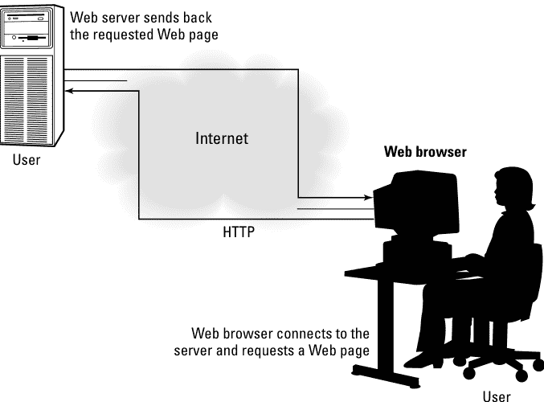

用户
互联网
Web浏览器
HTTP

图 2-3：Web浏览器请求文档，Web 服务器发送文档。

Web浏览器连接到服务器并请求 Web 页面

用户

服务器发送文档后，浏览器与 Web 服务器的连接就会结束。当用户浏览下载的文档并点击另一个超链接时，Web浏览器会再次连接到超链接中命名的服务器，下载文档，结束连接并显示新文档。这就是用户如何轻松地从一个文档移动到另一个文档。


Web浏览器的功能不仅仅是与 Web 服务器“通信” HTTP——事实上，Web 浏览器还可以使用 FTP 下载文档，许多浏览器还检索了邮件和新闻阅读器。

# Linux 中的 Web 浏览

Web 浏览非常有趣，因为今天的许多 Web 页面充满了图形和多媒体。此外还有一种惊喜元素——你可以点击一个链接，结果来到意之外的 Web 页面。链接是 Web 最奇奇（也最有用）的方面。你可以从一个显示今天天气的页面开始，点击一下后，你就可以阅读本周的《时代》杂志了。

# Linux 中的 Web 浏览 251

要浏览 Web，你只需要一个 Web 浏览器和互联网连接。我假设你已经处理好了互联网连接（如果你还没有设置互联网连接，请参见第三部分第 1 章），所以你只需要了解 Linux 中的 Web 浏览器。

## 查看 Linux 的 Web 浏览器

许多 Linux 发行版都自带 Mozilla Web 浏览器。Mozilla 是久誉的 Netscape Communicator 的开源版本。

Linux 有多种 Web 浏览器可用。我将简要提到其他浏览器，但在剩余的讨论中我重点关注 Firefox。以下是 Linux 的 Web 浏览器：

- **Mozilla**：那个老兵器——Netscape Communicator 的转世，但更好。包含了邮件和新闻阅读器。该 Web 浏览器是 Mozilla Navigator，或简称为 Navigator（就像在 Netscape Communicator 中一样）。
- **Epiphany**：GNOME Web 浏览器使用了 Mozilla 代码的部分来绘制 Web 页面，但用户界面比 Mozilla 更简单。如果未安装 Epiphany，你可以从 www.gnome.org/projects/epiphany 下载它。
- **Firefox**：Mozilla 的下一代浏览器，可以拦截弹出广告，具有可以在单个窗口中轻松查看多个 Web 页面的标签页，并包含了一系列隐私工具。你可以从 www.mozilla.org/download.html 下载 Firefox。
- **Conqueror**：KDE Web 浏览器，兼具文件管理器和通用查看器。

除了这些，许多其他应用程序也能下载和显示 Web 页面。

如今，大多数发行版都包含了 Mozilla Web 浏览器。将在下一节中简要介绍 Firefox Web 浏览器。所有其他浏览器都有类似的直观用户界面。


| 第四部分 |
| 第 2 章 |

如果你没有默认安装 Firefox，可以通过输入 `su` 成为 `root`，然后输入 `apt-get install firefox` 来轻松安装它。

# 介绍 Firefox 的用户界面

你通常可以通过点击面板上的图标或从 GUI 桌面菜单中选择来启动 Firefox。

## 浏览 Web

# 252 Linux 中的 Web 浏览

当 Firefox 启动时，它会显示一个带有默认主页的浏览器窗口。（Web 服务器上的主要 Web 页面就是主页。）你可以配置 Firefox 使用不同的 Web 页面作为默认主页。

图 2-4 显示了美国政府网站（www.irs.gov）的一个 Web 页面，作为 Firefox 浏览器窗口的主要元素。

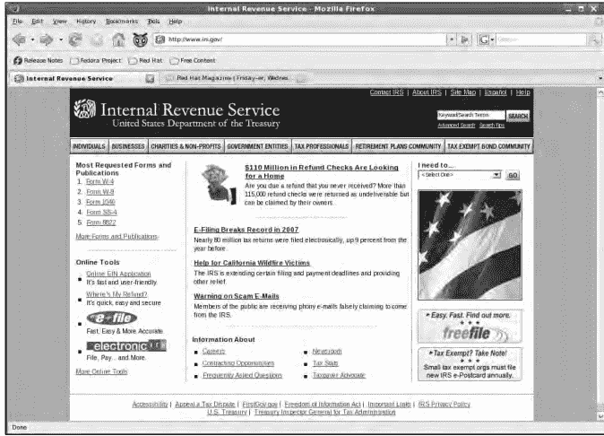

图 2-4：
Firefox 样式

Firefox 支持标签页浏览，这意味着你可以开启新标签页（按 Ctrl+T）并在该标签页中查看 Web 页面。这样，你就可以在单个窗口中查看多个 Web 页面。

Firefox Web 浏览器在其用户界面中包含许多功能，但你可以轻松掌握它。你可以从基础知识开始使用 Firefox，并逐渐扩展到你尚未探索的领域。

# Firefox 工具栏

从窗口顶部开始，你会看到一个带有标准菜单（文件、编辑等）的菜单栏，后面是两个工具栏——导航工具栏和书签工具栏。书签工具栏下方是当前 Web 页面出现的地方。

# Linux 中的 Web 浏览 253

以下是你可以使用菜单栏正下方导航工具栏上的按钮和文本框的操作，从左到右：

- **后退（Back）**：回到上一个 Web 页面。
- **前进（Forward）**：回到你可能后退过的页面。
- **刷新（Reload）**：重新加载当前页面。
- **停止（Stop）**：停止加载。
- **主页（Home）**：回到主页。
- **地址（Location）**：前往地址。
- **跳转（Go）**：跳转到地址。
- **搜索（Search）**：搜索 Web。

## 状态栏

紧接菜单栏下方的是导航工具栏。导航工具栏下方是书签工具栏。当 Firefox 加载时，状态栏会显示状态。在状态栏的右角，会出现一个锁形图标，表示你访问的是安全的网站。如果没有锁形图标，表示连接是不安全的。安全的 URL 以 `https://` 开头，而不是 `http://`。

Firefox 在状态栏左侧显示状态。当鼠标悬停在链接上时，状态栏会显示该链接的 URL。（这就是状态栏。）

# Firefox 菜单

我没有怎么提到 Firefox 菜单，因为你通常不需要它们。尽管如此，快速看一下菜单是值得的。


| 第四部分 |
| 第 2 章 |

# 254 Linux 中的 Web 浏览

菜单是值得的，让你知道每个菜单提供了什么。表 2-1 提供了 Firefox 菜单的概述。

| 表 2-1 | Firefox 菜单 |
| --- | --- |
| 文件（File） | 允许打开文件或 Web 位置、打开或关闭标签页、通过电子邮件发送 Web 或链接、打印当前页面并退出 Firefox |
| 编辑（Edit） | 复制和粘贴选择、在当前页面查找文本以及编辑你的偏好 |
| 查看（View） | 显示或隐藏各种工具栏、重新加载当前页面、增大或缩小字体以及查看页面 HTML 代码 |
| 历史（History） | 在访问过的页面列表中向前向后，或跳转到其他访问过的页面 |
| 书签（Bookmarks） | 书签页面、管理书签并将链接添加到书签文件夹中。（这些将出现在书签工具栏中。） |
| 工具（Tools） | 搜索 Web 并管理 Web 页面的各种方面，如主题，以及查看当前页的信息 |
| 帮助（Help） | 获取 Firefox 帮助 |

## 更改你的主页

主页是你启动 Firefox 时它加载的页面。默认主页取决于发行版。通常，主页是来自系统硬盘的一个文件。更改主页非常简单。

首先，在 Web 上找到你想要作为主页的页面。你可以到达任何你想要的页面。你可以使用搜索引擎找到你想要的页面，或者使用地址框中的 URL，或者你可能意外进入一个你想作为主页的页面。

当你在 Firefox 中查看想要作为主页的 Web 页面时，从 Firefox 菜单选择“编辑>偏好”。偏好对话框出现，如图 2-5 所示。

在图 2-5 中，注意偏好中的主页部分。文本框下方有一个“使用当前页面”按钮。点击该按钮可以将当前页面设置为你的主页。

## 在 Linux 中浏览 Web

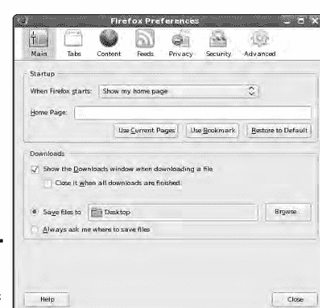

图 2-5：Firefox 首选项

你可以使用“首选项”（Preferences）对话框设置许多其他选项。虽然我在这里没有解释所有的选项，但你可以到处点击，以探索在这个窗口中可以进行的所有操作。例如，你可以使用书签按钮选择已保存的 URL，并将其书签为首页。（你必须从对话框中选择该书签。）

## 使用 Firefox 冲浪网络

从主页去哪里取决于你。你所做的就是点击并看看你到达了哪里。移动你的鼠标。当你悬停在链接上时，鼠标指针会变成一只伸出食指的手，你就知道你在链接上了。点击链接，Firefox 就会通过该链接下载 Web 。

Web 的用途取决于你想做什么。当你刚开始时，你可能会进行大量的探索——在没有特定目标的情况下浏览网站并点击链接（你可能称之为 Web “逛街”）。

Web 的另一个更有目的性的用途是从网上寻找特定信息。例如，你可能想找到所有包含指定关键词文档的网站。对于此类搜索，你可以使用网络上提供的许多 Web 搜索工具之一。Firefox 的搜索框将带你进入 Google Web 搜索页面（www.google.com）。

第四卷
第二章
浏览 Web

## 256 在 Linux 中浏览 Web

第三种用法是访问具有已知 URL 的特定站点。例如，在阅读书中关于某个特定主题时，你可能会遇到一个特定的 URL。在这种情况下，你想直接访问该 Web 页面。

如果你想用 Firefox 冲浪，你只需要一个起始 Web 页面——你就可以点击任何你感兴趣的内容。例如，选择 Firefox 导航栏中位置位置文本框中的文本，输入 `www.yahoo.com`，然后按回车键。你将到达 Yahoo! 首页，那里显示了按主题组织的 Yahoo! Web 目录。这就是你的起点。你所做的就是点击，然后就开始了！


## 第 3 章：阅读新闻组和 RSS 馈

## 本章内容

- 理解新闻组
- 从你的 ISP 阅读新闻组
- 在某些 Web 网站上阅读和搜索新闻组
- 阅读 RSS 馈

新闻组提供了一个跨越全球的分布式会议系统。你可以发布文章——本质上是发送给整组人的电子邮件信息——并回复其他发布了内容的人。

将互联网新闻组想象成一个聚会场所——一个虚拟的会议场所，你可以在那里提问并讨论各种问题。（而且最好的是，你讨论的一切内容都会归档以备后世。）互联网新闻组类似于 Web 时代之前的之前的电子公告板系统（BBS）或像 AOL 和 MSN 等在线系统提供的论坛。

要参与新闻组，你需要访问新闻服务器——你的互联网服务提供商（ISP）可以为你提供这种访问权限。你还需要一个新闻阅读器。幸运的是，Linux 自带了用于阅读新闻组的软件。在本章中，我将向你介绍新闻组，并向你展示如何使用几种新闻阅读器阅读新闻组。还会简要解释如何从 Web 网站免费阅读和搜索新闻组。

如今，阅读网站和博客摘要的另一种方法是使用可以接受 RSS 馈的程序。在本章最后，我将简要描述什么是 RSS 馈，以及你如何使用 KDEregator 这样的程序订阅 RSS 馈并在你的 Linux 系统上阅读它们。

### 理解新闻组

新闻组源于 Usenet——这是一种存储并转发的消息网络，被广泛用于交换电子邮件和新闻项目。Usenet 的工作方式像电报，新闻和邮件从一个系统传输到另一个系统。在 Usenet 中，系统并不在任何网络上；系统只是彼此拨号，并使用 UNIX-to-UNIX 拷贝协议（UUCP）传输文本消息。

尽管它是一个非常松散的计算机集合，但 Usenet 运行良好并一直持续被使用，因为连接到它的费用很低。你只需要一个调制解调器和一个存储和转发你的邮件和新闻的站点。你需要在你的系统中设置 UUCP，你不需要持续的网络连接；只需拨几次电话即可保持电子邮件和新闻的流动。Usenet 的缺点是你无法通过 UUCP 使用 TCP/IP 服务，如 Web、TELNET 或 FTP。

从你的 Usenet 起源，新闻组现在已经迁移到了互联网（尽管新闻组仍然被称为 Usenet 新闻组）。现在由网络新闻传输协议（NNTP）来传输新闻。

尽管（对于大多数世界而言）新闻传输协议已从 UUCP 变为 NNTP，但新闻传输的存储和转发概念仍然如此。如果你想在你的 Linux 系统上获取新闻，你必须找到一个你的系统可以下载新闻的新闻服务器。通常，你可以使用你 ISP 的新闻服务器。

## 新闻组层级结构

互联网新闻组按层级组织。顶级类别代表通用主题，子类别提供更多细节。例如，comp.linux 用于 Linux 相关的讨论，而 alt.announce 用于公告。这种层级结构有助于用户导航海量信息。

## 259 理解新闻组

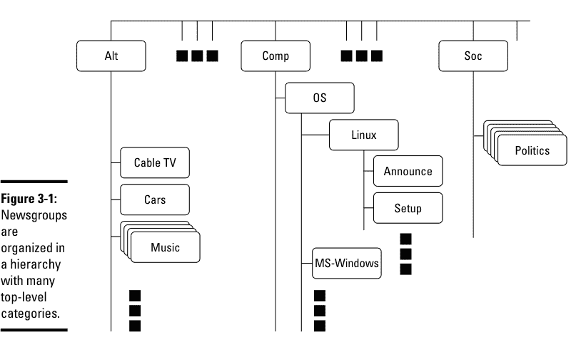

## 260 理解新闻组

| 类别 | 主题 |
| :--- | :--- |
| biz | 商业新闻组 |
| comp | 计算机硬件软件新闻组 |
| ieee | 电气电子工程师学会新闻组 |
| k12 | 致力于小学和中学教育的新闻组 |
| linux | 致力于 Linux 的新闻组 |
| misc | 杂项新闻组 |
| news | 关于互联网的新闻组 |
| rec | 娱乐和艺术新闻组 |
| sci | 科学和工程新闻组 |
| soc | 社会问题和各种文化新闻组 |
| talk | 当前议题讨论（想象电话广播） |

这个类别列表具有误导性，因为它并没有真正告诉你每个类别中广泛的新闻组种类。顶级类别本身就有上千个，但许多顶级类别仅在在特定地区。每个新闻组类别包含多个级别的子类别，新闻组的总数可能接近 60000 或 70000 个！comp 类别就有 1200 个。

不幸的是，许多新闻组充满了垃圾邮件，就像你的邮箱箱一样，任何人可以在新闻组上发布任何内容。有一些新闻组被称为受审核的新组，提供了一些缓解。任何想在受审核的新组上发布的人必须先将文章提交给审核员——一个人类——然后他们可以决定发布文章还是拒绝。通过尽可能浏览受审核的新组，你可以减少垃圾邮件的过载。

## Linux 相关组

通常，你必须根据自己的兴趣缩小新闻组的选择范围。例如，如果你对 Linux 感兴趣，你可以选择以下新闻组中的一个或多个：

# 理解新闻组（Newsgroups）261

- comp.os.linux.admin: 关于 Linux 系统管理的信息。
- comp.os.linux.advocacy: 关于推广 Linux 的讨论。
- comp.os.linux.announce: 关于 Linux 的重要公告。此新闻组经过人工审核，这意味着你必须将文章邮件给管理员，如果文章符合新闻组的要求，管理员会将其发布到新闻组中。（这种方法可以防止杂鱼通过发布相似的推销来充斥新闻组。）
- comp.os.linux.answers: 关于 Linux 的问答。所有的 Linux HOWTO 指南都发布在这个经过审核的新闻组中。
- comp.os.linux.development: 当前 Linux 开发工作。
- comp.os.linux.development.apps: Linux 应用开发。
- comp.os.linux.development.system: Linux 操作系统开发。
- comp.os.linux.hardware: 关于 Linux 和各种类型硬件的讨论。
- comp.os.linux.help: 关于 Linux 各方面的帮助。
- comp.os.linux.misc: 杂项 Linux 相关主题。
- comp.os.linux.networking: Linux 下的网络连接。
- comp.os.linux.redhat: Red Hat Linux 相关主题。
- comp.os.linux.setup: Linux 设置与安装。
- comp.os.linux.x: 关于在 Linux 下设置和运行 X 窗口系统的讨论。
- linux.debian: 用于 Debian/Linux 的人工审核新闻组。
- linux.debian.news: 关于 Debian GNU/Linux 新闻的人工审核新闻组。
- linux.redhat: 关于 Red Hat Linux 的讨论。

你必须选择性地阅读新闻组；要跟上所有新闻是不可能的，即使在 Linux 这样一个特定领域也是如此。首次安装和设置 Linux 时，你可能会阅读如 comp.os.linux.help、comp.os.linux.setup、comp.os.linux.hardware 等新闻组（特别是在使用 X 遇到问题时）。当 Linux 运行后，你可能只想寻找 Linux 中发生的新事。对于这类信息，请阅读 comp.os.linux.announce 新闻组。

第四卷
第三章
阅读新闻组和 RSS 订阅

## 从你的 ISP 阅读新闻组

如果你向 ISP（互联网服务提供商）注册了互联网访问服务，它可以为你提供访问新闻服务器的权限。此类互联网新闻服务器通过网络新闻传输协议（NNTP）进行通信。你可以使用支持 NNTP 的新闻阅读器（如 KNode）来访问新闻服务器并阅读新闻组。你也可以通过 Thunderbird 阅读新闻。使用新闻阅读器是从你的 ISP 服务器访问新闻最简单的方法。

我关于阅读新闻组的讨论假设你已经从 ISP 获取了访问新闻服务器的权限。ISP 会为你提供新闻服务器的名称，以及在新闻阅读器上设置新闻账户所需的用户名和密码。

若要阅读新闻，你需要一个新闻阅读器——一个允许你选择新闻组并查看该新闻组内项目的程序。你还需要理解新闻组的层级结构和命名规范（我将在本章前面的“新闻组层级结构”部分描述这些内容）。现在，我将向你展示如何从新闻服务器读取新闻。

如果你无法通过 ISP 访问新闻组，可以尝试使用现有的公共新闻服务器。有关新闻服务器列表，请访问 www.newbot.com  NewBot。在该网站上，你可以搜索带有特定新闻组的新闻服务器。

## 概述新闻阅读器

你可以使用多个软件包中的一个，这些软件包允许你在 Linux 中下载和阅读新闻组。以下是几个主要的新闻阅读器：

- **Thunderbird**: Thunderbird 包含了从 NNTP 服务器下载新闻的功能。你可以阅读新闻组并向项目组发布内容。Xandros 使用 Thunderbird 处理邮件和新闻。
- **KNode**: 这是一个用于 KDE 的新闻阅读器，你可以从 Inter.sourceforge.net 下载。Debian、MEPIS 和 SUSE 提供 KNode 作为新闻阅读器。
- **Pan**: Pan 是一个 GUI（图形界面）新闻阅读器，根据开发者网站（http://pan.rebelbase.com），它“试图让新老用户都从中感到满意”。你可以从 http://pan.rebelbase.com 下载适用于各种 Linux 发行版的 Pan。

如果你在 Linux 系统中没有找到新闻阅读器，可以在任何 Linux 发行版中轻松地下载并安装这些其中的任何一个。通常，你可以通过在搜索引擎中简单搜索来找到下载站点——只需搜索“download”加上新闻阅读器的名称即可。

## 从你的 ISP 阅读新闻组 263

### 使用 Thunderbird 阅读新闻组

你可以通过 Thunderbird 浏览新闻组并发布文章，Thunderbird 是来自 Mozilla 项目的邮件和新闻阅读器。

在某些发行版（如 Xandros）中，主菜单有直接启动 Thunderbird 的选项。

当你开始使用 Thunderbird 阅读新闻组时，请遵循以下步骤：

1. 点击新闻组以直接启动 Thunderbird。
2. 点击新闻组以直接启动 Thunderbird。

## 266 从 ISP 读取新闻组

### 发布新闻

你可以使用任何新闻阅读器向一个或多个新闻组发布新闻文章（即一个新条目或对旧帖的回复）。发布新新闻条目的具体命令取决于你所使用的新闻阅读器。例如，在 Thunderbird 新闻阅读器中，按照以下步骤发布文章：

- 1. 点击工具栏上的“回复”（Reply）按钮，对你正在阅读的新条目进行回复。要发布新的新闻文章，点击“撰写”（Compose）按钮。
- 2. 输入新闻组的名称，就像发送电子邮件时输入收件人地址一样。输入主题和你的消息。

会弹出一个窗口，你可以在其中编写消息。

对于这次测试发布，请在主题行输入 `ignore`，并在组名输入 `misc.test`。

否则，任何接收你文章的站点都会通过邮件回复你，告知文章已到达该站点；这符合 `misc.test` 新闻组的目的。

- 3. 完成消息后，点击工具栏上的“发送”（Send）。

Thunderbird 将消息发送到新闻服务器，服务器将其发送给其他服务器，很快它就传遍了全球！

- 4. 要验证你的消息是否到达新闻组，选择“文件：订阅”（File:Subscribe）。然后订阅 `misc.test` 新闻组（你最近发布新文章的那个组）。
- 5. 查看 `misc.test` 中最新的文章（或最近的文章之一）；它应该是你最近发布的文章。

如果你发布了文章并立即阅读新闻，你会看到该文章，但这并不意味着该文章已到达互联网 上的其他站点。毕竟，你的帖子会立即显示在你的新闻服务器上，因为你是在那里发布的。由于新闻分发的“存储-转发”模型，新闻文章逐渐从你的新闻服务器传输到世界其他地方。

`misc.test` 新闻组提供了一种查看你的新闻是否真的传播出去的方法。如果你向该新闻组发布且没有在主题中包含 `ignore` 字，新闻服务器将通过向文章头“回复回复”（Reply To）字段中列出的地址发送电子邮件消息来确认收到文章。


## 使用 KNode

Debian、MEPIS 和 SUSE 提供 KNode 作为默认的新闻阅读器。通常，你可以通过从菜单中选择“新闻阅读器”（在互联网应用程序中查找）启动 KNode；或者通过“应用程序 > 互联网 > Kn”。如果你在菜单中没有看到 Newsreader 或 Knode 选项，可以在终端中输入 `knode` 来启动 KNode。

当 KNode 首次运行时，会弹出 KNode 对话框（如图 3-5 所示），允许你配置阅读新闻组和向新闻组发布条目所需的一切。

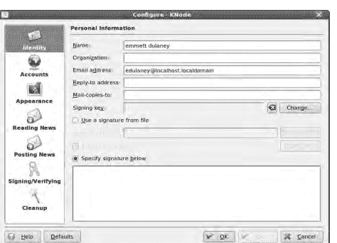

图 3-5：配置 KNode 对话框。

对话框左侧显示了你可以配置的所有项目，右侧是你为左侧当前选中项目输入信息的地方。

当 KNode 对话框首次打开时，会提示你输入个人信息。输入你的身份信息，如姓名、电子邮箱和组织——当你向新闻组发布新条目时，会使用这些信息。

然后，点击左侧的“账户”（Accounts）（参考图 3-5），并点击右侧的“新闻组服务器”（Newsgroup Servers）选项卡，以获取读取新闻的新服务器信息。在“新闻组服务器”选项卡中点击“添加”（Add），弹出对话框（见图 3-6），你可以在其中输入新闻服务器的信息。你的 ISP 应该已经提供了访问新闻服务器所需的信息。如果新闻服务器需要用户名和密码，你也必须输入这些信息。

## 268 在网站上读取和搜索新闻组

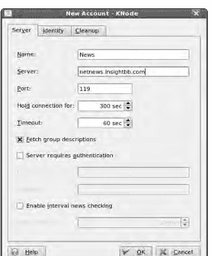

**图 3-6：**在此对话框中输入新闻服务器的信息。

设置新闻账户后，KNode 窗口左侧会显示新闻服务器名称。右键点击服务器名称，从弹出菜单中选择“订阅新闻组”（Subscribe to Newsgroups）。弹出对话框，你可以在其中选择特定的新闻组（如 `comp.os.linux`）。第一次访问时，必须获取新闻组列表。KNode 用户界面与许多其他邮件和新闻阅读器（包括 Thunderbird）类似。

## 在网站上读取和搜索新闻组

如果你无法通过 ISP 访问新闻组，仍然可以在许多网站上读取新闻组并向新闻组发布文章。有些站点存档了旧文章并提供了良好的搜索功能，你可以搜索与你可能的问题相关的文章。

通过网站读取新闻组最棒的部分是，你甚至不需要访问新闻服务器，可以直接从 Web 浏览器读取。

表 3-2 列出了提供免费访问 Usenet 组的网站。有些站点也收费提供 Usenet 新闻组服务。我没有在这里列出它们，但你可以自己。

表 3-2：提供免费访问 Usenet 组的网站

| 网站 | URL |
| :--- | :--- |
| Archive | http://www.archive.org |
| Google | http://www.google.com |
| Mail2web | http://www.mail2web.com |
| Bulletin | http://www.bulletin.com |
| Replayer | http://www.replayer.com |

通过网站读取新闻组最棒的部分是，你甚至不需要访问新闻服务器，可以直接从 Web 浏览器读取。

表 3-2 列出了提供免费访问 Usenet 组的网站。有些站点也收费提供 Usenet 新闻组服务。我没有在这里列出它们，但你可以自己。

## 读取订阅源 (Feeds)

RSS 有多个版本，0.91、1.0 和 2.0 正在使用。Netscape 设计了 RSS 0.90 版本。UserLand 未接受 RSS 1.0，而是继续演进 0.91 到 0.92、0.93、0.94，并最终有了 RSS 2.0（跳过了 1.0）。目前，许多博客和网站使用 0.91 用于基本分发（标题、URL、描述）；使用 1.0 用于 RDF；使用 2.0 用于带有元数据的分发（将元数据视为 RSS 格式提供的信息：关于博客和新闻的数据）。RSS 1.0 文件具有 .rdf 扩展，而 RSS 0.91 和 2.0 文件具有 .xml 扩展。然而，所有 RSS 文件都是使用 XML 标签的文本文件。

## 检查 RSS 源

RSS 订阅源是描述网站内容的 XML 标签文本文件。你通常使用自动化程序定期生成 RSS 源，但也可以使用文本编辑器准备 RSS 源。了解 RSS 源的样式很有帮助，以便调试源的问题。

RSS 源的具体细节取决于 RSS 的版本。最简单的是 0.91，这里是一个典型的 RSS 0.91 源：

```xml


```xml
<?xml version="1.0" ?>

<!-- 一行注释 --->

<channel>

<!-- 此标签指定了源的一般信息-->

  <title>源的标题</title>

  <link>源的 URL，例如 http://naba.typepad.com/</link>

  <description>源的简要描述</description>

  <language>en-us</language>

  <item>

    <title>项的标题</title>

    <link>项的 URL</link>

    <description>项的描述</description>

  </item>

  ... 更多项

</channel>

<rss>
```


你可以从该列表中看到，一个 RSS 馈包含一个带有标题、链接、描述和语言的通道，随后是一系列项目，每个项目都包含一个标题、链接和描述。

RSS 1.0 的格式更加冗长，它使用了 RDF 格式。RSS 1.0 本质上提供了 RSS 0.91 中包含的基本信息，并增加了更多细节，如项目层级的作者、主题和发布日期，这些是 RSS 0.91 不支持的。

## 聚合 RSS 馈源

有许多 GUI 程序可以订阅 RSS 馈源并读取馈源中的项目。这些程序被称为 RSS 聚合器，因为它们可以从许多 RSS 馈源中收集信息，并将所有内容显示在一个地方。

RSS 聚合器有两种类型——Web 浏览器插件和独立程序。浏览器插件（例如 NewsMonster `(.news monster.org)`）运行在 Web 浏览器中，因此馈源会出现在 Web 项目/流中；而 GNOME Straw `http://www.gnome.org/` 和 KDE Aggregator `http://aggregator.kde.org` 是完整的 GUI 应用程序，通常与其他邮件和新闻阅读程序看起来相似。

Fedora、MEPIS 和 SUSE 自带 Aggregator 程序，这是一个独立的 RSS 馈源聚合器。要运行它，请在 GUI 桌面的应用程序菜单中查找链接 `Internet>Aggregator`，如果没有看到，请在终端窗口中输入 `aggregator`。在 Debian 中，你可以通过输入 `apt-get install aggregator` 安装 Aggregator（在输入 `su -` root 用户之后）。

当 Aggregator 运行时，它会显示没有任何 RSS 馈源的窗口。要订阅馈源，请从菜单中选择“Feed”，或在窗口左侧窗格中右键点击“All Feeds”（见图 3-7）并从弹出菜单中选择“All Feeds”。然后，在 RSS Feed 对话框中使用馈源的 URL 并点击 OK。例如，为了读取 Slashdot RSS，我输入 `http://slashdot.org/index.rss`。馈源标题出现在窗口左侧窗格中。点击馈源标题查看该馈源中的项目。然后你可以点击右上面板中的某个项目，该项目就会出现在右下面板，如图 3-7 所示。你可以添加许多不同的馈源，将它们组织到文件夹中，并在 Aggregator 中浏览它们。

### 读取 RSS 馈源

图 3-7：你可以在 Akregator 中组织和读取 RSS 馈源。

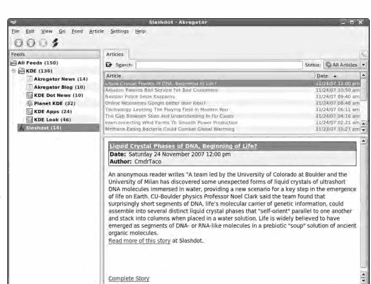

# 第 4 章：使用 FTP

## 本章内容

- 使用 GNOME FTP 客户端
- 使用任何 Web 浏览器作为 FTP 客户端
- 了解 FTP 命令

顾顾名，文件传输协议 `FTP` 用于在计算机之间传输文件。例如，如果你的互联网服务提供商 `ISP` 为你提供了创建个人网站的空间，你可能已经使用 FTP 上传了构成网站的文件。通过在计算机上使用 FTP 客户端，你登录你的 ISP 账户，提供密码，并将文件从你的本地系统复制到 ISP 的服务器上。

你也可以使用 FTP 匿名下载其他文件，例如从互联网上的其他计算机下载开源软件——在这种情况下，你不需要在远程系统上有账户即可下载文件。你只需登录 `anonymous` 作为用户名并提供你的电子邮件地址作为密码。`事实上，你的 Web 浏览器可以代你完成此操作，你可能甚至不知道这个过程正在发生`这种匿名 FTP 非常适合将文件分发给任何需要的人。例如，硬件供应商可能使用匿名 FTP 为任何需要的人提供更新的设备驱动程序。

Linux 带有几个 FTP 客户端，包括命令行和 GUI `图形界面` 客户端。本章将向你介绍几个 GUI FTP 客户端和一个命令行 FTP 客户端。它还描述了你在处理远程目录时使用的命令。


根据你的发行版和版本，你可能需要安装本章讨论的 FTP 客户端。

## 使用图形 FTP 客户端

你可以在 Linux 中使用以下 GUI FTP 客户端之一：

- `FTP` — 用于 GNOME 的图形化 FTP 客户端，地址为 `http://gftp.seoul.org`
- `FTPGrabber` — 用于 KDE `K Desktop Environment` 的图形化 FTP 客户端，地址为 `www.kftp.org`
- Web 浏览器（如 Firefox），用于匿名 FTP 下载

### 使用图形 FTP 客户端

对于上传文件，你可能想使用 `gFTP`，因为你通常需要为此类传输提供用户名和密码。Web 浏览器对于匿名下载效果良好，这也是你通常从互联网下载软件的方式。

接下来的章节将讨论这三个 GUI FTP 客户端。

### 使用 gFTP

GNOME 自带 `gFTP`，这是一个图形化 FTP 客户端。`gFTP` 默认不安装，但你可以从 `http://gftp.seoul.org` 下载并轻松安装它。在某些发行版中，它可能已经在一个包中了，你只需要安装该包即可。

在 Debian 中，在终端中使用 `su -` 并输入 root 密码，然后输入 `apt-get install gftp`。

在 Fedora 中，登录 root，访问“添加/删除软件”，并搜索 `gFTP`。选择搜索列表中出现的包 `gftp1:2.0.18-2`。

当 Aggregator 首次运行时，它会显示没有任何 RSS 馈源的窗口。要订阅馈源，请从菜单中选择“Feed”，或在窗口左侧窗格中右键点击“All Feeds”（见图 3-7）并从弹出菜单中选择“All Feeds”。然后，在 RSS Feed 对话框中使用馈源的 URL 并点击 OK。例如，为了读取 Slashdot RSS，我输入 `http://slashdot.org/index.rss`。馈源标题出现在窗口左侧窗格中。点击馈源标题查看该馈源中的项目。然后你可以点击右上面板中的某个项目，该项目就会出现在右下面板，如图 3-7 所示。你可以添加许多不同的馈源，将它们组织到文件夹中，并在 Aggregator 中浏览它们。

### 使用图形 FTP 客户端

图形 FTP 客户端具有各种任务的菜单。要上传文件，你可以遵循以下步骤：

1. 填写远程主机或 IP 地址。
2. 输入用户名和密码。
3. 观察远程列表。
4. 从远程系统上传文件，选择列表中的文件并点击右箭头。
5. 从远程系统下载文件，选择列表中的文件并点击左箭头。
6. 完成后，选择 `FTP:退出`。

如这些步骤所示，使用客户端客户端（如 `gFTP`）传输文件是一项简单的任务。

信不信，`gFTP` 不仅用于 FTP。它还可以使用 `HTTP` `超文本传输协议` 传输文件，并使用 `SSH` `安全外壳` 协议进行安全文件传输。


### 引入 KFTPGrabber

`KFTPGrabber` 是用于 KDE 的图形 FTP 客户端。你可以在 KDE 桌面的主菜单 `Internet` 分类找到它。在 Debian 中，输入 `apt-get install kftpgrabber` 安装 `KFTPGrabber`（在输入 `su` root 用户之后）。

在 Fedora 中，登录 root，访问“添加/删除软件”，并搜索 `KFTPGrabber`。选择搜索列表中出现的包 `kftpgrabber` 并点击应用。在提示处点击继续，软件将安装。

当 `KFTPGrabber` 窗口出现时，它以类似于 Windows 资源器的视图显示主目录。要连接到 FTP 服务器，选择 `文件>快速连接`。对话框 `见图 4-2` 提示输入 FTP 服务器的主机名以及用户名和密码。

图 4-2：输入远程 FTP 服务器的信息并点击 OK。

输入所需信息后，`KFTPGrabber` 会建立到远程 FTP 服务器的连接。在 `KFTPGrabber` 主窗口中，如图 4-3 所示，你可以并排看到本地和远程目录。

现在你可以通过将文件从一个系统的文件夹拖动到另一个系统的文件夹中来传输文件，因此 FTP 传输变得了普通的拖拽文件复制。

当你完成使用 `KFTPGrabber` 时，选择 `文件>退出`。

4-3: `KFTP-Grabber` 窗口并排显示了本地目录和远程 FTP 服务器的目录。

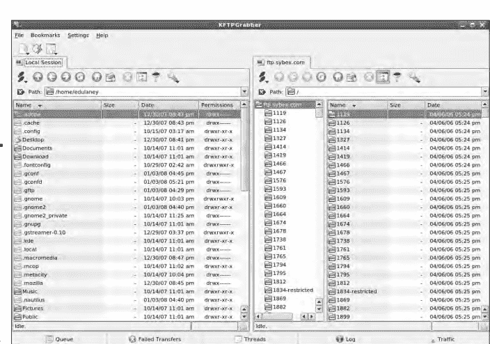

## 使用 Web 浏览器作为 FTP 客户端

任何 Web 浏览器都可以作为 FTP 客户端，但此类程序最适用于匿名 FTP 下载，在这些情况下，Web 浏览器可以使用匿名用户名和密码登录。

例如，你可以使用 Firefox 浏览器作为 FTP 客户端。你只需要知道如何编写 URL，以便 Web 浏览器能够识别出你想通过 FTP 下载文件。FTP URL 的语法如下：

```
ftp://hostname/pathname
```


第一部分部分（`ftp://`）表示你想进行 FTP 传输。`hostname` 是 FTP 服务器的名称（名称通常以 `ftp.` 开头——例如 `ftp.sysec.com`）。`pathname` 是你想要下载的文件完整目录路径和文件名。

如果你仅提供 FTP 服务器的 `hostname`，Web 浏览器将显示匿名 FTP 目录的内容。如果你想在 Linux 系统上访问匿名 FTP，请启动 Firefox（点击 GNOME 面板上的 Web浏览器图标），在“位置”框中输入 FTP URL 并按回车。

### 278 使用图形化 FTP 客户端

图 4-4 显示了 Firefox 中 FTP 目录的典型外观。你可以点击文件夹查看其内容并下载任何文件。你可以通过 Firefox 的 FTP 功能访问本地系统，例如访问 `ftp://localhost/pub/` 以进入 `pub` 目录。如果你没有运行 FTP 服务器，或者设置了防火墙不允许任何 FTP 连接，你将无法从系统获得任何响应。

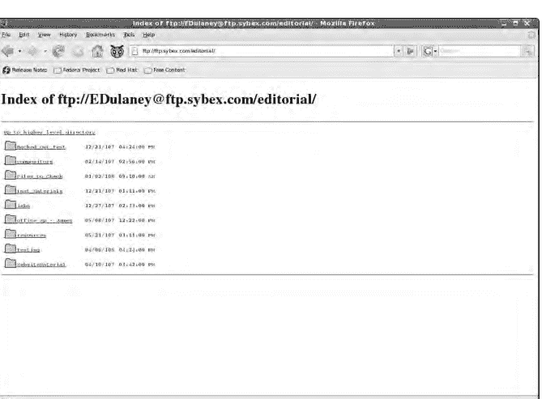

> **图 4-4：** 你可以使用 Web 浏览器从 FTP 服务器下载文件。

在 Debian 和 Fedora 中，以 root 身份登录并在终端中输入 `/etc/init.d/vsftpd` 来启动 FTP 服务器。在 SUSE 中，由 `xinetd` 超服务器控制 FTP 服务器 `vsftpd`。`/etc/xinetd.d/vsftpd` 配置文件指定了 vsftpd 如何启动。有关 `xinetd` 配置文件的更多信息，请参阅第第七卷第一章。

如果你输入其他匿名 FTP 服务器的 `hostname`，访问匿名 FTP 站点的方法同样。例如，尝试输入以下 URL：

```
ftp://ftp.netscape.com/
```

你将获得 `ftp.netscape.com` 服务器的目录。

## 使用命令行 FTP 客户端

知道如何从命令行使用 FTP 是一个好主意——以防万一。例如，如果你的 GUI 桌面无法工作，你可能需要下载一些文件来解决问题。如果你知道如何使用命令行 FTP 客户端，就可以下载文件并处理问题。这并不难，而且命令行 FTP 客户端在所有 Linux 发行版中都可用。

了解命令行 FTP 客户端最好的方法是尝试它。命令是 `ftp`，你可以在 Linux 系统中尝试这些命令。你不需要互联网连接，因为可以使用 `ftp` 命令连接到你的系统。


注意，`ftp` 命令的输出可能有所不同，因为在某些发行版（如 Debian）中，你可以使用 gFTP 的文本模式作为命令行 FTP 客户端。

在下面的示例 FTP 会话中，使用了命令行 FTP 客户端登录并浏览了 Linux 系统上的目录。这里是与典型命令行 FTP 客户端交互的列表：

```
ftp localhost

Connected to localhost.localdomain.

220 (vsFTPD 2.0.3)

Name (localhost): (press Enter.)

331 Please specify the password.

Password: (enter the password for the user)

230 Login successful.

Remote system type is UNIX.

Using binary mode to transfer files.

ftp help

Commands may be abbreviated. Commands are: send

$ debug mdir qc

  dir mget site

  disconnect sendport status

append exit mkd ped

ascii form mode quit struct

bell system gettime quote unique

binary glob recv tenex

case hash newer regret track

cd inmap nlist rhelp trace

cdup image nrans type

chmod lcd open rename user

close ls prompt restart umask

cr macdef passive verbose

delete mdelete proxy runique ?
```


### 280 使用命令行 FTP 客户端

`ftp` `help` `mget` (获取特定命令的帮助)
`mget` get multiple files
`ftp` `cd` `/var` (这会将目录更改为 `/var`。)
250 Directory successfully changed.
`ftp` `ls` (此命令列出目录内容。)
227 Entering Passive Mode (127,0,1,38,142)
150 Here comes the directory listing.
...
deleted...
226 Directory send OK.
`ftp` `bye` (此命令结束会话。)
221 Goodbye.

如列表所示，你可以启动命令行 FTP 客户端并输入 `hostname` 访问远程系统。许多 FTP 命令与 Linux 命令类似，例如 `cd` 更改目录，`pwd` 显示当前目录名称，`ls` 列出目录内容。你可以通过 `help` 查看命令列表，其中 `hostname` 是你想要的命令。

表 4-1 描述了一些常用的命令。

| 命令 | 描述 |
| :--- | :--- |
| `!` | 在本地系统上执行命令。 |
| `?` | 显示命令列表（同 help）。 |
| `append` | 将本地文件追加到远程文件。 |
| `ascii` | 将传输类型设置为 ASCII（或纯文本）。这是默认传输类型。 |
| `binary` | 将传输类型设置为二进制。 |
| `bye` | 结束与 FTP 服务器的会话。 |
| `cd` | 更改远程目录。例如，`cd /pub/Linux` 将目录更改为 /pub/Linux。 |
| `chmod` | 更改远程系统的权限。例如，`chmod 644 index.html` 更改远程上 `index.html` 文件的权限。 |
| `close` | 结束与 FTP 服务器的会话。 |
| `delete` | 删除远程上的文件。例如，`delete image.jpg` 删除远程系统上的文件。 |
| `dir` | 列出远程目录的内容。 |
| `disconnect` | 结束会话并返回 客户端（此命令同 close）。 |
| `get` | 下载远程文件。例如，`get junk.tar.gz` 从远程系统下载 `junk.tar.gz` 并将其保存为本地系统的 `junk.tgz`。 |
| `hash` | 开启或关闭显示传输进度的哈希标记（*）。当此功能开启时，从远程系统传输每 1024 字节就会在屏幕显示（命令行版本的进度条）。 |
| `help` | 显示命令列表。 |
| `image` | 同 binary。 |
| `lcd` | 更改本地系统的当前目录。例如，`lcd /var/ftp` 将当前本地目录更改为 /var/ftp |
| `ls` | 列出远程目录的内容。 |
| `mdelete` | 删除远程上的多个文件。`mdelete *.jpg` 删除当前目录下所有以 .jpg 结尾的远程文件。 |
| `mdir` | 列出多个远程文件并将保存到指定的本地文件中。例如，`mdir /usr/share/doc/wlist` 将列表保存到本地文件 `wlist` 中。 |

## 282 使用命令行 FTP 客户端

表 4-1（续）

| 命令 | 描述 |
| :--- | :--- |
| mget | 下载多个文件。例如，`mget *.jpg` 会下载所有以 `.jpg` 结尾的文件。如果开启了提示（prompt），客户端会在下载每个文件之前请求确认。 |
| mkdir | 在远程系统上创建目录。例如，`mkdir images` 会在当前远程系统中创建一个名为 `images` 的目录。 |
| mls | 同 `ndir` |
| mput | 上传多个文件。例如，`mput *.jpg` 会将所有以 `.jpg` 结尾的文件发送到远程系统。如果开启了提示，FTP 客户端会在发送每个文件之前请求确认。 |
| open | 建立到指定主机上 FTP 服务器的连接。例如，`open ftp.netscape.com` 会连接到主机 `ftp.netscape.com` 上的 FTP 服务器。 |
| prompt | 开启或关闭提示。当提示开启时，在进行多文件传输期间，FTP 客户端会在下载或上传每个文件之前提示你进行确认。 |
| put | 将文件发送到远程系统。例如，`put index.html` 会将本地系统上的 `index.html` 文件发送到远程系统。 |
| pwd | 显示远程系统当前目录的完整路径。当你以用户身份登录时，初始当前工作目录是你的家目录。 |
| quit | 同 `bye` |
| recv | 同 `get` |
| rename | 重命名远程系统上的文件。例如，`rename old.html new.html` 会将远程系统上的 `old.html` 重命名为 `new.html`。 |
| rmdir | 删除远程系统上的目录。例如，`rmdir images` 会删除远程系统当前目录下的 `images` 目录。 |
| send | 同 `put` |
| size | 显示远程文件的大小。例如，`size bigfile.tar.gz` 会显示该远程文件的大小。 |
| status | 显示 FTP 客户端的当前状态 |
| user | 向 FTP 服务器发送新的用户信息。例如，`user jdoe` 发送用户名 `jdoe`；FTP 服务器会提示输入该用户的密码。 |

## 第五卷

### 系统管理

Rich Tennant 著《第五波浪》

> “好消息！我找到了一个地方，路由器可以和楼上的电脑以及地下室的电脑协同工作。”

## 概览

### 第 1 章：基础系统管理简介 ..................................................... 285

系统管理任务概述......................................................................................285

介绍 GUI 系统管理员工具 .................................................................................285

如何成为 root .................................................................................287

了解 Linux 系统 .................................................................................292

系统配置概述 .................................................................................296

`/proc` 文件 .................................................................302

监控系统性能 .................................................................................305

通过 `/proc` 查看系统信息 ...................................................310

了解 Linux 设备 .................................................................................313

管理可加载模块 .................................................................................316

在 Linux 中调度任务 .................................................................................319

### 第 2 章：管理用户和组 ............................................................325

添加用户 .................................................................................325

理解 `/etc/passwd` ................................................................329

管理用户组 .................................................................................330

探索用户环境 .................................................................................331

更改用户所有权 ......................................................333

### 第 3 章：管理文件系统 ...................................................335

探索 Linux 文件系统 .................................................................335

使用 NFS 分享文件 .................................................................................342

备份和恢复文件 ................................................344

访问 DOS 文件系统 ................................................351

使用工具 ........................................................................354

### 第 4 章：安装和更新应用程序 .......................359

使用 RPM 文件 ..........................................................359

使用 DEB 文件 ........................................................366

从源码编译软件 .................................................................370

在线更新应用程序 ...................................375

## 第 1 章：基础系统管理简介

本章内容包括：

- 介绍 GUI 系统管理员工具
- 成为 root
- 理解系统启动过程
- 配置文件概述
- 通过 `/proc` 查看系统信息
- 监控系统性能
- 管理设备
- 调度任务

系统管理是指为了保持计算机运行而必须执行的所有工作。更准确地说，系统管理员就是负责这些工作的人。如果你在家里或小型办公室运行 Linux，你很可能就是系统管理员。无论你的职位如何，本章将为你介绍常见任务。

### 系统管理任务概述

什么是系统管理任务？

- 安装、配置和升级操作系统以及各种实用。
- 安装新软件。你必须安装包格式（如 RPM 或 DEB）提供的软件。你还需要下载并解压以源码形式提供的软件。
- 管理硬件。有时，你需要添加新硬件并安装驱动程序使其工作。
- 备份。你必须备份文件，可以存放在 Zip 驱动器、USB 内存盘或磁带（如果你有磁带驱动器）。
- 挂载和卸载文件系统。例如，当你想要访问 CD-ROM 上的文件时，必须将该 CD-ROM 的文件系统挂载到 Linux 系统的某个目录上。你可能还需要挂载 Linux 和 DOS 格式的软盘。
- 任务自动化。你需要调度 Linux 任务以便其自动（在特定时间）或定期（每隔固定间隔）执行。
- 监控系统性能。你可能希望监控系统性能，以查看处理器大部分时间花在了哪里，以及查看系统的空闲和已用内存。
- 启动和关闭系统。虽然启动系统通常只需开启电脑电源，但在关闭 Linux 系统时需要小心。如果你的系统设置了图形化登录界面，可以通过屏幕上的菜单项执行关闭操作。否则，使用 `shutdown` 命令停止所有进程后再关闭电脑开关。
- 状态监控。如果你有网络接入（无论是局域网、DSL线路还是调制解调器连接），你可能需要检查各种网络接口的状态，并确保网络连接运行正常。
- 设置主机和网络安全。你必须确保系统文件受到保护，并且你的系统能够防御网络攻击。
- 监控安全性。你需要留意任何入侵情况，通常通过检查日志文件来实现。

### 添加和删除用户账户

系统管理员需要添加新的用户账户并删除不必要的账户。

### 管理打印队列

系统管理员需要开启或关闭打印队列，检查队列状态，并在需要时删除打印作业。

# 介绍一些系统管理员工具 287

这是一份任务列表！本章并未涵盖所有这些项目，但本本微型书的其余部分描述了其中大多数任务。这里的重点是某些基础知识，例如使用 GUI 工具、解释如何成为 root（超级用户）、描述系统配置文件，以及展示你如何监控系统性能、管理设备以及设置周期性作业。

# 介绍一些系统管理员工具

每种 Linux 发行版都带有有一组用于执行系统管理的 GUI 工具。这些 GUI 工具会提示你输入，然后需要 Linux 命令来执行任务。接下来的章节将简要介绍 Debian、Fedora、DUSE 和 Xandros 中的 GUI 系统管理员工具。

## Debian 中的 GUI 系统管理员工具

Debian 默认使用 GNOME 桌面，并提供了一些用于执行管理员任务的 GUI 工具。这些工具可以在“应用程序：系统工具”菜单中找到。表 1-1 列出了某些任务以及你选择的用于启用执行该任务的 GUI 工具菜单。

| 表 1-1 | 在 Debian 中使用 GUI 工具执行系统管理任务 |
| 执行操作 | 在 Debian GNOME 桌面上选择以下项 |
| 添加或删除软件包 | 应用程序：系统工具：Synaptic 软件包管理器 |
| 修改日期或时间 | 应用程序：系统工具：时间和日期 |
| 修改密码 | 主菜单：设置：更改密码 |
| 配置桌面 | 应用程序：桌面偏好 |
| 配置网络 | 应用程序：网络 |
| 格式化软盘 | 应用程序：系统工具：软盘格式化 |
| 管理打印机 | 应用程序：系统工具：打印机 |
| 管理用户账户 | 应用程序：系统工具：用户和组 |
| 监控系统性能 | 应用程序：系统工具：系统监控 |
| 查看系统日志 | 应用程序：系统工具：系统日志 |

## Fedora 中的 GUI 系统管理员工具

Fedora 自带一组 GUI 系统配置工具，可以减轻执行典型管理员任务的负担。表 1-2 简要总结了你用于启动特定任务的 GUI 工具的菜单选择。

# 288 介绍一些 GUI 系统管理员工具

| 表 1-2 | 在 Fedora 中启动 GUI 系统管理员工具 |
| 配置或管理此项 | 通过选择此项启动 |
| 日期和时间 | System::Administration::Date & Time |
| 磁盘和 DVD/CD-ROM | Applications::System Tools::Disk Management |
| 显示设置 | System::Administration::Display |
| 防火墙设置 | System::Administration::Security Level and Firewall |
| 硬件 | Applications::System Tools::Hardware Browser |
| 互联网连接 | System::Administration::Network |
| 网络 | System::Administration::Network |
| 桌面和密码等偏好 | System::Preferences |
| 打印机 | System::Administration::Root Password |
| root 密码 | System::Administration::Server Settings |
| 服务器 | System::Administration::Add/Remove Applications |
| 软件 | System::Administration::System Monitor |
| 系统性能 | System::Administration::Users and Groups |
| 用户账户 | |

## Knoppix 中的 GUI 系统管理员工具

Knoppix 是一个 Live CD发行版，你可以用它尝试 Linux，也可以修复现有 Linux 系统中的问题。因此，Knoppix 带有几个可以用于系统管理任务的 GUI 工具。表 1-3 总结了 Knoppix 中的某些 GUI 工具。

| 表 1-3 | 在 Knoppix 中使用 GUI 工具执行系统管理任务 |
| 执行操作 | 在 Knoppix GUI 桌面上选择此项 |
| 配置桌面 | 主菜单::Settings::Desktop Settings |
| 配置 KDE | 主菜单::Settings::Control Center |
| 配置网络 | 主菜单::KNOPPIX::Network/Internet::Network card configuration |
| 配置打印机 | 主菜单::KNOPPIX::Configure::Configure printer(s) |
| 查找文件 | 主菜单::Find Files |
| 管理磁盘分区（用于对现有 Linux 安装进行故障排除） | 主菜单::System::QTParted |

# 介绍一些系统管理员工具

| 执行操作 | 在 Knoppix GUI 桌面上选择此项 | 书 V | |
|---|---|---|---|
| 打开具有 root 权限的终端窗口 | 主菜单:::KNOPPIX:::Start Root Shell | 第 1 章 | |
| 启动 Samba 服务器 | 主菜单:::KNOPPIX:::Services::Start Samba | 介绍 | | |
| 启动 SSH 服务器 | 主菜单:::KNOPPIX:::Services::Start SSH Server | 管理 | |

# # # MEPIS 中的 GUI 工具

你可以以 Live CD 运行 MEPIS，也可以将其安装在硬盘上。MEPIS 使用 KDE 桌面，并包含了用于管理员任务的 GUI 工具。MEPIS OS Center 的独特方面之一允许你执行管理员任务。你可以通过选择“主菜单::MEP OS Center”启动它。图 1 显示了 MEPIS OS 的主窗口，你可以从中在硬盘安装 MEPIS（当你作为 Live CD 运行 MEPIS 时）并执行某些系统配置和维护任务。

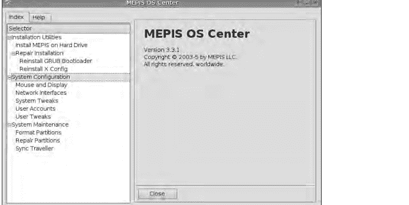

- 图 1-1：在 MEPIS 中，你可以为 MEPIS OS Center 执行某些管理员任务。
- 选择器
- 安装列表
- 安装 MEP 到硬盘
- 修复安装
- 重新配置 X
- 配置
- 鼠标和显示
- 网络接口
- 系统微调
- 用户账户
- 系统维护
- 权限
- 修复分区
- 同步 Traveller

除了 MEPIS Center 外，你还可以使用 KDE 控制中心（选择“主菜单::Control Center”）来执行某些系统管理和配置任务。表 1-4 列出了在 MEPIS 中使用的其他用于管理员任务的 GUI 工具。

| 执行操作 | MEPIS 中的某些管理员工具 |
|---|---|
| 配置桌面 | 主菜单::Desktop Settings |
| 配置 KDE | 主菜单::Control Center |（续） |

# 290 介绍一些管理员工具

| 执行操作 | 在 MEPIS GUI 桌面上选择此项 |
|---|---|
| 配置打印机 | 打印 |
| 查找文件 | Synaptic 软件包 |
| 安装软件 | QTParted |
| 管理磁盘分区（用于对现有 Linux 安装进行故障排除） | 用户 |
| 管理用户账户 | 终端程序 |
| 打开具有 root 权限的终端窗口 | root 模式 |

## SUSE 中的 GUI 系统管理员工具

在 SUSE 中，通过“主菜单::YaST”启动你的系统管理任务。图 1-2 显示了 YaST 控制中心。

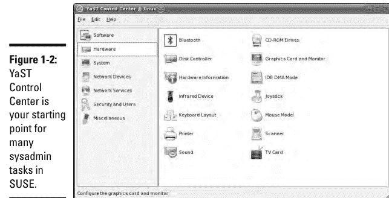

YaST 控制中心的左侧显示了你可以执行的任务类别图标。右侧显示了当前选定类别的任务图标。当你点击 YaST 右侧的图标时，会出现一个窗口并允许你执行该任务。

# 介绍系统管理员工具 291

表 1-4 总结了 YaST 左侧看到的每个类别图标的任务。从表 1-5 的第二列可以看出，YaST 控制中心是你所有系统管理选择的一站式服务。

| 表 1-5 | YaST 中按分类的任务 |
|---|---|
| 此类别允许你配置以下 |
| 软件 | 在线更新、安装源、安装 环境 环境、安装到目录、介质、补丁更新、系统更新 |
| 硬件 | 蓝牙、CD-ROM 驱动器、磁盘控制器、显卡和显示器、硬件信息、IDE 模式、D 模式、摇杆、键盘布局、鼠标、打印机、扫描仪、电视卡 |
| 系统 | /sysconfig 编辑器、引导加载配置、引导或救援软盘、日期和时间、语言、PCI 设备驱动程序、分区、电源管理、配置文件、系统备份、系统恢复、系统服务（运行级别） |
| 网络设备 | DSL、传真、ISDN、调制解调器、网卡、电话应答 |
| 网络服务 | DHCP 服务器、DNS 主机名、LDAP 客户端、邮件传输代理、HTTP 服务器名称、Kerberos 客户端、NIS 客户端、NIS 服务器、NTFS 客户端、网络服务 (inet6)、代理、远程管理、SLP 浏览器、Samba 客户端、Samba 服务器、FTTP 服务器 |
| 安全和用户 | 防火墙、组管理、本地安全、用户管理 |
| 其他 | 自动安装、提交支持查询、供应商驱动 CD、查看启动日志、查看系统日志 |

## 292 如何成为 root

| 表 1-6（续） | 要配置或管理此项 | 选择此项启动 GUI 工具 |
| :--- | :--- | :--- |
| 互联网连接 | System > Administration > Networking | |
| 网络 | System > Administration > Networking | |
| 桌面和默认应用程序设置 | System > Preferences | |
| 打印机 | System > Administration > Printing | |
| root 密码 | System > Administration > Root Password | |
| 服务器 | System > Administration > Server Settings | |
| 软件 | Application > System Tools > Add/Remove Programs | |
| 系统日志 | Application > System Tools > System Log | |
| 系统性能 | Application > System Tools > System Monitor | |
| 更新 | System > Administration > Ubuntu Manager | |
| 用户账户 | System > Administration > Users and Groups | |

## Xandros 中的 GUI 管理工具

Xandros 被设计为一种桌面操作系统，正如你所见到的，你可以轻松地从桌面访问一切。对于大多数系统管理员来说，你从 Xandros 控制中心开始——选择主菜单（Main Menu） > 控制中心（Control Center）即可到达那里。（图 1-3 显示了你操作时的界面。）

如你所见，窗口的左侧显示任务类别的树状菜单。你可以点击类别旁边的加号查看子类别。当你点击特定任务时，窗口的右侧会显示允许你执行该任务的 GUI。

对于某些任务，例如挂载文件系统或添加打印机，你可以通过选择主菜单（Main Menu） > 应用程序（Applications） > 系统（System） > 管理工具（Administrator Tools） > Xandros 文件管理器（Xandros File Manager (Administrator））来以系统管理员身份打开。系统会提示你输入 root 密码。图 1-4 显示了 Xandros 文件管理器窗口，你可以从中执行一些系统管理任务。

## 如何成为 root

你必须以 root 身份登录才能执行系统管理任务。root 用户是超级用户，也是拥有执行系统中任何操作所需全部权限的账户。

## 控制中心

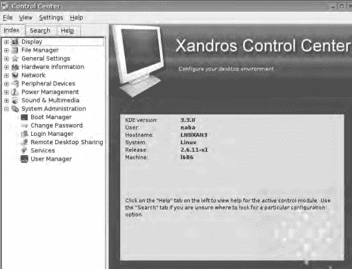

## Xandros 控制中心

书籍
第 1 章

图 1-3：你可以从 Xandros 控制中心执行许多系统管理任务。

介绍基础系统管理

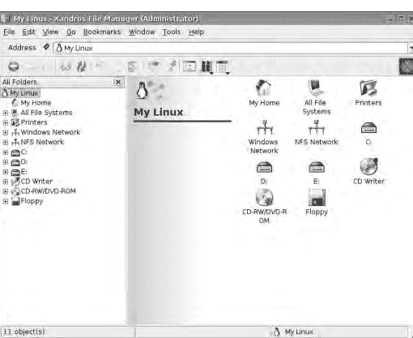

图 1-4：对于某些系统管理任务，请使用 Xandros 文件管理器。

常识告诉我们，通常不应该以 root 身份登录。当你是 root 时，一个失误就可能轻易删除所有文件——尤其是当你在输入命令时。例如，你可能会输入 `rm *.html` 命令来删除所有扩展名为 .html 的文件。如果你在星号（*）之后不小心按了空格键会怎样？shell 将该命令视为 `rm *`，因为星号匹配任何文件名——这会删除当前目录下的所有内容。在它真的发生在你身上之前，这似乎是不可能的！

## 294 如何成为 root

## 使用 su - 命令

如果你以普通用户身份登录，如何执行任何管理工作呢？嗯，你暂时成为 root。如果你在终端窗口或控制台操作，输入

```
su -
```


`su -`

然后根据提示输入 root 密码。从这一刻起，你就重新变回 root 了。无论你要做什么都可以。要回到你原来的身份，输入

```
exit
```

就这样！非常简单。

顺便说一下，Knoppix 有 root 用户但没有 root 密码，所以你只需在终端窗口的 shell 中输入 `su -` 即可成为 root。Ubuntu 没有 root 用户。要在 Ubuntu 中执行任何需要 root 权限的任务，你必须使用 `sudo` 后接命令，并在提示时提供你的普通用户密码。


## 为 GUI 实用变为 root

大多数 Linux 发行版都包含了用于执行系统管理的 GUI 工具。如果你使用这些 GUI 工具之一来执行需要 root 权限的任务，该工具通常会弹出一个对话框，提示你输入 root 密码，如图 1-5 所示（Ubuntu 除外，其 GUI 工具会提示输入你的普通用户密码）。只需输入密码并按回车。如果你不想使用该工具，请点击取消（Cancel）。

图 1-5：输入 root 密码并按回车获取 root 权限。

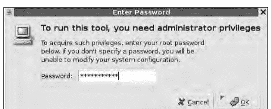

## 从忘记 root 密码中恢复

为了执行系统管理任务，你必须知道 root 密码。如果忘记 root 密码怎么办？不用担心：只需重启电脑 并按照步骤重置 root 密码：

- 1. 重启 PC（在退出 GUI 屏幕时选择重启）或像往常一样电源。

很快你就会看到图形 GRUB 引导器界面，显示了你可以启动的操作系统名称。如果你的系统运行 LILO 启动，按下 `Ctrl+X` 并在启动提示符处输入 `linux single` 并按回车。然后继续执行第 4 步。

- 2. 如果你有多个操作系统，使用方向键选择 Linux 作为你的操作系统。

- 3. 在 Linux 启动提示符处，输入 `linux single` 并按回车。然后继续执行第 4 步。

- 4. 修改 root 密码：

```
passwd:
```

- 5. 输入你想要使用的 root 密码（它不会显示）并按回车。Linux 再次询问密码：

```
passwd again:
```

- 6. 如果你两次都输入相同的密码，`passwd` 命令将更新 root。

```
passwd password updated successfully
```

- 7. 输入 `reboot` 重启 PC。

Linux 启动后将显示熟悉的界面。你现在可以使用新密码登录。

## 296 如何启动

在 SUSE 启动提示符处，输入 `linux single` 并按回车。然后继续执行第 4 步。

- 重新挂载根文件系统为读写：

```
mount -o remount,rw /
```

在 Linux 启动，通过执行第 4 步到第 6 步修改 root 密码。


确保你的 Linux PC 是物理安全的。正如这些步骤所示，任何可以访问你 Linux PC 的人都可以简单地重启、设置新的 root 密码并随心所欲。保护密码的另一种方法是设置 GRUB 密码，这会导致 GRUB 在启动前要求输入密码。当然，你每次启动系统时都必须记住 GRUB 密码！


## 如何启动

了解 Linux 的启动顺序很重要。你可以利用这些知识来启动和停止服务，例如 Web 服务器和网络文件系统（NFS）。接下来的章节将为你提供 Linux 如何启动以及启动初始进程的概述。这些章节还将让你熟悉启动各种服务的 shell 脚本。

## 理解 init 进程

Linux 启动时，它从硬盘加载并运行操作系统程序。操作系统被设计用来运行其他程序。名为 `init` 的进程启动 Linux 系统上的初始进程。

要查看系统当前运行的进程，

```
ps ax | more
```

| PID | TTY | STAT | TIME | COMMAND |
|---|---|---|---|---|
| 1 | ? | S | 0:22 | init [2] |

你会得到如下所示的输出列表：

第一列标题为 PID，显示每个进程的数字。PID 代表进程 ID（标识）——由 Linux 内核分配的顺序数字。进程列表中的第一个项目进程 ID（PID）为 1 是 `init` 进程。它是第一个进程，并启动了你 Linux 系统中的所有其他进程。这就是为什么 `init` 有时被称为“进程之母”。

# 理解 Linux 如何启动 297

`init` 进程启动哪些内容取决于以下几点：

- 运行级别（run level），一种标识系统配置的标识，只有选定的进程组可以在该配置存在。
- `/etc/inittab` 文件的内容，这是一个指定在不同运行级别下启动进程的文本文件。
- 若干在特定运行级别执行的 shell 脚本。（这些脚本位于 `/etc/init.d` 目录以及 `/etc` 下的子目录中）

大多数 Linux 发行版使用 0 到 6 的运行级别。不同发行版之间的运行级别含义也有所不同。表 1-7 显示了运行级别的含义，并指出了针对 Fedora、Debian、MEPIS、SUSE、Ubuntu 和 Xandros 的特定操作。

| 运行级别 | 含义 |
|---|---|
| 0 | 关闭系统 |
| 1 | 在单用户独立模式下运行（其他人无法登录；你在控制台前操作） |
| 2 | 在多用户模式下运行（Debian、Ubuntu 和 Xandros 使用运行级别 2 作为默认运行级别） |
| 3 | 在全多用户模式下运行（用于 Fedora、MEPIS 和 SUSE 的文本模式登录） |
| 4 | 在全多用户模式下运行（在 Fedora、MEPIS 和 SUSE 中未使用） |
| 5 | 在全多用户模式下运行（作为 Fedora、MEPIS 和 SUSE 图形化登录的默认运行级别） |
| 6 | 重启系统 |

当前运行级别结合 `/etc/inittab` 文件的内容控制着 Linux 中 `init` 启动哪些进程。Debian、Ubuntu 和 Xandros 的默认运行级别是 2。在 MEPIS 和 SUSE 中，级别 3 用于文本模式登录界面和图形化登录界面。你可以通过编辑 `/etc/inittab` 文件中的某行来更改默认运行级别。

要检查当前运行级别，请在终端输入以下命令：

```
/sbin/runlevel
```

# 298 理解 Linux 如何启动

在 Debian 中，`runlevel` 命令的输出如下：

N 2

输出的第一个字符显示上一个运行级别（N 表示没有上一个运行级别），第二个字符显示当前运行级别（2）。在这种情况下，系统在运行级别 2 下启动。如果你位于 Fedora 或 MEPIS 的 GUI 桌面中，`runlevel` 命令应显示 5 为当前运行级别。

## 检查 /etc/inittab 文件

`/etc/inittab` 文件是理解 `init` 在各个运行级别下启动进程的关键。你可以使用以下命令查看文件的内容：

```
more /etc/inittab
```

使用 `more` 命令查看 `/etc/inittab` 文件的内容时，不需要以 root 身份登录。

要解释 `/etc/inittab` 文件的内容，请遵循以下步骤：

1. 寻找包含 `initdefault` 短语的行。
   以下是 Debian 系统 `/etc/inittab` 文件中的该行：
   `id:2:initdefault:`
   该行显示了默认运行级别。在这种情况下，它是 2。

2. 找到所有指定 `init` 在运行级别 2 下运行什么内容的行。寻找在两列 `()` 之间有 `2` 的行。以下是 Debian 中的相关行：
   `12:wait:/etc/init.d/rc 2`
   该行指定 `init` 执行文件 `/etc/init.d/rc`，并将 `2` 作为参数。

如果你查看 Debian 系统中的 `/etc/init.d/rc`，它是一个 shell 脚本。你可以研究这个文件，查看它是如何启动运行级别 1 到 5 的进程的。

```
id:runlevels:action:process
```


# 理解 Linux 如何启动 299

表 1-8 显示了每个字段的含义。

| 表 1-8 | inittab 条目字段的含义 |
| --- | --- |
| 字段 | 含义 |
| id | 唯一的单字符或双字符标识符。`init` 进程在内部使用此字段。你可以使用任何想要的标识符，只要不在多个处重复使用相同的标识符即可。 |
| runlevels | 零或多个字符的序列，表示一个运行级别。例如，如果 `runlevels` 字段为 `12345`，则该条目适用于 1 到 5 的所有运行级别。如果 `action` 字段设置为 `boot` 或 `reboot`，则该字段被忽略。 |
| action | 告诉 `init` 进程对该项做什么。例如，如果是 `initdefault`，`init` 将 `runlevels` 字段解释为默认运行级别。如果此字段设置为 `wait`，`init` 会启动 `process` 字段中指定的程序或脚本并等待直到其存在。 |
| process | 启动的脚本或程序的名称。当然，`action` 字段的某些设置不需要 `process` 字段。例如，当 `action` 字段为 `initdefault` 时，不需要 `process` 字段。 |

## 使用 init 命令尝试新的运行级别

要运行新级别，你不需要更改 `/etc/inittab` 文件中的默认运行级别。如果你以 root 身份登录，可以通过输入 `init` 后后跟运行级别来更改运行级别（随之改变的是 Linux 中运行的进程）。

例如，要将系统置于单用户模式，请输入：

```
init 1
```

因此，如果你想运行运行级别 1，输入以下内容：

```
init 1
```

因此，如果你想运行运行级别 2，输入以下内容：

```
init 2
```

因此，如果你想运行运行级别 3，输入以下内容：

```
init 3
```

因此，如果你想运行运行级别 4，输入以下内容：

```
init 4
```

因此，如果你想运行运行级别 5，输入以下内容：

```
init 5
```

因此，如果你想运行运行级别 6，输入以下内容：

```
init 6
```

## 302 熟悉 Linux 系统配置文件

为了让 `sshd` 在系统启动到运行级别（run level） 3、4 或 5 时自动启动，请输入以下命令（需以 root 身份登录）：

```
chkconfig --level 345 sshd on
```

在 Fedora 和 SUSE 中，你也可以使用 `chkconfig` 命令来检查哪些服务器已开启或关闭。例如，要查看所有运行级别的服务器完整列表，请输入以下命令：

```
chkconfig --list
```


在 Debian、MEP、Ubuntu 和 Xandros 中，你可以使用 `update-rc.d` 命令让服务器在系统启动时自动启动。例如，要将 sshd 设置为默认运行级别自动启动，请在 root 身份登录的终端窗口中输入 `update-rc.d defaults`。你也可以指定具体的运行级别序列号（每个服务启动的顺序）。要了解更多关于 `update-rc.d` 命令的信息，请在终端窗口中输入 `man update-rc.d`。

## 熟悉 Linux 系统配置文件

Linux 包含了许多配置文件。所有文件都是文本文件，可以使用文本编辑器进行编辑。要编辑这些配置文件，你必须以 root 身份登录。表 1-9 列出了一些最常用的配置文件，并对每个文件进行了简要描述。此列表让你了解系统管理员需要处理的配置文件的类型。在许多情况下，Linux 包含了用于设置这些许多配置文件的 GUI 工具。

### 表 1-9 一些 Linux 配置文件

| 配置文件 | 描述 |
| :--- | :--- |
| `/boot/grub` | GRUB 引导加载程序的文件位置 |
| `/boot/grub/menu.lst` | GRUB 在启动系统前显示的启动菜单的配置文件 |
| `/boot/System.map` | Linux 内核映射表（将内核地址映射为函数和变量名称） |
| `/boot/vmlinux` | Linux 内核（操作系统的核心） |
| `/etc/apache2/httpd.conf` | Apache Web 服务器的配置文件（Debian 和 MEP） |
| `/etc/apt/sources.list` | 列出高级软件包工具 (APT) 获取软件包的来源（FTP、网站或 CD-ROM）的配置文件（Debian、MEP、Ubuntu 和 Xandros） |
| `/etc/at.allow` | 允许使用 `at` 命令安排以后执行任务的用户名 |
| `/etc/at.deny` | 禁止使用 `at` 命令的用户名 |
| `/etc/bashrc` | bash 的系统级函数和别名（Fedora） |
| `/etc/bash.bashrc` | bash 的系统级函数和别名（Debian、MEP、SUSE、Ubuntu 和 Xandros） |
| `/etc/cups/cupsd.conf` | 通用 UNIX 打印系统的打印机配置文件 |
| `/etc/fonts` | 包含字体配置文件的目录。（特别地，你可以将本地字体配置设置放在 `/etc/fonts/local.conf` 中。） |
| `/etc/fstab` | 关于可挂载可用文件系统的信息以及每个文件系统应挂载的位置 |
| `/etc/group` | 关于组的信息 |
| `/etc/grub.conf` | Fedora 和 SUSE 中 GRUB 引导加载程序的配置 |
| `/etc/hosts` | IP 地址及其对应名称列表 |
| `/etc/hosts.allow` | 允许访问此系统 Internet 服务的主机 |
| `/etc/hosts.deny` | 禁止访问此系统 Internet 服务的主机 |
| `/etc/httpd/httpd.conf` | Apache Web 服务器的配置文件（Fedora） |
| `/etc/init.d` | 包含启动和停止各种服务器脚本的目录 |
| `/etc/inittab` | 所有其他进程的 init 使用的配置文件 |
| `/etc/issue` | 包含在显示文本提示符前打印的消息（通常是发行版名称和版本号） |
| `/etc/lilo.conf` | Linux 加载器 (LILO) 的配置——可以从磁盘加载操作系统的引导加载器之一（仅在使用 LILO 引导加载器时存在） |
| `/etc/login.defs` | 创建用户账户的默认信息，供 `useradd` 命令使用 |
| `/etc/modprobe.conf` | 可加载内核模块的配置文件，供 `modprobe` 命令使用（Fedora 和 SUSE） |
| `/etc/modules.conf` | 可加载模块配置文件（Debian、MEP 和 Xandros） |
| `/etc/mtab` | 关于当前挂载文件系统的信息 |
| `/etc/passwd` | 所有用户账户的信息。（实际密码存储在 `/etc/shadow` 中） |
| `/etc/profile` | bash shell 的系统级环境和启动文件 |
| `/etc/profile.d` | 包含 `/etc/profile` 脚本执行的脚本文件目录（以 `.sh` 结尾） |
| `/etc/init.d/rc` | Linux 初始化脚本 |
| `/etc/shells` | 系统上所有 shell 的列表 |
| `/etc/skel` | 存放用户目录初始版本的目录 |
| `/etc/sysconfig` | Linux |
| `/etc/sysctl.conf` | 启动时读取的内核参数配置文件 |
| `/etc/termcap` | 终端能力数据库 |
| `/etc/udev` | 包含 udev 配置文件的目录，用于动态命名热插设备并创建设备文件 |
| `/etc/X11` | X 系统配置目录 |
| `/etc/X11/X86Config` | XFree6 的配置文件（Debian、MEP 和 Xandros） |
| `/etc/X11/xorg.conf` | xorg 的配置文件（Fedora、Ubuntu 和 SUSE） |
| `/etc/xinetd.conf` | 按需启动许多 Internet 服务的 xinetd 守护进程配置 |

### 305 性能监控

| 配置文件 | 描述 |
| :--- | :--- |
| `/etc/yum.conf` | yum 软件包更新和安装程序的配置（Fedora） |
| `/var/log/apache2` | 访问和错误日志（Debian 和 MEP） |
| `/var/log/cron` | cron 进程运行调度任务的日志文件 |
| `/var/log/boot.log` | 启动日志（SUSE） |
| `/var/log/messages` | 启动信息文件（Debian、Fedora、MEP、Ubuntu 和 Xandros） |
| `/var/log/httpd` | 访问和错误日志（Fedora） |
| `/var/log/messages` | 系统日志 |

## 性能监控

作为系统管理员，必须关注系统的运行状况。你可以通过查看等信息来监控系统的整体性能：

- 中央处理器 (CPU) 使用率
- 物理内存使用率
- 虚拟内存（交换空间）使用率
- 硬盘使用率

Linux 自带许多可以用于监控一个或多个此类性能参数的工具。以下章节介绍了其中一些工具，并向你展示如何理解这些工具提供的信息。

### 使用 top 工具

要查看使用大部分 CPU 时间的进程，你可以使用文本模式的 `top` 工具。在终端窗口（或控制台）中输入 `top` 即可启动该工具。`top` 工具会显示一个文本屏幕，按 CPU 使用率出当前进程，以及内存和交换空间使用等其他信息。图 1-6 显示了 `top` 工具的典型输出。

`top` 每五秒更新一次显示。如果你在窗口中保持 top 运行，就可以持续监控 Linux 系统的状态。退出 top 请按 Q、Ctrl+C 或关闭终端窗口。

### 306 监控性能系统

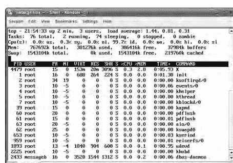

**图 1-6** 你可以使用 `top` 工具查看 CPU 占用率最高的进程。

输出屏幕的前几行（见图 1-6）提供了系统的摘要信息。以下是这五行显示的内容：

- 第一行显示当前时间、系统运行时间以及三个负载平均值 —— 在过去 1、5 和 15 分钟内准备就绪的进程数。
- 第二行列出进程总数以及这些进程的状态。
- 第三行显示 CPU 使用率 —— 用户进程占用的 CPU 运行百分比、系统（内核）进程占用的百分比，以及 CPU 闲置所占的百分比。
- 第四行显示物理内存的使用情况 —— 总量、已用、空闲以及分配给缓冲区（例如，用于从硬盘读取）的量。
- 第五行显示虚拟内存（或交换空间）的使用情况 —— 交换空间总量、已用、空闲以及缓存的量。

摘要信息下方的表格（参考图 1-6）列出了当前进程的信息，并按 CPU 使用时间从大到小排序。表 1-10 总结了显示表格中列标题的含义。

| 表 1-10 | top 工具输出中列标题的含义 |
| --- | --- |
| PID | 进程 ID |
| USER | 运行进程的用户名 |

## 监控系统性能 307

### 使用 uptime 命令

你可以使用 `uptime` 命令来获取系统状态的摘要。
只需如下所示输入命令：

```
uptime
```

它显示的输出类似于以下内容：

```
15:03:21 32 days, 57 min, 3 users, load average: 0.13, 0.23, 0.27
```


此输出显示了当前时间、系统运行时间、用户数量以及（最后）三个负载平均值 —— 过去 1、5 和 15 分钟内准备就绪的进程平均数。负载平均值大于 1 意味着许多进程正在同时竞争 CPU 时间。

负载平均值可以让你了解系统的忙碌程度。

## 使用 vmstat 工具

你可以使用 `vmstat` 工具获取系统整体使用情况的摘要信息。要查看每 5 秒平均一次系统使用信息，请输入以下命令（第二个参数表示 `vmstat` 显示的输出总行数）：

```
vmstat 5 8
```

# 308 监控系统性能

你看到的输出类似于以下内容：

| procs | swpd | free | memory... | --Swap-- | buff cache | so | --io-- | in | --system-- | --cpu-- | us sy id |
|---|---|---|---|---|---|---|---|---|---|---|---|---|
| 0 | 31324 | 4016 | 18568 | 136004 | 1 | 17 | 16 | 8 | 110 | 43 | 6 | 1 |
| 0 | 31324 | 2520 | 13548 | 136992 | 0 | 0 | 778 | 199 | 117 | 377 | 8 | 6 |
| 0 | 31324 | 1984 | 12914 | 137448 | 0 | 0 | 5974 | 125 | 1059 | 521 | 5 | 0 |
| 0 | 31324 | 1928 | 13148 | 137116 | 7 | 0 | 1586 | 118 | 1050 | 561 | 4 | 5 |
| 0 | 31324 | 1184 | 13148 | 132064 | 0 | 0 | 1260 | 51 | 1080 | 427 | 5 | 0 |
| 0 | 31324 | 1301 | 13140 | 127976 | 0 | 0 | 1126 | 46 | 1082 | 719 | 54 | 37 |
| 0 | 31324 | 1916 | 13128 | 127976 | 0 | 0 | 0 | 1015 | 211 | 224 | 3 | 9 |

输出的第一行显示了自上次重启以来的平均值。之后，`vmstat` 会多次显示 5 秒的平均值。表格化输出被分为六大类，由第一行中的字段指示。第二行显示了每个主要字段的进一步详细信息。你可以通过表 1-1 解释这些字段。

## vmstat 工具输出中字段的含义

| 字段名称 | 描述 |
|---|---|
| procs | 进程数量及其类型：r = 等待运行，b = 不可中断的睡眠，sw = 已交换但已就绪 |
| memory | 关于物理内存和交换空间使用情况的信息（所有数字均为千字节）：swpd = 使用的虚拟内存，free = 物理内存，buff = 已使用的内存，cache = 已缓存的虚拟内存 |
| swap | 交换量（数字为千字节/秒）：si = 从交换交换内存，bo = 交换到内存 |
| io | 输入/输出信息（bi = 每秒读取数，bo = 每秒写入数） |
| system | 系统信息：in = 每秒中断数，cs = 每秒上下文切换数 |
| cpu | 自上次屏幕更新以来使用的 CPU 时间百分比：us = 用户占用的百分比，sy = 系统占用的百分比，id = 闲置百分比 |


在 `vmstat` 输出中，`si` 和 `bo` 字段值高意味着频繁交换。

## 检查磁盘性能和使用

Linux 自带 `hdparm` 工具，你可以使用它来控制 IDE 硬盘。例如，这里使用 `/dev/hda` 的结果：

```
hdparm -t /dev/hda
```

Timed reads: 178 MB in 3.03 seconds

该命令需要 IDE 硬盘名称（第一个硬盘为 `/dev/hda`，第二个为 `/dev/hdb`）作为参数。如果你有 IDE 硬盘，可以尝试此命令来查看系统读取速度。

要显示挂载系统的可用空间，使用 `df` 命令。如果你想要更可读的 `df` 输出，输入以下命令：

```
df -h
```

这是该命令的典型输出：

| 文件系统 | 容量 | 可用 | 使用率 | 挂载点 |
|---|---|---|---|---|
| /dev/hda5 | 7.1G | 3.9G | 2.9G | 59% | /boot |
| /dev/hda3 | 99M | 18M | 77M | 19% | /dev/shm |
| none | 125M | 0 | 125M | 0% | /dev/shm |
| /dev/scd0 | 2.6G | 2.6G | 100% | /media/cdrecorder |

正如示例所示，`-h` 选项导致 `df` 命令以千字节（G）和兆字节（M）显示大小。

要检查特定目录使用的磁盘空间，使用 `du` 命令 —— 你可以使用 `-h` 选项以千字节（K）和兆字节（M）查看输出，如下例所示：

```
du -h /var/log
```

这是该命令的典型输出：

```
152K /var/log/cups

4.0K /var/log/vbox

4.0K /var/log/httpd

508K /var/log/gdm

4.0K /var/log/samba

8.0K /var/log/mail

4.0K /var/log/news/OLD
```

## 310 通过 proc 文件系统查看系统信息

```
8.0K  /var/log/news

4.0K  /var/log/squid

2.2M  /var/log
```

`du` 命令显示每个目录占用的磁盘空间，最后一行显示该目录使用的总磁盘空间。如果你只想查看某个目录使用的总空间，请使用 `-s` 选项。例如，输入 `du -sh /home` 来查看 `/home` 目录占用的空间。该命令的输出看起来如下：

```
89M  /home
```

## 通过 proc 文件系统查看系统信息

你的 Linux 系统有一个特殊的 `/proc` 文件系统。你可以从这个文件系统中获取有关你系统的系统的各种信息。事实上，你甚至可以通过 `/proc` 文件系统更改内核参数（只需通过向该系统中的某个文件写入内容即可），从而修改系统的行为。

`/proc` 文件系统并不是硬盘上的真实目录，而是内存中一组数据结构的集合，这些数据结构由 Linux 内核管理，看起来像一组目录和文件（也称为进程文件系统）。`/proc` 的目的是为你提供有关 Linux 内核的信息，并帮助你找到系统中当前正在运行的所有进程。

你可以像访问任何其他目录一样访问 `/proc` 文件系统，但你必须了解各种文件的含义才能解释这些信息。通常，你可以使用 `cat` 或 `more` 命令查看 `/proc` 中某个文件的内容。文件的内容提供了有关系统某些方面的信息。

与任何目录一样，首先要查看 `/proc` 的详细目录列表。要这样做，请以 `root` 身份登录并在终端窗口中输入 `ls /proc`。在输出中，第一组目录（开头由字母 `d` 表示）代表当前系统中正在运行的进程。每个与进程对应的目录都以进程 ID（一个数字）作为其名称。

注意一个名为 `/proc/kcore` 的非常大文件；该文件代表你系统的整个物理内存。尽管 `/proc/kcore` 在列表中显示为一个巨大的文件，但硬盘上并没有单独的物理文件占据那么多空间——所以不要尝试删除该文件来释放磁盘空间。


## 通过 proc 文件系统查看系统信息 311

`/proc` 中的几个文件和目录包含了关于你 Linux PC 的有趣信息。例如，`/proc/cpuinfo` 文件列出了你系统的关键特性，例如处理器类型和浮点信息。你可以通过输入 `cat /proc/cpuinfo` 来查看处理器信息。例如，在系统上运行 `cat /proc/cpuinfo` 时会出现的内容：

```
processor : 0

vendor_id : GenuineIntel

cpu family : 15

model : 3

model name : Intel(R) Celeron(R) CPU 2.533

stepping : 3

cpu MHz : 2533.129

cache size : 256 KB

fdiv_bug : no

f00f_bug : no

coma_bug : no

fpu : yes

fpu_exception : 5

cpuid level : 

wp : yes

flags : fvm vme pse tsc pae mxe cx8 apic spec

mtr pge mcm ov pat pse36 clflush dts acpi mmx fxsr sse
```


第 V
第一章
# 系统管理介绍

此输出来自一个 2.5 GHz 的 Celeron 系统。列表显示了处理器的许多特性。注意以 `fdiv_bug` 开头的行。还记得臭名昭著的 Pentium 浮点除法漏洞吗？该漏洞是一个名为 `fdiv`（浮点除法）的指令。因此，`fdiv_bug` 行表示这个特定的 Pentium 具有该漏洞。

`/proc/cpuinfo` 文件的最后一行显示处理器的 BogMIPS，这是 Linux 内核在启动时计算的。BogMIPS 是 Linux 内部用于消除循环的某种机制。

表 1-2 汇总了 `/proc` 文件系统中提供有关你 Linux 系统信息的一些文件。使用这些文件来查看它们的内容，但请注意表 1-2 中的并非所有文件都存在于你的系统中。`/proc` 的具体内容取决于内核配置和加载的驱动模块（这些又取决于你 PC 的硬件配置）。

你可以像导航 Linux 中的任何其他目录和文件一样导航 `/proc` 文件系统。使用 `more` 或 `cat` 命令查看文件的内容。


## 312 通过 /proc 文件系统查看系统信息

| 表 1-12 /proc 中的一些文件和目录 |
| 文件名 | 内容 |
| --- | --- |
| `/proc/acpi` | 关于高级配置和电源接口 (ACPI) 的信息——一种用于笔记本电脑、台式机和服务器配置及电源管理的行业标准接口 |
| `/proc/bus` | 包含每个总线类型（如 PCI）特定总线信息的目录 |
| `/proc/cmdline` | 用于启动 Linux 内核的命令行（例如 `root=LABEL=/root`） |
| `/proc/cpuinfo` | 关于 CPU 的信息 |
| `/proc/devices` | 关于系统中可用设备的信息 |
| `/proc/dma` | 关于直接内存访问 (DMA) 通道的信息 |
| `/proc/rtc` | 关于实时时钟 (RTC) 的信息 |
| `/proc/filesystems` | 文件系统列表 |
| `/proc/interrupts` | 关于中断 (IRQ) 的信息 |
| `/proc/ioports` | 关于 I/O 端口的信息 |
| `/proc/kcore` | 物理内存镜像 |
| `/proc/kms` | 内核消息 |
| `/proc/loadavg` | 负载平均值（分钟） |
| `/proc/locks` | 关于锁的信息 |
| `/proc/meminfo` | 关于内存的信息 |
| `/proc/modules` | 已加载模块的列表 |
| `/proc/mounts` | 挂载的文件系统列表 |
| `/proc/net` | 关于网络设备的信息子目录 |
| `/proc/partitions` | 分区信息 |
| `/proc/pci` | 关于 PCI 设备的信息 |
| `/proc/scsi` | 关于 SCSI 设备的信息 |
| `/proc/stat` | 系统统计 |
| `/proc/swap` | 关于交换空间的信息 |
| `/proc/uptime` | 系统运行时间的信息 |
| `/proc/version` | 内核版本 |

| 设备文件 | 内容 |
| --- |
| `/proc/sys` | 关于内核参数的目录 |

| 设备 13 |
| 内容 |
| `/proc/sys` | 关于内核参数的目录 |

| 设备文件 | 内容 |
| --- |
| `/proc/sys` | 关于内核参数的目录 |

| 设备 13 |
| 内容 |
| `/proc/sys` | 关于内核参数的目录 |

要查看查看设备文件主号和从号的示例，请在终端输入以下命令：

```
ls -1 /dev/hda
```

你会看到类似下面的输出：

```
brw-rw---- 1 root       disk 3 0 Aug 16 14:50 /dev/hda
```

在这一行中，主号和从号出现在日期之前。在这种情况下，主号是 3，从号是 0。内核使用主号来选择用于该设备的驱动程序。

你不需要了解太多关于设备文件和设备的知识，只需知道它们的存在即可。

> 如果你好奇，所有设备的主号和从号都是根据设备类型分配的。Linux 分配名称和数字机构 (LANANA) 分配这些数字。你可以在此处查看设备列表：www.lanana.org/docs/device-list/devices.txt。

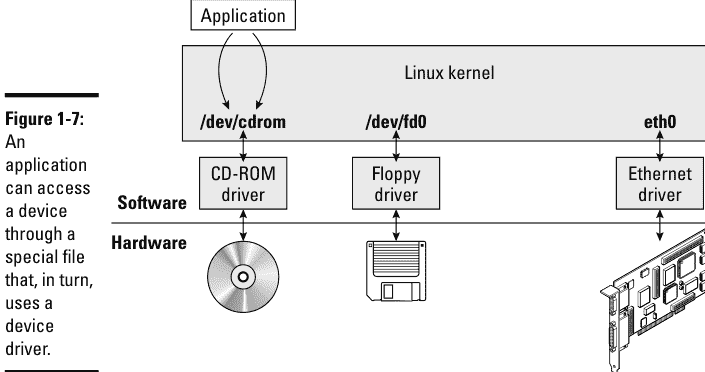

### 设备文件

设备文件列表中的第一个字母提供了重要的线索。对于 `/dev/hda` 设备，第一个字母是 `b`，这表示 `/dev/hda` 是一个**块设备**——可以以块（通常为 512 字节或 1K）访问或提供数据。顺便说一下，dev/hda 指系统上的 IDE 硬盘（Windows 中的 C 盘）。硬盘、软盘驱动器和光驱都是块设备的示例。

# 理解 Linux 设备 315

## 字符设备

```bash
ls -l /dev/ttyS0
```

该设备的列表显示如下：

- crw-rw---- 1 root uucp 4,64 Aug 16 14:50 /dev/ttyS0

注意，第一个字母是 c，因为 `/dev/ttyS0` —— 第一个串口是一个字符设备。

## 网络设备

允许你的系统与网络交互的网络设备——例如以太网和拨号点点协议 (PPP) 连接——是有些特别的，因为它们不需要文件来对应设备。相反，内核为设备使用一个特殊名称。例如，第一个以太网设备被命名为 `eth0`，第二个命名为 `eth1`，以此此类推。PPP 连接被命名为 `ppp0`、`ppp1` 等，以此此类推。

由于网络设备没有映射到设备文件，因此 `/dev` 目录中没有与这些设备对应的文件。

## 使用 udev 进行持久化设备命名

Linux 内核 2.6 引入了处理设备的新方法，其基于以下特性：

- `sysfs`：内核 2.6 提供了一个挂载在文件系统 `/sys` 目录下的 sysfs 文件。sysfs 文件系统显示系统中的所有设备以及关于每个设备的大量信息。这些信息包括设备在总线上的位置、如名称和序列号之类的属性，以及设备的设备号和小设备号。

- `/sbin/hotplug`：每当添加或删除设备时，就会调用此程序。它可以执行处理该设备所需的所需的任何操作。

- `/sbin/udev`：此程序根据设备特性（如总线上的序列号）或通过文本文件 `/etc/udev/udev.rules` 设置的规则分配的用户名称，处理动态命名的设备。

## 316 管理可载驱动模块

udev 程序的配置文件是 `/etc/udev/udev.conf`。根据该配置文件的设置，udev 会在 `udev_root` 参数指定的目录中自动创建设备节点。例如，为了管理 `/dev` 目录中的设备节点，应在 `/etc/udev/udev.conf` 中如下定义：

```bash
udev_root="/dev"
```

## 管理可载驱动模块

要使用任何设备，Linux 内核必须包含驱动程序。如果驱动代码以单体程序的形式（以单个大文件形式存在的程序）链接到内核中，添加新驱动程序意味着要使用新驱动代码重新编译内核。在使用新的设备驱动程序之前需要重新编译内核。幸运的是，Linux 内核使用了模块化设计，允许在不重启的情况下加载。Linux 驱动程序可以用模块的形式创建，内核可以在无需重启电脑的情况下加载和卸载它们。

驱动模块是称为可载内核模块（Loadable Kernel Modules）的广泛软件模块的一种类型。其他类型的内核模块包括支持新类型文件系统的代码、网络协议模块以及解释不同可执行文件格式的模块。

## 加载和卸载模块

你可以通过一组命令来管理可载设备驱动模块。你需要以 root 身份登录才能使用某些命令。表 1-13 总结了一些常用的模块命令。

| 表 1-13 | |
| :--- | :--- |
| **此命令** | **执行操作** |
| `insmod` | 将模块插入内核 |
| `rmmod` | 从内核移除模块 |
| `depmod` | 确定模块之间的依赖关系 |
| `ksyms` | 显示符号列表以及定义该符号的模块名称 |
| `lsmod` | 列出所有当前加载的模块 |
| `modinfo` | 显示有关内核模块的信息 |
| `modprobe` | 智能地插入或移除一个或一组模块。（例如，模块 A 需要 B，当要求加载 A 时，modprobe会自动加载 B。） |

如果你必须使用这些命令之一，请以 root 身份登录或在终端窗口输入 `su -` 变为 root。

查看当前加载了哪些模块，请输入

```bash
lsmod
```


你会看到一个长长的模块列表，取决于系统中安装的设备类型。

`lsmod`显示的列表包含所有类型的Linux内核模块，而不只是驱动程序。例如，如果你使用Ext3文件系统，通常会找到两个模块——`jbd`和`ext3`——它们都是Ext3文件系统（Linux最新的文件系统）的一部分。

除了`lsmod`，另一个常用的命令是`modprobe`。每当你需要手动加载或删除一个或多个模块时，请使用`modprobe`。`modprobe`的优点是，你不需要担心某个模块是否需要其他模块才能工作。`modprobe`命令会自动加载某个模块所需的任何其他模块。例如，要手动加载声卡驱动，使用命令：

```bash
modprobe snd-card-0
```

此命令会导致`modprobe`加载使声音正常工作所需的所有内容。

你可以使用`modprobe`的`-r`选项来移除模块。例如，移除声卡模块，使用以下命令：

```bash
modprobe -r snd-card-0
```

此命令消除了`modprobe snd-card-0`命令加载的所有模块。

## 使用 /etc/modprobe.conf 文件

`modprobe`命令是如何知道它需要加载`snd-intel8x0`驱动模块的？答案在`/etc/modprobe.conf`文件中。要查看`/etc/modprobe.conf`的内容，输入

```bash
cat /etc/modprobe.conf
```

`/etc/modprobe.conf`文件用于指定`modprobe`命令的选项。例如，你可以添加像这样的一行：

```bash
options snd-intel8x0
```

这一行告诉`modprobe`在需要时加载`snd-intel8x0`模块。

## 320 在 Linux 中调度作业

当你按下回车键时，会出现`at>`提示符，如下：

```
at 21:30
at>
```

这种方法是指定你想要执行一个或多个命令时间的简单方法——只需以24小时格式指定时间即可。在这种情况下，你希望在晚上9:30执行命令（如果已经过了晚上9:30，则为今晚或明天）。你可以以多种不同的方式指定执行时间（示例参见表1-14）。

在`at>`提示符下，输入你想要执行的命令，就像在shell提示符下输入它们一样。在输入并输入完每条命令后，按回车键并继续输入下一个命令。当你完成了想要执行的命令后，按`Ctrl+D`表示结束。

这里有一个示例展示了如何在未来的某个时间执行`ps`命令：

```
at> ps
at <JOB>
job 1 at 2006-12-28 21:30
```

在你按下`Ctrl+D`后，`at`命令会返回一个作业编号以及执行该作业的日期和时间。

| 表 1-14 at 命令的执行时间格式 |
| 命令 | 作业运行时间 |
| :--- | :--- |
| at now | 立即执行 |
| at now + 15 minutes | 当前时间 15 分钟后 |
| at now + 4 hours | 当前时间 4 小时后 |
| at now + 7 days | 当前时间 7 天后 |
| at noon | 今天中午（如果已经过了，则为明天） |
| at now next hour | 现在起好好 60 分钟 |
| at now next day | 明天此时此时 |
| at 17:00 tomorrow | 明天下午 5 点 |
| at 4:45pm | 今天下午 4:45（如果已经过了下午 4:45，则为明天） |
| at 3:00 Dec 28, 2008 | 2008 年 12 月 28 日凌晨 3:00 |

在你输入一个或多个作业后，可以使用`atq`命令查看当前的调度作业列表：

```
atq
```

## Linux 调度作业 321

输出结果类似于下面：

```
4 2006-12-28 03:00 a root
5 2006-10-26 21:57 a root
6 2007-10-26 16:45 a root
```

每行的第一个字段显示作业编号——这与`at`命令在你提交作业时显示的数字相同。下一个字段显示执行的年、月、日和时间。最后一个字段显示队列中等待的作业。

如果你想取消作业，可以使用`at`命令将该作业从队列中删除。使用`at`命令删除作业时，通过其编号引用作业，如下：

```
at 4
```

此命令将删除调度在2008年12月28日凌晨3:00执行的作业4。

当作业执行时，输出将邮件发送给你。在终端输入`mail`可以读取你的邮件并查看作业的输出结果。

## 调度周期性作业

尽管`at`适合在特定时间运行命令，但它对于按重复间隔自动运行程序并没什么用处。你必须使用`crontab`来调度此类周期性作业——例如，如果你想每天午夜时将文件备份到磁带上。

你通过将作业信息放在具有特定格式的文件中并通过`crontab`命令提交该文件来调度周期性作业。`cron`守护进程——`cron`每分钟检查一次作业信息，并在指定时间执行周期性作业。由于`cron`守护进程处理这些作业，这些作业也被称为`cron`作业。

`cron`作业的任何输出都会邮件发送给提交作业的用户。（在提交的作业信息文件中，你可以为邮件输出指定不同的接收者。）

两个配置文件控制着哪些用户可以使用`crontab`调度`cron`作业：

- `/etc/cron.allow`包含可以使用`crontab`命令提交作业的用户名。
- `/etc/cron.deny`包含不允许使用`crontab`命令提交作业的用户名。

## 322 在 Linux 中调度作业

如果`/etc/cron.allow`文件存在，只有文件中列出的用户才能调度`cron`作业。如果只存在`/etc/cron.deny`文件，文件中列出的用户不能调度`cron`作业。如果两个文件都不存在，默认的Linux设置允许任何用户提交`cron`作业。

要提交cron作业，请遵循以下步骤：

1. 准备一个shell脚本（或任何编程语言的可执行程序），能够执行你想完成的周期性任务。

如果你想定期执行现有的程序，可以跳过此步。

2. 准备一个文本文件，其中包含shell脚本或程序（来自第1步）执行时间的信息，并使用`crontab`提交此文件。

你可以用一个文件提交多个周期性作业。每行带有`cron`作业定时信息的行具有如下格式：

| 表 1-15 crontab 中的执行时间格式 |
| 字段编号 | 字段含义 |
| :--- | --- |
| 1 | 分钟 (0-59) |
| 2 | 小时 (0-23) |
| 3 | 日 (1-31) |
| 4 | 月 (1-12) |
| 5 | 星期 (0-6, 0 代表星期日) |
| * | 星号代表所有值 |

```
* * * * command
```

例如，星号代表每分钟。如果第二个字段是星号，代表每小时。如果第三字段是星号，代表每天。如果第四字段是星号，代表每月。如果第五字段是星号，代表每周。

为用户设置cron作业，使用此命令：

```
crontab filename
```

查看用户的cron作业，使用此命令：

```
crontab -l username
```

删除用户的cron作业，使用此命令：

```
crontab -r username
```

注意：`cron`守护进程执行系统级文件`/etc/crontab`中列出的作业。这是一个典型的`/etc/crontab`文件（使用`cat /etc/crontab`查看）：

```
SHELL=/bin/bash
PATH=/sbin:/bin:/usr/sbin:/usr/bin
MAILTO=root
HOME=/root
# run-parts
01 * * * root run-parts /etc/cron.hourly
02 4 * * root run-parts /etc/cron.daily
22 4 * * root run-parts /etc/cron.weekly
42 1 * * root run-parts /etc/cron.monthly
```


## 324 在 Linux 中调度作业

前四行行为此文件中列出的作业设置了几个环境变量。`MAILTO`环境变量指定了接收此文件中 cron 作业输出邮件的用户。

以`#`开头的行是注释行。`run-parts`注释后的四行在在不同时间执行 shell 脚本（位于`/usr/bin`目录），并将特定目录名称作为参数。`run-parts`的每个参数`/etc/cron.hourly`、`/etc/cron.daily`、`/etc/cron.weekly`和`/etc/cron.monthly`都是目录。本质上，`run-parts`执行你作为参数提供的目录中的所有脚本。

表 1-16 列出了存放这些脚本的目录以及它们执行的时间。你必须查看这些目录中的脚本才能知道在这些周期性间隔内执行了什么。

| 表 1-16 | cron 作业脚本目录 |
| 目录名称 | 内容 |
| :--- | --- |
| /etc/cron.hourly | 每小时执行一次 |
| /etc/cron.daily | 每天执行 |
| /etc/cron.weekly | 每周执行 |
| /etc/cron.monthly | 每月执行一次 |

## 第 2 章：管理用户和组

### 本章内容

- 添加用户账户
- 理解密码
- 管理组
- 探索用户环境
- 更改文件和目录的用户及组所有权

Linux 是一个多用户系统，因此它有许多用户账户。即使你是系统上的唯一用户，许多服务器也需要唯一的用户名和组名。以 FTP 服务器为例，它在`ftp`用户下运行。大量的系统用户并不是为了人类，而是为了运行特定的程序。

此外，用户可以属于一个或多个私有组。通常，每个用户名都有一个对应的私组名。默认情况下，每个用户都属于该对应的私组。然而，你可以根据组组成定义其他组，以便提供对特定文件和目录的访问权限。

文件的用户组所有权是确保只有正确的人（或正确的进程）能够访问正确的文件和目录的方法。管理用户组账户是典型的系统管理工作。鉴于本章讨论的 Linux 自带工具，完成这项工作并不困难。

## 添加用户账户

在安装 Linux 后首次启动系统时，你有机会添加用户账户。`root`账户是唯一必须在安装期间设置的账户。如果你在第一次启动系统时没有添加其他用户账户，可以稍后进行，通过 GUI 用户账户管理器或使用`useradd`命令在系统上添加新用户。

除了`root`之外创建其他用户账户是一个好主意。即使你是系统的唯一用户，以低权限用户的身份登录也是一种良好的做法，因为你不会无意中损坏任何重要的系统文件。如有必要，你可以使用`su`登录为`root`并执行任何系统管理任务。

### 使用 GUI 用户管理器添加用户账户

大多数发行发行版都带有一个用于管理用户账户的 GUI 工具。你可以使用该工具添加新用户账户。该工具显示当前用户账户列表，并有一个用于添加新用户的“添加”按钮，如图 2-1 所示。

图 2-1：在 Ubuntu 中，你可以从“用户和组”界面管理用户和组账户。

无论使用哪哪种特定的 GUI 工具，基本步骤涉及以下内容：

1. 点击“添加”按钮，弹出一个对话框，提示你输入新用户账户的信息，如图 2-2 所示。
2. 输入所需信息 —— 用户名、密码（输入两次）以及用户的全名。
3. 点击按钮创建新账户，GUI 工具将处理添加新用户账户的工作。

例如，在 SUSE 中，从 YaST 控制中心的左侧选择“安全”类别，并点击窗口右侧的“用户管理器”图标。YaST 会弹出“用户和组管理”面板，你可以在其中定义新用户账户。

注意该面板有两个单选按钮：“用户”和“组”。选择“用户”按钮将显示来自`/etc/passwd`文件的当前用户列表。选择“组”单选按钮将列出来自`/etc/group`的组名。最初，用户和组管理工具过滤掉了系统用户。你可以点击“设置过滤器”并在下拉列表中选择“系统用户”来查看系统用户。（系统用户是指未分配给人类用户的账户；相反，这些用户账户用于运行各种服务。）

图 2-2：在 Ubuntu 中通过填写此窗口中的信息创建新用户。

要添加新用户账户，点击“添加”按钮并在“新本地用户”窗口中输入要求的信息。

在窗口中填写所需信息并点击“接受”按钮。新用户现在将出现在“用户和组管理”面板的用户列表中。

如果你愿意，可以添加更多用户账户。完成后，点击“用户和组管理”面板中的“完成”按钮创建新账户。

默认情况下，YaST 将所有本地用户放在一个名为`users`的组中。有时用户想进入其他组，以便访问由该组拥有的文件。将用户添加到另一个组很容易。例如，要将用户名`kduley`的用户添加到名为`wheel`的组，可以在终端窗口中输入以下命令：

```bash
usermod -G wheel kdaney
```

提示：要删除用户账户，点击用户账户列表中的用户名，然后点击“删除”按钮。

### 使用命令管理用户账户

如果你在文本控制台下工作，可以使用`useradd`命令创建新用户账户。按照以下步骤为新用户添加账户：

1. **以 root 身份登录。** 如果尚未登录，输入`su`成为`root`。
2. **输入以下`useradd`命令创建账户：**
   ```bash
   useradd -c "Kristin" kdaney
   ```
3. **使用`passwd`命令设置密码：**
   ```bash
   passwd kdaney
   ```

要修改用户账户中的任何信息，请使用`usermod`命令。例如，要将`root`设置为主组，请输入：

```bash
usermod -g root kdaney
```

要了解更多关于`useradd`、`userdel`和`usermod`命令的信息，请在终端输入`man useradd`、`man userdel`或`man usermod`。

### 理解 /etc/passwd 文件

`/etc/passwd`文件是所有用户账户的列表。它是一个文本文件，任何用户都可以读取它 —— 不需要特殊权限。`etc/passwd`中的每行都有七个字段，用冒号`:`分隔。

这里是`/etc/passwd`文件中的一个典型条目：

```text
kulaney:x:1000:1000:Kristin::/home/bash
```

如下所示，`/etc/passwd`中每行的格式为：

```text
username:UID:GID:GECOS:homedir:shell
```

表 2-1 解释了`/etc/passwd`中七个字段的含义。

| 字段 | /etc/passwd 字段的含义 |
| --- | --- |
| username | 字母数字类型的用户名，通常为八个字符且唯一（Linux 用户名可以长于八个字符）。 |
| password | 存在时为13个字符的加密密码。（空字段意味着访问该账户不需要密码。x 表示密码存储在 /etc/shadow 文件中，该文件更安全）。 |
| UID | 作为用户标识符的唯一数字。（UID 为 0 以及通常在 1 到 100 之间的 UID 预留给非人类用户作为服务器；保持 UID 小于 32767 最佳）。 |
| GID | 用户所属组的默认组 ID（GID 0 属于 root，其他组在 /etc/group 中，用户可以且通常同时属于多个组）。 |
| GECOS | 关于用户的可选信息（finger 命令使用此字段，且 GCOS 代表通用电气操作系统，一个早已被遗忘的系统，现在通过 /etc/passwd 中的此字段来体现）。 |
| homedir | 用户主目录的名称 |
| shell | 当用户登录时执行的命令解释器（shell），例如 /bin/bash |

## 管理组

组是用户所属的对象。组有一个名称和标识符（ID）。定义一个组后，用户可以属于这些组中的一个或多个。

你可以在`/etc/group`中找到所有现有组的列表。例如，这里定义了名为`wheel`的组：

```bash
wheel:x10:root,kduaney
```

如示例所示，`/etc/group`中的每一行都具有以下格式，由四个冒号分隔的字段组成：

```bash
groupname:password:GID:membership
```

表 2-2 解释了组定义中四个字段的含义。

| 表 2-2 | /etc/group 文件中字段的含义 |
| 字段名称 | 含义 |
| :--- | :--- |
| groupname | 组名（例如，wheel） |
| password | 组密码（x 表示密码存储在 /etc/shadow 文件中） |
| GID | 数字型组 ID（例如，10） |
| membership | 属于该组的用户逗号分隔列表（例如，root, kduaney） |

如果你想创建一个新组，只需使用`groupadd`命令。例如，要添加一个自动选择组 ID 的名为`class`的组，请在终端窗口中输入以下命令（你需要以`root`身份登录）：

```bash
groupadd class
```


## groupadd class

```
```

然后你可以使用 `usermod` 命令将用户添加到此组。例如，要将用户 `kduaney` 添加到名为 `class` 的组中，请输入以下命令：

```bash
usermod -G class kduaney
```

如果你想删除一个组，请使用 `groupdel` 命令。例如，删除名为 `class` 的组，输入：

```bash
groupdel class
```

## 探索用户环境

当你作为用户登录时，你会获得一组环境变量，它们控制着你在 Linux 系统上看到和做的许多方面。如果你想查看当前环境，请在终端窗口中输入以下命令：

```bash
env
```

（顺便一下，`printenv` 命令也可以显示环境，而且更短。）

`env` 命令会打印出一长列表。这些行的集合就是当前环境，每行都定义了一个环境变量。例如，`env` 命令显示了如下典型行：

```bash
HOSTNAME=localhost.localdomain
```

这一行定义了环境变量 `HOSTNAME`，其定义为 `localhost.localdomain`。

*环境变量* 无非是一个与字符串关联的名称。例如，对于普通用户，名为 `PATH` 的环境变量通常定义如下：

```bash
PATH=/usr/local/bin:/bin:/usr/usr/X116/bin
```

等号 (`=`) 右侧的字符串是 `PATH` 环境变量的值。按照惯例，`PATH` 环境变量是一个目录序列，每个名称与前一个名称用冒号 (`:`) 分隔。

每个环境变量都有特定的用途。例如，当 shell 必须搜索文件时，它只需搜索 `PATH` 环境变量中的目录。因此，如果两个程序同名，shell 将执行它找到的那个。

与 shell 使用 `PATH` 环境变量的方式类似，像 `vi` 这样的编辑器使用 `TERM` 环境变量的值来确定如何通过 `vi` 显示你编辑的文件。要查看 `TERM` 的当前设置，请在 shell 提示符输入以下命令：

```bash
echo $TERM
```

如果你在终端窗口中输入此命令，输出如下：

```bash
xterm
```

### 在 bash 中定义环境变量

在 bash 中定义环境变量，请使用以下语法：

```bash
export NAME=Value
```

在这里，`NAME` 表示环境变量的名称，`Value` 是代表其值的字符串。因此，你使用以下命令将 `TERM` 设置为值 `xterm`：

```bash
export TERM=xterm
```

定义环境变量后，你只需通过 `NAME=new-value` 语法指定新值即可更改变量。例如，对于 `PATH`，你通常希望向现有定义中追加新目录，而不是替换它。如果你要将 `TERM` 的定义更改为 `vt100`，在提示符处输入 `TERM=vt100`。

如果你下载并安装了 Java 5 开发工具包（从 http://java.sun.com/javase/jdk5.jsp 获取），你必须将 Java 二进制文件的位置添加到 `PATH` 中。最终效果是添加 `PATH=$PATH` 来完成此任务：

```bash
export PATH=$PATH:/usr/java/jdk1.5.0/bin
```

此命令将字符串 `:/usr/java/jdk1.5/bin` 追加到 `PATH` 环境变量的当前定义中。最终效果是将 `/usr/java/jdk1.5.0/bin` 添加到 `PATH` 目录列表中。

注意：你也可以将此 `export` 命令写为：

```bash
export PATH=${PATH}:/usr/java/jdk1.5.0/bin
```


输入该命令后，你就可以访问 `/usr/java/jdk1.5.0/bin` 目录中的程序，例如 `javac`（将 Java 源代码转换为字节码的 Java 编译器）。

## 336 探索 Linux 文件系统

为了将你的计算机文件系统与纸质归档系统进行类比，请将磁盘驱动器想象成文件柜。文件柜中的抽屉对应于文件系统中的目录。每个抽屉里的文件夹也是目录——因为计算机文件系统中的目录可以包含其他目录。你可以将文件看作文件夹里的页面——那里是存储实际信息的地方。图 3-1 展示了文件柜与 Linux 文件系统之间的类比。


图 3-1：
这虽然有点牵强，但你可以将 Linux 文件系统想象成类似于归档柜。

Linux 文件系统具有分级结构——目录可以包含其他目录，而这些目录又包含各个文件。

你 Linux 系统中的一切内容都是以文件系统中的文件和目录的形式组织的。要访问和使用系统上的文档和程序，你必须熟悉文件系统。

### 理解文件系统层级结构

Linux 文件系统像树一样组织，以根目录为起点，所有其他目录都由此分支。当你写下一个完整的路径名时，根目录由单个斜杠（`/`）表示。然后是文件和目录的层级结构。文件系统的部分可能位于不同的物理驱动器或硬盘分区上。

Linux 使用标准的目录层级结构。图 3-2 显示了 Linux 文件系统的某些标准部分。当然，你可以在该结构的任何地方创建新目录。

图 3-2：
Linux 文件系统使用类似这样的标准目录层级结构。

| bin | dev | etc | home | lib | mnt | opt | root | usr | var |
| :--- | :--- | :--- | :--- | :--- | :--- | :--- | :--- | :--- | :--- |
| X11R | bin | include | lib | local | sbin | src | | | |

通过使用正斜杠（`/`）作为分隔符连接标识文件或目录位置的目录名称来编写任何文件或目录的。在图 3-2 中，顶层的根目录写为 `/usr`，因为根目录（`/`）包含了 `usr`。另一方面，`X11R6` 目录位于 `usr` 目录内部，而 `usr` 目录又位于根目录（`/`）内部。因此，`X11R6` 目录通过名称 `/usr/X11R6` 被唯一标识。这种全称称为路径名，它标识了你从根目录到达文件所走的路径。因此，`/usr/X11R6` 是一个路径名。

文件系统层级标准（FHS）规定了类 Unix 操作系统（如 Linux）中文件和目录的组织。FHS 定义了一组标准目录及其预期用途。如果所有 Linux 发行版都能忠实地采用 FHS，将有助于提高所有 Linux 发行版之间应用程序、系统管理工具、开发工具和脚本的互性。FHS 甚至有助于系统文档以及像本书这样的书籍，因为对文件系统的相同描述适用于所有 Linux 发行版。FHS 2.3 版本于 2004 年 1 月 29 日发布。FHS 2.3 是标准基准（LSB 3.0）的一部分，该标准在 2005 年 10 月 25 日更新到 3.1，并在 2008 年 1 月 28 日更新到 3.2。LSB 3（参见 www.linuxbase.org）是一组二进制标准，旨在减少 Linux 发行版之间的差异并提高应用程序的可移植性。要了解更多关于 FHS 的信息，请访问 www.pathname.com/fhs 的 FHS 主页。

Linux 文件系统中的每个标准目录都有特定的用途。表 3-1、表 3-2 和表 3-3 总结了这些目录。

### 表 3-1 Linux 文件系统中的标准目录

| 目录 | 用于存储 |
| :--- | :--- |
| `/bin` | 用户命令的可执行文件（供所有用户使用） |
| `/boot` | 引导加载程序加载 Linux 内核所需的文件 |
| `/dev` | 设备文件 |
| `/etc` | 主机特有的系统配置文件 |
| `/home` | 用户家目录 |
| `/lib` | 共享库和内核模块 |
| `/media` | 可移动式存储介质的挂载点 |
| `/mnt` | 临时挂载文件系统的挂载点 |
| `/opt` | 附加应用程序软件包 |
| `/root` | root 用户的家目录 |
| `/sbin` | 系统管理实用程序 |
| `/srv` | 本系统提供的服务（如 Web 和 FTP）的数据 |
| `/tmp` | 临时文件 |

### 表 3-2 /usr 目录层级结构

| 目录 | 二级目录层级结构 |
| :--- | :--- |
| `/usr/X11R6` | 窗口系统，版本 11 发布 6 |
| `/usr/bin` | 大多数用户命令 |
| `/usr/include` | 包含文件目录——在开发 Linux 应用时，使用各种指令插入应用程序源代码中的文件 |
| `/usr/lib` | 软件包和编程时使用的库 |
| `/usr/libexec` | 应用程序的库 |
| `/usr/local` | 任何本地软件 |
| `/usr/sbin` | 非必要的系统管理员实用程序 |
| `/usr/share` | 不依赖于系统架构的共享数据（无论系统是 Intel PC 还是 Sun SPARC 工作站） |
| `/usr/src` | 源代码 |

### 表 3-3 /var 层级结构

| 目录 | 变量数据 |
| :--- | :--- |
| `/var/cache` | 缓存 |
| `/var/log` | 日志 |
| `/var/mail` | 邮件 |
| `/var/opt` | 选项 |
| `/var/run` | 运行 |
| `/var/spool` | 打印 |
| `/var/tmp` | 临时 |

## 337 探索 Linux 文件系统

为了将你的计算机文件系统与纸质归档系统进行类比，请将磁盘驱动器想象成文件柜。文件柜中的抽屉对应于文件系统中的目录。每个抽屉里的文件夹也是目录——因为计算机文件系统中的目录可以包含其他目录。你可以将文件看作文件夹里的页面——那里是存储实际信息的地方。图 3-1 展示了文件柜与 Linux 文件系统之间的类比。


图 3-1：
这虽然有点牵强，但你可以将 Linux 文件系统想象成类似于归档柜。

Linux 文件系统具有分级结构——目录可以包含其他目录，而这些目录又包含各个文件。

你 Linux 系统中的一切内容都是以文件系统中的文件和目录的形式组织的。要访问和使用系统上的文档和程序，你必须熟悉文件系统。

### 理解文件系统层级结构

Linux 文件系统像树一样组织，以根目录为起点，所有其他目录都由此分支。当你写下一个完整的路径名时，根目录由单个斜杠（`/`）表示。然后是文件和目录的层级结构。文件系统的部分可能位于不同的物理驱动器或硬盘分区。

Linux 使用标准的目录层级结构。图 3-2 显示了 Linux 文件系统的某些标准部分。当然，你可以在该结构的任何地方创建新目录。

## 337 探索 Linux 文件系统

图 3-2：
Linux 文件系统使用类似这样的标准目录层级结构。

通过使用正斜杠（`/`）作为分隔符连接标识文件或目录位置的目录名称来编写任何文件或目录的。在图 3-2 中，顶层的根目录写为 `/usr`，因为根目录（`/`）包含了 `usr`。另一方面，`X11R6` 目录位于 `usr` 目录内部，而 `usr` 目录又位于根目录（`/`）内部。因此，`X11R6` 目录通过名称 `/usr/X11R6` 被唯一标识。这种全称称为路径名，它标识了你从根目录到达文件所走的路径。因此，`/usr/X11R6` 是一个路径名。

文件系统层级标准（FHS）规定了类 Unix 操作系统（如 Linux）中文件和目录的组织。FHS 定义了一组标准目录及其预期用途。如果所有 Linux 发行版都能忠实地采用 FHS，将有助于提高所有 Linux 发行版之间应用程序、系统管理工具、开发工具和脚本的互性。FHS 甚至有助于系统文档以及像本书这样的书籍，因为对文件系统的相同描述适用于所有 Linux 发行版。FHS 2.3 版本于 2004 年 1 月 29 日发布。FHS 2.3 是标准基准（LSB 3.0）的一部分，该标准在 2005 年 10 月 25 日更新到 3.1，并在 2008 年 1 月 28 日更新到 3.2。LSB 3（参见 www.linuxbase.org）是一组二进制标准，旨在减少 Linux 发行版之间的差异并提高应用程序的可移植性。要了解更多关于 FHS 的信息，请访问 www.pathname.com/fhs 的 FHS 主页。

Linux 文件系统中的每个标准目录都有特定的用途。表 3-1、表 3-2 和表 3-3 总结了这些目录。

## 探索 Linux 系统 341

例如，在 Debian 中，你可以通过输入以下命令来挂载 CD-ROM：

```bash
mount /dev/cdrom
mount /media/cdrom
```


`/etc/fstab` 文件是一个配置文件 —— 一个包含 `mount` 和 `unmount` 命令使用的信息的文本文件。`/etc/fstab` 文件中的每一行都提供了关于设备及其在 Linux 系统中挂载点的信息。本质上，`/etc/fstab` 文件将文件系统的各种挂载点与特定设备关联，使得 `mount` 命令能够按照需要对挂载点或设备进行操作。

这里是一个 SUSE 系统的 `/etc/fstab` 文件（它在其他 Linux 发行版中具有类似的格式）：

| 设备 | 挂载点 | 文件系统 | 选项 | Dump | Pass |
| :--- | :--- | :--- | :--- | :--- | :--- |
| /dev/hda1 | /boot | reiserfs | acl,user_kattr | 1 | 1 |
| /dev/hda2 | /data | auto | acl,user_kattr | 1 | 2 |
| /dev/hda3 | /home | auto | noautoer | 0 | 0 |
| /dev/hda4 | /var | auto | noautoer | 0 | 0 |
| /dev/hda5 | /tmp | auto | noautoer | 0 | 0 |
| /dev/hda6 | /root | defaults | ro,users,gid,umask=0002,nous=utf8 | 0 | 0 |
| /dev/hda8 | swap | pri=42 | | 0 | 0 |
| devpts | /dev/pts | swap | devpts=0620,gid=5 | 0 | 0 |
| proc | /proc | defaults | | 0 | 0 |
| usbfs | /proc/bus/usb | usbfs | noautoer | 0 | 0 |
| sysfs | /sys | | | 0 | 0 |
| /dev/cdrecorder | /media/cdrom | subfs | noautoer | 0 | 0 |
| ffs-cdffs | /proc | proc,nodesid,nosuid,exec,charset=utf8 | | 0 | 0 |
| /dev/fd0 | /media/floppy | subfs | sync | 0 | 0 |

每行的第一个字段显示设备名称（例如硬盘）。第二字段是挂载点，第三字段指示设备上的文件系统类型。你现在可以忽略后三个字段。

此 `/etc/fstab` 文件显示 `/dev/hda8` 设备作为虚拟内存的交换设备（swap），这就是为什么挂载点和文件系统被设置为 `swap` 的原因。

Linux 操作系统使用 `/etc/fstab` 文件的内容来自动挂载各种文件系统。在启动过程中，`init` 进程会执行一个脚本，运行挂载 `/etc/fstab` 中列出的所有文件系统（带有 `noauto` 选项的除外）。`/etc/fstab` 每行的第三字段指定了该设备上的文件系统类型，第四字段显示了逗号分隔的选项列表，`mount` 命令在文件系统上挂载设备时使用这些选项。通常会在该字段中找到 `defaults` 选项。`defaults` 选项意味着（其他方面之外）设备在启动时挂载，且只有 root 用户可以挂载该设备，并且设备可读可写。如果选项包含 `noauto`，则设备在系统启动时不会自动挂载。

在 Fedora 中，你通常会在 `/etc/fstab` 条目的第四字段中发现 `managed` 选项。`managed` 选项表示该行是由 HAL（硬件抽象层）守护进程添加的，该进程运行 `fstab-sync` 命令向 `/etc/fstab` 文件添加条目。可移动设备/DVD/CD-ROM 驱动器（大多数系统中为 `/dev/hdc`）的第四字段具有 `managed` 选项。

## 2 使用 NFS 共享文件

通过 NFS 共享文件非常简单，涉及两个基本步骤：

- 在 NFS 服务器上，通过在 `/etc/exports` 文件中列出目录并运行 `/usr/sbin/exportfs` 命令导出一个或多个目录。此外，你必须运行 NFS 服务器。
- 在每个客户端系统上，使用 `mount` 命令挂载服务器已导出的目录。

NFS 服务器取决于你使用的 Linux 发行版。如果有用的 GUI 系统管理员工具，你可以从 GUI 工具启动 NFS 服务器。否则，你可以在终端中运行命令来启动 NFS 服务器。在 Debian 中，你可以使用 `service-d nfs-kernel-server start` 来启动 NFS 服务器。在 Fedora 中，输入 `service nfs start`。在 SUSE 中，你可以使用 Yaast Control Center（Main Menu>System>YaST>System>System Services (Runlevel)）来启动 NFS 服务器。在 Xandros 中，你可以从 Xandros Control Center（Main Menu>Control Center）启动 NFS 服务器，或者在终端窗口中输入 `service-d nfs-user-start`。

使用 NFS 的问题在于每个客户端系统必须支持它。大多数 PC 不带 NFS —— 这如果你想通过 NFS 共享文件，就需要购买 NFS 软件。然而，由于你局域网上的所有系统都运行 Linux（或其他内置 NFS 支持的 UNIX 变体），因此使用 NFS 是意义的。

NFS 存在安全漏洞。因此，不要在直接连接到互联网的系统上设置 NFS。

接下来的章节将引导你完成 NFS 设置，以局域网上的两台 Linux PC 为例。

## 使用 NFS 导出文件系统

从导出（向客户端系统提供）目录内容的系统开始。在服务器上，你必须运行 NFS 服务并指定要导出到客户端系统的一个或多个文件系统。

要导出文件系统，你必须运行 NFS 服务并指定要导出到客户端系统的一个或多个文件系统。

## 备份与恢复文件

例如，如果你将 Linux 系统作为学习工具（为了获取更多关于 Linux 或编程的知识），你可能只需要对配置 Linux 需要的一些系统文件进行备份。在这种情况下，你的备份策略可以是：每当你使用任何系统配置时，将重要的系统配置文件保存到一张或多张软盘上。

另一方面，如果你将 Linux 系统作为为许多用户提供共享存储的办公服务器，那么由于磁盘故障导致业务中断的风险要高得多。在这种情况下，你必须每周每周备份所有文件，并每天备份任何新增或更改的文件。你可以以自动化的方式执行这些备份（使用本微型书籍第 1 章描述的任务调度功能）。此外，你可能需要一个能够存储大量数据（GB级）的备份存储介质。换句话说，对于高风险情况，你的备份策略更加复杂，并且需要额外的设备（如磁带机）。

你对备份的选择取决于你需要备份的数据量。对于少量数据（如系统配置文件），你可以使用软盘或 USB 驱动器作为备份介质。如果你的 PC 有 Zip 驱动器，可以使用 Zip 磁盘作为备份介质；这些非常适合备份单用户目录。要备份整个服务器，请使用磁带机，通常是连接到 SCSI 控制器的 4mm 或 8mm 磁带机。此类磁带机每磁带可以携带数 GB 的数据，可以使用它们在单个磁带上备份整个文件系统。

将文件备份到这些介质时，你可以通过名称引用备份设备。表 3-4 列出了一些常用备份设备的名称。

| 表 3-4 常用备份设备的名称 |
| 备份设备 | Linux 设备名称 |
| :--- | :--- |
| 软盘 | /dev/fd0 |
| IDE Zip 驱动器 | /dev/hdc4 或 /dev/hdd4 |
| SCSI 磁带机 | /dev/sda (假设它是第一个 SCSI 磁盘——否则，设备名称取决于 SCSI ID) |
| | /dev/st0 或 /dev/nst0 (n 前缀意味着在文件拷贝到磁带后磁带不会回带) |

## Linux 商业备份工具

下一节将解释如何使用 Linux 自带的磁带归档程序 (`tar`) 备份和恢复文件。虽然你可以使用 `tar` 管理备份，但也有许多具有图形用户界面和其他功能以简化备份的商业备份工具。以下是 Linux 上知名的商业备份工具：

- `BRU`: 来自 TOLIS Group, Inc. 的备份与恢复工具 (www.tolisgroup.com)
- `ONE-TAR`: 来自 Lone Star Software Corp. 的磁带备份软件包 (www.cactus.com)
- `Arkeia`: 来自 Arkeia 的异构网络备份与恢复软件 (www.arkeia.com)
- `Bare Metal Plus`: 来自 UniTrends 的备份与恢复软件 (www.unitrends.com)
- `BrightStar ARC Backup for Linux`: 来自 Computer Associates 的 Linux 系统数据保护技术 (http://ca.com/us/products/product.aspxID=4536)

## 使用 tar 归档器

你可以使用 `tar` 命令将文件归档到设备（例如软盘或磁带）。`tar` 程序创建一个归档文件，该文件可以包含其他目录并（可选地）对归档进行压缩以实现高效存储。归档被写入指定的设备或其他文件。事实上，许多软件包是以压缩 tar 文件的形式分发的。

`tar` 程序的命令语法如下：

```


# tar options destination source

在这里，`options` 通常由一系列单字母指定，每个字母指定 `tar` 的操作内容。`destination` 是备份设备的设备路径。`source` 是要备份的文件或目录名称列表。

## 备份和恢复单卷卷归档

例如，假设你想在软盘上备份 `/etc/X11` 目录的内容。如果以 root 身份操作，将磁盘软盘插入软驱驱动器，并输入以下命令：

```
tar zcvf /dev/fd0 /etc/X11
```

`tar` 程序会显示文件名列表，作为软盘上归档中的文件副本。在这种情况下，`options` 是 `zcvf`，`destination` 是 `/dev/fd0`（软盘），`source` 是 `/etc/X11` 目录（这意味着其所有子目录和内容）。你可以使用类似的 `tar` 命令将文件备份到磁带上——只需将 `/dev/fd0` 替换为磁带设备即可——例如用于 SCSI 磁带机的 `/dev/st0`。

表 3-5 定义了一些 `tar` 选项。

| 表 3-5 常用 tar 选项 |
| 选项 | 作用 |
| :--- | :--- |
| c | 创建新归档 |
| f | 指定命令行中下一个字段的归档文件或设备名称 |
| M | 指定多卷归档。（下一节将描述多卷归档。） |
| t | 列出归档内容 |
| v | 显示详细信息 |
| x | 从归档中提取文件 |
| z | 使用 gzip 压缩 tar 归档 |

要查看你在软盘上创建的 `tar` 归档内容，输入以下命令：

```
tar ztf /dev/fd0
```

你会看到文件名列表（每个都以 `/` 开头）。此 `tar` 命令中的 `t` 选项列出了归档的内容。要从备份中提取文件，请以 root 身份遵循以下步骤：

- 1. 切换目录到 `/tmp`：
```
cd /tmp
```
- 2. 输入命令：
```
tar xvf /dev/fd0
```

`tar` 程序会剥离文件名开头的 `/` 并在目录中恢复文件。如果你想从软盘恢复归档，使用此命令：

```
tar xvf /dev/fd0 -C /
```

`-C` 用于切换到目录，而命令末尾的 `/` 表示你想要恢复的目录。你可以使用 `tar` 命令创建、查看和恢复归档。你可以将归档存储在文件或任何设备中。

## 备份和恢复多卷卷

有时单个存储介质的容量小于存储归档所需的总存储。在这种情况下，你可以使用 `M` 选项进行多卷归档——这意味着归档可以跨越多个磁带或软盘。然而请注意，你无法创建压缩的多卷归档。这意味着你需要去掉 `z` 选项。查看多卷归档的工作原理，以 root 身份操作，将一张磁盘插入软驱，并输入以下 `tar` 命令：

```
tar cvfm /dev/fd0 /usr/share/ghostscript*
```

> 注意：`M` 选项位于列表中；它告诉 `tar` 创建多卷归档。当第一个软盘满时，`tar` 命令会提示你第二个软盘。取出第一个软盘，并在看到以下提示时插入另一个软盘：

为 `'/dev/fd0'` 准备卷 #2 并回车：

当你按下回车时，`tar` 程序继续处理第二个软盘。在这个示例中，你只需要两个软盘存储归档；对于大型归档，`tar` 程序会继续提示软盘以防需要更多。

要从此多卷归档恢复，使用 `cd /tmp` 将目录切换到 `/tmp`（此处使用 `/tmp` 用于用于说明，但在从归档恢复时必须使用真实的设备）。然后输入：

```
tar xvfm /dev/fd0
```

`tar` 程序会在需要时提示加载软盘。

使用 `du -s` 命令确定归档目录所需的存储量。例如，输入 `du -s /etc` 查看 `/etc` 目录的总大小（以 KB 为单位）。这是该命令的典型输出：

```
35724 /etc
```

## 备份与恢复文件 349

输出结果显示，`/etc` 目录至少需要 35,724K 的存储空间进行备份。

## 在磁带上备份

虽然在磁带上备份只需要在 `tar` 命令中使用正确的设备名称即可，但你确实需要了解磁带设备的一些细节才能使用它。当你使用 `tar` 备份到命名为 `/dev/st0`（第一个 SCSI 磁带设备）的设备时，磁带设备在 `tar` 程序结束后会自动回带。`/dev/st0` 被称为回卷磁带设备，因为它默认会回带磁带。

如果你有几个 GB 的数据，可能想在同一条磁带上连续写入多个归档——一个接一个（否则磁带可能是空的）。如果你计划这样做，就不能在 `tar` 程序结束后回带磁带。为了帮助处理这种场景，有几个 Linux 磁带设备是不回卷的。非回卷的 SCSI 磁带设备称为 `/dev/nst0`。如果你想在磁带上连续写入多个归档，请使用此设备名称。


在每个归档之后，非回卷磁带设备会写入一个文件结束（EOF）标记，以将一个归档与下一个隔离开。使用 `mt` 命令来控制磁带——你可以从一个标记移动到下一个标记或回带磁带。例如，在用 `/dev/nst0` 设备向磁带上写完几个归档后，你可以可以使用以下命令强制磁带回带：

```
mt -f /dev/nst0 rewind
```

回带磁带后，你可以使用以下命令从第一个归档中提取文件到当前磁盘目录：

```
tar xvf /dev/nst0
```

之后，你必须越过 EOF 标记到达下一个归档。要做到这一点，请使用以下 `mt` 命令：

```
mt -f /dev/nst0 fsf 1
```

这会将磁带定位在下一个归档的开头。现在使用 `tar xvf` 命令读取此归档。


如果磁带上有多个归档，你必须自己跟踪这些归档。归档的顺序可能很难记忆，简单地为每条磁带保存一个归档可能会更好。

## 350 备份与恢复文件

## 执行增量备份

假设你使用 `tar` 在磁带上备份系统的硬盘硬盘。由于这种全量备份可能花费很长时间，你不想每晚都重复此任务。（此外，一天内可能只有少数文件发生了变化）。要找到需要备份的文件，你可以使用命令列出过去 24 小时内发生变化的所有文件：

```
find / -mtime -1 -type f -print
```

此命令打印出过去一天更改过的文件列表。`-mtime -1` 选项意味着你想要最后在一天前修改过的文件。你现在可以将此 `find` 与 `tar` 命令结合，只备份在过去一天内发生变化的文件：

```
tar cvf /dev/st0 $(find / -mtime -1 -type f -print)
```

当你将命令放在单引号内时，shell 会执行该命令并将输出放在命令行的该点处。最终结果是 `tar` 程序仅在归档中保存已更改的文件。这个过程带给你的是仅自前一天以来发生变化文件的增量备份。

## 执行自动备份

本微书第 1 章展示了如何使用 `crontab` 设置周期性作业（cron 任务）。Linux 系统按固定间隔执行这些任务。备份系统是使用 `crontab` 功能的良好方法。假设你的备份策略如下：

- 每周日凌晨 1:15，你的系统将整个硬盘备份到磁带。
- 从周一到周六，你的系统在凌晨 3:10 执行增量备份，仅保存过去 24 小时内发生变化的文件。

要设置此自动备份计划，请以 root 身份登录并在名为 `backups` 的文件中输入以下行（此示例假设你使用 SCSI 磁带驱动器）：

```
15 1 * 0 tar zcvf /dev/st0 /
10 3 * * 1-6 tar zcvf /dev/st0 $(find / -mtime -1 -type f -print)
```

接下来，使用以下 `crontab` 命令提交此作业计划：

```
crontab backups
```

## 访问 DOS/Windows 文件系统 351

现在你已经准备好进行自动备份。你只需要每天向磁带驱动器放入一条新磁带。记住给每条磁带贴上合适的标签。

## 访问 DOS/Windows 文件系统

如果你在硬盘上安装了 Microsoft Windows 95/98/Me，你可能已经在 Linux 上挂载了 DOS/Windows 分区。如果没有，你可以轻松地在 Linux 中挂载 DOS/Windows 分区。挂载使得 DOS/Windows 目录层次结构成为 Linux 文件系统的一部分。

## 挂载 DOS/Windows 磁盘分区

要在 Linux 中挂载 DOS/Windows 磁盘分区，`mount` 命令必须包含 `-t fat`。例如，如果你的分区是 `/dev/sdb1`，请使用：

```
mount -t fat /dev/sdb1 /mnt/windows
```


挂载使得 DOS/Windows 目录层次结构成为 Linux 文件系统的一部分。

## 访问 DOS/Windows 文件系统 352

## 挂载软盘

要在 Linux 中挂载 DOS/Windows 磁盘分区，`mount` 命令必须包含 `-t fat`。例如，如果你的分区是 `/dev/fd0`，请使用：

```
mount -t fat /dev/fd0 /media/floppy
```

挂载软盘后，你可以使用 `copy` 命令（`cp`）在软盘中进行复制文件。要将当前目录下的文件 `gnomel.pcx` 复制到软盘，请输入：

```
cp gnomel.pcx /media/floppy
```

同样，要查看软盘内容，请输入：

```
ls /media/floppy
```

如果你想从驱动器中取出软盘，首先要卸载软盘。卸载会移除软盘文件系统与挂载点之间的关联。使用 `umount` 命令来挂载软盘，如：

```
umount /dev/fd0
```

你可以设置 Linux 系统让任何用户都能挂载软盘。为了允许任何用户挂载软盘到 `/a` 目录，执行以下步骤：

1. 以 `root` 身份登录。
2. 在终端中输入以下命令创建 `/a` 目录（挂载点）：
```
mkdir /a
```
3. 使用编辑器（如 `vi` 或 `emacs`）编辑 `/etc/fstab` 文件，插入以下行，保存文件并退出编辑器：
```
/dev/fd0 /a vfat noauto,user 0 0
```

该行的第一个字段是软盘设备名称（`/dev/fd0`）；第二个字段是挂载目录（`/a`）；第三字段显示文件系统类型（`vfat`）。`user` 选项（对应 `noauto`）是允许所有用户挂载 DOS 软盘的关键。

4. 注销并以普通用户身份重新登录。
5. 为了确认你可以以普通用户而非 `root` 挂载软盘，向 A 槽插入一张软盘并输入以下命令：
```
mount /a
```

挂载成功，当你输入命令 `ls /a` 时可以看到软盘的内容列表。

6. 要卸载 DOS 软盘，输入 `umount /a`。

## 354 使用 mtools

## 挂载 NTFS 分区

如今，大多数电脑硬盘上都预装了 Windows XP 或 Windows Vista。Windows XP、Vista 以及 Windows 2000/NT 通常都使用 NTFS 文件系统（NTFS）。Linux 支持对 NTFS 分区的只读访问，许多发行版都带了 `ntfs.ko` 内核模块，该模块是访问 NTFS 分区所需的。

如果你在 Windows XP 系统上安装了 Linux，并想要访问 NTFS 分区上的文件，但你的发行版没有包含 `ntfs.ko` 模块，你可以在内核配置期间启用 NTFS 模块后重新编译内核。

编译并从新内核启动后，以 `root` 登录并输入以下命令为 NTFS 分区创建一个挂载点。（在本情况下，我在 `/mnt` 目录下创建了一个挂载点）。
```
mkdir /mnt/xp
```

现在，你可以使用以下命令挂载 NTFS 分区：
```
mount /dev/hda2 /mnt/xp -t ntfs -r -o uuid=0222
```

> 将 `/dev/hda2` 替换为系统中 NTFS 分区的设备名称。对于大多数预装 Windows XP 的电脑，NTFS 分区是第二个（`/dev/hda2`）——第一个分区（`/dev/hda1`）是一个用于存放 Windows 安装文件的常用分区。

## 使用 mtools

访问 MS-DOS 软盘的一种方法是先使用 `mount` 命令挂载 DOS 驱动器，然后使用常规 Linux 命令（如 `ls` 和 `cp`）来操作挂载的 DOS 文件系统。这种挂载 DOS 文件系统的方法对于硬盘是行的。Linux 可以在启动时自动挂载 DOS 分区，你可以随时访问驱动器上的 DOS 目录。

然而，如果你想快速列出 DOS 软盘的目录，挂载就会变得非常繁琐。首先，你必须挂载软盘驱动器。然后必须使用 `ls` 命令。最后，在弹出软盘之前，你必须使用 `umount` 命令。

这种情况正是 `mtools` 软件包大显身手的地方。`mtools` 包实现了大多数常用的 DOS 命令；这些命令的名称与 DOS 中的相同，只需在每个命令前加上一个 `m` 前缀即可。

因此，获取目录列表的命令是 `mdir`，而 `mcopy` 用于复制文件。`mtools` 最棒的一点是，你不需要使用 `mtools` 命令挂载软盘。

`mtools` 命令直接读写物理设备（软盘），你必须以 `root` 身份登录执行这些命令。如果你想让任何用户都能使用 `mtools` 命令，必须修改软盘驱动器设备的权限设置。使用以下命令允许任何人对第一个软盘驱动器进行读写：
```
chmod o+rw /dev/fd0
```

## 尝试 mtools

要使用 `mtools`，请遵循以下步骤：

- 1. 将一张 MS-DOS 软盘放入系统的 A 盘中。
- 2. 输入 `mdir`。

你会看到软盘的目录（标准的 DOS 列出格式）。

通常，使用 `mtools` 工具来访问软盘。默认配置文件 `/etc/mtools.conf` 设置为将软盘视为 A 盘。虽然你可以编辑该文件来为你的 DOS 硬盘分区定义 C 和 D 驱动器，但你也可以通过使用 Linux `mount` 命令挂载它们来访问硬盘分区。因为你可以在启动时自动挂载硬盘分区，所以通过 Linux 命令访问它们通常同样简单。

## 理解 /etc/mtools.conf 文件

`mtools` 包可以使用默认设置工作，但如果你遇到任何错误，请检查 `/etc/mtools.conf` 文件。该文件包含了 `mtools` 工具所使用的驱动器定义（如 A、B 和 C）。以下是来自 `/etc/mtools.conf` 文件的几行：
```
drive a: file="/dev/fd0" exclusive mformat_only

drive b: file="/dev/fd1" exclusive mformat_only

# SCSI 硬盘分区

drive c: file="/dev/sda1"

# Windows 98 上的 IDE 硬盘分区

drive c: file="/dev/hda1"

# 内部 IDE Zip 驱动器

drive e: file="/dev/hdd4" exclusive
```


井号 (`#`) 表示注释的开始。每行定义一个驱动器字母、关联的 Linux 设备名称以及指示如何访问设备的关键字。在示例中，前两行定义了 A 和 B。第三行非标准行定义 C 为第一个 IDE 驱动器上的第一个分区（`/dev/hd1`）。如果你有其他 DOS 驱动器（例如 D），你可以添加另一行来定义驱动器 D 为相应的磁盘分区。

如果你的系统 A 是高密度 3.5 英寸驱动器，你不需要更改默认 `/etc/mtools.conf` 文件中的任何内容即可访问软盘驱动器。如果你还想访问硬盘，可以使用 Linux `mount` 命令挂载它们。因为你可以在启动时自动挂载硬盘分区，所以通过 Linux 命令访问它们通常同样简单。

之后，你可以使用 `mtools` 来：

`mtools` 软件包是一个工具集。如果你熟悉 DOS 命令，使用 `mtools` 会非常简单。表 3-6 总结了这些命令：

| mtools 工具 | DOS 命令 | mtools 工具的功能 |
| :--- | :--- | :--- |
| `mattrib` | ATTRIB | 修改 MS-DOS 属性 |
| `mblocks` | BADBLOCK | 测试并标记坏块 |
| `mcd` | CD | 切换 DOS 目录 |
| `mdir` | DIR | 显示目录列表 |
| `mdu` | DU | 列出占用空间 |
| `mdtree` | TREE | 递归删除目录 |
| `mformat` | FORMAT | 初始化软盘 |
| `minfo` | INFO | 获取 MS-DOS 文件的信息 |
| `mkmanifest` | MANIFEST | 创建对应项列表 |
| `mlabel` | LABEL | 初始化 MS-DOS 卷 |
| `mmove` | MOVE | 移动或重命名文件 |
| `mmount` | MOUNT | 挂载 MS-DOS 磁盘 |
| `mpartition` | PARTITION | 创建 MS-DOS 分区 |
| `mrd` | RD | 删除 DOS 目录 |
| `mren` | RENAME | 重命名 MS-DOS 文件 |
| `mshowfat` | SHOWFAT | 显示 FAT |
| `mtype` | TYPE | 显示 MS-DOS 文件内容 |
| `mwrite` | WRITE | 将文件复制到 MS-DOS |
| `mzip` | ZIP | 对 Zip 磁盘进行操作 |

你可以像使用 DOS 命令一样使用 `mtools` 命令。例如，`mdir` 命令的作用与 DOS 中的 DIR 命令相同。表 3-6 所示的所有 `mtools` 命令也是如此。

## 第 4 章：安装与更新应用程序

### 本章内容提览

- 使用 `rpm` 命令处理 RPM 文件
- 使用 `dpkg`、`dselect` 和 APT 处理 DEB 文件
- 从源文件构建应用程序
- 在线更新 Linux 应用程序

大多数 Linux 软件包以两种特殊文件格式之一分发：红帽软件包管理器 (`RPM`) 文件或 Debian (`DEB`) 文件。这就是为什么你必须知道如何安装或删除以 RPM 或 DEB 文件形式出现的软件包。本章将说明如何处理 RPM 和 DEB 文件。

你可以在所有 Linux 发行版中安装 RPM 和 DEB 文件，但每个发行版都有其青睐的发行格式。Fedora 具有红帽 Linux 的传统，倾向于 RPM 文件，而大多数基于 Debian 的发行版（如 Kubuntu、KEMPS、Ubuntu 和 Xandros）使用 DEB 文件分发软件。Suse 使用 RPM 格式。

许多其他源软件软件包以源码形式提供，也以压缩包的形式存在。你需要对它们进行解压、构建并安装才能使用。接下来的章节描述了你在下载、构建和安装基于源码的软件包时通常遵循的步骤。此外，还简要介绍了如何在线更新你的 Linux 系统。正如你将发现，每个发行版都有自己的在线更新工具。

## 处理 RPM 文件

RPM 是一种系统，将软件产品的所有必要文件封装在单个文件中——该文件被称为 RPM 文件，或简单称为 RPM。事实上，整个 Fedora 和 SUSE 发行版都是大量的 RPM。处理 RPM 的最佳方法是通过 `rpm` 命令。你需要在终端窗口或文本控制台的 shell 提示符下输入这些命令。

在 Fedora 中，只有当你只需要安装少量 RPM 文件时，`rpm` 命令才适用。要安装大量的 RPM 文件，请选择桌面上的“添加/删除软件”（Applications Add/Remove Software）。如果你从 CD 或 DVD 安装 RPM 文件，请先挂载 CD/DVD，然后输入 `system-cdinstall-helper /media/cdrom`。（如果你的 CD/DVD 挂载在其他目录，请将 `/media/cdrom` 替换为该目录名称）。这将带你进入一个软件包管理窗口，你可以在其中选择并安装软件包组。

### 使用 rpm 命令

当你使用像 Fedora 这样基于 RPM 的发行版时，安装程序使用 `rpm` 命令来解包软件包（RPM 文件）并将内容复制到你的硬盘。

你不需要理解 RPM 文件的内部结构，但你需要知道如何使用 `rpm` 命令来处理 RPM 文件。以下是你可以使用 `rpm` 命令进行的一些操作：

- 查找系统中已安装的 RPM 的版本号和其他信息。
- 从 RPM 安装新的软件软件包。例如，你可能会安装一个在初始安装期间跳过的软件包。
- 移除（卸载）之前从 RPM 安装的不需要的软件。如果你发现自己很少（或不再）使用该软件包，可以卸载它以释放磁盘空间。
- 用新版本升级旧版本的 RPM。例如，在 Fedora 中，你可以在从 Fedora 下载站点（在线列出的镜像地址为为 http://fedora.redhat.com/download/mirrors.html）下载了软件包的新版本后进行升级。你必须升级 RPM 以从新版本的修复程序中受益。
- 验证 RPM 是否运行正常。你可以验证软件包以检查所有必要文件是否都位于正确的位置。

如你所见，`rpm` 命令是多功能性的——根据你所使用的选项，它可以执行许多不同的任务。

如果你忘记了 `rpm` 选项，请输入以下命令查看列表：

```
rpm --help | more
```

`rpm` 选项的数量会让你惊讶的！

### 理解 RPM 文件名

一个 RPM 包含多个文件，但在你的 Fedora 系统上它表现为单个文件。按照惯例，RPM 文件名具有特定格式。典型的 RPM 文件名如下：

```
openoffice.org-writer-1.9.104-2.i386.rpm
```

该名称包含以下部分，前三个部分用短划线 (`-`) 隔开：

- **软件包名**：`openoffice.org-writer`
- **版本号**：`1.9.104`
- **架构**：`i386`（此软件包适用于 Intel x8686 或 Pentium 兼容处理器）

通常，软件包名具有足够的描述性，让你能猜测该 RPM 可能包含的内容。版本号与软件当前版本号相同（即使它是以其他形式分发的，例如 tar 文件）。开发者分配了发布号（release number）来跟踪更改。对于你想要安装在具有 x86 兼容处理器的 PC 上的 RPM，架构为 `i386` 或 `noarch`（无架构）。

### 查询 RPM

当安装软件包时，`rpm` 命令会构建一个已安装 RPM 的数据库。你可以使用 `rpm -q` 命令查询此数据库，以查找有关系统中已安装软件包的信息。

例如，要查找系统中安装的 Linux 内核版本号，请输入以下 `rpm -q` 命令：

```
rpm -q cups
```

你将看到类似下面的响应：

```
cups-1.1.23-15
```

响应是内核的 RPM 名称。（此版本是内核的 RPM 名称。）


`rpm -q cups`

```
你将看到类似下面的响应：
```

```
cups-1.1.23-15
```

响应是内核的 RPM 名称。（此版本是内核的 RPM 名称。）

当它在安装软件包时，`rpm` 命令会构建一个已安装 RPM 的数据库。你可以使用 `rpm -q` 命令查询此数据库，以查找有关系统中已安装软件包的信息。

例如，要查找系统中安装的 Linux 内核版本号，请输入以下 `rpm -q` 命令：

```
rpm -q cups
```

你将看到类似下面的响应：

```
cups-1.1.23-15
```

### 处理 RPM 文件

在安装软件包时，`rpm` 命令会构建一个已安装 RPM 的数据库。你可以使用 `rpm -q` 命令查询此数据库，以查找有关系统中已安装软件包的信息。

例如，要查找系统中安装的 Linux 内核版本号，请输入以下 `rpm -q` 命令：

```
rpm -q cups
```

你将看到类似下面的响应：

```
cups-1.1.23-15
```

响应是内核的 RPM 名称。（此版本是内核的 RPM 名称。）

- `rpm -qc`：列出软件包中的配置文件。
- `rpm -qd`：列出软件包中的文档文件。
- `rpm -qf`：显示软件包的详细信息。
- `rpm -qi`：显示软件包的详细信息，包括版本、安装日期和简短描述。
- `rpm -ql`：列出软件包中的所有文件。
- `rpm -qs`：列出所有软件包的状态。

## 364 操作 RPM 文件

你不需要输入完整的 RPM 文件名——你可以使用名称开头的几个字符，后跟一个星号（`*`）。请确保你输入的名称足以唯一标识该 RPM 文件。

如果你尝试安装一个已经安装的 RPM 包，`rpm -i` 命令会显示错误信息。如果要在存在错误时强制 `rpm` 命令安装软件包，请对 `rpm -i` 命令使用 `--force-i` 参数，如下所示：

```
rpm -i --force man-2*
```

## 移除 RPM

当你意识到自己并不需要某个软件时，可能想要移除该软件包。例如，如果你安装了 X Window 开发包，但发现自己对编写 X 应用程序不感兴趣，可以使用 `rpm -e` 命令轻松地删除该包。

在删除包之前，你必须知道该包的名称。查找名称的一种良好方法是使用 `rpm -qa` 配合 `grep` 搜索相应的 RPM 文件。

例如，删除名为 `qt3-devel` 的包：

```
rpm -e qt3-devel
```

移除 RPM 包不需要完整的 RPM 文件名；你只需要包名——即文件名中版本号之前的连字符（`-`）部分。

`rpm -e` 命令不会移除其他软件包所需要的包。

## 升级 RPM

使用 `rpm -U` 升级 RPM 包。你必须提供包含新软件的 RPM 文件名。例如，如果你安装了版本 1.12.20 的 `cups`（打印系统），但想升级到版本 1.12.23，请从存储库下载 RPM 文件 `cups-1.1.23-15.i386.rpm` 并使用以下命令：

```
rpm -U cups-1.1.23-15.i386.rpm
```

`rpm` 命令通过移除旧版本的 `cups` 包并安装新 RPM 来执行升级。

## 操作 RPM 文件 365

只要可能，请使用升级而不是移除旧包并安装新包。升级会自动保存你的旧配置文件，这可以让你省去在全新安装后重新配置软件的麻烦。

当你升级包含可直接运行的 Linux 内核的内核包时，请使用 `rpm -i` 命令进行安装（而不是 `rpm -U` 命令）。这样你就不会覆盖当前的内核。

## 验证 RPM

你可能不会经常这样做，但如果你怀疑某个软件包未正确安装，可以使用 `rpm -V` 命令进行验证。例如，验证内核包，输入以下内容：

```
rpm -V kernel
```

此命令会导致 `rpm` 将每个文件的大小和其他属性与原始文件进行比较。如果所有内容都验证正确，`rpm -V` 命令将不会打印任何内容。如果发现任何差异，你将看到这些差异的报告。例如，验证 `httpd` 包的命令是：

```
rpm -V httpd
```

结果可能类似于：

```
S.5....T c /etc/httpd/conf/httpd.conf
```

在这种情况下，来自 `rpm -V` 的输出告诉你配置文件已发生更改。输出的每行都包含三个部分：

- 行以八个字符开头：每个字符都表示发现的差异类型。例如，`S` 表示大小不同，`T` 表示修改时间不同。表 4-1 显示了每个字符及其含义。点 `.` 表示特定属性与原始文件匹配。
- 对于配置文件，紧接着会出现一个 `c`；否则该字段为空。通过这种你可以判断一个文件是否为配置文件。通常，你不需要担心配置文件发生了更改；那可能是你自己所做的更改。
- 行的最后部分是文件的完整路径。通过此，你可以准确判断文件所在的位置。

## 366 操作 DEB 文件

| 表 4-1 RPM 验证报告中使用的字符 |
| 字符 | 含义 |
| S | 大小已更改 |
| M | 权限和文件类型不同 |
| 5 | 使用 MD5 算法计算的校验和不同 |
| D | 设备类型不同 |
| L | 符号链接不同 |
| U | 文件用户不同 |
| G | 文件所属组不同 |
| T | 文件修改时间不同 |

## 操作 DEB 文件

带有 `.deb` 文件扩展名的 Debian 包将执行文件与配置文件、在线文档和其他信息存储在一起。你可以使用 Debian 实用 `dpkg` 解压并操作这些 deb 文件，`dpkg` 是一个接受许多选项的命令行程序。还有一个名为 `dselect` 的文本模式、菜单驱动程序可供你管理软件包，而无需输入 `dpkg` 命令。

你通常使用一个名为 `APT` 的更高级工具来处理软件包。例如，与其下载 deb 文件并使用 `dpkg` 命令安装它，你可以简单地使用 `apt-get` 命令来安装软件包。`apt-get` 命令甚至从在线 Debian 存储库下载包并安装到你的系统中。当你想要查看手动从存储库下载的或可能存在于 APT 缓存目录（Debian 中的 `/var/cache/apt/archives`）的 deb 文件内容时，`dpkg` 命令仍然有用。

`dpkg`、`dselect` 和 `APT` 将后续章节中介绍。

## 理解 DEB 文件名

典型的 DEB 包具有如下形式：


`mozilla-firefox_1.0-2_i86.deb`

文件名由下划线分隔为三个部分：

- 名称：`mozilla-firefox`（第一部分）
- 版本：`1.0-2`（第二部分）
- 架构：`i86`（第三部分）

## 使用 dpkg 命令

你可以在 Debian 系统或任何使用 DEB 包的系统中尝试这些操作。例如，查找所有以 `mozilla` 开头的包，在终端输入 `dpkg -l mozilla`。以下是该命令的输出部分：

```
dpkg [options]
```

`dpkg -l` 第一列中的 `ii` 表示软件包已安装；`un` 表示软件包未安装。

`dpkg -l` 的另一个用途是列出匹配搜索字符串的所有包。例如，查找包含 `kernel` 的内容，输入 `dpkg -l | grep kernel`。如果包名（`dpkg -l` 的第二列）被截断，可以使用命令调整输出宽度：

```
COLUMNS=132 dpkg -l | grep kernel
```

`dpkg -S` 是定位系统中特定文件的方便方法。例如，如果你想知道哪个包包含了 `/etc/host.conf` 文件，输入 `dpkg -S /etc/host.conf`，输出显示 `base-files` 包包含 `/etc/host.conf`：

```
base-files: /etc/host.conf
```

## 操作 DEB 文件

- 使用命令 `dpkg -c packagefile` 列出 DEB 文件的内容，其中 `packagefile` 是文件名。
- 使用命令 `dpkg -I packagefile` 查看 DEB 文件的信息，其中 `packagefile` 是文件名。
- 使用命令 `dpkg -S pattern` 查找包含特定文件的包，其中 `pattern` 是你想要匹配的文件名模式（通常带有通配符）。
- 使用命令 `dpkg -L package` 列出从某个包安装的文件，其中 `package` 是包名。

你可以在 Debian 系统上尝试这些操作。例如，查找所有以 `mozilla` 开头的包，输入 `dpkg -l mozilla`。以下是一些操作示例：

| 包名 | 版本 | 描述 |
|---|---|---|
| mozilla | <none> | (无可用描述) |
| un | mozilla-bonobo-<none> | (无可用描述) |
| ii | mozilla-browser 1.7.2-1 | 互联网应用程序套件 - cor |
| ii | mozilla-firefox | 基于 Mozilla 的轻量级 浏览器 |

### 介绍 dselect

`dselect` 旨在作为 `dpkg` 工具的前端。要尝试 `dselect`，请以 root 身份登录并在终端窗口（或控制台）中使用 `dselect`。当 `dselect` 启动时，你将进入 `dselect` 的文本模式。

`dselect` 并没有被详细描述，但这里是你从 `dselect` 主菜单执行的某些任务：

- 指定访问方法 — 如何查找 DEB 软件包
- 更新可用软件包列表
- 查看已安装和可用软件包的状态
- 选择软件包并管理软件包之间的依赖关系
- 安装新软件包或将现有软件包升级到新版本
- 配置尚未配置的软件包
- 移除软件包

`dselect` 中一个常见的操作序列是更新可用软件包列表，然后升级所有可用更新的软件包。当然，你也可以通过简单的 APT 命令完成相同的任务。

## 使用 APT 管理 DEB 包

APT 确实是一个用于让你的 Debian 系统保持更新的先进实用程序。你可以使用许多 APT 工具来管理 DEB 包。两个常用的命令是 `apt-get` 和 `apt-cache`。

使用 `apt-get` 安装软件包，只需输入 `apt-get install package-name`，其中 `packagename` 是你想安装的软件包的名称。例如，要安装 vsftpd 软件包，输入 `apt-get install vsftpd`。

移除软件包同样简单。输入 `apt-get remove packagename`，其中 `packagename` 是你想移除的软件包名称。

如果你想查找某个软件包的名称并知道与之相关的某些术语，可以使用 `apt-cache` 工具查找。例如，要查找 CD/DVD 刻录机软件包，输入 `apt-cache search burn 1 more` 以搜索 APT 的软件包缓存（这是 APT 从 `/etc/apt/sources.list` 文件列出的服务器下载的 Debian 软件包列表）。以下是该命令的几行输出：

| 软件包 | 描述 |
| :--- | :--- |
| arson | 用于刻 CD 的 KDE 前端 |
| burn | 命令行 Data-CD、Audio-CD、ISO-CD、Copy-CD 写入工具 |
| caca-utils | 文本模式图形工具 |
| cdcontrol | 并行刻录机，允许你同时向一个或多个 CD 刻录机写入 |
| cdlabelagen | 为 CD 和 DVD 生成封页和卡托 |
| cdw | 用于刻录 cdrom 的 Tool/Tk 前端 |
| cdw-common | 用于刻录 CD 普通文件的工具 |
| ccduburn | 帮助在 CPU 上加载 wcdrd 的程序集 | Chez Wam RI CD |
| dvd-rw-tools | DVD-RW 工具 |
| dvd-dbackup | 从命令行刻刻 DVD 的工具 |
| edmath.app | 用于 GNUStep 的科学计算器 |
| gcdw | CD 刻录图形版 |
| gcombust | 基于 GTRUE+ 的母带和刻录程序 |
| ... deleted | |

输出显示了几个可以安装的潜在 CD/DVD 刻录程序。要发现关于任何软件包的更多信息，输入 `apt-cache show packageName`，其中 `packageName` 是你想要信息的软件包名称。例如，要查找 `dvd-rw-tools`，输入 `apt-cache show dvd-rw-tools` 并查看软件包的输出描述。然后你可以使用 `apt-get install` 安装该软件包。

要搜索仅出现在软件包名称中的关键词，请像这样使用 `--names-only` 选项：`apt-cache search --names-only-keyword`，其中 `keyword` 是软件包名称中的内容。例如，如果你想找到名称中包含 `selinux` 的软件包，输入 `apt-cache search --names-only`。

## 从源码构建软件软件包

许多开源软件包以源码的形式发行，不包含可执行二进制文件。在使用此类软件之前，你必须通过编译构建可执行二进制文件，并且必须遵循某些指令安装软件包。本节将向你展示如何从源码构建软件软件包。

### 下载并解压软件

通常，开源源码以压缩 tar 存档的形式发行。这些存档由 `tar` 程序创建并用 `gzip` 程序压缩。分发形式为带有 `.tar.gz` 或 `.tar.2` 扩展名的单个文件——通常被称为压缩 tar 包。如果你需要该软件，必须下载压缩的 tar 包并将其解压。

通过匿名 FTP 或通过 Web 浏览器下载压缩的 tar 文件。通常，这个过程除了点击链接并将文件保存到系统中的适当目录外，不需要你付出任何精力。

要尝试下载并构建软件软件包，你可以在 X 多媒体系统 (`XMMS`) 上练习 ——这是一种播放 MP3 和其他多媒体文件的图形应用程序。`XMMS` 随 Fedora 捆绑并已安装在你的系统中。再次下载并重新构建 `XMMS` 软件包也没有害。

从 `www.xmms.org/download.php` 下载 `XMMS` 的源码文件。文件以压缩 tar 存档的形式打包。点击源码文件的 http 链接并保存到你 Linux 系统的 `/usr/local/src` 目录中。（确保以 root 身份登录；否则你无法在 `/usr/local/src` 目录中保存。）

下载压缩的 tar 文件后，使用以下 tar 命令检查内容：

```
tar zf xmms*.gz | more
```


你将看到类似下面的列表：

- `xmms-1.2.10/`
- `xmms-1.2.10/intl/`
- `xmms-1.2.10/intl/ChangeLog`
- `xmms-1.2.10/intl/Makefile.in`
- `xmms-1.2.10/intl/config`
- `xmms-1.2.10/intl/locale`
- `xmms-1.2.10/intl/ref-add`
- `xmms-1.2.10/intl/ref-del`
- `xmms-1.2.10/intl/gmf`
- `xmms-1.2.10/intl/gettext`
- `xmms-1.2.10/intl/hash-string`
- `xmms-1.2.10/intl/loadinfo`
- ... deleted ...

该命令的输出显示了存档中的内容，并让你了解解压存档后创建了哪些目录。在这种情况下，名为 `xmms-1.2.10` 的目录被创建在当前目录中，即 `/usr/local/src`。通过列表，你还可以确定编写软件包时使用的编程语言。如果你看到 `.c` 和 `.h` 文件，源码是用 C 语言编写的。

要提取压缩 tar 文件的内容，输入以下 tar 命令：

```
tar zxvf xmms*.gz
```

你再次看到文件列表从存档提取并复制到硬盘上的适当目录。

现在你准备好构建软件了。

### 从源码构建软件

解压压缩 tar 包后，所有源码文件都在一个带有版本后缀的目录中。例如，XMMS 1.2.10 源码提取到 `xmms-1.2.10` 目录。要开始构建软件，切换目录：

```
cd xmms*
```

你不需要输入整个名称——shell 可以扩展目录名称并切换到 `xmms-1.2.10` 目录。

几乎所有的软件包都带有某种 README 或 INSTALL 文件——该文件告诉你如何构建和安装软件包。XMMS 也不例外；它带有一个 README 文件，你可以通过输入 `more XMMS` 来审阅它。`INSTALL` 文件包含了构建和安装 XMMS 的指令。

绝大多数开源软件包（包括 XMMS）还带有一个 `COPYING` 文件。该文件包含 GNU 公许可 `GPL` 的全文，它规定了你可以使用和分发软件的条件。如果你不熟悉 GNU GPL，请阅读此文件并将许可展示给你的法律顾问进行完全解读和对你业务适用性的评估。

要构建软件软件包，请遵循 README 和 INSTALL 文件中的指令。对于 XMMS 软件包，README 文件列出了一些先决条件（如库），并告诉你要输入哪些命令来构建

## 从源文件构建软件包 373

安装该软件包。在 MMMS 的情况下，指令指示你使用以下步骤：

- 1. **类型。** 输入 `./configure` 来运行一个 shell 脚本，该脚本会检查你的系统配置并创建一个名为 `Makefile` 文件 —— `make` 命令使用该文件来构建和安装软件包。（你可以输入 `./configure --help` 查看 `configure` 接受的选项列表）。

如果你收到任何关于缺少软件包的错误，你必须安装缺失的软件包。使用你发行版的软件安装工具添加缺失的软件包。例如，在 Debian 中，使用 `apt-get install` 命令。在 Fedora 中，选择“应用程序” > “移除软件”。在 SUSE 中，使用 YaST GUI 工具。

- 2. **使用 make 编译软件。**

此步骤会编译所有子目录下的源文件。源代码将每个源文件转换为对象文件——一个包含你的 PC 处理器可以理解的指令的文件。

- 3. **使用 make 安装软件。**

此步骤将库和可执行二进制文件复制到系统中的适当目录。

虽然这些步骤专门适用于 MMMS，但大多数其他软件包也遵循这些步骤：配置 `configure`、编译 `make` 和安装 `install`。`configure` shell 脚本生成依赖系统的变量，并创建一个带有构建和安装软件命令的 `Makefile`。


通常情况下，你除了构建软件的命令外不需要做什么，但你必须在系统上安装软件开发工具。在 Fedora 中，你必须安装开发工具 `Development Tools` 和 GNOME 软件开发包。在 Debian 中，为了构建和运行 MMMS，你必须安装 X 开发包，因为它是一个应用程序。

之后，尝试从 GNOME 桌面通过在终端窗口输入 `mmms` 来运行它。在 MMMS 窗口中，按 L 打开加载 `Load` 对话框。选择一个 MP3 文件进行播放。你的 PC 必须有一个声卡，且声卡必须正确配置以便 MMMS 正常工作。

总结一下，这里是你下载、解包、打包和安装典型软件包时遵循的步骤概述：

- 1. **使用 浏览器下载源代码（通常为 .tar.gz 文件格式）**，从匿名 FTP 站点或网站下载。

## 374 从源文件构建软件包

- 2. 使用 `tar xvzf filename` 命令解压文件。（如果压缩 tar 文件具有 `.bz2` 扩展名，意味着该文件是用 `bzip2` 压缩的，你可以用 `tar jxvf filename` 进行解压。）

- 3. 使用如 `cd software_dir` 的命令切换到软件解压所在的新子目录。

- 4. 读取 README 或 INSTALL 文件，以了解构建和安装软件必须遵循的任何特定指令。

- 5. 构建软件的细节在不同软件包之间可能略有不同，但通常你输入以下命令来构建和安装软件：

```bash
./configure
make
make install
```

- 6. 读取软件附带的任何其他文档，了解如何使用该软件，以及在安装之前是否必须配置软件。

## 安装 SRPMs

如果你有 Fedora 的源码 CD（你可以从 http://fedora.redhat.com/download/mirrors.html 列出的网站之一下载源码 CD 镜像），你可以安装源文件并直接从源文件处构建应用程序。Fedora 源码文件也以 RPM（可执行二进制文件）的形式提供，这些源码 RPM 通常被称为 SRPMs（源码 RPM 的缩写）。

要安装特定的源 RPM 并构建应用程序，请遵循以下步骤：

- 1. 通过输入 `mount /media/cdrom` 挂载 DVD-ROM，或等待 GNOME 桌面自动挂载 DVD。

- 2. 通常，源 RPM 位于 SRPMs 目录中。输入以下命令切换目录：
`cd /media/cdrom/SRPMs`

- 3. 使用 `rpm -i` 命令安装源 RPM 文件。例如，安装到 Web 服务器 `httpd` 源码，输入：
`rpm -ivh httpd*.rpm`

文件安装在 `/usr/src/redhat/SOURCES` 目录下。带有 `.spec` 扩展名的 spec 文件被放置在 `/usr/src/redhat/SPECS` 目录下。`.spec` 文件描述了软件，还包含了用于构建和安装软件的信息。


## 在线更新 Linux 应用程序 375

- 4. 使用 `rpmbuild` 命令配合 spec 文件构建软件。
通过使用 `rpmbuild` 命令的不同选项，你可以执行从解包源文件到构建和安装二进制文件的不同任务。例如，处理整个 spec 文件：

```bash
rpmbuild -ba packagename.spec
```

此处的 `packagename` 是 SRPM 的名称。该命令通常会构建软件并安装二进制文件。

## 在线更新 Linux 应用程序

每种 Linux 发行版——Debian、Fedora、MEP、SUSE、Ubuntu 和 Xandros——都拥有让你更新软件的实用程序。接下来的章节提供了 Debian、Fedora、MEP、SUSE、Ubuntu 和 Xandros 更新方法的概述。

你需要一个快速的互联网连接（如 DSL 或电缆调制解调器）来轻松更新你的 Linux 应用程序。


### 使用 APT 更新 Debian、 MEP 和 Ubuntu

保持 Debian、 MEP 和 Ubuntu 更新的最佳方法是使用 APT。具体来说，你使用 `apt-get` 命令行工具。简而言之，假设 APT 源在安装时已配置，按顺序使用两个命令：

```bash
apt-get update
apt-get upgrade
```


`apt-get update` 命令检查 `/etc/apt/sources.list` 中指定的软件包列表。`apt-get upgrade` 命令实际上安装已安装软件包的新版本。要在 Debian 中安装新软件包，使用 `apt-cache search` 查找包，然后使用 `apt-get install` 安装它们。


## 376 在线更新 Linux 应用程序

### 更新 Fedora 应用程序

Fedora 带有 Package Updater 图图形更新代理，它可以下载系统所需的所有新 RPM 文件并为你安装这些文件。Package Updater 也被称为 Red Hat Update Agent，因为它是为 Red Hat Network 开发的，该网络向商业客户提供服务。

使用 Package Updater 更新 Fedora 软件包，请遵循以下步骤：

- 1. 以 root 身份登录，选择“应用程序” > “系统工具” > “软件更新”（要在终端窗口中启动，先变为 root，然后输入弹出）。

更新代理启动。Package Updater 显示可用的更新列表（见图 4-1）。

- 2. 点击“应用更新”继续。

点击“应用更新”后，Package Updater 将解析更新的依赖关系。使用进度条显示进度，然后 Package Updater 开始下载软件包。再次使用进度条显示操作过程。

下载完成后，Package Manager 开始更新软件——再次使用进度条显示正在进行的操作。

Package Manager 显示有关其成功安装的软件包的信息（见图 4-2）。


图 4-1：Package Updater 显示了哪些可用更新。

## 在线更新 Linux 377

图 4-2：软件包更新器（Package Updater）告知你更新成功。


第五卷 第四章

### 3. 点击 OK 按钮退出软件包更新器。

情况下，你希望保持系统最新，并在打开软件包更新器时接收消息。

在 Fedora 中，你也可以使用 Yum（顺便说一下，它代表 Yellow dog Updater, Modified），Yum 是一个用于更新、安装和删除 RPM 包的命令行工具。Yum 从指定的网络下载 RPM 包头文件，并使用 `rpm` 工具确定包之间的任何相互依赖关系以及你的系统中需要安装哪些内容。然后，它会下载并使用 `rpm` 安装必要的包。Yum 下载头文件来完成工作，而头文件的大小比完整的 RPM 包小得多。Yum 比替代方案（即你使用 `rpm` 命令手动下载完整的 RPM 包）要快得多。


通常，你会使用图形化的软件包更新器来保持系统更新，因为它易于使用。然而，知道如何在命令行运行 Yum 是很有好的，以防你在 GUI 上遇到问题。


你可以通过访问 http://linux.duke.edu/projects/yum 的 Yum 网页来了解更多关于 Yum 的信息并关注它。

Yum 的命令行语法为：

```
yum [options] command [packagenames]
```

`options` 是 Yum 选项列表，`command` 指定你想要让 Yum 执行的操作，`packagenames` 是 Yum 执行该操作的包名称。你必须提供命令，但 `options` 和 `packagenames` 是可选的（这就是为什么它们在语法中显示在方括号内的原因）。表 4-2 总结了 Yum 命令，表 4-3 列出了一些常见的 Yum 选项。

## 378 在线更新 Linux 应用

| 表 4-2 | |
| 命令 | Yum 对该命令执行的操作 |
| :--- | :--- |
| check-update | 检查系统是否有可用更新 |
| clean | 清理缓存目录 |
| info | 显示指定包的摘要信息 |
| install | 安装指定包的最新版本，确保所有依赖关系都满足 |
| list | 列出可用包的信息 |
| provides | 提供哪个包提供了某个文件的信息 |
| remove | 指定的包以及任何依赖于被删除包的包 |
| search | 查找头文件中包含你指定的包名称的包 |
| update | 更新指定的包，确保所有依赖关系都满足 |

| 表 4-3 | |
| 选项 | 常见的 Yum 选项 |
| :--- | :--- |
| --download-only | 下载包但不安装它们 |
| --exclude=pkgname | 排除指定的包。（你可以在命令行上多次使用此选项。） |
| --help | 显示帮助信息并退出 |
| --installroot=path | 使用指定的路径作为安装所有包的目录 |
| -y | 假设你对任何问题的回答都是 yes |

如果你只是想让 Yum 更新你的系统，只需输入以下内容。（你必须以 root 身份登录。）

```
yum update
```

Yum 会咨询其配置文件 `/etc/yum.conf`，并执行更新系统中已安装包所需的所有操作。

你可以指定包名来仅更新某些包。例如，要更新内核和 xorg-x11 包，请使用以下 Yum 命令：

```
yum update kernel* xorg-x11*
```

## 在线更新 Linux 应用 379

此命令更新所有名称以 `kernel` 和 `xorg-x11` 开头的包。

你可以使用选项进一步指示 Yum 执行操作。例如，如果你想下载更新后的包但不安装它们，请输入：

```
yum --download-only update
```

另一个典型选项是 `--exclude`，它允许你从更新过程中排除一个或多个包。假设你想更新除 GNOME 包（以 gnome 开头）和 rhythmbox 包以外的所有内容。那么你可以使用以下 Yum 命令：

```
yum --exclude=gnome* --exclude=rhythmbox
```


# 在线更新 SUSE

SUSE 带有 YOU —— YaST Online Update —— 用于在线软件更新。要访问 YOU，选择菜单：System>YaST and Control Center 中的 Software（软件）类别，点击 Online Update。这将弹出 YaST Online Update 窗口。

要设置 YOU 自动更新，点击 Configure Fully Update（配置完全更新）按钮。然后你可以指定一天中的某个时间，让 YOU 下载并安装任何可用包。如果你愿意，可以指定 YOU 仅下载补丁而不安装它们。

要在线更新你的 SUSE 系统，选择安装源并点击 Next（下一步）。YOU 然后会下载补丁列表并显示它们。

选择补丁（某些是 YOU 建议并预选的）并点击 Accept（接受）；随后 YOU 将下载所需的包并将它们安装到你的 SUSE 系统中。

# 使用 Xandros Networks

在 Xandros 中，使用 Xandros Networks 来更新应用程序或安装新程序。选择菜单>Xandros Networks（或双击桌面上的 Xandros Networks 图标）打开 Xandros 窗口。

从 Xandros 安装最新更新，选择 File>Install Updates 或点击 Update 按钮。YOU 然后 会下载可用更新的信息，并显示要下载的包和所需的磁盘空间。

点击 OK。Xandros Networks 会提示你输入 root 密码，输入密码后，它将下载并安装软件更新。

在后台，Xandros Networks 使用 Debian 的 `apt-get` 命令下载并安装软件更新。

Xandros Networks 窗口还提供了安装新软件的选项。你可以通过 Xandros Networks 购物应用程序。如果你有 RPM 或 DEB 文件需要安装，可以在 Xandros Networks 中选择 File:Install RPM File 或 File:Install DEB File。


# 第卷

# 安全


配置防火墙端口。

# 内容摘要

+ 第一章 Linux 安全简介....................................................................383
为什么要担心安全？....................................................................... 383
建立安全框架...............................................................................384
安全 Linux..................................................................................................389
深入计算机安全术语................................................................................ 392
关注安全新闻和更新...............................................................................396

+ 第二章 安全 Linux ................................................................................399
密码安全............................................................................................................... 399
文件和目录保护........................................................................... 402
使用 GnuPG 加密和签名文件...............................................................406
系统安全监控...............................................................................................413
互联网服务安全......................................................................................413
使用安全 Shell (SSH) 进行远程登录........................................................................ 416
设置简单防火墙.................................................................................... 419

+ 第三章 执行计算机安全...........................................................................429
理解安全审计.................................................................................................. 429
实施安全测试方法论...............................................................................431
探索安全测试工具...........................................................................................440

# 第 1 章：Linux 安全简介

本章内容

- 建立安全策略和框架
- 理解主机安全问题
- 理解网络安全问题
- 翻译计算机安全术语
- 跟进安全新闻和更新

本章解释了为什么你需要担心安全，并提供了一个关于如何处理安全的高级视角。书中阐述了整体安全框架的概念，并讨论了安全的两个关键方面——主机安全和网络安全。本章最后向你介绍了讨论计算机安全时用到的术语。

## 为什么要担心安全？

在网络化的世界中，你必须担心你的 Linux 系统的安全。对于单机系统或在孤立局域网（LAN）使用的系统，你必须专注于保护系统免受用户的影响以及保护用户免受相互的影响。换句话之，你不希望用户无论是有意还是无意地修改或删除系统文件。此外，你也不希望用户破坏另一个用户的文件。

如果你的 Linux 系统连接到互联网，你就必须确保系统免受来自互联网的非授权访问。这些入侵者——或者俗说的黑客（crackers）——通常会冒充用户，窃取或破坏信息，甚至拒绝你访问自己的系统（这被称为拒绝服务攻击，即 DoS 攻击）。

从本质上说，互联网使得你的系统可以被互联网上的任何其他系统访问。毕竟，互联网连接了全球海量的网络。事实上，如 HTTP（Web）和 FTP 等互联网服务的客户端/服务器架构依赖于互联网提供的开放式访问。遗憾的是，运行在你系统上的互联网服务易于被访问，也意味着网络上的任何人都可以轻松地访问你的系统。

## 建立安全框架

如果你运营着一个向他人提供信息的互联网主机，你肯定希望每个人都能访问你系统的互联网服务，例如 FTP 和 Web 服务器。然而，这些服务器通常存在漏洞，黑客可能会利用这些漏洞来对你的系统造成损害。你需要了解互联网服务的潜在安全风险，以及你可以采取的哪些预防措施，以最大限度地减少他人利用你的 FTP 或 Web 服务器弱点的风险。

你还想保护公司的内部网络免受外部人员的影响，尽管你的目标是通过 Web 或 FTP 服务器向外部世界提供信息。你可以通过设置互联网防火墙（一个进入内部网络的受控访问点）并将 Web 和 FTP 服务器放置在防火墙外的主机上来保护你的内部网络。

## 建立安全框架

保护 Linux 系统的第一步是建立安全策略——这是一组指南，允许用户（以及互联网上的访问者）在你的 Linux 系统上执行的操作。你所建立的安全级别取决于你如何使用 Linux 系统，以及如果有人获得未经授权的系统访问会有多大的风险。

如果你是某个机构中一个或多个 Linux 系统的系统管理员，你可能希望让管理层以及用户参与到安全策略的制定中。显然，你不能创建一个阻止所有访问的严苛策略。另一方面，如果用户正在创建或使用对组织有价值的数据，你必须建立一种策略，以便在用户需求和保护系统的需求之间取得平衡。

对于单机 Linux 系统或偶尔连接互联网的系统，安全策略可以仅仅列出你希望在系统上运行的互联网服务列表，以及你计划在系统上设置的用户账户。对于任何较大的机构，你可能在局域网内有一台或多个连接到互联网的 Linux 系统——最好通过防火墙连接。（重申一下，防火墙是一种控制局域网与互联网之间网际协议（IP）数据包流量的设备。）在这种情况下，系统地考虑整个机构的计算机安全是最好的。图 1-1 显示了组织级计算机安全框架的关键要素。

图 1-1：从组织级计算机安全框架开始。

图 1-1 概述的安全框架包括

- 确定安全的业务需求
- 执行风险评估
- 建立安全策略
- 实施包含人员、流程和技术的网络安全解决方案，以缓解识别的安全风险
- 持续监控和管理安全

接下来的章节将讨论安全框架的一些要素。

## 确定安全的业务需求

业务需求识别了业务的需求——即你必须保护的计算机资源和信息（包括适用法律实施的任何要求，例如保护某些类型数据隐私的要求）。典型的安全需求可能包括以下项目：

- 允许授权用户访问信息
- 实施规定谁可以访问什么信息的业务规则
- 采用强效的用户身份验证系统
- 拒绝对数据进行恶意或破坏性操作
- 在数据跨越网络移动时提供端到端保护
- 实施适用法律规定的的安全和隐私需求

## 执行风险分析

风险分析的核心在于识别和评估风险——即可能损害你 Linux 系统的潜在事件。分析涉及确定以下内容，并进行一些分析以确定处理风险的优先级：

- 威胁：你所防范的对象
- 漏洞：可能被威胁利用的弱点（这些就是风险）
- 概率：威胁利用漏洞的可能性
- 影响：利用产生的结果
- 缓解：采取什么措施来减少

### 典型威胁

对你系统的一些典型威胁包括：

- 拒绝服务：计算机和网络被占用，导致合法用户无法使用某些功能。对于企业而言，拒绝服务会导致收入损失。
- 未经授权访问：非授权用户使用计算机和网络。未经授权的用户可能会窃取或损坏数据。
- 向公众披露信息：未经授权向公众发布信息。例如，泄露密码会让潜在攻击者破解用户名和密码组合。暴露敏感信息（如财务和医疗数据）可能导致企业的法律责任。

### 典型漏洞

对你系统的威胁来自于对组织资源（包括人员）漏洞的利用。一些常见的漏洞是：

- 人员失误（泄露密码、丢失卡等）
- 内部网络连接（路由器、交换机）
- 互联网与内部网络之间的连接点（网关）——路由器和防火墙
- 安全性较松的第三方网络供应商（ISP、长途运营商）
- 操作系统漏洞（与 sendmail、named、bind 等相关的服务器潜在漏洞）
- 应用漏洞（特定应用程序的已知漏洞）

## 建立安全框架

### 风险分析的 123 法（概率与影响）

要执行风险分析，为每个潜在漏洞的概率和影响分配数值。为了制定可行的风险分析，对每个漏洞或风险执行以下操作：

1. 对概率进行主观评分：低、中、高。正如评级所示，低概率意味着漏洞被利用的可能性较小；高概率意味着可能性较大。
2. 对影响进行类似的评分。你如何定义影响取决于你自己。如果利用某个漏洞会影响你的业务，请为其分配“高”影响。
3. 为这三个级别分配数值——低 = 1，中 = 2，高 = 3。
4. 将概率乘以影响——你可以将其视为风险水平。然后，对于概率与影响乘积超过特定阈值的漏洞，做出开发防护措施。例如，你可以选择处理所有乘积大于 6 的漏洞。

如果你想用更细的粒度来刻画概率和影响，可以使用 1 到 5 的量程（例如）代替 1 到 3，并按照之前的步骤操作。

## 安全框架

### 制定安全策略

以风险分析以及你可能需要处理的任何业务需求（无论风险水平如何）为基础，你可以为组织制定安全策略。此类安全策略通常涉及高级目标，例如确保数据和系统的机密性、完整性和可用性。

安全策略通常涵盖以下领域：

- **身份验证**：使用什么方法确保用户是真实用户？谁可以访问系统？密码的最小长度和复杂度是多少？用户多久更改一次密码？用户空置多久后会被自动注销？
- **授权**：不同类别的用户在系统上可以做什么？谁可以拥有 `root` 密码？
- **数据保护**：哪些数据必须受到保护？谁有权访问数据？某些数据是否需要加密？
- **互联网访问**：对来自局域网（LAN）的用户访问互联网有哪些限制？用户可以访问哪些互联网服务（如 Web、即时聊天 IRC 等）？是否对入站邮件和附件进行病毒扫描？是否存在网络防火墙？是否使用虚拟专用网络（VPN）来跨越互联网连接私有网络？
- **互联网服务**：每个 Linux 系统允许运行哪些互联网服务？是否存在文件服务器？邮件服务器？Web 服务器？每种服务器上运行哪些服务？用作桌面工作站的 Linux 系统上运行哪些服务？
- **安全审计**：谁来测试安全性是否足够？多久测试一次安全性？在安全测试中发现的问题如何处理？
- **事件处理**：处理任何安全事件的程序是什么？必须通知谁？必须收集哪些信息来帮助调查事件？
- **职责**：谁负责维护安全性？谁监控日志文件和审计跟踪以发现未经授权访问的迹象？谁来维护安全策略？

## 实施安全解决方案（缓解）

在分析了风险——漏洞——并制定了安全策略之后，你必须选择缓解方法：如何防御特定的漏洞。这就是你基于……开发整体安全解决方案的地方。

# 加固 Linux

为了对 Linux 系统进行安全加固，你必须处理两大类安全问题：

- 主机安全问题：涉及加固操作系统以及系统上的文件和目录的安全性。
- 网络安全问题：指的是通过网络连接遭受攻击的威胁。

如果你的主机连接到大型网络，目录服务（Directory Services）可能会成为一个重大问题。目录服务的安全性不在本书范围内，但你可以通过 Google 搜索找到许多解决该问题的资源。

## 理解主机安全问题

以下是解决主机安全的一些高级指南。（我在本迷你书的第 2 章中详细介绍了了其中一些主题。）

- 在安装 Linux 时，仅选择你系统所需的软件包。不要安装不必要的软件。例如，如果你的系统被用作工作站，则你不需要安装大多数服务器软件（Web 服务器、新闻服务器等）。
- 创建初始用户账户，并确保所有密码足够强，使得密码破解程序无法猜中它们。Linux 包含了强制执行强密码的工具。
- 设置文件所有权和权限以保护重要文件和目录。
- 如果可用，启用由安全增强 Linux（SELinux）提供的强制性访问控制（注：应为强制访问控制，Mandatory Access Control）能力。Linux 内核 2.6 支持 SELinux。
- 使用 Gnu Privacy Guard (GnPG) 对包含敏感信息的文件进行加密或解密，并对从互联网下载的文件进行身份验证。GnupPG 与 Linux 配合，你可以使用 `gpg` 命令执行如加密或解密文件以及对文件进行数字签名等任务。（请参见本迷你书第 2 章关于数字名的说明。）
- 使用文件完整性检查工具（如 Tripwire）监控关键系统文件和目录的任何更改。访问 www.tripwire.com 获取商业版本。

## 理解主机安全问题

- 定期检查各种日志文件，以寻找任何入侵或尝试入侵的迹象。这些日志文件位于你系统的 `/var/log` 目录中。
- 一旦安全更新发布并通过测试，请立即安装它们。这些安全更新修复了 Linux 中已知的漏洞。在将更新推送到生产服务器之前，请务必在非生产机器上进行测试。

## 理解网络安全问题

当你将组织的内部网络连接到互联网时，安全问题就会随之出现。即使你只将一台计算机连接到互联网也需要考虑安全，但当内部网络向世界开放时，安全考量会更加紧迫。

如果你是一个经验系统管理员，你已经知道管理互联网呈现的成本不会让公司管理层担心；他们主要关注的是安全性。为了获得管理层对网站的支持，你必须制定一个计划，确保公司网络免受入侵者的侵害。

你可能认为通过仅将外部服务器（如 Web 服务器和 FTP 服务器）连接到互联网，就可以避免危及内部网络。然而，采用这种简单的方法并不明智。这就像决定不开车是因为……

- 无法使用网络传输（如 FTP）从你的内部网络拷贝文档和数据。
- 互联网上的用户无法访问 Web。
- 内部网络的用户可以访问 Web。解决这个问题的实际方案是设置互联网防火墙并将 Web 服务器放置在边缘。除了使用防火墙外，这里是解决网络安全的其他一些步骤。（我在本迷你书的第 2 章中进一步解释了这些内容。）

## 深入研究计算机安全技术

- 在系统上仅开启所需的互联网服务。特别是，不要启用那些配置不当的服务。
- 使用 Secure Shell (`ssh`) 进行远程登录。不要使用 r 命令（login 和 rsh）。
- 对你选择运行的任何互联网服务（如 FTP 或 TELNET）进行安全防护。你可以使用 TCP wrapper 访问文件 `/etc/hosts.allow` 和 `/etc/hosts.deny` 来保护这些服务。（请参见本迷你书第 3 章了解更多关于 TCP wrapper 的信息。）
- 对你运行的已知服务漏洞进行代理。通常，你可以从 Linux 发行版的网站下载并安装最新的安全更新。

## 深入研究计算机安全术语

计算机书籍、文章和计算机安全专家使用具有独特含义的术语。你需要了解这些术语才能理解安全讨论（并与安全供应商有效通信）。表 1-1 了一些常用的计算机安全术语。

| 术语 |  |
| :--- | :--- |
| 应用网关 | 作为应用层协议（如 FTP、HTTP、NNTP 和 SSH）的代理服务。 |
| 身份验证 | 确认用户身份的过程。典型的身份验证方法是挑战响应法，用户输入用户名和秘密密码来确认身份。 |
| 后门 | 黑客在主机上留的安全漏洞，以便绕过安全功能。 |
| 堡垒机 | 作为组织接入互联网的主要入口的高安全性计算机。堡垒机通常位于边缘网络，但双宿主机（一个网络接口连接互联网，另一个连接内部网络）也称为堡垒机。 |
| 缓冲区溢出 | 程序中的一种缺陷，黑客能够向程序发送过量数据并用数据中的代码覆盖正在运行程序的部分。结果是黑客可以在系统上执行任意代码，并可能以特权用户身份访问系统。Linux 内核新的 exec-shield 功能可以防止缓冲区溢出。 |

## 深入计算机安全技术

| 术语 | 描述 |
| :--- | :--- |
| 证书 (Certificate) | 用于识别实体（如个人、组织或计算机）并将公钥与该身份关联的电子文档。证书包含持有者的姓名、序列号、有效期、证书持有者的公钥副本以及证书颁发机构的数字签名，以便接收者验证证书的真实性。 |
| 证书颁发机构 (CA) | 验证并发行证书的组织。 |
| 机密性 (Confidentiality) | 指数据处于无人可访问的状态（通常通过加密实现）。 |
| 破解者 (Cracker) | 入侵（或试图入侵）主机的人，通常带有恶意意图。 |
| 解密 (Decryption) | 将加密信息转换回原始可读形式的过程。 |
| 拒绝服务攻击 (DoS) | 一种利用你计算机上的许多资源并阻止合法用户访问和使用系统的攻击。从单一源发起，攻击通过大量信息淹没目标计算机并阻塞合法流量。它可以防止一个系统与其他系统交换数据，或防止系统使用互联网。 |
| 数字签名 (Digital signature) | 使用消息发送者的私钥对消息进行单向 MD5 或 SHA-1 哈希，用于验证消息的完整性并确保不可否认性。 |
| 分布式拒绝服务攻击 (DDoS) | 拒绝服务攻击的变体，使用许多计算机系统的协调攻击，而非单一源。它通常使用多台计算机来攻击目标。 |
| DMZ | 边界网络（Perimeter network）的另一个名称（DMZ 最初代表非军事化区，是分隔韩国和越南南北的缓冲区）。 |
| 双宿主主机 (Dual-homed host) | 具有两个网络接口的计算机（将每个网络想象成一个家）。 |
| 加密 (Encryption) | 将信息转换为除预期接收者以外的任何人无法理解的过程。这种转换是通过密钥与信息之间的数学运算完成的。 |
| 漏洞利用 (Exploit tools) | 公开可用且复杂的工具，不同技能水平的入侵者可以使用这些工具来确定漏洞并进入目标系统。 |
| 防火墙 (Firewall) | 组织内部网络与互联网之间的受控访问网关。双宿主主机可以配置为防火墙。 |

### 表 1-1（续）

| 术语 | 描述 |
|---|---|
| 哈希 (Hash) | 数学函数将消息转换为固定大小的数值（称为消息摘要或哈希值）产生的结果。例如，MD5 算法产生 128 位的摘要；安全哈希算法 1 (SHA-1) 生成 160 位的消息摘要。消息的哈希值使用发送者的私钥加密以产生数字签名。 |
| 主机 (Host) | 网络上的计算机，配置为向网络上的其他计算机提供服务。 |
| 完整性 (Integrity) | 指接收到的数据与原始发送的数据相同的状态（即在传输过程中未被篡改）。 |
| IP 伪装 (IP spoofing) | 一种攻击，破解者识别出可信主机的 IP 地址并发送无法看到响应的数据包。然而，攻击者可以选择数据包的顺序，本质上是发送为未来的入侵设置后门的命令。 |
| IPSec (IP 安全协议) | 一种用于 OSI 网络模型网络层的安全协议，旨在为 IP 数据包提供加密服务。IPSec 提供基于加密的认证、完整性、访问控制和机密性。（更多信息访问 www.ipsec-how.org） |
| 逻辑炸弹 (Logic bombs) | 一种破坏形式，程序员插入代码，当触发事件发生（如终止程序员的雇用）时，会导致程序执行破坏性操作。 |
| 不可否认性 (Nonrepudiation) | 一种防止数据发送者否认已发送过数据的安全功能。 |
| 数据包 (Packet) | 字节集合，组装成网络通信的基本单元。例如，在 TCP/IP 网络中，包可能被称为 IP 数据包或 TCP/IP 数据包。 |
| 数据包过滤 (Packet filtering) | 根据数据包类型（由源目的 IP 地址或端口指定）选择性阻塞数据包。 |
| 边界网络 (Perimeter network) | 互联网与保护内部网络之间的网络。边界网络（也称为 DMZ）是堡垒主机（Bastion host）所在地。 |
| 端口扫描 (Port scanning) | 一种通过向端口逐发送连接请求来发现系统上哪些端口是开启的（换句话说，哪些服务已启用）的方法。此过程通常是进一步攻击的前奏。 |
| 代理服务器 (Proxy server) | 位于堡垒主机上的服务器，允许内部客户端访问外部服务器（并允许外部客户端访问保护网络内部的服务器）。存在各种互联网服务（如 FTP 和 HTTP）的代理服务器。 |

## 深入计算机安全技术

| 术语 | 描述 |
|---|---|
| 公钥加密 (Public key cryptography) | 一种使用一对密钥——公钥——对信息进行加密和解密的加密方法。任何用公钥加密的内容只能用相应的私钥解密，反之亦然。 |
| 公钥基础设施 (PKI) | 一套允许在网络环境中使用公钥加密和证书的标准和服务。PKI 促进了颁发、更新和吊销证书，以及生成和分发公私钥等任务。 |
| 筛选路由器 (Screening router) | 过滤数据包的互联网路由器。 |
| Setuid 程序 (Setuid program) | 无论由谁运行，都以所有者的权限运行的程序。例如， |
| 嗅探器 (Sniffer) | 拦截数据包的程序。 |
| 间谍软件 (Spyware) | 通过用户连接收集信息的任何软件。 |
| 对称加密 (Symmetric key encryption) | 使用相同密钥进行加密和解密的加密。 |
| 威胁 (Threat) | 故意或无意的对系统或网络造成损害的事件或活动。 |
| 木马 (Trojan Horse) | 伪装成良性程序但实际上是攻击系统的后门。 |
| 病毒 (Virus) | 一种通过附着在其他程序上从一台计算机传播的自我复制程序。 |
| 漏洞 (Vulnerability) | 可能对系统或网络造成损害的缺陷或弱。 |
| 拨号攻击 (War-dialing) | 拨号调制器的简单程序。 |
| 无线入侵 (War-driving) | 使用笔记本电脑、天线和无线网卡进入无线计算机的方法，涉及巡逻地点。 |
| 蠕虫 (Worm) | 一种通过网络从一台计算机自我复制到另一台程序。 |

## 获取安全新闻和更新

跟上最新的安全警报，你可能希望每天访问以下站点：

* CERT 协调中心 (CERT/CC) 访问 www.cert.org
* 计算机事件咨询能力 (CIAC) 访问 www.ciac.org/ciac
* 美国应急准备小组 (US-CERT) 访问 www.us-cert.gov

如果你可以使用互联网新闻，可以定期浏览以下内容：

* comp.security.announce: 一个包含 CERT 安全公告的版新闻组
* comp.security.linux: 包含 Linux 安全问题的讨论组
* comp.security.unix: 包含 UNIX 安全问题的讨论组，包括与 Linux 相关的内容

如果你喜欢通过电子邮件接收定期安全更新，还可以注册（订阅）各种邮件列表：

* FOCUS-LINUX：在 www.securityfocus.com/archive 填写表格订阅此关注 Linux 安全问题的邮件列表。
* US-CERT 国家网络警报系统：按照 www.us-cert.org 的指示订阅此邮件列表。网络警报系统通过其邮件列表提供四类安全信息：
    * 技术安全警报（Technical Security Alerts）提供有关常用软件漏洞的技术信息。
    * 安全警报（Security Alerts）在漏洞影响普通公众时发送。它们概述了非技术家庭和企业用户可以采取的保护自己免受攻击的步骤和攻击。
    * 安全公告（Security Bulletins）每两周提供安全问题和新漏洞的摘要，以及补丁、缓解和其他和其他可以采取以帮助降低风险的操作。
    * 安全提示（Security Tips）为非技术计算机用户提供常见安全问题的建议。 |

最后，请检查您的发行版网站以获取可能修复该发行版已知安全问题的更新。在 Debian、MEPIS 和 Ubuntu 中，你可以通过命令 `apt-get update` 后接 `apt-get upgrade` 来更新系统。对于 Fedora，网站为 `http://fedoraproject.org`。在 SUSE 中，使用 YaST Online Update 保持系统更新。在 Xandros 中，从 Xandros Networks 获取最新的更新。

## 第六
### 第一章：Linux 安全简介

## 第二章：Linux 安全

## 本章内容

- 保护密码
- 保护文件和目录
- 使用 GnuPG 对文件进行加密和签名
- 监控系统安全
- 安全安全
- 使用 Secure Shell (SSH) 进行安全远程登录
- 设置简单的防火墙
- 在您的 Linux 系统上启用数据包过滤

为了保护您的 Linux 系统，必须同时关注主机安全和网络安全。这两种安全之间的区别某种是任意的，因为保护网络涉及修复主机上与您的系统提供的 Internet 服务相关的内容。本章首先探讨了安全性（主要通过不提供不必要的服务），并解释了您如何保护 Internet 服务、如何使用防火墙阻止意外的网络数据包到达您的网络，以及如何使用 Secure Shell 进行安全远程登录。

“主机”（Host）是 Linux 系统的技术术语——特别是当使用它在网络上提供服务时。但即使在考虑计算机本身时，这个术也是意义意义；它是运行在上面的所有东西（操作系统和所有应用程序）的主机。计算机安全的一个关键方面是保护主机。

## 保护密码

历史上，UNIX 密码存储在 `/etc/passwd` 文件中，任何用户都可以读取该文件。例如，一个典型的旧式 root `/etc/passwd` 条目看起来所示：

```


`root:t6Z7NWD1K8Su:0:0:root:/bin/bash`

字段由冒号（`:`）分隔，第二个字段包含加密形式的密码。要检查密码是否有效，登录程序会对用户输入的明文密码进行加密，并将密码与 `/etc/passwd` 文件中的内容进行比较。如果匹配，则允许用户登录。

密码破解程序的工作原理与登录程序一样，不同在于这些程序从字典中一次选取一个单词，对该单词进行加密，并将加密后的单词与 `/etc/passwd` 文件中的加密密码进行比较以寻找匹配。为了破解密码，入侵者需要 `/etc/passwd` 文件。破解者经常利用各种 Internet 服务器（如邮件和 FTP）的弱性来获取 `/etc/passwd` 文件的副本。

几项改进使得 Linux 密码更加安全。这些包括影子密码（shadow passwords）和可插拔认证模块（PAM——在接下来的两个部分中描述），您可以在安装 Linux 时轻松配置这些内容。在 Linux 安装期间，通常会有机会配置身份验证。如果您启用了 MD 密码并启用了影子密码，将自动在 Linux 中启用更安全的密码。

### 影子密码

显然，将密码留在任何人都可以获取到的地方——即使经过了加密——也是糟糕的。因此，Linux 现在不再将密码存储在任何用户都可以读取的 `/etc/passwd` 文件，而是将它们存储在影子密码文件 `/etc/shadow` 中。只有超级用户（root）才能读取此文件。例如，这里是新式 `/etc/passwd` 文件中 root 的条目：

```
root:x:0:root:::/bin/bash
```

在这种情况下，第二个字段包含加密密码的 `x`。这个 `x` 是影子密码；实际的加密密码存储在 `/etc/shadow` 文件中，其中 root 的内容如下：

```
root$6AAAni/yMUsHBzUpy9Gcg1bf0tS0:11077:0:99999:7:13450356
```

`/etc/shadow` 的冒号分隔字段格式表示 `/etc/passwd` 文件中的条目，但大多数字段的含义有所不同。第一个字段仍然用户名，第二个是加密密码。

每个 `/etc/shadow` 条目中的剩余字段控制密码何时过期。相反，请使用 `chage` 命令来更改密码过期信息。首先，您可以使用带有 `-l` 选项的 `chage` 命令检查密码过期信息（在这种情况下，您必须以 root 身份登录）。

```
chage -l root
```

此命令显示过期信息，包括密码有效的持续时间以及您可以多久更改一次密码。

如果您想确保强制用户定期更改密码，可以使用 `-M` 选项设置密码有效的最天数。例如，为了确保您的用户 `kdlaney` 在 90 天后被提示更改密码，请以 root 登录并输入以下命令：

```
chage -M 90 kdlaney
```

您可以对每个用户账户使用该命令，以确保所有密码在适当时过期并且所有用户都选择新密码。

### 可插拔认证模块 (PAM)

除了使用影子密码提高安全性外，Linux 还使用了可插拔认证模块 (`PAM`)。`PAM` 为用户认证提供了灵活的方法。通过设置 `PAM` 配置，您可以随时更改身份验证方法，无需实际修改验证用户身份的关键程序（如 `login` 和 `passwd`）。Linux 广泛使用 `PAM`。每个 `PAM` 配置文件指定了如何对特定实用程序进行用户认证。

## 保护文件和目录

保护主机安全的一个重要方面是保护重要的系统文件以及包含这些文件的目录。您可以通过文件所有权权限设置来保护文件，这些设置控制谁可以读取、写入或（在可执行程序的情况下）执行文件。

Linux 默认文件安全通过每个文件的以下设置控制：

字体 用户所有权
- 组所有权
- 所有者的读、写、执行权限
- 组的读、写、执行权限
- 其他（所有人）的读、写、执行权限

### 查看所有权权限

当您使用 `ls -l` 命令查看详细列表时，可以看到文件的这些设置。例如，输入以下命令查看 `/etc/initstab` 文件的详细列表：

```
ls -l /etc/initstab
```

结果列表类似于：

```
-rw-r--r-- 1 root root 1666 2 16 07:57 /etc/initstab
```

第一组字符描述了用户、组和其他人的文件权限。第三和第四字段显示了所有文件的用户和组。在这种情况下，用户和组名相同：`root`。

### 更改文件所有权

您可以使用 `chown` 命令设置用户和组所有权。例如，如果文件 `/dev/hda` 应该由用户 `root` 所有并属于

对于 `disk` 组，你以 root 身份输入以下命令来设置所有权：

```
chown root:disk /dev/hda
```

要仅更改组所有权，请使用 `chgrp` 命令。例如，以下是如何将文件的组所有权从之前的任何值更改为名为 `accounting` 的组：

```
chgrp accounting ledgers
```

## 修改文件权限

使用 `chmod` 命令设置文件权限。要有效使用 `chmod`，你必须指定权限设置。一种方法是按照表 2-1 所示的顺序，从每列中串联一个或多个字母（用户/操作/权限）。

| 表 2-1 | | 文件权限代码 |
| --- | --- | --- |
| user | + 添加 | r |
| group | - 移除 | w |
| others | = 分配 | x 执行 |
| all | s 设置用户 ID | |

要让每个人对目录下的所有文件具有读写权限，请输入 `chmod a+rw`。相反，要允许所有人执行特定文件，请输入 `chmod a-x filename`。

指定权限设置的另一种方法是使用三位数字序列。在详细列表中，用户、组和其他人的读、写、执行权限设置显示为序列

```
rwxrwxwx
```

其中不允许的操作将留有字母位符。将 `rwx` 视为字符串 `rwx` 出现三次。现在分配 `r=4`、`w=2` 和 `x=1` 的值。要得到序列 `rwx` 的值，只需将 `r`、`w` 和 `x` 的值相加。因此，`rwx = 7`。通过这个公式，你可以为任何权限设置分配一个三位值。例如，如果用户可以读写该文件，但其他人只能读取它，则权限设置为 `rw-r--`（这是它在列表中显示的形式），其值为 `644`。

因此，如果你想让目录中的所有文件对所有人可见，但只有用户可以写，请使用以下命令：

```
chmod 644 *
```

## 设置默认权限

当你（或程序）创建一个新文件时，文件会获得什么权限设置？答案是所谓的用户文件创建掩码（mask），你可以通过 `umask` 命令查看并设置它。

输入 `umask`，它会打印出一个显示当前文件创建掩码的数字。root 用户和其他普通用户的默认设置不同。对于 root 用户，掩码被设置为 `022`，而普通用户的掩码为 `002`。要查看此文件创建掩码的效果并解释掩码的含义，请遵循以下步骤：

- 1. 以 root 身份登录并输入以下命令：

```
touch junkfile
```

此命令创建了一个名为 `junkfile` 的空文件。

- 2. 输入 `ls -l junkfile` 查看该文件的权限。

你会看到如下行内容：

```
--rw-r--r--  1 root root       0 Aug 24 10:56 junkfile
```

通过将第一字段中的每个字母权限（不包括最后一个字母）转换为 0 到 7 之间的数字，来解释权限设置的数值值。对于每个存在的字母，第一个字母的值为 4，第二个为 2，第三个为 1。例如，`rw-` 转换为 4+2+0（因为第三个字母缺失）或 6。同样，`--r--r--` 是 4+0+0 = 4。权限设置 `-rw-r--r--` 变为 644。

- 3. 从 666 减去权限设置的数值，得到的就是 `umask` 设置。

在这种情况下，666–644 得到的 `umask` 为 `022`。

因此，`umask 022` 导致默认权限设置为 666–022 = 644。当你将 644 重写为权限字符串时，它变成了 `--rw-r--r--`。

要设置新的 `umask`，输入 `umask` 后跟掩码的数值值。以下是操作方法：

1. 确定你想要新文件所需的权限设置。

例如，如果你希望新文件只能由所有者读写，其他人无法访问，则权限设置看起来如下：

```
rw-------
```

2. 使用转换方法将权限转换为数值值，该方法为第一个字段分配 4，第二个字段分配 2，第三个字段分配 1。

因此，对于仅允许所有者读取和写入的文件，其权限设置为 `600`。

3. 从 666 减去所需的权限设置以获得掩码值。

对于 600 的权限设置，掩码变为 666 - 600 = 066。

4. 使用 `umask` 命令设置文件创建掩码：

```
umask 066
```


`022` 的默认 `umask` 对系统安全很有利，因为它意味着文件对所有者具有读写权限，对其他人只有读取权限。底线是你不希望一个导致全世界都可写的 `umask`。

## 检查 set user ID 权限

另一种权限设置可能成为安全隐患。这种权限设置被称为 set user ID (`setuid`)。这种权限设置被称为 set user ID（简称为 `setuid`），适用于文件。当 `setuid` 启用时，由于所有者的密钥，它可以解密。`setuid` 意味着加密文件是可以 root 的。如果有人使用公钥发送消息，由于 `setuid` 权限，攻击者可以做很多。你可以查看加密消息。加密消息是安全的，因为只有：

```
find 2-1
```

## 406 使用 GPG 加密和签名文件

第六 卷 第 2 章 安全 Linux

在此时，你需要思考并思考：“等一下！Bob 如何知道消息真的来自 Alice？如果有人使用 Bob 的公钥发送伪装成 Alice 的消息呢？”这种情况正是数字签名的用处。

## 理解数字签名

数字签名或电子签名的目的与笔签名相同，但与笔签名不同，你的数字签名取决于签名的消息。创建数字签名的第一步是对消息执行数学函数，将其还原为固定大小的数字（也称为*摘要*或*指纹*）。无论消息有多大，摘要始终是 128 位或 160 位，取决于哈希函数。

下一步是应用公钥加密。使用你的私钥加密消息，获得消息的数字签名。通常，数字签名附加在消息末尾，这样你就得到了一个电子签名消息。

## 理解公钥加密

公钥加密的基本思想是使用一对密钥——私钥和相关的密钥。使用私钥加密的任何可以使用相应的公钥解密，反之亦然。公钥用于分发，而你将私钥安全保存在。你可以使用公钥加密与其他进行安全通信：图 2-1 说明了基本思想。假设 Alice 想向 Bob 发送消息。他们各自生成公私密钥，之后交换公钥。然后 Alice 想向 Bob 发送消息，使用 Bob 的公钥加密消息并发送给他。现在消息是安全的，因为只有 Bob 的私钥可以解密。当 Bob 接收消息时，他使用自己的私钥解密并读取。

## 408 使用 GnuPG 对文件进行加密和签名

如果两者匹配，则说明没有人篡改过该消息。因为使用了你的公钥来验证签名，所以该消息一定是用只有你所知道的私钥签名的。因此，这条消息一定来自你！

在 Alice 向 Bob 发送消息的理论场景中，Alice 可以对消息进行数字签名，以确保 Bob 能够看出该消息确实来自她。图 2-2 展示了数字签名结合普通公钥加密的使用。


图 2-2：
Alice 可以对消息进行数字签名，这样 Bob 就能知道它确实来自她。

以下是 Alice 如何向 Bob 发送私信，并确保 Bob 真的能看出其来自她：

- 1. Alice 使用软件计算消息的摘要，然后使用她的私钥对摘要进行加密。这就是她对消息的数字签名。
- 2. Alice 对消息进行加密（再次使用某些方便的软件和 Bob 的公钥）。
- 3. 她将加密后的消息和数字签名一起发送给 Bob。
- 4. Bob 使用他的私钥解密消息。
- 5. Bob 使用 Alice 的公钥解密数字签名。让他得到了消息摘要。
- 6. Bob 计算消息的摘要，并将其与解密数字签名得到的摘要进行比较。
- 7. 如果两个消息匹配，Bob 就可以确定该消息确实来自 Alice。

## 使用 GPG

`GPG` 包含了你使用公钥加密和数字签名所需的各种工具。你可以使用 `gpg` 命令，随着你开始使用加密，逐渐学会如何使用 GPG。以下显示了可以使用 GPG 执行的一些典型任务。


## 生成密钥对

生成密钥对的步骤如下：

- 1. 输入 `gpg --gen-key`。

如果你是初第一次使用 `gpg`，它会在你的主目录下创建一个 `.gpg` 目录，并在该目录下创建一个名为 `gpg.conf` 的文件。GPG 会询问你想要什么类型的密钥：

```
Please select what kind of key you want:

(1) DSA and Elgamal (default)

(2) DSA (sign only)

(4) RSA (sign only)
```

- 2. 回车选择默认选项，因为这已经足够了。

GPG 会提示你输入密钥长度（位数）。

- 3. 再次按回车接受默认值 2,048 位。

GPG 会询问密钥何时过期。默认是永不过期。

- 4. 如果默认值就是你想要的（为什么不这样做呢？），按回车。
- 5. 当 GPG 询问你是否真的想让密钥永不过期时，按 `Y` 确认。

GPG 会提示你输入姓名、电子邮件地址，最后是与你的密钥对关联的姓名的注释。

- 6. 输入每项请求的信息并按回车。
- 7. 当 GPG 给你修改信息或按原样确认的机会时，输入 `o` 并按回车。

GPG 接下来会提示你输入一个保护私钥的短语。

输入一个包含大小写字母、数字和标点符号的长短语——越长越好——然后按回车。

小心选择一个你容易记住的短语。

GPG 会生成密钥。它可能会要求你在电脑上执行一些操作，以便随机数生成器为密钥生成过程产生足够的随机数。

## 加密密钥

为了与他人通信，你必须给他们你的公钥。你也必须从向你发送消息的人（或对文件签名且你想验证签名的人）那里获取公钥。密钥环就是存储在你的密钥环中的公钥，但称之为密钥环听起来很好（现实世界中每个人都有密钥环，这些也是某种密钥对吧？）。列出密钥环中的密钥，输入：

```
gpg --list-keys
```

要将你的公钥发送给某人或放在网站上，你需要将密钥导出到文件中。最好的方法是将密钥放在 GPG 文档所说的 ASCII 盔装的格式中，使用如下命令：

```
gpg --armor kdualney@insightbb.com > kdualneykey.asc
```

该命令将公钥以 ASCII 盔装格式（基本上看起来像乱码）保存在文件 `kdualneykey.asc` 中。当然，你需要将邮箱地址替换为你的电子邮件（你创建密钥时使用的），并将输出文件名替换为其他内容。

将公钥导出到文件后，你可以将其邮件给他人或放在网站上供他人使用。

当你从他人那里导入密钥时，通常获取的也是 ASCII 盔装格式。例如，如果你在一个名为 `uscertkey.asc` 的文件中使用了 `us-cert@us-cert.gov` GPG 公钥（从 www.us-cert.gov/gpg/email.html 链接获取），你使用以下命令将其导入密钥环：

```
gpg --import uscertkey.asc
```

使用 `gpg --list-keys` 查看密钥环中的密钥（注：此处原文为 `gpg --list-keys` 之后接了示例描述，原文可能存在逻辑错误，此处根据上下文理解为查看查看密钥）。如果你在一个名为 `uscertkey.asc` 的文件中使用了 `us-cert@us-cert.gov` GPG 公钥...

# 安全互联网服务 413

如果你只想加密一个文件，且没有其他人需要解密该文件，你可以使用 GPG 进行对称加密。在这种情况下，你提供一个密码短并使用以下 GPG 命令来加密文件：

```
gpg -o secret.gpg -c somefile
```

GPG 会提示你输入密码短并要求你重复输入密码短（以确保你没有输入任何错误）。然后，GPG 使用从密码短生成的密钥对文件进行加密。

要解密用对称密钥加密的文件，输入：

```bash
gpg -o myfile --decrypt secret.gpg
```


GPG 会提示你输入密码短。如果你输入了正确的密码短，GPG 将解密文件并将输出（在本例中）保存到名为 `myfile` 的文件中。

# 监控系统安全

即使你加固了系统，也必须定期检查日志文件，以发现入侵迹象。你可能想要使用 Tripwire 软件（一种用于检测系统文件任何更改的工具），这样你就可以监控关键系统文件和目录的完整性。你的 Linux 系统可能没有附带 Tripwire 软件包。要使用 Tripwire，你必须从 www.tripwire.com 购买。购买并安装 Tripwire 后，你需要配置它来监控系统中系统文件和目录的任何更改。

定期检查 `/var/log` 目录及其子目录下的日志文件。许多 Linux 应用（包括某些服务器）通过 syslog 或 syslogd 的日志功能来记录信息。在 Linux 系统上，由 syslog 和 syslogd 写入的日志位于 `/var/log` 目录。确保只有 root 用户可以读写这些文件。

syslog 配置文件为 `/etc/syslog.conf`，而 syslog 配置文件（存在于许多新系统中）为 `/etc/rsyslog.conf`。syslog 的默认配置会生成必要的日志文件；但如果你想检查并理解配置文件，请输入 `man syslog.conf` 获取更多信息。

# 安全互联网服务

对于连接到互联网的 Linux 系统（甚至是连接到 TCP/IP 局域网但未连接互联网的系统），一个重大威胁是有人可以使用许多互联网服务之一来访问你的系统。每种服务——例如邮件、Web 或 FTP——都需要一个运行的服务器程序，用于响应通过 TCP/IP 网络到达的客户端请求。其中某些服务器程序存在漏洞，允许外部人员登录你的系统——可能还具有 root 权限。幸运的是，Linux 有一些功能可以利用来使服务更加安全。

潜在的入侵者可以使用端口扫描工具——一种尝试在某个端口上建立 TCP/IP 连接并寻找响应的程序——来检查你的系统上是否运行着互联网服务器。为了访问你的系统，入侵者可能会利用一个或多个服务的任何已知漏洞。

# 运行独立服务

为了提供互联网服务（如 Web、电子邮件和 FTP），你的 Linux 系统必须运行监听入站 TCP/IP 网络请求的服务器程序。其中某些服务器在系统启动时启动，并且一直直运行。某些服务器是独立服务器。Web 服务器和邮件服务器就是独立服务的示例。

另一个服务器 `xinetd` 会启动其他配置为由 `xinetd` 运行的服务器。某些 Linux 系统使用 `inetd` 服务器而不是 `xinetd` 来启动其他服务。

某些服务器可以配置为独立运行，也可以在像 `xinetd` 这样的超级服务器下运行。例如，`vsftpd` FTP 服务器可以配置为独立运行，或在 `xinetd` 的控制下运行。

在 Debian、MEPIX、Ubuntu 和 Xandros 中，使用 `update-rc.d` 命令关闭独立服务器，并使用 `invoke-rc.d` 命令交互式地启动或停止服务器。要获取可用服务的线索，输入 `/etc/init.d` 并查看所有要启动或关闭的配置文件。当你想要开启或关闭服务时，必须输入这些文件名。例如，要关闭 Samba，输入 `update-rc.d -f samba remove`。如果服务已经在运行，输入 `invoke-rc.d samba stop` 来停止该服务。你可以以类似的方式使用 `invoke-rc.d` 命令停止任何服务。

在 Fedora 和 SUSE 中，你可以使用 `chconfig` 命令开启或关闭独立服务器。你可以通过输入 `/etc/init.d` 获取服务脚本的名称。然后你可以通过输入 `chconfig -del smb` 来关闭某个服务（例如 Samba）。如果服务已经在运行，输入 `/etc/init.d/samba stop` 来停止该服务。你可以运行 `/etc/init.d` 目录下的脚本并使用 `stop` 参数，以类似的方式停止任何服务。

# 安全互联网服务 415

# 配置互联网超级服务器

除了像 Web 服务器或邮件服务器等独立服务器外，还有其他服务器——`xinetd`——需要你单独配置。在 Debian、MEPIX、Ubuntu 和 Xandros 中，使用 `update-rc.d` 命令关闭独立服务器，并使用 `invoke-rc.d` 命令交互式地启动或停止服务器。要获取可用服务的线索，输入 `/etc/init.d` 并查看所有要启动或关闭的配置文件。当你想要开启或关闭服务时，必须输入这些文件名。例如，要关闭 Samba，输入 `update-rc.d -f samba remove`。如果服务已经在运行，输入 `invoke-rc.d samba stop` 来停止该服务。你可以以类似的方式使用 `invoke-rc.d` 命令停止任何服务。

在 Fedora 和 SUSE 中，你可以使用 `chconfig` 命令开启或关闭独立服务器。你可以通过输入 `/etc/init.d` 获取服务脚本的名称。然后你可以通过输入 `chconfig -del smb` 来关闭某个服务（例如 Samba）。如果服务已经在运行，输入 `/etc/init.d/samba stop` 来停止该服务。你可以运行 `/etc/init.d` 目录下的脚本并使用 `stop` 参数，以类似的方式停止任何服务。

# 配置 TCP wrapper

`inetd` 和 `xinetd` 的一个安全特性是它们使用了 TCP wrapper。TCP wrapper 是一种为服务提供访问控制策略的代码。在启动服务之前，它会查询 `/hosts.allow` 文件查看是否允许该主机。如果 `/hosts.allow` 为空，TCP wrapper 将检查 `/hosts.deny` 文件查看是否拒绝该主机。如果两个文件都是空的，TCP wrapper 将提供访问。

# 416 使用安全 Shell (SSH) 进行远程登录

以下是加固服务访问的遵循步骤：

- 使用文本编辑器编辑 `/hosts.deny` 文件，在文件中添加以下行：
```
ALL:ALL
```
这拒绝了所有主机的访问。

- 编辑 `/hosts.allow` 文件并向其添加可以访问服务的名称。例如，要允许来自 192.168.1.0 网络以及本地主机（IP 地址 127.0.0.1）访问系统服务，请在 `/hosts.allow` 中放置以下行：
```
ALL:192.168.1.0/255.255.250 127.0.0.1
```

- 如果你想从特定的远程主机访问特定的互联网服务，可以使用 `/hosts.allow` 中的以下语法：
```
server_program_name: hosts
```


在这里，`server_program_name` 是服务器程序，`hosts` 是可以访问该服务的逗号分隔主机列表。

Linux 自带 Open Secure Shell (SSH) 软件，这是一套提供了 Berkeley r 命令：`rlogin`（远程登录）、`rsh`（远程 shell）和 `rcp`（远程复制）的安全替代方案。OpenSSH 使用密钥加密来验证用户身份并加密主机之间的通信，因此用户可以安全地从远程系统登录并复制文件。

本节简要介绍了如何在 Linux 中使用 OpenSSH 软件。要获取更多关于 OpenSSH 信息并阅读最新动态，请访问 `openssh.com` 或 `www.openssh.org`。

OpenSSH 软件在 Linux 安装时安装。表 2-2 列出了 OpenSSH 软件的主要组件。

# 使用 Secure Shell (SSH) 进行远程登录

| 表 2-2 OpenSSH 软件组件 |
| 组件 | 描述 |
| :--- | :--- |
| `/usr/sbin/sshd` | 如果你希望远程系统上的用户使用 `ssh` 客户端登录，则此安全守护进程必须在主机上运行。当来自 `ssh` 客户端的连接到达时，`ssh` 将使用公钥加密进行身份验证，并与客户端建立加密的通信链路。 |
| `/usr/bin/ssh` | 用户可以运行此 Secure Shell 登录到运行 `ssh` 的主机上。用户可以使用 `ssh` 在另一台主机上执行命令。 |
| `/usr/bin/login` |指向 `/usr/bin/ssh` 的符号链接 |
| `/usr/bin/scp` | 安全复制程序，其工作方式类似于 `rcp`，但更安全。`scp` 程序使用 `ssh` 进行数据传输，并提供与 `ssh` 相同的身份验证和安全性。 |
| `/usr/bin/ssh-keygen` | 你使用此程序生成 OpenSSH 中公钥加密所需的公钥和私钥对。`ssh-keygen` 程序可以为 RSA 和 DSA（数字签名算法）认证生成密钥对。（RSA 的名称源于算法开发者 Ron Rivest、Adi Shamir 和 Leonard Adleman 的首字母） |
| `/etc/ssh/sshd_config` | 此 `ssh` 服务器配置文件指定了 `ssh` 的许多参数——包括要监听的端口、要使用的协议以及其他文件的位置。（OpenSSH 支持两个版本的 SSH 协议：SSH1 和 SSH2。） |
| `/etc/ssh/ssh_config` | 此配置文件用于 `ssh` 客户端。每个用户还可以在其用户家目录下的 `.ssh` 子目录下拥有一个名为 `config` 的 `ssh` 配置文件 |

第 VI 卷第 2 章

加固 Linux

SSH 使用公钥加密，发送者和接收者双方都有一对密钥——公钥和私钥。公钥是自由分发的，每个伙伴都知道对方的公钥。发送者使用接收者的公钥加密数据。只有接收者的私钥可以解密这些数据。

要使用 SSH，你首先需要启动 `ssh` 服务器并生成主机密钥。操作方法如下：

- 如果你想在主机上支持基于 SSH 的登录，请在你的系统上启动 `ssh` 服务器。输入 `ps ax grep ssh` 查看服务器是否已经在运行。如果没有，请以 `root` 身份登录并开启 SSH 服务。

## 使用 Secure Shell (SSH) 进行远程登录

在 Fedora 和 SUSE 中，输入 `chkfig -level 35 sshd`。在 Debian 和 Xandros 中，输入 `update-rc.d ssh defaults`。要立即启动 `sshd` 服务器，在 Debian 和 Xandros 中输入 `/etc/init.d/ssh start`，在 Fedora 和 SUSE 中输入 `/etc/init.d/sshd start`。

- 使用以下命令生成密钥：

```
ssh-keygen -d f /etc/ssh/ssh_host_key -N
```

`-d` 标志导致 `ssh-keygen` 程序生成 SSH2 协议使用的 DSA 密钥。如果你看到消息说文件 `/etc/ssh/ssh_host_key` 已经存在，这意味着密钥对是在 Linux 安装期间生成的。你可以直接使用现有文件，而无需重新生成。

想要使用 SSH 登录的用户只需地使用 `ssh` 命令：

```
ssh 192.168.0.4 -l kdlaney
```

其中 `192.168.0.4` 是另一台 Linux 系统的 IP 地址。SSH 将会显示一条消息：

> >无法建立 '192.168.0.4 (192.168.0.4)' 的真实性。RSA 密钥指纹为 7B:79:f2:fd:8c:a6:94:ec:fa:8e:7f:c9:ad:66。你确定要继续连接吗 (yes/no)？

输入 `yes` 并按回车。SSH 将该主机添加到其已知主机列表中，并提示你在另一台 Linux 系统上输入密码：

```
kdlaney@192.168.0.4's password:
```

输入密码后，你便与该系统建立了安全的登录会话。你也可以使用以下命令登录此账户：

```
ssh kdlaney@192.168.0.4
```

如果你只是想从另一个系统复制文件到局域网（通过 IP 地址 `192.168.0.4` 识别），你可以这样使用 `scp`：

```
scp 192.168.0.4:/etc/X11/xorg.conf
```

此命令将提示密码，并安全地从 `192.168.0.4` 主机将 `/etc/X11/xorg.conf` 文件复制到输入 `scp` 命令的系统，如下所示：

```
kdlaney@192.168.0.4's password: (输入密码.)

xorg.conf 100% 2814 2KB/s 00:00
```


# 设置简单防火墙

防火墙是一个具有两个或多个网络接口的网络设备或主机——一个连接到受保护的内部网络，另一个连接到未受保护的网络（如互联网）。防火墙控制进出受保护内部网络的访问。

如果你将内部网络直接连接到互联网，你必须确保其是安全的。防火墙控制进出受保护内部网络的访问。由于粗心的用户可能会导致整个内部网络面临风险，当你将内部网络直接连接到互联网时，你必须确保其是安全的。防火墙控制进出受保护内部网络的访问。防火墙是阻止未经授权用户进入并允许互联网进入受保护的内部网络（见图 2-3）。

图 2-3：防火墙阻止来自互联网的未经授权流量

防火墙是阻止未经授权用户进入并允许互联网进入受保护的内部网络。防火墙运行的软件会检查到达其网络接口的数据包，并根据一组规则采取适当的操作。配置防火墙涉及设置这些规则。

为了具有实用性，防火墙应具备以下通用特性：

- 必须控制互联网与内部网络之间的数据流。
- 不要提供动态路由，因为路由表容易受到欺骗。相反，防火墙使用静态路由（你可以在 Linux 上通过 `route` 命令设置）。
- 不允许任何外部以 root 登录。这样即使防火墙系统被入侵，入侵者也无法使用 root 权限。
- 必须放在物理安全的区域。
- 必须区分来自互联网和内部网络的数据包。此功能允许防火墙拒绝来自互联网但具有内部信任系统 IP 地址的数据包。
- 作为内部网络的 SMTP 邮件网关。设置 `sendmail` 软件，使所有发出的邮件看起来都是来自防火墙系统。
- 其账户对于少数需要访问外部系统的用户。需要访问内部网络的外部用户应使用 SSH 进行远程登录（见本章前面的 SSH 描述）。
- 记录所有查询，例如活动和失败的登录尝试。
- 为外部提供 DNS 解析服务，以解析外部已知的主机名。
- 提供良好的性能，以免影响用户访问特定的 Internet 服务（如 HTTP 和 FTP）。

防火墙可以有多种形式。以下是三种常见的防火墙形式：

- 包过滤防火墙：这种简单的防火墙根据许多特征过滤（阻止或允许）包，包括源和目的 IP 地址、网络协议（TCP 或 UDP）以及源和目的端口号。包过滤防火墙通常位于不受信任的网络的最边界，构成第一道防线。防火墙的一种示例是使用过滤规则保护网络流量的网络路由器。

包防火墙快速且灵活，但无法防止利用应用程序漏洞或功能的攻击。它们只能记录极少的信息，例如源 IP 地址、目的 IP 地址和流量类型。此外，它们容易受到利用 TCP/IP 协议缺陷的攻击，例如 IP 地址欺骗，即通过修改数据包中的地址信息，使数据包看起来来自信任的 IP 地址。

## 设置简单防火墙 421

- **状态检测防火墙**：在这种情况下

- **应用代理防火墙**：这种防火墙充当尝试与外部服务器通信的内部应用程序与 Web 服务器之间的中介。例如，代理接收来自网络内部的对外部 Web 页面的请求，并将其转发到外部服务器，就像是防火墙在请求 Web 客户端一样。外部服务器对防火墙做出响应，防火墙将其转发给内部客户端，就像是防火墙就是 Web 服务器一样。内部客户端主机与外部服务器之间永远不会建立网络连接。

与包过滤器和状态检测网关防火墙相比，应用代理网关防火墙具有优势：它们检查整个网络数据包，而不仅仅是网络地址和端口。这使得它们提供了比包过滤器或状态检测更广泛的日志记录。另一个优势是，应用代理网关防火墙可以直接验证用户，而包过滤器和状态检测基于系统的 IP 地址（即源地址、目的地址和协议类型）进行验证。鉴于网络地址可以被伪造，应用代理网关防火墙的验证能力优于包过滤器和状态检测。

然而，与包过滤器或状态检测相比，应用代理网关防火墙的高级功能也导致了一些缺点。首先，由于应用代理网关具有数据包感知能力，防火墙被迫花费大量时间读取和解释每个数据包。因此，应用代理网关防火墙并不适用于高带宽或实时应用。为了减轻防火墙的负载，可以使用专用的代理服务器来保护对时间不敏感的服务，例如电子邮件和大多数 Web 流量。另一个缺点是，应用代理网关防火墙在支持新的网络应用程序和协议方面通常有限。对于每种需要通过防火墙的网络流量，都需要一个独立的、特定应用程序的代理代理。大多数应用代理网关厂商提供通用代理来支持未检测的协议或应用程序。然而，这些通用代理往往会抵消应用代理网关架构的许多优势，它们仅仅允许流量通过防火墙。

大多数防火墙实现了这些防火墙功能的组合。例如，许多包过滤器防火墙或状态检测防火墙厂商也实现了基本的应用代理功能，以抵消与其防火墙相关的某些弱点。在大多数情况下，这些厂商实现应用代理以提供更好的网络流量日志和更强的用户验证。几乎所有主要的防火墙厂商都以某种方式在其产品中引入了多接口防火墙。

在大型组织中，您可能还需要将较小的内部网络与公司网络隔离开。您可以按照设置 Internet 防火墙的方式设置此类内部防火墙。

## 使用 NAT

网络地址转换 (`NAT`) 是一种有效工具，允许您将内部网络隐藏在防火墙之后。本质上，`NAT` 允许组织在防火墙后使用私有网络地址，同时通过防火墙连接外部系统的能力。

是实现 `NAT` 的三种方法：

- **静态**：在静态 `NAT` 中，私有网络上的每个内部系统都有一个对应的外部可路由 IP 地址。这种特定技术很少使用，因为唯一的 IP 地址非常稀缺。
- **隐藏**：通过隐藏 `NAT`，防火墙背后的所有系统共享同一个外部可路由 IP 地址，而内部系统使用私有 IP 地址。因此，通过隐藏 `NAT`，防火墙背后的许多系统仍然被视为单个系统。
- **端口地址翻译**：通过端口地址翻译，可以将主机放置在防火墙系统之后，并让它们能够被外部用户选择性地访问。

在优缺点方面，每种类型的 `NAT`——静态、隐藏或端口地址翻译——都适用于某些情况；变量是每种类型提供的设计灵活性。静态 `NAT` 提供了最大的灵活性，但由于 IP 地址短缺，它并不总是实用的。隐藏 `NAT` 技术很少使用，因为端口地址翻译提供了额外功能。端口地址翻译通常是最方便、最安全的解决方案。

## 在您的 Linux 系统上启用包过滤

您的 Linux 系统自带了包过滤软件，形式为名为 `netfilter` 的内容，它位于 Linux 内核中。您只需要使用 `iptables` 命令根据数据包报头中的 IP 地址和网络连接设置设置数据包处理方式的规则。

要了解有关 `netfilter` 和 `iptables` 的信息，请访问 `netfilter` 网站的文档部分：`www.netfilter.org/documentation`。

当您的 Linux 系统和 Internet 之间有一个专用防火墙时，内置的包过滤功能非常有用。例如，当您通过 DSL 或电缆调制解调器将 Linux 系统到 Internet 时。本质上，您可以在 Linux 系统内部设置一个包过滤防火墙，位于内核和应用程序之间。

## 使用安全级别配置工具

某些 Linux 发行版（如 Fedora 和 SUSE）包含了开启包过滤防火墙的 GUI 工具。

在 Fedora 中，您可以通过图形防火墙工具开启不同级别的包过滤。要运行该工具，请以 root 身份登录并选择 `System:Administration:Firewall`。出现防火墙配置对话框，如图 2-4 所示。

从防火墙配置对话框（参考 2-4），您可以选择定义的简单过滤级别：

- **禁用 (Disabled)**：不执行任何过滤，并允许所有连接。（您仍然可以通过不运行服务或在 `xinetd` 配置中禁用服务来关闭服务。）如果您的 Linux 系统位于受保护的局域网内或您有一个独立的防火墙，此安全级别是可以的。
- **启用 (Enabled)**：开启包过滤。然后您可以选择您想要允许的服务和信任的网络设备。

您可以允许来自 SSH、TELNET 和 FTP 等某些 Internet 服务的数据包。如果您选择网络接口（如 `eth0`，第一块以太网卡）作为信任，则该接口上的任何网络流量都可以在没有任何过滤的情况下。

您可以将网络接口（通过设备名称，如 `eth0`、`pp0` 等）指定到三个区域之一：内部、外部或非军事化区。对于这些，您可以指定允许哪些服务（如 HTTP、FTP 和 SSH）。如果您有两个或多个网络接口并将 Linux 系统作为网关（路由器），可以启用网络接口之间的数据包转发（这种功能称为 IP 伪装）。您还可以开启不同级别的日志记录（例如，丢弃在特定位置尝试连接的所有数据包）。如果您对防火墙设置进行了更改，使用 `Startup` 类别并点击 `Save Settings` 和 `Restart Firewall Now`。

## 使用 iptables 命令

GUI 防火墙配置工具使用 `iptables` 命令来实现防火墙。如果您的 Linux 系统没有 GUI 工具，可以直接使用 `iptables` 在您的 Linux 系统上配置防火墙。

## 设置简单的防火墙 425

使用 `iptables` 命令相当复杂。`iptables` 使用“链”(`chain`)的概念，它是规则的序列。每条规则规定了如果数据包头包含信息（例如源或目的 IP 地址），应该如何对数据包进行操作。如果不包含，`iptables` 将查该链中的下一条规则。默认情况下有三条链：

- **INPUT 链**：对数据包测试的第一组规则。只有当 `INPUT` 链没有指定 `DROP` 或 `REJECT` 时，数据包才会继续进入下一个链。
- **FORWARD 链**：包含适用于通过此系统到达另一个系统的数据包规则（例如，当你将 Linux 系统用作局域网和互联网之间的路由器时）。
- **OUTPUT 链**：包括在数据包发送出去（发送到另一个网络或应用程序）之前应用于它们的规则。

图 2-5 显示了 `iptables` 如何通过这三条链处理 IP 数据包的高级描述。


当入数据包到达时，内核使用 `iptables` 根据数据包的目的 IP 地址做出决定。如果数据包是给此服务器的，内核将数据包传递到 `INPUT` 链。如果数据包满足 `INPUT` 链中的所有规则，则由本地进程（例如正在监听此类数据包的 Internet 服务器）进行处理。

## 426 设置简单的防火墙

如果内核启用了 IP 转发且数据包的目的 IP 地址属于不同的网络，内核将满足 `FORWARD` 链中的规则将其发送到另一个网络。如果内核没有启用 IP 转发且数据包的目的地址不是此服务器，数据包将被丢弃。

如果接收输入数据包的本地处理程序想要发送网络数据包，这些数据包将通过 `OUTPUT` 链。如果 `OUTPUT` 链接受这些数据包，它们将被发送到指定的目的网络。

你可以使用 `iptables` 命令查看当前链、向现有链添加规则，或创建新的规则链。当你查看当前链时，还可以将它们保存到文件中。例如，如果你没有做过其他操作，且系统没有配置防火墙，输入 `iptables -L`

```
```


Chain INPUT (policy ACCEPT)     destination
  target opt source

Chain FORWARD (policy ACCEPT)    destination
  target opt source

Chain OUTPUT (policy ACCEPT)    destination
  target opt source

在这种情况下，所有三条链——`INPUT`、`FORWARD` 和 `OUTPUT` 都显示相同的 `ACCEPT` 策略，这意味着一切都是开放的。

如果你正在设置数据包过滤器，要做的事情是指定你想要接受的数据包。例如，要接受来自 `192.168.0.0` 网络地址的数据包，向 `INPUT` 链添加规则：

```
iptables -A INPUT -s 192.168.0.0/24 -j ACCEPT
```

现在使用以下命令添加规则以丢弃除本地回环（`lo` 网络接口）以外的所有流量，并停止所有转发：

```
iptables -A INPUT !i lo -j REJECT
iptables -A FORWARD -j REJECT
```

例如，第一个 `iptables` 命令向 `INPUT` 链 (`-A INPUT`) 追加了如下规则：如果数据包不是来自 `lo` 接口 (`-i lo`)，则拒绝该数据包 (`-j REJECT`)。

在拒绝所有其他数据包之前，你可能会向每个 `INPUT` 链添加更多规则以允许特定数据包进入。你可以根据许多不同的参数选择要接受的数据包，例如 IP 地址、协议类型（`TCP`、`UDP`）、网络接口和端口号。

## 设置简单的防火墙 427

你可以使用 `iptables` 进行所有专门的数据包过滤。例如，假设你设置了一个 Web 服务器，并且你想接受针对 HTTP（端口 80）和安全外壳（SSH）服务的数据包。安全外壳（端口 22）是你安全登录和管理服务器的地方。假设服务器的 IP 地址为 `192.168.0.10`。以下是你可能为服务器设置规则的方法：

```
iptables -P DROP
iptables -A INPUT -s 0 -d 192.168.0.10 -p tcp --dport 80 -j ACCEPT
iptables -A INPUT -s 0 -d 192.168.0.10 -p tcp --dport 22 -j ACCEPT
```


在这种情况下，你将 `INPUT` 链的默认策略设置为 `DROP`，这意味着如果没有特定的特定规则匹配，数据包将被丢弃。这两条规则表示地址为 `192.168.0.10` 且针对端口 `80` 和 `22` 的数据包是被接受。


不要从远程登录输入 `iptables` 命令。开始拒绝来自所有地址数据包的规则也会导致你输入的内容无法到达系统；如果发生这种情况，你可能无法通过网络访问系统。为了避免不悦的惊喜，请始终在控制台上输入 `iptables`——直接连接到你的 Linux PC 的键盘和显示器。如果你想快速删除所有过滤器，输入 `iptables -F` 来清空它们。

## 第 3 章：执行计算机安全

## 本章内容

- 理解计算机安全审计
- 学习安全测试方法
- 审查主机和网络安全
- 探索安全测试工具

### 理解安全审计

审计简单来说是对你所审计的内容的独立评估。因此，计算机安全审计是对计算机安全的独立评估。如果有人对你的组织进行计算机安全审计，他/她通常关注以下两个领域：

- 独立验证你的组织是否遵守其现有的计算机安全策略和程序。这部分是安全审计的技术方面。
- 独立测试你的安全控制措施（你用于保护系统的任何硬件和软件机制）的有效性。这部分是安全审计的技术方面。

## 430 理解安全审计

你为什么需要安全审计？原因与你需要财务审计的原因相同——主要是为了验证所有操作都是按照预期方式执行的。对于公共和私有组织，管理层可能都希望进行独立的安全审计，以确保他们的安全状况无良好。无论你的组织规模如何，你都可以自己进行安全审计，这是为了为独立的安全审计做准备，或者仅仅为了确认你所做的一切都是正确的。

无论你是进行独立的安全审计还是自评估，以下都是你通过安全审计获得的某些益处：

- 定期风险评估，考虑对系统和数据的内部及外部威胁。
- 定期对安全策略、安全控制和技术的有效性进行测试。
- 识别系统安全中的任何重大缺陷（即你已知并需要修复的问题）。
- 在自评估的情况下，为你的组织可能面临的任何年度独立安全测试做好准备。

## 安全审计的非技术方面

计算机安全审计的非技术侧侧重于你整个组织的安全框架。审计将检查组织在制定和实施计算机安全策略、计划和程序方面表现如何。需要验证的项目包括：

- 证明定期评估了风险。
- 存在整个实体的安全计划方案。
- 已建立安全计划管理结构。
- 明确分配了计算机安全职责。
- 实施了有效的安全相关人员政策。
- 监控安全计划的有效性，并在需要时进行更改。

正如你预期的那样，安全审计的非技术方面涉及审查文档和访谈相关人员，以了解组织如何管理计算机安全。当然，对于小型组织或家用电脑，期望在文档中有相应的计划和程序是荒谬的。在这些情况下，你只需要确保你已经采取了一些技术控制措施来保护你的系统和网络连接。

## 实施安全测试方法

## 安全审计的技术方面

计算机安全审计的技术侧侧重于测试保护你主机和网络的技术控制措施。测试涉及确定：

- 主机的安全性如何。是否已应用了所有的操作系统的补丁？文件权限是否设置正确？用户账户是否受到了保护？文件更改是否受到了监控？日志文件是否受到了监控？等等。
- 网络的安全性如何。是否关闭了不必要的 Internet 上的服务？是否安装了防火墙？远程登录是否使用了 `SSH` 等工具进行安全保护？`TCP wrapper` 访问控制是否安全？等等。

通常，安全专家使用自动化工具对单个主机和整个网络进行这些安全审查。

## 实施安全测试方法

计算机安全审计的关键要素是安全测试，用于检查用于保护主机和网络的安全机制。安全方法论遵循以下高层步骤：

- 1. 对组织的网络、主机、网络设备（路由器、交换机、防火墙等）以及 Internet 连接进行盘点。
- 2. 如果有许多主机和网络连接，请确定哪些是需要测试的重要主机和网络设备。主机的重要性取决于它运行的应用程序类型。例如，运行公司数据库的主机比作为桌面系统的主机更重要。
- 3. 单独测试主机。这一步涉及以系统管理员身份登录，并检查主机安全的各个方面面，从密码到日志文件。
- 4. 测试网络。这一步通常通过尝试从 Internet 上的另一个系统突破网络防御来完成。如果有防火墙，测试将检查防火墙是否确实配置正确。
- 5. 分析主机和网络测试的结果，以确定漏洞和风险。

两种测试类型——主机和网络——每一种都侧重于计算机整体安全的三个领域：

## 432 实施安全测试方法

- **预防**：包括帮助防止对系统和网络攻击的机制（非技术和技术性的）。
- **检测**：指某些技术，如监控日志文件、检查文件完整性以及使用入侵检测系统，这些系统可以检测人员何时正准备或已经入侵了你的系统。
- **响应**：包括任务的步骤，例如向当局报告事件，以及在安全事件发生后从备份中恢复重要文件。

对于主机和网络安全，这些领域中的每一个都有重叠部分。例如，主机安全的预防机制（如良好的密码或文件权限）也可以提供网络安全。尽管如此，从预防、检测和响应这三个领域来思考是有帮助的。

然而，在考虑预防之前，你必须知道你试图防止的问题类型。换句话说，常见的安全漏洞有哪些？预防和检测步骤通常取决于这些漏洞是什么。

## 常见的计算机漏洞

对主机和网络安全的特定测试取决于常见的漏洞。基本上，其想法是检查主机或网络是否具有黑客可以利用的漏洞。

## 关于计算机漏洞的在线资源

若干在线资源识别并分类了计算机安全漏洞：

- **SANS Institute** 在 `www.sans.org/top20` 发布了前 20 个最严重的 Internet 漏洞列表。
- **CVE**（常见漏洞与披露）是一个漏洞标准化名称的列表。有关 CVE 的更多信息，请参阅 `http://cve.mitre.org`。使用 CVE 名称来描述漏洞是常见做法。
- **国家漏洞数据库**（NVD）是关于计算机漏洞信息的可搜索索引，由美国政府机构美国国家标准与技术研究院（NIST）发布。NVD 的在线地址为 `http://nvd.nist.gov`。

## 实施安全测试方法 433

典型的前 20 个计算机漏洞。SANS 前 20 个 Internet 漏洞列表包含了多种类型的漏洞，例如 Windows、跨平台和 UNIX。在这些中，UNIX 和跨平台漏洞适用于 Linux。表 3-1 总结了一些常见的 UNIX 和跨平台漏洞。你可以在 `www.sans.org/top20` 阅读这些漏洞的详情。

| 表 3-1 | UNIX系统的常见漏洞 |
|---|---|
| 漏洞类型 | 描述 |
| BIND DNS | 伯克利命名域（BIND）是一个实现域名系统（DNS）的软件包，Internet 的名称服务将名称转换为 IP 地址。某些 BIND 版本存在漏洞。 |
| Apache Web 服务器 | 某些 Apache 服务器模块（如 mod_perl）存在漏洞。用于 Web 服务器处理交互式 Web 页面的通用网关（CGI）程序的任何漏洞可能导致攻击者获得访问。 |
| 身份验证 | 用户账户通常没有密码或具有易被破解的弱密码。 |
| CVS, Subversion | 并发版本系统（CVS）是 Linux 系统上流行的源代码控制系统。Subversion 是另一种日益流行的 Linux 版本控制系统：这些版本控制系统存在漏洞，允许攻击者在系统上执行二进制代码。 |
| sendmail | sendmail 是一个用于从一个系统传输邮件到另一个系统的复杂程序，某些 sendmail 版本存在漏洞。 |

## 434 实施安全测试方法论

| 表 3-1 (续) | |
| 漏洞类型 | 描述 |
| :--- | :--- |
| 数据库 | 如 MySQL 和 PostgreSQL 等数据库是复杂的应用程序，很难正确配置和确保安全。这些数据库的许多功能可能会被误用或利用，从而损害数据的机密性、可用性和完整性。 |
| Linux 内核 | Linux 内核容易受到许多漏洞的影响，例如拒绝服务、执行任意代码以及系统的 root 级访问。 |

## 主机安全审查

在审查主机安全时，应重点评估以下每个区域的安全机制：

- **预防**：安装操作系统更新、加固密码、改进文件权限、为引导加载程序设置密码以及使用加密
- **检测**：捕获日志消息并使用 Tripwire 检查文件完整性（一种可以检测系统文件更改的工具）
- **响应**：进行常规备份并制定事件响应程序

接下来的章节将回顾这些主机安全机制中的几项。

## 操作系统更新

Linux 发行版在发现安全漏洞后会很快发布更新。许多发行版提供在线更新，你可以启用并使用它们来保持系统最新状态。关于在发行版上更新操作系统的具体细节，请参阅第 V 卷第 4 章有关在线更新 Linux 的信息。

## 文件权限

使用适当的文件所有权文件权限来保护关键文件。分配文件系统所有权和权限的关键步骤如下：

- 确定哪些文件包含敏感信息以及原因。某些文件可能包含与你的工作或业务相关的敏感数据，而另一些文件是因为它们控制着 Linux 系统配置而变得敏感。
- 维护一份当前的授权用户列表，以及他们在系统上被授权执行的操作。
- 设置密码、组、文件所有权和文件权限，仅允许授权用户访问文件。

表 3-2 列出了 Linux 中的一些重要的系统文件，显示了每个文件典型的数字权限设置（根据发行版的不同，这些可能会略有差异）。更多关于权限设置的内容请参阅本微手册的第 2 章）。

| 文件路径 | 权限 | 描述 |
| :--- | :--- | :--- |
| /boot/grub/menu.lst | 600 | GRUB 引导加载程序文件 |
| /etc/cron.allow | 400 | 允许使用 cron 提交周期性任务的用户列表 |
| /etc/cron.deny | 400 | 禁止使用 cron 提交周期性任务的用户列表 |
| /etc/crontab | 644 | 系统级周期性任务 |
| /etc/hosts.allow | 644 | 允许使用 TCP wrappers 启动的互联网服务的主机列表 |
| /etc/hosts.deny | 644 | 拒绝访问 TCP wrappers 启动的互联网服务的主机列表 |
| /etc/logrotate.conf | 644 | 控制文件轮转的文件 |
| /etc/pam.d | 755 | 包含可插拔模块 (PAMs) 配置文件的目录 |
| /etc/passwd | 644 | 旧式密码文件，包含用户账户信息但不包含密码 |
| /etc/rc.d | 755 | 包含系统启动脚本的目录 |
| /etc/secure | 600 | 允许 root 登录的 TTY 接口（终端） |
| /etc/security | 755 | 控制系统访问的策略文件 |
| /etc/shadow | 400 | 包含加密密码和密码过期信息的文件 |
| /etc/shutdown.allow | 400 | 允许通过 Ctrl+Alt+Delete 关机或重启的用户 |
| /etc/ssh | 755 | 包含 Secure Shell (SSH) 配置文件的目录 |

| 表 3-2 (续) | | |
| 文件路径 | 权限 | 描述 |
| :--- | :--- | :--- |
| /etc/sysconfig | 755 | 系统配置文件 |
| /etc/sysctl.conf | 644 | 内核配置参数 |
| /etc/syslog.conf | 644 | 记录消息的 syslog 服务器配置文件 |
| /etc/udev/udev.conf | 644 | udev 配置文件 - 该程序提供了动态命名热插拔设备并在 /dev 目录中创建设备文件的能力 |
| /etcc/vsftpd | 600 | Very Secure FTP 服务器的配置文件 |
| /etc/vsftpd.ftpusers | 600 | 不允许使用 FTP 传输文件的用户列表 |
| /etc/xinetd.conf | 644 | xinetd 服务器的配置文件 |
| /etc/xinetd.d | 755 | 包含 xinetd 服务器可以启动的特定服务配置文件的目录 |
| /var/log | 755 | 所有日志文件的目录 |
| /var/log/lastlog | 644 | 所有之前登录的信息 |
| /var/log/messages | 644 | 主系统日志文件 |
| /var/log/wtmp | 664 | 关于当前登录的信息 |

另一个重要的检查是寻找具有 setuid 权限的可执行程序。如果一个程序具有 setuid 权限并且归 root 所有，那么无论实际由谁运行该程序，该程序都会以 root 权限运行。你可以通过以下命令找到 setuid 程序：

```
```


# 检查 setuid 权限的可执行程序

另一个重要的检查是寻找具有 `setuid` 权限的可执行程序。如果一个程序具有 `setuid` 权限并且归 `root` 所有，那么无论实际由谁运行该程序，该程序都会以 `root` 权限运行。你可以通过以下命令找到 `setuid` 程序：

```
find / -perm -4000
```


436 实施安全测试方法论 435

| 表 3-3 | | |
| 文件路径 | 权限 | 描述 |
| :--- | :--- | :--- |
| `/etc/group` | root | 644 |
| `/etc/passwd` | root | 644 |
| `/etc/shadow` | root | 400 |

## 事件响应

事件响应是在事件发生时采取的操作。它是响应安全事件的过程。事件响应的目标是尽可能地减少损害并恢复。以下是事件响应的一些关键步骤：

- 准备：为事件制定计划并培训人员。
- 检测与分析：识别事件是否正在发生。
- 抑制：阻止事件进一步扩散。
- 根除：消除原因。
- 恢复：恢复系统正常运行。
- 教训：从事件中学习以防止其再次发生。

## 网络安全审查

网络安全审查重点评估以下每个区域的安全机制：

- 预防：使用防火墙、网络分段和加密。
- 检测：入侵检测系统是网络安全的重要部分。

网络安全审查重点评估以下每个区域的安全机制：

- 预防：使用防火墙、网络分段和加密。
- 检测：入侵检测系统是网络安全的重要部分。

网络安全审查重点评估以下每个区域的安全机制：

- 预防：使用防火墙、网络分段和加密。
- 检测：入侵检测系统是网络安全的重要部分。

网络安全审查重点评估以下每个区域的安全机制：

- 预防：使用防火墙、网络分段和加密。
- 检测：入侵检测系统是网络安全的重要部分。

网络安全审查重点评估以下每个区域的安全机制：

- 预防：使用防火墙、网络分段和加密。
- 检测：入侵检测系统是网络安全的重要部分。

网络安全审查重点评估以下每个区域的安全机制：

- 预防：使用防火墙、网络分段和加密。
- 检测：入侵检测系统是网络安全的重要部分。

网络安全审查重点评估以下每个区域的安全机制：

- 预防：使用防火墙、网络分段和加密。
- 检测：入侵检测系统是网络安全的重要部分。

网络安全审查重点评估以下每个区域的安全机制：

- 预防：使用防火墙、网络分段和加密。
- 检测：入侵检测系统是网络安全的重要部分。

网络安全审查重点评估以下每个区域的安全机制：

- 预防：使用防火墙、网络分段和加密。
- 检测：入侵检测系统是网络安全的重要部分。

网络安全审查重点评估以下每个区域的安全机制：

- 预防：使用防火墙、网络分段和加密。
- 检测：入侵检测系统是网络安全的重要部分。

## 由 inetd 启动的服务

根据你的发行版，可能会使用 `inetd`。网络安全审查重点评估以下每个区域的安全机制：

- 预防：使用防火墙、网络分段和加密。

网络安全审查重点评估以下每个区域的安全机制：

- 预防：使用防火墙、网络分段和加密。
- 检测：入侵检测系统是网络安全的重要部分。

网络安全审查重点评估以下每个区域的安全机制：

- 预防：使用防火墙、网络分段和加密。
- 检测：入侵检测系统是网络安全的重要部分。

## 独立服务

许多服务（如 `apache` 或 `http` Web 服务器和 `sendmail` 邮件服务器）在启动时会自动启动，前提它们被配置为此类启动。

在 Fedora 和 SUSE 中，你可以使用 `chkconfig` 命令来检查这些独立服务哪些被设置为在运行级别启动。（有关运行级别的更多信息，请参阅第 V 卷第 1 章。）

# 实现安全测试方法论 439

当你审计网络服务时，请记录所有开启的服务器——然后根据你对系统的了解，尝试判断它们是否真的应该开启。启动特定服务的决策取决于你的系统使用方式（例如，作为 Web 服务器或桌面系统）以及它是如何连接到互联网的（例如通过防火墙或直接连接）。

## 渗透测试

渗透测试是了解 Linux 系统上运行服务的最佳方法。渗透测试涉及从攻击者的角度尝试访问你的系统。通常，你会在互联网上的系统上进行此类测试，看看是否可以破入，或者至少可以访问你 Linux 上运行的服务。

第六卷
第三章

在笔记本电脑上运行 Knoppix 是执行渗透测试的理想选择，因为 Knoppix 是一种 Live CD 发行版，附带了 `nmap` 和 `Nessus` 等扫描工具。你只需要从 Knoppix CD 启动，就可以进行渗透测试了。

渗透测试的一个方面是查看你的 Linux 系统上开启了哪些端口。端口号只是识别指向系统的 TCP/IP 连接的数字。只有当端口上运行着服务器时，连接端口的尝试才会成功（换句话说，如果服务器正在“监听该端口”）。如果服务器对到达的连接请求做出响应，则该端口被认为是开启的。

渗透测试的第一步是执行端口扫描。端口扫描一词描述了尝试连接每个端口以查看是否有响应的自动化过程。许多自动化工具都可以执行端口扫描——你可以安装并使用名为 `nmap` 的流行扫描工具（本文章稍后部分将描述）。

执行端口扫描后，你就知道哪些端口实际上是开启的且可能被利用了。并不是所有服务器都是安全的，但许多服务器存在已知漏洞。开启的端口为黑客通过其中一个服务器攻击你的系统提供了途径。事实上，你可以使用名为漏洞扫描器的自动化工具来识别系统中存在的漏洞（后续章节将描述其中一些漏洞扫描器）。无论你的 Linux 系统是直接连接到互联网（通过 DSL 或电缆调制调器）还是通过防火墙连接，都要使用端口扫描和漏洞扫描工具来检查你的防御是否存在漏洞。比它们更高明！

执行安全计算机

# 440 探索安全测试工具

## 探索安全测试工具

有很多自动化工具可以进行安全测试。其中某些工具用于查找 IP 地址范围内每个系统上的开启端口。另一些则寻找与开启端口相关的漏洞。其他工具可以捕获（或*嗅探*）这些缺陷并帮助你分析它们，从而获得有关网络运行情况的有用信息。

你可以在 `http://sectools.org` 查看前 100 个安全工具列表（基于对 `nmap` 用户的非正式调查）。表 3-4 按类别列出了这些工具的数量。接下来的章节将描述几个可免费获取的漏洞扫描器。

| 表 3-4 一常用的计算机安全测试工具 |
| 类型 | 工具名称 |
| :--- | :--- |
| 端口扫描器 | `nmap`, `Strobe` |
| 漏洞扫描器 | `Nessus Security Scanner`, `SAINT`, `SARA`, `Whisker` (CGI 扫描器), `ISS Internet Scanner`, `CyberCop Scanner`, `Vetescan`, `Retina Network Scanner` |
| 网络工具 | `Netcat`, `hping2`, `Firewall`, `Cheops`, `ntop`, `ngrep`, `AirSnort` (802.11 WEP 加密破解工具) |
| 主机安全工具 | `Tripwire`, `lsof` |
| 数据包嗅探器 | `tcpdump`, `ethereal`, `dsniff`, `sniffit` |
| 入侵检测 | `Snort`, `Abacus portsentry`, `scanlog`, `NFR`, `LiDSSystems` (IDSs) |
| 密码检查工具 | `John the Ripper`, `LC4` |
| 日志分析和监控工具 | `logcolourise`, `tcpdstats`, `nlog`, `logcheck`, `LogWatch`, `Swatch` |

## nmap

`nmap`（*network mapper* 的缩）是一种端口扫描工具。它可以快速扫描大型网络，并确定网络上有哪些主机、它们提供什么服务、运行什么操作系统（以及操作系统版本）、使用什么类型的数据包过滤器或防火墙，以及几十其他特征。你可以在 `http://insecure.org/nmap` 查看更多关于 `nmap` 的信息。

## 探索安全测试工具 441

如果没有安装，你可以轻松地在你的发行版中安装 `nmap`。Fedora 和 Knoppix 自带 `nmap`。在 Debian、MEPIS 和 Ubuntu 中，你可以使用命令 `apt-get install nmap` 进行安装。在 SUSE 中，点击 YaSt Center 软件类别下的“安装和删除软件”（主菜单：系统：YaSt），并使用 YaSt 的软件搜索功能找到 `nmap` 并安装。在 Xandros 中，你可以使用 `apt-get install nmap` 命令；运行 Xandros Networks 后，选择编辑<-设置应用程序源，并将“Debian Unsupported Site”链接作为源。

如果你想尝试用 `nmap` 扫描你的本地网络，请输入类似下面的命令（将 IP 地址范围替换为适用于你网络的地址）：

## Nessus

`Nessus` 安全扫描器是一个模块化审计工具，使用脚本语言的插件来测试各种漏洞。`Nessus` 采用客户端/服务器架构，有一个名为 `nessusd` 的服务器和一个名为 `ness` 的客户端。

# 442 探索安全测试工具

要安装 `Nessus`，首先尝试你 Linux 发行版的常规软件包安装方法。在 Debian、MEPIS 和 Ubuntu 中，输入 `apt-get install nessus` 安装软件包。在 SUSE 中，点击 YaSt Center 软件类别下的“安装和删除软件”—使用搜索功能找到 `nessus`。选择软件包并点击接受进行安装。在 Xandros 中，选择编辑<-设置应用程序源并点击“Debian Unsupported Site”链接。然后输入 `apt-get install nessus`。

对于发行版，你必须从 `www.nessus.org/download` 下载并下载它。在尝试安装 `Nessus` 之前，你必须安装 RPM 工具。该软件包包含了 `Nessus` 安装脚本所需的实用程序。

要下载并安装 `Nessus`，请遵循以下步骤。（这些指令适用于所有发行版。）

- 1. 在 `www.nessus.org/download`，选择你想要下载的 `Nessus` 版本。对于 Linux 系统，下载 `Nessus 2.2.5` 安装程序。
- 2. 输入以下命令安装 `Nessus`。（你必须安装开发工具，包括库工具包。）

`sh nessus-installer-2.2.5.sh`

根据安装脚本的提示进行响应以完成安装。通常你可以按回车键接受默认选项。

安装完成后，按照以下步骤使用 `Nessus`。

1. 以 root 身份登录并使用以下命令创建 `Nessus` SSL 证书，用于客户端和服务器之间的安全通信：

`nessus-mkcert`

2. 提供所需的信息以完成证书生成过程。

3. 使用以下命令创建一个 `nessudd` 账户：

`nessus-adduser`

4. 提示时，输入用户名、密码和任何规则。（如果不知道输入什么规则，按 Ctrl+D。）然后按 Y 键。

## 探索安全测试工具 443

- 5. 如果你有需要，可以通过编辑配置文件 `/usr/local/etc/nessusd/nessusd.conf` 来配置 `nessusd`。

如果你想尝试 `Nessus`，可以继续使用默认配置文件。

- 6. 使用此命令启动 `Nessus` 服务器：
```


`nessusd -D`

7. 在终端窗口中输入以下命令运行 Nessus 客户端：

```
nessus
```


出现 Nessus 设置窗口。

- 8. 输入 `nessusd` 用户名和密码，并点击 Log In（登录）按钮。

- 9. 当 Nessus 显示用于建立安全连接的证书并在你接受它时采取操作，请点击 Yes（是）。

客户端连接到服务器，Log In 按钮变为 Log Out（注销），其左侧会出现一个 Connected（已连接）标签。

`nessus` 提供了一个选项，让你启用可以扫描漏洞的插件，但其中某些插件可能会导致主机崩溃并在扫描期间中断你的网络正常工作。如果你想尝试任何插件，请选择并启用它们。如果你想确保安全，请点击[启用所有非危险插件](#)链接。

- 10. 点击 Target Selection（目标选择）并输入 IP 地址范围以扫描网络中的所有主机。

例如，扫描私有网络 192.168.0.29 前八个主机。

不要使用 Nessus 扫描任何你不拥有的网络。扫描其他网络通常是违法，如果你违反了适用法律，可能会导致严重后果。

- 11. 点击 Scan（扫描）。

Nessus 开始扫描 IP 地址并检查许多不同的漏洞。进度条显示扫描状态。

在 Nessus 完成对主机的漏洞扫描后，它将以图形和文本格式的精美组合显示结果。报告是交互式的——你可以选择一个主机地址来查看该主机的报告，你可以深入研究特定的漏洞以查找详情，例如标识漏洞的 CVE 编号和漏洞的描述。


## 第七卷

## Linux 服务器

Rich Tennant 著《第五波》


> “这些是我们在 YouTube 上没有的生活部分。”

### 目录摘要

- 第 1 章：管理互联网服务 ..................................................................... .447
理解互联网服务 ...................................................................................447
使用互联网超级服务器 ...............................................................................453
运行独立服务器 .................................................................................................457

- 第 2 章：管理邮件和新闻服务器 ................................................................ .465
安装邮件服务器 .......................................................................................465
安装 INN 服务器 ........................................................................................477
配置并启动 INN 服务器 ...................................................................478
设置本地新闻组 ................................................................................484

- 第 3 章：管理 DNS ....................................................................................... .487
理解域名系统 (DNS) ................................................................................487
配置 DNS .......................................................................................................494

- 第 4 章：使用 Samba 和 NFS ................................................................. .507
使用 NFS 文件 ..............................................................................................507
使用 Samba 建立 Windows 服务器 .................................................................511

# 第 1 章：管理互联网服务

本章内容

- 理解互联网服务
- 通过 `inetd` 或 `xinetd` 控制服务器
- 使用 `chkconfig` 或 `update-rc.d` 管理服务器
- 使用 GUI 工具配置服务在启动时运行

互联网是一个客户端和服务器的世界。客户端向服务器发送请求，服务器对请求做出响应。例如，你的 Web 浏览器就是一个客户端，它从服务器下载信息并播放给你看。当然，客户端和服务器都是运行在各种计算机上的计算机程序。Linux 系统是运行各种服务器的理想系统——从服务器到 Windows 文件和打印机服务器。本章概述了典型的互联网服务、其客户端/服务器架构，并讨论了如何在 Linux 中管理这些服务器。你可以使用本章中的信息来管理运行在你的系统上的任何服务器。

## 理解互联网服务

互联网服务是设计用于将信息从一个系统传递到另一个系统的网络应用程序。从设计上来说，每个互联网服务由两部分组成——一个提供信息的服务器和一个或多个请求信息的客户端。

这种客户端/服务器架构是分发信息的常用方法。客户端和服务器是运行在这些计算机上的计算机程序，并通过网络进行通信。此外是，你可以在桌面计算机上运行客户端，并访问运行在世界上任何地方计算机上的服务器的信息（只要它接入互联网）。

Web 本身、电子邮件和 FTP（文件传输协议）都是使用客户端/服务器模型的互联网服务示例。例如，当你使用 Web 时，你使用 Web 浏览器客户端从 Web 服务器下载并查看 Web 页面。

### 448 理解互联网服务

客户端/服务器架构要求客户端与服务器进行通信。这就是传输控制协议/网协议——TCP/IP 发挥作用的地方。TCP/IP 为客户端和服务器提供了交换数据包的标准方法。接下来的几节将解释基于 TCP/IP 的服务如何通信。


### TCP/IP 与套接字

如 Web 和 FTP 等客户端/服务器应用使用 TCP/IP 在客户端和服务器之间传输数据。这些应用使用套接字接口（命名于 1982 年左右在 Berkeley UNIX 中引入）进行 TCP/IP通信。套接字接口并非物理实体——它是程序员可以用来创建与其他应用程序通信的某些复杂代码。

即使你不使用套接字编写网络应用程序，你可能也会使用或设置许多网络应用程序。了解套接字可以帮助你理解网络应用程序是如何工作的，从而帮助你发现并修复这些应用程序的问题。


### 套接字定义

网络应用程序使用套接字在 TCP/IP 网络上通信。套接字代表连接的一个端。由于套接字是双向的，可以通过它可以发送和接收数据。套接字有三个属性：

- 系统的网络地址（IP 地址）
- 端口号，识别通过套接字交换数据的进程（进程是运行在计算机上的程序）
- 套接字类型，识别数据交换协议

本质，IP 地址识别网络上的计算机（主机）；端口号识别节点上的进程（服务器）；而套接字类型决定数据交换的方式——通过面向连接（流式）或无连接（数据报文）协议。

### 面向连接的协议

套接字类型指示了通过套接字通信的协议。面向连接的协议类似于普通的电话对话。当你想要和朋友通话时，必须拨通朋友的号码并建立连接才能开始交谈。同样，面向连接的数据交换要求发送和接收进程在开始数据交换之前建立连接。

# 理解互联网服务 449

在 TCP/IP 协议族中，TCP — 传输控制协议 — 支持在互联网上两台计算机的两个进程之间面向连接的数据传输。TCP 提供了可靠的双向数据交换过程。

正如 TCP/IP 名称所示，TCP 依赖 IP — 互联网协议 — 来交付数据包。IP 不保证数据包的交付；也不按任何特定顺序交付数据包。然而，IP 可以高效地将数据包从一个网络移动到另一个网络。TCP负责按正确顺序排列数据包、检测是否发生错误，并在出错时请求重传数据包。

TCP 对于一次交换大量数据的应用非常有用。此外，需要可靠数据交换的应用使用 TCP。（例如，FTP 使用 TCP 传输文件。）

在套接字模型中，使用 TCP 的套接字被称为*流套接字*。

# 无连接协议

无连接数据交换协议不需要发送者和接收者显式地建立连接。这就像在挤的房间里向朋友大喊——你无法确定朋友是否听到了。

在 TCP/IP 协议族中，*数据报文协议*（UDP）为发送和接收被称为*数据报*的数据包提供无连接服务。与 TCP 不同，UDP 不保证数据报到达其目标地。UDP 也不确保数据报按照发送的顺序交付。

UDP 用于一次交换少量数据的应用，或用于不需要数据交付的可靠性和顺序的应用。例如，SNMP（简单网络管理协议）使用 UDP 传输数据。

在套接字模型中，使用 UDP 的套接字被称为*数据报套接字*。

# 套接字与客户端/服务器模型

完成一条通信路径需要两个套接字。当两个进程通信时，它们使用客户端/服务器模型来建立连接。图 1-1 阐了这一概念。服务器应用程序在系统上的特定端口上监听——服务器由其运行的系统 IP 地址和其监听连接的端口号完全标识。客户端从任何可用端口发起连接，并尝试连接到服务器（通过 IP 地址和端口号识别）。连接建立后，客户端和服务器根据各自的协议交换数据。

# 服务器

图 1-1：客户端和服务器进程使用两个套接字进行通信。

IP 地址 = 192.168.0.2

# 客户端

IP 地址 = 192.168.0.2，端口 = 80，协议 = tcp

IP 地址 = 192.168.0.5，端口 = 1025，协议 = tcp

IP 地址 = 192.168.0.5

基于套接字的数据交换中的事件顺序取决于传输是面向连接的（TCP）还是无连接的（UDP）。

对于使用套接字的面向连接的数据传输，服务器在特定端口上监听，等待客户端请求连接。连接建立后数据才开始传输。

对于无连接数据传输，服务器等待数据报到达指定的端口。客户端不等待建立连接；直接向服务器发送一个数据报。

无论是服务器还是客户端，每个应用程序都会创建一个套接字。然后，它将套接字*关联*（绑定）到本地计算机的 IP 地址和端口号上。IP 地址标识机器（应用程序运行的地方），而端口号标识使用该套接字的应用程序。

服务器通常监听一个已知端口号，以便客户端可以连接到该端口以访问服务器。对于客户端应用程序，将套接字绑定到 IP 地址和端口的过程与服务器相同，但客户端可以使用 0 作为端口号——套接字库为客户端分配一个未使用的端口号。

# 理解互联网服务

对于面向连接的流套接字，通信的客户端和服务器应用程序必须建立连接。建立连接的后续取决于应用程序是服务器还是客户端。

在客户端/服务器模型中，服务器必须在客户端运行之前启动运行。在创建套接字并将套接字绑定到端口后，服务器应用程序使用连接队列，这决定了有多少客户端可以连接到服务器。通常，服务器监听一到五个连接。然而，监听队列的大小是可以调整的参数之一（特别是对于 Web 服务器），以确保服务器能够响应尽可能多的客户端。设置监听队列后，服务器等待客户端的连接。

从客户端端建立连接要简单一些。在创建套接字并将套接字绑定到 IP 地址后，客户端与服务器建立连接。为了建立连接，客户端需要服务器的 IP 地址和端口号。

*注：提示中提供的 OCR 文本在后半部分包含大量的损坏/垃圾字符。根据标准的网络知识和提供的部分上下文，我在下方重构了互联网服务和端口的逻辑表。）*

| 服务 | 协议 | 端口(s) |
| :--- | :--- | :--- |
| FTP | 文件传输协议 | 20 (数据), 21 (控制) |
| SSH | 安全外壳 | - |
| HTTP | 超文本传输协议 | 80 |
| SMTP | 简单邮件传输协议 | 25 |
| NNTP | 网络新闻传输协议 | 119 |
| SSH | 安全外壳 | 22 |
| TELNET | Telnet | | 23 |
| NFS | 网络文件系统 | 111 |
| NTP | 网络时间协议 | 123 |
| SNMP | 简单网络管理协议 | 161, 162 |
| TFTP | 简单文件传输协议 | 69 |
| DHCP | 动态主机配置协议 | 67 (服务器), 68 (客户端) |

## 使用互联网超级服务器 453

| 服务 | 端口/协议 | 说明 |
| :--- | :--- | :--- |
| ftp-data | 20/tcp | |
| ftp | 21/tcp | |
| fsp | 21/udp | fspd |
| ssh | 22/tcp | SSH远程登录协议 |
| ssh | 22/udp | |
| telnet | 23/tcp | mail |
| smtp | 25/tcp | timserver |
| time | 37/tcp | timserver |
| time | 37/udp | 资源定位 |
| zip | 39/udp | 资源 |
| nameserver | 42/tcp | name # IEN 116 |
| wholes | 43/tcp | nickname |
| tacas | 49/tcp | 登录主机协议 (TACACS) |

快速浏览 `/etc/services` 文件中的条目，可以看到 TCP/IP 下可用网络服务的广泛性。

端口号 80 被指定用于 Web 服务。也就是说，如果你在系统上设置了一个 Web 服务器，该服务器就会监听 80 端口。顺便提一下，IANA — 互联网数字分配机构 (www.iana.org) — 是协调 1,024 以下端口号分配的机构。

## 使用互联网超级服务器

互联网服务的客户端/服务器架构要求服务器在客户端请求服务之前已经启动并运行。运行所有服务可能是一个坏主意 —— 这样做不切实际，因为每个服务器进程都会以内存和进程等形式使用系统资源。你并不真的需要所有服务并在任何时候都就绪状态。解决这个问题的智能方案是运行一个监听所有端口的单一服务器，并在客户端请求到来时启动相应的服务器。这种服务器被称为互联网超级服务器，因为它按需启动服务。

这里有两个互联网服务器 — inetd，inetd 服务器是仍然在 Debian、Knoppix、MEPIS、Ubuntu 和 Xandros 等 Linux 发行版中使用的服务器。xinetd 是 inetd 的替代品，提供了改进的访问控制和日志记录。xinetd 的名称代表扩展的 inetd。Fedora 和 SUSE 等发行版使用 xinetd。

### 第七卷第一章：管理互联网服务

## 使用 inetd

在使用 inetd 的 Linux 发行版中，系统在启动时会启动 inetd。inetd 服务器在启动时读取名为 `/etc/inetd.conf` 的配置文件。此文件告诉 inetd 应该监听哪些端口，以及为每个端口启动哪个服务器。例如，`/etc/inetd.conf` 文件中在某个服务器上启动 IMAP（互联网消息访问协议）的条目如下：


`imps stream tcp nowait root /usr/sbin/tcpd /usr/sbin/imapd`

该行中的第一项 `imps` 告诉 `inetd` 从 `/etc/services` 文件中查找端口号。如果你输入 `grep imaps /etc/services`，会发现 IMAP 包装器的数字是 993。这告诉 `inetd` 监听 993 端口以处理 FTP 服务请求。

IMAP 条目中的其余字段具有以下含义：

- 条目的第二和第三个字段 `stream` 和 `tcp` 告诉 `inetd` FTP 服务使用面向连接的 TCP socket 与客户端通信。如果使用的是无连接的 UDP socket，这两个字段将显示为 `tcp` 和 `udp`。
- 第四个字段 `nowait` 告诉 `inetd` 为每个请求启动一个新服务器。如果该字段显示为 `wait`，则 `inetd` 将等待服务器退出后再再次启动。
- 第五个字段提供了 `inetd` 用于运行服务器的用户 ID。在这种情况下，该服务器以 `root` 身份运行 FTP 服务器。
- 第六个字段选择了为该服务运行的程序，最后一个字段是 `inetd` 传递给服务器程序的参数。在这种情况下，`/usr/sbin/tcpd` 程序将 `/usr/sbin/imapd` 作为参数提供。

当你对 `/etc/inetd.conf` 文件进行此类更改时，输入 `/etc/init.d/inetd restart` 来重新启动 `inetd` 服务器。

## 使用 xinetd

使用 `xinetd` 的 Linux 发行版在系统启动时会启动 `xinetd`。`xinetd` 服务器在启动时读取名为 `/etc/xinetd.conf` 的配置文件。此文件告诉 `xinetd` 应该监听哪些端口，以及为每个端口启动哪个服务器。该文件可以包含包含配置文件的指令。在 Linux 中，`/etc/xinetd.conf` 文件如下所示：

```
# xinetd 的简单配置文件

# 设置一些默认值并包含 /etc/xinetd.d/

defaults

instances = 30

log_type = FILE /var/log/xinetd.log

log_on_success = HOST DURATION

log_on_failure = HOST ATTEMPT

cps = 50 10
```

## 运行独立服务器

通过 `inetd` 或 `xinetd` 启动服务器是一种明智的方法，但如果一个服务需要频繁启动，这种方法就不是高效。对于这种高需求的服务，以独立模式启动服务器是最好的。在独立模式下，服务器可以作为守护进程运行 —— 一种持续运行永不停止的进程。这意味着服务器监听分配的端口，每当请求到达时，服务器通过创建自身的副本来处理它。这样，服务器就能持续运行。

## 手动启动和停止服务器

通过 `inetd` 或 `xinetd` 启动服务器是明智的方法，但如果一个服务必须频繁启动，这样做并不高效。要启动一个未运行的服务，请使用服务器命令。例如，如果 Web 服务器（在 Fedora 中称为 `httpd`）没有运行，你可以通过运行以下命令来启动它：

```
/etc/init.d/httpd start
```

该命令运行 `/etc/init.d/http` 脚本并带上 `start` 参数。如果 `httpd` 服务器已经在运行而你想停止它，请运行相同的命令并将 `stop` 作为参数，如下：

```
/etc/init.d/httpd stop
```

要停止并再次启动服务器，只需使用 `restart` 作为参数：

```
/etc/init.d/httpd restart
```

在 Debian、MEPIS、Ubuntu 和 SUSE 中，Web 程序称为 `apache2`，输入 `/etc/init.d/apache2` 来启动 Web 服务器。在 Knappix 和 Xandros 中，输入 `/etc/init.d/apache start`。使用相同的命令并带有 `stop` 或 `restart` 参数来停止或重启 Web 服务器。

哪些服务可以启动和停止？答案在 `/etc/init.d` 目录下的文件里。要查看，请输入以下命令：

```
ls /etc/init.d
```

### 运行独立服务器

你在响应此命令时看到的列出的所有文件都是安装在你的 Linux 系统上的服务——你可以根据需要启动和停止它们。你通常在 `/etc/init.d` 目录中可以找到 65 到 70 个服务。

## 在启动时自动启动服务器

你可以使用 `/etc/init.d` 目录中的脚本手动启动、停止和重启服务器，但你可能希望某些服务在启动 Linux 系统时立即开始运行。你可以使用图形化服务器配置工具或命令来配置服务器在启动时自动启动。

配置服务自动启动的命令取决于发行版：在 Debian、MEPIS、Knoppix、Ubuntu 和 Xandros 中，使用 `update-rc.d` 命令。在 Fedora 和 SUSE 中，使用 `chkconfig` 命令。这两个命令都有详细的解释。

### 在 Fedora 和 SUSE 中使用 chkconfig 命令

`chkconfig` 程序是 Fedora 和 SUSE 中的一种命令行实用，用于检查和更新 Linux 中服务器的当前状态。各种服务器配置被设置为在不同的级别自动启动。每个运行级别（run level）代表一种系统配置，其中运行一组选定的进程。你通常关注的是运行级别 3 和 5，因为运行级别 3 用于文本登录，而运行级别 5 用于通过图形界面登录。

`chkconfig` 命令使用非常简单。例如，假设你想在运行级别 3 和 5 上自动启动名为 `named` 的服务器。你只需要以 `root` 登录并在 shell 提示符处输入命令：

```
chkconfig --level 35 named on
```

要查看 `named` 服务器的状态，请执行以下命令：

```
chkconfig --list named
```

你会看到类似下面的输出行：

`named 0:off 1:off 2:off 3:on 4:off 5:on 6:off`

输出显示了 `named` 服务器在运行级别 0 到 6 的状态。如你所示，`named` 被设置为在运行级别 3 和 5 。

如果你想关闭 `named`，可以使用此命令：

```
chkconfig --level 35 named off
```

你可以使用 `chkconfig` 查看所有服务的状态，包括通过 `xinetd` 启动的服务。例如，你可以通过输入以下命令查看所有服务的状态：

```
chkconfig --list | more
```

输出显示了从 0 到 6 的每个级别中每个服务的状态。对于每次运行，服务要么开启要么关闭。在列表的最最后，`chkconfig` 显示了由 `xinetd` 控制的服务列表。基于服务的状态取决于 `xinetd` 是否配置为启动该服务。

### 在 Debian、Knoppix、 MEPIS、Ubuntu 和 Xandros 中使用 update-rc-d 命令

在 Debian、Knoppix、MEPIS、Ubuntu 和 Xandros 中，你可以使用 `update-rc.d` 命令设置在特定启动级别启动的服务。最设置方法是使用该命令的 `defaults` 选项：

```
update-rc.d service defaults
```

其中 `service` 是 `/etc/init.d` 目录中启动和停止服务等其他脚本文件名称。

当你使用 `defaults` 选项时，`update-rc.d` 会设置符号快捷方式，换句话说——在运行级别 2、3、4 和 5 启动服务，并在运行级别 0、1 以及一个序列号停止服务（序列号决定了每个服务的启动顺序。序列号较小的服务比序列号大的先启动，数字范围范围 0 到 99）。如果你不显式指定序列号，使用 `defaults` 选项时，`update-rc.d` 使用序列号 20。

你也可以指定的运行级别以及特定的顺序启动和停止服务。例如，要在运行级别 2 和 5 的序列号 85 启动服务，并在运行级别 0、1 以及序列 90 停止它，可以使用以下命令：

```
update-rc.d service start 85 2 5 . stop 90 0 1 6
```


记住 `service` 必须是 `/etc/init.d` 目录中的脚本文件名为。

如果你需要停止服务在系统启动时运行，请在终端窗口输入 `update-rc-d -f service remove`，其中 `service` 是 `/etc/init.d` 中启动或停止该服务的脚本文件名。

## 使用 GUI 配置工具

如果你不喜欢输入命令，可能可以使用一个 GUI 工具来配置服务。Fedora 和 SUSE 包含了此类管理服务的工具。

在 Fedora 中，从 GUI 桌面选择“System-Administration-Services”，并在提示时输入 root 密码。你可以从“Service Configuration”窗口中开启或关闭服务，如图 1-2 所示。

在 Fedora 中，从 GUI 桌面选择“System-Administration-Services”，并在提示时输入 root 密码。你可以从“Service Configuration”窗口中开启或关闭服务，如图 1-2 所示。

在 Fedora 中，从 GUI 桌面选择“System-Administration-Services”，并在提示时输入 root 密码。你可以从“Service Configuration”窗口中开启或关闭服务，如图 1-2 所示。

在 Fedora 中，从 GUI 桌面选择“System-Administration-Services”，并在提示时输入 root 密码。你可以从“Service Configuration”窗口中开启或关闭服务，如图 1-2 所示。

在 Fedora 中，从 GUI 桌面选择“System-Administration-Services”，并在提示时输入 root 密码。你可以从“Service Configuration”窗口中开启或关闭服务，如图 1-2 所示。

## 运行独立服务器 463

| 服务名称 | 说明 |
|---|---|
| sendmail | 将邮件消息从一台机器移动到另一台机器。如果你想从 Linux 系统发送邮件，请启动此服务。如果你不计划将系统作为邮件服务器，请不要启动 sendmail 服务器，因为它会降低启动速度并消耗不必要的资源。 |
| snmpd | 用于网络管理功能的简单网络管理协议（SNMP）服务 |
| spamassassin | 运行垃圾邮件——SpamAssassin 邮件过滤程序 |
| ssh or sshd | OpenSSH（安全外）安全远程登录设施服务器 |
| syslog or syslogd | 许多程序（包括其他服务）用于在日志文件中记录各种错误和状态消息的服务（通常是 /var/log/messages 文件）。请始终运行此服务 |
| vsftpd | 用于使用文件传输协议（FTP）进行文件传输的极安全 FTP 守护进程 |
| winbind | 启动和停止 Samba winbind 服务器，该服务器提供类似于 /etc/nss.conf 文件所提供的名称切换能力 |
| xfs | 启动和停止 X Server 的服务器 |
| xinetd | 互联网服务器，旧版 inetd 的替代品。每当需要时都会启动其他互联网服务，如 TELNET 和 FTP。 |
| ybind | 运行在网络信息系统（NIS）客户端上的服务，并将客户端绑定到 NIS 域。除非你使用 NIS，否则不需要启动 ybind。 |

## 第 2 章：管理邮件和新闻服务器

本章内容

- 安装和使用 sendmail
- 手动测试邮件投递
- 配置 sendmail
- 安装互联网新闻 (INN) 服务器
- 配置并启动 INN
- 设置本地新闻组

电子邮箱（e-mail）是互联网主机上提供的流行服务之一。电子邮件软件由两部分组成：邮件传输代理（MTA），负责物理上发送和接收邮件消息；以及邮件用户代理（MUA），负责读取消息和准备新消息。本章描述了电子邮件服务，并展示了如何在 Linux 电脑上配置 sendmail 服务器。

互联网新闻组提供了除电子邮件之外的讨论话题和与他人分享知识的另一种方便方式。Linux 自带了阅读新闻组以及将你自己的系统设置为新闻服务器所需的软件。本章还描述了如何配置和运行流行的互联网新闻服务器，并展示了如何为企业内网（或你的家庭网络）设置本地新闻组。

## 安装邮件服务器

根据你在 Linux 安装期间做出的选择，你可能已经在系统中安装了邮件服务器软件。你可以从几个邮件服务器中选择，例如 exim、postfix 和 sendmail —— 本章将简要介绍。如果未安装 sendmail，你可以轻松安装。

在 Debian、MEPIS、Ubuntu 和 Xandros 中，运行 `dpkg -l sendmail*` 查看是否安装了 sendmail。在 Fedora 和 SUSE 中，输入 `rpm -qa grep sendmail` 查看是否安装了 sendmail 包。

## 466 安装邮件服务器

在 Debian、Ubuntu、MEIS 中，运行 `apt-get install sendmail` 安装 sendmail 服务器。在 Fedora 中，以 root 身份登录并输入 `rpm -iv sendmail*`。在 SUSE 中，点击 YaSt 控制中心类别中的“软件管理”。然后使用 YaSt 的搜索功能找到 sendmail 包并安装它们。

## sendmail

要将你的系统配置为邮件服务器，你必须正确配置 sendmail 邮件传输。sendmail 以复杂的邮件投递系统而闻名。只需查看 sendmail 配置文件——Fedora 中的 `/etc/mail/sendmail.cf` 和 SUSE 中的 `/etc/sendmail.cf`——就能让你相信 sendmail 确实很复杂。幸运的是，你不需要成为 sendmail 配置文件的专家。你只需要预定义的配置文件之一——例如系统中安装的那个——即可使用 sendmail。

你的系统已经有一个工作良好的 sendmail 配置文件 `/etc/mail/sendmail.cf`。示例假设你拥有互联网连接和名称服务器。只要你有互联网连接且你的系统拥有官方域名，你就可以从 Linux 电脑发送和接收邮件。

为了确保邮件投递正常，你的系统必须与 ISP 分配给你的名称匹配。尽管你可以指定系统主机名，但只有当系统名称位于 ISP 服务器中，其他系统才能成功向你的系统投递邮件。

## 邮件投递测试

要测试 sendmail 传输代理，可以使用 `mail` 命令向你 Linux 系统上的任何用户账户发送消息。例如，以下是使用 `mail` 命令发送消息的方法（输入加粗部分）：

```
mail eduel

Subject: Testing e-mail

This is from my Linux system.
```


`mail` 命令是一个简单的邮件用户代理。在前面的命令中，地址（eduel）是在命令中指定的。`mail` 程序会提示主题（subject）。在主题之后，输入消息并以点号（`.`）结束，留空 Cc。消息之后，用户代理将消息传递给 `sendmail`（传输代理）投递到指定的地址。`sendmail` 会立即投递邮件。要验证投递，再次运行 `mail` 命令并读取消息。因此，`sendmail` 配置文件对于系统内部发送和接收电子邮件是足够的，只要你的系统有互联网连接和注册域名。如果你有一个为 Linux 系统提供动态 IP 地址的 ISP 账户，必须使用邮件客户端来投递邮件。

## 邮件投递机制

在互联网主机上，`sendmail` 传输代理使用邮件传输协议（SMTP）投递邮件。基于 SMTP 的传输代理监听 TCP 端口 25，使用简单的文本命令与其他传输代理交换信息。事实上，SMTP 命令简单到你可以从终端手动使用它们。使用时，`telnet` 命令打开到端口 25（`sendmail` 等待 SMTP 命令的端口）。Linux 系统上的 `sendmail` 进程立即回复欢迎语。可以使用 `HELP` 查看 SMTP 命令列表。要获取特定命令的帮助，输入 `HELO localhost` 与主机建立会话。`sendmail` 进程回复。要发送邮件，从 `MAIL FROM` 命令开始指定消息发送者。接下来，使用 `RCPT TO:` 命令指定消息接收者。如果你想将消息发送给多个接收者，请为每个接收者提供 `RCPT TO:` 地址。进入邮件使用 `DATA` 命令。作为 `DATA` 命令的响应，`sendmail` 将显示一条指令，让你单独用一行结束消息。这样做之后，`sendmail` 进程会显示消息已接受投递。然后可以使用 `QUIT` 命令退出邮件会话。

## sendmail 配置文件

你不必 `sendmail` 配置文件 `sendmail.cf` 中的所有内容，但你需要知道该文件是如何创建的。必要时你可以进行微调并重新生成 `sendmail.cf`。

## 468 安装邮件服务器

在 SUSE 中，你可以通过 YaSt 控制中心配置 `sendmail`——点击主菜单：控制中心 (YaSt)—点击窗口左侧的“网络服务”，点击右侧的“邮件传输代理”。YaSt 显示一个用于配置 `sendmail` 的窗口。首先指定通用设置、出站邮件设置，最后是入站邮件设置。YaSt 将邮件设置存储在 `/etc/sysconfig/sendmail` 和 `/etc/sysconfig/mail` 文件中，并通过运行 `SuSeConfig` 更新 `sendmail` 配置文件 `/etc/sendmail.cf`。

你也可以从许多 `m4` 文件生成 `sendmail.cf` 文件（这些文本文件的每行都会垂直扩展为某些程序有意义的多行）。这些宏文件组织在 Fedora 的 `/usr/share/sendmail-cf` 或 SUSE 的 `/usr/share/sendmail` 目录下。你可以读取该目录下的 `README` 文件来了解 `sendmail` 配置文件的创建。

## m4 宏处理器

`m4` 宏处理器生成 `sendmail.cf` 配置文件，该文件随 Linux 中的 `sendmail` 包一起。名为 `sendmail.mc`、`generic_linux.mc` 或 `linux.mc` 的宏文件包含在 `sendmail` 包中。

什么是宏？宏是处理字符字符串的代码符号名称。`m4` 宏处理器将输入文件读取为 `m4` 并将其复制到输出中，在此过程中处理宏。宏的处理通常涉及执行某些操作并生成某些输出。由于宏在输出中生成的文本远多于宏名称，因此宏的处理被称为宏展开。

`m4` 宏处理器是基于流的——它在扩展任何宏的同时将输入字符复制到输出。`m4` 宏处理器没有行的概念，因此它将换行符（标记行的结束）复制到输出中。这就是为什么你在大多数 `m4` 宏文件中看到 `dnl` 词；`dnl` 是代表“删除到换行”（delete through newline）的 `m4` 宏。`dnl` 删除从 `dnl` 开始到下一个换行的所有字符。输出中的换行符不会造成任何危害，仅仅会创建不必要的空行。`sendmail` 宏包使用 `dnl` 来避免在输出文件中出现此类空行。由于 `dnl` 基本上意味着删除到行尾的所有内容，`m4` 宏文件也使用 `dnl` 作为注释行的前缀。

## 安装邮件服务器 469

为了查看 `m4` 的一个简单用法，请考虑以下 `m4` 宏文件，它定义了两个宏——`hello` 和 `bye`，并在格式信中使用了它们：

```
dnl ############################################################
dnl # File: ex.m4
dnl # A simple example of m4 macros
dnl ############################################################
define('hello', `Dear Sir/Madam')dnl
define('bye',
Sincerely,
Customer Service')dnl
dnl Now type the letter and use the macros
hello,
```

此信是为了通知您，我们收到了您最近的查询。
我们将很快回复您的问题。
`bye`

使用你喜喜欢的编辑器输入此文本，并将其保存为文件 `ex.m4`。你可以为宏文件命名为任何名称，但为 `m4` 宏文件使用 `.m4` 扩展名是习惯。

在使用 `m4` 处理宏文件之前，请注意该示例的几个要点：

- 使用 `dnl` 宏来开始所有注释行，如示例中的几行所示。
- 以 `dnl` 宏结束每个宏定义。否则，当 `m4` 处理宏文件时，它会为每个宏定义产生空行。
- 使用内置的 `m4` 命令 `define` 来定义新宏。宏名和值都包含在一对左单引号（`'...'`）之间。请注意，你不能使用普通的单引号来包裹宏名和定义。

| 第七卷 第2章 |
| 管理邮件和新服务器 |

现在通过输入以下命令处理宏文件 `ex.m4`：

```
m4 ex.m4
```

`m4` 处理宏并显示以下输出：

```
Dear Sir/Madam,
This is to inform you that we received your recent inquiry.
We will respond to your question soon.
Sincerely,
Customer Service
```

这看起来就像一封典型的客户服务格式信，不是吗？

## 470 安装邮件服务器

如果你将输出结果与 `ex.m4` 文件进行比较，你会发现 `m4` 在标准输出上打印格式信，并将宏 `hello` 和 `bye` 扩展为它们定义的值。如果你想将格式信保存到名为 `letter` 的文件中，可以使用 shell 的输出重定向功能，如下所示：

```
m4 ex.m4 > letter
```

如果你想在信中使用 `hello` 或 `bye` 单词而不扩展它们呢？你可以通过将它们封装在一对单引号（`'...'`）中来实现。你必须定义其他预定义的 `m4` 宏，例如 `define`。要将 `define` 作为普通单词使用而非要扩展的宏，请输入 `'define'`。

## sendmail 宏文件

前一节中的简单示例让你了解了 `m4` 宏是如何定义以及使用以创建如 `sendmail.cf` 等配置文件的。你可以在 Fedora 的 `/usr/share/share/sendmail-cf` 目录或 SUSE 的 `/usr/share/sendmail` 目录中找到许多复杂的宏文件——在 Fedora 中称为 `sendmail.mc`，在 SUSE 中称为 `linux.mc`——本节稍后将描述如何使用 `include` 宏（用于将文件复制到输入）引入这些宏文件。

为了避免反复提到 Fedora 和 SUSE 等发行版的不同文件和目录名称，在随后的讨论中使用 Fedora 的文件和目录名称。通用讨论适用于所有 Linux 发行版中的 `sendmail`，但你必须将文件和目录名称替换为你特定发行版的。

通过在位于 `/usr/share/sendmail-cf` 目录的文件中定义自己的一套高级宏，`sendmail` 本质上创建了自己的语言。`sendmail` 宏使用 `.mc` 扩展。你配置的主要 `sendmail` 文件是位于 `/etc/mail` 目录的 `sendmail.mc`。

与 `/etc/mail/sendmail.cf` 文件相比，`/etc/mail/sendmail.mc` 文件更短且更容易编写。以下是 Fedora 自带的 `/etc/mail/sendmail.mc` 文件的几行：

```
divert(-i)-dnl
dnl \
# This is the sendmail macro config file for m4. If you make changes to
dnl # /etc/mail/sendmail.mc, you will need to regenerate the
```


dnl # `/etc/mail/sendmail.cf` file by confirming that the sendmail-package is

dnl # installed and then performing a

dnl \

dnl \

    `make -C /etc/mail`

dnl # \

`include('/usr/share/sendmail-cf/m4/cf.m4')dnl`

```
## 安装邮件服务器 471
```

`VERSIONID(`setup for Red Hat Linux`)\dnl`

`ostYPE(`linux`)\dnl`

dnl #

dnl # default logging level is 9, you might want to set it higher to

dnl # debug the configuration

dnl #

`define(`CONF_LEVEL`, `9`)\dnl`

dnl #

dnl # Uncomment and edit the following line if your outgoing mail needs to

dnl # be sent out through an external mail server:

dnl #

`define(`SMART_HOST`, `smtp.masquerade.net`)`

dnl #

```
（注：源文件中496页的剩余文本大部分是 OCR 错误/重复，已省略以保持文档完整性。）*

## sendmail.cf 文件语法

`sendmail.cf` 文件的语法设计是为了方便 `sendmail` 程序进行解析，因为 `sendmail` 在每次启动时都会读取此文件。在设计该文件的语法时，并没有考虑到人类的可读性。通过简单的解释，你就可以理解 `sendmail.cf` 中控制行的含义。

每行 `sendmail` 控制都以一个单字母操作符开头，该操作符定义了其余含义。以空格或制表符开头的行被视为上一行的延续。空行和以井号 (`#`) 开头的行是注释。

通常，单字母操作符与其后的参数之间没有空格，这使得行更难以理解。例如，`sendmail.cf` 使用了“类”（class）的概念——本质上是一个短语集合。你可以定义一个名为 `P` 的类，并通过以下控制行向该类添加 `REDIRECT` 短语：

```
REDIRECT
```

由于所有内容都挤在一起，该命令很难解读。相反，要定义一个名为 `Accept` 的类并将其设置为 `OK` 和 `RELAY` 值，请编写以下内容：

```
C{Accept}OK RELAY
```

这个命令可能稍微容易理解，因为分隔符（如类名 `Accept`）被包含在花括号中。

其他——较新的——控制行更容易理解。例如，该行：

```
O HelpFile=/etc/mail/helpfile
```

定义了选项 `HelpFile` 为文件名 `/etc/mail/helpfile`。该文件包含了 `sendmail` 在接收到 `HELP` 命令时使用的帮助信息。

表 4-1 总结了 `sendmail.cf` 中使用的单字母控制符。每个条目还显示了该操作符的示例。该表可以帮助你理解 `sendmail.cf` 中的某些行。

## 474 安装邮件服务器

| 表 4-1 sendmail.cf 中使用的控制操作符 |
| 操作符 | 描述 |
| :--- | :--- |
| C | 定义一个类；一个变量（可以将其想象为一个集合），可以包含多个值。例如，`Clocalhost` 将名称 `localhost` 添加到类 `w` 中。 |
| D | 定义一个宏，与单个值关联的名称。例如，`DMailer-DAEMON` 将宏 `n` 定义为 `MAILER-DAEMON`。 |
| F | 定义一个从文件中读取的类。例如，`/etc/mail/local-host-names` 从 `/etc/mail/local-host-names` 读取主机名称并将其添加到类 `w` 中。 |
| H | 定义 `sendmail` 插入到消息中的标头行格式。例如，`HTTPReturn-Path: <$>` 定义了头部的 `Return-Path` 字段。 |
| K | 定义一个映射（键值对数据库）。例如，`Karith` 将映射 `arith` 定义为相同的编译内映射。 |
| M | 指定一个别名。以下行定义了 `procmail`：`Mprocmail=/usr/bin/procmail,F=DMSphnu9,S=EnvFromSMTP/HFromSMTP,R=EnvToSMTP/HFromSMTP,T=/DSF822/X-Unix,A-procmail -Y m $ $ $u` |
| O | 为选项分配值。例如，`O AliasFile=/etc/aliases` 将 `AliasFile` 选项定义为 `/etc/aliases`，这是 `sendmail` 别名的名称。 |
| P | 定义优先级字段。例如，`Pjunk=100` 将标记有头部 `Precedence: junk` 的消息优先级设置为 `-100`。 |
| R | 定义一条规则。（规则有左侧和右侧；如果输入匹配左侧，则由右侧替换。例如，重写规则 `R*: $1` 去掉末尾的分号。） |
| S | 标记一个你可以可以使用后续控制行定义的规则。例如，`Scanonify=3` 将下一条规则标记为 `canonify` 或规则 `3`。 |
| T | 将用户名添加到信任类（类 `t`）。例如，`Troot` 将 `root` 添加到受信任用户类中。 |
| V | 定义配置文件的主版本号。例如，`V10/Berkeley` 定义版本号为 `10` |

## 其他 sendmail 文件

`/etc/mail` 目录包含 `sendmail` 使用的其他文件。这些文件在 `sendmail` 配置文件中引用，在 Fedora 中为 `/etc/mail/sendmail.cf`，在 SUSE 中为 `/etc/sendmail.cf`。例如，以下是如何在 Fedora 的 `/etc/mail/sendmail.cf` 文件中搜索 `/etc/mail` 字符串的：

```
grep "\etc/mail\" /etc/mail/sendmail.cf
```

## 安装邮件服务器 475

以下是 `grep` 命令在典型的 Fedora 系统上搜索结果显示的内容：

```
Fw/etc/mail/local-host-names

FR-o /etc/mail/relay-domains

Kmailter hash -o /etc/mail/mailertable.db

Virtuser hash -o /etc/virtertable.db

Kaccess hash -TKTMPF -o /etc/mail/access.db

#O ErrorHeader=/etc/mail/error-header

#O HelpFile=/etc/mail/helpfile

#O UserDatabase=/etc/mail/userdb.db

#O ServiceSwitchFile=/etc/mail/service.switch

#O DefaultAuthInfo=/etc/mail/default-auth-info

Ft/etc/mail/trusted-users
```

你可以忽略忽略以井号开头的行，因为 `sendmail` 将这些行视为注释。

以下是 `/etc/mail` 文件应该包含的内容：

- `/etc/mail/local-host-names`
- `/etc/mail/relay-domains`
- `/etc/mail/mailertable.db`
- `/etc/mail/virtertable.db`
- `/etc/mail/access.db`
- `/etc/mail/error-header`
- `/etc/mail/helpfile`
- `/etc/mail/userdb.db`
- `/etc/mail/service.switch`
- `/etc/mail/default-auth-info`
- `/etc/mail/trusted-users`

`/etc/mail` 目录包含一些其他文件——`/etc/mail/certs` 和以 `.pem` 结尾的文件——用于通过 `STARTTLS` 在 `sendmail` 中支持增强型邮件 (`PEM`)

## 476 安装邮件服务器

被称为 `SSL` —— 安全套接层（Secure Socket Layer），用于验证发送者并加密邮件。`RFC 2487` 描述了 `STARTTLS`（该 `RFC` 可以在 `http://ietf.org/rfc/rfc287..txt` 在线）。如果你编辑了 `/etc/mail/mailertable` 文件，在更改生效之前执行以下命令：

```
makemap hash /etc/mail/mailertable < /etc/mail/mailertable
```

在进行任何更改后确保重新构建内容的更好方法是——以 `root` 登录并输入以下命令：

```
cd /etc/mail

make
```


第一个命令将当前目录更改为`/etc/mail`，第二个命令运行`make`命令，该命令读取`/etc/mail`中的名为`Makefile`的文件以执行重新构建所需的步骤。（有关更多关于`make`和`Makefile`的信息，请参阅第八卷第一章。）

## `.forward`

用户可以通过在家目录中放置`.forward`文件来重定向自己的邮件。`.forward`文件是一个纯文本文件，包含逗号分隔的邮件地址列表。发送给用户的任何邮件将转发到这些地址。如果`.forward`文件包含单个地址，则该用户的所有电子邮件将重定向到该邮件地址。例如，假设在名为`emily`的用户家目录下放置了包含以下内容的`.forward`文件：

```
ashley
```

这将导致`sendmail`自动将发送给`emily`的邮件发送到同一系统的用户名`ashley`。用户`emily`不在此接收邮件：

你也可以通过列出完整的电子邮件地址将邮件转发到另一个系统的用户名。例如，你可以添加包含以下内容的`.forward`文件，将发送给用户名`wilbur`的消息发送到邮件地址`wilbur@somewhere.net`：

```
wilbur@somewhereelse.net
```

### 安装 INN 服务器

为了在原始系统上保留消息副本，除了转发到上述指定的地址外，请在`.forward`文件中添加以下行：

```
wilbur@somewhereelse.net, wilbur\
```

只需追加用户名并以反斜杠结束该行。行尾的反斜杠可以防止`sendmail`重复转发该消息。反斜杠会告诉`sendmail`不要重复转发该消息。

### `sendmail` 别名文件

除了`sendmail_cf`文件外，`sendmail`还会查询名为`/etc/aliases`的别名文件，将名称转换为地址。别名文件的位置出现在`sendmail`文件中。

每个别名通常是电子邮件地址的简短名称。系统管理员使用`sendmail`别名文件来转发邮件、创建邮件列表（一个识别多个用户的单一别名），或通过多个不同的名称引用用户。例如，有几种类型的别名：

- `dulaney`: `edulan`
- `spencer`, `evan`, `kristin`, `karen`, `edulan`

在`/etc/aliases`文件中定义任何新别名后，你必须以`root`身份登录并通过输入以下命令使新别名生效：

```
sendmail -bi
```

### 安装 INN 服务器

本节描述了如何配置 InterNetNews (`INN`)，这是一个基于 TCP/IP 的新闻服务器。首先，你必须安装 INN。

在 Debian、MEPis、Ubuntu 和 Xandros 中，使用`dpkg -l inn*`查看是否安装了`inn`。在 Fedora 和 SUSE 中，使用`rpm -q inn`查看包是否已安装。

在 Debian、MEPis 和 Ubuntu 中，使用`apt-get install inn`安装 INN 服务器。在 Fedora 中，以`root`身份登录，挂载 DVD，并输入`cd /media/cdrom/Fedora`。在 SUSE 中，点击 YaST 控制中心类别下的“软件管理”（Software Management）。使用 YaST 的搜索功能查找`inn`，从搜索结果中选择相关包并安装。在 Xandros 中，首先运行 Xandros Networks，选择“编辑::设置应用程序源”（Edit::Set Application Sources），并点击“Debian Unsupported”作为源。然后输入`apt-get install inn`安装 INN 服务器。

## 配置并启动 INN 服务器

大部分 INN 软件在安装后即可直接使用。你只需要对 INN 的各种组件、配置文件进行一些复习，并启动`innd`——即 INN 服务器。INN 服务器有时被称为新闻服务器。

如果你想运行一个支持可选互联网新闻组的新闻服务器，你还必须安排一个新闻馈送（news feed）——即你的新闻服务器获取新闻文章的来源。通常，你可以从 ISP 获取新闻馈送，但 ISP 会收取额外的月费，以覆盖提供馈送所需的资源费用。（你的普通 ISP 仅收取从 ISP 服务器读取新闻的费用；只有在你想运行自己的服务器并获取新闻馈送时，才需要支付额外费用。）你需要提供新闻馈送的上游服务器名称，并向其提供你的服务器名称以及你想要接收的新闻组。

顺便说一下，如果你运行支持仅供组织内部使用的本地新闻组的新闻服务器，则不需要外部新闻馈送。如何设置本地新闻组已在本章的“设置本地新闻组”（Setting Up Local Newsgroups）部分中描述。

根据你想要接收的新闻组以及想要保留的天数，你必须留出适当的空间来存放文章。新闻组存储在系统`/var/spool/news`目录下的层级结构中（基于新闻组名称）。如果你正在设置新闻服务器，可能希望为`/var/spool/news`目录分配一个大分区。

在你的新闻服务器配置文件中，输入提供新闻馈送的服务器名称。同时，在任何从你的服务器接收新闻馈送的下游新闻服务器（如果有）的中添加。你可以启动新闻服务器并等待新闻到达。监控日志文件以确保新闻正确排序并存储在你系统的`/var/spool/news`目录中。

接下来的章节将向你介绍 INN 设置，你可以在那里找到有关互联网系统协会（ISC）的 INN 信息，ISC 是致力于开发和维护开源软件的非营利组织，例如 BIND（域名系统的实现）、DHCP（动态主机配置协议）和 INN。Rich Salz 于 1996 年接手了 INN 的开发。你可以在 ISC 的网页 `isc.org/sw/inn` 上找到更多关于 INN 的信息并访问其他资源。

### InterNetNews 的组件

INN 包含了几个交付和管理新闻组的程序。它还包含了许多控制 INN 程序如何工作的文件。最重要的 INN 程序如下：

- `expire`: 根据文件`/etc/news/expire.ctl`中的规范删除旧文章。
- `nntpsend`: 调用`innmit`程序通过 NNTP 向远程站点发送新闻文章。配置文件`/etc/news/nntpsend.ctl`控制`nntpsend`程序。
- `cltinnd`: 允许交互式控制`innd`服务器。`cltinnd`程序可以向`innd`服务器的控制通道发送消息。

INN 的其他组件是控制文件。这些文件大部分位于你 Linux 系统的`/etc/news`目录，尽管有少数位于`/var/lib/news`目录。在这两个目录之间，你有30多个多个 INN 控制。一些重要文件包括：

- `/etc/news/incoming.conf`: 指定`innd`服务器的配置数据。（要查看帮助请输入`man incoming.conf`）
- `/etc/news/newsfeeds`: 指定向下游服务器投放的文章。（该文件很复杂，但你可以通过`man newsfeeds`获取帮助）。
- `/etc/news/incoming.conf`: 列出提供新闻馈送的主机名称和地址。（要查看帮助请输入`man incoming.conf`）。
- `/etc/news/storage.conf`: 指定存储文章时使用的存储方法。（要查看帮助请输入`man storage.conf`）。
- `/etc/news/expire.ctl`: 控制控制文章过期。（要查看帮助请输入`man expire.ctl`）。

- `/var/lib/news/active`: 列出所有活跃的新闻组，显示每个组的最早和最新文章编号，以及每个新闻组的状态。（要查看帮助请输入`man active`。）
- `/var/lib/news/newsgroups`: 列出新闻组及其描述。
- `/etc/news/readers.conf`: 指定允许从此服务器读取新闻和发布新闻组的主机和用户。默认文件仅允许本地；如果你希望允许局域网内的主机读取新闻，则必须编辑它。（要查看帮助请输入`man readers.conf`。）

接下来的章节将描述如何设置一个控制文件。

#### `inn.conf` 文件

此文件持有所有 INN 程序的配置数据 —— 它是最重要的文件。文件中的每行都有如下格式的参数值：

```
parameter: value
```


取决于参数，该值可以是字符串、数字或 `true/false`。与其他许多配置文件一样，注释行以数字或井号（`#`）开头。

`/etc/news` 目录下默认 `inn.conf` 文件中的大多数参数不需要更改。你可能想要编辑表 4-2 中的一个或多个参数。

| 表 4-2 /etc/news/inn.conf 中的配置参数 | |
| 参数名称 | 描述 |
| `mta` | 设置此参数为用于 `inn` 传输消息的邮件传输代理的命令。默认是使用 `sendmail` |
| `organization` | 设置此参数为你的组织名称，以你希望它出现在从你的系统发布的所有新闻文章的 `Organization:` 头部中。用户可以通过定义 `ORGANIZATION` 环境变量来覆盖此参数 |
| `ovmethod` | 设置概述存储方法。（概述是新闻组中文章的索引。）默认方法是 `tradindexed`，它读取新闻快但存储新闻项较慢。 |

## 配置和启动 INN 服务器

| 参数名称 | 描述 |
| --- | --- |
| `pathhost` | 将此参数设置为您的新闻服务器的名称，该名称将出现在通过您服务器的所有贴文的 `Path` 请求头中。如果未定义 `pathhost`，则使用系统的完全限定域名。 |
| `pathways` | 将此参数设置为包含 `INN` 二进制文件和库的目录的完整路径。默认 `pathways` 设置为 `/usr/lib/news`。 |
| `domain` | 将此参数设置为您的服务器的域名。 |
| `allownewnews` | 如果您希望 `INN` 使用来自 `news` 的 `NEWNEWS` 命令，请将此参数设置为 `true`。在过去，此选项被设置为 `false`，因为 `NEWNEWS` 命令曾会降低服务器性能，但现在默认值是 `true`，因为现代服务器可以轻松处理 `NEWNEWS` 命令。 |
| `hiscachesize` | 将此参数设置为以千字节（KB）为单位的大小，用于 `INN` 缓存接收到的消息 ID，这些 ID 保留存在内存中以便进行历史查询。此缓存仅用于传入馈送，小型缓存可以存储几条历史条目。默认设置 `0` 禁用历史缓存。如果您有多个传入馈送，可能希望将此参数设置为 `256`（即 `256KB`）。 |
| `innfeeds` | 将此参数设置为您在启动 `INN` 服务器进程时想要传递给该进程的任何标志 |

### newsfeeds 文件

`newsfeeds` 文件指定了如何将传入的新闻文章重新分配到其他服务器和 `INN`。如果您向其他服务器提供新闻馈送，则必须在该文件中列出这些馈送。（您还必须有一个标记为 `ME` 的条目，其特殊用途将在本节稍后部分说明。）

`newsfeeds` 文件包含一系列条目，每个馈送一个。每个馈送的条目格式如下：

```
site[/exclude, exclude...]\n:pattern, pattern...[/distrib, distrib...]\n:flag, flag...\

:param
```

每个条目由冒号（`:`）分隔为四个字段。通常，条目跨多行，并在行尾带有反斜杠（`\`）以继续延续到下一行。以下是这四个字段的含义：

- 第一个字段 `site` 是馈送的名称。每个名称必须是唯一的，对于发送到其他服务器的馈送，名称设置为远程服务器的主机名。名称后面跟随可选的斜杠和名称的排除列表 (`/exclude, exclude...`)。如果此列表中的任何名称出现在文章的 `Path` 行中，则该文章将转发到该馈送。如果您不想从特定源接收文章，可以使用排除列表。

- 第二个字段是用逗号分隔的新闻组模式列表，例如 `*,alt.binaries.warez,*,control,local!`，后面紧跟着一个可选的分发列表。分发列表是用逗号分隔的关键字列表，每个键指定了分发文章的特定站点集。新闻组模式本质上定义了接收此新闻的站点订阅列表。星号 (`*`) 匹配所有新闻。以 `@` 开头的模式表示匹配该模式并将其丢弃。以感叹号 (`!`) 开头的模式表示匹配的组将不被发送。顺便提一下，`INN` 配置中简单的模式匹配语法被称为通配模式（`wildpattern`）。

- 第三个字段是用逗号分隔的标志列表——这些字段决定了馈送条目的类型并为条目设置参数。你会看到许多标志：查看 `type newsfeeds` 的 `man` 页以获取更多关于标志的信息。

- 第四个字段用于其值取决于第三个字段设置的参数。通常，此字段包含 `INN` 服务器提供的文件或外部程序。您可以从 `newsfeeds` `man` 页找到更多关于此字段的信息。

现在您已经了解了 `/etc/news/newsfeeds` 文件的布局，可以研究该文件作为示例。默认文件包含许多馈送条目，但只有两个被注释掉了：

- `ME` 是一个始终需要的特殊馈送条目。首先，该条目中列出的新闻组模式将用作所有其他条目中新闻组模式的前缀。其次，`ME` 条目列表决定了您的服务器从远程站点接受哪些分布。

- `controlchan` 馈送条目用于设置 `INN` 使用外部程序处理控制消息。这些消息用于创建新组和删除组。例如，以下 `controlchan` 指定使用外部程序 `/usr/lib/news/bin/controlchan` 处理所有控制消息，但取消消息（用于取消文章的 `me`）：

```
controlchan:\n:*:control,control.*,!control.cancel\n:Tc,Whsm:/usr/lib/news/bin/controlchan
```

除了这些馈送条目外，还要为您的新闻服务器提供新闻馈送的任何实际站点添加条目。此类条目的格式为

```
feedme.domain.com\
:!junk,!control/!foo\
:tm.innfeed!
```

其中 `feedme.domain.com` 是您的系统发送新闻文章的站点的完全限定域名。

### incoming.conf 文件

`incoming.conf` 文件描述了哪些主机连接到您的主机提供文章。对于单个馈送，您可以添加如下条目：

```
peer mybuddy {
  hostname: a-feed-site.domain.com
```

其中 `mybuddy` 是标签，标识系统发送新闻的站点。请记住，在 `incoming.conf` 中添加名称不会导致服务器启动；它只是启用了。

### readers.conf 文件

`readers.conf` 文件指定了读取（如 `Mozilla`）可以检索新闻的主机名或 IP 地址。例如，以下 `readers.conf`

```
auth "localhost" {
  hosts: 127.0.0.1
  default: "<localhost>"
}

auth "localhost" {
  users: "<localhost>"
  newsgroups: ""
  access: 
}

auth "localhost" {
  hosts: 192.168.0.0/24
  default: "<localhost>"
}
```

### 设置本地新闻组

```
access "localnet" {
  users: "localnet"
  newsgroups: "**"
  access: 
}
```

### NetNews 启动

除了配置文件，您还需要启动执行新闻服务器定期维护的 `cron`。在 `Fedora` 中，这些 `cron` 已经设置。因此，您现在可以启动 `INN` —— `innd`。

在启动 `innd` 之前，您必须运行 `makehistory` 和 `makekbdz` 来初始化并重建 `INN` 数据库。输入 `man makehistory` 和 `makekbdz` 来了解这些命令。要设置某些文件的所有权权限，请执行以下命令：

```
/usr/lib/news/bin/makehistory -b -f history -O -1 30000 -I
cd /var/lib/news
/usr/lib/news/bin/makekbdz -s wc -l -k history -f history
chown .news *
chown .news /var/spool/news/overview/group.index
chmod 664 /var/spool/news/overview/group.index
```


在 Fedora 中，启动 `innd` 需要以 root 登录并输入 `/etc/init.d/innd start`（或者可以输入 `service innd start`）。在 Debian、PI、SUSE、Ubuntu 和 Xanders 中，输入 `/etc/init.d/innd start`。要确保 `innd` 在启动时启动，在 Fedora 中输入 `chconfig-level 35 innd`，在 SUSE 和 Debian 中输入 `update-rc innd defaults`。

如果您对 INN 配置了任何更改，请记住通过带有 `restart` 参数调用 `/etc/init.d` 脚本来重启服务器。

# 定义新闻组层次结构

第一个任务是定义新闻组的层级结构，决定每个新闻组讨论的内容。例如，如果你的公司名称是 XYZ. Corporation，这里是你可能定义的新闻组部分层级结构：

- `xyz.general`: 关于 XYZ Corporation 的通用条目
- `xyz.weekly.news`: 每周新闻
- `xyz.weekly.menu`: 每周食堂菜单以及相关的任何讨论
- `xyz.forsale`: 员工出售的物品列表
- `xyz.jobs`: XYZ Corporation 的职位招聘信息
- `xyz.wanted`: 员工的征求（帮助、购买物品和招募公告）
- `xyz.technical.hardware`: 关于硬件的技术讨论
- `xyz.technical.software`: 关于软件的技术讨论

# 更新配置文件

以下是更新你的新闻组配置文件并重启新闻服务器所遵循的步骤：

1. **在 `/var/lib/news/newsgroups` 文件中为这些新闻组中的每一个组添加描述性条目。**
   为每个本地新闻组添加一行内容 — 输入其名称，后跟一个简短的描述。例如，你可能为 `xyz.general` 添加以下内容：
   关于 XYZ Corporation 的通用条目
2. **编辑 `/etc/news/newsfeeds` 文件中的 `ME` 条目，并在逗号分隔的新闻模式列表中添加短语 `xyz.*`。**
   此步骤确保你的本地新闻组不会被分发到你的站点。
3. **添加一种用于本地新闻组的存储方法。**
   例如，你可以在 `/etc/news/storage.conf` 中添加以下行，以定义新新闻组层级的存储方法（将 `xyz` 更改为你本地新闻组命的任何名称）：

```
method tradpool {

  class: 1

  newsgroups: xyz.*

}
```

# 486 设置本地新闻组

4. 要使这些更改生效，请重启新闻服务器。（在 Fedora 中输入 `service inn restart`，在 Debian、MEPIS、SUSE、Ubuntu 和 Xandros 中输入 `/etc/init.d/inn restart`。）

# 添加新闻组

最后一步是添加新闻组。在更新配置并运行 `inn` 后，添加本地新闻组非常简单。以 root 身份登录并使用 `ctlinnd` 执行此任务。例如，以下是添加名为 `xyz.general` 的新闻组的方法：

```
/usr/lib/news/bin/ctlinnd newsgroup xyz.general
```

搞定！该命令将 `xyz.general` 新闻组添加到你的站点。如果你使用传统的存储方法，`inn` 服务器将创建目录 `/var/spool/news/articles/xyz/general` 并将该新闻组的文章存储在该目录中。（这会在有人第一次向该新闻组发布新新闻文章时发生。）

在你创建了所有本地新闻组后，来自你内网的用户可以在本地新闻组中发布新闻文章和阅读文章。请确保 `/etc/news/readers.conf` 文件包含允许访问 `inn` 服务器的主机 IP 地址或名称。

# 测试你的新闻组

例如，使用之前章节中解释的说明，在运行在你的 Linux 系统上的 INNER 服务器上添加一个名为 `local.news` 的新闻组。启动新闻阅读器并设置一个新新闻账户，将新闻服务器设置为 INN 服务器。然后访问 `local.news` 新闻组。试一试吧！你会喜欢的。

# 第 3 章：管理 DNS

## 本章内容

- 了解 DNS
- 探索 BIND
- 配置 DNS
- 设置缓存名称服务器
- 配置主名称服务器

域名系统 (`DNS`) 是一项互联网服务，它将完全限定域名名（如 `www.debian.org`）转换为对应的 IP 地址（如 `194.109.137.218`）。你可以将 DNS 称为互联网主机的目录 — DNS 是你能够使用易于记忆的主机名的原因，尽管 TCP/IP 在数据传输时需要数值型 IP 地址。DNS 基本上是 de分布式 DNS 服务器的层级结构。本章提供了 DNS 的概览，并展示了如何在你的 Linux 系统上设置缓存 DNS 服务器。

## 域名系统 (DNS)

在 TCP/IP 网络中，网络接口（例如以太网卡或拨号调制器连接）通过 IP 地址进行标识。因为 IP 地址很难记忆，所以会为 IP 地址分配一个易于记忆的名称 — 就像名称对应电话号码一样。例如，你不需要记住 Red Hat Web 服务器的 IP 地址是 `194.109.137.218`，你只需要通过其名称 `www.debian.org` 来引用它即可。当你在 Web 浏览器中使用 `debian.org` 作为 URL 时，名称 `www.debian.org` 会被翻译为对应的 IP 地址。这就是 DNS 概念出现的地方。

## 什么是 DNS？

域名系统是一个分布式的、分级的数据库，存储了关于互联网上计算机的信息。这些信息包括主机名、IP 地址和邮件路由规范。由于这些信息存在于互联网上的许多 DNS 主机上，因此 DNS 是一个分布式数据库。DNS 的主要工作是将主机名与 IP 地址相关联，反之亦然。

# 488 理解域名系统 (DNS)

在 ARPANET — 当今互联网的前身 中，主机名列表和相应的 IP 地址被维护在一个名为 `HOSTS.TXT` 的文本文件中，该文件由中央管理并定期分发到网络上的每个主机。随着主机数量的增加，维护这个静态表很快变得不再合理。DNS 是由 Paul Mockapetris 提出的，以缓解静态表的问题。正如在请求意见 (`RFC`) 中正式记录的那样（`RFC 882` 和 `RFC 883`），DNS 引入了两个核心概念：

- 分层结构中的域名，如 `example.com`
- 分布式 DNS 服务器

如今，许多 RFC 可以在互联网工程任务组 (`IETF`) 网站查看这些和 RFC：

```
www.ietf.org
```


DNS 定义了：

- 用于主机的分层域名系统
- 将域名与 IP 地址关联的分布式数据库
- 网络应用程序使用的 DNS 库程序（解析器）

如果你有一个小型局域网 (`LAN`)，你可能决定在主机上运行 DNS 服务器或使用互联网服务提供商 (`ISP`) 提供的名称服务器。对于中型网络，你可以在每个子网上运行 DNS 服务器。对于大型网络，`ISP` 提供的名称服务器。

# 490 理解域名系统 (DNS)

完全限定域名 (`FQDN`) 是通过使用点 (`.`) 作为分隔符，将从低级到高级的子域名名称连接在一起而成的。`REDHAT.COM` 是一个完全限定域名；`EE.AMD.EDU` 也是。请注意，这些中的每一个都可能指向一个特定的主机计算机。图 3-2 展示了完全限定域名的组件。

图 3-2：完全限定域名具有分层结构的组件。


域名是不区分大小写的。因此，对于 DNS 而言，域名 `UMD`、`EDU` 和 `umd` 都代表马里兰大学的域名。然而，规范做法是用小写输入域名名。

# 探索伯克利互联网名称域 (BIND)

大多数 UNIX 系统（包括 Linux）都带了 `BIND` 系统 —— 这是一个广名的 DNS 实现。在 Linux 安装过程中，只要在选择软件包时选了名称服务器，`BIND` 软件就会被安装。


在 Debian、RPM、Ubuntu 和 Xandros 中，输入 `dpkg -l bind*` 查看是否安装了 `BIND`。在 Fedora 和 SUSE 中，输入 `rpm -q bind` 查看 `bind` 软件包是否已安装。

在 Debian、RPM 和 Ubuntu 中，输入 `apt-get install bind` 来安装 `BIND`。在 Fedora 中，以 root 身份登录，挂载 DVD，然后输入 `cd /media/cdrom/Fedora/RPMS` 并执行 `rpm -iv bind`。在 SUSE 中，点击 YaST Center 软件类别下的“软件管理”。然后使用 YaST 的搜索功能查找 `bind`，选择相关的软件包并安装它们。在 Xandros 中，选择“编辑<应用程序源”，并点击“Debian Unsupported Site”链接作为源。然后输入 `apt-get install bind` 安装 `BIND` 服务器。

`BIND` 包含三个主要组件：

- `named` 守护进程 —— 名称服务器 —— 响应对主机和 IP 地址的查询
- 解析器库，应用程序可以使用它将主机解析为 IP 地址（反之亦然）
- 命令行 DNS 实用程序（DNS 客户端），如 `dig` (`Domain Internet Groper`) 和 `host`，用户可以使用它们来查询 DNS

接下来的几节将描述 `BIND` 的这些组件。随后的章节将解释如何配置解析器和名称服务器。

## named — BIND 名称服务器
`named` 守护进程是响应关于主机和 IP 地址查询的名称服务器。根据配置文件和本地 DNS 数据库，`named` 为其他服务器的查询提供答案，并缓存它们的响应。`named` 服务器还执行一种被称为“区域传输”的功能，这涉及在域内的各个名称服务器之间复制数据。

名称服务器以三种模式之一运行：

- 主或主从 (`Primary` or `Master`)：在这种情况下，名称服务器在磁盘上保留域名数据的主副本。每个域名或子域名有一个主服务器。
- 从或从备 (`Secondary` or `Slave`)：从名称服务器通过区域传输操作从主服务器复制其域的数据。你可以为一个域名拥有一个或多个从服务器。
- 缓存 (`Caching`)：缓存名称服务器加载根域少量权威服务器的地址，并通过联系其他名称服务器并缓存其已解析查询的响应来获取所有域名数据。主服务器和从服务器也会缓存响应。

名称服务器可以是权威的或不是，取决于它提供什么信息。正如术语所示，权威名称服务器的响应应该是准确的。主服务器和从服务器对于自己的域是权威的，但对于从缓存信息提供的响应不是权威的。

缓存服务器永远不是权威的，因为它们所有的响应都来自缓存信息。

为了在你的 Linux 系统上运行名称服务器，你必须使用相应的配置文件运行 `named`。在本章的后面，你将了解到控制名称服务器运行方式的配置文件和数据文件。


第七卷
第 3 章
管理 DNS

# 492 理解域名系统 (DNS)

## 解析器库

为主机查找 IP 地址被称为“解析主机”。网络感知应用程序（如 Web 浏览器或 FTP 客户端）使用解析器库执行从名称到 IP 地址的转换。根据 `/etc/hosts` 文件的设置，解析器库会读取 `/etc/hosts` 文件或发起 DNS 查询以将主机解析为其 IP 地址。解析器库查询 `/etc/resolv.conf` 文件中列出的服务器。

除非你正在编写网络感知应用程序，否则你不需要过多了解解析器库。为了正确运行 Internet 服务，你只需要知道如何配置解析器。在本章后面，你将看到如何配置服务器以及 DNS 的其他。

## DNS 实用程序

你可以使用 DNS 实用程序 —— `dig` 和 `host` —— 从 shell 提示符交互式地尝试 DNS。这些实用程序是 DNS 客户端。你可以使用它们来查询 DNS 数据库并调试你系统上的任何名称服务器。默认情况下，这些程序查询系统 `/etc/resolv.conf` 文件中列出的名称服务器。

你可以使用 `dig` (`Domain Internet Groper`) 查找域名的 IP 地址或反之亦然。例如，要查找 `redhat.com` 的 IP 地址，输入

```
dig redhat.com
```

使用 `dig` 查找域名的 IP 地址或反之亦然。例如，要查找 `redhat.com` 的 IP 地址，输入：

```
dig redhat.com
```

`dig` 会详细打印 DNS 查询结果。在输出的 `ANSWER SECTION` 部分，`redhat.com` 的结果如下：

```
dig redhat.com
```

使用 `dig` 查找域名的 IP 地址或反之亦然。例如，要查找 `redhat.com` 的 IP 地址，输入：

```
dig redhat.com
```

`dig` 会详细打印 DNS 查询结果。在输出的 `ANSWER SECTION` 部分，`redhat.com` 的结果如下：

```
dig redhat.com
```

使用 `dig` 查找域名的 IP 地址或反之亦然。例如，要查找 `redhat.com` 的 IP 地址，输入：

```
dig redhat.com
```

`dig` 会详细打印 DNS 查询结果。在输出的 `ANSWER SECTION` 部分，`redhat.com` 的结果如下：

```
dig redhat.com
```

使用 `dig` 查找域名的 IP 地址或反之亦然。例如，要查找 `redhat.com` 的 IP 地址，输入：

```
dig redhat.com
```

`dig` 会详细打印 DNS 查询结果。在输出的 `ANSWER SECTION` 部分，`redhat.com` 的结果如下：

反向查询（查找 IP 地址的主机名）使用 `dig` 查找 IP 地址也很容易。例如，：

反向查询（查找 IP 地址的主机名）使用 `dig` 也很容易。例如，查找 IP 地址的主机名：

```
dig -x 1.2.3.4
```

反向查询（查找 IP 地址的主机名）使用 `dig` 也很容易。例如，查找 IP 地址的主机名：

```
dig -x 1.2.3.4
```

反向查询（查找 IP 地址的主机名）使用 `dig` 也很容易。例如，查找 IP 地址的主机名：

```
dig -x 1.2.3.4
```

反向查询（查找 IP 地址的主机名）使用 `dig` 也很容易。例如，查找 IP 地址的主机名：

```
dig -x 1.2.3.4
```

反向查询（查找 IP 地址的主机名）使用 `dig` 也很容易。例如，查找 IP 地址的主机名：

```
dig -x 1.2.3.4
```

反向查询（查找 IP 地址的主机名）使用 `dig` 也很容易。例如，查找 IP 地址的主机名：

```
dig -x 1.2.3.4
```

反向查询（查找 IP 地址的主机名）使用 `dig` 也很容易。例如，查找 IP 地址的主机名：

```
dig -x 1.2.3.4
```

## 配置 DNS 495

此行表示 IP 地址 `127.0.0.1` 被分配给主机名 `lnbp200`、`localhost.localdomain` 和 `localhost`。


在最新版本的 Linux 内核中——使用 GNU C 库版本 2 (`glibc 2`) 或更高版本——名称服务切换（NSS）文件 `/etc/nsswitch.conf` 控制了解析器库、NIS 以及本地文件（如 `/etc/hosts` 和 `/etc/shadow`）如何交互。例如，`/etc/nsswitch.conf` 文件中的以下 `hosts` 条目指定解析器库首先尝试 `/etc/hosts` 文件，然后是 NIS，最后尝试 DNS：

- `hosts: files files nisplus dns`

如需了解更多关于 `/etc/nsswitch.conf` 文件及其作用，请在终端窗口执行 `man nsswitch.conf`。

## 配置缓存名称服务器

一种简单但实用的名称服务器是能够找到主机查询的答案（通过使用其他名称服务器）并记住答案（通过将其保存在缓存中），以便下次需要使用。这种缓存名称服务器可以缩短访问最近访问的主机所需的时间；因为答案已经存在缓存中了。

当你安装 BIND 时，缓存名称服务器的配置文件也会被安装。这意味着你不需要花费精力即可开始运行缓存名称服务器。本节描述了配置文件以及你启动缓存名称服务器需要执行的操作。

## /etc/named.conf 文件

你需要的第一个配置文件是 `/etc/named.conf`。（实际上，这是 Fedora 和 SUSE 中的名称；在 Debian、MEPIS、Ubuntu 和 Kand 中，BIND 配置文件名为 `/etc/bind/named.conf`）。名称服务器在启动时会读取此文件。如果你已经安装了 BIND，你已经拥有了这个文件。以下是一个来自 Fedora 的 `/etc/named.conf` 文件：

```
options {
  directory /var/named;
  dump-file */var/named/data/cache_dump.db;
  statistics-file */var/named/data/named_stats.txt;
  * 如果你与想要通信的名称服务器之间存在防火墙，
    * 你可能需要取消下面 query-source
  * 指令。之前的 BIND 版本总是使用
    * 端口 53 提问，但 BIND 8.1 默认
    * 使用无权限端口。
  // query-source address * port 53;
}
};
//
// 仅缓存名称服务器配置
//
controls {
    inet 127.0.0.1 allow ( localhost ); keys ( rndckey );
}
zone "*" IN {
    type hint;
    file "named.ca";
}
zone "localdomain" IN {
    type master;
    file "localdomain.zone";
    allow-update ( none );
}
zone "localhost" IN {
    type master;
    file "localhost.zone";
    allow-update ( none );
}
zone "0.0.127.in-addr.arpa" IN {
    type master;
    file "named.local";
    allow-update ( none );
}
zone "0.0.0.0.0.0.0.0.0.0.0.0.0.0.0.0.0.0.0.0.arpa" IN {
    type master;
    file "named.ip6";
    allow-update ( none );
}
zone "255.in-addr.arpa" IN {
    type master;
    file "named.broadcast";
    allow-update ( none );
}
zone "0.in-addr.arpa" IN {
    type master;
    file "named.zero";
    allow-update ( none );
}
include "etc/rndc.conf";
```

注释采用 C 语言风格（`/* ... */`）或 C++ 风格（使用 `//`）。该文件包含用大括号 `{...}` 包围的块语句，并以分号 `;` 结束；块语句又包含其他语句，并以分号结尾。

此 `/etc/named.conf` 文件以包含多个 `option` 语句的块语句开始。`directory` 选项设置了 `named` 在何处查找配置文件中行出现的所有其他文件。该 `named` 在 `/var/named` 目录中查找。

在 SUSE 中，`/etc/named.conf` 中的 `directory` 选项指向 `/var/lib/named` 目录，这意味着所有其他 BIND 配置文件都在 `/var/lib/named` 中。在 Debian 和 Xanders 中，显式指定配置文件位于 `/etc/bind` 目录。

## 配置 DNS 497

`/etc/named.conf` 中的 `controls` 语句包含安全信息，以便 `rndc` 命令可以连接到端口 953 上的 `named` 服务并与之交互。`controls` 语句包含以下内容：

```
inet 127.0.0.1 allow { localhost; } keys { rndckey };
```

此命令表示 `rndc` 可以使用名为 `rndc` 的密钥从 `localhost` 连接。（文件 `/etc/rndc.key` 定义了使用的密钥和加密算法。）

`rndc`（远程守护进程控制）工具是旧版 `ndc`（名称守护进程控制器）工具的继者，后者通过向 TCP 监听的特殊控制通道发送消息来控制 `named` 服务器。`rndc` 使用加密密钥来向 `named` 服务器进行身份验证。`named` 服务器拥有相同的加密密钥，可以解码 `rndc` 发送的信息。

在 `options` 语句之后，`/etc/named.conf` 包含一个带有多个 `option` 语句的块语句。`directory` 选项设置了 `named` 查找配置文件中出现的所有其他文件的位置。该 `named` 在 `/var/named` 目录中查找。

在 SUSE 中，`/etc/named.conf` 中的 `directory` 选项指向 `/var/lib/named` 目录，这意味着所有其他 BIND 配置文件都在 `/var/lib/named` 中。在 Debian 和 Xanders 中，显式指定配置文件位于 `/etc/bind` 目录。

`/etc/named.conf` 中的 `controls` 语句包含安全信息，以便 `rndc` 命令可以连接到端口 953 上的 `named` 服务并与之交互。`controls` 语句包含以下内容：

```
inet 127.0.0.1 allow { localhost; } keys { rndckey };
```

此命令表示 `rndc` 可以使用名为 `rndc` 的密钥从 `localhost` 连接。（文件 `/etc/rndc.key` 定义了使用的密钥和加密算法。）

`rndc`（远程守护进程控制）工具是旧版 `ndc`（名称守护进程控制器）工具的继者，后者通过向 TCP 监听的特殊控制通道发送消息来控制 `named` 服务器。`rndc` 使用加密密钥来向 `named` 服务器进行身份验证。`named` 服务器拥有相同的加密密钥，可以解码 `rndc` 发送的信息。

在 `options` 语句之后，`/etc/named.conf` 包含一个带有多个 `option` 语句的块语句。`directory` 选项设置了 `named` 在何处查找配置文件中出现的所有其他文件。该 `named` 在 `/var/named` 目录中查找。

在 SUSE 中，`/etc/named.conf` 中的 `directory` 选项指向 `/var/lib/named` 目录，这意味着所有其他 BIND 配置文件都在 `/var/lib/named` 中。在 Debian 和 Xanders 中，显式指定配置文件位于 `/etc/bind` 目录。

## 配置 DNS 497

`/etc/named.conf` 中的 `controls` 语句包含安全信息，以便 `rndc` 命令可以连接到端口 953 上的 `named` 服务并与之交互。`controls` 语句包含以下内容：

```
inet 127.0.0.1 allow { localhost; } keys { rndckey };
```

此命令表示 `rndc` 可以使用名为 `rndc` 的密钥从 `localhost` 连接。（文件 `/etc/rndc.key` 定义了使用的密钥和加密算法。）


`rndc`（远程守护进程控制）工具是旧版 `ndc`（名称守护进程控制器）工具的继者，后者通过向 TCP 监听的特殊控制通道发送消息来控制 `named` 服务器。`rndc` 使用加密密钥来向 `named` 服务器进行身份验证。`named` 服务器拥有相同的加密密钥，可以解码 `rndc` 发送的信息。

在 `options` 语句之后，`/etc/named.conf` 包含一个带有多个 `option` 语句的块语句。`directory` 选项设置了 `named` 在何处查找配置文件中出现的所有其他文件。该 `named` 在 `/var/named` 目录中查找。

在 SUSE 中，`/etc/named.conf` 中的 `directory` 选项指向 `/var/lib/named` 目录，这意味着所有其他 BIND 配置文件都在 `/var/lib/named` 中。在 Debian 和 Xanders 中，显式指定配置文件位于 `/etc/bind` 目录。

## 配置 DNS 497

`/etc/named.conf` 中的 `controls` 语句包含安全信息，以便 `rndc` 命令可以连接到端口 953 上的 `named` 服务并与之交互。`controls` 语句包含以下内容：

```
inet 127.0.0.1 allow { localhost; } keys { rndckey };
```

此命令表示 `rndc` 可以使用名为 `rndc` 的密钥从 `localhost` 连接。（文件 `/etc/rndc.key` 定义了使用的密钥和加密算法。）

`rndc`（远程守护进程控制）工具是旧版 `ndc`（名称守护进程控制器）工具的继者，后者通过向 TCP 监听的特殊控制通道发送消息来控制 `named` 服务器。`rndc` 使用加密密钥来向 `named` 服务器进行身份验证。`named` 服务器拥有相同的加密密钥，可以解码 `rndc` 发送的信息。

在 `options` 语句之后，`/etc/named.conf` 包含一个带有多个 `option` 语句的块语句。`directory` 选项设置了 `named` 在何处查找配置文件中出现的所有其他文件。该 `named` 在 `/var/named` 目录中查找。

## 配置 DNS 497

`/etc/named.conf` 中的 `controls` 语句包含安全信息，以便 `rndc` 命令可以连接到端口 953 上的 `named` 服务并与之交互。`controls` 语句包含以下内容：

```
inet 127.0.0.1 allow { localhost; } keys { rndckey };
```

此命令表示 `rndc` 可以使用名为 `rndc` 的密钥从 `localhost` 连接。（文件 `/etc/rndc.key` 定义了使用的密钥和加密算法。）

`rndc`（远程守护进程控制）工具是旧版 `ndc`（名称守护进程控制器）工具的继者，后者通过向 TCP 监听的特殊控制通道发送消息来控制 `named` 服务器。`rndc` 使用加密密钥来向 `named` 服务器进行身份验证。`named` 服务器拥有相同的加密密钥，可以解码 `rndc` 发送的信息。

## 配置 DNS 497

`/etc/named.conf` 中的 `controls` 语句包含安全信息，以便 `rndc` 命令可以连接到端口 953 上的 `named` 服务并与之交互。`controls` 语句包含以下内容：

```
inet 127.0.0.1 allow { localhost; } keys { rndckey };
```

此命令表示 `rndc` 可以使用名为 `rndc` 的密钥从 `localhost` 连接。（文件 `/etc/rndc.key` 定义了使用的密钥和加密算法。）

# 500 配置 DNS

### 表 3-1（续上）

| 类型 | 名称 | 描述 |
|---|---|---|
| SIG | 签名 | 包含在安全 DNS 中经过验证的数据（详情参阅 RFC 2535） |
| SOA | 授权起始 | 表明所有后续记录均为该区域的权威记录 |
| SRV | 服务 | 列出由域名提供的已知网络服务 |
| TXT | 文本 | 用于在 DNS 数据库中包含注释和其他信息 |

区域文件中的资源记录至少包含一种类型为 SOA、NS、PTR 和 MX 的记录，这些是这些常用的类型之一。（你可以在 Debian 和 Xandros 的 `/etc/bind` 目录中找到区域文件，在 Fedora 的 `/var/named` 目录中以及 SUSE 的 `/var/lib/named` 目录中找到对应的区域文件。）下面是对这些记录的简要描述，并通过示例说明了每种记录。

一个典型的 SOA 记录具有以下格式：

```
@ IN SOA  @ root (
    42              ; serial; refresh -- 3 hours
    15M             ; retry -- 15 minutes
    1W              ; expiry -- 1 week
    1D              ; minimum -- 1 day
)
```

第一个字段将域名指定为 `@`，这意味着当前域名（默认情况下为区域名，如 `/etc/named.conf` 文件所示）。下一个字段指定该记录的 TTL（生存时间）为 1。类字段被设置为 `IN`，意味着该记录适用于互联网。类型字段指定记录类型为 `SOA`。其余字段构成了 SOA 记录的数据。这些数据包括主服务器的名称（在本例中或为当前域名）、技术联系人的电子邮件地址以及括括号内的五个时间值。

NS 记录指定了区域的权威名称服务器。一个典型的 NS 记录如下：

```
360000  IN NS  A.ROOT-SERVERS.NET.
```

在这种情况下，NS 记录列出了根区域的权威名称服务器。（注意第一个字段的名称末尾有一个点。）生存时间（Time Live）指定该记录有效期为 1,000 小时（360000 秒）。类为 `IN`，代表互联网；记录类型为 `NS`。最后一个字段列出了名称服务器的名称（A.ROOT-SERVERS.NET.），它以点结尾。

# 配置 DNS 501

A 记录指定了名称对应的地址。例如，以下 A 记录显示 A.ROOT-SERVERS.NET. 的地址为 198.41.0.4：

| A.ROOT-SERVERS.NET | 3600000 | A | 198.41.0.4 |

在这种情况下，没有指定网络类，因为该字段是可选的，默认值为 `IN`。

PTR 记录用于反向映射——将地址转换为名称。考虑以下示例：

-   * 1 IN PTR localhost.*

该记录来自名为 0.0.127.in-addr.arpa 的文件。因此，该记录表示地址 127.0.0.1 对应的名称是 localhost。

MX 记录指定代表特定域名接收邮件的主机名称。例如，这是一个典型的 MX 记录：

-   * Server7 MX 10 mailhub.lnsoft.com.*

该记录表示发送到当前域名主机 server7 的邮件将发送到 mail.lnsoft.com。（该主机是一个邮件交换器）。数字 10 是偏好值。对于具有不同偏值的多个 MX 记录列表，将尝试偏好值较低的。

掌握了这些关于资源记录的信息后，你就可以查看缓存名称服务器的文件。

# 根区域文件

关于 13 个根名称服务器的信息位于 `/etc/named.conf` 文件中根区域语句所引用的根区域中。（在 Fedora 中根区域文件为 `/var/named/named.conf`；在 Debian、MEPIS、Ubuntu 和 Xaxos 中为 `/etc/bind/db.root`；在 SUSE 中为 `/var/lib/named/root.hint`。）以下列表显示了根区域文件：

-   * 此文件包含了互联网域名名称服务器缓存所需的根名称服务器信息（例如，在 BIND 域名名称服务器的缓存 `<file>` 配置中引用此文件）。

- 此文件由 InterNIC 通过可用 FTP 提供，路径为：

- file:/domain/named.cache

- 在服务器 FTP.INTERNIC.NET 上

- -OR RS.INTERNIC.NET

# 配置 DNS 502

```
;      last update:      Jan 29, 2004
;      related version of root zone:  2004012900
```


```
;      formerly NS.INTERNIC.NET
;                              360000 IN NS    A.ROOT-SERVERS.NET.
A.ROOT-SERVERS.NET.             360000 A       198.41.0.4
```

```
;      formerly NS.ISI.EDU
;                              360000 NS    B.ROOT-SERVERS.NET.
B.ROOT-SERVERS.NET.             360000 A       192.228.79.201
```

```
;      formerly NS.INTERNIC.NET
;                              360000 NS    C.ROOT-SERVERS.NET.
C.ROOT-SERVERS.NET.             360000 A       192.228.79.201
```

```
;      formerly NS.ISI.EDU
;                              360000 NS    D.ROOT-SERVERS.NET.
D.ROOT-SERVERS.NET.             360000 A       192.228.79.201
```

```
;      formerly NS.NASA.
;                              360000 NS    E.ROOT-SERVERS.NET.
E.ROOT-SERVERS.NET.             360000 A       192.228.79.201
```

```
;      formerly NS.GOV.
;                              360000 NS    F.ROOT-SERVERS.NET.
F.ROOT-SERVERS.NET.             360000 A       192.228.79.201
```

```
;      formerly NS.ORG.
;                              360000 NS    G.ROOT-SERVERS.NET.
G.ROOT-SERVERS.NET.             360000 A       192.228.79.201
```

```
;      formerly NS.MIL.
;                              360000 NS    H.ROOT-SERVERS.NET.
H.ROOT-SERVERS.NET.             360000 A       192.228.79.201
```

```
;      formerly NS.NET.
;                              360000 NS    I.ROOT-SERVERS.NET.
I.ROOT-SERVERS.NET.             360000 A       192.228.79.201
```

```
;      formerly NS.U.
;                              360000 NS    J.ROOT-SERVERS.NET.
J.ROOT-SERVERS.NET.             360000 A       192.228.79.201
```

```
;      formerly NS.RIPE.
;                              360000 NS    K.ROOT-SERVERS.NET.
K.ROOT-SERVERS.NET.             360000 A       192.228.79.201
```

```
;      formerly NS.ICANN.
;                              360000 NS    L.ROOT-SERVERS.NET.
L.ROOT-SERVERS.NET.             360000 A       192.228.79.201
```

# 配置 DNS 503

| L.ROOT-SERVERS.NET | 3600000 | A | 198.32.64 |

| operated by WIDE | | | |

| M.ROOT-SERVERS.NET | 360000 | NS | M.ROOT-SERVERS.NET |

| End of File | 360000 | A | 202.27.33 |

## 504 配置 DNS

在 SUSE 中为区域文件，在 Debian、MEPIS、Ubuntu 和 Xandros 中为 `/etc/bind/db.127`。此区域文件包含以下内容：

```
$TTL 86400 localhost.root.localhost. (
@ IN SOA 1997022700 ; Refresh
 28800 ; Retry
 14400 3600000 ; Expire
 86400 ) ; Minimum
IN NS localhost.
1 PTR localhost.
```

`SOA` 和 `NS` 记录将 `localhost` 指定为主名称服务器。`PTR` 记录将 `localhost` 指定为地址 `127.0.0.1` 对应的名称。

`SOA` 记录还显示 `root.localhost` 作为该域名的联系人电子邮件地址。注意，DNS 区域使用 `user.host`（注意末尾的点号）格式作为电子邮件地址。在向联系人发送电子邮件时，你必须将第一个点替换为 `@` 并删除最后的那个点号。

## 缓存服务器：启动与测试

在学习完缓存服务器的配置文件后，你可以启动名称服务器并看到它的运行。

要启动名称服务器，请以 root 身份登录并在 Fedora 和 SUSE 中输入 `/etc/init.d/named start`。为了确保名称服务器每次重启系统时都启动，在 Fedora 和 SUSE 中使用 `chconfig -level 35 named`。在 Debian、MEPIS、Ubuntu 和 Xandros 中，输入 `/etc/init.d/bind9 start` 启动名称服务器。

`named` 服务器会在 `/var/log/messages` 中写入诊断日志消息。启动 `named` 后，你可以通过文本编辑器打开 `/var/log/messages` 来检查日志消息。如果没有来自 `named` 的错误信息，你就可以继续测试名称服务器了。

在尝试缓存服务器之前，你必须指定该名称为你的主服务器。要这样做，请确保 `/etc/resolv.conf` 文件的第一行是以下内容：

```
nameserver 127.0.0.1
```

现在你可以使用 `host` 来测试名称服务器。例如，要通过 `localhost` 上的缓存服务器查找 `www.gao.gov` 的 IP 地址，输入以下命令：

```
host www.gao.gov localhost
```

## 505 配置 DNS

以下是 `host` 命令的输出结果：

```
Using domain server:
Name: localhost
Address: 127.0.0.1
Aliases: www.gao.gov. has address 161.203.16.2
```

如输出所示，`host` 命令使用 `localhost` 作为 DNS 服务器并返回 `www.gao.gov` 的 IP 地址。如果你得到类似的输出，说明缓存服务器已正常运行。

## 配置主服务器

配置主服务器的最佳方法是从配置缓存服务器开始（如前面的章节所述）。然后，为你想要让名称服务器作为主服务器的域添加主区域（master zones）。例如，假设你想为 `server.net` 域定义一个主名称服务器。是我在 Fedora 系统上配置主名称服务器的步骤（以 root 身份登录后）：

1. 向 `/etc/named.conf` 文件中添加以下区域语句：

```
zone "server.net" IN {
    type master;
    file "server7.zone";
}
zone "0.168.192.in-addr.arpa" IN {
    type master;
    file "0.168.192.zone";
}
```

2. 创建区域文件 `/var/named/server7.zone`，并在其中包含以下行：


```
$TTL 86400
$ORIGIN server7.net.
@    @ root.server7.net (
        serial;
        100
        3H; refresh;
        15M; retry;
        1W; expiry;
        1D; minimum
    )
    1D IN NS @
1D IN A    192.168.0.7
wxp IN A    192.168.0.2
```

### 3. 创建区域文件 `/var/named/0.168.192.zone`，并在其中包含以下行：

```
$TTL 86400
; Remember zone name is: 0.168.192.in-addr.arpa
0      IN  SOA server7.net. root.server7.net {
       1             ; Serial
       28800         ; Refresh
       14400         ; Retry
       360000        ; Expire
       86400 ) ; Minimum
       IN  NS  server7.net.
       7   IN  PTR server7.net.
       2   IN  PTR wxp.server7.net.
}
```

### 4. 要测试新配置，使用以下命令重启 `named` 服务器：`/etc/init.d/named restart`

### 5. 使用 `dig` 或 `host` 查询 DNS 服务器。例如，这里是使用 `host` 检查运行在 `localhost` 上的 DNS 服务器中 `wxp.server7.net` 地址：`host wxp.server7.net`。该命令产生如下结果：

```
Using domain server:
Name: localhost
Address: 127.0.0.1
Aliases: wxp.server7.net has address 192.168.0.2
```


```
Using domain server:
Name: localhost
Address: 127.0.0.1
Aliases: wxp.server7.net has address 192.168.0.2
```

如果你想 检查运行在 `localhost` 上的 DNS 服务器中 `wxp.server7.net` 的地址：`host wxp.server7.net`。该命令产生产生如下结果：

```
Using domain server:
Name: localhost
Address: 127.0.0.1
Aliases: wxp.server7.net has address 192.168.0.2
```

如果你想 检查运行在 `localhost` 上的 DNS 服务器中 `wxp.server7.net` 的地址：`host wxp.server7.net`。该命令产生产生如下结果：

```
Using domain server:
Name: localhost
Address: 127.0.0.1
Aliases: wxp.server7.net has address 192.168.0.2
```

如果你想 检查运行在 `localhost` 上的 DNS 服务器中 `wxp.server7.net` 的地址：`host wxp.server7.net`。该命令产生产生如下结果：

```
Using domain server:
Name: localhost
Address: 127.0.0.1
Aliases: wxp.server7.net has address 192.168.0.2
```

如果你想 检查运行在 `localhost` 上的 DNS 服务器中 `wxp.server7.net` 的地址：`host wxp.server7.net`。该命令产生产生如下结果：

```
Using domain server:
Name: localhost
Address: 127.0.0.1
Aliases: wxp.server7.net has address 192.168.0.2
```

如果你想 检查运行在 `localhost` 上的 DNS 服务器中 `wxp.server7.net` 的地址：`host wxp.server7.net`。该命令产生产生如下结果：

```
Using domain server:
Name: localhost
Address: 127.0.0.1
Aliases: wxp.server7.net has address 192.168.0.2
```

如果你想 检查运行在 `localhost` 上的 DNS DNS中 `wxp.server7.net``地址：`hosthostp.server7..`。该该命令产生产生结果：

Using server:

: localhost

: 127.0.0.1

:: wx...... has 1192.168.0.

如果你想如果你检查 运行运行在 `localhost` 上的 DNS 服务器中 `wxp.server7.net` 的地址：`host wxp.server7.net`。该命令产生产生如下结果：

```
Using domain server:
Name: localhost
Address: 127.0.0.1
Aliases: wxp.server7.net has address 192.168.0.2
```

如果你想 检查运行在 `localhost` 上的 DNS 服务器中 `wxp.server7.net` 的地址：`host wxp.server7.net`。该命令产生产生如下结果：

```
Using domain server:
Name: localhost
Address: 127.0.0.1
Aliases: wxp.server7.net has address 192.168.0.2
```

如果你想 检查运行在 `localhost` 上的 DNS 服务器中 `wxp.server7.net` 的地址：`host wxp.server7.net`。该命令产生产生如下结果：

```
Using domain server:
Name: localhost
Address: 127.0.0.1
Aliases: wxp.server7.net has address 192.168.0.2
```

如果你想 检查运行在 `localhost` 上的 DNS 服务器中 `wxp.server7.net` 的地址：`host wxp.server7.net`。该命令产生产生如下结果：

```
Using domain server:
Name: localhost
Address: 127.0.0.1
Aliases: wxp.server7.net has address 192.168.0.2
```

如果你想 检查运行在 `localhost` 上的 DNS 服务器中 `wxp.server7.net` 的地址：`host wxp.server7.net`。该命令产生产生如下结果：

```
Using domain server:
Name: localhost
Address: 127.0.0.1
Aliases: wxp.server7.net has address 192.168.0.2
```

如果你想 检查运行在 `localhost` 上的 DNS 服务器中 `wxp.server7.net` 的地址：`host wxp.server7.net`。该命令产生产生如下结果：

```
Using domain server:
Name: localhost
Address: 127.0.0.1
Aliases: wxp.server7.net has address 192.168.0.2
```

如果你想 检查运行在 `localhost` 上的 DNS 服务器中 `wxp.server7.net` 的地址：`host wxp.server7.net`。该命令产生产生如下结果：

```
Using domain server:
Name: localhost
Address: 127.0.0.1
Aliases: wxp.server7.net has address 192.168.0.2
```

如果你想 检查运行在 `localhost` 上的 DNS 服务器中 `wxp.server7.net` 的地址：`host wxp.server7.net`。该命令产生产生如下结果：

```
Using domain server:
Name: localhost
Address: 127.0.0.1
Aliases: wxp.server7.net has address 192.168.0.2
```

如果你想 检查运行在 `localhost` 上的 DNS 服务器中 `wxp.server7.net` 的地址：`host wxp.server7.net`。该命令产生产生如下结果：

```
Using domain server:
Name: localhost
Address: 127.0.0.1
Aliases: wxp.server7.net has address 192.168.0.2
```

如果你想 检查运行在 `localhost` 上的 DNS DNS 服务器中 `wxp.server7.net` 的地址：`host wxp.server7.net`。该命令产生产生如下结果：

```
Using domain server:
Name: localhost
Address: 127.0.0.1
Aliases: wxp.server7.net has address 192.168.0.2
```

# 使用 NFS 共享文件 509

映射到匿名用户（默认情况下是名为 `(nobody)` 的用户）——选项如下：

`(rw,all_squash)`

表 4-1 显示了你可以在 `/etc/exports` 文件中使用的选项。你会发现两种类型的选项——通用选项和用户映射选项。

| 表 4-1 | `/etc/exports` 中的选项 |
| --- | --- |
| 选项 | 作用 |
| 通用选项 | |
| `secure` | 仅允许来自 1024 或以下端口的连接（默认） |
| `insecure` | 允许来自 1024 或更高端口的连接 |
| `ro` | 允许只读访问 |
| `rw` | 允许读和写访问 |
| `sync` | 在收到请求时立即执行写入操作（将信息写入磁盘）（默认） |
| `async` | 在服务器就绪时执行写入操作 |
| `no_wdelay` | 立即执行写入操作 |
| `wdelay` | 等待一会儿是否有写入请求到达，然后执行它们（默认） |
| `hide` | 隐藏一个导出目录的另一个导出目录的子目录（默认） |
| `no_hide` | 行为与 `hide` 正恰相反 |
| `subtree_check` | 执行子树检查，这意味着每当访问文件时都会检查导出子目录的目录（默认） |


| `no_subtree_check` | 关闭子树检查（subtree_check 的相反） |
| `insecure_locks` | 允许不安全的文件锁定 |
| 用户映射选项 |  |
| `all_squash` | 将客户端所有的用户 ID 和组 ID 映射到匿名用户 |
| `no_all_squash` | 将远程用户和组 ID 映射到客户端上类似的 ID（默认） |
| `root_squash` | 将远程 root 映射到客户端的匿名用户（默认） |
| `no_root_squash` | 将远程 root 映射到本地 root |
| `anuid=UID` | 设置用于 `all_squash` 和 `root_squash` 选项的匿名用户 ID |
| `anongid=GID` | 设置用于 `all_squash` 和 `root_squash` 选项的匿名用户组 ID |

## 使用 NFS 进行工作

### 510 使用 NFS 共享文件

在 `/etc/exports` 文件中添加条目后，在终端窗口中输入以下命令来手动导出文件系统：

```
exportfs -a
```

此命令导出 `/etc/exports` 文件中定义的所有文件系统。

现在你可以启动 NFS 服务器进程了。

在 Debian 中，通过 root 身份登录并输入 `/etc/init.d/nfs-kernel-server start` 来启动 NFS 服务器。在 Fedora 中，你输入 `/etc/init.d/nfs start`。在 SUSE 中，输入 `/etc/init.d/nfserver start`。如果你希望 NFS 服务器在系统启动时启动，在 Debian 中使用 `update-rc nfs-kernel-server defaults`。在 Fedora 中，输入 `chkconfig --level 35 nfs on`。在 Xandros 中，输入 `update-rc --level 35 nfs-server defaults`。

当 NFS 服务启动后，NFS 服务器端就绪绪。你现在从客户端系统挂载导出的文件系统，并根据需要访问。

如果你对 `/etc/exports` 文件列出的导出文件系统进行了任何更改，请重启 NFS 服务。要重启服务，请调用 `/etc/init.d` 目录下的脚本，并将 `restart` 作为参数（而不是你启动服务时使用的 `start` 参数）。

## 挂载 NFS 文件系统

要在客户端系统访问导出的 NFS 文件系统，你必须将该文件系统挂载到挂载点上。挂载点仅仅是一个本地目录。例如，假设你想将名为 LNBP200 的服务器导出的 `/home` 目录挂载到客户端系统的本地目录 `/mnt/lnbp200`。为此，请按照以下步骤操作：

- 1. 以 root 身份登录并使用此命令创建目录：

```
mkdir /mnt/lnbp200
```

- 2. 输入以下命令将目录挂载到远程系统 (LNBP200) 的本地目录 `/mnt/lnbp200`：

```
mount lnbp200:/home /mnt/lnbp200
```

完成这些步骤后，你就可以从本地目录 `/mnt/lnbp200` 查看并访问导出的文件。

## 使用 Samba 设置 Windows 服务器

要确认 NFS 文件系统确实已挂载，在客户端系统上以 root 身份登录并在终端窗口中输入 `mount`。你会看到类似下面关于 NFS 文件系统的行：

```
lnbp200:/home/public on /mnt/lnbp200 nfs (rw,addr=192.168.0.4)
```

NFS 支持两种挂载操作——硬挂载（hard）和软挂载（soft），这意味着如果 NFS 服务器没有响应，客户端将无限尝试访问服务器直到其响应。你可以通过在 `mount` 命令中添加 `-o soft` 选项软挂载 NFS 卷。对于软挂载，如果 NFS 服务器未响应，客户端将返回错误。


## 使用 Samba 设置 Windows 服务器

如果你依赖 Windows 进行文件共享和打印共享，你可能在服务器上使用了 Windows。

安装 Samba 包后，你可以让 Linux 成为任何 Windows 服务器的客户端。

Samba 包包含几个主要组件：

- `/etc/samba/smb.conf`：这是用户的 Samba 配置。
- `/etc/samba/users`：这是用户名的 Samba 配置。
- `nmbd`：这是 NetBIOS 名称服务器，客户端用它查找服务器。

## 使用 Samba 进行工作

### 512 使用 Samba 设置 Windows 服务器

- `smadduser`：此程序将用户添加到 SMB 密码文件中。
- `smbc`：此程序处理共享文件的 Windows 访问控制列表 (ACL)。
- `smclient`：这是运行在 Linux上的 Windows 客户端，允许 Linux 访问任何 Windows 服务器的文件和打印机。
- `smcontrol`：此程序向 `smbd`、`nmbd` 或 `winbindd` 进程发送消息。
- `smbd`：这是 SMB 服务器，接受 Windows 客户端的连接并提供文件共享和打印共享服务。
- `smbmount`：此程序在 Linux PC 上挂载 Samba 目录。
- `smpasswd`：此程序更改 SMB 用户的密码。
- `smprint`：此脚本启用 SMB 服务器上打印机的打印。
- `smstatus`：此命令列出本地 SMB 连接。
- `smbtar`：此程序将 SMB 共享直接备份到 Linux 上的磁带驱动器。
- `smbmount`：此程序卸载已挂载的 Samba 共享。
- `testparm winbind`：此服务器解析来自 Windows 服务器的名称。

## 安装 Samba

你可能在安装 Linux 时已经安装了 Samba。你可以先检查，如果系统中没有找到 Samba，可以轻松安装它。

在 Debian、MEPS、Ubuntu 和 Xandros 中，使用 `dpkg -l samba*` 查看是否安装 Samba。在 Fedora 和 SUSE 中，使用 `rpm -q samba` 查看 `samba` 包是否安装。

在 Debian、MEPS 和 Ubuntu 中，使用 `apt-get install samba` 安装 Samba。在 Fedora 中，以 root 身份登录并运行 `yum install samba-swat`。这会安装 Samba，以及 Web 配置界面 SWAT（Samba Web 管理工具）。在 SUSE 中，点击 YaST 中的“软件管理”。

### 使用 Samba 设置 Windows 服务器

进入控制中心的“软件”（Software）类别。然后使用 YaST 的搜索功能查找 `samba`，选择相关软件包并安装它们。对于 Xandros，在安装 Xandros 时就会获取 Samba。

安装 Samba 软件后，你必须先配置 Samba 才能使用。

## 配置 Samba

要设置 Windows 文件共享和打印机共享服务，你可以手动编辑配置文件，也可以使用 GUI 工具。当然，使用 GUI 比编辑配置文件要容易得多。Fedora 和 SUSE 都使用 GUI 工具来配置 Samba 服务器。

在 Fedora 中，选择 Firefox 并访问 `http://localhost:901/` 以打开 Samba 配置窗口。系统会提示你输入有效的用户名和密码。如果发生错误，请使用命令 `/sbin/chkconfig swat on` 确保 SWAT 正在运行。这将打开图 4-1 所示的配置界面。该工具创建并编辑 `/etc/samba/smb.conf` 文件中的条目。

图 4-1：在 Fedora 中使用 SWAT 配置 Samba。


### 514 使用 Samba 设置 Windows 服务器

在 SUSE 中，你可以通过 YaST 控制中心配置 Samba —— 选择主菜单：系统；控制中心 (YaST) —— 点击窗口左侧的“网络服务”（Network Services），然后点击窗口右侧的“Samba 服务器”。YaST 会显示一个可以在其中配置 Samba 的窗口。首先选择一个工作组名称——YaST 会显示你局域网上任何 Windows 工作组的名称，点击下一步。然后你可以选择服务器类型、启用服务器并选择你想要共享的内容。退出 Samba 配置工具后，YaST 将 Samba 设置存储在 `/etc/samba` 目录下的配置文件中。

配置 Samba 后，在终端窗口中输入以下命令验证 Samba 配置文件是否正确：

```
testprogram
```

如果命令显示文件加载正常，那么你已经准备就绪了。`testprogram` 还会显示 Samba 配置文件的内容。


Samba 使用 `/etc/samba/smb.conf` 文件作为其配置文件。这是一个文本文件，语法与 Microsoft Windows 3.1 的 INI 文件类似。你可以使用 Linux 系统上的任何文本编辑器对其进行编辑。与旧的 Windows INI 文件一样，`/etc/samba/smb.conf` 文件由部分组成，每个部分有一个参数列表。`smb.conf` 文件的每个部分以括号中的名称开始。该部分持续到下一个部分开始或文件结束。每行使用 `name=` 来指定参数的值。在 Windows INI 文件中，注释行以分号 (`;`) 开头。在 `/etc/samba/smb.conf` 中，注释也可以以井号 (`#`) 开头。

要在系统重启时自动启动 Samba 服务，在 Debian、MEPis、Ubuntu 和 Xandros 中更新 `update-rc.d samba defaults`。在 Fedora 和 SUSE 中，输入 `chkonfig -level 3 smb on`。要立即启动 Samba，在 Debian、SUSE、Ubuntu 和 Xandros 中输入 `/etc/init.d/samba start`。

## 尝试 Samba

现在你可以尝试从局域网上的 Windows 系统访问 Linux 系统上的 Samba 服务器。在 Windows 95/98/ME 桌面上双击“网络邻域”（Network Neighborhood）图标。在 Windows XP 中，选择“开始；我的网络位置”，然后点击“工作组计算机”（Workgroup Computers）。同一组中的所有计算机都会显示出来。

## 515 使用 Samba 设置 Windows 服务器

当你看到 Samba 服务器时，可以通过双击图标打开它。系统会提示你输入 Samba 用户名和 Samba 密码，正确输入这些信息后，你就可以访问 Samba 共享文件夹和打印机（如果有）。

你可以使用 `smbclient` 程序访问局域网内 Windows 系统上的共享目录和打印机，并确保 Linux Samba 服务器正常工作。一种检查方法是在终端窗口中输入 `smbclient -L` 来查看 Linux Samba 服务器自身的服务列表。

## 更多关于 Samba 信息

Samba 远比本章显示的丰富。要发现更多关于 Samba 信息，你可以参考以下资源：

- 查看在线 Samba 文档，访问 www.samba.org/samba/docs/man/Samba-HOWTO-Collection。

- 《Using Samba, 3rd Edition》，由 Jay Ts, Robert Eckstein 和 David Collier-Brown 编写（O'Reilly & Associates），2007年。

你还应该访问 www.samba.org 以关注 Samba 开发的最新动态。该网站还提供了理解 Samba 的资源链接。

| 第七卷 第 4 章 |

| 使用 NFS VI |

# 第八卷

# 编程

# 第 5


# 编程概述 521

各种信息。例如，一个文件可能是一个人类可读的文本文件——也可能是一组只有 CPU 才能理解的计算机指令。当你编写计算机程序时，经常与文件打交道。

对于程序员来说，另外两个重要项是输入和输出——程序从用户获取输入并向用户显示输出的方式。用户通过键盘和鼠标提供输入，输出显示在显示器。然而，程序也可以从文件中接受输入并将输出发送到文件中。

## 操作系统的角色

操作系统是一个特殊的计算机程序集合，其主要目的是加载和运行其他程序。操作系统还充当软件与硬件之间的接口。所有的操作系统都包含一个或多个处理器（在 Linux 中称为 shell 壳），允许用户输入命令并执行任务，例如运行程序或打印文件。大多数操作系统还包含图形用户界面（例如 Linux 中的 GNOME 和 KDE），允许用户通过点击屏幕上的图标来执行大多数任务。Linux、Windows（无论是 NT、2000 还是 XP 版本）以及各种版本的 UNIX（包括 Linux）都是操作系统的示例。

是操作系统赋予了计算机个性。例如，你可以在 PC 上运行 Windows 2000 或 Windows XP。在同一台 PC 上，你也可以安装并运行 Linux。这意味着，取决于安装的操作系统，同一台 PC 可以是 Windows 2000、Windows XP 或 Linux 系统。

计算机程序构建在操作系统之上。这意味着计算机程序必须使用操作系统所包含的功能。例如，计算机程序使用操作系统的内置功能来读写文件。（如果操作系统不能泡咖啡，没有哪个程序能告诉它去泡咖啡并期待得到结果）。

尽管细节各不相同，但大多数操作系统都支持许多相似的概念。作为程序员，你需要熟悉以下几个概念：

- 进程（`process`）是正在计算机中运行的计算机程序。大多数操作系统允许多个进程同时运行。

- 命令处理器（或 shell 壳）是一个特殊的程序，允许用户输入命令并执行各种任务，例如运行任何程序、查看大量文件或打印文件。在 Windows 2000 或 Windows XP 中，你可以在命令提示符窗口中输入命令。

| 第八章 |

| :--- |

| 第 1 章 |

| Linux 编程 |

## 522 编程概述

- 命令行（`command line`）是指输入到命令处理器的命令类型。通常一个命令行包含一个命令和一个或多个选项——命令是行中的第一个词，其余的是选项（对计算机要求的特定行为）。

- 环境变量（`Environment variables`）本质上是带有名称的文本字符串。例如，`PATH` 环境变量是指包含目录名称的字符串。操作系统使用环境变量为进程提供有用信息。要查看 Windows 2000 或 Windows XP 系统中的环境变量列表，请在命令提示符窗口中输入 `set`。在 Linux 中，你可以输入 `printenv` 查看环境变量。

## 计算机编程基础

计算机程序是执行特定任务的指令序列，例如两个数字相加或在文件中搜索文本。因此，计算机编程涉及创建指令列表，告诉计算机如何完成特定任务。确的指令取决于你使用的编程语言。对于大多数编程语言，你必须通过以下步骤来创建计算机程序：

1. 使用文本编辑器输入编程语言的指令序列。

该序列指令完成了你的任务。这个程序的人类可读版本被称为源文件或源代码。你可以使用任何可以以纯文本保存文档的应用程序（如文字处理器）来创建源文件。

始终将你的源代码保存为纯文本。（文件名取决于编程语言的类型。）文字处理器有时会在文档中放入额外的指令，告诉计算机以特定的字体或其他格式显示文本。将文件保存为纯文本会删除任何及所有此类指令。听我的，你的程序没有这些东西会好得多。

2. 使用计算机程序将该文本文件——源代码——从人类可读格式转换为机器可读的对象代码。

通常，这一步将多个对象文件合并成单个机器可读的计算机程序，即计算机可以实际运行的内容。

3. 使用名为调试器（`debugger`）的特殊程序跟踪任何，并找到源文件中哪些行可能导致错误。

4. 回到第 1 步，使用文本编辑器修复错误并重复其余步骤。

## 523 探索 Linux 中的软件开发工具

这些步骤被称为编程的“编辑-编译-调试”循环，因为大多数程序员在程序正常运行之前必须重复此序列几次。

除了了解基本的编程步骤，你还需要熟悉以下术语和概念：

- 变量（`Variables`）用于存储不同类型的数据。你可以将每个变量视为数据的占位符——就像一个邮箱，有一个名称和一个存储数据的房间。变量的内容是它的值。

- 表达式（`Expressions`）使用操作符组合变量。一个表达式可以相加几个变量；另一个可以提取字符串的一部分。

- 语句（`Statements`）执行操作，例如为变量赋值。

- 流程语句（`Flow-control statements`）允许以不同的顺序执行，包括 `do-while` 和 `if-then-else`。

- 函数（`Functions`，也称为子程序）允许你将语句分组并给它们起命名。

## 探索 Linux 中的软件开发工具

Linux 包含了这些软件开发工具：

- 文本编辑器使用 `vi` 和 `emacs` 进行编辑。

- 用于编译和链接的编译器。

- 用于自动化构建的 GNU `make` 工具。

- 用于调试的调试器。

| 第八卷第 1 章 |

| :--- |

| Linux 编程 |

## 524 探索 Linux 中的软件开发工具

- 版本控制系统用于跟踪源文件的版本。

你可以在任何 Linux 发行版中安装这些软件开发工具：

- Xandros：通常，在安装时选择开发工具包。

- Debian：在终端窗口输入 `apt-get install gcc` 然后 `apt-get libc6-dev`。

- SUSE：选择主菜单>系统>YaST，点击左侧的软件，然后点击“安装和删除软件”。在 YaST 搜索字段中输入 `gcc`，从搜索结果中选择相关包，然后点击接受安装。

接下来的几节简要描述如何使用这些软件开发工具编写 Linux 应用程序。


## GNU C 和 C++ 编译器

Linux 中最重要的软件开发工具是 `GCC` —— GNU C 和 C++。`GCC` 可以编译三种语言：C、C++ 和 Objective-C（一种为 C 添加对象编程能力的语言）。你使用相同的 `gcc` 命令编译和链接 C 和 C++ 源文件。`GCC` 支持 ANSI 标准 C，使得任何 C 程序移植到 Linux 都变得容易。此外，如果你曾在 UNIX 系统上用过 C 编译器，你应该觉得对 `GCC` 非常熟悉。

## 使用 GCC

使用 `gcc` 命令调用 `GCC`。默认情况下，当你使用 `gcc` 命令处理源文件时，`GCC` 会预处理、编译并链接以创建一个可执行文件。然而，你可以使用 `GCC` 选项在中间阶段停止此过程。例如，你可能使用 `-c` 选项编译源文件并生成对象文件，但不执行链接。

使用 `GCC` 编译和链接 C 源文件是非常简单的。假设你想编译并链接一个由两个源文件组成的简单程序。你可以使用以下程序源码完成此任务；它存储在 `area.c` 文件中，它是计算通过命令行指定的半径的圆面积的主程序：

```c
#include <stdio.h>
#include <stdlib.h>
/* 函数原型 */
double area_of_circle(double r);
int main(int argc, char **argv) {
    if(argc < 2) {
        printf("Usage: %s radius\n", argv[0]);
        exit(1);
    }
    else {
        double radius = atof(argv[1]);
        double area = area_of_circle(radius);
        printf("Area of circle with radius %f = %f\n",
            radius, area);
    }
    return 0;
}
```

你还需要另一个用于计算圆面积的文件。这里是 `circle.c` 文件的内容，它定义了一个计算圆面积的函数：

```c
#include <math.h>
#define SQUARE(x) ((x)*(x))
double area_of_circle(double r) {
    return 4.0 * M_PI * SQUARE(r);
}
```

对于简单的程序，当然，可以将所有内容放在一个文件中，但这个示例经过刻意设计，是为了展示如何处理多个文件。

要编译这两个文件并创建一个名为 `area` 的可执行文件，请使用此命令：

```bash
gcc -o area area.c circle.c
```

此处的 `gcc` 调用使用 `-o` 选项来指定可执行文件的名称。（如果你不使用 `-o` 选项指定输出文件名，`GCC` 会将可执行代码保存在名为 `a.out` 的文件中。）

如果你有许多源文件需要编译和链接，可以单独编译文件并生成目标文件（具有 `.o` 后缀的文件）。这样一来，当你更改源文件时，你只需要编译该文件 —— 你只需将编译后的文件链接到所有目标文件即可。以下命令显示了如何分离示例程序的编译和链接步骤：

```bash
gcc -c area.c
gcc -c circle.c
gcc -o area.o circle.o
```

前两个命令使用 `-c` 选项运行 `gcc` 来编译源文件。第三个 `gcc` 命令将目标文件链接成一个可执行文件 `area`。

如果你感兴趣，这里是运行 `area` 程序的方法（计算半径为 1 的圆的面积）：

```bash
./area 1
```

程序生成以下输出：

`Area of circle with radius 1.000000 = 12.566371`

顺便提一下，只有当当前目录不在 `PATH` 环境变量中时，你才需要在程序名称（`area`）的前面加上 `./` 前缀。即使你的 `PATH` 包含当前目录，添加该前缀也没有害。

## 编译 C++ 程序

`GNU CC` 是一个组合的 C 和 C++ 编译器，因此 `gcc` 命令也可以也可以编译 C++ 源文件。`GCC` 使用文件扩展名来判断文件是 C 还是 C++。C 文件使用小写的 `.c` 后缀，而 C++ 文件以 `.cpp` 或 `.cc` 结尾。

虽然 `gcc` 命令可以编译 C++ 文件，但它不会自动链接 C++ 所需的各种类库。为什么使用 `g++` 命令编译和链接 C++ 程序是简单的，因为反过来它是运行了带有适当选项的 `gcc`。

假设你想编译存储在名为 `hello.C` 文件中的以下简单 C++ 程序。（使用大写的 C 后缀作为 C++ 源文件的后缀是惯例。）

```cpp
#include <iostream>
int main() {
  using namespace std;
  cout << "Hello from Linux!" << endl;
}
```

要将此程序编译并链接为名为 `hello` 的可执行程序，请使用此命令：

```bash
g++ -o hello hello.C
```

该命令创建了 `hello` 可执行文件，你可以如下如下运行它：

```bash
./hello
```

程序显示以下输出：

`Hello from Linux!`

一系列 `GCC` 选项控制着编译 C 和 C++ 程序的各个方面。

## 探索 GCC 选项

这里是 `gcc` 命令的基本语法：

```bash
gcc options filenames
```

每个选项都以连字符 `-` 开头，通常有一个长名称，例如 `-unsigned-char` 或 `-inline-functions`。然而，许多常用的选项是短的，如 `-c` 仅编译，以及 `-g` 生成调试信息（使用 GNU 调试器 `gdb` 调试程序时需要）。

你可以在终端窗口中输入以下命令查看所有 `GCC` 选项的摘要：

```bash
gcc
```

然后你可以浏览常用的 `GCC` 选项。通常，你不需要显式提供 `GCC` 选项，因为默认设置适用于大多数应用程序。表 1-1 列出了你可能会用到的一些 `GCC` 选项。

| 选项 | 含义 |
| :--- | :--- |
| `-ansi` | 仅支持 ANSI 标准 C 语法。（此选项禁用了某些 GNU C 扩展。） |
| `-c` | 仅编译 |
| `-DMACRO` | 定义宏 |
| `-E` | 仅运行预处理器 |
| `-fpic` | 生成适用于共享库的位置无关代码 (PIC) |
| `-fshared` | 生成共享对象 |
| `-g` | 生成调试信息 |
| `-I` | 在目录搜索头文件 |
| `-L` | 在目录搜索库 |
| `-l` | 链接库 |
| `-m` | 为特定处理器代码 |
| `-O0` | 不优化 |
| `-O1` | 为速度优化 |
| `-O2` | 进一步优化 |
| `-O3` | 甚至进一步优化 |
| `-Os` | 为大小优化 |
| `-pedantic` | 如果使用非 ANSI 扩展则生成错误 |
| `-pg` | 为程序添加代码，以便在运行时告知 `gprof` |
| `-shared` | 生成共享对象 |
| `-UMACRO` | 取消宏 |
| `-v` | 显示 `GCC` 版本号 |
| `-w` | 不生成任何警告信息 |
| `-Wl` | 将包含逗号分隔选项的 `OPTION` 字符串传递给链接器。创建一个名为 `libXXX.so` 的共享库，例如 |

| 选项 | 含义 |
| :--- | :--- |
| `-ansi` | 仅支持 ANSI 标准 C 语法。 |
| `-c` | 仅编译 |
| `-DMACRO` | 定义宏 |
| `-E` | 仅运行预处理器 |
| `-fpic` | 生成适用于共享库的位置无关代码 (PIC) |
| `-fshared` | 生成共享对象 |
| `-g` | 生成调试信息 |
| `-I` | 在目录搜索头文件 |
| `-L` | 在目录搜索库 |
| `-l` | 链接库 |
| `-m` | 为特定处理器代码 |
| `-O0` | 不优化 |
| `-O1` | 为速度优化 |
| `-O2` | 进一步优化 |
| `-O3` | 甚至进一步优化 |
| `-Os` | 为大小优化 |
| `-pedantic` | 如果使用非 ANSI 扩展则生成错误 |
| `-pg` | 为程序添加代码，以便在运行时告知 `gprof` |
| `-shared` | 生成共享对象 |


| `-UMACRO` | 取消宏 |
| `-v` | 显示 GCC 版本号 |
| `-w` | 不生成任何警告信息 |
| `-Wl` | 将包含逗号分隔选项的 OPTION 字符串传递给链接器。创建一个名为 `libXXX.so` 的共享库，例如 |

# 探索 Linux 中的软件开发工具

# GNU make 工具

当应用程序由多个源文件组成时，通过输入 `gcc` 命令来编译和链接文件可能非常累人。此外，当你更改单个源文件时，你不希望编译每个文件。这些正是 GNU `make` 工具大显身的时候。

`make` 工具通过读取和解释 `Makefile` —— 一个描述构建特定程序所需的文件以及如何编译和链接文件的文本文件来工作。当你更改一个或多个文件时，`make` 会确定哪些文件需要重新编译 —— 它发出编译这些文件并重建程序的命令。

# Makefile 名称

默认，GNU `make` 查找具有以下名称的 `Makefile`，顺序如下：

+ `GNUmake`
- `makefile`
- `Makefile`

在 UNIX 系统中，使用 `Makefile` 作为 `Makefile` 的名称是一种惯例，因为它在目录列表中位于小写名称之前。

当你从网上下载软件时，通常会发现一个 `Makefile` 以及源文件。要构建软件，只需在 shell 提示符输入 `make`，`make` 就会处理构建软件的所有步骤。

如果 `make` 没有标准名称（例如 `Makefile`），你必须使用 `make -f` 选项来指定 `Makefile` 名称。如果你的 `Makefile` 名为 `myprogram.mak`，例如，你可以使用以下命令行运行 `make`：

```bash
make -f myprogram.mak
```

# Makefile

对于由多个源文件和头文件组成的程序，`makefile` 规定了以下内容：


## 530 探索 Linux 中的软件开发工具

- `make` 创建的项目 —— 通常是对象文件和可执行文件。使用“目标”（target）来指代 `make` 需要创建的任何项目的常见做法。
- 创建目标所需的文件或操作。
- 创建每个目标需要执行的命令。

假设你有一个名为 `form.C` 的 C++ 源文件，其中包含以下预处理指令：

```cpp
#include "form.h" // 头文件
```

对象文件 `form.o` 显然依赖于源文件 `form.C` 和头文件 `form.h`。除了这些依赖关系，你还必须指定 `make` 如何将 `form.C` 转换为对象文件 `form.o`。假设你想使用以下选项调用 `g++`（因为源文件是 C++）：

- `-c`（仅编译）
- `-g`（生成调试信息）
- `-O2`（部分优化）

在默认情况下，你可以使用以下规则表示这些选项：

```make
# 这是 Makefile 中的注释
# 下几行表示了 form.o 如何依赖
# form.C 和 form.h，以及如何创建 form.o。
form.o: form.h
g++ -c -g -O2 form.C
```

在这个示例中，第一行非注释显示 `form.o` 为目标，`form.C` 和 `form.h` 为依赖文件。

依赖关系行之后的一行指示了如何从依赖项构建目标。该行必须以制表符（tab）开头。否则，`make` 命令将带有错误消息退出，当你在文本编辑器中查看 `Makefile` 时会抓腮腮，因为你无法看出制表符和空格的区别。现在你已经知道了秘密，修复方法是将出错行开头的空格替换为单个制表符。

使用 `make` 的好处是它可以防止不必要的编译。毕竟，你可以从 脚本运行 `g++`（或 `gcc`）来编译并链接组成应用程序的所有文件，但 脚本会执行一切，即使这些编译是不必要的。相比之下，GNU `make` 只有在目标的一个或多个依赖项自上次构建目标以来发生变化时，才会构建目标。`make` 通过检查目标和依赖项的最后修改时间来验证这种变化。

`make` 将目标视为要实现的目标名称；目标并不一定是一个文件。你可以拥有如下规则：

```bash
rm -f *.o
```

此规则指定了一个名为 `clean` 的抽象目标，它不依赖于任何内容。该依赖语句表示为了创建目标 `clean`，GNU `make` 调用了命令 `rm -f *.o`，它会删除所有扩展名为 `.o` 的文件（即对象文件）。因此，创建目标 `clean` 的是删除对象文件。

## 变量（或宏）

除了从依赖项构建目标的基本能力，GNU `make` 还包含了许多特性，让你能够轻松表达依赖关系以及从依赖项构建目标的规则。例如，如果你需要使用相同的选项用 GCC 编译大量的 C++ 文件，为每个文件输入选项将是非常繁琐的。你可以通过如下方式在 `make` 中定义变量或宏来避免这种重复性工作：

```make
# 定义编译器名称的宏
CXX=g++
# 定义 GCC 标志的宏
CFLAGS=-O2 -g -mcpu=i686
# 构建对象文件的规则
form.o: form.C .h
$(CXX) -c $(CFLAGS) form.C
```

在这个示例中，`CXX` 和 `CFLAGS` 是变量。GNU `make` 倾向于将它们称为变量，除非 UNIX `make` 利用它们（宏）。

在 `make` 中使用变量，以美元符号（`$`）开头，后跟括号中的变量。GNU `make` 将变量的所有出现处替换为其定义；因此它将所有 `$(CFLAGS)` 的出现处替换为字符串 "-O2 -g -mcpu=i686"。

GNU `make` 有几个具有特殊含义的预定义变量。除了表 1-2 列出的变量外，表 1-2 还列出了这些变量。GNU `make` 将所有的环境变量（如 `PATH` 和 `HOME`）也视为预定义变量。

| 变量 | 含义 |
| :--- | :--- |
| `$%` | 存档目标的成员名称。例如，如果目标是 `libDisp.a(image.o)`，则 `$%` 是 `image.o`。 |
| `$*` | 不带扩展名的目标文件名 |
| `$+` | 所有具有重复依赖的依赖文件名称，按其出现顺序列出 |
| `$<` | 第一个依赖文件的名称 |
| `$?` | 比目标新的所有依赖文件名称（名称之间用空格隔开） |
| `$@` | 文件的完整名称。例如，如果目标是 `libDisp.a.image`，则 `$@` 是 `libDisp.a`。 |
| `$^` | 所有依赖文件的名称，名称之间用空格隔开。依赖文件名中的重复项移除 |
| `AR` | 存档维护程序的名称 |
| `ARFLAGS` | 存档维护程序的标志 |
| `AS` | 将汇编语言转换为代码的汇编器名称 |
| `ASFLAGS` | 汇编器的标志 |
| `CC` | C 编译器的名称 |
| `CFLAGS` | 传递给 C 编译器的标志 |
| `CO` | 从 RCS 提取文件的程序名称 |
| `COFLAGS` | RCS 的标志 |
| `CPP` | C 预处理器的名称 |
| `CPPFLAGS` | 预处理器的标志 |
| `CXX` | C++ 编译器的名称 |
| `FC` | FORTRAN 编译器的名称 |
| `FFLAGS` | FORTRAN 编译器的标志 |
| `LDFLAGS` | 链接器的标志 |
| `RM` | 删除文件的命令 |
| `RMFLAGS` | 删除命令的标志 |

## 示例 Makefile

使用 GNU `make` 的预定义变量和内置规则，你可以很容易编写 `Makefile`。例如，考虑一个从三个源文件（`xdraw.c`、`xviewobj.c` 和 `shapes.c`）创建可执行文件 `xdraw` 的 `Makefile`。假设每个源文件包含头文件（`xdraw.h` 和 `shapes.h`）。根据这些事实，示例 `Makefile` 可能如下：

```make
####################################
# Sample Makefile
# 注释以 # 开始
####################################
# 使用标准变量定义编译链接标志
CFLAGS=-O2
# 定义目标 "all"
all: xdraw
OBJS=xdraw.o xviewobj.o shapes.o
xdraw: $(OBJS)
# 对象文件
xdraw.o: Makefile xdraw.c xdraw.h
xviewobj.o: Makefile xviewobj.c xdraw.h
shapes.o: Makefile shapes.c
```

此 `Makefile` 依赖于 GNU 隐式规则。 `.c` 文件转换为 `.o` 使用内置规则。定义变量 `CFLAGS` 将标志传递给 C 编译器。

## 如何运行 make

通常，你只需在提示符输入以下命令来运行 `make`：

```bash
make
```


当你运行时，`GNU make` 会按照以下顺序查找名为 `GNUmakefile`、`makefile` 或 `Makefile` 的文件。如果 `make` 找到了其中一个文件，它将构建该 `Makefile` 中指定的第一个目标。然而，如果 `make` 没有找到合适的 `Makefile`，它将显示以下错误消息并退出：

```bash
make: *** No targets specified and no makefile found. Stop.
```

## 534 探索 Linux 中的软件开发工具

如果你的 `makefile` 文件名恰好与默认名称不同，你必须使用 `-f` 选项来指定 `makefile`。带有此选项的 `make` 命令语法如下：

```
make -f filename
```

其中 `filename` 是 `makefile` 的名称。

即使你有一个默认名称（如 `Makefile`）的 `makefile`，你可能仍想从 `makefile` 定义的多个目标构建一个特定的目标。在这种情况下，你在运行 `make` 时必须使用以下语法：

```
make target
```

例如，如果 `makefile` 中包含名为 `clean` 的目标，你可以使用此命令构建该目标：

```
make clean
```

另一种特殊语法可以覆盖 `make` 变量的值。`GNU` 使用 `CFLAGS` 变量来存储编译 C 文件时的标志位。你可以在调用 `make` 时覆盖该变量的值。以下是如何将 `CFLAGS` 定义为选项 `-g -O2` 的示例：

```
make CFLAGS="-g -O2"
```

除了这些选项外，`GNU` 还接受其他几个命令行选项。表 1-3 列出了 `GNU make` 的选项。

| 表 1-3 GNU make 选项 |
| :--- | :--- |
| -b | 忽略但接受，以与其它版本的 make 兼容 |
| -C DIR | 在读取 makefile 之前切换到指定的目录 |
| -d | 打印调试信息 |
| -e | 允许环境变量覆盖 makefile 中同名变量的定义 |
| -f FILE | 将 FILE 读取为 makefile |
| -h | 显示 make 选项列表 |
| -i | 忽略构建目标时执行的命令中的所有错误 |
| -I DIR | 在指定目录中搜索包含的 makefiles。（在 makefile 中包含文件的能力是 GNU make 特有的。） |

## 探索 Linux 中的软件开发工具 535

| 选项 | 含义 |
| :--- | :--- |
| -j NUM | 指定 make 可以同时运行的命令数量 |
| -k | 即使在构建某个目标时发生错误，也继续构建不相关的目标 |
| -1 LOAD | 如果平均负载至少为 LOAD（一个浮点数），则不启动新作业任务 |
| -m | 忽略但接受，以与其他版本的 make 兼容 |
| -n | 打印要执行的命令但不执行它们 |
| -o FILE | 即使命名的 FILE 旧于其依赖项，也不重新构建 |
| -p | 显示变量和隐含规则的 make 数据库 |
| -q | 不运行任何操作，如果所有目标都是最新的则返回 0（零）；如果有任何内容需要更新则返回 1；如果发生错误则返回 2 |
| -r | 移除所有规则 |
| -R | 移除所有变量和规则 |
| -s | 静默运行（不显示执行过程中的命令） |
| -t | 修改文件的时间戳 |
| -v | 显示 make 的版本和版权声明 |
| -w | 显示处理前后工作目录的名称 |
| -W FILE | 假设指定文件已修改（配合 -n 使用以查看修改该文件会发生什么）。 |

## GNU 调试器

虽然 `make` 负责运行程序的构建过程，但当程序运行不正常或突然带有错误消息退出时，编程的那部分并不是你最需要担心的。你需要一个调试器来寻找错误原因。`Linux` 包含了 `gdb` —— 一个具有命令行界面的多功能调试器。

与任何调试器一样，`gdb` 允许你执行典型的调试任务，如下：

- 设置断点，使程序在指定行停止
- 监视程序中变量的值
- 逐行执行程序
- 尝试修改变量以修复错误

`gdb` 调试器可以调试 C 和 C++ 程序。

## 探索 Linux 中的软件开发工具 536

### 准备调试程序

如果你想使用 `-gdb` 调试程序，你必须确保编译器生成并将调试信息放置在可执行文件中。调试信息包含了你程序中变量的名称，以及可执行文件中的地址与源代码文件行之间的映射。`gdb` 需要这些信息来执行其功能，例如在执行完指定的源代码行后停止。

为了确保可执行文件已为调试做好准备，请使用 `GCC` 的 `-g` 选项。你可以通过在 `makefile` 中定义变量 `CFLAGS` 来实现：

```
CFLAGS= -g
```

### 运行 gdb

调试程序的常用方法是使用以下命令运行 `gdb`：

```
gdb progname
```

`progname` 是程序可执行文件的名称。运行后，`gdb` 会显示消息并提示你输入命令：

```
GNU gdb 6.3
Copyright 2004 Free Software Foundation, Inc.
GDB 是自由软件，受 GNU 通用公共许可证保护，欢迎在某些条件下修改它并分发其副本。
输入 "show copying" 查看完整的许可文本。
GDB 不提供任何保证。输入 "show warranty" 了解详细信息。
此 GDB 被配置为 "i386-suse-linux"。
(gdb)
```

你可以在 `gdb` 中获取命令。

## 使用 gdb 查找 bug

要使用 `gdb` 定位 `bug`，请遵循以下步骤：

1. 在 `gdb` 中加载程序。要在 `gdb` 中加载名为 `dbgtst` 的程序，请输入：

   `dbgtst`

2. 使用 `run` 命令在 `gdb` 中启动程序。当程序提示输入时，输入一些文本内容。

   程序像之前一样失败了。以下是 `dbgtst` 的情况：

   ```
(gdb) run
   Starting program: /home/naba/swdev/dbgtst
   Command: test
   Program received SIGSEGV, Segmentation fault.
0x40082b6 in gets () from /lib/tls/libc.so.6
   (gdb)
   ```

3. 使用 `where` 命令确定程序崩溃的位置。

   对于 `dbgtst` 程序，该命令产生如下输出：

```
(gdb) where
#0 0x40082b6 in gets () from /lib/tls/libc.so.6
#1 0x08084774 in read_input (s=0x0) at dbgtst.c:16
#2 0x08084836 in main () at dbgtst.c:7
(gdb)
```

输出显示了函数调用序列。函数调用 #0 —— 最近的调用是 C 库函数 `gets`。

# 540 探索 Linux 中的软件开发工具

源于 `read_input` 函数（位于 `dbgtst.c` 文件的第 16 行），该函数由 `dbgtst.c` 第 7 行的 `main` 函数调用。

4. 使用 `list` 命令来检查源码行。

在 `dbgtst` 中，你可以从 `dbgtst.c` 的第 16 行开始，如下：

```
(gdb) list dbgtst.c:16
11      return 0;
12  }
13  void read_input(char *s)
14  {
15      printf("Command: %s");
16      gets(s);
17  }
```

查看此列表后，你可以判断问题可能出在调用 `read_input` 的地方。然后列出 `dbgtst.c` 中第 7 行的代码（`read_input` 调用产生的地方）：

```
(gdb) list dbgtst.c:7
2      static char buf[256];
3      void read_input(char *s)
4      int main(void)
5      {
6          char *input = NULL; /* Just a pointer, *
7          storage for string *;
8          read_input(input);
9          /* Process command. */
10     printf("You typed: %s\n", input);
11     /* ... */
12     return 0;
```


此时，你可以将问题范围缩小到名为 `input` 的变量上。该变量是一个数组，而不是 `NULL`（这意味着空指针）。

# 在 gdb 中修复 bug

有时你可以直接在 gdb 中修复 bug。对于前一节中的示例，你可以在程序程序崩溃并显示错误消息后，立即尝试对它进行修复。由于该示例是刻意构造的，在 `dbgtst` 程序中定义了一个额外的名为 `buf` 的缓冲区，如下：

```
static char buf[256];
```

通过将变量 `input` 设置为 `buf`，可以解决未初始化指针的问题。以下 gdb 会话修复了该问题

# 理解 GNU 许可证的影响

## 541

未初始化指针的问题。（此示例紧接程序运行并崩溃之后，由于段错误。）

```
(gdb) file dbgtst
A program is being debugged already. Kill it? (y or n) y
Load new symbol table from /home/naba/sw/dbgtst* (y or n) y
Reading symbols from /home/naba/sw/dbgtst...done.
(gdb) list
1      #include <stdio.h>
2      static char buf[256];
3      void read_input(char *s);
4      int main(void)
5          char *input = NULL; /* Just a pointer, no storage
6          read_input(input);
7      /* Process command. */
8      printf("You typed: %s\n", input);
9      /* ... */
10 (gdb)
Breakpoint 2 at 0x804842b: file dbgtst.c, line 7.
(gdb) break 7
      run
Starting program: /home/naba/sw/dbgtst
Breakpoint 1, main () at dbgtst.c:7
7      read_input(input);
(gdb) cont
Continuing.
Command: test
Youyped: test
Program exited normally.
(gdb)
```

如上一个列表所示，如果程序在 `read_input` 被调用之前停止，并且变量 `input` 被设置为 `buf`（这是一个有效的字符数组），程序的其余部分就能正常运行。

在 gdb 中找到行之有效的修复方法后，你可以对源文件进行必要的更改并使其持久化。

# 理解 GNU 许可证的影响

你必须为 Linux 的慷慨付出代价——为了保护其开发者和用户，Linux 在 GNU GPL（通用公共许可证）下分发，该许可证规定了源代码的分发。


## 542 理解 GNU 许可证的影响

然而，GPL 并不意味着你可以为 Linux 编写想要以二进制形式分发（无论是免费还是付费）的商业软件。你可以遵循所有的规则，并仍然以二进制形式销售你的 Linux 应用程序。

在为 Linux 编写应用程序时，请注意这些许可证：

- GNU 通用公共许可证 (GPL)，它管理 Linux 程序，包括 Linux 内核和 GCC

- GNU 库通用公共许可证 (LGPL)，它涵盖许多 Linux 库

接下来的章节提供了这些许可证的概述，以及关于如何满足它们要求的建议。不要将此书中的任何内容视为法律建议，但你应该阅读 Linux 系统中文本文件的全文；将这些展示给你的法律顾问，以获得完整的解释并评估其对你业务的适用性。


### GNU 通用公共许可证

GNU 通用公共许可证 (GPL) 的文本位于 Linux 系统各个目录中名为 `COPYING` 的文件中。例如，输入以下命令可以在你的 Linux 系统找到 `COPYING` 文件的副本：

```
find /usr -name "COPYING" -print
```

在找到你 Linux 系统 `COPYING` 文件的副本后，在某个目录中找到 `COPYING` 文件，可以查看 GPL。如果找到 `COPYING` 文件，可以查看 GPL。

GPL 规定，无论你是否对软件收费或分发它，都必须提供源代码。GPL 覆盖的软件是不带任何保证的。GPL 覆盖的软件总是受版权保护的，GPL 规定了软件的分发形式。被 GPL 覆盖的软件并不是公有领域，GPL 规定了软件的分发限制。对于用户而言，被 GPL 覆盖的软件限制并不是限制，因为GPL 覆盖的软件保证用户可以访问源代码。


如果你的应用程序使用了某些软件部分，那么你的应用程序被视为衍生作品，这意味着你的应用程序也受 GPL 覆盖，并且必须分发源代码。

## 543

尽管 GPL 覆盖了 Linux 内核，但它并不覆盖通过系统调用内核应用程序。

如果你计划以二进制形式分发应用程序（大多数商业软件都是如此），你必须确保你的应用程序没有使用 GPL。

你只需要注意少数被 GPL 覆盖的库和工具程序。GNU 数据库库是 GPL 覆盖的库之一。GNU bison 解析器是另一个 GPL 覆盖的工具。如果你允许 bison 生成代码，GPL 将覆盖这些代码。

GNU dbm 和 GNU bison 的其他替代方案不受 GPL 覆盖。对于数据库库，你可以使用 Berkeley database；对于解析器，你可以使用 yacc library。

### 宽松通用公共许可证

GNU 宽松通用公共许可证 (LGPL) 的文本位于名为 `COPYING.LIB` 的文件中。如果安装了内核源码，一个目录中就有 `COPYING.LIB`。要在你的 Linux 系统定位 `COPYING.LIB` 文件，请在终端窗口执行以下命令：

```
find /usr -name "COPYING*" -print
```

此命令列出了所有的 `COPYING` 和 `COPYING.LIB`。`COPYING` 文件包含 GPL，而 `COPYING.LIB` 包含 LGPL。

LGPL 的目的是允许应用程序使用库，即使你不分发应用程序的源代码。然而，LGPL 规定用户必须能够访问你使用的库的源代码并可以使用这些库的修改版本。

LGPL 涵盖了大多数 Linux 库，包括 C 库 (libc)。因此，当你使用 GCC 编译器在 Linux 上构建应用程序时，你的应用程序会与一个或多个 GPL 覆盖的库链接。

满足 LGPL 意图的方法是提供应用程序的对象代码以及一个 Makefile，将你的对象文件与任何更新的 LGPL 覆盖的 Linux 库重新链接。

## 544 理解 GNU 许可证的影响


满足 LGPL 的的更好方法是使用动态链接，其中你的应用程序和库是独立的实体，尽管你的应用程序在运行时会调用库中的函数。通过动态链接，用户可以立即获得库任何更新带来的收益，而无需重新链接应用程序。

# 第 2 章：Shell 脚本入门

## 本章内容

- 尝试简单的 shell 脚本

- 发现 shell 脚本的基础知识

- 探索 bash 的内置命令

Linux 为你提供了许多小型专门的命令，以及连接这些命令所需的“管道”（plumbing）。“管道”是指一个命令的输出可以作为第二个命令的输入的方式：bash（即 Bourne-Again Shell）——大多数 Linux 系统的默认 shell —— 以 i/o 重定向和管道的形式提供了这种管道功能。bash 还包含此类功能，例如：`if` 语句，你可以用它仅在特定条件为真时运行命令；以及 `for` 语句，它可以按指定的次数重复命令。在编写称为 shell 脚本的程序时，可以使用 bash 的这些功能。

本章将展示如何编写简单的 shell 脚本——即存储在文件中以任务为导向的 shell 命令集合。shell 脚本用于自动化任务。例如，当你的 Linux 系统启动时，存储在 `/etc` 目录下各个子目录（例如 `/etc/init.d`）中的许多脚本会执行许多初始化任务。

## 尝试简单的 shell 脚本

如果你不是一名程序员，可能会对编程感到畏惧。但编写脚本（或编程）可以像在文件中存储几个命令一样简单。事实上，你完全可以有一个包含单个命令的实用 shell 脚本。


shell 脚本在系统管理员中非常流行。如果你是一个系统管理员，可以构建一组自定义的 shell 脚本，帮助你自动化你经常执行的任务。例如，如果硬盘快满了，你可能想要找到所有超过某些大小（比如 1MB）且在过去 30 天内未被访问过的文件。此外，你可能想向所有拥有大文件的用户发送电子邮件，要求他们归档并清理这些文件。你可以通过 shell 脚本完成所有这些任务。你可以从以下 `find` 命令开始，识别大文件：

```
find / -type f -atime +30 -size +1000k -exec ls -1 \; /tmp/largefiles
```

该命令会创建一个名为 `/tmp/largefiles` 的文件，其中包含了占用过多空间的旧文件的详细信息。获取文件列表后，你可以使用其他 Linux 命令——如 `sort`、`cut` 和 `sed` —— 来准备并向拥有大文件的用户发送邮件进行清理。与其手动输入所有这些命令，不如将它们放在文件中创建一个 shell 脚本。简而言之，这就是 shell 脚本的精髓——将命令收集在文件中，以便你可以轻松地执行重复的系统管理任务。

就像 Linux 命令接受命令行选项，bash 脚本也接受命令行选项。在脚本内部，你可以将这些选项引用为 `$1`、`$2` 等。特殊名称 `$0` 指脚本的名字。

这是一个接受参数的典型 bash 脚本：

```bash
#!/bin/sh
echo "This script's name is: $0"
echo "Argument 1: $1"
echo "Argument 2: $2"
```

第一行运行 `/bin/sh` 程序，随后该程序处理脚本中的其余行。`/bin/sh` 传统上指的是 Bourne shell —— 第一个 UNIX shell。在大多数 Linux 系统中，`/bin/sh` 是 `/bin/bash` 的符号链接，后者是 bash 的可执行程序。

将此脚本保存为名为 `simple` 的文件，并使用以下命令使该文件可执行：

```bash
chmod +x simple
```

现在按照如下运行脚本：

```bash
./simple
```

它显示如下输出：

```
This script's name is: ./simple
Argument 1:
Argument 2:
```

第一行显示了脚本的名字。因为你没有带参数运行脚本，所以脚本没有显示任何参数值。

## 探索 shell 脚本的基础

现在尝试带几个参数运行脚本，如下：

```bash
./simple "This is one argument" second-argument third
```

这一次，脚本的名字显示了更多的输出：

```
This script's name is: ./simple
Argument 1: This is one argument
Argument 2: second-argument
```

如输出所示，shell 将双引号内的整个字符串视为单个参数。否则，shell 使用空格作为命令行上参数之间的分隔符。

此示例脚本忽略了第三个参数，因为脚本设计为只打印前两个参数。脚本忽略前两个之后的所有参数。

与任何编程语言一样，bash shell 支持以下功能：

- 存储值的变量，包括用于访问传递给 shell 脚本的命令行参数和其他特殊值的特殊内置变量。
- 求值表达式的能力。
- 控制结构，允许你循环执行多个 shell 命令或根据条件执行命令。
- 定义函数的能力，函数可以在脚本的许多地方被调用。

接下来的章节将阐述这些。（注：此节的 OCR 文本在源文件中似乎是乱码，已根据上下文和逻辑流进行了重构）。

例如，你可能想要找到所有超过某些大小（比如 1MB）且在过去 30 天内未被访问过的文件。此外，你可能想向拥有大文件的用户发送电子邮件，要求他们归档并清理这些文件。

## 变量

在 bash 中，你可以使用变量来存储信息。给变量赋值要使用等号，确保等号周围没有空格：

```bash
name="John"
```

要使用变量的值，使用美元符号后跟变量名：

```bash
echo $name
```

有一些特殊的变量是可以使用的，例如：

- `$0`: 脚本的名字。
- `$1`, `$2` 等：传递给脚本的参数。
- `$?`: 上一个执行命令的退出状态。
- `$@`: 传递给脚本的所有参数。

## 函数

你可以将一组命令组合成函数，并在需要时调用它。这是一个函数的简单示例：

```bash
#!/bin/sh
hello() {
  echo -n "Hello, "
  echo $1 $2
}
hello Jane Doe
```

当你运行此脚本时，它显示如下输出：

```
Hello, Jane Doe
```

该函数接受两个参数并打印 Hello, Jane Doe。

## 控制流

在 bash 脚本中，你可以通过 `if`、`for` 和 `while` 等特殊命令来控制执行流——即命令执行的顺序。这些控制语句使用命令的状态。当任何命令执行时，它会返回一个状态——一个指示命令是否成功的数值。按照惯例，退出状态为零表示命令成功。（是的，你没看错：零成功！）非零退出状态表示命令出现问题。

例如，假设你想在用 `vi` 编辑器编辑文件之前对它进行备份。更重要的是，如果没有创建备份，你就不想编辑该文件。这里有一个处理此问题的 bash 脚本：

```bash
#!/bin/sh
if cp "$" "$1"
then
  vi "$"
else
  echo "Failed to create backup copy"
```

此脚本说明了 `if-then-else` 结构的语法，并展示了如何使用 `cp` 命令的退出状态来决定下一步操作。如果 `cp` 返回零，脚本将使用 `vi` 编辑文件；否则，脚本会报错。

不要忘记结束 `if` 命令的 `fi`。遗忘 `fi` 是 bash 脚本中常见的错误来源。

### 550 探索 Shell 脚本基础

你可以使用 `test` 命令来评估任何表达式，并将该表达式的值作为命令的退出状态。假设你希望一个脚本仅在文件已存在时对其进行编辑。使用 `test`，你可以如下编写这样一个脚本：

```bash
#!/bin/sh
if test -f "$1"
then
    vi "$1"
else
    echo "No such file"
fi
```

`test` 命令的更短形式是将表达式放在方括号 (`[..]`) 中。使用这种简写方式，你可以将前面的代码重写为：

```bash
#!/bin/sh
if [ -f "$1" ]
then
    vi "$1"
else
    echo "No such file"
fi
```

注意：两个方括号之间必须有空格。

另一个常见的控制结构是 `for` 循环。以下脚本累加 1 到 10 的数字：

```bash
#!/bin/sh
sum=0
for i in 1 2 3 4 5 6 7 8 9 10
do
    sum=`expr $sum + $i`
done
echo "Sum = $sum"
```

这个示例还说明了如何使用 `expr` 命令根据变量的值执行一组命令。例如，考虑以下脚本：

```bash
#!/bin/sh
echo -n "What should I do -- (Y)es/(N)o/(C) continue? [Y] "
read answer
case $answer in
    y|Y*)
        echo "YES"
```

### 探索 Shell 脚本基础 551

```bash
        ;;
    c|C)
        echo "CONTINUE"
        ;;
    n|N)
        echo "NO"
        ;;
    *)
        echo "UNKNOWN"
        ;;
esac
```

将此代码保存为名为 `confirm` 的文件，并输入 `chmod +x confirm` 使变为可执行文件。这样尝试一下：

```
./confirm
```

当脚本提示你时，输入 y、n 或 c 中的任意字符并按回车。脚本将显示 YES、NO 或 CONTINUE。例如，当你输入 c（然后按回车）时，发生的情况如下：

```
What should I do (Y)es/(N)o/(C)continue? [Y] c
CONTINUE
```

脚本显示提示符并读取你输入的输入。你的输入被存储在名为 `answer` 的变量中。然后 `case` 语句根据 `answer` 变量的值执行代码块。例如，当你输入 c 时，会执行以下命令块：

```bash
    c|C)
        echo "CONTINUE"
        ;;
```

`echo` 命令导致脚本显示 CONTINUE。

从这个示例中你可以看到 `case` 命令的通用语法如下：


```bash
case variable in
    value1 | value2)
        command1
        command2
        ..other commands...
        ;;
    value3)
        command4
        ..other commands...
esac
```

| 第八卷 | 第2章 |

| :--- | :--- |

| Shell 脚本 | 简介 |

## 552 探索 Shell 脚本基础

本质上，`case` 命令以单词 `case` 开始，以 `esac` 结束。独立的代码块包含在变量的值之间，后面跟着一个右括号，并以一对分号 (`;`) 终止。

## 探索 bash 的内置命令

`bash` 拥有 50 多个内置命令，包括 `cd` 和 `pwd` 等常用命令，以及许多不经常使用的命令。你可以在任何 `bash` 脚本或 shell 提示符中使用这些内置命令。表 2-1 描述了大多数 `bash` 内置命令及其参数。在浏览这些信息后，输入 `help` 命令可以阅读更多关于特定内置命令的信息。例如，要了解更多关于内置命令 `test`，请输入：

```
help test
```

这样做将显示以下信息：

```
test: [expr]
根据 EXPR 的评估结果，以状态 0 (真) 或 1 (假) 退出。表达式可以是多个或单目的。二元
运算符通常用于检查文件状态。这里还有
字符串运算符以及数值比较运算符。
文件操作符：
-a FILE      如果文件存在则真。
-b FILE      如果文件是块特殊文件则真。
-c FILE      如果文件是字符特殊文件则真。
-d FILE      如果文件是目录则真。
-e FILE      如果文件存在且是普通文件则真。
-g FILE      如果文件设置了组所有则真。
-h FILE      如果文件是符号链接则真。
-L FILE      如果文件是符号链接则真。
-k FILE      如果文件设置了“粘性”位则真。
-p FILE      如果文件是命名管道则真。
-r FILE      如果文件对你可读则真。
-s FILE      如果文件存在且为空则真。
-t FD       如果 FD 在终端上打开则真。
-u FILE      如果文件设置了用户 ID 则真。
-w FILE      如果文件对你可写则真。
-x FILE      如果文件对你可执行则真。
-O FILE      如果所有权实际属于你则真。
-G FILE      如果所有权属于你的组则真。
(...) 行已删除 ...
```

在需要时，`help` 命令提供的在线帮助包含了大量的细节。

某些外部程序可能与内置命令同名。

## 554 探索脚本的基础

表 2-1 `bash` 内置命令总结

| 函数 | 执行以下 |

| :--- | :--- |

| alias [name=value] | 定义别名 |

| bg [job] | 将指定的作业放入后台。如果没有指定作业，则将最近的作业放入后台。 |

| break [n] | 退出 for、while 或 read 循环。如果指定了 n... |

| cd [dir] | 当前目录 |

| continue [n] | 继续 for 循环。如果指定了 n，则开始下一次迭代 |

| declare [-fx] [name=value] | 定义变量并可选地赋值 |

| dirs [-l] [+n] | 显示记忆的目录列表 |

| echo -ne [arg] ... | 在标准输出显示参数 |

| enable [-n] [-all] | 启用或禁用内置命令 |

| eval [arg] ... | 连接参数并执行它们 |

| exec [arguments] | 用新进程替换当前的 shell 实例 |

| exit [n] | 以状态 n 退出 shell |

| export [-nf] [name=value] | 定义环境变量并将其导出到后续进程 |

| fc -s [pat=rep] [cmd] | 在替换模式为 rep 后重新执行命令 |

| fg [jobspec] | 将指定的作业放入前台。如果没有指定作业，则将最近的作业放入前台。 |

| getopt name [args] | 获取可选参数（在脚本中调用从命令行提取参数） |

| hash [-r] [name] | 记忆命令的完整路径 |

| help [cmd ... ] | 显示内置命令的信息或指定 n |

| history [n] | 显示命令或过去的 n 个命令，如果你指定 |

| jobs [-lnp] [ jobspec ] | 列出当前活动的作业 |

| kill [-s sigspec] [-sigspec] /jobspec | 向指定的作业发送信号 |

| let arg=$0 | 评估每个参数，如果最后一个 arg=$0 返回 1 |

| local [name=value] | 创建指定名称和值的局部变量（用于 shell 函数） |

| logout | 退出登录 shell |

| popd [+/-] | 从目录栈中项 |

| pushd [dir] | 将指定的目录添加到目录栈顶部 |

| pwd | 输出当前工作目录的完整路径 |

| read [-r] [name ... ] | 从标准输入读取一行并解析 |

| readonly [-f] [name ... ] | 将变量标记为只读，无法无法变量 |

| return [n] | 退出 shell 函数并返回返回值 n |

| set --abfhkmmnptuvCHP [-o option] [arg ... ] | 设置各种标志 |

| shift [n] | 使 n+1 参数变为 $1，n+2 参数变为 $2，依此类推 |

| times | 打印从 shell 运行的进程的累计用户系统时间 |

| trap [-1] [cmd] [sigspec] | 当接收信号 sigspec 时执行 cmd |

| type [-all] [-type |path] name [name ... ] | 指示 shell 如何解释每个名称 |

| ulimit [-SHacdfmstpnu [limit]] | 控制 shell 可用的资源 |

| 函数 | 功能 |

|--- | --- |

| umask [-S] [mode] | 设置文件创建掩码——文件的默认权限 |

| unalias [-a] [name ...] | 取消指定的别名 |

| unset [-fv] [name ...] | 移除指定变量的定义 |

| wait [n] | 等待指定的进程终止 |

# 第 3 章：高级 Shell 脚本

本章内容

- 使用 `sed`
- 尝试 `awk`
- 关于 shell 脚本的一些最后说明

本微书籍的第 2 章向你介绍了通过 shell 脚本可以实现的功能。该章中的所有脚本都是 `bash` 脚本，允许你运行命令并重复执行操作。

本章在这些知识的基础上，向你展示如何将两个强大的工具——`sed` 和 `awk`——整合到你的脚本中。它们是 Linux 中最强大的两个程序，让你的脚本提升了一个高度：在这个高度上，唯一的限制就是你如何设法获取输出的能力。虽然 `sed` 是流编辑器，而 `awk` 是一种快速编程语言，但事实是，它们互补得如此完美，以至于只使用其中一个的情况并不常见。展示这些工具工作原理的最佳方法就是带你过一些示例。

## 尝试 sed

以下是一个以冒号分隔的员工数据库的示例行，包含五个字段——唯一 ID、姓名、部门、电话号码和地址：

```
1218:Kris Cottrell:Marketing:219.555.5555:123 Main Street
1219:Nate Eichhorn:Sales:219.555.5555:1219 Locust Avenue
1220:John Goo:Payables:317.555.5555:21974 Unix Way
1221:Anne Heltzel:Finance:219.555.5555:652 Linux Road
1222:John Kuzmic:Human Resources:219.555.5555:984 Bash Lane
```

该数据库从公司成立之初一直存在，并已包含了所有在公司工作或曾在公司工作的人。鉴于此，许多专有脚本从该数据库读取数据，公司无法离开它。问题是电话公司将 219 前缀更改为了 260，数据库中的所有条目都需要更改。

这正是 `sed` 创建为了完成的任务。与标准（交互式）编辑器不同，流编辑器通过处理文件并根据给定的规则进行更改。在这种情况下，规则是将 219 更改为 260。然而，并非完全如此，如果你使用命令：

```
sed 's/:219/260/'
```

结果并不是完全你想要的（加粗部分为更改处）：


```
1218:Kris Cottrell:Marketing:260.555.5555:123 Main Street
1260:Nate Eichhorn:Sales:219.555.5555:1219 Locust Avenue
1220:Joe Gunn:Payables:317.555.5555:26074 Unix Way
1221:Anne Hetzel:Finance:260.555.5555:652 Linux Road
1222:John Kuzmic:Human Resources:260.555.5555:984 Bash Lane
```

第一行、第四行和第五行的更改是正确的，唯独在第二行中，219 的第一次出现被更改为了 260，而这出现在员工 ID 号中而不是电话号码中。如果你想更改行中不仅是第一次出现的内容，可以在命令中加上一个 `g`（代表全局 global）：

```
sed 's/:219/260/g'
```

但在这种情况下，这并不是你想做的，因为员工 ID 号不应该改变。同样，在第三行中，不应进行任何更改，因为该员工没有这个电话前缀。然而，他的地址被错误地更改了，因为地址确实包含要搜索的值。

使用 `sed` 的第一个规则是识别使你所查找的字符串位置唯一的特征：如果电话前缀被括号 `()` 包起来，隔离会容易得多。在这个数据库中，情况并非如此，任务变得稍微复杂了一些。

在这种情况下，你可以说它必须出现在字段的开头（由冒号表示），从而得到更接近的结果。

```
sed 's/:219/:260/'
```

再次，更改处已加粗：

```
1218:Kris Cottrell:Marketing:260.555.555:123 Main Street
1219:Nate Elmhorn:Sales:260.555.555:1219 Locust Avenue
1220:Joe Gunn:Payables:317.555.555:26074 Unix Way
1221:Anne Heltzel:Finance:260.555.555:652 Linux Road
1222:John Kuzmic:Human Resources:260.555.555:984 Bash Lane
```

准确性现在提高到了 80%，但第三行仍存在问题。冒号帮助识别了字符串的开头，可能会想使用点号来识别结尾：但结果不是预期的（注意第三行）：

```
1218:Kris Cottrell:Marketing:260.555.555:123 Main Street
1219:Nate Eichhorn:Sales:260.555.555:1219 Locust Avenue
1220:Joe Gunn:Payables:317.555.555:2174 Unix Way
1221:Anne Heltzel:Finance:260.555.555:652 Linux Road
1222:John Kuzmic:Human Resources:260.555.555:984 Bash Lane
```

因为点号意味着“任何字符”，匹配到了 219 后面跟着点号、数字 7 或任何单个字符。无论是什么字符，都被替换成了点号。替换本身没有问题，但搜索需要调整。通过使用 `\`，可以覆盖点号的特殊含义，并指定你寻找的是点号而不是单个字符：结果变为：

```
1218:Kris Cottrell:Marketing:260.555.555:123 Main Street
1219:Nate Eichhorn:Sales:260.555.555:1219 Locust Avenue
1220:Joe Gunn:Payables:317.555.555:2174 Unix Way
1221:Anne Heltzel:Finance:260.555.555:652 Linux Road
1222:John Kuzmic:Human Resources:260.555.555:984 Bash Lane
```

任务完成。

# 使用 awk 和 sed

这个示例涉及一个包含书籍 ISBN 号的数据库。在今年之前，ISBN 号是十位的，包含一个出版者标识符和一个唯一的数字。从 2007 年 1 月起，新书籍的 ISBN 是 13 位的。旧书（2008 年以前出版）既有十位数和一个可以识别它们的 13 位数字。对于这个示例，现有的十位数数字将保留在数据库中，并在每个条目的最后添加一个带有 ISBN-13 号的新字段。为数据库中的现有条目生成 ISBN-13 号，从 978 开始使用 ISBN 号的前 9 位。第 13 位是通过以下操作获得的数学计算结果（校验位）：

1. 将所有奇数数字相加。
2. 将所有偶数数字乘以 3 并相加。
3. 将步骤 2 的总和与步骤 1 的总和相加。
4. 找出将数字进位到十位所需的数值。该值成为第 13 位。

例如，考虑十位的 ISBN `0744347103`。它首先变为 `97807434709`，然后：

1. 9+8+3+1=35
2. 7*3=21； 0*3=0; 4*3=12; 7*3=21; 0*3=0; 21+0+12+21+0=66
3. 66+35=101
4. 110-101=9。ISBN-13 变为：97807434709

初始数据库类似于：

`0744347103:Macbeth:Shakespeare, William`

`1578518520:The Innovator's Solution:Christensen, Clayton M.`

`0321349946:(SCTS) Symantec Certified Technical Specialist:Alston, Nik`

`1587052415:Cisco Network Admission Control, WhiteI:Helfrich, Denise`

你希望结果数据库发生变化，使每行像这样：

`0744347103:Macbeth:Shakespeare, William:97807434709`

下面的示例实现了这个目标。它不是最漂亮的代码（充其量是面条代码），但它通过演示 `awk` 和 `sed` 的使用演示了解决这个问题的过程。我包含了写入临时文件的操作，以便你检查。类编程可以减少随处使用临时文件，但有时也难以跟踪执行过程。尽管如此，这是解决该问题的几十种方案之一。

## 步骤一：提取 ISBN

根据目前存在的数据库，首要任务是提取 ISBN——前九位数字不再重要——并在开头加上 978。需要的 9 位数字是每行的前 9 个字符，因此可以使用 `cut` 工具提取它们：

```
cut -c1-9 books
```

由于会对数字进行数学运算，这证明了它适用于每个数字，在每个数字之间添加一个空格：

```
sed 's/[0-9]/& /'
```

在每行的开头添加新代码（每一行的开头）：

```
sed 's/^/9 7 /'
```

最后，是一个移除行尾空格的额外步骤，使条目更整洁：

```
sed 's/ //'
```

结果写入临时文件以确保一切运行正常，第一步变为：

```
cut -c1-9 books | sed 's/[0-9]/& /g' | sed 's/^/9 7 /' | sed 's/ $//' > isbn2
```

注意：操作可以合并到脚本文件中以增加速度并减少周期，但我选择逐步演示每项操作以显示发生了什么，我不担心为一次性操作创建脚本文件。

检查临时文件，其内容为：

```
9 7 8 0 4 3 4 7 7 1 0
9 7 8 1 5 7 8 5 1 8 5 2
9 7 8 0 3 2 1 3 4 9 9 4
9 7 8 1 5 8 7 0 5 2 4 1
```

## 562 使用 awk 和 sed

### 步骤二：计算第 13 位

ISBN 码的前 12 位数字已经处理完毕。剩下的就是取这 12 位数字中的每一个并进行数学计算，以确定第 13 位的值必须是什么。由于数字之间有空格，`awk` 现在可以将它们解释为字段。计算过程分为几个步骤：

- 1. 将所有奇数位的数字相加：`x=$1+$3+$5+$7+$9+$11`。
- 2. 将所有偶数位的数字相加并乘以 3：`y=$($2+$4+$6+$8+$10+$12)*3`。
- 3. 将步骤 2 的总和与步骤 1 的总和相加：`x=x+y`。
- 4. 找出需要加多少才能将数字进位到最近的十位数：计算除以 10 的模，然后用十减去它。

以下 `awk` 命令获取了除转换步以外的几乎所有内容：

```
awk { x=$1+$3+$5+$7+$9+$11; y=$2+$4+$6+$8+$10+$12; y=y*3; x=x+y; y%10; print y }
```

通过此，一切都已完成——获取模等计算完成——除了实际上从十中减去最终结果。这是最困难的部分。如果模接近七，则校验位就变为三。然而，如果模为零，校验位不会变成十（10-0），而是保持为零。最佳解决方案是使用 `sed` 的转换：

通过将两个操作合并为一个，步骤变为：


```
awk { x=$1+$3+$5+$7+$9+$11 ; y=$2+$4+$6+$8+$10+$12 ; y=y*3 ; x=x+y; y%10; print y } | sed '/123456789/98764321/' > isbn3
```

检查临时文件，其内容现在为：

9

4

1

5

### 步骤三：将第 13 位添加到其他 12 位

可以将两个临时文件合并得到正确的 13 位 ISBN 码。就像之前使用 `cut` 一样，可以使用 `paste` 来合并它们。`paste` 的默认分隔符是制表符，但可以通过 `-d` 选项更改为任何字符。我选择使用空格作为分隔符，然后用 `sed` 移除所有空格（记得 `isbn2` 文件中数字之间有空格，以便它们可以被读取为字段）：

```
paste -d " " isbn2 isbn3 | sed 's/ //g'
```

为每个条目的第一个字符添加冒号，这样更容易附加到现有文件中。这通过以下命令实现：

```
sed 's/^/:/'
```

整个命令变为

```
paste -d " " isbn2 isbn3 | sed 's/ //g' | sed 's/^/:/' > isbn4
```

检查临时文件，其内容现在为：

```
:978043477109
:9781578518524
:9780321349941
:9781587052415
```

### 步骤四：完成所有工作

剩下的操作是将临时文件中的值附加到当前数据库中。在这种情况下，使用默认的制表符分隔符将其移除。技术上，可以指定冒号作为分隔符并避免最后一步，但我宁愿让我的值完整，并确信我移除的是不属于字符（制表符），而不是承担添加过多内容的风险。最后的命令是：

```
paste books isbn4 | sed 's/\t//g' > newborns
```

文件看起来像这样：

```
0734771023:Macbeth:Shakespeare, William:978043477109
157851852405:The Innovator's Solution:Christensen, Clayton
0321349946:(SCTS) Semantic Certified Technical Specialist:Aloston, NIK:9780321349941
15870524150:Cisco Network Admission Control, Volume I:Helfrich:9781587052415
```

再次，无疑有几十种方法可以实现这一结果，而这个使用 `sed` 和 `awk` 的解决方案——它们对于一次性操作非常方便，且使用了两个工具——任何时候都花长时间编写一个复杂的程序来执行简单任务都要好。

## 第八卷

### 第三章

#### 高级 Shell 脚本编写

## 关于 Shell 脚本的最终笔记

Shell 脚本就像计算的任何方面一样：它需要时间来适应。然而，当你熟悉编写脚本后，你会发现你可以自动化任何数量的操作，并让你的管理员工作更简单。以下提示可能会有所帮助：

- 创建脚本后，你可以使用 `at` 进行一次性运行，或使用 `cron` 定期运行。
- 条件表达式（如 `if`）可以帮助处理逻辑。

## 附录：关于 Shell 脚本

Shell 脚本就像计算的任何方面一样：它需要时间来适应。然而，当你熟悉编写脚本后，你会发现你可以自动化任何数量的操作，并让你的管理员工作更简单。以下提示可能会有所帮助：

- 创建脚本后，你可以使用 `at` 进行一次性运行，或使用 `cron` 定期运行。
- 条件表达式（如 `if`）可以帮助处理逻辑。

（注：由于原文中存在大量重复的段落，此处已按要求省略了重复内容）

## 568 DVD 安装指南


图 A-3:

Ubuntu 的默认桌面。

## Fedora

要运行 Fedora 的实时版本，请在 DVD 启动后按照以下步骤操作：

- 1. 在启动提示符处输入命令：

  `fedora`

  您的电脑将停在登录界面。
- 2. 在登录界面，输入用户名：

  `fedora`

  您的电脑将旋转几圈，然后停在 Fedora 的默认桌面，如图 A-4 所示。

> 提示：若要在您的 PC 上永久安装 Fedora，请从 DVD 启动 Fedora 实时版本，然后在默认桌面上点击“安装到硬盘”。按照提示在您的 PC 上安装 Fedora。

## OpenSUSE

要运行 SUSE 的实时版本，在 DVD 启动后在启动提示符处输入 `suse`。您的电脑将抖动，然后停在桌面，如图 A-5 所示。

> 提示：若要在您的 PC 上永久安装 SUSE，请从 DVD 启动 SUSE 实时版本，然后在默认桌面上点击“安装”。按照提示在您的 PC 上安装 SUSE。

## 569 DVD 安装指南


图 A-4:

Fedora 的默认桌面。


图 A-5:

OpenSUSE 的默认桌面。

## Debian

要运行 Debian 的实时版本，在 DVD 启动时在启动提示符处输入 `debian`。您的电脑将发出哨声并旋转，然后停在桌面，如图 A-7 所示。

## 570 DVD 安装指南


图 A-6:

Debian 的默认桌面。

> 我们可以推荐一个包含永久安装程序的稳定 Debian 实时版本。此 DVD 不会永久安装 Debian。

## Xandros

随附 DVD 可以在 DVD 上永久安装 Xandros

除非您能够承担完全删除信息并重新开始 Xandros 的风险，否则不要开始此安装。永久安装 Xandros 会对 PC 产生重大更改，您无法轻易更改，并且可能会删除某些文件。

若要在您的 PC 上永久安装 Xandros，请使用随附 DVD 重启电脑，然后在启动提示符处输入 `xandros`。按照提示在您的 PC 上安装 Xandros。

《傻呆宝：Linux 一体化指南》DVD 在启动提示符处包含了其他选项和实用。

## 您在 DVD 上能找到什么

### Check

如果您在从 DVD 启动电脑时遇到困难，可以确认您是否拥有一份良好的 DVD。在启动提示符处输入 `check`。DVD 将启动自检过程。如果 DVD 通过测试，它将尝试从 DVD 启动 Fedora。

### Memtest

DVD 包含实用程序 `memtest86+`，用于检查电脑的性能。

要启动测试过程，请在启动提示符处输入 `check`。

请检查 `www.memtest.org` 获取详情。

完整测试可能需要半小时或更久。您可以随时按 Esc 键结束测试。

### Local

您可以跳过 DVD 的所有功能。只需在启动提示符处输入 `local`。您的电脑将以其通常的默认操作系统（可能是 Windows）启动。

默认情况下，DVD 会在 30 秒后启动 Ubuntu。

## 您在 DVD 上能找到什么

本节提供了您在 DVD 上找到的软件和其他良品的摘要。如果您需要帮助安装 DVD 提供的项目，请参考前一节中的安装指南。

共享软件（Shareware）是受版权保护程序的完全功能、免费试用版本。如果您喜欢特定程序，可以向其作者付费以获取许可、增强版和技术支持。

免费软件（Freeware）是免费的受版权保护的游戏、应用程序和工具。您可以免费地将其复制到任意数量的 PC 上，但它们不技术支持。

软件的试用版、*演示版*或*评估版*通常受时间或功能限制（例如，在您创建项目后不允许保存）。

## 572 您在 DVD 上能找到什么

GNU 软件受其自身的许可证约束，许可证包含在 GNU 软件文件夹中。GNU 软件的分发没有限制。详情请查看 DVD 根目录或书背的 GNU 许可证。

每个 Linux 发行版的详细软件列表有所不同，但大多数发行版都包含以下内容（所示典型版本号）：

- Linux 内核 2.6.x，带有主要 PC 硬件配置的驱动模块，包括 IDE/EIDE 和 SCSI 驱动器、PCMCIA 设备、CD 驱动器和 DVD 驱动器
- 用于设置设备服务的完整安装和配置工具
- 基于 X Window 系统的图形界面，带有 GNOME 2.12 和 KDE 3.4 图形桌面
- 适用于互联网、局域网和内网的完整 TCP/IP 网络

## Troubleshooting

如果您在从 DVD 启动电脑时遇到困难，可以确认您是否拥有一份良好的 DVD。在启动提示符处输入 `check`。DVD 将启动自检过程。如果 DVD 通过测试，它将尝试从 DVD 启动 Fedora。

## 568 DVD 安装指南

## 569 DVD 安装指南

## 570 DVD 安装指南

## 572 您在 DVD 上能找到什么


## 您在 DVD 上能找到什么
## Check
## Memtest
## Local
## 您在 DVD 上能找到什么
## Troubleshooting
## 598 故障
## 599 许可协议
## 600 许可协议
# 许可协议
# Fedora
# 许可协议
- 1. 软件
- 2. 知识产权
- 3. 有限保证
- 4. 损害和责任的限制
在适用法律允许的最大范围内，Fedora 项目和 Red Hat 不对用户的任何损害负责，包括由于使用或无法使用该软件而产生的间接或后果性损害、利润损失或资金损失，即使 Fedora 项目或 Red Hat 已被告知可能发生此类损害。
5. 出口控制。根据美国法律，用户陈述并保证其：(a) 理解本软件受美国商务部《出口管理条例》（简称 'EAR'）的出口控制限制；(b) 位于位于 EAR 或美国制裁条例规定的禁止目的地国家（目前为古巴、伊朗、伊拉克、北朝鲜、苏丹和叙利亚）；(c) 在没有获得美国必要的出口许可或授权的情况下，不会出口、再出口或将软件传输至任何禁止的目的地、实体或个人；(d) 除非获得美国政府授权或特定许可，否则不会将软件用于或传输用于任何敏感的核武器、化学或生物武器或导弹技术最终用途；(e) 理解并同意，如果其位于美国或将软件传输给符合条件的终端用户，将根据 EAR 第 741.11(e) 条的要求，向商务部工业和安全局 (BIS) 提交半年度报告，报告包括每位受让人的姓名和地址（包括国家）；以及(f) 理解美国以外的其他国家可能限制加密产品的进口、使用或出口，其应独立负责遵守此类进口、使用或出口限制。
6. 一般规定。如果本协议的任何条款被判定为不可执行，不影响其余条款的执行力。本协议应受卡罗来纳州和美国法律管辖，但不考虑任何法律冲突条款，但《联合国国际货物销售公约》不适用。
版权 2007 Fedora Project. 版权所有。“Red Hat”和“Fedora”是 Red Hat, Inc. 的商标。“Linux”是 Linus Torvalds 的注册商标。所有其他商标均为其各自所有者的财产。
# GNU 通用公共许可证
第 2 版，1991年6月
版权 © 1989, 1991 Free Software Foundation, Inc.
59 Temple Place - Suite 330, Boston, MA 02111-1307, USA
均允许复制和分发本许可证文件的逐字副本，但不允许对本程序进行任何更改。
## 前言
大多数软件的许可证旨在剥夺你分享和更改它的自由。相比之下，GNU 通用公共许可证旨在保证你分享和更改自由软件的自由——确保软件对所有用户都是免费的。本通用公共许可证适用于任何作者承诺遵守它的软件。（某些其他自由软件基金会的软件由 GNU 库通用许可证涵盖。）你也可以将其应用于你的程序。
当我们谈论自由软件时，我们指的是自由，而不是价格。我们的通用公共许可证旨在确保你有自由分发自由软件副本的自由（并对你希望提供的这项服务收费），你可以获得源代码或在想要时获得它，你可以更改软件或在新程序中使用它的部分部分；并且让你知道你可以做这些事情。
为了保护你的权利，我们制定了限制性，禁止任何人剥夺你的这些权利或要求你放弃这些权利。这些限制转化为当你分发软件或修改软件时必须承担的明确责任。
例如，如果你分发此类程序的副本（无论是免费还是付费），你必须将你所拥的所有权利赋予接收者。你必须确保他们也能接收或获得源代码。你必须向他们展示这些条款，以便他们知道自己的权利。
我们通过两个步骤保护你的权利：(1) 对软件进行版权保护，(2) 允许你进行许可，这赋予你复制、分发和修改软件的法律许可。
此外，为了保护每个作者以及你的权利，我们希望每个人都理解此自由软件不提供任何保证。如果软件被他人修改并传递，我们希望接收者知道他们获得的不是原始版本，这样他人引入的任何问题都不会影响原作者的声誉。
最后，任何自由程序不断受到软件专利的威胁。我们希望避免自由程序的重新分发者分别获得专利许可，从而实际上使程序变为专有。为了防止这一点，我们已经明确，任何专利必须许可供所有人自由使用，或者完全不予许可。
以下是复制、分发和修改的精确条款和条件。
# 复制、分发和修改的条款和条件
0. 本许可证适用于包含版权所有者所放置的、说明其可以根据本通用公共许可证的条款进行分发的程序或其他工作。“程序”是指任何程序或工作，“基于程序的作品”是指根据版权法产生的该程序或任何衍生作品：即程序的副本或其部分内容，无论是逐字复制的还是经过修改和/或翻译成另一种语言的。（在后文中，“修改”一词包含不加限制的翻译）。每位被许可者都被称为“你”。
复制、分发和修改之外的活动不受本许可证的涵盖；它们超出了其范围。运行程序的行为不受限制，程序的输出仅在其内容构成基于程序的作品（独立于是否由程序产生）时才被涵盖。这是否真实取决于程序的功能。
1. 你可以按照接收到的形式、以任何介质复制并分发程序的源代码副本，前提是你有意识且适当地为每份副本发布适当的版权声明和免责声明；保留所有引用本许可证且不提供任何保证的声明；你可以对程序普通副本的物理分发收取费用，但不得就任何人提供源代码或你随之分发的任何修改收费。
2. 你可以按照接收到的形式、以任何介质复制并分发程序的源代码副本，前提是你有意识且适当地为每份副本发布适当的版权声明和免责声明；保留所有引用本许可证且不提供任何保证的声明；你可以对程序普通副本的物理分发收取费用，但不得就任何人提供源代码或你随之分发的任何修改收费。
3. 你可以按照接收到的形式、以任何介质复制并分发程序的源代码副本，前提是你有意识且适当地为每份副本发布适当的版权声明和免责声明；保留所有引用本许可证且不提供任何保证的声明；你可以对程序普通副本的物理分发收取费用，但不得就任何人提供源代码或你随之分发的任何修改收费。
-a. 你可以按照接收到的形式、以任何介质复制并分发程序的源代码副本，前提是你有意识且适当地为每份副本发布适当的版权声明和免责声明；保留所有引用本许可证且不提供任何保证的声明；你可以对程序普通副本的物理分发收取费用，但不得就任何人提供源代码或你随之分发的任何修改收费。
-b. 你可以按照接收到的形式、以任何介质复制并分发程序的源代码副本，前提是你有意识且适当地为每份副本发布适当的版权声明和免责声明；保留所有引用本许可证且不提供任何保证的声明；你可以对程序普通副本的物理分发收取费用，但不得就任何人提供源代码或你随之分发的任何修改收费。
-c. 你可以按照接收到的形式、以任何介质复制并分发程序的源代码副本，前提是你有意识且适当地为每份副本发布适当的版权声明和免责声明；保留所有引用本许可证且不提供任何保证的声明；你可以对程序普通副本的物理分发收取费用，但不得就任何人提供源代码或你随之分发的任何修改收费。
每当你重新分发本程序（或任何基于本程序的程序）时，接收者将自动获得来自原始许可者的许可，允许根据这些条款和条件复制、分发或修改本程序。你可能对接收者行使此处授予的权利施加任何进一步的限制。你不负责确保第三方遵守本许可的规定。
如果由于法院判决、专利侵权指控或任何其他原因（不限于专利问题），你（通过法院命令或其他方式）被施加了与本许可条件相冲突的条件，这些条件并不能免你履行本许可的条件。如果你无法通过分发来同时满足你在本许可下的义务以及任何其他相关义务，作为结果，你可能无法分发该程序。例如，如果某个许可不允许所有通过你直接或间接接收程序的人自由重新分发该程序，那么你同时满足该许可和本许可的唯一方法就是放弃分发该程序。
如果本节的任何部分在任何情况下被判定为无效或不可执行，则本部分的其余部分应被适用并在其他情况下同样适用。
本节的目的并非诱导你侵犯任何专利或其他产权，或质疑任何主张的有效性；本节的唯一目的是保护自由软件分发系统的完整性，该系统是通过公共实践实施的。许多人对与此一致应用的分发的广泛软件做出了慷慨贡献；由作者决定是否愿意通过任何其他系统分发软件，被许可者不能强加这种选择。
本节旨在彻底说明被认为是本许可其余部分产生的结果。
如果程序的分发和/或使用在某些国家受到专利或版权接口的限制，将程序置于本许可下的原始版权所有者可以增加明确的地理限制以排除这些国家，因此仅在未被排除的国家允许分发。在这种情况下，本许可包含了本许可正文所述的限制。
自由软件基金会（Free Foundation）可能会发布修订和/或新版本的通用公共许可。这些新版本在精神上与当前版本相似，但在细节上可能不同，以解决新的问题或关注点。
每个版本都有一个版本号。程序指定了一个适用于它的本许可版本号以及“任何后续版本”；你有选择遵循该版本或自由软件基金会发布的任何后续版本的条款和条件。如果程序未指定本许可的某个版本，你可以选择自由软件基金会发布过的任何版本。
如果你希望将程序的部分整合到分发条件不同的自由程序中，请写信给作者寻求许可。对于由自由软件基金会版权的软件，请写信给自由软件基金会；我们有时对此例外。我们的决定将受到两个目标的指导：维护我们所有自由软件的衍生品的自由状态，以及促进软件的的共享和重用。
# 无任何保证


11. 因为程序是免费提供的。在适用法律允许范围内，程序不提供任何保证。除非另有书面说明，版权所有者和/或其他其他方按“现状”提供程序，不提供任何形式的保证，无论是明确还是暗示的，包括但不限于对商品性和适用于特定用途的暗示保证。有关程序质量和性能的全部风险由你承担。如果程序被证明有缺陷，你承担所有必要的服务、维修或修正的费用。

12. 在任何情况下，法律要求或书面同意的任何版权所有者对根据上述许可可能和/或重新分发程序的任何其他方，均不对你的任何损害承担责任，包括因使用或无法使用程序而引起的任何一般、特殊、偶然或后果性损害（包括但不限于数据丢失、数据变得不准确、你或第三方遭受的损失，或程序无法与其他任何程序共同运行），即使该所有者或其他方已被预告知发生此类损害的可能性。

# 条款和条件结束

# 索引

## 符号与数字

- `.` (点) 用于目录，129
- `..` (双点) 用于目录，129
- `/root` 目录，116, 117
- `/` (斜杠) 在文件系统中
- `[]` (方括号) 用于通配符，100, 101
- `*` (星号) 用于目录列表中的可执行文件，130 通配符字符，99, 100
- `(@` 符号 用于链接，123
- `\` (反斜杠) 在 `mtools` 中，358
- `=` (当前行) 文本编辑器命令，160
- `$` (美元符号) 在编程中，531, 548
- `(#` 标记)，214, 415
- `(|` 管道) 在命令行中，96
- `?` (问号) 用于通配符，99–100
- `!!` (重复命令)，101–102
- `~` (波浪) 用于主目录，125
- 6 字节源和目的地址，以太网，197
- 10Base2 以太网，197
- 10Base5 以太网，197
- 10BaseT 以太网，178–197
- 32 位冗余码 (`CRC-32`)，206
- 100 Mbps 以太网，198
- 10BaseT 以太网，179, 185

## A

- 缩写命令，102
- `ABI` (应用二进制接口)，15
- `Abi` (网站)，140
- `ACPI` (高级配置和电源接口)，45, 47, 48, 50
- `ADSL` (不对称数字线路)，176
- `AES` (高级配置和电源接口)，`ACPI)`，45, 47, 48, 50
- `AES` (高级加密标准)，205
- `APT` (高级软件包工具)，55, 302, 306, 369, 375
- `Advanced Encryption` (高级加密)，235, 271–272
- `Akamai` (网站)，243
- `alias` (别名)，493, canonical，47
- `aero` (网站)，101
- `Apache` 服务器，22, 302, 305, 433
- `APIC` (高级可编程中断控制器)，392
- `application binary interface` (`ABI`)，15
- `application gateway`，392
- `application-proxy` (应用代理)，221–422
- `Application Starter`, `KDE`，86–87
- `database`，141, 434
- `DEB` 安装和更新，366–370
- `directory location`，118, 119
- `mail clients`，143, 144, 149–230
- `The GIMP`，200
- `graphic tools`，154–156
- `multimedia`，150–154
- `readers`，232–282
- 263–269, 483–484
- `offices`，144–150
- `online updates`，375–380
- `of Linux`，119–149
- `PIM`，143, 232–236
- `RPM` 安装和更新，359–366, 376–379
- `shell`, starting from，94
- `Appliance` (网站)，21
- `apropos` command, `APT` (高级软件包工具)，55, 302, 366, 369–375
- `apt-command`，369–370
- `apt-get`，55–369, 375, 380
- `arriving files`，104–105, 346–375
- 584 Linux All-in-Desk Reference For Dummies, 第3版
- `arguments` (options)，94–95
- `Archive backup utility` (网站)，346
- `ARFAN`，193, 488
- `ASCII-armed format`，410
- `Aspell` (网站)，140
- `*` (星号) 用于可执行文件目录列表，130
- `wildcard character`，99, 100, 358
- `Asymmetric DSL` (`ADSL`)，176
- `@` (星号) 用于链接，130
- `at` command，303, 319–321, 564
- `ATAPI CMD-reference`，45
- `attachments to email`，231
- `audio players`，141, 150–151, 152–153
- `audit introduction`，429–431
- in security policy，378
- `test methodology`，431–439
- `testing tools`，440–443
- `authentication definition`，392
- `dialup network connection`，189
- `firewall relationship to`，241
- `gnuPG`，406–413
- `Linux utilities`，333
- `named server`，497
- `PAMs`，401–402
- `RADIUS`，205
- `security policy development`，388
- `authorization`, security policy development，388
- `autoconf` software package，17
- `autom` software package，17
- `awk` tool，559–563

## B

- `backbone`, Internet，172
- `backdoor`, definition，392
- `background process`, running，105
- `backing up files`，23, 33, 37, 344–351
- `\` (反斜杠) 在 `mtools` 中，178
- `Bare Metal Plus utility` (网站)，346
- `baseband transmission`, definition，197
- `bash` shell，15, 64, 102, 303–306。见脚本
- `bastion host`, definition，392
- `bnu GNU software`
- `Berkeley interfaces`，17
- `bg` command，105
- `/bin` 目录，117, 119, 338
- `binary mode for FTP transfers`，280
- `BIND` (Berkeley Internet Name)，490–495
- `BIND DNS versatility`，439
- `Binutils utilities`，17
- `APM`，262
- `boot settings`，46
- `CPU cache`，47
- `IRQ control`，50
- `NetBIOS server`，551
- `workaround for Intel 440`
- `GX chiplet`，48
- `bison` parser-generator tool，543
- `block device`，314
- `blog` (weblog), definition，269
- `BogoIPS`，62, 64, 311
- `boot`: prompt options，47–50
- `/boot` 目录，117, 338
- `/boot/grub` 目录，302
- `/boot/grub/menu.1` configuration file，302, 435
- `/boot/System.map` configuration file，302
- `/boot/vmlinuz` 目录，302
- `boot loader`，61, 62
- from `CD/DVD`，32
- definition，61
- `Knoppix` commands，44–47
- message configuration files，305
- messages overview，62
- network configuration，222–225
- process overview，296–302
- `reboot`，47, 50, 105, 295–296
- starter services during，458–460


## 索引 585

- Bootloader utility，224–225
- bottom panel, GNOME，81–82
- BPL (broadband over power lines),174
- breakpoints, debugger，537
- BrightStar ARCserver Backup for Linux utility (website),346
- broadband over power lines (BPL),174

## 索引 585

- 浏览器，Web 定义, 245, 246
- Epiphany, 143, 251
- Firefox, 143, 251–256, 277–278
- FTP 缓冲区来自, 277–278 介绍, 245–250
- Konquerer, 123–127, 144, 251
- Lynx, Mozilla, 231 概述, 143
- RSS 插件
- BRU 备份工具（站点）, 346
- 缓冲区, 163
- 溢出, 392
- 缓冲数据到, 106
- 构建过程，用于自动化的 `make` 实用程序，523。参见新闻服务/新闻组
- 将数据刻录到 CD/DVD，安装, 32
- ISO 镜像，与 Kubuntu, 142, 153–154
- 用于 Linux 应用, 124 来自 Nautilus, 121–122 概述, 151
- 总线类型, 312
- 安全的业务需求, 385–386
- C 文件格式, 526
- C 库, 18
- C shell, 94
- CA（证书权威机构），定义, 393
- 电缆模型, 173–185
- 电缆调制解终端系统 (CMTS), 181
- 缓存数据，目录位置, 141
- 缓存服务器, 491, 495–505
- `cal` 命令, 106, 109
- Calc. OpenOffice, 146–148
- 计算应用, 140
- 日历, 106, 149–150
- 调用序列，显示, 538
- 规范名称（别名）, 493
- 载波监听接入/冲突检测 (CSMA/CD), 196–197
- `case` shell 命令, 549, 550–552
- `cat` 不, 98, 103, 112–113, 311
- 以太网电缆分类, 198
- `cd` 命令, 102, 128–129
- CD/DVD-ROM, 26, 35, 54, 136–137
- 将数据刻录到 CD/DVD
- `cda` 播放器, 140, 151–152, 153
- `cdao` 应用（站点）, 142
- `cdrecord` 应用（站点）, 142
- `cdrom` 终端, 136
- 中央处理单元 (CPU), 9, 305–307, 311, 312, 520
- CERT 协调中心（站点）, 396
- 证书，定义, 393
- 证书权威机构 (CA)，定义, 393
- 链，定义, 425
- CHAP（挑战握手身份验证协议）, 189
- `chap-secrets`, 190
- 字符设备，定义, 315
- `chgrg`, 333
- `chkconfig` 命令, 301–302, 414, 438, 458–459
- `chmod` 命令, 103–114, 132–281, 403
- `chown`, 103, 133–334, 402–403
- `clash` 命令, 94, 105
- CIAC（计算机事件咨询能力）, 396
- Clarinet 服务, 260
- 类定义, 473
- 客户端/服务器架构，架构，CMTS（电缆调制解终端系统）, 181
- CodeWeavers（站点）, 210
- 命令解释器/处理器。参见 shell 命令命令行。另见 bash 脚本, 546, 548
- 计算机功能, 522
- 定义, 96, 95
- 文本模式列表, 162
- C: 盘, 239–247
- C: 提示符, 94
- C 和 C++ 编程语言，目录, 119
- GNU 编译器, 17, 18, 23, 524–528
- KDE 支持, 86

## C

## 索引 586 Linux All-in-One Desk For Dummies, 第 3 版

- 命令行界面（续）用户账户，管理, 328–329
- Yum 命令列表, 378
- 用于更新 RPM 的 Yum, 377–379
- `command_com`, 94
- 自由发行版中禁止商业用的, 134
- 通用 UNIX 打印系统 (CUPS), 303
- 通用漏洞与披露 (CVE)（站点）, 432
- 编译器文件, 103
- 定义, 522
- GCC, 17, 18, 23, 525, 524–528
- Java GNU, 23
- `compress` 命令, 104
- 压缩文件, 104–105
- 计算机事件咨询能力 (CIAC)，程序, 521, 522。另见系统编程；与 Linux
- 连接文件, 103
- 并行版本系统 (CVS), 433, 524
- shell 脚本中的条件表达式, 564
- 机密性，定义, 393
- 配置。另见单独文件
- 应用安装, 54–59
- CD/DVD-ROM，管理, 54
- 启动桌面, 45
- 文件目录位置, 117
- 电子邮件服务, 466–477
- 防火墙, 27, 419–423, 422
- 互联网服务, 458–459, 460, 461
- KDE, 91–92
- 网络, 49, 199–204, 208–217, 222–225
- 新闻服务器, 478–484
- 概述, 28
- 打印机, 26, 35, 50–53
- Samba, 513–514
- 系统管理 ffs, 286–305
- TCP/IP, 198
- 配置面板, KDE, 91
- 连接型协议, 448–449, 450, 451 另见 TCP/IP 
- 无连接协议, 449, 450
- 内容管理应用, 140, 143, 149–150, 232–236
- 上下菜单，GUI, 75–76, 84–86
- 控制操作，`sendmail.cf`, 474
- COPYING 文件, 542
- COPYING-LE 文件, 543
- root 工具, 18
- 国家, 489
- `cp` 命令, 103, 133
- `cpio` 程序, 108, 104
- CPP 文件格式, 526
- CPU 缓存, 47
- CPU (中央处理单元), 9, 305–307, 311, 312, 520
- 破解器, 393
- CRC-32 (循环冗余校验), 206
- `cron` 命令/进程, 305, 462, 564
- `cron` 守护进程, 321
- `crontabset`, 319, 321–324
- CrossOver（站点）, 21, 140
- CSMA/CD (载波监听接入/冲突检测), 196–197
- CSV 文件格式, 147
- `etrand`, 479, 486
- 当前目录，设置, 103, 128
- `cut` 命令, 103
- CVS (并行版本系统), 303
- CVS (并行版本系统), 433, 534
- CVE 通用漏洞与披露（站点）, 432
- 额度, 45
- 数据完整性，检查, 46
- 数据包, 197, 394
- 无线数据加密, 205, 206
- 数据安全, 420, 421, 422
- 数据嗅探, 221–222, 440
- 数据保护，开发, 388

## 索引 587

- 数据速率，以太网, 196
- 数据报, 449
- `date` 命令, 106, 108–109
- `dd` 命令, 103
- DDoS (分布式拒绝服务), 393
- DEB 文件包, 54, 366–370
- Debian 发行版。另见 Linux 应用, 54
- 刻录 CD/DVD, 在 32
- 电子邮件客户端, 233
- 缺失应用, 144
- 软件包, 55
- Sysadmin 工具, 287
- 文本模式编辑器, 042
- 版本类型, 15
- 直接访问 (DMA), 45
- 数据库应用, 141, 434
- 数据库库, 54
- dbm (gdb) (DC 数据显示通道), 50
- 衍生作品，定义, 542
- `/dev` 目录, 117, 314, 338
- `/dev/hda` 设备, 341
- `/null` 文件, 99
- `emacs` 编辑器, 17, 18, 18, 23, 523–528
- GNU 调试器, 18, 23, 535–541
- GNU 许可证, 541–546
- 安装, 373, 524
- 介绍, 523–524 概述, 22
- `make` 实用程序, 23–529
- Subversion 版本控制系统, 23, 433, 524
- 设备文件, 99


- 设备文件 `/dev/hda`, 317

- 文件位置, 117, 338

- 在 Linux 层次结构中, 116–117

- 动态命名, 315–316

- 挂载, 313–316

- 挂载/卸载, 106, 339–342

- 存储, 116

- `df` 命令, 107

- Dia（站点）, 140

- 拨号网络, 27, 173–174, 185–190

- Dictionary（站点）, 142

- `diff` 命令, 18

- difKam（站点）, 142

- `dig` 工具, 492–493

- digKam, 151–152

- 电子邮件应用, 142, 150–152

- 数字学签名, 393, 407–409, 411–412

# 索引 589

## E

- e-mail 服务。另见 SMTP（简单邮件传输协议）语法，230 应用程序，143, 144, 149-232 附件，231 配置-467 HTML 消息，232 安装-456 介绍，171, 229 邮箱文件位置，303

- `mailto:` 协议，248 概览，22 `echo` 命令，331 编辑模式，编辑器，17, 18

- 编辑-调试-发布循环，523 复制时编辑，104

- EIA/TIA（电子工业协会/电信通信协会），198

- emacs（网站），17, 18, 231 加密定义，399, 406-413- GnuPG, 399-400 密码，39 安全措施，399-402

- `/usr/bin/ssh-keygen`, 417, 418 无线数据包，205, 206 加密密钥，208, 210, 395, 406-413

- `env` 命令，331 环境变量，105, 331-333, 522

- Epiphany  浏览器（网站），143, 251

- 错误消息，47, 98, 154

- `/etc/aliases` 目录，477

- `/etc/apache2/httpd.conf` 文件，301, 305

- `/etc/apt/sources.list` 文件，302

- `/etc/at.allow` 文件，303, 319

- `/etc/at.deny` 文件，303, 319

- `/etc/bashrc` 文件，303

- `/etc/bashrc` 目录，303

- `/etc/cron.allow` 文件，321-322, 435

- `/etc/cron.deny` 文件，321-322, 435

- `/etc/crontab` 目录，435

- `/etc/cupsd.conf` 文件，303

- `/etc/default/useradd` 目录，328

- `/etc/hosts` 目录，303

- `/etc/exports` 目录，342, 504-511

- `/etc/fonts` 文件，303

- `/etc/fstab` 目录，300-342

- `/etc/group` 目录，303, 347

- `/etc/grub.conf` 文件，303, 213, 215-494

- `/etc/hosts` 目录，214, 303

- `/etc/hosts.allow` 文件，213, 216, 303, 415

- `/etc/hosts.deny` 文件，213, 217, 303, 415, 435

- `/etc/httpd/httpd.conf` 文件，303

- `/etc/inetd.conf` 文件，453-455

- `/etc/init.d` 文件，301, 305

- `/etc/init.d.rcs` 文件，304

- `/etc/inittab` 目录，297, 298-299, 303

- `/etc/issue` 目录，303

- `/etc/lilo.conf` 文件，303

- `/etc/logrotate.conf` 文件，435

- `/etc/access` 目录，475

- `/etc/access.db` 文件，475

- `/etc/mail` 目录，467-477

- `/etc/helpfile` 目录，475

- `/etc/local-host` 目录，475

- `/etc/mailmailer` 目录，475

- `/etc/mail-relay` 域名，475

- `/etc/sendmail.cf` 文件，466-474

- `/etc/sendmail.mc` 文件，470-472

- `/etc/trusted-users` 目录，475

- `/etc/userdb.db` 文件，475

- `/etc/virtuser` table 目录，475

- `/etc/modprobe.conf` 文件，303, 317-318

- `/etc/modules.conf` 文件，304

- `/etc/mtab` 目录，304

- `/etc/mtstab.conf` 文件，355-356

- `/etc/named.conf` 文件，495–497

- `/etc/network/interfaces`, 223

- `/etc/networks` 文件，213, 214

- `/etc/news/expire.ctl` 文件，479

- `/etc/incoming/conf` 文件，479, 483

- `/etc/inn.conf` 文件，470–481

- `/etc/newsfeeds` 目录，479–483

- `/etc/readers/conf` 文件，402, 480–483

- `/etc/storage/conf` 文件，479

- `/etc/nswitch.conf` 目录，213, 217, 495

- `/etc/pam.d` 文件，402, 435

- `/etc/passwd` 目录，128, 304, 329, 399–400, 437

- `/etc/profile` 目录，304

- `/etc/profile.d` 文件，304

- `/etc/rc.d/sysvinit` 目录，304

- `/etc/resolv.conf` 文件，213, 215, 492, 494

- `/etc/samba/conf` 文件，511, 514

- `/etc/samba/smusers` 目录，511

- `/etc/security` 目录，435

- `/etc/services` 目录，452–453

- `/etc/shadow` 目录，304, 401, 435

- `/etc/shells` 目录，304

- `/etc/shutdown.allow` 文件，435

- `/etc/skel` 目录，304, 328

- `/etc/ssh` 目录，435

- `/etc/suders` 目录，107

- `/etc/sysconfig/` 目录，210, 212, 223–224, 304, 435

- `/etc/sysctl.conf` 目录，304, 435

- `/etc/syslog.conf` 文件，413, 435

- `/etc/termcap` 目录，305

- `/etc/uddev` 目录，304, 435

- `/etc/udev.dev` 文件，316, 435

- `/etc/udev` 目录，304, 435

- `/etc/vsftpd.ftusers` 文件，435

- `/etc/X11` 目录，304

- `/etc/X11/X86Config`, 304

- `/etc/X11/xorg.conf` 文件，304

- `/etc/yum.conf` 文件，304, 435

- `/etc/xinetd.conf` 文件，455, 456

- `/etc/xinetd.d` 文件，435

- 以太网服务。另见 LAN（局域网）电缆类型，178–179, 185, 197–198 命名卡，209 概览，191 Ethernet PPP (PoE)，180 无线，196–203

- Evolution PIM 应用（网站），143, 232, 236–238

- Excel，配合 Microsoft Calc，197

- 异或操作，206

- 屏蔽功能，392

- 文件夹的可执行权限，131

- 可执行程序目录，117, 339

- `expand` 命令，104

- exploit news 命令，479

- exploit 工具，定义，393

- `exportfs` 文件共享 (NFS)，507–511

- `expr` shell 命令，550

- 表达式，定义，523

- 可扩展标记语言 (XML)，269, 270

## F

- fatal信号 11 错误，47

- `fdformat` 命令，106

- `fdisk` 命令，106

- Fedora 发行版。另见 Linux 发行版

- 邮件客户端，233

- FTP 客户端，274–275, 276–277

- Internet 服务配置，458–459, 460

- KDE 默认桌面，48

- 网络接口信息，222–224

- 软件包防火墙，423–424

- 打印机软件，50

- RPM 基础，54, 66, 363–364 定义，335

- DOS/Windows 访问，351–354

- 导出共享，507–511

- 查找，103, 104, 135–136


# 索引 593

- GUI 管理系统，120–127
- GUI 文件管理器，120–127
- `/etc/fstab` 文件，340–342
- 分级组织结构，335–337
- 库：见库文件
- 调试加载，537
- 管理命令，103, 105
- 相关信息，304
- 介绍，27, 115–120, 335–339
- 移动，134
- MS-DOS 批处理，112
- 订阅列表，332
- 管理命令，106
- 所有权，103, 325–526, 325–333, 402–403
- 挂载设备到，286, 312, 399, 462, 510–511
- 访问权限，103–131, 281, 402, 408–413
- 处理命令，128–138
- 保护，402
- 保存错误消息到，98
- 分割，111–112
- NFS 共享，342–344
- 文件传输协议 (FTP)，通过，22, 249, 361
- sysfs，310–315
- 系统管理，286, 302–305
- 软件包安装，56–67
- 源码包，374–375
- 启动过程，62
- 更新，376–379
- 无线配置，209–211
- `find` 命令，103, 135–136
- `fg` 命令，105
- `file` 命令，104
- 文件完整性检查，390
- 文件和数据共享，119, 172
- 文件位置，303
- 文件中的表达式，268–269
- 访问控制，402
- 备份/恢复文件，346–351
- 备份，27, 33, 344–351
- 补偿，104–105
- 命令输入自，97
- 命令输出到97–98
- 复制，103, 133
- 删除，103, 134
- 设备，99, 313, 314
- 目录位置，117, 119, 120
- 显示类型，104
- 文件中的文本，167
- finger 程序，18
- 指纹，定义，407
- Firefox 浏览器（网站），143, 251, 252–256, 277–278
- firestarter 包，183
- 网络安全防火墙基础，391
- 定义，384
- Fedora，423–424
- ICMP 消息，219
- 设置，279–419, 422
- SUSE，424
- Ubuntu，183
- 防火墙配置工具，423
- FireWire，49
- 固定帧缓冲区图形，45
- 固定硬件 (FWMAX)，174
- 软磁盘 (`/dev/fd0`)，345, 352
- 流量控制，shell 脚本，549–552
- 流量控制语句定义，523
- FOCUS-LINUX 列表，396
- `fold` 命令，104
- 文件夹，见目录 (folders)
- 配置文件，303
- shell 命令，549, 550
- 前台进程运行，105
- 格式化磁盘，106
- 免费：见服务
- 新闻组
- `FORWARD` 命令，425–427
- `.forward` 文件，476–477
- FQDN（完全限定域名），490
- 帧，数据，197
- `free` 命令，105
- 与商用发行版的对比，14
- 自由软件基金会 (FSF)，17
- FreeDesktop.org（网站），73
- fack 命令，106
- FSF（自由软件基金会），17
- URL `ftp://` 协议，248
- `ftp` 命令，279–282
- 作为应用层协议的 FTP (文件传输协议)，192
- 命令选项，功能和数字，279–282
- 介绍，22
- Very Secure FTP，463
- FTTH（光入户），174
- 完整发行版，定义，31
- 完全限定域名 (FQDN)，490
- 函数（子程序），523, 537, 547–548
- 宽带，17
- GCC (GNU 和 C++) 编译器（网站），17, 18, 23, 523, 524–528
- `gcc` 程序，18, 23, 524–536
- g 程序，18, 23, 535–341
- `gdb` 程序，18, 23, 537–341
- 通用公共许可证 (GPL)。见 GPL (通用公共许可证)
- Gentoo Linux 发行版（网站），12
- FTP 命令，280
- gettext 程序，18
- gFTP（网站），143, 273–275
- Gv (GNU Gnome)（网站），18, 142–152
- ghostscript 程序，18
- ghostview 程序，18
- GID (组 ID)，105, 330
- 千兆以太网，198
- The (GNU 图像处理程序)，18, 20, 142–154–156
- GNOME (GNU 对象模型环境)，底部面板，81–82
- 计数器应用程序，140, 150
- `g++` GNU C++ 编译器，18, 526–527
- Gaim（网站），143
- 游戏，目录位置，119
- 网关，Internet，219, 392, 421–422。另见防火墙
- `gawk` 程序，18

## 索引 593

- 介绍 (introduction), 20, 73–74
- 主菜单 (Main Menu), 77–79
- Nautilus 文件管理器, 120–123
- 网络接口管理, 224
- 面板介绍, 77
- Pidgie, 232–243
- 位置菜单 (Places Menu), 79–80
- Straw, 271
- 系统管理员工具 (sysadmin tools), 287–292
- 系统菜单 (System Menu), 80–81
- 系统监器 (System Monitor), 222, 223
- 终端窗口访问, 65
- 文本编辑器, 157–158
- 顶部面板图标,
- Totem, 142
- Ubuntu 安装, 40
- GNU bison 生成器工具, 53
- GNU C 和 C++ 编译器 (Web 网站), 17, 18, 23, 524–528
- GNU 库 (library), 18
- GNU Java 程序编译器, 23
- GNU dbm (数据库) 库, 543
- GNU 调试器 (debugger), 28, 535–541
- GNU 公共许可证 (GPL), 参见 GPL (通用公共许可证)
- GNU 图像处理程序 (The GIMP), 18, 20, 142, 154–156
- GNU 简化通用公共许可证 (LGPL), 543–544
- GNU 私密守护者 (Gnu/GPG), 390, 406–413
- GNU 工具 (utility), 23
- GNU 项目 (Web 网站), 16, 17
- GNU 软件, 概览, 16–19
- grumer: 程序, 19
- GnuPg (GNU 私密守护者), 390, 406–413
- Google Docs (Web 网站), 44, 260, 269
- Google 网页搜索 (Web 网站), 255
- Gparted, 378
- `gpg` 命令, 409–413
- GPG (GNU 私密守护者), 390, 406–413
- GPL (通用公共许可证) 商业分发控制, 14, 541–554
- The GIMP, 154
- GNU 项目, 关系, 17
- 文本, 372
- XOrg, 关系, 20
- `gprof` 工具, 23
- govy (Web 网站, 12)
- 图形成像工具, 18, 20, 142–143–156
- Shell 脚本, 定义, 120
- 图形用户界面. 参见 GUI (图形界面)
- `grep`, 6, 95, 104
- `grep` 软件包, 19
- 组 ID (group ID), 155, 330
- `groupadd` 命令, 330
- `groupdel` 命令, 330
- 组配置文件, 303
- 定义, 325
- 组名, 325
- 管理, 326–337
- 文件所有权, 333–334
- 打印列表, 105
- 设置, 103
- `groups` 命令, 105
- growsofis 应用 (Web 网站), 142
- GRUB 启动加载程序, 61, 296, 302, 303
- `gtk+` 程序, 19
- GUI (图形用户界面). 亦参见 GOME (GNU 对象模型环境); DE (K 桌面环境)
- 配置介绍, 29
- 桌面 (desktops), 11
- 文件管理系统, 120–127
- 帮助查看器, 24
- 安装故障排除, 42
- Internet 服务配置, 460
- 可用列表, 73
- 网络检查工具, 222
- 从此处打开终端/控制台, 93–94
- 概览, 20–21
- 包过滤防火墙, 423–424
- 远程显示, 48
- root 权限登录, 294


# 594 Linux 傻瓜合一指南 (For Dummies), 第3版

## H

- Samba 配置, 513
- 系统管理员工具概览, 287–292
- 用户账户, 添加, 326
- `gunzip` 命令, 104
- `gzip` 程序, 19, 105, 371

# 594 Linux 傻瓜合一指南 (For Dummies), 第3版

## H

- `halt` 命令, 105
- 硬盘信息, 312
- 管理概览, 25, 26
- 性能监控, 309–310
- 存储角色, 520–521
- 系统要求, 安装时的硬件检查, 34–35
- 组件, 25
- `def`, 9
- 安装期间的检测, 41
- 禁用自动检测, 50
- Linux 作为管理器, 25
- 进程监控, 312
- 网络, 207–208
- 跳过检测元素, 46
- 系统管理, 286
- 无线以太网设置,
- `hash` (哈希), 394, 407
- *(hash) Mark, 214
- C++ 头文件位置, 119
- `help` bash 脚本, 552
- FTP, 280
- 帮助命令, 102
- KDE, 87
- 悬停 (hover), 77
- 在线文档, 24
- SMTP, 467
- `vi` 编辑器, 164
- NAT, 442, 423
- 高速以太网调制解调器, 173–174, 180–85
- DSL, 172–173
- 介绍, 27
- `history` 命令, 101–102
- `/home` 目录, 117, 128, 338
- 首页 (home page), 浏览器, 252, 254
- `host`. 参见 DHCP Host Configuration
- 添加, 193, 194
- `host` 配置, 213–217, 303, 415, 435–494
- 双主机 (dual-home), 393
- 安全问题, 390–391, 399–413, 434, 440
- `host` 命令, 504–505
- `host` 工具, 493
- `hostname` 配置, 303
- 网络, 213, 214
- 可插拔节点 (pluggable peers), 26–27
- HTML (标记语言), 232, 246, 249
- `http://` (超传输协议), 222, 195, 246, 452
- `httpd` 服务, 22, 46
- 100 Mbps 以太网, 198
- 基础以太网 (Base Ethernet), 179, 185
- 超线程 (Hyper-Threading), 49
- HTML (标记语言), 232, 246, 249
- HTTP (超传输协议), 22, 192, 195, 246, 1
- 端口地址, 312
- 重定向, 96–97
- IANA (互联网分配机构) (Web 网站), 453
- IC (完整性检查）字段, 206
- ICMP (控制消息协议), 219
- 检测, 76, 77, 81–85
- `id` 命令, 105
- IDE 硬盘 (`/dev/hdc4` 或 `/dev/hdd4`), 345
- ISDL, 176
- IEEE 802. CSMA/CD. 参见以太网网络
- IEEE 802.11a 无线标准, 204
- IEEE 802.11b 无线标准, 203–204
- IEEE 802.11g 无线标准, 204
- IEEE 802.11i 无线标准, 205
- IEEE 802.11n 无线标准, 204
- IEEE (电气电子学会), 197, 203, 260
- IETF (互联网工程任务组) (Web 网站), 194, 488
- `if` 命令, 549
- `if-then-else` 序列, 549–550
- `ifcfg` 文件类型, 224

# 595

- IM (即时通讯). 参见即时通讯 (IM)
- 图像, 图形, 工具, 18, 20, 142–143, 154–156
- IMAP (互联网消息访问协议), 230, OpenOffice.org, 148–149
- 收件箱 (Inbox), 电子邮件, 235, 236, 239
- 索引服务器, 策略, 477, 483
- 进站文件
- `indent` 程序, 19
- `indent` 服务器, 414–415, 437–438, 453–455
- `info` 命令, 120
- 信息泄露, 386
- `init` 命令, 08, 296–302
- 初始化脚本, 300, 304
- INN (网络服务), 22, 462, 465, 478–486
- `inn` con.file, 479–480
- `innet` 服务, 22, 462, 478, 486
- `innox` 程序, 479
- 输入定义, 521
- INPUT 链, 425, 366
- 安装应用, 54–59, 359–370
- 刻录到 CD/DVD, 36–37
- 开发工具, 373, 524
- Debian, 32, 425, 144, 222
- 电子邮件服务, 465–466
- Fedora, 52–57
- Firefox, 251
- GUIs, 42
- 硬件, 34–35, 37–41
- 介绍, 31–33
- `locate` 命令, 136
- MEPS, 56
- 新闻服务器, 477, 484
- `sendmail`, 465
- 系统管理, 286
- 文本模式, 42
- 故障排除, 420
- Ubuntu, 35, 144
- 即时通讯 (IM) 应用概览, 143
- 客户端, 232–235
- Pidgin, 242–244
- 定义, 394
- IC (完整性检查）字段, 206
- 规避方法, 48
- 内部防火墙, 422
- ISO (国际标准组织) (Web 网站), 188–189
- 服务配置文件, 304
- 拨号, 272
- 连接到, 171–190
- Internet, 22, 46, 459, 478–486
- IANA (互联网分配机构), 453
- ICMP (控制消息协议), 219
- IETF (互联网工程任务组), 194, 488
- IMAP (互联网消息访问协议), 230

# 596 Linux 傻瓜文档指南, 第3版

- 网协议 (Internet/IP), 172, 192, 449. 参见 IP 地址; TCP/IP (传输控制协议/网协议)
- 下一代网协议 (IPng), 194
- 递时聊天 (IRC), 174
- 互联网服务提供商 (ISP), 171, 233, 262
- ISC (互联网系统联盟) (Web 网站), 478
- `iptables` 命令, 27, 183, 423–428
- IPv4 地址, 194
- IPv6 地址, 196
- IRC (递时聊天), 144
- IRCQ (中断请求) 控制, 50, 312
- ISC (互联网系统联盟) (Web 网站), 478
- DSN (IDSL), 176
- ISO 镜像, 从 CD/DVD 获取, 36–37
- ISO (国际标准组织) (Web 网站), 489
- ISOLINUX 启动, 61, 62
- 日历应用, 140–150
- 配置, 91–92
- 上键菜单, 84–86
- 开发, 73, 83
- 帮助查看器,
- KFTPGrabber, 273, 276–277
- KMail, 144, 232, 241–242
- KNode, 243, 262–268
- Konquerer, 123–127, 144, 251
- 联系, 140–150
- Kooka, 143
- Kopete, 143, 232–244
- KPhone, 143
- KScID, 143
- Ksnapshot, 143
- KView, 142

## 索引 597

- 可加载模块 (loadable modules), 303, 312, 316–318
- 启动时加载, 62
- 锁定, 312
- 映射 (map of), 302
- 用于控制的 `/proc` 工具, 310, 312–313
- 安全漏洞, 434
- 版本, 14
- 密钥环 (key ring), 定义, 010
- 键盘
    - 控制传递给键盘的信息, 49
    - 语言设置, 45
    - 系统要求, 34
- 文本编辑器
    - 命令, 16
    - 键，加密, 208, 210, 395, 406–413
- KFTPgrabber (网站), 273, 276–277
- `kickstart` 安装, 49
- 杀死 (`kill`), 105, 108
- Klimmer Spencer (开发者), 154
- KWeb (网站), 144, 222, 241–242


- KNode (网站), 143, 262, 267–268

- Knoppix 发现。另见发行版 (distributions)

    - 启动命令, 44–47

    - CD/DVD 处理, 54

    - 渗透测试, 同 439

    - root 权限, 294

    - 安全工具, 441

    - 系统管理员工具, 288–289

    - 文本编辑器模式, 42

- `update-rc.d` 命令, 459–460

- 网站, 12

- Komopter (网站), 123–144, 251

- Contact (网站), 140, 149–150

- Kooka (网站), 143

- opete (网站), 143, 232, 243–244

- Korganizer (网站), 140, 149–150

- Phone (网站), 143

- KSCD, 141

- KSname (网站), 143

- `ksym` 命令, 316

- Kwrite, 141

- LAN (局域网)

    - 从局域网连接到, 178, 185–200

    - 以太网设置, 158–199

    - 简介, 191

- NFS 服务器, 342

- TCP/IP 网络配置, 199–200

- LANANA (Linux 分配名称和数字机构 (网站)), 314

- 内内核语言设置, 45

- `ld` 命令, 105

- `less` 命令, 19, 104

- LGPL (通用公共许可证), 542, 543–544

- `ld/lib` 目录, 137

- `libpng` 程序, 19

- 库 (library), 523

- 库文件 (library files)

    - C 和 C., 118

    - dbm (gdb) 数据库, 543

    - 目录位置, 117, 338

    - 许可证问题, 542–544

    - 解析器, 215, 482, 494–495

- SANE, 143

- 共享, 23, 105, 544

- 许可证 (LGPL), 542, 543–544

- LILO (Linux 加载器), 61, 303

- 链接 (links)

    - 用于文件的 @ 符号, 130

    - 指向文件和目录, 103

    - 在网页中, 247

- Linphone (网站), 144

- Linspire 发行版 (distributions), 12

- Linux。另见发行版 (distributions), 内核 (kernel)

    - 上的应用, 11, 139–144

    - 定义, 9–11

    - 上的设备, 313–316

    - 发行版, 11–14

    - 功能, 25–27

    - 入门过程, 28–29

    - 简介, 1–6

    - LSB 观察, 15–16

    - 专门的新闻组, 260–261

    - 作为操作系统的角色, 25–27

    - 可靠性，安全漏洞, 433–434

    - shell (shell), 使用, 64–68

    - 关机, 68–69, 105, 286

    - 软件组件, 16–24

    - 启动, 61–64, 286

    - 与 UNIX 的关系, 9, 11, 23

    - 版本号系统, 14–15

## 索引 598 Linux All-in-One Desk Reference For Dummies, 第3 版

- Linux 分配名称和数字机构 (LANANA) (网站), 314

- Linux IPv6 HOWTO (网站), 194

- Linux 在线站点, 28

- Linux Standard Base (LSB) (网站), 15–16

- Live/CD 启动, 45, 46, 61

    - 驱动 (kernel) 模块, 302, 316–318

    - 定义, 14

    - 发行版, 314

    - 安装, 32

    - 进程, 312

- 局域网 (LAN)

    - 本地文件位置, 119

    - 循环 (loop), DSL, 174

    - 本地新闻组, 484–486

    - localhost.zone 文件, 503

    - 锁定文件，位置, 120, 393

    - 日志文件 (log file) 配置, 305, 413

- 登录对话框 (Log Out dialog), 68–69

    - 以 root 登录, 57, 63, 294

    - 安全, 392, 416

- 循环长度 (loop length), DSL, 176

- `/lost+found` 目录, 118

- `lpr` 命令, 104

- `ls` 命令, 103, 129–132, 281–314, 335

- `lsmod` 命令, 316, 317

- Linux 浏览器 (网站), 143

- 主/次要设备号, 314

- `make` 实用, 19, 23, 523, 529–535

- `makedbz` 新闻服务, 484

- `makehistory` 新闻服务, 484

- `man` 命令, 102

- 手页 (man page), 24, 119

- 在线手册 (manual, online), 24, 119

- Mandriva Linux One 发行版 (网站), 13

- 伪装 (masquerading), 424

- 主区域语句 (master zone statements), 497–506

- Mattis. Peter (开发者), 154

## M

- `m4` 处理器, 468–472

- `m4` 程序, 19

- `m4` 扩展, 468–472, 531

- 宏 (macros), 468–472, 531

- `mail` 命令, 466–467

- 邮件服务器, 463, 477

- 邮件传输代理 (MTA), 230, 231, 465

- 邮件代理 (UA), 230, 331, 465

- 邮箱文件，位置, 120

- `mailto*`: URL 中的协议, 248

- 主菜单 (Main Menu, GUI), 77–87–90

- `mattric` 实用, 356

- `mbadblocks` 实用, 356

- `mcd` 实用, 356

- `mcopy` 实用, 357

- MD5 消息算法, 46, 400, 401–402

- `dmel` 实用, 357

- `dmreefs` 实用, 357

- `dmkfs` 命令, 106

- `dmu` 实用, 357

- 介质备份, 345

- CD/DVD-ROMs `/media` 目录, 118, 338

- 内存访问错误, 47

- 启动选项检测, 49

- 显示, 45, 105

- 功能, 25

- `proc/kcore` 目录, 310, 312

- RAM, 9, 25, 35, 46, 520

- 虚拟交换 (swap), 106, 308, 312

## 索引 599

- 菜单 (menu, context), 75–76, 84–86

- GNOME, 75

- KDE, 84–90

- MEPIP 说明。另见 Linux 发行版 (distributions)

    - CD/DVD 处理, 54

    - Debian debian 用于 54

- 电子客户端 (e-clients), 233

- 缺失应用安装, 144

- 网络接口信息, 223

- 软件软件包安装, 56

- 系统管理员工具, 289–290

- 更新, 375, 459–460

- 网站, 13

- MEIPS OS Center, 288–290

- 元数据 (metadata), 定义, 270

- Mentor, Robert M. (以太网反转), 197

- `mformat` 实用, 357

- `mget` FTP 命令, 280

- 微过滤器, DSL, 177–178

- 微处理器 (芯片), 520.

- 每秒百万指令数 (MIPS), 10, 64

- MIPS (百万指令数), 10, 64

- 安全缓解, 388–389

- `mkdir` 命令, 103, 134, 282

- `mkcod` 命令, 106

- `miswap` 命令, 106

- `mmnt` 目录, 118, 338

- Mock-Mockapert, Paul (DNS)

    - 创造者, 488

    - 拨号, 187, 189

    - DSL, 175

    - 系统要求, 34

    - `modinfo` 命令, 316, 318

    - `modprobe` 命令, 303, 316–317

    - 模块化系统设备, 302, 316–318


# 索引

- 单内核程序 (monolithic program), 316
- 监控 (monitor), 316
- `more` 命令, 66, 104, 298
- `mount` 命令, 106, 136–137, 340–341, 351–354
- 挂载点 (mount point), 136, 443, 510
- 挂载设备, 106, 286, 312, 339–344, 462, 510
- 文件系统列表, 312
- NFS 文件系统, 443–444, 510
- 网络信息服务 (NIS, Service), 120, 217, 433, 463
- 网络名称传输协议 (NTP), 22, 195, 258, 262
- 网络时间协议 (NTP), 452
- 以太网网络，Internet 配置, 49, 199–200, 204–218, 222–225
- 设备, 315
- 文件共享, 27
- 主机连接性, 217
- 接口检查, 217–218
- IP 路由表检查, 219
- Linux 工具, 215
- 状态监控, 286
- 概述, 21
- `/proc/net`, 312
- 包含协议, 39, 49, 195, 449, 452, 463
- 状态检查, 220–221
- 系统要求, 34
- 新闻订阅, 269–272, 478, 483
- 新闻服务/类别, 259–260
- 配置, 478–484
- INN 服务器, 22, 465, 478–484
- 安装, 172, 257–261
- 简介, 174, 257–261
- 本地, 484–486
- 电子阅读器, 143, 262, 263–265, 480–484
- NNTR, 22, 195, 248, 256, 262, 222
- 查看, 222
- 发发新闻, 266
- 阅读新闻组, 261–265, 267–268
- RSS 订阅, 169–272
- 搜索新闻组, 268–269
- 网站, 268–269
- MP3 解码器, 153
- `mpartition` 实用, 357
- `mshowfat` 实用, 357
- 邮件传输代理 (MTA), 230, 231, 465
- `sendmail` Internet 工具, 19, 354–358
- `type` 实用, 357
- 邮件用户代理 (MUA), 230, 231, 465
- 多主机主机 (多个 IP 地址), 235
- 多媒体工具, 139, 141–142, 150–154
- 多输入输出 (MIMO) 访问, 204
- 多用户操作系统，Linux, 作为 11, 156–151, 152–153
- `mv` 命令, 133
- `write` 实用, 357
- MX 记录, 定义, 484
- MySQL (网站), 141
- `mzip` 实用, 357
- 路径名, 116–128–249, 282
- 用户名, 230, 325
- NAT (网络地址转换), 178, 183–184, 201, 422–425
- 国家漏洞数据库 (NVD) (网站), 432
- Nahtius, 220–123
- `curses` 程序, 19
- Nero, 36
- Nessus 安全扫描器, 441–443
- NetBIOS 服务器, 551
- `netfilter` (网站), 423, 433, 463
- `netstat` 命令, 220
- 网络地址, 193, 44
- 网络设备, 定义, 315
- 网络文件系统 (NFS)。另见 NFS (网络文件协议) 370

## 索引 601

- NewsMonster (网站), 271
- NewzBot (网站), 262
- NFS (网络文件系统)协议和功能号, 195–252
- Linux 工具, 462
- 安全漏洞, 342, 433, 508
- 与共享文件, 324–344, 507–511
- NFS4 (网站), 308
- `nice` 命令, 105
- NIS (网络信息服务), 120, 217, 433
- NIS/N+ (网络信息系统), 219
- 命令, 104
- `nmap` (网络工具) (网站), 439, 440–441
- `nmdbos` 名称服务器, 511
- `nmblock` 命令, 512
- MI (非掩控中断), 49
- `nnrpd` 新闻服务器, 479
- NTTP (网络时间传输协议), 22, 195, 258, 462
- `ntpsand` 新闻服务器命令, 479
- 非掩控中断 (MI), 49
- 安全审计的非技术方面, 430
- 非空行, 管理, 104
- 非重写, 定义, 394
- North Partition Magic (网站), 3, 33, 37–39
- NSS (名称服务器切换器), 213, 217, 495
- NTFS (NT 文件系统), 354
- NTP (网络时间协议), 452
- VD (国家漏洞数据库) (网站), 432
- 正交频分复用 (OFDM), 204
- 输出, 定义, 521
- OUTPUT 链, 425–427
- 所有权, 文件, 103, 133, 325–334, 402–409

## 0

- OASIS OpenDocument XML 格式, 146
- 目标代码, 定义, 522–526
- 目标窗口, 定义, 120
- ODT 文本格式, 145
- OFDM (频分复用), 204
- Office 套件, 372
- OpenOffice.org, 145
- 目标表格, 140–150
- Ogg Veritas 列表, 153
- 在线文档, 24
- 应用程序的在线更新, 375–380
- 开源倡议 (Open Source Initiative), 112 (网站), 110
- 开源, Linux, 作为, 11
- OpenOffice.org, 21, 140
- OpenSSH (网站), 416–418
- OpenSSL, 363
- OpenUSE (网站), 13, 33
- 操作系统。另阅“Linux”
  - 定义, 9–10
  - 多任务处理器, 多任务处理, 11
  - 角色, 10–25, 527
  - 选择启动项, 61–62
  - 出于安全更新, 434
  - `/opt` 参数, 118, 120
  - 选项 (参数), 命令行, 94–95

## P

- 软件包更新器 (Package Updater), 376–377
- 数据包, 197, 205, 296, 440
- 数据包防火墙, 420, 421
- 数据包过滤, 394, 423–424
- 数据包嗅探, 222–240
- PAMS (PL 认证模块), 401–402
- Pan (网站), 143, 262
- 面板, GUI, GNOME, 74, 77, 81–82
- KDE, 84, 86–87, 91
- PAP (密码认证协议), 189
- 纸质密码 (paper-secrets), 190
- PartitionMagic (网站), 3, 3, 37–39
- 分区, Windows 访问磁盘
  - 351–354
  - 配置文件, 312
  - 分发能力, 123
  - DOS/Windows, 351–354
  - Linux 命令, 106
  - 在救援模式下挂载, 49
- PartitionMagic 工具, 3, 3, 37–39
- 可移动媒体, 48
- `passwd` 命令, 105

## 602 Linux All-in-one Desk Reference For Dummies, 第 3 版

- 密码认证协议 (PAP), 189
- 密码
  - 审计, 436–440
  - 修改, 105
  - 配置文件:
    - 目录, 128
    - 304–329–390–403
    - 根 (root), 295
  - 安全保护, 369–402
  - 影子文件 (shadow), 400
  - 用户管理, 329
- PID (进程 ID), 108, 296
- Pidgin, 232, 242–243
- PIM (个人信息管理)
  - 应用程序, 140, 143, 149–150, 232–236
- `plug` 命令, 219
- 命令行中的 Plug (plug), 96
- POSIX (可移植操作系统接口), 15
- 邮局协议 (POP), 192, 230
- PostgreSQL (网站), 141
- Postscript 文档查看器, 146
- Microsoft PowerPoint
  - 带有, 149
- 以太网上的 PPP (PPPoE), 180


## P

- PPP (点对点协议), 186, 188, 191
- `make` 工具中定义的变量, 531–532
- `paste` 命令, 104
- 补丁程序, 194
- 路径名, 116, 128–129, 249, 282
- PCI 设备, 信息, 312
- PCMCIA 设备, 492
- PDF 文档查看器, 142, 156
- PEM (隐私邮件), 475–476
- 渗透测试, 安全审计, 439
- 边界网络, 定义, 394
- 外围, 25
- Perl 语言, 23
- 权限, PKI (公密钥基础设施), 395
- 可插拔认证模块 (PAMs), 406
- 插件, 257
- PnP (即插即用), 设置, 46
- 点对点 (PPP), 186, 189, 主服务器, 148–149
- GNOME 选项, 303, 319
- `cron` 命令, 321–332
- 文件/文件夹访问, 103, 131–133, 201, 402, 405–435
- 设置用户 ID, 405–406
- Shell 脚本, 564
- 个人管理 (PIM)
  - 应用程序, 140, 143, 149–150, 232–236
  - 照片管理, 142, 150, 151
  - 物理安全, 296, 420
  - CUPS 配置文件, 303
- `printenv` 命令, 105
- 打印机服务器设置, 26, 50–53
- PEM (隐私邮件), 475–476
- 隐私守护 (gnu/GPG), 390, 406–413
- 私钥加密, 406–417
- `/proc/acpi` 目录, 312
- `/proc/bus` 目录, 312
- `/proc/cmdline` 目录, 312
- `/proc/cpuinfo` 目录, 311, 312
- POP (邮局协议), 120
- 端口地址, 422, 423
- 端口扫描, 394, 414, 439–441
- 端口级协议, 192
- 客户端/服务器架构, 450, 451
- 定义, 439
- Internet 服务, 195, 451–452
- Internet 服务器, 453–456
- 安全测试, 439
- 套接接口, 448
- URL 中, 249

## 索引 603

- ID (PID), 108, 296
- 进程
  - 启动, 296–302
  - 构建, 523
  - 当前运行列表, 105
  - 计算机定义, 521
  - 信息目录, 118
  - 初始化, 297, 458
  - 负载平均, 312
  - 管理, 107–108, 312
  - 服务器进程定义, 195, 452
  - `top`, 105
- 计算机架构中的, 520
- CPU, 305–307, 311, 312, 520
- Linux 支持, 信息, 311
- LSB 用于, 16
- m4 宏, 468–472
- 自诊断检查, 49
- 系统请求, 34
- 编程, 22, 23–519。另阅“开发工具；Shell 脚本”
- FTP 命令, 280
- 网络协议, 21, 22, 192, 248–250。另阅“个人协议”
- 代理服务器, 394, 421
- sax linux, 10–111
- `ps` 命令, 67–68, 105
- `ps` 命令, 105
- PS (PostScript) 文件格式, 156
- ptr 响应记录, 493, 499, 501
- 公钥密码学定义, 395
- 公钥加密, 406–417, 413
- 公密钥基础设施 (PKI), 定义, 395
- `pwd` 命令, 103, 282
- Python 编程语言, 23

## Q

- Q 命令, 161
- QParted, 33
- 查询, 361–363
- (问号)字符, 99–101
- 语法中的引号, 95, 358

## R

- RADIUS (远程拨号用户服务), 205
- RAM (随机存内存), 29, 35, 46, 520
- RC 加密算法, 206
- rc 程序, 19
- RCS (版本控制系统), 23, 524
- RDF 文件格式, 270
- readers.conf 文件, 480, 483–484
- 实时钟 (RTC), 312
- 实时传输协议, 174
- 简单同步 (RSS) 馈源, 269–272
- `reboot` 命令, 105
- 重启, 47, 50, 295–296
- Red 驱动程序, 48
- Red Hat 包管理器 (RPM)
  - 分发, 12, 13
  - 与 Fedora 的关系, 54, 66, 363–364
  - 安装, 54–56, 359–396
  - 更新, 356–376–379, 374–375
- rh 命令, 416
- RSS (简单信息聚合), 143, 269–272
- RTC (实时钟), 312
- RTP (实时传输协议), 144
- Linux 进程运行级别, 297

## 604 Linux-All-in-one Desk Reference For Dummies, 第 3 版

- Salz. (开发者), 478
- Samba 文件共享, 27, 462, 463, 501–515
- SANE (扫描仪轻松访问) 库, 143
- Sans Institute (网站), 432
- 卫星网络接入 (网站), 174
- `/sbin` 目录, 118, 338
- `/sbin/hdmap` 程序, 309–310–311
- `/sbin/hotplug` 程序, 315
- `/sbin/config` 命令, 217–218
- `/sbin/ifup` 命令, 223
- `/sbin/route` 命令, 218–219
- `/sbin/runlevel` 命令, 298
- `/sbin/udev` 程序, 315–316
- 图像扫描，工具, 143
- 屏幕截取程序, 143
- 筛选路由器, 定义, 395
- 脚本, 初始化, 300, 304。另阅“脚本”
- 脚本
  - SCSI 设备, 35, 312
  - SCSI 磁带 /dev/sto 或 /dev/n0), 345
  - SCSI Zip 驱动器 /dev/sda, 345
- SDSL (对称 DL), 176
- 搜索线路, 主机解析, 215
- 搜索。寻找辅助/从名称服务器, 491
- 拨号上网密码, 189
- 安全 Shell (SSH) 协议。另阅“SSH (Secure Shell) 协议”
- 安全传输层 (SSL), 248, 253, 433–476

## 索引 605

- 安全
  - 审计。参见安全审计 (audit security)
  - 身份验证。参见身份验证 (authentication)
- 数据包, 420, 421, 422
- sendmail 配置, 467–477
  - 安装, 465–466
  - 邮件投递机制,
    - 概述, 463
    - 共享，文件和数据, 27, 119, 172。参见 NFS（网络文件系统）协议；Samba 文件共享
- Shartulis 工具, 19
- shell。另行参见脚本 (scripting)
  - 访问, 93–94
  - 自动命令补全,
    - 位置, 435
  - 加密, 399–402
  - 防火墙。参见防火墙框架 (framework for), 384–389
  - 主机, 390, 391–433, 431, 434
- bash, 17, 65, 94–102, 303, 304
  - 基本命令语法, 66
  - 更改, 105
  - 命令组合, 96
  - 控制输入和输出, 96
  - 实施策略, 389–392
  - 互联网, 178, 383, 391–392, 413–428
    - 介绍, 383
  - Linux 漏洞, 433–434
  - 投递测试, 466–467
  - 服务器设备，功能, 195, 452
- 服务器
  - 在客户端/服务器架构中, 447–451, 450
  - 定义, 17, 94
  - 目录位置, 304
  - 启用访问, 50
  - GNU 软件访问, 16
  - 图形化,
    - 介绍, 16–17, 29
  - Linux 命令, 102–112
  - 重复命令, 101
  - 使用新用户启动, 105
  - 语法, 94–95
  - 操作, 64–68
- 登录, 392, 416–418
  - 网络, 390, 391, 418–428, 431, 437–439
  - 新闻和更新, 396–397


# 606 傻呆 Linux 一站式指南，第3版

- NFS 漏洞, 342, 435, 507–508
- 超级互联网, 414, 415–438
- 邮件, 463–477
  - 名称。另行参见名称 (name)
  - 新闻, 22, 465, 478–486
  - 代理, 391
  - 安全风险, 384
  - `sendmail`, 223
- 密码。另行参见密码 (passwords)
  - 物理, 260
- 策略设置, 384–389
  - 系统管理概述，术语回顾, 392–395
- `smbd`, 254
- `shell`, 22–417
  - 独立, 434, 438–457–463
  - 启动/停止, 301–302, 353–407
- `vfspd`, 22
- Web。参见服务器 (server)
- `winbind`, 512
- `service` 命令, 343
- 服务目录, 118
- 会话建立协议 (SIP), 143
- 设置用户 ID 的程序
  - 设置, 405–406
- `setuid` 程序, 395, 405–406
- 影子密码, 400–401
- 共享库, 23, 105, 544
  - 工具, Web
- 网站, 253
  - 无线网络, 205–206
- 安全增强型 Linux (SELinux), 48, 50, 390
- `sed` 程序, 19, 104, 557–563
- 段错误, 47
- 处理器自诊断检查,
- SELinux (安全增强型 Linux), 48, 50, 390
- `awk` 工具, 559–563
  - 内置命令, 552–555
  - 调用函数, 548–549
  - `at` 命令, 564
  - 条件表达式中的, 564
  - `cron` 命令, 564
  - 流控制, 549–552
  - 介绍, 545–547
  - Knoppix, 45
  - 权限, 564
  - 运行, 65
  - `sed` 工具, 557–563
  - 命令存储, 547–548
  - 写入, 112–114
- 快捷方式, 130
- 关机命令, 105
- 关闭 Linux, 68–69, 105, 286
- 信号 (Web 网站), 47
- SIGSEV, 47
- 单独模式，启动于, 45
- 会话建立协议 (SIP Session Initiation Protocol), 143, 144
- 字节服务和地址，以太网, 197
- Skype (Web 网站), 144
- 目录组织 (斜杠), 337
- 幻灯片演示, 148–149
- SMB (Server Message Block) 程序, 511
- `smbadduser` 程序, 512
- `smbclient` 程序, 512
- `smbcontrol` 程序, 512
- `smbd` 服务器, 512
- `smbmount` 程序, 512
- `smbprint` 脚本, 512
- `smbstatus` 程序, 512
- `smbt` 程序, 512
- SMTP (Simple Mail Transfer Protocol), 112
  - 防火墙，关系到, 420
  - 功能和端口号, 195, 452
  - 介绍, 22
  - 邮件角色, 192, 467
  - TA，关系到, 230
- STARTTLS 扩展, 475–476
- 嗅探器, 395
- 嗅探网络包, 221–222, 440
- 嗅探网络包, 221, 222, 440
- SNMP (Simple Network Management Protocol), 195, 449, 452, 463
  - 套接字扩展, 448–450
- 软件, 286
- 开发工具, 22–23
  - GNU, 16
  - GUI 和应用程序, 260
  - 安装, 55
  - 互联网服务器, 21
  - 在线文档, 24
  - `sort` 命令, 141
  - GUI 管理器中的文件夹排序, 206
  - 声卡,
  - 播放声音, 151, 152–153
  - 源代码/文件, 119, 359–370, 525
- Smassin 文件列表程序, 463
- `shell` 检查应用程序, 140, 114–112
- 欺骗，路由, 419–420
- `spool/` 目录, 120
- 电子表格程序, 146–148
- 间谍软件, 395
- 通配符字符, 101
- SRPMs (sum RPMs), 374–375
- `/srv` 目录, 138
- SSH，目录位置, 435
- SSH (Secure Extension) Protocol,
  - 目录位置, 417, 418
  - 功能和端口号, 195, 452
  - Linux 服务, 463
  - 操作, 416–418
- SSL (Secure Sockets Layer), 248, 253, 435–476
  - 栈帧跟踪, 537
- allman (开发者), 17
  - 独立服务器, 414, 438–439, 457–463
- StarOffice (Web 网站), 21, 140, 146
- STARTTLS 扩展到 MPTP, 475–496
- 状态检测防火墙, 421, 422
- 语句，定义, 523
- 静态 NAT, 422, 423
- 静态路由表, 420
- 对加密数据的统计学攻击, 206
- `stderr` (标准错误输出), 96, 97, 98–99
- `stdin` (标准输入)设备, 96
- `stdout` (标准输出)设备, 96, 97–98
- Linux 文件系统层次中的存储设备, 116
- 存储空间，显示, 106
- Straw (Web 网站), 271
- 流式宏处理器, 468
- 流密码，定义,
- 流式套接字, 449, 451
- `su–` 命令, 63, 106–107, 294
- 子程序/重用（函数）, 523, 537, 547, 548–549
- 订阅，新闻, 266, 271
- Subversion 版本控制系统, 233, 433, 524
- 超级服务器, Linux, 415–416, 453–456
- Synaptic 包管理器, 55–56
- `sysfs` 文件系统, 315
- `syslog` 守护进程, 413
- 系统管理员 (sysadmin) 应用程序
  - Linux 目录位置, 296–302
  - 任务调度, 319–324
  - 可加载驱动模块, 302, 312–318
  - 性能监控，root 访问, 292, 293
  - 用户和组, 325–339
  - 查看信息, 105, 310
- 系统文件，目录位置, 118
- 系统要求, 34-
- `sudo` 命令, 107
- CD/DVD 处理, 54
- 客户端列表, 223
- 防火墙设置, 424
- 互联网服务, 458–459, 461
- 网络接口, 224
- Samba 配置, 514
- `sendmail` 命令, 468
- 软件安装, 58
- 交换空间，内存, 106, 308, 312
- `swapoff` 命令, 106
- `swapon` 命令, 106
- 对称 DSL (SDL), 176
  - 对称加密, 395
  - `/sys` 目录, 118
  - Linux 启动过程, 296–302
  - 配置文件, 302–305
  - GUI 工具, 292
  - Linux 设备, 313–316
  - `shell` 脚本, 545–546
- TCP/IP (Transmission Control Protocol),
  - 网络, 217–222
  - IP 路由表，检查, 218–219
  - 邮件服务器, 230
  - 网络接口，检查, 217–218
  - 嗅探网络包, 221–222, 440
  - 网络状态，检查, 220–221
  - 操作, 191–195
- TCP wrapper, 392, 415–416, 454
- `tcpdump` 命令, 221–222
- 电话，互联网, 143–144
- `telinit` 命令, 300
- `telnet` 命令, 467
- 密钥性协议 (TKIP), 22, 195, 452, 467
- 标签页浏览, 252
- `tac` 命令, 104
- `tail` 命令, 104
- 归档文件, 346–351
- 目标程序, 19, 207, 345, 371–372
- 临时目录, 118, 120
- 10Base2 以太网, 197
- 10Base5 以太网, 197


# 608 傻呆 Linux 一站式指南，第3版

- `10BaseT` 以太网, 178–179, 197
- 内核（控制）窗口, 65, 68, 95, 304
- `test` shell 命令, 550
- `test` 程序, 552
- `textinfo` 程序, 190
- 文本文件
  - 计数命令, 104, 110–111
  - 显示选项, 109–110
  - 处理命令, 110
  - 排序列表, 114
  - 替换或删除字符, 111
  - 包装, 104
- 文本输入模式, 159, 164
  - 命令列表, 162
  - 显示设置, 46
  - 编辑器, 141, 522, 523
  - 安装, 42
  - 定义, 116
- Linux Websys, 143
- `top` 命令, 105
- 顶级域名, 489
- `top` 工具, 305–307
- Tom 网站, 142
- `touch` 命令, 103
- `tripwire` (Web) 系统, 390, 415
- 文件传输协议 (TFTP), 195
- 木马程序，定义, 395
- 威胁，安全, 386, 395

## 索引 609

- Thunderbird
  - 邮件客户端, 232, 236–240
  - 新闻器, 262, 263–265, 266
  - 网站, 143
  - 主目录潮汐 (`tide`), 129
- 时间命令, 106, 109
- 时间延迟测量, 63, 64
- 时间程序, 19
- 时间戳文件, 103
- 存活时间 (TTL), 498–499
- TKIP (密钥性协议), 205
- TLS。参见 SSL (安全套接层)
- `/tmp` 目录, 118, 338
- 工具命令语言 (Tcl/Tk), 23
- `tty` 命令, 106
- `type` 命令, 102
- 拨号调制器连接, 189
- 邮件客户端, 233
- `firestarter` 包, 183
- 安装, 35–40
- 登录界面, 62–63
- 缺失应用程序, 144
- PPPoE DSL 连接, 180
- `root` 访问, 294
- 软件包, 56
- `udev` 程序, 304
- UDP (用户数据协议), 192, 449
- `umask` 命令, 404–405
- `uncount` 命令, 106, 157, 340
- `unalias` 命令, 102
- `uname` 命令, 66
- `uncompress` 命令, 105
- 统一资源定位符 (URL), 247–248, 277
- 通用串总线 (USB) 接口, 26–57
- UNIX, 9, 17, 22, 23, 64
- UNIX 到 Unix 拷贝协议 (UCCP), 258
- 非屏蔽双线 (UTP) 电缆，以太网, 197
- `updates-rc.d` 命令, 302, 459–460
- Ubuntu 发行版, 356
- DEB 基础, 54
- 桌面布局, 74
- 上传到 Internet, 172, 181, 182, 282
- `uptime` 命令, 66, 307
- URL（统一资源定位符）, 247, 248–249, 277
- US-CERT（美国计算机工程就绪小组）, 396, 411
- USB（通用串行总）接口, 26–50
- Usenet, 275–258
- 用户数据协议 (UDP), 192, 449
- 用户删除掩码, 默认, 404–405
- 用户 ID (`user ID`), 105, 405–406, 436
- 用户命令, 303, 325, 328
- `userdel` 命令, 328
- 用户软件 (User Software), 270
- `usermod` 命令, 328
- 用户名 (`username`), 230
- 用户 (`users`). *另参见权限*
  - 添加账户, 325–329
  - 删除, 默认信息, 303
  - 环境变量, 311–333
  - 防火墙, 关系, 420
  - 组, 330
  - 主目录, 117, 118
  - 相关信息, 304
  - 管理介绍, 325
  - 管理命令, 105
  - 文件的所有权, 333–334, 402–403
  - 密码, 329
  - `samba`, 添加 512
  - 安全性, 关系, 383, 390
  - 系统管理, 285
- `/usr/bin/scp` 目录, 417
- `/usr/bin/slogan` 目录, 417
- `/usr/bin/ssh-keygen` 目录, 417, 418
- `/usr/bin/ssh_config` 文件, 417
- `/usr/bin/sshd_config` 文件, 417
- `/usr/bin/subdirectory` 子目录, 119, 338, 417
- `/usr/lib`, 118, 149
- `/usr/games`, 319
- `/usr/include` 子目录, 119, 338
- `/usr/lib` 子目录, 119, 338
- `/usr/libexec` 目录, 338
- `/usr/local` 子目录, 119, 338
- `/usr/bin/sbin` 目录, 417
- `/usr/bin/sbind` 目录, 417
- `/usr/sbin` 子目录, 119, 338
- `/usr/sbin/tcpd`, 454
- `/usr/share/man` 目录, 119
- `/usr/share` 子目录, 119, 338
- `/usr/share` 子目录, 119, 338
- `/usr/sbin/exports` 命令, 342
- `/usr/X1R6` 目录, 119, 338
- UTP（非屏蔽绞双线, 以 以太网）, 197
- UUCP（unix 到-UNIX 拷贝协议）, 258
- `/var/cache` 子目录, 119
- `/var/directory`, 118, 119–120, 338–339
- `/var/lib/news/active` 目录, 480
- `/var/lib/news` 组, 380
- `/var/lib` 子目录, 119
- `/var/lock` 子目录, 119
- `/var/log/apache2` 目录, 305
- `/var/cron` 目录, 305
- `/var/log` 目录, 120, 339, 415
- `/var/log/dmesg` 目录, 305
- `/var/log/httpd` 目录, 305
- `/var/log/lastlog` 目录, 435
- `/var/log/messages` 目录, 305, 436
- `/var/log/wmp` 目录, 435
- `/var/log/etc.boot` 文件, 305
- `/var/mail` 目录, 120, 239
- `/var/opt` 目录, 120, 239
- `/var/run` 目录, 120, 339
- `/var/spool` 目录, 120, 339
- `/var/spool/news` 目录, 478
- `/var/tmp` 目录, 120, 339
- `/var/yp` 目录, 120, 339
- 变量 (`variables`)
  - 调试命令, 定义, 523
  - 环境变量, 105, 331–532, 在 `make` 工具中,
  - `shell` 脚本, 547–548
  - 验证, RPM 软件包, 365–366
- 版本控制系统, 524
- 版本号, Linux (网站), 14–15
- 非常安全 FTP (SFTP), 46
- `vi` 文本模式, 159, 163–167
- 显卡, 系统要求, 34, 35
- 视频模式, 设置, 50
- 视频播放器, 141 (网站),
- 虚拟内存, 106, 308–312
- 虚拟网络计算 (VNC) 服务器, 50
- 病毒, 231, 395
- VNC (网络计算) 服务器, 50
- IP 语音, 144
- `vsftp` (非常安全 FTP), 22, 463
- 漏洞, 387, 395–432, 399
- 拨号, 395
- `wc` 命令, 104, 110
- Web 浏览器. 另参见
  - Apache, 22, 302, 305, 433, 462
  - 配置文件, 305
  - 端口
  - WEP (有线等加密), 205–206
  - `wheel` 鼠标, 设置, 46
  - `where` 命令, 103
  - `while` 命令, 549
  - Wi-Fi 联盟 (Web), 204–205
  - Wi-Fi 安全 (WPA2), 205
  - Wi-Fi 安全 (WPA), 205


# 索引

- 命令行中的通配符, 99–100
- Windows 和 Linux 安装, 23
- Windows 分区调整, 37–39
- Windows 文件共享, 27, 462, 463, 507–515
- 有线等加密 (`WEP`), 205–206
- 无线以太网
    - 硬件设置, 207–208
    - 介绍, 203–206, 209
    - `WLAN` (无线局域网). 另参见
- Microsoft Word, 共享, 146
- 文字处理程序, 145–146
- 广网 (`Web`), 22
- `WPA` (Wi-Fi 安全), 205
- Writer, OpenOffice.org., 145–146
- `wq` 命令, 161
- `wvdial` 命令, 189
- XCD Root (网站), 142
- X 服务器启动命令, 46
- X Window 系统 (`X11`)
    - 配置文件, 304
    - 目录位置, 119
    - 登录服务器, 28–29
    - 故障排除, 42–44
- Xandros 控制中心, 292, 293
- Xandros Desktop 发版, Linux DEB 基础, 54
- CD/DVD 处理, 54
- 邮件客户端, 233
- 网络接口信息, 223
- 软件包安装, 58–59
- 启动进程, 292
- 文本模式安装, 42
- Thunderbird, 263
- 更新, 379–380, 459–460
- 网站, 133
- Xandros 文件管理器, 13, 292, 293
- Xandros 网络, 58–59, 379–380
- Chat (网站), 144
- XFreeProject (网站), 20
- xine (网站), 141
- xinesetd Internet 服务, 414, 415–416, 437–438, 455–456
- xinitd 守护, 304
- `XML` (可扩展标记语言), 269, 270
- MMMS (网站), 141, 151, 152–153, 371–373
- X.Org Foundation (网站), 20
- Xpdf (网站), 142
- XSane (网站), 143
- xscanimage 控制器, 143
- SUSE 中的 YaST 控制中心, 58, 290–291, 327, 461
- `YOU` (YaST 在线更新), 379
- yum 软件包, 304
- `Yum` (修改版 Yellow dog Updater)(网站), 377–379
- `zcat` 命令, 104
- Zip 驱动器, 访问, 345, 356
- `zless` 命令, 104
- `zmore` 命令, 104
- 区域文件, 497–504
- 区域传输, 491

## 商业、职业与个人财务

另有：

- 商业计划套装 Dummies, 0-7645-9794-9
- 经济学 Dummies, 0-7645-5726-2
- 助金 Dummies, 0-7645-5501-3
- 居家 Dummies, 0-7645-1771-6
- 管理 Dummies, 0-7645-2590-5
- 个人财务 Dummies, 0-7645-5471
- 简历 Dummies, 0-7645-5301
- 商业入门 Dummies, 0-7645-6984
- 启动 Dummies, 0-7645-0-4

## 家庭与基础

另有：

- Windows 基础 Dummies, 0-471-8293
- Excel Dummies, 0-470-0374
- Mac Dummies, 0-7645-0198
- 摄影 Dummies, 0-470-0375
- 办公机版 Dummies, 0-470-0489
- Office Dummies, 0-470-0523
- 家庭娱乐电脑 Dummies, 0-470-0996
- Skype Dummies, 0-470-0481
- 搜索引擎优化 Dummies, 0-471-0799
- 电脑 Dummies, 0-470-0657
- 笔记本电脑 Dummies, 0-7645-859
- Word Dummies, 0-470-0365

## 食品、园艺、爱好与宠物

另有：

- 糖果 Dummies, 0-7645-5455
- 卡牌游戏 Dummies, 0-7645-9911
- 钩针 Dummies, 0-7645-4151
- 狗狗训练 Dummies, 0-7645-8419
- 健康烹饪谱 Dummies, 0-7645-8476
- 家庭维护 Dummies, 0-7645-5215
- 房屋 Dummies, 0-7645-7957
- 珠宝制作 Dummies, 0-7645-2571
- 兰花 Dummies, 0-7645-6651
- 幼犬 Dummies, 0-7645-5255
- 摇滚吉 Dummies, 0-7645-5356
- 缝纫 Dummies, 0-7645-6847
- 唱歌 Dummies, 0-7645-2475

## 互联网与数字媒体

另有：

- 博客 Dummies, 0-471-7708
- 数字摄影 Dummies, 0-7645-9802
- 数字摄影合一版 Dummies, 0-470-0374
- 单反相机与摄影 Dummies, 0-7645-0198
- eBay 商业合一版 Dummies, 0-7645-8438
- 高清电视 (`HDTV`) Dummies, 0-470-0996
- 家庭娱乐电脑 Dummies, 0-470-0525
- MySpace Dummies, 0-470-0952
- 搜索引擎优化 Dummies, 0-471-0799
- Skype Dummies, 0-470-0489
- 互联网 Dummies, 0-7645-8896
- 无线数字家庭 Dummies, 0-471-9183

# 运动、健身、宗教与精神

其他可用：

- 天教会傻引导 - 0764-5397-1
- 健身球傻引导 - 0764-5623-1
- 健身傻引导 - 0764-7281-5
- 橄榄球傻引导 - 0764-3936-1
- 犹太教傻引导 - 0764-5259-6
- 如厕训练傻引导 - 0764-5417-4
- 佛教傻引导 - 0764-5359-3
- 怀孕期傻引导 - 0764-4483-7
- 十分分钟塑形傻引导 - 0764-7207-5
- NASCAR赛车傻引导 - 0764-7681-X
- 宗教傻引导 - 0764-5263-4
- 足球傻引导 - 0764-5229-5
- 圣经中的女性傻引导 - 0764-8475-8

其他部分的参考书

0-471-76871-5

0-7645-7841-3

# 旅游

其他可用：

- 阿拉斯加傻引导 - 0764-7746-8
- 邮轮度假傻引导 - 0764-6941-9
- 英国傻引导 - 0764-4276-1
- 欧洲傻引导 - 0764-7259-5
- 德国傻引导 - 0764-7823-5
- 夏威夷傻引导 - 0764-7402-7
- 意大利傻引导 - 0764-7386-1
- 拉斯维加斯傻引导 - 0764-7382-9
- 伦敦傻引导 - 0764-4277-X
- 巴黎傻引导 - 0764-7630-5
- 房车旅行度假傻引导 - 0764-4442-X
- 华特迪士尼与奥兰多傻引导 - 0764-9660-8

其他部分的参考书

0-7645-7749-2

0-7645-6945-7

# 图形、设计与网页开发

其他可用：

- 3D动画傻引导 - 0764-5957-2
- AutoCAD 2006傻引导 - 0764-8923-5
- 建立网站傻引导 - 0764-7143-4
- 创建网页傻引导 - 0-470-5830-2
- 创建网页全合一参考傻引导 - 0764-4345-8
- Dream软件傻引导 - 0764-9649-9
- InDesign CS傻引导 - 0764-9572-2
- Macromedia 8傻引导 - 0764-9601-9
- Photoshop CS2与数字摄影傻引导 - 0764-9588-3
- Photoshop元素傻引导 - 0-471-7483-3
- 使用RSS同步网站傻引导 - 0764-8868-6
- Yahoo网站生成器傻引导 - 0764-9800-7

其他部分的参考书

0-7645-8815-X

0-7645-9571-7

# 网络、编程与数据库

其他可用：

- Access 2007傻引导 - 0-470-0461-2


- 汇编全合一傻引导 - 0764-7907-X
- C# 2005傻引导 - 0764-8771-3
- 黑客技术傻引导 - 0-470-5255-X
- 无线黑客技术傻引导 - 0764-9730-2
- Java傻引导 - 0-470-0871-1
- Microsoft SQL 2005傻引导 - 0764-7755-7
- 网络全合一参考傻引导 - 0764-9939-9
- 预防身份盗用傻引导 - 0764-7336-5
- 电话会议傻引导 - 0-471-0778-5
- Visual Studio 2005全合一参考傻引导 - 0764-9775-2
- XML傻引导 - 0-764-8865-1

# 健康与自我救助

其他可用：
- 双极情感症傻引导 - 0-7645-8451-0
- 化疗与放射治疗傻引导 - 0-7645-7832-4
- 控制胆固醇傻引导 - 0-7645-7832-4
- 糖尿病傻引导 - 0-7645-540-9
- 离婚傻引导 - 0-7645-820-5
- 纤维肌痛傻引导 - 0-7645-541-7
- 低卡路里饮食傻引导 - 0-7645-998-4
- 冥想傻引导 - 0-764-5007
- 骨质疏松症傻引导 - 0-7645-726-6
- 克服焦虑傻引导 - 0-7645-547-6
- 灵疗傻引导 - 0-7645-059-7
- 压力管理傻引导 - 0-7645-514-2

0-7645-8450-2
0-7645-419-8

# 教育、历史、参考与备考

其他可用：
- ACT考试傻引导 - 0764-5252-3
- 阿拉斯加傻引导 - 0764-3225-9
- 代数练习册傻引导 - 0764-8467-7
- 天文学傻引导 - 0764-5465-0
- 微积分傻引导 - 0764-4998-4
- 化学傻引导 - 0764-5233-9
- 法医科学傻引导 - 0764-5580-4
- 共济会傻引导 - 0764-9796-5
- 法语傻引导 - 0764-5193-0
- 几何傻引导 - 0764-5324-0
- 有机化学I傻引导 - 0764-0598-3
- SAT考试傻引导 - 0764-7193-1
- 西班牙语傻引导 - 0764-5194-9
- 统计学傻引导 - 0764-5423-9

0-7645-8381-6
0-7645-9554-7

# 访问 dummies.com 获取智能

- 查找完整的傻引导书籍列表
- 查看网站上的免费文章优惠
- 订阅每周发送给您的免费小贴士
- 查看其他带有该名称的作品
- 有机会赢取新奖品！

独立版本

英国版亦可用。欲了解更多信息或联系：美国访问 www.dummies.com 或拨打 1-800-562-2974。英国访问 www.dummieseurope.com 或拨打 0800 243047。加拿大客户访问 www.wiley.ca 或拨打 1-800-567-4797。

# 用傻引导做得更多

12" x 12" 素材包
- 手工手工基础傻引导
- 缝纫纸样傻引导
- 鸡尾酒包傻引导
- 扑牌傻引导
- 高尔夫傻引导
- 普拉提傻引导
- 90年代流行音乐傻引导
- 70年代灵魂音乐傻引导
- 塔罗牌与书籍套装傻引导
- 数独傻引导
- 德州扑克傻引导

```
- 教学 DVD • 音乐合辑
游戏与新奇玩具
工艺与缝纫纸样
家居改善/DIY 素材包 以及更多！

访问 www.dummies.com 的傻引导专门商店获取更多信息！WILEY
```
