# Linux 全能指南 (第 4 版)

Emmett Dulaney


# 在 Dummies.com® 获取更多，做更多


# 从免费快速查表开始

快速查表包括：

- 清单
- 图表
- 常用指令
- 以及其他精彩内容！

要访问专门为本书创建的快速查表，请访问 www.dummies.com/cheatsheet/linuxaio

# 在 Dummies.com 变得机明

Dummies.com 提供数以千计的答案，让你的生活更轻松，内容涵盖从壁纸到使用最新版本的 Windows。

查看：

- 视频
- 图解文章
- 逐步操作说明

此外，每月你都可以参加我们的 Dummies.com 抽奖活动赢取价值奖品。*

想每周获取一份 Dummies 资讯吗？请在以下领域订阅通讯邮件：

- 数码摄影
- Microsoft Windows & Office
- 个人财务与投资
- 健康与健康
- 计算机、iPad 与手机
- eBay
- 互联网
- 食品、家居与园艺


# 在 Dummies.com 发现“如何做”


作者：Emmett Dulaney


## 内容概览

引言 ............................................................ 1

## 第一章：Linux 安全简介....................................................... 391

## 第二章：加固 Linux 安全....................................................................... 407

## 第三章：执行计算机安全审计........................................................... 437

## 第一章：管理互联网服务..................................................................... 455

## 第二章：管理邮件和新闻服务器.................................................. 473

## 第三章：管理 DNS........................................................................ 495

## 第四章：使用 Samba 和 NFS...................................................... 515

## 第一章：在 Linux 中编程.................................................................. 527

## 第二章：Shell 脚本入门..................................................................... 553

## 第三章：高级 Shell 脚本........................................................ 565

# 附录：关于 DVD...................................................................... 573

+ 引言 ..................................................................................................... 1
关于本书..................................................................................................... 2
本书中使用的约定.................................................................. 2
你不需要阅读的内容............................................................................... 3
你是谁？........................................................................................................... 3
本书的结构安排............................................................................... 3
DVD 中有什么？................................................................................................ 5
本书中使用的图标............................................................................................... 5
从这里开始................................................................................................................ 6
什么是 Linux？........................................................................................................... 9
Linux 发行版................................................................................................ 11
理解版本号............................................................................... 14
Linux 标准基础 (LSB)................................................................................ 15
Linux 发行版的内容............................................................................... 16
GNU 软件........................................................................................................... 17
GUI 和应用程序............................................................................................... 20
网络............................................................................................................... 21
互联网服务器...................................................................................................... 22
软件开发............................................................................................... 22
在线文档.............................................................................................. 23


## 使用 Linux 管理你的 PC 24

## 磁盘、CD-ROM 和 DVD-ROM 25

## 外围设备 26

## 文件系统和共享 26

## 网络 27

## 入门 27

### 第一步：安装 27

### 第二步：配置 28

### 第三步：探索 28

### 第四步：了解更多 29

## 尝试 Ubuntu Live CD 36

## 从 ISO 镜像刻录 CD 或 DVD 37

## 为 Linux 留出空间 38

## 安装 Ubuntu 39

## 使用 Linux 内核启动选项 51

## 设置打印机 55

- 使用 GUI 文件管理器 154
- DSL 设置 180
- 理解无线以太网网络 207

## 新闻组层级 262

- Knoppix 中的 GUI 系统管理员工具 294

### 第三章：管理文件系统 343

- Linux 商业备份工具 354

## 第一章：Linux 安全简介 391

- 为什么要担心安全？ 391
- 建立安全框架 392
- 确定安全业务需求 393
- 执行风险分析 394
- 建立安全策略 395
- 实施安全解决方案（缓解措施）。 396
- 管理安全 397
- 加固 Linux 397
- 理解主机安全问题 398
- 理解网络安全问题 398
- 深入研究计算机安全术语 399
- 跟进安全新闻和更新 404

## 加固密码 407

- 影子密码 408
- 可插件认证模块 (PAMs) 409
- 保护文件和目录 410
- 查看所有权和权限 410


- 修改文件所有权............................................................................... 411

- 修改文件权限..................................................................................... 411

- 设置默认权限.................................................................. 412

- 检查设置用户 ID (set user ID) 权限......................................................... 413

- 使用 GnuPG 对文件进行加密和签名........................................................... 414

- 理解公钥加密....................................................................... 414

- 理解数字签名......................................................................... 415

- 使用 GPG....................................................................................... 417

- 监控系统安全............................................................................... 421

- 加固互联网服务............................................................................... 421

- 关闭独立服务........................................................................................ 422

- 配置互联网超级服务器.................................................................. 422

- 配置 TCP wrapper 安全....................................................................... 423

- 使用安全 Shell (SSH) 进行远程登录...................................................... 424

# 引言

当你考虑到 Linux 的起源以及它是如何不断演进时，它确实令人惊叹。Linux 从芬兰人林纳斯·托瓦尔兹（Linus Torvalds）的一个个人爱好开始起步，已经成长为一个功能强大的系统，其功能可以与任何商业操作系统相媲美。更棒的是，Linux 及其所有源代码对任何人都是免费的。你只需要从互联网网站下载它，或者从众多供应商之一处以低廉的价格通过光盘或 DVD 获取它。

Linux 无疑是“一分钱一分货”这一规则的例外。尽管在性能、功能和可靠性方面它也丝毫不逊色。Linux 的健壮性与其开发和更新的方式有关。世界各地的开发者共同协作添加新功能。用户不断下载增量版本，并在各种系统配置中进行测试。

自 1994 年 3 月 14 日内核 1.0 发布以来，全球 Linux 用户数量呈指数级增长。许多 Linux 发行版（操作系统与应用程序及安装工具的结合）被开发出来以简化安装和使用。某些 Linux 发行版进行商业销售并提供支持，而许多发行版继续免费提供。

与许多免费提供的软件程序不同，Linux 包含了关于为各种 PC 和外围设备安装和配置操作系统的详尽信息。只有极少数硬核 Linux 用户精通使用在线文档来操作 Linux。然而，多多的用户是为了某些特定目的而转向 Linux 的（例如设置 Web 服务器或学习 Linux）。此外，大量 Linux 用户在家里使用这些系统。对于这些新用户来说，在线文档并不容易使用，而且通常不涵盖他们可能想使用的特定 Linux 用途。

如果你开始使用 Linux，你需要的是一份实用的指南，它不仅能帮助你完成 Linux 的安装和设置，还能展示如何使用 Linux 完成特定任务。你可能还想在决定下来之前尝试不同的发行版。

因此，《Linux All-in-One For Dummies》第 4 版配备了一张 DVD，其中包含了 Linux 发行版 —— Debian GNU/Linux、Fedora、openSUSE、Ubuntu 和 Xandros，以及安装和使用其中任何发行版的说明。

## 本书简介

《学者教程：Linux 全合一》在单本书中为你提供了八本快速参考指南。这八本小书合在一起，为你提供了关于 Linux 安装、配置和使用的详细信息。

你对这本书最喜欢的一点是，你不需要按顺序阅读每一个章节，甚至不需要阅读每个章节中的每个节。你可以直接进入感兴趣的话题，并快速找到你关于 Linux 的紧迫问题的答案，无论是使用 OpenOffice.org 处理器，还是设置 Apache Web 服务器。

以下是你可以通过这本书完成的事情：

- 从书中随附的 DVD-ROM 安装并配置 Linux —— Debian、Fedora、openSUSE、Ubuntu 和 Xandros

- 通过 DSL 或电缆调制调器以及拨号将 Linux PC 连接到互联网

- 为你的现有网络添加无线以太网

- 获取针对 Linux 特定用途的技巧、技术和快捷方法，例如：

  - 设置和使用网络服务：Web、邮件、新闻、FTP、NFS 和 DNS

  - 使用 Samba 设置 Windows 服务器

  - 使用 Linux 命令

  - 使用 Shell 编程

  - 使用 OpenOffice.org 软件套以及 Linux 随带的其他应用程序

- 理解系统和网络安全的基础

- 执行系统管理任务

## 本书使用的约定

我在本书中使用了一种简单的符号风格。所有的列表、文件名、函数名、变量名和关键字均采用 `monospace` 等宽字体打印，以便于阅读。我对新术语和概念的首次出现使用*斜体*，并并在那里提供定义。我用**粗体**显示命令。命令的输出和任何文件列表均用 `monospace` 等宽字体显示。

## 你不需要阅读的内容

每本小书都专注于一个特定的任务领域——例如使用互联网或运行互联网服务器——并提供如何执行一系列相关任务的说明。你可以直接跳转到某个章节阅读关于特定任务。你不需要阅读与你的问题相关的几个段落或步骤列表以外的任何内容。使用目录或索引来查找与你问题相关的页面。

你可以安全地忽略“技术细节”（Technical Stuff）图标旁边的文本以及侧边栏中的文本。然而，如果你是那种喜欢了解 Linux 工作原理的某些隐藏细节的人，那么请务必深入研究“技术细节”和侧边栏。

## 你是谁？

我假设你熟悉 PC —— 你知道如何开关机，并且接触过 Windows。考虑到大多数新 PC 都预装了 Windows，这个假设是安全的，对吧？而且你如何使用一些 Windows 应用程序，例如 Microsoft Office。

在你的 PC 上安装 Linux 时，你可能想保留你的 Windows 安装。我假设你不在意缩小 Windows 分区以为 Linux 留出空间。为了这一点，你可以购买一个磁盘分区工具，或者使用大多数 Linux 发行版附带的分区工具之一。

我假设你愿意接受这种风险，即当你尝试安装 Linux 时，某些东西可能无法正常工作。如果你拥有一些不常见的硬件类型，可能会出现问题。如果你担心损坏系统，可以找一台稍旧的备用奔腾（Pentium）PC 作为“牺牲品”，然后在你的 PC 上安装 Linux。

《学者教程：Linux 全合一桌面参考》包含八本小书，每本小书都专注于一组相关的特定主题。如果你在寻找特定主题的信息，请查看书脊上的小书名称或查阅目录。

本桌面参考书从一本小书开始，解释了 Linux 的基础知识并引导你完成安装过程（这是本书的一个很有用的方面，因为你通常不会购买预装了 Linux 的 PC）。第二本小书作为 Linux 的用户指南——它侧重于探索 Linux 工作站的各个方面，包括 GNOME 和 KDE GUI 以及 Linux 随带的许多应用程序。第三本小书涵盖网络，第四本深入介绍互联网。第五本小书介绍了系统管理；第六本小书涵盖了运行 Linux 系统及其相关网络等重要主题。第七本小书展示了如何运行各种互联网服务器，从邮件服务器到 Web 服务器。第八本也是最后一本小书，向你介绍了编程。

以下是这八本书及其内容的快速概述：

- *第一部分，基础知识：什么是 Linux？* 了解最新 Linux 内核的新特性。安装、配置和排错不同的 Linux 发行版。对 Linux 进行试用。


## 第二部分，Linux 桌面
探索 GNOME 和 KDE。使用 Shell（到底什么是 Shell？）。导航 Linux 文件系统。探索作为多媒体软件的应用程序以及文本编辑器（`vi` 和 `ed`）。

## 第三部分，网络
通过拨号连接或如 DSL 或电缆调制器等高速、在线连接将 Linux PC 连接到互联网。配置和管理 TCP/IP 网络，包括无线网络。

## 第四部分，互联网
使用各种互联网服务，如电子邮件、网页浏览和阅读新闻组。使用 FTP 传输文件。

## 第五部分，管理
执行基础系统管理。管理用户账户和文件系统。安装应用程序。与设备和打印机协同工作。使用 USB 设备。升级和自定义 Linux 内核。

## 第六部分，安全
理解网络和主机安全。确保主机和网络安全。执行安全审计。

## 第七部分，Linux 服务器
管理互联网服务。配置 Apache Web 服务器。设置 FTP 服务器。配置邮件和新闻服务器。提供 DNS。使用 NFS 进行文件共享。使用 Samba 设置 Windows 服务器。

## 第八部分，编程
了解编程基础。探索 Linux 中的开发工具。编写 Shell 脚本。


- 检查你的 PC 硬件 ................................................................................................... 35
- 从 ISO 镜像刻录 CD 或 DVD ................................................................................... 37

# 第一章：介绍 Linux

## 本章内容

- 解释什么是 Linux
- 介绍 Linux 发行版通常包含的内容
- 发现 Linux 能帮助你管理什么
- 开始使用 Linux

既然你手里拿着这本书，几乎可以肯定你已经听过关于 Linux 的事情了。如果你在好奇 Linux 到底是什么，它是否值得认真考虑，以及它能帮助你做什么，那么这一章就是为你准备的。在这里，我将提供 Linux 的全景，并告诉你如何立即开始使用它。

虽然 Linux 可以运行在许多平台上，但本书重点关注适用于 Intel x86_86 和 Pentium 处理器的 Linux（基本上是任何可以运行各种 Windows 版本的 PC）。


## 什么是 Linux？

PC 可以被看作硬件的组合，例如显示器、键盘和鼠标。系统机箱包含了最重要的硬件——中央处理器（CPU），它是运行软件（任何程序）的微芯片。在基于 Pentium 的系统中，微处理器就是 CPU。其他重要的硬件还包括内存（RAM）和硬盘。

操作系统是让硬件运行的程序。操作系统管理所有硬件并执行你的命令。用户通过菜单、点击图标或输入文本来提供这些命令。Linux 是一种操作系统，类似于 Windows XP 和 Windows Vista。Linux 操作系统是模仿 Unix 的；在最基础的形式下，Linux 操作系统也被内核。

### Linux 真的可以运行在任何计算机上吗？

Linux 的发行版之多，以至于它似乎可以运行在几乎任何类型的计算机上。

Linus Torvalds 和其他程序员为 Intel 80x86（及兼容）系列开发了 Linux。本书涵盖了 Intel 80x86 和 Pentium 的 Linux。现在，Linux 也适用于基于其他处理器的系统：

- Alpha AX
- Sun SPC
- HP PA-RISC
- PowerPC 和 PowerPC64 处理器
- MIPS R4x0 和 R5x0
- AMD64 位处理器
- Motorola 6800 系列

IBM 为其 S/390 和 zSeries 大型机发布了自己的版本的 Linux。而且许多流行的 Linux 发行版（包括 Ubuntu 和 Fedora）甚至可以在索尼的 Playstation 3 游戏系统上运行。

操作系统赋予了计算机（任何计算机）个性。例如，你可以在 PC 上运行 Windows XP 或 Windows Vista——而在同一台 PC 上，你也可以安装并运行 Linux。那么，取决于特定时刻安装和运行的操作系统，同一台 PC 既可以是 Windows 系统，也可以是 Linux 系统。

用技术术语来说，Linux 是一种多用户、多任务的操作系统。这些术语仅意味着 Linux 允许多个用户登录，并且其中每个用户都可以同时运行多个程序。如今几乎所有的操作系统都是多用户和多任务的，但当 Linux 在 1993 年首次启动时，多用户和多任务是重大的卖点。

第一卷 第一章

Linux 简介

一个 Linux 发行版由 Linux 内核（操作系统）和一组应用程序，以及一个易于使用的安装程序组成。


大多数人直接说 Linux 来指代 Linux 发行版。

你会发现许多 Linux 发行版，每个发行版都包含标准的 Linux 操作系统以及以下软件包：

- `X Window` 系统：它是图形用户界面。
- 一个或多个图形桌面：最受欢迎的包括 GNOME 和 KDE。
- 一系列应用程序：Linux 程序以可运行软件的形式出现，但源代码（我们用来告诉计算机该做什么的命令）也包含在内（或可用），其文档也是如此。

目前的 Linux 发行版包含了大量的软件选择——因此，发行版通常需要多张 CD-ROM 或单张 DVD-ROM（本书包含了这些）。


Linux 内核的开发与维护、Linux 发行版中的软件包以及 Linux 发行版本身都是以开源项目的形式组织的。简而言之，开源意味着可以访问源代码，并在不受任何限制的情况下重新分发软件的自由。其定义比这段简短的说明要丰富得多。要了解开源的含义以及可接受的选项许可，你可以访问开源倡议网站 `www.opensource.org`。

表 1-1 列出了几个 Linux 发行版并对每种进行了简要描述。但请注意，Linux 发行版的数量比表 1-1 中显示的要多。要了解 Linux 发行版，请访问 DistroWatch.com (`http://distrowatch.com`)。在该网站上，你可以阅读特定发行版的介绍，以及购买特定发行版 CD 或 DVD 的链接。

| Debian/Linux | 这种非营利发行版始于 1993 年，并一直是一个受欢迎的发行版，全球有许多志愿者开发者为该项目做出贡献。Debian 是一个巨大的发行版，安装需要一些时间。在安装完基础 Debian 系统后，可以使用软件包安装器 `apt-get` 轻松地安装和升级 Debian 软件包（`apt` 代表高级软件包工具）。你可以从 `www.debian.org` 免费获取 Debian。Debian 是其他几个发行版的基础，包括 Knop、MEPIS、Ubuntu 和 Xandros。 |
| Fedora | 这种发行版曾被称为 Fedora Core，是 Red Hat Linux（Red Hat 公司的发行版）的继任者。Fedora Core 1 于 2003 年 11 月发布，是 Red Hat 9 的继任者。Fedora 13 的 alpha 版本于 2010 年 3 月发布。Fedora 免费提供，并使用 Hat 软件包管理器格式作为其软件包。你可以从 `http://fedaproject.org` 下载 Fedora Core。 |
| Gentoo | 这是一个非平凡的基于源码（所有软件均以源代码形式提供）的发行版，于 2002 年首次出现。安装程序提供二进制包让 Linux 运行，但其核心思想是在用户的计算机上编译所有源码包。由于需要安装大量软件包，构建一个带有最新图形桌面、多媒体和开发工具的完整 Gentoo 系统非常耗时，因为所有软件包都必须下载并编译。你可以从 `www.gentoo.org` 免费获取 Gentoo。 |


## Knoppix
这种发行版基于 Debian，并以其开发者、德国人 Krich Knopner 命名。Knoppix 可以用作恢复工具（用于修复已安装系统的问题），你可以直接从 CD 运行 Knoppix 而无需将其安装到硬盘上。（其他发行版也具有此能力，但 Knoppix 非常适合这项。）Knoppix CD 以压缩格式存储软件，Knoppix 在运行时解压程序。通过这种方法，Knoppix 可以在 CD 上存储多达 2GB 的软件。Knoppix 使用 Debian 软件包管理。Knoppix 6.2 于 2009 年 11 月发布。有关如何免费下载 Knoppix 的信息，请访问 Knoppix 网站 `www.knopp.net`。

## Linspin
这种商业发行版于 2002 年首次以 LinuxOS 名称发布。Linspin 使用 Debian 软件包格式，并通过它所谓的 Click-N-Run Web 界面提供付费软件下载。你可以通过 BitTorrent 下载名为 LiveLive 的 Live CD 版本。2008 年，Linspin 被 Xandros 收购。如需有关 Linspin 的更多信息，请访问 `www.linspin.com`。

## Mandriva Linux One
这个流行的发行版起源于 1998 年发布的 Red Hat Linux，具有易于使用的安装程序，并将 KDE 作为默认桌面。直到最近，这种发行版被称为 Mandlinux。Mandriva Linux One 使用 Red 软件包管理器 (`RPM`) 管理其软件包。你可以在 `www.mandriva.com` 下载最新版本。点击 `Download` 链接获取更多信息。Mandriva 还提供 Flash——一个 8GB 的可启动闪存盘，其中包含了让操作系统运行所需的所有内容，而无需将其安装到硬盘上。

## MEPIS Linux
这种基于 Debian 的 Live 发行版于 2003 年 7 月首次发布。它包含一个图形化安装程序，可以从 Live CD 启动以便在硬盘上安装 MEPIS。MEPIS 具有良好的硬件检测功能，并带有 Java 和多媒体软件，这使其非常受欢迎。MEPIS 使用 Debian 格式。你可以从 `www.mepis.org` 下载。

## Slack Linux
这种发行版是最老的发行版之一，首次发布于 1992。Slack 使用压缩的 tar 包作为软件包，并提供了一个带有硬件自动检测功能的文本安装程序。通过编辑文本文件完成所有配置。Slack 在 `www.slack.com` 免费提供。

## SUSE Linux
这种商业发行版在 2005 年 8 月转向了社区开发项目 opensUSE。SUSE Linux Open Software (`OSS`) 现在免费提供，零售版 SUSE Linux 则基于开源版本。SUSE 带有 YaAST 安装和配置工具，这是可用最佳管理工具之一。SUSE 从多个网站提供 ISO 文件（请见 `http://en.opens.org/Download`）。访问 `www.opens.org` 获取更多信息。

## Ubuntu Linux
这种基于 Debian 的非营利发行版自 2004 年首次发布以来变得非常流行。Ubuntu 既是安装 CD 也是 Live CD。因为它基于 Debian，你可以从安装 CD 安装基础桌面系统，并使用 `apt-tool` 安装所有软件包以及保持系统更新。你可以从 `www.ubuntu.com` 免费下载 Ubuntu。

## Xandros Desktop OS
这种发行版是 Core Linux 的继任者并基于 Debian。Xandros 针对首次使用 Linux 的用户，拥有可以重写硬盘的安装程序。多功能强大的 Xandros 文件管理器是该发行版的一个卖点。然而，Xandros 包含一些专有组件，因此无法重新分发。可以下载 Xandros Desktop 和 Server 的试用版进行评估。2008 年，Xandros 收购了 Inspire 和 Freelinux 桌面操作系统开发者 Inspire。访问 `www.xandros.com` 获取有关 Xandros 的更多信息。

# 14 什么是 Linux？

许多 Linux 发行版（如 SUSE Linux 和 Xandros Desktop）是商业产品，你可以在电脑商店和书店在线购买。如果你听过开源和 GNU（代表 GNU's UNIX）许可证，你可能认为没有人能为了利润而销售 Linux。对于销售 Linux 发行版的公司来说，幸运的是，GNU 许可证——也称为 GNU 通用公共许可证（GPL）——允许商业性分发（但要求软件必须以源代码的形式分发），并规定任何人都可以向任何人以源代码的形式复制和分发软件。有几个 Linux 发行版可以在 GPL 下免费提供，这意味着出版者可以将这些发行版包含在随书附角的 DVD-ROM 中，你可以随意复制这些 DVD。

## 理解版本号

Linux 内核和每个 Linux 发行版都有自己的版本号。与 Linux 发行版一起使用的辅助程序（如 GNOME 和 KDE）也有自己的版本号。Linux 内核和 Linux 发行版版本号之间没有关系，但它们各自都有特定的意义。

### Linux 版本号

在 Linux 1.0 版本于 1994 年 3 月 14 日发布后，松散的 Linux 开发社区采用了一套版本命名方案。像 1.x 和 2.y 这样的版本（其中 x 是偶数）被认为是稳定版本。最后一个数字 y 是补丁级别（patch level），它随着问题的解决而增加。例如，2.6.14 是 Linux 内核的一个典型稳定版本。注意，这些版本号的形式为三个用点隔开的整数——主版本.次版本.补丁（major.minor.patch），其中 major 和 minor 表示主、次版本，而 patch 是另一个表示补丁级别的数字。

奇数 n 的 2.xget版本号是仅供开发者使用的测试版（beta releases）；它们可能是不稳定的，因此你不应该在日常中使用此类版本。例如，如果你发现 Linux 内核版本为 2.7.5，次版本号中的 7 告诉这是一个测试版。开发者在这些奇数编号的 Linux 版本中添加新功能。

你可以在网上 `www.kernel.org` 查询 Linux 内核的最新版本。

## 什么是 Linux？

### 发行版特定版本号

每个 Linux 发行版也有版本号。这些版本号通常遵循 x.y 格式，其中 x 是主版本，y 是次版本。

与 Linux 内核版本号不同，奇数和偶数次版本号没有特殊含义。Linux 发行版的每个版本都包含特定版本的 Linux 内核和其他主要组件（如 GNOME、KDE 和各种应用程序）。

活跃的 Linux 发行版的开发者通常会定期发布其发行版的新版本——每六到九个月一次。例如，Ubuntu 9.10 于 2009 年 10 月发布；10.04 于 2010 年 4 月发布，每个 Linux 发行版的新版本都提供了重要的特性。

Debian 在任何时候至少有三个版本：稳定版（stable）、不稳定版（unstable）和测试版（testing）。

- Stable（稳定版）：大多数用户偏于这种类型的版本，因为它是最新的官方发布发行版。
- Unstable（不稳定版）：开发者正在此版本上工作。
- Testing（测试版）：该版本包含已通过某些测试但尚未准备好纳入稳定版的软件包。

## Linux 标准基础 (LSB)

Linux 已经变得非常重要，以至于有一个名为 Linux 的标准叫做 Linux 标准基础（Linux Standard Base，简称 LSB）。LSB 是一套旨在减少 Linux 发行版之间差异的二进制接口（ABI）标准。LSB 分为两个部分：适用于所有类型处理器的通用标准，以及针对每种处理器的特定标准。例如，LSB 1.2 于 2002 年 6 月 28 日发布；LSB 2.0 于 2004 年 8 月 30 日发布；LSB 3.0 于 2006 年 11 月 11 日发布；LSB 4.0 于 2008 年发布。它还引用了 POSIX 标准。

# 16 Linux 发行版的内容

## GNU 软件

Linux 发行版的核心是来自 GNU 项目的软件集合。作为 Linux 用户，你可能没有意识到所有发行版对 GNU 软件的依赖。你在 Linux 系统执行的所有任务都涉及一个或多个软件包。例如，GNOME 图形界面（GUI）和命令行解释器（即 bash）都是 GNU 程序。shell 接受你输入的命令并响应这些命令运行程序。如果你重新编译内核或开发软件，你使用的是 GNU C++ 编译器（它是软件的一部分）。如果你使用 ed 或 emacs 编辑器文件，你再次在使用 GNU 软件包。

表 1-2 列出了大多数 Linux 发行版带的常用 GNU 软件包。根据你的兴趣，你可能永远不需要其中许多软件包，但了解它们是什么是一个好主意。

| 表 1-2 常用 GNU 软件包 |
| 软件包 | 描述 |
|---|---|


# 18 Linux 发行版的内容

表 1-2（接续）

| 软件包 | 描述 |
| --- | --- |
| `autoconf` | 生成自动配置源码包的 shell 脚本 |
| `automate` | 为 `autoconf` 生成 `Makefile.in` 文件 |
| `bash` | Linux 中的默认 shell（命令行解释器） |
| `bc` | 具有任意精度的交互式计算器 |
| `Binutils` | 包含多个处理二进制文件的工具的包：`ar`, `as`, `gasp`, `gprof`, `ld`, `nm`, `objcopy`, `objdump`, `ranlib`, `readelf`, `size`, `strings` 和 `strip` |

## Linux 发行版的内容

表 1-2（接续）

| 软件包 | 描述 |
| --- | --- |
| `Coreutils` | 一个组合了 `Fileutils`、`Shellutils` 和 `Textutils` 三个独立包的包，并实现了诸如 `chgrp`, `chmod`, `chown`, `cp`, `dd`, `df`, `dir`, `dircolors`, `du`, `install`, `ln`, `ls`, `mkdir`, `mkfifo`, `mknod`, `mv`, `rm`, `rdir`, `sync`, `touch`, `vidr`, `basename`, `chroot`, `date`, `dirname`, `echo`, `env`, `expr`, `factor`, `false`, `groups`, `hostname`, `id`, `logname`, `nice`, `nohup`, `pathchk`, `printenv`, `printf`, `pwd`, `seq`, `sleep`, `stty`, `tee`, `test`, `true`, `uname`, `uptime`, `users`, `whoami`, `yes`, `join`, `nl`, `split`, `tail` 和 `wc` 等工具 |
| `cpio` | 将文件归档复制到磁盘或文件系统的其他部分 |
| `diff` | 比较文件，以多种不同的格式逐行显示差异 |
| `ed` | 一种面向行的行的文本编辑器 |
| `emacs` | 一个可扩展、可自定义的全屏文本编辑器和计算环境 |
| `Findutils` | 一个包含 `find`、`locate` 和 `xargs` 工具的包 |
| `finger` | 一个旨在让 Internet 用户能够获取彼此信息的实用程序 |
| `gawk` | GNU 项目对 `awk` 编程语言的实现 |
| `gcc` | 用于 C、C++、Objective C 以及其他语言的编译器 |
| `gdb` | 用于 C、C++ 和 Fortran 的源码级调试器 |
| `gdbm` | 传统 `dbm` 和 `ndbm` 数据库库的替代品 |
| `gettext` | 一组工具，允许软件维护者对软件包的用户消息进行规范化处理（使软件支持英语、法语和西班牙语等不同语言） |
| `ghostscript` | PostScript 和文档格式 (`PDF`) 语言的解释器 |
| `ghostview` | 一个 X Window 系统，可以通过 GUI 访问 `ghostscript`，使用户在 GUI 中查看 PostScript 文件 |
| `The GIMP` | GNU 图像处理程序，一个类似于 Adobe Photoshop 的图像处理程序 |

## Linux 发行版的内容

| 软件包 | 描述 | 第一部分 |
| --- | --- | --- |
| `GNOME` | 为 Linux 用户可能执行的各种任务提供图形用户界面 (`GUI`) | 第 1 章 |
| `GNUchess` | 一款象棋游戏 |  |
| `GNU C Library` | 供所有 Linux 程序使用 |  |
| `Gnumeric` | `GNOME` 中运行的图形电子表格（类似于 Microsoft Excel） |  |
| `grep package` | 包含 `grep`、`egrep` 和 `fgrep` 命令，用于查找匹配指定文本模式的行 |  |
| `groff` | 一个类似于 `troff` 的文档格式化系统 |  |
| `gtk+` | 用于 X Window 的 GUI 工具包（用于开发 `GNOME` 应用程序） |  |
| `gzip` | 一个用于压缩和解压文件的 GNU 工具 |  |
| `indent` | 通过以几种不同风格进行缩进来对源代码进行格式化 |  |
| `less` | 一个逐页显示程序，类似于 `more` 但具有额外功能 |  |
| `libpng` | 用于便携式网络图形 (`PNG`) 格式图像文件的库 |  |
| `m4` | 传统 UNIX 宏处理器的实现 |  |
| `make` | 一种确定大型软件软件包中哪些文件需要重新编译并发布编译指令的工具 |  |
| `mtools` | 一组程序，允许用户在 DOS 文件系统（通常是软磁盘）上读取、写入和操作文件 |  |
| `ncurses` | 一个用于在纯文本终端上显示和更新的包 |  |
| `patch` | Larry Wall 程序的 GNU 版本，用于获取 `diff` 的输出并将这些差异应用于原始文件以生成修改后的版本 |  |
| `rcs` | 版本控制系统；用于软件项目中源文件的版本控制和管理 |  |
| `sed` | 面向流的 `ed` 文本编辑器版本 |  |
| `Sharutils` | 一个包含 `shar`（用于从许多文件创建 shell 归档）和 `unshar`（解压这些 shell 归档）的包 |  |

表 1-2（接续）

| 软件包 | 描述 |
| --- | --- |
| `tar` | 磁带归档程序，支持多卷——具有归档稀疏文件（包含大量零数据的文件）、处理压缩和解压缩以及删除远程归档的能力——以及用于增量和文件备份的其他特殊功能 |
| `texinfo` | 一组工具，用于生成打印手册、纯 ASCII 文本和在线超文本文档（称为 `info`），并允许用户查看和阅读在线文档 |
| `time` | 一种报告进程使用的用户时间和实际时间的工具 |

## GUI 和应用程序

面对现实吧——在终端上输入晦涩的命令很无聊。对于普通用户，通过图形用户界面 (`GUI`，发音为 "GOO-ee")——一个让你点击和窗口的界面——使用系统要容易得多。这就是 Windows 系统或 X 出现作用的地方。

X 有点像 Microsoft Windows，但 X 的工作原理与 Windows 不同。X 提供了显示窗口的基本功能（与 Windows 不同，它没有任何特定的外观或感觉）。这种外观和感觉来自 `GNOME` 和 `KDE` 等 GUI，它们使用了 X。

# Linux 发行版的内容 21

大多数 Linux 发行版以 `XFree86` 或 `X.Org X11` 的形式带有 Windows 系统。

和 `GNOME` 提供了类似于以下两个强大桌面的桌面：`KDE` (`K Desktop Environment`)。

正如你所见，兼容 Microsoft Office 的 Linux 应用程序并不缺少。

## 网络

Linux 包含了你使用系统在网络中与其他系统交换数据所需的所有内容。在网络中，交换数据的计算机必须遵循定义的规则，或协议。网络协议是发送方和接收方对于跨网络交换数据的方法。这种协议类似于你在派对上与人聊天时可能遵循的规则。你通常会从打招呼开始，交换姓名，然后轮流发言。网络协议的工作方式大抵。两台计算机使用相同的协议在网络上来回发送位字节。

最广为人知的流行的协议之一是传输控制协议/网协议 (`TCP/IP`)。`TCP/IP` 是互联网——即全球“网络之网络”的选择协议。Linux 支持 `TCP/IP` 协议以及任何使用 `TCP/IP` 的网络应用程序。

## 22 Linux 发行版的内容

### 互联网服务器

一些流行的网络应用程序旨在将信息从一个系统传输到另一个系统。当你发送电子邮件（e-mail）或使用 Web 浏览器访问网站时，你就会用到这些网络应用程序（也称为互联网服务器）。以下是一些常见的互联网服务器：

- 电子邮件（e-mail）：你用它通过如 `joe@someplace.com` 这样的地址向互联网上的任何其他人员发送消息。
- 世界维网（或简称为 Web）：你使用 Web 浏览器访问的新闻服务，你可以在那里阅读新闻组，并向诸如 `comp.linux.networking` 或 `comp.linux.setup` 等名称的新闻组发布新闻项目。
- 文件传输工具：你可以使用这些工具连接到互联网上的另一台计算机（远程计算机）并与其进行工作——前提是你拥有访问该远程计算机所需的用户名和密码。

任何 Linux PC 都可以提供这些互联网服务。要做到这一点，PC 必须连接到互联网，并且必须运行名为互联网服务器的特殊服务器软件。每台服务器都使用一种特定的协议来传输信息。例如，以下是你在 Linux 中找到的一些常见互联网服务器：

- `sendmail`：用于使用 `SMTP`（简单邮件传输协议）在系统之间交换电子邮件的邮件服务器。
- `Apache httpd`：用于使用 `HTTP`（超文本传输协议）将文档从一个系统发送到另一个系统的 Web 服务器。
- `vsftpd`：用于使用 `FTP`（文件传输协议）在互联网上的计算机之间传输文件的服务器。
- `innd`：用于使用 `NNTP`（网络新闻传输协议）以存储和转发的方式在互联网上分发新闻文章的服务器。
- `telnetd`：允许用户使用 `TELNET` 协议登录到另一个系统。


- `sshd`：允许一个系统上的用户使用 SSH（安全外壳）协议安全地登录到另一个系统。

### 软件开发

Linux 特别适用于软件开发。开箱即用，它充满了软件开发工具，例如构建程序所需的编译器和代码库。如果你恰好熟悉 UNIX 和 C 语言语言，你在 Linux 上编程将感到如如归家。

## Linux 发行版的内容

就开发环境而言，Linux 拥有与你在其他 UNIX 工作站（如 IBM、Microsystems 和惠尔·帕科 HP）上使用的相同的基础工具（如编辑器、编译器和调试器）。

如果你白天在这些 UNIX 工作站上工作，你可以在晚上在家里使用 Linux PC，以极低的成本复制该开发环境。然后，你可以在家里完成工作项目，或者将时间投入到趣味软件中并分享到互联网上。


介绍 Linux

### 在线文档

随着你使用 Linux 变得越来越熟练，你可能想要快速查找信息——例如，不需要翻阅（咳）这本书。幸运的是，Linux 拥有足够的信息，在这些情况下记录你的记忆，即你模糊地记得某个命令的名字，但记不起应该输入什么内容的语法。

如果你使用 Linux 命令，可以使用 `man` 命令来查看命令的帮助页——通常称为 `man page`（man 手页）。（你必须记住这个命令以访问在线帮助。）

你也可以从 GUI 桌面获取帮助。GNOME 和 KDE 桌面都带有用于查看在线帮助的帮助查看器。大多数发行版在桌面菜单中包含一个帮助选项，或者桌面上有一个你可以用来获取在线帮助的图标。然后你可以通过点击初始帮助窗口上的链接来浏览帮助信息。图 1-1 显示了一个典型的帮助窗口——这是一个来自 Ubuntu 桌面的。

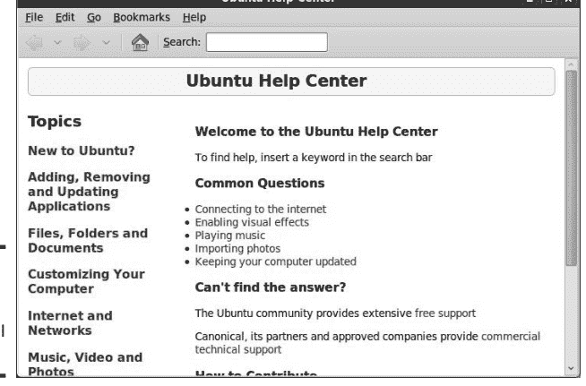

图 1-1：可以通过 GUI 获取在线帮助。

## 使用 Linux 管理你的 PC

### 程序员想了解的 Linux

以下特性使 Linux 成为一个高效的软件开发环境：

- GNU C 编译器 (`gcc`)：编译 ANSI 标准的 C 程序。
- GNU C++ 编译器 (`g++`)：支持 ANSI 标准的 C++ 特性。
- GNU Java 编译器 (`javac`)：编译用 Java 编程语言编写的程序。
- GNU make 工具：允许你编译和链接大型程序。
- GNU 调试器 (`gdb`)：允许你单步执行程序以发现问题并确定程序如何失败（失败程序的内存保存在核心储文件中；`gdb` 可以检查此文件）。
- GNU 性能分析工具 (`prof`)：允许你确定某软件使用你计算机处理器的程度。
- Subversion、并发版本系统 (`CVS`) 和版本控制系统 (`RCS`)：
  - 维护版本信息并控制源文件的访问，以免两个程序员在无意中同时修改同一个文件。
- GNU emacs 编辑器：准备源文件，甚至可以启用编译-链接过程来构建程序。
- Perl：准备源文件，甚至可以启用编译-链接过程来构建程序，允许你编写脚本来完成特定任务。
- 工具命令及其图形工具包 (`Tcl/Tk`)：允许你轻松构建图形应用程序。
- Python：一种解释型编程语言，可与 T 相比。（例如，Fedora 安装程序是用 Python 编写。）
- 动态链接库：由于库代码都是共享的，程序变得更小。

### 使用 Linux 管理你的 PC

作为操作系统，Linux 充当管理硬件的介质。硬件包括显示器、键盘、鼠标以及连接到系统的任何设备。如果你在笔记本电脑上使用 Linux，硬件被封装在笔记本中。

系统内部是大脑——微处理器（例如英特奔 4）执行内存中的指令。这意味着任何内存都可以被随机访问。

硬盘是存储数据的空间。它是永久的，因为当你关机时，内容不会消失。硬盘被组织成目录和子目录（类似于文件柜中的文件夹）。

为了让 Linux 正常运行，你或其他人必须确保硬件正常并定期备份文件。还有安全问题——确保只有授权人员可以访问和使用系统。这些任务被称为系统管理。

如果你在拥有许多计算机的大设施中使用 Linux，由一个全职管理员处理一切。另一方面，如果你在家里 PC 上运行 Linux，你就是系统管理员。不要被它吓到。你不需要任何魔法指令或复杂的配置文件成为系统管理员。大多数 Linux 发行版包含许多图形工具，使系统管理变成点击点击的工作。

### 磁盘、CD 和 DVD

某些 Linux 发行版运行在单张 DVD 上。安装后，Linux 内核和所有应用程序都存储在硬盘上——这是你的 PC 执行某些操作时首先查找的地方。

通常，硬盘在安装过程中准备好用于 Linux。之后，你通常不需要动硬盘，除非备份存储在那的数据或偶尔安装和更新应用程序。

在 Linux 中使用光盘或 DVD 非常简单。当你登录 GNOME 或 KDE 桌面时，只需将 CD 或 DVD 放入驱动器，系统就会自动检测 DVD/CD。根据 Linux 发行版的不同，要么会出现 DVD/CD 图标，要么会自动打开文件管理器并显示 DVD/CD 的内容。如果所有方法都失败，你可以输入简单的 `mount` 命令将 DVD/CD 与系统上的目录关联起来。

## 使用 Linux 管理你的 PC

## 外设设备

连接到你 PC 的任何设备都是外设设备，安装在机箱内部的一些组件（如声卡）也是。你可以在 Linux 中配置和管理这些外设设备。

常见的外设之一是打印机，通常连接到 PC 的 USB（通用串行总线）或并行端口。（许多发行版带有图形化打印机配置工具，你可以使用它来配置打印机。）

另一个需要配置的外设设备是声卡。大多数 Linux 发行版像 Windows 一样检测并配置声卡。然而，如果 Linux 无法正确检测声卡，你可能需要运行文本模式或图形化工具来配置声卡。

Linux 在安装时会配置鼠标和键盘等其他外设设备。安装完成后你几乎可以不用管它们。

如今，PC 都配有 USB 接口；包括打印机和扫描仪在内的许多设备都可以插入 PC 的 USB 端口。

> USB 设备的一个很棒的特性是你可以随时插入或拔掉 USB 端口——在系统启动时不需要连接设备。这些设备被称为“热插拔”设备，因为你可以在系统运行时插入设备，这意味着 Linux 支持许多热插拔设备。当你将设备插入 USB 端口时，Linux 会加载正确的驱动程序并让应用程序可以使用该设备。


## 文件系统与共享

目录和文件的整个组织结构就是文件系统。你使用 Linux 管理文件系统。当你从 GNOME 或 KDE 桌面浏览文件时，你操作的是熟悉的文件夹。

> 文件系统的一项任务是备份重要文件。在 Linux 中，你可以使用 `tar` 程序在软磁盘或 Zip 驱动器上存档一个或多个目录。你甚至可以将文件备份到磁带（如果你有磁带驱动器）。如果你有 CD 或 DVD 刻录机，还可以将想要备份或留存后世的文件刻成 CD 或 DVD。


Linux 还可以与网络上的其他系统共享文件系统的部分。例如，你可以使用网络文件系统 (`NFS`) 跨网络共享文件。对于系统上的用户来说，远程系统的文件就像位于本地系统的一个目录中一样。

Linux 还带有 Samba 包，它支持与 Microsoft Windows 系统进行文件共享。Samba 让 Linux 系统工作起来就像 Windows 文件或打印服务器一样。你也可以访问网络上其他 Windows 系统上的共享文件夹。

第一卷 第一章

## 网络

既然大多数 PC 已经处于局域网 (`LAN`) 中或连接到互联网，你还需要管理网络。Linux 自带用于设置局域网的网络配置。对于使用调制解调器连接互联网，通常有一个 GUI 拨号工具。

介绍 Linux

许多用户通过 DSL 或电缆调制解调器连接互联网，你需要一台带有以太卡的 PC 来连接电缆或 DSL 调制解调器。这意味着你必须建立局域网并配置以太网。幸运的是，这些步骤通常是 Linux 安装的一部分。如果你想以后进行配置，可以使用 GUI 网络配置工具。

Linux 还包含了用于配置防火墙的工具，防火墙是一个保护缓冲区，使你的系统免受任何试图嗅探你互联网连接的人的影响。你可以通过 `iptables` 命令或运行 GUI 防火墙配置工具来配置防火墙。

## 入门

根据探索新主题的个人经验，我建议通过四步法来开始学习 Linux（以及《傻瓜版 Linux 全方位参考指南》）：

- 1. 在你的 PC 上安装 Linux（如第一卷所示）。
- 2. 配置 Linux 让一切运行符合你的心意（如第一卷所示）。
- 3. 探索 GUI 桌面和应用程序（如第二卷所示）。
- 4. 查找特定主题的细节，例如互联网服务器（如第四卷所示）。

在本章的剩余部分，我将进一步详细说明这些建议。

## 第一步：安装


Microsoft Windows 通常预装在你的新 PC 上，但 Linux 通常没有。所以你的第一个障碍是将 Linux 弄到你的 PC 上。虽然现在有些供应商提供预装的 Linux，但这仍然很罕见。

在克服了最初对未知的恐惧后，我敢保证你会发现 Linux 安装非常简单——但你从哪里获取它呢？好消息是，它包含在本书 DVD 中。当你把 DVD 插入 PC 后，第一卷将逐步演示如何安装 Linux。

由于一个典型的 Linux 发行版非常大——需要几张 CD 或至少一张 DVD——你最好的办法是购买或借阅一本包含 Linux CD 或 DVD 的书（比如这本）。然而，如果你有足够的耐心和带宽，Linux 是免费下载的。例如，你可以访问 Linux 官网 `www.linux.org` 并点击 `Download` 按钮。


## 第二步：配置

当你完成 Linux 安装后，下一步是配置各个组件（例如声卡和打印机）。


## 第三步：探索

配置好当的 Linux 后，你就准备好探索了。

## 第四步：了解更多

当你探索了 Linux 领域并了解了现状后，你可以深入研究并了解更多特定领域。

## 遵循安装步骤

某些 Linux 发行版要求你在安装之前拥有有关 PC 硬件的详尽信息。如果你计划安装 `Debian`，请在开始安装之前收集有关 PC 及其外围组件的信息。幸运的是，大多数 Linux 程序都能检测并与大多数 PC 外围设备协作。尽管如此，了解你的 PC 硬件也是个好主，这样在安装过程中出现问题时，你可以进行故障排除。

第一步是为你的发行版刻录 CD 或 DVD。你可以在任何带有 CD/DVD 刻录机的系统上刻录 CD（如果你想刻录 DVD，必须拥有 DVD 刻录机，但 DVD 刻录机可以刻录 CD 和 DVD）。通常，如果你有一台带有 CD/DVD 刻录机的 Windows PC，可以直接使用该系统来刻录 CD。记住，你还必须有一个 DVD 驱动器，因为你需要从本书的配套 DVD-ROM 中刻录 CD。带有 DVD 刻录机或组合功能的 PC 即可胜任此任务。

第二步是确保你的 PC 可以从 DVD/CD 启动。大多数新 PC 可以直接从 DVD/CD 驱动器启动，但某些 PC 可能需要你的干预。通常，PC 可能被设置为在 DVD/CD 驱动器之前启动硬盘，你必须进入 `Setup`（设置）来更改启动设备的顺序。

要设置 PC 从 DVD 启动，你需要在 PC 上电时进入 `Setup`。进入 `Setup` 和设置启动设备的具体步骤因每台电脑而异，但通常涉及按下某个键，例如 `F2`。当 PC 上电时，屏幕会有一条简短的消息告诉你要按哪个键进入 `Setup`。在 `Setup` 中，你可以将 DVD 指定为启动驱动器。将 PC 设置为从 DVD/CD 驱动器启动后，只需将 DVD 或 CD 放入 DVD/CD 驱动器并重启 PC。

如果你计划使用 `Live CD` 发行版，第三步是从 `Live CD` 或 DVD 启动 PC。否则，第三步是在你的 PC 硬盘上为 Linux 腾出空间。如果你运行的是 Microsoft Windows，这可能简单也可以困难，取决于你是想用 Linux 替换 Windows，还是保留两者以及一个 Linux 发行版。

如果你想在不移除（或干扰）Windows 的情况下安装 Linux，请记住你现有的操作系统使用了整个硬盘。这意味着你必须对硬盘进行分区（划分），以便 Windows 运行在其中一部分，而 Linux 运行在另一部分。这样做是一个令畏的步骤，因为你面临清空硬盘并抹除硬盘上任何内容的风险。因此，在进行任何重大更改之前，请务必对系统进行备份。

为了在硬盘上留出 Linux 安装使用的空间，你应该使用分区程序来帮助创建分区。如果你的 PC 运行 `Windows 7`、`Vista` 或 `XP`（以及更老的 `NT` 或 `2000`），你可能想投入一个商业性的硬盘分区产品。另一方面，你可以使用名为 `GParted` 的 GUI（图形用户界面）重新划分 PC 硬盘，`GParted` 随许多其他发行版提供。

请注意，某些 Linux 发行版（如 `openSUSE` 和 `Xandros Desktop`）的安装程序可以通过减小 Windows 分区的大小自动为 Linux 创建分区。在这种情况下，你不需要使用 `GParted` 这样的工具来缩小硬盘上 Windows 分区的大小。

在你为 Linux 留出硬盘分区后，可以从所选发行版的 CD 启动 PC 并开始安装 Linux。安装过程中会发生许多步骤，且这些步骤随发行版而异。当你走到这一步时，一切应该是一风风顺的。只需经过安装界面，在一两个小时内就能完成。大多数安装程序（如图 2-1 所示的 `openSUSE` 界面）显示 GUI 并引导你完成所有步骤。

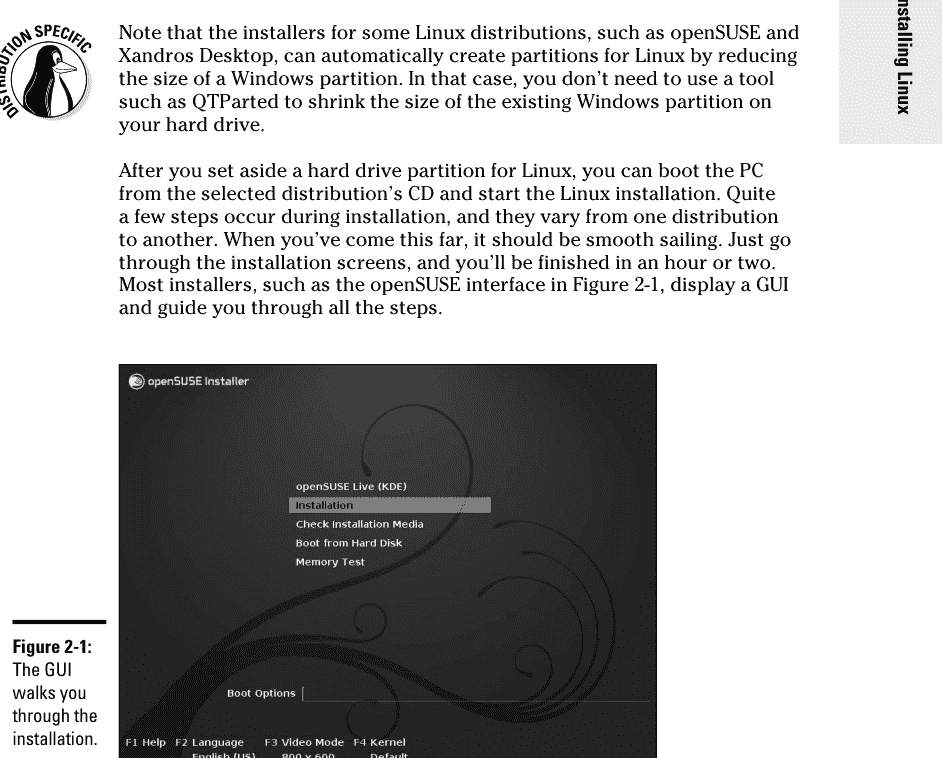

图 2-1：GUI 引导安装过程。

安装期间的一个关键步骤涉及再次对硬盘进行分区，这次你只需使用之前创建的额外分区。图 2-2 显示了 `openSUSE` 安装界面对此步骤建议的操作。

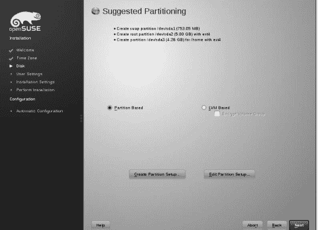

图 2-2：系统对分区的建议。

在几个配置步骤（例如设置网络和时区）之后，选择要安装的软件包并让安装程序完成剩余的安装工作。某些发行版甚至更容易跳过软件选择步骤，改为安装一组默认的软件包。

安装结束时，重启 PC。重启有时是安装过程的一部分，如图 2-3 所示。

图 2-3：在运行自动配置之前，在此 `openSUSE` 安装期间需要重启。

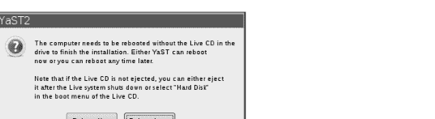

当 Linux 首次运行时，你将有机会执行更多配置步骤并安装额外的软件包。

### 检查你的 PC 硬件

检查你的 PC 硬件

如果你担心你的 PC 可能无法满足，以下是一些组件：

-   **显示器**：显示器的确切型号并不重要。重要的是分辨率。如果你想要 GUI，你需要一个支持支持 Window System 的显示器。安装程序可以检测并配置显示器。然而，如果安装程序无法检测显示器，了解显示器的型号会有帮助。
-   **硬盘**：某些高性能 PC 具有连接外围设备的控制器。如果你的电脑有，你可能想了解它的型号。
-   **声卡**：如果有声卡并想在 Linux 中获得声音，请确保它是兼容的。可以在成功安装 Linux 后配置声卡。
-   **显卡**：所有显卡（也称为显示适配器）在文本模式下都能运行良好，但如果你想要 GUI，你需要一个支持 X Window System 的显卡。安装程序可以检测并配置显卡。然而，如果安装程序无法检测显卡，了解显卡的型号会有帮助。
-   **鼠标**：所有类型的鼠标（PS/2 或 USB）都能兼容 Linux。安装程序可以检测它。
-   **网卡**：并非所有 PC 都有网卡。如果你的有，可以了解它的型号。
-   **键盘**：所有键盘都能兼容 Linux。
-   **调制解调器**：如果你想拨号，你需要一个调制解调器。对于某些发行版，你可能需要在 `modem.org` 查找驱动。
-   **处理器**：400 MHz 或更高最好。处理器速度以 MHz（兆赫）或 GHz（吉赫）表示，只要超过 400 MHz 并不重要。Linux 可以在任何 Intel 处理器上运行。
-   **内存**：RAM 是系统的内存量。对于处理，越多越好。安装至少需要 256MB。对于某些发行版，最低要求已升至 384MB，且你更多。

### 尝试 Live CD

在开始任何操作之前，从配套 DVD 尝试 `Ubuntu` 是值得的。除了体验 Linux 桌面外，你还可以从 `Ubuntu` 执行一些额外的安装前工作。

要启动 `Ubuntu`，请从本书的配套 DVD 启动你的 PC。会出现一个菜单，你可以在从中选择各种选项来控制启动过程，或检查系统是否满足硬件要求。你应该选择默认选项启动 `Ubuntu`（如果你在超时前未选择，将自动执行该选项）。

几分钟后，你看到了 `Ubuntu` 使用的 `GNOME` GUI 桌面。现在你可以开始探索 `Ubuntu` 了。如果你点击示例文件夹，

# 从 ISO 镜像刻录 CD 或 DVD

你会发现 `Ubuntu` 可以完成很多事情。你也可以从“系统”、“管理”菜单（`System:Administration:GParted`）中选择 `GParted`（分区编辑器）来重新配置硬盘。

完成 `Ubuntu` 安装后，选择“系统：退出”。当 `Ubuntu` 关闭时，移除 DVD 并按回车键。你需要决定是否要安装 `Ubuntu`，请点击桌面上的“安装”图标开始该过程。

# 从 ISO 镜像刻录 CD 或 DVD


本书的附带 DVD 包含了 Debian、openSUSE 和 Xandros 发行版的 ISO 镜像，并组织在 DVD 的不同文件夹中。要安装其中任何发行版，你必须先将选定的发行版 ISO 镜像刻录到 CD 或 DVD。你通常可以在带有 CD/DVD 刻录机的 PC 上执行此步骤，最可能是在使用 Microsoft Windows 时，因为大多数新电脑都预装了 Windows。

# 使用 Windows CD 刻录程序

在 Windows 中，你可以使用 Nero 等 CD 刻录程序将 ISO 镜像刻录到光片上。如果你没有适用于 Microsoft Windows 的 CD 刻录程序，可以从 DVD 启动 Ubuntu，并从 GUI 中的“位置：CD DVD 创建器”启动 CD/DVD 刻录程序。从 ISO 镜像刻录 CD 的步骤取决于你使用的 CD 刻录程序。通用步骤如下（如果你有 DVD 刻录机，可以使用相同的说明刻录 DVD）。

- 3. 从 CD 刻录程序中打开镜像文件。
具体步骤取决于 CD 刻录程序。
- 4. 将一张空白的可刻录 CD 放入 CD 刻录机中。
- 5. 将 ISO 镜像刻录到可刻录 CD 上。
通常，CD 刻录程序有一个工具栏按钮，点击它可以开始将 ISO 刻录到空白 CD。
- 6. 如果该发行版有更多 ISO 镜像，请对剩余 ISO 镜像重复步骤 3-5。
Live CD 发行版是单个 ISO 镜像，你可以将其刻录到一张 CD 上。其他发行版通常包含多个 ISO 镜像，你必须将每个文件镜像刻录到单独的 CD 上。
- 1. 将附带 DVD-ROM 插入 PC 的 DVD 驱动器。
如果你的 DVD 是 DVD/CD 组合刻录机，你必须先将 Linux 发行版的 ISO 镜像文件从 DVD 复制到 PC 硬盘，以便你可以使用同一个驱动器刻录 CD。
- 2. 启动 CD 刻录程序。

## 38 为 Linux 留出空间

在典型的 Windows PC 中，Windows 位于一个大分区上占据了整个硬盘。你想缩小分区并为 Linux 留空间。在 Linux 安装期间，安装程序将使用空闲空间创建 Linux 分区。


想要尝试任何 Live CD 发行版（例如 Ubuntu），你不需要重新格式硬盘。只需从 Live CD 启动 PC 即可。安装程序可以非破坏性地缩小 Windows 分区，因此你不需要提前执行调整步骤。如果你计划在硬盘上安装 Fedora、Debian 或任何其他 Linux 发行版，你必须重新格式硬盘。如果你想在 Windows 下调整磁盘分区，可以使用商业产品，或者从本书的附带 DVD 启动 `GParted`，并使用分区编辑器 `GParted` 调整 Windows 分区的大小。`GParted` 可以调整 `NTFS`（新建文件系统）分区的大小，大多数新版本的 Windows 都使用它。


在调整磁盘分区时，始终存在丢失硬盘上所有数据的风险。因此，在使用磁盘分区工具调整硬盘分区之前，请备份你的硬盘。在完成备份之后、对分区进行任何操作之前，请确保你可以从备份中恢复文件。

在 Ubuntu 启动并出现 GUI 桌面后，按照以下步骤调整 Windows 分区的大小：

- 1. 从 Ubuntu 桌面选择“系统；管理；GParted”。
`GParted` 窗口出现，工具显示它在你的 PC 上找到的驱动器。第一个硬盘显示为设备名称 `/dev/sda`，第二个为 `/dev/sdb`，以此此类推。
- 2. 点击 `GParted` 右侧设备列表中的硬盘。
- 3. 从分区列表中，点击你想要调整大小的分区。
该分区通常是最大的分区。对于 Windows 7、Vista 或 XP，分区类型为 `ntfs`，如分区列表中的 Type 列所示。在典型的新 PC 中，你可能会看到两个分区——一个较小的 `fat16` 分区和一个较大的 `ntfs` 分区。
- 4. 从 `GParted` 菜单选择“调整/移动”。
出现“调整分区”对话框。
- 5. 设置分区的新大小设置，然后点击“调整/移动”。

# 安装 Ubuntu 39

你应该选择一个大小，使得在分区后你获得 4GB 或更多的空闲空间。你将在对话框的“分区后可用空间”`Free Space After` 字段中看到空闲空间的大小。

- 6. 在指定了所有想要做的更改后，点击“应用”开始操作。当警告出现时，点击“应用”，将执行所有等待的操作。
分区已更改，你在 Windows 分区之后有了空闲空间。
在硬盘上为 Linux 创建好空闲空间后，你可以继续安装 Ubuntu。

## 安装 Ubuntu

要在 PC 上安装 Ubuntu，请按照以下步骤操作：

- 1. 从 Live CD 启动 PC。
初始启动屏幕提示按回车键开始安装。
- 2. 按回车键开始安装。
安装程序要求你选择语言。
- 3. 选择语言并点击“下一步”。
- 4. 选择位置并点击“下一步”。
- 5. 选择键盘布局并点击“下一步”。
- 6. （可选）选择如何准备磁盘空间。
你可以删除现有操作系统、安装在另一个分区等。如果你已经在硬盘上为 Ubuntu 创建了空间（参见“为 Linux 留出空间”章节），选择该空间。
- 7. 点击“下一步”。
- 8. 创建用户账户，为系统输入主机名，然后点击“下一步”。
输入主用户账户信息（超级用户）并为网络分配一个计算机名称。
- 9. 确认安装，然后点击“安装”。
你输入的所有变量和选择将最后显示一次。你可以退出、返回更改或安装（你也可以点击“高级”按钮配置不常用的设置）。点击安装后，安装程序安装 Ubuntu 基础系统。
- 10. 移除 CD 并按回车键重启 PC。
PC 重启后，Ubuntu 将从在线仓库下载并安装更多包。（你的 PC 需要连接互联网。）


`X Window` 系统和 `GNOME` GUI 是 Ubuntu 下载并安装的包之一。在这些包安装并配置后，Ubuntu 会启动 GUI 登录界面，你可以使用之前定义的用户账户进行登录。

恭喜！你现在可以使用 Ubuntu 了！

虽然你可以在 Linux 中通过多种命令行方法创建启动 U 盘，但最简单的方法是使用 Windows。（我意识到建议从 Windows 创建 Linux 启动盘听起来可能像异端邪说，但大多数对 Linux Live USB 实现感兴趣的用户可能都在运行 Windows。）按照以下步骤创建启动 U 盘：

## 42 创建启动 U 盘

- 1. 转到 `http://fedorahosted.org/liveusb-creator` 并下载 `liveusb-creator` 程序。
- 2. 安装 `liveusb-creator` 程序。
- 3. 打开 `liveusb-creator` 的安装文件夹。
- 4. 双击 `liveusb-creator` 程序运行它。
你可以看到图 3-1 所示的程序。
图 3-1：Fedora USB Creator 简化了启动 U 盘的创建。
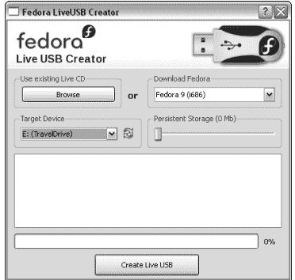
- 5. 在“目标设备”`Target Device` 下，选择 U 盘。
例如，图 3-1 中的 U 盘显示为 `TravelDrive`。
- 6. 选择镜像 `ISO` 文件的来源。
如果你的互联网连接较慢，可以使用一张 Live CD 并从中提取 ISO 文件。如果你的互联网连接较快，请使用下载选项获取当前的 ISO 文件。
- 7. 设置“持久性存储”`Persistent Storage` 容量。
这是分配给安装程序的、始终可用的存储空间。我建议普通用户至少设置为 300MB。（我不知道默认值是否是 0MB。）
- 8. 点击“创建 Live USB”`Create Live USB` 按钮并等待。
你可以查看进度，如图 3-2 所示。请准备好等待十分钟完成过程。驱动盘上会创建两个文件夹：`syslinux`（小于 7MB，负责启动）和 `LiveOS`（大小取决于你的存储设置）。
- 9. 关闭应用程序并测试新创建的启动盘。

## 43 工作站的故障排除

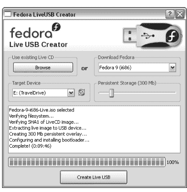
图 3-2：创建过程大约需要十分钟。

## 工作站的故障排除

我尝试了许多 U 盘，没有遇到过在安装后剩余超过 1GB 空闲空间的问题。较小的驱动器（2GB 或以下）通常格式化为 `FAT`，较大的则格式化为 `FAT32`；据我所知，这在安装或可用性方面没有区别。


你必须确保工作站设置允许机器从 USB 启动，这通常需要重新配置 BIOS。首先，重启工作站并按键进入 BIOS 配置（`F12` 或 `DEL`，有时是 `F1` 或 `F2`）。选择 `Boot` 菜单并启用“优先启动 USB 设备”（`Boot USB Devices First`）或类似的设置。在某些计算机中，U 盘被隐藏在启动 BIOS 的硬盘部分。在这种情况下，你需要选择 `Boot+Hard Drives`，将主驱动器更改为存储介质，然后确保在启动设备下选选择了 USB 驱动器。如果“从 USB 启动”是启用/禁用选项，请选择它，然后进入启动设备顺序并将 USB 选项移动到硬盘选项之上。保存更改并退出 BIOS 配置。此时，工作站将继续重启——*注意：* 如果你看到单行条 **Boot Error** 且没有其他反应，请根据制造商说明更新系统 BIOS。

## 日常使用新驱动器

当你的系统启动时，Fedora 环境的加载速度会比 Live CD 快得多。如图 3-3 所示，U 盘显示了新创建的文件夹，并且可以像常一样访问其他设备。“安装到硬盘”（`Install to Hard Drive`）图标保留在桌面上，如果你决定这样做，可以将其永久转换为 Fedora。

使用该操作系统不需要互联网连接，但强烈建议连接，因为大多数用户会想要下载额外的程序，以进一步测试操作系统的功能。

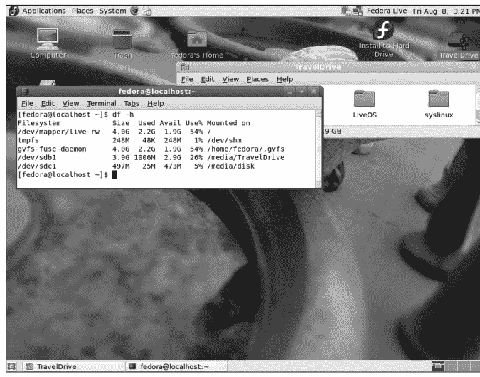

图 3-3：在 USB 环境中工作。

## 第4 章：Linux 的故障排除与配置

本章内容

- 排除安装故障
- 配置 X Window 系统
- 解决安装问题
- 设置打印机
- 管理 DVD 和 CD-ROM
- 安装额外的软件包

在安装 Linux 的过程中，安装程序会尝试检测关键硬件组件，例如 SCSI 控制器和网卡。根据检测到的结果，安装程序将引导你完成一系列安装步骤。例如，如果安装程序检测不到网卡，它将跳过网络配置步骤。如果你实际上没有网卡，这是可以的；如果你有网卡而安装程序误认为你没有，那么你就遇到了安装问题。

另一种安装问题发生在重启 PC 后，显示的不是图形登录界面，而是文本终端。此错误意味着 X Window 系统配置出现问题。

此外，Linux 安装通常不包含你 PC 系统上每个硬件的配置程序。例如，大多数安装都会取消你的打印机的配置。在本章中，我将向你展示一些故障排除的方法。

## 46 使用文本模式

### 使用文本安装

大多数 Linux 安装程序都会尝试启动 GUI。如果安装程序失败，可以使用文本模式。

| 发行版 | 如何获取文本模式 |
| :--- | :--- |
| Debian | 运行文本模式。 |
| Fedora | 运行文本模式。 |
| Knoix | 运行文本模式。 |
| SUSE | 运行文本模式。 |
| Ubuntu | 运行文本模式。 |
| Xandros | 运行文本模式。 |

## 47 X 的故障排除

每当我安装 X 时，图形界面都不会出现。如果也遇到这种情况，这里是你可以进行配置的方法：

## 解决其他安装问题

7. 按下 `Ctrl+Alt+Delete` 或输入 `reboot` 重启电脑。

如果一切顺利，你应该会看到图形登录界面。

使用 X 服务的 `-configure` 选项创建的配置文件没有以最佳分辨率显示。要调整该配置文件，你需要在重启系统后运行一个实用程序来调整设置。你使用的实用程序取决于 Linux 发行版，但大多数发行版都包含一个让你通过图形化用户界面配置显卡、显示器和显示设置的实用程序。

## 解决其他安装问题

我确定我还没有列出所有潜伏在外的安装问题。没有人能做到。x86 PC 中存在如此多的组件，墨菲定律实际上要求必须存在某些安装程序无法处理的硬件组合。在本节中，我列出了几个已知问题。对于其他问题，我建议你去 Google Groups (`http://groups.google.com`) 并输入故障的一些症状。假设其他人也遇到了类似的问题，你可以获得有关如何排除故障解决你特定困境的指示。

## Knoppix 启动命令

Knoppix Live CD 可以作为一个很好的故障排除工具，因为 Knoppix 擅长检测硬件，并且可以直接从光盘运行。

如果你在启动 Knoppix 时遇到困难，尝试在 `boot:` 提示符输入 Knoppix 启动命令。例如，如果 Knoppix 在尝试检测 SCSI 卡时卡死，你可以在 `boot:` 提示符输入 `knoppix nosci` 来禁用 SCSI。或者，如果你使用 X 服务加载 `nv` 模块（基于 NVIDIA 芯片的显卡），你可以在 `boot:` 提示符输入 `knoppix xmodule=nv`。

表 4-2：一些常用的 Knoppix 启动命令。

| 启动命令 | 功能 |
| :--- | :--- |
| `expert` | 以专家模式启动，允许用户交互式地设置和配置 Knoppix。 |
| `failsafe` | 在不尝试检测硬件的情况下启动（启动 Linux 所需的最基本硬件外）。 |
| `fb1280x1024` | 在指定的分辨率下使用固定帧图形（指定你想要的分率，例如 1024 x 768 或 800 x 600）。 |
| `knoppix 1` | 在运行级别 1（单用户模式）启动 knoppix，你可以用它来执行救援操作。 |
| `knoppix 2` | 在级别 2 启动，提供文本模式 shell 提示符。 |
| `knoppix acpi=off` | 完全禁用 ACPI（高级配置和电源接口）。 |
| `knoppix atapicd` | 对于 IDE-CD 驱动器使用 ATAPI-CD ROM 接口而不是模拟 SCSI 接口。 |
| `knoppix desktop=wmname` | 使用指定的窗口管理器 own默认的 KDE desktop=wmname（wname 为 fluxbox, icewm, larswm, twm, wmaker, 或 xfce）。 |
| `knoppix dma` | 为所有 IDE 驱动器启用直接访问 (DMA)。 |
| `knoppix floppyconfig` | 从软盘运行 shell 脚本 `knoppix.sh`。（该 shell 脚本包含运行运行的 Linux 命令）。 |
| `knoppix fromhome=/dev/hdval` | 从之前复制到指定硬盘分区的 Live CD 镜像启动。 |
| `hsync=80` | 为 X 使用 80 kHz 的水平刷新率（你想要使用的水平刷新率）。 |
| `knoppix lang=xx` | 设置由双字母代码 xx 指定的语言，其中 cn = 简体中文，de = 德语，da = 丹语，es = 西班牙语，fr = 法语，it = 意大利语，nl = 荷兰语，pl = 俄语，sk = 斯洛伐克语，tr = 土耳语，tw = 繁体中文，或 us = 美国英语。 |
| `knoppix mem=256M` | 指定 PC 的内存（兆字节）。 |
| `knoppix myconf=/dev/hdval` | 从 `/dev/hdval` 分区运行 shell 脚本 `knoppix.sh`。 |
| `knoppix myconf=scan` | 让 knoppix 搜索文件 `knoppix.sh`，并执行其中的命令。 |
| `knoppix noeject` | 停止 knoppix 后不弹出 Live CD。 |
| `knoppix noprom` | 停止 knoppix 后不提示 Live CD。 |
| `knoppix nowheel` | 为 PS/2 鼠标或触摸板强制使用 PS/2 协议（而不是自动检测鼠标）。 |
| `knoppix noxxx` | 让 knoppix 跳过硬件检测的特定部分（xxx 指定 apic = 高可编程中断控制器，agp = 加速图形电源管理，audio = 声卡，ddc = 动态主机配置，fstab = 文件系统总线，firewire = IEEE 1394 高速串行总线，pcmcia = 电脑接口，swap = 虚拟内存空间，usb = 通用串行总线）。 |
| `pc=bios` | 使用 BIOS 处理的 PCI 控制器。 |
| `pnpbios=off` | 跳过即插用 (PnP) BIOS 初始化。 |
| `knoppix screen=resolution` | 设置屏幕分辨率（resolution 为你需要的像素，例如 1024x768、800x600、640x480 等）。 |
| `knoppix testcd` | 使用 MD5 检查 Live CD 的数据完整性。 |
| `knoppix tohd=/dev/sda` | 将 Live CD 复制到指定的硬盘分区并从那里运行（需要 1GB RAM）。 |
| `knoppix toram` | 将 Live CD 复制到 RAM（内存）并从那里运行（需要 1GB RAM）。 |
| `knoppix vga=ext` | 使用 50 行文本模式显示。 |
| `knoppix vsync=60` | 为 X 使用 60 Hz 的垂直刷新率（你希望 X 使用的垂直刷新率）。 |


| `knoppix wheelmouse` | 为鼠标启用 PS/2 协议。 |

| `knoppix xmodule=modname` | 让 X 服务加载 `modname` 模块以便在显卡上工作（`modname` 为 `ati`, `fbdev`, `i180`, `nv`, `radeon`, `savage`, `svga` 或 `s3`）。 |

| `knoppix xserver=program` | 启动由 `program` 指定的 X 服务（`program` 为 `XFree86` 或 `XGA`）。 |

## 解决其他安装问题

## 51


当你想要发出多个 `knoppix` 启动命令时，只需将它们合并为一行。例如，要指定跳过 SCSI 自动检测、关闭 ACPI、使用美国键盘、使用鼠标并要求 X 服务加载 `nv` 模块，请在 `boot:` 输入以下内容：

```
knoppies noscsi acpi=off lang=us wheelmouse xmodule=nv
```

## 致命信号11 错误

在安装过程中，某些人会收到致命信号11错误消息，这将停止进程。此错误通常发生在初始启动屏幕之后，因为安装程序正在启动其GUI或文本界面。安装期间出现信号11最可能的原因是内存硬件错误。


信号11或`SIGSEGV`（段错误）可能会发生在Linux应用程序中。当进程尝试访问它不应该访问的内存位置时就会发生段错误。操作系统在问题发生前捕捉它并通过发送信号11来停止进程。当这种情况发生在安装期间时，安装程序在访问内存时出错，最可能的原因是硬件问题。通常建议的修复方法中关闭BIOS缓存。要这样做，你需要在电脑启动时进入设置（按下功能键，如`F2`），并在BIOS设置菜单中关闭CPU缓存。

如果问题是由于内存硬件错误（也就是说，内存颗粒损坏的结果）引起的，你可以尝试交换插槽中的内存模块。如果你手头有另一个内存模块，也可以考虑用它替换现有模块。

你可以在 `www.bitwizard.nl/sigill` 查看更多关于信号11的问题。

## 解决电脑重启问题

在某些PC上，当你在启动提示符处按回车时，初始Linux内核加载并立即重启电脑。这可能是由于PC BIOS中的ACPI实现不当。为了绕过这一点，你在启动提示符处输入 `linux acpi=off` 来关闭ACPI。如果无效，请参阅表4-3查看你可能想要尝试的其他启动选项。

## 使用Linux内核启动选项

当你从DVD或CD-ROM启动PC进行Linux安装时，你会看到一个带有 `boot:` 提示符的文本屏幕。通常，你在该提示符处按回车或什么都不做，安装很快就会开始。

## 52 解决其他安装问题

然而，你可以在启动提示符处指定多种选项。这些选项控制 Linux 内核启动的各个方面，例如禁用对故障硬件的支持，或使用特定的驱动模块启动 X 服务器。这些启动选项中的某些可能帮助跳过在安装过程中可能遇到的问题。

要使用这些启动选项，通常你需要在 `linux` 后面输入启动选项。例如，若要执行测试安装并告诉内核你的 PC 有 512MB 内存，你在启动时输入以下内容：

```bash
linux text mem=512M
```

请参考表 4-3 获取 Linux 启动选项的简要总结。你可以使用这些命令来开启或关闭特定功能。

虽然我在解决安装问题的背景下提到了这些 Linux 内核启动命令，但如果你想带有任何 Linux 发行版启动 PC 并想要开启或关闭特定功能，也可以使用其中一些命令。


| 表 4-3 一些 Linux 启动选项 | 启动选项 | 功能 |

| :--- | :--- | :--- |

| `allowcddma` | 为 CD/DVD 驱动器启用 DMA。 |

| `apic` | 解决 Intel 440FX 芯片组中常见的错误，且仅在安装程序内核下执行。 |

| `acpi=off` | 如果 ACPI 出现问题则禁用 ACPI。 |

| `dd` | 在安装 Red Linux 时提示插入驱动磁盘。 |

| `display=IP_address:` | 使安装程序 GUI现在由 IP 地址识别的远程系统上。（确保在运行安装程序的远程系统上运行 `xhost +hostname` 命令，其中 `hostname` 是你运行安装程序的主机。） |

| `driverdisk` | 在安装 Red Linux 时提示插入驱动磁盘。 |

| `enforcing=0` | 关闭安全增强 Linux (SELinux) 强制访问控制。 |

| `expert` | 允许你对可移动介质进行分区并提示插入驱动磁盘。 |

## 解决其他安装问题

| 启动选项 | 功能 |

| :--- | :--- |

| `ide=nodma` | 禁用所有 IDE 设备上的 DMA，当你遇到 IDE 相关问题时非常有用。 |

| `ks` | 使用 DHCP 配置以太网卡并使用由 DHCP 服务器提供的启动服务器识别的 NFS 服务器上的 kickstart 文件运行 kickstart 安装。 |

| `ks=kickstartfile` | 运行由 `kickstartfile` 指定的 kickstart 安装。（kickstart 的原理是创建一个包含所有安装选项的启动文件，通过启动并提供 kickstart 文件作为输入来快速启动安装。） |

| `lowres` | 强制安装程序 GUI 使用较低分辨率（640 x 480）。 |

| `mediacheck` | 提示你检查 CD 镜像（也称为 ISO 镜像）的完整性。通过比较 MD5 校验和对比官方 Fedora 镜像来检查镜像。检查 CD-ROM 可能需要几分钟。 |

| `mem=xxx` | 覆盖内核在 PC 上检测到的内存量。（某些旧机器可能只能检测到 16MB 内存，在某些新机器上，显卡可能会使用部分主内存。）确保将 `xxx` 替换为代表 PC 内存兆字节数的的数字。 |

| `nmi_watchdog=1` | 启用内置内核死锁检测器，其利用非掩码中断 (NMI)。 |

| `noaptic` | 防止内核使用高级可编程中断控制器 (APIC) 芯片。（你可以在已知故障 APIC 的主板上使用此命令。） |

| `nofire` | 不加载对 FireWire（火线）的支持。 |

| `noht` | 禁用超线程，该功能允许单个处理器在硬件层面充当多个虚拟处理器。 |

| `nomce` | 使用机器检查异常 (MCE) 启用 CPU 执行的自诊断检查。在某些机器上，这些检查执行过于频繁，需要禁用。 |

| `nomount` | 在救援模式下不自动挂载任何已安装分区。 |

| 表 4-3（续） | 启动选项 | 功能 |

| :--- | :--- |

| `nop nopass` | 不将键盘和鼠标信息传递给安装程序的第 2 阶段。 |

| `nopcmcia` | 忽略系统中的任何 PCIA 控制器。 |

| `noprobe` | 禁用自动硬件检测，取而向用户提问有关 PC 上安装的 SCSI 和网络硬件的信息。你可以通过这种方法向模块传递参数。 |

| `noshell` | 安装期间禁用对虚拟控制台 2（通过按 `Ctrl+Alt+F2` 进入的）的访问。 |

| `nousb` | 安装期间禁用加载 USB 支持。（如果安装程序在过程早期挂起，不带 USB 支持启动可能有用。） |

| `nousbstorage` | 在安装程序的加载器中禁用加载 `usbtorage` 模块。此选项可能有助于 SCSI 系统上的设备排序。 |

| `reboot=b` | 更改内核重启 PC，以便即使内核在系统关闭期间挂起，它也能重启。 |

| `pci=noacpi` | 使内核不使用 ACPI 路由中断请求。 |

| `pci=biosrq` | 使内核使用 BIOS 设置来路由中断请求 (IRQs)。 |

| `rescue` | 以救援模式启动内核。 |

| `resolution=HHV` | 使安装程序使用指定的 own，例如 `640x480`、`800x600` 或 `1024x768`。 |

| `selinux=0` | 禁用 SELinux。 |

| `serial` | 开启串口。 |

| `skipdd` | 跳过显示通道 (DDC) 探测。 |

| `vnc` | 启动 VNC（虚拟网络计算）服务器，以便从另一个系统控制打印机。 |

## 设置打印机

在大多数 Linux 发行版中，遵循以下步骤：

1. 从 GNOME 桌面，系统>管理>打印。(img/7605650e62fab537998f2b973dbf5a26_80_0.png)

2. 如果设备被识别，它将出现在列表中。如果没有，你仍然可以手动添加驱动程序。

3. 点击继续。

4. 选择相应的驱动程序（见图 4-3），然后继续。

5. 输入打印机名称和描述变量（见图 4-4），然后点击应用。

6. 打印测试页以确保一切正常。

7. 当打印机配置完成后，退出打印机工具。

## 设置打印机

| 设备 | 描述 |


| :--- | :--- |

| Epson Stylus NX510 | 连接到 USB 端口。 |

| 其他 | |

| 网络打印机 | |

图 4-2：Epson Stylus NX510 已识别。

| 描述打印机 | |

| :--- | :--- |

| 打印机名称 | 此打印机的短名称，例如 "laserjet" |

| EPSON-Epson-Stylus-NX510 |

| 描述（可选） | 人类可读的描述，例如“带有双面功能的 LaserJet” |

| EPSON Epson Stylus NX510 |

| 位置（可选） | 人类可读的位置，例如“实验室 1” |

| Ubuntu |

图 4-4：唯一的强制配置是打印机名称。

| 设置 | |

| :--- | :--- |

| 策略 | 描述：EPSON Epson Stylus NX510 |

| 访问控制 | |

| 打印机选项 | 位置：Ubuntu [更改...] |

| 选项 | 设备 ID：usb/EPSON/Epson/Stylus%2500NX510 [更改...] |

| 墨水/硒水平 | 品牌和型号：EPSON Epson Stylus NX515 - CUPS+Gut... [更改...] |

| | 打印机状态：空闲 - 完成第 1 页 ... |

| 测试和维护 | [打印测试页] [清洁打印头] |

图 4-5：使用打印机配置工具编辑配置。

# 管理 DVD 和 CD-ROM

Linux 的 GUI 桌面使得使用 DVD 和 CD-ROM 非常简单。只需将 DVD 或 CD-ROM 放入驱动器，桌面上就会出现一个图标。

然后你可以通过双击桌面上的图标来访问 CD 或 DVD。在某些 Linux 发行版中，在你向驱动器插入 CD 或 DVD 后，GUI 会自动在文件管理器中打开 CD 或 DVD 的内容。要访问文件和文件夹，只需双击 GUI 文件管理器窗口中出现的图标即可。

如果你看到 DVD/CD-ROM 图标，右键点击该图标会出现上下文菜单。完成后，你可以在那里编辑 CD 或 DVD。

Knoppix 显示每个检测到的驱动器的图标。要打开 CD 或 DVD，只需点击该驱动器的图标。在 SUSE 中，点击“我的电脑”图标并点击 DVD/CD 驱动器图标。Ubuntu 和 Fedora 在 Nautilus 窗口中打开 CD/DVD 并在桌面上放置图标。Xandros 在 Xandros 文件管理器窗口中打开 CD/DVD。


# 安装其他软件

安装软件的具体步骤取决于分发软件的包。大多数 Linux 软件以 RPM 文件或 Debian 包的形式提供。RPM 文件具有 `.rpm` 扩展名，Debian 包具有 `.deb` 扩展名。

大多数发行版都提供 GUI 安装程序以简化安装新软件包的流程。在本节中，我将简要介绍如何在 Debian、Fedora、SUSE 和 Xandros 中添加软件。你通常不会向 Knoppix（或任何其他 Live CD 发行版）添加软件，因为 Live CD 发行版运行

Fedora 和 SUSE、Debian、Ubuntu 和 Xandros 都是基于 Debian 的发行版，正如预期，通常使用 Debian 包（也称为 DEB 文件）。然而，RPM 和 DEB 包可以安装在任何 Linux 发行版中。


# 在 Debian 和 Ubuntu 中安装软件

在 以及 基于 Debian 的发行版（如 Ubuntu）中管理软件包的最佳方法是使用 APT —— 高级软件包工具 —— 你通常通过 `apt-get` 命令来控制它。

当你安装 Debian 时，最后的步骤之一是配置 APT 的源。APT 源是互联网服务器（包括 FTP 和 Web），APT 在这些服务器上查找下载并安装到系统中的软件包。假设 APT 配置恰当且你的系统具有高速互联网连接，你可以在终端中输入以下命令开始安装任何包：

```
apt-get install pkgname
```

其中 `pkgname` 是你想要安装的包名。如果你不知道包名，请先在终端中输入以下命令：

```
apt-cache search keyword
```

其中 `keyword` 与你想要安装的包相关。例如，为了搜索描述中包含 `screenshot` 单词且包含 `KDE` 单词的包，我会输入以下内容。（我使用 `grep` 搜索输出结果中出现的 `KDE` 文本。）

```
apt-cache search screenshot | grep KDE
```

此命令输出以下行结果：

```
ksapshot - Screenshot application for KDE
```

这显示 `kshot` 包正是我需要的。如果该包尚未安装，可以通过输入以下命令进行安装：

```
apt-get install ksnapshot
```

简而言之，这就是如何使用命令行工具在 Debian 中查找和安装包。

Debian 和 Ubuntu 还有一个用于 APT 的 GUI 软件包安装器，称为 Synaptic 包管理器，其用法非常直观：

- Debian：根据你的版本，你可以在 GNOME 桌面选择“应用程序>系统工具>Synaptic 软件包管理器”，或者选择“桌面>管理>Synaptic 软件包管理器”。
- Ubuntu：选择“选择系统>管理>Synaptic 软件包管理器”。当 Ubuntu 提示密码时，输入你的普通用户密码，因为 Ubuntu 没有 root 用户。


## 60 安装其他软件

Synaptic 包管理器启动后，它会显示一个“快速介绍”对话框，向你简要介绍如何标记包进行安装、升级或删除，以及如何进入菜单执行这些操作。阅读完介绍后，点击“关闭”即可移除该对话框并访问 Synaptic 包管理器（见图 4-6）。

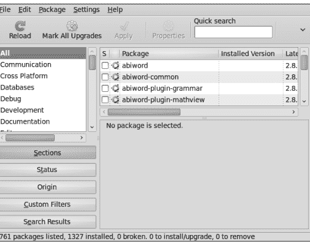

图 4-6：

Synaptic

包

管理器。

如果你的包信息超过 48 小时，另一个对话框会提示你更新包信息。点击该对话框中的“重新加载”。Synaptic 包管理器随后会下载最新的包信息，关闭对话框并在主窗口中显示有关包的信息。

通过点击 Synaptic 包管理器窗口左侧的类别，你可以查看窗口右侧各种类别包的列表。每个包左侧的方框表示该包是否已安装。如果你点击该包，Synaptic 包管理器会显示该包的信息。要选择一个包进行安装或删除，点击名称左侧的方框以“标记为安装”。通过点击 Synaptic 包管理器窗口左侧的类别，你可以在窗口右侧查看各种类别包的列表。

标记你想要安装的包，然后点击右下角的“应用”以根据你所做的更改更新软件包

## 在 Fedora 中安装软件

大多数 Fedora 软件以 RPM 文件的形式提供。RPM（Red Hat 包管理器）文件基本上是一个包含所需所有内容的单包。从 GNOME 桌面，使用“添加/删除软件”。如果你没有以 root 登录，对话框会提示 root 密码。添加或删除软件启动并收集已安装包的信息，如 4-7 所示。

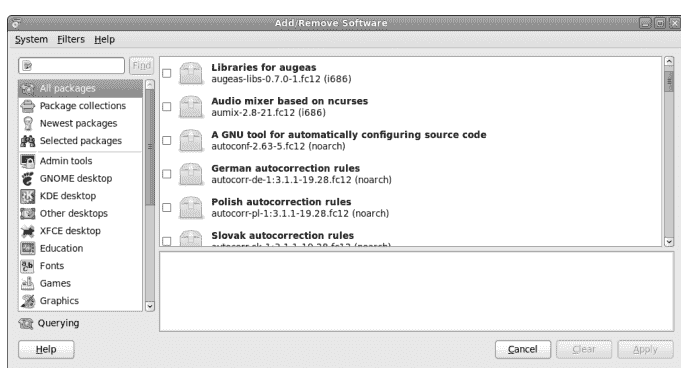

2. 要安装未安装的包组，点击名称左侧的方框。对于部分安装的包组，点击“详细信息”链接查看包的信息。

3. 在对话框中选择要安装的包，然后点击“关闭”。返回包管理界面，如果你添加或删除了任何包，“更新”按钮将变为可用

## 在 SUSE 中安装软件

在 SUSE 中，按照以下步骤安装或删除软件：

1. 从主菜单选择 YaST 以启动 YaST 控制中心。YaST 控制中心在左侧显示任务类别，在右侧显示该类别的特定任务。

2. 点击左侧的“软件”类别，以便右侧显示软件选项。

3. 点击右侧的“软件管理”图标。YaST 显示一个窗口，你可以在其中搜索软件包。

4. 通过名称搜索包或通过浏览可用包选择包。要通过名称搜索包，在窗口左角的搜索字段中输入关键字，然后点击“搜索”。YaST 在右侧显示匹配的包。要浏览包，点击左角的“过滤”，从下拉列表中选择“包组”，并点击某个组以查看该组的单个包列表。

5. 点击右下角的“接受”按钮开始安装选定的包。YaST 会检查依赖关系 —— 如果一个包需要其他包才能正确安装。如果你想查看点击“接受”后将发生什么更改，点击“过滤”并选择“安装摘要”。

要查看新应用程序列表，请点击 Xandros Networks 窗口中“New Applications”标签左侧的加号。你会看到进一步的应用程序类别列表。如果你点击某个类别，窗口右侧将显示该类别内软件包的名称。你可以选择一个软件包或整个类别进行安装。


要安装任何选定的软件包，请选择 `File:Enter Administrator Mode`。系统会提示你输入管理员（root）密码。输入 root 密码后，你可以选择 `File:Install Selected Applications`。Xandros Networks 会检查依赖项，在需要更多信息时向你发出提示，并下载且安装新软件。

如果你下载了 Debian 软件包，可以通过从 Xandros Networks 菜单中选择 `File:Install DEB File` 来进行安装。同样，菜单选项 `File:Install RPM File` 会安装 RPM 软件包。


# 第 5 章：尝试 Linux

## 本章内容

- 启动 Linux 并登录
- 熟悉 Shell
- 关闭系统

你正坐在 PC 前准备开机。你知道这台 PC 安装了 Linux。（也许是你自己安装的，但谁会好奇开机后会发生什么，以及之后该做什么呢。）别担心。如果你是第一次使用 Linux，本章将向你如何登录、查看图形桌面、尝试一些 Linux 命令，最后关闭 PC。

如果你有 Ubuntu Live CD，你只需要从 Ubuntu Live CD 启动（如本微型教程第 2 章所述），你就可以像使用任何其他发行版一样尝试它了。

对于你中那些已经了解 Linux 的人来说，可以快速翻阅本章，看看是否有任何新内容。你永远不知道自己可能还缺少什么！

## 启动 Linux

当你打开 PC 时，它会经历正常的上电序列并加载引导加载程序——GRUB 或 LILO，这取决于你的 Linux 发行版以及你在安装期间的选择。引导程序（曾称为自举加载器）是一个微型程序，负责将操作系统的其余从硬盘加载到计算机内存中。启动计算机的过程被称为引导（booting）。

对于 Live CD，引导程序通常是 ISOLINUX，这是一种专为从 ISO 960-CDROM 运行而设计的引导加载程序。

LILO 和 GRUB 引导程序会显示一个图形界面，列出引导程序可以加载的操作系统名称。例如，如果你的 PC 同时有 Windows 和 Linux，你会看到这两个名称都列在那里。你可以使用上下方向键来选择你想使用的操作系统。如果 PC 默认设置为 Linux，只需等待几秒钟，引导程序就会加载 Linux。更准确地说，引导程序将 Linux 内核——Linux 操作系统的核心——加载到 PC 的内存中。

其他引导程序（如 ISOLINUX）可能会显示文本引导提示：在提示符处你可以输入 `boot` 命令来加载特定的操作系统，并向该操作系统传递选项。

当 Linux 内核启动时，你会看到一长串打开性消息，通常称为启动消息（boot messages）。（你可以随时在终端窗口中输入命令 `dmesg` 来查看这些消息。）这些消息包含了 Linux 检测到的设备名称。启动消息中的其中一行显示为：

`Calibrating delay loop . . 4997.12 BogoMIPS (lpj=2498560)`

BogoMIPS 是 Linux 术语（在本章的实用侧边栏中解释），用于衡量时间。BogoMIPS 之前的数字取决于你 PC 处理器的速度，无论是 200 MHz 的 Pentium 还是 4 GHz 的 Pentium 4。当内核需要等待某些事件发生的一短时间时（例如等待磁盘控制器就绪并返回响应），它会使用 BogoMIPS 测量值。

启动消息显示后，某些 Linux 发行版（如 Fedora）会切换到图形启动屏幕，显示系统启动进度信息。当你安装后首次启动某些发行版（如 Fedora 和 Ubuntu OS）时，你会得到一个配置程序，引导你完成一些配置步骤，如设置日期时间和添加用户账户。要完成首次配置步骤，你只需要输入要求的信息。

Linux 启动后，你通常会进入一个图形登录界面。对于某些发行版（如 Knopix），你无需作为用户登录即可进入桌面。对于其他 Live CD，你必须登录。


图 5-1 从 Ubuntu Live CD 启动 PC 后的 Ubuntu 桌面。对于某些发行版，你可能会自动登录。对于其他发行版，会出现一个图形登录界面，要求你使用安装期间（或安装后的任何时候）提供的用户名和密码进行身份验证。

每个发行版都使用 root 用户名，它恰好是超级用户（管理员账户）。无论是你安装 Linux 还是别人为你安装的，你都需要知道 root 密码。没有它，你就无法完成许多了解 Linux 如何运行的必要任务。

### 什么是 BogoMIPS 和 HZ？

当 Linux 启动时，你会看到一条消息：`Calibrating delay loop . . 4997.12 BogoMIPS (lpj=2498560)`。

BogoMIPS 是 Linux 术语（在本章的实用侧边栏中解释），用于衡量时间。BogoMIPS 之前的数字取决于你 PC 处理器的速度，无论是 200 MHz 的 Pentium 还是 4 GHz 的 Pentium 4。当内核需要等待某些事件发生的一短时间时（例如等待磁盘控制器就绪并返回响应），它会使用 BogoMIPS 测量值。

换句话说，HZ 是一个等于一秒的变量。Jiffies 是时间的增量。

## 玩转 Shell


图 5-1 从 Ubuntu Live CD 启动 PC 后的 Ubuntu 桌面。对于某些发行版，你可能会自动登录。对于其他发行版，会出现一个图形登录界面，要求你使用安装期间（或安装后的任何时候）提供的用户名和密码进行身份验证。

### 启动 bash shell

简单来说，shell 是 Linux 的命令行解释器——该程序读取你输入的内容，将文本解释为命令，并执行该命令应该执行。

在开始玩 shell 之前，请打开终端窗口。无论在 GNOME 还是 KDE 中，面板通常包含一个看起来像显示器的图标。当你点击该图标时，会弹出一个带有提示符的窗口，如图 5-2 所示。那就是终端窗口，它的工作方式就像老式终端一样。一个 shell 程序正在运行，并准备好接受你输入的任何文本。你输入文本，按回车键，就会发生某些（取决于你输入了什么）。

图 5-2：

终端窗口等待你的输入。

> 如果你桌面上的 GNOME 或 KDE 面板似乎没有启动终端或 shell 窗口的图标，可以在主菜单层级中搜索，你应该能找到名为 Console（控制台）或 Terminal（终端）的项。选择该项将打开终端窗口。

你看到的提示符取决于在该终端窗口运行的 shell。Linux 的默认 shell 是 `bash`（代表 Bourne-Again Shell）。

`bash` 理解许多标准的 Linux 命令，你可以使用这些命令查看文件、在不同目录之间切换、查看正在运行的程序（以及其他登录用户）以及更多功能。

除了 Linux 命令外，`bash` 还可以运行任何存储在可执行文件中的程序。`bash` 还可以执行 shell 脚本——包含 Linux 命令的文本文件。

### 理解 shell 命令

由于 shell 会解释你输入的内容，因此了解 shell 如何识别你输入的文本是非常重要的。所有的 shell 命令都具有以下这种通用格式：

```
command option1 option2 . . . optionN
```

这样的单行命令通常被称为命令行。在命令行上，你输入一个命令，后面跟着一个或多个参数（或称为参数）。这些命令行选项（或命令行参数）有助于指定你想让命令执行的操作。

一个基本规则是，你必须使用空格或制表符将命令与选项隔开。你必须用空格或制表符将选项隔开。如果你想使用包含嵌入空格的选项，例如在密码文件中搜索两个单词的文本，我输入以下 `grep` 命令：`grep "WW daemon" /etc/passwd`（`grep` 是用于在文件中搜索文本的晦涩命令之一）。

```
grep "WW daemon" /etc/passwd
```

当 `grep` 打印出包含这些词的行时，看起来如下。（你在系统上看到的可能与我展示的不一样。）

```
wwwrun:x:30:8:WW daemon apache:/var/lib/wwwrun/bin/false
```

如果你以你的名字创建了用户账户，尽管输入以你的名字作为参数的 `grep` 命令，但记得用引号括起来。

### 尝试一些 Linux 命令


# Linux 命令趣味示例

在你打开终端窗口时，我们来玩几个 Linux 命令增加下趣味。我将引导你通过一些示例，让你感受一下在 shell 提示符下可以做什么。

## 查看系统运行时间

要查看 PC 自开机以来运行了多久，请输入以下内容。（注意：我加粗显示了输入的命令，后面是该命令的输出。）

```
uptime
12:06:34 59 days, 16:23, 4 users, load average: 0.56, 0.55, 0.57
```

`up 59 days, 16:23` 部分告诉你这台特定的 PC 已经运行了近两个月。嗯……Windows 能做到吗？

## 查看 Linux 内核版本

要查看你的系统运行的是什么版本的 Linux 内核，请像这样使用 `uname` 命令：

```
uname -srv
```

此命令运行了带有三个选项的 `uname` 命令：`-s`、`-r` 和 `-v`（如示例所示，可以组合为 `-srv`）。`-s` 选项 `uname` 打印内核名称，`-r` 打印内核发布版本，`-v` 打印内核版本号。该命令在我的一台 Linux 系统上生成了以下输出：

```
Linux 2.6.31-527.fc12.1686 #1 SMP Sat Nov 7 21:21:45 EST 2009
```

在这种情况下，系统运行的是 Linux 内核版本 2.6.31。

## 读取文件

要读取文件，请使用 `more` 命令。例如，输入 `/etc/passwd` 来读取 `/etc/passwd` 文件。产生的输出类似于以下：

```
root:x:0:0:root:/root:/bash
bin:x:1:bin:/bin/bash
demon:x:2:2:/bin/bash
lp:x:4:lp daemon:/var/spool/lpd:/bin/bash
mail:x:8:12:Mailer daemon:/var/spool/clientmeue:/false
news:x:9:9:/etc/news:/bin/bash
uucp:x:10:14:-to-Unix Copy system:/etc/uucp:/bin/bash
. lines deleted
```

## 查看进程列表

要查看系统当前运行的所有进程列表，请使用 `ps` 命令，如下：

```
ps ax
```

`ps` 命令接受许多选项，你可以在不加通常的应用前缀的情况下提供这些选项。此示例使用了 `a` 和 `x` 选项。`a` 选项列出你运行的所有进程。`x` 选项显示未附加到终端的进程。


```
PID TTY          STAT %MEM SIZE   TIME COMMAND
   1 ?         Ss    0.1G  124M   0:00:03 /sbin/init
 500 ?         S     0.0     0      0:00:00 [kworker/0:1]
 501 ?         S     0.0     0      0:00:00 [kworker/1:3]
 502 ?         S     0.0     0      0:00:00 [kworker/2:0]
 503 ?         S     0.0     0      0:00:00 [kworker/3:0]
 504 ?         S     0.0     0      0:00:00 [kworker/4:0]
 505 ?         S     0.0     0      0:00:00 [kworker/5:0]
 506 ?         S     0.0     0      0:00:00 [kworker/6:0]
 507 ?         S     0.0     0      0:00:00 [kworker/7:0]
 508 ?         S     0.0     0      0:00:00 [kworker/8:0]
 509 ?         S     0.0     0      0:00:00 [kworker/9:0]
 510 ?         S     0.0     0      0:00:00 [kworker/10:0]
 511 ?         S     0.0     0      0:00:00 [kworker/11:0]
 512 ?         S     0.0     0      0:00:00 [kworker/12:0]
 513 ?         S     0.0     0      0:00:00 [kworker/13:0]
 514 ?         S     0.0     0      0:00:00 [kworker/14:0]
 515 ?         S     0.0     0      0:00:00 [kworker/15:0]
 516 ?         S     0.0     0      0:00:00 [kworker/16:0]
 517 ?         S     0.0     0      0:00:00 [kworker/17:0]
 518 ?         S     0.0     0      0:00:00 [kworker/18:0]
 519 ?         S     0.0     0      0:00:00 [kworker/19:0]
 520 ?         S     0.0     0      0:00:00 [kworker/20:0]
 521 ?         S     0.0     0      0:00:00 [kworker/21:0]
 522 ?         S     0.0     0      0:00:00 [kworker/22:0]
 523 ?         S     0.0     0      0:00:00 [kworker/23:0]
 524 ?         S     0.0     0      0:00:00 [kworker/24:0]
 525 ?         S     0.0     0      0:00:00 [kworker/25:0]
 526 ?         S     0.0     0      0:00:00 [kworker/26:0]
 527 ?         S     0.0     0      0:00:00 [kworker/27:0]
 528 ?         S     0.0     0      0:00:00 [kworker/28:0]
 529 ?         S     0.0     0      0:00:00 [kworker/29:0]
 530 ?         S     0.0     0      0:00:00 [kworker/30:0]
 531 ?         S     0.0     0      0:00:00 [kworker/31:0]
 1234 ?         S     0.0     0      0:00:00 [systemd-logd]
 1235 ?         S     0.0     0      0:00:00 [systemd-journald]
 1236 ?         S     0.0     0      0:00:00 [systemd-udevd]
 1237 ?         S     0.0     0      0:00:00 [systemd-resolve]
 1238 ?         S     0.0     0      0:00:00 [systemd-networkd]
 1239 ?         S     0.0     0      0:00:00 [systemd-timesd]
 1240 ?         S     0.0     0      0:00:00 [systemd-logind]
 1241 ?         S     0.0     0      0:00:00 [systemd-resolved]
 1242 ?         S     0.0     0      0:00:00 [systemd-timesktop-notify]
 1243 ?         S     0.0     0      0:00:00 [systemd-polpolkit]
 1244 ?         S     0.0     0      0:00:00 [systemd-coredump]
 1245 ?         S     0.0     0      0:00:00 [systemd-backlog]
 1246 ?         S     0.0     0      0:00:00 [systemd-randomseed]
 1247 ?         S     0.0     0      0:00:00 [systemd-minion]
 1248 ?         S     0.0     0      0:00:00 [systemd-networkd]
 1249 ?         S     0.0     0      0:00:00 [systemd-hostd]
 1250 ?         S     0.0     0      0:00:00 [systemd-networkd]
 1251 ?         S     0.0     0      0:00:00 [systemd-cacd]
 1252 ?         S     0.0     0      0:00:00 [systemd-networkd]
 1253 ?         S     0.0     0      0:00:00 [systemd-networkd]
 1254 ?         S     0.0     0      0:00:00 [systemd-networkd]
 1255 ?         S     0.0     0      0:00:00 [systemd-networkd]
 1256 ?         S     0.0     0      0:00:00 [systemd-networkd]
 1257 ?         S     0.0     0      0:00:00 [systemd-networkd]
 1258 ?         S     0.0     0      0:00:00 [systemd-networkd]
 1259 ?         S     0.0     0      0:00:00 [systemd-networkd]
 1260 ?         S     0.0     0      0:00:00 [systemd-networkd]
 1261 ?         S     0.0     0      0:00:00 [systemd-networkd]
 1262 ?         S     0.0     0      0:00:00 [systemd-networkd]
 1263 ?         S     0.0     0      0:00:00 [systemd-networkd]
 1264 ?         S     0.0     0      0:00:00 [systemd-networkd]
 1265 ?         S     0.0     0      0:00:00 [systemd-networkd]
 1266 ?         S     0.0     0      0:00:00 [systemd-networkd]
 1267 ?         S     0.0     0      0:00:00 [systemd-networkd]
 1268 ?         S     0.0     0      0:00:00 [systemd-networkd]
 1269 ?         S     0.0     0      0:00:00 [systemd-networkd]
 1270 ?         S     0.0     0      0:00:00 [systemd-networkd]
 1271 ?         S     0.0     0      0:00:00 [systemd-networkd]
 1272 ?         S     0.0     0      0:00:00 [systemd-networkd]
 1273 ?         S     0.0     0      0:00:00 [systemd-networkd]
 1274 ?         S     0.0     0      0:00:00 [systemd-networkd]
 1275 ?         S     0.0     0      0:00:00 [systemd-networkd]
 1276 ?         S     0.0     0      0:00:00 [systemd-networkd]
 1277 ?         S     0.0     0      0:00:00 [systemd-networkd]
 1278 ?         S     0.0     0      0:00:00 [systemd-networkd]
 1279 ?         S     0.0     0      0:00:00 [systemd-networkd]
 1280 ?         S     0.0     0      0:00:00 [systemd-networkd]
 1281 ?         S     0.0     0      0:00:00 [systemd-networkd]
 1282 ?         S     0.0     0      0:00:00 [systemd-networkd]
 1283 ?         S     0.0     0      0:00:00 [systemd-networkd]
 1284 ?         S     0.0     0      0:00:00 [systemd-networkd]
 1285 ?         S     0.0     0      0:00:00 [systemd-networkd]
 1286 ?         S     0.0     0      0:00:00 [systemd-networkd]
 1287 ?         S     0.0     0      0:00:00 [systemd-networkd]
 1288 ?         S     0.0     0      0:00:00 [systemd-networkd]
 1289 ?         S     0.0     0      0:00:00 [systemd-networkd]
 1290 ?         S     0.0     0      0:00:00 [systemd-networkd]
 1291 ?         S     0.0     0      0:00:00 [systemd-networkd]
 1292 ?         S     0.0     0      0:00:00 [systemd-networkd]
 1293 ?         S     0.0     0      0:00:00 [systemd-networkd]
 1294 ?         S     0.0     0      0:00:00 [systemd-networkd]
 1295 ?         S     0.0     0      0:00:00 [systemd-networkd]
 1296 ?         S     0.0     0      0:00:00 [systemd-networkd]
 1297 ?         S     0.0     0      0:00:00 [systemd-networkd]
 1298 ?         S     0.0     0      0:00:00 [systemd-networkd]
 1299 ?         S     0.0     0      0:00:00 [systemd-networkd]
 1300 ?         S     0.0     0      0:00:00 [systemd-networkd]
 1301 ?         S     0.0     0      0:00:00 [systemd-networkd]
 1302 ?         S     0.0     0      0:00:00 [systemd-networkd]
 1303 ?         S     0.0     0      0:00:00 [systemd-networkd]
 1304 ?         S     0.0     0      0:00:00 [systemd-networkd]
 1305 ?         S     0.0     0      0:00:00 [systemd-networkd]
 1306 ?         S     0.0     0      0:00:00 [systemd-networkd]
 1307 ?         S     0.0     0      0:00:00 [systemd-networkd]
 1308 ?         S     0.0     0      0:00:00 [systemd-networkd]
 1309 ?         S     0.0     0      0:00:00 [systemd-networkd]
 1310 ?         S     0.0     0      0:00:00 [systemd-networkd]
 1311 ?         S     0.0     0      0:00:00 [systemd-networkd]
 1312 ?         S     0.0     0      0:00:00 [systemd-networkd]
 1313 ?         S     0.0     0      0:00:00 [systemd-networkd]
 1314 ?         S     0.0     0      0:00:00 [systemd-networkd]
 1315 ?         S     0.0     0      0:00:00 [systemd-networkd]
 1316 ?         S     0.0     0      0:00:00 [systemd-networkd]
 1317 ?         S     0.0     0      0:00:00 [systemd-networkd]
 1318 ?         S     0.0     0      0:00:00 [systemd-networkd]
 1319 ?         S     0.0     0      0:00:00 [systemd-networkd]
 1320 ?         S     0.0     0      0:00:00 [systemd-networkd]
...
 2000 user         S     0.5   120M   0:00:05 /bin/bash
 2001 user         S     0.0     10M      0:00:00 /bin/bash
 2002 user         S     0.0     10M      0:00:00 /bin/bash
 2003 user         S     0.0     10M      0:00:00 /bin/bash
 2004 user         S     0.0     10M      0:00:00 /bin/bash
 2005 user         S     0.0     10M      0:00:00 /bin/bash
 2006 user         S     0.0     10M      0:00:00 /bin/bash
 2007 user         S     0.0     10M      0:00:00 /bin/bash
 2008 user         S     0.0     10M      0:00:00 /bin/bash
 2009 user         S     0.0     10M      0:00:00 /bin/bash
 2010 user         S     0.0     10M      0:00:00 /bin/bash
 2011 user         S     0.0     10M      0:00:00 /bin/bash
 2012 user         S     0.0     10M      0:00:00 /bin/bash
```

`ps` 命令接受许多选项，你可以在不加通常的应用前缀的情况下提供这些选项。此示例使用了 `a` 和 `x` 选项。`a` 选项列出你运行的所有进程。`x` 选项显示未附加到终端的进程。（上面的输出是实际进程列表的占位符）。

等等，让我重新读一下。`ps ax` 的输出是：
```


```
PID TTY          STAT %MEM SIZE   TIME COMMAND

   1 ?         Ss    0.1G  124M   0:00:03 /sbin/init

 500 ?         S     0.0     0      0:00:00 [kworker/0:1]

 501 ?         S     0.0     0      0:00:00 [kworker/1:3]

 502 ?         S     0.0     0      0:00:00 [kworker/2:0]

 503 ?         S     0.0     0      0:00:00 [kworker/3:0]

 504 ?         S     0.0     0      0:00:00 [kworker/4:0]

 505 ?         S     0.0     0      0:00:00 [kworker/5:0]

 506 ?         S     0.0     0      0:00:00 [kworker/6:0]

 507 ?         S     0.0     0      0:00:00 [kworker/7:0]

 508 ?         S     0.0     0      0:00:00 [kworker/8:0]

 509 ?         S     0.0     0      0:00:00 [kworker/9:0]

 510 ?         S     0.0     0      0:00:00 [kworker/10:0]

 511 ?         S     0.0     0      0:00:00 [kworker/11:0]

 512 ?         S     0.0     0      0:00:00 [kworker/12:0]

 513 ?         S     0.0     0      0:00:00 [kworker/13:0]

 514 ?         S     0.0     0      0:00:00 [kworker/14:0]

 515 ?         S     0.0     0      0:00:00 [kworker/15:0]

 516 ?         S     0.0     0      0:00:00 [kworker/16:0]

 517 ?         S     0.0     0      0:00:00 [kworker/17:0]

 518 ?         S     0.0     0      0:00:00 [kworker/18:0]

 519 ?         S     0.0     0      0:00:00 [kworker/19:0]

 5520 ?         S     0.0     0      0:00:00 [kworker/20:0]

...（为了简洁起省略）
```


实际上，`ps ax` 的 OCR 文本有很多重复的行。我将对其清理以表示命令的意图。

### 关机

登录菜单没有关机选项，请先注销，然后在图形登录界面选择关机。你也可以通过终端使用 `init 0` 命令来关闭 Linux 计算机。如果你在虚拟机软件管理器中运行操作系统，有时需要这种方法。

关闭或重启系统可能需要 root 权限。这就是为什么确保控制台的物理访问得到适当保护非常重要，防止任何想关机的人都可以走到控制台并关闭你的系统。

## 第二卷

## Linux 桌面

Rich Tennant 著《第五波浪》


> “这被称为 Linux 扑克。每个人都能看到别人的牌牌，一切都是疯狂的，你可以根据对手的手牌来出牌，除了比尔·盖斯以外每个人都赢了，因为他的脸出现在现在王牌上。”

## 目录摘要

第 1 章：GNOME 桌面 ......................................................................................77
了解 GNOME 桌面 .........................................................................................78
理解 GNOME 面板..................................................................................80

第 2 章：KDE 桌面 ......................................................................................87
了解 KDE 桌面........................................................................................87
理解 KDE 面板.........................................................................................90
配置 KDE 底部面板...............................................................................................94
配置 KDE 桌面.....................................................................................................95

第 3 章：命令行 Shell ...................................................................................99
打开终端窗口和虚拟控制台 ................................................................99
使用 bash Shell...............................................................................................100
发现并使用 Linux 命令...............................................................................108
编写 Shell 脚本......................................................................117

第 4 章：导航 Linux 文件系统 .......................................................119
理解 Linux 文件系统 ................................................................................119
使用 Linux 命令导航文件系统.........................................................124

第 5 章：介绍 Linux 应用程序 .......................................................137
回顾 Linux 应用程序..................................................................137
介绍办公应用和工具..................................................................143
查看媒体应用...............................................................................149
使用图形和图像应用.....................................................................152
使用 GUI 文件管理器................................................................................154

第 6 章：使用文本编辑器 .................................................................161
使用 GUI 文本编辑器...............................................................................161
使用 ed 和 vi 进行文本编辑.........................................................................163

# 第 1 章：GNOME 桌面

## 本章内容

- 发现 GNOME 的常用功能
- 展示“位置”菜单
- 介绍系统菜单
- 介绍底部面板

Linux 发行版带有两种流行用户界面（GUI）之一或两者者：GNOME 和 KDE。KDE 与 Microsoft Windows 类似，你可以在 Linux 中选择你的 GUI。如果你不喜欢 GNOME，如果你不喜欢 KDE，你也可以使用 GNOME。如果同时安装了两者，你可以在几秒钟内在它们之间切换。在 Microsoft Windows 上试试看吧！

> GNOME 和 KDE 是独立于 Linux 开发的，并且可以在 Linux 之外的其他 UNIX 操作系统上运行。你还拥有安装其他 GUI 的选项，例如 FWWM 和 Xfce。访问 www.freedesktop.org/wiki/Desktops 查看其他 X 桌面列表（运行在 Windows 系统上的桌面）。

本章将探索 GNOME 的主要功能，本简书的第 2 章将对 KDE 进行类似的比较。你只需只需开始使用就能最好地了解这些 GUI。无论你决定使用哪种 GUI，所有的应用程序——无论是在 GNOME 上还是 KDE 上——都会在所有 GUI 桌面上运行。换句话说，你可以在 GNOME 下运行 KDE 应用，反之亦然。唯一的障碍是，有时 GNOME 和 KDE 应用可能没有默认安装。

每个 Linux 发行版通常默认安装其中一种 GUI。每个发行版还会对 GNOME 或 KDE 进行定制，创建一个该发行版特有的桌面。因此，你在发行版中看到的内容与这里描述的内容之间可能存在细微的小幅差异。


## 了解 GNOME 桌面

GNOME 的初始桌面看起来与其他任何流行的 GUI 一，例如 Microsoft Windows 或 Mac OS X 桌面。例如，图 1-1 显示了典型的 GNOME 桌面。

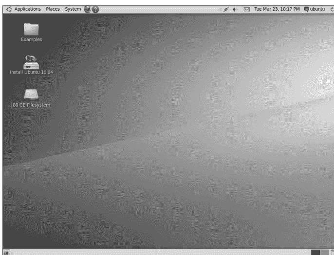

图 1-1:
Ubuntu 中整洁的 GNOME 桌面。

运行 Live CD 时，如果尚未操作系统，某些图标就不会出现。当系统安装后，桌面最初会显示你的电脑、主文件夹和删除文件的回收站的图标。（与其他发行版不同）Ubuntu 追求最少的桌面图标并保持整洁的外观。某些 Ubuntu 版本没有任何桌面图标。

### 桌面右键菜单

当你右键点击桌面空白区域时，GNOME 桌面会显示上下文菜单。该菜单提供以下选项：

- 创建新文件夹
- 创建命令的快捷方式（创建启动器）
- 创建新文档
- 清理桌面或对齐图标
- 配置桌面背景

图 1-2 显示了典型 GNOME 桌面中的桌面右键菜单。带有向右箭头的桌面菜单选项在鼠标悬停时会出现其他菜单。

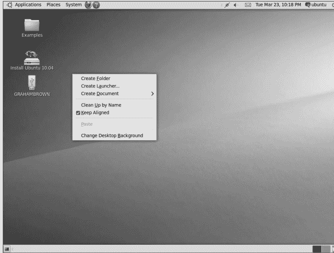

图 1-2:
GNOME 中的桌面菜单。

## 图标菜单

右键点击桌面上的任何图标都会显示一个菜单，如图 1-3 所示。无论你点击哪里，此菜单中的许多项目都是相同的，但右键点击特定图标（例如回收站）会产生不同的菜单。

- 打开文件夹
- 打开文件
- 重命名图标
- 将图标移动到回收站
- 查看属性

## 面板

GNOME 桌面有两个面板——顶部和底部栏。（KDE 桌面只有一个面板。）每个面板类似于 Windows 任务栏。顶部面板左侧有按钮（各种程序的快捷方式），右侧有时间显示。

## 顶部面板

顶部面板是横跨 GNOME 桌面顶部的长条。图 1-4 显示了面板的典型视图。

| 主菜单 | 系统菜单 | 帮助 | 网络 | 操作系统指示 |
|---|---|---|---|---|
| 应用程序 | 位置 | 系统 | | 3月23日 晚上10:19 |
| | | Firefox 浏览器 | 音量 | 日期 |

面板是图标的存放区域。某些图标在点击时会启动程序。某些图标显示状态（例如正在运行的程序）以及日期等信息。

### 主菜单按钮

顶部面板最左侧的图标是主菜单按钮。主菜单按钮就像 Microsoft Windows 中的开始按钮，是你找到所有应用程序的地方，并按子菜单分类。“主菜单”是一个通用术语；在 GNOME 中，该按钮通常标记为“应用程序”。

点击主菜单按钮调出一级菜单。然后将鼠标悬停在任何带有箭头的菜单项目上调出下一级菜单，此类推。你可以浏览菜单层级并在最终菜单中进行选择。图 1-5 显示了典型 GNOME 桌面中的主菜单层级。

我使用 `应用程序->Internet->Firefox 浏览器` 来指代图 1-5 中高亮的菜单序列。这种表示法将贯穿全书。

## 82 理解 GNOME 面板

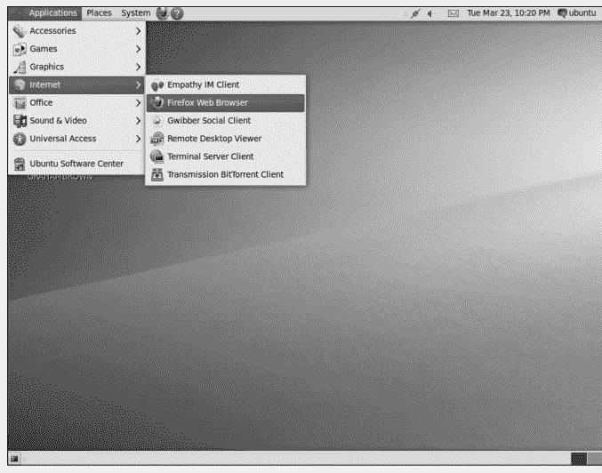

图 1-5：GNOME 桌面上的标准菜单层级结构。

在大多数桌面系统中，顶层主菜单包含以下类型的菜单类别：

- **辅助工具 (Accessories)**：许多实用程序，例如科学计算器、字符选择器、软磁盘格式化程序、字典以及 Palm Pro 或 Handspring 同步软件。
- **游戏 (Games)**：游戏菜单（非常多），例如纸牌（Solitaire）、麻将、扫雷游戏（Mines）和黑棋（Reversi）。
- **图形 (Graphics)**：如 GIMP（一个类似于 Adobe Photoshop 的程序）、数码相机接口、扫描器接口、屏幕截屏程序以及 Adobe Acrobat 查看器。
- **互联网 (Internet)**：互联网应用程序，如 Web 浏览器、电子邮件阅读器和即时通讯工具。
- **办公 (Office)**：办公应用程序，如 OpenOffice.org 办公套件，它包括 Writer 文字处理器、Calc 表格程序、Impress 幻灯片演示程序和 Draw 制图程序。
- **音频与视频 (Sound & Video)**：多媒体应用程序，如 CD 播放器、混音器、录音机和音量控制。

## 理解 GNOME 面板 83

主菜单通常还有一些常用任务的子菜单项，例如添加/删除应用程序。

在每个发行版中，主菜单的类别不同，但结构相似，因此你通常可以找到需要的内容。

### “位置”菜单按钮 (Places Menu)

GNOME 顶部面板从左侧数第二个菜单选项是“位置”菜单。在那里，你通常可以找到快捷访问你可能需要访问的所有位置，并访问网络、搜索文件以及执行其他常用功能。图 1-6 显示了示例。

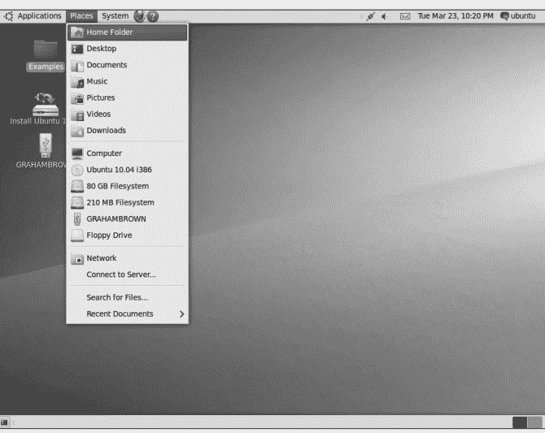

图 1-6：GNOME 的“位置”选项。

特别有用的是“搜索文件”（Search for Files）选项，它会显示如图 1-7 所示的对话框。你可以使用此选项根据几乎任何标准查找文件——创建日期、修改日期、名称、包含某些短语等。值得花时间尝试这个工具并熟练掌握它。

## 84 理解 GNOME 面板

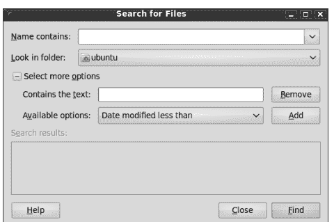

图 1-7：可以通过对话框更改默认搜索选项。

### “系统”菜单按钮 (System Menu)

GNOME 顶部面板从左侧数第三个菜单选项是“系统”菜单。这通常是你处理管理任务的地方。图 1-8 显示了该菜单的示例。

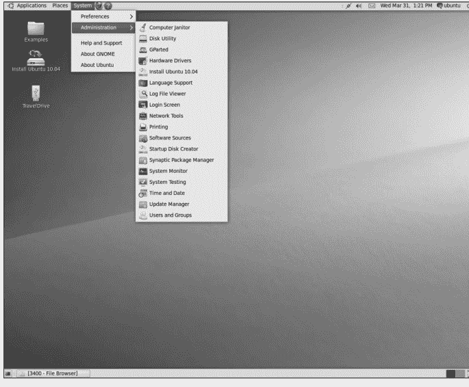

图 1-8：GNOME 中的标准系统菜单。

## 理解 GNOME 面板

“偏好”（Preferences）选项允许你执行此类任务，如选择默认打印机、配置笔记本电脑的电源管理以及调整声音设置。“管理”（Administration）选项允许你运行所需的管理实用程序以查看系统状态并进行更改（管理选项在第 V 章中有详细介绍）。

此菜单上的其他选项允许你获取有关发行版的信息，并访问帮助和支持。

### 顶部面板图标

除了顶部面板中的菜单选项外，还有许多图标（参考图 1-4）。你可以通过将光标悬停在图标上并阅读出现的弹出描述来识别这些图标。最常见的图标（按从左到右的出现顺序排序）：

- **Firefox 浏览器**：启动流行的浏览器并访问互联网。
- **Evolution 邮件**：启动 Evolution 电子邮件和日历软件。
- **帮助 (Help)**：在 GNOME 文档查看器中显示在线帮助。
- **网络 (Network)**：显示当前或无线连接的信息。
- **音量 (Volume)**：显示音量控制条，你可以通过拖动块来更改音量。
- **邮件 (E-mail)**：打开你偏好的电子邮件阅读器。
- **日期和时间 (Date and time)**：显示当前日期和时间；点击显示当前日期的日历。
- **聊天 (Talk)**：允许与同事进行即时通讯。
- **操作系统指示器 (OS indicator)**：表示你正在运行的操作系统。
- **注销 (Logout)**：切换用户、锁定桌面或关闭系统。

### 底部面板

除了顶部面板，GNOME 还包含一个底部面板。图 1-9 显示了该菜单的示例。这里显示的项目有：


| 活动窗口 | 工作空间切换器 |
| :--- | :--- |
| CD/DVD 刻录器 - 文件 ... | 鼠标偏好 |
| 扫雷游戏 | 垃圾桶 |
| 打开窗口 | |

- **显示桌面 (Show Desktop)**：隐藏（但不关闭）所有窗口并显示桌面。
- **打开窗口 (Open windows)**：显示所有当前打开的窗口。
- **活动窗口 (Active window)**：切换到另一个运行中的应用程序或窗口。
- **工作空间切换器 (Workspace Switcher)**：切换到另一个运行中的应用程序或窗口。
- **垃圾桶 (Trash can)**：切换到另一个运行中的应用程序或窗口。

## 第 2 章：桌面

### 桌面右键菜单

- Konsole (终端)
- 执行命令
- 添加小部件
- 添加面板
- 此活动
- 锁定小部件
- 锁定屏幕
- 桌面活动设置

### 图标右键菜单

- 在文件管理器中打开文件夹
- 使用选择的应用程序打开文件
- 剪切或复制
- 重命名图标
- 将图标移动到垃圾桶
- 查看该图标的属性

# 理解 KDE 面板

面板（Panel）是横跨桌面底部的长条。与 GNOME 不同，KDE 默认只有一个面板。图 2-4 显示了 KDE 面板的典型视图。

图 2-4：KDE 面板。

| 主菜单 | 活动窗口 | 网络连接 | 音量 | 时间 |
| --- | --- | --- | --- | --- |
| 桌面选择 | OKHAMMER - Dolphin | | | 12:00 |
| | | Klipper 剪贴板 | 面板工具箱 | |

面板是图标的存放处。点击某些图标会启动程序。某些图标则显示状态（例如，当前正在运行哪些程序）以及日期和时间等信息。

如果你将鼠标指针悬停在图标上方，会弹出一个帮助气泡并提供关于该图标的提示。

# 主菜单按钮

KDE 面板最左侧的图标是主菜单按钮。KDE 文将主菜单按钮称为应用程序启动器（Application Starter）。类似于 Microsoft Windows 中的“开始”菜单，主菜单是你通常找到所有应用程序的地方，这些程序被组织在子菜单中。主菜单按钮标记为 K，尽管该字母可以根据发行版进行更改。

点击主菜单查看一级菜单。然后将鼠标悬停在带有箭头的任何菜单项上弹出下一级菜单，依此类推。你可以浏览菜单层次结构并在最终菜单中进行选择。图 2-5 显示了典型 KDE 桌面中的菜单层次结构。

我使用“应用程序:Internet”来表示图 2-5 中高亮的菜单序列。这种表示法贯穿本书。

KDE 的最新版本使用 KickOff 应用程序启动器作为主菜单。KickOff 允许你比通过传统的菜单层次结构更快速地访问常用的应用程序。在许多桌面中，点击主按钮打开 KickOff 会显示以下顶级类别：

- *收藏夹*：快速访问常用的应用程序和文档。若要快速将文件添加到收藏夹，请右键点击该文件并选择“添加到收藏”。

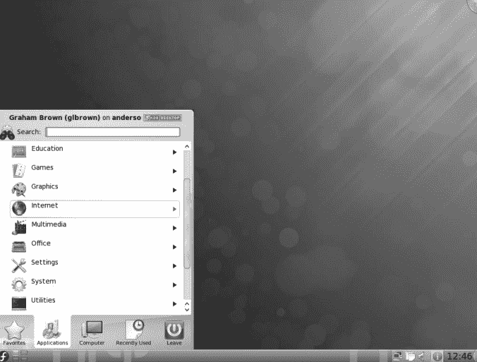

**图 2-5：KDE 菜单层次结构。**

- **应用程序**：安装在你的系统上的应用程序和工具。带有向右箭头的子类别，可打开更多选项。

在“应用程序”选项卡中，你将找到新的菜单子类别（取决于你使用的发行版，可能还会更多）：

- **管理**：访问管理系统所需的实用程序。

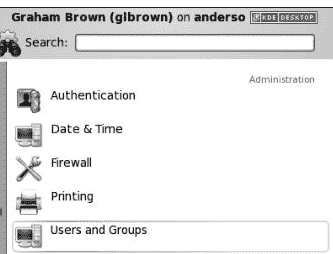

图 2-6：管理选项。

- **多媒体**：多媒体应用程序，如 CD 播放器、混音器、录音机和音量控制。
- **办公**：办公应用程序，如 OpenOffice.org Office 套件（包含 Writer 文字处理器、Calc 电子表格、Impress 演示程序和 Draw 绘程序）。
- **设置**：访问配置设置以及进行更改所需的实用程序。图 2-7 显示了设置菜单的示例。

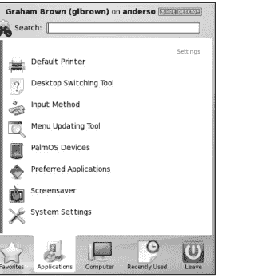

图 2-7：设置菜单选项。

系统：系统配置所需的实用程序。图 2-8 显示了系统菜单的示例。

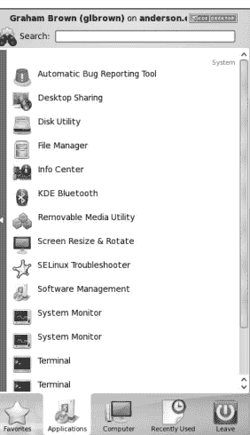

图 2-8：系统选项。

- **实用**：KDE 可利用的其他各种杂用工具，包括文本转语音工具、个人闹钟调度器和放大镜。

三个 KDE 菜单选项——管理、设置和系统将帮助你配置任何所需的内容。

在每个发行版中，主菜单和 KickOff 的类别不同，但菜单组织方式相同，因此你通常能够找到所需内容。

# 面板图标

除了主菜单按钮外，KDE 面板还有几个图标（如图 2-4 所示）。你可以通过将光悬停在图标上并阅读弹出的描述来识别任何图标。最常见的图标（按从左到右出现的顺序）如下：

- **桌面分页器**：在工作空间或“虚拟桌面”之间切换。
- **打开的窗口**：显示所有当前打开的窗口。
- **活动窗口**：切换到另一个运行中的应用程序或窗口。
- **网络连接**：显示当前有线或无线连接的信息。
- **Klipper 剪贴板**：配置和编辑剪贴板内容。
- **音量**：显示音量控制条，你可以通过拖动滑块更改音量。
- **通知和任务**：悬停鼠标查看当前任务的进度，例如文件传输或打印文档。
- **时间**：显示时间，点击可显示当前日期的日历。
- **面板工具箱**：调整面板的大小、位置和控件。

# 配置 KDE 底部面板


尽管 KDE 功能强大，它也具有极高的灵活性。如果你右键点击桌面上的某处，图 2-9 显示的菜单允许你添加或删除项目。

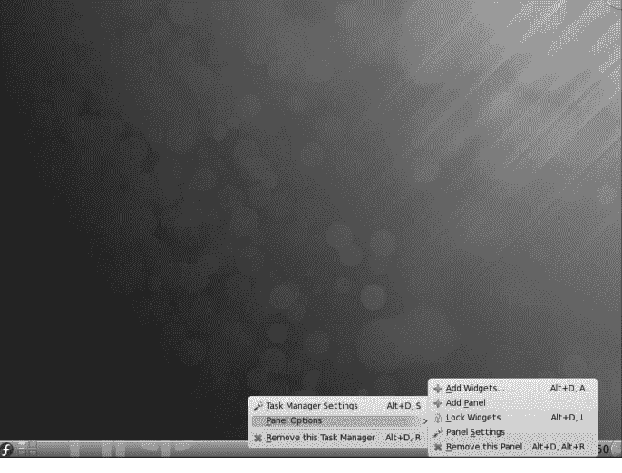

图 2-9：你拥有灵活性。

最强大的菜单选项是“设置”。在这里，你可以设置桌面位置、更改窗口显示在面板之前还是之后，以及其他等。（等等，我已经说过了）。

取决于你使用的发行版，你可能还想使用 SAX2 或 YAST（在 openSUSE 中）等程序进行配置。

## 100 使用 bash Shell

要从 GNOME 或 KDE 桌面进入第一个虚拟控制台，请按下 Ctrl+Alt+F1。按下 Ctrl+Alt+F2 进入第二个虚拟控制台，依此类推。这些虚拟控制台中的每一个都是文本界面，你可以在其中登录并运行 Linux 命令来执行各种任务。完成后，输入 `exit` 退出。


你可以使用最多六个虚拟控制台。在大多数发行版中，第七个用于 GUI 桌面。要返回 GUI 桌面，请按下 Ctrl+Alt+F7。

## 使用 bash Shell

如果你用过 MS-DOS，那么你可能对 COMMAND.COM 非常熟悉，它是 DOS 命令解释器。该程序会显示臭名昭彰的 C:\提示符。在 Windows 中，如果你打开命令窗口，就可以看到它。（要在 Microsoft Windows 中打开命令窗口，请选择“开始>运行”，在文本框中输入 `command` 并点击“确定”。）

Linux 自带有一个与 DOS 中的 COMMAND.COM 类似的命令解释器，但它的功能强大得多。Linux 命令解释器被称为 shell（外壳）。

许多 Linux 发行版的默认 shell 是 bash。当你打开终端窗口或登录到文本控制台时，bash shell 会提示你输入命令。当你使用 bash 时，shell 会执行你的命令。


就像 Linux 有多个 GUI（GNOME 或 KDE）一样，除了 bash 之外，你还有其他 shell 选择。例如，有些人更喜欢 C shell。你可以使用 `csh` 命令轻松更改你的默认 shell。

除了标准的 Linux 命令外，bash 还可以执行任何计算机程序。因此你可以在 shell 提示符处输入应用程序的名称（名称通常比你在 GNOME 或 KDE 菜单中看到的更晦涩），shell 就会启动该应用程序。

## 理解 shell 命令语法

由于 shell 会解释你输入的内容，因此了解 shell 如何处理你输入的文本是非常重要的。所有的 shell 命令都具有以下通用格式。（某些命令没有选项。）

```


`command [option1] [option2] ... [optionN]`

发布此类命令通常被称为命令行（command line）。在命令行上，你输入一个命令，后面跟着零个或多个选项（或参数）。这些选项字符串——命令行选项（或命令行参数）会修改命令的运行方式，以便使其执行特定的任务。

`shell` 使用空格或制表符（`tab`）来区分命令和选项。这意味着你必须使用空格或制表符将命令与选项、选项与选项之间隔开。

如果一个选项包含空格，你需要将该选项放在双引号内。例如，为了在密码文件中搜索我的名字，我输入以下 `grep` 命令（`grep` 用于在文件中搜索文本）：

```
grep "Emmett Daney" /etc/passwd
```

当 `grep` 打印出带有我名字的行时，它看起来像这样：

```
eduleny:x:100:100:Emmett Daney:home/eduleny:/bin/bash
```

如果你用用户名创建一个用户账户，那么以用户名作为参数的 `grep` 命令将在 `/etc/passwd` 文件中查找该用户名。

在 `grep` 命令的输出中，你可以看到最后一个冒号（`:`）之后的 shell 路径（`/bin/bash`）。因为 `bash` 是一个可执行文件，所以它位于 `/bin` 目录中；你提供了它的完整路径。

命令选项的数量及其格式取决于具体的命令。通常，这些选项类似于 `-X`，其中 `X` 是单个字符。例如，你可以在 `ls` 命令时使用 `-l` 选项，它可以列出目录内容并提供额外的详细信息。以下是在用户主目录下输入 `ls -l` 得到的结果：

```
total 0

drwx-xr-x 2 eduleny users 48 2010-09-08 21:11 bin

drwx------ 2 eduleny users 320 2010-09-08 21:16 Desktop

drwx------ 2 eduleny users 80 2010-09-08 21:11 Documents

drwxr-xr-x 2 eduleny users 80 2010-09-08 21:11 public_html

drwxr-xr-x 2 eduleny users 464 2010-09-17 18:21 dumps
```

如果一个命令太长无法放在单行内，你可以使用反斜杠 `\` 然后按回车键。接着在下一行继续输入命令。例如，输入以下命令（每行后按回车键）：

```
cat \
/etc/passwd
```

`cat` 命令显示 `/etc/passwd` 文件的内容。


## bash Shell 使用 101

你可以通过分号 (`;`) 在单行上组合多个命令。例如：

```
ls ; pwd
```

这将列出目录内容并显示当前目录。你还可以通过竖线 (`|`) 将一个命令的输出管道到另一个命令的输入。例如：

```
ls | grep txt
```

此命令列出目录内容并过滤包含 "txt" 的行。管道 (`|`) 像水管一样连接两个程序。

## 控制命令输入输出

大多数 Linux 命令总是从标准输入（通常是键盘）读取并写入标准输出（通常是屏幕）。错误消息发送到标准错误（通常也是屏幕）。这两个设备通常被称为 `stdin` 和 `stderr`。

你可以让命令从文件获取输入并将输出发送到文件。为了让你了解，这种特性称为输入输出重定向（I/O redirection）。表 3-1 显示了重定向命令的语法，接下来的章节将介绍如何使用其中。

### 表 3-1 常用重定向

| 任务 | 命令语法 |
|---|---|
| 将 stdout 发送到文件 | command > file |
| 将 stderr 发送到文件 | command 2> file |
| 将 stdout 和 stderr 发送到文件 | command 2>&1 |
| 从文件读取 stdin | command < file |
| 从 file.in 读取 stdin 并输出到 file.out | command < file.in > file.out |
| 将 stdout 追加到文件尾 | command >> file |
| 将 stderr 追加到文件尾 | command >> 2>&1 |
| 从键盘读取 stdin 直到字符 c | command <<c |
| 将 stdout 管道到 command2 | command \| command2 |
| 将 stdout 和 stderr 管道到 command2 | command 2>&1 \| command2 |

### 从文件获取命令输入

如果你想让命令从文件读取，可以重定向标准输入使其来自文件而非键盘。例如，输入以下命令：

```
sort /etc/passwd
```

此命令显示 `/etc/passwd` 文件的排序列表。在这种情况下，小于号 (`<`) 重定向了 `stdin`，使 `sort` 命令从 `/etc/passwd` 文件读取输入。

### 将命令输出保存到文件

要将命令的输出保存到文件中，请重定向标准输出到文件。例如，输入 `cd` 进入你的主目录，然后输入以下命令：

```
grep typedef /usr/include/ > typedef.out
```

此命令在 `/usr/include` 目录下搜索文本 `typedef` ——并将输出保存在名为 `typedef.out` 的文件中。大于号 (`>`) 将 `stdout` 重定向到文件。

## 104 使用 bash Shell壳

`file`。此命令还展示了 `bash` 的另一个特性：当你使用星号 (`*`) 时，`bash` 会将星号替换为指定目录中所有文件名的列表。因此，`/usr/include/` 意味着 `/usr/include` 目录下的所有文件。


如果你想将命令的输出追加到现有文件的末尾，而不是将其保存到新文件中，请使用两个大于符号（`>>`），如下：

```bash
command >> filename
```


将标准输出（`stdout`）发送到文件的另一个用途是使用 `cat` 命令快速准备小文件。例如，假设你想创建一个新的文本文件来存储你输入的文本行，直到你按下回车键为止。以下是完成此任务的方法：

```bash
cat <<ZZ input.txt
```

输入此命令后，你可以继续输入若干行，并在完成后在一行输入 `ZZ`。你输入的所有内容都会保存在 `input.txt` 文件中。

### 将错误消息保存到文件中

有时你输入一个命令，它会产生大量的错误消息，其滚动速度快到你无法看出发生了什么。查看所有错误消息的一种方法是将它们保存到文件中，这样你就能看到发生了什么。你可以通过将标准错误（`stderr`）重定向到文件来实现。

例如，使用以下命令：

```bash
find -name COPYING -print 2> finderr
```

此命令在文件系统中查找名为 `COPYING` 的文件，并将所有错误消息（如果有的话）保存到 `finderr` 文件中。数字 `2` 后跟着大于符号（`>>`）将 `stderr` 重定向到文件。


如果你想丢弃错误消息而不是将其保存到文件中，请使用 `/dev/null` 作为文件名：

```bash
find -name COPYING -print 2> /dev/null
```


`/dev/null` 是一个特殊文件——通常被称为“比特桶”（bit bucket），有时被誉为“天上的大桶”——它只是丢弃接收到的任何内容。所以现在当你听到诸短短语，例如“你的邮件可能进了比特桶”，你就知道它们是什么意思了。

## 使用 bash Shell 105

### 通过自动命令补全减少输入

许多命令以文件名作为参数。例如，要查看 `/etc/modprobe.conf` 文件的文本内容，输入以下命令：

```bash
cat /etc/modprobe.conf
```


该命令显示 `/etc/modprobe.conf` 文件。对于任何以文件名作为参数的命令，你都可以使用 bash 特性来避免输入整个文件名。只要你有足够的字符来在目录中唯一标识该文件即可。

要查看示例，输入 `cat /etc/modprobe` 但不要按回车：而是按 Tab 键。bash 会自动补全文件名，因此命令变成了 `/etc/modprobe.conf`。现在按回车运行命令。


每当你输入文件名时，在文件名的几个字符后按 Tab 键。bash 可能可以补全文件名，这样你就不需要输入整个名称。如果你没有输入能够唯一标识文件的字符，bash 会发出哔声。只需多输入几个字符并再次按 Tab 键。

### 灵活使用星号和问号

你可以通过另一种方式避免输入文件名。（毕竟，为用户减少工作正是我们使用计算机的原因，不是吗？）

这个特殊技巧涉及使用星号 (`*`) 和问号 (`?`)。特殊字符是通配符，因为它们可以匹配文本行中的零个或多个字符。

如果你熟悉 MS-DOS，你可能用过类似 `COPY *. A:` 的命令将当前目录下的所有文件复制到 A 盘。bash 接受文件名中的许多通配符。正如你所预期的，bash 提供的选项比 MS-DOS 解释器多得多。较新的电脑（特别是笔记本电脑，尤其是笔记本）已经没有 A 和 B 盘了。这剥夺了一整代人尝试将大文件复制到软磁盘的乐趣！

你可以在 bash 中使用三种类型的通配符：

- `*` 星号 (`*`)：匹配文件名中的零个或多个字符。表示目录中的所有文件。
- 括号中的字符集：匹配该集合中的任何单个字符。例如，字符串 `[aB]` 仅匹配名为 a 或 B 的文件。然而，字符串 `[aB]*` 匹配任何以 a 或 B 开头的文件名。

当你想要对许多文件进行操作时，通配符非常有用。例如，要将 `/media/cdrom` 目录下的所有文件复制到当前目录，使用以下命令：

```bash
cp /media/cdrom/*
```

bash 将通配符字符 `*` 替换为 `/media/cdrom` 目录中所有文件的名称。

如果你想丢弃错误消息而不是将其保存到文件中，使用 `/dev/null` 作为文件名：

```bash
find -name COPYING -print 2> /dev/null
```

`/dev/null` 是一个特殊文件——通常被称为“比特桶”，有时被誉为“天上的大桶”——它只是丢弃接收到的任何内容。所以现在当你听到诸短语，例如“你的邮件可能进了比特桶”，你就知道它们是什么意思了。

## 106 使用 bash Shell

## 使用 Shell 107

### 重复输入的命令

为了方便你重复命令，bash 会存储 500 条旧命令作为命令历史（基本上就是旧命令列表）。要查看命令历史，输入 `bash` 显示旧命令编号列表，包括你以前登录期间输入的命令。

如果命令太长，你可以限制想要查看的命令数量。例如，查看最近的 10 条命令，输入此命令：

```bash
history 10
```

要重复列表中的命令，只需输入感叹号 (`!`)，然后加上命令编号。要重复命令 3，输入 `!3`。

你可以在不知道命令编号的情况下重复命令。假设你几分钟前输入了 `/usr/lib/X11/xdm/xdm-config`，现在你想再次查看该文件。要重复上一条命令，输入：

```bash
!
```

通常你可能想重复刚刚输入的命令，但稍有不同。例如，你可能使用 `ls -1` 命令显示了目录内容。要重复该命令，输入感叹号：

```bash
!!
```

有时，你可能想重复上一条命令，但为其添加额外的参数。假设 `ls -1` 显示的文件太多。只需通过将输出传递给 `more` 命令来重复该命令：

```bash
!! more
```


bash 将两个感叹号替换为上一条命令，并在该命令后添加 `more`。

# 发现与使用 Linux 命令

你在 shell 提示符处输入 Linux 命令。我所指的 Linux 命令是指 bash shell 能够理解的一些命令，以及与 Linux 自带的命令行实用。在本节中，我将向你介绍几类 Linux 命令。

我无法在本章节中涵盖每一个 Linux 命令，但我想通过展示常用的 Linux 命令让你对这些命令的广泛性有个直观感受。表 3-2 列出了按分类的常用 Linux 命令。在开始记忆任何 Linux 命令之前，请先浏览此表。

| 命令名称 | 作用 |
|---|---|
| `apropos` | 为指定的关键字查找在线手册页 |
| `info` | 显示关于指定命令的在线帮助信息 |
| `man` | 显示在线帮助信息 |
| `whatis` | 仅搜索完整单词并查找在线手册页 |
| `alias` | 为长命令定义别名 |
| `type` | 显示命令的类型和位置 |
| `unalias` | 删除使用 alias 定义的别名 |
| **管理文件和目录** | |
| `cd` | 切换目录 |
| `chmod` | 更改文件权限 |
| `chown` | 更改文件所有者和组 |
| `cp` | 复制文件 |
| `ln` | 创建文件和目录的符号链接 |
| `ls` | 显示目录内容 |
| `mkdir` | 创建目录 |
| `mv` | 重命名文件并将文件从一个目录移动到另一个目录 |
| `rm` | 删除文件 |
| `rmdir` | 删除目录 |
| `pwd` | 显示当前目录 |
| `touch` | 更新文件的时间戳 |

| 命令名称 | 作用 |
| --- | --- |
| 查找文件 | |
| `find` | 根据指定标准（如名称和大小）查找文件 |
| `locate` | 使用定期更新的文件数据库查找文件（该数据库由 updatedb 程序创建） |
| `whereis` | 在位于可执行文件（也称为二进制文件）的典型目录下查找文件 |
| `which` | 在 PATH 环境变量列出的目录中查找文件 |
| 处理文件 | |
| `cat` | 在标准输出上显示文件（可将多个文件合并成一个大文件） |
| `cut` | 从文件的每行文本中提取指定的部分 |
| `dd` | 从一个文件复制数据块到另一个文件（用于从设备复制数据） |
| `diff` | 比较两个文本文件并找到任何差异 |
| `expand` | 将所有制表符转换为空格 |
| `file` | 显示文件中的数据类型 |
| `fold` | 将每行文本折叠以适应指定的宽度 |
| `grep` | 在文本文件中搜索正则表达式 |
| `less` | 一页一页显示文件（按 b键向后移动） |
| `lpr` | 打印文件 |
| `more` | 一页一页显示文件（仅向前移动） |
| `nl` | 为文本文件中所有非空行编号，并将行打印到标准输出 |
| `paste` | 合并多个文件的对应行 |
| `patch` | 使用原始文件和修订版文件之间的差异更新文本文件 |
| `sed` | 在应用指定编辑命令的同时将文件复制到标准输出 |
| `sort` | 对文本文件中的行进行排序 |
| `split` | 按指定大小将文件分成若干个较小文件 |
| `tac` | 反转文件（最后一行在前，依此类推） |
| `tail` | 显示文件的最后几行 |
| `tr` | 用一组字符替换文件中的另一组 |


| 表 3-2（续） |
| 命令名称 | 作用 |
| --- | --- |
| 处理文件 | |
| `uniq` | 消除文本中的重复行 |
| `wc` | 统计文本文件的行数、单词和字符数 |
| `zcat` | 显示压缩文件（解压后） |
| `zless` | 一页一页显示压缩文件（按 b键向后移动） |
| `zmore` | 一页一页显示压缩文件 |
| 归档与压缩文件 | |
| `compress` | 压缩文件 |
| `cpio` | 在归档文件之间复制文件 |
| `gunzip` | 解压用 GNU Zip `gzip` 压缩的文件 |
| `gzip` | 使用 GNU Zip 压缩文件 |
| `tar` | 创建一个或多个目录的文件的归档（最初用于磁带归档） |
| `uncompress` | 解压用 `compress` 压缩的文件 |
| 管理文件 | |
| `bg` | 在后台运行被中断的进程 |
| `fg` | 在前台运行进程 |
| `free` | 显示系统中空闲和已使用的内存量 |
| `halt` | 关闭 Linux 和计算机 |
| `kill` | 向进程发送信号（通常用于终止进程） |
| `ldd` | 显示运行程序所需的共享库 |
| `nice` | 以较低优先级运行进程（称为 nice 模式） |
| `ps` | 显示当前运行的进程列表 |
| `printenv` | 显示当前的环境变量 |
| `pstree` | 显示父子进程树 |
| `reboot` | 停止 Linux 并重启计算机 |
| `shutdown` | 关闭 Linux |
| `top` | 显示最耗费 CPU 和内存的进程列表 |
| `uname` | 显示系统和 Linux 内核的相关信息 |

| 命令名称 | 作用 |
|---|---|
| 管理用户 | |
| `chsh` | 更改 shell |
| `groups` | 打印组列表 |
| `id` | 显示用户和组 |
| `passwd` | 修改密码 |
| `su` | 切换用户 |
| 管理文件 | |
| `df` | 显示空闲空间 |
| `du` | 显示磁盘占用 |
| `fdisk` | 分区磁盘 |
| `fsck` | 检查并修复文件系统 |
| `mkfs` | 创建文件系统 |
| `mkswap` | 创建交换分区 |
| `mount` | 挂载设备 |
| `swapoff` | 取消交换分区 |
| `swapon` | 激活交换分区 |
| `sync` | 将缓冲数据写入磁盘 |
| 日期与时间 | |
| `cal` | 显示日历 |
| `date` | 显示当前日期时间 |
| `tty` | 显示终端名称 |


# 变为超级用户

当你需要执行高权限操作时（例如管理系统），你必须变为 root。通常使用 `su` 后跟一个减号。它会提示你输入 root 密码。完成所需的 root 操作后，输入 `exit` 返回你的用户名。

除了使用 `su -` 命令变为 root，你也可以使用 `sudo`。如果你是 `/etc/sudoers` 中的授权用户，`sudo` 将以 root 用户身份执行命令。输入 `man sudoers` 读取更多。

# 管理进程

每当 shell 执行你输入的命令时，都会启动一个进程。shell 本身以及 shell 运行的脚本或程序都是进程。

使用 `ps ax` 查看进程列表。当你输入 `ps ax` 时，bash 会显示当前的进程集。以下是我输入 `ps ax -cols 132` 的一些输出（我包含了 `-cols 132` 选项以确保可以看到完整的命令）。

```
PID STAT TIME COMMAND

1 S 0:01 init [5]

2 ? SN 0:00 ksoftirqd/

4 S 0:00 dbus

9 S 0:00 kthread

19 ? S 0:00 kapgid

75 S 0:00 kworker

115 ? S 0:00 pdflush

118 S 0:00 pdflush

117 ? S 0:00 uwsgi

711 ? S 0:00 kworkerid

1075 S 0:00 reiserfs2

2086 ? S 0:00 journald

2239 ? S<s 0s sbin/udev-d

..- lines deleted

6374 S 1:31 /usr/lib/bin/X :0 -audit -out /var/lib/gdm/:0.Xauth

-nolisten tcp vt

6460 S 0:02 /opt/gnome/bin/gmdreeper

6671 ? S 0:00 edulaney/priv

6675 ? S 0:00 edulaney/pts/0

6676 pts/0 S 0:00 -bash
```

# 发现和使用 Linux 命令

```
6712 pts/s 0 00 vsftpd

14702 ? S 0:00 pickup -l -t fifo -u

14752 pts/s R+ 0:00 ps ax --cols 132
```


在此列表中，第一列的标题是 `PID`，显示每个进程的数字。`PID` 代表进程 ID（标识符），它是由 Linux 内核分配的顺序数字。如果你查看 `ps ax` 命令的输出，你会发现 `init` 命令是第一个进程，其 `PID` 为 1。这就是为什么它被称为“所有进程之父”。

`COMMAND` 列显示创建每个进程的命令，`TIME` 列显示进程占用的累计 CPU 时间。`STAT` 列显示进程的状态——`S` 表示进程处于睡眠状态，`R` 表示它正在运行。显示状态字母的符号还有具有进一步的含义；例如，`<` 表示高优先级进程，而 `+` 表示该进程正在前台运行。`TTY` 列显示与进程关联的终端。

进程 ID（或进程号）在你必须强制停止一个错误进程时非常有用。查看 `ps ax` 命令的输出，并记录违规进程的 `PID`。然后使用该进程号配合 `kill` 命令来停止进程。例如，要停止进程号 8550，请开始输入以下命令：

```
kill 8550
```

如果进程在五秒后没有停止，请重复该命令。关闭顽固进程的下一步是尝试 `kill -INT pid`，其中 `pid` 是进程号。如果无效，请尝试使用 `kill` 命令作为最后手段：

```
kill -9 8550
```

`-9` 选项意味着向进程发送信号 9。信号 9 是 `KILL` 信号，它应该导致进程退出。你可以输入此命令 `kill -KILL pid`，其中 `pid` 是进程 ID。

# 处理日期和时间

你可以使用 `date` 命令显示当前日期和时间，或设置新的日期时间。在 shell 提示符输入 `date`，你将得到如下结果：

```
Fri Mar 14 15:10:07 EST 2010
```

如你所见，`date` 命令本身会显示当前的日期和时间。

设置日期，以 root 身份登录并输入 `date` 后跟接 `MMDDHmmYYYY` 格式的日期和时间，其中每个字符都是数字。例如，要将日期时间设置为 2010 年 12 月 31 日晚上 9:30，你输入：

```
123121302010
```

`MMDDmmYYYY` 日期时间格式与 24 小时军钟相似，具有以下含义：

- `MM` 是月份的两位数字（01 到 12）。
- `DD` 是每月几日的两位数字（01 到 31）。
- `hh` 是 24 小时制的两位小时（00 是午夜，23 是晚上 11 点）。
- `mm` 是分钟的两位数字（00 到 59）。
- `YYYY` 是四位年份（例如 2010）。

另一个有趣的命令是 `cal`。如果你不带任何选项直接输入 `cal`，它会打印当前月的日历。如果你输入 `cal` 后跟跟一个数字，`cal` 将该数字视为年份并打印该年的日历。要查看特定年份特定月份的日历，请提供月份数字（1 = 一月，2 = 二月，以此此类推）后跟年份。因此，输入 `cal 8 2010`，你就得到了 2010 年 8 月的日历：

```
August 2010

Su Mo We Th Fr Sa

1 2 3 4 5 6 7

8 9 10 11 12 13 14

15 16 17 18 19 20 21

22 23 24 25 26 27 28

29 30 31
```

# 处理文件

你可以使用 `grep` 搜索文件，并使用 `more` 一次屏幕地查看文本文件。例如，要在 `/etc/passwd` 文件中搜索我的用户名，我使用：

```
grep edulaney /etc/passwd
```

要一次屏幕地查看 `/etc/initabb` 文件，我输入：

```
more /etc/initabb
```

当每个屏幕暂停时，我按下空格键跳到下一页。

许多 Linux 命令都处理文件——大部分是文本文件，但某些命令也可以处理任何文件。接下来的章节描述了几个文件处理工具。

# 统计文本文件的单词数和行数

我一直对文件的大小好奇。对于文本文件，字符数基本上就是文件的字节大小（因为每个字符占用一个字节的存储空间）。但单词数和行数呢？

Linux 的 `wc` 命令来救场。`wc` 命令显示文件中总行数、单词数和字符数。例如，`wc /etc/passwd` 显示如下：

```
235 712 14702 /etc/passwd
```

输出显示了文件的行数、单词数和字符数。你可以使用选项仅显示其中一个值。例如，`wc -l /etc/passwd` 只显示行数，`wc -w /etc/passwd` 只显示单词数，而 `wc -c /etc/passwd` 只显示字符数。

# 文本文件

你可以使用 `sort` 命令对文件进行排序。默认情况下，`sort` 按字母顺序对行进行排序。要逆序排序，请使用 `-r` 选项：

```
sort -r /etc/passwd > sorted.txt
```

此命令对 `/etc/passwd` 中的行进行排序并将输出保存到名为 `sorted.txt` 的文件中。如果你想按特定列排序，请使用 `-k` 选项。例如，按第二列排序，使用：

```
sort -k 2 /etc/passwd > sorted.txt
```

# 从文件中替换或删除字符

另一个有趣的是 `tr`，它可以在整个文件中将一组字符替换为另一组（或删除选定的字符）。假设你必须在系统上使用 MS-DOS 文件。虽然你可能认为可以在任何系统中无问题使用文件，但你会发现 DOS 使用回车（carriage return）加换行符（line feed），而 Linux 只使用换行符。

在你的 Linux 系统上，可以使用带有 `-d` 选项的 `tr` 命令删除 DOS 文件中额外的回车符。基本上，要将 DOS 文件 `filename.dos` 转换为名为 `filename.linux` 的 Linux 文件，输入：

```
tr -d '\015' < filename.dos > filename.linux
```

在此命令中，`'\015'` 表示八进制表示法的回车字符代码。

# 将文件拆分为多个文件

`split` 命令对于那些你想复制文件但文件太大无法放入单个软盘或作为单个邮件附件发送的情况非常有用。你可以使用 `split` 命令将文件拆分为较小文件。默认情况下，`split` 将每 1000 行放入每个文件。新的拆分文件按字母组命名，如 `aa`, `ab`, `ac` 等。你可以为文件名指定前缀。例如，要将名为 `hugefile.tar` 的大文件拆分为较小文件，可以使用如下 `split`：

```
split -b 1440k hugefile.tar part.
```

此命令将 `hugefile.tar` 拆分为 1440K 块。该命令创建了名为 `part.aa`、`part.ab`、`part.ac` 等的文件。

要将拆分的文件合并回单个文件，请如下使用 `cat` 命令：

```
cat part.?? > hugefile.tar
```

# 编写 Shell 脚本

在这种情况下，两个问号（`??`）匹配文件名中任意两个字符的扩展名。换句话说，文件名部分 `.??` 匹配所有文件名 `part.12`、`part.aa`、`part.ab` 和 `part.2b`。

## 编写 Shell 脚本

如果你曾经用过 MS-DOS，你可能记得 MS-DOS 批处理文件，它们是包含 MS-DOS 命令的文本文件。同样，shell 脚本也是包含一堆 shell 命令的文本文件。

如果你不是程序员，你可能会对编程感到畏惧，但 shell 编程可以像在文件中存储几个命令一样简单。现在，你可能还没有准备好编写复杂的脚本，但你完全可以尝试编写一个简单的脚本。

尝试一下一点 shell 编程，在 shell 提示符处输入如下所示的文本，完成后完成后按 Ctrl-D：

```
cd

cat > simple

#!/bin/sh

echo "This script's name is: $0"

echo Argument 1: $1

echo Argument 2: $2
```

按下 Ctrl-D。`cd` 将当前目录更改到你的主目录。然后 `cat` 命令显示下一行以及你在按下 Ctrl-D 之前输入的任何其他行。在这种情况下，我使用 `> simple` 将输出发送到名为 `simple` 的文件中。当你按下 Ctrl-D 后，`cat` 命令结束，你看到了 shell 提示符。你创建了一个名为 `simple` 的文件，其中包含以下 shell 脚本：

```bash
#!/bin/sh

echo "This script's name is: $0"

echo Argument 1: $1

echo Argument 2: $2
```

第一行调用 Linux 来运行 bash 程序（名称为 `/bin/bash`）。shell 读取脚本中的其余所有行。

就像大多数 Linux 命令接受行选项一样，bash 脚本也接受命令行选项。在脚本内部，你可以通过通过 `$1`、`$2` 等引用这些选项。特殊名称 `$0` 指向脚本本身的名字。

要运行这个 shell 脚本，首先必须使用以下命令将文件设为可执行文件（即将其转换为程序）：


`chmod +x simple`

现在输入 `./simple one two` 来运行脚本，它会显示如下输出：

This script's name is: `./simple`
Argument 1: `one`
Argument 2: `two`

脚本名称前的 `./` 前缀表示 `simple` 文件位于当前目录。

此脚本简单地打印脚本名称以及用户在脚本名称后输入的前两个命令行选项。

接下来，尝试带几个参数运行脚本，如下：

```
./simple "This is one argument" second-argument third
```

This script's name is: `./simple`

Argument 1: `This is one argument`

Argument 2: `second-argument`


shell 将双引号内的整个字符串视为单个参数。否则，shell 使用空格作为命令行上参数之间的分隔符。

大多数有用的 shell 脚本都比这个简单的脚本复杂得多，这个简单的练习让你对如何编写 shell 脚本有一个大致的了解。

将 Linux 命令放置在文件中，并使用 `chmod` 命令使文件设为可执行。搞定！你创建了一个 shell 脚本！


# 第 4 章：导航 Linux 文件系统

**本章内容**

- 了解 Linux 文件系统
- 使用 Linux 命令在系统中导航
- 理解文件权限
- 使用 Linux 命令操作文件和目录

## 要良好使用文件和目录，你需要理解分级文件系统的概念。即使你使用 GUI 管理器访问文件和文件夹（文件夹也是目录），你也可以从了解文件系统的布局中获益。

本章介绍了 Linux 文件系统，并展示了如何使用几个 Linux 命令来处理文件和目录。

## 理解 Linux 文件系统

与任何其他操作系统一样，Linux 通过文件和目录来组织信息。`目录`是一个特殊文件，可以包含其他文件和目录。因为目录可以包含其他目录，这种组织文件的方法产生了分级结构。这种文件的分级组织就是`文件系统`。

Linux 文件系统为你提供了 PC 上所有存储内容的统一视图。文件系统有一个`根`目录，用正斜杠（`/`）表示。在`根`目录下是文件和目录的层级结构。文件系统的部分可以位于不同的介质，例如硬盘、软磁盘和 CD-ROM。图 4-1 释了 Linux 文件系统的概念（在任何 Linux 系统中都是相同的），它跨越了多个物理设备。

如果你熟悉 MS-DOS 或 Windows，你可能会发现 Linux 文件系统中缺少了某些东西：在 Linux 中找不到驱动器号。所有磁盘驱动器和 CD-ROM 驱动器都是单个文件系统的一部分。

# 120 理解 Linux 文件系统

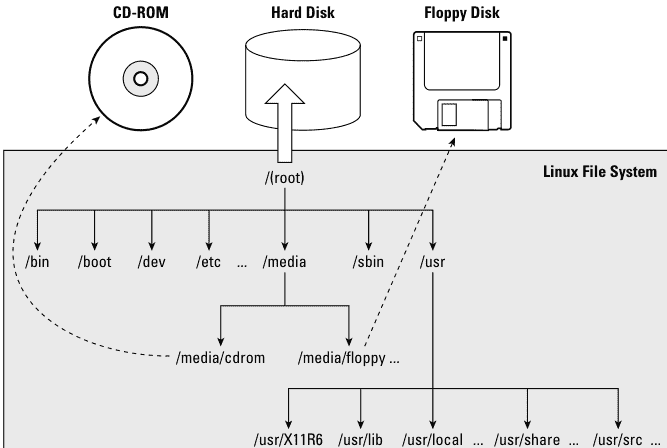

**图 4-1：** Linux 文件系统提供了跨越多个存储设备的统一存储视图。

在 Linux 中，你可以拥有长文件名（最多 256 个字符），并且文件名区分大小写。通常这些文件名带有扩展名，例如 `.txt`、`.html`、`.gz`。

要定位文件，你不仅需要文件名。图 4-2 显示了层级结构。

## 理解 Linux 文件系统

## 表 4-2:重要的 /usr 子目录

| 子目录 | 说明 |
| :--- | :--- |
| `/usr/bin` | 包含许多 Linux 命令的可执行文件，包括 Linux 中常用的、但不是 Linux 核心操作系统的实用程序。 |
| `/usr/games` | 一些旧的 Linux 游戏。 |
| `/usr/include` | 用于 C 和 C++ 编程语言的头文件（以 `.h` 结尾的文件），以及 `/usr/include/X11` 目录下的 X11 头文件和 `/usr/include/linux` 目录下的 Linux 内核头文件。 |
| `/usr/lib` | C 和 C++ 编程语言的库以及许多其他库，例如数据库库和图形工具包。 |
| `/usr/local` | 本地文件。例如，`/usr/local/bin` 目录应该是在你系统上开发的任何可执行程序的存放位置。 |
| `/usr/sbin` | 许多管理命令，例如电子邮件和网络相关的命令。 |
| `/usr/share` | 共享数据，例如许多应用程序的默认配置文件和图像。例如，`/usr/share/gnome` 包含 GNOME 桌面的各种共享文件，而 `/usr/doc` 包含许多 Linux 应用程序的文档（如 bash shell、Sawfish 窗口管理器和 GIMP 图像处理程序）。 |
| `/usr/share/` | 在线手册（可以使用 `man` 命令读取）。 |
| `/usr/src` | Linux 内核（核心操作系统）的源代码。 |

## 表 4-3: 重要的 /var 子目录

| 子目录 | 包含 |
| :--- | :--- |
| `/var/cache` | 缓存数据的存储区域。 |
| `/var/lib` | 与应用程序当前状态的信息。 |
| `/var/lock` | 锁文件，确保资源只被一个应用程序使用。 |

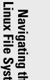

# 使用 Linux 命令导航文件系统

| 表 4-3（续） | 包含 |
| :--- | :--- |
| `/var/log` | 分类在子目录中的日志文件。`syslogd` 服务器将其日志文件存储在 `/var/log` 中，具体内容取决于 `syslogd` 配置文件 `/etc/syslog.conf`。例如，`/var/log/messages` 是主系统日志文件；`/var/secure` 包含来自安全服务（如 `ssh` 和 `xinetd`）的日志消息；`/var/log/mailog` 包含邮件消息日志。 |
| `/var/mail` | 用户邮箱文件。 |
| `/var/opt` | 存储在 `/opt` 目录中的软件包的可变数据。 |
| `/var/run` | 描述自启动以来的数据。 |
| `/var/tmp` | 在系统重启之间保留的临时文件。 |
| `/var/yp` | 网络信息服务（NIS）数据库文件。 |

虽然像 Nautilus (GNOME) 或 Konqueror (KDE) 这样的 GUI 文件管理器很容易使用，但只有在你拥有可以工作的 GUI 桌面时才能使用它们。你可能没有运行图形化文件管理器的图形环境。例如，你可能通过终端登录，或者 X 在你的系统上没有运行。在这些情况下，你必须依靠 Linux 命令来处理文件和目录。即使在图形环境中，你也可以使用 Linux 命令——你只需要打开一个终端窗口并输入 Linux 命令即可。

在本节中，我简要描述一些在 Linux 系统中移动的 Linux 命令。

### 目录导航命令

在 Linux 中，当你以 root 登录时，你的家目录是 `/root`。对于其他用户，家目录通常在 `/home` 目录下。我的家目录（当我以 eduelian 登录时）是 `/home/eduelian`。这些信息存储在 `/etc/passwd` 文件中。默认情况下只有你有权限在家目录中保存文件，且只有你可以在家目录中创建子目录来进一步组织你的文件。

Linux 支持“当前目录”的概念，即所有文件和目录命令所属的目录。例如，登录后，你的当前目录就是家目录。要查看当前目录，使用 `pwd` 命令。

要更改当前目录，使用 `cd` 命令。要将当前目录更改为 `/usr/lib`，请输入：


进入`/usr/lib`目录。

```
cd /usr/lib
```

然后，要进入`/usr/lib`下的`cups`子目录，输入此命令：

```
cd cups
```

现在，如果你使用`pwd`命令，该命令将显示`/usr/lib/cups`为当前目录。

这两个示例说明你可以通过两种方式引用目录名称：

- **绝对路径：** 示例是`/usr/lib`，它是树中的一个精确目录。将绝对路径想象成邮政投递到你邻居处的包裹地址。
- **相对路径：** 示例是`cups`，它代表当前目录下的`cups`子目录（无论当前目录是什么）。将相对路径想象成从你家里送到隔壁的快递，以便快递员交付。

如果在`/usr/lib`中输入`cups`，当前目录将变为`/usr/lib/cups`。然而，如果我在`/home/edaney`中输入相同的命令，shell将尝试将当前目录更改为`/home/edaney/cups`。

不带任何参数使用`cd`命令可以将当前目录切回你的家目录。无论你在哪里，在shell中输入`cd`就能回到家！

波浪号`~`指你的家目录。因此，你可以使用命令`cd ~`将当前目录更改为家目录。你可以通过在后面添加名称来引用另一个用户的家目录。因此，`cd ~superman`将当前目录更改为`superman`的目录。

等一下，还有更多。单点`.`和双点`..`——通常被巧妙地称为dot-dot——也有特殊含义。单点`.`表示当前目录，而双点`..`表示父级目录。例如，如果当前目录是`/usr/share/lib`，通过输入以下内容你可以上一级到`/usr/lib`：

```
cd ..
```


### 列出内容和权限命令

你可以使用`ls`命令获取目录列表。默认情况下，不带选项的`ls`命令以多列格式显示当前目录的内容。例如，输入以下命令来查看`/etc/X11`的内容：

```
cd /etc/X11
ls
```

输出看起来所示。（在控制台上，某些项会显示为不同的颜色。）

```
Session.d cursor.txt xkb
X86Config-4 Xsession.options default-manager restart
```

从这个列表中（在没有颜色的情况下），你无法判断某项是文件还是目录。要区分目录和文件，请对`ls`使用`-F`选项，如下：

```
ls -F
```

输出提供了关于文件类型的一些线索：

```
Session.d/ cursor.txt xkb/
XResources/ xconfig/ xsm/
Xsession* app-defaults gdm9 xinit
```

`-F`输出的目录名称后带有斜杠`/`。普通文件名显示为`la`。文件名后带有符号`@`（例如注意名为`x`的文件）表示该文件是另一个文件的链接。（换句话说，此文件名引用另一个文件；它是快捷方式。）星号`*`附加在可执行文件后面。（例如，`Xsession`是一个可执行文件。）shell可以运行任何可执行文件。

你可以使用`-1`选项查看关于文件和目录更详细的信息：

```
ls -1
```

对于`/etc/X11`目录，`ls -1`的典型输出如下：

```
total 84
lrwx-xr-x-- 1 root root 20 Jul 15 20:32 -> /usr/bin/X11/XFree86
-rw-r-- 1 root root 2878 Jul 16 14:50 XF86Config-4
drwxr-xr-x 2 root root 4096 Jul 15 20:32 XResources
```

# 使用 Linux 命令导航文件系统 127

```
-rwxr-xr-x 1 root root 3456 Jun 01 01:59 Xsession
drwxr-xr-x 2 root root 4096 Jul 15 20:34 Xsession.d
-rw-r--r- 1 root root 217 Jun 01 01:59 Xsession.options
-rw------ 1 root root 777 Jul 15 20:32 Xwapper.config
drwxr-xr-x 2 root root 4096 Jul 15 20:35 app-defaults
... deleted
```

此列表显示了关于每个目录条目的大量信息 —— 每个条目都可以是一个文件或另一个目录。从右列向左看某一行，你会发现最右侧列显示的是目录名称。名称之前的日期和时间显示了文件最后修改的时间。日期和时间的左侧是文件以字节为单位的大小。

文件的组和所有者出现在文件大小列的左侧。左侧的下一个数字表示指向该文件的链接数（链接类似于Windows中的快捷方式）。最后，最左侧的列显示文件的权限设置，决定了谁可以读取、写入或执行该文件。

第一个字母具有特殊含义，如下列表所示：

- **l**: 该文件是指向另一个文件的符号链接。换句话说，它是指向其他内容的快捷方式。
- **d**: 该文件是一个目录。它在图形界面中将显示为文件夹。
- **- (连字符)**: 文件是普通文件。我所说的普通，是指它不是目录、链接或其他任何东西。你系统中的大多数项目都是普通文件。
- **b**: 文件代表块设备，例如磁盘驱动器。
- **c**: 文件代表字符设备，例如串口或终端。

在第一个字母之后，最左侧的列显示一组九个字符，当每个字母都存在时，显示为`rwxwxrwx`。每个字母表示一种权限。用连字符`-`代替字母表示对该文件的特定操作没有权限。将这九个字母视为三组三个`rwx`，解释如下：

- **左侧 rwx 组**: 控制文件所有者的读取、写入和执行权限。换句话说，如果你在这个位置看到`rwx`，则文件所有者可以读取`r`、写入`w`和执行`x`该文件。字母处的连字符表示没有权限。因此，所有者拥有读取和写入权限但没有执行权限。虽然可执行程序（包括shell程序）通常具有执行权限，但目录将执行权限等同于使用：用户在打开和读取目录内容之前，必须对该目录拥有执行权限。


第二卷第 4 章 Linux 导航文件系统

# 128 使用 Linux 命令导航文件系统

- **中间 rwx 组**: 控制属于该文件组的任何用户的读取、写入和执行权限。
- **右侧 rwx 组**: 控制所有其他用户（统称为世界）的读取、写入和执行权限。

因此，权限设置为`rwx------`的文件仅供文件所有者访问，而权限设置为`rxr--r--`的文件则对所有人可读。

`ls`命令的一个有趣特性是它不会列出任何以点开头的文件。要查看这些文件，你必须使用带有`-a`的`ls`命令：

```
ls -a
```

尝试`cd`进入你的主目录，然后与你不使用`-a`时看到的结果进行比较：

1. 输入`cd`进入你的主目录。
2. 输入`ls -F`查看主目录中的文件和目录（包括隐藏文件）。
3. 输入`ls -a`查看所有内容。

大多数Linux命令使用单字符选项，并以连字符作为前缀。当你想要使用多个选项时，输入一个连字符并将字母一个接连接。因此，`ls -al`等同于`ls -a -l`。


## 修改权限和所有权的命令

你可能需要更改文件的权限设置以防止他人访问。使用`chmod`命令更改文件或目录的权限设置。有效使用`chmod`的一种方法是连接表 4-4 中的列字母（所有者/操作/权限）。

| 表 4-4 | 文件权限代码 | 所有者 | 权限 |
| :--- | :--- | :--- | :--- |
| u (用户) | + (添加) | r (读取) |
| g (组) | - (移除) | w (写入) |
| o (其他) | = (分配) | x (执行) |
| a (所有) | s (设置) | |

# 使用 Linux 命令导航文件系统

你只需使用每列的单字符 括号中的文字用于说明。例如，给目录中的所有文件访问权限，从第一列选择`a`（所有），第二列选择`+`（添加），第三列选择`r`（读取），得到权限设置`a+r`。像如下所示使用`chmod`选项：

```
chmod a+r *
```

另一方面，允许所有人执行一个特定文件，输入：

```
chmod a+x filename
```

假设你有一个想要保护的名为`myself`的文件。如果你按顺序输入以下命令，可以使其无人可访问：

```
chmod a-rwx myself
chmod u+rw myself
```


第一个命令关闭所有人的权限，第二个命令为所有者 (`u`) 开启读取和写入权限。使用 `ls -l` 验证更改已发生（你会看到权限设置为 `-rw-------`）。

有时你必须更改文件的用户或组所有权以便正常工作。例如，假设你被指示（通过手册）创建一个名为 `cups` 的目录并将其所有者设置为 `lp`，组设置为 `sys`。你如何做？

你可以以 root 登录并使用 `mkdir` 命令创建 `cups` 目录：

```
mkdir cups
```

如果你使用 `ls -l` 命令检查文件详情，你会发现用户和组所有者是 root。例如，更改所有者使用 `chown` 命令。将 `cups` 目录的所有权设置为 `lp:sys`，输入：

```
chown lp:sys cups
```

## 处理文件的命令

从一个目录复制文件到另一个目录，使用 `cp` 命令。如果你想将文件复制到当前目录但保留原始名称，请使用 `.` 作为 `cp` 命令的第二个参数。因此，如下：


### 130 使用 Linux 命令导航文件系统

命令将 `Xresources` 文件从 `/etc/X11` 复制到当前目录（由单点表示）：

```
cp /etc/X11/Xresources .
```

`cp` 命令创建文件的的新副本并保持原始文件不变。如果你想将整个目录的内容——所有子目录——复制到另一个目录，使用命令 `cp -ar sourced destdir`（这将源目录中的所有内容复制到目标目录）。例如，你可以将 `/etc/X11` 目录的所有文件复制到当前目录，输入以下命令：

```
cp -ar /etc/X11 .
```

将文件移动到新位置，使用 `mv` 命令。原始副本消失，目标位置出现一个新副本。你可以使用 `mv` 重命名文件。如果你将 `today.list` 重命名为 `old.list`，使用 `mv` 命令如下：

```
mv today.list old.list
```

另一方面，如果你想将 `today.list` 文件移动到名为 `saved` 的子目录，使用此命令：

```
mv today.list saved
```

`mv` 的一个有趣特性是你可以用它将整个目录（及其所有子目录）移动到新位置。如果你有一个包含许多文件和子目录的 `data` 目录，你可以使用以下命令将整个目录结构移动到 `old_data`：

```
mv data old_data
```

删除文件，使用 `rm` 命令。例如，要删除名为 `old.list` 的文件，输入以下命令：

```
rm old.list
```

小心使用 `rm` 命令 特尤其是当你以 root 身份登录时。你可能会无意中用 `rm` 删除重要文件。

### 131 使用 Linux 命令导航文件系统

在创建目录后，你可以使用 `cd images` 命令切换到该目录。

你可以使用 `mkdir` 命令配合 `-p` 选项来创建整个目录树。例如，假设你的系统中有一个 `/usr/src` 目录，你想创建 `/usr/src/book/java/applets` 目录树。要创建这个目录层级结构，请使用以下命令：

```
mkdir -p /usr/src/book/java/examples/applets
```

当你不再需要某个目录时，使用 `rmdir` 命令来删除它。

只有当目录为空时，你才能删除它。

要删除一个空目录树，你可以使用 `-p` 选项，如下所示：

```
rmdir -p /usr/src/book/java/applets
```

该命令会删除 `applets` 的空父目录。当遇到一个非空目录时，命令会停止。

## 查找文件的命令

`find` 命令用于查找符合你搜索条件的文件（以及目录）。

多年前当我开始接触 UNIX 时（20 世纪 80 年代初的 Berkeley UNIX），我被 `find` 命令困住了。在很长一段时间里，我只使用它的一个基本语法，之后才学会更复杂的功能。我发现的基本语法是在文件系统的任何地方查找文件。方法如下：假设你想找到任何名称中包含 `gnome` 的文件或目录。输入以下命令来查找这些内容：

```
find -name "genome*" -print
```

如果你没有以 root 用户登录，可能会收到一堆错误信息。如果这些错误信息让你困扰，只需按照如下方式修改命令，错误信息就消失了。（或者，正如 Unix 爱好者所说，“把它们扔进比特垃圾桶吧”。）

```
find -name "genome*" -print 2>/dev/null
```

此命令告诉 `find` 从根目录 (`/`) 开始查找与 `gnome` 匹配的文件，并显示任何匹配文件的完整路径名。最后部分（`2>/dev/null`）只是将错误信息发送到一个特殊文件，等同于忽略它们。

你可以使用这种简单 `find` 的变体来定位任意目录中的文件（以及该目录中的任何子目录）。如果你忘记了在主目录的哪个位置存储了所有名为 `report*` 的文件（以 `report` 开头的名字），你可以使用以下命令搜索文件：

```
find -name "report*" -print
```

当你熟悉了这种 `find` 语法后，就可以使用 `find` 的其他选项。例如，要查找特定类型的文件（如目录），可以使用 `type` 选项。以下命令显示你 Linux 系统中所有层级的目录：

```
find / -type d -maxdepth 1 -print
```

在典型的 Linux 系统中，你可能不需要使用 `find` 的复杂形式。但如果你确实需要，可以通过以下命令查找其余的 `find` 选项：

```
man find
```

查找所有匹配名称的文件的一种简单方法是使用 `locate` 命令，它会搜索系统上定期更新的文件数据库。例如，当我在 Debian 系统上输入 `locate Resources` 时，我得到的典型输出如下（输出可能根据你的发行版而异）：

```
/etc/X11/Resources
/etc/X11/Resources/xbase-clients
/etc/X11/Resources/xfree86-common
```

某些 Linux 发行版默认没有安装 `locate`。要安装它，请使用你发行版的“添加/删除软件”并搜索 `locate`。然后从搜索结果中选择该包并点击安装。

## 挂载和卸载命令

假设你想在登录到文本控制台时（没有 GUI 帮助）访问此书附带 DVD-ROM 上的文件。要做到这一点，你必须先将 DVD-ROM 驱动器的文件系统挂载到 Linux 文件系统中的特定目录上。

首先查看 `/etc/fstab` 文件以寻找 CD-ROM 设备名称的线。例如，某些 Linux 发行版使用设备名称 `/cdrom` 指代 CD/DVD-ROM 驱动器，其他可能使用 `/dev/hdc`、`/dev/cdrom0` 或 `/dev/cdrecorder0`（DVD/CD-R 驱动器）。`/etc/fstab` 文件中的条目还会告诉你发行版期望挂载 CD/DVD 的目录。某些发行版使用 `/media/cdrom` 作为挂载点，而另一些则使用 `/media/cdrom0` 或 `/media/cdrecorder`。

习惯上用 `cdrom` 术语同时表示 CD-ROM 和 DVD-ROM。

以 root 登录（或输入 `su` 变为 root），将 DVD-ROM 插入 DVD 驱动器，然后输入以下命令：

```
mount /dev/hdc /media/cdrom0
```

此命令将名为 `/dev/hdc` 的设备（一个 IDE DVD/CD-ROM 驱动器）的文件系统挂载到 `/media/cdrom0` 目录，该目录在 Linux 文件系统中称为挂载点。

挂载任务成功完成后，你可以通过引用 `/media/cdrom0` 目录来访问 DVD-ROM 上的文件，或者说，查看磁盘的内容。

```
ls -F /media/cdrom0
```

当你使用完 DVD-ROM —— 在将其从驱动器弹出之前 ——必须使用以下命令卸载驱动器：

```
umount /dev/hdc
```


你可以将设备挂载到文件系统的任何空目录上。然而，每个发行版都有习惯的挂载位置。例如，某些发行版使用 `/mnt` 下的目录，而另一些使用 `/media` 目录作为挂载点。

## 检查磁盘空间的命令

你可以使用两个简单的命令——`df` 和 `du` 来检查系统的磁盘空间使用情况。`df` 显示所有挂载设备磁盘空间使用的摘要。例如，当在有许多挂载设备的 PC 上输入 `df` 时，你得到的是如下：

| Filesystems | blocks | Used | Available% | Mounted on |
| :--- | :--- | :--- | :--- | :--- |
| db8 | 2824977 | 237197 | 25% | 257800 | / |
| tmpfs | 38396 | 0 | 1% | 38916 | /dev |
| sda5 | 576594 | 142312 | 25% | 432230 | /ubuntu |
| sda7 | 625810 | 298210 | 45% | 355104 | /debian |
| sda9 | 1070692 | 576942 | 56% | 501474 | /media |
| sda11 | 7665808 | 2982910 | 35% | 510104 | /debian |
| dba2 | 1608766 | 1050314 | 66% | 544312 | /Windows/C |
| dba1 | 1074266 | 961302 | 9% | 98152 | /windows/D |

`du` 命令可以用于查找目录占用了多少空间。例如，输入 `du /etc/X11` 来查看 `/etc/X11` 目录的内容。`/`etc/X11` 目录包含了窗口配置文件。你会看到：

- 12 `/etc/X11/Resources`
- 36 `/etc/X11/xsession.d`
- 272 `/etc/X11/app-defaults`
- 20 `/etc/X11/cursors`
- 12 `/etc/X11/xinit`
- lines deleted
- 12 `/etc/X11/fonts/misc`
- 8 `/etc/X11/fonts/100dpi`
- 8 `/etc/X11/fonts/75dpi`
- 8 `/etc/X11/fonts/Speed`
- 8 `/etc/X11/fonts/Type1`
- 48 `/etc/X11/fonts`
- 2896 `/etc/X11`

每个目录前面都有一个数字——它告诉你该目录所占用的磁盘字节数。因此，`/etc/X11` 目录使用了 2896KB（约 2.9MB）。如果你只是想知道一个目录（包括该目录中的所有文件和子目录）的总磁盘空间，请使用 `-s` 选项，如下：

```
du -s /etc/X11
```


```
du -s /etc/X11
```
2896 /etc/X11

`-s` 选项导致 `du` 只打印整个目录的摘要信息。

正如 `df -h` 以兆字节和GB格式打印磁盘信息一样，你可以使用 `du -h` 命令以更易读的格式查看 `du` 的输出。例如，这里是我将其与 `-s` 选项结合使用，查看我的主目录（`/home/edulaney`）使用的空间：

```
du -sh /home/edulaney
645M /home/edulaney
```


## 第 5 章：介绍 Linux 应用

本章内容

- 回顾典型的 Linux 应用程序
- 尝试办公软件
- 玩玩多媒体
- 处理图像
- 尝试 GUI 文件管理器


每个 Linux 发行版都带有丰富的应用程序，以满足你多样化的计算需求，你只需查看 GUI 桌面环境面的菜单就能看到这一点。通常，同种类型的应用会有于一个。大多数发行版都带有 `OpenOffice.org` 办公套件，包含文字处理器、电子表格、演示文稿软件等。你还会找到许多 CD 播放器、多媒体播放器、游戏、实用程序以及如扫描仪和数字应用等有用工具。某些发行版还带有如来自 Sun Micros 的 `StarOffice` 等商业套件。

在涉及到播放各种格式（如 `MP3`、`MPEG` 和 `QuickTime`）的多媒体（音频和视频）时，由于许可限制，可用的 Linux 发行版很少带有相应的解码器；多媒体应用程序可以运行，但因为缺少解码器而无法播放 `MP3` 文件或 `DVD` 电影。如 `Xandros` 和 `Sun` 等商业发行版通常会带有其中的一些解码器。

本章提供了某些 Linux 应用程序的概述。在阅读这些应用程序后，你可以进一步探索它们，并在需要时随之用。本章还介绍了 GUI 文件管理器，它们允许你浏览和操作单个文件。

### 回顾 Linux 应用程序

表 5-1 显示了按类别分类的主要 Linux 应用程序示例。对于主要应用程序，还有一个相关的网站可以让你获取有关该应用程序的更多信息。此列表并非详尽。每个 Linux 发行版自带的应用程序和工具比表中显示的多得多。如果你的系统同时安装了 `GNOME` 和 `KDE`，大部分这些应用程序可以在任何一个 GUI 桌面中直接使用。

| 表 5-1 Linux 应用程序示例 |
| 应用 | 描述 |
| --- | --- |
| 办公应用 | |
| `OpenOffice.org` | 免费开源套件（兼容 Microsoft Office），包含 `Writer` 文字处理器、`Calc` 电子表格、`Impress` 演示应用、`Draw` 绘图程序和 `Math` 编辑器 (www.openoffice.org) |
| `StarOffice` | 源自 `OpenOffice.org` 的商业办公套件 (www.sun.com/staroffice) |
| `CrossOver Office` | 商业办公套件，允许你在 Linux 上安装并运行 Microsoft Office 软件 (www.codewavers.com/products/office) |
| `AbiWord` | Microsoft Word 的免费文字处理程序 (www.abisource.com) |
| `Dia` | 图表绘图程序，设计类似于 Windows 应用程序 `Visio` (http://live.genome.org/dia) |
| 办公工具 | |
| `GNOME Calculator` | 用于 `GNOME` 的简单计算器 |
| `KCalc` | 用于 `KDE` 的计算器 |
| `KOrganizer` | 用于 `KDE` 的日历和调度程序 (http://user.kde.org/KOrganizer) |
| `Kontakt` | 用于 `KDE` 的个人信息管理套件，包含电子邮件、调度、联系人和时间跟踪应用程序 (http://user.kde.org/Kontakt) |
| `Aspell` | 文本模式拼写检查器 (http://aspell.net) |
| `Dictionary` | 通过图形客户端为 org 字典服务器提供定义 |
| 编辑器 | |
| `emacs` | 具有文本和图形界面的知名文本编辑器 (www.gnu.org/software/emacs) |
| `gedit` | 用于 `GNOME` 的文本编辑器 (http://projects.gnome.org/gedit/) |
| `Office Applications` | 用于 `KDE` 的文本编辑器 |
| `KWrite Kate` | 用于 `KDE` 的高级文本编辑器 (http://kate-editor.org) |
| `vim` | 具有文本模式界面并与著名的 UNIX 编辑器 `vi` 兼容的编辑器 (www.vim.org) |
| 数据库 | 支持结构化查询语言 (`SQL`) 的对象对象数据库管理系统 (www.postgresql.org)。支持 `SQL` 的流行关系数据库管理系统 (www.mysql.com) |
| 多媒体 | |
| `GNOME CD Player` | 音频 `CD` 播放器（需要工作的声卡） |
| `KsCD` | 来自 `KDE` 的音频 `CD` 播放器 |
| `amarok` | 多媒体音频播放器 (http://amrok.kde.org)，可以播放多种音频格式，如果安装了 `MP3` 播放器则可以播放 `MP3` 文件 |
| `Rhythmbox` | 为 `GNOME` 桌面设计的多媒体音频播放器 (http://projects.org/rhythmbox)，如果下载了正确的播放器，它可以播放多种音频格式，包括 `MP3` 文件 |
| `XMMS` | X Multimedia: 一个多媒体音频播放器 (www.xmms.org)，可以播放许多不同的音频格式，包括 `MP3` 文件。（对于其他设备，你需要下载插件来播放 `MP3`） |
| `xine` | 免费媒体播放器 (http://xine-project.org)，可以播放 `CD`、`DVD` 和视频 `CD` (`VCD`)，并在拥有适当解码器的情况下，还可以解码 `AVI`、`MOV`、`WMV` 和 `MP3` 等多媒体文件 |
| `Caffeine` | 基于 `xine` 的 `KDE` 媒体播放器；`Caffeine` 的功能与 `xine` 类似 (http://kaaffeine.kde.org) |
| `Totem` | 基于 `xine` 的 `GNOME` 电影播放器；`Totem` 的功能与 `xine` 类似 (http://projects.gnome.org/totem) |
| `Pitivi` | 允许视频处理、编辑等更多的视频编辑器 (www.pitivi) |

| 表 5-1 Linux 应用程序示例（续） |
| 应用 | 描述 |
| --- | --- |
| 多媒体 | |
| `VLC` | 多功能媒体播放器 |
| `Audacity` | 音频编辑器软件 |
| `MPV` | 媒体播放器 |
| `GIMP` | 图像处理程序 |
| `Inkscape` | 矢量图形编辑器 |
| `Blender` | 3D 创建套件 |
| `Kdenlive` | 视频编辑器 |
| `Shotcut` | 视频编辑器 |
| `OpenShot` | 视频编辑器 |
| `Krita` | 数字绘画程序 |
| `OBS Studio` | 屏幕录制和广播软件 |

### 评估 Linux

| 表格 5-1（续） |
| 应用 | 描述 |
| --- | --- |
| 互联网 | |
| `Skype` | 使用 IP 电话 (`VOIP`) 进行语音通话的互联网应用程序 (www.skype.com) |
| `XChat` | 互联网中继聊天 (`IRC`) 客户端 (www.xchat.org) |
| `Konqueror` | `KDE` 中的网页浏览器和文件管理器 (www.konqueror.org) |
| `KMail` | `KDE` 的电子邮件客户端 (http://userbase.kde.org/Kmail) |
| 游戏 | |
| `Kapman` | 经典游戏的新版本；在躲避讨厌的幽灵的同时吃美味的药丸 |
| `Kolf` | 虚拟迷你高尔夫游戏 |
| `Conquest Battle` | 星系间夺战的游戏 |
| `Mines` | 比穿过真实的雷区安全，但仍然让人紧张紧绷 |
| `Solitaire` | 对抗慢性无聊的经典处方 |
| `Sudoku` | 具有不同级别的谜题 |

本章的后续章节包含了表 5-1 中的一些应用程序，每个类别中选择一或两个。互联网应用程序将在第四部分中讨论。

并不是所有的 Linux 发行版都带有表 5-1 所示的所有应用程序，尽管你可以在任何发行版中下载并安装所有这些应用程序。

通常你在安装 Linux 发行版时必须选择特定的应用程序组。你的 Linux 系统上应用程序的具体列表取决于你在安装过程中做出的选择。

在 `Debian`（以及基于 `Debian` 的发行版）中安装缺失的应用程序很容易，只要你有宽带（电缆或 `DSL`）连接互联网。例如，要查看 `Debian` 是否存在 `K3b` `CD/DVD` 刻，输入 `apt-cache search k3b`。你将得到类似下面的输出：

```
k3b A sophisticated KDE cd burning application

k3b-i18n Internationalized (i18n) files for k3b

k3blibs The KDE cd burning application library - runtime files
```


k3blibs-dev The KDE cd burning application library - development files


# 介绍办公应用程序和工具

接下来，输入 `apt-get install k3b`，片刻后你就会在 Debian 系统上安装好 K3b。这种安装（或升级）软件的便利性就是为什么 Debian 用户信赖 `apt-get`（尽管它是一个命令行工具）。

文字处理器、电子表格、演示文稿、日历、计算器——这些是一些办公套件。大多数 Linux 发行版都带有 Office.org（通常缩短为 OOo 或 Ooo）办公应用程序和工具套件。你可以尝试每一个，看看哪一个符合你的口味。每个应用程序的使用都是直观的。虽然某些用户界面对你来说可能是新的，但在使用几次后你就会熟悉该界面。本节简要介绍以下应用程序，以及一些适用于 Linux 的商业办公应用程序：

- **Office.org 套件**：类似于 Microsoft Office 的套件，包含 Writer 文字处理器、Calc 电子表格程序、Impress 演示程序、Drawing 绘图应用以及数学公式编辑器
- **Kontakt**：KDE 中的个人信息管理应用
- **Calculators**：GNOME 计算器和 KDE 计算器
- **Apell**：拼写检查器

## Office.org 办公套件

Office.org 是由 Office.org 项目 (`www.office.org`) 开发的办公套件。Office.org 与 Microsoft Office 等主流办公套件相似。它的主要组件是 Writer 文字处理器、Calc 电子表格和 Impress 演示。

你可以通过点击 GUI 桌面面板图标或从主菜单中选择来轻松启动 Office.org——无论是整体还是单个应用程序。例如，在 SUSE 中，你可以点击桌面图标打开 Office.org 套件的初始窗口。你可以从 Office.org 的主窗口创建新的 OpenOffice 文档或打开现有文档（也可以 Microsoft Office 文件）。

## Writer

从任何 Office.org 窗口选择“文件：新建：文本文档”即可启动主窗口中带有空白文档的 Office.org Writer。使用 Writer 非常简单——如果你熟悉 Microsoft Word，那么在 Writer 中操作应该不会遇到困难。你可以在空白文档中输入文本、格式化文本并保存文本。

你也可以打开在 Windows 上使用 Microsoft Word 准备的文档。图 5-1 显示了在 OpenOffice.org 中打开的 Microsoft Word 文档。

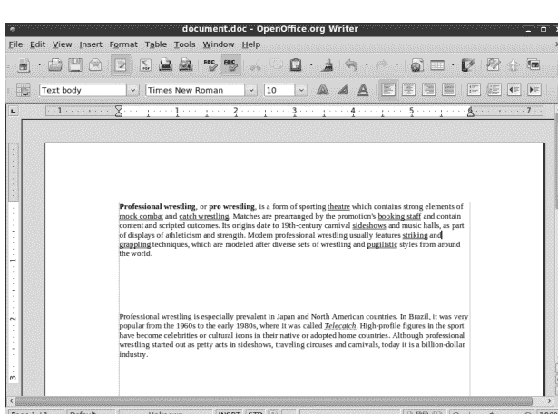

图 5-1：你可以在 OpenOffice.org Writer 中准备文档。

> 专业焊接（或蜡焊）是一种金属连接的形式，包含了金属备料和捕获焊接的元素。通过促销的固定钉防止火柴的发生，并含有铜和锌，这些是用于合金的金属。现代专业焊接通常以附件的尖峰和消失为特征，这些是在世界范围内数十年的焊接和涂鸦后经过了修改。

> 专业焊接在日本和北美非常流行。在巴西，它已成为一种运动中的文化现象，在那里这样称呼它。

## 介绍 Linux

通常你在安装 Linux 发行版时必须选择特定的应用程序组。你的 Linux 系统上应用程序的具体列表取决于你在安装过程中做出的选择。

在 Debian（以及基于 Debian 的发行版）中安装缺失的应用程序很容易，只要你有宽带（电缆或 DSL）连接互联网。例如，要查看 Debian 是否存在 K3b CD/DVD 刻，输入 `apt-cache search k3b`。你将得到类似下面的输出：

```
k3b A sophisticated KDE cd burning application

k3b-i18n Internationalized (i18n) files for k3b

k3blibs The KDE cd burning application library - runtime files

k3blibs-dev The KDE cd burning application library - development files
```

接下来，输入 `apt-get install k3b`，片刻后你就会在 Debian 系统上安装好 K3b。这种安装（或升级）软件的便利性就是为什么 Debian 用户信赖 `apt-get`（尽管它是一个命令行工具）。


## 介绍办公应用与工具 147

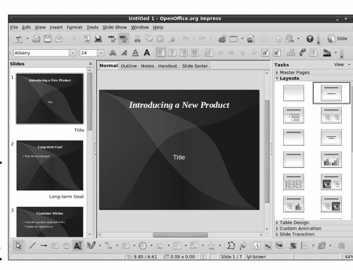

**图 5-3：** 你可以在 OpenOffice.org 中准备大量的演示文稿。

## 日历

KDE 带有一个 Contact —— 这是一个将 KMail 邮件阅读器和 KOrganizer 日历程序等 KDE 应用程序集成到单一图形化个人信息管理器中的应用程序。你可以从面板图标或菜单启动 Contact。（菜单条目的位置取决于 Linux 发行版。）

当 Contact 启动时，它通常会显示一个摘要窗口，其中包含有关电子邮件消息、计划事件等信息。你可以通过点击 Contact 窗口左侧窗格中的图标来单独探索每个应用程序。例如，图 5-4 显示了点击日历图标后的 Contact 窗口。在这种情况下，Contact 显示了 KOrganizer 的输出。KOrganizer 程序显示日历视图，你可以在其中点击日期查看当天的安排。

要为特定的日期和时间添加事件或预约，请从日历中选择日期，双击时间，并在出的“新事件”对话框中输入预约的简短描述。完成后点击“确定”。

介绍 Linux

## 148 介绍应用程序与工具

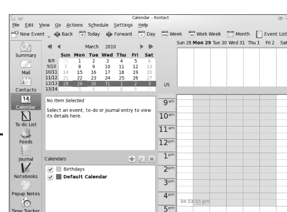

### 计算器

你可以选择 GNOME 计算器或 KDE 计算器。两者都是科学计算器，你可以进行典型的科学计算，例如平方根和倒数，以及三角函数（如正弦、余弦和正切）。

要使用计算器，请在主菜单的“实用程序”或“附件”类别中查找。图 5-5 显示了 SUSE 中的 KDE 计算器。

**图 5-5：** 在 KDE 计算器中进行计算。


你可以通过从“设置”菜单中选择选项来显示额外的按钮。例如，选择 `设置->统计按钮`，以显示允许你使用计算器进行统计计算的按钮。

## 检查多媒体应用 149

大多数 Linux 发行版包含许多多媒体应用 —— 主要有多媒体音频播放器和 CD 播放器，以及用于数字相机和刻录 CD-ROM 的应用程序。要播放其他多媒体文件（如 MPEG 视频），你可能需要在 Linux 系统上下载并安装额外的软件。以下是一些典型的媒体任务以及你可以用于执行这些任务的应用程序简述：

- *使用数码相机：* 在 Linux 中从你的数码相机下载照片（或简单地将相机作为 USB 大容量存储设备访问）。
- *播放音频 CD：* 使用 Linux 自带的许多音频 CD 播放器之一。
- *播放音频文件：* 使用 Rhythmbox 或 XMMS 多媒体音频播放器。（你需要下载额外的软件才能用 Rhythmbox 或 XMMS 播放 MP3 文件。）你也可以从互联网下载其他播放器。
- *刻录 CD：* 使用 K3b 等 CD 刻录机刻录音频和数据 CD。

## 使用数码相机

大多数发行版都带有数码相机应用程序，你可以从数码相机下载图片。例如，SUSE 和 Xandros 带有 DigiKam，它可以与许多品牌和型号的数码相机配合。根据型号，相机可以连接到串口或通用串行总线（USB）端口。

按照以下步骤配合 DigiKam 使用数码相机：

- 1. 将你的数码相机连接到串口或 USB 端口（相机支持的界面），并打开相机。
- 2. 启动 DigiKam。

在主菜单的“图形”或“图像”子菜单下查找 DigiKam。第一次看到 DigiKam 时，将要求你指定存储图像的默认位置并选择若干其他配置偏好。
- 3. 从 DigiKam 菜单中选择 `设置::配置 DigiKam`。

出现一个配置对话框。
- 4. 点击对话框中的“相机”选项卡，然后点击“自动检测”。
如果你的相机被支持且相机被设置为 PTP（图片传输协议）模式，则可以检测到。如果不是，你可以使用这些步骤之后的替代方法从相机获取照片。

- 5. 从“相机”菜单中选择你的相机型号。

出现一个新窗口，稍后显示相机中的照片。
- 6. 点击缩略图选择你想要下载的图像；然后选择 `相机:下载` 来下载图像。

digKam 正在下载图像。你可以将这些保存在文件夹中，并在 GIMP 或你喜欢的照片编辑器中编辑照片。


如果 digKam 识别你的数码相机，请不要放弃。只要你的相机支持 USB 大容量存储，你仍然可以将相机的存储媒体（例如闪存卡）作为 USB 大容量存储设备访问。要访问 USB 数码相机上的图像，请使用以下步骤。

- 1. 阅读相机说明书并使用相机的菜单选项设置相机。
（此处由于原文存在大量重复的 OCR 错误文本，已根据工程师要求进行去重处理，保留核心逻辑）

## 播放音频 CD

所有发行版都带有 GNOME 或 KDE。要播放音频 CD，你需要一个声卡，并且该声卡必须经过配置。在某些发行版中，你可以将音频 CD 插入驱动器，此时对话框会询问你是否要播放。如果没有出现此对话框，请通过选择主菜单中的 `应用程序:音频视频` 来定位音频播放器。

## 多媒体应用 151

CD 播放器显示当前曲目的标题。CD 播放器从 `http://freed.org` —— 一个免费开源数据库获取歌曲标题。你需要活跃的互联网连接供 CD 播放器下载。CD 播放器下载后，它将其缓存在本地数据库中供以后使用。CD 播放器的用户界面非常直观，你可以跟踪曲目。

## 刻录 CD

如今，大多数 GUI 文件管理器都具有刻录 CD 的功能。例如，Nautilus 文件管理器和 Xandros 文件管理器带有刻录 CD 的功能。Linux 发行版也带有独立的 GUI...

## 152 使用图形和成像应用

这些允许你轻松刻录 CD 和 DVD 的程序。例如，K3b 是 KDE 中流行的 CD/DVD 刻录应用程序，适用于 Knoppix 和 SUSE。

大多数 CD 刻录应用程序都易于使用。你只需要收集想要刻录到 CD 或 DVD 的文件，然后开始刻录过程。当然，为了实现这一功能，你的 PC 必须安装 CD 或 DVD 刻录机。

K3b 窗口的顶部用于浏览文件系统以选择你想刻录到 CD 或 DVD 的内容。左上角显示刻刻机设备接口。

要刻录 CD，你可以从 K3b 窗口底部显示的项目开始——例如，音频 CD 项目或新数据 DVD 项目。然后你需要添加文件，最后通过选择 `项目::刻录`或按下 `Ctrl-B` 将项目刻录到 CD 或 DVD。对于音频 CD，你可以拖放 MP3 文件以及音频轨道。


K3b 在处理 CD 时需要外部命令行程序 `cdrecord` 和 `cddaao`。K3b 还需要 `grepools` 来刻录 DVD。

如果你在 Debian 中遇到缺少 `cddao` 的错误，请确保你的 Debian 系统已连接到互联网，然后输入 `apt-get install cddao` 进行安装。

## 使用图形和成像应用

你可以使用图形和成像应用来处理图像和图形（线条图和形状）。其中最流行的两个是：

- * **GIMP (GNU 图像操纵程序)：** 一个用于查看和执行图像处理任务的程序，如照片修饰、图像合成和图像创建。
- * **Gnome Ghostview (GG)：** 一个能够显示 PostScript 文件的图形化应用程序。

## GIMP

GIMP 是一个由 Peter Mattis 和 Spencer Kimball 编写的图像处理程序，并根据通用公共许可证 (GPL) 发布。大多数 Linux 发行版都附带此程序，尽管你可能需要专门选择一个包来进行安装。GIMP 与 Adobe Photoshop 和 Corel PHOTO-PAINT 等其他图像处理程序相比相当。

## 使用图形和成像应用 153

要尝试 GIMP，请在主菜单的“图形”类别下查找。当启动 GIMP 时，它会显示一个带有版权和许可信息的窗口。点击“继续”按钮继续安装。下一个屏幕显示了当你进行个人安装 GIMP 时将创建的目录。

如果你在“图形”类别下找不到 GIMP，请从“系统设置”菜单中选择“添加/删除软件”，并在那里进行安装。

GIMP 的安装涉及在你的主目录下创建一个目录，并在其中放置许多文件。该目录本质上存储了你对 GIMP 进行的任何用户偏好更改的信息。继续点击窗口底部的“继续”按钮。GIMP 会创建必要的目录，将必要的文件复制到目录中，并引导你通过一系列对话框完成安装。

安装完成后，点击“继续”按钮。随后，GIMP 会加载任何插件——增强其功能的外部模块。它会显示一个启动窗口，在加载每个插件时显示关于该插件的消息。完成后后，GIMP 会在一个窗口中显示“今日提示”。你可以浏览这些提示并点击“关闭”按钮关闭提示窗口。同时，GIMP 会显示多个窗口，包括一个标题为“工具箱”的主窗口（通常在左侧）、一个“画笔选择”窗口以及一个“图层、通道、路径”窗口。中心窗口让你能够访问处理的图像、编辑功能以及可以应用于图像的多种效果过滤器。“工具箱”让你能够快速选择若干图像操纵工具。

要在 GIMP 中打开图像，请选择“文件：打开”。将出现“加载图像”对话框。你可以更改目录并选择想要打开的图像。GIMP 可以读取所有常见的图像格式，如 JPEG、TIFF、PCX、BMP、PNG 和 PostScript。在你选择文件并点击“确定”后，GIMP 将图像加载到新窗口中。

工具箱有许多按钮，代表你用于编辑图像和应用特殊效果的工具。你可以通过将鼠标指针悬停在按钮上来获取每个工具的弹出帮助。你可以通过点击按钮来选择工具，并将该工具的效果应用于图像以查看其作用。

当你并在图像窗口上点击鼠标右键时，GIMP 会显示一个弹出菜单，其中包含了 GIMP 顶部工具栏的大多数选项。

你使用 GIMP 可以做的不仅仅是加载和查看图像，但对其所有功能的完整讨论已超出了本书的范围。如果你想尝试 GIMP 的其他功能，请参阅《GIMP 用户手册第二版第5章：介绍 Linux》。

## 154 使用 GUI 文件管理器

手册 (GUM)，可在 `http://manual.gimp.org` 在线。你也可以选择“帮助：GIMP 在线：用户手册网站”来访问 GIMP 的在线文档。（执行此命令需要连接互联网。）

访问 `www.gimp.org` 上的 GIMP 主页可以找到 GIMP 的最新消息以及其他资源的链接。

## GNOME Ghostview

GNOME Ghostview 是一个用于查看和打印 PostScript 或 PDF 文档的理想图形应用程序。对于长文档，你可以查看页面。你可以放大或缩小以不同的放大倍率查看文档。

要在 Fedora 中运行 GNOME Ghostview，请选择“图形：PostScript 查看器”。GNOME Ghostview 将出现。除了菜单栏和工具栏外，垂直分割将区域分为两个窗格。

要打开 PostScript 文件，选择工具栏上的“文件：打开”。GNOME Ghostview 在其窗口中显示该文件。

GNOME Ghostview 适用于查看各种具有 `.ps` 扩展名的文件。你也可以用 GNOME Ghostview 打开 PDF 文件（通常具有 `.pdf` 扩展名）。


## 使用文件管理器

GNOME 和 KDE 桌面都带有文件管理器，允许你轻松浏览文件系统并执行复制或移动文件等任务。GNOME 文件管理器是 Nautilus，KDE 文件管理器是 Dolphin。我在本节中要介绍这些文件管理器。

## 使用 Nautilus Shell

Nautilus 文件管理器（更准确地称为图形壳）来自 GNOME。Nautilus 使用非常直观；类似于 Windows 桌面。

## 使用 GUI 文件管理器 155

你可以使用 Nautilus 管理文件、文件夹以及系统。当你双击桌面上的任何对象时，Nautilus 会打开一个显示该对象的对象窗口。

### 在对象窗口中查看文件和文件夹

当你双击文件或文件夹时，Nautilus 会在一个所谓的对象窗口中打开该对象。如果你随后在该窗口内双击一个对象，Nautilus 会打开另一个显示内容的对象窗口。你可以使用“返回”按钮回到原始文件夹。或者，你可以右键点击文件夹并从弹出菜单中选择“在新窗口中打开”。图 5-6 显示了 Nautilus 中文件夹的en。


图 5-6: Nautilus 如何显示文件夹内容。

### 刻录数据 CD 和 DVD

如果你的系统连接了 CD 或 DVD 刻录机（或连接到 USB 端口设备），你可以使用 Nautilus 刻录数据 CD 和 DVD。只需遵循以下简单步骤：

- 1. 在任何 Nautilus 对象窗口中，选择“前往 > CD/DVD 创建器”。

Nautilus 会打开 CD/DVD 创建器对象窗口。你也可以在插入空白光盘时自动出现的菜单中打开 CD/DVD 创建器。

# 156 使用 GUI 文件管理器

如果你没有打开 Nautilus 对象窗口，只需双击桌面上的“计算机”图标即可。

- 2. 从其他 Nautilus 窗口中，将你想要放在介质上的文件和文件夹拖放到 CD/DVD 刻录器窗口中。

要访问计算机上的文件，请双击 Nautilus 窗口并找到你想要的文件。然后将这些文件或文件夹图标拖放到 CD/DVD 刻录器窗口中。

- 3. 从 CD/DVD 刻录器窗口选择“文件：写入磁盘”。

Nautilus 会显示一个对话框，你可以在其中选择 CD 或 DVD 刻录机、写入速度以及其他几个选项，例如在完成后是否弹出介质。你还可以指定标题。

- 4. （可选）在弹出的对话框中进行选择。

- 5. 点击“写入”按钮。

Nautilus 将刻录 CD/DVD。

如果你倾向于以树状视图而不是图标形式查看文件夹的内容，可以非常简单地更改显示方式：

- 1. 选择 Nautilus 菜单。

- 2. 点击“列表”（而不是“图标”）。

Nautilus 将使用较小的列表格式显示选中目录的内容，并带有详细信息，例如每个文件或目录的大小以及最后修改时间，如图 5-7 所示。

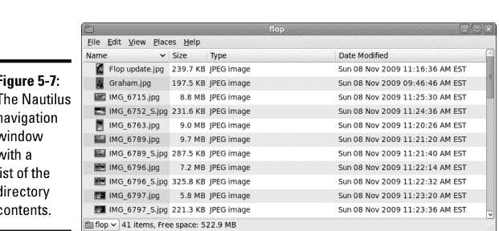

| 名称 | 大小 | 类型 | 修改日期 |
| --- | --- | --- | --- |
| flopdigit.jpg | 239.7 KB | JPEG 图片 | 2009年8月8日 周日 11:16:36 AM EST |
| Graham.jpg | 197.3 KB | JPEG 图片 | 2009年8月8日 周日 09:46:46 AM EST |
| IMG_0715.jpg | 325.3 KB | JPEG 图片 | 2009年8月8日 周日 11:26:36 AM EST |
| IMG_0792.jpg | 231.6 KB | JPEG 图片 | 2009年8月8日 周日 11:26:48 AM EST |
| IMG_0673.jpg | 90.8 KB | JPEG 图片 | 2009年8月8日 周日 11:20:26 AM EST |
| IMG_0789.jpg | 9.7 MB | JPEG 图片 | 2009年8月8日 周日 11:22:12 AM EST |
| IMG_0791.jpg | 325.3 KB | JPEG 图片 | 2009年8月8日 周日 11:22:12 AM EST |
| IMG_0796.jpg | 7.2 MB | JPEG 图片 | 2009年8月8日 周日 11:22:14 AM EST |
| IMG_0798.jpg | 325.8 KB | JPEG 图片 | 2009年8月8日 周日 11:22:32 AM EST |
| IMG_0797.jpg | 221.3 KB | JPEG 图片 | 2009年8月8日 周日 11:23:20 AM EST |

# 使用 GUI 文件管理器 157

如果你点击列表视图顶部的列标题（如名称、大小、类型或修改日期），Nautilus 将根据该列对列表进行排序。例如，直接点击“修改日期”列标题。Nautilus 现在将显示按最后修改时间排序的文件和目录列表。点击“名称”列标题将按字母顺序对文件和文件夹进行排序。

你不仅可以使用 Nautilus 窗口移动不同的文件夹，还可以将文件从一个文件夹移动到另一个文件夹、删除文件，并执行以下操作。（我这里没有列出每个步骤，因为这些步骤非常直观，并且与你在任何 GUI（如 Windows 或 Mac）中的操作相似。）

- **将文件移动到不同的文件夹：** 将文件图标拖放到你想放置该文件的文件夹上。

- **将文件复制到新位置：** 选择文件图标并从 Nautilus 菜单中选择“复制”（你也可以右键点击文件图标并从右键菜单中选择“复制”）。然后移动到你想复制文件的文件夹并选择“编辑：粘贴”。

- **删除文件或目录：** 右键点击图标并从右键菜单中选择“移动到垃圾桶”。如果你有删除该文件的权限就可以这样做。要永久删除文件，右键点击桌面上的垃圾桶图标并从右键菜单中选择“清空垃圾桶”。只有当你真的想删除文件时才这样做，因为清空垃圾桶后你将无法再次看到该文件。如果你已经清空了垃圾桶并想检索它，双击垃圾桶图标，再次将文件拖回你想保存它的文件夹。

- **重命名文件或目录：** 右键点击文件或目录的图标并从右键菜单中选择“重命名”。在出现的文本框中输入新名称（或编辑名称）。

- **创建新文件夹：** 右键点击窗口空白区域并选择“创建文件夹”。在新文件夹图标出现后，你可以通过右键点击图标并从右键菜单中选择“重命名”来重命名它。

# 第 6 章：使用文本编辑器

## 本章介绍

- 查看不同的 GUI 文本编辑器
- 使用 ed 文本编辑器
- 了解 vi 文本编辑器

尽管桌面提供了一个美观且易于工作的图形界面，但在该界面之外还有大量工作。大多数 Linux 系统配置文件都是文本文件。此外，Linux 还允许你创建 shell 脚本并与许多程序的运行进行交互——这一切都可以通过文本文件实现。

当一切正常时，你可以使用图形工具编辑（甚至创建）这些文件，但强烈建议你也要学会如何在界面之外编辑它们，以防出现导致 X Window 系统无法加载的问题。无论是在界面内还是之外，你都会使用文本编辑器，这些是为了与文本文件交互设计的程序。

在本章中，你将接触几种文本编辑器——包括 GUI 编辑器和文本模式。

## 使用 GUI 文本编辑器

每个 GUI 桌面——GNOME 和 KDE——都带有 GUI 文本编辑器（具有图形用户界面的文本编辑器）。

要使用 GUI 文本编辑器，可以在主菜单并在相应的类别中搜索文本编辑器。例如，在 GNOME 桌面中，选择“应用程序 > 辅助工具 > 文本编辑器”。运行文本编辑器后，你可以点击工具栏上的“打开”按钮来显示“打开文件”对话框。你可以点击“确定”按钮更改目录并选择要编辑的文件。

GNOME 文本编辑器在其窗口中加载文件。你可以同时打开多个文件并在编辑时在它们之间移动。图 6-1 显示了使用编辑器的典型会话。

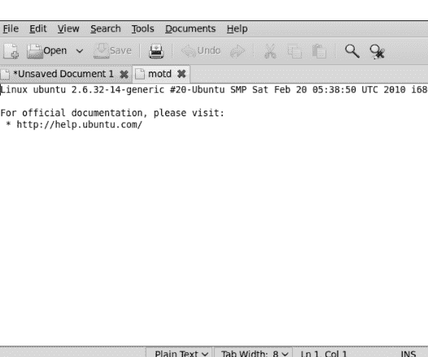

图 6-1：你可以使用 GNOME 文本编辑器编辑文件。

在这种情况下，编辑器有两个文件——一个正在写入的新文件，和一个 motd（来自 `/etc` 目录）——处于打开编辑状态。文件名显示编辑器窗口工具栏下方的标签中。你可以通过点击标签在文件之间切换。当前文件显示在窗口的最后一行。

如果你打开一个只有读取权限的文件，窗口标题中显示的文件名后会附加文本 [Read Only]（只读），以指示该文件是只读的，文件位置显示在顶部（例如 `/etc`）。当普通用户打开只有 root 才能打开的系统文件时，会出现文件只读的指示。

其余文本编辑步骤都是直观的。要输入新文本，点击设置光标位置并开始输入。你可以使用编辑区域上方工具栏上的按钮来选择文本、复制、剪切和粘贴。

在 KDE 桌面，可以通过选择“应用程序 > 文本编辑器”来启动 KDE 文本编辑器 (KWrite)。要打开文本文件，选择“文件 > 打开”显示对话框。在此对话框中，你可以进入选择的目录，选择要打开的文件并点击确定。KWrite 打开文件并在窗口中显示其内容，然后你可以像图 6-2 所示编辑文件。

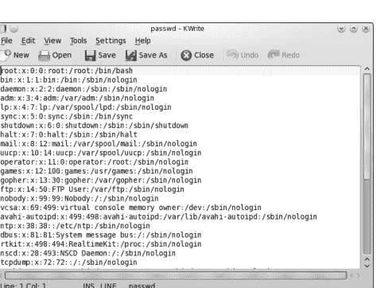

图 6-2：你可以使用 KDE 文本编辑器编辑文件。

## 使用 ed 和 vi 进行文本编辑

GUI 文本编辑器允许你使用键盘和鼠标编辑文件，就像使用任何文字处理器一样。文本模式编辑器是不同的东西——你只能使用键盘，必须输入晦涩的命令来执行编辑任务，例如复制和粘贴文本或删除文本。Linux 带有两个文本模式编辑器：

- ed：一种行导的文本编辑器
- vi：一种全屏文本编辑器，支持一种名为 ex 的早期编辑器的命令集

对于图形文本编辑器来说，ed 和 vi 编辑器是晦涩的。然而，你仍然应该了解 ed 和 vi 的基本编辑命令，因为这两个是唯一可用的编辑器。例如，如果 Linux 拒绝从硬盘启动，你可能需要从 CD、DVD 或优 盘启动。在这种情况下，你可能需要使用 ed 编辑器编辑系统文件，因为它足够小，可以放入软盘中。我将带你通读一遍 ed 和 vi 的基本编辑命令——它们并不难。

## 使用 ed

通常，只有在你需要极简版本的 Linux 时（例如从设置为启动磁盘的软盘），且系统不支持全屏模式才需要使用 ed。在所有其他情况下，你都可以 vi 编辑器，它可以在全屏文本模式下工作。

当你使用 ed 时，你在命令模式或文本输入模式下工作：

- **命令模式**：默认模式。在此模式下，你输入的任何内容都会被解释为命令。简单的命令集中每个命令由一个或多个字符组成。
- **文本输入模式**：此模式用于输入文本。

为了练习编辑，使用以下内容：


```
root@x08:root:/bin/bash

type l:1:root:/sbin

demon:2:daemon:/sbin

adm:3:admin:/usr/sbin

lp:4:7:lp:/usr/local/bin

sys:5:sys:/sbin

shutdown:6:0:shutdown:/sbin

tail:7:7:tail:/usr/bin

mail:8:12:mail:/usr/sbin

news:9:13:news:/var/spool/news

games:10:14:games:/usr/games

tp:11:17:ntp:/usr/sbin/ntp

frp:14:19:frp:/usr/sbin/frp

vvcsa:69:69:console memory owner;dev:/usr/sbin/bin

attr:20:24:attr:/usr/bin

dbin:15:18:bin:/sbin

scid:28:49:SCID Daemon:/sbin

tcpdump:72:72:-:/sbin
```

要输入新文本，点击设置光标位置并开始输入。你可以使用编辑区域上方工具栏上的按钮来选择文本、复制、剪切和粘贴。


当普通用户打开只有 root 才能打开的系统文件时，会出现文件只读的指示。

要输入新文本，使用以下操作：

```
:i
```
（输入你想插入的行）
（输入单个点号表示完成）


## 166 使用 ed 和 vi 进行文本编辑

你可以输入任意数量的行。在最后一行之后，单独起一行输入一个句点（`.`）。该句点标记着文本输入模式的结束，`ed` 编辑器将切换到命令模式。在这种情况下，你可以通过看到提示符（`:`）来判断 `ed` 是否已切换到命令模式。

当你对更改满意时，可以使用 `w` 命令将这些更改写入文件。如果你想保存更改并退出，输入 `wq` 可以同时完成这两个步骤：

```bash
:wq
```

`ed` 编辑器会将更改保存到文件中，显示已保存的字符数并退出。如果你想在不保存任何更改的情况下退出编辑器，请使用 `q` 命令。

这些示例可以让你了解如何使用 `ed` 命令来执行编辑文本文件的基本任务。表 6-1 列出了一些常用的 `ed` 命令。

| 表 6-1 | 常用 ed 命令 |
| --- | --- |
| Command | !command | 执行一个 shell 命令。（例如，`!pwd` 显示当前目录。） |
| $ | 跳转到缓冲区中的最后一行。 |
| n | % | 将随后的命令应用到缓冲区中的所有行。（例如，`%p` 打印所有行。） |
| + | 跳转到下一行 |
| +n | 跳转到第 n 行（其中 n 是指定的数字）。 |
| , | 将随后的命令应用到缓冲区中的所有行。（例如，`,p` 打印所有行）。此命令与 `%` 类似。 |
| - | 跳转到前一行。 |
| -n | 跳转到倒数第 n 行（其中 n 是指定的数字）。 |
| /text/ | 向前搜索指定的文本。 |
| ; | 指向一个行范围——从当前行到缓冲区中的最后一行。 |
| = | 打印行号。 |
| ?text? | 向后搜索指定的文本。 |

## 使用 ed 和 vi 进行文本编辑

| 命令 | 执行以下操作 |
| --- | --- |
| ^ | 跳转到前一行。（另见 - 命令。） |
| ^n | 跳转到倒数第 n 行（其中 n 是你指定的数字）。（另见 n 命令。） |
| a | 在当前行之后追加内容。 |
| c | 修改指定的行。 |
| d | 删除指定的行。 |
| i | 在当前行之前插入文本。 |
| n | 跳转到第 n 行（其中 n 是你指定的数字）。 |
| 按 Enter | 显示下一行并将该行变为当前行。 |
| q | 退出编辑器。 |
| Q | 不保存并退出编辑器。 |
| r file | 从当前行读取并插入文件的内容。 |
| s/old/new/ | 用新字符串替换旧字符串。 |
| u | 撤销上一个命令。 |
| w file | 将缓冲区的内容追加到指定文件的末尾。 |
| w file | 将缓冲区保存到指定文件中。（如果没有指定文件名，则保存到默认文件——即 ed 当前正在编辑的文件。） |


## 使用 vi

在尝试用过 `ed` 之后，你会发现 `vi` 简直是梦想成真，尽管它仍然是一个命令行编辑器。`vi` 编辑器是一个全屏文本编辑器，你可以同时查看几行内容。包括 Linux 在内的许多系统都自带了 `vi`。因此，如果你熟悉 `vi` 的基本功能，就可以任何基于 UNIX 的系统上编辑文件。

当你编辑文件时，它会将文件读入缓冲区（内存块），这样你就可以更改缓冲区中的文本。`vi` 编辑器在编辑过程中也会使用临时文件，但在保存更改之前，原始文件保持不变。

启动编辑器，输入 `vi` 然后加上你要编辑的文件名，如下：

```bash
vi /etc/fstab
```

`vi` 编辑器会将文件加载到内存中，并在屏幕上显示前几行，并将光标置于第一行，如图 6-3 所示。


## 使用 ed 和 vi 进行文本编辑

```
File Edit View Terminal Tabs help

unswions / unswions rw 0 0

tmaps tmaps mouse nodev nodedev 0
```

图 6-3：你可以使用 `vi` 全屏文本编辑器编辑文件。

```bash
"etc/fstab" [readonly] 2 lines, 59 characters
```

最后一行显示了文件的路径以及文件的行数（2）和字符数（59）。在这种情况下，文本 `[readonly]` 出现在文件名之后，是因为我以普通用户身份登录并打开了 `/etc/fstab` 文件（这意味着我没有权限修改该文件）。稍后，`vi` 中的该行作为命令区域显示。其余行显示的行数少于屏幕容量，`vi` 在第一行用波浪号（`~`）显示空行。

使用 `vi` 时，你将在三种模式之一中工作：

- **普通命令模式（Visual command）：** 这是默认模式。在此模式下，你插入任何内容都会被解释为命令。
- **冒号模式（Colon command）：** 这种模式用于输入 `:` 开头的命令。你可以使用它读取文件、设置选项或退出。
- **输入模式（Input mode）：** 这种模式用于输入文本。完成输入后，按 Esc 返回普通命令模式。

所有这些模式的问题在于你很难一眼判断当前处于哪种模式。要移动光标，请尝试表 6-2 中的命令。

| 表 6-2 | vi 中的光标移动 |
| 键 | 移动光标 |
| ↓ | 向下一行 |
| ↑ | 向上一行 |
| ← | 向左一个字符 |
| → | 向右一个字符 |
| W | 向前一个单词 |
| B | 向后一个单词 |
| Ctrl+D | 向下半屏 |
| Ctrl+U | 向上半屏 |

你可以随时使用冒号命令跳转到特定行。例如，要跳转到第 6 行，输入以下：

```bash
:6
```

当你输入冒号时，`vi` 会最后行显示冒号。之后，`vi` 将你输入的任何文本视为命令。要搜索字符串，先输入斜杠（`/`）。`vi` 编辑器会在最后行显示斜杠。输入字符串并按回车。`vi` 编辑器将定位该字符串并将光标放在开头。因此，要在 `/etc/fstab` 文件中定位字符串 `cdrom`，输入

```bash
/cdrom
```


## 使用 ed 和 vi 进行文本编辑

要删除光标所在的行，输入 `dd`。`vi` 编辑器会删除该行并将下一行变为当前行。

要在光标前开始输入文本，输入 `i`。`vi` 编辑器将切换到文本输入模式。现在你可以输入文本了。完成输入后，按 `Esc` 返回命令模式。

| 表 6-3 | vi 命令 |
| 命令 | 执行以下操作 |
| 文本 | 在光标后插入文本 |
| a | 在当前行末尾插入文本 |
| A | 在当前行开头插入文本 |
| i | 在光标前插入文本 |
| 删除文本 | |
| D | 删除到当前行末尾 |
| dd | 删除当前行 |
| dg | 从当前行删除到文件末尾 |
| dw | 从光标删除到单词结束 |
| x | 删除光标所在的字符 |
| 修改文本 | |
| C | 修改到当前行末尾 |
| cc | 修改当前行 |
| J | 将当前行与下一行合并 |
| rx | 用 x 替换光标下的字符（其中 x 是任意字符） |

## 使用 ed 和 vi 进行文本编辑

| 命令 | 功能 |
| --- | --- |
| 移动光标 | |
| h 或 ← | 向左移动一个字符 |
| j 或 ↓ | 向下移动一行 |
| k 或 ↑ | 向上移动一行 |
| L | 移动到屏幕末尾 |
| 1 或 → | 向右移动一个字符 |
| w | 移动到下一个单词的开头 |
| b | 移动到上一个单词的开头 |
| 滚动文本 | 向前滚动半屏 |
| Ctrl+D | 向后滚动半屏 |
| Ctrl+U | |
| 刷新屏幕 | 重绘屏幕 |
| Ctrl+L | |
| 剪切粘贴 | 将当前行复制（yank）到无名缓冲区 |
| yy | 将复制的行放在当前行上方 |
| p | 将复制的行放在当前行下方 |
| 冒号命令 | |
| :command | 执行一个 shell 命令 |
| :q | 退出编辑器 |
| :q! | 不保存更改退出 |
| :r filename | 读取文件并将其插入到当前行之后 |
| :w filename | 将缓冲区写入文件 |
| :wq | 保存更改并退出 |
| 搜索文本 | |
| /string | 向前搜索字符串 |
| ?string | 向后搜索字符串 |
| 其他杂 | |
| u | 撤销上一次命令 |
| Esc | 退出输入模式进入视觉命令模式 |
| U | 撤销对当前行的最近更改 |

## 第三部分

## 网络

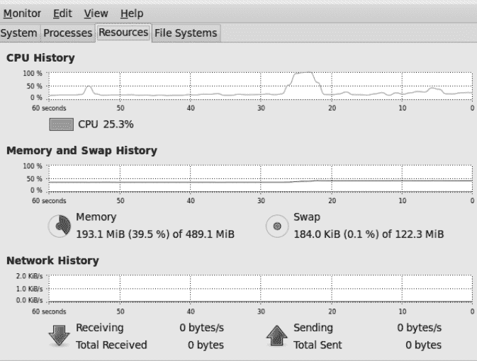

使用系统监视器检查网络状态

## 目录摘要

- 第一章：连接互联网 ................................................................... 175
  理解互联网 ................................................................................ 175
  决定如何连接互联网 ................................................................ 176
  使用 DSL 连接 ....................................................................................................... 178
  使用电缆调制解调器连接 ................................................................................ 184
  拨号上网设置 ............................................................................................... 189

- 第二章：建立局域网 ........................................................ 195
  理解 TCP/IP ................................................................................ 195
  建立以太网局域网 ...................................................................................... 199
  配置 TCP/IP 网络 ................................................................................ 203
  将局域网连接到互联网 ....................................................................... 204

- 第三章：无线连接 ............................................................ 207
  理解无线以太网网络 ................................................................ 207
  设置无线硬件 ................................................................................ 211
  配置无线接入点 ................................................................ 212
  配置无线网络 ............................................................................ 213

- 第四章：管理网络 ................................................................... 217
  发现 TCP/IP 配置文件 ................................................................ 217
  检查 TCP/IP 网络 ................................................................................ 221
  启动时配置网络 ....................................................................... 227

## 第一章：连接互联网

### 本章内容

- 理解互联网
- 决定如何连接互联网
- 使用 DSL 连接互联网
- 使用电缆调制解调器连接互联网
- 设置拨号 PPP 链路

鉴于互联网的普及和流行，可以认为你想要将 Linux 系统连接到互联网。在本章中，我将向你展示通过多种方式连接互联网——取决于你拥有 DSL、电缆调制解调器还是拨号连接。

连接互联网的两种选项——DSL 和电缆调制解调器——需要在 Linux 系统的以太网上上连接一个特殊的调制解调器。在这种情况下，你必须在 Linux 系统上设置以太网网络（我将在本教程的第二章中解释网络）。

另一种选项——拨号上网——涉及从你的 Linux 系统拨号连接服务提供商 (ISP)。

### 理解互联网

你如何看待互联网取决于你的观点。大多数人根据他们使用的服务来看互联网。例如，作为一个用户，你可能将互联网视为信息交换媒介，具有以下功能：

- **电子邮件**：使用如 `mom@home.net` 这样的地址向互联网上的任何其他用户发送电子邮件。
- **网页**：从整个互联网的服务器下载并查看文档。

### 决定如何连接互联网

- **新闻组**：读取新闻组并向名为 `comp.os.linux.networking` 或 `comp.os.linux.setup` 的新闻组发布新闻条目。
- **信息共享**：下载软件、音乐文件、视频等。反之，你也可以提供用户在其他系统上下载的文件。
- **远程访问**：登录到互联网上的另一台计算机，假设你有访问该远程计算机的权限。


使用系统监视器检查网络状态

### 178 连接 DSL

| 表 1-1 拨号接入、DSL 和电缆的对比 |
| 特性 | 拨号接入 | DSL | 电缆 |
| --- | --- | --- | --- |
| 设备 | 调制调器 | DSL 调制调器、以太网卡 | 电缆调制调器、以太网卡 |
| 还需要 | 电话业务和互联网服务供应商 (ISP) | 电话业务且距离中心局 15,000 到 20,000 英尺 | 电缆电视连接 |
| 连接类型 | 拨号连接 | 始终在线，专用 | 始终在线，共享 |
| 典型速度 | 最大 56 Kbps | 下载 12 Mbps，上传 2 Mbps（更高速度成本更高） | 下载 1.5 Mbps，上传 128 Kbps |
| 一次性费用（估算)* | 无 | 安装费 $100–$200（自助安装免费）；设备费用 $50–$100（可能租赁并可能需要激活费） | 安装费 $100–$200（自助安装免费）；设备费用 $50–$100（可能租赁） |
| 典型月费（2010)* | 电话费每月 $20；ISP 费用每月 $15–30 | 每月 $40–$50；可能需要每月租赁调制调器 | 每月 $40–$50；可能需要租赁调制调器 |
*费用因地区和提供商而异。所示费用为美国大大地区的典型水平。

## 连接 DSL

DSL 代表数字用户用户线路（Digital Subscriber Line）。DSL 使用你现有的电话线在发送普通模拟语音信号外发送数字数据（模拟意味着连续变化，而数字数据由 1 和 0 表示）。电话线从你家里延伸到中心局，线路在那里连接到 DSL 供应商的网络。顺便说一下，从家里到中心局的连接被称为本地环。

当你注册 DSL 服务时，DSL 供应商会将你的电话线连接到中心局的一些特殊设备上。这些设备可以将数字数据与语音分离。从那时起，你的电话线就可以携带直接发送到中心局互联网连接的数字数据。

### DSL 如何工作

一个称为 DSL 调制调器的特殊盒子负责通过你的电话线将数字数据从你的 PC 发送到 DSL 供应商的中心局。你的 PC 可以使用用于普通通话的同一条电话线连接互联网——即使线路正在用于 DSL，你也可以进行语音通话。图 1-1 显示了典型的 DSL 网络连接。

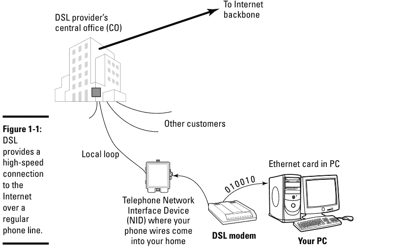

图 1-1：DSL 通过普通电话线提供高速互联网连接。

你的 PC 通过以太网连接与 DSL 调制调器通信，这意味着你的 Linux 系统需要以太网卡。

你的 PC 通过以太网连接将数字数据发送到 DSL 调制调器。DSL 调制调器以与模拟语音信号不同的频率发送数字数据。电话线负载的所有频率，DSL 使用高频率传输数字数据，因此语音和数据可以在同一条电话线上传输。

## 180 连接 DSL

### DSL 术语：ADSL, IDSL, SDS

我一直使用 DSL 这个术语，好像只有一种 DSL 一样，但它有三种变体，每种都有不同的特性。请看：

- ADSL：非对称 DSL 是 DSL 最常见的形式，其下载速度（从互联网到你的 PC）远高于上传速度（从你的 PC 到互联网）。ADSL 的下载速度可达 8 Mbps，上传速度可达 1 Mbps。当你的位置距离中心局约 2.5 英里（12,000 英尺）以内时，ADSL 效果最佳。DSL 服务根据你需要的下载和上传速度定价。一种流行的 ADSL 形式称为 Glite，其最大下载速度为 1.5 Mbps，最大速度为 512 Kbps。
- IDSL：DSL（ISDN 是一种较旧的术，称为集成数字网络）是一种特殊的 DSL，适用于距离电话和中心局五英里的范围。缺点是，IDSL 的下行（从互联网到你的 PC）和上行（从你的 PC）速度平均约为 144 Kps。
- SDSL：对称 DSL 提供高达 2.0 Mbps 的相等下载和上传速度。DSL 根据你需要的速度定价，速度越高成本越高。你离中心局越近，获得的连接就越快。


DSL（和电缆调制调器）通常由两个斜杠分隔的数字指定，例如 1500/384。这些数字指的是每秒比特的数据传输速度（即每秒千位，缩写为 Kbps）。第一个数字是下载速度，第二个是上传速度。1500/384 意味着你可以预期以 1,500 Kbps（或 1.5 Mbps）的最大速率从互联网下载，并以 384 Kbps 的速度上传到互联网。

# 连接 DSL 183

电话线
以太网线 (10BaseT)

图 1-3：NAT 路由器将你的 PC 与互联网隔离，并允许你与局域网内的其他 PC 共享 DSL 连接。

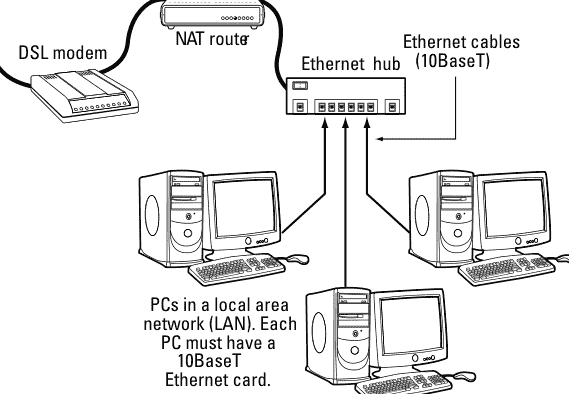

- 使用 100BaseT 以太网线将 NAT 路由器的本地以太网端口连接以太网集线器/交换机的一个端口。
- 现在将每台 PC 连接到以太网集线器/交换机。（你需要先在每台 PC 中安装并配置以太网卡）。

你也可以购买内置 4 口或 8 口以太网集线器的 NAT 路由器。使用这种集成的路由器和集线器，你只需要一个即可建立局域网并通过 DSL 调制解调器连接互联网。这些设备被称为电缆/DSL 路由器，因为它们同时支持 DSL 和电缆。

请参阅本迷你书籍第 2 章，了解如何在 Linux 系统上配置网络的信息，以便你的系统能够访问互联网。

DSL 供应商通常使用称为“以太网上的 PPP”（PPPoE）的协议在你 PC 与其机房设备之间建立连接。PPPoE 要求你提供用户名和密码以通过以太网建立网络连接。要为系统设置 PPPoE 连接，你只需要运行一个配置系统 PPPoE 的实用程序。你可以在 GUI 桌面的主菜单中搜索找到该实用程序。

# 184 连接电缆调制解调器

在 Ubuntu 中，你可以通过选择系统管理：网络工具，点击调制解调器连接并选择属性来设置 PPPoE DSL 连接。然后按照接继屏幕的提示操作，提供所需的账户信息（如用户名和密码）。

## 连接电缆调制解调器

有线电视公司还通过传输家庭电视信号的同一同轴电缆提供高速互联网访问。在电缆公司在其设施中安装必要的设备以通过同轴电缆发送和接收数字数据后，客户就可以申请电缆互联网服务。然后你就可以通过传输家庭电视信号的同一条线路获取高速互联网访问。

### 电缆调制解调器的工作原理

一个被称为电缆调制解调器的设备是电视网络接入互联网的核心。（见图 1-4）。电缆调制解调器从你 PC 的以太网线获取数字数据，并将其放入一个未使用的频率块中。（将此频率想象成另一个电视通道，但它传输的不是图像和声音，而是数字数据。）

电缆调制解调器将上行数据——从你的 PC 发送到互联网的数据——放置在与从互联网到你 PC 的下行数据不同的通道中。根据设计，下行数据的传输速度远高于上行传输。假设是人们从互联网下载的内容远比上传的得多（这对于我们大多数人来说可能是事实）。

将数百个电视频道传输到你家的同轴电缆是一种能力很强的信号。特别是同轴电缆可以携带覆盖极大频率范围的信号——数百兆赫兹（MHz）。每个电视通道需要 6 MHz，而同轴电缆可以携带数百个这样的通道。电缆调制解调器将上行数据放置在一个小的频带中，并期望在另一个频带接收下行数据。

# 185 连接电缆调制解调器

电缆公司前端
（中心分发点）
到互联网骨干

电缆调制解调器终端系统 (CMTS)

一个社区
（一个或多个带有电缆调制解调器的家庭）

另一个社区
（所有带有电缆调制解调器的家庭共享同一条电缆）

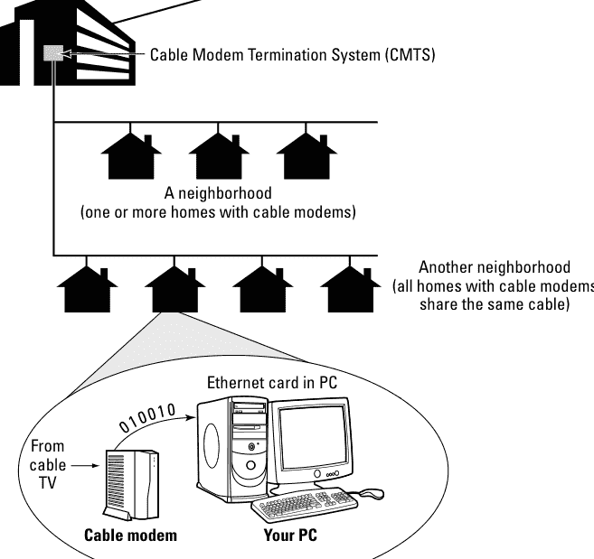

图 1-4:
电缆调制解调器通过有线电视网络提供高速互联网访问。

PC 中的以太网卡
010010
来自有线电视
电缆调制解调器
你的 PC

第三卷
第一章

在你连接互联网的电缆另一端是电缆调制解调器终端系统（CMTS）也称为前端——这是你的电缆公司在其中心设施安装的设备。（参考图 1-4。）CMTS 将有线电视网络连接到互联网。它提取由你的电缆调制解调器（以及你邻居的）发送的上行数字数据并将其发送到互联网。CMTS 还会将数字数据放入上行通道，以便你的电缆调制解调器提取数据并通过以太网卡提供给你的 PC。

电缆调制解调器可以以约 50 Mbps 的速率接收下行数据，并以约 10 Mbps 的速度上行数据。然而，社区内所有的电缆调制解调器共享相同的下行容量。每个电缆调制解调器从 CMTS 发出的数据流中过滤出它需要的数据。电缆调制解调器遵循一种名为 DOCIS 的调制解调器标准，全称为电缆传输业务接口。你可以购买任何符合 DOCIS 标准的调制解调器并将其用于电缆互联网服务；你只需要拨打电话并提供调制解调器的识别信息，让 CMTS 识别并初始化调制解调器。

在实践中，使用电缆调制解调器时，你可能会获得约 12 Mbps 的下行传输速率和2 Mbps 的上行速率。这些是最大速率，而你的传输速率是……

# 186 连接电缆调制解调器

## 188 连接电缆调制解调器

NAT 路由器和集线器通常以电缆/DSL路由器的名销售，因为它们兼容 DSL 和电缆调制解调器。

NAT 路由器将私有 IP 地址转换为公共 IP 地址。当通过 NAT 路由器连接时，内部局域网中的任何 PC 都可以访问互联网，就像它拥有自己唯一的 IP 地址一样。因此，你可以让许多 PC 共享同一个互联网连接——这对于上网家庭来说是一个理想的解决方案！

图 1-6 显示了一个典型的设置，局域网内的多台 PC 共享电缆调制解调器连接。

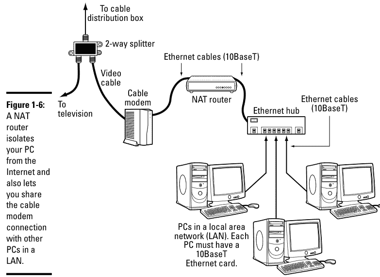

图 1-6：NAT 路由器将你的 PC 与互联网隔离，并允许你与局域网内的其他 PC 共享电缆调制解调器连接。

设置如图 1-6 所示的连接时需要注意以下几点：

## 设置拨号网络 189

- 你需要一个具有两个 100BaseT 以太网端口的电缆/DSL NAT 路由器（100BaseT端口也称为 RJ-45 接口，看起来像大电话口）。通常，一个以太网端口标记为 Internet（外部或 WAN，广域网），另一个标记为 Local（本地）。

- 如果你想设置局域网，还需要一个以太网集线器/交换机。对于小型家庭网络，你可以购买一个 4 口或 8 口以太网集线器。基本上，你需要的集线器端口数与你打算连接到局域网的 PC 数量一样。

- 考虑购买一台作为 NAT 路由器和具有多个以太网端口的合体设备。

- 将视频线连接到电缆调制解调器的视频输入端口。

- 使用 100BaseT 以太网线将电缆调制解调器的以太网端口连接到 NAT 路由器的 Internet 端口。（线看起来像电话线，但由于具有较大的 RJ-45 接口，通常标记为类 5 或 Cat 5 线。）

- 使用 100BaseT 以太网线将 NAT 路由器的 Local 以太网端口连接到以太网集线器的一个端口。

- 将每台 PC 连接到以太网集线器。每台 PC 必须有一块以太网卡。

在本教程第 2 章中，我将解释如何配置局域网中的 PC，以便它们通过路由器访问互联网。

| 第三卷 |
| :--- |
| 第1章 |

## 设置拨号网络

随着 DSL 和电缆网络的普及，拨号网络正在成为过去式。尽管如此，对于居住在 DSL 不可用或相应地区的人来说，本节概述了关于拨号需要了解的重要功能。

拨号网络是指通过拨号调制解调器将 PC 连接到远程网络。如果你足够“老”，还记得使用 Procomm 和某些串口通信软件进行拨号的日子，请意识到拨号网络与旧的串口通信之间存在显著差异。这两种方法都使用调制解调器拨号远程计算机并建立通信路径，但串口通信软件让你的计算机在远程计算机面前表现得像一个哑终端。串口通信软件专门使用一个拨号连接。例如，你无法运行另一个通信软件的副本并使用同一个调制解调器连接。

在拨号网络中，你的 PC 和远程系统都运行网络协议（称为 TCP/IP）软件。当你的 PC 拨号并建立


## 190 设置拨号网络

通信路径时，网络协议可以通过该拨号连接的任何应用程序交换数据包。妙妙在于，你可以使用同一个拨号连接来发送和接收数据包。因此，你的 PC 变成了远程计算机所在网络的一部分。（如果远程计算机不在网络上，拨号网络将创建一个由远程计算机和你的 PC 组成的网络。）

在本教程第 2 章中，我将进一步描述 TCP/IP 协议，但在描述如何设置拨号网络时，我也必须使用互联网协议 (IP) 地址和域名系统 (DNS) 等术语及少数概念。

在拨号链路上建立 TCP/IP 网络涉及指定在通信链路上对数据包进行封装的协议（约定）。点对点协议（PPP）就是一种在任何点对点链路（包括拨号电话线）上建立 TCP/IP 连接的协议。Linux 支持 PPP，并自带你可以使用的的配置工具来设置 PPP，以便你的系统能够与 ISP 建立 PPP 连接。

在 Linux 中设置拨号网络需要执行以下操作：

1. 在你的 PC 中安装内部或外部调制解调器。如果你的 PC 还没有内置调制解调器，你可以购买一个外部调制解调器并连接到 PC 的串口或 USB 端口。

2. 将调制解调器连接到电话线，开启调制解调器电源并连接到计算机。

3. 获取 ISP 账户。每个 ISP 都提供一个拨号号码、一个用户名和一个密码。此外，ISP 还会提供电子邮件和新闻服务器的全名。通常，你的系统

4. 使用 GUI 工具（如果可用）设置连接。如果你没有 GUI 工具，请使用文本编辑器编辑配置文件。

5. 将调制解调器连接到互联网。


# 设置拨号网络 193

Debian 有一个图形界面（GUI）工具来设置 PPP 连接，这些工具使用了 wvdial，而该工具默认并没有安装。请输入 `apt-get install wvdial` 来安装它。你可以使用 GUI 工具配置并激活拨号 PPP 连接。

最新版本的 Ubuntu 不支持拨号调制调器，但可以安装驱动程序来启用这些调制调器。有关更多信息，请参阅 Ubuntu 的帮助菜单。

# 配置 CHAP 和 PAP 身份验证

在 PPP 连接完全建立之前，你系统上的 PPP 服务器必须先向 ISP 的 PPP 服务器进行身份验证。身份验证需要证明你拥有 ISP 的有效账户，本质上是提供一个用户名和一个密钥（即密码）。PPP 规定了在连接的两端之间交换身份信息的两种方法：

- *挑战握手身份验证协议 (CHAP)* 要求远程端发送一个带有服务器名称的随机挑战字符串。本地系统随后使用密钥和服务器名称，然后发送一个包含名称和值的响应，该值与密钥和挑战匹配（使用单向哈希函数）。远程服务器随后将该值与其自身计算的哈希值进行对比。如果匹配，则身份验证成功；否则，远程服务器将终止连接。在这种情况下，名称和密钥存储在 `/etc/ppp/chap-secrets` 文件中。

每当 PPP 链路建立时，远程服务器都可以重复 CHAP 身份验证。

- *密码验证协议 (PAP)* 类似于普通的登录过程。使用 PAP 时，本地系统会重复用户名和密码（密钥），直到远程服务器确认身份验证或连接。名称和密钥存储在 `/etc/ppp/pap-secrets` 文件中。

用户名和密码是以明文（未加密）发送的。

Linux 服务器支持这两种身份验证。对于 PAP 和 CHAP，PPP 服务器需要的信息是一个名称和一个密钥——即用户名和密码对。这些身份验证信息存储在以下配置文件中：

- `/etc/ppp/pap-secrets` 存储 CHAP 的信息。一个典型的 chap-secrets 文件看起来如下：


# for authentication using CHAP

## client server secret IP addresses

"edulaney" * "password"


| 第三章 第1节 |
| 连接互联网 |

# 194 设置拨号网络

`/etc/ppp/pap-secrets` 存储 PAP 的信息。这是一个典型的 `pap-secrets` 文件：

如你所示，`chap-secrets` 和 `pap-secrets` 条目格式是相同的。每行有四个字段，顺序如下：

- `client`：此字段包含身份验证期间使用的名称。你从 ISP 获取此名称。
- `server`：此字段包含本地系统进行身份验证的远程系统名称。如果你不知道服务器名称，请输入星号 `*` 表示任何服务器。
- `secret`：此字段是你的系统 PPP 服务器向远程系统发送以进行身份验证的密钥。你从 ISP 接收此密码。
- `IP addresses`：这是一个可选字段，可以包含本地系统连接到指定服务器时可能使用的 IP 地址列表。通常，此字段留空，因为本地系统通常从服务器获取动态 IP 地址，因此并不知道自己使用的是哪种 IP 地址。

# 第 2 章：设置局域网

## 本章内容

- 理解 TCP/IP 网络
- 设置以太网局域网
- 发现如何配置 TCP/IP 网络
- 为内置功能连接局域网

Linux 内置了对传输控制协议/网络协议 `TCP/IP` 网络的支持，从 Windows 到 Mac OS 的现代操作系统也是如此。你可以在许多物理接口上（如以太网卡、串口和并行端口）上建立 TCP/IP 网络。

通常，你使用以太网作为你的局域网 `LAN`——在你的办公室甚至是在家里（如果你家里恰好有两个或更多系统），而无线网络（下一章的主题）正变得流行。

本章描述了如何设置以太网网络。即使你只有一台 PC，你可能需要设置以太网网络接口，以便将 PC 连接到使用 DSL 或电缆调制调器的高速接入。（我在本手册的第 1 章中介绍了 DSL 和电缆调制调器。）

## 理解 TCP/IP

如果你能从四层模型来思考，就能最好理解 TCP/IP 网络，每一层负责执行特定的任务。分层模型描述了从网络物理连接到终端用户应用程序之间的数据流。图 1 显示了数据流。

| 图 1：理解 TCP/IP |
| :--- | :--- |
| 4 | 应用层 |
| 3 | 传输层 |
| 2 | 网络层 |
| 1 | 物理层 |

分层模型描述了从网络物理连接到终端用户应用程序之间的数据流。

# 198 理解 TCP/IP

## 下一代 IP `IPv6`

在创建 4 字节 IP 地址时，可用地址的数量似乎足够。然而，现在 4 字节地址正在耗尽。互联网工程任务组 `IETF` 在 1991 年就意识到了 IP 地址可能耗尽的风险，并开始研究下一代 IP 方案。他们将其命名为 IP（下一代互联网协议），并打算取代旧的 4 字节地址方案（称为 `IPv4`，即第 4 版 IP）。

针对 `IPv6` 的替代方案方案被提出并讨论过。最终的竞争者是 128 位（16 字节）地址，被称为 `IPv6`（第 6 版）。1995 年 9 月 18 日，`IETF` 宣布 `IPv6` 协议集为 `IETF` 拟议标准。现在，有许多 RFC（意见请求）处理 `IPv6` 的各个方面，例如用于在以太网上传输 `IPv6` 数据包的 PPP over PPP。

`IPv6` 设计为从 `IPv4` 的演进步骤。该拟议标准为使用旧 `IPv4` 地址的主机和新的 `IPv6` 主机之间提供了直接互操作性。其理念是用户可以根据需要升级系统以使用 `IPv6`，并且网络硬件可以自由升级到 `IPv6` 而不影响 `IPv4` 用户。许多操作系统（如 Linux）正在开发 `IPv6` 的示例实现。关于 Linux 中 `IPv6` 的更多信息，请参阅 `IETF` 的 HOWTO：http://www.tld.org/HOWTO/Linux+IPv6-HOWTO。有关 `IPv6` 的信息，请访问 www.ipv6.org 上的 `IPv6` 主页。

`IPv6` 128 位地址方案在理论上允许总计 `2^128` 个或 `340,282,366,920,938,463,463,374,607,471,768,211,456` 地址。这应该足够我们用一段时间了！

在十进制中，一个字节（有 8 位）的值可以是在 0 到 255 之间的任何数。因此，有效的 IP 地址在点分十进制表示中只能使用 0 到 255 之间的数字。

## 互联网服务与端口号

`TCP/IP` 协议族已成为互联网的通用语言，因为任何支持 `TCP/IP` 的系统都提供了许多标准服务。这些服务通过促进邮件、新闻和网页的传输使互联网得以运行。这些服务具有如下广知名名称：

- `DHCP`（动态主机配置协议）用于在计算机上动态配置 `TCP/IP` 网络参数。`DHCP` 主要用于分配动态 IP 地址和其他网络信息（如 DNS 服务器、网关和域名）以配置 `TCP/IP` 网络。`DHCP` 服务器在端口 67 上监听。
- `FTP`（文件传输协议）用于在互联网上的计算机之间传输文件。`FTP` 使用两个端口 —— 传输在端口 20 上传输，控制信息在端口 21 上交换。
- `HTTP`（超文本传输传输协议）是一种用于从一个系统发送文档到另一个系统的协议。`HTTP` 是 Web 的排序协议。默认情况下，Web 服务器和客户端在端口 80 上通信。
- `SMTP`（简单邮件传输协议）用于在系统之间交换电子邮件。`SMTP` 使用端口 25 进行信息交换。
- `NNTP`（网络新闻传输协议）用于在互联网上以存储和转发的方式分发新闻文章。`NNTP` 使用端口 119。
- `SSH`（安全外壳）是一种在不安全网络上进行安全远程登录和其他网络服务的协议。`SSH` 使用端口 22。
- `TELNET` 用于一个系统上的用户登录到互联网上的另一个系统时（用户必须提供有效的用户 ID 和密码以登录远程系统）。`TELNET` 默认使用端口 23，`TELNET` 客户端可以连接到任何端口。
- `SNMP`（简单网络管理协议）用于管理互联网上所有类型的网络设备。像 `FTP` 一样，`SNMP` 使用端口：161 和 162。
- `TFTP`（简易文件传输协议）用于从一个系统传输文件到另一个系统。（它通常用于 X 终端和磁盘工作站从网络上的另一个主机下载启动文件。）`TFTP` 传输发生在 69 端口。
- `NFS`（网络文件系统）用于在计算机之间共享文件。`NFS` 使用 Sun 的远程过程调用 `RPC` 设施，该设施通过端口 111 交换信息。每个服务每个都关联有一个已知端口。

## 设置以太网局域网 `LAN`

以太网是连接到单个集线器、路由器或交换机的两个或多台计算机之间移动数据包的标准方法。要建立以太网 `LAN`，每台 PC 都需要一张以太网卡。Linux 支持多种以太网卡。以太网是物理数据传输机制的良好选择，原因如下：

- 以太网是一项经过验证的技术，自 20 世纪 80 年代初一直在使用。
- 以太网提供数据传输速率：通常为每秒 1000 万位 `10 Mbps`，尽管 `100 Mbps` 和千兆以太网 `1000 Mbps` 现在很常见。
- 以太网硬件通常内置于 PC 或可以以较低成本 `$10–20` 安装。
- 通过以太网，你可以轻松将笔记本电脑连接到局域网，而无需布线（有关更多信息请参见第 3 章）。

## 以太网如何工作

是什么让以太网运行的？本质上，它与任何对话的原理相同：倾听和轮流。在以太网中，网段内的所有系统都连接到同一根电线上。使用协议来发送和接收数据，因为在任何时刻单根电线上只能存在一个数据包。以太网使用名为载波感应多接入/冲突检测 `CSMA/CD` 的数据传输协议在所有计算机之间共享单根电缆。

`CSMA/CD` 协议背后的思想类似于你在派对上对话的方式。你倾听停顿（那就是载波），并等待直到没有人说话。如果你和另一个人同时说话，你们都意识到了问题（那就是冲突）并停顿片刻；然后其中一个人开始。正如你从经验中了解的那样，一切运行良好。

在以太网 `LAN` 中，每张以太网卡都会检查电缆上的信号 —— 载波感知部分。如果电平低，以太网会在电缆上发送其数据包；数据包包含有关发送者和预期接收者的信息。`LAN` 上所有以太网卡都会监听信号，接收者接收数据包。如果两张卡同时发送数据包，电缆中的电平将超过阈值，网卡就知道发生了冲突（两个数据包同时发送出去。两张卡都等待随机时间）。

## 以太网电缆

当你听到专家谈论以太网时，还会听到用于传输电缆的困惑术语。这里有一个快速回顾。

原始以太网标准使用粗同轴电缆，直径近半英寸。这种布线被称为粗线或粗以太网，尽管 `IEEE 802.3` 标准称之为 `Base5`。该标记意味着几点：数据传输速率每秒 10 兆位 `10 Mbps`；传输是基础（这意味着电缆的信号容量专门用于传输以太网数据包），且电缆总长度不超过 500 米。粗线很贵，电缆很少损坏。除非你是技术历史爱好者，否则你不关心 `Base5` 电缆。

现在，几种形式的以太网变得越来越流行。粗以太网的替代是细线或 `Base2`，它使用细且灵活的电缆。细网段最长为 185 米。另一种较新的是基于非屏蔽双绞线的互联网以太网，被称为 `Base10T`。支持更高传输速率的更多以太网布线包括 `BaseT4`、`BaseT2` 以及用于 `100 Mbps` 的 `BaseTX` 和用于千兆以太网的 `1000Base`。电子工业协会/电信行业协会 `EIA/TIA` 定义了以下屏蔽和非屏蔽双绞电缆类别：

- 1 类 `Cat 1`：传统的电话线。
- 2 类 `Cat 2`：通过认证支持 4 Mbps 数据传输的电缆。
- 3 类 `Cat 3`：可以传输频率高达 16 MHz 信号的电缆。`Cat 3` 是旧企业网络中最常见的布线类型，它通常包含四对线。
- 4 类 `Cat 4`：可以传输频率高达 20 MHz 信号的电缆。`Cat 4` 线路并不常见。

# 202 设置以太网局域网 `LAN`

- 五类 `Cat 5`：可以传输频率高达 100 MHz 信号的光缆。`Cat 5` 电缆通常有四对铜线。`Cat 5 UTP` 是如今新安装中最常用的电缆。该类电缆正在被五类增强（增强型 `Cat 5`）所取代。
- 五类增强 `Cat 5e`：与 `Cat 5` 相似，但技术参数有所改进，例如近端串扰和衰减。`Cat 5e` 电缆支持 `10BaseT`、`100BaseT`、`100BaseT2`、`100BaseTX` 以及 `1000BaseT` 以太网。如今，`Cat 5e` 是最低接受布线标准。
- 六类 `Cat 6`：与 `Cat 5e` 相似，能够传输频率高达 250 MHz 的信号。`Cat 6` 电缆支持所有现有以太网标准，还支持千兆以太网标准 `1000BaseT`；`Cat 5` 电缆上的 `1000BaseT` 在每个方向使用四对线，而 `Cat 6` 则仅使用两对。

要建立一个 `10BaseT/100BaseT` 以太网网络，你需要一个以太网集线器——一个带有 `RJ-45` 接口的硬件盒。（这种接口看起来像电话接口。）你可以通过将双绞线（通常是 `Cat 5` 电缆）从每台 PC 的以太网卡连接到集线器来构建网络。你可以花费约 40 美元买一个 4 口 `10BaseT/100BaseT` 集线器。图 2-2 显示了一个你可以在小型办公室或家里搭建的典型 `10BaseT/100BaseT` 以太网局域网。

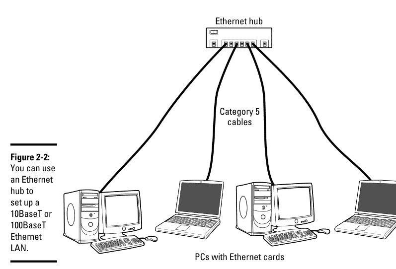

# 203 配置 TCP/IP 网络

当你在连接以太网卡的 PC 上安装本书附带 DVD-ROM 里的任何 Linux 发行版时，Linux 内核会自动检测以太网卡并安装相应的程序。安装程序还允许你使用 `TCP/IP` 网络。

Linux 内核在每次启动时都会加载以太网卡的驱动程序。要验证以太网驱动是否已加载，请在终端窗口中执行以下命令：
```


`dmesg | grep eth0`


在我其中一台 PC 上，输入该命令后我得到如下输出：
```
eth0: Real RTL8119 at 0x0fe20000, 00:76:f4:3b:b3, IRQ 161
eth0: Identified 8139 chip type 'RTL-8101'
eth0: link up, 100Mbps, full-duplex, lpa 04E51
eth0: no IPv6 routers present
```

你应该看到类似的内容，显示你的以太网卡名称和相关信息。

## 配置 TCP/IP 网络

当你使用 TCP/IP 网络时，安装将根据你提供的输入准备所有相应的配置文件。这意味着你通常不需要手动配置网络。然而，大多数 Linux 发行版都带有 GUI 工具来配置网络设备，以防需要进行某些更改。对于所有发行版，步骤如下：

例如，在 Ubuntu 中，你可以使用图形化网络配置工具。要启动 GUI 网络配置工具，选择 系统→偏好→网络连接。网络配置工具会显示一个选项页对话框，如图 2-3 所示。然后你可以通过对话框顶部出现的选项卡来配置网络。点击“添加”按钮会显示一个与图 2-4 所示类似的对话框。

在许多情况下，你可以设置网卡使其通过 DHCP 自动获取 IP 地址（当以太网卡连接到 DSL 或电缆调制解调器时）。如果你的网络没有 DHCP 服务器（通常内置在路由器中），你必须为网卡指定 IP 地址。如果你在运行私有网络工作，可以使用 `192.168.0.0` 到 `192.168.255.255` 范围内的 IP 地址。（其他地址范围预留给私有网络，但此范围足以大多数需求。）

## 将你的局域网连接到互联网

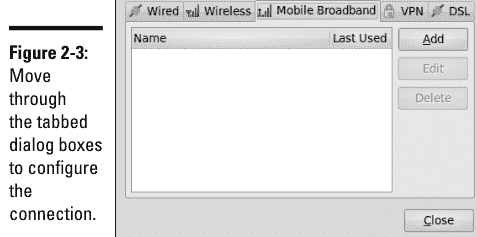

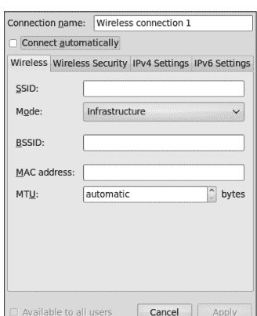

图 2-3：通过选项页对话框来配置连接。

图 2-4：添加选项允许你建立新连接。

如果你有几台 PC，可以使用 DSL 或电缆调制解调器将整个局域网连接到互联网。基本上，你可以将高速 DSL 或电缆调制解调器连接共享给局域网内的所有 PC。

本迷你书的第一章解释了如何设置 DSL 或电缆调制解调器。在本节中，我简要说明如何将局域网连接到互联网，以便所有 PC 都能访问互联网。

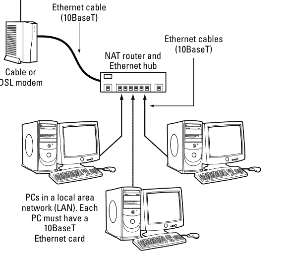

图 2-5：这显示了如何将你的局域网连接到互联网。


# 第 3 章：无线化

## 本章内容

- 理解无线以太网
- 设置你的无线硬件
- 了解如何配置无线接入点
- 配置无线网络

## 了解无线以太网网络

- **802.11b:** 在 2.4 GHz 频段（2.4 GHz 至 2.485 GHz）工作，最多支持三个不重叠的频段或通道。每个通道的最大比特率为 11 Mbps。802.11b 的缺点是是2.4 GHz 频段非常拥挤——许多设备（如微波炉、无线电话、医疗和科学设备以及蓝牙设备）都在 2.4 GHz 频段内工作。尽管如此，802.11b 在企业和家庭网络中仍然流行。

- **802.11a:** 在 5 GHz 频段（5.725 GHz 至 5.850 GHz）工作，最多支持八个重叠通道。每个通道的最大比特率为 54 Mbps。5 GHz 频段没有 2.4 GHz 频段那么拥挤，但 5 GHz 频段在欧洲未经批准。符合 802.11a 的是标准，某些无线接入点被设计用于处理双频 802.11a 和 802.11b。

- **802.11g:** 在 2.4 GHz 频段（与 802.11b 相同的频段）支持高达 54 Mbps 的数据速率。802.11g 通过名为 OFDM（正交频分复用）的技术实现了更高的速率，该技术也被 802.11a 使用。符合 802.11g 的设备已上市。802.11g 通过与 802.11b 相同的频段工作但承诺更高的数据速率并对 802.11 设备向下兼容，引起了关注。供应商目前提供同时支持 802.11b 和 802.11g 连接的接入点。

在所有情况下，用户看到的最大吞吐量都小于通道的总容量，因为该无线通道的所有用户都共享此容量。此外，随着用户 PC 与无线接入点之间距离的增加，数据传输速率会降低。

802.11 标准正在广泛使用，并支持的数据速率是现有吞吐量的五倍，范围是前代标准的双倍。

802.11g 接入点可以与其他（较慢的）802.11b 设备通信。你也可以使用 MIMO（多输入多输出）接入点，它支持多种 802.11 标准并实现了获得更高吞吐量和更好范围的技术。

要了解更多关于无线以太网的信息，请访问 `www-fi.org`，这是 Wi-Fi 联盟的首页，这是一个1999年成立非营利协会，旨在基于 IEEE 802.11 标准认证无线局域网产品的互操作性。


## 了解基础模式和自接模式（ad hoc）

802.11 标准为无线以太网定义了两种工作模式：自接模式（ad hoc）和基础模式（infrastructure）。自接模式简单是指两个或多个无线以太网卡在没有接入点的情况下相互通信。

基础模式是指所有无线以太网卡通过接入点相互通信并与有线局域网通信的方法。在本章的讨论中，假设你将无线以太网卡设置为基础模式。在配置文件中，被称为管理模式（managed mode）。

## 了解无线等效加密 (WEP)

802.11 标准包含了无线等效加密 (WEP)，用于保护通信免受窃听。WEP 依赖于 40 位或 104 位的密钥，密钥在移动站（如带有无线以太网卡的笔记本电脑）和接入点（也称为基站）之间共享。密钥用于在传输之前对数据包加密，并进行完整性检查以确保数据包在传输过程中未被修改。802.11 标准没有解释如何建立。在实践中，大多数用户使用所有移动站和接入点之间共享的密钥。然而，这种方法在大学校园等环境中扩展性较差，因为那里所有用户共享密钥——如果你分享过大型无线网络（如大学网络）就会知道。在这些无线网络中，你必须使用其他安全方法（如 SSH，安全外壳）来登录远程系统。然而，WEP 用于家庭网络是很好的。

WEP 有其缺点，但比没有要好。你可以在较小的无线局域网中使用它，在所有无线站之间共享相同密钥并不是一项繁重任务。

2003 年，Wi-Fi 联盟发布了名为无线保护访问 (WPA) 的规范，取代了现有的 WEP 标准并通过某些更改改进了安全性。例如，与使用固定密钥 WEP 不同，WPA 标准使用临时密钥完整性协议 (TKIP)，它为网络传输的每 10K 数据生成新密钥。这种 WPA 是向下兼容的。2004 年，Wi-Fi 联盟引入了 WPA 的后续版本：无线保护访问 2 (WPA2 —— 第二代 WPA 安全性）。WPA2 基于最终的 802.11i 标准和 RADIUS（远程认证拨入服务）服务器以提供更好的安全性。WPA2 使用高级加密标准 (AES) 进行数据加密。


### WEP 流加密足够吗？

WEP 使用 RC4 算法，这被称为流加密。这种算法的工作原理是通过短密钥生成无限的伪随机位。在发送数据之前，站点将此伪随机流与数据进行异或运算。接收端拥有相同的密钥并将伪随机流与接收位进行异或运算，从而得到解密输出。如果加密数据中的位发生翻转（从 0 变为 1），输出流也会发生翻转，这可以帮助攻击者破解消息。

此外，拦截到两个使用相同密钥流编码的消息的监听者可以生成原始消息的异或。这种知识足以发动攻击并破解消息。

WEP 和 IV 有两个主要问题：

- **完整性检查 (IC) 字段:** 为了确保数据包在传输过程中不修改，WEP 在每个包中使用完整性检查字段。这是通过使用 32 位循环冗余校验 (CRC-32) 实现的，作为数据的一部分进行检查。不幸的是，攻击者可以翻转加密消息中的任意位并调整校验和。

- **初始化向量 (IV):** 为了避免使用相同的密钥流加密加密两个消息，WEP 使用 24 位的 IV，该 IV 以明文（未加密）形式发送。有 2⁴ 种可能的初始化向量（对于快速机器来说不是大挑战），它们在用完后必须重复使用。在 16,777,216 个包中，这个数字听起来很大，但考虑一个以 11 Mbps 速率发送 1500 字节包的繁忙接入点。每个包有 12000 位，接入点每秒发送 916 个包（11,000,000/12,000）。在该速率下，接入点在 5 小时内发送 16,777,216 个包（16,777,216/18,315 秒 = 5 小时）。这意味着 IV 在 5 小时或更短时间内就会重复使用，因为许多消息小于 1500 字节。

## 设置无线硬件

要建立无线连接，你需要一个无线接入点以及在每台 PC 中配备一个无线网卡。你也可以在两个或多个带有无线网卡的 PC 之间建立自形成形（ad hoc）无线网络，但那只是这些 PC 之间的独立无线局域网。在本节中，我将关注以下场景：你想连接到一个已建立的局域网，该网络通过电缆调制器或 DSL 的有线 Internet 连接。

除了无线接入点外，你还需要连接互联网的电缆调制器或 DSL 连接，以及本微型书第一、二章介绍的 NAT 路由器和集线器。图 3-1 显示了通过现有电缆调制器或 DSL 连接进行无线上网的典型设置。

## 连接互联网

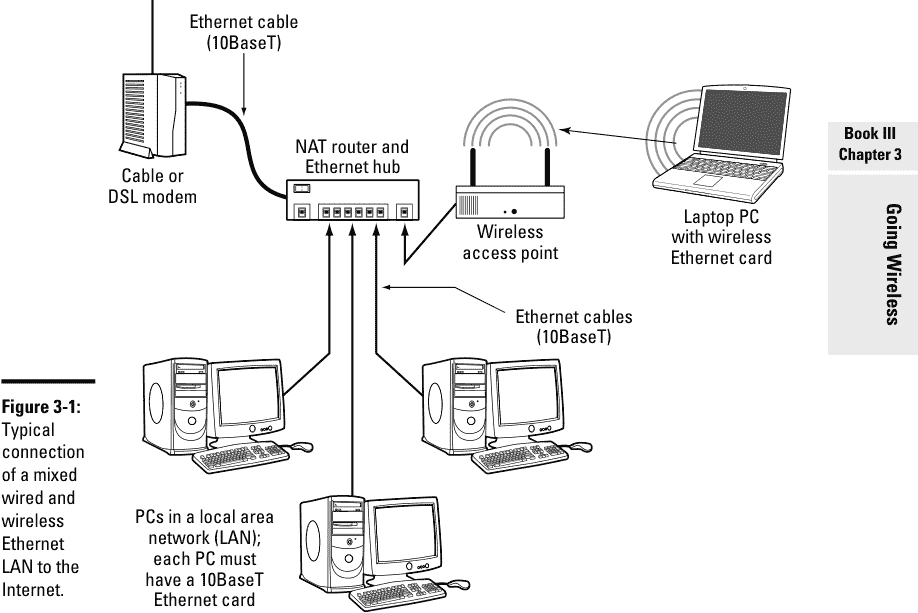

## 配置无线接入点

如图 3-1 所示，局域网同时拥有有线和无线 PC。在示例中，电缆或 DSL 调制器通过 NAT 路由器和集线器将局域网连接到 Internet。带有无线网卡的笔记本电脑通过连接到集线器一个 RJ-45 端口的无线接入点连接到局域网。要让桌面 PC 连接到此无线网络，可以使用 USB 无线网卡（连接到 USB 端口）。


如果你还没有为电缆或 DSL 连接购买 NAT 路由器和集线器，可以考虑购买内置无线接入点的路由器和集线器。

配置无线接入点涉及以下任务：

- 为无线网络设置名称。（该名称的技术术语是 ESSID。）
- 设置无线接入点与无线网卡通信的频率或通道。接入点和网卡必须使用相同的通道。
- 决定是否使用加密。
- 如果使用加密，则设置加密密钥的位数和加密密钥的值。对于加密密钥，接入点内部有 24 位；你只需要指定剩余的位数。因此，对于 64 位加密，你需要指定一个 40 位的密钥，对应 10 个十六进制数字。（十六进制数字是 0-9 或字母 A-F 的整数）。对于 128 位加密密钥，你需要指定 104 位，即 26 个十六进制数字。
- 设置无线网卡连接到接入点时使用的访问方法。你可以选择开放访问（open access）或共享密钥（shared key）。开放访问是典型的（即使使用加密也是如此）。
- 将无线接入点设置为基础设施（管理）模式运行。你用它将无线网卡连接到现有的以太网局域网。


配置无线接入点的具体方法取决于设备的品牌和型号；供应商提供了配置无线接入点的说明。你通常通过 Windows PC 上的图形客户端应用程序进行配置。如果你启用了加密，请记住加密密钥；你必须为笔记本电脑或桌面电脑上的每个无线网卡指定相同的密钥。

## 配置无线网络

在你的 Linux 笔记本电脑上，PCMCIA 或 PC 卡管理器会识别网卡并为该网卡加载相应的驱动程序。Linux 将网卡视为另一个以太网设备并并分配一个设备名称，如 `eth0` 或 `eth1`。如果笔记本电脑中已经有一块以太网卡，它将获得 `eth0` 设备名称，而无线 PC 卡将成为 `eth1` 设备。

你必须配置某些参数以启用无线网卡与无线接入点的通信。例如，你可以指定分配接入点的无线网络名称，且加密设置必须与接入点的设置匹配。你通常可以使用图形化网络配置工具配置一切——只需选择“无线网络”（Wireless Network）选项并填写所需信息。

例如，在 Fedora 中，从 GNOME 桌面选择“系统>网络连接”。然后选择“无线”（Wireless）选项卡并点击“添加新的无线设备”（见图 3-2）。然后你可以选择无线设备并进入一个可以配置无线连接的窗口。特别是，将模式（Mode）设置为“基础设施”（Infrastructure），指定无线网络名称（你想连接的网络），并设置加密密钥（如果有）。你可以设置通过 DHCP 获取 IP 地址（这是一种从网络上的服务器获取网络配置参数（包括 IP 地址）的协议）。完成后，返回网络配置工具的主窗口，选择新的无线设备并点击“激活”（Activate）按钮。如果一切顺利，无线网络将在几分钟后启动运行。


图 3-2：在 Fedora 中配置新的无线连接。

在 Fedora 中，加密密钥被保存。对于一个设备名称为 `eth1` 的无线以太网卡，加密密钥存储在 `/etc/sysconfig/network-scripts/keys-eth1` 文件中。例如，该文件包含如下：
```


KEY=`1fdf3dfefe`

该密钥有 16 个十六进制数字（对应 40 位密钥，例如 `1fdf3dfefe`）或 26 个十六进制数字（对应 104 位密钥）。密钥长度为 64 位和 128 位，但加密算法会自动生成 24 位密钥，因此你只需要指定剩余的位数。密钥越长，安全性越高。

如果你编辑了 Fedora 中无线以太网配置文件的参数，使用以下命令在编辑配置后重新激活无线网络接口：

```
etc/init.d/network restart
```

## 设置无线硬件

要建立无线连接，你需要一个无线接入点以及在每台 PC 中配备一个无线网卡。你也可以在两个或多个带有无线网卡的 PC 之间建立自形成形（ad hoc）无线网络，但那只是这些 PC 之间的独立无线局域网。在本节中，我将关注以下场景：你想连接到一个已建立的局域网，该网络通过电缆调制器或 DSL 的有线 Internet 连接。

除了无线接入点外，你还需要连接互联网的电缆调制器或 DSL 连接，以及本微型书第一、二章介绍的 NAT 路由器和集线器。图 3-1 显示了通过现有电缆调制器或 DSL 连接进行无线上网的典型设置。

## 连接互联网


## 配置无线接入点

如图 3-1 所示，局域网同时拥有有线和无线 PC。在示例中，电缆或 DSL 调制器通过 NAT 路由器和集线器将局域网连接到 Internet。带有无线网卡的笔记本电脑通过连接到集线器一个 RJ-45 端口的无线接入点连接到局域网。要让桌面 PC 连接到此无线网络，可以使用 USB 无线网卡（连接到 USB 端口）。


如果你还没有为电缆或 DSL 连接购买 NAT 路由器和集线器，可以考虑购买内置无线接入点的路由器和集线器。

## 配置无线接入点

配置无线接入点涉及以下任务：

- 为无线网络设置名称。（该名称的技术术语是 ESSID。）
- 设置无线接入点与无线网卡通信的频率或通道。接入点和网卡必须使用相同的通道。
- 决定是否使用加密。
- 如果使用加密，则设置加密密钥的位数和加密密钥的值。对于加密密钥，接入点内部有 24 位；你只需要指定剩余的位数。因此，对于 64 位加密，你需要指定一个 40 位的密钥，对应 10 个十六进制数字。（十六进制数字是 0-9 或字母 A-F 的整数）。对于 128 位加密密钥，你需要指定 104 位，即 26 个十六进制数字。
- 设置无线网卡连接到接入点时使用的访问方法。你可以选择开放访问（open access）或共享密钥（shared key）。开放访问是典型的（即使使用加密也是如此）。
- 将无线接入点设置为基础设施（管理）模式运行。你用它将无线网卡连接到现有的以太网局域网。


配置无线接入点的具体方法取决于设备的品牌和型号；供应商提供了配置无线接入点的说明。你通常通过 Windows PC 上的图形客户端应用程序进行配置。如果你启用了加密，请记住加密密钥；你必须为笔记本电脑或桌面电脑上的每个无线网卡指定相同的密钥。

## 配置无线网络

在你的 Linux 笔记本电脑上，PCMCIA 或 PC 卡管理器会识别网卡并为该网卡加载相应的驱动程序。Linux 将网卡视为另一个以太网设备并并分配一个设备名称，如 `eth0` 或 `eth1`。如果笔记本电脑中已经有一块以太网卡卡它将获得 `eth0` 设备名称，而无线 PC 卡将成为 `eth1` 设备。

你必须配置某些参数以启用无线网卡与无线接入点的通信。例如，你可以指定分配接入点的无线网络名称，且加密设置必须与接入点的设置匹配。你通常可以使用图形化网络配置工具配置一切——只需选择“无线网络”选项并填写所需信息。

例如，在 Fedora 中，从 GNOME 桌面选择“系统>网络连接”。然后选择“无线”选项卡并点击“添加新的无线设备”（见图 3-2）。然后你可以选择无线设备并进入一个可以配置无线连接的窗口。特别是，将模式设置为“基础设施”，指定无线网络名称（你想连接的网络），并设置加密密钥（如果有）。你可以设置通过 DHCP 获取 IP 地址（这是一种从网络上的服务器获取网络配置参数（包括 IP 地址）的协议）。完成后，返回网络配置工具的主窗口，选择新的无线设备并点击“激活”按钮。如果一切顺利，无线网络将在几分钟后启动运行。


图 3-2：在 Fedora 中配置新的无线连接。

| 编辑无线连接 1 |
| :--- |
| 连接名称：无线连接 1 |
| ☑ 自动连接 |
| 无线 | 无线安全 | IPv4 设置 | IPv6 设置 |
| SSID: |
| 模式: 基础设施 |
| BSSID: |
| MTU: 自动 字节 |
| ☐ 对所有用户可用 [ 应用 ] |

## 216 配置无线网络

在 SUSE Linux 中，使用 YaST 配置无线网络。SUSE 将无线配置参数存储在名称以 `ifcfg-wlan` 开头的文件中，后面跟着数字 0 或 1，取决于无线网络接口的序列号。配置文件存储在 `/etc/sysconfig/network` 目录中。以下是 SUSE 中文件中一个典型的无线配置参数列表：

```
WIRELESS_MODE='Managed'

WIRELESS_ESSID='HOME'

WIRELESS_NICK=''

WIRELESS_RATE='auto'

WIRELESS_AUTH_MODE='open'

WIRELESS_KEY_0='0123-4567-89'
```

检查无线网络接口的状态，请输入以下命令：
`iwconfig`

这里是一个带有无线以太网网卡的 Fedora 笔记本电脑的典型输出。（其他 Linux 发行版的输出也应该相似。）

```
no wireless extensions.

eth0 no wireless extensions.

sid0 no wireless extensions.

eth IEEE 802.11b ESSID:HOME* Nickname:localhost,localdomain

Mode:Managed Frequency:2437 MHz Access Point: 00:30:AB:06:E2:5D

Rate:11 Mbps Sensitivity:any

Retry:4 RTS thoff:off

Encryption key:IPF-3FDE-FE Security mode:open

Power Management:off

Link Quality=91/92 Signal level=-40 dB Noise level=-91 dBm

Rx invalid nwid:0 Rx invalid frag:27

Tx excessive retries:0 Invalid misc:0 Missed beacon
```


在这里，`eth`接口指的是无线网卡。我修改了加密密钥和其他参数以隐藏这些细节，但示例输出显示了当无线链路运行时你通常会看到的内容。

# 第 4 章：管理网络

## 本章内容

- 了解 TCP/IP 配置文件
- 检查 TCP/IP 网络
- 在启动时配置网络

和 Linux 中几乎其他东西一样，TCP/IP 设置是准备许多配置文件的问题（可以使用任何文本编辑器编辑的文本文件）。大多数这些配置文件位于`/etc`目录中。Linux 安装程序试图通过隐藏 TCP/IP 配置文件的详细信息来提供帮助。尽管如此，如果你知道文件的名称及其用途，那么在必要时手动编辑文件会更容易。

## 发现 TCP/IP 配置文件

在安装 Linux 时，可以配置 TCP/IP 网络。但是，如果你想有效地管理网络，你需要熟悉 TCP/IP 配置文件，以便在必要时编辑这些文件。（例如，如果你想检查域名服务器是否指定正确，你必须了解`/etc/resolv.conf`文件，它存储了域名服务器的 IP 地址。）

表 4-1 总结了基本的 TCP/IP 配置文件。我将在接下来的章节中描述这些配置文件。

### 218 发现 TCP/IP 配置文件

| 表 4-1 | 基础 TCP/IP 网络配置文件 |
| --- | --- |
| 此文件 | 包含以下内容 |
| `/etc/hosts` | 本地网络的 IP 地址和主机，以及你经常访问的任何其他系统 |
| `/etc/networks` | 网络名称和 IP 地址 |
| `/etc/hosts.conf` | 如何将主机名转换为 IP 地址的指令 |
| `/etc/resolv.conf` | 域名服务器的 IP 地址 |
| `/etc/hosts.allow` | 关于哪些系统可以访问你系统互联网的指令 |
| `/etc/hosts.deny` | 关于哪些系统必须拒绝访问你系统互联网服务的指令 |
| `/etc/nsswitch.conf` | 如何将主机名转换为 IP 地址的指令 |


> 文本文件中的井号 (`#`) 表示注释。

### `/etc/hosts`

`/etc/hosts`文本文件包含本地区域的 IP 地址和主机名列表。在没有域名服务器的情况下，系统上的任何网络程序都会查询此文件以确定与主机名对应的 IP 地址。将`/etc/hosts`视为本地电话簿，你可以在其中查询本地主机的 IP 地址（而不是电话号码）。

以下是一个系统的`/etc/hosts`文件，显示了典型局域网上其他主机的 IP 地址和名称：

```
127.0.0.1 localhost.localdomain

# 局域网上的其他主机

192.168.0.100 lnbp933

192.168.0.50 lnbp600

192.168.0.200 lnbp200

192.168.0.233 lnbp233

192.168.0.40 lnbp400
```

如示例所示，文件中的每行都以 IP 地址开头，随后是该地址的主机名。（你可以为给定的 IP 地址设置多个主机名。）在某些发行版中，如 openSUSE 10.3，`/etc/hosts`文件具有以下内容：IP-完全限定主机名、短主机名。在所有情况下，主机名后的任何内容（如短主机名）都被视为别名。

### 发现 TCP/IP 配置文件 219

### `/etc/networks`

`/etc/networks`是另一个包含网络名称和 IP 地址的文本文件。这些网络名称通常用于路由命令 (`/sbin/route`) 以指定网络名称而不是 IP 地址。

如果你的 Linux 电脑没有`/etc/networks`文件，不要感到惊讶。TCP/IP 网络在没有该文件的情况下工作。事实上，Linux 安装程序不会创建`/etc/networks`。

### `/etc.hosts`

Linux 使用一个名为`/etc/hosts`的特殊库来确定 IP 地址。这是一个`/etc/hosts`示例：

（注：第 244-245 页的 OCR 文本非常混乱且重复。我保留了源文中提供的独特句子。）

### `/etc/resolv.conf`

`/etc/resolv.conf`是另一个用于解析器获取 IP 地址的文本文件。这是一个`/etc/resolv.conf`示例：

```
nameserver 8.8.8
nameserver 8.8.4
```

### `/etc/hosts.allow`

`/etc/hosts.allow`文件指定哪些主机可以访问你系统的互联网服务（如 TELNET 和 FTP）。在启动服务之前会查询它。只有`hosts.allow`文件中的条目意味着请求主机允许使用。

### `/etc/hosts.deny`

`/etc/hosts.deny`文件是`/etc/hosts.allow`的相反。当`hosts.allow`指定哪些主机可以访问你系统的互联网服务（如 TELNET 和 TFTP）时，`hosts.deny`文件标识了

# 检查 TCP/IP 网络 221

必须被拒绝服务的主机。如果`/etc/hosts.allow`文件中没有适用于请求主机的规则，则会查询`/etc/hosts.deny`文件。如果`hosts.deny`文件中有适用于该主机的规则，则拒绝服务。

`/etc/hosts.deny`文件中的条目格式与`/etc/hosts.allow`文件中的条目相同；它们采用`服务器:IP地址`的格式，其中`服务器`指提供特定 Internet 服务的程序名称，`IP地址`标识不被允许使用该服务的主机。

如果您已经在`/etc/hosts.allow`文件中设置了用以访问特定主机的条目，您可以在`/etc/hosts.deny`中放置以下行，以拒绝所有主机访问您系统上的任何服务：

```
ALL:ALL
```

要了解`/etc/hosts.deny`文件中条目的详细语法，请在终端窗口的 shell 提示符处输入`man hosts.deny`。

### `/etc/nswitch.conf`

`/etc/nswitch.conf`文件被称为名称切换（NSS）文件，它指定了解析器库、NIS、NIS+ 以及本地配置文件（如`/etc/hosts`和`/etc/shadow`）等服务如何交互。

NIS 和 NIS+ 是网络信息系统——另一种类型的名称查找服务。较新版本的 Linux 内核使用`/etc/nswitch.conf`文件来确定优先级：是本地配置文件、DNS（域名命名系统）等服务还是 NIS。

例如，`/etc/nswitch.conf`文件中的以下 hosts 条目表示，解析器库首先尝试`/etc/hosts`文件，然后尝试 NIS+，最后尝试 DNS：

```
hosts: files nisplus dns
```

您可以在终端窗口中输入`man nswitch.conf`来获取更多关于`/etc/nswitch.conf`文件的信息。

## 检查 TCP/IP 网络

在配置以太网和 TCP/IP 后（无论 Linux 安装期间还是通过运行网络配置工具或命令），您就可以没有问题地使用各种网络应用程序了。如果遇到问题，Linux 包含了几个工具来帮助您监控和诊断问题。

### 222 检查 TCP/IP 网络

### 检查网络接口

使用`/sbin/ifconfig`命令查看当前配置的网络接口（或使用`ifconfig`，将 IP 地址与网络设备关联）。如果您在运行`ifconfig`时带有任何命令行，该命令将显示有关当前网络接口的信息。以下是使用`/sbin/ifconfig`的典型输出：

```
eth0 Link: Ethernet  addr:00:08:54:c1:c1:60
inet addr:192.168.1.2/24  mask:255.255.255.0
inet6 addr:fe80::201:74ff:fec60/64  Scope:Link
UP BROADCAST MULTICAST MTU:1500 Metric:1
TX packets:51683 errors:0 dropped:0 overruns:0 frame:0
RX packets:57487 errors:0 dropped:0 overruns:0 carrier:0
collisions:0 txuelen:10000
eth1 Link: Ethernet  addr:00:02:d8:bc:58:c5
inet addr:192.168.1.3/24  mask:255.255.255.0
inet6 addr:fe80:d402:d8ff:fedc60/64  Scope:Link
UP BROADCAST MULTICAST MTU:1500 Metric:1
TX packets:38333 errors:0 dropped:0 overruns:0 frame:0
RX packets:54262 errors:0 dropped:0 overruns:0 carrier:0
```


```
collisions:0 txuelen:10000

RX bytes:260914 (244.4 KIB)  TX bytes:2891581 (2.7 MIB)

Interrupt: 1 Base address:0x0000

lo Link:Local Loopback

inet addr:127.0.0.1/8  mask:255.0.0.0

inet6 addr:::1/128  Scope:Host

UP LOOPBACK RUNNING MTU:16436 Metric:1

TX packets:24256 errors:0 dropped:0 overruns:0 frame:0

RX packets:24256 errors:0 dropped:0 overruns:0 carrier:0

collisions:0 txuelen:10000

RX bytes:2891581 (2.7 MIB)  TX bytes:2891581 (2.7 MIB)
```

这显示三个网络——环回接口（`lo`）和两个以太网卡（`eth0` 和 `eth1`）——当前在系统中处于激活状态。对于每个接口，您可以看到 IP 地址以及数据包交付和发送的统计信息。如果 Linux 系统运行拨号 PPP 链路，您还会在输出中看到 `/pp0` 接口的项目。

## 检查 IP 路由表 `/sbin/route`，同样

另一个网络配置在您不带命令行参数运行时它会提供状态信息。如果您在检查与另一个主机（通过 IP 地址指定）的连接时遇到问题，请检查 IP 路由表查看是否指定了默认网关。然后检查网关的路由表，以确保通往目的的路径是通的。典型的输出如下：

```
Kernel IP table

Destination Gateway Genmask Metric Use Iface

0.0.0.0 0.0.0.0 0.0.0.0 0 eth0

192.168.1.0 0.0.0.0 255.255.255.0 0 eth0

127.0.0.0 0.0.0.0 255.0.0.0 0 lo
```

在这种情况下，以太网和环回接口路径是通的。

## 223 检查 TCP/IP 网络

### 检查网络

要检查到主机的连通性，`ping` 命令使用互联网控制消息协议（ICMP）消息。这里是 `ping` 命令显示的示例：

```
PING 1.1

64 bytes from 192.168.1.1: icmp_seq=1 ttl=64 time=0.452 ms

PING 192.168.1.

64 bytes from 192.168.1.1: icmp_seq=2 ttl=64 time=0.436 ms

---

4 packets transmitted, 4 received, 0% packet loss

rtt min/avg/max/mdev = 0.436/0.441/0.452/0.008 ms
```

`ping` 命令依赖 ICMP 消息。然而，某些防火墙被配置为拦截它们。如果 `ping` 失败，可能是主机关闭或被拦截。

## 224 检查 TCP/IP 网络

### 检查网络状态

要检查网络状态，使用 `netstat` 命令。它显示各种类型的网络连接（如 TCP）。通过输入 `netstat -a` 查看接口状态，可以得到类似的输出：

```
Kernel Interface table

iface MTU RX-OK RX-ERR RX-DRP TX-OK TX-ERR TX-OVR Flg

eth0 1500 613175 0 174695 0 0 BMRU

el 1500 42298 0 1375 0 0 BMRU

lo 16436 32255 0 32255 0 LR
```

在这种情况下，输出显示了环回和以太网接口的状态。表 4-2 描述了列的含义。

| 表 4-2 内核接口表列的含义 |
| 列 | :--- |
| Iface | 接口名称 |
| MTU | 最大传输单元——数据包可以包含的最大字节数 |
| Met | 接口的指标值——软件在决定通过哪个接口发送数据包时使用的距离（跳数） |
| RX-OK, TX-OK | 接收（RX）或发送（TX）无错误包数量 |
| RX-ERR, TX-ERR | 错误包数量 |
| RX-DRP, TX-DRP | 丢弃包数量 |
| RX-OVR, TX-OVR | 因溢出丢失的数据包 |

> A = 接收组播；B = 广播；D = 开启调试；L = 环回接口（注意 `lo` 上的标记），M = 接收所有；N = 此接口无 ARP；P = 点对点接口；R = 接口运行；U = 接口启用

另一个实用的选项形式是 `netstat -t`，它显示所有活跃的 TCP 连接。以下是在某台 Linux PC 上输入 `netstat -t` 的典型结果：

### 检查 TCP/IP 网络

活跃的 Internet 连接（不含服务器）

| 协议 (Proto) | 接收队列 (Recv-Q) | 发送队列 (Send-Q) | 本地地址 (Local Address) | 远程地址 (Foreign Address) | 状态 (State) |
| :--- | :--- | :--- | :--- | :--- | :--- |
| tcp | 0 | 0 | localhost:2654 | localhost:1024 | 已建立 (ESTABLISHED) |
| tcp | 0 | 0 | localhost:1024 | localhost:2654 | 已建立 (ESTABLISHED) |
| ... | |

在这种情况下，输出列显示了协议（Proto）、接收队列和传输队列中的字节数（Recv-Q, Send-Q）、以 `hostname:service` 格式显示的本地 TCP 端口（Local Address）、远程端口（Foreign Address）以及连接状态。

使用 `netstat -ta` 查看所有连接——包括已建立的连接和你的 Linux 系统正在监听（尚未建立连接）的连接。例如，这里是 `netstat -ta` 命令的典型输出：

```
Active Internet connections (servers and established)

| Proto | Recv-Q | Send-Q | Local Address | Foreign Address | State |

| :--- | :--- | :--- | :--- | :--- | :--- |

| tcp | 0 | 0 | *:3279 | * | LISTEN |

| tcp | 0 | 0 | * | * | LISTEN |

| tcp | 0 | 0 | *:sunprpc | * | LISTEN |

| tcp | 0 | 0 | *:localhost.domainip | * | LISTEN |

| tcp | 0 | 0 | *:localhost.domainip:5315 | * | LISTEN |

| tcp | 0 | 0 | 192.168.0.9:45678 | www.redhat.com:http | ESTABLISHED |

| tcp | 0 | 0 | 192.168.0.9:45875 | www.redhat.com:http | ESTABLISHED |

| tcp | 0 | 0 | *:ffff:192.168.0.3:4932 | * | ESTABLISHED |
```

## 嗅探网络包

嗅探网络包听起来像某种非法行为，不是吗？嗅探简单是指查看 TCP/IP 网络数据包。其概念是捕获所有网络数据包以便对它们进行检查。

## 管理网络

如果你需要嗅探 TCP/IP 数据包，可以使用 `tcpdump`，这是一个在 Linux 下的命令行工具。正如其名称所示，它会转储（打印）TCP/IP 网络数据包的头部。

要使用 `tcpdump`，请以 root 身份登录并在终端窗口中输入 `tcpdump` 命令。你可能希望将输出保存到文件中，并在稍后检查该文件。否则，`tcpdump` 会在窗口中显示飞闪而过的数据包。例如，为了在一个名为 `tdout` 的文件中捕获 1000 个数据包并尝试将 IP 地址转换为名称，请输入以下命令：

```bash
tcpdump -c 1000 > tdout
```

捕获 1000 个数据包后，`tcpdump` 就会退出。然后你可以检查输出文件 `tdout`。它是一个文本文件，因此你可以直接用文本编辑器打开它，或者输入 `tcpdump -r` 来查看捕获的数据包。

为了满足你的好奇心，这里是 `tcpdump` 典型输出的几行：

```
20:05:57.723621 arp who-has 192.168.0.1 tell LNBECAN.nrockv01.md.com.net
```


```
20:05:57.723682 arp reply 192.168.0.1 is-at 0:9f5:44:78:fc

20:06:01.723631 LNHBECXAN.nrockv01.md.com.net:1038 > 192.168.0.6.auth: s=58532,mss=1460,0(10) win 5840,mss=1460,ackOK,timeout 7370360 (71) ack 1 win 5840 (DF) noop,wscale=0 (DF)

20:06:02.737002 LNHBECXAN.nrockv01.md.com.net.ftp > 192.168.0.6.1596: P 1:172

20:06:02.926335 192.168.0.6.1596 > LNHBECXAN.nrockv01.md.com.net.ftp: ack 72 win 65534 (DF)

20:06:05.462841 192.168.0.6.1596 > LNHBECXAN.nrockv01.md.com.net.ftp: P 1:172

20:05:57.723621 ...
```


# 在启动时配置网络

在 KDE 中，你可以在搜索框中输入“会话管理器”（Session Manager）来启动控制中心，并配置系统的默认操作，如图 4-2 所示。

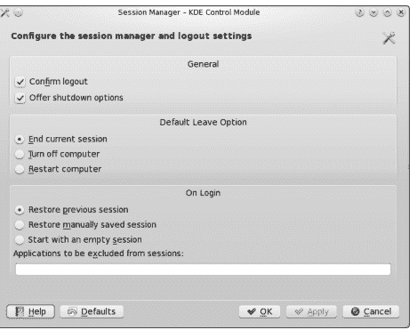

**图 4-2：** 会话管理器。

在 KDE 和 GNOME 中，你可以运行登录管理器（Login Manager）来选择系统的默认操作。图 4-3 显示了 Fedora 中登录管理器对话框的示例（取决于你使用的版本，登录管理器可能默认未安装）。如果安装了用于处理多个操作系统的启动管理器，则图 4-3 中的“启动管理器”选项将变为可用。

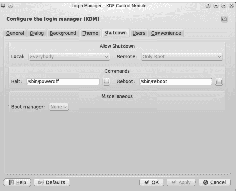

**图 4-3：** 登录管理器提供了几个选项。

网络管理第 4 章

## 第四 卷
## 互联网
### Rich Tennant 著《第五波浪》


## 目录摘要

+   第 1 章：Linux 下的电子邮件与即时消息 (IM) ............................................................ 233
+   理解电子邮箱 ................................................................. 234
+   评估 Linux 中的邮件读取器和 IM 客户端 ........................................................ 236
+   Linux 中的电子邮件 ................................................................................... 237
+   Linux 中的即时消息 ................................................................................. 246
+   第 2 章：浏览网页 ....................................................................... 249
+   发现网络 ................................................................................... 249
+   Linux 下的网页浏览 .......................................................................... 254
+   第 3 章：阅读新闻组和 RSS 订阅 ................................................................ 261
+   理解新闻组 ....................................................................... 261
+   从你的 ISP 阅读新闻组 ................................................................ 266
+   在网站上阅读和搜索新闻组 ........................................ 272
+   阅读 RSS 订阅 ................................................................................. 273
+   第 4 章：使用 FTP ................................................................................... 277
+   使用图形化 FTP 客户端 ................................................................... 277
+   使用命令行 FTP 客户端 .......................................................... 283

## 第 1 章：Linux 下的电子邮件与 IM

**本章内容**

-   理解电子邮件
-   查看邮件读取器和 IM（即时消息）客户端
-   介绍 Evolution、Thunderbird 和 KMail
-   使用 Pidgin 和 Kopete 进行即时消息通信

电子邮件（e-mail）是互联网的“杀手级应用”。通过电子邮件，你可以与互联网上的任何人交换消息和文档：朋友、熟人、爱人以及完全陌生的的人。在正常情况下，你可以从任何 Internet 主机向世界任何地方发送消息，这些消息通常在几分钟内到达目的地——这是纸质邮件（也称为蜗牛信，这个比名很贴切）无法做到的。

电子邮件消除了为了电话通信而尝试安排日程和可用时间的烦恼。当你发送电子邮件时，它会在收件人的信箱中等待，直到收件人方便时阅读。同样，当人们给我发邮件时，我可以在方便时进行阅读和回复。

Linux 自带了几个邮件客户端——也称为邮件读取器——你可以使用它们从你的互联网服务提供商（ISP）或许多网站下载邮件。安装后，你可以读取和发送电子邮件客户端。在本章中，我提到了 Linux 中可用的几个邮件客户端，并向你介绍了其中几个。由于它们之间存在相似性，通常当你学会了其中一个，就可以轻松地使用任何邮件读取器。

另一种联系方式更符合当今世代的习惯。我指的是 IM——即时消息。IM 基本上是一一对一的聊天，大多数 IM 实现都包含了 AOL Messenger（或 AIM）的 IM 客户端，以及其他即时消息协议，如 Jabber、ICQ、MSN Messenger、Yahoo!、Gadu-Gadu、IRC（网络相对聊天）和 SMS（短信息服务或短信）。我在本章中简要描述了几个 IM 客户端。


第四 卷
第 1 章
Linux 下的电子邮件

## 236 评估 Linux 中的邮件读取器和 IM 客户端

在功能强大的邮件读取器上的 HTML 消息，消息将以其完整面貌呈现，带有华丽的字体和嵌入图形。

尽管 HTML 消息很不错，但当你使用基于文本的邮件读取器时，它们无法正确显示。

设置向导引导你完成以下步骤：

+   在身份界面输入你的姓名和电子邮件地址，然后点击“下一步”按钮。

例如，如果你的电子邮件地址是 `jdoe@someplace.com`，这就是你要输入的内容。你可能还可以选择将其作为默认账户并添加如组织名称等信息。

邮件读取器还是基于文本的时代，但现在已经了。现在的邮件读取器是图形化的。

IM（即时消息）是一个较新的现象，但它们处于。

| 表 1-1 邮件读取器和 IM | 描述 |
| :--- | :--- |
| KMail | 支持 POP3 和 IMAP4 的 KDE 电子邮件客户端 |
| Thunderbird | Mozilla Mail 的重新设计 |
| Evolution | 包含电子邮件、日历、联系人管理和在线任务列表个人信息管理器 (PIM) |
| Pidgin | 支持多种消息协议的 GNOME IM 客户端，该软件曾名为 Gaim |
| Kopete | 支持多种消息协议的 KDE IM 客户端 |

## Linux 下的电子邮件

如果在你的发行版中没有看到特定的邮件或 IM 客户端，你可以从互联网轻松下载并安装它们。

## Linux 下的电子邮件

每个 Linux 的 GUI 桌面都有或两个默认邮件客户端。GNOME 桌面通常提供 Evolution，而 KDE 桌面则使用 KMail。GNOME 和 KDE 桌面通常都带有 Mozilla 浏览器，Mozilla 也包含一个邮件客户端。

Debian 和 Fedora 包含了 KMail 和 Evolution（分别对应 KDE 和 GNOME 界面）。Ubuntu 提供 Evolution 作为默认客户端。SUSE 使用 KMail 作为默认邮件读取器，Xandros 则提供了 KMail 和 Thunderbird。

在接下来的章节中，我简要向你介绍 Evolution、Thunderbird 和 KMail。所有邮件客户端都很直观，因此你不需要过多学习就能有效地使用它们。

# 在 Linux 中发送电子邮件

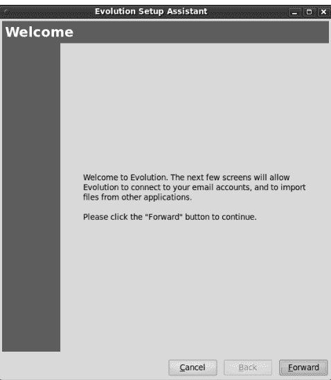

**图 1-2：** 设置向导引导完成初始设置。

- 2. **设置接收电子邮件的选项，然后点击下一步（Forward）。** 选择邮件下载协议 —— POP 或 IMAP。提供邮件服务器名称（例如，`mail.comcast.net`）。当 Evolution 首次连接邮件服务器时，系统会提示你输入密码。
- 3. 提供有关接收电子邮件的更多信息 —— 检查邮件的频率、是否在服务器上保留邮件等 —— 然后点击下一步（Forward）。
通常，你希望下载邮件并将其从服务器上删除（否则当你的邮件堆积时，ISP 会抱怨）。
- 4. **设置以下发送电子邮件的选项，完成后点击下一步（Forward）：**
   a. **选择服务器类型为 SMTP。**
   b. **输入服务器名称，例如 `smtp.comcast.net`。**
   c. **如果服务器要求你登录，请勾选服务器要求验证（Server Requirements Authentication）复选框。**
   - d. 输入你的用户名 —— 你登录 ISP 邮件服务器时使用的相同用户名。

通常情况下，发送邮件不需要登录；只有在接收（下载）邮件时才需要登录。

- 5. （可选）为此电子邮件帐户一个描述性名称，例如“工作”或“个人”。
- 6. 点击下一步（Forward）。
- 7. 点击应用（Apply）完成 Evolution 的设置。

完成一次性设置后，Evolution 将打开其主窗口，如图 1-3 所示。

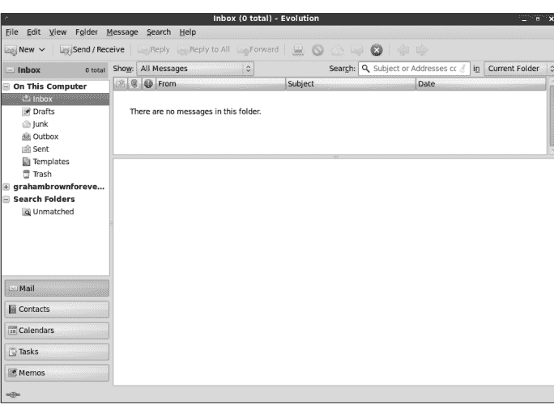

> 图 1-3：Evolution 处理邮件、日历、联系人管理和待办事项。

Evolution 的主显示区域垂直分为两个窗口：左侧是一个窄面板，列有快捷按钮 —— 邮件、联系人、日历、任务、备忘录；右侧是一个较大的面板，Evolution 在此处显示与当前选择快捷图标的信息。在图 1-3 中，Evolution 显示的是邮件收件箱。

你可以点击左侧窗口中的快捷按钮来切换不同的视图。这些按钮提供了访问个人信息管理（PIM）所有必要组件的通道 —— 电子邮件、联系人、日历、任务列表和备忘录。你会发现在 Evolution 中执行这些任务非常直观。

# 第四部分第一章 在 Linux 中发送电子邮件

# Linux 邮件

要访问你的电子邮件，点击收件箱（Inbox）图标。Evolution 会打开你的收件箱，如图 1-4 所示。如果你开启了定期自动检查邮件的功能，Evolution 会提示你输入邮件密码，提供让 Evolution 未来记住密码的选项，并下载你的邮件。电子邮件收件箱看起来与其他邮件客户端的收件箱相似，就像 Outlook Express 的收件箱一样。

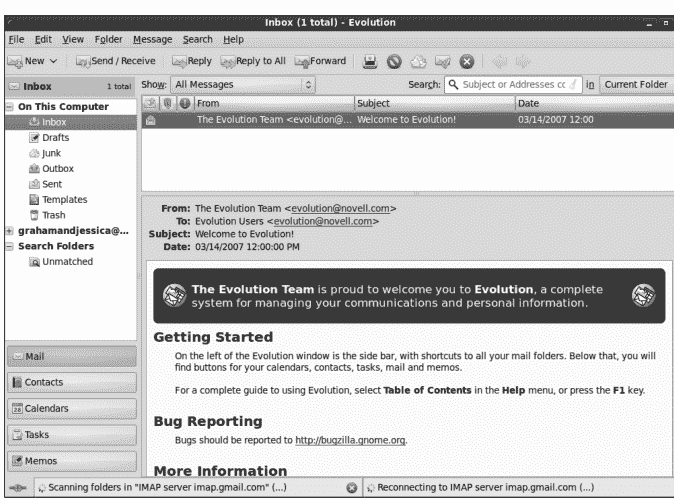

图 1-4：在窗口中阅读邮件。
Evolution 收件箱。

## 入门
Evolution 窗口左侧是侧边栏，用于访问你所有的邮件文件夹。在下方，你会找到日历、联系人、邮件和示例的按钮。

要使用 Evolution 查看邮件，请在帮助菜单中选择目录（Table of Contents），或按 F1 键。

### 报告 Bug
Bug 应报告至 `http://bugzilla.gnome.org`。

### 更多信息

要阅读消息，点击收件箱上方窗口中的消息，消息文本将出现在下方窗口中。图 1-4 显示了我们如何收到 Evolution 团队的邮件。

要回复当前消息，点击工具栏上的回复（Reply）按钮。会弹出一个消息撰写窗口。你可以编写回复并点击工具栏上的发送（Send）按钮发送回复。简单，不是吗？

要发送电子邮件，在 Evolution 工具栏上选择新建>邮件消息（New>Mail Message），或直接点击新建（New）图标。会出现一个新的消息撰写窗口。你可以在此窗口中输入信息；编写完成后，点击发送（Send）图标。

Evolution 带有丰富的在线帮助。从 Evolution 菜单中选择帮助>内容（Help>Contents），你版本的 Evolution 用户指南就会出现在窗口中。然后你可以在该窗口中阅读用户指南。


## 介绍 Thunderbird

Mozilla Thunderbird 3 是 Mozilla Mail 的重新设计，后者是随 Mozilla 浏览器（Netscape Communicator 的开源继任者）一起提供的。随着这款阅读器日益受欢迎，越来越多的发行版包含了它，甚至将其设置为默认主阅读器。Thunderbird 作为 Firefox 浏览器的补充非常好，运行速度比 Evolution 和 Mozilla Mail 快。一个好处是它不仅运行在 Linux 上，还运行在包括 Microsoft Windows 和 Mac OS X 在许多其他操作系统上，使其成为组织可以标准的阅读器。

安装 Thunderbird 后，你可以从选择应用程序：Thunderbird 开始。图 1-5：
输入你的电子邮件

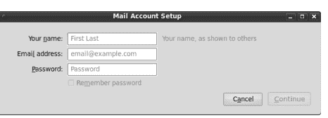

图 1-5：
在窗口中输入你的电子邮件。
Evolution 收件箱。（注：文字写着 Evolution Inbox 但语境是 Thunderbird，我将保留原文）


# 在 Linux 中发送电子邮件

设置完成后，会出现 Thunderbird 的主窗口。你可以看到左侧窄栏整理的文件夹。（参考图 1-6）你设置的每个电子邮件帐户都有一组文件夹。默认情况下你有以下文件夹：

- **收件箱 (Inbox)**：存放此电子邮件帐户的所有传入消息。
- **垃圾箱 (Trash)**：包含你删除的消息。（要清空垃圾箱文件夹，从 Thunderbird 菜单中选择文件>清空垃圾箱。）
- **发送队列 (Outbox)**：包含尚未发送服务器的消息。
- **草稿 (Drafts)**：包含你保存为草稿的消息。
- **已发送 (Sent)**：存放所有成功发送的消息。
- **垃圾邮件 (Spam)**：包含被识别为垃圾邮件的邮件。

你可以创建其他文件夹来更好地组织邮件。创建文件夹，请执行以下操作：

- 2. **右键点击 Thunderbird 左侧的本地文件夹（Local Folder）标签，从出现的菜单中选择新建文件夹（New Folder）。**
- 3. **输入文件夹名称，选择你想放置文件夹的位置，并点击确定。**

新文件夹出现在 Thunderbird 的左侧窗口。你可以将消息拖入该文件夹。

## 244 Linux 下的电子邮件

当你从左侧窗口选择一个文件夹时，Thunderbird 会在右侧上方窗口中显示该文件夹的内容。列表通常按日期排序，最新的消息显示在列表末尾。如果你想以其他方式排序列表——例如，按发送者或主题——只需点击列标题，Thunderbird 就会根据该列对列表进行排序。

## 编写和发送消息

要发送电子邮件，你可以撰写一封新消息，也可以回复你正在阅读的消息。发送电子邮件的一般步骤如下：

- 1. 如需回复消息，在阅读消息时点击工具栏上的“回复”或“回复全部”按钮。要撰写新消息，点击工具栏上的“写信”按钮。要转发消息，点击“转发”按钮。

消息撰写窗口。

- 2. 在消息撰写窗口中填写主题行并输入你的消息内容。

消息可以包含图像以及网站链接。要插入其中任何内容，请从菜单中选择 `Insert::Image` 或 `Insert::Link`。

- 3. 如果你正在创建新消息或转发消息，请输入接收者的电子邮件地址。

要从地址录中选择地址者，点击工具栏上的“地址”按钮。你的地址录将打开，你可以从中选择地址者。

- 4. 完成消息撰写后，点击“发送”按钮。

如果你想稍后完成消息，请点击撰写窗口中的“保存”然后关闭窗口。Thunderbird 会将该消息保存在“草稿”文件夹中。当你准备好处理该消息时，进入“草稿”文件夹并双击已保存的文件即可打开它。


## 介绍 KMail

KMail 是一个用于 KDE 的邮件阅读器。当你第一次运行 KMail 时，你会看到它的主窗口（见图 1-7），但在你在 KMail 中配置好邮件账户之前，无法开始使用它发送和接收电子邮件。

## 245 Linux 下的电子邮件

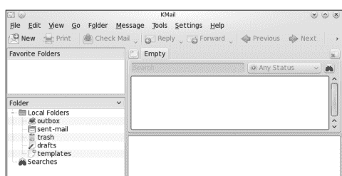

图 1-7：初始 KMail 窗口。

要配置 KMail，选择 `Settings->Configure KMail`。在 Configure KMail 窗口中（见图 1-8），点击窗口左侧的“账户”，并设置你的电子邮件账户信息。KMail 使用这些信息来发送和接收邮件。

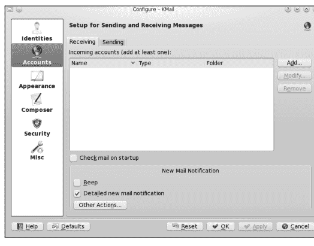

图 1-8：在 Configure KMail 窗口中配置电子邮件账户。

第四卷 第一章

Linux 下的电子邮件

## 246 Linux 下的即时消息

对于发出的邮件，点击“发送”选项卡上的“添加”按钮（见图 1-8），然后选择邮件传输代理。通常，对于 ISP 提供的邮件账户，你应该选择 SMTP 并输入你的 ISP 提供的邮件服务器名称（例如，`smtp.comcast.net`）。

要设置你的入站邮件信息，点击“接收”选项卡并选择邮件协议，如 POP3 或 IMAP。你的 ISP 可以告诉你应该使用哪种协议。（通常是 POP3 或 IMAP）。然后输入邮件服务器名称（例如，`mail.comcast.net`）以及你的 ISP 用户名和密码。

设置好账户信息后，你就可以使用 KMail 了。用户界面直观，与其他邮件阅读器（如 Thunderbird 和 Evolution）类似。KMail 会定期检查并从你的入站邮件账户下载消息。当消息到达收件箱时，你可以查看。

## Linux 下的即时消息

Linux 中有两个主要的 IM 客户端。在 GNOME 桌面上，你可以使用 Pidgin（以前称为 Gain），而 Kopete 设计用于在 KDE 桌面运行。我将在接下来的章节中简要描述这两个 IM 客户端。

## 使用 Pidgin

你可以使用 Pidgin 与许多不同 IM 服务上的所有联系保持联系，例如 AIM、ICQ、Yahoo!、MSN、Gadu-Gadu 和 Jabber。如果你使用任何一种 IM 服务，那么 Pidgin 将对你来说如得得手。

在 Fedora 中，通过从 GNOME 桌面选择 `Applications-Internet-Pidgin` 来启动 Pidgin。你也可以以与其他发行版的 GNOME 桌面类似的方式启动 Pidgin。


首先在“账户”窗口中设置你的消息账户。点击“添加”按钮并在“添加账户”窗口中填写要求的信息。你必须选择你 IM 服务的协议。例如，AIM/ICQ 的协议。其他协议选择包括 Gadu-Gadu、Jabber、Yahoo! 和 MSN。

在输入账户信息后，“账户”窗口将显示所有当前定义的账户。然后你可以从 Pidgin 主窗口选择一个账户并点击“登录”。

Pidgin 登录后，它会打开标准的“好友”窗口。如需添加好友，选择 `Buddies::Add`。

## 使用 Kopete

Kopete 是设计用于在 KDE 桌面运行的。

## 250 探索 Web

引用另一个文档（可能驻留在另一台计算机上），你只需点击该引用即可打开该链接的文档。这种对分布式文档的简易访问本质上就是 Web 所提供的。

当然，文档必须是标准格式，以便任何计算机（带有适当的 Web 浏览器软件）都能访问并解释该文档。而且，将文档从一个系统传输到另一个系统需要一种标准的协议。

标准的 Web 文档格式是超文本标记语言（HTML），交换 Web 文档的标准协议是超文本传输协议（HTTP）。HTML 文档是文本文件，不依赖于任何特定的操作系统，它们可以在从 Windows 和 Mac 到任何类型的 Unix 和 Linux 的任何系统上运行。

Web 服务器负责向任何发出适当 HTTP 请求的客户端提供 HTML 文档。Web 浏览器是客户端软件，它实际上从 Web 服务器下载 HTML 文档并以图形化方式显示内容。

## 像巨大的蜘蛛网

Web 是 Web 服务器和这些服务器提供的 HTML 文档的结合。当你从这样看待 Web 时，Web 就像一本巨大的书，书页散落在整个互联网中。你使用运行在计算机上的 Web 浏览器来查看这些页面——页面像巨大的蜘蛛网一样连接在一起，文档无处不在，如图 2-1 所示。

图 2-1：
Web 是数以亿计的散落在网络中的页面，你可以使用 Web 浏览器从计算机上阅读。

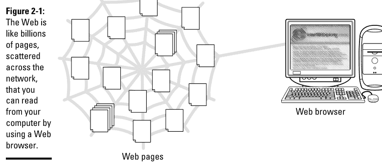

Web Pages
Web 浏览器

## 探索 Web 251

想象 Web 页面——HTML 文档——通过类似于巨大蜘蛛网的网络连接在一起，这样你就能理解为什么 Web 被称为“*世界范围*”（World Wide），这是因为 Web 页面散落在世界各地。

## 链接和 URL

就像印刷书籍的页面一样，Web 页面包含文本和图形。与印刷书籍不同，Web 页面可以包含多媒体，例如视频片段以及指向其他 Web 页面的链接。

Web页面中的*链接*是对其他 Web 页面的引用，你可以从一个页面跳转到另一个页面。Web 浏览器通常将这些链接显示为下划线（不同颜色）或图像。每个链接都像对你的一条指令——就像你在书中看到的“欲知更多，请参阅第 4 章”之类的。在 Web 页面中，你只需要点击链接；Web 浏览器就会带你去引用页面，尽管该文档实际上可能驻留在互联网某处遥远的计算机上。


Web 页面中的链接被称为*超文本*，当你点击链接时，Web 浏览器会跳转到该链接。

这种安排引发了一个问题。在印刷书中，你可能会要求读者阅读书中的特定章节或页面。超链接如何指示被引用 Web 页面的位置呢？在 Web 中，每个 Web 页面都有一个特殊的名称，称为*统一资源定位符*（URL）。URL 唯一指定了计算机上文件的位置。图 2-2 显示了 URL 的部分。

图 2-2：
统一资源定位符 (URL) 的部分。

| | 域名名 | 目录路径 | 文件名 | HTML 锚点 |
|---|---|---|---|---|
| 协议 | 端口 | http://www.tldp.org:80/HOWTO/Wireless-HOWTO-2.html#ss2.1 | | |

如图 2-2 所示，URL 具有以下部分：

- *协议*：Web 浏览器用于从文件 URL 访问数据的协议名称。在图 2-2 中，协议是 `http://`，这意味着该 URL 指定了 Web 页面的位置。以下是一些常见的协议类型及其含义：

## 252 探索 Web

file:// 意味着 URL 指向本地文件。你可以使用 URL 查看 HTML 文件，而无需连接互联网。例如，`file:///var/www/html/index.html` 从你的 Linux 系统中打开 `/var/www/html/index.html` 文件。

ftp:// 意味着你可以使用文件传输协议（FTP）下载文件。例如，`ftp://ftp.purdue.edu/pub/uns/NASA/nasaa.jpg` 指向 FTP 服务器 `ftp.purdue.edu` 中 `/pub/uns/NASA` 目录下的图像文件 `nasaa.jpg`。如果你想使用 FTP 访问特定的用户账户，可以使用采用如下格式的 URL：


`ftp://username@ftp.mysite.com/`

其中用户名和密码嵌入在 URL 中。
密码是明文的，是不安全的。

### `http://`
`http://` 意味着你使用超文本传输协议（`HTTP`）下载文件。该协议是所有网站 URL 的通用格式，例如 `http://fedoraproject.org` 是 Fedora 项目的主页。如果 URL 没有文件名，Web 服务器将提供默认的 HTML 文件 `index.html`（这是流行的基于 Unix 的 Apache Web 服务器的默认文件名，Microsoft Windows 服务器使用不同的默认文件名）。

### `https://`
`https://` 意味着你通过安全套接层（`SSL`）连接访问文件——这是一种由 Netscape Communications 设计的用于在互联网上进行加密数据传输的协议。通常当 Web 浏览器发送敏感信息（如信用卡号）时会使用这种形式的 URL。

```
https://mysite.com/secure/order.html
```

### `mailto:`
`mailto:` 意味着你通过电子邮件程序发送信息。这种 URL 指定了电子邮件地址。例如，`mailto:webmaster@someplace.com` 指向 `someplace.com` 的 Web管理员。

### `news://`
`news://` 意味着你可以通过新闻传输协议（`NNTP`）访问新闻组。例如：

```
news://news.comcast.com
```


## 探索 Web 253

访问 `news.comcast.com` 的新闻组。如果你为 Web 浏览器配置了默认服务器，你可以省略服务器名称并直接使用 URL:`news.comcast.com`。

- `域名名`：文件 URL 指定的计算机的全限定域名。你也可以在此字段中提供 IP 地址。域名不区分大小写。
- `端口`：URL 第一部分协议所使用的端口号。URL 的这部分是可选的；所有协议都有默认端口。例如，HTTP 的默认端口是 80。如果网站服务器监听不同的端口，URL 必须包含端口号。
- `目录路径`：URL 中引的文件路径。对于页面，这是 HTML 文件的目录路径。目录路径区分大小写。
- `文件名`：文件名。对于 Web 页面，文件名通常以 `.html` 结尾。如果你省略文件名，Web 服务器将返回默认文件（通常是 `index.html`）。文件名区分大小写。
- `HTML 锚点`：URL 的可选部分，使 Web 浏览器跳转到文件的特定位置。如果此部分以问号 (`?`) 而不是井号 (`#`) 开头，浏览器会将问号后的文本视为查询。Web 服务器根据此类查询返回信息。

## Web 服务器和 Web 浏览器

Web 服务器提供 Web 页面，Web 浏览器下载并将其显示给用户。这就是这两个协作软件包工作的大体方式。

在典型场景中，用户坐在连接到互联网的计算机前运行 Web 浏览器。当用户点击链接或在浏览器中输入 URL 时，浏览器连接到 Web 服务器并请求文档。Web 服务器发送文档（通常为 HTML 格式）并结束连接。Web 浏览器解释并显示 HTML 文档，包含文本、图形和多媒体（如果适用）。图 2-3 展示了用户浏览 Web 的典型场景。

# 在 Linux 中浏览 Web

## Web 服务器

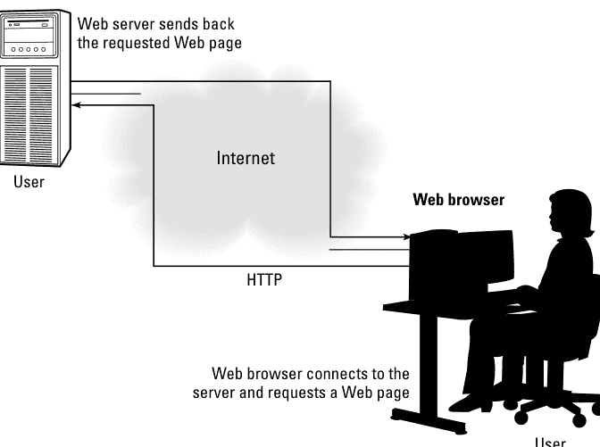

Web 服务器返回请求的 Web 页面
用户
互联网
Web 浏览器
HTTP

图 2-3：Web 浏览器请求文档，Web 服务器发送文档。

Web 浏览器连接到服务器并请求 Web 页面
用户

服务器发送文档后，浏览器与服务器的连接就会结束。当用户浏览下载的文档并点击另一个超链接时，Web 浏览器会再次连接到超链接中指定的 Web 服务器，下载文档，结束连接并显示新文档。用户就可以轻松地从一个文档移动到另一个文档。


Web 浏览器不仅仅是与 Web 服务器“对话” HTTP；Web 浏览器还可以使用 FTP 下载文档和文件，许多浏览器还集成了媒体和新闻阅读器。

# 在 Linux 中浏览 Web

随着 Web 页面变得越来越交互和复杂，Web 浏览变成了一种充满刺激且引人入胜的体验。此外，总会有惊喜元素：你可以点击一个链接并进入意想不到的 Web 页面。链接是 Web 最奇奇（也最有用）的方面。你可以从显示今天天气的页面开始，稍后点击一下，你就可以阅读《时间》杂志的本周期刊了。

# 在 Linux 中浏览 Web 255

要浏览 Web，你只需要 Web 浏览器和互联网连接。我假设你已经处理好了互联网连接（如果你还没有设置互联网连接，请参见第三部分第 1 章），所以你只需要了解 Linux 中的 Web 浏览器即可。

## 查看 Linux 的 Web 浏览器

许多 Linux 发行版都自带 Mozilla Firefox 浏览器。Firefox 是对其原始浏览器的改进，该浏览器是老牌 Net Communicator 的开源版本。

Linux 还有其他几种浏览器可用。我简要提到一下其他浏览器，但在剩下的讨论中将重点关注 Firefox。以下是 Linux 的主要的 Web 浏览器：

- `Mozilla Navigator`：Mozilla 的第一个浏览器，是老旧 Net Communicator 的重生——只不过更好。然而，自 2005 年起，Navigator 的开发已经停止，Mozilla 转向了像 Firefox 和 Thunderbird 这样更新的 Web 应用。
- `Epiphany`：GNOME Web 浏览器，使用 Mozilla 代码部分内容来绘制 Web 页面，具有比 Mozilla 更简单的用户界面。如果未安装 Epiphany，你可以从 `www.projects.org/epiphany` 下载它。
- `Firefox`：Mozilla 的下一代浏览器，可以拦截弹出广告、支持在一个窗口中轻松查看多个 Web 页面的标签页，并包含了一套隐私工具。你可以从 `www.mozilla.com/firefox` 下载 Firefox。
- `Conqueror`：KDE Web 浏览器，也可以兼作文件管理器和通用查看器。

此外，许多其他应用程序也能下载和显示 Web 页面。

如今，大多数发行版都包含 Mozilla Firefox 浏览器。将在下一节中简要介绍 Firefox Web 浏览器。所有其他浏览器都有同样直观的用户界面。

如果你没有默认安装 Firefox，可以可以通过输入 `su -` 变成 root 用户，然后输入 `apt-get install Mozilla-firefox` 来轻松安装它。

## 介绍 Firefox 的用户界面

你通常可以通过点击面板上的图标或从 GUI 桌面菜单中选择 Firefox 来启动 Firefox。


## 浏览 Web

当 Firefox 启动时，它会显示带有默认主页的浏览器窗口。（主页就是主页。）你可以配置 Firefox 使用不同的 Web 页面作为主页。图 2-4 显示了来自美国政府网站（`www.usa.gov`）的 Web 页面，以及 Firefox 浏览器的主要元素 

**图 2-4：** Firefox Firefox。

Firefox 支持**标签页浏览**，这意味着你可以开启新标签页（通过按 Ctrl+T 或点击最后一个标签右侧的加号）并在该标签中查看 Web 页面。这样，你可以在单个窗口中查看多个 Web 页面。

Firefox 浏览器在其用户界面中包含许多功能，你可以轻松掌握。你可以从基础开始使用 Firefox，然后扩展到你尚未探索过的领域。

**Firefox 工具栏**

从窗口顶部开始，你会看到一个带有（文件、编辑等）的菜单栏，后面是两个工具栏——首先是导航工具栏，然后是书签工具栏。书签工具栏下方的区域是任何打开的标签页和当前 Web 页面出现的地方。以下是你可以使用导航工具栏上的按钮和文本框进行的操作：

- 后退（Back）：移动到上一个 Web 页面。
- 前进（Forward）：移动到你离开的页面。
- 最近访问（Recent Pages）：打开最近访问的页面列表。
- 刷新（Reload）：重新加载当前页面。
- 停止（Stop）：停止加载当前页面。
- 主页（Home）：回到主页。
- 位置（Location）：显示当前页面的 URL。（在此框中输入 URL 并按回车键查看 Web 页面。）
- 书签（Bookmark）：收藏当前页面。
- 搜索（Search）：在框中输入搜索内容并按回车键查看 Web 页面。）

导航工具栏下方是书签工具栏，它是任何打开的标签页和当前 Web 页面出现的地方。这就是用户如何轻松地从一个文档移动到另一个文档。

# Linux 中的网络浏览 259

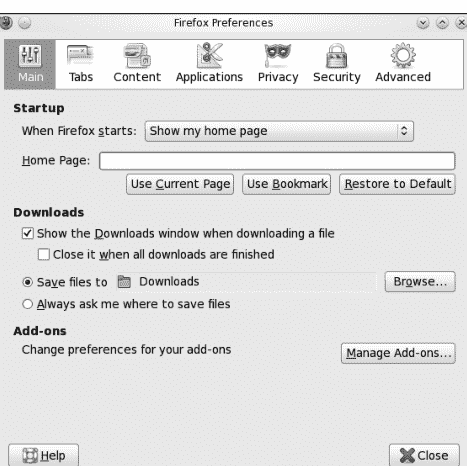

图 2-5：配置 Firefox 浏览器以符合你的喜好。

在图 2-5 中，注意“主页”（Home Page）文本框。文本框下方是“使用当前”（Use Current）按钮。点击该按钮将当前设置为首页。如果你在打开多个标签页时选择此选项，浏览器将在每次新会话中打开每个标签页。

你可以使用“选项”（Preferences）对话框选择许多其他选项。虽然我在这里没有解释所有的选项，但你可以到处点击来探索在该窗口中可以进行的所有操作。例如，你可以点击“使用书签”（Use Bookmark）按钮来选择保存的 URL 书签作为主页。你必须在对话框中选择书签。

## 使用 Firefox 冲浪

从主页去哪里取决于你。你所做的只需点击并看看到达哪里。移动你的鼠标。当你悬停在链接上时，鼠标指针会变成一只伸出食指的手：点击链接，Firefox 就会下载该链接引用的 Web 页面。

你如何使用 Web 取于你想做什么。当你刚开始时，可能会探索很多内容——在没有特定目标的情况下浏览网站并点击链接（你可能称之为“网页窗口跳跃”）。

第四 卷
第 2 章
浏览 Web

## 260 Linux 中的网络浏览

使用 Web 的另一种、更有目的的用法是从网上查找特定信息。例如，你可能想找到包含指定关键词文档的所有网站。对于此类搜索，你可以使用网上提供的许多 Web 搜索工具之一。Firefox 的搜索框将你带到 Google 网页搜索页面（`www.google.com`）。

第三种用法是访问已知 URL 的特定站点。例如，在阅读本书中的某个主题时，你可能会遇到特定的 URL。在这种情况下，你想直接进入该 Web 页面。

如果你想用 Firefox 冲浪，你只需要一个起始网页——然后你就可以点击任何你感兴趣的内容。例如，选择 Firefox 导航栏中“位置”（Location）框中的文本，输入 `www.yahoo.com`，然后按回车。你将到达 Yahoo! 主页，那里显示了按主题组织的 Yahoo! Web 目录。这就是你的起点。你所做的只需点击，你就上路了。


# 第 3 章：阅读新闻组和 RSS 馈

## 本章内容

- 了解新闻组
- 从你的 ISP 阅读新闻组
- 阅读和搜索新闻组
- 阅读 RSS 馈

新闻组提供了一个跨越全球的分布式会议系统。你可以发布文章——本质上是发送给组人的电子邮件——并对他人发布的文章进行回复。

将互联网新闻组想象成聚集地——一个虚拟的会议场所，你可以在那里提问并讨论各种问题。（而且最好的是，你讨论的一切都会被存档以备后世。）互联网新闻组类似于 Web 时代之前的公告板系统（BBS）或 AOL 和 MSN 等在线系统提供的论坛。

要参与新闻组，你需要访问新闻服务器——你的互联网服务提供商（ISP）可以为你提供这种访问。你还需要一个新闻阅读器。幸运的是，Linux 自带了你可以用来阅读新闻组的软件。在本章中，我将向你介绍新闻组，并向你如何使用几个新闻阅读器阅读新闻组。我将简要解释你如何从任何网站免费阅读和搜索新闻组。

如今，阅读网站和博客摘要的另一种方法是使用可以接受 RSS 馈的程序。在本章末尾，我将简要描述什么是 RSS 馈，以及你如何使用如 KDE Aggregator 等程序订阅 RSS 馈并在 Linux 系统上阅读它们。

## 理解新闻组

新闻组源于 Usenet——这是一种存储并转发的消息网络，广泛用于交换电子邮件和新闻项目。Usenet 的工作方式像电报，新闻和邮件从一个系统传输到另一个系统。

## 262 理解新闻组

在 Usenet 中，系统并不在任何网络上；系统只是彼此拨号并使用 UNIX-to-UNIX 拷贝协议（UUCP）传输文本消息。

尽管它是一个松散连接的计算机集合，但 Usenet 能够运行并继续被使用，因为连接它的费用很小。你只需要一个调制解调器和一个存储并转发你的邮件新闻的站点。你在你的系统上设置 UUCP，但你不需要持续的网络连接；只需拨打几次即可保持电子邮件和新闻的流动。Usenet 的缺点是你无法通过 UUCP 使用如 Web、TELNET 或 FTP 等 TCP/IP 服务。

从 Usenet 起源，新闻组已迁移到互联网（尽管新闻仍被称为 Usenet 新闻组）。取代 UUCP 的网络新闻传输协议（NNTP）负责传输新闻。

尽管（对于大多数在线世界而言）新闻传输协议已从 UUCP 变为 NNTP，但存储并转发的概念仍然存在。如果你想浏览新闻组类别并感受新闻组所涵盖的主题广度，请访问 `http://groups.google.com` 的 Google 网站并点击“浏览所有 Usenet”（Browse All of Usenet list）（你需要点击页面上的类别链接）。

## 288 理解新闻组

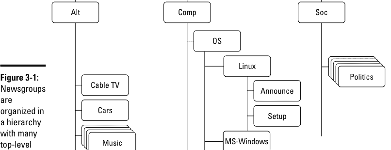

## 新闻组层级

新闻组按层级组织。例如，`comp.os.linux`：


comp.os.linux.announce


这个简短的类别列表具有误导性，因为它没有告诉你每个类别中可用的各种新闻组。仅顶级类别就有超过一千个，但许多顶级类别仅在世界的特定地区分布。

| 类别 | 主题 |
| :--- | :--- |
| alt | 替代新闻组 |
| bionet | 生物学新闻组 |
| bit | Bitnet 新闻组 |
| biz | 商业新闻组 |
| clari | Clarinet 新闻服务 |
| comp | 计算机硬件和软件 |
| ieee | 电气工程师学会新闻组 |

## 理解新闻组

| 类别 | 主题 |
| :--- | :--- |
| k12 | 专注于小学和中学教育的新闻组 |
| linux | 专注于 Linux 的新闻组 |
| misc | 杂杂新闻组 |
| news | 关于互联网管理的新闻组 |
| rec | 娱乐和艺术新闻组 |
| sci | 科学与工程新闻组 |
| soc | 用于社会问题和各种文化的新闻组 |
| talk | 当前问题的讨论 |

### 理解新闻组

表 3-1 主要新闻组类别（继续）

| 类别 | 主题 |
| :--- | :--- |
| k12 | 专注于小学和中学教育的新闻组 |
| linux | 专注于 Linux 的新闻组 |
| misc | 杂杂新闻组 |
| news | 关于互联网管理的新闻组 |
| rec | 娱乐和艺术新闻组 |
| sci | 科学与工程新闻组 |
| soc | 用于社会问题和各种文化的新闻组 |
| talk | 当前问题的讨论 |

## 与 Linux 相关的新闻组

通常你必须根据兴趣缩小新闻组的选择。例如，如果你想了解更多关于 Linux 的信息，你可以选择以下一个或多个：

- `comp.os.linux.admin`: Linux 系统管理（非活跃）。
- `comp.os.linux.advocacy`: Linux 推广。

# 理解新闻组

- `comp.os.linux.announce`: 关于 Linux 的重要公告。
  此新闻组是受审核的，这意味着你必须将文章邮件给版主，如果文章符合该新闻组的要求，版主将其发布到新闻组中。
- `comp.os.linux.answers`: 关于 Linux 的问答。所有的 Linux HOWTO 均发布在这个受审核的新闻组中。
- `comp.os.linux.development`: 当前的 Linux 开发工作。
- `comp.os.linux.development.apps`: Linux 应用开发。
- `comp.os.linux.development.system`: Linux 操作系统开发。
- `comp.os.linux.embedded`: 在嵌入式硬件上运行 Linux 操作系统。
- `comp.os.linux.hardware`: Linux 与各种类型的硬件。
- `comp.os.linux.help`: 关于 Linux 各个方面的帮助（已未活跃）。
- `comp.os.linux.misc`: 杂类的 Linux 相关话题。
- `comp.os.linux.networking`: Linux 下的网络连接。
- `comp.os.linux.portable`: 在笔记本电脑和便携式 PC 上运行 Linux 操作系统。
- `comp.os.linux.powerpc`: 在 PowerPC 处理器上运行 Linux 操作系统。
- `comp.os.linux.redhat`: Red Hat Linux 相关话题（已未活跃）。
- `comp.os.linux.setup`: Linux 设置与安装。
- `comp.os.linux.x`: 在 Linux 下设置和运行 Windows 系统。
- `comp.os.linux.xbox`: 在 Xbox 视频游戏机上运行 Linux。
- `debian.debian`: 关于 Debian GNU/Linux 的受审核新闻组（已未活跃）。
- `debian.debian.news`: 关于 Debian GNU/Linux 新闻信息的新闻组。
- `linux.redhat`: Red Hat Linux 讨论。

第四卷
第三章

你必须对要阅读的新闻组进行选择，因为由于要跟上所有新闻是不可能的，即使在 Linux 这样一个特定领域也是如此。当你首次安装并设置 Linux 时，你可能会阅读如 `comp.os.linux.answers`、`comp.os.linux.setup`、`comp.os.linux.hardware` 和 `comp.os.linux.x` 等新闻组（尤其是当你遇到 X 相关问题时）。在 Linux 运行起来后，你可能想了解 Linux 中发生的所有新事。对于这类信息，请阅读 `comp.os.linux.announce` 新闻组。


阅读新闻组与 RSS 馈送

## 从你的 ISP 阅读新闻组

尽管目前许多新闻组处于非活跃状态且不再添加新内容，但这些组仍然可以被引用并在以获取特定问题的帮助。

## 从你的 ISP 阅读新闻组

如果你向 ISP 办理了互联网接入服务，它可以为你提供对新闻服务器的访问权限。互联网新闻服务器通过网络新闻传输协议（`NNTP`）进行通信。你可以使用支持 `NNTP` 的新闻阅读器（如 `Knode`）来访问新闻服务器并选择新闻组。你也可以使用 `Thunderbird` 阅读新闻。新闻阅读器是从 ISP 服务器访问新闻最简单的方法。


我对新闻阅读器的讨论假设你已从 ISP 获取了新闻服务器的访问权限。ISP 提供了新闻服务器的名称以及在新闻阅读器上设置新闻账户所需的用户名和密码。

要阅读新闻，你需要一个新闻阅读器——一个允许你选择新闻组以及该新闻组内项目的程序。你还需要理解新闻组的层级结构和命名规范（我在本章前面的“新闻组层级结构”部分进行了描述）。在本节中，我将向你展示如何从新闻服务器阅读新闻。


如果你无法通过 ISP 访问新闻组，可以尝试使用许多公共新闻服务器之一。要获取公共新闻服务器列表，请访问 `www.newzbot.com` 的 Newzbot。在该网站上，你可以搜索带有特定新闻组的新闻服务器。

## 新闻阅读器概

你可以使用几个软件包之一在 Linux 中下载和阅读新闻组。以下是几个主要的新闻阅读器：

- `Thunderbird`: `Thunderbird` 包含了从 `NNTP` 服务器下载新闻的功能。你可以阅读新闻组并向新闻组发布项目。Xandros 使用 `Thunderbird` 处理邮件和新闻。
- `Knode`: 这是一个用于 KDE 的新闻阅读器，你可以从 `knode.sourceforge.net` 下载。Debian 和 SUSE 提供 `Knode` 作为新闻阅读器。
- `Pan`: `Pan` 是一个 GUI 阅读阅读器，根据开发者网站（`http://pan.rebelbase.com`），它“尝试”让新用户和老用户都感到愉悦。你可以从 `http://pan.rebelbase.com/download` 下载适用于各种 Linux 发行版的 `Pan`。

## 从你的 ISP 阅读新闻组

如果你在 Linux 系统中没有找到新闻阅读器，可以在任何 Linux 发行版中轻松地下载并安装上述任何一个新闻阅读器。通常，你可以通过搜索引擎简单搜索找到下载站点——只需搜索单词“download”并进行搜索即可。

## 使用 Thunderbird 阅读新闻组

你可以从 `Thunderbird` 浏览新闻组并发布项目。在许多 Linux 发行版中，邮件组件是内置的。当你开始阅读新闻组时，请遵循以下步骤：

1. 点击账户（Account）。
2. 点击添加（Add）。
3. 选择新闻组（Newsgroup）。
4. 在出现的屏幕上填写你的身份信息。
5. 输入新闻服务器名称。
6. 输入新闻组名称。
7. 点击完成（Finish）完成设置。

订阅的新闻组将出现在左侧。访问 `mozilla.org/thunderbird`。


图 3-2：`Thunderbird` 账户向导引导你完成。

第四卷
第三章
阅读新闻组

## 从 ISP 阅读新闻

订阅新闻组后，这些新闻组将出现在窗口左侧的新闻组名称下。你可以通过以下步骤阅读新闻组：

1. 点击新闻组名称（例如 `comp.os.linux.announce`）。
2. 如果提示，输入你的用户名和密码。
3. 指定你想下载的头部数量（例如 500）并点击下载（Download）。
4. 从头部列表中点击项目以阅读该文章。

`Thunderbird` 从新闻组下载头部并显示在窗口右上区域。


图 3-3：指示你想订阅的新闻组。

| 账户：news |
| 显示项目：linux |
| 当前组列表：新组 |
| 选择要订阅的新闻组： |
| [ ] comp.linux.advocacy | 订阅 |
| [ ] comp.linux.ahha | 取消订阅 |
| [ ] comp.linux.enforce | 刷新 |
| [ ] comp.linux.development | |
| [ ] comp.linux.development.apps | |
| [ ] comp.linux.embedded.system | |
| [ ] comp.linux.embedded | |
| [ ] comp.linux.help | |
| [ ] comp.linux.m68k | |
| [ ] comp.linux.misc | |

## 从 ISP 阅读

要选择其他已订阅的新闻组，只需点击窗口左侧的新闻组名称。要阅读文章，点击窗口右下部分列表中的项目，如图 3-4 所示。

图 3-4：点击文章在右下部分阅读。

## 报纸订阅

与杂志或报纸不同，新闻组并不要求你订阅；你可以阅读新闻服务器上的任何可用新闻。

## 从你的 ISP 读取新闻组

新闻服务器的管理员可能会决定排除某些新闻组；但是，如果它们未包含在内，你就无法阅读它们。

唯一可以被称为“订阅”的操作是指定你经常阅读的新闻组。新闻服务器不会接收任何此类订阅信息——这些信息仅供新闻阅读器使用，以确定从新闻服务器下载哪些内容。

## 发布新闻

你可以使用任何新闻阅读器向一个或多个新闻组发布新闻文章（新项目或对旧帖的回复）。发布新闻项目的命令取决于你使用的新闻阅读器。例如，在 `Thunderbird` 新闻阅读器中，你按照以下步骤发布文章：

- 1. 点击工具栏上的“回复（Reply）”按钮对你正在阅读的新闻项目进行回复。要发布新的新闻文章，请点击“撰写（Write）”按钮。

弹出一个窗口，你可以在其中编写消息。

- 2. 输入新闻组的名称，就像发送电子邮件时输入收件人地址一样。输入主题并发送你的消息。

对于此帖子，请在主题行输入 `ignore` 并在新闻组输入 `test`。否则，任何通过邮件接收你文章的站点都会通知你文章已到达该站点；这符合 `misc.test` 新闻组的目的。

- 3. 完成消息后，点击工具栏上的“发送（Send）”。

`Thunderbird` 将消息发送到新闻服务器，随后将其发送到其他新闻服务器，很快它就会传遍全球！

- 4. 要验证测试消息是否到达新闻组，选择“文件：订阅（File:Subscribe）”。然后订阅 `misc.test` 新闻组（就是你最近发布文章的地方）。

要订阅，点击组名称右侧的复选框，然后点击“订阅（Subscribe）”按钮。

- 5. 查看 `misc.test` 中的最新文章或较旧的文章，以找到你最近发布的文章。

如果你发布了文章并立即阅读新闻，你会看到新文章，但这并不意味着文章已经到达互联网上的其他站点。毕竟，你的帖子会立即显示在你的新闻服务器上，因为那是你发布文章的地方。由于新闻分发的“存储并转发”模型，文章逐渐从你的新闻服务器传播到世界其他地方。

## 从你的 ISP 读取新闻组

`misc.test` 新闻组提供了一种查看你的新闻发布是否正在传播的方法。如果你发布到该新闻组且没有在主题中包含 `ignore` 一词，新闻服务器将向文章头中“回复至（Reply To）”字段列出的地址发送电子邮件以确认接收文章。

## 使用 KNode

Debian 和 SU 提供 `KNode` 作为默认新闻阅读器。通常，你可以通过从菜单中选择新闻阅读器（在互联网应用程序中查找）来启动 `KNode`；或者选择应用程序>Internet>`KNode`。如果你在菜单中没有看到新闻阅读器或 `KNode` 选项，可以在终端窗口中输入 `knode` 来启动 `KNode`。

当 `KNode` 首次运行时，它会显示如图 3-5 所示的配置 `KNode` 对话框，通过它你可以配置阅读新闻组和向新闻组发布项目所需的一切。


图 3-5：通过此对话框配置 `KNode`。

第四 卷
第三 章

对话框的左侧显示你可以配置的所有项目，右侧是你为左侧选择的项目输入信息的地方。

当配置 `KNode` 对话框首次打开时，它会提示你的个人信息。输入你的身份信息，如姓名、电子邮件地址和组织——这些信息将在向新闻组发布新项目时使用。

阅读新闻组和 RSS 馈

## 在网站上阅读和搜索新闻组

然后，点击左侧的“账户（Accounts）”（参考图 3-5），然后点击右侧的“新闻组服务器（Newsgroup Servers）”选项卡以设置你将要阅读的新闻服务器信息。点击新闻组服务器选项卡中的“添加（Add）”显示图 3-6，你可以在其中输入新闻服务器信息。如果你的 ISP 提供了访问新闻服务器所需的信息。如果新闻服务器需要用户名和密码，你必须输入这些信息。


> 图 3-6：在此对话框中输入新闻服务器信息。

设置账户后，`KNode` 窗口在左侧显示新闻服务器名称。右键点击服务器名称，从弹出菜单中选择“订阅新闻组（Subscribe to Newsgroups）”。弹出一个对话框，你可以在其中选择选定的新闻组（如 `os.linux.announce`）。第一次访问此菜单时，必须获取新闻组列表。`KNode` 用户界面与其他许多邮件和新闻阅读器类似，包括 `Thunderbird`。

在网站上阅读和搜索新闻组

如果你无法通过 ISP 访问新闻组，你仍然可以在许多网站上阅读新闻组并向新闻组发布文章。

## 阅读 RSS 馈

（注：由于原文文本存在大量重复和 OCR 错误，已提取核心逻辑内容进行翻译）

```xml
```


<description>Brief description of feed</description>

<language>en-us</language>

<item>

<title>Title of this item</title>

<link>URL for this item</link>

<description>Description of this item</description>

</item>

. . more items

</channel>

</rss>

```
如你从该列表所示，RSS 馈包含一个带有标题、链接、描述和语言的通道，随后是一系列项目，每个项目都包含标题、链接和描述。

RSS 1.0 的格式更为冗长，它使用 RDF 格式。RSS 1.0 本质上提供了 RSS 0.91 中包含的基本信息，并添加了更多细节，例如项目级别的作者、主题和发布日期，这些是 RSS 0.91 不支持的。

## 阅读 RSS 馈源

有许多程序可以用于订阅 RSS 馈和读取馈源中的项目。这些程序被称为 RSS 聚合器，因为它们可以从许多 RSS 馈收集信息，并将所有内容汇聚在一个地方。

RSS 聚合器有两种类型：浏览器插件和独立程序。浏览器插件（如 NewsMonster (`www.newsmonster.org`)）安装在 Web 浏览器中，使馈源出现在浏览器中。独立程序如 GNOME Feed (`http://projects.gnome.org/straw`) 和 KDE Aggregator (`http://aggregator.kde.org`) 是完整的 UI 应用，通常与其他移动端和新闻阅读器相似。

Fedora 和 SUSE 自带了 Aggregator 程序，这是一种独立的 RSS 阅读器。要运行它，请在 GUI 应用程序菜单中查找（选择 `Application:Internet:Aggregator`）。如果你没有在终端窗口中输入 `apt-get install aggregator` 来安装 Aggregator，在 Debian 中，你可以通过输入 `sudo ...` 成为 root 用户来安装 Aggregator。

当 `aggregator` 运行时，它会显示不包含任何 RSS 馈的主窗口。要订阅馈源，请从菜单中选择 `Feed:Add Feed`（馈：添加馈），或在窗口左侧面板中右键点击 `All Feeds`（见图 3-7）并从弹出菜单中选择 `Add Feed`（添加馈）。在 Feed 对话框中输入馈源的 URL 并点击 OK。例如，要读取 Slashdot 的 RSS 馈，输入

`http://slashdot.org/index.rss`。馈源标题出现在窗口的左侧面板。点击馈源标题查看该馈中的项目。你可以点击右上面板中的某个项目，该项目就会出现在右下面板中，如图 3-7 所示。你可以添加许多不同的 RSS 馈，将它们组织成文件夹，并在 Akregator 中浏览它们。


| 标题 | 作者 | 日期 | 状态 |
| --- | --- | --- | --- |
| Mass Data: | Slashdot | timeliness | Today 02:27 pm |
| How to Get: | Slashdot | timeliness | 04/25/16 08:03 pm |
| Doom III | Slashdot | timeliness | 04/25/16 08:13 pm |
| Best Amell. | Slashdot | timeliness | 04/25/16 08:43 pm |
| 20 years of us | Slashdot | timeliness | 04/25/16 05:35 pm |

geobwriter 写了关于下一代竞赛的文章
**日期：** 星期三 08:03 pm
**作者：** 去年我们参加的计算智能与人工智能 IEEE 会议是玩游戏关卡（i/tube视频）最好的。该会议扩展了程序化内容的范围，现在要求如何周期性生成新关卡。提交条目就像实现一个执行内容生成的关卡一样简单。游戏的可重玩性意味着每次游戏过程都可以为玩家呈现新的关卡。

# 第 4 章：使用 FTP

## 本章内容

- 使用 GNOME FTP 客户端
- 使用任何 Web 浏览器作为 FTP 客户端
- 了解 FTP 命令

正如其名，*文件传输协议 (File Transfer Protocol, FTP)* 用于在计算机之间传输文件。例如，如果你的互联网服务提供商（ISP）为你的个人网站提供了空间，你可能已经使用 FTP 上传了构成网站的文件。在你的计算机上使用 FTP 客户端，登录你的 ISP 账户，提供密码，然后将文件从本地系统复制到 ISP 的服务器。

你还可以使用 FTP 匿名下载其他文件，例如来自互联网其他计算机的开源软件——在这种情况下，你不需要在远程系统中账户即可下载文件。你只需使用 `anonymous` 作为用户名登录，并提供你的电子邮件地址作为密码。（事实上，你的 Web 浏览器可以代为完成此操作，因此你可能不知道这个正在发生。）这种匿名 FTP 非常适合将文件分发给任何想要它们的人。例如，硬件供应商可能会使用匿名 FTP 为任何需要的人提供更新的设备驱动程序。

Linux 带有几个 FTP 客户端，包括命令行的和 GUI（图形界面）的。本章将向你介绍几个 GUI FTP 客户端和一个命令行 FTP 客户端。它还描述了你用于操作远程目录的命令。


## 使用图形化客户端

gFTP 窗口有一个执行各种任务的菜单栏。菜单栏下方是带有按钮和文本字段的工具栏。在这里输入远程主机的主机或 IP 地址，以及登录远程主机所需的用户名和密码。

要使用 gFTP 上传文件，请遵循以下步骤：

- 在 Host 字段中填写远程主机名或 IP 地址。

如果你以前使用过该主机，可以在点击 Host 旁边的向下箭头从下拉列表中选择它。
- 在 User 字段提供用户名，在 Pass 字段提供密码，然后点击显示两个计算机的图标（位于 Host 左侧）。

此操作会导致 gFTP 连接到你选择的主机并使用你提供的用户名和密码登录。gFTP 窗口的底部显示两个系统交换的 FTP 协议消息。远程系统的目录列表出现在 gFTP 窗口的右侧。左侧显示当前本地目录。
- 要从当前系统上传一个或多个文件到远程系统，选择列表中的文件并点击右箭头按钮。
- 要从远程系统下载文件，选择文件名并点击左箭头按钮。
- 完成文件传输后，点击 gFTP：Quit。

### 280 使用图形化 FTP 客户端

## 介绍 KFTPGrabber

KFTPGrabber 是一个适用于 KDE 桌面的 GUI FTP 客户端。在 Debian 中，你可以通过 `apt-get install kftpgrabber` 来安装 KFTPGrabber（在你先使用 `su -` 变为 root 用户）。

在 Fedora 中，同样以 `root` 身份选择“系统设置::添加/删除软件”，并搜索 KFTPGrabber。选择列表中出现的软件包（`kftpgrabber`）并点击应用。按照提示继续，软件将完成安装。

当 KFTPGrabber 窗口出现时，它会以类似于 Windows 资源管理器的视图显示你的主目录。要连接到 FTP 服务器，选择 `文件::快速连接`。如图 4-2 所示的对话框会提示你输入 FTP 服务器的主机以及用户名和密码。


输入所需信息后，点击确定。KFTPGrabber 会建立与远程 FTP 服务器的连接。在图 4-3 所示的 KFTPGrabber 主窗口中，你可以并排看到本地和远程目录。

FTP 传输变得就像普通的拖放文件复制：只需将文件从一个系统的文件夹拖动并释放到另一个系统的文件夹即可完成传输。


当你用完 KFTPGrabber 后，选择“文件：退出”。

### 使用 浏览器作为 FTP 客户端

任何 浏览器都可以充当 FTP 客户端，但此类程序最适用于匿名 FTP 下载，因为 浏览器可以使用匿名用户名和密码进行登录。

例如，你可以使用 Firefox 浏览器作为 FTP 客户端。你只需要知道如何编写 URL，以便浏览器能够识别出你想通过 FTP 下载文件。URL 的语法格式为：

```
ftp://hostname/pathname
```


第一部分（`ftp://`）表示你想要进行 FTP 传输。主机（`hostname`）是 FTP 服务器的名称（名称通常以 `ftp` 开头——例如 `ftp.wiley.com`）。路径是你想下载的文件的完整目录和文件名。

如果你仅提供 FTP 服务器的主机名，浏览器将显示匿名 FTP 目录的内容。如果你想在 Linux 系统上访问匿名 FTP，请启动 Firefox（点击 GNOME 面板上的 Firefox 图标），在“位置”文本框中输入 FTP URL 并按回车。

图 4 显示了 Firefox 中 FTP 目录的典型外观。你可以点击文件夹查看其内容并下载任何文件。你可以利用 Firefox 的 FTP 功能访问本地系统，例如，输入 `ftp://localhost/pub/` 来访问该目录。如果你没有运行 FTP 服务器，或者设置了防火墙不允许任何 FTP 连接，你将无法从系统获得响应。


图 4-4：你可以使用 浏览器从 FTP 服务器下载文件。

在 Debian 和 Fedora 中，以 root 身份登录并在终端中输入 `/etc/init.d/vsftpd start` 来启动 FTP 服务器。`xinetd` 超服务器控制 FTP 服务器 `vsftpd`。`/etc/xinetd/vsftpd` 配置文件指定了 `vsftpd` 如何启动。有关 `xinetd` 配置文件的更多信息，请参阅第七卷第一章。

如果你输入其他匿名 FTP 服务器的主机名，访问匿名 FTP 站点的方法同样适用。例如，尝试以下 URL：

```
ftp://ftp.netscape.com/
```

你将获得 `ftp.netscape.com` 服务器的目录。

## 使用命令行 FTP 客户端

了解如何从命令行使用 FTP 是很有帮助的。例如，如果你的 GUI 桌面无法工作，你可能需要下载一些文件来修复问题；如果你知道如何使用命令行 FTP 客户端，就可以这样做。命令行 FTP 客户端在所有 Linux 发行版中可用，且使用它并不困难。

了解命令行 FTP 客户端最好的方法是尝试一下。命令是 `ftp`，你可以从系统中尝试各种 `ftp` 命令。你甚至不需要连接互联网，因为你可以使用 `ftp` 命令连接到你自己的系统。

注意，`ftp` 命令的输出可能不同，因为某些发行版（如 Debian）使用 `gFTP` 的文本模式作为命令行 FTP 客户端。

在接下来的 FTP 会话中，使用了命令行 FTP 客户端登录并浏览 Linux 系统上的目录。以下列表展示了与典型命令行 FTP 客户端交互的示例：


```
ftp help me (以获取特定命令的帮助。)
mget multiple files.
ftp cd /
```

命令行 FTP 客户端被用于登录并浏览 Linux 系统上的目录。以下列表展示了与典型命令行 FTP 客户端交互的示例：


（注：表格 4-1 的文本在原文中已损坏，此处为重建的表格）

#### 表格 4-1 常用 FTP 命令

| 命令 | 描述 |
| :--- | :--- |
| ascii | 将文件类型设置为 ASCII（纯文本）。这是默认命令。 |
| binary | 将文件类型设置为二进制。 |
| bye | 结束远程会话并退出。 |
| cd | 更改远程目录。例如，`cd /pub` 将远程目录切换到 `/pub`。 |
| chmod | 更改远程文件的权限。例如，`chmod 644 index.html` 更改 index.html 的权限。 |
| close | 结束远程会话并返回客户端提示符。 |
| delete | 删除远程文件。例如，`delete image.jpg` 删除远程上的文件。 |
| dir | 列出远程系统的内容。 |
| disconnect | 断开连接并返回客户端提示符（与 `close` 相同）。 |
| get | 下载远程文件。例如，`get junk.tar.gz` 从远程系统下载 `junk.tar.gz` 本地保存为 `junk.tgz`。 |
| hash | 开启或关闭显示传输进度的井号 (#)。 |
| help | 显示命令列表。 |
| image | 与 `binary` 相同。 |
| lcd | 更改本地系统的当前目录。例如，`lcd /var/ftp/pub` 将当前本地目录切换到 `/var/ftp/pub`。 |
| ls | 列出远程目录的内容。 |
| mdelete | 删除远程系统上的多个文件。例如，`mdelete *.jpg` 删除当前目录下所有以 .jpg 结尾远程文件。 |
| mdir | 列出多个远程文件并保存到指定的本地文件中。例如，`mdir /usr/share/doc/w wlist` 将列表保存到本地文件 `wlist` 中。 |
| put | 将本地文件上传到远程系统。 |
| ! | 在本地系统执行 shell 命令。例如，`!ls` 列出本地目录的内容。 |
| ? | 显示帮助（与 `help` 相同）。 |
| append | 将本地文件追加到远程文件。 |

## 286 使用命令行 FTP 客户端

## 表 4-1（续表）

| 命令 | 描述 |
| --- | --- |
| mget | 下载多个文件。例如，`mget *.jpg` 会下载所有以 `.jpg` 结尾的文件。如果开启了提示（prompt），FTP 客户端会在下载每个文件前请求确认。 |
| mkdir | 在远程系统上创建目录。`mkdir images` 会在远程系统的当前目录下创建一个名为 `images` 的目录。 |
| mls | 与 mdir 作用相同。 |
| mput | 上传多个文件。例如，`mput *.jpg` 会将所有以 `.jpg` 结尾的文件发送到远程系统。如果开启了提示，FTP 客户端会在发送每个文件前请求确认。 |
| open | 打开到指定主机上服务器的连接。例如，`open ftp.netscape.com` 会连接到主机 `ftp.netscape.com` 上的 FTP 服务器。 |
| prompt | 开启或关闭提示。当提示开启时，在多文件传输期间，FTP 客户端会在下载或上传每个文件前提示你进行确认。 |
| put | 将文件发送到远程系统。例如，`put index.html` 将本地系统上的 `index.html` 文件发送到远程系统。 |
| pwd | 显示远程系统当前目录的完整路径。当你作为用户登录时，初始工作目录是你的家目录。 |
| quit | 与 by 作用相同。 |
| recv | 与 get 作用相同。 |
| rename | 重命名远程系统上的文件。例如，`rename old.html new.html` 将远程系统上的 `old.html` 文件重命名为 new。 |
| rmdir | 删除远程系统上的目录。例如，`rmdir` 会删除远程系统当前目录下的 `images` 目录。 |
| send | 与 put 作用相同。 |
| size | 显示远程文件的大小。例如，`size bigfile.tar.gz` 显示该远程文件的大小。 |
| status | 显示 FTP 客户端的当前状态。 |
| user | 向 FTP 服务器发送新的用户信息。例如，`user jdoe` 发送用户名 `jdoe`；随后 FTP 服务器会提示输入该用户的密码。 |

## 使用命令行 FTP 客户端 287

从互联网下载文件时，你几乎总是希望以二进制模式传输文件，因为软件通常是以二进制形式归档和压缩的（其文件不是纯文本文件）。因此，请始终使用 `binary` 命令将模式设置为二进制。然后使用 `get` 命令下载文件。

传输具有相似名称的多个文件（如 `image1.jpg`、`image2.jpg` 等）时，输入 `prompt` 来关闭提示。（否则，FTP 客户端会在每个文件传输后询问你是否要传输下一个文件）。然后输入 `mget` 后跟带有通配符的文件名。例如，要下载所有以 `image` 开头并以 `.jpg` 扩展结尾的文件，请输入 `mget image*.jpg`。

## 第五卷

## 管理

Rich Tennant 著《第五波》

> “集中式安全管理系统听起来不错，但那我们怎么处理所有的狗呢？”

## 内容概览

+ 第 1 章：介绍基础系统管理 ................................................................ .291
梳理系统管理员任务................................................................................................................................................ . . . . 291
介绍一些 GUI 系统管理员工具 ................................................................................................................................. . . . . . . 293
如何成为 root ................................................................................................................................................................................................................. . . . . . . . . . . . . . 298
理解 Linux 如何启动 ................................................................................................................................................. . . . . . . . . . . . . . 301
梳理 Linux 系统配置文件 ................................................................................................. 307
监控系统性能 .................................................................................................................................................... . . . . . . . . . . . 310
通过 /proc 文件系统查看系统信息 ............................................................................................................................................ 315
理解 Linux 设备 ................................................................................................................................................................................................................. 319
管理可加载驱动模块 ............................................................................................................................................................................ 322
在 Linux 中调度作业 ........................................................................................................................................................................................... 324

+ 第 2 章：管理用户和组 ................................................................................................................331
添加用户账户 ................................................................................................................................................................... 331
理解 /etc/passwd 文件 ................................................................................................................................................................. 335
管理组 .................................................................................................................................................................... 337
探索用户环境 ................................................................................................................................................................................ 338
更改文件的用户和组所有权 ...................................................................................................................................................... 340

+ 第 3 章：管理文件系统 ................................................................................................343
探索 Linux 文件系统 ...................................................................................................................................................................... 343
使用 NFS 共享文件 ............................................................................................................................................................ 350
备份和恢复文件 ...................................................................................................................................................................... 352
访问 DOS 或 Windows 文件系统 ................................................................................................................................................ 359
使用工具. ............................................................................................................................................................................................................ 362

+ 第 4 章：安装和更新应用程序 ................................................................................................367
使用 RPM 文件 ................................................................................................................................................................................... 367
使用 DEB 文件 .............................................................................................................................................................................................................. 374
从源码构建软件包 ............................................................................................................................................ 378
在线更新 Linux 应用程序 .......................................................................................................................... 382

# 第一章：基础系统管理简介

本章内容

-   介绍 GUI 系统管理工具
-   成为 root 用户
-   理解系统启动过程
-   梳理系统配置文件
-   通过 /proc 文件查看系统信息以完成这些任务
-   监控系统性能
-   管理设备
-   任务调度

系统管理（或简称 sysadmin）是指为了保持计算机系统正常运行而必须完成的所有工作。系统管理员（sysadmin）就是负责处理这些任务的人员。

如果你在家里或小型办公室运行 Linux，那么你很可能就是自己系统的系统管理员。或者，你也可能是一个充斥 Linux 系统的企业的系统管理员。无论你的职位或头如何，本章都将向你介绍基础系统管理程序，并展示如何执行一些常见任务。

## 梳理系统管理任务

什么是系统管理任务？一个随口的回答是：为了保持系统良好运行而必须做的任何事情。更准确地说，系统管理员的职责包括：

-   添加和删除用户账户：你必须添加新的用户账户并删除不必要的用户账户。如果用户忘记了密码，你必须更改密码。
-   管理打印系统：你必须开启或关闭打印队列，检查打印队列状态，并在必要时删除打印作业。
-   安装、配置和升级操作系统及各种实用程序：你必须安装或升级 Linux 操作系统的部分组件以及作为操作系统一部分的其他软件。
-   安装新软件：你必须安装各种格式的软件，如 RPM 或 DEB。你还必须下载并解压源码形式的软件——然后从源代码编译成可执行的程序。
-   管理硬件：有时，你必须添加新硬件并安装驱动程序，以便设备正常工作。
-   制作备份：你必须将文件备份到 DVD 驱动器、USB 闪存、外部硬盘或磁带上。
-   挂载和卸载文件：例如，当你想要访问 CD-ROM 上的时，你必须将该 CD-ROM 的文件系统挂载到 Linux 文件系统的某个目录上。你可能还需要挂载 Linux 和 DOS 格式的软盘。
-   任务自动化：你必须调度 Linux 任务以使其自动（在特定时间）或定期（按固定时间间隔）执行。
-   启动和关闭系统：虽然启动系统仅仅是开启 PC 电源，但在关闭 Linux 系统时你必须小心。如果你的系统设置了图形登录界面，可以通过选择登录界面上的菜单项执行关机操作。否则，使用 `shutdown` 命令在关闭 PC 电源开关之前停止所有程序。
-   监控网络状态：如果你有网络（无论是局域网、DSL 线路还是电缆解调器连接），你可能想要检查各种网络接口的状态，并确保你的网络连接正常运行。
-   设置主机和网络安全：你必须确保系统文件受到保护，并确保你的系统能够防御网络攻击。
-   监控安全：你必须关注所有入侵情况，通常通过检查日志文件来实现。

这是一份很长的任务列表！本章并没有涵盖所有项目，但本本型书的其他部分描述了其中大部分任务。本章的重点是一些基础知识，例如使用 GUI 工具、解释如何成为 root 用户（超级用户）、描述系统配置文件，并展示如何监控系统性能、管理设备以及设置定期任务。

## 介绍一些 GUI 系统管理工具

每个 Linux 发行版都带有用于执行系统管理任务的 GUI 工具。这些 GUI 工具会提示你输入，然后运行必要的 Linux 命令来完成任务。以下章节将简要介绍 Debian、Fedora、Knoppix、SUSE、Ubuntu 和 Xandros 中的 GUI 系统管理工具。

## Debian 中的 GUI 系统管理工具

Debian 使用 GNOME 桌面，并提供了许多执行系统管理任务的 GUI 工具。可以通过选择“应用程序工具”（Applications Tools）可以使用这些工具。表 1-1 列出了一些常见任务以及你用于启动执行任务的 GUI 工具的菜单。

| 执行此操作 | 在 Debian GNOME 桌面上选择以下项 |
| --- | --- |
| 添加或删除软件包 | 应用程序: System Tools: Synaptic Package Manager |
| 更改日期或时间 | 应用程序: System Tools: Settings: Time and Date |
| 更改密码 | 主菜单: Settings: Change Password |
| 配置桌面 | 应用程序: Desktop Preferences |
| 配置网络 | 应用程序: Networking |
| 格式化软盘 | 应用程序: System Tools: Floppy Formatter |
| 管理打印机 | 应用程序: System Tools: Printers |
| 管理用户账户 | 应用程序: System Tools: Users and Groups |
| 监控系统性能 | 应用程序: System Tools: System Monitor |
| 查看系统日志 | 应用程序: System Tools: System Log |

## Fedora 中的 GUI 系统管理工具

Fedora 自带一套 GUI 系统配置工具，可以减轻执行典型系统管理任务的负担。表 1-2 简要总结了你用于启动特定任务 GUI 工具的菜单选择。

| 表 1-2 在 Fedora 中启动 GUI 系统管理工具 |
| 配置或管理此项 | 通过选择此启动 GUI 工具 |
| --- | --- |
| 日期和时间 | System: Administration: Date & Time |
| 磁盘和 DVD/CD-ROM | Applications: System Tools: Disk Utility |
| 显示设置 | System: Preference: Display |
| 防火墙设置 | System: Administration: Firewall |
| 互联网连接 | System: Preferences: Network Connectivity |
| 网络 | System: Network |
| 桌面和密码等偏好 | System: Preferences |
| 打印机 | System: Administration |
| 软件 | System: Administration: Add/Remove Software |
| 系统性能 | Applications: System Tools: System Monitor |
| 用户账户 | System: Administration: Users and Groups |

### Knoppix 中的 GUI 系统管理工具

Knoppix 是一种 Live 发发行版，你可以用它来尝试 Linux 或修复现有系统。因此，Knoppix 带有若干你可以用于系统管理任务的 GUI 工具。表 1-3 总结了 Knoppix 的某些 GUI 工具。

| 表 1-3 在 Knoppix 中使用 GUI 工具进行系统管理 |
| 执行此操作 | 在 Knoppix 桌面上选择此 |
| --- | --- |
| 配置桌面 | 主菜单: Preferences: Appearance<br>主菜单: Preferences: Desktop Configuration Manager |
| 配置 KDE | 主菜单: System Tools: Configuration Editor |
| 配置网络 | 主菜单: Preferences: ISDN Connection |
| 配置打印机 | 主菜单: Preferences: KNOPPIX: Printer Configuration |
| 管理磁盘分区（针对现有安装） | 主菜单: Preferences: GParted |

| 执行此操作 | 在 Knoppix 桌面上选择此 |
| --- | --- |
| 更改 root 密码 | 主菜单: Preferences: KNOPPIX: Set password for root |
| 查看磁盘占用 | 主菜单: Systems Tools: Disk usage analyzer |
| 配置软件 | 主菜单: Preferences: KNOPPIX: Synaptic Package Manager |
| 查看日志文件 | 主菜单: System Tools: Log file viewer |

## SUSE 中的 GUI 系统管理工具

在主菜单中，选择 YaST 以在 YaST 控制中心启动你的管理任务。图 1-1 显示了 YaST 控制中心窗口。

图 1-1：YaST 控制中心是 SUSE 中许多管理任务的起点。

YaST 控制中心的左侧显示你可以执行的任务类别图标。右侧显示当前选择类别中特定任务的图标。当你点击 YaST 控制中心右侧的图标时，会弹出一个 YaST 窗口并允许你执行该任务。表 1-4 总结了 YaST 控制中心左侧每个图标对应的任务。从表 1-4 第二列的条目可以看出，YaST 控制中心是处理所有系统管理事务的一站式服务场所。

# 296 介绍一些 GUI 系统管理工具

| 表 1-4 YaST 控制中心按类别划分的任务 |
| :--- | :--- |
| 此类别允许您配置或管理以下内容 | 在线更新、安装源、Xen 环境下的安装、目录安装、媒体中心、补丁 CD 更新、软件管理、系统恢复 |
| 硬件 | 蓝牙、CD 驱动器、磁盘控制器、显卡和显示器、硬件信息、IDE DMA 模式、红外设备、摇杆、键盘布局、鼠标型号、打印机、扫描仪、声音、电视卡 |
| 系统 | /etc/sysconfig 编辑器、引导程序配置、启动或恢复软盘、日期和时间、语言、PCI 设备驱动、分区器、电源管理、Powerwork、配置文件管理器、系统备份、系统恢复、系统服务（运行级别） |
| 网络设备 | DSL、传真、ISDN、调制解调器、网卡、应答机 |
| 网络服务 | DHCP 服务器、DNS 服务器、DNS 主机和、HTTP 服务器、主机名、Kerberos 客户端、LDAP 客户端、邮件传输代理、NFS 客户端、NFS 服务器、NIS 客户端、NTP 客户端、网络服务 (xinetd)、代理、远程管理、路由、SLP 浏览器、Samba 客户端、Samba 服务器、FTP 服务器 |
| 安全与用户 | 防火墙、组管理、本地安全、用户管理 |
| 其他 | 自动、发布支持查询、厂商驱动 CD、查看启动日志、查看系统日志 |

## Ubuntu 中的 GUI 系统管理工具

Ubuntu 使用 GNOME 桌面，其菜单结构与 Fedora 的 GNOME 桌面相似。您可以在以下菜单找到 Ubuntu 的系统管理工具：系统工具、系统管理和系统设置。表 1-5 列出了启动某些 GUI 工具的选择。

| 表 1-5 Ubuntu 中启动 GUI 系统管理工具 |
| 要配置或管理此 | 选择此启动 GUI 工具 |
| :--- | :--- |
| 日期和时间 | System-Administration-Date and Date |
| 显示设置 | System-Preferences-Display |

# 297 介绍一些 GUI 系统管理工具

| 要配置或管理此 | 选择此启动 GUI 工具 |
| :--- | :--- |
| 硬件 | System::Administration::Hardware Drivers |
| Internet连接 | System::Administration::Network Tools |
| 网络 | System::Administration::Network Tools |
| 桌面和默认应用程序等偏 | System::Preferences |
| 打印机 | System::Administration::Printing |
| 软件 | System::Administration::Software Sources Manager |
| 系统日志 | Applications::System Tools::System Log |
| 系统性能 | System::Administration::System Monitor |
| 更新 | System::Administration::Ubuntu Update Manager |
| 用户帐户 | System::Administration::Users and Groups |

## Xandros 中的 GUI 系统管理工具

Xandros 是为桌面操作系统设计的，因此您可以轻松地从桌面访问一切。对于大多数系统管理任务，您将从 Xandros 控制中心开始——选择 Main Menu::Control Center 进入。（图 1-2 显示了您进入后会看到的内容。）

> 图 1-2：您可以从 Xandros 控制中心执行许多系统管理任务。

窗口左侧显示任务类别的树形结构。点击类别旁边的加号查看子类别。当您点击特定任务时，窗口右侧会显示用于执行该任务的 GUI。

对于某些任务，例如挂载文件系统或添加打印机，您可以通过选择 Menu\Applications\System\Administrator Tools\Xandros File Manager (Administrator) 以系统管理员身份打开 Xandros 文件管理器。系统会提示您输入 root 密码。图 1-3 显示了 Xandros 文件管理器，通过它可以执行一些系统任务。

图 1-3：对于某些系统管理任务，使用 Xandros 文件管理器。

## 298 如何成为 root

您必须以 root 身份登录才能执行系统管理任务。root 用户是超级用户，也是拥有执行系统中任何操作所需权限的所有帐户。

常识告诉我们，通常不应该登录 root。当您 root 时，一个错误就会轻易删除所有文件——尤其是当您输入命令时。例如，您输入命令 `rm *.html` 来删除所有 .html 扩展的文件。但如果您不小心在星号（*）后面按了空格键呢？shell 将该命令视为 `rm *.html`，因为 `*` 匹配当前目录中的任何文件名。在发生在您身上之前，这似乎是不可能的！

# 使用 su - 命令

如果您以普通用户身份登录，如何处理任何系统管理事务？嗯，您可以暂时成为 `root`（Linux 中的超级用户）。如果您在终端窗口或控制台操作，请输入：

```bash
su -
```


`su`

然后在提示处输入 `root` 密码。从现在起，您就是 `root` 了，可以做任何您需要做的事。要恢复原来的身份，请输入：

```bash
exit
```

这就简单。顺便说一下，如果您没有密码，只需在提示符处输入 `sudo` 即可成为 root。在 Ubuntu 中，您输入 `sudo` 后跟随您的普通密码。

# 为 GUI 工具获取 root

大多数 Linux 发行版都包含执行系统管理任务的 GUI 工具程序。如果您没有密码，只需在提示符处输入 `sudo` 即可成为 root。在 Ubuntu 中，您输入 `sudo` 后跟随您的普通密码。

## 从忘记密码中恢复

要执行系统管理任务，您必须知道 root 密码。如果忘记了 root 密码会怎样？别担心。您可以按照以下步骤重置 root 密码：

1. 重启电脑（在退出 GUI 界面时选择重启）或照常开机。一旦看到显示操作系统名称的图形 GRUB 启动界面，即可启动。如果您的系统使用 LILO，按 `Ctrl-X`，在提示符处输入 `single`。
2. 如果安装了多个操作系统，使用方向键选择 Linux 作为您的操作系统，然后按 `A` 键。
3. 按空格键，然后输入 `single` 并按回车。Linux 照常启动，但处于不需要登录的单用户模式。Linux 启动后，您将看到类似下面的命令行提示符：

```bash
root@linux:~#
```

4. 输入 `passwd` 如下更改 root 密码：

```bash
root@linux:~# passwd
New password:
```

5. 输入您想使用的新 root 密码（屏幕上不会显示），然后按回车。
6. Linux 再次要求密码：`Retype password`。如果您两次输入的密码相同，`passwd` 命令将更改 root 密码。
7. 现在输入 `reboot` 重启电脑。Linux 启动后，将显示熟悉的登录界面。您可以使用新密码以 root 身份登录。


在 SUSE Linux，在步骤 3 中输入 `single init=/bin/sh`（而不是 `single`），在继续步骤 4 之前，在命令行提示符处输入 `mount / -o remount,rw`。然后执行步骤 4 到 6 来更改 root 密码。更改密码后，输入 `mount / -o remount,ro`。然后继续步骤 7 并重启电脑。

# 理解 Linux 如何启动


请确保你的 Linux PC 在物理上是安全的。正如这些步骤所示，任何物理接触到你 Linux PC 的人都可以简单地重置、设置新的 root 密码，并对系统进行他们随心所欲的操作。防止密码重置的另一种方法是设置 GRUB 密码，这会导致 GRUB 在启动 Linux 之前需要有效的密码。当然，你必须记住在每次启动系统时输入 GRUB 密码！

第 5 卷第 1 章

了解 Linux 启动进程的顺序非常重要。你可以利用这些知识来启动和停止服务，例如 Web 服务器和网络文件系统 (`NFS`)。接下来的章节将为你概述 Linux 如何启动以及如何启动初始进程集。这些章节将让你熟悉熟悉在 Linux 系统上启动各种服务的 shell 脚本。

基础系统管理简介

## 理解 init 进程

当 Linux 启动时，它会从硬盘加载并运行核心操作系统程序。核心操作系统设计用于运行其他程序。一个名为 `init` 的进程启动了 Linux 系统上的初始进程集。

查看系统当前运行的进程，输入：

```
ps ax | more
```

你将得到一个如下所示的输出列表：

```
PID TTY TIME COMMAND
1 ? 0:22 init [2]
```

第一列标题为 PID 显示了每个进程的数字。PID 代表进程 ID（标识符）——由 Linux 内核分配的顺序数字。进程列表中的第一个条目 PID 为 1，是 `init` 进程。它是第一个进程，并启动了你 Linux 系统中的所有进程。这就是为什么 `init` 有时被称为“进程之母”。

`init` 进程的启动取决于：

- 运行级别（run level）：这是一种标识符，用于识别仅允许一组选定进程存在的系统配置。
- `/etc/inittab` 文件的内容：该文本文件指定了在不同运行级别下启动哪些进程。
- 若干在特定运行级别下执行的 shell 脚本。（这些脚本位于 `/etc/init.d` 目录以及 `/etc` 下若干子目录中——这些子目录的名字与 `rc` 匹配。）

Linux 发行版使用七个运行级别——0 到 6。不同发行之间的运行级别含义不同。表 1-6 显示了运行级别的含义，并指出了 Fedora、Debian、SUSE、Ubuntu 和 Xandros 的特定操作。


| 运行级别 | 含义 |
| --- | --- |
| 0 | 关闭系统 |
| 1 | 以单用户独立模式运行（其他人无法登录；你在文本控制台工作） |
| 2 | 以多用户模式运行（Debian、Ubuntu 和 Xandros 使用运行级别 2 作为默认运行级别） |
| 3 | 以全多用户模式运行（用于 Fedora 和 SUSE 的文本模式登录） |
| 4 | 以全多用户模式运行（Fedora 和 SUSE未使用） |
| 5 | 以全多用户模式运行（在 Fedora 和 SUSE 中作为图形登录的默认运行级别） |
| 6 | 重启系统 |


当前运行级别结合 `/etc/inittab` 文件的内容，控制着 Linux 中 `init` 启动哪些进程。Debian、Ubuntu 和 Xandros 的默认运行级别是 2。在 Fedora 和 SUSE 中，运行级别 3 用于文本登录，5 用于图形登录的默认运行级别。你可以通过编辑 `/etc/inittab` 文件中的行来更改默认运行级别。

检查当前运行级别，在终端输入以下命令：

```
/sbin/runlevel
```

在 Debian 中，`runlevel` 命令输出如下：

```
N 2
```

输出的第一个字符显示上一个运行级别（N 表示没有上一个级别），第二个字符显示当前运行级别（2）。在这种情况下，如果你在 Fedora 的 GUI 桌面，`runlevel` 命令应该显示当前级别为 5。

## 检查 /etc/inittab 文件

`/etc/inittab` 文件是理解在各种运行级别下启动进程的关键。你可以通过 `more` 命令查看该文件的内容：

- `more /inittab`

要使用 `more` 命令查看 `inittab` 文件的内容不需要以 root 身份登录。要解释 `/inittab` 文件的内容，请遵循以下步骤：

1. 查找包含 `initdefault` 词的行。这是 Debian 系统的 `/inittab` 文件：

```
id:2::initdefault
```

该行显示默认运行级别。在这种情况下，它是 2。
2. 找到两个冒号之间有内容的行。这是 Debian 中的相关行：

```
12:wait:/etc/init.d/rc 2
```

此行指定执行 `/etc/init.d/rc`，参数为 2。

如果你查看 Debian 系统的 `/inittab` 文件，它是一个 shell 脚本。你可以研究它如何启动运行级别 1 到 5 的进程。

`inittab` 文件中的每个条目都告诉系统在单或多个运行级别下执行什么。每个 `inittab` 有四个字段——用冒号分隔——格式如下：

```
id:runlevels:action:process
```


表 1-7 显示了每个字段的含义。


第 5 卷
第 1 章
基础系统
简介 Linux

| inittab 条目中的字段 1-7 |
| 字段 | 含义 |
| id | 唯一的单或双字符标识符。`init` 进程在内部使用此字段。只要你不在多行中使用相同的标识符，可以使用任何标识符。 |
| runlevels | 零或多个字符序列，每个代表一个运行级别。例如，如果 `runlevels` 字段为 `12345`，则适用于 1 到 5 的每个运行级别。如果 `action` 字段设置为 `sysinit`、`boot` 或 `bootwait`，此字段将被忽略。 |
| action | `init` 进程将对此执行的操作。如果此字段是 `initdefault`，例如，`init` 将运行级别视为默认级别。如果此字段设置为 `wait`，`init` 将启动 `process` 字段指定的程序或脚本并等待其退出。 |
| process | `init` 启动的脚本或程序的名称。`action` 字段的某些设置不需要 `process` 字段。例如，当 `action` 字段为 `initdefault` 时，不需要 `process` 字段。 |

## 使用 init 命令尝试新的运行级别

运行运行级别不需要更改 `/etc/inittab` 文件中的默认运行级别。如果你以 root 身份登录，可以通过输入 `init` 后跟运行级别来更改运行级别（以及 Linux 中运行的进程）。

例如，要将系统置于单用户模式，请输入：

```
init 1
```

因此，如果你想在不更改 `/etc/inittab` 文件默认运行级别的情况下运行运行级别 3，请在 shell 提示符输入以下命令：

```
init 3
```

系统结束所有当前进程并进入运行级别 3。默认情况下，`init` 命令在停止所有当前进程并启动运行级别 3 的新进程之前等待 20 秒。

要立即切换到运行级别 3，输入命令 `init -t0 3`。`-t` 选项后的数字表示更改运行级别之前等待的秒数。


# 理解 Linux 如何启动 305

你也可以使用 `telinit` 命令，它只是 `init` 的符号链接（快捷方式）。如果你对 `/etc/inittab` 文件进行了更改并希望 `init` 重新加载配置，请使用 `telinit q`。

## 理解 Linux 启动脚本

`init` 进程在系统启动时运行许多脚本。在下面的讨论中使用了 Debian 系统作为示例，但其他发行版的系统顺序是相似的——只有脚本名称和位置可能不同。

如果你查看 Debian 系统中的 `/etc/inittab` 文件，会在文件开头找到几行：

```
## 启动时系统配置/初始化脚本
s::sysinit::etc/init.d/rc
```

第一行是命令。第二行导致 `init` 运行 `/etc/init.d/rc` 脚本——这是 Debian 系统第一个启动脚本。`rc` 脚本执行任何初始化任务，例如挂载文件系统、设置时钟、配置键盘布局、启动网络以及加载其他驱动模块。`rc` 脚本通过调用许多其他脚本并读取位于 `/etc/rc` 的配置文件执行这些初始化任务。

在执行 `/etc/init.d/rc` 脚本后，`init` 进程将运行级别作为参数运行 `/etc/init.d/rc` 脚本。例如，对于运行级别 2，`inittab` 文件中的以下行指定了 `init` 执行：

```
12:2:wait:/etc/init.d/rc 2
```

此示例表示 `init` 执行 `/etc/init.d/rc 2` 并等待该命令完成。

`/etc/init.d/rc` 脚本相当复杂。工作原理如下：

- 它执行与运行级别对应的目录中的脚本。例如，对于运行级别 2，`/etc/init.d/rc` 脚本运行 `/etc/rc2.d/` 目录中的脚本。
- 在对应于运行级别的目录中，`/etc/init.d/rc` 所有以 `S` 开头的文件，并带有启动参数执行每一个。该参数启动了指定运行级别所需的进程。

## 306 理解 Linux 如何启动

要查看其在运行级别 2 下的执行情况，请输入以下命令：

```
ls -l /etc/rc2.d
```

在生成的列表中，K 脚本（文件名以 K 开头的文件）是停止（或杀死）脚本，而 S 脚本是启动服务器。`/etc/init.rc` 脚本按照它们在目录列表中出现的顺序执行这些文件。

## 手动启动和停止服务器

在 Linux 中，服务器启动脚本位于 `/etc/init.d` 目录中。你可以手动调用该目录下的脚本来启动、停止或重启特定的进程——通常是服务器。例如，要停止 FTP 服务器（服务器程序为 `vsftpd`），请输入以下命令：

```
/etc/init.d/vsftpd stop
```

如果 `vsftpd` 已经在运行，且你想重启它，请输入以下命令：

```
/etc/init.d/vsftpd restart
```

通过熟悉 `/etc/init.d` 目录中的脚本，你可以提升自己的系统管理技能。要查看其列表，请输入以下命令：

```
ls /etc/init.d
```

脚本名称可以提供关于哪些服务器脚本可以启动和停止的线索。例如，`samba` 脚本会启动和停止 Samba Windows 网络服务所需的进程。在空闲时，你可能想研究其中的一些脚本，以查看每个脚本的作用。你不需要理解所有的 Shell 编程；注释会帮助你揭示每个脚本的目的。

## 在系统启动时自动启动服务器

你希望某些服务器在每次启动系统时都能自动启动。配置服务器的精确命令因发行版不同而异。

在 Fedora 和 SUSE 中，使用 `chkconfig` 命令设置服务器在系统启动到特定运行级别时启动。例如，如果你启动了 SSH 服务器，你希望 `ssh` 服务器在系统启动时自动启动。你可以通过 `chkconfig` 命令来实现这一点。要设置 `ssh` 在系统启动到运行级别 3、4 或 5 时启动，请输入以下命令（在以 root 身份登录时）：


## Linux 系统配置文件概览 307

`chkconfig --level 345 sshd on`

在 Fedora 和 SUSE 中，你还可以使用 `chkconfig` 命令检查哪些服务器已开启或关闭。例如，要查看所有运行级别的所有服务器完整列表，请输入以下命令：

```
chkconfig --list
```


在 Debian、Ubuntu 和 Xandros 中，你可以使用 `update-rc.d` 命令让服务器在系统启动时自动启动。例如，要设置 `sshd` 在默认运行级别下自动启动，请在以 root 登录的终端中输入 `update-rc.d sshd details`。你还可以指定精确的运行级别和序号（每个服务器启动的顺序）。要了解更多关于 `update-rc.d` 命令的信息，请在终端输入 `man update-rc.d`。

## Linux 系统配置文件概览

Linux 包含了许多配置文件。所有这些文件都是文本文件，可以使用任何文本编辑器进行编辑。要编辑这些配置文件，你必须以 root 登录。表 1-8 列出了最常用的配置文件，并对每个文件进行了简要描述。此表让你了解系统管理员需要处理的各种类型的文件文件。在许多情况下，Linux 包含了 GUI 工具程序来设置其中许多配置文件。

| 配置文件 | 说明 |
| --- | --- |
| `/boot/grub` | GRUB 引导加载器文件的位置。 |
| `/boot/grub/menu.lst` | GRUB 在启动你的系统之前显示的引导菜单配置文件。 |
| `/boot/System.map` | Linux 内核映射（将内核地址映射为函数和变量名称）。 |
| `/boot/vmlinux` | Linux 内核（操作系统的核心）。 |
| `/etc/apache2/httpd.conf` | Apache Web 服务器的配置文件（Debian）。 |
| `/etc/apt/sources.list` | 列出高级软件包工具 (APT) 获取软件包的源——FTP 或 Web 网站或 CD-ROM 的配置文件（Debian, Ubuntu 和 Xandros）。 |

### 308 Linux 系统配置文件概览

### 表 1-8（续）

| 配置文件 | 说明 |
| --- | --- |
| `/etc/at.allow` | 允许使用 `at` 命令调度稍后执行作业的用户名。 |
| `/etc/at.deny` | 禁止使用 `at` 命令的用户名。 |
| `/etc/bashrc` | `bash` Shell 的系统级函数和别名（Fedora）。 |
| `/etc/bash.bashrc` | `bash` Shell 的系统级函数和别名（Debian, SUSE, Ubuntu 和 Xandros）。 |
| `/etc/cups/cupsd.conf` | Common UNIX 打印系统 (CUPS) 调度器的打印机配置文件。 |
| `/etc/fonts` | 字体文件目录。（特别是，你可以将本地字体配置设置放在 `/etc/fonts/local.conf` 文件中。） |
| `/etc/fstab` | 关于可用挂载文件系统的信息以及每个文件系统的挂载位置。 |
| `/etc/group` | 关于组的信息。 |
| `/etc/grub.conf` | GRUB 引导加载器的配置文件。 |
| `/etc/hosts` | IP 地址及其对应的主机名列表。 |
| `/etc/hosts.allow` | 允许访问系统的主机名。 |
| `/etc/hosts.deny` | 禁止访问系统的主机名。 |
| `/etc/httpd/conf/httpd.conf` | Apache 服务器的配置文件。 |
| `/etc/init.d` | 启动和停止各种服务器的脚本目录。 |
| `/etc/init.rc` | 启动过程使用的文本文件。 |
| `/etc/issue` | 在显示文本提示符之前打印的发行名称和版本号。 |
| `/etc/skel` | 用户文件的初始版本目录。 |
| `/etc/sysconfig` | 系统配置文件（Fedora）。 |
| `/etc/sysctl.conf` | `sysctl` 在启动时读取的内核参数。 |
| `/etc/termcap` | 终端能力数据库（Fedora）。 |
| `/etc/udev` | 提供动态命名热插拔设备并在 `/dev` 目录中创建设备文件的程序。 |
| `/etc/X11` | X Window 系统 (X11) 以及各种显示管理器（如 `gdm` 和 `xdm`）的配置文件目录。 |

## 310 监控性能

| 表 1-8（续） | |
| --- | --- |
| 配置文件 | 说明 |
| --- | |
| `/etc/login.defs` | `useradd` 命令创建用户的默认信息。 |
| `/etc/modprobe.conf` | `modprobe` 命令使用的内核模块配置文件（Fedora）。 |
| `/etc/modules.conf` | 可加载模块的配置文件（Debian）。 |
| `/etc/mtab` | 关于挂载文件系统的信息。 |
| `/etc/passwd` | 所有用户的加密密码（存储在 `/shadow` 中）。 |
| `/etc/profile` | `bash` 的环境文件。 |
| `/etc/profile.d` | 包含 `.sh` 脚本文件的目录。 |
| `/etc/rc.d` | 启动并停止服务器的脚本（Debian）。 |
| `/etc/shadow` | 安全密码文件（Fedora）。 |
| `/var/log/apache2` | Web 服务器访问和错误日志（Debian）。 |
| `/var/log/cron` | 运行调度任务的 `cron` 进程日志文件。 |
| `/var/log/boot.msg` | 启动消息文件。 |
| `/var/log/dmesg` | 启动消息文件（Debian, Fedora, Ubuntu 和 Alexandra）。 |
| `/var/log/httpd` | Web 服务器访问和错误日志（Fedora）。 |
| `/var/log/messages` | 系统日志。 |

作为系统管理员时，你必须监控 Linux 系统的运行状况。你可以通过查看如下信息来监控系统的整体性能：

- 中央处理器 (CPU) 使用率
- 物理内存使用率
- 虚拟内存（交换空间）使用率
- 硬盘使用率

Linux 自带了许多可以用于监控一个或多个性能参数的工具。接下来的章节将介绍这些工具，并向你展示如何理解这些工具提供的信息。

## 使用 top 工具

要查看占用大部分 CPU 时间的顶部进程，你可以使用文本模式的 `top` 工具。在终端窗口（或文本控制台）中输入 `top` 即可启动该工具。`top` 会显示一个文本屏幕

列出当前进程，按 CPU 使用率排序，并包含其他各种信息，例如内存和交换空间的使用情况。图 1-5 显示了 `top` 工具的典型输出。


```
top -i  Kernel  Bookmarks  Settings  load average: 1.14, 0.01, 0.03

Tasks: 247 total,   2 running, 245 sleeping,   0 stopped,   0 zombie

%Cpu: 3.3 us,  0.2 sy,  0.0 ni, 96.5 id,  0.0 si,  0.0 st

Mem:   8192 total,  3076 used, 5116 free,   1000 used in free/buff/cache

Swap: 245384 total,      0 used, 245384 free

PID  USER      PR  VIRT   RES    SHMEM  %CPU  %MEM COMMAND

4297 root      20  154534   7028       0   0.3  0.1  0:00:00 softirqd/u2

4298 root      20  154000       0       0   0.0  0.0  0:00:00 kworker/u16

4299 root      20  154000       0       0   0.0  0.0  0:00:00 kworker/u17

4300 root      20  154000       0       0   0.0  0.0  0:00:00 kworker/u18

4301 root      20  154000       0       0   0.0  0.0  0:00:00 kworker/u19

4302 root      20  154000       0       0   0.0  0.0  0:00:00 kworker/u20

4303 root      20  154000       0       0   0.0  0.0  0:00:00 kworker/u21

4304 root      20  154000       0       0   0.0  0.0  0:00:00 kworker/u22

4305 root      20  154000       0       0   0.0  0.0  0:00:00 kworker/u23
```


```
4306 root      20  154000       0       0   0.0  0.0  0:00:00 kworker/u24

4307 root      20  154000       0       0   0.0  0.0  0:00:00 kworker/u25

4308 root      20  154000       0       0   0.0  0.0  0:00:00 kworker/u26

4309 root      20  154000       0       0   0.0  0.0  0:00:00 kworker/u27

4310 root      20  154000       0       0   0.0  0.0  0:00:00 kworker/u28

4311 root      20  154000       0       0   0.0  0.0  0:00:00 kworker/u29

4312 root      20  154000       0       0   0.0  0.0  0:00:00 kworker/u30

4313 root      20  154000       0       0   0.0  0.0  0:00:00 kworker/u31

4314 root      20  154000       0       0   0.0  0.0  0:00:00 kworker/u32

4315 root      20  154000       0       0   0.0  0.0  0:00:00 kworker/u33

4316 root      20  154000       0       0   0.0  0.0  0:00:00 kworker/u34

4317 root      20  154000       0       0   0.0  0.0  0:00:00 kworker/u35

4318 root      20  154000       0       0   0.0  0.0  0:00:00 kworker/u36

4319 root      20  154000       0       0   0.0  0.0  0:00:00 kworker/u37

4320 root      20  154000       0       0   0.0  0.0  0:00:00 kworker/u38

4321 root      20  154000       0       0   0.0  0.0  0:00:00 kworker/u39

4322 root      20  154000       0       0   0.0  0.0  0:00:00 kworker/u40
```

`top` 工具每五秒更新一次显示。如果你在窗口中持续运行它，就可以持续监控你的 Linux 系统的状态。要退出，请按 Q 或关闭终端。输出的前几行（见图 1-5）提供了系统的摘要信息，如下：

- 第一行显示当前时间、系统运行时间、登录的用户数以及三个负载平均值——即过去 1、5 和 15 分钟内需要运行的进程数。
- 第二行列出进程总数及其状态。
- 第三行显示 CPU 使用情况——用户态占用时间的百分比、系统态（内核）占用的百分比，以及空闲百分比（例如用于从硬盘读取）。
- 第四行显示物理内存使用情况——使用了多少、空闲多少，以及分配给缓冲区（buffers）和缓存（cache）多少。
- 第五行显示虚拟内存（或交换空间）的使用情况——总量、已使用以及空闲量。

下表总结了 `top` 工具输出中列标题的含义：

| 表头 | 含义 |
| :--- | :--- |
| PID | 进程的 ID。 |
| USER | 运行进程的用户名。 |
| PR | 进程的优先级。 |
| NI | 进程的 Nice 值——范围从 -20（最高优先级）到 19（最低优先级），代表进程的相对优先级：值越高，优先级越低，且会给其他进程优先。 |
| VIRT | 任务使用的虚拟内存总量，单位为 KB。 |
| RES | 任务使用的总物理内存（通常单位为 MB）。 |
| SHR | 使用的共享内存量。 |
| S | 进程状态（S 表示睡眠，D 表示不可中断睡眠，R 表示正在运行，Z 表示僵尸，T 表示停止）。 |
| %CPU | 自更新以来使用的 CPU 时间百分比。 |
| %MEM | 进程占用物理内存的百分比。 |
| TIME+ | 进程启动以来使用的总 CPU 时间。 |
| COMMAND | 启动进程的命令简写。 |

## 使用 uptime 命令

你可以使用 `uptime` 命令获取系统的摘要。只需输入命令：

```
uptime
```

它的输出显示如下：

```
15:03:21 up 32 days, 57 min, 3 users, load average: 0.13, 0.27
```

该输出显示了当前时间、系统运行时间、用户数以及三个负载平均值——过去 1、5 和 15 分钟内准备运行的进程平均数。

## 监控系统性能

负载平均意味着有许多进程正在竞争 CPU 时间。平均值反映了系统的繁忙程度。

## 使用 vmstat 工具

你可以使用 `vmstat` 工具获取系统整体使用的摘要信息。要查看以 5 秒为间隔的平均使用情况，请输入以下命令（第二个参数表示 `vmstat` 输出的总行数）：

```
vmstat 5
```

你看到的输出如下：

```
r b swpd free buff cache si bo in cs us id wa
0 1 31324 2520 15348 156804 1 1 17 16 8 11 1059 437 12 5 0 82
0 1 31324 2520 153468 139692 0 0 7798 19 19784 1159 357 437 8 8 7 68
2 1 31324 2520 129416 141800 0 1 1586 138 1104 561 43 6 0 5 51
2 1 31324 2520 143148 129716 0 1 1248 116 42 1108 427 50 5 0 46
0 1 31324 2520 15348 156804 1 1 17 16 8 11 1059 437 12 5 0 82
```

## 使用 /proc 文件系统查看系统信息

| 文件系统 | 大小 | 已用 | 可用 | 使用率 | 挂载在 |
|---|---|---|---|---|---|
| /dev/hda5 | 7.1G | 3.9G | 2.9G | 59% | / |
| /dev/hda3 | 99M | 18M | 77% | /boot |
| none | 125M | 125M | 0% | /dev/shm |
| /dev/scd0 | 2.6G | 2.6G | 100% | /media/cdrecorder |

如示例所示，`-h` 选项使 `df` 命令以千字节（G）和兆字节（M）为单位显示大小。

要检查特定目录使用的磁盘空间，请使用 `-h` 选项以千字节（K）和兆字节（M）查看输出，如下例所示：

```
du -h /var/log
```

以下是该命令的典型输出：

```
152K /var/log/cups
4.0K /var/log/vbox
4.0K /var/log/httpd
508K /var/log/gdm
4.0K /var/log/samba
8.0K /var/log/mail
8.0K /var/log/news/OLD
8.0K /var/log/news
4.0K /var/log/squid
2.2M /var/log/log
```

`du` 命令显示每个目录使用的磁盘空间，最后一行显示该目录使用的总磁盘空间。如果你只想查看某个目录使用的总空间，请使用 `-s` 选项。例如，输入 `du -sh /home` 来查看 `/home` 目录使用的空间。该命令产生的输出如下：

```
89M /home
```


## 使用 `/proc` 文件系统查看系统信息

你的 Linux 系统有一个特殊的 `/proc` 文件系统。你可以从这个文件系统中获取有关你系统的各种信息。事实上，你甚至可以通过 `/proc` 文件系统更改内核参数（只需通过向该系统中的一个文件写入内容），从而修改系统的行为。

`/proc` 文件系统并不是硬盘上的真实目录，而是内存中的一组数据结构，它由 Linux 内核管理，对你呈现为一组目录和文件。`/proc`（也称为进程文件系统）的目的是让你能够访问 Linux 内核的信息，并查找当前在你系统上运行的进程。

你可以像访问任何其他目录一样访问 `/proc` 文件系统，但你必须了解各种文件的含义才能解释这些信息。通常，你可以使用 `cat` 或 `more` 命令查看 `/proc` 中文件的内容。文件内容提供了有关系统某些方面的信息。

与任何目录一样，从查看 `/` 的详细目录列表开始。要做到这一点，请以 root 身份登录并在终端窗口中输入 `ls -1 /proc`。在输出中，第一组目录（行开头用字母 `d` 表示）代表当前在你系统上运行的进程。每个对应进程的目录都以进程 ID（`PID`）作为名称。


注意还有一个名为 `/proc/kcore` 的大文件；它代表了你系统的全部内存。虽然 `/proc/kcore` 在列表中显示为一个巨大的文件，但并没有任何单个文件占据了你硬盘上的该空间——所以请不要尝试将该文件恢复到磁盘空间。

`/proc` 中的几个文件和目录包含有关你 Linux PC 的信息。例如，`/proc/cpuinfo` 文件列出了你系统的特性，例如处理器类型和浮点处理器信息。你可以通过输入 `cat /proc/cpuinfo` 来查看处理器信息。例如，这里是当在示例系统上执行 `cat /proc/cpuinfo` 时出现的内容：

```
processor : 0

vendor_id : GenuineIntel

cpu family : 15

model : 3

model name : Intel(R) Celeron(R) CPU 2.53GHz

stepping : 3

cpu mhz : 2533.129

cache size : 256 KB

div_bug : no

hlt_bug : no

00f_bug : no

coma_bug : no

fpu : yes

fpu_exception : yes

cpuid level : 5

wp : yes

flags : vme vde pse scr pae mce cx 83 apic sem mtr pge

mca cm mov pat pse36 clflush dcts acpi mmx fxsr sse s2 ss

ht tm pbi pnli monitor ds_cl cid

bogomips : 4997.12
```

此输出来自一个 2.5 GHz 的 Celeron 系统。列表显示了处理器的许多有趣特性。注意以 `fdiv_bug` 开头的行。还记得臭名昭著的 Pentium 浮点除法漏洞吗？该漏洞存在于名为 `fdiv`（浮点除法）的指令中。因此，`fdiv_bug` 行表示此特定的 Pentium 是否存在该漏洞。

`/proc/cpuinfo` 的最后一行显示了 Linux 内核在启动时计算的处理器 BogoMIPS。BogoMIPS 在内部用于生成时间延迟循环。

`/proc` 中的几个文件和目录包含了有关你 Linux PC 的信息。例如，`/proc/cpuinfo` 文件列出了你系统的特性，例如处理器类型和浮点处理器信息。你可以通过输入 `cat /proc/cpuinfo` 查看处理器信息。

`/proc` 中的某些文件和目录
| 文件名 | 内容 |
|---|---|
| `/proc/acpi` | 关于高级配置和电源接口 (ACPI) 的行业标准接口。 |
| `/proc/bus` | 关于总线的信息，例如 PCI。 |
| `/proc/cmdline` | 启动内核的命令行。 |
| `/proc/cpuinfo` | 关于 CPU 的信息。 |
| `/proc/devices` | 设备列表。 |
| `/proc/dma` | 关于直接内存访问 (DMA) 通道的信息。 |
| `/proc/driver/rtc` | 关于实时钟的信息。 |
| `/proc/filesystems` | 支持的文件系统列表。 |
| `/proc/ide` | 关于 IDE 设备的信息。 |
| `/proc/interrupts` | 关于中断请求 (IRQ) 号的信息。 |
| `/proc/ioports` | 关于输入输出 (I/O) 端口地址的信息。 |

`/proc` 中的某些文件和目录（续）
| 文件名 | 内容 |
|---|---|
| `/proc/kcore` | 物理内存映像。 |
| `/proc/kmsg` | 内核消息。 |
| `/proc/loadavg` | 负载平均（1、5和15分钟内等待运行的进程平均数）。 |
| `/proc/locks` | 当前锁（以确保进程不会同时写入文件）。 |
| `/proc/meminfo` | 关于物理内存和交换空间的信息。 |
| `/proc/misc` | 杂项信息。 |
| `/proc/modules` | 加载模块列表。 |
| `/proc/mounts` | 挂载的文件系统列表。 |
| `/proc/net` | 包含网络信息的许多目录。 |
| `/proc/partitions` | 内核已知的分区。 |
| `/proc/pci` | 关于系统中发现的 PCI 设备。 |
| `/proc/scsi` | 关于 SCSI 设备的信息。 |
| `/proc/stat` | 系统的整体统计。 |
| `/proc/swaps` | 关于交换空间及其使用情况的信息。 |
| `/proc/sys` | 系统信息目录。你可以通过写入文件更改内核参数。（使用此方法调优系统性能需要专业知识。） |
| `/proc/uptime` | 关于系统运行时间的信息。 |
| `/proc/version` | 内核版本号。 |


提示 你可以像处理其他目录和文件一样导航 `/proc` 文件系统。使用 `more` 或 `cat` 命令查看文件内容。

## 理解 Linux 设备

Linux 将所有设备视为文件，并像使用文件一样使用设备——打开、写入数据、读取数据并关闭。这种将每个设备视为文件的能力是因为设备驱动程序，驱动程序是控制特定类型硬件的特殊程序。当内核向设备写入数据时，驱动程序会执行适用于该设备的操作。例如，当内核向软驱写入数据时，软驱驱动程序会将数据放在软磁盘的物理介质上。另一方面，如果内核向并行端口设备写入数据，并行端口驱动会将数据发送到打印机

因此，设备驱动程序将设备特定代码与内核与其他隔离开，并使设备看起来像文件。任何应用程序都可以通过打开特定文件来访问设备。图 1-6 说明了 Linux 设备驱动程序的概念。

## 设备文件

如图 1-6 所示，应用程序可以像访问文件一样访问设备。这些被称为设备文件的文件出现在 Linux 系统的 `/dev` 目录中。

## 理解 Linux 设备

如果你使用 `ls` 查看 `/dev` 目录下的文件列表，你会看到数千个文件。这些文件并不意味着你的系统有数千个设备。`/dev` 目录包含了所有类型设备的文件——这就是为什么设备文件数量如此巨大的原因。

那么，当应用程序打开特定的设备文件时，内核是如何知道使用哪个设备的呢？答案在于两个被称为主（major）和次（minor）设备号的数字。每个设备文件都通过这些数字映射到特定的设备。

要查看主、次设备号的示例，请在终端窗口中输入以下命令：

```
ls -l /dev/hda
```

你会看到类似下面的输出行：

```
brw-rw---- 1 root disk 3, 0 Aug 16 14:50 /dev/hda
```


在这一行中，主设备号和次设备号出现在设备之前。在这种情况下，主设备号为 3，次设备号为 0。内核通过主设备号为该设备文件选择设备驱动。

你对设备文件和设备号并不了解，除了知道它们的存在之外。

如果你感兴趣，所有设备的主、次号都是根据设备类型分配的。Linux 分配名称和数字机构（LANANA）负责分配这些数字。你可以在 `www.lanana.org/docs/device-list/devices.txt` 查看当前设备。


## 块设备

设备文件列表中的第一个字母提供了一个重要的线索。对于 `/dev/hda` 设备，第一个字母是 `b`，表示 `/dev/hda` 是一个块设备——它可以以块的形式接受或提供数据（通常为 512 字节或 1K）。顺便说一下 `/dev/hda` 指你系统上的第一个 IDE 硬盘（Windows 中的 C 盘）。硬盘、软磁盘驱动器和 CDROM 驱动器都是块设备的示例。

## 字符设备

如果设备文件列表中的第一个字母是 `c`，则该设备是字符设备——它可以一次接收和发送数据（一个字节）。例如，串口和并行端口都是字符设备。要查看字符设备的特定列表，请在终端窗口中输入以下命令：

```
ls -l /dev/ttyS0
```

该设备的列表类似于下面：

```
crw-rw---- 1 root uucp 4, 64 Aug 16 14:50 /dev/ttyS0
```

注意，第一个字母是 `c`，因为 `/dev/ttyS0`（第一个串口）是一个字符设备。

## 网络设备

允许你的系统与网络交互的网络设备——例如以太网和拨号点对点协议（PPP）连接——是特殊的，因为它们不需要文件来对应设备。相反，内核使用 `eth0` 用于第一块以太网卡，`eth1` 用于第二个，以此此类推。PPP 连接被命名为 `ppp0`、`ppp1` 等。

由于网络设备没有映射到设备文件，因此 `/dev` 目录中没有对应这些设备的文件。

## 使用 udev 进行持久化设备命名

Linux 2.6 引入了处理设备的新方法，基于以下特性：

* **sysfs**: 内核 2.6 提供了 sysfs 文件系统，它挂载在文件系统的 `/sys` 目录上。sysfs 文件显示了系统中的所有设备以及关于每个设备的大量信息，包括设备在总线上的位置、名称和序列号等属性，以及设备的主设备和次设备号。
* **/udev/hotplug**: 每当添加或删除设备时，都会调用此程序。它可以执行处理设备所需的所需的任何操作。
* **/udev/udev**: 该程序根据设备特性的（如序列号、总线上的设备号，或基于文本文件 `/etc/udev/udev.rules` 设置的规则的用户指定的名称）来处理动态命名的设备。


udev 程序的配置文件是 `/etc/udev/udev.conf`。根据该配置文件中的设置，udev 在 `udev_root` 参数指定的目录中自动创建设备节点。例如，为了管理 `/dev` 目录中的设备节点，应该在 `/etc/udev/udev.conf` 中如下定义 `udev_root`：

```
udev_root="/dev/"
```

## 管理可加载驱动模块

要使用任何设备，Linux 内核必须包含驱动程序。如果驱动代码以单体程序（形式为单个大文件的程序）链接到内核，添加新驱动意味着使用新驱动代码重新编译内核。重新编译内核意味着你必须在使用新设备之前使用新内核重启 PC。幸运的是，Linux 内核使用了模块化设计，消除了重启的烦恼。Linux 设备驱动可以以模块的形式创建，内核可以加载而无需重启 PC。


## 加载和卸载模块

你可以管理可加载模块。可加载模块是更广泛的软件类型，可以在无需重启的情况下加载到内核。它们也是内核支持的模块类型。表 12 显示了所使用的命令。

| 命令 | 管理内核模块 |
| --- | --- |
| 命令 | 描述 |
| insmod | 将模块插入内核 |
| rmmod | 从内核中移除模块 |
| depmod | 确定依赖关系 |
| ksyms | 显示符号 |
| lsmod | 列出所有加载的模块 |
| modinfo | 显示有关模块的信息 |
| modprobe | 插入或移除模块 |

## Linux 任务调度

- 发送消息作为会议提醒
- ✦ 定期分析系统日志并查找任何异常活动

你可以使用 Linux 的 `at` 命令或 `crontab` 机制来设置这些任务。接下来的章节将介绍 Linux 的这些任务调度功能。

## 调度一次性任务

如果你想在稍后运行一个或多个命令，可以使用 `at` 命令。`at` 守护进程——一个旨在处理通过 `at` 提交任务的程序——会在指定时间运行你的命令并将输出邮件给你。


在尝试 `at` 命令之前，你需要了解以下这些文件控制着哪些用户可以使用 `at` 命令调度任务：

- ✦ `/etc/at.allow` 包含可以使用 `at` 命令提交任务的用户名。
- ✦ `/etc/at.deny` 包含不允许使用 `at` 命令提交任务的用户名。

如果这些文件不存在，或者你发现一个空的 `/etc/at.deny` 文件，则任何用户都可以使用 `at` 命令提交任务。Linux 的默认是一个空的 `/etc/at.deny` 文件，在此默认设置下，任何人都可以使用 `at` 命令。如果你不想某些用户使用 `at`，只需将他们的名字列在 `/etc/at.deny` 文件中。

要使用 `at` 调度一个稍后执行的一次性任务，请遵循以下步骤：

- 运行带有你想执行命令的日期或时间的命令。

当你按下回车键时，会出现如下的 `at>` 提示符：

```
at 21:30
at>
```

这种方法是指定要执行一个或多个命令时间的最简单方法——只需以 24 小时格式指定时间即可。在这种情况下，你想在今晚 9:30（如果已经是晚上 9:30，则是明天）执行命令。然而，你可以用许多不同的方式指定执行时间。（示例见表 1-13。）

- 在 `at>` 提示符处，输入你想执行的命令，就像在 shell 提示符下输入一样。每个命令后，按回车键并继续输入下一个命令。当你完成输入想要执行的命令后，按 Ctrl+D 表示结束。

这是一个示例展示了如何在未来的某个时刻执行 `ps` 命令：

```
@ ps
at@ <EOT>
job 1 at 2006-12-28 21:30
```

在你按下 Ctrl+D 后，`at` 命令会响应 <EOT> 消息、任务编号以及任务将执行的日期和时间。

### 表 1-13 `at` 命令执行时间的各种格式

| 命令 | 任务何时运行 |
|---|---|
| at now | 立即执行 |
| at now + 15 minutes | 当前时间 15 分钟后 |
| at now + 4 hours | 当前时间 4 小时后 |
| at now + 7 days | 当前时间 7 天后 |
| at noon | 今天正午（如果已经过了正午，则是明天） |
| at now next hour | 现在恰好 60 分钟后 |
| at now next day | 明天同一此时 |
| at 17:00 tomorrow | 明天下午 5 点 |
| at 4:45pm | 今天下午 4:45（如果已经过了 4:45，则是明天） |
| at 3:00 Dec 28, 2011 | 2011 年 12 月 28 日凌晨 3:00 |

在你输入一个或多个任务后，可以使用 `at` 命令查看当前已调度的任务列表：

```
atq
```

输出类似于如下：

```
4 2010-12-28 03:00 root
5 2010-10-26 21:57 root
6 2011-10-26 16:45 root
```


每行的第一个字段显示任务编号——与 `at` 命令在执行提交任务时显示的编号相同。下一个字段显示执行的年、月、日和时间。最后一个字段显示队列中待处理的任务。

如果你想取消任务，使用 `atrm` 命令将该任务从队列中删除。使用 `atrm` 命令删除任务时，请通过其编号引用任务，如下：

```
atrm 4
```

该命令删除了调度在 2010 年 12 月 28 日凌晨 3:00 的任务 4。

当任务执行时，输出将邮件发送给你。在终端输入 `mail` 读取你的邮件并查看任务的输出。

## 调度周期性任务

虽然 `at` 适用于在特定时间运行命令，但它对于按重复间隔自动运行程序没有用。你必须使用 `crontab` 来调度此类周期性任务——例如，如果你想每天午夜备份文件。

你通过将任务信息放在具有特定格式的文件中并使用 `crontab` 命令提交该文件来调度周期性任务。`cron` 守护进程——`cron`——每分钟检查一次信息并在指定时间执行周期性任务。因为 `cron` 守护进程处理周期性任务，所以哪些任务会被执行取决于配置。`cron` 守护进程处理的任务，其输出将发送给提交任务的用户。

两个配置文件控制哪些用户可以使用 `crontab` 调度任务：

- `/etc/cron.allow` 包含可以使用 `crontab` 提交任务的用户名。
- `/etc/cron.deny` 包含不允许使用 `crontab` 提交任务的用户名。

如果这些文件不存在，或者你发现一个空的 `/etc/cron.deny` 文件，则任何用户都可以使用 `crontab` 提交任务。Linux 的默认是一个空的 `/etc/cron.deny` 文件，在此默认设置下，任何人都可以使用 `crontab`。如果你不想某些用户使用 `cron`，只需将他们的名字列在 `/etc/cron.deny` 文件中。

要使用 `crontab` 调度周期性任务，请遵循以下步骤：

- 1. 准备一个可执行的 shell 脚本（任何编程语言）。
- 2. 准备一个包含你想运行脚本的时间的文件。使用以下格式：

```
minute hour day month command
```
例如，每天午夜运行脚本：
```
0 0 * * /path/to/script
```
- 3. 使用以下命令将此信息提交到 `crontab`：

```
crontab filename
```

验证任务是否已调度，输入：

```
crontab -l
```

### 表 1-14 `crontab` 执行时间的格式

| 字段编号 | 字段含义 | 可接受的值范围 |
|---|---|---|
| 1 | 分钟 | 0–59 |
| 2 | 小时 | 0–23 |
| 3 | 日 | 0–31 |
| 4 | 月 | 1–12（1 代表一月，2 代表二月，依此类推）或月份的前三个字母 |
| 5 | 星期 | 0–6（0 代表周日，1 代表周一，依此类推）或周期的三字母缩写 |

字段中的星号表示该字段的所有值。例如，如果第三字段是星号，则任务每天执行。

如果你以 root 身份登录，还可以为任何用户设置、检查和删除 cron 任务。为用户设置 cron任务使用此命令：

```
crontab -u username filename
```

在这里，`username` 是为你安装 cron任务的用户，`filename` 是包含任务信息的文件。

使用以下 `crontab` 命令查看用户的 cron任务：

```
crontab -u username -l
```

要移除用户的 cron任务，使用以下命令：

```
crontab -u username -r
```

注意：`cron` 守护进程还会执行系统级 cron 任务文件 `/etc/crontab` 中列出的任务。这里是一个 Linux 系统的典型 `/etc/crontab` 文件（输入 `cat /etc/crontab` 查看文件）：

```
SHELL=/bin/bash

PATH=/bin:/usr/sbin:/usr/bin

MAILTO=root

HOME=

## run-parts

01 * * * root run-parts /etc/cron.hourly

02 4 * * root run-parts /etc/cron.daily

22 4 * * root run-parts /etc/cron.weekly

42 4 1 * * root run-parts /etc/cron.monthly
```


## 330 在 Linux 中调度作业

前四行为此文件中列出的作业设置了几个环境变量。`MAILTO`环境变量指定了接收此文件中 cron 任务输出邮件消息的用户。

以`#`开头的行是注释行。在`run-parts`注释之后的四行会在不同的时间使用特定参数名称执行`run-parts` shell 脚本（位于`/usr/bin`目录）。`run-parts`的每个参数——`/etc/cron.hourly`、`/etc/cron.daily`、`/etc/cron.weekly`和`/etc/cron.monthly`——都是目录。从本质上讲，`run-parts`执行你作为参数提供的目录中的所有脚本。

表 1-15 列出了你可以找到这些脚本的目录以及它们执行的时间。你必须查看这些目录中的脚本，才能知道在周期性间隔内执行了什么内容。

### 表 1-15 cron 作业脚本目录

| 目录名称 | 脚本执行频率 |
|--- | --- |
| `/etc/cron.hourly` | 每小时 |
| `/etc/cron.daily` | 每天 |
| `/etc/cron.weekly` | 每周 |
| `/etc/cron.monthly` | 每月一次 |

## 第 2 章：管理用户和组

**本章内容**

- 使用 GUI 用户管理器和命令管理用户账户
- 理解密码文件
- 管理你的用户组
- 在用户环境中工作
- 修改文件和目录的用户及组所有权

Linux 是一个多用户系统，因此它有很多用户账户。即使你是系统上唯一的用户，许多服务器也需要唯一的用户名和组名。例如，FTP 服务器在用户名`ftp`环境下运行。大量的系统用户账户不是给人类使用的，而是为了运行特定的程序。

此外，用户账户可以属于一个或多个组。通常，每个用户用户名都有一个对应的私有组名。默认情况下，每个用户都属于该对应的私有组。然而，你可以根据组组成定义其他组，以便提供对特定文件和目录的访问。

文件的用户和组所有权是确保正确的人（或正确的进程）能够访问文件和目录的一种方法。管理用户和组账户是典型的系统管理工作。正如你在本章中发现的，鉴于 Linux 自带的工具，完成这部分工作并不困难。

### 添加用户账户

在安装 Linux 后首次启动系统时，你有机会添加用户账户。`root`账户是你唯一必须在安装期间设置的账户。如果你在第一次启动系统时没有添加其他用户账户，以后可以使用 GUI 用户账户管理器或`useradd`命令添加新用户。

#### 332 添加用户账户

除了`root`之外创建其他用户账户是一个好主意。即使你是系统的唯一用户，以低权限用户登录也是良好的做法，因为你不会无意中损坏任何重要的系统文件。如有必要，你可以输入`su`以`root`身份登录并执行任何管理任务。

### 使用 GUI 用户管理器管理用户账户

大多数 Linux 发行版都带有一个管理用户账户的 GUI 工具。你可以使用这个 GUI 工具添加新用户账户。该工具显示当前用户账户列表，并有一个用于添加新用户的“添加”（Add）按钮，如图 2-1 所示。


无论使用哪个具体的 GUI 工具，基本步骤如下：

1. 点击添加按钮。对话框提示你输入新用户账户的密码信息，如图 2-2 所示。
2. 输入所需信息。GUI 工具会处理添加新用户账户。
3. （可选）点击用户的“高级设置”（Advanced Settings for the user）进行配置。无论使用哪个具体的 GUI 工具，基本步骤如下：

1. 点击添加按钮。对话框提示你输入新用户账户的密码信息，如图 2-2 所示。
2. 输入所需信息。GUI 工具会处理添加新用户账户。
3. （可选）点击用户的“高级设置”（Advanced Settings for the user）进行配置。无论使用哪个具体的 GUI 工具，基本步骤如下：

### 添加用户账户 333

1. 点击添加按钮。对话框提示你输入新用户账户的密码信息，如图 2-2 所示。


2. 输入所需信息。GUI 工具会处理添加新用户账户。
3. （可选）点击用户的“高级设置”（Advanced Settings for the user）进行配置。无论使用哪个具体的 GUI 工具，基本步骤如下：

1. 点击添加按钮。对话框提示你输入新用户账户的密码信息，如图 2-2 所示。


2. 输入所需信息。GUI 工具会处理添加新用户账户。
3. （可选）点击用户的“高级设置”（Advanced Settings for the user）进行配置。无论使用哪个具体的 GUI 工具，基本步骤如下：

1. 点击添加按钮。对话框提示你输入新用户账户的密码信息，如图 2-2 所示。


2. 输入所需信息。GUI 工具会处理添加新用户账户。
3. （可选）点击用户的“高级设置”（Advanced Settings for the user）进行配置。无论使用哪个具体的 GUI 工具，基本步骤如下：

1. 点击添加按钮。对话框提示你输入新用户账户的密码信息，如图 2-2 所示。


2. 输入所需信息。GUI 工具会处理添加新用户账户。
3. （可选）点击用户的“高级设置”（Advanced Settings for the user）进行配置。无论使用哪个具体的 GUI 工具，基本步骤如下：

1. 点击添加按钮。对话框提示你输入新用户账户的密码信息，如图 2-2 所示。


2. 输入所需信息。GUI 工具会处理添加新用户账户。
3. （可选）点击用户的“高级设置”（Advanced Settings for the user）进行配置。无论使用哪个具体的 GUI 工具，基本步骤如下：

### 添加用户账户 334

1. 点击添加按钮。对话框提示你输入新用户账户的密码信息，如图 2-2 所示。


2. 输入所需信息。GUI 工具会处理添加新用户账户。
3. （可选）点击用户的“高级设置”（Advanced Settings for the user）进行配置。无论使用哪个具体的 GUI 工具，基本步骤如下：

1. 点击添加按钮。对话框提示你输入新用户账户的密码信息，如图 2-2 所示。


2. 输入所需信息。GUI 工具会处理添加新用户账户。
3. （可选）点击用户的“高级设置”（Advanced Settings for the user）进行配置。无论使用哪个具体的 GUI 工具，基本步骤如下：

## 336 理解 /etc/passwd 文件

这里是`/etc/passwd`文件中的一个典型条目：

```
kulaney:x:1000:1000:Kristin Dunay,::/home/kulaney:/bin/bash
```

如示例所示，`etc/passwd`中每行的格式如下：

```
username:UID:GID:GECOS:homedir:shell
```


表 2-1 解释了每个 `/etc/passwd` 条目中七个字段的含义。

| 表 2-1 | /etc/passwd 文件中的字段 |
| --- | --- |
| 此字段 | 包含内容 |
| username | 一个字母数字用户名，通常为 8 个字符且唯一。（Linux 允许用户名超过 8 个字符，但其他某些操作系统则不允许。） |
| password | 如果存在，则是一个 13 个字符的加密密码。（空字段意味着访问该账户不需要密码。x 表示密码存储在 `/etc/shadow` 文件中，这样更安全。） |
| UID | 作为用户标识符的唯一数字。（root 的 UID 为 0，通常 1 到 100 的 UID 也保留给非人类用户；保持 UID 小于 32,767 为佳。） |
| GID | 用户所属组的默认组 ID（GID 0 用于 root 组，其他组在 `/etc/group` 中定义，用户可以且通常同时属于多个组。） |
| GECO | 关于用户的可选信息。（finger 命令使用此字段，GECO 代表 General Electric Comprehensive Operating System，这是一个被长期遗忘的操作系统，其名称已通过 `/etc/passwd` 中的该字段名固定下来。） |
| homedir | 用户家目录的名称。 |
| shell | 命令解释器（shell），例如 bash (`/bin/bash`），它在用户登录时执行执行。 |

## 管理组

组是用户所属的对象。一个组有一个名称和一个标识符（ID）。定义一个组后，用户可以属于这些组中的一个或多个。

你可以在 `/etc/group` 中找到所有列出的组。例如，这里是定义组名的行内容：

```
wheel:x:10:root,kdulaney
```

如示例所示，`etc/group` 中的每行都具有以下格式，由冒号分隔四个字段：

```
groupname:password:membership
```

表 2-2 解释了组定义中四个字段的含义。

| 表 2-2 | /etc/group 文件中字段的含义 |
| 字段名称 | 含义 |
| groupname | 组的名称（例如，wheel） |
| password | 组密码（an 表示密码存储在 `/etc/shadow` 文件中） |
| GID | 数字组 ID（例如，10） |
| membership | 属于该组的用户名的逗号分隔列表（例如，root, kdulaney） |

如果你想创建一个新组，可以简单地使用 `groupadd` 命令。例如，要添加一个自动选择组 ID 的新组 `class`，请在终端窗口中输入以下命令（你必须以 root 身份登录）：

```
groupadd class
```

然后你可以使用 `usermod` 命令将用户添加到此组。例如，要将用户 kdulaney 添加到名为 class 的组中，请输入以下命令：

```
usermod -G class kdulaney
```

## 探索用户环境

当你登录时，会获得一组控制 shell 许多方面的的环境变量。例如，要查看你的环境，请输入以下命令：

```
env
```

按照惯例，`env` 命令打印环境变量列表。这里是一个示例：

```
HOSTNAME=localhost
```

`HOSTNAME` 变量是你的系统名称。要查看它，请输入：

```
echo $HOSTNAME
```

`PATH` 变量是 shell 查找程序的目录列表。这是一个典型的示例：

```
PATH=/usr/bin:/usr/local/bin:/sbin
```

`HOME` 变量是你家目录的位置。要查看它，请输入：

```
echo $HOME
```

`LOGNAME` 变量是你的登录名。要查看它，请输入：

```
echo $LOGNAME
```

`MAIL` 变量是你的邮件目录。要查看它，请输入：

```
echo $MAIL
```

`SHELL` 变量是你的 shell。要查看它，请输入：

```
echo $SHELL
```

`TERM` 变量是终端类型。要查看它，请输入：

```
echo $TERM
```

环境变量用于程序确定如何行为。例如，`PATH` 变量告诉 shell 在哪里查找执行文件。如果你想删除一个组，使用 `groupdel` 命令。例如，删除名为 `class` 的组，输入：

```
groupdel class
```

## 修改文件的用户和组所有

在 Linux 中，每个文件或目录都有两个所有者：用户和组。换句话说，一个用户和一个组拥有文件和目录。所有权可以控制对文件的访问。

要查看文件或目录的所有者，使用 `ls -l` 命令查看目录的详细列表。例如，这里有一个典型文件的信息：

```
-rw-rw-r-- 1 kulaney kulaney 40909 Aug 16 20:37 composer.txt
```

在此示例中，第一组字符显示文件的权限设置——谁可以读取或执行该文件。第三和第四字段（示例中为 `kulaney kulaney`）指示文件的用户和组所有者。每个用户都有一个与其用户名相同的私有组。

作为系统管理员，你可能会决定将文件的组所有更改更改公共组。例如，假设你想将 `composer.txt` 文件的组更改为 `class` 组。要这样做，请以 `root` 登录并输入以下命令：

```
chgrp class composer.txt
```

## 修改文件的用户和组所有权

`chgrp` 命令更改 `composer.txt` 的组所有权。

你可以使用 `chown` 命令来更改用户所有者。命令的格式如下：

```
chown username filename
```

例如，要将名为 `sample.jpg` 的文件的所有者改为 `kdulaney`，输入：

```
chown kdulaney sample.jpg
```

`chown` 命令可以同时更改用户和组所有者。例如，要将用户所有者改为 `kdulaney` 并将组所有者改为 `class`，输入：

```
chown kdulaney.class composer.txt
```


换句话说，你只需要在用户名后通过句号添加组名，然后将其作为所有者名称。

## 第章：管理文件系统

**本章内容**

- 导航 Linux 文件系统
- 使用 NFS 共享文件
- 备份和恢复文件
- 挂载 NTFS 文件系统
- 访问 MS-DOS 文件

文件系统是指文件和目录的组织方式。作为系统管理员，你必须执行某些操作来管理各种存储介质上的文件。例如，你必须知道如何挂载——通过将存储介质连接到整个 Linux 文件系统，在存储介质上添加文件系统。你还必须备份重要数据并从备份恢复文件。其他文件系统操作包括与网络文件系统 (`NFS`) 共享以及访问 MS-DOS 文件。本章将向如何执行所有文件系统管理任务。

## 探索 Linux 文件系统

你 PC 中的文件和目录以组织的方式存储信息，就像纸归档系统一样。当你在纸上存储信息时，通常会将几页纸放在文件夹中，然后将文件夹存在文件柜里。如果你有很多文件夹，你可能拥有某种归档系统。例如，你可能会为每个文件夹的标签标记，并在文件柜中按字母顺序排列。你可能有几个文件柜，每个柜子有很多抽屉，抽屉里装满了纸。

操作系统（如 Linux）以类似于纸归档系统的方式组织计算机中的信息。Linux 使用文件系统来组织计算机中的所有信息。当然，存储介质不是金属柜和纸张。相反，Linux 将信息存储在硬盘、USB 驱动器和 DVD 驱动器等设备上。

为了将你的计算机文件系统与纸归档系统进行类比，可以将磁盘驱动器设为文件柜。文件柜中的抽屉对应于文件系统中的目录。每个抽屉中的文件夹也是目录——因为计算机文件系统中的目录可以包含其他目录。你可以将文件看作文件夹里的纸——那里是存储实际信息的地方。图 3-1 所示了文件柜与 Linux 文件系统之间的类比。


Linux 文件系统具有层次结构——目录可以包含其他目录，而目录又包含单个文件。

你 Linux 系统中的一切都是通过文件和目录组织的。要访问和使用系统上的文档和程序，你必须熟悉文件系统。

## 理解文件系统层次结构

Linux 文件系统像树一样组织，有一个根目录，所有其他目录都从那里分支出来。当你写一个完整的路径名时，根目录由单个斜杠 (`/`) 表示。然后是文件和目录的层次结构。文件系统的部分可以位于不同的物理驱动器或不同的硬盘分区。

Linux 使用标准的目录层次结构。图 3-2 显示了 Linux 文件系统的一些标准部分。你可以在此结构的任何地方创建新目录。

**图 3-2：**
Linux 文件系统使用类似这样的标准目录层次结构。

| bin | dev | etc | home | lib | mnt | opt | root | sbin | tmp | var |
|---|---|---|---|---|---|---|---|---|---|---|
| | | | /usr | bin | include | lib | local | sbin | share | src |

通过连接标识文件或目录位置的目录名称，或使用正斜杠 (`/`) 作为分隔符来编写任何文件或目录的名称。例如，在图 3-2 中，顶级 *usr* 目录是 `*/usr`，因为 *root* 目录 (`/`) 包含 *usr*。另一方面，/usr 目录位于 *usr* 目录内部，而 *usr* 又位于 *root* 目录（/usr）内部。因此，/usr 目录通过名称 `*/usr/usr` 唯一标识。这种名称被称为*路径名*，因为该名称标识了你从*root* 目录到达文件所经过的路径。因此，`*/usr/usr` 是一个路径名。

文件系统层次结构标准 (`FHS`) 规定了 Linux 等类 Unix 操作系统文件和目录的组织。`FHS` 定义了一组标准目录及其预期用途。如果所有 Linux 发行版都能忠实地采用 `FHS`，将有助于提高所有 Linux 发行版之间应用程序、系统管理工具、开发工具和脚本的互性。`FHS` 甚至有助于系统文档以及像本书这样的书籍，因为对文件系统的描述适用于所有 Linux 发行版。`FHS` 2.3 版本于 2004 年 1 月 29 日发布。`FHS` 2.3 是 2004 年 7 月 1 日发布的 Linux 标准基础版本 3.0 (`LSB`)。

**表 3-1 文件系统中的标准目录**

| 目录 | 用途 |
|---|---|
| /bin | 可执行命令 |
| /dev | 设备文件 |
| /etc | 配置文件 |
| /home | 用户目录 |
| /lib | 库文件 |
| /mnt | 媒体挂载点 |
| /opt | 应用程序 |
| /root | 根目录 |
| /sbin | 系统管理员工具 |
| /tmp | 临时文件 |
| /var | 变量数据 |

**表 3-2 /usr 层次结构**

| 目录 | 二级目录 |
|---|---|
| /usr/bin | 大用户命令 |
| /usr/include | 包含文件 |
| /usr/lib | 库 |
| /usr/libexec | 二进制文件 |
| /usr/local | 本地软件 |
| /usr/sbin | 系统工具 |
| /usr/share | 共享数据 |
| /usr/src | 源代码 |

**表 3-3 /var 层次结构**

| 目录 | 变量数据 |
|---|---|
| /var/cache | 缓存数据 |
| /var/lib | 状态信息 |
| /var/lock | 锁文件 |
| /var/log | 日志文件 |
| /var/mail | 用户邮箱文件 |
| /var/opt | 软件包数据 |
| /var/run | 启动以来的数据 |
| /var/spool | 等待处理 |
| /var/tmp | 临时文件 |
| /var/yp | NIS 数据库 |

## 在文件系统上挂载设备

你在 Linux 中使用的设备包含 Linux 系统。每个设备都有自己的本地文件系统，由目录层次组成。在访问设备上的文件之前，你必须将设备的目录层次连接到代表整个 Linux 文件系统的树上。

挂载是你执行的操作，使物理存储设备（硬盘或 CD-ROM）上的文件系统成为 Linux 文件系统的一部分。图 3-3 说明了挂载的概念。

图 3-3 显示了每个以 `/dev` 开头的设备。例如，`/dev/cdrom` 是第一个 DVD/CD 驱动器。物理设备挂载在 Linux 文件系统的挂载点上。例如，DVD/CD 驱动器 `/dev/cdrom` 被挂载在文件系统的 `/media/cdrom`。通过这种方式挂载 CD-ROM 后，CD-ROM 或 DVD-ROM  Fedora 目录在 Linux 文件系统中显示为 `/media/cdrom/Fedora`。

你可以使用 `mount` 命令将设备手动挂载到 Linux 文件系统上的指定的目录。该目录就是挂载点。例如，要将 DVD/CD 驱动器挂载到 `/media/cdrom` 目录，输入以下命令（以 root 身份登录后）：

```
mount /dev/cdrom /media/cdrom
```

## 348 探索 Linux 文件系统


**图 3-3：** 在访问设备之前，你必须先在 Linux 文件系统上挂载该设备。

如果 DVD/CD-ROM 设备已经挂载，或者驱动器中没有 CD 或 DVD 介质，`mount` 命令将报告错误。否则，挂载操作将成功，你可以通过 `/media/cdrom` 目录访问 DVD 或 CD 的内容。

你可以使用任何目录作为挂载点。然而，如果你将设备挂载到一个非空目录上，那么在使用 `unmount` 命令卸载设备之前，你将无法访问该目录中的文件。因此，请务必使用空目录作为挂载点。

当你不再需要某个设备时，使用 `unmount` 命令来卸载它。例如，对于设备名称为 `/dev/cdrom` 的 DVD/CD-ROM 设备，输入以下命令来卸载该设备：

```bash
unmount /dev/cdrom
```

只要你没有在使用该 DVD/CD-ROM，`unmount` 命令就会成功。如果你在尝试卸载 DVD/CD-ROM 时遇到错误，请检查当前工作目录是否在 DVD 或 CD 上。如果你正在 DVD/CD-ROM 的某个目录中工作，这被视为正在使用 DVD/CD-ROM。

## 探索 Linux 文件系统

## 检查 /etc/fstab 文件

`mount` 命令的通用格式如下：

```bash
mount device-name mount-point
```

然而，如果 `/etc/fstab` 文件中有对应 CD-ROM 设备名称和文件系统类型的条目，你只需只需指定 CD-ROM 设备名称或挂载点名称即可挂载。这就是为什么你可以使用更短的 `mount` 命令来挂载 CD-ROM。

例如，在 Debian 中，你可以通过输入以下命令之一来挂载 CD-ROM：

```bash
/dev/cdrom
```


`/media/cdrom`

`/etc/fstab` 文件是一个配置文件——包含挂载和卸载命令的文本文件。`/etc/fstab` 文件中的每一行都提供了关于设备及其在文件系统中挂载点的信息。`/etc/fstab` 将文件系统中的各个点与特定设备关联，这使得仅需挂载点或设备作为参数即可从命令行进行挂载。

这是一个来自 SUSE 系统的 `/etc/fstab` 文件。（其他 Linux 发行版中的文件具有类似的格式。）

```text
/dev/hd1 /reiserfs acl_user_xattr 1 1
/dev/hd7 /boot [ext3 acl,user_xattr 1 2
/dev/hd6 /data auto noauto 0 0
/dev/hd8 /data auto noauto 0 0
/dev/hd10 /data3 auto noauto 0 0
/dev/hd5 /data auto noauto 0 0
/dev/hd2 /windows/nfs nfs,uid=0002,umask=0002,nls=utf8 0 0
/dev/sda8 swap swap pri=42 0 0
devpts /dev/pts mode=0620,gid=5 0 0
/proc /proc proc defaults 0 0
uubfs /proc/bus/usb noauto 0 0
sys /sys sysfs noauto 0 0
/dev/cdrecorder /media/cdrom subfs=cdfs,nosid,nodev,exec,iochn-utf8 0 0
```


每行的第一个字段显示设备名称（如硬盘分区）。第二个字段是挂载点，第三个字段指示设备上的文件系统类型。你现在可以忽略最后三个字段。

此 `/etc/fstab` 文件显示 `/dev/hda8` 用作虚拟内存的交换设备（swap），其挂载点和文件类型都被设置为 swap。

## 350 使用 NFS 共享文件

Linux 操作系统使用 `/etc/fstab` 文件的内容自动挂载各种文件系统。在 Linux 启动期间，`init` 进程执行一个运行 `mount -a` 命令的脚本。该命令读取 `/etc/fstab` 文件并挂载所有列出的文件系统（带有 `noauto` 选项除外）。`/etc/fstab` 行的第三字段指定了设备上的文件系统类型，第四字段显示 `mount` 命令在挂载设备时使用的逗号分隔的选项列表。通常你会在该字段中找到 `defaults` 选项。默认选项意味着其他设置——设备在启动时挂载、root 用户可以挂载该设备以及设备以读写模式挂载。如果选项包含 `noauto`，则设备在系统启动时不会自动挂载。

在 Fedora 中，你经常会在 `/etc/fstab` 条目的第四字段中找到 `managed` 选项。包含该行的 `managed` 选项是由 HAL（硬件抽象层）守护进程添加到 fstab 文件中的，该进程使用 `fstab-sync` 命令为检测到的每个可移动驱动驱动器向 `/etc/fstab` 添加条目。你通常会发现 DVD/CD-ROM 驱动器（大多数系统中为 `/dev/hdc`）的条目在第四字段具有 `managed` 选项。

## 使用 NFS 共享文件

通过 NFS 共享文件非常简单，涉及两个基本步骤：

- 在 NFS 服务器上，通过在 `/etc/fstab` 中列出目录来导出一个或多个目录（注：此处原文可能有误，通常为 `/etc/exports`）。
- 在客户端上，挂载这些目录。

## 351

## 352 备份和恢复文件

### 挂载 NFS 文件系统

通过 NFS 共享文件非常简单，涉及两个基本步骤：

- 在 NFS 服务器上，通过在 `/etc/fstab` 中列出目录来导出一个或多个目录。
- 在客户端上，挂载这些目录。

# 文件的备份与恢复

## 选择备份策略和介质

您系统的硬盘包含了保持系统运行所需的所有内容，以及让您的业务运行的其它文件（如文档和数据库）。您必须备份这些文件，以便在硬盘崩溃时能够快速恢复并将系统恢复到正常状态。通常情况下，您必须遵循严格的定期备份计划，因为您永远无法预知硬盘何时会失效，或者文件系统何时会损坏。要执行这套计划，首先要决定您想要备份哪些文件、如何备份，以及使用什么种备份存储介质。这个过程就是所谓的“选择备份策略和备份介质”。

您对备份策略和备份介质的选择，取决于您对硬盘故障导致业务中断风险的评估。根据您使用 Linux 系统的方式不同，磁盘故障可能对您产生影响，也可能不会产生影响。

例如，如果您将 Linux 系统作为学习工具（为了寻找更多关于 Linux 或编程的内容），您可能只需要某些用于配置 Linux 的系统文件的备份副本。在这种情况下，您的备份策略可以是每次更改任何系统配置时，将重要的系统配置文件保存到一个或多个软盘上。

另一方面，如果您将 Linux 系统作为为许多用户提供文件存储的办公服务器，那么磁盘故障导致业务中断的风险要高得多。在这种情况下，您必须每周备份所有文件，并每天备份任何新文件或更改的文件。您可以以自动方式执行这些备份（使用本手册第 1 章描述的作业调度功能）。此外，您可能还需要一个可以存储数 GB 数据的备份存储介质。换言之，对于高风险情况，您的备份策略更加复杂，并且需要额外的设备（如磁带机）。

您对备份介质的选择取决于您需要备份的数据量。对于少量数据（如系统配置文件），可以使用 USB 闪盘作为备份介质。如果您的 PC 配有 Zip 驱动器，可以使用 Zip 磁盘作为备份介质；这些磁盘适合备份单用户目录。要备份整个服务器，请使用外部硬盘（可以连接到计算机或网络）或磁带驱动器（通常是连接到 SCSI 控制器的 4mm 或 8mm 磁带机）。此类磁带机每张磁带可以存储数 GB 数据，您可以使用它们在单张磁带上备份整个系统。

在将文件备份到这些介质时，您必须通过名称引用备份设备。表 3-4 列出了一些常用备份设备的设备名称。

| 表 3-4 | 常用备份设备的设备名称 |
| :--- | :--- |
| 备份设备 | Linux 设备名称 |
| 软盘（如果还存在） | `/dev/fd0` |
| IDE Zip 驱动器 | `/dev/hdc4` 或 `/dev/hdd4` |
| SCSI Zip 驱动器 | `/dev/sda`（假设它是第一个 SCSI 驱动器——否则，设备名称取决于 SCSI ID） |
| SCSI 磁带机 | `/dev/st0` 或 `/dev/nst0`（n 前缀意味着在文件复制到磁带后，磁带不会回卷） |

## Linux 商业备份工具

下一节将介绍如何使用 Linux 自带的磁带归档程序 (`tar`) 程序来备份和恢复文件。虽然您可以使用 `tar` 管理备份，但许多商业备份工具具有图形化用户界面和其他可以简化备份的功能。以下是一些广知的 Linux 商业备份工具：

- BRU：来自 TOLIS, Inc. (`www.tolisgroup.com`) 的备份恢复工具
- LONE-TAR：来自 Lone Star Software Corp. (`www.cactus.com`) 的磁带备份包
- Arkeia：来自 Arkeia (`www.arkeia.com`) 针对异构网络的备份和恢复软件
- CA ARCserve for Linux：来自 Computer Associates (`http://www.arcserve.com/`) 的 Linux 系统数据保护技术

### 使用磁带归档程序 tar

下一节将介绍如何使用 Linux 自带的磁带归档程序 (`tar`) 程序来备份和恢复文件。虽然您可以使用 `tar` 管理备份，但许多商业备份工具具有图形化用户界面和其他可以简化备份的功能。以下是一些广知的 Linux 商业备份工具：

- BRU：来自 TOLIS, Inc. (`www.tolisgroup.com`) 的备份恢复工具
- LONE-TAR：来自 Lone Star Software Corp. (`www.cactus.com`) 的磁带备份包
- Arkeia：来自 Arkeia (`www.arkeia.com`) 针对异构网络的备份和恢复软件
- CA ARCserve for Linux：来自 Computer Associates (`http://www.arcserve.com/`) 的 Linux 系统数据保护技术

### 备份单卷归档

假设您要在软盘上备份 `/etc/11` 目录。在这种情况下，`tar` 命令的语法如下：


`tar` options destination source

### 备份并恢复单卷归档

假设您要在软盘上备份 `/etc/11` 目录。在这种情况下，`tar` 程序的语法如下：

在 root 权限下，输入以下命令：

```bash
tarcvf /dev/fd0 /etc/11
```

此命令使用 `c` 选项创建一个存储在 `/dev/fd0` 上的归档，源是 `/etc/11` 目录。

### 恢复文件

如果您想从软盘上的归档恢复 `/etc/11` 目录，请按照以下步骤操作（在 root 权限下）：

1. 输入以下命令切换到 `/tmp`：
```bash
cd /tmp
```
这一步是为了练习从归档中提取文件。

2. 输入以下命令：
```bash
tarxvf /dev/fd0
```
此命令使用 `x` 选项从 `/dev/fd0` 归档中提取文件。

如果您检查 `/tmp` 目录的内容，会发现 `tar` 命令在 `/tmp` 中了等 `/11` 目录树，并将归档中的所有文件恢复到该目录。`tar` 命令删除了文件名开头的 `/`，并将文件恢复到当前目录。如果您想从软盘上的归档恢复 `/etc/11` 目录，请使用此命令：

```bash
tar xvf /dev/fd0 -C /
```

`-C` 在执行 `tar` 之前切换到指定的目录（在本例中为根目录 `/`）；命令末尾的 `/` 表示您想要恢复备份文件的目录。

### 查看内容

要查看在软盘上创建的归档的内容，输入以下命令：

```bash
tarztf /dev/fd0
```

您将看到以 `/etc/11` 开头的文件名列表，这了归档中的内容。在此 `tar` 命令中，`t` 选项列出了归档的内容。

## 备份和恢复多卷归档

有时单个存储介质的容量小于存储归档的总空间。在这种情况下，您可以使用 `M` 选项进行多卷归档——这意味着归档可以跨越多个磁带或软盘。但请注意，您无法创建压缩的多卷归档。这意味着您必须放弃 `z` 选项。

# 备份与恢复文件 357

注意： `mt` 命令用于创建多卷归档。当 `tar` 命令在第一张软盘装满时，会提示你插入第二张软盘。当你看到以下提示时，取出第一张软盘并插入另一张软盘：

为 `/dev/fd0` 准备卷 #2 并按回车：

当你按下回车后，`tar` 程序将继续使用第二个软盘。在这个示例中，你只需要两张软盘即可存储归档；对于较大的归档，`tar` 程序会继续提示插入软盘。

要从此多卷归档中恢复，输入 `cd /tmp` 将目录更改到 `/tmp`。（我为了说明目的使用了 `/tmp` 目录，但在从归档恢复文件时，你必须使用真实的目录。）然后输入

```bash
tar xfm /dev/fd0
```

`tar` 程序会根据需要提示你提供软盘。

使用 `du -s` 命令确定备份某个目录所需的存储空间。例如，输入 `du -s /etc` 查看 `/etc` 目录的总大小（单位为 KB）。以下是其典型输出：

```
35724 /etc
```

输出结果显示 `/etc` 目录至少需要 35,724 的存储空间进行备份。

## 在磁带上备份

虽然在磁带上备份与在 `tar` 命令中使用正确的设备名称一样简单，但为了良好地使用，你需要了解磁带设备的一些微妙之处。当你使用 `tar` 备份名为 `/dev/st0` 的设备（第一个 SCSI 磁带设备）时，在 `tar` 程序完成将归档复制到磁带后，磁带设备会自动回带。`/dev/st0` 是一个回带磁带设备，因为它默认会回带。

如果你的磁带可以存储数 GB 的数据，你可能想在同一张磁带上连续使用多个归档（否则磁带的大部分可能可能是空闲）。如果你计划这样做，你的磁带设备在 `tar` 完成后将不会回带。为了帮助你处理此类场景，某些 Linux 磁带设备是不回带的。非回带 SCSI 设备被称为 `/dev/nst0`。如果你想在磁带上一个接一个地写入归档，请使用此设备名称。

在每个归档之后，非回带磁带设备会写入文件结束（EOF）标记，以区分前后两个归档。使用 `mt` 命令控制磁带——你可以从一个标记移动到下一个标记，或回带磁带。例如，在使用 `/dev/nst0` 设备名称向磁带写入多个归档后，你可以可以使用以下命令强制磁带回带：


```bash
mt -f /dev/nst0 rewind
```

回带磁带后，你可以使用以下命令从第一个归档中提取文件到当前磁盘目录：

```bash
tar xvf /dev/nst0
```

之后，你必须找到下一个归档的 EOF 标记。为此，请使用以下 `mt` 命令：

```bash
mt -f /dev/nst0 fsf 1
```

这会将磁带置于下一个归档的开头。现在使用 `tar xvf` 命令读取此归档。

如果你在磁带上保存了多个归档，你必须自己跟踪这些归档。归档的顺序可能很难记忆，因此可能每张磁带只保存一个归档更好。


## 执行增量备份

假设你使用 `tar` 在磁带上备份系统的驱动器。由于这种全量备份可能花费一些时间，你不想每晚都重复这样做。（此外，白天期间可能只有少数文件发生了变化）。要找到需要备份的文件，你可以使用 `find` 命令列出过去 24 小时内更改的所有文件：

```bash
find / -mtime -1 -type f -print
```

该命令打印出过去 1 天内更改的文件列表。`-mtime -1` 选项意味着你想要最后修改时间少于一天的文件。现在你可以将此 `find` 命令与 `tar` 结合，仅备份过去 1 天内变化的文件：

```bash
tar cvf /dev/st0 'find / -mtime -1 -type f -print'
```

当你将命令放在单引号之间时，shell 会执行它并将输出放置在命令行的该位置。结果是 `tar` 程序仅在归档中保存了更改的文件。这个过程为你提供了仅自前一天以来变化文件的增量备份。

## 执行自动化备份

本迷你书第一章展示了如何使用 `crontab` 设置周期性任务（称为 cron 任务）。Linux 系统按规律执行这些任务。备份系统是 `crontab` 功能的一个良好用途。假设你的备份策略如下：

- 每天凌晨 1:15，你的系统将整个硬盘备份到磁带上。
- 周一至周六，你的系统在凌晨 3:10 执行增量备份，仅保存过去 24 小时内更改的文件。

要设置此自动计划，请以 root 身份登录并在名为 `backups` 的文件中输入以下内容（假设使用的是 SCSI 磁带驱动器）：

```bash
15 1 * * * tar zcv /dev/st0 /
10 3 * * 1-6 tar zcv /dev/st0 /find -mtime -1 -type f -print
```

接下来，使用以下 `crontab` 命令提交此任务：

```bash
crontab backups
```

现在已设置好自动化备份。你只需要每天向磁带驱动器中放入新磁带。记得给每张磁带贴上合适的标签。

## 访问 DOS 或 Windows 文件系统

如果你正在使用一台不想丢弃的旧机器，并且安装了 Microsoft Windows 95、98 甚至 Windows XP，你可能想从 Linux 访问它的文件。Linux 可以读写 DOS 使用的 FAT12 和 FAT32 文件系统，以及较现代 Windows 版本使用的 NTFS 文件系统。

要挂载 Windows 分区，你使用 `mount` 命令并配合 `-t` 选项指定文件系统。例如，将 NTFS 分 `/dev/sdb1` 挂载到 `/mnt/windows`：

```bash
mount -t ntfs /dev/sdb1 /mnt/windows
```

如果分区格式化为 FAT32，则使用：

```bash
mount -t vfat /dev/sdb1 /mnt/windows
```

挂载后，你可以像访问其他目录一样访问目录和文件。要卸载分区，使用 `umount` 命令：

```bash
umount /mnt/windows
```

## 362 使用 mtools

* 4. 注销并以普通用户身份登录。
* 5. 要确认你能够作为普通用户挂载 DOS 软盘而不仅仅是 root，请向 A 盘插入一张 DOS 软盘并输入以下命令：

```
mount /a
```


挂载操作成功，当你输入命令 `ls /a` 时，你会看到 DOS 软盘的文件列表。

6. 要卸载 DOS 软盘，请输入 `umount /a`。

# 挂载 NTFS 分区

如今，大多数 PC 硬盘都预装了 Windows Vista 或 Windows 7。Windows Vista、Windows 7 以及 Windows XP 通常使用 NTFS 文件系统。Linux 支持对 NTFS 分区的只读访问，对于许多发行版来说，访问 NTFS 分区需要 `ntfs.ko` 内核模块。

如果你在 Windows 系统上安装了 Linux 并想要访问 NTFS 分区上的文件，但你的发行版没有包含 `ntfs.ko` 模块，你可以在内核配置步骤启用 NTFS 模块后重新编译内核。

重新编译并从新内核启动后，以 root 身份登录并输入以下命令为 NTFS 分区创建一个挂载点。（在本情况下，我将在 `/mnt` 目录下创建一个挂载点）：

```
mkdir /mnt/xp
```

现在，可以使用以下命令挂载 NTFS 分区：

```
mount /dev/hda2 /mnt/xp -t ntfs -o umask=022
```

如有必要，将 `/dev/hda2` 替换为系统中 NTFS 分区的设备名称。对于大多数预装 Windows XP 的 PC，NTFS 分区是第二个（`/dev/hda2`）；第一个分区（`/dev/hda1`）通常是存放文件的隐藏分区。

# 使用 mtools

访问 DOS 文件系统的一种方法是先使用 `mount` 命令挂载硬盘或软盘，然后使用 `ls` 和 `cp` 等 Linux 命令来操作挂载的文件系统。这种挂载 DOS 文件系统的方法对于硬盘是可行的。

Linux 可以在启动时自动挂载 DOS 分区，你可以随时访问硬盘上的 DOS 目录。然而，如果你想快速查看 DOS 软盘的目录列表，挂载可能会变得繁琐。首先，你必须挂载软盘驱动器。然后必须在将软盘弹出驱动器之前使用 `umount` 命令。这就是 mtools 包大显身手的地方。mtools 包实现了大多数常用的 DOS 命令；这些命令的名称与 DOS 相同，你需要在每个命令前加上 `m` 前缀。`mdir` 列出目录，`mcopy` 复制文件。mtools 的优势在于，你不需要挂载软磁盘即可使用 mtools 命令对物理设备（软磁盘）进行读写；你必须以 root 身份执行这些命令。如果你想访问 mtools 命令，必须修改软盘驱动器设备的权限。使用以下命令允许任何人读写软盘驱动器：

```
chmod o+rw /dev/fd0
```

## mtools

要尝试 mtools，请遵循以下步骤：
1. 将一张 MS-DOS 软盘放入系统的 A 盘。
2. 输入 `mdir`。你会看到软盘的目录（标准 DOS 目录格式）。通常你使用 mtools 实用工具访问软盘。默认配置文件 `/etc/mtools.conf` 设置为通过 A 盘符访问软盘驱动器。虽然你可以编辑该文件为你的 DOS 硬盘分区定义 C 和 D 盘，但你可以使用 Linux 的 `mount` 命令访问硬盘分区。因为你可以自动挂载硬盘分区，所以通过 Linux 命令访问它们同样简单。

# 了解 /etc/mtools.conf 文件

mtools 包可以使用默认设置工作，但如果你遇到任何错误，请检查 `/etc/mtools.conf` 文件。该文件包含了 mtools 实用工具所可见的驱动器（如 A、B 和 C）的定义。以下是典型的 `/etc/mtools.conf` 文件中的几行：

```
drive a: file="/dev/fd0" exclusive mformat_only

drive b: file="/dev/fd1" exclusive mformat_only

# 第一个 SCSI 硬盘分区

# drive c: file="/dev/sda1"

# Windows 98 PC 上的第一个 IDE 硬盘分区

drive c: file="/dev/hda1"

# 内部 IDE Zip 驱动器

drive e: file="/dev/hda4" exclusive
```

井号 (`#`) 表示注释的开始。盘符、Linux 设备名称和一些标识符指示了如何访问该设备。例如，前两行定义了驱动器 A 和 B。第三个非注释行定义了第一个 IDE 驱动器上的第一个分区（`/dev/hda`）。如果你有其他 DOS 驱动器（例如 D），你可以添加另一行将驱动器 D 定义为相应的磁盘分区。

如果你的系统 A 盘是高密度 3.5 英驱动器，你不需要更改默认 `/etc/mtools.conf` 文件中的任何内容即可访问软盘驱动器。如果你还想访问硬盘中的任何 DOS 分区，请取消注释并编辑适用于 C 盘的行。

你还可以通过 mtools 访问旧的 Zip 驱动器。只需指定盘符和相应的设备文件名即可。对于内置 IDE (ATAPI) Zip 驱动器，将 `/dev/hda4` 作为设备文件，在 `/etc/mtools.conf` 文件中添加以下行：

完成此更改后，你可以使用 mtools 访问 Zip 驱动器（将其称为 E 盘）。例如，要查看目录列表，将 Zip 盘插入并输入：

```
mdir e:
```


# 理解 mtools 命令

mtools 包是一系列实用工具。到目前为止包含了 `mdir` —— 这是 DOS 中 `DIR` 命令的对应程序。其他的 mtools 命令非常易用。

如果你熟悉 MS-DOS 命令，使用 mtools 命令就很简单。用小写输入 DOS 命令并在每个命令前加上 `m`。由于 Linux 命令和文件名区分大小写，输入 mtools 命令时必须使用小写字母。

表 3-6 总结了 mtools 可用的命令。

| mtools 实用工具 | MS-DOS 命令 | 描述 |
| :--- | :--- | :--- |
| `mbad` | `BADBLOCKS` | 测试并标记坏块 |
| `mattrib` | `ATTRIB` | 修改文件系统属性 |
| `mcd` | `CD` | 目录 |
| `mcopy` | `COPY` | 在磁盘间复制文件 |
| `mdel` | `DEL` | 删除 DOS 文件 |
| `mdeltree` | `DELTREE` | 递归删除目录 |
| `mdir` | `DIR` | 显示目录列表 |
| `mdu` | `DU` | 列出目录空间 |
| `mformat` | `FORMAT` | 初始化软磁盘 |
| `mfo` | `INFO` | 获取文件系统信息 |
| `mmanifest` | `MANIFEST` | 创建短名等效列表 |
| `mlabel` | `LABEL` | 初始化卷标 |
| `mmd` | `MKDIR` | 创建目录 |
| `mmove` | `MOVE` | 移动或重命名文件 |
| `mmount` | `MOUNT` | 挂载磁盘 |
| `mpartition` | `PARTITION` | 创建分区 |
| `mrd` | `RD` | 删除目录 |
| `mren` | `REN` | 重命名现有文件 |
| `mshowfat` | `SHOWFAT` | 显示 FAT 条目 |
| `mtoolstest` | `TEST` | 测试配置 |
| `mtype` | `TYPE` | 显示文件内容 |
| `mwrite` | `WRITE` | 将文件复制到 MS-DOS |
| `mzip` | `ZIP` | 对 SCSI 磁盘执行操作 |

## 使用 mtools

你可以像使用 DOS 命令一样使用 mtools 命令。例如，`mdir` 命令与 DOS 中的 `DIR` 命令相同。表 3-6 所示的所有其他 mtools 命令也是如此。

# 第 4 章：安装与更新应用程序

## 本章内容

- 使用 `rpm` 命令处理 RPM 文件
- 使用 `dpkg`、`dselect`、`APT` 处理 DEB 文件
- 从源码文件构建应用程序
- Linux 应用程序的在线更新


大多数 Linux 软件包以两种特殊格式之一发行：红帽软件包管理器 `RPM` 或 Debian `DEB` 文件。这就是为什么需要如何安装或删除以 RPM 或 DEB 形式存在的软件包。本章将介绍如何处理这两种类型的文件。

你可以在所有 Linux 发行版中安装 RPM 和 DEB 文件，但每个发行版都有其偏好的发行格式。Fedora 具有红帽背景，偏向使用 RPM 文件，而大多数基于 Debian 的发行版（如 Knop、Ubuntu 和 Xandros）使用 DEB 文件分发软件。SUSE Linux 使用 RPM 格式。

许多其他开源软件包以源码形式（压缩包）提供。你必须解压、构建并安装软件才能使用。后续章节描述了在下载、构建和安装源码软件包时通常遵循的步骤。还简要描述了如何在线更新你的 Linux 系统。正如你将发现的，每个发行版都有自己的在线更新工具。

## 处理 RPM 文件

RPM 是一个将软件产品的所有必要文件封装在一个文件中的系统——该文件被称为 RPM 文件，或简单称为 RPM。事实上，Fedora 和 SUSE 发行版本身就是大量的 RPM。处理 RPM 的最佳方法是通过 `rpm` 命令。你需要在终端窗口或文本控制台的 shell 提示符下输入这些命令。


在 Fedora 中，只有当你需要安装少量 RPM 文件时，RPM 命令才适用。此时你应该选择桌面上的“应用程序：添加/删除软件”。如果你从 CD 或 DVD 安装 RPM 文件，请先挂载 CD/DVD，然后输入 `system-cdinstallerhelper /media/cdrom`。如果你的 CD/DVD 挂载在其他目录，请将 `/media/cdrom` 替换为该目录名称。你会看到一个软件包管理窗口，可以在其中选择并安装包组。


### 使用 RPM 命令

当你安装基于 RPM 的发行版（如 Fedora）时，安装程序使用 `rpm` 命令解包软件包（RPM 文件）并将其拷贝到硬盘。不需要理解 RPM 文件的内部结构，但需要知道如何使用 `rpm` 命令处理 RPM 文件。以下是你使用 `rpm` 命令可以执行的操作：

- 查询系统中已安装 RPM 的版本号和其他信息。
- 从 RPM 安装新的软件包。例如，你可能在安装时跳过了某个软件包。
- 卸载之前从 RPM 安装的不再的软件。如果你发现很少（或从未）使用该软件包，可以卸载它以释放磁盘空间。
- 将旧 RPM 升级到新版本。例如，在 Fedora 中，你可以在从 `http://mirrors.fedoraproject.org` 下载新版本的软件包后升级。你必须升级 RPM 以获得新版本中的修复。
- 验证 RPM 是否正常工作。你可以验证软件包以检查所有文件是否都在正确的位置。

正如你看到的，`rpm` 命令是多功能的——根据你使用的选项它可以执行许多操作。如果你忘记了 `rpm` 选项，输入以下命令查看列表：

```
rpm --help
```

### 理解 RPM 文件名

RPM 包含多个文件，但在你的 Fedora 系统以单个文件的形式出现。按照约定，RPM 文件名具有特定格式。典型的 RPM 文件名如下：

```
openoffice.org-writer-1.9.104-i386.rpm
```

该文件名包含以下部分，前三个部分由连字符 `-` 分隔：

- 包名：`openoffice.org-writer`
- 版本号：`1.9.104`
- 架构：`i386`（此软件包适用于 Intel 80x86 或 Pentium 处理器）

通常，包名足以让你猜测 RPM 可能包含的内容。版本号与软件当前的版本号相同（即使它是以其他形式——如 tar 文件——分发的）。开发者分配版本号以跟踪更改。架构为 `i386` 或 `noarch`，适用于你想安装在带有 Intel x86 兼容处理器 上的 RPM。

## 查询 RPM

当 `rpm` 命令安装软件包时，它会构建一个已安装 RPM 的数据库。你可以使用 `rpm -q` 命令查询此数据库以查找软件包的信息。

## 使用 RPM 文件

如果你尝试安装一个已经安装过的 RPM 包，`rpm -i` 命令会显示错误信息。要强制 `rpm` 命令在存在错误的情况下安装包，请在 `rpm -i` 命令后添加 `--force`，如下：

```
rpm -i --force man-2*
```

## 移除 RPM

当你发现不再需要某个软件时，可能想要移除——即卸载——一个包。例如，如果你安装了 X 系统开发包，但发现自己对编写 X 应用程序感兴趣，可以使用 `rpm -e` 命令轻松地移除该包。

例如，要移除名为 `qt3-devel` 的包，请输入

```
rpm -e qt3-devel
```

在移除一个包之前，你必须知道包的名称。查找名称的一种良好方法是使用 `rpm -qa` 配合 `grep` 来搜索合适的 RPM 文件。

要移除 RPM，你不需要完整的 RPM 文件名；你只需要包名——文件名中直到版本号之前的连字符 `-` 的部分。

`rpm -e` 命令不会移除被其他包使用的包

## 升级 RPM

使用 `rpm -U` 命令升级 RPM。你必须提供包含新软件的 RPM 文件名。例如，如果你安装了版本 1.12.00 的 CUPS（打印系统），但想升级到版本 1.12.33，请从仓库下载 RPM 文件 `cups-1.1.23-15.i1386.rpm` 并使用以下命令：

```
rpm -U cups-1.1.23-15.i1386.rpm
```


`rpm` 命令通过删除旧版本的 CUPS 包并安装该 RPM 来执行升级。


任何时候，都应该使用升级而不是移除旧包再安装新包的方法。升级会自动保存你的旧配置文件，因此你不需要在全新安装后重新配置软件。

当你正在升级包含就绪运行 Linux 内核的内核包时，请使用 `rpm -i` 命令进行安装（而不是 `rpm -U` 命令）。这样你就不会覆盖当前的内核。

## 验证 RPM

如果你怀疑某个软件包没有安装妥当，可以使用 `rpm -V` 命令进行验证。例如，要验证内核包，请输入：

```
rpm -V kernel
```

`rpm` 会将包中每个文件的大小和其他属性与原始文件进行比较。如果所有内容验证正确，`rpm -V` 命令将不打印任何内容。如果它发现任何差异，你将看到相关的报告。例如，验证 `httpd` 包的命令是：

```
rpm -V httpd
```

结果可能类似于所示：

```
S.5 . . . T c /etc/httpd/conf/httpd.conf
```

在这种情况下，`rpm -V` 的输出显示配置文件已更改。该命令输出的每行都包含以下部分：

- 行开头有八个字符：每个字符表示发现的差异类型。例如，`S` 表示大小不同，`T` 表示最后修改时间不同。表 4-1 显示了每个字符及其含义。点 (`.`) 表示该特定属性与原始文件匹配。
- 对于文件，紧接着会出现一个 `c`；否则该位置为空。通过这种你可以判断一个文件是否为配置文件。通常，如果配置文件发生了更改，你不需要担心；那可能是你做的更改。
- 行的最后部分是文件的完整路径。从该部分你可以准确知道文件所在的位置。

| 表 4-1 | RPM 验证报告使用的字符 |
| 字符 | 含义 |
| :--- | :--- |
| S | 大小已更改 |
| M | 权限和文件类型不同 |
| 5 | 使用 MD5 算法计算的和不同（续） |

### 374 使用 DEB 文件

| 表 4-1（续） |
| 字符 | 含义 |
| :--- | :--- |
| D | 设备类型不同 |
| L | 符号链接不同 |
| U | 文件所有者不同 |
| G | 文件所属组不同 |
| T | 文件修改时间不同 |

## 使用 DEB 文件

带有 `.deb` 文件扩展名的 Debian 包将可执行文件与配置文件、在线文档和其他信息存储在一起。你可以使用 Debian 工具 `dpkg` 来解包和操作这些 DEB 文件，`dpkg` 是一个接受许多选项的命令行程序。还有一个名为 `select` 的文本模式菜单驱动程序，供你管理包，而无需输入 `dpkg` 命令。


你通常使用一个更高级的工具 APT（高级软件包工具）来处理 Debian 中的包。例如，与其其下载 DEB 文件并用 `dpkg` 命令安装，不如你可以直接使用 `apt-get` 命令来安装包。`apt-get` 命令甚至可以从在线 Debian 仓库下载包并安装到你的系统中。当你想要查看手动从仓库下载的 DEB 文件的内容时，`dpkg` 命令仍然很有用。

## 理解 DEB 文件

一个典型的 DEB 文件名如下：

```
mozilla-firefox_1.0.4_i386
```

文件名由下划线 (`_`) 分隔成三个部分：

- 包名：`mozilla-firefox`
- 版本：`1.0.4`（第二部分）
- 架构：`i386`（第三部分）

带有 `.deb` 扩展名的文件名表示这是一个 DEB 包。

## 375 使用 dpkg 命令

为了获得 `dpkg` 命令的感觉，输入 `dpkg --help`。`dpkg` 接受许多选项，以下是该命令的格式：

```
dpkg [options]
```

`dpkg` 可以在终端上执行许多操作。以下是 `dpkg` 的一些示例：

- 从 DEB 文件安装包，使用 `dpkg -i` 命令，其中文件名是包名。
- 移除包，使用 `dpkg -r` 命令，其中文件名是包名。
- 配置包，使用 `dpkg -C` 命令，其中文件名是包名。
- 清除包，使用 `dpkg -P` 命令，包括配置文件。
- 查看 DEB 包的列表，使用 `dpkg -l` 命令，其中文件名是包名。

使用 `dpkg` 的其他常见用法包括：

- 使用 `dpkg -l` 列出所有已安装的软件包。
- 使用 `dpkg -S` 查找特定文件的包。
- 使用 `dpkg -L` 查看已安装包的文件。
- 使用 `dpkg -c` 查看 DEB 包的内容。
- 使用 `dpkg -s` 查看软件包的信息。

`dpkg -S` 是定位哪个包提供了特定文件的方便方法。例如，如果你想找出包含 `/etc/host.conf` 的包，输入 `dpkg -S /etc/host.conf`，输出显示 `base-files` 包包含 `/etc/host.conf`：

```
base-files: /etc/host.conf
```

`dpkg -l` 还可以配合 `grep` 查找搜索字符串的行。例如，查找任何包含 `kernel` 的项，输入 `dpkg -l | grep kernel`。如果 `dpkg -l` 输出的包名（第二列）被截断，可以使用如下命令调整输出行宽：

```
COLUMNS=132 dpkg -l | grep kernel
```

`dpkg -A` 命令用于在 Debian 系统上查找匹配 Mozilla 的软件包。以下是该命令输出的相关部分：

| Name Version Description |
| :--- | :--- |
| mozilla-chrome | (no description) |
| mozilla-bonified | (no description) |
| firefox-browser | 1.7.8-1 | The Mozilla Internet application |
| mozilla-firefox | 1.0.4-2 | lightweight web browser based on Mozilla | |

第一列中的 `ii` 表示包已安装，`ii` 表示包未安装。

# 使用 DEB 文件工作 377

- 查看已安装和可用软件包的状态
- 选择软件包并管理软件包之间的依赖关系
- 安装新软件包或将现有软件包升级到新版本
- 配置尚未配置的软件包
- 移除软件包

第 5 卷
第 4 章

`dselect` 中一个常见的序列是更新可用软件包列表，然后升级所有可更新的软件包。当然，你也可以通过简单的 `apt` 命令执行相同的任务。

## 使用 APT 管理 DEB 软件包

APT 是一个用于保持你的 Debian 系统更新的高级实用程序。你可以使用多个 APT 工具来管理 DEB 软件包。最常用的两个命令是 `apt-get` 和 `apt-cache`。

使用 `apt-get` 安装软件包，只需输入 `apt-get install package name`，其中 `packageName` 是你想要安装的软件包名称。例如，要安装 vsftpd 软件包，可以输入 `apt-get install vsftpd`。

移除软件包同样简单。输入 `apt-get remove package name`，其中 `packageName` 是你想要移除的软件包名称。

如果你想查找某个软件包的名称并且知道与它相关的某些术语，可以使用 `apt-cache` 工具进行查找。例如，查找 CD/DVD 刻录器软件包，输入 `apt-cache search burn | more` 来搜索 APT 的软件包缓存（这是 APT 从 `/etc/apt/sources.list` 中的服务器列表下载的 Debian 软件包列表）。以下是该命令的几行输出：

```
arson - KDE for burning CDs

burn command Line-CD, Audio-CD, ISO-CD, Copy-CD writing tool

caca-utils - text mode graphics utilities

cdcontrol - a parallel burner allows you to write to one or more CD-Writers at once

cdblagen - generates from card and tray CDs for CDs and DVDs

cdroar - Tcl/Tk-front for burning cdrom

cdw - For burning CD's - console version

cdwm - Tool for Burning CD's - common files
```


cpburn - a collection of programs to put heavy load on CPU

cwdr - Chez Wam CD Ripper

dvd-rw-tools - DVD/RW-R tools

dydbackup - tool to rip DVD's from the command line

demian.app - Scientific calculator for GNUstep

gcdw - Tool for burning CD's - graphical version

gcombust - GTK+ based CD mastering and burning generic

行删除 . . .

安装应用程序

## 从源文件构建软件包

输出显示了几个可以安装的潜在 CD/DVD 刻录程序。要了解更多关于任何软件包的信息，输入 `apt-cache show packageName`，其中 `packageName` 是你想要信息的软件包名称。例如，要查找 dvd/rw-tools 软件包，输入 `apt-cache show dvd-rw-tools`，输出将显示软件包的描述。你可以使用 `apt-get install` 安装该软件包。

要搜索软件包名称中出现的关键词，请像这样使用 `--names-only` 选项：`apt-cache search --names-only keyword`，其中 `keyword` 是出现在软件包名称中的内容。例如，如果你想找到名称中包含 selinux 的软件包，输入 `apt-cache search --names-only selinux`


定期运行 `apt-get clean` 以清理本地存储（位于 `/var/cache/apt/archives` 目录）中已安装的 DEB 文件。你可以通过删除这些 DEB 文件来释放磁盘空间。


## 从源文件构建软件包

许多开源软件包以源码的形式发行，不包含可执行二进制文件。在使用此类软件之前，你必须编译源文件以构建可执行的二进制文件，然后按照某些指令安装软件包。本节将向你展示如何从源文件构建软件包。

### 下载并解压软件

通常，开源软件以压缩 tar 归档的形式发行。这些归档是由 `tar` 程序创建并用 `gzip` 程序压缩的。发行形式为具有 `.tar.gz` 或 `.tar.z` 扩展的大文件——通常称为压缩 tar 包（tarball）。如果你想下载压缩 tar 包并解压它。

使用匿名 FTP 或通过 Web 浏览器下载压缩 tar 文件。通常，这个过程除了点击链接并将文件保存到系统的适当目录外，你不需要付出任何精力。

尝试下载并构建一个软件包，你可以在 X 多媒体系统 (XMMS) 上练习——这是一个用于播放 MP3 和其他媒体文件的图形 X 应用程序。XMMS 随 Fedora 绑定并已安装在你的系统中。然而，再次下载并重新构建 XMMS 软件包也没有坏。

从 www.xmms.org/download.php 下载 XMMS 的源文件。文件以压缩 tar 归档的形式打包。点击源文件的 http 链接并将它们保存到 Linux 系统的 `/usr/local/src` 目录中。（确保以 root 身份登录；否则无法保存到 `/usr/local/src` 目录。）

下载压缩 tar 文件后，使用以下 `tar` 命令检查内容：

```
tar zzf xmms*.gz  | more
```

你将看到一个类似的列表：

```
xmms-1.20/
xmms-1.20/intl/ChangeLog
xmms-1.20/intl/Makefile.in
xmms-1.20/intl/config
xmms-1.20/intl/locale
xmms-1.20/intl/gettext
xmms-1.20/intl/README.txt
xmms-1.20/intl/configure
xmms-1.20/intl/install
xmms-1.20/src/
xmms-1.20/src/main.c
xmms-1.20/src/xmms.c
xmms-1.20/src/xmms.h
xmms-1.20/src/menu.c
xmms-1.20/src/menu.h
xmms-1.20/src/pix.c
...
```

行删除 . . .

该输出显示了几个可以安装的潜在 CD/DVD 刻录程序。要了解更多关于任何软件包的信息，输入 `apt-cache show packageName`，其中 `packageName` 是你想要信息的软件包名称。例如，要查找 dvd/rw-tools 软件包，输入 `apt-cache show dvd-rw-tools`，输出将显示软件包的描述。你可以使用 `apt-get install` 安装该软件包。

要搜索软件包名称中出现的关键词，请像这样使用 `--names-only` 选项：`apt-cache search --names-only keyword`，其中 `keyword` 是出现在软件包名称中的内容。例如，如果你想找到名称中包含 selinux 的软件包，输入 `apt-cache search --names-only selinux`


定期运行 `apt-get clean` 以清理本地存储（位于 `/var/cache/apt/archives` 目录）中已安装的 DEB 文件。你可以通过删除这些 DEB 文件来释放磁盘空间。


## 从源文件构建软件包

许多开源软件包以源码的形式发行，不包含可执行二进制文件。在使用此类软件之前，你必须编译源文件以构建可执行的二进制文件，然后按照某些指令安装软件包。本节将向你展示如何从源文件构建软件包。

## 下载并解压软件

通常，开源软件以压缩 tar 归档的形式发行。这些归档是由 `tar` 程序创建并用 `gzip` 程序压缩的。发行形式为具有 `.tar.gz` 或 `.tar.z` 扩展的大文件——通常称为压缩 tar 包（tarball）。如果你想下载压缩 tar 包并解压它。

使用匿名 FTP 或通过你的 Web 浏览器下载压缩 tar 文件。通常，这个过程除了点击链接并将文件保存到系统的适当目录外，你不需要付出任何精力。

尝试下载并构建一个软件包，你可以在 X 多媒体系统 (XMMS) 上练习——这是一个用于播放 MP3 和其他媒体文件的图形 X 应用程序。XMMS 随 Fedora 绑定并已安装在你的系统中。然而，再次下载并重新构建 XMMS 软件包也没有坏。

从 www.xmms.org/download.php 下载 XMMS 的源文件。文件以压缩 tar 归档的形式打包。点击源文件的 http 链接并将它们保存到 Linux 系统的 `/usr/local/src` 目录中。（确保以 root 身份登录；否则无法保存到 `/usr/local/src` 目录。）

下载压缩 tar 文件后，使用以下 `tar` 命令检查内容：

```
tar zzf xmms*.gz  | more
```

你将看到一个类似的列表：

```
xmms-1.20/
xmms-1.20/intl/ChangeLog
xmms-1.20/intl/Makefile.in
xmms-1.20/intl/config
xmms-1.20/intl/locale
xmms-1.20/intl/gettext
xmms-1.20/intl/README.txt
xmms-1.20/intl/configure
xmms-1.20/intl/install
xmms-1.20/src/
xmms-1.20/src/main.c
xmms-1.20/src/xmms.c
xmms-1.20/src/xmms.h
xmms-1.20/src/menu.c
xmms-1.20/src/menu.h
xmms-1.20/src/pix.c
...
```


该输出显示了几个可以安装的潜在 CD/DVD 刻录程序。要了解更多关于任何软件包的信息，输入 `apt-cache show packageName`，其中 `packageName` 是你想要信息的软件包名称。例如，要查找 `dvd/rw-tools` 软件包，输入 `apt-cache show dvd/rw-tools`，输出将显示软件包的描述。你可以使用 `apt-get install` 安装该软件包。

要搜索软件包名称中出现的关键词，请像这样使用 `--names-only` 选项：`apt-cache search --names-only keyword`，其中 `keyword` 是出现在软件包名称中的内容。例如，如果你想找到名称中包含 `selinux` 的软件包，输入 `apt-cache search --names-only selinux`

## 从源文件构建软件包

### 从源文件构建软件

解压压缩 `tar` 归档后，所有源文件都在一个以软件包名称并带有版本后缀的目录中。例如，`1.20` 目录。要开始构建软件，切换目录：

```
cd xmms
```

几乎所有的软件包都带有一个 `README` 或 `INSTALL` 文件——告诉你如何构建和安装软件包的文本。`XMMS` 也不例外；有一个你可以查阅的 `README`。


大多数源码软件包（包括 `XMMS`）都带有一个名为 `COPYING` 的文件。该文件包含了 GNU 通用许可证 (`GPL`) 的全文，它规定了你可以使用和分发软件的条件。如果你不熟悉 GNU GPL，请阅读此文件并向你的法律顾问寻求完整的解读和适用性评估。

要构建软件包，请按照 `README` 或 `INSTALL` 文件的指令操作。对于 `XMMS` 软件包，`README` 文件列出了某些先决条件（如库）并告诉你构建和安装软件包所需的命令。在 `XMMS` 的情况下，你要使用的指令如下：

1. 输入 `./configure` 来检查你的系统配置。

该命令还会运行一个创建一个 `Makefile` 的脚本——命令使用 `Makefile` 来构建和安装软件包。（你可以运行 `./configure --help` 查看配置接受的选项列表。）

如果你遇到任何关于缺少软件包的错误，你必须安装这些缺失的软件包。使用你发行版的软件安装工具添加这些软件包。例如，在 Debian 中使用 `apt-install` 命令。在 Fedora 中，使用 `Applications>Add/Remove Software`。在 SUSE 中，使用 `YAST` GUI 工具。

2. 输入 `make` 来构建软件。

这一步编译所有子目录中的源文件。（编译源码是将每个源文件转换为对象文件——包含你的 PC 处理器可以理解的二进制指令的文件。）

3. 输入 `make install` 安装软件。

此步骤将库文件和可执行二进制文件复制到系统中的相应目录。

上述列表专门适用于 `XMMS`，大多数其他软件包都遵循这些步骤：`configure`、`make` 和 `make install`。`configure` shell 脚本会猜测依赖于系统的变量，并创建一个包含构建和安装软件所需命令的 `Makefile`。

要使用这些简单命令来构建软件包，你必须先在系统上安装软件开发工具。在 Fedora 中，你必须安装开发工具（Development Tools）和 GNOME 软件开发包。在 Debian 中，为了构建和运行 `XMMS`，你还必须安装 X 软件开发包，因为 `XMMS` 是一个 X 应用程序。

安装 `XMMS` 后，可以在 GNOME 或 KDE 面上通过在终端窗口输入 `xmms` 来运行。在 `XMMS` 窗口中，按 `L` 键打开加载文件（Load File）对话框。选择一个 MP3 文件进行播放。你的 PC 必须有声卡，且声卡必须配置正确 `XMMS` 才能工作。

总结一下，这里是你可以下载、解压、构建和安装典型软件软件包的步骤概述：

- 1. 使用浏览器从匿名 FTP 站点或网站下载源代码，通常是 `.tar.gz` 文件的形式。
- 2. 使用 `tar zxf filename` 解压文件。（如果压缩的 tar 文件具有 `.bz2` 扩展名，则该文件是用 bzip2 压缩的，你需要使用 `tar jxf filename` 命令解压该文件。）
- 3. 使用命令 `cd software_dir` 切换到软件解压后的新子目录。
- 4. 读取任何 `README` 或 `INSTALL` 文件，以了解构建和安装软件必须遵循的任何特定指令。
- 5. 构建软件的细节在不同软件包之间可能略不同，但通常你输入以下命令来构建和安装软件：

```
./configure
make
make install
```

- 6. 读取软件附带的其他任何文档，以了解如何使用该软件，以及在使用之前是否需要进一步配置软件。


# 在线更新 Linux

## 安装 SRPMs

如果你有 Fedora 的源码 CD，可以从 `http://mirrors.fedoraproject.org` 列出的站点下载源码 CD 镜像，你可以直接从源文件安装源文件并构建各种应用程序。Fedora 源代码文件与可执行二进制文件一样包含在 RPM 中，这些源码 RPM 文件通常被称为 SRPMs（源码 RPM）。

要指定源码 RPM 并构建应用程序，请遵循以下步骤：

- 1. 通过输入 `mount /media/cdrom` 挂载 DVD-ROM，或等待 GNOME 桌面更新挂载 DVD。
- 2. 通常，源码 RPM 位于 `SRPMS` 目录。输入以下命令切换到该目录：
`cd /media/cdrom/SRPMS`
- 3. 使用 `rpm -i` 命令安装源码 RPM 文件。例如，安装 Web 服务器 (`httpd`) 源码：
`-ivh httpd*.spec.rpm`

文件被安装在 `/usr/src/packages/SOURCES` 目录下。带有 `.spec` 扩展名的 spec 文件被放置在 `/usr/src/packages/SPECS` 目录下。spec 文件描述了软件并包含了用于构建和安装软件的信息。
- 4. 使用 `rpmbuild` 命令配合 spec 文件构建软件并安装二进制文件。

你通过 `rpmbuild` 命令的不同选项执行不同的任务，从解压源文件到构建和安装二进制文件。例如，要处理整个 spec 文件，输入：

```
rpmbuild -ba packageName.spec
```

其中 `packageName` 是 SRPM 的名称。此命令构建软件并安装二进制文件。

## 在线更新 Linux 应用程序

每个 Linux 发行版都带有可以让你在线更新软件的实用程序。以下章节提供了在 Debian、Fedora、SUSE、Ubuntu 和 Xandros 中更新的概述。

你需要连接互联网（如 DSL 或电缆调制解调器）来轻松更新你的 Linux 应用程序或下载新的软件包。在尝试在线更新你的 Linux 系统之前，请确保你的互联网连接正常。

### 使用 APT 保持 Debian 和 Ubuntu 更新

保持 Debian 系统更新的最佳方法是使用 APT。具体来说，你使用带有适当选项的 `apt-get` 命令行工具。由于 Ubuntu 基于 Debian，你也可以使用 APT 更新 Ubuntu。

而言之，假设在 Debian 安装期间配置了 APT 源，你可以通过以下两个命令（按此顺序输入）保持软件包更新：

```
apt-get update
apt-get upgrade
```


`apt-get update` 命令检查位于 `/etc/apt/sources.list` 文件指定位置的包之后的当前包列表，并收集有关已安装包的新版本的信息。

`apt-get upgrade` 命令安装 Debian 系统中已安装包的任何新版本。你必须执行 `apt-get upgrade` 来安装任何可用的升级。

要在 Debian 中安装新包，请使用 `apt-cache search` 在 APT 的包缓存中查找包名，并使用 `apt-get install` 安装该包。

## 更新 Fedora 应用程序

Fedora 自带一个图形化的更新代理（Update Agent），可以下载任何新软件包。使用更新代理更新 Fedora，请遵循以下步骤：

- 1. 以 root 身份登录并选择 Updates（更新）：更新代理会显示可用列表。
- 2. 点击 Install（安装）继续。更新代理会解析依赖关系。
- 3. 点击 OK 按钮退出。

理想情况下，你希望通过 GUI 保持系统最新，因为用很容易用。然而，这是从命令行运行 Yum 的方法，以防你在 GUI 上遇到问题。

- 1. 检查系统可用的更新。
- 2. 清理缓存目录。
- 3. 显示指定软件包的摘要信息。
- 4. 安装指定软件包的最新版本，确保满足所有依赖关系。
- 5. 列出可用包的信息。
- 6. 列出机器上已安装的包。


# 在线更新 Linux 应用程序


在 Fedora 中，你还可以使用 Yum（其全称是 Yellow dog Updater）来保持软件包更新。Yum 是一个用于更新、安装和删除 RPM 包的命令行工具。Yum 从指定的网站下载 RPM 头文件，并使用 `rpm` 工具查找包之间的依赖关系以及需要安装的内容。然后它下载并使用 `rpm` 安装必要的包。由于 Yum 下载的是比完整包小的头部，因此 Yum 比使用 `rpm` 命令手动下载完整包快得多。

通常，你通过图形界面保持系统最新，因为它很容易用。然而，这是从命令行运行 Yum 方法，以防你在 GUI 上遇到问题。

有关此更新的更多信息请访问网站：http://linux.source.com/。有关此更新发现的 Bug 请访问：http://redhat.com/。

你可以通过访问 http://yum.baseurl.org 了解更多关于 Yum 并跟 Yum。

Yum 的语法如下：

```
yum [options] command [packagenames]
```

`options` 是 Yum 的选项，`command` 指定你想做什么，`packagenames` 是 Yum 执行该操作的包名。你必须提供命令，但选项和包名是可选的（因此它们在语法中显示在方内）。表 4-2 总结了 Yum 命令，表 4-3 列出了某些 Yum 选项。

| 表 4-2 命令 | Yum 命令 |
| --- | --- |
| check-update | 检查系统可用的更新 |
| clean | 清理缓存目录 |
| info | 显示指定软件包的摘要信息 |
| install | 安装指定软件包的最新版本，确保满足所有依赖关系 |
| list | 列出可用包的信息 |
| list installed | 列出机器上已安装的包 |

| 表 4-2（续） | 命令 | Yum 的功能 |
| :--- | :--- | :--- |
| list updates | 列出可用更新的已包 |
| provides | 提供关于哪个包提供文件的信息 |
| remove | 移除指定的包以及任何依赖于被删除包的包 |
| search | 查找头文件中包含你指定的包名的包 |
| update | 更新指定的包，并确保满足所有依赖关系 |

| 表 4-3 | 常用 Yum 选项 | Yum 的功能 |
| :--- | :--- | :--- |
| --download-only | 下载包但不安装包。 |
| --exclude=pkgname | 排除指定的包。（你可以在命令行中多次使用此选项。） |
| --help | 显示帮助信息并退出 |
| --installroot=path | 使用指定的路径作为安装所有包的目录。 |
| -y | 假设对问题的回答为“是”。 |

如果你想让 Yum 更新你的系统，请输入以下内容。（你必须以 root 身份登录。）

```
yum update
```

Yum 会查询其配置文件 `/etc/yum.conf`，并执行更新系统中已安装包所需的所有操作。

如果你只想更新某些包，可以指定包名。例如，要更新内核和 xorg-x11 包，使用以下 Yum 命令：

```
yum update kernel* xorg-x11*
```

此命令会更新所有以 `kernel` 和 `xorg-x11` 开头的包。

你可以使用选项来进一步指示 Yum 执行什么。例如，如果你想下载但不安装更新后的包，请输入

```
yum --download-only update
```

另一个典型的选项是 `--exclude`，它允许你在更新过程中跳过一个或多个包。假设你想更新除 GNOME 包（以 `gnome` 开头）和 `rhymbox` 包以外的所有内容。你将输入以下 Yum 命令：

```
yum --exclude=gnome --exclude=rhymbox
```


## 在线使用 SUSE

SUSE 带有 YOU（YaAST 在线更新工具）——用于在线软件更新。要访问 YOU，请从主菜单选择“系统—YaAST”。然后，在 YaAST 控制中心的类别中，点击“在线更新”。这将弹出 YaAST 在线窗口。

要设置 YOU 自动更新，点击“配置全自动更新”按钮。然后你可以选择 YOU 想要下载并安装任何可用包的时间。你可以指定 YOU 只下载不安装补丁。

要在线更新你的系统，选择安装源并点击“下一步”。YOU 然后将下载补丁列表并显示它们。

选择补丁（某些补丁是推荐的并已为你你预选好）并点击“接受”。YOU 然后将下载所需的包并将它们安装到你的系统中。

## 使用 Xandros Networks

在 Xandros 中，使用 Xandros Networks 更新应用程序或安装新程序。从主菜单中，选择 Xandros Networks（或双击桌面上的 Xandros Networks 图标以打开 Xandros Networks 窗口）。

要从 Xandros 安装最新更新，请选择“文件→从 Xandros 安装所有更新”或点击“更新”按钮。Xandros Networks 将下载有关可用更新的信息，并显示要下载的包摘要以及安装它们所需的磁盘空间。

点击“确定”。Xandros Networks 会提示你输入 root 密码。输入 root 密码后，它将下载并安装软件更新。


# 在线更新 Linux 应用程序


在后台，Xandros Networks 使用 Debian 的 `apt-get` 命令来下载和安装软件更新。

Xandros Networks 窗口还提供了安装新软件的选项。你甚至可以通过 Xandros Networks 购买新应用程序。如果你必须安装 RPM 或 DEB 文件，可以在 Xandros Networks 中通过选择“文件：安装 RPM 文件”或“文件：安装 DEB 文件”来完成。

## 第卷

## 安全


防火墙已启用。（已修改）

使用防火墙配置工具设置数据包过滤

## 内容概览

- 第 1 章：Linux 安全简介 ................................................................ 391
  为什么要担心安全？...................................................................................................... 391
  建立安全框架......................................................................................... 392
  保护 Linux................................................................................................................................ 397
  深入研究计算机安全术语............................................................... 399
  跟进安全新闻和更新................................................................................ 404

- 第 2 章：保护 Linux ...................................................................................... 407
  保护密码............................................................................................... 407
  保护文件和目录............................................................................... 410
  使用 GnuPG 对文件进行加密和签名.................................................. 414
  监控系统安全................................................................................ 421
  安全互联网服务............................................................................... 421
  设置简单的防火墙....................................................................... 426

- 第 3 章：执行安全审计 ............................................................ 437
  理解安全审计....................................................................... 437
  实施安全测试方法论.................................................. 439
  探索安全测试工具..................................................... 447

# 第 1 章：Linux 安全简介

本章内容

- 建立安全策略和框架
- 理解主机安全问题
- 理解网络安全问题
- 翻译计算机安全术语
- 跟进安全新闻和更新

本章解释了为什么你需要担心安全，并对如何处理安全提供了高层视角。解释了整体安全框架的概念，并讨论了安全的两个关键方面——主机安全和网络安全。本章结束时将介绍了讨论计算机安全时使用的术语。

## 392 建立安全框架

运行在你的系统上的 Internet 服务也意味着网络上的任何人都可以轻松访问你的系统。

如果你运营着一个向他人提供信息的 Internet 主机，你肯定希望每个人都能访问你系统的互联网服务，例如 FTP 和 Web 服务器。然而，这些服务器通常存在漏洞，黑客可能会利用这些漏洞来破坏你的系统。你需要了解互联网服务的潜在安全风险，以及你可以采取哪些预防措施来最大限度地减少 FTP 或 Web 服务器漏洞被利用的风险。

你还希望保护公司内部网络免受外部侵害，尽管你的目标是通过 Web 或 FTP 服务器向外界提供信息。你可以通过设置互联网防火墙——一个指向内部网络的受控访问点——并将 Web 和 FTP 服务器放置在防火墙外的主机上，保护你的内部网络。

## 建立安全框架

保护你的 Linux 系统的第一步是建立安全策略——一套准则，规定了你允许（以及来自互联网的访问者）在你的 Linux 系统上执行的操作。安全级别取决于你如何使用 Linux 系统，以及如果有人未经授权访问你的系统，将会面临多大的风险。

如果你是机构内一个或多个 Linux 系统的管理员，你可能希望在制定安全策略时让公司管理层以及用户参与。显然，你不能制定一个阻止所有访问的严苛策略（这将导致任何人无法有效地在系统上工作）。另一方面，如果用户正在使用对组织有价值的数据，你就必须建立一套安全策略，以保护数据不被泄露给外部人员。换句话说，安全策略应该在用户需求和保护系统的需求之间取得平衡。

对于独立的 Linux 系统或偶尔连接到互联网的家庭系统，安全策略可以仅仅是一份你想要在系统中运行的互联网服务列表，以及你计划设置的账户。对于连接到互联网的局域网（LAN）上的一个或多个 Linux 系统——最好是通过防火墙连接。（再次强调，防火墙是一种控制局域网与互联网之间网际协议（IP）数据包流量的设备。）在这些情况下，系统地考虑整个机构的计算机安全是最好的。图 1-1 显示了组织级计算机安全框架的关键要素。

## 建立安全框架 393


图 1-1：从组织级计算机安全框架开始。

图 1-1 概述的安全框架侧重于：

- 确定安全的业务需求
- 执行风险评估
- 建立安全策略
- 实施包含人员、流程和技术的网络安全解决方案，以降低已的安全风险
- 持续监控和管理安全

接下来的章节将讨论安全框架的一些关键要素。

## 确定安全的业务需求

安全的业务需求识别了你必须保护的计算机资源和信息（包括适用法律施加的任何要求，例如保护某些类型数据隐私的要求）。典型的安全需求可能包括以下项目：

- 允许授权用户访问信息
- 实施规定谁可以访问什么信息的业务规则
- 采用强效的用户身份验证系统
- 拒绝对数据进行恶意或破坏性操作
- 在数据跨网络移动时提供端到端保护
- 实施适用法律施加的所有安全和隐私要求

## 394 建立安全框架

风险分析的核心在于识别和评估风险——即可能损害你的 Linux 系统的潜在事件。分析确定了以下内容，并进行某些分析以建立处理风险的优先级：

- 威胁：你所防御的对象
- 漏洞：可能被威胁利用的弱（这些就是风险）
- 概率：威胁利用漏洞的可能性
- 影响：利用特定漏洞产生的结果
- 缓解：采取什么措施来减少漏洞

## 典型威胁

对你的 Linux 系统的一些典型威胁包括：

- 拒绝服务（Denial of Service）：计算机和网络被占用，导致合法用户无法使用系统。对于企业来说，拒绝服务（DoS）意味着收入损失。
- 未经授权的访问：未经授权的用户使用计算机和网络。未经授权的用户可以窃取信息或恶意损坏或破坏数据。某些企业可能会因为未经授权的用户访问系统的这一行为本身而受到负面影响，即使数据没有显示出明确的损坏迹象。
- 向公众公开信息：未经授权地向公众发布信息。例如，泄露密码文件会让攻击者破解访问系统的用户名和密码组合。暴露其他敏感信息（如财务和医疗数据）可能成为企业的潜在责任。

## 典型漏洞

对你的系统和网络的威胁来自于对组织资源（包括计算机和人员）漏洞的利用。常见的漏洞如下：

## 建立安全框架 395

- 人员的弱点（泄露密码、丢失安全卡等）
- 内部网络连接（路由器、交换机）
- 互联网与内部网络之间的连接点（网关）——路由器和防火墙
- 安全性较松的第三方网络供应商（ISP、长途运营商）
- 操作系统漏洞（互联网服务器上的潜在漏洞，例如与 `sendmail`、`named` 和 `bind` 相关的漏洞）
- 应用漏洞（特定应用程序中的已知弱）

## 风险分析的 1-2-3（概率与影响）

要进行风险分析，为每个潜在漏洞的概率和影响分配一个数值。为了制定可行的风险分析，对每个漏洞或风险执行以下操作：

- 1. 对概率进行低、中、高主观评分。正如评分所示，低概率意味着漏洞被利用的机会较低；高概率意味着机会较大。
- 2. 对影响进行类似的评分。你认为的影响如何取决于你。如果利用某个漏洞将很大程度上影响你的业务，请给它分配高影响。
- 3. 为概率和影响的三个等级分配数值——低 = 1，中 = 2，高 = 3。
- 4. 将概率乘以影响——你可以将其视为风险水平。然后决定对概率与影响之积超过特定阈值的漏洞开发保护措施。例如，你可能选择处理所有概率乘以影响大于 6 的漏洞。

如果你想用更细细的粒度来描述概率和影响，可以使用 1 到 5 级（例如）而不是 1 到 3，并按照之前的步骤操作。

## 建立安全策略

以风险分析以及你可能需要解决的任何业务需求（无论风险水平如何）为基础，为组织制定一套安全策略。此类安全策略通常涉及高级目标，例如确保系统的机密性、完整性和可用性。

安全策略通常涉及以下内容：

# 396 建立安全框架

- **身份验证 (Authentication)**：使用什么种方法来确保用户是真实用户？谁可以访问系统？密码的最小长度和复杂度是多少？用户多久更改一次密码？用户在自动注销之前可以空闲多久？
- **授权 (Authorization)**：不同类别的用户在系统上可以做什么？谁可以拥有 root 密码？
- **数据保护 (Data protection)**：哪些数据必须受到保护？谁有权访问这些数据？某些数据需要加密吗？
- **互联网访问 (Internet access)**：来自局域网（LAN）的用户访问互联网有哪些限制？用户可以访问哪些互联网服务（如 Web、即时聊天 IRC 等）？是否对入站邮件和附件进行病毒扫描？是否有网络防火墙？是否使用虚拟专用网络（VPN）跨越互联网连接私有网络？
- **互联网服务 (Internet services)**：每个 Linux 系统允许哪些互联网服务？是否存在文件服务器、邮件服务器或 Web 服务器？每种服务器上运行哪些服务？用作桌面工作站的 Linux 系统上运行哪些服务（如果有）？
- **安全审计 (Security audits)**：由谁测试安全性是否足够？多久测试一次安全性？在安全测试期间发现的问题如何处理？
- **安全事件处理 (Incident handling)**：处理任何安全事件的程序是什么？必须通知谁？必须收集哪些信息来帮助调查事件？
- **职责 (Responsibilities)**：谁负责维护安全？谁监控日志文件和审计跟踪以发现未经授权访问的迹象？谁来维护安全策略？

# 实施安全解决方案（缓解）

在分析风险——漏洞——并制定了安全策略之后，你必须选择缓解方法：如何防止特定的漏洞。此时，你将根据安全策略、业务需求和可用技术开发一个整体的安全解决方案——该解决方案利用了人员、流程、技术，并包含以下内容：

- 业务（身份验证、访问控制、加密）
- 机制（用户名和密码、防火墙）
- 对象（硬件、软件）

# 加固 Linux 397

由于无法保护计算机系统免受所有攻击，因此通过风险管理过程识别出的解决方案必须支持整体安全计划的三个核心概念：

- *保护 (Protection)*：提供策略、程序和技术解决方案等防御措施，以防御针对受保护资产的攻击。
- *检测 (Detection)*：监控保护措施的潜在故障，这些故障可能导致安全违规。
- *反应或响应 (Reaction or Response)*：对检测到的威胁做出响应，在损害发生前阻止攻击；通常需要人工的参与。

由于无法实现对攻击的绝对保护，因此一个不包含检测和响应的安全计划是不完整的。


# 管理安全

除了实施安全解决方案外，你还需要安装安全管理系统，以持续监控、检测并响应任何安全事件。

风险分析、安全策略、安全解决方案和安全管理的结合构成了整体安全框架。此类框架有助于建立对安全疑虑的共同理解水平——并为安全解决方案的设计和实施提供一个共同基础。

# 加固 Linux

在定义安全策略之后，你就可以根据策略对系统进行加固。具体步骤取决于你想要对系统做什么、该系统是服务器还是工作站，以及有多少用户必须访问该系统。

为了加固 Linux 系统，你必须处理两大大类安全问题：

- *主机安全问题 (Host security issues)*：这些问题与加固操作系统以及系统上的文件和目录有关。
- *网络安全问题 (Network security issues)*：这些问题指的是通过网络连接遭受攻击威胁。

# 398 加固 Linux

如果你的主机连接到大型网络，目录服务（Directory Services）可能会成为一个重大问题。目录服务的安全性不在本书的范围内，但你可以通过 Google 搜索找到许多解决该问题的资源。


# 理解主机安全

以下是关于主机安全的一些准则（详细内容请参见后文章节）：

- *在安装 Linux 时，只启用你需要的服务。例如，不要启用不必要的软件。* 
- *创建用户账户并确保密码足够强。*
- *每个 Linux 系统上运行哪些服务（如 Web、邮件服务器）。*
- *用作桌面工作站的 Linux 系统上运行哪些服务（如果有）。*
- *设置文件权限。*
- *使用强制访问控制（如 SELinux）来保护重要文件和目录。*
- *使用加密工具（如 GPG）来保护你的敏感信息。*
- *使用文件完整性检查工具（如 Tripwire）来监控文件的任何变化。*
- *定期检查日志文件以发现入侵迹象。这些日志文件位于 `/var/log`。*
- *及时安装安全更新。在发布之前先在非生产机器上进行测试。*

# 400 深入理解计算机安全术语

| 术语 |get |
| --- | --- |
| 应用网关 (Application gateway) | 一种作为应用层协议（如 FTP、HTTP、NNTP 和 SSH）网关的代理服务。 |
| 认证 (Authentication) | 确认用户与其声明身份的过程。典型的认证方法是挑战响应法，用户输入用户名和密码来确认其身份。 |
| 后门 (Backdoor) | 破解者在主机上放置的用于绕过安全性的安全漏洞。 |
| 堡垒机 (Bastion host) | 一种高度计算机，作为组织在互联网上的主要接入点。堡垒机通常位于边界网络，但双宿主机（一个网络接口连接到互联网，另一个连接到内部网络）也是堡垒机。 |
| 缓冲区溢出 (Buffer overflow) | 程序中的一种安全漏洞，允许破解者向该程序发送大量数据，并用发送的数据中的代码覆盖运行程序的部分。结果是破解者可以在系统上执行任意代码，并可能以特权用户的身份访问系统。Linux 内核新的 exec-shield 功能可以防止缓冲区溢出。 |
| 证书 (Certificate) | 一种标识实体（如个人、组织或计算机）并将公钥与该身份关联的电子文档。证书包含持有者的姓名、序列号、过期日期、持有者公钥副本以及证书颁发机构的数字签名，以便接收者验证证书的真实性。 |
| 证书颁发机构 (CA) | 验证身份并发布证书的组织。 |
| 机密性 (Confidentiality) | 指数据处于除你之外无人可以访问的状态（通常通过加密实现）。 |
| 破解者 (Cracker) | 入侵（或尝试入侵）主机的人，通常带有恶意意图。 |
| 解密 (Decryption) | 将加密信息转换为原始、可读形式的过程。 |

# 401 深入理解计算机安全术语

| 术语 | 描述 |
|---|---|
| 拒绝服务 (Denial of Service, DoS) | 一种利用你的计算机和网络上的大量资源，导致合法用户无法访问和使用系统的攻击。从单一源发起，该攻击通过消息淹没目标计算机并阻塞合法流量。它可以防止任何系统与其他系统交换数据，或防止系统使用互联网。 |
| 数字签名 (Digital signature) | 使用消息发送者的私钥加密消息的单向 MDS（消息摘要5）或 SHA-1（安全哈希算法-1）哈希，用于验证消息的完整性并确保不可否认性。 |
| 分布式拒绝服务 (Distributed Denial of Service, DDoS) | 拒绝服务的变体，使用来自分布式计算机系统的协调攻击，而非单一源。它通常利用蠕虫来传播到多台可以攻击目标的计算机。 |
| DMZ | 边界网络的另一个名称。（DMZ 原指非军事区，即分隔朝鲜、韩国和越南的缓冲区区域）。 |
| 双宿主机 (Dual-homed host) | 具有两个网络接口的计算机（每个接口都作为主站工作）。 |
| 加密 (Encryption) | 转换信息使其除预期接收者之外的人无法理解的过程。这种转换是通过密钥和信息之间的数学运算完成的。 |
| 利用工具 (Exploit tools) | 公开的复杂工具，不同技能水平的入侵者可以使用它们来确定漏洞并进入目标系统。 |
| 防火墙 (Firewall) | 组织内部网络与互联网之间的受控访问网关。双宿主机可以配置为防火墙。 |
| 哈希 (Hash) | 数学函数将消息转换为固定大小的数值（称为消息摘要或哈希值）的结果。例如，MDS 算法产生 128 位消息摘要；SHA-1 生成 160 位消息摘要。消息的哈希用发送者的私钥加密产生数字签名。 |
| 主机 (Host) | 网络上的计算机，配置为向网络上的其他计算机提供服务。 |

# 402 深入理解计算机安全术语

### 表格 1-1（续）

| 术语 | 描述 |
| --- | --- |
| 完整性 (Integrity) | 对于接收到的数据，与发送时相同的状态（即在传输过程中未被更改）。 |
| IP 欺骗 (IP spoofing) | 一种攻击，破解者找出可信主机的 IP 地址并发送看似来自可信主机的数据包。攻击者可以发送数据包但看不到响应。然而，攻击者可以预测数据包序列，并本质上设置命令为未来的入侵设置后门。 |
| IPSec (IP 安全协议) | 一种用于 OSI 模型网络层的安全协议，旨在为 IP 数据包提供加密安全服务。IPSec 提供了基于加密的认证、完整性、访问控制和机密性。（有关 Linux 上 IPSec 的信息，请访问 www.ipsec-how.org。） |
| 逻辑炸弹 (Logic bombs) | 一种破坏形式，程序员插入代码，当触发事件发生时（例如终止程序员的雇关系），导致程序执行破坏性动作。 |
| 不可否认性 (Nonrepudiation) | 一种防止数据发送者否认曾拥有该数据的安全特性。 |
| 数据包 (Packet) | 根据特定协议组的字节集合，作为网络通信的基本单元。例如，在 TCP/IP 网络中，数据包可能被称为 IP 数据包或 TCP/IP 数据包。 |
| 包过滤 (Packet filtering) | 根据类型（由源地址或端口指定）选择性阻塞数据包。 |
| 边界网络 (Perimeter network) | 互联网与受保护网络之间的网络。边界网络（也称为 DMZ）是堡垒机所在地。 |
| 端口扫描 (Port scanning) | 一种发现系统上哪些端口开放（换言之，哪些 Internet 服务可用）的方法，通过向端口发送连接请求来实现。此过程通常是攻击的前奏。 |
| 代理服务器 (Proxy server) | 堡垒机上的服务器，允许客户端访问外部服务器。存在 FTP 和 HTTP 等各种服务的代理服务器。 |

# 深入理解计算机安全术语 403

| 术语 | 描述 |
|---|---|
| 公钥加密 (Public key cryptography) | 一种使用密钥对（私钥和公钥）对信息进行加密的方法。用公钥加密的内容只能用私钥解密，反之亦然。 |
| 公钥基础设施 (PKI) | 一套在网络环境中使用公钥加密和证书的标准和服务。PKI 促进发布、续期和吊销证书，以及生成和分发公私钥。 |
| 筛选路由器 (Screening router) | 一种过滤数据包的互联网路由器。 |
| Setuid 程序 (Setuid program) | 无论由谁运行都以所有权限运行的程序。例如，如果 root 拥有一个 setuid 程序，则该程序无论谁启动都具有 root 权限。破解者经常利用 setuid 程序中的漏洞来获取系统访问。 |
| 嗅探器 (Sniffer) | 与包嗅探器同义——拦截路由数据并检查指定信息包的程序，例如明文传输的密码。 |
| 间谍软件 (Spyware) | 任何通过用户的互联网连接收集用户信息并在后台将信息传输给他人的软件。间谍软件还会收集电子邮件地址、密码和信用卡号。间谍软件与木马病毒的相似之处在于，用户在安装某些东西时会被诱安装间谍软件。 |
| 对称加密 (Symmetric encryption) | 一种使用相同密钥加密和解密信息的加密方法。 |
| 威胁 (Threat) | 一种可能对系统或网络造成损害的故意或无意的事件或活动。 |
| 木马 (Trojan horse) | 伪装成良性程序但作为攻击系统的后门。攻击者通常安装一组木马程序，使攻击者能够以 root 权限自由访问系统，并向系统管理员隐藏这一事实。此类木马程序集合被称为根内核 (rootkits)。 |
| 病毒 (Virus) | 一种通过附着在其他程序而在计算机之间传播的自我复制程序。 |
| 漏洞 (Vulnerability) | 可能对系统或网络造成损害的缺陷或弱点。 |

# 404 跟进安全新闻与更新

| 术语 | 说明 |
| --- | --- |
| 战争拨号 (War-dialing) | 通过拨打连续电话号码寻找调制器的简单程序。 |
| 战争驱动 (War-driving) | 一种进入无线计算机网络的方法，使用笔记本电脑、天线和无线网卡，并通过巡逻地点获取未经授权的访问。 |
| 蠕虫 (Worm) | 一种自我复制的程序，通过网络从一台计算机复制到另一台。 |

# 跟进安全新闻与更新

为了跟最新的安全警报，你可能希望每天访问以下一个或两个网站：

- 位于 www.cert.org 的 *CERT 协调中心 (CERT/CC)*
- *美国计算机应急响应小组 (US-CERT)*，网址为 www.us-cert.gov

如果你有访问互联网新闻组的权限，可以定期浏览以下内容：

- *comp.security.announce*：一个受管理的的新闻组，包含来自 CERT 关于安全的公告。
- *comp.security.linux*：一个包含 Linux 相关问题讨论的新闻组。
- *comp.security.unix*：一个包含 UNIX 安全问题讨论的新闻组，包括与 Linux 相关的项目。

如果你喜欢通过电子邮件接收定期的安全更新，也可以订阅各种邮件列表：

- *FOCUS-LINUX*：在 www.securityfocus.com/archive 填写表单以订阅此关注 Linux 安全问题的邮件列表。
- *US-CERT 国家网络警报系统*：按照 www.us-cert.gov 上的说明订阅此邮件列表。网络警报系统通过其邮件列表提供四类安全信息：

# 跟进安全新闻与更新 405

- *技术性网络安全警报*：提供有关各种常用软件产品漏洞技术信息的警报。
- *网络安全警报*：当漏洞影响普通公众时发送的警报。它们概述了非技术家庭和公司计算机用户可以采取的步骤和行动以保护自己免受攻击。
- *网络安全简报*：每两周一次的安全问题和新漏洞摘要，以及补丁、通变方案和其他用户可以采取的帮助降低风险的其他措施。
- *网络安全提示*：针对非技术计算机用户的常见安全问题的建议。

最后，检查你所用发行版的网站，获取可能修复该发行版已知安全问题的更新。在 Debian 和 Ubuntu 中，你可以使用命令 `apt-get update` 和 `apt-get upgrade` 更新系统。对于 Fedora，网站为 http://fedoraproject.org。在 SUSE 中，使用 YaST Online Update 保持系统最新状态。在 Xandros 中，从 Xandros Networks 获取最新更新。


第六卷 第1章 简介 Linux 安全

# 第2章：Linux 安全防护

## 本章内容

- 加固你 Linux 系统上的密码
- 保护系统文件和目录
- 使用 GnuPG 对文件进行加密和签名
- 监控你系统的安全性
- 加固互联网服务
- 使用 Secure Shell (SSH) 进行安全远程登录
- 设置简单的防火墙并启用数据包过滤

为了保护你的 Linux 系统，你必须同时关注主机安全和网络安全。这两种安全的区别程度上是任意的，因为保护网络涉及到保护主机上与你提供的 Internet 服务相关的应用程序。

本章首先检查主机安全，然后解释你如何加固网络服务（主要通过不提供不必要的服务）、你如何使用防火墙阻止不受欢迎的数据包到达你的网络，以及如何使用 Secure Shell 进行安全远程登录。

主机（Host）是你 Linux 系统的技术术语——尤其是当你用它在网络上提供服务时。即使当你只考虑计算机本身，这个术语也是意义的；它是运行在上面的所有内容的宿主：操作系统和所有应用程序。计算机安全的一个关键方面就是保护主机。

## 加固密码

从历史上看，UNIX 密码存储在 `/etc/passwd` 文件中，任何用户都可以读取。例如，root 用户的一个典型的旧式 `/etc/passwd` 文件条目如下所示：

```


`root:t6Z7NDK1K8sU:0:0:root:/root:/bin/bash`

# 408 加固密码

字段由冒号（`:`）隔开，第二个字段包含加密形式的密码。要检查密码是否有效，登录程序会对用户输入的明文密码进行加密，并将密码与 `/etc/passwd` 文件中的内容进行比较。如果匹配，则允许用户登录。

密码破解程序的工作原理与登录程序一样，但这些程序每次从字典中选择一个单词，加密该单词，并将加密后的单词与 `/etc/passwd` 文件中的加密密码进行对比匹配。要破解密码，入侵者需要利用各种 Internet 服务器（如邮件和 FTP）的弱点来获取 `/etc/passwd` 文件的副本。

由于几项改进，Linux 密码已变得更加安全，包括影子密码（shadow passwords）和可插身份验证模块（PAM，在接下来的两个节中描述）。你可以在安装 Linux 时轻松地安装影子密码或 PAM。在安装期间，你通常会有配置身份验证的机会。如果你启用 MD5 安全并启用影子密码，你就会自动在 Linux 中创建安全的密码。

## 影子密码

显然，将密码遗留在任何人都可以获取的地方（即使经过了加密）——是糟糕的安全做法。Linux 现在不再将密码存储在 `/etc/passwd` 文件中（任何用户都可以读取），而是将它们存储在影子密码文件 `/etc/shadow` 中。只有超级用户（`root`）可以读取此文件。例如，这里是文件中 `root` 的条目：

```
root:x:0:0:root:/root:/bin/bash
```

字段由冒号（`:`）隔开，第二个字段包含加密形式的密码。要检查密码是否有效，登录程序会对用户输入的明文密码进行加密，并将密码与 `/etc/passwd` 文件中的内容进行比较。如果匹配，则允许用户登录。

密码破解程序的工作原理与登录程序一样，但这些程序每次从字典中选择一个单词，加密该单词，并将加密后的单词与 `/etc/passwd` 文件中的加密密码进行对比匹配。要破解密码，入侵者需要利用各种 Internet 服务器（如邮件和 FTP）的弱点来获取 `/etc/passwd` 文件的副本。

由于几项改进，Linux 密码已变得更加安全，包括影子密码（shadow passwords）和可插身份验证模块（PAM，在接下来的两个节中描述）。你可以在安装 Linux 时轻松地安装影子密码或 PAM。在安装期间，你通常会有配置身份验证的机会。如果你启用 MD5 安全并启用影子密码，你就会自动在 Linux 中创建安全的密码。

# 加固密码 409

过期信息。起初，你可以通过 `chage` 命令检查用户的密码过期。（在这种情况下，你必须以 `root` 身份登录。）

```
chage -l root
```

此命令显示过期信息，包括密码持续时间以及你可以更改密码频率。

如果你想确保用户定期更改密码，可以使用 `-M` 选项设置密码有效的最大天数。例如，要让用户 `udlaney` 在 90 天后更改密码，以 `root` 登录并输入以下命令：

```
chage -M 90 udlaney
```

你可以对每个用户账户使用该命令，确保所有密码在适当过期过期必须选择新密码。

# 可插身份验证模块 (PAM)

除了使用影子密码提高密码文件的安全性外，Linux 还使用 RFC 1321 中描述的 MD5 摘要算法改进存储在 `/etc/shadow` 文件中的密码的加密（www.ietf.org/rfc/1321.txt 或 www.cse.ohio-state.edu/cgi-bin/rfc/1321.html）。MD5 将任何长度的消息还原为文档的 128 位摘要（指纹），这样你就可以用私钥加密对其进行数字签名。MD5 工作效果良好

MD5 相比旧式加密的另一个优势是，旧密码限制为最多八个字符；新密码（使用 MD5）可以长得多。即使 `/etc/shadow` 文件落入他人之手，长密码也更难猜测。

你可以从 `/etc/shadow` 文件看出已启用 MD5 加密。加密密码更长，并且它们都共享 `$1` 前缀，位于如下示例的第二个字段中：

```
root:$1AAAni/yN$uSHbzPy9CgoolBF0t0:11077:99999:7:-1:134503056
```


名为可插身份验证模块 (`PAM`) 的插件执行 `MD5` 加密。`Linux PAM` 提供了一种灵活的用户身份验证方法。通过设置 `PAM` 的配置文件，你可以

# 410 保护文件和目录

在不修改验证用户身份的关键性程序（如 `login` 和 `passwd`）的情况下，即时更改你的身份验证方法。

`Linux` 广泛使用了 `PAM` 功能。`PAM` 存在于许多不同的模块中（稍后会详细介绍）；它们的配置文件位于你系统的 `/etc/pam.d` 目录。通过输入以下命令查看你系统中该目录的内容：

```
ls /etc/pam.d
```

该目录中的每个配置文件都指定了如何对特定实用程序进行用户身份验证。

# 保护文件和目录

保护主机安全的一个重要方面是保护重要的系统文件——以及包含这些文件的目录。你可以通过文件所有权和权限设置来保护文件，这些设置控制了谁可以读取、写入或（对于可执行程序）执行文件。

`Linux` 默认的文件安全通过每个文件或目录的以下设置进行控制：

- 用户所有权
- 组所有权
- 所有者的读、写、执行权限
- 组的读、写、执行权限
- 其他用户（所有人）的读、写、执行权限

## 查看所有权和权限

当你使用 `ls -1` 命令查看详细列表时，可以看到与文件相关的所有权和权限的设置。例如，输入以下命令查看 `/etc/inittab` 文件的详细列表：

```
ls -1 /etc/inittab
```

结果列表看起来如下所示：

```
-rw-r---- 1 root root 1666 Feb 16 07:57 /etc/inittab
```

第一组字符描述了用户、组和其他用户的文件权限。第三和第四字段显示了拥有该文件的用户和组。在这种情况下，用户名和组名均相同：`root`。

## 更改文件所有权

你可以使用 `chown` 命令设置用户和组所有权。例如，如果文件 `/dev/hda` 应该由用户 `root` 和组 `disk` 所有，你以 `root` 身份输入以下命令来设置此所有权：

```
chown root.disk /dev/hda
```

如需仅更改组所有权，请使用 `chgrp` 命令。例如，这里是如何将文件的组所有权从之前的任何值更改名为 `accounting` 的组：

```
chgrp accounting ledger.out
```

## 更改文件权限

使用 `chmod` 命令设置文件权限。要有效使用 `chmod`，你必须指定权限设置。一种方法是从表 2-1 的每列中列出一个或多个字母，按照“动作/(谁/权限”的顺序进行。

表 2-1 文件权限代码
| 谁 | 动作 | 权限 |
|---|---|---|
| u (用户) | + (添加) | r (读) |
| g (组) | - (移除) | w (写) |
| o (其他) | = (分配) | x (执行) |
| a (所有) | s (设置用户 ID) | |

要给目录下的所有文件赋予所有人读取和写入权限，请输入 `chmod a*`。相反，要允许所有人执行特定文件，请输入 `chmod a+x 文件名`。

另一种指定权限设置的方法是使用三位数字序列。在详细列表中，用户、组和和其他用户的读、写、执行权限设置显示为序列：

```
rwxrwxrwx
```

其中，用连杠代替字母表示被禁止的操作。将 `rwxrwxrwx` 视为 `rwx` 字符串出现了三次。现在分配值 `r=4`, `w=2`, `x=1`。要得到序列 `rwx` 的值，只需将 `r`、`w` 和 `x` 的值相加。

因此，`rwx = 7`。通过此公式，你可以为任何权限设置分配三位值。例如，如果用户可以读取和写入文件，但其他人只能读取文件，则权限设置为 `rw-r--r--`（这是在列表中显示的样式），值为 `644`。因此，如果你希望目录中的所有文件都能所有人读取，但仅允许用户写入，请使用以下命令：

```
chmod 644 *
```

## 设置默认权限

当你（或一个程序）创建新文件时，文件获得什么权限设置？答案在于所谓的用户文件创建掩码（`umask`）。你可以使用 `umask` 命令查看和设置它。

输入 `umask`，命令会打印出一个显示当前文件创建掩码的数字。对于 `root` 用户，掩码设置为 `022`，而其他用户的掩码为 `002`。要查看此文件创建掩码的效果并解释掩码的含义，请遵循以下步骤：

1. 以 `root` 身份登录并输入以下命令：
   `touch junkfile`
   此命令创建一个名为 `junkfile` 的空文件。
2. 输入 `ls -l junkfile` 查看文件的权限。
   你会看到类似下面的一行：
   `-rw-r--r-- 1 root 0 Aug 24 10:56 junkfile`
   通过将第一字段中的每个三字母权限（不包括第一个字母）转换为 0 到 7 之间的数字，来解释权限设置的数值值。对于每个出现的字母，第一个字母的值为 4，第二个字母为 2，第三个字母为 1。例如，`rw-r--r--` 是 `4+2+0`（因为第三个字母缺失），即 `6`。同样，`r--r----` 是 `4+0+0=4`。
3. 从 `666` 减去数值权限设置，得到的结果就是掩码。
   因此，如果你想让目录中的所有文件对所有人可读但仅对用户可写，由于 `rwxrwxrwx` 是 `777`，那么 `666 - 644 = 122`（不，此处逻辑是 `666 - 权限值 = 掩码`，即 `666 - 644 = 022` 是不对的，正确应是 `666 - 644 = 222`，但原文逻辑应为 `666-644=022` 或者是计算笔误，按原文逻辑：`666-644=022` 实际上在数学上是不成立的，应为 `666-644=222`）。
   因此，`rwxrwxrwx = 777`。根据此公式，你可以为任何权限设置分配三位值。例如，如果用户可以读取和写入文件，但其他人只能读取文件，则权限设置为 `rw-r--r--`（这是它在列表中显示的样式），值为 `644`。
   . 如此。因此，如果你想让目录中的所有文件对所有人可读但仅允许用户写入，请使用以下命令：

```
chmod 644 *
```


```
（注：原文此处在逻辑描述上似乎有重复，翻译已按原意保留）
```

# 使用 GnuPG 415 对文件加密和签名


Bob 的公钥

hG9Dpkluz
MarDuA8B
B9d1Y8S
yr841FOV
DZAF6Er
iMUSPasZ
SDYlHHe
TeqJTapv

Alice

Bob 的私钥

**图 2-1：Bob 和 Alice 可以通过公钥加密进行安全通信。**

Alice 使用 Bob 的公钥加密消息

Bob

Bob 使用他的私钥解密消息

第六 卷
第 2 章
Linux 安全

此时，你可能需要思考并说：“等一下！Bob 怎么知道消息确实是 Alice 发的？如果其他人使用了 Bob 的公钥，并发送了一条伪装成来自 Alice 的消息怎么办？这就是数字签名派上用场的地方。”

## 理解数字签名

数字签名（或电子签名）的目的与笔迹签名相同，但数字签名的方式不同。与笔墨签名的不同不同，数字签名取决于你所签名的消息。创建数字签名的第一步是对消息应用数学函数，并将其还原为固定大小的摘要（也称为*哈希*或*指纹*）。无论你的消息有多大，摘要通常是 128 位或 160 位，取决于哈希函数。

下一步是应用公钥加密。只需用你的私钥对消息摘要进行加密，即可获得该消息的数字签名。通常，数字签名会被添加到消息的末尾，然后——你就获得了一条经过电子签名的消息。

数字签名的作用是什么呢？嗯，任何想要验证该消息确实由你签名的人都可以获取你的公钥并解密数字签名。该人员将获得消息的摘要（加密后的哈希值）。然后他或她对消息应用相同的哈希函数，并将计算出的哈希值与解密后的值进行比较。如果两者匹配，说明没有人动改过消息。由于使用了你的公钥来验证签名，因此该消息必须是用只有你才知道的私钥签名的。所以，消息一定是来自你的！

在 Alice 向 Bob 发送私有消息的理论场景中，Alice 可以对她的消息进行数字签名，以确保 Bob 能够看出消息确实来自她。图 2-2 展示了数字签名结合普通公钥加密的使用。


图 2-2：Alice 可以对她的消息进行数字签名，这样 Bob 就能看出它确实来自她。

Alice 使用 Bob 的公钥加密消息，并附上用她的私钥加密的签名。

以下是 Alice 如何向 Bob 发送私有消息并确保 Bob 真的能认出是她：

- 1. Alice 使用软件计算消息的摘要，然后用她的私钥对摘要进行加密。这就是该消息的数字签名。
- 2. Alice 加密消息（再次使用某些方便软件和 Bob 的公钥）。
- 3. 她将加密后的消息和数字签名一起发送给 Bob。
- 4. Bob 使用他的私钥解密消息。
- 5. Bob 使用 Alice 的公钥解密数字签名。这让他得到了消息摘要。
- 6. Bob 计算消息的摘要，并将其与通过解密数字签名得到的结果进行比较。
- 7. 如果两个消息摘要匹配，Bob 就可以确定消息确实来自 Alice。

## 使用 GPG

`GPG` 包含了你使用公钥加密和数字签名所需的工具。当你开始使用加密时，可以逐渐学会如何使用 `GPG`。以下展示了你可以使用 `GPG` 执行的一些典型任务。

### 生成密钥对

生成密钥对的步骤如下：

- 1. 输入 `gpg --gen-key`。

如果你是第一次使用 `gpg`，它会在你的主目录下创建一个 `.gnupg` 目录，并在该目录下创建一个名为 `gpg.conf` 的文件。`GPG` 会询问你想要什么种类型的密钥：

```
Please select kind of key you want:

(1) DSA and ElGamal (default)

(2) DSA (仅签名)

(4) RSA (仅签名)

Your selection?
```

- 2. 按回车选择默认选项，因为这足够用了（位长度）。

`GPG` 会提示你输入密钥长度。默认是永不过期。

- 3. 按回车接受 2,048 位的默认值。

`GPG` 询问密钥何时过期。默认是永不过期。

- 4. 如果你想要默认值（为什么不呢？），按回车。

- 5. 当 `GPG` 询问你是否真的想让密钥永不过期时，按 Y 确认。

`GPG` 会提示你输入姓名、电子邮箱，最后是注释，以便将密钥与你的名字关联。

- 6. 输入每项请求的信息并按回车。
- 7. 当 `GPG` 给你修改信息或按原样确认的机会时，输入 `o` 并按回车进行确认。

`GPG` 提示你输入一个保护私钥的口令。
- 5. 输入一个包含小写字母的长短语。

## 使用 GPG 进行文件加密和签名

 保护私钥的口令

- 输入一个包含小写字母、大写字母、数字和标点符号的长短语，越长越好——然后按回车。

### 交换密钥

使用 GPG 进行文件加密和签名

 保护私钥的口令

使用 GPG 进行文件加密和签名

 保护私钥的口令

使用 GPG 进行文件加密和签名

 交换密钥密钥，你需要查看密钥的指纹。输入以下命令查看密钥的指纹：

```bash
gpg --fingerprint
```

`GPG` 打印指纹：

```
pub   2048/F0E187D0 2009-09-08 12:00:00 0000 [SC]
Key fingerprint = 49F E3BA 20D8 4CF1 3A76 06DC 1868 49EC
```

为了确保密钥确实来自某人，你需要使用以下命令来验证密钥：

```bash
gpg --verify
```

你可以使用以下命令来压缩并签名一个名为 `message` 文件：

```bash
gpg -o message.sig -s message
```

要验证签名，输入：

```bash
gpg --verify message.sig
```

要获取原始文档，只需输入：

```bash
gpg -o message --decrypt message.sig
```

有时你并不关心保持消息的秘密，而只是想表明该消息来自你。在这种情况下，你可以使用以下命令生成并附加一个明文签名：

```bash
gpg -o message.asc --clearsign message
```

## 420 使用 GnuPG 对文件进行加密和签名

此命令基本上是在文本消息末尾添加一个明文签名。
以下是一个典型的明文签名块：

```
-----BEGIN PGP SIGNATURE-----
Version: GPG v1.4.2 (GNU/Linux)
ID8DBQDFDEAtAHmiH4pyRahiaqJ9q0pMMGKVBuokDy2UAETVp6RIQCFacBoM
9ZcwSA9m20ZDXvBs3ri8-
-Zuc-
-----END PGP SIGNATURE-----
```

当消息添加了明文签名后，你可以使用以下命令通过 `GPG` 验证签名：

```
gpg --verify message.asc
```

如果你对消息进行了签名，输出的最后一行将显示这是一个良好的签名（good signature）。

### 加密和解密文档

要对发送给接收者的消息加密，可以使用 `--encrypt`（或 `-e`）`GPG` 命令。以下是如何使用 US-CERT 的 `GPG` 密钥为 US-CERT 加密消息：

```
gpg -o message.pgp -e r us-cert@us-cert.gov message
```

该消息使用 US-CERT 的公钥加密（不带签名，但你可以使用 `-s` 命令添加签名）。

当 US-CERT 收到 `message.pgp` 文件时，接收者必须使用 US-CERT 的私钥对其进行解密。以下是 US-CERT 的人员可以使用的方法：

```
gpg -o message --decrypt message.pgp
```

随后，`GPG` 会提示输入密码以解锁 US-CERT 的私钥，解密消息并将输出保存在名为 `message` 的文件中。

如果你只是想加密一个文件且不需要其他人解密该文件，你可以使用 `GPG` 进行对称加密。在这种情况下，你提供一个密码并使用以下 `GPG` 命令加密文件：

```
gpg -o secret.pgp -c somefile
```

`GPG` 会提示你输入密码并要求你重复输入（以确保你没有输错任何内容）。然后，`GPG` 将使用从密码生成的密钥加密文件。

## 保护 Internet 服务 421

要解密用对称密钥加密的文件，输入：


`gpg -o myfile --decrypt secret.gpg`

```
GPG 会提示输入密码。如果你输入正确的密码，GPG 将解密文件并将输出（在本例中）保存到名为 `myfile` 的文件中。
```

## 监控系统安全

即使你加固了系统，也必须定期检查日志文件以发现入侵迹象。你可能想要使用 Tripwire（一种用于检测系统文件任何更改的良好工具），以便监控关键系统文件和目录的完整性。你的 Linux 系统不带 Tripwire 软件包。要使用 Tripwire，你需要从 www.tripwire.com 购买。在购买并安装 Tripwire 后，你可以配置它来监控系统中指定系统文件和目录的任何更改。

定期检查 `/var/log` 目录及其子目录下的日志文件。许多 Linux 应用（包括某些服务器）通过 `syslog` 和 `rsyslog` 的日志功能写入日志信息。在 Linux 系统中，`syslog` 和 `rsyslog` 写入的日志文件位于 `/var/log` 目录。确保只有 root 用户可以读写这些文件。

`syslog` 配置文件 `/etc/syslog.conf`，`rsyslog` 配置文件（存在于许多新系统中）为 `/etc/rsyslog.conf`。`syslog` 的默认配置生成必要的日志文件；如果你想检查并理解配置文件，输入 `man syslog.conf` 以获取更多信息。

## 保护 Internet 服务

对于未连接到 Internet 的 Linux 系统（即使是连接到 TCP/IP 局域网的系统），一个重大威胁是有人可以使用许多 Internet 服务之一来访问你的系统。每种服务（如邮件、Web 或 FTP）都需要运行一个服务器程序，在 TCP/IP 网络上响应客户端请求。其中某些程序存在漏洞，可能允许外部人员登录你的系统——也许可能具有 root 权限。幸运的是，Linux 自带了一些设施，你可以利用这些设施来使 Internet 服务更安全。（img/7605650e62fab53798f2b973dbf5a26_446_0.png) (img/7605650e62fab53798f2b973dbf5a26_446_1.png) (img/7605650e62fab53798f2b973dbf5a26_446_2.png)

### 422 保护 Internet 服务

潜在的入侵者可以利用端口扫描工具——一种尝试在某个端口建立 TCP/IP 连接并查找响应的程序——来检查你的系统上运行着哪些 Internet 服务器。然后，为了访问你的系统，入侵者可能会利用一个或多个服务的漏洞（img/7605650e62fab53798f2b973dbf5a26_447_0.png）。

## 关闭独立运行的服务

为了提供 Internet 服务（如 Web、电子邮件和 FTP），你的 Linux 系统必须运行监听 TCP/IP 请求的服务器程序。其中某些服务器在系统启动时启动，并一直运行。此类服务器被称为独立运行服务器。Web 服务器和邮件服务器就是独立运行服务的示例。另一个服务器 `xinetd` 会启动其他配置为在 `xinetd` 上运行的服务器。某些服务器可以配置为独立运行，或在像 `xinetd` 这样的服务器下运行。例如，`vsftpd` 服务器可以配置为在 `xinetd` 的控制下独立运行（img/7605650e62fab53798f2b973dbf5a26_447_1.png）。

在 Debian、Ubuntu 和 Xros 中，使用 `update-rc.d` 命令关闭独立运行的服务，并使用 `invoke-rc.d` 命令交互地启动或停止服务。要获取可用服务的线索，输入 `ls /etc/init.d` 并查看所有设计用于开启服务的脚本文件。当你想要关闭服务时，必须找到这些文件名。例如，要关闭 Samba，输入 `update-rc.d -f samba`。如果服务已运行，输入 `invoke-rc.d stop` 来停止服务。你可以以类似的方式使用 `invoke-rc.d` 命令停止任何服务。

## 424 使用安全外壳 (SSH) 进行远程登录

- 2. 编辑 `/etc/hosts.allow` 文件，并添加到可以访问你系统服务的主机列表中。

例如，若仅允许来自 192.168.1.0 网络和本地主机（IP 地址 127.0.0.1）访问你系统上的服务，请在 `/etc/hosts.allow` 文件中放置以下行：

```
ALL: 192.168.1.0/255.255.255 127.0.0.1
```

- 3. 如果你想允许远程主机访问特定的互联网服务，请在 `/etc/hosts.deny` 中使用以下语法格式：

```
server_program_name: hosts
```

在这里，`server_program_name` 是服务器程序的名称，`hosts` 是可以访问该服务的主机。你也可以将 `hosts` 用作网络地址或整个域名，例如 `.mycompany.com`。

## 使用安全外壳 (SSH) 进行远程登录

Linux 自带 Open Shell (OpenSSH)，这是一套程序，为伯克利 r 命令提供了安全的替代方案：`login`（远程登录）、`rsh`（远程 shell）和 `rcp`（远程复制）。OpenSSH 使用公钥加密来验证用户并加密两个主机之间的通信，因此用户可以安全地从远程系统登录并安全地复制文件。

本节简要介绍了如何在 Linux 中使用 OpenSSH 软件。要了解更多关于 OpenSSH 信息并阅读最新新闻，请访问 www.openssh.com 或 www.openssh.org。

OpenSSH 软件在 Linux 安装期间已安装。表 2-2 列出了 OpenSSH 软件的主要组件。

| 表 2-2 | OpenSSH 软件组件 |
|--- |--- |
| 组件 |  |
| /usr/bin/sshd | 如果你想让远程系统的用户使用 ssh 客户端安全登录，则此安全 SSH 守护进程必须在主机上运行。当 ssh 客户端的连接到达时，sshd 使用公钥加密进行身份验证并与 ssh 客户端建立加密通信链路。 |
| /usr/bin/ssh | 用户可以运行此安全 Shell 客户端登录到运行 sshd 的主机上。用户也可以使用 ssh 在另一主机上执行命令。 |
| /usr/bin/slogin | 此组件是指向 /usr/bin/ssh 的符号链接。 |
| /usr/bin/scp | 此安全复制程序的工作类似于 rcp，但更安全。scp 程序使用 ssh 进行数据传输，并提供与 ssh 相同的身份验证和安全性。 |
| /usr/bin/ssh-keygen | 你用它生成 OpenSSH 中公钥加密所需的公私密钥对。ssh-keygen 程序可以为 RSA 和 DSA（数字签名算法）认证生成密钥（RSA 算法来自 Ron Rivest、Adi Shamir 和 Leonard Adleman 名字的首字母）。 |
| /etc/ssh/sshd_config | 此 sshd 服务的配置文件指定了 sshd 的许多参数，包括监听的端口、使用的协议和其他文件的位置。（sshd 协议有两个版本：SSH1 和 SSH2，OpenSSH 都支持这两种版本。） |
| /etc/ssh/ssh_config | 此配置文件用于 ssh 客户端。每个用户还可以在用户家目录的 .ssh 子目录下拥有一个名为 `config` 的 ssh 配置文件。 |

SSH 使用公钥加密，发送者和接收者有一对密钥——公钥和私钥。公钥是自由分发的，每个伙伴都知道对方的公钥。发送者使用接收者的公钥加密数据。只有接收者的私钥可以解密数据。

要使用 SSH，你首先需要启动 sshd 服务并生成密钥。具体如下：

- * 如果你想在主机上支持基于 SSH 的远程登录，请在你系统上启动 sshd 服务。输入 `ps ax | grep sshd` 查看服务器是否已运行。如果没有，请 root 身份登录并启动 SSH 服务。
- 对于 Fedora 和 SUSE，输入 `ifconfig --level 35 ssh on`。在 Debian 和 Xanthros 中，使用 `update-rc.d ssh defaults`。要立即启动 sshd 服务，在 Debian 和 Xanthros 中使用 `/etc/init.d/sshd start`，在 Fedora 和 SUSE 中使用 `/etc/init.d/sshd start`。
- 使用以下命令生成密钥：
```bash
ssh-keygen -d -f /etc/ssh/ssh_host_key -N ''
```
`-d` 标志允许 `ssh-keygen` 程序生成 SSH2 协议使用的 DSA 密钥。如果你看到消息说文件 `/etc/ssh/ssh_host_key` 已经存在，这意味着密钥对是在 Linux 安装期间生成的。你可以使用现有文件而无需重新生成密钥。

想要登录 SSH 的用户可以直接使用 `ssh` 命令。例如：

```
ssh 192.168.0.4 -l kudaney
```


其中 `192.168.0.4` 是另一个 Linux 系统的 IP 地址。SSH 将显示一条消息：

> 主机 '192.168.0.4 (192.168.0.4)' 的真实性无法确认。
> RSA 密钥指纹为 7b:79:f2:fd:27:54:00:a6:ec:fa:8e:7f:ad:66。
> 你确定要继续连接吗 (yes/no)?

输入 `yes` 并按回车。SSH 将该主机添加到已知主机列表中，并提示你输入另一个 Linux 系统的密码：

```
kudaney@192.168.0.4's password:
```

输入密码后，你就与该主机建立了安全的登录会话。你也可以使用以下等效命令登录此账户：

```
ssh kudaney@192.168.0.4
```


如果你只想安全地从局域网（LAN）上的另一个系统（通过其 IP 地址 192.168.0.4 识别）复制文件，可以使用 `scp`。


## 426 设置简单防火墙

防火墙具有两个或多个接口的网设备或主机——连接到受保护的网络以及另一个未受保护的网络（如互联网）。防火墙控制进出内部网络的访问。

如果你将内部网络直接连接到互联网，你就必须确保内部网络上的每个系统都经过适当保护——这几乎是不可能的，因为一个疏忽的用户就会让整个网络面临危险。防火墙是连接互联网的单点：你可以投入所有精力让该防火墙系统成为未经授权用户难以逾越的障碍。本质上，防火墙就像一道保护围栏，将不必要的外部数据隔在外，将敏感的内部数据留在内部。（见图 2）

防火墙运行软件检查到达接口的网络包，并根据规则采取相应的行动。想法是定义这些规则，使其允许两个接口之间的授权流量。配置防火墙涉及设置规则。一种策略是拒绝所有流量，然后只允许一组特定的网络包通过防火墙。授权的网络流量包括内部用户执行诸如访问网站和接收电子邮件所需的连接。

为了有效，防火墙应具有以下特征：

- 它必须控制互联网和内部网络之间的数据流。
- 它不能提供动态路由，因为动态路由表容易受到路由欺骗——防火墙使用静态路由表（在 Linux 系统上可以使用 `route` 命令设置）。
- 它不允许任何外部用户以 root 身份登录。这样即使防火墙系统被破解，入侵者也被阻止远程登录。
- 它必须放在物理安全的地方。
- 它必须区分来自互联网的数据包和来自内部受保护网络的数据包。此功能允许防火墙拒绝来自互联网但具有内部网络受信任系统 IP 地址的数据包。


图 2-3：防火墙保护私有网络主机免受互联网的影响。

## 428 设置简单防火墙

- 它作为内部网络的 SMTP 邮件网关。设置 `sendmail` 软件，使得所有发出的邮件看起来都来自防火墙系统。
- 它的用户账户被限于少数几个，供那些需要访问外部系统的用户使用。需要访问内部网络的外部用户使用 `SSH` 进行远程登录（参见本章较早部分的“使用 Secure Shell (SSH) 进行远程登录”）。
- 它记录所有系统活动的日志，例如成功和失败的登录记录。
- 它向外部世界提供 DNS 名称查找服务，以解析任何非外部世界的主机名。
- 它提供良好的性能，不会阻碍内部用户访问特定的 Internet 服务（如 HTTP 和 FTP）。

防火墙有许多不同的形式。防火墙有三种常见形式：

- **包过滤防火墙（Packet filter firewall）：** 这种简单的防火墙使用路由器，该路由器能够根据数据包的若干特征进行过滤（阻止或允许），这些特征包括源和目的地址、网络协议（TCP 或 UDP）以及源和目的端口。包过滤防火墙通常放置在不可信网络的边界，构成了第一道防线。包过滤防火墙的一个示例是采用过滤规则来接受或拒绝流量的网络路由器。

包过滤防火墙速度快且灵活，但它们无法防止利用特定应用程序漏洞或功能的攻击。它们只能记录极少的信息，例如源 IP 地址、目的 IP 地址和流量类型。此外，它们容易受到利用 TCP/IP 协议内部缺陷的攻击和利用，例如 IP 地址欺骗（IP address spoofing），这涉及修改网络数据包中的地址使其看起来来自受信任的 IP 地址。

- **状态检测防火墙（Stateful inspection firewall）：** 这种防火墙会跟踪网络应用程序正在使用的连接。当内部系统上的应用程序使用由远程系统打开的网络连接时，它比包过滤防火墙更安全，因为它会单独跟踪内部端口，而不是为外部访问开放所有内部端口。

- **应用代理网关防火墙（Application-proxy gateway firewall）：** 这种防火墙作为 Web 服务器，充当尝试与外部服务器通信的内部应用程序之间的中间节点。例如，Web 代理接收运行防火墙内部的 Web 客户端对外部 Web 页面的请求，并将其转发到外部 Web 服务器，仿佛防火墙就是请求该 Web 客户端。外部 Web 服务器将响应转发给内部客户端，仿佛防火墙就是 Web 服务器。内部客户端与外部 Web 服务器之间不会建立任何直接网络连接。

应用代理网关比包过滤器状态检测过滤器具有某些优势。首先，应用代理网关检查整个网络数据包，而不只是地址和端口。这使其能够提供比包过滤器或状态检测更详尽的日志功能。另一个优势是，应用代理网关可以直接验证用户，而包过滤器和状态检测通常根据系统的 IP 地址（即源、目和协议类型）来验证用户。鉴于网络地址可以被轻易伪造，应用代理网关的验证能力优于包过滤器和状态检测中的功能。

然而，与包过滤器或状态检测过滤器相比，应用代理网关的高级功能导致了一些劣势。首先，由于应用代理网关具有*数据包感知（packet awareness）*，防火墙被迫花费大量时间读取和解释每个数据包。因此，应用代理网关通常不适用于处理高带宽或实时应用程序。为了减轻防火墙的负载，可以使用专用的代理服务器来保护对时间不敏感的服务，例如电子邮件和 Web 流量。另一个劣势是应用代理网关在对新网络应用程序和协议的支持方面往往受到限制。每种需要通过防火墙的网络流量类型都需要一个特定的代理程序。大多数应用代理网关供应商提供通用的代理程序来支持未定义的协议或应用程序。然而，这些通用代理程序往往会抵消应用代理网关架构的许多优势，仅仅是允许流量穿过防火墙。

大多数防火墙实现了这些防火墙功能的组合。例如，许多包过滤器或状态检测过滤器的供应商还实现了基础的应用代理功能，以抵消与其防火墙相关的某些弱点。在大多数情况下，这些《第六 卷第 2 章 安全 Linux》的供应商实现了应用代理，以提供更好的网络流量日志和更强的用户验证。几乎所有主要的防火墙供应商已以某种方式在其产品中引入了多种防火墙功能。

在大型组织中，你可能还需要将较小的内部网络与公司网络隔离开。你可以像使用 Internet 防火墙一样设置此类内部防火墙。


## 使用 NAT

网络地址转换（NAT）是一项有效工具，允许你将防火墙后面隐藏内部网络的网络地址。本质上，NAT 允许组织在防火墙后使用私有网络地址，同时保持通过防火墙连接外部系统的能力。

实现 NAT 有三种方法：

- **静态（Static）：** 在静态 NAT 中，私有网络上的每个内部系统都有一个相应的、可路由的 IP 地址。这种技术很少使用，因为唯一的 IP 地址供应短缺。
- **隐藏（Hiding）：** 在隐藏 NAT 中，防火墙后的所有系统共享同一个外部可路由 IP 地址，而内部系统使用私有 IP 地址。因此，通过隐藏 NAT，防火墙后的许多系统看起来仍然是一个单一系统。
- **端口地址转换（Port address translation）：** 通过端口地址转换，你可以将主机放在防火墙系统后面，并允许外部用户选择性地访问。

在优缺点方面，每种类型的 NAT——静态、隐藏或端口地址转换——适用于某些情况；变量在于每种类型提供的灵活性。静态 NAT 灵活性最高，但由于 IP 地址短缺并不总是可行。隐藏 NAT 技术很少使用，因为端口地址转换提供了额外功能。端口地址转换通常是最方便安全的解决方案。

## 在 Linux 系统上启用包过滤

Linux 内核具有以 `netfilter` 形式存在的内置包过滤软件。你使用 `iptables` 命令根据报头中的 IP 地址和网络连接类型设置规则。

**提示**

要了解 netfilter 和 iptables，请访问 netfilter 网站的文档部分：www.netfilter.org/documentation。

当 Linux 系统与 Internet 之间没有专用防火墙时，内置包过滤功能非常有用。例如通过 DSL 或电缆模式将 Linux 系统连接到 Internet。本质上，你可以在 Linux 系统内部建立包过滤防火墙，位于内核和应用程序之间。

## 使用安全级别配置工具

某些发行版（如 Fedora 和 SUSE）包含了用于开启包过滤防火墙的 GUI 工具。

在 Fedora 中，你可以通过图形界面开启不同级别的包过滤。要运行该工具，以 root 身份登录并选择“系统管理：防火墙”。防火墙配置出现（见图 2-4），并带有一个验证窗口。


图 2-4：在 Fedora 中，你可以使用此工具配置防火墙。

在防火墙配置对话框中，你可以选择两种预定义的简单过滤（更准确地说是包过滤）级别：

- **禁用（Disabled）：** 此选项不执行任何过滤并允许所有连接。（你可以通过不运行服务器或在 xinetd 配置文件中禁用它们来关闭 Internet 服务。）如果你的 Linux 系统位于受保护的局域网内部或有一个独立的防火墙设备，这种安全级别是可以的。

## 432 设置简单防火墙

- **启用（Enabled）：** 此选项开启数据包过滤。随后，您可以选择想要允许的服务以及您信任的网络设备。

您可以允许针对特定 Internet 服务（如 SSH、TELNET 和 FTP）的入站数据包。如果您将网络接口（如 `eth0`，第一块以太网卡）设置为受信任，则通过该接口的所有网络流量都将被允许，无需经过任何过滤。


在 USE 中，要设置防火墙，请选择主菜单::YaST。在出现的 YaST 控制窗口中，点击窗口左侧的“安全与用户”（Security and Users），然后点击右侧的“防火墙”（Firewall）。YaST 会打开一个窗口供您用于配置防火墙。

您可以将网络接口（通过设备名称，如 `eth0`、`ppp0` 等）指定到三个区域之一：内部（internal）、外部（external）或非军事化区（demilitarized zone）。为此，您可以指定允许通过哪些服务（如 HTTP、FTP 和 SSH）。如果您有两个或更多网络接口，并将 Linux 系统作为网关（路由器），您可以启用网络接口之间的数据包转发（此功能称为地址伪装，masquerading）。您还可以关闭不同级别的日志记录（例如，记录所有尝试连接特定端口但被丢弃的数据包）。如果您更改了设置，请点击“启动”（Startup）类别，并点击“保存设置并重启防火墙”。

## 使用 iptables 命令

GUI 防火墙配置使用 `iptables` 命令来实现防火墙。如果您的 Linux 系统没有 GUI 工具，可以直接直接使用 `iptables` 在您的 Linux 系统上配置防火墙。

使用 `iptables` 命令有些复杂。`iptables` 命令使用了“链”（chain）的概念，它是一系列规则的序列。每条规则规定了如果数据包头部包含某些信息（例如源 IP 或目的 IP 地址），则对数据包执行什么操作。如果规则不适用，iptables 将遵循链中的后续结果。默认情况下，有三个链：

- **INPUT 链：** 用于数据包测试的第一组规则。如果 `INPUT` 链没有指定 `DROP`（丢弃）或 `REJECT`（拒绝），则数据包将进入下一个链。
- **FORWARD 链：** 包含适用于尝试通过此系统到达另一个系统的包的规则（例如当您将 Linux 系统作为局域网和 Internet 之间的路由器时）。
- **OUTPUT 链：** 包括在发送数据包（发送到另一个网络或应用程序）之前应用的规则。

当入站数据包到达时，内核使用 `iptables` 根据数据包的目的 IP 地址做出路由决策。如果数据包是发往此服务器的，内核会将数据包传递给 `INPUT` 链。如果数据包满足 `INPUT` 链中的所有规则，数据包将由本地进程处理，例如监听此类类型数据包的 Internet 服务器。

如果内核启用了 IP 转发且数据包的目的 IP 地址属于不同的网络，内核会将数据包传递给 `FORWARD` 链。如果数据包满足 `FORWARD` 链中的规则，它将被发送到另一个网络。如果内核未启用 IP 转发且数据包的目的地址不是此服务器，则数据包将被丢弃。

如果接收输入数据包的本地处理程序想要发送网络数据包，这些数据包将通过 `OUTPUT` 链。如果 `OUTPUT` 链接受这些数据包，它们将被发送到指定的目的网络。

您可以使用 `iptables` 命令查看当前链、向现有链添加规则，或创建新的规则链。当您查看当前链时，您还可以将它们保存到文件中。例如，如果您没有配置任何内容且系统没有配置防火墙，输入 `iptables -L` 应显示以下内容：

```


Chain INPUT (policy ACCEPT)

target prot opt source destination

Chain FORWARD (policy ACCEPT)

target prot opt source destination

Chain OUTPUT (policy ACCEPT)

target prot opt source destination

在这种情况下，所有链——`INPUT`、`FORWARD` 和 `OUTPUT` 都显示相同的 `ACCEPT`（允许）策略，这意味着所有内容都是开放的。

如果您正在设置数据包过滤器，您要的第一件事是指定您想要接受的数据包。例如，要接受来自 `192.168.0.0/24` 网络地址的数据包，请向 `INPUT` 链添加该规则：

```
iptables -A INPUT -s 192.168.0.0/24 -j ACCEPT
```

现在添加规则以丢弃除本地回环（`lo` 网络接口）以外的所有内容，并使用以下命令启动所有转发：

```
iptables -A INPUT -i lo -j REJECT
iptables -A FORWARD -j REJECT
```

例如，第一个 `iptables` 命令向 `INPUT` 链（`-A INPUT`）追加了规则：如果数据包不是来自 `lo` 接口（`-i !`），则 `iptables` 拒绝该数据包（`-j REJECT`）。


## 434 设置简单防火墙

在拒绝所有数据包之前，您可能也可以向每个 `INPUT` 链添加更多规则以接受特定的数据包。您可以根据许多参数选择数据包，例如 IP 地址、协议类型（`TCP`、`UDP`）、网络接口和端口号。

您可以使用 `iptables` 进行各种类型的专化数据包过滤。例如，假设您设置了一个 Web 服务器，并只想接受 HTTP（80 端口）和安全外壳（SSH）。以下是您如何为 IP 地址 `192.168.0.10` 设置规则：

```
iptables -P INPUT DROP
iptables -A INPUT -s 192.168.0.0/24 -p tcp --dport 80 -j ACCEPT
iptables -A INPUT -p tcp --dport 22 -j ACCEPT
```

在这种情况下，第一条规则将 `INPUT` 链的默认策略设置为 `DROP`，这意味着如果没有匹配规则，数据包将被丢弃。接两条规则规定指向 `192.168.0.10` 端口 80 和 22 的包将被接受。


为了避免意外，请始终直接连接您的 Linux。如果您想快速删除所有过滤规则，输入 `iptables -F` 进行刷新。要将 `INPUT` 链的默认策略更改为 `ACCEPT`，输入 `iptables -P ACCEPT`。这将导致 `iptables` 默认接受所有入站数据包。

本没有讨论所有的 `iptables` 命令。可以通过 `man iptables` 读取命令摘要。您还可以在 `www.iptables.org` 了解 netfilter 和 `iptables`。

在您使用 `iptables` 定义规则后，它们位于内存中，并在重启系统时消失。使用 `iptables-save` 命令将规则存储到文件中。例如，您可以使用以下命令将规则保存到名为 `iptables.rules` 的文件中：

以下在系统中生成的 `iptables.rules` 文件列表：

```
# Generated by iptables-save v1.3.0 on Sun 28 16:10:12 2010
*filter
:FORWARD ACCEPT [0:0]
:INPUT ACCEPT [0:0]
:OUTPUT ACCEPT [6:36]
```

如果您想将这些保存的规则加载到 `iptables`，使用以下命令：

```
iptables-restore < iptables.rules
```

这些规则对应于用于配置器的 `iptables` 命令：

```
iptables -A INPUT -s 192.168.0.0/24 -j ACCEPT
iptables -A INPUT -i ! lo -j REJECT
iptables -A FORWARD -j REJECT
```


# 第3章：执行计算机安全审计

本章内容

- 了解计算机安全审计
- 学习安全测试方法
- 审查主机和网络安全
- 探索不同的安全测试工具

当你看到“审计（audit）”这个词时，可能会想到税务审计，对吧？事实上，存在许多类型的审计，其中一种就是计算机安全审计。计算机安全审计的目的基本上是测试你的系统和网络安全。对于大型组织，可以聘请独立审计员（类似于财务报表审计）来执行安全审计。如果你只有几个 Linux 系统或一个小型网络，你可以将安全审计作为一种自评估，用以确认你是否一切操作都得当。

本章将解释如何执行计算机安全审计，并向你展示许多免费工具和资源，帮助你测试系统的安全性。

# 理解安全审计

审计简单来说就是对你所审计的任何内容的独立评估。因此，计算机安全审计就是对计算机安全的独立评估。如果有人对你的组织进行计算机安全审计，他或她将关注两个领域：

- 独立验证你的组织是否符合其现有的计算机安全策略和程序。这部分是安全审计的非技术方面。
- 独立测试你的安全控制措施（你用于保护系统的任何硬件和软件机制）的有效性。这部分是安全审计的技术性方面。

为什么你需要安全审计？与你需要财务审计的原因相同——主要是为了验证一切操作都是按照要求执行的。对于公共和私有组织，管理层可能希望通过独立的安全审计来确保他们的安全万无一失。无论你的组织规模如何，你也可以自己进行安全审计，此是为了为独立的安全审计做准备，或者仅仅为了知道你所做的是正确的。

无论你是需要独立的安全审计还是自评估，以下是你从安全审计中获得的一些处处：

- 针对系统和数据的内部及外部威胁的定期风险评估
- 定期对安全策略、安全控制和技术的有效性进行测试
- 识别系统安全中的任何重大缺陷（即你已知需要修复的问题）
- 在自评估的情况下，为组织可能面临的任何年度独立安全测试做准备

# 安全审计的非技术方面

计算机安全审计的非技术方面关注于你整个组织的安全框架。审计将检查组织在制定和实施计算机安全策略、计划和程序方面如何。需要验证的某些项目包括：

- 定期评估风险的证据
- 存在全实体范围的安全计划
- 建立了安全计划管理结构
- 明确分配了计算机安全职责
- 实施了有效的安全相关人员政策
- 监控安全计划的有效性，并在需要时进行更改

正如你可能发现的，安全审计的非技术方面涉及审查文档和访问合适人员，以了解组织如何管理计算机安全。对于小型组织或家庭电脑，期望在文档中有计划和程序是荒谬的。在这些情况下，只需确保你已经实施了某些技术控制措施来保护你的系统和网络连接即可。

# 实施安全测试方法

## 安全审计的技术方面

计算机安全审计的技术方面关注于测试保护主机和网络的各种控制措施。测试涉及确定：

- 主机是如何保护的。是否已应用了所有的操作系统补丁？文件权限是否设置正确？用户账户是否受到保护？文件更改是否受到监控？日志文件是否受到监控？等等。
- 网络是如何保护的。是否关闭了不必要的 Internet 服务？是否安装了防火墙？是否使用 SSH 等工具保护了远程登录？是否使用了 TCP 访问控制？等等。

通常，安全专家使用自动化工具对单个主机和整个网络进行这两项审查。

## 实施安全测试方法

计算机安全审计的关键要素是安全测试，用于检查用于保护主机和网络的各种机制。安全方法论遵循以下高级步骤：

1. 对组织的主机、网络设备（路由器、防火墙等）和 Internet 连接进行盘点。
2. 如果有很多主机和网络连接，确定哪些是需要测试的重要主机和网络设备。主机的重要性取决于它运行的应用程序类型。例如，运行公司数据库的主机比作为桌面系统的主机更重要。
3. 逐一测试主机。通常，这一步涉及以系统管理员身份登录，并检查主机安全的各个方面，从密码到系统日志文件。
4. 测试网络。这一步通常通过尝试从 Internet 上的另一个系统突破网络防御来完成。如果有防火墙，测试将检查防火墙是否确实配置正确。
5. 分析主机和网络测试的结果，以确定漏洞和风险。

这两类测试——主机和网络——中的每一种都关注计算机安全的三个领域：

- 预防（Prevention）：包括帮助防止网络攻击的机制（非技术和技术）


- 检测（Detection）：指的是技术，如监控日志文件、检查文件完整性以及使用入侵检测系统，这些技术可以检测有人正要或已经入侵了你的
- 响应（Response）：包括任务处理步骤，例如向当局报告事件以及在计算机安全事件后从备份中恢复重要文件

对于主机和网络安全，这些领域中的每一个都有某些重叠。例如，主机安全的预防机制（如强密码或文件权限）也可以提供网络安全。尽管如此，从预防、检测和响应这三个领域来思考是有帮助的。

# 常见的计算机漏洞

在考虑预防之前，你必须知道你试图防止的问题类型。也就是说，什么是常见的安全漏洞？预防和检测步骤通常取决于具体的漏洞。基本上，想法是检查主机或网络是否存在可利用的漏洞。

## 关于计算机漏洞的在线资源

若干在线资源识别并分类计算机安全漏洞：

- SANS 发布了前20 个关键 Internet 安全漏洞列表——顶级安全风险指数，地址为 `www.sans.org/top20`。
- CVE（常见漏洞与披露）是一个漏洞的标准化名称列表。有关 CVE 的更多信息，请参 http://cve.mitre.org。使用 CVE 描述漏洞是常见做法。
- 国家漏洞数据库（NVD）是计算机漏洞信息的可检索索引，由美国政府机构国家标准与技术研究院（NIST）发布。NVD 在线地址为 `http://nvd.nist.gov`。

## 典型的计算机漏洞

SANS Internet 安全漏洞列表包含了多种漏洞，例如 Windows、跨平台和 UNIX 漏洞。其中，UNIX 和跨平台漏洞适用于 Linux。表 3-1 总结了适用于 Linux 的常见 UNIX 和跨平台漏洞。

### 执行安全测试方法 441

表 3-1 UNIX 系统的常见漏洞

| 漏洞类型 | 描述 |
| --- | --- |
| BIND DNS | 伯克利命名系统 (BIND) 是一个实现域名系统 (DNS) 的软件包，它将 Internet 名称翻译为 IP 地址。BIND 的某些版本存在漏洞。 |
| Apache Web 服务器 | 用于 Web 服务器的 Apache 模块（如 mod_ssl）存在漏洞。任何 CGI 程序的漏洞都可以允许本地和远程用户访问系统。 |
| 认证 | 用户账户通常没有密码，或者密码很容易被`密码破解`程序破解。 |
| CVS, Subversion | 并发版本系统 (CVS) 是 Linux 系统中广泛使用的源码控制系统。Subversion 是 Linux 的另一种版本控制系统。这些版本控制系统的漏洞可以允许攻击者在系统上执行任意代码。 |
| sendmail | sendmail 是用于将邮件从一个系统传输到另一个系统的复杂程序，sendmail 的某些版本存在漏洞。 |
| SNMP | 简单网络管理协议 (SNMP) 用于远程监控从路由器到计算机的各种网络连接系统。SNMP 缺乏访问控制，因此攻击者可能会重新配置或关闭你的系统。 |
| Secure Sockets Layer (OpenSSL) | 许多应用程序（如 Web 服务器）使用 OpenSSL 为网络连接提供加密安全。不幸的是，OpenSSL 的某些版本存在可以被利用的漏洞。 |
| 网络文件系统 (NFS) 和网络信息服务 (NIS) | NFS 和 NIS 有许多安全问题（例如缓冲区溢出、拒绝服务攻击和弱认证）。此外，NFS 和 NIS 经常配置不当，可能允许利用漏洞。 |
| 数据库 | MySQL 和 PostgreSQL 等数据库是复杂的应用程序，难以正确配置和保护。这些数据库具有许多可以被滥用或损害数据机密性、可用性和完整性的功能。 |
| Linux 内核 | Linux 内核容易受到许多漏洞的影响，例如拒绝服务的 root 级访问。 |

442 执行测试方法

### 主机安全审查

在审查主机安全时，重点评估以下区域的安全机制：

- *预防：* 安装操作系统更新、保护密码、改进文件权限、为引导程序设置密码并使用加密。
- *检测：* 捕获日志消息并使用 Tripwire（一种可以检测系统文件变化的工具）检查文件完整性。
- *响应：* 进行常规备份并制定应急响应程序。

后续章节审查了这些主机安全机制。

### 操作系统更新

Linux 发行版经常发布更新。发现安全漏洞时，Linux 发行版会发布修复问题的更新。许多发行版提供在线更新，你可以启用并使用它们保持系统最新。更新操作系统的细节取决于发行版。请参考卷 V 第4章了解如何更新 Linux。

### 文件权限

使用适当的文件所有权和权限保护重要的系统文件。分配文件系统所有权权限的关键步骤如下：

- 找出哪些文件包含敏感信息以及原因。某些文件可能包含与工作或业务相关的敏感数据，而许多其他文件因为控制 Linux 系统配置而变得敏感。
- 维护授权用户列表以及他们在系统上被授权的操作。
- 设置密码、组、文件所有和文件权限，仅允许授权用户访问文件。

表 3-2 列出了 Linux 中的一些重要系统文件，显示了每个文件的典型数字权限设置（可能根据发行版略有不同）。参考本手册的第2章获取更多关于数字权限设置的信息。

## 执行安全测试方法

### 表 3-2
重要系统文件及其权限

| 文件名 | 权限 | 描述 |
| --- | --- | --- |
| `/boot/grub/menu.lst` | 600 | GRUB 引导加载程序菜单文件 |
| `/etc/cron.allow` | 400 | 使用 cron 提交定期任务的用户列表 |
| `/etc/cron.deny` | 400 | 不能使用 cron 提交定期任务的用户列表 |
| `/etc/crontab` | 644 | 系统级定期任务 |
| `/etc/hosts.allow` | 644 | 允许使用 TCP wrappers 启动 Internet 服务主机列表 |
| `/etc/hosts.deny` | 644 | 禁止使用 TCP wrappers 启动 Internet 服务主机列表 |
| `/etc/logrotate.conf` | 644 | 控制日志文件轮转的文件 |
| `/etc/pam.d` | 755 | 包含可插拔认证模块 (PAM) 配置文件的目录 |
| `/etc/passwd` | 644 | 旧式密码文件，包含用户账户信息但不包含密码 |
| `/etc/rc.d` | 755 | 包含系统启动脚本的目录 |
| `/etc/securetty` | 600 | TTY 接口 |
| `/etc/security` | 755 | 控制 root 访问的文件 |
| `/etc/shadow` | 400 | 包含加密密码的文件 |
| `/etc/shutdown.allow` | 644 | 允许关机的用户列表 |
| `/etc/sysctl.conf` | 644 | 内核参数 |
| `/etc/syslog.conf` | 644 | 用于 syslog 服务器的配置 |
| `/etc/udev.d` | 755 | 能够动态命名设备的目录 |
| `/etc/vsftd` | 600 | 用于 Very FTP Daemon 服务器 |
| `/etc/vsftd.ftpusers` | 600 | 能够使用 FTP 的用户列表 |
| `/etc/xinetd.conf` | 644 | 用于 xinetd 服务 |
| `/etc/xinetd.d` | 755 | 包含可以启动服务的服务的目录 |
| `/var/log` | 755 | 所有日志文件 |
| `/var/log/lastlog` | 644 | 关于之前的登录信息 |
| `/var/log/messages` | 644 | 系统消息文件 |
| `/var/log/wtmp` | 664 | 关于当前登录的信息 |

# 446 实现安全测试方法

## 由 inetd 或 xinetd 启动的服务

取决于你使用的发行版，inetd 或 xinetd 服务器可能被配置为通过 TELNET 和 FTP 某些某些服务。开启某些服务的决策取决于多种因素，例如系统是否连接到互联网以及系统如何使用。你通常可以关闭 inetd 和 xinetd 服务。

Debian、Ubuntu 和 Xandros 使用 inetd 启动服务。查看 `/etc/inetd.conf` 文件可以查看 inetd 配置了启动哪些服务。你可以通过注释掉 `/etc/inetd.conf` 中的行来关闭服务——只需在行首放置一个井号（`#`）即可。

Fedora 和 SUSE 使用 xinetd 作为启动其他互联网服务的服务器。要查看哪些 xinetd 服务已关闭，请检查 `/etc/xinetd.d/` 下的配置文件，查找所有包含 `disable = yes` 行的文件。（如果该行被开的 `#` 注释，则不计入）。你可以在任何想要关闭的服务的配置文件中添加 `disable = yes`。

还请检查以下文件中是否存在用于 inetd 或 xinetd 服务的访问控制：

- `/etc/hosts.allow` 列出允许访问特定服务的主机。
- `/etc/hosts.deny` 列出被拒绝访问服务的主机。

## 独立服务

许多服务（如 apache 或 http（Web 服务器）以及 sendmail（邮件服务器））在启动机时自动启动，确保它们被配置为这种方式启动。

在 Fedora 和 SUSE 中，你可以使用 `chkconfig` 命令检查这些独立服务中哪些被设置在不同的运行级别上（有关运行级别的更多信息，请参见第 V 卷第 1 章）。通常，你的 Fedora 或 SUSE 启动在级别 3（文本登录）或级别 5（图形界面登录）。此外，重要的是级别 3 和 5 中对应服务的设置。要查看服务列表，请输入 `chkconfig --list`。当你对网络安全进行自评估并发现某些服务不应该运行时，可以通过输入 `chkconfig --level 35 servicename off` 来关闭它们在级别 3 和 5 的运行，其中 `servicename` 是你想要关闭的服务名称。


# 探索安全测试工具

在进行安全审计时，请记录所有已开启的服务器——并根据你对系统的了解尝试确定它们是否真的应该开启。开启特定服务器的决策取决于你的系统如何使用（例如，作为 Web 服务器或桌面系统）以及它是如何连接到互联网的（例如通过防火墙或直接连接）。

## 渗透测试

渗透测试是了解 Linux 系统上到底运行了哪些服务的最佳方法。渗透测试涉及从攻击者的角度尝试访问你的系统。通常，你对互联网上的系统进行此类测试，看看是否可以破入，或者至少可以访问你 Linux 系统上运行的服务。


渗透测试的一个方面是查看你的 Linux 系统上开放了哪些端口。端口号是识别指向系统的 TCP/IP 网络连接的数字。只有当服务器正在运行或“监听”时，尝试连接到端口的操作才会成功；或者，当请求到达时服务器做出响应，该端口即被认为是开放的。

渗透测试的第一步是进行端口扫描。“扫描”一词描述了尝试连接每个端口号以查看是否有有效响应返回的自动化过程。许多现自动化工具都可以执行端口扫描——你可以使用流行的端口扫描工具 `nmap`（在本章稍后部分将描述）。

执行端口扫描后，你就知道哪些端口是开放且可以被利用的。并不是所有服务器都有安全问题，但许多服务器存在已知漏洞。开放的端口为黑客提供了通过其中一个服务器攻击你系统的方法。事实上，你可以使用称为漏洞扫描仪的自动化工具来识别系统中存在的漏洞（后续章节将描述一些漏洞扫描仪）。无论你的 Linux 系统是连接到互联网（通过 DSL 或电缆调制解调器）还是通过防火墙，都使用端口扫描来检查防御是否存在漏洞。许多自动化工具可用于安全测试，有些工具用于发现你系统上开放的端口，另一些用于分析与端口关联的漏洞。你可以在 `https://nmap.org` 查看这些工具的列表。

### 表 3-4 流行的安全工具

| 类型 | 工具名称 |
| :--- | :--- |
| 端口扫描 | nmap, Strobe |
| 漏洞扫描 | Nessus, Zenmap |
| 网络实用工具 | netcat, hping |
| 数据包嗅探器 | tcpdump, Wireshark |
| 入侵检测 | Snort, Tripwire |
| 密码检查 | John the Ripper |
| 日志分析与监控 | LogWatch, Cyrus |

`nmap`（网络映射）是一种可以快速扫描网络、确定它们提供哪些服务、使用什么操作系统以及更多信息的工具。

如果尚未安装 `nmap`，你可以根据你的发行版轻松地安装它。在 Debian 和 Ubuntu 中，输入 `apt-get install nmap`。在 SUSE 中，使用以下命令（适用于你的网络）：

这是命令的典型输出：


```
Starting nmap 3.81 (https://www.nmap.org) at 2020-08-28 16:20 EDT

Nmap scan 192.168.0.4 (1 hosts)

Host scan report

PORT STATE SERVICE

21/tcp open ftp

22/tcp open ssh

111/tcp open nmap

MAC Address: 00:C0:49:63:78:3A (U.S. Robotics)

Device type: general purpose

Running Linux 2.4.9

OS: Debian 2.4.18

Uptime 9.919 days (since Thu Aug 18 18:18:15 2020)

nmap finished: 5 IP addresses (5 hosts) scanned in 30.846 seconds
```

如所示，`nmap` 显示了开放端口的名称。

## Nessus 安全扫描仪

`Nessus` 安全扫描仪是一个模块化审计工具，它使用 `Nessus` 脚本语言的插件来测试各种网络漏洞。`Nessus` 采用客户端/服务器架构，拥有名为 `nessus` 的服务器名为 `nessus` 的客户端。


`Knoppix` 自带 `Nessus`，因此你不需要下载或安装任何内容。要启动 `Nessus`，从主菜单 `System>YaST` 并选择安全：`Nessus` 工具。

要安装 `Nessus`，请尝试你 `Linux` 通常安装软件包的方法。在 `Debian`、`Fedora` 和 `Ubuntu` 中，使用 `apt-get install nessus` 安装这些包。在 `SUSE` 中，在 `YaST` 控制中心的软件类别中点击“安装和删除软件”，并使用 `YaST` 的搜索功能查找 `Nessus` 软件包。选择软件包并点击“接受”进行安装。

### 450 探索安全测试工具

对于某些发行版，你必须从 `www.nessus.org/download` 下载 `Nessus` 并安装它。在尝试安装 `Nessus` 之前，你必须安装 `sharutils` `RPM` 包。此包包含了 `Nessus` 安装脚本所需的 `usldecode` 程序。

要下载并安装 `Nessus`，请按照以下步骤操作。（这些指令适用于所有 `Linux` 发行版。）

- 1. 在 `www.nessus.org/download` 上，选择你想要下载的 `Nessus` 版本。
- 2. 输入以下命令安装 `Nessus`。（你必须已安装开发工具，包括 `The GIMP Toolkit`。）
  `sh nessus-installer-2.2.5.sh`
  根据安装脚本的提示进行应答以完成安装。通常你可以按 `Enter` 键来接受默认选项。
  当安装完成后，按照以下步骤使用 `Nessus`。（在 `Knoppix` 中，从主菜单选择 `System>Security>:NESSUS Security Tool` 并跳转到第 8 步。）
- 3. 以 `root` 身份登录，然后执行以下操作：
  `nessus-mkcert`
  此命令创建用于 `Nessus` 客户端与 `Nessus` 服务器之间安全通信的 `Nessus` `SSL` 证书。
- 4. 提供所需信息完成证书生成过程。
- 5. 使用以下命令创建 `nessus` 账户：
  `nessus-adduser`
- 6. 提示时输入输入用户名、密码和任何规则。（如果不知道输入什么规则，按 `Ctrl+D`。）然后按回键。
- 7. （可选）通过编辑配置文件 `/usr/local/etc/nessus/nessusd.conf` 来配置 `nessusd`。
  如果你想尝试 `Nessus`，可以继续使用默认配置文件。
- 8. 使用此命令启动 `Nessus` 服务器：
  `nessusd -D`
- 9. 在终端窗口中输入以下命令运行 `Nessus` 客户端：
  `nessus`

### 探索安全测试工具

出现 `Nessus` 设置窗口。

- 8. 输入 `nessus` 用户名和密码并点击 `Log In` 按钮。
- 9. 当 `Nessus` 显示用于建立安全连接的证书并询问你是否接受时，点击 `Yes`。

当客户端连接到服务器后，`Log In` 按钮将变为 `Log Out`，并在左侧出现 `Connected` 标签。

`nessus` 提供了启用插件的选项，这些插件可以扫描特定的漏洞，但某些插件在扫描期间导致主机崩溃并中断你的网络。如果你想尝试任何插件，请选择并启用它们。如果你想安全，请点击 `Enable All but Dangerous Plugins`（启用所有危险插件）链接。

- 10. 点击 `Target Selection`（目标选择）选项卡并输入 `IP` 地址范围以扫描网络中的所有主机。

例如，要扫描私有网络 `192.168.0.0` 前八个主机，输入地址为：

```
192.168.0.0/29
```


不要使用 Nessus 扫描任何你不拥有的网络。扫描其他网络通常是非法的，可能会导致严重的后果。

- 11. 点击 Start Scan（开始扫描）。

Nessus 开始扫描 IP 地址并检查许多不同的漏洞。进度条显示扫描状态。

当 Nessus 完成对主机的漏洞扫描后，它将以图形和文本格式的良好组合显示结果。报告是交互式的——你可以选择一个主机地址来查看该主机的报告，并对特定漏洞进行深入分析以查找详细信息，例如识别漏洞的 CVE 编号和漏洞描述。


# 第七卷

# Linux 服务器


指定启动时启动的服务

# 概览

- 第一章：管理互联网服务 ................................................................ 455
  理解互联网服务 ............................................................................ 455
  使用互联网超级服务器 ................................................................................ 461
  运行独立服务器 ................................................................................................. 464
- 第二章：管理邮件和新闻服务器 ........................................................ 473
  安装邮件服务器 ....................................................................................... 473
  安装 INN 服务器 ....................................................................................... 486
  配置并启动 INN 服务器 ................................................................ 486
  设置本地新闻组 ................................................................................ 493
- 第三章：管理 DNS ............................................................................ 495
  理解域名系统 (DNS) ........................................................................ 495
  配置 DNS ................................................................................................. 501
- 第四章：与 Samba 和 NFS 工作 ........................................................ 515
  使用 NFS 共享文件 ........................................................................................ 515
  使用 Samba 设置 Windows 服务器 ................................................................ 519

## 第一章：管理互联网服务

## 本章内容

- 查找互联网服务信息
- 通过 inetd 或 xinetd 控制服务器
- 使用 config 或 update-rc.d 管理服务器
- 使用 GUI 工具配置服务在启动时启动

互联网是客户端和服务器的世界。客户端向服务器发送请求，服务器对请求做出响应。客户端/服务器架构。客户端向服务器发送请求，服务器对请求做出响应。例如，你的网络浏览器就是一个从服务器下载信息的客户端。当然，客户端和服务器是运行在 Linux 系统上的程序。本章概述了互联网服务及其典型的客户端/服务器架构，并讨论了如何管理服务器。你可以使用 Linux 系统管理互联网服务。

## 理解互联网服务

互联网服务是设计用于从一个系统传递信息的应用程序。根据设计，每个互联网服务由两部分组成——提供信息的服务器和请求信息的客户端。这种客户端/服务器架构是传输信息的常见方式。客户端和服务器是运行在计算机上的程序。

### 456

# 客户端/服务器架构需要客户端与服务器通信。这就是传输控制协议/IP协议 —— TCP/IP 的作用之处。接下来的章节将解释基于 TCP/IP 的服务如何通信。


# TCP/IP 与 sockets

Web 和 FTP 等客户端/服务器应用使用 TCP/IP 进行数据传输，并利用 Berkeley 接口（因此该接口被称为 socket 接口）。sockets 接口并不是物理的——它是程序员可以用来创建在互联网上通信的应用程序的代码。


# Socket 定义

网络应用程序使用 sockets 在 TCP/IP 网络上通信。socket 代表连接的一个端点。由于 socket 是双向的，数据可以通过它发送也可以被接收。socket 有三个属性：

- 系统的网络地址（IP 地址）
- 端口号，标识通过 socket 交换数据的进程（运行在计算机上的进程）
- socket 类型，识别数据交换的协议

本质上，IP 地址识别网络上的计算机（主机）；端口号识别节点上的进程（服务器）；而 socket 类型决定了数据交换的方式——通过面向连接（流）或无连接（数据报）协议。

# 面向连接的协议

socket 类型表示通过 socket 通信使用的协议。面向连接的协议就像正常的电话对话。当你想和朋友通话时，你必须拨通朋友的电话并建立连接才能开始对话。同样，面向连接的数据交换需要发送和接收进程在开始数据交换之前建立连接。

# 理解互联网服务 457

在 TCP/IP 协议族中，TCP — 传输控制协议 — 支持在互联网上两台计算机的两个进程之间进行面向连接的数据传输。TCP 为进程之间提供了可靠的双向数据交换。

正如 TCP/IP 的名称所示，TCP 依赖 IP — 互联网协议 — 来递送数据包。IP 不保证数据包的递送，也不按任何特定顺序交付数据包。然而，IP 可以高效地将数据包从一个网络移动到另一个网络。TCP 则负责按正确顺序排列数据包、检测是否发生错误，并在发生错误时请求重传数据包。

TCP 对于一次交换大量数据的应用程序非常有用。此外，需要可靠数据交换的应用也使用 TCP。（例如，FTP 使用 TCP 传输文件）。

在套接字模型中，使用 TCP 的套接字被称为流套接字（stream socket）。

## 无连接协议

无连接数据交换协议不需要发送者和接收者建立连接。这就像在拥挤的房间里向朋友大喊——你无法确定朋友是否听到了。

在 TCP/IP 协议族中，*用户数据报协议 (UDP)* 为发送和接收被称为数据报（datagrams）的数据包提供无连接服务。与 TCP 不同，UDP 不保证数据报到达其预定目的地。UDP 也不确保数据包按照发送的顺序交付。

UDP 用于一次交换少量数据的应用程序，或用于不需要数据交付的可靠性和顺序保证的应用程序。例如，SNMP（简单网络管理协议）使用 UDP 传输数据。

在套接字模型中，使用 UDP 的套接字被称为数据报套接字（datagram socket）。

## 套接字与客户端/服务器模型

完成一条通信路径需要两个套接字。当进程进行通信时，它们使用客户端/服务器模型来建立连接。图 1-1 阐了这一概念。服务器应用程序在系统上的特定端口上监听——服务器由其运行的系统的 IP 地址和它监听连接的端口号完全标识出来。客户端从任何可用端口发起连接，并尝试连接到服务器（通过 IP 地址和端口号识别）。

连接建立后，客户端和服务器就可以根据自己的协议交换数据。


图 1-1：客户端和服务器进程使用两个套接字进行通信。

基于套接字的数据交换中的事件序列取决于传输是面向连接的（TCP）还是无连接的（UDP）。

对于使用套接字的面向连接的数据传输，服务器在特定端口监听，等待客户端请求连接。只有在建立连接后，数据传输才开始。

对于无连接的数据传输，服务器等待数据报到达指定的端口。客户端不等待建立连接；它直接将数据发送到服务器。

无论服务器还是客户端，每个应用程序都首先创建一个套接字。它将套接字关联（绑定）到本地计算机的 IP 地址和端口号。IP 地址标识机器（应用程序运行的机器），而端口号标识使用该套接字的应用程序。

服务器通常监听一个已知端口号，以便客户端能够连接到服务器。对于客户端应用程序，将套接字绑定到 IP 地址和端口的过程与服务器相同，但客户端可以使用 0 作为端口号——套接字库会自动为客户端使用一个未使用的端口号。


对于面向连接的流套接字，通信的客户端和服务器应用程序必须建立连接。建立连接的准确步骤取决于应用程序是服务器还是客户端。

在客户端/服务器模型中，服务器必须在客户端运行之前启动运行。在创建套接字并将套接字绑定到端口后，服务器应用程序接受一个连接队列，这决定了有多少客户端可以连接到服务器。通常，一个服务器监听一到五个连接。然而，你可以调整的参数之一（特别是对于 Web 服务器）是确保服务器能够尽可能响应尽可能多的客户端。在设置好监听队列后，服务器等待客户端的连接。

从客户端端建立连接要稍微简单一些。在创建套接字并将套接字绑定到 IP 地址后，客户端与服务器建立连接。要建立连接，客户端必须知道服务器的名称或 IP 地址，以及服务器接受连接的端口。所有的互联网服务都有已知的标准端口。

客户端通过面向连接的流套接字与服务器建立连接后，客户端和服务器通过调用相应的套接字 API 函数来交换数据。两个个人（服务器和客户端）之间的对话交替发送和接收数据——数据的含义取决于服务器和客户端使用的消息协议。通常，服务器是为特定任务设计的；设计中固有的服务器和客户端用于交换必要数据的消息协议。例如，Web 服务器和浏览器（客户端）使用 HTTP（超文本传输协议）通信。

## 互联网服务与端口号

TCP/IP 协议是互联网的通用语言（lingua franca），因为互联网使用的是 TCP/IP。这些服务通过使邮件、新闻和网页的传输成为可能让互联网运转。每个服务都有自己的依赖于 TCP/IP 的协议。以下是一些著名的服务：

- DHCP（动态主机配置协议）：动态配置计算机上的 TCP/IP 参数。服务器监听端口 67，客户端使用端口 68。
- FTP（文件传输协议）：在计算机之间传输文件。FTP 使用两个端口：数据在端口 20 传输，控制信息在端口 21 交换。
- HTTP（超文本协议）：从一个系统向另一个系统发送文档。HTTP 是 Web 的底层。默认情况下，Web 服务器和客户端通过端口 80 通信。
- SMTP（简单传输协议）：在系统之间交换电子邮件。SMTP 使用端口 25。
- NNTP（网络新闻传输协议）：以存储转发的方式分发新闻文章。NNTP 使用端口 119。
- SSH（安全 Shell）：在不安全网络上启用远程登录和其他网络服务。SSH 使用端口 22。
- TELNET：允许用户登录另一个系统（用户必须提供有效的用户 ID 和密码来登录远程系统）。TELNET 使用端口 23。
- NFS（网络文件系统）：在计算机间共享文件。NFS 使用 Sun 的远程过程调用（RPC）机制，通过端口 111 交换信息。
- NTP（网络时间协议）：连接到精确服务器的客户端同步系统时间。NTP 使用端口 123。
- SNMP（简单网络管理协议）：管理互联网上所有类型的网络设备。像 FTP 一样，SNMP 使用端口：161 和 162。
- TFTP（简单的文件传输协议）：从一个系统向另一个文件（通常用于 X 终端和磁盘工作站从网络上的另一主机下载启动文件）。TFTP 数据发生在端口 69。

每个服务由一个服务器进程提供——一个运行在系统上的程序，等待到达与其相关的已知端口的客户端请求。因此，Web 服务器在端口 80（HTTP 服务标准）等待客户端请求。

Linux 系统上的 `/etc/services` 文本存储了服务名称与端口号之间的关联（以及协议）。以下是 Linux 系统 `/etc/services` 文件条目的一个小子集：

```


`ftp-data` `20/tcp`

`ftp` `21/tcp`

`fsp` `21/udp` `fspd`

`ssh` `22/tcp` # SSH Remote Login Protocol

# 使用互联网超级服务器 461

`ssh` `22/udp`

`telnet` `23/tcp`

`smtp` `25/tcp` `mail`

`time` `37/tcp` `timeserver`

`time` `37/udp` `timeserver`

`rip` `39/udp` `resource` # resource location

`nameserver` `42/tcp` `name` # ASN 116

`whois` `43/tcp` # 登录主机协议 (TACACS)

快速浏览 `/etc/services` 文件中的条目，可以发现 TCP/IP 下可用网络服务的广泛性。

端口 `80` 被指定用于 Web 服务。换句话说，如果你在系统上设置了 Web 服务器，该服务器将监听 `80` 端口。顺便提一下，`IANA` — 互联网数字分配机构（`www.iana.org`）是负责协调 `1024` 以下端口号分配的组织。


# 使用互联网超级服务器

互联网服务的客户端/服务器架构要求服务器在客户端请求服务之前处于启动并运行状态。一直运行所有服务器可能是一个坏主意——这样做是不切行的，因为每个进程都会使用内存系统资源和处理器时间。此外，你并不需要所有时候都让所有服务处于准备就。相反，运行一个监听所有端口的单一服务器，并在客户端请求进入时启动相应的服务器。这种服务器被称为互联网超级服务器，因为它根据需要启动各种服务。


| 第七章第 1 章 |
|---| 
| 管理互联网服务 发行版特定 |

两个超级服务器是 `inetd` 和 `xinetd`。`inetd` 服务器是较旧的，用于 Debian、Kix、Ubuntu 和 Xandros 等某些 Linux 发行版。`xinetd` 是 `inetd` 的替代品，提供了改进的访问控制和日志记录。`xinetd` 的名称代表扩展的 `inetd`（extended inetd）。Fedora 和 SUSE 等发行使用 `xinetd`。

## 使用 inetd

在使用 `inetd` 的 Linux 发行版中，系统在启动时会启动 `inetd`。`inetd` 服务器在启动时读取名为 `/etc/inetd.conf` 的配置文件。该文件告诉 `inetd` 应该监听哪些端口，以及为每个端口启动什么服务器。例如，`/etc/inetd.conf` 中在某个服务器上启动 IMAP（互联网消息访问协议）的条目如下：

```
imaps stream tcp now root /usr/sbin/tcpd /usr/sbin/imapd
```

# 462 使用互联网超级服务器

该行的第一项 `imaps` 告诉 `inetd` 服务的名称。`inetd` 使用此名称从 `/etc/services` 文件中查找端口号。如果你输入 `grep imaps /etc/services`，你会发现 IMAP 服务的端口号是 `993`。这告诉 `inetd` 监听 `993` 端口用于 FTP 服务。

IMAP 条目中其余字段的含义如下：

- 条目的第二个和第三字段 `stream` 和 `tcp` 告诉 `inetd` FTP 服务使用面向连接的 TCP socket 与客户端通信。对于使用无连接 UDP socket 的服务，这些字段是 `dgram` 和 `udp`。
- 第四个字段 `nowait` 告诉 `inetd` 为每个请求启动一个新服务器。如果该字段为 `wait`，则 `inetd` 会等待服务器退出后再再次启动服务器。
- 第五字段提供了 `inetd` 运行服务器时使用的 ID。在这种情况下，服务器以 `root` 身份运行 FTP 服务器。
- 第六字段指定了为该服务运行的程序，最后一个字段是 `inetd` 传递给服务器程序的参数。在这种情况下，`/usr/sbin/tcpd` 程序提供了 `/usr/sbin/imapd` 作为参数。


`/usr/sbin/tcpd` 程序是 `inetd` 的访问控制设施，或称为 TCP 封装（TCP wrapper）。因为不需要的服务通常是安全漏洞的来源，你可能希望关闭不需要的服务，或者至少控制对服务的访问。`tcpd` 程序查询 `/etc/hosts.allow` 文件查看请求访问的主机是否被允许。这位于 `/etc/hosts.allow` 中；然后它检查 `/etc/hosts.deny` 以确认是否应该拒绝该服务。如果两个文件都是空的，`tcpd` 将允许访问所请求的服务。你可以在 `/etc/hosts.deny` 文件中放置 `ALL:ALL` 行，以拒绝对任何互联网服务的访问。


浏览系统上的 `/etc/inetd.conf` 文件以查找 `inetd` 设置为提供的服务类型。如今，大多数 `inetd` 服务都已关闭，许多其他服务（如 FTP）则由独立服务器启动。在任何情况下，如果你看到任何想要关闭的服务，只需在启动这些服务的行开头放置一个哈号（`#`）。当你对 `/etc/inetd.conf` 文件进行更改时，必须重启 `inetd` 服务器。

# 488 使用互联网超级服务器

在使用 `inetd` 的 Linux 发行版中，系统在启动时会启动 `inetd`。`inetd` 服务器在启动时读取名为 `/etc/inetd.conf` 的配置文件。该文件告诉 `inetd` 应该监听哪些端口，以及为每个端口启动什么服务器。例如，`/etc/inetd.conf` 中在某个服务器上启动 IMAP（互联网消息访问协议）的条目如下：

```
imaps stream tcp now root /usr/sbin/tcpd /usr/sbin/imapd
```

该行的第一项 `imaps` 告诉 `inetd` 服务的名称。`inetd` 使用此名称从 `/etc/services` 文件中查找端口号。如果你输入 `grep imaps /etc/services`，你会发现 IMAP 服务的端口号是 `993`。这告诉 `inetd` 监听 `993` 端口用于 FTP 服务。

IMAP 条目中其余字段的含义如下：

- 条目的第二个和第三字段 `stream` 和 `tcp` 告诉 `inetd` FTP 服务使用面向连接的 TCP socket 与客户端通信。对于使用无连接 UDP socket 的服务，这些字段是 `dgram` 和 `udp`。
- 第四个字段 `nowait` 告诉 `inetd` 为每个请求启动一个新服务器。如果该字段为 `wait`，则 `inetd` 会等待服务器退出后再再次启动服务器。
- 第五字段提供了 `inetd` 运行服务器时使用的 ID。在这种情况下，服务器以 `root` 身份运行 FTP 服务器。
- 第六字段指定了为该服务运行的程序，最后一个字段是 `inetd` 传递给服务器程序的参数。在这种情况下，`/usr/sbin/tcpd` 程序提供了 `/usr/sbin/imapd` 作为参数。

`/usr/sbin/tcpd` 程序是 `inetd` 的访问控制设施，或称为 TCP 封装（TCP wrapper）。因为不需要的服务通常是安全漏洞的来源，你可能希望关闭不需要的服务，或者至少控制对服务的访问。`tcpd` 程序查询 `/etc/hosts.allow` 文件查看请求访问的主机是否被允许。这位于 `/etc/hosts.allow` 中；然后它检查 `/etc/hosts.deny` 以确认是否应该拒绝该服务。如果两个文件都是空的，`tcpd` 将允许访问所请求的服务。你可以在 `/etc/hosts.deny` 文件中放置 `ALL:ALL` 行，以拒绝对任何互联网服务的访问。

## 运行独立服务器 465

以独立模式运行服务器是最好的。在独立模式下，服务器可以作为守护进程（`daemon`）运行。这意味着服务器监听指定的端口，每当有请求到达时，服务器都会通过创建自身的副本来处理它。通过这种方式，只要机器运行，服务器就会一直运行——理论上来说，是永久的。一种更高效的策略（用于 Web 服务器）是运行多个服务器副本，并让每个副本处理某些传入的请求。

你可以轻松地配置 Linux 系统以自动启动各种独立服务器，本节所示。

### 手动启动和停止服务器

要启动一个未运行的服务，请使用 `server` 命令。例如，如果 Web 服务器（在 Fedora 中称为 `httpd`）没有运行，你可以通过执行以下 shell 脚本来启动它：

```
/etc/init.d/httpd start
```


该命令运行 `/etc/init.d/httpd` 脚本并将 `start` 作为参数。如果 httpd 服务器已经在运行，而你想停止它，请运行相同的命令并将 `stop` 作为参数，如下所示：

```bash
/etc/init.d/httpd stop
```

要再次停止并启动服务器，只需使用 `restart` 作为参数：

```bash
/etc/init.d/httpd restart
```

你还可以使用 `status` 作为参数来检查任何服务的状态：

```bash
/etc/init.d/httpd status
```

在 Debian、Ubuntu 和 SUSE 中，Web 服务器程序称为 `apache2`，输入 `/etc/init.d/apache2 start` 来启动 Web 服务器。在 Knoppix 和 Xandros 中，输入 `/etc/init.d/apache stop` 来停止 Web 服务器，或使用参数 `stop` 或 `restart` 来重启它。

你可以启动和停止的所有服务有哪些呢？嗯，答案就在 `/etc/init.d` 目录下的文件中。要查看这些，请输入以下命令：

```bash
ls /etc/init.d
```

你对此命令响应列出的所有文件都是安装在你的 Linux 系统上的服务——你可以根据需要启动和停止它们。你通常会在 `/etc/init.d` 目录中找到列出的 65 到 70 个服务。


## 466 运行独立服务器

## 在启动时自动启动服务器

你可以使用 `/etc/init.d` 目录中的脚本手动启动、停止和重启服务器，但你希望某些服务在启动 Linux 系统时立即启动。你可以使用图形化服务器配置工具或命令来配置服务器在启动时自动启动。

配置服务器自动启动的命令取决于具体的发行版。在 Debian、Knoppix、Ubuntu 和 Xandros 中，使用 `update-rc.d` 命令。在 Fedora 和 SUSE 中，使用 `chconfig` 命令。这两个命令将在接下来的章节中解释。


### 在 Fedora 和 SUSE 中使用 chconfig 命令

`chconfig` 程序是 Fedora 和 SUSE 中的一个命令行工具，用于检查和更新 Linux 中服务器的当前设置。各种服务器组合被设置为在不同的级别下自动启动。每个运行级别（run level）代表一种运行所选进程集的系统配置。你通常关心级别 3 和 5，因为运行级别 3 用于文本模式登录，而运行级别 5 用于通过图形界面登录。

`chconfig` 使用非常简单。例如，假设你想在运行级别 3 和 5 自动启动名为 `named` 的服务器。你只需要以 root 身份在 shell 提示符输入以下命令：

```bash
chconfig --level 35 named on
```

查看 `named` 服务器的状态，输入以下命令：

```bash
chconfig --list named
```

你会看到类似下面的输出行：

```
named 0:off 1:off 2:off 3:on 4:off 5:on 6:off
```

输出显示了 `named` 服务在运行级别 0 到 6 的状态。如你所见，named 被设置为在运行级别 3 和 5 运行。

如果你想关闭 `named`，可以使用此命令：

```bash
chconfig --level 35 named off
```

你可以使用 `chconfig` 查看所有服务的状态，包括由 `xinetd` 启动的服务。例如，你可以通过输入以下命令查看所有服务的状态：

```bash
chconfig --list | more
```

## 运行独立服务器 467

输出显示了从 0 到 6 每个运行级别下每个服务的状态。对于每个运行级别，服务要么开启要么关闭。在列表的最最后，`chconfig` 显示了由 `xinetd` 控制的服务列表。基于 `xinetd` 的服务也会标记为开启或关闭，取决于 `xinetd` 是否被配置为启动该服务。

## 在 Debian、Knoppix、Ubuntu 和 Xandros 中使用 update-rc.d 命令

在 Debian、Knoppix、Ubuntu 和 Xandros 中，你使用 `update-rc.d` 命令设置服务自动启动。该命令格式如下：

```
update-rc.d service add 3 5
```

其中 `service` 是服务的名称，`3 5` 是你希望服务启动的运行级别。

如果你想从特定的运行级别移除服务，使用：

```bash
update-rc.d service remove 3
```

如果你想停止服务在所有运行级别上自动启动，使用：

```bash
update-rc.d -f remove
```


## 使用 GUI 工具

如果你不喜欢输入命令，可能可以使用图形界面来配置服务。Fedora 和 SUSE 包含了此类工具。

在 Fedora 中，从 KDE 桌面选择“系统~系统设置~服务管理器”，并在提示时输入 root 密码。你可以在“服务配置”窗口中开启或关闭服务，如图 1-2 所示。


在 SUSE 中，你可以通过 YaST 控制中心配置服务，打开主菜单并选择“系统~控制中心 (YaST)”。点击左侧窗口中的“系统”，然后点击“系统服务 (运行级别)”。YaST 会打开“系统服务 (运行级别)”窗口，如图 1-3 所示。

# 运行独立服务器 469

要在特定的运行级别上启用或禁用服务，请点击“专家模式”（Expert Mode）按钮，并在新列表中启用相应的服务。


图 1-3：在 SUSE 中，使用此 YaST 窗口指定在启动时启动的服务。

表 1-1 显示了服务列表，并对每个服务进行了简要描述。第一列显示服务的名称，它与提供该服务所需运行的程序名称相同。当您在系统上运行 GUI 配置工具时，可能无法看到列出的所有服务，因为确切的服务列表取决于您的 Linux 系统上安装了什么。

| 表 1-1 Linux 常见服务 |
| 服务名称 (Service Name) | 描述 (Description) |
| --- | --- |
| acpid | 当内核和其他程序发生此类事件时，监听高级配置和电源接口 (ACPI) 事件。当内核将计算机置低功耗状态（例如待机模式）以节省能量时，可能会发生 ACPI 事件。 |
| apache, apache2, or httpd | 运行 Apache 万维网 (WWW) 服务器。 |
| apmd | 监控高级电源管理 (APM) BIOS 备份，并记录电源状态（交流电或电池备份）。 |

第七卷 第 1 章 管理互联网服务

（续）

# 470 运行独立服务器

# 表 1-1（续）

| 服务名称 (Service Name) | 描述 (Description) |
| --- | --- |
| atd | 运行由 at 和 cron 命令调度的命令。 |
| autofs | 自动挂载文件系统（例如，当您向 CD-ROM 驱动器插入 CD 时）。 |
| cron or crond | 根据 crontab 命令设置的周期计划运行用户指定的程序。 |
| gpm | 允许在文本界面中使用鼠标。 |
| innd | InterNetNews 守护进程——互联网新闻服务器可用于您系统上的本地新闻组。 |
| isdn | 启动和停止 ISDN（集成业务数字网络）服务——通过普通电话线路的数字通信服务（仅当您拥有 ISDN 服务时）。 |
| named | 将名称转换为 IP 地址。named 用于域名系统 (DNS)。如果您需要，可以在您的系统上运行一个副本。 |
| network or networking | 允许您激活或禁用配置为在启动时启动的网络接口。 |
| nfs or nfsserver | 使用网络文件系统 (NFS) 协议共享 `/etc/exports` 中指定的文件。 |
| nfslock | 为使用网络文件系统 (NFS) 协议导出的文件提供文件锁定功能，以便其他运行 NFS 的系统可以从您的系统共享文件。 |
| pcmcia | 为 PCMCIA 设备提供支持。 |
| portmap | 与任何依赖远程过程调用 (RPC) 的软件配合。例如，NFS 需要 portmap 服务。 |
| samba, smbd, or smbfs | 启动和停止 Samba smbd 和 nmbd 服务，这些支持 Linux 系统上的 LAN Manager 服务。 |
| sendmail | 将邮件从一台机器移动到另一台。如果您想让 Linux 系统作为邮件服务器发送邮件，请启动此服务。不要计划使用 sendmail 服务器，因为可能会减慢启动过程并消耗不必要的资源。 |
| snmpd | 管理网络。snmpd 代表简单网络管理协议守护进程。 |
| spamassin | 运行 spamd —theAssassin 邮件过滤器程序。 |
| ssh or sshd | 运行 OpenSSH（安全外）远程登录功能。 |

# 运行独立服务器 471

| 服务名称 (Service Name) | 描述 (Description) |
|---|---|
| syslog or syslogd | 在日志文件中记录各种错误和状态消息（通常是 `/var/log/messages` 文件）。许多其他程序（包括其他服务）使用此服务。始终运行此服务。 |
| vsftpd | 使用文件传输协议 (FTP) 传输文件。vsftpd 代表非常安全的 FTP 守护进程。 |
| 启动并停止 Samba winbind 服务器，它提供了类似于 `/etc/nswitch.conf` 的名称切换功能。 |
| xfs | 启动并停止 X 字体服务器。 |
| xinetd | 每当需要时启动其他互联网服务，例如 TELNET 和 FTP。此服务器是互联网超级服务器，是旧版 inet 的替代品。 |
| ypbind | 运行在网络信息系统 (NIS) 客户端上，并将客户端绑定到 NIS 域。除非您正在使用 NIS，否则不必启动 ypbind。 |

第七卷
第 1 章
管理互联网服务

# 第 2 章：管理邮件和新闻服务器

在本章中

- 安装和使用 sendmail
- 手动测试邮件投递
- 配置 sendmail
- 安装互联网新闻 (INN) 服务器
- 配置并启动 INN
- 设置新闻组

电子邮箱 (e-mail) 是互联网主机上常用的服务之一。每种软件由两部分组成：邮件传输代理 (MTA)，用于物理上发送和接收邮件消息；以及邮件用户代理 (MUA)，用于读取消息和准备新消息。本章描述了电子邮件服务，并向您展示如何在 Linux PC 上配置 sendmail 服务器。

互联网新闻组提供了除电子邮件之外讨论各种话题和分享知识的另一种方便方式。本章还描述了如何建立您自己的新闻服务器。

# 安装邮件服务器

根据您在安装期间做出的选择，您可能已经安装了 sendmail。您可以选择多种邮件服务器，如 exim、postfix 和 sendmail。本章将简要介绍 sendmail。如果尚未安装 sendmail，可以轻松安装它。

在 Debian 和 Ubuntu 上，输入 `dpkg -l` 查看是否安装。在 Fedora 和 SUSE 上，输入 `rpm -qa | grep sendmail` 查看。


# 474 安装邮件服务器

在 Debian 和 Ubuntu 上，输入 `apt-get install sendmail` 安装。在 Fedora 上，以 root 身份登录并输入 `rpm -ivh sendmail`。在 SUSE 上，点击 YaST 中的“软件管理”。然后使用 YaST 的搜索功能找到 sendmail 包并安装。


# 使用 sendmail

为了将您的系统设置为邮件服务器，必须配置 sendmail。sendmail 以复杂著称。只需查看 sendmail 配置文件——Fedora 中的 `/etc/mail/sendmail.cf` 或 SUSE 中的 `/etc/sendmail.cf`——就能让您确信 sendmail 确实复杂。坦率地说，您完全不需要成为 sendmail 配置文件的专家。您只需要使用一个预定义的配置文件之一即可使用 sendmail。

您的系统已经有一个工作良好的 sendmail 配置——`/etc/mail/sendmail.cf`。该配置假设您有互联网连接和邮件服务器。只要您有官方域名，就可以从您的 PC 发送和接收。


为了确保邮件投递正常，您的系统名称必须匹配 ISP 分配给您的名称。尽管您可以为系统命名任何主机名，但只有当系统名称为 ISP 的名称时，其他系统才能向您的系统投递邮件。

# 邮件投递测试

要尝试 sendmail 传输代理，可以使用 `mail` 命令向 Linux 系统上的任何用户账户编写并发送消息。作为测试，编写消息并发送给自己。例如，这里是使用 `mail` 命令发送邮件的方法。（输入内容以粗体显示。）

```
mail edulan

Subject: Testing e-mail

This is from my Linux system.
```


`mail` 命令是一个简单的邮件用户代理。在前面的示例中，收件者 (`edulan`) 在命令行中指定。邮件程序提示输入主题。在主题之后，输入消息

以一个仅包含句号的行结束。系统会提示你输入 Cc;，但请留空。消息结束后，邮件用户代理会将消息传递给 `sendmail`（邮件传输代理），以投递到指定的地址。`sendmail` 会立即交付邮件。要验证邮件的投递情况，请输入 `mail` 再次运行 `mail` 命令并读取消息。

如果你的任何邮件服务器软件没有正确安装，在此测试期间系统应该提示你安装任何所需的组件并解决问题。

因此，`sendmail` 配置文件对于发送和接收电子邮件至少在你的 Linux 系统内是足够的。只要你的 Linux 系统连接了互联网并注册了域名，外部邮件投递也可以工作。

如果你有一个为 Linux 系统提供动态 IP 地址的 ISP 账户，你必须使用如 Evolution 或 Mozilla Mail 等邮件客户端，它通过连接你的 ISP 邮件服务器来发送出邮件。


# 安装邮件服务器

## 邮件投递机制

在互联网上，`sendmail` 邮件传输代理使用简单邮件传输协议 (`SMTP`) 交付邮件。基于 `SMTP` 的邮件代理监听 TCP 端口 `25`，并使用一组简单的文本命令与其他邮件传输代理交换信息。`SMTP` 命令足够简单，你可以手动从终端使用它们来发送邮件消息。`telnet` 命令打开一个到 `25` 端口的 TELNET 会话（`sendmail` 等待命令的端口）。Linux 系统上的 `sendmail` 进程会立即回复一个公告。

你可以输入 `HELP` 查看 `SMTP` 命令列表。要查看特定命令，输入 `HELP 命令名`。输入 `HELP localhost` 与主机建立会话。`sendmail` 进程会返回问候语。发送邮件时，从 `MAIL FROM:` 命令开始，该命令指定消息的发送者。接下来，使用 `RCPT TO:` 命令指定消息的接收者。如果你想将消息发送给多个接收者，请为每个接收者提供 `RCPT TO:` 地址。

要输入邮件内容，请使用 `DATA` 命令。作为 `DATA` 命令的响应，`sendmail` 会显示一条指令，要求你用单独占一行的句号结束消息。执行此操作后，`sendmail` 会显示一条消息，表示消息已被接受投递。然后你可以使用 `QUIT` 命令退出 `sendmail` 会话。

第七卷
第 2 章
管理邮件服务器

# 476 安装邮件服务器

## sendmail 配置文件

你不需要理解 `sendmail` 配置文件 `sendmail.cf` 中的所有内容，但你需要知道该文件是如何创建的。这样，在需要时你可以进行微小更改并重新生成 `sendmail.cf`。


在 SUSE 中，你可以通过 YaST 中心配置 `sendmail`——从主菜单选择“系统中心 (YaST)”。点击窗口左侧的“网络服务 (Network Services)”，然后点击窗口右侧的“邮件传输代理 (Mail Transfer Agent)”。YaST 显示一个你可以用来配置 `sendmail` 的窗口。首先你指定通用设置、发送邮件设置，最后是接收邮件设置。YaST 将邮件存储在 `/etc/sysconfig/sendmail` 和 `/etc/sysconfig/mail` 文件中，然后运行 SU 来更新 `sendmail` 配置文件 (`/etc/sendmail.cf`)。

你也可以从许多 m4 宏文件生成 `sendmail.cf` 文件（这些文本文件中的每行最终会展开为对某些程序有意义的多行）。这些宏文件组织在 Fedora 的 `/usr/share/sendmail-cf` 或 SUSE 的 `/usr/share/sendmail` 目录若干子目录下。你可以阅读该目录下的 `README` 文件来获取更多关于创建 `sendmail` 配置文件的信息。

## m4 宏处理器

`m4` 宏处理器生成 `sendmail.cf` 配置文件，该文件随 Linux 中的 `sendmail` 软件包一起。名为 `sendmail.mc`、`generic_linux.mc` 或 `linux.mc` 的主宏文件包含在 `sendmail` 软件包中。


那么什么是宏？宏是处理某些操作的代码的符号名称，通常是用于替换长字符串的简短形式。像 `m4` 这样的宏处理器通常读取输入文件并将其复制到输出，在此过程中处理宏。宏的处理涉及执行某些操作并生成某些输出。因为宏在输出中生成的文本远比宏本身的名称多，所以宏的处理被称为宏展开（macro expansion）。

`m4` 宏处理器是基于流的。这意味着它在忙于展开任何宏时，会将输入字符复制到输出。`m4` 宏处理器没有行的概念，因此它会将换行符（标记行结束）复制到输出中。这就是为什么在大多数

# 477 安装邮件服务器

`m4` 文件中你会看到 `dnl`，这是一个 `m4` 宏代表“删除到换行”（delete through newline）。`dnl` 宏删除从 `dnl` 开始到下一个换行符结束的所有字符。输出中的换行符不会造成任何危害；它们会产生不空行。`sendmail` 配置文件使用 `dnl` 来避免此类空行。因为宏在输出中生成的文本远比宏本身的名称多，宏的处理被称为宏展开。

`m4` 宏处理器是基于流的。这意味着它在忙于展开任何宏时，会将输入字符复制到输出。`m4` 宏处理器没有行的概念，因此它会将换行符复制到输出中。这就是为什么在大多数

`m4` 文件中你会看到 `dnl`，一个 `m4` 宏代表“删除到换行”。`dnl` 宏删除从 `dnl` 开始到下一个换行符结束的所有字符。输出中的换行符不会造成任何危害；它们会产生不必要的空行。`sendmail` 配置文件使用 `dnl` 来避免此类空行。因为宏在输出中生成的文本远比宏本身的名称多，宏的处理被称为宏展开。

要输入邮件消息，使用 `DATA` 命令。作为 `DATA` 命令的响应，`sendmail` 会显示一条指令，要求你用单独占一行的句号结束消息。执行此操作后，`sendmail` 会显示一条消息，表示消息已被接受投递。你可以使用 `QUIT` 命令退出 `sendmail` 会话。

要查看 `m4` 的简单用法，请考虑以下内容：

```
```


# m4 简单示例

`define('hello', Dear/Madam,)`

`dnl`

`hello`

This is to inform you that we received your inquiry.

`_dnl`

`define('bye', We will respond to your question.)`

`dnl`

`bye`

```
如果你将输出与 `ex.m4` 文件比较，你会发现 m4 在标准输出上打印字母，并将宏 `hello` 和 `bye` 展开为定义的值。如果你想将模板保存到文件中，使用 shell 的重定向功能，如下：
```

```
ex.m4 > letter
```

如果你想在信中使用 `hello` 或 `bye` 单词而不将其展开？你可以通过将这些词括在一对引号（'...'）中来实现。你必须对其他预定义的 m4 宏（如 `define`）这样做。要将 `define` 作为普通单词而不是宏使用，输入 `'define'`。

## sendmail 宏文件

上一节的简单示例让你了解 m4 宏是如何定义的，以及如何创建如 `sendmail.cf` 这样的配置文件。你会在 Fedora 的 `/usr/share/sendmail-cf` 目录或 SUSE 的 `/usr/share/sendmail` 目录下的文件中找到许多复杂的宏。顶层宏文件（在 Fedora 中称为 `sendmail.mc`，在 SUSE 中称为 `linux.mc`）在本节稍后描述，它使用 `include` 宏（用于将文件复制到输入流）引入这些宏文件。

## 安装邮件服务器

与 `/etc/mail/sendmail.cf` 相比，`/etc/mail/send.mc` 文件更短且更易操作。以下是 Fedora 自带的 `/etc/mail/sendmail.mc` 文件中的一些行内容：

```
divert(-1)d

dnl

# 这是一个用于 m4 的 sendmail 宏配置文件。 如果你对

dnl

 /etc/mail/sendmail.mc 了更改，你将需要重新生成

dnl

 /etc/mail/sendmail.cf 文件，前提是确认 sendmail-cf 包已

dnl

# 安装，并执行一个

dnl

# /etc/mail/make

dnl

include("/usr/share/sendmail-cf/m4.m4")dnl
VERSIONTYPE("linux")setup for linux')dnl

dnl

# 不要发布 sendmail 版本。

dnl
define('CONFSMT_LOGIN_MSG', '$j Sendmail: $b$')dnl

dnl

# 默认日志级别为 9，你可能想将其设置得更高，以便

dnl

# 调试配置

dnl
define('conlog_LEVEL', '9')dnl

dnl

# 如果你的外发邮件需要

dnl

# 通过外部邮件服务器发送，请实现并编辑此行

dnl
define('SMART_HOST', 'smtp.your.provider')dnl

dnl

 lines deleted ./

dnl

MASQUERADE_AS(`mydomain.com`)dnl

dnl

# 伪装不仅是头部，还包括信封

dnl

FEATURE(`masquerade_envelope`)dnl

dnl# 伪装不仅仅是 @mydomain.com，还 `@*.mydomain.com

dnl

FEATURE(`masquerade_entire_domain`)dnl

dnl

MASQUERADE_DOMAIN(`localhost`)dnl

dnl

MASQUERADE_DOMAIN(`local.domain`)dnl
MASQUERADE_DOMAIN(`mydomainails.com`)dnl

dnl

MASQUERADE_DOMAIN(`mydomain.lan`)dnl
MAILER(send)dnl
dnl MAILER(procmail)dnl
dnl MAILER(cyrus2)dnl
```

如果你对 `/etc/mail/sendmail.mc` 文件进行了更改，你必须通过运行以下命令让 m4 宏处理器处理 `sendmail.mc` 文件，来生成 `/etc/mail/sendmail.cf`。（你必须以 root 身份登录。）

```
m4 /etc/mail/sendmail.mc > /etc/mail/sendmail.cf
```


注释还告诉你是，你需要 `sendmail-cf` 包来处理此文件。

根据前一节对 m4 宏的描述，你可以看到 `sendmail.mc` 文件使用 `define` 来创建新宏。你还可以看到大量使用 `dnl` 以避免在输出中插入过多的行。

其他大写写单词（如 `OTYPE`、`FEATURE` 和 `MAILER`）是 sendmail 宏。这些宏定义在 `/usr/share/sendmail-cf` 目录下子目录中的 m4 文件，并通过以下 `include` 宏整合到 `sendmail.mc` 文件中：

```
include(`/usr/share/sendmail-cf/m4/cf.m4`) dnl
```


`/usr/share/sendmail-cf/m4/cf.m4` 文件反过来包含了 `cfhead.m4` 文件，该文件又包含了其他 `m4` 文件，以此此类推。最终效果如下：当 `m4` 宏处理 `sendmail.mc` 文件时，宏处理器会将来自 `/usr/share/sendmail-cf` 各个子目录的许多 `m4` 文件合并。

以下是 `/etc/sendmail.mc` 文件需要注意的一些关键点：

- `VERSIONID('setup for linux')` 宏会将引号内的版本信息插入到输出中。
- `OTYPE('linux')` 将 Linux 指定为操作系统。你必须尽早指定此宏以确保配置正确。
- `MAILER(smtp)` 描述了邮件发送程序。根据 `/usr/share/sendmail-cf/README` 文件中的说明，`MAILER` 声明始终放在 `sendmail.mc` 文件的末尾，且 `MAILER(smtp)` 总是优于 `MAILER(promail)`。邮件器 `smtp` 指的是 SMTP 邮件发送程序。
- `FEATURE` 宏请求各种特殊功能。例如，`FEATURE('blacklist-recipients')` 开启了阻止某些用户、主机或地址的邮件的功能。允许或拒绝哪些邮件的规范存放在访问数据库中（存储在 `/etc/access.db` 文件中）。你还需要 `FEATURE('access_db')` 宏来开启访问数据库。
- `MASQUERADE_AS(`mydomain.com`)` 导致 `sendmail` 让外发邮件看起来是来自主机 `mydomain.com`（将我的域名替换为你的域名）。这种设计思路是让一个大型组织设置单一的 `sendmail` 服务器来处理许多子域名的邮件，并让一切看起来都来自同一个域名（例如，来自大学许多部门的邮件看起来都来自某个用户）。

- `MASQUERADE_AS(`mydomain.com`)` 伪装域名
- `MASQUERADE_DOMAIN(`localhost`)` 伪装域名
- `MASQUERADE_DOMAIN(`local.domain`)` 伪装域名
- `MASQUERADE_DOMAIN(`mydomainails.com`)` 伪装域名
- `MASQUERADE_DOMAIN(`mydomain.lan`)` 伪装域名
- `MAILER(send)`
- `MAILER(procmail)`
- `MAILER(cyrus2)`

# 邮件服务器的语法

# 邮件.. 的语法

如果你对 `/etc/mail/sendmail.mc` 文件进行了更改，你必须通过运行以下命令让 `m4` 宏处理器处理 `sendmail.mc` 文件，来生成 `/etc/mail/sendmail.cf`。（你必须以 `root` 身份登录。）

```
```


`m4 /etc/mail/sendmail.mc > /etc/mail/sendmail.cf`


# 安装邮件服务器

注释还告诉你是，你你需要 `sendmail-cf` 包来处理此文件。

根据前一节对 `m4` 宏的描述，你可以看到 `sendmail.mc` 文件使用 `define` 来创建新宏。你还可以看到大量使用 `dnl` 以避免在输出中插入过多的行。

其他大写写单词（如 `OTYPE`、`FEATURE` 和 `MAILER`）是 `sendmail` 宏。这些宏定义在 `/usr/share/sendmail-cf` 目录下子目录中的 `m4` 文件，并通过以下 `include` 宏整合到 `sendmail.mc` 文件中：

```
include(`/usr/share/sendmail-cf/m4/cf.m4`) dnl
```

`/usr/share/sendmail-cf/m4/cf.m4` 文件反过来包含了 `cfhead.m4` 文件，该文件又包含了其他 `m4` 文件，以此此类推。最终效果如下：当 `m4` 宏处理 `sendmail.mc` 文件时，宏处理器会将来自 `/usr/share/sendmail-cf` 各个子目录的许多 `m4` 文件合并。

以下是 `/etc/sendmail.mc` 文件需要注意的一些关键点：

- `VERSIONID('setup for linux')` 宏会将引号内的版本信息插入到输出中。
- `OTYPE('linux')` 将 Linux 指定为操作系统。你必须尽早指定此宏以确保配置正确。
- `MAILER(smtp)` 描述了邮件发送程序。根据 `/usr/share/sendmail-cf/README` 文件中的说明，`MAILER` 声明始终放在 `sendmail.mc` 文件的末尾，且 `MAILER(smtp)` 总是优于 `MAILER(promail)`。邮件器 `smtp` 指的是 SMTP 邮件发送程序。
- `FEATURE` 宏请求各种特殊功能。例如，`FEATURE('blacklist-recipients')` 开启了阻止某些用户、主机或地址的邮件的功能。允许或拒绝哪些邮件的规范存放在访问数据库中（存储在 `/etc/access.db` 文件中）。你还需要 `FEATURE('access_db')` 宏来开启访问数据库。
- `MASQUERADE_AS(`mydomain.com`)` 导致 `sendmail` 让外发邮件看起来是来自主机 `mydomain.com`（将我的域名替换为你的域名）。这种设计思路是让一个大型组织


设置单一的 `sendmail` 服务器来处理许多子域名的邮件，并让一切看起来都来自同一个域名（例如，来自大学许多部门的邮件看起来都来自某个用户）。

# 其他邮件服务器文件

`/etc/mail` 目录包含了 `sendmail` 使用的其他文件。这些文件被引用在 `sendmail` 配置文件中，即 Fedora 中的 `/etc/mail/sendmail.cf` 和 SUSE 中的 `/etc/sendmail.cf`。例如，这里是你可以如何在 Fedora 中搜索 `/etc/mail` 字符串：

```
grep "\etc/mail" /etc/mail/sendmail.cf
```

以下是命令在典型 Fedora 系统上显示的结果：

## 484 安装邮件服务器

- * `/etc/mail/access`: 允许发送邮件的主机名称、`IP` 地址或两者兼有（用于停止垃圾邮件——即不想要的电子邮件）。
- * `/etc/mail/access.db`: 根据 `/etc/mail/access` 文件生成的访问数据库。
- * `/etc/mail/helpfile`: SMTP 命令的帮助信息。
- * `/etc/mail/local-host-names`: 此主机被识别的名称。
- `mailertable`: 用于覆盖邮件路由方式的邮件表。（例如，项目 `comcast.net smtp:smtp.comcast.net` 告诉 `send` 发送给 `comcast.net` 的邮件必须发送到 `smtp.comcast.net`）。
- * `/etc/mail/relay-domains`: 允许中继的主机。
- * `/etc/mail/trusted-users`: 允许在无警告的情况下使用其他用户身份发送邮件的用户列表。
- * `/etc/mail/usertdb.db`: 包含每个用户登录名和真实名的用户数据库。
- `/etc/mail/virtuertable`: 在此系统上托管的具有虚拟域地址用户的数据库。

`/etc/mail/` 目录有时包含其他文件——`/etc/mail/certs` 以及带有 `.pem` 扩展的文件——这些用于通过使用 SMTP 的 STARTTLS 扩展来支持 `sendmail` 中的增强邮件 (`PEM`)。STARTTLS 扩展使用 TLS（通常称为 SSL——安全套接层）来验证发送者身份并加密邮件。RFC 2487 描述了 STARTTLS（该 RFC 可以在 `http://ietf.org/rfc/rfc2487.txt` 在线获取）。

如果你编辑了 `/etc/mail/mailertable` 文件，必须在更改生效前执行以下命令：

```
makemap hash /etc/mail/mailertable < /etc/mail/mailertable
```

这里有一种更简单的方法，可以确保在进行任何更改后都重新构建所有内容——只需在 `root` 用户下输入以下命令：

```
cd /etc/mail
make
```

第一条命令将当前目录更改为 `/etc/mail`，第二条命令运行 `make` 命令，该命令会读取 `/etc/mail` 中名为 `Makefile` 的文件以执行重建所有内容所需的步骤。（要了解更多关于 `make` 和 `Makefile` 的信息，请参阅第 VIII 卷第 1 章。）


## forward 文件

用户可以通过在其家目录下放置一个 `.forward` 文件来重定向自己的邮件。`.forward` 文件是一个纯文本文件，包含用逗号分隔的邮件地址列表。任何发送给该用户的邮件将转发到这些地址。如果 `.forward` 文件包含单个地址，则该用户的所有邮件将重定向到该单一电子邮件地址。例如，假设家目录下放置了一个包含以下行的 `.forward` 文件：

`ashley`

此行会导致 `sendmail` 自动将所有发送给 `emily` 的电子邮件发送到同一系统上的用户名 `ashley`。用户 `emily` 将不会接收任何邮件。

你可以通过列出完整的电子邮件地址将邮件重定向到另一个系统。例如，你可以添加一个包含以下行的 `.forward` 文件，将消息发送到用户名 `wilbur` 的邮件地址

`wilbur@somewhereelse.net`

为了在原始系统中保留消息的副本，除了转发到前述指定的地址外，请在 `.forward` 文件中添加以下行：

只需添加用户名并在行尾加上反斜杠 (`\`)。行末尾的反斜杠会阻止 `sendmail` 重复转发消息。

## sendmail 别名文件

除了 `sendmail.cf` 文件外，`sendmail` 还会咨询名为 `/etc/aliases` 的别名文件将名称转换为地址。别名的位置出现在 `sendmail` 配置文件中。

每个别名都是电子邮件地址的短名称。系统管理员使用 `sendmail` 别名文件转发邮件、创建邮件列表（标识多个用户的单一别名），或通过多个不同的名称引用用户。例如，这里是一些典型的别名：

`gebrown: glbrown`
`all: jessica, isaac, alex, caleb, glbrown`

## 486 安装 INN 服务器

在 `/etc/aliases` 文件中定义任何新别名后，你必须以 `root` 登录并输入以下命令使新别名生效：

```
sendmail -bi
```

安装

N 服务器

本 服务器

如何配置 InterNetNews (`INN`)，这是一个基于 TCP/IP 的新闻服务器。首先，你必须安装 `INN`。

在 Debian、Ubuntu 和 Xandros 中，使用 `dpkg -l inn` 查看是否安装了 `inn`。对于 Fedora 和 SUSE，使用 `rpm -q` 查看是否安装了 `inn` 软件包。


在 Debian 和 Ubuntu 中，输入 `apt-get install` 安装 inn 服务器。在 Fedora 中，以 root 登录，使用 `cd /media/cdrom/Fedora/RHEL` 然后执行 `rpm -lvh inn*`。在 SUSE 中，点击软件控制中心的“软件”类别。使用 YaST 的搜索功能查找 inn，从搜索结果中选择相关软件包并安装它们。在 Xandros 中，首先点击“Edit:Set Applications”，并点击“Debian Unsupported”链接作为源。然后输入 `apt-get install inn` 安装 inn 服务器。

## 配置并启动 INN 服务器

大部分 INN (InterNetNews) 软件安装后即可直接使用。你只需要稍微熟悉一下各种组件，编辑配置文件并启动服务器。新闻服务器有时被称为服务器。

如果你想运行一个支持仅在你组织网络内可新闻组的服务器，则不需要外部馈送。在你的服务器配置文件中，输入接收馈送的服务器名称。同时，在配置文件中添加从你的服务器接收新闻的任何下游服务器（如果有）。根据你想接收的新闻组和想要保留的天数，你必须留出适当的磁盘空间来存放文章。新闻组存储在 `/var/sp/news` 目录的层次结构中。你可以启动新服务器并等待新闻到达。监控日志文件以确保新闻文章正确存储在 `/var/spool/news` 目录中。

后续章节将介绍 INN 设置，但你可以了解 Internet Systems Consortium (ISC)，这是一个致力于开发和维护开放互联网软件的非营利公司，开发了 BIND（域名系统的实现）、DHCP（动态主机配置协议）和 INN。Rich Salz 在 1996 年手了 INN 的开发。你可以在 ISC 的网页 `www.isc/sw/inn/` 上找到更多关于 INN 的信息并访问其他资源。

## INN 的组件

INN 包含了几个交付和管理新闻组的程序。它包含许多控制 INN 程序运行方式的文件。最重要的 INN 程序是：

- `innd`: 接受来自其他馈送站点以及本地新闻阅读客户端的连接，但将本地连接交给 `nnnrpd`。它监听 NNTP 端口 (`119`)。

- `nnnrpd`: 处理来自本地新闻阅读客户端的请求。`nnnrpd` 是 `innd` 调用的特殊服务器。

- `expire`: 根据文本文件 `/etc/news/expire` 中的规范删除旧文章。

- `ntpsend`: 调用 `innsmit` 程序通过使用 NNTP 将新闻文章发送到远程站点。配置文件 `/etc/news/ntpsend.ctl` 控制该程序。

- `clindy`: 允许交互式控制 `innd` 服务器。`clindy` 程序可以向 `inner` 服务器的控制通道发送消息。

| 第 VIII 卷 |

| 第 2 章 |

| 管理邮件新闻服务器 |


## 配置和启动 INN 服务器

INN 的其他关键组件是控制文件。这些文件大部分位于你 Linux 系统的 `/etc/news` 目录下，尽管少数几个位于 `/var/lib/news` 目录。在这两个目录之间，你有 30 多个 INN 控制文件。一些重要文件包括：

- `/etc/news.conf`：指定 INN 服务器的配置数据。（如需查看此文件的在线帮助，请输入 `man inn.conf`）。

- `/etc/newsfeeds`：指定将哪些文章向下分发到其他新闻服务器（该文件比较复杂，但你可以通过输入 `man newsfeeds` 获取帮助）。

- `/etc/incoming.conf`：列出向此服务器提供新闻的主机名称和地址。（如需查看此文件的在线帮助，请输入 `man incoming.conf`）。

- `/etc/storage.conf`：指定存储文章时使用的存储方法。（如需查看此文件的在线帮助，请输入 `man storage.conf`）。

- `/etc/news/expire.ctl`：如果需要，按新闻组级别控制文章的过期。（如需查看此文件的在线帮助，请输入 `man expire.ctl`）。

- `/var/lib/news/active`：列出所有新闻组，显示每个组最旧和最新的文章编号，以及每个新闻组的状态。（如需查看此文件的在线帮助，请输入 `man active`）。

- `/var/lib/news/newsgroups`：列出新闻组及其简要描述。

- `/var/lib/news/readers.conf`：指定允许从此服务器读取新闻和向新闻组发布文章的主机和用户。默认文件仅允许本地读取新闻；如果你想允许本地网络中的其他主机读取新闻，必须编辑它。（如需查看此文件的在线帮助，请输入 `man readers.conf`）。

接下来的几节将介绍如何设置一些重要的控制文件。

### inn.conf 文件

`inn.conf` 文件包含所有 INN 程序的配置数据——这使其成为最重要的文件。该文件的每一行都具有以下格式的值：

```
parameter: value
```

根据参数的不同，值可以是字符串、数字或 true/false。与许多其他配置文件一样，注释行以井号 (`#`) 开头。

`/etc/news` 目录下默认 `inn.conf` 文件中的大多数参数不需要更改。你可能想要编辑表 2-2 所示的一个或多个参数。

表 2-2 `/etc/news/inn.conf` 中的配置参数

| 参数名称 | 设置为 |
| --- | --- |
| mta | 用于启动邮件传输代理的命令，ind 使用该代理来传输消息。默认使用 `sendmail`。 |
| organization | 你的组织名称，以你希望在从你的系统发布的所有新闻文章的 `Organization:` 头中显示。用户可以通过定义环境变量 `ENVIRONMENT` 来覆盖此参数。 |
| ovmethod | 概述存储方法的类型（概述是新闻中新闻文章的索引）。默认方法是 `tradindexed`，读取新闻速度快，但存储项目速度慢。 |
| pathhost | 你的新闻服务器名称，以你希望在从你的服务器获取的所有发布的 `Path` 中显示。如果未定义 `pathhost`，则使用系统的完全限定域名。 |
| pathnews | 包含 INN 二进制文件和库的目录全路径。默认路径设置为 `/usr/lib/news`。 |
| domain | 你的服务器名称。 |
| allownewnews | 如果你想使用来自新闻读取器的 `NEWS` 命令。过去此选项被设置为 `false`，因为 `NEWS` 命令曾会降低服务器性能，但现在默认为 `true`，因为现代服务器可以轻松处理 `NEWS` 命令。 |
| hiscachesize | 你希望 INN 用于缓存最近接收的消息 ID 的大小（单位为 KB），这些 ID 保留在内存中以便快速历史查找。此缓存仅用于传入的馈，小型缓存可以存放几个历史文件条目。默认设置 `0` 禁用历史缓存。如果你有多个馈源，可能希望将此参数设置为 `256`（即 256KB）。 |
| innflags | 启动 INN 服务器进程时想要传递的任何任何标志（flags）。 |

### newsfeeds 文件

`newsfeeds` 文件（位于 `/etc/news/newsfeeds`）指定传入的新闻如何重新分发到其他服务器和 INN 进程。如果你向其他服务器提供新闻，必须在该文件中列出所有新闻馈（你还必须有一个标记为 `ME` 的条目，其特殊用途在本节稍后会解释）。

`newsfeeds` 文件包含一系列条目，每个馈源一个。每个馈源条目具有以下格式：

```
site/{exclude, exclude . . ] \
:pattern.pattern . . [distrib,distrib . . ] \
:flag.flag \ \
:param
```

每个条目有四个由冒号 (`:`) 分隔的字段。通常，条目跨多行，行尾的反斜杠 (`\`) 表示延续下一行。以下是四个字段的内容：

- 第一个字段 `site` 是馈的名称。对于发往其他服务器的馈，名称设置为服务器的主机名。名称后面跟有一个可选的斜杠和排除列表。

- 第二个字段是逗号分隔的新闻组模式列表。

- 第三个字段是逗号分隔的标志列表。

- 第四个字段用于参数，其值取决于第三个字段。

### 配置示例

现在你已经熟悉了 `/etc/news/newsfeeds` 文件的布局，可以将该文件作为示例。默认文件包含许多示例条目，但只有两个被注释了：

- `ME` 是一个必须的特殊馈条目。它有两个用途：首先，该条目中列出的新闻组模式被用作所有其他条目的的前缀；其次，`ME` 条目的分布列表决定了你的服务器从远程站点接收的内容。

- `controlchan` 馈条目用于 INN，以便使用外部程序处理控制消息（这些消息用于创建新闻组和删除组）。例如，以下 `controlchan` 指定使用外部程序 `/usr/lib/bin/controlchan` 处理所有控制消息，但取消消息（用于取消文章）：


```
controlchan!
!:*,control.*,control.cancel:/usr/lib/bin/controlchan
```

除了这些馈条目，你还需要为你的服务器提供新闻馈的站点添加条目。此类条目的格式为：

```
feedme.domain.com/
!:junk,control!/foo/
Tm:innfeed/
```

其中 `feedme.domain.com` 是向你的系统发送新闻文章的站点的完全限定域名。

# 492 配置和启动 INN 服务器

## readers.conf 文件

`readers.conf` 文件指定了用于新闻阅读器客户端（如 Mozilla）可以从你的服务器检索新闻组的主机名或 IP 地址。例如，以下 `readers.conf` 文件允许来自 `localhost` 以及网络 `192.168.0.0` 中中任何主机的读取访问和发布访问（这意味着你可以提交文章）：

```
auth "localhost" {
  hosts: "localhost, 127.0.0.1, stdin"
  default: "<localhost>"
  access "localhost" {
    users: "<localhost>"
    newsgroups: "*"
    access: RPA
  }
}
auth "localnet" {
  hosts: "192.168.0.0/24"
  default: "<localnet>"
  access "localnet" {
    users: "<localnet>"
    newsgroups: "*"
    access: RPA
  }
}
```

## InterNetNews 启动

除了配置文件之外，你还需要启动 cron 任务来对新闻服务器进行定期维护。在 Fedora 中，这些 cron 任务已经设置好了。现在你准备好启动 INN 服务器 —— `innd`。

在启动 `innd` 之前，你必须运行 `makehistory` 和 `makeddb` 来初始化并重建 INN 历史数据库。输入 `makehistory` 和 `makeddb` 可以了解更多关于这些命令的信息。要创建初始历史数据库、关联索引并设置类型的所有权和权限，请运行以下命令：

```
/usr/lib/news/dn/makehistory -b -f history -o -1 30000 -I
cd /var/lib/news
/usr/lib/news/bin/makeddb -s 'wc -l < history' -f history
chown news *
chown news * /var/spool/news/overview/group.index
chmod 664 /var/spool/news/overview/group.index
```

在 Fedora 中启动 `innd`，以 root 登录并输入 `/etc/init.d/innd start`。（或者，你可以使用 `service innd start`）。在 Debian、SUSE、Ubuntu 和 Xandros 中，输入 `/etc/init.d/innd start`。为了确保 `innd` 在启动机时启动，在 Fedora 上输入 `chkconfig --level 35 innd`，在 SUSE 上输入 `chconfig --level 35 inn`。对于 Debian 和 Xandros，输入 `update-rc.d inn defaults`。


## 设置本地新闻组

如果你对 INN 配置文件进行了任何更改，请记住通过调用 `/etc/init.d` 脚本并将 `restart` 作为参数来重启服务器。


如果你想将新闻组作为公司内部共享信息的方式，可以建立本地新闻组层级。然后你可以使用这些组在公司内部创建虚拟社区，兴趣共同的人可以在那里非正式地讨论问题并交流知识。

## 定义新闻组层级

第一个任务是定义新闻组层级，决定每个新闻组讨论的内容。例如，如果你的公司名称是 XYZ Corporation，以下是你可能定义的本地组组部分层级：

- `xyz.general`: 关于 XYZ Corporation 的通用项目
- `xyz.weekly`: 每周新闻
- `xyz.weekly.menu`: 每周食堂菜单以及关于它的任何讨论
- `xyz.forsale`: 员工提供的出售物品列表
- `xyz.jobs`: XYZ Corporation 的招聘空缺
- `xyz.wanted`: 员工发布的求助帖（寻求帮助、购买物品等）
- `xyz.technical.hardware`: 关于硬件的技术讨论
- `xyz.technical.software`: 关于软件的技术讨论

## 更新配置文件

以下是更新你的本地新闻组配置文件并重启新闻服务器的步骤：

- 1. 在 `/var/lib/news/newsgroups` 文件中为每个新闻组添加描述性条目。

为该文件中的每个本地新闻组添加一行 —— 输入其名称和简要描述。例如，对于 `xyz.general` 新闻组，你可能会添加以下内容：

  `xyz.general General items about XYZ Corporation`

- 2. 编辑 `/etc/news/newsfeeds` 文件中的 `ME` 条目，并在逗号分隔的新闻组模式列表中添加短语 `.xyz.*`

这确保了你的本地新闻组不会分发到站点之外。

- 3. 为本地新闻组添加要使用的存储方法。

例如，你可以在 `/etc/news/storage.conf` 中添加以下行来定义新的 `xyz` 新闻组层级的存储方法（将 `xyz` 更改为你本地组的任何名称）：

```
method tradpool {
class: 1
newsgroups: xyz.*
}
```

- 4. 要使这些更改生效，重启新闻服务器。

在 Fedora 中输入 `service innd restart`，在 Debian、SUSE、Ubuntu 和 Xandros 中输入 `/etc/init.d/inn restart`。

## 添加新闻组

最后一步是添加新闻组。在更新配置文件并运行后，添加新闻组非常简单。以 root 登录并使用 `innd` 执行此任务。例如，以下是添加名为 `xyz.general` 的新闻组的方法：

```
/usr/lib/news/bin/innd xyz.general
```

如果你使用传统的存储方法，`innd` 服务器会在第一次发布文章时创建目录 `/var/spool/news/articles/xyz.general`，并将该新闻组的文章存储在该目录中。在你创建所有新闻组后，来自内网的用户就可以在新闻组中发布和阅读文章。如果他们访问新闻组遇到问题，请确保 `/etc/news/readers.conf` 文件包含具有访问 `innd` 服务器权限的主机 IP 地址或名称。

例如，使用前面的章节解释的说明，在你运行的 Linux 系统上的 INN 服务器上添加名为 `local.news` 的新闻组。启动新闻阅读器并设置新账户，将新闻服务器设置为 `local.news`。试一试！

# 第 3 章：管理 DNS

本章内容

- 理解 DNS
- 探索 BIND
- 寻找如何配置 DNS
- 设置缓存名称服务器
- 配置主服务器

域名系统 (`DNS`) 是一种 Internet 服务，它将完全限定域名名（如 `www.debian.org`）转换为其对应的 IP 地址（如 `192.0.2.1`）。你可以将 DNS 视为 Internet 主机的目录 —— DNS 解释了为什么你可以使用易于记忆的主机名，尽管 TCP/IP 要求数据传输需要数值型 IP 地址。DNS 基本上是一个分布式服务器的层级结构。本章提供了 DNS 的概览，并展示了如何在你的 Linux 系统上设置 DNS 服务器。

## 理解域名系统 (DNS)

在 TCP/IP 网络中，网络接口通过 IP 地址识别。因为 IP 地址很难记忆，所以为 IP 地址 分配了名称 —— 就像电话号码一样。例如，与其记住 Debian Web 服务器的 IP 地址是 `192.0.2.1`，你只需要通过其名称 `www.debian.org` 引用它即可。当你在 Web 浏览器中使用 `www.debian.org` 作为 URL 时，名称 `www.debian.org` 会翻译成其对应的 IP 地址。这就是 DNS 概念引入的地方。

## 什么是 DNS？

域名系统（DNS）是一个分布式的、分级的数据库，存储了有关 Internet 上计算机的信息。这些信息包括主机名、IP 地址和邮件路由规范。由于这些信息存在于 Internet 上的许多主机上，DNS 被称为分布式数据库。DNS 的主要工作是将主机名与 IP 地址相关起来，反之亦然。

# 496 理解域名系统 (DNS)


在 ARPANET（Internet 的前身）中，主机名和相应的 IP 地址维护在一个名为 `HOSTS.TXT` 的文件中，由中央管理并定期分发到网络中的每个主机。随着主机数量的增长，Paul Mockris 提出了 DNS 以缓解静态主机表的问题。正如 1983 年 11 月发布的请求意见（RFC）`882` 和 `883` 正式记录（参见 https://www.faqs.org/rfc/882.html 和 https://www.faqs.org/rfc/883.html），原始 DNS 引入了两个核心概念：

- 使用分级域名，例如 `.umd.edu` 和 `www.debian.org`
- 在 Internet 使用 DNS 服务器 —— 一种分布式责任作为管理主机数据库的方法

今天，DNS 是根据 RFC1034 和 1035 的 Internet 标准。该标准已被许多其他 RFC 更新和扩展——`1101`, `1183`, `1348`, `1886`, `1995`, `1996`, `2136`, `2181`, `2308`, `2845`, `2930`, `3007`, `3110`, `3226`, `3403`, `3596`, `3597`, `3645`, `3646`, `4023`, `4033`, `4034` 和 `4035`。早期的更新定义了数据编码，而较期的版本专注于改进 DNS 安全性。要在线阅读此文档和其他 RFC，请访问互联网工程任务组 (IETF) 网站上的 `www.ietf.org/rfc.html`。

DNS 定义了以下：

- 用于主机的分级域名命名系统
- 将每个域名与 IP 地址关联的分布式数据库
- 网络应用程序可用于查询分布式 DNS 数据库的库程序（该库称为解析器库）
- DNS 客户端和服务器交换主机名和 IP 地址信息的协议

如今，Internet 上的主机使用 DNS 访问远程主机上的各种 Internet 服务。正如你从经验中所知，当你从互联网服务提供商 (ISP) 获取 Internet 时，你的 ISP 会为你提供名称服务器的 IP 地址 —— 当主机名映射到 IP 地址时，这些 DNS 服务器会被映射到你的系统。

[PAGE 522]

# 理解域名命名系统 (DNS) 497

接下来的章节提供了分级域名命名规范的概述，并描述了 BIND ——大多数 UNIX 系统（包括 Linux）使用的 DNS 软件。

## 发现分级域名

DNS 使用分级树状域名来组织命名空间——整个名称集合。每个高层域名都对其下级子域名拥有权限。每个域名都代表命名空间的一个独立区块，并由单一管理机构管理。图 3-1 展示了 DNS 命名空间的层级结构。


| 顶级域 | COM | NET | EDU | GOV | AU | CA | ... | US |
| :--- | :--- | :--- | :--- | :--- | :--- | :--- | :--- | :--- |
| 二级域 | redhat | microsoft | umd | ova | | gao | noaa | mil | | |
| 子域名 | support | support | ee cs | ee cs | | nws | army | navy |

树的根是*根域名*，用单个点 (`.`) 表示。紧接着是顶级域，或称为根域。顶级域进一步划分为二级域，二级域又可以拆分为更深层的子域名。

顶级域是相对固定的，包括知名域名如 `COM`, `NET`, `ORG`, `EDU`, `GOV` 和 `MIL`。这些是美国常用的顶级域。这些顶级域随着 20 世纪 90 年代初互联网的广泛使用而出现。

另一组顶级域是用于国家的。这些域名使用由国际标准化组织（缩写为 ISO，参见 `iso.org`）分配的两个字母的国家代码。例如，美国的顶级国家代码是 `US`。在美国，许多地方政府和组织使用 US 域。例如，`k12.md.us` 是美国马里兰州蒙特哥马县公立学校（Montgomery County Public Schools）的域名。

*完全限定域名* (FQDN) 是通过通过将子域名从低到高连接起来，并使用点 (`.`) 作为分隔符而成的。例如，`REDHAT.COM` 是一个完全限定域名；

[PAGE 523]

# 498 理解域名命名系统 (DNS)

`EE.UMD.EDU` 也是如此。注意，这些每一个都可能指向特定的主机计算机。图 3-2 展示了完全限定域名的组成部分。


域名是不区分大小写的。因此，对于 DNS 而言，`UMD.EDU` 和 `umd.edu` 都代表马里兰大学的域名。然而，标准的做法是用全小写输入域名。

## 伯克利互联网名称域 (BIND)

大多数 UNIX 系统（包括 Linux）都使用 BIND 系统 —— 一种广名的 DNS 实现。在 Linux 安装过程中，只要在选择安装包时勾选名称服务器，就会安装 BIND。

在 Debian、Ubuntu 和 Xandros 中，输入 `dpkg -l bind` 检查是否安装了 BIND。在 Fedora 和 SUSE 中，输入 `rpm -q bind` 查看是否安装了 BIND 包。

在 Debian 和 Ubuntu 中，输入 `apt-get install bind9` 安装 BIND。在 Fedora 中，以 root 身份登录，挂载设备，输入 `cd /media/cdrom/Fedora/RPMS` 然后执行 `rpm -iv bind`。在 SUSE 中，在 YaST 控制中心的软件功能中点击“软件管理”。然后使用 YaST 的搜索功能找到 bind，选择相关包并安装它们。首先运行 Xandros Networks，选择 `Edit::Unsupported Site` 链接作为源。然后输入 `apt-get install bind9` 安装 BIND 服务器。

BIND 包含三个主要组件：

- `named` 守护进程（名称服务器），响应有关主机名和 IP 地址的查询
- 解析器（resolver），应用程序可以使用它将主机名解析为 IP 地址（反之亦然）

[PAGE 524]

# 理解域名命名系统 (DNS) 499

- 命令行 DNS 工具程序（DNS 客户端），如 `dig` (Domain Internet Groper) 和 `host`，用户可以使用它们查询 DNS

接下来的几节将描述这些 BIND 的组件。稍后的章节将解释如何配置解析器和名称服务器。

## named — BIND 名称服务器

`named` 守护进程是响应主机名和 IP 地址查询的名称服务器。根据配置文件和本地 DNS 数据库，`named` 要么提供查询答案，要么询问其他服务器并缓存它们的响应。`named` 服务器还执行一种称为“区域传输”（zone transfer）的功能，这涉及在域内的服务器之间复制数据。

名称服务器以三种模式之一运行：

- 缓存（Caching）：缓存名称服务器加载根域少量权威服务器的地址，并通过联系其他名称服务器并缓存其已解析查询的响应来获取所有域数据。主服务器和备服务器也会缓存响应。

名称服务器是否具有权威性，取决于它提供什么信息。正如术语含义所示，权威名称服务器的响应应该是准确的。主服务器和备服务器对于它们自己的域是权威的，但对于从缓存信息提供的响应不是权威的。

缓存服务器永远不是权威的。

## 配置解析器

使用 DNS 客户端（`dig` 和 `host`）时，你不需要在系统中运行名称服务器。你可以使用它们来查询域名的名称服务器。通常，你的 ISP（互联网服务提供商）会提供这些信息。你必须在 `/etc/resolv.conf` 文件列列这些名称服务器的 IP 地址 —— 解析器库会读取此文件来确定主机名。该文件的格式如下：

```
domain-domain.com
search-domain.com
nameserver A.B.C.D
nameserver X.Y.Z.W
```

其中 `A.B.C.D` 和 `X.Y.Z.W` 是 ISP 提供的主备名称服务器的 IP 地址（点分隔的数字地址，例如 `192.168.0.1`）。

`domain` 行列出本地域名。`search` 行指定了首先搜索主机名的域名（通常情况下，你将将自己的域名放在 `search` 行中）。`search` 行中列出的域名会在解析器库尝试解析任何主机名之前附加到主机名之后。例如，如果你查找一个名为 `mailbox` 的主机，解析器库会尝试 `mailhost.your-domain.com`；如果失败，它会尝试 `mailhost`。`search` 行适用于你尝试访问的任何主机。例如，如果你尝试访问 `www.redhat.com`，解析器会首先尝试 `www.redhat.com.your-domain.com`，然后是 `www.redhat.com`。


另一个重要的配置文件是 `/etc/host.conf`。此文件告诉解析器在尝试解析主机名时应该做什么。一个典型的 `/etc/host.conf` 文件包含以下内容：

```
order hosts,bind
```

此命令告诉解析器首先咨询 `/etc/hosts` 文件，如果解析器在该文件中没有找到条目，通常 `/etc/resolv.conf` 文件会列出本地主机名及其 IP 地址。这里是 `/etc/hosts` 文件中的一个典型行：

```
127.0.0.1 lnbp200 localhost localhost.localdomain
```

该行表示 IP 地址 127.0.0.1 被指派给主机名 `lnbp200`、`localhost.localdomain` 和 `localhost`。

在最新版本的 Linux 内核中 —— 使用 GNU Library 版本 2 (`glibc 2`) 或更高版本的内核 —— 名称服务切换（NSS）文件 `/etc/nsswitch.conf` 控制了解析器库、NIS+ 以及本地文件（如 `/etc/hosts` 和 `/etc/shadow`）等服务如何交互。

## 配置 DNS 503

例如，`/etc/nsswitch.conf` 文件中的以下 `hosts` 条目指定了解析器库首先尝试 `/etc/hosts` 文件，然后尝试 NIS+，最后尝试 DNS：

```
hosts: files nisplus dns
```

要查找更多关于 `/etc/nsswitch.conf` 文件的信息，请在终端窗口中输入 `man nsswitch.conf`。

## 配置缓存名称服务器

一个简单但实用的名称服务器是能够找到主机名查询的答案（通过其他名称服务器），然后将其记住（通过保存到缓存中），以便在下次需要时使用。这种缓存名称服务器可以缩短访问已访问过的宿机的时间，因为答案已经在缓存中了。

当你安装 BIND 时，缓存名称服务器的配置文件已经安装完毕，因此你可以无需费费精力即可运行缓存名称服务器。本节介绍了配置文件以及启动缓存名称服务器所需的各项内容。

## `/etc/named.conf` 文件

你需要的第一个配置文件是 `/etc/named.conf`。（在 Fedora 和 SUSE 中是这个名称；在 Debian、Ubuntu 和 Xandros 中，BIND 配置文件名为 `/etc/bind/named.conf`）。`named` 服务器在启动时会读取此配置文件。如果你安装了 BIND，就已经拥有它了。这里是一个 `/etc/named.conf` 示例：

```
options {
  directory "/var/named";

  dump-file "/var/named/cache.db";
  statistics-file "/var/named/stats.txt";
  query-log "/var/named/query.log";

  allow-query { any; };

  recursion yes;

  # Some older versions of BIND do not support this option.
  # If so, comment it out:
  # allow-recursion { localhost; };
};

zone "example.com" {
  file "/var/named/zone/example.com";
  type master;
};
```

在 `/etc/named.conf` 中，`allow-query { any; };` 允许任何客户端查询。`recursion yes;` 启用递归查询。如果出于安全考虑，可能需要设置 `allow-recursion { localhost; };` 仅允许本地进行递归查询。

这些字母用于指定更精确的持续时间，例如 `5w6d16h` 表示 5 周、6 天和 16 小时。

类（class）字段指定网络类型。该字段最常用的值是 `IN`，代表 Internet（互联网）。

资源记录中的下一个是类型（type）字段，它表示记录的类型（如 `SOA`、`NS`、`A` 或 `PTR`）。表 3-1 列出了 DNS 资源记录类型。接下来是数据（data）字段，其内容取决于类型字段。

## DNS 资源记录类型

| 类型 | 名称 | 描述 |
| --- | --- | --- |
| A | IPv4 到 IPv6 渡地址 | 使用适用于 IPv4 到 IPv6 渡的格式指定与名称对应的 IPv6 地址 |
| AAAA | IPv6 地址 | 指定与名称对应的 IPv6 主机地址 |
| AS | 节点 | 指定与主机名对应的 IP 地址 |
| CERT | 数字证书 | 存储数字证书 |
| CNAME | 规范名称 | 为主机名定义别名（绰号） |
| DNAME | 委托名称 | 将指定的域名替换为另一个要查找的名称 |
| HINFO | 主机信息 | 识别主机的硬件和操作系统 |
| KEY | 公钥 | 带有 DNS 名称的公钥 |
| MX | 邮件交换器 | 识别接收该域邮件的主机（用于路由电子邮件） |
| NS | 名称服务器 | 识别区域的权威域名服务器 |
| PTR | 指针 | 指定与地址对应的名称（用于反向映射——将 IP 地址转换为主机名） |
| RP | 负责人 | 提供该域技术联系人的名称 |
| SIG | 签名 | 包含在安全 DNS 中经过认证的数据（详见 RFC 2535） |

## 508 配置 DNS

| | 名称 | 描述 |
|---|---|---|
| SOA | 权威起始 | 表明所有后续记录均为该区域的权威 |
| SRV | 服务 | 列出该域提供的常用网络服务 |
| TXT | 文本 | 在 DNS 数据库中包含注释和其他信息 |

读取区域中的资源文件，至少包括 `SOA`、`NS`、`A`、`PTR` 和 `MX` 记录，这些是一些最常用的记录。（你可以在 Debian 和 Xandros 的 `/etc/bind` 目录下找到区域文件，在 Fedora 的 `/var/named` 目录下，以及在 SUSE 的 `/var/lib/named` 目录下。）接下来是对这些记录的简要描述，通过示例说明每种记录类型。

典型的 `SOA` 记录如下：

```
@ ID IN SOA @ root {
42; serial
3H; refresh -- 3 hours
15M; retry -- 15 minutes
1W; expiry -- 1 week
1D; minimum -- 1 day}
```

第一个字段将域名指定为 `@`，这意味着当前域名（默认是区域名称，如 `/etc/named.conf` 文件所示）。下一个字段为该记录指定了期一天的 TTL（生存时间）。类被设置为 `IN`，意味着该记录用于 Internet。类型字段指定记录类型为 `SOA`。其余字段构成了记录的数据。数据包括主服务器的名称（在此例例中为 `@` 或当前域名）、技术联系人的电子邮件地址以及括在括号内的五个时间值。

`NS` 记录指定区域的权威域名服务器。一个典型的 `NS` 记录如下所示：

```
- 360000 IN NS A.ROOT-SERVERS.NET.
```

在这种情况下，`NS` 记录列出了根区域的权威域名服务器。（注意第一个字段的名称是一个特殊的点。）生存时间（TTL）字段指定该记录有效 1,000 小时（3,600,000 秒）。类为 `IN`，代表 Internet；记录类型为 `NS`。最后一个字段列出了域名服务器的名称（`A.ROOT-SERVERS.NET.`），它以点结尾。

```
; 根域名服务器所需的信息用于
; 初始化互联网域名服务器缓存
; (例如，在缓存中引用此文件 <file>; BIND 域名服务器配置文件)。
; 此文件由 InterNIC 通过匿名 FTP 提供
; 路径为 file /domain/named.cache
; 在服务器 FTP.INTERNET.NET 上
```

## 510 配置 DNS


```
; -OR- RS.INTERNIC.NET
; 最后更新: 2004年1月29日
; 根区域的相关版本: 2004012900
;
; 曾为 NS.INTERNIC.NET
; 3600000 IN NS A.ROOT-SERVERS.NET.
A.ROOT-SERVERS.NET. 3600000 A 198.41.0.4
; 曾为 NS1.ISI.EDU
; 3600000 IN NS B.ROOT-SERVERS.NET.
B.ROOT-SERVERS.NET. 3600000 A 192.228.79.201
; 曾为 C.PSI.NET
; 3600000 IN NS C.ROOT-SERVERS.NET.
C.ROOT-SERVERS.NET. 3600000 A 192.33.4.12
; 曾为 TERP.UMD.EDU
; 3600000 IN NS D.ROOT-SERVERS.NET.
D.ROOT-SERVERS.NET. 3600000 A 128.8.10.90
; 曾为 NASA.GOV
; 3600000 IN NS E.ROOT-SERVERS.NET.
E.ROOT-SERVERS.NET. 3600000 A 192.203.230.10
; 曾为 ISC.ORG
; 3600000 IN NS F.ROOT-SERVERS.NET.
F.ROOT-SERVERS.NET. 3600000 A 192.5.5.241
; 曾为 NIC.DDN.MIL
; 3600000 IN NS G.ROOT-SERVERS.NET.
G.ROOT-SERVERS.NET. 3600000 A 192.112.36.54
; 曾为 AOS.ARL.MIL
; 3600000 IN NS H.ROOT-SERVERS.NET.
H.ROOT-SERVERS.NET. 3600000 A 128.63.2.53
; 曾为 NS.NORD.NET
; 3600000 IN NS I.ROOT-SERVERS.NET.
I.ROOT-SERVERS.NET. 3600000 A 192.36.148.17
; 由 Verisign, Inc. 运营
; 3600000 IN NS J.ROOT-SERVERS.NET.
J.ROOT-SERVERS.NET. 3600000 A 192.58.128.30
; 由 RIPE 运营
; 3600000 IN NS K.ROOT-SERVERS.NET.
K.ROOT-SERVERS.NET. 3600000 A 193.0.14.12
; 由 ICANN 运营
```

## 511 配置 DNS

```
; 3600000 NS L.ROOT-SERVERS.NET.
L.ROOT-SERVERS.NET. 3600000 A 198.32.64.14
; 由 WIDE 运营
; 3600000 NS M.ROOT-SERVERS.NET.
M.ROOT-SERVERS.NET. 3600000 A 202.27.33
; 文件结束
```

此文件包含 `NS` 和 `A` 资源记录，指定根区域的权威域名服务器及其地址（由记录第一个字段中的 `.` 指明）。文件中的注释提供了根域名服务器位置的提示。任何域名服务器都需要访问一个域名服务器。

### localhost.zone 文件

`/etc/named.conf` 文件包含一个 `localhost` 区域的语句，指定区域文件为 `localhost.zone`。该文件位于 Fedora 的 `/var/named` 目录、SUSE 的 `/var/local/named` 目录，以及 Debian 和 Xandros 的 `/etc/bind/db.local`。以下是 `localhost.zone` 文件的内容：

```
$TTL 86400
ORIGIN IN SOA @ root (
4; serial (d. adams)
3H; refresh
15M; retry
1D; expire
1D) minimum
1D IN NS
1D IN A 127.0.0.1
```

该区域以 `$TTL` 指令开始，为后续未 `TTL` 的记录设置默认 `TTL`（生存时间）为一个（8600 秒）。接下来，`$ORIGIN` 指令将域名设置为 `localhost`。

在这两个指令之后，`localhost.zone` 文件包含三个资源记录（`Rs`）：`SOA` 记录、`NS` 记录和 `A` 记录。`SOA` 和 `NS` 记录指定 `localhost` 为该区域的主权威域名服务器。`A` 记录指定 `localhost` 的地址为 `127.0.0.1`。

### 127.0.0.1 反向映射区域文件

`/etc/named.conf` 文件中的第三个区域语句指定了一个名为 `0.0.127.in-addr.arpa` 的反向区域。对于该区域，


## 512 配置 DNS

区域文件是 Fedora 的 `/var/named/named.localhost`、SUSE 的 `/var/lib/named/127.0.0.zone`，以及 Debian、Ubuntu 和 Xandros 的 `/etc/bind/db.127`。此区域文件包含以下内容：

```
TTL 86400
@ IN SOA localhost. root.localhost. (
1997022700 ; Serial
28800 ; Refresh
14400 ; Retry
3600000 ; Expire
86400 ) Minimum
IN NS localhost.
IN PTR localhost.
```

`SOA` 和 `NS` 记录指定 `localhost` 为主域名服务器。`PTR` 记录指定 `localhost` 为对应地址 `127.0.0.1` 的名称。

`SOA` 记录还显示 `root.localhost` 为该域技术联系人的电子邮件地址。`DNS` 区域文件使用 `user.`（注意结尾的点）格式作为电子邮件地址。在发送任何电子邮件时，你必须将第一个点替换为 `@` 并去掉最后一个点。


## 缓存域名服务器：启动与测试

在学习了缓存域名服务器的配置文件后，你可以启动域名服务器并观察其运行。

要启动域名服务器，以 `root` 身份登录并在 Fedora 和 SUSE 中执行 `/etc/init.d/named start`。要确保域名服务器每次重启系统时启动，在 Fedora 和 SUSE 中执行 `ckconfig --level 3 named`。在 Debian、Ubuntu 和 Xandros 中，执行 `/etc/init.d/bind9 start` 来启动域名服务器。


`named` 服务器将诊断消息写入 `/var/log/messages`。启动 `named` 后，可以通过文本编辑器打开 `/var/log/messages` 来检查日志。如果没有来自 `named` 的错误信息，就可以测试域名服务器了。

在尝试缓存域名服务器之前，你必须将该域名服务器指定为主服务器。为此，请确保 `/etc/resolv.conf` 文件的第一行如下：


`nameserver 127.0.0.1`

# 配置 DNS 513

现在你可以使用 `host` 来测试名称服务器。例如，要通过 `localhost` 上的缓存服务器获取 `www.gao.gov` 的 IP 地址，请输入以下命令：

```
host www.gao.gov localhost
```

以下是 `host` 命令的输出结果：

```
Using domain server:
Name: localhost
Address: 127.0.0.1#53
Aliases:
www.gao.gov has address 161.203.16.77
```

如输出所示，`host` 使用 `localhost` 作为 `DNS` 服务器并返回了 `www.gao.gov` 的 IP 地址。如果你得到类似的此输出，则说明缓存名称服务器已启动并运行。

# 配置主名称服务器

配置主名称服务器的最佳方法是从配置缓存服务器开始（如前面的章节所述）。然后，为 `server7.net` 域名添加你想要定义为主名称服务器的区域（master zones）。以下是我在 Fedora 系统上配置主名称服务器的步骤（以 `root` 身份登录后）：

- 1. 在 `/etc/named.conf` 文件中添加以下区域语句：


```
zone "server7.net" IN {
    type master;
    file "server7.zone";
}
zone "0.168.192.in-addr.arpa" IN {
    type master;
    file "0.168.192.zone";
}
```

2. 创建区域文件 `/var/named/server7.zone`，并在其中包含以下行：

```
$TTL 86400
ORIGIN server7.net.
@ ID IN SOA @ root.server7.net {
    100 ; serial
    3H ; refresh
    15M ; retry
    1W ; expiry
    1D ; minimum
}
ID IN NS @
1D IN A 192.168.0.7
wxp IN A 192.168.0.2
```

### 3. 创建区域文件 `/var/named/0.168.192.zone`，并在其中包含以下行：

```
TTL 86400
; Remember zone name is: 0.168.192.in-addr.arpa
; IN SOA server7.net. root.server7.net (
1 ; Serial
28800 ; Refresh
14400 ; Retry
3600000 ; Expire
86400 ; Minimum
IN NS server7.net.
7 IN PTR server7.net.
2 IN PTR wxp.server7.net).
```

### 4. 若要测试新配置，使用以下命令重启 `named` 服务器：

```
/etc/init.d/named restart
```

### 5. 使用 `dig` 或 `host` 查询 DNS 服务器。

例如，以下是使用 `host` 检查运行在 `localhost` 上的 DNS 服务器中 `wxp.server7.net` 地址的方法：

```
host wp.server7.net localhost
```

该命令产生以下输出：

```
Using domain server:
Name: localhost
Address: 127.0.0.1#53
Aliases:
wxp.server7.net has address 192.168.0.2
```

如果你想用 `dig` 检查 DNS 服务器，请输入以下命令：

```
dig @localhost wxp.server7.net
```
`@localhost` part specifies the DNS server that `dig` contacts.

当你成功使用 `dig` 连接 DNS 服务器时，你可以对该服务器执行更复杂的操作。例如，这里是使用对 IP 地址 `192.168.0.2` 执行反向查找的命令：

```
host 192.168.0.2 localhost
```

该命令显示了以下输出：

```
Using domain server:
Name: localhost
Address: 127.0.0.1#53
Aliases:
2.0.168.192.in-addr.arpa domain name pointer wxp.server7.net
```

# 第 4 章：使用 Samba 和 NFS 工作

## 本章内容

- 使用网络文件系统 (`NFS`) 共享文件
- 安装和配置 `Samba`
- 使用 `Samba` 搭建 Windows 服务器

你的局域网与其他许多网络一样，它需要能够在运行 Linux 的系统与非 Linux 系统之间共享文件的能力。Linux 包含两个主要的文件共享服务：

- Network File System (`NFS`)：用于与其他 UNIX 系统（或安装了 `NFS` 客户端的 PC）共享文件
- `Samba`：用于与 Windows 系统进行文件共享和打印共享

本章描述了如何使用 `NFS` 和 `Samba` 共享文件。

## 使用 NFS 共享文件

通过 `NFS` 共享文件非常简单，涉及两个基本步骤：

- 在运行 `NFS` 服务器的系统上，通过运行 `exports` 命令并在 `/etc/exports` 文件中列出一个或多个目录来导出（共享）。此外，你必须启动 `NFS` 服务器。
- 在每个客户端系统上，使用 `mount` 命令挂载你的服务器导出的目录。

使用 `NFS` 的问题是每个客户端系统都必须支持它。Microsoft Windows 并不带 `NFS`，所以如果你需要，必须单独购买 `NFS` 软件。

## 使用 NFS 共享文件

通过 `NFS` 共享文件非常简单，涉及两个基本步骤：

- 在运行 `NFS` 服务器的系统上，通过运行 `exports` 命令并在 `/etc/exports` 文件中列出一个或多个目录来导出（共享）。此外，你必须启动 `NFS` 服务器。
- 在每个客户端系统上，使用 `mount` 命令挂载你的服务器导出的目录。

使用 `NFS` 的问题是每个客户端系统都必须支持它。Microsoft Windows 并不带 `NFS`，所以如果你需要，必须单独购买 `NFS` 软件。

## 使用 NFS 共享文件

通过 `NFS` 共享文件非常简单，涉及两个基本步骤：

- 在运行 `NFS` 服务器的系统上，通过运行 `exports` 命令并在 `/etc/exports` 文件中列出一个或多个目录来导出（共享）。此外，你必须启动 `NFS` 服务器。
- 在每个客户端系统上，使用 `mount` 命令挂载你的服务器导出的目录。

使用 `NFS` 的问题是每个客户端系统都必须支持它。Microsoft Windows 并不带 `NFS`，所以如果你需要，必须单独购买 `NFS` 软件。

## 使用 NFS 共享文件

通过 `NFS` 共享文件非常简单，涉及两个基本步骤：

- 在运行 `NFS` 服务器的系统上，通过运行 `exports` 命令并在 `/etc/exports` 文件中列出一个或多个目录来导出（共享）。此外，你必须启动 `NFS` 服务器。
- 在每个客户端系统上，使用 `mount` 命令挂载你的服务器导出的目录。

使用 `NFS` 的问题是每个客户端系统都必须支持它。Microsoft Windows 并不带 `NFS`，所以如果你需要，必须单独购买 `NFS` 软件。

（注：原文中 "Sharing Files with NFS" 章节及后续内容由于 OCR 错误出现了多次重复，翻译时已按原文结构进行处理。）

### 518 使用 NFS 共享文件

| 表 4-1（续） | 选项 | 描述 |
| --- | --- | --- |
| 用户 ID 映射选项 | | |
| `no_root_squash` | 将远程用户映射为本地 root 用户 |
| `uid=UID` | 设置匿名用户的 ID，用于 `all_squash` 和 `root_squash` |
| `gid=GID` | 设置匿名用户的组 ID，用于 `all_squash` 和 `root_squash` |

在 `/etc/exports` 文件中添加条目后，在终端中输入以下命令手动导出系统：

```
exportfs -a
```

此命令导出 `/etc/exports` 中定义的所有文件系统。

现在你可以启动 `NFS` 服务。

在 Debian 中，以 root 登录并在终端窗口输入 `/etc/init.d/nfs-kernel-server start` 来启动 `NFS` 服务。在 Fedora 中，输入 `/etc/init.d/nfs start`。在 SUSE 中，输入 `/etc/init.d/nfserver start`。如果你希望 `NFS` 服务在系统启动时自动启动，在 Debian 中输入 `update-rc.d nfs-kernel-server defaults`。在 Fedora 中输入 `chconfig -level nfs on`。在 SUSE 中输入 `chconfig -level nfserver on`。在 CentOS 中，输入 `update-rc.d nfs-user-server defaults`。

当 `NFS` 服务启动后，服务器端已就绪。现在你可以从客户端挂载导出文件系统并根据需要访问。

如果你对 `/etc/exports` 文件中的导出系统进行了任何更改，请重启 `NFS` 服务。要重启服务，调用 `/etc/init.d` 目录下的脚本并使用 `restart` 参数（而不是启动参数）。

## 挂载 NFS 文件系统

要在客户端系统上访问导出的 `NFS` 系统，你需要将该文件系统挂载到挂载点。挂载点就是一个本地目录。例如，假设你想访问 `/home`

使用 Samba 设置 Windows 服务器 519

将名为 `LNBP200` 的服务器导出目录挂载到客户端系统的本地目录 `/mnt/lnbp200`。执行此操作，请遵循以下步骤：

1. 以 root 登录并使用此命令创建目录：

```
mkdir /mnt/lnbp200
```


- 2. 输入以下命令将远程系统（LNBP200）的目录挂载到本地目录 `/mnt/lnbp200`：

```
mount lnbp200:/home /mnt/lnbp200
```

完成这些步骤后，你就可以从本地目录 `/mnt/lnbp200` 查看并访问导出文件。

要确认 NFS 系统已挂载，在终端以 root 登录并输入类似下面的命令：

```
lnbp200:/public /mnt/lnbp200 nfs (rw,addr=192.168.0.0)
```

NFS 支持两种操作类型：硬（hard）和软（soft）。默认情况下，挂载是硬的，这意味着如果 NFS 服务器没有响应，客户端将一直尝试访问直到服务器响应。你可以在 `mount` 命令中添加 `-soft` 选项来软挂载 NFS 卷。对于软挂载，如果 NFS 服务器未响应，客户端将返回错误。


第七 卷

第 4 章

# 使用 Samba 设置 Windows 服务器

如果你依赖 Windows 进行文件共享和打印共享，你可能在服务器和客户端都使用 Windows。如果是这样，你可以将 Linux PC 作为服务器而不会丢失文件共享和打印共享功能；你可以将 Linux 设置为 Windows 服务器。当你从此书的附带 DVD-ROM 安装 Linux 时，你还有机会安装执行该设置的 Samba 软件要执行此操作，你需要在安装期间选择“Windows 文件服务器”组。


在 Linux PC 上安装并配置 Samba 后，你的 Linux PC（即使运行的是旧版 Windows 操作系统或较新的 Windows 版本）也可以访问 Linux PC 上的共享磁盘和打印机。为此，它们使用通用网络文件系统（CIFS）协议，这是 Windows 文件和打印共享的底层协议。

安装 Samba 包后，你可以让你的 Linux PC 成为 Windows 客户端，这意味着 Linux PC 可以访问由 Windows 服务器管理的磁盘和打印机。同时，你的 Linux PC 也可以网络上其他 Windows 系统的客户端。

使用 Samba 和 NFS

# 520 使用 Samba 设置 Windows 服务器

Samba 软件包包含这些主要组件：

- `/etc/samba/smb.conf`: SMB 服务器使用的 Samba 配置文件。
- `/etc/samba/smusers`: 定义用户的 Samba 配置文件。
- `/etc/samba/smbd`: 定义服务的 Samba 守护进程文件。
- `nmbd`: 提供名称解析的 NetBIOS 守护进程文件。
- `nmblookup`: 返回 IP 地址的 NetBIOS 命令。
- `smadduser`: 添加用户的 Samba 工具。
- `smbcals`: 访问列表 Samba 工具。
- `smclient`: 连接服务器的 Samba 客户端。
- `smbcontrol`: 控制服务的 Samba 命令。
- `smbd`: 接受连接的 Samba 守护。
- `smpasswd`: 更改用户密码 Samba 工具。
- `smprint`: 启用打印的 Samba 工具。
- `smstatus`: 列出当前连接的 Samba 命令。
- `smbt`: 备份共享 Samba 工具。
- `smbmount`: 卸载共享目录 Samba 工具。
- `testparam`: 确保配置正确的 Samba 工具。
- `winbindd`: 解析 Windows 名称的服务器。

# 使用 Samba 设置 Windows 服务器 521

后续章节将介绍如何配置和使用 Samba。

# 安装 Samba

你在安装 Linux 时可能已经安装了 Samba。你可以先检查，如果系统中没有找到 Samba，可以轻松安装。

要查看是否安装了 Samba，在 Debian、Ubuntu 和 Xandros 中输入 `dpkg -l samba`，在 Fedora 和 SUSE 中输入 `rpm -q samba`。

在 Debian 和 Ubuntu 中，输入 `apt-get install samba` 安装 Samba。在 Fedora 中，以 root 身份运行 `yum install samba-swat`。这不仅安装了 samba，还安装了 Web 配置界面。在 SUSE 中，点击列表中的“软件管理”。

## 522 使用 Samba 搭建 Windows 服务器


图 4-1：在 Fedora 中使用 SWAT 配置 Samba。

配置 Samba 后，在终端窗口中输入以下命令以验证 Samba 配置文件是否正确：

```
testparm
```

如果命令显示文件加载正常，那么你已经准备就绪了。`testparm` 命令还会显示 Samba 配置文件的内容。

Samba 使用 `/etc/samba/smb.conf` 作为其配置文件。这是一个文本文件，其语法与 Windows 3.1 的 INI 文件相似。你可以使用 Linux 系统上的任何文本编辑器编辑此文件。与旧的 Windows INI 文件一样，`/etc/samba/smb.conf` 文件由多个节（sections）组成，每个节包含一个参数列表。`smb.conf` 文件的每个节以括号中的节名称开始。该节一直持续到下一个节开始或文件结束。每行都使用 `name = value` 语法来指定参数的值。在 Windows INI 文件中，注释行以分号（`;`）开头。在 `/etc/samba/smb.conf` 文件中，注释也可以以井号（`#`）开头。


## 使用 Samba 搭建 Windows 服务器 523

### 深入了解 Samba

本章仅介绍 Samba。要了解更多信息，你可以参考以下资源：

- 《Using Samba, 3rd Edition》，Jay T, Robert Eckstein 和 David Collier-Brown 著（O'Reilly & Associates, 2007）。
- 查看在线 Samba 文档，请访问 www.samba.org/samba/docs/man/Samba-HOWTO-Collection。

你还应该访问 www.samba.org 以关注 Samba 开发的最新动态。该网站提供了学习 Samba 的资源链接。


Samba 服务在系统重启时会自动启动；在 Fedora 和 SUSE 上输入 `update-rc.d samba defaults -level 3`。要立即启动 Samba，在 Fedora 和 SUSE 上输入 `/etc/init.d/smb start`，在 Debian、Ubuntu 和 Xandros 上输入 `/etc/init.d/samba start`。

### 尝试 Samba

现在，你可以从局域网（LAN）上的某个 Windows 系统访问 Linux 系统上的 Samba 服务器。在 Windows 95/98/ME 桌面上双击“网络邻域”图标。在 Windows XP 上，选择“开始：我的网络”，然后点击“查看工作组计算机”。同一工作组中的所有计算机都会显示。在 Vista 和 Windows 7 中，选择“开始：计算机网络”。

当你看到 Samba 服务器时，可以通过双击图标打开它。输入 Samba 用户名和密码后，你就可以访问 Samba 服务器上的文件夹和打印机（如果有）。

你可以使用 `smbclient` 程序访问局域网 Windows 系统上的共享目录和打印机，并确保你的 Linux Samba 服务器运行正常。一种快速检查方法是在终端窗口中输入 `smbclient -L`，以查看 Linux Samba 服务器本身的服务列表。

| 第七卷 第四章 Samba 与 NFS 的协作 |

## 第八卷

## 编程

《第五波浪潮》，Rich Tennant 著


> “这是一个很棒的想法，Ralph。但你真的认为‘TP’和‘Memo’在我们的 TCP/IP 协议上可行吗？”

## 目录摘要

- 第一章：Linux 编程 ............................................................527
  - 编程概述..................................................................527


- 探索 Linux 中的开发工具...............................................531
- 理解 GNU 许可证的影响................................................550
- 第二章：入门脚本 ................................................................553
  - 尝试简单脚本.......................................................................553
  - 探索脚本基础...............................................................................555
- 第三章：高级脚本工作 ................................................565
  - 尝试 sed ................................................................................................565
  - 使用 awk 和 sed................................................................................567
  - 脚本最后的说明...............................................................................571

# 第一章：Linux 编程

## 本章内容

- 了解编程
- 探索 Linux 中的开发工具
- 使用 GCC 编译和链接程序
- 使用 make
- 使用 gdb 调试程序
- 理解 GNU、GPL 和 LGPL 的影响

Linux 自带了开发所需的所有工具（你只需要安装它们）。特别是，它包含了所有的 GNU 开发工具，如 GCC、make 和调试器。本章介绍了编程，描述了开发工具，并展示了如何使用它们。虽然 GNU 通许可证（GPL）可能会影响你的开发计划，但本章以对 GPL 和 LGPL 的解释结束。

### 编程概述

如果你从未编写过计算机程序，你需要两个基础资源：对编程的了解以及对计算机及其部分的简单回顾。本节提供了编程概述以作为入门。在感受编程之前，你需要了解计算机程序在整个计算中处于什么位置。

## 528 编程概述

图 1-1 显示了计算机的简化视图，突出了对程序员重要的主要部分。

| 内存 |
| CPU 加载并执行程序的临时存储器 |

| 中央处理器 (CPU) |
| 计算机的大脑——执行加载到内存中的程序中所含指令的微处理器 |
| 硬盘 |
| 以文件形式存储程序的永久存储器 |

# 编程概览 529

对于程序员来说，另外两个重要的项是输入和输出——程序从用户处获取输入并向用户显示输出的方式。用户通过键盘和鼠标提供输入，输出则显示在显示器上。然而，程序也可以从文件接受输入并将输出发送到文件。

## 操作系统的角色

操作系统是一个特殊的计算机程序集合，其主要目的是加载和运行其他程序。操作系统还充当软件与硬件之间的接口。所有的操作系统都包含一个或多个命令处理器（在 Linux 中称为 shell），它们允许用户输入命令并执行任务，例如运行程序或打印文件。大多数操作系统还包含图形化用户界面（例如 Linux 中的 GNOME 和 KDE），允许用户通过点击屏幕上的图标来执行任务。Linux、Windows（无论是 XP 还是 Windows 7 版本）以及各种版本的 UNIX 都是操作系统的示例。

操作系统赋予了计算机以其独特的“个性”。例如，你可以在 PC 上运行 Windows 或 XP。在同一台 PC 上，你也可以安装并运行 Linux。这意味着，取决于安装了什么种操作系统，这台 PC 本身可以是 Windows 7、Windows XP 或 Linux 系统。

计算机程序构建在操作系统之上。这意味着计算机程序必须利用操作系统所包含的功能。例如，计算机程序使用操作系统的内置功能来读写文件。（如果操作系统不能泡咖啡，那么没有任何程序能告诉它这一点并依然指望得到积极的结果）

尽管细节各不相同，但大多数操作系统都支持一组相似的概念。作为一名程序员，你需要熟悉以下概念：

- `process` 是当前正在计算机中运行的程序。操作系统允许多个进程同时运行。
- 命令处理器（或 `shell`）是一个特殊的程序，允许用户输入命令并执行各种任务，例如运行任何程序、查看大量文件或打印文件。在 Windows Vista 或 Windows XP 中，你可以在命令提示符（Command prompt）中输入命令。
- 命令行（`command line`）指的是用户向命令处理器输入的命令。通常，一个命令行包含一个命令和一个多个选项——命令是行的第一个单词，其余部分是选项（计算机的特定行为）。
- 环境变量（Environment variables）本质上是带有名称的文本字符串。例如，`PATH` 环境变量指的是包含目录名称的字符串。操作系统使用环境变量为进程提供有用信息。要查看 Windows 系统中的所有环境变量，在命令提示符中输入 `set`。在 Linux 中，你可以输入 `printenv` 来查看环境变量。

## 计算机编程基础

计算机程序是执行特定任务的指令序列，例如两个数字相加或在文件中搜索文本。因此，计算机编程涉及创建这套指令，告诉计算机如何完成特定任务。准确的指令取决于你使用的编程语言。对于编程语言，你必须通过以下步骤来创建计算机程序：

- 1. 使用文本编辑器输入编程语言的命令序列。这序列命令将完成你的任务。该程序的这种人类可读版本被称为源文件（source file）或源代码（source code）。你可以使用任何可以以纯文本形式保存文档的应用程序（如文字处理器）来创建源文件。

始终将你的源代码保存为纯文本。（文件名取决于编程的类型。）文字处理器有时会在文档中放入额外的指令，告诉计算机以纯文本格式或其他格式显示文本。将文件保存为纯文本会删除任何此类额外指令。听我的，你的程序没有了这些杂七八糟的东西会好得多。

- 2. 使用编译器（compiler）将该文本文件从人类可读格式转换为机器可读的对象代码（object code）。通常，这一步还将几个对象代码文件合并成一个机器可读的计算机程序，这是计算机可以运行的。
- 3. 使用称为调试器（debugger）的特殊程序跟踪任何错误，并找到源文件中哪些行可能导致了错误。
- 4. 回到第 1 步使用文本编辑器修正错误，并重复其余步骤。

这些步骤被称为编程的“编辑-编译-调试”循环，因为大多数程序员在程序正常运行之前必须重复这个序列几次。

除了了解基本的编程步骤外，你还需要熟悉以下术语和概念：

- 变量（Variables）用于存储不同类型的数据。你可以将每个变量看作数据的占位符——就像一个邮箱，有一个名称和一个存储数据的房间。变量的内容是它的值（value）。
- 表达式（Expressions）通过操作符（operators）将变量结合起来。一个表达式可以加几个变量；另一个可以提取字符串的某部分。
- 语句（Statements）执行某些操作，如为变量赋值或打印字符串。
- 流控制语句（Flow-control statements）允许语句根据某些表达式的值以不同的顺序执行。通常，流控制语句包括 `for`、`do-while` 和 `if-else`。
- 函数（Functions，也称为子程序或例程）允许你将语句分组并给该组命名。此功能允许你通过调用代表这些语句的函数来执行相同的语句集。

### 探索 Linux 中的软件开发工具 531

Linux 包含以下软件开发工具：

- 如 `vi` 和 `emacs` 等文本编辑器，用于编辑源代码。（要了解 vi，请看第二本书。）
- 用于编译和链接的编译器。最初，GNU Compiler 被称为 `GCC` —— 现在代表 GNU Compiler Collection（GNU 编译器集）。
- 用于自动化软件构建的 GNU `make` 工具。
- 用于调试程序的调试器。Linux 包含了 GNU 调试器 `gdb`。
- 版本控制系统，用于跟踪源文件的各个版本。Linux 附带 `RCS`（修订版本控制系统）和 `CVS`（并发版本）。如今，大多数开源项目使用 `CVS` 作为版本控制系统，但一种新的版本控制系统 `Subversion` 正在被取代 `CVS`。

你可以在任何 Linux 发行版中安装这些软件开发工具：

- Xandros：通常默认安装。
- Fedora：在安装时选择开发工具包。
- Debian：在终端窗口输入 `apt-get install gcc` 然后输入 `apt-get install libc6-dev`。


- SUSE：选择主菜单 > 系统 > YaST，点击窗口左侧的软件。在搜索字段中输入 `gcc`，从搜索结果中选择相关软件包，并点击接受安装。

### GCC

Linux 中最重要的软件开发工具是 `GCC` —— 即 GNU C and C++。事实上，`GCC` 可以编译三种语言：C、C++ 和 Objective-C（一种为 C 添加了面向对象编程能力的语言）。你使用相同的 `gcc` 命令编译并链接 C 和 C++ 源文件。`GCC` 编译器支持 ANSI 标准 C，使得将任何 ANSI C 程序移植到 Linux 变得容易。

### 使用 GCC

使用 `gcc` 命令调用 `GCC`。默认情况下，当你对源文件使用 `gcc` 命令时，`GCC` 会进行预编译、编译和链接以创建一个可执行文件。然而，你可以使用 `GCC` 选项在这一过程的中间阶段停止。例如，你可能通过 `-c` 选项调用 `gcc` 来编译源文件并生成对象文件，但不执行链接步骤。

编译和链接一个 C 源文件很容易。假设你想编译并链接一个由两个源文件组成的简单程序。为了

# 探索 Linux 533 中的开发工具

要实现这一点，请使用以下程序源代码；存储在 `area.c` 文件中的任务计算半径在命令行中指定的圆的面积：

```c
#include <stdio.h>
#include <stdlib.h>
/* Function prototype */
double area_of_circle(double r);

int main(int argc, char **argv) {
    if (argc < 2) {
        printf("Usage: %s radius\n", argv[0]);
        exit(1);
    } else {
        double radius = atof(argv[1]);
        double area = area_of_circle(radius);
        printf("Area of circle with radius %f = %f\n", radius, area);
    }
    return 0;
}
```

你需要另一个计算圆面积的文件。这里是 `circle.c` 文件的内容，它定义了一个计算圆面积的函数：

```c
#include <math.h>
#define SQUARE(x) ((x)*(x))
double area_of_circle(double r)
{
    return 4.0 * M_PI * SQUARE(r);
}
```

对于这样的简单程序，我们可以把所有内容放在一个文件中，但这种编排是为了展示如何处理多个文件。要编译这两个文件并创建一个名为 `area` 的执行文件，你可以使用此命令：

```bash
gcc -o area area.c circle.c
```

此 `gcc` 调用使用 `-o` 参数来指定执行文件的文件名。（如果你不指定输出文件名，`GCC` 将把执行代码保存到名为 `a.out` 的文件中。）

第八卷

第一章

Linux 编程

# 534 探索 Linux 中的开发工具

如果你有很多源代码需要编译和链接，你可以单独编译文件并生成对象文件（具有 `.o` 扩展名）。当你更改一个源文件时，只需要编译该文件 —— 将编译后的文件链接到所有对象文件。以下命令显示了分离编译和链接的步骤：

```bash
gcc -c area.c
gcc -c circle.c
gcc -o area area.o circle.o
```

前两个命令使用 `-c` 参数运行源文件。第三个命令将对象文件链接成名为 `area` 的执行文件。

# 编译 C++ 程序

`GNU CC` 是一个 C 和 C++ 联合编译器，因此 `gcc` 命令也可以编译 C++ 源文件。`GCC` 使用文件扩展名来判断文件是 C 还是 C++。C 文件以小写的 `.c` 结尾，而 C++ 文件以 `.cpp` 结尾。使用 `g++` 命令编译链接 C++ 程序很容易，因为你可以配合相应的参数运行 `gcc`。

假设你想编译存储在 `hello.C` 文件中的简单 C++ 程序（对于 C++ 源文件使用大写的扩展名是习惯做法）：

```cpp
#include <iostream>
{
  using namespace std;
  cout << "Hello from Linux!" << endl;
}
```

要将此程序链接为名为 `hello` 的执行程序，使用此命令：

```bash
g++ -o hello hello.C
```

该命令创建了 `hello` 执行文件，你可以这样运行：

```bash
./hello
```

程序显示以下输出：

Hello from Linux!

# 535 探索 Linux 中的开发工具

一组 `GCC` 参数控制着 C 和 C++ 程序编译的各个方面。

# 探索 GCC 参数

这是 `gcc` 命令的基本语法：

```bash
gcc options filenames
```

每个参数都以连字符（-）开头，并且通常有一个长名称，例如 `-signed-char` 或 `-inline-functions`。许多常用的参数是短的，例如 `-c` 用于仅编译，`-g` 用于生成调试信息（使用 GNU 调试器 `gdb` 调试程序所需）。

你可以在终端窗口输入以下命令查看所有 `GCC` 参数的摘要：

```bash
man gcc
```

然后你可以浏览常用的 `GCC` 参数。通常你不需要显式提供 `GCC` 参数，因为默认设置适用于大多数。表 1-1 列出了你可以使用的一些 `GCC` 参数。

| 表 1-1 常用 GCC 参数 |
| :--- | :--- |
| 参数 | 含义 |
| `-ansi` | 仅支持 ANSI C 语法。（此选项禁用了某些 GNU 特有的功能，如 `asm` 和 `typedef` 关键字）。当与 `g++` 使用时，仅支持 ISO 标准 C++。） |
| `-c` | 编译并生成对象文件。 |
| `-DMACRO` | 使用字符串 "1" 定义宏的值。 |
| `-DMACRO=DEFN` | 定义宏为 DEFN，其中 DEFN 是某个字符串。 |
| `-E` | 仅运行 C 预处理器。 |
| `-fallow-single-precision` | 以单精度执行所有数学运算。 |
| `-fpcc-struct-return` | 在内存中返回所有结构体和联合值，而不是寄存器。（这样返回效率较低，但） |

第八卷

第一章

Linux 编程

（续）

# 561 探索 Linux 中的开发工具

| 表 1-1 常用 GCC 参数 |
| :--- | :--- |
| 参数 | 含义 |
| `-ansi` | 仅支持 ANSI C 语法。（此选项禁用了某些 GNU 特有的功能，如 `asm` 和 `typedef` 关键字）。当与 `g++` 使用时，仅支持 ISO 标准 C++。） |
| `-c` | 编译并生成对象文件。 |
| `-DMACRO` | 使用字符串 "1" 定义宏的值。 |
| `-DMACRO=DEFN` | 定义宏为 DEFN，其中 DEFN 是某个字符串。 |
| `-E` | 仅运行 C 预处理器。 |
| `-fallow-single-precision` | 以单精度执行所有数学运算。 |
| `-fpcc-struct-return` | 在内存中返回所有结构体和联合值，而不是寄存器。（这样返回效率较低，但） |

# 562 探索 Linux 中的开发工具 537

## 538 探索 Linux 中的软件开发工具

假设你有一个名为 `form.C` 的 C++ 源文件，其中包含以下预处理器指令：

```cpp
#include "form.h" // 包含头文件
```

对象文件 `form.o` 显然依赖于源文件 `form.C` 和头文件 `form.h`。除了这些依赖关系，你还必须指定 `make` 如何将 `form.C` 文件转换为对象文件 `form.o`。假设你想使用以下选项调用 `g++`（因为源文件是 C++ 语言）：

- `-c`（仅编译）
- `-g`（生成调试信息）
- `-02`（进行部分优化）

在 `makefile` 中，你可以通过以下规则来表示这些选项：

```make
# 这是 makefile 中的注释注释
# 以下行表示了 form.o 如何依赖于
# form.C 和 form.h，以及如何创建 form.o。
form.o: form.C form.h
	g++ = -c -02 form.C
```

在这个示例中，第一个非注释行显示 `form.o` 为目标（target），`form.C` 和 `form.h` 为依赖文件（dependent files）。


依赖项之后的行指示了如何从其依赖项构建目标。该行必须以制表符（`tab`）开头。否则，`make`命令将带有错误信息退出，而你只能在那里挠头，因为在文本编辑器中查看`makefile`时，你无法区分制表符和空格。现在你已经知道了这个秘密，修复方法是将出错行开头的空格替换为制表符。

使用`make`的用处是它可以防止不必要的编译。毕竟，你可以从`shell`脚本运行`g++`（或`gcc`）来编译并链接构建你应用程序的所有文件，`shell`脚本会编译所有内容，即使这些编译是不必要的。相反，`GNU make`仅当一个或多个依赖项自上次构建目标以来发生过变化时，才会构建目标。`make`通过检查目标和依赖项的最后修改时间来验证这种变化。

`make`将目标视为要实现的目标名称；目标并不一定是一个文件。你可以定义像下面这样的规则：

```make
clean:
	rm -f *.o
```

## 探索 Linux 中的软件开发工具

此规则指定了一个名为`clean`的抽象目标，它不依赖于任何项。该依赖语句说明，为了创建目标`clean`，`GNU make`调用了命令`rm -f *`，该命令会删除所有`.o`扩展的文件（即对象文件）。因此，创建目标`clean`的效果是删除对象文件。

## 变量（或宏）

除了从依赖项构建目标的基本能力外，`GNU make`还包含了许多特性，让你能够轻松地表达从其依赖项构建目标的依赖关系和规则。如果你需要使用相同的选项通过`GCC`编译大型`C++`文件，例如，为每个文件输入选项是非常繁琐的。你可以通过如下方式在`make`中定义变量或宏来避免这种情况：

```make
# 为编译器名称定义宏
CXX=g++
# 为 GCC 标志定义一个宏
CXXFLAGS=-O2 -g -mcpu=1686
# 构建对象文件的规则
form.o: form.C
	$(CXX) -c $(CXXFLAGS) form.C
```

在这个示例中，`CXX`和`CXXFLAGS`是变量。`GNU make`倾向于称它们为变量，除非`make`工具将它们称为宏。

要在`makefile`的任何地方使用变量，以美元符号（`$`）开头，后跟括号中的变量。`GNU make`会替换其定义的所有出现；因此，它会将所有的`$(CXXFLAGS)`替换为字符串`-O2 -g -mcpu=1686`。

`GNU make`有几个具有特殊含义的预定义变量。表 1-2 列出了这些变量。除了表 1-2 列出的变量外，`GNU make`还认为所有环境变量（如`PATH`和`HOME`）都是预定义变量。

| 表 1-2 GNU make 中的一些预定义变量 |
| 变量 | 含义 |
| :--- | :--- |
| `$%` | 目标的成员。例如，如果目标是`libDisp.a(image.o)`，则`$%`就是`image.o`。 |
| `$@` | 目标的名称。 |
| `$^` | 按顺序列出的所有依赖。 |
| `$<` | 第一个依赖。 |
| `?` | 所有比目标新的依赖项。 |
| `AR` | 归档程序的名称。 |
| `ARFLAGS` | 传递给归档程序的标志。 |
| `AS` | 汇编器的名称。 |
| `ASFLAGS` | 传递给汇编器的标志。 |
| `CC` | C 编译器的名称。 |
| `CFLAGS` | 传递给 C 编译器的标志。 |
| `CO` | shell 处理器的名称。 |
| `COFLAGS` | 传递给 shell 处理器的标志。 |
| `CPP` | 预处理器的名称。 |
| `CPPFLAGS` | 传递给预处理器的标志。 |
| `CXX` | C++ 编译器的名称。 |
| `CXXFLAGS` | 传递给 C++ 编译器的标志。 |
| `FC` | FORTRAN 编译器的名称。 |
| `FFLAGS` | 传递给 FORTRAN 编译器的标志。 |
| `LD` | 链接器的名称。 |
| `LDFLAGS` | 传递给链接器的标志。 |
| `RM` | 删除文件的命令名称。 |
| `RMFLAGS` | 传递给删除文件命令的标志。 |

## 探索 Linux 中的软件开发工具

### 一个 示例 makefile

如果你使用`GNU make`的预定义变量，就可以轻松地编写`makefile`。考虑例如，创建一个从三个源文件（`xdraw.c`, `viewobj.c`和`shapes.c`）和两个头文件（`xdraw.h`和`shapes.h`）生成可执行文件的`makefile`。基于这些事实，`makefile`可能如下：

```make
############################################
# 示例 makefile
############################################
# 使用标准变量定义编译和链接标志
CFLAGS=-O2
# 定义目标 'all'
all: xdraw
OBJS=xdraw.o viewobj.o shapes.o
xdraw: $(OBJS)
	$(LD) $(OBJS) -o)
```

这个`makefile`依赖于`GNU make`的隐式规则。`.c`文件的转换使用了隐式规则。定义变量`CFLAGS`将标志传递给 C 编译器。

目标`all`被定义为第一个目标是有原因的——如果你在命令中没有指定任何目标就运行`GNU make`（参见下一节描述的`make`语法），命令将构建在`makefile`中找到的第一个目标。通过将第一个目标定义为`xdraw`，你可以确保`make`构建此可执行文件，即使你没有将它指定为目标。`UNIX`程序员使用`all`作为第一个目标的名称，但目标的名称并不重要；重要的是它是`makefile`中的第一个目标。

## 如何运行 make

通常情况下，你只需通过在`shell`提示符处输入以下命令来运行`make`。

```bash
make
```

运行时，`GNU make`会按顺序查找名为`Makefile`、`makefile`或`Makefile`的文件。如果`make`找到了其中一个，它将构建`makefile`中指定的第一个目标。然而，如果它没有找到合适的`makefile`，它将显示以下错误信息并退出：

```
make: *** No targets specified and no makefile found. Stop.
```

如果你的`makefile`名字与默认名称不同，你必须使用`-f`选项来指定`makefile`。带有该选项的`make`命令语法为：

```bash
make -f filename
```

其中`filename`是`makefile`的名称。


## 542 探索 Linux 中的软件开发工具

即使你有一个默认名为`Makefile`的`makefile`，你可能也想从`makefile`中定义的多个目标中构建一个特定的目标。在这种情况下，当你运行`make`时必须使用以下语法：

```
make target
```

例如，如果`makefile`包含一个名为`clean`的目标，你可以通过此命令构建该目标：

```
make clean
```

另一种特殊语法可以覆盖`make`变量的值。例如，`GNU make`使用`CFLAGS`变量来存储编译 C 文件时的使用的标志。你可以在调用`make`时覆盖此变量的值。这里有一个将`CFLAGS`定义为选项`-g -O2`的示例：

```bash
CFLAGS="-g -O2"
```

除了这些选项外，`make`还接受其他几个命令行选项。表 1-3 列出了`GNU make`的选项。

| 表 1-3 GNU make 选项 |
| 选项 | 含义 |
| `-b` | 忽略给定的变量，但接受该变量以与其他版本的`make`兼容。 |
| `-C DIR` | 在读取`makefile`之前切换到指定的目录。 |
| `-d` | 防止生成调试信息。 |
| `-e` | 允许环境变量覆盖`makefile`中同名变量的定义。 |
| `-f FILE` | 将`FILE`读取为`makefile`。 |
| `-h` | 显示`make`选项列表。 |
| `-i` | 构建目标时忽略命令中的所有错误。 |
| `-I DIR` | 在指定的目录中搜索包含的文件。（在`makefile`中包含文件的能力是`GNU make`特有的。） |
| `-j NUM` | 指定`make`命令可以同时运行的命令数。 |
| `-k` | 即使在构建其中一个目标时发生错误，也继续构建无关的目标。 |
| `-l LOAD` | 如果平均负载至少为`LOAD`（一个浮点数），则不启动新作业。 |

## 543 探索 Linux 中的软件开发工具

| 选项 | 含义 |
| `-m` | 忽略给定的变量，但接受该变量以与其他版本的`make`兼容。 |
| `-n` | 打印要执行的命令但不执行它们。 |
| `-o FILE` | 不重新构建命名的`FILE`，即使它比其依赖项旧。 |
| `-p` | 显示变量和隐含规则的`make`数据库。 |


| `-q` | 如果所有目标都是新的，则不再运行并返回 0；如果有需要更新的返回 1；如果发生错误则返回 2。 |
| `-r` | 移除所有内置规则。 |
| `-R` | 移除所有内置变量和规则。 |
| `-s` | 静默运行（执行时不显示命令）。 |
| `-t` | 修改文件的时间戳。 |
| `-v` | 显示 `make` 的版本号和版权声明。 |
| `-w` | 显示处理 makefile 前后工作目录的名称。 |
| `-W FILE` | 假设指定的文件已修改（配合 `-n` 查看修改该文件会发生什么）。 |

## GNU 调试器

虽然 `make` 自动化了程序的构建，但当程序运行不正常或突然带有错误消息退出时，编程本身是你最不需要担心的问题。你需要一个调试器来寻找程序错误的原因。Linux 包含了 `gdb` —— 具有命令行界面的多功能 GNU 调试器。

与任何调试器一样，`gdb` 允许你执行典型的调试任务，例如：

- 设置断点，使程序在指定行停止
- 观察程序中变量的值
- 逐行单步程序
- 尝试更改变量以纠正错误

`gdb` 调试器可以调试 C 和 C++ 程序。

# 544 探索 Linux 中的软件开发工具

### 准备调试程序

如果你想使用 `gdb` 调试程序，你必须确保编译器生成并将调试信息放入可执行文件中。调试信息包含你程序中变量的名称，以及可执行文件地址到源文件中代码行的映射。`gdb` 需要这些信息来执行其功能，例如停止在源代码的特定行。


为了确保可执行文件已为调试做好准备，我们使用 GCC 时使用了 `-g` 选项。你可以通过在 makefile 中定义变量 `CFLAGS` 来完成此任务：

```bash
CFLAGS=-g
```

### 运行 gdb

调试程序最常用的方法是使用以下命令运行 `gdb`：

```bash
gdb programname
```

`programname` 是程序可执行文件的名称。在 `programname` 运行后，`gdb` 显示以下消息并提示命令：

> GNU gdb 6.1

Copyright 2004 Free Software Foundation, Inc.

GDB 是免费软件，受 GNU 通用公共许可证保护，欢迎在特定条件下更改和/或分发其副本。

输入 'show copying' 查看条件。

GDB 不提供任何保证。输入 'show warranty' 查看详情。

此 GDB 被配置为 'i586-suse-linux'

(gdb)

# 545 探索 Linux 中的软件开发工具

要了解如何使用 `gdb` 查找错误，你需要看一个示例。最简单的方法是，下面的 `dbgtst.c` 是一个包含典型错误的程序。

# 546 探索 Linux 中的软件开发工具

要了解如何使用 `gdb` 查找错误，你需要看一个示例。最简单的方法是，下面的 `dbgtst.c` 是一个包含典型错误的程序。

# 547 探索 Linux 中的软件开发工具

`gdb` 有许多命令，但你只需要几个来查找：

- aliases (别名): 命令的别名
- breakpoints (断点): 创建断点
- data (数据): 检查数据
- display (显示): 显示表达式的值
- file (文件): 加载指定的文件
- help (帮助): 显示命令的帮助
- info break (断点): 显示断点列表，包括每个断点被触发次数
- info files (文件): 显示文件的详细信息
- info func (函数): 显示所有函数名
- info local (局部): 显示局部变量信息
- info prog (程序): 显示程序的执行状态
- info var (变量): 显示全局和静态变量名
- kill (杀死): 结束正在调试的程序
- list (列表): 列出源代码段
- make (制作): 在不离开 gdb 的情况下运行 make 工具重新构建可执行文件
- next (下一步): 在当前函数中逐行执行代码，不进入其他函数
- quit (退出): 退出 gdb
- run (运行): 启动正在运行的可执行文件
- set variable VAR=VALUE (设置变量): 将变量 VAR 的值设置为 VALUE
- shell (终端): 在不离开 gdb 的情况下执行 UNIX 命令
- step (单步): 在当前函数中逐行执行，如果有其他函数则进入
- watch (监控): 每当命名变量的值变化时显示其值
- where (位置): 显示调用序列。使用此命令定位程序崩溃的位置
- x/F ADDR (查看): 检查地址 ADDR 内存位置的内容，格式由字母 F 指定，F 可以 o (八进制), x (十六进制), d (十进制), u (无符号十进制), t (二进制), f (浮点数), a (地址), i (指令), c (字符), 或 s (字符串)。你可以附加一个字母表示数据的大小。大小字母为 b (字节), h (半字, 2字节), w (字) 和 g (8字节)。通常，ADDR 是变量或指针的名称。

# 548 探索 Linux 中的软件开发工具

| 此命令 | 作用 |
|---|---|
| `break NUM` | 在行数设置断点 |
| `clear FILENAME:NUM` | 删除 FILENAME 中 NUM 行的断点 |
| `continue` | 继续运行程序 |
| `display EXPR` | 每次程序停止时显示表达式的值 |
| `file FILE` | 加载指定的文件进行调试 |
| `help NAME` | 显示命令的帮助 |
| `info break` | 显示断点列表，包括每个断点被触发次数 |
| `info files` | 显示文件的详细信息 |
| `info func` | 显示所有函数名 |
| `info local` | 显示局部变量信息 |
| `info prog` | 显示程序的执行状态 |
| `info var` | 显示全局和静态变量名 |
| `kill` | 结束正在调试的程序 |
| `list` | 列出源代码段 |
| `make` | 在不离开 gdb 的情况下运行 make 工具重新构建可执行文件 |
| `next` | 在当前函数中逐行执行代码，不进入其他函数 |
| `print EXPR` | 显示表达式的值 |
| `quit` | 退出 gdb |
| `run` | 启动正在运行的可执行文件 |
| `set variable VAR=VALUE` | 将变量 VAR 的值设置为 VALUE |
| `shell CMD` | 在不离开 gdb 的情况下执行 UNIX 命令 |
| `step` | 在当前函数中逐行执行，如果有其他函数则进入 |
| `watch` | 每当命名变量的值变化时显示其值 |
| `where` | 显示调用序列。使用此命令定位程序崩溃的位置 |


| `x/F ADDR` | 检查地址 `ADDR` 内存位置的内容，格式由字母 `F` 指定，`F` 可以 `o` (八进制), `x` (十六进制), `d` (十进制), `u` (无符号十进制), `t` (二进制), `f` (浮点数), `a` (地址), `i` (指令), `c` (字符), 或 `s` (字符串)。你可以附加一个字母表示数据的大小。大小字母为 `b` (字节), `h` (半字, 2字节), `w` (字) 和 `g` (8字节)。通常，`ADDR` 是变量或指针的名称。 |

## 549 探索 Linux 中的软件开发工具

| 表 1-4 (继续) |

|---|---|

| `info var` | 显示全局和静态变量名 |

| `kill` | 结束正在调试的程序 |

| `list` | 列出源代码段 |

| `make` | 在不离开 `gdb` 的情况下运行 `make` 工具重新构建可执行文件 |

| `next` | 在当前函数中逐行执行代码，不进入其他函数 |

| `print EXPR` | 显示表达式的值 |

| `quit` | 退出 `gdb` |

| `run` | 启动正在运行的可执行文件 |

| `set variable VAR=VALUE` | 将变量 `VAR` 的值设置为 `VALUE` |

| `shell CMD` | 在不离开 `gdb` 的情况下执行 UNIX 命令 |

| `step` | 在当前函数中逐行执行，如果有其他函数则进入 |

| `watch` | 每当命名变量的值变化时显示其值 |

| `where` | 显示调用序列。使用此命令定位程序崩溃的位置 |

| `x/F ADDR` | 检查地址 `ADDR` 内存位置的内容，格式由字母 `F` 指定，`F` 可以 `o` (八进制), `x` (十六进制), `d` (十进制), `u` (无符号十进制), `t` (二进制), `f` (浮点数), `a` (地址), `i` (指令), `c` (字符), 或 `s` (字符串)。你可以附加一个字母表示数据的大小。大小字母为 `b` (字节), `h` (半字, 2字节), `w` (字) 和 `g` (8字节)。通常，`ADDR` 是变量或指针的名称。 |

## 550 探索 Linux 中的软件开发工具

## 551 探索 Linux 中的软件开发工具

## 552 探索 Linux 中的软件开发工具

## 553 探索 Linux 中的软件开发工具

## 554 探索 Linux 中的软件开发工具

## 555 探索 Linux 中的软件开发工具

## 556 探索 Linux 中的软件开发工具

## 557 探索 Linux 中的软件开发工具

## 558 探索 Linux 中的软件开发工具

## 559 探索 Linux 中的软件开发工具

# 探索 Linux 中的软件开发工具

此程序的主函数调用 `read_input` 函数从用户处获取一行输入。`read_input` 函数期望一个字符数组，并向其中返回用户输入的的内容。然而，在这个示例中，`main` 函数使用一个未初始化的指针调用了 `read_input` ——这就是这个简单程序中的错误。

使用 `gcc` 配合 `-g` 选项编译程序：

```
gcc -g -o dbgst db.c
```

忽略关于 `gets` 函数很危险的警告信息；我正试图利用该函数的缺点来展示你如何使用 `gdb` 来跟踪错误。

要查看此程序的问题，请运行它并在 `Command:` 提示符下输入 `test`：

```
./dbgst
Command: test
Segmentation fault
```

程序在显示 `Segmentation fault`（段错误）消息后崩溃了。对于像这样一个短小的程序，你可能通过检查源代码找到原因。然而，在现实世界的应用中，你可能无法立即知道错误的原因。这时你就必须使用 `gdb` 来寻找问题的原因。

要使用 `gdb` 定位错误，请遵循以下步骤：

- 1. 在 `gdb` 中加载程序。

例如，输入 `gdb dbgst` 来在 `gdb` 中加载名为 `dbgst` 的程序。


- 2. 通过输入 `run` 命令在 `gdb` 中开始执行程序。当程序提示输入时，输入一些输入文本。

程序像之前一样失败了。以下是 `dbgst` 程序发生的情况：

```
(gdb)
Starting program: /home/edulaney/swdev/dbgst
Command: test
Program received signal SIGSEGV, Segmentation fault
0x040082b6 in get () from /lib/tls/libc.so.6
(gdb)
```

- 3. 使用 `where` 命令确定程序崩溃所在的位置。

对于 `dbgtc` 程序，该命令产生以下输出：

```
(gdb)
# 0x040082b6 in get () from /lib/tls/libc.so.6
# 0x04008474 in read_input (s=0x0) at dbgtc:16
# 0x04008436 in main () at dbgtc:7
(gdb)
```

输出显示了函数调用的序列。函数调用 #0 —— 最近的一次调用是 C 库函数。`gets` 源自 `read_input`（位于 `dbgtc.c` 的第 16 行），而它是由 `dbgtc.c` 第 7 行的 `main` 函数调用。

- 4. 使用 `list` 命令识别可的源代码。

在 `dbgtc` 中，你可以从 `dbgtc.c` 文件的第 16 行开始，如下：

```
(gdb) list dbgtc:16
11 return 0;
12
13 void read_input(char *s)
14 {
15 printf("Command: %s");
16 gets(s);
17 }
18
(gdb)
```

查看此列表后，你可以判断问题可能是 `read_input` 的调用方式。然后列出 `dbgtc.c` 中第 7 行附近（`read_input` 源的地方）的行：

```
(gdb) list dbgtc:7
2 static char buf[256];
3 void read_input(char *s);
4 int main()
5
6 char *input = NULL; /* Just a pointer, no storage for string */
7 read_input(input);
8 /* Process command.
9 printf("You typed: %s\n", input);
10 "" ""
11 return 0;
12(gdb)
```

此时，你可以将问题缩小到名为 `input` 的变量。该变量是一个数组，而不是一个 `NULL`（意味着零）指针。

## 在 gdb 中修复错误

有时你可以直接在 `gdb` 中修复错误。对于上一节中的程序，你可以在程序显示错误后立即尝试此修复方法。在 `dbgst` 程序中定义了一个名为 `buf` 的额外缓冲区，如下：

```
static char buf[256];
```

我们可以通过将输入问题指向 `buf` 来修复未初始化指针的问题。以下使用 `gdb` 的会话纠正了未初始化指针的问题。（由于段错误，此示例紧接程序运行后立即开始。）

```
(gdb) file dbgst
A program is being debugged. Kill? (y or n) y
Load new symbol table from '/home/eduelian/sw/dbgst' (y or n) y
Reading symbols from /home/eduelian/sw/dbgst . . done.
(gdb) list
1 #include <stdio.h>
2 static char buf[256];
3 void read_input(char *);
4 int main(void)
5 {
6 char *input = NULL; /* Just a pointer, no storage for string */
7 read_input(input);
8 /* Process command. */
9 printf("You typed: %s\n", input);
10 "" ""
11 (gdb) break 7
12 Breakpoint 2 at 0x0400822: dbgst.c, line 7.
13 (gdb) run
14 Starting program: /home/edulaney/swdev/dbgst
Command: test
Program received signal SIGSEGV, Segmentation fault
0x040082b6 in get () from /lib/tls/libc.so.6
(gdb) set input = buf
15 (gdb) continue
16 Continuing
...
```

## 552 理解 GNU 许可证的含义


LGPL 的目的是允许在你的应用程序中使用库，即使你不分发应用程序的源代码。然而，LGPL 规定，用户必须能够访问你所使用的库的源代码，并且用户可以使用这些库的修改版本。

LGPL 涵盖了大多数 Linux 库，包括 C 库 (`libc.a`)。因此，当你使用 `GCC` 编译器在 Linux 上构建应用程序时，你的应用程序将与来自一个或多个 LGPL 涵盖的库的代码进行链接。如果你只想以二进制形式分发你的应用程序，则需要注意 LGPL。


满足 LGPL 意图的一种方法是提供应用程序的对象代码和一个 `Makefile`，该 `Makefile` 将你的对象文件与 LGPL 涵盖的任何更新后的 Linux 库重新链接。


满足 LGPL 的更好方法是使用动态链接，在动态链接中，你的应用程序和库是独立的实体，尽管你的应用程序在运行时会调用库中的函数。通过动态链接，用户可以立即获得库更新带来的收益，而无需重新链接应用程序。

# 第 2 章：Shell 脚本入门

## 本章内容

- 尝试一些简单的 shell 脚本
- 发现 shell 脚本的基础知识
- 探索 bash 内置命令

Linux 为你提供了许多小型而专门的命令，以及连接这些命令所需的“管道设施”（plumbing）。以管道为例，它能让一个命令的输出可以作为第二个命令的输入：`bash`（Bash-Again-Shell 的缩写）——大多数 Linux 系统的默认 shell——以 I/O 重定向和管道的形式提供了这种管道功能。`bash` 还包含了一些功能，例如 `if` 语句（你可以用它仅在特定条件为真时运行命令）以及重复指定次数命令的 `for` 语句。你可以在编写称为 shell 脚本时使用这些功能——shell 脚本是存储在文件中的、面向任务的 shell 命令集合。

本章将向你展示如何编写用于自动化任务的简单 shell 脚本。例如，当你的 shell 脚本启动时，存储在 `/etc` 目录下各个子目录（例如 `/etc/init.d`）中的许多脚本会执行许多初始化任务。

### 尝试简单的 shell 脚本

如果你不是程序员，你可能会对编程感到畏惧。但 shell 脚本（或编程）可以像将几个命令存储在文件中一样简单。事实上，你也可以拥有一个只有一个命令的有用 shell 脚本。

shell 脚本在系统管理员之间非常流行。如果你是一个系统管理员，你可以构建一组自定义的 shell 脚本，帮助你自动化经常执行的任务。例如，如果硬盘似乎快满了，你可能想要找到所有超过某些大小（比如 `1MB`）且在过去 `30` 天内未被访问过的文件。此外。

#### 554 尝试简单的 shell 脚本

你可能想向所有拥有大文件的用户发送电子邮件，要求他们归档并清理这些文件。你可以使用 shell 脚本完成所有这些任务。你可以从以下命令开始来识别大文件：

```
find -type f -atime +30 -size +1000k -exec ls -l {} \; > /tmp/largefiles
```

该命令创建一个名为 `/tmp/largefiles` 的文件，其中包含占用空间过多旧文件的详细信息。获取文件列表后，你可以使用其他 Linux 命令——如 `sort`、`cut` 和 `sed` ——来准备并向拥有大文件的用户发送邮件让他们进行清理。与其手动输入所有这些命令，不如将它们放在文件中并创建一个 shell 脚本。简而言之，这就是 shell 脚本的精髓——在文件中收集命令，以便你可以轻松地执行重复的系统管理任务。

`bash` 脚本像大多数 Linux 命令一样，接受命令行选项。在脚本内部，你可以将选项引用为 `$1`、`$2` 等。特殊变量 `$0` 指向脚本本身。

这是一个接受参数的典型 bash 脚本：

```
#!/bin/sh
echo "This script's name is: $0"
echo Argument 1: $1
echo Argument 2: $2
```

第一行运行 `/bin/sh` 程序，随后该程序会处理脚本中的剩余行。`/bin/sh` 的名称传统上指的是 Bourne shell ——第一个 UNIX shell。在大多数 Linux 系统中，`/bin/sh` 是 `/bin/bash` 的符号链接，后者是 `bash` 的可执行程序。

将此脚本保存到名为 `simple` 的文件中，并使用以下命令使其可执行：

```
chmod +x simple
```

现在按照如下方式运行脚本：

```
./simple
```

它显示如下输出：

This script's name is: ./simple

Argument 1:

Argument 2:

第一行显示脚本的名称。因为你在没有带参数的情况下运行了脚本，所以脚本没有显示参数的值。

现在带几个参数运行脚本，如下：

```
./simple "This is one argument" second-argument third
```

这一次脚本显示了更多的输出：

```
This script's name is: ./simple
Argument 1: This is one argument
Argument 2: second-argument
```

如输出所示，shell 将引号内的整个字符串视为单个参数。否则，shell 使用空格作为行内参数之间的分隔符。

### 探索 Shelling 的基础知识

像任何编程语言一样，shell 都支持以下功能：

- 存储值的变量，包括用于访问命令行参数的特殊变量。
- 求值表达式的能力。
- 允许你循环执行多个命令的控制结构。
- 定义可以在许多地方调用的函数的能力。

接下来的几个示例说明了这些功能中的部分。（假设你已经在运行 `bash`，如果是这样，你可以通过在 shell 提示符处输入这些示例来尝试。否则，你只需要打开一个终端窗口，`bash` 就会运行并显示其提示符。）

#### 存储内容

在 `bash` 中定义变量的方式与定义环境变量的方式一样。因此，你可以如下定义变量：

```
count=12 # 注意：不允许包含嵌入空格
```

要使用变量的值，`$PATH` 是变量 `PATH` 的值（该变量是 `PATH` 环境变量，它列出了 `bash` 在尝试定位可执行文件时搜索的所有目录）。要显示变量 `count` 的值，请使用以下命令：

```
echo $count
```

`bash` 有了一些用于访问命令行参数的特殊变量。在 shell 脚本中，`$0` 指向 shell 脚本的名称。变量 `$1`、`$2` 将所有命令行参数存储在一个变量中，而 `$?` 包含最后执行的命令的退出状态。

在 `bash` 脚本中，你可以提示用户输入并使用 `read` 将输入读取到变量中。这是一个示例：

```
echo -n "Enter value: "
read value
echo "You entered: $value"
```

当此脚本运行时，`read value` 命令导致 `bash` 读取你在键盘上输入的任何内容，并将你的输入存储在变量 `value` 中。

注意：`-n` 选项防止 `echo` 命令在其显示的字符串末尾自动添加换行。

#### 调用 shell 函数

你可以将一组经常使用的 shell 命令组合成函数并为其分配一个名称。稍后，你可以通过分配给函数的单个名称来执行该组命令。这里是一个说明 shell 函数语法的简单脚本：

```bash
#!/bin/sh
hello() {
echo -n "Hello, "
echo $1 $2
}
hello Jane Doe
```

### 探索 Shell 脚本基础 557

当你运行此脚本时，它会显示以下输出：

Hello, Jane Doe

此脚本定义了一个名为 `hello` 的 shell 函数。该函数期望两个参数。在函数体中，这些参数通过 `$1` 和 `$2` 被引用。函数定义以 `hello()` 开始 —— 这是函数名，后面跟着圆括号。函数体被包含在花括号（`{ }`）中。在例例中，函数体使用 `echo` 命令显示一行文本。

示例的最后一行显示了如何带参数调用 shell 函数。在这种情况下，`hello` 函数带有两个参数被调用：`Jane` 和 `Doe`。`hello` 函数接收这两个参数并打印出一行显示 "Hello, Jane Doe" 的文本。

### 控制流

在 `bash` 脚本中，你可以通过使用特殊命令（如 `if`、`case` 和 `while`）来控制执行流。这些语句使用命令的退出状态来决定下一步做什么。当任何命令执行完毕时，它会返回一个退出状态——这是一个指示命令是否成功的数值值。按照惯例，退出状态为零表示命令执行成功（是的，你没读错！）。非零退出状态则表示命令执行出了问题。

例如，假设你想在用 `vi` 编辑器编辑文件之前对其创建一个备份副本。更重要的是，如果无法创建备份，就避免编辑该文件。这是一个处理此情况的 bash 脚本：


| 第八卷 |
| :--- |
| 第 2 章 |
| Shell 脚本：入门 |

# 558 探索 Shell 脚本基础


不要忘记结束 `if` 命令的最后一个 `fi`。忘记 `fi` 是 `bash` 脚本中常见的错误来源。

你可以使用 `test` 命令来评估任何表达式，并将表达式的值作为命令的退出状态。假设你想让脚本仅在文件已存在时才进行编辑。使用 `test`，你可以编写如下脚本：

```bash
#!/bin/sh
if test -f "$1"
then
  vi "$1"
else
  echo "No such file"
fi
```

`test` 命令的简短形式是将表达式放在方括号（`[ ..]`）中。使用这种符号，你可以这样重写前面的脚本：

```bash
#!/bin/sh
if [ -f "$1" ]
then
  vi "$1"
else
  echo "No such file"
fi
```

注意：你必须在两个方括号之间留空格。

另一个控制结构是 `for` 循环。以下脚本会将从 1 到 10 的数字：

```bash
#!/bin/sh
sum=0
for i in 1 2 3 4 5 6 7 8 9 10
do
  sum=`expr $sum + $i`
done
```

这个示例还说明了如何使用 `expr` 命令来评估表达式。

`case` 语句用于根据变量的值执行一组命令。例如，考虑以下脚本：

```bash
#!/bin/sh
echo -n "What should I do -- (Y)es/(N)o/(C)ontinue? [Y] "
read answer
case $answer in
  y|Y)
    echo "YES"
      ;
  c|C)
    echo "CONTINUE"
      ;
  n|N)
    echo "NO"
      ;
  *)
    echo "UNKNOWN"
      ;
esac
```

将此代码保存到名为 `confirm` 的文件中，并输入 `chmod +x confirm` 使变为可执行。然后这样尝试运行：

`./confirm`

当脚本提示你时，输入 `y`、`n` 或 `c` 字符之一并按回车。脚本将分别显示 `YES`、`NO` 或 `CONTINUE`。例如，当你输入 `c`（然后按回车）时会发生以下情况：

```bash
What should I do -- (Y)es/(N)o/(C)ontinue? [Y] c
CONTINUE
```

脚本显示提示符并读取输入类型。你的输入被存储在名为 `answer` 的变量中。然后 `case` 语句根据 `answer` 变量的值执行一个代码块。例如，你输入 `c`，将执行以下命令块：

```bash
c|C)
  echo "CONTINUE"
  ;
```

`echo` 命令导致脚本显示 `CONTINUE`。

# 560 探索 Shell 脚本基础

从这个示例中，你可以看到 `case` 命令的通用语法如下：

```bash
case $variable in
  value | value2)
    command1
    command2
    .. 其他命令 ..
    ;
  value3)
    command3
    command4
    .. 其他命令 ..
    ;
esac
```

本质上，`case` 命令以单词 `case` 开始并以 `esac` 结束。独立的代码块包含在变量的值之间，后面跟着一个右括号，并用一对分号（`;`）结束。

# 探索 bash 的内置命令

`bash` 拥有 50 多个内置命令，包括如 `cd` 和 `pwd` 等常用命令，以及许多不经常使用的命令。你可以在任何脚本或提示符中使用这些内置命令。要了解更多关于内置命令的信息，请输入 `help`。例如，测试以下：

```bash
test [expr]
```

返回 `0`（真）或 `1`（假），取决于 `expr`：

- `-a` 如果文件存在。
- `-b` 如果是二进制文件。
- `-c` 如果是字符设备。
- `-d` 如果是目录。
- `-e` 如果文件存在。
- `-f` 如果是普通文件。
- `-g` 如果是组所有。
- `-h` 如果是符号链接。
- `-k` 如果是粘性位。
- `-p` 如果是所有所有。
- `-r` 如果文件可读。
- `-s` 如果文件为空。
- `-t` 如果是终端。
- `-u` 如果是用户所有。
- `-w` 如果文件可写。

# 586 探索 Shell 脚本基础

| 表 2-1 bash 内置命令摘要 |
| :--- |
| 此函数 | 执行 |
| `alias [name=value]` | 允许一个值等于另一个。例如，你可以设置 `xyz` 为 `bg`。 |
| `bg [job]` | 将作业放入后台。如果没有指定作业，则将正在执行的命令放入后台。 |
| `break [n]` | 退出 `for`、`while` 或循环。如果指定了 `n`，则退出第 `n` 个嵌套循环。 |
| `cd [dir]` | 将当前目录改为 `dir`。 |
| `command [-P] cmd [arguments]` | 使用指定的参数运行命令（忽略任何函数）。 |
| `continue [n]` | 开始 `for`、`while` 或循环的下次迭代。如果指定了 `n`，则开始第 `n` 个嵌套循环。 |
| `declare [-frxi] [name=value]` | 声明指定名称的变量并可选地赋值。 |
| `dirs [-1] [+/-n]` | 显示内存目录列表。 |
| `echo [-neE] [arg .. ]` | 在标准输出显示参数。 |
| `enable [-n] [-all]` | 启用或禁用内置命令。 |
| `eval [arg .. ]` | 连接参数并作为命令执行。 |
| `exec [command [arguments]]` | 用给定的参数替换当前的 `shell` 实例。 |
| `exit [n]` | 以退出状态 `n` 退出 `shell`。 |
| `export [-nf] [name=value] . .` | 定义一个指定的环境变量并将其导出到未来的进程。 |
| `fc -s [pat=rep] [cmd]` | 在替换模式为 `rep` 后重新执行命令 |
| `fg [jobspec]` | 将作业 `jobspec` 放入前台。如果没有指定作业，则将最近的作业放入前台。 |
| `hash [-r] [name]` | 记住指定命令的完整路径。 |
| `help [cmd .. ]` | 为指定的内置命令显示帮助信息 |
| `history [n]` | 显示过去的命令，或者如果你指定了数字 `n`，显示过去的 `n` 个命令。 |
| `jobs [-lnp] [jobspec . . ]` | 列出当前活跃的作业。 |
| `kill [-sigspec | |-sigspec] [pid | jobspec]` | 评估每个参数，如果最后一个参数为 `0` 则返回 `1`。 |
| `let arg [arg .. ]` |  |

# 探索 Shell 脚本基础 563

此函数具有以下功能：

```
local [name=value]
```

创建一个具有指定名称和值的变量（用于 `shell` 函数）。

```
logout
```

退出登录 `shell`。

```
popd [+/-n]
```

从目录栈中移除指定数量的条目。

```
pushd [dir]
```

将指定的目录 `dir` 添加到目录栈的顶端。

```
pwd
```

打印当前工作目录的完整路径。

```
read [-r] [name]
```

从标准输入读取一行并进行解析。

```
readonly [-f] [name]
```

将指定的变量标记为只读，这样变量就无法被更改。

```
return [n]
```

带值 `n` 退出 `shell` 函数。

```
set [--abefhkmnptuvxldCHP] [-o option] [arg]
```

设置各种标志位。

```
shift [n]
```

将第 `n+1` 个参数变为 `$1`，第 `n+2` 个参数变为 `$2`，以此此类推。

```
times
```

打印从 `shell` 运行的进程的累计时间和系统时间。

```
trap [-1] [cmd] [sigspec]
```

当接收到 `sigspec` 信号时执行 `cmd`。

```
type [-all] [-type | -path] [name]
```

指示 `shell` 如何解释每个名称。

```
ulimit [-SHacdfmstpnuv [limit]]
```

控制 `shell` 可用的资源。

```
umask [-S] [mode]
```


设置文件创建掩码——即为指定模式的文件默认权限。

```
unalias [-a] [name]
```

取消指定的别名。

```
unset [-fv] [name]
```

移除指定变量的定义。

```
wait [n]
```

等待指定的进程（`n` 代表其 PID）终止。

# 第八卷第 2 节 Shell 脚本入门


某些外部程序可能与 `bash` 内置命令同名。如果你想运行任何此类外部程序，必须显式指定该程序的完整路径。否则，`bash` 将执行同名的内置命令。

## 第 3 章：使用高级 Shell 脚本

### 本章内容

- 尝试使用 `sed` 命令
- 使用 `awk` 和 `sed` 命令工作
- 阅读关于 shell 脚本的一些最后注意事项

前一章节向你介绍了通过脚本实现的某些功能。该章节中的所有脚本都是简单的 `bash` 程序的，允许你运行命令并多次重复操作。

本章在这些知识的基础上，展示了如何将两个强大的工具——`sed` 和 `awk`——整合到你的脚本中。这些工具将你的脚本推向了一个高度，使得你所做事情的限制变成了你思考如何获取所需输出的能力。虽然 `sed` 是流编辑器而 `awk` 是一种快速编程语言，但它们互补得如此完美，因此将两者结合使用并不罕见。展示这些工具如何工作的最佳方法是演示一些示例。

### 尝试

以下是一个冒号分隔的员工数据库的示例行，包含五个字段：唯一 ID、姓名、部门、电话号码和地址。

```
1218:Kris Cottrell:Marketing:219.555.5555:123 Main Street
1219:Nate Eichborn:219.555.5555:1219 Locust Avenue
1220:Joe Goo:Payables:317.555.5555:21974 Unix Way
1221:Anne Hetzel:Finance:219.555.5555:652 Linux Road
1222:John Kuzmic:Human Resources:219.555.5555:984 Bash Lane
```

该数据库自公司成立以来一直存在，并发展到包含了现在工作或曾经工作过公司的所有人。许多专利脚本从该数据库读取数据，公司无法缺少它们。问题是电话公司将 219 前缀更改为了 260，因此数据库中的所有条目都需要更改。

这正是 `sed` 诞生而生的任务。与标准的（交互式）编辑器不同，流编辑器通过处理文件并根据给定的规则进行更改。在这种情况下，规则是将 219 更改为 260。然而，这并不简单，因为当你使用命令

```
sed '/219/260/'
```

结果并非完全符合你的预期（更改处已加粗）：

```
1218:Kris Cottrell:Marketing:260.555.5555:123 Main Street
1260:Nate Eichborn:219.555.5555:1219 Locust Avenue
1220:Joe Gunn:Payables:317.555.5555:26074 Unix Way
1221:James Wolf:Finances:260.555.5555:658 Lincoln Road
1222:John Kurmic:Human Resources:260.555.5555:984 Bash Lane
```

第一、第四和五行的更改是正确的。在第二行中，219 第一次出现在员工 ID 而非电话号码，并被更改为了 260。如果你想更改行中不仅是第一次出现的内容，可以在命令后加上 `-g`（全局）：

```
sed '/219/260/'
```

在这种情况下这不是你想要的，因为员工 ID 不应该更改。同样，在第三行中，地址发生了更改，因为它包含了你要查找的值；由于没有 219 前缀，不应该更改。`sed` 的第一个规则是识别你要查找的字符串位置。如果电话前缀被括号括起来会容易得多。在这个数据库中，情况并非如此，任务变得有点复杂。如果你说电话前缀必须出现在字段开头（由冒号表示），结果将更接近你的要求：

```
sed '/^219:/260/'
```

再次，更改处已添加加粗：

```
1218:Kris Cottrell:Marketing:260.555.5555:123 Main Street
1219:Nate Eichborn:Sales:260.555.5555:1219 Locust Avenue
1220:Joe Gunn:Payables:317.555.5555:2674 Unix Way
1221:Anne Hetzel:Finance:260.555.5555:652 Linux Road
1222:John Kuzmic:Human Resources:260.555.5555:984 Bash Lane
```

准确性已经提高，但第三行仍然存在问题。因为冒号帮助识别了字符串的开头，你可能想用点来识别结尾：但结果并非预期的（注意第三行）：

```
1218:Kris Cotter:Marketing:260.555.5555:123 Main Street
1219:Nate Eichborn:Sales:260.555.5555:1219 Locust Avenue
1220:Joe Gunn:Payables:317.555.5555:260 Unix Way
1221:Anne Hetzel:Finance:260.555.5555:652 Linux Road
1222:John Kuzmic:Human Resources:260.555.5555:984 Bash Lane
```

由于点是一个特殊字符，在 219 后面跟着点、7 或任何其他字符时都找到了匹配。替换部分不是问题；搜索部分需要微调。通过使用 `\` 字符，我们可以覆盖点的特殊含义，并指定查找点而不是任何单个字符：

```
sed '/219./.260/'
```

结果变为：

```
1218:Kris Cotter:Marketing:260.555.5555:123 Main Street
1219:Nate Eichborn:Sales:260.555.5555:1219 Locust Avenue
1220:Joe Gunn:Payables:317.555.5555:2194 Unix Way
1221:Anne Hetzel:Finance:260.555.5555:652 Linux Road
1222:John Kuzmic:Human Resources:260.555.5555:984 Bash Lane
```

任务完成。

## 使用 awk 和 sed

第二个示例涉及一个书籍数据库，包含每个标题的 ISBN 号。以前，ISBN 号是十位的，包括出版者标识符和每本书的唯一编号。从 2007 年起，新书籍的 ISBN 号现在是十三位的。旧书籍（2007 年以前出版的书籍）同时拥有旧的 10 位数字和新的 13 位数字可供识别。例如，现有的 10 位数字将留在数据库中，并在每个条目的末尾添加一个持有 ISBN-13 号的新字段。

| 第八卷 |
| :--- |
| 第 3 章 |
| 高级使用 |
| Shell |
| 脚本 |

要为数据库中的现有条目生成 ISBN-13 号，你从 978 开始，然后使用旧 ISBN 号的前 9 位数字。第 13 位是通过以下步骤通过数学计算（校验位）得到的：

1. 相加奇数位数字（第一个、第三、第五个等）。
2. 将所有偶数位数字乘以 3 并相加。
3. 将第 2 步的和加上第 1 步的和。
4. 找出需要加多少才能将数字进位到最近的 10。此值即成为第 13 位数字。

### 第一步：提取 ISBN

给定目前的数据库，首要任务是提取现有的 ISBN —— 仅前 9 位数字，因为十位数字只是校验和，不再重要 —— 在开头加上 978。我们需要的这 9 位数字是每行的前 9 个字符，因此我们可以通过使用 `cut` 工具来提取它们：

### 使用 awk 和 sed 工作 569

```
cut -cle-9 books
```

由于需要对组成该数值的每个数字进行数学运算，我将在新条目中的每个数字之间添加一个空格：

```bash
sed s/[0-9]/& /
```

现在是时候将新代码添加到每个条目的开头（即每行的开头）了：

```bash
sed '"s/9 8 /'
```

最后，我将额外执行一个步骤删除行尾的空白，以便让条目看起来更整洁：

```bash
sed s/ //
```

然后，我将结果写入一个临时文件，并进行检查以确保一切运行正常。第一步变为：

```bash
cut -cl1-9 books | sed s/[0-9]/& / | sed s/'/9 7 8 / | sed s/'$ //' > isbn2
```

> 注意，`sed` 操作可以合并到脚本文件中以提高速度并减少循环。然而，我逐步演示每一步操作是为了展示过程，并不担心为这次一次性操作创建脚本。

检查临时文件，其内容如下：

9 8 0 7 4 3 4 7 1 0

9 8 1 5 7 8 1 8 5 2


9 8 0 3 2 1 3 4 9 9 4

9 8 1 5 8 7 0 5 2 4 1

## 第二步：计算第 13 位数字

我们已经取了 ISBN 号的前 12 位数字。现在我们需要计算这 12 个数字以确定第 13 个值。由于数字被空格分隔，`awk` 可以将其解释为字段。计算方法如下：

- 1. 将所有奇数位数字相加：`x=$1+$3+$5+$7+$9=$11`。
- 2. 将所有偶数位数字相加并乘以 3：`y=$( $2+$4+$6+$8+$10+$12 )*3`。
- 3. 将第 2 步的总和加上第 1 步的总和：`x=x+y`。

### 第八卷

#### 第 3 章

使用
高级
Shell

## 4. 通过计算除以 10 的模，然后从 10 中减去，找出数字需要加多少到最近的 10。以下 `awk` 命令完成了除了转换以外的所有就工作：

```bash
awk 'x=$1+$S3+$S5+$7+$9+$S11; y=$2+$S4+$S6+$8+$S10+$S12; y=y*3; x=x+y; y=x%10; print y'
```

除了最后的 10 减去结果全部都完成了。这是最困难的部分。例如，如果模是 7，则校验位是 3。但如果模是 0，校验位不会变成 10 (10–0)，而是保持 0。我的解决方案是使用 `sed` 的转换函数：

```bash
sed 'y/12346789/98764321/'
```

将这两个操作合并为一个，第二步便变为：

```bash
awk 'x=$1+$S3+$S5+$7+$9+$S11; y=$2+$S4+$S6+$8+$S10+$S12; y=y*3; x=x+y; y=x%10; print y' | sed 'y/12346789/98764321/' | isbn3
```

检查临时文件，其内容为：

- 9
- 4
- 1
- 5

## 第三步：将第 13 位数字添加到其他 12 位

可以将两个临时文件合并以得到正确的 13 位 ISBN 号。就像之前的步骤使用 `cut` 一样，现在可以使用 `paste` 来合并文件。`paste` 的默认分隔符是制表符，但我们可以通过 `-d` 选项更改它。我将使用空格作为分隔符，然后使用 `sed` 去掉空格（记得 `isbn2` 文件数字之间有空格，以便它们可以被视为字段）：

```bash
paste -d" " | isbn2 isbn3 | sed 's/ //g'
```

最后，我想在每个条目的第一个字符添加一个冒号，以便将新计算的 ISBN 附加到现有文件中：

```bash
sed 's/^//:'
```

整个命令变为：

```bash
paste -d" " | isbn2 isbn3 | sed 's/ //g' | sed 's/^//:' | isbn4
```

## 关于 Shell 脚本的注意事项 571

检查临时文件，其内容为：

```
:9780743477109
:9781578518524
:9780321349941
:9781587052415
```

## 第四步：完成过程

剩下的操作是将临时文件中的值附加到当前数据库。我将使用条目中默认的制表符并将其移除。从上讲，我可以指定……（等等，提供的 OCR 文本似乎变得混乱且重复）

# 开始 Linux

在使用《Linux 入入门》（Linux All-in-One For Dummies）DVD 重启电脑后，您可以使用以下 Linux 发行版之一。

如果在 DVD 启动后 30 秒内没有输入任何命令，DVD 将自动启动 Ubuntu 的现场版本。

## Ubuntu

要运行 Ubuntu 的现场版本，请在 DVD 启动后的启动提示符处输入 `ubuntu`。您的电脑会发出运转声和叹息声，然后显示 Ubuntu 桌面。

若要在您的电脑上永久安装 Ubuntu，请从 DVD 启动 Ubuntu 的现场版本，然后在默认桌上点击“Install（安装）”。然后按照提示在您的电脑上安装 Ubuntu。

## Fedora

要运行 Fedora 的现场版本，请在 DVD 启动后按照以下步骤操作：

- 1. 在启动提示符处输入命令 `fedora`。您将看到登录界面。
- 2. 在登录界面，输入用户名 `fedora`。您的电脑会旋转旋转，然后显示 Fedora 的默认桌面。

若要在您的电脑上永久安装 Fedora，请从 DVD 启动 Fedora 的现场版本，然后在默认桌上点击“Install to Hard Drive（安装到硬盘）”。按照提示在您的电脑上安装 Fedora。

## OpenSUSE

要运行 SUSE 的现场版本，请在 DVD 启动后的启动提示符处输入 `suse`。您的电脑会闪烁并抖动，然后显示 openSUSE 桌面。

若要在您的电脑上永久安装 SUSE，请从 DVD 启动 SUSE 的现场版本，然后在默认桌上点击“Install（安装）”。按照提示在您的电脑上安装 SUSE。

## Linux Mint

要运行 Debian 的现场版本，请在 DVD 启动后的启动提示符处输入 `mint`。您的电脑会发出哨声并旋转，然后显示 Mint 桌面。

# 你在 DVD 上能找到的内容

## 其他选项

《Linux 入门》还包含了启动提示符中的其他选项和实用。

## 检查 (Check)

如果您从 DVD 启动电脑时遇到困难，可以确认您拥有一份完好的 DVD。在启动提示符处输入 `check`。DVD 将启动自检过程。如果 DVD 通过测试，它将尝试从 DVD 启动 Fedora。

## 内存测试 (Memtest)

DVD 包含了 `memtest` 工具用于检查计算机的性能。要启动测试过程，请在启动提示符处输入 `check`。完整测试可能需要半小时或更。您可以随时按 `Esc` 键结束测试。

## 本地 (Local)

您可以跳过 DVD 的所有功能。只需在启动提示符处输入 `local` 即可。您的电脑将以其默认操作系统（可能是 Windows）启动。

否则，默认情况下，DVD 会 30 秒后启动 Ubuntu。

# 你在 DVD 上能找到的内容

本节提供了 DVD 上软件和其他精彩内容的摘要。如果您在安装 DVD 提供的项目时需要帮助，请参考前一节中的安装说明。

共享软件（Shareware）是受版权保护程序的完整功能免费试用版。如果您喜欢某个程序，可以向作者付费进行注册，并获得许可、增强版和技术支持。

免费软件（Freeware）是免费的受版权保护的游戏、应用程序和实用工具。您可以将其复制到任意数量的电脑上——完全免费——但它们不提供技术支持。

软件的试用版、演示版或评估版通常受时间或功能限制（例如在您创建项目后不允许保存）。


## 你在 DVD 上能找到的内容 577

GNU 软件受其自身的许可证限制，许可证包含在 GNU 软件文件夹中。GNU 软件的分发没有限制。详情请参阅 DVD 根目录或 DVD 背面的 GNU 许可证。

每个 Linux 发行版的详细软件列表有所不同，大多数发行版包含以下内容（显示的为典型版本号）：

- Linux 内 2.6.x，带有主要 PC 硬件配置的驱动模块，包括 IDE/EIDE 和 SCSI 驱动器、PCMCIA 设备、CD 驱动器和 DVD 驱动器
- 全套安装和配置工具，用于设置设备和服务
- 基于 X Window 系统的图形用户界面，带有 GNOME 和 KDE 桌面
- 用于互联网、局域网（LAN）和内网的完整 TCP/IP 网络功能
- 使用 PPP、DSL 或拨号串口通信程序将您的电脑连接到互联网服务提供商（ISP）的工具
- 一套完整的 Internet 应用程序，包括电子邮件（sendmail, mail）、新闻（INN）、TELNET、FTP、DNS 和 NFS
- Evolution 或电子邮件和日历应用程序
- OpenOffice.org 办公套件，包含文字处理器、电子表格、软件等
- Apache Web 服务器（用于将您的电脑变为 Web 服务器）和 Mozilla Firefox 浏览器（用于上网）
- 用于 Microsoft Windows 连接的 Samba LAN 管理器软件
- 文本编辑器（例如 GNU emacs；vim）
- 图形和图像处理软件，如 GIMP、Xfig、Gnuplot、Ghostscript、Ghostview 和 ImageMagick
- 编程语言（GNU C 和++, Perl, Tcl/Tk, Python, Ruby 和 GNU AWK）和软件开发工具（GNU Debugger, CVS, RCS, GNU Bison, flex, TIFF 和 JPEG 库）
- 对行业标准可执行和链接格式（ELF）和 Intel 二进制兼容规范（IBCS）的支持
- 来自 GNU 项目的全套标准 UNIX 工具
- 文本格式化和排版（groff, TeX）

# 故障排除

## 故障排除

如果您从 DVD 启动电脑时遇到困难，可以确认您拥有一份完好的 DVD。在启动提示符处输入 `check`。DVD 将启动自检过程。如果 DVD 通过测试，它将尝试从 DVD 启动 Fedora。


# 故障排除

如果您从 DVD 启动电脑时遇到困难，可以确认您拥有一份完好的 DVD。在启动提示符处输入 `check`。DVD 将启动自检过程。如果 DVD 通过测试，它将尝试从 DVD 启动 Fedora。

# 用户许可协议

**请阅读本**。在打开软件包之前，请仔细阅读这些条款。这是您与 Wiley, Inc. 之间的协议。

- 1. **许可授予**。`WPI` 授予您（无论是个人还是实体）对随附程序（统称为“软件”）的非独占许可，以便在单电脑（无论是标准电脑还是多用户网络）上用于个人或商业目的。当软件加载到临时内存（RAM）或安装到永久内存（硬盘）时，即正在使用软件。`WPI` 保留了文中明确授予的所有权利。
- 2. **所有权**。`WPI` 是软件编译的所有权利、权和利益，包括版权。软件媒体上记录程序的版权归作者或其他授权者所有。
- 3. **使用和传输限制**。
  (a) 您可以（仅）为了备份或存档目的制作软件副本，或 (ii) 将软件传输到单个硬盘，前提是您保留原始用于备份或存档。您不能租赁或出租软件，(i) 通过局域网或其他网络系统或任何计算机订阅系统或公告板系统复制或复制，或 (iv) 修改、适配或基于软件创建衍生作品。
  (b) 您不得对软件进行反向工程、反编译或反汇。您可以永久传输软件，前提是受让人同意本协议的条款且您不提供副本。如果有更新，您必须传输最新的更新和所有先版本。4]

# 有限保修

5. `WPI` 保证软件和软件媒介在自本书购买之日起六十 (60) 日内，在正常使用下不存在材料和工艺缺陷。如果 `WPI` 在保修期内收到材料或工艺缺陷的通知，`WPI` 将更换缺陷的软件媒介。
- (a) `WPI` 及作者（们）不声明提供任何明示或暗示的保证，包括但不限于对销的适用性和特定用途的适用性的暗示保证，针对该软件、其中包含的编程语言以及/或本书中描述的技术。`WPI` 不保证软件中所包含的功能将满足您的需求，也不保证软件的运行没有错误。
- (b) 本有限保修赋予了您特定的法律权利，您可能还拥有随司法管辖区而异的其他权利。

# 救济措施

- (a) `WPI` 对材料和工艺缺陷的全部责任以及您的唯一救济措施限于退还软件媒介，您可以随同收据副本将软件媒介寄回以下地址：Software Media Fulfillment Department, Attn.: Linux All-in-One Dummies, 4th Edition, Wiley Publishing Inc., 10475 Crosspoint Blvd., Indianapolis, IN 46256，或拨打 1-800-762-2974。请预留六周时间。如果软件媒介的故障由于事故、滥用或使用不当，则本有限保修失效。任何更换的软件媒介将在原保修期剩余时间内或三十 (30) 日内以（为长）。
- (b) 在任何情况下，`WPI` 或作者不对因使用或无法使用本书或软件引起的任何损害（包括业务利润损失、业务中断、业务信息丢失或任何或其他处罚的限制）承担责任，即使 `WPI` 已被告知此类损害的可能性。
- (c) 由于某些司法管辖区不允许排除或限制间接或偶然损害的责任，上述排除或限制可能不适用于您。

# 美国政府限制权利

为美国或代表美国及其机构/或工具（下称“美国政府”）使用、复制或披露软件，受 `DFARS 252.227-7013`《技术数据和计算机软件权利》第 (c)(1)(ii) 段所述限制，以及如果适用，`FAR 52.227-71`《商业软件——受限权利》条款第 (c)(1) 和 (2) 小节和 NASA FAIR 中类似类别的限制。

# 通用

本协议构成了双方的完整理解，并撤销并取代了他们之间的所有口头或书面协议，除非经双方签署并特别引用本协议的书面文件对本协议进行修改或修订。本协议优先于任何可能与本协议冲突的其他文件。如果本协议包含的一个或多个规定被任何法院或法庭判定为无效或不可执行，其他每一个规定都应保持完全有效。

# GNU 通用公共许可证

版本 3，2007年6月29日

版权 © 2007 Free Software Foundation, Inc. <http://lsf.org/>

每个人都被许可复制和分发本许可证文件的逐字副本，但不允许对其进行更改。

# 前言

GNU 通用公共许可证是一种用于软件和其他作品的自由、拷贝（copyleft）许可证。

大多数软件和其他作品的许可证旨在剥夺您分享和更改作品的自由。相比之下，GNU 通用公共许可证旨在保证您分享和更改程序所有版本的自由——确保它对所有用户都是自由的。自由软件基金在我们的大多数软件中使用 GNU 通用公共许可证；它也适用于其作者发布的任何其他作品。您可以将其应用于您的程序，引用

当我们谈论自由软件时，我们指的是自由，而不是价格。我们的通用公共许可证旨在确保您有自由分发自由软件副本的（如果您愿意，可以为此收取费用），确保您能收到源代码或在需要时获取它，确保您可以更改软件或在新程序中使用它的部分，并让您知道自己可以做这些事情。

为了保护您的权利，我们必须防止他人剥夺您的权利或要求您放弃权利。因此，如果您分发软件副本或对对其进行修改，您就承担着某些责任：尊重他人的自由。

例如，如果您分发此类程序的副本（无论是免费还是付费），您必须将您收到的自由传给接收者。您必须确保他们也能收到或可以获取源代码。而且您必须展示这些条款，以便他们了解自己的权利。

使用 GPL 的开发者通过两个步骤保护您的权利：(1) 对软件主张版权，以及 (2) 向您提供本许可证，赋予复制、分发和/或修改的法律许可。

为了开发者和作者的保护，GPL 解释了自由软件没有保证。为了用户和作者的利益，GPL 要求对修改后的版本进行标记，以免程序被错误地归功于以前版本的作者。

某些设备被禁止用户访问或运行内部修改过的软件版本，这从根本上与保护用户更改软件的自由是不兼容的。在个人使用产品领域，此类滥用的系统性模式正恰使其变得不可接受。我们必须保护用户的自由。

# 条款与条件

**0. 定义。** “本许可证”指通用公共许可证第3版。“版权”也指版权。“程序”指任何用编程语言编写的、供计算机程序执行的一或多组指令。“作品”指任何受本许可证保护的作品。“修改后的作品”指任何包含或源自程序的作品。“可执行工作”指与程序以这种方式结合形成单个可执行文件的可执行工作。“基于程序的作品”指包含程序的作品。“嵌入作品”指在较大作品内部、对较大作品运行或与较大作品结合的作品，但不是较大作品的一部分。“传播”指分发、传输、披露、发布、分发、分许可或以任何其他方式提供。“传输”指任何形式的传播，但不通过计算机网络与用户交互或通过计算机网络向用户提供。


# 1. 源代码

“源代码”是指用于修改作品的首选形式。“目标代码”指作品的非源码形式。“标准接口”指由认可的标准机构定义的官方接口，或者在特定编程语言接口的情况下，在开发者中广泛使用的接口。

除工作可执行工作（整体）之外的“系统库”是指 (a) 包含在主要组件的正常封装中但不是该主要组件部分的，或 (b) 仅用于允许与主要组件一起使用或与之链接且具有可用实现的系统库。在此语境下，“主要组件”指的是主要核心组件。

任何目标代码作品的“相应源代码”是指生成、安装和运行（任何可执行工作）目标代码以及修改工作所需的所有源代码。然而，它不包括系统库，以及用于执行这些活动但不属于工作的通用工具或免费程序。例如，相应源代码包括与工作源文件相关的接口定义文件，以及专门设计为需要程序与其他部分进行紧密通信或控制流的共享库和动态链接子程序的源代码。

相应源代码不需要包含用户从相应源代码的其他部分自动生成的任何内容。

以源代码形式存在的作品，其对应源为该作品。

## 2. 基础权限

- 本许可下授予的所有权利均在复制程序的期限内授予，并在满足上述条件的情况下，这些权利是不可撤销的。本许可确认您拥有运行未经修改的程序的无限权限。运行受保护作品的输出结果仅在当输出结果根据其内容包含受保护作品时，才受本许可保护。本许可承认您拥有在本许可中规定的公平使用或同等权利。

当您制作并传播您未复制的作品时，只要您的作品仍然保持有效，则不受任何条件限制。您可以将受保护作品转让给他人，其唯一目的是为了让他们专门为您进行修改，或为您提供运行这些作品的便利，前提是您在传输所有未复制版权的材料时遵守本许可的条款。为您制作或运行受保护作品的人必须完全代表您进行，并在您的指导和控制下进行，不得禁止他们在与您的关系之外制作您的受版权保护材料的任何副本。

在任何其他情况下进行传输仅需符合以下条件。不允许分许可；第 10 节已使其变得没有必要。

## 3. 保护用户的法律权利免受反规避法律的影响

- 任何受保护作品都不应被视为履行 1996 年 12 月 20 日通过的 WIPO 条约第 11 条义务的适用技术措施，或禁止或限制规避此类措施的当地法律的一部分。

当您转让受保护作品时，您可以就由于根据本许可对受保护作品行使权利而导致规避技术措施的范围内，将任何禁止规避技术措施的法律权力转让给该作品的用户或您的第三方禁止规避技术措施的法律权利。

## 4. 转让原样副本

- 您可以在复制程序源代码时，以任何适当的方式转让其源代码的原样副本，前提是您在适当的版权声明中适当地地发布每份副本；保留所有说明本许可及根据第 7 节添加的任何非许可条款适用于代码的通知；保留所有关于无任何保证的通知；并向所有接收者提供本许可的副本以及该程序。

您可以对您转让的任何副本收取任何费用或不收取费用，并可以就付费提供支持或保护。

## 5. 转让修改后的源代码版本

- 您可以根据第 4 节的条款，以源代码的形式转让基于程序的作品或从程序产生的修改，前提是您还满足以下所有条件：

+ a) 作品必须带有显著的通知，说明其已被修改，并给出一个相关日期。
+ b) 作品必须带有显著的通知，说明它是根据本许可及第 7 节下添加的任何条件发布的。此项要求修改了第 4 节中“保留所有通知”的要求。
+ c) 您必须根据本许可将整个作品作为一个整体转让给任何获得副本的任何人。本许可将随后适用于（连同任何适用的第 7 节附加条款）整个作品及其所有部分，无论它们如何封装。本许可未授权以任何其他方式对作品进行许可，但如果您已单独获得此类许可，则不会使该许可失效。
+ d) 如果作品具有交互式用户界面，每个界面必须显示适当的法律公告；然而，如果程序具有不显示适当法律公告的交互式界面，您的作品无需要求它们显示。

将受保护作品与单独且独立的作品（这些作品在本质上不是受保护作品的扩展，且未与此类作品结合形成更大的程序，或在存储卷或发行介质上）编译在一起被称为“聚合”（aggregate），前提是版权未被用于限制聚合用户访问访问或法律权利，其范围超过了单个作品所允许的范围。在聚合中包含受保护作品并不意味着本许可适用于聚合的其他部分。

## 6. 转让非源码形式

- 您可以根据第 4 和第 5 节的条款，以机器代码形式转让受保护作品，前提是您还根据本许可转让机器可读的对应源，符合以下之一：

+ a) 机器代码，或封装在物理产品（包括物理发行介质）中，并附带固定在通常用于耐用物理介质上的对应源。
+ b) 机器代码，或封装在物理产品（包括物理发行介质）中，并附带书面报价，该报价至少有效期三年，并且只要您为该产品型号提供备件或客户支持即可有效，供任何拥有机器代码的人：(1) 通过复制产品中所有软件的对应源（位于通常用于软件的耐用物理介质上），或支付不超过您传输此类介质的合理费用；(2) 从网络上免费复制对应源。
+ c) 机器代码的单独副本，附带提供对应源的书面报价。这种替代方案仅偶尔且非商业性地允许，且仅在您根据第 6 节获得带有此类报价的机器代码时允许。
+ d) 通过从指定地点（免费或付费）提供访问来转让机器代码，并通过相同的方式通过相同地点免费提供对对应源的等访问。您不需要接收者随机器代码一起复制对应源。如果您将副本机器代码放在网络上，对应源可以在不同的服务器上（由您或第三方运行），只要该服务器支持同等的复制设施，并且您维护了指向机器代码的清晰指示，说明从哪里找到对应源。无论哪个服务器托管对应源，如果您已告知其他使用机器代码和对应源的对等用户该作品正根据第 6 节免费向公众提供，则您仍义务确保其在满足此类对等传输所需的任何长时间内是可用的。
+ e.) 转让机器代码，其源代码作为系统库被排除在对应源之外，不包含在受保护作品代码中。

“用户产品”是指 (1) “消费品”，即任何通常用于个人、家庭或家用目的的有形财产，或 (2) 任何设计用于或包含在房屋内的物品。无论某个产品是否为消费品，疑点应按照有利于涵盖的原则解决。对于特定用户接收的特定产品，“通常使用”指的是该类产品的典型或常见用途，无论市场状况或特定用户使用或预期使用产品的方式如何。无论产品是否具有实质性的商业、工业或非消费用途，产品都是消费品，除非此类用途代表了产品唯一的显著用途模式。


## 7. 附加条款

- “附加权限”是指通过从本许可的一个或多个条件中进行例外来补充本许可条款的条款。适用于整个程序的附加权限，在适用法律有效的范围内，应被视为已包含在许可中。如果附加权限仅适用于程序的部分，则该部分可以在这些权限下单独使用，但整个程序仍受本许可约束，而不考虑附加权限。

当您转让受保护作品的副本时，您可以根据选择从该副本或其任何部分删除附加权限。（当您修改作品时，某些情况下附加权限可能要求保留。）您可以对您拥有或可以给予适当版权许可的受保护作品材料放置附加权限。

尽管有本许可的任何规定，对于您添加到受保护作品的材料，您可以（如果获得材料所有者的授权）用以下条款补充本许可：

+ a) 与本许可第 15 节和第 16 节不同的免责声明或责任限制；
+ b) 要求在该材料或包含它的适当的法律公告中保留指定的法律通知或归属；
+ c) 禁止对该材料的来源进行虚假陈述，或要求对此类材料的修改版本进行与原始版本不同的标记；
+ d) 限制出于宣传目的授予许可方或作者名称；
+ e) 拒绝根据商标法授予某些贸易名称、商标或服务标志的；

用户产品的“安装信息”是指安装和执行修改版本所需的任何方法、程序、授权或其他信息。根据本节转让的对应源和提供的安装信息必须处于公开文档化的格式（并有公开源代码形式的实现），并且不需要特殊密码或密钥即可解包、读取或复制。如果已修改或安装，则不需要提供安装信息。如果修改本身影响了网络运行或违反了通信规则和协议，可能会拒绝访问网络。


f) 要求任何传输材料（其修改版本）的人通过向接收方承担合同责任，对材料的许可者和作者进行补偿，以赔这些合同假设直接施加给这些许可者和作者的任何责任。

所有许可性的额外条款均被视为第 10 节意义上的“进一步限制”。如果您收到的程序或其任何部分包含一份声明其受本许可管辖的通知，且该条款包含一项进一步限制，您可以将其删除。如果许可文件包含一项进一步限制，但禁止根据本许可进行重新许可或传输，则您可以向受该许可文件条款管辖的受保护作品中添加该条款，前提是该进一步限制在重新许可或传输后不再继续存在。

如果您在本节中向受保护的作品中添加条款，则您必须在相关的源文件中放置一份适用于这些文件的额外条款声明，或者一个指示在何处找到适用条款的通知。

额外条款（无论是许可性的还是非许可性的）可以以单独书面许可的形式规定，或作为例外列出；上述要求适用于任何地方。

## 8. 终止

除非本许可明确规定，否则您不得传播或修改受保护的作品。任何传播或修改的尝试都是无效的，并将自动终止您在本许可项下的权利（包括根据第 11 节第三段授予的任何专利许可）。

如果您停止所有对本许可的违反，您从特定持有者处获得的许可将恢复（除非版权所有者明确且最终地终止了您的许可，并且 (b) 如果版权所有者在停止后 60 天内通过某种合理手段通知您违规行为）。


此外，如果版权所有者通过某种合理手段通知您违规行为，且这是您首次收到该版权所有者关于违反本许可的通知，并且您在收到通知后 30 天内纠正了该违规行为，则您从特定持有者处获得的许可将恢复。

在本节项下权利的终止不会终止根据本许可从您处获得副本或权利的方的许可。如果您被永久性终止，您将不符合根据第 10 节获得相同材料的新许可条件。

## 9. 拥有副本需要接受
您不需要接收或运行程序的副本。仅由于使用点对点传输接收副本而发生的受保护作品的辅助传播同样不需要接受。然而，除本许可外，没有任何其他规定允许您传播或修改任何受保护的作品。如果不接受本许可，这些行为将侵权。因此，通过修改或传播受保护的作品，您表示您接受本许可并执行此类操作。

## 10. 下游接收者的自动许可
每当您传输受保护的作品时，接收者自动从原始许可者处获得一份许可，允许其在遵守本许可的情况下修改和传播作品。您不负责确保第三方遵守此规定。

“交易”是指对组织的交易控制，或对组织绝大部分资产的控制，或对组织的划分，或合并组织。如果受保护作品的传播是由于此类交易，则每个接收作品副本的方也获得该利益相关方在前一段中拥有或可以提供的任何许可，加上从利益相关前者处获得该作品相应源代码的权利，前提是该利益相关前者拥有或可以通过合理努力获得。

您不得对本许可授予或确认的权利的行使施加任何限制。例如，您可能无法对行使本许可授予的权利收取许可费、特许权或其他费用，并且您可能发起诉讼（包括诉讼中的交叉主张或反诉），指控通过制造、使用、要价出售或进口程序或其任何部分侵犯了任何专利。

## 11. 贡献者
“贡献者”是授权对程序授予本许可或对基于该程序的作品授予本许可的版权所有者。被许可的作品被称为贡献者的“贡献者作品”。

贡献者的“核心专利权利声明”是指贡献者拥有或控制的所有专利，无论是已获得的还是以后在本文许可允许的情况下获得的，这些专利在制造、使用或销售其版本时可能被侵犯，但不包括仅在对贡献者版本进行进一步修改后才可能被侵犯的权利声明。就此定义而言，“控制”包括以符合要求的方式授予专利分许可的权利。

每个贡献者都根据其核心专利权利声明授予您一份非排性的、全球性的、免特许权的专利许可，允许制造、使用、销售、要价出售和进口、修改和传播其贡献者版本的内容。

在以下段落中，“许可”是指任何协议或承诺，无论是否不执行专利（例如实施某专利的明确许可或承诺不使用此类侵权行为的约定）。向某方“授予”此类专利许可意味着通过此类协议或承诺不执行某专利。

如果您涵盖了一项作品并明意依赖专利许可，且该作品的相应源代码无法通过公共可用网络或其他易于访问的手段免费且根据本许可条款供任何人使用，那么您必须：(1) 使相应源代码可用，或 (2) 剥夺自己对该特定作品的专利利益，或 (3) 以符合本许可要求的方式，将专利许可扩展给下游接收者。

“明意依赖”意味着您实际知晓对于该专利许可，您在作品中传输受保护的作品，或您的接收者在作品中使用受保护的作品将侵犯您认为是有效的该国家的一个或多个可识别的专利：

如果根据或涉及单次交易或安排，您涵盖了或通过传输受保护的作品进行传播，并向受保护作品的任何接收者授予了某种比本许可更宽松的许可。如果受保护作品的传播是由于此类交易，每个接收作品副本的方也获得该利益相关方在前一段中拥有或可以提供的任何许可，加上从利益相关前者处获得该作品相应源代码的权利，前提是该利益相关前者拥有或可以通过合理努力获得。您可能无法对本许可授予或确认的权利的行使施加任何限制。例如，您可能无法对行使本许可授予的权利收取许可费、特许权或其他费用，并且您可能发起诉讼（包括诉讼中的交叉主张或反诉），指控通过制造、使用、要价出售或进口程序或其任何部分侵犯了任何专利。

## 12. 不放弃自由
本许可中的任何内容均不应被限制或排除根据适用法律您享有的任何权利。如果本许可的条款无法根据您的条款产生法律效力，法院应适用最接近绝对免除责任的当地法律和/或新版本。

## 14. 许可的版本
自由软件基金可能会随时发布和/或新版本的通用许可。每个版本都是一个特定的版本。如果程序指定适用于某个版本的通用许可，则您可以选择该版本或由自由软件基金发布的任何版本。如果程序说明代理人可以决定哪些版本的通用许可，则代理对该版本的公开声明授权您选择该版本。

后续版本可能会提供额外的或不同的权限。然而，不会因为您选择后续版本而对任何作者或版权者产生义务。

## 15. 免责声明
在任何法律允许的范围内，对程序不提供任何保证。除非另有书面说明，版权者和/或其他方按“原样”提供程序，包括但不限于对商业可用性和特定用途的暗示保证。程序的质量和性能的全部风险由您承担。如果程序有缺陷，您将承担所有必要的维修、修理或更正的费用。

## 16. 责任限制
在任何法律情况下，上述程序的任何版权所有者或修改或传输程序的其他方，均不对您承担损害赔偿责任，包括由于使用或无法使用程序而引起的任何一般、间接或后果性损害（包括限于数据丢失或数据不准确导致您或第三方的损失，或程序无法与其他程序配合运行），无论此类作者或其他方是否已被告知可能此类损害。

# 索引

## 数字与符号

- `(大于)` 字符, 103–104
- `(连字符)`, 112
- `|` `(管道)` 字符, 102
- `#` `(井号)`, 253
- `?` `(问号)`, 105, 253
- `(引号)`, 70, 101
- `(分号)`, 120
- `(单点)`, 125
- 以及 `]` 方括号, 105, 558
- `(波浪号)` 字符, 125
- 别名, `sendmail` 邮件服务器, 485–486
- Alpha AXP 处理器, 10
- AMD 处理器, LSB 标准, 16
- AMD64 处理器, 10
- 匿名 FTP 下载/解压 `tar` 文件, 378–389
- 网页浏览器下载, 281–282
- `10Base2`, 以太网线, 201
- `10Base5`, 以太网线, 201
- `10BaseT` 以太网端口, 182–183, 188, 201
- `10BaseT` 以太网端口, 182–183, 189, 201
- `10BaseT2`, 以太网线, 201
- `10BaseT4`, 以太网线, 201
- `10BaseBX`, 以太网线, 201
- `802.1a`, 无线以太网网络标准, 207–208
- `802.1b`, 无线以太网网络标准, 207–208
- `802.1g`, 无线以太网网络标准, 207–208
- `802.1n`, 无线以太网网络标准, 207
- `80x86` 处理器, Linux 支持, 10
- `*` `(星号)`, 104–
- `@` `(at 符号)`, 126, 234
- `\` `(反斜杠)`, 101
- `$` `(美元符号)`, 506–595
- `(双点)`, 字符, 125–190
- `>` `(大于)` 字符, 104
- `??` `(问号)`
- `!!` `(感叹号)`, 107
- `/` `(正斜杠)`, 119–121, 344–345

## A

- `A` 驱动器., `/dev` 设备名称, 361
- 绝对路径, 125
- 配件, 主菜单分类, 82
- `ACPI` 设置, 61 配置, 86, 94
- 具有家庭主机模式, 208–209
- 管理菜单子分类, 91
- 自适应任务, GNOME 系统菜单, 84–85
- 高级加密 WPA2, 210
- 高级软件包工具 (`APT`), `DEB` 文件, 374, 377–378, 在线更新, 383, 软件安装, 58–60
- 高级研究计划局 (`ARPA`), 197
- 聚合器, RSS 馈器, 275–276
- 警报, 404–405
- AOL 即时通讯 (`AIM`), 233
- Apache http, 22
- 启动器, KDE 桌面, 90
- 应用, TCP/IP 层, 196
- 应用代理网关防火墙, 429
- 应用. 另见软件
- Applixware, 21
- 音频 CD, 150–151
- 从源文件构建, 378–382
- 计算器, 148
- 日历, 147–148
- CD 刻录机, 151–152
- CrossOver Office, 21
- `DEF` 文件, 374–378
- 发行组件, 11, 20–21
- 归档, 文件关联, 79
- 文件管理器, 在 KDE 桌面中常用, 90
- 图形编辑, 152–154
- 多媒体, 152
- 在线更新, 382–388
- 在 KDE 桌面中打开, 91
- OpenOffice.org 办公套件, 21–147
- 在 KDE 桌面中常用, 92
- 应用 (继续), `RPM` 文件, 367–374, 示例列表, 138–143, 音频文件, 151, 源 (`SRPs`), 382, Windows CD 刻录机, 37
- 应用分类, 21
- Appliquvity, 软件, 21
- `apt-cache` 命令, 377–378
- `apt-get` 命令, `DEB` 文件, 374–378, 在线更新, 383, 软, 58–60, 架构, 369
- 归档, 26. 另见备份
- Arkeia, 备份工具, 354
- 文章, 新闻组帖子, 270–271
- 星号 (`*`), 104–106


- `aug`, 700–1001
- 对称设备 (ASDL), 180
- `at` 命令, 325–327
- `at` 符号 (`@`), 126, 234
- 附件-邮件, 235
- 音频 CD, 150–151
- 审计, 拨号上网, 193–204
- 授权, 396
- 自动化备份, 358–359
- 自动化任务, 292
- `awk` 命令, 567–571
- 磁盘空间使用, 133–135
- `ed` 文本编辑器, 166–167
- 文件所有权, 128–129
- 文件处理, 114–117
- 文件搜索, 131–132
- 文件传输协议 (FTP), 284–286
- 内核模块管理, 322
- C 编译器, 531–536
- `shell`, `shell` 切换器, 100
- C 编程, LSB 标准, 15
- C++ 编译器, 531–536
- C++ 语言, 15
- 针对 Linux 的备份, 354
- 电缆终端系统 (CMTS), 180–186
- 调调器, 177–178, 184, 188–189
- 刻录 CD/DVD, 32, 37, 151–152
- 业务, 安全, 393–394
- 载波监听接入/冲突检测 (CSMA/CD), 200
- `case` 语句, 559–560
- `cat` 命令, 101, 104
- `cd` 刻录机, 37
- `cd` 命令, 102, 125
- 中央处理单元 (CPU), 528. 另见处理器
- 命令模式, 164
- 命令处理器, 529
- 命令快捷键, 78
- 命令参数, 100–101
- 自动补全, 105
- 组合 `shell`, 102
- 命令列表: 108–111
- 命令语法, 190–192
- 日期/时间显示, 113–114
- 文件处理, 114–117
- I/O 重定向, 102–104
- 组合命令, 112–115
- 目录列表, 126–128
- 目录导航, 124–125
- 目录权限, 126–129

## B

- B 驱动器, `/dev` 名称, 361
- 返回按钮, 导航, 257
- 背景, 桌面, 79
- 备份. 另见自动化, 358–359, 增量, 358, 多媒体归档, 356–357, 单卷归档, 355–356, 任务, 292
- 磁带, 234, 359
- `balsa`, 主用户账户, 21
- 基站, 209
- `bash` `shell`. 另见 `bash` `shell` 内置, 56–563
- 内置命令, 560–563
- Bourne-Again Shell, 56
- 二进制命令, 287
- 位 桶, 104
- 块设备, 321
- 书签, 257
- 书签工具栏, 255–257
- 启动命令, 48–51
- 引导加载程序, 65, 227–228
- 启动管理器, 229
- 启动消息, 启动, 66
- 可启动 U 盘, 41–43
- 启动, 65, 306–307
- 底部面板, 85–86, 94–95
- 伯克利互联网域名 (BIND), 498–501
- BIOS 配置, 66, 67
- Bourne-Again Shell. 另见浏览器
- 电力线宽带 (BPL), 178
- 告示板系统 (BBBS), 261
- 刻录 CD/DVD, 32, 37, 151–152
- 业务, 安全, 393–394

# 索引 593

挂载/卸载，132–133, 347–350
网络设备，321
外围，24, 26
`udev` 程序，321
`df` 命令, 133–135
拨号网络连接，177–178, 189–194
`dig` 程序，500
`digKam`, 149–150
数字卡，149–150
目录，Internet 连接，178
磁盘分区，31–34, 38–39
磁盘性能，314–315
磁盘使用情况，314–315
磁盘。见另**硬卡 (hard cards)
磁盘空间使用，133–135
类型，25
软件开发工具，22–23
软件安装，58–63
文本模式安装，46
X Window 系统，20–21
`dists` 文件夹，37
DIX 标准，200–201
`dming` 命令，263
文档，在线，216
文档邮件卡 235
在 KDE 桌面中频繁使用，90
GNOME 创建，79
GPG 加密/解密，420–421
最近在 KDE 桌面中使用，92
数字通用电子设备公司 (DEC, 200)
数字签名，GNU 隐私守护者 (GnuPG)，415–417
数字用户线路 (DSL)，176–184
目录。见另**绝对路径 (absolute pathname)，125
复制文件，129–130
显示适配器。见另**显卡 (cards)
发行版，应用程序，20–21
Debian 发布团队，15
特定于发行版的版本号，15
`dists` 文件夹，37
文件系统层次结构（标准），255
防火墙安装，255
创建，131
显示当前目录，124
删除，131, 157, 160
分级结构，344–347
GNU 通用许可证 (GPL)，14
GUI 软件，17–20
GUI，20–21
硬件兼容性检查，35–36
Internet 服务器，225
Linux 标准基础 (LSB)，15–16
Linux 结构，119–124
列出命令，126–128
在它们之间移动文件，130
导航命令，124–125
Live CD/DVD，194
版本 Live CD，33
登录过程，66
网络协议，21
NFS 服务器启动，350
在线文档，23
在线帮助，212–388
打开 CD/DVD，58
软件包描述，11–14
权限命令，126–128
`/proc` 文件系统列表，317–318
相对名称，125
重命名，157, 160
之间切换，102, 125
目录路径，233
目录服务，398
美元符号 (`$`) 字符，505–506
Dolphin 复制文件/文件夹，160
删除文件/目录，160
文件夹创建，160
重命名文件/目录，160
查看文件/文件夹，165
查看文本文件，160
域名系统 (DNS)
伯克利域名系统 (BIND)，498–501
缓存名称服务器，503–513
国家代码，497
拨号网络，190
分布式数据库，495, 分布式责任，496
`parted` 分区工具，33–34
安全更新，405

# 594 Linux 入门，第4版

## 域名系统 (DNS)

`/etc/named.conf`，503–505
完全限定域名 (FQDN)，497–498
分级域名，496–498
Internet 服务，495
`localhost.zone` 文件，511
主区域，505
命名空间，497–498
主服务器，513–514
解析器配置，502–503
资源记录 (RR)
反向查询，500–501
反向映射，511–512
根区域，497
排序，496
子域名，496–498
顶级域名，497
实用程序，500–501
区域文件，505–506
域名，253
DOS 分区，359–360, 362–366
点 (-) 字符，125
点进制表示法，197
点四表示法，197
大于 (`>`)，104
双问号 (`??`) 字符，117
流式数据，184–188
`dpkg` 命令，374–376
驱动模块，322–324
加载驱动模块，322–324
打印机设置，56
基于软件的方法，35, 191
驱动器，挂载/卸载，132–133
`du` 命令，133–135, 314
DVD 驱动器，35
DVD-ROM 刻录，32
桌面图标，58
软件包，26
挂载/卸载驱动器，25, 132
动态主机配置协议 (DHCP)，66, 198–459

## E

`ed` 编辑器，163–166
编辑-编译循环，530–531
电子工业协会/电信 (EIA/TA)，201–202
邮件 `@` 符号地址规范，234
附件，235
GNOME 面板图标，85
HTML 消息，235–236
Internet 服务，225
Internet 服务提供 (ISP) 设置，236
Linux 支持的邮件器，236
邮件传输代理 (MTA)，234–235
邮件用户代理 (MUA)，234–235
GNU 隐私守护者 (GnuPG)，398, 414–421
公钥，414–415
`env` 命令，338–340
环境变量显示，530
环境概念，388–340
查看当前环境，255
错误消息，104
`/etc/fstab` 文件，349–350
`/etc/group` 文件，337–358
`/etc/hosts`，218
`/etc/hosts.allow`，220–221


`/etc/hosts.deny`，302–304

`/etc/initab` 文件，323–324

`/etc/modprobe.conf` 文件，363–364

`/etc/named.conf` 文件，505–506

`/etc/network-interfaces` 文件，227–228

`/etc/switch.conf`，221

`/etc/passwd` 文件，用户账户，335–336

`/etc/resolv.conf`，219–220

`/etc/samba/smb.conf` 文件，520

`/etc/shadow` 文件，408–409

以太网卡，数字用户线路 (DSL)，27, 179–182

以太网，182–183

以太网局域网，199–203

Evolution 邮件器，237–240

Evolution 邮件管理器，229

Evolution 邮件发送器，275–278

Evolution 图表，280–281

Evolution IM 客户端，246

Evolution IM 客户端，246

Evolution Rhythmmbox，151

Evolution USB 制作器，36

Evolution 595

文件夹中的示例，36–37

感叹号 (!!)，107

`expire` 程序，558

评估，558

可扩展标记语言 (XML)，274

外接-驱动器，353–354

打开 CD/DVD，58

OpenSSH 配置，446–425

`nmap` (网络映射器)，更新，383–387

Pidgin IM 客户端，246

Red Hat 软件包管理器，RPM 命令，368

`samba` 配置，521

`samba` 安装，521

安全级别配置工具，431–432

安全更新，405

`sendmail` 服务器，473–486

# 索引 597

- `firestarter` 软件包, Ubuntu, 187

- 防墙

  - 应用代理网关, 229

  - 受控的内部网络访问点, 392

  - 数据处理, 226–427

  - 理想特性, 427–428

- `firestarter` 软件包, 187

- 互联网连接, 227

- `iptables` 命令, 432–435

- 网络地址转换 (NAT), 230

- 数据包过滤器, 228

- 状态检测, 428–429

- 固定无线宽带 (FWB 或 WIMAX), 178

- 闪存盘

  - 备份媒体, 353–354

  - BIOS 配置顺序, 43

  - Linux 安装过程, 41–43

- 软磁盘

  - 备份媒体, 353–354

  - 挂载/取消注册, 360–362

  - 分割线, 116–117

  - 目标归档程序, 226

- 流量控制统计, 531

- FOCUS-Linux, 404

- 文件夹 *目录*

  - Dolphin, 158–160

  - GNOME, 77–79

  - KDE Desktop, 89

  - Nautilus 文件管理器, 155, 157

- `for` 循环, bash shell, 558

- 论坛, 新闻组

  - 相似性, 261

- 前进按钮, 257

- `FORWARD` 命令, 432–435

- `. forward` 指点, 485

- 正斜杠 (`/`)

- 文件系统层次结构,

  - 根目录, 119–121

- 帧, 以太网 LAN, 201

- 自由无损音频编码 (FLAC) 格式, 151

- 自由软件基金会 (Free Software Foundation)

- `ftp` 命令, 283

- `ftp://` 协议, 252

- 发发行版, Linux, 331

- 完全限定域名 (FQDN) 497–498

- 函数

  - bash shell 支持, 555

  - 天花板, 556–557

  - 编程, 531

- FWVM, 图形用户界面 (GUI), 77

- GNU 编译器 (`gcc`), ANSI 标准 C 程序, 24

- GNU C++ 编译器 (`g++`), ANSI 标准 C++ 程序, 24

- GNU Java 编译器 (Go), 24

- GNU 调试器. 另见 调试器

  - `gdb` 命令, 544–559

  - 程序准备, 544

  - 任务类型, 543

  - 故障排除程序, 24

- GNU 编辑器, 源文件, 24

- GNU 通用公共许可证 (GPL) 发行版, 550–551

- GNU 图像处理程序 (GIMP), 21, 152–154

- GNU 较小通用许可证 (LGPL), 编程, 551–552

- GNU make

  - 使用 make 工具编译大型程序, 24

  - `makefile` 元素, 537–539

  - `makefile` 名称, 537

  - 运行 `makefile`, 541–543

  - 示例 `makefile`, 540–541

  - 软件开发工具, 531

  - 变量, 539–540

- GNU `makefile` 文件, 537

- GNU 对象模型环境 (GNOME)

  - 音频 CD 播放, 150–151

  - 下面板, 85–88

# G

- Gadu-Gadu, IM 协议, 233

- 游戏, 主菜单分类, 82

- 游戏子分类, KDE Desktop, 91

- 网关, LAN 到互联网的连接, 204–206

- `gcc gcc`, 532–536

- GNU 命令, GNU 调试器, 549–549

- `gFTP`, FTP 客户端, 277–279

- 吉赫兹 (Hz), 处理器速度, 35

- GNOME Ghostview, 152, 154

- GNOME Straw, 275

- GNU 对象模型环境 (GNOME) (续)

  - 计算器应用程序, 148

  - 快捷快捷键, 78

  - 内容菜单, 78–79

  - 桌面背景, 79

  - 桌面清理, 29

  - 文档创建, 79

  - Evolution 邮件阅读器, 237–240

  - 文件/应用程序关联, 79

  - 文件夹创建, 78

  - `gpt3` 客户端, 277–279

  - 图形用户界面 (GUI), 20–21

  - 帮助查看器, 23

  - 图标内容菜单, 79

  - 图标属性显示, 80

  - 注销与关机, 73

- 登录管理器 (Login Manager), 229

- 主菜单, 81–83

- 菜单层次结构, 81–82

- Nautilus 文件管理器, 154–157

- 网络设置

  - 系统启动, 229

  - 打开文件夹, 79

  - 面板, 86

  - Pidim 客户端, 246–247

  - 菜单 (Places), 83–84

  - 重命名图标, 80

  - 搜索, 84

  - 系统管理工具, 293, 296–297

- 系统菜单, 84–85

- 系统监器, 226–227

- 文本编辑器设置, 161–162

- Thunderbird 邮件阅读器, 241–244

- 顶部面板, 85

- 垃圾桶图标, 80

- 丢弃图标, 80

- 虚拟控制台, 100

- GNU 隐私卫 (GPG)

  - 数字签名, 415–417

  - 文档加密/解密, 420–421

  - 主机安全问题, 398

  - 密钥对, 417–418

  - 公钥加密, 414–415

  - 文件签名, 429

- GNU 概率 (`gpg`), 24

- GNU 软件, 17–20

- GNU Not Unix, GNU 项目, 16

- Google 图书, 273

- Google 搜索, 257

- GParted 分区, 38–39

- GRUB 引导程序 (GUI), 故障排除, 47

- 图形桌面发行包, 115

- 图形用户界面 (GUI), 20–21

- 帮助查看器, 23

- 图形用户界面 (GUIs), 分发, 20–21

- 图形, 应用程序, 152–154

- 图形, 主 Graphics 分类, 91

- 大于 (`<`), 文件重定向, 103–104

- `grep` 命令, 文件搜索, 101

- 组标识符, 用户账户, 337–338

- `groupadd` 命令, 337–338

- `groupdel` 命令, 338

- 组

  - 更改文件所有权, 340–341

  - 删除, 338

  - 主机安全问题, 398

  - 新组, 337–338

  - 用户账户, 334

- GRUB 引导加载

  - Linux 启动, 65–66

  - 从忘记的 root 密码恢复, 300

- `zip` 程序, 378–379

- 硬盘

  - 在 KDE Desktop 中访问, 91

  - Linux 安装前的备份, 32


# 索引 599

- 定义, 25
- GParted 分区, 38–39
- 硬件组件, 35
- 分区, 31–34
- 硬盘, 35
- 键盘, 35
- 内存, 35
- 调制解调器, 35
- 鼠标, 35
- 网卡, 35
- 打印机, 36
- 编程, 527–529
- SCSI 控制器, 36
- 声卡, 36
- 系统管理任务, 292
- 显卡, 36
- 硬件抽象层 (HAL),
- 卸载, 350
- 性能, 315–315
- 终端端 (CMTS)
- 帮助, GNOME 图标, 85
- 帮助系统, 23
- 历史命令, 107
- 主 (Home)
- 主目录, 125
- 主页, Firefox, 256
- 主机地址, TCP/IP, 197
- 主机连接, 223
- 主机程序, 域名 (DNS), 500
- 主机安全, 501
- 安全问题, 392
- 热插拔设备, 350
- 热插拔程序, 32
- HTML 锚点, 253
- `http://` 协议, 251
- `https://` 协议, 252
- 电缆介质, 187–189
- 数字用户线路 (DSL) 连接, 176–184
- 以太网 LAN, 202
- LAN 到互联网, 204–206
- 局域网 (LAN), 连接
- 超文本标记语言 (HTML) 格式, 235
- 超文本传输协议 (HTTP), 250
- 网页文档, 250
- 图标, GNOME, 80
- 属性显示, KDE Desktop, 91
- 属性显示, GNOME, 80
- 丢弃, 80
- ICQ, IM 协议, 233
- 即时消息 (IM) 客户端, 236
- 一对一聊天, 233
- bash shell, 558
- if-then-else 结构, 557
- 图像编辑器, GIMP, 21, 152–154
- 图像附件, 235
- 影响, 394
- 增量, 146
- 事件处理, 395
- 事件响应, 442
- 事件文件, 248
- 事件命令, 549–549
- 安全问题, 399
- 独立性, 337–338
- 独立审计, 437
- 独立测试, 437
- 独立验证, 445
- inetd 服务器, 36
- 独立性, 248
- 信息共享, 176
- 信息收集, 32
- 信息兼容性, 35
- 信息设置, 229
- 基础设施, 210
- 初始化向量, 72
- INPUT 链, 228
- `iptables` 命令, 432–435
- 独立性, 248
- ICQ, 233
- 互联网控制消息协议 (ICMP), 连接检查, 223
- 互联网工程任务组 (ETF) DNS 标准, 496
- IPv6, 198
- 集成设备接口 (IDE), 设备类型, 35
- 集成业务数字网络 (ISDN), 180
- 电气电子学会 (IEEE), 802.201, 80
- 集成 (IA32) 处理器, LSB, 15–16
- Intel 64 位 (IA64) 处理器, LSB, 16
- Intel, 以太网, 200
- 国际标准组织 (ISO), 国家代码, 497
- 互联网. 见 世界网骨干网
- 电线宽带 (BPL), 178
- 电缆调制解调器, 177, 184
- 数字用户线路 (DSL), 176–184
- 拨号上网, 177, 189–194
- 直接, 178
- 电子邮件服务, 175
- 光入户 (FTTH), 178
- 固定无线宽带 (FWB 或 WIMAX), 178
- 信息共享, 176
- 局域网 (LAN) 连接, 204–206
- 网络安全问题, 399
- 新闻组, 176
- 远程访问, 176
- 卫星访问, 178
- 安全顾虑, 391–392
- 安全策略, 396
- 状态栏, 178
- TCP/IP 协议, 197
- 世界网服务, 175

# 索引 601

- 网络连接, 176
- TCP/IP 网络层协议, 196
- 实时聊天 (IRC), IM 协议, 203
- 互联网服务器, 222
- 互联网服务提供商 (ISP) 邮件设置, 236
- 互联网连接方法, 176–177
- 新闻服务器, 261, 266
- 互联网服务
- Berkley sockets 接口, 456
- 客户端/服务器架构, 455–456
- 连接协议, 457
- 面向连接协议, 456–457
- 禁用独立服务, 422
- 网络应用, 455
- 网络安全, 399
- 网络安全审查, 446
- 渗透测试, 447
- 端口号, 198–199, 459–460
- 安全策略, 396
- 服务器进程, 461
- 超服务器配置, 422–423
- TCP wrapper 配置, 423–424
- TCP/IP, 456
- 互联网服务器, 461–464
- 互联网系统联盟 (ISC), 487
- InterNetNews (INN) 配置, 486–493
- 控制文件, 488
- `ctlinnd` 程序, 487
- `expire` 程序, 487
- `incoming.conf` 文件, 488, 491
- `inn.conf` 文件, 488–489
- `innd` 程序, 487
- 安装, 486
- 新闻源文件, 488, 490–491
- `nnprd` 程序, 487
- `ntand` 程序, 487
- readers.conf, 486
- 启动, 492–493
- 网络互连, 176
- IP 地址, TCP/IP 网络, 197–198
- IP 路由表配置查看, 222–223
- IP 版本 (IPv6), 地址, 198
- `iptables` 命令防火墙配置, 27
- 数据包过滤, 187, 432–436
- ISO 镜像，刻录 CD/DVD, 37
- ISOLINUX 引导加载程序, Live CD, 65–66
- 项目，在 KDE 桌面中复制, 89
- `iwconfig` 命令, 216

# K

- K 桌面环境 (KDE)
- 管理菜单子分类, 91–92
- 启动器 (Application Starter), 90
- 菜单分类, 91
- 底部面板, 94–95
- 计算器应用, 148
- CD 播放器应用, 150–151
- 计算机菜单分类, 91
- 配置设置, 95–98
- 右键菜单, 88–89
- 当前日期显示, 94
- 当前打开的窗口显示, 93
- 剪切/复制项目, 89
- Dolphin 应用, 154, 157–160
- Evolution 邮件阅读器, 237–240
- 收藏菜单分类, 90
- 文件关联, 89
- 常用应用/文档, 90
- 游戏菜单子分类, 91
- 图形用户界面 (GUI), 20–81
- 图形菜单子分类, 91
- 硬盘驱动访问, 91
- 帮助查看器, 23
- 图标右键菜单, 89
- 图标属性显示, 89
- 互联网菜单子分类, 91
- K3b 应用, 152

# J

- Jabber, IM 协议, 203
- jiffy 计时, 67
- 任务调度，系统管理任务, 324–330
- 任务，KDE 桌面中的当前状态, 94

# 602 Linux 全能傻瓜书, 第 4 版

- 桌面环境 (KDE) (续)
- KFTPGrab 客户端, 277, 280–281
- KMail 邮件阅读器, 244–246
- KNode 新闻阅读器, 266
- 联系应用, 147–148
- KWrite 编辑器, 161–162
- 退出菜单, 91
- 注销, 73
- 登录管理器 (Login Manager), 229
- 菜单层级, 90
- 多媒体菜单子分类, 92
- 网络连接信息显示, 94
- 系统的网络启动, 229
- 打开文件夹, 89
- 打开应用程序, 91
- 面板, 87–88, 90
- 配置设置, 94
- 最近使用过的菜单应用/文档, 92
- 访问, 91
- 重命名图标, 89
- Saniba 配置, 521
- 设置菜单子分类, 92
- 在应用间切换, 94
- 系统菜单子分类, 93
- 系统设置, 97–98
- 系统时间显示, 94
- 将图标丢入回收桶, 89
- 虚拟控制台, 100
- 视图, 导航, 93
- K3b, CD/DVD 刻录机, 152
- KDE Aggregator, RSS 阅读器, 275–276
- Kite, Linux 交换, GNU 隐私卫 (GnuPG), 418–415
- 键盘, 外设设备, 36
- KFTPGrab, FTP 客户端, 280–281


# 索引 603

- Klipper 剪贴板, KDE 桌面面板图标, 94
- 杀死运行中的进程, 113
- KMail 邮件阅读器, 244–246
- 邮件用户代理 (MUA), 234–235
- Kate, 新闻阅读器, 266, 271–272
- noppix 自动独立启动, 466–469
- CD/DVD 桌面图标, 58
- 索引服务器, 461–462
- 手动独立服务器, 465
- 安全扫描器 (Security Scanner), 449–451
- nmap (网络映射器), 448–449
- 渗透测试, 447
- QParted 分区工具, 33–34
- root 用户, 299
- 系统管理工具, 294–295
- Konqueror, Web 浏览器, 255
- Konsole 命令, KDE 桌面访问, 88–89
- Kopete, IM 客户端, 247
- KWrite, 桌面编辑器, 161–162
- Leave 命令, KDE 桌面, 88–89
- Leave 菜单, KDE 桌面, 91
- less than (`<`), 重定向, 103
- 字母代码, 权限, 128–129
- LILO 引导加载程序, Linux 启动, 65–66
- 忘记 root 密码, 300
- links at (@) 字符, 126
- World Wide, 251–253
- Linux 启动选项, 51–54
- 命令列表, 108–111
- 发行版计数, 16–22
- 发行版包, 11–14
- 特定发行版版本号, 15
- 启用数据包过滤, 430–435
- 环境变量列表, 340

## 索引 603

- Filesystem Hierarchy Standard (HFS), 345
- FTP 客户端, 277
- GUI 系统管理员, 293–298
- Linux Standard Base (LSB), 15–16
- 邮件阅读器, 236
- 多任务操作系统, 11
- 网络协议, 21
- 网络设置工具, 27
- 新闻阅读器, 266
- 在线更新, 382–388
- OpenOffice.org 应用, 21
- 操作系统进程, 3–11
- `/proc` 文件系统, 317–318
- 系统信息显示, 315–318
- shell, 67–82
- 关闭, 72–73
- 独立列表, 469–471
- 启动进程, 65–68
- Web 浏览器, 255
- 版本号, 14–15
- Linux Standard Base (LSB) 标准, 15–16
- Filesystem Hierarchy Standard (HFS), 345
- Live CDs 可启动驱动, 41–44
- 全功能发行版, 31
- SOLOLUX 引导加载程序, 65–66
- PC 启动过程, 32
- Ubuntu, 36–37
- `liveusb-creator` 程序, 可启动
- 闪存驱动, 42–43
- 可载驱动模块, 322–324
- 可载内核模块. 见驱动模块
- 本地区域 (LANs). 见网络
- 以太网 LAN 设置, 199–203
- 互联网连接, 204–206
- 本 loop. Digital Line (LSB), 178
- 本地新闻组. 见新闻组
- 配置文件更新, 493–494
- 新闻组添加, 494
- 本地打印机, 配置设置, 55
- host.zone 域名系统 (DNS), 511
- 导航, 257
- Location box. KDE 桌面, 88–89
- host 问题, 398
- 监控, 421
- 关闭, 73
- 正确, 72–73
- 登录管理器，系统启动, 229
- 注销, GNOME 顶部面板, 85
- 登录，root, 66, 68
- 长度, Subscriber Line (LPJ), 时间, 67
- 循环测量, 67
- 目录列表, 126–127
- macro 文件，sendmail 服务器, 478–481
- macros, GNU make 工具, 539–540
- 交付测试, 474
- 邮件阅读器 Evolution, 237–240
- 邮件用户代理 (MUA), 235–236
- 邮件服务器, 234–245
- 邮件传输 (MTA), 234–235
- 邮件用户代理 (MUA) 234–235
- 邮件列表，安全, 404–405
- mailto: 协议.URL, 252
- Main Menu GNOME, 81–83
- 主要设备, 320
- 管理模式，认证, 16
- 主区域，域名系统 (DNS), 505
- 媒体，备份, 353–354
- 兆赫 (MHz), 处理器速度, 256
- 最低要求, 35
- 性能监控, 313–314
- 编程概念, 329
- 信号 11 (SIGSEV) 错误, 51
- m4 处理器, 476–478
- 微过滤器，Subline Source (DSL), 181–182
- 微处理器. 使用处理器；中央处理器
- 每百万比特 (Mbps), 176
- 次要设备号，设备, 320
- MIPS R4x00 处理器, 10
- MIPS R5x00 处理器, 10
- misc.test 新闻组，新闻帖子, 271
- 缓解，风险分析, 394–396
- `mkdir` 命令，创建目录, 130–131
- 拨号网络连接, 191
- Digital Signature Line GUI 互联网拨号工具, 27
- 硬件组件, 35–36
- 互联网连接方法, 176–177
- LAN 到网络审核的新组，sam reda, 264
- `modprobe` 命令，可载驱动模块, 323–324
- 监视器，硬件编译器, 35
- 单内核程序, 222
- more 命令，文件, 204–206
- 内容显示, 71
- Motorola 6800 处理器, 10
- `mount` 命令设备, 235–350
- DOS 分区, 359–360, 132–133
- Windows 分区, 359–360
- 挂载点，网络文件系统 (NFS), 518
- 挂载设备, 347–350
- 磁盘, 25
- DOS 分区, 359–360
- 软盘磁盘, 360–362
- 网络文件系统 (NFS), 518–519
- Windows 分区, 359–360
- 鼠标，外设设备, 26, 35
- Mozilla Firefox. 见 Firefox
- Mozilla Mail. 见 Thunderbird
- Mozilla Navigator, Web 浏览器, 255
- MP3 文件，音频文件播放, 151
- MS-DOS 文件系统，mtools 命令, 362–366
- MSN Messenger, IME 协议, 223
- mtools 命令，MS-DOS 文件系统访问, 362–366
- 多媒体，应用, 149–152
- 多媒体菜单子分类，KDE 桌面, 92
- 卷存档，tar 命令, 356–357

# 索引 605

- 文件夹创建, 157
- 图形化 shell 应用, 154–157
- 在文件夹间移动, 157
- 重命名文件/目录, 157
- 切换视图, 156–157
- 查看文件/文件夹, 155
- 导航栏, 256–257
- Nero, 刻录 CD/DVD, 37
- Nessus 安全扫描器，安全审计工具, 449–451
- 网络接口, 222
- 网络新闻传输协议 (NNTP)
  - innd 服务器, 22
  - 新闻组, 262
  - 端口 119, 460
- 网络打印机, 55–57
- 网络安全, 任务管理任务, 292
- 新闻组。*另参见 local*
- 新闻组层级结构, 262–264
- 互联网服务, 176
- InterNetNews (INN), 486–493
- Linux 相关列表, 264–265
- misc.test, 271
- 受审核的新闻组, 264
- 命名规范, 262–263
- 新闻器, 266–272
- 帖子, 270–271
- 从网站阅读/研究, 272–273
- 安全警报, 404
- 垃圾邮件问题, 264
- 订阅, 269–270
- 支持的新闻器, 266
- 顶层分类, 263–264
- netfilter, 数据包过滤软件, 430–431
- Netscape RSS 版本, 274
- `netstat` 命令，网络状态检查, 224–225
- 网络地址转换 (NAT) 路由器
  - 缆缆介质, 187–189
  - DSL 连接, 182–183
  - 防火墙, 430
- 网络地址套属性, 456


# 索引 607

- TCP/IP 网络, 197
- 网络连接, KDE 桌面面板图标, 94
- 网络设备, 321
- 网络文件系统 (NFS)
  - 文件共享, 350–352, 515–519
  - 文件系统导出, 351, 516–518
- 网络时间协议 (NTP), 端口 123, 460
- 网络 GNOME 顶部面板图标, 358
- 局域网 (LAN)
  - 无线以太网
  - KDE 桌面中的连接信息, 94
  - 分发组件, 21
  - 网络化, 176
  - IP 地址, 197–198
- 网络文件系统 (NFS), 26
  - 协议, 21
  - 安全问题, 397–399
  - 设置工具, 27
  - TCP/IP 层, 195–197
- 新闻帖子, 新闻组规范, 270–271
- 新闻，协议, 252
  - 规范, 252–253
  - 新闻服务器
  - InterNetNews (INN), 486–493
  - 新闻组, 261
  - 新闻服务，互联网服务, 22
  - 新闻源, InterNetNews (INN), 488–491
  - Linux 系统, 26
  - 挂载点, 518
  - 挂载, 352–519
  - NSV4 标准, 516
  - 端口 111, 199, 460
  - RPCSEC_GSS 协议, 516
  - 安全漏洞, 351
  - 用户来源, 261–262
- newsMonster, RSS 馈器, 275
- 新闻器
  - KNode, 266, 271–272
- 新闻组要求, 261
  - Pan, 266
  - Thunderbird, 266–271
- NFS 服务器, 启动方法, 350
- `nmap` (网络映射器), 端口扫描工具, 448–449
- `mbd` 名称服务器, Samba, 520
- `mbdbook` 命令, Samba, 520
- `nprdi` 程序, InterNetNews (INN), 487
- `nntpsprogram`, InterNetNews (INN), 487
- 通知与作业, 389
- 桌面分区图标, 94
- 文件系统 (NTFS)
  - GParted 分区, 38–39
  - 分区, 362
  - openSUSE。另参见 SUSE 邮件阅读器, 237–240
  - 硬盘分区, 33–34
  - LSB 3.1 认证, 16
  - 安装 Linux 后重启, 34
- 操作系统
  - 文件层次结构标准 (FHS), 345
  - 主机安全审查, 442
  - Linux 进程, 9–11
  - 编程, 529–538
  - 系统管理任务,
  - `iptables` 命令, 332–435
  - 安全级别配置工具, 431–432
  - 数据包嗅探，无线以太网, 225–226
  - 数据包。以太网 LAN, 201
  - Pan, 新器, 266
  - 面板图标, KDE 桌面, 93–94
  - 面板工具栏, KDE 桌面图标, 94
  - 面板
- 0 对象代码, 编程元素, 530
- Office 菜单分类, KDE 桌面, 92
- Office 主菜单分类, 82
- Ogg Vorbis 文件, XMMS 播放, 151
- 一次性作业，调度, 325–37
- 在线文档, 分发组件, 23
- 在线更新
  - Debian, 383
  - Fedora, 383–387
  - SUSE, Ubuntu, 383
  - Xandros Networks, 387–388
- Open Office, 生产力软件, 21
- Open Secure Shell (OpenSSH), 远程登录, 424–426
- 开源, Linux, 发行版, 11
- GNOME 底部面板图标, 86
- KDE 桌面面板图标, 93
- OpenOffice.org 办公套件, 143–147
- 正交频复用 (OFDM), Wi-Fi 标准, 208
- OS 指示, GNOME 顶部面板图标, 85
- OUTPUT 链, `iptables` 命令, 432–435
- 所有权更改, 340–441
- 文件命令, 128–129
- 主机安全, 398, 445
- 查看, 410
- 软件包名称 DEB 文件, 374
- RPM 文件规范, 369
- 数据包防火墙, 428
- 数据包过滤, 430–435
- 防火墙特性, 428
- GNOME 桌面, KDE 桌面 PC, 31–34, 87–88, 90–94
- 拨号网络, 193–194
- 密码密钥文件, 193–194
- 父目录, 125
- 分区
  - GParted 分区, 38–39
  - Windows 上的 Linux, 31–34, 38–39
  - 挂载, 359–360
  - NT 文件系统 (NTFS), 362
- `passwd` 命令, 找回密码, 300
- 密码验证协议 (PAP), 拨号网络, 193–194
- `/etc/passwd` 文件, 407–408
- 主机安全问题, 398
- 主机安全审查, 444–445
- 密码破解程序, 408
- 可插拔认证模块 (PAM), 409–410
- 找回密码, 299–301
- 设置用户 ID, 413–414
- shell 脚本, 572
- 像素, 屏幕分辨率, 35
- GNOME 桌面位置菜单, 83–84
- `ping` 命令, 主机连接, 223
- (1) shell, 102
- 新闻组层级结构, 262
- 安装信息, 32
- 权限, 24
- 密码, 408
- 密码安全, 190, 192–193
- 策略，安全, 392, 395–396
- 端口号, 198–199–460
- 渗透测试, 447
- 套接属性, 456
- 主机服务器,
- `printenv`, 530
- 打印机配置, 55–57
- 打印机设置, 55–57
- 打印机设备, 26, 36
- 打印, 514
- 概率分析, 394–395
- 协议, 21
- URL 命令, 251–253
- `ps` 命令, 列表显示, 112–113
- `ps` 命令, 运行程序显示, 71
- `pwd` 命令, 目录显示, 124
- Python 编程语言, 24
- 版本, 274
- XML 1.0 规范, 274
- 底部页面, 257
- KDE 桌面最近使用分类, 91
- 循环作业，调度, 327–330
- Red Enterprise Linux 版本 5, LSB 3.1
- Red Hat 包管理器 (RPM) 文件规范, 369
- 软件安装, 61–62
- 移除, 372
- 未卸载软件包信息, 370
- 升级, 372–373
- 验证报告, 373–374
- 版本号显示, 369
- 查看已安装, 370
- 相对名称, 目录, 125
- 版本号, 369
- 可插拔认证模块 (PAMs), 409–410
- 找回密码, 299–301
- 设置用户 ID, 413–414
- shell 脚本, 572
- 像素, 屏幕分辨率, 35
- GNOME 桌面位置菜单, 83–84
- `ping` 命令, 主机连接, 223
- (1) shell, 102
- 新闻组层级结构, 262
- 安装信息, 32
- 权限, 24
- 密码, 408
- 密码安全, 190, 192–193
- 策略，安全, 392, 395–396
- 端口号, 198–199–460
- 渗透测试, 447
- 套接属性, 456
- 主机服务器,
- `printenv`, 530
- 打印机配置, 55–57
- 打印机设置, 55–57
- 打印机设备, 26, 36
- 打印, 514
- 概率分析, 394–395
- 协议, 21
- URL 命令, 251–253
- `ps` 命令, 列表显示, 112–113
- `ps` 命令, 运行程序显示, 71
- `pwd` 命令, 目录显示, 124
- Python 编程语言, 24
- 版本, 274
- XML 1.0 规范, 274
- 底部页面, 257
- KDE 桌面最近使用分类, 91
- 循环作业，调度, 327–330
- Red Enterprise Linux 版本 5, LSB 3.1
- Red Hat 包管理器 (RPM) 文件规范, 369
- 软件安装, 61–62
- 移除, 372
- 未卸载软件包信息, 370
- 升级, 372–373
- 验证报告, 373–374
- 版本号显示, 369
- 查看已安装, 370
- 相对名称, 目录, 125


# 索引 608

- 版本号, 369
- 进程（续）
- 处理器 (CPU)
- 测量, 66, 67
- 标准, 15–36
- 编程
  - C 编译器, 531–536
  - C++ 编译器, 531–536
  - 编译-调试循环, 530–531
  - GNU 调试器, 543–549
  - GNU 许可证, 550–552
  - GNU make 工具, 531, 537–543
- 硬件概念, 527–529
- 操作系统进程步骤, 529–530
- 编辑器, 531
- 保护，安全缓解, 397
- 协议，网络, 21
- URL 命令, 251–253
- `ps` 命令, 列表显示, 112–113
- `ps` 命令, 运行程序显示, 71
- `pwd` 命令, 目录显示, 124
- Python 编程语言, 24
- 版本, 274
- XML 1.0 规范, 274
- 底部页面, 257
- KDE 桌面最近使用分类, 91
- 循环作业，调度, 327–330
- Red Enterprise Linux 版本 5, LSB 3.1
- Red Hat 包管理器 (RPM) 文件规范, 369
- 软件安装, 61–62
- 移除, 372
- 未卸载软件包信息, 370
- 升级, 372–373
- 验证报告, 373–374
- 版本号显示, 369
- 查看已安装, 370
- 相对名称, 目录, 125
- 版本号, 369
- 随机访问内存 (RAM), 24–25
- RC4 加密算法, WEP, 209–210
- 反应，安全缓解, 397
- `readers.conf`, 文件, InterNetNews (INN), 488, 492
- 真正简单分发 (RSS) 馈
  - 聚合器, 275–276
  - 文件元素, 274–275
- 刷新按钮, Firefox, 导航, 257
- 远程访问，互联网服务, 176
- 远程认证拨号用户服务 (RADIUS), WAP, 210

# 索引 609

远程登录
Internet 服务, 22
安全外壳 (SSH), 424–426
远程过程调用
(RPC), 端口 111, 199
可移动式内存
设备，访问方式
在 K Desktop, 91
分辨率, 305
解析器，域名系统 (DNS)
配置, 502–503
解析器库，BIND
组件, 498–500
资源描述格式
(RIF), RSS
资源记录 (RR)
格式, 域名系统 (DNS), 506–509
响应
主机安全审查, 442
网络安全审查, 445
安全审计测试, 420
安全审计缓解, 397
职责，安全
策略元素, 396
启动命令，手动独立的
启动服务器, 456
反向循环，域名系统 (DNS), 500–501
反向映射, 511–512
版本控制系统 (RCS)
软件开发工具, 532
源文件访问, 24
修订版本，DEB 文件约定, 374
Rmixer, 音频文件播放, 151
风险分析，安全框架, 393–394
`rm` 命令，删除文件, 130
`rmdir` 命令，删除空目录, 131
root 账户
创建, 298–301
登录, 68
密码, 66, 299–301
`sudo` 命令, 112
超级用户创建, 118
root 目录，文件系统结构, 119–121
root 域, 497
root 区域文件，域名系统 (DNS), 509–511
路由器
局域网到 Internet 的连接, 204–206
网络地址翻译 (NAT), 182–183, 189
例程，编程元素, 531
RPC-SEC 协议，网络文件系统 (NFS), 516
`rpm` 命令，红帽软件包管理器 (RPM) 文件, 368–374
Run 命令，KDE Desktop, 88–99
运行级别
更改, 304–305
init 进程, 301–303
`runlevel` 命令, 302–303

# S

Samba
组件, 520
配置, 521–523
文件共享软件包, 27
安装, 521
运行运行, 523
Samba Web 管理工具 (SWAT), 521–522
Windows 文件共享, 519–523
Samba Web 管理工具 (SWAT)，Samba 配置, 521–522
SANS 学院，计算机漏洞, 440
卫星 Internet 接入, 178
`/sbin/ifconfig` 命令，网络接口, 222
`/sbin/ip` 命令，网络启动
系统启动, 227–228
`/sbin/route` 命令，IP 路由表, 222–223
科学计算，应用, 148
脚本目录，cron 任务, 330
脚本，另见 shell；shell 脚本
bash shell 支持, 69
shell 脚本, 117–118
启动, 305–306

# 610 Linux 傻呆通指南, 第 4 版

SCSI 控制器，硬件组件, 36
`find` 命令, 131–132
Google Groups, 273
`grep` 命令, 101
Places 菜单, 83–84
红帽软件包管理器 (RPM) 文件, 370
`sendmail` 邮件服务器, 483–484
安全外壳 (SSH) 协议网络安全, 399
端口 22, 196
远程登录安全, 424–426
`ssh` 命令，22 安全警报, 404–405
业务需求, 393–394
默认文件权限, 412–413
拒绝服务 (DoS) 攻击, 391
数字攻击者, 415–417
目录服务，398–414
文件
防火墙, 426–435
框架元素, 392–393
GNU 隐私卫 (nuPG), 398, 414–421
主机问题, 397–396
Internet 关注, 391–392
Internet 服务, 421–424
`iptables` 命令, 432–435
Nessus 安全扫描器, 449–451
网络地址翻译 (NAT), 430
网络问题, 397–399
NFS 文件系统漏洞, 351
`nmap` (网络映射器), 448–450
所有权, 410–411
数据过滤, 430–435
权限, 410–414
可插拔认证模块 (PAM), 409–410
策略开发, 395–396
公共加密, 414–415
从 root 密码恢复, 301
远程登录, 424–426
风险分析, 394
安全外壳 (SSH), 424–426
shadow 密码, 468–470
系统管理任务, 292
TCP 封装器, 423–424 术, 400–404
未经授权访问, 394
未经授权更新, 404–405
用户权限, 413–414
安全审计优势，主机安全审查, 442–445
独立测试, 437
网络安全审查, 445–447
非技术方面, 438
安全策略, 396
独立服务, 446–447
测试实现, 439–447
漏洞, 440–441
安全增强 Linux (SELinux)，主机, 398
安全更新, 398
`sed` 命令，脚本, 565–571
段错误信号 (SIGSEGV)
安装，故障排除, 51
分号 (;) 字符，连接命令, 102
`sendmail` 邮件服务器别名, 485–486
配置, 474–488 描述, 22
`.forward` 文件, 485
宏文件, 478–481
邮件列表列表, 474–475
邮件传输代理 (MTA), 234–235
邮件处理器，搜索, 483–484
`sendmail.cf` 文件, 481–483
简单邮件传输协议 (SMTP), 475
`sendmail.cf` 文件，操作符, 481–483

# 索引 611

服务器命令，手动独立的服务器启动/停止, 465
服务器进程，Internet 服务, 199, 460
服务器, 461–464
shell 脚本。另见 shell；shell 脚本
接受参数, 555–555
管理员，使用
`awk` 命令, 567–571
备份文件，编辑, 557–558
快捷方式，GNOME 显示桌面：隐藏，图标, 86
关闭，系统管理任务, 292
在系统启动时自动启动, 306–307
`inetd`, 462
Internet 服务器, 422–423, 461–464
网络 (INN), 486–493
邮件传输代理 (MTA), 234–235
`sendmail` 服务器, 22, 475
TCP/IP 应用, 196
简单邮件传输协议 (SMTP), 45
端口 25, 199, 490
手动启动/停止, 306
独立的, 422, 461–464
World Wide Web 结构, 250–251
`inetd`, 461, 462
简单管理协议 (SNMP)，端口 162, 162, 199, 460


# 服务配置

独立的服务器, 467–468

`init` 进程元素, 306

数字加法, 355

一次运行, 571

权限, 572

读取到变量, 556

递归, 571

单点 (`;`) 字符，当前目录

单变量存档，`tar`

命令, 355–356

会话管理器，网络

在系统上启动, 329

`set` 命令，查看

环境变量, 530

小型计算机系统接口 (SCS)，设备

连接层, 22

`smbadduser`, 520

`smbadduser`, 520

`smbls`, 520

`smbclient`, 520

`smbcontrol`, 520

`smbd` server, 520

`smbount` program, 520

`smbprint` program, 520

`smbstatus` command, 520

`smbcount` program, 520

嗅探，网络数据包, 225–226

类别, 92

`setuid` 程序, 413–414

设置，从驱动器启动, 32

设置. BIOS 配置

`shadow` 密码, 468–470

安全, 408

共享库，动态链接, 24

`sed` 命令，脚本, 565–571

`shell` 函数, 547

任务分配, 553

`shell`。另见 `bash`

命令格式, 70

命令解释器, 174

命令列表, 108–111

文件管理器, 185

启动, 69

切换终端窗口, 99–100

虚拟控制台, 99

短信息服务 (SMS)，协议, 233

`socket` 类型, 456

# 索引 613

- InterNetNews (INN) 服务器, 486-493
- Kb3 应用, 152
- KDE 聚合器, 275-276
- KDE 计算器应用程序, 148
- Kn 新闻阅读器, 266, 271-272
- Kopete IM 客户端, 247 手册独立版, 465
- 名称服务器启动, 512
- Nessus 安全扫描器, 444-451
- 网络系统启动, 228
- NES 服务器启动, 350, 518
- `nmap` (网络映射器), 448-449
- 命令行更新, 387
- 打开 CD/DVD, 58
- OpenSSH 配置, 425-426
- 从忘记的密码中恢复, 300
- Samba 配置, 521
- Samba 安装, 安全更新, 405
- `sendmail` 服务器, 473-486
- 软件工具安装, 531-532
- 软件安装, 独立服务器, 422, 446
- 系统管理工具, 295-296
- 无线配置, 216
- `xinetd` 服务器, 446, 461-464
- YaST 控制中心, 62
- YaST 在线更新 (YOU), 387
- SUSE Linux 企业, 11, LSB 4.0 认证, 16
- 交换文件, 314-313
- 交换机, 调制解调器连接, 189
- DSL 连接, 182-183
- 对称 DSL (SDL), SDL 变体, 180
- Synaptic 管理器, GUI 软件包安装, 59-60
- `sysfs` 文件系统, 设备管理, 321
- 自动服务器系统启动, 306-307
- 修改文件所有权, 340-341
- 修改规则, 配置文件, 300-310
- 定义, 25
- 设备文件, 319-321, 302-304
- `/etc/initstab` 文件, GUI 工具, 293-298
- `init` 进程, 301-303
- 可加载驱动程序模块, 322-324
- 手动启动/停止服务器, 306
- 一次性任务, 325-327
- 性能监控, 310-315
- `/proc` 文件系统, 315-318
- 从忘记的密码中恢复, 299-300
- 循环任务, 327-330
- `root` 账户创建, 298-301
- Shell 脚本用户, 553-554
- 启动脚本, 305-306
- 任务类型, 291-293
- `udev` 系统, 321
- 系统管理, `/proc` 文件系统, 315-318
- 系统菜单, GNOME 桌面元素, 84-85
- 系统菜单子类, KDE 桌面, 393
- 系统监器, 无线以太网络系统, 226-227
- 系统性能, 系统管理任务, 292
- 系统设置, KDE 桌面控制中心, 97-98
- 系统关机, 292
- 系统启动, 292

# T

- Tab 键, 105
- 标签页浏览, Firefox, 256
- Shell 命令格式, 101
- Talk, GNOME 顶部面板图标, 85
- 磁带驱动器, 备份媒体, 353-354
- 文件备份, 26
- t 备份, 357-358

# 614 Linux All-in-One Dummies, 第4 版

- `tar` 命令
- 自动备份, 358-359
- 下载/解压软件, 378–379
- 文件备份, 26
- 增量备份, 358
- 多卷存档, 356–357
- 单卷存档, 355–356
- 语法, 355
- 磁带, 357
- 任务自动化, 292
- TCP 封装, 424
- TCP/IP 网络
- 客户端服务器模型, 457–459
- 配置, 203–204, 217–221
- 无连接协议, 457
- 面向连接协议, 456–457
- `/etc/hosts.conf` 文件, 219
- `/etc/hosts` 文件, 218
- `/etc/hosts.allow` 文件, 220
- `/etc/hosts.deny` 文件, 220–221
- `/etc/networks` 文件, 219
- `/etc/switch.conf` 文件, 221
- `/etc/resolv.conf` 文件, 219–220
- Internet 服务, 198–199
- IP 地址, 197–198
- 邮件传输代理 (MTAs), 234–235
- 端口号, 198–199
- 套接字, 457–459
- `tcpdump` 命令, 225–226
- 电视, 调制解调器连接, 187
- `telinit` 命令, 305
- TELNET 协议
- `telnetd`, 22
- 端口 23, 199, 260
- 临时密钥完整性协议 (TKIP), 210
- 终端窗口
- Konsole 命令, 88–89
- 打开, 99–110
- `tern`, 400–404, 531
- `test` 命令, 558
- `test` 页面, 打印, 577
- 版本, Debian 发行版, 155
- `test` 程序, Samba, 520–525
- 文本编辑器
- `ed`, 163–167
- GNOME, 161
- GNU emacs, 234
- KDE 桌面, 161–162
- 软件开发
- 创建创建, 530
- `vi`, 167–171
- 文本文件. 参见
- 字数/行数, 115
- `grep` 命令搜索, 101
- RSS 馈, 274–275
- Shell 脚本, 117–118
- 排序, 115
- 在 Dolphin 中查看, 160
- 文本输入模式, 164, 168
- `test` 模式, 46
- 文本终端, 17
- 粗以太网, 201
- `thicknet`, 203
- `thickwire`, 201
- 细以太网, 203
- 千比特每秒 (Kbps), 176
- 威胁风险分析, 304
- Thunderbird
- 邮件阅读器, 241–244
- 邮件用户代理 (MUA), 234–235
- 新闻组阅读器, 266–271
- 波浪号字符, 125
- 时间
- 当前日期/时间显示, 113–114
- KDE 桌面面板图标, 94
- KDE 桌面显示, 94
- 执行时间, 326, 328–329
- Tool 命令语言 (T/Tk), 24
- 工具栏, Firefox, 256–257
- `top` 工具, 310
- 顶部面板, GNOME 桌面, 81
- 顶层目录, 121–122
- 顶级域名, 497
- `top` 命令, 116
- 传输控制协议 (TCP), 196
- 传输控制协议/Internet (TCP/IP), 189–195
- 传输, TCP/IP 层, 196
- 垃圾图标, GNOME, 80
- Tripwire, 398, 421
- 简单文件传输协议 (TFTP), 端口 69, 199, 260
- 安装排错, 45–54
- Linux 启动命令, 48–51
- Linux 内内核启动选项, 51–54
- PC 重启问题, 51
- 信号 11 (SIGSEV) 错误, 51
- X Window 系统, 46–48
- 双向分器, 186–187
- 在线更新, 383
- 上游数据, 184–186


# 索引 615

- `uptime` 命令, 70, 312–313
- 高级软件包工具 (APT), 58–59
- 伯克利 域名 (BIND), 25
- 拨号调制解调器

- 添加用户账户, 291-331
- 添加/删除, 291-335
- 修改文件所有权, 340-341
- 删除组, 335
- 带用户删除, 335
- `/etc/group` 文件, 337-338
- `/etc/passwd` 文件, 335-336
- 组添加, 333
- 组 ID, 337
- 主机安全问题, 398
- 新组, 337
- 设置用户权限, 413-414
- `wc` 命令, 115
- Web 浏览器, 281-282
- 变量 Shell, 555
- 变量定义, 556
- 读取输入, 556
- 验证报告, 红帽软件包管理器 (RPM) 文件, 374-335
- 版本号, 374
- 发行版, 15
- Linux 内核, 14
- RPM 文件名, 369
- Subversion, 24
- 版本系统命令, 532
- `vi`, 编辑器, 167-171
- 视频卡, 20, 36
- 虚拟控制, 99-100
- 虚拟内存, 313-314
- 病毒, 235
- 视觉命令模式, 168
- `vmstat` 工具, 313-314
- VMWare, `init 0` 命令, 72

# 索引 617

- Linux 下载, 28
- Linux IPv6 HOWTO, 198
- Linux 内核版本号, 148
- Linux 标准基础 (LSB), 16
- NONE-TAR, 354
- 国家漏洞数据库 (NVD), 440
- Nessus 扫描器, 450
- `netfilter` 文档, 431
- NewsMonster, 257
- `nmap` (网络映射), 440
- NSV4 标准, 516
- Open Office, 21
- 开源倡议, 11
- OpenOffice.org, 143
- Oracle, 21
- Pan, 266
- 阅读/研究 esgroups, 272–273
- 资源描述格式 (RDF), 274
- RFC 1321, 409
- Samba 疑问, 523
- ANS 协会, 440
- `signal 11` (SIGSEV) 错误, 51
- 软件调制调器, 35, 191
- Thunderbird, 267
- 顶级安全工具, 448
- Tripwire, 398
- 美国计算机应急响应队小组 (USCERT), 404
- 美国国家无线警报系统, 404
- vistasource.com, 21
- Wi-Fi 联盟, 208
- X 桌面, 77
- X 多媒体系统 (XMS), 379
- Org. Foundation, 20
- XFree88 项目, 20
- 云 (Yun), 385
- 网页浏览, Firefox, 259–260
- weblog., 参见 blogs, rss
- Wi-Fi 保护访问 (WPA), 210
- Wi-Fi 保护访问 2 (WPA2), 210
- Wi-Fi 保护访问 (WEP), 210
- 通配符, 104–106
- `winbind` 服务器, 520
- windows 图标、鼠标和指针 (IMPS), 68
- 在 KDE 桌面中打开窗口显示, 939
- 在 KDE 桌面之间切换, 944
- Windows PC 可启动闪存盘, 41–43
- 从 DVD 驱动器启动, 32
- `cd` 缓存注意, 337
- 硬盘分区, 35–39
- Linux 分区, 31, 32–34, 389
- 分区挂载, 359–360
- 安装 Linux 后的重启, 34
- Samba 文件共享, 519–523
- Windows WAV 格式, 151
- Winmodems, 35, 191
- 有线等效隐私 (WEP), 209–210
- 无线接入点 (WAP), 212
- 无线以太网。另参见
  - 临接模式 (ad hoc mode), 208–209
  - 基站, 209
  - 启动时配置, 227–228
  - 配置设置, 213–216
  - 硬件设置, 211–212
  - 主机连接检查, 223
  - IEEE 标准, 207–208
  - 基础设施模块, 208–209
  - 接口，检查, 222
  - IP 路由表检查, 222–223
  - 管理模式, 209
  - 数据包嗅探, 225–226
  - 状态检查, 224–225
  - 系统监器, 226–227
- 无线局真性 (Wi-Fi), 207
- Processor, Writer, 143–145
- 工作区, 93
- 工作空间切换器, 816
- 工作站, 434

# 618 Linux 合一傻瓜指南, 第 4 版

- 全球网。另参见 Internet: 网页；网站文档格式, 249-250
- 超文本标记语言 (HTML), 250
- 超文本传输协议 (HTTP), 255
- Internet 服务, 22, 175
- 服务器链接, 251-253
- Web 浏览器, 253-255
- Web 服务器, 253-255
- 蠕虫，电子邮件附件, 235
- Writer: 文字处理器, 143-145
- `wvdialconf` 程序, 190
- `digikam` 应用程序, 149-150
- `inetd` 服务器, 461-462
- Internet 服务器配置, 423
- InternetNews (INN), 486-493
- 讯克斯，以太网, 200
- 讯克斯帕洛阿尔托研究中心 (PARC)，以太网开发, 200
- X 图形用户界面 (GUI), 77
- XFree86, X Window 系统发行, 210
- Kopete IM 客户端, 247
- 独立服务器, 465
- 名称服务器启动, 512
- 系统启动时的网络启动, 227-228
- NFS 服务器启动, 350, 358
- `xinetd` 服务器, 461-664
- 网络安全审查，独立服务, 422-423
- OpenSilk 配置, 425-426
- `sendmail` 邮件服务器, 473-486
- 软件开发工具, 531-532
- 独立服务器, 422
- 系统管理, 297-298
- Thunder 新闻器, 266-271
- Yahoo!, IM 协议, 233
- YaST 添加用户, 333-334
- 自动启动启动, 458-469
- 伯克利互联网域名 (BIND), 498-501
- X 多媒体系统 (XMMS), 378-379
- X Window 系统配置文件, 47-48
- 图形用户界面 (GUI), 11-20
- 安装故障, 46-48
- 键盘/鼠标, 35
- LS 标准, 15
- 内存资源, 26
- 视频能力, 36
- 系统发行, 210
- X86-64 处理器, LS 标准, 16
- Xmas 自动 Samba 启动, 523
- 自动启动启动, 307-466
- 伯克利互联网域名 (BIND), 498-501
- Xandros 桌面，绑定边栏, 151-152
- 硬盘分区, 33
- 打开 CD/DVD, 58
- 软件接口, 62-63
- Xandros 文件管理器, Xandros Networks, 62-63
- Xandros 文件管理器绑定边栏, 151-152
- Xandros 桌面, Xandros Networks
- `nmap` (网络映射), 448-449
- 在线更新, 387-388
- 安全更新, 405
- 软件, 62-63
- Xandros Server 1.0, 166
- 防火墙配置, 432
- Nessus 安全扫描器, 449-451
- NFS 服务器启动, 350
- Samba 安装, 521
- 安全更新, 405
- 软件开发, 531-532
- 独立服务器, 446
- 系统管理, 295-296
- SUSE 应用, 62
- 无线网络配置, 216
- YaST Online (YOU), 387
- SUSE 在线更新, 387
- Yum (Yellow dog Updater), 385–387
- ZIP 磁盘，备份媒体, 353–354
- Zip 驱动器归档, 26
- 域名系统 (DNS), 505–506

- 商业/会计 账本 傻瓜指南, 第 3 版, 978-0-7645-984-7
- 合一商业 傻瓜指南, 第 2 版, 978-0-7645-3853-4
- 面试 傻瓜指南, 第 3 版, 978-0-7640-1774-8


- 简历 傻瓜指南, 第 5 版, 978-0-7640-0803-5
- 投资 傻瓜指南, 第 3 版, 978-0-7640-4011-9
- 成功时间管理 傻瓜指南, 第 3 版, 978-0-7640-2903-7
- 计算机硬件傻瓜指南, 第 3 版, 978-0-7645-4562-2
- 老年人傻瓜指南, 第 3 版, 978-0-7640-2405-7
- iPhone 傻瓜指南, 第 2 版, 978-0-7640-4234-2
- 笔记本电脑傻瓜指南, 第 3 版, 978-0-7640-2775-9
- Mac 傻瓜指南, 第 10 版, 978-0-7640-2881-7
- 烹饪基础 傻瓜指南, 第 3 版, 978-0-7645-7206-2
- Wine 傻瓜指南, 第 4 版, 978-0-7640-6657-4
- 饮食 傻瓜指南, 第 2 版, 978-0-7640-6414-0
- 训练 傻瓜指南, 第 3 版, 978-0-7641-7688-8
- 数字摄影 傻瓜指南, 第 6 版, 978-0-7640-2507-4
- Photoshop 7 傻瓜指南, 978-0-7640-3970-0
- 园艺基础 傻瓜指南, 978-0-7640-0376-2 (已重复)
- 有机园艺 傻瓜指南, 第 2 版, 978-0-7640-4306-5
- 建筑与装修 傻瓜指南, 978-0-7641-5595-9
- 清洁 傻瓜指南, 978-0-7640-3910-6
- IT 傻瓜指南, 第 4 版, 978-0-7641-3688-8
- 糖尿病 傻瓜指南, 第 3 版, 978-0-7640-2860-2
- 食物过敏 傻瓜指南, 978-0-7640-0958-3
- 无麸质生活 傻瓜指南, 978-0-7641-1333-3
- 国际棋 傻瓜指南, 第 2 版, 978-0-7645-8604-2
- 绘画 傻瓜指南, 第 2 版, 978-0-7645-5476-2
- 编织 傻瓜指南, 第 2 版, 978-0-7640-2874-7
- 组织 傻瓜指南, 978-0-7645-5300-4
- 数独 傻瓜指南, 978-0-7640-1892-7
- 高效家庭 傻瓜指南, 第 3 版, 978-0-7641-3760-2
- 家庭影院 傻瓜指南, 第 3 版, 978-0-7641-4189-6
- 合一创意 傻瓜指南, 978-0-7640-4306-1
- 太阳能家用 傻瓜指南, 978-0-7640-1576-9


- 博客傻瓜指南, 第 2 版, 978-0-7640-2301-6
- Macintosh OS X Leopard 傻瓜指南, 978-0-7640-3543-4
- 父母之傻瓜指南, 第 2 版, 978-0-7641-5418-6
- 自助与关系情绪管理 傻瓜指南, 978-0-7640-0371-5
- eBay 傻瓜指南, 第 6 版, 978-0-7640-4974-1
- 数学与科学 傻瓜指南, 第 2 版, 978-0-7640-5596-2
- 打字 傻瓜指南, 978-0-7641-7811-9
- 克服焦虑 傻瓜指南, 978-0-7641-5447-6
- Facebook 傻瓜指南, 978-0-7640-2627-3
- 生物学傻瓜指南, 978-0-7641-5326-4
- 宠物猫傻瓜指南, 第 2 版, 978-0-7641-5275-5
- 运动棒球傻瓜指南, 第 3 版, 978-0-7641-7537-2
- Google Blogger 傻瓜指南, 978-0-7640-4072-4
- 微积分傻瓜指南, 978-0-7641-2498-1
- 狗类训练傻瓜指南, 第 2 版, 978-0-7641-8418-3
- 篮球傻瓜指南, 第 2 版, 978-0-7641-5248-9
- Web 营销傻瓜指南, 第 2 版, 978-0-7640-3718-1
- 化学傻瓜指南, 978-0-7641-5430-8
- 幼犬傻瓜指南, 第 2 版, 978-0-7640-0371-1
- 高尔夫傻瓜指南, 第 3 版, 978-0-7641-7687-5

在各大书店销售。欲了解更多信息或直接订购：请访问 www.dummies.com 或拨打 1-877-262-2974。英国客户访问 www.wileyurope.com 或拨打 (0) 124 84321。加拿大客户请访问 www.wiley.ca 或拨打 1-800-567-4977。

# DUMMIES.COM

# 如何做？

如此简单。


| 开始探索 | 结项与软件 | 让一切变得更简单™ |
|---|---|---|
| 计算机基础 | 计算机与软件 | 居家园艺 |
| 阅读与书写 | 浪漫与家庭 | 健康与健身 |
| 互联网与网页 | 爱好与手工 | 以及更多 |

### 建立晨间习惯

建立晨间习惯可以帮助你开启良好的一天。通过为特定活动投入时间，你可以让你对即将到来的事情感到更加准备充分且专注。


- *训练和改善动作*
- 每日拉伸
- 定期锻炼
- 保持姿势
- 保持水分充足

### 你好，欢迎来到我的博客

探索一项新爱好是令人兴奋的。加入我，我会一路分享我的旅程以及给初者的建议。

- *热门话题*
- 摄影
- 烹饪
- 旅行
- 居家
- 园艺
- 宠物
- 自助


### 热门话题领域

无论你是在寻找实用建议还是仅仅为了一点灵感，我们都有适合每个人提供的内容。


从修理调制器到烹饪砂锅，从编织围巾到操作 iPod，你可以信任 Dummies.com 将将教你如何以简单的方法完成任务。

# 访问我们的 Dummies.com

前往 www.Dummies.com


# Dummies 产品让生活更轻松！

DVD • 音乐 • 游戏 • DIY • 消费电子 • 软件 • 手工 • 爱好 • 厨具 以及更多！

欲更多信息，请访问

Dummies.com® 并按类别搜索商店。


# 各类事宜都有 Dummies App

拥有超过 2 亿册在印书籍和 1,600 多个独特标题，Dummies 是“如何做”信息领域的全球领导者。现在，你可以在 App 中获取同样出色的 Dummies 信息。通过葡萄酒、西班牙语、数字摄影、认证等主题，你将以你信赖的格式即时获取所需的知识。

要获取有关我们所有 Dummies App 的信息，请从电脑访问：

www.Dummies.com/go/mobile

从你的手机访问：

www.Dummies.com/go/iphone/apps


# 初学者 Linux？现在就开始吧——这份实用的指南将让学习 Linux 变得简单！

毫无疑问，Linux 非常酷——而且免费！你可以用它来搭建 Web 服务器或让旧电脑焕发生机。或者在使用 OpenOffice 等优秀应用程序将 Linux 作为你的桌面操作系统。本参考指南为你提供了在安装、配置和使用 Linux 之前需要的所有知识，而 DVD 则提供了五个 Linux 版本供你试用。

## 打开书籍并找到：

- 帮助导航 GNOME 和 KDE 桌面
- Linux 故障排除技巧
- 如何建立局域域网 (LAN)
- 使用 Linux 发送即时消息和电子邮件的秘密
- 系统管理基础
- Linux 安全性建议
- 如何运行邮件、新闻和 FTP 服务器
- 关于 Shell 脚本的所有信息
- 这是一个动手实践的过程——通过查看书籍 I 和 II 学习安装和使用 Linux 的要点
- 关于访问的一切——连接互联网、配置和管理 TCP/IP 网络，以及使用电子邮件、新闻组和网页浏览
- 管理事务——管理用户账户、应用程序、处理外设设备工作，并升级和自定义 Linux 内核
- 安全第一——保护网络和主机，并进行安全审计
- 服务——配置 Apache Web 服务器，设置 FTP 服务器或 Windows 服务器，并探索 Linux 编程

## 赠送 DVD 包含

五个 Linux 发行版的 ISO 镜像文件，供你尝试：Ubuntu Desktop、OpenSUSE、Mint 8、Fedora 12 和 Mandriva Linux 2010

安装和使用每个发行版的完整说明

请参阅 DVD 附录获取系统要求。

## 前往 Dummies 获取视频、步骤示例、如何做文章或购物！

For Dummies® Wiley 旗下品牌

WILEY

$39.99 美国 / €47.99 中国 / £27.99 英国

ISBN 978-0-470-77019-1

Emmett Dulaney 编写了 30 多本技术书籍，其中包括广受欢迎的 CompTIA Security+ 学习指南。他是印第安纳州安德森大学的讲师，曾任 Mercury Technical Solutions 的培训总监。


