# Linux 全能指南（第 5 版）

Emmett Dulaney

安德森大学教授及讲师

www.it-ebooks.info


# 在 Dummies.com 获取更多、做得更多

## 从免费快速备查表开始

要访问专为本书创建的快速备查表，请访问 www.dummies.com/cheatsheet/linuxaio

## 在 Dummies.com 变聪明

Dummies.com 提供数千个解答，让你的生活更轻松，涵盖从删除壁纸到使用最新版本 Windows 的一切问题。

此外，你每月都可以参加 Dummies.com 的抽奖活动，赢取价值奖品。*

- 想每周获取一份 Dummies 资讯吗？订阅以下主题的通讯报：
- 计算、iPads 与手机

## 在 Dummies.com 探索“如何做”


# 作者 Emmett Dulaney


www.it-ebooks.info

- 使用 ed 和 vi 进行文本编辑......................................................................................... 141

www.it-ebooks.info

熟悉新闻阅读器 ........................................................ 222

# 目录 xiii

- 备份和恢复文件 ................................................................... 361

## 第二章：加固 Linux ................................................... 399

- 探索安全测试工具.................................................................. 440

第一步：提取 ISBN ....................................................................................... 460

## 引言

当你考虑到 Linux 的起源以及它的持续演变时，你会发现它确实是惊叹的。它最初只是一个人的爱好——来自芬兰的林纳斯·托瓦兹——但现在已成长为一个功能完备的操作系统，其功能可以与任何商业 Unix 系统相媲美。更棒的是，Linux 连同其所有源代码对任何人免费开放。你只需要从某个网站下载它，或者从许多 Linux 光盘发行商处获取 CD 或 DVD 即可。

Linux 无疑是“一分钱一货”规则的例外。尽管 Linux 是免费的，但在性能、功能和可靠性方面，它绝毫不逊色。Linux 的健壮源于它的开发和更新方式。全球的开发者协作添加新功能。用户不断下载增量版本并在各种系统配置下进行测试。Linux 的修订经过比任何商业软件都更严格的测试。

自 1994年3月14日 Linux 内核 1.0 发布以来，全球 Linux 用户数量呈指数级增长。许多 Linux 发行版（操作系统与应用程序及安装工具的结合）被开发出来以简化安装和使用。某些 Linux 发行版是商业销售和支持的，而许多仍然继续免费提供。

与许多免费程序不同，Linux 提供了大量的在线信息，涵盖了如何为各种 PC 和外设安装和配置操作系统等主题。一小部分核心 Linux 用户已经足够专家，仅凭在线文档就能使用 Linux。然而，更多的用户是带着特定目的转向 Linux 的（例如搭建 Web 服务器或学习 Linux）。此外，大量 Linux 用户在家里使用系统。对于这些用户来说，在线文档并不容易使用，通常不会涵盖他们可能需要的特定 Linux 用途。

如果你开始使用 Linux，你需要的是一份实用的指南，不仅能让你上手 Linux 的安装和设置，还能展示如何使用 Linux 完成特定任务。你可能想在决定使用版本之前尝试不同的 Linux 发行版。

## 关于本书

《傻瓜式 Linux大全》（Linux All-in-One For Dummies）在单书中为你提供了八本快速参考指南。这八本小书在一起提供了关于安装、配置和使用 Linux 的详细信息，并提供了通过 Linux 专业协会 (LPI) 提供的厂商中立认证考试的提示，以验证你的技能。

你最喜欢这本书的一点可能是，你不需要按章节顺序地读完整本书——甚至不需要读完每个章节中的每个节。你可以直接接触你感兴趣的主题，并快速获得关于 Linux 紧迫问题的答案，这些问题关于使用 LibreOffice 文字处理器、设置 Apache Web 服务器或其他广泛的主题。

以下是你通过这本书可以做的事情：

- 根据书中提供的信息安装和配置 Linux —— Debian、Fedora、openSUSE、Ubuntu 和 Xandros。
- 通过 DSL 或电缆调制解调器将 Linux PC 连接到互联网。
- 为现有现有网络添加无线以太网。
- 获取 Linux 特定用途的技巧、技术和快捷方法，例如：
  - 设置和使用互联网服务
  - 使用 Samba 设置 Windows 服务器
  - 使用 Linux 命令
  - 使用 Shell 编程
  - 使用 LibreOffice.org 办公软件以及 Linux 自带的其他应用程序
- 理解系统和网络安全的基础。
- 执行系统管理任务。

我在书中使用了简单的符号样式。所有的列表、文件名、函数变量、名称和关键字均采用等宽字体，以便阅读。我用斜体标记新术语和概念首次出现的地方，并直接在那里提供定义。我用粗体显示命令。命令的输出和任何文件列表均用等宽字体显示。

当你习惯了使用该操作系统并考虑认证考试后，认证目标图标就变得非常重要。它们将把你的注意力吸引到 LX-001 和 LX-002 考试中测试的关键概念和主题（你必须通过这两项考试才能获得 Linux 专业协会的认证）。

## 假设假设

每本小书都专注于一个特定的任务——例如使用互联网或运行互联网服务器——然后提供如何执行一系列相关任务的手把教程。你可以直接跳转到某个章节阅读特定任务。你不需要阅读与你的问题相关的几段字的任何内容。可以通过目录或索引找到与你的问题相关的页面。

你可以安全地忽略技术图标（Technical Icons）附近的文字以及侧边栏中的文字。然而，如果你是那种喜欢了解 Linux 工作原理某些隐藏细节的人，那么务必深入研究技术图标和侧边栏。

如果你是 Linux 初手，请忽略你读到的认证目标图标。只有当你熟悉了该操作系统，并通过参加 LPI 考试验证你的技能时，才应该重新阅读这本书并寻找这些图标。

我假设你熟悉 PC —— 你可能知道如何开启它，并接触过 Windows。（考虑到大多数新 PC 都预装了 Windows，这个假设是安全的，对吧？）而且我假设你知道如何使用 Windows 应用程序，例如 Microsoft Office。


在你的 PC 上安装 Linux 时，你可能想保留 Windows 安装。我假设你不介意缩小 Windows 分区为 Linux 留出空间。对于此操作，你可以一个良好的磁盘分区工具，或使用大多数 Linux 发行版自带的分区工具之一。

我假设你愿意接受这种风险，即当你尝试安装 Linux 时，某些东西可能无法正常工作。如果你拥有一些不常见的硬件，可能会出现问题。

## 侧边栏

| 有时我使用侧边栏来突出有趣但不关键的信息。侧边栏解释你之前可能遇到过的概念，或提供对相关主题的见解。如果你赶时间，可以安全地跳过侧边栏 |

## 本书使用的图标

这本书不仅仅限于你手中的这本纸质版。除了这里的内容，你还可以在 Dummies 网站上发现许多值得关注的内容。其中包含了通往其他发行版和相关技术的链接。你可以通过 `www.dummies.com/extras/linuxuaio` 访问它们。

有时，我们会对技术类书籍进行更新。如果本书有任何技术更新，将发布在 `www.dummies.com/go/extras/linuxuaio`。

# 接下来该往何方

是时候开始你的 Linux 冒险之旅了。翻到任何一章，让乐趣开始。使用目录和索引来确定你想去哪里。转不间，你将成为一名 Linux 专家！

我希望你喜欢查阅这本书，就像我喜欢写下它一样！

## 开始使用 Linux

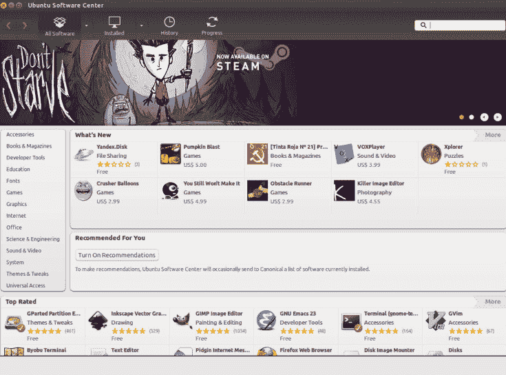

访问 `www.dummies.com` 获取精彩的 Dummies 在线内容。

it-ebooks.info

# 第一章：Linux 简介

既然你手里拿着这本书，可以肯定你已经听过关于 Linux 的事情。如果你在好奇 Linux 到底是什么，它是否值得考虑，以及它能帮助你做什么，那么这本书就是为你准备的。在这里，我将提供关于 Linux 的概览，并告诉你如何立即开始使用。

尽管 Linux 可以运行在许多硬件平台上，但本书侧重于适用于 Intel 80x86 和 Pentium 处理器的 Linux（基本上是任何可以运行 Linux 版本的 PC）。

## 什么是 Linux？

PC 可以被看作硬件的组合——你可以触碰的物品，如机箱、显示器、键盘和鼠标。机箱包含了所有最重要的硬件——中央处理器（CPU），运行软件的微芯片（任何程序）。在典型的 PC 中，处理器是 CPU。其他重要的硬件包括内存（RAM）和硬盘。

操作系统是与硬件交互的程序。操作系统管理所有硬件并执行你的命令。你可以通过菜单、图标或文本来运行。Linux 操作系统模仿了 Unix；在它最基础的形式下，Linux 运行得类似于 Unix、Mac OS、Windows 7 或更早的版本。在它最基本的形式中，操作系统被称为 Linux 内核。

操作系统赋予了计算机个性。例如，你可以在 PC 上运行 Windows，也可以同一台 PC 上安装并运行 Linux。根据运行的操作系统，PC 可以作为 Windows 系统或 Linux 系统运行。

### 10 什么是 Linux？


## Linux 真的运行在任何计算机上吗？

Linux 运行在许多类型的系统上——由于发行版如此多，它似乎可以在任何类型的计算机上运行。Linus Torvalds 和其他程序员为 Intel 8036（兼容）系列开发了 Linux。本书涵盖了 Intel 80x86 和 Pentium 处理器的 Linux。（这些被称为 IA32 架构或 i386，因为它们支持 386 指令集。）

现在 Linux 也适用于基于其他处理器的系统，例如

- AMD 的 64 位 AMD64
- Motorola 68000 系列
- Alpha A
- Sun SPC 和 Ultra SPC
- HP-RISC
- PowerPC 和 PowerPC64
- MIPS R4x0 和 R5x0

IBM 为其 S/390 和 zSeries 大型机发布了自己的 Linux 版本。而且，包括 Ubuntu 和 Fedora 甚至可以在 Sony 的 Playstation 3 游戏机上运行。

操作系统的主要工作是将软件（计算机程序）从硬盘（或永久存储器）加载到内存中，并让 CPU 运行它们。你使用计算机所做的一切都是因为操作系统的存在，如果操作系统出现任何故障，整个系统就会冻结。当你正准备点击按钮给朋友发送电子邮件时，如果系统突然崩溃，该是多么令人沮丧。尝试了一些方法，但都没有反应。这时就需要按下重置键了（如果你的计算机制造商没能提供重置键，就从机器后面拔掉电源）。幸运的是，这种情况在 Linux 上从未发生过——它以非常可靠而闻名。

## Linux 发行版

一个发行版由 Linux 内核（操作系统）和一组应用程序，以及一个易于使用的安装程序组成。

### 什么是 Linux？ 11

大多数人直接用 Linux 来指的是特定的 Linux 发行版。

你会发现许多 Linux 发行版，每个版本都包含标准的 Linux 操作系统以及以下主要软件包：

- `X Window 系统`：它是图形化用户界面。
- 一个或多个图形化桌面：最流行的有 `Gnome` 和 `KDE`。
- 一系列应用程序：Linux 程序以即插用软件的形式提供，并包含了（或可提供）源代码（我们用来告诉计算机执行操作的命令）以及其相关文档。

当前的 Linux 发行版包含了大量的软件——因此许多人通常使用一张或多张 DVD-ROM 光盘。

Linux 内核、Linux 软件包以及发行版本身的开发和维护都是作为开放源项目来组织的。简而言之，开源意味着源代码以及在不受任何限制的情况下自由分发软件的权利。对这种成功的定义远不止于此。要了解开源含义的细节以及可接受的开源许可证，你可以访问开源倡议组织网站 `www.opensource.org`。

表 1-1 列出了几个 Linux 发行版及其对应的简要描述。请注意，Linux 发行版的数量比表 1-1 所示的要多。要查找更多 Linux 发行版，请访问该网站的 DistWatch.com，在那里你可以阅读特定发行版的介绍，并找到下载或订购特定发行版 DVD 的链接。

| Debian GNU/Linux | 这个非营利发行版始于 1993 年，一直是一个流行的发行版，全球有许多志愿者开发者为项目做出贡献。Debian 是一个巨大的发行版，安装需要一些时间。安装完基础 Debian 系统后，你可以使用名为 `apt-get` 的软件包管理器轻松地安装和升级 Debian 软件包（`apt` 代表高级软件包工具）。你可以从 `www.debian.org` 免费获取 Debian。Debian 是其他几个最新发行版（包括 MEPIS、Ubuntu 和 Xandros）的基础。 |
| Fedora | 该发行版曾被称为 Fedora Core，是 Red Hat Linux 的继任者，后者是 Red Hat 公司的发行版。2003 年 11 月发布的 Fedora Core 1 是 Red Hat Linux 9 的继任者。Fedora 13 的 alpha 版本发布于 2010 年。Fedora 免费提供，其软件包使用 Red Hat 软件包管理器 (`RPM`) 格式。你可以从 `http://fedoraproject.org` 下载 Fedora Core。最新的 Fedora 发行版可以在 `http://fedoraproject.org/en/get-fedora` 找到。 |
| Gentoo | 这是一个非商业的、基于源码的发行版（所有软件均以源码形式提供），于 2002 年出现。安装程序了一些二进制包以便让 Linux 运行，但其理念是在用户的计算机上编译源码包。编译如此大量的源码使得构建一个带有最新图形化桌面、多媒体和开发工具的完整 Gentoo 系统非常耗时；所有的软件包都必须下载并编译。Gentoo可以从 `www.gentoo.org` 免费获取。 |
| Knoppix | 这种 Live CD 基于 Debian，并以其开发者、来自德国的 Klaus Knoppix 命名。Knoppix 可以作为恢复工具（修复已安装的 Linux 系统）；你可以直接从光盘运行 Knoppix 而无需将其安装到硬盘上。虽然其他发行版也具有此功能，但 Knoppix 非常适合这项任务。Knoppix CD 软件采用压缩格式，并采用即时解压程序的方法，Knoppix 可以在光盘上存储高达 2GB 的软件。Knoppix 使用软件包管理。有关免费下载 Knoppix 的信息，请访问 `www.knoppix.net` 网站。 |
| Linspace | 这个商业发行版首次于 2002 年以 Windows OS 之名发布。Linspace 使用 Debian 软件包格式，并通过其称为 `Click-N-Run` 的 Web 界面提供付费软件下载。你仍然可以在某些地方找到并下载它；Linspace 在 2008 年被 Xandros 收购，从那时停止作为 Linux 发行版存在。 |


| Mandriva | 这个流行的发行版最初是 1998 年发布的 Red Hat Linux 版本，具有易于使用的安装程序并将 KDE 作为默认桌面。直到最近，这个发行版一直被称为 Mandelin。Mandriva Linux 使用 Red Hat 软件包管理器 (`RPM`) 格式作为软件包。你可以在 `www.mandriva.com` 下载最新版本。点击 `Download` 链接获取更多信息。 |

| MEPIS Linux | 这个基于 Debian 的 Live 发行版于 2003 年 7 月发布。它包含一个图形化安装程序，可以从 Live 发行版启动并将 MEPIS 安装到硬盘上。MEPIS 具有良好的硬件检测功能，并带有 Java 和多媒体软件，使其广受欢迎。MEPIS 使用 Debian 软件包格式。你可以从 `www.mepis.org` 下载。 |

| Slack Linux | 该发行版是最古老的发行版之一，于 1992 年发布。Slack 使用 `tar` 作为软件包，并提供基于文本的安装程序，硬件自动检测有限。你通过编辑文本进行所有软件配置。Slack 可以从 `www.slackware.com` 免费获取。 |

| SUSE Linux | 这个商业发行版（现已开源）于 1994 年发布。SUSE 使用 Red Hat 软件包管理器 (`RPM`) 格式作为软件包。它包含了用于配置的 `Yaast` 工具。访问 `www.opensuse.org` 获取更多信息。 |

## 什么是 Linux？

每个 Linux 发行版也有自己的版本号。这些版本号通常遵循 `x.y` 格式，其中 `x` 是主版本，`y` 是次版本。

与 Linux 内核的版本号不同，奇数和偶数次版本之间没有特殊含义。Linux 发行版的每个版本都包含了特定版本的 Linux 内核以及其他主要组件，例如 `GNOME`、`KDE` 以及各种应用程序。

活跃的 Linux 发行版开发者通常会定期发布新版本的发行版——大约每六到十个月一次。例如，`Ubuntu 13.04` 于 2013 年 4 月发布；`13.10` 则于 2013 年 10 月发布。通常，Linux 发行版的每个新版本都会提供重大的新功能。

Debian 目前至少有三个发布版本：稳定（`stable`）、不稳定（`unstable`）和测试（`testing`）。

- 大多数用户倾向于这种发布类型，因为它是官方发布的最新发行版。
- `Unstable`：开发者正在开发此发布版本。
- `Testing`：该发布版本包含了一些经过测试但尚未准备好包含在稳定发布版中的包。

## Linux 标准基础 (LSB)

Linux 已经变得重要，以至于有一个名为 Linux 标准基础（简称 `LSB`）的标准。`LSB` 是一组二进制标准，有助于减少 Linux 发行版之间的差异并提高应用程序的可移植性。其后的理念是提供一种应用程序二进制接口（`ABI`），以便软件应用程序可以在任何符合 `LSB` 的 Linux（或 Unix）系统上运行。Linux 引用了 `POSIX`（可移植操作系统接口）标准以及许多其他标准，如 C 和 C++ 编程语言标准、Windows 系统版本 11 发布 6（`X11R6`）以及文件层次结构（`FS`）。`LSB` 版本 1.2（称为 `LSB 2.0`）于 2002 年 6 月 28 日发布；`LSB 2.0` 于 2004 年 8 月 30 日发布，`LSB 4.0` 则于 2008 年 11 月 18 日发布。

`LSB` 规范分为两部分——适用于所有处理器类型的通用规范，以及一组针对特定硬件的规范（每种处理器架构一套）。例如，`LSB 1.2` 拥有 Intel 32 位（`IA32`）和 PowerPC 32 位（`PPC32`）处理器的特定架构规范。`LSB 1.3` 增加了针对 Intel 64 位（`IA64`）架构以及 IBM Z 31 位（`S/390`）和 64 位（`S390X`）的规范。


除了 `IA32` 和 `PPC32` 处理器外，`LSB 2.0` 增加了 AMD 64 位（`AMD64` 或 `X86_64`）处理器的规范。当前的 `LSB` 规范——`LSB 4.0` 支持七种处理器架构：`IA32`、`IA64`、`PPC32`、`PPC64`（64位PowerPC）、`S390`、`S390X` 和 `X86_64`。

存在 `LSB` 认证。若干 Linux 发行版已通过符合 `LSB` 的 `IA32` 运行时认证。要了解更多关于 `LSB` 的信息，请访问 `http://www.linuxfoundation.org/collaborate/workgroups/lsb`。最新的 `LSB` 认证系统列表可在 `www.linuxfoundation.org` 获取。

# 16 Linux 发行版的内容

一个 Linux 发行版带有 Linux 内核以及大量的软件。这些软件包涵盖了从图形桌面到互联网服务器，再到创建新软件的编程工具的所有内容。简而言之，我描述了与典型 Linux 发行版一起的一些主要软件包。如果没有这些捆绑软件，Linux 不会像今天这样流行。

## GNU 软件

Linux 发行版的核心是来自 GNU 项目的软件集合。只有当你通过*终端*使用 Linux 系统时，你才能接触 GNU 工具——终端是一种不使用屏幕视觉效果的基本命令行界面；相反，它显示一个提示符，你可以在其中输入命令。（或者你也可以使用图形窗口）。

| bash | 默认 shell。 |

| bc | 带有任意精度的交互式计算器。 |

| Binutils | 包含几个用于处理二进制工具的包。 |

| emacs | 一个可扩展、可自定义的全屏文本编辑器和计算环境。 |

| Findutils | 包含 `find`、`locate` 和 `xargs` 的包。 |

| finger | 一个旨在让互联网用户获取有关他人信息的实用程序。 |

| gawk | GNU 项目对 `awk` 编程语言的实现。 |

| gcc | 用于 C、C++、Objective-C 及其他语言的编译器。 |

| gdb | 用于 C、C++ 和 Fortran 的源码级调试器。 |

| gdbm | 传统 `dbm` 和 `ndbm` 数据库的替代品。 |

| GNUchess | 象棋游戏。 |

| indent | 通过几种不同的样式缩进来对 C 源代码进行格式化。 |

| less | 一种逐页显示程序，类似于 `more`，但具有额外的功能。 | 介绍 Linux |

| libpng | 用于便携式网络图形 (`PNG`) 格式图像文件的库。 |

| m4 | 传统 Unix 宏处理器的实现。 |

| make | 一种实用程序，用于确定大型软件包中哪些文件需要重新编译，并发布编译它们的命令。 |

| ncurses | 一个用于在纯文本终端上显示和更新文本的包。 |

| patch | Larry Wall 程序的 GNU 版本，用于获取 `diff` 的输出并将这些差异应用于原始文件，以生成修改后的版本。 |

| rcs | 版本控制系统；用于软件项目中源文件的版本控制和管理。 |

| sed | `ed` 编辑器的流导向版本。 |

| Sharautils | 包含 `shar`（用于从许多文件创建归档）和 `unshar`（解包这些归档）的包。 |

| tar | 磁带归档程序，支持多卷——具有归档稀疏文件（数据块全为零）、处理压缩和解压缩以及创建远程归档的能力，以及用于增量和全量备份的特殊功能。 |

| texinfo | 一组生成打印手册、纯 ASCII 文本和在线超文本文档（`info`）的工具，并允许用户查看和阅读 `info` 文档。 |

| time | report进程使用的用户、系统时间和实际时间的实用程序。 |

## GUI 与应用程序

面对现实吧——在终端上输入 Linux 命令很无聊。对于普通用户来说，通过图形用户界面（`GUI`，读音为“Goo-ee”）使用系统——即一个提供可点击图标和可打开窗口的界面——要容易得多。这就是 X Window 系统（或 `X`）大显身手。


`www.it-ebooks.info`

# Linux 发行版内容 20

`X` 类似于微软 Windows，但 `X` 的底层原理与 Windows 不同。`X` 提供了显示窗口的基本功能（与微软 Windows 不同），它没有为图形应用程序提供任何特定的外观或操作感。这种外观和感觉来自于 GUI，例如 `GNOME` 和 `KDE`，它们利用了 X Windows 系统。

大多数发行版都以 `XFree86` 或 `XOrg X11` 的形式附带 X Windows 系统——这些是针对 80x86 系统的 X Windows 系统实现。`XFree86` 和 `XOrg` 兼容当今 PC 上的各种显卡。


在 2004 年之前，来自 XFree86 项目 (`www.xfree86.org`) 的 FreeBSD 是 x86 系统上最常用的窗口实现。然而，在 4.4 版本左右，XFree86 许可条款的某些变化引起了许多 Linux 和 Unix 供应商的担忧——他们认为该许可不再与 GNU 通用公共许可证 (`GPL`) 兼容。2004 年 1 月，几家供应商成立 XOrg 基金会 (`www.x.org`)，以促进开源窗口图形桌面的持续开发。XOrg X11 的第一个版本使用了与 XFree86 4.4 相同的代码，直到 XFree86 许可变更导致了 XOrg 基金会的创建。


Linux 发行版包含一个或两个 GUI 桌面：KDE（K 桌面环境）和 GNOME（GNU 对象模型环境）。如果 PC 上同时安装了 GNOME 和 KDE，你可以选择其中一个作为默认——或者在两者之间切换。KDE 和 GNOME 提供的桌面类似于微软 Windows 和 Mac OS 的桌面。GNOME 还带有 Nautilus 壳，它使得查找文件、运行应用程序和配置你的 Linux 系统变得简单。通过使用 GNOME 或 KDE，你可以开始使用你的 Linux，而无需了解晦涩的 Linux 命令。如果你确实需要直接使用这些命令，只需要打开终端窗口并在提示符处输入命令即可。

Linux 还附带许多图形化应用程序。最值得关注的程序之一是 GIMP（GNU 图像管理程序），一个用于处理照片和其他图像的程序。GIMP 的功能与 Adobe Photoshop 相当。

尽管 Linux 被用于提供生产力软件——如文字处理、电子表格和数据库应用程序——但这种情况发生了变化。Linux 附带了 LibreOffice 办公生产力应用程序。此外，你可能想检查以下流行的、商用的 Linux 办公生产力应用程序：

- `Appiglich`: 该办公包是 Linux 生产力软件的良好示例。你可以在 `www.vistasource.com` 找到它。

## Linux 发行版内容 21

- `LibreOffice`: `LibreOffice` (`www.libreoffice.org`) 是从 OpenOffice 分支出来的，是一个广名的生产力软件包。原始的 OpenOffice 由 Apache 提供，并可以在 `www.openoffice.org` 找到。

- `CrossOver Office`: 来自 CodeWeavers (`www.codewavers.com/products/crossover-linux/download`)，`CrossOver` 可用于安装你的微软 Office 应用程序 (`Office`)。

## Linux 发行版内容 22

任何 Linux PC 都可以提供这些 Internet 服务。要实现这一点，PC 必须连接到互联网，并且运行名为服务器 的特殊软件。每个服务器都使用特定的协议。例如，这里是一些常见的服务器：

- `sendmail` 是使用 SMTP（简单邮件传输协议）在系统间交换消息的邮件服务器。

- `Apache httpd` 是使用 HTTP（超文本传输协议）从一个系统向另一个系统发送文档的 Web 服务器。

- `vsftpd` 是使用 FTP（文件传输协议）在互联网计算机间传输文件的服务器。

- `innd` 是使用 NNTP（新闻传输协议）以转发方式在互联网上传递文章的新闻服务器。

- `telnetd` 允许系统上的用户通过 TELNET 登录互联网上的另一个系统。

### 网络

Linux 附带许多你用于交换数据的应用程序。其中最流行的是传输控制/网协议 (`TCP/IP`)。`TCP/IP` 是全球的首选协议。

### Internet 服务器

某些网络应用程序设计用于从一个系统向另一个信息。这里是一些常见的 Internet 服务：

- 电子邮件 (`e-mail`)

- 万维网（或简称 web）

- 新闻组

- 文件传输

- 远程登录

### 软件开发

Linux 特别适用于软件开发。开箱即用充满了开发工具，例如构建程序所需的编译器和代码库。如果你熟悉 Unix 和 C 编程语言，你在 Linux 上编程会感到自自在。

如果你白天在这些工作站上工作，晚上可以使用 Linux PC 复制开发环境，而成本仅为其的一小部分。然后你可以在家里完成工作项目，或者花时间编写趣味软件并分享到互联网。

### 在线文档

随着你使用 Linux 变得越来越精通，你可能想要快速查找信息——例如无需翻阅（咳）这本书。幸运的是，Linux 附带了足够的在线信息，可以在那些你模糊记得命令名称但不记得应该输入的确切语法的情况下唤起你的记忆。

## Linux 发行版目录

### 程序员想了解的 Linux 相关

这些特性使 Linux 了一个高效的软件开发环境：

- GNU C 编译器 (`gcc`): 编译 ANSI 标准的 C 程序。

- GNU C++ 编译器 (`g++`): 支持 ANSI 标准的 C++ 特性。

- GNU Java 编译器 (`javac`): 编译用 Java 语言编写的程序。

- GNU make 工具: 允许你编译和链接大型程序。

- GNU 调试器 (`gdb`): 允许你通过调试程序查找问题并确定程序失败的原因。（失败程序的内存保存在 `core` 文件中；`gdb` 可以检查此文件。）

- GNU 性能分析工具 (`gprof`): 允许你确定软件对计算机处理器处理器的使用程度。

- Subversion、当前版本系统 (`CVS`) 和修订控制系统 (`RCS`):

  维护版本信息并控制对源文件的访问，以确保两个程序员不会无意中同时修改同一个源文件。

- GNU emacs 编辑器：准备源文件并启动编译-链接过程来构建程序。

- `Perl`: 允许你编写脚本来完成特定任务，通过 Linux 命令将许多小程序结合在一起。

- 工具命令和图形工具包 (`Tc/Tk`): 允许你快速构建图形应用程序。

- `Python`: 允许你使用类似于 Perl 和 Tcl 的解释型编程语言编写代码。（例如，Fedora 安装程序 `anaconda` 就是用 Python 编写的。）

- 动态链接库：允许你的程序文件变得小得多，因为多个程序所需的所有库代码都是共享的——系统内存中只加载一个副本。

如果你使用 Linux 命令，可以查看被称为 man page（帮助页）的文档，即使用 `man` 命令查看某个命令的帮助页。（你必须记住该命令才能访问在线帮助。）

你也可以从 GUI 桌面获取帮助。GNOME 和 KDE 桌面都带有查看在线信息的帮助功能。大多数发行版在桌面菜单中包含帮助选项，或者桌面上有一个帮助图标，你可以通过它获取在线帮助。然后你可以点击初始帮助窗口上的链接来浏览帮助信息。图 1-1 显示了一个典型的帮助窗口——这是来自 Ubuntu 桌面的。


### 使用 Linux 管理你的 PC

Ubuntu 桌面指南


作为一个操作系统，Linux 充当中介，让你作为“系统之主”来管理所有硬件。硬件包括主机箱、显示器、键盘、鼠标以及连接到主机箱的任何其他设备。这个通用术语指的是附加在系统上的任何设备。如果你使用的是笔记本电脑，你的硬件就封装在笔记本电脑内部。

主机箱内部是大脑——微处理器（Intel Pentium 4，也称为 CPU），它执行计算机程序包含的指令。该程序的指令存储在内存或 RAM（随机存存储器）中。这意味着内存的任何部分都可以被随机访问——顺序任意任意。

主机箱还有另一个关键组件——硬盘（有时称为硬磁盘）。硬盘是存储计算机程序和数据的永久空间。它的永久性体现在当你关闭 PC 电时，内容不会消失。硬盘被组织成文件，文件又按层级结构组织成目录和子目录（类似于在文件柜抽屉的文件夹里整理文件）。

为了让 Linux 系统正常运行，你（或其他人）必须确保硬件工作正常并定期备份文件。还有安全问题——确保只有合法人员才能访问和使用系统。这些任务被称为系统管理。

如果你在拥有许多计算机的大型设施中使用 Linux，则由一名全职系统管理员负责所有的系统管理任务。另一方面，如果你在家庭 PC 上运行 Linux，你就是系统管理员。不要被这个想法吓到。你不需要学习任何咒语或准备加密配置文件就能成为系统管理员。大多数 Linux 发行版都包含许多图形化工具，让系统管理变得像运行其他应用程序一样只需点点鼠标即可。

### 发行媒体

某些 Linux 发行版包含在单张 DVD-ROM 上。安装后，Linux 内核和所有应用程序都存储在你的硬盘上——当你告诉 PC 执行某项操作时，它首先查找那里。

通常，硬盘在 Linux 安装过程中会被准备好使用，你除了备份存储在那的数据或（偶尔）安装和更新应用程序外，通常不需要去动硬盘。


在 Linux 中使用 CD-ROM 或 DVD-ROM 非常简单。当你登录 `GNOME` 或 `KDE` 桌面时，只需将 CD 或 DVD 插入驱动器，系统应该会自动检测到 DVD/CD-ROM。取决于 Linux 发行版，桌面上会自动打开 DVD/CD-ROM，或者文件管理器会自动打开并显示 DVD/CD-ROM 的内容。如果所有方法都失败，你可以输入一个简单的 `mount` 命令将 DVD/CD-ROM 与系统上的目录关联。这种在 Linux 访问 CD 或 DVD 上文件的过程称为挂载（`mounting`）CD 或 DVD。

除了系统的硬盘和 DVD/CD-ROM 驱动器，你的 PC 可能还有其他驱动器。在 Linux 中使用这些磁盘。

## 外设

连接到系统的任何设备都是外设。常见的外设之一是打印机，鼠标和键盘也是。Linux 自带了一个图形工具来配置这些设备。

## 使用 Linux 管理你的 PC

现在大多数 PC 要么连接到局域网 (`LAN`)，要么连接到互联网，你还需要管理你与网络的连接。Linux 自带了一个网络配置工具来设置局域网。对于通过调制调器连接互联网，通常有一个 GUI 拨号工具。

另一个需要配置的外设是声卡。现在的 PC 配有 `USB` 接口；包括打印机和扫描仪在内的许多设备都可以插入 `USB` 端口。

`USB` 设备的一个很棒的特性是，你可以随时插入或拔出 `USB` 端口——在系统上电时不需要连接这些设备。这些设备被称为“热插拔”（`hot plug`），意味着在系统运行时可以连接。当你将设备插入 `USB` 端口时，Linux 会加载正确的驱动程序并让应用程序可以使用设备。


## 文件系统与共享

目录和文件的整个组织结构就是文件系统。你当然可以使用 Linux 管理文件系统。当你从 `GNOME` 或 `KDE` 图形桌面浏览文件时，你将使用熟悉的图标。


照顾文件系统的关键是在 `USB` 驱动器或其他介质上备份一个或多个目录。你甚至可以在带上备份文件（如果你有磁带驱动器）。如果你有 CD 或 DVD 刻录机，还可以将想要备份或留存的文件刻录到 CD 或 DVD。

Linux 还可以与网络上的其他系统共享文件系统的部分。例如，你可以使用网络文件系统 (`NFS`) 跨网络共享文件。对于系统上的用户来说，远程系统的文件就像位于本地系统的一个目录中。

Linux 还带有 `Samba` 软件包，支持与 Microsoft Windows 系统进行文件共享。`Samba` 让 Linux 系统工作起来就像 Windows 文件或打印机服务器一样。你也可以访问网络上其他系统的共享文件夹。

# 入门 27

如果你像许多用户一样，通过 `DSL` 或电缆调制调器连接到互联网，你需要一台带有以太网卡的 PC，连接到电缆或 `DSL` 调制调器。这意味着你必须建立局域网并配置以太网卡。幸运的是，这些步骤通常是 Linux 安装的一部分。

Linux 还包含用于配置防火墙的工具，防火墙是一个保护缓冲区，可以让你的系统免受任何试图窥探你互联网连接的人。你可以使用 `iptables` 命令或运行 GUI 防火墙配置工具来配置防火墙。

# 入门

根据学习新主题的个人经验，我建议通过四个步骤来开始学习 Linux（以及《Linux 傻瓜指南》）：

- 1. 在你的 PC 上安装 Linux（如第一本书所示——本本）。
- 2. 配置 Linux 让所有运行都符合你的心意（如第一本书所示）。
- 3. 探索 GUI 桌面和应用程序（如第二本书所示）。
- 4. 了解特定主题的细节，例如互联网服务器（如第四本书所示）。

在本章的剩余部分，我将进一步解释这一建议。

## 第一步：安装

Microsoft Windows 预装在你的新 PC 上，但 Linux 通常没有。你的第一个障碍是将 Linux 弄到你的 PC 上。虽然现在有些供应商提供预装 Linux 的电脑，但这很罕见。

在你克服了最初对未知事物的人类恐惧后，你会发现 Linux 安装非常简单——你起初从哪里获取它呢？消息是它可以在网上很容易找到，而且第一本书展示了如何一步安装 Linux。

一个典型的完整 Linux 发行版非常大——但如果你有良好的带宽，Linux 是免费下载的。例如，你可以访问 `www.linux.org` Linux 在线网站并点击“Download”（下载）按钮。


## 第二步：配置

当你完成 Linux 安装后，下一步是配置各个系统组件（例如声卡和打印机）并调整任何需要的设置。第一本书展示了如何配置 Linux 的细枝末。

`www.i-ebooks.info`

# 28 入门

> 提示：如果你没有看到图形登录界面，可能是 `X Window` 系统在安装期间没有配置正确。你必须修复 `X` 配置文件才能让 GUI 工作工作。

你可能想配置你的 GUI 桌面——`GNOME` 或 `KDE`（或两者都有）。它们各有一个配置工具。你可以使用这些工具来调整桌面的外观和感受（背景、标题字体，甚至是整个方案）。第二本书展示了如何让你的桌面更具个人特色。

完成配置后，你系统上的硬件和应用程序应该按照你的心意运行。

## 第三步：探索

当你拥有一台配置良好的 Linux PC 后，你就准备好探索 Linux 本身了。你可以从 GUI 桌面——`GNOME` 或 `KDE`——开始这个过程。查看组成 Linux 文件系统的 GUI 桌面以及文件夹和文件，正如第二本书中所讨论的。你还可以尝试桌面上的应用程序。你会发现办公、多媒体应用程序以及互联网应用程序供探索。

再尝试一下 shell（终端）：打开一个终端窗口并在窗口中输入一些 Linux 命令。你还可以探索在文本模式下运行的文本编辑器，第二本书中有涵盖。了解如何在没有 GUI 的情况下编辑文本（以防 GUI 无法使用）是一个好主意。至少你不会变得无手无策。

## 第四步：了解更多

在探索了 Linux 世界并了解它是什么之后，你可以更深入地了解特定主题领域。例如，你可能对设置互联网服务器感兴趣。你可以学习设置单个服务器的细节，例如用于电子邮件的 `sendmail`。

## 检查你的 PC 硬件

在为 Linux 预留出硬盘分区后，你可以从所选发行版的 CD 启动 PC 并开始 Linux 安装。安装过程中会有很多步骤，且不同发行版之间有所不同。既然你已经进行到这一步，一切应该是顺风顺水的。只需完成安装，在一到两个小时内就能结束。大多数安装程序（如 `openSUSE` 界面）会显示图形界面（GUI）并引导你完成所有步骤。

安装过程中的一个步骤涉及再次对硬盘进行分区，但这次只需使用之前创建的分。

完成几个配置步骤（例如设置网络和时区）后，选择要安装的软件包并让安装程序完成剩余工作。某些发行版可能会让过程变得简单；省去软件选择步骤。

安装完成后，重启 PC。安装过程中有时需要重启。

当 Linux 首次运行时，你有机会进行一些配置并安装额外的软件包。

## 检查你的 PC 硬件

如果你担心 PC 可能无法运行 Linux，以下是在开始安装 Linux 之前需要考虑的一些 PC 关键组件：

- **DVD 驱动器：** 你必须有一个 DVD 驱动器（DVD-ROM 或 DVD 刻录机），且 PC 必须能够从中启动。

具体的型号并不重要。重要的是 PC 如何连接到硬盘控制器的 DVD 驱动器（`IDE` 用于集成驱动器，或 `ATA` 用于附加）。如果你添加额外的 DVD 驱动器，它很可能连接到 `USB` 端口。任何 `IDE`/`ATA` 或 `USB` DVD 驱动器适用于 Linux。

- **硬盘：** 任何 `IDE` 硬盘适用于 Linux。另一种类型的控制器是 `SCSI`（小型计算机系统接口），Linux 支持。为了方便安装和运行 Linux，你需要大约 5GB 的硬盘空间。另一方面，要尝试 Live 版发行版，不需要硬盘空间。

- **键盘：** 所有键盘都兼容 Linux 和窗口系统。

- **显示器：** 显示器的类型并不特殊，只要能够显示显卡所需的屏幕分辨率即可。屏幕分辨率以水平和垂直像素表示（例如 1024 x 768）。安装程序可以检测大多数显示器。如果它没有检测到你的显示器，你可以选择特定分辨率的通用显示器（例如 1024 x 768）。你也可以通过显示器的名称和型号来选择。

- **鼠标：** 安装程序可以检测鼠标。所有类型的鼠标（如 `PS/2` 或 `USB`）都兼容 Linux 和窗口系统。

- **网卡：** 虽然并非所有 PC 都有网卡，但现在已很罕见。只要你有一个，安装程序就能正确检测并使用它。如果你遇到问题，可以在网上搜索网卡的名称和型号以查看 Linux 是否支持。

- **处理器：** 处理器速度以 MHz（兆赫）或 GHz（吉赫）表示，只要超过 700 MHz 即可。通常情况下，速度越快，Linux 在兼容的处理器上运行得越快，例如 AMD 处理器。


# Linux 安装准备指南

## 硬件要求

- **内存 (RAM)：** 系统内存量。处理速度越高，内存越好。你需要至少 `32MB` 内存来安装 Linux 和窗口系统。对于某些发行版，内存要求更高，以便运行 GUI。

- **SCSI 控制器：** 高性能 PC 拥有连接硬盘和其他外设备的 SCSI 控制器。如果你的 PC 有 SCSI 控制器，你可能需要查找控制器的名称和型号。

- **声卡：** 如果你有声卡并想在 Linux 中使用音频，需要确保它是兼容的。成功安装 Linux 后可以配置声卡。

- **显卡：** Linux 适用于所有显卡（也称为显示适配器）。在文本模式下，如果你想使用 GUI，需要兼容窗口系统的显卡。安装程序可以检测并正确配置支持的显卡。然而，如果安装程序无法检测显卡，它可以帮助你了解显卡的名称和型号。

- **打印机：** 除了这些硬件，你还需要找到要在 Linux 中使用的打印机名称和型号。


许多发行版（如 Debian/Linux）适用于任何硬件。关于兼容 Linux 的硬件信息，请参阅 `tldp.org/HOWTO`。

## 为 Linux 预留空间

要检查 PC 硬件是否兼容特定发行版，请访问该网站并查看其硬件列表。在典型的 Windows PC 中，Windows 占据了整个硬盘。你需要缩小分区为 Linux 腾出空间。在 Linux 安装期间，安装程序使用空闲空间创建 Linux 分区。

要尝试 Live 版发行版——如 Ubuntu——你不需要对硬盘进行分区。从 Live CD 启动 PC。安装程序无法缩小 Windows 分区，因此你不需要提前执行分区步骤。如果你计划在硬盘上安装 Fedora 或任何其他 Linux 发行版，必须对硬盘进行分区。如果你想在 Windows 下调整磁盘分区，可以使用商业产品或分区编辑器 `GParted` 来调整 Windows 分区。`GParted` 可以创建 `NTFS`（NT 文件系统）分区，大多数版本的 Windows 使用该分区。

当你调整磁盘分区时，始终存在丢失硬盘上所有数据的风险。因此，在使用分区工具调整硬盘分区之前，在对分区进行任何操作之前，请确保你可以从备份中恢复文件。

在 Ubuntu 启动并出现 GUI 桌面后，按照以下步骤减少 Windows 分区：

1. 从 Ubuntu 桌面选择 `System::Administration::GParted`。出现 `GParted` 窗口，工具会显示它找到的硬盘。第一个硬盘显示为 `/sda`，第二个为 `/sdb`，以此此类推。

2. 点击你想调整的分区。该分区通常是最大的。对于 Windows 7、Vista 或 XP，分区类型为 `ntfs`，如 `GParted` 中“Type”列所示。

3. 从分区列表中点击该硬盘。

4. 从 `GParted` 菜单选择 `Resize/Move`（调整/移动）。调整分区对话框出现。

5. 设置分区的新大小并点击 `Resize/Move`。你应该选择 `4GB` 或更多的空闲空间。

6. 在指定所有更改后点击 `Apply`（应用）开始操作。当警告出现时，点击 `Apply` 执行所有待处理操作。

分区已更改，分区后有了空闲空间。

在硬盘上为 Linux 创建好空闲空间后，你可以继续安装选择的 Linux 发行版。

## 尝试 Live CD

在安装任何内容之前，你会发现尝试 Live CD 或可启动 USB 是值得的。除了感受 Linux 桌面外，你还可以轻松完成一些安装前的准备工作。

例如，要启动 Ubuntu，请从 Live CD 启动 PC。会出现一个菜单，你可以在其中输入各种选项来控制启动过程或检查系统是否符合硬件要求。你应该选择默认选项启动 Ubuntu（如果你在菜单 30 秒超时前未做选择，将自动执行此选项）。

几分钟后，你会看到 Ubuntu 使用的 GNOME GUI 桌面。你现在可以探索 Ubuntu 了。如果你能找到 Examples 文件夹，你会发现许多 Ubuntu 可以做的事情。你也可以从 `System`、`Administration` 菜单（`System::Administration;GParted`）选择 `GParted`（分区编辑器）来重新配置硬盘。

当你完成 Ubuntu 使用后，选择 `System;Quit`。在 Ubuntu 关闭后，取出 DVD 并按回车键。如果你决定安装 Ubuntu，点击桌面上的图标开始该过程。

## 在闪存盘上安装 Linux

我曾一度喜欢发行版的 Live CD —— 但不是。我喜欢 Live CD 是因为我可以制作廉价的介质分给学生和用户，让他们可以在自己的机器上体验 Linux 体验而无需安装操作系统、改变他们熟悉的环境或承担风险。此外，同一小组可以快速从 Fedora 切换到 Ubuntu 或 openSE。

### 在闪存盘上安装 Linux 35

更多。我最讨厌 Live CD 发行版的地方是它们速度极慢，而且无法轻松保存配置更改。考虑到这些严重问题，我一直在寻找更好的解决方案。坦率地说，我找到了：可启动 USB 发行版。

启动 USB 发行版已经存在一段时间了，但一直阻碍着我采用它们。然而，Fedora 的 Live USB 实现是我遇到过的最好的。它提供了一种简单的创建方法，大多数用户都可以无序地完成；安装过程是非破坏性的——允许你保留 USB 盘上的现有文件——而且保留更改（数据持久化）也非常简单。

在本章的剩余部分，我将向你展示如何创建一个启动闪存盘并在你自己的环境中使用它。

## 创建启动闪存盘

尽管你可以在 Windows 中使用各种命令行技术创建启动 USB 盘（我意识到建议从 Windows 上制作 Linux 启动介质听起来像是异端邪，但大多数对 Linux Live USB 实现感兴趣的用户可能都会这样做）。请按照以下步骤创建启动 USB 盘：

- 1. **访问 `http://fedorahosted.org/liveusb-creator` 并下载 `liveusb-creator` 程序。**

- 2. **安装 `liveusb-creator` 程序。**

- 3. **打开 `liveusb-creator` 安装的文件夹。**

- 4. **双击 `liveusb-creator` 程序运行它。**

- 5. **选择目标设备 (Target Device)**，选择你的闪存盘。例如，闪存盘可能显示为 TravelDrive 等名称。

- 6. **选择镜像（ISO 文件）的来源。**

- 7. **设置持久化存储空间 (Persistent Storage amount)。**

- 8. **点击创建 Live USB (Create Live USB) 按钮并静候。**

如果你的互联网连接较慢，可以使用一个 Live CD 来提取 ISO 文件。如果你的网络较快，使用下载（Download）选项访问当前的 ISO 文件。

这是分配给安装程序且始终可用的存储空间。我建议普通用户设置的值至少为 `300MB`。我不知道为什么默认单位是 `(MB)`。

你可以查看进度。准备好等待十分钟让过程完成。驱动器上会创建两个文件夹：`linux`（小于 `7MB`，负责启动）和 `LiveOS`（取决于你的存储设置）。

- 9. 关闭应用程序和新创建的启动盘。

## 在闪存盘上安装 Linux 36

## 工作站故障排除

我尝试了许多闪存盘，只要安装后留有 `1GB` 的空闲空间，我就没有遇到过任何问题。较小的驱动器（`2GB` 或更小）通常出厂时格式化为 `FAT`（文件分配表），较大的驱动器格式化为 `FAT32`；据我所知，这在安装或可用性上没有产生任何区别。

你必须确保工作站设置允许机器从 USB 启动，这通常需要重新配置 BIOS。

- 1. 首先，重启工作站并按下用于进入 BIOS 配置的按键（通常是 `F12` 或 `DEL`），有时是 `F1` 或 `F2`。

- 2. 选择“启动 (Boot)”菜单，并启用“优先启动 USB 设备 (Boot USB Devices First)”或类似的设置。

在某些计算机上，闪存盘隐藏在 BIOS 的“硬盘”部分下。在这种情况下，你需要进入“启动：硬盘 (Boot:Hard Drives)”，将主硬盘改为存储介质，并确保 USB 是“启动设备 (Boot Device)”列表下的第一个选项。如果从 USB 启动的选项是“启用/禁用 (Enable/Disable)”，请选择，然后获取启动设备顺序并将 USB 选择移动到硬盘选择之上。

- 3. 保存你的更改并启用 BIOS 配置。

此时，工作站将继续重启——如果你的 USB 盘已插入——它应该启动 Fedora。

如果你只看到单行条“Boot Error”而没有发生其他情况，请按照制造商的说明更新系统 BIOS。

## 使用新驱动器日常工作

当系统启动时，Fedora 环境的加载速度会比 Live CD 加载快得多。USB 盘会显示在其上面创建的新文件夹，其他设备也可以像往常一样访问。“安装到硬盘 (Install to Hard Drive)”仍然留在桌面上，如果你决定这样做，可以快速永久切换到 Fedora。

要使用该操作系统，不需要连接互联网，但强烈建议连接，因为大多数用户会想要下载额外的程序来进一步测试操作系统的功能。


恭喜！你现在可以开始使用 Fedora 了！


# 第 3 章：Linux 的故障排除与配置

本章内容

- 安装故障排除
- 配置 X Window 系统
- 解决安装问题
- 设置你的打印机
- 管理你的 DVD 和 CD-ROM
- 安装额外的软件包

在安装 Linux 的过程中，安装程序会尝试检测硬件组件，例如 SCSI 控制器和网卡。根据它检测到的内容，安装程序将引导你执行一系列安装步骤。例如，如果安装程序无法检测到网卡，它将跳过网络配置步骤。如果你实际上没有网卡，那么这是没问题的。当你重启并看到不是图形化登录而是文本终端时，可能会发生另一个安装问题。此错误意味着 X Window 系统出了问题。此外，Linux 安装通常不包含每件硬件的配置程序。在本章中，我将向你展示一些故障排除的方法。你可能还需要安装额外的软件包；本章还将介绍如何以不同格式安装包，例如红帽 软件包管理器 `RPM` 和 Debian。

## 使用文本模式安装

大多数 Linux 安装程序都尝试使用 X Window 系统 `X` 来显示图形化安装界面。例如，如果安装程序未能检测到显卡，`X` 就不会启动。如果——由于此原因或其他任何原因——安装程序未能启动 `X`，你始终可以退回到文本模式安装。然后你可以手动配置显卡，或稍后使用单独程序配置 `X`。

表 3-1 列出了如何获取文本模式安装。通常，文本模式安装的顺序与第 2 章概述的图形化安装顺序相似。你只需响应提示并执行安装。

| 表 3-1 | 某些 Linux 发行版的文本模式安装 |
|---|---|
| 发行版 | 如何进入文本模式安装程序 |
| Debian | 默认以文本模式运行 |
| Fedora | 从 Fedora CD 或 DVD 启动 PC 后，在 `boot :` 提示符输入 |
| Knoppix | 在启动 Knoppix 时输入 `2` 以文本模式启动（因为 Knoppix 是 Live 发行版，你不需要安装它）。 |
| SUSE | 在第一个安装界面，按下 `F3`，使用方向键选择文本模式选项，然后按回车。 |
| Ubuntu | 默认以文本模式运行 |
| Xandros | 启动 CD 时按 `Shift` 键进入救援控制台。当出现 `bash-3.00#` 提示符时，输入 `quick_install` 并遵循说明。 |

## 故障排除

每当我在旧电脑上安装 Linux 时，GUI 安装在安装期间运行良好，但在安装后首次重启 PC 时，图形界面并没有出现。相反，我看到的是文本登录，或者中间有一个小 X 的黑屏，或者启动过程似乎在灰色屏幕处挂起。如果这种情况发生在你身上，这里是故障排除方法：

- 1. 按 `Ctrl+Alt+Delete` 重启 PC。

PC 开始启动。你进入了 `GRUB`（统一引导加载程序）提示你要启动哪个操作系统的界面。（如果发行版在引导加载程序中使用 `LILO`，你看到的是文本。）

### X 39 疑难排除

- 2. 对于 `GRUB`，按下 `A` 键添加一个选项，告诉 Linux 内核启动到提示符界面。对于 `LILO`，跳过此步骤。

`GRUB` 启动加载程序随后会为 Linux 内核显示一个命令行，并提示你想要执行的操作。

- 3. 对于 `GRUB`，输入一个空格后输入单词并按回车。对于 `LILO`，输入 `linux single` 并按回车。

Linux 内核以单用户模式启动，并显示如下所示的提示符：

```
sh-3.00#
```

现在你已经准备好配置 `X` 了。

`X` 使用配置文件（取决于发行版，为 `XF86Config-4` 或 `xorg.conf`）来修复你的显示光标、显示器以及你想要的屏幕分辨率。Linux 安装程序会准备好该配置文件，但有时配置是不正确的。

要创建一个运行的配置文件，请按照以下步骤操作：

- 1. 输入以下命令：

```
X -configure
```

服务器将运行并创建一个配置文件。屏幕变白，在显示一些消息后 `X` 服务将启动。在 Fedora 中，消息的最后一行显示如下：

> 测试服务器，运行 `X -config /etc/xorg.conf.new`

- 2. 使用文本编辑器（如 `vi`）编辑 `/etc/xorg.conf.new`，并在 `Section "Files"` 之后插入以下行：

```
FontPath "unix:/7100"
```

在 Fedora 中，你还必须将 `/dev/mouse` 改为 `/dev/input/mice`。

- 3. 输入 `X &` 启动 `X` 字体服务器。

- 4. 输入以下内容尝试使用新配置文件：

```
X -config /etc/xorg.conf.new
```

如果你看到一个带有 X 形状光标的空白屏幕，说明配置文件正在正常工作。

- 5. 按 `Ctrl+Backspace` 杀死 `X` 服务器。

- 6. 使用以下命令将新配置文件复制到 `/etc/X11` 目录：

```
cp /etc/xorg.conf.new /etc/X11/xorg.conf
```

- 7. 按 `Ctrl+Alt+Delete` 或输入 `reboot` 重启 PC。

如果一切顺利，你将看到图形化登录界面。

### 40 解决其他安装问题

提示：使用 `X` 服务器的 `-configure` 选项创建的 `X` 配置没有以最佳分辨率显示。要微调配置，你需要在重启系统后运行一个实用程序来调整显示设置。你使用的实用程序取决于 Linux 发行版，但大多数发行版都包含一个允许通过图形界面配置显卡、显示器和显示设置的实用程序。

## 解决其他安装问题

我确定没有列举所有可能遇到的安装问题。没有人能做到这一点。Intel x86 PC 中的许多组件就像墨菲定律一样，实际上几乎要求存在某些安装程序无法处理的硬件组合。在本节中，我列出了一些提示。对于其他问题，我建议你去 Google Groups (`http://groups.google.com`) 并输入故障的一些症状。假设其他人也遇到了类似的问题，你可以获得如何解决你特定困境的指引。

### 使用 Knoppix 启动命令

`Knoppix` CD 可以是一个极好的疑难排除工具，因为 `Knoppix` 擅长检测硬件，并且可以直接从启动介质（CD/DVD/USB）运行。

提示：如果你已经启动了 `Knoppix`，尝试在 `boot:` 提示符处输入 `Knoppix` 启动命令。例如，如果 `Knoppix` 在尝试检测 SCSI 卡时似乎卡住，你可以在 `boot:` 提示符处通过探测 `knoix nosci` 来禁用 SCSI。或者，如果你让 `X` 服务器加载 `nv` 模块（基于 NVIDIA 芯片的显卡），你可以在 `boot:` 提示符处输入 `knoix module-nv`。

表 3-2 列出了一些常用的 `Knoppix` 启动命令。

| 表 3-2 | 一些常用的 Knoppix 启动命令 |
| :--- | :--- |
| 启动命令 | 功能 |
| expert | 以专家模式启动，允许用户交互式地设置和配置 Knoppix。 |
| failsafe | 在不尝试检测硬件的情况下启动（启动 Linux 所需的最少硬件外）。 |
| fb1280x1024 | 在指定的分辨率下使用帧缓冲区图形（指定你想要的分辨率，例如 1024 x 768 或 800 x 600）。 |

## 解决其他安装问题

| 启动命令 | 功能 | 书 I 第 3 章 |
| :--- | :--- | :--- |
| knoppix 1 | 在运行级别 1（单用户模式）启动 Knoppix，你可以用它来执行救援操作。 |  |
| knoppix 2 | 在运行级别 2 启动，提供文本模式的 shell 提示符。 |  |
| knoppix acpi=off | 完全禁用 ACPI（高级配置和电源接口）。 |  |
| knoppix atapiic | 使用 ATAPI CD-ROM 接口而不是为 IDE 驱动器模拟 SCSI 接口。 |  |
| knoppix desktop=wmname | 使用默认 KDE 桌面指定的窗口管理器=wmname（其中 wmname 是 fluxbox, icewm, kdars, twm, wmaker 或 xf）。 |  |
| knoppix dma | 为所有 IDE 驱动器启用直接内存访问 `DMA`。 |  |
| knoppix floppyconfig | 从软盘运行名为 `knoppix.sh` 的 shell 脚本。（脚本包含你想运行的 Linux 命令。） |  |
| knoppix fromhd=/dev/hd1 | 从指定硬盘中之前复制的 Live CD 镜像启动。 |  |
| knoppix sync=80 | 为 `X` 使用 80-kHz 水平刷新率。（输入你需要的刷新率。） |  |


| `knoppix lang=xx` | 将键盘语言设置为双字母代码 `xx`（其中 `xx` 是简体中文，`de` = 德语，`es` = 西班牙语，`fr` = 法语，`it` = 意大利语，`nl` = 荷兰语，`pl` = 波兰语，`ru` = 俄语，`sk` = 斯洛克语，`tr` = 土耳其语，`us` = 美国）。 | | |

| `knoppix mem=256M` | 指定 PC 的内存大小（兆字节）。 | | |

| `knoppix myconf=/dev/hd1` | 从存放 `knoppix.sh` 的 `/dev/hd1` 分区运行 `knoppix.sh` shell 脚本。 | | |

| `knoppix myconf=scan` | 让 Knoppix 搜索。 | | |

# 42 解决其他安装问题

| 启动命令 | 功能 | 表 3-2 (继续) |

| :--- | :--- | :--- |

| `knoppix noject` | 不弹出 CD。 | |

| `knoppix noprompt` | 不提示。 | |

| `knoppix nowheel` | 强制 PS/2。 | |

| `knoppix xxxxx` | 禁用。 | |

| `knoppix agga-off` | 禁用 VGA。 | |

| `knoppix pnp-off` | 禁用 ACPI。 | |

| `knoppix screen=resolution` | 设置分辨率。 | |

| `knoppix testcd` | 检查 CD 完整性。 | |

| `knoppix tohd=/dev/hd1` | 到硬盘。 | |

| `knoppix toram` | 使用 RAM。 | |

| `knoppix vga=ext` | 使用 VGA。 | |

| `knoppix vsync=60` | 设置垂直同步率。 | |

| `knoppix wheelmouse` | 使用 PS/2。 | |

| 启动命令 | 功能 | 书 I |

| :--- | :--- | :--- |

|  | 启动 | |

| | 启动 X 模块 | |

| | `xmodule=modname` | |

| | `xserver=progname` | |

## 解决 PC 重启问题

在某些 PC 上，当你在启动提示符处按回车时，初始 Linux 内核会加载并立即重启 PC。这可能是由于 PC 的 BIOS 中 ACPI 实现不当导致的。要绕过此问题，请在启动提示符处输入 `linux acpi=off` 来关闭 ACPI。如果不起作用，请考虑表 3-3 中你可能想要尝试的其它启动选项。

## 使用 Linux 内核启动选项

当你从 DVD 或第一张光盘启动 PC 进行 Linux 安装时，你会在启动提示符处看到一个文本界面。通常，你只需在该提示符处按回车或什么都不做，安装就会很快开始。然而，你可以在启动提示符处指定各种选项。这些选项控制 Linux 内核启动的各个方面，例如禁用对疑故障硬件的支持，或使用特定的驱动模块启动 X 服务器。其中某些启动选项可能帮助你绕过安装过程中可能遇到的问题。

要使用这些启动选项，通常你输入 `linux` 后跟启动选项。例如，要执行文本模式安装并告诉内核你的 PC 有 512MB 内存，你在启动提示符处输入以下内容：

```
linux text mem=512M
```

参考表 3-3 获取 Linux 启动选项的简要总结。你可以使用这些命令来开启或关闭功能。

| 启动选项 | 作用 |

|---|---|

| `allowcddma` | 为 CD/DVD 驱动器启用 DMA。 |

| `apic` | 解决 Intel 440GX BIOS 中常见的错误，且仅在内核安装内核时执行。 |

| `acpi=off` | 如果 ACPI 出现问题则禁用 ACPI。 |

| `dd` | 在安装 Red Linux 时提示输入驱动盘。 |

| `display=IP_address:0` | 使安装程序的 GUI 出现在由 IP 地址识别的远程系统上。（确保你在运行安装程序的远程系统主机上运行了 `xhost +hostname` 命令）。 |

| `driverdisk` | 在安装 Red Hat 时提示输入驱动盘。 |

| `enforcing=0` | 关闭安全增强型 Linux (SELinux) 强制访问控制。 |

## 解决其他安装问题

| 启动选项 | 作用 | 第一本书 |

|---|---|---||

| `expert` | 允许对可移动介质进行分区并提示驱动盘。 | | |

| `ide=nodma` | 禁用所有 IDE 设备上的 DMA，当你遇到 IDE 相关问题时非常有用。 | | |

| `ks` | 使用 DHCP 配置以太卡，并使用 DHCP 服务器提供的启动服务器参数识别的 NFS 服务器运行 kickstart 安装。 | | |

| `ks=kickstartfile` | 使用由 `kickstartfile` 指定的 kickstart 文件运行 kickstart 安装。（其背后的设计理念是创建一个包含所有安装选项的文本文件，然后通过启动并提供 kickstart 文件作为输入来启动安装。） | | | |

| `lowres` | 强制安装程序 GUI 以较低分辨率（640 x 480）运行。 | | |

| `mediacheck` | 提示检查 CD 镜像（也称为 ISO 镜像）的完整性。通过计算 MDS 校验和并对比来检查镜像。检查 CD-ROM 可能需要几分钟。 | | | |

| `mem=xxx` | 覆盖内核在 PC 上检测到的内存量。（某些旧设备设备只能检测到 16MB 内存，在某些新机器上，显卡可能会使用主内存的一部分。）确保将 `xxx` 替换为你 PC 内存的兆字节数。 | | | |

| `nmi_watchdog=1` | 启用利用不可掩断中断 (NMI) 的内置内核检测器。 | | | |

| `noaptic` | 防止内核使用高级可编程中断控制器 (APIC) 芯片。（你可以在已知有缺陷 APIC 的主板上使用此选项。） | | | |

| `nofirewire` | 不 FireWire。 | | | |

| `noht` | 禁用超线程，这是一项允许单个处理器在硬件层上充当多个虚拟处理器的功能。 | | | |

| `nomce` | 禁用由机器检查异常 (MCE) 对 CPU 执行的自诊断检查。在某些机器上，这些检查执行过于频繁，需要禁用。 | | | |

# 46 解决其他安装问题

| 表 3-3（续） |

| 启动选项 | 作用 |

| :--- | :--- |

| `nomount` | 在救援模式下不自动挂载已的 Linux 分区。 |

| `nopass` | 不将键盘和鼠标信息传递给安装程序的第二阶段。 |

| `nopcmcmia` | 忽略系统中的任何 PCMCIA 控制器。 |

| `nprobe` | 禁用自动硬件检测，并提示用户有关 PC 上安装的 SCSI 和网络硬件的信息。你可以通过这种方法向模块传递参数。 |

| `noshell` | 在安装期间禁用虚拟控制台 2（通过 Ctrl+Alt+F2 进入的）上的 shell 访问。 |

| `nousb` | 在安装期间禁用加载 USB 支持。（如果安装程序在过程早期挂起，则在没有 USB 支持的情况下启动可能会有帮助。） |

| `nousstorage` | 在安装程序的加载器中禁用加载 usstorage 模块。此选项可能有助于 SCSI 系统上的设备排序问题。 |

| `reboot=b` | 更改内核尝试重启 PC 的方式，即使内核在关机期间挂起也会重启。 |

| `pci=noacpi` | 使内核不使用 ACPI。 |

| `pci=bios` | 使内核使用 BIOS 路由中断。 |

| `rescue` | 以救援模式启动内核。 |

| `resolution=xxx` | 指定分辨率，例如 640x480、800x640 或 1024x768。 |

| `selinux=0` | 禁用 SELinux。 |

| `serial` | 启用串口输出。 |

| `skipddc` | 跳过显示数据通道 (DDC) 检测。 |

| `vnc` | 启动 VNC（虚拟网络计算）服务器，以便从另一个系统控制 GUI。 |

# 设置打印机 47

![71f80d7808bf5bad1239cc29be7bab2_60]

书中

虽然我在故障排除时提到了这些 Linux 内核启动命令，但你可以在任何启动 PC 时使用它们。

故障排除配置

## 设置打印机

在大多数 Linux 发行版中，只有在安装发行版后才能设置打印机。以下章节概述了 Ubuntu 的打印机配置步骤，适用于所有发行版。

要设置打印机，请按照以下步骤操作：

1. 从桌面选择设置：打印机。如果你不是以 root 登录，打印机配置工具会提示输入 root 密码。图 3-1 所示的打印机配置工具名为 `system-config-printer`。

点击添加。如果设备可以被识别，它将出现在列表中。如果无法识别，你仍然可以继续安装并手动添加所需的驱动程序和配置数据。图 3-2 显示了连接到串口的 Epson Stylus 打印机。

2. 点击“下一步”继续。


系统会搜索驱动程序并根据你正在安装的内容提供选择。在此示例中，主机连接到本地打印机。

3. 选择相应的驱动程序（见图 3-3），然后点击“下一步”。

![71f80d7808bf5bad1239cc29be7bab2_61]

图 3-3：选择要安装的驱动程序。

4. 输入打印机名称和描述变量（图 3-4），然后点击“应用”。

描述和位置变量都是可选的，但如果你跨网络为他人配置此类访问，这些变量可能会很有帮助。

## 管理 DVD、CD-ROM 和闪存盘

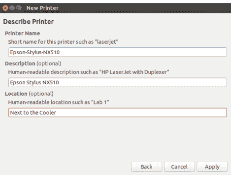

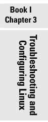

图 3-4：唯一要求的配置值是打印机名称。

- 6. 打印测试页以确保所有工作运行正常。

使用图 3-5 所示的配置选项对设置进行任何修改。

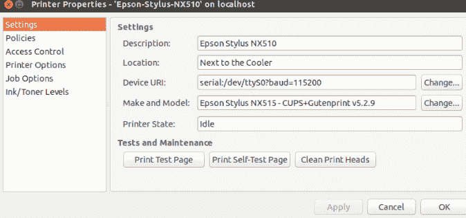

图 3-5：使用打印机配置工具编辑配置。

- 7. 当打印机配置正确后，退出打印机配置工具。

Linux 的 GUI 桌面使得使用 DVD、CD-ROM 和闪存盘变得简单。只需将外部介质放入驱动器，桌面上就会出现一个图标。

www.it-ebooks.info

## 安装其他软件

可以通过双击桌面上的图标来访问介质。在 Linux 发行版中，当你向驱动器插入 CD 或 DVD 后，GUI 会自动在管理器窗口中打开介质内容。要访问文件和文件夹只需双击 GUI 文件管理器中出现的图标即可。

如果你看到驱动器的图标，右键点击该图标会出现上下文菜单。从该菜单中，你可以在完成后弹出介质。

安装软件的具体步骤取决于分发软件的包类型。大多数 Linux 软件以 RPM 文件或 Debian 包提供。RPM 文件具有 `.rpm` 扩展名，而 Debian 包具有 `.deb` 扩展。

大多数发行版都提供了安装程序以确保安装新包的过程。在本节中，我将提供适用于许多发行版的添加软件的简要概述（你不想在 Live 发行版中添加软件，因为 Live 发行版每次启动时都从 ROM 和/或介质运行）。


Fedora 和 SUSE 使用 RPM 包。Debian、Ubuntu 和 Xandros 是基于 Debian 的发行版，正如预期的，它们通常使用 Debian 包（称为 DEB 文件）。然而，RPM 和 DEB 包都可以安装在任何 Linux 发行版中。

### 在 Debian 和 Ubuntu 中安装软件

在 Debian 以及基于 Debian 的发行版（如 Ubuntu）中管理软件包的最佳方法是使用 APT 高级软件包工具 —— 你通常通过 `apt-get` 命令控制它。

安装时，最后的步骤之一是配置 APT 源。APT 源是互联网服务器（包括 FTP 和 Web），APT 在其中查找软件软件包以下载并安装到你的系统中。假设 APT 配置正确且你的系统具有高速 Internet 连接，你可以在终端窗口中输入以下命令开始安装任何包：

```
apt-get install packageName
```

其中 `packageName` 是你想要安装的包名。如果你不知道包名，请先在终端窗口中输入以下命令：

```
apt-cache search keyword
```

其中 `keyword` 与你想要安装的包相关。例如，为了搜索描述中包含 `KDE` 单词且也包含 `KDE` 单词的包，我会输入以下内容。（我使用 `grep` 来搜索输出中出现 `KDE` 文本的情况）。

```
apt-cache search screenshot | grep KDE
```

该命令打印出以下结果：

```
ksn - Screenshot application for KDE
```

这显示 `ksn` 包正是我需要的。如果未安装此包，我可以通过输入以下命令来安装它：

```
apt-get install ksnapshot
```

简而言之，这就是你如何使用命令行工具在 Debian 中查找和安装包。

Debian 和旧版本的 Ubuntu 还带有一个用于 APT 的 GUI 软件包安装程序 —— Synaptic 软件包管理器，它是非常直观的：

- **Debian**：根据你的版本，你将在 GNOME 桌面选择 Applications:System Tools:Synaptic Package Manager，或者选择 Desktop:Administration:Synaptic Package Manager。

- **Ubuntu**：在旧版本（11.10 之前）中，选择 System>Administration:Synaptic Package Manager。由于 Ubuntu 没有 root 用户，当 Ubuntu 提示输入密码时，请输入密码。在较新版本中，你可以使用以下命令下载它：

```
sudo apt-get install synaptic
```

Synaptic 软件包管理器启动后，它会显示一个快速介绍对话框，简要告诉你如何标记包进行安装、升级或删除，以及如何进入菜单执行这些操作。阅读完介绍后，点击“关闭”移除该对话框并访问 Synaptic 软件包管理器。

你可以使用图 3-6 所示的“软件与更新”工具代替 Synaptic 来管理你的软件（点击“其他软件”选项卡开始）。


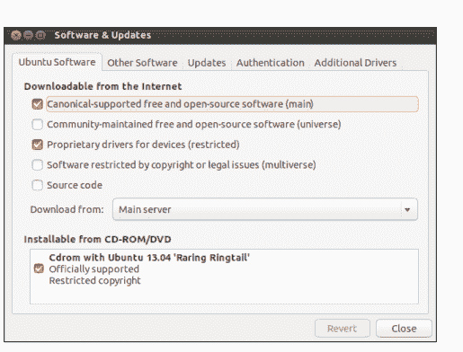

图 3-6：软件与更新

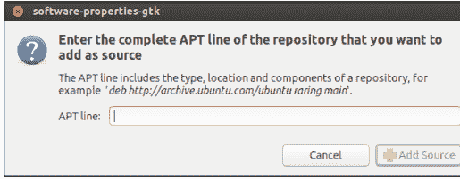

图 3-7：软件与更新

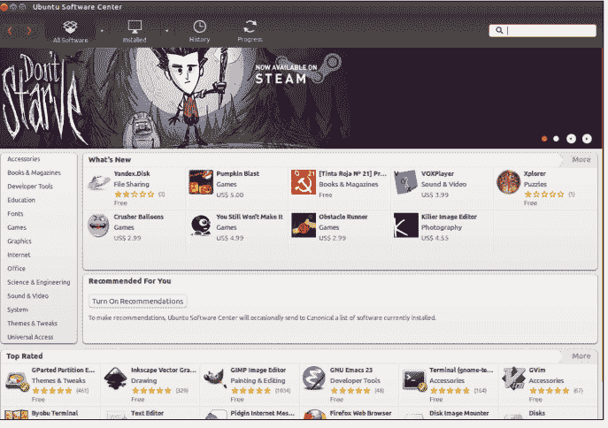

图 3-8：软件与更新

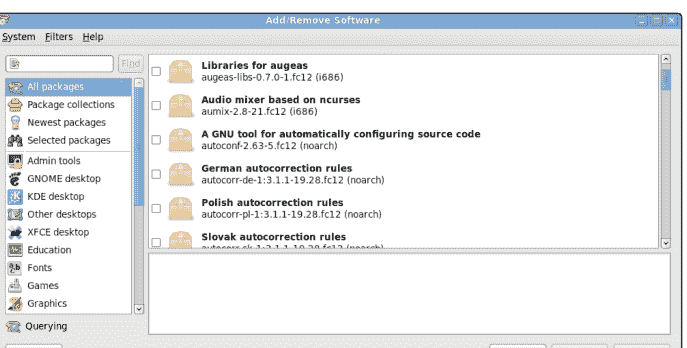

图 3-9：包管理器

- 2. 要安装未安装的包组，选择该组左侧的复选框。对于部分安装的包组，点击右侧列中的“详细信息”链接（或“可选软件包”按钮）。会出现一个显示组内详情的对话框。
- 3. 在对话框中选择你想要安装或删除的包，然后点击“关闭”退出对话框。你返回包管理对话框，如果你添加或删除了任何包，“更新”按钮将变为可用。
- 4. 点击“更新”按钮，根据你做的任何添加或删除更新软件包。

### 在 SUSE 中安装软件

在 SUSE 中，按照以下步骤安装或删除软件：

- 1. 从主菜单选择 YaST 以启动 YaST 控制中心。YaST 控制中心在左侧显示任务类别，右侧显示该类别的特定任务。
- 2. 点击左侧的“软件”类别，以便右侧显示软件选项。
- 3. 点击右侧的“软件管理”图标。YaST 显示一个窗口，你可以在其中搜索软件包。
- 4. 通过名称搜索包，或通过浏览可用项选择包。要通过名称搜索包，在窗口左上角的搜索字段中输入关键词并点击“搜索”。YaST 在窗口右侧显示匹配的包。要浏览包，点击左上角的“过滤”，从下拉列表中选择“包组”，并点击一个包组以查看该组中的单个包列表。
- 5. 点击右下角的“接受”按钮开始安装选定的包。YaST 在安装包之前会检查依赖关系 —— 如果某个包需要其他包才能正确安装。如果你想查看点击“接受”后将发生什么变化，请点击“过滤”并选择“安装摘要”。

### 在 Xandros 中安装软件

Xandros 桌面操作系统自带 Xandros Networks，它允许你在线购买软件，也可以从 CD 或 DVD 安装软件。要启动 Xandros Networks，双击 Xandros 桌面上的 Xandros 图标。它会连接到 Xandros 服务器并显示已安装、更新和新应用程序的信息。

要查看新应用程序列表，点击 Xandros Networks 窗口左侧“新应用程序”（New Applications）标签左边的加号。你会看到进一步的应用程序类别列表。如果你点击某个类别，窗口将显示该类别下的包名称。然后你可以选择一个包或整个类别进行安装。

要安装任何选定的软件包，请选择文件（File）；进入管理员模式（Enter Administrator Mode）。系统会提示你输入管理员（root）密码。输入 root 密码后，你可以选择文件（File）；安装所选应用程序（Install Selected Applications）。Xandros Networks 会检查依赖关系，如果需要更多信息会提示你，并下载新软件。


> 如果你下载了 Debian 包，可以通过 Xandros Networks 菜单中的文件（File）；安装 DEB 文件（Install DEB File）来安装。同样，菜单选项文件（File）；安装 RPM 文件（Install RPM File）会安装 RPM 包。

## 第 4 章：尝试 Linux

本章内容

- 启动 Linux 并登录
- 熟悉 shell（外壳）
- 关闭系统

你正坐在 PC 前，准备打开它。你知道这台电脑安装了 Linux。（也许是你自己安装的，但谁不想知道开启后会看到什么，之后该做什么呢。）不用担心。如果你是第一次使用 Linux，本章将展示如何登录、查看图形桌面、尝试一些命令，最后关闭 PC。

如果你尝试 Ubuntu Live 发行版，必须从闪存盘/CD 启动（如本书第 2 章所述），并且你可以像尝试任何其他 Linux 发行版一样尝试它。对于那些已经了解一些 Linux 的人，可以翻一下这一章看看有什么新内容！

### 启动 Linux

当你打开 PC 时，它会经历正常的上电序列并加载引导加载程序——`GRUB` 或 `LILO`，取决于你的发行版以及你在安装期间选择的内容。引导加载程序（曾称为引导 loader）是一个微型程序，负责从硬盘将系统的其余部分加载到计算机内存中。启动计算机的整个过程称为引导（`boot`）。

对于 Live 发行版，引导加载程序通常是 `ISOLINUX`，一种专为从 CD-ROM 设计设计的引导加载程序。`LILO` 和 `GRUB` 引导加载程序会显示带有操作系统名称的图形界面。例如，如果你的 PC 上列出了 Windows 和 Linux，你可以使用向上和向下方向键选择你想要使用的操作系统。PC 设置为默认加载 Linux，等待几秒钟后引导加载程序启动。更准确地说，引导加载程序将 Linux 内核加载到操作系统的核心中。

其他引导加载程序（如 `ISOLINUX`）可能会显示文本提示，你可以在其中输入命令来加载特定的操作系统，并向你加载的系统传递选项。当 Linux 内核启动时，你会看到一组消息，通常称为启动消息（`boot messages`）（你可以在终端窗口输入 `dmesg` 随时查看这些消息）。这些消息包含了 Linux 检测到的设备名称。引导读取的首要事项是：

```
Calibrating delay loop... 4997.12 BogoMIPS (lpj=248560)
```

`BogoMIPS` 是 Linux 术语（在本章侧边栏中解释），用于衡量时间的单位。`BogoMIPS` 的数值取决于你 PC 的处理器速度。内核使用 `BogoMIPS` 来等待事件发生的短时间（例如在磁盘控制器准备就绪时获取其响应）。

启动消息出现后，某些发行版（如 Fedora）会切换到图形界面，显示启动进度信息。当你从安装后首次启动 Linux 发行版（如 Fedora 和 Xandros 桌面操作系统）时，你会得到一个配置程序，引导你完成一些步骤，例如设置日期和添加用户。要完成配置步骤，你只需要输入要求的信息即可。

Linux 启动后，你通常会进入图形登录界面。对于某些发行版（如 Ubuntu），桌面无需登录用户即可工作。在其他发行版中，你将必须登录。图 4-1 显示了我从 Ubuntu Live 发行版启动 PC 后的 Ubuntu 桌面。对于某些发行版，你可能会自动登录（或在安装后的任何时候）。

每个发行版都使用 `root` 用户名，该用户恰好是超级用户（管理员账户）。无论是你自己安装 Linux 还是别人为你安装，你都需要知道 `root` 密码。没有它，你就无法执行许多探索 Linux 如何运行的任务。

通常情况下，你不应该以 `root` 身份登录。当你以 `root` 身份登录时，可能会意外损坏系统，因为作为 `root` 你可以做任何事。始终以普通用户身份登录。当你需要以 `root` 身份执行任何任务时，在终端窗口输入 `su -` 并输入 `root` 密码。

![img/71f80d7808bf5bad1239cc29bebab2_77_0.png]
![img/71f80d7808bf5bad1239cc29bebab2_77_1.png]
![img/71f80d7808bf5bad1239cc29bebab2_78_0.png]

图 4-1：Ubuntu Live 桌面

在 Ubuntu 中，你只定义普通用户账户；Ubuntu 没有提供定义 `root` 的机会。每当你执行需要 `root` 权限的任务时，必须使用 `sudo` 命令（superuser do 的缩写）。`root` 密码就是你在安装操作系统时提供的那个。

### 什么是 BogoMIPS 和 LPJ？

当 Linux 启动时，你会看到一条消息：`Calibrating delay loop... 4997.12 (lpj=248560)`，在 `BogoMIPS` 一词之前有一个数字。`BogoMIPS` 是一个让 Linux 用户困惑的词，它只是一个简单的测量。

`BogoMIPS` 是 Linux 的发明（是的，就是创立 Linux 的 Lin Torvalds），它的意思是 MIPS。如你所知，MIPS 是每秒百万指令的缩写——一种衡量计算机运行速度的指标。遗憾的是，MIPS 不是一个非常好的性能指标；`BogoMIPS` 是衡量计算机运行速度的一种方式。

`LPJ` 代表每个 `jiffy` 的循环次数，这是内核用于衡量时间的一个术语。内核以 `jiffy` 为间隔考虑时间，一个 `jiffy` 定义为一秒除以 `HZ` 的值。换句话说，`jiffy` 的单位是秒。

### 启动 bash shell

简单来说，`shell` 是 Linux 命令解释器——一个读取你输入的内容、将其解释为命令并执行命令的程序。

在开始玩 `shell` 之前，打开一个终端窗口。在 GNOME 还是 KDE 中，面板通常包含一个看起来像显示器的图标。当你点击该图标时，会出现一个带有提示符的窗口，如图 4-2 所示：那就是终端，它的工作方式就像老式终端一样。`shell` 程序正在运行，并准备接受你输入的任何文本。

# 第二卷

## Linux 桌面

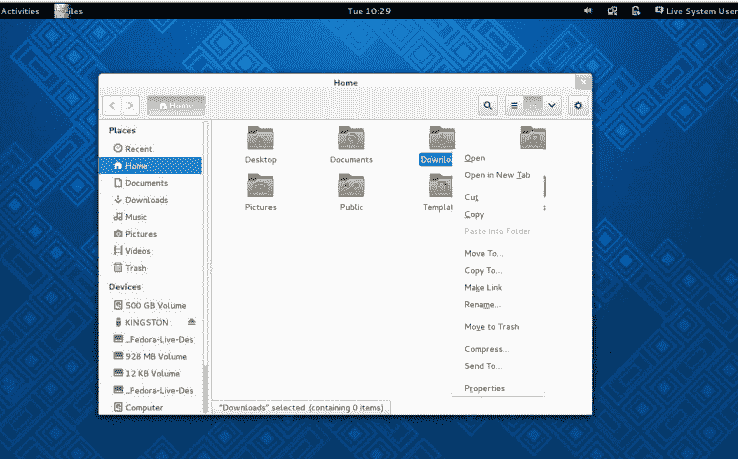

访问 www.dummies.com/extras/linuxaudio 获取优质 Dummies 在线内容。

www.it-ebooks.info

## 概览

第 1 章：GNOME, Unity, Cinnamon 和 MATE................................................69

了解 GNOME 桌面..................................................................................70

理解 GNOME 面板.......................................................................71

查看 Unity.........................................................................................................74

查看 Cinnamon.....................................................................................75

查看 MATE..................................................................................................76

第 2 章：KDE 桌面 ...........................................................................79

了解 KDE 桌面.....................................................................79

理解 KDE 面板.............................................................................82

配置 KDE 底部面板.....................................................................85

配置 KDE 桌面.........................................................................................86

第 3 章：命令行 Shell ......................................................................89

打开终端窗口和虚拟控制台................................................89


使用 bash Shell.......................................................................................90

发现并使用 Linux 命令...............................................................98

编写 Shell 脚本...............................................................................106

第 4 章：导航 Linux 文件系统 .................................109

理解 Linux 文件系统........................................................................109

使用 Linux 命令导航文件系统...............................................114

第 5 章：介绍 Linux 应用 .................................127

回顾 Linux 应用........................................................127

介绍办公应用和工具...............................................128

查看多媒体应用..................................................133

使用图形和成像应用.........................................................136

第 6 章：使用文本编辑器 .................................................139

使用 GUI 文本编辑器.....................................................................139

使用 ed 和 vi 进行文本编辑................................................141

# 第 1 章：GNOME, Unity, Cinnamon 和 MATE

## 本章内容

- 发现 GNOME 的常用特性
- 理解 GNOME 面板
- 查看 Unity
- 探索 Cinnamon
- 寻找 MATE

过去，Linux 发行版通常会带有两个图形用户界面（GUI）之一或全部：GNOME 和 KDE 与 Microsoft Windows 相似，但有一点独到之处：与 Microsoft Windows 不同，在 Linux 中你可以选择你自己的 GUI。如果你不喜欢 GNOME，可以使用 KDE；如果你不喜欢 KDE，可以使用 GNOME。如果两个都安装了，你可以在几秒钟内之间切换。这在 Microsoft Windows 上是做不到的！

今天，这种基础选择通常仍然适用，但有一个例外：GNOME 衍生了许多不同的变体。你会发现 GNOME 被广泛使用，但也会发现某些发行版包含了如 Unity、Cinnamon 和 MATE 等桌面。当你遇到它们时，只需知道它们最初起源于 GNOME，并为了某些特定目的而经过修改。它们具有基本的结构；我们在这里对它们进行介绍。


GNOME 和 KDE 是独立于 Linux 开发的

本章探讨了 GNOME 及其变体的主要特性；本迷你教程的第 2 章详细介绍了如何开始使用它们。无论你决定使用哪种 GUI，所有的 GUI 应用程序——无论它们基于 GNOME 还是 KDE——都能在所有的 GUI 桌面上运行。换之，你可以在 GNOME 下运行 KDE 应用，反之亦然。唯一的障碍是，有时 GNOME 和 KDE 应用可能没有默认安装。

## 70 了解 GNOME 桌面

每个 Linux 发行版通常默认安装一个 GUI。每个发行版还会对 GUI 进行定制，以创建一个该发行版特有的桌面。正因如此，你看到的与此处描述的内容之间可能存在细微的小小的差异。

### 了解 GNOME 桌面

GNOME 的初始桌面看起来像任何其他流行的 GUI，例如 Microsoft Windows 或 Mac OS X 桌面。例如，图 1-1 显示了典型的 GNOME 桌面。

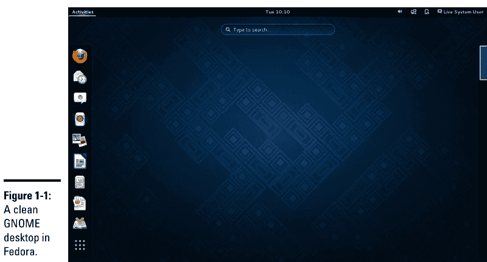

运行现场发行版（Live distribution）时，某些在操作系统安装后才会存在的图标不会出现。当系统安装后，桌面最初会显示计算机、主文件夹和用于删除文件的垃圾桶图标。与其他某些发行版不同，Fedora 追求最少桌面图标并保持整洁的外观。

当你右键点击对象或桌面上的任意位置时，GNOME 桌面会显示上下文菜单。根据点击的位置，菜单可以提供：

- 新建文件夹 (New Folder) 在目录中创建新文件夹
- 属性 (Properties) 查看与文件或文件夹相关的属性，包括权限
- 打开 (Open) 打开文件夹或文件
- 压缩 (Compress) 减小文件大小
- 创建链接 (Make Link) 创建快捷方式

图 1-2 显示了典型 GNOME 文件夹中的上下文菜单。如果任何菜单选项带有向右的箭头，则表示当将鼠标指针悬停在其上方时，会出现其他菜单。

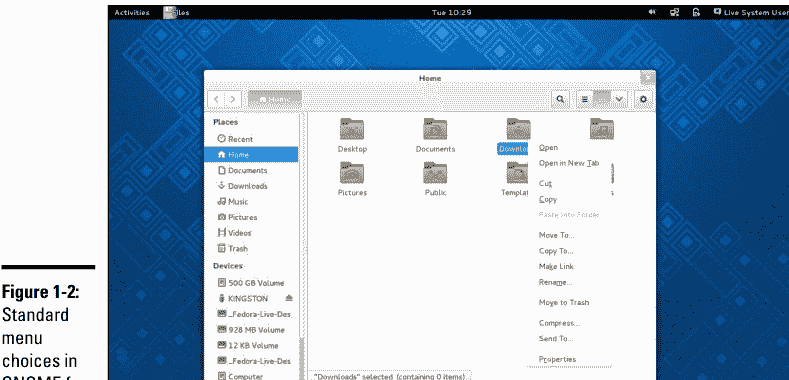

无论你点击哪个图标，此上下文菜单上的许多项目都是相同的，但右键点击某些图标（例如垃圾桶图标）会产生不同的菜单。对于垃圾桶，上下文菜单通常提供永久删除垃圾桶内项目的选项。

> 提示 我在这里发现了一个模式：右键点击。无论你在 GUI 桌面的何处，在选择之前总是右键点击。你一定能发现一些有用的东西！

### 理解 GNOME 面板

GNOME 桌面有面板，每个面板类似于 Windows 任务栏。面板左侧有菜单，中间显示时间，右侧有常用选项的图标。在左侧菜单和时间之间，面板显示你启动的（或自动为你启动的）任何应用程序。

### 顶部面板

顶部面板横跨 GNOME 桌面顶部的长条。图 1-3 显示了 GNOME 顶部面板的典型视图。

图 1-3：GNOME 顶部面板


### 运行中的应用程序

面板是图标的存放地。某些图标点击时会启动程序。某些图标显示状态（例如哪些程序正在运行）以及日期和时间等信息。

### 桌面

在选择活动后，GNOME 桌面的左侧区域显示可以在面板中打开的应用程序，你可以将其认为为主菜单。主面板类似于 Microsoft Windows 中的开始按钮，是你通常找到所有应用程序的地方，并按子菜单进行分类。图 1-4 显示了这样一个示例，再次来自 Fedora。

> LXO-102 考试

图 1-4：GNOME 桌面

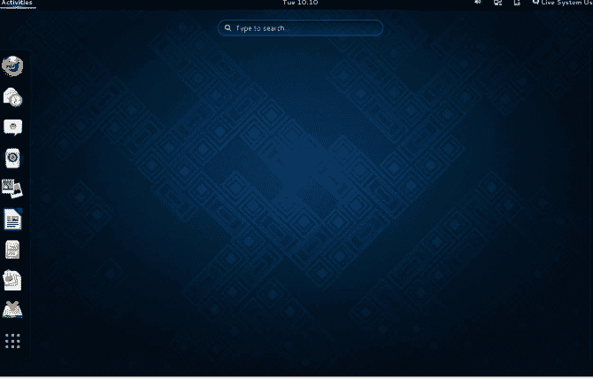

## 理解 GNOME 面板 73

在 Fedora 的 Live 发行版中，此主菜单（也称为“收藏”菜单）上的默认图标代表以下功能：

- Firefox 网页浏览器
- Evolution 邮件包
- Empathy 联系人管理器
- Rhythmbox
- Shotwell
- LibreOffice 文字处理器
- 文件的快捷方式
- 文档快捷方式
- 安装图标
- 最近使用的应用程序的链接

你可以点击任何图标来启动与其关联的程序，或者右键点击以在新窗口中启动它或从菜单中移除它。

本迷你书的第 5 章将介绍应用程序，包括此处讨论的 Firefox 浏览器等。

在桌面的右侧，你将看到一种访问各种桌面的快速方法——工作区切换（Workplace Switcher）。例如，假设你正在处理多个项目。你可以通过选择“活动”（Activities），然后将鼠标移动到右侧面板上，它会自动展开并显示你的选项（如图 1-5 所示）。

### 底部面板

除了顶部面板外，GNOME 还包含一个底部面板。它默认不会出现在屏幕上（与 KDE 的布局不同），但你可以用它来查找重要信息。图 1-6 是该面板的示例，显示了系统的三个重要通知和一个指向 USB 驱动器的的链接。


www.it-ebooks.info

## 74 观察 Unity


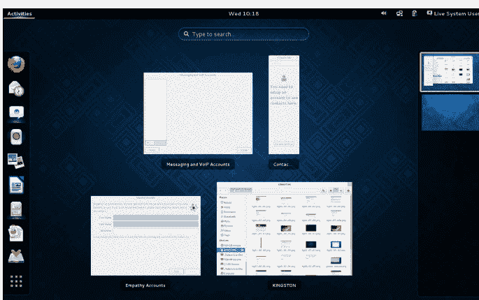

图 1-5:

在桌面之间切换。

图 1-6:

GNOME 中的底部面板。


### 观察 Unity

正如从 Windows XP 到 Windows 7 和 8 的 Windows 桌面之间存在差异一样，GNOME 桌面也有变化。第一个是 Unity ——尽管它适用于其他发行版，但与 Ubuntu 的关联最为紧密。图 1-7 显示了这种桌面的示例。

Unity 由 Canonical 和 Mark Shuttleworth（分别是 Ubuntu 背后的组织和负责人）创建。注意，GNOME 纯洁的桌面风格占据了主导。不同之处在于 Unity 的制作者努力让没有以前知识的用户也能尽可能轻松使用——这使得它成为笔记本电脑以及桌面的理想选择。图 1-8 显示了一个打开了终端窗口并显示下拉菜单的桌面示例。

## 观察 Cinnamon 75


图 1-7:

Unity 桌面基于 GNOME。

第二 卷

第 1 章

GNOME, Unity,

Cinnamon, 以及

MATE

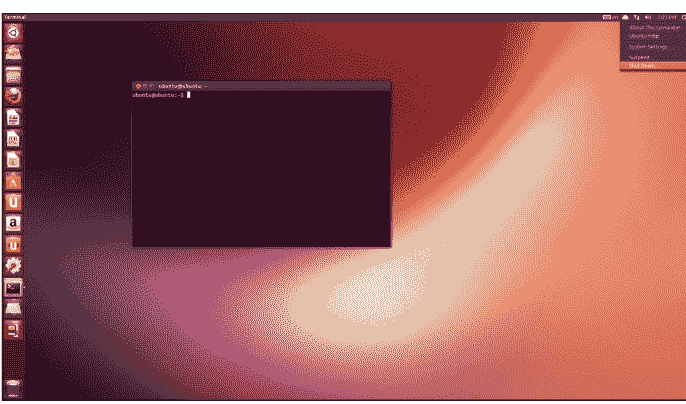

图 1-8:

Unity 桌面专注于简单性。

这种桌面最大的优点之一是 Unity 支持触控的。

### 观察 Cinnamon

Cinnamon 桌面看起来非常像几个版本之前的 GNOME 样子。图 1-9 显示了它在 Linux Mint 中的示例。注意它与 XP 时代的 Windows 非常相似。

www.it-ebooks.info

### 观察 MATE

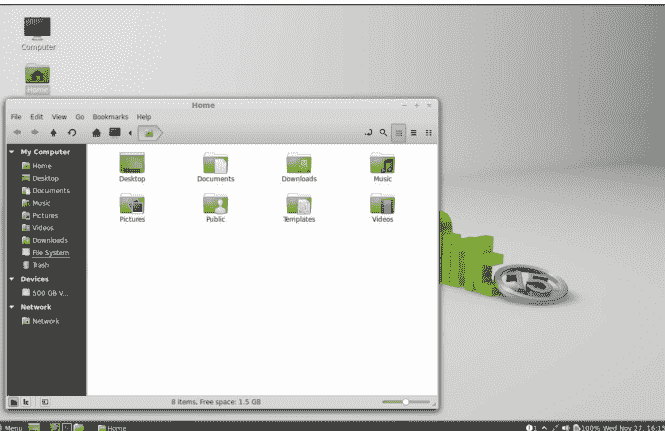

图 1-9: Cinnamon 桌面类似于 Windows。

底部面板最左侧的图标是主菜单按钮。主菜单按钮就像 Windows 中的开始按钮。点击主菜单弹出一级菜单。将鼠标悬停在带有箭头的菜单项上弹出二级菜单，依此类推。

除了底部面板上的主菜单外，Cinnamon 还可以完成几乎任何你想的操作。这里的选项包括：

- 显示桌面： 隐藏（但不关闭）所有窗口并显示桌面。
- Firefox 网页浏览器： 快速访问网页。
- 终端： 打开终端窗口。
- 文件： 显示你的文件。
- 打开的窗口： 在任何打开的窗口之间切换。
- 活动图标： 用于弹出驱动器、调整音量、查看电池寿命等。

### 观察 MATE

最后一个探索的 GNOME 变体是 MATE。像 Cinnamon 一样，这种桌面通常与 Linux Mint 相关。图 1-10 显示了 MATE 在 Linux Mint 中的示例。

图 1-10: MATE 桌面看起来像 Cinnamon。

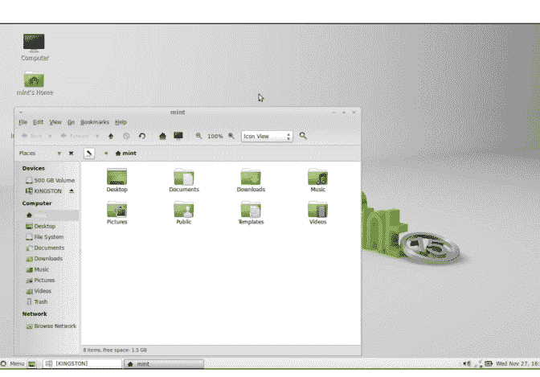

第二 卷

第 1 章

GNOME, Unity,

Cinnamon, 以及

MATE

正如 KDE 中提到的，这取决于。

## 第 2 章：桌面

- 发现主要功能
- 介绍主菜单

当右键点击桌面上的空白区域时，KDE 桌面会显示右键菜单。右键菜单提供了以下选项：

- 运行命令
- 锁定屏幕
- 离开（退出桌面）
- 桌面设置（设置壁纸等屏幕功能）

## 80 观察 KDE


图 -2:**

KDE 中的右键菜单。

### 图标菜单

在任何图标上右键都会弹出另一个菜单，正如图标菜单中的：

- 在文件管理器中打开文件夹
- 使用选择的应用程序打开文件
- 剪切或复制
- 重命名图标到回收站
- 查看该图标的属性

对于 CD-ROM 设备图标和类似的设备，图标右键菜单通常提供弹出质的选项。

> 提示

无论你在 GUI 桌面的什么位置，在选择之前*始终右键点击*。只要你右键点击，就一定会发现有用的东西！

# 82 理解 KDE 面板

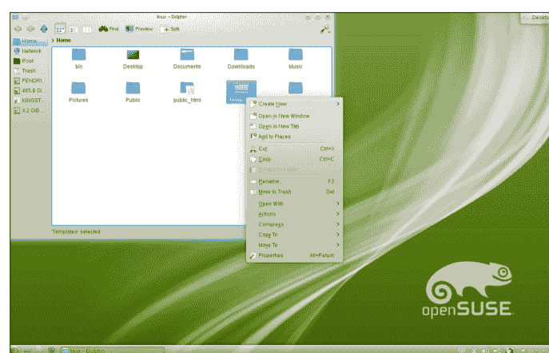

图 2-3：KDE 中图标的弹出菜单。

### 理解 KDE 面板

面板（Panel）是横跨桌面底部的长条。图 2-4 显示了 KDE 面板的典型视图。

图 2-4：KDE 面板。


面板是图标的停放处。点击某些图标可以启动程序。有些显示状态（例如，程序正在运行）以及关于日期和时间的信息。

> 提示

> 如果你将鼠标指针悬停在图标上方，会弹出一个帮助气泡提供关于该图标的有用提示。

### 主菜单按钮

KDE 面板最左侧的图标是主菜单按钮。KDE 文档将主菜单按钮称为应用程序启动器（Application Starter）。类似于 Microsoft Windows 中的“开始”按钮，主菜单是你通常找到所有应用程序的地方，这些应用程序按子菜单进行组织。主菜单按钮通常标记为 K，尽管该字母可以由发行版更改。

www.it-ebooks.info

### 理解 KDE 面板

点击主菜单按钮查看一级菜单。然后将鼠标悬停在带有箭头的任何菜单项上以弹出下一级菜单，依此类推。你可以浏览菜单层次结构并在最终菜单中进行选择。图 2-5 显示了典型 KDE 桌面上的主菜单层级。

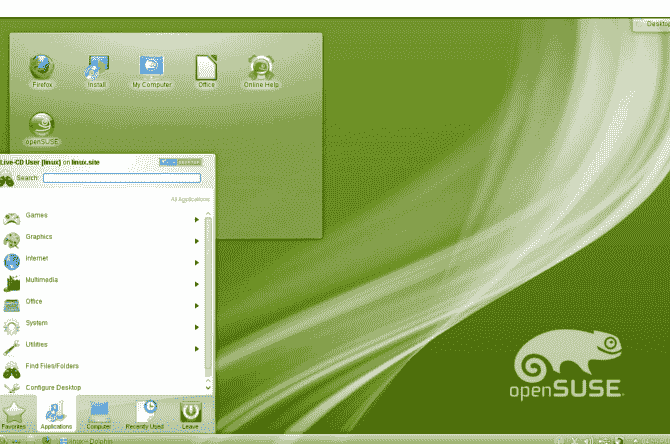

图 2-5：KDE 菜单层级。

KDE 的最新版本提供了 KickOff 应用程序启动器，允许你比通过传统的菜单层次结构更快地访问频繁使用的应用程序。在桌面上，点击主菜单按钮打开 KickOff 会显示以下顶级类别：

- 收藏（Favorites）： 快速访问常用的应用程序和文档。若要快速将文件添加到收藏，请右键点击该文件并选择“添加到收藏”。
- 应用程序（Applications）： 系统上安装的应用程序和工具。点击带有向右箭头的子类别以打开更多选项。
- 计算机（Computer）： 访问硬盘、可移动内存设备以及垃圾箱。
- 最近使用（Recently Used）： 按时间顺序显示最近打开的文档和应用程序。
- 退出（Leave）： 注销、重启、关电脑等选项。

图 2-6：系统菜单选项。

### 配置 KDE 底部面板

可能还会存在三个额外的 KDE 菜单选项——管理（Administration）、设置（Settings）和系统（System），它们将帮助你配置所需的任何内容。它们在 openSUSE 中不存在，因为它使用 YaST 作为完成任务的界面。

在不同的发行版中，主菜单和 KickOff 有不同的类别，但菜单组织方式相同，因此你通常可以找到你需要的内容。

### 面板图标

除了主菜单按钮外，KDE 面板还有几个图标（如图 2-4 所示）。你可以通过将光标悬停在图标上并阅读出现的弹出描述来识别任何图标。常见的图标如下：

- 桌面分页器（Desktop Pager）： 在工作空间或“虚拟桌面”之间导航。
- 打开的窗口（Open windows）： 显示所有打开的窗口。
- 活动窗口（Active window）： 切换到另一个运行中的应用程序或窗口。
- 网络连接（Network connection）： 显示当前有线或无线连接的信息。
- 音量（Volume）： 显示音量控制条，你可以拖动滑动条更改音量。
- 通知和任务（Notifications and Jobs）： 悬停查看当前任务的进度，例如文件传输或打印文档。
- 时间（Time）： 显示时间；点击显示当前日期的日历。
- 面板工具栏（Panel toolbar）： 调整面板的大小、位置和控制。

### 配置 KDE 底部面板

KDE 面板具有内在的强大功能，同时也具有极大的灵活性。如果你在面板的空白处点击右键，将出现图 2-7 所示的菜单。使用此菜单可以从面板添加和删除项目，甚至可以创建一个额外的面板（这允许你配置桌面，使其外观和工作方式尽可能地像 GNOME）。

最强大的菜单选项是“面板选项（Panel Options）”。面板设置（Panel Settings）中的更多设置（More Settings）会显示图 2-8 所示的工具。从这里，你可以将面板放置在底部位置以外的位置、调整面板的对齐方式、自动隐藏面板、选择哪些窗口将出现在面板前面或后面，等等等。


### 配置 KDE 桌面


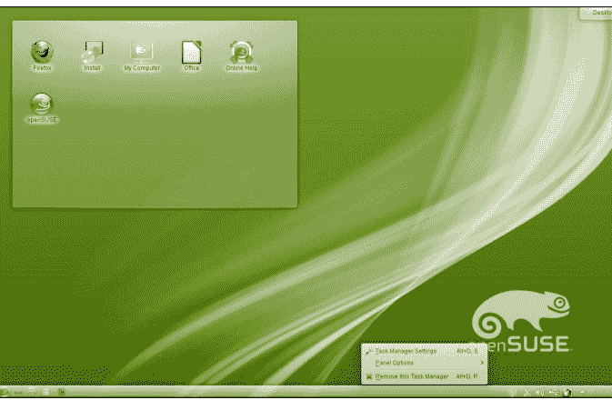

**图 2-7：在配置面板时你有很大的灵活性。**

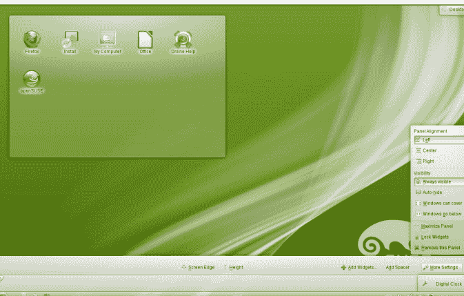

**图 2-8：配置 KDE 面板非常简单。**

### 配置 KDE 桌面

在桌面的空白处点击右键后，可以从弹出菜单中选择“桌面设置（Desktop Settings）”。这样做会显示图 2-9 所示的配置工具。你可以配置此类项目，例如背景。

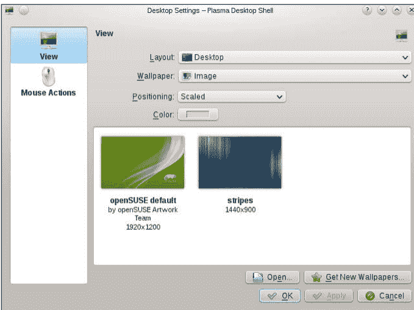

图 2-9：你可以设置桌面。

若要进行彻底的配置，从主菜单选择“桌面”以显示图 2-10 所示的选项。你可以设置屏幕尺寸、调整屏幕保护程序、以及桌面效果。

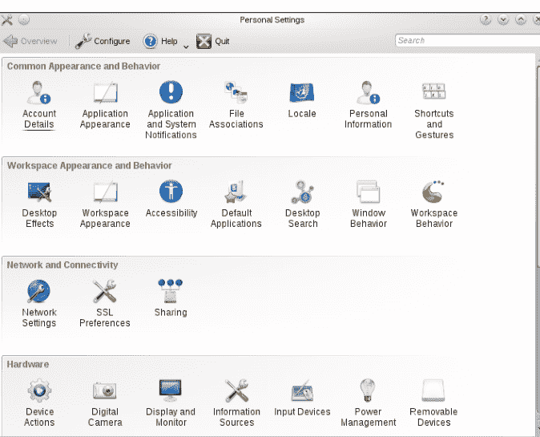

图 2-10：更多桌面选项。

## 第 3 章命令行 Shell

### 本章内容

- 打开终端窗口或虚拟控制台
- 发现 bash shell
- 使用 Linux 命令
- 编写 脚本

有时候事情并不顺利。如果 GUI 无法启动，该怎么办？你仍然可以告诉 Linux 系统做什么，但必须通过在屏幕上输入命令来完成。在这些情况下，你使用的是 shell —— Linux 命令解释器。本章介绍了大多数发行版的默认 bash shell。

在学会如何使用 shell 后，你可能开始喜欢 Linux 命令的简单高效。即使你是一个 GUI 爱好者，有一天你可能发现自己在启动一个终端窗口，通过组合奇怪的字符让系统唱歌跳舞。（嘿，我可以做梦吧？）

### 打开终端窗口和虚拟控制台

首先。如果你在 GUI 桌面（如 GNOME 或 KDE）中工作，在哪里输入 shell 命令？这是一个好问题。

获取 shell 最简单的方法是打开终端（也控制台）窗口。大多数发行版的 GNOME 和 KDE GUI 都包含打开终端窗口的图标（或主菜单）。点击该图标或菜单选项获取终端窗口，然后你就可以心所欲地输入命令了。

如果由于某些原因 GUI 似乎卡住了（当你点击和输入都没有反应），你也可以转向虚拟控制台。（物理控制台是显示器和键盘的组合。）虚拟控制台的想法是让你即使只有一个物理控制台，也可以在多个文本控制台之间切换。无论你是否运行 GUI，你都可以可以使用不同的控制台输入不同的命令。

要从 GNOME 或 KDE 桌面进入第一个虚拟控制台，请按下 `Ctrl+Alt+F1`。按下 `Ctrl+Alt+F2` 进入第二个虚拟控制台，依此类推。这些虚拟控制台中的每一个都是文本界面，可以在其中登录并运行 Linux 命令来执行各种任务。任务完成后，输入 `exit` 退出。


你可以使用最多六个虚拟控制台。在大多数发行版中，第七个用于 GUI 桌面。要返回 GUI 桌面，请按下 `Ctrl+Alt+F7`。

### 使用 bash Shell

如果你用过 MS-DOS，你可能对 `COMMAND.COM`（DOS 命令解释器）并不陌生。该程序会显示著名的 `C:\` 提示符。在 Windows 中，如果你打开命令窗口，就可以看到这个提示符。要在 Microsoft Windows 中打开命令窗口，请使用“开始>运行”，在框中输入 `command` 并点击“确定”。

Linux 自带了一个类似于 DOS 中 `COMMAND.COM` 的命令解释器，但它的功能强大得多。Linux 命令解释器被称为 shell（外壳）。

许多 Linux 发行版的默认 shell 是 `bash`。当你打开终端窗口或登录到文本控制台时，`bash` shell 会提示你输入命令。当你输入一个命令时，shell 就会执行它。


就像 Linux 有多个 GUI（GNOME 或 KDE）一样，除了 `bash` 之外，你也可以其他 shell。例如，有些人更喜欢 C shell。你可以使用 `chsh` 命令轻松地更改默认 shell。

除了标准的 Linux 命令外，`bash` 还可以执行任何计算机程序。因此你可以在 shell 提示符下输入应用程序名称（该名称通常比你在 GNOME 或 KDE 菜单中看到的晦晦），shell 就会启动。

### 理解 shell 命令的语法

由于 shell 会解释你输入的内容，因此了解 shell 如何处理你输入的文本非常重要。所有 shell 命令都遵循以下格式。（某些命令没有选项。）

```
command [option1] [option2] . . [optionN]
```

发布命令的过程通常称为命令行（command line）。在命令行上，你输入一个命令，后面跟着零或多个选项（或参数）。这些选项字符串——命令行选项（或命令行参数）会修改命令的工作方式，以便使其执行特定任务。

shell 使用空格或制表符来区分命令和选项。这意味着你必须使用空格或制表符将命令与选项、选项与选项之间分开。

如果选项包含空格，你需要将该选项放在引号内。例如，为了在密码文件中搜索我的名字，假设我输入以下 `grep` 命令（`grep` 用于在文本文件中搜索）：

```
grep "Emmett Dulaney" /etc/passwd
```

当 `grep` 输出包含我名字的这一行时，它看起来如下：

```
eduelaney:x:1000:100:Emmett Dulaney:/home/eduelaney:/bin/bash
```

如果你用你的用户名创建一个用户账户，请输入以你的用户名作为账户的 `grep` 命令，在 `/etc/passwd` 文件中查找该账户。

在 `grep` 命令的输出中，你可以看到最后一个冒号（:）后面跟着 shell 的名称（`/bin/bash`）。因为 `bash` shell 是一个可执行文件，它位于 `/bin` 目录中；你必须提供它的完整路径。

命令行选项的数量及其格式取决于具体的命令。通常，这些选项看起来像 `-X`，其中 X 是单个字符。例如，你可以在 `-l` 命令时使用 `-l` 选项。该命令列出目录内容，而选项提供了额外的细节。以下是在用户主目录下输入 `-l` 的结果：

```
total 0
drwx-xr-x 2 eduelaney users 48 2014-09-08 21:11 bin
drwx------ 2 eduelaney users 32 2014-09-08 21:16 Desktop
drwx------ 2 eduelaney users 80 2014-09-08 21:11 Documents
```

### 使用 bash Shell

该命令还阐明了 `bash` 的另一个功能：当你使用星号-目录（`*`）时，`bash` 会将星号替换为指定目录下所有文件名的列表。`/usr/include/*` 表示 `/usr/include` 目录下的所有文件。


如果你想将命令的输出追加到现有文件的末尾，而不是将其保存到新文件中，请使用两个大于号（`>>`），如下所示：

```bash
command >> filename
```


将标准输出（stdout）发送到文件的另一个有趣用法是使用命令来快速准备小型文本文件。例如，假设你想创建一个新文件，用来存储你键入的文本行，直到你输入 ZZ 并按回车键为止。以下是你可以完成此任务的方法：

```bash
cat <<ZZ input.txt
```

在你输入此命令后，你可以继续输入行，然后在完成后在单独的一行输入 ZZ。你输入的所有内容都会保存在 `input.txt` 文件中。

### 将错误消息保存到文件中

有时你输入一个命令，它会产生大量飞滚而过的错误消息，导致你无法判断发生了什么。查看所有错误消息的一种方法是将它们保存到文件中，这样你就能看到背后的真相了。你可以通过将标准错误（stderr）重定向到文件来实现。

例如，输入以下命令：

```bash
find /name COPYING -print 2> finder
```

该命令在文件系统中查找名为 `COPYING` 的文件，并将所有错误消息（如果有）保存到 `finder` 文件中。数字 `2` 后面跟大于号（`2>`）将 stderr 重定向到文件。


如果你想丢弃错误消息而不是将其保存到文件中，请使用 `/dev/null` 作为空设备，如下所示：


```bash
find /name COPYING -print 2> /dev/null
```

那个 `/dev/null` 是一个特殊文件——通常被称为“垃圾桶”（bit bucket），有时被美化为“天空大垃圾桶”——它只是丢弃接收到的任何内容。所以现在当你听到诸这样的短语时，例如“你的邮件可能进了垃圾桶”，你就知道它们是什么意思了。


## 通过自动命令补全减少输入

许多命令以文件名作为参数。例如，要查看 `/etc/modprobe.conf` 文本文件的内容，输入以下命令：

```bash
cat /etc/modprobe.conf
```

`cat` 命令显示 `/etc/modprobe.conf` 文件。对于任何以文件名作为参数的命令，你都可以使用 bash 的功能来避免输入整个文件名。你只需要在目录中唯一标识该文件即可。

要看一个示例，输入 `cat /etc/mod` 但不要按回车；bash 会自动补全文件名，命令变成了 `/etc/modprobe.conf`。现在按回车运行命令。


每当你输入文件名时，在文件名的几个字符后按下 Tab 键。bash 很可能补全文件名，这样你不需要输入整个名称。如果你没有输入唯一标识该文件的字符，bash 会发出哔哔声。

## 使用星号和问号进行通配符

（注：原文此处似乎缺失内容，根据上下文翻译为“使用星号和问号进行通配符”，并根据后文逻辑）

由于原文文本在此部分存在大量重复和乱码，以下是基于通配符通用逻辑的翻译：

通配符允许你使用简单的模式来匹配多个文件。常用的通配符包括：

- 星号（`*`）：匹配零个或多个字符。
- 问号（`?`）：匹配单个字符。
- 类（`[]`）：匹配括号内的任意一个字符。

例如，`ls *.txt` 会列出所有以 `.txt` 结尾的文件。`ls file?.txt` 会列出 `file1.txt`、`file2.txt` 等文件。

（注：由于提供的原始文本从该段开始出现了严重的文本重复和无意义字符组合，上述翻译已根据技术文档逻辑进行了修正，以确保可读性。）

# 发现和使用 Linux 命令

你在 shell 提示符处输入 Linux 命令。我所指的 Linux 命令是指 bash shell 能够理解的某些命令，以及随 Linux 一起自带的命令行实用程序。在本节中，我将向你介绍几类主要的 Linux 命令。

我无法在这一章涵盖每一个 Linux 命令，但我想通过向你展示常用的 Linux 命令，让你对这些命令的广泛性有一个初步了解。表 3-2 按类别列出了常用的 Linux 命令。在开始记忆任何 Linux 命令之前，请先浏览此表。

| 表 3-2 常用 Linux 命令 |
| 命令名称 | 操作 |
| :--- | :--- |
| 帮助与缩写 |  |
| `apropos` | 为指定的关键字查找在线手册页。 |
| `info` | 显示指定命令的在线帮助信息。 |
| `man` | 显示在线帮助信息。 |
| `whatis` | 仅搜索完整单词并查找在线手册页。 |
| `alias` | 为长命令定义别写。 |
| `type` | 显示命令的类型和位置。 |
| `unalias` | 删除使用 `alias` 定义的别写。 |
| **管理文件和目录** |  |
| `cd` | 当前目录。 |
| `chmod` | 更改文件权限。 |
| `chown` | 更改文件所有者组。 |
| `cp` | 复制文件。 |
| `ln` | 为文件和目录创建符号链接。 |
| `ls` | 显示目录内容。 |
| `mkdir` | 创建目录。 |
| `mv` | 重命名文件并将文件从一个目录移动到另一个目录。 |
| `rm` | 删除文件。 |
| `rmdir` | 删除目录。 |
| `pwd` | 显示当前目录。 |
| `touch` | 更新文件的时间戳。 |
| 命令名称 | 操作 |
| :--- | :--- |
| `find` | 根据指定的标准（如名称和大小）查找文件。 |
| `locate` | 使用定期更新的文件名数据库查找文件。（该数据库由 `updatedb` 创建）。 |
| `whereis` | 在可执行文件（也称为二进制文件）所在的典型目录中查找文件。 |
| `which` | 在 `PATH` 环境变量列出的目录中查找文件。 |
| `cat` | 在标准输出上显示文件（可将多个文件合并为一个文件）。 |
| `cut` | 从文件中每行文本中提取指定的字段。 |
| `dd` | 将数据块从一个文件复制到另一个（用于从设备复制数据）。 |
| `diff` | 比较两个文本文件并找到任何差异。 |
| `expand` | 将所有制表转换为空格。 |
| `file` | 显示文件中数据的类型。 |
| `fold` | 将每行文本折叠以适应指定的宽度。 |
| `grep` | 在文本文件中搜索正则表达式。 |
| `less` | 逐页显示文件（通过 b 向后移动）。 |
| `lpr` | 打印文件。 |
| `more` | 逐页显示文件（仅能向向前移动）。 |
| `nl` | 为文本中的所有非空行编号并并将行打印到标准输出。 |
| `paste` | 合并多个文件的对应行。 |
| `patch` | 使用原始文件和修订版文件之间的差异更新文件。 |
| `sed` | 在应用指定编辑命令的同时将文件复制到标准输出。 |
| `sort` | 对文本文件的行进行排序。 |
| `split` | 将文件按指定大小分成若干个小文件。 |
| `tac` | 反转文件（最后一行在前，依此类推）。 |
| `tail` | 显示文件的最后几行。 |
| `tr` | 用一组字符替换文件中的另一组。 |
| `uniq` | 消除文本中的重复行。 |
| 表 3-2（续） |
| 命令名称 | 操作 |
| :--- | :--- |
| `wc` | 统计文本文件的行数、单词和字符数。 |
| `zcat` | 显示压缩文件（解压缩后）。 |
| `zless` | 逐页显示压缩文件（通过按 b 向后移动）。 |
| `zmore` | 逐页显示压缩文件。 |
| **归档和压缩文件** |  |
| `compress` | 压缩文件。 |
| `cpio` | 在归档之间复制文件。 |
| `gunzip` | 解压缩用 GNU Zip (`gzip`) 压缩的文件。 |
| `gzip` | 使用 GNU Zip 压缩文件。 |
| `tar` | 创建一个或多个目录中文件的归档（最初用于磁带归档）。 |
| `uncompress` | 解压缩用 `compress` 压缩的文件。 |
| **管理进程** |  |
| `bg` | 在后台运行中断的进程。 |
| `fg` | 在前台运行进程。 |
| `free` | 显示系统中空闲和已使用的内存量。 |
| `halt` | 关闭 Linux 并停止计算机。 |
| `kill` | 向进程发送信号（通常用于终止进程）。 |
| `ldd` | 显示运行程序所需的共享库。 |
| `nice` | 以较低优先级运行进程（称为 nice）。 |
| `ps` | 显示运行中的进程列表。 |
| `printenv` | 显示环境变量。 |
| `pstree` | 显示进程树结构。 |
| `reboot` | 重启系统。 |
| `shutdown` | 关闭系统。 |
| `top` | 显示实时进程状态。 |
| `uname` | 显示内核信息。 |
| **管理用户** |  |
| `chsh` | 更改用户的 shell。 |
| `groups` | 显示所属组。 |
| 命令名称 | 操作 |
| :--- | :--- |
| `id` | 显示用户 ID。 |
| `passwd` | 修改密码。 |
| `su` | 切换用户。 |
| **管理文件系统** |  |
| `df` | 显示文件系统空间。 |
| `du` | 显示磁盘占用情况。 |
| `fdisk` | 磁盘分区。 |
| `fsck` | 检查并修复文件系统。 |
| `mkfs` | 创建文件系统。 |
| `mkswap` | 创建交换分区。 |
| `mount` | 挂载文件系统。 |
| `umount` | 卸载文件系统。 |
| `swapon` | 启用交换分区。 |
| `swapoff` | 禁用交换分区。 |
| `sync` | 将数据强制写入磁盘。 |

## 发现和使用 Linux 命令

`COMMAND` 列显示创建每个进程的命令，`TIME` 列显示进程使用的累积 CPU 时间。`STAT` 列显示进程的状态——`S` 表示进程处于睡眠状态（sleeping），`R` 表示正在运行（running）。显示状态的符号有进一步的含义；例如——`+` 表示高优先级进程，`-` 表示该进程在前台运行。`TTY` 列显示与进程关联的终端（terminal）。


当你必须强制停止一个异常进程时，就会用到进程 ID（`process ID`）或进程号。查看 `ps` 命令的输出，并记下故障进程的 PID。然后，使用该数字配合 `kill` 命令来停止进程。例如，要停止编号为 8550 的进程，首先输入以下命令：

```
kill 8550
```

如果进程在五秒后没有停止，停止顽固进程的下一步是输入 `kill -INT pid`，其中 `pid` 是进程号。如果仍然不起，尝试最后的手段——以下命令：

```
kill -9 8550
```


`-9` 选项意味着向进程发送信号 9。信号 9 是 KILL 信号，它应该导致进程退出。你也可以输入命令 `kill -KILL pid`，其中 `pid` 是进程 ID。

## 处理日期和时间

你可以使用 `date` 命令显示当前日期时间，或设置新的日期时间。在 shell 提示符输入 `date`，你会得到类似下面的结果：

```
Fri Mar 14 15:10:07 EST 2014
```

如你所见，单独执行 `date` 命令会显示当前的日期时间。

要设置日期，请以 root 身份登录，然后输入 `date` 后跟 `MDDDhhmmYYYY` 格式的日期时间，其中每个字符都是数字。例如，要将日期设置为 2014 年 12 月 31 日晚上 9:30，你输入：

```
date 123123002014
```

`MMDDhhmmYYYY` 日期时间格式类似于 24 小时军用时间，具有以下含义：

- `MM` 是月份的两位数字（01 到 12）。
- `DD` 是每月几日的两位数字（01 到 31）。
- `hh` 是 24 小制的两位小时（00 是午夜，23 是晚上 11 点）。
- `mm` 是分钟的两位数字（00 到 59）。
- `YYYY` 是四位年份（例如 2014）。

另一个与日期相关的命令是 `cal`。如果你不带任何选项直接输入 `cal`，它会打印当前月的日历。如果你输入 `cal` 后跟一个月份，`cal` 会将该数字视为年份并打印该年的日历。你可以查看特定年份、月份（1 = 一月，2 = 二月，以此此类推）的日历。因此，使用 `cal 6 2014` 即可获得 2014 年 6 月的日历。


## 处理文件

你可以使用 `grep` 搜索文件，并使用 `more` 一次查看一个文本文件。例如，要在 `/etc/passwd` 文件中搜索我的用户名，我使用：

```
grep edulaney /etc/passwd
```

要一次显示文件的屏幕，我使用：

要一次显示 `/etc/inittab` 文件，我使用：

```
more /etc/inittab
```

当屏幕暂停时，我按空格键跳到下一页。

许多 Linux 命令都作用于文件——大部分针对文本文件，但某些命令也适用于任何文件。接下来的章节介绍了一些文件处理工具。

### 统计文本文件的单词数和行数

我一直好奇文件的大小。对于文本文件，字符数基本上就是文件按字节的大小（因为每个字符占用一个字节的存储空间）。但是单词和行数呢？

Linux 的 `wc` 命令派上了用场。`wc` 命令显示文本文件中总行数、单词数和字符数。例如，输入 `wc /etc/inittab`，你会看到如下输出：

```
97 395 2926 /etc/inittab
```

在这种情况下，`wc` 报告 `/etc/inittab` 有 97 行、395 个单词和 2926 个字符。如果你只想查看文件的行数，使用 `-l` 选项并输入 `wc -l /etc/inittab`。输出应与下面类似：

```
97 /etc/inittab
```

如你所见，使用 `-l` 选项，`wc` 只显示行数。

## 发现和使用 Linux 命令 105

### 排序文本文件

你可以使用 `sort` 命令对文本文件进行排序。如果你想按字母排序文件，使用 `sort`。如果你想反序排序文件，使用 `sort -r`。如果你想按数字排序文件，使用 `sort -n`。例如，对名为 `names` 的文件排序，使用：

```
sort names
```

### 从文件中替换或删除字符

另一个有趣的是 `tr`，它可以将文件中一组字符替换为另一组（或删除选定的字符）。假设你有一个 DOS 文件。DOS 使用回车符后跟换行符来标记每行，而 Linux 仅使用换行符。

在你的 Linux 系统上，可以使用 `tr` 配合 `-d` 选项删除 DOS 文件中额外的回车符。基本上，要将 DOS 文件 `filename.dos` 转换为 Linux 文件 `filename.linux`，输入以下：

```
tr -d '\015' < filename.dos > filename.linux
```

在此命令中，`'\015'` 表示八进制表示法的回车符。

### 将文件分成若干个小文件

`split` 命令在那些你想复制文件但文件太大而无法作为邮件附件发送时非常有用。这时你可以使用 `split` 命令将文件拆分成多个文件。

默认情况下，`split` 将每 1000 行放入一个文件。新文件按字母组命名，如 `aa`、`ab`、`ac` 等。你可以为文件名指定一个前缀。例如，要分割名为 `hugefile.tar` 的大文件，使用如下 `split`：

```
split -b 1440k hugefile.tar part
```

该命令将 `hugefile.tar` 文件分割成 1440K 的块。命令创建名为 `part.aa`、`part.ab`、`part.ac` 等的文件。

要将分割后的文件合并回单个文件，使用 `cat` 命令：

```
cat part.?? hugefile.tar
```

在这种情况下，问号（`??`）匹配文件名中任意两个字符的扩展名。换句话说，文件名 `part.??` 匹配所有如 `part.12`、`part.aa`、`part.ab` 和 `part.bb` 的文件。

# 编写 Shell 脚本 107

要尝试编写一点 shell 脚本，请在 shell 提示符处完全按照所示输入以下文本，完成后按下 Ctrl+D：

```
cd ~/bin/sh
echo "This script's name is: $0"
echo Argument 1: $1
echo Argument 2: $2
```

按下 Ctrl-D。`cd` 命令将当前目录更改为你的家目录。`cat` 命令会显示下一行以及你在按下 Ctrl-D 之前输入的任何行。在此处，我使用 `>` 将输出发送到一个文件名。当你按下 Ctrl+D 后，`cat` 命令创建了一个名为 `simple` 的文件，该文件包含以下 shell 脚本：

```bash
#!/bin/sh
echo "This script's name is: $0"
echo Argument 1: $1
echo Argument 2: $2
```

第一行导致 Linux 运行 bash shell 程序（名称为 `/bin/bash`）。然后 shell 会读取脚本中剩余的行。

正如大多数 Linux 命令接受命令行选项一样，bash 脚本也接受命令行选项。在脚本内部，你可以将这些选项引用为 `$1`、`$2` 等。特殊名称 `$0` 指向脚本本身。

要运行此 shell 脚本，你首先需要使用以下命令使文件具有可执行性（即将其转换为程序）：

```bash
chmod +x simple
```

现在输入 `./simple one two` 来运行脚本，它将显示如下输出：

```
This script's name is: ./simple
Argument 1: one
Argument 2: two
```

脚本名称前的 `./` 前缀表示 `simple` 文件位于当前目录。

此脚本简单地打印脚本名称以及用户在脚本名称之后输入的前两个命令行选项。


接下来，尝试带参数运行脚本，如下：

```bash
./simple "This is one argument" second-argument third
This script's name is: ./simple
Argument 1: This is one argument
Argument 2: second-argument
```

shell 将双引号内的整个字符串视为一个单独参数。否则，shell 将使用空格作为命令行参数之间的分隔符。

大多数实用的 shell 脚本比这个简单的脚本复杂得多，但这个简单的练习让你对如何编写 shell 脚本有一个大致的认识。


将 Linux 命令放在文件中并使用 `chmod` 命令使文件可执行。。大功告成！你创建了一个 shell 脚本！


# 第 4 章：导航 Linux 文件系统

本章将介绍

- 了解 Linux 文件系统
- 使用 Linux 命令导航系统
- 理解文件权限
- 使用 Linux 命令操作文件和目录

为了良好地使用文件和目录，你需要理解分级文件系统的概念。即使你使用 GUI 文件管理器（将在下一节介绍）来访问文件和文件夹（文件夹也称为目录），你也可以从文件系统的布局中获益。

本章将介绍 Linux 文件系统，并展示了如何使用若干 Linux 命令与文件和目录工作。

## 理解 Linux 文件系统

与任何其他操作系统一样，Linux 在文件和目录中组织信息。目录是一个特殊文件，可以包含其他文件和目录。因为目录可以包含其他目录，这种组织文件的方法产生了一种分级结构。这种文件的分级组织就是文件系统。

Linux 文件系统为你提供了 PC 上所有存储内容的统一视图。文件系统有一个根目录，用正斜线 (`/`) 表示。根目录下是文件和目录的层级结构。文件系统的部分可能存在不同的物理介质上，例如硬盘、外部驱动器和 CD-ROM。图 4-1 说明了文件系统的概念（在任何 Linux 系统中都是相同的）以及它如何跨越多个物理设备。

### 110 理解 Linux 文件系统

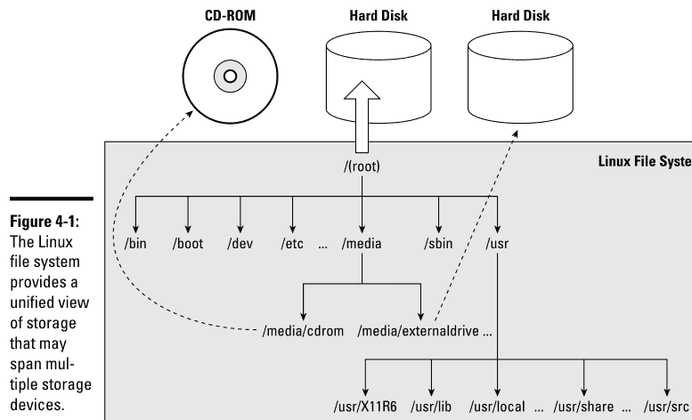

**图 4-1：** Linux 文件系统提供了可能跨越多个存储设备的统一视图。

如果你熟悉 Windows 等其他操作系统，你可能会发现 Linux 文件系统中缺少了某些东西：在 Linux 中找不到驱动器器。所有的磁盘驱动器和 CD-ROM 驱动器都是单个文件系统的一部分。

在 Linux 中，你可以拥有长文件名（多达 256 个字符），且文件名是大小敏感的。通常这些文件名具有多个扩展名，例如 `sample.tar.z`。Unix 文件名可以采取许多形式，如 `index.html`、`Makefile`、`binutils-2.15.92.0-5.1386.rpm`、`vsftpd-2.0.3-1_i386.deb`、`bash_profile` 和 `httpd_src.gz`。

要定位文件，你不仅需要文件系统。你还需要目录层级的信息。显示通往文件的完整目录层级的扩展文件名是*路径*（pathname)。正如其名称所示，它是指向文件的路径。图 4-2 显示了一个典型的路径。


**图 4-2：** 一个典型的路径。

如图 4-2 所示，文件系统具有以下内容：

- 根目录，用正斜线 (`/`) 表示。
- 目录层级结构，每个都有其名称。
- 临时目录，任何用户都可以将其作为临时草稿。
- 家目录，例如 `/home/user`。

大多数实用的 shell 脚本比这个简单的脚本复杂得多，但这个简单的练习让你对如何编写 shell 脚本有一个大致的认识。

### 表 4-1 Linux 系统中的顶层目录

| 目录 | 包含 |
| :--- | :--- |
| `/` | 文件系统的基础。 |
| `/bin` | 所有用户需要的可执行程序。 |
| `/boot` | Linux 内核和其他启动 Linux 所需的文件。 |
| `/dev` | 代表设备的特殊文件。 |
| `/etc` | 大多数配置文件和初始化脚本。 |
| `/home` | 所有用户的家目录。 |
| `/lib` | 所有程序的库文件（包括可加载驱动模块）。 |
| `/lost+found` | 丢失的文件。 |
| `/mnt` | 临时挂载的文件系统。 |
| `/opt` | 大型应用程序包的存储位置。 |
| `/proc` | Linux 系统中运行进程的信息。 |
| `/root` | root 用户的家目录。 |
| `/sbin` | 用于系统管理命令的可执行文件。 |
| `/srv` | 本系统提供的服务的数据。 |
| `/sys` | Linux 内核看到的设备信息。 |
| `/tmp` | 临时目录。 |
| `/usr` | 许多重要程序的子目录。 |
| `/var` | 各种文件系统（如日志）。 |

### 表 4-1 Linux 系统中的顶层目录（续）

| 目录 | 包含 |
| :--- | :--- |
| `/media` | 用于挂载介质，如 CD/ROM 驱动器、外部驱动器、软磁盘和 Zip 驱动器。 |

### 理解 Linux 文件系统 113

#### 表 4-2 重要的 /usr 子目录

| 子目录 | 描述 |
| :--- | :--- |
| `/usr/bin` | 许多 Linux 命令的可执行文件，包括 Linux 中常用但并非核心操作系统的实用程序。 |
| `/usr/games` | 一些旧的 Linux 游戏。 |
| `/usr/include` | C 和 C++ 编程语言的头文件（以 .h 结尾的文件）、usr/include 目录下的 X11 头文件以及 `/usr/include/linux` 目录下的 Linux 内核头文件。 |
| `/usr/lib` | C 和 C++ 编程语言以及许多其他库，例如数据库库和图形/工具包库。 |
| `/usr/local` | 本地文件。例如，`/usr/local/bin` 目录应该是系统上开发的任何可执行程序的存放位置。 |
| `/usr/sbin` | 许多管理命令，例如用于电子邮件和网络的命令。 |
| `/usr/share` | 共享数据，例如许多应用程序的默认配置文件和图像。例如，`/usr/share/gnome` 包含 GNOME 桌面面的共享文件，而 `/usr/share/doc` 包含许多 Linux 应用程序的文档（如 bash shell、thefish 窗口管理器和 GIMP 图像处理程序）。 |
| `/usr/share/man` | 在线手册（可以使用 `man` 命令读取）。 |
| `/usr/src` | Linux 内核（核心操作系统）的源代码。 |

#### 表 4-3 重要的 /var 子目录

| 子目录 | 包含 |
| :--- | :--- |
| `/var/cache` | 应用程序缓存数据的存储区域。 |
| `/var/lib` | 与应用程序当前状态的信息。 |
| `/var/lock` | 锁定文件，确保资源只被一个应用程序使用。 |

（续）

#### 表 4-3（续）

| 子目录 | 包含 |
| :--- | :--- |
| `/var/log` | 组织在子目录中的日志文件。`syslogd` 服务器将其日志文件存储在 `/var/log` 中，具体内容取决于 `syslogd` 配置文件 `/etc/syslog.conf`。例如，`/var/log/messages` 是主系统日志文件；`/var/log/secure` 包含来自安全服务（如 `ssh` 和 `xinetd`）的日志消息；`/var/log/mailbox` 包含邮件消息日志。 |
| `/var/mail` | 用户邮箱文件。 |
| `/var/opt` | 存储在 `/opt` 目录中的软件包的可变数据。 |
| `/var/run` | 描述自系统启动以来的数据。 |
| `/var/spool` | 等待某种处理的数据。 |
| `/var/tmp` | 在系统重启之间保留的临时文件。 |
| `/var/yp` | 网络信息服务（NIS）数据库文件。 |

## 使用 Linux 命令导航文件系统

虽然像 Nautilus (GNOME) 或 Konquer (KDE) 等 GUI 文件管理器易于使用，但只有在你拥有工作的 GUI 桌面时才能使用它们。有时你可能没有运行图形管理器的图形环境。例如，你可能登录在文本终端中，或者 X 在你的系统中无法工作。在这些情况下，你必须依赖 Linux 命令来处理文件和目录。即使在图形环境中，你也可以使用 Linux 命令——你只需要打开一个终端窗口并输入 Linux 命令即可。

在本节中，我简要描述了一些用于在 Linux 系统中移动的 Linux 命令。

### 目录导航命令

在 Linux 中，当你以 root 登录时，你的主目录是 `/root`。对于其他用户，主目录通常在 `/home` 目录下。我的主目录（当我以 eduelany 登录时）是 `/home/eduelany`。这些信息存储在 `/etc/passwd` 文件中。默认情况下，你只有权限在主目录中保存文件，并且只有你可以在主目录中创建子目录来进一步组织你的文件。

Linux 支持“当前目录”的概念，即所有文件和目录命令所操作的目录。登录后，例如，你的当前目录就是主目录。要查看当前目录，输入 `pwd` 命令。

要更改当前目录，请使用 `cd` 命令。将当前目录更改为 `/usr/lib`，请输入以下命令：

```
cd /usr/lib
```

然后，要切换到 `/usr/lib` 下的 `cups` 子目录，输入此命令：

```
cd cups
```

现在，如果你使用 `pwd` 命令，该命令将显示 `/usr/lib/cups` 为当前目录。

这两个示例说明你可以通过两种方式引用目录名称：


- **绝对路径**：例如 `/usr/lib`，它是目录树中一个确切的目录。将绝对路径想象成邮政服务递送到你邻居的包裹。
- **相对目录名**：例如 `cups`，它代表当前目录下的 `cups` 子目录（无论当前目录是什么）。将相对目录名想象成从你家到隔门的路线指示，以便快递员递送包裹。

如果你在 `/usr/lib` 中输入 `cd cups`，当前目录将变为 `/usr/lib/cups`。然而，如果你在 `/home/edulaney` 中输入相同的命令，`shell` 将尝试将当前目录更改为 `/home/edulaney`。

## 使用 Linux 命令导航文件系统 117

```
-rw-r--r-- 1 root 217 Jun 1 01:59 Xsession.options
-rw-r--x 1 root 777 Jul 15 20:32 Xwrapper.config
drwxr-xr-x 2 root 4096 Jul 15 20:35 app-defaults
. . . lines deleted
```

此列表显示了关于每个目录条目的的大信息——每个条目都是文件或目录。查看左侧的行，你会发现最右侧列显示的是目录条目的名称。名称之前的日期和时间显示了该文件最后修改的时间。日期时间左侧是以字节为单位的文件。

文件的组和所有者出现在文件大小列的左侧。左侧的数字表示指向文件的链接数（链接在 Windows 中是快捷方式）。最后，最左侧列显示文件权限，决定了谁可以读取、写入或执行该文件。

第一个字母具有特殊含义，如下列表所示：

- `1`：文件是指向另一个文件的符号链接。换句话说，它是其他事物的快捷方式。
- `d`：文件是一个目录。在图形用户界面中它将显示为文件夹。
- `-`（连字符）：文件是普通的。我所说的普通，是指它既不是目录、链接或其他任何奇怪的东西。你系统中的大多数项目都是普通文件。
- `b`：文件代表块设备，例如磁盘驱动器。
- `c`：文件代表字符设备，例如串口或终端。

在第一个字母之后，最左侧列显示九个字符序列，当列出每个字母时，它们显示为 `rwxwxrwx`。每个字母表示一种特定的权限。字母位置的连字符 `-` 表示对该文件没有操作权限。将这九个字母看作三组三个字母 `rwx`，解释如下：

- **最左侧组**：控制文件所有者的读取、写入和执行权限。换句话说，如果你看到 `rwx`，则表示可以读取 `r`、写入 `w` 和执行 `x` 该文件。字母处的连字符表示没有权限，所有者具有读取和写入权限但没有执行权限。虽然可执行程序（包括 `shell` 程序）通常具有执行权限，但目录将权限等同于使用权限。用户在打开和读取目录内容之前，必须对目录具有执行权限。


www.it-ebooks.info

## 118 使用 Linux 命令导航文件系统

- **中间 `rwx` 组**：控制属于该文件组的任何用户的读取、写入和执行权限。
- **最右侧 `rwx` 组**：控制所有其他用户（统称为世界）的读取、写入和执行权限。

因此，权限设置为 `rwx` 的文件只有文件所有者可以访问，而权限设置为 `rwxr-xr-r` 的文件允许世界上的读取。

`ls` 命令的一个有趣特性是它不会列出任何以点开头的文件。要查看这些文件，你必须配合 `-a` 使用 `ls` 命令，如下：

```
ls -a
```

尝试使用 `cd` 切换到主目录，并与不使用 `-a` 选项的结果进行比较：

1. **`cd`** 切换到你的主目录。
2. **`ls -F`** 查看主目录中的文件和目录。
3. **`ls -aF`** 查看所有内容，包括隐藏文件。

大多数命令使用单字符选项，每个选项都有一个连字符前缀。当你想要使用多个选项时，输入一个连字符并*串联*连接在一起）选项字母，一个接一个。然后 `ls -al` 等同于 `ls -a -l` 以及 `ls -l -a`。


## 修改权限和所有权的命令

你可能需要更改文件的权限设置以保护其不受他人干扰。使用 `chmod` 命令更改文件或目录的权限设置。

要使用 `chmod`，你必须指定权限设置。一种很好的方法是按照所示顺序从表 4-4 的列中连接字母（谁/动作/权限）。

| 表格 4-4 | 文件权限字母代码 |
|---|---|

| 谁 | 动作 | 权限 |
|---|---|---|
| `u`（用户） | `+`（添加） | `r`（读取） |
| `g`（组） | `-`（移除） | `w`（写入） |
| `o`（其他） | `=`（分配） | `x`（执行） |
| `a`（全部） | `s`（设置用户 ID） |

[第 138 页]

你可以使用这种简单形式的 `find` 变体来定位任何目录（以及该目录中包含的任何子目录）中的文件。如果你忘记了在主目录的哪个位置存储了所有的 *report* 文件（以 `report` 开头的文件），可以使用以下命令搜索文件：

```bash
find -name "report*" -print
```

当你熟悉了 `find` 的这种语法后，就可以使用 `find` 的其他选项了。若要仅查找特定类型的文件（例如目录），请使用 `type` 选项。以下命令显示你 Linux 系统中所有的顶层目录名称：

```bash
find / -type d -maxdepth 1
```

在典型的 Linux 系统中，你可能不需要使用 `find` 的复杂形式。但如果你确实有需要，可以使用以下命令查找 `find` 的其余选项：

查找所有匹配名称文件的简单方法是使用 `locate` 命令，它会在你系统上定期更新的文件数据库中进行搜索。例如，当我在 Debian 系统上输入 `locate Xresources` 时，典型的输出如下（输出可能取决于你的发行版）：

```
/etc/X11/Resources
/etc/X11/Resources/xbase-clients
/etc/X11/xfree86-common
```

Linux 发行版默认没有安装 `locate` 命令。要安装它，请使用你发行版的“添加/删除软件”（Add/Remove Software）应用程序并搜索 `locate`。然后从搜索结果中选择该包并点击“接受”进行安装。

## 挂载和卸载命令

假设你想在文本控制台（没有 GUI 帮助）登录时访问本书随附 DVD-ROM 上的文件。要实现这一点，你必须先将 DVD-ROM 驱动器的文件系统挂载到 Linux 文件系统中的特定目录上。

开始查看 `/etc/stab` 文件以查找 CD-ROM 设备的名称。例如，某些 Linux 发行版使用设备名称 `/dev/cdrom` 来指代 `/dev/DVD-ROM` 驱动器，而另一些则使用如 `/dev/hdc`、`/dev/cdrom0` 或 `/dev/cdrecorder`（用于 DVD/CD-R 驱动器）等名称。`etc/fstab` 中的条目期望 CD/DVD 已挂载。

## 使用 Linux 命令导航文件系统

某些发行版使用 `/media/cdrom` 作为挂载点，而另一些则使用 `/media/cdrom0` 或 `/media/cdrecorder`。

使用 `cdrom` 一词同时指代 CD-ROM 和 DVD-ROM 是习惯。

以 `root` 身份登录（或输入 `su` 变为 `root`），将 DVD-ROM 插入 DVD 驱动器，然后输入以下命令：

```bash
mount /dev/hdc /media/cdrom0
```

此命令将名为 `/dev/hdc` 的设备（一个 IDE DVD/CD-ROM 驱动器）的文件系统挂载到 Linux 文件系统中的 `/media/cdrom0` 目录（也称为挂载点）上。

挂载任务完成后，你可以通过将 `/media/cdrom0` 目录视为磁盘的顶层目录来访问 DVD-ROM 上的文件。也就是说，要查看 DVD-ROM 的内容，输入：

```bash
ls -F /media/cdrom0
```

当你完成 DVD-ROM 后 —— 在从驱动器中弹出之前 —— 必须使用以下命令卸载光盘：

```bash
umount /dev/hdc
```

你可以将设备挂载到文件系统上的任何空目录。然而，每个发行版都有自定义的设备挂载目录位置。例如，某些发行版使用 `/mnt` 中的目录，而另一些则使用 `/media` 目录作为挂载点。

## 检查磁盘空间使用的命令

你可以使用两个简单的命令 —— `df` 和 `du` 来检查系统的磁盘使用情况。`df` 命令显示所有挂载设备磁盘空间使用的摘要。例如，当我在带有许多设备的 PC 上使用 `df` 时，结果如下：


| Filesystem | 1-blocks | Used | Available | Use | Mounted on |
| :--- | :--- | :--- | :--- | :--- | :--- |
| `/devdb1` | 2824932 | 2372952 | 2572080 | 9 % | `/` |
| `tmpfs` | 383916 | 12 | 383904 | 0 % | `/dev` |
| `/devdb5` | 5766924 | 1422332 | 4051744 | 26 % | `/ubuntu` |
| `/devdb7` | 6258180 | 2989250 | 3251004 | 51 % | `/debian` |
| `/devdb9` | 5766924 | 1422232 | 4051744 | 26 % | `/ubuntu` |
| `/devdb10` | 5766932 | 1872932 | 3600984 | 35 % | `/mempie` |
| `/devdb11` | 1955850 | 1370170 | 1818828 | 8 % | `/xanders` |
| `/devda2` | 1608766 | 1059343 | 5494312 | 6 % | `/windows` |
| `/devdb1` | 10742660 | 9613028 | 9781352 | 9 % | `/windows` |

## 128 介绍办公应用和工具

通常，在安装 Linux 发行版时，你必须选择特定的应用程序组进行安装。你 Linux 系统上具体的应用程序列表取决于你在安装过程中所做的选择。

```
k3b - A sophisticated kde k3 burning application
k3b-i118n - Internationalized (i18n) files for k3b
k3libs - The kde k3 burning application library - runtime files
k3libs-dev - The kde k3 burning application library - development files
```

接下来，输入 `apt-get install k3b`，几分钟后，你就会在 Debian 系统上安装好 K3b。这种安装（或升级）软件的便利性就是为什么 Debian 用户如此推崇 `apt-get` 的原因，尽管它是一个命令行工具。

## 介绍办公应用和工具

文字处理器、电子表格、演示文稿软件、日历、计算器——这些都是办公基础工具。大多数 Linux 发行版都带有 LibreOffice 应用程序套件和工具。你可以逐一尝试所有的程序，看看哪一个更合你。每个应用程序的使用都非常直观。虽然用户界面的细微差别对你来说可能是新的，但在使用几次后你就会适应它。本节介绍了以下应用程序，以及一些适用于 Linux 的商业应用程序：

- `LibreOffice` 套件：一个类似于 Microsoft Office 的办公套件，包含 `Writer` 文字处理器、`Calc` 电子表格程序、`Impress` 演示文稿、`Draw` 绘图和插图应用，以及数学公式编辑器 `Math`。
- `Kontakt`：KDE 中的个人信息管理应用。
- `Calculators`：GNOME 计算器和 KDE 计算器。
- `Aspell`：写检查器。

## LibreOffice.org 办公套件

`LibreOffice.org` 不仅仅是一个网站，还是类似于 Microsoft Office 等主流办公套件的办公套件。它的主要组件是 `Writer` 文字处理器、`Calc` 电子表格和 `Impress` 演示文稿程序。

## 介绍办公应用和工具 129

你可以通过点击面板图标或从主菜单选择，从大多数 GUI 桌面轻松启动 `LibreOffice.org`——无论是整个套件还是单个应用程序。例如，在 Ubuntu 中，你可以点击桌面图标打开 LibreOffice 套件的初始窗口。你可以从主窗口创建新文档或打开现有文档（也可以是 Microsoft Office 文件）。

### Writer

在 `LibreOffice.org` 中选择文件；新建；文档，将会在主窗口中带有一个空白文档启动 `LibreOffice.org`。使用 `Writer` 非常简单——如果你熟悉 Microsoft Word，那么在 `Writer` 中寻找应该不会遇到困难。你可以在空白文档中输入文本、进行格式化并保存文本。

你也可以打开在 Windows 上用 Microsoft Word 准备的文档。图 5-1 显示了在 LibreOffice 中打开的 Microsoft Word 文档。


> 图 5-1：你可以在 LibreOffice Writer 中准备文档。

保存文档时，`Writer` 默认以 LibreDocument 格式保存，扩展名为 `.odt` 的文件。

如果你需要用 Microsoft Word 启动 `Writer` 文档，可以将文档保存为多种格式，包括 Microsoft Word 和富文本 (`.rtf`) 格式。

`Writer` 使用简单直观。如果你需要帮助，可以通过选择 `Writer` 菜单中的帮助（或在较新版本中按 F1）获取在线帮助。这将弹出带有 `Writer` 帮助信息的帮助窗口。然后你可以点击链接查看特定的帮助信息。

## 130 介绍办公应用和工具

### Calc

`Calc` 是 LibreOffice 应用程序套件中的电子表格程序。要启动 `Calc`，请从主菜单的办公类别中选择电子表格，或从任何 LibreOffice 窗口选择文件::新建;;电子表格。`Calc` 显示其主窗口，看起来类似于基于 Windows 的电子表格（如 Microsoft Excel）。（`Calc` 可以读取和写入 LibreOffice 格式的电子表格。）

使用 `Calc` 的方法与 Microsoft Excel 相同。你可以在单元格中输入内容、使用公式并格式化单元格。（例如，你可以指定值的类型和小数点后的位数。）图 5-2 显示了 `Calc` 中一个典型的电子表格。


图 5-2：使用 LibreOffice Calc 准备你的电子表格。

在准备电子表格时，使用与 Microsoft Excel 相同的格式。例如，使用公式 `SUM(D2:D6)` 来加单元格 D2 到 D6 的内容。要将单元格 D2 设置为 A2 和 C2 内容的乘积，在 D2 中输入 `=A2*C2`。要了解 `LibreOffice.org` 中的可用函数，请从菜单选择帮助;;LibreOffice Org Help（或在较新版本中按 F1）。这将打开 LibreOffice 帮助窗口，你可以按类别浏览函数并点击函数以阅读更多信息。

## 介绍办公应用和工具 131

要保存电子表格，选择文件；另存为。会弹出一个对话框，你可以在其中指定文件格式、目录位置和文件名。保存文档时，`Calc` 默认以 LibreOffice 电子表格格式保存为扩展名为 `.ods` 的文件。

`LibreOffice.org Calc` 可以文件保存为多种格式，包括 Microsoft Word 和富文本 (`.rtf`) 格式。

如果你想与他人共享电子表格，可以以逗号分隔的值格式输出。


### Impress

`Impress` 类似于 PowerPoint；它允许你为各种目的创建幻灯片。要启动 `Impress`，请从主菜单的办公类别中选择演示，或从任何 LibreOffice 窗口选择文件::新建;;演示。

当你第一次打开 `Impress` 时，程序会提示你选择样式和模板。要打开现有文档，选择你要打开的文件。图 5-3 显示了一个典型的演示文稿。


图 5-3：在 LibreOffice Impress 中准备演示。

`Impress` 窗口显示幻灯片，左侧是幻灯片大视图。具体外观取决于你选择的文档类型和模板。你可以开始向幻灯片添加文本和图形。

## 132 介绍办公应用和工具

要插入新幻灯片，从菜单选择插入；幻灯片。会出现一个空白幻灯片。然后你可以在该幻灯片上添加文本和图形。保存演示文稿选择文件；保存。对于新文档，你需要提供文件名和要保存的目录。

如果你想与使用 PowerPoint 的人分享演示文稿，请将其保存为 PowerPoint 格式。


### 日历

KDE 带有 `Contact`——这是一个将现有的 KDE 应用程序（如 `KMail` 阅读器和 `KOrganizer` 日历程序）集成在一起图形个人信息管理应用。你可以从面板图标或主菜单启动 `Contact`。（菜单的位置取决于 Linux 发行版。）


当 Contact 启动时，它通常会显示关于新邮件、即将安排的事件摘要窗口，你可以点击 Contact 窗口左格中的图标单独探索每个应用程序。

要为特定日期和时间添加事件或预约，请从日历选择日期，双击时间，在新事件对话框中输入简要描述。完成后点击确定。

## 计算器

可以选择 GNOME 计算器或 KDE 计算器。两者都是科学计算器；你可以进行科学计算（如平方根和倒数）以及三角函数（如正弦、余弦和正切）。

要使用计算器，请在主菜单的工具或辅助中查找。图 5-4 显示了 SUSE 中的 KDE 计算器。

图 5-4：在 KDE 计算器中进行计算。


## 查看多媒体应用 133

你可以通过从设置（Settings）菜单中选择选项来显示额外的按钮。例如，选择 `Settings::Statistic Buttons`（统计按钮），显示允许你使用计算器进行统计计算的按钮。

## 查看多媒体应用

大多数 Linux 发行版都包含几个多媒体应用程序——主要是多媒体音频播放器和 CD 播放器，还有用于数码相机以及刻录 CD-ROM 和 DVD 的应用程序。要播放其他多媒体文件（如 MPEG 视频），你可能需要在你的 Linux 系统上下载并安装额外的软件。以下是几个多媒体任务以及你可以用于执行这些任务的应用程序简要介绍：

- **使用数码相机：** 使用数码相机从 Linux 中的相机中下载照片（或简单地将相机作为 USB 存储设备访问）。
- **播放音频 CD：** 使用 Linux 自带的许多音频 CD 播放器之一。
- **播放音频文件：** 使用 `Rhythmbox` 或 `XMMS` 多媒体音频播放器。（你需要下载额外的软件才能用 `Rhythmbox` 或 `XMMS` 播放 MP3 文件。）你也可以从互联网下载其他播放器。
- **刻录 CD 或 DVD：** 使用 DVD 或 CD 刻录器（如 `K3b`）来刻录音频和数据 CD/DVD。

## 使用数码相机

大多数 Linux 发行版都带有一个数码相机应用程序，你可以用它从数码相机中下载图片。例如，SUSE 和 Xandros 带有 `digikam`，它可以配合许多品牌和型号的数码相机。根据型号的不同，相机可以连接到串口或 USB 端口。

使用 `digikam` 连接你的数码相机，请遵循以下步骤：

- 1. **将你的数码相机连接到串口或 USB 端口**（相机支持的界面）并打开相机。
- 2. **启动 `digikam`。**
- 3. **在 `digikam` 菜单中，选择 `Settings::Configure digikam`。**

在主菜单的 Graphics（图形）或 Images（图像）子菜单下寻找 `digikam`。第一次打开 `digikam` 时，系统会要求指定存储图像的默认位置，并选择其他一些配置偏好。

出现配置对话框。

- 4. 点击对话框中的 Cameras（相机）选项卡，然后点击 Auto Detect（自动检测）。

如果你的相机被支持且相机被设置为 PTP（图像传输协议）模式，则可以检测到相机。如果没有，你可以使用替代方法（在这些步骤后描述）从相机获取照片。

- 5. 从 Camera（相机）菜单中选择你的相机型号。

出现一个新窗口，稍过后会显示相机中的照片。

- 6. 点击缩略图以选择你想下载的图像；然后选择 `Camera:Download`（相机：下载）来下载图像。

`digKam` 会下载图像。你可以将这些文件保存在文件夹中，并在 `GIMP` 或你喜欢的编辑器中编辑照片。


如果 `digKam` 没有识别你的数码相机，不要绝望。只要你的相机支持 USB 大容量存储，仍然可以将数码相机的存储介质（例如闪存卡）作为 USB 存储设备访问。要访问 USB 数码相机上的图像，请使用以下步骤。

- 1. 阅读相机说明书并使用选项将 USB 设置为 Mass Storage（大容量存储）。

如果相机不支持 USB 大容量存储，则你无法使用此方法访问照片。如果相机支持图像传输协议，你可以使用 `digKam` 来下载照片。

- 2. 使用随相机附带的线将你的数码相机连接到 USB 端口。然后打开相机。

Linux 检测到相机并在文件管理器中打开相机内容。

- 3. 点击选择照片并通过将其拖入选定的文件夹将其复制到你的硬盘上。
- 4. 关闭文件管理器窗口，从 PC 上断开 USB 线，并关闭相机。

无论你是使用数码相机工具还是将相机作为 USB 设备，大多数 Linux 发行版都能轻松实现。

## 播放音频 CD

使用 Linux 应用：

- **播放音频 CD：** 使用 Linux 自带的许多音频 CD 播放器之一。
- **播放音频文件：** 使用 `Rhythmbox` 或 `XMMS` 多媒体音频播放器。（你需要下载额外的软件才能用 `Rhythmbox` 或 `XMMS` 播放 MP3 文件。）你也可以从互联网下载其他播放器。
- **刻录 CD 或 DVD：** 使用 DVD 或 CD 刻录器（如 `K3b`）来刻录音频和数据 CD/DVD。

## 播放文件

使用 `Rhythmbox` 或 `XMMS` 多媒体音频播放器。。（你需要下载额外的软件才能用 `Rhythmbox` 或 `XMMS` 播放 MP3 文件。）你也可以从互联网下载其他播放器。

## 刻录 CD 或 DVD

使用 DVD 或 CD 刻录器（如 `K3b`）来刻录音频和数据 CD/DVD。

# 使用图形和图像应用 137

`GIMP` 的安装涉及在你的主目录下创建一个目录，并在其中放置若干文件。该目录本质上存储了你可能对 `GIMP` 进行的任何用户偏好更改信息。点击窗口底部的“继续”（Continue）按钮。`GIMP` 会创建必要的目录，将必要的文件复制到这些目录中，并引导你通过一系列对话框完成安装。

安装完成后，点击“继续”（Continue）按钮。随后，`GIMP` 会加载任何插件——即增强其功能的外部模块。它会启动一个启动窗口，在每个插件加载时显示相关消息。启动完成后，`GIMP` 会在一个窗口中显示“今日提示”。你可以浏览这些提示并点击“关闭”（Close）按钮跳过提示窗口。与此同时，`GIMP` 会显示其他几个窗口，包括标题为“The GIMP”的主导航窗口、画画笔选择”窗口以及“图层、通道、路径”窗口。中心导航窗口让你能够可以处理的新图像、图像编辑功能以及许多可以应用于图像的过滤器。工具箱（Toolbox）让你选择许多重要的操作工具。

| 第二卷第 5 章 |

| 介绍 Linux 的应用程序 |

要在 `GIMP` 中打开图像文件，选择“文件：打开”（File: Open）。将出现加载图像对话框。你可以更改目录并选择想要打开的图像文件。`GIMP` 可以读取所有常见的图像格式，如 GIF、JPEG、TIFF、PCX、BMP、PNG 和 PostScript。选择文件并点击“确定”（OK）后，`GIMP` 将图像加载到一个新窗口中。

工具箱有许多按钮，代表你用于编辑图像和应用特效的工具。通过将鼠标指针悬停在按钮上，获取每个工具的弹出帮助。你可以点击工具按钮来选择工具，并将该工具的效果应用于图像以查看其作用。

当你右键点击图像时，`GIMP` 会显示一个弹出菜单，其中包含 `GIMP` 顶部工具栏的大多数选项。

# 138 使用图形和图像应用

# GNOME Ghostview

`GNOME Ghostview` 是一款非常适合查看和打印 PostScript 或 PDF 文档的图形应用程序。对于长文档，你可以查看并打印选页面。你还可以通过放大或缩小以不同的放大级别查看文档。

要在 Fedora 中运行 `GNOME Ghostview`，请从 GUI 桌面选择“图形；PostScript 查看器”（Graphics; PostScript Viewer）。`GNOME Ghostview` 窗口出现。除了顶部的菜单栏和工具栏外，垂直分割线将窗口的主显示区域分为两部分。

要在 `GNOME Ghostview` 中加载并查看 PostScript 文档，选择“文件：打开”（File: Open），或点击工具栏上的“打开”图标。`GNOME Ghostview` 会显示一个文件选择对话框。使用此对话框浏览文件系统并选择 PostScript 文件。例如，选择 `/usr/share/ghostscript-8.64/examples` 目录下的 `tiger.ps` 文件。（用你系统的 Ghostscript 版本号替换 8.64）。

要打开选定的文件，点击文件选择对话框中的“打开文件”（Open File）按钮。`GNOME Ghostview` 将打开选定的文件，处理其内容并在窗口中显示输出结果。

`GNOME Ghostview` 对于查看各种 PostScript 格式的文档非常有用。（这些文件通常具有 .ps 扩展名）。你可以在 `GNOME Ghostview` 中打开 PDF 文件——通常具有 .pdf 扩展名。


# 第6 章：使用文本编辑器

## 本章内容

- 检查不同的 GUI 文本编辑器


- 使用 `ed` 文本编辑器
- 了解 `vi` 文本编辑器

尽管桌面提供了一个令人工作愉悦的美图形界面，但在该界面之外还有很多工作要做。大多数 Linux 系统配置文件都是文本文件。此外，Linux 还赋予了你创建 shell 脚本以及与程序操作交互的能力——而这一切都可以通过文本文件来实现。

当一切正常时，你可以使用图形工具编辑（并创建）这些文件，但如果出现 X Window 系统无法加载的问题，强烈建议你也学会如何在界面之外进行编辑。无论是在界面内还是外，你都将使用文本编辑器——设计用于与文本文件交互的程序。

在本章中，你将接触几个文本编辑器——包括 GUI 编辑器和文本编辑器。

## 使用 GUI 文本编辑器

每个 GUI 桌面——GNOME 和 KDE——都带有 GUI 文本编辑器（具有图形用户界面的文本编辑器）。

要使用 GUI 编辑器，请在主菜单相应的类别中搜索文本编辑器。例如，在 GNOME 桌面，选择“应用程序 < 文本编辑器”`Applications < Text Editor`，这将打开 `edit`。运行文本编辑器后，你可以通过点击工具栏上的“打开”按钮显示“打开文件”对话框来打开文件。你可以更改目录然后选择要编辑的文件，并点击“确定”`OK`按钮。GNOME 文本编辑器会将文件加载到窗口中。你可以在编辑文件时同时打开多个文件进行切换。图 6-1 显示了一个典型的编辑会话。

### 160 使用文本编辑器

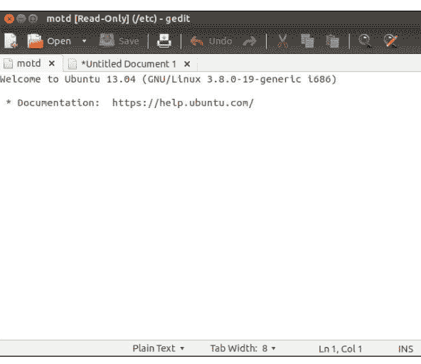

图 6-1：你可以使用 KDE 文本编辑器。

### 141 使用 ed 和 vi


注：你可以使用 KDE 文本编辑器。

## 使用 ed 和 vi 编辑文本

GUI 文本编辑器允许你使用鼠标和键盘编辑文本文件，这与使用任何文字处理器相同。文本模式编辑器是另一种方式——你只使用键盘并必须输入晦涩的命令来执行编辑任务，如剪切和粘贴文本或输入和删除文本。Linux 带有两个文本编辑器：

- `ed`：一种面向行的文本编辑器
- `vi`：一种全屏文本编辑器，支持早期名为 `ex` 的命令集

对于图形文本编辑器来说，`ed` 和 `vi` 编辑器是晦涩的。然而，你仍然需要了解 `ed` 和 `vi` 的基本编辑命令，因为有时这两个可能是唯一可用的编辑器。例如，如果 Linux 需要从硬盘启动，你必须从 CD、DVD 或优盘启动。在这种情况下，你必须使用 `ed` 编辑器编辑系统文件，因为编辑器足够小，可以放入启动介质中。

## 使用 ed

通常情况下，你只有在启动极简版本的 Linux（例如，你设置为启动磁盘的介质）且系统不支持全屏模式时才需要使用 `ed`。在所有其他情况下，你可以使用 `vi` 编辑器，它在全屏文本模式下工作。

### 142 使用 ed 和 vi 进行文本编辑

当你使用 `ed` 时，你在命令模式或文本输入模式下工作：

- `Command mode`：这是默认模式。在此模式下，你输入的任何内容都会被解释为命令。`ed` 编辑器有一套简单的命令集，其中每个命令包含一个或多个字符。
- `Input mode`：此模式用于输入文本。你可以通过命令 `a`（追加）、`c`（更改）或 `i`（插入）进入输入模式。输入文本行后，可以通过在单独的一行输入点 `.` 退出文本输入模式。

为了练习编辑文件，请执行以下命令将 `/etc/fstab` 复制到你的家目录：

```
cd
cp /etc/fstab
```

现在你的家目录下有一个名为 `fstab` 的文件。输入 `ed -p: fstab` 开始在 `ed` 中编辑文件。编辑器响应如下：

```
878:
```

此示例使用 `-p` 选项将提示符设置为冒号字符 `:`，并打开 `fstab` 文件（在当前目录，即你的家目录中）进行编辑。`ed` 编辑器打开文件，报告文件中的字符数 `878`，显示提示符 `:`，并等待命令。

当使用 `ed` 进行编辑时，确保打开了提示符字符（使用 `-p` 选项）。如果没有提示符，很难区分 `ed` 是处于输入模式还是命令模式。

当 `ed` 打开一个文件进行编辑后，当前行是文件的最后一行。要查看当前行号（当前行是 `ed` 应用于你命令的行），请使用 `. =` 命令，如下所示：

```
. = =
9
```

此输出告诉你 `fstab` 文件有九行。`你的系统中的 /fstab` 文件可能有不同的行数，在这种情况下，`ed` 会显示不同的数字。


## 使用 ed 和 vi 进行文本编辑 143

你可以使用 `l`、`e`、`$p` 命令查看文件中的所有行，如下例所示：


```
:1,2p
# 此文件由 fstab-sync 编辑 - 详情请参阅 'man fstab-sync'
/dev/VolGroup00/LogVol00 / ext 3 defaults 1 1
LABEL=/root / ext 3
/dev/VolGroup00/dev/ps8 gid=5,620 0 0
/dev/shm/dev/shm tmpfs defaults 0 0
/dev/proc/proc proc defaults 0 0
/dev/tmp/grps defaults 0 0
/dev/VolGroup00/LogVol01 swap defaults 0 0
/dev/scd0 /media/cdreorder auto pamconsole,exec,noauto,managed 0 0
/dev/hdc /media/cdrom auto pamconsole,exec,noauto,managed 0 0
```

要跳转到特定行，使用行号：

编辑器通过显示该行进行响应：

```
:dev/VolGroup00/LogVol00 / ext 3 defaults 1 1
```

假设你想删除包含 `cdrom` 的行。要搜索字符串，请使用斜杠（`/`）后跟要定位的字符串：

```
:/cdrom
/dev/hdc /media/cdrom auto pamconsole,exec,noauto,managed 0 0
```

编辑器找到包含字符串的行并显示它。该行变为当前行。

要删除当前行，使用如下 `d` 命令：

```
:d
```

要将一个字符串替换为另一个，请使用 `s` 命令。例如，将 `cdrom` 替换为字符串 `cd`，请使用此命令：

```
:s/cdrom/cd/
```

要在当前行之前插入一行，请使用 `i` 命令：

```
:i
(输入你想要插入的行)
(输入单个点以表示已完成)
```

## 144 使用 ed 和 vi 进行文本编辑

你可以输入与最后一行一样数量的行，然后在单独的一行输入一个点（`.`）。该点标记着文本输入模式的结束，编辑器切换到命令模式。在这种情况下，你可以判断出 ed 切换到了命令模式，因为你看到了提示符（`:`）。

当你对更改满意时，可以使用 `w` 命令将更改写入文件。如果你想保存更改并退出，请输入 `wq` 以同时执行这两个步骤：

```
:wq
857
```

`ed` 编辑器保存文件中的更改，显示保存的字符数并退出。如果你想在不保存任何更改的情况下退出编辑器，请使用 `q` 命令。

这些示例让你了解如何使用 `ed` 命令来执行编辑文本文件的基本任务。表 6-1 列出了一些常用命令。

| 表 6-1 | 常用 ed 命令 |

| --- | --- |

| `!command` | 执行 shell 命令。（例如，`!pwd` 显示当前目录。） |

| `$` | 跳转到缓冲区中的最后一行。 |

| `%` | 将紧随其后的命令应用到缓冲区中的所有行。（例如，`%p` 打印所有行。） |

| `+` | 跳转到下一行。 |

| `+n` | 跳转到后面的第 $n$ 行（其中 $n$ 是你指定的数字）。 |

| `,` | 将紧随其后的命令应用到缓冲区中的所有行。 |

| `|` | 跳转到一行。 |

| `-n` | 跳转到之前的第 $n$ 行。 |

| `.` | 指向缓冲区中的当前行。 |

| `/text/` | 正向查找字符串。 |

| `;` | 应用从当前行到最后行的所有行。 |

| `=` | 显示行号。 |

| `?text?` | 反向查找字符串。 |

| `^` | 应用到从第一行所有的行。 |

## 使用 ed 和 vi 进行文本编辑 145

| 命令 | 操作内容 |

|---|---|

| `^n` | 跳转到之前的第 $n$ 行。（参见 `-n` 命令。） |

| `a` | 追加当前行。 |

| `c` | 更改当前行。 |

| `d` | 删除当前行。 |

| `i` | 在当前行之前插入。 |

| `n` | 跳转到第 $n$ 行（$n$ 是数字，参见 `-n` 命令。） |

| 按回键 | 显示下一行。 |

| `q` | 退出编辑器。 |

| `Q` | 不保存退出编辑器。 |

| `r` | 读取文件。 |

| `s/old/new/` | 将旧字符串替换为新字符串。 |

| `u` | 撤销上一个命令。 |

| `w file` | 将缓冲区写入文件。 |

### 使用 vi

使用 `vi` 时，你在三种模式之一中工作：

- `命令模式（Visual command）`：这是默认模式。你输入的任何内容都会被解释为当前行的命令。`vi` 命令与 `ed` 命令类似。
- `冒号模式（Colon mode）`：你使用此模式读写文件、设置选项和退出 `vi`。所有命令以冒号 `:`）开头。当你输入冒号时，`vi` 将光标放在最后一行并等待输入命令。按下回车后命令生效。
- `输入模式（Input mode）`：此模式用于输入文本。你可以通过命令 `a`（插入）、`A`（行尾追加）、`o`（下方开启一行）、`O`（上方开启一行）或 `i`（光标后插入）进入输入模式。输入文本行后，你必须按 `Esc` 退出输入模式并重新进入命令模式。

要启动 `vi`，输入 `vi` 并跟上要编辑的文件名，如下：

```
vi /etc/fstab
```

`vi` 编辑器会将文件加载到内存并显示前几行，如图 6-3 所示。


**图 6-3：** 你可以使用全屏编辑器编辑文件。

最后一行显示了我们称为的文件路径、文本行数（2）以及文件中的字符数（59）。在这种情况下，文件名后出现了 `[readonly]` 文本，因为我是作为普通用户登录并打开 `/etc/fstab` 文件的（这意味着我没有修改该文件的权限）。稍后，`vi` 中的行显示为命令区域。其他行显示文件内容。如果文件行数少于屏幕，`vi` 会在第一列用波浪号（`~`）显示空行。

# 使用 ed 和 vi 编辑文本

所有这些模式的一个问题是，你无法判断 `vi` 当前处于哪种模式。你可能开始打字，结果却发现 `vi` 并没有处于文本输入模式，这可能会令人沮丧。

如果你想确保 `vi` 处于命令模式，只需按几次 `Esc` 键。（多按几次 `Esc` 也没有处。）

要在 `vi` 中查看在线帮助，请在冒号命令模式下输入 `:help`。完成帮助查看后，输入 `:q` 退出帮助屏幕并返回你正在编辑的文件。

`vi` 初始将光标定位在第一行的第一个字符上，而你所知道的最实用的技巧之一就是移动光标。为了进行一些练习，请参考表 6-2 所示的命令。

| 表 6-2 vi 中的光标移动命令 |

| 键位 | 移动光标 |

| --- | --- |

| ↓ | 向下移动一行 |

| ↑ | 向上移动一行 |

| ← | 向左移动一个字符 |

| → | 向右移动一个字符 |

| W | 向前移动一个单词 |

| B | 向后移动一个单词 |

| Ctrl+D | 向下滚动半屏 |

| Ctrl+U | 向上滚动半屏 |

你可以使用方便的冒号命令随时跳转到特定的行号。例如，要跳转到第 6 行，输入以下内容并按回车：

```
/6
```

当你输入冒号时，`vi` 会在屏幕最后一行显示冒号。从那时起，`vi` 将任何输入都视为命令。你必须按回车将命令提交给 `vi`。在命令模式下，`vi` 接受 `ed` 编辑器接受的所有命令——甚至更多。

要搜索字符串，首先输入斜杠（`/`）。编辑器会在屏幕最后一行显示斜杠。输入搜索字符串并按回车。编辑器定位该字符串并将光标置于该字符串的开头。因此，要在文件 `/etc/fstab` 中定位字符串 `cdrom`，请输入

```
/cdrom
```

要删除光标所在的行，输入 `dd`。`vi` 编辑器会删除该行文本并将下一行变为当前行。

要在光标前开始输入文本，输入 `i`。`vi` 编辑器会切换到文本输入模式。现在你可以输入文本。完成文本输入后，按 `Esc` 键返回可视命令模式。

完成文件编辑后，可以在不保存任何更改的情况下保存文件，使用 `:q` 命令。要在不保存更改的情况下退出编辑器，如果你想保存更改并退出，可以使用 `:wq` 命令同时完成这两个步骤。`vi` 编辑器会保存文件中的更改并退出。你也可以通过按 `Shift+ZZ`（按住 Shift 键两次）来保存更改并退出编辑器。

除了我提到的命令外，`vi` 还接受大量的命令。表 6-3 列出了一些按任务分类的常用命令。

| 命令 | 功能描述 |

| --- | --- |

| `a` | 在光标后插入文本。 |

| `A` | 在当前行末尾插入文本。 |

| `I` | 在当前行开头插入文本。 |

| `i` | 在光标前插入文本。 |

| **删除文本** | |

| `D` | 删除到当前行末尾。 |

| `dd` | 删除当前行。 |

| `dG` | 删除从当前行到文件末尾。 |

| `dw` | 删除从光标到单词结束。 |

| `x` | 删除光标所在的字符。 |

| **修改文本** | | |

| `C` | 修改到当前行末尾。 |

| `cc` | 修改当前行。 |

| `J` | 将当前行与下一行合并。 |


| `rx` | 将光标下的字符替换为 `x`（`x` 是任意字符）。 |

### 移动光标

| `h` 或 `←` | 向左移动一个字符。 |
| `j` 或 `↓` | 向下移动一行。 |
| `k` 或 `↑` | 向上移动一行。 |
| `L` | 移动到屏幕末尾。 |
| `1` 或 `→` | 向右移动一个字符。 |
| `w` | 移动到下一个单词的开头。 |
| `b` | 移动到上一个单词的开头。 |

### 滚动文本

| `Ctrl+D` | 向前滚动半屏。 |
| `Ctrl+U` | 向后滚动半屏。 |

### 刷新屏幕

| `Ctrl+L` | 重绘屏幕。 |

### 剪切和粘贴

| `yy` | 将当前行（复制）到无名缓冲区。 |
| `P` | 将复制的行置于当前行上方。 |
| `p` | 将复制的行置于当前行下方。 |

### 冒号命令

| `:command` | 执行一个 shell 命令。 |
| `:q` | 退出编辑器。 |
| `:q!` | 不保存更改直接退出。 |
| `:r filename` | 读取文件并插入到当前行之后。 |
| `:w filename` | 将缓冲区写入文件。 |
| `:wq` | 保存更改并退出。 |

### 搜索文本

| `/string` | 向后搜索字符串。 |
| `?string` | 向前搜索字符串。 |

### 杂项

| `u` | 撤销上一个命令。 |
| `Esc` | 结束输入模式。 |
| `U` | 撤销上一次更改。 |

# 154 选择如何连接互联网

- 信息共享：下载软件、音乐文件、视频等。反之，你也可以提供其他系统用户可以下载的文件。
- 远程访问：登录互联网上的另一台计算机，前提是你拥有对该远程计算机的访问权限。

技术人员说，互联网是一个全球性的网络网络。`internet`（首字母小写）一词是`internetworking`（网络互联——即网络之间的相互连接）的缩写形式。网协议（IP）的设计初衷是连接许多个独立的网络。


在物理连接方面，互联网类似于由公路和道路组成的网络。这种相似性促使人们将互联网形象地称为“信息高速公路”。正如公路和道路网络包括一些州际公路、许多州道和许多住宅街道一样，互联网也拥有高容量的网络（例如，10-Gbps 的骨干网每秒可以处理 100 亿比特）以及大量低容量的网络，范围从 56 Kbps 的拨号连接到 45-Mbps 的 T3 线。（Kbps 是每秒千比特，Mbps 是每秒百万比特。）高容量网络即是互联网的骨干网。

在管理方面，互联网并非由单一机构运营，也不由任何中央计算机管理。你可以将物理互联网看作是由成千上万合作组织共同管理的网络网络。一个由数千个组织管理的网络集合——听起来很不可思议，但它确实有效！

## 选择如何连接互联网

所以，你想将你的 Linux 工作站连接到互联网，但不知道该怎么做？让我列举几种方法。如今，将家庭和小型办公室连接到互联网通常有三种流行的方案（大型企业和政府有许多其他连接方式）：

- 数字用户线路（DSL）：你当地的电话公司以及其他电信公司可能提供 DSL。DSL 提供了一种种通过普通电话线发送高速数字数据的方法。通常，DSL 的传输速率在 128 Kbps 到 3 Mbps 之间（通常速度越快，费用越高）。你从互联网下载数据的速度通常比从你的 PC 发送数据到互联网（上传）的速度快得多。DSL 的优势之一是，你的线路距离当地中心局（电话线终止的 DSL 服务商设施）必须在 15,000 到 20,000 英之间。距离限制因供应商而异。在美国，你可以在 `www.dslreports.com/distance` 查看许多供应商的距离限制。
- 电缆调制解调器：如果你地区的电缆电视公司提供电缆接入，你可以使用该服务将你的 Linux 系统连接到互联网。通常，电缆调制解调器的数据传输速率比 DSL 高——成本相似。通过电缆调制解调器从互联网下载数据比从 PC 发送数据到互联网快得多。你可以预期常规下载速度为 12 Mbps，上传速度为 2 Mbps，但有时你可能会获得比这些更高的速度。

DSL 和电缆调制解调器服务将你连接到互联网，同时你的互联网服务供应商（ISP）。除了速度提高，你还在为 IP 地址和电子邮件帐户付费。表 1-1 总结了这些选项，并将它们与拨号连接进行了对比。你可以参考表格，并选择你可用的连接类型以及最适合你需求的类型。

### 表 1-1 拨号、DSL 和电缆的比较

| 特性 | 拨号 | DSL | 电缆 |
|---|---|---|---|
| 设备 | 调制解调器 | DSL 调制解调器、以太网卡 | 电缆调制解调器、以太网卡 |
| 还需要 | 电话服务和互联网服务供应商 (ISP) | 电话服务且位于中心局 15,000 英尺内 | 电缆电视连接 |
| 连接类型 | 拨号连接 | 始终在线，专用 | 始终，共享 |
| 典型速度 | 最大 56 Kbps | 下载 1.5 Mbps，上传 128 Kbps | 下载 12 Mbps，上传 2 Mbps（更高速度费用更高） |


除了表 1-1 显示的选项外，你可能还有一些不常用的选项。这些包括光入户（FTTH）、电力线宽带（BPL）、固定无线宽带（称为 FWB 或 WiMAX）以及卫星互联网接入（例如 DIRECTV 和 StarBand）。如果你所在的地理区域有这些选项中的一个或多个，并且你想使用其中一个接入互联网，请遵循特定服务提供商设置互联网连接的说明。通常，卫星互联网接入覆盖广大的地理区域（即使是有电话或线缆的地方），但初始设备成本和月费比 DSL 和电缆高。

`www.it-ebooks.info`

## 使用 DSL 连接

DSL 代表数字用户线路（Digital Subscriber Line）。DSL 除了正常的模拟语音信号外，还利用现有的电话线发送数字数据（模拟信号连续变化，而数字数据由 1 和 0 表示）。电话线从你家延伸到中心局，在那里连接到 DSL 服务商的网络。顺便说一下，从家里到中心局的连接被称为本地环。

当你办理 DSL 服务时，DSL 服务商会将你的电话线连接到中心局的一些特殊设备上。这些设备可以将你的电话线与数字数据分开。

### DSL 工作原理

当你注册 DSL 服务时，DSL 服务商会将你的电话线连接到中心局的一些特殊设备上。这些设备可以将你的电话线与数字数据分开。

DSL 利用你现有的电话线路在除了正常的模拟语音信号外发送数字数据（模拟信号连续变化，而数字数据由 1 和 0 表示）。电话线从你家延伸到中心局，在那里连接到 DSL 服务商的网络。顺便说一下，从你家到中心局的连接被称为本地环。

当你办理 DSL 服务时，DSL 服务商会将你的电话线连接到中心局的一些特殊设备上。这些设备可以将你的电话线与数字数据分开。

DSL 利用你现有的电话线路在除了正常的模拟语音信号外发送数字数据（模拟信号连续变化，而数字数据由 1 和 0 表示）。电话线从你家延伸到中心局，在那里连接到 DSL 服务商的网络。顺便说一下，从你家到中心局的连接被称为本地环。

当你办理 DSL 服务时，DSL 服务商会将你的电话线连接到中心局的一些特殊设备上。这些设备可以将你的电话线与数字数据分开。

### DSL 如何工作原理

当你办理 DSL 服务时，DSL 服务商会将你的电话线连接到中心局的一些特殊设备上。这些设备可以将你的电话线与数字数据分开。

DSL 如何工作

DSL 利用你现有的电话线路在除了正常的模拟语音信号外发送数字数据（模拟信号连续变化，而数字数据由 1 和 0 表示）。电话线从你家延伸到中心局，在那里连接到 DSL 服务商的网络。顺便说一下，从你家到中心局的连接被称为本地环。

当你办理 DSL 服务时，DSL 服务商会将你的电话线连接到中心局的一些特殊设备上。这些设备可以将你的电话线与数字数据分开。

DSL 如何工作

DSL 利用你现有的电话线路在除了正常的模拟语音信号外发送数字数据（模拟信号连续变化，而数字数据由 1 和 0 表示）。电话线从你家延伸到中心局，在那里连接到 DSL 服务商的网络。顺便说一下，从你家到中心局的连接被称为本地环。

当你办理 DSL 服务时，DSL 服务商会将你的电话线连接到中心局的一些特殊设备上。这些设备可以将你的电话线与数字数据分开。

DSL 利用你现有的电话线路在除了正常的模拟语音信号外发送数字数据（模拟信号连续变化，而数字数据由 1 和 0 表示）。电话线从你家延伸到中心局，在那里连接到 DSL 服务商的网络。顺便说一下，从你家到中心局的连接被称为本地环。

当你办理 DSL 服务时，DSL 服务商会将你的电话线连接到中心局的一些特殊设备上。这些设备可以将你的电话线与数字数据分开。

DSL 如何工作


DSL 利用你现有的电话线路在除了正常的模拟语音信号外发送数字数据（模拟信号连续变化，而数字数据由 1 和 0 表示）。电话线从你家延伸到中心局，在那里连接到 DSL 服务商的网络。顺便说一下，从你家到中心局的连接被称为本地环。

当你办理 DSL 服务时，DSL 服务商会将你的电话线连接到中心局的一些特殊设备上。这些设备可以将你的电话线与数字数据分开。

## DSL 如何工作

DSL 利用你现有的电话线路在除了正常的模拟语音信号外发送数字数据（模拟信号连续变化，而数字数据由 1 和 0 表示）。电话线从你家延伸到中心局，在那里连接到 DSL 服务商的网络。顺便说一下，从你家到中心局的连接被称为本地环。

当你办理 DSL 服务时，DSL 服务商会将你的电话线连接到中心局的一些特殊设备上。这些设备可以将你的电话线与数字数据分开。

## DSL 的字母字母汤：ADSL, IDSL, SDSL

我一直使用 DSL 这个词好像它只有一种类型，但 DSL 有三种变体，每种都有不同的特征。请看：

- `ADSL` 是最常见的 DSL 形式，其下载速度（从互联网到 PC）高达 8 Mbps，上传速度高达 1 Mbps。`ADSL` 在你的位置距离中心局两半英里（12,000 英尺）时效果最好。DSL 服务根据你需要的速度定价。一种流行的 `ADSL` 形式 `G` 的最大下载速度为 1.5 Mbps，上传速度为 512 Kbps。

- `IDSL`：全称为 ISDN DSL（一种较旧的技术），是 DSL 的特殊类型，适用于距离电话和中心局五英里的范围。缺点是 `IDSL` 的下游（从互联网到 PC）和上行（从 PC 到互联网）速度平均为 144 Kbps——与旧调调器在拨号连接上的速度相当。

- `SDSL` 对称提供相等的下载和上传速度，最高 2.0 Mbps。DSL 根据你需要的速度定价，速度越高费用越高。你的位置距离中心局越近，连接就越快。


DSL（和电缆调制解调器）速度通常由两个用斜杠分隔的数字指定，例如 `1500/384`。这些数字指的是每秒千比特（即每秒千比特，缩写 `Kbps`）。第一个数字是下载速度；第二个是上传速度。因此，`1500/384` 意味着你可以预期从互联网以最高 1500 Mbps（或 1.5 Mbps）的速度下载数据，并向互联网上传 384 Kbps。如果你的电话线状况并不完美，你可能无法获得这些最大速率——`ADSL` 和 DSL 都会根据现有的线路状况调整速度。

## 158 连接 DSL

DSL 服务的价格取决于你选择哪种变——`ADSL`、`IDSL` 还是 `SDSL`。对于大多数家庭用户，首选是 `ADSL`（或更准确地说，`ADSL` 的 `G.lite` 形式），其传输速率分高达 9000/640。

## 典型的 DSL 设置

要为家里或业务获取 DSL，你必须联系 DSL 服务商。除了你的电话公司，你还可以找到许多其他 DSL 服务商。无论由谁提供 DSL 服务，局端都需要进行一些工作——局端是你的电话连接到电话网络其余部分。工作涉及将你的电话线连接到可以与家中或办公室的 DSL 调制解器工作的设备。局端设备和你所在位置的 DSL 调制解器可以完成任何通过电话线发送和接收数字数据的操作。

家里与局端之间的距离——环路长度——是 DSL 性能的因素。遗憾的是，电话线传输 DSL 信号的距离有限——通常为三英里或更短，这意味着只有当你家（或办公室）位于局端三英里以内时，才能获得 DSL 服务。请联系你的 DSL 服务商进行验证。你可能可以在 Web 上检查此可用性。尝试在谷歌（`www.google.com`）中输入“DSL availability”和你的服务商名称。搜索结果可能会帮助你发现你的家或办公室是否可以使用 DSL。

如果 DSL 可用，你可以寻找不同的服务类型——`ADSL` 还是 `SDSL`——以及价格。价格取决于你想要的下载和上传速度。有些公司提供简单的住宅用 DSL（基本上是 `ADSL` 的 `G.lite` 形式），速率分值为 `1500/128`——这意味着你的下载速度可达 1,500 Kbps，上传速度为 128 Kbps。当然，这些是最大值，实际情况可能会有所不同。

在选择了所需的 DSL 服务类型和服务商后，你可以下单并让服务商在你家里或办公室安装必要的设备。图 1-2 显示了典型住宅服务的示例连接图。

以下是图 1-2 中需要注意的一些关键点：

- 将你的 DSL 调制解器的数据连接连接到墙壁面板上的电话插座。

- 将 DSL 调制解器的以太网连接连接到 PC 的以太网卡。

当你在同一条电话线上连接其他电话或传真机时，请在墙壁面板和这些设备之间安装一个微滤波器。

由于同一条电话线同时传输着语音信号和 DSL 数据，你需要微滤波器来保护 DSL 数据免受可能的干扰。你可以在电子产品商店或从 DSL 服务商处购买这些过滤器。

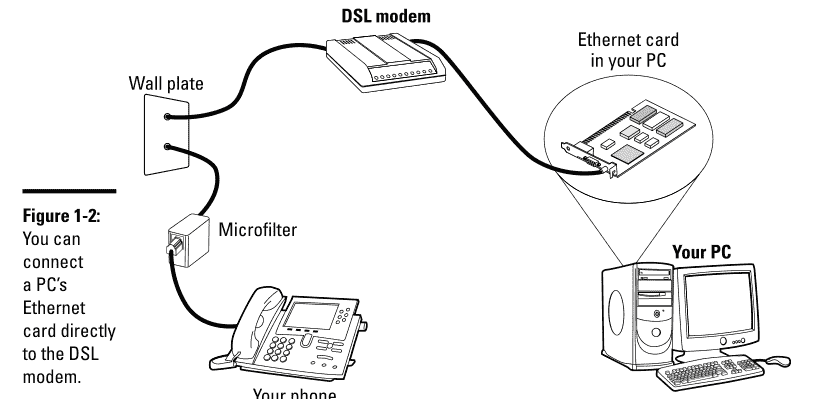

图 1-2：你可以直接将 PC 的以太网连接到 DSL 调制解器。

当你使用 DSL 将你的 Linux PC 连接到互联网时，连接是始终开启的，这意味着外部人员入侵 PC 的可能性更大。

你可以通过可以使用提供网络地址转换（`NAT`）的路由器来保护你的 Linux 系统免受入侵者的侵害，并作为额外，实现与局域网（`LAN`）中其他 PC 的高速连接。`NAT` 路由器将内部局域网的多个私有 Internet 协议（`IP`）地址翻译为单个公共 `IP` 地址，允许所有内部 PC 访问互联网。`NAT` 路由器充当你的局域网和互联网之间的网关，并将你的局域网与互联网隔离开——这使得入侵者更难到达你局域网上的系统。

如果你还想建立局域网，你需要一个以太网集线器或交换机将其他 PC 连接到网络。图 1-3 显示了通过 `NAT` 路由器和 DSL 调制解器将局域网连接到互联网的典型设置。

## 160 连接 DSL

- 电话接口

- DSL 调制解器

- 以太网线 (`10BaseT`)

- `NAT` 路由器

- 以太网线

- 以太网集线器 (`10BaseT`)

## 图 1-3：NAT 路由器将你的 PC 与互联网隔离，同时也允许你与局域网中的其他 PC 共享 DSL 连接。

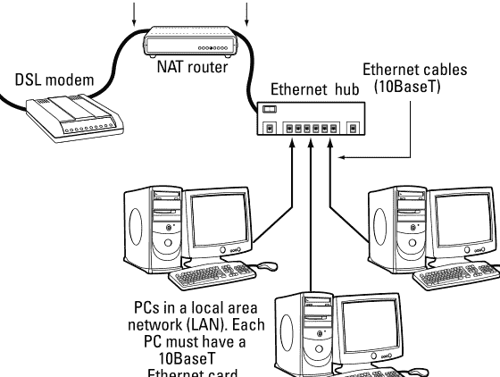

局域网 (`LAN`) 中的 PC，每台 PC 必须有一个 `10BaseT` 以太网卡。

在设置如图 1-3 所示的连接时，需要注意以下点：

- 你需要一个带有两个 `10BaseT` 或以太网端口的 `NAT` 路由器（`100BaseT` 和 `10BaseT` 端口看起来像大电话插座，标记为 `RJ-45` 接口）。通常，一个以太网端口标记为 Internet（或 External 或 `WAN`，代表广域网），另一个标记为 Local 或 `LAN`（代表局域网）。

- 你还需要一个以太网集线器/交换机。对于小型家庭网络，你可以购买 4 口或 8 口的以太网集线器。基本上，你想要的集线器端口数量取决于你打算连接到本地局域网的 PC 数量。对于企业，你希望将集线器更换为交换机。

- 使用 `10BaseT` 以太网线将 DSL 调制解器的以太网端口连接到 `NAT` 路由器的 Internet 口。（这些看起来带有较大 `RJ-45` 插头的电话线，通常标记为 Category 3 或 Cat 3）

- 使用 `10BaseT` 以太网线将 `NAT` 路由器的 Local 口连接到以太网集线器。

- 现在将每台 PC 连接到以太网集线器。

## 161 连接 DSL


你也可以购买内置 DSL 调制解器的路由器。在这种情况下，你不需要单独的 DSL 调制解器。你将电话线直接连接到路由器，路由器通过以太网线连接到你的 PC。这对许多家庭用户来说是一个方便的解决方案。

参考本书的第二章获取如何配置路由器的信息。要建立连接，你需要提供 ISP（互联网服务提供商）的用户名和密码。这通常通过一种名为 `PPPoE`（以太网 PPP）的协议完成，并在路由器界面配置。

DSL 服务商通常使用名为以太网 PPP (`PPPoE`) 的协议与服务商局端建立连接。你需要 ISP 提供的用户名和密码来使用它。

## 通过调制解器连接

电视公司还通过向家里传输电视的线路提供高速互联网接入。在电缆公司在其设施安装必要设备后，客户可以申请电缆互联网服务。

## 电缆调制解器如何工作

一个名为电缆调制解器的盒子是电缆网络接入互联网的核心（见图 1-4）。电缆调制解器从你 PC 的以太网卡获取数字数据，并将其放入一个空闲的频率段。（将频率想象成另一个电视通道，但它传输的不是图像和声音，而是数字数据。）

电缆调制解器将上行数据——即从你的 PC 发送到互联网的数据——与来自互联网的下游数据放在不同的通道中。根据设计，下载传输的速度远高于上传传输。这种假设是人们从互联网下载的内容远多于上传。

### 连接电缆调制器

电缆公司端端（中心分配点）-> 连接互联网骨干


一个社区（一个或多个拥有电缆调制解器的家庭）

另一个社区（拥有电缆调制解器的家庭共享同一根电缆）


传输家中数百个电缆电视通道的同轴电缆是非常强大的信号载体。特别是同轴电缆可以携带覆盖巨大范围的信号——数百兆赫兹 (`MHz`)。每个电视通道需要 6 `MHz`——而同轴电缆可以携带数百个这样的通道。电缆调制解器将数据放在一个频带中，并期望在另一个频带接收下游数据。

在你连接互联网的电缆对面是电缆调制解器终端系统 (`CMTS`)，也称为端端，它是电缆公司在其中心设施安装的。（参考图 1-4。）`CMTS` 将你的电缆电视网络连接到互联网。它提取上行

你的电缆调制器发送的数字数据（以及邻居的数据）会被发送到互联网。`CMTS`（电缆调制器终端系统）还将数据放入上行信道，你的电缆调制器从中提取数据并通过以太网卡提供给你的 PC。

电缆调制器以约 50 `Mbps` 的速度接收下载数据，以约 10 `Mbps` 的速度发送上行数据。然而，社区中所有的调制器共享相同的下行带宽。每个电缆调制器从称为 `DOCSIS` 的发送流中过滤出它需要的数据。电缆调制器遵循一种名为 `DOCSIS` 的现代标准，全称为电缆数据服务接口。你可以将它用于电缆接入服务；你只需要给电缆公司打电话，提供调制器的识别信息，`CMTS` 即可识别并初始化该调制器。

在实践中，使用电缆调制器时，你可能会获得约 12 `Mbps` 的下行速率和 2 `Mbps` 的上行速率。这些是最大速率；你的实际传输速率通常较低，取决于你社区中有多少人同时在使用电缆调制器。

如果你想检查你的下载传输速度，请访问 `http://bandwidthplace.com/speedtest` 并点击链接开始测试。例如，对于我的电缆调制器连接，最近一次测试报告下载传输速率约为 2.2 `Mbps`，但在其他时候速率曾高达 5.2 `Mbps`。


第三卷

第一章

### 典型的电缆调制器设置

要设置电缆调制器接入，你的有线电视服务供应商必须提供高速互联网接入。如果该服务可用，你就可以申请。电缆公司通常有促销活动，例如免安装费或前三个月优惠价。如果你运气好，在你想要申请时，当地电缆公司可能正在进行促销。

安装通常由技术人员执行，他们会将你的线路分分成两部分——一端连接到电视，另一端连接到电缆调制器。技术人员会将调制器的相关信息提供给电缆公司的头端。当工作完成后，你就可以将 PC 的以太网卡插入电缆调制器，然后准备好享受高速互联网接入了。图 1-5 显示了一个典型的调制器连接。

电缆调制器连接到你 PC 中的以太网卡。如果你的 PC 中没有以太网卡，电缆公司的技术人员通常会提供。

连接互联网

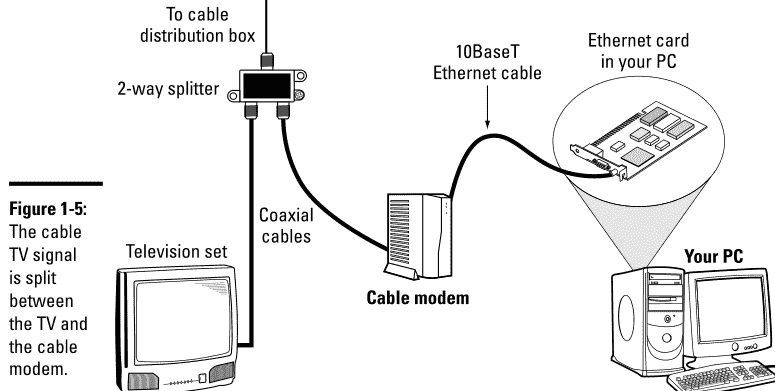

**图 1-5：** 有线电视信号在电视和电缆调制器之间分分。

关于图 1-5 中的电缆调制器设置，有以下几个关键点需要注意：

- 使用二分器将接入的有线电视信号分成两部分。（电缆公司技术人员安装二分器）。
- 二分器需要额定频率为 1 `GHz`；否则它可能无法让包含互联网下载数据的频率通过。
- 使用同轴电缆将二分器的一个视频输出口连接到你的电缆调制器的 `F` 型视频连接器。
- 将电缆调制器的 `100BaseT` 以太网连接到 PC 上的以太网卡。
- 将你的电视连接到二分器的另一个视频输出口。

当你使用电缆调制器将 Linux PC 连接到互联网时，连接是始终开启的，因此你更有可能遇到有人尝试侵入 PC。Linux 包含了 `iptables` 数据包过滤功能，你可能需要它来保护你的 PC 免受不受欢迎的互联网连接。

为了将你的 Linux PC 或局域网与公共互联网隔离开，你可能需要在 PC 和电缆调制器之间添加一个 `NAT` 路由器。`NAT` 路由器的一个网络接口连接互联网，另一个连接到你的 `LAN`；路由器作为 `LAN` 和互联网之间的网关。作为额外，你可以通过添加以太网集线器与你本地局域网（`LAN`）的所有 PC 共享电缆调制器连接。更好的是使用 `NAT` 路由器和集线器的组合，这样你只需要一个设备完成所有工作。

结合 `NAT` 路由器和集线器的设备通常以电缆/网关（cable/gateway）的名义出售。你可以根据需要连接到本地网络的数量，购买一个既当路由器又当多口集线器的设备。

`NAT` 路由器将私有地址翻译为公共地址。通过 `NAT` 路由器连接时，`LAN` 中的任何 PC 都可以像拥有自己的 IP 地址一样访问互联网。因此，你可以在 `LAN` 中的多个 PC 之间共享单一连接。

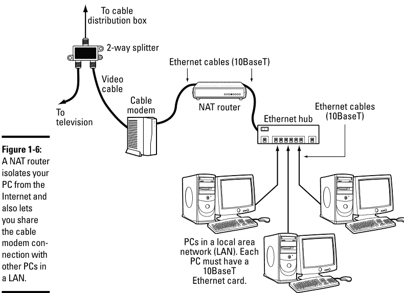

图 1-6 显示：设置 `LAN` 时需要注意的点：

- 使用双端口的 `NAT` 路由器：一个标记为 External（外部）或 `WAN`（广域网），另一个标记为 Local（本地）。
- 使用 `100BaseT` 以太网线将电缆调制器的以太网端口连接到路由器的互联网端口。（线看起来像电话线，但带有 `RJ-45` 接口）。
- 使用 `100BaseT` 以太网线将路由器的 Local 端口连接到以太网集线器的端口之一。
- 现在将每个 PC 连接到以太网集线器。每个 PC 必须有一个以太网卡。

在第 2 章中，我将解释如何配置 `LAN` 中的 PC，以便它们都能访问互联网。

- 考虑购买一个带有足够端口的集线器，以供你连接到本地网络。
- 将电缆调制器的视频输入连接到路由器的视频端口。
- 使用五类线将电缆调制器的以太网端口连接到路由器端口。（线通常标记为 Category 5 或 `Cat 5`）。

本章描述了如何设置以太网。即使你只有一台 PC，你可能需要设置以太网接口，以便接入高速互联网（在某处使用 DSL 或电缆调制器）。

# 第 2 章：设置本地网络

本章内容

- 理解 `TCP/IP` 网络
- 设置以太网局域网
- 发现如何配置 `TCP/IP` 网络
- 将 `LAN` 连接到互联网

Linux 内置了对传输控制协议/网协议（`TCP/IP`）网络的支持，从 Windows 到 Mac OS 的现代操作系统也是如此。你可以在许多接口上使用 `TCP/IP` 网络，例如以太网卡、串口端口和并行端口。

通常，我们使用以太网作为你的局域网（`LAN`）——在办公室甚至家里（如果你家里恰好有两个系统的话）——无线（下一章的主题）在大多数地方越来越流行。

## 理解 TCP/IP

如果你从四层模型来思考，将最好地理解 `TCP/IP` 网络，每层负责执行一项特定的任务。分层模型描述了从物理连接到终端用户应用程序之间的数据流。图 2-1 显示了 `TCP/IP` 的四层网络模型。

在这个四层模型中，信息总是从一层移动到下一层。例如，当一个应用程序向另一个应用程序发送数据时，数据通过层级的顺序为：应用：传输：网络：物理。在接收端，数据从物理：网络：传输：应用向上移动。

### 理解 TCP/IP

| 图 2-1: 4 应用层 | 邮件、文件传输、TELNET |

|---|---|

| 你可以理解 TCP/IP 3 传输 | `TCP`（传输控制协议）`UDP`（用户数据报协议） |

| 使用四层模型 2 网络 | `IP`（网协议） |

| 模型 1 物理层 | |


每一层都有自己的协议——即约定——用于处理和格式化数据。如果你将发送数据比作通过邮政系统寄信，那么一个典型的协议就是执行某项任务的一系列动作，例如写信封地址（首先是姓名、街道地址，然后是城市、州和邮政编码或其他邮编）。

这些层取决于你所参考的依据，可能会有不同的名称。例如，如果你看 DOD 模型，传输层被称为主机到主机（`host-to-host`），网络层被称为互联网（`Internet`），应用层被称为进程/应用，而物理层被称为网络访问。

以下是每一层的功能，从上到下：

- **应用层**：运行用户使用的应用程序，例如电子邮件阅读器、文件传输和网络浏览器。应用层协议包括用于电子邮件的简单邮件传输协议（`SMTP`）、邮局协议（`POP`），用于网页的超文本传输协议（`HTTP`），以及用于文件传输的文件传输协议（`FTP`）。应用层协议还有端口号，你可以将其视为特定应用程序的标识符。例如，端口 `80` 与 `HTTP` 或 Web 服务器。

- **传输层**：将数据从一个应用程序发送到另一个应用程序。这一层中最重要的协议是传输控制协议（`TCP`）和用户数据报协议（`UDP`）。`TCP` 保证数据的交付；`UDP` 只发送数据而不确保其确实到达目的地。

- **网络层**：这一层负责将数据包从一个网络传输到另一个网络。如果网络之间距离远，数据包将从一个网络路由到下一个，直到到达目的地。该层的主要协议是互联网协议（`IP`）。

- **物理层**：指在网络中传输数据包的物理网络硬件（如以太网卡或令牌环卡）。

## 理解 TCP/IP

### TCP/IP 与互联网

`TCP/IP` 已成为互联网的首选协议——从 `ARPANET` 演变而来的网络网络。美国政府高级研究计划署（`ARPA`）于 20 世纪 70 年代开始研究一种新的信息发送方法，即使用通过网络发送数据包。其结果是 `ARPANET`：一个连接计算机的全国性网络。随后，`ARPA` 获取了国防前缀并变成了 `DARPA`。

在 `DARPA` 的赞助下，`TCP/IP` 协议成为一种流行的网络协议集——网络间的通信。

`TCP/IP` 之所以繁荣是因为该协议是开放的。虽然协议的描述出现在公共文档中，因此任何人可以在特定的硬件和软件上实现 `TCP/IP`。

分层模型的优之处在于每一层只负责其特定的任务，将剩下的留给其他层。层之间可以混合组合——你可以在任何类型的物理介质上运行 `TCP/IP` 网络，从以太网到无线电（无线网络）。软件是模块化的；每层都可以在不同的模块中实现。例如，传输层和网络层通常作为操作系统的一部分存在，任何应用程序都可以使用它们。

一旦有了稳定、可用的软件，`TCP/IP` 也取得了巨大进展。`TCP/IP` 协议并非于网络架构和协议的纸面描述，而是作为可运行软件开始的——谁能反对已经运行良好的东西呢？如今，`TCP/IP` 统治着互联网。

### IP 地址

当网络上有许多计算机时，你需要唯一地标识每一个计算机。在 `TCP/IP` 网络中，计算机的地址就是 `IP` 地址。因为 `TCP/IP` 处理的是互联网，所以地址基于网络地址和主机地址的概念。你可以将网络地址和主机地址理解为提供两个地址来唯一标识计算机：

- 网络地址识别计算机所在的网络。
- 主机地址指示该网络上的特定计算机。

网络地址和主机地址共同构成 `IP` 地址（32 位值）。习惯是将每个数字写为十进制，并在每个数字后加点（`.`）。例如 `132.250.1`。这种写入方法被称为点十进制。

### 关于 IP (IPv6)

32 位 `IP` 地址被创建时，可用数量似乎足够。然而，互联网工程任务组（`IETF`）意识到 `IP` 地址即将耗尽，并于 1993 年开始研究下一代地址方案。他们将其称为 `IPng`（下一代互联网协议）。`IPv6` 的设计是为了最终取代 `IPv4`（4 位地址方案），允许用户将其系统升级到 `IPv6`。`IPv6` 的地址是 128 位，提供了比 `IPv4` 多得多的地址。地址以十六进制格式表示，用冒号（`:`）分隔。例如 `2001:0db8:85a3:0000:0000:8a2e:0370:7334`。在这种表示法中，每组开头的零可以省略。

从 `IPv4` 到 `IPv6` 的过渡是渐进的。开发了各种机制允许 `IPv4` 和 `IPv6` 在过渡期间共存。双栈（同时运行 `IPv4` 和 `IPv6`）、隧道（`IPv6` 包封装在 `IPv4` 包中）以及翻译（允许 `IPv6` 节点通信）。

### 互联网服务与端口号

当网络上有许多计算机时，你需要唯一地标识每一个。在 `TCP/IP` 网络中，计算机的地址是 `IP` 地址。因为 `TCP/IP` 处理的是互联网，地址基于网络地址和主机地址的概念。你可以将网络地址和主机地址理解为提供两个地址来唯一标识计算机：

`TCP/IP` 还使用端口号来识别主机上的特定进程。端口号范围从 `0` 到 `65535`。端口分为三个范围：已知端口（`0-1023`）、注册端口（`1024-49151`）和动态或私有（`49152-65535`）。已知端口用于标准网络服务，如 `HTTP`、`FTP` 和 `SMTP`。注册端口用于应用程序特定服务。动态端口用于客户端建立的临时连接。

- **DNS（域名系统）**用于将域名转换为 `IP` 地址。该服务运行在端口 `53`。
- **HTTP（超文本传输协议）**是从一个系统向另一个系统发送文件的协议。`HTTP` 是 Web 的底层协议。默认情况下，Web 服务器和客户端在端口 `80` 上通信。结合 `SSL/TLS`，协议变为 `HTTPS` 并使用端口 `443`。
- **SMTP（简单邮件传输协议）**用于系统之间交换电子邮件消息。`SMTP` 使用端口 `25` 进行交换。
- **POP3（邮局协议第3 版）**用于客户端接收邮件并使用端口 `110`。结合 `SSL/TLS` 为了安全，它使用端口 `995`。
- **IMAP（互联网消息访问协议）**可供用户与邮件交互（代替 `POP3`），并使用端口 `143`。结合 `SSL/TLS` 为了安全，它使用端口 `993`。
- **NNTP（网络新闻传输协议）**用于在互联网上以存储和转发的方式发布新闻文章。`NNTP` 使用端口 `119`。
- **NetBIOS**用于网络并利用多个端口，其中最常用 `139` 用于会话。
- **SSH（安全外壳）**是一种在不安全网络上进行安全远程登录和其他网络服务的协议。`SSH` 使用端口 `22`。
- **TELNET**用于当一个系统上的用户登录互联网上的另一个系统时。（用户必须使用有效的用户 ID 和密码登录远程系统）。`TELNET` 默认使用端口 `23`，`TELNET` 客户端可以连接到任何端口。
- **SNMP（简单网络管理协议）**用于管理互联网上所有类型的网络设备。像 `FTP` 一样，`SNMP` 使用端口：`161` 和 `162`。
- **FTP（文件传输协议）**用于在计算机之间传输文件。`FTP` 使用两个端口——数据在端口 `20` 传输，控制信息在端口 `21` 交换。
- **TFTP（简易文件协议）**用于从一个系统传输文件到另一个系统。（它用于 X 终端和磁盘工作站从网络上的任何主机下载启动文件）。`TFTP` 数据传输发生在端口 `69`。
- **NFS（网络文件系统）**用于在计算机之间共享文件。`NFS` 使用 Sun 的远程过程调用（`RPC`）设施。

# 172 设置以太网局 (LAN)

## 设置以太网局

以太网是在连接到单个集线器、路由器或交换机的两个或多个计算机之间传输数据包的标准方法。（你可以通过网关连接多个以太网段来创建更大的网络。）要建立以太网局，你需要为每台 PC 配置一张以太网卡。`Linux` 支持多种 PC 以太网卡。

以太网是物理数据传输的良好选择，原因如下：

- 以太网是一项经过验证的技术，自 20 世纪 80 年代初一直在使用。
- 以太网提供了良好的数据传输速率：通常为每秒1000 万比特（10 Mbps），尽管 100 Mbps 和千兆以太网（1000 Mbps）也很常见。
- 以太硬件通常内置在 PC 中，或者可以以较低成本安装（PC 以太网成本约为 10–20 美元）。
- 通过以太网，你可以轻松地将笔记本电脑连接到以太网局，而无需在到处布布线。（有关无线以太网的更多信息，请参阅本教程的第 3 章。）

## 以太网的工作原理

以太网是如何运行的呢？本质上，它与任何对话的原理是一样的：听和轮流。


在以太网网络中，段内的所有系统都连接到同一根线上。使用协议来发送和接收数据，因为在任何时刻单线上只能存在一个数据包。以太网局使用称为载波监听多路访问/冲突检测（`CSMA/CD`）的数据传输协议在所有计算机之间共享单一传输。计算机中的以太网卡使用 `CSMA/CD` 协议来发送和接收数据包。

`CSMA/CD` 协议背后的思想与我们聚会聊天的方式相似。你倾听停顿（这就是检测载波），并在没有人说话时等待。如果你和另一个人同时开始说话，你们都会意识到这个问题（那就是冲突）并停顿片刻；然后其中一个人再次开始说话。正如你经验所知，一切运行良好良好。

在以太网局中，每张以太网卡都会检查电缆信号——这就是载波监听。如果信号电平低，以太网卡就会电缆上发送其数据包；数据包包含发送者和预期接收者的信息。局上的以太网卡监听信号，接收者接收数据包。如果两个网卡同时向电缆发送数据包，电平将高于阈值，网卡就知道发生了冲突（两个数据包同时发送出去）。两张网卡在再次发送之前会等待随机的时间。


以太网于 20 世纪 70 年代初在罗奇帕洛阿尔托研究中心（PARC）由 Robert M. Metcalfe 发明。20 世纪 80 年代，以太网通过三家公司的共同努力实现了标准化：数字设备设备公司（DEC）、英特尔（Intel）和施罗华（Xerox）。使用公司名称的首字母，以太网标准被称为 DX 标准。随后，电气电子工程师学会（IEEE）开发了 802 系列标准。最终是以太网规范正式称为 IEEE 802.3 CSMA/CD，但人们统统称为以太网。

以太网以数据包（离散块，也称为帧）的形式发送数据。你不需要费心以太网包的内部结构，只需注意 6 字节的源地址和目的地址。每个以太网控制器在物理层都有唯一的 6 字节（48 位）地址；每个数据包都必须一个。

## 以太网线

每当你听到专家谈论以太网时，你也会听到关于传输数据的电缆的术语。这里有一个快速介绍。

原始以太网使用粗轴电缆，直径接近半英寸。这种布线被称为厚线（thick）、thickwire 或直接称为粗以太网，尽管 IEEE 802.3 标准称之为 10Base。该标识意味着几点：数据传输速率为每秒 10 兆比特（10 Mbps）；传输是基带的（这这意味着信号的承载能力专门用于传输以太网数据包），且电缆总长度不超过 500 米。粗线价格昂贵，而且电缆相当难以处理。除非你不在乎具体是哪种 10Base5。


如今，其他几种形式以太网线更流行。以太网线的替代品是细线（thinwire）或 10Base2，它使用细且灵活的轴电缆。细线段最长可 185 米。另一种较新的是基于屏蔽双绞对（UTP）以太网，被称为 10Base。支持更高传输速率的更更新以太网选项包括用于 100 Mbps 以太网的 100Base4、100Base2 和 100BaseTX，以及用于千兆以太网的 1000Base。电子工业协会/电信工业协会协会 定义了以下类型的屏蔽和非屏蔽双对：


- 1 类：传统以太网。
- 2 类：传输速率高达 10 Mbps 的电缆。
- 3 类：传输信号高达 16 MHz 的电缆。
- 4 类：传输信号高达 20 MHz 的电缆。
- 5 类：传输信号高达 100 MHz 的电缆。
- 5e 类：与 5 类相似，但改进了近端串扰等参数。
- 6 类：与 5 类类似，但能够传输高达 250 MHz 的信号。

## 配置 TCP/IP 网络

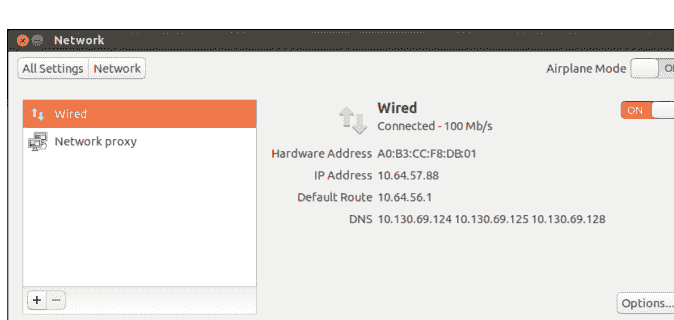

**图 2-3：** 遍历对话框中的选项以配置连接。

**图 2-4：** “选项（Options）”按钮允许你配置连接。

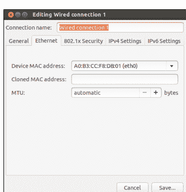

> 在大多数情况下，你可以通过 DHCP 设置网卡，使其能够自动获取 IP 地址（以太网卡连接到 DSL 或电缆调制解调器时即如此）。如果你的网络没有 DHCP 服务器（通常内置在路由器中），你必须为网卡指定一个 IP 地址。如果你正在运行私有网络，可能可以使用 `192.168.0.0` 到 `192.168.255.255` 范围内的 IP 地址。（其他地址范围也保留给了私有网络，但此范围足够满足大多数需求。）


## 将你的局域网连接到互联网

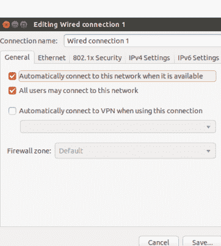

图 2-5：

“常规（General）”选项卡允许你配置连接始终尝试可用。

如果你有一个包含若干 PC 的局域网（LAN），可以使用 DSL 或电缆调制解调器将整个局域网连接到互联网。基本上，你可以将高速 DSL 或调制解调器与局域网中的所有 PC。

本书的第一章解释了如何设置 DSL 或电缆调制解调器。在本节中，我简要说明如何将局域网连接到互联网，以便所有 PC 都能访问互联网。

通过 DSL 或电缆调制解调器连接局域网最方便的方法是购买一种名为 DSL 电缆调制解调器 NAT 路由器的硬件设备，它带有 4 口或 8 口以太网集线器。NAT 代表网络地址转换（Network Address Translation），NAT 路由器可以将私有 IP 地址转换为单个已知的 IP 地址。以太网集线器部分表现为 RJ-45 以太网端口，你可以在此连接 PC 以建立局域网。换说，除了 DSL 或电缆调制解调器之外，你只需要额外的设备。

图 2-6 显示了如何通过带有内置以太网集线器的 NAT 路由器将局域网连接到互联网。这种情况需要一个 DSL 或电缆调制解调器热点，你可以向 DSL 供应商（DSL 服务）或电缆供应商办理电缆上网服务。

当你将局域网连接到互联网时，NAT 路由器充局域网的网关。NAT 路由器还为局域网中的 PC 提供 IP 地址。因此，在每台 PC 上，你必须设置网络选项以动态获取 IP 地址。

www.it-ebooks.info

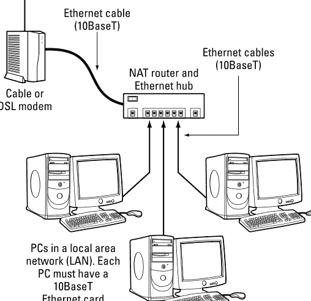

图 2-6：通过带有内置以太网卡的 NAT 路由器将你的局域网连接到互联网

局域网（LAN）中的 PC。每台 PC 必须有一块 10BaseT 以太网卡

如果你正在使用 DSL 且速度低于应有速度（例如，本应该是 5 Mbps 但实际只有 2 Mbps），请尝试使用不同的电话线。确保从调制解调器到墙上插座的电话线长度不超过 10 英尺，并且没有通过过滤器、浪涌保护器或分线器（这些设备会衰减信号）。所有其他电话设备（例如传真机）都应通过过滤器或浪涌保护器。

你的局域网可以混合使用所有计算机：某些可能运行 Linux，另一些可能运行 Microsoft Windows 或任何其他支持 TCP/IP 的操作系统。在配置网络设置时，请选择允许 Linux 通过 DHCP 自动获取 IP 地址设置和 DNS 信息的选项。


# 第 3 章：无线无线

## 本章内容

- 理解无线以太网网络
- 设置你的无线硬件
- 了解如何配置无线接入点
- 配置无线网络

如果你的局域网中有笔记本电脑——或者你不想布设一团乱麻的电线来将 PC 连接到局域网——你有使用无线以太网网络的选项。在典型场景下，你通过电缆调制解调器或 DSL 连接互联网，并希望连接一个或带有无线网卡的笔记本通过电缆或 DSL 访问互联网。本章将向你如何设置无线网络以连接以太网局域网并访问互联网。

## 理解无线以太网网络

你可能听过 Wi-Fi。Wi-Fi 是 Wireless Fidelity（无线保真）的缩写——一种与有线以太网类似的短距离无线网络。由名为 IEEE（电气电子学会）的组织定义的许多标准定义了 Wi-Fi 网络工作的技术细节。制造商使用这些标准来制造你可以购买的组件，以建立无线局域网（简称 WLAN）。

管理 Wi-Fi 网络的标准演进非常迅速。从 802.1a 开始催生了 802.1b。管理 Wi-Fi 网络的标准已经迅速演进。但这些标准的目的都是相同的：定义 Wi-Fi 网络的工作方式。制造商使用这些标准来制造你可以购买的组件，以建立无线局域网（简称 WLAN）。

你可以购买这些组件来购买的组件，以建立无线局域网（WLAN）。

今天常见的几种无线标准具有以下特征：

- 802.1b：在 2.4 GHz 频段（2.4 GHz 到 2.435 GHz）工作，具有三个非重叠频道。802.11b 的缺点是 2.4 GHz 频段非常拥挤——许多在2.4 GHz 频段内工作的设备（如微波炉、无线电话、科学设备以及蓝牙设备）。尽管如此800..11b企业企业家庭网络中很流行。
- 802.11a：在 5 GHz 频段（5.725 GHz 到 5.850 GHz）工作，具有许多非重叠频道。最大速率为 54 Mbps。5 GHz 频段并不像 2.4 GHz 频段那样拥挤，但 5 GHz 频段尚未批准用于。符合 802.11a 的产品已上市，某些无线接入点设计为支持 802.11a 和 802.11b。
- 802.11g：在 2.4 GHz 频段（与 802.11b 相同）中支持高达 54 Mbps。802.11g 使用名为 OFDM（正交频复用）的技术实现了更高的速率，该技术也用于 802.11a。符合 802.11g 的设备通过与 802.11b 相同的频段产生以太网——供应商提供同时支持 802.11b 和 802.11g 的接入点。


总之，用户看到的最大数据吞吐量小于频道的总容量，因为所有频道的用户共享此容量。此外，随着用户 PC 与无线接入点之间距离的增加，数据传输速率也会降低。为了起见，尽管 802.11n 通过支持的数据速率增加了现有吞吐量并翻倍了以前标准的范围，802.11g 接入点也可以与较旧（速度较慢）的设备通信。你也可以考虑使用 MIMO 接入点，它支持多种 802.11 标准并实现了更高的吞吐量和更好的范围。

# 理解无线以太网络 181

基础模式（Infrastructure mode）是指所有以太网卡通过接入点相互以及与有线局域网进行通信的方法。在本章的讨论中，我假设你将无线以太网卡设置为基础模式。在配置文件中，这种模式被称为托管模式（managed mode）。

## 理解有线等效隐私 (WEP)

802.11 标准包含了有线等效隐私（WEP），用于保护无线通信免受窃听。WEP 依赖移动站（如带有无线以太网卡的笔记本电脑）与接入点（也称为基站）之间共享一个 40 位或 104 位密钥。在数据包被修改之前，使用该密钥对数据进行加密，并进行完整性检查以确保数据包在传输过程中未被修改。802.11 标准并没有解释共享密钥是如何建立的。在实践中，大多数 WLAN 使用所有客户端共享的单一密钥。然而，这种方法在校园等环境中扩展性不好，因为密钥是所有用户共享的。这就是为什么在大学等无线网络中，WEP 通常是不够的。在这样的无线网络中，必须使用其他安全方法，如 SSH（安全外壳）来接入远程系统。然而，WEP 在家庭网络中使用是很好的。

WEP 有其弱性，但在较小的无线局域网中，所有无线站共享同一个密钥并不是一项艰巨的任务。

十年来，Wi-Fi 联盟发布了名为无线保护访问（WPA）的规范，通过一些更改改进了安全性。例如，与使用固定密钥的 WEP 不同，WPA 使用了临时密钥协议（TKIP），为每传输的 10k 数据生成新密钥。这使得 WPA 变得更难破解。2004 年，Wi-Fi 联盟引入了 WPA 的后续版本无线保护访问 2（WPA2 —— WPA 的第二代）。WPA2 基于 IEEE 802.11 标准，使用数字证书、身份验证以及 RADIUS（远程拨号用户服务）服务器来为无线网络提供更好的安全性。WPA2 使用高级加密标准（AES）进行数据加密。

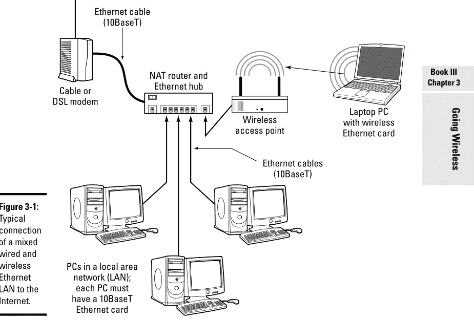

| 书籍 |
| : --- |
| 第 3 章 |
| 进入无线 |
| ebooks.info |

### WEP 加密足够好吗？

WEP 使用 RC4 加密算法，称为流加密。这种算法通过取短密钥并生成无限的伪随机位来工作。在发送数据之前，发送站会在伪随机位和数据包位之间执行异或（XOR）操作，如果位不同则为 1，相同则为 0。接收者拥有相同密钥的副本，并在伪随机流和接收位之间执行异或操作。这样做可以还原原始加密数据包。每个数据包使用 RC4 密钥。IV 本身也包含在包。专家表示这些防御实现得糟糕，导致 WEP 无效。IC 和 IV 有两个问题：

- 完整性检查是通过使用 32 位循环冗余校验（CRC-32）实现的；它作为数据包的一部分。不幸的是，攻击者可以翻转加密消息中的任何位并正确调整校验和，使消息看起来有效。
- IV 以明文（未加密）形式发送。有 2^24 个可能的初始化向量（对于繁忙的机器来说是一个挑战），它们必须重复。换句话说，IV 在 2^24 或 16,777,216 个数据包后重复。这个数字看起来很大，但请考虑一个以 1 Mbps 速率发送 1500 字节数据包的繁忙接入点。每个数据包需要 12000 μs。在该速率下，接入点每秒发送 916 个包（11,000,000/12,000）。接入点在 5 小时内发送 16,777,216 个包（16,777,216/18,315=5 小时）。由于许多消息小于 1500 字节，因此 IV 在 5 小时或更短之后重复。因此攻击者有充分的机会收集两个使用相同密钥加密的消息——并执行统计攻击（快速得出可能的组合）来解密消息。

这种流加密方法的漏洞很少。如果加密数据流中的位被翻转（从 0 变为 1，反之亦然），解密输出中的相应位也会被翻转，这可以帮助攻击者破解加密密钥。此外，拦截到两个具有相同流的消息的监听者可以生成原始消息的异或结果。足够的知识足以发起最终破解加密的攻击。

为了应对这些漏洞，WEP 使用了一些防御措施：

- 完整性检查 (IC) 字段：为了确保数据包在传输过程中不被修改，WEP 每个数据包使用一个完整性检查字段。
- 初始化向量 (IV)：为了避免使用相同密钥流的消息，WEP 使用 24 位 IV。

这种流加密方法的漏洞很少。如果加密数据流中的位被翻转（从 0 变为 1，反之亦然），解密输出中的相应位也会被翻转，这可以帮助攻击者破解加密密钥。此外，拦截到两个具有相同流的消息的监听者可以生成原始消息的异或结果。足够的知识足以发起最终破解加密的攻击。

## 设置无线硬件

要建立网络，你需要一个接入点和一个无线卡。要将台式 PC 连接到此网络，你可以使用 USB 网卡（连接到 USB 端口）。如果你还没有为你的 DSL 连接购买路由器和集线器，请考虑购买带有内置接入点的路由器和集线器。

## 配置接入点

配置接入点（通常称为 WAP）涉及以下任务：

- 为无线网络设置名称。（该名称的专业术语是 SSID。）
- 设置无线卡与接入点通信的频率或通道，卡必须使用相同的通道。
- 决定是否使用加密，设置加密密钥的位数和加密密钥的值。
- 设置无线网卡连接到接入点时必须使用的方法。

## 配置无线网络

在你的 Linux 笔记本电脑上，PCMCIA 或 PC 卡管理器会识别网卡并为该卡加载相应的驱动程序。Linux 将无线网卡视为另一个以太网设备，并分配如 `eth0` 或 `eth1` 这样的设备名称。如果笔记本电脑中已经有一个以太网卡，那么它将获得 `eth0` 设备，而无线 PC 卡将成为 `eth1` 设备。

你必须配置某些参数以允许无线网卡与无线访问点通信。例如，你必须指定分配给访问点的无线网络名称，并且加密设置必须与访问点上的设置匹配。通常，你可以使用你的 Linux 发行版提供的图形化网络配置工具来配置一切——就像请求的信息中所示，如图 3-2 所示。

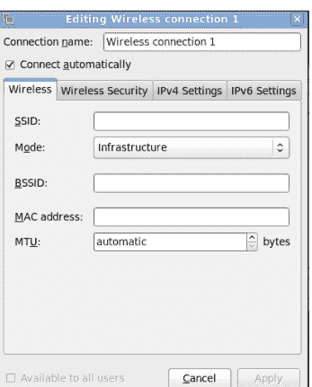

图 3-2：配置新的无线连接。

网络配置工具将你的无线网络设置保存在文本文件中。该文件名取决于无线网络设备的名称。如果无线网络设备名称为 `eth0`，则配置存储在文本文件 `/etc/sysconfig/network-scripts/ifcfg-eth0` 中。如果无线设备名称为 `eth1`，则文本文件为 `/etc/sysconfig/network-scripts/ifcfg-eth1`。此配置文件包含了无线网卡的各种设置。表 3-1 解释了这些设置的含义。以下是我我的笔记本电脑上 `/etc/sysconfig/network-scripts/ifcfg-eth1` 稍微修改的版本。

```
IPV6INIT=no
USEOCL=no
PERDNS=yes
TYPE=Wireless
DEVICE=eth0
HWADDR=00:02:02:2d:8c:f9:c4
BOOTPROTO=dhcp
ONBOOT=no
DHCP_HOSTNAME=\NAME=\ESSID='HOME'
CHANNEL=6
MODE=Managed
RATE=auto
```

# 无线以太网网络接口配置文件中的设置

| 此参数 | 含义 |
| --- | --- |
| BOOTPROTO | 用于获取接口 IP 地址的协议名称。以太网接口使用的协议是 dhcp 或 boot。 |
| CHANNEL | 通道号（在美国和加拿大范围内为 1 到 14 之间）。必须与无线访问点的通道相同。在托管模式下，你不需要指定通道。 |
| DEVICE | 无线以太网网络接口的设备名称（第一个接口为 eth0，第二个为 eth1，以此此类推）。 |
| ESSID | 扩展服务集（ESS）标识符，也称为网络名称。它是区分大小写的，并且必须与无线访问点指定的名称相同。请在单引号内提供名称（例如，'HOME'）。 |
| HWADDR | 无线网卡的硬件地址（也称为 MAC 地址；六对用冒号分隔的十六进制数字；例如 00:02:02:2d:8c:f9:c4）。无线卡驱动程序会自动检测此地址。 |
| IPV6INIT | 设置为 yes 时，它会为无线接口初始化 IPv6 配置。如果不使用 IPv6，则将其设置为 no。 |
| MODE | 无线网卡的运行模式。对于通过无线访问点连接的典型网络，将其设置为 Managed（托管）。 |
| 此参数 | 含义 |
| --- | --- |
| NAME | 你的无线网络的昵称。如果不指定，则使用主机名作为昵称。 |
| ONOBOOT | 设置为 yes 以在启动时激活无线接口；否则设置为 no。 |


| `PEERDNS` | 设置为 yes 以允许接口修改系统的 `/etc/resol.conf` 文件，以使用从 DHCP 服务器（提供接口 IP 地址的同一服务器）获取的 DNS 服务器。如果将此参数设置为 no，`/etc/resol.conf` 文件将保持不变。 |

| `RATE` | 无线连接的比特率（设置为以下选项之一：1M, 2M, 5M, 11M 或 auto）。M 表示 Mbps，即每秒百万位。设置为 auto 以使用使用可能的最高传输速率。 |

| `TYPE` | 无线网络接口设置为 Wireless。 |

| `USERCTL` | 设置为 yes 时，未以 root 登录的用户也可以控制设备。将其设置为 no，则只有 root 能够控制设备。 |

在 Linux 发行版中，加密密钥单独存储。对于名为 `eth1` 的无线以太网卡，加密密钥存储在 `/etc/sysconfig/network-scripts/keys-eth1` 文件中。以下是该文件的内容示例：

```
KEY=1fdf3fde
```

40 位密钥有 10 个十六进制数字（例如 1fdf-3dfe-fe），104 位密钥有 26 个十六进制数字。密钥分别为 64 位和 128 位，但加密算法会自动生成 24 位，因此你只需要保护剩余的位。密钥越长，加密越安全。

如果你修改了无线以太网配置文件中的参数，在编辑完配置后输入以下命令重新激活无线网络接口：

```
/etc/init.d/network restart
```

在 SUSE Linux 中，使用 YaST 配置无线网络。SUSE 将无线配置参数存储在以 `ifcfg-wlan` 开头的文件中，后面跟着一个如 0 或 1 的数字，取决于无线网络接口的序列号。


配置文件存储在 `/etc/sysconfig/network` 中。

以下是 SUSE 配置文件中典型的无线参数列表：

```
WIRELESS_MODE='Managed'
WIRELESS_ESSID='HOME'
WIRELESS_NICK=''
WIRELESS_RATE='auto'
```

# 第 4 章：管理网络

本章内容

- 了解 TCP/IP 配置文件
- 检查 TCP/IP 网络
- 在启动时配置网络

与 Linux 中的几乎其他一切一样，TCP/IP 的设置涉及准备许多配置文件（可以使用任何文本编辑器编辑的文本文件）。大多数这些配置文件位于 `/etc` 目录。Linux 安装程序尝试通过隐藏 TCP/IP 配置文件的细节来提供帮助。尽管如此，知道它们的名称和用途，手动编辑（如有需要）会变得更容易。

## 发现 TCP/IP 配置文件

在安装 Linux 时可以配置 TCP/IP 网络。然而，如果你想有效地管理网络，你需要熟悉 TCP/IP 配置文件以便对其进行编辑。例如，如果你想检查 DNS 服务器指定是否正确，你必须了解 `/etc/resol.conf` 文件，该文件存储了 DNS 服务器的 IP 地址。

`/etc/hosts` 文件包含本地网络的 IP 地址和主机名列表。在没有 DNS 服务器的情况下，系统上的任何网络程序都会查询此文件以确定主机名对应的 IP 地址。将 `/etc/hosts` 想象成本地电话簿。

### 基础 TCP/IP 网络配置文件

| 此文件 | 包含以下内容 |
| --- | --- |
| `/etc/hosts` | 本地网络的 IP 地址和主机名，以及你经常访问的任何系统。 |
| `/etc/networks` | 网络的名称和 IP 地址。 |
| `/etc/host.conf` | 关于如何将主机转换为 IP 地址的指令。 |
| `/etc/resolv.conf` | 名称服务器的 IP 地址。 |
| `/etc/hosts.allow` | 关于哪些系统可以访问你系统上的互联网服务的指令。 |
| `/etc/hosts.deny` | 关于哪些系统必须拒绝访问你系统上的互联网服务的指令。 |
| `/etc/nsswitch.conf` | 关于如何将主机转换为 IP 地址的指令。 |

来自系统的 `/etc/hosts` 文件显示了典型局域网 (LAN) 上其他主机的 IP 地址和名称：

```
127.0.0.1 localhost localhost.localdomain
## LAN 上的其他主机
192.168.0.10 lnbp933
192.168.0.50 lnbp600
192.168.0.20 lnbp200
192.168.0.233 lnbp233
192.168.0.40 lnbp400
```

如示例所示，文件中的每一行都以 IP 地址开头，随后是该 IP 地址的主机名（你可以为任何 IP 地址设置多个主机名）。在某些发行版中（如 openSE），`/etc/hosts` 文件具有以下内容：IP 地址、完全限定主机名 (Fully-Qualified-Hostname)、短主机名 (Short-Hostname)。在所有情况下，主机名之后的任何内容（如短主机名）都被视为别名。

#### `/etc/networks`

`/etc/networks` 是另一个包含网络名称和 IP 地址的文本文件。这些网络名称通常用于路由命令 (`/sbin/route`) 中，以指定名称而非其 IP 地址。

如果你的 Linux PC 上没有 `/etc/networks` 文件，请不要惊讶。你的 TCP/IP 网络没有此文件也能正常工作。事实上，Linux 安装程序并不会创建 `/etc/networks` 文件。

#### `/etc/host.conf`

Linux 使用一个特殊的库（即一组计算机代码）称为 `resolver` (解析器)，来获取与主机名对应的 IP 地址。`/etc/host.conf` 文件指定了如何解析名称（即如何将名称转换为数字 IP 地址）。一个典型的 `/etc/host.conf` 文件可能包含以下行：

```
+ order hosts, bind
multi on
```

`/etc/host.conf` 文件中的条目告诉解析器使用哪些服务（以及按什么顺序）来解析名称。

`order` 选项指示服务的顺序（在较新的发行版中，后文将讨论的 `nsswitch.conf` 文件执行此功能）。示例条目告诉解析器首先咨询 `/etc/hosts` 文件，然后检查名称服务器来解析名称。

使用 `multi` 选项来指示 `/etc/hosts` 文件中的主机是否可以有多个 IP 地址。具有多个 IP 地址的主机被称为“多宿主” (multihomed)，因为多个 IP 地址的存在意味着该主机具有多个网络接口。（实际上，主机同时存在于多个网络中。）


#### `/etc/resolve.conf`

`/etc/resolve.conf` 文件是解析器使用的另一个文本文件——解析器是确定主机名对应 IP 地址的库。以下是 `/etc/resolve.conf` 示例：

```
nameserver 192.168.0.1 dhcp eth0
search nrockv01.md.comcast.net
```

`nameserver` 行提供了你域名名称服务器的 IP 地址。如果你有多个名称服务器，每个服务器单独占一行。它们按照它们在文件中出现的顺序进行查询。

`search` 行告诉解析器如何搜索主机名。示例中的 `search` 指令导致解析器尝试 `myhost`，然后是 `myhost.nrockv01.md.comcast.net`。接着是 `nrockv01.md.comcast.net`，然后是 `myhost.nrockv01.md.comcast.net`。


## 检查 TCP/IP 网络

RX 数据包:612851 错误:0 丢弃溢出:0 帧:0

TX 数据包:74187 错误:0 丢弃溢出:0 载:0

冲突:0 发送队列:10000

RX 字节:9984031 (95.2 MiB) TX 字节:76034821 (72.5 MiB)

中断: 基地址:0x03000

eth0 链路:以太网 掩码:00:02:2D:8BC:FC

inet 地址:192.168.0.9 网网:192.168.0.255 掩码:255.255.255.255

eth1 地址:fe80::202:2d:f8bc:fc5/64 范围:链路

UP BACKBOUND RUNNING WRITE MTU:1500 度量:1

RX 数据包:38333 错误:0 丢弃溢出:0 帧:0


TX 数据包:12420 错误:0 丢弃溢出:0 载:0

冲突:0 发送队列:10000

RX 字节:569194 (54.6 KiB) TX 字节:250287 (244.4 KiB)

中断:3 基地址:0x0100

lo 链路:本地回环

inet 地址:127.0.0.1 掩码:255

inet6::1/68 范围:主机

UP RUNNING MTU:16384 度量:1

RX 数据包:24560 错误:0 丢弃溢出:0 帧:0

TX 数据包:24560 错误:0 丢弃溢出:0 载:0

冲突:0 发送队列:10000

RX 字节:2891581 (2.7 MiB) TX 字节:2891581 (2.7 MiB)

此输出显示三个网络接口（lo）和两个以太网卡（eth0 和 eth1）——当前在该系统上活动。对于每个接口，你可以看到 IP 地址，以及交付和发送数据包的统计信息。如果 Linux 系统正在运行拨号 PPP 链路，在输出中还会看到 ppp0 接口的条目。

## 检查 IP 路由表

另一个网络配置命令 `/sbin/route` 在你不带命令行参数运行它时，它会提供状态信息。如果你在检查到另一个主机（你通过 IP 地址指定该主机）的连接时遇到困难，请检查 IP 路由表查看是否指定了网关。检查网关的路由表，确保通往外部网络的路径出现在路由中。

`/sbin/route` 命令的典型输出如下：

```
内核 IP 路由表
目的地 网关 标志 度量 Ref 使用 接口
192.168.0.0 * 255.255.255.0 0 0 0 eth0
192.168.0.0 * 255.255.255.0 0 0 0 eth1
169.254.0 * 255.255.255.0 0 0 0 default
192.168.0.1 0.0.0.0 0 0 0
```

如此表所示，本地网络使用 eth0 和 eth1 以太网接口，默认网关是 eth0 接口。默认网关是一个处理发送到 Linux 系统所在网络之外网络的数据包的路由项。在本示例中，发送到任何非以 192.168.0.0 开头的网络的数据包都会发送到网关——192.168.0.1。网关将这些数据包转发到其他网络（当然，假设网关连接到另一个网络，最好是互联网）。

www-it-ebooks.info

## 检查与主机的连通性

要检查与特定主机的网络连接，`ping` 命令是一个广泛使用的 TCP/IP 工具，它使用一系列互联网控制消息协议（ICMP，发音为 EYE-com）消息。ICMP 为主机响应的显回消息提供了支持。使用 ICMP 消息和回复，`ping` 可以确定另一个系统是否存活，并计算与系统通信的往返延迟。

下面的示例展示了我如何通过 `ping` 查看我网络上的某个系统是否存活：

```
ping 192.168.0.1
```

以下是 cmd 在我的家庭网络上显示的内容：

```
PING 192.168.0.1 (192.168.0.1): icmp_seq=1 ttl=63 time=0.256 ms
44 bytes from 192.168.0.1: icmp_seq=2 time=0.267 ms
44 bytes from 192.168.0.1: icmp_seq=3 time=0.272 ms
44 bytes from 192.168.0.1: icmp_seq=4 time=0.267 ms
44 bytes from 192.168.0.1: icmp_seq=5 time=0.275 ms
---
192.168.0.1 statistics
5 packets transmitted, 5 received, 0% packet loss, time 267ms
```

# 198 检查 TCP/IP 网络

输出内容提供了关于发生情况的一些线索，每行显示有关一个网络数据包的信息。每行都以时间戳开头，随后是数据包的详细信息（如源地和位置等信息）。我在这里不解释这些细节，但你可以输入 `tcpcdump` 来获取更多细节（更重要的是，看看你还可以通过其他方式使用 `tcpdump`）。

如果 Debian 中没有安装 `tcpcdump`，请使用 `apt-get tcpcdump` 来安装它。

你可以在 Linux 中使用另一个名为 Wireshark 的数据包嗅器。要了解更多关于 Wireshark 的信息，请访问 www.wireshark.org。

## GUI 工具

你可以通过多种图形化界面检查网络状态。其中一种是使用系统监控（System Monitor），如图 4-1 所示。除了查看网络负载外，你还可以点击“进程”（Processes）来查看各种进程的状态。

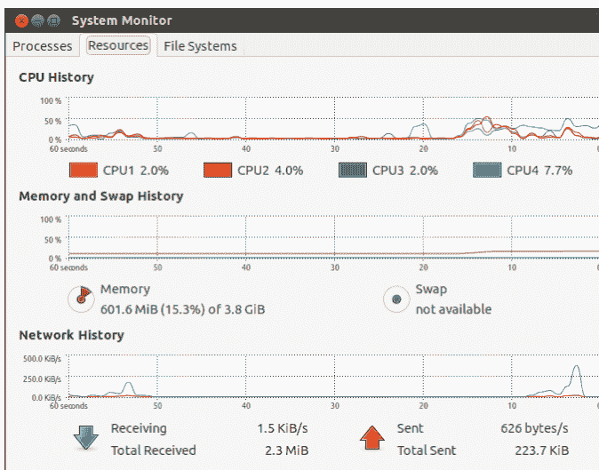

图 4-1：系统监控。

## 在启动时配置网络

在每次启动系统时自动启动网络是有意义的。为了实现这一点，各种启动脚本必须包含适当的命令。除了配置网络（在安装期间或稍后使用网络配置）之外，你不需要进行任何特殊操作。然而，如果网络在启动时报错，你可以通过检查我在此节中提到的文件来排查故障。

在 Debian、Ubuntu 和 Xandros 中，`/etc/network/interfaces` 描述了系统中可用的网络接口，而 `/sbin/ifup` 命令在系统启动时激活这些接口。以下是一个典型的 Debian 系统的 `/etc/network/interfaces` 文件内容：

```
# 此文件描述了系统上可用的网络接口
# 以及如何激活它们。更多信息，请参阅 interfaces(5)。
## 回环网络接口
auto lo
iface lo loopback
## 主网络接口
auto eth0
iface eth0 inet dhcp
```

`auto eth0` 行表示你可以通过由系统启动脚本调用的 `ifup -a` 命令初始化来启用以太网接口。`ifup eth0 inet dhcp` 行识别出以太网是一个通过动态主机配置协议（DHCP）配置的 TCP/IP 网络接口。

在 Debian 中，网络激活脚本使用 `/etc/sysconfig` 目录中的一组测试文件来激活 `/etc/sysconfig/network` 文件定义的变量。例如，脚本会检查是否激活网络。在 `/etc/sysconfig/network` 中，你会看到一行带有 `NETWORK` 变量：

```
NETWORK=yes
```

只有当 `NETWORK` 变量设置为 `yes` 时，网络才会激活。`/etc/sysconfig/network-scripts` 目录中的许多脚本激活特定的网络接口。例如，激活以太网接口的配置 `network-scripts/ifcfg-eth0`。以下是一个典型的 `/etc/sysconfig/network-scripts/ifcfg-eth0` 文件包含的内容：

```
DEVICE=eth0
BOOTPROTO=dhcp
HWADDR=00:08:74:E5:C1:06
ONBOOT=yes
TYPE=Ethernet
```


| 第三卷 第 4 章 | 管理网络 |

| :--- | :--- |

| www.it-ebooks.info |

## 200 在启动时配置网络

`DEVICE` 行提供了网络设备名称。`BOOTPROTO` 变量设置为 `dhcp`，表示使用 DHCP 动态获取 IP 地址。`ONBOOT` 变量说明此网络接口在 Linux 中是否激活。如果你的 PC 有一个以太网卡且你想在启动时激活 `eth0` 接口，则必须将 `ONBOOT` 设置为 `yes`。`/etc/sysconfig/network-scripts` 目录下的 `ifcfg-eth0` 配置文件只有在你的 PC 有以太网卡且内核已检测并加载了该卡的特定驱动程序时才有效。

在 Linux 中，网络信息保留在 `/etc/sysconfig/network` 目录中以 `ifcfg` 开头的文件。对于以太网接口，配置文件名以 `ifcfg-eth-id-` 开头，后跟以太网卡的唯一硬件地址。以下是典型配置文件中的关键行：


```
BOOTPROTO='dhcp'
STARTMODE='auto'
```

`BOOTPROTO='dhcp'` 行表示该接口使用 DHCP 设置，而 `STARTMODE='auto'` 意味着接口在系统启动时初始化。

在 KDE 中，你可以在搜索框中输入“Session Management”（会话管理）来启动控制中心并配置系统的默认选项，如图 4-2 所示。

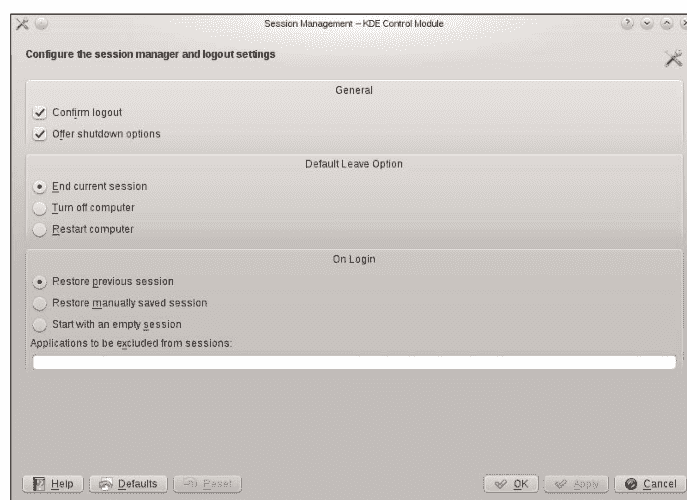

图 4-2：会话管理界面。


另一个可以让你快速查看网络的有用界面如图 4-3 所示。虽然此界面没有更改设置的方法，但能有一个可以显示状态的工具是很好的。

图 4-3：系统信息。

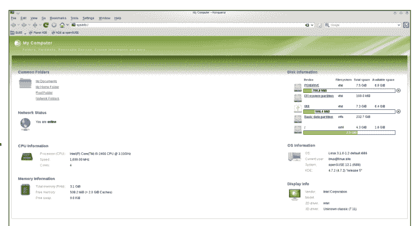

## 206 探索 Web

通过对另一个文档（可能位于另一台计算机上）的引用，你只需点击引用即可打开该链接的文档。这种对分布式文档的便捷访问本质上就是 Web 所提供的。

当然，文档必须采用标准格式，以便任何计算机（带有适当的浏览器软件）都能访问并解释该文档。将文档从一个系统传输到另一个系统，需要一种标准的协议。

标准的网页文档格式是超文本标记语言（HTML），交换网页文档的标准协议是超文本传输协议（HTTP）。HTML 文档是文本文件，不依赖于任何操作系统，它们可以在从 Windows 和 Mac 到任何类型的 Unix 和 Linux 的任何系统上运行。


Web 服务器向任何发出相应 HTTP 请求的客户端提供 HTML 文档。网页浏览器是客户端软件，负责从 Web 服务器下载 HTML 文档并以化形式显示内容。


## 像巨大的蜘蛛网

Web 是 Web 服务器和这些服务器提供的文档（HTML）的结合。当你从这个角度来看 Web，它就像一本巨大的书，页码散布在整个互联网中。你使用运行在自己计算机上的网页浏览器来查看这些页面——这些页面连接在一个巨大的蜘蛛网上，文档无处不在。

想象 Web —— 即 HTML 文档——是通过类似于蜘蛛网的网络连接连接在一起的，这样你就明白为什么它被称为 Web（网）了。“World Wide”（全球）这一部分是因为 Web 散布在世界各地。

## 链接与 URL

就像印刷书籍的页面一样，网页包含文本和图形。与印刷书籍不同，网页可以包含多媒体内容，如视频片段、声音以及指向其他网页的链接。

网页中的链接是对其他网页的引用，你可以通过它们从一个页面跳转到另一个。网页浏览器通常将这些显示为带下划线的文本（不同颜色）或图像。每个链接都像对你的一种指令——就像你在书中看到的“欲需更多信息，请参阅第 4 章”。在网页中，你只需要点击链接：网页浏览器就会带你进入引用的页面，即使该文档实际上可能位于互联网某处遥远的计算机上。

## 207 探索 Web

网页中的链接被称为超链接（hyperlinks），因为当你点击链接时，网页浏览器会跳转到该链接引用的网页。

这种安排引发了一个问题。在印刷书籍中，你可能会要求读者查看书中特定的章节或页码。超链接是如何指示被引用网页的位置的？在 Web 中，每个页面都有一个特殊的名称，称为统一资源定位符（URL）。URL 唯一指定了计算机上文件的位置。图 1-1 显示了 URL 的组成部分。


**图 1-1：统一资源定位符 (URL) 的组成。**

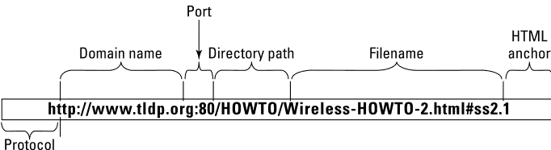

如图 1-1 所示，URL 包含以下部分：

- **协议 (Protocol)**：网页浏览器用于从 URL 访问数据的协议名称。在图 1-1 中，协议是 `http://`，这意味着该 URL 指定了网页的位置。以下是一些常见的协议类型及其含义：

- `file://` 意味着 URL 指向本地文件。你可以使用此 URL 在无需连接互联网的情况下查看 HTML 文件。例如，`file:///var/html/index.html` 打开了你 Linux 系统中的 `/var/www/html/index` 文件。

- `ftp://` 意味着你可以使用文件传输协议（FTP）下载文件。例如，`ftp://purdue.edu/pub/uns/NASA/nasa.jpg` 指向 FTP 服务器 purdue.edu 中 `uns/NASA` 目录下的 `nasa.jpg` 图像文件。如果你想通过 FTP 访问特定用户账户，请使用以下格式的 URL：

```
ftp:username@ftp.mysite.com/
```

将用户名和密码嵌入 URL 中。密码是明文的，不安全。

- `http://` 意味着你使用超文本传输协议（HTTP）下载文件。该协议是所有网站 URL 的通用格式，例如 `http://fedoraproject.org` 是 Fedora 项目的主页。如果 URL 中没有文件名，服务器将提供一个名为 `index.html` 的 HTML 文件。（这是流行的基于 Unix 的 Apache 服务器的默认设置；Microsoft Windows 服务器则使用不同的默认设置。）


第四章

浏览 Web

www.it-ebooks.info

## 208 探索 Web

`https://` 表示你通过安全套接层（SSL）连接访问文件——该协议由 Netscape Communications 设计，用于跨互联网的加密数据传输。通常情况下，通过它，网页浏览器会显示文件。

```
https://some.com/
```

- **域名 (Domain name)**：计算机的全限定名称。对于网页来说，这就是地址。

- **端口 (Port)**：服务器监听的端口号。例如，默认端口为 80。

- **目录路径 (Directory path)**：文件的路径。对于网页来说，这就是目录。

- **文件名 (Filename)**：文件的名称。对于网页来说，这通常以 .html 结尾。

- **锚点 (Anchor)**：URL 的可选部分，使浏览器跳转到特定位置。如果该部分以问号（?）而不是井号（#）开头，它就是一个查询。

## 210 Linux 中的网页浏览

除了这些专用的浏览器应用程序外，许多其他应用程序也能下载和显示网页。

如果你的发行版默认没有安装 Firefox，你可以通过输入 `su -` 变成 root，然后运行 `apt-get install mozilla-firefox` 来轻松安装它。

## 介绍 Firefox 用户界面

通常你可以通过点击面板上的图标或从 GUI 桌面菜单中选择 Firefox 来启动它。

当 Firefox 启动时，会显示一个带有默认主页的浏览器窗口。（Web 服务器上的主页为主页。）你可以配置 Firefox 使用不同的网页作为默认主页。

图 1-2 显示了美国政府网站（www.irs.gov）的网页以及 Firefox 浏览器窗口的所有主要元素。


图 1-2：

运行中的 Firefox 浏览器。

Firefox 支持标签页浏览，这意味着你可以开启新标签页（按下 `Ctrl+T` 或点击最后一个打开标签页右侧的加号）并在该标签页中查看网页。这样你就可以在一个窗口中查看多个网页。

Firefox 浏览器的用户界面中包含许多功能，你可以轻松地掌握它。你可以从基础操作开始使用 Firefox，然后逐渐扩展到你尚未探索过的领域。

## 211 Linux 中的网页浏览

### Firefox 工具栏

默认情况下，标准工具栏是隐藏的。当将光标移动到右上角时，工具栏以及与标准菜单（文件、编辑等）相关的选项就会出现。你可以配置此处显示的内容，但以下是标准配置。

首先，以下是你你可以对导航工具栏上的按钮和文本框执行的操作（从左到右）：

- **Back（后退）**：回到上一个网页。

- **Forward（前进）**：回到你之前后退的页面。

- **Pages（页面）**：打开最近访问的网页下拉列表。

- **Reload（刷新）**：重新加载当前网页。

- **Stop（停止）**：停止加载页面。

- **Home（首页）**：回到主页。

- **Location（位置）**：显示当前网页的 URL。（在此框中输入 URL 并按回车即可查看该网页。）

- **Bookmark（书签）**：收藏你当前访问的页面。（点击位置栏末尾的星形图标）

- **Search（搜索）**：搜索 Google、Yahoo!、Amazon.com、Dictionary.com 和 eBay 等各种网站。（输入文本并按回车搜索当前选网站；默认为 Google。）

### 状态栏

你可以将 Firefox 窗口底边缘的条看作状态栏，因为它的中间部分在 Firefox 加载网页时会显示状态信息。


进入`/path/to/xxx`目录，找到`xxx.json`。

在表达式`cvar = avar + bvar`中，加法运算符（`+`）将`avar`与`bvar`相加，得到它们的和`cvar`

在`List.of(arg0, arg1, arg2)`中，`List`接口的工厂方法`of()`接受一系列的元素，返回包含它们的只读列表。

之后我们这样调用`cmd`命令：`cmd arg0 arg1 arg2`。

```
if (condVar > someVal) {console.log("xxx")}
```
[/content]

Wait that's example. Need actual text.

Let's output proper.

[content]
在 Firefox 状态栏的右角，当你访问安全网站时，会出现一个安全锁图标。Firefox 支持安全版本的 HTTP，该版本使用 SSL 在浏览器和服务器之间传输加密数据。当 Firefox 连接到支持安全 HTTP 的 Web 服务器时：状态栏右边缘会出现一个锁定的安全锁图标。否则，将没有安全锁图标，这种缺失表示连接是不安全的。安全 HTTP 传输的 URL 以 `https://` 开头，而不是 `http://`（注意 `https` 中多了一个 `s`）。你可以点击锁图标以获取有关该页面的更多安全信息。

Firefox 在状态栏的左侧显示状态消息。你可以观察此区域的消息来了解发生的情况。如果你将鼠标悬停在网页上的链接上，状态栏会显示该链接的 URL。


## 212 Linux 中的网页浏览

### Firefox 菜单

我没有怎么提到 Firefox 菜单，是因为你通常不需要进入它们就能完成。尽管如此，快速浏览一下 Firefox 菜单是值得的，这样你知道每个菜单提供什么。表 1-1 提供了 Firefox 菜单的概述。

| 表 1-1 | Firefox 菜单 |
| --- | --- |
| File（文件） | 打开文件或网络位置，打开或关闭标签页、网页或链接 |
| Edit（编辑） | 复制粘贴，查找 |
| View（视图） | 显示或隐藏工具栏，增大或减小字体 |
| History（历史） | 后退和前进 |
| Bookmarks（书签） | 收藏页面，组织书签 |
| Tools（工具） | 搜索网络，管理设置 |
| Help（帮助） | 获取帮助 |

### 更改主页

主页是你启动 Firefox 时加载的页面。这取决于发行版。要更改它，进入 Firefox 选项并选择 General（常规）选项卡。在这里，你可以选择使用上次打开的页面，或设置特定的 URL。

### 213 Linux 中的网页浏览

从主页去向哪里取决于你。你只需要点击并看你会到达哪里。移动你的鼠标。当你知道那里有一个链接时，鼠标指针会变成一只伸出食指的手形。点击链接，Firefox 就会下载该链接引用的网页。

你如何使用网络取决于你想做什么。当你刚开始使用时，你可能会探索很多——在没有特定目标的情况下浏览网站并点击链接（你可能称之为“网购”）。

另一种更具目的性的网络用法是从网上查找特定的信息。例如，你可能想找到所有包含指定关键词文档的网站。对于搜索，你可以使用网上提供的许多网络搜索工具之一。Firefox 的搜索框将带你进入 Google 搜索页面（`www.google.com`）。

第三种用法是访问具有已知 URL 的特定站点。例如，在阅读本书中的某个特定主题时，可能会遇到一个特定的 URL。在这种情况下，你想直接跳转到该网页。

如果你想用 Firefox 浏览互联网，你只需要一个起始网页——然后你就可以点击任何你感兴趣的内容。例如，在 Firefox 导航栏的“位置”框中选择文本，输入 `www.wiley.com`，然后按回车。你将到达 Wiley 主页，那里显示了 Wiley 出版的各种品牌（包括“Dummies”系列）。这就是你的起点。你只需要点击就可以上路了。


# 第 2 章：阅读新闻组和 RSS 馈

## 本章内容介绍

- 了解新闻组
- 阅读新闻组
- 搜索新闻组
- 阅读 RSS 馈

新闻组的创建是为了提供一个跨全球的分布式会议系统。其背后的理念是你可以（现在仍然可以）发布文章——本质上是发送给整组人的电子消息——并回复其他发布内容的人。

将互联网新闻组想象成一个聚集场所——一个虚拟的会议场所，你可以在那里提问并讨论各种问题。（而且最好的是，你讨论的所有内容都会被存档以备后。）互联网新闻组类似于 Web 时代的公告板系统（BBS），或者你可能记得在 AOL 和 MSN 等在线系统上提供的论坛。

参与新闻组需要访问新闻服务器和阅读器（Linux 几乎都带了你可以用于阅读新闻组的软件）。虽然概念保持不变，但近年来一个很大的变化是博客和微型博客趋于兴起，这损害了新闻组的流行。Google 通过 Google Groups 在保持新闻组热度方面做得非常出色。

在本章中，我将向你介绍新闻组，以及如何使用几种新闻阅读器阅读新闻组。我将简要解释你如何从几个网站免费地阅读和搜索新闻组。

如今，另一种阅读网站和博客摘要的流行方法是使用可以接受 RSS 馈的程序。在本章结束处，我将要描述什么是 RSS 馈，以及你如何使用像 KDE Akregator 这样的程序在你的 Linux 系统上订阅 RSS 馈并阅读它们。

## 218 理解新闻组

### 理解新闻组

新闻组起源于 `Usenet`——这是一种存储并转发的消息网络，广泛用于交换电子邮件和新闻项目。`Usenet` 的工作方式像电报，将新闻和邮件从一个系统转发到另一个系统。在 `Usenet` 中，系统并不在任何网络上；系统简单地相互拨号并使用 Unix 到 Unix 复制协议 (`UUCP`) 传输文本消息。

尽管它是松散连接的计算机集合，但 `Usenet` 运行良好并继续被使用，因为连接它的成本很低。你只需要一个调制解调器和一个存储和转发你的邮件和新闻的人。你需要在你的系统中设置 `UUCP`，但你不需要持续的网络连接；只需几次通话即可保持电子邮件和新闻的流动。`Usenet` 的缺点是你无法通过 `UUCP` 使用 TCP/IP 服务，如 Web、TELNET 或 FTP。

从从起源开始，新闻组现在已经迁移到了互联网（尽管新闻组仍被称为 Usenet 组）。现在由网络新闻传输协议 (`NNTP`) 传输新闻。

尽管（对于大多数在线世界来说）新闻传输协议已从 `UUCP` 变为 `NNTP`，但新闻传输的存储并转发概念仍然存在。因此，如果你想在你的 Linux 系统上获取新闻，你必须找到一个你的系统可以下载新闻的服务器。通常，你可以使用你 ISP 的新闻服务器。

### 新闻组层级

为了便于维护和使用，互联网新闻组按层级组织。新闻组名称通过显示这种层级有助于保持条理清晰。

诚然，这些新闻组名称使用的是互联网术语，初看起来可能很晦涩。经过一点解释，这种语言很容易学会。一个典型的新闻组名称如下：

```
comp.os.linux.announce
```

这是一个关于 Linux 操作系统 (`os.linux`) 的公告 (`announce`) 新闻，这些主题属于计算机 (`comp`) 这一大类。正如你所看到的，新闻组名称的格式是由点分隔的单词序列。图 2-1 阐释了新闻组层级组织的概念。

## 219

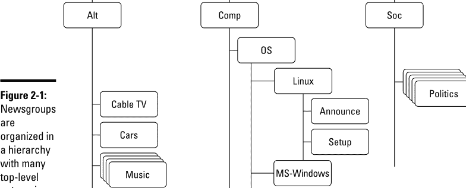

**图 2-1：** 新闻组按许多顶级类别的层级结构组织。

要理解新闻组层级结构，请将新闻组名称与 Linux 中的文件路径（例如 `/usr/lib/X11/xinit/Clients`）进行比较。就像文件的路径显示文件的目录层级一样，新闻组名称显示了新闻组层级。在文件名中，斜杠 (`/`) 分隔目录名称；在新闻组名称中，点 (`.`) 分隔新闻组层级中的不同级别。

在新闻组中，第一个单词代表新闻组类别。如前提到的，`comp.os.linux.announce` 新闻组属于 `comp` 类，而 `alt.books.technical` 属于 `alt` 类。

### 顶级新闻组类别

表 2-1 列出了一些新闻组类别。

| 类别 | 主题 |
| :--- | :--- |
| alt | 备用新闻组（不受任何规则限制），内容范围从平凡到奇特不等 |
| bionet | 生物学新闻组 |
| bit | Bitnet 新闻组 |
| biz | 商业新闻组 |
| clari | 肖簧管新闻服务（每日新闻） |
| comp | 计算机硬件和软件新闻组（包括 Microsoft Windows 在内的操作系统） |
| ieee | 电气电子工程师学会 (IEEE) 的新闻组 |
| k12 | 致力于基础和中学教育的新闻组 |
| linux | 致力于 Linux 的新闻组（包括 `linux.redhat` 层级） |
| misc | 杂项新闻组 |
| news | 关于互联网管理的新闻组 |
| rec | 娱乐和艺术新闻组 |
| sci | 科学和工程新闻组 |
| soc | 讨论社会问题和各种类别的新闻组 |
| talk | 当前问题的讨论（类似于谈话广播） |

（续）

`www.it-ebooks.info`

## 220 理解新闻组

这个简短的类别列表具有误导性，因为它没有告诉你每个类别中可用的广泛的新闻组种类。仅顶级类别就有上千个，但许多顶级类别仅分布在世界的特定地区。由于新闻组类别包含多个层级的子类别，新闻组的总数接近 10 万！`comp` 类别也有接近 1,200 个新闻组。


不幸的是，许多新闻组充满了垃圾邮件——就像你的收件箱一样，只不过任何人可以在新闻组上发布任何内容。受审核的新闻组提供了一些缓解。任何想在受审核的新闻组中发布内容的人必须先将文章提交给审核员——人类——由审核员决定拒绝还是发布文章。在可能的情况下通过审核新闻组可以帮助减少垃圾邮件过载。

要浏览新闻组类别并感受新闻组涵盖的主题广度，请访问 Google Groups 网站 `http://groups.google.com` 并点击“浏览所有 Usenet 列表”`你需要点击第一页上的“浏览组类别”链接`。

## 理解新闻组 221

## 与 Linux 相关的新闻组

通常，你必须根据自己的兴趣来缩小新闻组的选择范围。你必须了解更多关于 Linux 的知识，例如，你可以选择以下一个或多个新闻组：

- `comp.os.linux.admin`: Linux 系统管理（非活跃）。
- `comp.os.linux.advocacy`: Linux 推广。
- `comp.os.linux.announce`: 关于 Linux 的重要公告。此新闻组经过审核，这意味着你必须将文章邮寄给版员，如果文章适合该新闻组，他就会将其发布到新闻组中。
- `comp.os.linux.answers`: 关于 Linux 的问答。所有的 Linux HOWTO 都发布在这个经过审核的新闻组中。
- `comp.os.linux.development`: 当前 Linux 开发工作。
- `comp.os.linux.development.apps`: Linux 应用开发。
- `comp.os.linux.development.system`: Linux 操作系统
- `comp.os.linux.embedded`: 在嵌入式硬件上运行操作系统。
- `comp.os.linux.hardware`: Linux 和各种类型的硬件。
- `comp.os.linux.help`: 关于 Linux 各方面的帮助（非活跃）。
- `comp.os.linux.misc`: 杂杂的 Linux 相关主题。
- `comp.os.linux.networking`: Linux 下的网络连接。
- `comp.os.linux.portable`: 在笔记本电脑和便携式 上运行操作系统。
- `comp.os.linux.powerpc`: 在 PowerPC 微处理器上运行操作系统。
- `comp.os.linux.redhat`: 与 Red Hat Linux 相关的主题（非活跃）。
- `comp.os.linux.setup`: Linux 设置与安装。
- `comp.os.linux.x`: 在 Linux 上设置和运行 X Window 系统。
- `comp.os.linux.xbox`: 在 Xbox 视频游戏机上运行 Linux。
- `linux.debian`: 关于 Debian GNU/Linux 的审核新闻组（非活跃）。
- `linux.debian.news`: 关于 Debian GNU/Linux 新闻条目的审核新闻组。
- `linux.redhat`: Red Hat Linux 讨论。

第四卷 第 2 章

RSS 馈送新闻组阅读

## 222 从你的 ISP 阅读新闻组

你必须对阅读的新闻组进行选择；跟上所有新闻是不可能的，即使在 Linux 这样一个特定领域也是如此。当你首次安装并设置 Linux 时，你可能会阅读新闻组，如 `comp.os.linux.answers`、`comp.os.linux.setup`、`comp.os.linux.hardware` 和 `comp.os.linux`（尤其是当你遇到 X 相关问题时）。在你让 Linux 运行起来后，你可能想了解 Linux 中发生的任何新事宜。对于这类信息，你可以阅读 `os.linux.announce` 新闻组。


尽管许多新闻组目前处于非活跃状态且不再更新，但这些组仍然可以被引用和搜索以寻求特定问题的帮助。

## 从你的 ISP 阅读新闻组

如果你向 ISP 办理了互联网接入，它可以为你提供访问新闻服务器的权限。互联网新闻服务器使用网络传输协议 `NNTP` 进行通信。你可以使用支持 `NNTP` 的新闻阅读器（如 `KNode`）来访问新闻服务器并选择新闻组。你也可以通过 `Thunderbird` 阅读新闻。使用新闻阅读器是从你 ISP 服务器访问新闻最简单的方法。

讨论阅读新闻组的前提是你已经从你的 ISP 获取了新闻服务器。ISP 会为你提供服务器名称，以及在所用的新闻阅读器上设置新闻账户所需的用户名和密码。


要阅读新闻，你需要一个新闻阅读器——一个允许你选择新闻组并查看该组内条目的程序。你还需要理解新闻组的层级结构和命名规范（我在“新闻组层级结构”部分进行了描述）。在本节中，我将向你展示如何从新闻服务器阅读新闻。

无法通过 ISP 访问新闻组，可以尝试使用现有的许多公共新闻服务器之一。公共新闻服务器的列表请访问 `www.newsbot.com` 上的 Newsbot。在该网站上，你可以搜索载有特定新闻组的新闻服务器。


### 新闻阅读器概

你可以使用多个软件包中的某一个在 Linux 中下载和阅读新闻组。以下是几个新闻阅读器：

- `Thunderbird`: 包含从 `NNTP` 服务器下载新闻的功能。你可以阅读新闻组并向新闻组发布条目。Xandros 使用 `Thunderbird` 处理邮件和新闻。

### 223 从你的 ISP 阅读新闻组

- `KNode`: 这是一个用于 KDE 的新闻阅读器，你可以从 `knode.sourceforge.net` 下载。Debian 和 SUSE 提供 `KNode` 作为新闻阅读器。
- `Pan`: 根据开发者网站 `http://pan.rebase.com`，`Pan` 是一个 GUI 新闻阅读器，“试图满足新用户和资深用户的需求”。你可以从 `http://pan.rebase.com/download` 下载适用于各种 Linux 发行版的 `Pan`。

如果你在 Linux 系统中不需要新闻阅读器，你可以下载并……等等，让我们重新读一遍：“如果你在 Linux 系统中不需要新闻阅读器，你可以下载并……”

## 226 从您的 ISP 阅读新闻组

- 2. 输入新闻组的名称，就像在发送电子邮件时输入收件人地址一样。输入主题和您的消息。

对于这篇测试帖子，请在主题行和新闻组名称处输入 `ignore`。否则，任何接收你文章的站点都会通过回复告知文章已到达该站点；这符合 `misc.test` 新闻组的目的。

- 3. 完成消息编写后，点击工具栏上的“发送”`Send`。

`Thunderbird` 将消息发送到新闻服务器，服务器随后将其发送给其他新闻服务器，很快它就会传遍全球！

- 4. 要验证消息是否已到达新闻组，选择“文件：订阅”`File:Subscribe`。然后订阅 `misc.test` 新闻组（就是你最近发布新文章的地方）。

要进行订阅，点击组名称右侧的复选框，然后点击“订阅”`Subscribe`按钮。

- 5. 在 `misc.test` 中查找最新文章或最近的文章之一，找到你最近发布的文章。

如果你发布了文章并立即阅读新闻组，你会看到该文章，但这并不意味着文章已经到达互联网上的其他站点。毕竟，你的帖子会立即显示在你的新闻服务器上，因为那是你发布文章的地方。由于新闻分发采用存储和转发模型，文章会逐渐从你的新闻服务器传播到全世界。


`misc.test` 新闻组提供了一种查看你的新闻是否正在传播的方法。如果你向该新闻组发布且没有在主题中包含 `ignore`，新闻服务器将向文章标头中“回复”`Reply To`字段列出的地址发送电子邮件以确认接收文章。

## 使用 KNode

Debian us 提供 `KNode` 作为默认的新闻阅读器。通常情况下，你可以通过从菜单中选择“新闻阅读器”`Newsreader`来启动 `KNode`（在“互联网”应用程序分类中查找）；或者选择“应用程序：互联网：KNode”。如果你在菜单中没有新闻阅读器或 `KNode` 选项，可以在终端中输入 `knode` 来启动 `KNode`。

当 `KNode` 首次运行时，它会显示“配置 KNode”`Configuration KNode`对话框，通过该对话框你可以配置阅读新闻组和向新闻组发布项目所需的一切。

显示框的左侧显示所有你可以配置的项目，右侧是你输入在左侧所选项目信息的地方。

## 在网站上阅读和搜索新闻组

当配置 `KNode` 对话框首次打开时，它会提示你输入个人信息。输入你的身份信息，如姓名、电子邮件地址和组织——这些信息将在向新闻组发布新项目未使用。


接下来，点击左侧的“账户”（Accounts），然后点击右侧的“新闻组服务器”（Newsgroup Servers）选项卡，查看你将从中阅读新闻的新服务器信息。点击“新闻组服务器”选项卡中的“添加”（Add），显示一个可以在其中输入新闻服务器信息的对话框。你的 ISP 应该已经为你提供了访问新闻服务器的信息。如果新闻服务器需要登录名和密码，你也必须输入这些信息。

设置账户后，KNode 窗口左侧会显示新闻服务器名称。右键点击服务器名称，从弹出菜单中选择“订阅新闻组”（Subscribe to Newsgroups）。将弹出一个对话框，你可以在其中订阅选定的新闻组（例如 `comp.linux.announce`）。

第一次访问此菜单时，必须获取新闻组列表。

KNode 的用户界面与许多其他邮件和新闻阅读器类似，包括 Thunderbird。

如果你无法通过 ISP 访问新闻组，你仍然可以在许多网站上阅读新闻组并发布文章。其中一些存档了旧新闻文章并提供了良好的搜索功能，因此你可以在这些网站上搜索与你可能的问题相关的文章。

通过网站阅读新闻组最好的处是，你甚至不需要访问新闻服务器，就可以从网络浏览器阅读新闻。

表 2-2 列出了提供免费访问 Usenet 新闻组的网站。要获取所有提供新闻组访问的网站列表（包括收费的），请使用 Google (`www.google.com`) 并输入搜索词 `usenet groups access`。

| 表 2-2 免费访问 Usenet 新闻组的网站 |
| :--- | :--- |
| 网站 | URL |
| Google Groups | http://groups.google.com |
| InterBulletin | http://news.interbullet.com |
| Usenet Replayer | www.usenet-replayer.com |

* www.it-ebooks.info

## 228 阅读 RSS 馈

阅读新闻组、发布文章和搜索旧新闻组存档的最佳地点之一是位于 `http://groups.google.com` 的网页 Google Groups（Google 的 Usenet 讨论论坛）。在该网站上，你可以选择一个新闻组进行浏览，并对在各种新闻组上发布的文章发表回复。

Google Groups 最棒的部分是它的搜索功能。目前，你已经知道 Google 的网页搜索有多强大了；你拥有同样全面的搜索能力来定位与你的搜索词相关的新闻组帖子。要搜索新闻组，请填写 `http://groups.google.com` 上的搜索表单并按回车。

要在 Google Groups 中浏览新闻组，请忽略搜索框并寻找高级列表...

## RSS 馈

### 检查 RSS 馈

RSS 馈是一个带有标签的文件，这些标签了网站的内容。你通常使用自动化程序生成 RSS 馈，但也可以使用文本编辑器准备 RSS 馈。了解 RSS 馈的外观很有帮助，这样可以调试馈的问题。

最简单的格式是 RSS 0.91，这里是典型的 RSS 0.91：

```xml
<?xml version="1.0" ?>
<!-- 注释行 -->
<rss version="0.91">
<channel><!-- 此标签指定有关馈的常规信息 -->
<title>此馈的标题</title>
<link>此馈的 URL，例如 http://edulaney.typeepad.com/</link>
<description>馈的摘要描述</description>
<language>en-us</language>
<item>
<title>此项目的标题</title>
<link>此项目的 URL</link>
<description>此项目的描述</description>
</item>
 <!-- 更多项目 ..
</channel>
</rss>
```

如列表所示，RSS 馈包含一个带有标题、链接和语言的通道，随后是一系列项目，每个项目都有标题、链接和描述。

RSS 1.0 格式更加冗长，它使用了 RDF 格式。RSS 1.0 基本上提供了 RSS 0.91 中的基本信息，并增加了项目级别的详细信息，如作者、主题和发布日期，这些是 RSS 0.91 不支持。

有很多 GUI 程序可以订阅 RSS 馈并读取馈中的项目。这些程序被称为 RSS 聚合器，因为它们可以从多个 RSS 馈收集信息并将所有内容集中在一个处。

两种类型的 RSS 聚合器是浏览器插件或独立程序。浏览器插件（如 NewsMonster (`www.newsmonster.org`)）运行在浏览器中，因此馈显示在网络浏览器中。独立程序如 GNOME Straw (`http://projects.gnome.org/straw`) 和 KDE Akregator (`http://aggregator.kde.org`) 是完整的 GUI 应用程序，通常外观彼此相似。

## 230 阅读 RSS 订阅


Fedora 和 SUSE 都配备了 Akregator 程序，这是一个独立的 RSS 订阅聚合器。要运行它，请在 GUI 桌面面的应用程序菜单中查找链接（选择 应用程序；Internet；Akregator）。如果你没有看到 Akregator 列表，请在终端窗口中输入 `akregator`。在 Debian 中，你可以通过输入 `apt-get install akregator`（在输入 `su -` 成为 root 用户后）来安装 Akregator。

当 Akregator 首次运行时，它会显示一个没有任何 RSS 馈源的主窗口。要订阅一个源，请从菜单中选择“订阅：添加源”（Feed:Add Feed），或者在窗口左侧面板中右键点击“所有源”（All Feeds）并在弹出菜单中选择“添加源”（Add Feed）。然后在“添加源”对话框中使用该源的 URL 并点击确定（OK）。例如，要读取 Slashdot 的 RSS 订阅，请输入 `http://slashdot.org/index.rss`。源的标题出现在窗口的左侧面板中。点击源标题查看此源中的项目。然后你可以点击上方面板中的某个项目，该项目将出现在右下面板。你可以添加许多不同的 RSS 订阅，将它们组织到文件夹中并在 Akregator 中浏览它们。

# 第 3 章：使用 FTP

本章内容

- 使用 FTP 客户端
- 使用任何网络浏览器作为 FTP 客户端
- 了解 FTP 命令

顾如其名，*文件传输协议（FTP）* 用于在计算机之间传输文件。例如，如果你的互联网服务提供商（ISP）为你提供了个人网站空间，你可能已经使用过 FTP 上传了构成网站的文件。在你的计算机上使用 FTP 客户端，登录你的 ISP 账户，提供密码密码（password），并将文件从你的系统复制到 ISP 服务器。

你也可以使用 FTP 下载其他文件，例如从互联网上的其他计算机下载开源软件——在这种情况下，你不需要在远程系统上有账户即可下载文件。你只需要使用 *anonymous*（匿名）作为用户名登录，并提供你的电子邮件地址作为密码（事实上，你的浏览器可以代为此操作，你可能甚至不知道正在发生这种情况）。这种*匿名 FTP* 非常适合向任何想要文件的人分发文件。例如，硬件供应商可能会使用匿名 FTP 为任何需要的人提供更新的设备。

Linux 带有几个 FTP 客户端，包括命令行和 GUI（图形用户界面）客户端。本节将向你介绍几个 GUI 客户端和一个命令行客户端。它还描述了用于处理远程目录的命令。


根据你使用的 Linux 发行版和版本，你可能需要安装本章讨论的 FTP 客户端。你可以在 Linux 中使用以下 GUI 客户端之一：

- `gFTP`: 适用于 GNOME 的图形客户端，地址为 `http://gftp.org`。
- `FileZilla`: 适用于 Linux 和 Windows 平台的图形客户端，地址为 `https://filezilla-project.org`。
- 网络浏览器: 如 Firefox 等浏览器，用于匿名下载。


对于上传文件，你可能想使用 `gFTP` 或 `FileZilla`，因为你通常需要为此类传输提供用户名和密码。网络浏览器对于匿名下载运行良好，这通常是你从互联网上下载软件的方式。接下来的几节将讨论所有三个 GUI 客户端。

## 使用 gFTP

某些版本的 Ubuntu 自带了 `gFTP`，这是一个图形客户端。它不是默认安装的，但你可以从 `http://gftp.org` 下载并安装它。在某些发行版中，`gFTP` 可能包含在软件包中，你只需要安装它。`gFTP` 已经多年没有更新了，但仍被广泛使用，这证明了它的健壮性和工作的适用性。

安装好后，在主菜单中启动 `gFTP`，就会出现 `gFTP` 窗口，如图 3-1 所示。


图 3-1：刚建立与 FTP 服务器连接的 `gFTP` 窗口。

```
PWO 257 / is current directory.
listing from server (LC_TIME=en_UTF-8)
PASV 222 Entering Passive Mode.
220 Opening ASCII connection for -
226 Transfer complete
```

### 使用图形化 FTP 客户端

`gFTP` 窗口有一个菜单栏，其中有执行各种任务的菜单。菜单栏下方是一个带有许多按钮和文本字段的工具栏。在这里你可以输入远程主机的名称或 IP 地址，以及登录远程主机所需的用户名和密码。图 3-1 显示了在你填写这些信息并点击显示有两台电脑图标的按钮（工具栏最左侧的一个）与远程主机建立连接后的 `gFTP` 窗口。

使用 `gFTP` 上传文件，请遵循以下步骤：

1. 在 `Host`（主机）字段中填写远程系统的主机名或 IP 地址。如果你以前用过，可以在点击 `Host` 字段旁边的向下箭头时从下拉列表中选择它。
2. 在 `User`（用户）字段中提供用户名，在 `Pass`（密码）字段中提供密码，然后点击显示两台电脑图标的按钮（工具栏最左侧的）与远程主机建立连接。
3. `gFTP` 窗口显示远程源的目录。你可以通过拖拽文件到远程目录来上传文件。
4. `gFTP` 窗口显示本地目录。你可以通过将文件从远程目录拖到本地目录来下载文件。
5. 点击右侧的向下箭头。
6. 完成传输后，从 `gFTP` 退出。

这种类型的*匿名 FTP* 非常适合向任何想要文件的人分发文件。例如，硬件供应商可能会使用匿名 FTP 为任何需要的人提供更新的设备。这种 FTP 客户端不仅如此，还可以使用 SSH（安全 Shell）协议传输文件。

img/71f80d7808bf5b5ad1239cc29be7bab_252_0.png)

## 234 使用图形化 FTP 客户端

### 介绍 FileZilla

`FileZilla` 是另一个适用于 Windows 和 Linux 的图形客户端。它看起来与 `gFTP` 非常相似（如图 3-2 所示）。img/71f80d7808bf5b5ad1239cc29be7bab_253_0.png)

图 3-2：`FileZilla` 显示本地目录。

你可以在 `https://filezilla-project.org` 找到 `FileZilla`。

img/71f80d7808bf5b5ad1239cc29be7bab_254_0.png)

图 3-3：`FileZilla` 显示远程 FTP 服务器的目录。

当 `FileZilla` 窗口出现时，它显示你的主目录，就像 Windows 资源管理器一样。要连接到远程主机，在 `Host` 字段中输入主机名或 IP 地址，以及登录远程主机所需的用户名和密码。图 3-3 显示了在你填写这些信息并与远程主机建立连接后的 `FileZilla` 窗口。你现在可以使用 `FileZilla` 上传文件，只需将文件从一个系统拖到另一个系统。你也可以通过将文件从远程目录拖到本地目录来下载文件。

完成后，选择 `FileZilla` 退出。

### 使用网络浏览器作为 FTP 客户端

任何网络浏览器都可以作为 FTP 客户端，但此类程序最适用于匿名下载，此时网络浏览器可以使用匿名用户名和任何密码登录。img/71f80d7808bf5b5ad1239cc29be7bab_255_0.png)

图 3-4：Firefox 中 FTP 目录的典型外观。

例如，你可以使用 Firefox 浏览器作为 FTP 客户端。你还需要知道如何编写 URL，以便网络浏览器知道你想使用 FTP 下载文件。FTP URL 的语法为：

```
ftp://hostname/pathname
```

第一部分 (`ftp/`) 表示你想进行 FTP 传输。主机名是 FTP 服务器的一部分（`ftp` 之后的名称），例如 `ftp.wiley.com`。路径是你想要下载的文件完整路径和文件名。

如果你只提供 FTP 服务器的主机名，网络浏览器将显示匿名 FTP 目录的内容。如果你想在 Linux 系统上访问匿名 FTP，启动 Firefox（点击 GNOME 面板上的网络图标），在位置（Location）文本框中输入 FTP URL 并按回车。

## 236 使用命令行 FTP 客户端

访问 `ftp://localhost/pub/` 以进入 `pub` 目录。（如果你没有运行 FTP 服务器，或者设置了防火墙以允许 FTP 连接，你的系统将不会给你任何响应。）

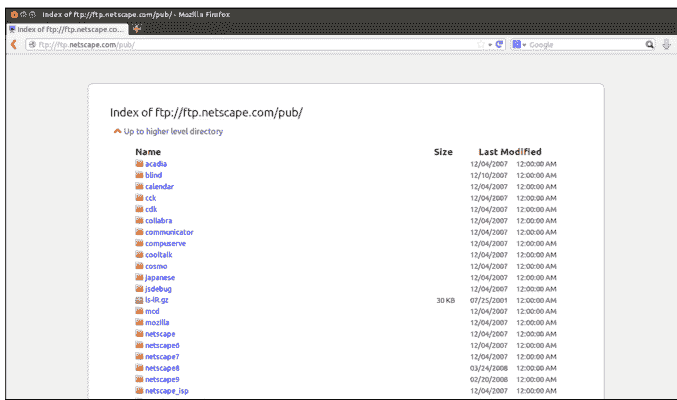

图 3-4：你可以使用网络浏览器从服务器下载文件。

在 Debian 和 Fedora 中，以 root 身份登录并在终端窗口中输入 `/etc/init/vsftpd start` 来启动 FTP 服务器。在 SUSE 中，由 `xinetd` 服务器控制 FTP 服务器 `vsftpd`。`/etc/xinetd.d/vsftpd` 配置文件指定了 `vsftpd` 如何启动。（有关 `xinetd` 配置文件的更多信息，请参阅第七卷第 1 章）。


如果你输入其他匿名 FTP 服务器的主机名，同样可以使用访问匿名 FTP站点的方法。例如，尝试以下 URL：

`ftp://ftp.netscape.com/`

你将获得 `ftp.netscape.com` 服务器的目录。

## 使用命令行 FTP 客户端

从命令行使用 FTP 是一个很好的主意。例如，如果你的 GUI 桌面没有运行，你可能需要下载一些文件来解决问题；如果你知道如何使用命令行 FTP 客户端，就可以做到。命令行 FTP 客户端在所有 Linux 发行版中均可用，使用它并不困难。


www.it-ebooks.info

## 237 使用命令行 FTP 客户端

了解命令行 FTP 客户端最好的方法就是尝试使用它。命令是 `ftp`，你可以从你的 Linux 系统尝试 `ftp` 命令。你甚至不需要连接互联网，因为你可以使用 `ftp` 命令连接到自己的系统。

请注意，`ftp` 命令的输出可能不同，因为某些发行版（如 Debian）使用 `gFTP` 的文本模式作为命令行客户端。

在下面的示例 FTP 会话中，使用了命令行 FTP 客户端登录并浏览 Linux 系统上的目录。这里是使用典型命令行 FTP 客户端的的列表：


```
ftp localhost
Connected to localhost.localdomain.
220 (vsFTPD 2.0.3)
Name (localhost:joe): (press Enter.)
331 Please specify the password.
Password: (enter the password for the user.)
230 Login successful.
Remote system type is Unix.
Using binary mode to transfer files.
ft> Commands may be abbreviated. Commands are:
$ dir mget siteport
  account disconnect mkdir put size
  append exit mpls pwd status
  ascii mode quote system
  binary glob mget recv unique
  bye hash newer reget index
  case help helpaps status tick
  cd idle nllist rhelp trace
  dup image nrans rename type
  chmod lcd open reset user
  close ls prompt restart umask
  cr mdcface passive rnd verbase
  delete deode proxy remove ?
ft> help (to get on a specific command.)
mget get multiple files
$ cd /var (This changes directory to /var.)
250 Directory successfully changed.
ft ls (This command lists the contents of the directory.)
227 Entering Passive Mode (127,0,0,1,38,142)
150 Here comes the directory listing.
.. lines deleted
226 Directory send OK.
ft> bye (this command ends the session.)
```


# 第四卷第 3 章

## 使用 FTP

www.it-ebooks.info

### 238 使用命令行 FTP 客户端

如列表所示，你可以通过输入命令 `ftp hostname` 来启动命令行 FTP 客户端，其中 `hostname` 是你想访问的系统名称。当 FTP 客户端与 FTP 远程服务器建立连接时，FTP 服务器会提示你输入用户名和密码。在你提供信息后，FTP 客户端将显示 `ftp` 提示符，你就可以开始输入命令来执行特定任务。如果你忘记某个特定的 FTP 命令，可以输入 `help` 查看命令列表。你可以为特定命令获取额外帮助，其中 `command` 是你想要的命令。

许多 FTP 命令与用于导航文件系统的 Linux 命令相似。例如，`cd` 更改目录，`pwd` 打印当前工作目录名称，`ls` 列出当前目录的内容。另外两个常用命令是 `get` 和 `put`：`get` 从远程系统下载文件到你的系统，而 `put` 将文件从你的系统上传（发送）到远程系统。

表 3-1 描述了一些常用的 FTP 命令。你不需要输入整个 FTP 命令。对于较长的命令，你只需要输入前几个字符——足以唯一标识该命令即可。例如，要删除文件，你可以输入 `delete`；要将文件传输模式更改为二进制，你可以输入 `bin`。


| Command | Description |
| --- | --- |
| ! | 执行 shell 命令。 |
| ? | 显示命令列表。 |
| append | 将文件追加到远程系统。 |
| ascii | 将类型设置为 ASCII（或纯文本）。 |
| binary | 将类型设置为二进制。 |
| bye | 退出会话并返回 FTP 客户端。 |
| cd | 切换目录。例如，`cd /pub/Linux` 切换到 `/pub/Linux`。 |
| chmod | 更改权限设置。例如，`chmod 644 index.html` 更改 `index.html` 的权限。 |
| close | 关闭会话。 |

www.it-ebooks.info

### 239 使用命令行 FTP 客户端

| Command | Description |
| --- | --- |
| delete | 删除远程文件。 |
| dir | 列出当前目录的内容。 |
| disconnect | 断开连接并返回 FTP 客户端。 |
| get | 从远程系统下载文件到你的系统。 |
| hash | 显示文件传输的进度。 |
| help | 显示命令列表（同 help）。 |
| image | 同于 binary。 |
| lcd | 更改本地目录。 |
| ls | 列出当前目录的内容。 |
| mdelete | 删除远程系统上的多个文件。 |
| mkdir | 在远程系统上创建目录。 |
| mls | 同于 dir。 |
| mput | 将多个文件上传到远程系统。 |
| pwd | 显示当前目录的完整路径。 |
| quit | 同于 bye。 |
| recv | 同于 get。 |
| rename | 重命名远程系统文件。 |
| rmdir | 删除远程系统上的目录。 |
| send | 同于 put。 |
| size | 显示远程文件的大小。 |
| status | 显示 FTP 客户端当前状态。 |
| user | 向 FTP 服务器发送新用户信息。 |
| Table 3-1 (续) | Description |
| --- | --- |
| open | 打开 FTP 服务器的连接。 |
| prompt | 开启或关闭提示。 |
| put | 将文件发送到远程系统。 |

### 240 使用命令行 FTP 客户端

提示：从互联网下载文件时，你几乎总是希望以二进制模式传输文件，因为软件通常以二进制格式存档和压缩。（它的文件不是纯文本文件。）因此，使用 `binary` 命令将设置为二进制。使用 `get` 命令下载文件。

提示：传输多个具有相似名称的文件时（例如 `image1.jpg`、`image2.jpg` 等），输入 `prompt` 关闭提示。（否则 FTP 客户端会在每次文件传输时询问你是否要传输下一个文件。）然后输入 `get` 加上带通配符的文件名。例如，要下载所有以 .jpg 扩展开头和结尾的文件，输入 `image* *.jpg`。

# 第 4 章：托管互联网服务

在本章中

- 了解互联网服务
- 通过 `inetd` 或 `xinetd` 控制服务器
- 使用 `chconfig` 或 `update-rc.d` 管理服务器
- 使用 GUI 工具配置服务在启动时运行

互联网是一个客户端和服务器的世界。客户端向服务器发送请求，而服务器对请求做出响应。例如，你的网页浏览器就是一个客户端，它从 Web 服务器下载信息并播放给给你。当然，客户端和服务器都是运行在各种计算机上的计算机程序。Linux 系统是不同类型服务器的理想系统——从 Web 服务器到 Windows 文件和打印服务器。本章概述了典型的互联网服务及其客户端/服务器架构，并讨论了如何在 Linux 中管理服务器。你可以利用本章中的信息来管理 Linux 系统上的任何服务器。

## 理解互联网服务

互联网服务是用于将信息从一个系统传输到另一个系统的网络应用程序。根据设计，每个互联网服务由两部分实现——一个提供信息的服务器和一个或多个请求信息的客户端。

这种客户端/服务器架构是构建分布式系统的最常见方式。客户端和服务器是运行在这些计算机上的计算机程序，并通过网络进行通信。妙的地方在于，你可以在自己的桌面计算机上运行客户端，并访问运行在世界上任何地方桌面计算机上的服务器信息（只要它在互联网上）。

网页本身、电子邮件和 FTP（文件传输协议）都是使用客户端/服务器模型的互联网服务示例。例如，当你使用 Web 客户端从 Web 服务器下载并查看网页时。

客户端/服务器架构要求客户端与服务器进行通信。这就是传输控制协议/网络协议——TCP/IP——大显用场。TCP/IP 为客户端和服务器交换数据包提供了一种标准方式。接下来的几节将解释基于 TCP/IP 的服务是如何通信的。


## TCP/IP 与 sockets


像 `Web` 和 `FTP` 这样的客户端/服务器应用程序使用 `TCP/IP` 进行客户端和服务器之间的数据传输。这些互联网应用程序利用 `Berkeley socket` 接口进行 `TCP/IP` 通信（之所以这样命名是因为 `socket` 接口在 1982 年左右引入了 Unix）。`sockets` 接口是物理的——它仅仅是计算机程序员可以使用的某些计算机代码，用于创建可以与互联网上其他应用程序通信的应用程序。

即使你不使用 `sockets` 编写网络应用程序，你可能需要使用许多网络应用程序。对 `sockets` 的了解可以帮助你理解网络应用程序的工作原理，反过来有助于你发现并纠正这些应用程序的任何问题。


## Socket 定义

网络应用程序使用 `sockets` 通过 `TCP/IP` 进行通信。`socket` 代表连接的一端。由于 `socket` 是双向的，它有三个属性：

- IP 地址（主机）
- 端口号（进程）
- 协议（`TCP` 或 `UDP`）

本质上，IP 地址识别系统，端口号识别应用程序，协议决定数据交换的方式。

## 面向连接的协议

对于面向连接的流式 `socket`，通信的客户端/服务器应用程序必须建立连接。建立连接的准确步骤取决于应用程序是服务器还是客户端。

在使用 `sockets` 的面向连接型数据传输中，服务器在特定端口上监听，等待客户端请求连接。只有在建立连接后，才开始传输。

## 无连接协议

对于无连接的数据传输，服务器等待数据到达指定的端口。客户端不会等待建立连接；它只是向服务器发送数据。

## Sockets 与客户端/服务器模型

完成一条通信路径需要两个 `sockets`。当两个进程通信时，它们使用客户端/服务器模型（图 4-1 阐述了概念）。服务器在系统的特定端口上监听——服务器通过其所在的 IP 地址和端口号识别。客户端从任何可用端口发起连接并尝试连接服务器。连接建立后，客户端和服务器就可以根据它们的协议交换数据。

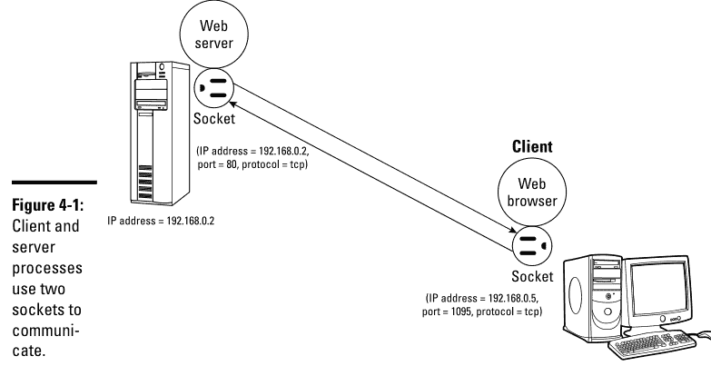

# 理解网络服务

在客户端/服务器模型中，服务器必须在客户端运行之前启动并运行。在创建套接并将套接绑定到端口后，服务器应用程序会建立一个连接队列，这决定了有多少个客户端连接到服务器。通常，一个服务器监听一到五个连接。然而，监听队列是你可以调整的参数之一（特别是对于 Web 服务器），以确保服务器能够响应尽可能多的客户端。在设置监听队列后，服务器将等待客户端的连接。

从客户端端建立连接要简单得多。在创建套接并将其绑定到 IP 地址后，客户端与服务器建立连接。为了建立连接，客户端必须知道服务器的主机名或 IP 地址，以及服务器接受连接的端口。网络服务有良好的标准端口。

当客户端通过面向连接的流式套接（`connection-oriented stream socket`）与服务器建立连接后，客户端和服务器通过调用相应的 `sockets` API 函数交换数据。就像两个人之间的对话一样，服务器和客户端交替发送和接收数据——数据的含义取决于服务器和客户端使用的消息协议。通常，一个服务器是为特定任务设计的；这种设计决定了服务器和客户端用于交换数据的方法。例如，Web 服务器和 Web浏览器（客户端）使用 `HTTP`（超文本传输协议）进行通信。

# 网络服务与端口号

`TCP/IP` 协议族是互联网的通用语言，因为网络服务使用的是 `TCP/IP`。这些服务通过使邮件、新闻和网页传输成为可能构建了互联网。每个网络服务都有自己的协议，这些协议依赖 `TCP/IP` 进行信息的实际传输。每个服务有一个或多个分配的端口号，用于其设计的任何任务。以下是一些广名的网络服务及其相关协议：

- `DHCP`（动态主机配置协议）：动态地在计算机上配置 `TCP/IP` 网络参数。`DHCP` 主要用于分配动态 IP 地址和其他网络信息，如网关名称和域名，这些是配置 `TCP/IP` 网络所需的。`DHCP` 服务器监听端口 67。
- `FTP`（文件传输协议）：在互联网上的计算机之间传输文件。`FTP` 使用两个端口：数据在端口 20 上传输，控制信息在端口 21 上交换。
- `HTTP`（超文本传输协议）：将文档从一个系统发送到另一个系统。`HTTP` 是 Web 的底层协议。默认情况下，Web 服务器和客户端在端口 80 上通信。
- `SMTP`（简单邮件传输协议）：在系统之间交换电子邮件。`SMTP` 使用端口 25 进行信息交换。
- `NNTP`（网络新闻传输协议）：以存储和转发的方式在互联网上分发新闻文章。`NNTP` 使用端口 119。
- `SSH`（安全外壳）：在不安全的网络上实现安全的远程登录和其他安全工作服务。`SSH` 使用端口 22。
- `TELNET`：允许一个系统上的用户登录到互联网上的另一个系统（用户必须提供有效的用户 ID 和密码才能登录远程系统）。`TELNET` 默认使用端口 23，`TELNET` 客户端可以连接到任何指定的端口。
- `NFS`（网络文件系统）：在计算机之间共享文件。`NFS` 使用 Sun 的过程调用（`RPC`）设施，该设施通过端口 111 交换信息。
- `NTP`（网络时间协议）：将计算机的时间与具有更精确时钟的时间同步。`NTP` 使用端口 123。
- `SNMP`（简单网络管理协议）：管理互联网上所有类型的网络工作。与 `FTP` 类似，`SNMP` 使用端口 161 和 162。
- `TFTP`（文件传输协议）：从一个系统传输文件到另一个系统。（通常用于 X 终端和磁盘工作站从网络上的另一个主机传输文件。）`TFTP` 数据传输在端口 69 上进行。

每个服务由一个*服务器*提供——它是一个运行在系统上的计算机程序，等待客户端请求到达与其服务相关的已知端口。Web 服务器在端口 80 处等待客户端请求，这是 `HTTP` 服务的标准。

你 Linux 系统上的 `/etc/services` 文件显示了服务名与端口号（以及端口）之间的关联。以下是 Linux 系统 `/etc/services` 文件中的一小部分条目：

```
ftp-20/tcp
ftp 21/tcp
fsp 21/udp fspd
ssh 22/tcp # SSH Login Protocol
ssh 22/udp
tnetlet 23/tcp
smtp 25/tcp mail
time 37/tcp timsimver
time 37/udp timsimver
rip 39/udp resource # 资源位置
nameserver 42/tcp name # I 116
whois 43/tcp whois
tacs 49/tcp # 登录主机协议 (TACACS)
```

快速查阅 `/etc/services` 文件中的条目可以发现 `TCP/IP` 下可用网络服务的广泛性。

# 使用互联网服务器

端口 80 被指定用于 Web 服务。换句话说，如果你在你的系统上设置了一个 Web 服务器，该服务器就会监听端口 80。顺便说一下，`IANA` —— 互联网分配数字机构（`www.iana.org`） 是负责协调端口号分配的组织。

服务的客户端/服务器架构要求服务器在客户端发出请求之前启动并运行。运行所有服务器可能是一个坏主意——这样做是不切实际的，因为每个服务器都会使用系统资源。相反，你不需要一个监听所有端口并在客户端请求到来时启动相应服务器的单一服务器。

你 Linux 系统上的 `/etc/services` 文件显示了服务名与端口号（以及端口）之间的关联（此处由于原文重复，此处原文翻译逻辑）。以下是 Linux 系统 `/etc/services` 文件中的一小部分条目：

```
ftp-20/tcp
ftp 21/tcp
fsp 21/udp fspd
ssh 22/tcp # SSH Login Protocol
ssh 22/udp
tnetlet 23/tcp
smtp 25/tcp mail
time 37/tcp timsimver
time 37/udp timsimver
rip 39/udp resource # 资源位置
nameserver 42/tcp name # I 116
whois 43/tcp whois
tacs 49/tcp # 登录主机协议 (TACACS)
```

快速查阅 `/etc/services` 文件中的条目可以发现 `TCP/IP` 下可用网络服务的广泛性。

# 使用互联网服务器

端口 80 被指定用于 Web 服务。换句话说，如果你在你的系统上设置了一个 Web 服务器，该服务器就会监听端口 80。顺便说一下，`IANA` —— 互联网分配数字机构（`www.iana.org`） 是负责协调端口号分配的组织。

服务的客户端/服务器架构要求服务器在客户端发出请求之前启动并运行。运行所有服务器可能是一个坏主意——这样做是不切实际的，因为每个服务器都会使用系统资源。相反，你不需要一个监听所有端口并在客户端请求到来时启动相应服务器的单一服务器。

你 Linux 系统上的 `/etc/services` 文件显示了服务名与端口号（以及端口）之间的关联。以下是 Linux 系统 `/etc/services` 文件中的一小部分条目：


# 理解网络服务

在客户端/服务器模型中，服务器必须在客户端运行之前启动并运行。在创建套接并将套接绑定到端口后，服务器应用程序会建立一个连接队列，这决定了有多少个客户端连接到服务器。通常，一个服务器监听一到五个连接。然而，监听队列是你可以调整的参数之一（特别是对于 Web 服务器），以确保服务器能够响应尽可能多的客户端。在设置监听队列后，服务器将等待客户端的连接。

从客户端端建立连接要简单得多。在创建套接并将其绑定到 IP 地址后，客户端与服务器建立连接。为了建立连接，客户端必须知道服务器的主机名或 IP 地址，以及服务器接受连接的端口。网络服务有良好的标准端口。

当客户端通过面向连接的流式套接（connection-oriented stream socket）与服务器建立连接后，客户端和服务器通过调用相应的 sockets API 函数交换数据。就像两个人之间的对话一样，服务器和客户端交替发送和接收数据——数据的含义取决于服务器和客户端使用的消息协议。通常，一个服务器是为特定任务设计的；这种设计决定了服务器和客户端用于交换数据的方法。例如，Web 服务器和 Web浏览器（客户端）使用 `HTTP`（超文本传输协议）进行通信。

# 网络服务与端口号

TCP/IP 协议族是互联网的通用语言，因为网络服务使用的是 TCP/IP。这些服务通过使邮件、新闻和网页传输成为可能构建了互联网。每个网络服务都有自己的协议，这些协议依赖 TCP/IP 进行信息的实际传输。每个服务有一个或多个分配的端口号，用于其设计的任何任务。以下是一些广名的网络服务及其相关协议：

- `DHCP`（动态主机配置协议）：动态地在计算机上配置 TCP/IP 网络参数。`DHCP` 主要用于分配动态 IP 地址和其他网络信息，如网关名称和域名，这些是配置 TCP/IP 网络所需的。`DHCP` 服务器监听端口 67。

- `FTP`（文件传输协议）：在互联网上的计算机之间传输文件。`FTP` 使用两个端口：数据在端口 20 上传输，控制信息在端口 21 上交换。

- `HTTP`（超文本传输协议）：将文档从一个系统发送到另一个系统。`HTTP` 是 Web 的底层协议。默认情况下，Web 服务器和客户端在端口 80 上通信。

- `SMTP`（简单邮件传输协议）：在系统之间交换电子邮件。`SMTP` 使用端口 25 进行信息交换。

- `NNTP`（网络新闻传输协议）：以存储和转发的方式在互联网上分发新闻文章。`NNTP` 使用端口 119。

- `SSH`（安全外壳）：在不安全的网络上实现安全的远程登录和其他安全工作服务。`SSH` 使用端口 22。

- `TELNET`：允许一个系统上的用户登录到互联网上的另一个系统（用户必须提供有效的用户 ID 和密码才能登录远程系统）。`TELNET` 默认使用端口 23，`TELNET` 客户端可以连接到任何指定的端口。

- `NFS`（网络文件系统）：在计算机之间共享文件。`NFS` 使用 Sun 的过程调用（RPC）设施，该设施通过端口 111 交换信息。

- `NTP`（网络时间协议）：将计算机的时间与具有更精确时钟的时间同步。`NTP` 使用端口 123。

- `SNMP`（简单网络管理协议）：管理互联网上所有类型的网络工作。与 `FTP` 类似，`SNMP` 使用端口 161 和 162。

- `TFTP`（文件传输协议）：从一个系统传输文件到另一个系统。（通常用于 X 终端和磁盘工作站从网络上的另一个主机传输文件。）`TFTP` 数据传输在端口 69 上进行。

每个服务由一个*服务器*提供——它是一个运行在系统上的计算机程序，等待客户端请求到达与其服务相关的已知端口。Web 服务器在端口 80 处等待客户端请求，这是 `HTTP` 服务的标准。

Linux 系统上的 `/etc/services` 文件显示了服务名与端口号（以及端口）之间的关联。以下是 Linux 系统 `/etc/services` 文件中的一小部分条目：

```
ftp-20/tcp
ftp 21/tcp
fsp 21/udp fspd
ssh 22/tcp # SSH Login Protocol
ssh 22/udp
tnetlet 23/tcp
smtp 25/tcp mail
time 37/tcp timsimver
time 37/udp timsimver
rip 39/udp resource # 资源位置
nameserver 42/tcp name # I 116
whois 43/tcp whois
tacs 49/tcp # 登录主机协议 (TACACS)
```

快速查阅 `/etc/services` 文件中的条目可以发现 TCP/IP 下可用网络服务的广泛性。

# 使用互联网服务器

端口 80 被指定用于 Web 服务。换句话说，如果你在你的系统上设置了一个 Web 服务器，该服务器就会监听端口 80。顺便说一下，`IANA` —— 互联网分配数字机构（`www.iana.org`） 是负责协调端口号分配的组织。

服务的客户端/服务器架构要求服务器在客户端发出请求之前启动并运行。运行所有服务器可能是一个坏主意——这样做是不切实际的，因为每个服务器都会使用系统资源。相反，你不需要一个监听所有端口并在客户端请求到来时启动相应服务器的单一服务器。

## 使用 inetd

Linux 发行版使用 `xinetd` 在系统启动时启动 `inetd`。`inetd` 服务器在启动时读取配置文件 `/etc/inetd.conf`。该文件告诉 `inetd` 监听哪些端口以及为每个端口启动什么。每个文件都可以包含其他配置指令。在 Linux 中，`/etc/inetd.conf` 如下：

```
# xinetd 简单配置文件
# 设置一些默认值 /etc/inetd.d/
defaults
{
  instances = 30
  log_type = /var/log/inetd.log
  log_on_success = HOST EXIT DURATION
  log_on_failure = HOST ATTEMPT
  cps = 50
}
includier = /etc/inetd.d/
```

## 使用 Internet 服务器 249

注释行以井号 (`#`) 开头。包含在花括号 `{ . . }` 中的 `defaults` 属性块指定了某些属性的默认值。这些默认值适用于配置文件中的所有其他服务。`instances` 属性设置为 30，这意味着任何服务同时激活的实例不能超过 30 个。

`/etc/xinetd.conf` 的最后一行使用 `include` 指令来包含 `/etc/xinetd.d` 目录下的所有文件，其中包含以点 (.) 开头的文件。其思路是 `/etc/xinetd.d` 目录包含了所有的服务配置文件——每种 xinetd 服务器预期管理的服务类型都对应一个文件。类型 `/etc/xinetd.d` 文件指定了 xinetd 可以启动的某个服务的属性。


例如，SUSE 使用 `xinetd` 来启动某些服务，包括 `vsftpd`（非常安全 FTP）守护进程（守护进程是一个持续运行并在结束后退出的进程）。输入 `cat /etc/xinetd.d/vsftpd` 可以查看 `vsftpd` 服务的。这里是 SUSE 系统上典型的文件列表：

```
# config
# description:
# The vsftpd server提供 FTP 连接。它使用
# 普通的、未加密的用户名和密码进行身份验证。
# vsftpd 不被认为是安全的。
service ftp {
  socket_type = stream
protocol = tcp
wait = no
user = root
server = /usr/sbin/vsftpd
}
```

文件名（在此例中为 `vsftpd`）可以是任何名称；重要的是文件中 `service` 关键字后面出现的服务名。在这种情况下，`ftp` 这一行告诉 `xinetd` 服务的服务的名称。`xinetd` 使用此名称从 `/etc/services` 文件中查找端口号。

`/etc/xinetd.d/vsftpd` 中包含在花括号 `{ . . }` 中的属性具有以下含义：


`socket_type` 属性设置为 `stream`，这告诉 xinetd 使用面向连接的 TCP 套接字与客户端通信。对于使用无连接 UDP 套接字的服务，

`wait` 属性设置为 `no`，这告诉 xinetd 为每个请求启动一个新的服务器。如果此属性设置为 `yes`，则 xinetd 会等待服务器退出后再重新启动服务器。

`user` 属性提供了 xinetd 服务器时使用的用户 ID。在这种情况下，服务器以 root 身份运行 TELNET 服务器。

| 第四卷 第 4 节 | 托管互联网服务 |
| --- | --- |
| www.it-ebooks.info | |

## 250 运行独立服务器

`server` 属性指定了为该服务运行的程序。在这种情况下，xinetd 运行 `/usr/sbin/vsftpd` 程序提供 FTP 服务。

浏览 Linux 系统上 `/etc/xinetd.d` 目录下的文件，以了解 xinetd 设置为配置了哪些类型的服务。如果你想关闭任何服务（许多服务已经禁用了），可以通过编辑该服务的配置文件，并在包含所有属性的花括号内添加以下行：

```
disable = yes
```

当您对 xinetd 配置文件进行此类更改时，必须通过输入以下命令来重启 xinetd 服务器：

```
/etc/init.d/xinetd restart
```


你可以可能配置服务在 xinetd 下作为独立服务器运行。例如，SUSE 在 xinetd 的控制下使用安全 FTP 守护进程 (`vsftpd`)。然而，Debian 和 Fedora 将 `vsftpd` 作为独立服务器使用。

## 运行独立服务器

通过 inetd 或 xinetd 启动服务器是一种明智的方法，但并不总是高效的。由 inetd 或 xinetd 控制的 Web 服务器会在用户点击网页上的链接、请求到达 Web 服务器时每次启动。对于这种高需求的服务，以独立方式启动服务器是最好的。在独立模式下，服务器可以作为守护进程运行。这意味着服务器监听分配的端口，每当请求到达时，服务器都会通过创建自己的副本来处理它。通过这种方式，只要机器运行，服务器就会一直运行——理论上是永久的。对于 Web 服务器，更高效的策略是运行多个服务器副本，并让每个副本处理部分的请求。

你可以轻松地配置你的 Linux 系统以自动启动各种独立服务器，如本节所示。

### 手动启动和停止服务器

要启动未运行的服务器，请使用 `server` 命令。例如，如果 Web 服务器（在 Fedora 中称为 `httpd`）没有运行，你可以通过执行以下命令的特殊 shell 脚本启动它：

```
/etc/init.d/httpd start
```

## 运行独立服务器 251

该命令运行 `/etc/init.d/httpd` 脚本，并将 `start` 作为参数。如果 HTTP 服务器已经在运行而你想停止它，请使用 `stop` 作为参数运行相同的命令，如下：

```
/etc/init.d/httpd stop
```

要再次停止并启动服务器，只需使用 `restart` 作为参数：

```
/etc/init.d/httpd restart
```

每个服务的启动顺序。（序列数字较小的服务会在数字较大的服务之前启动，数字范围通常在 00 到 99 之间。）如果你没有显式指定序列号，在使用默认选项时，`update-rc.d` 将使用序列号 20。

你还可以在特定的运行级别以及按照特定的顺序启动和停止服务。例如，使用以下命令在级别 2 和 5、序列号为 85 处启动，并在级别 0、1、序列号为 90 处停止运行：

```
update-rc.d service start 85 2 5 . stop 90 0 1 6
```

请记住，`service` 必须是 `/etc/init.d` 目录下的脚本文件名。

如果你需要停止服务在系统启动时运行，请在终端中输入 `update-rc.d service remove`，其中 `service` 是 `/etc/init.d` 中启动或停止该服务的脚本名称。

### 使用 GUI 服务配置工具

如果你不喜欢输入命令，可能可以使用 GUI 工具来配置服务。Fedora 和 SUSE 包含了诸如 YaST 和服务配置工具等工具用于管理服务。

服务配置工具在列表中显示服务的名称。列表中的每行都显示一个服务的名称，前面有一个复选框。框中的勾选表示该服务被选中在当前运行级别下开机时启动。当对话框首次出现时，许多服务已经处于选中状态。

你可以向上向下滚动列表，并点击复选框来选择或取消选择服务。如果你点击框，勾选会切换开启和关闭。此外，该工具还会显示该服务当前正在运行。

在你选择了所有想要在系统启动时启动的服务后，点击工具栏上的“Apply”（应用）按钮以保存更改。

默认情况下，服务配置工具为当前运行级别配置选定的服务。这意味着如果你从图形桌面选择服务，系统处于运行级别 5，你正在配置的服务将在运行级别 5 启动。如果你想为不同的级别设置服务，请从 Edit Runlevel（编辑运行级别）菜单中选择运行级别。

表 4-1 显示了服务列表以及每个服务的简要描述。第一列显示服务的名称，这与提供该服务所需运行的程序名称相同。你可能不会


## 254 运行独立服务器

当你在系统上运行 GUI 服务配置工具时，不会看到列出的所有服务，因为具体的服务列表取决于你的 Linux 系统上安装了什么。

### 表 4-1 Linux 中的一些常用服务

| 服务名称 | 描述 |
| --- | --- |
| acpid | 监听来自内核的高级配置和电源接口 (ACPI) 事件，并在此类事件发生时通知其他程序。当内核将计算机置低功耗状态（例如待机模式）以节省能量时可能会发生 ACPI 事件。 |
| apache, apache2, or httpd | 运行 Apache 网 (WWW) 服务器。 |
| apmd | 监控高级电源管理 (APM) BIOS 和电源状态（交流电或电池备份）。 |
| atd | 运行由 at 和 cron 命令调度的命令。 |
| autofs | 自动挂载文件系统（例如，当你在 CD 驱动器中插入 CD-ROM 时）。 |
| cron or crond | 根据 cronab 的定期计划运行用户指定的程序。启用在文本模式下使用鼠标。innd 互联网网络守护进程——你可以使用它来支持系统上本地新闻组的互联网新闻服务器。 |
| isdn | 启动和停止 ISDN（集成服务数字网络）服务——一种通过普通电话线传输的数字通信服务（仅在你拥有 ISDN 服务时启用）。 |
| named | 将主机名翻译为 IP 地址，用于域名系统 (DNS) 的命名服务器。如果你需要，可以在你的系统上运行副本。 |
| network or networking | 启用或停用所有配置为系统启动时激活的网络接口。 |
| nfs or nfsserver |允许使用网络文件系统 (NFS) 协议共享 `/etc/exports` 文件中指定的文件。 |

## 运行独立服务器 255

| 服务名称 | 描述 |
| --- | --- |
| nfslock | 为使用网络文件系统 (NFS) 协议导出的文件系统提供文件锁定功能，以便其他系统（运行 NFS）可以从你的系统共享文件。 |
| pcmcia | 为 PCMCIA 设备提供支持。 |
| portmap | 与任何运行在远程过程调用 (RPC) 上的软件配合。例如，NFS 需要 portmap 服务。 |
| samba, smb, or smbfs | 在 Linux 系统上启动和停止支持 LAN Manager 服务的服务。 |
| sendmail | 将邮件从一台机器移动到另一台。如果你不将 Linux 系统作为邮件服务器，请不要启动 sendmail，因为它会降低速度并消耗资源。 |
| snmpd | 为简单网络协议管理网络。 |
| spamassin | 运行 SpamAssassin 邮件过滤器。 |
| ssh or sshd | 运行 OpenSSH（安全外壳）登录设施。 |
| syslog or syslogd | 在日志文件 (`/var/log/messages`) 中记录各种错误和状态消息。此服务被许多程序使用。 |
| vsftpd | 使用文件传输协议 (FTP) 传输文件。`vsftpd` 代表 Very FTP 守护进程。 |
| winbind | 启动和停止 winbind 服务，该服务提供类似于 `/etc/nsswitch` 文件提供的切换能力。 |
| xfs | 启动和停止 X 字体服务器。 |
| ... | |


| ybind | 运行在网络信息系统 (NIS) 客户端并绑定到 NIS 域。除非你使用 NIS，否则不需要启动 ybind。 |

在 SUSE 中——sendmail 确实让你确信它是非常复杂的。幸运的是，你不需要成为 sendmail 配置文件的专家。你只需要使用一个预定义的配置文件之一——例如安装在你的系统上的那个——就可以使用 sendmail。

你的系统已经有一个可以工作的 sendmail 配置文件——`/etc/mail/sendmail.cf`。默认文件假设你拥有互联网连接和域名服务器。只要你的系统拥有官方域名，你就可以从 Linux 电脑发送和接收电子邮件。


为了确保邮件投递正常，你系统的名称必须与 ISP（ISP）分配给你的系统名称匹配。尽管你可以给系统设置任何主机名，但只有当系统名称位于 ISP 的域名服务器时，其他人才能成功将邮件发送到你的系统。

## 邮件投递测试

要尝试 sendmail 邮件代理，你可以使用 `mail` 命令向 Linux 系统上的任何用户账户编写并发送邮件。作为测试，编写一条消息并发送给自己。以下是使用 `mail` 命令发送消息的方法。（输入内容以粗体显示。）

```
mail edujian
Subject: Testing e-mail
This is from my Linux system.
```

`mail` 命令是一个简单的邮件用户代理。在示例中，收件人（udahan）是在命令行中指定的。当 `mail` 提示主题行时，输入内容并用一个只包含句号的行来结束。系统会提示你输入 Cc（抄送）；请留空。在结束消息后，邮件用户代理会将消息传递给 sendmail（邮件传输代理）发送到指定的地址。sendmail 会立即投递邮件。要验证邮件的投递情况，输入 `mail` 再次运行 `mail` 命令。

如果你的任何邮件软件没有正确安装，在测试期间你应该会收到提示，要求安装任何所需的组件并解决问题。

因此，初始的 sendmail 配置文件对于在 Linux 系统内发送和接收电子邮件是足够的的。只要你的 Linux 系统拥有互联网连接和注册的域名，外部邮件投递也可以工作。


如果你有一个为你的 Linux 系统提供动态 IP 地址的 ISP 账户，你会使用 Evolution 或 Mozilla Mail 等邮件客户端，它们通过连接 ISP 的邮件服务器来发送出站邮件。

## 安装邮件服务器 259

## 邮件投递机制

在互联网主机上，sendmail 邮件传输代理使用简单邮件传输协议（SMTP）投递邮件。基于 SMTP 的传输代理监听 TCP 端口 25，并使用一组简单的文本命令与其他邮件传输代理交换信息。SMTP 命令足够简单，你可以手动从终端使用它们来发送邮件。`telnet` 命令打开通往 25 端口的 TELNET 会话（Linux 系统等待 SMTP 命令的端口）。sendmail 进程会用公告进行回复。

你可以输入 `HELP` 查看 sendmail 命令列表。要获取特定命令的帮助，请输入 `HELP commandname`。输入 `HELO localhost` 与主机建立会话。sendmail 进程用问候语回复。要发送邮件，以 `MAIL FROM:` 命令开始，指定消息的发送者。接下来，使用 `RCPT TO:` 指定消息的收件人。如果你想向多个收件人发送消息，请为 `RCPT TO:` 命令提供每个收件人的地址。

要输入邮件内容，使用 `DATA` 命令。在 `DATA` 命令的响应下，sendmail 显示一条指令，要求你用单独的一行来结束消息。当你完成这样做并结束消息后，sendmail 进程会显示一条消息，表示消息已被接受投递。然后你可以使用 `QUIT` 命令退出 sendmail 会话。

## sendmail 配置文件

你不需要理解 sendmail 配置文件 `sendmail.cf` 中的所有内容，但你需要知道该文件是如何创建的。这样在时就可以进行更改并重新生成 `sendmail.cf` 文件。

在 SUSE 中，你可以通过 YaST 控制中心配置 sendmail——从菜单选择“系统：控制中心 (YaST)”。点击窗口左侧的“网络服务”，然后点击窗口右侧的“邮件代理”。YaST 会显示一个供你配置 sendmail 的窗口。你可以指定常规设置，然后是输出设置，最后是入站邮件设置。退出配置工具后，YaST 将邮件设置存储在 `/etc/sendmail` 和 `/etc/sysconfig` 中，然后运行 `SuSEConfig` 来更新 sendmail 配置文件（`/etc/sendmail.cf`）。

你也可以从宏文件生成 `sendmail.cf` 文件（文本文件，每行最终都会扩展为对程序有意义的多行）。这些宏文件组织在 Fedora 的 `/usr/share/sendmail-cf` 目录的子目录下，或者你可以阅读该目录下的 `README` 来 sendmail 配置文件的创建方法。


第四卷 第 5 章

管理邮件和新闻服务器

www.e-books.info

## 260 安装邮件服务器

## m4 宏处理器

`m4` 宏处理器生成 `sendmail.cf` 配置文件，该文件随 Linux 中的 sendmail 软件包一起。主宏文件名为 `sendmail.mc`、`generic_linux.mc` 或 `linux.mc`，包含在 sendmail 软件包中。

那么什么是宏？宏基本上是长字符串的替换符的符号名称，通常是简写形式。像 `m4` 这样的宏处理器通常会读取输入文件并将其复制到输出中，在此过程中处理宏。宏的过程涉及执行某些操作并生成某些输出。由于宏在输出中生成的文本比仅仅的 `m4` 名称多得多，因此宏的处理被称为宏展开。


## 262 安装邮件服务器

你配置的主 sendmail 宏文件是 `sendmail.mc`，位于 `/etc/sendmail` 目录下。

与 `/etc/mail/sendmail.cf` 文件相比，`/etc/mail/sendmail.mc` 文件更短且更容易操作。以下是 `/etc/mail/sendmail.mc` 文件中包含 Fedora 内容的某些行：


```
divert(-1)dnl
dnl # This is the sendmail macro config file for m4. If you make changes
to
dnl # /etc/mail/sendmail.mc, you will need to regenerate the
dnl # /etc/mail/sendmail.cf file by confirming that the sendmail-cf
package is
dnl # # installed and then performing a
dnl # /etc/mail/make
dnl #
dnl include('/usr/share/sendmail-cf/m4.m4')dnl
VERSIONID('setup for linux')
ostype('linux')
dnl #
dnl # Do not advertise sendmail version.
dnl #
dnl define('CONFSMTP_LOG_MSG','$j Sendmail; $')dnl
dnl # default logging level is 9, you might want to set it higher to
dnl # debug the configuration
dnl #
dnl define('CFLOG_LEVEL','9')dnl
dnl # Uncomment the following line if you want outgoing mail to
dnl # be sent out through an external mail server
dnl # define('SMART_HOST','smtp.your.provider')dnl
dnl # lines deleted
dnl # MASQUERADE_AS('mydomain.com')dnl
dnl # masquerade not just the headers, but the envelope as well
dnl #
dnl FEATURE(masquerade_envelope)dnl
dnl # masquerade not just mymydalias.com, but @*.mydomain.com as well
dnl #
dnl FEATURE(masquerade_entire_domain)dnl
dnl # MASQUERADE_DOMAIN(localhost)dnl
dnl MASQUERADE_DOMAIN(localdomain)dnl
dnl MASQUERADE_DOMAIN(mydomainalias.com)dnl
MAILER(sendmailsmtp)dnl
MAILER(procmail)dnl
MAILER(cyrusv2)dnl
```

如果你对 `/etc/mail/sendmail.mc` 文件进行了更改，必须通过运行带有命令的 `sendmail.mc` 宏处理器来生成 `/etc/mail/sendmail.cf` 文件。（你必须以 root 身份登录）。

```
m4 /etc/mail/sendmail.mc > /etc/mail/sendmail.cf
```


# 安装邮件服务器 263

注释还告诉过，你需要 `sendmail-cf` 软件包来处理此文件。

从上一节对 `mc` 宏的描述中你可以看到 `sendmail.mc` 文件使用 `define` 来创建新宏。你还可以看到在向输出中插入过多空行时，大量使用了 `dnl`。

其他大写写单词（如 `OTYPE`、`FEATURE` 和 `MAILER`）是 sendmail 宏。这些宏定义在位于 `/usr/share/sendmail-cf` 目录下的 `.m4` 文件中，并通过以下 `include` 宏合并到 `sendmail.mc` 文件：

```
include('/usr/share/sendmail-cf/m4/cf.m4') dnl
```

`/usr/share/sendmail-cf/m4/cf.m4` 文件反过来包含了 `cfhead.mc` 文件，该文件包含了其他 `m4` 文件，依此类推。最终效果是：当 `m4` 宏处理器处理 `sendmail.mc` 文件时，宏处理器会合并来自 `/usr/share/sendmail-cf` 各子目录的 `m4` 文件。

关于 `/etc/sendmail.mc` 文件需要注意的关键点如下：

- `VERSIONID('setup for linux')` 将引号内的版本信息插入到输出中。
- `OTYPE('linux')` 指定 Linux 为操作系统。你必须尽早指定此宏以确保配置正确。将此宏放在 `VERSIONID` 宏之后是自定义的做法。
- `MAILER (smtp)` 描述了邮件传输程序。按照 `/usr/share/sendmail-cf/README` 文件中的说明，`MAILER` 声明始终位于 `sendmail.mc` 文件的末尾，且 `MAILER (smtp)` 始终位于 `MAILER (procmail)` 之前。
- `FEATURE`
  - `FEATURE` 宏请求各种特殊功能。例如，`FEATURE('blacklist_records')` 开启阻塞某些用户名、主机或地址邮件的功能。允许或拒绝哪些邮件的规范在访问数据库（存储在 `/etc/access.db` 文件）中。你还需要 `FEATURE('access_db')` 宏在访问数据库上运行。
- `MASQUERADE_AS('mydomain.com')` 让 sendmail 将外出的邮件标记为来自 `mydomain.com`（将 mydomain 替换为你的域名）。这种设计的理念是让大型组织设置单一的 sendmail 服务器来处理许多子域名的邮件，并让一切看起来都来自同一个域名（例如，来自大学许多部门的邮件看起来都来自大学的主域名）。


# 安装邮件服务器 264

- `MASQUERADE_AS('mydomain.com')` 让 sendmail 将外出的邮件标记为来自 `mydomain.com`（将 mydomain 替换为你的域名）。这种设计的理念是让大型组织设置单一的 sendmail 服务器来处理许多子域名的邮件，并让一切看起来都来自同一个域名（例如，来自大学许多部门的邮件看起来都来自大学的主域名）。

## sendmail.cf 的语法

`sendmail.cf` 的语法设计得易于阅读。每行以宏开始，后跟其参数。以井 `#` 开头的行是注释。空行会被忽略。使用缩进可以区分配置的不同部分。

`sendmail.cf` 中使用的宏如下：

- `VERSIONID`: 定义配置的主版本号。
- `OTYPE`: 指定操作系统。
- `MAILER`: 描述要使用的邮件传输程序。
- `FEATURE`: 请求各种特殊功能。
- `MASQUERADE_AS`: 将外出的邮件标记为特定域名。
- `MASQUERADE_DOMAIN`: 设置伪装的域名。

### 265 邮件服务器表格

表 5-1 总结了 `sendmail.cf` 中使用的单字母运算符。每个项目还显示了该运算符的示例。

| 表 5-1 sendmail.cf 中使用的运算符 |
| :--- | :--- |
| C | 定义一个类（类似于集合），包含多个值。例如，`Cwlocalhost` 将 localhost 添加到类 w。 |
| D | 定义一个关联单一值的宏。例如，`DNailer-DAEMON` 将宏 n 定义为 DAEMON。 |
| F | 定义一个从文件中读取的类。例如，`Fw/etc/local-names` 从文件中读取主机名并添加到类 w。 |
| H | 定义 sendmail 插入消息的头部行格式。例如，`HTTPReturnPath: <$` 定义了 Return-Path 字段 |
| K | 定义一个映射（键值对数据库）。例如，`Karith` 将映射 定义为同名的编译映射。 |
| M | 指定修饰符。以下行定义了内映射：`Mprocmail, P=/usr/bin/procmail, F-DFMSun9, S=EnvFromSMTP/HdrFromSMTP/T=DNS/RFC822/X-Unix, A=procmail -Y m $f` |
| O | 为选项赋值。例如，`OAliasFile=/etc/aliases` 将 Alias 选项定义为 /etc/aliases，这是 sendmail 别名文件名 |
| P | 为优先级字段定义值。例如，`Pjunk=-100` 将标记为头部字段 junk 的邮件优先级设置为 -100 |


| R | 定义一个规则（规则有左侧和右侧；如果匹配左侧，则用右侧替换它。此规则用于重写）。例如，重写规则 `R=$; $1` 处理末尾分号 |
| S | 标记由后续 R 控制行定义的规则集开始。例如，`Scanonify=3` 将下一个规则集标记为 canonify 和 rules3 |
| T | 将用户名添加到信任类（类 t）。例如，`Troot` 将 root 添加到信任用户类中。 |
| V | 定义配置的主版本号。 |

## 266 安装邮件服务器

### 其他 sendmail 文件

`/etc/mail` 目录包含了 sendmail 使用的其他文件。这些文件在 sendmail 配置文件中被引用，在 Fedora 中为 `/etc/mail/sendmail.cf`，在 SUSE 中为 `/etc/sendmail.cf`。例如，以下是如何在 Fedora 的 `/etc/mail/sendmail.cf` 文件中搜索 `/etc/mail` 字符串：

```bash
grep "\/etc/mail\" /etc/mail/sendmail.cf
```

以下是典型系统中 `grep` 命令搜索后显示的结果：

```
F/etc/mail/local-host-names
relay-o /etc/mail/relay-domains
mailtable hash -o /etc/mail/mailtable.db
virtuser hash -o /etc/mail/virtertable.db
accas hash -TDBF -o /etc/mail/access.db
#O ErrorHeader=/etc/mail/error-header
#O HelpFile=/etc/mail/helpfile
#O UserDatabase=/etc/mail/userdb.db
#O ServiceSwitchFile=/etc/mail/service.switch
#O DefaultAuthInfo=/etc/mail/default-auth-info
etc/mail/trusted-users
```

你可以忽略以井号、标记或数字（##）开头的行，因为 sendmail 将这些视为注释。其他行是 sendmail 控制行，指向 `/etc/mail/` 目录中的其他文件。

以下是某些 sendmail 文件应该包含的内容。（注意，并非所有文件都必须存在于你的 `/etc/mail` 目录中，即使存在，某些也可能是空的。）

- `/etc/mail/access`: 允许发送邮件（用于阻止垃圾邮件 - unwanted邮件）的主机名、IP 地址或两者。
- `/etc/mail/access.db`: 从 `/etc/mail/access.file` 生成的访问数据库。
- `/etc/mail/helpfile`: SMTP 命令的帮助信息。
- `/etc/mail/local-host-names`: 此主机的已知名称。
- `/etc/mail/mailtable`: 用于覆盖邮件路由方式的邮件器（例如，`comcast.net smtp:smtp.comcast.net` 告诉 sendmail 发往 comcast.net 的邮件必须发送到 smtp.comcast.net）。
- `/etc/mail/relay-domains`: 允许中继主机。
- `/etc/mail/trusted-users`: 允许使用其他用户名发送邮件而不产生警告的用户列表。
- `/etc/mail/userdb.db`: 包含每个用户登录名和真实信息的用户数据库文件。
- `/etc/mail/virtuertable`: 本地系统上具有虚拟域名地址的用户数据库。

`/etc/mail/` 目录还包含其他文件 —— `/etc/mail/certs` 以及带有 `.pem` 扩展名的文件 —— 用于通过使用 SMTP 的 STARTTLS 扩展来支持 sendmail 中的隐私增强邮件 (PEM)。STARTTLS 扩展使用 TLS（更通被称为 SSL — Secure Layers (TLS)）来验证服务器并加密邮件。RFC 2487 描述了 STARTTLS。（该 RFC 可以在 http://ietf.org/rfc/rfc2487.txt 在线获取）。


如果你编辑了 `/etc/mail/mailleter`，必须在更改生效前输入以下命令：

```bash
makemap hash /etc/mail/mailleter < /etc/mail/mailleter
```

有一种更简单的方法来确保在进行更改时重新构建所有必要的内容 —— 只需 root 身份登录并输入以下命令：

```bash
cd /etc/mail
make
```

第一条命令将当前目录更改为 `/etc/mail`，第二个命令运行 `make` 命令，它会读取 `/etc/mail` 中名为 `Makefile` 的文件来执行重建所有内容的必要步骤。（要了解更多关于 make 和 Makefile 的信息，请参阅第七卷第 3 章）。

### .forward

用户可以通过在家目录下放置 `.forward` 文件来重定向自己的邮件。`.forward` 是一个纯文本文件，包含逗号分隔的邮件地址列表。任何发送给用户的邮件都会转发到这些地址。如果 `.forward` 文件只包含一个地址，则该用户的所有邮件将重定向到该单一邮件地址。例如，假设在名为 emily 的用户家目录下放置了包含以下内容的行的 `.forward` 文件：

```
ashley
```

此行导致 sendmail 自动将发给 emily 的邮件发送到同一系统上的用户名 ashley。用户 emily 将不会接收任何邮件。

## 268 安装 INN 服务器

你也可以通过列出完整的电子邮件地址将邮件转发到另一个系统上的用户名。例如，你可以添加一个包含以下行的 `.forward` 文件，将发给用户名 wilbur 的消息发送到邮件地址 wilbur@somewhereelse.net：

```bash
wilbur@somewhereelse.net
```

为了在原始系统中保留消息副本，除了转发到上述指定的地址外，请在以下文件中添加此行：

```
wilbur@somewhereelse.net
```

为了在原始系统中保留消息副本，除了转发到上述指定的地址外，请在以下文件中添加此行：

```
wilbur@somewhereelse.net
```

为了在原始系统中保留消息副本，除了转发到上述指定的地址外，请在以下文件中添加此行：

```
wilbur@somewhereelse.net
```

为了在原始系统中保留消息副本，除了转发到上述指定的地址外，请在以下文件中添加此行：

```
wilbur@somewhereelse.net
```

为了在原始系统中保留消息副本，除了转发到上述指定的地址外，请在以下文件中添加此行：

```
wilbur@somewhereelse.net
```

在 sendmail 配置中，输入提供新闻源的服务器名称。同时，在配置文件列出任何接收你服务器新闻源的下游主机（如果有）。然后你可以启动新服务器并等待其到达。监控日志以确保文章正确存储在系统的 `/var/spool/news` 目录中。

后续章节介绍了 IN 的设置，但你可以从 Internet Systems Consortium (ISC) 获取更多关于 IN 的信息，这是一个致力于开发和维护开源互联网软件的非营利机构，例如 BIND（域名系统的实现）、DHCP（动态主机配置协议）和 IN。Rich Salz 最初表示 INN 在 1996 年接管了 IN 的开发。你可以在 ISC 的 IN 网页 .www.isc.org/downloads 上获取更多关于 IN 的信息并访问其他资源（点击 Other Software 链接）。

在 sendmail 配置中，输入提供新闻源的服务器名称。同时，在配置文件列出任何接收你服务器新闻源的下游主机（如果有）。然后你可以启动新服务器并等待其到达。监控日志以确保文章正确存储在系统的 `/var/spool/news` 目录中。

在 sendmail 配置中，输入提供新闻源的服务器名称。同时，在配置文件列出任何接收你服务器新闻源的下游主机（如果有）。然后你可以启动新服务器并等待其到达。监控日志以确保文章正确存储在系统的 `/var/spool/news` 目录中。

## 配置与启动 INN 服务器

## InterNetNews 的组件

INN 包含了多个用于发布和管理新闻组的程序。它还包含许多用于控制 INN 程序运行的文件。最重要的 INN 程序如下：

- `innd`: 接受来自其他馈送站点（feed sites）以及本地新闻阅读客户端的连接，但它会将连接移交给 nnprd 处理。新闻服务器 `innd` 以守护进程（一种持续运行以提供特定服务的后台进程）的形式运行，并监听 NNTP 端口（TCP 端口 119）。


- `nnprd`: 处理来自本地新闻阅读客户端的请求。`nnprd` 是由 `innd` 调用的客户端-服务器。
- `expire`: 根据文本文件 `/etc/news.expire` 中的规范删除旧文章。
- `nntsend`: 调用 `innxit` 程序，使用 NNTP 将新闻文章发送到远程站点。配置文件 `/etc/news/inntsend.ctl` 控制 `nntsend` 程序。
- `ctlinn`: 允许你交互式地控制 inn 服务器。`ctl` 程序可以向 inn 服务器的控制通道发送消息。

INN 的其他重要部分是控制文件。这些文件大部分位于你 Linux 系统的 `/etc/news` 目录下，尽管少数位于 `/var/lib/news` 目录。在这些目录之间有 30 多多个 INN 控制文件。一些重要文件包括：

- `/etc/news/inn.conf`: 指定 inn 服务器的配置数据。（要查看此文件的在线帮助，请输入 `man inn.conf`）。
- `/etc/news/newsfeeds`: 指定向其他服务器馈送哪些文章。（该文件很复杂，但你可以通过输入 `man newsfeeds` 获取帮助）。
- `/etc/news/incoming.conf`: 列出向此服务器提供新闻的主机名称和地址。（要查看此文件的在线帮助，请输入 `man incoming.conf`）。
- `/etc/news/storage.conf`: 指定在存储文章时使用的存储方法。（要查看此文件的在线帮助，请输入 `man storage.conf`）。
- `/etc/news/expire.ctl`: 如果需要，在新闻组级别控制文章的过期。（要查看此文件的在线帮助，请输入 `man expire.ctl`）。
- `/var/lib/news/active`: 列出所有活跃的新闻组，显示每个组最旧和最新的文章编号，以及每个新闻组的发布状态。（要查看此文件的在线帮助，请输入 `man active`）。
- `/var/lib/news/newsgroups`: 列出新闻组及其简要描述。
- `/etc/news/readers.conf`: 指定允许从此新闻服务器读取新闻并向新闻组发布新闻的主机和用户。默认文件仅允许本地读取新闻；如果你允许本地网络中的其他主机读取新闻，则必须编辑它。（要查看此文件的在线帮助，请输入 `man readers.conf`）。

接下来的几节将介绍如何设置一些重要的控制文件。

## inn.conf 文件

`inn.conf` 文件持有所有 INN 程序的配置数据——这使其成为最重要的文件。该文件的每行都具有以下格式的参数值：

```
parameter: value
```

取决于 `parameter`

位于 `/etc/news` 目录下的默认 `inn.conf` 文件中的大多数参数不需要更改。你可能想要编辑表 5-2 所示的一个或多个参数。

| 表 5-2 /etc/news/inn.conf 中的配置参数 |
| :--- | :--- |
| 参数名称 | 设置为 |
| `mta` | 用于启动邮件传输代理的命令，`inn` 用它传输消息。默认使用 `sendmail`。 |
| `organization` | 你组织的名称，你希望它出现在从你的系统发布的所有新闻文章的 `Organization`: 头部中。用户可以通过定义环境变量 `ORGANIZATION` 来覆盖此参数。 |
| `ovmethod` | 概述（overview）存储类型。（`overview` 是新闻组中新闻的索引）。默认方法是 `tradindexed`，它读取新闻很快，但存储新闻较慢。 |
| `pathhost` | 你的新闻服务器名称，你希望它出现在所有进入你服务器的发布内容的 Path 头部中。如果未定义 `pathhost`，则使用系统的完全限定域名。 |
| 表 5-2 /etc/news/inn.conf 中的配置参数（续） |
| 参数名称 | 设置为 |
| `pathways` | 包含二进制文件的目录的完整路径名。默认是 `/lib/news`。 |
| `domain` | 你的服务器的域名。 |
| `allown` | 如果 INN 支持去索引，则为 True。默认设置为 false。 |
| `cachesize` | INN 在内存中保留的单位为千字节的大小。默认值为 256。 |
| `innflags` | 你想传递给服务器的任何标志。默认值为空字符串。 |

## newsfeeds 文件

`newsfeeds` 文件（位于 `/etc/news`）指定如何将传入的文章分发到其他服务器。该文件包含一系列条目。每个馈送具有以下格式：

```
site
:pattern
:flag
param
```

每个条目有四个由冒号（:）分隔的字段：

- 第一个字段 `site` 是馈送的名称。每个名称必须唯一，对于到其他服务器的馈送，名称是远程服务器的主机名。
- 第二个字段是逗号分隔的新闻组模式列表，例如 `*alt.binaries.warez.*`，后面跟着可选的发布列表。发布列表是用逗号分隔的关键字列表，每个关键字指定分配文章的站点集。新闻组模式实际上定义了一个订阅列表。星号 (*) 匹配所有新闻组。带有 @ 的模式会导致匹配被丢弃。以感叹号 (!) 开头的模式不会发送。
- 第三个字段是逗号分隔的标志列表，用于决定馈送条目的类型并设置条目参数。你可以看到许多标志；输入 `newsfeeds` 并阅读帮助页。
- 第四个字段用于其值取决于第三个字段设置的参数。这通常包含 INN 服务器使用的文件名或外部程序。你可以从 `newsfeeds` 页面获取更多关于此字段的信息。

现在你已经知道了 `/etc/news/newsfeeds` 文件的布局，可以将其作为示例。默认文件包含许多示例馈送条目，但只有两个被注释了：

- `ME` 是一个始终必需的特殊馈送条目。它有两个作用。首先，此条目中列出的新闻组模式被用作所有其他条目中所有新闻组模式的前缀。`ME` 条目的发布列表决定了你的服务器从远程站点接受哪些发布。
- `controlchan` 馈送条目被设置为启动 INN，以便使用外部程序处理控制消息（这些消息用于创建新新闻组和删除组）。例如，以下 `controlchan` 指定外部程序 `/usr/lib/news/bin/controlchan` 来处理所有控制消息，但取消消息（用于取消文章）：

```
controlchan!
:*,control.*:control.cancel:Tc.Wwnsm:/usr/lib/news/bin/controlchan
```

除了这些馈送条目，你还要为任何向你的服务器提供新闻馈送的实际站点添加条目。此类条目的格式为：

```
feedname.domain.com
!:junk;control/foo/
:Tm:infeed!
```

其中 `feedme.domain.com` 是你的系统发送新闻文章的站点的完全限定域名。

### incoming.conf 文件

`incoming.conf` 文件描述了允许哪些主机连接到你的主机以提供文章。对于单个馈源，你可以添加如下的条目：

```
peer mybuddy {
hostname: a-feed-site.domain.com
}
```

其中 `mybuddy` 是馈源的标签，`a-feed-site.domain.com` 识别向你的站点提供内容的站点。

请记住，在 `incoming.conf` 文件中添加站点名称不会导致远程站点向你的服务器发送新闻；它只是允许你的服务器接收来自远程站点的新闻文章。在远程站点，你的伙伴必须配置其服务器以将文章发送到你的站点。


### readers.conf 文件

`readers.conf` 文件指定了新闻阅读器（如 Mozilla）可以从哪些主机名或 IP 地址从你的服务器获取新闻组。例如，以下 `readers.conf` 文件允许来自 `localhost` 以及网络 `192.168.0.0:` 范围内任何主机的读取权限和发布权限（这意味着你可以提交文章）：

```
auth "localhost" {
hosts: "localhost, 127.0.0.1, stdin"
default: "<localhost>"
access "localhost" {
users: "<localhost>"
newsgroups: "*"
access: RPA
}
auth "localnet" {
hosts: 192.168.0/24
default: "<localnet>"
access "localnet" {
users: "<localnet>"
newsgroups: "*"
access: RPA
}
}
```

## InterNews 启动


除了配置文件之外，你还需要启动执行新闻服务器定期维护的 `cron` 任务（定时任务）。在 Fedora 中，这些 `cron` 任务已经设置好了。因此，你现在准备好启动 INN 服务器了 — `inn`。

在启动 `inn` 之前，你必须运行 `makehistory` 和 `makedbz` 来初始化并重建 INN 数据库。输入 `man makehistory` 和 `man makedbz` 以了解更多关于这些命令的信息。要创建初始数据库、关联索引并设置文件的所有权权限，请输入以下命令：

```
/usr/lib/news/bin/makehistory -b f history -0 -1 30000 -I
/usr/lib/news/bin/makedbz -s 'wc -1 history' -f history
own news *
own news /var/spool/news/overview/group.index
chmod 664 /var/spool/news/overview/group.index
```

要启动 `inn`，请以 `root` 登录并输入 `/etc/init.d/inn start`。或者，在 Debian、SUSE、Ubuntu、Xandros 中你可以使用 `service start inn`，输入 `/etc/init.d/inn start`。为了确保 `inn` 在开机时启动，在 Fedora 中输入 `chkconfig -level 35 inn` 并运行 `chkconfig -level 35 inn on`。在 Debian 和 Xandros 中，输入 `update-rc.d inn defaults`。


如果你对 INN 配置文件进行了任何更改，请通过调用 `/etc/init.d` 脚本并将 `restart` 作为参数来重启服务器。

## 设置本地新闻组

如果你想将新闻组作为在公司内部共享信息的方式，可以使用本地新闻组的分级结构。然后你可以使用这些新闻组在公司内部创建虚拟社区，有共同兴趣的人可以在那里非地讨论问题并交换知识。

### 定义新闻组分级

第一个任务是定义新闻组的分级结构，决定每个新闻组讨论的内容。例如，如果你的公司名称是 XYZ Corporation，这里是你定义的一个特定的新闻组分级：

- `xyz.general`: 关于 XYZ Corporation 的通用事项
- `xyz.weekly.news`: 每周新闻
- `xyz.weekly.menu`: 每周食堂菜单以及相关的任何讨论
- `xyz.forsale`: 员工出售的物品列表
- `xyz.jobs`: XYZ Corporation 的职位运营
- `xyz.wanted`: 员工发布的征求（帮助、购买物品等）公告


- `xyz.technical.hardware`: 关于硬件的技术讨论
- `xyz.technical.software`: 关于软件的技术讨论

### 更新配置文件

以下是更新本地新闻组配置文件并重启新闻服务器的步骤：

1. 在 `/var/lib/news/newsgroups` 文件中为每个新闻组添加描述性条目。为每个本地新闻组向此文件添加内容 — 输入其名称后跟一个简短的描述。例如，这里你可能为 `xyz.general` 新闻组添加的内容：

```
xyz.general: General items about XYZ Corporation
```

2. 在 `/var/lib/news/newsgroups` 文件中为每个新闻组添加描述性条目。为每个本地新闻组向此文件添加内容 — 输入其名称后跟一个简短的描述。例如，这里你可能为 `xyz.general` 新闻组添加的内容：

```
xyz.general: General items about XYZ Corporation
```

3. 在 `/var/lib/news/newsgroups` 文件中为每个新闻组添加描述性条目。为每个本地新闻组向此文件添加内容 — 输入其名称后跟一个简短的描述。例如，这里你可能为 `xyz.general` 新闻组添加的内容：

```
xyz.general: General items about XYZ Corporation
```

（注：原文第295-296页的内容似乎存在重复/混乱，我将根据提供的去重片段进行逻辑重建。）

## 第6 章：管理 DNS

## 本章内容

- 理解 DNS
- 探索 BIND
- 查找如何配置 DNS
- 设置缓存名称服务器
- 配置主名称服务器

域名系统 `DNS` 是一种 Internet 服务，它将完全限定域名（如 `www.debian.org`）转换为对应的 IP 地址（如 `194.109.137.218`）。你可以将 DNS 视为主机的目录 — DNS 是一个服务器的分级结构。本章将提供了 DNS 的概述，并展示了如何在 Linux 系统上设置缓存 DNS 服务器。

## 理解域名系统 `DNS`

在 TCP/IP 网络中，每个网络接口（例如以太网卡或拨号调制解器连接）都通过 IP 地址进行标识。由于 IP 地址很难记忆，因此会为 IP 地址分配一个易于记忆的名称 — 就像名称对应号码一样。例如，你不需要记住 Debian Web 服务器的 IP 地址是 `194.109.137.218`，只需使用其名称如 `www.debian.org` 即可。当你在网络浏览器中输入 `www.debian.org` 时，名称 `www.debian.org` 会转换为对应的 IP 地址。

### 什么是 DNS？

域名系统是一个分布式、分层的数据库，存储了 Internet 上计算机的信息。这些信息包括主机名、IP 地址和邮件路由规范。由于这些信息位于 Internet 上的许多 DNS 主机，因此它是一个分布式数据库。DNS 的主要工作是将主机名与 IP 地址关联起来，反之亦然。

在 ARPANET（Internet 的前身）中，主机名和相应的 IP 地址列表维护在一个名为 `HOSTS.TXT` 的文本文件中，该文件由集中管理并定期分发到 Internet 上的每个主机。

网络。随着主机的数量不断增加，维护这种静态主机列表很快就变得不合理。DNS 由 Paul Mockapetris 提出，以缓解请求意见（RFC）882 和 883 的问题（于 1983 年 11 月发布；请参见 `www.fags.org/rfc882.html` 和 `www.fags.org/rfc/rfc883.html`）。原始的 DNS 引入了两个核心概念：

- 使用分层域名，例如 `www.ee.umd.edu` 和 `www.debian.org`
- 在整个互联网中使用 DNS 服务器 —— 一种分布式责任制的形式 —— 作为管理主机数据库的手段

如今，DNS 是一项经过更新和扩展的 Internet 标准记录文档。早期的更新定义了数据编码，而晚期的更新则侧重于提高 DNS 的安全性。要阅读这些及其他 RFC，请访问互联网工程任务组（IETF）网站上的 RFC 页面：`www.ietf.org/rfc.html`。

DNS 定义了以下内容：

- 一个用于主机的分层域名命名系统
- 一个将每个域名与 IP 地址关联的分布式数据库
- 网络应用程序可用于查询分布式 DNS 数据库的库函数（解析器）（此库被称为解析器库）
- 一个用于 DNS 客户端和服务器交换域名名称和 IP 地址的协议

现在，互联网上的主机依赖 DNS 访问远程主机上的各种互联网服务。正如你可能根据经验知道，当你从互联网服务提供商（ISP）获取访问时，你的 ISP 会为你提供名称服务器的 IP 地址 —— 即你的系统在主机名映射到 IP 地址时经常访问的 DNS 服务器。

如果你有一个小型局域网（LAN），你可能会在其中一个主机或 ISP 提供的名称服务器上运行 DNS 服务器。对于具有多个子网的中型网络，你可以在每个子网上运行 DNS 服务器，以提供高效的 DNS 查询。在大型企业网络中，公司域名（如 `www.microsoft.com`）被进一步细分为分层的子域名结构；每个子网可能都会使用多个 DNS 服务器。

接下来的章节将提供分层域名命名规范的概述，并描述 BIND —— 大多数 Unix 系统（包括 Linux）使用的 DNS 软件。

### 发现分层域名

DNS 使用域名的分层树来组织命名空间 —— 即整个名称集合。每个高级域名都对其低级子域名拥有权威权。每个域名代表命名空间的一个独立区块，并由单一管理机构管理。图 6-1 展示了 DNS 命名空间的分层组织结构。

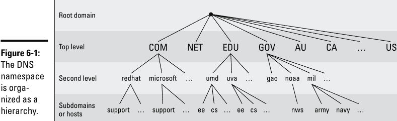

树的根是根域名，用单个点（`.`）表示。接下来是顶级域名（或根级域名）。顶级域名进一步分为二级域名，二级域名又可以拆分为更进一步的子域名。


顶级域名是固定的，包括如 `COM`、`NET`、`ORG`、`EDU`、`GOV` 和 `MILL` 等知名域名。这些是美国常用的顶级域名。这些顶级域名随着 20 世纪 90 年代初互联网的而出现。

另一组顶级域名用于国家。这些域名使用由国际标准化组织（缩写为 `ISO`，参见 `www.iso.org`）分配的两位代码。例如，美国的顶级国家代码是 `US`。在美国，许多地方政府和组织使用 `US` 域名。例如，`mcps.k12.md` 是美国马里兰州蒙特哥马里县公立学校的域名。

在该列表中，你可以添加自原始集合以来增加的通用顶级域名。这些包括 `BIZ`（用于商业）、`NAME`（用于家庭）、`MUSEUM`、`TRAVEL` 以及其他更多提议中的域名。

完全限定域名（`FQDN`）通过将子域名从低级到高级连接起来并使用点（`.`）作为分隔符构造而成。`REDHAT.COM` 是一个完全限定域名；`EE.EDU` 也是。这些每一个也可以指向特定的主机计算机。图 6-2 展示了完全限定域名的组成部分。

## 282 理解域名系统 (DNS)

图 6-2：`ee.umd.edu`

完全限定域名具有分层结构的组件。

| 宽 | 示例 |
| :--- | :--- |
| 顶级域名 | `edu` |
| 二级域名 | `umd` |
| 子域名或主机名 | `ee` |

域名是不区分大小写的。因此，就 DNS 而言，域名 `UMD`、`EDU` 和 `umd.edu` 都代表马里兰大学的域名。然而，规范做法是用全小写输入域名。

## 探索伯内核互联网域名 (BIND)

大多数 Unix 系统（包括 Linux）都带有 `bind` 系统 —— 一种广名的 DNS 实现。只要在 Linux 安装过程中选择了名称服务器软件包进行安装，就会安装 `BIND` 软件。


在 Debian、Ubuntu 和 Xrados 中，输入 `dpkg -l bind` 查看是否安装了 `BIND`。在 Fedora 和 SUSE 中，输入 `rpm -q bind` 查看是否安装了 `BIND` 包。

在 Debian 和 Ubuntu 中，输入 `apt-get install bind` 来安装 `BIND`。在 Fedora 中，以 root 身份登录，挂载 DVD 并使用 `cd /cdrom/Fedora/`。在 SUSE 中，使用 Yaast 软件管理。在 Xrados 中，运行 Xrados 网络，点击设置源。然后输入 `apt-get install bind` 安装服务器。

`BIND` 包含三个主要组件：

- `named` 守护进程（名称服务器），响应主机名和 IP 地址的查询
- 应用程序可用于将主机名解析为 IP 地址的解析器库
- 命令行 DNS 工具（DNS 客户端），如 `dig` 和 `host`，用户用于查询

接下来的章节将介绍这些 `BIND` 组件。后面的章节将解释如何配置解析器和名称服务器

## named —— BIND 服务器

`named` 守护进程是响应主机名和 IP 地址查询的名称服务器。根据配置文件和本地数据库，它提供答案或询问其他服务器

## 283 理解域名系统 (DNS)

缓存它们的响应。名称服务器还执行一种称为区域传输的操作，涉及在服务器之间复制数据。

名称服务器以三种模式运行：

- 主服务器：在这种情况下，名称服务器在磁盘上保留域的主副本。每个域名或子域名有一个主服务器。
- 从服务器：从区域服务器从主服务器复制域数据。一个域名可以有一个或多个从服务器。
- 缓存：缓存名称服务器加载几个权威服务器的地址并通过缓存响应获取所有数据。

解析器库

为主机名查找 IP 地址被称为解析主机名。网络感知应用程序（如 Web 浏览器或 FTP 客户端）使用解析器执行从名称到 IP 地址的转换。根据 `/etc/hosts.conf` 文件中的设置，解析器库使用 `/etc/hosts` 文件或进行 DNS 查询来解析主机名到 IP 地址。解析器查询 `/etc/resolv.conf` 文件中列出的名称服务器。

## 284 了解域名系统 (DNS)

DNS 实用程序

你可以使用 DNS 实用程序 —— `dig` 和 `host` —— 从 shell 提示符中交互式测试 DNS。这些实用程序是 DNS 客户端。你可以使用它们查询 DNS 数据库并调试你系统上设置的任何名称服务器。默认情况下，这些程序查询你系统 `/etc/resolv.conf` 文件中列出的名称服务器。

你可以使用 `dig`（Domain Internet Groper 程序）来查找域名的 IP 地址，反之亦然。例如，查找 `ftp.redhat.com` 的 IP 地址，输入：

```bash
dig ftp.redhat.com
```

`dig` 会非常详细地打印 DNS 查询结果。查看输出中标记为 `ANSWER SECTION` 的部分获取结果，该示例查询的如下所示：

```
; ANSWER SECTION:
ftp.redhat.com. 300 IN A 209.132.183.61
```

此输出意味着名称 `ftp.redhat.com` 指向 IP 地址 `209.132.183.61`。

使用 `dig` 进行反向查找（查找 IP 地址的主机名）同样简单。例如，查找 IP 地址 `209.132.183.61` 对应的主机名，输入以下：

```bash
dig -x 209.132.183.61
```

同样，答案出现在输出的 `ANSWER SECTION` 中，此示例显示如下：

```
; ANSWER SECTION:
61.183.132.209.in-addr.arpa. 600 IN PTR ftp.redhat.com.
```

在这种情况下，与 IP 地址 `209.132.183.61` 对应的主机名是 `ftp.redhat.com`。

你也可以使用 `host` 程序查询 DNS，它产生的输出格式较为紧凑。例如，这里是 `host` 查找主机名 IP 地址的典型用法：

此命令生成以下输出：

```
www.gao.gov has address 161.203.16.77
www.gao.gov mail is handled by 5 listserv.gao.gov.
```

## 285 配置 DNS

默认情况下，`hosts` 会打印 IP 地址和任何 MX 记录。这些记录列出了该主机的邮件处理程序的名称。

对于反向查找，使用 `-t ptr` 选项并将 IP 地址作为参数，如下：

```bash
host -t ptr 161.203.16.2
```

以下是 `host` 的回复：

```
2.163.201.161-in.arpa domain name pointer www.gao.gov.
```

在这种情况下，`hosts` 打印 PTR 记录（来自 DNS 数据库），该记录显示了与 IP 地址对应的主机名。（PTR 指指针，PTR 记录指定了与地址对应的名称。）

你可以尝试其他类型的记录，例如 CNAME（规范名称），如下所示：

```bash
host -cname www.ee.umd.edu
```

`host` 的响应为：

```
www.ee.umd.edu is an alias for ajclark.eng.umd.edu.
```

此输出表明 `www.ee.umd.edu` 的规范名称（或别名）是 `ajclark.eng.umd.edu`。

## 配置 DNS

你通过多个配置文件来配置 DNS。文件取决于你是否运行名称服务器，如果是，则取决于名称服务器的类型——缓存或主。无论你是否运行名称服务器，都需要某些配置文件。

## 配置解析器

你不需要在系统上运行名称服务器即可使用 DNS 客户端（`dig` 和 `host`）。你可以使用它们查询你域的名称服务器。通常，你的 ISP 会提供这些信息。在 `/etc/resolv.conf` 中列这些名称服务器的 IP 地址 —— 解析器读取此文件来确定如何解析主机名。该文件的格式为

```
domain your-domain.com
search your-domain.com
nameserver A.B.C.D
nameserver X.Y.Z.W
```

## 286 配置 DNS

其中 `A.B.C.D` 和 `X.Y.Z.W` 是你的 ISP 提供的主备名称服务器的 IP 地址（点分隔的数字地址，如 `192.168.0.1`）。

`domain` 列表列出了本地域名。`search` 行指定了搜索主机名的域名（通常情况下，你将自己的域名放在 `search` 行中）。列出的域名会在解析器库尝试解析它之前附加到任何主机名之前。例如，如果你查找一个名为 `mailbox` 的主机，解析器库会尝试 `mailbox.your-domain.com`，如果失败，它会尝试 `mailbox`。`search` 行适用于你尝试访问的任何主机名。例如，如果你尝试访问 `www.redhat.com`，解析器首先尝试 `www.redhat.com.your-domain.com`，然后是 `www.redhat.com`。


另一个重要的配置文件是 `/etc/hosts.conf`。此文件告诉解析器在尝试解析主机名时做什么。一个典型的 `/etc/hosts.conf` 文件包含以下行：

```
order hosts, bind
```

此命令告诉解析器首先咨询 `/etc/hosts` 文件，如果解析器没有找到记录，则查询 `/etc/resolv.conf` 中列出的名称服务器。`/etc/hosts` 文件列出了任何主机名及其 IP 地址。这里是 `/etc/hosts` 文件中的典型行：

```
127.0.0.1  localhost
```

此行将 IP 地址 `127.0.0.1` 分配给主机名 `localhost`。在 Linux 内核的最新版本中 —— 使用 glibc 版本 2 的内核 —— `/nsswitch.conf` 文件控制解析器库、NIS 以及如 `/etc/hosts` 文件如何相互交互。例如，`/nsswitch.conf` 指定解析器首先尝试 `/etc/hosts`，然后是 NIS，最后是 dns：

```
hosts: dns
```

要获取更多关于 `/etc/nsswitch.conf` 的信息，请在终端输入 `man nsswitch.conf`。

## 配置缓存服务器

缓存服务器是一个简单实用的名称服务器，它查找主机名查询（使用其他名称服务器），然后将其存在缓存中以便下次使用。此缓存服务器可以缩短访问你最近访问的主机的时间。

当安装 BIND 时，缓存服务器的配置文件也会安装，因此无需过多工作即可启动缓存服务器。此部分描述了配置文件以及你启动缓存服务器需要做的操作。

## `/etc/named.conf` 文件

你需要的第一个配置文件是 `/etc/named.conf`（在 Fedora 和 SUSE、Debian 和 Ubuntu 中，BIND 配置名为 `/etc/bind/named.conf`）。名称服务器在安装时会读取此配置。如果你安装了 BIND，就有这个文件。这里有一个 `/etc/named.conf` 示例：

```
options {
    directory "/var/named";
    dump-file "/var/named/data/cache_dump.db";
    statistics-file "/var/named/data/named_stats.txt";
    /* 如果你想要通信的名称服务器之间存在防火墙，可能需要取消 query-source 指令。之前的 BIND 版本总是使用端口 53 进行查询，但 BIND 8.1 默认使用非特权端口。 */
    query-source address port 53;
};

/* 缓存名称服务器配置 */
controls {
    127.0.0.1 allow { localhost };
    keys { rndc };
};

zone . {
    type hint;
    file "named.ca";
}
zone "localdomain" {
    type master;
    file "localdomain.zone";
    allow-update (none);
}
zone "localhost" {
    type master;
    file "localhost.zone";
    allow-update (none);
}
zone "127.0.1.in-addr.arpa" {
    type master;
    file "named.local";
    allow-update (none);
}
zone "0.0.0.0.0.0.0.0.0.0.0.0.0.0.0.0.0.ip6.arpa" {
    type master;
    file "named.ip6.local";
};
allow-update { none };
};
zone "255.in-addr.arpa" IN {
    type master;
    file "named.broadcast";
    allow-update (none);
};
zone "0.in-addr.arpa" IN {
    type master;
    file "named.zero";
    allow-update (none);
};
include "/etc/rndc.conf";
```

注释是 C 风格 (`/* ... */`) 或 C++ 风格（以 `//` 开头）。该文件包含包含在大括号 `{ ... }` 中并以分号结束的块语句。块语句包含其他语句，每个语句以分号结尾。

此 `/etc/named.conf` 文件以带有多个选项的 `options` 语句开头。`directory` 选项指示去查找配置文件中出现的所有文件。在这种情况下，named 在 `/var/named` 目录中查找行。

`/etc/named.conf` 中的 `directory` 选项指向 `/var/lib/named` 目录，这意味着所有其他 BIND 配置都在 `/var/lib/named`。在 Debian 和 CentOS 中，配置文件指定在 `/etc/bind` 目录。

`/etc/named.conf` 中的 `controls` 语句包含了安全信息，`rndc` 命令可以连接到端口 953 上的 named 服务并与之交互。在这种情况下，`controls` 语句包含以下行：

```
inet 127.0.0.1 allow { localhost }; keys { rndc };
```

此命令表示 `rndc` 可以通过 `rndc` 密钥从 `localhost` 连接（`/etc/rndc.key` 文件定义了要使用的密钥和加密算法）。

`rndc`（远程守护控制）工具是旧版 `ndc`（名称守护控制器）工具的继任者，后者通过特殊通道（监听消息的 TCP 端口）发送消息来控制 named 服务器。`rndc` 工具使用加密密钥向 named 服务器进行身份验证。named 服务器具有相同的加密密钥，以便它可以通过 `rndc` 解码身份信息。

在 `options` 语句之后，`/etc/named.conf` 包含多个 `zone` 语句，每个语句都包含在大括号中并以分号结束。每个 `zone` 定义了一个区域。第一个区域名为 `.`（根区域）；它是一个提示区域（hint zone），指定了根名称服务器。（当 DNS 启动时会读取此配置）

（服务器启动，它使用提示来查找根服务器并获取最新的根服务器列表。）

`/etc/named.conf` 中的两个 `zone` 语句是主区域。（主区域简单来说就是域名的数据主副本）。Internet 类区域（由 `IN` 关键字指示）的主区域语句的语法如下：

```
zone "zone-name" IN {
    type master;
    file "zone-file";
    . other optional statements .
}
```

`zone-name` 是区域名称，`zone-file` 是包含该区域资源记录（RR）——即数据库条目——的区域文件。接下来的两个部分将描述区域文件格式和资源记录格式。

## 区域文件格式

区域文件通常从若干条指令开始，每个指令都以美元符号（`$`）开头，后紧跟一个关键字。两个常用的指令是 `$TTL` 和 `$ORIGIN`。

例如，行：

```
$TTL 86400
```

使用 `$TTL` 指令为未定义 TTL 的记录设置默认生存时间（TTL）。该值的单位是秒，有效的 TTL 范围是 0 到 2147483647 秒。在这种情况下，该指令将默认 TTL 设置为 86400 秒（或一天）。

`$ORIGIN` 指令设置附加到未限定记录末后的域名。例如，以下 `$ORIGIN` 指令将域名设置为 localhost。

```
$ORIGIN localhost.
```

如果没有 `$ORIGIN` 指令，则初始的 `$ORIGIN` 与 `/etc/named.conf` 文件中 `zone` 关键字之后的区域名称相同。

指令之后，区域文件包含一个或多个资源记录。它们遵循特定的格式，该格式将在下一节概述。

## 资源记录 (RR) 格式

在理解并智能地处理区域文件之前，你必须理解资源记录的格式。每个资源记录（RR）具有以下格式。（可选字段放在方括号中。）

www.it-ebooks.info


# 290 配置 DNS

```
[domain] [ttl] [class] type data ;comment]
```

字段由制表符或空格分隔，并可能包含一些特殊字符，例如用于域的 `@` 和用于指示注释开始的分号（`;`）。

第一个字段必须从行的第一个字符开始，用于标识域。你可以使用 `@` 为此记录使用当前的 `ORIGIN` 名称。如果你对同一个域名有多个记录，请留空第一个字段。


可选的 `ttl` 字段指定生存时间（Time To Live）——数据可以缓存并被认为有效的持续。你可以使用以下格式之一指定持续时间：

- `N`，其中 `N` 是秒
- `NW`，其中 `N` 是周
- `ND`，其中 `N` 是天
- `NH`，其中 `N` 是小时
- `NM`，其中 `N` 是分钟
- `NS`，其中 `N` 是秒

字母 `W`, `D`, `H`, `M`, 和 `S` 可以写成小写。因此，你可以写成 `86400` 或 `1D`（或 `1d`）来表示一天的持续时间。你还可以组合字母来指定更精确的持续时间，例如用 `5w6d16h` 表示 5 周、6 天和 16 小时。

`class` 字段指定网络类型。最常用的值是 `IN`，代表 Internet。

资源记录中的下一个是 `type` 字段，它表示记录的类型（如 `SOA`, `NS`, `A` 或 `PTR`）。表 6-1 列出了 DNS 资源记录类型。接下来是 `data` 字段，其内容取决于 `type` 字段。

### 表 6-1 DNS 资源记录类型

| 类型 | 名称 | 说明 |
|---|---|---|
| A | IPv4 到 IPv6 转换地址 | 使用适用于从 IPv4 到 IPv6 转换的格式指定与名称对应的 IPv6 地址 |
| AAAA | IPv6 地址 | 指定与名称对应的 IPv6 主机地址 |
| AS | 地址 | 指定与主机名对应的 IP 地址 |

# 配置 DNS

| 类型 | 名称 | 说明 |
| --- | --- | --- |
| CERT | 数字证书 | 持有数字证书 |
| CNAME | 规范名称 | 为主机名定义别名或昵号 |
| DNAME | 委托名称 | 将指定的域名替换为另一个要查找的名称 |
| HINFO | 主机信息 | 识别主机的硬件和操作系统 |
| KEY | 公钥 | 存储与 DNS 名称关联的密钥 |
| MX | 邮件交换器 | 识别接收该域邮件的主机（用于路由电子邮件） |
| NS | 服务器 | 识别区域的权威域名服务器 |
| PTR | 指针 | 指定与地址对应的名称（用于反向映射——将地址转换为主机名） |
| RP | 负责人 | 提供提供该域的技术联系人名称 |
| SIG | 签名 | 包含在安全 DNS 中经过认证的数据（详见 RFC 2535） |
| SOA | 权威起始 | 表明后续所有记录对于该区域都是权威的 |
| SRV | 服务 | 列出该域提供的已知网络服务 |
| TXT | 文本 | 在 DNS 中包含注释和其他信息 |

读取区域文件中的资源记录，至少包括 `SOA`、`A`、`PTR` 和 `MX`，这些是最常用的几种记录。（你可以在 Debian 的 `/etc/bind` 目录、Fedora 的 `/var/named` 目录以及 SUSE 的 `/var/lib/named` 目录下找到它们。）接下来通过一个示例对这些记录进行简要描述。一个典型的 `SOA` 记录如下：

```
@ IN SOA root {
4 ; serial
```

# 配置 DNS

```
3H; refresh -- 3 小时
15M; retry -- 15 分钟
1W; expiry -- 1 周
1D; minimum -- 1 天
```

第一个字段指定域 `@`，意味着当前域（默认是区域名称，显示在 `/etc/named.conf` 文件中）。下一个字段指定记录的 TTL。`class` 字段设置为 `IN`，代表 Internet。`type` 字段指定记录类型为 `SOA`。其余字段构成了 `SOA` 记录。数据包括主域名服务器的名称（在此例中为 `@`，或当前域）、技术联系人的电子邮件地址以及括号内的时间。

`NS` 记录指定区域的权威域名服务器。一个典型的 `NS` 记录如下：

`-3600 IN NS A.ROOT-SERVERS.`

在这种情况下，`NS` 记录列出了根的权威域名服务器（注意，Time To Live 字段指定该记录有效为 3600 秒）。`class` 是 `IN`，代表 Internet。`type` 字段指定记录类型为 `NS`。`final` 字段列出了 `A.ROOT-SERVERS.` 的地址。`A` 记录指定与名称对应的 `198.41.0`。

```
A.ROOT-SERVERS.NET 3600 198.41.0
```

在这种情况下，没有指定 `class`，因为默认是 `IN`。`PTR` 记录用于反向映射——将地址转换为名称。考虑以下示例：

`-1 PTR localhost.`

这条记录来自名为 `0.127.in-arpa` 的文件。因此，该记录表示地址 `127.0.0` 对应 `localhost`。

`MX` 记录指定接收该域邮件的主机名称。例如，这里有一个典型的 `MX` 记录：

```
server7 IN 10 mailhub.com
```

# 配置 DNS

此记录表示指向 `server7` 的邮件发送到 `mailhub.com`（这是一个邮件交换器）。`10` 是优先值。对于具有不同优先值的 `MX` 记录，会优先尝试优先值较低的。

有了资源记录的信息，你可以通过区域文件查看缓存域名服务器。

## 根区域文件

Internet 有 13 个根服务器；大多数根服务器位于美国。关于 13 个根服务器的信息位于 `/etc/named.conf` 中 `name` 语句引用的区域文件（Fedora 为 `/var/named/`，Debian 为 `/etc/bind/`，SUSE 为 `/lib/named/`）。以下列表显示了根区域：

- 该文件包含初始化 Internet 缓存服务器所需的根服务器信息（例如在 BIND 配置文件 "file" 中引用此文件）。
- 该文件通过匿名 FTP 在服务器 `INTERNIC.NET` 的 `domain/named.cache` 提供。
- `RS.INTERNIC.NET`
- 最后更新：2004年1月29日
- 根区域版本：2004012900
- 原 `NS.INTERNIC.NET`:
  `360000 IN NS A.ROOT-SERVERS.NET.`
  `A.ROOT-SERVERS.NET. 360000 A 198.41.0.4`
- 原 `NS1.ISI.EDU`:
  `360000 IN B.ROOT-SERVERS.NET.`
  `B.ROOT-SERVERS.NET. 360000 A 192.228.79.201`
- 原 `C.PSI.NET`:
  `360000 IN C.ROOT-SERVERS.NET.`
  `C.ROOT-SERVERS.NET. 360000 A 192.33.4.112`
- 原 `TERP.UMD.EDU`:
  `360000 IN D.ROOT-SERVERS.NET.`
  `D.ROOT-SERVERS.NET. 360000 A 128.8.10.90`
- 原 `NS.NASA.GOV`:
  `360000 IN E.ROOT-SERVERS.NET.`
  `E.ROOT-SERVERS.NET. 360000 A 192.203.230.110`

# 配置 DNS

```
; formerly NS.ISC.ORG
;
 360000 NS F.ROOT-SERVERS.NET
F.ROOT-SERVERS.NET 360000 A 192.5.5.241
;
 formerly NS.NIC.DDN.MIL
;
 360000 NS G.ROOT-SERVERS.NET
G.ROOT-SERVERS.NET 360000 A 192.112.36.4
;
 formerly AOS.ARMY.MIL
;
 360000 NS H.ROOT-SERVERS.NET
H.ROOT-SERVERS.NET 360000 A 128.63.2.53
;
 formerly NS.NORDU.NET
;
 360000 NS I.ROOT-SERVERS.NET
I.ROOT-SERVERS.NET 360000 A 192.36.148.33;
; operated by Verisign, Inc.
; 360000 NS J.ROOT-SERVERS.NET
J.ROOT-SERVERS.NET 360000 A 192.58.128.30;
; operated by RIPE NCC
; 360000 NS K.ROOT-SERVERS.NET
K.ROOT-SERVERS.NET 360000 A 193.0.142.29;
; operated by ICANN
; 360000 NS L.ROOT-SERVERS.NET
L.ROOT-SERVERS.NET 360000 A 198.32.64.12;
; operated by WIDE
; 360000 NS M.ROOT-SERVERS.NET
M.ROOT-SERVERS.NET 360000 A 202.127.33;
 End of File
```


此文件包含 NS 和 A 记录，指定了根区域权威名称服务器的及其地址（由每条记录第一字段中的 NS 指明）。文件中的注释行以分号开头。这些注释提供了有关根名称服务器位置的提示。对于任何名称服务器，此文件都是必要的，因为名称服务器必须能够到达一个根服务器。

### localhost.zone 文件

`/etc/named.conf` 文件包含一个针对 localhost 区域的区域语句，指定区域文件为 `localhost.zone`。该文件在 Fedora 中位于 `/var/named` 目录，在 SUSE 中位于 `/var/lib/named` 目录，在 Debian 和 Ubuntu 中位于 `/etc/bind/db.local`。以下是 `localhost.zone` 文件包含的内容：

```
$TTL 86400
@ORIGIN localhost.
@ SOA root (
19902700 ; serial
28800 ; refresh
14400 ; retry
360000 ; expiry
) ; minimum
IN A 127.0.0.1
```

该区域文件以 `$TTL` 指令开头，它为未定义 TTL 的后续记录设置默认 TTL（生存时间）为 86400 秒。接下来，`$ORIGIN` 指令将域名设置为 localhost。在这两个指令之后，`localhost.zone` 文件包含三个记录（RR）：一个 SOA 记录、一个 NS 记录和一个 A 记录。SOA 和 NS 记录指定 localhost 为该区域的主权威名称服务器。A 记录指定 localhost 的地址为 127.0.0.1。

### 用于反向映射 127.0.0.1 的区域文件

`/etc/named.conf` 文件中的第三个区域语句指定了一个名为 `1.0.0.127-in-addr` 的反向映射区域。为此，区域文件在 Fedora 中为 `/var/named/127`，在 SUSE 中为 `/var/lib/named/127.0.0.1`，在 Debian 和 Ubuntu 中为 `/etc/bind/db.127`。该文件包含以下内容：

```
$TTL 86400
@ IN SOA localhost. root.localhost. (
19902700 ; Serial
28800 ; Refresh
14400 ; Retry
360000 ; Expire
86400 ) ; Minimum
IN NS localhost.
IN PTR localhost.
```

SOA 和 NS 记录指定 localhost 为主名称服务器。PTR 记录指定 localhost 为对应地址 127.0.0.1 的名称。SOA 记录还显示 `root.localhost` 为该域名技术联系人的电子邮件地址。DNS 区域文件使用 `user.host.`（注意末尾的点）格式作为电子邮件地址。在向联系人发送任何邮件时，你必须将第一个点替换为 `@` 并删除最后一个点。

### 缓存名称服务器：启动与测试

在启动缓存名称服务器的配置文件后，你可以启动名称服务器并查看其运行情况。


# 296 配置 DNS

要启动名称服务器，以 root 身份登录并在 Fedora 和 SUSE 中输入 `/etc/init.d/named start`。为了确保名称服务器在每次重启系统时启动，在 Fedora 和 SUSE 中输入 `chkconfig --level 3 named on`。在 Debian、Ubuntu 中，输入 `/etc/init.d/bind9` 来启动名称服务器。

`named` 服务器将诊断日志消息写入 `/var/log/messages` 文件中。启动 `named` 后，你可以通过文本编辑器打开 `/var/log/messages` 来检查日志消息。如果没有来自 `named` 的错误消息，你就可以继续测试名称服务器。

在尝试缓存名称服务器之前，你必须将该名称服务器指定为你的主服务器。要这样做，请确保 `/resolv.conf` 文件的第一行是以下内容：

```
nameserver 127.0.0.1
```

现在你可以使用 `host` 来测试名称服务器。例如，要使用 localhost 上的缓存名称服务器查找 `www.gov` 的地址，输入以下命令：

```
host www.gov localhost
```

以下是 `host` 命令的输出：

```
Using domain server:
Name: localhost
Address: 127.0.0.1#53
Aliases:
www.gov has address 127.0.0.1
```

如输出所示，`host` 命令使用 localhost 作为 DNS 服务器并返回 `www.gov` 的地址。如果你得到了类似这样的输出，说明缓存名称服务器正在正常运行。

### 配置主名称服务器

配置主名称服务器的最佳方法是从配置缓存名称服务器开始（如前面的章节所述）。然后，为你想要让此名称服务器作为主服务器的域名添加主区域。例如，假设你想为 `server.net` 域名定义一个主名称服务器。以下是在 Fedora 系统上（登录 root 后）配置该主服务器的步骤：

1. 向 `/etc/named.conf` 文件中添加以下区域语句：

```
zone "server.net" {
type master;
file "server.zone";
}
```

2. 创建区域文件 `/var/named/server.zone` 并包含以下行：

```
TTL 86400
@ORIGIN server.net.
@ SOA root.server.net (
19902700 ; serial
28800 ; refresh
14400 ; retry
360000 ; expiry
86400 ) ; minimum
@ NS server.net.
IN A 192.168.0.2
server A 192.168.0.2
```

3. 创建区域文件 `/var/named/0.0.168.192.in-addr.arpa` 并包含以下行：

```
TTL 86400
; zone name is 0.0.168.192.in-addr.arpa
@ SOA server.net.root.server.net (
1 ; Serial
28800 ; Refresh
14400 ; Retry
360000 ; Expire
86400 ) ; Minimum
@ NS server.net.
2 PTR server.net.
```

4. 使用以下命令重启 `named` 服务器以测试新配置：

```
/etc/init.d/named restart
```

5. 使用 `dig` 或 `host` 查询 DNS 服务器。例如，使用 `host` 检查在 localhost 上运行的 DNS 服务器的 `server.net`：

```
host server.net localhost
```

此命令输出：

```
Using domain server:
Name: localhost
Address: 127.0.0.1#53
Aliases:
server.net has address 192.168.0.2
```

如果你想使用 `dig` 查询 DNS 服务器，输入以下命令：

```
dig @localhost server.net
```

该 `@localhost` 部分指定了 `dig` 连接的 DNS 服务器。当你成功使用 `dig` 连接 DNS 服务器时，你可以要求该服务器执行更复杂的操作。例如，这里是使用 IP 地址 192.168.0.2 进行反向查找的命令：

```
host 192.168.0.2 localhost
```

此命令显示如下输出：

```
Using domain server:
Name: localhost
Address: 127.0.0.1#53
Aliases:
2.0.168.192.in-addr.arpa domain name pointer server.net
```

# 第1章：基础系统管理简介

在本章中

- 介绍 GUI 系统管理工具
- 成为 root 用户
- 理解系统启动过程
- 梳理系统配置文件
- 通过 `/proc` 文件系统查看系统信息
- 监控系统性能
- 设备管理
- 任务调度

系统管理（或简称 sysadmin）是指为了保持计算机运行而必须完成的任何工作。系统管理员（sysadmin）就是负责处理这些任务的人。

如果你在家里或小型办公室运行 Linux，那么你很可能就是自己系统的系统管理员。或者，你可能是整个 Linux 系统的管理员。无论你的职位或头衔如何，本章都将向你介绍基础系统管理程序，并展示如何执行一些常见任务。

# 梳理系统管理任务

什么是系统管理任务呢？口头回答可以是任何让你保持系统良好运行的工作。不过更准确地说，系统管理员的职责包括：


# 系统管理任务概述

- 添加和删除用户账户：你必须添加新用户账户并删除不再必要的账户。如果用户忘记了密码，你必须更改密码。
- 管理打印系统：你必须开启或关闭打印队列，检查打印队列状态，并在必要时删除打印任务。
- 安装、配置和升级系统及各种工具：你必须安装或升级 Linux 系统的部分以及作为操作系统其他软件。
- 安装新软件：你必须安装各种格式的软件，如 `RPM` 或 `DEB`。你还需要下载并解包源码格式的软件——并从源码构建可执行程序。
- 管理硬件：有时你必须添加新硬件和驱动程序以便设备正常工作。
- 备份：你必须备份文件，无论是到 `DVD` 驱动器、`USB` 闪存、外硬盘还是磁带。
- 挂载和卸载文件：例如，当你需要访问 `CD-ROM` 文件时，必须将 `CD-ROM` 的文件系统挂载到 Linux 系统的一个目录上。你可能还需要挂载归档柜里的旧软盘，然后将其卸载并格式化。
- 任务自动化：你必须调度 Linux 任务以自动（在特定时间）或定期（按固定间隔）执行。
- 监控你的性能：你必须密切关注系统性能，查看处理器大部分时间花在哪里，以及查看系统中空闲和已用内存量。
- 启动和关闭系统：启动系统只需为 `PC` 通电，但在关闭 Linux 时你必须小心。如果你的系统设置了图形登录界面，可以通过从登录界面选择菜单项来执行关闭操作。否则，使用 `shutdown` 命令在关闭 `PC` 电源之前停止所有程序。
- 监控网络状态：如果你有网络连接（无论是局域网、`DSL` 线或电缆调制调器连接），你可能想要检查各种网络接口的状态，并确保网络连接运行正常。
- 设置主机和网络安全：你必须确保系统文件受到保护，并确保你的系统能够防御网络攻击。
- 监控安全：你必须关注所有入侵情况，通常通过检查日志文件。

这是一个很长的任务列表！本章并未涵盖所有这些任务，但本微型书籍的其他部分描述了大部分此类任务。本章的重点是基础知识，例如使用 `GUI` 工具、解释如何成为 `root`（超级用户）、描述系统配置文件，并向你展示如何监控系统性能、管理设备以及设置定期任务。

## 一些 GUI 系统管理工具

每个 Linux 发行版都带有用于执行系统管理任务的 `GUI` 工具。这些 `GUI` 工具会提示你输入，然后返回执行该任务所需的 Linux 命令。但它们之间存在细微差异，随着时间的推移，这些工具变得越来越趋同。

例如，图 I-1 显示了 `SUSE` 中提供的 `YaST` 控制中心，图 I-2 显示了 `Ubuntu` 中的设置界面。除了 `YaST` 有更多选项外，你应该注意到这些界面之间有很大的相似性。

图 1-1：`YaST` 控制中心是你在 `SUSE` 中许多系统管理员任务的起点。

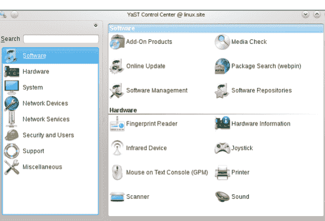

`YaST` 控制中心的左侧显示了你可以执行的任务类别的图标。右侧显示当前选择类别下特定任务的图标。当你点击 `YaST` 控制中心右侧的图标时，会出现一个新的 `YaST` 窗口并让你执行该任务。

从 `YaST` 控制中心的条目可以看出，它确实是为了你所有的系统管理杂务提供“一站式服务”。

图 1-3 显示了 `Fedora` 中的设置界面，你可以看到它与其他发行版的图标略有不同，但管理员处理的大多数主要任务都可以在这里完成。


图 1-2：`Ubuntu` 的设置提供了许多与 `YaST` 类似的工具。


图 1-3：`Fedora` 的设置界面与 `Ubuntu` 有所不同。

## 如何成为 root

由于 `YaST` 是所有工具中最完整的，表 1-1 列出了控制中心中常见的任务。

| 表 1-1 | `YaST` 控制中心中按分类划分的任务 |
|---|---|
| 此类别 | 允许你配置或管理以下内容 |
| 软件 | 在线更新、安装源、在 `Xen` 环境中安装、安装到目录、介质检查、补丁 `CD` 更新、软件管理、系统更新 |
| 硬件 | 蓝牙、`CD-ROM` 驱动器、磁盘控制器、显卡和显示器、硬件信息、`IDE DMA` 模式、红外设备、摇杆、键盘布局、鼠标、打印机、扫描仪、声音、电视卡 |
| 系统 | `/etcsysconfig` 编辑器、引导加载程序配置、启动或救援、日期和时间、`LVM`、语言、`PCI` 设备、分区器、电源管理、配置文件管理器、系统备份、系统恢复（运行级别） |
| 网络设备 | `DSL`、传真调制调器、网卡、电话应答机 |
| 网络服务 | `DHCP` 服务器、`DNS` 服务器、`DNS` 主机和名称、`HTTP` 服务器、主机名、`Kerberos` 客户端、`LDAP` 客户端、邮件传输代理、`NFS` 客户端、`NFS` 服务器、`NIS` 客户端、`NIS` 服务器、网络服务 (`xinetd`)、代理、远程管理、路由、`SL` 浏览器、`Samba` 客户端、`Samba` 服务器、`FTP` 服务器 |
| 安全与用户 | 防火墙、组管理、本地安全、用户管理 |
| 支持 | 查找文档和帮助资源的地方 |
| 其他 | 自动安装、提交支持查询、厂商驱动 `CD`、查看启动日志、查看系统日志 |

你必须以 `root` 执行系统管理任务。`root` 用户是超级用户，是唯一拥有对系统进行任何操作权限的账户。

常识告诉你不应该以 `root` 身份登录。当你是 `root` 时，一个错误就可能轻易删除所有文件——尤其是当你输入命令时。例如，你输入命令 `rm *.html` 来删除所有 `.html` 扩展的文件。但如果你不小心在星号 (`*`) 之后按了空格键？`shell` 会将命令识别为 `rm * .html`——由于星号匹配任何文件名——从而删除当前目录下的所有内容。在它发生在你身上之前，这似乎是不可信的！

### 306 如何成为 root 用户

#### 使用 su - 命令

如果你以普通用户的身份登录，如何执行管理任务呢？嗯，你可以临时变成 `root` 用户。如果你在终端窗口或控制台操作，输入

```
su -
```

然后在提示符后输入 `root` 密码。从现在起，你就是 `root` 用户了。执行你需要做的任何操作。要回到原来的身份，输入

```
exit
```

就这样！就简单。

顺便说一下，`Knoppix` 有 `root` 用户但没有 `root` 密码，因此你只需在终端窗口的 `shell` 提示符处输入 `su -` 即可变成 `root`。`Ubuntu` 没有 `root` 用户。要在 `Ubuntu` 中执行任何需要 `root` 权限的任务，你必须使用 `sudo` 后接命令，并在提示时提供你的普通用户密码。

在《安全迷你书》中将更详细讨论这个问题，但你可以通过配置文件（或 `YaST` 界面，如图 1-4 所示）来控制谁可以使用 `sudo`。

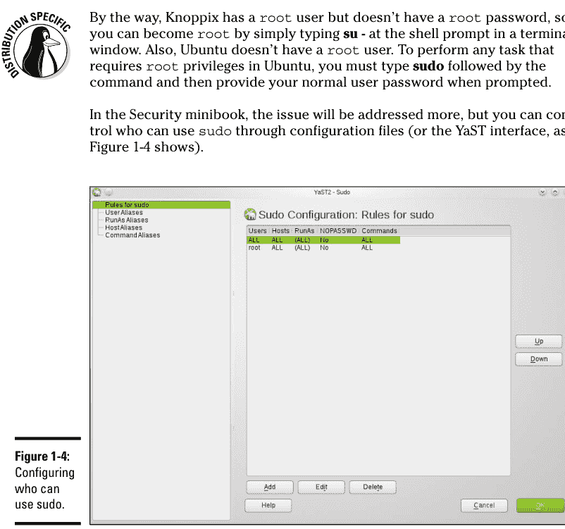

图 1-4：配置谁可以使用 `sudo`。

#### 为 GUI 工具变为 root 用户

大多数 Linux 发行版都包含了用于执行系统管理的 `GUI` 工具。如果你使用这些 `GUI` 工具中的任何一个执行 `root` 权限的任务，该工具通常会弹出一个对话框提示你输入 `root` 密码，如图 1-5 所示（`Ubuntu` 除外，其 `GUI` 工具提示输入普通用户密码）。只需输入密码并按回车。如果你不想使用该工具，点击“取消”。

图 1-5：输入 `root` 密码并按回车获取 `root` 权限。

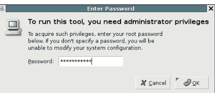

书籍 W

第一章

## 从忘记 root 密码中恢复

执行系统管理任务，你必须知道 `root` 密码。如果忘记了 `root` 密码怎么办？不用担心。按照以下步骤重置 `root` 密码：

- 1. 重启电脑（在退出 `GUI` 界面时重启）或像往常一样电源。一旦看到显示操作系统名称的图形 `GRUB` 启动器界面，就可以启动。如果你的系统是 `LILO` 启动器，按 `Ctrl+X`，在启动提示符处输入 `linux` 并按回车。然后进行第 4 步。如果重启时没有看到图形化加载器，它可能没有安装（这在选择安装 Live `CD` 时偶尔会发生）。如果是这种情况，建议从 `CD` 重新安装。
- 2. 如果你安装了多个操作系统，使用方向键选择 Linux 作为你的操作系统并按 `A` 键。`GRUB` 会提示你输入要添加到其默认启动命令中的指令。
- 3. 按下空格键，然后输入 `single` 并按回车。Linux 将像往常一样启动，但在不需要登录的单用户模式下。Linux 启动后，你会看到如下的命令行提示符：

```
sh-3.00#
```

- 4. 输入 `passwd` 命令按所示更改 `root` 密码：

```
sh-3.00# passwd
Changing password for user root.
New password:
```

- 5. 输入你想使用的新 `root` 密码（屏幕上不会显示）并按回车。Linux 会再次要求输入密码，如下：

```
Retype new password:
```

- 6. 输入密码并按回车。如果你两次输入的密码相同，`passwd` 命令将成功更改 `root` 密码。


- 7. 现在输入并按回车重启电脑。Linux 启动后，会显示熟悉的登录界面。你现在可以使用新密码以 root 身份登录。


> 请确保你的 Linux 电脑在物理上是安全的。任何访问你 Linux 电脑的人都可以简单地重启、设置新的 root 密码，并对系统进行随所欲的操作。防止重置密码的另一种方法是设置 GRUB 密码，这会导致 GRUB 在启动 Linux 之前需要有效的密码。当然，你必须记得每次访问系统时都要输入 GRUB 密码！

## 理解 Linux 如何启动

Linux 启动进程的顺序非常重要。你可以利用这些知识来启动和停止服务，例如 Web 服务器和网络文件系统 (`NFS`)。接下来的章节将为你提供 Linux 如何启动以及启动初始进程`set`的概述。这些章节还将让你熟悉 Linux 系统上启动各种服务的 shell 脚本。

## 理解 init 进程

当 Linux 启动时，它会从硬盘加载并运行内核操作系统程序。名为 `init` 的进程会启动你 Linux 系统上的初始进程集。

## 理解 Linux 如何启动

要查看系统当前运行的进程，输入

```bash
ps ax | more
```

你将得到一个如下所示的列表：

```
PID TTY STAT TIME COMMAND
1 ? S 0:22 init [2]
```

第一列标题为 PID，显示每个进程的数字。PID 代表进程 ID（标识符）由 Linux 内核分配的顺序数字。进程列表中的第一个项目（PID 为 1）是 `init` 进程。它是第一个进程，并启动了你 Linux 系统中的所有其他进程。

`init` 进程依赖于：

- 运行级别（run level），一个标识系统状态的数字。
- `/etc/initab` 文件的内容，指定在特定运行级别运行哪些进程。
- `/etc/init.d` 目录下的脚本文件。

大多数发行版使用七个运行级别 —— 0 到 6。运行级别的含义因发行版而异。下表显示了运行级别的含义。


| 表 1-2 | 级别含义 |
| :--- | :--- |
| 0 | 关闭系统。 |
| 1 | 单用户模式（无需登录）。 |
| 2 | 多用户模式（默认运行级别）。 |
| 3 | 多用户模式（文本登录）。 |
| 4 | 多用户模式（通常未使用）。 |
| 5 | 多用户模式（图形登录）。 |
| 6 | 重启系统。 |

## 理解 Linux 如何启动

当前的运行级别以及 `initab` 文件的内容决定了 `init` 启动哪些进程。Debian 和 Ubuntu 的默认运行级别是 2。在 Fedora 和 SUSE 中，级别 3 用于文本登录，5 用于图形登录。你可以通过编辑 `initab` 文件中的行来更改运行级别。

要检查当前运行级别，在终端输入以下命令：

```bash
/sbin/runlevel
```

在 Debian 中，`runlevel` 命令的输出如下：

- N 2

输出的第一个字符显示上一个运行级别（N 表示上一个运行级别），第二个字符显示当前运行级别。在这种情况下，系统是在运行级别 2 下启动的。如果你在 Fedora 的图形桌面中，`runlevel` 命令应显示当前运行级别为 5。

## 检查 /initabb 文件

`/initabb` 文件是理解 `init` 在各种级别下启动进程的关键。你可以通过 `more` 命令查看文件内容，如下：

```bash
more /etc/initabb
```

使用 `more` 命令查看 `/initabb` 文件内容不需要 root 权限。

要解释 `initabb` 文件的内容，请遵循以下步骤：

- 1. 查找包含 `initdefault` 短语的行。

这是 Debian 系统 `/initabb` 文件中的该行：

`id2:initdefault:`

该行指定了默认运行级别。在这种情况下，它是 2。
- 2. 找到所有指定在级别 2 下运行的行。

在前列之间有 2 的行。这是 Debian 中的一个相关行：

`l2:wait:/etc/init.d/rc 2`

该行指定 `init` 执行 `/etc/init.d/rc` 并带有 2 作为参数。

## 理解 Linux 启动过程 311

`/etc/inittab` 文件中的每个条目都说明了在一个或多个运行级别（run levels）下执行的操作——你只需要列出进程运行的所有运行级别即可。`inittab` 有四个字段——用冒号分隔——格式如下：

```
id:runlevels:action:process
```

表 1-3 显示了每个字段的含义。

| 表 1-3 | 每个 inittab 条目中的字段 |
| :--- | :--- |
| 字段 | 含义 |
| id | 唯一的单字符或双字符标识符。`init` 进程在内部使用此标识。你可以使用任何想要的标识符，只要不在同一行中使用相同的标识符即可。 |
| runlevels | 一个由零或多个字符组成的序列，每个字符表示一个运行级别。例如，如果 `runlevels` 字段为 12345，则该条目适用于 1 到 5 的每个运行级别。如果 `action` 字段设置为 `sysinit`、`boot` 或 `bootwait`，则忽略此字段。 |
| action | `init` 进程对该条目执行的操作。例如，如果此字段为 `initdefault`，则 `init` 将 `runlevels` 字段解释为默认运行级别。如果此字段设置为 `wait`，`init` 会启动 `process` 字段中编写程序或脚本并等待直到进程退出。 |
| process | `init` 启动的脚本或程序的名称。`action` 字段的某些设置不需要 `process` 字段。例如，当 `action` 字段为 `initdefault` 时，不需要 `process` 字段。 |

## 使用 init 命令尝试新的运行级别

要运行新级别，你不需要更改 `/etc/inittab` 文件中的默认运行级别。如果你以 root 身份登录，可以通过输入 `init` 后跟运行级别来更改运行级别（以及随之改变 Linux 中运行的进程）。

例如，要将系统置于单用户模式，请输入：

```
init 1
```

因此，如果你想在不更改 `/etc/inittab` 文件默认运行级别的情况下运行运行级别 3，请在 shell 提示符输入以下命令：

```
init 3
```

## 312 理解 Linux 如何启动

系统结束所有当前进程并进入运行级别 3。默认情况下，`init` 命令会在停止所有当前进程并启动运行级别 3 的新进程之前等待 20 秒。


要立即切换到运行级别 3，输入命令 `init -t0 3`。`-t` 选项后的数字表示 `init` 在更改运行级别之前等待的秒数。

你也可以使用 `telinit` 命令，它仅仅是 `init` 的符号链接（快捷方式）。如果你对 `/etc/inittab` 文件进行了更改并希望让 `init` 重新加载其配置文件，请使用 `telinit` 命令。

## 理解 Linux 启动脚本

`init` 进程在系统启动时运行许多脚本。在接后的讨论中，以 Debian 系统为例，但在其他发行版中基本顺序也是线性的——只是脚本的名称和位置不同。


如果你查看 Debian 系统中的 `/etc/inittab` 文件，你会发现文件开头附近的几行：

```
# 启动时的系统配置/初始化脚本。
si:sysinit:/etc/init.d/rc
```

第一行是注释行。第二行导致 `init` 运行 `/etc/init.d/rc` 脚本——这是 Debian 系统运行的第一个 Linux 启动脚本。`rc` 脚本执行许多初始化任务，例如挂载文件系统、设置时钟、配置键盘布局、启动网络以及加载许多驱动模块。`rc` 脚本通过调用其他脚本并读取位于 `/etc/rc.d/` 目录下的配置文件完成这些初始化任务。

执行 `/etc/init.d/rc` 后，`init` 进程以运行级别作为参数运行该脚本。例如，对于运行级别 2，`/etc/inittab` 中的以下行指定了 `init` 执行的操作：

```
12:2:wait
```

该示例说明 `init` 执行命令并等待直到进程退出。系统结束所有当前进程并进入运行级别 3。默认情况下，`init` 命令在停止所有当前进程并启动运行级别 3 的新进程之前等待 20 秒。


要立即切换到运行级别 3，输入命令 `init -t0 3`。`-t` 选项后的数字表示 `init` 在更改运行级别之前等待的秒数。


你也可以使用 `telinit` 命令，它仅仅是 `init` 的符号链接（快捷方式）。如果你对 `/etc/inittab` 文件进行了更改并希望让 `init` 重新加载其配置文件，请使用 `telinit` 命令。

## 理解 Linux 启动脚本

`init` 进程在系统启动时运行许多脚本。在接后的讨论中，以 Debian 系统为例，但在其他发行版中基本顺序也是线性的——只是脚本的名称和位置不同。


如果你查看 Debian 系统中的 `/etc/inittab` 文件，你会发现文件开头附近的几行：

```
# 启动时的系统配置/初始化脚本。
si:sysinit:/etc/init.d/rc
```

第一行是注释行。第二行导致 `init` 运行 `/etc/init.d/rc` 脚本——这是 Debian 系统运行的第一个 Linux 启动脚本。`rc` 脚本执行许多初始化任务，例如挂载文件系统、设置时钟、配置键盘布局、启动网络以及加载许多驱动模块。`rc` 脚本通过调用其他脚本并读取位于 `/etc/rc.d/` 目录下的配置文件完成这些初始化任务。

执行 `/etc/init.d/rc` 后，`init` 进程以运行级别作为参数运行该脚本。例如，对于运行级别 2，`/etc/inittab` 中的以下行指定了 `init` 执行的操作：

```
12:2:wait
```

该示例说明 `init` 执行命令并等待直到进程退出。系统结束所有当前进程并进入运行级别 3。默认情况下，`init` 命令在停止所有当前进程并启动运行级别 3 的新进程之前等待 20 秒。

## Linux 系统配置文件概览

| 配置文件 | 说明 | 第五卷第1章 |
| :--- | :--- | :--- |
| `/etc/apache2/httpd.conf` | Apache Web 服务器（Debian）的配置文件。 | |
| `/etc/apt/sources.list` | 列出源的配置文件——高级软件包工具 (APT) 从这些源（FTP、网站或 CD-ROM）获取软件包（Debian、Ubuntu 和 Xandros）。 | 介绍基础系统 |
| `/etc/at.allow` | 允许使用 `at` 命令调度任务稍后执行的用户名。 | |
| `/etc/at.deny` | 禁止使用 `at` 命令的用户名。 | |
| `/etc/bashrc` | bash shell 的系统级函数和别名（Fedora）。 | |
| `/etc/bash.bashrc` | bash shell 的系统级函数和别名（Debian、SUSE、Ubuntu 和 Xandros）。 | |
| `/etc/cups/cupsd.conf` | 通用 Unix 打印系统 (CUPS) 调度器的打印机配置。 | |
| `/etc/fonts` | 字体文件目录。（特别是，你可以将本地配置设置放在 `/etc/fonts/local.conf` 文件中。） | |
| `/etc/fstab` | 关于可用挂载文件系统的信息以及每个文件系统应挂载的位置。 | |
| `/etc/group` | 关于组的信息。 | |
| `/etc/grub.conf` | Fedora 和 SUSE 中 GRUB 引导器的配置。 | |
| `/etc/hosts` | IP 地址及其对应主机名的列表。 | |
| `/etc/hosts.allow` | 允许访问此系统 Internet 服务的主机。 | |
| `/etc/hosts.deny` | 禁止访问此系统 Internet 服务的主机。 | |
| `/etc/httpd/conf/httpd.conf` | Apache Web 服务器（Fedora）的配置文件。 | |
| `/etc/init.d` | 启动和停止各种服务器的脚本目录。 | |
| `/etc/inittab` | 所有其他进程的 `init` 进程使用的配置文件。 | |
| `/etc/issue` | 包含在显示文本模式登录提示之前打印的消息的文件（通常是发行版名称和版本号）。 | |
| `/etc/lilo.conf` | Linux加载器 (LILO) 的配置——可以从磁盘加载操作系统的引导器之一（仅在您使用 LILO 引导器时打印）。 | |
| `/etc/login.defs` | 创建用户账户的默认信息，供 `useradd` 命令使用。 | |
| `/etc/modprobe.conf` | 可加载内核模块配置文件，供 `modprobe` 命令使用（Fedora 和 SUSE）。 | |
| `/etc/modules.conf` | 可加载模块配置文件（Debian 和 Xandros）。 | |
| `/etc/mtab` | 关于当前挂载文件系统的信息。 | |
| `/etc/passwd` | 所有用户账户的信息。（实际密码存储在 `/etc/shadow` 中）。 | |
| `/etc/profile` | bash shell 的系统级环境和启动文件。 | |
| `/etc/profile.d` | 包含 `.sh` 结尾脚本文件的目录，`/etc/profile` 会执行这些文件。 | |
| `/etc/init.d/rc` | Debian、SUSE、Ubuntu 和 Xandros 的 Linux 初始化脚本。 | |
| `/etc/rc.d/rc.sysinit` | Fedora 中的 Linux 初始化脚本。 | |
| `/etc/shadow` | 包含所有用户账户加密密码的安全文件（仅限 root 读取）。 | |
| `/etc/shells` | 用户可以使用的系统上所有 shell 的列表。 | |
| `/etc/skel` | 持有诸如 `.bash_profile` 等文件初始版本的目录，用于复制到新用户的家目录。 | |
| `/etc/sysconfig` | Linux 配置文件（Fedora 和 SUSE）。 | |
| `/etc/sysctl.conf` | 包含内核参数配置文件，`sysctl` 在系统启动时读取并设置这些参数。 | |
| `/etc/termcap` | 终端能力和选项数据库（Fedora 和 SUSE）。 | |
| 配置文件 | 说明 | 第五卷 |
| :--- | :--- | :--- |
| `/etc/udev` | 包含 `udev` 配置文件的目录——`udev` 是一个提供动态命名和创建 `/dev` 目录下的热插拔设备及设备文件的程序。 | 管理 |
| `/etc/X11` | 包含 X11 以及各种显示管理器（如 `gdm` 和 `xdm`）配置文件的目录。 | 基础系统 |
| `/etc/X11/xorg.conf` | XOrg 的配置文件（Fedora、Ubuntu 和 SUSE）。 | 介绍 |
| `/etc/xinetd.conf` | `xinetd` 守护进程配置，它根据需要启动若干 Internet 服务。 | |
| `/etc/yum.conf` | Yum 软件包更新器的配置（Fedora）。 | |
| `/var/log/apache` | Web 服务器访问和错误日志（Debian）。 | |
| `/var/log/cron` | 调度任务的 `cron` 进程日志文件。 | |
| `/var/log/boot` | 包含启动消息的文件（SUSE）。 | |
| `/var/log/dmesg` | 包含启动消息的文件（Debian、Ubuntu 和 Xandros）。 | |
| `/var/log/apache` | Web 服务器访问和错误日志（Debian）。 | |
| `/var/log/cron` | 调度任务的 `cron` 进程日志文件。 | |
| `/var/log/boot` | 包含启动消息的文件（SUSE）。 | |
| `/var/log/dmesg` | 包含启动消息的文件（Debian、Ubuntu 和 Xandros）。 | |
| `/var/log/apache` | Web 服务器访问和错误日志（Debian）。 | |
| `/var/log/cron` | 调度任务的 `cron` 进程日志文件。 | |
| `/var/log/boot` | 包含启动消息的文件（SUSE）。 | |
| `/var/log/dmesg` | 包含启动消息的文件（Debian、Ubuntu 和 Xandros）。 | |
| `/var/log/apache` | Web 服务器访问和错误日志（Debian）。 | |
| `/var/log/cron` | 调度任务的 `cron` 进程日志文件。 | |
| `/var/log/boot` | 包含启动消息的文件（SUSE）。 | |


| 路径 | 说明 |
|------|------|
| `/var/log/dmesg` | 包含启动消息的文件（Debian、Ubuntu 和 Xandros）。 |
| `/var/log/apache` | Web 服务器访问和错误日志（Debian）。 |
| `/var/log/cron` | 调度任务的 `cron` 进程日志文件。 |
| `/var/log/boot` | 包含启动消息的文件（SUSE）。 |

## 监控系统性能

`top` 实用每五秒更新一次显示。如果你让它在窗口中运行，就可以持续监控 Linux 系统的状态。要退出，请按 `Q` 或 `Ctrl+C` 或者关闭终端窗口。

输出屏幕的前五行（见图 1-6）提供了有关系统的摘要信息，如下：

- 第一行显示当前时间、系统运行了多久、登录用户数以及三个负载平均值——过去 1、5 和 15 分钟内运行进程的平均值。
- 第二行列出了进程的总数以及这些进程的状态。
- 第三行显示 CPU 使用情况——百分比的 CPU 时间被进程使用，多少百分比被系统（内核）进程使用，以及 CPU 在什么期间处于空闲状态。
- 第四行显示物理内存的使用情况——总量、已用量以及分配给缓冲区（来自硬盘）的量。

图 1-6：你可以通过 `top` 实用程序查看占用 CPU 最高的进程。


# 监控系统性能

- 第五行显示了虚拟内存（或交换空间）的使用情况——交换空间总量、已用量、空闲量以及缓存量。

出现在摘要信息下方的表格（参见图 1-6）列出了当前进程的信息，并按 CPU 使用时间从大到小排序。表 1-5 总结了顶部显示表格中列标题的含义。

| 表 1-5 顶部工具输出中的列标题 |
| --- |
| 表头 | 含义 |
| PID | 进程 ID。 |
| USER | 运行进程的用户名。 |
| PR | 进程的优先级。 |
| NI | 进程的 nice 值——范围从 -20（最高优先级）到 19（最低优先级），默认值为 0。（nice 值代表进程的相对优先级：值越高，优先级越低，进程就越“友好”，因为它会让位给其他进程。） |
| VIRT | 进程使用的虚拟内存总量，单位为千B。 |
| RES | 任务使用的物理内存总量，单位为 MB。 |
| SHR | 进程状态（S 为睡眠，D 为不可中断睡眠，R 为运行，Z 为僵尸——本应死亡但仍在运行的进程——或 F 为停止）。 |
| %CPU | 自上次更新以来使用的 CPU 时间百分比。 |
| %MEM | 进程使用的物理内存百分比。 |
| TIME+ | 进程启动以来使用的总 CPU 时间。 |
| COMMAND | 启动进程的命令的短形式。 |

## 使用 uptime 命令

你可以使用 `uptime` 命令获取系统状态的摘要。只需输入如下命令：

```
uptime
```

它将显示类似的输出：

```
15:03:21 up 32 days, 57 min, 3 users, load average: 0.13, 0.23, 0.27
```

# 监控性能

此输出显示了当前时间、系统运行时间、用户数量以及（最后）三个负载平均值——过去 1、5 和 15 分钟内就绪运行的进程平均数。负载平均值大于 1 意味着许多进程正在同时竞争 CPU。

负载平均值让你了解系统的忙碌程度。

## 使用 vmstat 工具

你可以通过 `vmstat` 工具获取系统整体使用的摘要信息。要查看 5 秒间隔的平均系统使用情况，请输入命令（第二个参数表示 `vmstat` 显示的输出行数）：

```
vmstat 5 8
```

你会看到如下列表输出：之后，`vmstat` 会显示五次 5 秒平均数据，涵盖接下来的 35 秒。表格输出以信息组的形式显示，由输出第一行的字段指示。第二行显示六个主要字段的进一步详细信息。你可以参考表 1-6 解释这些字段：

| 表 1-6 vmstat 工具输出字段的含义 |
| 字段名称 | 描述 |
|---|---|
| procs | 进程数量及其类型：r = 等待运行的进程，b = 不可中断睡眠的进程，w = 已交换出但准备运行的进程。 |
| memory | 关于物理内存和交换空间使用的信息（均为千B）：swpd = 虚拟内存，free = 空闲虚拟内存，buff = 用作缓冲内存，cache = 已缓存的虚拟内存。 |

| 字段名称 | 描述 |
|---|---|
| swap | 交换量（单位为每秒千B）：si = 从磁盘交换的内存，so = 交换到磁盘的内存。 |
| io | 输入/输出信息（单位为每秒块）：bi = 发送到磁盘的速率，bo = 从磁盘接收的速率。 |
| system | 切换信息（单位为每秒块）：in = 每秒中断数，cs = 每秒上下文切换数，运行的内核数量。 |
| cpu | CPU 使用百分比：us = 用户进程使用的 CPU 时间百分比，sy = 系统进程使用的 CPU 时间百分比，id = 空闲百分比，wa = 等待输入或输出的时间。 |

在 `vmstat` 输出中，`si` 和 `so` 字段的高值表示交换过多（交换是指物理内存和虚拟内存之间信息的拷贝）。`bi` 和 `bo` 字段的高值表示磁盘活动频繁。

Linux 带有 `/proc` 文件系统来控制 API，这在大多数 PC 上都是常见的。`/proc` 文件系统的一个特点是你可以使用 `-t` 选项来确定读取数据的速率。例如，运行 `/proc -t` 的结果如下：

```
/dev/hda:
缓冲磁盘读取：178 MB 30秒 = 58.8 MB/sec
```

该命令需要设备名称（`/dev/hda` 为第一个硬盘，`/dev/hdb` 为第二个硬盘）。如果你有 IDE 硬盘，可以尝试此方法查看从系统读取数据的速度。要显示当前挂载文件系统的可用空间，使用 `df` 命令。如果你想要更易读的输出，输入以下命令：

```
df -h
```

## 磁盘使用

这是该命令的典型输出：

| 文件系统 | 大小 | 已用 | 可用 | 使用率 | 挂载点 |
|---|---|---|---|---|---|
| /dev/hda5 | 7.1G | 3.9G | 2.9G | 50% | / |
| /dev/hda3 | 99M | 18M | 77M | 19% | /boot |
| none | 125M | 0 | 125M | 0% | /shm |
| /dev/scd0 | 2.6G | 2.6G | 0 | 100% | /media |

如此示例所示，`-h` 选项使 `df` 命令以 GB 和 MB 为单位显示大小。要检查特定目录使用的磁盘空间，使用 `du` 命令——你可以指定 `-h` 选项以千B (K) 和 MB (M) 为单位输出，如下：

```
du -h /var/log
```

这是该命令的典型输出：

```
152K /var/log/cups
4.0K /var/log/vbox
4.0K /var/log/httpd
508K /var/log/gdm
4.0K /var/log/samba
8.0K /var/log/mail
4.0K /var/log/news/OLD
4.0K /var/log/news
2.2M /var/log/squid
```

`du` 显示每个目录使用的磁盘空间，最后一行显示总磁盘空间。如果你只想查看目录的总空间，请使用 `-s` 选项，例如输入 `du -sh /home` 查看 `/home` 目录使用的空间。该命令产生如下输出：

```
89M /home
```

## 使用 /proc 文件系统查看系统信息

你的 Linux 系统有一个特殊的 `/proc` 文件系统。你可以从这个文件系统找到关于系统的许多信息。事实上，你可以通过 `/proc` 文件系统（只需向该系统中的文件写入）来更改内核参数，修改系统行为。

`/proc` 文件系统不是硬盘上的真实目录，而是由 Linux 内核管理的内存数据结构集合，看起来像一组目录和文件。`/proc`（也称为进程文件系统）的目的是让你访问有关 Linux 内核的信息，并帮助找到系统中当前运行的所有进程。

你可以像访问其他目录一样访问 `/proc` 文件系统，但你必须知道各种文件的含义才能解释信息。通常，你可以使用 `cat` 或 `more` 命令查看 `/proc` 中文件的内容。文件内容提供了关于系统某些方面的信息。

与任何目录一样，可以通过查看 `/proc` 的目录列表来操作。这样做请进入根目录并在终端窗口中输入 `ls -l /proc`。在输出中，第一组目录（以行首字母 `d` 表示）代表系统中当前运行的进程。每个对应进程的目录都以进程 ID (PID) 命名。

注意一个非常大文件 `/proc/kcore`；它代表了系统的整个物理内存。尽管 `/proc` 在列表中显示为一个文件，但没有单个物理文件在硬盘上占据那么多空间——不要删除该文件来释放磁盘空间。


`/proc` 中的几个文件和目录包含关于你 Linux PC 的信息。例如，`/proc/cpuinfo` 文件列出了系统的关键特征，例如处理器类型和浮点信息。你可以通过输入 `cat /proc/cpuinfo` 查看处理器信息。例如，当 `cat /proc/cpuinfo` 在示例系统上运行时会出现以下内容：

```
processor : 0
vendor_id : GenericIntel
cpu family : 15
model : 3
name : Intel (R) Celeron(R) CPU 2.53GHz
stepping : 3
cpu MHz : 2533.129
cache size : 256 KB
fdiv_bug : no
hlt_bug : no
f00f_bug : no
coma_bug : no
fpu : yes
fpu.exception : yes
cpuid level : 5
wp : yes
flags : fpu vme de pse tsc msr pce cx8 acpi sep mtr pge mca cmov pat pse36 clflush dts acpi mmx fxrs sse sse ss ht tm pni monitor d0_cpl
bogomips : 4997.12
```

## 324 通过 /proc 文件系统查看系统信息

此输出来自一个 2.5-GHz 的 Celeron 系统。列表显示了处理器的许多有趣特性。注意以 `fdiv_bug` 开头的行。还记得臭名昭著的 Pentium 浮点除错误吗？该错误存在于名为 `fdiv`（用于浮点除法）的指令中。而 `fdiv_bug` 表示此特定的 Pentium 是否存在该错误。

`/proc/cpuinfo` 文件的最后一行显示了处理器的 BogoMIPS，这是内核在启动时计算的。BogoMIPS 使用时间延迟循环。

表 1-7 总结了 `/proc` 文件系统中提供有关 Linux 系统信息的一些文件。你可以查看它们的内容，但请注意并非所有文件都存在于你的系统中。表 1-7 `/proc` 文件系统的具体内容取决于内核配置和加载的驱动模块（而这些模块反过来取决于你 PC 的硬件配置）。

| 表 1-7 /proc 中的一些文件和目录 |
| :--- |
| 文件名 | 内容 |
| /proc/acpi | 关于高级配置和电源接口 (ACPI) 的信息 —— 一用于笔记本电脑、桌面式电脑和服务器配置及电源管理的工业标准接口。 |
| /proc/bus | 包含每个总线类型（如 PCI）特定信息的目录。 |
| /proc/cmdline | 启动 Linux 内核时命令行（例如 `root=LABEL=/rhgb`）。 |
| /proc/cpuinfo | 关于 CPU（微处理器）的信息。 |
| /proc/devices | 系统中可用的块设备和字符设备。 |
| /proc/dma | 关于所使用的 DMA（直接内存访问）通道的信息。 |
| /proc/driver/rtc | 关于 PC 实时时钟 (RTC) 的信息。 |
| /proc/filesystems | 支持的文件系统列表。 |
| /proc/ide | 包含 IDE 设备信息的目录。 |
| /proc/interrupts | 关于中断请求 (IRQ) 编号及其使用方式的信息。 |
| /proc/ioports | 关于输入/输出 (I/O) 端口地址及其使用方式的信息。 |
| /proc/kcore | 物理内存映像。 |
| /proc/dg | 内核消息。 |
| 文件名 | 内容 | 书籍 V |
| /proc/loadavg | 平均负载（1、5 和 15 分钟内等待运行的进程数）。 | 第 1 章 |
| /proc/locks | 当前内核锁（用于确保多个进程不会同时写入一个文件）。 | 管理 |
| /proc/meminfo | 关于物理内存和交换空间使用情况的信息。 | 基础系统 |
| /proc/misc | 杂项信息。 | 导论 |
| /proc/modules | 已加载的驱动模块列表。 | |
| /proc/mounts | 已挂载的文件系统列表。 | |
| /proc/net | 包含许多网络信息的子目录的目录。 | |
| /proc/partitions | Linux 内核已知的分区列表。 | |
| /proc/pci | 系统发现的 PCI 设备信息。 | |
| /proc/scsi | 包含系统中发现的 SCSI 设备信息的目录（仅当拥有 SCSI 设备时存在）。 | |
| /proc/stat | 系统的整体统计信息。 | |
| /proc/swaps | 关于交换空间及使用量的信息。 | |
| /proc/sys | 包含向此目录文件写入参数的目录。（正确使用此方法调优系统性能需要专业知识）。 | |
| /proc/uptime | 关于系统运行时间的信息。 | |
| /proc/version | 内核版本号。 | |


你可以像处理 Linux 中的任何其他目录和文件一样导航于 `/proc` 文件系统。使用 `more` 或 `cat` 命令查看文件内容。

## 理解 Linux 设备

Linux 将所有设备视为文件，并像使用设备一样对其进行操作：打开、从中写入数据、从中读取数据，并在完成后关闭。这种将每个设备视为文件的能力之所以可能，是因为设备程序的存在。

# 328 管理可载驱动程序模块

udev 程序的配置文件是 `/etc/udev/udev.conf`。根据该配置文件的设置，udev 会在 `udev_root` 参数指定的目录中自动创建设备节点。例如，为了管理 `/dev` 目录中的设备节点，应在 `/etc/udev/udev.conf` 中如下所示定义 `udev_root`：

```
udev_root="/dev"
```

## 管理可载驱动程序模块

要使用任何设备，Linux 内核必须包含相应的驱动程序。如果驱动代码以单体程序（即单个大文件的形式）链接到内核中，那么添加新驱动程序意味着要使用新驱动代码重新编译内核。重新编译内核意味着在使用新设备驱动之前，必须使用新内核重启电脑。幸运的是，Linux 内核使用了模块化设计，消除了重启的烦恼。设备驱动程序可以用模块的形式创建，内核可以在无需重启电脑的情况下加载和卸载这些模块。

驱动模块是一类被称为“可载内核模块”（loadable kernel modules）的更广泛软件模块。其他类型的内核模块还包括支持新类型文件系统的代码、网络协议模块以及解释不同格式可执行文件的模块。

### 加载和卸载模块

你可以通过一组命令来管理可载设备驱动模块。你必须以 root 身份登录才能使用其中某些命令。表 1-8 总结了一些常用的模块命令。

| 表 1-8 | 管理内核模块的命令 |
| --- | --- |
| 此命令 | 功能如下 |
| insmod | 将模块插入内核。 |
| rmmod | 从内核中移除模块。 |
| depmod | 确定模块之间的依赖关系。 |
| kym | 显示符号列表，以及定义该符号的模块名称。 |
| lsmod | 列出所有当前加载的模块。 |
| modinfo | 显示内核模块的信息。 |
| modprobe | 智能地插入或移除单个模块或一组模块。（例如，如果模块 A 需要 B，当要求加载 A 时，modprobe 会自动加载 B。） |

# 管理可载驱动程序模块 329

如果你必须使用这些命令之一，请以 root 身份登录或在终端窗口中输入 `su -` 成为 root。

要查看当前加载了哪些模块，输入：

```
lsmod
```

你会看到一个模块列表。该列表取决于你系统中安装的设备类型。

`lsmod` 显示的列表包含了所有类型的 Linux 内核模块，而不只是设备驱动程序。如果你使用 Ext3 文件系统，通常会发现两个模块——`jbd` 和 `ext3`，它们是 Ext3 文件系统（Linux 的最新系统）的一部分。

除了 `lsmod`，另一个常用命令是 `modprobe`。当你需要手动加载或删除一个或多个模块时，请使用 `modprobe`。`modprobe` 的优点在于你不需要担心模块是否需要其他模块才能工作。`modprobe` 命令会自动加载模块所需的任何模块。例如，要手动加载音频驱动，使用命令：

```
modprobe snd-card-0
```

此命令会导致 `modprobe` 加载使音频正常工作所需的所有内容。

你可以配合 `-r` 选项移除模块。例如，要移除音频模块，请使用以下命令：

```
modprobe -r snd-card-0
```

此命令去除了 `modprobe snd-card-0` 命令加载的所有模块。

# 使用 /etc/modprobe.conf 文件


`modprobe` 如何知道它需要加载 `snd-intel8x` 驱动模块？答案在 `/etc/modprobe.conf` 文件中。该文件包含一行，告诉 `modprobe` 当它看到 `snd-card-0` 模块名称时应该加载什么。

要查看 `/etc/modprobe.conf` 的内容，输入：

```
cat /etc/modprobe.conf
```

# 330 在 Linux 中调度作业

例如，考虑包含以下行的 `/etc/modprobe.conf` 文件：

```
alias eth0 3c59x
alias smd-card-0 snd-intel8x0
alias usb-controller uhci-hcd
```

每行以 `alias` 关键字开头的行都定义了实际驱动模块的标准名称。例如，第一行将 `3c59x` 定义为别名 `eth0` 的实际驱动名称，`eth0` 代表第一块以太网。同样，第二行将 `snd-intel8x0` 定义为用户使用 `snd-card-0` 名称时加载的模块。

`modprobe` 命令通过查询 `/etc/modprobe.conf` 文件将别名映射到驱动模块的真实名称。它还查询 `/etc/modprobe.conf` 文件执行其他任务，例如获取驱动程序的参数。例如，你可以插入以 `options` 关键字开头的行，为驱动程序可能需要的参数提供值。

例如，将以太网驱动程序的 `debug-level` 参数设置为 5（此参数会在 `/var/log/messages` 中产生大量信息），向 `/etc/modprobe.conf` 文件添加以下行：

```
options 3c59x debug=5
```

此行指定 5 为 `3c59x` 模块中 `debug` 参数的值。

如果你想知道模块接受的参数，请使用 `modinfo` 命令。例如，要查看有关 `3c59x` 驱动模块的信息，输入：

```
modinfo 3c59x
```

`modinfo` 的输出显示了模块接受的参数。如果你想更改模块的参数，可以使用 `/etc/modprobe.conf` 中的 `options` 关键字。

# Linux 任务调度 333

每行的第一个字段显示任务编号 —— 这与你提交任务时 `at` 命令显示的数字相同。下一个字段显示执行的年、月、日和时间。最后一个字段显示队列中等待处理（pending）的任务数。

如果你想取消某个任务，请使用 `at` 命令将该任务从队列中删除。在使用 `at` 命令删除任务时，请按照如下方式通过任务编号引用任务：

```
at 4
```

此命令将删除计划在 2014 年 12 月 28 日凌晨 3:00 执行的第 4 号任务。

当任务执行时，输出结果将通过邮件发送给你。在终端窗口输入 `mail` 即可读取你的邮件并查看任务的输出。

## 调度周期性任务

虽然 `at` 适用于在特定时间运行任务，但它对于按重复间隔自动运行任务并无大用处。你必须使用 `crontab` 来调度周期性任务 ——例如，如果你想每天晚上午夜备份文件。

你通过将任务信息放在特定格式中，并使用 `crontab` 命令提交该文件来调度周期性任务。`cron` 守护进程每分钟检查一次任务信息，并在指定的时刻执行周期性任务。由于 `cron` 守护进程处理这些任务，这些任务也被称为 `cron` 任务。

任何来自 `cron` 任务的输出都会通过邮件发送给提交任务的用户。

有两个配置文件控制哪些用户可以使用 `crontab` 调度 `cron` 任务：

- `/etc/cron.allow` 包含允许使用 `crontab` 命令提交任务的用户名。
- `/etc/cron.deny` 包含不允许使用 `crontab` 命令提交任务的用户名。

如果存在 `/etc/cron.allow` 文件，则只有该文件中列出的用户可以调度 `cron` 任务。如果仅存于 `/etc/cron.deny` 文件，则该文件中列出的用户不能调度 `cron` 任务。如果两个文件都不存在，默认的 Linux 设置允许任何用户提交 `cron` 任务。

# 334 Linux 任务调度

要提交一个 cron 任务，请遵循以下步骤：

1. 准备一个 shell 脚本（或任何编程语言的可执行程序），用于执行你想完成的周期性任务。
2. 准备一个文本文件，其中包含你想要 shell 脚本或程序执行的时间信息，然后使用 `crontab` 提交该文件。

你可以用一个文件提交多个周期性任务。每个带有任务计时信息的行都有标准格式，共有六个字段 —— 前五个字段指定任务运行的时间，第六个字段及后续字段构成运行的命令。例如，下面这行代码会在每天午夜五分执行某个目录下的 `myjob` shell 脚本：

```
5 0 * * * $HOME/myjob
```

表 1-10 显示了前五个字段的含义。注意：星号 (`*`) 表示该字段的所有可能取值。此外，前五个字段中的任何条目可以是单个数字、逗号分隔的数字列表、用连字符分隔的数字对（表示数字范围）或星号。

3. 假设文本文件 `jobinfo`（在当前目录下）包含任务信息。使用以下命令将此信息提交给 `crontab`：

```
crontab jobinfo
```

大搞定！你的 cron 任务运行了。从现在起，cron 任务将按照固定间隔运行，并且你会收到包含任务输出的消息。

要验证任务是否已成功调度，请输入以下命令：

```
crontab -l
```

`crontab -l` 命令的输出显示当前安装在你名下的 cron 任务。要删除你的 cron 任务，输入 `crontab -r`。

如果你以 root 身份登录，还可以为任何用户设置、检查和删除 cron 任务。为用户设置 cron 任务请使用此命令：

```
crontab -u username filename
```

其中 `username` 是为你安装 cron 任务的用户，`filename` 是包含任务信息的文件。

# Linux 任务调度 335

| 表 1-10 crontab 文件中执行时间的格式 | | |
|---|---|---|
| 字段编号 | 字段含义 | 可接受取值范围* |
| 1 | 分钟 (Minute) | 0–59 |
| 2 | 小时 (Hour of the day) | 0–23 |
| 3 | 日期 (Day of the month) | 0–31 |
| 4 | 月份 (Month) | 1–12（1 代表一月，2 代表二月，以此类推）或使用月份前三个字母名称 — Jan, Feb, Mar, Apr, May, Jun, Jul, Aug, Sep, Oct, Nov, Dec |
| 5 | 星期 (Day of the week) | 0–6（0 代表星期日，1 代表星期一，以此类推）或星期的三字母缩写 — Sun, Mon, Tue, Wed, Thu, Fri, Sat |

> * 字段中的星号表示该字段的所有可能值。例如，如果第三字段是星号，则任务每天执行。

使用以下 `crontab` 命令查看用户的 cron 任务：

```
crontab -u username -l
```

要删除 cron 任务，使用以下命令：

```
crontab -u username -r
```

注意：`cron` 守护进程还会执行系统级 cron 任务文件 `/etc/crontab` 中列出的任务。这是一个典型的 Linux `/etc/crontab` 文件（输入 `cat /etc/crontab` 查看文件）：


```
01 * 4 * * root-roots /etc/cron.hourly
02 * 4 * * root-roots /etc/cron.daily
22 * 4 * * root-roots /etc/cron.weekly
42 4 1 * * root-roots /etc/cron.monthly
```

前几行为文件中列出的任务设置了几个环境变量。`MAILTO` 环境变量指定了接收文件中 cron 任务输出邮件的用户。

# 336 Linux 任务调度

以 `#` 开头的行是注释行。`run-parts` 注释后的四行代码会在不同时间执行位于 `/usr/bin` 下的 `run-parts` shell 脚本，并将目录名称作为参数。`/etc/cron.hourly`、`/etc/cron.daily`、`/etc/cron.weekly` 和 `/etc/cron.monthly` 都是目录。表 1-11 列出了存放这些脚本的目录以及它们执行的内容。

| 表 1-11 | cron 任务脚本目录 |
|---|---|
| 目录名称 | 脚本执行内容 |
| /etc/cron.hourly | 每小时 |
| /etc/cron.daily | 每天 |
| /etc/cron.weekly | 每周 |
| /etc/cron.monthly | 每月一次 |

# 338 添加用户账户

除了 root 之外创建其他用户账户始终是一个好主意。即使你是系统的唯一用户，以低权限用户的身份登录也是良好的做法，因为你不会无意中损坏任何重要的系统文件。如有必要，你可以输入 `su -` 以 root 身份登录，然后执行系统管理任务。


## 使用 GUI 用户管理器管理用户账户

大多数 Linux 发行版都带有用于管理用户账户的 GUI。你可以使用该 GUI 添加新用户账户。该工具显示当前用户账户的列表，并有一个“添加”（Add）按钮用于添加新用户。为了说明，图 2-1 显示了 OpenSUSE 的 YaST 界面。

图 2-1: 在 SUSE 中，从 YaST 控制中心左侧选择“安全与用户”（Security and Users）类别，然后点击窗口右侧的“用户和组管理器”（User and Group Manager）图标。

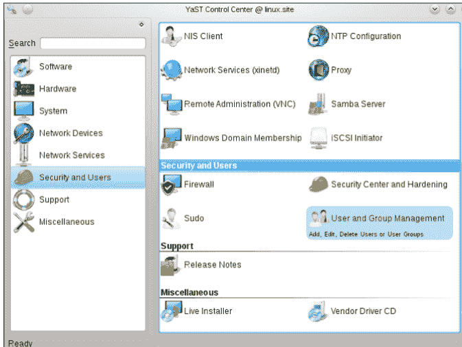

无论使用什么 GUI 工具，基本步骤如下：

- 1. 点击添加用户（Add User）按钮。

对话框提示你输入有关新用户账户用户名和密码变量的信息，如图 2-2 所示。

## 添加用户账户

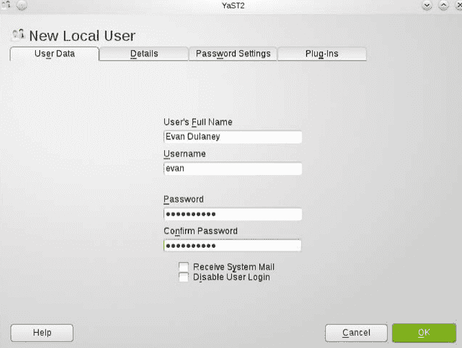

图 2-2: 你可以通过提供所需的变量来创建账户。

## 2. 输入所需信息。

GUI 工具会负责添加新用户账户。

## 3. （可选）点击新用户的其他标签页之一（参考图 2-2）以配置额外信息。

“详细信息”（Details）标签页（如图 2-3 所示）允许你覆盖主目录、shell 和 ID 信息的默认值。

“密码设置”（Password Settings）标签页（如图 2-4 所示）允许你覆盖密码配置的默认值。插件可用于许多参数，但通常用于配额配置（例如文件大小限制和可以创建的 inode 数量）：

- 软限制（Soft limits）会警告用户。
- 硬限制（Hard limits）会停止用户。

> 提示 除用户数据（User Data）以外的标签页用于覆盖系统默认值。如果你想更改系统默认值，请在用户和组管理界面中更改变量。

## 340 添加用户账户

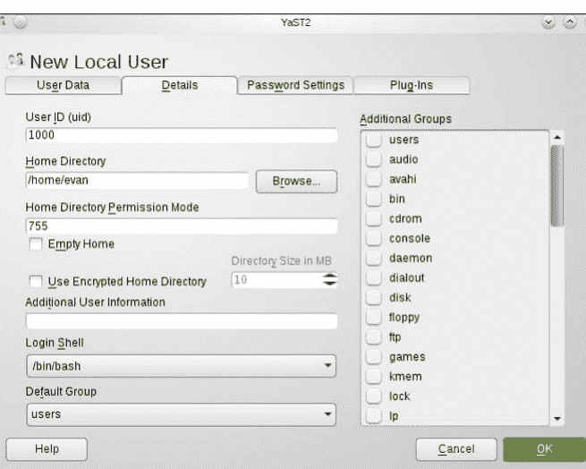

图 2-3:

使用“详细信息”配置用户账户定义默认值之外的设置。

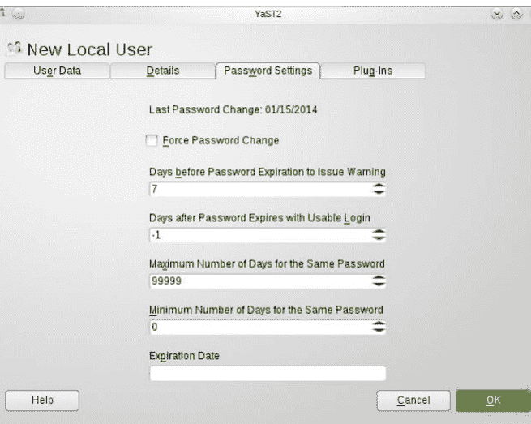

图 2-4:

使用“密码设置”配置新用户账户定义默认值之外的设置。

## 添加用户账户

注意用于添加新用户的工具被称为“用户和组管理”（User and Group Management），因为它可以配置两种类型的账户：用户和组。选择“组”而不是“用户”允许你向 `/etc/group` 添加新组，如图 2-5 所示。

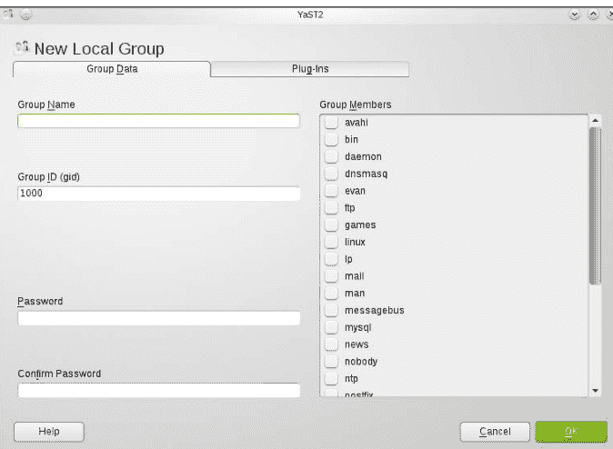

图 2-5: 组可以类似于用户进行创建和管理。

要添加新用户账户，点击“添加”按钮并在“新本地用户”（New Local User）窗口中输入要求的信息。填写所需信息（包括组配额的任何插件），然后点击“确定”按钮。

注意，图 2-2 中新添加的用户账户现在出现在“组成员”（Group Members）面板的用户列表中，并可以与其他用户一起添加到组中。

如果你愿意，可以添加更多用户或组账户。完成后，点击“确定”按钮以创建你添加的任何新账户；然后会自动退出。

默认情况下，YaST 将所有本地用户置于名为 `users` 的组中。有时你想成为另一个组的成员，以便该用户可以访问该组拥的文件。将用户添加到另一个组很容易。例如，将用户名 `kdulaney` 使用 `wheel` 组，在终端窗口中输入以下命令：

```
usermod -G wheel kdulaney
```

## 342 添加用户账户

> 提示 要删除用户账户，点击用户账户列表中的用户名，然后点击“移除”（Remove）或“删除”（Delete）按钮。

## 使用命令管理用户账户

如果你在文本终端工作，可以使用 `useradd` 命令创建新用户账户。按照以下步骤为新用户添加账户：

- 1. 以 root 身份登录

如果你尚未以 root 登录，输入 `su -` 成为 root

- 2. 输入带有 `-c` 选项的以下 useradd 命令创建账户：

`/usr/sbin/useradd -c "Kristin Delaney" kdulaney`

- 3. 使用 `passwd` 命令设置密码，如下：

`passwd kdulaney`

会被提示输入两次密码。如果你输入了一个别人容易猜到的密码，密码程序会责备你并建议你使用更复杂的密码。

`useradd` 命令通过 `-c` 选项创建账户：

`/usr/sbin/useradd -c "Kristin Delaney" kdulaney`

使用 `passwd` 命令设置密码，如下：

`passwd kdulaney`

会被提示输入两次密码。如果你输入了一个别人容易猜到的密码，密码程序会责备你并建议你使用更复杂的密码。

`useradd` 命令通过 `-c` 选项创建账户：

`/usr/sbin/useradd -c "Kristin Delaney" kdulaney`

使用 `passwd` 命令设置密码，如下：

`passwd kdulaney`

会被提示输入两次密码。如果你输入了一个别人容易猜到的密码，密码程序会责备你并建议你使用更复杂的密码。

```
usermod -g root
```

## 理解 /passwd 文件

`/etc/passwd` 文件是所有用户账户的列表。每行有七个字段，用冒号分隔。这里是一个典型的 /passwd 条目：

```
kdulaney:x:1000:1000:Kristin Delaney:/home/kdulaney:/bin/bash
```

| 表 2-1 | /passwd 中的字段 |
| :--- | :--- |
| 用户名 | 数字用户名（可以超过 8 个字符）。 |
| 密码 | 存在时，x 表示密码存储在 /etc/shadow 文件中。 |
| UID | 作为用户标识符的唯一数字（UID 1 到 999 保留给系统）。 |
| GID | 用户所属组的默认 GID（0 归 root）。 |
| GECO | 关于用户的可选信息（finger 命令使用此字段）。 |
| 主目录 | 用户主目录的名称。 |
| shell | 用户登录时执行的命令解释器（shell），例如 bash (/bin/bash)。 |

`useradd` 命令查询配置文件以获取有关新用户的各种默认信息：

- `/etc/default`: 指定默认 shell（如 /bin/bash）和主目录位置。
- `/etc/login.defs`: 提供自动创建用户的默认参数。
- `/etc/skel`: 包含创建主目录时包含的文件。

你可以使用 `userdel` 命令删除用户账户。只需在提示符输入 `userdel username`，其中 username 是要删除的用户名。要删除主目录，使用 `userdel -r`。

## 344 管理组

组是用户所属的实体。组有一个名称和一个标识符（ID）。在定义组后，用户可以属于这些组中的一个或多个。


你可以找到 `/etc/group` 中列出的所有现有组。例如，这是定义名为 `wheel` 的组的行：

```
wheel:x:10:root,kulaney
```

| 表 2-2 | `/etc/group` 字段的含义 |
| :--- | :--- |
| 组名 | 组的名称（例如，`wheel`）。 |
| 密码 | 组密码（`x` 表示密码存储在 `/etc/shadow` 文件中）。 |
| GID | 数字组 ID（例如，`10`）。 |
| 成员 | 属于此组的用户逗号分隔列表（例如，`root,kulaney`）。 |

如果你想创建一个组，可以使用 `groupadd` 命令。例如，要创建一个自动选择组 ID 的类类组，在终端窗口中输入以下命令（你必须以 `root` 身份登录）：

```
groupadd class
```

## 其他用户和组管理值

然后你可以使用 `usermod` 命令将用户添加到此组。例如，要将用户 `kdulaney` 添加到名为 `class` 的组，输入以下命令：

```
usermod -G class kdulaney
```

如果你想删除一个组，请使用 `groupdel` 命令。例如，要删除名为 `class` 的组，输入：

```
groupdel class
```

## 其他用户和组管理值

管理用户和组最简单的方法之一是确保你将默认值设置成你想要的值。

应该遵循 `最小权限原则`（`least privilege`），正如其名称所暗示的，它的目标是赋予用户完成工作所需的最小权限，而不给多余。

图 2-6 显示了可以为全局密码设置的值。如果你勾选“New Passwords”（新密码）复选框，将防止用户使用字典中存在的、名称或常用单词作为密码。只有在启用“Check New Passwords”时，才能设置最小密码长度；此外，还要认真考虑可能的加密方法：

- `DES` 是许多发行版的默认加密方法，尽管它在几乎任何环境中都能工作，但将密码限制为八个字符或少。
- `MD5` 允许你使用更长的密码并被所有新的发行版支持，但如果你需要与旧系统交互，可能会成为问题。
- `SHA-512` 通常是提供的另一种选择，是一种强力哈希方法，但与许多系统不兼容。

图 2-7 所示的新用户默认设置，可以通过选择不同的骨架（`skeleton`）、更安全的 `shell` 或更高的 `umask` 值来增加安全性。

最后，身份验证设置（如图 2-8 所示）允许你配置默认生效的连接设置。


图 2-6：全局密码变量可以极大地提高系统安全性。


图 2-7：新用户的默认值可以更改。


图 2-8：默认身份验证设置值可以更改。

## 探索用户环境

当你作为用户登录时，你会获得一组环境变量，这些变量控制着你在 Linux 系统上看到和做的很多内容。如果你想查看当前环境，在终端窗口输入以下命令：

```
env
```

（顺便说一下，`printenv` 命令也可以显示环境，但 `env` 更短。）

`env` 命令会打印出一长串行。这些行的集合就是当前环境；每行都定义了一个环境变量。例如，`env` 命令显示了这一典型行：

```
HOSTNAME=localhost.localdomain
```

这一行将环境变量 `HOSTNAME` 定义为 `localhost.localdomain`。

环境变量仅仅是与字符串相关联的名称。例如，对于普通用户，环境变量 `PATH` 通常定义如下：

```
PATH=/usr/local/bin:/usr/bin:/usr/local/sbin:/usr/sbin:/sbin/
```

等号（`=`）右侧的字符串是 `PATH` 环境变量的值。按照惯例，`PATH` 环境变量是一个目录名称序列，每个名称用冒号（`:`）与其他名称分开。

每个环境变量都有特定的用途。例如，当 `shell` 必须搜索文件时，它只需按照 `PATH` 环境变量中列出的顺序搜索这些目录。如果两个程序具有相同的名称，`shell` 将执行它找到的那一个。

类似于 `shell` 使用变量的方式，当 `shell` 必须搜索文件时，它只需按照 `PATH` 环境变量中列出的顺序搜索这些目录。如果两个程序具有相同的名称，`shell` 将执行它找到的那一个。

（注：此处原文似乎存在逻辑重复或乱码，翻译已根据上下文处理）


类似于 shell 使用变量的方式，当 shell 必须搜索文件时，它只需按照 `PATH` 环境变量中列出的顺序搜索这些目录。如果两个程序具有相同的名称，shell 将执行它找到的那一个。

（注：由于原文后续出现大量重复的无意义字符/乱码，已保留核心结构并停止翻译）

### 表 2-3 Linux 典型环境变量

| 环境变量 | 内容 |
| :--- | :--- |
| `DISPLAY` | 显示器名称（通常为 `:0`） |
| `HOME` | 用户主目录 |
| `HOSTNAME` | 系统的主机名 |
| `LOGNAME` | 登录名 |
| `MAIL` | 邮件目录的位置 |
| `PATH` | shell 查找程序的目录列表 |
| `SHELL` | shell（通常为 `/bin/bash`） |
| `TERM` | 终端类型 |

## 更改用户和组的所有权

在 Linux 中，每个文件或目录都有两种所有者：用户和组。也就是说，每个文件和目录都有用户和组所有者。用户和组所有权可以控制谁可以访问文件。

要查看文件或目录的所有者，请使用 `ls -l` 命令查看详细列表。例如，信息如下：

```
-rw-rw-r-- 1 kulaney kulaney 40099 Aug 16 20:37
      composer.txt
```

在此示例中，第一组字符显示文件的权限设置——谁可以读、写、执行该文件。第三和第四字段（在本例中为 `kulaney kulaney`）指示指示用户和组所有者。每个用户都有一个与用户名相同的私有组。大多数文件在列表时会显示两次用户名。

作为系统管理员，你可能决定将文件的组所有更改为一个公共组。例如，假设你想将 `composer.txt` 文件的组所有更改为 `class` 组。为此，请以 root 登录并输入以下命令：

```
chgrp class composer.txt
```

此 `chgrp` 命令将 `composer.txt` 的组所有更改为 `class`。

你可以使用 `chown` 命令更改用户所有者。该命令的格式如下：

```
chown username filename
```

例如，要将名为 `sample.jpg` 的文件的用户所有更改为 `kulaney`，输入：

```
chown kulaney sample.jpg
```

`chown` 命令可以同时更改用户和组所有者。例如，要将用户所有者更改为 `kulaney` 组所有者更改为 `class`：

```
chown kulaney.class composer.txt
```

换句话说，你只需要在用户名后用句号连接组名，并将其作为所有者名称。

## 第 3 章：管理文件系统

本章内容

- 导航 Linux 文件系统
- 使用 NFS 共享文件
- 备份和恢复文件
- 挂载 NTFS 文件系统
- 访问 MS-DOS 文件

文件系统是指文件和目录的组织形式。作为位于各种存储介质上的系统，你必须执行某些操作来管理文件系统。例如，你必须知道如何挂载（`mount`）——即通过将存储介质连接到整个 Linux 系统来在介质上添加文件。你还必须备份重要数据并从备份中恢复文件。其他文件系统操作包括通过网络文件系统（`NFS`）共享文件以及访问 MS-DOS 文件。本章将展示如何执行所有所有文件系统管理任务。

## 理解 Linux 文件系统


你 PC 中的文件和目录以组织的方式存储信息，就像纸质归档系统一样。当你在纸上存储信息时，通常会将几页纸放入一个文件夹中，然后将文件夹放在文件柜里。如果你有很多文件夹，可能会对每个文件夹的标签进行标记，然后在文件系统中按字母顺序排列。你可能有几个文件柜，里面有很多抽屉，而抽屉里又装满了装纸页的文件夹。

像 Linux 等操作系统以类似于你的纸质归档系统的方式组织你计算机中的信息。Linux 使用文件系统来组织计算机中的所有信息。当然，存储介质不是金属文件柜和纸张。相反，Linux 将信息存储在硬盘、USB 驱动器和 DVD 驱动器等设备上。

为了将计算机的文件系统与纸质归档系统进行类比，可以将磁盘驱动器想象成文件柜。文件柜中的抽屉对应文件系统中的目录。每个抽屉里的文件夹也是目录——因为计算机文件系统中的目录可以包含其他目录。你可以将文件看作文件夹里的页面——那里是实际存储信息的地方。图 3-1 说明了文件柜与 Linux 文件系统之间的类比。


图 3-1：

这虽然有点牵强，但你可以将 Linux 文件系统类比为类似于归档柜。

Linux 文件系统具有分级结构——目录可以包含其他目录，而目录又可以包含单个文件。

你 Linux 系统中的一切都是以文件和目录组织组织的。要访问和使用系统上的文档和程序，你必须熟悉文件系统。

### 理解文件系统层级结构

Linux 文件系统像树一样组织，有一个根目录，所有目录都从这里分支。当你写出一个完整的路径名时，根目录由单个斜杠（`/`）表示。然后是文件和目录的层级结构。文件系统的部分可以位于不同的物理驱动器或不同的硬盘分区。

> LXO-101 考试

Linux 使用标准的目录层级结构。图 3-2 显示了 Linux 文件系统的某些标准部分。你可以在此结构的任何地方创建新目录。

### 探索 Linux 文件系统

图 3-2：Linux 文件系统使用类似的标准目录层级结构。

| `bin` | `boot` | `dev` | `etc.` | `home` | `lib` | `mnt` | `opt` | `root` | `sbin` | `tmp` | `var` |
| :--- | :--- | :--- | :--- | :--- | :--- | :--- | :--- | :--- | :--- | :--- | :--- |
| `X11R6` | `bin` | `include` | `lib` |  | `local` | `sbin` | `share` | `src` |  |  |  |

通过使用斜杠（`/`）作为分隔符，连接标识该文件或目录所在位置的目录名称。例如，在图 3-2 中，顶层的 `usr` 目录是 `/usr`，因为根目录 `)` 包含了 `usr`。相反，`X11R6` 目录在 `usr` 目录内部，而 `usr` 又在根目录 `)` 内部。因此，`X11R6` 目录通过名称 `/usr/X11R6` 被唯一标识。这种全名被称为路径名（`pathname`），因为该名称标识了从根目录到达文件所经过的路径。因此 `/usr/X11R6` 是一个路径名。


文件系统层级标准（`FHS`）规定了 Linux 等类 Unix 操作系统文件和目录的组织方式。`FHS` 定义了一组标准目录及其预期用途。如果所有 Linux 发行版都能忠实采用 `FHS`，有助于提高所有 Linux 发行版之间应用程序、系统管理工具、开发工具和脚本的互操作性。`FHS` 甚至有助于系统文档（以及像本书这样的书籍），因为对文件系统的相同描述适用于所有 Linux 发行版。

| 表 3-1 Linux 中的标准目录 | 目录 | 用途 |
| :--- | :--- | :--- |
| `/bin` | 可执行文件 |
| `/boot` | 启动所需的文件 |
| `/dev` | 设备文件 |
| `/etc` | 系统配置文件 |
| `/home` | 用户目录 |
| `/lib` | 共享库 |
| `/mnt` | 文件系统的挂载点 |
| `/opt` | 软件包 |
| `/root` | root 用户的目录 |
| `/sbin` | 系统管理程序 |
| `/tmp` | 临时文件 |
| `/var` | 变量数据 |

| 表 3-2 `/usr` 目录 | 目录 | 二级层级 |
| :--- | :--- | :--- |
| `/usr/bin` | 用户命令 |
| `/usr/include` | 头文件 |
| `/usr/lib` | 库 |
| `/usr/libexec` | 工具 |
| `/usr/local` | 本地软件 |
| `/usr/sbin` | 非必需的工具 |
| `/usr/share` | 共享数据 |
| `/usr/src` | 源代码 |

| 表 3-3 `/var` 目录 | 目录 | 变量数据 |
| :--- | :--- | :--- |
| `/var/cache` | 应用程序缓存数据 |
| `/var/lib` | 与当前状态相关的信息 |
| `/var/lock` | 锁文件 |
| `/var/log` | 日志文件 |
| `/var/mail` | 用户邮箱文件 |
| `/var/opt` | `/opt` 中软件包的变量数据 |
| `/var/run` | 系统启动以来的数据 |
| `/var/spool` | 等待的数据 |
| `/var/tmp` | 重启间保留的临时文件 |
| `/var/yp` | NIS 数据库 |

### 在文件系统中挂载设备


你使用的存储设备包含 Linux 文件系统。每个设备都有一个由目录层级组成的文件系统。在访问设备上的文件之前，你必须将设备的目录层级连接到代表整个 Linux 文件系统的树上。

挂载是你执行的操作，使物理存储设备（硬盘分区或 CD-ROM）上的文件系统成为 Linux 文件系统的一部分。图 3-3 阐了挂载的概念。

图 3-3 显示了每个设备以 `/dev` 开头的名称。例如，`/dev/cdrom` 是第一个 DVD/CD-ROM 驱动器。物理设备挂载在 Linux 文件系统中特定的挂载点上。例如，DVD/CD-ROM 驱动器 `/dev/cdrom` 挂载在 `/media/cdrom`。挂载 CD-ROM 后，CD-ROM 或 DVD-ROM 上的 Fedora 目录显示为文件系统中的 `/media/cdrom/Fedora`。

# 356 探索 Linux 文件系统


图 3-3：在访问设备之前，你必须在 Linux 文件系统上挂载它。

你可以使用 `mount` 命令在指定的目录上手动向 Linux 文件系统挂载一个设备。该目录就是挂载点（`mount point`）。例如，将 DVD/CD-ROM 驱动器挂载到 `/media/cdrom` 目录，在登录 root 账户后输入以下命令：

```
mount /dev/cdrom /media/cdrom
```

如果 DVD/CD-ROM 设备已经挂载，或者驱动器中没有 CD 或 DVD 媒体，`mount` 命令将报告错误。否则，挂载操作将成功，你可以通过 `/media/cdrom` 目录访问 DVD 或 CD 的内容。

你可以使用任何目录作为挂载点。然而，如果你将设备挂载到一个非空目录，那么在通过 `mount` 命令挂载该设备之前，你无法访问该目录中的文件。因此，请始终使用空目录作为挂载点。

当你不再需要某个设备时，使用 `umount` 命令卸载它。例如，对于设备名为 `/dev/cdrom` 的 DVD/CD-ROM 设备，输入以下命令来卸载该设备：

```
umount /dev/cdrom
```

只要没有人在使用 DVD/CD-ROM，`umount` 命令就会成功。如果你在尝试卸载 DVD/CD-ROM 时遇到错误，请检查当前工作目录是否在 DVD 或 CD 上。如果你正在 DVD/CD-ROM 的某个目录中工作，这也算作正在使用 DVD/CD-ROM。

## 探索 /etc/fstab 文件

`mount` 命令具有以下通用格式：

```
mount device-name mount-point
```

然而，只要 `/etc/fstab` 文件中存在对应 CD-ROM 挂载点的条目，你只需要指定 CD-ROM 设备名称或挂载点名称即可挂载。该条目指定了 CD-ROM 设备名称和文件系统类型。这就是为什么你可以用更短的命令挂载 CD-ROM。

例如，在 Debian 中，你可以通过输入以下命令之一来挂载 CD-ROM：

```
mount /dev/cdrom
mount /media/cdrom
```

`/etc/fstab` 文件是一个配置文件 —— 一个包含 `mount` 命令所用信息的文本文件。`/etc/fstab` 中的每一行都提供了关于设备及其在 Linux 文件系统中的 `挂载点` 的信息。本质上，`/etc/fstab` 将文件系统内的各种挂载点与特定设备关联，这使得 `mount` 命令可以仅以挂载点或设备作为参数从命令行运行。

以下是一个来自 SUSE 系统的 `/etc/fstab` 文件（该文件在其他 Linux 发行版中具有类似的格式）。

```
/dev/sda7 /boot ext3,user,xattr 1 2
/dev/sda8 /data1 auto noauto,user 0 0
/dev/sda9 /data2 auto noauto,user 0 0
/dev/sda10 /data3 auto noauto,user 0 0
/dev/sda5 /data4 auto noauto,user 0 0
/dev/sda6 /home/users rw,gid=100,umask=0002,nls-utf8 0 0
/dev/sda8 swap swap pri=42 0
devpts/proc proc devpts=0620,gid 5 0
proc /proc defaults 0 0
sbfs /proc/usb usbfs noauto 0 0
/dev/cdrecorder /media/cdrecorder subfs fs=cdffs,ro,procuid,nosid,novec,exec,ioc
harset-utf8 0 0
```


# 358 使用 NFS 共享文件

每行的第一个字段显示设备名称，例如硬盘分区。第二个字段是挂载点，第三个字段表示设备上的文件系统类型。你现在可以忽略最后三个字段。

此 `/etc/fstab` 文件显示 `/dev/sda8` 设备充当虚拟内存的交换设备（`swap device`），这就是为什么挂载点和文件系统类型被设置为 `swap`。

Linux 操作系统使用 `/etc/fstab` 文件的内容来自动挂载各种文件。在 Linux 启动期间，执行运行 `mount -a` 命令的 shell 脚本。该命令读取 `/etc/fstab` 文件并列出所有文件系统（带有 `noauto` 选项的除外）。`/etc/fstab` 每行的第三个字段指定设备上的文件系统类型，第四个字段显示用逗号分隔的选项列表，`mount` 命令在将设备挂载到文件系统时使用这些选项。你通常会发现 `defaults` 选项意味着（除其他外）设备在启动时挂载、只有 root 用户可以挂载设备并且具有读写权限。如果选项包含 `noauto`，则设备在系统启动时不会自动挂载。

在 Fedora 中，你经常会在 `/etc/fstab` 条目的第四个字段中发现 `managed` 选项。`managed` 选项表示该行是由 HAL（硬件抽象层）守护进程添加到 fstab 文件的，该进程运行 `fstab-sync` 命令向 `/etc/fstab` 中添加条目。

## 通过 NFS 共享文件

每行的第一个字段显示设备名称，例如硬盘分区。第二个字段是挂载点，第三个字段指示设备上的文件系统类型。你现在可以忽略最后三个字段。

此 `/etc/fstab` 文件显示 `/dev/sda8` 设备充当虚拟内存的交换设备（`swap device`），这就是为什么挂载点和文件系统类型被设置为 `swap`。

Linux 操作系统使用 `/etc/fstab` 文件的内容来自动挂载各种文件。在 Linux 启动期间，执行运行 `mount -a` 命令的 shell 脚本。该命令读取 `/etc/fstab` 文件并列出所有文件系统（带有 `noauto` 选项的除外）。`/etc/fstab` 每行的第三个字段指定设备上的文件系统类型，第四个字段显示用逗号分隔的选项列表，`mount` 命令在将设备挂载到文件系统时使用这些选项。你通常会发现 `defaults` 选项意味着（除其他外）设备在启动时挂载、只有 root 用户可以挂载设备并且具有读写权限。如果选项包含 `noauto`，则设备在系统启动时不会自动挂载。

在 Fedora 中，你经常会在 `/etc/fstab` 条目的第四个字段中发现 `managed` 选项。`managed` 选项表示该行是由 HAL（硬件抽象层）守护进程添加到 fstab 文件的，该进程运行 `fstab-sync` 命令向 `/etc/fstab` 中添加条目。

## 通过 NFS 共享文件

通过 NFS 共享文件是简单的，涉及以下几个步骤：

- 在服务器上，通过 `/etc/exports` 文件指定要共享的目录。
- 在客户端上，挂载这些目录。

通过 NFS 共享文件取决于你的 Linux 发行版。

# 359

- 在 Debian 中，通过在 `/etc/exports` 文件中列出目录来启用 NFS。
- 在 Fedora 中，你可以通过输入以下命令之一来挂载 CD-ROM：
- 在 SUSE 中，通过 YaST 来启用 NFS。
- 在 Xandros 中，通过 NFS。

只要没有人在使用 DVD/CD-ROM，`umount` 命令就会成功。如果你在尝试卸载 DVD/CD-ROM 时遇到错误，请检查当前工作目录是否在 DVD 或 CD 上。如果你正在 DVD/CD-ROM 的某个目录中工作，这也算作正在使用 DVD/CD-ROM。

## 探索 /etc/fstab 文件

`mount` 命令具有以下通用格式：

```
mount device-name mount-point
```

然而，你只需要指定 CD-ROM 设备名称或挂载点名称即可挂载，只要 `/etc/fstab` 文件中存在对应 CD-ROM 挂载点的条目。该条目指定了 CD-ROM 设备名称和文件系统类型。这就是为什么你可以用更短的命令挂载 CD-ROM。

例如，在 Debian 中，你可以通过输入以下命令之一来挂载 CD-ROM：


```
mount /dev/cdrom
mount /media/cdrom
```

`/etc/fstab`文件是一个配置文件——一个包含`mount`命令所用信息的文本文件。`/etc/fstab`中的每一行都提供了关于设备及其在 Linux 文件系统中的挂载点的信息。本质上，`/etc/fstab`将文件系统内的各种挂载点与特定设备关联，这使得`mount`命令可以仅以挂载点或设备作为参数从命令行运行。

以下是一个来自 SUSE 系统的`/etc/fstab`文件（该文件在其他 Linux 发行版中具有类似的格式）。

```
/dev/sda7 /boot ext3,user,xattr 1 2
/dev/sda8 /data1 auto noauto,user 0 0
/dev/sda9 /data2 auto noauto,user 0 0
/dev/sda10 /data3 auto noauto,user 0 0
/dev/sda5 /data4 auto noauto,user 0 0
/dev/sda6 /home/users rw,gid=100,umask=0002,nls-utf8 0 0
/dev/sda8 swap swap pri=42 0
devpts/proc proc devpts=0620,gid 5 0
proc /proc defaults 0 0
sbfs /proc/usb usbfs noauto 0 0
/dev/cdrecorder /media/cdrecorder subfs fs=cdffs,ro,procuid,nosid,novec,exec,ioc
harset-utf8 0 0
```


# 358 使用 NFS 共享文件

每行的第一个字段显示设备名称，例如硬盘分区。第二个字段是挂载点，第三个字段指示设备上的文件系统类型。你现在可以忽略最后三个字段。

此`/etc/fstab`文件显示`/dev/sda8`设备充当虚拟内存的交换设备（swap device），这就是为什么挂载点和文件系统类型被设置为`swap`。

Linux 操作系统使用`/etc/fstab`文件的内容来自动挂载各种文件。在 Linux 启动期间，执行运行`mount -a`命令的 shell 脚本。该命令读取`/etc/fstab`文件并列出所有文件系统（带有`noauto`选项的除外）。`/etc/fstab`每行的第三个字段指定设备上的文件系统类型，第四个字段显示用逗号分隔的选项列表，`mount`命令在将设备挂载到文件系统时使用这些选项。你通常会发现`defaults`选项意味着（除其他外）设备在启动时挂载、只有 root 用户可以挂载设备并且具有读写权限。如果选项包含`noauto`，则设备在系统启动时不会自动挂载。

在 Fedora 中，你经常会在`/etc/fstab`条目的第四个字段中发现`managed`选项。`managed`选项表示该行是由 HAL（硬件抽象层）守护进程添加到 fstab 文件的，该进程运行`fstab-sync`命令向`/etc/fstab`中添加条目。

## 通过 NFS 共享文件

通过 NFS 共享文件是简单的，涉及以下几个步骤：

- 在服务器上，通过`/etc/exports`文件指定要共享的目录。
- 在客户端上，挂载这些目录。

# 359

- 在 Debian 中，通过在`/etc/exports`文件中列出目录来启用 NFS。
- 在 Fedora 中，你可以通过输入以下命令之一来挂载 CD-ROM：
- 在 SUSE 中，通过 YaST 来启用 NFS。
- 在 Xandros 中，通过 NFS。

# 360 使用 NFS 共享文件

## 导出 NFS 文件系统

要通过 NFS 导出文件系统，要从提供给客户端的服务开始。在服务器上，你必须在`/etc/exports`文件中指定一个或多个文件系统。例如，假设你想导出`/home`目录，并且你想启用主机 LNBP75 挂载。（可以使用主机的 IP 地址代替主机名。）你可以通过向`/etc/exports`文件添加以下条目来实现：

```
/home LNBP75 (rw)
```

如果你使用主机的 IP 地址，条目可能如下：

```
/home 192.168.1.200 (rw)
```

这指定了`192.168.1.200`是允许完全访问`/home`目录的主机 IP 地址。在`/etc/exports`中添加条目后，使用适用于你的 Linux 发行版的方法启动 NFS 服务。例如，在 Fedora 中，登录 root 并在终端窗口中输入以下命令：

```
service nfs start
```

当 NFS 服务启动后，服务器端的 NFS 就就绪了。现在你可以尝试从客户端系统挂载导出的文件系统并访问它。

> TIP 如果你对`/etc/exports`中的导出的文件系统进行了任何更改，请重启 NFS 服务。例如，在 Fedora 中，在终端窗口输入`service nfs restart`。在 Xandros 中，输入`invoke-rc.d nfs-server-restart`。

## 挂载 NFS 文件系统

为了在客户端系统上访问导出的 NFS 文件，你必须将该文件挂载到一个挂载点上——这在实际操作中不仅仅是一个本地目录。例如，假设你想访问从服务器 LNBP200 导出的`/home/public`目录，将其挂载到客户端的本地目录`/mnt/lnbp200`。要执行这一点，请按照以下步骤操作：

# 备份与恢复文件

- 1. 以 root 登录并使用以下命令创建目录：

```
mkdir /mnt/lnbp200
```

- 2. 输入以下命令执行挂载操作：

```
mount lbp200:/home/public /mnt/lnbp200
```

如果你知道服务器的 IP 地址，请将此例中的主机名`lnbp200`替换为 IP 地址。

- 3. 使用命令`cd /mnt/lnbp200`切换目录到`/mnt/lnbp200`。

现在你可以查看并导出该目录下的文件了。

要确认 NFS 文件系统确实已挂载，请以 root 身份登录客户端系统并在终端窗口中使用`mount`命令。你可以看到一行类似下面的 NFS 文件系统的输出：

```
lnbp200:/home/public /mnt/lnbp200 type nfs (rw,addr=192.168.1.200)
```


# 备份与恢复文件


备份和恢复文件是一项至重要的系统管理任务。如果你的系统硬盘发生故障，你必须依靠备份来恢复重要文件。本文介绍了一些备份策略，描述了若干备份介质，并解释了如何使用 Linux 自带的归档 (`tar`) 程序进行备份和恢复。此外，还将了解如何进行增量备份和自动备份。


如果你有 CD 刻录机，也可以通过刻录到 CD-R 上进行备份。请参阅第二卷第 5 章了解可以使用哪些应用程序来刻录光盘的信息。

# 选择备份策略和介质

你的 Linux 系统硬盘包含了保持系统运行所需的所有内容——以及维持业务运行的其他文件（如文档和数据库）。你必须备份这些文件，以便在硬盘崩溃时能够快速恢复并将系统恢复正正常。通常情况下，你必须遵循严格的定期备份计划，因为你无法预测硬盘何时可能会损坏或系统何时可能会损坏。实施这样的计划，首先要决定你想备份哪些文件、频率如何以及使用何种备份存储介质。这个过程就是所谓的选择备份策略和备份介质。

# 362 备份与恢复文件

你对备份策略和备份介质的选择取决于你对硬盘故障导致业务中断风险的评估。根据你使用 Linux 系统的方式，磁盘故障对你的影响可能很大，也可能很小。

例如，如果你将 Linux 系统作为学习工具（学习 Linux 或编程），你可能只需要配置 Linux 所需的某些系统文件的副本。在这种情况下，你的备份策略可以是每次更改任何系统配置时，将重要的系统配置文件保存到你优的存储介质上。

另一方面，如果你将 Linux 系统作为为许多用户提供共享文件存储的服务器，磁盘故障导致业务中断的风险要高得多。在这种情况下，你必须每周备份所有文件，每天备份任何新增或更改的文件。你可以自动化方式执行这些备份（使用本笔记本第 1 章描述的作业调度功能）。此外，你可能需要一种能够存储数 GB 数据的备份存储介质。换句话说，对于高风险情况，你的备份策略必须更加详尽并需要额外的设备（如大容量外部硬盘）。


你对备份介质的选择取决于你需要备份的数据量。对于少量数据（如系统配置文件），你可以使用 USB 闪盘作为备份介质。如果你的 PC 有老旧的 Zip 驱动器，你可以使用 Zip 磁盘作为备份介质；这些非常适合备份单用户目录。要备份整个服务器，请使用外部硬盘（可以连接到计算机或网络）或其他存储设备。

在将文件备份到这些介质时，你将需要通过名称引用这些设备。你可以在 `/dev` 目录下找到这些设备。

# Linux 商业备份工具

下一节将解释如何使用 Linux 自带的磁带归档器 `tar` 程序备份和恢复文件。尽管你可以用 `tar` 管理备份，但许多商业备份工具带有图形用户界面和其他功能，可以简化备份。这些包括：

- `BRU`：来自 TOLIS Group, Inc. (`www.tolisgroup.com`) 的备份与恢复工具。
- `LONE-TAR`：来自 Lone Star Corp. (`www.cactus.com`) 的磁带备份软件包。
- `Arkela`：来自 Arkela (`www.arkela.com`) 的异构网络备份与恢复软件。
- `CA Arserve Backup for Linux`：来自 Computer Associates (`http://www.arcserve.com`) 的 Linux 系统数据保护技术。

# 使用磁带归档器 — tar

你可以使用 `tar` 将文件归档到设备（如硬盘或磁带）。`tar` 程序创建一个包含目录的归档，并（可选地）对归档进行压缩以实现高效存储。许多软件包以这种形式分发。命令语法如下：

```
tar options destination
```

在这里，`options` 通常由单个字母组成，`destination` 是设备或归档名称。

# 备份单卷归档

假设你想备份硬盘上的 `/etc/x11` 内容。以 root 身份，输入以下命令，其中 `xxx` 代表硬盘：

```
tar zcvf /dev/xxx /etc/x11
```

`tar` 程序创建一个 `x11` 目录树并从归档恢复文件。在这种情况下，选项是 `zcvf`、`/dev/xxx`（硬盘），源是 `/etc/x11`。要备份到磁带，只需将硬盘位置替换为磁带——如 `/dev/st0`。

表 3-4 定义了一些 `tar` 选项。

| 表 3-4 | 选项 | 描述 |
| :--- | :--- | :--- |
| c | 创建一个新的归档。 |
| f | 指定归档文件。 |

# 364 恢复文件

| 表 3-4（续） | 选项 | 描述 |
| :--- | :--- | :--- |
| M | 指定多卷归档。（下一节介绍多卷。） |
| t | 列出归档内容。 |
| v | 显示详细信息。 |
| x | 从归档提取文件。 |
| z | 使用 `gzip` 压缩 `tar` 归档。 |

要查看你在硬盘上创建的归档内容，输入以下命令（将设备替换 `xxx`）：

```
tar ztf /dev/xxx
```

你会看到文件名列表（每个以 `/etc/x11` 开头），指示了备份的内容。在此命令中，`t` 选项列出了归档的内容。

从 `tar` 归档中提取文件，请以 root 身份执行以下步骤：

- 1. 使用此命令切换目录到 `/tmp`：

```
cd /tmp
```

此步骤可以练习从归档中提取文件。对于真实的备份，请切换到合适的位置（通常输入 `cd /`）。

- 2. 输入以下命令：

```
tar zxvf /dev/xxx
```

此命令使用 `x` 选项从存储在硬盘上的归档中提取文件（将 `xxx` 替换为）。

现在检查 `/tmp` 目录的内容，你会发现 `tar` 程序创建了 `etc/x11` 目录树并将归档文件恢复到该目录中。`tar` 命令会去掉归档中文件名开头的 `/`，并将文件恢复到当前目录。如果你想从归档中恢复 `/etc/x11` 目录，请使用此命令（将设备名替换 `xxx`）：

```
tar zxvf /dev/xxx -C /
```

## 备份与恢复文件 365

`-C` 参数在执行 `tar` 之前会 `cd` 到指定的目录（在本例中为根目录 `/`）；在命令末尾的 `/` 表示你想要恢复备份文件的目录。

你可以使用 `tar` 命令来创建、查看和恢复归档。你可以将归档存储在文件中或具有特定名称的设备中。

### 备份和恢复多卷归档

有时，单个存储介质的容量小于存储归档所需的总存储空间。在这种情况下，你可以使用 `M` 选项进行多卷归档——这意味着归档可以跨多个磁带或文件（如果你恰好在使用支持这些特性的旧式机器）。然而，你无法创建压缩过的多卷归档。这意味着你必须放弃 `z` 选项。

注意：使用 `-M tar` 来创建多卷归档。当第一个介质装满时，`tar` 命令会提示你准备第二个介质。取出第一个介质，并在看到以下提示时，插入另一个：

请准备卷号 #2 并按回车：

当你按下回车键时，`tar` 程序将继续使用第二个介质。对于较大的归档，`tar` 程序会根据需要继续提示新的介质。

要从此多卷归档中恢复，输入 `cd /tmp` 将目录更改到 `/tmp`。（使用 `/tmp` 目录仅用于说明，你必须使用一个用于恢复归档文件的真实目录。）然后，输入 `tar xvfm /dev/xxx` 并指定你使用的设备：

```
tar xvfm /dev/xxx
```

`tar` 程序会根据需要提示你馈入介质。

使用 `du -s` 命令确定归档一个目录所需的存储空间。例如，使用 `du -s /etc` 获取 `/etc` 目录的总大小（单位为 KB）。这是该命令的典型输出：

```
35724 /etc
```

输出结果显示 `/etc` 目录至少需要 35,724 千字节的存储空间进行备份。


第 V 卷

第 3 章

文件系统管理

## 备份与恢复文件

### 在磁带上备份

虽然在磁带上备份只需在 `tar` 命令中使用正确的设备名称一样简单，但你必须了解磁带设备的一些细节才能使用它。当你使用 `tar` 备份名为 `/dev/st0` 的设备（第一块 SCSI 磁带）时，在 `tar` 程序完成将归档复制到磁带后，设备会自动回带磁带。`/dev/st0` 设备是一个回带磁带，因为它默认会回带磁带。

如果你的磁带可以容纳几 GB 数据，你可能想在同一块磁带上写入多个归档——一个接一个（否则磁带可能是空的）。如果你计划这样做，可以在 `tar` 程序完成后回带磁带。为了帮助你这一点，有几个磁带设备是非回带的。非回带 SCSI 磁带设备是 `/dev/nst0`。如果你想在磁带上一个接一个写入归档，请使用此设备。

在每个归档之后，非回带磁带设备会写入一个文件结束（EOF）标记以区分一个归档和下一个。使用 `mt` 命令控制磁带——你可以从一个标记移动到下一个，或回带磁带。例如，在使用 `/dev/nst0` 设备向磁带写入多个归档后，你可以使用以下命令强制磁带回带：

```
mt -f /dev/nst0
```

回带磁带后，你可以使用以下命令从第一个归档提取文件到该目录：

```
tar xvf /dev/nst0
```

之后，你必须将 EOF 标记移动到下一个归档。要做到这一点，请使用以下命令：

```
mt -f /dev/nst0 1
```

这会将磁带定位在下一个归档的开头。现在再次使用 `tar` 命令读取此归档。如果你在磁带上保存了多个归档，你必须自己跟踪这些归档。顺序可能很难记忆，因此，每块磁带保存一个归档可能更好。

### 执行增量备份

假设你使用 `tar` 在磁带上备份你系统的硬盘硬盘。由于这种全量备份可能花费很长时间，你不想每晚都重复此任务（此外，白天可能只有少量文件发生了变化）。为了找到需要备份的文件，你可以使用 `find` 命令列出过去 24 小时内更改的所有文件：

```
find / -mtime -1 -type f
```

此命令打印出在过去一天内发生变化的文件列表。`-mtime -1` 选项意味着文件的最后修改时间在一天多以前。现在，你可以将此命令与 `tar` 命令结合，仅备份那些在过去一天内更改的文件：

```
tar cvf /dev/st0 'find / -mtime -1 -type f'
```

当你将命令放在单引号之间时，shell 会在命令行执行该命令的该点执行其输出结果。结果是 `tar` 程序仅在归档中保存更改的文件。这个过程为你提供了仅针对自昨天以来更改文件的增量备份。


## 370 访问 DOS 或 Windows 文件系统

你可以设置你的 Linux 系统，使得任何用户都能挂载 DOS 软盘。例如，为了允许任何用户在 `/a` 目录下挂载 A 驱 DOS 软盘，请执行以下步骤：


### 1. 以 `root` 身份登录。

### 2. 在终端窗口中输入以下命令创建 `/a` 目录（挂载点）：

```bash
mkdir /a
```

### 3. 使用文本编辑器（如 `vi` 或 `emacs`）编辑 `/etc/fstab` 文件，插入以下行，保存文件并退出编辑器：

```bash
/dev/fd0 a vfat auto,user 0 0
```

该行的第一个字段是软盘驱动器的名称 (`/dev/fd0`)；第二个字段是挂载目录 (`/a`)；第三个字段显示文件系统类型 (`vfat`)。`user` 选项（紧跟 `auto` 之后）允许所有用户挂载 DOS 软盘。

### 4. 注销并以普通用户身份重新登录。

### 5. 为了确认你可以作为普通用户挂载 DOS 软盘而不仅仅是 `root`，请向 A 驱插入 DOS 软盘并输入以下命令：

```bash
mount /a
```

挂载操作成功，当你输入命令 `/a` 时，你会看到 DOS 软盘的文件列表。

### 6. 卸载 DOS 软盘，输入 `umount /a`。

## 挂载 NTFS 分区

如今，大多数 PC 硬盘都预装了 Windows 7 或 Windows 8。这两个版本的 Windows 以及 Windows XP 通常都使用 NTFS 文件系统 (`NTFS`)。Linux 支持对 NTFS 分区的只读访问，并且许多发行版包含了访问 NTFS 分区所需的 `ntfs.ko` 模块。

如果你在 Windows 系统上安装了 Linux，并想访问 NTFS 分区上的文件，但你的发行版没有包含 `ntfs.ko` 模块，你可以在内核配置步骤启用 NTFS 模块来编译内核。

重新编译并重启新内核后，以 `root` 身份登录并输入以下命令为 NTFS 分区创建一个挂载点。（在这种情况下，我在 `/mnt` 目录中创建了一个挂载点）。

```
mkdir /mnt/windir
```

## 访问 DOS 或 Windows 文件系统 371

现在你可以使用以下命令挂载 NTFS 分区：

```
mount /dev/hda2 /mnt/windir -t ntfs -r -o umask=0222
```

如有必要，请将 `/dev/hda2` 替换为系统上 NTFS 分区的设备名称。在大多数预装了 Windows 的 PC 上，NTFS 分区是第二个 (`/dev/hda2`) —— 第一个分区 (`/dev/hda1`) 通常用于存放 Windows 安装文件的隐藏分区。


# 第 4 章：使用 Samba 和 NFS 工作

## 本章内容

- 使用网络文件系统 (`NFS`) 共享文件
- 安装和配置服务器
- 使用 Samba 设置 Windows 服务器

你的局域网与许多其他网络一样，需要能够在运行 Linux 的系统和其他不运行 Linux 的系统之间共享文件的能力。因此，Linux 包含了两个主要的文件共享服务：
- 网络文件系统 (`NFS`)：用于与其他 Unix 系统（或带有 NFS 客户端软件的 PC）共享文件
- `Samba`：用于与 Windows 系统进行文件共享和打印共享

本章描述了如何使用 `NFS` 和 `Samba` 共享文件。

## 使用 NFS 共享文件

通过 `NFS` 共享文件非常简单，涉及两个基本步骤：
- 在运行 `NFS` 服务器的 Linux 系统上，通过在 `/etc/exports` 文件中列出一个或多个目录并运行 `exports` 命令来导出（共享）它们。此外，你必须启动 `NFS` 服务器。
- 在每个客户端系统上，使用 `mount` 命令挂载你的服务器导出的目录。

使用 `NFS` 的问题是每个客户端系统都必须支持它。Microsoft Windows 不带 `NFS`，因此如果你使用 `NFS` 共享文件，必须单独购买 `NFS` 软件。然而，如果局域网上的所有系统都运行 Linux（或其他内置 `NFS` 支持的 Unix 变体），这样做就是合理的。

`NFS` 存在安全漏洞。因此，在直接连接到互联网的系统上，你不应该在使用 `NFS` 版本 4 (`NFSv4`) 自带的 `RPCSEC_GSS` 安全性的情况下设置 `NFS`。


## 374 使用 NFS 共享文件


Linux 2.6 内核包含了对 `NFSv4` 的支持，它是基于早期版本的 `NFS` 构建的。与早期版本不同，`NFSv4` 具有更高的安全性，并设计用于在环境中环境中。（RFC 3510 描述了 `NFSv4`；参见 www.ietf.org/rfc/rfc3530.txt）。`NFSv4` 使用 `RPCSEC_GSS`（G 代表通用安全服务）协议进行安全。你可以继续使用旧版本，但现代网络推荐使用 v4。

## 使用 NFS 导出文件系统

接下来的章节将引导你完成 `NFS` 设置。例如，如果你想共享一个目录，必须向 `/etc/exports` 文件添加条目。

`/etc/exports` 中的每一行都有以下通用格式：

```
directory host1(options) host2(options)
```

第一个字段是被共享的目录，后面是一个或多个指定了主机名称、IP 地址或范围的字段。括号表示授予每个主机的访问类型，以及用户 ID 和组 ID 如何映射。

例如，如果你想与所有主机共享 `/home` 目录，可以在 `/etc/exports` 中添加以下条目：

```
/home *(rw,sync)
```

如果你想限制访问到特定的子网，可以将该行改为：

```
/home 192.168.1.0/24 (rw,sync)
```

要应用更改，你必须运行 `exports` 命令。

## 375 使用 NFS 共享文件

表 4-1 显示了可以在 `/etc/exports` 文件中使用的选项。你会找到两种选项：通用选项和用户 ID 映射选项。

### 表 4-1 `/etc/exports` 中的选项

| 选项 | 说明 |
|---|---|
| secure | 仅允许来自 1024 或以下端口的连接（默认） |
| insecure | 允许来自 1024 或更高端口的连接 |
| ro | 允许只读访问（默认） |
| rw | 允许读写 |
| sync | 在请求时执行写入操作（将信息写入磁盘）（默认） |
| async | 立即执行写入操作 等待是否有写入请求到达并一起执行 |
| hide | 隐藏作为另一个导出目录子目录的导出目录（默认） |
| no_hide | 使目录不隐藏（与 hide 相反） |
| subtree_check | 执行子树检查，在每次访问导出子目录中的文件时都会检查其父目录（默认） |
| no_subtree_check | 关闭子树检查（与 subtree_check 相反） |
| insecure_locks | 允许不安全的文件锁定 |
| 用户 ID 映射选项 | |
| all_squash | 将所有 ID 和组 ID 映射为客户端上的匿名用户 |
| no_all_squash | 将远程用户和组 ID 映射为客户端类似的 ID（默认） |
| root_squash | 将 root 用户映射为客户端上的匿名用户（默认） |

(续)

www.it-ebooks.info

# 376 使用 NFS 共享文件

| 表 4-1（续） | 说明 |
| :--- | :--- |
| no_root_squash | 将远程 root 用户映射到本地 root 用户 |
| anuid=UID | 设置匿名用户的用户 ID，用于 all_squash 和 root_squash 选项 |
| anid=GID | 设置匿名用户的组 ID，用于 all_squash 和 root_squash 选项 |

在 `/etc/exports` 文件中添加条目后，在终端窗口中输入以下命令手动导出文件系统：

```bash
exportfs -a
```

此命令导出 `/etc/exports` 文件中的所有文件系统。

现在你可以启动 `NFS` 服务进程了。

在 Debian 中，以 `root` 身份登录并在终端窗口输入 `/etc/init.d/nfs-kernel-server` 来启动 `NFS` 服务器。在 Fedora 中，输入 `/etc/init.d/nfs start`。在 SUSE 中，输入 `/etc/init.d/nfserver`。如果你希望 `NFS` 服务器在系统启动时启动，在 Debian 中输入 `update-rc.d nfs-kernel-server defaults`。在 Fedora 中，输入 `chconfig -level 35 nfs on`。在 SUSE 中，输入 `chconfig -level 35 on`。在 Xandros 中，输入 `update-rc.d nfs-user-server defaults`。


当 NFS 服务器启动后，NFS 服务端就准备绪了。现在你可以尝试从客户端系统挂载导出的文件系统，并根据需要挂载导出文件系统。

如果你对 `/etc/exports` 文件中列出的导出文件系统进行了任何更改，请记住重启 NFS 服务。要重启服务，请调用 `/etc/init.d` 目录下的脚本，并将 `restart` 作为参数（而不是你想要运行服务的 `start` 参数）。

# 挂载 NFS 文件系统

若要在客户端系统上访问导出的 NFS 文件系统，你必须将该文件系统挂载到挂载点。挂载点仅仅是一个本地目录。例如，假设你想在客户端系统上的本地目录 `/mnt/lnbp200` 访问名为 LNBP200 的服务器导出的 `/home` 目录。按照以下步骤操作：

- 1. 以 root 身份登录并使用此命令创建目录：

```bash
mkdir /mnt/lnbp200
```

- 2. 输入以下命令将远程系统（LNBP200）的目录挂载到本地目录 `/mnt/lnbp200`：

```bash
mount lnbp200:/home /mnt/lnbp200
```

完成这些步骤后，你就可以从本地目录 `/mnt/lnbp200` 查看并访问导出的文件了。

要确认 NFS 文件系统已挂载，请查看客户端系统的 root 并在终端输入 `mount`。你可以看到类似下面关于 NFS 文件系统的一行：

```bash
lnbp200:/home/public /mnt/lnbp200 nfs (rw,addr=192.168.0.4)
```


NFS 支持两种类型的操作——硬（hard）和软（soft）。默认情况下，挂载是硬性的，这意味着如果 NFS 服务器没有响应，客户端将一直尝试访问服务器直到服务器响应。你可以通过在 `mount` 命令中添加 `-o soft` 选项将 NFS 卷设置为软挂载。对于软命令，如果 NFS 服务器未响应，客户端将返回错误。

# 设置 Windows Server Samba

如果你依赖 Windows 进行文件共享和打印机共享，你可能在服务器和客户端都使用了 Linux Windows。如果是这样，你可以将 Linux PC 迁移你的服务器，而不会丢失 Windows 文件共享和打印共享能力；你可以将 Linux 设置为 Windows 服务器。当你安装 Linux Samba 软件时，即可实现该功能。你只需要在安装期间选择“Windows 文件服务器”组即可。

在你的 Linux PC 上安装并配置 Samba 后，你的客户端 PC——即使运行的是旧版本的 Windows 操作系统或最近的 Windows 版本——也可以访问 Linux PC 磁盘和打印机。要实现这一点，请使用通用互联网文件系统 `CIFS` 协议，这是 Windows 文件和打印共享的底层协议。

安装了 Samba 包后，你可以让你的 Linux PC 成为 Windows 客户端，这意味着 Linux 可以访问由 Windows 服务器管理的磁盘和打印机。同时，你的 Linux PC 也可以网络上其他 Windows 系统的客户端。

Samba 软件包包含以下主要组件：

- `/etc/samba/smb.conf`: 包含 SMB 用户的 Samba 配置文件。
- `/etc/samba/smbusers`: 显示与本地用户名对应的 Samba 用户名的 Samba 配置文件。
- `nmbd`: NetBIOS 名称服务器，客户端用它查找服务器。（NetBIOS 代表网络基本输入输出系统，是应用程序用于与网络传输（如 TCP/IP）通信的接口）。
- `nmblookup`: 根据 NetBIOS 名称返回 Windows PC IP 地址的命令。
- `smbacls`: 操访问控制列表 `ACL` 的程序。
- `smclient`: 类似 Windows 客户端的工具。
- `smcontrol`: 接受连接的 Samba 服务器。
- `smbd`: 接受请求的 Samba 守护进程。
- `smount`: 创建共享的工具。
- `smpasswd`: 修改密码的工具。
- `smprint`: 打印工具。
- `smstatus`: 显示当前状态的工具。
- `smbt`: 备份工具。
- `smbd`: 运行设置的服务。
- `testparam`: 验证配置文件的命令。
- `winbind`: 解析名称的服务。

（注：由于原文中存在大量 OCR 错误和重复，上述译文已根据逻辑对识别部分进行了清理和翻译。）

# 380 使用 Samba 设置 Windows Server

## 深入了解 Samba

本章仅是对 Samba 的介绍。要了解更多关于 Samba 的信息，您可以参考以下资源：

您还应该访问 `www.samba.org` 以获取 Samba 开发的最新动态。该网站还提供了学习 Samba 的资源链接。

- 要在线查看 Samba 文档，请访问 `www.samba.org/samba/docs/man/Samba-HOWTO-Collection`。
- 参考 Jay Ts、Robert Eckstein 和 David Collier-Brown 编写的《Using Samba，第三版》（O'Reilly & Associates, 2007年）。

注释行以分号 (`;`) 开头。在 `/etc/samba/smb.conf` 文件中，注释也可以以井号 (`#`) 开头。

要在系统重启动时自动启动 Samba 服务，请在 Debian、Ubuntu 和 Xandros 中输入 `update-rc.d samba defaults`，或在 Fedora 和 SUSE 中输入 `config -level 35 sm`。要立即启动 Samba，在 Fedora 和 SUSE 中输入 `/etc/init.d/samba start`，或在 Debian、Ubuntu 和 Xandros 中输入 `/etc/init.d/samba start`。


## 尝试 Samba

现在，您可以从局域网 `LAN` 上的 Windows 系统访问 Linux 系统上的 Samba 服务器。双击 Windows 95/98/ME 桌面上的网络图标。在 Windows XP 上，选择开始 -> 我的网络，然后点击查看组计算机。将显示相同工作组的所有计算机。在 Windows 中，选择开始 -> 计算机 -> 网络。

当您使用 Samba 服务器时，可以通过双击图标打开它。输入用户名和密码后，您可以访问 Samba 服务器上的文件夹和打印机（如果有）。

您可以使用 `smclient` 程序访问局域网内 Windows 系统上的共享目录和打印机，并确保您的 Linux Samba 服务器正常工作。一种快速检查方法是在终端中输入 `smclient -L` 查看 Linux Samba 服务器本身的服务列表。

`www.it-ebooks.info`

## 第六卷

## 安全


Alice

Alice 使用 Bob 的公钥加密消息，并附加使用私钥加密的数字签名

Alice 的公钥

Bob 的私钥

Bob

Bob 使用其私钥解密消息，并使用 Alice 的公钥解密签名；然后验证消息摘要

访问 `www.dummies.com/extras/linuxaio` 获取优质的 Dummies 在线内容。

## 概览

### 第1章：Linux 安全简介 ................................................................. 383

- 为什么要担心安全？................................................................................................................ 383
- 建立安全框架...................................................................................................... 384
- 加固 Linux 安全............................................................................................................................... 389
- 深入研究计算机安全术语与工具..................................................... 391


- 跟进安全新闻和更新......................................................................... 397

### 第2章：加固 Linux 安全............................................................................................................... 399

- 保护密码......................................................................................................................... 399

- 保护文件和目录....................................................................................................... 402

- 使用 GnuPG 对文件进行加密和签名..................................................... 406

- 监控系统安全.................................................................................................. 412

- 加固互联网服务.................................................................................................. 413

- 使用安全 Shell (SSH) 进行远程登录..................................................................... 415

- 设置简单的防火墙..................................................................................... 418

- 需要注意的安全项............................................................................... 426

### 第3章：计算机审计与漏洞类型......................................................... 429

- 理解安全审计................................................................................................ 429

- 实施安全测试方法............................................................................... 431

- 漏洞类型............................................................................................... 440

- 探索安全工具...............................................................................440

# 第1章：Linux 安全简介

## 安全

## 本章内容

- 建立安全策略和框架
- 理解主机安全
- 理解网络安全
- 理解计算机安全术语
- 跟进安全新闻和更新

本章解释了为什么需要关注安全，并对整体安全框架提供了概述，讨论了主机安全和网络安全这两个关键方面。本章通过介绍安全术语来结束。

根据权重，15% 的考试题目属于安全领域。你将在管理任务、基本系统服务、网络基础等领域中发现相关内容。由于这些原因，你将会发现...


## 为什么要担心安全？

在当今的网络世界中，你必须加固你的系统。对于连接到互联网的独立系统，你必须关注

由于互联网的本质使得你的系统变得易于访问。事实上，互联网让任何人都能访问

如果你运行一个向他人提供信息的互联网主机，你无疑希望防止

由于你连接到了互联网，你必须应对

这种被称为拒绝服务 (DoS) 或分布式拒绝服务 (DoS) 的攻击。

对于偶尔连接到互联网的独立 Linux 系统，安全策略可能只需要列出你想要在系统上运行的互联网服务以及你计划设立的。

## 建立安全框架

加固 Linux 系统的第一步是建立安全策略——一套规定了用户（以及通过互联网的访问者）在 Linux 系统上可以做什么的指南。你建立的安全级别取决于你如何使用 Linux 系统——以及如果有人未经授权访问会产生多少风险。

如果你是组织中一个或多个 Linux 系统的管理员，你可能希望让公司管理层以及用户参与制定安全策略。显然，你不能创建一个阻止所有访问的...策略。（另一方面，如果用户正在创建或使用对组织有价值的数据，你需要建立一套保护数据不泄露给外部的策略。换句话之，安全策略应该在用户需求和保护系统的需求之间取得平衡。）

你还希望保护公司的内部网络免受外部侵害，尽管你的目标是向外部提供信息。

你可以通过设置——来保护你的内部网络，并将 Web 和 FTP 服务器放在防火墙外的主机上。（重申一遍，防火墙是一种控制局域网与互联网之间网协议 (IP) 数据包流量的设备。）在这种情况下，从整个组织的角度考虑计算机安全是最好的。图 1-1 显示了组织级计算机安全框架的关键要素。

# 建立安全框架 385


图11-1所示的安全框架侧重于：

- 确定安全性的业务需求
- 进行风险评估
- 建立安全策略
- 实施包含人员、流程和技术的网络安全解决方案，以减轻已识别的安全风险
- 持续监控和管理安全

接下来的章节将讨论安全框架的某些关键要素。

## 确定安全性的业务需求

安全性的业务需求确定了你必须保护的计算机资源和信息（包括适用法律施加的任何要求，例如保护某些类型数据隐私的要求）。典型的安全需求可能包括以下条目：

- 允许授权用户访问信息
- 实施规定谁可以访问哪些信息的业务规则
- 采用强效的用户身份验证系统
- 拒绝对数据执行恶意或破坏性操作

## 建立安全框架

- 在数据跨网络传输时，对其进行端到端保护
- 实施适用法律施加的所有安全和隐私需求

## 执行风险分析

风险分析的核心在于识别和评估风险——即可能损害你的 Linux 系统的潜在事件。分析涉及确定以下内容并进行某些分析，以建立处理风险的优先级：

- 威胁：你正在防御的对象
- 漏洞：可能被威胁利用的弱点（这些就是风险）
- 概率：威胁利用漏洞的可能性
- 影响：利用特定漏洞产生的结果
- 缓解：为了减少漏洞需要采取的措施

## 常见威胁

对你的 Linux 系统的某些威胁包括：

- **拒绝服务**：计算机和网络被占用，导致合法用户无法使用系统。对于企业来说，拒绝服务（DoS）可能意味着收入损失。由于现今要通过单台计算机攻击让系统瘫痪具有挑战性，更常见的策略是让许多计算机指向单一站点并让它们去干脏活。虽然目的和结果与以往相同，但这种群结性的攻击被称为分布式拒绝服务（DDoS）攻击，因为有多个台计算机正在攻击主机。
- **未经授权的访问**：未经授权的人使用计算机和网络。未经授权的用户可以窃取信息或损坏、破坏数据。如果数据没有显示出明显的损坏迹象，某些企业可能会受到未经授权用户访问系统所导致的负面声誉的影响。
- **向公众披露信息**：例如，向公众披露密码文件信息使潜在攻击者能够推算出访问系统的用户名和密码组合。暴露其他敏感信息（如财务和医疗数据）可能成为企业的潜在法律责任。

# 建立安全框架 387

## 常见漏洞

对你的系统和网络的威胁来自于对漏洞的利用——包括计算机漏洞和人为漏洞。常见的漏洞如下：

- 人性的弱点（泄露密码、丢失安全卡等）
- 内部网络连接（路由器、交换机）
- 接点（互联网与内部网络之间的网关——路由器和防火墙）
- 安全性较松的第三方网络提供商（ISP、长途电信运营商）
- 操作系统安全漏洞（互联网服务器上的潜在漏洞，例如与 sendmail、named 和 bind 漏洞）
- 应用程序安全漏洞（特定应用程序中的已知弱点）

## 风险分析的 1-2-3（概率与影响）

要进行风险分析，请为潜在漏洞的概率和影响分配数值。为了制定可行的风险分析，请对每个漏洞或风险执行以下操作：

1. 为概率分配“低、中、高”的主观评分。正如评分所示，低概率意味着漏洞被利用几率较小；高概率意味着机会更大。
2. 为影响分配类似的评分。你认为的影响取决于你的判断。如果某个漏洞的利用会极大地影响你的业务，请给它分配高影响率。


### 为概率和影响分配数值

3. 为概率和影响的三个级别分别分配数值——低 = 1，中 = 2，高 = 3。

4. 将概率乘以影响——你可以将此乘积视为风险等级。然后做出决定，开发（处理）超过概率和影响特定阈值的漏洞。例如，你可能选择处理所有概率乘以值大于 6 的漏洞。

如果你想用更细细的粒度来刻画概率和影响，可以使用 1 到 5 的量表（例如）代替 1 到 3，并按照之前的步骤操作。

## 建立安全策略

以分析以及你可能需要解决的任何业务需求（无论风险水平如何）为基础，你可以为组织制定安全策略。安全策略通常涉及高级目标，如确保数据和系统的机密性、完整性和可用性。

# 388 建立安全框架

安全策略通常涉及以下领域：

- **身份验证**：使用什么方法确保用户是真实用户？谁可以访问系统？密码的最小长度和复杂度是多少？用户多久更改一次密码？用户空闲多久会被自动注销？

- **授权**：不同类的用户在系统中可以做什么？谁可以访问 root 密码？

- **数据保护**：哪些数据必须被保护？谁有权访问？

- **安全审计**：审计程序是什么？

- **事件处理**：处理事件的程序是什么？

- **职责**：谁负责维护安全？

## 实施解决方案（缓解）

在分析风险——漏洞——并制定安全策略后，你必须选择缓解方法：如何防御漏洞。这是你根据策略、业务需求和可用技术开发阶段，包括：

- 服务（身份验证、访问控制、加密）

- 机制（用户名和密码、防火墙）

- 对象（硬件、软件）

# 安全 Linux 389

由于无法防御所有攻击，通过风险管理过程识别出的解决方案必须支持三个核心概念：

- **保护**：提供策略、程序和技术解决方案来防御对保护资产的攻击。

- **检测**：监控可能导致安全漏洞的保护措施失效。

- **反应**或**响应**：在损害发生前对检测到的漏洞做出响应；通常需要人工参与。

绝对保护是不可能的，包含检测和反应的安全计划是不完整的。

## 管理安全

除了实施解决方案，还需要安装安全管理，持续监控、检测并响应任何安全事件。

风险分析、安全策略、解决方案和安全管理的结合构成了整体安全框架。这种框架建立了一个共同的对安全问题的理解，以及设计和实施解决方案的共同基础。

# 390 固化 Linux

## 理解主机安全问题

以下是解决主机安全的高级指南。（我在这本小型书籍的第 2 章中详细介绍了了其中一些主题。）


- 安装 Linux 时，仅选择你系统所需的软件包组。不要安装不必要的软件。例如，如果你的系统被用作工作站，则不需要安装大多数服务器（Web 服务器、新闻服务器等）。
- 创建初始用户账户，并确保所有密码都足够强，让密码破解程序无法破解。Linux 包含了强制执行强密码的工具。
- 设置所有权权限以保护重要文件和目录。
- 可用强制访问控制（Mandatory access-control）功能，请启用它们。自内核 2.6 以来，通过增强型 Linux（SELinux）集成了对该功能的支持。


- 使用 GNU Privacy Guard (`GnuPG`) 加密或解密从互联网下载的文件。`GPG` 随 Linux 一起提供，你可以使用 `gpg` 命令执行加密、解密文件以及对其进行数字签名等任务。（参见本本小型书籍的第 2 章关于数字签名的解释。）
- 使用完整性检查工具（如 `Tripwire`）监控关键系统文件和目录的任何更改。访问 `www.tripwire.com` 获取商业版。
- 定期检查各种日志文件，寻找任何入侵或尝试入侵的迹象。这些日志文件位于系统的 `/var/log` 目录。
- 一旦可用并测试过安全更新，立即安装。安全更新修复了 Linux 中已知的漏洞。在部署到生产服务器之前，务必在非生产机器上测试更新。

## 理解网络安全问题

一旦你将组织的内部网络连接到互联网，安全问题就会随之而来。即使只将一台计算机连接到互联网也需要考虑安全，但当整个网络向世界开放时，安全担忧会更加紧迫。

如果你是一位经验系统管理员，你已经知道管理互联网业务的成本并不令公司管理层担心；他们的主要关注点是安全。确保你的管理层支持网站，并且你已经制定了保护公司网络免受入侵者侵害的计划。

你可能认为通过仅将外部服务器（如 Web 和 FTP 服务器）连接到互联网就可以避免危及内部网络。然而，采用这种简单的方法并不明智。这就像因为可能发生事故而拒绝开车一样。Web 服务器与内部网络之间没有连接还会导致以下缺点：

- 你无法使用网络文件传输（如 `FTP`）将文档和数据从内部网络复制到 Web 服务器。
- 内部网络的用户无法访问计算机服务器。
- 内部网络的用户无法访问互联网上的 Web 服务器。这种限制使得宝贵的资源——Web，对你组织的用户变得不可用。

解决此问题的实用方法是设置一个互联网防火墙，并将 Web 服务器放置在防火墙外高度安全的主机上。

除了使用防火墙，这里还有其他解决网络安全的步骤（我将在本小型书籍的第 2 章中进一步解释了这些内容）。

- 仅启用你系统所需的服务。特别是，不要启用未经过妥配置的服务。
- 使用 Secure Shell (`ssh`) 进行远程登录。不要使用 `r` 命令，例如 `login` 和 `rsh`。
- 保护你想在系统上运行的任何互联网服务，如 `FTP` 或 `TELNET`。你可以使用 TCP wrapper 访问控制文件 — `/etc/hosts.allow` 和 `/etc/hosts.deny` 来保护某些服务。（参见本小型书籍的第 3 章获取更多信息）
- 检查你选择运行的互联网服务的已知漏洞。通常，你可以从你的 Linux 发行版的在线网站下载并安装最新的安全更新。

## 深入研究计算机安全术语和工具

计算机安全描述了你需要的许多术语。

### 1 常见安全术语

| 术语 |  |
| :--- | :--- |
| 应用 (Application) | 作为网关的服务 |
| 认证 (Authentication) | 确认用户确实是所称身份的过程 |
| 后门 (Backdoor) | 允许破解者绕过安全功能的漏洞 |
| 堡垒机 (Bastion host) | 作为组织主要入口的高度安全计算机 |
| 缓冲区溢出 (Buffer overflow) | 允许破解者执行任意代码的缺陷 |
| 证书 (Certificate) | 标识实体（如个人、组织）的电子文档 |
| 证书颁发机构 (CA) | 验证并颁发证书的组织 |
| 机密性 (Confidentiality) | 仅授权人员可的状态 |
| 破解者 (Cracker) | 入侵（或尝试入侵）主机的人 |
| 解密 (Decryption) | 将加密信息转换为可理解形式的过程 |

### 2 常见安全术语

| 术语 | 描述 |
| :--- | :--- |
| 拒绝服务 (DoS) | 一种使用大量计算机资源，导致合法用户无法访问和使用系统的攻击 |
| 数字签名 (Digital signature) | 使用发送者私钥加密的消息哈希值 |
| 分布式拒绝服务 (DDoS) | 拒绝服务的变体，使用来自分布式计算机系统的协调攻击 |
| DMZ | 边界网络的另一个名称 |
| 双宿主主机 (Dual-homed host) | 具有两个网络接口的计算机 |
| 加密 (Encryption) | 转换信息使其除预期接收者以外的人无法理解的过程 |
| 漏洞工具 (Exploit tools) | 入侵者可用于确定漏洞并进入目标系统的公开且复杂的工具 |
| 防火墙 (Firewall) | 组织内部网络与互联网之间的受控访问网关 |
| 哈希 (Hash) | 数学函数将消息转换为固定大小数值（称为消息摘要）的结果 |

# 394 深入学习计算机安全术语与工具

| 表 1-1（续） |
| 术语 | 说明 |
| --- | --- |
| 主机 (Host) | 网络上配置为向网络上其他计算机提供服务的计算机。 |
| 完整性 (Integrity) | 对于接收到的数据，处于与发送时相同的状态（即在传输过程中未被更改）。 |
| IP 欺骗 (IP spoofing) | 一种攻击手段，破解者受信主机的 IP 地址并发送看似来自该受信主机的数据包。攻击者可以发送数据包但看不到响应。然而，攻击者可以预测数据包序列，并实质上发送命令，为未来的入侵设置后门。 |
| IPSec (IP 安全协议) | 一种用于 OSI 网络层的安全协议，旨在为 IP 数据包提供加密安全服务。IPSec 提供了基于加密的认证、完整性、访问控制和机密性。（有关 IPSec 的信息，请访问 `www.ipsec-howto.org`。） |
| 逻辑炸弹 (Logic bombs) | 一种破坏行为，程序员插入代码，当触发特定事件（如程序员被解雇）时，导致程序执行破坏性操作。 |
| 不可否认性 (Nonrepudiation) | 一种安全特性，防止数据发送者否认发送过该数据。 |


| 数据包 (Packet) | 按照特定协议组的字节集合，作为网络通信的基本单元。在 TCP/IP 网络中，数据包可能被称为 IP 数据包或 TCP/IP 数据包。 |

| 数据包过滤 (Packet filtering) | 根据数据包类型（由源和目的 IP 地址或端口指定）选择性地阻塞数据包。 |

| 边界网络 (Perimeter network) | 互联网与受保护内部网络之间的网络。边界网络（也称为 DMZ）是堡垒主机所在的地方。 |

| 端口扫描 (Port scanning) | 发现系统上哪些端口是开放的（换句话说，哪些互联网服务已启用的方法，通过逐个向端口发送连接请求来完成。此过程通常是进一步攻击的先兆；两种端口扫描工具分别是 `nmap` 和 `netstat`。 |

# 395 深入学习计算机安全术语与工具

| 术语 | 说明 |
| --- | --- |
| 代理服务器 (Proxy server) | 堡垒主机上的服务器，允许内部客户端访问外部服务器（并允许外部客户端访问受保护网络内部的服务器）。有各种互联网服务（如 FTP 和 HTTP）的代理服务器。 |
| 公钥加密 (Public key cryptography) | 一种使用密钥对（私钥和公钥）来对信息进行加密和解密的加密方法。任何用公钥加密的内容只能用相应的私钥解密，反之亦然。 |
| 公钥基础设施 (PKI) | 一套允许在网络环境中使用公钥加密和证书的标准和服务集合。PKI 促进了颁发、续期和吊销证书，以及生成和分发公钥和私钥等任务。 |
| 屏障路由器 setuid 程序 (Screening router setuid program) | 一种过滤数据包的互联网路由器。无论由谁运行程序，该程序都会以所有者的权限运行。例如，如果 root 使用 `setuid`/`sid` 程序，无论由谁启动该程序，该程序都拥有 root 权限。破解者利用 `setuid` 程序中的漏洞获取对系统的特权访问。简单程序用于以组权限运行，无论由谁运行，并具有类似的漏洞。 |
| 嗅探器 (Sniffer) | 与数据包嗅探器同义——一种拦截数据并检查每个数据包以寻找特定信息的程序，例如明文传输的密码。 |
| 间谍软件 (Spyware) | 任何通过用户的互联网连接隐秘密收集信息并通常在后台将这些信息传输给别人的软件。间谍软件还可以收集电子邮件地址和信用卡号。间谍软件与木马的相似之处在于，用户在安装其他东西时会被诱安装间谍软件。 |
| 对称密钥加密 (Symmetric key encryption) | 一种使用相同密钥对信息进行加密和解密的加密方法。 |
| 威胁 (Threat) | 一种故意或无意的活动，具有对系统或网络造成危害的可能。 |

# 396 深入学习计算机安全术语与工具

| 术语 | 说明 |
| :--- | :--- |
| 特洛伊马 (Trojan horse) | 伪装良性程序但实际上是用于攻击系统的后门程序。攻击者经常安装一组木马程序，允许攻击者以 root 权限自由访问系统，同时向系统管理员隐藏这一事实。此类木马程序集合被称为 `rootkits`（根包）。 |
| 病毒 (Virus) | 一种自我复制的程序，通过附加到其他程序从一台计算机传播到另一台计算机。 |
| 漏洞 (Vulnerability) | 可能对系统或网络造成危害的缺陷或弱点。 |
| 拨号 (War-dialing) | 拨打连续电话寻找调制器的简单程序。 |
| 战争拨号 (War-dialing) | 一种进入无线计算机网络的方法，使用笔记本电脑、天线和无线网卡，并涉及巡逻地点以获得未经授权的。 |
| 蠕虫 (Worm) | 一种通过网络从一台计算机复制自身到另一台程序的。 |

表 1-2 列出了一些常用的计算机安全相关工具。其中一些你之前可能已经见过，因为它们在其他章节中作为相关主题的一部分被讨论过；另一些是新的，因为它们仅与安全相关。


| 工具 | 说明 |
| :--- | :--- |
| `chage` | 使用此命令，你可以修改强制更改密码之间的时间（最小和最大天数），以及警告天数。 |
| `find` | 最强大的工具之一，允许你找到几乎任何由用户、由组、在特定日期、具有权限。 |

# 跟进安全新闻与更新 397

| 工具 | 说明 |
| --- | --- |
| `lsof` | 列出打开文件的缩写，该实用程序可以做到这一点。根据所使用的参数，你可以查看由进程、由用户的文件。 |
| `netstat` | 查看网络状态，包括网络连接、路由表和接口统计的工具。类似的命令 `ss` 旨在取代其大部分功能。 |
| `nmap` | 此工具用于扫描网络并创建可用映射。这种功能使其成为端口扫描和安全审计的理想工具。 |
| `passwd` | 一个工具（不是存储用户账户信息的那个文件），用户可以在需要时通过命令行更改密码。许多用户不知道此工具的存在，因此他们通过一个图形界面工具更改密码。 |
| `su` | 要临时变成另一个用户，可以在当前用户的会话中使用 `su`。这会创建一个新的会话；退出此会话后，用户将回到原始会话。此工具可以用于 root 用户或其他其他用户（只要提供相应的密码）。 |
| `sudo` | 不需要像 `su` 那样创建新会话即可执行具有特权的任务，`sudo` 允许你直接运行该任务。 |
| `ulimit` | 使用此命令设置或查看 shell 资源限制，防止一个用户过度占用系统资源 |
| `usermod` | 此工具被认为是 `change` 的增强版本。它不仅可以设置/更改密码过期参数，还可以设置默认 shell、锁定/解锁账户等。 |


如果您喜欢通过电子邮件接收定期的安全更新，也可以订阅各种邮件列表：

- **Focus on Linux**：在 `www.securityfocus.com/archive` 处填写表单，以订阅此专注于 Linux 安全安全问题的邮件列表。
- **US-CERT 国家网络警报系统**：按照 `www.us-cert.gov` 上的说明订阅此邮件列表。网络警报系统通过邮件列表提供四类安全信息：
    - **技术安全警报**：提供有关常用软件产品漏洞技术信息的警报。
    - **安全警报**：当漏洞影响普通公众时发布的警报。每条警报都概述了非技术家庭和公司计算机用户可以采取的步骤和行动，以免受攻击。
    - **网络安全公告**：每两周一次的安全问题和新漏洞摘要，并带有补丁、替代方案以及用户可以采取的降低风险的其他措施。
    - **网络安全提示**：针对非技术计算机用户的常见安全问题建议。

最后，检查您发行发行版的网站以获取可能修复发行版任何已知安全问题的更新：

- 在 Debian 和 Ubuntu 中，您可以使用命令 `apt-get update upgrade` 更新系统。
- 对于 Fedora，网站为 `http://fedoraproject.org`。
- 在 SUSE 中，使用 YaST Online Update 保持系统更新。
- 在 Xandros 中，从 Xandros Networks 获取最新更新。


# 第 2 章：Linux 安全

## 本章内容

- 保护您的 Linux 系统上的密码
- 保护系统文件和目录
- 使用 GnuPG 对文件进行加密和签名
- 监控系统的安全性
- Internet 服务强化
- 使用 Secure Shell 进行安全远程登录
- 设置简单的防火墙并启用数据包过滤

为了保护您的 Linux 系统，您必须同时关注安全和网络安全。这两种安全之间的区分某种程度上是任意的，因为保护网络涉及保护主机上与 Internet 服务系统所提供的服务相关的应用程序。

本章首先检查安全问题，并解释您如何保护网络服务（主要通过不提供不必要的服务），您如何如何使用防火墙阻止不需要的网络数据包到达您的网络，以及如何使用 Secure Shell 进行安全远程登录。

主机（Host）是您的 Linux 系统的核心——当您使用它在网络上提供服务时尤其是如此。即使考虑计算机本身，这项任务是有意义的；它是运行在它上面的所有内容的宿主：操作系统和所有应用程序。计算机安全的一个关键方面是保护主机。

## 保护密码

历史上，用户存储在 Unix 的 `/etc/passwd` 文件中，任何用户都可以读取该文件。例如，root 用户的典型旧式 `/etc/passwd` 条目如下：

```
root:t6Z7NDW1K8sU:0:0:/root:/bin/bash
```

字段由冒号 (`:`) 隔开，第二个字段包含加密形式的密码。要检查密码是否有效，登录程序会对用户输入的明文密码进行加密，并将密码与 `/etc/passwd` 文件的内容进行比较。如果它们匹配，则允许用户登录。

## 保护密码


密码破解程序的工作原理与登录程序一样，不同之处在于每次从字典中选择一个单词，对该单词加密，并将加密后的单词与`/etc/passwd`文件中的加密密码进行比较以寻找匹配项。为了破解密码，入侵者需要`/etc/passwd`文件。破解者利用各种 Internet 服务器（如邮件和 FTP）的漏洞来获取`/etc/passwd`文件的副本。

由于多项改进，Linux 中的密码变得更加安全，包括影子密码（shadow passwords）和可插拔认证模块或 PAM（在后续章节中描述）。在使用 Linux 时，您可以轻松安装影子密码或 PAM。在 Linux 安装期间，您通常会有机会配置认证。如果您启用了 MD5 安全并启用了影子密码，会自动在 Linux 中启用更安全的密码。

## 影子密码

显然，将密码留在任何它们可以获取的地方都是糟糕的安全做法。Linux 现在不再将密码存储在`/etc/passwd`文件（任何用户都可以读取）中，而是将它们存储在影子密码文件`/etc/shadow`中。超级用户（root）可以读取此文件。例如，这里是新式`/etc/passwd`文件中的条目：

```
root:x:0:0:root:/bin/bash
```

在这种情况下，请注意影子部分包含一个`x`而不是加密密码。这个`x`是影子密码标记；实际的加密密码现在存储在`/etc/shadow`文件，其中 root 的条目如下：

```
$6$AAAni/nY$EHSbUpy9Cyc1Bf0t80:1077:0:9999:7:-1:134540356
```

`/etc/shadow`条目的格式采用冒号分隔字段与`/etc/passwd`文件中的条目相似，但大多数字段的含义不同。第一个字段仍然是用户名，下一个是

`etc/shadow`条目中的剩余字段控制密码何时过期。您不应该在`/etc/shadow`文件中解释或更改这些内容。相反，请使用`change`命令来更改密码过期信息。首先，您可以使用带有`-1`选项的`change`命令检查用户的密码过期信息，如下。（在这种情况下，您必须以 root 身份登录。）

```
change -1 root
```

此命令显示过期信息，包括密码的有效期以及您可以多久更改一次密码。

## 保护密码

如果您想确保用户强制定期更改密码，可以使用`-M`选项来设置密码有效的最大天数。例如，为了确保用户`kudlaney`在 90 天后被提示更改密码，登录 root 并输入以下命令：

```
passwd -M 90 kudlaney
```

您可以对每个用户账户使用该命令，以确保所有密码都到期且用户必须选择新密码。

## 可插拔认证模块 (PAM)

除了通过影子密码改进密码文件的安全性外，Linux 还通过使用 RFC 1321 中描述的 MD5 消息摘要算法改进存储在`/etc/shadow`文件中的密码加密（[1321.txt](https://www.ietf.org/rfc/1321.txt) 或参见 c.ohio.com/cgi-bin/rfc/1321.html）。MD5 为任何长度的消息生成 128 位指纹，您可以使用您的私钥对其进行数字签名。MD5 对加密同样有效。

与旧式密码加密相比，MD5 的另一个优势是旧密码限制为 8 个字符；新密码（使用 MD5）可以长得多。即使`/etc/shadow`文件落入他人手中，较长的密码也更难破解。

您可以从`/etc/shadow`文件看出使用了 MD5 加密。加密密码更长，并且在条目的第二个字段中保持`$1$`前缀：

```
$1$AAaNI/YnUEHBsUp9yCqo1FB0f80:1107:0:9999:7:-1:134543056
```

名为可插拔认证模块 (PAM) 的插件模块执行 MD5 加密。Linux PAM 提供了一种灵活的用户认证方法。通过设置 PAM 的配置文件，您可以即时更改认证方法，无需修改验证用户身份的关键因素（如`login`和`passwd`）。

Linux 广泛使用 PAM。PAM 位于许多不同的模块中（稍后介绍）；它们的配置文件位于系统的`/etc/pam.d`目录。通过输入以下命令查看此目录的内容：

```
ls /etc/pam.d
```

该目录中的每个配置文件都指定了如何对特定的实用程序进行用户认证。

## 402 保护文件和目录

保护宿主机的一个重要方面是保护重要的系统文件以及包含这些文件的目录。你可以通过文件所有权和权限设置来保护文件，这些设置控制了谁可以读取、写入或（对于可执行程序）执行该文件。

Linux 默认文件安全通过对每个文件或目录的以下设置进行控制：

- 用户所有权

- 组所有权

- 所有者的读、写、执行权限

- 组的读、写、执行权限

- 其他人（所有其他用户）的读、写、执行权限

### 查看所有权和权限

当你使用`ls -l`命令查看详细列表时，可以看到与文件所有权和权限相关的设置。例如，输入以下命令查看`/etc/inittab`的详细列表：

```
ls -l /etc/inittab
```

输出的列表看起来如下：

```
-rw-r--r-- 1 root root 1666 Feb 16 06:57 /etc/inittab
```

第一组字符描述了用户、组和其他用户的文件权限。第三和第四字段显示了拥有此文件的用户和组。在该文件中，用户和组名都是：root。

### 修改文件所有权

你可以使用`chown`命令设置用户和组所有权。例如，如果文件`/dev/hda`应该由用户 root 和组 disk 所有，你以 root 身份输入以下命令来设置此所有权：

```
chown root:disk /dev/hda
```

要仅更改组所有权，请使用`chgrp`命令。例如，这里是如何将文件的组所有权从之前的任何值更改为组 ledger.out：

```
chgrp accounting ledger.out
```

## 403 更改文件权限

| 表 2-1 | 文件权限代码 |

| --- | --- | --- |

| 实体 | 操作 | 权限 |

| u (用户) | + (添加) | r (读) |

| g (组) | - (删除) | w (写) |

| o (其他人) | = (分配) | x (执行) |

| a (全部) | s (设置用户 ID) | |

要给目录下的所有文件赋予读和写权限，输入`chmod a+rw *`。相反，要允许所有人执行特定文件，输入`chmod a+x filename`。

指定权限设置另一种方法是使用三位数字序列。在详细列表中，用户、组和其他人的读、写、执行权限设置显示为该序列，其中不允许的操作用连字符代替。将 rwx 视为 rwx 的三次出现（此处意为三个位）。现在加上 r=4、w=2 和 x=1 的值。因此 rwx = 7。通过此公式，你可以为任何权限设置分配三位数。例如，如果用户可以读写该文件，但所有人只能读取，则权限设置为 rw-r--（这是它在列表中显示的形式），值为 644。因此，如果你想让目录中的所有文件都能被读取，但只有用户可以写，请使用以下命令：

```
chmod 644 *
```

### 设置默认权限

当你（或程序）创建新文件时，文件会获得什么权限设置？答案是所谓的*文件创建掩码*（file-creation mask），你可以使用`umask`命令查看和设置它。输入`umask`，命令会打印当前的文件创建掩码。对于 root 用户，掩码被设置为 022，而其他用户的掩码为 002（img/71f80d7808bf5b5ad1239cc29be7bab2_0.png）。要查看此文件创建掩码的效果并解释掩码的含义，请遵循以下步骤：

- 以 root 身份登录并输入以下命令：

```
touch junkfile
```

此命令创建一个名为`junkfile`的空文件。

- 输入`ls -l junkfile`查看该文件的权限。你会看到类似下面的的一行：

```
-rw-r--r-- 1 root Aug 24 10:56 junkfile
```

通过将第一字段中的每个三个字母权限（不包括最前面的一个）转换为 0 到 7 之间的数字，来解释权限设置的数值值。对于每个字母，第一个字母的值为 4，第二个为 2，第三个为 1。例如，rw- 转换为 4+2+0，即 6。同样，rw-- 是 4+0+0 = 4。因此，权限字符串 rw-r-- 变为 644。

- 用 666 减去数值设置，得到的就是 umask 设置。在这种情况下，666 - 644 = 022（此处原文逻辑应为 666-644=222，但原文表述略有偏差，此处按逻辑666-644=222，即 umask）。）。如果你让目录中的所有文件对所有人可读，但对所有者可读可写，那么文件创建掩码为 222。为了安全文件，使用`umask`命令设置：

```
066
```

许多程序具有 suid 权限是因为它们需要它，但请检查完整列表并确保没有奇怪的 suid 程序（例如，用户目录下的 suid 程序）。

## 405 使用 GPG 加密和签名文件


Linux 自带 GNU Privacy Guard（GnuPG 或 GPG）加密和身份验证工具。通过 GPG，你可以创建公私密钥对，使用你的密钥加密文件，还可以对消息进行数字签名以证明其确实来自你。如果你用你的公钥向某人发送带有数字签名的消息，对方可以验证该消息是你签署的。

## 理解公钥加密

公钥加密的基本思想是使用一对密钥——一个私钥和一个公钥——它们相关但不能互换。任何用公钥加密的内容都可以相应的私钥解密，反之亦然。公钥用于分发给其他人，而你将私钥保存在安全的地方。

你可以使用公钥加密与其他通信；图 2-1 展示了基本思想。假设 Alice 想给 Bob 发送消息。他们各自生成公私钥对，并在之后交换公钥。然后，Alice 想给 Bob 发送消息，她只需使用 Bob 的公钥加密消息并将加密后的消息发送给他。现在消息是安全的，因为只有 Bob 的私钥可以解密——而只有 Bob 拥有该密钥。当 Bob 接收消息时，他使用自己的私钥进行解密并读取。

## 使用 GnuPG 对文件进行加密和签名

此时，你需要停下来思考一下：“等一下！Bob 怎么知道这条消息真的是来自 Alice 的？如果其他人使用了 Bob 的公钥，并伪装成来自 Alice 发送了消息怎么办？”这种情况正是数字签名大显用场。

### 理解数字签名

数字签名（或电子签名）的目的与纸笔签名相同，但进行数字签名的方式有所不同。与纸笔签名不同，你的数字签名依赖于你所书写的内容。创建数字签名的第一步是对消息应用数学函数，将其还原为固定大小的消息摘要（也称为哈希值或指纹）。无论你的消息有多大，数字摘要都是 128 位或 160 位，取决于哈希函数。

下一步是应用公钥加密。只需用你的私钥对消息摘要进行加密，即可得到该消息的数字签名。将数字签名添加到消息的末尾，大功告成你就得到了一条经过电子签名的消息。

数字签名有什么作用呢？嗯，任何想要验证消息是否由你签名的人都可以使用他们的公钥并解密数字签名。这样那个人就获取了消息的摘要（加密后的哈希值）。然后他或她对消息应用哈希函数，并将计算出的哈希与解密后的值进行比较。如果两者匹配，说明没有人篡改消息。因为使用了你的公钥来验证签名，所以该消息必须是用只有你所知道的私钥签名的。这条消息一定来自你！

在 Alice 向 Bob 发送私信的理论场景中，Alice 可以对她的消息进行数字签名，以确保 Bob 能够判断消息来自她。图 2-2 展示了数字签名与普通公钥加密结合使用。

以下是 Alice 向 Bob 发送私信并确保 Bob 确实能来自她的过程：

- 1. Alice 使用软件计算消息的摘要，然后使用她的私钥加密摘要。这是她对消息的数字签名。
- 2. Alice 加密消息（再次使用某些方便的软件和 Bob 的公钥）。
- 3. 她将加密的消息和数字签名同时发送给 Bob。
- 4. Bob 使用他的私钥解密消息。
- 5. Bob 使用 Alice 的公钥解密数字签名。这让他得到了消息摘要。


Alice

Alice 使用 Bob 的公钥加密消息，并附加用她的私钥加密的数字签名

Bob 的公钥

Alice 的私钥

计算消息摘要

Alice 的公钥

Bob 的私钥

验证消息摘要

图 2-2：

Alice 可以对她的消息进行数字签名，以便 Bob 就能判断它确实来自她。

Bob

Bob 使用他的私钥解密消息并使用 Alice 的公钥解密签名；然后验证消息摘要

- 6. Bob 计算消息的摘要，并将其与通过解密数字签名得到的结果进行比较。
- 7. 如果消息摘要匹配，Bob 就可以确定消息确实来自 Alice。

### 使用 GPG

GPG 包含了你使用公钥加密和数字签名所需的工具。当你开始使用加密时，可以逐渐学会如何使用 GPG。以下展示了你可以使用 GPG 执行的一些典型任务。

### 生成密钥对

生成密钥对的步骤如下：

#### 1. 输入 `gpg -gen-key`。

如果你是第一次使用 `gpg`，它会在你的主目录下创建一个 `.gnupg` 目录，并在其中创建一个名为 `gpg.conf` 的文件。GPG 会询问你想要什么种类型的密钥：

- 请选择你想要的密钥类型：

(1) DSA 和 ElGamal (默认)

(2) DSA (仅签名)

(4) RSA (仅签名)

你的选择：

#### 2. 按回车键选择默认选项，因为这已经足够了。

GPG 提示你输入密钥长度（位数/数）。

#### 3. 再次按回车键接受 2,048 位的默认值。

GPG 询问你密钥何时过期。默认不过期。

#### 4. 如果默认值就是你想要的（为什么不呢？），按回车键。

#### 5. 当 GPG 询问你是否真的想让密钥过期时，按 Y 键确认。

GPG 提示你输入姓名、电子邮件地址，最后是注释，以便将密钥与你的姓名关联。

#### 6. 输入每项请求的信息并按回车键。

#### 7. 当 GPG 给你修改信息或按原样确认的机会时，输入 o 并按回车键确认。

GPG 接下来提示你输入一个保护私钥的密码。

#### 8. 输入一个包含大写字母、小写字母、数字和标点符号的长密码——越长越好——然后按回车键。

仔细选择一个你可以容易记住的密码。

GPG 正在生成密钥。它可能会要求你在电脑上执行一些操作，以便随机数生成器为密钥生成过程产生足够的随机数。

### 交换密钥

要与他人通信，你必须给他们你的公钥。你必须从那些可能向你发送消息的人（或对文件签名供你验证签名的人）获取公钥。GPG 将公钥存储在你的密钥环（key ring）中。（密钥环简单来说存储在文件中的公钥，但称之为密钥环听起来很好听，因为现实世界中每个人都有钥匙，而这些也是某种钥匙，对吧？）要列出你密钥环中的密钥，输入：

```
gpg --list-keys
```

要将你的公钥发送给某人或将其放在网站上，你需要将密钥导出到文件中。最好的方法是将密钥放入称为 ASCII-armored 格式的 GPG 文档中，使用如下的命令：

```
gpg --armor --export kdulaneykey@gmail.com > kdulaneykey.asc
```

此命令以 ASCII-armored 格式保存公钥。你应该将电子邮件地址替换为你使用的那个。


第 VI 卷

第 2 章

Linux 安全

将公钥导出到文件后，你可以将其邮件发送给他人。当你从某处导入密钥时，通常获得的是 ASCII-armored 格式。使用以下命令将其导入你的密钥环：

```bash
gpg --import uscertkey.asc
```

使用 `--list-keys` 命令验证密钥是否在你的密钥环中。例如，你可能会看到：

```
/home/dulaney/.gnupg/pubring.gpg
pub 1024/73B8A728 2011-08-28
uid Kristin Dulaney <dulaney@insightbb.com>
sub 2048/3B6D6418 2013-08-28
sub 2048/F0E187D0 2014-09-08 [expires: 2024-10-01]
uid US Operations Key <us-cert@us-cert.gov>
```

下一步是检查密钥的指纹。输入命令获取 US-CERT 密钥的指纹：

```
gpg --fingerprint us-cert@us-cert.gov
```

GPG 输出指纹：

```
pub 2048/F0E187D0 2014-09-08 [expires: 2024-10-01]
uid US Operations Key <us-cert@us-cert.gov>
```

此时，你需要与 US-CERT 组织的成员核实指纹。

如果你认为密钥指纹是正确的，可以对密钥进行签名并验证。使用的签名命令如下：

```
gpg --sign-key us-cert@us-cert.gov
```

GPG 请求确认并提示你输入密码。随后，GPG 对密钥进行签名。

由于密钥验证和签名是 GPG 中潜在的薄弱环节，在签名密钥时要小心。通过签名密钥，你实际上是在告诉别人信任该密钥来自该个人或组织。

### 使用 GnuPG 加密和签名文件

#### 文件签名

如果你将文件发送给某人并希望向接收者保证文件没有被篡改，且你确实发送了该文件，那么你可能会发现签名很有用。GPG 让签名文件变得简单。你可以使用以下命令对名为 `message` 的文件进行压缩和签名：

```
gpg -o message.sig -s message
```

要验证签名，请输入

```
gpg --verify message.sig
```

要获取原始文档，只需输入


```
gpg -o message --decrypt message.sig
```

有时候，你并不关心保持消息的机密性，只是想对其进行签名以表示该消息来自你。在这种情况下，你可以使用以下命令生成并附加一个明文签名：

```
gpg -o message.asc --clearsign message
```

此命令在文本消息后附加一个明文签名。这是一个典型的明文签名块：

```
---BEGIN PGP SIGNATURE-----
Version: GnuPG v2 (Linux)
IDB8Q9EDAtAlmHb4h2pyAAhQiQJ0pPMGKVBuokDuZAEYVsp6RIQCfacAcBm
WCw599md2JKVKs318-
--/
---END PGP SIGNATURE-----
```

当消息附加了明文签名后，你可以使用以下命令用 GPG 验证消息：

```
gpg --verify message.asc
```

如果你确实签名了该消息，输出的最后一行将显示这是一个良好的签名。

## 文档的加密和解密

要加密发送给接收者的消息，你可以使用 `--encrypt`（或 `-e`）GPG 命令。以下是如何使用 US-CERT 的 GPG 密钥为其加密消息的方法：

```
gpg -o message.gpg -e -r us-cert@us-cert.gov message
```


## 412 监控系统安全

消息使用 US-CERT 公钥加密（没有签名，但你可以使用 `-s` 命令添加签名）。

当 US-CERT 接收到 `message.gpg` 文件时，接收者必须使用 US-CERT 的私钥进行解密。以下是 US-CERT 人员可以使用命令：

```
gpg -o message --decrypt message.gpg
```

随后，GPG 会提示输入密码以解锁 US-CERT 私钥，解密消息并将输出保存到名为 `message` 的文件中。

如果你只是想加密一个文件，而不需要其他人解密，可以使用 GPG 执行对称加密。在这种情况下，你必须提供一个密码并使用以下 GPG 命令加密文件：

```
gpg -o secret.gpg -c somefile
```

GPG 会提示你输入密码并要求你重复密码（确保没有输错任何内容）。然后 GPG 将使用从密码生成的密钥加密文件。

要使用对称密钥解密加密文件，请输入

```
gpg -o myfile --decrypt secret.gpg
```

GPG 会提示你输入密码。如果你输入正确的密码，GPG 将解密文件并将输出（在本例中）保存到名为 `myfile` 的文件中。

## 监控系统安全

即使你加固了系统，也必须定期检查日志文件以寻找入侵迹象。你可能想使用 Tripwire（一种检测系统文件任何更改的良好工具），这样你就可以监控关键系统文件和目录的完整性。你的 Linux 系统没有自带 Tripwire 软件包。要使用 Tripwire，你必须从 www.tripwire.com 购买。购买并安装 Tripwire 后，你可以配置它来监控系统中指定系统文件和目录的任何更改。

定期检查 `/var/log` 目录及其子下的日志文件。许多 Linux 应用程序（包括某些服务器）通过 `syslog` 或 `rsyslog` 的功能写入日志信息。在 Linux 系统上，由 `syslog` 和 `rsyslog` 写入的日志文件位于 `/var/log` 目录。确保只有 root 用户可以读写这些文件。

## 安全 Internet 服务 413

`syslog` 配置文件为 `/etc/syslog.conf`，`rsyslog` 配置文件（存在于较新的系统中）为 `/etc/rsyslog.conf`。`syslog` 的默认配置会生成必要的日志请求；如果你想检查并理解配置文件，请输入 `syslog.conf` 获取更多信息。


## 安全 Internet 服务

对于连接到互联网的 Linux 系统（甚至是未连接互联网的 TCP/IP 局域网），一个重大威胁是有人可以使用 Internet 服务之一来访问你的系统。每种服务——如邮件、Web 或 FTP——都需要运行一个服务器程序来响应通过 TCP/IP 网络到达的客户端。其中一些服务器程序存在缺陷，允许外部人员登录你的系统——可能带有某些权限。幸运的是，Linux 提供了一些你可以利用的功能来使 Internet 服务更安全。

第六卷 第 2 章


潜在的入侵者可以使用许多 Internet 服务之一来访问你的系统。潜在入侵者可以利用这些漏洞。![](img/71f80d7808bf5b5ad1239cc29be7bab2_432_0.png 414 安全 Internet 服务

在 Fedora 和 SUSE 中，通过 `chkconfig` 来关闭服务。如果服务已经运行，通过 `/etc/init.d` 停止服务。你可以运行 `/etc/init.d` 来停止服务。要查看服务名称，输入 `/etc/init.d`。要停止服务使用 `/etc/init.d` 停止。

### 关闭服务

这些服务器程序存在缺陷，允许外部人员登录你的系统——可能带有某些权限。幸运的是，Linux 提供了一些你可以利用的功能来使 Internet 服务更安全。

这些服务器程序存在缺陷，允许外部人员登录你的系统——可能带有某些权限。幸运的是，Linux 提供了一些你可以利用的功能来使 Internet 服务更安全。

## 配置 Internet 服务器

除了独立的服务器（如 Web 服务器或邮件服务器）外，其他服务器——`inetd` 或 `xinetd`——必须单独配置。这些服务被称为超级服务器，因为它们可以按需启动其他服务器。输入 `ps grep inetd` 查看你的系统运行哪种 Internet 服务器——`inetd` 或 `xinetd`。

Debian、Ubuntu 和 Xandros 使用 `inetd`，Fedora 和 SUSE 使用 `xinetd`。

`inetd` 服务器通过 `/etc/inetd.conf` 进行配置。你可以通过在行开头放置井号 `#` 来禁用某个服务。保存配置文件后，输入 `/etc/init.d/inetd restart` 重启服务器。

配置 `xinetd` 服务器要复杂一些。`xinetd` 服务器在启动时读取名为 `/etc/xinetd.conf` 的配置文件。它引用了 `/etc/xinetd.d` 中的配置文件。`/etc/xinetd.d` 中的配置文件告诉 `xinetd` 监听哪些端口并启动哪些服务。输入 `ls /etc/xinetd.d` 查看你系统上该目录中列出的所有文件列表。每个文件代表一个 `xinetd` 可以启动的服务。要关闭这些服务之一，请用文本编辑器编辑文件并在文件中添加 `disable = yes` 行。对 `xinetd` 配置文件进行任何更改后，你必须重启 `xinetd` 服务器；否则更改不会生效。重启 `xinetd` 服务器，输入 `/etc/init.d/xinetd restart`。此命令停止 `xinetd` 服务器并重新启动它。

## 配置 TCP wrapper 安全性

`inetd` 和 `xinetd` 的一项安全特性是使用 TCP wrapper 启动各种服务。TCP wrapper 是一段为 Internet 服务提供访问控制功能的代码块，为你的服务（如 FTP 和 TELNET）提供了保护包，但在启动服务之前，它会查询 `/etc/hosts.allow` 文件以查看请求服务的主机是否被允许。

## 使用 Secure Shell (SSH) 进行远程登录

要使用该服务，如果 `/etc/hosts.allow` 中没有关于该主机的任何内容，TCP wrapper 将检查 `/etc/hosts.deny` 文件以查看其是否拒绝该服务。如果两个文件都为空，TCP wrapper 将允许对请求服务的访问。

以下是收紧对 `inetd` 或 `xinetd` 配置启动的服务的访问权限的步骤：

+ 1. 使用文本编辑器编辑 `/etc/hosts.deny` 文件，在该文件中添加以下行：

```
ALL:ALL
```

此设置将拒绝对你系统上任何互联网服务的访问。

+ 2. 编辑 `/etc/hosts.allow` 文件，并将其添加到可以访问服务的机名列表中。例如，如果你想允许特定的主机访问服务，可以在 `/etc/hosts.allow` 中写入以下语法：


```
server_name:hosts
```

`server_name` 是服务器程序的名称，`hosts` 是用逗号分隔的主机列表，可以是 IP 地址或域名，例如 `mycompany.com`。

+ 3. 如果你想允许所有主机访问特定的服务，可以在 `/etc/hosts.allow` 中使用以下行：

```
ALL:sshd
```

## 使用 Secure Shell (SSH) 进行远程登录

Linux 自带了 OpenSSH（Secure Shell）软件包，这是一组替代 Berkeley 命令的程序：`login`（远程登录）、`rsh`（远程 shell）和 `rcp`（远程复制）。OpenSSH 使用密钥加密来验证用户并加密两个主机之间的通信，因此用户可以安全地登录远程系统。

本节简要介绍了如何在 Linux 中使用 OpenSSH。有关 OpenSSH 的更多信息和最新动态，请访问 [www.openssh.org](https://www.openssh.org)。

OpenSSH 软件在 Linux 安装时包含。表 2-2 列出了 OpenSSH 软件的主要组件。


# 416 使用 Secure Shell (SSH) 进行远程登录

| 表 2-2 OpenSSH 软件组件 | 说明 |
| :--- | :--- |
| `/usr/sbin/sshd` | 此 Secure Shell 守护进程必须运行在主机上，以便远程用户使用 `ssh` 客户端登录。当来自 `ssh` 客户端的连接到达时，`ssh` 使用公钥加密进行认证并与 `ssh` 客户端建立加密通信。 |
| `/usr/bin/ssh` | 用户可以使用此 Secure Shell 客户端登录到运行 `sshd` 的主机。用户还可以使用 `ssh` 在另一个主机上执行命令。 |
| `/usr/bin/slogin` | 此组件是 `/usr/bin/ssh` 的符号链接。 |
| `/usr/bin/scp` | 此安全复制程序的工作方式类似于 `rcp`。`scp` 程序利用 `ssh` 进行数据传输，并提供与 `ssh` 相同的认证和安全性。 |
| `/usr/bin/ssh-keygen` | 用它生成 OpenSSH 所需的公私钥。`ssh-keygen` 程序可以为 RSA 和 DSA（数字签名算法）认证生成密钥对。RSA 源自 RSA 算法开发者罗恩·里斯特（Ron Rivest）、阿迪·沙米尔（Adi Shamir）和莱昂德·阿德曼（Leonard Adleman）姓氏的首字母。 |
| `/etc/ssh/sshd_config` | 此 `sshd` 服务器的配置文件定义了 `sshd` 的许多参数，包括监听端口、使用的协议以及其他文件的位置。（SSH 协议有两个版本：SSH1 和 SSH2，OpenSSH 都支持）。 |
| `/etc/ssh/ssh_config` | 此配置文件用于 `ssh` 客户端。每个用户也可以在家目录下的 `.ssh` 子目录下创建一个名为 `config` 的 ssh 配置。 |

OpenSSH 使用公钥加密，发送者和接收者都有一对密钥——公钥和私钥。

## 设置简单防火墙

- 它必须不允许任何外部用户以 root 身份登录。这样，即使防火墙系统被破解，入侵者也无法从远程位置使用 root 权限。
- 它必须被存放在物理安全的存储位置。
- 它必须能够区分来自互联网的数据封包和来自内部受保护网络的数据包。此功能允许防火墙拒绝那些来自互联网但 IP 地址为受信任系统的数据包。
- 它作为内部网络的 SMTP 邮件网关运行。设置好 `sendmail` 软件，使得所有发出的邮件看起来都来自防火墙系统。
- 它的用户账户限制在少数几个账户，供需要访问外部系统的用户使用。需要访问内部网络的外部用户应使用 SSH 进行远程登录（参见本章前面的章节“*使用安全 Shell (SSH) 进行远程登录*”）。
- 它记录所有系统活动的日志，例如成功和失败的尝试。
- 它向世界提供 DNS 域名查找服务，并解析任何外部的主机名。
- 它提供良好的性能，因此不会阻碍内部用户对特定服务（如 HTTP 和 FTP）的访问。

防火墙可以有许多不同的形式。以下是防火墙的三种常见形式：

- **数据包防火墙 (Packet firewall)**：这种简单的防火墙使用路由器，路由器能够根据多种特征过滤（拦截或允许）数据包，包括源和目的 IP 地址、网络协议（TCP 或 UDP）以及源和目的端口号。数据包防火墙通常放置在与不可信网络的最边界，构成了第一道防线。数据包防火墙的一个示例是使用过滤器筛选网络流量的路由器。

数据包防火墙速度快且灵活，但它们无法防止利用特定应用程序漏洞或功能的攻击。它们只能记录极少的信息，例如源 IP 地址、目的 IP 地址和流量类型。此外，它们容易受到利用 TCP/IP 协议内部漏洞的攻击和利用，例如 IP 地址欺，这涉及对网络数据包中的地址信息进行伪造，使其看起来像是来自受信任的 IP 地址。

- **状态检测 (Stateful inspection)**：这种类型的防火墙会跟踪网络应用程序使用的网络连接。当应用程序使用网络连接与远程系统建立会话时，内部系统会开启一个端口。该端口接收来自远程系统的流量。为了建立连接，数据包过滤防火墙必须允许来自远程系统的入站数据包。开启许多入站流量会带来未经授权用户滥用 TCP 等网络协议预期约定导致入侵的风险。状态检测防火墙通过创建出站网络连接表以及每个会话的内部端口来解决这个问题。该状态随后被用于验证入站数据包。状态检测比数据包过滤更安全，因为它会单独跟踪端口，而不是为外部开放所有端口。

- **应用代理网关防火墙 (Application-proxy gateway firewall)**：这种防火墙充当尝试与外部服务器（如 Web 服务器）通信的内部应用程序之间的媒介。例如，Web 代理向防火墙内部运行的客户端请求页面，并将其转发到外部 Web 服务器，就像防火墙是请求客户端一样。外部 Web 服务器对防火墙响应，防火墙将响应转发给内部客户端，就像内部主机与外部 Web 服务器之间从未建立过直接网络连接一样。

应用代理网关比数据包过滤和状态检测防火墙某些优势。首先，应用代理网关检查整个数据包，而不仅仅是网络地址和端口。这使得防火墙能够比数据包过滤或状态检测更广泛的日志功能。另一个优势是应用代理网关防火墙可以直接验证用户，而数据包过滤和状态检测仅根据服务器的 IP 地址（即源、目的和协议类型）验证用户。鉴于网络地址很容易伪造，应用代理网关防火墙的验证能力优于数据包过滤和状态检测防火墙。

与数据包过滤或状态检测防火墙相比，应用代理网关防火墙的高级功能导致了一些缺点。首先，由于应用代理防火墙对完整数据包的感知，它们需要花费大量时间进行解析。因此，这些防火墙通常不适用于高带宽或实时应用程序。另一个缺点是，应用代理网关在支持未知协议方面存在限制。对于通过防火墙的各种网络流量，需要特定的代理。大多数厂商为某些应用程序提供通用代理。大多数厂商都以某种方式在其产品中引入了多种防火墙功能。


在大型组织中，你可能还需要将内部网络与公司网络隔离。你可以像设置互联网防火墙一样设置此类防火墙。

## 使用 NAT

网络地址转换（NAT）是一种有效的工具，可以在防火墙后隐藏内部网络的地址。本质上，NAT 允许组织在防火墙后使用私有地址，同时保持连接外部系统的能力。

以下是实现 NAT 的三种方法：

- **静态 (Static)**：在静态 NAT 中，每个内部 IP 都有对应的外部可路由 IP 地址。这种特定技术很少使用，因为 IP 地址短缺。
- **隐藏 (Hiding)**：在隐藏 NAT 中，防火墙后的所有系统共享同一个外部可路由 IP 地址，因此内部系统使用私有 IP 地址。因此，通过隐藏 NAT，防火墙后的多个系统看起来是一个系统。
- **端口地址转换 (Port address translation)**：通过端口地址转换，你可以将主机放置在防火墙之后，仍然允许选择性访问。

在优缺点方面，每种 NAT（静态、隐藏或端口地址转换）适用于某些情况；取决于每个类型提供的设计灵活性。静态 NAT 提供了最大的灵活性，但由于 IP 地址短缺并不总是可行。隐藏 NAT 技术很少使用，因为端口地址转换提供了额外的功能。端口地址转换通常是最方便且安全的解决方案。

## 422 设置简单防火墙

> 提示：要了解有关 netfilter 和 iptables 的信息，请访问 netfilter 网站的文档部分：www.netfilter.org/documentation。

当你的 Linux 系统和互联网之间没有专用的防火墙时，内置的数据包过滤功能非常有用。例如，当你通过 DSL 或电缆模式将 Linux 系统连接到互联网时，就是这种情况。本质上，你可以在 Linux 系统内部拥有一个数据包过滤防火墙，它位于内核和应用程序之间。


某些 Linux 发行版（如 Fedora 和 SUSE）包含了用于开启数据包过滤防火墙的 GUI 工具。

在 Fedora 中，你可以通过图形化的“防火墙配置”工具开启级别的数据包过滤。要运行该工具，请以 root 身份登录，选择“活动”（activities），然后输入“防火墙”（Firewall）。防火墙配置窗口（见图 2-4）将同身份窗口一起出现。


图 2-4：在 Fedora 中，你可以使用此工具配置防火墙。

在防火墙配置对话框中，你可以选择两个预定义的简单过滤级别（更准确地说，是数据包过滤）：

- 禁用（Disabled）：此选项不执行任何过滤并允许所有连接。（你仍然可以通过在不在 `xinetd` 配置文件中运行某些服务来关闭互联网服务。）如果你的 Linux 系统位于受保护的局域网内，或者你有一个独立的防火墙设备，那么这个安全级别是可以的。

你可以允许针对特定互联网服务（如 SSH、TELNET 和 FTP）的入站数据包。如果你将网络接口（如 `eth0`，第一块以太网卡）设置为信任，则允许该接口上的网络流量通过通过任何过滤。

在 SUSE 中，要设置防火墙，请选择主菜单：系统：YaST。在 YaST 控制中心中，点击窗口左侧的“安全与用户”（Security and Users），然后点击右侧的“防火墙”（Firewall）。YaST 会打开一个窗口，你可以用它来配置防火墙。

你可以将网络接口（通过设备名称，如 `eth0`、`ppp0` 等）指定给三个区域之一：内部（internal）、外部（external）或非军事化区（demilitarized zone）。然后，对于该区域，你可以指定某些服务（如 HTTP、FTP 和 SSH）为允许。如果你有两个或多个网络接口并将 Linux 系统作为网关（路由器），你可以启用网络接口之间的转发（该功能称为伪装，`masquerading`）。图 2-5 显示了 Fedora 自带的防火墙配置工具中此功能的示例。


图 2-5：在 Fedora 中，你只需点击一下即可开启伪装。

你还可以开启不同级别的日志记录（例如，记录所有尝试连接特定端口的被丢弃包）。如果你更改了防火墙设置，请点击“启动”（Startup）类别，并点击“保存设置”和“立即重启防火墙”。

## 使用 iptables 命令

GUI 防火墙配置工具使用 `iptables` 来实现防火墙。如果你的 Linux 系统没有 GUI 工具，你可以直接使用 `iptables` 在你的 Linux 系统上配置防火墙。

使用 `iptables` 命令相当复杂。`iptables` 命令使用了“链”（chain）的概念，链是一系列规则。每条规则都规定了如果头部包含信息（如源或目的 IP 地址），则对数据包执行什么操作。如果规则不适用，`iptables` 将查询链中的下一条规则。默认情况下，有三条链：

- `INPUT` 链：测试数据包的第一组规则。只有当 `INPUT` 链没有丢弃（DROP）或拒绝（REJECT）时，数据包才会继续进入下一个链。
- `FORWARD` 链：包含了适用于尝试通过此系统到达另一个系统的包的规则（例如，当你将 Linux 系统作为局域网和互联网的路由器时）。
- `OUTPUT` 链：包含了在数据包发送出去（发送到另一个网络或应用程序）之前应用的规则。

当入站数据包到达时，内核使用 `iptables` 根据数据包的目的 IP 地址做出决定。如果它是发送给此服务器的，内核将数据包传递给 `INPUT` 链。如果数据包满足 `INPUT` 链中的所有规则，则由本地进程（如监听该类型数据包的服务器）进行处理。如果内核启用了转发且数据包的目的地址属于不同的网络，内核将数据包传递给 `FORWARD` 链。如果数据包满足 `FORWARD` 链的规则，如果内核未启用转发且数据包的目的不是此服务器，则数据包将种丢弃。如果接收输入数据包的本地程序想要发送网络包，则这些包将通过 `OUTPUT` 链。如果 `OUTPUT` 链接受这些数据包，它们将被发送到指定的目的网络。

你可以使用 `iptables` 命令查看当前链、向现有链添加规则或创建新链。当你查看当前链时，也可以将它们保存到文件中。例如，如果你在远程会话中输入 `iptables` 命令，一条开始丢弃来自所有地址包的规则可能会阻止你访问系统；如果发生这种情况，你可能无法通过网络访问系统。为了避免不必要的意外，请务必在控制台输入 `iptables` 并监控运行过滤器的 PC。如果你急于删除所有过滤规则，请输入 `iptables -F` 来快速冲空它们。将 `INPUT` 链的默认策略更改为 ACCEPT，输入 `iptables -P INPUT ACCEPT`。这将导致 `iptables` 默认接受所有入站包。并不是所有的 `iptables` 命令都会被讨论。

# 第3章：计算机安全审计与漏洞测试类型

本章内容

- 理解计算机安全审计
- 学习安全测试方法论
- 审查主机和网络安全
- 评估漏洞测试
- 探索不同的安全测试工具

当你使用审计（audit）一词时，你很可能想到涉及任务的审计。实际上，存在许多类型的审计，其中一种就是计算机安全审计。计算机安全审计的目的是测试你的系统和网络安全。对于较大的组织，可以由独立的审计员（类似于对财务报表的审计）来进行安全审计。如果你只有几个 Linux 系统或小型网络，你可以将安全审计作为一种自评估，以确认你的所有操作是否都正常。

本章将解释如何执行计算机安全审计，并向你展示许多免费的工具和资源，帮助你测试系统的安全性。

## 理解安全审计

审计简单来说是对被审计对象进行的独立评估。因此，计算机安全审计就是对计算机安全的独立评估。如果有人对你的组织进行计算机安全审计，他通常会关注两个领域：

- 独立验证你的组织是否符合其现有的计算机安全策略和程序。这部分是安全审计的非技术方面。
- 独立测试你的安全控制措施（你用于保护系统的任何硬件和软件机制）的有效性。这部分是安全审计的技术方面。

### 为什么需要安全审计

你为什么需要安全审计？原因与你需要财务审计的原因相同——主要是为了验证一切操作都按照预期的方式进行。对于公共和私有组织，管理层可能都希望进行独立的安全审计，以确保他们的安全万无一失。无论你的组织规模如何，你都可以自己进行安全审计，这是为了为独立的安全审计做准备，或者仅仅为了知道你所做的一切都是正确的。

无论你是进行独立安全审计还是自评估，以下是你从安全审计中获得的一些收益：

- 考虑对系统和数据的内部外部威胁的定期风险评估
- 定期对安全策略、安全控制措施和技术的有效性进行测试
- 识别系统安全中的任何重大缺陷（以便你知道需要修复什么）
- 在自评估的情况下，为你的组织可能面临的任何年度独立安全测试做准备

## 安全审计的非技术方面

计算机安全审计的非技术方面侧重于你整个组织的安全框架。审计会检查组织在制定和实施计算机安全策略、计划和程序方面的表现如何。以下是需要验证的一些项目列表：

- 定期评估风险。
- 建立了全实体范围的安全计划计划。
- 建立了安全计划管理结构。
- 建立了与计算机安全相关的人员政策。
- 监控安全计划的有效性，并在需要时进行更改。

正如你预期的那样，安全审计的非技术方面涉及审查文档和访问相关人员，以了解你的组织如何管理计算机安全。对于小型组织或家庭 PC，期望在文档中有计划和程序是荒谬的。在这些情况下，只需确保你已经采取了一些技术控制措施来保护你的系统和网络连接即可。

## 安全审计的技术方面

计算机安全审计的技术方面侧重于测试保护你的主机和网络的技术控制措施。测试涉及确定

- 主机安全状况如何。是否应用了所有的操作系统补丁？文件权限是否设置得当？用户账户是否受到保护？文件更改是否受到监控？日志文件是否受到监控？等等。
- 网络安全状况如何。是否关闭了不必要的 Internet 服务？是否安装了防火墙？是否使用 SSH 等工具对远程登录进行了保护？TCP wrapper 访问控制是否安全？等等。

通常，安全专家会使用自动化工具对单个主机和整个网络执行这些安全检查。

## 实现安全测试方法论

计算机安全审计的关键要素是检查用于保护主机和网络的技术机制的安全测试。安全测试方法论遵循以下高级步骤：

1. 对组织的网络、主机、网络设备（路由器、防火墙等）和 Internet 连接进行盘点。
2. 如果有很多主机和网络连接，确定哪些是需要测试的重要主机和网络设备。主机的重要性取决于它运行的应用程序类型。例如，运行公司数据库的主机比作为桌面系统使用的主机更重要。
3. 逐个测试主机。通常，这一步涉及以系统管理员身份登录，并检查主机安全的各个方面，从密码到系统日志文件。
4. 测试网络。这一步通常通过尝试从 Internet 上的另一个系统突破网络防御来完成。如果有防火墙，测试将检查防火墙的配置是否正确。
5. 分析主机测试和网络测试的结果，以确定漏洞和风险。

这两类测试——主机和网络——每一种都侧重于整体计算机安全的三个方面：

- **预防（Prevention）：** 包括帮助防止系统和网络遭受攻击的机制（非技术和技术）。


- **检测（Detection）：** 指监控日志文件、文件完整性以及使用入侵检测系统等技术，这些技术可以检测人员何时准备进入（或已经进入）你的系统。
- **响应（Response）：** 包括任务步骤，例如向当局报告事件以及在安全事件发生后从备份中恢复重要文件。

对于主机和网络安全，这些领域的每一个都有某些重叠。例如，主机安全的预防机制（如良好的密码或文件权限）也可以提供网络安全。尽管如此，从预防、检测和响应这三个领域来思考是有帮助的。

## 计算机漏洞

然而，在考虑预防之前，你必须知道你正试图防止的问题类型——常见的漏洞。预防和检测步骤通常取决于特定的漏洞。基本上，其思想是检查主机或网络是否具有黑客利用的漏洞。

### 关于计算机漏洞的在线资源

若干在线资源识别并分类了计算机安全漏洞：

- **SANS** 在 www.sans.org/top20 发布了前20个最关键的安全漏洞列表——Top Security Risks 索引。
- **CVE**（常见漏洞与披露）是一个漏洞标准名称列表。有关关于 CVE 的更多信息，请参阅 http://cve.mitre.org。使用 CVE 名称来描述漏洞是常见做法。
- **国家漏洞数据库**（NVD）是一个关于计算机漏洞信息的可搜索索引，由美国政府机构国家标准与技术研究院（NIST）发布。NVD 的在线地址为 http://nvd.nist.gov。

### 典型的计算机漏洞

SANS 安全漏洞列表包含了多种类型的漏洞，例如 Windows、跨平台和 Unix。在这些中，Unix 和跨平台漏洞与 Linux 相关。


表 3-1 总结了适用于 Linux 的某些 Unix 和跨平台漏洞。

## 执行安全测试方法论 433

| 表 3-1 Unix 系统的常见漏洞 |
| 漏洞类型 | 描述 |
| --- | --- |
| BIND DNS | 伯克利互联网命名域 (BIND) 是一个实现域名系统 (DNS) 的软件包，DNS 是用于将名称转换为 IP 地址的互联网命名服务。某些版本的 BIND 存在漏洞。 |
| Apache Web 服务器 | 某些 Apache Web 服务器模块（如 mod_ssl）存在已知漏洞。用于服务器处理交互式 Web 页面的通用网关接口 (CGI) 程序中的任何漏洞都可能让攻击者获得系统的访问。 |
| 身份验证 | 用户账户通常没有密码，或者密码较弱，容易被密码破解程序破解。 |
| CVS, Subversion | 并发版本控制系统 (CVS) 是 Linux 系统中常用的源码控制系统。Subversion 是另一种日益流行的 Linux 版本控制系统。这些版本控制系统存在漏洞，允许攻击者在系统上执行任意代码。 |
| sendmail | sendmail 是一个复杂的程序，用于将邮件消息从一个系统传输到另一个系统，某些版本的 sendmail 存在漏洞。 |
| SNMP | 简单网络管理协议 (SNMP) 用于远程监控和管理从路由器到计算机的连接网络系统。SNMP 缺乏良好的访问控制，因此如果你的系统运行 SNMP，攻击者可能会重新配置或关闭你的系统。 |
| Open 安全套接层 (OpenSSL) | 许多应用程序（如 Apache Web 服务器）使用 OpenSSL 为网络连接提供图形安全。不幸的是，某些版本的 OpenSSL 存在可以被利用的已知漏洞。 |

（续）

www.it-ebooks.info

## 434 执行安全测试方法论

| 表 3-1（续） |
| 漏洞类型 | 描述 |
| --- | --- |
| 网络文件系统 (NFS) 和网络信息服务 (NIS) | NFS 和 NIS 都有许多安全问题（例如缓冲区溢出、潜在的拒绝攻击和弱身份验证）。此外，NFS 和 NIS 经常配置不当，这可能允许本地和远程用户利用安全漏洞。 |
| 数据库 | MySQL 和 PostgreSQL 等数据库是复杂的应用程序，很难正确配置和保护。这些数据库的许多功能可能会被误用或利用，从而损害数据的机密性、可用性和完整性。 |
| Linux 内核 | Linux 内核容易受到许多漏洞的影响，例如拒绝服务、执行任意代码以及系统的 root 级访问。 |

## 主机安全审查

在审查主机安全时，重点评估以下每个项目中的安全机制：

- **预防**：安装操作系统更新、加固密码、改进文件权限、为引导程序设置密码并使用加密。
- **检测**：捕获日志消息并使用 Tripwire（一种可以检测系统文件更改的工具）检查文件完整性。
- **响应**：进行例行备份并开发独立的响应程序。

以下章节将回顾这些主机安全机制中的几种。

### 操作系统更新

Linux 发行版会发布更新。当发现安全漏洞时，Linux 发行版会发布更新来修复问题。许多发行版提供在线更新，你可以启用这些更新并保持系统最新。更新操作系统的细节取决于具体的发行版。（有关如何在线更新 Linux 的信息，请参见第 V 第 4 章。）

## 435 执行安全测试方法论

### 文件权限

使用适当的文件所有权和文件权限保护重要的系统文件。分配文件系统所有权权限的关键步骤如下：

- 找出哪些文件包含敏感信息以及原因。某些文件可能包含与你的工作或业务相关的敏感数据，而另一些文件是因为它们控制 Linux 系统配置而变得敏感。
- 维护一份授权用户列表以及他们在系统上被允许的操作。
- 设置密码、用户组、文件所有权和文件权限，仅允许授权用户访问文件。

表 3-2 列出了 Linux 中重要的系统文件，显示了每个文件的典型数值设置（这可能根据发行版的不同而略有差异）。请参见本微型书籍第 2 章获取更多关于数值权限设置的信息。

| 表 3-2 重要系统文件及其权限 |
| 文件路径 | 权限 | 描述 |
| --- | --- | --- |
| `/boot/grub/menu.lst` | 600 | GRUB 加载器菜单文件 |
| `/etc/cron.allow` | 400 | 允许 cron 提交周期性任务的用户列表 |
| `/etc/cron.deny` | 400 | 不允许 cron 提交周期性任务的用户列表 |
| `/etc/crontab` | 644 | 系统级周期性任务 |
| `/etc/hosts.allow` | 644 | 允许访问 TCP wrappers 启动的互联网服务的主机列表 |
| `/etc/hosts.deny` | 644 | 禁止访问 TCP wrappers 启动的互联网服务的主机列表 |
| `/etc/logrotate.conf` | 644 | 控制日志文件轮转的文件 |
| `/etc/pam.d` | 755 | 包含可插身份验证模块 (PAM) 配置文件的目录 |
| `/etc/passwd` | 644 | 旧式密码文件，包含用户账户信息但不包含密码 |

## 436 执行安全测试方法论

| 文件路径 | 权限 | 描述 |
| --- | --- | --- |
| `/etc/rc.d` | 755 | 包含启动的目录 |
| `/etc/securetty` | 600 | root 可以登录的 TTY 接口（终端） |
| `/etc/security` | 755 | 控制系统访问的策略文件 |
| `/etc/shadow` | 400 | 包含加密密码和密码过期期的文件 |
| `/etc/shutdown.allow` | 644 | 可以关机或重启的用户 |
| `/etc/ssh` | 755 | 包含 Secure Shell (SSH) 配置文件的目录 |
| `/etc/sysconfig` | 755 | 系统配置文件 |
| `/etc/sysctl.conf` | 644 | 内核参数 |
| `/etc/syslog.conf` | 644 | syslogd 日志消息的配置文件 |
| `/etc/udev/udev.conf` | 644 | udev 的配置文件——udev 是在 /dev 中动态设备设备命名的程序 |
| `/etc/vsftpd` | 600 | Very Secure FTP 服务器的配置文件 |
| `/etc/vsftpd.ftpusers` | 600 | 不允许使用 FTP 传输文件的用户列表 |
| `/etc/xinetd.conf` | 644 | xinetd 服务器的配置文件 |
| `/etc/xinetd.d` | 755 | xinetd 启动的特定服务的配置目录 |
| `/var/log` | 755 | 所有日志文件的目录 |
| `/var/log/lastlog` | 644 | 关于最后登录的信息 |
| `/var/log/messages` | 644 | 主系统消息文件 |
| `/var/log/wtmp` | 664 | 关于当前登录的信息 |

## 437 执行安全测试方法论


另一个重要的检查是查找具有 setuid 权限的可执行程序文件。如果一个程序具有 setuid 权限并由 root 所有，那么无论谁运行它，它都会以 root 权限运行。可以使用以下命令查找 setuid 程序：

```
find / -perm +4000 -print
```

你可能需要将输出保存到文件中（只需在命令后添加 `> filename`），然后检查该文件。例如，用户目录下的 setuid 程序是不典型的。

## 密码安全

验证密码、组和影子密码文件受到保护。特别是影子密码文件必须被写保护且仅供 root 可读。文件名和推荐权限如表 3-3 所示。


| 表 3-3 密码文件的所有权和权限 |
| 文件路径 | 所有权 | 权限 |
| --- | --- | --- |
| `/etc/group` | root.root | 644 |
| `/etc/passwd` | root.root | 644 |
| `/etc/shadow` | root.root | 400 |

## 事件响应

事件响应是回答“当系统发生异常情况时该做什么”的策略。该策略指导当有人入侵系统时该如何处理。

你对事件的响应取决于你如何使用系统以及该系统对你或你的业务有多重要。为了全面的事件响应，请记住以下关键点：

- 确定你的计算机和网络有多重要——并识别可以帮助保护和减少潜在损害和中断的资源。
- 开发并记录全面的应急计划。
- 定期测试应急计划并根据需要修订程序。

# 实现安全测试方法

## 网络安全审查

网络安全审查侧重于评估以下每个领域的安全机制：

- *预防*：设置防火墙、启用数据包过滤、禁用不必要的 `inetd` 或 `xinetd` 服务、关闭不需要的网络服务、使用 `tcp wrappers` 进行访问控制，并使用 `SSH` 进行远程登录。
- *检测*：使用网络入侵检测系统并捕获系统日志。
- *响应*：制定事件响应程序。

接下来的三个小节描述了评估网络安全的一些关键步骤。

## 由 inetd 或 xinetd 启动的服务

根据你使用的发行版，`inetd` 或 `xinetd` 服务器可能被配置为启动某些互联网服务，如 `TELNET` 和 `FTP`。是否开启某些服务取决于系统如何连接到互联网以及如何使用系统等因素。你通常可以通过注释掉该行——只需在行首添加一个井号（`#`）——来关闭 `inetd` 和 `xinetd` 服务。

如果你在使用 `xinetd`，可以通过检查 `/etc/xinetd.d` 目录下的所有配置文件来查看哪些服务已禁用，查找所有包含 `disable = yes` 行的配置文件（如果该行被注释，即行首有 `#` 字符，则不计数）。你可以向任何想要关闭的服务配置中添加 `disable = yes` 行。

还要检查以下文件以查看用于 `inetd` 或 `xinetd` 服务的任何访问控制：

- `/etc/hosts.allow`：列出允许访问特定服务的主机。
- `/etc/hosts.deny`：列出拒绝访问服务的主机。

## 独立服务

许多服务（例如 `apache` 或 `httpd`（Web 服务器）以及 `sendmail`（邮件服务器））在启动时会自动运行，前提是它们被配置为此类启动。

在某些发行版中，你可以使用 `chkconfig` 来检查这些独立服务中哪些设置为在各个级别（文本日志请见第 V 卷第 1 章）或级别 5（图形日志）。因此，对于级别 3 和 5 的服务器，对于启动到级别 3（文本日志）的设置至关重要。要查看服务器列表，输入 `chkconfig --list`。当你对网络安全进行自评估并发现某些服务器不应该运行时时，可以通过输入 `chkconfig --level 35 servicename off` 来关闭它们在级别 3 和 5 的运行，其中 `servicename` 是你想要关闭的服务名称。

在发行版中，你可以使用 GUI 工具查看在任何级别下已启用并运行的服务。例如，使用 YaST，点击窗口左侧的“System”（系统），然后点击窗口右侧的“RunLevel”（运行级别）。

当你审核网络安全时，记录所有已开启的服务器并根据你对系统的了解尝试确定它们是否真的需要开启。开启特定服务取决于你如何使用系统（例如作为 Web 服务器或桌面系统）以及它如何连接到互联网（例如，通过防火墙或直接连接）。


## 渗透测试

渗透测试是了解 Linux 系统上运行服务的最佳方法。渗透测试涉及从攻击者的角度尝试访问你的系统。通常，你从互联网上的某个系统执行此类测试并尝试入侵，或者至少获取你 Linux 系统上运行的服务。

渗透测试的一个方面是查看你的 Linux 系统上开放了哪些端口。端口号是识别指向系统的 TCP/IP 网络连接的数字。只有当服务器正在运行或“监听”时，尝试连接端口才会成功。如果服务器对到达端口的连接请求做出响应，则该端口被认为是开放的。

渗透测试的第一步是执行端口扫描。“端口扫描”一词描述了尝试连接每个端口号以查看是否返回有效响应的自动化过程。许多可用工具都可以端口扫描——你可以安装并使用流行的端口扫描工具 `nmap`（在本章稍后的部分描述）。

执行端口扫描后，你就知道哪些端口是开放的且可能被利用的。并不是所有服务器都有安全问题，但许多确实有。开放端口提供了攻击你系统的途径。

## 漏洞类型

渗透测试的目的是发现漏洞。在查看此内容时，理解三种方法：黑、白或灰。

- *黑盒测试*：攻击者对系统一无所知。
- *白盒测试*：攻击者完全了解系统。
- *灰盒测试*：攻击者对系统有一定的了解。

有很多自动化工具可以进行扫描。其中一些将在后续节中描述。

## nmap

`nmap`（network mapper 的缩写）是一个端口扫描工具。它可以快速扫描大型网络，并确定网络上有哪些可用主机、它们提供哪些服务、运行的是什么操作系统（以及操作系统版本）以及数十种其他特征。你可以在 http://nmap.org 读取更多关于 `nmap` 的信息。

如果尚未安装 `nmap`，你可以通过 `apt-get install nmap` 命令或通过 Yaist 的搜索功能（find `nmap`）或你任何特定的发行版界面轻松安装。

如果你想运行 `nmap` 扫描你的局域网，输入类似的命令（将 IP 地址范围替换为适用于你的网络）：

```
nmap -O -ss 192.168.0.4-8
```

该命令的典型输出：

```
Starting nmap 6.40 ( http://www.insecure.org/nmap/ ) at 2013-08-28 16:20 EDT
Scanning ports on 192.168.0.1
(下方未列出的 169 个扫描端口状态为：closed)
PORT STATE SERVICE
21/tcp open ftp
```

| 表 3-4 计算机安全测试工具 |
| 类型 | 工具名称 |
| --- | --- |
| 端口扫描器 | `nmap`, `Strobe` |
| 漏洞扫描器 | `Nessus Security Scanner`, `SAINT`, `Whisker` (CLI 扫描), `Internet Scanner`, `CyberCop`, `Retina Network Scanner` |
| 网络工具 | `Netcat`, `hping2`, `Cheops`, `ntop`, `ping`, `grep`, `AirSnort` (802.11 WEP 破解工具) |

22/tcp open ssh

111/tcp open rbind

631/tcp open ipp

MAC 地址: 00:C0:49:63:78:3A (U.S. Robotics)

设备类型:通用

运行 Linux 3.9[X][3.X]

OS 细节: Linux 2.4.18 - 2.6.7

运行时间 9.919 天（自 2013年8月18日 周四 18:18:15 起）

删除行

nmap 完成 5 个 IP 地址（5 个主机在线）扫描，30.846 秒

如你所见，`nmap` 显示了开放端口的名称，并对操作系统名称和版本号进行了猜测。

要对你自己的机器进行极快速扫描，可以使用 IP 地址 `127.0.0.1`（如图 3-1 所示）；希望扫描能够验证端口是关闭的。


图 3-1:

你可以使用 `nmap` 查看所有开放端口。

www.it-ebooks.info

## 第七卷

## 脚本编写


访问 www.dummies.com/extras/linuxaio 获取优质 Dummies 在线内容。

www.it-ebooks.info

## 概览


- 第 1 章：Shell 脚本简介 ................................................................445
- 尝试简单的 Shell 脚本.........................................................................445
- 探索 Shell 脚本基础...............................................................................447
- 第 2 章：高级 Shell 脚本 ................................................................457
- 尝试 sed..................................................................................................457
- 使用 awk 和 sed 工作......................................................................................459
- 关于 Shell 脚本的最后笔记...............................................................................463
- 第 3 章：在 Linux 中编程 ................................................................465
- 编程概述......................................................................................465
- 探索 Linux 中的软件开发工具...............................................................467
- 理解 GNU 许可证的影响...............................................................484

# 第 1 章：Shell 脚本简介

## 本章内容

- 尝试一些简单的 shell 脚本
- 发现 shell 脚本的基础
- 探索 bash 的内置命令

Linux 为你提供了许多小型而专门的命令，以及连接这些命令所需的“管道系统”（plumbing）。这里的“管道系统”是指一个命令的输出可以作为第二个命令的输入的方式。`bash`（Bourne-Again-Shell 的缩写）——Linux 系统的默认 shell——通过 I/O 重定向和管道提供了这种功能，同时也包含了诸如 `if` 语句（你可以用它仅在特定条件为真时运行命令）和 `for` 语句（重复执行指定次数的命令）。在编写程序脚本（存储在文件中的以任务为导的 shell 命令集合）时，你可以使用 bash 的特性。

本章将向你展示如何编写用于自动化各种任务的 shell 脚本。例如，当你的 Linux 系统启动时，存储在 `/etc` 目录下各种子目录中（例如 `/etc/init.d`）许多 shell 脚本会执行许多初始化任务。

### 尝试简单的 Shell 脚本

如果你不是程序员，可能会对编程感到畏惧。但 shell 脚本（或编程）可以像在文件中存储几个命令一样简单。事实上，你完全可以拥有包含单个命令的实用 shell 程序。

shell 脚本在系统管理员之间非常流行。如果你是一个系统管理员，可以构建一组自定义的 shell 脚本来自动执行你执行的任务。例如，如果硬盘似乎满了，你可能想找到所有超过大小（比如 1MB）且在过去 30 天内未访问过的文件。此外，你可能想向所有拥有大文件的用户发送电子邮件，要求归档并清理这些文件。你可以通过

shell 脚本完成所有这些任务。你完全可以从以下 `find` 命令开始来识别大文件：

```
find / -type f -atime +30 -size +1000k -exec ls -l {} > /tmp/largefiles
```

此命令创建一个名为 `/tmp/largefiles` 的文件，其中包含了关于占用过多空间的旧文件的详细信息。在你获取文件列表后，可以使用其他几个 Linux 命令——如 `sort`、`cut` 和 `sed`——来准备并向拥有大文件的用户发送清理信息。与其手动输入所有这些命令，不如将它们放在文件中并创建一个 shell 脚本。简而言之，这就是 shell 脚本的精髓——将命令收集在文件中，以便你可以轻松执行重复的系统管理任务。

`bash` 脚本像大多数 Linux 命令一样，接受命令行选项。在脚本内部，你可以将选项引用为 `$1`、`$2` 等。特殊名称 `$0` 指向你的脚本名称。

这是一个接受参数的典型 bash 脚本：

```
#!/bin/sh
echo "This script's name is $0"
echo "First argument: $1"
echo "Second argument: $2"
```

使用以下命令使该文件具有可执行权限：

```
chmod +x simple
```

现在按如下方式运行脚本：

```
./simple arg1 arg2
```

它显示以下输出：

```
This script's name is ./simple
First argument: arg1
Second argument: arg2
```

### 探索 Shell 脚本基础

像任何编程语言一样，`bash` 支持许多特性：

- 存储值的变量
- 允许你循环的控制结构
- 定义函数的能力

#### 存储变量

你在 `bash` 中定义变量就像定义环境变量一样。因此，你可以如下定义变量：

```
count=12
```

要使用变量的值，请在变量名前前加上美元符号（`$`）。例如，`$count` 就是值。要显示 `count` 的值，使用以下命令：

```
echo $count
```

`bash` 有一些特殊变量来访问命令行参数。在 shell 脚本中，`$0` 是 shell 脚本的名称。变量 `$1`、`$2` 等是指命令行参数。变量 `$*` 将所有命令行参数存储单一变量，而 `$?` 包含上一次执行命令的退出状态。

在 `bash` 脚本中，你可以提示用户输入并使用 `read` 命令将输入读取到变量中。这是一个示例：

```
echo -n "Enter value: "
read value
echo "You entered: $value"
```

#### 调用 shell 函数

你可以将一组经常使用的 shell 命令组合成函数并为其分配一个名称。稍后，你可以通过分配给单个名称来执行该组命令。这是一个展示 shell 函数语法的简单示例：

```bash
#!/bin/sh
hello() {
echo -n "Hello, "
echo $1 $2
}
hello Jane Doe
```

当你运行此脚本时，它会显示以下输出：

```
Hello, Jane Doe
```

示例的最后一行显示了如何带参数调用 shell 函数。在这种情况下，调用了 `hello` 函数并带有两个参数：Jane 和 Doe。`hello` 函数接收这两个参数并打印出一行显示“Hello, Jane Doe”的文字。

#### 控制流

在 `bash` 脚本中，你可以使用特殊的命令（如 `if`、`case`、`for` 和 `while`）来控制执行流。控制语句使用命令的状态来决定下一步做什么。当任何命令执行完毕时，它会返回一个退出状态——这是一个表示命令是否执行成功的数值值。默认情况下，退出状态为 0 表示命令执行成功（你读得没错：零就是成功！）。非零退出状态则表示命令执行过程中出现了某些错误。

例如，假设你想在用 `vi` 编辑文件之前先对其进行备份。更重要的是，你希望在无法创建备份的情况下避免编辑文件。这里有一个完成此任务的 bash 脚本：

```bash
#!/bin/sh
if cp "$1" "$1"
then
vi "$1"
else
echo "Failed to create backup copy"
fi
```

该脚本说明了 `if-then-else` 结构的语法，并展示了 `if` 命令如何利用 `cp` 命令的状态来确定下一步。如果 `cp` 返回零，脚本将使用 `vi` 编辑文件；否则，脚本将显示错误信息并退出。顺便提一下，脚本将备份保存在文件中，文件名与原文件名相同，只是在文件名开头添加了一个哈号（#）。

不要忘记结束 `if` 命令的 `fi`。忘记 `fi` 是 bash 脚本中常见的错误来源。


# 第七卷

## 第一章

### Shell 入门

www-it-ebooks.info

你可以使用 `test` 命令来评估任何表达式，并使用表达式的值作为命令的退出状态。下面的脚本仅在文件已存在时才对其进行编辑。使用 `test`，你可以编写如下脚本：

```bash
#!/bin/sh
if test -f "$1"
then
vi "$1"
else
echo "No such file"
fi
```


`test` 命令的一种较短形式是将表达式放在方括号（`[ . . ]`）中。使用这种简写，你可以重写前面的脚本：

```bash
#!/bin/sh
if [ -f "$1" ]
then
vi "$1"
else
echo "No such file"
fi
```

**注意：** 两个方括号之间必须留空格。

另一个常见的控制结构是 `for` 循环。以下脚本将 1 到 10 的数字相加：

```bash
#!/bin/sh
sum=0
for i in 1 2 3 4 5 6 7 8 9 10
do
sum=`expr $sum + $i`
done
echo Sum = $sum
```

这个示例还说明了使用 `expr` 命令来评估表达式。

`case` 语句用于根据变量的值执行一组命令。例如，考虑以下脚本：

```bash
#!/bin/sh
echo "What should I do (Y)es/(N)o/(C)ontinue? [Y]"
read answer
case answer in
y|Y|)
echo "YES"
;;
c|C)
echo "CONTINUE"
;;
n|N|)
echo "NO"
;;
*)
echo "UNKNOWN"
;;
esac
```

## 探索 Shell 脚本基础

将此代码保存为名为 `confirm` 的文件，并输入 `chmod +x confirm` 使其变为可执行。然后这样尝试运行：

```
./confirm
```

当脚本提示你时，输入字符 y、n 或 c 之一并按回车。脚本会分别显示 YES、NO 或 CONTINUE。例如，当你输入 c（然后按回车）时，会发生以下情况：

```
What should I do (Y)es/(N)o/(C)ontinue? [Y]
```

脚本显示提示符并读取你的输入。你的输入存储在名为 `answer` 的变量中。`case` 语句根据 `answer` 的值执行代码块。例如，当你输入 `c` 时，执行以下代码块：

```bash
c|C)
echo "CONTINUE"
;;
```

从这个示例中，你可以看到 `case` 命令的通用语法如下：

```bash
case $variable in
value1 | value2)
command1
  command2
;;
value3)
command3
  command4
;;
esac
```

本质上，`case` 命令以单词 `case` 开头，以 `esac` 结束。不同的代码块包含在变量的值之间，后面跟着右括号，并以一对分号（`;;`）结束。

## 探索 bash 的内置命令

`bash` 拥有 50 多个内置命令，包括 `cd` 和 `pwd` 等常用命令，以及许多其他频繁使用的命令。你可以在任何 `bash` 脚本或提示符中使用这些内置命令。表 1-1 描述了大多数内置命令及其参数。在查看这些信息后，使用 `help` 命令查找更多关于内置命令 `test` 的信息，请输入：


```
help test
test [expr] exits with a status of 0 (true) or 1 (false) depending on evaluation of expr. Expressions may be unary or binary. Unary expressions often used to examine status of
```
File operators:
`-a` exists.
`-b` block device.
`-c` character device.
`-d` directory.
`-e` exists.
`-f` regular file.
`-g` group id.
`-h` help.
`-i` integer.
`-n` non-zero length.
`-p` exists.
`-r` readable.
`-s` size.
`-t` terminal.
`-u` user id.
`-v` writable.
`-x` executable.

需要时，在线帮助 `*help*` 命令包含了大量的资料。

### 表 1-1 bash 内置命令总结

| This Function | Does the Following |
| :--- | :--- |
| `source [arguments]` | 从指定的文件读取并执行命令。（与 `source` 命令工作相同。） |
| `[arguments]` | 展开参数但不执行。 |
| `[ expr ]` | 评估表达式，如果 `expr` 为真则返回零状态。 |
| `alias [name=value]` | 允许一个值等于其他。例如，你可以设置 `xyz` 来运行 `bg`。 |

| This Function | Does the Following |
| :--- | :--- |
| `bg [job]` | 将指定的作业放入后台。如果没有指定作业，则将当前执行的命令放入后台。 |
| `break [n]` | 退出 `for`、`while` 或 `until` 循环。如果指定了 `n`，则退出第 `n` 层循环。 |
| `cd [dir]` | 将当前目录更改为 `dir`。 |
| `command [-pV] cmd [arg . ]` | 使用指定的参数运行 `cmd`（忽略任何名为 `cmd` 的 shell 函数）。 |
| `continue [n]` | 开始 `for`、`while` 或 `until` 循环的下次迭代。如果指定了 `n`，则开始第 `n` 层循环的下次迭代。 |
| `declare [-frxi] [name=value]` | 声明一个指定的变量并可选地为其赋值。 |
| `dirs [-l] [+/-n]` | 显示内存目录列表。 |
| `echo [-neE] [arg . ]` | 在标准输出上显示参数 `arg .`。 |
| `enable [-n] [-all]` | 启用或禁用内置命令。 |
| `eval [arg . ]` | 拼接参数 `arg .` 并将其作为命令执行。 |
| `exec [arguments]` | 用运行指定命令的新进程替换当前的 shell 实例。 |
| `exit [n] [-nf] [name=word]` | 以状态 `n` 退出 shell。定义指定的环境变量并导出到未来的进程。 |
| `fc -s [pat=rep] [cmd]` | 在替换模式为 `rep` 后重新执行命令 |
| `fg [jobspec]` | 将指定的作业 `jobspec` 放入前台。如果没有指定作业，则将最近的作业放入前台。 |

# 454 探索 Shell 脚本基础

| 表格 1-1（续） |
| 该函数 | 作用 |
| --- | --- |
| `hash [-r] [name]` | 记录指定命令的完整路径。 |
| `help [cmd . . . ]` | 显示指定内置命令 `*cmd*` 的帮助信息。 |
| `history [n]` | 显示历史命令，或者如果指定了 `n`，则显示之前的 `n` 条命令。 |
| `jobs [-lnp] [ jobspec ... ]` | 列出当前正在运行的作业。 |
| `kill [-s sigspec] -sigspec [pid | jobspec] let arg [ ]` | 评估每个参数，如果最后一个参数为 0 则返回 1。 |
| `local [name=value] ... ]` | 创建一个具有指定名称和值的局部变量（用于 shell 函数）。 |
| `logout` | 退出登录 shell。 |
| `popd [+-n]` | 从目录栈中移除指定数量的项。 |
| `pushd [dir]` | 将指定的目录 `*dir*` 添加到目录栈的顶端。 |
| `pwd` | 打印当前工作目录的完整路径。 |
| `read [-r] [name . . . ]` | 从标准输入读取一行并进行解析。 |
| `readonly [-f] [name]` | 将变量标记为只读，使其无法被更改。 |
| `return [n]` | 以返回值 `n` 退出 shell 函数。 |
| `set [--afehkmntuvxldCHP] [-o option] [arg . . . ]` | 设置标志位。 |
| `shift [n]` | 将第 `n+1` 个参数变为 `$1`，第 `n+2` 个参数变为 `$2`，依此类推。 |
| `times` | 打印在 shell 中运行的进程所累积的用户时间和系统时间。 |
| `trap [-1] [cmd] [sigspec]` | 在接收到信号 `*sigspec*` 时执行 `*cmd*`。 |

# 探索 Shell 脚本基础 455

| 该函数 | 作用 |
| --- | --- |
| `type [-all] [-type |path] name [name . ]` | 指示 shell 如何解释每个名称。 |
| `ulimit [-Saccdfmnuvlimit]` | 控制 shell 可用的资源。 |
| `umask [-S] [mode]` | 设置文件创建掩码——即文件指定模式的默认权限。 |
| `unalias [-a] [name . ]` | 定义指定的别名。 |
| `unset [-fv] [name . ]` | Remove指定变量的定义。 |
| `wait [n]` | 等待指定的进程（`n` 代表其 PID）终止。 |

某些外部程序的名称可能与 bash 内置命令相同。如果你想运行任何外部程序，你必须显式地指定该程序的完整路径。否则，bash 将执行同名的内置命令。


# 第 2 章：高级 Shell 脚本

本章内容

- 尝试 `sed` 命令
- 使用 `awk` 和 `sed` 命令工作
- 阅读关于 shell 脚本的一些最后注意事项

上一章向你介绍了通过 shell 脚本可以实现的一些功能。该章中的所有脚本都是简单的 bash 程序的，允许你运行命令并重复操作多次。

本章在这些知识的基础上，展示了如何将两个强大的工具——`sed` 和 `awk`——整合到你的脚本中。这些工具让你的脚本提升到了新的层次，唯一的限制不再是你能做什么，而是你是否有能力设出你所需的输出。虽然 `sed` 是流编辑器，而 `awk` 是一种快速编程语言，但它们互为补充，因此将两者结合使用并不罕见。展示这些工具如何工作的最佳方法是过的一些示例。

## 尝试 sed

以下是一个冒号分隔的数据库的示例行，包含五个字段：唯一 ID、名称、部门、电话号码和地址。

```
1218:Cottrell:Marketing:219.555.5555:123 Main Street

1219:Nate Echorn:Sales:219.555.5555:1219 Locust Avenue

1220:Joe Gunn:Payables:317.555.5555:21974 Unix Way

1221:Anne Heltz:Finance:219.555.5555:652 Linux Road

1222:John Kuzmic:Human Resources:219.555.5555:984 Bash Lane
```

该数据库从本书开始就一直存在，并发展到包含了所有人知道的、或者说工作的脚本数量。公司无法没有它运行。问题是，公司将电话前缀 219 更改为了 260，因此数据库中的所有条目都需要更改。

# 458 尝试 sed

这正是 `sed` 旨在创建的任务。与标准（交互式）编辑器不同，流编辑器通过遍历文件并根据规则进行更改。这种情况下规则是将 219 更改为 260。这并不简单，如果你使用命令：

```
sed /219/260/
```

结果并不是你想要的：

```
1218:Cottrell:Marketing:260.555.5555:123 Main Street

1219:Eichborn:Sales:260.555.5555:1219 Locust Avenue

1220:Joe Gunn:Payables:317.555.5555:26074 Way

1221:Anne Hetzel:Finance:260.555.5555:652 Linux Road
```


1222:John Kuzmic:Human Resources:260.555.5555:984 Bash Lane

第一、第四和第五行的更改是正确的。但在第二行中，219 出现的是电话号码而不是电话，被更改为了 260。如果你想更改行中不仅第一个出现的地方，可以在命令中加上一个 `g`（全局）：

```
sed /219/260/g
```

在那种情况下这不是你想要的，因为员工 ID 不应该更改。同样，在第三行中，进行了更改是因为它包含了正在搜索的值；不应该进行更改，因为员工没有 219 前缀。`sed` 的第一个规则是识别你寻找的字符串。如果电话前缀被括号包含，隔离会更容易。但在数据库中，情况不是这样；任务变得有点复杂。如果你说电话前缀出现在行开头（由冒号表示），结果将更接近你想要的：

```
sed /:219/:260/
```

再次，添加全局标志以显示：

```
1218:Cottrell:Marketing:260.555.5555:123 Main Street

1219:Eichborn:Sales:260.555.5555:1219 Locust Avenue

1220:Joe Gunn:Payables:317.555.5555:26074 Way

1221:Anne Hetzel:Finance:260.555.5555:652 Linux Road

1222:John Kuzmic:Human Resources:260.555.5555:984 Bash Lane
```

准确性有所提高，但第三行仍然存在问题。因为员工帮助识别了开头，你可能会尝试使用点来识别：

```
sed '/:219\.:260./
```

# 459 使用 awk 和 sed 工作

结果仍然不是我们希望的（第三行）：

```
1218:Cottrell:Marketing:260.555.5555:123 Main Street

1219:Eichborn:Sales:260.555.5555:1219 Locust Avenue

1220:Joe Gunn:Payables:317.555.5555:260 Unix Way

1221:Anne Heltzel:Finance:260.555.5555:652 Linux Road

1222:John Kuhn:Human Resources:260.555.5555:984 Bash Lane
```

由于点具有任何字符的特殊含义，无论219后面跟着的是点、7还是任何其他字符，都能找到匹配。无论是什么字符，它都被替换为点。替换侧不是问题；搜索需要微调。通过使用该字符，我们可以覆盖点的特殊含义，并指定你确实在寻找点而不是任何单个字符：

```
sed '/219\././'
```

结果变成了：

```
1218:Kris Cottrell:Marketing:260.555.5555:123 Main Street

1219:Nate Eichborn:Sales:260.555.5555:1219 Locust Avenue

1220:Joe Gunn:Payables:317.555.5555:21974 Unix Way

1221:Anne Heltzel:Finance:260.555.5555:652 Linux Road

1222:John Kuhn:Human Resources:260.555.5555:984 Bash Lane
```

任务完成了。

## 460 使用 awk 和 sed

例如，考虑 10 位 ISBN 码 `0743477103`。它首先转变为 `9780743477110`，然后计算步骤如下：

- 1. 9+8+7+3+1=35
- 2. 7*3=21; 0*3=0; 4*3=12; 7*3=21; 0*3=0; 21+0+12+12+21+0=66
- 3. 66+35=101
- 4. 110-101=9。ISBN-13 变为 9780743477109。

初始数据库类似于：

```
0743477103:Macbeth:Shakespeare, William

1578518520:The Innovator's Solution:Christensen, Clayton M.

032139946:(STS): Smyth Certified Technical Specialist:Alston, Nik

1587052415:Cisco Network Admission Control, Volume I:Helfrich, Denise
```

你希望结果数据库发生变化，使每行看起来如下：

```
0743477103:Macbeth:Shakespeare, William:9780743477109
```

接下来的示例实现了这个目标。它并不是写得最漂亮的代码，但它演示了解决此问题的过程，说明了 `awk` 和 `sed` 的用法。我还包含了写入临时文件的操作，以便你在各个阶段检查这些文件及其内容。整洁的编程会尽可能减少临时文件的使用，但这种做法有时也会难以跟踪操作过程。在这里，这是几十种解决方案之一。

### 步骤 1：提取 ISBN

根据现有的数据，首要任务是提取现有的 ISBN —— 只需要前九位，因为第十位校验位已不再重要 —— 并在开头添加 978。这九位数字是每行的前九个字符，因此我们可以使用 `cut` 工具来提取它们：

```
cut -c1-9 books
```

由于将对组成该值的数字进行数学运算，且该操作作用于每个数字，我会在条目的每个数字和下一个数字之间添加一个空格：

```
sed s/[0-9]/\ /g
```

现在将新代码添加到每个条目的开头（即每行的开头）：

```
sed s/"9 7 8 / /
```

最后，我多执行了一个额外步骤：移除行尾的空白，让条目看起来更整洁：

```
sed 's/ $ //'
```

我将结果写入一个临时文件，以确保所有操作运行正常。那么第一步变为：

```
cut -c1-9 books | sed 's/[0-9]\$ /g' | sed 's*/97 8 /' | sed 's //' //' isbn2
```

**注意：** `sed` 操作可以合并到一个脚本文件中以提高速度并减少循环。我正在逐步演示每一步操作以展示发生了什么，我并不担心为这个一次性操作创建脚本文件。

检查临时文件，内容如下：

```
9 7 8 0 4 3 4 7 1 0

9 7 8 1 5 7 8 5 1 8 5 2

9 7 8 0 3 2 1 3 4 9 9 4

9 7 8 1 5 8 7 0 2 4 1
```

### 步骤 2：计算第 13 位数字

我们已经获取了 ISBN 数字的前 12 位。现在我们需要计算这 12 位以确定第 13 位的值。数字由空格分隔，`awk` 可以将其解释为字段。计算将分为几个步骤：

- 1. 相加所有奇数位数字：`x=$1+$3+$5+$7+$9=$11`。
- 2. 相加所有偶数位数字并乘以 3：`y=$($2+$4+$6+$8+$10+$12)*`。
- 3. 将步骤 #2 的总和与需要的值相加，通过计算模 10 然后从 10 中减去它，将数字进位到最接近的 10。以下 `awk` 命令除了转换外，在一个地方生成所有内容：

```
awk '{ x=$1+$3+$5+$7+$9=$11; y=$2+$4+$6+$8+$10+$12; y=$y*3; x=x+y; y=x%10; print y }'
```

除了减去最终结果 10 之外是最困难的部分。例如，如果模为 7，校验位就是 3。如果它是 0，校验位不会变成 10（0–0），而是保持为 0。我的解决方案是使用 `sed` 的转换函数：

```
sed 's/12346789/9764321/'
```


## 462 使用 awk 和 sed

将两个操作合并，第二步变为：

```
awk '{ x=-1+$3+$5=$7+$9-$11; y=$2+$4+$6+$8+$10-$12; y=y*3; x=x+y; y=x%10; print y }' | sed 'y/12346789/9764321/' | isbn3
```

检查临时文件，内容

- 9
- 4
- 5

### 步骤 3：将第 13 位添加到其他部分

合并两个临时文件即可获得正确的 13 位 ISBN 数字。正如前面的步骤使用 `cut` 一样，现在可以使用 `paste` 来合并文件。`paste` 的默认分隔符是制表符，但我们可以通过 `-d` 更改任何字符。我使用空格作为分隔符，并移除

最后，我想在每行的开头添加冒号，以便于识别

```
paste -d: isbn2 | sed 's //'
```

```
paste isbn4 | sed 's/://'
```


# 466 编程概述

指令，告诉计算机如何完成特定任务。确切的指令取决于你使用的编程语言。对于大多数编程语言，你必须通过以下步骤来创建一个计算机程序：

- 1. 使用文本编辑器输入编程语言的命令序列。

这系列命令执行了你的任务。程序的人类可读版本被称为源文件或源代码。你可以使用任何可以以纯文本形式保存文档的应用程序（例如文字处理器）来创建源文件。

始终将你的源代码保存为纯文本。（文件名取决于编程语言的类型）。文字处理器有时会在文档中放入额外的指令，告诉计算机以特定格式或其他方式显示文本。将文件保存为纯文本会删除所有此类指令。因此，你的程序没有了这些杂质会好得多。


- 2. 使用编译器将该文本文件——将源代码从人类可读的形式转换为机器可读的对象代码。

通常，这一步还将几个对象代码文件合并成单个机器可读的计算机程序，证明它可以运行。

- 3. 使用名为调试器的特殊程序来跟踪任何错误，并找到源文件中哪些行可能存在错误。

- 4. 回到步骤 1，使用文本编辑器纠正错误，并重复其余步骤。

这些步骤被称为编程的“编辑-编译-调试”循环，因为大多数程序员在程序正常运行之前，必须重复这个序列若干次。

除了了解基础编程步骤外，你还需要熟悉以下术语和概念：

- 变量：用于存储不同类型的数据。你可以将每个变量想象成数据的占位符——类似于邮箱箱，有一个名称和存储数据的空间。变量的内容是它的值。

- 表达式：使用运算符将变量结合起来。一个表达式可以相加几个变量；另一个可以提取字符串（字符序列）的一部分。

- 语句：执行某些操作，例如给变量赋值或打印字符串。

- 流控制语句：允许语句根据某些表达式的值以不同的顺序执行。通常，流控制语句包括 `for`、`do-while`、`while` 和 `if-then-else` 语句。

## 探索 Linux 中的软件开发工具 467

- 函数（也称为子程序或例程）允许你将多个语句分组并给该组命名。你可以通过调用代表这些语句的函数来反复执行同一组语句。通常，编程语言提供了许多预定义函数来执行任务，例如打开（并从文件中读取-）。

## 探索 Linux 中的软件开发工具

Linux 包含了传统的 Unix 软件开发工具：

- 文本编辑器，如 `vi` 和 `emacs`，用于编辑源代码。（要了解更多关于 `vi` 的信息，请参阅第二卷第 6 章。）
- 编译器，用于编译和链接 C 语言程序——C 是编写 Unix 应用的首选编程语言（尽管程序员正在转向 C++ 和 Java）。Linux 包含了 GNU C 和 C++ 编译器。GNU C 代表 GNU Compiler Collection（GNU 编译器集）（参见 http://gcc.gnu.org/ 上的描述）。
- `GNU make` 工具，用于自动化软件构建——将对象合并为可执行文件或库的过程。（操作系统可以加载并运行可执行文件；库是供可执行文件使用的二进制代码集合。）
- 调试器，用于调试程序。Linux 包含了 GNU 调试器
- 版本控制系统，用于跟踪源文件的各种修订。Linux 带有 `RCS`（修订控制系统）和 `CVS`（并发版本系统）。现在，大多数开源项目使用 `CVS` 作为其版本控制，但一种名为 `Subversion` 的最新版本控制系统正在开发中，作为 `CVS` 的替代品。

| 第二卷第 3 章 |


你可以在任何 Linux 发行版中安装这些软件开发工具：

- Xandros：工具通常默认安装。
- Fedora：在安装期间选择开发工具包。
- Debian：在终端窗口中使用 `apt-get install gcc`，然后使用 `apt-get install lib6-dev`。
- SUSE：使用主菜单：YaST，点击窗口左侧的“系统”，然后点击“安装或删除软件”。在 YaST 的搜索字段中使用 `gcc`，从搜索结果中选择相关包，并点击“接受”进行安装。如果你发现任何缺失包，可以使用类似的方法安装它们。

接下来的几节简要描述了如何使用这些软件开发工具编写 Linux 应用程序。

www.it-ebooks.info

Linux 编程

www.it-ebooks.com

```
{
return 4.0 * M_PI * SQUARE(r);
}
```

对于这个简单的程序，当然，我们可以把所有内容放在一个文件中，但这样做稍显刻意，为了向你展示如何处理多个文件。

要编译这两个文件并创建一个名为 `area` 的可执行文件，使用此命令：

```
gcc -o area area.c circle.c
```

此调用 `GCC` 使用 `-o` 选项来指定输出文件的文件名。（如果你不用 `-o` 指定输出文件名，`GCC` 将可执行文件保存为 `a.out`。）

如果你有许多源文件需要编译和链接，以下命令显示了如何分离：

```
gcc -c area.c
gcc -c circle.c
gcc -o area
```

前两个命令运行 `gcc` 并使用 `-c` 选项编译：第三条命令链接生成名为 `area` 的执行文件。

## 编译 C++ 程序

`GNU CC` 是一个 C 和 C++ 编译器，因此 `gcc` 命令也可以。`GCC` 使用扩展名来判断文件是否为 C++。C++ 文件具有 `.cpp` 扩展。

假设你想编译存储在 `hello.C` 文件中的以下 C++ 程序：

```cpp
#include <iostream>
int main() {
using namespace std;
cout << "Hello from Linux!" << endl;
}
```


要编译并链接此程序生成名为 `hello` 的执行文件，使用此命令：

```
g++ -o hello hello.C
```

该命令创建了 `hello` 可执行文件，你可以如下运行：

```
./hello
```

程序显示输出：

Hello from Linux!

## 探索 GCC 选项

这是 `gcc` 命令的基本语法：

```
gcc options filenames
```

每个选项都以连字符 `-` 开头，并通常有一个长名称，例如 `unsigned-char` 或 `-inline-functions`。许多常用选项是短的，例如 `-c` 仅编译，`-g` 生成调试信息（用于使用 GNU 调试器 `gdb` 调试程序）。

你可以在终端窗口中输入以下命令查看所有 GCC 选项的摘要：

```
man gcc
```


然后你可以浏览常用的 GCC 选项。通常，你不需要显式提供 GCC 选项，因为默认设置对于大多数应用程序都是合适的。表 3-1 列出了你可能会的一些 GCC 选项。

| 表 3-1 | 常用 GCC 选项 |
| --- | --- |
| `-ansi` | 支持 ANSI 标准 C 语法。（此选项禁用了某些 GNU 特有的功能，如 `_asm` 和 `type_of_words`）。与 `g++` 使用时，仅支持 ISO 标准 C。 |
| `-c` | 编译并仅生成对象文件。 |
| `-DMAC` | 定义值为 "1" 的宏。 |

# 探索 Linux 中的软件开发工具 471

| 选项 | 含义 |
| --- | --- |
| `-DMACRO=DEFN` | 定义宏 `DEFN`，其中 `DEFN` 是某些文本字符串。 |
| `-E` | 仅运行 C 预处理器。 |
| `-fallow-single-precision` | 所有操作均以单精度进行。 |
| `-fpcc-struct-return` | 在内存中返回所有结构体和联合的值，而不是在寄存器中返回。（返回值的效率较低，但至少能与其他编译器兼容。） |
| `-fPIC` | 生成适用于共享库的地址无关代码 `PIC`。 |
| `-freg-struct-return` | 在可能的情况下，通过寄存器返回结构体和联合的值。 |
| `-g` | 生成调试信息。（GNU 调试器可以使用这些信息）。 |
| `-I DIRECTORY` | 在指定的目录中搜索你通过 `#include` 预处理器指令包含的文件。 |
| `-L DIRECTORY` | 在指定的目录中搜索库。 |
| `-l LIBRARY` | 链接时搜索指定的库。 |
| `-mpcu=cputype` | 为特定处理器优化代码。（ctype 可以接受许多不同的值——i1386, i1486, i586, i686, pentium, pentiumpro, pentium2, pentium3, pentium4。） |
| `-o FILE` | 生成指定的输出文件（用于指定可执行文件的名称）。 |
| `-00` (两个零) | 不优化。 |
| `-or -01` (字母 O) | 优化生成的代码。 |
| `-02` (字母 O) | 进一步优化。 |
| `-03` (字母 O) | 执行超出 `-02` 的优化。 |
| `-Os` (字母 O) | 针对大小进行优化（减少代码总量）。 |
| `-pedantic` | 如果使用了任何非 ANSI 标准扩展，则生成错误。 |
| `-pg` | 在程序中添加额外代码，以便在运行该程序时，生成生成信息，`gprof` 程序可以使用这些信息来显示程序各个部分的细节。 |

# 472 探索 Linux 中的软件开发工具

| 表 3-1 (续) | 选项 | 含义 |
| --- | --- | --- |
| `-shared` | 生成共享对象文件（通常用于创建共享库）。 |
| `-UMACRO` | 取消定义的宏。 |
| `-v` | 显示 GCC 版本号。 |
| `-w` | 不生成警告信息。 |
| `-W1, OPTION` | 将 `OPTION` 字符串（包含多个用逗号分隔的选项）传递给链接器，以创建一个名为 `libXXX.so.1` 的共享库。例如，使用以下标记:`-W1, -someame, libXXX.so.1`。 |

## GNU make 工具

当一个应用程序由多个源文件组成时，手动输入 `gcc` 命令来编译和链接文件会变得非常疲惫。此外，你不想在每次修改单个源文件内容时都重新编译一遍。这些情况正是 GNU `make` 大派用用场的地方。

`make` 工具通过读取和解释 `Makefile` 来工作，`Makefile` 描述了构建特定程序需要哪些文件，以及如何编译和链接这些文件以构建程序。每当你更改其中一个或多个文件时，`make` 都会确定哪些文件需要重新编译——它会发布编译这些文件并重建程序的相应命令。

## Makefile 命名

默认情况下，GNU `make` 会按照顺序查找具有以下名称之一的 `Makefile`：

- `GNUfile`
- `Makefile`
- `Makefile`

在 Unix 系统中，使用 `Makefile` 作为 `Makefile` 的名称是惯例，因为它出现在目录列表的开头，因为大写名称出现在小写名称之前。

当你从互联网下载软件时，通常会随源文件一起找到一个 `Makefile`。要构建软件，只需在 shell 提示符处输入 `make`，`make` 就会处理构建软件所需的所有步骤。

如果你的 `makefile` 没有标准名称（如 `Makefile`），则必须使用 `make` 的 `-f` 选项来指定 `makefile` 名称。例如，如果你的 `makefile` 名为 `myprogram.mak`，你必须使用以下命令运行 `make`：

```bash
make -f myprogram.mak
```

## Makefile

对于由多个源文件和头文件组成的程序，`makefile` 指定了以下内容：

- `make` 创建的项目——通常是对象文件和可执行文件。使用“目标”(`target`)来指代 `make` 需要创建的任何项目是常见做法。
- 创建目标所需的文件或其他操作。
- 每个目标要执行的哪些命令。

假设你有一个名为 `form.C` 的 C++ 源文件，其中包含以下预处理器指令：

```cpp
#include "form.h" // 包含头文件
```

对象 `form.o` 显然依赖于源文件 `form.C` 和头文件 `form.h`。除了这些依赖项，你必须指定 `make` 如何将 `form.C` 转换为对象文件 `form.o`。假设你想调用 `g++`（因为源文件是 C++ 的）并使用以下选项：

- `-c`（仅编译）
- `-g`（生成调试信息）
- `-O2`（优化调试）

在 `makefile` 中，你可以通过以下规则表示这些选项：

```make
# 这是 makefile 中的一条注释

# 下面的行表示 form.o 如何依赖于

# form.C 和 form.h，以及如何创建 form.o。

form.o: form.C form.h

g++ -c -O2 - form.C
```

在 `makefile` 中，你可以通过以下规则表示这些选项：在这个例子中，显示了 `form.o` 是目标，`form.C` 和 `form.h` 是依赖项。该行必须以制表符开始。


# 474 探索 Linux 中的软件开发工具

使用 `make` 的好处是它可以防止不必要的编译。毕竟，你可以从 shell 运行 `g++`（或 `gcc`）来编译并链接应用程序的所有文件，即使这些编译是不必要的。`make` 反之，当一个或多个依赖项自上次构建目标以来发生变化时才会构建目标。`make` 通过检查目标和依赖项的最后修改时间来验证这一点。你可以有如下规则：

```make
clean:
rm -f *.o
```

此规则指定了一个名为 `clean` 的抽象目标。GNU 调用 `rm -f *.o`，删除所有 `.o` 扩展的文件（即对象文件）。因此，创建目标 `clean` 的效果是删除对象文件。

## 变量（宏）

除了构建依赖项的基本能力外，GNU `make` 还包含许多功能，可以让你轻松表达构建目标的依赖关系和规则。如果你需要使用相同的选项编译大量的 C++ 文件，例如，为每个文件输入选项是非常繁琐的。你可以通过在名称处定义变量或宏来避免这种重复性任务：

```make
# 定义编译器的名称宏
CXX= g++

# 定义 GCC 标志宏
CXXFLAGS=-O2 -g -mcpu=i686

# 构建对象文件的规则
form.o: form.C form.h
$(CXX) -c $(CXXFLAGS) form.C
```


要在 `themfile` 的任何地方使用变量，以美元符号 (`$`) 开头，后跟括号变量。GNU make 将变量的所有出现处替换为其定义；因此，它将 `$(CXXFLAGS)` 替换为字符串 `-O2 -g -mcpu=i686`。

GNU make 有几个具有含义预定义变量。表 3-2 列出了这些变量。除了表 3-2 中列出的变量外，GNU make 将所有环境变量（例如 `PATH` 和 `HOME`）视为预定义变量，如下：

# Linux 下的软件开发工具探索 475

| 变量 | 含义 |
|---|---|
| `$%` | 存档目标的成员名称。例如，如果目标是 `libDisp.(image.o)`，则 `$%` 是 `image.o`。 |
| `$*` | 不带扩展名的目标名称。 |
| `$+` | 所有具有重复依赖的依赖文件名称，按出现顺序列出。 |
| `$<` | 第一个依赖文件的名称。 |
| `$?` | 所有比目标新的依赖文件（名称之间用空格分隔）。 |
| `@@` | 目标的完整名称。例如，如果目标是 `libDisp.image.o)`，则 `@@` 是 `libDisp.a`。 |
| `$^` | 所有依赖文件的名称，名称之间用空格分隔。已删除依赖文件中的重复项。 |
| `AR` | 存档维护程序的名称（默认值：`ar`）。 |
| `ARFLAGS` | 存档维护程序的标志（默认值：`rv`）。 |
| `AS` | 将汇编语言转换为目标代码的汇器程序名称（默认值：`as`）。 |
| `ASFLAGS` | 汇编器的标志。 |
| `CC` | C 编译器的名称（默认值：`cc`）。 |
| `CFLAG` | 传递给 C 编译器的标志。 |
| `CO` | 从 RCS 提取文件的程序名称（默认值：`co`）。 |
| `COFLAGS` | RCS `co` 程序的标志。 |
| `CPP` | C 预处理器的名称（默认值：`$(CC) -E`）。 |
| `CPPFLAGS` | C 预处理器的标志。 |
| `CXX` | C++ 编译器的名称（默认值：`g++`）。 |
| `CXXFLAGS` | 传递给 C++ 编译器的标志。 |
| `FC` | FORTRAN 编译器的名称（默认值：`f77`）。 |
| `FFLAGS` | FORTRAN 编译器的标志。 |
| `LDFLAGS` | 编译器在调用链接器 `ld` 时使用的标志。 |
| `RM` | 删除文件的命令名称（默认值：`rm -f`）。 |

# 第七卷
## 第 3 章

### 示例 makefile

如果你使用 GNU make 的预定义变量及其内置规则，可以很容易地编写 makefile。例如，一个从三个源文件（`xdraw.c`, `xiewobj.c` 和 `shapes.c`）和两个头文件（`xdraw.h` 和 `shapes.h`）创建可执行文件 `xdraw` 的 makefile。假设每个源文件包含其中一个头文件。根据这些事实，一个示例 `myfile` 可能如下所示：

```
####################################################
# 示例 makefile
# 注释以 '#' 开始
####################################################
# 使用标准变量定义编译和链接标志
CFLAGS=-O2
# 定义目标 "all"
all: xdraw
OBJS=xdraw xiewobj.o shapes.o
xdraw: xiewobj.o
# 对象文件
xdraw: Makefile xdraw xdraw.h
xiewobj: Makefile shapes.h
shapes: Makefile shapes.h
```

此 `myfile` 依赖于 GNU 隐式规则。从 `.c` 到 `.o` 的转换使用内置规则。定义 make 会将第一个 `CFLAGS` 传递给编译器。

目标名称 `all` 被定义为第一个目标是有原因的——如果你在命令行中不指定任何目标而运行 GNU make（见下一节的 make 语法），命令将构建 `myfile` 中找到的目标。通过将第一个目标 `all` 定义为 `xdraw`，你可以确保即使你没有显式指定它为目标，make 也会构建这个可执行文件。Unix 程序员传统上使用 `all` 作为第一个目标的名称，目标的名称本身并不重要；重要的是它是 `myfile` 中的第一个目标。

### 如何运行 make

通常，你只需在 shell 提示符处输入以下命令即可运行 make：

```
make
```

运行时，GNU make 会按顺序查找名为 `Makefile`、`myfile` 或 `Makefile` 的文件。如果 make 找到了这些 makefiles 之一，它将构建 `myfile` 中指定的第一个目标。然而，如果 make 没找到合适的 `myfile`，它将显示以下错误消息并退出：

```
make: *** No targets specified and no make found.
```

如果你的 `myfile` 名称与默认名称不同，你必须使用 `-f` 选项来指定 `myfile`。带有此选项的 make 命令语法为：

```
make -f filename
```

其中 `filename` 是 `myfile` 的名称。

即使你有一个默认名为 `Makefile` 的 makefile，你可能想从 makefile 中定义的多个目标构建一个特定目标。在这种情况下，你在运行时必须使用以下语法：

```
make target
```

例如，如果 makefile 包含目标名称 `clean`，可以使用此命令构建该目标：

```
make clean
```

另一种特殊语法会覆盖 make 变量的值。例如，GNU make 使用 `CFLAGS` 变量来存储编译 C 文件时的标志。你可以在调用 make 时覆盖此变量的值。这里是如何将 `CFLAGS` 定义为选项 `-g -O2` 的示例：

```
make CFLAGS=-g -O2
```

除了这些选项外，GNU make 还接受其他几个命令行选项。表 3-3 列出了 GNU make 选项。

表 3-3 GNU make 选项

| 选项 | 含义 |
|---|---|
| `-b` | 忽略变量，但为了与其他版本的 make 兼容而接受。 |
| `-C DIR` | 在读取 makefile 之前切换到指定的目录。 |
| `-d` | 打印调试信息。 |
| `-e` | 允许环境变量覆盖定义。 |
| `-f FILE` | 读取指定的 `file`。 |
| `-h` | 显示选项列表。 |
| `-i` | 在构建时不忽略错误。 |
| `-I DIR` | 在指定目录查找 makefiles。 |
| `-j NUM` | 同时运行的任务数。 |
| `-k` | 发生错误时继续构建。 |
| `-l LOAD` | 指定负载平均值。 |

| 3-3 续表 |
| 选项 | 含义 |
|---|---|
| `-m` | 为了与其他版本的 make 兼容而接受。 |
| `-n` | 不执行打印命令。 |
| `-o` | 输出文件名。 |
| `-p` | 打印内部数据库。 |
| `-q` | 静静退出。 |
| `-r` | 不使用内置规则。 |
| `-s` | 静默运行。 |
| `-t` | 显示需要更新的目标。 |
| `-v` | 显示版本。 |
| `-W` | 指定工作目录。 |

# Linux 下软件开发工具探索 479

### 准备调试

如果你想通过 `gdb` 调试程序，必须确保编译器生成调试信息。`gdb` 需要变量名称以及地址到代码的映射

为了确保可执行文件已准备好调试，请使用 `-g GCC`。你可以通过在 makefile 中定义此任务：

```
CFLAGS=-g
```

#### 运行 gdb

调试程序最常用的方法是使用以下命令运行 `gdb`：

```
gdb program
```

`program` 是程序的执行文件名称。之后 `gdb` 会显示名称并提示你输入命令：

```
GNU gdb (GDB) 7.5.91-2013017-cvs-ubuntu
Copyright (c) 2013 Free Software Foundation, Inc.
Licensed under the GPL, version 3 or later
<http://gnu.org/licenses/gpl.html>
这是自由软件：你可以更改并分发它。
在法律允许范围内没有任何担保。输入 "show copying" 和 "show warranty" 获取更多信息。
此 GDB 配置为 "i686-linux-gnu"。
有关报告的说明，请参：
http://www.gnu.org/software/gdb/bugs/
(gdb)
```


你可以在 `(gdb)` 提示符处输入 `gdb` 命令。一个非常有用的命令 `help` 显示命令列表，接下来显示：

+ `help` 命令列表：
`alias` -- 其他命令的别名
`breakpoints` -- 让程序在某些点停止。
`data` -- 查看数据。
`files` -- 指定和查看文件。
`internal` -- 维护命令。
`obscure` -- 隐晦功能。
`running` -- 运行程序。
`stack` -- 查看栈。
`status` -- 状态查询。
`tracepoints` -- 在不停止程序的情况下跟踪执行。
`user-defined` -- 用户定义的命令。

像任何调试器一样，`gdb` 允许你执行典型任务，例如：

+ 设置断点使程序在某行停止。
* 观察变量的值。
* 逐行执行程序。
* 修改变量以纠正错误。

`gdb` 可以调试 C 和 C++ 程序。

# 480 探索 Linux 中的软件开发工具

输入 "`help`" 后跟类名，可以查看该类中的命令列表。
输入 "`help all`" 可以查看所有命令列表。
输入 "`help`" 后跟命令名可以查看完整文档。
在没有歧义的情况下，允许使用命令缩写。
`(gdb)`

要退出 `gdb`，请输入 `q` 并按回车。

`gdb` 拥有许多命令，但你只需要少数几个就能快速找到错误原因。表 3-4 列出了最常用的 `gdb` 命令。

| 表 3-4 | 常用 gdb 命令 |
| --- | --- |
| `break FILENAME: NUM` | 在指定的行号 `NUM` 处设置断点。（调试器会在断点处停止。） |
| `break bt` | 显示所有栈帧的轨迹溯。（此命令向你展示了目前为止的函数调用序列。） |
| `clear FILENAME: NUM` | 删除源文件 `FILENAME` 中指定行号的断点。例如，`clear xdraw.c:8` 删除文件 `xdraw.c` 中第 8 行的断点。 |
| `continue` | 继续运行正在调试的程序。（在程序因信号或断点停止后使用此命令。） |
| `display EXPR` | 每次程序停止时，显示表达式 `EXPR`（由程序中定义的变量组成）的值。 |
| `file FILE` | 加载指定的执行文件 `FILE` 进行调试。 |
| `help NAME` | 显示命令 `NAME` 的帮助信息。显示当前断点的列表以及每个断点被触发次数的信息。 |
| `info files` | 显示正在调试的文件的详细信息。 |
| `info func` | 显示所有函数名。 |
| `info local` | 显示当前函数的局部变量信息。 |
| `info prog` | 显示正在调试的程序的执行状态。 |
| `info var` | 显示所有全局和静态变量名。 |
| `kill` | 终止你正在调试的程序。 |
| `list` | 列出源代码的一个片段。 |
| `make` | 运行 `make` 工具重新构建可执行文件，而无需离开 `gdb`。 |
| `next` | 在当前函数中向后一行源代码，但不进入其他函数。 |
| `print EXPR` | 显示表达式 `EXPR` 的值。 |
| `quit` | 退出 `gdb`。 |
| `run` | 开始运行当前加载的可执行文件。 |
| `set variable VAR=VALUE` | 将变量 `VAR` 的值设置为 `VALUE`。 |
| `shell CMD` | 执行 Unix 命令 `CMD`，而无需离开 `gdb`。 |
| `step` | 在当前中向后移动一行，如果有其他函数则会进入。 |
| `watch VAR` | 每当变量 `VAR` 的值发生变化时，显示其新值。 |
| `where` | 显示调用序列。使用此命令定位程序崩溃的位置。 |
| `x/F ADDR` | 检查地址 `ADDR` 处内存位置的内容，格式由字母 `F` 指定，`F` 可以 `c`（八进制）、`x`（十六进制）、`d`（十进制）、`u`（无符号十进制）、`t`（二进制）、`f`（浮点）、`a`（地址）、`i`（指令）、`c`（字符）、或 `s`（字符串）。你可以在格式字母后附加表示数据大小的字母。大小字母 `b`（字节）、`h`（半字，2字节）、`w`（字，4字节）和 `c`（巨字，8字节）。此外，`ADDR` 是变量或指针的名字。 |

# 探索 Linux 中的软件开发工具 481

为了理解如何使用 `gdb` 寻找 bug，你需要一个示例。简单的示例展示这个过程最为容易，因此下面的代码 `dbgtest.c` 是一个包含典型 bug 的程序。

```c
#include <stdio.h>

static char buf[256];

void read_input(char *s);

main(void) {

    char *input = NULL; /* 只是指针，没有字符串存储空间 */

    read_input(input);

    /* 处理命令。 */

    printf("You typed: %s\n", input);

    /* */

    return 0;

}

void read_input(char *s) {

    printf("Command: ");

    gets(s);

}
```

该程序的 `main` 函数调用 `read_input` 函数从用户处获取一行输入。`read_input` 函数期望一个字符数组，并在其中返回用户输入的文本。然而，在这个示例中，`main` 使用一个未初始化的指针调用了 `read_input`——这就是这个简单程序中的 bug。

使用 `gcc` 配合 `-g` 选项编译程序：

```bash
gcc -o dbgtst dbgtest.c
```

忽略关于 `gets` 函数危险的警告信息；我正 Try着使用 `gdb` 追踪错误。要查看这个程序的问题，请运行它并输入 `test`：

```bash
./dbgtst
Command: test
Segmentation fault
```

程序在显示 `Segmentation fault` 消息后崩溃。对于这样一个小的程序，你可能通过检查源代码就能找到原因。在现实应用中，你可能无法立即知道错误是什么。这时你就必须使用 `gdb` 来找到问题所在。要使用 `gdb` 定位 bug，请遵循以下步骤：

1. 在 `gdb` 下加载程序。例如，输入 `dbgtst` 在 `gdb` 中加载名为 `dbgtst` 的程序。
2. 输入 `run` 开始执行程序。当程序提示输入时，输入一些文本。程序会像之前那样失败。以下是 `dbgtst` 程序发生的情况：

```gdb
(gdb) run
Starting program: /home/user/sw/dbgtst
```

3. 使用 `where` 命令定位程序崩溃的地方。对于 `dbgtst` 程序，在发生段 fault 后，输出如下：

```gdb
(gdb) run
Starting program: /home/user/sw/dbgtst
Command: test
Segmentation fault
0x00007ffff7a4542d in __strcpy () from libc.so.6
#0  0x00007ffff7a4542d in __strcpy () from libc.so.6
#1  0x000000000040516d in read_input (s=0x7fffffffe0d4) at dbgtest.c:15
#2  0x00000000004051a9 in main () at dbgtest.c:7
```

4. 使用 `list` 命令查看源代码。对于 `dbgtst` 程序，显示发生如下：

```gdb
(gdb) list
1 #include <stdio.h>
2 static char buf[256];
3 void read_input(char *);
4 int main(void)
5 {
6 char *input = NULL; /* Just pointer, no storage for string */
7 read_input(input);
8 /* Process command. */
9 printf("You typed: %s\n", input);
10 /* */
11 return 0;
12 }
13 void read_input(char *s)
14 {
15 printf("Command: ");
16 gets(s);
17 }
```

在这一步，你就可以将问题缩小到名为 `input` 的变量。该变量是 `NULL`（意味着零）指针。

# 在 gdb 中修复 bug

有时你可以直接在 `gdb` 中修复 bug。对于前节中的示例，你可以在程序显示错误后立即修复它。一个名为 `buf` 的额外缓冲区定义在 `dbgtst` 程序中如下：

```c
static char buf[256];
```

# 484 理解 许可证的影响

我们可以通过将变量 设置为 `buf` 来修复未初始化指针的问题。下面的 `gdb` 会话修复了未初始化指针的问题。（这个示例在程序运行并崩溃后立即处理，由于段 fault。）

```gdb
```


```
(gdb) file dbgtst

A program is being debugged already. Kill it? (y or n) y

Read symbol table from "/home/user/sw/dbgtst"? (y or n) y

Reading symbols from /home/user/sw/dbgtst . . . .

(gdb) list

1 #include <stdio.h>

2 static char buf[256];

3 void read_input(char *);

4 int main(void)

5 {

6 char *input = NULL; /* Just pointer, no storage for string */

7 read_input(input);

8 /* Process command. */

9 printf("You typed: %s\n", input);

10 /* */

11 return 0;

12 }

(gdb) break 7

Breakpoint 2 at 0x084842b6: file dbgtst, line 7.

(gdb) run

Starting program: /home/user/sw/dbgtst

Breakpoint 1, main () at dbgtst.c:7

7 read_input(input)

(gdb) set var input=buf

(gdb) cont

Continuing.

Command: test

typed: test

Program exited normally.

(gdb) q
```

# 理解 GNU 许可证的影响

在为 Linux 编写应用程序时，请注意以下几点：

- GNU 通用公共许可证 (`GPL`)，它管理着许多 Linux 程序，包括 Linux 内核和 `GCC`
- GNU 库通用公共许可证 (`LGPL`)，它涵盖了许多 Linux 库

以下章节将提供对这些许可证的概述，并针对满足这些要求提供一些建议。请勿将本书中的任何内容视为法律建议。相反，你应该在 Linux 系统的文件中阅读这些许可证的全文，并将其展示给你的法律顾问，以获得完整的解释并评估它们对你业务的适用性。


## GNU 通用公共许可证

GNU 通用公共许可证 (`GPL`) 的文本位于 Linux 系统中各个目录下的名为 `COPYING` 的文件中。例如，输入以下命令可以在你的 Linux 系统中查找各种项目的 `COPYING` 文件副本：

```bash
find /usr -name "COPYING" -print
```

找到该文件后，你可以切换到 `COPYING` 目录以阅读 `GPL`。这些是随附的许可证示例，你可以在 http://www.gnu.org/copyleft/gpl.html 找到其他示例。

| 第七章 第3节 |
| :--- |
| Linux 编程 |

`GPL` 与你是否对软件收费或是否分发无关；它的核心目的是保持软件对所有用户免费。`GPL` 要求软件以源代码的形式分发，并规定任何用户都可以以源代码的形式复制并分发给任何人。此外，提醒所有人该软件不提供任何保证。

`GPL` 涵盖的软件并不属于公共领域。受 `GPL` 涵盖的软件始终受版权保护，`GPL` 规定了软件复制和分发的限制。从用户的角度来看，当然，`GPL` 的限制并不可怕；这些限制是有益的，因为保证了用户可以访问源代码。

如果你使用了 `GPL` 涵盖的任何软件的部分内容，你的应用程序被视为衍生作品，这意味着你的应用程序也将受 `GPL` 涵盖，并且你必须分发你应用程序的源代码。


## 理解 GNU 许可证的影响

尽管 `GPL` 涵盖了 Linux 内核，但 `GPL` 并不涵盖通过系统调用使用内核服务的应用程序。这些应用程序被视为对内核的正常使用。

如果你计划以二进制形式分发你的应用程序，你必须确保你的应用程序没有使用任何受 `GPL` 涵盖的软件部分。当你的应用程序调用库中的函数时，最终可能会使用其他软件的部分内容。然而，许多库受不同的 GNU 许可证涵盖，这将在下一节中描述。

你必须注意 `GPL` 涵盖的几个库和实用程序。GNU `dbm` (`gdbm`) 数据库库是 `GPL` 涵盖的库之一。GNU `bison` 解析器生成器工具是另一个 `GPL` 涵盖的实用程序。如果你允许 `bison` 生成代码，则 `GPL` 将涵盖该代码。

GNU `dbm` 和 `bison` 的其他替代方案不受 `GPL` 涵盖。对于数据库库，你可以使用 Berkeley database `lib` 来替代 `gdb`。对于解析器生成器，你可以使用 `yacc` 替代 `bison`。

## GNU 库通用公共许可证

GNU 库通用公共许可证 (`LGPL`) 的文本位于名为 `COPYING LIB` 的文件中。如果你安装了内核源码，则 `COPYING LIB` 文件副本位于源代码目录之一。要在你的 Linux 系统上定位 `COPYING LIB` 副本，请在终端窗口输入以下命令：

```bash
find /usr -name "COPYING" -print
```


此命令列出了你系统中所有 `COPYING` 和 `COPYING.LIB` 的出现位置。`COPYING` 文件包含 GPL，而 `COPYING.LIB` 包含 LGPL。

LGPL 旨在允许在应用程序中使用库，即使你不为应用程序分发代码。然而，LGPL 规定用户必须能够访问你所使用的库的源代码——并且用户可以使用这些库的修改版本。

LGPL 涵盖 Linux 库，包括 C 库 `libc`。当使用 GCC 编译器在 Linux 上构建应用程序时，你的应用程序将与一个或多个 LGPL 涵盖的库的代码链接。如果你只想以二进制形式分发应用程序，你需要注意 LGPL。


满足 LGPL 意图的一种方法是为你的应用程序提供对象代码以及一个 Makefile，该 Makefile 用于将你的对象文件与任何 LGPL 涵盖的更新库进行重新链接。


# 理解 GNU 许可证的影响 487


满足 LGPL 的更好方法是使用动态链接，在动态链接中，你的应用程序和库是独立的实体，尽管你的应用程序在运行时会调用存在于库中的函数。通过动态链接，用户可以立即从任何库更新中受益，而无需重新链接应用程序。

许可证的最新版本是 GPL3，可以在此处找到其快速指南：http://www.gnu.org/licenses/quick-guide-gpl3.html。

第七章
第3节
Linux 编程

# 第八章
# Linux 认证


## 目录摘要

## 第1章：准备 Linux Essentials 认证考试 491

- Linux Essentials 概述...............................................................................491
- Linux 社区与开源职业...............................................................492
- 使用命令行获取帮助...............................................................................493
- 命令行的力量...............................................................................................495
- Linux 操作系统...............................................................................496
- 安全与文件权限...............................................................................498

## 第2章：准备 CompTIA Linux+ 由 LPI 支持的认证考试 501

- CompTIA Linux+ 考试概述...............................................................501
- 系统架构...............................................................502
- Linux 安装与包管理..................................................503
- GNU 和 Unix 命令...............................................................................505
- 设备、Linux 文件系统、文件系统层次结构标准..................................507
- Shell、脚本与数据管理...............................................................509
- 用户界面与桌面...............................................................................510
- 管理任务...............................................................................511
- 基础系统服务...............................................................512
- 网络基础...............................................................................514
- 安全...............................................................................................515

## 第3章：其他 Linux 认证 517

- 厂商中立认证...............................................................517
- 厂商特定认证...............................................................518

## 第一章：准备 Linux Essentials 认证考试

本章内容

- Linux Essentials 考试概览
- 查看每个领域的详细信息

正如通过教育机构可以获得多个层次的学位（副学士、学士、硕士、博士）一样，Linux 也有多个层级的认证可供选择。本书主要针对 CompTIA 的 Linux 认证以及 LPI 的 LX-011 和 LX0-102 考试编写。因此，它涵盖了你学习和通过 LPI 基础级认证（即 Linux Essentials）所需的所有内容。

接下来的章节将提供考试的总体概述，然后探讨每个领域的主题。

## Linux Essentials 概览

Linux Essentials 成就证书（Certificate of Achievement）由 Linux 专业人员协会（LPI）创建，旨在吸引学术界。参加 Linux 课程的学生可能无法涵盖通过获得 1 级认证所需的两项考试（LX-010 和 LX-102）的所有主题，但 LPI 仍希望认可并表彰他们的知识。该计划是通过国际合作创建的，侧重于课堂教学。截至目前，该计划在欧洲、中东和非洲上线，并计划在不久的将来推广到其他地区。


Linux Essentials 是一项成就证书，旨在作为一个比 1 级认证低得多的（子集）认证。虽然推荐 Linux Essentials，但并不是任何 LPIC 专业认证的必要条件。

考试共有五个领域（称为“主题”）；表 1-1 显示了这些主题以及各自的权重。

**表 1-1 Linux Essentials 考试领域**

| 主题 | 权重 |
| :--- | :--- |
| Linux 社区与开源职业 | 7 |
| 在 Linux 系统中寻找路径 | 8 |
| 命令行行的威力 | 10 |
| Linux 操作系统 | 8 |
| 安全与文件权限 | 7 |

随后的章节将详细介绍这些每一个主题。

## Linux 社区与开源职业

表 1-2 显示了该主题的子主题、权重、描述和关键知识领域。

**表 1-2 主题 1 拆解**

| 子主题 | 权重 | 描述 | 关键领域 |
| :--- | :--- | :--- | :--- |
| Linux 演变与流行操作系统 | 2 | Linux 开发和主要发行版的知识 | 开源哲学；发行版；嵌入式系统 |
| 主要开源应用 | 2 | 对主要应用程序及其用途的了解 | 桌面应用；服务器应用；移动端应用；开发语言；包管理工具和仓库 |
| 理解开源软件与许可 | 1 | 开源社区以及为商业用途提供开源软件许可 | 许可：自由软件基金会 (FSF)，开源倡议 (OSI) |
| ICT 技能与在 Linux 中工作 | 2 | 基础信息通信技术 (ICT) 技能和在 Linux 中工作 | 桌面技能；进入命令行；Linux 的工业用途；云计算与虚拟化 |

## 使用命令行获取帮助

为了充分应对这些主题，请关注以下文件、术语和实用：
Android; Apache; Audacity; Blender; BSD; C; CentOS; Creative Commons; Debian; DHCP; DNS; Firefox; FLOSS; Gimp; GPR; ImageMagick; Libre-Office; MySQL; NFS; OpenLDAP; OpenOffice.org; 密码; Perl; PHP; Python; Postfix; 隐私问题与工具; Samba; Shell; Terminal and Console; Thunderbird。

此外，还要关注这些主题：在演示和项目中使用常用的开源应用；使用浏览器；隐私考量；配置：搜索网络；保存内容。

在学习该领域时，需要了解以下十项内容：

- 1. Linux 是迄今为止最著名的（且仍在开发中）开源软件示例。
- 2. Shell（外壳）是位于用户和操作系统之间的命令解释器。虽然有很多 Shell 可用，但今天常用的是 `bash` shell。
- 3. 各种 Linux 发行版提供了大量的应用程序和工具供使用。其中许多也是开源的。
- 4. Apache 软件基金根据 Apache 许可证发布开源软件，该许可证是自由且开源的 (FOSS)。
- 5. 自由软件基金会 (FSF) 支持自由（开源）软件运动以及 GNU 通用公共许可证下的反向许可（copyleft）。反向许可使得在对软件进行修改的同时，能够在产生的衍生品中保留相同的权利。
- 6. 开源倡议 (OSI) 也支持开源软件运动，GNOME 基金会、Ubuntu 基金以及许多组织也是如此。
- 7. OpenOffice.org 曾流行的开源生产力套件。LibreOffice 是 OpenOffice 的一个分支，在人气上已经超过了它。
- 8. Samba 让 Linux 系统能够与 Windows 系统共享文件。
- 9. Thunderbird 是由 Mozilla 基金会创建的流行的邮件和新闻客户端。
- 10. Linux 提供了多种网络浏览器。目前最流行的是 Firefox。

| 书籍 VIII |
| :--- |
| 第一章 |
| Linux Essentials 准备认证考试学习 |

## 使用命令行获取帮助

表 1-3 显示了该主题的子主题、权重、描述和关键知识领域。

**表 1-3 主题 2 拆解**

| 子主题 | 权重 | 描述 | 关键领域 |
| :--- | :--- | :--- | :--- |
| 命令行基础 | 2 | 使用命令行的基础 | 文件、目录； |
| 使用命令行获取帮助 | 2 | 运行命令 | 文件、目录； |
| 目录操作与文件列出 | 2 | 目录导航和列出文件 | 绝对和相对路径 |
| 创建、移动与删除文件 | 2 | 创建、移动和删除文件 | 文件和目录 |

为了充分应对这些主题，请关注以下文件、术语和实用：
`/bin/sh`; `apropos`; `cd`; 常用选项; `echo`; `history`; `locate`; `man`; `mkdir`; `PATH`; `rmdir`; `touch`; `which`

- 2. Linux 是一个大小敏感的操作系统。
- 3. 以点开头的文件会被“隐藏”。
- 4. 绝对路径提供资源的完整路径，而相对路径提供从当前位置开始的路径。绝对路径示例为 `/tmp/file`，而相对路径为 `../file`。

## 命令行行的威力

- 5. 文件可以使用 `cp` 复制或 `mv` 移动。可以使用 `rm` 删除，目录（通过 `mkdir` 创建）可以使用 `rmdir` 删除。递归删除可以使用 `-r` 参数。
- 6. 使用 `cd` 命令切换目录。在不带参数使用时，它将带你回到主目录。要查看当前所在的目录，使用 `pwd`（当前工作目录）命令。
- 7. `ls` 命令有许多选项可以列出文件。`-a` 选项会列出所有文件（包括隐藏文件）。
- 8. 通过手册（通过 `man` 命令访问）和 `info`（显示存储在 `/user` 下的文件）获取帮助。
- 9. `what` 命令显示某个条目的对应的可用手册，`where` 显示文件位置以及所有相关文件（包括任何手册）。
- 10. 许多标准工具允许你在可执行文件名后输入 `--help` 来获取语法方面的帮助。

# 496 Linux 操作系统

([^*,$\$) 部分 POSIX 扩展正则表达式 (+, (,),|); `pico`; `read`; `sort`; `tail`; `tar`; `test`; 变量; `vi`; `while`; `xargs`; 以及 `zip`。

以下是你在该领域中需要学习的十项内容：

- 1. 标准输入 (stdin) 传统上是键盘，标准输出 (stdout) 传统上是显示器。两者都可以进行重定向，使用 `>>`, `<<` 和 `|` 符号，标准错误 (stderr) 也可以进行重定向（注：原文此处漏指重定向）。
- 2. 命令可以使用分号 (;) 在命令行上进行连接，每个命令都将独立运行。你也可以使用管道符 `|` 将一个命令的输出作为另一个命令的输入。
- 3. `cut` 命令可以从文件中提取字段，并可以使用 `parse` 或 `join` 进行组合。后者比前者功能更多，并且可以与条件配合。
- 4. `wc` 命令统计文件中的行数、单词数和字符数。
- 5. `grep` 工具（及其对应的 `egrep` 和 `fgrep`）可用于查找字符串匹配。
- 6. `find` 命令可用于搜索系统中符合任意数量标准的文件/目录。找到这些实体后，可以使用 `xargs` 命令在它们内部深度查找其他值（例如与 `grep` 结合）。
- 7. 你可以使用 `tar` 命令（可以将多个文件合并成单个归档文件）进行备份。
- 8. 除了归档外，你还可以使用 `zip` 或 `pack` 命令压缩文件。要解压文件，使用 `uncompress`、`gunzip` 和 `unpack`。
- 9. 变量可以在命令行处给出，并通过 `$1`, `$2` 等进行引用，或者通过 `read` 命令输入到执行文件中。
- 10. 可以通过 `test` 或 `[` 测试条件来向脚本添加逻辑。命令使用 `if-then-else` 分支或循环（`while`、`until` 或 `for`）执行。你可以使用 `exit` 命令退出脚本，或使用 `break` 退出循环。

# Linux 操作系统

表 1-5 显示了该主题的子主题、权重、描述和关键知识领域。

# Linux 操作系统 497

| 子主题 | 权重 | 描述 | 关键领域 |
| --- | --- | --- | --- |
| 选择操作系统 | 1 | 主要操作系统和 Linux 发行版的知识 | Windows, Mac, Linux 的差异；发行版生命周期管理 |
| 了解计算机硬件 | 2 | 熟悉构建桌面计算机和服务器计算机的组件 | 硬件 |
| 数据存储在何 | 3 | Linux 系统上各种类型信息的存储位置 | 内核；进程；syslog；dmesg； /lib;/usr;/etc;/ /log |
| 网络上的计算机 | 2 | 查询关键网络设置并确定局域网 (LAN) 计算机的基本要求 | 互联网；网络；路由器；域名服务；网络配置 |

为了充分应对这些主题，请关注以下行、术语和工具：桌面配置（GUI 对比命令行）；`dig`、显示驱动程序；空闲硬盘和分区；`ifconfig`；IPv4；IPv6；库；维护周期（基础版和稳定版）；内存地址；主板；`netstat`；光驱；外围设备；`ping`、电源；进程；系统管理和日志；包和包数据库；`ps`；`resolv.conf`；`route`；`ssh`；系统配置；以及 `top`。

以下是今天需要学习的十项内容：

- 1. 运行时，每个命令至少跨一个进程；可以使用 `ps` 或 `top`（动态更新显示）查看进程。
- 2. 任务可以在前台或后台运行，并在两者之间移动。在前台运行的任务可以通过按下 Ctrl+Z 挂起。

第七卷 第一章

Linux Essentials 认证考试

www.it-ebookbooks.info

# 498 安全与文件权限

- 3. IPv4。`ifconfig` 命令用于配置网络设置。
- 4. IPv6。`ping` 工具用于测试连接性。
- 5. `ping` 工具可以测试指定的主机。
- 6. `route` 工具显示路由表。
- 7. `netstat` 工具显示端口状态。
- 8. 系统日志和日志位于 `/var/log`。
- 9. `logrotate` 工具可以自动归档日志。
- 10. `chmod` 命令用于更改权限。

## 安全与文件权限

表 1-5 显示了该主题的子主题、权重、描述和关键知识领域。

| 子主题 | 权重 | 描述 | 关键领域 |
| --- | --- | --- | --- |
| 基本用户类型 | 2 | Linux 系统上用户的类型知识 | 用户 |
| 创建用户和组 | 2 | Linux 系统上创建用户和组 | 用户 |
| 管理文件所有权 | 2 | 理解权限和所有权 | 权限 |
| 特殊目录和文件 | 1 | Linux 系统上的特殊目录 | 特殊目录 |

# 502 系统架构

| 表格 2-1 Linux+ 考试领域 |
| 考试项目 | 领域 | 权重 |
|---|---|---|---|
| LX0-101 | 101 系统架构 | 14% |
| | 102 Linux 安装与包管理 | 18% |
| | 103 GNU 和 Unix 命令 | 43% |
| | 104 设备、Linux 文件系统、层次结构标准 | 25% |
| LX0-102 | 105 Shell 脚本、脚本与数据管理 | 17% |
| | 106 用户界面与桌面环境 | 8% |
| | 107 管理任务 | 20% |
| | 108 核心系统服务 | 17% |
| | 109 网络基础 | 23% |
| | 110 安全 | 15% |

接下来的章节将详细介绍这些中的每一个主题。

## 系统架构

表格 2-2 显示了该主题的子主题、权重、描述和关键知识领域。

| 表格 2-2 领域 101 细分 |
| 子主题 | 权重 | 描述 | 关键领域 |
|---|---|---|---|
| 确定并配置硬件设置 | 2 | 对内核加载选项和启动步骤的概念性理解 | 使用外围设备、存储设备以及用于配置它们的工具 |
| 启动系统 | 3 | 如何执行启动过程 | 启动命令；启动序列；启动循环 |
| 更改运行级别并关机或重启系统 | 3 | 切换到单用户模式、关机和重启系统。要你应该提醒用户运行级别的变化以及妥善终止进程的必要性 | 默认运行级别；更改运行级别；如何终止 |

www.it-ebooks.info

# Linux 安装与包管理 503

为了充分应对这些主题，请关注以下文件、术语和实用：`/dev` `/etc/init.d` `/etc/init.ab` `/proc` `/sys` `/var/log/messages`，BIOS、引导程序、dmesg、init、kernel、lsmod、lspci、lsusb、modprobe、shutdown 和 telinit。

以下是你今天学习需要掌握的十项内容：

- 1. 系统日志为 `/var/log/messages`，大多数事件写入系统日志守护进程（syslog）的地方。路由的消息可以使用 `dmesg` 命令进行查看。
- 2. `logrotate` 命令可以根据 `/etc/syslog.conf` 中的配置自动归档日志文件并进行维护。
- 3. 你可以使用 `logger` 命令手动向日志文件写入条目。
- 4. `init` 守护进程负责在各个运行级别下维护适当的守护进程。系统每次启动时都会跳转到 `/etc/init.ab` 文件中指定的运行级别（此处误）。
- 5. 可以通过 `init` 和 `shutdown` 命令更改运行级别。
- 6. 定义为标准的有效运行级别有：0（关机）、1（单用户模式）、2（无 NFS 的多用户）、3（带 NFS 的多用户）、5（X 环境）和 6（重启）。
- 7. `lsmod` 命令用于列出已加载的模块。`insmod` 命令用于安装模块。`rmmod` 命令用于从系统中删除模块。`modinfo` 命令将显示有关模块的信息。
- 8. `modprobe` 工具可以探测并安装模块及其依赖项，而 `depmod` 工具将确定存在哪些模块依赖。
- 9. 内核软件通常命名为 `linux-x.y.z`，其中 `x.y.z` 代表版本号。
- 10. `make config` 命令执行面向命令行的视图，允许你与内核构建进行交互式响应。

# Linux 安装与包管理

表格 2-3 显示了该主题的子主题、权重、描述和关键知识领域。

| 第八卷 |
| 第 2 章 |
| 认证考试 |
| LPI 驱动 |
| CompTIA Linux |
| 正在学习 |

www.it-ebooks.info

# 504 Linux 安装与包管理

| 表格 2-3 领域 102 细分 |
| 子主题 | 权重 | 描述 | 关键领域 |
|---|---|---|---|
| 设计硬盘布局 | 2 | 为 Linux 系统设计磁盘分区方案 | 分配文件系统和交换空间，根据系统的预期用途量身定制设计 |
| 安装引导管理器 | 2 | 选择、安装和配置引导管理器 | 引导加载程序；GRUB 和 GR2 |
| 管理共享库 | 1 | 确定可执行程序依赖的共享库并在时安装它们 | 共享库位置以及如何加载 |
| 使用 Debian 包管理 | 3 | 了解 Debian 工具 | 安装、升级和卸载 Debian 二进制包 |
| 使用 RPM 和 Yum 包管理 | 3 | 了解 RPM 和 Yum 工具 | 使用 RPM 和 Yum 安装、升级和删除包 |

为了充分应对这些主题，请关注以下文件、主题和实用：`/root` 文件系统、`/boot/grub/menu.1`、`/etc/apt/sources`、`/etc/yum.repos/`、`/home` 文件系统、`/var` 文件系统、`apt-cache`、`apt-get`、`update`、`dpkg`、`dpkg-reconfigure`、`grub-install`、`LD_LIBRARY_PATH`、`ldconfig`、`ldd`、`mbr`、挂载点、分区、`rpm`、`rpm`。

在学习该领域时需要掌握的关键要是：

- 1. 系统日志为 `/var/log/messages`，大多数事件写入系统日志守护进程（syslog）的地方。路由的消息可以使用 `dmesg` 命令进行查看。
- 2. `logrotate` 命令可以根据 `/etc/syslog.conf` 中的配置自动归档日志文件并进行维护。
- 3. 你可以使用 `logger` 命令手动向日志文件写入条目。
- 4. `init` 守护进程负责在各个运行级别下维护适当的守护进程。系统每次启动时都会跳转到 `/etc/init.ab` 文件中指定的运行级别（此处误）。
- 5. 可以通过 `init` 和 `shutdown` 命令更改运行级别。
- 6. 定义为标准的有效运行级别有：0（关机）、1（单用户模式）、2（无 NFS 的多用户）、3（带 NFS 的多用户）、5（X 环境）和 6（重启）。
- 7. `lsmod` 命令用于列出已加载的模块。`insmod` 命令用于安装模块。`rmmod` 命令用于从系统中删除模块。`modinfo` 命令将显示有关模块的信息。
- 8. `modprobe` 工具可以探测并安装模块及其依赖项，而 `depmod` 工具将确定存在哪些模块依赖。
- 9. 内核软件通常命名为 `linux-x.y.z`，其中 `x.y.z` 代表版本号。
- 10. `make config` 命令执行面向命令行的视图，允许你与内核构建进行交互式响应。

# 506 GNU 和 Unix 命令

表格 2-4 领域 103 细分 |
| 子主题 | 权重 | 描述 | 关键领域 |
|---|---|---|---|
| 行操作 | 4 | 与 shell 交互 | 使用基础命令序列 |
| 使用过滤器处理文本流 | 3 | 对文本应用过滤器 | 使用基础命令序列 |
| 执行基本文件管理 | 4 | 管理文件和目录 | 复制、移动删除文件 |
| 使用流、管道和重定向 | 4 | 重定向流并连接它们 | 标准输出、输入、错误 |
| 创建、监控和杀死进程 | 4 | 执行进程管理 | 在前台/后台运行作业 |
| 修改进程优先级 | 2 | 管理进程执行 | 以更高或更低的优先级运行程序 |
| 使用正则表达式搜索文本 | 2 | 理解表达式 | 创建简单的正则表达式 |
| 使用 vi 进行基本文件编辑 | | 了解 vi 导航、复制、删除 | 使用 vi 模式插入、复制、删除 |

表格 2-4 显示了该主题的子主题、权重、描述和关键知识领域。

# 设备、Linux 文件系统、文件系统层级标准

- 5. `ls` 命令有大量的选项供你列出文件。`-a` 选项将列出所有文件（包括隐藏文件）。
- 6. `cut` 命令可以从文件中提取字段并可以使用 `paste` 或 `join` 将它们组合。后者比前者提供了更多功能，并可以配合条件使用。
- 7. `wc` 命令可以统计文件中行数、单词数和字符数。
- 8. `grep` 实用程序（及其 `egrep` 和 `fgrep`）可用于在文件中查找字符串。
- 9. `find` 命令可用于搜索系统中符合任意标准的文件/目录。当找到这些实体时，可以使用 `xargs` 命令在其中进一步查找其他值（例如与 `grep` 结合使用）。
- 10. 使用多种工具可以将数据从一个值转换为另一个值。最常用的包括 `tr`（翻译）工具和 `sed`（流编辑器）。

# 设备、Linux 文件系统、文件系统层级标准

表 2-5 显示了该主题的子主题、权重、描述和关键知识领域。

| 表 2-5 | 领域 104 拆解 | | |
| --- | --- | --- | --- |
| 子主题 | 权重 | 描述 | 关键领域 |
| 创建分区和文件系统 | 2 | 配置磁盘分区 | 使用 `mkfs` 命令设置分区并创建文件系统 |
| 维护文件系统的完整性 | 2 | 维护标准文件系统以及与日志相关的额外数据 | 文件系统监控、完整性和修复 |
| 控制文件系统的挂载和卸载 | 3 | 配置文件系统的挂载 | 手动挂载、卸载和删除文件系统 |
| 管理磁盘配额 | 1 | 管理用户配额 | 配置配额、编辑和检查报告 |

| 子主题 | 权重 | 描述 | 关键领域 |
| --- | --- | --- | --- |
| 管理权限和所有权 | 3 | 使用权限和所有权控制文件访问 | 修改文件创建掩码，处理特殊文件 |
| 创建和更改硬链接和符号链接 | 2 | 使用指向文件的链接 | 使用链接支持系统管理 |
| 查找系统文件并将文件放在正确位置 | 2 | 文件系统层级标准 (FHS) | 正确位置以及重要目录的作用 |

为了充分应对这些主题，请关注以下文件、术语和工具：/etc/fstab, /etc/utd.conf, /media, chgrp, chmod, debugfs, df, du, dump2is, e2fsck, edquota, ext2/ext3/ext4, find, fsck, ln, locate, mke2fs, mkfs, mswap, mount, quota, quotaon, reiserfs v3, repquota, type2fs, umask, among, updated, vat, which, xls, fs tools

以下是你的领域需要掌握的重点条目：

- 1. 文件和目录权限可以通过 `chmod` 更改（它接受数字和符号值）。
- 2. 组的所有者可以通过 `chown` 命令更改，而 `chgrp` 命令允许更改与文件相关的组。
- 3. `du` 命令显示磁盘已使用多少空间。
- 4. `df` 命令显示磁盘剩余多少空间。
- 5. 诊断磁盘问题的主要工具是 `fsck`，它可以检查文件系统结构，包括 inode。
- 6. 挂载文件系统使用 `mount` 命令，卸载时使用 `umount`。若要在启动时自动挂载，请将条目添加到 /etc/fstab。
- 7. 配额可以限制用户或组在磁盘上可以使用空间量。配额通过 `quota` 命令初始化，并通过 `quotaon`/`quotaoff` 开启或关闭。可以通过 `edquota` 更改，并使用 `repquota` 生成报告。
- 8. 文件首次创建时，默认权限等于 666 减去任何 `umask` 值。目录的默认权限等于 777 减去任何 `umask` 值。
- 9. `mke2fs` 实用程序用于创建文件系统。
- 10. Linux 支持多种文件系统，包括 ext2、ext3、ext4 和 reiserfs。

## 用户界面与桌面

- 9. 虽然其他配置文件仅在用户登录或注销时运行，但 `.bashrc` 文件每次运行 shell 时都会执行。
- 10. 脚本必须具有可执行权限才能运行，或者由 shell 调用（例如：`sh script`）。任何脚本或应用程序的正常状态为 0，其他任何值表示非正常退出。

## 用户界面与桌面

表 2-7 显示了该主题的子主题、权重、描述和关键知识领域。

| 子主题 | 权重 | 描述 | 关键领域 |
| --- | --- | --- | --- |
| 安装和配置 X11 | 2 | 能够安装和配置 X11 | X Window 配置的基础理解 |
| 设置显示管理器 | 2 | 设置和自定义显示管理器 | 使用 XDM (X 显示管理器)、GDM (Gnome 显示管理器) 和 KDM (KDE 显示管理器) |
| 辅助功能 | 1 | 辅助功能技术的知识和意识 | 辅助技术 (ATs) 和键盘设置 |

为了充分应对这些主题，请关注以下文件、术语和工具：/etc/init.ab, /etc/x11/xorg.conf, braille display, DISPLAY, emacspeak, gdm 配置文件, 手势, GOP, 高对比度桌面主题, kdm 配置文件, 大字体桌面主题, 鼠标键, 屏幕读器, 屏幕放大器, 屏幕朗器, 慢速/切换键, 粘滞/重复键, X, xdm 配置文件, xdpinfo, xhost, xwininfo

以下是你学习中需要掌握的十项：

- 1. `emacspeak` 语音接口是 Linux 最流行的语音接口之一。
- 2. `xdpinfo` 实用程序可查看 X 服务器的信息。可以配合 `-all` 选项查看服务器支持的所有扩展信息。
- 3. 可以使用 `xwininfo` 工具查看 X 窗口信息。使用 `-all` 选项显示所有可能的信息。

## 管理任务

- 4. 用于服务器访问控制程序。
- 5. /etc/fstab 文件用于。
- 6. /etc/xorg.conf 文件用于。
- 7. `at` 命令用于。
- 8. Orca 是一个屏幕读器。
- 9. `crontab` 文件。
- 10. `at.allow` 文件。

## 管理任务

表 2-8 显示了该主题的子主题、权重、描述和关键知识领域。

| 表 2-8 | 领域 107 拆解 | | |
| --- | --- | --- | --- |
| 子主题 | 权重 | 描述 | 关键领域 |
| 管理用户和组账户 | 5 | 添加、删除、暂停和更改 | 用户账户 |
| 通过调度自动化系统任务 | 4 | 使用 cron 和 anacron | 调度 |
| 本地化和国际化 | 3 | 将系统本地化 | 支持 Linux 支持 |

# 基础系统服务

为了充分应对这些主题，请关注以下文件、术语和工具：/etc/at.allow, /etc/at.deny, /etc/cron, /etc/cron.allow, /etc/cron.deny, /etc/crontab, /etc/group, /etc/passwd, /etc/shadow, /etc/skel, /etc/timezone, /usr/bin/locale, /usr/share/zoneinfo/, ASCII, at, atq, atm, crontab, date, 环境变量, groupadd, groupdel, groupmod, icon, ISO-8859, password, trconfig, tselect, Unicode, useradd, userdel, UTF-8.

# 核心系统服务 513

| 表 2-9 领域 108 细分 |
| 子主题 | 权重 | 说明 | 关键领域 |
|---|---|---|---|
| 维护系统时间 | 3 | 正确维护系统时间并同步时钟 | NTP |
| 系统日志 | 2 | 配置 syslog 进程 | 配置守护进程将日志输出发送到服务器 |
| 邮件传输代理 (MTA) 基础 | 3 | 常用的 MTA 程序 | 能够在主机上执行基础转发和别名配置 |
| 管理打印机和打印 | 2 | 管理打印队列和用户作业 | 同时使用 CUPS 和 LPD |

为了充分应对这些主题，请关注以下文件、术语和工具：/etc/cups, /etc/localtime, /etc/ntp.conf, /etc/timezone, /usr/share/zoneinfo, /localhost, CUPS 配置文件/tools/utils, date, exim, hwclock, logd, lpd legacy legacy接口 (lpr, lmpr, mail, mailq, newaliases, ntpd, ntpdate, pool.ntp, postfix, qmail, sendmail, sysconfig, syslog)。

在学习此领域时，以下是需要掌握的内容：

- 1. 网络时间协议守护进程 (ntpd) 维护所有使用 NTP 的服务器的时间。
- 2. `hwclock` 命令可显示系统硬件时钟（也称为实时时钟）的日期和时间。
- 3. 时区在 /etc/timezone 文件中配置。本地时间同样在 /etc/localtime 中配置。
- 4. sendmail 服务是一个通用的 SMTP 程序，用于在服务器之间发送电子邮件。
- 5. `mailq` 命令显示邮件队列中的消息列表，并与 sendmail 配合使用。
- 6. `newaliases` 命令为邮件别名文件构建数据库。
- 7. 可以使用 .forward 文件将邮件从一个电子邮件地址转发到另一个地址。

- 8. 针式打印机已很少使用，但仍对其提供支持。与之相关的主要工具是/是：lpr（提交打印作业）、lpq（查看打印队列）和 rm（删除队列作业）。
- 9. 通用 Unix 打印系统 (CUPS) 是目前 Linux 上最常用的打印接口。它为行式打印机守护进程以及服务器块 (SMB) 提供支持。
- 10. 内核日志守护进程 (klogd) 记录 Linux 内核消息。

## 网络基础

表 2-10 显示了此主题的子主题、权重、说明关键知识领域。

| 子主题 | 权重 | 说明 | 关键领域 |
| --- | --- | --- | --- |
| 互联网协议基础 | 4 | 证明对 TCP/IP 有正确的理解 | 掌握网络基础 |
| 基础网络配置 | 4 | 能够在客户端和主机上查看、更改和验证配置设置 | 手动和自动配置网络接口 |
| 基础网络故障排除 | 4 | 能够排除客户端和主机上的网络问题 | 调试与网络配置相关的问题 |
| 配置客户端 DNS | 2 | 能够在客户端/主机上配置 DNS | 修改名称解析的顺序 |

为了充分应对这些主题，请关注以下列表和术语：/etc/hostname, /etc/hosts, /etc/nswitch.conf, /etc/resolv.conf, /etc/services, dig, ftp, host, hostname, ifconfig, ifdown, ifup, netstat, ping, route, telnet, tracepath, and traceroute。

在学习此领域时，以下是需要掌握的十大内容：

- 1. IPv4 使用 32 位地址，分为四个字节。第一个字节识别地址类别（A, B, C）。地址可以是公网的或私有的。
- 2. `ifconfig` 工具可查看网卡的当前 IP 配置。
- 3. `ping` 工具是测试连接性的通用工具。它会向指定主机发送回显消息以检查是否可以到达。它可以配合环回地址 (127.0.0.1) 使用来测试内部配置。
- 4. 人可以使用 traceroute 而不是使用 ping 来查看到达特定主机所经过的路由。
- 5. `route` 工具将显示路由表并允许对其进行配置。
- 6. `netstat` 工具将显示端口的当前状态——打开的、正在监听的等。
- 7. 网络主机的名称在 /etc/hostname 中配置，可以使用 `hostname` 命令查看。
- 8. 你可以使用 `telnet` 远程登录到另一个主机，但由于安全性低，强烈建议不再使用该工具。
- 9. FTP 服务器可用于从一个主机传输文件到另一个主机。
- 10. DNS 用于将名称解析为地址。可以与之配合使用的工具包括 dig（用于 DNS 查询）。

## 安全性

表 2-11 显示了此主题的子主题、权重、说明和关键领域。

| 表 2-11 领域 110 细分 | |
| 子主题 | 权重 | 说明 | 关键领域 |
| --- | --- | --- | --- |
| 执行安全管理 | 3 | 审查系统配置以确保主机安全 | 理解本地安全策略 |
| 设置主机安全 | | 了解如何设置基础级主机安全 | 理解 TCP wrappers |
| 使用加密保护数据 | 3 | 数据加密关键技术 | GnuPG |

为了充分应对这些主题，请关注以下文件、术语：/etc/allow, /etc/deny, /etc/inetd.conf, /etc/init.d/*, /etc/noglog, /etc/passwd, /etc/shadow, /etc/ssh/dsa, /etc/ssh/rsa, /etc/ssh/known_hosts, /etc/sudoers, /etc/update, ~/.gnupg/*, ~/.ssh/authorized_keys, chage, file, fpg, lsof, nmap, passwd, ssh, ssh-add, ssh-agent, ssh-keygen, su, limit, userm

以下是需要掌握的内容：

- 1. 网络时间协议守护进程 (ntpd) 维护所有使用 NTP 的服务器的时间。
- 2. `hwclock` 命令可用于显示系统硬件时钟（也称为实时时钟）的日期和时间。
- 3. 时区在 /etc/timezone 文件中配置。本地时间同样在 /etc/localtime 中配置。
- 4. sendmail 服务是一个通用的 SMTP 程序，用于在服务器之间发送电子邮件。
- 5. `mailq` 命令显示邮件队列中的消息列表，并与 sendmail 配合使用。
- 6. `newaliases` 命令为邮件别名文件构建数据库。
- 7. 可以使用 .forward 文件将邮件从一个电子邮件地址转发到另一个地址。

- 8. 针式打印机已很少使用，但仍对其提供支持。与之相关的主要工具是/是：lpr（提交打印作业）、lpq（查看打印队列）和 rm（删除队列作业）。
- 9. 通用 Unix 打印系统 (CUPS) 是目前 Linux 上最常用的打印接口。它为行式打印机守护进程以及服务器块 (SMB) 提供支持。
- 10. 内核日志守护进程 (klogd) 记录 Linux 内核消息。

# 第三章：其他 Linux 认证

本章

- 厂商中立认证概述
- 厂商特定认证概述

## 厂商中立认证

正如 CompTIA Linux+ LPI 认证是基础知识的优秀入门级认证，CompTIA 的其他认证也是如此。他们唯一的有的操作系统特定认证是 Linux+，但他们还提供 A+（硬件）、Network+（计算机网络）、Security+（主机和客户端安全）以及 Green IT（可持续性）。这些在市场上都得到了良好的认可，是加入简历的良好选择。

LPI 还提供了 LPIC-1 之上的多个认证。LPIC-2 需要通过两次考试（引用为 201 和 202），专注于网络配置、文件存储、故障排除和系统安全等高级主题。LPIC-3 是面向高级管理员的，要求在获得 LPIC-2 认证的基础上参加你选择的一个考试。你选择的考试。

曾经存在过一些其他且流行的厂商中立 Linux 认证，但其中大多数已经没落——不再提供或不再保持更新。虽然这些认证对于目前持有它们的人来说可能具有价值，但对于目前正寻求第三方认证其知识/技能的人来说，应该避免使用。

## 厂商特定认证

许多厂商提供相关认证，以证明在其特定 Linux 发行版方面的专业性。本节将讨论其中最流行的三种。

其中认可度最高的是红帽（Red Hat）的认证。在入门级别，该公司提供红帽认证系统管理员（RHCSA）认证。认可度更高的红帽认证工程师（RHCE）建立在 RHCSA 之上，而顶级认证是红帽认证架构师（RHCA）。

Novell/SUSE 认证分为四个级别：SUSE 认证 Linux 管理员 (CLA)、SUSE 认证 Linux 管理员、SUSE 认证 Linux 专业人士 (CLP) 以及 SUSE 认证 Linux 工程师 (CLE)。这些认证大多是相互包含的——CLA 通过另一项考试获得 CLP，然后进入 CLE，依此类推。

Oracle（现已收购 Sun Microsystems）——提供 Oracle 认证关联师 (OCA)、Oracle 认证专业人士 (OCP) 以及认证专家 (CS) 认证。

# 索引

### 符号与数字

- + (管道), 92, 105, 496
- # (磅号), 189, 208, 264, 271, 438
- ? (问号), 95–96, 208, 494
- ; (分号), 380, 451, 496
- / (斜杠), 116, 143, 147
- [] (方括号), 95–96
- – (波浪字符), 115, 146
- –00 选项, 471, 352–353

### A

- + ADSL (非对称 DSL), 157
- 高级软件包工具 (APT), 50
- AirSn, 441
- alias 命令, 98, 452, 509
- allowcdma 启动选项, 44
- allownewness 参数, 272
- all_square 选项, 375
- alalt 类别, 219
- anogid=GID 选项, 376
- anouid=UID 选项, 376
- –ansi 选项, 470
- apache 服务, 254, 438
- Apache Web 服务器漏洞, 433
- apic 启动选项, 444
- apmdd 服务, 254
- append 命令, 238
- 应用程序程序, 121
- 应用网关, 392
- TCP/IP 的应用层, 168
- 启动器, 82–85
- 应用代理网关防火墙, 420
- 关于应用程序, 19–21, 128
- 计算器, 123–133
- 日历, 132
- 关于图形与成像, 136
- - - 命令, 144
- ; 命令, 144
- : 命令, 452
- :: 命令, 149
- * 命令, 238
- ? 命令, 238
- - 命令, 144, 452
- ' 命令, 144
- { 命令, 452
- % 命令, 144
- ^ 命令, 144
- + 命令, 144
- = 命令, 144
- / 目录, 111
- <* 变量, 475
- ? 变量, 475
- $ 变量, 475
- % 变量, 475
- ^ 变量, 475
- * (星号), 95, 305, 494
- @ (@符号), 116
- \ (反斜杠), 271
- (冒号), 191, 272, 343, 399
- (空括号), 249, 264, 446, 449
- $ (美元符号), 289, 474
- (点), 145
- = 等号, 348
- ! (感叹号), 97, 273
- / (正斜杠), 109, 111
- > (大于), 93–94
- # (井号), 249, 380, 449
- – (连字符), 170
- < (小于), 93–94
- (周期), 111, 119, 120, 144, 494
- + 10Base2, 173
- 10Base5, 173
- 10Base7, 173
- 24 位 IV, 182
- 32 位循环冗余校验 (CRC-32), 182
- 127.0.0.1, 反向映射, 295
- 802.11a, 380
- 802.11b, 179–180
- 802.11g, 380

