# Linux 入门指南

## 基于LINUX

### 入门指南

- Linux简史
- 在个人电脑上安装Linux
- 自定义Linux桌面
- 安装软件
- 处理文件
- 获取在线帮助

凭借*《基础电脑》*系列，你可以快速且自信地掌握最先进的计算机技能。这些清晰简洁的分步视觉指南专为初学者设计，旨在帮助他们掌握使用当今信息技术所需的所有技巧，从文字处理和桌面出版到电脑游戏和互联网。

*《Linux入门》*帮助你掌握在个人电脑上运行一个完全不同的操作系统的基础知识，内容包括：
- 查找获取Linux的途径
- 了解“发行版”
- 确定硬件要求
- 选择软件应用程序
- 使用基本键盘快捷键
- 访问其他驱动器
- 创建符号链接
- 使用The GIMP
- 安装应用程序
- 通过Linux连接互联网

£4.99

## **基础电脑**系列已出版的书籍

- 高级演示文稿 • 浏览网页
- 构建网站 • 在线买卖
- 图表与图形 • 电脑故障排除
- 与孩子一起使用电脑 • 创建演示文稿
- 创建工作簿 • 设计文档
- 桌面出版 • 数字摄影
- 从网络下载 • 使用Word绘图
- Dreamweaver入门 • 电子邮件
- 增强你的网站 • 文件管理
- Flash入门 • 格式化与打印
- 连接网络 • 在PC上娱乐
- 安装软件 • 集成Office 2000
- JavaScript入门 • 信函与邮寄
- Linux入门 • 维护你的PC
- 家长控制 • 个性化你的PC
- 在PC上播放音乐 • 扫描仪与打印机
- 搜索互联网 • Word 2000中的快捷键
- 表格、图表与图形
- Windows Me：千禧版

## **多林·金德斯利**亦提供其他资源

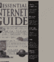

在所有正规书店有售，
或致电0870-840-4400（仅限英国），
或在全球访问 www.dk.com
或在澳大利亚访问 www.dk.com.au

## 信息时代必备技能

*多林·金德斯利基础电脑系列* – 一系列用户友好的视觉指南，为您提供所需的所有计算机技能

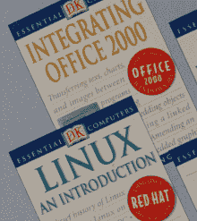


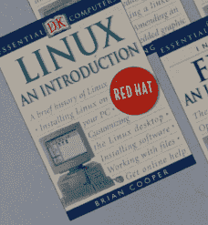

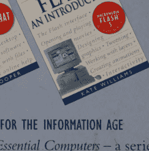

## 基础电脑

# LINUX

### 入门

### 关于本书

**《Linux入门》** 适合那些对使用微软® Windows操作系统感到自信，并希望了解最可靠的PC替代方案的人群。

人们常说，Windows是一个设计良好的计算机桌面，但被其背后的操作系统所拖累。Linux®，一个基于UNIX®并由其芬兰创造者林纳斯·托瓦兹设计的操作系统，现在被视为Windows的一个严肃替代品。这本Linux入门指南首先解释它是什么，并描述使用Linux的一些利弊。本书解释了该操作系统的行话，包括“发行版”一词——它指的是正在使用的Linux版本。这里使用的发行版由红帽®提供。书中还介绍了Linux桌面之旅，在本案例中，是GNOME桌面。本书其余部分涉及程序、文件管理、自定义、连接互联网以及最后安装软件。章节和小节通过示例展示书中的信息

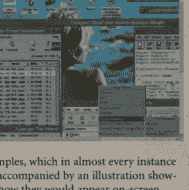

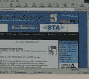

这些示例几乎总是配有屏幕示意图，展示它们的外观。本书包含若干功能，帮助你理解正在发生什么以及你需要做什么。命令键，如ENTER和CTRL，显示在这些矩形中：[ENTER]和[CTRL]，以避免混淆，例如，你是应该按下该键还是键入字母“ctrl”。

交叉引用以左页或右页图标显示在正文中：[页]和[页]。页码和参考内容显示在页面底部。

除了分步章节外，还有解释特定功能细节的框，以及提供替代方法的提示框。最后，在书的末尾，你会发现常用术语表和综合索引。


## LINUX入门

学习新的操作系统与学习新的软件不同，后者会使用许多可识别的术语和程序。这种熟悉感并不适用于操作系统。

### 什么是Linux？

二十年前，Linux是程序员和电脑爱好者的操作系统。如今，个人电脑预装了Linux，书店和PC杂志也有专门为其设立的版块。Linux现在已成为主流。

### 免费操作系统

Linux是UNIX操作系统的克隆版本。UNIX通常被认为是最强大和通用的操作系统之一，并广泛用作大型强大计算机上运行的计算机网络的操作系。在20世纪80年代末，赫尔辛基大学一名名叫林纳斯·托瓦兹的学生开始为独立工作站——即我们大多数人在家使用的普通PC——开发UNIX的一个版本。自1991年发布以来，Linux的原始版本一直被不断修改和改进——既由他本人，也由大量开发者定期帮助维护和更新内核（操作系统的核心）的新版本。Linux的每个新版本都免费在互联网上提供给任何人下载。虽然这个“官方”版本定期更新，但任何人都可以修改内核而无需担心诉讼，因为Linux是“开源”软件。

### 扩展平台

Linux现在已经重写并适用于许多其他操作系统。这意味着Linux现在能够在许多不同的硬件平台上运行——从IBM兼容的PC和Mac到Amiga和Alpha。

*发音为 Linn-ux*

Linux是创造者姓名Linus和UNIX的组合。它发音为Linn-ux，带有短音“i”。

## 获取

- 你可以从许多来源合法且免费地下载并安装一个功能完整的 Linux 副本到你的 PC 上——除了你可能支付的 ISP 连接费用外。
- 之所以能做到这一点，是因为 Linux 作为开源软件分发，其意图是通过互联网让任何人都可以复制和修改它。

## 什么是开源？

- 开源意味着原始代码，它是用任何了解该语言的人都能读懂的编程语言编写的，被称为源代码，对任何人都可用。这意味着任何人都可以检查和修改代码。然而，开源并不意味着“免费”。软件附带严格的条件，这些条件在其许可证中规定。

## GNU 通用公共许可证

#### 在哪里获取流行的 Linux 发行版

开始寻找 Linux 发行版的好地方是 www.linux.com，在那里：
- 我们最常提到的免费发行版是 Red Hat Linux，其文件存储库可以通过我们的 www.redhat.com 找到。其他发行版包括：
  - Fedora，GNOME 用户
  - Caldera OpenLinux
- 一份简短的 Red Hat 安装指南可供使用

## 安装 Red Hat Linux 5.0

以下是安装 Linux 所需事项的简要概述。本质上，这真的很容易：请查看 Red Hat 安装指南的六个章节，然后询问 5 个必要条件。

这个剑桥大学网站，www.stud.robinson.cam.ac.uk，包含有关 Linux 的有用网站和建议。

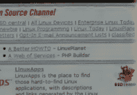

Internet.com 在 www.internet.com/sections/linux.html 提供 Linux 应用程序和文档的店面。

## 重构代码

- Linux 操作系统（以及在它下面运行的许多软件）以其源代码的形式完整地提供给作为用户的我们。这意味着任何有技能、时间或意愿去折腾或审查此代码的人都可以这样做。
- 对于大多数甚至所有你购买并安装在计算机上的商业软件，修改源代码是被严格禁止的。

```c
int send_sig(int sig, struct task_struct * p, int priv)  {
    if (lp && sig <= 32)
        return -EINVAL;
    if ((current->sig) & 1 << (SIGCHLD)) || (current->session != p->session))
    {
        (current->sig) & ^ p->selfid
    }
    // Forget it if the process is already zombie1'd.
}
```

> Linux 内核由代码组成，例如此处所示的例子，如果你愿意，你可以对其进行重构。

## Linux 社区

- 复制和自定义的自由是 Linux 最受欢迎的特性之一。对于那些喜欢折腾的人，或从事软件开发的人来说，Linux 提供了巨大的潜力。还有一个庞大的在线 Linux 社区，它自由地分享其知识。
- 操作系统和相关软件会定期更新，但如果某些东西不起作用，除了软件制造商唯一的“官方”渠道外，还有许多地方可以寻求修复。


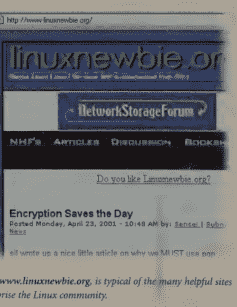

> 该网站，`www.linuxnewbie.org`，是组成 Linux 社区的许多有用网站的典型代表。

## GNU 通用公共许可证

- Linux Torvalds 拥有 Linux 商标，但内核是在 GNU 通用公共许可证下分发的。这份文件由自由软件基金会撰写，防止任何人限制对其适用的任何软件的使用。你可以收取费用或赠送此类授权软件，但你不能阻止其他人赠送它。许可证的另一项非常重要的条件是你有义务包含源代码。

该文件的开头文本写道：“任何人都有权复制和分发此许可证文件的逐字副本，但对其进行修改是不被允许的。”

前言指出，大多数许可证剥夺了你分享和改变软件的自由，但此许可证旨在保证软件是自由的，并且任何人都可以对其进行修改和添加。

> GNU 通用公共许可证
> 
> Linux 是在 GNU 通用公共许可证下编写和分发的，该许可证使代码能够自由分发并对公众可用。
> 
> GNU 通用公共许可证
> 第 2 版，1991 年 6 月
> 
> 版权所有 (C) 1989, 1991 Free Software Foundation, Inc.
> 675 Mass Ave, Cambridge, MA 02139, USA
> 任何人都有权复制和分发此许可证文件的逐字副本，但对其进行修改是不被允许的。
> 
> 前言
> 
> 大多数软件的许可证旨在剥夺你分享和改变软件的自由。相比之下，GNU 通用公共许可证旨在保证你分享和改变自由软件的权利——确保软件对所有用户都是自由的。GNU 通用公共许可证适用于自由软件基金会的全部程序库。你也可以将其应用于你的程序。
> 
> GNU 通用公共许可证的副本可在许多网站上找到，包括这里 `www.linux.org/info/gnu.html`。

### GNU 并非 Unix

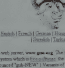

- 我们需要什么
- 我们要去哪里
- 我们不是什么
- 当我们到达那里时
- 我们如何做到？
- 谁能做到？

> GNU 项目的原则在其网站 `www.gnu.org` 上阐述。

## 为什么要尝试 Linux？

定义 Linux 的优缺点取决于许多变量。你将把 Linux 运行在什么类型的硬件上？你将使用什么外围设备，例如打印机、调制解调器和显示器？你打算在 Linux 下运行什么软件应用程序？你会将你的 Linux 发行版运行在网络上，还是在独立工作站上使用它？你是一位经验多丰富的 PC 用户？然而，以下各点通常适用于 Linux 的使用。

### 优点

- **多任务**
  Linux 可以并发运行大量程序。
- **多用户**
  Linux 可以并发支持多个用户，这对网络非常重要，或者非并发。这意味着多个用户可以登录到同一台计算机并像它是他们专属的那样使用它。每个个人的文件访问都受密码保护，所有其他用户的文件都是不可见的。
- **安全性**
  Linux 因其安全功能而备受推崇。只有系统管理员才允许进行系统级更改，例如安装软件或更改个人的访问权限。还声称 Linux 无病毒。
- **免费和开源**
  Linux 是开源软件且免费。开源软件的一个优点是问题修复的创建和可用性速度，通常在线提供。
- **模块化**
  由于 Linux 基于模块，它可以从其最复杂的形式（需要数百兆字节的磁盘空间）剥离，仅从一张软盘运行。
- **与其他系统共享**
  Linux 可以与其他操作系统在同一台计算机上共存。例如，你可以选择在相同的 PC 上启动 Linux 或 Microsoft Windows。
- **开发人员工具**
  Linux 捆绑了丰富的程序员开发工具。本书中介绍的红帽 Linux 版本附带 C、C++、Perl 和 Python。
- **网络**
  Linux 提供了运行 Web 和 FTP 服务器的理想环境。由于 Linux 基于 UNIX 操作系统，其网络功能非常出色。

### 缺点

#### 安装问题
大多数初始问题可能涉及安装和设置 Linux，除非别人为你设置了。然而，除非你拥有管理员密码，否则你将无法安装新应用程序或进行系统级更改。

#### 需要经验
安装 Linux 不适合初学者。提供的安装软件通常非常好，但你可能遇到需要具有除 Windows 以外其他操作系统经验的问题。例如，如果你对识别你的显示器规格或从屏幕提示符运行命令感到不安，你可能希望让别人安装软件。你甚至可能需要寻求帮助热线或在线支持小组的帮助。

#### 内部性能不足
如果你的 PC 旧、慢且容量有限，你在运行基于 Linux 的软件时会有问题。使用配置不足的 PC，你很幸运能有图形桌面，并且命令执行将花费很长时间。

#### 外围设备问题
你的外围设备在 Linux 下可能无法工作，不幸的事实是，无论等待多久，解决方案可能永远不会到来。大多数问题涉及专门设计用于在 Windows 下运行的产品。例如，对于 win-modem，使用 Windows 软件来替代调制解调器硬件内的某些电子组件。Linux 不像 Windows 那样补偿这些缺失的组件，并且没有保证它将来会这样做。

#### 软件可用性
由于 Linux 世界的非商业性质，一些软件将无法用于 Linux，并且没有确切的保证它最终会变得可用。例如，在 2001 年初，Microsoft 的 Office 套件和 Internet Explorer 无法用于 Linux。

#### 获取帮助
当你在 Linux 上遇到困难时，在任何搜索引擎中搜索"Linux help"。你会在互联网上发现大量有用的材料。这将包括指向公告板和邮件列表的链接，人们在那里询问和回答你可能遇到的问题。也要记得在你的报纸中搜索 Linux，并访问你遇到的任何 Linux 新闻组。

## LINUX 硬件要求

虽然 Linux 可以在其他类型的工作站（如 Mac 和 Amiga）上运行，但本书更适合熟悉在 IBM 兼容 PC 上运行的 Microsoft Windows 的用户。我们主要关注 Linux 在独立计算机上的应用，暂且不提其处理网络的强大功能。本书主要面向有 Windows 使用经验且好奇心强的初学者，而非程序员或有经验的网络用户。

### 运行 Linux 的要求

- 你可以在古老的 386 处理器上运行 Linux，但你需要从命令行提示符运行所有程序或命令。然而，若要使用 Windows 类型的图形桌面，你至少需要一个快速的 486 处理器，最好使用高端的 Pentium（奔腾）处理器。
- 具体规格取决于你打算在 Linux 下运行的内容。简单的文字处理和电子表格应用对处理器性能的要求远低于大多数图形应用和最新 3D 游戏所需的繁重数值计算。如果你的需求非常低，你甚至可以找到精简版的 Linux，它们可以从单个软盘加载。

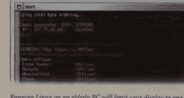

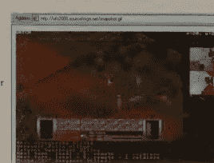

对于 Linux 的双启动安装（Linux + Windows），请为稍后要安装的应用程序预留足够的空间。如果你也想与他人共享电脑，请为其他用户预留足够的空间。不过，作为管理员，只有你能够安装新的应用程序。

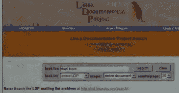

注意：请在 `http://linux.scsyr.edu/docs/` 搜索 LDP 邮件列表归档。

Linux 文档项目（`www.linuxdoc.com`）是一个值得关注的站点。搜索“双启动”返回了 199 个结果。

## LINUX 安装配置

以下三项规格支持安装带有类 Windows 图形桌面及典型实用程序和应用程序组合的 Linux。

### 最低配置

- 40386 处理器，8 MB 内存，540 MB 空闲硬盘空间。

### 可接受配置

- Pentium（奔腾）处理器，32 MB 内存，850 MB 硬盘空间。

### 推荐配置

- Pentium 处理器，最低 200 MHz，至少 32 MB 内存，至少 1500 MB 硬盘空间。

### 其他必需项

- CD-ROM 驱动器。虽然存在基于软盘的安装程序，但大多数发行版至少占用一张光盘。
- 受支持的显卡。如果你打算在较旧的 PC 上安装 Linux，必须检查你的硬件是否受 Linux 支持。

## LINUX 发行版

当人们提到 Linux 时，通常指的是由 Debian 和 Red Hat 等公司作为“发行版”出售的软件、代码和文档包。

### 这些术语是什么意思？

对于初学者来说，Linux 似乎充斥着大量术语——如 X Windows、桌面环境、文件管理器、X 服务器和 GUI（图形用户界面）。虽然了解所有组件如何协同工作并非必要，但熟悉基本术语是有用的。


类似地，你不需要是机械师就能开车，但知道主要部件的名称总归是有帮助的，能够进行一些常规维护也总是有用的。这些页面介绍了你在阅读有关 Linux 的内容时会遇到的一些术语。

### 内核

Linux 的核心是内核。这是启动 Linux 时最先加载的代码，并在系统停机时最后卸载。单靠内核似乎并没有做太多事情，但没有它，什么都无法完成。内核作为硬件与在 Linux 下运行的所有程序之间的主链接。它还处理关键后台任务，如内存管理和多任务处理。


**The Linux Kernel HOWTO**

作者：Brian Ward，邮箱：bri@cs.uchicago.edu

版本 v1.25，2001 年 3 月 28 日

*这是一份关于内核配置、编译、升级和.*

1. **引言**

    1. 请先阅读此部分。（1 分钟 95 秒）
    2. 适用于 1.2.x、2.2 和 2.4 内核。

2. **快速步骤 – 内核编译**

关于 Linux 内核的一切都在 Brian Ward 位于 `www.linuxdoc.org/HOWTO/Kernel-HOWTO.html` 的作品中。

### 工具

- Linux 工具是位于内核和显示 Linux 桌面的软件之间的一组程序。其中最重要的工具之一是 C/C++ 编译器。该工具编译用 C 或 C++ 编写的程序，将代码转换为 Linux 可运行的可执行程序。

### 应用软件

- 在原始状态下，Linux 不需要 GUI 即可工作。然而，在这里，我们将重点放在使 Linux 能够作为基于窗口的操作系统环境运行的图形应用程序上。

### X 窗口系统

- X 窗口系统用于在计算机上设置一个“X 服务器”。它保存关于你的显卡和显示器功能的信息。

#### 关于此页

这里有一些 C 和 C++ 库、DLL、源代码、组件、框架、类库、代码片段等。请忽略本节的许可条款，因为它们与其他章节的许可条款相同（或类似）。请务必阅读你所在发行版的许可说明。

在 `www.thefreecountry.com/develop/ptty/freeclibraries.shtml` 可以免费下载工具、库和 C/C++ 实用程序。

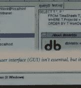

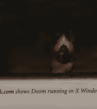

### 窗口管理器

基于 X 的桌面管理器提供了你的输入（通过键盘/指向设备）与监视器上发生的事件之间的图形接口。一些窗口管理器看起来和感觉起来像 Microsoft Windows，并且所有都是高度可定制的。这些程序管理窗口的放置，包括定位、重叠和最小化（图标化）。

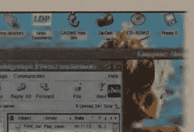

### 桌面环境

- 两个领先的桌面环境是 GNOME 和 KDE。GNOME（GNU 网络对象模型环境）是作为开源软件开发的。
- KDE（K 桌面环境）是使用名为 Qt 的 GUI 工具包构建的，KDE 也被广泛使用。
- Red Hat Linux 附带这两种桌面环境。其他大多数流行发行版也提供它们。
- 某些窗口管理器与某些桌面环境不兼容，但相关网站会提供必要的建议。

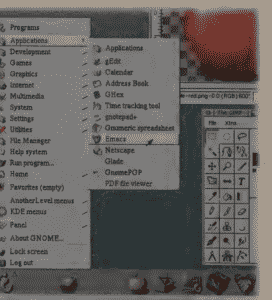

### 我能得到什么？

- 你对 Linux 发行版的选择将取决于你对供应商安装程序质量、文档和销售后支持的评估。
- Linux 套件始终包含 Linux 内核以及以下组件的一个组合：
    - 桌面管理器
    - 至少一个文本编辑器
    - 绘图程序
    - Web 浏览器
    - 多媒体工具
    - 实用程序
    - 游戏
    - 程序员工具
- 许多发行版还将提供：
    - 技术支持
    - 第三方应用的光盘，Suse 和 Red Hat Linux 捆绑了完整版 StarOffice 套件
- 你还将获得手册，有时篇幅长达数千页。
- 你可以在优秀的 *Linux online* 网站 `www.linux.com` 上找到主要 Linux 发行版的最新列表，包括描述和开发人员的网站链接。

### 从哪里获取？

- 下载 Linux，即使只包含一小部分相关应用程序和文档，也可能耗时较长。你的在线连接必须可靠，因为你不希望下载中途断开。此外，如果你决定下载内核并由此源构建操作系统版本，你必须确切知道自己在做什么。

**购买光盘版本**

- 一些供应商以几美元的价格销售一张包含发行版基本组件（通过网络下载）的光盘。这为你节省了大量可能昂贵且耗时的下载时间。同样，你需要知道自己在做什么，而不仅仅是关于软件安装的问题。

**购买盒装套装**

- 盒装套装很容易找到。你的软件商店很可能出售来自主要发行商的盒装套装，如 Caldera、Debian 或 Red Hat。通过这种方式，你所需要的一切都有可能提供，包括安装程序和印刷资料。唯一的缺点是这种方式通常最昂贵。

### 免费书籍或杂志附带的光盘

- 在这种形式下，它是免费的——如果你本来就要购买该杂志或书籍。但是，你不会获得发行商的文档，而且书籍内容可能是通用的，而不是针对你正在安装的具体版本。你也很少或没有商业支持可供试用。

### 从互联网下载

- 在这种形式下，它是免费的——前提是你不支付电话费并且有很多空闲时间。

## 红帽 Linux 豪华版工作站

本书介绍的分发版本是红帽 Linux 工作站版，它并不是价格较为低廉的选择之一。不过，红帽也销售较便宜的版本，所有额外组件均可稍后从同一来源购买。豪华版包含那些经过捆绑整合、可构成适合专业用户使用的 Linux 分发版的附加软件。

## 扩展历史

红帽公司成立于 1994 年，是一家开源软件的开发者和分发商。当时，Linux 用户数量估计为 100,000。在此后的期间，红帽通过收购和软件开发扩大了其业务活动。随着这种增长，一些人估计 Linux 用户数量已上升至约 15,000,000。

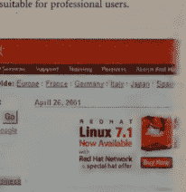

> *红帽网站 `www.redhat.com` 是起步的地方。*

若要查看红帽的产品范围，请访问该公司网站并点击“家庭/小型企业”。您可以向下滚动显示的页面，并从软件列表中选中“红帽豪华版工作站”。

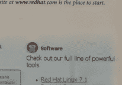

> *向下滚动页面并点击“红帽豪华版工作站”。*

## 包含内容

红帽 Linux 豪华版工作站以 10 张光盘交付，其中包含超过 5GB 的各类软件，包括：

- GNOME 和 KDE 桌面环境
- 对 USB 设备和可记录 CD-ROM 的支持
- XFree86 4.0.3，X 窗口系统的一种实现
- StarOffice 5.2
- Anywhere 2.0 演示版本，其中包含 Anywhere Desktop，这是一套办公程序
- Adobe Acrobat Reader 4.05
- Yahoo! 信使的特供红帽版本
- 来自 Loki、AlphaCentauri 和 SimCity3000 的游戏演示
- 超过 300 个 PowerTools 应用程序，包括 Zip、GnuScan、Openmotif、Exim、FaxMail 和 Postfix
- 红帽网络软件管理器
- 多种编程语言
- Netscape Navigator

### 红帽豪华版工作站

红帽豪华版工作站是新手用户的完美入门选择。除了获奖的 UI 操作系统外，豪华版工作站还为您提供指南、办公套件、游戏和服务，帮助您快速上手。

红帽豪华版工作站将于 2003 年开始发货

### 红帽豪华版工作站包括：

- 带有新安装器的红帽 Linux 7.2
- 本地应用程序 CD（工作站版）
- 系统工具 CD
- Loki CD

### 红帽网络软件管理器

- 通过默认设置和默认配置默认保存人工数天的时间
- 安装新的、升级和软件
- 软件包管理
- 支持
  - 4 天或电话支持（6 个月）
  - 4 天电子订阅（4 个月）
  - 4 天或基于网络的密钥支持（1 个月）

### 文档

- 安装指南
- 硬件兼容性指南
- 文档 CD

### 新功能

- 经过红帽测试的 2.4 内核
- 改进了对“热插拔”USB 和可记录 CD-ROM 的支持
- 笔记本电脑安装类别
- 默认易于支持 PCMCIA
- 将 Pervos 设为普通用户
- 更安全的默认设置和更快的配置修改
- XFree86 4.0.3，用于改进 3D 图形
- 灵活的打印配置工具，支持打印机
- 引入 Mozilla Web 浏览器

### 合作伙伴的演示和示例数据


- StarOffice® 5.2 完整版

- 来自 Visit 的 Anywhere® 2.0 演示版本

- Adobe® Acrobat® 阅读器 4.05

- Yahoo! 信使的特供红帽版本

- 来自 Loki®、Sid Meier’s Air 和 SimCity® 3000 的游戏演示

### PowerTools 应用程序

- 包括 Zip、GnuScan、Exim、FaxMail 和 Postfix 在内的超过 300 个应用程序

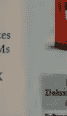

## GNOME 桌面

本节是对红帽 Linux 的快速浏览，展示了随 GNOME 安装的功能包，GNOME 是红帽 Linux 提供的两种桌面环境之一。

### 登录和注销

当您以 Linux 为操作系统启动您的 PC（而不是例如 Windows ME）时，您将看到屏幕布满文本行，这些行包含指示 Linux 正在检查、启用和启动所有驱动系统软件的信息——每次检查通过后都跟随 `OK`。

#### 输入用户名和密码

您的具体登录流程将由在您计算机上安装 Linux 的人定义。如果选择了图形界面，您将看到 GNOME 登录屏幕。如果没有，您将看到一个文本提示，要求您输入用户名，然后输入密码。无论哪种情况，当被提示时，请提供您的用户名和密码（*不是 root 用户名和密码*）。如果您使用的是图形界面，您通常会直接进入 GNOME 桌面环境。

#### 在提示符下输入

如果没有使用图形界面，您将看到一个类似于以下示例的文本提示（在 localhost 登录提示处，您的密码将替换 alba）。要启动 GNOME，请输入 `startx` 并按回车键。


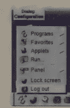

**注销**

要从 GNOME 注销，请从主 GNOME 菜单中选择“注销”。这将显示一个包含最多三个选项的对话框：

- 注销以结束 GNOME 会话。

- 关机以关闭计算机。

- 重启以重新启动。

### 使用 root 密码

如果您是独立 PC 的用户，您可能会发现 Linux 比您习惯的更强调用户名、密码和安全。如果您尝试执行任何将对您的 PC 进行系统级更改的操作，由于这些更改将影响计算机的所有用户，而不仅仅是您，因此需要输入 root 密码。如果您是计算机的唯一用户，这似乎可能没有必要。然而，如果您与他人共享您的计算机，将控制权限制在一个“超级用户”中的重要性很快就会显现出来。

**需要密码**

如果您没有访问 root 密码的权限——可能因为其他人安装了 Linux——您需要向他们索要密码，或者在每次需要系统级更改时登录。

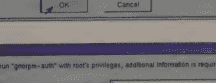

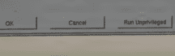

## GNOME 快速浏览

GNOME 加载后，您将看到一个图形用户界面（GUI），它与基于 Linux 和其他其他操作系统的其他桌面环境共享许多功能。文件和目录（文件夹）通过文件管理器中的窗口进行查看和处理。其他驱动器通过文件管理器本身或桌面图标进行访问。文件、应用程序和网页也可以通过桌面或面板（位于桌面底部）上的图标进行访问。桌面功能的外观可以轻松自定义。

### 桌面按键

1. 指向主目录的符号链接。

2. 符号链接是指向文件、目录或驱动器的符号链接或快捷方式。

3. 回收站图标

4. 两个红帽快捷方式

5. 对话框配置工具

6. 指向软盘和 CD-ROM 驱动器的符号链接

7. 默认 GNOME 桌面

8. GNOME 文档，涵盖所有主题

9. GNOME 面板

10. 文件管理器（显示主目录）

11. GNOME 面板菜单

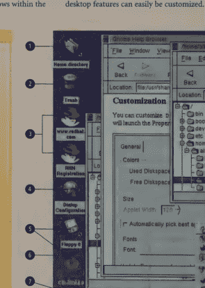

#### 使用文件管理器

#### 使用符号链接

#### 建立连接

## 独特的应用程序

乍一看，Linux 桌面似乎与例如 Windows 有很多相似之处而非差异。然而，尽管存在这些表面上的相似性，Linux 具有许多其独特的功能。它还拥有许多独特的 applets，这些是仅在 Linux 上可用的应用程序和实用工具。这些应用程序中的大多数，如果不是全部，都是由独立程序员编写的，并遵循 GNU 通用许可协议发布。

[1. 要了解这些程序作者的更多信息，请选择相关应用程序帮助菜单中的“关于”。]

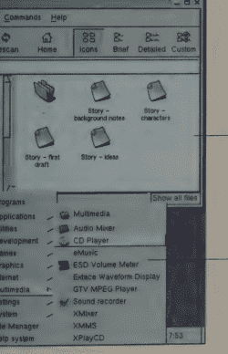

## 哪个桌面？

本书介绍的红帽 Linux 版本提供了两种桌面环境。本书的插图以 GNOME（GNU 网络对象模型环境）为特色，但红帽 Linux 还包含 KDE（K 桌面环境），它同样受欢迎且被广泛使用。如果您选择安装这两种桌面环境，则可以访问正在运行 GNOME 的面板中的 KDE 程序，反之亦然。值得试一试，看看哪一个适合您。它们同样出色，您的选择将取决于个人偏好。

## 桌面指南

GNOME 桌面以及主要的软件组在 GNOME 的默认安装中就已提供。如果你是一个充分利用多任务环境的用户，GNOME 桌面很快就会因窗口而变得拥挤不堪。GNOME 针对这一问题提供了一个极佳的解决方案，即“桌面指南”（Desk Guide）。它是一种虚拟桌面，可以容纳多个桌面，每个桌面只需点击一下按钮即可访问。

### GNOME 面板中的桌面指南图标

- 你的电脑已经预装了桌面指南功能，你将在 GNOME 面板上看到其图标。

- 如果 GNOME 面板上没有出现桌面指南图标，请在 GNOME 面板上右键单击，然后从“实用工具”菜单中选择“桌面指南”。

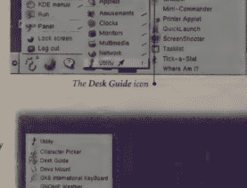

在默认的四格桌面指南中，点击其中任意一个格子，就会展示出一个全新的桌面区域。你在这些桌面中打开的任何窗口都会保持在原地，直到你再次切换回该桌面。这样，你可以简单快捷地将桌面的有效面积扩大四倍。

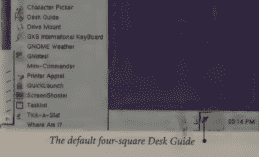

### 杂乱的工作区

- 如果你正在使用某个窗口，且当前工作区变得过于杂乱，请点击该窗口的左上角，然后在弹出的菜单中选择**将窗口发送到下一个（或上一个）工作区**。窗口会立即移动到下一个工作区。

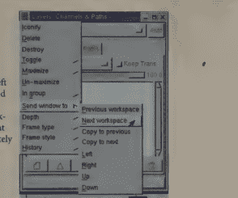

## GNOME 面板功能

GNOME 面板是沿着桌面底部运行的栏。它是访问从面板运行的应用程序（迷你应用）以及配置工具的起点。用户可以根据需求自定义这些工具，添加自己选择的菜单以及指向应用程序和文件的链接。

此外，你也可以将额外的 GNOME 面板放置在桌面的其他位置。下面的图示展示了 GNOME 桌面默认安装时提供的组件。


### GNOME 面板

1. GNOME 按钮

2. 截屏按钮

3. 集成帮助系统

4. 终端仿真程序

5. GNOME 控制中心

6. Netscape 浏览器

## GNOME 按钮

- 点击 GNOME 按钮（显示足迹徽标）以显示主菜单。

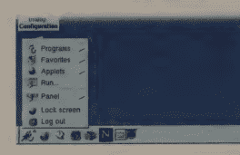

## 屏幕锁定按钮

- 点击此按钮将打开该面板并锁定屏幕。只有当用户在提供的输入框中正确输入密码时，才能解锁。

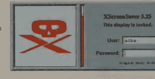

## 集成帮助系统

- 此功能为 GNOME 桌面环境提供全面的在线帮助。

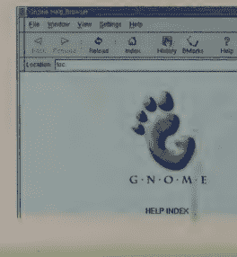

## 终端仿真程序

- 此功能允许用户直接向 Linux 操作系统输入命令。

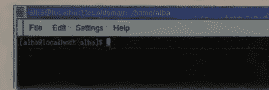

#### GNOME 控制中心

- 此功能允许用户调整那些决定桌面外观和功能各方面的小部件（Applets）。

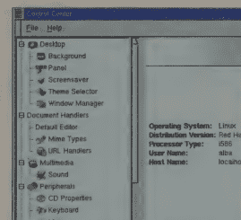

## 添加新面板

- 如果你觉得 GNOME 面板变得杂乱无章，可以通过“面板”菜单选择“创建面板”来创建另一个面板。系统将提供关于新面板位置和行为的多种选项。

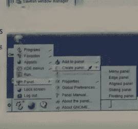

## GNOME 小部件


GNOME 小部件是从位于 GNOME 面板上的控件操作的迷你应用程序。在 Red Hat Linux 的默认 GNOME 安装中，包含了数十个实用的小部件，但由你决定要在 GNOME 面板上放置哪些。对于大多数这些小部件，如果你在面板上右键单击小部件，并从屏幕上弹出的菜单中选择适当的选项，它们是可以自定义的。

## 向面板添加项目

- 若要向 GNOME 面板添加小部件，请在面板的空白处右键单击，从弹出菜单中选择**小部件**，然后从相应的子菜单中选择项目。你也可以直接从 GNOME 主菜单中选择小部件菜单。
- 此示例展示了选择并添加 CD 播放器小部件的过程。

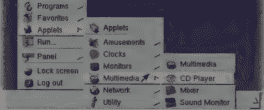


## 字符选择器

- 字符选择器小部件允许你复制和粘贴特殊字符（如带重音符号的字母和数学符号）到你的文档中，无论你正在使用哪种应用程序。

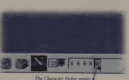

字符选择器小部件

## 可用小部件

GNOME 的标准安装提供了六个类别的小部件。其中最有用的包括磁盘挂载（Drive Mount），它为软盘驱动器提供图标并显示驱动器的当前状态。点击此图标将挂载或卸载驱动器。这比右键单击并选择挂载或卸载菜单项（[ ] 中的替代方法）要快。

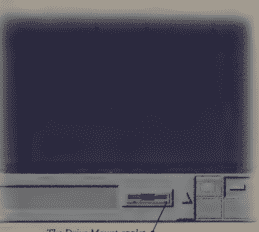

WebControl 是一个简单的网络小部件，允许你输入网络地址并直接访问该网站。它通过“网络”子菜单提供。

如果你当前没有使用 Netscape 浏览器，它将自动启动该程序。如果你正在运行 Netscape，WebControl 还提供在旧窗口中打开所选网站的选项。

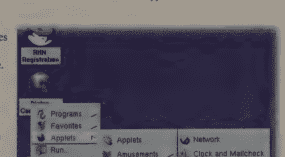

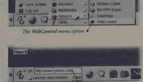

### 访问其他驱动器

# GNOME 程序

GNOME（随 Red Hat Linux 提供）包含数量庞大且种类繁多的免费程序。这些 GNOME 程序被归类为九个主要类别，非常值得花时间去探索。

## 程序菜单

- 如果你继续使用 Linux，程序菜单很可能只是使用你 Linux 应用集合的起点。不过，你可能会发现继续使用该程序中的一些，尤其是随着作者（以及其他 Linux 开发人员）定期对其进行改进和增强。

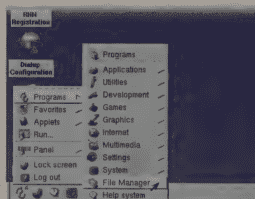

## 程序：应用程序

- Gnopad+ 和 gedit 是可供 GNOME 使用的众多文本编辑器中的两个。它们可以通过“程序”菜单中的“应用程序”子菜单访问。

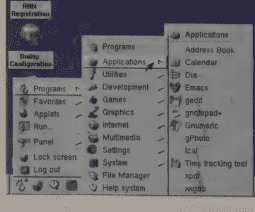

Gnotepad+ 主要用作超文本标记语言（HTML）文本编辑器，具有许多用于网页编写的实用快捷键。

Gedit 是一个简单有效的文字处理应用程序。

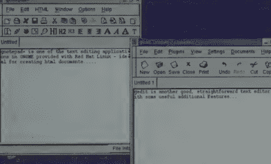

## 日历

- GNOME 日历虽然简单，但包含了你可能在商业产品中期望看到的许多功能。日历是从“应用程序”子菜单启动的。
- 它有四个标签：日、周、月和年。每个标签显示其自身的时间段，但允许你从其他任何一个标签安排约会。

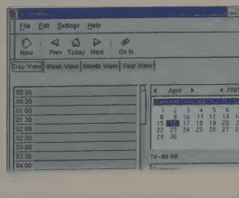

## 程序：应用程序

- 其他应用程序包括 Gnumeric（GNOME 电子表格）和 Dia（图表编辑器）。如果你对这类应用程序有一定了解，这两个程序都非常容易上手。

## 程序：实用工具

- 从“程序”菜单访问的实用工具与可作为小部件使用的实用工具不同，因为它们是作为完整程序运行在桌面的独立窗口中。这些实用工具包含一系列简单应用程序，从搜索工具到计算器再到颜色浏览器。以下示例展示了标准 GNOME 安装提供的部分实用工具。

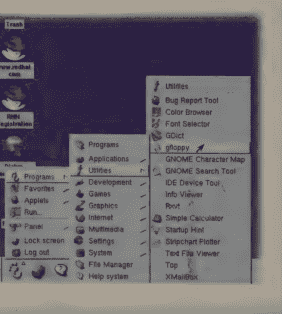

### GFLOPPY

- Glfopy 是一个用于格式化软盘的实用工具。通常，你可以在 GNOME 桌面上挂载并读取在其他操作系统上格式化的软盘。例如，可以读取 Windows/DOS 格式化的磁盘。但是，反向传输将不起作用。Linux 软盘无法格式化为在 Windows 电脑上读取。因此，如果你打算在 Linux 电脑（例如 html 或 tex 文档）和 Windows 电脑之间传输文件，你应该将软盘格式化为 DOS（FAT16）而不是 Linux 原生（ext 2）磁盘。

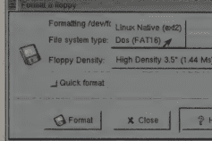

### GNOME 计算器

- GNOME 计算器自带的说明提供了“类似于 xcalc 的简单双精度计算”。对于那些需要高级功能的用户，它提供的功能远超普通的免费桌面计算器。

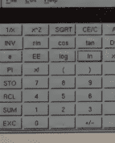


## 程序：图形

- GNOME 中备受推崇的应用之一是 GIMP（GNU 图像操纵计划）。这个功能强大的图像编辑套件最初是 1995 年作为一个学生项目创建的。它是一个自由分发的软件，适用于图像处理任务，如照片修整、图像合成和图像创建。
- 在使用 GIMP 之前，你需要在电脑上安装它。如果你点击“图形”菜单中的链接，安装过程将开始。

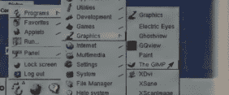

- 安装程序将引导你通过一系列配置屏幕，直到过程结束。
- 安装完成后，你会发现 GIMP 具有许多功能。它可以用作简单的绘图程序、专业级的照片修整程序、在线批处理系统、图像渲染器以及可用于转换图像格式的工具。

### 个人 GIMP 目录

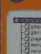

为了正确安装 GIMP，你的系统上需要有一个名为 `/gimp-1.1...` 的子目录。该子目录将包含若干文件和子目录，这些文件和子目录有助于 GIMP 了解你的系统。有关此主题的更多信息，请参阅在线帮助手册。

### 监视器分辨率

要在其原始尺寸下显示图像，GIMP 需要知道你的监视器分辨率。GIMP 可以从 X 窗口系统获取此信息。然而，通常这并不能提供有用的值。

GIMP 的功能包括画笔、喷枪、文本工具、克隆、模糊和锐化等绘图工具。你还可以通过旋转、缩放、翻转和错切来变换图像，并将文件保存为许多常见格式。

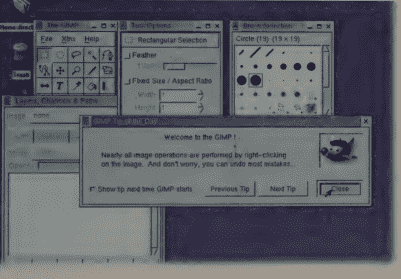

## 程序：互联网

GNOME 互联网子菜单中列出的一些互联网程序将在本书的后文中介绍。

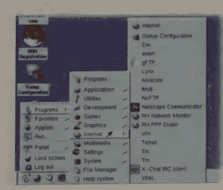

**Linux 在线**

## 程序：多媒体

- 为了充分利用多媒体程序，你需要安装并配置相应的硬件（即 CD-ROM 播放器、CD 刻录机、声卡以及声音/视频录音设备）。
- 互联网是 Linux 录音、编辑和播放音频及视频片段软件的一个良好来源。不过，这里提供的默认应用程序为你的收藏提供了一个良好的起点。

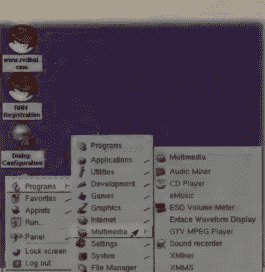

- GNOME CD 播放器具备一款良好的免费桌面 CD 播放器所需的所有基本功能。


- GTV 是一款简单的播放器，用于播放以 MPEG 格式录制的电影。


### 多媒体播放器

- XMMS 代表 X 多媒体系统，是一款用于 Unix 系统的多媒体播放器，比上述两款播放器更为复杂。它可以播放 MP3、MOD、WAV 和 OGM 等媒体文件。
- 该系统提供图形均衡器、播放列表编辑器，以及大量的按钮、滑块和可配置的附加功能。
- 右键点击 XMMS 并选择“选项”以调出偏好设置对话框。
- 偏好设置对话框允许你安装和配置与音频和视觉效果相关的非常广泛的插件。


### 程序：设置

设置菜单提供了许多配置工具的快捷方式，你也可以通过其他许多路径到达这些工具。


大多数普通用户可以更改和个性化的常见设置，例如屏幕保护程序、背景壁纸和系统声音，都可以通过设置菜单访问。

此示例显示的是屏幕保护程序设置窗口，其中列出并预览了标准 GNOME 安装中可用的数十种屏幕保护程序。屏幕保护程序可以通过点击屏幕保护程序选择框下方的按钮并从可用选项中选择来进行预览和自定义。


#### 48 访问控制中心

### 程序：系统

要使用系统菜单中的大多数项目，你需要知道 `root` 密码，因为你要做的是影响系统的更改，而不仅仅是个性化你的桌面环境。

这里最常用的菜单项可能是 `GnoRPM`，它是 Linux 中用于安装和卸载软件的包管理器。


这里的其他项目也可能无价之宝。上述菜单中的“系统信息”选项会打开系统信息窗口，提供关于你电脑的技术信息。你不太可能经常访问它，但它能为你省去很多麻烦，特别是如果你使用过该选项生成包含数据的文档并打印它。

如果你的电脑遇到困难，你手头会有这些信息。要生成此文档，请从系统菜单启动系统信息，并点击“将信息保存到文件”。


### 文件管理器

GNOME 中的文件管理与 Windows 和 Mac 环境有许多相似之处，但一些功能对有 UNIX 经验的人来说会更熟悉。

#### 使用文件管理器

本章介绍如何使用 GNOME 文件管理器选择、移动、复制和删除文件和目录。它还介绍了 GNOME 与 Windows 和 Mac 接口在访问软盘和 CD-ROM 驱动器方面的区别。

##### 在主目录中操作

当你作为普通用户而非超级用户（即 `root`）创建和保存新文件时，默认情况下文件会被放置在主目录下一个以你的用户名命名的子目录中。在此示例中，用户名为 `alba`，因此该子目录的路径为：`/home/alba`。

随时打开此目录，只需双击 GNOME 桌面图标上的主目录图标。

要打开文件管理器窗口，请从 GNOME 面板上的程序菜单中选择文件管理器。


#### 文件管理器键

**左侧**

窗口左侧显示目录和子目录。高亮目录的内容显示在窗口的右侧。点击 `+` 展开目录树，点击 `-` 收缩文件管理器窗口左侧的目录树。

**右侧**

此侧显示窗口左侧高亮目录的内容（即文件和子目录）。

**位置框**

如果你需要路径名（目录/子目录），请在此处输入并按 `[Enter]` 键，即可在文件管理器窗口中直接获取目录。如果你已连接到互联网，可以在位置框中输入 FTP 站点地址。文件管理器随后将成为一个 FTP 客户端应用程序。

**右侧工具栏按钮**

这些按钮改变右侧的视图。例如，“简要”仅显示文件或子目录名称，不显示其他详细信息。

**左侧工具栏按钮**

这些导航按钮让你可以通过列表向上浏览目录，或者从子目录向上移至更高的目录。

**重新扫描按钮**

重新扫描按钮重新显示当前窗口内目录的内容，反映最近发生的目录列表变化。

**主目录按钮**

点击主目录按钮会将活动目录更改为 `Home` 目录。


#### 移动和创建

当你创建或保存文件时，默认情况下它会被添加到你的主目录中。你需要进行的大多数文件管理操作，如复制、保存、移动和删除文件，很可能都以这个目录为中心。

##### 创建新目录

要创建新目录，请在文件管理器窗口的空白处右键点击，然后点击弹出菜单上的“新建目录”。然后，在“创建新目录”对话框中输入新目录的名称，并点击“确定”。


##### 移动文件和目录

要在文件管理器中移动文件和目录，首先在右侧面板中显示它们，高亮显示你要移动的项目，并将它们从右侧拖到左侧的相应目录上。当目录被高亮显示时，释放鼠标按钮，文件将相应移动。


#### 使用符号链接

在 GNOME 桌面环境中，符号链接（`symlink`）指向的文件或目录可以放置在桌面上、GNOME 面板中，或者文件管理器的任何其他文件夹中。符号链接类似于 Windows 中的快捷方式或 Apple Mac 操作系统中的别名。你可以重命名、移动或删除符号链接，而不会影响其所指向的文件或目录。

##### 创建符号链接

要创建符号链接，请右键单击你要链接的文件或文件夹。在本例中，文件 `Story - ideas` 将被创建指向它的符号链接。


在出现的下拉菜单中选择“Symlink”后，将打开“Symbolic Link”对话框。在“Existing filename”文本框中输入文件的路径和文件名。在“Symbolic link filename”文本框中，输入符号链接的名称。在本例中，`Story ideas` 将作为符号链接，位于名为 `Story - ideas` 的文件的同一目录中。点击“OK”。


符号链接将显示在目录窗口中。双击此链接现在将打开主文件。


#### 拖放到 GNOME 面板

GNOME 桌面环境的所有方面都具有高度可定制性，正如我们在前面的页面中看到的。如果你打算经常使用硬盘上的某个目录，并希望直接从 GNOME 桌面访问它，你可以安排直接从 GNOME 面板访问它。只需将图标从文件管理器窗口拖到 GNOME 面板中合适的空白区域，然后松开鼠标按钮即可。

#### 直接访问内容

为了在未来直接访问目录的内容，点击 GNOME 面板上的图标。此示例展示了主目录（对于用户 `alba`）被传输到 GNOME 面板的情况。


#### 基本键盘快捷键

如果你要有效地使用文件管理器和 GNOME 桌面，以下键盘和鼠标快捷键是必须的。

`Ctrl + 拖拽`：在拖拽文件时按住 `Ctrl` 键。这意味着你复制该文件（即你移动该文件的副本，而不是文件本身）。

`Ctrl + 点击`：使用 `Ctrl + 点击` 来选择右侧窗口中的一组文件。如果你打算使用此方法，最好不要通过图标视图进行查看。

`Ctrl + 点击`：要从组中选择或取消选择单个文件，请在点击相应文件时按住 `Ctrl` 键。

#### 右键弹出菜单

使用鼠标右键，这是你在 GNOME 中可以使用最实用的快捷键之一。当你右键单击文件或小程序时，会出现一个菜单，提供你需要使用的大多数主要选项。

打开文件。

打开方式：允许你确定用于打开该特定文件（或文件类型）的应用程序。

编辑：用于修改文件。

复制：这会生成一个对话框，你在其中输入文件要复制到的新位置。

移动到回收站。

删除：此选项完全绕过了通过先将项目移动到回收站来提供检索文件的可能性。

移动：打开一个对话框，你在其中输入文件的新位置。

面板：此子菜单包含各种项目，包括添加和移除面板及小程序的子菜单。

符号链接：这允许你创建符号链接，这在很大程度上等同于 Windows 中的快捷方式或 Mac 操作系统中的别名。

属性：属性对话框包含三个选项卡，每个选项卡打开一个页面，其中包含与谁能编辑、复制或删除文件相关的统计数据、选项和权限。


#### 访问其他驱动器

Linux 将所有目录显示在一个目录树中，无论它们位于什么驱动器上。Linux 中没有驱动器字母；所有磁盘的内容简单地显示为子目录。此外，可移动磁盘的内容不会自动出现；首先必须“挂载”驱动器才能查看其内容。

#### 磁盘图标

代表软盘和 CD-ROM 光盘驱动器的图标出现在桌面的左下角。这些图标分别是到目录 `mnt/floppy` 和 `mnt/cdrom` 的符号链接。


### 挂载软盘驱动器

- 在将软盘插入适当驱动器后，在查看软盘内容之前，你需要挂载该驱动器。为此，请右键单击桌面上的相关驱动器图标，并从弹出菜单中选择 `Mount device`。


### 卸载磁盘驱动器

当你移除软盘并插入另一张时，你不会立即看到新软盘的内容。在其他操作系统中，你通常必须使用命令来重新扫描磁盘驱动器的内容。然而，在使用 GNOME 时，在移除软盘之前，你始终需要先选择 `Unmount device`，然后挂载新磁盘。如果你使用适当的文件管理器按钮重新扫描驱动器而不进行卸载/挂载操作，你只会看到第一张软盘的内容。如果你在没有卸载的情况下物理移除磁盘，你将冒着丢失其中数据的风险。


### CD-ROM 驱动器

当你在 GNOME 中将 CD-ROM 光盘插入 CD-ROM 驱动器时，通常会在桌面上显示一个图标，并且文件管理器会启动并打开 CD-ROM 目录，显示光盘的内容。此示例展示了随机附带的某些 Red Hat Linux 版本中 CD 的内容之一。


### 系统自定义

通过 GNOME 控制中心，你可以配置桌面和系统的许多方面——从桌面背景到占据它的图标。

### GNOME 控制中心

除了配置你的桌面和系统之外，你还可以通过 Linux 中一组被称为“capplets”（代表“Control Center applets”）的工具，来个性化你正在使用的窗口和菜单中最小的功能。

### 访问控制中心

- 你很可能进行的大多数自定义操作都是通过 GNOME 控制中心完成的。
- 访问控制中心有三种方式：
  1. 通过 `Settings` 菜单。
  2. 通过 `GNOME Configuration` 工具。
  3. 通过 `Settings` 菜单子菜单上的 `GNOME Control Center` 选项。从这个子菜单中，你可以访问许多配置选项。


然后打开控制中心。要访问控制中心的任何工具，请点击窗口左侧的相应条目，右侧的工作区将填充相关的控件。如果你曾经使用过 Windows 98 或 Mac OS 等操作系统，你会对 GNOME 控制中心中找到的许多配置选项有合理的熟悉度。

- GNOME 控制中心包含七个主要的控件组：
  - `Desktop`
  - `Document Handlers`
  - `Multimedia`
  - `Peripherals`
  - `Sawish Window Manager`
  - `Session`
  - `User Interface`

所有这些提供子菜单，每个子菜单包含许多配置选项。其中大多数允许你在接受更改为最终设置之前先测试这些更改。


如果你进行了一些更改但未最终接受它们（即，你点击了 `Try` 按钮而不是 `OK`），然后尝试退出控制中心，将会出现一个警告框，让你有机会丢弃所有更改，并列出你修改的所有模块。


接下来的几页展示了通过 `GNOME 控制中心` 可获取的数十种工具（或称小工具/applets）中的一部分，首先是从大家通常最先决定进行个性化设置的领域——`GNOME 桌面` 开始。

### 桌面：背景

- 控制中心中的工具可用于从图像文件、纯色或渐变中选择背景。如果你选择使用渐变，需要选择两种颜色，然后指定如何混合这些颜色。
- 在这里，就像大多数其他控制项一样，你会有选项来试用你的更改，如果你不满意所做的更改，还可以还原到原始状态。


### 先试用

要取消更改，请单击控制中心警告框中的 `放弃所有更改（Discard all changes）` 按钮。要确认更改，请双击列表中高亮显示的条目并进行修改。然后，可以通过在 *选项* 窗口中单击“确定”来确认这些更改。

### 桌面：面板

- 此处显示的全局面板属性对话框提供了更改面板几乎每个方面（大小、形状、纹理和位置）的选项。
  - 此示例显示了“按钮”页。当你单击 `Button type` 旁边的按钮时出现的下拉菜单，提供了四种按钮类型选择：`Launcher`、`Drawer`、`Menu` 和 `Special`。
  - 面板属性对话框顶部还有另外四个选项卡，分别称为“动画”、“面板对象”、“菜单”和“杂项”。由这些按钮和滑块激活的大多数选项都是不言自明的，你可以通过单击面板窗口底部的相应按钮来选择试用、接受或还原。然而，除非你以 root 用户登录，否则你将无法访问此小工具的某些部分（例如，“菜单”页的系统部分）。


### 替代访问方式

- 你也可以从桌面访问上述小工具。首先，右键单击屏幕底部的 GNOME 面板，从弹出菜单中选择 `Panel`（面板），然后从 Panel 子菜单中选择 `Global Preferences`（全局首选项）。

### 桌面：主题选择器

- GNOME 提供了十多种桌面主题，你可以使用“主题选择器”小工具预览或选择其中任何一个。
- 单击 `Try`（试用）按钮会将桌面转换为你在“可用主题”框中高亮显示的主题。如果你单击该框右侧的 `Preview`（预览）按钮，主题将只应用于下方预览框中的内容，如本示例所示。如果 `Auto Preview`（自动预览）按钮处于按下状态，则无需单击预览按钮。此小工具还提供了安装新主题的功能，网络上可用的主题数量也在不断增加。


### 另外两个小工具

**会话管理器小工具**

此小工具允许你控制 GNOME 会话管理，它指定了哪些程序启动、如何保存你的 GNOME 配置以及如何注销。

**GNOME 编辑属性小工具**

使用此小工具，你可以选择哪个编辑器作为你在 GNOME 中的默认编辑器。这将允许 GNOME 文件管理器等应用程序在你尝试打开与编辑相关联的文件时启动正确的编辑器。所有流行的文本编辑器都包含在选择列表中。

### 多媒体：声音

你可以使用“声音”小工具来设置大量 GNOME 系统事件的声音。

首先，单击“声音事件”选项卡，然后高亮显示你希望附加声音的事件。


- `选择声音文件（Select sound file）` 对话框打开。选择为你高亮显示的事件选择的声音，单击 `Browse`（浏览）按钮，并导航到硬盘上相应的 `*.wav` 文件。
- 你可以单击控制中心窗口中的 `Play`（播放）按钮来预览此声音。


### 桌面：窗口管理器

- 你可以选择在控制中心中该选项，并单击右上角的“添加”按钮来添加窗口管理器。在“添加新窗口管理器”对话框中，输入启动新窗口管理器及其配置工具所需的名称、命令和路径。
- 要切换窗口管理器，请从列表中选择的名称并单击“试用”按钮。


- 一个信息面板会告诉你当前会话需要保存，以及如何保存，无论是现在还是稍后。
- 现在已切换到新的窗口管理器。


### 用户界面

- `用户界面（UI）选项` 涉及更改符合 `GNOME 规范` 的应用程序的外观和感觉。UI 选项包括可分离的工具栏和菜单栏，以及边框、图标和状态栏的外观。UI `小工具` 实际上是为高级用户准备的。如果你对这些选项中提供的任何内容不确定，请冒险犯错误，以免你稍后悔。

**菜单选项**

- ☑ 可以分离和移动菜单
- ☑ 菜单具有 `凸起的边框（raised border）`
- ☑ 子菜单可以被 `撕下（torn off）`


- ☑ 菜单 `项（items）` 具有 `图标（icons）`

## 工具栏选项

- ☑ 可以 `分离（detach）` 和 `移动（move）`
- ☑ `工具栏（Toolbar）` 具有 `凸起（raised）`
- ☑ 工具栏 `按钮（buttons）` 具有
- ☑ 工具栏具有 `线条（line）`
- ☑ 工具栏具有 `工具（tool）`
- ☑ 工具栏具有 `线条（line）`

## 状态栏选项

- ☑ 状态栏在 `可能时` `是` `交互式的（interactive）`
- ☑ 状态栏进度条在右侧

*用户界面菜单选项。*


### 文件管理器首选项

- 访问 Gnome 文件管理器首选项的一种方法是右键单击桌面，并从此出现在屏幕上的弹出菜单中选择 `桌面属性（Desktop Properties）`。


- `首选项（The Preferences）` 对话框打开。它由五个选项卡组成：`文件显示（File Display）`、`确认（Confirmation）`、`VFS`、`缓存（Caching）` 和 `桌面（Desktop）`。桌面设置决定了桌面上文本和图标的位置和外观。

# 使用 Linux 在线

如果你使用 Linux 连接到互联网，并且已经拥有互联网服务提供商（ISP）的账户，只要你了解必要的设置，就不会有太多问题。

### 建立连接

设置新连接意味着你将进行影响计算机功能的更改。这意味着系统将提示你提供管理员（root）密码。没有这个密码，你将无法继续。

### 开始流程

- 开始连接过程的第一步是双击桌面上的 `拨号配置（Dialup Configuration）` 图标。


### 添加新连接

- 打开第一个“添加新互联网连接”面板。从这一点开始，你只需按照提示在每个窗口和对话框中输入必要的详细信息，然后单击“下一步”即可。


### KDE 替代方案

在 KDE 桌面环境中（与 GNOME 桌面相对），Red Hat Linux 提供了 `kppp` 互联网配置软件，它是 GNOME 拨号配置软件的替代方案。两者同样有效，但你不能将桌面环境与配置混合使用。换句话说，如果你主要打算使用 GNOME 桌面环境，请坚持使用拨号配置工具。

### 你将需要的信息

在开始设置你的互联网账户之前，请务必列出一份以下信息的清单。这些信息应由你的互联网服务提供商（ISP）提供，特别是如果你以前是使用他们的专有软件连接的：

- ISP 的拨入电话号码（用于访问互联网）
- 你的用户名
- 你的密码
- 邮件服务器地址
  - 通常会有两个：一个用于接收邮件（例如，`pop3.yourisp.com`），一个用于发送邮件（例如，`smtp.yourisp.com`）
- 你的（邮件）服务器密码（某些 ISP 可能需要第二个密码来收集你的邮件）
- 新闻服务器名称。

### 配置调制解调器

如果你的 PC 上连接了一个调制解调器（或已安装在内部），但在安装 Linux 期间没有自动检测和配置它，Red Hat Linux 将尝试自动检测它，此时将打开“选择调制解调器”窗口。


#### S8 · 在 Linux 下联机

- 请确保调制解调器已开启并连接到电话插座。当检测到调制解调器时，您可选择调整设置或接受已检测到的设备。如果未检测到调制解调器，您可以尝试通过输入调制解调器手册中提供的设置来进行配置。在某些情况下，您的调制解调器可能无法在 Linux 下正常工作。


- 如果您拥有一个完全配置好的调制解调器，则自动检测过程将不再必要。在确认调制解调器功能完全正常，并且您已拥有与您的 ISP（互联网服务提供商）相关的所有必要信息后，拨号配置过程只需几分钟即可完成。


- 如果您过去曾使用 Windows 95（或更高版本）设置过互联网账户，您会发现使用 GNOME 中的拨号配置的过程与之非常相似。


##### 外设问题

- 流程完成后，您可以点击“添加”按钮，添加您可能拥有的其他 ISP 的账户。最后，点击“关闭”按钮以完成拨号配置。


### 连接互联网

您可以通过从 GNOME 面板中选择 RH PPP 拨号器来连接互联网。您可以将“调制解调器指示灯”小工具放置在 GNOME 面板上，以便快速访问互联网开/关按钮，并监控显示当前连接状态的一些有用信息。

#### 将小工具放置在面板上

要将“调制解调器指示灯”小工具放置在您的 GNOME 面板上，请先选择“面板”，然后选择“添加到面板”、“小工具”、“网络”，最后选择“RH PPP 拨号器”。


### 控制您的连接

“调制解调器指示灯”小工具允许您点击中间的单个绿灯来连接和断开连接。您还可以持续监控调制解调器的状态。


调制解调器指示灯小工具

- 在开/关按钮左侧，上方的显示区域显示数据传输速率；下方的显示区域与接收的数据相关。
- 在开/关按钮右侧，较大的数字显示总连接时间。较小的数字显示每秒读取的字节数。
- 您可以通过右键点击小工具并选择“属性”来打开“设置”对话框，从而自定义该小工具。在此处，您可以更改小工具的多项设置。

### 互联网应用程序

Red Hat Linux 捆绑的互联网浏览器是 Netscape Navigator，它随 Netscape Communicator 程序套件一同提供。在 2001 年初，Microsoft 的 Internet Explorer 尚无法在 Linux 上使用。


- Netscape Communicator 提供了一套优秀的程序，包括网页浏览器（Navigator）、电子邮件客户端（Messenger）、新闻组客户端（Newsreader）以及网页编辑软件（Composer）。
- 要启动 Netscape Navigator，请点击 GNOME 面板上的 `N` 图标。
- Netscape Navigator 在 Linux 上的运行方式与其他任何操作系统中相同。网页地址在位置框中耦合，可以使用书签再次访问您在互联网上的 favorite 站点。


### 更多互联网应用程序

Red Hat Linux 提供了一系列互联网程序作为其标准安装的一部分。安装 Linux 后可用的互联网应用程序数量取决于您使用的 Linux 发行版。就 Red Hat Linux 而言，您会发现至少有两张 CD 包含额外的程序——其中许多是与互联网相关的。使用您的互联网连接，您将在互联网上发现数量庞大的 Linux 应用程序。

### 通过 GNOME 面板访问程序

- 在此特定版本的 Red Hat Linux 中，随 GNOME 立即可用的互联网程序都可以直接从 GNOME 面板访问。
- 这里的小量选择包括各种新闻阅读器、邮件客户端、Internet Relay Chat（IRC）客户端、Telnet 客户端以及 Lynx（这是一款基于文本的网页浏览器）。


### 在 Linux 下联机

#### IRC 客户端

- Xchat 是一款在 Red Hat Linux 的 GNOME 桌面中可用的、无花哨功能的 Internet Relay Chat（IRC）客户端。与过去相比，现在可供 Linux 使用的功能更丰富的 IRC 客户端和图形聊天程序要多了得多。在软件网站（如 `www.tucows.com`）的 Linux 部分进行搜索，会发现许多实例。


## 更多互联网应用程序

### FTP 客户端

- FTP（文件传输协议）客户端提供了一种从您的 PC 登录到远程站点并从该站点传输文件的方式——当然，前提是您拥有该站点所需的适当访问权限。
- 大多数匿名 FTP 站点仅需您的电子邮件地址即可授权浏览和下载。这个简单的 FTP 客户端使该过程易于理解和执行。


### 软件无限

- 网上几乎有无限制的 Linux 软件可用。Tucows 软件网站提供从您可以想象的任何平台来的大量软件选择。Linux 区域定期更新，组织良好，绝对值得一游。

除了庞大的下载库外，Tucows 还提供“领头羊”功能，该功能会对一款领先软件进行评测。该网站还调查新发布版本，列出顶级选择，拥有新闻和编辑版块，并提供帮助中心。

#### 安装软件

在 Linux 中安装软件与其他操作系统一样多种多样，这取决于软件的编写方式以及作者使用的安装例程。

#### 主 RPM 窗口

Gnome Red Hat 包管理系统（RPM）是一个图形前端，用于提供软件控制中心的系统。此 RPM 可以：

- 显示您系统上当前所有软件包
- 允许您添加或删除包
- 允许您检查任何包的内容和完整性
- 允许您重新安装任何似乎未正常工作的包。

#### 运行 GNOME RPM

- 将“包”视为在 Linux 中为方便安装和访问而对软件进行便捷捆绑的方式可能很有用。
- 安装通常需要在 PC 上的多个不同位置安装文件才能正确运行。RPM 有助于您跟踪这些文件。
- 您可以从 Gnome 面板（如所示）运行 Gnome RPM，或者如果您更喜欢仅使用纯文本命令，也可以直接从命令行运行。


#### 文件管理器窗口

- Gnome RPM 窗口通过在左侧面板的`Packages`下将包编组来显示计算机上的包。
- 在右侧面板中，左侧选中的组的内容以图标的形式显示。若要了解更多信息或针对包执行任何操作，请单击其图标，然后单击相关的工具栏按钮。


#### 安装和卸载按钮

- “安装”和“卸载”按钮用于从系统中添加或移除包。一旦包被卸载，它将从 Gnome RPM 中移除。


#### 查询按钮

- 点击工具栏上的“查询”按钮会打开一个包信息对话框，其中包含有关所选包的信息。
- 在此对话框中，您会发现底部有一排按钮，可用于对单个包执行操作，如安装/卸载或查询。


##### 验证按钮

点击软件包信息对话框中的“验证”按钮，可以检查组成所选软件包的各个文件的完整性，并确保它们没有被篡改或损坏。


#### 查找所需内容

Red Hat Linux 有三个主要的软件来源：第一，随机附带的盒装发行版中包含的一组 CD-ROM；第二，某些杂志和书籍赠送的 CD-ROM；第三，互联网上的软件库。

##### 来自发行商 CD 的软件

- 当你插入随盒装 Red Hat 发行版提供的 CD 时，会弹出一个对话框询问你是否想要自动挂载 CD-ROM。选择“是”，安装窗口将会打开。
- 起初，显示的是你计算机上当前已安装的软件包。
- 要查看 CD 的内容，你需要点击`安装`按钮。
- CD 的内容开始出现在安装窗口中。为了更轻松地查看这些内容，点击展开树状按钮。


#### 使用查询按钮

在探索 CD 内容时，你最多会用到查询按钮。虽然 CD 上的软件已按类别分组，但在将其安装到计算机之前，你通常希望先了解有关某个软件包的更多信息。

- 高亮显示你感兴趣的文件，勾选它们旁边的复选框，然后点击查询按钮。
- 与每个文件相关的信息将显示在打开的“软件包信息”面板中的一个独立面板中。


如果你决定继续从 CD 进行安装，点击安装按钮。你可以在安装窗口中跟踪安装进度。


#### 来自互联网的软件

- 如果你已连接到互联网，Gnome RPM 提供了一个非常实用的网络文件下载加载器 Rpmfind，你可以从主 RPM 窗口访问它。
- 要访问此功能，点击 Web 查找按钮。这将启动 Rpmfind 窗口。


- 第一次使用 Rpmfind 窗口时，你会连接到一个保存 RPMfind 数据库的 FTP 站点。这会下载一个软件包列表，显示在左侧面板的名称和发行版标题下。每次你点击加号显示子菜单时，都会从数据库下载更多信息。通过这种方式，你可以访问数据库中包含的每个软件包。
- 要搜索数据库，请在窗口顶部的方框中输入字符串术语，然后点击搜索按钮。命中列表将显示在左侧面板中。你可以通过点击任何条目，随后点击查询按钮以获取更多详情，来像处理 RPM 中的其他软件包一样处理这些条目。


##### 我的软件去哪了？

##### 下载软件

- 当你点击安装时，软件包会被安装到你的计算机上，并且可以通过 RPM 以与你计算机上所有其他软件包相同的方式访问。


##### 我的软件去哪了？

这个问题听起来可能有些天真，但实际上并不完全是这样。新安装的软件并不总是会在 Gnome 面板中安装符号链接（Windows 称之为快捷方式）。这意味着，在安装软件包后，你可能会不确定如何启动该程序。

##### 完成安装

- 在此处给出的示例中，名为 `Payment Client 2.1` 的互联网应用程序并未完全自动安装。这是许多软件包的典型情况，即在你完全配置并准备好使用之前，需要采取某些操作。
- 要了解下一步该做什么，你需要找到`自读`文件，通常你可以在硬盘上的 `/usr/share` 目录中一个适当命名的目录中找到它。在这种情况下，该文件揭示了用户需要一些简单的安装后配置。对于软件包安装来说，这并不罕见。


## 术语表

**C** 一种在 20 世纪 70 年代初设计并用于重新实现 Unix 的编程语言名称。

**客户端 (CLIENT)** 程序或服务提供方的系统末端，即接收服务的实体。

**编译 (COMPILE)** 将程序源代码转换为可执行的机器代码文件，该文件人类无法阅读。

**Debian** 一种使用 Linux 内核的免费、开源计算机操作系统。

**发行版 (DISTRIBUTION)** Linux 内核、一套命令程序以及其他用于安装和维护 Linux 系统的软件的组合。

**驱动程序 (DRIVER)** 将设备无关指令转换为真实设备（如磁盘驱动器或打印机）能够理解的命令的计算机代码。

**GIMP** “GNU 图像操作程序”是适用于图像操作的免费软件。

**GNOME** 一种桌面管理器，提供一系列工具以支持窗口管理器。

**GNU** “GNU is Not Unix”（GNU 不是 Unix）指的是由自由软件基金会发起的 GNU 操作系统，旨在创建一个自由的操作系统。

**图形用户界面 (GRAPHICAL USER INTERFACE, GUI)** 允许用户以视觉方式与计算机系统交互，最大限度地减少打字。

**主目录 (HOME DIRECTORY)** 提供给用户以存储个人文件和目录的目录。

**HTML** “超文本标记语言”是 web 文档传输和由浏览器解释的形式。

**ISP** “互联网服务提供商”是向人们提供联网访问互联网服务的组织。

**IRC** “互联网中继聊天”是一个全球性的在线“派对线”网络，允许实时对话。


# 术语表

`KDE` 一个通过提供用户和 Linux 之间的图形用户界面（GUI）或桌面，使 Linux 更易用的项目。

`内核 (KERNEL)` 操作系统的核心，包含最原始的功能，更高级的功能依赖于这些功能。

`模块 (MODULE)` 执行特定任务的内核的一部分。

`MS-DOS` IBM 在其第一台个人计算机上安装的“Microsoft 磁盘操作系统”。

`挂载 (MOUNT)` 此命令允许将磁盘内容放入文件系统的子目录中。

`开源 (OPEN SOURCE)` 源代码免费可用，可被使用、修改和再分发的软件。

`操作系统 (OPERATING SYSTEM)` 计算机的基本软件，负责调度任务、分配存储，并在用户和应用之间提供接口。

`PPP` “点对点协议”，是通过拨号调制解调器将计算机连接到互联网的最流行方式。

`ROOT` 计算机系统上具有特权且拥有绝对控制权的特殊账户。

`源代码 (SOURCE CODE)` 程序员创建的可读文本。源代码被编译以便使用，之后变得不可读。非自由软件的源代码是保密的，而自由软件的源代码始终可供任何人修复或改进。

`URL` “统一资源定位符”是标识万维网上文档或计算机的地址。

`窗口管理器 (WINDOW MANAGER)` 通过确定窗口的外观和对用户输入的响应来管理图形用户界面的程序。

`X WINDOWS` 此图形用户界面管理所有用户活动，并被程序访问以满足其显示需求。

# 索引

## A

- Linux 的优点 10
- 别名 参见 `符号链接 (symlinks)`
- applets 23, 26-9
    - 另见 `capplets`
- 应用软件 7, 15
- 可用性 6-7
- 发行版
    - 27
    - 软件 11, 62, 66-9
- 计算器 33
- 日历 31
- capplets 48-55
    - 另见 `applets`
- CD-ROM 驱动器 47
- 字符选择器 28
- chooseprograms 62
- 配置
    - 调制解调器 57
    - 需求 12-13
    - 软件 69
- 连接，互联网 56-61
- 控制中心 27, 48-55
- 自定义 48-55

## D

- 桌面指南 24-5
- 桌面环境 16
    - 另见 `GNOME`
- 开发工具 10
- 显示配置 56-9
- 目录 40-2
- 发行版 14-19
- 文档 13, 14, 17
- 下载软件 14, 68-9
- 驱动器 29, 46-7
- 双启动安装 10, 13
- 文件管理器 40-7, 55
- 自由传输协议 (FTP)
    - 文件 40-4
    - 修复 10
- 软盘 33, 46
- FTP 参见 `自由传输协议 (Free Transfer Protocol)`

## G

- Gimp, The 34-5
- GNOME 16, 20-39
    - applets 23, 28-9
    - 控制中心 48-55
    - 自定义 48-55
    - 桌面指南 24-5
    - 桌面 22-7, 50-3
    - 文件管理器 40-7
    - GNOME 面板 22, 25-7, 28, 44-5, 51
    - 登录/注销 20-1
    - 程序 10-9
    - RPM 64-6
- GNU 通用公共许可证 9
- 图形用户界面
    - (GUI) 15
- 图形程序 32, 34-5
- GUI 参见 `图形用户界面 (graphical user interface)`

## H

- 硬件需求
    - 12-13
- 帮助 8, 11, 26

## I-J-K

- 图标 22
- 安装 11, 64-9
- 互联网 8, 17
    - 连接 56-61
    - 程序 35, 61-3
    - 软件下载 68-9
- 互联网中继聊天 (IRC)
    - 客户端 62
- KDE (K 桌面环境)
    - 16, 23, 57
- 内核 14

## L

- 库 15
- 许可证 7, 9
- 登录/注销 20

## M

- 调制解调器 11, 57-60
- 鼠标 45
- 多媒体 36-7, 53
- multisitter 10
- 挂载 10

## N-O

- Netscape 浏览器 29, 60-1
- 网络 10
- 在线访问 56-63
- 开源 7, 10

## P-Q

- 密码 20-1, 39
- 外设 11
- 偏好设置 55
- 处理器需求 12-13
- 程序 30-9, 61-3
    - 另见 `软件 (software)`
- 查询按钮 65, 67

## R

- Red Hat 18-19
- Red Hat 软件包管理器 (RPM)
    - 系统 64-6
- RH PPF 拨号器 59
- root 密码 21, 39
- RPMs 参见 `Red Hat 软件包管理器 (Red Hat Package Manager)` 系统

## S

- 屏幕保护程序 26
- 屏幕保护程序 38
- 安全性 10
- 会话管理器 52
- 设置 38
- 快捷方式 45
    - 另见 `符号链接 (symlinks)`
- 软件
    - 应用程序 7, 15
    - Gnome 30-9
    - 安装 64-9
    - 来源 11, 62, 66-9
- 声音 参见 `多媒体 (multimedia)`
- 源代码 6-9, 10
- 电子表格 32
- 支持 8, 11
符号链接 22，43-4，69
系统信息 39

## T

终端仿真 27
文本编辑器 30-1
工具 10，15

## U-Z

用户界面 55
实用程序 15，32-3
病毒 10
WebControl 29
窗口管理器 16，54
Windows，双系统安装 13
X Windows 15

# 致谢

# 出版方致谢

多林·金德斯利出版社（Dorling Kindersley）谨向以下人士和机构致谢：

来自 APM、Brighton 的 Paul Mattock，提供指定摄影。fvwm.org, gimp.org, gnome.org, gnug.org, Christopher Heng, internet.com, linux.org, linuxdoc.org, linusnewbie.org, Robinson College, Cambridge, softeek.com, usrc.sourceforge.net, David E. Storey, Brian Ward, xtmms.org.

感谢 Red Hat Inc. 允许使用 Red Hat Linux 的截图。

Microsoft® 是微软公司在美国和/或其他国家的注册商标。

Linux® 是 Linus Torvalds 的注册商标。

Red Hat® 是 Red Hat Software, Inc. 的注册商标。

UNIX® 是 Open Group 的注册商标。

来自 thefreecompany.com 的截图 © 2001 Christopher Heng

我们已尽一切努力追溯版权所有者。对于任何无意的遗漏，出版方深表歉意，并乐于在未来版本的本书中添加致谢。

其他所有图片 © Dorling Kindersley.

更多信息请见：www.dkimages.com

# 卓越管理者


# 职场必备技能

> “...时尚... 为管理者打造的袖珍书。”《金融时报》
> “...插图丰富...” 《每日电讯报》
> “...助你在职场崭露头角的绝佳指南。”《聊天》杂志

**全球销量超过两百万册**

# 卓越管理者系列已出版书目

- 实现卓越 • 员工评估
- 成功辅导 • 清晰沟通
- 打造成功简历 • 立即行动！
- 高效领导 • 有效公共关系
- 如何授权 • 信息技术
- 面试技巧 • 做出决策
- 演讲制作 • 管理你的时间
- 预算管理 • 变革管理
- 会议管理 • 人员管理
- 团队管理 • 有效营销
- 激励员工 • 转向电子商务
- 谈判技巧
- 通过 NLP 达到巅峰表现
- 项目管理 • 减轻压力
- 成功销售 • 战略思维
- 理解会计


# 多林·金德斯利出版社其他可购图书


各大书店均有售，或致电 0870-840-4400（仅限英国），或访问我们的网站 www.dk.com 或澳大利亚网站 www.dk.com.au

**BRIAN COOPER** 曾在多家公司工作，从金融软件公司到科学研究机构。他的 IT 专长包括 Windows、多媒体和互联网，并编写了涵盖这些领域的手册、用户指南和 CD-ROM。他目前从事写作、网站设计和咨询顾问工作。


# LINUX

## 入门介绍


**信息时代的必备技能**

通过多林·金德斯利备受赞誉的 *Essential Computers* 系列掌握新技术 – 这些用户友好、无行话的视觉指南将为您提供所需的所有计算技能

- 了解这个强大操作系统的优势和复杂性
- 使用 GNOME 控制中心配置您的系统
- 探索 Linux 社区的全球广度...


ISBN 0-7513-9780-7513

KO-191-926
