# Linux 与分支银行业务 [电子资源]

Bart Jacob

David Janson

Oliver Mark

Fabio L Marras

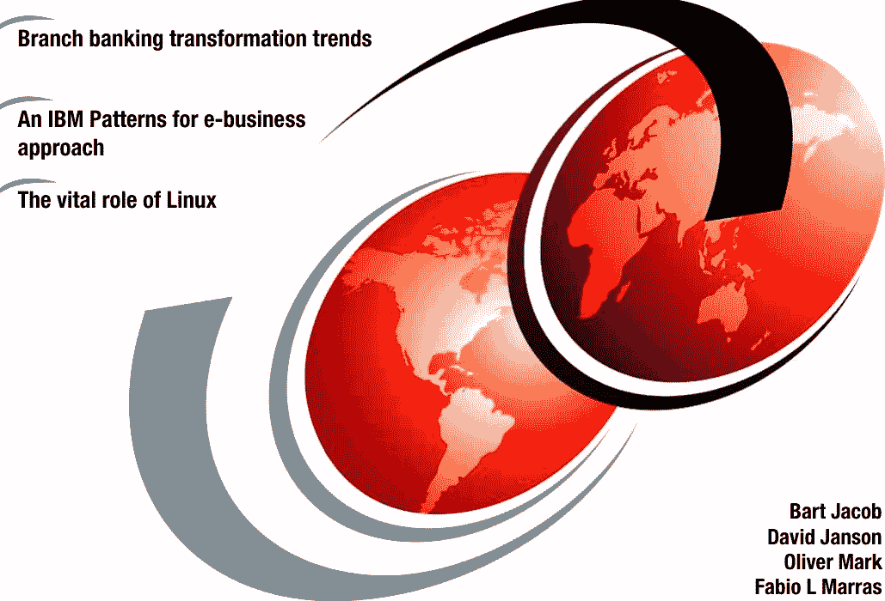

- 6.1 分行环境 ................................................................................. 18
- 6.2 总结 ................................................................................................ 32
- 7.1 场景概览 ................................................................................. 34
- developWorks
- Everyplace
- IBM eServer

其他公司、产品和服务名称可能是他人的商标或服务标记。

# 前言

本 IBM Redbook 探讨了两个初看似乎并不正交的主题。其中一个主题是银行业世界，特别是网点银行的转型。我们在书中花费了大量时间描述网点银行环境、当前正在进行的网点银行相关转型，以及从 IBM 视角用于定义未来网点银行的各种架构和技术。

第二个主题是 Linux。这一非凡的开源操作系统自诞生以来，作为安全且稳健的平台，其在电子商务中的应用量呈爆炸式增长。

本红皮书讨论了 Linux 在网点银行环境中的适用性，以及为什么应该将其作为未来网点银行系统的基础进行重点考虑。

第一章“Linux 简介”介绍了 Linux，并讨论了它作为服务器和客户端的适用性。

第二章“网点银行环境”开始了我们对网点银行的讨论，包括它是如何演变的，以及为什么行业内对其转型如此强调。

第三章“网点银行需求”从业务和 IBM 视角两个角度描述了网点银行解决方案的关键需求。

第四章“IBM 电子商务模式概述”引入了 IBM 电子商务模式。这些模式已成功用于记录企业转变为电子商务企业所面临的问题和可能的解决方案。

第五章“将 IBM 电子商务模式应用于网点银行”将电子商务模式应用于网点银行环境。尽管我们描述的解决方案是通用的，但本章可以作为定义您所在环境解决方案的指南。

第六章“适用于网点银行的 Linux 产品”提供了 Linux 可用功能的概述，这些功能使其成为网点环境的可行解决方案。

第七章“新网点银行解决方案场景”提供了一个示例场景，展示了未来的网点银行解决方案。

# 编写本红皮书的团队

本红皮书由来自全球国际技术支持组织（奥斯汀中心）的专家团队制作。

Bart Jacob 是 IBM 公司 - 国际技术支持组织（奥斯汀中心）的高级技术人员。他拥有 21 年为各种 IBM 产品和技术提供技术支持的经验，包括通信、面向对象的软件开发和系统管理。他在 ITSO 有 10 年经验，期间编写了许多 IBM 红皮书，并在全球就各种主题创建并教授工作讨会。他拥有锡立拉斯大学数值分析的硕士学位。

David Janson 是 IBM 架构与技术卓越中心认证的咨询咨询型 IT 架构师。他在行业拥有超过20 年的经验，其中最后7年在 IBM 工作。Janson 先生的专业领域包括企业架构、电子商务解决方案架构、应用程序集成和软件开发方法。他对能加速架构设计和实施 IT 解决方案的技术特别感兴趣，这使得 IBM 电子商务模式成为他特别关注的领域。Janson 先生也是一位丰富的讲师，并幸教授过许多与软件架构和设计相关的高级主题。他拥有南伊利诺伊大学的理学学学位。

Oliver Mark 是 IBM 全球服务德国站的认证咨询型 IT 架构师。他在客户端/服务器领域拥有超过12 年的经验，主要在银行业，重点关注 OS/2 端到端架构。他负责中欧非中部（EMEA Central）地区 OS/2 及其客户的所有 IBM 全球服务产品。他拥有经济和计算机技术学位。他的专业领域包括 OS/2、Warp Server、IBM 通信产品、Windows 和 Linux，以及基础设施和系统管理架构。

Fabio Marras 是巴西金融服务部门的 IBM IT 架构师。他拥有 12 年为金融行业开发解决方案的经验。他拥有电子工程学位，他的专业领域包括网络硬件和软件，以及跨平台的系统集成。

感谢以下人员对本项目的贡献：

- Jonathan Adams, IBM 软件组
- Margie A. Bachman, IBM 全球金融服务部门
- Larry Baldauf, IBM 软件组
- Arthur Cannon, IBM 全球电子商务解决方案中心（达拉斯）
- Jakob Carstensen, IBM 软件组
- Jose Carlos Duarte Goncalves, IBM 电子商务技术服务部
- Laerte H. Fagundes, IBM 全球金融服务部门
- Rod Fleming, IBM 全球电子商务解决方案中心（达拉斯）
- David D. Fritz, IBM 软件组
- Henry C. Hudson, IBM 金融服务部门
- Catherine McAulay, IBM 全球电子商务解决方案中心（达拉斯）
- John Meade, IBM 软件组
- Thomas Pack, IBM 软件组
- Michael Paolini, IBM Linux 集成组
- Jason Salcido, IBM 全球电子商务解决方案中心（达拉斯）
- Timothy F. Sipples, IBM 软件组
- Lori Small, IBM 软件组
- Lloyd Stearns, IBM 软件组
- Pablo E. Suarez, IBM 全球服务
- Barbara Trainor, IBM 软件组

# 出版作者

加入我们为期两到几周的驻留计划！帮助编写处理特定产品或解决方案的 IBM 红皮书，同时获得前沿技术的实践经验。你将与 IBM 技术专业人员、业务伙伴和/或客户合作。

你的努力将有助于提高产品接受度和客户满意度。作为奖励，你将在 IBM 开发实验室建立人脉网络，并提高你的生产力和市场竞争力。

欲了解有关驻留计划的更多信息，请浏览驻留计划索引并在网上申请：

`ibm.com/redbooks/residencies.html`

# 欢迎意见

您的意见对我们非常重要！

我们希望我们的红皮书尽可能提供帮助。请通过以下方式之一向我们发送关于本红皮书或其他红皮书的意见：

- 使用在线反馈：`ibm.com/redbooks`
- 电子电子邮件将您的意见发送至：`redbook@ibm.com`
- 邮寄将您的意见寄至：IBM Corporation，国际技术支持组织（奥斯汀中心）

9500 Burnet Road

International Technical Support Organization, Austin Center

9500 Burnet Road

Austin, TX 78758-5593

# Linux 简介

本章介绍了 Linux 并讨论了它作为服务器和客户端的适用性。

## 1.1 什么是 Linux

Linux 是一个类 Unix、符合 POSIX 标准的操作系统，根据 GNU 许可证发布，这意味着操作系统及其源代码是免费提供的。最初在 90 年代初由 Linus Torvalds 以及全球程序员开发，Linux 支持所有主要的窗口管理器以及 FTP、Telnet 等工具。它提供了 32 位和 64 位多任务、虚拟内存、共享库和 TCP/IP 网络。它还有一套程序开发工具，包括 C++ 编译器和调试器。

Linux 由四个主要部分组成：内核、Shell、文件结构和工具。

尽管已经在各种平台上实现，但通常部署在 Intel 处理器上。Linux 内核设计为使用 Intel 886 处理器的特殊保护模式。因此，Linux 利用保护模式、描述符内存管理范式。Linux 利用分页加载执行，使得只有实际运行的程序段会被读入内存。同样，如果同时运行多个程序实例，内存中只会有一个程序代码。

Linux 内核包含了许多专为企业设计的改进。内核内置了对称多处理器支持，且 TCP/IP 栈已重写，以增加栈性能并在多处理器系统中提供更好的扩展性。

Linux 内核是一个单体内核，因为所有设备驱动都是内核的一部分。然而，Linux 支持可加载设备驱动，可以通过用户命令从内存中加载和卸载。内核能够启用 387-FPU 指令，使没有数学处理器的系统也能运行需要浮点运算的程序。

### 1.1.1 标准

Linux 是一个符合 Posix 标准的操作系统，其各个子系统支持所有相关的 ANSI、ISO、IETF 和 W3C 标准。从开发开始，Linux 就是根据 Posix 标准进行开发的。该标准定义了 UNIX 类系统需要如何运行，并规定了系统调用和接口等细节。Posix 定义了一个所有 UNIX 版本都必须遵循的通用标准。大多数流行的 UNIX 版本都符合 Posix 标准。Linux 的 Posix 性使得开发者能够将许多流行的 UNIX 和实用程序移植到 Linux。

Linux 提供了 TCP/IP 网络的完整实现。支持全系列的 TCP/IP 客户端和服务端。Linux TCP/IP 系统提供了标准的 socket 编程接口，因此任何使用 TCP/IP 的程序都可以移植到 Linux 上。

Linux 还支持用于 CD-ROM 的标准 ISO-9660 文件系统。Linux 打印软件由 UNIX 标准的 `lp` 和 `ip` 软件组成。MS-DOS 或其他操作系统支持的任何并行打印机，Linux 都可以支持。Linux 支持全系列的调制解调器，包括内部和外部。

简而言之，在几乎所有操作环境中已成为标准的接口和功能在 Linux 中同样可用，并通过开源代码实现且基于行业标准。这种组合为开发、移植或运行关键业务应用程序提供了一个稳定且可预测的环境。

### 1.1.2 最低运行要求

根据基于 Intel 平台的 Linux 规范，Linux 的最低 PC 配置要求是一台带有约 4 MB RAM 的 Intel 386 计算机。但为了运行图形界面，并有足够的速度和空间来运行大多数商业 Linux 发行版，现在建议至少使用具有 64 MB RAM 的 486 机器（最好是 Pentium）以及带有 600 MB 硬盘的机器。Linux 至少需要两个磁盘分区：交换分区（swap）和系统分区。基础根文件系统使用 50 MB 到 100 MB 的磁盘空间。交换空间应等于 RAM 内存，建议绝对最小为 16 MB。然而，Linux 系统分区的大小将根据 Linux 系统的用途以及文件系统到其他分区的扩展性和可移植性而异。

虽然实际的硬件需求将取决于业务和应用需求，但可以说，Linux 环境的设计和效率允许公司使用相对通用且较廉价的硬件构建稳健的系统。

总结来说，Linux 作为一种功能全、基于标准且硬件要求相对的操作系统，一直受到许多寻求廉价解决方案以满足其 IT 需求的企业的关注。

当然，Linux 发行版也适用于其他硬件平台，包括从 xSeries 到 zSeries 的全系列 IBM 服务器。对于 Intel 以外平台的最低要求，请参阅相关的 Linux 发行版文档。

## 1.2 IBM 与 Linux

对于 IBM 而言，这切关乎客户选择和应用赋能。IBM 参与了 Linux 现象的所有阶段；为 Linux 开发本身贡献代码和技能；与现有的 Linux 发行版合作提供适用于 Linux 的平台；将 IBM 行业领先的中间件移植到 Linux；提供开放访问的 Linux 开发者资源；帮助客户和业务伙伴实施 Linux 解决方案；通过 IBM 多供应商软件支持合同提供支持。

### 1.2.1 作为服务器的 Linux

每个 IBM 服务器平台都提供 Linux 作为一个选项，或者作为原生操作系统的替代方案，又或者作为共存应用程序环境。IBM 为工业领域的 Linux 应用部署提供了广泛的选择。然而，这并不意味着 IBM 期望所有应用程序都是基于 Linux 的；事实上，新的产品（如 OS/390 的 64 位继任者 z/OS）证明了 IBM 将继续投资其他环境并赋能我们客户的关键应用程序。

对于想要 Linux 的客户，基于 Intel 的 xSeries 提供了原生支持。xSeries 现在还针对服务器整合市场，因为可以将 x40 系统划分为最多四个硬件虚拟机和多 64 个软件虚拟机。

IBM pSeries 提供了增强的能力，允许使用原生模式或逻辑分区 (`LPAR`) 中的 Linux 运行环境执行 Linux 应用程序。希望实现 Linux 能力的 IBM AS/400 客户也可以利用 iSeries 中对 LPAR 中 Linux 的支持。

同时，用于 zSeries 的 Linux 将用于 S/390 的 Linux 能力扩展到了 64 位世界，并保留了在单个企业服务器内提供数千个“虚拟 Linux 服务器”的大规模并行实现的独特能力。这种独特能力是 IBM Linux 客户参考案例中许多重大客户项目背后的推力。


为了弥补这一能力，IBM 扩展了其已经非常广泛的中间件产品组合，包含了服务器上的 Linux。IBM WebSphere、Lotus Domino、DB2 通用数据库和 Tiv 目前已提供 Linux 支持，作为其多平台策略的自然延伸，并将 Linux 视为未来发展的一的一级平台。

### 1.2.2 作为客户端的 Linux

IBM 金融服务客户仍在使用大量基于 OS/2 的客户端，因此对 IBM 是否认为迁移到 Linux 在策略上是可行的产生了浓厚兴趣。对于通用、全功能型（“重型”）客户端环境，当今的市场评估仍然是“尚未到时候”，但各领域对成本控制的日益关注，正促使公司和政府在展望未来时对 Linux 的兴趣增加。

然而，对于特殊环境，例如开发桌面和瘦客户端（thin-client）解决方案，特别是在分支环境中，Linux 可能是并提供了一种极具成本效益的替代方案。在 Linux 内部，有主流产品可用，例如 Netscape (Mozilla) 浏览器、OpenOffice 套件、Adobe Acrobat Reader 等。

IBM 最近还宣布了适用于 Linux 的 WebSphere Studio Application Developer。关于 Eclipse 的更多信息可以访问：`http://www.eclipse.org/`。

另一方面，许多企业用户更倾向于将更改交给供应商自行处理，而要求他们必须与 Linux 开源社区共享代码。拥有 2000 多名员工的大型公司不安装 Linux 最常被引用的理由是：其公司依赖的软件具有专有性，他们无法进行开源开发。

## 供应商责任制

大型组织倾向于选择专有产品而非开源软件，因为他们依赖供应商的责任制；他们需要供应商能够提供从系统内核到系统配置的完整支持覆盖。自然地，他们对引入 Linux 感到忧虑，因为主要的支持和责任来自开源社区。虽然这些公司可以寻求来自 Linux 发行版供应商，以及像 IBM 这样在其机器上运行 Linux 的市场型公司的支持，但他们认为，这些供应商围绕 Linux 构建的商业模式仍未经测试，并可能无法承受这种负载。然而，其他人指出，无法保证构建其业务操作系统的公司就不会失败。可以保证的是，无论开源供应商的命运如何，用户都不必依赖任何公司来对其升级。他们可以作为开源社区的一员自己完成。

## 管理成本

大多数 IT 部门都会认为，使用一个成本高于被管理系统的系统管理工具是没有意义的。这就是为什么许多 IT 经理正在转向开源工具来管理 Linux 服务器。这些工具（如 `NetSaint` 和 `Webmin`）是免费提供的。经理们还利用他们的 UNIX 专业知识来编写自己的管理和监控脚本。

然而，当 Linux 在网络上与其他操作系统平台共存时，将 Linux 服务器与其他企业资源分开管理，并使用不同的工具进行操作，实际上会增加 Linux 的总拥有成本。在这些情况下，用户应该寻求他们的管理解决方案（例如 IBM Tivoli 软件）来提供必要的工具。

## 可靠性、可用性和可扩展性

虽然 Linux 内核 2.4 将处理八路 Intel 系统，但 Linux 的多处理器处理能力远低于高端 UNIX 和 Windows 2000 服务器。因此，Linux 并不总是是高端应用（如数据库安装）的最佳选择。然而，许多用户可能会发现，Linux 集群将以廉宜的成本满足他们的可用性需求。通过使用廉价的硬件，用户可以将工作负载分散到许多较小、更便宜的系统上。

已经采用 Linux 集群的公司通常具有卓越的内部技能，对自己的应用程序拥有控制权，并且对于构建自己的集群所涉及的风险，比等待第三方应用程序开发更感到从容。对于没有此类技能的人，IBM 提供了 Linux IBM @server Cluster 1350 系列预装的服务器集群。Linux IBM @server Cluster 1350 系列还包括捆绑应用程序和服务器级软件，以及集成测试和技术支持服务。这些集群最少需要四台基于 Intel 的服务器，并可以扩展到一千多台服务器。服务器可以安装并预配置全套系统管理、维护和工作负载管理软件，以及服务器级软件，如 DB2 或 IBM WebSphere Application Server 以及电子商务软件。

## 应用程序的可用性

Linux 提供了一个完整的 UNIX 编程环境，包括所有标准库、编程工具、编译器和调试器，这些都是用户从同类 UNIX 系统中预期的内容。然而，主要软件供应商将门户应用程序迁移到 Linux 平台一直相对缓慢，特别是在数据库、中间件和 Windows 应用程序方面。随着 IBM、Oracle 和 SAP 等大型计算机公司对 Linux 的投资，这种情况正在迅速发生变化。主要应用程序，如 IBM DB2、IBM WebSphere、Oracle 8 和 9 以及 SAP mySAP.com，已通过认证，可以在一个或多个 Linux 平台上运行。

## 发行版之间的应用程序兼容性

尽管越来越多的应用程序被迁移到 Linux，但无法保证它们会在所有 Linux 发行版上运行。这是因为每个发行版可能具有相同库的不同版本，使得开发者在将应用程序从一个 Linux 平台迁移到另一个平台时，很难知道应该使用哪一个。为某个版本编译运行的程序可能无法在使用不同版本的发行版下运行。此外，需要某个版本库的应用程序可能会用新版本覆盖现有库，而该新版本可能与依赖旧版本的现有应用程序不兼容。基于 Java 的应用程序提供可能的解决方案。

## 从当前环境迁移到 Linux 的成本

在 Microsoft Windows 上投入了大量资金的机构必须在实施 Linux 的成本与许可成本的任何节省之间进行权衡。这些成本不仅包括技能和工具的成本，还包括获取这些工具的时间。虽然 UNIX 用户可以使用已有的工具和技能来部署 Linux，但已经在 Windows 硬件和软件上投入大量资金，并培养了人员技能以支持其投资（例如 Visual Basic 开发或拥有 MCSE 认证的系统管理员）的用户，可能会发现转换成本难以合理。然而，Linux 已经在学院和大学中非常流行，大多数应届毕业生都有 Linux 经验。

## 1.4 总结

Linux 已经存在了近十年，在最近几年中，它获得了企业的关注和认可，成为许多应用程序稳健且可行的操作系统环境。

本章提供了对 Linux 的高层次介绍，讨论了企业利用 Linux 的某些方式，并强调了一些与 Linux 相关的考虑。

在下一章中，我们将讨论分行银行的现状以及导致分支银行转型的某些驱动因素。由于支持分支银行的 IT 基础设施可能会为了支持这种转型而发生巨大变化，Linux 应该被考虑作为这些新环境的成本基础。

## 分行银行环境

本章概述了分行银行环境的现状和结构。它讨论了分行银行目前面临的业务压力和挑战。我们从业务和技术角度讨论了处理这些问题的最新趋势。我们还从应用程序层面解决了软件策略，以多渠道解决方案的广泛背景解决分支银行问题。

我们还涵盖了此类分支银行环境的组织结构，因为任何实施的解决方案必须满足操作和管理银行分支的人员的功能需求。

## 2.1 分行银行的现状

“零售银行并没有灭死。相反，现在的分支机构更多，每家机构服务的户数也比以往任何时候都多，”正如 2001 年 8 月发布的 TowerGroup 文章《未来的零售银行分支》所述。在同一篇文章中，TowerGroup 得出结论：“银行客户更倾向于使用实体分支而非许多自动化渠道，事实上，受调查的家庭中有 92% 在调查前的一个月内访问过分支。”

“尽管大多数美国消费者在技术上已经为在线银行做好了准备，但在行为上，他们仍然缓慢于离开本地银行分支或呼叫中心等传统渠道，”TowerGroup 初级市场研究董事总经理 Michael Weil 说道，“消费者并不是放弃现有的渠道，而是在使用他们熟悉的渠道的同时，向其中加入新的交付渠道。向在线银行以及最终向无线作为金融服务的交付渠道的移动仍在不断演变。”

### 2.1.1 分行银行趋势

过去几年，在零售产品和服务的交付方面，银行业发生了巨大变化。TowerGroup在2002年2月的一篇名为《美国零售银行分行更新：市场、技术方向与供应商》的文章中解释道：“在过去的十年里，零售银行分行基础设施的战略投资相对较少。”他们给出了四个主要原因：

- 强调替代交付渠道（互联网、手机手机、PDA等）的不断出现。
- 现有技术（如 OS/2，多年来一直是分行银行的主流操作系统）具有可靠、稳定和总拥有成本低的优点。此外，3270 终端和 4700 控制器与大型机之间有着可靠的连接。
- 当银行关注替代渠道时，分行对先进技术的需求较小。
- 改变现有技术涉及的痛苦因素包括新硬件和软件的成本，以及在分行引入新接口和业务流程所需的培训。在没有新投资的明确投资回报率（ROI）的情况下，银行高管一直不愿做出改变。

然而，许多因素迫使银行重新思考其分行渠道的战略作用，并考虑对其现有技术进行重大更新。TowerGroup 预测：“从绝对值来看，未来五年全球支出最大的领域将是分行更新。”原因如下：

- 银行希望新兴的呼叫中心和互联网渠道导致大量分行的消除，但这一并未实现。大多数银行意识到，分行渠道将继续是多渠道解决方案的重要组成部分。然而，由于分行扩张的放缓以及其他不同架构渠道的增加，许多银行的 IT 基础设施既不划效益，也不适应多渠道交付的需求。正如《银行家报》（The Banker）杂志最近的一篇文章中所述，“整合内部系统和多个渠道应放在银行 IT 议程的首位。”
- 根据 TowerGroup 的说法，“分行更新的第二个驱动力是 OS/2 作为全球自动化解决方案底层系统的终结。对 OS/2 及其运行硬件的支持将变得越来越昂贵且难以获取。”其他过时技术，如 3270 仿真、IBM 4700 控制器、Windows 95/98，在某些情况下甚至是 DOS 或 Windows 3.1，也面临类似的问题。

这些过时技术、对新多渠道服务的的需求以及投资的缺乏和技术准备的不足，共同使得分行银行成为未来几年投资最大的渠道。

此外，银行还寻求通过转型活动从零售分行交付系统中汲取更大的价值。这些活动包括提高分行效率、创建能够开发和维护长期关系的金融中心，以及开发能够满足特定客户细分市场特殊需求的分行配置。当今的零售分行交付系统基础设施缺乏所需的灵活性，同时维护成本高昂且操作密集。

## 2.2 分行技术挑战

为了交付能够帮助实现分行转型业务目标的技术解决方案，银行 IT 提供商面临着三个关键挑战：

- 成本
- 服务质量
- 上市速度

### 2.2.1 总拥有成本

由于成本是价值方程中的关键要素，银行担心分行转型解决方案能够以负担得起的成本部署。分行转型涉及成本成本两个两个领域：解决方案部署成本和持续运营成本。

解决方案部署成本包括新软件（操作系统、中间件和应用程序）、硬件（客户端、服务器和网络）以及用于集成、编码、安装和教育的人员成本（包括内部和外部）。通过重用现有的硬件和软件基础设施、最小化硬件需求以及保持用户界面和流程的一致性以减少培训需求，可以降低成本。

持续拥有成本包括系统管理、服务与支持、硬件和软件的升级成本、缺陷导致的停机、用户错误、服务中断、安全问题（如病毒或拒绝服务攻击），以及部署新工具或服务时的任何资源和停机时间。降低持续拥有成本的关键在于建立可管理的基础设施，以减少人员成本，并灵活地为部署新或升级的解决方案提供广泛的选择和选项。

### 2.2.2 服务质量

服务质量（QoS）在降低成本和提供高质量客户服务方面都很重要，后者可以成为竞争差异化。问题包括安全性、可用性、可靠性、性能和扩展性。由于新型且更毒的病毒、黑客攻击和拒绝服务攻击，安全性日益受到关注。可用性、可靠性和性能都有助于高质量的客户服务，而扩展性则允许银行在不增加成本或降低性能的情况下提供更多服务。所有这些目标通过足够灵活的基础设施得以实现，这种设施允许客户做出正确的选择和权衡，根据其特定需求优化每项服务质量参数。

### 2.2.3 上市速度

在当今的竞争环境中，银行正在寻找一种让其能够快速响应不断变化的市场需求的，无论是通过围绕新的交付模型重新配置分行，还是通过快速部署应用程序来支持新的创收产品。一种非专有的、开放的允许集中管理和部署的架构对于业务功能的交付至关重要。

## 2.3 分行转型策略

分行转型可以定义为对计算机系统的更新、替换或重构，以支持零售银行分行的员工和客户。

但是，银行希望通过对分行的投资实现什么呢？由于分行似乎不会消失，银行正寻求通过一系列活动从分行产生更多价值，同时降低这一昂贵渠道提供服务的成本。

为了从客户处获得额外收入，银行知道他们必须提高对需求的理解并提供合适的产品和服务。他们还知道必须关注客户满意度和改进服务，以留住并发展关系。

为了实现这一点，银行专注于不同的举措：

- 将分行的角色从交易导向型中心转变为关系导向型中心，提供广泛的产品和服务，并专注于开发和维护长期关系。
- 与当地业务合作，从外部合作伙伴提供创新产品和服务。
- 建立关系团队，专注于高价值客户的完整财务需求和问题，让分行代表成为“关系经理”，通过协作利用机构的集体知识和技能来满足需求。
- 根据特定客户细分市场的需求和价值开发灵活的分行配置。
- 将其分行与客户关系管理（CRM）举措相结合，为分行交付更好的客户信息，并在每个触点提高交叉销售。

虽然增加额外收入是方程的范围内，但银行仍然清醒地意识到降低分行成本的需求。由于人员占分行支出的很大一部分，旨在提高效率和有效性的举措是实现成本目标的关键。这些包括：

- 重构分行流程（如柜台、销售平台和贷款），或引入新技术（如支票采集、支票复印和优化的自助存款机），以简化流程并提高效率。
- 将更多交易引导至低成本渠道，通过信息亭、ATM 和柜台辅助单元实现低价值、高频率交易的自动化。
- 为员工提供引导性工具，减少对专家提供产品和服务信息的依赖。
- 使用外部供应商外包高昂的运营流程。
- 为专家提供远程访问，以提供复杂的财务规划和专业产品知识，从而减少在每个分行都需要专家的需求。
- 通过在线提供企业级信息和服务来提高员工生产力，包括广播消息、公告和警报、HR 服务和信息（内网）、电子邮件、协作工具、静态信息（流程手册、产品信息、表单、分行/ATM 定位器）、银行目录（电话号码、人员、部门）以及动态表单。

这些及其他策略正给银行 IT 服务商带来压力，要求他们提供的 IT 解决方案不仅要实现这些功能，还要提供灵活且可扩展的基础，能够快速支持业务部门可能开展的任何业务倡议。

### 2.3.1 分行软件策略概述

本节介绍了分行转型策略的一些基本原则和假设，以及它们为什么很重要。

### 构建以支持多渠道

我们相信，当银行开始考虑如何转型其分行交付渠道时，许多银行将寻求在一个更大的多渠道交付策略背景下进行。这种策略使他们能够整合所有的交付渠道，并无论客户选择何种渠道，都能以一致的方式交付所有的产品和服务。

为什么这很重要？统计告诉我们，客户是多渠道用户。因此，银行必须努力优化与客户的每一次互动，无论通过何种渠道，这既有利于客户，也有利于银行。这种处理不仅是提高客户服务和满意度的关键，也是巩固长期且盈利关系的关键。

通过将分行视为整体交付策略的一部分，银行能够定制分行服务以满足使用分行的客户需求，并开发出使服务水平与客户价值相匹配的渠道策略，同时为分行转型设定适当的目标。

考虑到这些，分行转型的软件策略是基于多渠道交付系统的整体软件策略构建的，特别强调提供与分行位置及其支持的渠道相关的独特问题的解决方案。另一方面，尽管他们可能在进行战略思考，成本压力和其他即时需求会使银行采取战术行动。软件策略（实际上是整个基础设施策略）必须适应这一点，并为那些选择更战术方法进行分行转型的人提供价值主张。

图-2 为多渠道构建

我们将在第21页的2.3.2 节“多渠道背景”中详细讨论多渠道的因素。

### 基于电子商务技术进行构建

银业务的本质在于，信息系统是执行几乎所有业务流程、营销、销售、生产以及金融产品和服务分销的通用工具。没有其他行业比金融业更适合电子商务。

大多数金融机构在开始使用互联网提供电子家庭和办公银行设施时，首次接触到电子商务技术。

随着20世纪90年代中后期家庭银行第二阶段的开始兴起，人们很快发现，“扁平客户端”家庭银行应用将给银行带来巨大的维护和支持挑战。对于任何具有在整个分行部署基于 PC 的大型客户端网络管理经验的银行来说，对于向来源不明的数百万客户端 PC 分发软件，并为数百万名技术技能有限的客户提供技术支持的前景感到不适。幸运的是，万维网（World Web）开始接入商业贸易，互联网技术在家庭用户中普及，使得通过 Web 浏览器交付家庭银行服务成为可能。尽管这并没有缓解支持问题，但它帮助家庭银行成为一个可行且具有成本效益的交付渠道。

当我们今天审视分行网络时，许多驱动银行选择互联网向家庭用户提供银行服务的相同问题在分行网络中仍然存在：它是一个大型的分布式网络，用户技术技能有限。互联网技术已经取得了长足进步，并实现了成熟和健壮的水平，使其不仅是自助家庭银行的解决方案，而且是银行分行网络（因此是整个多渠道交付基础设施）的理想技术基础设施。

此外，领先的银行意识到，灵活、开放、基于标准的基础设施对于帮助他们在这个日益要求创新业务模式部署和对市场动态变化快速响应的市场中保持竞争优势至关重要。

它专注于分行位置的独特需求。银行拥有管理大型分布式技术网络的历史，并敏锐地意识到管理此类网络以及支持大量相对非技术用户所带来的成本。虽然他们重视基础设施的灵活性和开放性，但银行也密切关注支撑其最可见且使用频率最高的渠道的稳定运行环境的需求。因此，挑战是双重的：既要提供一种灵活的基础设施使其能够快速反应，又要以可预测的拥有成本提供稳定、可靠且易于管理的运行环境。

电子商务技术的采用、基于服务器的应用程序和瘦客户端（基于浏览器），有助于解决软件分发的一些问题，并简化内部帮助人员所需的支持。此外，随着带宽能力的提高，现在可以使用中央服务器并仍然向分行提供满意的性能和可靠性。与瘦客户端通信的中央服务器可以显著减少由于向分行提供技术成本高昂带来的管理负担。

另一方面，我们意识到服务器中心化和全瘦客户端可能并不适用于所有银行。某些银行无法获得可靠带宽以维持其所需的性能和可用性。虽然瘦客户端很理想，但由于依赖现有的客户端/服务器应用程序和生产力工具（如 Microsoft Office、Lotus SmartSuite 和 Lotus 应用程序），短期内可能无法瘦客户端。


此外，互联网技术的出现和普及将安全推向了一个新的维度。部署在分行的较旧、更具专有的技术对于当今某些安全风险具有相对免疫力。但当他们部署开放技术（如 `TCP/IP`）以及广泛可用但易受攻击的操作系统（如 `Windows`）时，银行对加剧的安全威胁感到担忧。

这一切都是为了创建一个稳定且安全的运行环境，能够灵活地满足每个客户的独特需求，同时提供可管理的拥有成本。

### 它必须支持构建者和购买者的需求

存在两类客户，软件策略必须满足每一类的需求：

- **构建者**：倾向于自己构建应用程序的人。倾向于自己构建的银行通常是因为他们认为独立软件供应商（`ISV`）无法满足其需求，或者因为他们认为分行交付是他们希望在内部维护的核心竞争力。
- **购买者**：倾向于从 `ISV` 处购买应用程序的人。

基础设施、中间件和用于创建银行多渠道交付系统或支持特定渠道实现的工具必须在定义软件策略时进行考虑，并且它必须基于事实标准以避免支持和持续问题。

一个引人的环境、全面、集成且易于使用的工具对于构建者群体至关重要，以便他们能够快速开发这些应用程序并保持市场速度优势。另一个影响工具需求的因素是，银行电子商务技术的深度差异很大：某些银行具有很深的技能，另一些银行只有基本能力，甚至完全没有。因此，工具能力必须兼顾光谱两端的需求：高级用户和新手。

虽然工具对于构建者来说是一个关键因素，但购买者呢？我们相信工具对他们同样重要，尽管是以间接的方式。为了让购买者能够通过软件供应商或 `ISV` 满足他们的需求，必须有可购买的应用程序。这意味着 `ISV` 需要工具生产购买者想要的银行应用程序。`ISV` 通常对他们选择的平台具有更深的技能，因此高级工具可能更重要，但基本需求是相同的：全面、集成且易于使用。`ISV` 和构建者的一个显著区别是，`ISV` 通常希望保持某种程度的供应商独立性。因此，他们倾向于选择开放且不会将他们绑定到特定平台供应商的工具。

金融机构正在启动渠道整合工作，以改进服务、降低成本并获得客户的全面视图。然而，构建一个多渠道交付系统是一项艰巨且昂贵的工作，特别是第一个实施的渠道。与许多基础设施投资一样，很难根据单个渠道或应用的实现来证明其回报率。

相反，投资回报率（`ROI`）必须从其所提供的长期灵活性、成本节约，以及由于降低复杂性和提高上市速度而带来的收益来考虑。

这一点的基石是能够鼓励企业级应用和基础设施组件范围内复用的架构。第 22 页的图 2-3 描绘了我们认为的银行多渠道交付系统的框架或逻辑架构。这与我们以客户为中心的架构以及 TowerGroup 描述的多渠道逻辑架构保持一致。

除非基础设施能够成功地将关于客户的零散数据汇聚，并将关于客户的所有已知信息的单一、一致视图提供给服务客户的应用和用户，否则任何多渠道解决方案都无法成功。

这种客户数据的集成可以是物理的（通过从现有系统复制数据来在物理上聚合客户数据），也可以是逻辑的（在逻辑上聚合客户数据，因为它知道数据所在并提供获取数据的服务），或者是两者的结合。

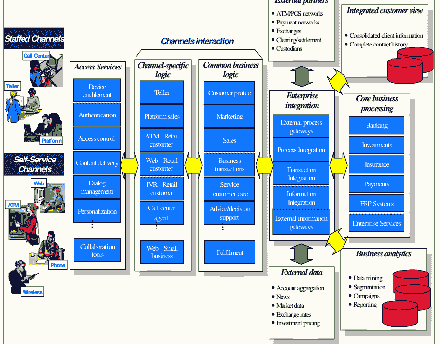

图 2-3 多渠道环境

Linux 与分支银行

### 业务处理

这些应用通常被称为后台应用或遗留应用，是管理客户账户、处理交易和提供企业级服务的记录系统。前台应用（通过多渠道基础设施实现）需要与这些应用交互，以访问客户财务数据和交易处理能力。

这些系统通常是非常碎片化的，导致了客户信息和业务规则的碎片化，反过来又了当今许多银行交付系统中某些渠道的不协调问题。多渠道基础设施必须继续通过集成利用这些系统的能力，但同时也要通过聚合客户信息并提供带有业务逻辑和规则的前端来掩盖其不一致性，从而缓解它们所造成的服务碎片化。

## 业务分析

构建多渠道交付系统的原因之一是为了优化与客户的每一次互动，无论互动发生在哪个渠道。在这方面，最大化多渠道交付系统有效性的关键是一组业务分析能力，这些能力有助于分析客户信息、识别客户需求、将产品和服务与识别出的需求相匹配，并衡量与客户互动的有效性。

如第 22 页的图 2-3 所示，业务分析包括以下类型的能力：

- 数据仓库以及填充仓库所需的技术
- 数据挖掘工具，用于协助挖掘数据以确定客户细分和驱动客户需求的特征
- 营销活动管理系统，允许营销机构创建、部署和监控针对特定产品和服务的活动结果，以满足特定客户细分的需求
- 报告工具，为管理层提供有关各种系统和客户相关性能指标的反馈

使用通用的业务分析集有助于确保客户在所有渠道接收到的处理在需求和所提供的服务方面是一致的，并且结果反映了客户与机构互动的全貌。

### 企业集成

随着渠道数量的增加以及通过这些渠道提供更多功能的需求，与后台应用和外部服务提供者的点对点集成已被证明是繁琐且昂贵的。为了减少应用集成的复杂性，机构正寻求实现一种通用的集成框架，使他们能够高效且通的方式实现应用之间的集成。通过在通用平台上一次性实现集成这些应用所需的接口，可以获得开发和测试方面的巨大效率提升，从而降低成本并提高部署速度。

正如我们在第 22 页的图 2-3 中所示，支持多渠道交付系统需要若干种不同的集成学科，包括：

- 数据集成
- 流程集成
- 消息集成

此外，企业集成框架还需要支持与机构内部外部的应用及服务的集成。

## 2.4 分行结构

在分析新建或转型的分支银行系统的需求时，我们首先需要理解分行的结构。这种结构包含了为了支持分行人员和业务目标而现有系统和系统类型。

目前分支自动化系统的组成包括针对柜员和平台人员的设备，在某些情况下还包括 ATM。银行员工如何集成和使用这些系统属于运营模型的一部分，将在后的章节中讨论。

现在，让我们讨论一下银行分行中通常常见的通用系统类型。

### 2.4.1 分行系统

工作站为用户提供分支银行系统的终端用户界面，服务器则为工作站提供连接、数据访问或其他系统管理功能。它们都通过物理网络连接，其中一个或多个协议负责快速、稳定和可靠的通信。

### 柜员与平台系统

分支自动化系统的目标是使柜员和平台能够处理客户交易、访问客户账户信息并生成报告。

中央系统存储客户信息、交易和账户数据，传统情况下，分行系统访问这些信息。

由于分支自动化系统使用组件技术，这些系统不仅可以使柜员和平台可以使用相同的信息，还可以让 ATM 等触点使用。目标是让平台人员和柜员拥有或提供详细的客户账户信息，以及用于交叉销售和向上销售的销售提示。

表 2-1 分行系统中提供的某些典型功能和交易

| 功能和交易 |
| :--- |
| **基础功能** |
| - 存款 | - 留存 |
| - 取款 | - 夜间处理和维护现金垫 |
| - 付款 | - 电汇 |
| - 转账 | - 债券赎回 |
| - 官方票据购买 | - 货币和硬币订单 |
| - 总账交易 | - 存款 |
| - 电子日记 | - 外汇 |
| - 货币报告 | - 单客户多笔交易 |
| - 金融工具 | - 支票订单 |
| - 用户登录和注销 | - 覆盖处理 |
| - 诱饵列表 | - 支持超过 60 种设备和外围，例如磁性字符识别 (`MICR`) 阅读器、个人密码 (`PIN`) 键盘、磁条读器、柜员现金分配机、校验器、打印机和其他所需设备 |
| - 双重控制 | |
| - 客户识别 | |
| - 客户和账户设置 | |
| - 止付 | |
| - 客户和账户获取 | |
| - 客户和账户维护 | |
| **管理与控制** | |
| - 现金管理 | - 报告和统计更新 |
| - 操作员和限制 | - 违反策略变更的警告 |
| - 生产力 | |

第 2 章 分支银行环境 25

# 功能与交易

| 销售工具 | 网页浏览器和电子邮件 |
| :--- | :--- |
| 产品演示 | 日历 |
| 产品选择 | 分行及办事点位置 |
| 脚本编写 | 费用收取 |
| 计算器 | 欺诈核实 |
| 签名验证 | |

## 分行服务器

当客户端/服务器技术在 20 世纪 80 年代后期发生演变时，它成为了两个分行系统的核心部分。各种特性和功能从大型机转移到分行，以提供更好的性能并减少对广域网（`WAN`）的依赖；同时也从基于 PC 的独立应用程序转移到中央服务器，以允许多个用户访问和共享数据。

此外，数据备份与恢复、邮件网关、连接到远程机器或大型机系统（或两者）的通信枢纽、中央打印等许多功能都是二层或三层架构的一部分。保留中央数据库副本以确保安全性和可用性。

最近，由于处理速度更快、通信更可靠，以及部署和管理完全分布式客户端/服务器环境的成本考虑，趋势已转向更加集中的化。例如，基于 Web 的应用程序托管在单一中央服务器上，并进行集群处理以确保可用性。在某些情况下，只有核心设施（如本地数据和打印机共享）留在分行服务器上。

表 2-2 分行银行服务器功能示例

| 服务器功能 | 基础功能 |
| :--- | :--- |
| 文件共享 | 备份与恢复 |
| 打印 | 用户身份验证 |
| 通信 | |
| 数据库（本地作为服务器或远程作为网关） | 3270 主机连接 |
| Web 应用程序代理服务器 | 5250 AS/400 或 iSeries 连接 |
| 系统管理 | |
| 用户管理 | 硬件和软件库存统计 |
| 中央工作站管理 | 安全管理 |

Linux 与分行银行

# 自动取款机：系统

当 ATM 在大约 30 年前被引入时，银行将这些设备视为常规银行服务的低成本替代方案。消费者认为 ATM 是银行柜员分行服务的服务的便利替代方案，因为它们提供了对账户更灵活的访问，并且可以在更长的时间内使用。

虽然这些机器最初仅仅是自动取款机，但随着多年来这些终端被用得越来越广泛，以及银行意识到通过这些终端处理常规交易的成本更低，它们增加了更先进的功能。这些机器不断演变，不仅整合了额外的客户发起的银行交易，还整合了其他自动发放功能，如邮票、电话卡和票务。

绝大多数银行和储蓄机构通过 ATM 为客户提供银行账户访问服务。这些终端部署在几乎所有的银行分行，以及许多非银行场所，如便利店、超市、购物中心和旅游景点。

目前已出现了一些与传统 ATM 的变体。具有单一功能的机器（如现金取款机、存款机、支票分发机等）被开发出来供在分行内部使用。对于许多银行组织而言，这种设备被视为分行的替代方案；而对于另一些组织来说，它是分行渠道的一部分。

然而，自助设备在服务层面上通过处理许多本应由高成本柜员处理的常规交易，被定位为分行的补充渠道。银行还在部署这些终端以产生手续费收入，将服务扩展到其他地理区域，并增加市场存在感。

尽管 ATM 提供了额外的功能和交易能力，但对交易量的评估表明，消费者仍然将这些设备简单视为现金机。大约二之三的消费者使用 ATM，而对于绝大多数消费者来说，ATM 是一个至关重要的银行渠道，提供了便捷的现金获取。

### 2.4.2 员工

在研究分行银行转型和能够实现这一转型的系统时，理解分行内员工的角色至关重要。毕竟，系统的建立是作为一种工具，使他们更高效，并使他们能够推动更多业务。在本节中，我们描述了分行内的典型角色，作为理解解决方案需求的基础。

### 分行经理

在小型分行中，分行经理兼任经理和销售代表的角色；在较大的分行中，会有专门的分行经理以及一名或多名销售或账户代表。

分行经理指导销售和服务活动，包括监督人员，并维护客户关系。

### 功能

分行经理的功能如下：

- 有效管理所有营销活动和日常销售活动。
- 领导、指导、支持并激励分行员工以实现目标。
- 确保团队协作、销售和目标的达成。
- 直接指导运营；监督分行人员；确保他们在各自领域接受培训。
- 撰写绩效评估；建议加薪；根据需要建议纪律处分。
- 负责贷款和存款增长。
- 回答来自客户、企业、房地产公司和建筑商关于贷款产品、利率和服务的咨询。
- 发起贷款申请并准备必要的披露。分析信用请求并提交给管理层和委员会审批。
- 回答关于所有银行产品的咨询。
- 通过向房地产、建筑商、企业和客户推广业务来开展分行营销。作为安全官实施员工安全培训并与警方部门协调。

### 助理经理或账户代表

在大型分行中，这一角色可能被分为助理经理和更多的账户代表。

助理经理或账户代表履行多功能零售银行角色。他们管理分行的日常活动，主要职责是确保运营高效，并通过辅导课程协助分行员工，并根据销售经理的目标监控分行和个人的进度。助理经理或账户代表通过柜台交易、现场销售和入入查询识别潜在客户。助理经理或账户代表选择合适的产品以满足客户需求，并协助银行实现增长目标。

### 功能

- 销售银行产品和服务。
- 为所有客户提供卓越的服务。
- 以礼貌专业的态度代表机构。
- 为分行提供运营支持，处理交易、平账和新设备培训。
- 确保分行的各个方面都有适当的控制。
- 负责分行的安全和现金需求。
- 报告所有运营信息、对账并更新文件。
- 监督并协助处理所有交易。
- 完成质量时间要求和每日销售目标。
- 在销售经理缺席时负责确保所有销售活动完成。
- 参与员工绩效考核、新员工面试和排班。
- 通过分行推广、现场销售、电话和邮件招揽新业务。识别客户需求并销售合适的产品。
- 作为所有员工的导师和榜样。协助个人团队成员实现个人目标。
- 为现有客户提供零售银行服务所需的柜台交易。
- 遵循适当的银行、监管和法律要求。

### 支行柜员

支行柜员在接受存款、取现、支票和贷款还款等交易的同时为客户提供卓越的服务。支行柜员还识别客户需求并建议适当的产品或服务。

### 功能

支行柜员的功能如下：

- 始终为客户提供及时、高效且友好的服务。
- 根据政策和程序，在处理存款、贷款还款或携带支票时清点现金和硬币。
- 通过在线终端将交易提交至计算机。
- 每日对现金箱进行余额结算，准备柜员余额表，确保现金保持在最低水平并符合董事会设定的限制。
- 销售旅行支票、保收支票和个人汇票。
- 处理并记录夜间存款信封和交易。
- 可能协助 ATM 的余额维护和资金补给。

### 支行贷款员

支行贷款员与客户合作处理贷款申请。

贷款员的任务是为贷款领域的客户提供卓越的服务，识别客户需求并建议适当的产品或服务。

### 功能

支行贷款员的功能如下：

- 销售银行产品和和服务。
- 为所有客户提供卓越的的服务。
- 以礼貌和专业的方式代表机构。
- 访谈客户，协助申请并回答基础贷款问题。完成所有贷款客户的业务并对贷款决策提供建议。
- 为有零售银行需求的现有客户提供柜员交易服务。

### 支行审计员

支行审计员审查所有内部流程、文件、纸质和数字。支行审计员通常不向任何当地管理层汇报，以确保审查和发现的客观性。

### 功能

支行审计员的功能如下：

- 审查并行审计、RBI 检查和内部审计报告。
- 检查支行官员的授权情况。
- 研究指令集的显著特征，特别是与贷款相关的部分。
- 审查支行发送至控制部门的各种控制报表。
- 获取银行的会计政策。
- 审核重要的通告，特别是结账通告。
- 规划长期审计报告。
- 获取余额表以识别需要核实的领域。
- 广而言，支行审计员需要核实的领域如下：
    - 现金、证券纸、有价证券的实物核实以及
    - 存款
    - 贷款
    - 杂项资产、暂存账户
    - 杂项负债
    - 分行间调节
    - 固定资产
    - 或负债
    - 收入科目
    - 支出科目
- 评估内部控制系统，协助确定审计程序的性质和范围。

### 支行管理员

支行管理员负责分支网络、系统或机器内的任何技术和操作任务，例如服务器、客户端和 ATM。

### 功能

支行管理员的功能如下：

- 始终为客户提供及时、高效且友好的服务。
- 为支行提供技术支持和新设备的培训。
- 负责硬件和软件的安装、维护和服务。
- 负责技术安全和 IT 系统的维护。
- 负责所有硬件、软件和基础设施的持续可用。

## 2.5 常见银行场景

本节描述了目前各种客户环境中常见的场景。它概述了如何在系统、网络和应用程序逻辑的技术架构内实现业务目标。

每个场景都被描述为一个整体架构，包括一些技术细节，例如用于完成关键业务工作流的产品和功能。

### 2.5.1 以主机为中心的场景

该场景是一个简单的终端环境（主要为 3270 仿真），所有的业务逻辑和数据都在中央大型机上。如果支行存在服务器，则仅用于网关功能或基础的文件和打印功能。

支行员工使用 3270 终端或瘦客户端来运行所有应用程序，包括电子邮件。该环境使用的协议通常是系统网络架构（`SNA`）。

交易始终在运行于大型机上的核心银行解决方案中处理。通常每个支行定义一个物理单元（`PU`），并由通信服务器或 4700 网关提供共享的逻辑单元（`LU`）。

支行内的本地服务器用于本地打印队列，并作为使用任何类型 3270 仿真客户端的通信服务器网关功能。

所有业务逻辑都驻在中央大型机上。本地客户端仅用于演示服务。

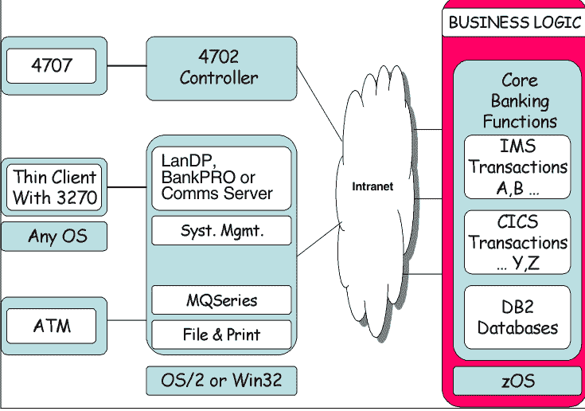

图 2-4 以主机为中心的支行解决方案场景

### 2.5.2 以主机为中心且带有本地应用程序的场景

该场景描述了一个银行环境，其中安装了本地客户端（也称为 FAT 客户端），所有面向交易的业务逻辑和数据都在中央大型机上。支行服务器充当通信网关和文件打印服务器。

该场景下的支行基础设施运行基于 Intel 机器的客户端平台。目前，支行应用程序的操作环境主要是 IBM `OS/2`，支行应用程序是使用 `VisualAge C++` 开发的。

支行员工使用客户编写或旧的第三方应用程序来处理业务流程和数据。`Lotus Notes` 等产品用于电子邮件，`Netscape` 浏览器用于局域网 Web 功能。支行内部使用的协议通常是 `TCP/IP`。`IBM MQSeries` (`WebSphere MQ`) 用于集成客户端、服务器和主机系统之间的应用程序，以及同一客户端内部应用程序之间的通信。

交易始终在运行于大型机上的核心银行解决方案中处理。为此，每个支行定义一个 `PU`，并由应用程序共享 `LUs`。使用通信服务器来实现 `SNA` 协议栈，并通过 API 访问 `LU2` 和 `LU0` 应用程序。

`DB2` 可用于存储本地信息以实现冗余和可用性。它还用于日志记录和利用 `MQSeries` 的应用程序存储。


图 2-5 以主机为中心且带有本地应用程序的场景

### 2.5.3 分布式处理场景


该场景描述了一个银行环境，其中安装了本地客户端（也称为 FAT 客户端），业务逻辑分布在本地（可能还有区域）服务器上，数据在中央大型机上。这种场景可能是目前许多大型银行环境的典型。

对于支行基础设施，此类环境的银行运行基于 Intel 服务器的客户端/服务器平台。支行应用程序的操作环境主要是支行的 IBM `OS/2`，支行应用程序是使用 `VisualAge C++` 开发的。

支行员工还使用 `Lotus Notes` 和 `Netscape` 浏览器。支行内部使用的协议是 `TCP/IP`。`MQSeries` 用于集成客户端、服务器和主机系统之间的应用程序，以及同一系统内部应用程序之间的通信。

交易始终在运行于大型机上的核心银行解决方案中处理。为此，每个支行定义一个 `PU`，每个支行定义两个 `LU`，并由应用程序共享。使用通信服务器来实现 `SNA` 协议栈，并通过 API 访问 `LU2` 和 `LU0` 应用程序。

`DB2` 用于存储本地临时信息和转发消息的日志。支行内不维护敏感数据。

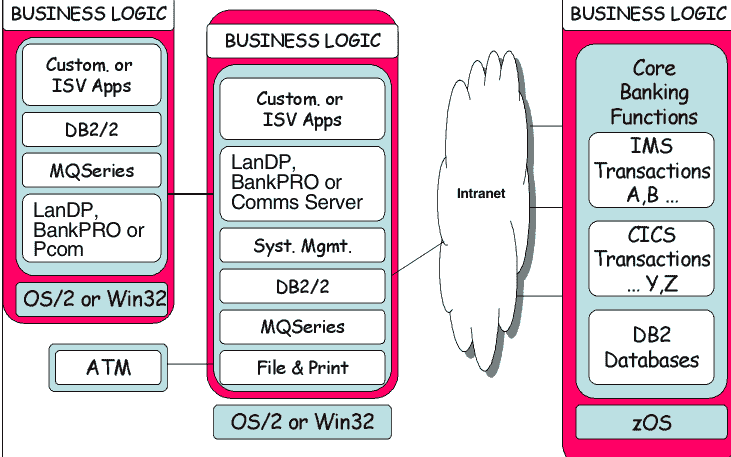

图 2-6 分布式处理场景

作为应用程序流的一个示例，支行的客户顾问可以输入客户编号以获取完整的财务状况。从使用 `OS/2` 和 `VisualAge` 开发的本地支行发送，`MQSeries` 消息将生成的。该消息通过基于分支的 `OS/2` 服务器跨网络使用 `SNA` 协议发送到大型机。在大型机上，工作流应用程序处理消息处理任务，例如向基于 `CICS` 的客户信息文件 (`CIF`) 发送 `MQSeries` 消息，以获取通用客户信息，如地址、电话号码和所持有的账户列表。

根据响应，工作流应用程序将生成更多消息，以获取更具体的账户信息，例如余额、利息和服务费用。最后，工作流应用程序向顾问发送发送单条 `MQSeries` 消息，其中包含与各种系统相关的所有信息。

广泛的分支网络包括 `ATM`、销售点 (`POS`) 终端和工作站。分行的员工使用 `Lotus Notes` 进行群组软件和电子邮件功能。客户端/服务器分行应用程序是使用 IBM `VisualAge C++` 开发的。

## 2.6 分行银行的组件模型

本节描述了分行银行系统主要元素的高级组件模型。它提供了定义必要基础设施所需的系统功能视图。它包含两个部分：组件图和组件定义。

组件图部分显示了功能组件在系统中的相对位置以及组件之间的高级连接。

组件定义部分包含每个组件的名称、该组件提供的服务描述以及关于该组件的任何已知实现细节。

注意，系统的某些组件是基于分行基础设施地理限制的历史视图。在适当的情况下，探索了以非传统方式部署组件的选项。

### 2.6.1 组件图

第 37 页图 2-7 所示的图代表了基础设施内软件交互的功能视图。为了完整性，它还显示了系统与分行银行系统外部组件进行交互的接触点。组件图通常不描述组件在环境中的部署。该图确实显示了组件在分行系统中在历史上的地理部署位置。该模型不包括整个系统某处可能需要的所有系统组件，例如域名服务 (`DNS`)。

| 桌面组件 | 分行服务器组件 | 中间层组件 | 后端组件 |
| --- | --- | --- | --- |
| 网络服务 | 网络服务 | 应用服务器 | 客户信息 |
| 显示服务 | 用户管理 | 消息服务器 | 业务分析系统 |
| 外围支持 | 文件与打印服务 | 数据库服务器 | 核心交易系统 |
| 用户管理 | 存储与转发 | 系统管理服务器 | 企业安全服务 |
| 柜员功能 | 分行数据库服务 | 其他交付通道 | 其他外部组件 |
| 平台功能 | 系统管理 | | |
| 其他生产力工具 | | | |

**图 2-7** 组件图

### 2.6.2 组件定义

基于图 2-7 所示的组件图，本节提供了这些各种组件的简要描述。

### 桌面组件

桌面组件是在概念或宏观层面定义的的，而不是在微观或详细设计层面。提供了足够的细节，以便为“瘦型”与“胖”应用程序设计模型提供可能的权衡。

#### 网络服务

网络服务允许桌面应用程序与其他系统和外部组件通信。本地局域网和外部通信均通过操作系统的 `TCP/IP` 服务，并在需要时辅以本地局域网服务。通信可以通过应用程序模型指定的 `HTTP` 或 `TCP/IP` 协议。此外，可以使用插件（如 `IBM WebSphere Host On-Demand`）或胖应用程序（如 `IBM Personal Communications`）来访问传统的 3270 类型应用程序。

#### 显示服务

对于此客户端解决方案，显示服务可以被视为 Web 浏览器。Web 浏览器将通过 `HTTP` 接收到的 `HTML` 编码页面转换为面向用户的表单。传统胖客户端实现中的显示服务具有更强大的功能，并允许更丰富的用户界面。虽然可以使用激进的、键盘驱动且带有详细字段编辑的传统应用程序来构建应用（这些应用在瘦客户端上实现较困难），但 `Java Applet` 可以提供所需的功能。

#### 外围支持

可以使用各种专用设备来为系统提供输入或从系统获取输出。例如，银行在分行执行交易时，可以使用 `ATM` 卡和个人密码 (`PIN`) 来识别用户。磁条读卡器 (`MSR`) 可读取 `ATM` 卡，数字键盘可供客户安全地输入密码。此外，银行可以通过收据打印机或存折打印机为客户提供交易记录。这些设备随后成为分行系统不可或缺的一部分。对这些专用外围设备的支持在很大程度上取决于所使用的应用程序开发模型。在所谓的胖应用程序中，应用程序使用设备 API 与原生操作系统设备建立接口。在应用程序中，可以使用 `Java` 配合标准（如金融服务 `Java` 扩展 `J/XFS`）。关于 `JFS` 的更多信息可以在此处找到：

```
http://www.jxs.com/
```

#### 用户管理与安全

分行人员（柜员和平台官员）对分行银行系统的使用是由用户身份验证和角色识别控制的。该组件在确定应用程序功能流方面提供功能性角色，但在出于安全目的控制系统访问方面起着更重要的非功能性作用。它还提供了一组权限和限制，据此做出执行决策。部署在桌面上的用户管理部分通常很小，在许多情况下是完全中心化的。当与中心站通信丢失时，用户管理的可用性可能会使企业安全管理复杂。

#### 柜员功能

许多现有的柜员应用程序可以在胖客户端上运行，并根据操作配置通过 `TCP/IP` 或 `SNA` 协议与后端和中间层系统通信。或者，可以使用瘦客户端或浏览器范式编写新的应用程序。柜员应用程序的元素包括：

- 客户信息：根据某项数据（如关系编号）从客户信息文件中调取数据。这些信息包括地址、电话号码以及客户的账户列表，可以在客户服务期间使用。
- 账户信息：这些信息包括账户的详情，例如当前余额和交易历史。
- 财务交易：改变账户财务状态的交易（存款、取款、现金检查等）。
- 电子日记：柜员执行的所有交易的日志。日记可能存储在客户端机器、分行服务器或区域服务器上。在完全中心化的系统中，它可能由使用柜员 ID 作为键的数据库查询组成。在需要离线处理的系统中，它可能还提供本地存储交易并在连接恢复后将其转发到中间层或后端组件的能力。

#### 平台功能

平台功能涉及为客户提供其现有的账户或服务、展示客户可能购买的金融服务选择，以及实际填写申请或开设新账户。平台用户需要柜员使用的功能（如客户信息和账户信息），还需要用于跟踪客户互动、进行销售演示和填写表单的丰富功能。所有这些功能更多是基于展示而非交易驱动的，因此非常适合使用鼠标而非键盘导航的客户端应用程序。客户互动更加随意和具有对话性，让平台人员有更多时间吸收系统提供的信息。尽管过去广泛使用了在浏览器中使用下拉列表和预填充的丰富 GUI 驱动应用程序，但在时间要求不紧迫的环境中，使用类似的体验也可以同样直观且有效。

### 办公生产力

零售银行网点的一些平台人员需要典型的办公生产力工具，这些工具已成为个人电脑演变的同义词。电子邮件、文字处理器、电子表格等在销售平台上经常被使用。有多种应用程序可以在不同的操作系统上提供这些功能。

## 支行服务器组件

大多数银行仍然认为，需要分行服务器来确保系统始终可用，并帮助管理终端用户桌面。更可靠的支行到数据中心之间的通信以及客户端应用程序的结合，可能允许某些银行消除分行服务器，但提供本地文件和打印共享，以及在中央系统不可用时的操作能力，为将分行服务器作为基础设施的一部分提供了有力的理由。

### 网络服务

服务器的网络服务提供局域网通信以及可能所需的任何网关功能。网关能力的一个示例是在 `TCP/IP` 网络上提供 `SNA` 通信。在纯 `TCP/IP` 网络中，不需要这种通信功能。分行服务器还可能为卫星站或杂货店提供网关功能。

### 用户管理

用户必须经过身份验证，并且必须有一个控制点根据根据桌面能力来确定他们的角色。如果分行需要安全的离线能力，那么此服务器功能就是必不可少的。此外，应用程序必须访问用户角色，以确定应对给定的用户应用哪些功能限制。其中一个例子是覆盖（overrides）。主出纳员或行经理可能允许覆盖客户的离线交易限制。具有更高权限的人员必须定义为单独的角色，并且需要该角色的特定特性供应用程序使用。

### 文件和打印服务

在某些应用程序设计模型下，应用程序组件可能需要使用这些类型的服务。此类需求的示例是需要在多个出纳员或平台人员之间共享激光打印机。文件共享也很重要，对于那些移动到各种机器但仍需要访问以前创建文件的员工来说，这可能是关键的。

### 存储和转发

存储和转发机制用于分行系统，以确保在与业务记录交易系统的连接不可用时，分行能够继续接受交易。这通常由于通信丢失，但也可能是由于其他原因。交易记录存储在数据库、日志文件或电子日记中，包含了通常发送到交易系统的所有信息。它还可能包含时间戳或序列号，或两者都有。转发机制是一个在后台运行的自动过程，当核心交易系统可用时将交易转发到该系统。虽然分行服务器是部署存储和转发机制的逻辑位置，但某些应用程序在每个客户端中部署此功能。如果能够保证与区域或集中服务器的通信达到所需的可靠性水平，则存储和转发机制可以集中。另一个选项是不具备任何功能，并且仅在核心交易系统对分行可用时才处理交易。

### 分行数据库服务

某些应用程序模型目前在分行使用离线模式下需要的数据库。例如，电子日记的某些实现可能会使用数据库。此外，数据库可能用于存储离线处理期间所需的配置数据。在选项有限的更集中应用程序设计模型中，可能不需要分行数据库服务。

### 系统管理

分行服务器的主要角色之一是终端用户桌面配置的管理。与其直接管理桌面，不如使用服务器来缓存桌面配置。当发生更改时，运行在服务器上的系统管理软件会自动更新桌面。

## 中间层组件

在电子商务架构中，系统的许多应用程序组件可以部署在集中服务器上。通过这种方式，它们可以被许多分行以及交付渠道共享。以下对其中一些组件进行了高层面的描述。

### 应用程序服务器

应用程序服务器是电子商务架构中的软件组件，在此其中执行应用程序的业务逻辑。它作为前端终端用户交互组件与后端数据组件之间的中介。在银行分行系统中，可能会有针对不同业务需求的多个应用程序服务器。

### 消息服务器

消息服务器为基础设施中的所有应用程序提供通用的通信传输层。它可以用于提供基于业务规则的路由，以及从一种消息格式到另一种格式的翻译。使用消息服务器为连接不同的系统组件提供了集成点。

### 数据库服务器

中间层数据库服务器为分行银行系统提供用于服务分行或其他交付渠道的应用程序和系统数据。数据库的需求将非常取决于各种应用程序的需求以及这些应用程序的设计。某些应用程序设计模型可能不需要中间层，而是从后台系统获取所有数据。

### 系统管理服务器

中间层的系统管理系统用于管理分行系统的所有管理功能。交付系统中所有桌面的配置都通过此服务器进行。当配置发生变化时，服务器负责将这些更改分发分行服务器，然后由分行服务器对单个桌面进行更改。在其他系统管理设计中，此服务器可能被配置为直接管理桌面。除了配置管理外，服务器还作为下游组件生成的告警的收集点，这些告警指示故障或性能瓶颈。

## 后端组件

后端组件不是分行系统的一部分。它们是为分行系统提供服务的企业系统。为了完成分行银行系统的架构，所有到后端系统的接口都需要被良好定义和理解。

### 集成客户信息

集成客户信息或客户信息文件 (`CIF`) 持有客户与银行总关系的集成视图。

### 业务分析

业务分析可以对客户的财务持有情况和交易历史进行分析，为产品适用性和财务风险提供指导。

### 核心交易系统

核心交易系统提供账户级的交易能力和历史。

### 企业安全系统

企业安全系统提供验证用户和确定其系统级权限的信息。

## 2.7 总结

过去十年中没有发生显著变化的分行银行环境开始经历重大转型。本章描述了这种转型的某些驱动因素。

此外，它还提供了关于分行结构以及通常用于支持它们的系统的一般信息。我们还提供了三种不同的场景，代表了许多银行如何运行其分行银行系统。

如果你在银行业工作了很长时间，本章可能没有为你提供许多未曾感知的信息。然而，提供这些信息是关重要的，它们将作为后续章节讨论的基础。下一章提供了有关分行银行要求的特定信息，并为本书的剩余部分奠定基础，以讨论电子商务的设计模式，并理解 Linux 何何可以成为该解决方案的重要组成。

# 3 分行银行需求

在本章中，我们将继续对分行银行进行讨论，重点关注将驱动最终解决方案的一些需求。

我们从一些通用目标和原则开始。接下来，我们分别从业务和系统两个角度来看需求，然后查看更详细的功能性和非功能性需求。

## 3.1 解决方案架构的目标和原则

解决方案架构的目标和原则可以分为三大类：

- 与成本相关的目标
- 与实现相关的目标
- 与编程相关的目标

### 3.1.1 与成本相关的目标

解决方案架构的目标必须与以长期成本控制为基础的 IT 策略保持。这些目标如下：

- **降低成本：** 网络计算架构应该利用网络来降低成本。它允许减少客户端所需的计算资源，并支持在网络计算机上部署，将网络作为按需分配软件组件的载体。此外，该架构支持在托管服务器环境中部署可重用的业务组件。
- **保护投资：** 一个重要目标是保护金融机构在主机系统、计算基础设施以及新技术方面的投资。这使得仔细考虑技术选择变得非常重要，以确保它们具有战略性并能够持久存在。
- **提供选择：** 允许客户灵活地选择他们的硬件、操作系统、网络系统、数据库、通信协议和第三方软件产品。系统还必须根据网络环境和物理拓扑结构灵活分配功能和数据。
- **优雅演进：** 系统必须对业务和技术变化都具有灵活性和韧性。这有助于支持快速应用开发，并通过缩短时间来提高竞争力。
- **提供可管理性：** 系统一旦部署并投入生产，就必须易于管理，并对运行环境的变化具有韧性。它还必须支持远程管理。服务器和客户端必须能够由远程站点管理，以解决运行过程中发生的技术或业务问题。
- **允许增量投资：** 系统必须支持增量地开发和部署新的业务功能和技术的能力。此外，它必须支持在新的解决方案可用时将其包含。
- **可用性最大化：** 整个系统必须符合其用户的需求：不仅包括终端用户，还包括开发者和系统管理人员。
- **可重用性最大化：** 系统的构建方式必须能够最大化所有零售交付解决方案中组件的重用。此外，它必须能够满足全球金融机构解决方案和访问渠道的多样化需求。

### 3.1.2 与实现相关的目标

解决方案架构必须是开放、可扩展且易于实现的。这些原则与架构目标相关，并且是平台选择、编程模型规范和解决方案整体功能需求的基础。这些目标如下：

- 开放
- **支持行业标准：** 如果架构尽可能使用开放的行业标准和电子商务标准（如 `TCP/IP`、`HTTP`、`Java`、`JDBC` 和 `JavaServer Pages (JSPs)`），它就是开放的。这些标准提供了坚实的基础，使得更容易使用现有的经过验证的组件，而不是构建自定义组件，并能够更换供应商和实现以满足不断变化的业务需求。由于涉及高水平的投资和投入，行业标准需要具有战略性并拥有更长的生命周期。
- **可扩展和可定制：** 架构的构建必须在许多不同层级或通道上是可扩展和定制的。这意味着它可以用于广泛的场景，并能够适应特定于通道、客户、国家或地区的特殊需求。
- **提供隔离：** 解决方案架构必须隔离并抽象与其他系统的交互，以将基于架构的应用程序与其他系统的具体细节隔离开。在全局解决方案中，提供灵活性以适应许多不同的环境（特别是不同的主机系统和数据库）至关重要。
- **保护投资：** 上列原则确保了客户投资的保护。解决方案架构安全地保护了客户环境在当前硬件、软件、操作系统、网络、通信基础设施和协议以及后端子系统的投资。

### 可扩展

- **逻辑分层：** 逻辑分层架构的优势（如《网络计算框架组件指南》`SG24-2119`）是众所周知的。网络架构是逻辑性的因为它规定了表示层必须与业务逻辑解耦，业务逻辑必须与数据访问层解耦，但它没有指定如何物理地部署这些层。虽然这种方法是隔离的一种，但它通过允许系统的这些层独立于其他层进行变化提供了可扩展性。也就是说，平台选择和每一层的设计可以改变，而不影响系统的其他部分。该架构还要求表示层是轻量级的，以实现网络计算的目标。这意味着具有少量物理内存且没有虚拟内存的工作站可以下载并执行应用程序。

解决方案架构的主要目标是支持多层网络计算应用模型，同时允许团队基于其他应用模型（例如两层客户端应用程序）实现解决方案。

- **可替换组件：** 组件是具有已建立接口和预定义执行环境的系统功能包。只要组件处于所需的执行环境中，并通过其公共接口与其他系统组件交互，就可以以最小的努力进行替换。这种结构实现了高水平的重用，并允许系统在不引起巨大波动效应的情况下演进。它还允许组件及其执行环境的变化，以满足性能或可扩展性需求。
- **企业拓扑独立性：** 这一概念扩展了逻辑分层架构的想法，使得层级不仅独立于物理位置，而且系统组件独立于任何特定的物理拓扑。这使得解决方案在不同环境中部署具有高度灵活性，允许客户根据需要配置系统以实现所需的可扩展性。

### 易于实现

- **视觉化编程：** 在可能的情况下，基于框架的解决方案使用视觉化编程来组应用程序。这种技术在开发应用程序界面和图形界面时特别有效。
- **分析与设计分离：** 分析应该是与设计独立的过程，并有其独特的工作产品。此类解决方案应通过分析形成独立于技术或实现的完全逻辑表示。这有助于在实现发生变化时保留早期开发努力的价值。
- **开发方法论：** 必须提供指导参与项目开发过程的方法论，以使解决方案实现更简单、部署更快。


- **事务导型：** 大多数分行产品需要一种解决方案，其中企业为中心的后端系统执行大部分应用程序逻辑，而位于交付通道的解决方案前端必须作为在后端系统中运行的事务进行运行。良好的架构必须满足这种需求，特别是在高量事务处理环境中。

- **开发工作：** 实现新事务或应用程序的简单方法基于参数的外部化，使得业务根据其特定的外部参数表现出不同的行为。这使得解决方案无需编写新代码，通过向系统添加新的外部参数即可交付新功能和能力。

### 3.1.3 与编程相关的目标

新业务应用程序的开发或现有应用程序的重构通常关注 Java 编程语言以及创建应用程序框架内重用组件的成熟 Internet 技术。这确保了基于组件的应用程序可以可靠地部署在健壮的生产系统中，而框架为您的组件提供了一致性和完整性。

例如，IBM WebSphere Business Component Composer 提供了这些功能。

这些目标如下：

- **降低风险：** 组件是解决应用程序需求的一种快速且具有竞争力的方法，但快速且具有竞争力并不意味着你将暴露在风险之中。
- **经过验证的产品：** 组件为针对金融服务领域软件应用程序开发的产品提供了成熟的基础。
- **系统协同工作：** 广泛使用开放式计算行业标准（包括互联网标准）可以防止系统之间的不兼容性。
- **防止过时：** 组件化应用程序固有的灵活性和更新能力保护了这些应用程序免于过时。
- **对业务环境的快速响应：** 应用程序开发环境允许根据不断变化的情况快速调整应用程序。
- **初次就做好：** 应用程序开发环境需要支持团队协作，并在这种情况下促进了对话和想法共享；进一步的细节将被忽略。
- **维护稳定的 IT 基础设施：** 提供可靠服务的现有系统可以通过通信组件继续被使用。这些组件提供了与遗留系统的连接性。
- **更快的上市时间：** 这种由组件框架推动的开发方法旨在缩短开发周期并平滑开发团队的学习曲线。该方法的目的是有效节省开发工作量、提高一致性并缩短所有交付渠道的上市时间。
- **缩短开发周期：** 组件框架通过利用组件重用的优势提供了一个支持快速应用程序开发的环境。它通过促进面向对象技术的使用和高度的应用程序对象参数化来实现。
- **即备可用组件：** 组件框架提供了一组具有定义接口的预基础设施组件。这些组件可以立即用于开发，并准备好整合到交付渠道应用程序中。项目团队只需要学习如何使用它们，而不是如何构建它们。
- **参数化应用程序定义：** 开发模型基于集中式对象库，在其中维护了关于应用程序的所有相关信息。通过这种模型，向基于框架的应用程序添加新功能通常只需使用开发工作台（`Development Workbench`）向开发库中添加定义。
- **平滑学习曲线：** 组件框架隐藏了框架的底层技术细节。这减少了项目团队学习框架特性以及如何使用它们来交付解决方案所需的时间和精力。开发模型创建了清晰的角色分工，允许项目团队成员专注于他们的特定任务。

## 3.2 业务背景

第 52 页图 3-1 所示的上下文图涵盖了分支银行系统及其外部接口的以下核心要素：

- 客户请求服务和支持，并接收这些服务。这两项活动都可以涉及一个或多个渠道。
- 柜员在其他渠道之一为客户提供服务和支持。因此，他们可能不再是桌子后的传统柜员，而是在线银行分支机构的虚拟柜员。
- 平台专员（Platform officer）在分支机构或中心侧提供服务和支持，因此他们或或少是前端流程的后端支持人员。他们也可以是在线经纪人、电话贷款员等。
- 分支机构的礼宾或支持人员既是为了方便客户，也是为了方便分支内的柜员或专员，就像任何行政流程一样。
- 企业可以是分支机构或整个银行服务的接收者或请求者。
- 业务伙伴提供分支核心范围之外的服务，以方便客户并确保投资组合的完整。

## 业务背景上下文图

| 实体 | 交互 / 描述 |
| :--- | :--- |
| **客户** | 请求服务与支持，购买产品 |
| **业务伙伴** | 提供第三方服务 |
| **业务伙伴** | 提供服务与支持，销售产品；使用支持系统 |
| **分支银行** | 提供企业服务 |
| **柜员** | 提供服务与支持，销售产品，使用支持系统 |
| **柜员** | 提供服务与支持，使用支持系统 |
| **平台专员** |  |
| **分支机构的礼宾 / 支持人员** |  |
| **企业** |  |

*图 3-1 上下文图*

以下列表虽然全面，但概述了在定义分支银行解决方案时必须考虑的业务任务类型。

## 简单任务

简单任务由两个特征定义：其一涉及单个个人（柜员或分支代表），另一个是相对直接的交易。

简单任务的示例包括：

- 某个账户的存款取款，柜员输入金额
- 在柜员台清结算支票
- ATM 自动取款
- 银行内部账户之间的转账
- 在自动销售点销售银行产品
- 查询银行产品信息
- 账户代表对信用额度的核实

## 复杂任务

复杂任务定义为需要多个人参与的任务，例如双人审核原则或双密钥安全，以及任何多阶段的应用处理。这可以是实时的，也可以通过消息队列或工作流进行异步处理。这些过程可能具有以下不同类型的交互：

- 人与人：柜员需要分支经理对某些交易进行批准。
- 多数据源：该过程可以通过从多个源收集信息并将结果写回一组目标来完成。
- 业务与业务：一个很好的例子是银行与保险公司的联盟，双方销售对方的产品并访问对方的系统进行信息交换。

复杂任务的示例如下：

- 开立新账户，需要分支管理的批准，以及中心机构对该人的信用历史进行检查。
- 任何符合洗钱法规的大额取款都需要现场批准并进行记录和跟踪。
- 更复杂的投资计划或贷款申请，可能涉及额外的特殊账户、财务检查或批处理计算。
- 银行与保险公司的联盟，双方销售对方的产品并访问对方的系统进行信息交换。
- 投资组合管理需要对多个源的信息进行查询、处理和整合，以提取特定客户或客户需求的投资组合建议。此外，管理此类投资组合可能需要访问跨行的账户。
- 信用卡审批通常涉及中心结算应用程序以处理请求并批准申请人的信用。

## 3.4 功能需求

银行网点系统的功能需求是指满足开户、账户查询以及提供交易服务所需的客户服务功能。网点银行需求通常分为两大大类：柜员（teller）和平台（platform）。

柜员功能包括接受现金和支票存款、提供现金和支票取现、偿还贷款。平台功能包括开户、贷款以及提供产品和服务的信息。虽然平台功能侧重于带来收入，对银行具有更高的价值，但柜员功能因为需要保持一致的服务水平，在某种程度上更为关键。柜员功能定义非常明确，但由于通过文字处理程序和电子表格等办公效率工具向客户提供信息，应用需求可能会随着时间而发生变化。柜员和金融机构的员工还需要电子邮件和通用信息等应用程序。这些内容大部分可以通过网络浏览器处理。

除了实际功能外，其他功能需求还包括添加新功能的易用性和速度，以及所有交付渠道中重用的多渠道功能。

### 3.4.1 运行考虑因素

运行考虑涉及 IT 系统必须满足的特性。这些包括服务水平需求，如可靠性、可用性、可维护性、可扩展性、性能和系统管理。

### 可靠性、可用性和可维护性

系统的可用性预期与系统每天、每周需要为用户提供的时长，以及他们从故障中恢复的速度有关。为了满足可靠性、可用性和可维护性（RAS）目标，关键系统节点不应有单点故障。所有应用服务器、数据库服务器、消息服务器和后端服务器都将通过负载均衡和集群进行部署。用户随时可以工作的可用性确保了桌面永远不会成为单点故障。除日志记录目的外，数据不应存储在桌面上。由于中间层和后端系统节点的冗余性质，大多数计划内的维护可以在系统对终端在线的情况下进行。

### 安全性

安全首要需求必须在网点系统架构中自然实现。它必须拥有锁定的桌面，允许访问由系统管理员控制的应用程序。默认情况下，用户无法将自己的应用程序加载到桌面。互联网访问要么被禁止，要么通过具有足够网络控制的代理服务器访问。用户发起的许可传输也将被禁止。此外，网点系统必须针对特定角色进行定制，因此对信息和交易系统的访问将受到严格控制。可选情况下，网点与中央数据中心之间的所有通信都可以加密以确保数据机密性，并在所有通信中附加身份验证以确保数据不被篡改。

### 性能

性能模型必须作为确定 IT 基础设施物理组件尺寸的方法。性能模型试图捕捉应用行为和非功能需求的组合。性能模型的元素包括节点性能、应用性能、网络性能和数据库性能。随着架构详细化到规范和物理实现级别，这些元素将得到更深入的探讨。

### 系统管理与维护性

系统管理和维护性是指网点软件和硬件系统的维护和管理。它涉及配置管理、应用管理与维护，以及对所有系统节点和应用组件的监控，以便尽早故障或性能下降。

### 配置管理

配置管理涉及跨企业的硬件节点和软件组件的跟踪和部署。对于大型金融机构的网点系统，这是一项巨大的工程，涉及 5,000 个地点、75,000 个硬件节点以及多个系统和应用程序软件范围。

### 应用管理与维护

这通常被视为配置管理的一部分。它涉及更新系统和应用组件的能力，以满足变化的业务需求，例如添加新功能和更改数据格式。应用程序更改通过生成新包并将其纳入修订后的桌面定义中来实现。系统更改可以使用可更新系统的工具进行。在网点系统中，桌面的部署变得非常困难。在将架构推向规范和物理级别时，可能需要定义特殊的系统管理组件和节点，以简化部署过程。

### 系统监控

定期轮询并测量响应时间的代理将执行系统监控。系统需要集成到集中监控系统中，以便网点系统相关的警报以银行其他系统中错误状况相同的方式分发。

## 3.5 非功能需求

IT 系统的非功能需求规定了系统中与应用功能不直接相关的方面。需要处理的主要非功能需求是服务水平需求，如容量和性能（体积）、可用性、安全性和系统管理。

其他典型的非功能需求包括确保可移植性和可维护性的属性，以及任何系统限制。典型的系统限制包括系统必须满足的业务限制（例如地理位置）、现有的技术标准，以及限制系统架构和设计的技术“已知条件”。

成本（包括运营和技术成本）是网点银行环境中各级决策的主要驱动因素之一。虽然以下某些需求对总成本只有隐性影响，但新解决方案的总成本需要满足业务需求。投资回报期少于 12 个月的情况并不少见。

### 3.5.2 容量、性能与可扩展性

在分布式系统（如分支机构系统）中，重点不在于分行单个组件的容量，而在于分行组件如何集成到上游组件中。根据目前大多数应用设计的技术水平，性能受的影响通常更多取决于通信带宽以及从所有分行聚合的交易数量，而非分行内服务器或终端用户桌面电脑的本地性能。

### 3.5.3 可靠性与可用性

分行银行需要在典型的业务时间内保持可用状态，通常为每周五天、每天八小时（节假日除外）。每周可能有一天延长营业时间，或在周六缩短营业时间。在分行营业期间，信息系统需要基本上保持无故障运行。系统的总开机时间（包括在与后端系统通信中断时处理某些交易的能力）必须接近 100%。如果分行无法以某种方式接受交易，那么它不如关门。因此，必须建立应急预案和系统以涵盖任何系统组件故障或临时丢失。就本文而言，假设所需的最大系统故障恢复时间为几小时，所需的系统重启时间为少于几分钟。由于分行仅在计划的业务时间内营业，因此很容易在非业务时间内安排维护。

支持分行渠道的中间和后端系统必须具备支持分行要求的可靠性和可用性特征。由于这些系统还支持其他渠道（例如交互式响应 (`IVR`)、呼叫中心和互联网），它们通常设计为虚拟 24x7 可用，并具有所需的可靠性和冗余性以实现这些目标。

### 3.5.4 安全性

银行系统的主要安全需求如下：

- 本地和远程用户认证
- 基于角色的功能授权
- 数据机密性
- 免受恶意或欺诈攻击的保护

详细的安全需求可能针对特定银行而非常具体，因为企业内部实现安全的方式会有很大差异。其他考虑（如单点登录和数据加密需求）也可能取决于特定的策略、流程和网络实现。

### 3.5.5 系统管理

与任何 IT 系统一样，架构需要具备监控所有系统组件的能力，并尽可能地使用自动化程序对故障做出响应。在分行系统的情况下，实现这一目标有一些特定的特定需求，如下：

- 自动更新系统和应用代码的能力
- 将故障系统恢复到故障前状态的能力
- 向已安装的系统中添加新应用的能力
- 以最少的人工干预快速检测、诊断并纠正问题的能力

分布式系统的特性给系统管理带来了成本挑战，因为终端用户桌面的数量很多，在部署通用系统管理工具时可能存在通信限制。

### 3.5.6 用户与桌面管理

在分布式系统（如分行系统）中，环境管理可能并非分行本地，因此需要对用户、角色、应用和桌面设置进行远程配置。这涉及到能够为登录到不同物理机器的用户，或在不同时间登录到单台机器的多用户（漫游用户）提供一致桌面的能力。

此外，需要实现一致的视觉和感受，让用户不一定意识到他们的客户端机器运行在何种底层平台上。

### 3.5.7 IT 标准与现有 IT 基础设施

IT 基础设施和 IT 标准限制对于单个银行或金融机构非常具体。常见的限制包括操作系统和硬件平台的选择、特定的数据库产品、网络拓扑、安全产品和流程，以及企业系统管理产品。在深入到规范和物理实现架构级时，现有的标准和基础设施构成了限制，这些限制往往会影响功能组件或操作节点的可用选择。在概念层，本文中做了一些典型选择，这些选择对于特定的银行实现可能是正确的也可能是错误的。

### 3.5.8 地理限制

分行系统在几乎所有地区都面临相同的限制。虽然特定国家或地区的城市环境可能拥有更好的基础设施，但大型金融机构的分行可能位于通信受限或成本昂贵的地区。因此，架构必须适应通信可靠性和可用性的限制。然而，架构的具体实现可以利用优越的通信能力。

## 3.6 变更场景（Change cases）

可能需要的任何未来需求都应经过评估和验证，以确保架构能够适应它们。IBM 将变更场景定义为可能的未来变化。在本文中，变更场景用于指示功能和非功能需求可能变化的领域，或者新兴技术允许系统发生重大变化的领域。

关注变更场景可以确保系统易于扩展、易于维护、面对变化时稳健，且开发速度快。重点是重要且可能发生的，而非仅仅是可能的。变更场景试图预测变化，但预测很少完全准确。

## 3.7 总结

本章从多个不同角度描述了分行银行的一些需求。当我们查看适用于分行解决方案的 IBM 业务模式（Patterns for e-business）时，这些需求将作为输入。

无论你使用业务模式还是其他方法论来构建解决方案，这些需求和观察方法仍然适用。正如第 6 章第 117 页“适用于分行银行的 Linux 产品”所示，Linux 在构建满足要求的基础设施方面可以发挥关键作用。

## 4.1 电子商务模式导言

当公司在电子商务市场中进行竞争时，他们发现必须重新评估其业务流程和应用程序，以确保其技术不受时间、空间、组织边界或领土边界的限制。他们必须考虑实施解决方案所需的时间，以及成功执行该解决方案所拥有的资源（人员、资金和时间）。这些挑战，加之遗留系统的集成问题以及交付持续高质量服务的压力，使得开发电子商务解决方案成为了一项艰巨的任务。

为了减轻定义电子商务解决方案所涉及的任务，IBM 构建了一个模式库以简化相关工作。简单来说，模式（pattern）可以被定义为一种在制造某物时作为指南的模型或计划。因此，模式的作用是促进事物的开发和生产。模式编码了执行过类似任务的人员的可重复经验和知识。模式不仅记录了解决常见问题的办法，还指出了应该避免的陷阱。IBM 电子商务模式（Patterns for e-business）由记录在案架构最佳实践组成。它们定义了一个全面的指南和技术框架，这些指南和技术实际上已用于创建客户参与项目的架构。电子商务模式通过定义不同层级的架构模式（从业务模式到应用程序模式再到运行时模式），弥合了业务与 IT 之间的差距，使得能够在各个层级之间轻松导航。每种模式（业务、集成、应用程序和运行时）都能帮助公司理解其开发项目的真实范围，并提供必要的工具来促进应用程序开发过程，从而允许公司缩短上市时间、降低风险，更重要的是，实现更显著的投资回报。

电子商务模式的类型如下：

- 业务模式
- 集成模式
- 复合模式
- 应用程序模式
- 运行时模式和匹配产品模式

当公司利用这些记录的资产时，他们能够减少完成项目所需的时间和风险。

例如，一个理解解决方案业务方面和需求的业务线（LOB）高管人员，可以使用业务模式为解决方案开发一个高层结构。业务模式代表了常见的业务问题。LOB 高管人员可以将他们的需求（IT 和业务的驱动因素）与已记录在案的业务模式进行匹配。这些模式通过识别用户、业务和数据之间的常见交互，为最经常遇到的业务挑战提供了切实的解决方案。

高级技术高管人员可以使用应用程序模式对拟议解决方案的结构和架构做出关键决策。应用程序模式有助于完善业务模式，以便将其作为计算机解决方案实施。技术高管可以使用这些模式来识别并描述实现业务模式中识别的关键功能所需的高层逻辑组件。每种应用程序模式都会描述结构（应用程序的层级）、数据位置以及涉及系统的集成（松耦合或紧密耦合）。

最后，解决方案架构师和设计人员可以使用运行时模式来实现应用程序模式，从而开发技术架构。运行时模式描述了实现应用程序模式所需的逻辑架构。解决方案架构师可以将运行时模式与现有环境和业务需求相匹配。他们实施的运行时模式建立了支持所选应用程序模式所需的组件。它定义了逻辑中间件节点、其角色以及这些节点之间的接口，以满足业务需求。运行时模式记录了完成应用程序必须具备的内容（注：此处原文为 documents what，意为记录了必须就位的内容），但未指定产品品牌。实际产品的确定是在模式的产品映射阶段完成的。

总结之，电子商务模式捕捉了经过测试和证明的电子商务方法。通过使这些方法变得可用并将其归类为有用的类别，LOB 高管、规划者、架构师和开发者可以进一步将其精炼为实用的、切实的指南。模式及其相关指南允许个人从问题和愿景开始，找到符合该愿景的概念模式，定义应用程序成功所需的必要功能部分，然后实际构建应用程序。此外，电子商务模式从项目开始就提供了通用术语，并确保应用程序支持业务目标，显著降低了成本和风险。

## 4.2 电子商务模式分层资产模型

电子商务模式允许架构师通过重用来自经过证明的成功经验的组件和解决方案元素来实现电子商务解决方案。电子商务模式基于一套层次资产，任何现有的开发方法都可以利用这些资产。这些分层资产的结构使得每一层细节都建立在上一层之上。这些资产包括：

- 业务模式：识别用户、业务和数据之间的交互。
- 集成模式：当无法基于单个业务模式提供解决方案时，将多个业务模式连接在一起。
- 复合模式：代表业务模式和集成模式的常见组合。


- 应用程序模式：提供一种概念性布局，描述业务模式或集成模式中的应用程序组件和数据如何相互作用。
- 运行时模式：定义了支持应用程序模式的逻辑中间件结构。运行时模式描绘了主要的中间件节点、其角色以及这些节点之间的接口。
- 产品映射：为每个运行时模式识别经过证明和测试的软件实现方案。
- 电子商务应用程序设计、开发、部署和管理的最佳实践指南。

这些资产及其相互之间的关系见第 67 页的图 4-1。

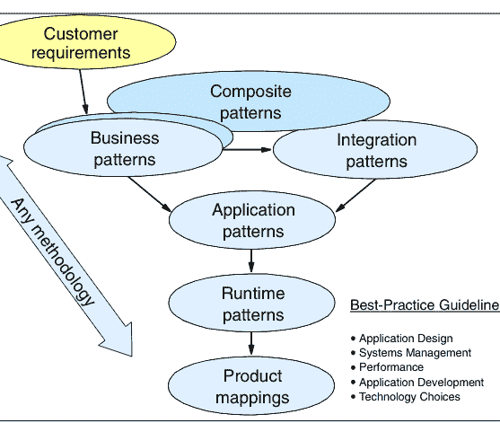

图 4-1 模式分层资产模型

## 电子商务模式网站

电子商务模式网站提供了一种自上向下浏览分层电子商务资产的简单方法，以确定参与项目时的首选可重资产。

为了方便参考电子商务模式，请访问电子商务模式网站：

http://www.ibm.com/developerworks/patterns/

### 4.2.1 如何使用电子商务模式

如上一节所述，电子商务模式的结构使得每一层细节都建立在上一层之上。最顶层是业务模式，它们描述了涉及的实体。业务模式描述了用户、业务组织或应用程序与数据之间的关系。

复合模式出现在图 4-1 所示层次结构的业务模式之上。复合模式由多个业务模式和至少一个集成模式组成。在本节中，我们将讨论如何使用电子商务资产的分层结构。

共有四种业务模式，如表 4-1 所示。

#### 表 4-1 业务模式

| 业务模式 | 说明 | 示例 |
|---|---|---|
| 自服务（用户到业务） | 用户通过互联网与业务交互的应用程序 | Simple Web 应用程序 |
| 信息聚合（用户到数据） | 用户从海量数据、文本等提取有用信息的应用程序 | 商业智能、知识管理、网络爬虫 |
| 协作（用户到用户） | 支持用户之间协作工作的应用程序 | 电子邮件、社区、聊天、视频会议等 |
| 扩展企业（业务到业务） | 连接两个或多个企业流程的应用程序 | EDI、供应链管理等 |

如果所有问题都能完美契合这四种业务模式将非常方便，但现实情况通常更为复杂。模式假设所有问题在分解为最基本的组件时，会符合这些模式中的某一个。当一个问题描述的目标符合多个业务模式时，电子商务模式以集成模式的形式提供解决方案

集成模式允许我们连接多个业务模式来解决问题。集成模式如表 4-2 所示。

#### 表 4-2 集成模式

| 集成模式 | 说明 | 示例 |
|---|---|---|
| 访问集成 | 通过公共入口点对多种服务的集成 | 门户网站 |
| 应用程序集成 | 在用户不直接调用的情况下集成多个应用程序和数据源 | 消息代理、工作流管理器 |

这些业务模式和集成模式可以组合以实施特定的业务解决方案。我们称之为自定义设计（Custom design）。

我们可以通过一个标志性的表示来展示自定义设计（Custom design）如何解决业务问题，如图4-2 所示。

| 访问集成 | 自助服务 | 应用集成 |
|---|---|---|
| | 协作 | |
| | 信息聚合 | |
| | 扩展企业 | |

图 4-2 自定义设计的模式表示

如果在自定义设计中没有使用任何业务或集成模式，我们可以用较浅的区块来表示。例如，图 4-3 显示了一个针对某个业务问题、没有强制性协作业务模式或扩展企业业务模式的自定义设计。

| 访问集成 | 自助服务 | 应用集成 |
|---|---|---|
| | 协作（可选） | |
| | 信息聚合 | |
| | 扩展企业（可选） | |

图 4-3 自定义设计

如果一个自定义设计在具有相似业务问题的领域中反复出现，那么它也可能是一个组合模式（Composite pattern）。例如，图 4-3 中自定义设计的标志性视图也可以描述一个卖侧枢纽（Sell-Side Hub）组合模式。

已经识别了业务和集成模式的几种常见用途，并将其正式化为组合模式。识别出的组合模式如表4-3 所示。

#### 表 4-3 组合模式

| 组合模式 | 描述 | 示例 |
| --- | --- | --- |
| 电子商务 | 用户在线购物。 | - www.macys.com<br>- www.amazon.com |
| 门户网站 | 通常设计用于聚合多个信息源和应用程序，为其用户提供统一、无缝且个性化的访问。 | - 提供自助功能（如工资、福利和差旅费）的企业内网门户<br>- 提供电子邮件或即时消息等服务的协作提供商 |
| 账户访问 | 为客户提供 24 小时的账户信息访问。 | - 在线券商交易应用<br>- 电话公司账户经理功能<br>- 银行、信用卡和保险公司的在线应用 |
| 交易交易所 | 允许买卖双方在公共网站上交易商品和服务。 | - 买家侧 - 买家采购系统与电子商务市场功能之间的交互<br>- 卖家 - 电子商务市场的采购功能与其供应商之间的交互 |
| 卖侧枢纽（供应商） | 卖家拥有电子商务市场，并将其作为在网络上销售商品和服务的平台。 | - www.carmax.com（汽车购买） |
| 买侧枢纽（购买者） | 商品购买者拥有电子商务市场，并将其作为杠杆，通过购买或采购从网络上的潜在卖家处获取商品和服务的最优交易。 | www.wre.org (全球零售交易所) |

这些模式的组成是可变的，因为每种类型都存在基础模式，且组合模式可以扩展以满足额外的标准。有关组合模式的更多信息，请参阅 Jonathan Adams 等人编写的《Patterns for e-business: A Strategy for Reuse》，ISBN 1931182027。

# 选择模式和产品映射

在确定了合适的业务模式后，下一步是定义构成解决方案的高层逻辑组件以及这些组件之间如何相互作用。这被称为应用模式（Application pattern）。一个业务模式将识别出多个应用模式，用于描述可能的逻辑组件及其相互作用。例如，一个应用模式可能包含描述与用户交互的表示层、Web 应用程序层和后端应用程序层的逻辑组件。

应用模式需要中间件的支持，中间件通过一个或多个运行时模式（Runtime pattern）表示。运行时模式定义了代表必须执行的中间件功能的功能节点。

在确定运行时模式后，下一步是确定每个节点要使用的实际产品和平台。《Patterns for e-business》具有与运行时模式相关的产品映射，描述了已用于构建此类情况的电子商务解决方案的实际产品。

最后，指南将帮助你通过经验识别出的最佳实践来创建应用程序。

有关确定如何选择每种分层资产的更多信息，请参阅 Patterns for e-business 网站：

http://www.ibm.com/developerWorks/patterns/

## 4.3 总结

本章提供了电子商务模式（Patterns for e-business）的概述。电子商务模式是一个查看问题空间和需求，并应用经过验证的业务、集成、应用和运行时模式来设计解决方案的过程。

下一章将研究这些模式如何应用于分网银行环境。

# 将 IBM 电子商务模式应用于分网银行

上一章《IBM 电子商务模式概述》建立了了电子商务模式的整体背景。本章在这些背景信息的基础上，探索了以下内容：

- 电子商务模式如何应用于分行和企业级银行业的转型
- 如何使用 Linux 实现基于电子商务模式的解决方案

Linux 和电子商务模式可以在两个语境下定义基于 Linux 的银行解决方案：

- 在分行级：分行银行面临短期问题，电子商务模式提供了符合现有环境的替代方案，同时为银行的未来做准备。
- 在企业级：电子商务模式为银行企业架构的转型提供了背景和路线图，并展示了 Linux 何何可以发挥关键作用。

## 5.1 开始使用电子商务模式

电子商务模式让我们描述想要解决的问题，以及用于解决这些问题的解决方案或多种解决方案。例如，业务模式让我们能够以简单但强大的术语来表征我们想要解决的问题类型。在我们描述了想要解决的问题范围和性质之后，电子商务模式将以应用模式和运行时模式的形式引导出替代解决方案。这些模式可以通过技术组件的已知组合（与运行时模式相关的产品映射）来实现。在每一步中，我们都需要决定哪种模式替代方案是最佳选择，为此，我们需要一些关键信息作为输入。

### 1 描述我们想要解决的问题或模式

应用电子商务模式的第一步是确定哪些业务或集成模式（或两者兼有）合适，换句话说，即哪些模式代表了我们正在尝试解决的问题。为了做出这一选择，我们需要查看问题空间，识别关键的业务和 IT 需求。这些需求将决定适用哪些业务和集成模式。

业务和集成模式描述了跨越多个行业的广泛业务过程中发现的共同特征。定义这些模式的目标之一是应用 80/20 法则：确保这些模式可以应用于大多数业务流程，以满足业务的大多数需求。正如此，我们有信心为大多数银行流程场景找到良好的匹配项。

### 2 解决方案或多种替代方案

在我们描述了问题空间并确定了适用业务和集成模式后，我们准备好开始为选定的每个业务和集成模式寻找应用模式形式的替代解决方案。电子商务模式中描述的替代解决方案还识别了技术组件产品映射，用于实现运行时模式的实例。再次，我们需要做出决策，并且需要收集和总结一些关键信息作为这些决策的输入。

电子商务模式的应用模式、运行时模式和产品映射是基于成功系统架构在功能和操作方面反复出现的主题。在大多数情况下，这些是

模式反映在许多成功实现的系统中。在某些情况下，我们还会发现所谓的*新兴*（emerging）模式，它们被认为是有价值的替代方案，但由于出现时间较短，尚未广泛实施。标准模式与新兴模式之间的关键区别在于该模式在领域内实现的次数。尽管新兴模式的使用频率低于标准模式，因此尚不能被视为主流模式，但它们的能力和初步的记录使其成为可能跨越早期采用者阶段并进入主流解决方案模式类别的候选者。

### 5.1.3 收集和总结需求与驱动因素

我们可以通过关注以下可以收集客户需求领域，寻找寻找模式选择决策所需的信息：

- 业务背景（Business context）

这一关注领域查看用户画像和业务流程，通过这些我们可以总结客户需求并识别关键业务驱动因素，这两者对于确定哪些业务模式（Business patterns）至关重要。业务驱动因素还将帮助我们评估应用模式的替代方案。

- 用户交互（User interactions）

这一关注领域研究用户如何相互交互，这是识别哪些业务模式的另一个关键。

- IT 背景（IT context）

这一关注领域研究应用程序和技术组合，以建立分支和企业级的高层背景。这将识别任何可能影响解决方案的重大技术考虑，并识别 IT 驱动因素。IT 驱动因素将在未来评估模式替代方案时提供帮助。

- IT 系统中用户与组件之间的交互

这一关注领域研究用户利用 IT 服务的方式，以及提供这些服务的组件是如何部署并相互交互（以及与外部系统交互）的。这有助于识别哪些业务和集成模式（Integration patterns）。

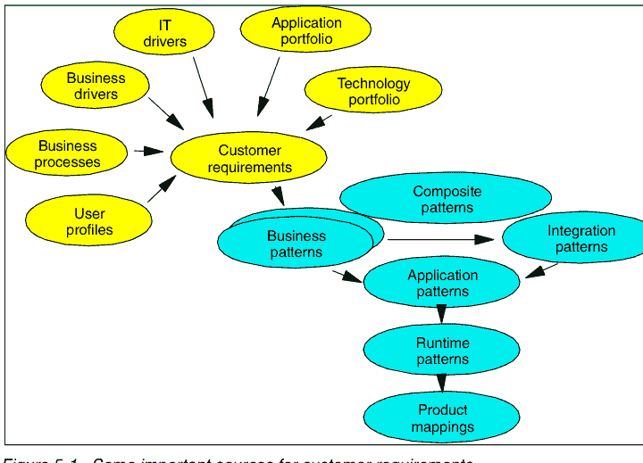

图 5-1 的关注领域定义并建立了我们要解决的问题范围，并引导我们得出关于哪些业务和集成模式的结论。如果级别适用多个模式，我们可能会得到一个复合模式（Composite pattern）或自定义设计（我们将在本章稍后的部分详细讨论）。第 77 页的图 5-2 显示了业务模式与集成模式之间的关系。在查看了需求之后，我们将修改此图，以突出最能描述我们特定情况的模式。

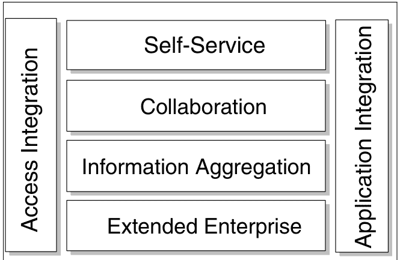

**图 5-2** 业务与集成模式的关系

在描述了我们要解决的问题并确定了适用的业务和集成模式（以及一些可能的复合模式或自定义设计）之后，我们可以转向描述解决方案的模式：应用模式（Application patterns）和运行时模式（Runtime patterns）。在分析客户需求期间收集的业务和 IT 驱动因素（见第 3 章第 45 页“分支机构银行需求”）将是下一个决策过程的关键输入。

## 5.2 业务背景

当我们研究银行业场景时，会出现多种类型的用户。例如：

- 客户（Customer）
- 分支机构行长（Branch manager）
- 贷款官员（Loan officer）
- 柜台员（Teller）
- 库库主管（Vault supervisor）
- 行政助理（Administrative assistant）

我们可以看到，内部和外部用户都直接使用银行的自动化业务服务。对于外部用户（通常是企业对客户 B2C 场景），这可能表现为使用 ATM、使用银行网站，或拨打客户服务代表或语音响应单元（VRU）查询其账户状态。未来，银行可能希望通过移动手持设备提供这些服务。对于内部用户（企业对员工 B2E 场景），这可能表现为柜台员在与客户面对交易期间使用终端或工作站，或贷款官员使用其桌面工作站输入贷款申请。

这些交互告诉我们，存在许多自助服务场景，用户可以直接访问自动化 IT 服务。我们还可以看到，通过多种渠道或交付模式提供这些 IT 服务是极具价值的：

- 桌面工作站
- ATM 或自助服务机
- 家用 PC 浏览器
- IVR 单元（语音应答）
- 呼叫中心

银行特别感兴趣的是需要支持用户的移动性，同时提供个性化且安全的 IT 服务。例如，某些分支员工需要能够在从任何数量的工作站位置执行工作。无论他们身处何地，都需要通过一致的用户界面呈现特定的、定制的应用程序集。

这在今天是通过使用登录用户并将用户特定桌面加载到其工作站的技术来实现的。这种方法支持各种应用程序架构、独立式和厚客户端（thick application）样式、多层分布式瘦客户端拓扑。随着旧应用程序被主流的服务器-客户端架构取代，提供重量级客户端的需求将减少，随之减少的部署应用程序到客户端桌面的需求。这种趋势将使得在更广泛的地点通过更广泛的设备提供应用程序服务变得越来越容易。

除了我们描述的自助类型交互外，在分支银行环境中还有许多协作式的交互示例。例如，大额或不寻常的提取可能需要分支行长的批准。同样，开新账户可能需要账户代表与信贷检查人员之间更多的协作。

总结一下，我们可以做出的泛括之一是，我们既有组织内部的用户也有外部的用户。我们还看到用户通过多种渠道（桌面、ATM、IVR、呼叫中心）与自动化 IT 服务交互。我们还看到用户在面对面的情况下相互交互，以及通过支持即时和延迟协作的 IT 服务进行交互。

## 5.3 IT 背景

金融机构在客户群和地理分布方面都跨越很大范围。这导致了各种企业基础设施拓扑结构，其中一些更加集中，而另一些在区域和分支级别更具分布式。一个反复的主题是银行分支继续发挥关键作用。在银行分支执行面向客户的业务流程的重要性，意味着底层 IT 服务需要尽可能可用，以便客户在分支机构时进行关键业务交易。

以下是一些关键的 IT 需求和驱动因素：

- 需要通过多种交付渠道提供的 IT 服务
- 对移动或漫游用户的灵活支持
- 访问安全控制
- 个性化的 IT 服务呈现
- 需要适应不同的基础设施能力
- 需要最大化服务的可用性，在某些情况下提供提供减少的服务作为完全无服务的替代方案
- 强调最小化总拥有成本的应用和技术策略
- 强调减少应用程序复杂性和最大化应用程序服务互操作性和重用的应用和技术策略
- 强调在各种分布式或集中拓扑结构中部署 IT 服务具有灵活性的应用和技术策略

分支银行的分布式为关键银行应用程序带来了特殊的挑战，并影响了这些应用程序的架构决策。其中一个重要方面是需要提供多个级别的自主性，以便如果系统的某个组件不可用，其他组件可以继续运行并提供某种程度的功能。一个例子是，即使与其集成的企业系统不可用，也要允许 ATM 取出预设限额内的现金（但不进行余额查询）。

可用，或者即使分行服务器临时离线，也可以在柜台站办理存款。

银行 IT 系统的架构如果能够在应用和技术组件在分行、区域或企业层面的部署上具有灵活性适应性，将从中获益，以匹配其组织特性和基础设施能力。

### 5.3.1 应用与技术组合

如今使用了广泛的应用程序，我们可能会发现各种应用拓扑结构和用户界面样式：

- 运行在客户端桌面上的单体式独立应用程序（例如生产力应用，如文字处理器和电子表格）。
- 组件经过分区和分布的应用程序，运行在分行级，在某些情况下与企业级应用集成。这些是传统的二层客户端/服务器应用程序，在客户端桌面端部署了大量的应用程序组件，这些组件与本地服务器上的其他应用组件或本地服务器上的数据库进行交互。
- 通过终端式界面访问的传统基于主机的应用程序，可以在专用终端设备上运行，也可以通过加载到客户端桌面的终端模拟器运行。

单个应用程序可能难以与以下内容进行集成和数据共享：

- 单个应用程序可能是为了支持特定的业务流程而实现的，可能并非设计为了运行而设计的。在任何此类特性存在的地方，都意味着失去了以新方式结合底层应用服务以应对竞争态势的机会。
- 这些应用程序的底层信息可能存储在单独、独立的数据存储器中。这会限制银行跨产品线利用价值信息的能力，使得管理复杂的组合或识别值得的交叉销售机会变得更加困难。

应用程序或其数据无法轻松集成或组合的情况，限制了银行实施新服务或增强服务的速度。这影响了银行的竞争地位。

## 分行客户端

这些应用特性的一部分，结合对移动性的支持，导致了某些技术的使用，让用户的桌面可以跟随他们到达其工作的任何客户端机器。这可能涉及根据用户的角色和偏好，从操作系统到应用程序加载这些内容。

应用拓扑结构的范围需要健壮的客户端机器，这限制了通过更广泛渠道交付 IT 服务的能力。这可能成为通过互联网向客户扩展 IT 服务的重大障碍。

## 分行服务器

分行服务器已经进化出能够提供个性化锁定桌面的能力，以及主机端应用组件和数据库、主机连接以及传统的文件和打印服务。这些功能旨在支持健壮的客户端桌面以及传统的二层客户端/服务器应用程序的需求。随着时间的推移，必须保留其中一些能力，以及为应用服务提供个性化、安全接口的能力，而其他能力则可以舍弃，例如远程向客户端桌面加载操作系统和应用程序的能力（随着应用架构演变为与客户端无关的）。

## 5.3.2 转型策略

随着时间的推移，银行转型策略旨在增加用户可用的集成应用服务的范围，同时增加交付这些服务的通道范围。为了实现这一目标，应用架构和底层技术基础设施需要遵循一种策略，从依赖客户端或服务器配置及部署拓扑结构，转向一致地采用灵活、开放的标准和替代方案。


银行转型通常分阶段进行，每一步都提供特定的短期收益，同时与支持长期战略保持一致。第一步可能由紧迫的短期压力驱动，但它们需要从整体转型策略的语境来看待。电子业务的模式对于加速识别短期和战略性解决方案特别有用，这增加了实现短期以及长期目标的几率。

## 5.4 模式选择

审查客户需求将引导我们进入特定的业务和集成模式（Business and Integration patterns）。对于银行业这样复杂的业务，许多模式可能适用，从而产生组合模式（Composite pattern）。业务和 IT 驱动因素将引导我们进入特定的应用和运行时模式（Application and Runtime patterns）。

### 5.4.1 选择业务和集成模式

电子业务的业务模式（Business patterns）分为四类。每种模式都涵盖了通用业务流程需求的通用特征。让我们看看银行转型和业务流程需求如何应用于这一领域：

- **自助（Self-Service）**：我们发现的用户与用户之间的交互，例如客户使用 ATM 或柜员使用柜台工作站，表明解决方案遵循了“自助”业务模式。在分行级，银行员工从一个位置移动到另一个位置并使其个人能力集跟随的能力，是实现效率最大化的的重要因素。随着时间的推移，客户和银行员工可能会以自助模式获得越来越多的自动化业务流程，使得业务流程的重要性日益增加。

- **协作（Collaboration）**：用户与用户之间的交互可以出现在从开户、贷款指导、客户查询到大额取款等业务流程中。例如，分行经理可能需要授权超过某些指定金额的取款。这表明“协作”业务模式适用。因为用户与用户之间的协作可以提高组织的效率，并增加银行与其客户群互动的机会，协作场景的数量和该模式的重要性可能会增加。

- **信息聚合（Information Aggregation）**：业务流程（如组合管理、交叉销售营销和业务绩效衡量）需要从多个源收集和分析信息。这表明“信息聚合”模式将适用。随着更多信息的聚合，可能会发现利用这一价值贵资源的新机会，导致需要日益精精密的信息聚合方法。

- **扩展企业（Extended Enterprise）**：某些流程跨越了企业边界。在贷款发放期间收集信贷记录、涉及证券的交易和资金转账都是涉及其他业务伙伴的业务流程示例。这表明“扩展企业”业务模式适用。随着银行采用更多电子银行，这一领域的重要性可能会增加。例如，电子银行提供了传统由多个系统管理的客户数据的集成管理。因此相关部门可以共享和分析准确的数据。此外，分析 CRM 系统提供了市场和趋势分析，以便银行进行更有效的主动营销活动。

*集成模式分为两类：访问集成（Access Integration）和应用集成（Application Integration）。这些基本模式中的每一个都可以细分为更离散的服务集合或特征。让我们看看需求在这一领域引导我们进入。*

*访问集成模式细分为四个服务领域：*

- **设备支持服务（Device Support services）**：当我们考虑“自助”业务模式时，我们发现银行通过多个通道提供服务至关重要。这增加了银行与客户的触点，同时也为在各种环境下向员工提供服务提供了灵活性。集成模式设备支持用于提供或扩展银行的多渠道能力。

- **呈现服务（Presentation services）**：提供统一的外观是实现高员工生产力的关键，也是为客户建立品牌形象的关键。这两者都是可以通过访问集成模式呈现服务满足的重要需求。

- **个性化服务（Personalization services）**：银行员工通常需要在执行工作时能够在不同位置之间移动。访问集成个性化服务解决了让用户的个人能力集从一个桌面移动到另一个桌面的需求。

- **安全与管理（Security and Administration）**：安全是银行环境中最重要的需求之一。访问集成安全与管理服务支持定义和管理基于角色的策略，并在用户从一个访问点移动到另一个访问点时应用这些策略。

*应用集成模式可以从几个维度来看。其中一个关键方面是集成是为了调用应用过程还是访问数据。另一个方面涉及应用程序与应用程序之间的交互是同步还是异步的。仍然*

另一个重要方面是集成使用的是点对点还是多点拓扑结构场景，这可以通过消息流来表征；消息是仅仅通过一个集成点，还是发生了消息转换或富化，或者消息正在被路由。让我们看看面向流程的面向面向数据的应用程序在这一领域是如何适的：

- *面向流程的（Process-focused）*：面向流程的应用程序模式所提供的通用服务包括协议适配器、消息处理器、数据转换、分解/重组、路由/导航、状态管理、安全、本地业务逻辑以及业务工作单元管理。五种面向流程的应用程序模式是：直接连接（Direct Connection）、聚合器（Aggregator）、事务型（Transactional）、代理型（Broker）和托管流程（Managed Process）。

- *面向数据驱动（Data-oriented）*：面向数据的应用程序模式可以根据拓扑结构（集中式或去中心化）以及数据库亲和性（同构/相同供应商、多供应商关系型/所有 ODBC 或 JDBC、异构结构化/部分非关系型/所有具有结构化布局、结构化结合非结构化/将结构化数据库内容与非结构化内容相结合）来表征。四种面向数据的应用程序模式是：传播（Propagation）、复制（Replication）、操作数据存储（ODS）和联邦仓库（Federated Repository）。

从我们对银行转型和业务流程需求的分析中可以明确的一点是，银行的单个 IT 服务需要以支持多渠道访问以及简化一致的用户界面的方式进行集成。当我们考虑银行与其业务伙伴集成的需求时，我们看到了应用程序需要集成的额外点，在这种情况下，底线是应用程序集成模式显然适用于我们的解决方案。决定应用这些哪些模式和模式维度需要同时考虑业务和技术需求。我们将在接后的章节中重点介绍应用程序集成的特定案例。

### 5.4.2 复合模式 (Composite pattern)

我们可以看到，业务和集成模式都以某种方式适用于银行转型。第 85 页的图 5-3 突出了我们选择这些这些模式的需求。

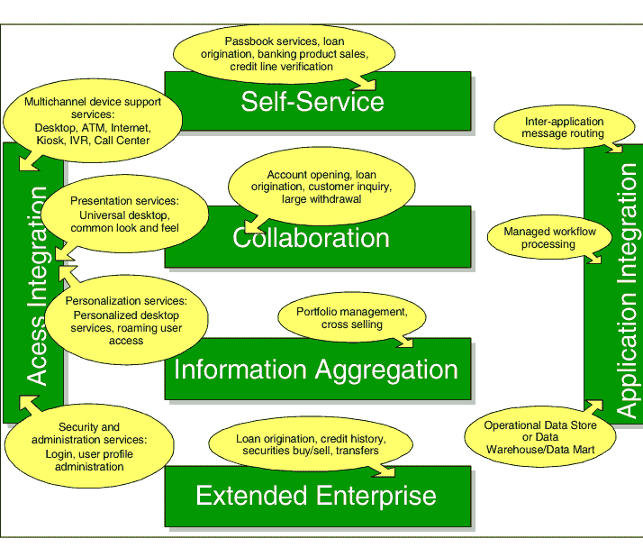

图 5-3 业务与集成模式

我们在这一层级得到的复合模式如第 86 页的图 5-4所示。

第 5 章 将 IBM 电子商务模式应用于分行银行 85

| 访问集成 (Access Integration) | 自主服务 (Self-Service) | 应用程序集成 (Application Integration) |

|---|---|---|

| | 协作 (Collaboration) | |

| | 信息聚合 (Information Aggregation) | |

| | 扩展企业 (Extended Enterprise) | |

图 5-4 所有业务与集成模式

在本章结束时，我们将查看可以应用复合模式的客户忠度和电子银行场景。

在查看复合模式场景之前，我们需要确定合适的应用程序和运行时模式，并决定如何将应用于我们的解决方案。由于本手册特别关注分行银行，我们将最密切关注自助服务业务模式以及相关的应用程序和运行时模式。自助服务业务模式也为讨论访问集成和应用程序集成模式的角色提供了跳板。

### 5.4.3 应用程序和运行时模式 (Application and Runtime patterns)

在我们确定的每种业务和集成模式下，我们都有一组应用程序模式。应用程序模式描述了通用的逻辑应用程序拓扑：解决业务或集成模式需求的应用程序“形状”。

业务和 IT 驱动因素是选择应用程序模式的关键输入。正如 14 页 2.2 节“分行技术挑战”所描述，要解决的关键挑战包括：

- *产品上市速度（Speed to market）*：银行解决方案的适应性是其能够应对竞争压力和不断变化的市场需求的关键。适应可以以快速重新配置，或快速部署新或增强应用程序的形式出现。

- *总拥有成本（TCO）*：分行转型必须是负担得起的；一个关键考虑是建立一个何时更换特定组件的计划；哪些组件必须在初始步骤更换，哪些组件更容易保留，从而解决支出率。

- *服务质量（Quality of Service）*（以非功能需求表示：安全性、可用性、可靠性、性能、可扩展性，因此这些实际上是 IT 驱动因素）。

## 自主服务应用程序和运行时模式 (Self-Service application and runtime patterns)

七种自助应用程序模式，某些可以提供立即解决方案，而另一些支持长期目标：

- 单机单通道 (Stand-Alone Single Channel)
- 直接集成单通道 (Directly Integrated Single Channel)
- 原生主机 (As-Is Host)
- 定制化显示主机 (Customized Presentation to Host)
- 路由器 (Router)
- 分解 (Decomposition)
- 代理 (Agent)

接下来的章节将讨论这些自助应用程序模式的每一种，并识别用于实现它们的运行时模式。

## 通道、受限集成模式 (Channel, limited integration patterns)

单机单通道应用程序模式是一种单通道模式，适用于没有即时需求将应用程序与其他系统集成，且产品上市速度驱动因素尤为显著的情况。直接集成单通道应用程序模式是另一种通道模式，但它支持与其他系统的点对点集成。这种模式可以减少业务事件的延迟，并最大化遗留系统的重用性。这种模式也可以代表单机单通道模式的演进步骤。

原生主机应用程序模式将使用终端式用户界面的遗留应用程序范围扩展到新通道。这种模式允许用户通过轻量客户端浏览器访问遗留应用程序，而不是特殊的终端设备或更重的桌面终端仿真器。定制化显示主机应用程序模式可以为遗留应用程序提供新的用户界面。可以为多个遗留应用程序提供新的、更高效且一致的用户界面，并通过轻量客户端浏览器提供应用程序。

## 多渠道、复杂集成模式 (Multichannel, complex integration patterns)

为了应对多渠道和复杂的集成场景，我们转向第二组自助应用程序模式。路由器应用程序模式专注于解决服务的多渠道交付。它通过提供一组标准的应用程序服务来实现这一点，这些服务可以从许多不同通道（如浏览器、自助终端、IVR 或呼叫中心）进行请求。来自每个通道的请求被路由到相应的应用程序系统进行处理。这种方法消除了为每个单独通道进行点对点集成的需求。

分解应用程序模式在路由器模式的基础上，增加了能够将通道的单个请求拆分为针对多个企业应用程序的多个请求，然后将单个响应重新组合为单个响应返回给源通道。这使得能够结合多个应用程序功能的更复杂的服务。

代理应用程序模式通过在来自多个企业应用程序的响应中添加自身的智能，进一步扩展了路由器和分解模式。它可以将一组无法直接相互集成的企业应用程序转换为一个可以认为是新的联邦应用程序，其功能超过了单个应用程序服务的总和。

例如，代理模式可以评估从多个企业应用程序返回的信息，并应用业务规则以得出一个单个应用程序都无法做出的交叉销售建议。

### 单机单通道模式 (Stand-Alone Single Channel pattern)

在本节中，我们将描述单机单通道应用程序和运行时模式。

### 应用程序模式 (Application pattern)

第 89 页的图 5-5 阐了单机单通道应用程序模式。

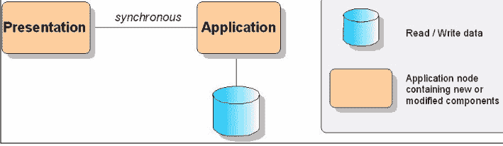

图 5-5 独立单通道应用模式

该模式典型地体现了表示层服务与应用服务的分离。在电子商务背景下，这通常通过在客户端上极稀疏地使用表示逻辑来实现。

对于那些需要通过新访问通道交付应用服务、且面临紧迫的上市时间压力的情况，该应用程序是实现新服务最快的方法之一。该模式的关键特征之一是它不依赖于与其他系统的集成，这消除了集成新系统时最具挑战性的方面之一。这也意味着应用服务可以根据银行的具体需求，部署在分支机构、区域级或企业层级的服务器上。

在银行转型的背景下，该模式可以用于将目前只能在具有特定操作系统配置的强类型客户端桌面运行的单体应用迁移到轻客户端、以服务器为核心的架构。这不仅减少了对高性能桌面硬件的需求，还可以将应用程序的范围扩展到任何具有标准互联网浏览器能力的设备。该模式可以通过多种方式实现，取决于所考虑的应用程序类型。

对于独立运行的应用（如桌面生产力应用，例如文字处理器），可以使用 Citrix Wireframe 或 Connectix VirtualServer 等技术将应用程序托管在中央服务器上。在这种情况下，运行在服务器上而不是桌面上。应用程序用户界面的表示通过轻客户端组件处理，该组件对其运行环境的依赖比应用程序本身低得多，从而将应用程序的范围扩展到更广泛的设备和用户。这种方法也适用于具有厚客户端组件的客户端/服务器应用程序，并且这些应用没有时间或兴趣将应用程序迁移到多层基于电子商务的架构。

对于有兴趣迁移到多层、基于电子商务的架构的传统二层应用程序，独立单通道应用模式提供了一个选项。只要应用程序不需要与其他应用程序集成，就可以使用该模式。

使用这种方法可以带来多处收益。首先，可以使用基于模型-视图-控制器（MVC）的应用程序框架对应用程序进行重新架构设计。通过将这种关注点分离应用于应用程序架构，应用程序不仅可以移动到电子商务环境中，使其立即通过额外的设备通道变得可用，而且更重要的是，底层的应用服务可以通过更通用的接口提供，这为应用程序未来更广泛的重用和更易的集成奠定了基础。

## 运行时模式

图 5-6 阐了独立单通道运行时模式。

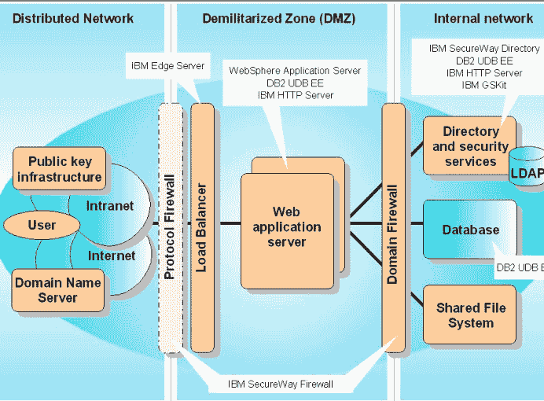

图 5-6 独立单通道运行时模式

客户端节点的表示服务可以通过 JavaScript、Java Applet 或仅限 HTML 实现。在服务器端，可以使用 JSP 来封装任何其他与动态表示相关的逻辑。解释来自浏览请求并将请求委托给业务模型层和业务逻辑组件的应用逻辑存储在单独组件中，例如 servlets、Java 类或 JavaBeans（在其他更复杂的模式中，可以使用 Enterprise JavaBeans，以及应用集成技术）。

第 90 页图 5-6 所示的这种运行时模式（Runtime pattern）可以作为实现这种方法的基础，并展示了如何在 Linux 服务器平台上实现此种应用模式（Application pattern）。该模式被认为是新兴的，因为某些产品最近才在 Linux 平台上可用，尚未像在其他平台上那样被广泛使用。

表 5-1 模式总结：独立单通道

| 关键特征 | |

| :--- | :--- |

| | > 一时单通道<br> 不与其他应用程序集成 |

| 常用技术组件 | > Linux 服务器<br> WebSphere Edge Server<br> IBM Developer Kit for Linux<br> WebSphere Application Server AE<br> DB2 UDB EE<br> IBM HTTP Server<br> IBM Access Manager for e-business |

## 直接集成单通道模式

在本节中，我们描述了直接集成单通道应用模式和运行时模式。

## 应用模式

第 92 页图 5-7 阐述了直接集成单通道应用模式。

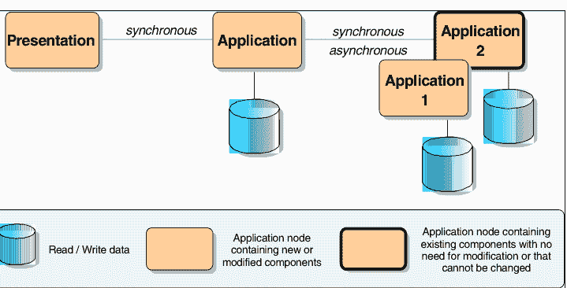

图 5-7 直接集成单通道模式

该应用模式扩展了独立单通道模式，为能够与一个或多个后端应用程序（或数据，或两者）建立点对点连接的应用程序提供了一种方法。作为单通道模式，它可以用于实现任何一种交付通道。

该模式的简单性通过将模式的范围限制在单个通道和相对简单的集成技术来实现。虽然这使得该模式比其他某些模式更容易实现，但权衡是它具有局限性，不是多通道解决方案（参见第 98 页的路由器模式、第 101 页的分解模式以及第 104 页的代理模式），并且通常不会与多个企业级进行交互（参见第 101 页的分解模式和第 104 页的代理模式）。取决于后端遗留应用程序的能力，可能需要对其进行修改（注意有一个后端应用程序节点代表未修改的应用程序，另一个节点代表需要修改以支持集成的应用程序）。

## 运行时模式

图 5-8 阐述了直接集成单通道运行时模式。

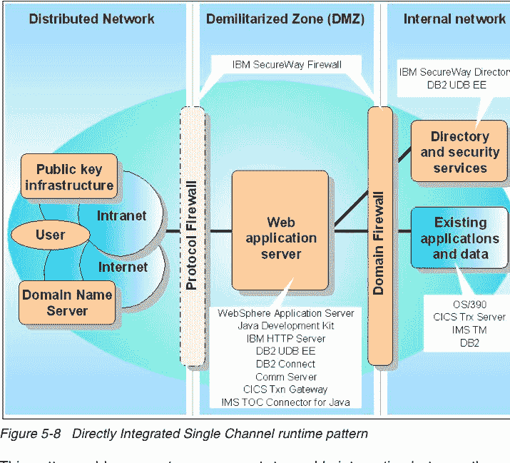

该模式通过添加连接器组件，实现了电子商务应用程序与既有遗留应用程序之间的集成。这些连接器是点对点的，这意味着电子商务与遗留应用程序之间的请求和响应对话不通过任何中间的动态路由或转换节点，从而使架构变得不那么复杂。虽然此模式中没有显式显示负载均衡节点，但可以轻松添加（参见第 90 页图 5-6）。

表 5-2 总结了该模式的关键特征和技术组件。

| 表 5-2 模式总结：直接集成单通道 |

| :--- | :--- |

| 关键特征 | 单通道，与单个应用程序进行点对点集成 |

| 常用技术组件 | Linux 服务器, WebSphere Edge Server, IBM Developer Kit for Linux, WebSphere Application Server AE, IBM HTTP Server, IBM Access Manager for e-business, DB2 Connect Enterprise Edition for Linux, eNetworks Communications Server, CICS Transaction Gateway, IMS Connector for Java (runtime classes) |

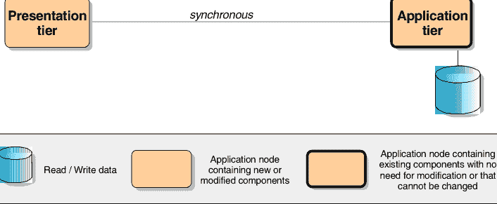

**图 5-10** 宿主机应用的自定义呈现模式（Customized Presentation to Host）

这两种模式允许浏览器访问具有终端型用户界面的应用程序，从而将应用程序的范围扩展到新的位置和更轻级的客户端设备。在宿主机应用程序需要保持不变的情况下（因此图中加粗边框的是应用程序层节点），这些模式工作得良好。


这两种模式代表了两种不同的解决方案。“原样宿主机模式”（As-Is Host pattern）为用户提供原始的用户界面设计，同时将终端仿真器功能从客户端移出。“面向宿主机的自定义呈现模式”（Customized Presentation to Host pattern）可用于提供重新设计的、更像 Web 风格的用户界面，使得简化或流化用户界面成为可能，并且能够在一系列终端型应用程序中提供更一致的用户界面。

在原样宿主机模式中，一个不包含应用程序代码的基础设施节点在服务器上提供终端仿真功能，并通过浏览器呈现，消除了客户端需要安装或运行终端仿真器的需求。将终端仿真功能从客户端上移具有几点益处：

- 宿主机应用程序可以从新设备访问，简化了客户端节点的要求。使用零足迹客户端的能力降低了客户端节点的成本并简化了其配置。
- 宿主机应用程序可以在新位置使用，例如在可以通过浏览器访问企业网络、但可能没有带有宿主机通信网关组件的服务器的地方。

托管终端仿真功能的服务器节点的放置，变得比基于粗客户端的终端仿真器所需的通信网关更容易做出决策。呈现层服务器可以位于分分机构、区域或中心位置。

面向宿主机的自定义呈现模式为呈现层增加了智能，提供了重新格式化主机屏幕的能力。对于原样宿主机模式，这种模式适用于宿主机应用程序不打算（或无法）修改并将按原使用的情况。这种模式可以掩盖宿主机应用程序的复杂性，还可以为多个宿主机应用程序提供共同的外观和感受。使用这种模式的主要优势如下：

- 原样宿主机模式的所有益处也适用于此模式。
- 底层应用程序可以采用与其他 Web 应用程序一致的外观和感受。
- 多个可能有完全不同用户界面设计的终端型应用程序可以提供一致的用户界面设计。
- 改进的、更一致的用户界面减少了培训时间和成本。
- 可用性的改进可以提高生产力并降低流失率。

## 运行时模式

这两种模式的拓扑结构类似于第93页的图 5-8。然而，我们不需要该拓扑中突出显示的所有连接技术组件，而是使用简化宿主机屏幕数据流转换的组件。基础技术组件如下：

- 支持 Java 浏览器的客户端：这可以是一个运行在任何支持浏览器要求的操作系统上的轻量级桌面。
- 运行以下内容的 Linux 服务器：WebSphere Application Server。
- 原样宿主机模式的底层实现基于服务器托管的终端仿真产品：IBM WebSphere Host Publisher。（在编写本文时，IBM WebSphere Host Publisher 不支持 Linux。）

面向宿主机的自定义呈现模式的底层实现使用某种形式的屏幕抓取机制将屏幕转换为更用户友好的界面。可以使用以下现成产品，可以显著减少实现此模式的工作量：

- Client Access Family V5R1
- Host Access Transformation Server (HATS); 通过具有 Web 风格外观和感受的浏览器访问 3270、5250

表 5-3 汇总了此模式的关键特征和技术组件。

表 5-3 模式总结：原样宿主机、面向宿主机的自定义呈现

| 关键特征 | |
|---|---|
| | 通过浏览器提供终端型宿主机应用程序。原样宿主机模式将终端仿真从客户端移出，保持原始的用户界面设计不变。面向宿主机的自定义呈现也将仿真移出客户端，并且将原始的用户界面设计转换为新的用户友好型设计。 |
| 常用技术组件 | Linux 服务器。WebSphere Edge Server。IBM Developer Kit for Linux。Web Sphere Application Server AE。DB2 UDB EE。IBM HTTP Server。IBM Access Manager for e-business。IBM WebSphere Host Publisher（原样宿主机）（在编写本文时，IBM WebSphere Host Publisher 不支持 Linux）。Host Access Transformation Server (HATS)（面向宿主机的自定义呈现）。 |

## 路由器模式

在本节中，我们描述路由器应用程序模式和运行时模式。

### 应用程序模式

图 5-11 展示了路由器模式。


图 5-11 路由器应用程序模式

此应用程序模式代表了呈现侧的扇出，以支持多个通道（即使用星型配置，而不是让每个通道提供与业务应用程序的自己的点对点集成）。多个呈现节点代表不同的访问通道，例如浏览器、IVR 或 ATM。

路由器层在呈现侧支持多个通道，并将来自任何这些通道的请求路由到适当的企业级应用程序。路由器不会在应用程序侧进行扇出（像解构模式那样）。每个入站请求都会被路由到目标应用程序。

路由器上的同步连接是逻辑上的，而非物理上的，实现可以使用非阻塞消息以及其他技术。无论如何，在呈现侧，交互对用户来说是同步的。路由器可以执行协议转换（例如 HTTP 到 RMI）和会话集中。路由器还可以实施基于角的安全规则。

路由器模式还使用了访问集成和应用程序集成模式。

路由器模式的一个示例是通过互联网、自助终端、VRU、呼叫中心和柜员站访问客户信息。这种模式的局限性在于它一次只提供一个产品或账户（参见第101页的“解构模式”和第104页的“代理模式”以获取合并视图）。

### 运行时模式

另一种新兴模式是基于对象请求代理的使用。在这种情况下，集成服务器节点将配备 WebSphere Application Server 企业版以及连接器（如 WebSphere MQ），以支持与后端应用程序的集成。

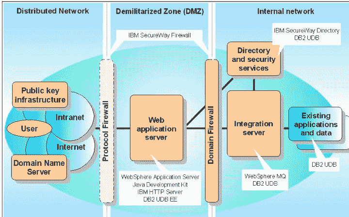

#### 路由器运行时模式

表 5-4 汇总了此模式的关键特征和技术组件。

表 5-4 模式总结：路由器

| 关键特征 | 常用技术组件（基于消息代理） |
|---|---|
| - 通过多个通道提供应用程序服务。采用星型拓扑为任何通道提供后端应用程序服务，而通道无需后端应用程序的位置或消息格式。从通道到适当应用程序系统的智能请求路由。请求和响应的消息转换。会话集中：路由器维护一组精简的后端会话，而不是由每个通道维护自己的会话。强制执行基于通道和角色的安全策略。消除每个通道对后端应用程序系统建立专用点对点连接的需求。 | - Linux 服务器。WebSphere Edge Server（可选）。IBM Developer Kit for Linux。WebSphere Application Server EE。DB2 UDB EE。IBM HTTP Server。IBM Access Manager for e-business。WebSphere MQ。WebSphere MQ Integrator。WebSphere classes for Java |

## 分解模式 (Decomposition pattern)

在本节中，我们描述了分解（Decomposition）应用模式和运行时模式。

### 应用模式

图 5-13 展示了分解应用模式。

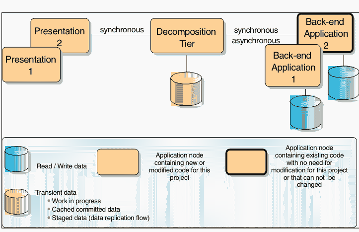

图 5-13分解应用模式

分解应用模式扩展了路由（Router）模式，以处理更复杂的请求。与路由模式一样，该模式可以处理来自多个通道的请求。它超越路由模式之处在于能够将来自通道的请求分解为针对后端应用程序的多个请求，然后将每个后端应用程序的响应汇合成单个响应返回给原始请求者。

该模式基于路由的“中心-星型”架构（hub and spoke architecture），并通过添加用于分解和重组请求及响应的智能性对其进行扩展。一个客户端向多个独立的企业应用程序发送多个请求（称为“扇出”，fan out），每个单独的结果被汇聚到一个单一响应中返回给客户端（称为“扇入”，fan in）。可以使用本地进行中数据库（work-in-progress database）来存储表示当前状态以及组装返回通道的最终响应所需的中间结果，以及转换和路由业务规则。虽然入站消息的分解（扇出）需要集成服务器具备智能，但该模式更具挑战性的方面是收集、关联和组装各个响应（扇入）。

### 运行时模式

与路由模式类似，可以使用几种运行时模式来实现分解应用模式。第 104 页的图 5-15 表示了基于消息代理程序（message broker）的常用方法。

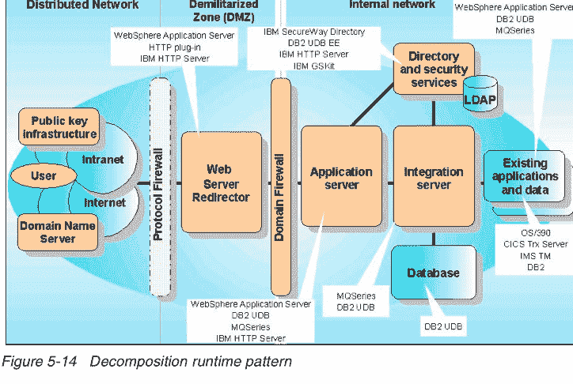

第 103 页的表 5-5 总结了该模式的关键特征和技术组件。

#### 表 5-5 模式总结：分解

| 关键特征 | 常用技术组件（基于消息代理程序） |
| :--- | :--- |
| - 通过多个通道提供应用程序服务；转向中心-星型拓扑结构，为任何通道提供后端应用程序服务，而无需通道知道后端应用程序的位置或消息格式细节。 - 从通道到适当系统的智能请求路由。 - 请求和响应的消息转换。 - 会话汇聚：路由器维护一组与后端应用程序通信的精简会话，而不是由每个通道维护自己的一套会话。 - 执行基于通道和角色的安全策略。 - 消除每个通道对后端应用程序系统支持专用点对点连接的需求。 | - Linux 服务器 - WebSphere Edge Server（可选） - Linux IBM Developer Kit - WebSphere Application Server AE - DB2 UDB EE - IBM HTTP Server - 用于电子商务业务的 IBM Access Manager - MQ8 支持包（MQ JMS 类） - WebSphere MQ - WebSphere MQ Integrator - I7Z MIkers Aggregator 插件（支持扇出和扇入） - Java 的 WebSphere MQ 类 - WebSphere Application Server EE |

## 代理模式 (Agent pattern)

在本节中，我们描述了代理（Agent）应用模式和运行时模式。

### 应用模式

图 5-15 展示了代理模式。

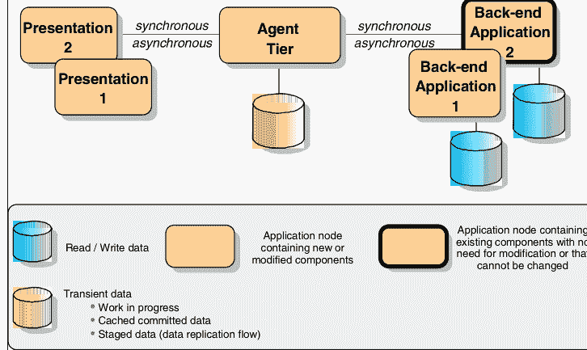

图 5-15代理应用模式

该应用模式扩展了路由和分解模式。它提供了一个统一的、以客户为中心的视图，可用于服务的市场化定制和交叉销售。代理模式智能地利用进行中的缓存数据，根据对数据的分析将内容推送到用户。

代理模式的一种变体是使用业务数据存储（ODS），而不是依赖单个请求来返回所需数据。

示例：

- 具有针对性营销的电子商务网站
- 呼叫中心代表收到交叉销售脚本提示
- 进行中数据库在提交更改之前持有长时间运行的事务数据（例如暂留直到提交的贷款申请）

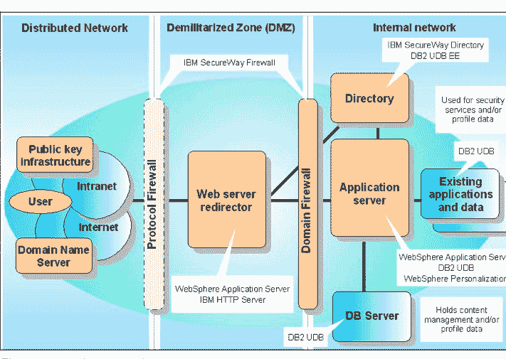

图 5-16代理运行时模式

可以部署在 Linux 上的产品：

- 基础产品请参阅“独立单通道”
- 用于多平台的 WebSphere Personalization Server 6.0
- WebSphere Personalization Server 3.5
- 用于多平台的 WebSphere Extended Personalization Offering 4.0 (WAS, WSAD, WS, WS Site Analyzer)

### 5.4.4 金融服务行业的客户忠诚度

许多金融机构对客户忠诚度倡议的高度、全企业关注指向了一个新兴的事实：最终目标是留住并增长一个满意的客户群。这说起来做起来难，尤其是当你有处理单个业务问题的独立应用程序和系统时。考虑到客户现在的期望比以往任何时候都多，选择也比多，挑战变得更加严峻。容错空间很小。

通过将所有数据集成到单一视图中，可以将数据转换为可访问的信息，以便在任何通道上提供一致的、定制化的服务。客户分析确定客户对组织的预期生命价值，从而可以匹配相应的服务水平。

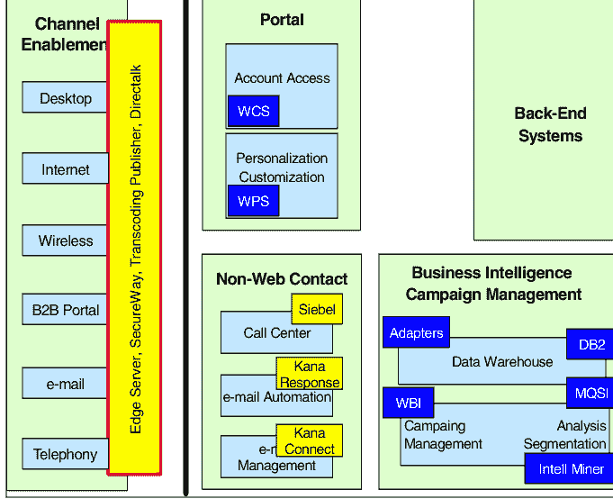

图 5-17客户忠诚度架构

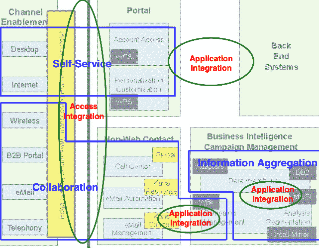

图 5-18客户忠诚度模式

客户忠诚度的模式如表 5-6 所示。

表 5-6 客户忠诚度模式

| 模式 | 应用模式 |
| :--- | :--- |
| 信息聚合 | 数据挖掘 |
| 信息聚合 | 人口 - 多步 |
| 信息聚合 | 信息访问 - 只读 |
| 信息聚合 | 挖掘/分析 |
| 协作 | 存储和检索 |
| 应用集成 | 管理过程 |
| 应用集成 | 代理 |
| 应用集成 | ODS |
| 访问集成 | 单点登录和基于角色的访问 |
| 模式 | 应用模式 |
| :--- | --- |
| 访问集成 | 个性化交付 |
| 访问集成 | 泛在设备访问 |
| 客户门户复合模式 | |
| 员工门户复合模式 | |
| 账户访问复合模式 | |

#### 客户忠诚度中的业务流程

以下描述了业务流程：

- 跨行业流程：
    - 客户销售分析
    - 多渠道营销
    - 产品销售分析
    - 客户忠诚度分析（获取、留存）
    - 订单输入服务
    - 订单输入管理
    - 客户生命周期
- 金融行业流程：
    - 保险理赔
    - 理赔查询
    - 首次损失报案
    - 保单报价（订单输入服务的专门化）
    - 添加账单支付
- 解决方案特定流程：
    - 实时营销管理

### 5.4.5 复合模式：电子银行 (e-Bank)

在万维网出现不到十年后，电子商务正在从根本上重塑零售金融服务。特别是在线交易的快速增长已经表明电子商务如何降低价格、增加便利性并增加价值，为理解这种新介质的企业快速建立市场份额。

现在为基于互联网的零售服务的快速扩张做好了准备。在未来几年内，随着在线个人财务提供商竞争的加速， 预计电子商务将指数级增长，推动在线贷款、账单支付和投资服务的需求。

正在寻求清晰度和便利性。零售银行可以通过构建低成本、交互式的银行平台来满足这一迫切需求，允许客户电子化简化并整合广泛的个人财务服务。

e-Bank 是一个以客户为中心的系统。例如，e-Bank 在客户信息中提供了对客户相关数据的集成管理，而这些数据传统上由多个独立系统管理。因此，相关部门可以共享并分析准确的客户数据。此外，分析 CRM 系统提供了市场和客户趋势分析，使银行能够开展更有效、更主动的营销活动。

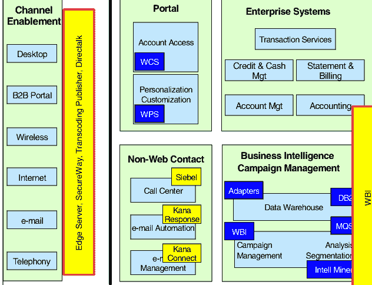

图 5-19 e-Bank 架构

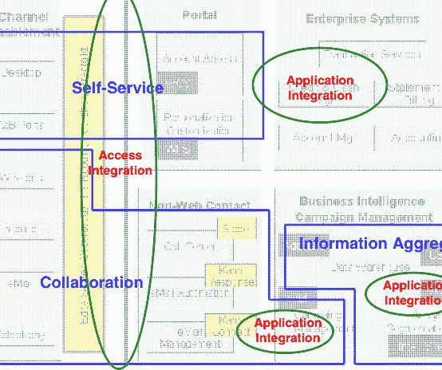

图 5-20 e-Bank 模式

e-Bank 中识别模式如表 5-7 所示。

### 表 5-7 e-Bank 模式

| 模式 | 应用模式 |
| --- | --- |
| 信息聚合 | 人口 - 多步 |
| 信息聚合 | 数据挖掘 |
| 信息聚合 | 广泛的用户更新 |
| 信息聚合 | 信息访问 - 只读 |
| 协作 | 管理的协作 |
| 扩展企业 | 文档交换 |
| 应用集成 | 传播 |
| 应用集成 | 代理 |
| 应用集成 | 事务型 |
| 应用集成 | 管理流程 |
| 应用集成 | 业务数据存储库 |
| 接入集成 | 无处不在的设备访问 |
| 接入集成 | 单点登录和基于角色的访问 |
| 接入集成 | 个性化交付 |
| 客户门户复合模式 | |
| 员工门户复合模式 | |
| 账户访问复合模式 | |

#### e-Bank 中的业务流程

以下描述了相关业务流程：

- 跨行业流程：
  - 客户销售分析
  - 客户账户查询
  - 订单录入软/硬
  - 订单录入服务
  - 订单管理软/硬
  - 订单管理服务
  - 多渠道活动
  - 产品销售分析
  - 产品生命周期管理（添加、更改、删除、替换）
  - 客户生命周期管理（添加、更改、删除）
  - 报价
  - 用户访问管理（添加、更改、删除）
  - 应收账款
  - 应付账款
  - 客户服务请求
  - 客户忠诚分析（获取、保留）
  - 在线账单及支付及支付
- 金融行业流程：
  - 信贷和现金管理
  - 添加账单支付
  - 账户管理
  - 电子转账
  - 止付
  - 交易服务
  - 余额查询
  - 账户查询
  - 存款账户账单查询
  - 信用卡账单结算
  - 存款账户交易查询
  - 卡账户交易查询
  - 银行账户交易影像查询
  - 利率查询
  - 银行账户税务查询
  - 外汇率查询
  - 止支票添加
  - 止支票取消
  - 止支票查询
  - 止支票审计
  - 止支票同步
  - 资金转账添加
  - 资金转账修改
  - 资金转账状态修改
  - 资金转账取消
  - 资金转账查询
  - 资金转账审计
  - 资金转账同步
  - 定期转账模型添加
  - 定期转账模型修改
  - 定期转账模型取消
  - 定期转账模型查询
  - 定期转账模型审计
  - 定期转账模型同步
  - 支票订单添加
  - 存折订单添加

### 5.4.6 WSBCC 和 Eontec

IBM 与业务伙伴 Eontec 合作，将 WebSphere Business Components Composer (WSBCC) 与 Eontec 金融组件相结合。在所得解决方案中，WSBCC 多渠道业务操作可以向 Eontec 金融组件发出请求，该组件反可以使用 WSBCC 通信服务与其他应用程序和数据集成。可以使用 Eontec 和 WSBCC 创建一个支持自服务（Self-Service）业务模式的多渠道应用程序。


Eontec 使用基于 J2 的架构，包括实现豆管理持久化的无状态会话豆（session beans）和实体豆（entity beans）。这种方法允许实体豆（在 Eontec 框架下）适应其他持久化机制，例如数据库或通过其他应用程序服务。Eontec 框架的持久层使用 Eontec 金融过程集成器组件的服务与企业应用程序的服务集成。金融过程集成器使用 WSBCC 通信服务访问更大的企业应用程序框架。

例如，考虑通过 WSBCC 多渠道表现层收到的客户端请求，该请求调用了一个 Entec 组件，该组件需要从存在于另一个（例如，遗留）应用程序中的数据来填充自身。Entec 组件将向 Entec 持久化层发送请求，该请求将传递给 Entec 金融过程集成器。金融过程集成器使用其路由配置信息确定需要哪个系统或连接器来访问数据，以及在用 WSBCC 通信服务发送请求之前以及接收响应之后需要哪些转换。这些特征非常符合自服务分解（Self-Service Decomposition）应用模式的描述。

自服务分解应用模式关联有一个基本的运行时模式（Runtime）模式，如第 76 页的图 5-1 所示。该运行时模式强调应用程序服务器节点（Application Server）提供的应用程序功能与集成服务器节点（Integration Server）提供的集成功能之间的关注分离。对该模式的字面解释通常会导致将应用程序服务部署在一个物理服务器上，将集成服务部署在另一个单独的物理服务器上。对该模式作为逻辑视图的较不严格的解释可以允许将应用程序和集成服务都部署在单个物理服务器上。

前者的字面方法强调为广泛应用程序提供的枢纽型（hub and spoke）集成服务。这种显式分层为应用程序服务之间的松耦合以及为提供通用的企业级集成服务进行了优化。物理上的中心型配置还可以最大化分解运行时模式的会话集中特性，通常减少了需要与其他现有应用程序建立的连接总数。第 114 页的图 5-21 是这种方法的表示。

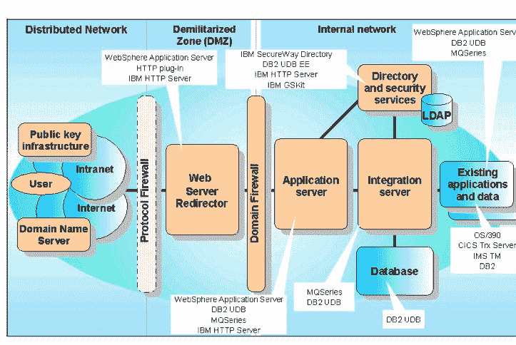

**图 5-21** 自服务分解模式的运行时模式


图 5-22 运行时模式的修订视图

与许多架构决策一样，这些部署替代方案也需要考虑一些权衡。第 76 页图 5-1 中的物理星型结构（hub and spoke）集成服务配置在物理层面是缺失的，但在逻辑层面得到了保留。这是一个值得考虑的重要观察结果。无论使用多少服务器来部署 WSBCC 和 Eontec，从应用/集成服务器以及现有应用程序的角度来看，使用的集成技术都是的。这两种方法的主要区别在于应用/集成服务器与现有应用程序之间需要建立的连接数量。这两种方法的重要相似点之一是使用了统一的一set集成技术。在分支级部署的情况下，每个分支的应用/集成服务器将建立各自到现有应用程序的连接。在集中式部署场景中，连接的数量将由容量需求和采用的水平扩展程度决定。

到目前为止，对 WSBCC 和 Eontec 的讨论集中在应用和集成服务的部署方案上。WSBCC 还提供了与展示相关的组件的灵活部署。展示组件可以通过 Java applet 以轻级客户端的方法在执行时部署，也可以通过将展示组件保留在服务器端，使用零足迹客户端的方法进行部署。这使得 Eontec 金融应用服务能够在具有各种容量和物理特征的客户端机器上运行。

跨层部署选项的灵活性结合内置的金融应用服务，使得 WSBCC 和 Eontec 成为分支或企业级银行转型战略中值得考虑的价值替代方案。

## 5.5 总结

本章详细描述了电子商务模式（Patterns for e-business）如何应用于分支银行，从而产生了各种运行时模式和产品映射。大多数产品映射示例在适用的情况下都使用了 Linux。

在下一章中，我们将描述 Linux 如何应用于分支银行的某些细节，以及它非常适合的各种角色。

## 适用于分支银行的 Linux 产品

现在我们已经详细描述了分支银行环境和电子商务模式，你可能心中已经有了一个适合你特定需求的架构。最终，你将需要开始创建产品映射，并对整个基础设施的操作系统环境做出选择。

在本章中，我们提供了适用于 Linux 环境的各种产品和设施的总结。这可能帮助你评估你的环境中哪些系统可以、也许应该运行 Linux。

## 6.1 分支银行环境中的 Linux

在第 3 章（第 45 页）“分支银行需求”中，我们讨论了分支银行解决方案需要种种组件和服务。在本节中，我们将讨论 Linux 如何满足这些最低需求。

目前 Linux 许多许多产品和解决方案，而且数量每天都在增长。在接下来的章节中，我们将描述这些解决方案的一个小部分。我们讨论的那些通常用于支持分支银行的 IT 基础设施。其中许多设施是 Linux 发行版原生提供的，另一些是 Linux 环境的附加包。

### 6.1.1 网络服务

让我们从讨论一些网络服务开始。这些服务大部分自 Linux 诞生以来就提供，并且证明是稳定的。

#### 文件传输协议 (FTP)

FTP 是 TCP/IP 网络计算机之间交换文件的最简单方法。FTP 是一种常用的应用程序协议，用于从其他服务器下载程序和其他文件到桌面或服务器。

#### 网络文件系统 (NFS)

NFS 是一种客户端/服务器应用程序，用于在网络上的机器之间共享文件，就像文件位于客户端的本地硬盘上一样。Linux 既可以作为 NFS 服务器，也可以作为 NFS 客户端，这意味着它可以向其他系统导出文件，并挂载从其他机器导出的文件系统。

#### 网络信息系统 (NIS)

NIS 是用于网络的命名和管理系统。使用 NIS，系统中的每个主机客户端服务器都了解整个系统。任何主机上的用户都可以通过单一的用户标识符和密码，访问网络中任何主机上的文件或应用程序。NIS 类似于域名系统 (DNS)，但稍微简单得多，专为小规模网络设计，并用于局域网。

NIS 使用客户端/服务器模型和远程过程调用 (RPC) 接口进行主机间的通信。NIS 由一个服务器、一个客户端程序库和一些管理工具组成。它通常与网络文件系统一起使用。

#### 域名系统 (DNS)

DNS 是定位互联网域名并将其翻译为互联网协议地址的方法。域名是互联网地址的一个有意义且易于记忆的“句柄”。

由于维护一个主机名及其 IP 地址的中央列表是不现实的，因此域名列表和 IP 地址列表以权威分层结构的形式分布在整个网络中。在你的接入点附近可能有一个 DNS 服务器，它映射你网络中的域名，并根据需要处理请求或将其转发到其他服务器。

#### 防火墙

防火墙是位于网络网关服务器的一系列相关程序，用于保护私网资源免受其他用户的侵害。

基本上，防火墙与路由器程序紧密配合，检查每个网络数据包以确定是否将其转发到目的地。防火墙还包含或与代理服务器配合，由代理服务器代表工作站用户发出网络请求。

#### 超文本传输协议 (HTTP)

#### 安全超文本传输协议 (HTTPS)

HTTPS 是安全加密。

#### Apache HTTP Server

Apache HTTP Server 项目是一项开发和维护适用于现代操作系统（包括 UNIX 和 Windows）的开源服务器的工作。该项目的目标是提供一个安全、高效且可扩展的服务器。自1996 年 4 月以来，Apache一直是互联网上流行的服务器。有关 Apache 的更多信息，请参阅：

```http://httpd.apache.org/
```

#### IBM HTTP Server

基于 Apache 的 IBM HTTP Server IBM 增强了 Apache HTTP Server，例如为安全事务添加了 SSL，并作为 WebSphere 包的一部分提供了完全支持。

#### Linux 版 Communications Server

Linux 版 Communications Server 提供了多协议网关和工作站服务。它使个人计算机能够与 System/390 和 AS/400 主机以及个人计算机通信。Enterprise Extender 允许 SNA 操作跨 TCP/IP 网络运行。

对于客户端/服务器和分布式应用程序，Communications Server 包含了对等点网络 (APPN) 网络节点和终端节点的支持。Communications Server 还提供了丰富的应用程序接口。

#### IBM WebSphere Host On-Demand

WebSphere On-Demand 为用户提供了一种简单的方法访问关键主机数据，而无需在客户端安装任何软件。WebSphere On-Demand 使用 Java 技术，帮助直接从浏览器打开主机数据的大门。这种到主机的连接解决方案有助于提供安全的 Web 浏览器访问主机应用程序，而无需编程。通过支持 TN3270E-TN5250、VT220、VT100、VT320、VT420 和 CICS 事务网关访问，用户可以使用单一界面访问其关键主机数据。由于它是基于 Java 技术，其界面在各种类型的环境中具有相同的外观和感受。它还提供默认的 GUI 以帮助不熟悉传统绿屏的用户。

## IBM WebSphere MQSeries

WebSphere MQ 通过帮助业务应用程序通过发送和接收数据消息来跨平台交换信息，来实现应用程序集成。它们负责处理网络接口、确保消息的仅一次交付、处理通信协议、在可用资源之间动态分配负载、处理系统问题后的恢复，并帮助程序的可移植性。

MQ 适配器允许数据在 MQ 消息和应用程序之间传递。数据可以发送到任何支持的平台，或从任何平台接收。MQ 提供了一个单一的跨平台应用程序编程接口。一个关键因素是时间无关的处理。这意味着即使某个接收者临时不可用，消息也会可靠地存储以供以后交付。

## IBM WebSphere Edge Server

WebSphere Edge Server 在集中式管理和应用程序控制下，将应用程序处理分布到网络边缘。它包括：

- 应用程序卸载：减轻服务组合内容的负担。
- 内容分发：将 Web 内容部署到整个网络中的缓存和重托管服务器上。
- 缓存：通过作为正向、反向或透明代理卸载后端服务器和对等节点，提高响应时间。缓存并失效由 WebSphere Application Server 生成的动态内容，包括 JavaServer Pages (JSPs) 组件和 servlets。
- 负载均衡：通过网络地址转换 (NAT)、网络地址端口转换 (NAPT)、代理和内核级基于内容的路由 (CBR) 等功能实现。它可以改进服务器选择、负载优化和容错能力。
- 安全：可以使用 Tivoli Access Manager 进行集中化管理。当 Edge Server 的缓存代理配置为使用 Tivoli Access Manager 插件时，Access Manager 授权引擎确保只有授权用户才能访问缓存和非缓存资源。这种集成解决方案确保了对网络边缘的控制。

## IBM Directory Integrator

IBM Directory Integrator 是一种集成开发和部署工具，帮助客户快速有效地集成特定于应用程序的目录，以提供一致的企业级目录信息视图。

通过内置的连接器、用于扩展或修改这些连接器的开放架构 Java 环境，以及在处理数据时对数据应用逻辑的工具，IBM Directory Integrator 可以通过以下方式帮助您：

- 在应用程序或目录源之间同步和交换信息。
- 在各种数据存储库中管理数据。
- 提供一致的目录基础设施，可用于从安全、配置到 Web 服务等各种应用程序。
- 为传统用户身份和密码之外的应用程序提供额外的目录信息（如产品和定价数据）的一致视图。

## 6.1.2 用户管理与安全

由于大多数分支机构在与中心站的链路不可用时需要本地处理，因此需要能够在分支机构强制执行某种程度的用户管理。本节描述了该领域的某些功能。

## Samba

Samba 为 UNIX 客户端和服务器提供 Windows Internet File System (CIFS) 和 SMB 功能，并可以配置为分支机构提供类似 Windows NT 的主域控制器。

它基于 Server Message Block (SMB) 和通用互联网文件系统 (CIFS) 常用客户端/服务器协议。使用同样支持 SMB/CIFS 的客户端软件（例如 Windows 和 OS/2 产品），终端用户向另一台计算机上的 Samba 服务器发送一系列客户端请求，以便打开该计算机的文件、访问共享打印机或访问其他资源。另一台计算机上的 Samba 服务器会响应每个客户端请求，授予或拒绝对其共享文件和资源的访问。

## 可插拔认证模块 (PAM)

可插拔认证模块（PAM）允许系统管理员为感知 PAM 的应用程序设置认证策略，而无需重新编译认证程序。PAM 通过利用可插拔模块化架构来实现。可以开发 PAM 模块以根据集中式数据库验证用户。

当正确使用时，PAM 为系统管理员提供了许多优势，如下：

- 一个可以用于各种应用程序的通用认证方案。
- 可以在各种应用程序中实现 PAM，而无需为了专门支持 PAM 而重新编译应用程序。
- 为管理员和应用程序开发者提供了极大的认证灵活性和控制。
- 应用程序开发者无需为了使用特定的认证方案而开发其程序。相反，他们可以完全关注程序的细节。

## Kerberos

Kerberos 是一种用于验证计算机网络中服务请求的安全方法。Kerberos 允许用户从认证过程中请求加密票据，然后可以使用该票据向服务器请求特定服务。用户的密码不需要通过网络传输。

## Snort

Snort 是一种轻量级网络入侵检测系统，能够在 IP 网络上执行实时流量分析和数据包记录。它可以执行协议分析、内容搜索和匹配，并用于检测各种攻击和探测，例如缓冲区溢出、隐蔽端口扫描、通用网接口 (CGI) 攻击、Server Message Block 协议 (SMB) 探测、操作系统 (OS) 指纹识别等。Snort 使用灵活的基于规则的语言来描述它应该收集或通过模块化检测引擎。Snort 具有实时告警能力，具有针对 syslog、指定文件、UNIX 套接字或使用 Sambaclient 向 Windows 客户端发送弹出消息的告警机制。

## 轻量级目录访问协议 (LDAP)

LDAP 是一种提出的通过网络访问全局或本地目录服务的标准。LDAP 非常有用，因为它被设计用于支持跨整个网络 LDAP 服务器的传播，类似于域名系统服务 (DNS)。DNS 帮助根据域名或从域中请求的服务类型将计算机相互连接。没有 DNS 服务器器，主机名将无法转换为 TCP/IP 通信所需的 IP 地址。在未来，LDAP 可以为许多类型的目录信息提供类似的全局访问。目前，LDAP 更多用于银行等单一大型组织内部的目录服务。

LDAP 是一个客户端/服务器系统，LDAP 客户端连接到 LDAP 服务器并查询信息，或提供需要输入目录的信息。根据用户的权限，服务器将回答查询、将查询引用到另一个 LDAP 服务器或接收信息并整合到目录中。

## IBM Directory Server

IBM Directory Server 提供了一个强大的轻量级目录访问协议身份基础架构，它是部署全面的身份管理应用程序和高级软件架构（如 Web 服务）的基础。

IBM Directory Server 以及新的目录和元目录服务提供了对于需要部署 Web 服务和用户配置的公司至关的能力。目录是用于存储和检索用户、资源和其他关键网络信息的数据库。元目录服务聚合了可能存储在多个软件供应商提供并运行在各种操作系统上的目录或数据库中的目录信息。

## IBM Tivoli Access Manager电子商务

IBM Tivoli Access Manager 是一种用于电子商务和企业应用程序的基于策略的访问控制解决方案。它独特地解决了电子商务安全挑战，使新的和快速扩展的电子商务计划能够触及新的市场和客户。它还解决了增长和复杂性、不断增加的管理成本，并直接应对了在广泛 Web 和应用程序资源上实施安全策略的困难。Tivoli Access Manager for e-business 通过减少新电子商务应用程序的部署时间和成本来帮助公司。

Tivoli Access Manager for e-business 控制对应用程序和数据的线及无线访问，为授权用户提供单点登录 (SSO)。Tivoli Access Manager for e-business 与电子商务应用程序集成，为授权用户提供安全的个性化电子商务体验。Tivoli Access Manager 包含了针对关键客户关系管理 (CRM)、企业资源计划 (ERP) 和供应链管理 (SCM) 电子商务解决方案的集成安全性，以及针对运行在 WebSphere Application Server 上的 J2EE 规范应用程序的安全加固。Tivoli Access Manager for e-business 为合作伙伴、客户、供应商和员工提供安全访问关键业务应用程序和数据，以实现高可用和可扩展的交易。

## 6.1.3 文件和打印服务

分支机构几乎总是需要某种程度的本地文件和打印共享。同样，在该领域有许多基于 Linux 的产品。在本节中，我们将描述一些流行的解决方案。

## Samba

Samba 是一个非常受欢迎的开源服务器软件包，Linux 系统可以通过它提供文件和打印服务（也称为共享）。Samba 实现了服务器消息块 (SMB) 协议，这是一种由 IBM 在 1984 年开发的复杂协议，为 Windows、OS/2 和 Linux 桌面系统提供文件和打印服务。某些应用组件在特定的应用设计模型下会使用此类类型的服务。

全球有许多人员每天在生产环境中使用 Samba。这可能是因为 Samba 的开源性质、它随 Linux 发行版一起分发的事，以及 Samba 团队努力提供一种可以在其他基于 Windows 的环境中无缝运行的产品。

有关 SAMBA 的更多信息，请参阅：

```
http://www.samba.org
```

## IBM Tivoli Storage Manager


IBM Tivoli Storage Manager 通过在离线存储上存储数据的备份和存档副本，保护您的数据不受硬件故障和其他错误的影响。它可以扩展到保护从大型机到笔记本电脑的各种硬件上的数百台计算机。它们可以通过互联网、广域网 (WAN) 和局域网 (LAN) 连接。Tivoli Storage Manager 的集中化 Web 端管理、智能数据移动和存储技术，以及全面的基于策略的自动化，共同努力降低数据保护管理成本以及对计算机和网络的影响。可选模块允许必须 24x365 运行的关键业务应用程序利用 Tivoli Storage Manager 的集中化数据保护，而不会中断其服务。

## IBM Linux Technology Center Omni 驱动

Omni 打印机驱动程序使用 Ghostscript 框架支持 400 多种打印机。此外，它提供了一种动态加载打印机驱动、通过编辑设备描述文件创建新设备的模型，并通过允许之前的设备驱动程序功能进行子类化简化简化新打印机驱动程序的开发。

## 6.1.4 存储转发

存储转发服务支持由于没有后端连接（可能是由于意外中断）而无法在线处理的操作，同时也支持批处理操作。

通常，存储转发服务构建在应用程序或应用框架中，而不是作为一个独立产品。后续章节描述的产品可以支持需要存储转发能力的应用程序。

## IBM WebSphere Business Components Composer (WSBCC)

WebSphere Business Components Composer 是零售银行行业多渠道和分支机构转型解决方案的战略元素。对于希望作为提高运营效率和盈利能力的更大计划的一部分来更新零售交付渠道的金融机构来说，它带来了高价值。通过使金融机构能够构建并部署在所有零售交付渠道中提供一致、灵活的业务逻辑和客户服务的架构，该产品增强了银行理解和满足独特客户需求的能力。

WSBCC 提供了一套专为这类零售银行应用设计的组件。通过使用 WebSphere Business Components Composer 经过验证的基于组件的中间件框架，零售银行可以构建集成应用程序，以支持多个客户渠道和分支机构转型工作。

## IBM Bank Teller Business Components

IBM WebSphere 分支机构转型解决方案由 IBM Bank Teller Business Components 实现。这些组件提供了灵活性和适应性，可以根据一组经过验证和高性能的组件实现基于 Java 的柜员系统。这些组件提供了一个环境，允许客户能够快速构建和部署柜员交易，且这种方式支持跨渠道的交易重用。全球多家金融机构已实施该 WebSphere 分支机构转型解决方案，为在企业范围内利用 WebSphere 能力奠定了坚实的基础。

## IBM Local Area Network Distributed Platform (LANDP)

LANDP 主要为零售银行设计和开发。它是一个经过测试的解决方案，被全球大量客户（包括世界上最大的银行）使用。LANDP 包括以下内容：

- 客户端/服务器环境：支持运行 Linux、Windows、OS/2 和 DOS 组合的多平台网络，通过 NetBios 或 TCP/IP 进行通信。
- 通信服务器：支持运行主机应用程序的各种通信链路链路和协议。
- 数据管理服务器：支持 LANDP 子组中数据的存储、检索和更新。
- 具有多种访问模式的数据库服务器、共享文件服务器、电子日记和存储转发服务器，涵盖了广泛的数据管理需求。
- 金融设备服务器：LANDP 可用于访问和共享金融设备。
- 通用编程接口 (API)：用于为 LANDP 环境开发应用程序。子组中的服务位置由 LANDP 管理。这意味着当你开发应用程序时，不需要知道支持服务的服务器位于何处。
- 迁移支持：LANDP 的跨平台能力使应用程序和服务能够轻松地迁移到许多不同的平台。

## 6.1.5 数据库服务

某些应用模型目前在分支机构使用数据库来存放离线模式所需的数据。例如，某些电子日记的实现可能会使用数据库。此外，在离线需求有限的更集中化应用模型中，可能不需要分支数据库服务。

## Red Hat Database

Red Hat Database 是经过针对 Red Hat Linux Advanced Server 和 Red Hat Linux 测试和验证的开源数据库。它由增强版本的 PostgreSQL 驱动，其 ISO 镜像可以从 Red Hat 下载中心免费下载，地址为：

```
http://www.redhat.com/apps/download/
```

## MySQL

MySQL 是世界上最流行的开源数据库系统之一，为任务关键、重负载使用场景下的速度、力量和精度而设计。

你可以从 MySQL 网站下载来自 MySQL AB 的软件遵循 GPL 许可协议，并“按现状”提供，不作任何保证：

http://www.mysql.com

## PostgreSQL

PostgreSQL 是一个复杂的对象关系数据库管理系统，基于在加州大学伯克利分校计算机科学系开发的 POSTRES，支持几乎所有的 SQL 结构，包括子查询、事务以及自定义类型和函数。它是随处可获得的最先进的开源数据库。也提供商业支持。

## IBM DB2 for Linux

DB2 for Linux 的优势非常简单：以市场上任何其他适用于电子商务的 Linux 数据库更低的成本获得纯粹的力量。通过 DB2，你可以在企业范围内跨所有主要平台访问、管理和分析所有信息。随着 Linux 成为数据库和应用程序服务器的主要平台，DB2 for Linux 为你提供了一个健壮、易于管理的数据库，与 Linux 的稳定性和可靠性形成互补。

DB2 for Linux 支持并拥抱开放标准（包括 Java 和 XML），并与许多开源产品（如 Apache、PHP、Perl 和 Python）集成。DB2 UDB 是目前生产环境中扩展性最好的数据库，可以在单台 PC、SMP、集群以及 Linux 主机上管理任务关键数据。

## IBM Informix Dynamic Server

IBM Informix Dynamic Server (IDS) 提供了任务关键可用性、可靠性、可扩展性和数据密集型事务管理能力，越来越多的机构依靠这些能力在电子商务中取得成功。它还提供了世界领先的可扩展功能。

由于业务逻辑可以嵌入数据库中并完全集成到 IBM Informix 可扩展架构 (DSA)，IDS 可以解决极少数系统能够解决的问题。它还可以通过领先的分布式数据库和虚拟表功能，统一访问客户信息，无论这些信息位于何处，从而允许查询涵盖从平面文件到其他 IDS 和非 IDS 数据库的广泛范围。

## 6.1.6 应用服务器

在当今的电子商务世界，应用服务器发挥着至关重要的作用。Linux 为运行应用服务器提供了一个稳定且廉价的基础，特别是在像分行银行这样的大规模分布式环境中。

### Tomcat

Tomcat 由 Jakarta 项目的成员开发，它是一个基于 Java Servlet 2.3 技术和 JavaServer Pages (JSP) 1.2 实现的 servlet 容器。虽然还有其他类似的产品，但 Tomcat 是这这两项技术的官方参考实现，也是少数几个支持 JSP 1.2 的免费可用应用服务器之一。

Tomcat 在一个开放且参与的环境中开发，并根据 Apache 软件许可发布。有关 Tomcat 的更多信息可以从以下地址找到：

```
http://jakarta.apache.org/tomcat/
```

### IBM WebSphere Application Server

WebSphere Application Server 是一种基于 Java 技术的 Web 服务器，它将数据和事务与电子商务世界集成。它提供了一个丰富的电子商务应用部署环境，包含全套应用程序服务器，具备事务管理、安全、集群、性能、可用性、连接性和可扩展性等功能。

WebSphere Application Server 是核心 Web 服务和 JEE 应用程序服务器，具备行业领先的服务质量和一系列灵活的部署配置，能够满足单机、多服务器分布式以及高度动态分布式企业环境的需求。

## 6.1.7 消息服务器

消息传递（Messaging）是指向消息服务器交换消息（特别是描述事件、请求和响应的特殊格式数据），该服务器充当客户端程序的交换调度程序。

### IBM WebSphere MQ

有关 WebSphere MQ 的更多信息，请参阅第 121 页的“IBM WebSphere MQSeries”或访问 WebSphere MQ 网站：

```
http://www-3.ibm.com/software/ts/mqseries
```

## 6.1.8 系统管理

在像分行银行这样的地理分布式环境中，拥有相应的设施和工具来远程管理该环境的工作站和服务器是非常重要的。同样，Linux 也提供了多种或适用于 Linux 的各种管理设施和产品。

### Telnet, rsh 和 login

Telnet 是你访问他人计算机的方法，前提是他们授予了你权限。从技术角度来说说，Telnet 是一种用于访问远程计算机的用户命令和底层 TCP/IP 协议。

`rsh` 命令允许你共享处理器并在远程系统上执行命令。通过 `rsh`，可以请求在网络上任何你有权访问的计算机上运行命令。你可以让命令的输出打印在屏幕上、定向到本地文件，或定向到远程文件。

`login` 命令允许授权用户登录到网络上的 Linux 机器（主机），并进行交互，就像用户物理位于主机计算机前一样。登录主机后，用户可以执行主机已授权的任何操作，例如读取、编辑或删除文件，以及停止或启动进程。

### 安全外壳 (SSH)

SSH 是一种用于在系统之间远程创建安全连接的协议。通过 shell（Telnet、login 或 rsh）远程登录到另一个系统，或在主机之间复制文件（FTP 或 rcp）的常用方法不会对客户端和服务器之间传输的数据进行加密，因此应避免使用。相反，你应该仅使用安全外壳或加密的虚拟专用网络连接到远程主机。使用安全方法远程登录到其他系统将降低你和远程系统的安全风险。

### NetSaint 网络监控器

NetSaint 是一个监控网络上主机和服务的程序。当问题出现并解决时，它能够通过电子邮件或呼叫机通知你。NetSaint 用 C 语言编写，设计用于在 Linux 下运行，尽管它在大多数其他 UNIX 变体中也可以运行。它可以作为普通进程或守护进程运行，间歇性对你指定的各种服务进行检查。实际的服务检查由外部插件执行，并向 NetSaint 返回信息。

### Webmin

Webmin 是一个基于 Web 的 Linux 系统管理界面。使用任何浏览器，你都可以设置账户、网络服务、文件共享和打印等。Webmin 由一个简单的 Web 服务器和若干直接更新 Linux 系统文件的程序组成。

### IBM Tivoli 系统管理软件

IBM Tivoli 软件提供了一套全面且互补的产品，可提供 IT 环境的端到端管理。企业可以使用 Tivoli 应用管理从大型机、中间层服务器到桌面电脑和 PDA 的所有内容。

Tivoli 解决方案管理从网络基础设施到中间件到应用程序的所有内容。它们将 Linux 既作为管理平台，也作为运行应用程序的平台。对于管理电子商务所需的许多关键软件组件（如 DB2、WebSphere 和 Domino），它们拥有特定于产品的模块，并以一种独立于平台的方式进行管理。

Tivoli 产品分为系统管理的四大类：

- 性能与可用性
- 配置与操作
- 安全
- 存储管理

通过各种产品的集成，Tivoli 帮助你部署、操作、安全和管理包括 Linux 在内的所有主要平台的系统性能和可用性。

### IBM Desktop On-Call

Desktop On-Call 是一种远程控制软件产品，它使用一个独特的概念：你不需要来 PC 上安装软件，因为你可以从另一台 PC 使用普通的 Web 浏览器通过 Java applet 控制主机 PC。它让你能够从世界上任何位置的任何 PC 远程控制你的桌面 PC。

Desktop On-Call 在银行和其他重要应用的许多情况下都非常有帮助。如果你桌面 PC 上的应用程序出现问题，可以从远程 PC 进行修复。当通过 Web 浏览器访问主机 PC 时，Java applet 程序会被动态下载到浏览器中并绘制主机桌面的图像。然后 Java applet 程序开始与原生守护程序通信。这使你能够从远程位置控制主机 PC。

### IBM Director

IBM Director 是一种全面的工作组硬件管理器，设计用于 IBM xSeries 服务器、PC 和笔记本电脑。

配合 IBM Director，xSeries 服务器上的高级管理处理器是硬件问题通知和解决的关键。它们为系统管理员提供了对系统的完整管理，不受服务器状态的影响。这些处理器在计算机内部模拟一台计算机，确保服务器对于你的关键业务应用程序保持可用。

## 6.2 总结

我们描述了各种基于 Linux 的和设施，它们为分行银行环境提供了必要的基础。这些产品大部分都有良好的记录，并提供了你所需的稳定性和性能。能够在 Linux 环境中运行所有这些功能（以及更多），有助于推动许多银行和其他公司将 Linux 作为一种低成本、低风险的选择。

当你在根据第 5 章“将电子商务模式应用于分行银行”中描述的方法，使用电子商务模式开发自己的解决方案架构时，可以使用本章提供的信息开始识别所选运行时模式所需的le映射。

## 新型分行银行解决方案场景

在 2.5 节“常见分行银行场景”中，我们描述了支持当前分行银行环境的一些常见 ITInfrastructure。在本章中，我们描述了一些与未来分行银行相关的场景。这些场景基于我们在第 2 章“分行银行环境”中描述的电子商务模式的趋势，以及基于 Linux 的解决方案在这些环境中的适用性和可用性。

## 7.1 场景概述

挑战在于为分行银行基础设施提供一份架构路线图，以应对当下的业务挑战和未来的服务。因此，新分行银行的基础设施必须整合所有其他渠道，并成为这些渠道的核心部分。提醒一下，它必须具备支持以下内容的特征：

- 全方位服务（从自助到个人辅助服务）
- 顾问协作
- 无线连接
- 分行的得宾车道流量
- 加强对客户关系管理的关注

因此，整体解决方案的目标包括但不限于以下内容：

- 融合网络基础设施
- 灵活的、基于角色的组件：
  - 柜员
  - 平台专员
  - 分行管理
- 支持协作
- 集成并增强 ATM 通道
- 与企业集成：
  - 运营银行系统
  - CRM（客户关系管理）
  - 财富管理

集成渠道的分行银行环境中，一个潜在的场景如下：

1. 客户在 Web 上使用房贷贷款计算器。
2. 随后，客户进入分行进行存款，并收到一份打印收据。
3. 在与柜员交互期间，柜员向客户提出建议，与其与专家讨论房贷再融资（基于对 Web 上房贷计算器使用情况的业务智能知识）。
4. 客户预约了分行财务专家的会议（通过远程会议），将在15 分钟后开始，并在分行咖啡厅等待预约时间。
5. 当财务专家准备就绪时，助理（在 PDA 上收到通知）来接客户。
6. 客户与财务专家就房贷再融资进行远程会议，通过门户聚合共享客户信息。客户对家居装修（厨房翻新）表现出兴趣，并申请再融资资金以支付装修。
7. 客户与财务专家完成了一份预填的贷款申请。
8. 几天后，客户前往 Web 端 ATM 提取现金。
9. ATM 通知客户贷款已批准，并提议通过以下方式之一安排贷款结算：从可用预约时间列表中进行选择，或请求客户服务代表办理贷款结算。
10. 客户接受了回电选项。
11. 在贷款结算期间，平台专员提供了一个通过业务合作伙伴提供的家居服务折扣优惠，并提议安排装修代表进行上门访问，客户接受了该建议。

正如第73页第5章“将 IBM 电子商务模式应用于分行银行”中概述，我们基本上触及了所有四种业务模式。

表 7-1 电子商务模式的示例匹配

| 步骤 | 自助服务 | 协作 | 聚合 | 扩展企业 |
|---|---|---|---|---|
| 1 | x | | | |
| 2 | x | | | |
| 3 | x | | | |
| 4 | x | | | |
| 5 | | | x | |
| 6 | | | x | |
| 7 | | | x | |
| 8 | | | | x |
| 9 | | | | x |
| 10 | | | | x |
| 11 | | | | | |

## 7.2 场景解决方案

在充分理解所有功能性及非功能性需求并使用方法论（如电子商务模式）后，我们可以创建一个如第137页图 7-1所示的基础设施。

我们创建了一个集成的、多渠道的、支持电子商务的应用程序框架，该框架可以部署到分行。业务逻辑已从客户端移离旧应用程序，迁移到开放标准的基于 Java 的基础设施，准备运行在任何支持浏览器和 Java 虚拟机的平台上，包括 Web 端 ATM 等设备。

所有业务逻辑都位于基于组件的实现中，根据网络可靠性和其他需求，可以轻松地集中托管，或分布到区域甚至分行服务器，以提高速度、性能或可用性。新的中间层包含与任何后端系统的连接器。目前可能已经存在这些系统，也可能是未来创建的系统。通过使用支持插拔连接器的架构，我们拥有了一个能够跟上不断变化的灵活环境。

| Web 应用程序服务器 | 组件事务服务器 | | |
| --- | --- | --- |
| 终端机 | 服务端演示 | 业务逻辑 / 数据访问功能 / 核心银行功能 |
| | JSPs | EJB A / EJB 连接器 | |
| ATM | HTTP 服务器 / Servlets | EJB B / IMS / IMS 事务 A, B |
| | 文件与打印 / Web 服务 (HTTP, XML, SOAP) | EJB Y / CICS / 事务 Y, Z |
| 轻量客户端柜员 | 用户管理 | EJB Z / DB2 / DB2 数据库 |
| 桌面端 | 分行服务器 | UNIX, Linux, 或 zOS / zOS |

图 7-1 步骤 3：创建新的基础设施

记住这个面向分行的系统概述，我们需要画出整个蓝图，并允许所有其他渠道参与端到端架构。


让我们更多地关注支持所有业务需求和我们之前发现的所有模式的具体功能。更完整的基础设施所示如图 7-2。

## 7.3 总结

本章概述的场景从高层次描述了如何利用本红书之前介绍的信息来查看分行银行需求，并应用电子商务模式深入到运行时和产品映射级。在这个简单但具有代表性的案例中，我们展示了 Linux 如何以及应该被视为分行银行基础设施的一种可行且具有吸引力的替代方案。

关于适用于 Linux 的 DB2，更多信息请访问以下网址：

http://www.ibm.com/software/data/db2/linux/

## DB2 通用数据库产品

以下是适用于 Linux 的 DB2 通用数据库产品。

### DB2 通用数据库个人版

为桌面提供数据库管理系统。

http://www.ibm.com/software/data/db2/ud/edition-pe.html

### DB2 通用数据库工作组版

适用于 PC 网络中工作组应用程序和数据的多用户数据库。

http://www.ibm.com/software/data/db2/ud/edition-we.html

### DB2 通用数据库企业版

适用于复杂配置和大型数据库的多用户数据库。

http://www.ibm.com/software/data/db2/ud/edition-ee.html

### DB2 通用数据库企业扩展版

提供支持大型数据库的高性能，并在集群服务器中提供更佳的扩展性。

http://www.ibm.com/software/data/db2/ud/edition-ee.html

> 注意：所有的所有的 DB2 通用数据库产品均适用于 IBM xSeries 和其他基于 Intel 的服务器。此外，DB2 通用数据库企业版适用于 IBM zSeries。

## DB2 应用开发

以下是适用于 Linux 的 DB2 应用开发解决方案。

### DB2 个人开发者版

用于为 DB2 通用数据库个人版开发业务工具和应用程序所需的工具。

http://www.ibm.com/software/data/db2/ud/edition-pde.html

### DB2 通用开发者版

用于在任何支持平台上为 DB2 通用数据库开发客户端/服务器应用程序的工具。

http://www.ibm.com/software/data/db2/udb/edition-ude.html

### DB2 XML 扩展

提供新的数据类型，允许客户在数据库中存储 XML 文档。

http://www.ibm.com/software/data/db2/extenders/xmlext/index.html

### DB2 网络搜索扩展器

为 DB2 添加快速全文检索功能。

http://www.ibm.com/software/data/db2/extenders/netsearch/index.html

### DB2 智能挖掘评分

允许用户通过简单的 SQL 调用在实时应用程序中进行数据挖掘。

http://www.ibm.com/software/data/iminer/scoring/index.html

## Informix

以下是适用于 Linux 的 Informix 解决方案。

### Informix 动态服务器

适用于 Informix 应用程序的 Linux 数据库。它适用于 IBM xSeries 和其他基于 Intel 的服务器。

http://www.ibm.com/software/data/informix/

## 连接器

以下是适用于 Linux 的连接器。

### DB2 Connect

提供与 DB2 系统的连接，适用于 IBM xSeries、zSeries 以及其他基于 Intel 的服务器。

http://www.ibm.com/software/data/db2/db2connect/

### IMS Connect

提供与 IMS 系统的连接，适用于 IBM zSeries。

http://www.ibm.com/software/data/db2imtools/imtools/imsconnect.html

### CICS 事务网关

提供与 CICS 系统事务的连接，并适用于 IBM zSeries。

http://www.ibm.com/software/ts/cics/ctg/index.html

## 适用于 Linux 的 WebSphere

适用于 Linux 的 IBM WebSphere 可以推动您的公司进入下一代电子商务业务。基于开放且行业认可的标准，WebSphere 能够轻松与客户、供应商和交易伙伴进行协作并加强关系。更多信息，请参阅：

http://www.ibm.com/websphere/

### 应用服务器

以下是适用于 Linux 的应用服务器。

#### WebSphere 应用服务器 V4.0 高级版

增加了对全 Java 2 企业版（J2EE）和 Web 服务（SOAP, UDDI, WSDL）的支持。它适用于 IBM xSeries、zSeries 以及其他基于 Intel 的服务器。

http://www.ibm.com/software/websservers/appserv/version40.html

### 应用集成

以下是适用于 Linux 的应用集成解决方案。

#### WebSphere MQ

将应用程序相互连接。它将几乎所有事物连接到几乎任何事物，形成一个高效且统一的企业级或社区级系统，从而简化流程并缩短上市时间。它适用于 IBM xSeries、zSeries 以及其他基于 Intel 的服务器。

http://www.ibm.com/software/ts/mqseries/messaging/

#### WebSphere MQ Everyplace

将 WebSphere MQ 扩展到使用笔记本电脑、PDA 和智能手机的移动工作人员。它适用于 IBM xSeries 和其他基于 Intel 的服务器。

http://www.ibm.com/software/ts/mqseries/everyplace/

### 行业解决方案

以下是适用于 Linux 的行业解决方案。

#### WebSphere 业务组件 Composer

提供了一系列工具、Java 组件和服务，这些加速了访问事务系统的多渠道银行应用程序的构建。Composer 还可以启用零售银行中的分行转型计划，包括分行应用程序和柜员员的构建。

http://www-3.ibm.com/software/webservers/components/

#### IBM 银行柜员业务组件

IBM 银行柜员业务组件提供了一系列应用程序启用组件，专门允许快速部署分行柜员交易和解决方案。银行柜员业务组件设计用于与 WebSphere 分行转型解决方案中的 Business Components Composer 无缝集成。

http://www-3.ibm.com/software/webservers/components/bankeller/

#### IBM Linux 技术中心 Omni 驱动程序

Omni 打印机驱动程序使用 Ghostscript 框架支持 400 多种打印机。此外，它提供了一种动态打印机驱动程序模型，通过编辑设备描述文件创建新设备，并通过允许对以前设备特征进行子类化来简化新打印机驱动程序的开发。

http://oss.software.ibm.com/linux/

### 开发工具

以下是适用于 Linux 的开发工具。

#### WebSphere Studio 应用开发者

为客户提供集成开发环境，用于构建、测试、集成和部署 Java 2平台企业版（J2EE 平台）应用程序，这些应用程序可以快速增长并适应以满足最严格的业务需求。

http://www.ibm.com/software/ad/studioappdev

### 展示

以下是适用于 Linux 的展示解决方案。

#### WebSphere 转码发布器

动态调整内容并进行优化，以便交付到各种设备。

http://www.ibm.com/software/webservers/transcoding/

#### WebSphere 个性化

定制网站以适应网站访问者的兴趣和需求。

http://www.ibm.com/software/webservers/personalization/

### 部署

以下是适用于 Linux 的部署解决方案。

#### WebSphere Edge 服务器

提供负载均衡、静态和动态缓存、应用卸载、内容分发、增强安全和事务质量保证的集成解决方案，所有都在集中管理和应用控制之下。

http://www.ibm.com/software/webservers/edgeserver/

### 集成

以下是适用于 Linux 的集成解决方案。

#### WebSphere 需主机

将主机应用程序扩展到浏览器，适用于 IBM zSeries。

http://www.ibm.com/software/webservers/hostondemand/

#### IBM Screen定制器

为 IBM zSeries 屏幕提供图形用户界面。它适用于 IBM xSeries 和其他基于 Intel 的服务器。

http://www.ibm.com/software/network/screencustomizer/

## 适用于 Linux 的 Lotus Domino

公司最重要的资产是人才。通过 Web 共享解决方案利用团队的智慧，允许员工、客户、合作伙伴和供应商之间的智能协作。使用适用于 Linux 的 Lotus Domino，您可以创建一个轻松访问想法的连接社区。

有关适用于 Linux 的 Lotus 产品的信息请访问：

http://www.lotus.com/home.nsf/welcome/domino

### 协作

以下是适用于 Linux 的协作解决方案。

Lotus Domino

提供协作、消息、分组日历、讨论和自定义应用程序。它适用于 IBM xSeries 和其他基于互联网的服务器。

http://www.lotus.com/products/r5web.nsf/webhome/nr5serverhp-new

### 工作流

以下是适用于 Linux 的工作流解决方案。

Lotus Workflow

为 Web 应用程序提供工作流管理和服务工具。

http://www.lotus.com/products/domworkflow.nsf

## IBM Tivoli 软件

适用于 Linux 的 Tivoli 解决方案为您提供了管理技术基础设施所需的工具。通过自主计算，Tivoli 自动处理平凡的管理任务，释放您的 IT 员工专注于业务面临更重要的挑战。

Tivoli 软件友好 Linux，为您的公司提供了一系列跨平台管理工具，降低成本、加速投资回报并提高 IT 响应能力。管理员今天用于管理现有系统的相同工具和控制方法现在扩展到新的 Linux 服务器，将它们与现有的 IT 基础设施集成。

要探索 Tivoli 产品家族，请访问：

http://www.tivoli.com/

### 安全

以下是针对 Linux 的安全解决方案。

#### IBM Tivoli Access Manager for e-business

为电子商务提供端到端的安全防护，包括 Web 单点登录、基于 Web 的分布式管理以及基于策略的安全防护。该产品可在 IBM zSeries 服务器上运行。

http://www.tivoli.com/products/index/access-mgr-e-bus/

#### IBM Tivoli Access Manager for Operating Systems

为 IBM WebSphere MQ 环境提供端到端的访问控制、应用级数据保护和集中化的安全策略管理。该产品适用于 IBM xSeries 和其他基于 Intel 的服务器。

http://www.tivoli.com/products/index/access-mgr-operating-sys/

#### IBM Tivoli Identity Manager

集中协调用户账户的创建，并使审批流程和资源配置实现自动化。

http://www.tivoli.com/products/index/identity-mgr/

### 存储

以下是针对 Linux 的存储解决方案。

#### IBM Tivoli Storage Manager

自动化数据备份和恢复功能，支持广泛的平台和存储设备，并集中化存储管理操作。

http://www.tivoli.com/products/index/storage-mgr/

#### IBM Tivoli Storage Manager Enterprise Edition

为大型企业提供集成数据保护解决方案，包括无局域网、支持 SAN 的数据传输、分级存储管理以及灾难恢复功能。

http://www.tivoli.com/products/index/storage-mgr-enterprise/

148 Linux 与分支银行

### 性能与可用性

以下是针对 Linux 的性能和可用性解决方案。

#### IBM Tivoli Enterprise Console

提供一个集中的控制点，使您的 IT 员工能够高效地控制跨所有系统和网络发生的事件，并提供纠正措施。该产品可在 IBM zSeries、xSeries 和其他基于 Intel 的服务器上运行。

http://www.tivoli.com/products/index/enterprise-console/

#### IBM Tivoli Monitoring

对关键系统资源进行监控，以检测瓶颈和潜在问题，并从关键故障自动恢复。该产品可在 IBM zSeries、xSeries 和其他基于 Intel 的服务器上运行。

http://www.tivoli.com/products/index/monitor/

### 配置与操作

以下是针对 Linux 的配置与操作解决方案。

#### IBM Tivoli Workload Scheduler

在本地和远程系统上自动化、监控并控制通过企业整个 IT 基础设施的工作流。该产品可在 IBM zSeries、xSeries 和其他基于 Intel 的服务器上运行。

http://www.tivoli.com/products/index/scheduler/

#### IBM Tivoli Workload Scheduler for Applications

从单点管理企业级调度，并与 mySAP.com 等解决方案集成。该产品可在 IBM xSeries 和其他基于 Intel 的服务器上运行。

http://www.tivoli.com/products/index/scheduler-apps/

#### IBM Tivoli Configuration Manager

提供用于部署软件以及跟踪跨企业硬件和软件配置的集成解决方案。该产品可在 IBM zSeries、xSeries 和其他基于 Intel 的服务器上运行。

http://www.tivoli.com/products/index/config-mgr/

## 相关出版物

本节列出的出版物被认为适合对本红书涵盖的主题进行详细讨论。

### IBM Redbooks

有关订购这些出版物的信息，请参阅第 152 页的“如何获取 IBM Redbooks”。

- * 使用 VisualAge for Java for WebSphere Application Server 开发 EJB，SG24-6144

- * 使用 IBM Tivoli Access Manager 构建企业业务门户，SG24-6556

- * IBM 连接器指南合集：CBConnector 用户指南，SG24-5121

- * 网络计算框架组件指南，SG24-2119

### 其他资源

本出版物作为信息的来源也有参考价值：

- * Patterns for e-business: A Strategy for Reuse，Jonathan Adams, Srinivas Koushik, Guru Vasudeva, George Galambos 著，IBM Press，2001，ISBN 193182027

## 参考网站

这些网站作为信息的来源也有参考价值：

- * IBM 软件 - 通用

http://www.ibm.com/software/

- * IBM 软件 - Linux

http://www.ibm.com/software/linux/

- * IBM Linux 技术中心 (IBM Linux Technology Center)

http://oss.software.ibm.com/linux/

- * Lotus Domino 软件

http://www.lotus.com/home.nsf/welcome/domino

- * IBM Tivoli 软件

http://www.tivoli.com/

- * Apache HTTP 服务器项目

http://httpd.apache.org/

- * Apache Jakarta 项目 - Tomcat 应用服务器

http://jakarta.apache.org/tomcat/

- * 用于集成开发环境的 Eclipse 开项目

http://www.eclipse.org/

- 金融服务的 J/eExtensions (J/XFS)

http://www.jxfs.com/

- * MySQL 开源数据库项目

http://www.mysql.com

- IBM 电子商务模式 (Patterns for e-business)

http://www.ibm.com/developerWorks/patterns/

- 红帽 Linux

http://www.redhat.com/apps/download/

- Samba 开源文件 SMB 和 CIFS 项目

http://www.samba.org

## 如何获取 IBM Redbooks


您可以在以下网站订购纸质版 Redbooks，并可以查看、下载或搜索 Redbooks：

`ibm.com/redbooks`

您还可以从该网站下载额外的材料（代码示例或磁盘/CD-ROM 镜像）。

## IBM Redbooks 集合

Redbooks 也以 CD-ROM 形式提供。点击 Redbooks 网站上的 CD-ROM 按钮可获取所有提供的 CD-ROM 信息以及更新和格式信息。

## 索引

A

访问集成模式 (Access Integration pattern) 68, 83

账户访问模式 (Account Access pattern) 70

账户信息 (account information) 39

Adobe Reader 5

代理模式 (Agent pattern) 87, 104

替代交付渠道 (alternative delivery channels) 13

ANSI 3

Apache 119

应用与技术组合 (application and technology portfolio) 80

应用可用性 (application availability) 8

应用集成模式 (Application Integration pattern) 68

应用管理 (application management) 57

应用模式 (Application pattern) 64

应用服务器 (application server) 41

架构与原理 (architecture and principles) 46

架构与需求 (architecture and requirements) 51

现状模式 (As-Is pattern) 87, 94

ATM 16, 27

可用性 (availability) 59

买方侧模式 (Buy-Side pattern) 71

C

容量 (capacity) 59

变更案例 (change cases) 61

CICS 事务网关 (CICS Transaction Gateway) 94

客户端/服务器 (client/server) 26

协作 (collaboration) 68

协作模式 (Collaboration pattern) 82

通信 (communications) 26

组件定义 (component definitions) 37

组件图 (component diagram) 36

组件模型 (component model) 64

配置管理 (configuration management) 57

核心业务 (core business) 23

核心事务系统 (core transaction systems) 42

成本 (cost) 58

成本相关对象 (cost-related objects) 46

客户信息 (customer information) 39

客户文件 (customer file) 36

客户忠诚度 (customer loyalty) 50

客户需求 (customer requirements) 76

定制化演示 (Customized Presentation) 87

B

后端应用 (back-end application) 71

后端组件 (back-end components) 42

收益与风险 (benefits and risks) 6

分支环境 (branch environment) 15

客户端 (clients) 81

员工 (employees) 27

需求 (requirements) 45

场景 (scenarios) 32

服务器 (servers) 26

结构 (structure) 24

技术挑战 (technology challenges) 14

转型 (transformation) 15

转型策略 (transformation strategies) 20

D

数据挖掘 (data mining) 23

数据服务器 (data server) 42

数据库服务 (database services) 51

数据驱动型 (data-focused) 84

DB2-5, 35

适用于 Linux 的 DB2 Connect (DB2 Connect for Linux) 94

DB2 企业版 (DB2 Enterprise Edition) 91, 100

解构模式 (Decomposition pattern) 87

桌面组件 (desktop components) 37

设备支持 (device support) 83

直接集成单模式 (Directly Integrated Single pattern) 87

分布式处理 (distributed processing) 34

DNS 119

Domino 5–6

IT 背景 (IT context) 75

E

电子商务 (e-banking) 108

电子商务技术 (e-business technologies) 118

电子学习 (e-Learning) 17

电子商务模式 (Electronic Commerce pattern) 70

电子日志 (electronic journal) 39

eNetworks 服务器 94

企业集成 (enterprise integration) 24

企业安全 (enterprise security) 43

扩展企业 (Extended Enterprise) 68

扩展企业模式 (Extended Enterprise pattern) 83

J

JXFS 5

L

分层资产 (layered asset) 67

分层资产 (layered assets) 71

Linux 4, 6, 2

Linux 内核 (Linux kernel) 2

5

Lotus Domino 5–6

Lotus Notes 19

Lotus SmartSuite 19

LPAR 4

F

胖客户端 (fat client) 18

文件与打印服务 (file and print services) 40

金融交易 (financial transactions) 39

防火墙 (firewall) 119

FTP 118

功能性需求 (functional requirements) 55

G

GNU 软件许可证 (GNU software license) 2

H

主机访问转换服务器 (Host Access Transformation Server (HATS)) 97

主机中心场景 (host-centric scenario) 32

带本地应用的主机中心 (host-centric with local applications) 33

HTTP 119

I

IBM 电子商务访问管理器 (IBM Access Manager for e-business) 91, 94, 97, 100, 103

IBM 与 Linux (IBM and Linux) 4

Linux 开发工具包 (IBM Developer Kit for Linux) 91, 94, 97, 103

IBM HTTP 服务器 (IBM HTTP Server) 91, 94, 97, 103

IETF 3

实现相关对象 (implementation-related objects) 47

IMS Java 连接器（运行时类）（IMS Connector for Java (runtime classes)) 94

信息聚合模式 (Information Aggregation pattern) 68, 82

集成客户信息 (integrated customer information) 42

集成客户视图 (integrated customer view) 22

集成模式 (Integration pattern) 64, 68

引言 (introduction) 1

ISO 3

M

大型机 (mainframe) 26

管理成本 (management costs) 7

消息服务器 (messaging server) 42

Microsoft Office 19

中间层组件 (middle-tier components) 41

评分 (rating) 8

最低需求 (minimum requirements) 3

Mozilla 5

MQSeries 35

多渠道 (multichannel) 17, 21

N

Netscape 5

网络计算架构 (Network Computing Architecture) 48

网络服务 (network services) 40, 118

NFS 118

NIS 118

非功能性需求 (non-functional requirements) 53

O

办公生产力 (office productivity) 40

开源开发 (open source development) 6

开源 Eclipse 程序 (Open Source Eclipse program) 5

OpenOffice 5

操作考虑量 (operational considerations) 55

OS/2 13

OS/390 4

系统上下文 54

系统管理 26, 41–42, 57, 60

系统监控 57

### P

模式选择 82

电子商务模式 63

性能 57, 59

外围支持 38

个性化服务 83

平台功能 39

平台系统 25

门户模式 70

Posix 2

表示服务 38, 83

表示层 71

保护重点投资 46

以流程为核心的 84

产品映射 64, 71

与编程相关的目标 46

Series 4

### T

任务 52

柜员机 (teller) 16

柜员机功能 39

柜员机系统 25

上市时间 50

总拥有成本 14, 87

交易所模式 70

转换策略 81

### U

用户交互 75

用户管理 38, 40, 61

使用电子商务模式 74

### Q

服务质量 15, 87

### V

供应商账户 7

### R

RAS 55

Redbooks 网站 152

联系我们 46

降低成本 46

降低风险 50

可靠性 59

可更换组件 48

路由器模式 87, 98

运行时模式 64, 71, 86

### W

W3C 3

Web 应用层 71

WebSphere 5–6

Application Server AE 91, 94, 97, 100, 103

Application Server EE 103

边缘服务器 91, 94, 97, 100, 103

主机访问转换服务器 120

主机按需接入 120

主机发布器 (原样) 97

MQ 100, 103

Java 的 MQ 类 100, 103

MQ Integer 100, 103

WebSphere Business Component Composer 83

WSWSBC 112

### S

可扩展性 59

安全 38, 43, 56, 60

安全与管理 83

自助服务模式 68, 82

卖端中心模式 70

服务器功能 26

外壳 22

上市速度 15, 87

独立单通道模式 87–88

标准 3, 47, 61

StarOffice 5

存储并转发 41

### X

XFree8 86 2

xSeries 4

### Z

z/OS 4

索引 155

# Redbooks: Linux 与分行银行

# Linux 与分行银行

分行银行的发展趋势

一种 IBM 电子商务模式方法

Linux 的关键作用

银行业正经历着向电子商务的重大转型，支持其多渠道模式来提供服务。作为这一转型的一部分，分行 IT 基础设施是关注的重点。

在竞争如此激烈的环境中，银行正在寻找具有成本效益、提供高质量服务并允许他们加速新产品和服务上市的解决方案。此外，他们还需要一个灵活且开放的环境，以吸收随时间推移不可避免的变化。

同时，Linux 作为一个稳健且稳定的运行环境，对于许多关键业务功能正变得越来越受到认可。

本 IBM Redbook 服务于分行银行的当前趋势，详细描述了使用 IBM 电子商务模式设计未来分行基础设施的方法，并让读者了解 Linux 如何以及在分行基础设施的何处发挥关键作用。

国际技术支持组织

基于实践经验构建技术信息

IBM Redbooks 由 IBM 国际技术支持组织开发。来自全球的 IBM 专家、客户和合作伙伴根据实际场景创建及时信息。提供的规范旨在帮助您在环境中更有效地实施 IT 解决方案。

更多信息，请访问：`ibm.com/redbooks`
