# Linux 和网络系统管理员指南：参考、快速复习、入门指南及概述


Tristan Mendoza 2024

庆祝在 IT 管理、网络分析和系统管理领域深耕 30 年

Cisco CCNA2 (路由/交换机与 CyberOps；信息安全); AWS 解决方案架构师，SDN/NFV 专业人士

EC-Council 认证伦理黑客 (CEH) 和取证调查员 (CHFI);

CompTIA Sec+, Net+, 和 CASP

Linux 通常管理 `.ko` 对象（自 2.6 版本以来）。

其他操作系统的可载入内核（FreeBSD;macOS;Windows NT）。Linux 模块通常位于 `/lib/modules/` 下，命名格式为主版本.次版本。包含桥接支持

`/etc/init` 定义了默认运行时，它触发了 `rsysinit` 启动

`/etc/modprobe` 将别名关联到驱动，如 `eth0`

`/etc/modprobe.conf` - `eth0` 的 `natsmem`

`/etc/modprobe.conf` - 大数量的 `natsmem`

`/etc/modprobe/blacklist` - 不被自动加载的别名

`/etc/modprobe/blacklist` - 加载该模块

`/etc/modprobe/blacklist` - 移除模块

`/etc/modprobe/blacklist` - 添加所有

`/etc/modprobe/blacklist` - 错误：“未解析的符号”

`insmod` - 插入第三方驱动

`modinfo` - 显示参数

`modinfo` - 显示描述

`lsmod` - 列出已加载的模块

`lsmod` - 在插入 U 盘时列出的设备和消息（截断）下方

`fatfat` `udev` 接收事件

`udev` 发送规则

内核

`KERNEL` 69848,52158 `/dev/devices/0000:00:00.0/11:0000:02:03.0/usb1-1` (usb)

`KERNEL` 69848,554355 `/dev/devices/0000:00:00.0/11:0000:02:03.0/usb1-1/1/1.0` (usb)

`KERNEL` 69848,568333 `/dev/devices/0000:00:00.0/11:0000:02:03.0/usb1-1/2/1.0` (usb)

`KERNEL` 69848,593215 `/dev/devices/0000:00:00.0/11:0000:02:03.0/usb1-1/3/1.0` (usb)

`KERNEL` 69848,603332 `/dev/devices/0000:00:00.0/11:0000:02:03.0/usb1-1/3/host/3` (scsi)

`KERNEL` 69848,619712 `/dev/devices/0000:00:00.0/11:0000:02:03.0/usb1-1/4/1.0` (usb)

`KERNEL` 69848,634600 `/dev/devices/0000:00:00.0/11:0000:02:03.0/usb1-1/4/1.0` (usb)

`KERNEL` 69848,649745 `/dev/devices/0000:00:00.0/11:0000:02:03.0/usb1-1/5/1.0` (usb)

`KERNEL` 69848,665029 `/dev/devices/0000:00:00.0/11:0000:02:03.0/usb1-1/3/host/3` (scsi)

`KERNEL` 69848,682257 `/dev/devices/0000:00:00.0/11:0000:02:03.0/usb1-1/6/1.0` (usb)

`KERNEL` 69848,702257 `/dev/devices/0000:00:00.0/11:0000:02:03.0/usb1-1` (usb)

## 使用 sysctl 调整资源

`/proc/sys/` - 内核提供的所有接口的目录：`abi`, `crypto`, `debug`, `fs`, `kernel`, `net`, `snmp`, `vm`

`/proc/sys/kernel/` 用于核心功能，`/proc/sys/net/` 用于网络，`/proc/sys/vm/` 用于虚拟内存

`kernel` 用于不同的参数，如 `"osrelease"` 或 `"hostname"`

`cat /proc/net/ipv4/conf`

1. 将此项更改为 `echo 0 > ip_forward`（非持久化）

`vm` 包含 `"swappiness"`，其值为 0-100 之间（内核交换未使用的内存的激进程度）

默认值为 30。较大的值（如 60）可能帮助内核更快地进行交换。以相同的方法更改它，但重启后它不会生效（非持久化）。

`/etc/sysctl.conf` 包含包含此类数值的默认系统配置。如果你想更改这些值并让它们在重启后依然有效，应编辑该文件。

`sysctl -a` - 显示 `/proc/sys` 的值

`sysctl -a | grep forward` -- 显示转发/路由文件

```
就像 Java 中 中，net.ipv4.conf.mc 会引用文件 /proc/net/ipv6/conf/lo
[root@server ~]# sysctl | grep forwarding
net.ipv4.conf.all.forwarding = 0
net.ipv4.conf.all.default.forwarding = 0
net.ipv4.conf.default.forwarding = 0
net.ipv4.conf.default.forwarding = 0
net.ipv4.conf.ens33.forwarding = 0
net.ipv4.conf.ens33.forwarding = 0
net.ipv4.conf.lo.forwarding = 0
net.ipv4.conf.lo.forwarding = 0
net.ipv4.conf.lo.forwarding = 0
net.ipv6.conf.all.forwarding = 0
net.ipv6.conf.all.default.forwarding = 0
net.ipv6.conf.default.forwarding = 0
net.ipv6.conf.default.forwarding = 0
net.ipv6.conf.ens33.forwarding = 0
net.ipv6.conf.ens33.forwarding = 0
net.ipv6.conf.lo.forwarding = 0
net.ipv6.conf.lo.forwarding = 0
```

在启动时，会启动 `sysctl` 进程。过去，它只检查 `/etc/sysctl.conf`，现在该文件是空的（对于 RHEL 而言）。该文件指示默认设置位于 `/etc/sysctl.d/` 中。要覆盖这些设置，请在 `/etc/sysctl.d/<name>.conf` 中添加新条目。你可以将自定义内容放在 `/etc/sysctl.d/<name>.conf` 中，如果应用了许多自定义更改，该文件会被证明是一个示例。

`sysctl` 命令允许在运行时修改内核参数。可用参数列在 `/proc/sys/` 下。

## sysctl 选项

- `-w variable=[value]` 写入参数值
- `-n` 在显示值时禁用键名的打印
- `-e` 忽略关于未知键的错误。
- `-A` 以表格格式显示所有当前可用的参数值。
- `-A` 显示所有当前可用的参数值。

## 关于 /proc 和 /sys 的更多信息

`/proc/cpuinfo` - 显示 CPU 信息

`/proc/net` - 包含协议信息和设置的文件，例如使用 `netstat`, `ss`

`/proc/meminfo` - 用于共享内存和缓冲区。

`/proc/version` - 生成

`/proc/cmdline` - 引导加载程序传递给内核的命令行选项。

`/proc/devices` - 配置到运行内核中的设备驱动程序（硬件）列表。

`/proc/filesystems` - 配置到内核中挂载的文件系统列表

`/proc/partitions` - 分区信息：每个分区的大小和数量。

`/proc/memory` - 独立于 CPU 的 DMA 直接访问内存。

`/proc/interrupt` - 列出使用的中断请求 (IRQ) 通道。

`/proc/ioalloc` - 分给每个设备的内存映射和输入输出分配。

`/proc/modules` - 列出计算机当前使用的内核模块。

`/proc/bus` - 为每个 USB 设备包含一个文件或目录


原始的 UNIX 系统需要访问数据。早期的程序（如 `ps`）通过访问 `/dev/mem` 或 `/dev/kmem` 并检索原始数据来发现运行的进程。这需要 root 权限，因此应用程序必须是 root 或特权用户。直接将系统数据使用到用户空间也不是好的。一种解决方案是通过系统调用使这些类型的信息可用，但创建新的系统调用来导出进程数据也不是好主意。`/proc` 文件系统就是答案，接口和结构（目录和文件）保留在系统中。

在内核中，虚拟文件系统被创建用以引用硬件和资源：

- `udev` 使用虚拟文件系统 `/dev` 将硬件（设备）表示为接口，以便其他程序与之通信
- `sysctl` 虚拟文件系统用于将硬件和资源表示为接口

`/proc` 文件系统是答案，接口和结构（目录和文件）保留在系统中。

`/dev/urandom` 与 `/dev/random` 类似，当熵池耗尽时，它不会阻塞应用程序；也使用伪随机输入（安全性较低）。

`/sys` 虚拟文件系统在内核 2.6 中引入，用于组织设备和驱动程序，通过 `/sys` 暴露许多属性的系统信息。

要覆盖这些设置，请在 `/etc/sysctl.d/<name>.conf` 中添加新条目。如果应用了许多自定义更改，该文件会被证明是一个示例。`etc/sysctl.conf` 包含包含此类数值的默认系统配置。如果你想更改这些值并让它们在重启后依然有效，应编辑该文件。

`/proc/sys/` - 内核提供的所有接口的目录：`abi`, `crypto`, `debug`, `fs`, `kernel`, `net`, `snmp`, `vm`

`/proc/sys/kernel/` 用于核心功能，`/proc/sys/net/` 用于网络，`/proc/sys/vm/` 用于虚拟内存

`kernel` 用于不同的参数，如 `"osrelease"` 或 `"hostname"`

`cat /proc/net/ipv4/conf`

1. 将此项更改为 `echo 0 > ip_forward`（非持久化）

`vm` 包含 `"swappiness"`，其值为 0-100 之间（内核交换未使用的内存的激进程度）

默认值为 30。较大的值（如 60）可能帮助内核更快地进行交换。以相同的方法更改它，但重启后它不会生效（非持久化）。

# dmesg

`dmesg` 显示由内核控制的硬件信息，包括 CPU、内存、磁盘驱动器、网卡等。

显示 `/var/dmesg` 的内容，该文件存储内核环形缓冲区（当新消息进入时，它会丢弃旧消息，并保持文件大小不变）。

它包含了启动时采取的操作，用于配置硬件设备。

使用 `watch "dmesg | tail -20"` 在错误发生时实时查看。

将级别设置为 1 (-1) 仅允许查看消息。

```
dmesg > kernel_msgs.txt - 将环形缓冲区内容导出到文件，方便帮助故障排除
← 使用 dmesg 将输出管道到 more, less, head, tail 或 grep，例如：dmesg | grep memory
← 使用 cat /var/dmesg 可以生成类似的输出，运行 dmesg 可提供更多控制
```

`dmesg` 的一些选项：

| 选项 | 说明 |
|---|---|
| `-C,--clear` | 清空环形缓冲区。你仍然可以看到存储在 `/var/dmesg` 文件中的日志 |
| `-c,--read` | 打印后清除环形缓冲区。 |
| `-f,--facility` | 将输出限制为（逗号分隔的）设施列表 |
| `-k,--kernel` | 打印内核消息。 |
| `-l,--level` | 将输出限制为（逗号分隔的）级别列表。 |
| `-r,--raw` | 打印原始消息缓冲区： |
| `-s,--buffer-size` | 查询缓冲区输出大小：默认为 16392。如果设置更大，可以查看整个缓冲区。 |
| `-u,--userspace` | 打印用户空间消息。 |
| `-x,--decode` | 将级别（优先级）解码为可读数字前缀。 |
| `-n,--console-level` | 使用 syslog 级别或数字设置日志优先级级别（-1 或 -1 alert 会阻止除紧急以外的所有消息）。所有级别仍会写入 `/proc/kmsg`，因此可以使用 syslog 精确控制内核消息出现的位置。当使用 `-n` 选项时，`dmesg` 将不会打印或清空内核环形缓冲区。 |

> - Linux Gazette 网站上的 "dmesg Explained" 文章解释了 dmesg 行的含义
> - http://www.tld.org/LDP/issue59/nazario.html

`hal` - 硬件抽象层 (HAL) 进程为所有应用程序提供有关当前硬件的数据。

`dbus` - 桌面总线 - 进程间通信 (IPC) 系统
- 允许进程相互通信，为 HAL 事件提供通知系统
- 可以为应用程序启动服务——向 `dbus` 进程注册以参与。
- 可以发送广泛告警，例如“检测到新硬件”和“打印队列已修改”。

# 重要日志位置及用法！

查看命令，包括列在“相关命令”列表中的命令：`cat`, `tail`, `grep`, `less`, `zgrep`, `zmore` 等。

| 日志位置 | 相关命令 | 注释 |
|---|---|---|
| `/var/log/messages` | | 包含安全相关信息- PAM 记录在此（Ubuntu 在出现问题后需要 `/var/log/syslog`） |
| `/var/log/boot.log` | | 自显其义，查看 boot.log。用于旧日志。 |
| `/var/log/wtmp` | `last` | 成功的（“工作”）登录、注销、重启 |
| `/var/log/btmp` | `last reboot` | 显示失败的登录尝试历史（助记：“bad”） |
| `/var/log/lastlog` | `lastlog` | 显示最近的用户 |
| `/var/log/secure` | | 身份验证权限消息、启动和启动 dmesg |
| `/var/root/install` | `dmesg` | 会更新 - 以保留历史安装的最新文件 |
| `/var/log/anaconda.log` | | Red Hat 系统的系统信息 |
| `/var/log/dpkg.log` | | 详细信息/删除 dpkg 日志（另见 `/apt/` 目录） |
| `/var/log/yum.log` | | Red Hat 安装的 yum 命令日志 |
| `/var/log/kern.log` | | 内核日志 |
| `/var/log/daemon.log` | | 来自各种后台守护进程的信息 |
| `/var/log/user` | | 关于所有用户层级日志的信息 |
| `/var/log/audit/` | | 审计守护进程 (`auditd`) |
| `/var/log/routhoot/` | | SELinux 的系统服务（远程目录访问）、认证） |
| `/var/log/sssd/` | | 系统配置服务 |
| `/var/log/cron` | | systat 的每日文件 |
| `/var/log/maillog` | | 邮件服务器日志 (sendmail/dcovet) |
| `/var/log/gmail/` | | Ormail 目录 |
| `/var/log/http/` | | Apache 访问和错误日志目录 |
| `/var/log/lightpd/` | | Lightpd 访问和错误日志目录 |
| `/var/log/mysql.log` | | MySQL 数据库服务器日志 |
| `/var/log/cups` | | 打印和打印相关的日志消息 |
| `/var/log/samba/` | | Samba 信息，Windows 支持 |

- 对于身份验证，基于 Debian 系使用 `/var/log/auth.log`，而 Red Hat 系使用 `/var/log/secure` -n `/var/log/faillog` - 也提供失败登录尝试的信息
- 与 `wtmp` 类似，但 `/var/log/utmp` 可能不太好用

记住系统标准级别：

0=`emerg` (紧急), 1=`alert` (警报), 2=`crit` (严重), 3=`err` (错误), 4=`warning` (警告), 5=`notice` (通知), 6=`info` (信息), 7=`debug` (调试)

数字级别越高，信息越少 (7 最少)

| 选项 | 说明 | journalctl 示例 |
|---|---|---|
| `-f` | 添加新条目 | `journalctl -u mysql` |
| `-k` | 内核消息（示例: 5） | `journalctl -k -b` |
| `-u` | 指定服务的消息 | `journalctl -u httpd` |
| `-b` | 启动消息；最后一次启动，使用 -1: boot ago; 等。（见上文） | |
| `-p` | 按反序显示；按优先级显示消息 | `journalctl -p err` |


| `--since,--until` | 时间范围；09:00: "hour ago", 2 days ago | `journalctl --since "2017-05-25 23:15:00"` |

| `-o` | 输出选项，包含简短，导出到文件 | `journalctl -o json-pretty` |

| PID, UID | 由特定 PID, UID 产生的消息 | `journalctl UID=100` (记得 `id`) |

| COMM, 等 | 可执行名称或主机；各种属性 | `journalctl SELINUX_CONTEXT=system_t` |

`journal` 保存在 `/var/log/journal/`。

# 连接并配置 rsyslog 和 journal

`rsyslog` 仍然是日志的核心 - `journal` 具有所有功能。

将日志发送到 `rsyslog`：在 `/etc/rsyslog.conf` 中，添加其他输入模块（Apache 在 `rsyslog` 中）

```
$InputFile /var/log/httpd/error
$InputFile /var/log/lightpd/error
```

导出到数据库使用输出模块：

```
$Mod imysql
```

在 `rsyslog.conf` 中启用远程日志（这些用于 us，被注释掉了）

提供 UDP 接收 -`Mod imudp`

提供 TCP 接收 -`Mod imtcp`

对于发送，查看转发和这个：基本语法。

`0=emerg, 1=alert, 2=crit, 3=err, 4=warning, 5=notice, 6=info, 7=debug`

数字级别越高，信息越少 (`7` 最少)

`-1` 或 `-1 alert` 会阻止紧急以外的所有消息。所有级别仍会写入 `/proc/kmsg`，因此 `syslog` 精确控制内核消息出现的位置。当使用 `-n` 选项时，`dmesg` 将不会打印或清空内核环形缓冲区。

# 基本硬件工具

`lspci` 显示所有 PCI 总线和连接到电脑的外围组件信息。

`-k` 显示支持设备的内核驱动程序 `-v` 详细输出。

`lsusb` 显示连接到电脑的所有 USB 组件。获取更多信息 `-t` 显示显示总线、桥和设备之间连接的树状。

`w` 是 `uptime`, `who` 和 `ps -a` 的组合

还有 `lhw`, `lscpu`, `lsusb`。

`hwinfo --html > hardware/` 创建一个 html 概览

`hwinfo --item` 使用 `libhw` 显示 HW 信息 `-hw_item` 是以下之一；`all`, `bios`, `block`, `bluetooth`, `camera`, `cdrom`, `chipset`, `cpus`, `disk`, `dvb`, `fingerprint`, `floppy`, `framybuffer`, `hard`, `id`, `isadnp`, `isbt`, `joystick`, `keyboard`, `mouse`, `net,, network`, `partition`, `pci`, `pcmca-ctpc`, `ppoe`, `printer`, `scanner`, `scn`, `scmp`, `storage-ci`, `tape`, `tv`, `usb`, `usb-ctbf`, `vbe`, `wlan`, `zip`.

`--short` 用于输出

`-debug` 级别 `setdev`

`hwinfo --show disks`

`hwinfo --short` 只是一个概览

`hwinfo --disk /dev/sdb` 显示分区磁盘

`hwinfo --disk --save-config` 保存磁盘状态

`/etc/logrotate.conf` - 指定日志滚动，每日，每月；删除前保留多少日志；`create` 指令使用空白文件移动日志；日期作为扩展；是否压缩

`/logrotate.d` 是存放特定规则的地方

`hwinfo--try 4 graphics ports` 用于显示器数据（默认：3）

`kdzu [options]` - 在 RHEL-6 中弃用并与 `/etc/sysconfig/hwconfig` 配置。配置选项，启动时运行。

# 内核监控工具

`uname` 显示操作系统名称、版本、进程和硬件详情。

`uptime` 系统运行持续、当前登录的用户数和平均负载。

`load` 显示过去 1 分钟、5 分钟和 15 分钟平均负载的图形化表示。

# 内存监控工具

`free` 显示总内存：空闲、已用、共享、缓冲、缓存。`-m` MB，`-k` KB，`-s` 显示。

`vmstat` 显示虚拟内存使用：I/O 地址、处理器分配、当前运行的。

`pmap` 显示进程到内存资源的映射。

`iostat` 报告 CPU 和设备使用情况。存储设备和分区的统计信息。

`memstat -a`

`systat -m`

# 磁盘和文件系统工具

`parted` 通知内核重新读取分区表

`-d` 可以取消你 `-s` 显示存储设备及其分区。

`df -h` 列出卷：内存、磁盘、文件

`du -h1` 文件大小，人类可读，`-d1`=最大深度:1 `-x` 在底部显示总计

`cifsostat` - 平均读取和写入/ 与你指定的操作，每秒使用的文件、打开/关闭/删除数

# 进程管理

- 输入 `ctrl-z` 停止并将其放入后台，输入 `bg` 恢复
- 输入 `jobs -l` 将其列为运行状态（列出所有后台作业）
- 使用列表中的编号执行 `fg <job>` 将其带回前台
- `dd if=/dev/zero of=/dev/null` - 将无内容复制到无处
- 使用 `&` 将其发送到后台而无需停止和恢复

[“shell 任务”是指从 shell 运行的任何命令。进程相对于其启动时的 shell 而言]

`nohup <test> >test.output` - 让进程在终端/tty 关闭时仍保持运行（意味着在不附着父进程的情况下运行）

## 杀死进程信号

`kill -9 <PID>` - 强制终止进程

`kill <program-name>` - 影响所有运行中的进程

| 编号. | 名称 | 默认操作 | 描述 |
|---|---|---|---|
| 1 | SIGHUP | 终止进程 | 终端挂起 - 重启进程。之后，该进程将保留之前的 PID。适用于修改配置文件后重启服务。 |
| 2 | SIGINT | 终止进程 | 中断进程 - 相当于 ctrl-c 键键序列 |
| 3 | SIGOUT | 创建核心映像 | 退出程序 |
| 4 | SIGABRT | 创建核心映像 | 终止程序（原为 SIGIOT） |
| 9 | SIGKILL | 终止进程 | 强制；进程将不会清理 - 分配的资源可能一直保留直到系统重启 |
| 15 | SIGTERM | 终止进程 | 默认允许进程在退出时进行清理 |

## CPU 优先级

CPU 优先级的“性值”（Niceness）- 记住 `-20` 是最高优先级，`19` 是最低优先级。默认值为 `0`

- 使用 `nice` 启动程序：`nice -19 /test.sh` 设置为 19（或 PID）- 不是 19，后者用 `~19` 设置
- 使用 `nice` 调整正在运行的进程：`nice <priority> -user（或 PID）`
- `nice -1234` 将进程为 1134 的作业值更改为 17；命令选项前没有横杠
- 使用 `-g` 和 `-u` 修改属于某个组或用户的所有进程的优先级（而不是进程的 `-p`）
- 建议每次以 -5 的步更改 nice 值
- 只有 root 可以应用负的 nice 值
- 你可以在 `/etc/security/limits.conf` 中设置用户或组的 nice 值
- 使用此语法：[ username ] [ hard | soft ] priority [ nice value ]

`user1 hard priority 1`

`-n` 值在 `nice` 和 `renice` 之间有所不同

- 在 `nice` 中，`-n` 选项从 (0) 开始调整值，且 "-" 将作为负号工作。
- 增加优先级：`nice -5 /test.sh` - 降低优先级：`nice 5 /test.sh`
- 因此使用 `-n` 会导致关于是负号还是简单连字符的问题产生混淆
- 在 `renice` 中，`-n` 选项指定实际数字，因此 `renice -n -19 -n 3534` 将值设为 -19

如果你发现 `nice` 不好用，说明需要增加系统资源（内存，但主要是 CPU）来处理服务器的负载。

# 使用 ps 检查进程

`ps` 命令的语法样式。BSD 样式 - 选项不以横杠呈现（`ps aux`）；UNIX/LINUX 样式 - 选项以横杠呈现（`ps -ef`）"ps" 不等同于 "ps -ax。"u" 用于显示用户的进程，但 "n" 在另一种模式下显示详细信息。在 Linux 中使用时：例如 "ps -f"。最后，选项使用 GNU 样式，在单词前带有双横杠，如 `--forest`。

最常用的是显示进程。"u" 或 "f" 选项提供更详细的信息。

```
$ ps ax --or - ps ax
$ ps -ef --or - $ ps -ef 使用 -f 有时比 -f 更有效
```


# 其他选项（有很多）

- 使用 `-C` 选项通过管道获取信息可能更方便
- `-o` 选项的排序字段在管理部分“标准格式”（这些是）可用
- 使用格式 `-o pid,user=USERNAME,cpu=pmem,comm` 重命名列
- 当列出用户名时，如果长度大于 8 个字符将显示 UID 而不是用户名。
- 像通常使用管道到 `head` 或 `tail` 来考虑列表宽度。
- 使用 `ps` 查询的常用属性：`pid`,`comm`（所有参数），`uname`（用户名），`pmem`（物理内存占比），`pcpu`（CPU 使用率），`nice`（nice 值），`etime`（经过时间），`state`（单字母代码），`stat`（多个进程状态）。

```
[root@localhost] ps aux
USER PID %CPU %MEM VSZ RSS STAT TIME COMMAND
root 1 0.0 0.0 2072 588 S 00:00 init
root 2 0.0 0.0 3534 513 S 00:00 migration
root 3 0.0 0.0 2438 339 S+ 00:00 getty
root 4 0.0 0.0 2448 500 S+ 00:00 dbus-daemon
root 5 0.0 0.0 2511 221 S+ 00:00 audit
root 6 0.0 0.0 2525 445 S+ 00:00 gnome-session
root 7 0.0 0.0 2561 312 S+ 00:00 ssh
```

`"F"` 选项可以像上面一样显示进程：

```
[root@localhost] ps aux
USER PID %CPU %MEM VSZ RSS STAT TIME COMMAND
root 1 0.0 0.0 2072 588 S 00:00 init
root 2 0.0 0.0 3534 513 S 00:00 migration
root 3 0.0 0.0 2438 339 S+ 00:00 getty
root 4 0.0 0.0 2448 500 S+ 00:00 dbus-daemon
root 5 0.0 0.0 2511 221 S+ 00:00 audit
root 6 0.0 0.0 2525 445 S+ 00:00 gnome-session
root 7 0.0 0.0 2561 312 S+ 00:00 ssh
```

`"F"` 选项列出更多信息。`"x"` 选项显示 CPU 和内存的使用情况。

# PS 输出列

`VSZ`=虚拟内存大小，`RSS`=驻内存大小，`STAT`=`(S=睡眠, R=运行, F 代表派生进程数）`，`PPID` 父进程，`CHAN` 是名称

## 状态

+ - 空闲（睡眠）
- `R` - 运行（在运行队列中）
- `S` - 睡眠（等待事件完成）
- `T` - 停止（通过作业控制或跟踪）
- `D` - 不可中断睡眠（通常为 IO）
- `Z` - 标记死亡（僵尸）
- `W` - 分页无效
- `X` - 死亡（不应看到）

## 附加状态码

+ - 处于前台终端
< - 具有 CPU 调度优先级
`N` - 具有 CPU 调度优先级 (`priority(2)`)
> - 已超过内存需求的软限制并正在超过
`A` - 已请求分页
`E` - 进程尝试退出
`I` - 多线程（使用 NPTL 线程）
`L` - 页面锁定在内存中（例如）
`s` - 会话首领

## 示例

显示 5 个 CPU 进程。显示进程的运行时间。实时查看进程输出 PID、命令和 nice 值按 `%cpu` 排序按 mem (KB) 使用量排序。以树样式显示进程层次结构

```
ps aux --sort=pcpu | head -5
ps -e pid,comm,etime
watch -n 1 'ps -o pid,comm,pcpu --sort=mem | head -15'
ps -o pid,comm,cputime -g 594
ps -o rss,args | sed -b -k1,in | pr -TW
ps -f --forest -C apache2
```

显示父进程的列

```
[root@localhost] ps -o pid,uname,comm
PID USER COMMAND
2359 root apache2
4524 www-data apache2
2525 www-data apache2
```

第一个所有 root 的进程是主 apache2 进程，所有其他 apache2 进程都从这里派生。我们现在查询它：

`$ ps --pid 2359`

```
PID TTY TIME CMD
4524 ? 00:00:00 apache2
2525 ? 00:00:00 apache2
```

`pstree` 输出进程树，这可能比 `ps --forest` 更受青睐：

```
[root@localhost ~#] pstree
init-acpid
  ate
  auditd--audispd{auditd}
    └(auditd)
    └automount-[*]
```

## TOP

结合了 `ps`、`uptime`、`free` 并定期更新；默认按 CPU 使用率对任务排序 `kill(k)`, `renice(r)`。

The header:

`top - 00:00:01 up 1 day, 1:23, 1 user, load average: 0.00, 0.01, 0.05`

`Tasks: 116 total, 1 running, 115 sleeping, 0 zombie`

`%Cpu(s0.3us, 0.0sy, 99.7id, 0.0wa, 0.0hi, 0.0si`

`Memory: 103810 total, 101436 used, 20772 free, 137732 buffers`

`Swap: 2097144 total, 0k used, 2097144 free, 64638 cached`

  PID PR NI  USER    %CPU  MEM    VSZ S   TIME COMMAND

     1  25  0 root      0.0   0.6   2072   588 S   00:00 init

     2  -5  0 root      0.0   0.1   3534   513 S   00:00 migration

     3  14  0 root      0.0   0.2   2438   339 S+  00:00 getty

     4  20  0 root      0.0   0.5   2448   500 S+  00:00 dbus-daemon

     5  20  0 root      0.0   0.2   2511   221 S+  00:00 audit

     6  20  0 root      0.0   0.4   2525   445 S+  00:00 gnome-session

     7  20  0 root      0.0   0.3   2561   312 S+  00:00 ssh


"F" 选项列出更多信息。"x" 选项显示 CPU 和内存的使用情况。

## 按 'F' 键调出窗口，允许按列进行排序

当前排序字段：对于窗口 3:Mem
- PID: 进程 ID u: nFLT
- b PID: 父进程 ID v: nDRT 脏页计数 (Dirty Pages count)
- c RUSER: 真实用户名 w: S 进程状态
- d UID: 用户 ID x: COMMAND 命令/命令行
- e USER: 用户 ID y: WCHAN 睡眠所在的函数
- f GROUP: 组名 g: Flags 任务标志 `<sched.h>`
- g TTY: 控制终端 TTY
- h PR: 优先级
- i J: Nice 值
- k CPU CPU: 上次使用的 CPU 副本 (CPU)
- l TIME: CPU 时间
- m M: n MEM: 已用内存 (RES)
- o VIRT: 虚拟内存 (kb)
- p SWAP: 交换大小 (kb)
- q RES: 驻留大小 (kb)
- s DATA: 数据+大小 (kb)
- t SHR: 共享内存大小 (kb)

如果选定的字段无法在屏幕上显示或不在字段范围内，则 '<' 和 '>' 键将不可用，直到选择了 `xrange` 范围内的字段。

注意 2：
字段排序使用内部值，而非列显示值。因此，TTY 和 WCHAN 字段将产生严格的排序（如果选择了 WCHAN 也是如此）。

启动 `top` 的不同方式：
- `top -u <username>`: 显示特定用户的进程
- `top -p 1208, 1425` - 使用 'batch' 模式输出到文件或管道（文本格式而非二进制）`-n 14` 迭代 14 次
- `top -n 1 -b -top-output` - 使用 'batch' 模式输出到文件
- `top -i` 仅显示活动进程（忽略空进程）

请注意 `top` 有多个版本，其选项和用法方法略有不同。检查你的 `top` 版本并使用 `-o` 选项。
例如，如果 HTOP 用起来更方便，但消耗的系统资源是 5 倍。

在读取 `top` 中的 `/i` 驻留内存列时，请记住它显示的是“页”（pages）——内存页默认约为 40kb，因此你需要将结果乘以 4 才能获得实际内存大小（resident 是物理内存）。
请记住部分 RAM 可供应用程序使用，同时也用于磁盘缓冲区（buffer/cache）。

## 内存到底有多少空闲？（磁盘缓冲区/缓存）

| | 总计 (total) | 已用 (used) | 空闲 (free) | 共享 (shared) | 缓冲区 (buffers) | 缓存 (cached) |
| :--- | :--- | :--- | :--- | :--- | :--- | :--- |
| Mem | 1504 | 1491 | 13 | 0 | 76 | |
| +buffers/cache | | | | 635 | 869 | |
| Swap | 2047 | 0 | | | | |

如果你不理解这些数字，`top` 可能会显示 RAM 空闲率为 99%，但实际上只有 42% (635MB)。此外，635+869-13=1493 为 "used"，而 91+764-13=~869 为 "free"。

这里使用了 735MB。
735+1098-76=1757 被称为 "used"（缓冲区/缓存中的空闲 减去内存中的空闲 = 报告的已用）。
Shared 是共享库。Buffer 是数据需要提交（commit）时的情况。
Cache 是因为移动到空闲资源的大文件被尽可能地保留在 RAM 中（优化）。当需要重新分配资源时，缓存会释放。
此外考虑 1757 "used" 减去 1021 缓存是真实的 735。（735+1098 是报告的总数 1834）。这里我们实际上有 1098 可用。

- `/buffers/cache` 的数字是真实的。

## sysstat 套件与 sar

`sysstat` 包含这些程序：CPU、I/O 统计，`mstat`（CPU 统计）、`pidstat`（进程统计）、`nfiostat`（NFS 相关统计）以及 `cifsat`（CIFS 统计）。该套件的核心是 `sar` 收集和报告套件，此外它们还有各自的扩展。

**`sadc` - 系统活动收集器。** 将二进制数据写入 `/var/log/`，命名为 "sa-dd"（d 是每月日期）。
**`sa1` -** 用于通过 cron 或系统运行 `sadc` 的查询程序。收集并将数据存储在系统活动每日数据文件中。
**`sar` - 系统活动报告器。** 从 `sadc` 文件生成报告。将 ascii 文件写入 `/var/log/`，命名为 "sa-dd"。
**`sa2` -** 用于通过 cron 或系统运行的查询程序。写入一份摘要的每日活动报告。
**`sadf`** 以 CSV、XML、JSON 等格式输出报告，以便你可以将其输出到其他程序。还支持 SVG 图表。

安装方法：

- 如果从源码安装：运行 `/configure --enable-install-cron`，然后执行 `make install`。
- `--enable-install-cron` 选项会确保为你创建 `/etc/rc.d/` 。
- 使用 `/usr/local/bin` 安装可执行文件。
- （旧问题？）运行 `echo alias sar=LANG=C >> ~/.bashrc` 以确保 `sar` 使用 24 小时制。

确保 cron 已设置：

- 如果你的 `sysstat` 版本没有自动设置，请在 `/etc/cron.d` 目录下创建一个包含历史数据的文件。
- `vi /etc/cron.d/sysstat`
- `*/10 * * * root /usr/local/lib/sa/sa1 1`
- `53 23 * root /usr/local/lib/sa/sa2 -A`

- 如果是从源码安装的，`sadc` 和 `sa2` 可能位于 `/usr/local/lib/sa` 和 `/usr/lib/sa/sa2`。
- 如果是用包管理器安装的，它们可能位于 `/usr/lib/sa/sa1` 和 `/usr/lib/sa/sa2`。
- 上述运行 `sa1` 每 10 分钟收集一次数据，并在午夜通过 `sa2` 完成数据收集。
- 使用 "1 f" 运行 `sar -` 每每隔 1 秒运行一次。

日志管理：

生成的日志仅保留有限时间（通常为约 28 天）。一种方案是在删除前运行脚本进行备份；配置文件 `/etc/sysconfig/sysstat` 有一个 `HISTORY` 参数，用于指定你想保留日志文件的天数。最大为 28 天，但如果设置为某个值，日志将按月目录存储。此时，日志将指向名为 `YYYYMMDD` 的符号链接。

- `sar -U ALL 1` - 每 1 秒报告一次 CPU 使用率（百分比 %），持续 3 分钟；`ALL` 选项提供扩展信息。
- `sar -f /var/log/sa/10` - 报告特定日的统计；这里是本月的 10 号（在文件 `sa10` 中）。
- `sar -P 1` - 仅显示活动进程（忽略空进程）。

## iostat - 设备和分区的 CPU 及 I/O 统计

`iostat [option] [count]`
每次报告之间的间隔时间（秒），以及在退出前生成的报告数量。
`iostat 2 -5` - 表示间隔为 2 秒，执行 5 次迭代。如果你不指定迭代次数，它将将持续运行。
首次运行时，第一份报告包含自系统启动以来的信息，而随后的每份报告都涵盖自上份报告生成以后的时间段，你可能需要忽略第一份。

普通输出的第一部分涵盖 CPU 占用率，对于 Top 等其他工具来说，这部分是不言自明的。前两列显示了带有待处理 I/O 请求（等待活动延迟）和无待处理 I/O 请求的 %CPU 空闲时间。如果你只想获取报告中的这部分，请运行 `iostat -c`。

| Linux 2.6.31-17-generic (dt-laptop) | 03/24 | i686_0 (1 CPU) |
|---|---|---|
| avg-cpu: %user | %nice | %sys | %iowait | %rdq | %soft | %steal | %guest | %idle |
| 25.99 | 0.08 | 7.43 | 12.77 | 53.03 | | | | | | |

| Device: %util | Blk/s | Blk/wrt | Blk_read | Blk_wrt |
|---|---|---|---|---|
| sda | | 27.40 | 797.19 | 201.27 | 802208 |
| sdb | 0.03 | 1.24 | | 0 | 1248 |

设备报告每秒报告数、每秒块数、每秒写入块数、总读取块数和总写入块数。当你使用 `-k`（KB）或 `-m`（MB）将唯一设备报告中的四列转换为人类可读的术语（而不是扇区）时，请运行 `iostat -k`。
`iostat -x` 给出扩展报告的统计数据。
使用冒号语法添加设备标识符将报告限制为指定的设备。
在其中它将显示有关分区的数据，`-N` 给出 LVM 名称和统计数据。
对于 NFS 使用，`iostat -n` `iostat -j` 激活空闲设备。
像任何操作一样，将输出重定向到文件，或使用 `awk` 提取你需要的列。
使用 `/proc/stat`, `/proc/partitions`, `/proc/diskstats`, `/proc/self/mounts`

## mpstat - 多处理器统计

如果不指定 CPU，CPU 将显示所有 CPU 的全局平均值。使用 `-P` 并输入 `ALL` 来获取所有 CPU 的统计数据。
`mpstat -P ALL`

| CPU | %user | %nice | %sys | %iowait | %rdq | %soft | %steal | %guest | %idle |
|---|---|---|---|---|---|---|---|---|---|---|
| 1:03:26 | all | 37.33 | 0.01 | 4.57 | 2.58 | 0.00 | 0.07 | 0.00 | 0.00 | 55.44 |
| 1:03:26 | all | 37.90 | 0.01 | 4.96 | 2.62 | 0.00 | 0.03 | 0.00 | 0.00 | 54.48 |

`mpstat -P 2 -5` - 带有间隔和次数用法。`-P` 选项显示每个处理器的报告，如果使用了其他选项，`-u` 显示 CPU 统计数据。
最简单的是：`mpstat -A` 是 `mpstat -u ALL` 的快速简单示例。

`pidstat 2 -5` 每隔两秒为系统中的每个活动任务提供五份 CPU 统计报告。
`pidstat -r -` 侧重于内存统计中的缺页错误：

| Time | UID | PID | minit | maxjit | VSZ | %MEM | Command |
|---|---|---|---|---|---|---|---|---|
| 1409816695 | 1000 | 3958 | 3378.22 | 0.0 | 707240 | 215972 | 5 | cinnamon |

`pidstat -d` 用于磁盘 I/O 统计
`pidstat -k 1643` 用于 PID 1643 的所有进程
输入字符串来匹配进程名（如 `-http`），使用 `pidstat -e <command>` 启动并监控可执行文件。
`pidstat -T CHILD-1643` 用于 PID 1643 的子进程。只显示非零统计值的进程。`-T ALL` 意味着所有子进程和孙进程。
不带选项的 `pidstat` 评估所有。
实时统计使用 `-R` 选项，或使用 `-h` 输出一行输出以便于用 `awk` 等轻松解析。

# Linux 性能观测性工具

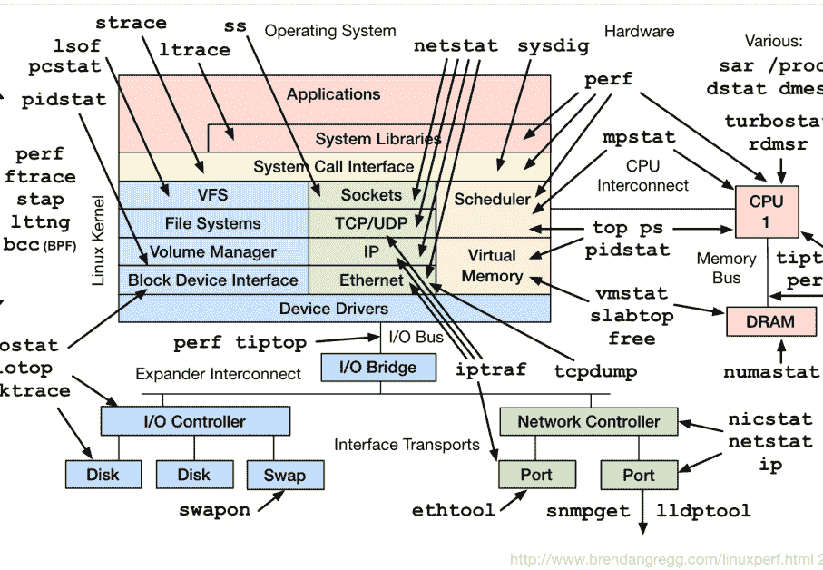

强烈推荐：Brendan Reggg 的工作：http://www.breandreggg.com/linuxperf.html

## Linux 性能观测性：sar

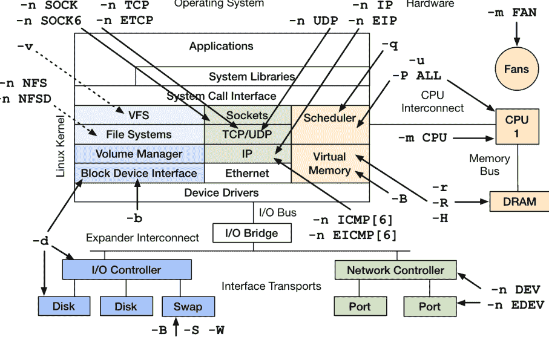

## 命令等效项 - SysUnit 和 systemd

| 操作 | SysUnit | systemd |
|---|---|---|
| 启动/重启/重载/状态/服务 | `service nptd [ start | stop | etc... ]` | `systemctl [ start | stop etc... ] nptd.service` |
| 如果服务已运行则重启服务 | `service nptd restart` | `systemctl restart httpd.service` |
| 在启动时启用或禁用服务 | `chconfig nptd [ off | on ]` | `systemctl [ enable | disable ] nptd.service` |
| 服务是否在启动时启用（运行级别?） | `chconfig nptd` | `systemctl is-enabled nptd.service` |
| 列出可以启动或停止的服务 | `ls /etc/rc.d/init/` | `systemctl OR | systemctl list-units --type=service AND` |
| 用于列出所有服务和其他单元 | | `ls /etc/systemd/system/ | systemctl list-units` |

## SysVinit - 目录结构

通常，你会在 `/etc/` 目录下找到指向实际位于 `/etc/rc/` 目录内容的符号链接。这可能会导致困惑，因为为了兼容不再支持 Upstart 的系统，我们还有其他用于兼容的链接。本文将忽略所有这些内容，专注于 CentOS 5。

`/etc/init.d` 是指向 `/etc/rc/init.d` 目录的符号链接，`/etc/rc.d` 也是如此，它指向 `/etc/rc#.d`。同样的，脚本 `rc`、`rc.local` 和 `rc.sysinit` 链接，其实际位置也在 `/etc/rc/` 目录中。尽管你在 `/etc` 中能看到它们，但它们的实际位置如下：

- `/etc/rc.d/init.d/`
- `/etc/rc.d/rc0/`
- `/etc/rc.d/rc1/`
- `/etc/rc.d/rc5/`
- `/etc/rc.d/rc6/`
- `/etc/rc.d/rc.local`
- `/etc/rc.d/rc.sysinit`

……此类推……

服务的脚本位于 `/etc/rc.d/`。Systeminit 需要 `/etc/rc.d/` 下的脚本：
- `/etc/rc.d/<servicename>` 脚本中每个受管理的服务的前几行如下：

```bash


#!/bin/bash

## kudzu 此脚本运行 kudzu 硬件探测。

## config: 34 05 95

# description: 此脚本运行硬件探测，并可选地配置 \
# 修改的硬件。

## 源函数库。

`/etc/init.d/functions`

```
表示该脚本应在级别 3、4 和 5 启动，启动优先级为 5，停止优先级为 95
```

`/etc/rc.d/init.d` 目录内容：
- `/etc/rc.d/init.d/acpid`
- `/etc/rc.d/init.d/anron`
- `/etc/rc.d/init.d/ypbind`
- `/etc/rc.d/init.d/ym-updates`

`/etc/rc.d` 目录中的文件是 `/etc/rc.d` 中所有 SysVinit 管理程序实际脚本的符号链接。例如

例如，是 `/etc/rc.d/rc3` 中的示例列表：
`K8kva_supplicant` `S02v2-monitor`
`K88cud` `S04readahead_early`
`K89dis` `S05kudzu`
`K91capi` `S06p6tables`
`K9readahead_later` `S08iptables`
`S00microcode_ctl` `S06mctrans`

`rc.local` -> 在启动时执行命令而无需符号链接。“本地系统初始化脚本”
`S99local` -> 2、3、4 和 5 运行级别中 `/etc/rc.local` 的软链接

你也可以在 `/etc/rc.d/rc.local_shutdown` 中拥有类似的关机脚本。
`sysinit` 应该被重建并在过程中非常早阶段执行，而 `rc.local` 在之后执行。
Linux 发行版通常不使用 `c`，但在 BSD 中会使用。

`rc` 代表“run commands”（运行命令）；作为 `/src` 或 `/etc/rc` 运行源于 1965 年左右 MIT CTSS 系统的 `runcom` 功能。从 Kernigan 和 Ritchie 到 Vicki Boyd 的话：“有一个设施可以执行存储在文件中的一组命令；它被称为 'run commands'，而 Unix 中的该文件被称为 'run'，这是那个时代的化石。”

拥有命令处理 shell 的想法应该是一个普通的从属程序，源于 Multics 设计，以及 Louis Pouzlin 编写的来自 CTSS 的身程序 `RUNCOM`。我第一次记得对该功能使用“shell”这个名字是在 Doug Houston 编写的一份 Multics 设计文档中。在原始的 Multics shell 中，向命令行返回值的命令被称为“evaluated commands”（评估命令），它使用方括号 `[]`，而 Unix 使用圆括号。

## /etc/initab SysVinit 主配置文件

- 规定运行级别（runlevels）、选择运行级别时运行的脚本，以及产生程序（getty）。
- `initab` 中条目的的语法：`id runlevel:action:process`
- 第一个是唯一标识符，第二个指示哪些运行级别调用命令，第三个指示如何处理此条目（例如执行命令或每次退出时重启，针对命令及其参数）。
- `x:5:respawn/etc/x11/prefdm -noadem` 级别 5，指定 X11 的默认登录脚本
- `3:2345:respawn/sbin/mingetty3` 虚拟 3，适用于级别 3 到 5
- 设置默认运行级别为 3 - 指向下方“3:3:wait:/etc/rc.d/rc 3”下方的行
- `id:3:default:`

- 当系统启动时执行 `/etc/rc.d/rc.sysinit`
- 启动网络、建立模块、启动 SELinux、加密
- `s:S:sysinit:/etc/rc.d/rc.sysinit`
- 以运行级别作为参数运行 `/etc/rc.d` - 例如， 5 指向 `/etc/rc.5/`
- 运行级别在 `/etc/rc.d/` 中指定
- `i0:0wait:/etc/rc.d/rc 0`
- `i1:1wait:/etc/rc.d/rc 1`
- `i5:5wait:/etc/rc.d/rc 5`
- `i6:6wait:/etc/rc.d/rc 6`

- 当按下 `ctrl-alt-delete` 时执行
- `c:ctrlalt/sbin -3`
- 启动 1 到 6 的 getty
- `c1:2345:respawn/sbin 3840 tty1`
- `c2:2345:respawn/sbin 3840 tty2`
- `c6:45:respawn/sbin 3840 tty6`

默认运行级别由 `/etc/rc.d/rcX/` 中的脚本决定。当 SysVinit 被指示运行某些级别时，在启动和切换运行级别时运行守护进程。`rc.d` 目录包含这些守护进程。`/etc/rc.d/` 目录内容是 `/etc/init.d/` 中文件的符号链接，并命名为 `S`（启动）或 `K`（杀死），按数字顺序排序。例如：`/etc/rc.d/rc3/` 中的 `dhcpd` 脚本将是启动该运行运行的。某些类型的 SysVinit 不使用这种符号链接系统。Slackware 使用类似于 BSD 的。

## 运行级别管理工具 - SysV init

- `service <name> [ start | stop | restart | list ]` 激活、执行当前运行级别的守护进程或进入 `/etc/rc.d/init` 目录并输入 `<name>`。`init [0-6]` 切换到指定的运行级别，告诉你两个数字 - 3 5 表示当前运行级别是 5 之前的是 3。

```
root@localhost ~ 给你这样的输出：

NetworkManager 0:off 1:off 2:off 3:off 4:off 5:off 6:off

acpid 0:off 1:off 2:off 3:off 4:off 5:off 6:off

anacron 0:off 1:off 2:off 3:off 4:off 5:off 6:off

amd 0:off 1:off 2:off 3:off 4:off 5:off 6:off

audit 0:off 1:off 2:off 3:off 4:off 5:off 6:off

autofs 0:off 1:off 2:off 3:off 4:off 5:off 6:off

avahi-daemon 0:off 1:off 2:off 3:off 4:off 5:off 6:off
```


## `chconfig` 使用说明

- `` `chconfig -list <service<name>>` `` 可能有助于列出多个匹配项（例如，“avahi-services”）
- `` `chconfig -level 35 <service<name>> on | off | reset` `` 优先级 - 影响级别 3 和 4
- `` `chconfig -level <service<name>> on` `` - 开启级别 2-5 中的服务，影响 0-6
- `` `chconfig -add OR -del` `` 从 `/etc/rc.d/init` 添加或删除
- `` `chconfig -override <service<name>>` `` - `/etc/sysconfig.d/<service<name>>` 文件可以覆盖 init 脚本

`sysv` 只是当前活动运行级别上的一个 Hat TUI 界面。守护进程有 `sysv-runlevel` (或 `-level 35`) 管理级别 3 和 5 的服务。`redhat-services` 或 `system-configs` - 图形服务配置工具

`/sbin/init` 指向 `/bin/init` - 用于切换服务的单字符参数 (0-6)，`s/all` 适用于单用户，`U/` 在不检查 initab 的情况下重启当前运行级别；`Q/q` 在检查 init 时这样做。二进制文件通过查看进程来检查自己是否为 init；真实进程的 id 总是 1。

- `/etc/init` 还会列出所有可用服务
- 用于启动和处理进程的脚本可以作为运行内核的替代方案。
- `sysv` 既启动也不停止服务 - 它规定运行级别。`service` 命令负责这一点。
- 服务立即受到 `sysv` 和其他单元的影响

| SysVRunlevel | 系统目标描述 |
| :--- | :--- | :--- |
| 0 | poweroff.target | 停止系统 |
| 1 | rescue.target | 单用户模式（所有内容已挂载，最小服务） |
| 2 | multi-user.target | 无网络的多用户模式 |
| 3 | multi-user.target | 带有网络的多用户模式 |
| 4 | multi-user.target | 用户可配置 |
| 5 | graphical.target | 用于 GUI (X11 多用户模式) |
| 6 | reboot.target | 重启系统 |

## `systemd` 的 `emergency.target`

- 类似于内核命令行上的 `init=/bin/sh`
- 没有对应的 `sysv-runlevel` - 它会在几乎不需要任何的情况下启动你的机器。
你将获得一个 shell，几乎没有其他东西（后台系统除外）。
- 没有启动服务，没有挂载点，没有建立套接字。
- 适用于独立启动特定脚本。
- 允许逐位启动，手动分步启动各种服务和其他单元。

在 `SysInit` 中，服务可以定义数组命令。例如 `service httpd graceful`。原生 `systemd` 没有这种能力。任何在此处中定义了额外命令的服务，在编写原生系统服务定义时，需要定义其他特定于服务的方法来实现此功能。检查特定包发布以查找可能执行过此操作的服务。

## systemd 单元脚本内容示例

不建议编辑 `/usr/lib/systemd/system/` 下的单元脚本，以便保持软件包的默认/安装状态。对于自定义更改，请将其复制到 `/etc/systemd/system/` 中编辑——此目录将为你覆盖默认设置。

示例单元脚本 - `/usr/lib/systemd/system/httpd.service` 内容：

```
[Unit]

Description=The Apache HTTP Server

After=network.target remote-fs.target nss-lookup.target

[Service]

Type=notify

EnvironmentFile=/etc/sysconfig/httpd

ExecStart=/usr/bin/httpd OPTIONS -D FOREGROUND

ExecReload=/usr/sbin/httpd OPTIONS -k graceful

ExecStop=/bin/kill -WINCH ${MAINPID}

KillSignal=SIGCNT

PrivateTmp=true

[Install]

WantedBy=multi-user.target
```

示例目标单元脚本 - `/usr/lib/systemd/system/multi-user.target` 内容：

```
[Unit]

Description=Multi-User System

Documentation=man:systemd.special(7)

Requires=basic.target

Conflicts=rescue.service rescue.target

After=basic.target rescue.service.target

AllIsolate=yes

[Install]

Alias=default.target
```

> "`After`" 是在此项激活完成后加载的内容
> "`Requires`" 应该是加载逻辑磁盘自动 `lvdisk.automount` 之前需要加载的内容

示例自定义挂载脚本 - `/etc/systemd/system/lvdisk.mount` 和 `lvdisk.automount`
需要一个同名的挂载文件和自动挂载文件（`mydisk5.automount mydisk5.mount`）
这可能是 RHEL 未来版本将通过这种方法进行自动挂载，而不是使用 `/etc/fstab` 方法

```
## vim /etc/systemd/lvdisk.mount

[Unit]

Description=Example test mount

[Mount]

what = /dev/vgdisk/lvdisk

where = /lvdisk

type = xfs

[Install]

WantedBy=multi-user.target
```

```
## vim /etc/systemd/lvdisk.automount

[Unit]

Description=Example test automount

[Automount]

where = /lvdisk

[Install]

WantedBy=multi-user.target
```


```
测试一下 - systemctl enable lvdisk.mount; systemctl start lvdisk.automount; mount | grep lvdisk
```

# 系统软件包内容

已安装程序：`bootctl`, `busctl`, `coredumpctl`, `hostctl`, `init`, `journalctl`, `kernel-install`, `localctl`, `logctl`, `machinectl`, `networkctl`, `powoff`, `reboot`, `runlevel`, `systemctl`, `systemd-analyze`, `systemd-password`, `system-cat`, `systemd-ctop`, `systemd-delta`, `systemd-detect-virt`, `systemd-escape`, `systemd-hwdb`, `systemd-inhibit`, `systemd-machine-id`, `systemd-mount`, `systemd-networkify`, `systemd-networkd`, `systemd-path`, `systemd-resolve`, `systemd-run`, `systemd-socket-activate`, `systemd-stdio`, `systemd-tmpfiles`, `systemd-tty-ask-agent`, `timedatectl`，以及 `udev`

已安装库：`libns_myhostname.so.2`, `libns_machines.so.2`, `libns_resolve.so.2`, `libns_systemd.so.2`, `libsystemd.so`, `libsystemd-shared-231.so`，以及 `libudev`

已安装目录：`/etc/binmf/`, `/etc/inet/`, `/etc/kernel/`, `/etc/modules-d/`, `/etc/systemd/`, `/etc/system/`, `/etc/tmpfiles.d/`, `/etc/udev/`, `/usr/lib/systemd/`, `/usr/lib/systemd/include/`, `/usr/lib/binmf/`, `/usr/lib/`, `/usr/lib/modules-d/`, `/usr/lib/systemd.d/`, `/usr/lib/systemd/`, `/usr/lib/tmpfiles.d/`, `/usr/share/systemd-234/`, `/usr/share/factory/`, `/usr/share/systemd/`, `/var/lib/systemd/`，以及 `/var/log/journal`

| `bootctl` | 查询固件和启动设置 |
| `busctl` | 查看日志并监控 D-Bus 总线 |
| `coredumpctl` | 从系统日志中检索核心转储 |
| `hostctl` | 控制主机名 |
| `init` | 系统管理器 |
| `journalctl` | 管理日志 |
| `kernel-install` | 安装内核 |
| `localctl` | 控制本地设置 |
| `logctl` | 管理日志 |
| `machinectl` | 控制本地机器 |
| `networkctl` | 控制网络 |
| `powoff` | 关闭系统电源 |
| `reboot` | 重启系统 |
| `runlevel` | 控制运行级别 |
| `systemctl` | 控制系统 |
| `systemd-analyze` | 分析性能 |
| `systemd-password` | 管理密码 |
| `system-cat` | 查看系统日志 |
| `systemd-cd` | 控制控制组 |
| `systemd-ctop` | 查看顶层进程 |
| `systemd-delta` | 管理增量 |
| `systemd-detect-virt` | 检测虚拟化环境 |
| `systemd-escape` | 逃逸进程 |
| `systemd-hwdb` | 管理硬件数据库 |
| `systemd-inhibit` | 阻止会话 |
| `systemd-machine-id` | 管理机器 ID |
| `systemd-mount` | 管理挂载 |
| `systemd-networkify` | 接口网络化 |
| `systemd-networkd` | 网络守护进程 |
| `systemd-path` | 管理路径 |
| `systemd-resolve` | 解析地址 |
| `systemd-run` | 运行临时单元 |
| `systemd-socket-activate` | 激活套字 |
| `systemd-stdio` | 标准输入输出工具 |
| `systemd-tmpfiles` | 管理临时文件 |
| `systemd-tty-ask-agent` | TTY 代理 |
| `timedatectl` | 控制时间 |
| `udev` | 设备管理器 |

## systemd-spawn
## systemd-path
## systemd-resolve
## systemd-run
## systemd-tmpfiles
## systemd-tty-ask-agent
## timedatectl
## udev
## libsystemd
## libudev

systemd 工具

访问 udev 的库

> -- 取自 http://www.linuxscratch.org/fs/view/systemd/chapter06/systemd.html

你可能注意到列出的项目包含标题以及 `/etc/initd/`。根据 Fedora Wiki，`service` 和 `chkconfig` 命令在系统中大部分情况下仍能按预期工作。这可能是为了旧脚本的向后兼容性。

| 单元目标包含如下符号链接： | |
| 符号链接指向此处实际的服务（等）单元文件： | `/etc/systemd/system/XXXXX.target.wants/bluetooth.service` |
| default.target 文件是一个目标/运行级别的符号链接： | `/usr/lib/systemd/system/default.target` |
| 而 default.target 符号链接指向此处的实际目标： | `/usr/lib/systemd/system/XXXXX.target`运行 `systemctl isolate graphical.target` 不影响 `default.target` 符号链接，仅切换当前运行级别（使用 set-default）。

## ifconfig 命令

该命令在 Linux 中已弃用，但在处理 Solaris、AIX、HP-UX、BSD 和 SCO UNIX 时，保持熟练掌握非常重要。

- 不带参数时，它将显示所有活动接口，`-a` 可列出非活动接口
- 你可以指定要查看的接口，例如 `ifconfig eth0`
- 使用 `ifconfig eth0 up`（或 `down`）或 `ifup eth0`（或 if）来启用或关闭接口
- （注意：通过 ifconfig 和 ifdown 禁用的路由不会自动禁用）

**使用 ifconfig 的更改在重启后不会持久化**
在 BSD 中，你可能需要编辑 `/etc/rc.conf`
在 Linux 中，编辑 `/etc/sysconfig/network-scripts/` 下相应的接口文件

- **当你指定一个接口时，可以向其属性添加以下内容：**
- 使用语法 `ifconfig eth0 172.16.25.125` 设置 IP 地址
- 就像设置地址一样，你可以添加 `mask 255.255.255.224` 或 `broadcast 172.16.25.63`
- 设置 mtu `mtu mtu 1000`
- 使用 "hw" 参数更改 MAC 地址 - `ifconfig eth0 hw 00:BB:DD:AA:FF`
- 广播（broadcast）、多播（multicast）和所有（all）状态可以像 -prom 一样开启和关闭
- 考虑数据包捕时，输入 **promis** 进入混杂模式，输入 `-promis` 禁用
- 同样，你可以通过 `- arp` 禁用 ARP 并通过 `arp` 重新启用
- 为接口添加别名，但它会添加掩码规则（参见 ifconfig adding）
  `ifconfig eth0:172.16.25.127 -` - 要禁用别名只需将其关闭 `ifconfig eth0: down`
  注意：某些版本的 ifconfig 需要使用 config alias

**delete** - 移除指定的网络地址。当地址指定错误或不再需要时使用此命令。增加 ns 地址的副作用是指定了网络地址的主机部分。移除所有 ns 地址允许你重新指定主机地址。

**detach** - 从网络接口列表中移除接口。如果最后一个接口被分离，则网络驱动程序代码将被卸载。为了更改已连接接口的路由，必须先分离该接口并使用 ifconfig 添加。

**group ID** 和 -group ID
在 ID 列表中添加/移除组 ID（用于确定到达接口的数据包转发时的值）。

**metric <value>** - 将接口的路由跃数设置为 Number 变量指定的数值。默认值为 0。路由跃数由路由协议（路由守护进程）使用。跃数越高，路由越不受青。跃数被计算为通往目标网络或主机的额外跳数。

**monitor -monitor**
启用/禁用底层适配器通知接口层链路状态的变化。适配器必须支持链路状态通知。如果使用了多路路由，当链路断开时将选择备用路由。

**checksum_offload** 和 **-checksum_offload**
启用/禁用标记，指示 TCP 校验和应卸载到适配器。同时重置每个接口的计数器，无论 TCP 校验是动态启用还是禁用校验计算的卸载。

Linux 中的 ifconfig 命令是 net-tools 软件包的一部分，该软件包已弃用（且自 2001 年 4 月起未更新）。与 ifconfig, ifdown, ifup, iwconfig, arp, route, iptunnel, ipaddrctl, brctl 等一起使用的其他命令甚至 netstat，通常被 iproute2 软件包中的 ip 和 ss 替换，该软件包有一个专门的章节。

## netstat

- 从 `/proc/net` 获取值
- 通常被泛化用作 `netstat -netup -tulpen`（内容相同，助记符不同）
- netstat 的继任者 ss（用于套接统计）使用了几乎相同的命令选项

- `-a` 列出所有端口
- `-t` 用于 tcp
- `-u` 用于 udp
- `-l` 监听
- `-p` 包含 PID/程序字段
- `-s` 在一个列表中显示每个网络协议的 udp/tcp/icmp 等统计信息
- `-n` 仅数字 - 不使用主机名、端口名、用户名。-n 相反（ss 命令中的 -r）
  应用 -n 选项更具体，使用 `--numeric-ports`、`--numeric-hosts` 或 `--numeric-users`
- `-e` 用于某些子命令的扩展
- `-c` 用于连续输出，类似于 watch 命令
- `-r` 显示路由表
- `-i` 列出所有网络接口（内核接口）
- `-ie` 使用扩展选项显示，类似于 ifconfig 输出
- `-verbose` 包含信息如：netstat 不支持此系统上的 AF IPX
- `-g` 将显示多播组信息
- `-m` 或 masquerade 显示 NAT 信息
- `-x` 列出作为进程自身的遗留 UNIX 套接字
- `-w` 列出原始数据包

通常管道到其他工具。使用 grep 搜索 unix 上的流量：`netstat -ap | grep ssh 或 grep "ESTAB"` 连续列出活动 tcp 连接：`watch -d n netstat -atnp | grep E netstat -i | grep 1000 | wc -l` 查看 UNIX 上是否有流量

netstat 的某些选项在不同的 UNIX 版本之间略有不同：查看你的 man 手

## 从传统的 UNIX 软件包迁移到 iproute2

netstat 软件包（包含 ifconfig 和其他工具）在十年前就已计划弃用，并从 2009 年左右开始被弃用。如果你坚持使用传统的 net-tools 软件包和 ifconfig，它适用于大多数 Linux、BSD、Solaris 或其他版本的 UNIX。在 Linux 上，你可以安装它，但某些功能与现代 Linux 网络配合得不好。

该部分的更改摘要如下：
- iproute2 提供的 netstat 替换
- 网络监控 (`nmcli`) 管理持久配置更改
- 放弃过时的设备命名方案；返回特定的硬件名称

| 已弃用 | 替换命令 |
| :--- | :--- |
| `arp` | `ip n (neighbor)` |
| `ifconfig` | `ip a (addr), ip link, -s (ip stats)` |
| `itunnel` | `ip tunnel` |
| `lwconfig` | `lw` |
| `nameif` | `ip link, ifname` |
| `netstat` | `ss, ip route (for netstat-r), ip s link (for netstat-i), ip addr (for netstat-g)` |
| `route` | `ip r (route)` |

关于这些详尽对比，请参见 Doug Vital 的

## netstat

- 从 `/proc/net` 获取值
- 通常被泛化用作 `netstat -netup -tulpen`（内容相同，助记符不同）
- netstat 的继任者 ss（用于套接统计）使用了几乎相同的命令选项

- `-a` 列出所有端口
- `-t` 用于 tcp
- `-u` 用于 udp
- `-l` 监听
- `-p` 包含 PID/程序字段
- `-s` 在一个列表中显示每个网络协议的 udp/tcp/icmp 等统计信息
- `-n` 仅数字 - 不使用主机名、端口名、用户名。-n 反反（ss 命令中的 -r）
  应用 -n 选项更具体，使用 `--numeric-ports`、`--numeric-hosts` 或 `--numeric-users`
- `-e` 用于某些子命令的扩展
- `-c` 用于连续输出，类似于 watch 命令
- `-r` 显示路由表
- `-i` 列出所有网络接口（内核接口）
- `-ie` 使用扩展选项显示，类似于 ifconfig 输出
- `-verbose` 包含信息如：netstat 不支持此系统上的 AF IPX
- `-g` 将显示多播组信息
- `-m` 或 masquerade 显示 NAT 信息
- `-x` 列出作为进程自身的遗留 UNIX 套接字
- `-w` 列出原始数据包

通常管道到其他工具。使用 grep 搜索 unix 上的流量：`netstat -ap | grep ssh 或 grep "ESTAB"` 连续列出活动 tcp 连接：`watch -d n netstat -atnp | grep E netstat -i | grep 1000 | wc -l` 查看 UNIX 上是否有流量

netstat 的某些选项在不同的 UNIX 版本之间略有不同：查看你的 man 手

## 从传统的 UNIX 软件包迁移到 iproute2

netstat 软件包（包含 ifconfig 和其他工具）在十年前就已计划弃用，并从 2009 年左右开始被弃用。如果你坚持使用传统的 net-tools 软件包和 ifconfig，它适用于大多数 Linux、BSD、Solaris 或其他版本的 UNIX。在 Linux 上，你可以安装它，但某些功能与现代 Linux 网络配合得不好。

该部分的更改摘要如下：
- iproute2 提供的 netstat 替换
- 网络监控 (`nmcli`) 管理持久配置更改
- 放弃过时的设备命名方案；返回特定的硬件名称

| 已弃用 | 替换命令 |
| :--- | :--- |
| `arp` | `ip n (neighbor)` |
| `ifconfig` | `ip a (addr), ip link, -s (ip stats)` |
| `itunnel` | `ip tunnel` |
| `lwconfig` | `lw` |
| `nameif` | `ip link, ifname` |
| `netstat` | `ss, ip route (for netstat-r), ip s link (for netstat-i), ip addr (for netstat-g)` |
| `route` | `ip r (route)` |

关于这些详尽对比，请参见 Doug Vital 的

## ip 命令

`ip address (addr) [add] | del] | show] [interface]`
`ip link (l) [set] | show] [interface]`
`ip route (r) [add] | del] | show]`
`ip neighbor (n) [add] | del] | show]`

# 设备命名：

传统的，我们看到 `eth0` 或 `usb0` 的设备命名，dev 为某些设备提供了易读的命名（如 `/dev/sd1`, `/dev/hda`）。它已经使用了很久，以至于人们不知道或忘记了。

BIOS 命名（物理命名）已经回归，在这里你会看到：
- `em1` 用于嵌入网卡
- `p6sp1 - p6p1 = pci 插槽 6 端口 1`
你可能还会看到 VLAN 和别名的命名。

如果你不想这样做，可以在 GRUB 中添加你的选项：
在启动选项中添加 "netframes=biosdevname=0"
然后写入磁盘 `grub grub2-mkconfig -o /boot/grub2/grub.cfg`

## 任务示例 - iproute2 和 net-tools 软件包等价

## 显示所有连接的接口
使用 net-tools: `$ ifconfig`
使用 iproute2: `$ ip link`
另："`ip addr`" 用于 "`ifconfig`”，“`ip s link`" 用于 "`netstat -`"

## 显示接口的 IPv4 地址
使用 net-tools: `$ ifconfig eth1`
使用 iproute2: `$ ip addr show dev eth1`

## 显示接口的 IPv6 地址
使用 net-tools: `$ ifconfig eth1`
使用 iproute2: `$ ip -6 addr show dev eth1`

## 查看 IP 路由表
使用 net-tools: `$ route -n --or$ netstat -rn`
使用 iproute2: `$ ip route show`

## 查看套接字统计
使用 net-tools: `$ netstat --AND-- $ netstat -l`
使用 iproute2: `$ ss --AND-- $ ss -l`

## 查看 ARP 表
使用 net-tools: `$ arp -an`
使用 iproute2: `$ ip neigh`

## 激活或禁用网络接口

使用 net-tools: `$ ifconfig eth1 [up | down]`
使用 iproute2: `$ ip link set [up | down] eth1`

## 为网络接口分配 IPv4 地址

使用 net-tools: `$ ifconfig eth1 10.0.0.1/24`
使用 iproute2: `$ ip addr add 10.0.0.1/24 dev eth1`

## 从网络接口中删除 IPv4 地址

在 net-tools 中，你最终只能为接口分配 0。而 iproute2 可以正确地删除它。
使用 net-tools: `$ ifconfig eth1 0`
使用 iproute2: `$ ip addr del 10.0.0.1/24 dev eth1`

## 在网络接口上分配或删除 IPv6 地址

使用 net-tools: `$ ifconfig eth1 inet6 [add | del] ipv 2002:db5:0:f102::64`
使用 iproute2: `$ ip -6 addr [add | del] dev 2002:db5:0:f102::64 dev eth1`

## 为接口分配多个 IP 地址

使用 net-tools（子接口别名变通）：
`$ ifconfig eth0:1 192.168.10.10 mask 255.255.255.0 up`
`$ ifconfig eth0:2 192.168.10.15 mask 255.255.255.0 up`
使用 iproute2:
`$ ip addr add 10.0.0.1/24 dev eth1`
`$ ip addr add 10.0.0.2/24 dev eth1`

## 修改网络接口的 MAC 地址

在更改 MAC 地址之前，你需要先激活接口。
使用 net-tools: `$ ifconfig eth1 [down | up]: ifconfig eth1 hw 08:00:27:75:2a:66`
使用 iproute2: `$ ip link set dev [down | up]`
`$ ip link set dev eth1 08:00:27:75:2a:67`

## 添加或修改默认路由

使用 net-tools: `$ route [add | del] default gw 192.168.1.2 dev eth0`
使用 iproute2: `$ ip route [add | replace] default 192.168.1.2 dev eth0 (replace 是一个命令)`

## 添加或删除静态路由

使用 net-tools: `$ route add -net 172.16.32/24 gw 192.168.1.1 dev eth0`
`$ route del -net 172.16.32/04 dev`
使用 iproute2: `$ ip route add 172.16.32/24 via 192.168.1.1 dev eth0`
`$ ip route del 172.16.32/04`

## 添加或删除静态 ARP 条目

使用 net-tools: `$ arp -s 192.168.1.100 00:0c:29:c0:5a:ef`
`$ arp -d 192.168.1.100`
使用 iproute2: `$ ip neigh add 192.168.1.100 -orn, ip addr 00:0c:29:c0:5a:ef dev eth0`
`$ ip neigh del 192.168.1.100 dev eth0`

## 添加、删除或查看组播地址

使用 net-tools: `$ ipaddr [add | del] 33:44:00:00:00:01 dev eth0`
`$ ipaddr show dev eth0 -or netstat -g`
使用 iproute2: `$ ip maddr [add | del] 33:44:00:00:00:01 dev eth0`
`$ ip maddr list dev eth0`

为了使更改持久，你应该使用 Network Manager，或者手动编辑它使用的文件。在运行 NM 时，不建议手动编辑这些文件，除非确实有必要（例如在脚本中）；但话虽如此，这并不是绕过我们的方法——Network Manager 会用它自己的内容覆盖我们写入的内容，因此通过告诉它它的机制可以避免这种情况。[意料之的是，Network Manager 因为抵抗手动编辑而有很多功能性缺陷]

Network Manager 有一个 GUI，以及一个与其非常相似的文本界面。它可以有效地执行一系列任务，但（如往常一样），命令行要灵活且粒度更细得多。通常这些工作我们通过输入单个命令来完成，它还为高级用户提供了命令行提示符。

**`nmcli [OPTIONS] OBJECT [ COMMAND ... ] | help`**

使用 nmcli 时，上述命令定义中最重要的部分是“object”（对象）。连接（Connections）和设备（devices）是最常用的对象。

- 设备（device）是一个网络接口
- 连接（connection）是配置的集合（例如，具有所有项不同设置的家庭、工作配置）
- 因此，你可以为某个设备拥有多个连接，但同时只能有一个激活状态

通用选项涉及输出样式、使用外部脚本进行格式化等。这些包括方便查看的 `-l [list]` 或 `-p [show]`，`-m [mode] | multiline`（多行），`-f [fields]`（字段）。

## 禁用 Network Manager

要在系统上禁用 Network Manager：
`$ systemctl stop NetworkManager.service && systemctl disable NetworkManager`

在 SystemV 系统上：
`$ sudo service NetworkManager stop && chkconfig NetworkManager`

在 Debian 7 或更早中：
`$ sudo /etc/init.d/network-manager stop && update-rc.d network-manager`

在 Ubuntu 或 Linux Mint 中：
`$ sudo stop network-manager && echo "manual" | sudo /etc/network-manager.override`

在 Slackware 中：
`$ /etc/rc.d/rc.network stop && chmod a -x /etc/rc.d/rc.network`

在某些版本的 NM 中，“stop” 可能会杀死 dhcp 和 wpa_supplicant，因此请务必检查。
在 Debian 或 Ubuntu 上禁用 Network Manager 后，使用 `/etc/network/interfaces` 配置网络接口。
在 Fedora 或 CentOS 上禁用 Network Manager 后，使用 `/etc/sysconfig/network-scripts/ifcfg-ethX` 文件配置网络接口。

## 仅为 eth1 禁用 Network Manager（示例）

Network Manager 会自动忽略 `/etc/network/interfaces` (Debian/Ubuntu) 或 `/etc/sysconfig/network-scripts/` 目录下的相应配置文件 (RHEL/CentOS/Fedora) 中指定的任何接口。
假设你的接口是 eth0。

- 对于兼容 RHEL 的系统，在 `/etc/sysconfig/network-scripts/ifcfg-eth0` 中创建一个文件：
```bash


`DEVICE="eth0"`

`NM_CONTROLLED="no"` # 这是最重要的

`HWADDR=54:BA:DB:37:F1:04`

`TYPE=Ethernet`

`BOOTPROTO=static`

`NAME="eth0"`

`UUID=55b0b6d0-0bb0-7ffb-45f1-d6dd65f3e03`

`IPADDRESS=192.168.1.44`

`NETMASK=255.255.255.0`

# 可选将这些放在这里或添加到它们对应的文件中：`vi /etc/sysconfig/network`

`NETWORKING=yes`

`HOSTNAME=centos`

`GATEWAY=192.168.1.1`

## 同样的操作使用 `-` 或添加到 `resolv.conf` 中 #`vi /etc/resolv.conf`

`nameserver 8.8.8.8` # 替换为你的服务器 ip

`nameserver 192.168.1.1` # 替换为你的服务器 ip

`DNS1=8.8.8.8` # 如果对你有效，这是另一种可选格式

`DNS2=8.8.4.4`

# 这些之所以是可选的是因为你可以为每个接口文件

# 不同的默认网关和 DNS。虽然不保证一定有效，但确实可以这样做。

## 对于 Debian /Ubuntu

在 `/etc/network/interfaces` 中，添加你想禁用 NM 的接口信息：
`$ sudo vi /etc/network/interfaces`

### 找到/添加你的 eth0 条目以禁用 Network Manager
`allow-hotplug eth0`
`iface eth0 static`
`address 10.0.0.10`
`netmask 255.255.255.0`
`gateway 10.0.0.1`
`dns-namesvers 8.8.8.8`

要使此生效，你需要确保网络服务在启动时会启用 eth1（因为 NM 没有这么做）。
Systemd 系统：`$ sudo systemctl enable network.service`
SysVinit 系统：`$ sudo chkconfig network`

重启后，通过 `nmcli` 命令验证 Network Manager 是否已为 `eth0` 禁用。

## systemd-networkd

在一段时间内，它缺乏 NetworkManager 提供的功能（检查你所使用的版本）。Systemd 整合了 systemd 的其余部分（例如用于 DNS 的 resolved，用于 NTP 的 timedd，用于命名的 udev），并且当然受到了许多反对 systemd 的系统管理员的拒绝。使用 `networkctl` 命令显示 networkd 看到的内容。它具有子命令 `list`、`status` 和用于显示信息的 `lldp` - 可以查询特定服务（如 `ens128`）或 `--all`。

从 Network Manager 切换到 systemd-networkd 请运行：

```bash
$ sudo systemctl disable NetworkManager && sudo systemctl enable systemd-networkd
```

你还需要需要启用 `systemd-resolved` 服务。

此守护进程将创建自己的 `resolv.conf` - 许多程序仍在查看 `/etc/resolv.conf`，因此建议创建一个 `/etc/resolv.conf` 的符号链接：`&& sudo ln -s /run/systemd/resolve/resolve /etc/resolv.conf`

要配置网络设备，你在文本文件 `*.network` 中指定配置信息 - 存储并加载自 `/etc/systemd/network`。使用 `networkctl list` 查看系统上的所有设备。

```bash
$ sudo mkdir /etc/systemd/network
```

配置 DHCP 网络（"yes" 下方可以是 "ipv4"）：

```ini
$ vi /etc/systemd/network/20-dhcp.network

[Match]
Name=enp3*

[Network]
DHCP=yes

[Match]
Address=192.168.10.50/24
Gateway=192.168.10.1
DNS=8.8.8.8
```

无线接口在 `[match]` 和 `[network]` 字段中没有特殊区别，但它们需要来自另一个服务（`wpa_supplicant`）的配置。名为 `wlp2` 的（示例）设备需要来自另一个服务（`wpa_supplicant`）的配置。

## 虚拟设备（网桥、VLAN、绑定）

虚拟设备（网桥、VLAN、绑定）在 systemd 中配置。

```bash
$ vi /etc/systemd/network/10-bridge.network

[Match]
Name=br0

[Network]
Address=192.168.1.100/24
Gateway=192.168.1.1
DNS=8.8.8.8
```

虚拟设备（网桥、VLAN、绑定）在 systemd 中配置。这通常用于管理高级层网络接口。

```bash
$ vi /etc/systemd/network/10-bridge.network

[Match]
Name=br0

[Network]
Address=192.168.1.100/24
Gateway=192.168.1.1
DNS=8.8.8.8
```

## 使用 wpa_supplicant

使用 `wpa_supplicant` 管理连接：

1. 运行 `ip` 获取接口名称。
2. 在 `/etc/wpa_supplicant.conf` 中创建一个文件，包含以下内容：
```text
control_interface=DIR=/run/wpa_supplicant update_config=1
```
3. 通过运行 `wpa_supplicant -B -i wlan0 -c /etc/wpa_supplicant.conf` 初始化。
`-B` 表示在后台运行，`-i` 指定接口，`-c` 指向配置文件。
4. 运行 `wpa_cli` 提供交互式提示符。

`wpa_cli` 命令：

- `scan` - 将运行扫描
- `scan_results` - 将导出所有网络（包括 ssid）的扫描结果
- `add_network` - 指定网络 - 提供扫描列出的 ssid。开头的数字是任意的。
> `add_network 0`
> `set_network 0 ssid="LOCAL_W"`
> `set_network 0 psk="password"`
> `enable_network 0` - 将尝试与刚刚配置的网络关联
> `save_config`

运行 `ip` 应该显示新的 IP。
运行 `save_config` 后，以下内容将附加到你的配置文件：
```text
network={
    ssid="LOCAL_W"
    psk="password"
}
```


## 关于 Kismet 的说明

大部分内容是不言自明的，Kismet 没什么需要涵盖的。在网络中，W 是 WEP（是，否；其他）；`<no_ssid>` 意味着 AP 未在广播它；ssid；T 是类型；P（请求探测-无关联）；A（访问）；H（点点）；T（turbo air 或 Lucent）；G（组）；D（仅数据）。
标志包括 F（AP 使用工厂设置/未配置）；Ti, UI, A# 表示通过流量类型发现的地址范围；TCP、UDP、ARP 和 DHCP 发现。
AP 按字母顺序列出，黄色意味着加密；红色：使用默认工厂设置；安全网络（WEP, WPA 等）；以及蓝色意味着点击 SSID
Kismet 布局可以在 `/etc/kismet/kismet_ui.conf` 中修改。

帮助键使用类型 `"c"` 查看 AP 客户端，`"i"` 查看 AP 详细信息，`"r"` 可以显示统计图，`"a"` 查看所有 AP 的通用统计，`"w"` 显示状态窗口中出现的所有警报。

## WiFi 渗透测试工具

这些工具的细节可以在网上或 man 手页找到。

### Aircrack-ng 软件包
- [https://www.aircrack-ng.org](https://www.aircrack-ng.org)
`aircrack-ng` 是所有命令行工具包的鼻祖，自我 2005 年开始使用它以来，它增加了很多功能。
- 监控：数据包捕获并输出到文本文件，供第三方工具进一步处理。
- 攻击：数据包攻击、去认证（deauthentication），以及通过数据包注入访问点和节点。
- `airbase-ng` - 配置接入点
- `aircrack-ng` - 无线密码破解器
- `airdecap-ng` - 解密 WEP/WPA2 捕获文件
- `airmon-ng` - 从 pcap 文件中移除 WEP 掩码
- `aire-ng` - 提供有关网卡无线驱动程序的状态
- `airplay-ng` - 主要功能是生成流量以供后续在 `aircrack-ng` 中使用
- `airmon-on` and `airmon-kill` 此脚本可用于在无线接口上开启监控模式
- `airdump-ng` - 用于捕获原始 802.11 文件
- `airdump-ng-oui-update` - 下载并解析 IEEE OUI 列表
- `airaire-ng` 设计用于存储和管理 ssid 和密码
- `airserv-ng` - 无线卡服务器
- `airtun-ng` - 虚拟隧道接口创建器
- `besside-ng` - 自动破解 WEP & WPA 网络
- `besside-ng` - 一个允许你连接到 WEP 加密接入点的自动工具
- `buddy` - 在知道 `besside-ng` 可以访问无线网络且已知 WEP 密钥的情况下，将解密的数据包回回系统网络
- `ivstools` - 此工具处理 `.iv` 文件。你可以合并或转换它们。
- `makeaver-ng` - 生成初始化向量
- `packetforge-ng` - 创建可用于注入数据包的数据
- `ktplay-ng` - 此工具能够向带有 QoS 的 WPA TKIP 网络注入几个帧
- `wirelessaver` - 一种自动魔法工具，结合了多种技术来无缝攻击 WEP 密钥

典型的 WPA-PSK：破解无线驱动程序，使用 `airmon-ng` 将其恢复到监控模式，运行 `airdump-ng` 捕获数据包，并使用 `airplay-ng` 向客户端注入去认证数据包，以便在尝试与应用程序重新身份验证时捕获到四次握手。你运行 `aircrack-ng` 来破解 pcap 文件中的共享密钥。如果字典中不匹配，几率微乎其微。

### WiFiTap 软件包
- [http://sidrack.org/static/articles/wif/WiFiTap_EN_96311.html](http://sidrack.org/static/articles/wif/WiFiTap_EN_96311.html) 和 [https://github.com/dgsecurity/wifitap/](https://github.com/dgsecurity/wifitap/)
- 通过配置接口 `wlan0` 在 WiFi 网络上进行流量捕获和注入
- 包含 `wifap`, `wifdns`, `wifiping`
- 设置目标网络地址范围的 IP 地址并通过其路由流量
- 无需特定库的任意包注入
- 绕过内部通信防护系统（例如 Cisco PSPF），要到达的 SSIDs 由 air-point 处理
- `wifap` - WiFi 注入工具转换/接入设备
- `wifarp` - 基于 `wifap` 的 WiFi 注入 ARP 响应
- `wifdns` - 基于 `wifap` 的 WiFi DNS 响应
- `wifiping` - 基于 `wifap` 的 WiFi 注入响应工具
- `wifite` - 攻击多个 WEP, WPA - 可实现自动化，后续破解密码，从信号强度最强的 AP 获取尽可能多的信息，以便你可以获取最棒的内容并进行处理。

### Fern WiFi Cracker
提供以下功能的 GUI，但不限于无线攻击。他们宣传：
- WEP 破解，基于字典列表或密码攻击的 WPA/WPA2 破解
- 自动 AP 攻击
- 会话劫持（数据包和以太网模块）
- 内部 MITM 引擎（HTTP, HTTPS, TELNET, FTP）
- `cowwa` 严格用于 W-PSK - 需要 `aircrack-ng` 来获取内容-提供字典列表和捕获的哈希-它根据 SSID 从字典列表中生成哈希。包含可以预计算哈希的 `genmpk`
- `reaver`, `bully`, `pixiewps` - `bully` 对 WPS 攻击更快更有效。发现 WPS 时作为概念验证发布。另一个选择了一个超快的离线工具。

# Netfilter/iptables

| 命令 |  |
| :--- | :--- |
| `service iptables start` | 启动 iptables |
| `service iptables stop` | 停止 iptables |
| `service iptables restart` | 使用保存的规则重启 iptables |
| `service iptables reload` | 在不重启服务的情况下重载规则 |
| `/sbin/iptables --save` | 将规则保存到 stdout |
| `/sbin/iptables --restore` | 从 stdin 恢复规则 |

- `INPUT`, `OUTPUT`, `FORWARD`, `PREROUTING`, `POSTROUTING`: 链 (Chains)
- `PREROUTING`: 用于路由之前到达的数据包。
- `INPUT`: 用于指向本地系统的数据包。
- `FORWARD`: 用于通过系统路由的数据包。
- `OUTPUT`: 用于本地系统生成的数据包。
- `POSTROUTING`: 用于离开系统的数据包。

- 动作 (Actions):
- `-a`: 在链末尾追加规则。
- `-D`: 删除规则。
- `-I`: 在链的开头插入规则。
- `-R`: 替换规则。
- `-F`: 清空链中的所有规则。
- `-N`: 创建新链。
- `-E`: 重命名链。
- `-X`: 删除链。
- `-C`: 检查规则是否存在。
- `-L`: 列出规则。
- `-v`: 详细输出。
- `-n`: 显示数字地址而非解析。
- `--line`: 显示行号。

- 匹配选项 (Match options):
- `-s`: 匹配源 IP 地址。
- `-d`: 匹配目标 IP 地址。
- `--sport`: 匹配源端口。
- `--dport`: 匹配目标端口。
- `-p`: 匹配协议（tcp, udp, icmp）。
- `-m`: 指定模块（例如，state, mac）。
- `--state`: 匹配连接状态（NEW, ESTABLISHED, RELATED, INVALID）。
- `-i`: 匹配接口（eth0, wlan0）。
- `-o`: 匹配输出接口。

- 目标 (Targets):
- `ACCEPT`: 允许数据包。
- `DROP`: 静默丢弃数据包。
- `REJECT`: 带 ICMP 错误消息丢弃数据包。
- `REDIRECT`: 将数据包重定向到另一个端口。
- `LOG`: 记录数据包信息。
- `SNAT/DNAT`: 地址转换。

| 示例 | 命令 |
| :--- | :--- |
| 允许 SSH | `iptables -INPUT -p tcp --dport 22 -j ACCEPT` |
| 拒绝 let | `iptables -INPUT -p tcp --dport 22 -j DROP` |
| 阻塞所有非来自指定 IP 的流量 | `iptables -INPUT -p tcp --dport 22 -j DROP` |
| 丢弃所有入站流量 | `iptables -INPUT -s !192.168.1.72 -j DROP` |
| 在 INPUT 链中插入作为规则 #1 | `iptables -I INPUT 1 -p tcp --dport 22 -j DROP` |
| 删除 INPUT 链中的第 1 规则 | `iptables -D INPUT 1` |
| 删除第一个匹配的 | `iptables -D INPUT 1 -p tcp --dport telnet -j DROP` |
| 用此规则替换规则 1 | `iptables -R INPUT 1 -p tcp --dport 22 -j ACCEPT` |
| Z 选项清零计数 | `iptables -Z INPUT` |
| PREROUTING mangle 表中的字节计数 | `iptables -Z PREROUTING -t mangle` |
| 清空 output 规则 | `iptables -F OUTPUT` |
| 清空所有 iptables | `iptables -F` |
| 用于查看的 ICMP 类型 | `iptables -p icmp --help` |
| 拒绝所有主机的 echo-reply | `iptables -A INPUT -p icmp --icmp-type echo-request -j DROP` |
| 不响应任何主机 | `iptables -A OUTPUT -p icmp --icmp-type echo-request -j DROP` |

## Security Enhanced Linux (SELinux)

https://selinuxproject.org/
https://access.redhat.com/documentation/en-us/red_hat/html/selinux/index

- 为 Linux 系统提供额外的安全层
- 作为内核模块加载，并获得类似于 `/proc` 的伪文件系统挂载点
- 通过使用标签（labels）来限制主体（用户、进程）对对象（文件）的访问
- 将用户分为“受限域”（confined domains），并为其他所有内容提供一个沙箱（未受限，unconfined_），例如：`'httpd'` 和 `'ntpd'` 拥有它们自己的且相互隔离的沙箱
- 如果目标进程尝试访问其受限域之外的资源，访问将被拒绝并记录
- 提供强制性访问控制（MACs）以扩展 Linux 的自主性访问控制（DACs）
- 基于 MAC 的检查发生在基于 DAC 的检查之后
- 为系统中的每个对象都打上安全标签，并附带 SELinux “标签”
- “访问向量缓存”（AVC）存储决策（允许/拒绝），以提高运行期间的性能

侧备注：关于 SELinux 的特殊说明，它不安装管理器 (1) 这会导致某些：`sepolicy manage -a -p /usr/share/man/man8` 这个问题十多年来一直没有解决。

## 基础概念

这是 SELinux 的基础。给定这些上下文、主体（进程）和对象（文件），通过资源来定义它们之间的安全关系。
- 应用于主体（进程）和对象（文件）的上下文，通过资源定义安全关系。
- “对象”可以是设备、网络接口、地址、端口、套接字（以及 `/proc` 中定义的许多）
- 规则通过指定主体类型（域）和对象类型之间的权限来规定访问。它们决定主体是否为受限对象，或者根据自身的上下文被拒绝访问。

### 安全级别：MCS 和 MLS（可选的安全增强）

这些是可选的。如果你不更改它们，它们将使用默认值（通常不需要担心）。
- 多分类（MCS）：利用组织内部的功能或部门类别进行访问控制。
- 多层级（MLS）：利用许可级别或敏感性级别（Bell-LaPadodia 模型）
由于这些大部分是可选的，它们将在本章中介绍。它们在类型强制（type enforcement）之后也会安装。

## SELinux 模式

- 系统可以应用多种模式的 SELinux 功能：
- `permissive`（宽容）：授予权限，但记录到 `/var/log/messages`（用于测试）
- `enforcing`（强制）：严格执行“目标策略”（默认）
- `disabled`（禁用）：仅使用基础 DACs

使用 `getenforce` 仅报告当前模式：`enforcing`、`permissive` 或 `disabled`；`sestatus` 提供更多细节：

```
```


## sestatus

SELinux status: enabled

SELinux mount: SELinux

Current mode: enforcing --- 当前运行模式

Mode from config file: permissive --- 通过 `/etc/sysconfig/selinux` 设置的模式

要临时更改，设置 `setenforce 0` (permissive) 或 `setenforce 1` (enforcing) —— 或 `echo 1 > /selinux/enforce`

要设置持久模式，编辑 `/etc/selinux/config`（`/etc/sysconfig/SELinux` 的软链接）

```bash
>>> cat /etc/sysconfig/config
```

### SELinux 可以取以下三个值之一：

`enforcing` - 强制执行 SELinux 安全策略。

`permissive` - SELinux 打印警告而非执行。

`disabled` - 加载 SELinux 策略。

`SELinux=enforcing`

### SELinux=可以取以下值之一：

`targeted` - 保护目标进程。

`minimum` - 目标策略的修改。仅保护选定的进程。

`mls` - 多层级安全保护。

`SELINTYPE=targeted`

通常建议禁用 SELinux。某些安装可能会调用它，但通常 `permissive` 模式就足够了。
如果禁用，临时或为了对非关键项进行更改，通常建议在 `/etc/sysconfig/selinux` 中设置 `selinux` 后重启，以便它会影响检查/重新加载（系统从 `enforcing` 切换到 `disabled`）
在启动时，`service` 也会读取该开关，因此对 SELinux 关键的是 `grub` 中：
`kernel/vmlinux-2.6.32-279.x86_64 root=/dev/md3 selinux=1 enforcing=0`
`Linux=0` 表示禁用，`1` 表示启用，并配合 `enforcing` 设置，`permissive` 为 `0`，`1` 为 `enforcing`

SELinux 模式更改命令：`setforce`, `getforce`, `sestatus`

## 查看文件的 SELinux 上文：标签

有几个命令可以使用 `-Z` 显示 SELinux 上文；针对文件/目录（对象）：

`$ ls -Z`
`-rw-r-- user group1 unconfined u:object:user_home_t:s0`
`ls -Z /var/www/html/`
`-rw-r-- root root unconfined u:object:httpd_sys_content_t:s0`
`-ls -Z /var/www/`
`drwxr-xr-x root apache system_u u:object:httpd_sys_content_t:4096 Dec 23 20:47:`

这些示例显示了用户、组、DAC 和权限，但通过添加 `-Z`，我们可以看到 SELinux 上文：一个用户 (`unconfined,u`)，一个角色 (`object,r`)，一个类型 (`user_home_t`) 和一个级别 (`s0`)。

- 用户：非特权用户=`u` 特权用户=`r`
- 角色：非特权和用户= `system_u`
- 类型/域标签：12 默认值：`httpd`, `dbd`, `mysqld`, `nfs`, `portmap`, `postfix`, `smpd`, `squid`, `windbind`, `swigold`。
- 级别 (`s0`) 是 MCS/MLS 策略的一部分，我将它们保存在最后以便保留

- `id -Z`
- `ps -Z`
- `cp -Z`
- `mdir -Z`
- `netstat -ss -Z`
显示用户的上下文
显示运行进程（用户和主体/域/命名空间）的上下文
在复制文件时维护/保持上下文
显示新创建的域的上下文
显示网络信息的上下文。

## 使用 semanage 配置 SELinux

- 常用选项：`-a`, `-d`, `-delete`, `-m`, `-modify`, `-t`, `-import` 和 `-export <filename>` 用于导入或输出你的配置
Web 中的所有
网络类型文件定义 `semanage_a -t httpd_sys_content_t -w <file__t>="/*"`
网络接口类型 列出所有接口
网络端口定义 `semanage_a -t httpd_sys_content_t -w <file__t>="/*"`

# SELinux 布尔值 (Boolean)

布尔值允许在运行时对 SELinux 进行调整，而无需修改或重新加载策略，并能无缝激活特定的功能进程。

| 布尔值 - 包含描述、开启或关闭状态以及默认值的列表 | 状态 | 默认 | 描述 |
| :--- | :--- | :--- | :--- |
| SELINux boolean | (off, off) | 允许 ftp 在用户主目录读写文件 |
| ftp_home_dir | (off, off) | 允许 xdm 作为 systemd 登录 |
| xdm_system_login | (off, off) | 允许 wen 管理 nfs 文件 |
| ssh_root_rw_homedirs | (off, off) | 允许 root 通过 ssh 在用户主目录读写文件 |
| postgresql_can_rsync | (off, off) | 允许 postgres 使用 ssh 进行同步时间恢复 |
| authlogin_shadow | (off, off) | 允许用户登录程序访问 /etc/shadow |
| httpd_can_relay | (off, off) | 允许 httpd 作为中继站 |
| openvpn_enable_homedirs | (off, off) | 允许 openvpn 读取主目录 |

`getsebool - | grep http` 提供不同的值

`httpd_scripting_-> on`

`httpd_network_connect -> on`

使用 `setboolean` 更改值：`setboolean httpd_enable_cgi off` - 持久化 `-P` (开启和关闭可以为 `0` 或 `1`)

更改布尔值不是通过 `selinux` 完成的，因此请使用 `setboolean -P`

## 在运行期间禁用特定的（目标）策略

我们需要编辑 `/booleans` 目录下的项目并切换布尔值：
`echo "1" > /etc/selinux/booleans/disable_trans`
SELinux 需要重启系统以检查是否需要刷新策略
`echo "1" > /sbin/service/pending_boots`
重启受影响的服务：`service httpd restart`
Apache 现在在 `undefined_domain` 域运行

## MLS/MCS 级别详解

SELinux 的操作顺序如下：
1. DAC（自主访问控制，由主机操作系统允许 Linux 权限）
2. TE（类型强制，最基本的 SELinux 操作）进行检查
3. MLS（多级敏感性标签允许访问控制，例如：秘密、绝密）
4. MCS（基于类别的多分类访问控制）

### SELinux 用户 MLS/MCS 范围

`_default unconfined_u s0:s0:c0-23`

`root unconfined_u s0:s0:c0-23`

`system_u system_u s0:s0:c0-23`


登录名列表列出用户，SELinux 用户列表列出映射到哪个 SELinux 用户。对于 SELinux 进程，使用可访问的用户和级别。最后，对于 MLS/MCS 允许访问。

MLS 范围是一对级别，写为“低-高”或类别级别。例如：`s0:s0` 等于 `s0`。
每个级别都是一个敏感性-类别对。如果有类别，级别则写为 `敏感性-类别`。如果没有类别，则写为 `敏感性`。

连续的类别可以缩写，例如 `c0,c1,c2,c3,...,c20,c23`。
`/etc/selinux/targeted/setfiles.conf` 将文件（`s0:c0`）映射到人类可读格式（例如 `ConfidentialFile`）。此文件需要通过 `semanage` 修改，而不是手动编辑。
MLS 敏感性级别从最不敏感的 `s0` 到最敏感的 `s15`。
默认未受限 SELinux 为所有类别授权了 `s0:c0-1023`。
MLS 最多包含 1024 个类别。
MLS 基于 Bell-LaPadula 模型，允许访问。

# SELinux 布尔值

布尔值允许在运行时对 SELinux 进行调整，而无需修改或重新加载策略，并无缝激活特定的功能进程。

| 布尔值 - 包含描述、开启或关闭状态以及默认值的列表 | 状态 | 默认 | 描述 |
| :--- | :--- | :--- | :--- |
| SELINux boolean | (off, off) | 允许 ftp 在用户主目录读写文件 |
| ftp_home_dir | (off, off) | 允许 xdm 作为 systemd 登录 |
| xdm_system_login | (off, off) | 允许 wen 管理 nfs 文件 |
| ssh_root_rw_homedirs | (off, off) | 允许 root 通过 ssh 在用户主目录读写文件 |
| postgresql_can_rsync | (off, off) | 允许 postgres 使用 ssh 进行同步时间恢复 |
| authlogin_shadow | (off, off) | 允许用户登录程序访问 /etc/shadow |
| httpd_can_relay | (off, off) | 允许 httpd 作为中继站 |
| openvpn_enable_homedirs | (off, off) | 允许 openvpn 读取主目录 |

```
getsebool - | grep http 提供不同的值

httpd_scripting_-> on

httpd_network_connect -> on

使用 setboolean 更改值：setboolean httpd_enable_cgi off - 持久化 -P (开启和关闭可以为 0 或 1)

更改布尔值不是通过 selinux 完成的，因此请使用 setboolean -P
```

## 在运行期间禁用特定的（目标）策略

我们需要编辑 `/booleans` 目录下的项目并切换布尔值：
`echo "1" > /etc/selinux/booleans/disable_trans`
SELinux 需要重启系统以检查是否需要刷新策略
`echo "1" > /sbin/service/pending_boots`
重启受影响的服务：`service httpd restart`
Apache 现在在 `undefined_domain` 域运行

## MLS/MCS 级别详解

SELinux 的操作顺序如下：
1. DAC（自主访问控制，由主机操作系统允许 Linux 权限）
2. TE（类型强制，最基本的 SELinux 操作）进行检查
3. MLS（多级敏感性标签允许访问控制，例如：秘密、绝密）
4. MCS（基于类别的多分类访问控制）

```
# SELinux 用户 MLS/MCS 范围

_default unconfined_u s0:s0:c0-23

root unconfined_u s0:s0:c0-23

system_u system_u s0:s0:c0-23
```


登录名列表列出用户，SELinux 用户列表列出映射到哪个 SELinux 用户。对于 SELinux 进程，使用可访问的用户和级别。最后，对于 MLS/MCS 允许访问。

MLS 范围是一对级别，写为“低-高”或类别级别。例如：`s0:s0` 等于 `s0`。
每个级别都是一个敏感性-类别对。如果有类别，级别则写为 `敏感性-类别`。如果没有类别，则写为 `敏感性`。

连续的类别可以缩写，例如 `c0,c1,c2,c3,...,c20,c23`。
`/etc/selinux/targeted/setfiles.conf` 将文件（`s0:c0`）映射到人类可读格式（例如 `ConfidentialFile`）。此文件需要通过 `semanage` 修改，而不是手动编辑。
MLS 敏感性级别从最不敏感的 `s0` 到最敏感的 `s15`。
默认未受限 SELinux 为所有类别授权了 `s0:c0-1023`。
MLS 最多包含 1024 个类别。
MLS 基于 Bell-LaPadula 模型，允许访问。

## SELINUX 文件与位置

- `/selinux/targeted/config` 文件指定了目标 SELINUX 策略。（包含策略模块、上下文和配置）
- `/selinux/targeted/policy` 包含编译后的策略二进制文件
- `/selinux/targeted/contexts` 包含上述内容；file_type 划分了 `system_r_unconfined_t`
- `/selinux/targeted/contexts/file_contexts` 包含目录和标签的默认映射表。

文件的语法：`context = [-type] (<< <<name >>)`
示例（“~”表示描述字段 `-d`，对于块字段或字符特殊字段）：
- `/home/[!*]* -d system_u_user_home_dir_t`
- `/home/[!*]/* -d system_u_user_home_dir_t`
- `<<name>>`

SELINUX 伪文件系统（通过 `/proc` 监控）通过虚拟文件使用进程的 SELINUX 安全上下文。操作系统和 SELinux 命令通过它与之交互，获取状态和配置。

`/selinux/targeted/src` 目录在安装 `selinux-targeted-sources` 包时创建。
- `/selinux/targeted/policy/source tree` 包含 `fc`（文件内容）和 `te`（类型强制文件）
- `/selinux/targeted/policy/file_contexts` -- 包含 `file_contexts` 的信息（文件资源、资源）
- `/selinux/targeted/policy/file_contexts/programs` 包含特定程序、命令（进程）的文件
- `/selinux/targeted/policy/domains` -- 独立的域；针对特定程序或服务的规则
- `/selinux/targeted/policy/modules` -- 用于针对特定功能或组件的策略规则

## 为不支持的软件创建策略

如果你有一个未注册的程序，或者需要更改默认值（例如 `httpd`），则需要自定义策略。

你需要在源目录上进行策略自定义。

安装的 `/selinux/targeted/src` 目录是你可以开始运行的地方。
名为 `*.fc` 的文件包含文件定义，其他名为 `*.te` 的包含 SELINUX 策略、类型强制（TE）规则。

以下是编译策略的基本步骤：

1. 先编辑 `.te` 文件将其转换为策略模块（`.mod` 文件）并进行错误检查：
   ```
   checkmodule -m -o <module_name> -n <module_name>
   ```
2. 将 `.mod` 文件封装成策略包（`.pp` 文件）。`-f` 选项指定要使用的 `*.fc` 文件：
   ```
   module_package -o <module_name> -m <module_name> -d -f <module_name>.fc
   ```
3. 将 `.pp` 文件安装到系统运行目录的模块目录：
   ```
   semodule -i <module_name>
   ```

一旦 `.pp` 文件被编译并安装，系统在重新加载且激活时将访问 `.pp` 文件中的内容。

`.fc` 文件条目将路径映射到 SELINUX 安全标签。以下是一些示例：
- `/usr/bin/httpd_t httpd_t` 用于访问
- `/var/www/html/ httpd_t httpd_sys_content_t` 用于访问 web 根目录
- `/var/log/httpd/ httpd_t httpd_log_t` 用于日志

其他选项：访问配置文件（`http_config_t`）；写入日志（`http_log_t`）需要访问特定端口（`port_tcp_t`）。
`.te` 文件条目定义了具有特定类型（例如 `httpd_t`）的进程如何与带标签的对象（文件、网络）交互。
SELinux 允许拒绝主体对象：类(权限)
- `allow httpd_t httpd_sys_content_t (read);` # 允许 httpd 读取 Web 服务器内容
- `allow httpd_t httpd_var_log_t (write append); 445;` # 允许 httpd 连接到 web 端口
- `allow httpd_t success_t (capability setsetuid);` # 允许 CGI 脚本提升权限
- `allow httpd_t enable_ftp_service (boolean; False);` # 如果 httpd 可以运行 FTP 服务器则允许
- `if (httpd_inab_enable_ftp_service)`
  `allow httpd_t port_tcp_socket_name_bind;` # 允许 httpd 绑定到端口 21

- `/selinux/`: 主配置目录。
- `/etc/`: 到 `/selinux/config` 的链接，决定了默认模式和策略
- `/etc/selinux/restore.conf`: 用于在重启时恢复上下文。
- `/etc/selinux/manage.conf`: 系统实用程序的配置文件
- `/selinux/targeted/modules/booleans.local`: 本地布尔设置的位置。
- `/selinux/targeted/booleans`: SELINUX 布尔设置的目录。
- `libmanage` - 库提供了一个用于操作 SELinux 二进制策略的 API。

## SELINUX 命令与包

| 命令 | 描述 | 示例 |
| --- | --- | --- |
| `system-config-selinux` | 用于配置和设置的 GUI | `system-config-selinux` |
| `sesarch` | 搜索匹配特定标准的规则 | 查找 Apache 的规则 `-s httpd_t -a all` |
| `sealert` | 查看 SELinux 相关的警报 | `sealert` |
| `audit2wy` | 解释审计拒绝 | `audit2wy _AVC_deny_` |
| `setfcon` | 根据文件内容为 SELINUX 策略设置默认上下文 | `/filepath` |
| `restorefile` | 将文件恢复到默认值（由 semage 等更改） | `restorefile` |
| `restorecon` | 恢复到默认值（由 semage 等更改） | `restorecon` |
| `auditallow` | 查看 SELinux 相关的警报 | `auditallow` |
| `setbool` | 设置 SELINUX 布尔值 | `setbool` |
| `semanage` | 管理策略 | `semanage` |

## 策略的创建与管理

- 1. 先编辑 `.te` 文件将其转换为策略模块（`.mod` 文件）并进行错误检查：
  `checkmodule -m -o <module_name> -n <module_name>`
2. 将 `.mod` 文件封装成策略包（`.pp` 文件）。`-f` 选项指定要使用的 `*.fc` 文件：
  `module_package -o <module_name> -m <module_name> -d -f <module_name>.fc`
3. 将 `.pp` 文件安装到系统运行目录的模块目录：
  `semodule -i <module_name>`

一旦 `.pp` 文件被编译并安装，系统在重新加载且激活时将访问 `.pp` 文件中的内容。

`.fc` 文件条目将路径映射到 SELINUX 安全标签。以下是一些示例：
- `/usr/bin/httpd_t httpd_t` 用于访问
- `/var/www/html/ httpd_t httpd_sys_content_t` 用于访问 web 根目录
- `/var/log/httpd/ httpd_t httpd_log_t` 用于日志

其他选项：访问配置文件（`http_config_t`）；写入日志（`http_log_t`）需要访问特定端口（`port_tcp_t`）。
`.te` 文件条目定义了具有特定类型（例如 `httpd_t`）的进程如何与带标签的对象（文件、网络）交互。
SELinux 允许拒绝主体对象：类(权限)
- `allow httpd_t httpd_sys_content_t (read);` # 允许 httpd 读取 Web 服务器内容
- `allow httpd_t httpd_var_log_t (write append); 445;` # 允许 httpd 连接到 web 端口
- `allow httpd_t success_t (capability setsetuid);` # 允许 CGI 脚本提升权限
- `allow httpd_t enable_ftp_service (boolean; False);` # 如果 httpd 可以运行 FTP 服务器则允许
- `if (httpd_inab_enable_ftp_service)`
  `allow httpd_t port_tcp_socket_name_bind;` # 允许 httpd 绑定到端口 21

# 嵌套 RAID 级别

## RAID01 (RAID 0+1)

RAID01 (RAID 0+1): 条带镜像 - RAID 0 阵列进行镜像

| RAID 0+1 | RAID 1 | RAID 0 | RAID 0 |
| :--- | :--- | :--- | :--- |
| A1 | A2 | A1 | A2 |
| A3 | A4 | A3 | A4 |
| A5 | A6 | A5 | A6 |
| A7 | A8 | A7 | A8 |
| Disk 0 | Disk 1 | Disk 2 | Disk 3 |

RAID01 使用条带镜像，实现了磁盘之间的数据复制和共享。性能优于 RAID1，冗余性优于 RAID0。数据是镜像存储的，如果你在其中一个条带集中丢失了某个驱动器，所有数据必须来自另一个条带集。读取操作速度更快，但写入操作的性能会像 RAID1 一样出现下降。

RAID 01 阵列的可用容量与由这些硬盘组成的 RAID 1 阵列相同，一半的硬盘用于镜像另一半。标准的 RAID 01 配置至少需要四块硬盘，但也会使用更大型阵列。

## RAID03

| RAID 0+3 | RAID 3 | RAID 0 | RAID 0 |
| :--- | :--- | :--- | :--- |
| A1 | A2 | A3 | A4 |
| A5 | A6 | A7 | A8 |
| B1 | B2 | B3 | B4 |
| B5 | B6 | B7 | B8 |
| Disk 0 | Disk 1 | Disk 2 | Disk 3 | Disk 4 | Disk 5 |

RAID03，也称为 RAID+3，是使用专用校验块的字节级条带化。本质上，RAID3 是跨越 RAID0 元素进行条带化的。

RAID 53 是跨越 RAID-3 阵列的一系列 RAID-5 阵列（带有分布式校验的条带）的接受术语。从实际定义来看，它们大部分是一样的，且与其它类型相比，其优势并不重要。

## RAID10 (RAID 1+0)

RAID10 (RAID 1+0): 镜像条带 - RAID0 阵列跨越 RAID1 元素进行条带化

| RAID 1+0 | RAID 0 | RAID 1 | RAID 1 |
| :--- | :--- | :--- | :--- |
| A1 | A1 | A2 | A2 |
| A3 | A3 | A4 | A4 |
| A5 | A5 | A6 | A6 |
| A7 | A7 | A8 | A8 |
| Disk 0 | Disk 1 | Disk 2 | Disk 3 |

RAID10 与 RAID01 类似，例外在于两个标准 RAID 级别的分层顺序相反；因此，RAID 10 是镜像条带（由 RAID1 组成的 RAID0 阵列），可能是双镜像或三镜像，且至少需要四块硬盘。

非标准的“RAID10”可以用少量两块硬盘实现，也可以创建超过四块硬盘的阵列。

RAID 10 提供的吞吐量和延迟优于除 RAID 0 外的所有 RAID 级别（RAID 0 在吞吐量上胜出）。因此，它是数据库、电子邮件和 Web 服务器等 I/O 密集型应用以及任何其他需要高磁盘性能的应用的首选级别。

# RAID 50 RAID 5+0: RAID0 阵列跨越 RAID5 元素进行条带化

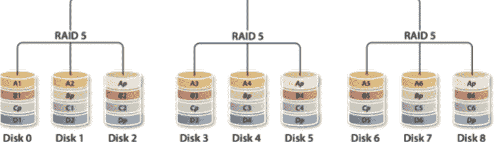

RAID50 也称为 RAID 5+0，结合了 RAID0 的块级条带化和 RAID5 的分布式校验。
由于 RAID 是跨越 RAID5 元素进行条带化的，RAID5 配置需要五块硬盘。RAID5 配置将 20 GB 的 RAID5 集合在一起，形成 70 GB 的总存储空间。
RAID5 集中的每块驱动器故障都可能导致数据丢失；包含三组 RAID5 的配置可以容忍三块驱动器故障。RAID5 固有的重建压力仍然存在，而 RAID6 改进了这一点，其对应物是 RAID 60

# RAID 60 (RAID 6+0): RAID0 阵列跨越 RAID6 元素进行条带化

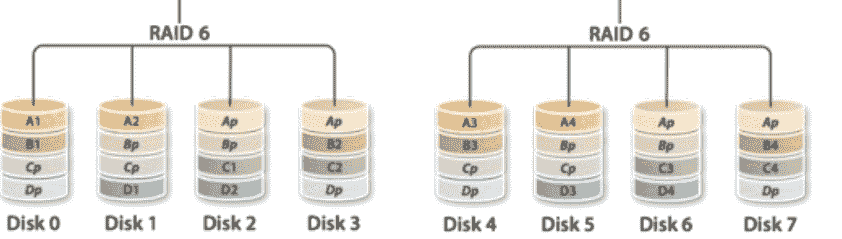
RAID60 也称为 RAID 6+0，结合了 RAID 0 的块级条带化和 RAID 6 的分布式校验，形成跨越 RAID6 元素的 RAID 0 阵列。它至少需要六块硬盘。

# RAID 100 (RAID 10+)

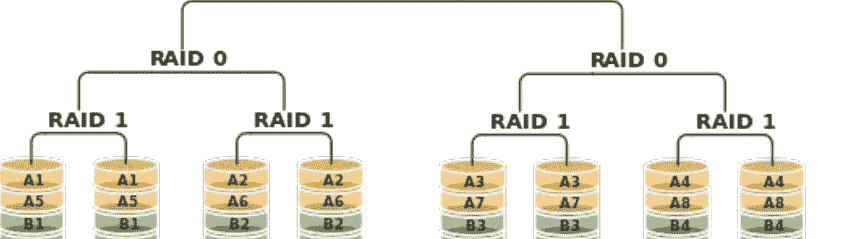
RAID100 有时称为 RAID 10+，是 RAID10 的条带。这在逻辑上等同于跨越硬件的 RAID10，被描述为“条带化” RAID

# NFS- 网络文件系统

- 最初由 Sun 开发，带有挂载点的远程文件系统。端口 2049  NFSv4

## NFSv3

## NFSv4

- `nfs-common`, `nfs-utils`
- `nfs-utils`
- `nfs-kernel-service`
- `nfs-server`
- `rpcbind`
- `systemd`
- `/etc/exports`
- `/etc/mount.conf`
- `/etc/sysconfig/nfs`
- `/etc/fstab`

# autofs 软件包

- `autofs.service`: 管理 autofs 守护进程系统服务（启动、停止和重启）
- `automount`: 与 autofs 交互的命令，手动挂载或卸载特定挂载点并调试 automount（查看日志或挂载点状态）

# NFSv3 挂载选项

- `nsize`（客户端从 NFS 服务器读取或写入的最大包大小）：增大可以提高文件读取性能，但值过大会导致网络使用不便。
- `bg` (后台/前台)：后台允许系统在建立 NFS 服务器时继续构建，而前台强制在 NFS 服务器成功完成之前进行挂载。
- `async`：默认值，异步允许客户端在数据物理写入磁盘之前向服务器确认写入。可以提高性能，但如果客户端在写入完成前崩溃会导致数据丢失。使用 `sync` 确保写入 NFS 的数据在挂载命令返回之前刷到服务器磁盘。这可以提高数据完整性但也会影响性能。
- `noauto`：防止系统在启动时自动挂载 NFS 共享。
- `_netdev`：等待网络。
- `root_squash`：防止 root 用户意外修改。
- `all_squash`：将所有客户端映射为匿名用户。
- `anonuid/gid`：将匿名用户的 UID 和 GID 映射到服务器。
- `sync/async`：你可以为特定主机或网络指定权限。

# NFSv4

- NFSv4 引入了为单个目录设置权限的功能
- 导出目录上的访问控制列表 (ACL) 为 `setfacl` 和 `getfacl` 提供了扩展
- 安全选项提供了更细粒度的身份验证和授权机制。
- 网络锁管理器已过时，已被 NFS 委托所取代。
- 对于安全，Kerberos 是最佳解决方案。Kerberos 选项是 `krb5`，使用带有加密的 Kerberos 用于数据隐私和完整性。Kerberos 并不广为人知。还有一个名为 `nfs-server` 的服务集成在 nfs-server 中。
- NFSv4 与 `mount` 命令的功能相同
- NFSv4 允许你导出目录而不是挂载。
- NFSv4 需要对客户端进行配置。
- NFSv4 de-facto 使用服务器。
- NFSv4 de-facto 并非没有建议。
- NFSv4 de-facto 是相同的。
- NFSv4 de-facto 添加在 NFSv4 中

# 命令

使用 `exports` 管理 NFS 导出
- `-a`：当前列出的目录
- `-a` 导出 `/etc/exports` 中的所有内容
- `-o`：添加新导出 `-o -id dir, -IP`
- `-u`：移除导出 `/directory/`
- 命令 `'showmount'` 获取当前 NFS 共享信息；`rpcbind` 将 NFS 信息导入 NFS 服务器，`nffstat` 与 NFS 活动相关。

客户端侧：`mount --server_IP`（显示服务器上的 NFS 共享），以及用于 NFS 客户端统计的 `nffstat`

# autofs 配置

- `/etc/auto.master`: 主配置文件 - 定义挂载点、到其映射文件的链接以及 autofs 的全局选项。类型文件中的每行都遵循以下格式：`<mount_point> <map_file> <options>`
- `/etc/auto-identifier`: 映射文件，由主映射文件引用，包含单个挂载点的细节。每个映射文件定义了特定点的特定配置。格式取决于类型：
  - `sfsmd.map_format`: 传统格式，指定 NFS 服务器位置、自动机行为、访问控制。
  - `auto.master_format`: 较新的格式，允许基于目录的继承和模块化配置。

# Kerberos 设置

- 登录 Kerberos 服务器
- 启动 `daemon.local`
- 添加服务主体


`ssh` `username@kerberos_server_ip`

`addprinc` `-range` `keytabs=nfs_server_hostname`

`ktadd` `-t` `/etc/kerb5.keytab` `$hostname=$hostname` （按回车，类型退出 CLI）

`ktadd` `username@nfs_server_ip` `>/etc/kerb5.keytab`

如果不返回，则退出

```
为 NFS 服务器创建密钥表文件
设置密钥表权限
确保 /etc/keytabs 有该文件
编辑 /etc/krb5conf
```

`sudo chmod 400 /etc/kerb5.keytab`; `sudo chown root:root /etc/kerb5.keytab`

`kerb5` `-sp` `client`, 如前所述

`sudo vi /etc/krb5.conf` `[domain = local]`, `[realm = local]`

`systemctl enable nfs-server kerberos`; `systemctl enable randbind`; `sudo systemctl start nfs-server`

`mount -t nfs -o sec=kerb5 $server$share_name /mnt/nfs`

# Samba - SMB

客户端执行程序（安装包：`samba-client`）
共享视图查看与服务器的连接，并执行管理任务。

- `smbcontrol`: 管理 Samba 共享，在远程服务器上复制、管理文件/目录。
- `smbclient`: 将远程服务器挂载为本地目录。
- `smbsount`: 执行 NetBIOS 名称解析（在网络上查找 Samba 服务器）。
- `smbcals`: 远程文件访问，查看和修改托管服务器上的 Windows ACL。

客户端上的 Systemd

- `smbd` 服务：主 SMB/CIFS 守护进程，处理文件/打印服务。
- `nmbd`：提供 NetBIOS 节点服务。
- `cifs` 服务：统计 CIFS/samba 计数。

服务端执行程序（安装包：`samba`）

- `samba-tool`: 用于配置、用户、共享、Kerberos 设置以及其他管理任务。
- `smbd`: 显示 Samba 服务器状态，包括活跃的连接和共享。
- `testparam`: 在重启服务器之前验证 `/etc/samba/samba.conf` 的语法。
- `smpasswd`: 修改 Samba 用户账户密码。

服务器上的 Systemd（也包含客户端列表）

- `smbd.service`：主 SMB/CIFS 守护进程，提供客户端访问，处理文件/打印服务。
- `nmbd.service`：提供 NetBIOS 名称服务。
- `samba.service`：允许 Windows 域认证。
- `samba-ad-dc.service`：Samba Active Directory 域控制器服务。

主配置文件 `/etc/samba/samba.conf`（资源、用户认证、安全性、等）
可选配置：`/etc/samba/samba-conf.security`（配置）或 `/etc/samba/smb.secrets`（用于敏感信息）

`/etc/samba.conf` - 使用 `[sharesename]` 共享目录或文件；用户或/组的权限；LDAP 和加密选项，以及安全性。

- 共享：使用 `[sharesename]` 定义目录或文件。
- 权限：只读 = yes，可写 = yes 以及特定的用户/组条目。
- LDAP 集成：`security = ads` 选项以及 LDAP 服务器详细信息。
- 安全设置：通过这些选项增强安全性：
  - `encrypt passwords = yes` - 对用于存储的密码进行加密。
  - `map to guest = bad` - 从浏览中隐藏共享。
  - `browable = no` - 禁止访客访问。
  - `valid users = @users` - 限制访问本地用户名或指定组中的用户。

## 示例 smb.conf

```ini
[Global]

workgroup = MYWORKGROUP 网络浏览时的网络名称

server = My Samba Server 你的 Samba 服务器的描述性名称

security = ads 为用户认证启用 LDAP 安全

encrypt passwords = yes 为了增加安全性对密码进行加密

map to guest = bad 为未认证用户提供访问权限（这些用户并不存在！）

log level = 0.0.0.1 用于名称解析的 Wins 服务，记录访问并指定接口到（并非所有）

logging = file file-blocking # 记录警告和更多消息

log file = /var/log/samba.log 指定日志文件位置

# Interfaces = 1 仅在 IP 192.168.1.0/24 子网上监听
```

```ini

[Shared]

path = /home/share 你想要共享的目录路径

browable = no 从网络浏览中隐藏此共享

writable = yes 允许修改文件

read only = no 允许读取和写入

valid users = @share 仅允许 "share_access" 组中的用户访问

mask = 0664 示例：新文件获得 rw-rw- 权限（用户:组）

directory mask = 0775 设置默认的 getwxwx-x 权限
```

```ini

[Another]

path = /var/www/html Web 目录路径（示例）

read only = yes 允许用户只读取此共享中的文件

valid users = user2 @web_admins 允许特定用户和组访问

# locking = ... 控制多个客户端共享文件访问的选项

# oplocks = ... 与乐观锁相关的选项（高级））

# write cache = (read 'cache') = yes 启用缓存写/读以提高性能
```

“`map to guest = bad user`” 将会匹配任何认证失败（被拒绝）的用户。

# Kerberos 实现

登录到 Kerberos 服务器
启动本地终端以进入 CLI
添加服务主体

```bash
为 SMB 服务器创建 keytab

ktadd -k /etc/krb5.keytab <hostname> (按回车，返回，输入 type 退出 CLI)

spcb /etc/krb5.keytab <username>@<smb_server_ip>/etc/krb5.keytab

(按回车，返回，然后退出)
```

为 keytab 文件设置权限
编辑 `/etc/krb5.conf` 检查配置
确保 `/etc/smb/krbusers` 已就绪
启用并启动 SMB 和 kerberos
在客户端运行以验证其工作正常

```bash
sudo chmod 600 /etc/krb5.keytab

sudo chown root:root /etc/krb5.keytab

etc/krb5.conf - 确保配置了 [realms], [domain]

该文件需要类似于下方示例的条目

sudo systemctl enable smb && sudo systemctl start smb

sudo mount -t cifs -o smb_user,username=<client_user>@<REALM>//$server/$share_name /mnt/samba
```

创建一个用户映射文件，将 Kerberos 主体 (`username@REALM`) 转换为特定的 Samba 用户
`/etc/smb/krbusers`
将 Kerberos 主体 "`user1@MYREALM`" 映射到 Samba 用户 "`user1`"
`user1@MYREALM = samba_user` # 映射用户

```ini
[Global]

workgroup = MYWORKGROUP 网络浏览时的网络名称

server = My Samba Server 你的 Samba 服务器的描述性名称

security = ads 为用户认证启用 LDAP 安全

encrypt passwords = yes 为了增加安全性对密码进行加密

map to guest = bad 为未认证用户提供访问权限（这些用户并不存在！）

log level = 0.0.0.1 用于名称解析的 Wins 服务，记录访问并指定接口到（并非所有）

logging = file file-blocking # 记录警告和更多消息

log file = /var/log/samba.log 指定日志文件位置

# Interfaces = 1 仅在 IP 192.168.1.0/24 子网上监听
```

```ini

[Shared]

path = /home/share 你想要共享的目录路径
```


# Samba 共享配置示例

`browable` = `no` 从网络浏览中隐藏此共享

`writable` = `yes` 允许修改文件

`read only` = `no` 允许读取和写入

`valid users` = `@share` 仅允许 "share_access" 组中的用户访问

`mask` = `0664` 示例：新文件获得 rw-rw- 权限（用户:组）

`directory mask` = `0775` 设置默认的 getwxwx-x 权限

```ini
[Another]

path = /var/www/html Web 目录路径（示例）

read only = yes 允许用户只读取此共享中的文件

valid users = user2 @web_admins 允许特定用户和组访问

# locking = ... 控制多个客户端共享文件访问的选项

# oplocks = ... 与乐观锁相关的选项（高级）

# write cache = (read 'cache') = yes 启用缓存写/读以提高性能
```

“`map to guest = bad user`” 将会匹配任何认证失败（被拒绝）的用户。

# Kerberos 实现

登录到 Kerberos 服务器
启动本地终端以进入 CLI
添加服务主体

```bash
为 SMB 服务器创建 keytab

ktadd -k /etc/krb5.keytab <hostname> (按回车，返回，输入 type 退出 CLI)

spcb /etc/krb5.keytab <username>@<smb_server_ip>/etc/krb5.keytab

(按回车，返回，然后退出)
```

为 keytab 文件设置权限
编辑 `/etc/krb5.conf` 检查配置
确保 `/etc/smb/krbusers` 已就绪
启用并启动 SMB 和 kerberos
在客户端运行以验证其工作正常

```bash
sudo chmod 600 /etc/krb5.keytab

sudo chown root:root /etc/krb5.keytab

/etc/krb5.conf - 确保配置了 [realms], [domain]

该文件需要类似于下方示例的条目

sudo systemctl enable smb && sudo systemctl start smb

sudo mount -t cifs -o smb_user,username=<client_user>@<REALM>//$server/$share_name /mnt/samba
```

创建一个用户映射文件，将 Kerberos 主体 (`username@REALM`) 转换为特定的 Samba 用户
`/etc/smb/krbusers`
将 Kerberos 主体 "user1@MYREALM" 映射到 Samba 用户 "user1"
`user1@MYREALM` = `samba_user` # 映射用户

```ini
[Global]

workgroup = MYWORKGROUP 网络浏览时的网络名称

server = My Samba Server 你的 Samba 服务器的描述性名称

security = ads 为用户认证启用 LDAP 安全

encrypt passwords = yes 为了增加安全性对密码进行加密

map to guest = bad 为未认证用户提供访问权限（这些用户并不存在！）

log level = 0.0.0.1 用于名称解析的 Wins 服务，记录访问并指定接口到（并非所有）

logging = file file-blocking # 记录警告和更多消息

log file = /var/log/samba.log 指定日志文件位置

# Interfaces = 1 仅在 IP 192.168.1.0/24 子网上监听
```

```ini
[Shared]

path = /home/share 你想要共享的目录路径

browable = no 从网络浏览中隐藏此共享

writable = yes 允许修改文件

read only = no 允许读取和写入

valid users = @share 仅允许 "share_access" 组中的用户访问

mask = 0664 示例：新文件获得 rw-rw- 权限（用户:组）

directory mask = 0775 设置默认的 getwxwx-x 权限
```

```ini
[Another]

path = /var/www/html Web 目录路径（示例）

read only = yes 允许用户只读取此共享中的文件

valid users = user2 @web_admins 允许特定用户和组访问

# locking = ... 控制多个客户端共享文件访问的选项

# oplocks = ... 与乐观锁相关的选项（高级）

# write cache = (read 'cache') = yes 启用缓存写/读以提高性能
```


“`map to guest = bad user`” 将会匹配任何认证失败（被拒绝）的用户。

# Kerberos 实现

## 登录到 Kerberos 服务器
登录到 Kerberos 服务器
启动本地终端以进入 CLI
添加服务主体

为 SMB 服务器创建 keytab

```bash
ktadd -k /etc/krb5.keytab <hostname> (按回车，返回，输入 type 退出 CLI)
spcb /etc/krb5.keytab <username>@<smb_server_ip>/etc/krb5.keytab
(按回车，返回，然后退出)
```

## 配置与启动
为 keytab 文件设置权限
编辑 `/etc/krb5.conf` 检查配置
确保 `/etc/smb/krbusers` 已就绪
启用并启动 SMB 和 kerberos
在客户端运行以验证其工作正常

```bash
sudo chmod 600 /etc/krb5.keytab
sudo chown root:root /etc/krb5.keytab
/etc/krb5.conf - 确保配置了 [realms], [domain]
该文件需要类似于下方示例的条目
sudo systemctl enable smb && sudo systemctl start smb
sudo mount -t cifs -o smb_user,username=<client_user>@<REALM>//$server/$share_name /mnt/samba
```

创建一个用户映射文件，将 Kerberos 主体 (`username@REALM`) 转换为特定的 Samba 用户
`/etc/smb/krbusers`
将 Kerberos 主体 "`user1@MYREALM`" 映射到 Samba 用户 "`user1`"
`user1@MYREALM = samba_user` # 映射用户

```ini
[Global]
workgroup = MYWORKGROUP 网络浏览时的网络名称
server = My Samba Server 你的 Samba 服务器的描述性名称
security = ads 为用户认证启用 LDAP 安全
encrypt passwords = yes 为了增加安全性对密码进行加密
map to guest = bad 为未认证用户提供访问权限（这些用户并不存在！）
log level = 0.0.0.1 用于名称解析的 Wins 服务，记录访问并指定接口到（并非所有）
logging = file file-blocking # 记录警告和更多消息
log file = /var/log/samba.log 指定日志文件位置
# Interfaces = 1 仅在 IP 192.168.1.0/24 子网上监听
```

```ini
[Shared]
path = /home/share 你想要共享的目录路径
browable = no 从网络浏览中隐藏此共享
writable = yes 允许修改文件
read only = no 允许读取和写入
valid users = @share 仅允许 "share_access" 组中的用户访问
mask = 0664 示例：新文件获得 rw-rw- 权限（用户:组）
directory mask = 0775 设置默认的 getwxwx-x 权限
```

```ini
[Another]
path = /var/www/html Web 目录路径（示例）
read only = yes 允许用户只读取此共享中的文件
valid users = user2 @web_admins 允许特定用户和组访问
# locking = ... 控制多个客户端共享文件访问的选项
# oplocks = ... 与乐观锁相关的选项（高级）
# write cache = (read 'cache') = yes 启用缓存写/读以提高性能
```


该文件需要类似于下方示例的条目

```bash
sudo systemctl enable smb && sudo systemctl start smb
```

```bash
sudo mount -t cifs -o smb_user,username=<client_user>@<REALM>//$server/$share_name /mnt/samba
```

创建一个用户映射文件，将 Kerberos 主体 (`username@REALM`) 转换为特定的 Samba 用户
`/etc/smb/krbusers`
将 Kerberos 主体 `"user1@MYREALM"` 映射到 Samba 用户 `"user1"`
`user1@MYREALM = samba_user` # 映射用户

```ini
[Global]

workgroup = MYWORKGROUP 网络浏览时的网络名称

server = My Samba Server 你的 Samba 服务器的描述性名称

security = ads 为用户认证启用 LDAP 安全

encrypt passwords = yes 为了增加安全性对密码进行加密

map to guest = bad 为未认证用户提供访问权限（这些用户并不存在！）

log level = 0.0.0.1 用于名称解析的 Wins 服务，记录访问并指定接口到（并非所有）

logging = file file-blocking # 记录警告和更多消息

log file = /var/log/samba.log 指定日志文件位置

# Interfaces = 1 仅在 IP 192.168.1.0/24 子网上监听
```

```ini
[Shared]

path = /home/share 你想要共享的目录路径

browable = no 从网络浏览中隐藏此共享

writable = yes 允许修改文件

read only = no 允许读取和写入

valid users = @share 仅允许 "share_access" 组中的用户访问

mask = 0664 示例：新文件获得 rw-rw- 权限（用户:组）

directory mask = 0775 设置默认的 getwxwx-x 权限
```

```ini
[Another]

path = /var/www/html Web 目录路径（示例）

read only = yes 允许用户只读取此共享中的文件

valid users = user2 @web_admins 允许特定用户和组访问

# locking = ... 控制多个客户端共享文件访问的选项

# oplocks = ... 与乐观锁相关的选项（高级）

# write cache = (read 'cache') = yes 启用缓存写/读以提高性能
```

“`map to guest = bad user`” 将会匹配任何认证失败（被拒绝）的用户。

# Kerberos 实现

登录到 Kerberos 服务器
启动本地终端以进入 CLI
添加服务主体

```bash
为 SMB 服务器创建 keytab

ktadd -k /etc/krb5.keytab <hostname> (按回车，返回，输入 type 退出 CLI)

spcb /etc/krb5.keytab <username>@<smb_server_ip>/etc/krb5.keytab

(按回车，返回，然后退出)
```

为 keytab 文件设置权限
编辑 `/etc/krb5.conf` 检查配置
确保 `/etc/smb/krbusers` 已就绪
启用并启动 SMB 和 kerberos
在客户端运行以验证其工作正常

```bash
sudo chmod 600 /etc/krb5.keytab

sudo chown root:root /etc/krb5.keytab
```

`etc/krb5.conf` - 确保配置了 `[realms]`, `[domain]`


`map to guest = bad` 为未认证用户提供访问权限（这些用户并不存在！）

`log level = 0.0.0.1` 用于名称解析的 Wins 服务，记录访问并指定接口到（并非所有）

`logging = file file-blocking` # 记录警告和更多消息

`log file = /var/log/samba.log` 指定日志文件位置

`# Interfaces = 1` 仅在 IP `192.168.1.0/24` 子网上监听

```ini
[Shared]

path = /home/share 你想要共享的目录路径

browable = no 从网络浏览中隐藏此共享

writable = yes 允许修改文件

read only = no 允许读取和写入

valid users = @share 仅允许 "share_access" 组中的用户访问

mask = 0664 示例：新文件获得 rw-rw- 权限（用户:组）

directory mask = 0775 设置默认的 getwxwx-x 权限
```

```ini
[Another]

path = /var/www/html Web 目录路径（示例）

read only = yes 允许用户只读取此共享中的文件

valid users = user2 @web_admins 允许特定用户和组访问

# locking = ... 控制多个客户端共享文件访问的选项

# oplocks = ... 与乐观锁相关的选项（高级）

# write cache = (read 'cache') = yes 启用缓存写/读以提高性能
```

“`map to guest = bad user`” 将会匹配任何认证失败（被拒绝）的用户。

# Kerberos 实现

登录到 Kerberos 服务器
启动本地终端以进入 CLI
添加服务主体

```bash
为 SMB 服务器创建 keytab

ktadd -k /etc/krb5.keytab <hostname> (按回车，返回，输入 type 退出 CLI)

spcb /etc/krb5.keytab <username>@<smb_server_ip>/etc/krb5.keytab

(按回车，返回，然后退出)
```

为 keytab 文件设置权限
编辑 `/etc/krb5.conf` 检查配置
确保 `/etc/smb/krbusers` 已就绪
启用并启动 SMB 和 kerberos
在客户端运行以验证其工作正常

```bash
sudo chmod 600 /etc/krb5.keytab

sudo chown root:root /etc/krb5.keytab

etc/krb5.conf - 确保配置了 [realms], [domain]

该文件需要类似于下方示例的条目

sudo systemctl enable smb && sudo systemctl start smb

sudo mount -t cifs -o smb_user,username=<client_user>@<REALM>//$server/$share_name /mnt/samba
```

创建一个用户映射文件，将 Kerberos 主体 (`username@REALM`) 转换为特定的 Samba 用户
`/etc/smb/krbusers`
将 Kerberos 主体 "user1@MYREALM" 映射到 Samba 用户 "user1"
`user1@MYREALM = samba_user` # 映射用户

```ini
[Global]

workgroup = MYWORKGROUP 网络浏览时的网络名称

server = My Samba Server 你的 Samba 服务器的描述性名称

security = ads 为用户认证启用 LDAP 安全

encrypt passwords = yes 为了增加安全性对密码进行加密

map to guest = bad 为未认证用户提供访问权限（这些用户并不存在！）

log level = 0.0.0.1 用于名称解析的 Wins 服务，记录访问并指定接口到（并非所有）

logging = file file-blocking # 记录警告和更多消息

log file = /var/log/samba.log 指定日志文件位置

# Interfaces = 1 仅在 IP 192.168.1.0/24 子网上监听
```

```ini
[Shared]

path = /home/share 你想要共享的目录路径

browable = no 从网络浏览中隐藏此共享

writable = yes 允许修改文件

read only = no 允许读取和写入

valid users = @share 仅允许 "share_access" 组中的用户访问

mask = 0664 示例：新文件获得 rw-rw- 权限（用户:组）

directory mask = 0775 设置默认的 getwxwx-x 权限
```

```ini
[Another]

path = /var/www/html Web 目录路径（示例）

read only = yes 允许用户只读取此共享中的文件

valid users = user2 @web_admins 允许特定用户和组访问

# locking = ... 控制多个客户端共享文件访问的选项

# oplocks = ... 与乐观锁相关的选项（高级）

# write cache = (read 'cache') = yes 启用缓存写/读以提高性能
```


`path = /var/www/html` Web 目录路径（示例）

`read only = yes` 允许用户只读取此共享中的文件

`valid users = user2 @web_admins` 允许特定用户和组访问

`# locking = ...` 控制多个客户端共享文件访问的选项

`# oplocks = ...` 与乐观锁相关的选项（高级）

`# write cache = (read 'cache') = yes` 启用缓存写/读以提高性能

“`map to guest = bad user`” 将会匹配任何认证失败（被拒绝）的用户。

# Kerberos 实现

登录到 Kerberos 服务器
启动本地终端以进入 CLI
添加服务主体

```bash
# 为 SMB 服务器创建 keytab
ktadd -k /etc/krb5.keytab <hostname> (按回车，返回，输入 type 退出 CLI)

spcb /etc/krb5.keytab <username>@<smb_server_ip>/etc/krb5.keytab
(按回车，返回，然后退出)
```

为 keytab 文件设置权限
编辑 `/etc/krb5.conf` 检查配置
确保 `/etc/smb/krbusers` 已就绪
启用并启动 SMB 和 kerberos
在客户端运行以验证其工作正常

```bash
sudo chmod 600 /etc/krb5.keytab

sudo chown root:root /etc/krb5.keytab

/etc/krb5.conf - 确保配置了 [realms], [domain]
该文件需要类似于下方示例的条目

sudo systemctl enable smb && sudo systemctl start smb

sudo mount -t cifs -o smb_user,username=<client_user>@<REALM>//$server/$share_name /mnt/samba
```

创建一个用户映射文件，将 Kerberos 主体 (`username@REALM`) 转换为特定的 Samba 用户
`/etc/smb/krbusers`
将 Kerberos 主体 "`user1@MYREALM`" 映射到 Samba 用户 "`user1`"
`user1@MYREALM = samba_user` # 映射用户

```ini
[Global]

workgroup = MYWORKGROUP 网络浏览时的网络名称

server = My Samba Server 你的 Samba 服务器的描述性名称

security = ads 为用户认证启用 LDAP 安全

encrypt passwords = yes 为了增加安全性对密码进行加密

map to guest = bad 为未认证用户提供访问权限（这些用户并不存在！）

log level = 0.0.0.1 用于名称解析的 Wins 服务，记录访问并指定接口到（并非所有）

logging = file file-blocking # 记录警告和更多消息

log file = /var/log/samba.log 指定日志文件位置

# Interfaces = 1 仅在 IP 192.168.1.0/24 子网上监听
```

```ini
[Shared]

path = /home/share 你想要共享的目录路径

browable = no 从网络浏览中隐藏此共享

writable = yes 允许修改文件

read only = no 允许读取和写入

valid users = @share 仅允许 "share_access" 组中的用户访问

mask = 0664 示例：新文件获得 rw-rw- 权限（用户:组）

directory mask = 0775 设置默认的 getwxwx-x 权限
```

```ini
[Another]

path = /var/www/html Web 目录路径（示例）

read only = yes 允许用户只读取此共享中的文件

valid users = user2 @web_admins 允许特定用户和组访问

# locking = ... 控制多个客户端共享文件访问的选项

# oplocks = ... 与乐观锁相关的选项（高级）

# write cache = (read 'cache') = yes 启用缓存写/读以提高性能
```


# Kerberos 实现

登录到 Kerberos 服务器
启动本地终端以进入 CLI
添加服务主体

```bash
为 SMB 服务器创建 keytab

ktadd -k /etc/krb5.keytab <hostname> (按回车，返回，输入 type 退出 CLI)

spcb /etc/krb5.keytab <username>@<smb_server_ip>/etc/krb5.keytab

(按回车，返回，然后退出)
```

为 `keytab` 文件设置权限
编辑 `/etc/krb5.conf` 检查配置
确保 `/etc/smb/krbusers` 已就绪
启用并启动 SMB 和 kerberos
在客户端运行以验证其工作正常

```bash
sudo chmod 600 /etc/krb5.keytab

sudo chown root:root /etc/krb5.keytab

/etc/krb5.conf - 确保配置了 `[realms]`, `[domain]`

该文件需要类似于下方示例的条目

sudo systemctl enable smb && sudo systemctl start smb

sudo mount -t cifs -o smb_user,username=<client_user>@<REALM>//$server/$share_name /mnt/samba
```

创建一个用户映射文件，将 Kerberos 主体 (`username@REALM`) 转换为特定的 Samba 用户
`/etc/smb/krbusers`
将 Kerberos 主体 `"user1@MYREALM"` 映射到 Samba 用户 `"user1"`
`user1@MYREALM = samba_user` # 映射用户

```ini
[Global]

workgroup = MYWORKGROUP 网络浏览时的网络名称

server = My Samba Server 你的 Samba 服务器的描述性名称

security = ads 为用户认证启用 LDAP 安全

encrypt passwords = yes 为了增加安全性对密码进行加密

map to guest = bad 为未认证用户提供访问权限（这些用户并不存在！）

log level = 0.0.0.1 用于名称解析的 Wins 服务，记录访问并指定接口到（并非所有）

logging = file file-blocking # 记录警告和更多消息

log file = /var/log/samba.log 指定日志文件位置

# Interfaces = 1 仅在 IP 192.168.1.0/24 子网上监听
```

```ini
[Shared]

path = /home/share 你想要共享的目录路径

browable = no 从网络浏览中隐藏此共享

writable = yes 允许修改文件

read only = no 允许读取和写入

valid users = @share 仅允许 "share_access" 组中的用户访问

mask = 0664 示例：新文件获得 rw-rw- 权限（用户:组）

directory mask = 0775 设置默认的 getwxwx-x 权限
```

```ini
[Another]

path = /var/www/html Web 目录路径（示例）

read only = yes 允许用户只读取此共享中的文件

valid users = user2 @web_admins 允许特定用户和组访问

# locking = ... 控制多个客户端共享文件访问的选项

# oplocks = ... 与乐观锁相关的选项（高级）

# write cache = (read 'cache') = yes 启用缓存写/读以提高性能
```

“`map to guest = bad user`” 将会匹配任何认证失败（被拒绝）的用户。


创建一个用户映射文件，将 Kerberos 主体 (`username@REALM`) 转换为特定的 Samba 用户
`/etc/smb/krbusers`
将 Kerberos 主体 "`user1@MYREALM`" 映射到 Samba 用户 "`user1`"
`user1@MYREALM = samba_user` # 映射用户

```ini
[Global]

workgroup = MYWORKGROUP 网络浏览时的网络名称

server = My Samba Server 你的 Samba 服务器的描述性名称

security = ads 为用户认证启用 LDAP 安全

encrypt passwords = yes 为了增加安全性对密码进行加密

map to guest = bad 为未认证用户提供访问权限（这些用户并不存在！）

log level = 0.0.0.1 用于名称解析的 Wins 服务，记录访问并指定接口到（并非所有）

logging = file file-blocking # 记录警告和更多消息

log file = /var/log/samba.log 指定日志文件位置

# Interfaces = 1 仅在 IP 192.168.1.0/24 子网上监听
```

```ini
[Shared]

path = /home/share 你想要共享的目录路径

browable = no 从网络浏览中隐藏此共享

writable = yes 允许修改文件

read only = no 允许读取和写入

valid users = @share 仅允许 "share_access" 组中的用户访问

mask = 0664 示例：新文件获得 rw-rw- 权限（用户:组）

directory mask = 0775 设置默认的 getwxwx-x 权限
```

```ini
[Another]

path = /var/www/html Web 目录路径（示例）

read only = yes 允许用户只读取此共享中的文件

valid users = user2 @web_admins 允许特定用户和组访问

# locking = ... 控制多个客户端共享文件访问的选项

# oplocks = ... 与乐观锁相关的选项（高级）

# write cache = (read 'cache') = yes 启用缓存写/读以提高性能
```

“`map to guest = bad user`” 将会匹配任何认证失败（被拒绝）的用户。

# Kerberos 实现

登录到 Kerberos 服务器
启动本地终端以进入 CLI
添加服务主体

为 SMB 服务器创建 keytab

```bash
ktadd -k /etc/krb5.keytab <hostname> (按回车，返回，输入 type 退出 CLI)

spcb /etc/krb5.keytab <username>@<smb_server_ip>/etc/krb5.keytab

(按回车，返回，然后退出)
```

为 keytab 文件设置权限
编辑 `/etc/krb5.conf` 检查配置
确保 `/etc/smb/krbusers` 已就绪
启用并启动 SMB 和 kerberos
在客户端运行以验证其工作正常

```bash
sudo chmod 600 /etc/krb5.keytab

sudo chown root:root /etc/krb5.keytab

etc/krb5.conf - 确保配置了 [realms], [domain]

该文件需要类似于下方示例的条目

sudo systemctl enable smb && sudo systemctl start smb

sudo mount -t cifs -o smb_user,username=<client_user>@<REALM>//$server/$share_name /mnt/samba
```


# Interfaces = 1 仅在 IP 192.168.1.0/24 子网上监听

```ini
[Shared]
path = /home/share 你想要共享的目录路径
browable = no 从网络浏览中隐藏此共享
writable = yes 允许修改文件
read only = no 允许读取和写入
valid users = @share 仅允许 "share_access" 组中的用户访问
mask = 0664 示例：新文件获得 rw-rw- 权限（用户:组）
directory mask = 0775 设置默认的 getwxwx-x 权限
```

```ini
[Another]
path = /var/www/html Web 目录路径（示例）
read only = yes 允许用户只读取此共享中的文件
valid users = user2 @web_admins 允许特定用户和组访问
# locking = ... 控制多个客户端共享文件访问的选项
# oplocks = ... 与乐观锁相关的选项（高级）
# write cache = (read 'cache') = yes 启用缓存写/读以提高性能
```

`map to guest = bad user` 将会匹配任何认证失败（被拒绝）的用户。

# Kerberos 实现

登录到 Kerberos 服务器
启动本地终端以进入 CLI
添加服务主体

```bash
为 SMB 服务器创建 keytab
ktadd -k /etc/krb5.keytab <hostname> (按回车，返回，输入 type 退出 CLI)
spcb /etc/krb5.keytab <username>@<smb_server_ip>/etc/krb5.keytab
(按回车，返回，然后退出)
```

为 keytab 文件设置权限
编辑 `/etc/krb5.conf` 检查配置
确保 `/etc/smb/krbusers` 已就绪
启用并启动 SMB 和 kerberos
在客户端运行以验证其工作正常

```bash
sudo chmod 600 /etc/krb5.keytab
sudo chown root:root /etc/krb5.keytab
/etc/krb5.conf - 确保配置了 [realms], [domain]
该文件需要类似于下方示例的条目
sudo systemctl enable smb && sudo systemctl start smb
sudo mount -t cifs -o smb_user,username=<client_user>@<REALM>//$server/$share_name /mnt/samba
```

创建一个用户映射文件，将 Kerberos 主体 (`username@REALM`) 转换为特定的 Samba 用户
`/etc/smb/krbusers`
将 Kerberos 主体 "user1@MYREALM" 映射到 Samba 用户 "user1"
`user1@MYREALM = samba_user` # 映射用户

```ini
[Global]
workgroup = MYWORKGROUP 网络浏览时的网络名称
server = My Samba Server 你的 Samba 服务器的描述性名称
security = ads 为用户认证启用 LDAP 安全
encrypt passwords = yes 为了增加安全性对密码进行加密
map to guest = bad 为未认证用户提供访问权限（这些用户并不存在！）
log level = 0.0.0.1 用于名称解析的 Wins 服务，记录访问并指定接口到（并非所有）
logging = file file-blocking # 记录警告和更多消息
log file = /var/log/samba.log 指定日志文件位置
# Interfaces = 1 仅在 IP 192.168.1.0/24 子网上监听
```

```ini
[Shared]
path = /home/share 你想要共享的目录路径
browable = no 从网络浏览中隐藏此共享
writable = yes 允许修改文件
read only = no 允许读取和写入
valid users = @share 仅允许 "share_access" 组中的用户访问
mask = 0664 示例：新文件获得 rw-rw- 权限（用户:组）
directory mask = 0775 设置默认的 getwxwx-x 权限
```

```ini
[Another]
path = /var/www/html Web 目录路径（示例）
read only = yes 允许用户只读取此共享中的文件
valid users = user2 @web_admins 允许特定用户和组访问
# locking = ... 控制多个客户端共享文件访问的选项
# oplocks = ... 与乐观锁相关的选项（高级）
# write cache = (read 'cache') = yes 启用缓存写/读以提高性能
```


# Samba - SMB

客户端执行程序（安装包：`samba-client`）

共享视图查看与服务器的连接，并执行管理任务。

- `smbcontrol`: 管理 Samba 共享，在远程服务器上复制、管理文件/目录。
- `smbclient`: 将远程服务器挂载为本地目录。
- `smbsount`: 执行 NetBIOS 名称解析（在网络上查找 Samba 服务器）。
- `smbcals`: 远程文件访问，查看和修改托管服务器上的 Windows ACL。

客户端上的 Systemd

- `smbd` 服务：主 SMB/CIFS 守护进程，处理文件/打印服务。
- `nmbd`：提供 NetBIOS 名称服务。
- `cifs` 服务：统计 CIFS/samba 计数。

服务端执行程序（安装包：`samba`）

- `samba-tool`: 用于配置、用户、共享、Kerberos 设置以及其他管理任务。
- `smbd`: 显示 Samba 服务器状态，包括活跃的连接和共享。
- `testparam`: 在重启服务器之前验证 `/etc/samba/samba.conf` 的语法。
- `smpasswd`: 修改 Samba 用户账户密码。

服务器上的 Systemd（也包含客户端列表）

- `smbd.service`：主 SMB/CIFS 守护进程，提供客户端访问，处理文件/打印服务。
- `nmbd.service`：提供 NetBIOS 名称服务。
- `samba.service`：允许 Windows 域认证。
- `samba-ad-dc.service`：Samba Active Directory 域控制器服务。

主配置文件 `/etc/samba/samba.conf`（资源、用户认证、安全性、等）

可选配置：`/etc/samba/samba-conf.security`（配置）或 `/etc/samba/smb.secrets`（用于敏感信息）

`/etc/samba.conf` - 使用 `[sharesename]` 共享目录或文件；用户或/组的权限；LDAP 和加密选项，以及安全性。

- 共享：使用 `[sharesename]` 定义目录或文件。
- 权限：`只读 = yes`，`可写 = yes` 以及特定的用户/组条目。
- LDAP 集成：`security = ads` 选项以及 LDAP 服务器详细信息。
- 安全设置：通过这些选项增强安全性：
  - `encrypt passwords = yes` - 对用于存储的密码进行加密。
  - `map to guest = bad` - 从浏览中隐藏共享。
  - `browable = no` - 禁止访客访问。
  - `valid users = @users` - 限制访问本地用户名或指定组中的用户。

## 示例 smb.conf

```ini
[Global]
workgroup = MYWORKGROUP 网络浏览时的网络名称
server = My Samba Server 你的 Samba 服务器的描述性名称
security = ads 为用户认证启用 LDAP 安全
encrypt passwords = yes 为了增加安全性对密码进行加密
map to guest = bad 为未认证用户提供访问权限（这些用户并不存在！）
log level = 0.0.0.1 用于名称解析的 Wins 服务，记录访问并指定接口到（并非所有）
logging = file file-blocking # 记录警告和更多消息
log file = /var/log/samba.log 指定日志文件位置
# Interfaces = 1 仅在 IP 192.168.1.0/24 子网上监听
```

```ini
[Shared]
path = /home/share 你想要共享的目录路径
browable = no 从网络浏览中隐藏此共享
writable = yes 允许修改文件
read only = no 允许读取和写入
valid users = @share 仅允许 "share_access" 组中的用户访问
mask = 0664 示例：新文件获得 rw-rw- 权限（用户:组）
directory mask = 0775 设置默认的 getwxwx-x 权限
```

```ini
[Another]
path = /var/www/html Web 目录路径（示例）
read only = yes 允许用户只读取此共享中的文件
valid users = user2 @web_admins 允许特定用户和组访问
# locking = ... 控制多个客户端共享文件访问的选项
# oplocks = ... 与乐观锁相关的选项（高级）
# write cache = (read 'cache') = yes 启用缓存写/读以提高性能
```

`map to guest = bad user` 将会匹配任何认证失败（被拒绝）的用户。

# Kerberos 实现

登录到 Kerberos 服务器

启动本地终端以进入 CLI

添加服务主体

```bash
为 SMB 服务器创建 keytab
ktadd -k /etc/krb5.keytab <hostname> (按回车，返回，输入 type 退出 CLI)
spcb /etc/krb5.keytab <username>@<smb_server_ip>/etc/krb5.keytab
(按回车，返回，然后退出)
```

为 keytab 文件设置权限

编辑 `/etc/krb5.conf` 检查配置

确保 `/etc/smb/krbusers` 已就绪

启用并启动 SMB 和 kerberos

在客户端运行以验证其工作正常

```bash
sudo chmod 600 /etc/krb5.keytab
sudo chown root:root /etc/krb5.keytab
etc/krb5.conf - 确保配置了 [realms], [domain]
该文件需要类似于下方示例的条目
sudo systemctl enable smb && sudo systemctl start smb
sudo mount -t cifs -o smb_user,username=<client_user>@<REALM>//$server/$share_name /mnt/samba
```

创建一个用户映射文件，将 Kerberos 主体 (`username@REALM`) 转换为特定的 Samba 用户

`/etc/smb/krbusers`

将 Kerberos 主体 "`user1@MYREALM`" 映射到 Samba 用户 "`user1`"

`user1@MYREALM = samba_user` # 映射用户

```ini
[Global]
workgroup = MYWORKGROUP 网络浏览时的网络名称
server = My Samba Server 你的 Samba 服务器的描述性名称
security = ads 为用户认证启用 LDAP 安全
encrypt passwords = yes 为了增加安全性对密码进行加密
map to guest = bad 为未认证用户提供访问权限（这些用户并不存在！）
log level = 0.0.0.1 用于名称解析的 Wins 服务，记录访问并指定接口到（并非所有）
logging = file file-blocking # 记录警告和更多消息
log file = /var/log/samba.log 指定日志文件位置
# Interfaces = 1 仅在 IP 192.168.1.0/24 子网上监听
```

```ini
[Shared]
path = /home/share 你想要共享的目录路径
browable = no 从网络浏览中隐藏此共享
writable = yes 允许修改文件
read only = no 允许读取和写入
valid users = @share 仅允许 "share_access" 组中的用户访问
mask = 0664 示例：新文件获得 rw-rw- 权限（用户:组）
directory mask = 0775 设置默认的 getwxwx-x 权限
```


# Samba - SMB

客户端执行程序（安装包：`samba-client`）

共享视图查看与服务器的连接，并执行管理任务。

- `smbcontrol`：管理 Samba 共享，在远程服务器上复制、管理文件/目录。
- `smbclient`：将远程服务器挂载为本地目录。
- `smbsount`：执行 NetBIOS 名称解析（在网络上查找 Samba 服务器）。
- `smbcals`：远程文件访问，查看和修改托管服务器上的 Windows ACL。

客户端上的 Systemd

- `smbd` 服务：主 SMB/CIFS 守护进程，处理文件/打印服务。
- `nmbd`：提供 NetBIOS 名称服务。
- `cifs` 服务：统计 CIFS/samba 计数。

服务端执行程序（安装包：`samba`）

- `samba-tool`：用于配置、用户、共享、Kerberos 设置以及其他管理任务。
- `smbd`：显示 Samba 服务器状态，包括活跃的连接和共享。
- `testparam`：在重启服务器之前验证 `/etc/samba/samba.conf` 的语法。
- `smpasswd`：修改 Samba 用户账户密码。

服务器上的 Systemd（也包含客户端列表）

- `smbd.service`：主 SMB/CIFS 守护进程，提供客户端访问，处理文件/打印服务。
- `nmbd.service`：提供 NetBIOS 名称服务。
- `samba.service`：允许 Windows 域认证。
- `samba-ad-dc.service`：Samba Active Directory 域控制器服务。

## 主配置文件

主配置文件 `/etc/samba/samba.conf`（资源、用户认证、安全性、等）

可选配置：`/etc/samba/samba-conf.security`（配置）或 `/etc/samba/smb.secrets`（用于敏感信息）

`/etc/samba.conf` - 使用 `[sharesename]` 共享目录或文件；用户或/组的权限；LDAP 和加密选项，以及安全性。

- 共享：使用 `[sharesename]` 定义目录或文件。
- 权限：`read only = yes`，`writable = yes` 以及特定的用户/组条目。
- LDAP 集成：`security = ads` 选项以及 LDAP 服务器详细信息。
- 安全设置：通过这些选项增强安全性：
  - `encrypt passwords = yes` - 对用于存储的密码进行加密。
  - `map to guest = bad` - 从浏览中隐藏共享。
  - `browable = no` - 禁止访客访问。
  - `valid users = @users` - 限制访问本地用户名或指定组中的用户。

### 示例 smb.conf

```ini
[Global]
workgroup = MYWORKGROUP 网络浏览时的网络名称
server = My Samba Server 你的 Samba 服务器的描述性名称
security = ads 为用户认证启用 LDAP 安全
encrypt passwords = yes 为了增加安全性对密码进行加密
map to guest = bad 为未认证用户提供访问权限（这些用户并不存在！）
log level = 0.0.0.1 用于名称解析的 Wins 服务，记录访问并指定接口到（并非所有）
logging = file file-blocking # 记录警告和更多消息
log file = /var/log/samba.log 指定日志文件位置
# Interfaces = 1 仅在 IP 192.168.1.0/24 子网上监听
```

```ini
[Shared]
path = /home/share 你想要共享的目录路径
browable = no 从网络浏览中隐藏此共享
writable = yes 允许修改文件
read only = no 允许读取和写入
valid users = @share 仅允许 "share_access" 组中的用户访问
mask = 0664 示例：新文件获得 rw-rw- 权限（用户:组）
directory mask = 0775 设置默认的 getwxwx-x 权限
```

```ini
[Another]
path = /var/www/html Web 目录路径（示例）
read only = yes 允许用户只读取此共享中的文件
valid users = user2 @web_admins 允许特定用户和组访问
# locking = ... 控制多个客户端共享文件访问的选项
# oplocks = ... 与乐观锁相关的选项（高级）
# write cache = (read 'cache') = yes 启用缓存写/读以提高性能
```

`map to guest = bad user` 将会匹配任何认证失败（被拒绝）的用户。

# Kerberos 实现

登录到 Kerberos 服务器

启动本地终端以进入 CLI

添加服务主体

```bash
为 SMB 服务器创建 keytab
ktadd -k /etc/krb5.keytab <hostname> (按回车，返回，输入 type 退出 CLI)
spcb /etc/krb5.keytab <username>@<smb_server_ip>/etc/krb5.keytab
(按回车，返回，然后退出)
```

为 keytab 文件设置权限

编辑 `/etc/krb5.conf` 检查配置

确保 `/etc/smb/krbusers` 已就绪

启用并启动 SMB 和 kerberos

在客户端运行以验证其工作正常

```bash
sudo chmod 600 /etc/krb5.keytab evensudo chown root:root /etc/krb5.keytab
etc/krb5.conf - 确保配置了 [realms], [domain]
该文件需要类似于下方示例的条目
sudo systemctl enable smb && sudo systemctl start smb
sudo mount -t cifs -o smb_user,username=<client_user>@<REALM>//$server/$share_name /mnt/samba
```

创建一个用户映射文件，将 Kerberos 主体 (`username@REALM`) 转换为特定的 Samba 用户

`/etc/smb/krbusers`

将 Kerberos 主体 `user1@MYREALM` 映射到 Samba 用户 `user1`

`user1@MYREALM = samba_user` # 映射用户

```ini
[Global]
workgroup = MYWORKGROUP 网络浏览时的网络名称
server = My Samba Server 你的 Samba 服务器的描述性名称
security = ads 为用户认证启用 LDAP 安全
encrypt passwords = yes 为了增加安全性对密码进行加密
map to guest = bad 为未认证用户提供访问权限（这些用户并不存在！）
log level = 0.0.0.1 用于名称解析的 Wins 服务，记录访问并指定接口到（并非所有）
logging = file file-blocking # 记录警告和更多消息
log file = /var/log/samba.log 指定日志文件位置
# Interfaces = 1 仅在 IP 192.168.1.0/24 子网上监听
```


# Samba - SMB

## 客户端执行程序（安装包：`samba-client`）

共享视图查看与服务器的连接，并执行管理任务。

- `smbcontrol`: 管理 Samba 共享，在远程服务器上复制、管理文件/目录。
- `smbclient`: 将远程服务器挂载为本地目录。
- `smbsount`: 执行 NetBIOS 名称解析（在网络上查找 Samba 服务器）。
- `smbcals`: 远程文件访问，查看和修改托管服务器上的 Windows ACL。

## 客户端上的 Systemd

- `smbd` 服务：主 SMB/CIFS 守护进程，处理文件/打印服务。
- `nmbd`：提供 NetBIOS 名称服务。
- `cifs` 服务：统计 CIFS/samba 计数。

## 服务端执行程序（安装包：`samba`）

- `samba-tool`: 用于配置、用户、共享、Kerberos 设置以及其他管理任务。
- `smbd`: 显示 Samba 服务器状态，包括活跃的连接和共享。
- `testparam`: 在重启服务器之前验证 `/etc/samba/samba.conf` 的语法。
- `smpasswd`: 修改 Samba 用户账户密码。

## 服务器上的 Systemd

- `smbd.service`：主 SMB/CIFS 守护进程，提供客户端访问，处理文件/打印服务。
- `nmbd.service`：提供 NetBIOS 名称服务。
- `samba.service`：允许 Windows 域认证。
- `samba-ad-dc.service`：Samba Active Directory 域控制器服务。

## 主配置文件

主配置文件 `/etc/samba/samba.conf`（资源、用户认证、安全性、等）

可选配置：`/etc/samba/samba-conf.security`（配置）或 `/etc/samba/smb.secrets`（用于敏感信息）

`/etc/samba.conf` - 使用 `[sharesename]` 共享目录或文件；用户或/组的权限；LDAP 和加密选项，以及安全性。

- 共享：使用 `[sharesename]` 定义目录或文件。
- 权限：`read only = yes`，`writable = yes` 以及特定的用户/组条目。
- LDAP 集成：`security = ads` 选项以及 LDAP 服务器详细信息。
- 安全设置：通过这些选项增强安全性：
  - `encrypt passwords = yes` - 对用于存储的密码进行加密。
  - `map to guest = bad` - 从浏览中隐藏共享。
  - `browable = no` - 禁止访客访问。
  - `valid users = @users` - 限制访问本地用户名或指定组中的用户。

### 示例 `smb.conf`

```ini
[Global]
workgroup = MYWORKGROUP
server = My Samba Server
security = ads
encrypt passwords = yes
map to guest = bad
log level = 0.0.0.1
logging = file file-blocking
log file = /var/log/samba.log
```

```ini
[Shared]
path = /home/share
browable = no
writable = yes
read only = no
valid users = @share
mask = 0664
directory mask = 0775
```

```ini
[Another]
path = /var/www/html
read only = yes
valid users = user2 @web_admins
# locking = ...
# oplocks = ...
# write cache = (read 'cache') = yes
```

`map to guest = bad user` 将会匹配任何认证失败（被拒绝）的用户。

# Kerberos 实现

## 登录到 Kerberos 服务器

启动本地终端以进入 CLI

## 添加服务主体

为 SMB 服务器创建 `keytab`

```bash
ktadd -k /etc/krb5.keytab <hostname>
spcb /etc/krb5.keytab <username>@<smb_server_ip>/etc/krb5.keytab
```

为 `keytab` 文件设置权限

编辑 `/etc/krb5.conf` 检查配置

确保 `/etc/smb/krbusers` 已就绪

启用并启动 SMB 和 kerberos

在客户端运行以验证其工作正常

```bash
sudo chmod 600 /etc/krb5.keytab
sudo chown root:root /etc/krb5.keytab
etc/krb5.conf - 确保配置了 [realms], [domain]
sudo systemctl enable smb && sudo systemctl start smb
sudo mount -t cifs -o smb_user,username=<client_user>@<REALM>//$server/$share_name /mnt/samba
```

创建一个用户映射文件，将 Kerberos 主体 `username@REALM` 转换为特定的 Samba 用户

`/etc/smb/krbusers`

将 Kerberos 主体 `user1@MYREALM` 映射到 Samba 用户 `user1`

```
user1@MYREALM = samba_user
```

```ini
[Global]
workgroup = MYWORKGROUP
```


# Samba - SMB

## 客户端执行程序（安装包：`samba-client`）

共享视图查看与服务器的连接，并执行管理任务。

- `smbcontrol`：管理 Samba 共享，在远程服务器上复制、管理文件/目录。
- `smbclient`：将远程服务器挂载为本地目录。
- `smbsount`：执行 NetBIOS 名称解析（在网络上查找 Samba 服务器）。
- `smbcals`：远程文件访问，查看和修改托管服务器上的 Windows ACL。

## 客户端上的 Systemd

- `smbd` 服务：主 SMB/CIFS 守护进程，处理文件/打印服务。
- `nmbd`：提供 NetBIOS 名称服务。
- `cifs` 服务：统计 CIFS/samba 计数。

## 服务端执行程序（安装包：`samba`）

- `samba-tool`：用于配置、用户、共享、Kerberos 设置以及其他管理任务。
- `smbd`：显示 Samba 服务器状态，包括活跃的连接和共享。
- `testparam`：在重启服务器之前验证 `/etc/samba/samba.conf` 的语法。
- `smpasswd`：修改 Samba 用户账户密码。

## 服务器上的 Systemd（也包含客户端列表）

- `smbd.service`：主 SMB/CIFS 守护进程，提供客户端访问，处理文件/打印服务。
- `nmbd.service`：提供 NetBIOS 名称服务。
- `samba.service`：允许 Windows 域认证。
- `samba-ad-dc.service`：Samba Active Directory 域控制器服务。

## 主配置文件

主配置文件 `/etc/samba/samba.conf`（资源、用户认证、安全性、等）

可选配置：`/etc/samba/samba-conf.security`（配置）或 `/etc/samba/smb.secrets`（用于敏感信息）

`/etc/samba.conf` - 使用 `[sharesename]` 共享目录或文件；用户或/组的权限；LDAP 和加密选项，以及安全性。

- 共享：使用 `[sharesename]` 定义目录或文件。
- 权限：`read only = yes`，`writable = yes` 以及特定的用户/组条目。
- LDAP 集成：`security = ads` 选项以及 LDAP 服务器详细信息。
- 安全设置：通过这些选项增强安全性：


# Samba - SMB

## 客户端执行程序（安装包：`samba-client`）

共享视图查看与服务器的连接，并执行管理任务。

- `smbcontrol`: 管理 Samba 共享，在远程服务器上复制、管理文件/目录。 own- `smbclient`: 将远程服务器挂载为本地目录。
- `smbsount`: 执行 NetBIOS 名称解析（在网络上查找 Samba 服务器）。
- `smbcals`: 远程文件访问，查看和修改托管服务器上的 Windows ACL。

## 客户端上的 Systemd

- `smbd` 服务：主 SMB/CIFS 守护进程，处理文件/打印服务。
- `nmbd`：提供 NetBIOS 名称服务。
- `cifs` 服务：统计 CIFS/samba 计数。

## 服务端执行程序（安装包：`samba`）

- `samba-tool`: 用于配置、用户、共享、Kerberos 设置以及其他管理任务。
- `smbd`: 显示 Samba 服务器状态，包括活跃的连接和共享。
- `testparam`: 在重启服务器之前验证 `/etc/samba/samba.conf` 的语法。
- `smpasswd`: 修改 Samba 用户账户密码。

## 服务器上的 Systemd（也包含客户端列表）

- `smbd.service`：主 SMB/CIFS 守护进程，提供客户端访问，处理文件/打印服务。
- `nmbd.service`：提供 NetBIOS 名称服务。
- `samba.service`：允许 Windows 域认证。
- `samba-ad-dc.service`：Samba Active Directory 域控制器服务。

## 主配置文件

主配置文件 `/etc/samba/samba.conf`（资源、用户认证、安全性、等）

可选配置：`/etc/samba/samba-conf.security`（配置）或 `/etc/samba/smb.secrets`（用于敏感信息）

`/etc/samba.conf` - 使用 `[sharesename]` 共享目录或文件；用户或/组的权限；LDAP 和加密选项，以及安全性。

- 共享：使用 `[sharesename]` 定义目录或文件。
- 权限：`read only = yes`，`writable = yes` 以及特定的用户/组条目。
- LDAP 集成：`security = ads` 选项以及 LDAP 服务器详细信息。
- 安全设置：通过这些选项增强安全性：

  - `encrypt passwords = yes` - 对用于存储的密码进行加密。
  - `map to guest = bad` - 从浏览中隐藏共享。
  - `browable = no` - 禁止访客访问。
  - `valid users = @users` - 限制访问本地用户名或指定组中的用户。

### 示例 smb.conf

```ini
[Global]
workgroup = MYWORKGROUP 网络浏览时的网络名称
server = My Samba Server 你的 Samba 服务器的描述性名称
security = ads 为用户认证启用 LDAP 安全
encrypt passwords = yes 为了增加安全性对密码进行加密
map to guest = bad 为未认证用户提供访问权限（这些用户并不存在！）
log level = 0.0.0.1 用于名称解析的 Wins 服务，记录访问并指定接口到（并非所有）
logging = file file-blocking # 记录警告和更多消息
log file = /var/log/samba.log 指定日志文件位置
# Interfaces = 1 仅在 IP 192.168.1.0/24 子网上监听
```

```ini
[Shared]
path = /home/share 你想要共享的目录路径
browable = no 从网络浏览中隐藏此共享
writable = yes 允许修改文件
read only = no 允许读取和写入
valid users = @share 仅允许 "share_access" 组中的用户访问
mask = 0664 示例：新文件获得 rw-rw- 权限（用户:组）
directory mask = 0775 设置默认的 getwxwx-x 权限
```


# Samba - SMB

客户端执行程序（安装包：`samba-client`）
共享视图查看与服务器的连接，并执行管理任务。

- `smbcontrol`：管理 Samba 共享，在远程服务器上复制、管理文件/目录。
- `smbclient`：将远程服务器挂载为本地目录。
- `smbsount`：执行 NetBIOS 名称解析（在网络上查找 Samba 服务器）。
- `smbcals`：远程文件访问，查看和修改托管服务器上的 Windows ACL。

## 客户端上的 Systemd

- `smbd` 服务：主 SMB/CIFS 守护进程，处理文件/打印服务。
- `nmbd`：提供 NetBIOS 名称服务。
- `cifs` 服务：统计 CIFS/samba 计数。

## 服务端执行程序（安装包：`samba`）

- `samba-tool`：用于配置、用户、共享、Kerberos 设置以及其他管理任务。
- `smbd`：显示 Samba 服务器状态，包括活跃的连接和共享。
- `testparam`：在重启服务器之前验证 `/etc/samba/samba.conf` 的语法。
- `smpasswd`：修改 Samba 用户账户密码。

## 服务器上的 Systemd（也包含客户端列表）

- `smbd.service`：主 SMB/CIFS 守护进程，提供客户端访问，处理文件/打印服务。
- `nmbd.service`：提供 NetBIOS 名称服务。
- `samba.service`：允许 Windows 域认证。
- `samba-ad-dc.service`：Samba Active Directory 域控制器服务。

## 主配置文件

主配置文件 `/etc/samba/samba.conf`（资源、用户认证、安全性、等）
可选配置：`/etc/samba/samba-conf.security`（配置）或 `/etc/samba/smb.secrets`（用于敏感信息）

`/etc/samba.conf` - 使用 `[sharesename]` 共享目录或文件；用户或/组的权限；LDAP 和加密选项，以及安全性。

- 共享：使用 `[sharesename]` 定义目录或文件。
- 权限：`read only = yes`，`writable = yes` 以及特定的用户/组条目。
- LDAP 集成：`security = ads` 选项以及 LDAP 服务器详细信息。
- 安全设置：通过这些选项增强安全性：
  - `encrypt passwords = yes` - 对用于存储的密码进行加密。
  - `map to guest = bad` - 从浏览中隐藏共享。
  - `browable = no` - 禁止访客访问。
  - `valid users = @users` - 限制访问本地用户名或指定组中的用户。

### 示例 smb.conf

```ini
[Global]

workgroup = MYWORKGROUP 网络浏览时的网络名称

server = My Samba Server 你的 Samba 服务器的描述性名称

security = ads 为用户认证启用 LDAP 安全

encrypt passwords = yes 为了增加安全性对密码进行加密

map to guest = bad 为未认证用户提供访问权限（这些用户并不存在！）

log level = 0.0.0.1 用于名称解析的 Wins 服务，记录访问并指定接口到（并非所有）

logging = file file-blocking # 记录警告和更多消息

log file = /var/log/samba.log 指定日志文件位置

# Interfaces = 1 仅在 IP 192.168.1.0/24 子网上监听
```

```ini
[Shared]

path = /home/share 你想要共享的目录路径

browable = no 从网络浏览中隐藏此共享

writable = yes 允许修改文件

read only = no 允许读取和写入

valid users = @share 仅允许 "share_access" 组中的用户访问

mask = 0664 示例：新文件获得 rw-rw- 权限（用户:组）

directory mask = 0775 设置默认的 getwxwx-x 权限
```

```ini
[Another]

path = /var/www/html Web 目录路径（示例）

read only = yes 允许用户只读取此共享中的文件

valid users = user2 @web_admins 允许特定用户和组访问

# locking = ... 控制多个客户端共享文件访问的选项

# oplocks = ... 与乐观锁相关的选项（高级）

# write cache = (read 'cache') = yes 启用缓存写/读以提高性能
```


# Samba - SMB

客户端执行程序（安装包：`samba-client`）
共享视图查看与服务器的连接，并执行管理任务。

- `smbcontrol`: 管理 Samba 共享，在远程服务器上复制、管理文件/目录。
- `smbclient`: 将远程服务器挂载为本地目录。
- `smbsount`: 执行 NetBIOS 名称解析（在网络上查找 Samba 服务器）。
- `smbcals`: 远程文件访问，查看和修改托管服务器上的 Windows ACL。

## 客户端上的 Systemd

- `smbd` 服务：主 SMB/CIFS 守护进程，处理文件/打印服务。
- `nmbd`：提供 NetBIOS 名称服务。
- `cifs` 服务：统计 CIFS/samba 计数。

## 服务端执行程序（安装包：`samba`）

- `samba-tool`: 用于配置、用户、共享、Kerberos 设置以及其他管理任务。
- `smbd`: 显示 Samba 服务器状态，包括活跃的连接和共享。
- `testparam`: 在重启服务器之前验证 `/etc/samba/samba.conf` 的语法。
- `smpasswd`: 修改 Samba 用户账户密码。

## 服务器上的 Systemd（也包含客户端列表）

- `smbd.service`：主 SMB/CIFS 守护进程，提供客户端访问，处理文件/打印服务。
- `nmbd.service`：提供 NetBIOS 名称服务。
- `samba.service`：允许 Windows 域认证。
- `samba-ad-dc.service`：Samba Active Directory 域控制器服务。

主配置文件 `/etc/samba/samba.conf`（资源、用户认证、安全性、等）
可选配置：`/etc/samba/samba-conf.security`（配置）或 `/etc/samba/smb.secrets`（用于敏感信息）

`/etc/samba.conf` - 使用 `[sharesename]` 共享目录或文件；用户或/组的权限；LDAP 和加密选项，以及安全性。

- 共享：使用 `[sharesename]` 定义目录或文件。
- 权限：只读 = `yes`，可写 = `yes` 以及特定的用户/组条目。
- LDAP 集成：`security = ads` 选项以及 LDAP 服务器详细信息。
- 安全设置：通过这些选项增强安全性：
  - `encrypt passwords = yes` - 对用于存储的密码进行加密。
  - `map to guest = bad` - 从浏览中隐藏共享。
  - `browable = no` - 禁止访客访问。
  - `valid users = @users` - 限制访问本地用户名或指定组中的用户。

### 示例 smb.conf

```ini
[Global]

workgroup = MYWORKGROUP 网络浏览时的网络名称

server = My Samba Server 你的 Samba 服务器的描述性名称

security = ads 为用户认证启用 LDAP 安全

encrypt passwords = yes 为了增加安全性对密码进行加密

map to guest = bad 为未认证用户提供访问权限（这些用户并不存在！）

log level = 0.0.0.1 用于名称解析的 Wins 服务，记录访问并指定接口到（并非所有）

logging = file file-blocking # 记录警告和更多消息

log file = /var/log/samba.log 指定日志文件位置

# Interfaces = 1 仅在 IP 192.168.1.0/24 子网上监听
```

```ini
[Shared]

path = /home/share 你想要共享的目录路径

browable = no 从网络浏览中隐藏此共享

writable = yes 允许修改文件

read only = no 允许读取和写入

valid users = @share 仅允许 "share_access" 组中的用户访问

mask = 0664 示例：新文件获得 rw-rw- 权限（用户:组）

directory mask = 0775 设置默认的 getwxwx-x 权限
```

```ini
[Another]

path = /var/www/html Web 目录路径（示例）

read only = yes 允许用户只读取此共享中的文件

valid users = user2 @web_admins 允许特定用户和组访问

# locking = ... 控制多个客户端共享文件访问的选项

# oplocks = ... 与乐观锁相关的选项（高级）

# write cache = (read 'cache') = yes 启用缓存写/读以提高性能
```

`map to guest = bad user` 将会匹配任何认证失败（被拒绝）的用户。

# Kerberos 实现

登录到 Kerberos 服务器
启动本地终端以进入 CLI
添加服务主体

```bash
为 SMB 服务器创建 keytab

ktadd -k /etc/krb5.keytab <hostname> (按回车，返回，输入 type 退出 CLI)
```

```bash
spcb /etc/krb5.keytab <username>@<smb_server_ip>/etc/krb5.keytab
```


# Samba - SMB

客户端执行程序（安装包：`samba-client`）
共享视图查看与服务器的连接，并执行管理任务。

- `smbcontrol`: 管理 Samba 共享，在远程服务器上复制、管理文件/目录。
- `smbclient`: 将远程服务器挂载为本地目录。
- `smbsount`: 执行 NetBIOS 名称解析（在网络上查找 Samba 服务器）。
- `smbcals`: 远程文件访问，查看和修改托管服务器上的 Windows ACL。

客户端上的 Systemd

- `smbd` 服务：主 SMB/CIFS 守护进程，处理文件/打印服务。
- `nmbd`：提供 NetBIOS 名称服务。
- `cifs` 服务：统计 CIFS/samba 计数。

服务端执行程序（安装包：`samba`）

- `samba-tool`: 用于配置、用户、共享、Kerberos 设置以及其他管理任务。
- `smbd`: 显示 Samba 服务器状态，包括活跃的连接和共享。
- `testparam`: 在重启服务器之前验证 `/etc/samba/samba.conf` 的语法。
- `smpasswd`: 修改 Samba 用户账户密码。

服务器上的 Systemd（也包含客户端列表）

- `smbd.service`：主 SMB/CIFS 守护进程，提供客户端访问，处理文件/打印服务。
- `nmbd.service`：提供 NetBIOS 名称服务。
- `samba.service`：允许 Windows 域认证。
- `samba-ad-dc.service`：Samba Active Directory 域控制器服务。

主配置文件 `/etc/samba/samba.conf`（资源、用户认证、安全性、等）
可选配置：`/etc/samba/samba-conf.security`（配置）或 `/etc/samba/smb.secrets`（用于敏感信息）

`/etc/samba.conf` - 使用 `[sharesename]` 共享目录或文件；用户或/组的权限；LDAP 和加密选项，以及安全性。

- 共享：使用 `[sharesename]` 定义目录或文件。
- 权限：`read only = yes`，`writable = yes` 以及特定的用户/组条目。
- LDAP 集成：`security = ads` 选项以及 LDAP 服务器详细信息。
- 安全设置：通过这些选项增强安全性：
  - `encrypt passwords = yes` - 对用于存储的密码进行加密。
  - `map to guest = bad` - 从浏览中隐藏共享。
  - `browable = no` - 禁止访客访问。
  - `valid users = @users` - 限制访问本地用户名或指定组中的用户。

## 示例 smb.conf

```ini
[Global]

workgroup = MYWORKGROUP 网络浏览时的网络名称

server = My Samba Server 你的 Samba 服务器的描述性名称

security = ads 为用户认证启用 LDAP 安全

encrypt passwords = yes 为了增加安全性对密码进行加密

map to guest = bad 为未认证用户提供访问权限（这些用户并不存在！）

log level = 0.0.0.1 用于名称解析的 Wins 服务，记录访问并指定接口到（并非所有）

logging = file file-blocking # 记录警告和更多消息

log file = /var/log/samba.log 指定日志文件位置

# Interfaces = 1 仅在 IP 192.168.1.0/24 子网上监听
```

```ini
[Shared]

path = /home/share 你想要共享的目录路径

browable = no 从网络浏览中隐藏此共享

writable = yes 允许修改文件

read only = no 允许读取和写入

valid users = @share 仅允许 "share_access" 组中的用户访问

mask = 0664 示例：新文件获得 rw-rw- 权限（用户:组）

directory mask = 0775 设置默认的 getwxwx-x 权限
```

```ini
[Another]
```

`log level = 0.0.0.1` 用于名称解析的 Wins 服务，记录访问并指定接口到（并非所有）

`logging = file file-blocking` # 记录警告和更多消息

`log file = /var/log/samba.log` 指定日志文件位置

`# Interfaces = 1` 仅在 IP `192.168.1.0/24` 子网上监听

`map to guest = bad user` 将会匹配任何认证失败（被拒绝）的用户。

## Kerberos 实现

登录到 Kerberos 服务器
启动本地终端以进入 CLI
添加服务主体

```bash
为 SMB 服务器创建 keytab

ktadd -k /etc/krb5.keytab <hostname> (按回车，返回，输入 type 退出 CLI)

spcb /etc/krb5.keytab <username>@<smb_server_ip>/etc/krb5.keytab

(按回车，返回，然后退出)
```

为 keytab 文件设置权限
编辑 `/etc/krb5.conf` 检查配置
确保 `/etc/smb/krbusers` 已就绪
启用并启动 SMB 和 kerberos
在客户端运行以验证其工作正常

```bash
sudo chmod 600 /etc/krb5.keytab

sudo chown root:root /etc/krb5.keytab

etc/krb5.conf - 确保配置了 [realms], [domain]

该文件需要类似于下方示例的条目

sudo systemctl enable smb && sudo systemctl start smb

sudo mount -t cifs -o smb_user,username=<client_user>@<REALM>//$server/$share_name /mnt/samba
```

创建一个用户映射文件，将 Kerberos 主体 (`username@REALM`) 转换为特定的 Samba 用户
`/etc/smb/krbusers`
将 Kerberos 主体 `"user1@MYREALM"` 映射到 Samba 用户 `"user1"`
`user1@MYREALM = samba_user` # 映射用户

```ini
[Global]

workgroup = MYWORKGROUP ... (truncated)
```


# Samba - SMB

## 客户端执行程序（安装包：`samba-client`）

共享视图查看与服务器的连接，并执行管理任务。

- `smbcontrol`：管理 Samba 共享，在远程服务器上复制、管理文件/目录。
- `smbclient`：将远程服务器挂载为本地目录。
- `smbsount`：执行 NetBIOS 名称解析（在网络上查找 Samba 服务器）。
- `smbcals`：远程文件访问，查看和修改托管服务器上的 Windows ACL。

## 客户端上的 Systemd

- `smbd` 服务：主 SMB/CIFS 守护进程，处理文件/打印服务。
- `nmbd`：提供 NetBIOS 名称服务。
- `cifs` 服务：统计 CIFS/samba 计数。

## 服务端执行程序（安装包：`samba`）

- `samba-tool`：用于配置、用户、共享、Kerberos 设置以及其他管理任务。
- `smbd`：显示 Samba 服务器状态，包括活跃的连接和共享。
- `testparam`：在重启服务器之前验证 `/etc/samba/samba.conf` 的语法。
- `smpasswd`：修改 Samba 用户账户密码。

## 服务器上的 Systemd

- `smbd.service`：主 SMB/CIFS 守护进程，提供客户端访问，处理文件/打印服务。
- `nmbd.service`：提供 NetBIOS 名称服务。
- `samba.service`：允许 Windows 域认证。
- `samba-ad-dc.service`：Samba Active Directory 域控制器服务。

## 主配置文件

主配置文件 `/etc/samba/samba.conf`（资源、用户认证、安全性、等）

可选配置：`/etc/samba/samba-conf.security`（配置）或 `/etc/samba/smb.secrets`（用于敏感信息）

`/etc/samba.conf` - 使用 `[sharesename]` 共享目录或文件；用户或/组的权限；LDAP 和加密选项，以及安全性。

- 共享：使用 `[sharesename]` 定义目录或文件。
- 权限：`read only = yes`，`writable = yes` 以及特定的用户/组条目。
- LDAP 集成：`security = ads` 选项以及 LDAP 服务器详细信息。
- 安全设置：通过这些选项增强安全性：
  - `encrypt passwords = yes` - 对用于存储的密码进行加密。
  - `map to guest = bad` - 从浏览中隐藏共享。
  - `browable = no` - 禁止访客访问。
  - `valid users = @users` - 限制访问本地用户名或指定组中的用户。

### 示例 smb.conf

```ini
[Global]
workgroup = MYWORKGROUP 网络浏览时的网络名称
server = My Samba Server 你的 Samba 服务器的描述性名称
security = ads 为用户认证启用 LDAP 安全
encrypt passwords = yes 为了增加安全性对密码进行加密
map to guest = bad 为未认证用户提供访问权限（这些用户并不存在！）
log level = 0.0.0.1 用于名称解析的 Wins 服务，记录访问并指定接口到（并非所有）
logging = file file-blocking # 记录警告和更多消息
log file = /var/log/samba.log 指定日志文件位置
# Interfaces = 1 仅在 IP 192.168.1.0/24 子网上监听
```

```ini
[Shared]
path = /home/share 你想要共享的目录路径
browable = no 从网络浏览中隐藏此共享
writable = yes 允许修改文件
read only = no 允许读取和写入
valid users = @share 仅允许 "share_access" 组中的用户访问
mask = 0664 示例：新文件获得 rw-rw- 权限（用户:组）
directory mask = 0775 设置默认的 getwxwx-x 权限
```

```ini
[Another]
path = /var/www/html Web 目录路径（示例）
read only = yes 允许用户只读取此共享中的文件
valid users = user2 @web_admins 允许特定用户和组访问
# locking = ... 控制多个客户端共享文件访问的选项
# oplocks = ... 与乐观锁相关的选项（高级）
# write cache = (read 'cache') = yes 启用缓存写/读以提高性能
```

`map to guest = bad user` 将会匹配任何认证失败（被拒绝）的用户。

## Kerberos 实现

登录到 Kerberos 服务器

启动本地终端以进入 CLI

添加服务主体

```bash
为 SMB 服务器创建 keytab

ktadd -k /etc/krb5.keytab <hostname> (按回车，返回，输入 type 退出 CLI)
```


# Samba - SMB

## 客户端执行程序（安装包：`samba-client`）

共享视图查看与服务器的连接，并执行管理任务。

- `smbcontrol`：管理 Samba 共享，在远程服务器上复制、管理文件/目录。
- `smbclient`：将远程服务器挂载为本地目录。
- `smbsount`：执行 NetBIOS 名称解析（在网络上查找 Samba 服务器）。
- `smbcals`：远程文件访问，查看和修改托管服务器上的 Windows ACL。

## 客户端上的 Systemd

- `smbd` 服务：主 SMB/CIFS 守护进程，处理文件/打印服务。
- `nmbd`：提供 NetBIOS 名称服务。
- `cifs` 服务：统计 CIFS/samba 计数。

## 服务端执行程序（安装包：`samba`）

- `samba-tool`：用于配置、用户、共享、Kerberos 设置以及其他管理任务。
- `smbd`：显示 Samba 服务器状态，包括活跃的连接和共享。
- `testparam`：在重启服务器之前验证 `/etc/samba/samba.conf` 的语法。
- `smpasswd`：修改 Samba 用户账户密码。

## 服务器上的 Systemd

- `smbd.service`：主 SMB/CIFS 守护进程，提供客户端访问，处理文件/打印服务。
- `nmbd.service`：提供 NetBIOS 名称服务。
- `samba.service`：允许 Windows 域认证。
- `samba-ad-dc.service`：Samba Active Directory 域控制器服务。

## 主配置文件

主配置文件 `/etc/samba/samba.conf`（资源、用户认证、安全性、等）

可选配置：`/etc/samba/samba-conf.security`（配置）或 `/etc/samba/smb.secrets`（用于敏感信息）

`/etc/samba.conf` - 使用 `[sharesename]` 共享目录或文件；用户或/组的权限；LDAP 和加密选项，以及安全性。

- 共享：使用 `[sharesename]` 定义目录或文件。
- 权限：`只读 = yes`，`可写 = yes` 以及特定的用户/组条目。
- LDAP 集成：`security = ads` 选项以及 LDAP 服务器详细信息。
- 安全设置：通过这些选项增强安全性：
  - `encrypt passwords = yes` - 对用于存储的密码进行加密。
  - `map to guest = bad` - 从浏览中隐藏共享。
  - `browable = no` - 禁止访客访问。
  - `valid users = @users` - 限制访问本地用户名或指定组中的用户。

### 示例 `smb.conf`

```ini
[Global]

workgroup = MYWORKGROUP 网络浏览时的网络名称

server = My Samba Server 你的 Samba 服务器的描述性名称

security = ads 为用户认证启用 LDAP 安全

encrypt passwords = yes 为了增加安全性对密码进行加密

map to guest = bad 为未认证用户提供访问权限（这些用户并不存在！）

log level = 0.0.0.1 用于名称解析的 Wins 服务，记录访问并指定接口到（并非所有）

logging = file file-blocking # 记录警告和更多消息

log file = /var/log/samba.log 指定日志文件位置

# Interfaces = 1 仅在 IP 192.168.1.0/24 子网上监听
```

```ini
[Shared]

path = /home/share 你想要共享的目录路径

browable = no 从网络浏览中隐藏此共享

writable = yes 允许修改文件

read only = no 允许读取和写入

valid users = @share 仅允许 "share_access" 组中的用户访问

mask = 0664 示例：新文件获得 rw-rw- 权限（用户:组）

directory mask = 0775 设置默认的 getwxwx-x 权限
```

```ini
[Another]

path = /var/www/html Web 目录路径（示例）

read only = yes 允许用户只读取此共享中的文件

valid users = user2 @web_admins 允许特定用户和组访问

# locking = ... 控制多个客户端共享文件访问的选项

# oplocks = ... 与乐观锁相关的选项（高级）

# write cache = (read 'cache') = yes 启用缓存写/读以提高性能
```

`map to guest = bad user` 将会匹配任何认证失败（被拒绝）的用户。

# Kerberos 实现

登录到 Kerberos 服务器
启动本地终端以进入 CLI
添加服务主体

```bash
为 SMB 服务器创建 keytab
ktadd -k /etc/krb5.keytab <hostname> (按回车，返回，输入 type 退出 CLI)
... (truncated)
```


# Samba - SMB

客户端执行程序（安装包：`samba-client`）
共享视图查看与服务器的连接，并执行管理任务。

- `smbcontrol`: 管理 Samba 共享，在远程服务器上复制、管理文件/目录。
- `smbclient`: 将远程服务器挂载为本地目录。
- `smbsount`: 执行 NetBIOS 名称解析（在网络上查找 Samba 服务器）。
- `smbcals`: 远程文件访问，查看和修改托管服务器上的 Windows ACL。

## 客户端上的 Systemd

- `smbd` 服务：主 SMB/CIFS 守护进程，处理文件/打印服务。
- `nmbd`：提供 NetBIOS 名称服务。
- `cifs` 服务：统计 CIFS/samba 计数。

## 服务端执行程序（安装包：`samba`）

- `samba-tool`: 用于配置、用户、共享、Kerberos 设置以及其他管理任务。
- `smbd`: 显示 Samba 服务器状态，包括活跃的连接和共享。
- `testparam`: 在重启服务器之前验证 `/etc/samba/samba.conf` 的语法。
- `smpasswd`: 修改 Samba 用户账户密码。

## 服务器上的 Systemd

- `smbd.service`：主 SMB/CIFS 守护进程，提供客户端访问，处理文件/打印服务。
- `nmbd.service`：提供 NetBIOS 名称服务。
- `samba.service`：允许 Windows 域认证。
- `samba-ad-dc.service`：Samba Active Directory 域控制器服务。

## 主配置文件

主配置文件 `/etc/samba/samba.conf`（资源、用户认证、安全性等）
可选配置：`/etc/samba/samba-conf.security` 或 `/etc/samba/smb.secrets`

`/etc/samba.conf` 使用 `[sharesename]` 共享目录或文件；用户或/组的权限；LDAP 和加密选项，以及安全性。

- 共享：使用 `[sharesename]` 定义目录或文件。
- 权限：`read only = yes`，`writable = yes` 以及特定的用户/组条目。
- LDAP 集成：`security = ads` 选项以及 LDAP 服务器详细信息。
- 安全设置：
  - `encrypt passwords = yes` - 对用于存储的密码进行加密。
  - `map to guest = bad` - 从浏览中隐藏共享。
  - `browable = no` - 禁止访客访问。
  - `valid users = @users` - 限制访问本地用户名或指定组中的用户。

### 示例 `smb.conf`

```ini
[Global]
workgroup = MYWORKGROUP
server = My Samba Server
security = ads
encrypt passwords = yes
map to guest = bad
log level = 0.0.0.1
logging = file file-blocking
log file = /var/log/samba.log
# Interfaces = 1
```

```ini
[Shared]
path = /home/share
browable = no
writable = yes
read only = no
valid users = @share
mask = 0664
directory mask = 0775
```

```ini
[Another]
path = /var/www/html
read only = yes
valid users = user2 @web_admins
# locking = ...
# oplocks = ...
# write cache = (read 'cache') = yes
```

`map to guest = bad user` 将会匹配任何认证失败（被拒绝）的用户。

## Kerberos 实现

登录到 Kerberos 服务器

启动本地终端以进入 CLI

添加服务主体

```bash
ktadd -k /etc/krb5.keytab <hostname>
```


# Samba - SMB

客户端执行程序（安装包：`samba-client`）

... (truncated)

# Samba - SMB

客户端执行程序（安装包：`samba-client`）

共享视图查看与服务器的连接，并执行管理任务。

- `smbcontrol`: 管理 Samba 共享，在远程服务器上复制、管理文件/目录。
- `smbclient`: 将远程服务器挂载为本地目录。`own- smbsount`: 执行 NetBIOS 名称解析（在网络上查找 Samba 服务器）。
- `smbcals`: 远程文件访问，查看和修改托管服务器上的 Windows ACL。

客户端上的 Systemd

- `smbd` 服务：主 SMB/CIFS 守护进程，处理文件/打印服务。
- `nmbd`：提供 NetBIOS 名称服务。
- `cifs` 服务：统计 CIFS/samba 计数。

服务端执行程序（安装包：`samba`）

- `samba-tool`: 用于配置、用户、共享、Kerberos 设置以及其他管理任务。
- `smbd`: 显示 Samba 服务器状态，包括活跃的连接和共享。
- `testparam`: 在重启服务器之前验证 `/etc/samba/samba.conf` 的语法。
- `smpasswd`: 修改 Samba 用户账户密码。

服务器上的 Systemd（也包含客户端列表）

- `smbd.service`：主 SMB/CIFS 守护进程，提供客户端访问，处理文件/打印服务。
- `nmbd.service`：提供 NetBIOS 名称服务。
- `samba.service`：允许 Windows 域认证。
- `samba-ad-dc.service`：Samba Active Directory 域控制器服务。

主配置文件 `/etc/samba/samba.conf`（资源、用户认证、安全性、等）

可选-配置：`/etc/samba/samba-conf.security`（配置）或 `/etc/samba/smb.secrets`（用于敏感信息）

`/etc/samba.conf` - 使用 `[sharesename]` 共享目录或文件；用户或/组的权限；LDAP 和加密选项，以及安全性。

- 共享：使用 `[sharesename]` 定义目录或文件。
- 权限：`read only = yes`，`writable = yes` 以及特定的用户/组条目。
- LDAP 集成：`security = ads` 选项以及 LDAP 服务器详细信息。
- 安全设置：通过这些选项增强安全性：
  - `encrypt passwords = yes` - 对用于存储的密码进行加密。
  - `map to guest = bad` - 从浏览中隐藏共享。
  - `browable = no` - 禁止访客访问。
  - `valid users = @users` - 限制访问本地用户名或指定组中的用户。

示例 `smb.conf`

```ini
[Global]
workgroup = MYWORKGROUP 网络浏览时的网络名称
server = My Samba Server 你的 Samba 服务器的描述性名称
security = ads 为用户认证启用 LDAP 安全
encrypt passwords = yes 为了增加安全性对密码进行加密
map to guest = bad 为未认证用户提供访问权限（这些用户并不存在！）
log level = 0.0.0.1 用于名称解析的 Wins 服务，记录访问并指定接口到（并非所有）
logging = file file-blocking # 记录警告和更多消息
log file = /var/log/samba.log 指定日志文件位置
# Interfaces = 1 仅在 IP 192.168.1.0/24 子网上监听
```

```ini
[Shared]
path = /home/share 你想要共享的目录路径
browable = no 从网络浏览中隐藏此共享
writable = yes 允许修改文件
read only = no 允许读取和写入
valid users = @share 仅允许 "share_access" 组中的用户访问
mask = 0664 示例：新文件获得 rw-rw- 权限（用户:组）
directory mask = 0775 设置默认的 getwxwx-x 权限
```

```ini
[Another]
path = /var/www/html Web 目录路径（示例）
read only = yes 允许用户只读取此共享中的文件
valid users = user2 @web_admins 允许特定用户和组访问
# locking = ... 控制多个客户端共享文件访问的选项
# oplocks = ... 与乐观锁相关的选项（高级）
# write cache = (read 'cache') = yes 启用缓存写/读以提高性能
```

`directory mask = 0775` 设置默认的 getwxwx-x 权限

`map to guest = bad user` 将会匹配任何认证失败（被拒绝）的用户。

# Kerberos 实现

登录到 Kerberos 服务器
启动本地终端以进入 CLI
添加服务主体

```bash
为 SMB 服务器创建 keytab
ktadd -k /etc/krb5.keytab <hostname> (按回车，返回，输入 type 退出 CLI)
... (truncated)
```

## 通过 `/etc/ipa/userauth.conf` 强制执行标准身份验证

`/etc/ipa/userauth.conf` 文件的通用思路。安全管理可以强制使用此文件，以强调和或标准化密码策略和安全配置（有时会更改 Kerberos）。每个模块的细节在此超出了本文的范围，但模块文档提供了特定的、实际的项以替换所需内容。许多配置选项将位于模块文件中。

`/etc/ipa/userauth.conf` 中的选项可以被重写，这里是一些新选项：
- `password_history_depth`: 定义用户可以重复使用的旧密码数量。
- `user_lock`: 在登录尝试失败后启用账户锁定。
- `user_lock_duration`: 定义登录尝试失败后账户锁定的时长（分钟）。

```ini
[Service: sudo] # 为 sudo 启用 RADIUS 认证

authype = radius

server = radius.example # 替换为实际 RADIUS 服务器地址

shared_secret = (secret) # 替换为实际的共享密钥（不建议使用明文）

port = 1812 # 默认 RADIUS 端口

time = 3 # RADIUS 认证超时（秒）

as_port_type = 5 # 网络接入服务器 (NAS) 端口类型
```

```ini
[Service: vpn] # 为自定义 VPN 服务启用 LDAP 认证

authype = ldap

server = ldap.example.com # 替换为实际的 LDAP 地址

basedn = dc=example,dc=com # 替换为用户搜索的实际 base
```


`bind = cn=FreeIPA_Bind_User@ou=Accounts,dc=com` # 替换为实际的 bind DN

`bind_password = (secret)` # 替换为实际密码（不建议使用明文）

`search_scope = subtree` # LDAP 范围 (`base`, `onelevel`, `subtree`)

`tls_cacertpath = /etc/ipa/certauth.pem` # LDAP TLS 的 CA 证书路径

### [Service: shell] # shell 登录的 PAM

`auth = pam_ServiceName.so`

### [Service: secureapp] # 为特定应用启用基于令牌的认证（假设）

`authype = token` # 假设已安装基于令牌的模块

### [Service: shell] # shell 登录的替代身份验证（仅 Kerberos）

`alternative_authentication = false`

### [Service: console] # PIN 登录模块。允许用户使用 PIN 代替密码

`authype = pin` # 假设已安装 PIN 模块

`pin_retries = 3` # 锁定前的最大 PIN 尝试次数

`pin_length = 6` # 最小 PIN 长度

### [Service: ssh] # 2FA/OTP（示例：Google Authenticator - 其他包括 RSA SecID, Duo Security 等

`req_otp = true` # 为 SSH 登录强制 OTP

`req_mfa = true` # 为 SSH 登录强制 MFA

### [Service: myapp] # 社交登录模块（假设）Web 应用的 Facebook：

`authype = social` # 假设已安装社交登录模块

`provider = facebook` # 将 Facebook 替换为社交登录提供者

`client_id = your_facebook_app_client_id` # 替换为你的 Facebook 应用详情

`client_secret = (secret)` # 替换为你的 Facebook 应用密钥（避免明文）

### [Service: sudo] # 使用 PKI 为 sudo 服务进行基于证书的认证（示例：freeipa-cert）：

`authype = cert` # 假设已安装 freeipa-certificate 模块

`ca_certificate = /etc/ipa/certs/ca.pem` # 证书授权证书路径

`require_rl_check = true` # 强制检查证书撤销列表 (`CRL`)

### [Service: shell] # 外部数据库认证模块（ipa:ipa_ldap_sync - 用于 shell 登录的 LDAP）：

用户通过 FreeIPA 进行身份验证，但用户数据从 LDAP 服务器同步

`uri = ldaps://ldap.example.com:636`

## 用于用户资源管理的 ipa 命令

`ipa <command> [options] [arguments]`
`<command>` 是操作（例如 `add`, `delete` 等）
`<category>` 用于例如 `user`, `group`, `host` 等）
大多数类别通常都包含 `add`, `delete`, `modify`, `show all`（或 `list`）和 `find` 命令

- `ipa config`: 管理 FreeIPA 服务器配置文件
- `ipa package`: 管理 FreeIPA 软件包（安装、更新）
- `ipa profile`: 管理 FreeIPA 配置文件/配置（配置）
- `ipa server`: 管理 FreeIPA 服务器本身（安装、配置）
- `ipa version`: 管理 FreeIPA 内的 API 配置选项
- `ipa trust`: 管理关系（例如，与 Active Directory 的关系）
- `ipa host`: 管理 FreeIPA 主机（加入身份体系）
- `ipa group`: 管理 FreeIPA 主机的组（机器）
- `ipa network`: 管理 FreeIPA 服务器上的网络服务
- `ipa dnsserver`: 管理 FreeIPA 的 DNS 服务器
- `ipa service`: 管理 FreeIPA 服务（需要身份管理）
- `ipa join`: 在不使用 client 命令的情况下将机器加入 FreeIPA 服务器
- `ipa identity`: 管理身份的逻辑身份
- `ipa fqdn`: 管理与 FreeIPA 关联的完全限定域名 (`FQDN`)
- `ipa domains`: 管理与 FreeIPA 集成的域
- `ipa dns`: 管理用于 DNS 签名的 DNS 密钥（用于 DNSSEC）
- `ipa database`: 管理数据库备份和恢复
- `ipa restore/backup`: 在 FreeIPA 中创建或加载 IPA 配置的备份
- `ipa sync`: 与外部目录同步数据
- `ipa topology`: 管理 FreeIPA 服务器拓扑结构（副本管理）
- `ipa vault`: 管理 FreeIPA 库（机密的安全存储）
- `ipa ca`: 管理证书授权机构（用于内部 PKI）
- `ipa cert`: 管理证书（用于 TLS、用户证书）
- `ipa file`: 管理传输层安全 (`TLS`) 证书
- `ipa kerberos`: 管理 Kerberos 令牌和密钥集
- `ipa servicedelegation`: 管理服务委托规则（允许请求请求 Kerberos 票）
- `ipa realms`: 管理 Kerberos 认证的 realm
- `ipa diagnose`: 在 FreeIPA 服务器上执行诊断操作
- `ipa monitor`: 监控 FreeIPA 服务器的健康和状态
- `ipa search`: 搜索用户、组、主机和其他 FreeIPA 对象
- `ipa user`: 管理用户密码策略
- `ipa password`: 重置或更改 FreeIPA 用户和服务的密码
- `ipa powolicy` (`usability` 的别名): 管理密码策略（密码复杂度）
- `ipa shadow`: 管理影子密码信息（谨慎使用）
- `ipa user permissions`: 管理分配给用户或组的个人权限
- `ipa rightssource`: 管理访问控制的权限源
- `ipa role`: 管理 FreeIPA 角色（权限集）
- `ipa relation`: 管理 FreeIPA 对象之间的关系（例如，用户-组成员关系）
- `ipa self`: 管理 SELinux 映射
- `ipa ssh sshkey`: 管理 FreeIPA 用户和服务的 SSH 密钥
- `ipa hbacrule`: 基于主机的访问控制 (`HBAC`) - `ipa hbacvsgroup` 组
- `ipa sudoccmd`: 使用 sudo 管理命令 - `ipa sudocgroup` 用于 sudo 命令组
- `ipa id range`: 管理映射的 ID 范围
- `ipa local`: 管理 FreeIPA 服务器内部使用的本地

详细信息可以对任何这些类别使用 "`ipa help <category>`"。

### FreeIPA 功能所需的开放端口：

- TCP 端口：`80`, `443` (Web 界面的 HTTP/S), `389`, `634` (LDAP/S), `53` (DNS), `88` (Windows 客户端 Kerberos)
- UDP 端口：`88` (Kerberos), `53` (DNS), `67` 和 `68` (DHCP)
- RPC 和 `rstatd` 使用端口号。除非你有多个 FreeIPA 服务器或需要它的模块，否则你完全不需要担心开放端口——这超出了本文的范围。

## 重要文件和目录

- `/etc/ipa`: 此目录包含 FreeIPA 的配置文件
- `/etc/ipa/client.conf`: (可选) - 服务器自身的 FreeIPA 客户端。服务器的主机名和 realm 信息
- `/etc/ipa/userauth.conf` (可选) - 定义用户的身份验证后端和策略

### iptables 示例配置：

```
# 子网 1 的链

iptables -INPUT -i eth0 -s 10.0.10.0/24 --dport 443 -j ACCEPT

iptables -INPUT -i eth0 -s 10.0.10.0/24 --dport 80 -j ACCEPT # web interface

iptables -INPUT -i eth0 -s 10.0.10.0/24 --dport 389 -j ACCEPT

iptables -INPUT -i eth0 -s 10.0.10.0/24 --dport 53 -j ACCEPT
```


`iptables -INPUT -i eth0 -s 10.0.10.0/24 --dport 88 -j ACCEPT` # Kerberos

`iptables -INPUT -i eth0 -s 10.0.10.0/24 --dport 88 -j ACCEPT` # Kerberos（用于 Windows 客户端）

`iptables -INPUT -i eth0 -s 10.0.10.0/24 --dport 53 -j ACCEPT` # DNS

`iptables -INPUT -i eth0 -s 10.0.10.0/24 --dport 67 -j ACCEPT` # DHCP 服务器广播

`iptables -OUTPUT -o eth0 -udp 10.0.10.0/24 --dport 67 -j ACCEPT` # DHCP 租，广播

# 允许子网 1 的已建立连接

`iptables -INPUT -i eth0 -s 10.0.10.0/24 -m --state ESTABLISHED,RELATED -j ACCEPT`

`iptables -OUTPUT -i eth0 -s 10.0.10.0/24 -m --state ESTABLISHED,RELATED -j ACCEPT`

# 子网 2 的链

`iptables -INPUT -i eth0 -s 172.16.20.0/24 --dport 443 -j ACCEPT`

`iptables -INPUT -i eth0 -s 172.16.20.0/24 --dport 80 -j ACCEPT` # web interface

`iptables -INPUT -i eth0 -s 172.16.20.0/24 --dport 389 -j ACCEPT`

`iptables -INPUT -i eth0 -s 172.16.20.0/24 --dport 636 -j ACCEPT`

`iptables -INPUT -i eth0 -s 172.16.20.0/24 --dport 88 -j ACCEPT` # Kerberos

`iptables -INPUT -i eth0 -s 172.16.20.0/24 --dport 88 -j ACCEPT` # Kerberos（用于 Windows 客户端）

`iptables -INPUT -i eth0 -s 172.16.20.0/24 --dport 53 -j ACCEPT` # DNS

`iptables -INPUT -i eth0 -s 172.16.20.0/24 --dport 67 -j ACCEPT` # DHCP 服务器广播

`iptables -OUTPUT -o eth0 -udp 172.16.20.0/24 --dport 67 -j ACCEPT` # DHCP 租，广播

# 允许子网 2 的已建立连接

`iptables -INPUT -i eth0 -s 172.16.20.0/24 -m --state ESTABLISHED,RELATED -j ACCEPT`

`iptables -OUTPUT -o eth0 -s 172.16.20.0/24 -m --state ESTABLISHED,RELATED -j ACCEPT`

# 安装后操作：

- 使用加固章节提供的选项锁定 FreeIP 系统
- 创建具有强权限的账户用于管理 FreeIP 域，并将它们组织成组
- 定义 CA 颁发的证书的有效期等设置，用于内部 PKI 身份验证。
- 为 FreeIP 服务器颁发证书，以便进行域内安全通信。
- 如果需要，将 FreeIP 集成到现有的 DNS 基础设施中进行动态 DNS 记录更新。
- 使用 `join` 命令将机器（客户端和服务器）加入 FreeIP 域。
- 在域成员上安装并配置 FreeIP 客户端。
- 对活动实施监控/日志记录，识别潜在问题并确保安全运行。
- 为服务器配置和数据建立定期的备份和恢复策略，以备灾难恢复。
- 创建用户文档，解释登录、重置密码和访问资源的方法。
- 验证 FreeIP 域内用户和组的创建及配置是否正确。
- 如果使用 Kerberos，使用 Kerberos 令牌测试验证以确保功能正常。
- 验证域内的客户端软件运行正常并可以访问资源

# 安装 Kerberos 服务器（不含 FreeIPA）

`sudo dnf install krb5-server` (客户端为 `krb5-workstation`, `krb5-libs`, `krb5-user`)

- `/etc/krb5.conf`: 主配置文件；定义 Kerberos KDC 位置、加密类型等。
- `/etc/krb5/kdc.conf`: 如果正在设置 Kerberos 服务器，这是 KDC（服务器端）的配置。
- `/etc/krb5/login.conf`: 定义如何使用 Kerberos 进行身份验证（登录）。
- `/var/kerberos/keytab`: 存储 KDC 的主 Kerberos 密钥。

客户端命令：
- `kinit` - 用于客户端用户获取访问受 Kerberos 保护服务的票据。
- `klist` - 列出所有可用的 Kerberos 票据。
- `kdestroy` - 销毁特定的 Kerberos 票据。

服务器端命令：
- `kadmin` - 管理 Kerberos 数据库、keytab 和主体（principals）。
- `kadmin.local` - 管理 Kerberos 证书：创建用户账户、重置密码和管理 keytab。

提及命令：
- `keyutils` - 用于管理密钥的通用工具，配合管理 keytab 不直接与 Kerberos 数据库交互。
- `sshd_module` - SSH 守护进程用于启用 Kerberos 认证的独立模块。

系统服务：
- `krb5.service (服务器端)` - 管理 KDC 守护进程。
- `kadmin.service (服务器端)` - 管理 Kerberos 管理。

重要配置：
- Realm: Kerberos 域的唯一标识符（例如 `EXAMPLE.COM`）。
- Locations: 指定 KDC 服务器的主机名或 IP 地址。
- Default Encryption Type: 选择加密类型（例如 `aes256`）。
- Ticket: 设置票据的有效期。
- Client Principal: 定义客户端的主体名称（例如 `client@hostname`）。

# 使用 kadmin 管理 Kerberos 数据库和主体

- 创建数据库并设置主密码
- 在 `<realm>` 中使用 `<password>` 创建新主体
- 修改主体的属性（例如密码、标志）
- 从数据库中删除主体
- 在 `<realm>` 中列出所有主体
- 创建 Keytab
- 向 Keytab 添加条目
- 合并数据库
- 禁用数据库（暴露敏感信息）
- 验证 Kerberos 数据库

```
kadmin -r <realm> -s <keytab_file> -p <password>
kadmin -addprinc -r <realm> -p <password> <principal>
kadmin -modifyprincipal -r <realm> <principal>
kadmin -deleteprincipal -r <realm> <principal>
kadmin -list -r <realm>
kadmin -create -r <realm> -s <keytab_file>
kadmin -addprinc -r <realm> -p <password> -keytab_file> <principal>
kadmin -merge -s <target_keytab> <source_keytab1> <source_keytab2>
kadmin -dump -r <realm> -f <output_file>
kadmin -verify -r <realm>
```


# 使用 `kadmin.local` 管理 Kerberos 数据库

- 为 KDC 管理创建一个新主体：`addprinc kdc_admin@EXAMPLE.COM`：`kdc_admin@EXAMPLE.COM` 是主体名称，`EXAMPLE.COM` 代表 Kerberos 域名。
- 输入 `quit` 退出 `kadmin.local`。

- 授予 `kdc_admin` 管理 KDC 的权限：
```
kadmin.local -p krb5/admin@EXAMPLE.COM
ktadd -k /etc/krb5.keytab kdc_admin@EXAMPLE.COM
```
第一部分 `-p krb5/admin@EXAMPLE.COM` 为具有 Kerberos 数据库完全管理权限的 root 主体提供密码。第二部分 `ktadd...` 为 `kdc_admin` 添加指定的 keytab 文件 (`/etc/krb5.keytab`)。

# 使用 `/etc/sudoers` 限制 kadmin 登录

运行 `nano /etc/sudoers` 并添加如下块：
```
# 允许 kdc_admin 组的用户运行 kdc_admin@EXAMPLE.COM

%kdc_admin ALL=(NOPASSWD: /usr/sbin/kadmin-local -p kdc_admin@EXAMPLE.COM
```
- `%kdc_admin` 为 `kdc_admin` 组的用户设置规则（使用 `groupadd kdc_admin` 创建）。
- `ALL=NOPASSWD` 允许成员在使用 `-p` 选项使用 `kdc_admin@EXAMPLE.COM` 时无需密码运行 `kadmin-local`。
- `/usr/sbin/kadmin-local -p` 仅通过 sudo 执行命令。

# 验证：

- 创建一个属于你创建的 `kdc_admin` 组的用户账户，或作为新用户。
- 运行 `sudo kadmin.local -p kdc_admin@EXAMPLE.COM`。
- 系统应提示输入 `kdc_admin` 的密码（步骤2中生成的）。如果成功，你将进入伪装成 `kdc_admin` 的 `kadmin-local` 模式。

# 其他管理命令

- `addprinc <principal>` 在数据库中添加新主体（或服务账户）
- `delprinc <principal>` 从 Kerberos 数据库中删除主体
- `modprinc <principal>` 修改现有主体的属性
- `rename_principal <old> <new>` 重命名 Kerberos 数据库中的现有主体
- `changepass` 修改现有主体的密码
- `qpw <principal>` 密码的别名
- `listprinc` 列出 Kerberos 数据库中的所有主体
- `getprinc <principal>` 获取并显示特定主体的信息
- `ktadd -keytab <file> -princ <principal>` 从 keytab 中移除密钥（密码认证）
- `ktdestroy -keytab <file>` 销毁 keytab（请谨慎）
- `getpol` 显示当前用户在 `kadmin-local` CLI 中的权限属性
- `addpol <policy>` 在 Kerberos 数据库中添加新策略（密码规则、票据有效期等）
- `modpol <policy>` 修改现有策略的属性
- `delpol <policy>` 从 Kerberos 数据库中删除策略
- `getpolicy <policy>` 获取并显示指定策略的信息
- `purgekeys <principal>` 移除该主体所有不是最新的密钥。

## 客户端配置 - `/etc/krb5.conf`

```conf
[libdefaults]

default_realm = EXAMPLE.COM

ticket_lifetime = 24h

renew_lifetime = 7d

[realms]

EXAMPLE.COM = {

 kdc = kerberos.example.com

 # 可选：指定额外的 KDC 服务器以实现冗余

# kdc = kerberos5.example.com

# kdc = kerberos2.example.com

}

[domain_realm]

example.com = EXAMPLE.COM
```

## 服务器配置示例 `/etc/krb5/kdc.conf`

```conf
[kdefaults]

# 定义 KDC 支持的加密类型

permitted_encypes = aes256-cts-hmac-sha1-96 aes128-cts-hmac-sha1-96

default_keytab = /etc/krb5/kdc.keytab

[realms]

EXAMPLE.COM = {

 # 主密钥位置（使用 k5_passwd 创建）

 master_key_file = /var/lib/kerberos/krb5.keytab

 # 用于存储 Kerberos 变体的数据库（替换为您选择的数据库）

 database_module = kdmin5

 # 数据库特定选项

 database_name = EXAMPLE.COM # 区域的数据库名称

 # 如果数据库位于另一台机器，请注释掉（不要暴露在网络上！）

 database_server = 192.168.1.10 # 替换为服务器 IP（这不明智！见上文）

 admin_server = kerberos.example.com

 # 根据 IP 地址限制对 KDC 的访问（管理访问控制是更好的选择）

 # access_control = {

 host = 192.168.1.0/24 # 允许从此子网访问

 #}

}
```


## 独立的企业级 LDAP - 389 目录服务器

https://www.389.org/docs/389ds/documentation.html

安装（同时安装可选的 Cockpit 仪表板，提供良好的浏览器前端）
`dn install 389-ds cockpit-389ds ssd`

### 已安装文件：

- `/etc/dirsv/`: 389-ds 配置的主配置文件。
- `/etc/dirsv/slapd-config.conf`: 定义 LDAP 服务器的主配置文件。
- `/etc/dirsv/slapd-*`: 额外的关键文件（例如，`slapd-database.conf`，`slapd-access.conf`）。
- `/etc/dirsv/schema/`: 包含 LDAP 条目的的架构（`core.schema`, `inetorgperson.schema`）。
- `/usr/lib/dirsv/`: 包含服务器使用的库目录。
- `/usr/lib/systemd/system/slapd.service`: 用于管理 389-ds 服务器进程的系统服务文件。

### 可执行文件：

- `/usr/bin/ins-slapd`: 389 目录服务器的主可执行文件（详见下文）。
- `/usr/bin/dsconf`: 用于控制和管理 389 目录服务器实例。
- `/usr/bin/dscreate`: 用于配置和管理 389 目录服务器。
- `/usr/bin/dsid`: 用于创建 389 目录服务器的新实例。
- `/usr/bin/dsconf-import`: 用于管理 389 目录服务器中的身份（用户、组）。
- `/usr/bin/dsconf-export`: 用于从目录服务器导入和导出数据。
- `/usr/bin/dsldogipe.py`: 将目录服务器数据导出到 LDIF 文件。
- `/usr/bin/ldapsearch`: 用于搜索 LDAP 目录的命令行工具。
- `/usr/bin/slapaddest`: 修改 LDAP 实例的工具。
- `/usr/bin/slappswadd`: （不完整的项目）

### 配置文件：

- `/etc/dirsv/slapd-instance.ldif`: 目录实例的主配置文件。
- `/etc/dirsv/slapd-9user.ldif`: 用于自定义目录属性和对象类的用户定义架构。
- `/etc/dirsv/ldif-template.ldif`: 初始化设置期间使用的示例 LDIF 文件。
- `/etc/dirsv/password.conf`: 策略和存储的配置。
- `/etc/dirsv/certmap.conf`: 证书映射和 SSL/TLS 设置的配置。
- `/etc/dirsv/slapd-instance/ldif`: 目录服务器管理员配置。
- `/etc/dirsv/admin-server/console.conf`: 管理控制台配置。
- `/etc/dirsv/config`: 目录服务器服务的环境变量。

### 配置目录（文件和脚本）：

- `/etc/dirsv/slapd-instance/schema`: 定义目录中结构和数据类型的架构。
- `/etc/dirsv/slapd-instance/ldif`: 用于导入/导出和初始配置的 LDIF 目录文件。
- `/etc/dirsv/admin-server`: 管理服务器的配置文件，用于管理 Web 端控制台。
- `/etc/dirsv/config`: 服务器运行设置的配置文件和脚本。

### 库和系统服务：

- `/usr/lib/dirsv`: 389 目录库和插件的主目录。
- `dirsv-instance.service`: 管理 389 目录服务器的特定实例。
- `dirsv-admin.service`: 管理 389 目录服务器的管理。

### 命令和选项：

- `dsconf start`: 启动服务器。
- `dsconf stop`: 停止服务器。
- `dsconf status`: 服务器状态。
- `dsconf create`: 创建新后端。
- `dsconf enable`: 启用复制。
- `dsconf replace`: 修改配置。
- `dsconf-from-ldif`: 使用 ldif 创建后端。
- `--debug`: 运行调试模式。
- `--verbose`: 详细输出。
- `--suffix`: 指定后缀。
- `--role`: 指定角色（例如，主）。
- `--attr`: 指定属性。
- `--overwrite`: 覆盖。
- `--accept`: 自动接受。
- `dsid create`: 创建用户。
- `dsid add`: 添加组。
- `dsid status`: 用户状态。
- `--uid`: 指定 ID。

# ldapmodify 选项说明

- `-a` 向目录添加新条目。
- `-c` 遇到错误时继续处理。
- `-r` 从 LDIF 中删除条目。
- `-s` 显示建议的更改，但不应用。
- `-changetype` 更改类型：添加 (`add`)、修改 (`modify`) 或删除 (`delete`)。
- `-add` 添加新值
- `-delete` 删除一个值或属性。
- `-replace` 替换属性值。
- `-moddn` (modify) 保留区分名称 (RDN)。
- `-newdn` 新 dn 的 RDN
- `-superior` 移动条目时的高级（父级）条目
- `-deleteletdn` 重命名后删除 RDN 值的标记。

# ldapmodify 示例

> `ldapmodify -a "cn=admin,dc=example,dc=com" --W EOF`
```
dn: uid=user,dc=example,dc=com
changetype: mail
mail:user@example.com
```

这可以更好地解释它执行了什么

> `ldapmodify -d "bind=d 'cn=admin,dc=example,dc=com'" --W EOF`
起始会话的 dn 到后续
### 第一行将交互式请求密码，`-x` 仅用于使用简单身份验证 (SASL)
### 此处的 `<<EOF>` 是 Linux 标准“无文档”语法，用于发送输入直到结尾的 EOF 终止。
### 接下来是 LDIF 内容：

```
dn: uid=user,dc=example,dc=com
# ## 要修改的条目的 DN (uid=user 的用户)
changetype: mail
replace: mail
# ## 所以我们正在修改一条现有记录，替换 mail 属性
mail:user@example.com
EOF
# ## 最后我们替换了 mail 属性的值并用 EOF 关闭文档。
```

# 389 DS 中的其他命令

- `- slaptest` - 测试配置文件是否存在错误
`slaptest -s -f /etc/ldap/slapd.conf`
`slappasswd` 为密码生成哈希密码
- `- discount-import` 将 LDIF 数据导入服务器
- `- Continue` 遇到错误时继续并跳过坏数据，`--dry-run` 无需选择的测试运行
- `- discount-export` 将数据导出到 LDIF 文件
- `- discount-export -base-dn` 要导出的 DN。 `-f, --export LDIF`
- `-b, -base`: 指定要导出的 base DN。 `-f, --file` 文件名
- `dislogpipe.py -i /var/log/slapd/instance/access`
- `-input` 文件名。 `-f, --filter` 对日志应用过滤器

最后，关于所有命令

- `-h` - 显示可用选项和用法。
- `-v` - 打印版本并退出。

# LDAP 属性和类

| 属性 |  |
| --- | --- |
| uid | uidID |
| sn | snDo |
| surname | 姓 (名) |
| cn | 通用名称 (Common Name) |
| dn | 区分名称 (Distinguished Name) |
| mail | 邮箱 |
| ou | 组织单位 |
| department |部门名称 |
| title | 软件工程师 |
| telephonenumber | 电话号码 555-123-4567 |
| mobile | 组织名称 |
| postalAddress | 邮政地址=123 Main St, Los Angeles, CA 90028 |
| description | 说明=Java 和 .Net 编程 |
| dc | 域名组件 |
| dnsHost | DNS 主机名 |

| IHashNumber | IP 地址 |
| --- | --- |
| netAddress | MAC 地址 |
| createTimestamp | 创建时间戳 |
| modifyTimestamp | 修改时间戳 |
| objectClass | 对象类 |
| domainServer | 服务器的假设 dn |
| netOrgPerson | 呈现一个属于组织的人 |
| groupNames | 组成员容器 |

`IPHashNumber=192.168.1.10`
`macAddress=00:11:22:33:44:55`
`createTimestamp=20240625120000Z`
`modifyTimestamp=20240625120000Z`
`objectclass=OrgPerson,posixAccount,top`
`objectclass=person,dc=example,com`
`dn=jdoe,ou=Users,dc=example,com`
`mail=jdoe@example.com`
`dncn=Admins,ou=Groups,dc=example,com`
`member=uid=jdoe,ou=Users,dc=example,com`
`uid=jdoe,ou=Users,dc=example,com`

`objectClasses` 是其他属性和对象类的分组，用于选择，或者你也可以创建自己的

# 39 目录服务快速设置

安装预备包：
`dnf install 389-ds cockpit-389-ds ssd`

打开防火墙端口
`sudo firewall-cmd --permanent --add-port=389/tcp,636/tcp`
`sudo firewall-cmd --reload`
`sudo dnf install cockpit-389-ds ssd`

启用并启动 Cockpit（可选，用于基于 Web 管理）：
`sudo systemctl enable --now cockpit.socket`
`sudo firewall-cmd --add-service=cockpit --permanent`
`sudo firewall-cmd --reload`

> 你可以通过 https://<server_ip>:9090 访问 Cockpit。

创建第一个目录实例
- 选项 1：交互式设置，按照提示配置你的实例：运行 `"sudo dscreate interactive"`
- 选项 2：非交互式实例创建。
- # 首先，为实例构建一个配置文件 (`.inf`)，至少包含以下信息（替换为你自己的）：

# `/path/to/instance_name.inf`

# 指定所需的实例名称（保持 cn=directory_servers,cn=config 不变）
`dn=INSERT_INSTANCE_NAME,cn=directory_servers,cn=config`

# 定义目录的 base DN，目录的根。
# 例如，将 'your_domain' 替换为实际域名，dc=com 或 edu。
`directory = dc=YOUR_DOMAIN,dc=com`

# 设置管理员密码
`adminPassword = your_password`

# 接下来指向你的新 inf 文件：
`sudo dscreate -file /path/to/instance_name.inf`

准备下一部分“安全 389 目录”，

# 安装这些以配置身份验证、授权和安全通信。
`sudo dnf install openssl openssl-libs cyrus-sas cyrus-sas-lib cyrus-sas gssapi cyrus-sas`

# 使用 OpenSSL, Cyrus SASL, Kerberos 安全 DS
在创建第一个实例后，你可以安装并设置这些，应用于其他的。
安装：`sudo dnf install openssl-saslib-cyrus-sasl cyrus-sasl gssapi-cyrus-sas-workstation`

# 配置 SASL/TLS 用于 38 DS

获取 SASL/TLS 证书：
如果你没有，可以为测试生成自签名证书或来自信任的 CA (Let's Encrypt)。

生成自签名证书：
`opsl req -new -x509 -days 365 -nodes -out /etc/dirsv/slapd-INSTANCE1/ca.crt -keyout /etc/dirsv/slapd-INSTANCE1/ca.key`
替换为你的名称。这将创建一个有效期为 365 天的自签名证书和密钥。
将证书放在 38 DS 实例的相应目录中，通常位于 `/etc/dirsv/slapd-INSTANCE1/`
[注意还有另一个选项，但你对证书的全局控制较小："sudo dcdl example to generate-self-signed-certificate"]

# 389 目录服务器的核心配置与设置

主配置 (`slapd.conf`):
```
# 通用设置
instance-name my-ldap-server # 替换为所需的实例名称
suffix="dc=example,dc=com" # 替换为您的域名
# 目录数据库配置
database: mdb_directory # 数据库类型（根据您的设置进行修改）
index ObjectClass, cn # 需要索引的属性

# 网络设置
listen-address 0.0.0.0 # 监听所有接口
listen-port 389 # 标准 LDAP 端口
# 包含额外的配置文件

include "user_management.conf"
include "security.conf"
include "backup.conf"
```

用户管理 (`user_management.conf`):
```
# 用户账户设置
baseDN="People,dc=example,dc=com" # 的 Base DN
password-require-case TRUE
password-history-length 5
account-lock-threshold 5
account-lock-duration 30m
groupDN="Groups,dc=example,dc=com" # 组的 Base DN
password-expire TRUE # 启用指定天数后密码过期
user-quota:bytes # 设置用户条目的大小配额
# dynamic-groups: # 配置目录组成员的规则
```

安全设置 (`security.conf`):
```
# 密码复杂度规则
require-mixed-case TRUE
password-minimum-length 12
require-numbers TRUE
require-special-characters TRUE
# TLS/SSL 加密
tls-enabled TRUE
tls-certificate-file/path/to/server.cert
tls-key-file/path/to/server.key

# 访问控制（根据需要修改）
access to="Directory Manager,ou=People,dc=example,dc=com" read
# 其他安全选项（根据需要取消并配置）
# access-control-list: # 为特定的 DN 定义细粒度访问控制
# security-auditing: # 为目录操作启用安全审计
```

备份配置 (`backup.conf`):
```
# 备份设置
backup-frequency daily
backup-directory /var/lib/389-ds/backups
backup-retention 7
# 备份工具配置（将 'tool' 替换为您选择的工具）
backup-tool "tar --cvf"
```

日志配置 (`logging.conf`) 可选，可以包含主配置文件
```
# 通用日志级别
log-level info
# 组件的特定日志级别（根据需要取消并调整）
# slapd-level debug
# slapd-rotation-level warn
# 日志滚动设置
log-rotate-size 10m # 日志达到 10MB 时滚动
log-rotate-count 5 # 保留最后 5 个滚动日志
# 其他日志选项（根据需要取消并配置）
# remote-logging: # 配置将日志发送到中央服务器
```

# 关于未来改进 389 目录服务器实现的建议

## 使用标准化配置文件自动创建实例
简化设置 - 从包含以下内容的 config.infile 创建克隆：

```
[general]
config_version = 2

[slapd]
instance_name = auto-made-instance
root_dn = cn=Directory Manager
root_password = <STRONG_PASSWORD>
server_port = 389
suffix = dc=example,dc=com
self_sig_cert = True # 自动生成自签名证书

[backend-useroot]
database_name = usroot
suffix = dc=example,dc=com
```

# 按需创建目录服务器实例并通过验证状态确保实例运行：
`sudo delete from config.infile`
`sudo dsconf auto-made-instance status`

## 配置后端数据库

将数据拆分为单独的后端数据库可以提高负载管理和扩展性。为组织单元添加新的后端。使用 `dsconf configure` 动态地将其添加到 `dse.ldif`。

```
[backend-newunit]
database_name = newunit
suffix = ou=newunit,dc=example,dc=com
```

## 配置索引

使用 `dsconf` 命令对常用搜索属性创建索引，无需手动编辑 `dse.ldif`


# uid 等值索引

```bash
sudo dsconf backend index create --attr-name uid --types eq
```

# mail 等值和存在性索引

```bash
sudo dsconf backend index create --attr-name mail --types eq pres
```

# sn 姓氏等值和存在性索引

```bash
sudo dsconf backend index create --attr-name sn --types eq
```

## 优化数据库缓存 - 通过调整数据库缓存增强性能

```bash
sudo dsconf backend config set --db-cache-size 5MB
sudo dsconf backend config set --entry-cache-size 12MB
```

## 高可用性复制 - 多主复制确保数据冗余

# 主服务器配置 编辑 `dse.ldif` 或使用 `dsconf`

```
dn: cn=replica,dc=example,dc=com tree,cn=config
objectClass: top
nsDSReplica:dc=example,dc=com
nsDSReplicaID: 1
nsDSReplicaType: 3
nsDSReplicaFlags: 1
nsDSReplicaBindDN:cn=Replication Manager,cn=config
```

# 备服务器配置 配置任何 `nsDSReplica` 例如 `2`

# 建立复制关系

```bash
sudo dsconf replication-agm create --suffix="dc=example,dc=com" --host=<secondary-server-ip>-->port=389 --bind-dn=cn=Replication Manager,cn=config --bind-passwd=<bind_password> --conn-protocol=LDAP --init指向主服务器
```

## RHEL 上的 DNS 管理

`BIND` Berkeley Internet Name Domain 通常由 `bind` 包以及几个支持包提供：

```bash
yum install bind bind-utils bind-libs bind-chord bind-dynd-ldap ldap bind-ldap-schema
```

`bind`: DNS 服务器
`bind-utils`: 查询 DNS 服务器的工具
`bind-libs`: BIND 的库
`bind-chord`: 允许在 jail 中运行 BIND
`bind-dynd-ldap`: 使用 LDAP 作为 BIND 后端的插件
`bind-ldap-schema`: 用于集成 LDAP 的 BIND 扩展

### 配置位置和文件

`/etc` - 区域文件和额外配置文件的目录
`/etc/mdc.key` - `mdc` 和 `named` 之间通信的密钥文件
`/etc/named.conf` - DNS 服务器配置文件 全局选项、日志配置、区域声明
`/var/named/` - 区域文件，域名 example/zone；定义域 DNS 记录
`/etc/keys/` - DNSSEC 密钥目录
`/etc/named.rfc1912.zone` - 用于包含 addr 区域和设置
`/etc/mdc.conf` 和 `etc/mdc.key` - `mdc` 的配置和密钥，安全控制 BIND
`bind-dynd-ldap` - BIND 后端，用于在 LDAP 中存储 DNS 数据

当使用 `bind-chord` 包时，配置文件位于 `/var/named/etc/`

### 日志

Syslog: BIND 可以配置将日志发送到系统 syslog `/var/log/messages` 或 `/var/log/syslog`
Named Log: 如果在 BIND 配置文件 `named.conf` 中显式启用，会有关于使用 SNMP 进行日志和网络监控的说明

# DNS 配置与位置 Debian vs RHEL 9

| 文件/目录 | Debian | RHEL 9 位置 |
| :--- | :--- | :--- |
| BIND 配置文件 | /etc/bind/named.conf | /etc/named.conf |
| 添加配置文件 | /etc/bind/named.conf | /var/named/ |
| 区域文件 | /var/named/example.zone | /var/named/ |
| 根提示文件 | /etc/named.rfc1912.zone | /usr/share/ |
| RNDC 配置 | /etc/named.conf | /etc/named.conf |
| DNSSEC 记录 | /etc/mdc.key | /etc/mdc.key |
| BIND 日志目录 | /var/log/messages | /var/log/ |
| DNSSEC 密钥 | /etc/keys/ | /etc/keys/ |
| DNSSEC KSK 和 ZSK | /etc/keys/ | /etc/keys/ |
| DNSSEC 策略 | /etc/named.conf | /etc/named.conf |
| TSIG 密钥文件 | /etc/keys/ | /etc/keys/ |
| 缓存目录 | /var/named/etc | /var/named/etc/ |
| PID 文件 | /var/run/ | /var/run/ |

# DNS 记录

| 类型 | 描述 | 示例 |
| :--- | :--- | :--- |
| A | 将域名映射到 IPv4 地址 | example.com 192.168.1.1 |
| AAAA | 将域名映射到 IPv6 地址 | example.com 2001:db8::1 |
| CNAME | 为名称服务器创建别名 | www.example.com example.com |
| MX | 指定域的邮件服务器 | example.com 10 mail.example.com |
| NS | 指定域的权威服务器 | example.com ns1.example.com |
| PTR | 将 IP 地址映射到名称 反向 DNS | 1.1.168.192.in-addr.arpa example.com |

## 服务定位

| 类型 | 描述 | 示例 |
| :--- | :--- | :--- |
| TXT | 存储任意字符串，用于验证 | example.com TXT "v=spf1 include:_spf.google.com ~all" |
| DNSKEY | 发布 DNSSEC 的密钥 | example.com DNSKEY 256 3 RHEL ... |
| RRSIG | 包含 DNS 记录的数字签名 | example.com RRSIG 256 3 4 ... |

# 安装的可执行文件 `/usr/sbin/` 和 `/usr/bin/`

## named-pkcs11

`named` 的扩展版本；为用于 DNSSEC 的基于 HSM 的密钥添加 PKCS#11 支持

- `-c <config-file>`: 使用指定的配置文件
- `-S` 简单的进程线程
- `-n` 在前台运行并向右侧输出日志
- `-T <number>`: 设置工作线程数
- `-u <user>`: 以指定用户运行 named
- `-n <number>`: 设置每个接口的 LDP 实例数
- `-m <memory>` 内存分配策略
- `-d <directory>`: 指定 ch 操作的目录
- `-p <port>`: 监听指定的端口 默认值为 53
- `-l <level>`: 设置默认日志级别 级别越高，输出信息越详尽
- `-f -4` 原生使用 IPv4 或 IPv6
- `-H` 使用 HSM 进行加密操作 仅限 `named-pkcs11`

```bash
sudo named -c /etc/named.conf
```

将错误日志到 syslog 仅限 `named-pkcs11`

```bash
sudo named-pkcs11 -c /etc/named.pkcs11.conf -u g -p 53 -t/var/named -k /etc/pki/keys/dnssec -H pkcs11 -l
```

## named-md

用于管理区域的远程区域控制

- `start`, `stop`, `reload` 用于重新加载配置和区域；`reload` 重新加载配置但不加载区域
- `flush` 清除所有缓存
- `addzone` and `delete <zone>`: 添加或删除区域

## named-check

检查区域文件的语法和一致性

- `-z` 检查区域文件的格式

```bash
sudo named-check <zone> <zone-file>
sudo named-check <zone> /var/named/example.zone
```

## named-compile


将区域文件编译为更高效的二进制格式。

- `<input-file>`: 输入文件
- `<output-file>`: 输出文件

```
sudo named-compile -f <format> -o <output-file> <zone> <input-file>
```

```
sudo named-compile -f raw /var/named/example.zone db /var/named/example.zone
```

## dnssec-keygen

生成 DNSSEC 密钥

- `-<algorithm>`: 指定密钥算法
- `-b <keyset>`: 指定密钥集
- `-n <nametype>`: 指定所有者名称类型（zone, host, 等）

```
sudo dnssec-keygen -A RSA256-2048 -n ZONE example.com
```

## dnssec-sign

使用 DNSSEC 对区域文件签名

- `-<zone>`: 指定区域名称
- `-k <key>`: 指定用于签名的密钥

```
sudo dnssec-sign -o example.com -k Kexample.com.+008+12345 /var/named/example.com
```

`dnssec-verify`, `dnssec-import` 和 `dnssec-verify` 的通用选项：

- `-<directory>`: 密钥存储位置
- `-v <level>`: 设置详细级别
- `-t <ttl>`: DS 记录的 TTL（在 `dnssec-verify` 中）
- `-c <class>`: DNS 类，默认认为 IN（不在 `dnssec-verify` 中）
- `-<f <format>`: 输出格式（默认为文本）

## dnssec-import

从 DNSSEC 密钥创建删除器记录 (DS)

- `-a` 使用 SHA-256 作为哈希算法
- `-<algorithm>`: 指定哈希算法（SHA-1, SHA-256, SHA-384）。
- `-<f <format>`: 输出格式（文本）
- `- <type>`: 指定 DNS 记录类型（默认是 DS）

```
sudo dnssec-import -a SHA-256 -t text example.com
```

## dnssec-import

将 DNSSEC 密钥导入到 BIND DNSSEC 管理区域

- `-<class>`: 指定 DNS 类（默认认为 IN）。
- `-<k <key>`: 指定密钥的有效期
- `-<type>`: 指定密钥类型（KSK, ZSK）。

```
sudo dnssec-import -k /var/named/keys-example.com
```

## dnssec-verify

验证区域中的签名，确保区域已正确签名并验证完整性。

- `-<key-file>`: 指定用于验证的密钥文件
- `-<origin>`: 指定区域起始（域名）
- `-<directory>`: 指定用于临时文件的目录
- `-.` 执行 DNSSEC 签名检查

```
sudo dnssec-verify -o example.com -k /var/named/keys-example.com
```

# 复习：区域传输类型

`AXFR`（全区域传输）：将整个区域文件（包含该域的所有 DNS 记录）从主权威服务器传输到辅助服务器。由于文件大小，全传输非常消耗资源，特别是大型域名。

`IXFR`（增量区域传输）：仅传输上次成功传输以来区域文件的更新部分。这是更新的首选方法，因为它减少了带宽消耗和服务器负载。`IXFR` 使用 DNSSEC 对传输的数据进行加密，确保其真实性并防止篡改。

# 复习：根服务器、TLD 服务器等

互联网名称分配机构（IANA）管理根区域，该区域由 13 个根服务器组成。它们不执行区域传输以保持其独立性——而是依靠选举。它们将顶级域名（TLD）如 `.com` 和 `.org` 的职责授予特定的注册机构，如 Verisign (`.com`) 和 ICANN (`.org`)。PIR（公共互联网注册）管理公共 TLD，IANA（针对 ICANN）管理基础设施 TLD，如 `.arp`。根区域包含有关每个 TLD 权威名称服务器的信息。当解析器对域名发起查询时，根服务器仅会将解析器指向相应 TLD 服务器的方向。

TLD 服务器位于...

# 多路 DNS 网络的简单查询

## IPv6 和双栈支持

```
options ( 
    listen-on 192.168.0.1; // listen-on-v6 { 2001:db8::1 }; 
    allow-query { any }; 
    allow-query-v6 { any; }; 
);
# listen-on 获取信息的接口 IP 地址，allow-query 开启可用性
```

## 黑洞列表 - 阻塞查询

```
options ( 
    blackhole { 192.0.2.0/24; 203.0.113.0/24; }; 
);
# 将黑名单内容放在一行是为了格式化，但我需要空间来填满下一页
```

## 粒度访问控制列表 (ACL)

```
acl "trusted" {
    192.168.1.0/24; // 本地网络
    10.0.0.0/16; // 另一个信任网络
    localhost; // 本地主机
}

options (
    allow-query { trusted }; // 将查询限制在信任网络
    allow-recursion { trusted }; // 将递归限制在信任网络
);
```

## 查询速率限制以缓解 DoS 攻击

```
options (
    rate-limit {
        responses-per-second 10; // 限制每个客户端每秒 10 次响应
        window 5; // 速率限制的时间窗口（秒）
        log-yes; // 记录丢弃过量的响应（用于监控）
    }
);
```

## 基本可用性与复制（配置备用 DNS 服务器）

### 主 DNS 服务器上 (`named.conf`)

```
zone "example.com" {
    type primary;
    file "example.com.db";
    allow-transfer { secondary_dns_ips }; // 允许向备用服务器传输
    also-notify { secondary_dns_ips }; // 通知备用服务器区域更新
}
```

### 备用 DNS 服务器上 (`named.conf`)

```
zone "example.com" {
    type secondary;
    file "slaves/example.com.db";
    masters (primary_dns_ips); // 主 DNS 服务器的 IP 地址
}
```

## 安全 DNS 转发 (internal.corp)

```
zone "internal.corp" {
    type forward;
    forwarders {
        192.168.0.1;
        192.168.0.2;
    }
    allow-query { internal-net }; // 仅允许内部 DNS 服务器查询。
    forward only;
}
# 仅使用转发器 - 如果转发失败，不要“尝试”解析查询

# 定义允许的客户端列表
acl "internal-net" {
    192.168.1.0/24; // 内部子网示例
    10.0.0.0/16; // 另一个内部子网
}
```

## Chroot 配置

```
options (
    directory "/var/named/chroot"; // Chroot 目录
    pid-file "/var/named/chroot/named.pid"; // 为 chroot 环境调整路径
    session-keyfile "/var/named/chroot/run/session.key";
);
```

## 基于地理位置路由

```
view "us_clients" {
    match-clients: { 192.0.2/24; 198.51.0/24; }; // 美国客户端
    zone "example.com" {
        type primary;
        file "zones/us.example.db"; // 美国客户端的区域文件
    }
}
view "eu_clients" {
    match-clients: { 203.0.113/24; 203.0.114/24; }; // 欧洲客户端
    zone "example.com" {
        type primary;
        file "zones/eu.example.db"; // 欧洲客户端的区域文件
    }
}
```


## 跨视图动态 DNS 更新（使用 TSIG 密钥）

```
zone "dynamic.example.com" {
    type primary;
    file "zones/dynamic.example.db";
    update-policy {
        // 为 TSIG 密钥 (ddns_key) 授予权限
        grant ddns_key wildcard *.dynamic.example.com A; // 区域中的任何 A 记录（主机名映射到 IP）均可更新
    }
}
ddns_key {
    algorithm hmac-sha256;
    secret "base64-encoded-secret";
}
```

## 高级日志与监控

```
channel query_log {
    // BIND 部分：在 named.conf 中，
    file "/var/log/named/query.log" versions 10 10M;
    severity info;
    print-time yes;
}
channel security_log {
    file "/var/log/named/security.log" versions 10 50M;
    severity notice;
    print-time yes;
}
category queries { query_log };
category security { security_log };
```

```
agentAddress udp:161
// #SNMP 部分 - 在 /etc/snmp/bind-snmp.conf 中
community public {
    all included { . 80 }
    group MYROgroup v1 all
    group MYROgroup v2c all
    group MYROgroup us all
    access MYROgroup any none
}
```

## 减少不必要的传输

`Allow-Transfer:` 指令指定哪些主机或网络允许发起传输。默认情况下，它可能设置为 `any`，允许任何人请求传输。以下是限制到特定 IP 地址的示例：

```
zone "yourdomain.com" {
    allow-transfer { 192.168.1.10; 10.0.0.2; }; // 授权 IP
```

`Also-Notify:` 指令在区域文件更新时通知备用服务器。这可以自动化来自备用服务器的请求，减少手动操作。

```
zone "yourdomain.com" {
    also-notify { 192.168.1.20; }; // 备用服务器 IP
```

## 在非高峰期调度传输

虽然 `named` 不直接调度由备用服务器发起的传输，但你可以在主服务器上实现类似的效果。`transfer-source` 指定用于发起传输的服务器 IP。你可以将其与防火墙规则结合，在高峰期限制流量。

```
zone "yourdomain.com"
    transfer-source { 10.0.0.1 }; // 用于导出传输的 IP
```

更安全的方法是利用 `cron` 进行调度。此示例使用 `cron` 任务让 BIND 服务在非高峰期重加载：

```
# 编辑 BIND 服务的 cron 表（通常是 bind）
sudo crontab -u bind
# 添加以下行在凌晨 2 点调度传输
0 2 * * * /usr/sbin/rndc reload example.com
```

## DNSSEC 密钥对 ZSK 和 KSK，安全传输

### 密钥创建：`dnssec-key`, `tsig-key`

### 生成签名密钥 (ZSK)

```
# 生成签名密钥 -n example.com
dnssec-keygen -RSASHA256 -p 2048 -n example.com
# 生成密钥密钥 (KSK) 验证 DNSKEY 记录
dnssec-keygen -RSASHA256 -p 4096 -f KSK
这将创建带有 .key 和 .private 扩展名的文件。这些密钥用于签名区域：
```

`tsig-key -hmac-sha256 tsig.key /etc/bind/tsig.key`

# 将为实际传输创建 TSIG 文件

```

### 签名区域文件，`named.conf`

```
dnssec-signzone named.conf
```
（等待，OCR 文本是碎片化的，根据内容重建逻辑流）

```
zone "example.com" {

    type primary;

    file "example.com.db";

    allow-transfer { secondary_dns_ips }; // 允许向备用服务器传输

    also-notify { secondary_dns_ips }; // 通知备用服务器区域更新

}
```
（注意：77-78 页的 OCR 文本包含大量碎片。我会提供结构化的部分。）

## 启用 RNDC 以安全命令
`RNDC`（远程控制）密钥为发往 BIND 的命令提供安全通道。

### 生成 RNDC 密钥
使用 `mdc-conf` 工具生成 RNDC 密钥。这生成一个 512 位的密钥。

### 主服务器配置

```
为 RNDC 配置 mdc.conf 和 named.conf：

mdc.conf:

key "mdc-key": {

    algorithm hmac-sha256;

    secret "base64-encoded-secret"; // 你的 RNDC secret

}

options {

    default-key "mdc-key";

    default-server 127.0.0.1; // RNDC 服务器

    default-port 953; // RNDC 端口

}

named.conf:

include "etc/mdc.key";

controls {

    inet 127.0.0.1 953 {

        allow {127.0.0.1, <secondary_serv_IP>, <workstation_IPs>; // 为应有 R 访问的机器添加 IP

        keys ("mdc-key");

    }

}
```

### 备用服务器配置
`mdc.conf` 文件通常相同，可以直接复制。`named.conf` 的更改与主服务器相同。如果 RNDC 需要控制两者，主服务器和备用服务器都应该具有相同的 RNDC 密钥。
传输 RNDC 密钥：`scp /etc/mdc.key user@secondary-server:/etc/bind/mdc.key`
传输 RNDC 配置文件：`scp /etc/mdc.conf user@secondary-server:/etc/mdc.conf`

```
更新 named.conf 以包含 RNDC 密钥：

include "etc/mdc.key";

controls {

    inet 127.0.0.1 953 {

        allow {127.0.0.1, <primary_serv_IP>, <workstation_IPs>;

        keys ("mdc-key");

    }

}
```

### 使用方法：
任何能够向服务器发送 RNDC 命令的机器都需要在其上配置 BIND，并配置密钥和 `mdc.conf` 以实现此操作。在运行 RNDC 命令时，指定服务器的 IP：
`mdc -s 192.168.1.10 -k /etc/mdc.conf status`

# 使用 LDAP 进行集中化管理

1. 在 `named.conf` 中添加 LDAP

```
dynamic-db "example" {

library "ldap.so";

arg "ldap://"; // 这里没有末尾斜杠

arg base="cn=dns,example,dc=com";

arg "auth_method";

arg "security"; // 添加此行以提高安全性

}
```

2. 在 LDAP 服务器上，创建一个模式架构文件（例如 `/etc/dsir/slapd-instance_name/99-dns.ldap`），内容如下：

```
dn: cn-schema

objectClass: top

objectClass: LdapSubentry

objectClass: schema

attributeTypes: (2.16.840.1.11370.3.11.18 NAME "DNSDOMAIN" EQUALITY equalA5Match SYNTAX "3.6.1.1.4.1466.115.121.16.21"


`caseIgnoreMatch:caseIgnoreA5MatchingSubstr subA5MatchingSubstr SYNTAX "3.6.1.1.4.1466.115.121.16.127"`

`userApplications:X-ORIGIN LDAP schema for DNS)`

`attributeTypes: (2.16.840.1.11370.3.11.17 NAME "DNSTQUAL" EQUALITY equalInteger SYNTAX "3.6.1.1.4.1466.115.121.16.127"`

`userApplications:X-ORIGIN LDAP schema for DNS)`

`attributeTypes: (2.16.840.1.11370.3.11.18 NAME "DNSRECORD" EQUALITY equalA5Match ORDERING`

`caseIgnoreMatch:caseIgnoreA5MatchingSubstr subA5MatchingSubstr SYNTAX "3.6.1.1.4.1466.115.121.16.127"`

`userApplications:X-ORIGIN LDAP schema for DNS)`

`objectClasses: (2.16.840.1.11370.3.22.3 NAME "Zone" TOP STRUCT MUST (DNSTLL))`

```
3. 为你需要处理的区域创建文件。该文件名为 dns-zones。在其中添加另一个缩进块：
```

# xyz321.dc=com 区域

`dn: dc=xyz321,dc=com`

`objectClass: top`

`objectClass: dnsZone`

`dnDomain: xyz321.dc=com`

`dDNSTLL: 86400`

`dnsRecord: SOA ns1.xyz321.dc.com.master.xyz321.dc.com. 20240260 Serial 3600 Refresh 1800 Retry 120960 Expire Minimum TTL`

`dnsRecord: ns1.xyz321.dc.com.`

`dnsRecord: ns2.xyz321.dc.com.`

# xyz321.dc=com 区域

`dn: dc=xyz321,dc=com`

`objectClass: top`

`objectClass: dnsZone`

`dnDomain: xyz321.dc=com`

`dDNSTLL: 86400`

`dnsRecord: A 192.0.2.1`

# abc123.dc=com 区域

`dn: dc=abc123,dc=com [etc., dn=cn=admin,dc=com]`

```
4. 完成后，运行此代码（ldapadd ...）以及你实际的 LDAP DN：
`ldapadd -D "cn=admin,dc=com" -W multiple-dns-zones.ldif`

你可以使用 `ldapsearch` 命令验证条目是否成功添加：
`ldapsearch -x -b "cn=admin,dc=com" -W`

稍后你可以通过更新同一个 ldif 文件来添加更多区域（或更改），运行 `ldapadd` 来更新数据库。

此操作删除错误的记录，而不是区域：
```
ldapmodify -D "cn=admin,dc=com" -W EOF
dn: dc=xyz321,dc=com
changetype: delete
EOF
```
如果你删除了一行，也会删除该区域的记录，要同时删除两者，只需对 "`dn=dc=xyz321,dc=com`"（区域）运行 `ldapmodify delete` 即可一次完成！

# 带有 Anycast 的多主 DNS：负载均衡、高可用性和可扩展性

## DNS 故障转移实现连续服务

多主 DNS 确保 DNS 查询可以由任何主服务器回答，提供冗余。如果一个服务器故障，其他服务器继续提供数据。Anycast 允许多个服务器共享相同的 IP 地址，将请求路由到最近或性能最好的服务器（用于负载均衡，在服务器之间分发查询）。由于系统对单个服务器故障具有弹性，因此提高了高可用性。Anycast 还通过将用户引导至最近的服务器来降低延迟。DNS 故障转移涉及监控可用性并在主服务器不可用时重定向到备份服务器。

假设你有三个服务器：

- DNS Server1: `192.168.0.1`
- DNS Server2: `192.168.0.2`
- Anycast IP: `203.0.113.10`

在服务器 1 上：
```
options {
  192.168.0.1;
  directory "/var/named"; // 区域默认路径
  allow-transfer { 192.168.0.2; 203.0.113.10; }; // 允许传输给其他
  also-notify { 192.168.0.2; 203.0.113.10; }; // 通知其他主服务器和 Anycast 服务器更新
  listen-on port 53 { 192.168.0.1; }; // 在特定 IP 地址监听查询
  listen-on-v6 { }; // 如果需要禁用 IPv6
}
logging {
  channel default_log {
    file "/var/log/named/default.log" size 30M;
    severity info;
    print-time yes;
    print-severity yes;
  };
  category default { default_log; }; // 主类型
  zone "example.com" { // 区域位置
    type primary;
    allow-transfer { 192.168.0.2; 203.0.113.10; }; // 允许传输到其他主服务器
    also-notify { 192.168.0.2; 203.0.113.10; }; // 通知其他主和 Anycast 服务器变更
  }
}
```

在服务器 2 (`192.168.0.2`) 上：
```
// named.conf - 与服务器 1 相同
options {
  allow-transfer { 192.168.0.1; 203.0.113.10; };
  also-notify { 192.168.0.1; 203.0.113.10; };
  listen-on port 53 { 192.168.0.2; };
}
```

在 Anycast DNS 服务器 (`203.0.113.10`) 上：
```
// named.conf - 与服务器 1 相同
options {
  allow-transfer { 192.168.0.1; 192.168.0.2; };
  also-notify { 192.168.0.1; 192.168.0.2; };
  listen-on port 53 { 203.0.113.10; };
}
zone "example.com" {
  allow-transfer { 192.168.0.1; 192.168.0.2; };
  also-notify { 192.168.0.1; 192.168.0.2; };
}
```

## 创建并配置区域文件
确保 `example.com` 区域文件在所有服务器之间同步。

```
$TTL 86400 ; 一天
@ IN SOA ns1.example.com. admin.example.com. (
       2024062901 ; 序列
       3600 ; 刷新
       1800 ; 重试
       120960 ; 过期
       60 ) ; 最小
NS ns1.example.com.
NS ns2.example.com.
ns1 A 192.168.0.1
ns2 A 192.168.0.2
anycast A 203.0.113.10
www A 192.168.0.3
```


# 可扩展性与性能考虑

- `Allow-Transfer`：扩展这些项以包含新服务器或 AnyCast 实例。
- 日志：根据监控需求和容量调整日志文件大小和保留版本。
- `Listen-on`, `Listen-on-V6`：更新这些以包含额外的 IP 或 IPv6（此处 IPv6 为了节省空间）。

# 测试与验证

- DNS 查询测试：
  - 使用 `dig` 从每台服务器测试 DNS 解析，包括 AnyCast IP
  - 如果一个无法工作，使用 `NXDOMAIN` 名称。
  - `dig @192.168.0.1 example.com`; `dig @192.168.0.2 example.com`; `dig @203.0.113.10 example.com`

- 区域同步：
  - 更新某一台服务器上的区域文件并验证更改是否传播到其他服务器。

- AnyCast 路由：
  - 确认到 AnyCast 的查询正确分到了最近或负载最少的服务器。

# 响应策略区域 (RPZ)：基于策略的 DNS 响应管理与修改

阻塞、重定向或更改 DNS 查询以执行策略、控制数据并管理网络行为。

# RPZ 组件

### RPZ 区域定义：
专门用于存储 RPZ 数据的 DNS 区域，通常以 `.rpz` 后缀命名。可以是主从。

### RPZ 策略关联：
`response-policy` 指令将区域链接到 RPZ，指定使用哪些区域的数据来应用策略。

### RPZ 数据文件：
包含 `SOA` 记录和策略规则，根据匹配规则如何处理 DNS 查询。它们不应与其他区域文件放在一起，而应该放在 `bind/named` 目录的数据中。在 RHEL 上，使用 `/etc/bind/rpz/`。

# 基本 RPZ 配置

- -- 定义 RPZ 区域 (`named.conf`)
# 创建具有适当 `.rpz` 后缀的 DNS 区域

```
zone "example.rpz" {

type master;

file "/etc/bind/db.example.rpz"; # 指定包含 RPZ 数据的文件

}
```

- -- 关联 RPZ 策略 (`named.conf`)
# 使用 `response-policy` 指令将 RPZ 区域链接到 BIND 的响应策略。

```
options {

 response-policy {

  zone "example.rpz";

 };

};
```

- -- 填充 RPZ 数据文件 (`example.rpz`)
# 在 RPZ 数据文件中定义规则和操作，通常从 `SOA` 记录开始，后跟随特定的策略规则。

```
$TTL 60

@ IN SOA ns1.example.com. admin.example.com. (

       2024062901 ; 序列

       3600 ; 刷新

       1800 ; 重试

       120960 ; 过期

       60 ) ; 最小

NS ns1.example.com.

*.malicious-domain.com. 60 IN CNAME rpz-ndomain.

*.old-service.com. 60 IN CNAME new-service.com.
```

## 扩展 RPZ 规则

指定用于 RPZ 的策略（`policy`）。列表及其应用的顺序。

优先级（`Priority`）：区域应用的顺序。

- `policy-zone`
定义一个包含 RPZ 规则的策略名称。

区域文件（`Zone File`）：加载区域数据的源或。

- `match-clients`
匹配 IP 地址或范围。用于根据 DNS 查询的源应用策略。
`ACL`：用于匹配客户端的预定义访问控制列表。

- `match-destination`
根据 DNS 中的目的 IP 地址进行匹配。
`IP Range`（`IP Range`）：匹配的范围或特定 IP。

- `match-subdomain`
通过子域名匹配查询。适用于域内匹配。
通配符（`Wildcards`）：支持通配符项以实现灵活匹配。

- `match-type`
按类型（例如 `A`, `AAAA`, `MX`）匹配 DNS 查询。
查询类型（`Query Type`）：DNS 查询类型列表（例如 `A`, `AAAA`）。

- `regex`
允许将策略应用于特定的查询类型。
使用正则表达式匹配 DNS 查询。
重生成（`Regen`）：定义用于查询匹配的正则表达式。

- `policy`
为策略提供高级匹配。
定义规则匹配时采取的动作（例如 `XDNOMIN`, `NODATA`, `CNAME`）。
动作（`Actions`）：列出所有可用动作。

- `qname-query-wait`
要求在完成策略之前查询 RPZ 区域。
布尔值（`Boolean`）：`True` 或 `False` 用于启用/禁用等待。

- `qname-wait-time`
设置在应用规则之前等待递归查询的时间。
时间（`Time`）：等待查询的持续时间（例如 `sec`）。

- `break-dnsec`
如果 RPZ 响应需要 `DNSEC` 验证。
布尔值（`Boolean`）：`True`（在 DNSSEC 期间）或 `False`（保留 DNSEC）。

- `log`
启用或配置 RPZ 规则的日志，为策略执行和故障排除提供可见性。
日志级别（`Logging Level`）：定义日志记录的详细程度。

- `rate-limit`
对匹配的 RPZ 规则应用速率限制，以缓解攻击。
速率参数（`Rate Parameters`）：每秒最大查询、突发大小。

- `feed-update`
指定如何从外部馈更新 RPZ 区域。
更新频率（`Update Frequency`）：馈更新的间隔（`sec`）。

- `source-policy`
定义如何从不同源区分 RPZ 区域的策略。
源规范（`Source Specification`）：识别源及其策略。

- `inform-action`
在采取动作时配置额外动作（例如通知），用于警报警报系统或管理员策略。
通知方法（`Notification Methods`）：电子邮件、SNMP 等。

## 扩展 RPZ 动作表

- `CNAME`
返回“无数据”响应，有效拦截该域名。
默认动作（`Default Action`）：用于拦截恶意域名。

- `NODATA`
对请求的域名返回无数据，拦截记录但保留其他记录。
用例（`Use Case`）：对记录类型进行选择性拦截。

- `PASSTRI`
通过提供规范记录重定向到另一个域名。
重定向目标（`Redirection Target`）：指定重定向的域名。

- `DROP`
静默丢弃查询，不提供响应，有效实现黑名单。
异常处理（`Exception Handling`）：用于过滤性查询。

- `TCP-Only`
强制查询通过 IPT 或 TCP 进行解析。
性能（`Performance`）：TCP 流量对查询速度的影响。

- `Redirect`
用 IP 地址响应，重定向流量。
IP 重定向（`IP Redirection`）：目标 IP 地址。

- `Logs`
记录查询而不修改响应，用于监控和审计 DNS 流量。
日志级别（`Logging Level`）：定义日志详细程度。

- `Alter`
修改 DNS 响应，例如更改 TTL 或其他记录属性。
修改细节（`Modification Details`）：指定要更改的部分。

- `Override`
用预定义的答案替换响应，用于内部记录或自定义响应。
覆盖内容（`Override Content`）：自定义响应数据。

- `Fake-IP`
用 IP 地址响应，通常将流量重定向到控制或空目标。
虚假 IP 地址（`Fake IP Address`）：要返回的 IP。

- `Geo-Location`
使用地理信息定制响应，用于本地内容或限制。
地理位置参数（`Geo-Parameters`）：目标区域或国家。

- `Notify`
当匹配 RPZ 规则时发送通知或触发操作。
通知方法（`Notification Methods`）：电子邮件、`webhook` 等。

- `Rewrite`
更改查询的部分，例如更改正在查询的域名或被查询的记录源。
重写规则（`Rewrite Rules`）：指定如何重写查询或响应。

- `Throttle`
限制某些查询的响应速率，以缓解滥用或 DDoS 攻击。
节流参数（`Throttle Parameters`）：每秒最大查询、突发大小等。

## RPZ 高级用例

### 使用外部黑名单数据

社区维护的 RPZ 馈可用于拦截恶意域名。`DNSBans` 可以使用这些方法。许多拥有 RPZ 的网站都希望你订阅它们的产品列表——这一个没有 - https://lurhaus.abuse.ch/downloads/rpz/ `sudo wget -O /etc/bind/rpz/lurhaus.rpz. https://lurhaus.abuse.ch/downloads/rpz/`

```bash
# 配置 RPZ 区域

zone "lurhaus.rpz" {

  type slave;

  file "/etc/bind/rpz/lurhaus.rpz";

  masters {192.0.2.1 "local_keyfile.key"}; // 定义主服务器和用于安全区域传输的密钥

}
```


# 策略指令

```bash
options {

  recursion yes;

  response-policy { zone "lurhaus.rpz" nxdomain; }; // 匹配 NXDOMAIN 响应，有效拦截它们。

}
```

# RPZ 数据 - `/etc/bind/rpz/lurhaus.rpz`

```
$TTL 30

@ SOA lurhaus.abuse.ch. hostmaster.abuse.ch.2407010019 300 1800 604800 30

NS localhost.

abuse.ch Lurhaus Response Policy Zones (RPZ)

Last Updated: 2024-07-01 00:19:23 (UTC)

Terms Of Use: https://lurhaus.abuse.ch/api/

For questions please contact lurhaus [at] abuse.ch

testry.lurhaus.abuse.ch CNAME : Test entry for testing URL RPZ

1.bd99down.kukulena.com CNAME : Malware download (2024-05-30), see https://lurhaus.abuse.ch/host/1.bd99down.kukulena.com/

139520.aioc.qbgxl.com CNAME : Malware download (2024-05-30), see https://lurhaus.abuse.ch/host/139520.aioc.qbgxl.
```

### 内部重定向

将查询重定向到内部地址。

```bash
# 配置 RPZ 区域

zone "internal.rpz" {

  type slave;

  file "/etc/bind/rpz/lurhaus.rpz";

  masters {192.0.2.1 "local_keyfile.key"}; // 定义主服务器和用于安全区域传输的密钥

}

# 策略指令

options {

  recursion yes;

  response-policy { zone "internal.rpz" nxdomain; }; // 匹配 NXDOMAIN 响应，有效拦截它们。

}
```

# RPZ 数据 - `/etc/bind/rpz/internal`

```
$TTL 30
@ SOA lurhaus.abuse.ch. hostmaster.abuse.ch.2407010019 300 1800 604800 30
NS localhost.
abuse.ch Lurhaus Response Policy Zones (RPZ)
Last Updated: 2024-07-01 00:19:23 (UTC)
Terms Of Use: https://lurhaus.abuse.ch/api/
For questions questions contact lurhaus [at] abuse.ch
testry.lurhaus.abuse.ch CNAME : Test entry for testing URL RPZ
1.bd99down.kukulena.com CNAME : Malware download (2024-05-30), see https://lurhaus.abuse.ch/host/1.bd99down.kukulena.com/
139520.aioc.qbgxl.com CNAME : Malware download (2024-05-30), see https://lurhaus.abuse.ch/host/139520.aioc.qbgxl.
```

### 速率限制查询

此配置将响应限制为每秒 10 次匹配域名。

```bash
# 配置 RPZ 区域
zone "limit-dnos.rpz" {
  type slave;
  file "/etc/bind/rpz/limit-dnos.rpz";
  masters {192.0.2.1 "local_keyfile.key"}; // 定义主服务器和用于安全区域传输的密钥
}

# 策略指令
options {
  recursion yes;
  response-policy { zone "limit-dnos.rpz" nxdomain; }; // 匹配 NXDOMAIN 响应，有效拦截它们。
}

# RPZ 数据 - /etc/bind/rpz/limit-dnos.rpz
```

```
$TTL 30
@ SOA lurhaus.abuse.ch. hostmaster.abuse.ch.2407010019 300 1800 604800 30
NS localhost.
abuse.ch Lurhaus Response Policy Zones (RPZ)
Last Updated: 2024-07-01 00:19:23 (UTC)
Terms Of Use: https://lurhaus.abuse.ch/api/
For questions please contact lurhaus [at] abuse.ch
testry.lurhaus.abuse.ch CNAME : Test entry for testing URL RPZ
1.bd99down.kukulena.com CNAME : Malware download (2024-05-30), see https://lurhaus.abuse.ch/host/1.bd99down.kukulena.com/
139520.aioc.qbgxl.com CNAME : Malware download (2024-05-30), see https://lurhaus.abuse.ch/host/139520.aioc.qbgxl.
```

### 地理位置内容

根据请求的地理位置重定向查询。

```bash
# 配置 RPZ 区域
zone "geo.rpz" {
  type slave;
  file "/etc/bind/rpz/geo.rpz";
  masters {192.0.2.1 "local_keyfile.key"}; // 定义主服务器和用于安全区域传输的密钥
}

# 策略指令
options {
  recursion yes;
  response-policy { zone "geo.rpz" nxdomain; }; // 匹配 NXDOMAIN 响应，有效拦截它们。
}

# RPZ 数据 - /etc/bind/rpz/geo.rpz
```

```
$TTL 30
@ SOA lurhaus.abuse.ch. hostmaster.abuse.ch.2407010019 300 1800 604800 30
NS localhost.
abuse.ch Lurhaus Response Policy Zones (RPZ)
Last Updated: 2024-07-01 00:19:23 (UTC)
Terms Of Use: https://lurhaus.abuse.ch/api/
For questions please contact lurhaus [at] abuse.ch
testry.lurhaus.abuse.ch CNAME : Test entry for testing URL RPZ
1.bd99down.kukulena.com CNAME : Malware download (2024-05-30), see https://lurhaus.abuse.ch/host/1.bd99down.kukulena.com/
139520.aioc.qbgxl.com CNAME : Malware download (2024-05-30), see https://lurhaus.abuse.ch/host/139520.aioc.qbgxl.
```

# DNS 状态（返回码）

- `NOERR` | 无错误。查询成功；返回有效响应。
- `FORMERR` | 格式错误（无法解析查询格式）。
- `SERVFAIL` | 服务器处理请求时发生错误；
- `XDOMAIN` | 完全限定域名（FQDN）不存在："XDOMAIN"；
- `NOTIMP` | 服务器不支持该查询类型；
- `REFUSED` | 拒绝查询；可能是由于策略或区域传输限制。
- `NOTAUTH` | 服务器未获得该区域的授权。
- `NOTZONE` | 在区域内未找到该名称。
- `PEREQ` | 预设条件检查失败：YXDOMAIN, NRRSet, NXRRSet。

# 域名状态（在查询中报告）

取决于顶级域名（TLD）的不同，底层注册局可能会使用不同的状态。

## COM 和 .NET 域名

- `ACTIVE` | 域名已注册；正在为网站或电子邮件提供正常服务。
- `REGISTR-HOLD` | 被注册局挂起；请联系注册商。


- `REGISTR-LOCK` | 被注册局挂起；请联系注册商。

- `REGISTRY-LOCK` | 已注册域名；无法更改设置。

- `REDEMPTIONPERIOD` | 过期域名已锁定；在删除前有 30 天宽限期。

- `PENDINGRESTORE` | 过期域名正在恢复为 ACTIVE 状态。

- `PENDINGDELETE` | 域名已过期 75 天；即将被删除。

# ORG, BIZ, 和 INFO 域名

- `OK` | 域名激活；用于网站、电子邮件或名称服务器。

- `CLIENT_DELETE_PROHIBITED` | 注册局锁定域名；无法删除。

- `SERVER_DELETE_PROHIBITED` | 注册局锁定域名；无法删除。

- `CLIENT_HOLD` | 挂起；域名不可用。

- `SERVER_HOLD` | 挂起；域名不可用。

- `CLIENT_NEW_PROHIBITED` | 注册局锁定域名；无法续订。

- `SERVER_NEW_PROHIBITED` | 注册局锁定域名；无法续订。

- `CLIENT_TRANSFER_PROHIBITED` | 注册局锁定域名；无法转移。

- `SERVER_TRANSFER_PROHIBITED` | 注册局锁定域名；无法转移。

- `CLIENT_UPDATE_PROHIBITED` | 已注册域名；无法更改设置。

- `SERVER_UPDATE_PROHIBITED` | 注册局锁定域名；无法更改设置。

- `INACTIVE` | 域名不可用；名称服务器。

- `PENDING_DELETE` | 域名注册即将删除。

- `PENDING_TRANSFER` | 域名正在转移中；不允许任何修改。

- `PENDING_VERIFICATION` | 注册局正在创建域名记录。

# DNS 消息格式

| `QR` | `OPCODE` | `AA` | `TC` | `RD` | `RA` | `RE` | `AD` | `CD` | `RCODE` |
|---|---|---|---|---|---|---|---|---|---|

| | | | | | | | | | | |

| | | | | | | | | | | |

| | | | | | | | | | | |

| | | | | | | | | | | |

| | | | | | | | | | | |

- `QR` | 查询 (0) 或 响应 (1)

- `OPCODE` | 发送的消息类型：查询 (0)，反向查询 (1)，状态请求 (2)

- `AA` | 权威回答表示该名称对于查询的域名具有权威性

- `TC` | 截断

- `RD` | 递归决策：响应因大小限制被截断 (UDOP)

- `RA` | 递归可用 - 请求递归解析

- `RE` | 预留使用

- `AD` | DNS 服务器执行递归查询

- `CD` | 禁用检查 (DNSSEC)

- `RCODE` | 响应类型

- `QCOUNT` | 问题部分中的查询数量

- `ANCOUNT` | 回答计数：回答部分中的资源记录数量（实际答案）

- `NSCOUNT` | 权威计数：回答和权威部分已通过验证。客户端请求 DNS 时禁用了 DNSSEC 验证 [NoError(0), FormatError(1), ServerFailure(2), NameError(3), 等。]

- `ANCOUNT` | 权威计数：权威部分中的资源记录数量（权威名称）

- `ARCOUNT` | 附加计数：附加部分中的资源记录数量

# bind 软件包中的工具：dig, nslookup

用于 DNS 查询的 `host` 主机命令（使用操作系统的系统的解析器）

- `-a`: 显示域名的所有记录（等同于 `-v`）。`-l`: 列出指定区域中的所有主机（传输）。

- `-C`: 检查 DNS 配置和区域文件。`-t type`: 要查询的 DNS 记录类型（例如 A, MX, NS 等）。

- `-W <seconds>`（超时），`-r`: 强制使用 TCP ip，`-U`: 仅 IPv4，`-p`: 仅 IPv6，`-v`: 详细模式

用于直接向 DNS 服务器查询的 `nslookup` 命令

- `-type` 或 `query`: 要查询的 DNS 记录类型（例如 A, MX, TXT）。

- `-server`: 要查询的 DNS 服务器

- `-c`: 查询时使用 TCP（虚拟电路路）

- `-retry`: 重试次数

- `-timeout <seconds>`（查询超时）

- `-debug`: 用于详细输出的调试模式。

用于域名注册和 IP 地址查询的 `whois` 命令

- `-h`: 连接到指定的 WHOIS 服务器而非默认服务器。`-R`: 递归注册查询。

- `-p`: 连接到指定的 WHOIS 服务器或端口。`-w`: 执行原始 WHOIS 查询（不对数据进行特殊处理）。

- `-s`: 搜索网络，在输出中列出法律显示。

用于查询域名、名称服务器和故障排除的 `dig` 命令

```
dig example.com      # 获取所有 DNS 记录 (A, MX, NS, TXT)。
dig example.com +trace  # 显示从域名根到权威 DNS 服务器的解析路径
dig example.com +dnssec 获取域名与 DNSSEC 相关的信息 (DNSKEY, RRSIG, 等)。
dig -x 192.0.0.1       # 反向查询
```

# SASL 基础配置：saslauth

此示例优先 Kerberos 检查凭据，如果 Kerberos 不可用则使用 LDAP

```
Edit /etc/sysconfig/saslauth
# 在启动时启用 saslauth
STARTtls=yes
# 指定认证机制
MECHANISMS=kerberos:ldap
# 如果找到 find.，这里通常设为 'ldap'。我想先尝试 kerberos，如果失败则使用 ldap。
OPTIONS= -version=saslauth-
# -c 缓存，-m 设置缓存目录，-r 限制用户名
```

在此上下文中，`Mx` 指的是 Unix 域套接目录，用于复用来自不同客户端应用程序的认证请求。这允许为了身份验证进行安全且高效的 IPC（进程间通信）。

```
# 用于 saslauth 的 LDAP 设置
ldap_servers: ldap://ldap.example.com
ldap_search_base: ou=users,dc=example,dc=com
ldap_auth=simple
ldap_bind_dn: cn=admin,dc=example,dc=com
ldap_password: your_password
```

# 配置 Postfix [负责接收和发送邮件的邮件传输代理 (MTA)]

```
编辑 Postfix 的主配置文件 /etc/postfix/main.cf
添加或更新以下设置：
# 设置邮件服务器的主机名
myhostname = mail.example.com
# 定义域名
mydomain = example.com
# 设置源域名
myorigin = $mydomain
# 指定 Postfix 监听的网络（localhost 和 IPv4 地址）
inet_interfaces = *
# 限制在 mydestination 中的域名和子域名内
mydestination = $hostname,local,$mydomain
# 为用户定义邮件位置
home_mailbox = /Maildir/
# 虚拟别名映射
virtual_maps = /etc/postfix/virtual
# 启用 SMTP TLS
smtpd_tls_cert_file = /etc/ssl/certs/server.crt
smtpd_tls_key_file = /etc/ssl/private.key
# 使用 TLS 加密连接
smtpd_use_tls = yes
smt_tls_level = encrypt # 修改为 'may' 使 TLS 变为可选
smtpd_tls_auth_only = yes
smtpd_tls_loglevel = 2 # TLS 事务的日志级别
smtpd_tls_received_header = yes # 在接收头中添加 TLS 状态
smtpd_caching = on 以提高性能
smtpd_tls_session_cache_database = ${data_directory}/smtp_cache
smt_session_cache_database = ${data_directory}/smtp_cache
# 禁止过时的 SSL 协议
smtpd_mandatory_protocols = SSLV2,SSLV3
smtpd_tls_protocols = SSLV2,SSLV3
smtpd_recipient_restrictions = permit_mynetworks,reject_unauthorized_destination
```

# 配置 SASL


编辑 `/etc/sysconfig/sasl/smtpd.conf` 并放入以下内容

```
# 指定 Postfix 应支持的 SASL 机制
pwcheck_method: saslauth
mech_list: SCRAM-SHA-256 SCRAM-SHA-1 DIGEST-MD5 CRAM-MD5
# mechlist 的方法顺序-saslauth 表示在检查凭据时尝试 kerberos，如果失败则使用 LDAP
# GSSAPI (用于 Kerberos) 配置，告知服务器密钥所在位置
keytab: /etc/postfix/saslauth.keytab
```

# 设置虚拟映射

创建或编辑 `/etc/postfix/virtual` 文件以定义邮件地址映射：

`sudo nano /etc/postfix/virtual`

```
# 添加条目将邮件地址映射到本地用户名
user1@example.com user1
user2@example.com user2
```

```
# 保存，然后更新 Postfix 别名数据库：
sudo postmap /etc/postfix/virtual
```

# 配置 Dovecot [用于检索邮件的 IMAP 和 POP3 服务]

编辑 Dovecot 的主配置文件 `/etc/dovecot/dovecot.conf`

添加或更新以下设置：

```
# 启用 IMAP 和 POP3 协议
# 指定邮件箱数据的位置
mail_location = maildir/
# 设置 IMAP 和 POP3 服务的主机名
hostname = mail.example.com
# 启用 SSL/TLS
```

```
ssl = yes
ssl_cert = /etc/ssl/certs/server.crt
ssl_key = /etc/ssl/private/server.key
# 允许所有用户访问其邮件
```

```
userdb {
driver = passwd
}
```

## 指定邮件存储位置

编辑 `/etc/dovecot/conf.d/10-mail.conf`

# 添加此内容：

`mail_location = maildir:~/`

## 配置 Dovecot 的认证选项

打开 `/etc/dovecot/conf.d/10-auth.conf`

# 确保启用以下设置：

```
disable_plaintext = yes
# 启用指定的认证机制
auth_mechanisms = gssapi scram-sha-256 sha-1 digest-md5 cram-md5
# 为什么没有 LDAP 认证？auth_mechanisms 是使用的通信方法——不是用于检查或存储凭据
```

```
# LDAP 认证方法
```

# 创建或编辑基础 LDAP 信息的配置扩展

编辑 `/etc/dovecot/dovecot-ldap.conf` 以指定验证凭据的 LDAP 服务器详情

# 添加以下项：

```
hosts = ldap.example.com
dn = cn=admin,dc=example,dc=com
pass = your_password
base = ou=users,dc=example,dc=com
scope = subtree
user_attrs = home,uid,gid
user_filter =(&(objectClass=PosixAccount)(uid=%s))
pass_filter =(&(objectClass=PosixAccount)(uid=%s))
```

# Dovecot Alternate配置（使用 pam kerberos，然后是 LDAP）

将 kerberos 优于 LDAP，然后在尝试两者后尝试其他方法。这意味着调用 `/etc/sysconfig/saslauth` 来处理顺序。创建或修改 `/etc/dovecot/conf.d/10-auth.conf`：

```
# 为 Dovecot 启用认证机制
auth_mechanisms = gssapi scram-sha-256 sha-1 digest-md5 cram-md5
# 使用 pam 设置密码数据库
passdb {
  driver = pam
  args = session=yes
}
```

```
# 使用系统的 pam 用户数据库（如果需要可以使用 ld）
userdb {
  driver = password
}
```

`etc/dovecot/conf.d/10-imap.conf` 文件仍然有效，但此处已冗余

# 配置 PAM 为 Dovecot 委托操作顺序

PAM 配置（存储在 `/etc/pam.d`）有三个操作领域：

- 认证管理指定根据本地凭据、kerberos、LDAP 或 MFA 验证用户身份。
- 账户管理验证状态良好（未禁用或过期）。
- 会话管理在成功登录后配置资源限制、环境变量、用户命名空间或其他相关方面。

创建或修改 Dovecot 的 PAM 文件 `/etc/pam.d/dovecot`：

```
# PAM-1.0
# 认证管理（按顺序列出）
auth required pam_unix.so
auth sufficient pam_krb5.so
auth sufficient pam_ldap.so
auth required pam_deny.so
```

```
# 账户管理
account required pam_unix.so
account sufficient pam_krb5.so
account sufficient pam_ldap.so
```

```
# 会话管理
session required pam_limits.so
session sufficient pam_krb5.so
session optional pam_ldap.so
```

`pam_unix.so`: 检查 `/etc/passwd` 和 `/etc/shadow`。

`pam_krb5.so`: 集成 Kerberos 用于认证。

`pam_ldap.so`: 集成 LDAP 用于认证。

`use_first_pass`: 将密码传递给第一个模块以及后续模块，避免多次提示用户。

编辑 PAM 配置后，重启相关服务以应用更改。

```
# 重启服务：
systemctl restart authd
systemctl restart cot
```

你可以使用 `dovecot auth <username>` 等工具测试 PAM 功能

# 大规模部署的配置提示

## 增加连接和消息限制（Postfix）

调整 `/etc/postfix/main.cf` 中的参数以处理更多连接和邮件量：

`default_process_limit = 100`

`smtpd_recipient_limit = 1000`

`smtpd_client_count_limit = 50`

`smtpd_message_rate_limit = 100`

## 优化队列管理以处理大量邮件（Postfix）

`queue_minfree = 10000000`

## 优化以处理高并发 IMAP/POP3 连接（Dovecot）

```
service_imap {
  process_min_avail = 16
  service_count = 0
  client_limit = 4096
}
```

```
service_pop3-login {
  process_min_avail = 16
  service_count = 0
  client_limit = 4096
}
```

## 启用邮件箱索引以加速邮件箱操作（Dovecot）

`mail_plugins = $mail_plugins_imap`

# 利用 iRed 执行管理任务

- 使用方便简化了稳健邮件服务器的管理
- 简化 SPF、DKIM 和 DMARC 垃圾过滤及用户管理的实施
- Web 管理面板（iRedAdmin）简化了域名、用户账户和邮件服务器的管理。集成 Roundcube 和 SOGo 等 Web 客户端，为用户提供丰富的邮件界面。

## 安装

```
wget https://github.com/iRedMail/iRedMail/archive/tags/1.5.2.tar
tar xzvf 1.5.2.tar.gz
cd iRedMail-1.5.2
```

运行安装脚本：`sudo bash iRedMail`。交互安装程序将提示配置，例如存储路径、Web 服务器选择、用于用户和域名管理的数据库（各种 SQL 和 LDAP 选项）、域名和设置。iRedMail 将提供访问 Web 管理界面（iRedAdmin）和 Webmail 的 URL。

使用生成的凭据访问 Web 管理 URL。必要时重启服务器以应用所有更改。

# 集成 iRedMail 安全功能

SPF（发送策略框架）配置 SPF。此记录指定允许 MX 记录中指定的邮件服务器为你的域名发送邮件。确保你的 DNS 记录包含 SPF 设置：


DKIM（域名密钥）密钥已生成并配置。

在 iRedMail 安装期间，会生成 DKIM 密钥。在安装后的步骤中将 DKIM 公钥添加到你的 DNS 记录中，它看起来像这样：

`default._domainkey.example.com TXT "v=DKIM;rsa=MIIBIjANBgkqhkiG9w0BAQEFAAOC88AMIIBCKCAQEA... (公钥剩余部分)"`

`default` 可以任意随机字符串……唯一但不是强制，允许多个密钥你可以为它们命名不同的选择器进行区分。

## DMARC（基于域名的身份验证、报告和一致性）

此记录指定失败 DMARC 检查的邮件应隔离并向指定地址发送报告。

在你的 DNS 中创建 DMARC 记录以强制邮件发送策略：

`_dmarc.example.com TXT "v=DMARC1; p=quarantine; rua=mailto:dmarc-reports@example.com"`

## 垃圾邮件过滤

iRedMail 使用 Amavid、SpamAssassin 和 ClamAV 工具。这些已预配置，微调已完成

## 调整 Postfix 和 Dovecot 安全配置

Redmail 可以在安装过程中处理生成 SSL 密钥和证书，并可以选择自签名、Let's Encrypt 或商业 CA 提供的证书。这些配置应添加到您的邮件服务器配置中。请确保注释掉旧行，以防丢失。

```
Postfix:
/postfix/configuration edit /etc/postfix/main.cf
smtpd_tls_cert_file = /etc/ssl/certs/RedMail.crt
smtpd_tls_key_file = /etc/ssl/private/RedMail.key
smtpd_tls_CAfile = /etc/ssl/certs/RedMail_CA.crt
smtpd_tls_use_tls = yes
smtpd_tls_session_cache database = btree:$(data_directory)/smtpd_scache
smtpd_tls_security_level = encrypt
smtp_tls_security_level = encrypt
```

### Dovecot SSL/TLS 配置

提示将这些内容放入 `/etc/dovecot/dovecot/10-ssl.conf`，你也可以直接放在 `/etc/dovecot/dovecot.conf`

`ssl_cert = /etc/ssl/certs/RedMail.crt`

`ssl_key = /etc/ssl/private/RedMail.key`

`ssl_ca = /etc/ssl/certs/RedMail_CA.crt`

重启服务以应用更改：

`systemctl restart postfix dovecot`

## 其他感兴趣的邮件服务器相关主题

### DKIM (域名密钥识别)

DKIM 是一种电子邮件身份验证标准，有助于防止伪造和钓鱼攻击。它使用数字签名来验证发送者的身份。当你收到一封邮件时，发送域名会检查 DKIM 签名以确保其未被伪造。DKIM 签名失败可能意味着伪造尝试（他人试图冒充发送者的电子邮件地址）。

### DMARC (基于域名的消息验证、报告和一致性)

DMARC 是一个基于 SPF 和 DKIM 的强大工具，用于提供电子邮件验证和报告。DMARC 报告了接收方如何处理你的邮件（验证通过、拒绝等）。这允许你识别伪造或投递问题。DMARC 在邮件安全调查期间提供大量信息，可以揭示验证失败、未经授权使用你的域名发送邮件以及冒充你域名的钓鱼尝试。

## 用于高级故障排除的邮件头分析

邮件头包含有关邮件传输历程的丰富信息。通过分析可以识别投递问题、垃圾邮件特征并验证完整性。某些包括：

- `Received`（多次）：跟踪通过邮件服务器的路径、每个跳点使用的时间戳和身份验证方法。这有助于识别延迟、路由问题和垃圾邮件特征（例如，通过未知服务器次数过多）。
- `DKIM`：包含发送者使用其 DKIM 密钥添加的数字签名，用于消息验证。DKIM 签名失败表示存在伪造尝试。
- `SPF`（通过 Received Headers）：总结了发送者策略框架（SPF）身份验证检查的结果。这有助于验证发送者域名是否授权了该消息。
- `DMARC`（通过 Received Headers）：DMARC 实现的结果，这些头部指示了接收方如何根据验证情况处理消息（例如：通过、拒绝）。
- `Authentication-Results`：总结了邮件服务器商执行的身份验证检查。提供验证结果的全面概述。
- `Received-SPF`：专门显示 SPF 身份验证检查的结果。
- `Headers`：根据使用的服务或应用程序，自定义头部可以提供额外的洞察。

`MX Toolbox`: https://mtxtoolbox.com/

`SpamHaus`: https://www.spamhaus.org/

`DNSBL (DNS 黑列表) 查询和 FCDNS`: https://multirbl.valli.org/

`DMARC.org Tools`: https://dmarc.org/deployment-tools/

`The SPF Project`: https://www.open-spf.org/s/

## Git 命令

运行配置仅适用于当前项目，并存储在目录下的 `.git/config` 中。全局配置适用于当前用户的所有项目，并存储在 `~/.gitconfig` 中。系统配置适用于所有用户/项目，存储在 `/etc/gitconfig` 中。

```
$ git config --global user.name "Your Name"
$ git config --global user.email "you@example.com"
$ git config --global core.excludesfile 所有仓库的系统级忽略文件（如 .gitignore）
$ git config --global -edit 编辑配置文件
```

在编辑器中编辑配置

```
$ git init [project]
$ git add [file]
$ git rm [file]
$ git push -u ssh://user@domain.com repo ~/newrepo
$ git commit -m [message] (-a 所有)
```

```
$ git fetch
$ git prune
$ git pull [branch]
$ git pull --rebase <branch>
```

从远程仓库获取更改并合并到 HEAD 或跟踪分支。

删除远程端已删除的远程分支。

从远程仓库获取更改并将当前分支与上游合并。

与上述相同，但使用 rebase 代替 merge。

从暂存区添加的更改创建新提交。

```
$ git merge [branch_name]
$ git branch [name]
$ git branch -d [branch_name]
$ git checkout -b [branch_name]
$ git checkout -b [branch] other
$ git checkout --track [branch]
```

创建新分支并引用当前分支。

删除分支，如果它已经合并到其他分支。

切换到分支；-b 在分支不存在时创建分支。

切换到分支 other 并切换过去。

从远程分支创建新分支。

```
$ git push [remote]
$ git push --all (所有分支), --tags (所有标签，通常会被推送) --force (小心)
$ git checkout $ID
$ git checkout --staged HEAD
$ git diff HEAD
$ git diff --cached
$ git show [file]
$ git diff $1~2
$ git checkout [file]
```

检出文件的 ID 版本。

显示工作区与暂存区之间的差异。

显示尚未提交的更改差异。

显示工作区与上一次提交之间的差异。

显示该提交更改了什么，即使跨越合并。

$1 和 $~2 之间发生了什么变化。

丢弃特定文件的更改（用当前提交替换）。

```
$ git revert [commit]
$ git revert HEAD
$ git revert [commit] sha
$ git reset
$ git reset [commit, file, tag]
$ git reset --hard [commit]
$ git reset --keep [commit]
$ git stash -u
$ git stash list
$ git stash pop
$ git stash drop
```

创建一个撤销以下操作的新提交：

撤销最后的

重置当前的

重置到

硬重置

保留的重置

存储更改

列出存储列表

弹出存储

删除存储

# 以查看合并冲突

```
$git remote -v
```


# 列出所有配置的远程仓库

``` 
$git branch -a
```

列出分支。`A` 显示活动分支；远程

``` 
$git show [SHA]
```

以人类可读格式显示任何 Git 对象

``` 
$git show $file
```

文件更改了什么以及何时

``` 
$git log -n [count]
```

列出当前分支的提交历史

``` 
$git log --online --graph --decorate
```

带有引用标签的历史图表

``` 
$git log refA..refB
```

显示分支 `A` 和 `B` 之间的提交（`ref` 可以是分支、标签

``` 
$git log --author="<pattern>"
```

显示匹配模式的提交，即使跨远程

``` 
$git log --grep="<pattern>"
```

搜索包含消息的提交

``` 
$git log -p $ID --file
```

文件的更改历史

``` 
$git log -stat -M
```

显示所有带有路径移动指示的提交 `--relative-to`

``` 
$git diff --base $file
```

（对比基准）

``` 
$git diff --ours $file
```

（对比你的更改）

``` 
$git diff --theirs $file
```

（对比其他更改）

# 查找回归

``` 
$git bisect start
```

要启动

``` 
$git bisect good $ID
```

`$ID` 是最后一个良好的版本

``` 
$git bisect bad $ID
```

`$ID` 是一个损坏的版本

``` 
$git bisect bad i
```

将其标记为坏或好

``` 
$git bisect visualize
```

一旦完成

``` 
$git bisect reset
```

要启动 git 并标记它

# Git 别名

``` 
$ git config --global alias.please --push --force-with-lease
```

团队负责人警告不要在共享分支上进行强制推送。变基（`Rebase`）、修改（`Amend`）和压缩（`Squash`）可能会重写某些共享历史并导致仓库中出现重复提交。强制（`Force`）会用你的本地版本覆盖远程分支，任何你尚未获取的更改都会从历史中删除。`git --force-with-lease` 会先检查你正在覆盖的引用本地副本是最新的；确保你已经获取了即将覆盖的更改。这样你只需要输入 "`git please`" 即可。

``` 
$ git config --global alias.commit --amend --no-edit
```

提交后发现忘记保存文件？快速将任何已暂存（`staged`）的文件修改到你创建的上一次提交中，并复用现有的提交信息。只要你还没有推送，没有人会察觉。不要对已发布的提交进行修改。

## Git It

``` 
$ git config --global alias.it 'init git commit -m "root" --allow-empty'
```

仓库的第一次提交无法通过普通提交进行变基，因此在任何仓库根目录下创建一个空提交是一个很好的习惯。"`git it`" 可以一步到位完成初始化并创建一个空根提交。

``` 
$ cd shiny-new-thing
```

``` 
$ git it
```

在 `/shiny-new-thing/git/` 初始化了空的 Git 仓库

## Git Stash

``` 
$ git config --global alias.stash.stash --keep-index
```

``` 
$ git config --global alias.stash.stash --include-untracked
```

``` 
$ git config --global alias.stash.stash --all
```

将工作树中已跟踪文件的任何更改并存储起来以备后用，留给你一个干净的工作树来开始处理所有内容。然而，如果你创建了新文件且尚未暂存，`git stash` 默认不会触碰它们，会留下一个脏的工作树，请使用 `stash`。默认情况下，未跟踪或忽略的文件内容不会被存储；请使用 `stash`。如果不确定，最长的那个命令始终会将你的工作树恢复到看起来像新克隆仓库的状态。

```
git stash # 对已跟踪文件的任何更改
git stash # 存储跟踪和已跟踪的文件
git stash
git stash # 存储忽略的、未跟踪的和已跟踪的文件
```

## Git Shortstatus

``` 
$ git config --global alias.shortstatus --status --branch
```

Git `status` 的内联输出有所改进，但对于熟悉 Git 的人来说，输出过于冗长。例如，`git status` 会输出 18 行来告诉我有几个已暂存、未暂存和未跟踪的更改。`git shortstatus` 用三行就能告诉我相同的信息：

``` 
$ git status
```

## master

* AM test

```
.gitignore
```

## Git Merge

``` 
$ git config --global alias.merge --no-ff
```

在运行变基工作流时，使用 `git merge` 将功能分支合并到主分支并不是理想的。在有某些选项的情况下，`git merge` 仅当主分支上有新更改时才会使用合并提交，否则会将你的主分支快速领先（`fast-forward`）到指向功能分支上的最后一个提交。如果没有合并提交，在 Git 历史中很难判断哪些代码是在哪个分支上开发的。`--no-ff` 策略用于创建一个合并提交。

## Git Gog（或 "图表日志"）

``` 
$ git config --global alias.log 'log --graph --abbrev-commit --decorate --all --format=format:%C(blue)%h%C(reset) - %C(cyan)%aD%C(dim white) --an%C(reset) %C(green%%ar%C(reset) %C(yellow)%d%C(reset) %n%C(white)%s%C(reset) '
```

# Docker 入门 / 命令概览

2017 年之后，大多数命令采用 `[command] [subcommand]` 的形式，针对目标项目更加具体（例如，`docker container ...` 或 `docker image ...`）。在此之前，使用的是如 `docker [command] [identifier]` 类的命令，通常涉及：`docker attach`, `build`, `commit`, `cp`, `create`, `diff`, `events`, `exec`, `export`, `history`, `images`, `import`, `inspect`, `kill`, `load`, `login`, `logout`, `logs`, `port`, `ps`, `pull`, `push`, `restart`, `rm`, `mi`, `run`, `save`, `search`, `stats`, `stat`, `top`, `update`, `version`, `wait` 等。

以下是与 Unix/Linux 命令名称相似的命令，名称将不再进行解释（除非需要），其操作在上下文中是可预测的。`prune` 总是意味着删除未使用。

## 系统信息

- `docker events` | `info` | `df` | `prune` | `inspect` | `version` | 显示系统范围信息、实时事件。
- `docker volume create` | `inspect` | `ls` | `rm` | `prune` | `update` | 管理可用于数据的卷（持久化存储）
- `docker trust inspect` | `revoke` | `sign` | `key [generate]` | `load` | `signer [add]` | `remove`
- `docker secret create` | `version` | 检查层是否存在 CVE 并提供措施（或已知的安全镜像）
- `docker search` | 在 Docker Hub 搜索镜像

## 管理网络

- `docker network create` | `ls` | `rm` | `prune` | `inspect` | `disconnect`
- `docker container port`

## 容器特定命令

- `docker container start` | `stop` | `restart` | `rm` | `rename` | `run` | `kill` | `prune`
- `docker container top` | `ps` | `stats` | `logs` | `port`
- `docker container pause` | `unpause` | 指一个或多个容器内的进程
- `docker container exec` | 在运行的容器中执行命令
- `docker container cp` | 在容器和本地文件系统之间复制文件
- `docker container diff` | 检查容器上文件或目录的更改


# Docker 命令概览

## 容器特定命令
- `docker container attach` | 将本地/输出流附加到运行的容器
- `docker container export` | 将文件系统导出为 tar 归档
- `docker container commit` | 从容器创建镜像
- `docker container update` | 更新一个或多个容器的信息
- `docker container wait` | 阻塞直到它们停止，然后返回它们的 Codes
- `docker container start` | `stop` | `restart` | `rm` | `rename` | `run` | `kill` | `prune`
- `docker container top` | `ps` | `stats` | `logs` | `port`
- `docker container pause` | `unpause` | 指一个或多个容器内的进程
- `docker container exec` | 在运行的容器中执行命令
- `docker container cp` | 在容器和本地文件系统之间复制文件
- `docker container diff` | 检查容器上文件或目录的更改

## 镜像特定命令
- `docker build` | 从 Dockerfile 构建镜像
- `docker image inspect` | `history` | `Tag` 添加标签
- `docker image ls` | `prune` | 与本地注册表/仓库的操作
- `docker image pull` | 加载/保存到 tar 包中
- `docker image tag` | 创建指向 SOURCE_IMAGE 的 TARGET
- `docker image login` | 登录，请从注册表使用 `docker login`

## Docker Compose 命令（定义和多容器应用）
- `docker compose build` | 构建或重构服务
- `docker compose config` | 解析、解析 compose 文件
- `docker compose start` | `stop` | `restart` | `rename` | `run` | `kill`
- `docker compose cp` | `exec` | `ls` | `ps` | `top` | `version` | `events` | `push` | 与容器命令的等效命令相同
- `docker compose up` | `down` | 启动和停止
- `docker compose pause` | `unpause` | 返回运行状态的容器

## Docker 构建和 Builder-X (BuildKit)
- `docker builder prune` | 从 Dockerfile 构建镜像，移除构建缓存
- `docker buildx build` | 从 Dockerfile 构建镜像，移除构建缓存
- `docker buildx bake` | 使用 bake 文件构建
- `docker buildx create` | 创建构建器
- `docker buildx cp` | 复制文件
- `docker buildx dump` | 导出镜像
- `docker buildx run` | 运行容器
- `docker buildx use` | 使用特定的构建器

## 系统信息
- `docker events` | `info` | `df` | `prune` | `inspect` | `version` | 显示系统范围信息、实时事件。
- `docker volume create` | `inspect` | `ls` | `rm` | `prune` | `update` | 管理可用于数据的卷（持久化存储）
- `docker trust inspect` | `revoke` | `sign` | `key [generate]` | `load` | `signer [add]` | `remove`
- `docker secret create` | `version` | 检查层是否存在 CVE 并提供措施（或已知的安全镜像）
- `docker search` | 在 Docker Hub 搜索镜像

## 管理网络
- `docker network create` | `ls` | `rm` | `prune` | `inspect` | `disconnect`
- `docker container port`


# docker trust inspect | revoke | sign | key [generate] | load | signer [add] | remove

`docker trust inspect | revoke | sign | key [generate] | load | signer [add] | remove`

# docker secret create | version | 检查层是否存在 CVE 并提供措施（或已知的安全镜像）

`docker secret create | version` | 检查层是否存在 CVE 并提供措施（或已知的安全镜像）

# docker search | 在 Docker Hub 搜索镜像

`docker search` | 在 Docker Hub 搜索镜像

# 管理网络

`docker network create | ls | rm | prune | inspect | disconnect`

`docker container port`

# 容器特定命令

`docker container start | stop | restart | rm | rename | run | kill | prune`

`docker container top | ps | stats | logs | port`

`docker container pause | unpause` | 指一个或多个容器内的进程

`docker container exec` | 在运行的容器中执行命令

`docker container cp` | 在容器和本地文件系统之间复制文件

`docker container diff` | 检查容器上文件或目录的更改

`docker container attach` | 将本地/输出流附加到运行的容器

`docker container export` | 将文件系统导出为 tar 归档

`docker container commit` | 从容器创建镜像

`docker container update` | 更新一个或多个容器的信息

`docker container wait` | 阻塞直到它们停止，然后返回它们的 Codes

# 镜像特定命令

`docker build` | 从 Dockerfile 构建镜像

`docker image inspect | history` | Tag 添加标签

`docker image ls | prune` | 与本地注册表/仓库的操作

`docker image pull` | 加载/保存到 tar 包中

`docker image tag` | 创建指向 SOURCE_IMAGE 的 TARGET

`docker image login` | 登录，请从注册表使用 `docker login`

# Docker Compose 命令（定义和多容器应用）

`docker compose build` | 构建或重构服务

`docker compose config` | 解析、解析 compose 文件

`docker compose start | stop | restart | rename | run | kill`

`docker compose cp | exec | ls | ps | top | version | events | push` | 与容器命令的等效命令相同

`docker compose up | down` | 启动和停止

`docker compose pause | unpause` | 返回运行状态的容器

# Docker 构建和 Builder-X (BuildKit)

`docker builder prune` | 从 Dockerfile 构建镜像，移除构建缓存

`docker buildx build` | 从 Dockerfile 构建镜像，移除构建缓存

`docker buildx bake` | 使用 bake 文件构建

`docker buildx create` | 创建构建器

`docker buildx cp` | 复制文件

`docker buildx dump` | 导出镜像

`docker buildx run` | 运行容器

`docker buildx use` | 使用特定的构建器

# Ansible: 通用 Playbook 对象关键字

通用属性（适用于 play、role、block 和 task 对象）

| | |
| --- | --- |
| `any_errors_fatal` | 强制将任何主机上任何未处理的任务错误传播到所有主机并结束 play。 |
| `become` | 布尔值，表示在执行任务时是否使用权限提升。 |
| `become_facts` | 当 `become` 为 `True` 时，用于保存权限提升程序的字符串（多个字符串）。 |
| `become_method` | 使用哪种权限提升方法（例如 sudo 或 su）。 |
| `become_user` | 使用权限提升后“变为”的用户（作为权限）。默认是 root。 |
| `ansible_become_pass` | 为 `become` 指令提供密码。 |
| `check_mode` | 布尔值，表示任务是否在 'check' 模式（检查模式）下执行。 |
| `collections` | 未定义 (UNDEFINED) |
| `connection` | 允许你选择用于执行目标任务的连接插件。 |
| `debugger` | 根据任务状态启用调试任务。参阅 Playbook debugger。 |
| `diff` | 切换任务是否返回 'diff' 信息或什么都不返回。 |
| `environment` | 包含任务执行时环境变量的字典。它不会影响 Ansible 配置，而是为执行任务的代码设置变量。 |
| `ignore_errors` | 布尔值，允许你忽略无法触达的主机并继续执行 play。这不会影响其他错误。 |
| `ignore_unreachable` | (ignore, errors) 适用于易变/临时主机组。 |
| `module_defaults` | 模块的特定参数值。 |
| `name` | 标识符。用于文档说明，在 tasks/handlers 中。 |
| `no_log` | 控制信息输出的布尔值。 |
| `port` | 用于定义连接时使用的默认端口。 |
| `remote_user` | 通过连接插件登录目标主机的用户。 |
| `run_once` | 布尔值，将跳过主机循环，强制任务在第一个可用主机上尝试执行，此后将任何结果应用到同一批次中的所有主机。 |
| `tags` | 添加到任务或包含在任务中的标签，这也用于从 CLI 中选择任务子集。 |
| `vars` | 字典/yaml 变量 |

# Play 对象特定属性

| | |
| --- | --- |
| `fact_path` | 设置由 gather factors 控制的事实收集的路径。 |
| `force_handlers` | 如果 handler 在 play 期间失败，将强制执行它们。如果 play 本身失败，则不会触发。 |
| `gather_facts` | 布尔值，决定是否会自动为 handler 任务设置 'registry'。 |
| `gather_subset` | 允许你向由 gather_subset 控制的事实收集传递子集选项。 |
| `gather_timeout` | 允许你为由 gather_subset 控制的事实收集设置超时等待时间。 |
| `handlers` | 包含一组被视为 handler 任务的区块，它们不会正常执行；只有在每个任务段之后满足了 handler 字段时才会执行。 |
| `hosts` | 组、主机或主机模式的列表，翻译为 play 的目标主机列表。 |
| `max_fail_percentage` | 当前批次中的错误百分比。 |
| `order` | 控制 play 中任务执行的排序方式。可能的值有 inventory（默认）、sorted、reverse、sorting、inventory 和 undefined。 |
| `post_tasks` | 在 tasks 部分之后执行的任务列表。 |
| `pre_tasks` | 在 roles 之前执行的任务列表。 |
| `roles` | 插入到 play 中的 roles 列表。 |
| `serial` | 显式定义 Ansible 如何对 play 目标批量执行当前 play。 |
| `strategy` | 允许你选择用于 play 的插件。 |
| `tasks` | play 中的主任务列表，它们在 roles 之后、post_tasks 之前运行。 |
| `vars_files` | 包含 play 中变量的文件列表。 |
| `vars_prompt` | 需要提示的变量列表。 |

# Block 对象特定属性

| | |
| --- | --- |
| `always` | block 中的任务列表，无论 block 或 role 中是否有错误都会执行。 |
| `block` | block 中的任务列表。 |
| `delegate_facts` | 布尔值，允许你将事实应用到 delegate 主机而不是 inventory_hostname。 |


| `delegate_to` | 在目标主机（`inventory_hostname`）之外执行任务的主机；使用该主机的连接。 |
| `rescue` | `block` 中的任务列表，当主 `block` 列表出现错误时运行。 |
| `when` | 条件表达式，定义任务迭代是否运行。 |

# 任务特定属性

执行任务的 `action`，它通常翻译为 `C(module)` 或 `action` 插件。

| `action` | 说明 |
| --- | --- |
| `args` | 向任务添加参数的另一种方式。字典，键映射到选项和值。 |
| `async` | 异步运行任务（如果 `action` 支持此项）；值为以秒为的最大运行时间。 |
| `changed_when` | 覆盖任务正常 `changed`（已更改）状态的条件表达式。 |
| `delay` | 此设置之前延迟的秒数。这仅与 `unit` 配合使用。 |
| `delegate_facts` | 布尔值，允许你将事实传递给 `delegate` 主机（`inventory_hostname`）；使用主机的连接。 |
| `delegate_to` | 在目标主机（`inventory_hostname`）之外执行任务的主机；使用该主机的连接。 |
| `failed_when` | 覆盖任务正常 `failed`（失败）状态的条件表达式。 |
| `local_action` | 与 `action` 相同，但带有 `delegate:_local` |
| `loop` | 用于任务迭代的的列表，将每个项保存在 `item` 变量中（通过 `loop_control` 设置）。 |
| `loop_control` | 多个允许你控制循环行为的键。 |
| `notify` | 任务执行后触发 `handler`。 |
| `poll` | 设置轮询间隔（默认 15 秒）。 |
| `register` | 存储结果的变量。 |
| `retries` | 失败后的重试次数。 |
| `until` | 直到满足此条件为止。 |
| `when` | 条件表达式，决定是否运行。 |
| `with_<lookup>` | 使用指定的 `lookup` 插件。 |

# Ansible 命令

`ansible-host` `[options]`

|  |  |
| --- | --- |
| `-i`, `--inventory-file` | 指定清单或主机列表。 |
| `-m`, `--module-<NAME>` | 模块名称（default=`command`）。 |
| `-a`, `--args <MODULE_ARGS>` | 模块参数。 |
| `-E` |  |
| `-b`, `--become` | 以提升身份运行（不带提示）。 |
| `--become-method <BECOME_METHOD>` | 权限提升方法（default=`sudo`）。 |
| `--become-user <BECOME_USER>` | 以用户身份运行（default=`root`）。 |
| `-K`, `--ask-become` | 请求提升密码。 |
| `--list-hosts` | 列出匹配的主机。 |
| `-C`, `--connection <CONNECTION>` | 连接类型（default=`smart`）。 |
| `-T`, `--timeout <TIMEOUT>` | 连接超时时间（default=`10`）。 |
| `--ssh-common-args --SSH_COMMON_ARGS` | 传递给 `sftp/scp` 的通用参数。 |
| `--ssh-extra-args --SSH_EXTRA_ARGS` | 传递给 `ssh` 的额外参数。 |
| `--scp-extra-args --SCP_EXTRA_ARGS` | 传递给 `scp` 的额外参数。 |
| `--sftp-extra-args --SFTP_EXTRA_ARGS` | 传递给 `sftp` 的额外参数。 |
| `--ask-vault-pass` | 请求密码。 |
| `--vault-password` | Vault 密码文件。 |
| `--syntax-check` | 对 `playbook` 进行语法检查，但不执行。 |
| `-C`, `--check` | 不进行更改；而是预测可能发生的更改。 |
| `-D`, `--diff` | 更改文件时显示差异；配合 `--check` 使用。 |
| `-B`, `--back <SECONDS>` | 重试，在 X 秒后失败（default=`0`）。 |
| `-P`, `--poll <POLL_INTERVAL>` | 设置轮询间隔，如果 `-b` 为快速模式（default=`15`）。 |
| `-E`, `--extra-vars` | 以键值对或 `yaml/json` 设置额外变量，如果文件名以 `@` 开头。 |
| `-f`, `--fork <FORKS>` | 并行进程数。 |
| `-l`, `--limit <SUBSET>` | 进一步限制主机到额外的模式。 |
| `-v`, `--verbose` | 详细模式（更多信息 `-vv` 启用连接调试）。 |
| `-o`, `--one-line` | 压缩输出。 |
| `-t`, `--tree <TREE>` | 将输出日志到此目录。 |
| `-h`, `--help` | 显示此帮助信息并退出。 |

## `ansible-playbook` `[options]` `playbook.yml` `[playbook2 ...]`

专注于运行 `playbook`。Ansible 主可执行文件中的 CLI 选项也适用于此处。

- `--flush-cache`

  清除清单中每个主机的缓存

- `--force-handlers`

  即使任务失败也运行处理程序

- `--list-hosts`

  输出匹配的主机列表；不执行

- `--list-tags`

  列出所有可用标签

- `--list-tasks`

  列出所有将执行的任务

- `--skip-tasks`

  仅运行不匹配值的任务

- `--start-at-task <START_TASK>`

  一次执行一个：在运行前确认每个任务

`ansible-pull` `[optional-url]` `[playbook.yml]` - 从 Git 仓库拉取 `playbook` 并启动它们。

`ansible-inventory` `[options]` `[group]` - 显示或倾转储配置的清单

### 环境变量

`ANSIBLE_CONFIG` 可以设置以覆盖默认文件。默认配置文件为 `/etc/ansible/ansible.cfg`。`./ansible.cfg` 是可以覆盖内部设置的用户配置文件。这里是所有环境变量。

`ansible-galaxy` `[action]` `[help]` `--options`

在共享仓库中管理 Ansible `roles`，默认是 Ansible Galaxy (`https://galaxy.ansible.com`)

操作 (`delete` | `info` | `init` | `list` | `remove` | `search`) 打印已安装 `role` 的详情或来自 `galaxy` api 的可用项。

操作:

- `--offline`
- `--roles-path`

    包含 `roles` 的路径。默认是 `roles_path` (`ansible.cfg`) 或 `/etc/ansible/roles`

`login`:

  - `--github-token <TOKEN>`

    通过 `github` 验证身份并从 `ansible galaxy` 获取令牌。

`delete`:

  从 `ansible galaxy` 删除 `role`。

`import`:

  - `--init <INIT_PATH>`

    创建 `role` 的路径。默认是当前工作目录。

  - `--offline`

    创建时不查询 `galaxy` api

  - `--role-name <SKELETON>`

    应该构建的 `role` 名称。

  - `--type <ROLE_TYPE>`

    利用中间角色类型。有效类型包括：`container`、`galaxy` 和 `network`。

  - `--force`

    覆盖现有的 `role`

`install`:

- `--force`

  使用要安装的 `roles` 列表，除非指定 `-f`。可以是名称或 `role.tar.gz` 文件

- `--force-with-deps`

  覆盖现有的 `role` 及其依赖

- `--keep-scm-meta`

  打包 `role` 时使用 `archive` 选项

- `--ignore-errors`

  忽略错误并继续下一个。

- `--no-deps`

  不从依赖下载 `roles`

- `--roles-path`

  包含 `roles` 的路径。默认是 `roles_path` (`ansible.cfg`) 或 `/etc/ansible/roles`

- `--config-file <ROLE_FILE>`

  用于导入 `role` 的配置文件

`list`:

- `--roles-path`

  列出本地系统安装的或作为参数传递的单个 `role`。

`remove`:


从系统中解析的 `roles` 列表

- `--roles-path`

  包含 `roles` 的路径。默认是 `roles_path` (`ansible.cfg`) 或 `/etc/ansible/roles`

### import:

将 `role` 导入 `ansible galaxy`

- `--branch <REFERENCE>`

  分支名称。默认为仓库的分支（通常为 `master`）。

- `--no-wait`

  不等待导入。

- `--role-name <ROLE_NAME>`

  你应该拥有的 `role` 名称，如果与仓库名不同

- `--status`

  检查给定 `github_user/github.repo` 的最新请求状态。

### setup:

从 `github` 或通过 `galaxy galaxy` 设置集成

- `--list`

  列出你所有的集成。

- `--remove <REMOVE_ID>`

  删除匹配提供的 `id` 值。使用 `--list` 查看。

### search:

- `--author <AUTHOR>`

  `galaxy` 上的 `github` 用户名

- `--galaxy-tags <TAGS>`

  用于过滤的标签列表

- `--platforms <PLATMS>`

  用于过滤的平台列表

- `--roles-path`

  包含 `roles` 的路径。默认是 `roles_path` (`ansible.cfg`) 或 `/etc/ansible/roles`

### Common Options:

- `-author <AUTHOR>`
- `-galaxy-tags <TAGS>`
- `-platforms <PLATMS>`
- `-version`
- `-c`
- `-h`
- `-p`
- `-s`
- `-v`

## `ansible-doc [-F][-s] [options] [<plugin>]`

显示 Ansible 库中安装的模块信息；插件及其描述，指定配置、文件、执行文件位置和包含 `roles` 的目录的有用详情。默认是 `roles_path` (`ansible.cfg`) 或 `/etc/ansible/roles`。

## Ad Hoc Commands

`ansible <host-pattern> -m <module-name> -a <arguments>` 运行命令，你必须指定。`shell` 模块是默认，但如果你有其他想使用的模块。

检查磁盘空间：`ansible all -m shell -a "cat /root | head"`

检查 `uptime`：`ansible all -m user -a 'cat=/etc/passwd' --become` 它将根据 `ansible.cfg` 进行验证。

作为 `root` 身份执行命令：`ansible all -m shell -a 'cat/passwd' --become`

创建用户组：`ansible all -m group -a 'name=devops'`

创建用户：`ansible all -m user -a 'name=doe' --become`

更改文件所有权：`ansible all -m file -a 'path=/tmp/my_directory owner=devops'`

带权限创建目录：`ansible all -m file -a 'path=/tmp/my_directory mode=0755' --become`

复制文件：`ansible all -m copy -a 'src=ansible.cfg dest=/home/ansible/.ansible.cfg'`

在主机上启动（或重启）：`ansible all -m service -a 'name=httpd state=started enabled'`

检查状态：`ansible all -m service -a 'name=httpd state=status'`

重启服务：`ansible all -m service -a 'name=httpd state=restarted'`

使用 `systemd` 模块启动/重启/加载：`ansible all -m systemd -a 'name=nginx state=reloaded' -i=prod-hosts`

获取文件清单：`ansible all -m file -a 'path=/etc/ansible/hosts'`

收集事实：`ansible all -m setup -a 'name=system'`

检查开放端口：`ansible all -m shell -a 'netstat -antlp | grep listen'`

获取日志信息：`ansible all -m shell -a 'tail /var/log/syslog'`

追加行：`ansible all -m shell -a 'echo "hello" >> /home/user'`

在 RHEL 系统上安装：`ansible all -m yum -a 'name=vim'`

在 Debian 系统上安装：`ansible all -m apt -a 'name=vim --update-cache'`

运行 `cron` 任务：`ansible all -m cron -a 'name=daily-cron-all-servers schedule=0 0 * * * job=/path/to/hour-cron-script'`

通过指定 15 分钟的 `cron`，对于那些每日或每周的任务也是特殊时间超时

- 使用列表项获取特定实体：`ansible all -m setup -a 'systemd' --limit=112.168.0.17` 限制匹配到此节点的一个 IP - 所有插件都可以使用 `"*44"` 通配符，你可以使用 `--limit="ansible:112.168.0.17"` 排除，使用 `--limit="ansible:!112.168.0.17"` 包含

- `B` 选项方法对于可能在后台运行一段时间的临时命令最有帮助，让你可以在终端中继续工作而不会超时。

- `setup` 模块访问 `_facts` 变量，可以对其进行过滤。使用过滤工具查找信息非常有用：

`ansible appsevers -m ansible_hosts -a 'filter=ansible_distribution,ansible_distribution_version,ansible_memfree_mb,ansible_mem_total_mb,ansible_processor_cores,ansible_architecture=2"/dev/null`

## Ansible 目录结构

`production`

`staging`

`group_vars/`

`group1.yml`

`group2.yml`

`host_vars/`

`hostname1.yml`

`hostname2.yml`

# 生产服务器的清单文件

# 测试环境的清单文件

# 我们为特定组分配变量

`library`

`module_utils/`

`filter_plugins/`

`site.yml`

`webservers.yml`

`dbserver.yml`

# 如果有任何自定义模块，放在这里（可选）

# 如果有支持模块的自定义 `module_utils`，放在这里（可选）

# 如果有任何自定义过滤器插件，放在这里（可选）

# 我们为特定系统分配变量

`roles/`

`common/`

`tasks/`

`main.yml`

`handlers/`

`main.yml`

`templates/`

`tp.conf.j2`

`files/`

`bar.txt`

`foo.sh`

`vars/`

`main.yml`

`defaults/`

`main.yml`

`meta/`

`library/`

`module_utils/`

`lookup_plugins/`

# 主剧本 (master playbook)

# Web服务器层的 playbook

# 数据库服务器层的 playbook

# 此层级结构代表一个“角色 (role)”

# <- 如果需要，tasks 可以包含更小的文件

# <- handlers 文件

# <- 用于模板资源的 files 文件夹

# <- templates 以 .j2 结尾

# <- 用于 copy 资源的文件

# <- 用于 script 资源的脚本文件

# <- 与此角色关联的变量

# <- 该角色的默认且低优先的变量

# <- 角色也可以包含自定义模块

# <- 其他类型的插件，例如本例中的 lookup

# 我们使用了与上面 "common" 相同的的结构，用于 Web 服务器层

# *

### 备选布局：

将每个清单及其对应的 `group_vars/host_vars` 放在单独的目录中。如果这些在不同环境之间没有太多共同点，则这种方法非常有用。

`inventories/`

`production/`

`group_vars/`

`group1.yml`

`group2.yml`

`host_vars/`

`hostname1.yml`

`hostname2.yml`

# 生产服务器的清单文件

# 我们为特定组分配变量


`staging/`

`hosts/`

`group_vars/`

`group1.yml`

`group2.yml`

`host_vars/`

`stagehost1.yml`

`stagehost2.yml`

# 测试环境的清单文件

# 我们为特定组分配变量

`library`

`module_utils/`

`filter_plugins/`

`site.yml`

`webservers.yml`

`dbserver.yml`

`roles/`

`common/`

`webier/`

`monitoring/`

`foapp/`

# 静态清单：production

# 文件: production。根据主机的用途（角色）以及城市或数据中心位置（如果适用）定义组。

`[houston,webservers]`

`www-atl-1.example.com`

`www-atl-2.example.com`

`[richmond,webservers]`

`www-bos-1.example.com`

`www-bos-2.example.com`

`[houston,dbservers]`

`db-atl-1.example.com`

`db-atl-2.example.com`

`[richmond,dbservers]`

`db-bos-1.example.com`

# 所有城市的 Web 服务器

`[webservers:children]`

`houston,webservers`

`richmond,webservers`

# 所有城市的数据库服务器

`[dbservers:children]`

`houston,dbservers`

`richmond,dbservers`

# 休斯顿地区的所有内容

`[houston:children]`

`houston,webservers`

`houston,dbservers`

# 里士满地区的所有内容

`[richmond:children]`

`richmond,webservers`

`richmond,dbservers`

# 组和主机变量，分配变量到：

休斯顿有自己的 NTP 服务器，所以对于组 `ntp.conf`，我们应该使用这些：

```
# 文件: ntp.conf
tp: ntp-houston.example.com
backup: backup-houston.example.com
```

Web 服务器具有某些特定的配置，这些配置对数据库服务器没有意义：

```
# 文件: group_vars/webservers.yml
apacheRequestsPeriod: 3000
```

默认/通用值，将它们放在名为 `group_vars/all` 的文件中：

```
# 文件: group_vars/all.yml
tp: ntp-richmond.example.com
backup: backup-richmond.example.com
```

如果需要，可以在 `host_vars` 文件中定义特定的硬件变量，但除非需要请避免这样做：

```
# 文件: hosts
ansible-bos-1.example.com
fo_agent_port: 99
bar_agent_port: 99
```

再次，如果我们使用清单源，许多组是动态创建的。因此像 `'class:webservers'` 这样的标签会自动加载到文件 `'group_vars/var2_tag_class_webservers.yml'` 中。

## 顶层 playbook 按角色分离

在 `site.yml` 中，我们导入了定义整个基础架构的剧本

```
# 文件: site.yml
- import-playbook:webservers.yml
- import-playbook:dbservers.yml
```

在类似 `webservers.yml`（同样位于顶层）的文件中，将 Web 服务器的配置映射到它执行的角色：

```
# 文件: webservers.yml
hosts: webservers
roles:
- common
- weblier
```

你可以选择通过“运行”`site.yml` 或运行子集（`webservers.yml`）来配置我们的基础架构。这类似于 `"limit"` 参数，但更显式式：`"ansible-playbook.site.yml -limit webservers"` 与 `"ansible-playbook.webservers.yml"` 是等价的。

## 角色的任务 (Task) 和处理器 (Handler)

下面是一个 `tasks` 文件示例，解释了角色的工作原理。我们的 `common` 角色设置了 NTP，但如果需要可以执行更多操作：

```
# 文件: roles/common/tasks/main.yml
- name: be ntp installed
  yum:
    state: present
```

```
- name: be ntp configured
  template:
    src: ntp.conf.j2
    notify:
      - restart ntp
```

```
- name: be ntp running and enabled
  service:
```

Handlers 仅任务报告更改时触发，并在每个 play 结束时运行：

```
# 文件: roles/common/handlers/main.yml
- name: restart ntp
  service:
    state: started
```

## 组织方式（示例）

配置我的基础架构：`ansible-playbook -i site.yml`

配置所有：`ansible-playbook -i site.yml -tags ntp`

配置 `webservers`：`ansible-playbook -i webservers.yml`

配置里士满的 `webservers`：`ansible-playbook -i webservers.yml`

对于前 10 个，然后是 10 个：`ansible-playbook -i webservers.yml --limit richardmond[0:9]`

`ansible-playbook -i webservers.yml --limit richardmond[10:19]`

如果此命令说 `"just ntp"`，将运行任务名称：`ansible-playbook -i webservers.yml --tags list-tasks`

限制到 `richardmond`：`ansible-playbook -i webservers.yml --limit richardmond`

## 滚动更新批量大小

默认情况下，`ansible` 将尝试并行管理 play 中的所有机器。对于滚动更新，如果我们有 4 个主机 `-i webservers`，则在移动到下 2 个主机之前完成 play - 也使用百分比 (`serial: "30%"`)：

```
- name: test play
  hosts:
    - webservers
  serial: 2
  gather_facts:
    false
tasks:
  - name: task one
    command: hostname
  - name: task two
    command: hostname
  - name: command
    command: hostname
```

下面，第一批包含单个主机，下一批包含 5 个主机，随后的每一批包含 10 个主机：

```
- hosts:
    - webservers
  serial: 1
  - 5
- 10
```

```
- hosts:
    - webservers
  fail_percentage: 30
  serial: 10
```

## 用于特定平台（Kubernetes, AWS, Cisco）的模块快速说明

### Kubernetes.Core

集合版本 `2.4.2`

`https://docs.ansible.com/ansible/latest/collections/kubernetes/index.html#plugins-in-kubernetes-core`

- `helm_module` - 使用 Helm 包管理器 Kubernetes

- `helm_info` - 获取集群内部部署的 Helm 信息

- `helm_plugin` - 获取 Helm 插件信息

- `helm_pull` - 从仓库下载 chart（可选在目录解包）

- `helm_release` - 管理 Helm release

- `helm_template` - 渲染 charts

- `k8s_module` - 管理 Kubernetes (K8s) 对象

- `k8s_cluster_info` - 描述 Kubernetes (K8s) API 及其版本

- `k8s_cp_copy` - 向和从 pod 复制文件和目录

- `k8s_describe` - 描述 k8s 集群中的对象或节点

- `k8s_exec_module` - 在 pod 中执行命令


## Kubernetes 插件

### 模块
- `k8s_info` - 描述 Kubernetes (K8s) 资源
- `k8s_json_patch` - 向操作对象应用 JSON patch
- `k8s_log_module` - 从 kubernetes 资源获取日志
- `k8s_deployment` - 管理 K8s Deployments 和 DaemonSets
- `k8s_scale_module` - 为 Deployment, ReplicaSet 或 job 设置新大小
- `k8s_service` - 管理 Kubernetes 中的 Services

### 连接插件
- `kubectl connection` - 在 pods 中执行任务

### 过滤器插件
- `k8s_config_resource_name` - 为给定类型的 ConfigMap, Secret 生成资源名称

### 清单插件
- `k8s inventory` - Kubernetes (K8s) 清单源

### 查找插件
- `k8s lookup` - 查询 K8s API
- `kustomize` - 使用 'customization.yaml' 文件构建一组资源

### VMware Rest

版本 2.3.1

https://docs.ansible.com/ansible/latest/collections/vmware/vsphere/index.html#plugins-in-vmware-rest

- `vware_access_console_module` - 设置受控制的基础 CLI (TTY1) 的启用状态
- `vware_access_console_info` - 获取受控制的基础 CLI (TTY1) 的启用状态
- `vware_access_dcu_module` - 设置直接控制接口 (DCU TTY2) 的启用状态
- `vware_access_dcu_info` - 获取直接控制接口 (DCU TTY2) 的启用状态
- `vware_access_shell_module` - 设置 SSH 的启用状态，以便从受控制 CLI 访问 B
- `vware_access_shell_info` - 获取受控制 CLI 内部 SSH 的启用状态
- `vware_access_ssh_module` - 设置 SSH 控制 CLI 的启用状态
- `vware_access_ssh_info` - 获取 SSH 控制 CLI 的启用状态
- `vware_health_module` - 获取已批准服务的状态
- `vware_health_info` - 获取数据库状态
- `vware_health_database_module` - 获取数据库状态
- `vware_load_module` - 获取加载
- `vware_inventory_module` - 获取清单信息
- `vware_softwarepackages_info` - 获取 vSphere 中的可用软件信息
- `vware_storage_info` - 获取存储信息
- `vware_system_module` - 获取系统的整体健康状况
- `vware_infrastructure_config_plugins` - 列出所有注册的插件
- `vware_locationacl_global_module` - 设置全局策略
- `vware_locationacl_global_info` - 获取全局策略
- `vware_user_module` - 获取用户账户
- `vware_monitoring_module` - 获取监控项
- `vware_monitoring_info` - 获取监控数据
- `appliance_info_module` - 获取 NTP 服务器
- `appliance_service_module` - 获取 NTP 配置状态
- `appliance_service_module` - 返回服务的状态
- `appliance_shutdown_module` - 返回关机操作
- `appliance_info_module` - 获取待关机操作的详情
- `appliance_global_fips_module` - 为设备启用/禁用 FIPS 模式
- `appliance_global_fips_module` - 获取设备当前的 FIPS 设置
- `appliance_system_storage_module` - 将分区调整调整为磁盘大小的 100%
- `appliance_system_storage_module` - 获取分区映射的详情
- `appliance_time_module` - 获取时区
- `appliance_time_module` - 设置时区
- `appliance_time_module` - 获取时区。获取时区。
- `appliance_version_module` - 获取版本
- `appliance_version_module` - 获取时间同步模式
- `appliance_timesync_module` - 获取时间同步
- `appliance_info_module` - 获取设备的当前状态
- `appliance_vm_service_module` - 获取由 VM 管理的服务详情
- `appliance_vm_service_module` - 返回服务的状态
- `content_info_module` - 获取配置
- `content_info_module` - 根据标识符检索配置值
- `content_locallibrary_module` - 创建新的本地
- `content_locallibrary_module` - 获取本地库
- `content_subscribed_module` - 创建新的订阅
- `content_subscribed_module` - 返回订阅库
- `content_guest_module` - 获取指定的库
- `vcenter_datastore_module` - 在 vCenter 清单中创建新的数据存储
- `vcenter_datastore_module` - 获取对应于 (`@param.name_datastore`)的数据存储
- `vcenter_datastore_module` - 根据 (`@param.name_datastore`) 获取关于数据存储的信息
- `vcenter_folder_module` - 向 vCenter 清单中添加新文件夹
- `vcenter_folder_module` - 允许 vCenter 中最多 2500 个（取决于权限检查）匹配 (`@link FolderFilterSpec`) 的主机
- `vcenter_network_module` - 添加新网络
- 获取 vCenter 中多最多 1000 个（取决于权限检查）匹配 (`@link FilterSpec`) 的可见网络信息
- `vcenter_ov_library_module` - 从虚拟机或虚拟设备创建库项
- `vcenter_resourcepool_module` - 根据 (`@param.name_resourcePool`) 获取资源池
- `vcenter_storage_module` - 获取 v 中可用的（取决于权限检查）可见存储策略信息
- `vcenter_vm_module` - 创建虚拟机
- `vcenter_vm_customization_module` - 在客机操作系统中创建客户
- `vcenter_vm_filesystem_module` - 获取操作系统中文件的信息
- `vcenter_vm_guest_module` - 返回客机操作系统中客户配置的详情
- `vcenter_vm_networking_module` - 获取客机操作系统网络接口的信息
- `vcenter_vm_networkrouting_module` - 获取客机操作系统网络路由的信息
- `vcenter_vm_operations_module` - 获取客机操作的信息
- `vcenter_vm_power_module` - 向客机操作系统发送请求以执行软关机、（挂起）或软重启
- `vcenter_vm_hardware_module` - 获取虚拟机的硬件
- `vcenter_hardware_adapter_module` - 向虚拟机添加 SATA 设备
- `vcenter_hardware_adapter_module` - 获取关于 SATA 适配器设备的信息
- `vcenter_hardware_scsi_module` - 向虚拟机添加 SCSI 设备
- `vcenter_hardware_scsi_module` - 获取关于 SCSI 适配器设备的信息
- `vcenter_hardware_settings_module` - 获取虚拟机的启动设置
- `vcenter_hardware_boot_module` - 设置将用于启动虚拟机的设备
- `vcenter_hardware_boot_module` - 获取虚拟机的启动设置
- `vcenter_hardware_cdrom_module` - 向虚拟机添加 CD-ROM 设备
- `vcenter_hardware_cdrom_module` - 获取关于 CD-ROM 设备的信息
- `vcenter_hardware_cpu_module` - 更新虚拟机的 CPU 设置


# vCenter 硬件模块

`vcenter_hardware_cpu_module` - 获取虚拟机的 CPU 设置

`vcenter_hardware_disk_module` - 向虚拟机添加磁盘

`vcenter_hardware_disk_module` - 获取关于磁盘的信息

`vcenter_hardware_ethernet_module` - 向虚拟机添加以太网适配器

`vcenter_hardware_ethernet_module` - 获取关于以太网适配器的信息

`vcenter_hardware_floppy_module` - 向虚拟机添加软盘

`vcenter_hardware_floppy_module` - 获取关于软盘的信息

`vcenter_memory_module` - 获取虚拟机的内存设置

`vcenter_memory_module` - 获取虚拟机的内存设置

`vcenter_parallel_module` - 向虚拟机添加并行端口

`vcenter_parallel_module` - 获取关于并行端口的信息

`vcenter_serial_module` - 向虚拟机添加串口端口

`vcenter_serial_module` - 获取关于串口端口的信息

`vcenter_library_module` - 获取客机上的库信息

`vcenter_power_module` - 获取虚拟机的电源状态

`vcenter_storage_module` - 更新虚拟机及其关联磁盘的存储策略

`vcenter_storage_compliance_module` - 复制检查后的存储策略

`vcenter_storage_compliance_module` - 获取虚拟机的存储合规性

`vcenter_storage_policy_module` - 获取关于虚拟机目录的存储策略

## vcenter_tools_7.0

## Amazon AWS

- `scaling-collections` 创建或删除自动扩展组 (ASGs)

- `autoscaling_group_info` - 获取自动扩展组 (ASGs)

- `autoscaling_group_info` - 获取自动扩展组 (ASGs)

- `aws_caller_info` - 获取调用 AWS 的用户信息

- `ec2_instance_info` - 获取 EC2 实例的信息

- `ec2_backup_plan` - 获取备份任务的信息

- `ec2_backup_selection` - 创建备份选择

- `ec2_backup_selection` - 获取备份选择的信息

- `ec2_tag_manage` - 管理 EC2 资源的标签

- `ec2_tag_info` - 列出 EC2 资源的标签

- `ec2_vault_manage` - 管理 EC2 库

- `ec2_vault_info` - 描述 EC2 库

- `cloudformation_stack` - 创建或删除 CloudFormation 栈

- `cloudformation_info` - 获取 AWS CloudFormation 信息

- `cloudtrail_manage` - 创建或删除 CloudTrail

- `cloudtrail_info` - 获取 CloudTrail 的信息

- `cloudwatch_metric_alarm` - 创建或删除 CloudWatch 指标警报

- `cloudwatch_metric_info` - 获取特定指标的警报信息

- `cloudwatch_event_rule` - 管理 CloudWatch 事件规则和目标

- `cloudwatch_logs_manage` - 创建或删除 CloudWatch 日志组

- `cloudwatch_logs_info` - 获取 CloudWatch 日志组的信息

- `cloudwatch_logs_metric_filter` - 管理 CloudWatch 日志指标过滤器

- `cloudwatch_logs_metric_filter_info` - 获取日志指标过滤器信息

- `ec2_ami_manage` - 创建并删除 AMI

- `ec2_ami_info` - 获取 EC2 AMI 信息

- `ec2_eip_manage` - 创建并删除 EIP

- `ec2_eip_info` - 列出 EIP 地址

- `ec2_eni_manage` - 创建并将弹性网络接口 (ENI) 附加到实例

- `ec2_eni_info` - 获取 AWS 中的 ENI 接口信息

- `ec2_instance_manage` - 创建并管理 EC2 实例

- `ec2_instance_info` - 获取 EC2 实例信息

- `ec2_key_manage` - 创建或删除 EC2 密钥对

- `ec2_key_info` - 获取 AWS 中的 EC2 密钥对信息

- `ec2_metadata_facts` - 收集 EC2 远程主机的事（实例元数据）

- `ec2_security_group_manage` - 管理 EC2 安全组

- `ec2_security_group_info` - 获取 EC2 安全组的信息

- `ec2_snapshot_manage` - 从现有卷创建快照

- `ec2_snapshot_info` - 获取 AWS 中 EC2 卷快照的信息

- `ec2_spot_manage` - 请求、停止、重启或取消竞价实例

- `ec2_spot_info` - 获取 EC2 竞价实例的信息

- `ec2_tag_manage` - 在 EC2 资源上创建和删除标签

- `ec2_tag_info` - 列出 EC2 资源的标签

- `ec2_volume_manage` - 通过 ID 和名称创建、删除或调整卷

- `ec2_volume_info` - 获取 EC2 卷的信息

- `ec2_vpc_option` - 创建并确保给定 VPC 的 DHCP 选项符合请求

- `ec2_vpc_option_info` - 获取 AWS 中的 VPC 选项

- `ec2_endpoint_manage` - 创建或删除 VPC 端点

- `ec2_endpoint_info` - 使用 AWS 获取 VPC 端点信息

- `ec2_endpoint_service_manage` - 管理 AWS 端点服务详情

- `ec2_endpoint_service_info` - 获取 AWS 端点服务信息

- `ec2_ig_manage` - 在 AWS 中创建或删除互联网网关

- `ec2_ig_info` - 获取 AWS 中互联网网关的信息

- `ec2_nat_gateway_manage` - 使用 AWS 方法创建或删除 NAT 网关

- `ec2_nat_gateway_info` - 使用 AWS 方法获取 NAT 网关信息

- `iam_user` - AWS IAM 用户

- `iam_policy` - 在 AWS 中创建 IAM 策略

- `kms_key_module` - 执行 KMS 密钥管理任务

- `kms_info_module` - 收集有关 AWS KMS 密钥的信息

- `lambda_module` - 创建 AWS Lambda 函数

- `lambda_event_module` - 创建、更新或删除 AWS Lambda 事件映射

- `lambda_function_module` - 管理 AWS Lambda 函数

- `lambda_info_module` - 收集 AWS Lambda 函数详情

- `s3_bucket_module` - 创建、更新或删除 AWS S3 存储桶实例

- `s3_layer_module` - 列出 S3 层或对象层版本

- `s3_policy_module` - 创建、更新或删除 AWS S3 策略语句

- `rds_cluster_module` - 获取 RDS 集群信息

- `rds_instance_module` - 收集更多 RDS 实例信息

- `rds_instance_module` - 管理 RDS 实例

- `rds_snapshot_module` - 收集一个或多个 RDS 快照

- `option_group_module` - 管理 RDS 选项组的连接、修改和删除

- `rds_param_module` - 管理 RDS 参数组

- `rds_storage_module` - 收集一个或多个 RDS 存储信息

- `rds_subnet_module` - 在 Amazon Route53 DNS 服务中添加或删除子网

- `route53_health_module` - 管理 Amazon Route53 服务中的健康检查

- `route53_info_module` - 使用 AWS 方法检索 Route53 详情

- `s3_bucket_module` - 管理 AWS、Glacier、Wake、False S3 和 StorageGRID 中的 S3 存储桶

- `s3_object_module` - 管理 S3 中的对象

- `s3_object_module` - 收集 S3 中对象的信息

## Callback


`aws_resource_actions` callback - 总结所有完成的“资源操作”

## Inventory Plugins

- `aws_ec2_inventory` - EC2 实例清单
- `aws_rds_inventory` - RDS 实例清单

## Lookup Plugins

- `aws_account_lookup` - 查找 AWS 账户属性
- `aws_connection_lookup` - 查找各种相关集合详情
- `aws_service_ip_ranges` - 查找 AWS EC2 和 S3 服务的 IP 范围
- `secretsmanager_secret_lookup` - 在 AWS Secrets Manager 中查找密钥
- `sem_parameter_lookup` - 获取 SSM 参数值或该路径下所有参数的值

## Google Cloud

版本 1.2.0

https://docs.google.com/resource-manager/index.html

- `gcp_app_firewall` - 创建 GCP 防火墙规则
- `gcp_firewall_rules` - 创建 GCP 防火墙规则
- `gcp_bigquery_dataset` - 创建 BigQuery 数据集
- `gcp_bigquery_table` - 创建 BigQuery 表
- `gcp_bigtable_module` - 创建 GCP 表
- `gcp_bigtable_instance` - 创建 GCP 表实例
- `gcp_cloudfunctions` - 创建 GCP 云函数
- `gcp_cloudtrigger` - 创建 GCP 云触发器
- `gcp_cloudfunctions` - 创建 GCP 云函数
- `gcp_cloudscheduler` - 创建 GCP 云调度作业
- `gcp_pubsub` - 创建 GCP Pub/Sub 主题
- `gcp_cloudtask` - 创建 GCP 云队列
- `gcp_compute_address` - 创建 GCP 地址
- `gcp_compute_instance` - 创建 GCP 实例
- `gcp_compute_autoscaler` - 创建 GCP 自动伸缩器
- `gcp_compute_autoscaler` - 创建 GCP 后端存储桶
- `gcp_compute_backend` - 创建 GCP 后端服务
- `gcp_compute_service_info` - 收集 GCP 计算服务
- `gcp_disk_module` - 创建 GCP 磁盘
- `gcp_external_vpc_gateway` - 收集 GCP 外部 VPC 网关
- `gcp_network_module` - 收集 GCP 外部 VPC 网关信息
- `gcp_firewall` - 创建 GCP 防火墙
- `gcp_firewall_rules` - 创建 GCP 防火墙
- `gcp_forwarding_rule` - 创建 GCP 转发规则
- `gcp_global_address` - 创建 GCP 全局地址
- `gcp_global_forwarding` - 创建全局转发规则
- `gcp_health_check` - 创建 GCP 健康检查
- `gcp_http_check` - 收集 GCP HTTP 健康检查
- `gcp_http_health_check` - 收集 GCP HTTP 健康检查
- `gcp_compute_health_check_module` - 创建 GCP 健康检查
- `gcp_compute_health_check_module` - 收集 GCP 健康检查信息
- `gcp_compute_image_module` - 创建 GCP 镜像
- `gcp_compute_image_module` - 收集 GCP 镜像信息
- `gcp_compute_instance_module` - 创建 GCP 实例
- `gcp_compute_instance_module` - 收集 GCP 实例信息
- `gcp_compute_instance_manager_module` - 创建 GCP 实例管理器
- `gcp_compute_instance_manager_module` - 收集 GCP 实例管理器信息
- `gcp_compute_instance_module` - 创建 GCP 实例
- `gcp_compute_instance_module` - 收集 GCP 实例信息
- `gcp_compute_instance_template_module` - 创建 GCP 实例模板
- `gcp_compute_instance_template_module` - 收集 GCP 实例模板信息
- `gcp_compute_interconnect_attachment_module` - 创建 GCP 连接附件
- `gcp_compute_interconnect_attachment_module` - 收集 GCP 连接附件信息
- `gcp_compute_network_endpoint_module` - 创建 GCP 网络端点
- `gcp_compute_network_endpoint_module` - 收集 GCP 网络端点信息
- `gcp_compute_network_module` - 创建 GCP 网络
- `gcp_compute_network_module` - 收集 GCP 网络信息
- `gcp_compute_node_module` - 创建 GCP 节点
- `gcp_compute_node_module` - 收集 GCP 节点信息
- `gcp_compute_node_template_module` - 创建 GCP 节点模板
- `gcp_compute_node_template_module` - 收集 GCP 节点模板信息
- `gcp_compute_region_autoscaler_module` - 创建 GCP 自动伸缩器
- `gcp_compute_region_autoscaler_module` - 收集 GCP 自动伸缩器信息
- `gcp_compute_region_backend_service_module` - 创建 GCP 地域后端服务
- `gcp_compute_region_backend_service_module` - 收集 GCP 地域后端服务信息
- `gcp_compute_disk_module` - 创建 GCP 磁盘
- `gcp_compute_disk_module` - 收集 GCP 磁盘信息
- `gcp_compute_health_check_module` - 创建 GCP 健康检查
- `gcp_compute_health_check_module` - 收集 GCP 健康检查信息
- `gcp_compute_instance_manager_module` - 创建 GCP 实例管理器
- `gcp_compute_instance_manager_module` - 收集 GCP 实例管理器信息
- `gcp_compute_target_http_module` - 创建 GCP Target HTTP
- `gcp_compute_target_http_module` - 收集 GCP Target HTTP 信息
- `gcp_compute_target_https_proxy_module` - 创建 GCP Target HTTPS 代理
- `gcp_compute_target_https_proxy_module` - 收集 GCP Target HTTPS 代理信息
- `gcp_compute_region_url_map_module` - 创建 GCP 地域 URL Map
- `gcp_compute_region_url_map_module` - 收集 GCP 地域 URL Map信息
- `gcp_compute_reservation_module` - 创建 GCP 预留
- `gcp_compute_reservation_module` - 收集 GCP 预留信息
- `gcp_compute_resource_policy_module` - 创建 GCP 资源策略
- `gcp_compute_resource_policy_module` - 收集 GCP 资源策略信息
- `gcp_compute_router_module` - 创建 GCP 路由器
- `gcp_compute_router_module` - 收集 GCP 路由器信息
- `gcp_compute_route_module` - 创建 GCP 路由
- `gcp_compute_route_module` - 收集 GCP 路由信息
- `gcp_compute_snapshot_module` - 创建 GCP 快照
- `gcp_compute_snapshot_module` - 收集 GCP 快照信息


- `gcp_compute_ssl_certificate_module` - 创建 GCP SSL 证书
- `gcp_compute_ssl_certificate_module` - 收集 GCP SSL 证书信息
- `gcp_compute_ssl_policy_module` - 创建 GCP SSL 策略
- `gcp_compute_ssl_policy_module` - 收集 GCP SSL 策略信息
- `gcp_compute_sipal_policy_module` - 创建 GCP Sipal 策略
- `gcp_compute_sipal_policy_module` - 收集 GCP Sipal 策略信息
- `gcp_compute_subnetwork_module` - 创建 GCP 子网
- `gcp_compute_subnetwork_module` - 收集 GCP 子网信息
- `gcp_compute_target_http_module` - 创建 GCP Target HTTP
- `gcp_compute_target_http_module` - 收集 GCP Target HTTP 信息
- `gcp_compute_target_https_proxy_module` - 创建 GCP Target HTTPS 代理
- `gcp_compute_target_https_proxy_module` - 收集 GCP Target HTTPS 代理信息
- `gcp_compute_instance_module` - 创建 GCP TargetInstance
- `gcp_compute_instance_module` - 收集 GCP TargetInstance 信息
- `gcp_compute_intrarance_module` - 创建 GCP Intrarance
- `gcp_compute_intrarance_module` - 收集 GCP Intrarance 信息
- `gcp_compute_pool_module` - 创建 GCP TargetPool
- `gcp_compute_pool_module` - 收集 GCP TargetPool 信息
- `gcp_compute_target_selfproxy_module` - 创建 GCP TargetSelfProxy
- `gcp_compute_target_selfproxy_module` - 收集 GCP TargetSelfProxy 信息
- `gcp_compute_target_proxy_module` - 创建 GCP TargetProxy
- `gcp_compute_target_proxy_module` - 收集 GCP TargetProxy 信息
- `gcp_compute_top_http_module` - 创建 GCP TargetTopHTTP
- `gcp_compute_top_http_module` - 收集 GCP TargetTopHTTP 信息
- `gcp_compute_target_vpn_module` - 创建 GCP TargetVpnGateway
- `gcp_compute_target_vpn_module` - 收集 GCP TargetVpnGateway 信息
- `gcp_compute_firewall_module` - 创建 GCP 防火墙
- `gcp_compute_firewall_module` - 收集 GCP 防火墙信息
- `gcp_compute_url_map_module` - 创建 GCP UrlMap
- `gcp_compute_url_map_module` - 收集 GCP UrlMap 信息
- `gcp_compute_vpn_tunnel_module` - 创建 GCP VpnTunnel
- `gcp_compute_vpn_tunnel_module` - 收集 GCP VpnTunnel 信息
- `gcp_compute_tunnel_module` - 创建 GCP VpnTunnel
- `gcp_compute_tunnel_module` - 收集 GCP VpnTunnel 信息
- `gcp_compute_cluster_module` - 创建 GCP Cluster
- `gcp_compute_cluster_module` - 收集 GCP Cluster 信息
- `gcp_compute_node_pool_module` - 创建 GCP NodePool
- `gcp_compute_node_pool_module` - 收集 GCP NodePool 信息
- `gcp_compute_managed_instance_module` - 创建 GCP ManagedInstance
- `gcp_compute_managed_instance_module` - 收集 GCP ManagedInstance 信息
- `gcp_compute_managed_zone_module` - 创建 GCP ManagedZone
- `gcp_compute_managed_zone_module` - 收集 GCP ManagedZone 信息
- `gcp_compute_instance_group_module` - 创建 GCP InstanceGroup
- `gcp_compute_instance_group_module` - 收集 GCP InstanceGroup 信息
- `gcp_compute_resource_record_module` - 创建 GCP ResourceRecord
- `gcp_compute_resource_record_module` - 收集 GCP ResourceRecord 信息
- `gcp_compute_instance_module` - 创建 GCP 实例
- `gcp_compute_instance_module` - 收集 GCP 实例信息
- `gcp_compute_filestore_module` - 创建 GCP FilStore
- `gcp_compute_filestore_module` - 收集 GCP FilStore 信息
- `gcp_compute_role_module` - 创建 GCP Role
- `gcp_compute_role_module` - 收集 GCP Role 信息
- `gcp_iam_service_account_module` - 创建 GCP ServiceAccount
- `gcp_iam_service_account_module` - 收集 GCP ServiceAccount 信息
- `gcp_iam_service_account_key_module` - 创建 GCP ServiceAccountKey
- `gcp_iam_service_account_key_module` - 收集 GCP ServiceAccountKey 信息
- `gcp_iam_key_module` - 创建 GCP CryptoKey
- `gcp_iam_key_module` - 收集 GCP CryptoKey 信息
- `gcp_kms_crypto_key_module` - 创建 GCP CryptoKey
- `gcp_kms_crypto_key_module` - 收集 GCP CryptoKey 信息
- `gcp_kms_key_ring_module` - 创建 GCP KeyRing
- `gcp_kms_keyring_info_module` - 获取 GCP 密钥环信息
- `gcp_logging_module` - 创建 GCP 指标
- `gcp_logging_metric_info_module` - 获取 GCP 指标信息
- `gcp_mlengine_model_module` - 创建 GCP 模型
- `gcp_mlengine_model_info_module` - 获取 GCP 模型信息
- `gcp_manager_module` - 创建 GCP 版本
- `gcp_manager_version_info_module` - 获取 GCP 版本信息
- `gcp_subscription_module` - 创建 GCP 订阅
- `gcp_subscription_subscription_info_module` - 获取 GCP PubSub 信息
- `gcp_pubsub_module` - 创建 GCP 主题
- `gcp_pubsub_topic_info_module` - 获取 GCP 主题信息
- `gcp_redis_instance_module` - 创建 Redis 实例
- `gcp_redis_instance_info_module` - 获取 Redis 实例信息
- `gcp_resourmanager_project_module` - 创建 GCP 项目
- `gcp_resourmanager_project_info_module` - 获取 GCP 项目信息
- `gcp_runtimeconfig_config_module` - 创建 GCP 配置


# GCP 模块

`gcp_runtimeconfig_config_info_module` - 获取 GCP 配置信息

`gcp_runtimeconfig_variable_module` - 创建 GCP 变量

`gcp_runtimeconfig_variable_info_module` - 获取 GCP 变量信息

`gcp_service_module` - 创建 GCP 服务

`gcp_service_info_module` - 获取 GCP 服务信息

`gcp_sourcerepository_module` - 创建 GCP 存储库

`gcp_sourcerepository_info_module` - 获取 GCP 存储库信息

`gcp_spanner_database_module` - 创建 GCP 数据库

`gcp_spanner_database_info_module` - 获取 GCP 数据库信息

`gcp_spanner_instance_module` - 创建 GCP 实例

`gcp_spanner_instance_info_module` - 获取 GCP 实例信息

`gcp_sql_database_module` - 创建 GCP 数据库

`gcp_sql_database_info_module` - 获取 GCP 数据库信息

`gcp_sql_instance_module` - 创建 GCP 实例

`gcp_sql_instance_info_module` - 获取 GCP 实例信息

`gcp_storage_module` - 创建 GCP 存储桶

`gcp_storage_bucket_info_module` - 获取 GCP 存储桶信息

`gcp_storage_control_module` - 创建 GCP 存储桶访问控制

`gcp_storage_default_object_acl` - 创建 GCP 默认对象 ACL

`gcp_storage_object_module` - 创建 GCP 对象

`gcp_storage_object_info_module` - 获取 GCP 对象信息

`gcp_user_module` - 创建 GCP 用户

`gcp_user_info_module` - 获取 GCP 用户信息

`gcp_tpu_node_module` - 创建 GCP 节点

`gcp_tpu_node_info_module` - 获取 GCP 节点信息

## 过滤器插件 (Filter Plugs)

`gcp_kms,decrypt filter` - 解密过滤器

`gcp_kms,encrypt filter` - 加密过滤器

## 资源清单插件 (Inventory Plugs)

`gcp_compute_inventory` - Google Cloud 计算清单源

# Azure.Collection

集合版本 1.17.0

https://docs.microsoft.com/en-us/azure/dev-tools/azure-collection/index.html

`azure_active_directory_module` - 获取 Azure Active Directory 事实（超出 az sync）

`azure_active_directory_application` - 管理 Azure Active Directory 应用程序

`azure_active_directory_info_module` - 获取 Azure Active Directory 应用程序事实

`azure_active_directory_group` - 管理 Azure Active Directory 组

`azure_active_directory_group_info_module` - 获取 Azure Active Directory 组事实

`azure_ad_password_module` - 管理应用程序密码

`azure_ad_password_info_module` - 获取应用程序密码事实

`azure_ad_service_principal_module` - 管理 Azure Active Directory 服务主体

`azure_ad_service_principal_info_module` - 获取 Azure Active Directory 服务主体事实

`azure_compute_instance_module` - 管理 Azure Compute Directory 实例

`azure_compute_instance_info_module` - 获取 Azure Compute Directory 实例事实

`azure_kubernetes_service_module` - 管理托管的 Kubernetes 服务 (AKS) 实例

`azure_kubernetes_service_info_module` - 获取托管的 Kubernetes 服务事实

`azure_node_pool_module` - 管理 Kubernetes 集群中的节点池

`azure_node_pool_info_module` - 获取 Kubernetes 集群中的节点池事实

`azure_upgrade_module` - 获取指定代理池的支持版本列表

`azure_upgrade_info_module` - 获取实例的升级版本

`azure_subscription_module` - 通过 Azure 管理订阅

`azure_subscription_info_module` - 通过 Azure 获取订阅

`azure_apim_module` - 管理 API 管理实例

`azure_apim_info_module` - 获取 API 信息

`azure_apim_service_module` - 管理 API 管理服务

`azure_apim_service_info_module` - 获取 API 管理事实

`azure_gateway_module` - 管理应用网关

`azure_gateway_info_module` - 获取应用网关事实

`azure_appgateway_module` - 获取应用网关事实

`azure_application_security_module` - 管理 Azure 安全组

`azure_application_security_info_module` - 获取 Azure 安全组事实

`azure_appservice_module` - 管理 App Service

`azure_appservice_plan_module` - 获取 Azure 服务计划

`azure_appservice_info_module` - 获取应用计划事实

`azure_automation_account_module` - 管理 Azure 自动化账户

`azure_automation_account_info_module` - 获取 Azure 自动化账户

`azure_automation_module` - 管理 Azure 自动化运行体

`azure_automation_info_module` - 获取 Azure 自动化事实

`azure_autoscale_module` - 管理自动伸缩

`azure_autoscale_info_module` - 获取自动伸缩事实

`azure_availabilityset_module` - 管理 Azure 可用性集

`azure_availabilityset_info_module` - 获取 Azure 可用性集事实

`azure_firewall_module` - 管理 Azure 防火墙

`azure_rm_azurerefinfo_module` - 获取 Azure Ref

`azure_rm_backup_module` - 使用 Azure Backup 获取虚拟机

`azure_rm_backupmanagement_module` - 使用 Azure Backup 管理虚拟机

`azure_rm_backuppolicy_module` - 管理 Azure 备份策略

`azure_rm_backuphost_module` - 管理的备份主机

`azure_rm_batchhost_module` - 获取主机信息

`azure_rm_batchaccount_module` - 获取 Batch 账户

`azure_rm_cdn_module` - 管理 Azure CDN

`azure_rm_endpoint_module` - 获取 CDN 端点

`azure_rm_endpoint_module` - 获取 CDN 端事实

`azure_rm_profile_module` - 获取 CDN 事实

`azure_rm_cognitives_module` - 管理 Azure 搜索

`azure_rm_cognervice_module` - 获取 Azure 搜索事实

`azure_rm_instance_module` - 管理 Azure 实例

`azure_rm_instances_module` - 获取 Azure 实例


`azure_rm_containerregistry_module` - 管理 Azure 容器仓库

`azure_rm_containerregistry_module` - 获取 Azure 容器仓库事实

`azure_rm_replication_module` - 管理复制

`azure_rm_retags_module` - 获取 Azure 容器仓库标签

`azure_rm_retags_module` - 获取 Azure 容器仓库事实

`azure_rm_webhook_module` - 管理 Webhook

`azure_rm_webhooks_module` - 获取 Webhook 事实

`azure_rm_cosmosdb_module` - 管理 Cosmos 数据库

`azure_rm_cosmosdb_module` - 获取 Cosmos 数据库事实

`azure_rm_datafactory_module` - 管理数据工厂

`azure_rm_datafactory_module` - 获取数据工厂事实

`azure_rm_datalake_module` - 获取 Azure 数据湖

`azure_rm_datalervice_module` - 管理 DDoS 保护

`azure_rm_dosprotection_module` - 获取 DDoS 保护事实

`azure_rm_deployment_module` - 管理 Azure 部署

`azure_rm_deployment_module` - 获取 Azure 部署事实

`azure_rm_testlab_module` - 获取 Test Lab 实例

`azure_rm_testlab_module` - 获取 Test Lab 事实

`azure_rm_testitems_module` - 管理 Test Lab 项目

`azure_rm_testitems_module` - 获取 Test Lab 项目事实

`azure_rm_testlababstract_module` - 管理 Test Lab 抽象

`azure_rm_testlababstract_module` - 获取 Test Lab 抽象

`azure_rm_testlabcustom_module` - 管理 Test Lab 自定义镜像

`azure_rm_testlabcustom_module` - 获取 Test Lab 自定义镜像事实

`azure_rm_testlabenvironment_module` - 管理 Test Lab 环境

`azure_rm_testlabenvironment_module` - 获取 Test Lab 环境事实

`azure_rm_policy_module` - 管理策略

`azure_rm_policy_module` - 获取策略事实

`azure_rm_testlabschedule_module` - 管理 Test Lab 计划

`azure_rm_testlabschedule_module` - 获取 Test Lab 计划事实

`azure_rm_testlabmachine_module` - 获取 Test Lab 虚拟机

`azure_rm_testlabvirtualnetwork_module` - 管理 Test Lab 虚拟网络

`azure_rm_testlabvirtualnetwork_module` - 获取 Test Lab 虚拟网络事实

`azure_rm_diskeyset_module` - 创建并更新加密集

`azure_rm_diskeyset_module` - 获取加密集事实

`azure_rm_dncreord_module` - 创建并更新 DNS 记录和集

`azure_rm_dncreord_module` - 获取 DNS 记录事实

`azure_rm_dnszone_module` - 管理 DNS 区域

`azure_rm_eventhub_module` - 管理 Azure 事件中心

`azure_rm_eventhub_module` - 获取 Azure 事件中心事实

`azure_rm_expressroute_module` - 管理 ExpressRoute

`azure_rm_firewallpolicy_module` - 创建或删除指定的防火墙规则

`azure_rm_firewallpolicy_module` - 获取防火墙策略事实

`azure_rm_functionapp_module` - 管理 Azure Function App

`azure_rm_functionapp_module` - 获取 Function App事实

`azure_rm_gallery_module` - 管理 Azure 共享库镜像

`azure_rm_gallery_module` - 获取 Azure 共享库镜像事实

`azure_rm_galleryimage_module` - 管理镜像实例

`azure_rm_galleryimage_module` - 获取 SIG 版本事实

`azure_rm_galleryimageversion_module` - 管理 SIG 版本实例

`azure_rm_galhydrisight_module` - 管理 Hydrisight 集群

`azure_rm_hydrisightclient_module` - 创建或删除专用主机

`azure_rm_hostgroup_module` - 获取主机组事实

`azure_rm_image_module` - 管理 Azure 镜像

`azure_rm_image_module` - 获取 Azure 镜像

`azure_rm_joticevice_module` - 管理 Azure IoT 设备

`azure_rm_joticevice_module` - 获取 IoT 设备事实

`azure_rm_iotdevicemodule_module` - 管理 Azure IoT 设备

`azure_rm_iothub_module` - 获取 IoT Hub 事实

`azure_rm_iothubsensumer_module` - 管理 Azure IoT Hub

`azure_rm_ipgroup_module` - 创建并更新 IP 组

`azure_rm_ipgroup_module` - 获取 IP 组事实

`azure_rm_keyvault_module` - 管理 KeyVault 实例

`azure_rm_keyvault_module` - 获取 KeyVault 事实

`azure_rm_keyvaultkey_module` - 使用 Azure KeyVault 密钥

- `azure_rm_keyvaultinfo_module` - 获取 Azure Key Vault 密钥事实

- `azure_rm_keyvaultsecrets_module` - 获取 Azure Vault 密钥

- `azure_rm_keyvaultsecretinfo_module` - 获取 Azure Vault 密钥信息事实

- `azure_rm_loadbalancer_module` - 管理负载均衡器

- `azure_rm_loadbalancerinfo_module` - 获取负载均衡器事实

- `azure_rm_lock_module` - 管理 Azure 锁

- `azure_rm_lockinfo_module` - 管理 Azure 锁

- `azure_rm_loganalyticsworkspace_module` - 管理 Azure Log Analytics 工作空间

- `azure_rm_loganalyticsworkspace_module` - 获取 Log Analytics 工作空间事实

- `azure_rm_manageddatabase_module` - 管理数据库

- `azure_rm_manageddiskinfo_module` - 获取托管磁盘事实

- `azure_rm_managementgroup_module` - 管理 Azure 组

- `azure_rm_managementgroupinfo_module` - 获取 Azure 组事实

- `azure_rm_configuration_module` - 管理配置

- `azure_rm_configurationinfo_module` - 获取配置事实

- `azure_rm_mysqldatabase_module` - 管理 Azure MySQL 数据库

- `azure_rm_mysqldatabaseinfo_module` - 获取 Azure MySQL 数据库事实

- `azure_rm_firewall_module` - 管理 Azure DB 防防火规则

- `azure_rm_firewallinfo_module` - 获取 Azure DB 防防火事实

- `azure_rm_sqlserver_module` - 管理 Azure SQL Server

- `azure_rm_sqlserverinfo_module` - 获取 Azure SQL Server 事实


# Azure 模块列表

- `azure_rm_monitordiagnostics_module` - 更新 Azure Monitor 诊断设置。
- `azure azure_rmmonmonitordiagninfoinfo_module` - 获取 Azure Monitor 诊断设置
- `azure_rm_multipleazurednszones_module` - 管理多个 Azure DNS 区域
- `azure_rm_dnsconfiguration_module` - 管理 DNS 配置
- `azure_rm_dnsconfigurationinfo_module` - 获取 DNS 配置
- `azure_rm_mysqldatabase_module` - 管理 MySQL 数据库
- `azure_rm_mysqldatabaseinfo_module` - 获取 MySQL 数据库事实
- `azure_rm_mysqlfirewall_module` - 管理 MySQL 防防火规则
- `azure_rm_mysqlfirewallinfo_module` - 获取 MySQL 防火墙规则事实
- `azure_rm_mysqlserver_module` - 管理 Azure MySQL Server
- `azure_rm_mysqlserverinfo_module` - 获取 Azure MySQL Server 事实
- `azure_rm_networkgateway_module` - 管理 Azure 网络网关
- `azure_rm_networkgatewayinfo_module` - 获取 Azure 网络网关事实
- `azure_rm_networkinterface_module` - 管理网络接口接口
- `azure_rm_networkinterfaceinfo_module` - 获取网络接口事实
- `azure_rm_notificationhub_module` - 管理通知中心
- `azure_rm_notificationhubinfo_module` - 获取通知中心事实
- `azure_rm_openshiftmanagedcluster_module` - 管理 Azure Red OpenShift 托管集群
- `azure_rm_openshiftmanagedclusterinfo_module` - 获取 Azure Red OpenShift 托管集群
- `azure_rm_postgresqlconfiguration_module` - 管理 PostgreSQL 配置
- `azure_rm_postgresqlconfigurationinfo_module` - 获取 PostgreSQL 配置事实
- `azure_rm_postgresqldatabase_module` - 管理 PostgreSQL 数据库
- `azure_rm_postgresqldatabaseinfo_module` - 获取 PostgreSQL 数据库事实
- `azure_rm_postgresqlfirewall_module` - 管理 PostgreSQL 防火墙规则
- `azure_rm_postgresqlfirewallinfo_module` - 获取 PostgreSQL 防火墙规则事实
- `azure_rm_postgresqlserver_module` - 管理 Azure PostgreSQL Server
- `azure_rm_postgresqlserverinfo_module` - 获取 Azure PostgreSQL Server 事实
- `azure_rm_privatedrecords_module` - 创建和更新私有 DNS 记录和集
- `azure_rm_privatedrecordsinfo_module` - 获取私有 DNS 记录事实
- `azure_rm_dnszones_module` - 管理 DNS 区域
- `azure_rm_dnszonesinfo_module` - 获取 DNS 区域事实
- `azure_rm_virtualnetworklink_module` - 为私有 DNS 区域创建并更新虚拟网络链接
- `azure_rm_virtualnetworklinkinfo_module` - 获取私有 DNS 区域的虚拟网络链接
- `azure_rm_pointendpoint_module` - 管理 Azure 终端点
- `azure_rm_pointendpointinfo_module` - 获取 Azure 终点事实
- `azure_rm_pointendpointconnection_module` - 管理私有端点连接
- `azure_rm_pointendpointconnectioninfo_module` - 获取私有端点连接事实
- `azure_rm_pointendpointsgroup_module` - 管理私有端点 DNS 区域组。
- `azure_rm_pointendpointsgroupinfo_module` - 获取私有端点 DNS 区域组事实。
- `azure_rm_serviceinventory_module` - 获取服务端点连接
- `azure_rm_serviceinventoryinfo_module` - 获取服务端点事实
- `azure_rm_proxymplacementgroup_module` - 创建并删除代理位置组事实
- `azure_rm_proxymplacementgroupinfo_module` - 获取代理位置组事实
- `azure_rm_publicaddress_module` - 管理 Azure 公共 IP
- `azure_rm_publicaddressinfo_module` - 获取 Azure IP 事实
- `azure_rm_recoveryservices_module` - 创建和删除恢复服务
- `azure_rm_recoveryservicesinfo_module` - 获取恢复服务
- `azure_rm_redisache_module` - 获取 Azure Redis 缓存
- `azure_rm_redisacheinfo_module` - 获取 Redis 缓存事实
- `azure_rm_rediswall_module` - 管理 Redis 缓存规则
- `azure_rm_rediswallinfo_module` - 获取 Redis 缓存事实
- `azure_rm_registration_module` - 管理 Azure 注册
- `azure_rm_registrationinfo_module` - 获取 Azure 注册事实
- `azure_rm_definition_module` - 管理注册定义
- `azure_rm_definitioninfo_module` - 获取注册定义事实
- `azure_rm_resource_module` - 管理资源
- `azure_rm_resourceinfo_module` - 获取资源事实
- `azure_rm_resourcegroup_module` - 管理资源组
- `azure_rm_resourcegroupinfo_module` - 获取资源组事实
- `azure_rm_assignment_module` - 管理分配
- `azure_rm_assignmentinfo_module` - 获取分配事实
- `azure_rm_role_module` - 管理角色定义
- `azure_rm_roleinfo_module` - 获取角色定义事实
- `azure_rm_route_module` - 管理路由
- `azure_rm_routeinfo_module` - 获取路由事实
- `azure_rm_routable_module` - 管理路由表
- `azure_rm_routableinfo_module` - 获取路由表事实
- `azure_rm_routableoute_module` - 管理可路由的路由
- `azure_rm_routableouteinfo_module` - 获取可路由路由
- `azure_rm_securitygroup_module` - 管理安全组
- `azure_rm_securitygroupinfo_module` - 获取安全组事实
- `azure_rm_servicebus_module` - 管理服务总线
- `azure_rm_servicebusinfo_module` - 获取服务总线事实
- `azure_rm_fabric_module` - 管理 工厂
- `azure_rm_fabricinfo_module` - 获取 工厂事实
- `azure_rm_queue_module` - 管理队列
- `azure_rm_queueinfo_module` - 获取队列事实
- `azure_rm_subscription_module` - 管理订阅
- `azure_rm_subscriptioninfo_module` - 获取订阅事实


## Azure 模块

- `azure_rm_snapshot_module` - 管理快照
- `azure_rm_snapshotinfo_module` - 获取快照 事实
- `azure_rm_sqldatabase_module` - 管理 SQL 数据库
- `azure_rm_sqldatabaseinfo_module` - 获取 SQL 数据库事实
- `azure_rm_sqlinstance_module` - 获取 SQL 实例（此处应为 SQL 实例）
- `azure_rm_sqlinstanceinfo_module` - 获取 SQL 实例事实
- `azure_rm_firewall_module` - 管理防火墙规则
- `azure_rm_firewallinfo_module` - 获取防火墙规则事实
- `azure_rm_managed_module` - 获取托管实例
- `azure_rm_managedinfo_module` - 获取托管实例事实
- `azure_rm_account_module` - 管理账户
- `azure_rm_accountinfo_module` - 获取账户事实
- `azure_rm_blob_module` - 管理 blob
- `azure_rm_blobinfo_module` - 获取 blob 事实
- `azure_rm_share_module` - 管理共享
- `azure_rm_shareinfo_module` - 获取共享事实
- `azure_rm_subnet_module` - 管理子网
- `azure_rm_subnetinfo_module` - 获取子网事实
- `azure_rm_subscription_module` - 获取订阅事实
- `azure_rm_trafficmanager_module` - 管理 流量管理器
- `azure_rm_trafficendpoint_module` - 管理 流量管理器端点
- `azure_rm_trafficendpointinfo_module` - 获取流量管理器端点事实
- `azure_rm_trafficprofile_module` - 管理 流量配置文件
- `azure_rm_trafficprofileinfo_module` - 获取流量配置文件事实
- `azure_rm_virtualhub_module` - 管理 虚拟中心
- `azure_rm_virtualhubinfo_module` - 获取 虚拟中心事实
- `azure_rm_virtualhubconnection_module` - 管理 虚拟中心连接
- `azure_rm_virtualhubconnectioninfo_module` - 获取 虚拟中心连接事实
- `azure_rm_virtualmachine_module` - 管理 虚拟机
- `azure_rm_virtualmachineinfo_module` - 获取 虚拟机事实
- `azure_rm_virtualmachineextension_module` - 管理 虚拟机扩展
- `azure_rm_virtualmachineextensioninfo_module` - 获取 虚拟机扩展事实
- `azure_rm_virtualmachinescaleet_module` - 管理虚拟机规模集
- `azure_rm_virtualmachinescaleetinfo_module` - 获取虚拟机规模集事实
- `azure_rm_virtualmachinescaleetextension_module` - 管理虚拟机规模集扩展
- `azure_rm_virtualmachinescaleetextensioninfo_module` - 获取虚拟机规模集扩展事实
- `azure_rm_virtualmachinescaleetinstance_module` - 管理虚拟机规模集实例
- `azure_rm_virtualmachinescaleetinstanceinfo_module` - 获取虚拟机规模集实例事实
- `azure_rm_virtualnetwork_module` - 管理虚拟网络网关
- `azure_rm_virtualnetworkinfo_module` - 获取虚拟网络网关事实
- `azure_rm_virtualnetworkkeygateway_module` - 管理虚拟网络对等
- `azure_rm_virtualnetworkkeygatewayinfo_module` - 获取虚拟网络对等事实
- `azure_rm_virtualnetworkpeering_module` - 管理虚拟网络对等
- `azure_rm_virtualnetworkpeeringinfo_module` - 获取虚拟网络对等事实
- `azure_rm_virtualwan_module` - 管理 Azure VirtualWan 实例
- `azure_rm_virtualwaninfo_module` - 获取 VirtualWan 信息
- `azure_rm_virtualwanbackuppolicy_module` - 创建或删除恢复服务策略
- `azure_rm_virtualwanbackuppolicyinfo_module` - 获取恢复服务策略事实
- `azure_rm_vsmsetworkinterface_module` - 获取虚拟机中的网络接口信息
- `azure_rm_vpsite_module` - 管理 VPN 点实例
- `azure_rm_vpsiteinfo_module` - 获取 VPN 点事实
- `azure_rm_vpselink_module` - 获取 VPN 链接事实
- `azure_rm_vpselinkinfo_module` - 管理 VPN API 实例
- `azure_rm_webapp_module` - 获取 Azure Web 应用事实
- `azure_rm_webappinfo_module` - 获取 Azure Web 应用事实
- `azure_rm_webappmessage_module` - 管理 Web 应用网络访问限制
- `azure_rm_webappaccessrestriction_module` - 获取 Web 应用访问限制事实
- `azure_rm_webappaccessrestrictioninfo_module` - 获取 Web 应用访问限制事实

## Junos 模块

- `lacp_module` - 全局配置；控制 LACP Junos资源
- `lcap_interfaces` - LACP 接口 Junos资源
- `junos_lag_interfaces` - 链路聚合 Junos 资源
- `junos_lldp_global_module` - LLDP Junos 资源
- `junos_lldp_module` - LLDP 接口模块
- `junos_logging_module` - 管理设备日志
- `junos_logging_global_module` - 管理 Junos 设备上的日志配置
- `junos_network_module` - 管理 Junos 网络系统
- `junos_ntp_global_module` - 管理 Junos 设备上的 NTP 配置
- `junos_ospf_global_module` - OSPF 配置资源
- `junos_ospfv2_module` - OSPF2 Junos 资源
- `junos_ospfv3_module` - OSPF3 Junos 资源
- `junos_devices_module` - 管理运行 Juniper Junos 的远程设备
- `junos_ping_module` - 使用 Juniper Junos 设备通过 ping 测试可达性
- `junos_routing_interfaces_module` - 管理 Junos 接口的属性
- `junos_routing_module` - 管理 Junos 设备上的路由配置
- `junos_rpc_module` - 在 Junos 设备上通过 NetConf 运行任意 RPC
- `junos_scp_module` - 从或向远程 Junos 设备通过 SCP 传输文件
- `junos_security_module` - 管理 Juniper Junos 设备上的安全策略
- `junos_security_global_module` - 管理 Juniper Junos 设备上的全局安全策略设置
- `junos_zone_module` - 管理 Juniper JUNOS 设备上的虚拟区域
- `junos_snmp_server` - 管理 Junos 设备上的 SNMP 服务器配置
- `junos_static_routes_module` - 管理静态路由模块
- `junos_system_module` - 管理 Juniper JUNOS 设备上的系统属性
- `junos_user_module` - 管理 Juniper JUNOS 设备上的本地用户账户
- `junos_vlan_module` - 配置 VLAN 的模块


junos_vrf_module - 管理 Juniper JUNOS 设备上的 VRF 定义

### Clicont 插件

`junos clicont` - 使用 `junos clicont` 在 Junos OS 平台上运行命令

### Netconf 插件

`junos netconf` - 使用 `junos netconf` 在 Juniper Junos 平台上运行网络命令

# Cisco ios

集合版本 4.6.1

https://docs.ansible.com/ansible/latest/collections/cisco/ios/index.html

- `acl_interfaces_module` - 配置 ACL 接口的资源模块
- `acl_module` - 配置 ACL 的模块
- `bgp_base_module` - 配置 BGP 设置的模块
- `bgp_address_module` - 配置 BGP 地址族的的模块
- `bgp_global_module` - 配置 BGP 的资源模块
- `family_module` - 管理远程设备命令的模块
- `config_module` - 管理配置的资源模块
- `facts_module` - 从主机名收集事实的资源模块
- `hostname_module` - 配置主机名的资源模块
- `interfaces_module` - 配置接口的资源模块
- `i2_interfaces_module` - 配置 L2 接口的资源模块
- `i3_interfaces_module` - 配置 L3 接口的资源模块
- `lacp_module` - 配置 LACP 接口的资源模块
- `lacp_interfaces_module` - 配置 LACP 接口的资源模块
- `lag_module` - 管理聚合组的资源模块
- `ldp_module` - (已弃用，已在 2023-04-01 后移除) 管理 Cisco IOS 网络设备上的 LLDP 配置
- `ldp_interfaces_module` - 配置 LLDP 设备的资源模块
- `logging_module` - (已弃用，已在 2023-04-01 后移除) 管理设备上的日志
- `logging_global_module` - (已弃用) - 管理全局日志
- `tp_module` - (已弃用) - 管理 NTP 配置
- `ospf_global_module` - 配置 OSPF 接口的资源模块
- `ospfv2_module` - 配置 OSPFv2 的模块
- `ping_module` - 使用 ios 机通过 ping 测试可达性
- `prefix_list_module` - 配置前缀列表的资源模块
- `route_maps_module` - 配置路由表的资源模块
- `service_module` - 配置服务的资源模块
- `snmp_server_module` - 配置 snmp 服务器的资源模块
- `static_routes_module` - 配置静态路由的模块
- `sys_module` - 管理系统属性的模块
- `user_module` - 管理本地用户聚合的模块
- `vlan_module` - 配置 VLAN 的资源模块
- `vrf_module` - - 配置 VRF 定义的模块

### Clicont 插件

`cicont clicont` - 使用 `junos clicont` 在 Cisco 平台上运行命令

# AWS - GCP 的等效服务

| 服务 | 服务类型 | AWS 方案 | Azure 方案 | Google cloud 产品 | Google cloud 说明 |
| :--- | :--- | :--- | :--- | :--- | :--- |
| 应用修改 | CI/CD | AWS CodePipeline | Azure DevOps | Cloud Build | 在 Google CI/CD 平台进行构建并部署 |
| 应用修改 | CI/CD | AWS CodeBuild, AWS CodeDeploy | Azure Services | Cloud Run | 使用此区域部署并扩展独立应用程序... |
| 应用迁移 | 迁移 | AWS Application Service | Azure Migrate | Anthos | 从 VM 迁移、构建并优化 GKE 区域和 VM |
| 应用迁移 | 迁移 | AWS Beanstalk | Azure Migrate | Anthos | 并迁移 VM 到 Google Cloud Migrate 以 |
| 应用修改 | 多云 | AWS Anywhere, Amazon EKS | Azure Arc | Anthos | 在多个环境中扩展 GKE，包括 AWS 和本地的集群 |
| 应用修改 | 多云 | AWS Anywhere, Amazon EKS | Azure Arc | Anthos | 在多个环境中扩展 GKE，包括 AWS 和本地的集群 |
| 应用修改 | 多云 | AWS Anywhere, Amazon EKS | Azure Arc | Anthos | 在多个环境中扩展 GKE，包括 AWS 和本地的集群 |
| 应用修改 | 多云 | AWS Anywhere, Amazon EKS | Azure Arc | Anthos | 在多个环境中扩展 GKE，包括 AWS 和本地的集群 |
| 应用修改 | 多云 | AWS Anywhere, Amazon EKS | Azure Arc | Anthos | 在多个环境中扩展 GKE，包括 AWS 和本地的集群 |
| 应用修改 | 多云 | AWS Outposts | Azure Stack | Compute Engine | 在 Compute Engine 上运行的 serverless 应用 |
| 应用修改 | 网络 | AWS Direct Connect | Azure ExpressRoute | Cloud Connect | 使用 Google Cloud Connect 在云之间建立私有连接 |
| 应用修改 | 网络 | AWS Direct Connect | Azure ExpressRoute | Cloud Connect | 使用 Google Cloud Connect 保持数据同步 |
| 应用修改 | 网络 | AWS Direct Connect | Azure ExpressRoute | Cloud Router | 跨功能连接 VPC |
| 应用修改 | 服务 | AWS SageMaker | Azure Machine Learning | Vertex AI | 构建并运行机器学习模型 |
| 应用修改 | 服务 | AWS SageMaker | Azure Machine Learning | Vertex AI | 构建交互式体验 |
| 应用修改 | 对话 | Amazon Lex | Azure Cognitive Services | Dialogflow | 构建对话交互式体验 |
| 应用修改 | 自然语言处理 | Amazon Comprehend | Azure Text Analytics | Cloud Language | 使用 Cloud Language 提取信息 |
| 应用修改 | 翻译 | Amazon Translate | Azure Translator | Cloud Translation | 动态翻译语言 |
| 应用修改 | 视频 | Amazon Rek Video | Azure Video Indexer | Video Intelligence | 使用视频内容 |
| 快速与核心 | 计算 | AWS EC2 | Azure Virtual Machines | Compute Engine | 支持 Google Cloud 工作负载的可扩展计算实例 |
| 计算 | 计算 | AWS EC2 Auto Scaling | Azure Scale Sets | Compute Engine Autoscaler | 随着需求增减灵活迁移 VM |
| 计算 | 计算 | AWS Elastic Block Store (EBS) | Azure Disk | Persistent Disk | 为 VM 提供高性能、可靠块存储 |
| 计算 | 计算 | AWS EFS | Azure Files | Filestore | 为 VM 提供的高性能文件系统 |
| 计算 | 计算 | AWS Systems Manager | Azure Automation Management | Anthos Guest OS | 管理运行 Linux 和 Windows 的虚拟机操作系统补丁 |


| 计算 | 数据库现代化 | AWS Database Migration Service | Azure Database Migration Service | Database Migration Service | 以最小停机时间将数据库迁移到 Google Cloud |
| 计算 | VMware | AWS Outposts | Azure Stack | VMware on Cloud | 在您的专用硬件或本地运行 VM |
| 计算 | VMware | VMware Cloud on AWS | Azure VMware | VMware Solution | 在 Google Cloud 平台上运行并管理 VM |
| 容器 | Kubernetes | Amazon EKS | Azure Kubernetes Service (AKS) | Kubernetes Engine | 具有自动化和多集群支持的托管 Kubernetes |
| 容器 | 仓库 | Amazon Elastic Container Service (ECS) | Azure Container Registry | Artifact Registry | |
| 容器 | 仓库 | Amazon Elastic Container Registry (ECR) | Azure Container Registry | Registry | 要求镜像在开发过程中由受信任机构签名并强制执行安全合规 |

|---|---|---|

| 数据分析 | 数据处理 | Amazon Elastic Map Service (EMS), Azure Lake Analytics, HD Dataprocess |
| 数据分析 | | AWS Amazon Redshift Azure Synapse Analytics |
| 数据分析 | 数据仓库 | Azure Blue Data Azure Factor |
| 数据分析 | 消息传递 | Amazon Simple Notification Service (SNS), Azure Service Bus, Pub/Sub |
| 数据分析 | 查询服务 | Azure Redshift, BigQuery |
| 数据分析 | 机器学习 | Azure Machine Learning, Vertex AI |
| 数据分析 | 流式处理 | Azure Stream Analytics, Cloud |
| 数据分析 | 工作流编排 | Azure Data Factory, Cloudflow |
| 数据库 | 内存数据 | Amazon ElastiCache, Redis |
| 数据库 | No-SQL 数据 | Azure Cosmos DB, Cloud Atlas |
| 数据库 | RDBMS | Amazon RDS, Azure SQL Database |
| 数据库 | ROMS | Amazon Aurora, Azure SQL Database for MySQL and PostgreSQL |
| 开发者 | 客户端服务 | Amazon SDK, Azure SDK, Cloud |
| 开发者 | 云部署 | AWS CloudFormation, Azure Tools for Visual Studio Code |
| 开发者 | 命令行界面 (CLI) | AWS CLI, Azure CLI |
| 开发者 | Git 仓库 | GitHub CodeCommit, Azure DevOps |
| 开发者 | 无代码 | AWS AppSync, Azure Logic Apps |
| 开发者 | 任务执行 | AWS Lambda, Azure Functions |
| 企业级 | 抽象 | AWS WAF, Azure Firewall |
| 企业级 | 业务 | Amazon Connect, Azure DevOps |
| 企业级 | 中间件 | MW, Azure Service Bus |
| 服务 | 政府 | AWS GovCloud, Azure Government |
| 服务 | 物联网 (IoT) | AWS IoT Core, Azure IoT |
| 管理工具 | API 管理 | Azure API Management |
| 管理工具 | 成本管理 | AWS Billing, Azure Cost Management |
| 管理工具 | 监控 | CloudWatch, Azure Monitor |
| 管理工具 | 移动端 | AWS DevOps, Azure Mobile Apps |
| 媒体 | AI视频与流媒体, Azure Media Services |
| 媒体 | 编码与流媒体 | AWS Media MediaLive, Azure Media Services |
| 迁移 | 容器 | AWS App2, Azure Migrate |
| 迁移 | SQL 数据库迁移 | AWS DMS, Azure Database Migration Service |
| 迁移 | 迁移 | AWS Snowball, Azure Data Box |
| 网络 | CDN | AWS CloudFront, Azure CDN |
| 网络 | DNS | Route 53, Azure DNS |
| 网络 | 防火墙 | AWS WAF, Azure Firewall |
| 网络 | 负载均衡 | AWS ELB, Azure Load Balancer |
| 网络 | 连性 | AWS Direct Connect, Azure ExpressRoute |

## 网络

## 网络连接性

### Azure Cloud WAN, Azure Transit Gateway

### Azure VNet

### 网络连接中心

从您的 VPC 到 Google Cloud、第三方或仅限内部创建私有且安全的连接。

网络

网络连接性

Azure Private Link

私有服务

使用 Azure Connectivity Center 验证网络连接性、优化性能、增加安全性并减少冗余。

网络

网络监控

Azure Network Manager, CloudWatch

Azure Watcher

网络智能中心

网络

服务网格

Azure App Mesh

Open Service Mesh

Traffic Director

轻松地为多个区域的微服务和虚拟机部署负载均衡器，并从单一服务提供健康检查。

网络

服务发现

Azure Cloud Map

HashiCorp Consul on Azure

服务发现

从单一发现源发布、发现并连接服务。

网络

虚拟 vnets

Azure 私有云 (GPC)

Azure VNet

虚拟私有云

为运行在 Compute Engine 实例和 Compute Engine 虚拟机上的云应用程序提供可靠管理的网络服务。

运维

审计日志

AWS X-Ray

Azure Audit Logs

Cloud Logs

调查您的代码在生产环境中的行为。

运维

调试

Azure Monitor Logs

Cloud Debug Insights

Cloud Debugger

运维

监控

Azure Monitor

Cloud Monitor

监控应用程序和基础设施的性能、可用性和健康状况。

运维

性能跟踪

Azure CloudWatch

Cloud Trace

查找应用程序中的性能瓶颈。

安全

身份管理

Azure Key Vault

Azure Active Directory Services

证书颁发机构

简化整个颁发机构的证书部署，无需手动管理。

安全

IAM

Amazon Cognito

Azure Identity Center

为您的应用程序添加 Google 级的访问控制身份验证。

安全

云提供商访问权限

Azure Connector

访问代理

通过访问日志和控制帮助验证并控制对云提供商的访问。

安全

容器安全

Amazon ECR Registry

Azure Container Registry

扫描跨越 ECR 和 Container Registry 镜像中的漏洞并监控漏洞。

安全

加密

Azure KMS

机密计算

使用机密 GKE 节点对传输中、静态和使用数据进行加密。

安全

硬件安全模块 (HSM)

Azure Cloud HSM

Cloud HSM

在通过 FIPS 140-2 三 级认证的硬件集群中托管并管理加密操作。

安全

IAM

Azure IAM Identity

Cloud IAM

统一的身份、访问和访问管理 (IAM) 框架。

安全

访问管理

Azure Access Management


# Azure AD Directory Services

使用身份和控制访问您的应用程序和网络服务。

## 安全

### 资源访问管理

`Azure Resource Manager`

`IAM Policy Service`

定义并实施访问策略，以控制组织内对资产和项目的访问。

### 资源监控

`Azure Resource Monitor`

`Cloud Monitoring`

监控预算、性能和部署。

### SIEM

`Azure Sentinel`, `Cloud Security`

`Chronicle`

标准化、关联并分析安全数据以提供对威胁的控制。

### 密钥管理

`Azure Key Vault`

`Secret Manager`

存储 API 密钥、密码、证书和其他密钥。

### 安全管理

`Azure Key Management Service (KMS)`

`Cloud Key Management`

管理 Google Cloud 的加密密钥。

### 安全审计

`Audit Manager`

`Azure Security Center`

自动安全地访问云资源、数据和应用程序。

## 无服务器

### Azure Blob

### Cloud Storage

无服务器

`Simple Storage Service (S3)`

`Azure Blob Storage`

`Azure Directory`

`Firestore`

无服务器

构建

`Amazon Cosmos`

`Azure Database Service`

`Cloud SQL`

无服务器

构建

`Amazon Cosmos`

`Cloud App Spanner`

无服务器

构建

`Azure App Functions`

`Cloud Run`

`Firebase Realtime Database`

无服务器

基础设施容器

`AWS App Run`, `Fargate`, `Azure Lambda`

`Cloud Run`

使用 NoSQL 或云数据库同步并扩展应用程序数据。跨实例访问。

无服务器

参与

`Amazon Messaging (SQS)`, `Amazon`

`Azure Notification Hub`

`Firebase Cloud`

无服务器

参与

`Simple Notification Service (SNS)`

`Azure Notification Hub`

`Firebase Dynamic Links`

无服务器

参与

`Amazon Device Service`

`Azure Notification Hub`

`Firebase Cloud`

无服务器

参与

`Amazon Pinpoint`

`Azure App Config`

`Firebase Config`

无服务器

事件处理

`AWS EventBridge`

`Azure Event Grid`

`Google Analytics for Firebase`

| 无服务器 | PaaS | `AWS Lambda` | `Azure Functions Serverless` | `Cloud Functions` |
|---|---|---|---|---|

| 无服务器 | 移动 FaaS | `AWS Lambda` | `Azure Functions` | 无需服务器管理即可通过这种可扩展的按需付费函数即 (FaaS) 运行代码。 |
| 无服务器 | 变现 | `Amazon Publisher Services`, `Mobile Ads` | `Azure API Management` | `AdMob and Firebase` | `Google ADMob` 是通过定向广告变现应用的简单方法。 |
| 无服务器 | 发布与监控 | `Azure App Kit` | `Firebase Crashlytics` | 获取 iOS 原生崩溃报告的实时可操作洞察。 |
| 无服务器 | 发布与监控 | `Azure App Center` | `Performance Monitoring` | 深入了解应用程序性能。 |
| 无服务器 | 工作流编排 | `AWS Step Functions` | `Azure Logic Apps` | 使用无less工作流编排和自动化 Google Cloud 以及基于 HTTP 的 API 服务。 |
| 存储 | 块存储 | `AWS Elastic Block Store (EBS)` | | `Persistent Disk` | 使用顶级块存储的可靠性和性能存储检索数据。 |
| 存储 | 文件存储 | `Amazon Elastic File System (EFS)` | `Azure Disk Storage`, `Azure Files` | 为运行在 Compute Engine 虚拟机 (VM) 实例或 GKE 集群上的应用程序部署并扩展托管的文件服务器。 |
| 存储 | 频繁访问的对象存储 | `Amazon S3` | `Azure Archive Storage` | `Cloud Storage Archive` | 使用 Google Cloud 极低成本、可靠、高可用的归档存储存储检索数据。 |
| 存储 | 对象存储 | `AWS Simple Storage Service (S3)` | `Azure Blob Storage` | `Cloud Storage` | 使用 Google Cloud 的对象存储存储任何数据并根据需要随时检索。 |

# 网络主题 (Net+ CCNA CCNP 等)

## 01. OSI 和 DARPA 网络模型/网络基础 I 传输协议

- 网络协议
- 数据链路协议
- `Ping` 和 `Traceroute`（及其相关命令）
- 往返时间（RTT）解释 `PC1->router->PC2` 及其返回

## 02. 子网划分与二进制概览- 路由崩溃

- `IPv4` 快速子网划分技术、`VLSM`、二进制实践
- `IPv4` 快速参考表和工作表（用于白擦马克笔）
- `IPv6` 概览及 `SLAAC/DHCPv6`、`Cisco` 中的 `IPv6` 路由
- `IPv6` 子网划分从 `/32` 到 `/60`（仅介绍）

## 03. 基于 Cisco 的交换主题

- `Cisco` 交换端口：接入（access）和中干（trunks）、端口安全 `IVR/SVI` `VLANs`、`VTP`、`RoAS`
- 生成树协议（Spanning Tree）、`EtherChannel`（`PAGP` 和 `LACP`）

## 04. Cisco 杂项主题

- 使用 `VRRP`、`HSRP`、`GLBP` 进行负载均衡
- 基于 `Cisco` 的 `DHCP`、`NAT`（非 `ASA`）、访问控制列表（`ACL`）

## 05. Cisco 设备上的路由

- `OSPF` 和 `LSA`、`Stub` 区域、`NSSA` 等
- `EIGRP`、`k` 值和指标、`RD/FD`、`SR/FS` 在 `IPv4` 内部路由中 - 静态路由、`RIP`、`OSPF`、`EIGRP` 示例 `IPv6` 版本（当切换切换到另一种类型时）

## 06. BGP

## 07. 短篇主题和其他内容

- `BGP` 路由泄露和 `BGP` 劫持（更多是 1 页的“什么是……”）
- 为典型 `VPN` 配置带有 `IPSEC` 的 `GRE`
- `DMVPN` - 动态多点 `VPN`（多点概念、`NH`、端口响应）
- `TCP` 端口 - 交互与扫描（`nmap Linux`）
- `SSH` 隧道；端口转发、跳板机等（`Linux`）
- `Socat` 到 `Netcat` 命令任务快速参考
- 线缆和连接器、线路传输速率（某种 Network+ 的杂碎知识）

# OSI 和 DARPA TCP/IP 网络模型

`DEC/IBM (SNA)` 在 20 世纪 80 年代到 90 年代，`TCP/IP` 流行并取代了 `OSI` 模型。

`TCP/IP` 模型并不是一个自上而下的全面设计参考 - 它的目的是说明所需的逻辑分组和功能范围。通常情况下，应避免对 `OSI` 和 `TCP/IP` 模型进行直接或严格比较，因为 `TCP/IP` 的分层并不是主要的设计标准。理解各种技术之间的交互会更容易。

`OSI` 网络模型（`DARPA` 的 `TCP/IP` 栈仍然存在，但使用了 `OSI` 术语）

`DoD` 的应用层在 `OSI` 中被分为 3 层。传输层在 `DoD` 模型中通常仍主机到主机（Hosted-to-Host），它将网络层称为 `Internet` 层。最后，数据层和物理层在 `DOD` 模型中统一，称为网络访问层（Network Access layer），即网络接口或链路层。

`OSI` 依然存在 - 网络栈始终通过其 7 层进行引用。此外，第 2 层指数据，第 4 层指传输。`DOD` 模型将第 5、6、7 层合并为一个应用层。

`TCP/IP` 和 `OSI` 栈是分层架构的参考。

同层交互（Same-Layer Interactions）发生在同一层级的两台计算机之间（例如 `HTTP` 到 `HTTP`）。

相邻层交互（Adjacent-Layer） - 一层在计算机上传递到相邻层（向上或向下）。

某层的数据被称为数据单元（Data Unit）。第 2 层是 `L2DU`，`IP` 数据包是 `L3DU`，而 `UDP` 或 `TCP` 段是 `LAPDU`。


一个出站数据的示例：`HTTP`发送给`TCP`封装进段中，然后发送给`IP`封装进数据包，数据链路层将其成帧并以位（bits）的形式发送出去。同样，当从传入的位中提取帧时，`IP`数据包帧被解封装，段提供给相邻的传输层，向上堆栈封装后被打开，显示出段交给相邻的传输层。

| 源 | 目的 | 数据 | | |
|---|---|---|---|---|
| 数据包 | 源 IP | 目的 IP | 协议 |
| 段 | 帧 | 源 MAC | 以太网字段 | 数据包 | FCS |
| 比特 | 101101100011110000 | | | |

# OSI 模型层

第 7 层 - 应用层 - `Telnet`, `HTTP`, `FTP`, `SMTP`, `POP3`, `VoIP`, `SNMP`。`OSI`在通信软件与需要外部通信的应用程序之间提供了接口。

第 6 层 - 会话层 - `ASCII`、压缩、解压缩、`JPEG`, `TIFF`, `MPEG`。

第 4 层 - 传输层 - `TCP`, `UDP`, `SCTP`。

第 3 层 - 网络层 - `IP`, `ICMP`, 路由。

第 2 层 - 数据链路层 - 以太网 (`802.3`), `PPP`, `ATM`。

第 1 层 - 物理层 - 铜、光纤、空气。

# TCP 三次握手终止 快速概述

初始序列号和响应号（`ISN`和`IRN`）是客户端与服务器在网络通信期间交换的`TCP`段。它们是名为`SYN cookies`的`SYN`洪水攻击防御中的核心。

以下是一个会话示例：

- 1. 客户端发送一个`ISN`为`164682717`的`SYN`包。
- 2. 服务器回复一个`ISN`为`829007136`的`SYN`包，以及一个`164682717`的`ACK`。`ACK`报告了服务器期望该序列中的序列号（`164682717`）。
- 3. 客户端发送一个`ACK 829007136`来增加`SYNACK`中的`IRN`，这同时也像服务器预期的那样报告了该序列中的序列号（`829007136`）。

| | | seq | ack |
|---|---|---|---|
| 1. 客户端: | `SYN` | 164682717 | ack 829007136 |
| 2. 服务器: | `SYNACK` | seq 829007136 | ack 164682717 |
| 3. 客户端: | `ACK` | seq 164682717 | ack 829007136 |
| 4. 服务器: | `ACK` | seq 829007136 | ack 164682717 |
| 5. 客户端: | `ACK` | seq 164682717 | ack 829007136 |

稍后，服务器终止连接：

| | | seq | ack |
|---|---|---|---|
| 1. 客户端: | `ACK` | seq 164682733 | ack 829008191 |
| 2. 服务器: | `FIN-ACK` | seq 829008199 | ack 164682734 |
| 3. 客户端: | `ACK` | seq 164682734 | ack 829008200 |
| 4. 服务器: | `FIN-ACK?` | seq 164682734 | ack 829008200 (是的，有两个不同的响应) |
| 5. 客户端: | `ACK` | seq 164682735 | |

# 用户数据报协议 (UDP)

某些情况下，使用`UDP`比`TCP`更好，特别是当可靠性已经由上层处理时。如果数据包乱序到达（这在`UDP`中会发生），它们将简单地按照接收顺序推送到下一层，而不提供`TCP`提供的排序或其他功能。`UDP`头只有 8 字节（而`TCP`为 20 字节）——包含 4 个字段，其中 2 个为 0。在`IPv4`中校验和是可选的。

| | |
|---|---|
| 源端口: | 1065 |
| 目的端口: | 5136 |
| 长度: | 41 |
| 校验和: | 0x7a3c |
| `UDP`数据区域: | 2...00 01 5a 96 00 00 00 00 00 11 00 00 0 |

# 与用户通信的端口号

有序数据传输和数据分段。数字 0-1023 的端口被认为是已知端口；1024-49511 的端口分配为注册端口；49512-65535 的端口是动态、私有或临时端口。源端口是任意的——通常是到另一端监听端口 22 时的临时端口。虚拟电路由源端口和目的端口号加上目的`IP`地址`socket`创建。

| 20-FTIP | 110 POP3 | 465 over ssl | 587 SMTP |
|---|---|---|---|
| 22 SSH/SCP | 123 NPT | 636 LDAP over ssl | |
| 23 Telnet | 135 Microsoft RPC | 512 msec | 646 IMAP/IMAPS |
| 25 SMTP | 137-NetBIOS | 515 robin | 880 ISC |
| 49 TACAS | 143 IMAP | 514 syslog | 902 Web Server |
| 53 DNS (uses host) | 161-162 SNMP | 515 LDP/IPRR | 989-990 FTP over ssl |
| 67-68 DHCP/BOOTP | 389 LDAP | 520 RIP | 993 IMAP over ssl |
| 79 FTP | 443 over ssl | 521-527 (IPv6) | 995 POP3 over ssl |
| 80 HTTP | 445 Microsoft DS | 546-547 DHCPv6 | 1023 RPC |
| 88 Kerberos | 468 Kerberos | | |

`IANA`为`TCP`和`UDP`分配端口号，即使服务只使用一次。和上面一样，通常（特别是对于`VoIP`）。在`Wireshark`中，内置了这些功能。

权威列表：

`https://www.iana.org/assignments/service-names/port-numbers.html`

# 第3层 - 网络/IP层

`IPv4`、`IPv6`、`IPX`、`ICMP`。具有许多功能：逻辑地址、路由（转发）。逻辑地址定义了每个设备供路由过程使用的地址。路径确定允许所有可能的路由并确定数据的移动方式。网络层处理两种类型：数据包和控制包。`IPv4`（下方）有关于子网的更多内容。

| Bit 0 | Bit 4 | Bit 15 | Bit 31 |
|---|---|---|---|
| 版本 (4) | 优先级/服务类型 (8) | 总长度 (16) | |
| 标识 (16) | 标志 (3) | 分片偏移 (13) | |
| 生存 (8) | 协议 (8) | 头校验和 (16) | |
| 源 IP 地址 (32) | | | |
| 目的 IP 地址 (32) | | | |
| 选项 (0 或 32) | | | |
| 数据 (可变) | | | |

| IP 头 - 数据报 | 标志: 不要分片 |
|---|---|
| 版本: 4 | 分片偏移: 0 |
| 头部长度: 5 | 生存时间: 60 |
| 优先级: 0 | IP 类型: 0x6 |
| 服务类型: 0 | 头校验和: 0xd31 |
| 未用: 0 | 源 IP 地址: 10.7.1.10 |
| 总长度: 180 | 目的 IP 地址: 10.7.1.10 |
| 标识符: 22488 | 网络选项 |

在`IP`头字段中找到协议：`ICMP 1`, `TCP 6`, `UDP 17`, `IPv6 41`, `GRE 88`, `OSPF 89`, `L2TP 115`。更多请：`http://www.iana.org/assignments/protocols`

- `IPv6`中的`IP`包尺寸明显更大，以便不仅包含工作站的源目的`IP`地址，还包含终端接入点的`IP`地址。我们可能会在`IPv6`部分讨论更多内容。
- `IPv6`用于路由和交换机制的最后，它有很多关于这些内容以及`IPv6`与`IPv4`差异的讨论（`IPv6`保持得更简单）。

# ICMP

正如名称所示，`ICMP`是一种简单的通用消息协议，主要关于流量。

`IANA`列出了`ICMPv4`和`ICMPv6`消息类型：

`http://www.iana.org/assignments/icmp-parameters/icmp-parameters.xml`

`http://www.iana.org/assignments/icmpv6-parameters/icmpv6-parameters.xml`

从网络扫描的角度来看，以下类型的`ICMP`消息很有用：

- 类型 8（回显）请求 ping 包。执行扫描并识别可访问主机。类型 0 是响应。
- 类型 13（时间戳请求）从主机获取系统时间；十进制表示，自`GMT`午夜以来的毫秒。

# 常见的 ICMP 类型 3（目的不可）代码

防火墙和路由器产生类型 3 的`ICMP`响应，提供网络配置的洞察。


- 1 - 主机不可
- 2 - 协议不可
- 3 - 端口不可达
- 6 - 目的网络未知
- 7 - 目的主机未知
- 9 - 行政禁止通信（网络）
- 10 - 行政禁止通信（主机）
- 13 - 行政禁止通信（通用）

Cisco 考试以前喜欢提到“缓冲区满/源抑制（已弃用的类型 3 代码 4）——路由器接收数据报的缓冲区已满。”

在 PING 和 traceroute 部分有更多关于 ICMP 的内容，因为它们也讨论了 TCP。

## 第2层 - 数据链路层

`ARP`、`MAC` (`IEEE 802.3`, 以太网, `ISDN`, `FDDI`, `PPP`, `L2TP`, `HDLC`) 属于特定的介质。数据链路协议还定义了决定设备何时可以通过头部发送数据的规则，头部和尾部允许设备成功地发送和接收数据。

该层在广域网（WAN）中的相邻网络节点之间，或同一局域网（LAN）网段的节点之间传输数据。帧不会跨越局域网边界（这些帧会被封装/替换为新的 WAN 帧）。互联网路由和全局寻址是高层功能，使数据链路协议专注于本地交付、寻址和介质仲裁（在竞争介质的双方之间，且无冲突）。当设备尝试使用共享介质时，可能会发生冲突。数据链路协议检测并从冲突中恢复，提供防止或减少冲突的机制。

### 逻辑链路子层

上层子层 `LLC` 对在链路层运行的协议进行复用，并可选提供流量控制、确认和错误通知。`LLC` 对本地设备之间逻辑链路的寻址和控制：用于在传输介质上进行寻址，并控制发送者和接收者之间交换的数据。基本上为网络层提供服务，并隐藏数据链路层的其余部分。它由 `IEEE 802.2` 概述 - `http://en.wikipedia.org/wiki/IEEE_802`。

### 介质接入子层

该子层定义了如何访问物理层。许多方法使用共享介质（如单根网缆或一系列电学连接到单个虚拟介质的电缆）；有必要的规则来管理介质以避免冲突。例如以太网的 `CSMA/CD` 介质访问控制方法、令牌环避免机制。它还决定一帧数据何时结束以及下一帧何时开始——帧同步。帧同步的方法有四种手段：基于时间的、字符计数、缓冲和位填充。

`MAC` 服务：物理寻址、信道访问控制（`CSMA/CD` 和 `CSMA/CA`）、局域网交换（分组分组交换）、`MAC` 过滤、生成树协议和最短路径桥接（`SPB`）、数据包队列或调度、存储转发交换或直通交换、服务质量（`QoS`）控制、编码方案。它由 `IEEE 802.3` 概述 - `http://en.wikipedia.org/wiki/IEEE_802.3`

# 网络工程师很轻松

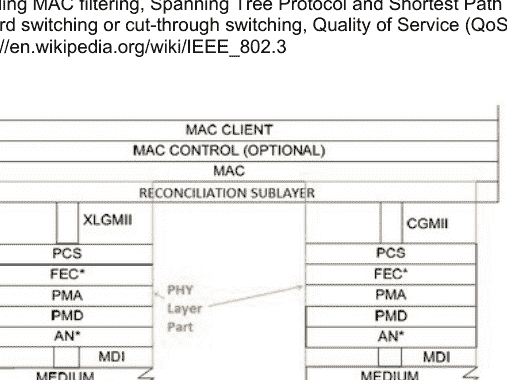

第2 层的 `MAC` 子层不需要处理协议栈内部关于连接器引脚电学特性的细节、光纤的光调制等我们在处理物理介质时完全不需要考虑的事情。

大多数网络课程从未提到过这些——这只是“第2层的后半部分，第1层，线”。我猜他们认为这会让学生的头爆炸，或者去搜索……

## 第2层协议 - 数据链路层的以太网帧

| 前导码 (Preamble) | 帧起始起始 (SFD) | 目的地址 (Destination) | 源地址 (Source) | 类型 (Type) | 帧校验序列 (FCS) |
| --- | --- | --- | --- | --- | --- |
| 7 字节 | 1 字节 | 6 字节 | 2 字节 | 46 – 1500 字节 | 4 字节 |

- 前导码 - 7 字节交替的 1 和 0 位，允许网络设备同步其时钟。传输最低有效位。
- SFD - 1 字节 - 设计用于打破前导码的模式并指示帧的开始。实际上，SFD 可以很容易成为帧的一部分，你将只有 8 字节：前导码：
- 目的地址 (DA) - 6 字节 - 预期接收者的 48 位地址。也可以是广播（BC）或组播（Multicast）。
- 源地址 (SA) - 6 字节 - BC 和 MC 格式是 SA 字段中的格式。
- 802.1Q 标签（可选） - 4 字节 - 以太网 II。
- 长度或类型 - 2 字节 - `IEEE 802.3` 使用长度，但以太网 II 使用类型来标识长度 3 PDU：`IPv6` 使用 `0x06dd`；`0x0800`；`0x8100` 用于 VLAN 标签 (`802.1Q`)；`0x0806` 用于 `ARP`；`0x8647/48` 用于 `MPLS`；`0x88CC` 用于 `LLCID`；`0x0863/64` 用于 `PPPoE`；`0x0802`。
- 数据 - 46-1500 字节 - 这是发送到数据链路层接收器的包。大小可以从 46 到 1500 字节不等（如果不存在 802.1Q 标签且大于 1500 字节）。必要时进行填充。
- 帧校验序列 (FCS) - 算法在每帧帧上运行以匹配数据。如果 CRC 匹配，则该帧被丢弃。`IEEE 802.3` 定义 MTU 为 1500 字节（如果不存在 802.1Q 标签且大于 1500 字节）。如果必要进行填充。
- 头部为 20 字节（此处原文描述混乱，存在冲突）。
- IP 头部为 20 字节。
- TCP 头部为 20 字节。
- UDP 头部为 8 字节。

注：原文中该部分存在大量关于 20 字节、1500 字节及 CRC 描述的重复与逻辑混乱，译文尽可能保留了原文结构但修正了术语对应。

# 第二层 - 交换基础决策及其他问题

`IEEE 802.1D/w` 交换树将端口置于转发或丢弃状态。处于阻塞/丢弃状态的端口不会处理除 `STP` 消息以外的任何消息 - 交换机物理上在阻塞端口接收帧，但会忽略它。

尽管如此，对于所有处于转发状态的端口：

如果目的地址：

- 作为源地址？（过滤）
- 已知？转发到正确的端口
- 未知？将源 `MAC` 地址映射到其端口号。泛洪除入口端口外的所有端口。

地址学习：

- 当进行泛洪时，源 `MAC` 被添加到表中，随后目的地址将被学习到。

对于每个收到的帧，检查源 `MAC` 而不是接口。

- 如果不在表中，将空闲超时计时器置为 0
- 如果在表中，则重置该条目的空闲超时计时器为 0

在新帧出现时，从之前学习的表中获取 `MAC` 到端口的映射，它将被更新。

- `STP` 防止 `MAC` 不稳定（如果由于环路反复错误更新）。

# 第二层转发模式

- 存储转发（Store-and-forward）：接收帧中的所有位并在转发前检查 `FCS`。
- 无分片转发（Fragment-free）：在冲突域帧到达前接收前 64 字节。
- 剪切转发（Cut-through）：检查 `MAC`，尽快转发帧以减少延迟，但不进行 `FCS` 检查（最后版本会检查 `QoS` 和 `ACL`）？

如果被询问，交换机有三种功能：转发、过滤和避免环路（`STP`）。

而转发过滤简单简化为：针对端口 1 的 `MAC` 表，而不是端口 2，转发到端口 1，从端口 2 过滤。

一些人将其视为：

1. 转发：将其发送到正确的端口（带有 `MAC` 地址）
2. 过滤：不发送到其他端口。

# IP 路由基础

路由器转发（数据包）的四步过程：

- 第二层：检查 `FCS` 是否发生错误，丢弃帧。
- 追踪第二层头部和尾部，找到 `IP` 数据包并将其发送到第三层。
- 对比路由表，找到路由器的输出端口（下一跳）。
- 为传出的帧封装新的第二层头部/尾部并转发。（它如何知道目的 `MAC` 的？通过 `ARP` 表）

`IP` 路由的目标：

- 动态学习并填充路由表，以包含网络上要发送的路由。
- 选择并将最佳路由放置在路由表中。
- 注意路由何时不再有效，并将其删除。从邻居节点处获取新路由。
- 快速工作 - 以实现快速的收敛时间和路由更新。
- 防止路由环路。

# 第二层：广播域和冲突域 - `FF:FF:FF:FF:FF`

1. 每个路由器都是一个独立的广播域（一个独立的冲突域）。
2. 交换机（桥）上的每个端口都是一个独立的冲突域。
3. 连接到集线器的所有设备在一个冲突域内（交换机可以划分冲突域）

冲突域：不支持同时发送和接收数据帧（半双工）。

如果设备同时碰撞，会发生冲突，设置阻塞信号（退避），设备计时器尝试重试，这会减慢所有速度。使用 `CSMA/CD` 来协调冲突。

路由器在 `IP` 网络/子网之间传输流量。路由器还隔离广播域。

路由器连接两个网络，每个网络都是自己的广播域。

如果路由器在同一个子网中有两个端口，它们是两个不同的广播域。

由于路由器的：增加冲突域意味着带宽增加。使用集线器（1 个冲突域）时，一次只能有一个 PC 连接，对于额外域网的理论最大容量为 100 Mbps。更换为交换机后，每个链路都实现全双工，有效地将容量翻倍到 2000 Mbps (2Gbps)。

# Ping (数据报分组探测器)

该程序使用数据包数据部分的字母表作为负载，默认通常约为 100 字节，当然，你正在 ping 一个 Windows 设备，它认为字母表是...

# 使用扩展 ping 控制源 IP 地址


```
R1# ping
协议 [ip]
目的地址: 172.16.2.101
重复计数 [5]
数据包大小 [100]
超时时间 [2]
扩展命令 [n]:源地址或接口: 172.16.1.1
服务类型 [0]
头部中设置了 DF [no]
响应有效？[no]
数据模式 (0xBC)
松散、严格、详细[none]
泛洪范围 [n]
```

发送 5 个 100 字节的 ICMP Echo 到 `172.16.2.101`，超时 2 秒：来自源地址 `172.16.1.1` 的成功率为 100% (5/5)，往返最小/平均/最大=2ms

通常在最后你会看到三个值：最小、平均和最大，指示 ICMP 响应。`ping` 成功完成。

- 每行显示超时 - 被访问列表或防火墙拦截，连接性问题。
- 收到 ICMP “不可到达”消息：路径上的路由器未到达目的地。
- 收到 ICMP 源消息：路径上的设备可能接收大量流量。
- 收到 ICMP 超时消息：路由器可能在环路。

# 解密第一个响应

当从路由器 `ping` 直接连接的主机（终端）时，丢失第一个响应是常见现象，如示例所示（可能发生在 `ping` 一个无活动状态的主机时）。实际上，并不是响应丢失，而是因为 ARP 表中没有条目而导致无条件丢弃请求。

# 使用 ping 命令调试 ARP 请求

```
Router2# show arp debug
协议          硬件地址           接口
Internet 10.0.0.6     0016.c7e.8838 ARPA FastEthernet/0
Internet 10.0.0.5     0016.c7e.f150 ARPA FastEthernet/0

Router2# 发送 5 个 100 字节的 ICMP Echo 到 10.0.0.10，超时 2 秒：成功率为 80% (4/5)，往返最小/平均/最大=4ms
08:26:21: IP: 为 ARP 表创建条目:10.0.0.10 FastEthernet/0
08:26:21: IP: 发送请求 序列 1 10.0.0.6 0016.c7e.8838, 目的 10.0.0.0000 FastEthernet/0
08:26:21: IP: arp 响应 序列 1 10.0.0:29a3d, 目的 10.6 FastEthernet/0
```

ICMP 使用一组不同的消息，在执行本地网络测试时特别有用。类型 128 (`echo` 请求) 消息可用于扫描 IPv6 地址。防火墙会丢弃到达距离的包，然后丢弃 TTL 超过目标的包。根据响应，路由器能够映射过滤：

- 如果收到 ICMP 类型 11（传输中超时）消息，包通过了过滤器。
- 如果包被丢弃且没有注释，可能是防火墙执行的。
- 如果收到 ICMP 类型 13（管理禁止）消息，正在使用类似路由器 ACL 的简单过滤器。

如果包被丢弃且没有注释，并不意味着目标主机已丢失。某些防火墙知道数据包即将过期，无论策略是否允许数据包都会发送过期消息。

# Traceroute

`Traceroute` 为每个跳数发送 UDP 数据报 - 首先发送三个 TTL 字段设置为 1 的数据报，导致数据报一遇到第一个路由器就超时，路由器响应 ICMP “时间超时”。接下来再发送三个 TTL 值设置为第二个路由器的包，依此类推，每个跳数递增 TTL。由于这些数据报尝试访问目的地的一个无效端口（默认 `33434`），主机将响应 ICMP “端口不可到达”，从而触发进程结束（Windows 目的使用 ICMP echo 响应）。

在 Cisco 上，不带 IP 地址直接运行 `ping` 或 `traceroute` 允许你使用程序的扩展版本。这种对源 IP 和目的 IP 的查询用于在路由指定的网关之间运行这些程序、排错路由或数据包丢失；将确定连接类型，以缩小问题发生范围。

# Cisco IOS Traceroute 示例

- `Traceroute`
- 路由器 `[ip]`
- 目标 IP 地址: `192.168.40.2`
- 追踪路径的地址。
- 源地址: `172.16.23.2`
- 数字显示 `[n]`
- 超时时间（秒）`[3]`
- 探测计数 `[3]`
- 最小生存时间 `[1]`
- 最大生存时间 `[30]`
- 端口号 `[33444]`
- 松散、严格、记录、时间戳、详细`[none]`
- 输入序列中止。
- 追踪到 `192.168.40` 的路由：
  - `1 172.31.20.16 16ms 16ms`
  - `2 172.16.10.28 28ms 28ms`
  - `3 192.168.40.32 32ms 32ms`

Cisco `Traceroute` 返回这些代码，针对每个节点返回往返时间（毫秒），对应指定的探测次数：

- 经过时间指示 ICMP echo 响应。`ping` 成功完成。
- 每行显示超时 - 被访问列表或防火墙拦截，连接性问题。
- 收到 ICMP “不可到达”消息：路径上的路由器未到达目的地。
- 收到 ICMP 源消息：路径上的设备可能接收大量流量。
- 收到 ICMP 超时消息：路由器可能在环路。

# TCP Traceroute

`tcp` 和 `traceroute` 的工作原理相同。使用前者来执行 TCP `traceroute` 逐渐成为一种新选择，因为需要过滤的内容更少。某些防火墙会拦截“时间超时” ICMP 包。`SYN` 包会出现在 `Traceroute` 中，因为正在等待建立 TCP 连接。当程序看到它将发送作为观察连接一部分的短寿命包时，就可以进行追踪，因为它看到了这些包并知道了 IP 地址、端口和序列号。这些短寿命包经过了调整，不会干扰 TCP 连接（它们本身是无数据的示例“ACK”包，操作系统会直接忽略它们）。

# 简单的路由与交换之旅

`HostA(172.16.10.2)` 跨一个路由器 `ping` `HostB(172.16.20.5)`

注意：此示例忽略了 `ping` 章节中提到的“第一次 `ping` 会发生什么？”的问题

- 1- ICMP `ping` 过程为其回显请求（`echo request`）创建错误，数据字段中仅为字母表。它被交给 IP 形成一个数据包。至少，该数据包包含一个 IP 源地址、一个 IP 目的地址以及一个字段为 01 的协议（`Protocol`）。
- 3- IP 检查目的 IP 地址是本地局域网（LAN）上的设备还是远程网络。如果目的在远程网络上
- 4- 它找到了默认网关（GW） `172.16.10.1`，因此检查 ARP 缓存是否已经解析出 MAC 地址。如果 ARP 缓存中没有 ARP 记录，则会在本地发送针对 `172.16.10.1` 的请求，路由器发送，并用其信息和活动更新缓存。

事实证明 ARP 表中有该记录，因此它是路由器在 `Ethernet0` 上的 MAC 地址，所以其活动状态被设置为 0，然后数据包被交给数据链路层进行封装。

- 5- 带有目的和源 MAC 地址、以太类型（IP 为 `0x0080`）和数据包负载，使用 LAN 驱动程序通过 LAN（以太网）提供介质访问，然后生成帧，并添加 FCS（计算结果）。
- 6- 帧被逐位发送。帧最终进入了网络。
- 7- 冲突域内的所有设备都获取这些位，重组帧，并运行 CRC 来比较 FCS 以检查完整性。如果完整性检查失败，则丢弃（注意：如果我们处于冲突域，则计入此类）。
- 8- 如果通过，检查目的 MAC 是否匹配某一个地址。路由器的 `Eth0` 接收到它，它检查以太类型字段并将数据包交给 IP（如果是目的地的话）。
- 9- 在路由器上，数据包层对其进行检查（不像数据链路层对帧那样运行 CRC）。由于数据包的目的地与路由器接口上的任何地址都不匹配，路由器将查找其路由表。如果没有 `172.16.20.0` 的条目，数据包将被丢弃并返回 ICMP 消息。在这种情况下，找到了数据包目的网络不可达的消息。由于路由器直接发送到 `eth1`（针对目的地），没有协议被路由。
- 10- 当 IP 将数据包交给第二层时，在 ARP 缓存中找到了 `HostB` 地址的 MAC，或者为其发送了 ARP 请求（如步骤 3-6 所示）。我们可以说数据包在封装之前已被交换到缓冲区中。它被封装并发送，就像步骤 5 和 6 一样。帧离开了路由器。
- 11- `HostB` 接收到帧并立即运行 CRC。如果结果与帧中的信息匹配，将将检查硬件目的地址。如果主机发现匹配，最后将检查以太类型字段以确定数据包所属的网络协议（IPv4），并将其向上层栈传递。
- 12- IP 获取数据包，对头部运行 CRC，检查目的地址发现是自己的地址，因此检查协议字段以找到是哪种第 4 协议生成了负载。目的到达！
- 13- 负载交给 ICMP，它表明这是一个回显请求。ICMP 通过立即丢弃数据包并生成一个新的回显作为回复来响应此。
- 14- 创建一个包含源地址、目的地址、协议字段和负载的数据包。现在的目的地是 `HostA`。
- 15- 对 `HostB` 重复步骤 3-6：获取网关 IP 地址、获取网关 MAC、封装它并发送到路由器。
- 16- 路由器的接口接收这些位并构建帧。运行 CRC 并检查 FCS 字段以确保答案匹配。它被交给 IP 并重复步骤 7-10 直到发送回 `HostA`。


- 17- 对路由器而言，设备知道将 `172.16.10.0` 从 `eth0` 发出，而 `172.16.10.2` 的 MAC 已经从路由 IP 传向了 `HostB`，因此它对其进行封装并通过网络发送。（离开路由器）

- 18- 目的主机接收到帧，运行 `CRC`，检查目的 MAC，然后查看以太类型字段，显示它已交给网络，协议字段显示为 `ICMP`，`ICMP` 确定该数据包为 `ICMP` 回显应答。`ICMP` 通过向用户界面发送感叹号 `!` 来确认其已收到回复。`ICMP` 随后尝试向目的主机再发送四个请求。

# 快速子划分示例 - 子网与二进制练习

记住先放置最大的子网。会有多少个主机和多少个子网？

## C 类子划分 - 针对主机的子划分

给定的起始地址是 `192.168.1.0`，要求：

- 一个包含至少 50 个可用地址的子网。
- 两个包含至少 14 个可用地址的子集。

从最大的子网开始。考虑我们的增量：

我们需要 50，因此在 50 处画线：`| 128 | 64 | 32 | 16 | 8 | 4 | 32+16=50`，符合要求。`64` 标记了第一个网络位。我们的块结束于 `192.168.1.64`（我们的广播地址）。子网掩码是多少？未使用的位：`128+64=192`，子网掩码为 `255.255.255.0`。CIDR/前缀长度？`8+8+10=26`。第一部分完成。第二个子网从 `192.168.1.64` 开始：

我们需要 14，因此在 64 处画线：`| 128 | 64 | 32 | 16 | 8 | 4 | 2 | 8+4+2=14`，符合要求。`16` 标记了第一个网络位。新数字 `32`，广播地址是 `192.168.1.191`。子网掩码是多少？未使用的位：`128+64+32+16=240`，子网掩码为 `255.255.255.240`。CIDR/前缀长度？`8+8+12=28`。第二部分完成。第三个子网从 `192.168.1.160` 开始：

再次需要 14：`| 128 | 64 | 32 | 16 | 8 | 4 | 2 | 1 | 8+4+2=14`，这是最后一步。我们的块结束于 `192.168.1.195`（我们的广播地址）。子网掩码是多少？未使用的位：`128+64+32+16=240`，子网掩码为 `255.255.255.240`。CIDR/前缀长度？`8+8+12=28`。所以，第三个子网是 `192.168.1.180`，我们完成了！下一个从 `192.168.1.192` 继续，所以未来有 `192.168.1.192` 的块使用。

你可能在疑惑……子网线画在 64 和 32 之间。`128` 和 `64` 在确定子网掩码和 CIDR 时被计入计数，但 `64` 是块大小，它是第 7 位，而不是第 8 位。为什么？原因是第 7 位被指定划分网络，它是一个网络位。它是从主机位中“借用”的。块大小由画线左侧的数字决定。

## 类子划分 - 针对主机的子划分

给定的起始地址是 `170.70.0`，要求：

- 两个包含 1000 个可用 IP 地址的子网。
- 一个包含 500 个可用 IP 地址的子网。
- 一个包含 100 个可用 IP 地址的子网。

```
128 64 32 16 8 4 1
```

所以我们要的是从 `170.70.0.0`，`255.255.0.0` 开始。

为了制作第一个 1000 个主机的子网，我们需要在图表中使用第三个字节：

```
32768 16384 8192 4096 2048 1024 512 256 128 64 32 16 8 4 2 1
```

`1023` - 符合要求，我们使用它。`1024` 标记了我们的第一个网络位。

这使用了 10 位（第四字节的 8 位 + 第三个字节使用的 2 位）。

`32` 位减去 `22` 位用于网络：`8 6 0 - 170.70.0/22`

在第三字节中画的线到 `1023` 标记。

`2` 的块大小为 `4`，子网掩码为 `255.255.252.0`。广播地址是 `170.70.3`。

第二个子网从 `170.70.4` 开始。

我们需要 1000 个主机，所以这很简单。我们知道这是一个 `/22`（第三字节中的 7 位）。

子网掩码为 `255.255.252.0`。广播地址是 `170.70.7`。

第三个子网从 `170.70.8` 开始。

为了制作 500 个主机的子网：

```
32768 16384 8192 4096 2048 1024 512 256 128 64 32 16 8 4 2 1
```

`511` - 符合要求，我们使用它。`512` 标记了我们的第一个网络位。

这使用了 9 位（第四字节的 8 位 + 第三个字节使用的 1 位）。

`32` 位减去 `23` 位用于网络：`8 7 0 - 170.70.8/23`

在第三字节中画的线到 `511` 标记。

子网掩码为 `255.255.254.0`。广播地址是 `170.70.9`。

第四个子网从 `170.70.10` 开始。

为了制作 100 个主机的子网：

```
32768 16384 8192 4096 2048 1024 512 256 128 64 32 16 8 4 2 1
```

`127` - 符合要求，我们使用它。`128` 标记了我们的第一个网络位。

这使用了 7 位（第四字节的 0 位 + 第三个字节使用的 7 位）。

`32` 位减去 `25` 位用于网络：`8 8 8 1 - 170.70.10/25`

子网掩码为 `255.255.255.128`。广播地址是 `170.70.10.127`。

## B 类子网划分 - 网络子网划分

我们得到一个 B 类：`140.78.0.255/255.255.0`，要求 29 个网络。为 NetID 增加 2，BC 得到 31。

第一个问题！需要多少位？`1+2+4+8+16=31`，使用了 5 位。

数出 5 位（左侧的网络部分）并从主机位借用来扩展网络位：

`32768 16384 4096 2048 1024 512 • 128 64 32 16 8 4 2 1`

我们新的起始子网掩码将变为 `255.255.248.0`（这 5 位）

这是我们的第一个网络 - `140.78.8.0`

```
140.78. 0 0 0 0 1 0 0 • 0 0 0 0 0 0 0
```

这是我们的第一个网络的广播地址 - `140.78.155`

```
140.78. 0 0 0 1 1 1 1 • 1 1 1 1 1 1
```

在网络部分（左侧）二进制位进加 1 - `140.78.16.0`

```
140.78. 0 0 0 1 0 0 0 • 0 0 0 0 0 0 0
```

这是我们的第二个网络的广播地址 - `140.78.235`

```
140.78. 0 0 1 0 1 1 1 • 1 1 1 1 1 1
```

在网络部分二进制位进加 1。这是我们的第三个网络 - `140.78.24.0`

```
140.78. 0 0 1 1 0 0 0 • 0 0 0 0 0 0 0
```

这是我们的第三个网络的广播地址 - `140.78.31.255`

```
140.78. 0 0 1 1 1 1 1 • 1 1 1 1 1 1
```

在网络部分二进制位进加 1。这是我们的第四个网络 - `140.78.32.0`

```
140.78. 0 1 0 0 0 0 0 • 0 0 0 0 0 0 0
```

这是我们的第四个网络的广播地址 - `140.78.39.255`

```
140.78. 0 1 0 0 1 1 1 • 1 1 1 1 1 1
```

...以此此类推。我们开始看到这种模式 - 8 的倍数，分割线给我们提供了块大小。

| Net ID | 第一个地址 | 最后一个地址 | 广播地址 |
|---|---|---|---|

| 140.78.8.0 | 140.78.8.1 | 140.78.155 | 140.78.155 |
| 140.78.16.0 | 140.78.16.1 | 140.78.235 | 140.78.235 |
| 140.78.24.0 | 140.78.24.1 | 140.78.31.255 | 140.78.31.255 |
| 140.78.32.0 | 140.78.32.1 | 140.78.39.255 | 140.78.39.255 |

你可以分出的最后一个网络是什么？`140.78.240.0`：

```
140.78. 1 1 1 1 0 0 0 • 0 0 0 0 0 0 0
```

它的广播地址是 `140.78.247.255`

```
140.78. 1 1 1 1 1 1 1 • 1 1 1 1 1 1
```

## 子网划分 - 网络子网划分 - 示例 2

我们得到一个 B 类：`150.9.0.0`，BC: `255.255.0`

我们要求 10 个网络 - 增加 2 = 12 位。

需要多少位？数左侧 - 魔数是 16。

我们新的子网掩码将是 `255.255.240.0`（5 位）。

```
32768 16384 8192 4096 2048 1024 512 256 * 64 32 16 8 4 2 1
```

这是我们的第一个网络 - `150.9.16.0`

```
150.9. 0 0 1 0 0 0 • 0 0 0 0 0 0
```


这是我们第一个网络的广播地址 - 150.9.31.255

```
150.9. 0 0 1 1 1 1 1 • 1 1 1 1 1
```

在发现我们的网络时，我们看到 8 位的重复是相同的，但块是 16。

| Net ID | 第一个地址 | 最后一个地址 | 广播地址 |
|---|---|---|---|
| 150.9.0.0 | 150.9.0.1 | 150.9.15.254 | 150.9.15.255 |
| 150.9.16.0 | 150.9.16.1 | 150.9.31.255 | 150.9.31.255 |
| 150.9.32.0 | 150.9.32.1 | 150.9.47.254 | 150.9.47.255 |
| 150.9.48.0 | 150.9.48.1 | 150.9.63.254 | 150.9.63.255 |
| 150.9.64.0, 150.9.96.0, 150.9.112.0, 150.9.128.0, 150.9.144.0, 150.9.160.0...

## 第四个字节的子网...

如果我们处理的是 10 个网络而不是 4 个怎么办？我们该如何处理子网掩码？记住我们得到 B 类：150.9.0.0

```
32768 16384 8192 4096 2048 1024 512 256 * 64 32 16 8 4 2 1
```

这是我们的第一个网络 - 150.9.0.0

```
150.9. 0 0 1 0 0 0 • 0 0 0 0 0
```

| Net ID | 第一个地址 | 最后一个地址 | 广播地址 |
|---|---|---|---|
| 150.9.0.0 | 150.9.0.1 | 150.9.0.62 | 150.9.0.63 |
| 150.9.64.0 | 150.9.64.0 | 150.9.126 | 150.9.127 |

使用（第 7 位），因为我们需要 7 个子网，我们从第四个字节借用，它看起来像 C 类，但我们最终可以通过字节的第一个顺序（15）看出是 B 类，但它是子网掩码的网络边界。

## B 类子网划分 - 主机子网划分 - 复习

我们得到 B 类：160.12.0，BC: 255.255.0。要求 480 个主机，所以增加 2 = 10 位。

所以我们需要 12 位 - 从右侧数

```
32768 16384 8192 4096 2048 1024 512 256 * 64 32 16 8 4 2 1
```

子网掩码是 240 (128+64+32+16)，“魔数”是 16

160.12.0..., 160.12.255

160.12.16.0..., 160.12.31.255

160.12.32.0, 160.12.48.0, 160.12.64.0, 等

## C 类子网划分 - 网络子网划分 - 复习

我们得到 150.9.6.0 来划分 25 个子网 - 它是 5 位 - 从左侧数。

CIDR 为 /29 和 255.255.255.248。网络 ID 为 150.9.6.8, 150.9.16.8, 150.9.32.8, 150.9.64.0...

## 可变子网掩码 - VLSM

规则 1：始终从大到小划分网络，起始地址为 172.16.0.0。我们需要 4 个子网，分别有 8000、1000、400 个主机。第一个 8000 个主机 - 需要多少位？从右侧数：32768 16384 8192 4096 2048 1024 512 256 * 64 32 16 8 4 2 1

```
172.16.0.001000000000
```

172.16.0.0/19 且下一个网络 ID 是 172.16.32.0。所以第一个 VLSM 块是 172.16.0/19，掩码为 255.255.224.0，广播地址为 172.16.31.255

第二个网络：1000 个主机。现在位于 1024 和 512 之间（10 位）。根据使用情况，你可以保留第一个网络的掩码，但我们的线移动到新位置。我们从 172.16.32.0 开始

```
172.16.0.000000000000
```

这个 VLSM 块是 172.16.32.0/22，掩码为 255.255.252.0，广播地址为 172.16.35.255

第三个网络：400 个主机 - 起始于 172.16.36.0

```
172.16.0.000101000000
```

对之前的标记进行同样的操作。线位于 256 和 512 之间。这是一个 /23 子网 (8+8+7)。我们知道 32+4=38，下一个网络 ID 是 172.16.38.0。这个 VLSM 块是 172.16.36.0/23，掩码为 255.255.254.0，广播地址为 172.16.39.255

第四个网络：100 个主机 - 起始于 172.16.38.0

```
172.16.0.0001011000000000
```

线位于 128 和 64 之间，我们不从第四个字节借用。这是一个 /25 子网 (8+8+9)。这是下一个网络 ID。这个 VLSM 块是 172.16.38.0/25，掩码为 255.255.255.128，广播地址为 172.16.38.125

| Net ID | 第一个地址 | 最后一个地址 | 广播地址 |
|---|---|---|---|
| 8000 | 172.16.0.0 | 172.16.31.254 | 172.16.31.255 |
| 1000 | 172.16.32.0 | 172.16.35.254 | 172.16.35.255 |
| 400 | 172.16.36.0 | 172.16.37.254 | 172.16.37.255 |
| 100 | 172.16.38.0 | 172.16.38.124 | 172.16.38.125 |

## 可变子网掩码 - VLSM #2

140.58.0.0 是我们的起始 IP；我们需要足够大的来覆盖这些主机：7000、2500、1800；我们需要 5 个 900 的块。第一个网络：7000 个主机 - 需要多少位？从右侧数：32768 16384 8192 4096 2048 1024 512 256 64 32 16 8 4 2 1

这是一个 /19 子网 (8+8+3)。这个 VLSM 块是 140.58.0.0/19，掩码为 255.255.224.0，广播地址为 140.58.31.255

第二个网络：2500 个主机。现在位于 2048 和 4096 之间（12 位）。这是一个 /20 子网 (8+8+4)，32 + 16 (4) 是下一个网络 ID。这个 VLSM 块是 140.58.32.0/20，掩码为 255.255.240.0，广播地址为 140.58.47.255

第三个网络：1800 个主机。现在位于 1024 和 2048 之间（11 位）。这是一个 /21 子网 (8+8+5)，32 + 16 + 8 (6) 是下一个网络 ID。这个 VLSM 块是 140.58.48.0/21，掩码为 255.255.248.0，广播地址为 140.58.55.255

第四个网络：900 个主机。现在位于 512 和 1024 之间（10 位）。这是一个 /22 子网 (8+8+6)，32 + 16 + 8 + 4 (6) 是下一个网络 ID。这个 VLSM 块是 140.58.56.0/22，掩码为 255.255.252.0，广播地址为 140.58.59.255

第五个网络：900 个主机。线位于 512 和 1024 之间（10 位）再次（第四个网络已经改变了一个 4 到图表）。

好-我们需要画出我们的线，但它已经在我们需要放置的位置了。初始变了，所以一个 4 到网络。线号只是一个有助于跟踪情况的工作空间，所以不是大问题。

这是一个 /22 子网 (8+8+6)。32 + 16 + 8 + 4 * 4 (6) 是下一个网络 ID

这个块是 140.58.60.0/22，掩码为 255.255.252.0，广播地址为 140.58.63.255

继续，我们有一个网络 ID 为 140.58.60.0：

140.58.60.0

第六个网络：500 个主机。范围在 256 到 512 之间（9 位）

32768 16384 8192 4096 2048 1024 512 128 64 32 16 8 4 2 1

这是一个 /23 子网（8+8+7）。下一个 ID 是 64+2 (6)。

VLSM 模块块为 140.58.64/23，掩码为 255.255.254.0，广播地址为 140.58.63.255。

所以我们有一个网络 ID 为 140.58.60.0：

140.58.60.0

第七和第八个网络：每个 7 个主机。我们正在缩小到第四个字节的边界。假设性地，你可以问这是否是一个不需要保留网络 ID 和 BC 地址的对点网络，或者干脆把它们包含进去省去交流的麻烦。我选择后者（2 个 IP 地址，共 4 个，没什么大不了）。

128 64 32 16 8 4 2 1


有 `/30` 子网（8+8+8+6）。现在在第四个字节中，我们的 ID 是 `140.58.66.0`（包含 `.1` 和 `.2` 主机以及 BC），以及 `140.58.66.4`（包含 5, 6 和 7 个主机）。

| 主机数 | 网络 ID | 最后地址 | 广播地址 |
|---|---|---|---|
| 7000 | 140.58.0.0 | 140.58.31.255 | 140.58.31.255 |
| 2500 | 140.58.32.0 | 140.58.47.255 | 140.58.47.255 |
| 1800 | 140.58.48.0 | 140.58.55.255 | 140.58.55.255 |
| 900 | 140.58.60.0 | 140.58.59.255 | 140.58.59.255 |
| 900 | 140.58.60.0 | 140.58.63.255 | 140.58.63.255 |
| 500 | 140.58.64.0 | 140.58.64.255 | 140.58.64.255 |
| 2 | 140.58.66.0 | 140.58.66.3 | 140.58.66.3 |
| 2 | 140.58.66.4 | 140.58.67.7 | 140.58.67.7 |

下一个网络将从 `140.58.68.8` 开始。

`/30` 是我们能提供的、为孤立连接耦合创建微型网络的最小网络。在实践中，你会听到关于 `/31` 运行良好的说法（只需要 2 个地址），但 Cisco 不认可这一点。`/31` 在生产环境中可能有效，但在考试中是错误的答案。

`140.58.0.0` 是我们的 B 类网络。我们需要 7000 个主机，得到了 8192。同样，我们需要 2500 个主机，得到了 4096 以备未来增长。所有网络都有开销，唯一的障碍可能是我们需要向网络添加 2 个路由，在这种情况下可以轻松地处理成千上万主机的 VLSM `/22` 划分。这些信息在 `https://www.youtube.com/user/` 的视频非常简单，不需要更多记忆。白板演示：

| 128 | 64 | 32 | 16 | 8 | 4 | 2 |
| 32768 | 16384 | 8192 | 4096 | 2048 | 1024 | 512 | 128 | 64 | 32 | 16 | 8 | 4 |

使用二进制： 1，其他为 0（见下文）。地址 `192.168.100.115` 掩码为 `255.255.255.240` 的网络是多少？

```
192.168.100.115 = 11000000.10101000.01100100.01110111
255.255.255.240 = 11111111.11111111.11111111.11100000
AND 结果 = 11000000.10101000.01100100.00000000 = 192.168.100.160（这是我们的子网）。
```

分离网络位和主机位。`255.255.255.248` = 前 24 位是网络位，所以后 8 位是主机位。将所有主机位改为 1，所以是 `10111111` = `192.168.100.167`。`192.168.100.164` 的广播地址是 `192.168.100.167`，当子网掩码为 `255.255.255.248` 时。

`131.188.27` 属于哪个子网，如果其子网掩码是 `255.255.255.240`？根据两个快捷规则，答案应该是 `131.188.0.0`。现在你需要将一个数字转换为二进制以进行 AND 运算：

```
27 = 00011011
240 = 11110000
```

因此，地址是 `131.188.0`。

## 这属于哪个子网？

`192.168.12/29` 属于哪个子网？我们的掩码是 `/29`。下一个边界是 32。所以 `32-29 = 2^3 = 8`，我们将其作为块大小，即 2 的 3 次方等于 8。

我们从最后一个字节借用了位，因为最后一位在列表中。我们从 0 开始按块大小计数：

`192.168.12.0`

`192.168.12.8`

`192.168.12.16`

...

`192.168.12.72`

`192.168.12.80`

我们的地址是 `192.168.12.78`，它必须位于 `192.168.12.72`。

`172.16.116.4` 属于哪个子网？我们的掩码是 `/19`，下一个边界是 24。因此 `24-19 = 5`。块大小为 `2^5 = 32`。我们从第三个字节借用了 5 位，所以在第三个字节中计数块大小。子网是：

`172.16.0.0`

`172.16.32.0`

`172.16.64.0`

`172.16.96.0`

`172.16.128.0`

`10.34.67.24` 属于哪个子网？我们的掩码是 `/12`。下一个边界是 16。因此 `16-12 = 4`。块大小为 `2^4 = 16`。我们从第二个字节借用了 4 位，所以我们在第二个字节中计数块大小。子网有：

`10.0.0.0`

`10.16.0.0`

`10.32.0.0`

`10.48.0.0`

我们的地址 `10.34.67.24` 必须位于 `10.32.0`。

## 子网有效范围

`192.168.10.0/28` 第 N 个子网的有效范围是多少？块大小为 16，因为 `32-28 = 4` 且 `2^4 = 16`。在最后一个字节中计数块大小。子网有：

`192.168.10.0`

`192.168.10.16`

`192.168.10.32`

`192.168.10.48`

`192.168.10.64`

第 4 个子网是 `192.168.10.48`，主机范围必须是 `192.168.10.49` 到 `192.168.10.62`，记住不能包含子网地址。

`192.16.0.0/17` 第 1 个子网的有效范围是多少？块大小为 128，因为 `24-17 = 7` 且 `2^7 = 128`。我们借用了第三个字节，因为 17 是第三个字节。子网有：

`192.16.0.0`

`192.16.128.0`

第一个子网是 `192.16.0.0`，有效范围是 `192.16.0.1` 到 `192.16.127.254`，你不能包含子网地址和广播地址（`192.16.127.255`）。

`10.0.0.0/14` 第 7 个子网的有效范围是多少？块大小为 4，因为 `16-14 = 2` 且 `2^2 = 4`。我们在第二个字节中借用，所以按块大小计数 7 次得到第 7 个子网。第七个子网是 `10.24.0.0`，有效范围必须是 `10.24.0.1` 到 `10.27.255.254`，不包含子网地址（`10.24.0.0`）和广播地址（`10.27.255.255`）。

点分进制掩码？块大小是多少？

`255.255.192.0` 的掩码——你只需计算 `256-192 = 64`（在第三个字节）。

或者 `255.224.0.0` 块大小为 `256-224 = 32`（在第二个字节）。

问题：你正在为 `10.0.0.0` 网络设计子网掩码。你需要 3800 个子网，每个子网多达 3800 个主机。答案：`255.255.240.0`。

问题：从 `17.29.0.0 255.255.254.254` 网络可以获得多少个子网和主机端口？答案：128 个子网和 510 个主机。

只需记住每个位数可以获得多少项（减去两个用于主机）：

```
0000000001 = 2 (1)
0000000011 = 4 (2)
0000000111 = 8 (3)
0000001111 = 16 (4)
0000011111 = 32 (5)
0000111111 = 64 (6)
0001111111 = 128 (7)
0011111111 = 256 (8)
0111111111 = 512 (9)
1111111111 = 1024 (10)
11111111111 = 2048 (11)
111111111111 = 4096 (12)
```

如果你记不起某个数字，只需记住它是前一个数字的倍倍（或者在倒数时是后一个数字的一半）。这里不涉及数学计算、技巧等。

所以对于第一个问题，你两个都需要 12 位，因为该值在 2048 和 4096 之间（你显然必须选择较大的值）。

你可以以同样的方法看待另一个问题。B 类网络的 `/23` 会给你 7 位子网位和 9 位主机位。7 位是 128，9 位是 512（减去 2 得到 510）。

# 子网快速参考图

由 Tristan Mendoza 构建


CIDR 是使用的比特数。`255.255.255.192`, `255.255.255.224`, `255.255.255.240`, `255.255.255.248`, `255.255.255.252`, `255.255.255.255`。许多老师和某些考试要求你学会如何进行此操作：每个子网的主机计算：`2^n-2`（n 为主机数）。子网使用数=`2^n`，具有 N 个主机。如果你知道如何在帮助下划分二进制位，那么通过此表更容易理解你需要的什么大小。从掩码可以获得网络 CIDR 数字。例如，从掩码 `255.255.255.192` 中可以得到 0, 64, 128 和 192 网络号。因此 `255.255.255.192` 的 CIDR 为 26。由于有 6 个比特，我们每个子网得到 `2^6-2` 个可用主机。记住网络号：给你的较大数字加 1，如下所示：192+1=193, 224+1=225, 240+1=241。

| 普通比特 / 子网 | 128 | 64 | 32 | 16 | 8 | 4 | 2 | 1 |
| --- | --- | --- | --- | --- | --- | --- | --- | --- |
| 2 的幂 | 7 | 6 | 5 | 4 | 3 | 2 | 1 | 0 |
| 每个子网的主机数 | 126 | 62 | 30 | 14 | 6 | 2 | 0 | 0 |
| 小型子网掩码 | 128 | 192 | 224 | 240 | 248 | 252 | 254 | 255 |

### C 类子网

| /25 | /26 | /27 | /28 | /29 | /30 | /31 |
| --- | --- | --- | --- | --- | --- | --- |
| 每个子网的主机数 | 62 | 30 | 14 | 6 | 2 | 0 | 0 |
| 子网数 | 4 | 8 | 16 | 32 | 64 | 128 | 不适用 |

### B 类 CIDR (第4个子网)

| /17 | /18 | /19 | /20 | /21 | /22 | /23 | /24 |
| --- | --- | --- | --- | --- | --- | --- | --- |
| 每个子网的主机数 | 131070 | 65534 | 32766 | 16384 | 8192 | 4096 | 2048 | 1 |
| 子网数 | 2 | 4 | 8 | 16 | 32 | 64 | 128 | 256 |

### B 类 CIDR (第5个子网)

| /25 | /26 | /27 | /28 | /29 | /30 | /31 |
| --- | --- | --- | --- | --- | --- | --- |
| 每个子网的主机数 | 512 | 254 | 126 | 62 | 30 | 14 | 0 |
| 子网数 | 8 | 16 | 32 | 64 | 128 | 256 | - |

### A 类 CIDR (第2个子网)

| /9 | /10 | /11 | /12 | /13 | /14 | /15 | /16 |
| --- | --- | --- | --- | --- | --- | --- | --- |
| 每个子网的主机数 | 2097150 | 1048574 | 524286 | 262142 | 131070 | 65534 | 32766 | 16384 |
| 子网数 | 128 | 64 | 32 | 16 | 8 | 4 | 2 | 1 |

### A 类 CIDR (第3个子网)

| /17 | /18 | /19 | /20 | /21 | /22 | /23 | /24 |
| --- | --- | --- | --- | --- | --- | --- | --- |
| 每个子网的主机数 | 32766 | 16384 | 8192 | 4096 | 2048 | 1024 | 512 | 256 |
| 子网数 | 128 | 64 | 32 | 16 | 8 | 4 | 2 | 1 |

### 默认设置

| 类 | 起始网络 | 比特数 | 主机数 | 默认掩码 | CIDR |
| --- | --- | --- | --- | --- | --- |
| A | 0.0.0.0 | 8 | 16777216 | 255.0.0.0 | /8 |
| B | 128.0.0.0 | 17 | 65536 | 255.255.0.0 | /17 |
| C | 192.0.0.0 | 24 | 256 | 255.255.255.0 | /24 |
| D | 224.0.0.0 | 28 | 2 | 255.255.255.0 | /28 |

使用 CIDR 信息的主要原因是为了将 `0.0.0.0` 的地址空间想象为空。在掩码框中，使用人类可读的模式（例如 `10.x.x`）。每个子网需要 8 个比特。

### 使用右侧的图表

我们有一组：`0.0.0.0`，掩码 `255.255.255.0`。我们需要 60 个主机，以便 `2^6=62` 个主机；这里从右侧提供：

`0.0.0.0/26`

128 64 32 16 8 4 2 1

子网：`0.0.0.0/26` (`0.0.0.0-0.0.0.63`)

### C 类子网划分

我们有 `0.0.0.0` 来制作子网，以便 `2^5` 且它是 27。

`0.0.0.0/27`

CIDR 是 27 和 `255.255.255.224`。

网络 ID 为 `0.0.0.0`, `0.0.0.32`, `0.0.0.64`。

### 主机子网划分

我们有 `0.0.0.0` 并且 60 个主机 + `2^6` = 62 个比特来构建这个计数：

`0.0.0.0/26`

128 64 32 16 8 4 2 1

子网：`0.0.0.0/26` (`0.0.0.0-0.0.0.63`)

# IPv6 概述

- IPv6 核心协议定义 RFC 2460
- RIPng, EIGPv6, OSPFv3, ICMPv6, traceroute6, ping, MP-BGP4
- ARP 被邻居发现、重复地址检测、多点发现和路由器公告

# IPv6 编号总结：

每个字符是 4 比特，十六进制，每 4 比特一个块（四分之一）。通常，IPv6 地址使用冒号引用特定的长度或部分。此图显示了 IPv6 地址的结构，以演示位排序 0-128 比特。

/ /16 /32 /64 /128

X X X X X X X X X X X X X X X X X X X X X X X

所以，前缀 IPv6 地址将第 48 位置零，我们可以说类似于 `2001:1234:5678::48`（使用了多少比特）。

你会看到 IPv6 地址经常被缩写。以下是工作原理：

- 扩展后的地址：`2001:0db8:0000:0000:ff00:0042`
- 通过删除每 4 位十六进制数字内的任何前导零，0DB8 变成 DB8，0042 变成 42：`2001:db8::ff00:42`
- 重复的零组被双冒号 (`::`) 替换。每个地址只能这样做，对较大的组或在相等时进行操作。现在我们有了 `2001:db8::ff00:42`。
- 这是一种风格而非缩写：将所有字母小写。这既有助于阅读也有利于大小敏感性。最后我们得到 `2001:db8::ff00:42`。

# 地址类型

如果问及三种类型的 IPv6 地址，预期答案是单播 (`unicast`)、组播 (`multicast`) 和任播 (`anycast`)。最重要的是从单播开始，有三种类型，一种在路由器上，另外两种具有本地范围。它也是组件最多的类型，因此使得其他变得更容易。

# 全局单播 (GUA)

| 8 比特 | 24 比特 | 64 比特 |
| --- | --- | --- |
| IANA 格式 | 服务提供商 | 接口 ID |
| 预留 | 未来使用 | |

X X X X X X X X X X X X X X X X X

“任意拓扑”又称“站点拓扑”

所以，使用全局单播作为起点，`2001:db8:56a4:0001:0000:0000` 是 `2001:db8::56a4`。

全局单播是可路由的，三种类型，一个在路由器上，另外两个具有本地范围。它也是组件最多的类型，因此使得其他变得更容易。


全局单播是可路由的，三种类型，一个在路由器上，另外两个具有本地范围。它也是组件最多的类型，因此使得其他变得更容易。

## 唯一本地地址 (ULA)

`CIDR` 是 `27` 和 `255.255.255.224`。

网络 ID 为 `0.0.0.0`, `0.0.0.32`, `0.0.0.64`。

链路本地 (Unicast), `fe80::/10`

# 主机地址寻址：SLAAC 与 IPv6 (RFC 2373)

无状态自动配置 (`SLAAC`) 允许主机自行生成唯一地址。为此，路由器会定期发送路由通告 (`RA`)，也可以发送路由请求 (`RS`) 来触发 `RA`。`RA` 包含了要使用的前缀、长度以及默认网关。在使用地址之前，主机会使用重复地址检测 (`DAD`) 来确保其唯一性。由于 `RA` 中不包含 DNS 服务器，因此仍在使用 `DHCPv6`。（在 `IPv6` 中，`DAD` 取代了 `ARP`）

对于接口，主机使用来自接口 `MAC` 地址（最有可能）的 `EUI-64`（扩展唯一标识符），也可以可选地生成它。`EUI-64` 的创建方法如下：

- 1. 将（12 位十六进制的）`MAC` 地址从中间拆分。
- 2. 在两部分之间插入 `FFEFE`。
- 3. 反转每个字节的第三位。

示例：

接口 `MAC` 地址为 `aaa12:bbcc:d1234`

`10101010` 代表 `MAC` 地址的前 8 位 (`aa`) - 第 7 位变为 `10101000`。

`RA` 为 `A8`，`EUI-64` 为：`2001:0db8:0:1a812:bbcc:fe1234` `EUI-64`

`MAC` 地址 `03b4:ba:1234`

二进制中的 `0` 为 `00000011`，即 `MAC` 地址的前 8 位，它变为 `00000001`

`RA` 为 `06`，`EUI-64` 为：`2001:0db8:0:1934:baff:fe12:1234` `EUI-64`

生成 `EUI-64` 通常由系统自动为你完成：

`ipv6 address 2001:0db8:1111:1111::64 eui-64`

```
interface GigabitEthernet0/0
 ipv6 address 2001:0db8:1111:1111::64 eui-64
interface serial0/0
 ipv6 address 2001:0db8:1111:2::64 eui-64
 show ipv6 interface brief
fe80::ff:fe01:101 <---link-local, eui64
2001:0db8:1111:1:0:fe:01:101 <---EUI64 global unicast address
Serial0/0 (up/up)
fe80::ff:fe01:101
2001:0db8:1111:2:0:ff:fe01:101
```

## Cisco 路由器，设置 SLAAC

```
enable
Router#configure terminal
Router(config)#ipv6 interface
Router(config-if)#ipv6 unicast-routing
Router(config-if)#ipv6 address [prefix]/prefix-length
Router(config-if)#no shutdown
```

### EUI-64 的问题

有人指出，如果有人知道该设备的 `EUI-64` 标识符，用户将无法直接连接到任何网络，这可能会被利用，因为网站和应用程序可以使用特定设备的 `IPv6` 标识符（无论是恶意的、监控的还是良性的）。建议如果主机或路由器不支持带有随机标识符的自动配置，则应使用静态 `IPv6` 地址。（`MS Windows` 默认为 `SLAAC` 生成随机 ID）

关于如何制作随机 ID 而不是使用 `EUI-64` 的最佳答案：

`https://superuser.com/questions/243669/how-to-avoid-mac-address-when-using-ipv6`

## C IOS 中的无状态和有状态 DHCPv6

无状态模式不在 `RA` 中提供网络信息（由 `SLAAC` 提供的 `IPv6` 地址）。

- `DNS` 服务器信息和其他 `DHCP` 选项。

```
ipv6 unicast-routing
ipv6 dhcp pool ipv6_DHCP
address prefix 2001:0db8:5::64
domain-name cisco.com
dns-server 2001:0db8:6::1
interface Vlan20
description IPv6-DHCP-Stateful
ip address 192.168.20.1 255.255.255.0
ipv6 nd no-config-flag
ipv6 dhcp server ipv6_DHCP
ipv6 address 2001:0db8:0:20::64
```

有状态 `DHCPv6` 替客户端分配 `IPv6` 地址：

```
ipv6 unicast-routing
ipv6 dhcp pool ipv6_DHCP
address prefix 2001:0db8:5::/64
domain-name cisco.com
dns-server 2001:0db8:6::1
interface Vlan20
description IPv6-DHCP-Stateful
ip address 192.168.20.1 255.255.255.0
ipv6 nd managed-config-flag
ipv6 nd other-config-flag
ipv6 dhcp server ipv6_DHCP
ipv6 address 2001:0db8:0:20::64
```

在外部实现 `DHCPv6` 的 Cisco IOS 配置：

```
ipv6 unicast-routing
domain-name cisco.com
dns-server 2001:0db8:6::1
interface Vlan20
description IPv6-DHCP-Stateful
ip address 192.168.20.1 255.255.255.0
ipv6 nd no-advertise
ipv6 nd managed-config-flag
ipv6 nd other-config-flag
ipv6 dhcp relay 2001:0db8:0:20::2
```

## C IOS 中的 IPv6 路由

静态路由：


```
ipv6 unicast-routing
interface serial0/0
no ip address
ipv6 address 2001:0db8:1111:4::64
interface serial0/1
no ip address
ipv6 address 2001:0db8:1111:5::64
interface gigabitethernet/0
no ip address
ipv6 address 2001:0db8:1111:1::64
```

带下一跳跳的静态 IPv6

第一条命令在 R1 上。R2 的全局单播地址：

```
R1(config)#ipv6 route 2001:0db8:1111:2::64 2001:0db8:1111:4::2
```

此命令同样在 R2 上。R1 的全局单播地址：

```
R2(config)#ipv6 route 2001:0db8:1111:1::64 2001:0db8:1111:4::1
```

使用 `show ipv6 static` 验证路由

默认路由：

```
R1(config)#ipv6 route ::0 serial0/0
```

(img/4541df2c9832b90a6df6c29f86148_0.png)

```
show ipv6 route
show ipv6 static
show ipv6 route local
```

OSPFv3 路由 - 位于接口

```
ipv6 unicast-routing
interface serial0/0
no ip address
ipv6 address 2001:abcd:1234:4::64
interface serial0/0
no ip address
ipv6 address 2001:abcd:1234:5::64
interface GigabitEthernet0/0
no ip address
ipv6 address 2001:abcd:1234:5::64
ipv6 router ospf 1
router-id 1.1.1
interface serial0/0
ipv6 ospf 1 area 0
interface gi0/0
ipv6 ospf 1 area 0
ipv6 unicast-routing
ipv6 router ospf 2
router-id 2.2.2
interface serial0/1
ipv6 address 2001:abcd:1234:4::62
ipv6 ospf 2 area 0
interface gi0/0
ipv6 address 2001:abcd:1234:2::62
ipv6 ospf 2 area 0
```

```
show ipv6 ospf
show ipv6 protocols
show ipv6 ospf interface
show ipv6 ospf interface brief
show ipv6 ospf neighbor
show ipv6 ospf database
show ipv6 route
```

# IPv6 子划分

在 IPv4 中，子划分是为了获取更多地址，但它更多是网络组织方面的问题。在 IPv6 中，我们从 RIR（区域注册机构）购买了大量空间，建议长度为 `/32-48`，这些可以划分为多个 `/64` 子网。不建议使用大小为 `/64 (/48 或 /96)` 的子网，因为地址重配置等 IPv6 功能需要在 `/64` 子网。

| 前缀 | 外观 | 主机数量 |
|---|---|---|
| /32 | xxxx:xxxx:xxxx:xxxx: | $2^{32}$ | 4294967296 |
| /36 | xxxx:xxxx:xxxx:xxxx: | $2^{28}$ | 268435456 |
| /40 | xxxx:xxxx:xxxx:xxxx: | $2^{24}$ | 16777216 |
| /44 | xxxx:xxxx:xxxx:xxxx: | $2^{20}$ | 1048576 |
| /48 | xxxx:xxxx:xxxx:xxxx: | $2^{16}$ | 65536 |
| /52 | xxxx:xxxx:xxxx:xxxx: | $2^{12}$ | 4096 |
| /56 | xxxx:xxxx:xxxx:xxxx: | $2^{8}$ | 256 |
| /60 | xxxx:xxxx:xxxx:xxxx: | $2^{4}$ | 16 |
| /64 | xxxx:xxxx:xxxx:xxxx: | $2^{0}$ | 1 |

# 基础 VLAN 管理

最佳实践要求始终拥有分离的 VLAN、数据 VLAN、原生 VLAN（Native VLAN）、黑洞 VLAN（Black Hole VLAN）以及控制面 VLAN（VLAN1）。首先，我们需要讨论一下这些是什么。

## 默认 VLAN 与控制面

默认 VLAN 是交换机恢复到出厂默认设置时，所有端口均所属的 VLAN。交换机的默认设置确实就是字面意思，仅此此意——出厂默认设置。

Cisco 交换机的默认 VLAN 是 VLAN 1，且你无法移除或删除它。然而，根据最佳实践，建议将这些规则移动到独立的标识 VLAN 中。这样做之后，交换机将阻止所有来自 VLAN 1 的流量，仅允许在 VLAN 1 上运行控制协议（DTP、VTP、PRP、CDP 等）。即使你将 VLAN 1 用于中链路（Trunks），这些协议也会使用 VLAN 1 进行控制通信。

考虑将 VLAN 1 作为二层流量的默认值，不支持任何其他流量。

## 管理 VLAN

管理 VLAN 定义用于通过 HTTP、Telnet、SSH 控制交换机的访问能力，同时也包括 SNMP 和 Syslog。以下是为什么从安全角度来看将其分离至关重要。

## 原生 VLAN - 未标记帧

原生 VLAN 是 802.1q 链路中用于传输未标记流量的计数，同时也作为链路两端的通用标识符。来自未分配到特定 VLAN 端口的流量将是未标记的，同时也作为某些遗留 VLAN 流量。它应该与交换机定义的其他所有 VLAN 分离且独立。

默认情况下，原生 VLAN 总是未标记的，但交换机上有一个命令可以设置交换机对所有 VLAN 进行标记，包括：

- 可以在链路的任一端设置，使用 `switch native trunk vlan-id`。
- 如果链路两端的原生 VLAN 不同，将意外导致帧从一个 VLAN 泄露到另一个 VLAN。
- 如果你的网络**真的**一团糟，原生 VLAN 的数量可以与交换机上的端口数量相等！
- 对于链路本身，没有限制。我们每个端口只能配置一个原生 VLAN。然而，具有多个端口的交换机可以为该端口指定不同的 VLAN 作为原生 VLAN。换句话说，链路 2 的原生 VLAN 为 20，而链路 3 的原生 VLAN 为 30（如果你在设计中选择这样配置）。链路两端的交换机将看到同一网段一侧的原生 VLAN 是另一侧不同原生 VLAN 的。

802.1q 中原生 VLAN 的定义是未标记帧。存在某些利用这种特性的漏洞，可以通过标记两组标签。如果用户构建一个帧，其中包含一个已知原生 VLAN 的外层点标记（dot tag）以及一个他想要附加的 VLAN 的内层标记（inner tag），那么当帧通过第一条链路时，第一个标记将被移除。下一个链路将在攻击目标所属的 VLAN 上遇到该帧。因此，引入了一个新命令来对链路上的所有帧进行标记。该全局命令是 "`vlan tag dot native`"。

```
interface fa0/1
switchport mode trunk
switchport access vlan 10
switchport voice 20
switchport native vlan 30
这里 PVID 为 10，因为未标记帧进入了 VLAN 10
```

```
interface fa0/2
switchport mode trunk
switchport access vlan 10
switchport voice 20
switchport native vlan 30
这里 PVID 为 30，因为未标记帧进入了 VLAN 30
```

考虑在所有链路上使用专用的原生 vlan-id，而不是在接入端口上使用，以防止默认 VLAN 跳跃攻击。通过链路使用一个未被使用的原生 VLAN 可以提供二层安全优势，使得链路端口上的所有流量都是。另一个优势是，如果不是未标记帧，则无需担心原生 VLAN 不匹配：

```
interface GigabitEthernet1/0/23
switchport mode trunk
switchport trunk encapsulation dot1q
switchport native vlan 800
switchport trunk native vlan 252
```

另一种方法是（例如）创建 VLAN 100 作为原生 VLAN，然后将其关闭并使所有链路的原生 VLAN 为 100。


最后，`vlan dot1q tag`是一个用于标记原生 VLAN 流量的全局命令，仅在 802.1Q 链路上允许 802.1Q 标记帧，丢弃原生 VLAN 中的任何未标记流量。

## 黑洞 - 挂起端口

黑洞（又称为存放或保持）V 定义用于将所有未使用的端口分配给它，这样任何连接的设备都不允许在链路上，防止跨交换机的通信。这是端口排序的额外方法。`suspend`状态会导致所有接收到的帧被丢弃。语法 - `state (active | suspend)`：

```
S1(config)#vlan 10
S1(config-vlan)#name Data
S1(config-vlan)#vlan 20
S1(config-vlan)#name Voice
S1(config-vlan)#vlan 30
S1(config-vlan)#name Native
S1(config-vlan)#vlan 99
S1(config-vlan)#name Management
S1(config-vlan)#vlan 5
S1(config-vlan)#name Suspended
S1(config-vlan)#state suspend
S1(config)#vlan 99
S1(config-if)#ip 192.168.10 255.255.255.0
S1(config-if)#no shutdown
S1(config)#ip default-gateway 192.168.128.1
S1(config)#interface range fa5-24
S1(config-if)#switchport access vlan 5
S1(config-if)#shutdown
S1(config)#interface fa0/1
S1(config-if)#switchport mode trunk
S1(config-if)#switchport native vlan 30
S1(config-if)#no shutdown
S1(config)#interface range fa5-24
S1(config-if)#switchport access vlan 5
S1(config-if)#shutdown
S1(config)#interface fa0/1
S1(config-if)#switchport mode trunk
S1(config-if)#switchport native vlan 30
S1(config-if)#no shutdown
S1(config)#interface range fa5-24
S1(config-if)#switchport access vlan 5
S1(config-if)#shutdown
S1(config)#interface fa0/1
S1(config-if)#switchport mode trunk
S1(config-if)#switchport native vlan 30
S1(config-if)#no shutdown
```

*(注：原文示例部分存在大量重复行，译文已按原文结构保留)*

## VLAN 中继协议 (VTP)

VLAN 中继协议（VTP）设计用于在网络范围内管理 VLAN，允许在链路上连接任何设备，防止跨交换机的通信。它是端口排序的一种额外方法。`suspend`状态会导致所有接收到的帧被丢弃。

VTP 宣告包含域信息，交换机在域内时进行同步。

VTP 模式：`server` | `client` | `transparent`

- `server`（服务器模式）（默认）：对 VLAN 有完全控制权。每个域应至少有一个服务器。多个 VTP 服务器可以共存于一个域中，不存在主从选举。

- `client`（客户端模式）：监听来自其他交换机的 VTP 宣告并相应修改配置。转发 VTP 消息。

- `transparent`（透明模式）：不参与 VTP，不接收或同步其 VLAN 数据库。创建和删除 VLAN 仅对本地。VTP v1，透明模式不接收关于其域的信息。VTP v2 和 v3，透明模式转发关于域 VTP 宣告。

`off`（关闭模式）：禁用交换机上的所有 VTP 活动。

版本号 - 当添加硬件时：

VTP 从 0 开始，以跟踪最新信息。VTP 服务器每当域发生变化时都会发布比之前更大的版本号的宣告。

重要性：

- 必须插入启用 VTP 且版本号更高的交换机，因为它会抹除与其匹配的域 VTP 数据库信息！

- 在配置为 VTP 客户端之前，务必强制版本号为 0。

- 在新设备上，设置 VTP 域然后改回服务器 - 将 VTP 域改为虚假名称。

- 为了控制网络，使用 VTP 透明模式或关闭模式以防止同步问题。

- 使用透明模式消除大型网络中重复、重叠的 VLAN。

### show vtp status

```
Switch# show vtp status
VTP Version capable      : 1 to 3
VTP version running      : 1
VTP Domain Name          : 
VTP Pruning Mode         : Disabled
VTP Traps Generation    : Disabled
Device ID               : aca0.164f.f380
Configuration last modified by 0.0.0.0 at 0-0-0 00:00:00
Local update ID is 0.0.0.0 (no valid interface found)
Feature VLAN:
----------------------------------------------------------------------
VTP Operating Mode       : Server
Maximum VLANs supported locally : 1005
Number of existing VLANs  : 5
Configuration Revision   : 0
MDS digest              : 0x57 0xCD 0x40 0x65 0x63 0x59 0x47 0xBD
0x56 0x9D 0x4A 0x3E 0x55 0x69 0x5BC
```

### 告告类型 (Advertisement types)

- VTP 服务器每 300 秒发送一次，并在每次 VTP 数据库发生变化时发送。

- 包含 VTP 域名称、修订版本、MDS 哈希值以及子集宣告的数量。

- 当发生变化时，在告告之后发送一个或多个带有详细信息的子集宣告。

### 子集告告 (Subset advertisements)

- 列出特定更改：添加/删除/挂起/激活 VLAN，更改 VLAN 名称、编号、MTU。

- 即使是 VLAN 类型的更改（如以太网或令牌环），或安全关联标识符 (`SAID-802.10`)

- 根据需要，每个 VLAN 每次更改都会获得其唯一的顺序告告。

VTP 告告使用多播地址 `01-00-0C-CC-CCCC`，SNAP 类型为 `0x0003`。

Cisco 交换机默认使用 v1。不同版本之间并不完全兼容。版本 1 和 2 支持 VTP VLAN 编号 1 到 1005。只有 VTP v3 支持扩展 VLAN 范围 1-4094。

### VTP v3 特性

- 扩展 VLAN 范围 4094 可以宣告到 VTPv3 域

- 增强身份验证 - 密码可以隐藏（运行配置中仅保存密码的哈希值）

- （密码保存在运行配置中）

- 可以宣告 VTP 以外的数据库属性

- 默认情况下，所有 VTP v3 交换机作为辅助服务器运行，并可以在整个域内发送更新。

- 端口 VTP - VTPv3 可以按端口启用，而不是整台交换机。

- 只需要一个主服务器来控制一个域。

```
Switch(config)# vtp version 3
Switch(config)# vtp domain MyCompany
Switch(config)# vtp mode server
Switch(config)# vtp password biggest
```

### VLAN 修剪 (VLAN Pruning)

VTP 修剪可以更高效地利用带宽，因为只有当干道的接收端交换机在相应 VLAN 中拥有端口时，VLAN 上的多播帧才会通过干道转发。

当交换机具有某个 VLAN 的活动端口时，该交换机会将其添加到邻居交换机中。

邻居交换机随后决定是否在某些干道链路上开启来自 VLAN 的泛洪流量。

当 VTP 修剪确定干道上未修剪某个 VLAN 时，每个干道链路上允许的 VLAN 都会运行一个生成树实例。为了减少 STP 实例的数量，您应该手动从干道中“修剪”不需要的 VLAN，仅允许必要的 VLAN。使用 `switchport trunk allowed vlan` 命令可以识别应从干道中添加或移除的 VLAN。


VTP 修剪默认禁用。要启用修剪，请使用 `vtp pruning`。在 VTP 服务器上，整个域都需要启用修剪（这也会启用修剪）。

启用修剪后，所有通用 VLAN 在所有干道链路上都符合修剪条件。但是，可以使用以下接口命令修改修剪列表：

`switchport trunk pruning vlan (add | except | remove) vlan-list`

- `vlan-list`：符合修剪条件的 VLAN 编号（2-1001），用逗号或连字符分隔。
- `add`：添加到已配置的列表中。
- `except`：除这些编号外的所有 VLAN。
- `remove`：从已配置的列表中移除。
- `none`：没有 VLAN 符合修剪条件。

显然，VTP 修剪对透明模式的交换机不起作用。这些交换机必须手动从干道中“修剪” VLAN（VLAN 1 是预留给令牌环和 FDDI 的）。

### 故障排除 (Troubleshooting) - 未从 VTP 更新信息？

- 交换机是否处于透明模式？
- 如果是 VTP 客户端，可能不是 VTP 服务器。
- 是否配置了 VTP 服务器？
- VTP 域名称是否匹配？
- 是否使用了密码？如果没有，请确保密码已禁用或清除。

| 故障排除命令 (Troubleshooting Commands) | VTP 配置 (VTP Configuration) |
| :--- | :--- |
| `show vtp status` | 当前 VTP 参数 |
| `show vlan brief` | 显示 VLAN |
| `show interface type/module/number` | 显示干道状态 |
| `show interface type/module/number pruning` | 显示修剪状态 |
| `vtp domain-name` | 定义 VTP 域 |
| `vtp mode (server \| client \| transparent)` | 设置 VTP 模式 |
| `vtp password [hidden \| secret]` | 定义 VTP 密码 |
| `vtp version (1 \| 2 \| 3)` | 配置 VTP 版本 |
| `vtp pruning` | 启用 VTP 修剪 |
| `switchport trunk pruning vlan (add | except | remove) vlan-list` | 指定符合修剪条件的 VLAN |

# 配置示例 (Configuration Example) - 跨 VLAN 通信

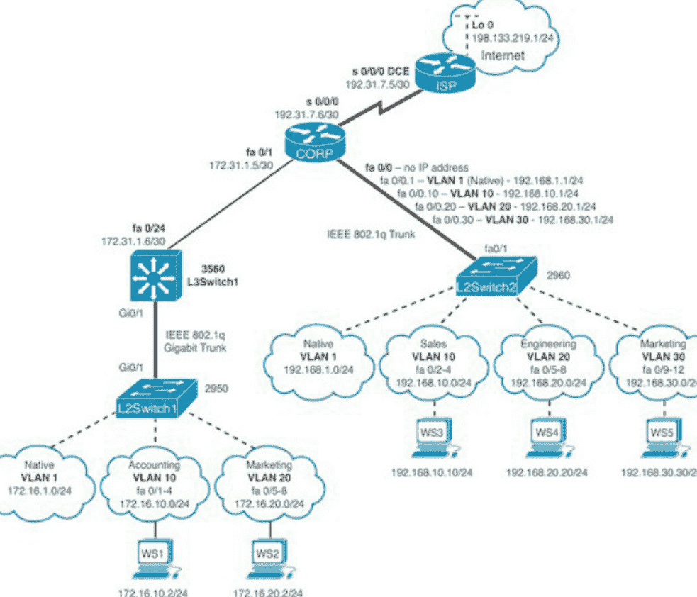

```
Router>enable.
Router>#configure hostname ISP
Router(config)#interface loopback 0
Router(config)#ip address 192.168.199.1 255.255.255.0
Router(config)#interface 0/0
Router(config)#description WAN to Corporate Router
Router(config)#ip address 192.31.7.5 255.255.252
Router(config)#clock rate 64000 不要忘记设置时钟速率
Router(config)#no shutdown
Router(config)#router eigrp 10 -- 初始化 EIGRP
Router(config-router)#network 192.168.199.0
Router(config-router)#network 192.31.7.0
Router(config-router)#no auto-summary
Router(config)#copy running-config startup-config
Router>enable.
Router>#configure hostname CORP
CORP(config)#interface serial 0/0
CORP(config)#description Router
CORP(config)#ip address 192.31.6.255 255.255.252
CORP(config)#no shutdown
CORP(config)#interface fastethernet 0/1
CORP(config)#description link to L2Switch
CORP(config)#ip address 172.3.1.5 255.255.252
CORP(config)#no shutdown
CORP(config)#interface fastethernet 0/2
CORP(config)#description link to L2Switch
CORP(config)#duplex full 确保与 L2Switch 流量正常
CORP(config)#no shutdown
CORP(config)#interface fastethernet 0/1 -- 创建虚拟接口
CORP(config-sub)#encapsulation dot1q 1
CORP(config-sub)#ip address 192.168.1.1 255.255.250
CORP(config-sub)#interface fastethernet 0/10
CORP(config-sub)#encapsulation dot1q 10
CORP(config-sub)#ip address 192.168.1.10 255.255.250
CORP(config-sub)#interface fastethernet 0/20
CORP(config-sub)#encapsulation dot1q 20
CORP(config-sub)#ip address 192.168.1.20 255.255.250
CORP(config-sub)#interface fastethernet 0/30
CORP(config-sub)#encapsulation dot1q 30
CORP(config-sub)#ip address 192.168.1.30 255.255.250
CORP(config-sub)#exit
CORP(config)#exit
CORP(config)#router eigrp 10 -- 宣告我们的网络
CORP(config-router)#network 192.168.1.0 0
CORP(config-router)#network 192.168.2.0 0
CORP(config-router)#network 192.168.30.0 0
CORP(config-router)#network 172.3.1.0 0
CORP(config-router)#network 192.31.7.0 0
CORP(config-router)#no auto-summary
```

# L2Switch Catalyst 2960


# L2Switch 配置

```
L2Switch(config)#vlan 10
L2Switch(config-vlan)#name Sales -- 为 VLAN 命名
L2Switch(config)#vlan 20
L2Switch(config-vlan)#name Engineering
L2Switch(config)#vlan 30
L2Switch(config-vlan)#name Marketing
L2Switch(config)#interface range fastethernet 0/2 - 4 -- 将端口分配给 VLAN
L2Switch(config-if)#switchport mode access
L2Switch(config-if)#switchport access vlan 10
L2Switch(config)#interface range fastethernet 5 - 8
L2Switch(config-if)#switchport mode access
L2Switch(config-if)#switchport access vlan 20
L2Switch(config)#interface range fastethernet 0/9 - 12
L2Switch(config-if)#switchport mode access
L2Switch(config-if)#switchport access vlan 30
L2Switch(config)#interface fastethernet 0/1
L2Switch(config-if)#description Trunk Link to CORP Router
L2Switch(config-if)#switchport mode trunk
L2Switch(config)#interface vlan 1 -- 为 VLAN 1 创建虚拟接口
L2Switch(config-if)#ip address 192.168.1.2 255.255.250
L2Switch(config-if)#no shutdown
L2Switch(config)#exit
L2Switch(config)#ip default-gateway 192.168.1.1 -- 分默认网关地址
L2Switch(config)#exit
L2Switch#copy running-config startup-config
```

# L3Switch1 (Catalyst 3560)

```
L3Switch1(config)#hostname L3Switch1
L3Switch1(config)#vtp mode server ---将交换机更改为 VTP 服务器模式。
L3Switch1(config)#vtp domain testdomain ---将 VTP 域名称配置为 testdomain。
L3Switch1(config)#vlan 10
L3Switch1(config-vlan)#name Accounting
L3Switch1(config-vlan)#exit
L3Switch1(config)#vlan 20
L3Switch1(config-vlan)#name Marketing
L3Switch1(config-vlan)#exit
L3Switch1(config)#interface gigabitethernet 0/1
L3Switch1(config-if)#description Gigabit Trunk to L2Switch1
L3Switch1(config-if)#switchport trunk encapsulation dot1q
L3Switch1(config-if)#switchport mode trunk
L3Switch1(config-if)#exit
L3Switch1(config)#ip routing ---在此设备上启用 IP 路由。
L3Switch1(config)#interface vlan 1 ---为 VLAN 1 创建虚拟接口
L3Switch1(config-if)#address 172.16.1.1 255.255.255.0
L3Switch1(config-if)#no shutdown
L3Switch1(config)#interface vlan 10
L3Switch1(config-if)#address 172.16.1.10 255.255.255.0
L3Switch1(config-if)#no shutdown
L3Switch1(config)#interface vlan 20
L3Switch1(config-if)#address 172.16.20.1 255.255.255.0
L3Switch1(config-if)#no shutdown
L3Switch1(config-if)#exit
L3Switch1(config)#interface fastethernet 0/24
L3Switch1(config-if)#description Link to CORP
L3Switch1(config-if)#switchportport ---在交换机上创建一个三3 层端口。
L3Switch1(config-if)#address 172.31.1.1 255.255.255.252
L3Switch1(config-if)#no shutdown
L3Switch1(config-if)#exit
L3Switch1(config)#router eigrp 10
L3Switch1(config-router)#network 172.16.0.0
L3Switch1(config-router)#network 172.31.0.0
L3Switch1(config-router)#no auto-summary
L3Switch1(config-router)#exit
L3Switch1(config)#exit
L3Switch1(config)#copy running startup-config
```

# L2Switch1 (Catalyst 2960)

```
L2Switch1(config)#hostname L2Switch1
L2Switch1(config)#vtp domain testdomain ---VTP 域名称配置为 testdomain。
L2Switch1(config)#vtp mode client ---将交换机更改为 VTP 客户端模式。
L2Switch1(config)#interface range fastethernet 0/1 - 4
L2Switch1(config-if-range)#switchport access vlan 10
L2Switch1(config-if-range)#interface range fastethernet 0/5 - 8
L2Switch1(config-if-range)#switchport access vlan 20
L2Switch1(config-if-range)#exit
L2Switch1(config)#interface gigabitethernet 0/1
L2Switch1(config-if)#switchport mode trunk
L2Switch1(config-if)#exit
L2Switch1(config)#interface vlan 1
L2Switch1(config-if)#address 172.16.1.2 255.255.255.0 --VLAN1 图表为 172.16.1.0/24 -L2Switch1(config-if)#no shutdown
L2Switch1(config-if)#exit
L2Switch1(config)#ip default-gateway 172.16.1.1
L2Switch1(config)#exit
L2Switch1(config)#copy running startup-config
```

# 生成树协议 (802.1D)

生成树是一种管理系统，每个端口处于转发或阻塞状态。阻塞状态意味着端口不处理 STP 消息以外的任何帧——交换机物理上丢弃阻塞端口上的帧并忽略它。如果拓扑结构发生变化，STP 会更新收敛状态。该系统有一个“根桥”，并为每个交换机使用包含优先级和 MAC 地址的 ID。到根桥的距离通过从每个交换机的“根代价”来计算，通过控制端口的转发和阻塞，最终二层设备可以接管网络。

## 根桥/根交换机基础知识

- 根桥始终是所有连接段的指定交换机。
- 根交换机上的所有端口都是转发状态端口。
- 普通交换机拥有根端口（到根桥的代价最小的端口）；如果已连接，则该端口为根端口。
- 每个段有一个指定端口（到根的代价最小的端口）。
- 所有非指定或根端口都处于阻塞状态。

## Bridge ID

`{优先级 (4096-61440) + VLAN (0-4095) + MAC 地址}`


# STP 桥接 ID (BID)

STP 桥接 ID (`BID`) 是一个唯一的 6 字节值：基本上是一个附加在 MAC 地址之上的优先级字段

- 2 字节优先级字段：后 12 位包含一个 0-4096 之间的 VLAN ID（它本质上是一个 16 位数字）
- 6 字节系统 ID - 48 位 MAC 地址

2 字节优先级字段分为两部分：

- 4 位优先级字段；可以通过 `"priority"` 指令更改的部分
- 12 位系统 ID 扩展 - 基本上只是为 VLAN ID 预留的空间

| 原始格式 Bridge ID | 2 字节优先级 (0-65,535) | 6 字节系统 ID (MAC 地址) |
|---|---|---|

| | 系统扩展 | 4 位优先级（4096 的倍数） | 12 位系统 ID 扩展（包含 VLAN ID） | 6 字节系统 ID (MAC 地址) |

当这些位被写出时，前 4 位从 4096 位（第 13 位）开始，因此从那里开始的每个数字自然是 4096 的倍数。由于 VLAN ID 的范围从 1 到 4094，这完全符合逻辑，但看起来有点复杂：

+ - 优先级 [4096-61440 + VLAN [1-4095]] + 附加 MAC 地址。

这意味着 (0000000000000000) 是你的 MAC 地址

0000-[1111] ---- 是二进制形式的优先级（其他位预留用于设置“优先级”）

我们在方括号中配置优先级字段：

- [1000] - 000000000000------ 二进制形式的默认基础优先级 32768
- [0110] - 000000000000------ 二进制形式的次根桥接器指定
- [????] - 000000000000------ 你可以在此处选择自定义优先级（从 4096 到 61440）

## 简单方法

- `spanning-tree vlan-id root primary` [auto, 这将自动设置此优先级使其现在成为根桥器]

Cisco 交换机使用默认基础优先级 32768。

如果当前根基础优先级 > 24576，则将基础优先级设置为 24576。

如果为 24576 或低，则将基础优先级设置为 4096 的最高倍数，以产生启动根桥器的结果。

对于我们下方的数字，28672 是 0111 010000000000

- `spanning-tree vlan-id root secondary` [再次，这会自动为我们设置]

一个劣于主交换机但优于所有其他交换机的优先级值。

无论当前的根优先级值如何，都将交换器的基础优先级设置为 28672。

对于我们下方的数字， 28672 是 0111 010000000000。

## 困难方法

自己指定根桥器和次根桥器要容易得多。如果你坚持执行 "`spanning-tree vlan-id priority x`"：

- `spanning-tree vlan-id root priority x`

一个配置了 VLAN 1 到 4、默认优先级为 32768 的交换机，在 VLAN 1 中的默认 STP 优先级为 32769，VLAN 2 为 32770，VLAN 3 为 32771，依此类推。因此，你可以查看 16 位基础优先级（加上在 `spanning-tree vlan-id priority x` 上配置的 VLAN ID）：

0001000000000000 = 4096

0010000000000000 = 8192

0100 = 16384，1000 = 32768

Vlan 1 为 32769， VLAN 2 为 32770，VLAN 10 为 32778

1111: 61440 <-- 如果开启了多个位，情况会变得奇怪。一个技巧是让 VLAN-ID 部分变为 4096 的倍数，仅在计算时如此。

结论：当优先级让你感到困时，忘记它。使用 "`root primary`" 和 "`root secondary`"。

## 在 Cisco 交换机上确定根桥器和根端口

使用 `spanning-tree` 查看任何具有根端口（RP）的交换机；根桥器没有 RP。在 `spanning-tree` 中，如果本地交换机是根桥器，则根列为空。

使用 `spanning-tree vlan x` 在几台交换机上可以快速显示根、RP 和 DP。如果以 SW1 开始是根桥器，则其 G0/1 是 RP。

## 选择根端口时的 STP 决胜规则

三个决胜规则顺序为：最低桥接 ID、最低邻接优先级、最后是最低内部端口。只有在考虑决胜规则时，SW3 不是根桥器，其范围从 0 到 255，越小越好。第一个决胜规则是最低的邻接 BID。SW1 的 BID 值比 SW2 小，因此 SW3 选择 G0/1 作为其 RP。

### 图 2-8 SW3根成本平局

当两台交换机通过多条链路连接时，最后两个决胜规则起作用。在这种情况下，交换机从邻接交换机处收到 hello，导致 BID 平局。因此，SW2 需要选择其 RP。SW1 的根路径将平局为 19。SW2 向 SW1 发送 hello，因此 SW1 不能根据 SW2 的 BID 决胜。下一个决胜规则是：检查每个邻接接口的优先级。Cisco 交换机端口默认为 12，然而 SW2 的 Fa0/16 可能是 112（通过 `spanning-tree vlan 10 priority` 配置），因此 SW1 使用其端口 (Fa0/14)。

### 图 2-9 根端口最后的决胜规则拓扑

如果优先级相同（通常由于默认值导致），STP 依赖邻接端口号。Cisco 交换机为每个接口分配内部标识符。Fa0/1 数字最小，然后是 Fa0/2、Fa0/3，SW1 在 hello 中学习这些数字；SW1 将使用其根 RP。（在现实生活中，大多数工程师会将这两条链路放入 EtherChannel）。

此图记录了根、RP、DP 以及每个交换机通过其相应 RP 到根的最小成本。

`BID`: 28672:0200.2222.2222

根成本: 20

`BID`: 32778:0200.3333.3333

根成本: 19

记住标准的顺序：最低根成本、最低 BID、邻接端口优先级、最低内部端口号。

关注连接交换机的段：

- SW2-SW4 段：SW4 因为成本为 19 而胜出，而 SW2 的成本为 20。
- SW2-SW3 段：SW3 因为成本为 19 而胜出，而 SW2 的根成本为 20。
- SW3-SW4 段：SW3 和 SW4 在根成本上平局（均为19）。SW3 因其更（更小）的 BID 值胜胜。尽管 SW2 拥有更好的（更小）的 BID 值，但它仍然输了，且没有成为到 SW3 和 SW4 链路的 DP。第一个标准是最低根成本，而 SW2 的根成本恰好高于 SW3 和 SW4。

```
show spanning-tree vlan Bridge and Root, timers; 本地交换机的端口角色，设备的交换机角色。
show spanning-tree vlan 10 root - 列出每个 VLAN 的根 BID、本地交换机的根成本和根端口
show spanning-tree vlan 10 lists - 本地交换机的 BID、MAC、定时器
debug spanning-tree port events
```

`spanning-tree portfast` - `bpduguard disable`（启用以在单个接口上运行）

默认是不开启 `portfast` 和 BPDU Guard。改为相反以使其全部成为新默认：

`spanning-tree portfast default` - `spanning-tree portfast bpduguard default`（全局配置）

`spanning-tree portfast disable` - `spanning-tree bpduguard disable`（按接口配置）

`UplinkFast`: pg 197 - `UplinkFast`: 接入层上行

`BackboneFast` pg 198 - `BackboneFast`: 冗余骨干路径

# STP RTSP 端口代价值

| 数据速率 | STP 802.1D-1998 | RSTP 802.1W-2004 |
| --- | --- | --- |
| 基础指标 | 1 Gigabit 每秒 | 2 Terabit 每秒 |
| 计算公式 | 1,000,000/(N Kb/s) (1998 为非线性) (1990 为线性的) | 20,000,000/( N Kb/s) |
| <=100 Kb/s | | 200,000,000 |
| 1 Mbit/s | | 20,000,000 |
| 4 Mbit/s | 250 | 5,000,000 |
| 10 Mbit/s | 100 | 2,000,000 |
| 16 Mbit/s | 82 (原为 63) | 1,250,000 |
| 45 Mbit/s | 39 (原为 22) | 444,445 |
| 100 Mbit/s | 15 (原为 10) | 200,000 |
| 155 Mbit/s | 14 (原为 6) | 129,032 |


| 622 Mbit/s | 6 (原为 2) | 32,154 |

| 1 Gbit/s | 4 (原为 1) | 20,000 |

| 10 Gbit/s | 3 | 10,000 |

| 100 Gbit/s | | 2,000 |

| 1 Tbit/s | | 200 |

| 10 Tbit/s | | 2 |

**802.1W-2004:** 将路径代价（Path Cost）参数范围限制在 1–200,000，可以确保在 20 跳级联中，累积路径代价不会超过 32 位。

灰色单元格表示 Cisco 在《Switch 300-115 认证指南》中提供的数值，并非 IEEE 802.1W-2004 标准内容。

Cisco 在《CCIE 5.0 路由与交换》中提到，短格式是 Cisco 特有的，而非 IEEE 标准。

事实上，在 IEEE 802.1W-2004 中，保留的是长格式（注：我非常感谢这一点，因为非线性格式是毫无意义的）。

# Cisco 端口聚合协议 (PAgP) 与链路聚合控制协议 (LACP) - 802.3ad

- 将多个等速的并行线段组合为 EtherChannel（单接口）
- 最多支持 8 个等速线段
- 当仅发生单点故障时防止 STP 收敛；只要至少有一条链路可用，就不会触发 STP 收敛
- 聚合链路在交换机上实现负载均衡（更有效地利用带宽）

创建端口接口，退出，然后进入端口配置模式并添加模式：

```
Cat2950(config-if)# port-channel 1 <exit>
Cat2950(config-if)# interface fa0/2
Cat2950(config-if)# channel-group 1 mode
```

- PAgP: `channel-group 1 mode (desirable | auto)`
- LACP: `channel-group 1 mode (active | passive)`
- 手动运行 `channel-group` 模式不进行封装；双方均需设置为 "on"
- 必须有一端设置为 `desirable` 或 `active`，另一端才能开始协商（类似于 trunk 模式）
- 编号必须保持交换机设备名称。另一台设备可能将其标记为 4 或 5

以下术语为同义词：EtherChannel、PortChannel 和 Channel-group。

`channel-group` 配置

使用 `show etherchannel status` 查看 "PortChannel" 而非 EtherChannel 或 channel-group

`show spanning-tree` 也可以看到 Port-channel

## channel-group 命令的配置错误：

- 交换机上特定接口的所有成员需要使用相同的 `channel-group` 编号。
- 邻接交换机可以使用任何数字来引用该 etherchannel（且无需封装）。
- 如果使用 "desirable" 关键字，必须是 PAgP ，且另一端必须使用 "desirable" 或 "auto"。
- 如果使用 "active" 关键字，则是 LACP ；另一端必须使用 "active" 或 "passive"。
- 如果交换机上没有设置 "auto" 或 "passive" 键？那么双方都会等待对方开始协商。
- 不要在这一端混合使用 LACP 和 PAgP 命令——协议不匹配。

`show etherchannel [chan-group f] | detail | port-channel | summary`

```
SW1# show etherchannel 1 summary
Fs: D - down          P - bundled in port-channel
   I - stand-alone s - suspended
   H - Hot-standby (LACP only)
   R - Layer3           S - Layer2
   U - in use           f - failed to allocate aggregator
   M - not in use, minimum links not met
   u - unsuitable for bundling
   w - waiting to be aggregated
   d - default port
Number of channel-groups in use: 1
Number of aggregators: 1
Group Port-channel Protocol Ports
1 Po1(SU) Fa0/14 (P) Fa0/15 (P)
```

`show etherchannel summary` 命令中，代码 D 表示通道本身处于 down 状态，S 表示是 Layer2 EtherChannel。“"Down" 仅指 EtherChannel 状态——两个物理接口已连接（通过 `sh int status` 查看）。

# EtherChannel 配置

- 各项之间需要兼容。注意常识性（无 shutdown、速率、双工匹配）
- 运行访问状态或 trunk 状态（必须全为 access 或全为 trunks）
- 在访问端口（access port）上，检查访问 VLAN
- 如果是 trunk 端口？检查允许列表——以及原生 VLAN（native VLAN）
- 检查接口设置

如果使用 "desirable" 关键字，必须是 PAgP，且另一端必须使用 "desirable" 或 "auto"。

如果使用 "active" 关键字，则是 LACP；另一端必须使用 "active" 或 "passive"。

如果交换机上没有设置 "auto" 或 "passive" 键？那么双方都会等待对方开始协商。

不要在这一端混合使用 LACP 和 PAgP 命令——协议不匹配。

# EtherChannel 配置

- 各项之间需要兼容。注意常识性（无 shutdown、速率、双工匹配）
- 运行访问状态或 trunk 状态（必须全为 access 或全为 trunks）
- 在访问端口上，检查访问 VLAN
- 如果是 trunk 端口？检查允许列表——以及原生 VLAN（native VLAN）
- 检查接口设置

# 使用 HSRP 进行负载均衡

基于 MAC 地址的负载均衡或基于 IP 地址的负载均衡，可以根据 HSRP 组进行。

在 HSRP 组中，EtherChannel 的负载均衡通常取决于 HSRP 绑定的优先级。

# EtherChannel 负载均衡方法

使用 HSRP 负载均衡的类型：

| 方法 | 输入 |
| --- | --- |
| src-ip | 源 IP |
| src-mac | 源 MAC |
| dst-ip | 目标 IP |
| dst-mac | 目标 MAC |

# EtherChannel 故障排除

如果更改了接口代价，可能会出现错误：

ERR: Disable-misconfig(STP) 检测到 Fa0/14

ERR: Disable-misconfig(STP) 检测到 Fa0/15

ERR: Disable-misconfig(STP) 检测到 Po1

# HSRP 负载均衡示例 2

- 将 DLS1 配置为根节点，VLAN 10 的 HSRP 激活状态 - 备用根和 VLAN 20 的 HSRP 备用状态
- 将 DLS2 配置为根节点，VLAN 20 的 HSRP 激活状态 - 备用根和 VLAN 10 的 HSRP 备用状态
- 下面 DLS2 的配置与 DLS1 的相反。

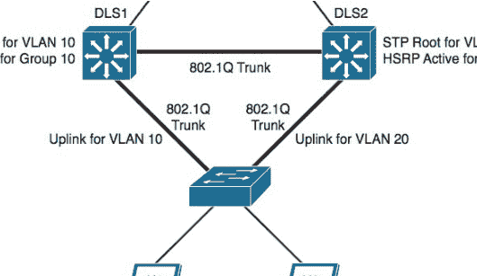

通过为这些 VLAN 设置生成树根节点来实现正确 VLAN 的转发。

| DLS1(config)#spanning-tree vlan 10 primary | 为 VLAN 10 配置 STP 主根节点 |
| DLS1(config)#spanning-tree vlan 20 secondary | 为 VLAN 20 配置 STP 备根节点 |
| DLS1(config)#interface vlan10 | 进入接口模式 |
| DLS1(config)#ip address 10.10.2.255.255.255.0 | 分配 IP 地址和子掩码 |
| DLS1(config)#standby 10 10.10.1 | 激活 HSRP 组 10，虚拟 IP 10.10.1 |
| DLS1(config)#standby 10 priority 110 | 为备用组 10 分配优先级 110。这将是 VLAN 10 的备用设备 |
| DLS1(config)#standby 10 preempt | 如果本地优先级高于活动交换机的 VLAN 10 优先级，交换机接管 VLAN 10 转发 |


| `DLS1(config)#interface vlan20` | 进入接口模式 |
| `DLS1(config)#ip address 10.10.20.255.255.255.0` | 分配 IP 地址和子掩码 |
| `DLS1(config)#standby 20 10.1.20.1` | 激活 HSRP 组 20，虚拟 IP 地址 10.1.20.1 |
| `DLS1(config)#standby 20 priority 90` | 为备用组 20 分配优先级 90。这将是 VLAN 20 的备用设备 |
| `DLS1(config)#standby 20 preempt` | 如果本地优先级高于活动交换机的 VLAN 20 优先级，交换机接管 VLAN 20 转发 |
| `DLS2(config)#spanning-tree vlan 20 primary` | 为 VLAN 20 配置 STP 主根节点 |
| `DLS2(config)#spanning-tree vlan 10 secondary` | 为 VLAN 10 配置 STP 备根节点 |
| `DLS2(config)#interface vlan20` | 进入接口模式 |
| `DLS2(config)#ip address 10.10.3.255.255.255.0` | 分配 IP 地址和子掩码 |
| `DLS2(config)#standby 20 10.1.20.1` | 激活 HSRP 组 20，虚拟 IP 地址 10.1.20.1 |
| `DLS2(config)#standby 20 priority 110` | 为备用组 20 分配优先级 110。这将是 VLAN 10 的活动转发器 |
| `DLS2(config)#standby 20 preempt` | 如果本地优先级高于活动交换机的 VLAN 20 优先级，交换机接管 VLAN 20 转发 |
| `DLS2(config)#interface vlan10` | 进入接口模式 |
| `DLS2(config)#ip address 10.1.1.3.255.255.255.0` | 分配 IP 地址和子掩码 |
| `DLS2(config)#standby 10 10.1.10` | 激活 HSRP 组 10，虚拟 IP 10.1.10 |
| `DLS2(config)#standby 10 priority 90` | 为备用组 10 分配优先级 90。这将是 VLAN 10 的备用设备 |
| `DLS2(config)#standby 10 preempt` | 如果本地优先级高于活动交换机的 VLAN 10 优先级，交换机接管 VLAN 10 转发 |

# HSRP 负载均衡示例 1（继续）

`show standby` 命令输出

| 接口 | 组 | 优先级 | 状态 | 抢占 | 路由器地址 | 组地址 |
|---|---|---|---|---|---|---|
| Vlan50 | 1 | 200 | Active | Y | 192.168.1.11 | 192.168.1.1 |
| Vlan50 | 2 | 100 | Standby | N | 192.168.1.11 | 192.168.1.2 |

`Switch-A# show standby vlan 50`

Vlan50 - Group 1

本地状态为 Active，优先级 200，抢占已启用

计时器 3 秒，保持时间 10 秒，心跳包间隔 2 秒

虚拟 IP 地址 192.168.1.1

活动路由器为 192.168.1.11，在 8 秒后超时

虚拟 MAC 地址 0000.0c01

认证 "MyKey"

最后更改时间 00:11:58

名称 "HSRP-50-1" (默认)

Vlan50 - Group 2

本地状态为 Standby，优先级 100，抢占已禁用

计时器 3 秒，保持时间 10 秒，心跳包间隔 2 秒

虚拟 IP 地址 192.168.1.2

活动路由器为 192.168.1.11，在 7.8 秒后超时

认证 "MyKey"

最后更改时间 00:10:04

名称 "HSRP-50-2" (默认)

# 1-3 VRRP 负载均衡示例

## 验证多个 VRRP 组的状态

### Switch A

`Switch-A# show vrrp`

Vlan50 - Group 1

状态为 Master

虚拟 IP 地址 192.168.1.1

虚拟 MAC 地址 0000.5e01

通告间隔 1.000 秒

抢占已启用

延迟 0.000 秒

优先级 200

认证已启用

主路由器 192.168.1.10 (本地)，优先级 200

通告间隔 1.000 秒

主备机间隔 3.218 秒

`Switch-B# show vrrp`

Vlan50 - Group 1

状态为 Backup

虚拟 IP 地址 192.168.1.1

虚拟 MAC 地址 0000.5e01

通告间隔 1.000 秒

抢占已禁用

优先级 100

认证已启用

主路由器 192.168.1.10，优先级 200

通告间隔 1.000 秒

主备机间隔 3.609 秒（在 2.833 秒后超时）

Vlan50 - Group 2

状态为 Backup

虚拟 IP 地址 192.168.1.2

虚拟 MAC 地址 0000.5e02

通告间隔 1.000 秒

抢占已禁用

优先级 100

认证已启用

主路由器 192.168.1.11，优先级 200

通告间隔 1.000 秒

主备机间隔 3.609 秒（在 2.977 秒后超时）

`Switch-A#`

Vlan50 - Group 2

状态为 Master

虚拟 IP 地址 192.168.1.2

虚拟 MAC 地址 0000.5e02

通告间隔 1.000 秒

抢占已启用

最小延迟 0.000 秒

优先级 200

认证已启用

主路由器 192.168.1.11 (本地)，优先级 200

通告间隔 1.000 秒

主备机间隔 3.218 秒

`Switch-B#`

| 接口 | 组 | 优先级 | 时间 | 自身抢占 状态 | 主地址 | 组地址 |
|---|---|---|---|---|---|---|
| Vlan50 | 1 | 200 | 3218 | Y | 192.168.1.10 | 192.168.1.1 |
| Vlan50 | 2 | 100 | 3609 | Backup | 192.168.1.11 | 192.168.1.2 |

`Switch-B# show vrrp brief`

| 接口 | 组 | 优先级 | 时间 | 自身抢占 状态 | 主地址 | 组地址 |
|---|---|---|---|---|---|---|
| Vlan50 | 1 | 100 | 3609 | Backup | 192.168.1.10 | 192.168.1.1 |
| Vlan50 | 2 | 200 | 3218 | Y | 192.168.1.11 | 192.168.1.2 |

# IEEE 标准: VRRP 路由器冗余协议 (RFC 2338)

与 HSRP 几乎相同。在这里，“master”代替 HSRP 术语中的“active”，其余为“backup”。

VRRP 抢占选项默认启用（配置 IP 地址的交换机将抢占，无论显式配置）。默认优先级为 100（最小扩展）。

# Cisco 私有协议：HSRP - 热备备冗余协议

| `interface vlan10` | Description |
| :--- | :--- |
| make vlan - activate virtual interface (SVI) | 激活虚拟接口 (SVI) |
| `ip address 172.16.0.10 255.255.255.0` | 分配 IP 地址和子掩码。 |
| `standby 1 172.16.0.1 [secondary]` | 激活 HSRP 组 1 并创建虚拟 IP 地址 172.16.0.1。如果接口具有 HSRP IP 地址，可以添加 secondary 将冗余的备备网关地址添加到 HSRP 中。 |
| `standby 1 120` | 为备备组 1 设置优先级值为 120。 |

- 组号范围从 0 到 255。默认值为 0。
- 某些 Catalyst 交换机限制为 16 个组号：只需将 VLAN 接口的组号设置为相同（即设置为 1）。HSRP 组在接口上是唯一的：接口 VLAN 10 上的 HSRP 组 1 是唯一的，且与接口 VLAN 11 上的 HSRP 组 1 独立。
- 实际接口、虚拟（备份）地址和优先级必须在子网中配置。
- 默认优先级会导致该交换机被选为活动交换机。
- 如果组中所有交换机的优先级相同，则 HSRP 优先级最高的交换机成为活动交换机。
- HSRP hello - 多组播 224.0.0.2 ('所有路由器') -- UDP 端口 985。
- 只有路由器（优先级次高的）监控来自活动路由器的消息。


缩短 `hello` 时间可以更快地检测路由器，但这会增加路由器的流量。

路由器接口在变为活动状态之前的等待时间：

`Disabled -> Init -> Listen -> Speak -> Standby -> Active`

HSRP 定义的 MAC 地址格式为 `0000.0c07.axx`，其中 `xx` 代表两位十六进制的组号（组 1 显示为 `0000.0c07.ac1`，组 16 显示为 `0000.0c07.ac11`）。

| show standby | Description |
| :--- | :--- |
| 显示每个备备组的简要输出 |
| 显示 VLAN 1 组上的 HSRP 信息 |
| HSRP 默认值 | |
| :--- | :--- |
| HSRP 版本 | 版本 1 (v1 和 v2 的数据结构不同) |
| HSRP 组 | 未配置 |
| standby 组号 | 0 |
| standby MAC 地址 | 系统分配为 `0000.0c07.axx`，XX 是 HSRP 组号。对于 HSRP2，MAC 地址将为 `0000.0C9F.FXXX`。 |
| standby 优先级 | 100 |
| standby | (无延迟) |
| standby track 接口优先级 | 10 |
| standby hello 时间 | 3 秒 |
| standby holdtime | 10 秒 |

`Preempt` (抢占) - 如果本地优先级高于活动交换机的优先级，交换机将接管活动交换机的控制权

| interface vlan10 | Description |
| :--- | :--- |
| standby 1 preempt delay minimum 180 reload 140 | 设置抢占为自上次重启以来 180 秒或自交换机加载以来 140 秒。 |
| standby delay minimum 30 reload 60 | 接口启动时，HSRP 组初始化延迟 30 秒，加载后延迟 60 秒。 |
| no standby 1 preempt delay | 禁用抢占选项 |
| no standby 1 preempt | 完全禁用抢占选项

如果路由器尚未处于活动状态，则在当前路由器故障之前，它无法再次变为活动状态——即使它的优先级高于活动路由器。当路由器启动或连接到网络时，首先启动接口的路由器将成为 HSRP 活动路由器，即使它的优先级是所有路由器中最低的。这就是抢占（`preempt`）设置的作用。

使用 `reload` 强制路由器在重启后或在抢占之前等待（您应该考虑并允许路由协议（例如）所需的收敛时间）。然后等待接口为 HSRP 就绪。

定时器 - Hello 定器 1-254，默认值为 3；Hold 定器 1-255，默认值为 10。默认时间单位为秒。

| interface vlan10 | Description |
| :--- | :--- |
| standby 1 5 15 | 将 hello 设置为 5 秒，hold 设置为 15 秒。Hold 通常设置为 >= 3x hello |
| standby 1 msec 200 msec 600 | 将 hello 设置为 200 毫秒，hold 设置为 600 毫秒。 |

如果使用了 `msec` 参数，定时器可以是 15 到 999 之间的整数。

`Track` (跟踪) - 如果跟踪项减少，则优先级减少一个值。`Switch(config)#interface vlan10` 默认值为 10。在示例中，假设默认优先级为 100，新优先级将变为 75。使用跟踪有助于故障时的选举。

# 认证

| Switch(config)# | Description |
| :--- | :--- |
| key chain HSRP | 创建名为 HSRP 的密钥链。 |
| keychain <key> | 向密钥链添加密钥。 |
| keychain <key> string | 配置认证字符串。 |
| | vlan10 | 如果 FastEthernet0/0 故障，组 1 的优先级将减少 25。 |
| | 配置组 1 的明文认证字符串。 |
| standby 2 authentication MD5 key-chain | 为组 2 启用 MD5 认证。 |
| standby 3 authentication MD5 key-chain | 使用密钥链配置 MD5。 |
| Queries key chain for current live | 查询当前活动的密钥链 |

HSRP2 for IPv6 必须在接口上启用。当配置全局地址时使用它；如果使用本地地址，则必须有一个前缀。

| standby version 2 | Description |
| :--- | :--- |
| 使用从链路本地前缀自动生成的虚拟地址作为组 1 的虚拟地址 |
| ipv6 autfig | 使用显式配置的本地地址作为组 1 的虚拟地址 |
| standby 1 ipv6 fe80::1 | 使用 IPv6 全局地址作为组 1 的虚拟地址 |

所有其他 HSRP 命令（抢占、优先级等）在 HSRP 中是相同的。

# 调试 HSRP

| command | Description |
| :--- | :--- |
| debug standby | 显示 HSRP 调试信息，包括状态变化和 HSRP 数据包 |
| debug standby terse | 显示 HSRP 错误、事件，但不显示 hello 广告 |
| debug standby errors | 显示 HSRP 错误消息 |
| debug standby events | 显示 HSRP 事件消息，但不显示 hello 广告 |
| debug standby track | 显示所有 HSRP 跟踪事件 |

# Cisco 私有 GLBP - 网关负载均衡

- 组选出一个网关作为活动网关 `AVG`。
- 成员是活动的 `AV`，如果 `AVG` 不可用，则成为备份。
- `AVG` 为每个 `AV` 分配不同的 MAC 地址。
- 每个 `AV` 负责转发到虚拟 MAC 地址。
- 如果某个 `AV` 故障，其他 `AV` 将负责虚拟 MAC 地址。
- 优先级值为组中最高的 IP 地址。
- 多重认证和多个网关的自动故障转移。
- 使用 HSRP/VRRP 配置多个网关。
- 每个组最多有四个路由器（技术上讲，`AVG` 是特殊的）。
- 在每个路由器的物理接口上配置最多 1024 个 GLBP 组（范围 0-1023）。
- 每组同时最多四个 `AV`，可以备份。
- 优先级为 1-255，默认为 100。越高越优。
- 抢占是 `AVG` 的默认设置；默认 30 秒。
- Hello 定器 3 秒；范围 1-60 秒。如果使用 `msec`，定时器将切换为毫秒，范围 50-60000 ms。
- Hold 定器 10 秒；范围 1-180 秒。如果使用 `msec`，定时器将切换为毫秒，范围 20-180000 ms。
- 虚拟 MAC 格式为 `0007.bxxx.xxxx` - 32 位。
- `xx.xx` 代表 10 位 GLBP 组。
- 组号 0-yy 是虚拟值。

# 三种负载均衡类型

- 依赖主机使用主机的 MAC 地址决定使用哪个 `AV` MAC 地址。
- 使用虚拟 NAT (NAT) 选项需要主机每次向虚拟 IP 发送 ARP 请求时返回到虚拟 MAC 地址。
- 不建议少于 20 个主机的情况使用。
- 加权 - 使用路由器 B 的传输能力，应相应配置权重。
- 如果路由器 A 的传输能力是路由器 B 的两倍，权重组 x y，其中 x 是组号，y 是权重值 (1-254)。
- 基于路由器在虚拟 IP 的 ARP 请求中顺序使用 `AV` MAC 地址。
- 如果未使用负载均衡，GLBP 将像 HSRP 一样运行，`AVG` 只使用自己的 `AV` MAC 地址请求，所有流量将导向 `AVG`。使用 `no glbp load-balancing`。

建议您非常熟悉 GLBP 的设计和机制，不要更改定时器。将定时器重置为默认 `glbp` 时间，其中 x 是组号。

| router(config)#interface ethernet0 | Description |
| :--- | :--- |
| (都是接口配置模式) | |
| ip address 172.162.100.5 255.255.255.0 | 分配 IP 地址和掩码 |
| glbp 10 ip 172.162.100.1 | 如果路由器优先级高于当前 AV，则在接口上放置组 10 |
| glbp 10 preempt | 如果此路由器优先级高于当前 AV，则接管组 10 的 AVG |
| glbp 10 preempt delay 60 | 抢占等待-AVG 延迟 60 秒 |
| glbp 10 forwarder preempt | 如果此路由器优先级高于当前 AV，则接管组 10 的 AV |


## GLBP 配置命令

| `glbp 10 forwarder preempt minimum 60` | 抢占等待-AV 延迟 60 秒 |
| `glbp 10 priority 150` | 设置路由器的优先级级别 |
| `glbp 10 timers timers 15` | 配置 5 秒 hello 和 15 秒 hold |
| `glbp 10 timers hello 2020 msec 60600` | Hello 2000 ms，hold 定器为 60600 ms，用于明文认证的 GLBP |
| `glbp 10 authentication method text` | 配置 GLBP 的明文认证 |
| `glbp 10 authentication md5 key-chain-value` | 配置 GLBP 的 MD5 认证 |
| `glbp 10 load-balancing host-dependent` | 使用依赖主机的进行负载均衡 |
| `glbp 10 load-balancing weighted` | 使用加权进行负载均衡 |
| `glbp 10 weighting 80` | 设置此接口的最大权重值 |
| `glbp 10 load-balancing round` | 使用轮询方式进行负载均衡 |

# 接口跟踪

| 命令 / 配置 | 说明 / 注意事项 |
| :--- | :--- |
| `Router(config)#track 2 interface fa0/1 line-protocol` | 配置要跟踪的 FastEthernet0/1 接口。line-protocol 跟踪接口是否处于 up 状态 |
| `Router(config-track)#exit` | 提示 "config-track" ? 可查看更多选项 |
| `Router(config)#interface fastethernet0/0` |  |
| `Router(config)#glbp 10 weighting 110 20 5` | 初始权重值：上/下阈值，用于默认网关 (GW) |
| `Router(config)#glbp 10 weighting 2 decrement 50` | 跟踪对象并在当 Fast Ethernet0/1 接口故障时权重减减 50 |

# 验证 GLBP

| 命令 | 说明 |
| :--- | :--- |
| `Router#show glbp` | 显示 GLBP 信息 |
| `Router#show glbp brief` | 显示所有 GLBP 组的状态 |
| `Router#show glbp v10` | 显示 GLBP 组 10 的信息 |
| `Router#show glbp vlan10` | 显示接口 Vlan10 上的 GLBP 信息 |
| `Router#show glbp vlan20` | 显示接口 Vlan20 上的 GLBP 组 10 信息 |

# 调试 GLBP

| 命令 | 说明 |
| :--- | :--- |
| `Router#debug condition glbp` | 显示 GLBP 条件消息 |
| `Router#debug glbp errors` | 显示所有 GLBP 错误消息 |
| `Router#debug glbp packets` | 显示发送和接收包的消息 |
| `Router#debug glbp terse` | 显示有限范围的调试消息 |

定向计时器（redirect timer）用于确定 AVG 何时停止在 ARP 回应中使用虚拟 MAC 地址。与旧 MAC 地址对应的 AVF 将继续作为任何尝试使用它的客户端的替代网关。

当超时计时器（timeout timer）过期时，旧 MAC 地址和虚拟转发器将从所有 GLBP 对等节点中清除。AVF 假设之前故障的 AVF 将不会恢复服务，分配给它的资源必须被回收。

此时，在 ARP 缓存中使用旧 MAC 地址的客户端必须刷新条目以获取新的 MAC 地址。

定向计时器默认为 600 秒（10 分钟），范围从 0 到 3600 秒（1 小时）。超时计时器默认为 14,400 秒（4 小时），范围从 700 到 64800 秒（18 小时）。可以使用以下接口配置命令调整这些计时器：

```
Switch(config-if)# track object-number interface type member/module/number (line-protocol) | ip routing
```

`object-number` 是用于权重调整的任意索引（1 到 500）。触发调整的条件可以是 `line-protocol`（接口协议为 up）或 `ip routing`（启用 IP 路由、接口具有 IP 地址且接口处于 up 状态）。

GLBP 也可以用于 IPv6。与其指定 IPv6 地址，不如使用以下命令自动配置地址：

```
Switch(config-if)# glbp ipv6 autoconfigure
```

# 典型的三交换机 GLBP 设置示例

三台多层交换机参与同一个 GLBP 组，其中交换机 A 被选为 AVG 以协调 GLBP 进程，并为虚拟路由器 192.168.1.1 回应 ARP 请求。

它具有相同的备份，另外两台作为该组的 AVG，使用默认的轮询（round-robin）负载均衡，每个客户端 PC 会从左到右依次向虚拟路由器地址 192.168.1.1 发送 ARP 请求。每当 AVG 回应时，都会按顺序向客户端发送下一个虚拟 MAC 地址。当第四台 PC 发送请求时，已经使用了三个虚拟 MAC 地址（以及 AVR 路由器），因此 AVG 回到第一个虚拟 MAC。GLBP 组已配置，客户端只知道一个网关 IP 地址：192.168.1.1，所有上链路均在使用，且所有路由器都在转发。

| AVG | Standby AVG | AVR MAC |
| :--- | :--- | :--- |
| vMAC 0007.b400.0101 | vMAC 0007.b400.0102 | vMAC 0007.b400.0103 |
| VLAN 50 | VLAN 50 | VLAN 50 |
| 192.168.1.10 | 192.168.1.11 | 192.168.1.12 |
| 0000.aaaa | 0000.bbbb | 0000.cccc | 

AVG ARP 回应：

192.168.1.1

出向网关的流量

Gateway: 192.168.1.1

ARP: 0007.b400.0101

Gateway: 192.168.1.1

ARP: 0007.b400.0102

Gateway: 192.168.1.1

ARP: 0007.b400.0103

Gateway: 192.168.1.1

ARP: 0007.b400.0104

VLAN 50

```
Switch-A(config)# interface vlan 50
Switch-A(config-if)# ip address 192.168.1.10 255.255.255
Switch-A(config-if)# glbp 1 priority 200
Switch-A(config-if)# glbp 1 preempt
Switch-A(config-if)# glbp 1 ip 192.168.1.1
Switch-B(config)# interface vlan 50
Switch-B(config-if)# ip address 192.168.1.11 255.255.255
Switch-B(config-if)# glbp 1 priority 150
Switch-B(config-if)# glbp 1 preempt
Switch-B(config-if)# glbp 1 ip 192.168.1.1
Switch-C(config)# interface vlan 50
Switch-C(config-if)# ip address 192.168.1.12 255.255.255
Switch-C(config-if)# glbp 1 priority 100
Switch-C(config-if)# glbp 1 ip 192.168.1.1
```

你可以使用 `show glbp brief` 命令验证 GLBP 的运行情况。使用 `brief` 关键字可以汇总 GLBP 角色、GLBP 组号 (Grp)、虚拟转发器 (Fwd)、GLBP 优先级 (Pri)、状态和地址。

# Switch-A show glbp brief

| Interface | Grp | Pwd | Pri | Active router | Standby router |
| :--- | :--- | :--- | :--- | :--- | :--- |
| V50 | 1 | - | 200 | 192.168.1.1 local | 192.168.1.11 |


| V50 | 1 | - | 7 | Active 0007.b400.0101 local | |

| V50 | 1 | - | 7 | Listen 0007.b400.0102 | 192.168.1.11 |

| V50 | 1 | - | 7 | Listen 0007.b400.0103 | 192.168.1.12 |

# Switch-B show glbp brief

| Interface | Grp | Pwd | Pri | Active router | Standby router |
| :--- | :--- | :--- | :--- | :--- | :--- |
| V50 | 1 | - | 150 | Standby 192.168.1.11 | 192.168.1.10 local |
| V50 | 1 | - | 7 | Listen 0007.b400.0101 | 192.168.1.10 |
| V50 | 1 | - | 7 | Listen 0007.b400.0102 | 192.168.1.11 |
| V50 | 1 | - | 7 | Listen 0007.b400.0103 | 192.168.1.12 |

# Switch-C show glbp brief

| Interface | Grp | Pwd | Pri | Active router | Standby router |
| :--- | :--- | :--- | :--- | :--- | :--- |
| V50 | 1 | - | 100 | Listen 192.168.1.10 | |
| V50 | 1 | - | 7 | Listen 0007.b400.0101 | 192.168.1.11 |
| V50 | 1 | - | 7 | Listen 0007.b400.0102 | 192.168.1.11 |
| V50 | 1 | - | 7 | Listen 0007.b400.0103 | 192.168.1.12 |

*(注：由于原文中 Switch-C 表格内容存在错位或占位符，此处根据逻辑 进行了对齐翻译处理)*

# AVG

AVF vMAC `0007.b400.0101`

# 激活 AVG

AVF vMAC `0007.b400.0102`

AVF vMAC `0007.b400.0101`

# AVF vMAC 0007.b400.0103

GLBP Group 1 Priority 100

VLAN 50

GLBP Group 1 Priority 200

VLAN 50

192.168.1.10

0000.aaaa.aaaa

GLBP Group 1 Priority 150

VLAN 50

192.168.1.11

0000.bbbb.bbbb

VLAN 50

192.168.1.12

0000.cccc.cccc

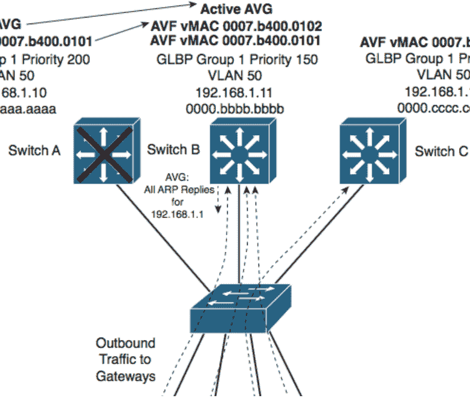

交换机 A

交换机 B

交换机 C

AVG:

所有 ARP 回复：针对 192.168.1.1

发往网关的流量

冗余是 GLBP 组固有的：交换机 A 是 AVG，但如果 AVG 故障，优先级最高的路由器可以接管。

所有路由器都已为组内唯一的虚拟 MAC 地址分配了 AVF 角色。

如果一个 AVF 发生故障，某些客户端会记住分配出的最后一个已知虚拟 MAC 地址。因此，组中的另一台路由器也会接管故障路由器的工作，从而使虚拟 MAC 地址始终保持存状态。

上图说明了当当前激活 AVG 故障时，这些冗余功能是如何响应。在故障之前，交换机 A 因为其高 GLBP 优先级而成为 AVG。

故障后，交换机 B 成为 AVG，使用适用于网关 192.168.1.1 的相应虚拟 MAC 地址响应 ARP 请求。

交换机 A 同时也作为 AVF 运行，参与了网关负载均衡。

交换机 B 也承担了这一职责，使用了与 Switch A 一直使用的虚拟 MAC 地址 `0007.b400.0101` 相同的 `0007.b400.0102`。

因此，任何通过其虚拟 MAC 地址识别网关的主机仍然可以访问活跃的网关或 AVF。

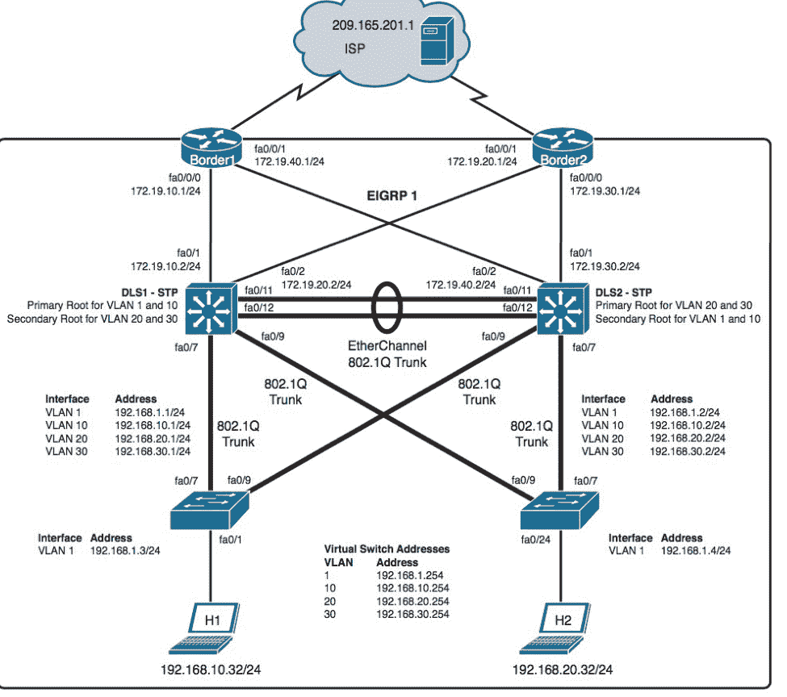

图 13-2 HSRP 配置示例网络拓扑

# Cisco 设备上的 DHCP 设置 (IPv4)

```
Switch(config)#service dhcp -- 启用 - "no service dhcp" 关闭它
Switch(config)#ip dhcp pool Sales_Wireless -- 创建地址池
Switch(config-dhcp)#network 192.168.10.0 255.255.255.0 -- 地址池的网络号和子掩码
Switch(config-dhcp)#default-router 192.168.10.1 -- 默认网关
Switch(config-dhcp)#dns-server 4.4.4.4
Switch(config-dhcp)#lease 3 15 -- 天、小时、分钟 - 默认24 小小时
Switch(config)#exit
Switch(config-dhcp)#dhcp excluded-address 192.168.10.1 192.168.10.10
```

# DHCP 中继

如果你需要为与 DHCP 服务器不在同一局域网的主机提供地址，可以配置路由器接口来中继 DHCP 客户端请求。

```
Router(config)#interface fa0/0
Router(config-if)#ip helper-address 10.10.10.254
```

路由器和 `fa0/0` 位于 `192.168.10.1`，`10.10.10.254` 显然位于不同的子网，但 DHCP 服务器 IP 转发的不只是 DHCP 客户端请求。

# 验证 DHCP

```
show ip dhcp binding -- 列出当前租用每个 IP 地址的状态信息
show ip dhcp pool [poolname] -- 列出地址范围以及已租用地址的状态
show ip dhcp conflict statistics -- 列出 DHCP 服务器统计信息
show ip dhcp conflict -- 显示冲突地址
```

# 更多地址池示例

```
Corp#config
Corp(config)#ip dhcp excluded-address 192.168.10.1
Corp(config)#ip dhcp excluded-address 192.168.10.250
Corp(config)#ip dhcp pool SF_LAN
Corp(config-dhcp)#network 192.168.10.0 255.255.255.250
Corp(config-dhcp)#default-router 192.168.10.1
Corp(config-dhcp)#dns-server 4.4.4.4
Corp(config-dhcp)#exit
Corp(config)#ip dhcp pool LA_LAN
Corp(config-dhcp)#network 192.168.20.0 255.255.255.250
Corp(config-dhcp)#default-router 192.168.20.1
Corp(config-dhcp)#dns-server 4.4.4.4
```

将这些配置添加到两台路由器中，以便它们转发 DHCP：

```
LA(config)#int f0/0
LA(config-if)#ip helper-address 172.16.10.5
```

```
SF(config)#int f0/0
SF(config-if)#ip helper-address 172.16.10.1
```

# 网络地址翻译：静态 NAT、动态 NAT 和 PAT

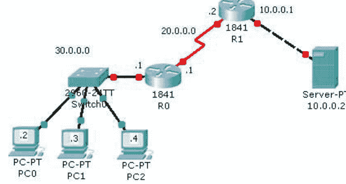

# IP 静态 NAT


```
R1(configif)#ip address 10.0.0.1 255.255.255.0
R1(configif)#no shutdown
R1(configif)#exit
R1(configif)#interface serial 0/0
R1(configif)#ip address 20.0.0.2 255.255.255.0
R1(configif)#no shutdown
R1(configif)#exit
R1(configif)#interface fastEthernet 0/0
R1(configif)#ip address 30.0.0.1 255.255.255.0
R1(configif)#no shutdown
R1(configif)#exit
R1(configif)#ip nat inside
R1(configif)#ip nat outside
R1(configif)#exit
R0(configif)#interface fastEthernet 0/0
R0(configif)#ip address 30.0.0.1 255.255.255.0
R0(configif)#no shutdown
R0(configif)#exit
R0(configif)#interface serial 0/0
R0(configif)#ip address 20.0.0.1 255.255.255.0
R0(configif)#no shutdown
R0(configif)#exit
R0(configif)#ip route 0.0.0.0 255.255.255.0 20.0.0.2
```

没有指向 `10.0.0.2` 的直接路由：因此来自 `30.0.0.0` 网络的 PC 无法访问 `50.0.0.1` Web 服务器。`ping 50.0.0.1` 是通的，`ping 10.0.0.2` 将显示不可达。

# 动态 NAT

使用 `192.168.0.0` 网络作为内部，使用公网地址 `50.0.0.1` 到 `50.0.5`。通过配置 Router1(R0) 作为 NAT 设备：

```
R1(config)#interface fastEthernet 0/0
R1(config-if)#ip address 192.168.0.1 255.255.255.0
R1(config-if)#no shutdown
R1(config-if)#interface serial 0/0
R1(config-if)#ip address 20.0.0.1 255.255.255.0
R1(config-if)#no shutdown
R1(config-if)#clock rate 64000
R1(config-if)#bandwidth 64
R1(config-if)#no shutdown
R1(config-if)#exit
R1(config)#ip route 0.0.0.0 255.255.255.0 20.0.0.1
R1(config)#access-list 1 permit 192.168.0.0 0.0.0.255
R1(config)#ip nat pool 50.0.0.1 50.0.0.5 netmask 255.255.255
R1(config)#nat inside source list 1 pool
R1(config)#interface fastEthernet 0/0
R1(config-if)#nat inside
R1(config-if)#interface serial 0/0
R1(config-if)#nat outside
R1(config-if)#exit
R1(config)#debug ip nat
IP NAT 已开启
NAT: 192.168.0.7->50.0.0.1, out=20.0.0.2
NAT: 20.0.0.2, in=50.0.0.1->192.168.0.7
R1(config)#no debug ip nat
IP NAT 已关闭
```

输出所示，`192.168.0.5` 在离开路由器之前翻译为 `50.0.0.1`。

# IP PAT

如果你有少量公网地址和数百个内部地址需要翻译，在这种情况下你需要使用 PAT。这次我们使用一个公网地址 `50.0.0.1`。

```
R1(config)#access-list 1 permit 192.168.0.0 0.0.0.255
R1(config)#ip nat pool 50.0.0.1 50.0.0.1 netmask 255.255.255
255
R1(config)#nat inside source list 1 pool overload
R1(config)#interface fastEthernet 0/0
R1(config-if)#nat inside
R1(config-if)#exit
R1(config)#interface serial 0/0
R1(config-if)#nat outside
R1(config)#exit
```

要验证 PAT，进入 R1 并运行 `show ip nat translations`

R1#show ip nat translations

| 局网全局 | 内部本地 | 外部本地 | 外部全局 |
| :--- | :--- | :--- | :--- |
| icmp | 50.0.0.1:1 | 192.168.0.7:1 | 20.0.0.2:1 | 20.0.0.2:1 |
| icmp | 50.0.0.1:2 | 192.168.0.7:2 | 20.0.0.2:2 | 20.0.0.2:2 |

# Cisco 设备的访问控制列表 (ACL)

在全局配置中设置 ACL，然后应用到接口

将 ACL 放在正确的端口！出站还是入站？

将 ACL 放在正确的设备上

- 标准 ACL 应靠近目的地，扩展 ACL 应靠近源。
- 防止产生会被对面子网拒绝的无效网络流量。
- 使用按所需的粒度来防止流量的大量丢失。

`Corp(config)#access-list 1-99 [1300-1999]` - 用于标准 ACL

`Corp(config)#access-list 100-199 [2000-2699]`

需要：一个标准 ACL，仅允许你想要启用路由器的主机或内容，然后使用 `class` 命令将访问列表应用到 VLAN。

访问列表是一组用于允许或拒绝网络流量的规则。每条规则按从上到下的顺序处理。一旦找到匹配项，将执行相应的操作且不再检查后续规则。如果没有找到匹配项，则应用列表末尾的隐式拒绝。

标准 ACL 只根据源 IP 地址过滤。扩展 ACL 可以根据源和目的 IP 地址、协议和端口号进行过滤。

```
Router(config)#access-list 10 permit 192.168.10.0 0.0.0.255
Router(config)#access-list 10 deny any
Router(config)#interface fa0/0
Router(config-if)#ip access-group 10 in
```

如果你将它作为入站访问列表放置在 Fa0/0 上，你可能会关闭该接口，因为所有销售 LAN 设备将被拒绝访问连接到路由器的所有网络。应用此访问列表的最佳位置是在 Fa0/1 接口上作为出站列表：

```
Lab_A(config)#int fa0/1
Lab_A(config-if)# access-group 10
```

## 扩展访问列表 (Extended ACLs)

`access-list 165 [deny | permit | remark] [protocol] [sourceIP maskWC][destIP maskWC] [logical op] [ port | tos ]`

对于单个主机，在 IP 地址之前使用 "host"，且不需要通配掩码

```
interface Serial 0/0
Access-group 100 Begin
access-list 100 remark -- Allow BGP IN OUT
access-list 100 permit tcp host 1.1.1.1 host 2.2.2.2 bgp
access-list 100 permit udp any 2.2.2.2 gt 33000
access-list 100 remark End
access-list 100 deny ip any any

interface BRI 0/0
Access-group 100 in
Access-group 100 out

access-list 100 permit ip any any log
debug packet detail XXX (access list number)

access-list 101 permit tcp any any telnet
debug packet detail 101
[ IP 数据包调试是针对访问列表 101 的（详细信息） ]
```


一如往常一样，一旦创建了访问列表，我们必须使用与 IP 列表相同的命令将其应用到接口上：

```
Corp(config)#ip access-group 110 in
或者：
Corp(config)#ip access-group 110 out
```

## 扩展访问列表 #2

```
Lab_A(config)#access-list 110 deny tcp host 172.16.50.5 eq 21
Lab_A(config)#access-list 110 deny tcp host 172.16.50.5 eq 23
Lab_A(config)#access-list 110 permit ip any any
Lab_A(config)#int fa0/1
Lab_A(config-if)# access-group 110 out

Router(config)#access-list 110 deny tcp host 172.16.48.0 0.0.0.255 eq 25
Router(config)#access-list 110 deny tcp host 172.16.192.0 0.0.0.255 eq 23
Router(config)#access-list 110 permit ip any any
Router(config)#interface Ethernet 1
Router(config-if)# access-group 110 out
Router(config)#interface Ethernet 2
Router(config-if)# access-group 110 out
```

仅允许来自源 B 财务服务器的 HTTP 访问。所有其他流量都将被允许。我们可能需要在三个测试语句中配置此内容：

```
Lab_A(config)#access-list 110 permit tcp host 192.168.17.22 172.22.89.26 eq 80
Lab_A(config)#access-list 110 deny tcp host 172.22.89.26 eq 80
Lab_A(config)#permit ip any any
Lab_A(config)#interface fastethernet 0/1
Lab_A(config-if)# access-group 110 out

webserver
access-list 253 permit tcp 172.16.5.0 0.0.0.255 eq any <-- 允许 172.16.5.* 访问任何人的端口
```

## 命名列表 - 以 "ip access-" 开头

```
Lab_A(config)#ip access-list standard BlockSales
Lab_A(config-std-nacl)#deny 172.16.40.0 0.0.0.255
Lab_A(config-std-nacl)#permit any
Lab_A(config-std-nacl)#exit
Lab_A(config)#int fa0/1
Lab_A(config-if)#ip access-group BlockSales
```

## 添加注释

```
R2(config)#access-list 110 remark Permit Bob from Sales To Finance
R2(config)#access-list 110 permit 172.16.40.1 172.16.50.0 0.0.0.255
R2(config)#access-list 110 deny 172.16.40.0 0.0.0.255 172.16.50.0 0.0.0.255
R2(config-ext-nacl)#remark Deny all of lists from Telnet
R2(config-ext-nacl)#No_Telnet
R2(config-ext-nacl)#deny tcp eq 23 172.16.40.0 0.0.0.255 172.16.50.0 0.0.0.255
R2(config-ext-nacl)#permit any
```

添加一条：

```
Lab_A(config)#show access-list
Extended IP access list 110
10 deny tcp host 172.16.30.5 eq ftp
20 deny tcp host 172.16.30.5 eq telnet
30 permit ip any
40 permit ip host 192.168.17.22 172.22.89.26 eq www
50 deny tcp host 172.16.22 eq www
Lab_A(config-ext-nacl)#permit
```

- `show access-list` - 显示所有访问列表及其参数。不显示接口。
- `show access-list 110` - 显示 `110` 的参数。不显示接口。
- `show ip access-list` - 显示访问列表。
- `show interfaces` - 显示应用了 ACL 的接口。
- `show running-config` - 显示应用了 ACL 的特定接口。

记住：你不能同一个接口上使用两个方向的列表；一个会覆盖另一个。

此扩展 ACL 用于允许 `10.1.1` 网络（入站）流量，并从外部接收未经请求的 ping。

```
interface Ethernet0/1
ip address 172.16.1.2 255.255.255.0
ip access-group 101 in
access-list 101 deny icmp any 10.1.1.0 0.0.255
access-list 101 permit ip any 10.1.1.0 0.0.255
```

注意：某些应用需要 keepalive 功能。如果是这样，你可能需要更细粒度的允许/拒绝 IP。

## OSPF 链路状态路由 - Dijkstra 算法

```
Central1(config)#interface loopback 0
Central1(config-if)# address 172.31.1.1 255.255.255
Central1(config)#router ospf 1
Central1(config-router)#network 10.10.0 0.0.0.0 area 0
Central1(config-router)#network 172.16.10.0 0.0.0.3 area 1 <-- 此掩码是 255 减去字节（此处为 252）
Central1(config-router)#network 172.16.10.0 0.0.3 area 2
Central1(config-if)#interface fa0/0 <-- 接口上应该发现邻居
```

为网络拥有默认路由，并传播到其他路由器。

```
Central1(config)#route 0.0.0.0 0.0.0.0 Fa0/0
Central1(config)#router ospf 1
Central1(config-router)#default-information-originate
```

## OSPF 中的 Loopback 和 RID

如果没有配置 loopback，路由器启动时最高的活动地址将成为路由器的 RID。Loopback 接口不会覆盖 `router-id`，不需要重启路由器即可生效。

1. 活动接口上的最高 IP
2. 逻辑接口（loopback）覆盖物理接口。
3. `router-id` 覆盖接口和 loopback 接口。

重启或使用 `clear ip ospf` 命令强制生效。

## IPv6 OSPF 路由 - 路由也附加到接口上。

```
Central1(config)#int f0
Central1(config-if)# ipv6 ospf 1 area 0
Central1(config)#ipv6 router 1
Central1(config-rt)#ipv6 route 1.1.1.1
Central1(config-rt)#do clear ip ospf
```

IPv6 RID 仍然存在 - 在全局配置的 OSPF 进程 ID 下：

```
ipv6 router 1
```

## 指定路由器 Designated Routers

- 默认情况下，所有 OSPF 路由器的优先级均为 `1`。
- 选举根据路由器优先级级别、最高 RID（如果是最高 IP 地址）进行。
- 备用指定路由器 `BDR` 是 `DR` 的备份者，`DR` 的备机。
- 接收所有更新但不分发；当 `DR` 下线时接替。

假设想要 `R1` 成为 `DR`，`R2` 成为 `BDR`。


```
R1(config)#interface f0/0
R1(config-if)# ipv6 ospf priority 100
R2(config)#interface f0/0
R2(config-if)# ipv6 ospf priority 90
```

通过配置优先级为零防止路由器成为 DR 或 BDR。

```
R2(config)#interface f0/0
R2(config-if)# ipv6 ospf priority 0
```

选择最佳路径 - `cost-reference-bandwidth/interface_reference-bandwidth` OSPF

| 接口 | 默认带宽 | 公式 (Kbps) | OSPF 代销 |
| :--- | :--- | :--- | :--- |
| Serial | 1544 Kbps | 100000/1544 | 64 |
| Ethernet | 10000 Kbps | 100000/10000 | 10 |
| Fast Ethernet | 100000 Kbps | 100000/10000 | 1 |

默认路由假设网络中最快的链路路由高达 100 Mbps。

使用 `auto-cost-reference-bandwidth 10000` 连接高达 10 Gbps 的链路。

以下是设置 OSPF 接口代价的规则：

- 使用 `ip ospf cost` 设置代价为 1-65535 之间的值。
- 要影响设备上的所有路由器，使用 `distance 80`。这也会影响非 OSPF 路由器的 AD。
- 使用 `bandwidth` 速度更改接口带宽，单位为 Kbps。
- 使用 `auto-cost-reference-bandwidth ref_bw` 参考带宽，单位为 Mbps。

事实上，通过对通往同一子网的多个路由使用指标，路由器可以将多条路由放入路由表中（默认使用 `maximum-paths` 命令为四条）。

# 链路状态通告 - 基础 LSA

类型 1 LSA - 普通路由器在它们之间描述自身

类型 2 - 网络 LSA - 指定根器（DR）向其区域内的路由器描述自身及其网络

类型 3 LSA - 总结 LSA - 区域边界路由器（ABR）向其他区域通告其内容

类型 4 LSA - 区域边界路由器为自治系统边界路由器（ASBR）提供方向

类型 5 LSA - 自治系统 LSA - AS 外部链路通告

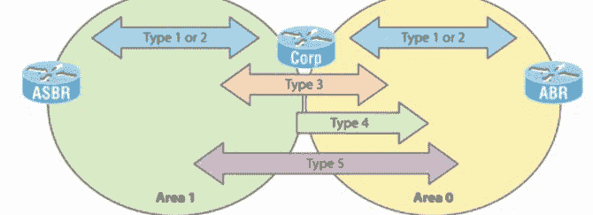

- 用于邻居关系的定时器
- 将更改的 LSAs 泛洪到邻居
- 当生存周期结束时（默认 30 分钟）重新泛洪未更改的 LSAs
- 通过 Hello 消息维持邻居关系，在死亡/保持间隔到达前监听 Hello 消息
- 死亡/保持时间是 hello 定时器的 4 倍
- 广播链路和点对点链路使用 10 秒 hello 定时器和 40 秒保持时间
- 所有其他网络类型使用 30 秒 hello 定时器和 120 秒保持时间

如果路由器发生故障，LSDB 将被清空，以便所有路由器都能重新计算其最短路径

建立邻居关系。当点对点链路建立通时，两端的路由器将通过内部邻居阶段（Init 和 2-Way）。当双方都达到 2-Way 状态时，它们会交换基础 LSAs 用于发现、兼容性检查（路由器 ID）、设置匹配，并准备交换 LSDB。

在 ExStart/Exchange 状态下，它们共享数据库描述符（DBD），Loading 意味着相互发送链路状态更新（LSU），Full 意味着它们的 LSDB 具有相同的 LSA 信息。这些 LSA 构成了拓扑结构。当未收到 Hello 消息，但在 NBIA 上进行了手动配置时。

## 多区域设计中的 LSA

从单区域迁移到多区域设计对 LSA 有若干影响：

- 每个区域的路由器和网络 LSA 数量较少。
- 每个连接的区域都有对应的 ABR LSDB，并对每个区域 LSDB 中的路由器 LSA 进行总结。
- 每个区域都需要总结（类型 3）LSA 来描述其他区域的子网。

## OSPF: 通用验证/故障排除命令

```
sh int [brief] 0-/up/ - IP 地址、封装、保持间隔和环回状态
show ip ospf (interface) - 地址、区域、进程、路由器 ID、开销、状态、优先级、定时器、DR 和 BDR
 ip ospf router - ID、信息、统计数据和 LSA 定时信息
show ip ospf route - 显示路由表并显示注入的路由
show ip ospf neighbor - 查看邻居表、相关接口、保持时间、序列号、DR 和 BDR
show ip ospf database - 查看拓扑表 - 按每个 LSA 输出，按类型、邻居 RID 等组织
show ip ospf topology (or topology-info) 显示拓扑表
show ip ospf traffic - 显示接收到的流量类型
show protocols - 显示路由进程 ID 及启用了哪些协议、K 值
show key-chain - 显示认证信息
show ip ospf data - 更多链接
```

- 类型 I（或路由器 LSA）由每个路由器创建并激活。
- 每个内部路由器有一个路由器 LSA，每个 ABR 针对每个区域有多个路由器 LSA。
- 路由器 LSA 通过向所有连接的邻居发送副本，泛洪于整个（预期的）区域。

每个 LSA 包含：所有连接的邻居、发送该 LSA 的路由器接口区域

# 基础 LSA 布局（可能有所不同，但基本结构如下）

| 20 字节 | V= 开启 | E= 开启 | B= 开启 | 0 [位] | 链路数量：所有路由器链路计数 [16 位] |
|---|---|---|---|---|---|
| 虚拟链路 | ASBR | ABR | | | |
| 链路标识符 ID [32 位] | | | | | |
| 链路数据 [32 位] | | | | | |
| 类型 [8 位] | 数字 TOS = 0 | 度量 | | | |

从 LSA ID 开始...

## 链路状态通告类型概述

| LSA 类型 | 描述 | 路由表代码 |
|---|---|---|
| 1 | 路由器 LSA。通告区域内路由。由 OSPF 路由器向自身和等等生成。在区域内泛洪。代表内部路由器。 | |
| 2 | 网络 LSA。由多访问网段上的 DR 生成。在区域内泛洪。 | |
| 3 | 总结 LSA。通告来自其他区域的子网。由 ABR 生成。 | |
| 4 | 区域边界路由器 LSA。提供到达 ASBR 的路径。 | |
| 5 | 自治系统 LSA。通告 OSPF 域外的路由。在 AS 中泛洪。 | |
| 6 | 不透明 LSA。用于 MPLS TE 等扩展。 | |
| 7 | NSSA LSA（非哑区域）。允许将外部路由作为类型 7 导入。 | |
| 8 | 哑区域路由器。不允许外部路由但允许默认路由。 | |
| 9 | 完全哑区域路由器。不允许外部或区域间路由。 | |
| 10 | 虚拟链路 LSA。用于区域之间的虚拟链路。 | |
| 11 | 转发 LSA。用于路径效率。 | |

## 非完全哑区域 (Not-so-stubby Areas)

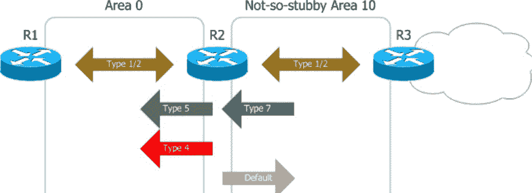

NSSA 使用类型 7 LSA，这些本质上是伪装的类型 5 LSA。这允许 ASBR 向 ABR 广播外部链路，由 ABR 将类型 7 LSA 转换为类型 5，然后泛送到 OSPF 域的其他部分。

NSSA 可以作为哑区域（stub area）或完全哑区域（totally stubby area）工作。要指定普通的（stub）NSSA，区域内的所有路由器都必须如下配置：

```
Router(config-router)# area 10 nssa
```

类型 3 LSA 会进入该区域，类型 1、2 和 4 类 LSA 也是如此。与普通的 stub 区域不同，除非显式配置，否则 ABR 不向 NSSA 注入默认路由。没有默认路由，流量将无法路由到外部目的地，你可能需要通过使用 `default-information-originate` 来包含一个（感谢 Adam 指出这一点）。

```
Router(config-router)# area 10 nssa default-information-originate
```

要将 NSSA 扩展为完全哑区域以消除类型 3 LSA，其所有的 ABR 必须配置为 `no-summary` 参数：

```
Router(config-router)# area 10 nssa no-summary
```

完全哑 NSSA（或如果你愿意的话，是非完全哑区域）的 ABR 在无需进一步配置的情况下就会注入默认路由。

# 总结


# OSPF 区域类型

## 标准区域 (Standard areas)
可以包含类型 1、2、3、4 和 5 的 `LSA`，并可能包含一个 `ASBR`。骨干网被认为是一个标准区域。

## 哑区域 (Stub areas)
可以包含类型 1、2 和 3 的 `LSA`。用默认路由代替外部路由。

## 完全哑区域 (Totally stubby areas)
只能包含类型 1 和 2 的 `LSA`，以及单一的类型 3 `LSA`。该类型 3 `LSA` 描述默认路由，替代所有外部和区域间的路由。

## 非哑区域 (Not-stubby areas)
实现了 stub 或完全哑区域的功能，但包含一个 `ASBR`。`ASBR` 生成的类型 7 `LSA` 由 `ABR` 转换为类型 5，以泛送到 `OSPF` 域的其他部分。

# EIGRP - 增强网关路由协议 (Enhanced Gateway Routing Protocol)

- 一种“平衡混合”路由协议，而非链路状态/距离矢量。有时被称为“高级距离矢量”。
- 发送一次路由表，并对变化使用部分更新。
- 更新组播地址 `224.0.0.0`，以及未接收的邻居 `EIGRP` 消息单播 `IP`。
- 使用可靠传输协议 (`RTP`) 发送 - 如果特定特定，则响应任何更新。
- 用于路由毒化；`EIGRP` 使用 `$2^{32}-1$` 作为“无穷大”（超过 40 亿），某些 `IOS` 版本使用高达 `$2^{256}-1$`（超过 10 万亿）。

`EIGRP` 默认 `Hello` 和 `Hold` 间隔为 5 秒和 15 秒（`Hold` 默认是 3 次 `Hello` 间隔）。这不是强制要求的，但为了稳定性，它们应该保持一致。

对于邻居：配置相同的自治系统编号 (`ASN`)，`Hello` 中的源 `IP` 必须与接口处于同一网段，匹配 `K` 值，并通过所需的认证过程。

路由器首次加入网络时有 3 个步骤，需要填充 3 张表：

- 邻居发现：通过 `Hello` 消息发现邻居 `EIGRP` 路由器并将其添加到邻居表。
- 拓扑交换：交换完整的拓扑更新，仅在变化时按需要交换部分更新。
- 路由表：分析拓扑表，获取到每个子网的度量最小的路由。

## 报告距离 (RD) 和可行距离 (FD)、路由表和拓扑表

- 报告/通告距离 (`RD`) 是邻居声称它距离远程网络有多远。
- 可行距离 (`FD`) 是你通过将该距离与邻居距离相加得到的。
- `FD` 最小的路由就是你找到的路由——它是最佳候选路由。

`D 10.0.0.0/8 194560 172.16.10.2/32 00:27, Serial0`

`D (DUAL)` 是 `EIGRP` 通过 `172.16.10.2` 往 `10.0.0.0/8` 的通告距离。

`(FD)` 是路由协议通告的 `EIGRP` 距离，即第二个可行距离

- 你的路由器通过该路径获取 `10.0.0.0/8` 的总代价为 219546。
- 邻居在其与网络 `10.0.0.0/0` 之间有一个报告（通告）距离 (`RD`)。
- 可行距离 (`FD`) 或总成本是通过将 `RD` 加到到该路由的计算距离上得到的。

## 继任路由 (Successor Routes) 和可行继任路由 (Feasible Successors)

每个路由器在邻居表中保留相邻邻居的信息，拓扑表持有所有邻居通告的目的地，以及关联的距离和度量。这条最佳路径被称为继任路由，它由哪条路径的可行距离最小来决定。

此外还会选出一个备选的“可行继任”路由，如果需要，它将保留在拓扑表中。如果继任路由的 `RD` 小于继任路由的 `FD`，则该路由就是可行继任路由。

路由器有 3 条路由/路径到达路由器 `A`/子网。

| 路由器邻居表 | 路由器路由表 |
| :--- | :--- |
| `D 10.0.0.0/8 194560 172.16.10.2/32 00:27, Serial0` |  |
| `D (DUAL)` 是 `EIGRP` 通过 `172.16.10.2` 往 `10.0.0.0/8` 的通告距离。 |  |
| `(FD)` 是路由协议通告的 `EIGRP` 距离，即第二个可行距离 |  |
| - 你的路由器通过该路径获取 `10.0.0.0/8` 的总代价为 219546 |  |
| - 邻居在其与网络 `10.0.0.0/0` 之间有一个报告（通告）距离 (`RD`) |  |
| - 可行距离 (`FD`) 或总成本是通过将 `RD` 加到到该路由的计算距离上得到的。 |  |


# 报告距离 (RD) 和可行距离 (FD), 路由表和拓扑表

- 报告/通告距离 (`RD`) 是邻居声称它距离远程网络有多远。
- 可行距离 (`FD`) 是你通过将该距离与邻居距离相加得到的。
- `FD` 最小的路由就是你找到的路由——它是最佳候选路由。

`D 10.0.0.0/8 194560 172.16.10.2/32 00:27, Serial0`

`D (DUAL)` 是 `EIGRP` 通过 `172.16.10.2` 往 `10.0.0.0/8` 的通告距离。
`(FD)` 是路由协议通告的 `EIGRP` 距离，即第二个可行距离

- 你的路由器通过该路径获取 `10.0.0.0/8` 的总代价为 `219546`
- 邻居在其与网络 `10.0.0.0/0` 之间有一个报告（通告）距离 (`RD`)
- 可行距离 (`FD`) 或总成本是通过将 `RD` 加到到该路由的计算距离上得到的。

（注：由于原文中存在大量重复内容，已按逻辑进行翻译）

To expand an NSSA as a totally stubby area, eliminating type 3 LSAs, all of its ABRs must be configured with the no-summary parameter:

```
Router(config-router)# area 10 nssa no-summary
```

The ABR of a totally stubby NSSA (or not-totally-stubby area, if you) injects a default route without any further configuration.

## EIGRP - 增强网关路由协议 (Enhanced Gateway Routing Protocol)

- 一种“平衡混合”路由协议，而非链路状态/距离矢量。有时被称为“高级距离矢量”。
- 发送一次路由表，并对变化使用部分更新。
- 更新组播地址 `224.0.0.0`，以及未接收的邻居 `EIGRP` 消息单播 IP。
- 使用可靠传输协议 (`RTP`) 发送 - 如果特定，则响应任何更新。
- 用于路由毒化（指运行或停止运行已“失败”的路由）；`EIGRP` 使用 `$2^{32}-1$` 作为“无穷大”（超过 40 亿），某些 IOS 版本使用高达 `$2^{256}-1$`（超过 10 万亿）。

`EIGRP` 默认 Hello 和 Hold 间隔为 5 秒和 15 秒（Hold 默认是 3 次 Hello 间隔）。这不是强制要求的，但为了稳定性，它们应该保持一致。

对于邻居：配置相同的自治系统编号 (`ASN`)，Hello 中的源 IP 必须与接口处于同一网段，匹配 K 值，并通过所需的认证过程。

路由器首次加入网络时有 3 个步骤，需要填充 3 张表：

- 邻居发现：通过 Hello 消息发现邻居 `EIGRP` 路由器并将其添加到邻居表。
- 拓扑交换：交换完整的拓扑更新，仅在变化时按需要交换部分更新。
- 路由表：分析拓扑表，获取到每个子网的度量最小的路由。

### 报告距离 (RD) 和可行距离 (FD)、路由表和拓扑表

- 报告/通告距离 (`RD`) 是邻居声称它距离远程网络有多远。
- 可行距离 (`FD`) 是你通过将该距离与邻居距离相加得到的。
- `FD` 最小的路由就是你找到的路由——它是最佳候选路由。

`D 10.0.0.0/8 194560 172.16.10.2/32 00:27, Serial0`

`D (DUAL)` 是 `EIGRP` 通过 `172.16.10.2` 往 `10.0.0.0/8` 的通告距离。
`(FD)` 是路由协议通告的 `EIGRP` 距离，即第二个可行距离

- 你的路由器通过该路径获取 `10.0.0.0/8` 的总代价为 `219546`
- 邻居在其与网络 `10.0.0.0/0` 之间有一个报告（通告）距离 (`RD`)
- 可行距离 (`FD`) 或总成本是通过将 `RD` 加到到该路由的计算距离上得到的。

### 继任路由 (Successor Routes) 和可行继任路由 (Feasible Successors)

每个路由器在邻居表中保留相邻邻居的信息，拓扑表持有所有邻居通告的目的地，以及关联的距离和度量。这条最佳路径被称为继任路由，它由哪条路径的可行距离最小来决定。

此外还会选出一个备选的“可行继任”路由，如果需要，它将保留在拓扑表中。如果继任路由的 `RD` 小于继任路由的 `FD`，则该路由就是可行继任路由。

路由器有 3 条路由/路径到达路由器 A/子网

| 路由器邻居表 | 路由器路由表 |
| :--- | :--- |
| `D 10.0.0.0/8 194560 172.16.10.2/32 00:27, Serial0` |  |
| `D (DUAL)` 是 `EIGRP` 通过 `172.16.10.2` 往 `10.0.0.0/8` 的通告距离。 |  |
| `(FD)` 是路由协议通告的 `EIGRP` 距离，即第二个可行距离 |  |
| - 你的路由器通过该路径获取 `10.0.0.0/8` 的总代价为 `219546` |  |
| - 邻居在其与网络 `10.0.0.0/0` 之间有一个报告（通告）距离 (`RD`) |  |
| - 可行距离 (`FD`) 或总成本是通过将 `RD` 加到到该路由的计算距离上得到的。 |  |

（注：由于原始文本中存在大量重复内容，已在翻译中进行去重处理以确保可读性）

# IPv4 中的基础 IGP 路由

三种路由类型：静态路由（通过 CLI 手动配置路由器）、动态路由（路由器通过协议共享路由信息）以及默认路由（为所有流量配置的特殊目的网络路由）。

基础布局

Central1 - 图中所示
- Serial 0/0: `172.16.10/30`
- Serial 0/1: `172.16.10.5/30`
- Fa0/0: `10.10.1/24`

DFW - 图中所示
- S0/0: `172.16.10.2/30`
- Fa0/0: `192.168.10.24`

HOU - 图中所示
- S0/0: `172.16.10.6/30`
- Fa0/0: `192.168.20.24`

# 基础本地 路由（直连）

每个接口都应该添加 `no shutdown`。为了简洁，已移除：

```
Router(config)#hostname Central1
Central1(config)#interface f0/0
Central1(config)#description to LAN
Central1(config)#ip address 10.10.1 255.255.255.0
Central1(config)#interface s0/0
Central1(config)#description to DFW
Central1(config)#ip address 172.16.10.1 255.255.255.252
Central1(config)#interface s0/1
Central1(config)#description to HOU
Central1(config)#ip address 172.16.10.5 255.255.255.252
Central1#show controllers s0/0
```

Interface Serial0/0

硬件检测到 DTE TX 和 RX 时钟。记得在 DCE 端设置时钟！

```
Router(config)#hostname DFW
DFW(config)#interface s0/0
DFW(config)#description to Central
DFW(config)#ip address 172.16.10.2 255.255.255.252
DFW(config)#clock rate 1000000 - DFW 的 DCE 到 Central 需要时钟速率
DFW(config)#interface s0/1
DFW(config)#description DFW
DFW(config)#ip address 192.168.10.1 255.255.255.0
```

```
Router(config)#hostname HOU
HOU(config)#interface s0/0
HOU(config)#description to Central1
HOU(config)#ip address 172.16.10.6 255.255.255.252
HOU(config)#clock rate 1000000 - HOU 的 DCE 到 Central1 需要时钟速率
HOU(config)#interface f0/0
HOU(config)#ip address 192.168.20.1 255.255.255.0
HOU(config)#description LAN
HOU(config)#show ip route *
```

# 静态路由：手动添加路由表


```
Router(config)#ip route 172.16.3.0 255.255.255.0 192.168.2.4
```

`172.16.3.0` 是远程网络，`255.255.255.0` 是该远程网络的网掩码。`192.168.2.4` 是将发送的下一跳，也可以是接口。

如果你想覆盖默认值，在这里设置为 `150`，因为在下面的示例中，我们将添加 RIP，使用 `150`（而不是默认的 `1`）意味着我们不需要移除静态路由——RIP (`120`) 将覆盖它。

# 管理距离（越小越优）：

|| 类型 | 距离 |
| :--- | :--- |
| 直连 | 0 |
| 静态路由 | 1 |
| EIGRP | 5 |
| eBGP | 20 |
| OSPF | 110 |
| RIP | 120 |
| EIGRP | 170 |
| BGP | 200 |
| 未知 | 255 |

```
Central(config-router)#rip 192.168.0.10 255.255.255.172.16.10.2 -- 使用接口
Central(config-router)#rip 192.168.0.20 255.255.255.0 --
```

```
DFW(config-router)#rip 10.10.50 255.255.255.0 172.16.151
DFW(config-router)#rip 172.16.10.45 255.255.255.252 172.16.151
DFW(config-router)#rip 192.168.0.20 255.255.255.0 172.16.151
```

```
HOU(config-router)#network
HOU(config-router)#rip 10.10.50 255.255.255.0 172.16.151
HOU(config-router)#rip 172.16.10.45 255.255.255.252 172.16.151
HOU(config-router)#rip 192.168.0.20 255.255.255.0 172.16.151
```

Stub（末端路由）表示此设计中的网络只有一种到达所有路径；仅使用默认路由。这里是输入静态路由的替代方案（首先我们关闭配置的路由）：

```
HOU(config-router)#network 10.10.50 255.255.255.0 172.16.151
HOU(config-router)#network 172.16.10.45 255.255.255.252 172.16.151
HOU(config-router)#network 192.168.0.20 255.255.255.0 172.16.151
HOU(config-router)#network 0.0.0.0 0 172.16.151
```

# 将静态 IPv4 转换为动态 IPv4

作为快捷方式，你可以直接连接网络以知道与什么配置 RIP：

| 接口 | IP 地址 | OK? | 方法 | 状态 |
| :--- | :--- | :--- | :--- | :--- |
| FastEthernet/0 | 10.10.10.1 | 是 | 手动 | 开启 |
| Serial/0 | 172.16.10.1 | 是 | 手动 | 开启 |
| FastEthernet/1 | 未分配 | | | 禁用 |
| Serial/1 | 172.16.10.5 | 是 | 手动 | 开启 |

当我们在 RIP 中声明路由时，我们需要以这种方式而不是特定的子网引用它们。如下所示 RIP 会过滤子网并填充路由表（RIP 是类类协议）。

```
Central(config-router)#network 10.0.0
Central(config-router)#network 172.16.0.0
Central(config-router)#version 2
Central(config-router)#no auto-summary
```

添加默认静态路由并进入 RIP 以设置传播。

```
Central(config-router)#route 0.0.0.0 0.0.0.0 Fa0/0
Central(config-router)#rip
Central(config-router)#default-information
```

```
DFW(config-router)#network 192.168.0.0
DFW(config-router)#network 172.16.0.0
DFW(config-router)#version 2
DFW(config-router)#no auto-summary -- 禁用 auto-summary 让 RIP 查看子网
DFW(config-router)#do ip route
```

`192.168.10.0/24` 是直连的 FastEthernet/0

`192.168.10.32` 是直连的 FastEthernet/0

`172.16.0/30` 是子网化的，子网

`172.16.10.4 [120]` 通过 `172.16.10.1`, `00:00:08:0`

`172.16.10.0` 是直连的 Serial/0

`172.16.0.2/32` 是直连的 Serial/0

`192.168.20.24 [150]` 通过 `172.16.10.1`

`10.0.0.0/24` 是子网化的，子网

> 关于 RIP 的默认设置（R）和你之前的路由（S）

```
HOU(config-router)#route 0.0.0.0 0.0.0.0
HOU(config-router)#router ip
HOU(config-router)#network 192.168.0.0
HOU(config-router)#network 172.16.0.0
HOU(config-router)#version 2
HOU(config-router)#auto
HOU(config-router)#areas 2
```

# 从 IPv4 路由切换到动态 IPv4 OSPF

```
Central(config-router)#router ip
Central(config-router)#network 10.10.10.1 255.255.255.0
Central(config-router)#network 172.16.10.1 255.255.255.0
Central(config-router)#network 172.16.10.0 0.0.3
Central(config-router)#network 172.16.10.5 0.0.3
```

```
DFW(config-router)#router ip
DFW(config-router)#ospf 3
DFW(config-router)#network 192.168.20.0 0.0.0.255
DFW(config-router)#network 172.16.10.0 0.0.7
DFW(config-router)#interface fastEthernet 0
```

> 可能需要范围 "1"，因为它是下面列出的摘要。使用 `passive-interface`：

```
HOU(config-router)#ospf 100
HOU(config-router)#passive-interface fastEthernet 0
```

```
Router(config)#hostname Router
Router(config)#int 0/0
Router(config)#address 10.10.10.2 255.255.255.0
Router(config)#no shutdown
Router(config)#ospf 2
Router(config)#network 10.10.10.0 0.0.0.255
```

# OSPF 路由汇总：

```
Router(config)#ospf 100
area 1 192.168.1.5 8 0.0.63
External: summary-address: 192.168.64.0 0.0.24
```

# RouterID - 如果你没有先配置回环接口并需要强制路由器变为 DR：

```
Router(config)#router-id 223.255.255.254
Router(config)#do clear ip ospf process
```

设置 `routerID` 将优其他路由器上的任何 RID 或回环接口，重置 OSPF

# IPv6 中的基础 IGP 路由


添加 IPv6（包括默认路由）

通过简单的子网方案 11, 12, 13, 14 和 15 为 Central, DFW 和 HOU 路由器添加 IPv6

- `Central(config)#ipv6 unicast-routing`


`Central(config)#interface f0/0`
`Central(config-if)#ipv6 address 2001:db8:3c4d:11::/eui-64`
`Central(config)#interface s0/0`
`Central(config-if)#ipv6 address 2001:db8:3c4d:12::/eui-64`
`Central(config)#interface s0/1`
`Central(config-if)#ipv6 address 2001:db8:3c4d:13::/eui-64`
`DFW(config)#ipv6 unicast-routing`
`DFW(config)#interface s0/0`
`DFW(config-if)#ipv6 address 2001:db8:3c4d:12::/eui-64`
`DFW(config)#interface f0/0`
`DFW(config-if)#ipv6 address 2001:db8:3c4d:14::/eui-64`
`HOU(config)#ipv6 unicast-routing`
`HOU(config)#interface s0/0`
`HOU(config-if)#ipv6 address 2001:db8:3c4d:13::/eui-64`
`HOU(config)#interface f0/0`
`HOU(config-if)#ipv6 address 2001:db8:3c4d:15::/eui-64`

## 静态 IPv6 路由

第一行静态路由使用下一跳，第二条使用出口接口

（在 `DFW` 路由器上，使用 `ipv6 route int`，然后定义下一跳的接口地址）

```
Central(config)#ipv6 route 2001:db8:3c4d:14::/64 2001:db8:3c4d:12:21a:2fff:fee7:4398
Central(config)#ipv6 route 2001:db8:3c4d:15::/64 s0/1 1
Central(config)#do show ipv6 route
```

> 对于 `DFW` 和 `HOU` 路由器
>
> `DFW` 和 `HOU` 路由器在每个路由器中放置一个指向远程子网 11 (`Central`):
>
> `DFW(config)#ipv6 route 2001:db8:3c4d:11::/64 s0/0/15`
>
> `HOU(config)#ipv6 route ::0 s0/0/1` -- 默认路由

# IPv6 RIPng

```
Austin(config)#ipv6 unicast-routing
Austin(config-if)#interface fastethernet 0/0
Austin(config-if)#ipv6 enable
Austin(config-if)#ipv6 address 2001:db8:2::/64 eui-64
Austin(config)#ipv6 rip RIPNG 1
Austin(config-if)#interface fastethernet 0/1
Austin(config-if)#ipv6 enable
Austin(config-if)#ipv6 address 2001:db8:1::/64 eui-64
Austin(config)#ipv6 rip RIPNG 1
Austin(config-if)#no shutdown
```

```
Houston(config)#ipv6 unicast-routing
Houston(config-if)#interface fastethernet 0/0
Houston(config-if)#ipv6 enable
Houston(config-if)#ipv6 address 2001:db8:2::/64 eui-64
Houston(config)#ipv6 rip RIPNG 1
Houston(config-if)#interface fastethernet 0/1
Houston(config-if)#ipv6 enable
Houston(config-if)#ipv6 address 2001:db8:3::/64 eui-64
Houston(config)#ipv6 rip RIPNG 1
```

# 到 IPv6 OSPF 路由

```
Central(config)#int f0/0
Central(config-if)#ipv6 ospf 1 area 0
Central(config-if)#int s0/0
Central(config-if)#ipv6 ospf 1 area 0
Central(config-if)#int D0
Central(config-if)#ipv6 ospf 1 area 0
```

```
DFW(config)#int f0/0
DFW(config-if)#ipv6 ospf 1 area 0
DFW(config-if)#int s0/0
DFW(config-if)#ipv6 ospf 1 area 0
```

[其他设备亦同]

```
San(config)#int f0/0
San(config-if)#ipv6 address autocon default
San(config-if)#ipv6 ospf 1 area 0
```

相同的 IPv4 OSPF RID 仍然存在 - 在全局配置下的 OSPF 进程 ID 下更改 RID：

```
Central(config)#router ospf 1
Central(config-router)#router-id 1.1.1.1
Central(config-router)#do clear ospf process
```

# 从 IPv6 OSPF 切换到 IPv6 EIGRP

你必须在接口上关闭 OSPF，然后添加

```
Central(config)#int f0/0
Central(config-if)#no ipv6 ospf 1 area 0
Central(config-if)#ipv6 eigrp 1
Central(config-if)#exit
```

[对所有接口执行操作]

```
DFW(config)#int f0/0
DFW(config-if)#no ipv6 ospf 1 area 0
DFW(config-if)#ipv6 eigrp 1
DFW(config-if)#exit
DFW(config-if)#int s0/0/0
```

[其他设备亦同]

# 动态 IGP 路由协议 - 快速概述

### IPv4 的 RIP

```
Central1(config)#router rip
Central1(config-router)#network 10.0.0.0
Central1(config-router)#network 172.16.0.0
Central1(config-router)#network 2
Central1(config-router)#no auto-summary
```

添加默认静态路由，并进入 RIP 配置设置 `default-interface originate` 以将其传播。

```
Central1(config)#ip route 0.0.0.0 0.0.0.0 Fa0/0
Central1(config)#router rip
Central1(config-router)#default-information
```

### IPv6 的 RIPng - 添加到接口

```
Austin(config)#ipv6 unicast-routing
Austin(config-if)#interface ethernet 0/0
Austin(config-if)#ipv6 enable
Austin(config-if)#ipv6 route 2001:db8:c18::/64
Austin(config-if)#ipv6 ripNG1 enable
Austin(config-if)#interface ethernet 0/1
Austin(config-if)#ipv6 enable
Austin(config-if)#ipv6 route 2001:db8:c18::/64
Austin(config-if)#ipv6 ripNG1 enable
Austin(config-if)#no shutdown
```

### IPv4 的 OSPF

```
int loopback 0
ip address 172.31.1.1 255.255.255.255
router ospf 300
Test(config-router)#network 192.168.0.0 0.0.255 area 15
```


Test(config-router)#network 192.168.10.80 0.0.0 area 0

### IPv6 的 OSPFv3 - 添加到接口

```
Corp(config)#ipv6 ospf 1
Corp(config-router)#router-id 1.1.1.1
Corp(config-if)#int 0/0
Corp(config-if)#ipv6 ospf 1 area 0
```

### IPv4 的 EIGRP

```
Corp(config)#eigrp 20
Corp(config-router)#network 10.0.0 0.0.0.255
Corp(config-router)#network 172.16.0.0 0.0.0.255
Corp(config-router)#network 172.16.4.0 0.0.0.255
Corp(config-router)#no auto-summary
SF(config-router)#network 172.16.0.0
```

### IPv6 的 EIGRP - 添加到接口

```
Corp(config)#ipv6 unicast-routing
Corp(config-router)#ipv6 eigrp 10
Corp(config-router)#no shut
Corp(config-router)#router-id 1.1.1.1
Corp(config-if)#int s0/0
Corp(config-if)#ipv6 eigrp 10
Corp(config-if)#int s0/0/1
Corp(config-if)#ipv6 eigrp 10
```

# 整体视图：路由管理器胜出

管理距离 - 分数最低优先
路由管理器 `RTM` 从多个可用协议中选择相同的子网。`AD` 越低越优。
为了理解这一点，直接连接的设备 `AD` 为 0。

| 静态 | 1 | IS-IS | 115 |
| EIGRP summary | 5 | RIP | 120 |
| External BGP | 20 | external EIGRP | 170 |
| Internal BGP | 90 | internal BGP | 200 |
| OSPF | 110 | 未知 | 255 |

计时器 - 参考如何更改它们，例如 `ip hello-interval eigrp` 或 `ip hold-time eigrp`

| 协议 | 类型 | 打好/心跳 | 保持/死亡 | 备注 |
| :--- | :--- | :--- | :--- | :--- |
| RIP | 距离 | 30 秒 | 180 秒 | 超时；120 秒 |
| OSPF | 状态链路 | BC+10 秒 | BC+40 秒 (4x) | NBMA 30 秒/120 秒死亡 (4x) |
| EIGRP | 广义距离 | BC+5 秒 | BC+15 秒 (3x) | NBMA 60 秒/180 秒死亡 (3x) |
| IS-IS | 状态 | 10 秒 | 7 秒 | 还有 L1 和 L2 计时器。Juniper 为 9 秒。见文档。 |
| BGP | 路径矢量 | 60 秒心跳 | 180 秒 (心跳) | |

路由中的 OSPF 路径代价 - 不要与网关代价混！
选择最佳路由 = 参考带宽/接口带宽。

| 接口 | 默认带宽 (Kbps) | 公式 (Kbps) | OSPF 代价 |
|---|---|---|---|
| 串口 | 1544 Kbps | 100,000/1544 | 64 |
| 以太网 | 10000 Kbps | 100,000/10000 | 10 |
| 快速以太网 | 100000 Kbps | 100,000/100000 | 1 |

默认参考带宽假设网络中最快的链路为 100 Mbps。
使用 `auto-cost reference-bandwidth 10000` 以适应高达 10 Gbps 的链路。

以下是设置 OSPF 接口代价的规则：
- 使用 `ospf cost interface` 单独设置，范围在 1-65535 之间。
- 若要影响所有路由器，使用 `distance 80`。这会影响非 OSPF 路由。使用 `bandwidth` 命令更改带宽，单位为 Kbps。

STP 路径代价：
- 10 Mbps: 2000000
- 100 Mbps: 200000
- 1 Gbps: 20000
- 10 Gbps: 200
- 100 Gbps: 200

距离矢量代价：
水平分割（Split Horizon）不从学习路由的地方传回路由。毒性分割（Poison reverse）将“来源地”标记为不可达（RIP 为 16）。
带毒性分割水平分割是水平分割广告的一种变体，路由器主动将路由发布为不可达（RIP 为 16）。这种公告的作用是在环路在网络中传播之前立即将其移除。

OpenReceive 接收来自对等体的初始 keepalive 进入 OpenConfirm 状态。
如果 TCP 断开，路由器将终止会话，设置 ConnectRetry 计时器并返回 Active 状态。

OpenConfirm 消息完成，收到初始 keepalive。向对等发送 Keepalive 以进行匹配并列出。收到 keepalive 后，移动到 Established 状态，否则进入 Idle 状态。

在收到邻居的更多 Keepalive 后达到 Established。所有邻居参数、邻居关系正常，对等体可以交换 Update 消息。

检查时，使用 `sh ip bgp summary`。State/PRcode 显示 Established- 状态的数值值：如果不在 Established 状态，此标题下的值将列出 BGP 状态的文本名称。

+   所有 BGP 消息共享相同的头部，由以下组成：
- 16 字节字段：设置为 10 以检测同步丢失。
- 2 字节长度字段：BGP 消息的总长度，范围从 19 到 4096
- Update 中包含一个 PA 字段（AS Path 属性）
- 1 字节类型代码，用于识别不同的 BGP 消息 —— 如下数字 (n)

| 消息 (类型) | 目的 |
|---|---|
| Open (1) | TCP 连接建立后的第一个代码，用于启动邻居关系。BGP 版本、主机 ID、BGP 标识符、可选认证 |
| Keepalive (4) | 维持连接。仅包含头部。默认每 60 秒发送一次 Keepalive。默认保持时间为 keepalive 间隔的 x。Update 也会重置 keepalive 间隔 |
| Update (2) | 用于交换路径以及使用这些路径的关联前缀/长度 (NLRI)。每个消息包含一组路径和所有 NLRI。还包含撤销的路由 |
| Notification (3) | 带有代码、子类型和数据的错误。通常表示重置连接 |

所有通过 `邻居 <ipaddr> route-map<name> in` 过滤的前缀都在路由表中以便进行配置。

## eBGP 邻居

配置 BGP 至少需要 2 条命令

```
config/router bgp <asn>
config/router# neighbor <ipaddr> remote-as<asn>
```


为了建立 BGP 邻居关系：
- 之间必须首先建立 TCP 连接
- 路由器需要互补的 `neighbor <ipaddr> remote-as-<asn>`，具有匹配的 AS 以及 TCP 包发出的接口 IP 地址（如果未显式定义）
- BGP RID 不能相同
- MDS 认证必须通过（如果已配置）

BGP RID 通过以下方式建立：
1) `bg router-<rid>` - 或者 -
2) BGP 初始化时任何开启的 loopback 接口的最高 IP 地址
3) BGP 初始化时任何开启/正常接口的最高 IP 地址

要配置认证，请在两台路由器上使用 `<ipaddr> password <password>`。`<ipaddr>` 指向另一台路由器的 IP 地址，该地址对于识别连接必须是唯一的。

验证邻居，使用 `show ip bgp shutdown` 和 `show tcp peer` 显示 TCP 连接。
使用 `neighbor <ipaddr> shutdown` 关闭连接并移动到 Idle 状态（保留邻居配置）。

`neighbor` 命令通过对等组（peer-group）配置，设置的命令集可以应用于组内的所有邻居（内部或外部，二者不可兼得）。
简化配置和更新。
`neighbor <name> peer-group`
`neighbor <ipaddr> peer-group-<name>`
(邻居必须有 `neighbor remote-as as`)

在大多数 IGP 中，`network` 命令在接口上启动路由过程。
在 BGP 中，该命令告诉路由器为网络产生发布。

- `network` 并不非要连通的 —— 它必须在路由表中。
- 在事件 AS 中的网络（通常建议这样做，但 `next-hop-self` 也有类似作用）

BGP 假设你使用默认子网掩码
- 需要发布子集？使用可选关键字 `mask` 并指定要使用的子网掩码
- 路由表必须包含精确匹配（前缀和子网掩码）

网络声明需要是具体的（SPEC）。

如果你错误配置了 `network` 命令，例如 `192.168.1.1 mask 255.255.255.0`，则 BGP 将针对路由表中精确的 `192.168.1.1/24`。BGP 不会向邻居发布它。

如果你发布命令 `network 192.168.0.0 mask 255.255.255.0` 来发布 CIDR 块，则 BGP 将仅针对路由表中的 `192.168.0.0/16`。你可能会找到 `192.168.0.1/24` 或 `192.168.0.1/32`；然而，可能永远找不到 `192.168.0.0/16`。在这种情况下，你可以配置指向 loopback 接口的静态路由，以便 BGP 能够在路由表中找到精确匹配：`ip route 192.168.0.0 255.255.255.0`

# BGP 与 Loopback 地址

- 记住 loopback 接口提供了更健壮的配置 —— 永远不会掉线，比物理接口增加了稳定性，且如果接口链路故障，BGP 仍可运行。
- 路由器可以发送数据包而不被中断，因为 loopback 始终是开启的。
如果另一个接口尝试到达 loopback，当源地址不匹配时将被阻塞。

当 2 台 BGP 路由器之间存在多个链路，且你想在它们之间建立 BGP 邻居关系时，有两种选择：
- 为每个物理接口配置连接，消耗带宽和内存。
- 使用虚拟（loopback）接口配置连接，所需的带宽和内存较少，并确保接口始终开启。

eBGP 假设邻居是直接连接的并与特定接口的 IP 对等。如果不是，你必须使用 `neighbor ip-address ebgp-multihop number-of-hops` 命令。如果你在 iBGP 中与 loopback IP 地址对等，必须更改源以匹配 loopback 邻居 `update-source interface`。

> eBGP 假设内部邻居可能没有直接连接，因此不需要此命令。在 iBGP 中使用 loopback IP 地址时，必须更改源以匹配 loopback 邻居的 `update-source interface`。

```
Router(config-router)#neighbor 172.16.1.2 update-source loopback
```

- 如果没有 `neighbor update-source`，iBGP 将使用距离对等体最近的 IP 接口。在点对点 eBGP 会话中，不需要此命令。

## BGP 路径选择标准

1. 最高 `weight`（本地）
2. 最高 `LOCAL_PREF`（AS 内部）
3. 选择源自路由 (`next-hop = 0.0.0.0`)
4. 最短 `AS_PATH`
5. 最低起源类型 - `(i)IGP, (e)eBGP`
6. 同一 AS 内的最低 `metric`
7. eBGP 优于任何 IGP。
8. 最近的 IGP 链路（最低 IGP 链路）
9. 最旧路由（用于 eBGP 以最小化路由抖动的影响）
10. 最低路由器 ID。
11. 最低 IP 地址。

BGP 仅选择一条路由作为最佳路由（不进行负载均衡）。步骤 1、2 和 4 通常用于影响出站路由，而对于出站路由，9、10 和 11 在平局时不会使用。
记忆口法：WILLAOMI

# BGP - 配置

| | |
|---|---|
| `router bgp 100` | 启动 BGP 路由进程 |
| `neighbor 192.31.7.1 remote-as 200` | 为会话添加对等体。ASN 决定是 eBGP 还是 iBGP |
| `network 172.135.250.0` | 要宣告的已学习网络 |
| `network 128.107.0.0 mask 255.255.255.255` | 指定单个子网 |
| `(no) neighbor 24.1.1.2 shutdown` | 禁用活动会话 |
| `timers bgp 90 240` | 定时器。保持包时间 (60秒)，保持时间 (180秒) |
| `neighbor 172.16.1.2 update-source loopback0` | 使用特定的接口 |
| `(no) synchronization` | BGP 路由在先通过 iBGP 添加到表中 |

在较新版本的 IOS 中已禁用了同步。建议使用 BGP 全网网。当将 BGP 用于 MPLS 时，从 BGP 重发布到 IGP 是负责任且可行的。开启 Switch BGP 以避免环路。

# eBGP 下跳行为

- eBGP 下跳属性是用于到达通告路由器的 IP 地址；即属于“邻居”自治系统的边缘路由器。在大多数情况下，它是对等体之间连接的 IP 地址。
- 对于 iBGP，eBGP 下跳地址不会更改，而是被原样携带到本地自治系统。
- `next-hop-self` 命令是绕过此限制的方法（如下所示）。
- R2 告诉 R3，在到达其自治系统之外的网络时，它将作为下一跳地址。

# 在 R2 上的设置：

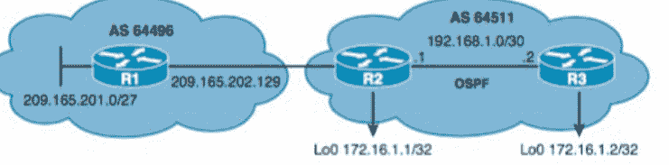

| | |
|---|---|
| `router bgp 64511` | 启动 BGP 路由进程。 |
| `neighbor 209.165.202.129 remote-as 64496` | 将 R1 识别为 eBGP 邻居 |
| `neighbor 172.16.1.2 remote-as 64511` | 将 R3 识别为 iBGP 邻居 |
| `neighbor 172.16.1.2 update-source loopback0` | Loopback0 IP 是所有发往 R3 的 BGP TCP 包源 |
| `neighbor 172.16.1.2 next-hop-self` | 将自己作为其他 AS 下一跳 |

R3 将使用 R2 作为下一跳，而不是使用 209.165.202.129 的 eBGP 下跳。

# 这里是另一个略有不同的设置示例，在该设置下几乎是强制性的：

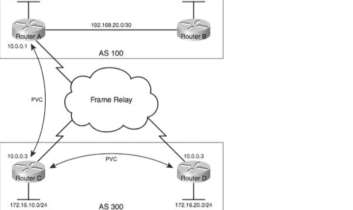

```
Router(config)#neighbor bgp 300

Router(config-router)#neighbor 10.0.0.1 remote-as 100

Router(config-router)#neighbor 10.0.0.1 next-hop
```

- 强制所有到 10.0.0.1 的路由将此下一跳作为下一跳宣告


- 如果公共介质是以太网，则 `Router C` 会向 `Router A` 宣告 `172.16.20.0`，下一跳为 `10.0.0.3`。
- 路由将失败 - `Router A` 没有到 `Router D` 的直接 PVC 且无法到达下一跳。
- 为了修复，`neighbor 10.0.0.3 next-hop-self` 会导致 `Router C` 自己宣告 `10.0.0.3`。
- 这种情况发生在非路由网络中（如 `Frame Relay` 或 `X.25`），其中 BGP 邻居可能无法访问同一子网的所有其他邻居。

```
Router(config-router)#neighbor 10.0.0.1 next-hop-unchanged
```

允许 eBGP 多点对等体传播下一跳

在反射器（`reflector`）上不应使用此命令，当为路由客户端启用此功能时，不应使用 `next-hop-self` 命令。

# eBGP 多点

默认情况下，eBGP 邻居交换 TTL 为 1 的包。尽管 eBGP 邻居通常是直接连接的（通过 WAN），但有时直接连接的路由器无法运行 BGP。`ebgp-multipoint` 允许对等体之间即使没有直接连接（多达 25 跳）也能建立逻辑连接。`ebgp-multipoint` 仅用于 eBGP 会话且必须在每个对等体上配置。如果尝试在 `loopback` 建立 BGP 会话，BGP 包将由于 TTL 过期而被丢弃。


```
R1(config)# ip route 10.0.20.1 255.255.255.255 209.165.1.2
```
- 定义到 `Loopback0` 的静态路由

```
R1(config)# router bgp 64496
R1(config-router)#neighbor 10.0.20.1 remote-as 65511
```
- 识别 `10.0.20.1` 对等体

```
R1(config-router)#neighbor 10.0.20.1 update-source loopback0
R1(config-router)#neighbor 10.0.20.1 ebgp-multihop 2
```
- 允许两个（非直接连接）路由器建立 TTL 为 2 的 eBGP 会话。

```
R2(config)# ip route 10.10.10.1 255.255.255.255 172.16.1.2
```
- 定义到 `Loopback0` 的静态路由

```
R2(config)# router bgp 64511
R2(config-router)#neighbor 10.10.10.1 remote-as 64496
R2(config-router)#neighbor 10.10.10.1 update-source loopback0
R2(config-router)#neighbor 10.10.10.1 ebgp-multihop 2
```
- 允许两个（非直接连接）路由器建立 TTL 为 2 的 eBGP 会话。

# bgp multihop Loopback

如果两个 BGP 邻居之间存在冗余链路并 `loopback` 地址，必须配置 `bgp multihop`，因为默认 TTL 为 1。否则，路由器在将包交给 `loopback` 接口之前会减少 TTL，这意味着 IP 转发逻辑将其丢弃。配置为 2 可以解决此问题。

# 默认路由，default-origin 定义特定邻居

对于到达所有/对等体的默认路由，只需 `network 0.0.0.0`（它在路由表中）。
要向特定邻居宣告默认路由 `0.0.0.0`，请使用 `network 192.168.1.1 default-origin`

# BGP 对等组

为了方便配置具有相同或相似参数（例如路由映射、过滤器或列表）的大量邻居，引入了对等组（`peer groups`）的概念。只需配置一个包含所有应用于 BGP 对等体的邻居组。将 BGP 邻居绑定到对等组，网络管理员将对等组配置应用于所有的 BGP 会话。结果所示，所有四个 IBGP 邻居都被分配了相同的 BGP 配置。

| | |
|---|---|
| `router bgp 65500` | 启动 BGP 组进程 |
| `NEIGHBOR INTERNAL` | 创建名为 `INTERNAL` 的 BGP 组 |
| `NEIGHBOR INTERNAL remote-as 65500` | 为对等组分配第一个参数 |
| `NEIGHBOR INTERNAL next-hop-self update-source loopback0` | 为对等组分配第二个参数 |
| `NEIGHBOR INTERNAL route-reflector-client` | 为对等组分配第三个参数 |
| `NEIGHBOR 192.168.1.2 peer-group ebgp-internal` | 为对等组分配第四个参数 |
| `NEIGHBOR 192.168.1.3 peer-group ebgp-internal` | ... 应用到邻居 R3 |
| `NEIGHBOR 192.168.1.4 peer-group ebgp-internal` | ... 应用到邻居 R4 |
| `NEIGHBOR 192.168.1.5 peer-group ebgp-internal` | ... 应用到邻居 R5 |

对等组可以配置为以下内容（不仅限于）：

- 使用特定接口地址的 IP 来保护 TCP 会话或使用 `next-hop/self` 功能
- 使用或不使用 BGP `multihop` 或 MD5 认证进行 BGP 会话
- 使用前缀列表、过滤器和路由映射过滤入站或出站路由
- 为收到的路由器分配权重值

# 路由聚合 - 设置 Aggregate 属性

- BGP 路由器可以合并重叠的路由（往同一目的地的非方向性路由）
- 在决策最佳路径时，路由器总是选择更具体的路径。

```
R1(config-router)#aggregate-address 172.16.0.255 255.255.0
```
- 在 BGP 表中创建聚合条目，以覆盖范围内的 BGP 路由。
- 除非使用 `summary-only`，否则更具体的路由将被隐藏。

```
R1(config-router)#aggregate-address 172.16.0.0 255.255.0 summary-only
```
- 创建聚合路由，并通告更具体的路由。
- 这些子集上的特定 `AS_PATH` 信息将丢失。

```
R1(config-router)#aggregate-address 172.16.0.0 255.255.0 as-set
```
- 创建一个聚合条目，其中被通告的路径是一个 `AS_SET`（`AS_PATH` 列表）

以下是路由聚合的一个用例：为了发送聚合地址，我们只需要配置特定路由中的一个。通过配置所有路由且不使用 `summary-only`，它们都将被发送，并且当其中一个网络故障时，将发送聚合地址。

```
Lockub(config-router)#bgp 1
Lockub(config-router)#neighbor 10.1.1.2 remote-as 2

Austin(config-router)#bgp 2
Austin(config-router)#neighbor 10.1.1.1 remote-as 1
Austin(config-router)#neighbor 172.16.0.0 mask 255.255.0.0
Austin(config-router)#neighbor 172.16.1.0 mask 255.255.0.0
Austin(config-router)#neighbor 172.16.2.0 mask 255.255.0.0
Austin(config-router)#aggregate-address 172.16.0.0 255.255.0
```

因此，`Lockub` 和 `Austin` 在其 BGP 表中将所有这些特定路由和聚合地址：

```
Lockub#show ip bgp 172.16.0.0 255.255.0
BGP table entry for 172.16.0.0/16, version 1
Paths: (1 available)
Origin IGP, localpref 100, valid, atomic-aggregate, best
```


# 路由反射器

默认情况下，路由器向 EBGP 邻居通告 EBGP 路由。如果通过 IBGP 接收路由，则不会将其通告给 IBGP 邻居，因为所有 IBGP 路由器在路由进入 AS 后接收路由的防环方法是建立 IBGP 邻居的全网状连接，这在邻居数量增加时可能会变得复杂。路由反射器解决了这个问题：

目标是允许 `R2` 通告从 `R3` 学习到的网络。没有这些命令，`R1` 将永远无法学习 `172.16.0.0/24` IBGP 拓扑。

| Command | 说明 |
| :--- | :--- |
| `R2(config)#router bgp 65010` | 进入 BGP 路由配置 |
| `R2(config-router)#neighbor 10.1.1.1 route-reflector-client` | 指定 BGP 路由反射器并将指定的邻居为客户端 |
| `R2(config-router)#neighbor 10.3.3.3 route-reflector-client` | 指定 BGP 路由反射器并将指定的邻居为客户端 |

# 验证和排错 BGP 连接

`show ip bgp`

| Command | 说明 |
| :--- | :--- |
| `show ip bgp [subnet-mask]` | 显示 BGP 表中带有 AS_PATH 的路由，状态：有效，> 为最佳 |
| `show ip bgp <subnet/cidr>` | 列出可能的路由，例如默认路由 0.0.0.0，路由被放置的条目 |
| `show ip bgp neighbors` | 邻居的 BGP 连接信息 |
| `show ip bgp neighbors <address>` | 监控从特定邻居接收的路由 |
| `show ip bgp route-filter` | BGP 连接的状态、BGP 数据库的使用和状态 |
| `show ip bgp summary` | 显示路由表中的 BGP 条目 |
| `show tcp to <neighbor>` | 显示 TCP 连接 |
| `show ip bgp [peer-group] [community-list]` | 邻居的配置 |
| `show ip access-lists` | 访问控制列表 |
| `debug bgp events, debug bgp ipv4 unicast, debug bgp updates` | 调试 BGP 更新 |
| `clear ip bgp` | 强制清空 BGP 表和所有会话 |
| `clear ip bgp 10.1.1.2 soft` | 软重置，不重置连接，刷新邻居更新 |
| `clear ip bgp <x.x.x> soft` | 软重置，强制路由器存储来自此邻居的所有更新 |

## Routing Information Base (RIB)

当 BGP 最佳算法选择一个前作为路由时，它会被传递给路由表管理器 (`RTM`)。在例中，两个路由器 `R1` 和 `R2` 发现了路由 `172.16.0.0/8`。`R1` 通过 BGP 学习它 (`AD 20`)，但 `R2` 从 OSPF 和 BGP 学习到它。`R2` 的最佳路由选择了较低 AD 的 OSPF 路由 (`AD 110`)而不是较高 AD 的 BGP 路由 (`AD 200`)。运行 `ip bgp rib-failure` 显示 RTM 未将每个路由放入 IP 路由表。在这种情况下，在 `172.16.0.0/8` 上，`show ip bgp rib-failure` 显示 BGP 数据库，包含了 BGP 知的所有网络、下一跳、某些属性以及每个路由的 AS 路径。

BGP 表版本为 1，路由器 ID 为 1。

Status codes: s suppressed, damped, h, valid, > best

Origin codes: i, E, incomplete


| Network | Next Hop | Metric | LocPrf | Weight |
| :--- | :--- | :--- | :--- | :--- |
| * 0.0.0.0 | 123.126.126.126 | | 7018 2914 9304 80 i |
| | 123.126.126.126 | | 7018 2914 9304 80 i |
| * 3.51.92.0/23 | 123.126.126.137 | | 7018 |
| | 123.126.126.154 | 2366 | 7018 |
| | 123.126.126.236 | | 7018 |
| * 8.6.6.0/24 | 123.126.126.137 | | 7018 701 14744 14744 14726 i |
| | 123.126.126.145 | | 7018 701 14744 14744 14726 i |
| | 123.126.126.236 | | 7018 701 14744 14744 14726 i |

网络按顺序列出。第一列列出每个路由的状态。它们是单字符并挤在一起。第一列中的星号 (`*`) 表示该路由有一个下一跳。其他选项：
- suppressed: BGP 知道该网络但未通告。
- damped: BGP 停止通告网络，直到其稳定。
- h: BGP 知道该网络但当前没有该路由。
- r: RIB 失败：通告了路由但不在路由表中。
- State: 使用刷新功能，当邻居重启时需要。

第二列是路由的 AS 路径。从左到右读取，第一个 AS 号是学习从路由学习的相邻 AS。之后，AS 路径按顺序遍历。最后一个 AS 号列在 AS 列中。在例中，我们的路由从邻居 AS 7018 学习了关于 3.0.0.0 的通告，该 AS 是来自 AS 2914，该 AS 是来自 AS 9304。而 AS 9304 从 AS 80 学习了该路由，AS 80 源自它。

在 AS 路径列中，网络 8.6.6.0 在其 AS 路径列表中显示两次 14744。可能是 14744 有额外的 AS 名称副本，以使其比通过其他自治系统的路径更具吸引力。在这种情况下这不起作用，此路由器知道的所有 8.6.6.0 路径都通过 AS 14744。

第四列列出路由。那些没有子网掩码的（如网络 0.0.0.0）是类掩码。在例中，当路由从多个源学习时，它只列出网络路由。

第五列列出每个路由的下一跳地址。这可能不是直接连接的路由器。下一跳为 0.0.0.0 表示本地路由器起源它（或者，路由器没有该网络的 BGP 路由）。

自治系统系数 - 如果路由有 Med 值，它将列在 Metric 列：注意 3.51.92.0/23 在路由器 123.126.126.125 具有 Med 值 2366。由于每个路由都使用默认本地优先级，因此没有显示本地优先级值。默认权重 0 被列出。

如果你指定一个地址，显示显示如下：
`#show ip bg 66.66.66.66`
66.66.66.66/32 的 BGP 路由表项
路径: (2 条可用，最佳为 #1)
66.66.66/32
3 comm 65535:65281
172.16.23.2 from 172.16.23.3 (peer 3.3.3.3)
Origin: IGP local pref 100, weight 0, valid
BGP 路径选择标准: 最佳 BGP 路由器 ID
IGP Metric: IGP Pref: IGP: DIRECT
IGP Next Hop: 0.0.0.0 Route Age: 03:22
66.66.66 (次优)
7 comm 65535:65281
172.16.12.1 from 172.16.12.1 (peer 172.16.12.1)
Origin: IGP local pref 100, weight 0, valid
IGP Metric: IGP Pref: IGP: DIRECT
IGP Next Hop: 0.0.0.0 Route Age: 02:21

| 起始者 (Originator) | 指定本地 AS 中路由源者的路由 ID。 |
| 簇列表 (Cluster list) | 路由反射路径的簇 ID 序列。 |
| 路径 (Path) | 到目的网络的自治系统路径。此字段中的项包含自治系统路径。 |
| 源码 (Origin codes) | 标识项的源。之前提到的值 (i, e, ?) |
| 源 (Origin) | 标识项的源为：IGP、IGP、不清楚或最佳。 |
| 本地优先级 (LocPref) | 本地优先级值。设置 local-preference 路由 map 配置命令。默认值为 100 |
| 权重 (Weight) | 由 set weight 和 router bgp route map 定义的路由权重。 |
| BGP 路径选择标准 | 选择最佳路径的丢弃标准。 |
| IGP 度量 (IGP Metric) | 指定 IS-IS 度量或 OSPF 代价值。 |
| IGP 协议 (IGP Protocol) | IGP 协议：IS-IS 或 OSPF。 |
| IGP 下跳 (IGP Next-Hop) | 向目的网络转发数据包时使用的下一个系统的 IP 地址。此字段中的 0.0.0.0 表示路由器到网络有非 BGP 路由。 |
| 路由年龄 (Route Age) | 指定路由有效的持续时间（小时:分:秒）。 |
| 次优 (Second best) | 显示最佳路径信息。 |

## 特定 BGP 属性概述

权重 (`weight`) 属性是 Cisco 的私有属性
- 在路由器上本地配置，不会传播到任何其他路由器。
- 当一个路由器具有多个离开自治系统的出口点时，适用。
- (当两个或多个路由器提供多个出口点时，使用本地优先级属性)

当到达相同目的地时，权重较高的路由会被优先选择。
[值范围从 0 到 65,535，学习到的路由为 0，本地注入路由为 32,768]
默认情况下，该源路由的权重属性为 32,768，其他路径为 0。

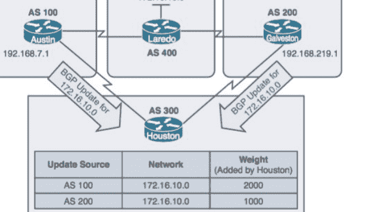

```
Houston(config)#router bgp 300
Houston(config-router)#neighbor 192.168.77.1 remote-as 100
Houston(config-router)#neighbor 192.168.77.1 weight 2000
Houston(config-router)#neighbor 192.168.219.1 remote-as 200
Houston(config-router)#neighbor 192.168.219.1 weight 1000
```

Houston 已通过 AS 100 将流量转发到 172.16.10.0 网络，因为从 AS 100 进入 AS 300 的路由与从 AS 200 宣告的路由相比具有更高的权重属性。
当路由器接收 BGP 更新时，该路由器可以选择权重，可以是使用路由 map 逐路由选择性选择，也可以针对从单个邻居学习的所有路由选择。

## 本地优先级属性 (Local Preference Attribute)

- 强制路由器偏向一个出口点而不是离开 AS
- 值于 0 到 249,496,729 之间。值越高越优，默认值为 100
- 它是 AS 本地的；它与 BGP 邻居交换——不会向 eBGP 邻居宣告。
- 记住，BGP 不允许路由器向 iBGP 邻居宣告通过 BGP 学习的路由

```
Houston(config)#router bgp 256

Houston(config-router)#neighbor 172.16.1.1 remote-as 100

Houston(config-router)#neighbor 10.1.1.2 remote-as 256

Houston(config-router)#bgp default local-preference 150

Galveston(config)#router bgp 256

Galveston(config-router)#neighbor 172.17.1.1 remote-as 300

Galveston(config-router)#neighbor 10.1.1.1 remote-as 256

Galveston(config-router)#bgp default local-preference 200
```

基于这两个配置，可以到达自治系统 256 的远程网络流量将通过 Galveston 路由。使用 AS_PATH 列表配合 Route Map 来修改本地优先级
Route map 比 `bgp default local-preference` 命令更具灵活性。

```
Houston(config)#router bgp 256
```


`Galveston(config-router)#neighbor 172.17.1.1 route-map SETLOCAL out`

`Galveston(config-router)#neighbor 10.1.1.1 remote-as 256`

`Galveston(config)#ip-access-list 7 permit _300`

`Houston(config-router)#route-map SETLOCAL permit 10`

- 创建 `route map SETLOCAL` 序列号 10

`Galveston(config-route-map)#match as-path 7`

`Galveston(config-route-map)#set local-preference 200`

- 将来自 AS 300 的本地优先级设置为 200

`Galveston(config-route-map)#permit 20`

- 允许所有路由

```
在此示例中，使用 route-map 命令，只有来自 as_path-list 中指定的 AS 300 的更新才会将本地优先级设置为 200。来自 eBGP 邻居的更新通过 neighbor route-map 设置。
```

## AS_PATH Prepending

AS 路径可以通过预挂或在 AS_PATH 中添加额外的 ASN 来操作。根据此属性标准，最短的 AS_PATH 优先；使其变长会变得不可选。

```
Houston(config)#router bgp 300

Houston(config-router)#neighbor 192.168.219.0 remote-as 200

Houston(config-router)#neighbor 192.168.220.2 remote-as 200

Houston(config-router)#neighbor 192.168.72.2 remote-as 100

Houston(config-router)#neighbor 192.168.72.2 route-map SETPATH out

- 过滤 192.168.72.2 的所有路由使用 SETPATH route-map

Houston(config-router)#route-map SETPATH permit 10

  - 在预挂到 192.168.72.2 之前向 AS_PATH 添加 300 次
```

在这种场景下，你想要使用 Houston 的配置来影响 AS 600 的路径选择。目前，AS 600 的路由器拥有 192.168.219.0/24 网络的可达性信息，通过两条路由：AS 100 的 AS_PATH 属性为 (100, 300)，AS 400 的 AS_PATH 属性为 (400, 200, 300)。假设所有属性值相同，AS 600 的路由器将选择最短的 AS_PATH 属性：通过 AS 100 的路由。然后，对 Houston 的 AS_PATH 属性预挂或添加额外的 ASN，以便 AS 600 选择 AS 400 作为到达 192.168.219.0/24 网络的优路径。

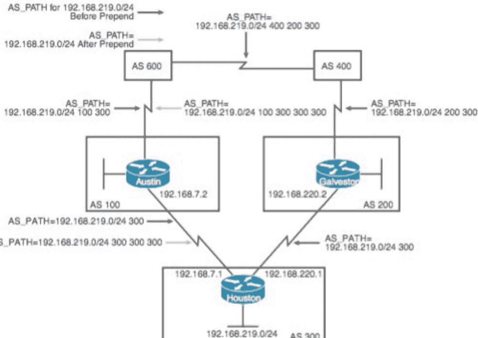

此配置的结果是，AS 600 通过 AS 100 接收的 192.168.219.0/24 网络的 AS_PATH 属性变为 (100, 300, 300, 300)，这比 AS 600 通过 AS 400 接收的 192.168.219.0 网络 AS_PATH 属性值 (400, 200, 300) 长。AS 600 将选择 AS 400 (400, 200, 300) 作为更好的路径。

## AS_PATH：移除自治系统

私有 ASN (64,512 到 65,535) 不能在互联网上传递，因为它们不是唯一的。使用 `remove-private-as` 在宣告之前从 AS_PATH 列表中剔除私有 ASN。

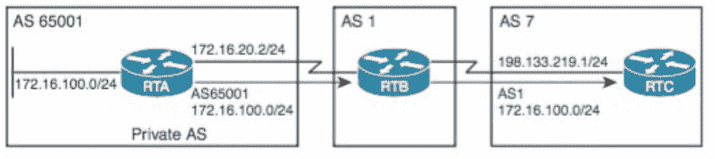

```
RTB(config)#router bgp 1

RTB(config)#router neighbor 172.16.100.2 remote-as 650

RTB(config)#router neighbor 198.133.219.1 remove-as 7

RTB(config)#router neighbor 192.168.133.1 remove-private-as
```

## MED (多出口判别器)

也称为 BGP 度量，指示 eBGP 邻居之间进入 AS 的优路径。
- 描述该跳的 AS 特定值不会后传递给下一个邻居。
- 低值优于高值。
- 默认值为 0。
- 使用 `default-metric` 修改默认值。
- 默认仅适用于来自同一 AS 邻居的路径。使用 `bgp-compare-med` 覆盖。

对于 AS 300 选择 Houston 和 Galveston 的路由。这是 MED 默认使用的地方（意图如此），除非特别指示，否则不会查看 AS 400 (Acapulco) 的情况。

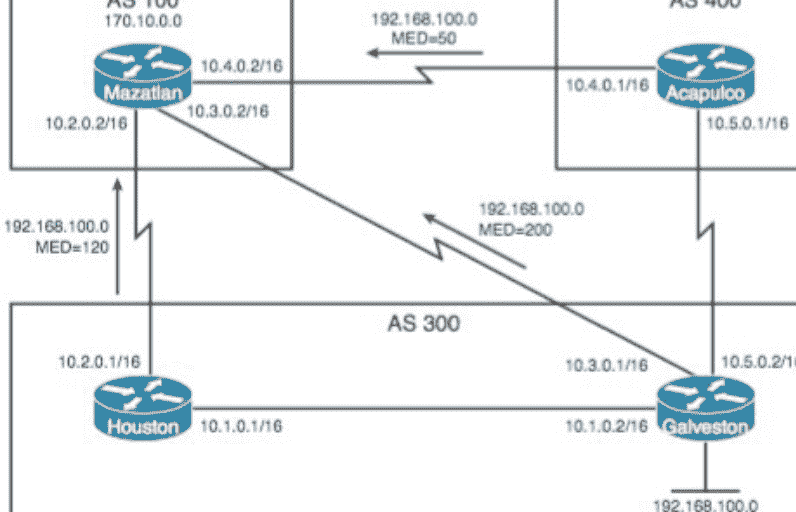

示例：影响自己的路由器选择 Houston 作为 AS 300 到达 192.168.100.0 的入口点。

```
Mazatlan(config)#router bgp 100

Mazatlan(config)#neighbor 10.2.0.1 remote-as 30

Mazatlan(config)#neighbor 10.3.0.1 remote-as 300

Mazatlan(config)#neighbor 10.4.0.1 remote-as 400

Acapulco(config)#router bgp 400

Acapulco(config)#neighbor 10.4.0.2 remote-as 100

Acapulco(config)#neighbor 10.4.0.2 route-map SETMED out
```

Houston 和 Galveston 在相对邻居路由语句的设置上相同。以下是它们设置的 MED：

```
Houston(config-router)#neighbor 10.2.0.2-route-map SETMEDOUT

Houston(config-router)#neighbor 10.1.0.2-route-map-300

Houston(config-map)#set metric 120

Galveston(config-router)#neighbor 10.3.0.2-route-map-100

Galveston(config-router)#neighbor 10.3.0.2-route-map SETMEDOUT

Galveston(config-map)#set metric 200
```

Mazatlan 只能比较 Houston 的 MED 属性 (120) 和 Galveston 的 MED 属性 (200)，尽管来自 Acapulco 的路由具有最低值。Mazatlan 将选择 Houston 作为到达 192.168.100 的最佳路径。

```
为了强制 Mazatlan 在比较中包含来自 Acapulco 的网络 192.168.100.0 的更新，请使用 bgp compare-med route map 命令：

Mazatlan(config-router)#bgp 100

Mazatlan(config-router)#neighbor 10.2.0.1-route-map-300

Mazatlan(config-router)#neighbor 10.3.0.1-route-map-300

Mazatlan(config-router)#neighbor 10.4.0.1-route-map-400

Mazatlan(config-router)#bgp always-compare-med
```


假设所有属性都相同，`Mazatlan` 将选择 `Acapulco` 作为到达网络 `192.168.100.0` 的最佳下一跳。

`IETF` 关于 `BGP MED` 的最新决定是将缺失的 `MED` 赋予无穷大值，使得该路由的优先级最低。`Cisco IOS` 的默认值则相反——将没有 `MED` 属性的路由视为 `MED` 为 `0`，使得缺少 `MED` 属性的路由优先级最高。

- 要配置路由器以符合 `IETF` 标准，请使用 `bgp bestpath-missing-med`

# 双宿 ISP 环境下的 MED

企业可以发布一个 `MED`，告知 `ISP` 进入企业的路径。因此，`ISP` 可以区分从 `ISP` 到企业的多个出口点。这些从 `ISP` 进入企业的入站路由通常由一个或几个公共 `IP` 地址范围组成。企业工程师倾向于将顶部的 `BGP` 作为入入站路由的最佳路径（`MED 10`），并将底部的连接放在最后（`MED 30`）。

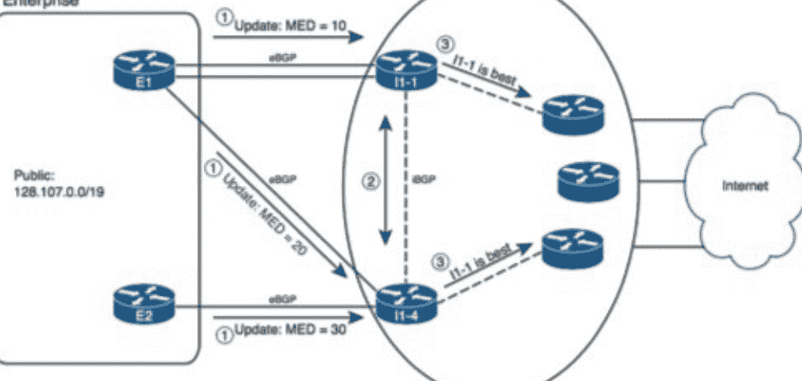

步骤 1。`E1` 和 `E2` 宣告 `128.107.0.0/19`，通过出站路由图设置 `MED` 到不同的配置中：`E1` 发送到 `I1-1` 的 `MED 10`，`E1` 发送到 `I1-4` 的 `MED 20`，以及 `E2` 发送到 `I1-4` 的 `MED 30`。
步骤 2。`I1-1` 和 `I1-4` 拥有 `IBGP` 连接，因此它们学习彼此的路由并根据 `MED` 决定哪条路由胜出。
步骤 3。`I1-1` 和 `I1-4` 还会告诉 `ISP1` 内部的其他路由器，导致所有入站流量都隧道到路由器 `I1-1`。（记住 `MED` 由一个 `AS` 宣告到另一个 `AS`，在 `AS` 内部传播，但不会发送到另一个 `AS`。）

注意，此示例中的路由器 `I-1` 和 `I-4` 可能根据之前的最佳路径步骤选择更好的路由。然而，对这些步骤的简要分析告诉，除非有人努力覆盖 `MED` 的影响，否则这些路由器的最佳路径算法将使用 `MED`。假设企业和 `ISP` 同意依赖 `MED`，那么之前的最佳路径步骤将不再重要。

# BGP 配置示例

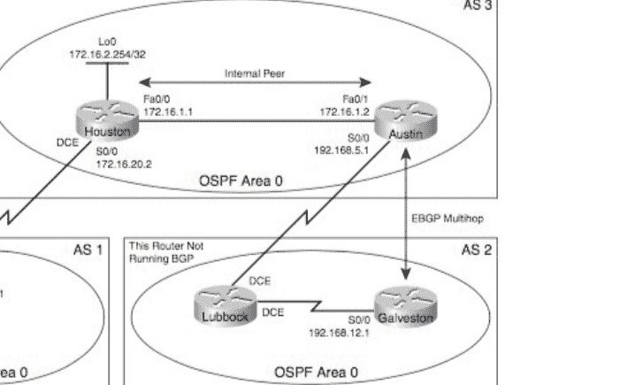

## Houston Router

```config
Router(config)#hostname Houston

Router(config)#interface loopback 0

Router(config-if)#address 172.16.2.254 255.255.255.255

Router(config-if)#interface fastethernet 0/0

Router(config-if)#address 172.16.1.1 255.255.255.0

Router(config-if)#interface no shutdown

Router(config-if)#address 172.16.20.255 255.255.255.0

Router(config-if)#clock rate 56000

Router(config-if)#no shutdown

Router(config)#exit

Router(config)#router ospf 1

Router(router)#network 172.16.0.0 0.0.255.255.255 area 0
```

| Description |
|---|
| 将路由器名称设置为 Houston。 |
| 进入接口配置模式。 |
| 分配 IP 地址和子网掩码。 |
| 进入接口配置模式。 |
| 分配 IP 地址和子网掩码。 |
| 启用接口。 |
| 进入接口配置模式。 |
| 分配 IP 地址和子网掩码。 |
| 分配时钟速率。 |
| 激活接口。 |
| 返回全局配置模式。 |
| 启动 OSPF 路由进程。 |
| 任何 172.16.x.x 接口将被放入 OSPF 0 中。 |
| 返回全局配置模式。 |
| 启动 BGP 路由进程。 |
| 关闭同步。 |
| 识别 172.16.12.1 处的对等路由器。 |
| 识别 172.16.20.1 处的对等路由器。 |
| 返回全局配置模式。 |
| 返回权限模式。 |

## Laredo Router

```config
Router(config)#hostname Laredo

Laredo(config)#interface serial 0/0

Laredo(config-if)#address 172.16.20.1 255.255.255.0

Laredo(config-if)#no shutdown

Laredo(config-if)#exit

Laredo(config)#router bgp 1

Laredo(router)#no synchronization

Laredo(router)#neighbor 172.16.20.2 remote-as
```

| Description |
|---|
| 将路由器名称设置为 Laredo。 |
| 进入接口配置模式。 |
| 分配 IP 地址和子网掩码。 |
| 激活接口。 |
| 返回全局配置模式。 |
| 启动 BGP 路由进程。 |
| 关闭同步。 |
| 识别 172.16.20.2 处的对等路由器，AS 为 3。 |

## Galveston Router

```config
Router(config)#hostname Galveston

Galveston(config)#interface 0/0

Galveston(config-if)#address 172.16.12.1 255.255.255.0

Galveston(config-if)#no shutdown

Galveston(config-if)#exit

Galveston(config)#router ospf 1

Galveston(router)#network 172.16.0.0 0.0.0.255 area 0

Galveston(config)#router bgp 2

Galveston(router)#neighbor 10.3.0.2 remote-as 100
```

| Description |
|---|
| 将路由器名称设置为 Galveston。 |
| 进入接口配置模式。 |
| 分配 IP 地址和子网掩码。 |
| 激活接口。 |
| 返回全局配置模式。 |
| 启动 OSPF 路由进程。 |
| 任何 172.16.0.x 接口将被放入 OSPF 0 中。 |
| 返回全局配置模式。 |
| 启动 BGP 路由进程。 |
| 识别 10.3.0.2 处的对等路由器，AS 为 100。 |

## Austin Router

```config
Router(config)#hostname Austin

Austin(config)#interface 0/0

Austin(config-if)#address 192.168.1.5 255.255.255.252

Austin(config-if)#no shutdown

Austin(config)#interface fastethernet 0/0

Austin(config-if)#address 172.16.1.2 255.255.255.250

Austin(config-if)#no shutdown

Austin(config)#router ospf 1

Austin(router)#network 172.16.1.0 0.0.0.3 area 0

Austin(config)#router bgp 3

Austin(router)#no auto-summary

Austin(router)#neighbor 172.16.1.2 remote-as 3

Austin(router)#neighbor 192.168.12.1 remote-as 2
```


| Description |
|---|
| 将路由器名称设置为 Austin。 |
| 进入接口配置模式。 |
| 分配 IP 地址和子网掩码。 |
| 激活接口。 |
| 进入接口配置模式。 |
| 分配 IP 地址和子网掩码。 |
| 激活接口。 |
| 返回全局配置模式。 |
| 启动 OSPF 路由进程。 |
| 任何 172.16.1.x 接口将被放入 OSPF 0 中。 |
| 返回全局配置模式。 |
| 启动 BGP 路由进程。 |
| 关闭同步。 |
| 识别 172.16.1.2 处的对等路由器，AS 为 3。 |
| 识别 192.168.12.1 处的对等路由器，AS 为 2。 |
| 关闭自动汇总。 |
| 返回全局配置模式。 |
| 将运行配置保存到启动配置。 |

# BGP 过滤方法的语法

我们熟悉的旧式 IOS ACL 可能是通过前缀/子网匹配流量的好方法，但它可能会变得非常混乱。Cisco IOS 10.2 引入了更好的方法——前缀列表（`prefix-list`），了解为什么要这样做对我们很有帮助。

这里这里有一个场景：声明 BGP 邻居，创建一个简单的列表来匹配一个子网，并使用 `distribute-list` 应用于发送更新，我们可以说“不要从该 `access-list 1` 向此邻居发送路由更新”。这是可以行的。

```
R1(config-router)# router bgp 3

R1(config-router)# neighbor 172.162.1.2 remote-as 3

R1(config-router)# neighbor 172.162.20.1 prefix-list as 1

R1(config-router)# neighbor 172.162.20.1 distribute-list 1 out

R1(config-router)# exit

R1(config-config)# access-list 1 deny 172.168.10.0 0.0.0.255

R1(config-config)# access-list 1 permit any
```

当需要聚合 `172.16.0/16` 但不是单个子网时，问题就出现了——你需要扩展 ACL。ACL 与 BGP 路由过滤器的工作方式是：ACL 首先匹配网络地址，然后匹配前缀的子网掩码。为了实现这一点，网络和地址都与其自身的通配符位图成对，看起来非常困惑：

```
access-list 10 permit ip 172.16.0.0 0.255.255 255.255.255 0.0.0.0
```

这就是为什么 IOS 10.2 为我们提供了 `prefix-list` 选项。

### 前缀列表语法

此示例列出的发送给伙伴的仅包含此特定匹配子网的路由信息：

```
R1(config-router)# prefix-list UPDATE172 permit 172.16.0/16

R1(config-router)# router bgp 100

R1(config-router)# neighbor 192.168.1.1 remote-as 200

R1(config-router)# neighbor 192.168.1.1 prefix-list UPDATE172 out
```

应用于发送到 `192.168.1.1` 的更新。允许 `172.16.0/16`，但在列表末尾会隐式拒绝其他 `172.16.0/17` 或 `172.16.20/24` 网络。

`ip prefix-list-name seq seq-value [permit|deny] network/cidr [ge-value|le-value]`

| 参数 | 说明 |
|---|---|
| list-name | seq | (可选) 正在创建或删除的条目的序列号。 |
| seq-value | (可选) 指定序列号。 |
| deny | 拒绝匹配条件的访问。 |
| permit | 允许匹配条件的访问。 |
| network/cidr | (强制) 网络地址和网络掩码的长度（位）。 |
| ge-value | (可选) 指定范围的起始或“从”值。 |
| le-value | (可选) 将 le 应用于指定的值。 |
| le-value | (可选) 指定范围的结束或“到”值。 |

- 每个前缀列表的末尾都有隐式拒绝。
- 序列号的范围可以从 1 到 4,294,967。
- 路由器从最低序列号到最高序列号测试前缀列表匹配。
- 通过对前缀列表语句编号，你可以在列表的任何部分添加新条目。
- 如果没有应用 `no-prefix-list` 语句，下一个未编号的条目将递增 5。

`ip prefix-list NY_ROUTES permit 192.168.0.0/24`
在 `192.168.0.0/8` 中允许掩码最多 24 位的掩码 - 无序列号- 0 获取默认值 5
`ip prefix-list NY_ROUTES deny 192.168.0.0/25`
拒绝 `192.168.0.0/8` 中具有 25 位的网络 - 无序列号- 应用 10 (+5)
`ip prefix-list HOUSTON seq 3 0.0.0.0 ge 16 le 24`
允许网络位在 16 到 24 位之间的 `0.0.0.0` - 无序列号获取默认值 5
`ip prefix-list HOUSTON seq 3 0.0.0.0/0`
为此语句分配序列号 3。
`no prefix-list HOUSTON seq 10`
从列表中删除序列号 10。

# AS_PATH 访问列表

可以使用正则表达式搜索 `AS_PATH` 属性以匹配路由更新，并访问列表（`access-list`）进行过滤或修改。它们大部分看起来都很熟悉。也可以 `show ip bgp` 进行测试。

* 匹配输入的末尾。
* 匹配 `AS_PATH` 字段中的空字符串（本地设备的 AS 是空的；因此匹配此项）。
* 匹配 `AS_PATH` 中的空格、逗号、右括号。
* 匹配任意字符。
* 匹配零或多个字符。

要找到通过自治系统 65002 可达的所有子网（`AS_PATH` 以 65002 开头）：

```
show ip bgp ^65002_

Next Hop      Network        Metric LocPrf  Path

*172.16.0.0    192.168.1.1    100             65002 65003

*172.24.0.0    192.168.1.1    100

show ip bgp ^65002_ originating from autonomous system 65002

show ip bgp ^65002_ ... reachable via autonomous system 65002

show ip bgp _65002_65005 ... through autonomous system 65005 (AS_PATH contains 5)

show ip bgp _21500 Will match or this is "*"

show ip bgp * Originates from autonomous system (AS_PATH is blank)
```

 # CE1 配置

```
ip prefix-list ISP1 permit 0.0.0.0 ge 16 le 24

ip as-path-access list 1 ^

router bgp 65000
```

允许掩码在 16 到 24 之间的前缀列表。创建一个匹配仅来自自治系统 65000 路由的 `AS_PATH` ACL。

```
neighbor 209.165.202.129 filter-list ISP1 in

neighbor 209.165.202.129 filter-list 1 out
```

将 ISP1 列表应用于邻居 `209.165.202.129` (ISP1)，用于从邻居学习的所有路由。创建一个匹配 `209.165.202.129` (ISP1) 发往邻居路由的 `AS_PATH` ACL。

# CE2 配置

```
ip prefix-list ISP2 permit 0.0.0.0 ge 16 le 24

ip as-path-access list 1 ^

router bgp 65000
```

允许掩码在 16 到 24 之间的前缀列表。创建一个匹配仅来自 AS 65000 路由的 `AS_PATH` ACL。

```
neighbor 209.165.202.225 prefix-list ISP2 in

neighbor 209.165.202.225 filter-list 1 out
```


将 `ISP2` 列表应用于邻居 `209.165.202.225` (`ISP2`)，用于从邻居学习的所有路由。创建一个匹配 `209.165.202.225` (`ISP2`) 发往该邻居路由的 `AS_PATH` ACL。

# 路由策略 (Route Maps)

此示例使用前缀列表捕获 `172.16.10.0/24` 更新并标记为 "`AS400_ROUTES`" 。如果不匹配并通过第二条规则，则创建路由策略并设置不同的 `weight` 属性。此机制也可以用于其他更改，或指定哪些出站更新。

最后，在 `BGP` 进程结束处，添加邻居并指向检查路由策略规则。使用关键字 "`in`" 指代进入 `192.168.1.7` 的路由更新，"`out`" 关键字用于我们发送到 `192.168.1.7` 的路由更新。

```
Host(config)#ip prefix-list AS400_ROUTES permit 172.16.10.0/24

Host(config)#route-map SETWEIGHT permit 10

Host(config-route-map)#match address prefix-list AS400_ROUTES

Host(config-route-map)#set weight 200

Host(config-route-map)#route-map SETWEIGHT permit 20

Host(config-route-map)#set weight 100

Host(config-route-map)#exit

Host(config)#router bgp 300

Host(config-router)#neighbor 172.168.1.7 route-map SETWEIGHT in

Host(config-router)#neighbor 172.168.1.7 route-map SETWEIGHT out
```

路由策略可以应用普通 `ACL`、扩展 `ACL`、前缀列表以及 `AS_PATH` ACL。

| BGP 子命令 | 创建命令 | 可以匹配什么 |
|---|---|---|
| neighbor-distribute-list (标准 ACL) | access-list, ip access-list | 前缀，带通配符掩码 |
| neighbor-distribute-list (扩展 ACL) | access-list, ip access-list | 前缀和长度；每个都带通配符掩码 |
| neighbor-prefix-list | prefix-list | 前缀的精确匹配或“前 N 位”匹配，加上前缀长度范围 AS_Path 内容，所有 AS_Paths 都被视为匹配的 NLR |
| neighbor filter-list | ip as-path-access-list, route-map | route-map | 前缀、长度、AS_Path 以及/或在 BGP 映射中可匹配的任何 PA |

# BGP 社区

`BGP` 社区用于对具有共同属性的网络分组，无论网络、自治系统或任何物理边界如何。在大型网络中通过列表或访问列表应用常用路由需要在每个网络设备上单独语句。使用 `BGP` 社区属性，具有共同策略的 `BGP` 邻居可以轻松从社区标签导入和出站路由过滤器，从而覆盖大量路由，无需使用访问列表或前缀列表匹配前缀。

社区通过 `set community` 创建。`aa:number` 标识是任意标识符（看起来像 `100:250`），值可以在同一行输入。这些选项适用于具有内置规则的社区：

```
set community aa:nn [add | local | as-advertise | no-export]
```
`add` - 添加到现有社区（一个或多个关键字）

`local` - 作为社区

`local-as`（作为“已知社区”）仅向本地 `AS` 或联盟体内的子 `AS` 邻居发布。

`no-advertise` - 这些路由不会向任何邻居（内部或外部）发布。

`no-export` 路由是 `local-as`，但更严格地发布到外部邻居。

在声明邻居时，你可以通过 `send-community` 与邻居 `x.x.x.x` 共享社区（`communities`）。以下是一些演示社区属性的代码片段：

```
ip bgp-community-new-format

access-list 101 permit ip host 6.6.6.0 255.255.255.250

route-map Peer-R1 permit 10

match address 101

set community 10:300 109:02 33:40
```

```
ip community-list 1 permit 100:300

route-map Peer-R3 permit 10

match community 1

set local-preference 150
```

- `ip community-list`—为 `BGP` 创建社区列表并对其进行访问控制。
- `match community`—匹配 `BGP` 社区。
- `set community-list-delete`—移除入站或出站更新的社区属性。
- `show ip bgp community`—显示属于特定 `BGP` 社区的路由。

## BGP 联邦 (BGP Confederations)

`BGP` 联邦将我们的 `AS`（自治系统）划分为多个子 `AS`，以减少所需的 `IBGP` 邻居数量。在主 `AS` 内部，虽然我们仍然要求这些子 `AS` 之间建立全网状 `IBGP`，但我们使用一种看起来像 `EBGP` 但行为像 `IBGP` 的机制（称为 `federation bgp`）。

```
R2(config-router)#router 24

R2(config-router)#bgp-confederation identifier 2

R2(config-router)#bgp-confederation peers 35

R2(config-router)#neighbor 4.4.4.4 remote-as 24

R2(config-router)#neighbor 4.4.4.4 update-source loopback 0

R2(config-router)#neighbor 3.3.3.3 update-source loopback 0

R2(config-router)#neighbor 3.3.3.3 bgp-multihop 2
```


当你启动 BGP 进程时，必须使用子 AS 的 AS 号。其次，你必须使用 `bgp confederation identifier` 告诉 BGP 主 AS 号是多少。

我们还需要用 `bgp confederation` 命令配置所有其他子 AS 号。在此例中，只有 AS 35 R 处于同一个子 AS 中，因此你可以像配置任何其他 IBGP 邻居一样配置它。但 R3 略有不同……因为它位于另一个子 AS 中，我们必须使用与 EBGP 相同的规则，例如在单环回路由时配置多点。

当你查询 `ip bgp x.x.x.x` 时，路由会被标记为 `conf-internal`（意味着它来自同一子 AS 内部的 IBGP 路由器）或 `conf-external`。对于 `conf-internal`，子 AS 会直接显示在给定路由方的括号中，包含一个名为 `AS_CONFED_SET` 的属性。这个“联邦”设置定义了包含子 AS 的列表。

## R5/show ip bgp 11.11.11.11

针对 11.11.11.11/32 的 BGP 路由表，版本 6
路径：2 (可用，最佳 #2，默认值:IP-Routing-Table)

发布到更新组：

+ (24)
192.168.12.1 (metric 3) 来自 4.4.4.4 (Origin IGPR, metric 0, localpref 100, confed-external) (24)
1
192.168.12.1 (metric 3) 来自 3.3.3.3 (Origin IGPR, metric 0, localpref 100, conf-internal)

## BGP 路由泄漏 (Route Leaks) 与 BGP 劫持 (BGP Hijacking)

路由泄漏和劫持是指非法前缀/地址块被错误传播的情况：
- 跨网络非法发布前缀、IP 地址块，导致错误或次优的路由。
- 可能发生在 AS 源自一个它并不拥有的前缀。
- 也可能发生在 AS 通过一条不存在的路由发布该路由。
- 当发布更具体的前缀时，特别容易发生传播（BGP 偏于选择最具体的地址块）。
- 路径比当前可用路径短（BGP 最短路径算法）。
- 通常发生在 BGP 宣告未通过 `no-export` 社区进行正确过滤时。下方，AS400 向上游提供商发布了其前缀的路径。

### 修复措施
- 与邻近 AS 的管理员保持通信以协作修复。
- 例如，如果问题路由发布了 /17，那么反向发布一个 /18 是无效的。
- 发布比学习到的路由更短的路径是优的。
- 最后手段：通过更改 DNS 记录来完全考虑你的前缀。此时 DNS 记录的 TTL 就会成为一个问题。

### 预防措施
- 在区域注册机构 (RIRs) 中发布路由源授权 (ROAs)。
- 资源公钥基础设施 (RPKI) 可以验证 AS 的合法性。
- 验证任何给定 AS 是否有权发布其前缀（包括最大前缀长度）。
- 使用一组健壮的过滤器，过滤掉 AS 路径中包含 ASN 的 BGP 前缀和路由。
- 过滤掉来自多个 Tier 1（免中转）的网络。当存在多个网络时，至少有一个网络为所有网络提供传输。
- 使用允许邻居的白名单（如 Tier 1 网络），过滤路由。
- 对所有可能的上游网络使用 peering-as 过滤器，并仅将它们作为中间网络（参见 Snanders NOG67 - https://www.nog.org/default/files/Snanders_Every_Practical_Bgp.pdf）。
- 使用 `BGP PrefixLimit` 设置从邻居处发布的前缀最大数量。这在路由泄漏期间很有帮助。

巴基斯坦的 ISP 使用更具体的前缀指向空路由（null）劫持了 YouTube 的路由。被覆盖的前缀错误地泄漏到互联网其他部分，导致其他所有人无法访问 YouTube。空路由（null routing）的做法通常是审查行为的标志，包括中国防火墙（https://blog.thousandeyes.com/deconstructing-great-firewall-china/）。

http://domain.com/blog/mitm-internet-hijacking/
更大的真实示例：https://blog.thousandeyes.com/finding-and-diagnosing-bgp-route-leaks/

## 为典型 VPN 设置 GRE

这是根据我对 Doug Suida 视频的转录制作：
https://www.youtube.com/watch=2pTIHKgrvM

使用相同技术设置 DMVPN（动态多点 VPN）的后续内容在此：
https://www.youtube.com/watch=WeZo1umpg0 - 我的总结在接下来的页面。

在网络映射上，它们看起来没有直接连接，`neighbor i` 仅显示 f0/0 - 未显示为直接连接的邻居。在将其添加到 OSPF 网络 10.1.10.0/3 区域 0 之前，邻居关系不会建立。

出站连接：

```
R1 ==162.27.193.128/30====INTERNET====<=45.12.153.200<= R2
```

隧道内部

```
10.1.10.1==Tunnel0 << ----> 10.1.10.1/3 <= == >> Tunnel0 <= 10.1.10.2
```

## 设置 LAN、上行链路和隧道

```
Local:192.168.1.0/24

R1> int Loopback0

R1> ip address 192.168.1.1

R1> int f0/1

R1> ip address 192.168.1.2

R1> router ospf 123

R1> network 192.168.1.0 0.0.0.255 area 0

上行链路

R1> int f0/0

R1> ip address 162.27.193.130
```

# DMVPN - 使用 mGRE (多点 GRE)、IPsec 和 NHRP 的动态多点 VPN

5 个站点（路由），全网状结构
R1 有到 R2、R3、R4 和 R5 的独立隧道，而这些站点之间也都有类似的隧道。
10 个隧道？DMVPN 可以自动完成这一过程。它类似于一种混合在帧式中继（frame relay）风格网络中的星型配置，但其中只有一个站点（不是全网状）。使用 DMVPN，你会发现在离开 R1 之后不需要再手动配置隧道。这些“分支（spokes）”之间的隧道是根据 DMVPN 配置动态建立的。

如果某些主机或 R2 需要通过 R2 网络某些功能，它可以创建该隧道，使用一段时间，然后销毁。R4 询问核心路由器（R1），由核心提供构建隧道所需的后续信息；然后它们销毁隧道。在这种场景下，你除了内部路由协议外不需要任何东西。

关于路由，让 R3 添加一个网络并发送广告更新。该更新只发送到核心节点——不发送给其他节点，由核心路由器将更新发送给其他节点。分支节点类似于 NBMA 设置，并且必须关闭分幅水平线（split horizon）、处理下一跳解析协议（NHRP）等。分支路由器之间永远不是邻居，除非在创建隧道时连接“核心”路由器。R1 依赖其信息来构建隧道并传播路由更新，任何其他参与的路由器如果没有这个“核心”作为资源，就无法彼此通信。

当我们在这里启动时，R1 需要 R2 和 R3——当一个分支这样做后，另一个就会出现，这是一个复制。在设置好核心路由器和第一个分支后，其余分支可以使用相同的配置，只需设置隧道和网关 IP，并开启 EIGRP。

概述：EIGRP 10 到：
- R1 - f0/44.5.12.1 默认 GW 2/30 - 内部网络（环回接口）：192.168.17.0/24 DMVPN IP: 192.168.1.1
- R2 - f0/44.5.12.5 到 6/30 - 内部网络（环回接口）：192.168.20.0/24 DMVPN IP: 192.168.1.2
- R3 - f0/44.5.12.9 到 10/30 - 内部网络（环回接口）：10.1.1.0/24 DMVPN IP: 192.168.1.3

在开始练习之前设置 IPsec。测试所有链路，我们就准备好了：

- 与之前的不同之处：我们创建了一个转换集（transform），没有使用 ACL 进行加密。而是创建一个 ipsec 配置文件。
1. 设置 ISAKMP 策略并定义预共享密钥
`R1 authentication pre-share`
`R1 encryption aes 192`
`R1 hash md5`

```
R1 group 2

R1 crypto isakmp policy 0 ISAKMP address 0.0.0.0 <-- isakmp 是名字 - 没有密码？

###### 这里我们没有像另一个示例那样有特定的 IP 地址。使用匹配密钥的 ANY（带有 '0'）
```


# 第二阶段 II - 制作 IPSEC 转换集

`R1 crypto profile transform-set DMVPN-TRANSFM esp-aes 192 esp-md5-5`

创建一个配置文件（而不是为单个隧道创建加密）
`R1: profile set security-affiliation lifetime 120`
###### `120` 秒是最小值。让它在隧道掉线之前过期！
`R1(profile) set transform-set DMVPN-TRANSFM`
###### IPSEC 完成

## 隧道

`R1 int tunnel0`
`R1 ip address 192.168.1.1 255.255.255`
`R1 ip no redirects`
###### 隧道包的加密 MTU
`R1 ip mtu 1440`

###### 下跳解析协议 (NHRP) 启动
`R1 ip nhrp authentication ISAKMP`
`R1 ip nhrp network-id 1`

# 使用动态隧道、关闭分幅水平线和下一跳自适应

`R1> ip nhrp dynamic`

`R1> no split-horizon`

`R1> next-hop-self`

`R1> tunnel source FastEthernet/0`

`R1> tunnel mode multipoint`

`R1> tunnel key 0`

`R1> tunnel protect DMVPN-PROFILE`

`R1> router eigrp 10`

`R1> network 192.168.1.0`

所以应该理解为：R2 和 R3 使用 `tunnel0` 到 R1；对于所有连接的路由器，`tunnel0` 是 `multipoint` 模式。这不需要 10 个隧道。

R2 需要相同的 IPSec 配置。在 R1 上执行 `sh crypto ipsec sa`。将其复制到 R2。这适用于所有分支。

```
R2> int tunnel0

R2> ip address 192.168.1.2 255.255.255.0

R2> no redirects

R2> ip mtu 1440

R2> ip nhrp authentication ISAKMP

R2> ip nhrp dynamic
```

###### 为网关设置下一跳：
`R2> ip nhrp next-hop 192.168.1.1`
`R2> ip nhrp network-id 1`
`R2> tunnel source FastEthernet/0`
`R2> tunnel mode multipoint`
`R2> tunnel key 0`
`R2> tunnel protect DMVPN-PROFILE`
`R2> router eigrp 10`
`R2> network 192.168.1.0`

其他分支与 R2 相同，除了路由器的 ip 地址：

```
R3> int tunnel0

R3> ip address 192.168.1.3 255.255.255.0

R3> no redirects

R3> ip mtu 1440

R3> ip nhrp authentication ISAKMP

R3> ip nhrp dynamic
```

###### 从运行配置中复制剩余部分，制作 EIGRP：
`R3> eigrp 10`
`R3> network 192.168.1.0`

这就是你需要的许多分支配置，且“一直有效”。

`sh crypto isakmp` —— 这用于显示阶段 1 信息 - 是否建立
`sh crypto ipsec sa` —— 用于实际隧道统计 - 显示流量和加密

那么，当“核心”宕机时会发生什么？是否有故障转移/冗余方法？事实证明，当你受限于一个 IP 地址时你只需要这些命令。这解决了单点故障（SPOF）。

# TCP 端口 交互与扫描

- `SYN`: 同步。启动主机间连接。
- `ACK`: 确认。建立主机间连接。
- `PUSH`: 推。系统正在缓冲数据。
- `URG`: 紧急。包中的数据必须快速处理。
- `FIN`: 结束。无连接。
- `RST`: 重置连接。

## TCP 连接和 SYN Stealth（半开放扫描）
TCP 连接 (`-s`) 是最可靠的扫描，但也最容易被检测，因为它尝试执行标准的三次握手。如果端口开启且未过滤，它会认为有一个等待中的连接尝试。当 SYN 扫描 (`-sS`) 接收到 ACK 响应时，将发送 RST 来关闭连接。它比反向扫描快得多。对于 Nmap 来说，SYN/ACK 意味着端口开启，RST 意味着关闭，无响应或 ICMP 包意味着被过滤。

包分片可以规避 IDS 过滤和检测。可以使用某种方式让 TCP 头部分布在几个 IP 包中。某些防火墙可能会阻止 IP 分片，但不一定是因为对网络性能的影响。
示例：`nmap -f -S 80 <target>`

- 当端口开启（或被防火墙拦截）时，主机没有响应。
- 当端口关闭时，从目标接收 RST/ACK。

## 使用各种 TCP 标志（或无标志）的反向 TCP 扫描
人们常说这些被称为反向，是因为只有关闭端口才会响应。反向 TCP 扫描根据它们使用的标志命名；它们有：
- Nmap `-sF`: FIN 扫描，当端口开启时
- Nmap `-sN`: 无标志的 Null 扫描
- `-sX`: 带有 FIN、PSH 和 URG 标志的扫描

Nmap 也有类似的 URG 和 PSH 裁剪方式（如 `-f URG`）。拥有 H 和 U，但产生的结果并没有其他结果更多，且方式不可靠（NULL、NFI 是你真正需要的）。Maimon 扫描同时带有 FIN 和 ACK 标志的包。这种方法非常有用，但在现代已不再适用。

NULL、FIN 和 XMAS 扫描：如果收到 RST，则端口关闭。如果不是，则该方法主机没有响应，它要么是开启要么被过滤。

注意事项：根据 RFC 793，当主机端端口关闭时，必须发送 RST/ACK 包来重置连接。因此，只有在不是 Windows 系统时才有效。如果返回“ICMP 不可用”，Nmap 扫描结果端口被过滤。

## ACK 扫描（不被视为反向）
通过设置 ACK 标志发送，这些用于判断端口是关闭还是开启（或开启/被过滤）。它被用于映射防火墙规则集，确定它们是否稳定。最简单的用法所示，判断返回的 RST 是否表示“未过滤”（RFC 793），而 ICMP 不可用或完全无结果都是“被过滤的”（拦截的防火墙通常意味着没有响应）。

禁止任何出站连接是可以的，阻止没有状态的 ACK 包无法判断哪一侧标记的。无论如何，这种策略也很常见（netfilter/iptables、基础代码等）。参考下方的 SYN 扫描显示了两种结果：

Nmap: 1 IP 地址（主机在线）耗时 0.70 秒

ACK 扫描显示某些数据包可能到达了目标主机：防火墙端口是总是可能的。其他扫描类型（例如 FIN 扫描）可能确定哪些端口是开放的，从而推断主机的用途。虽然我们可能对这些端口建立 TCP 连接，这对于确定哪些 IP 地址正在使用很有用，但 OS 检测测试可以揭示 IP ID，并将其作为控制机器上安装的 rootkit 的通道。此类主机可能是 IP ID 空闲状态下的“僵尸主机”。

解释从 ICMP 扫描中获取信息的两种方式可以揭示问题：检查接收到的数据包的存活时间 (`TTL`) 字段和 `WINDOW` 字段。

它没有告诉我们端口是开放还是关闭，但它尝试告诉我们防火墙是有状态的（会跟踪连接）还是否（可能只是拒绝入站数据包）。
如果防火墙是有状态的且仅允许 SYN 数据包，如果 ACK 看起来像是对对方某些内容的响应，则会收到 ACK。
如果开放或关闭的端口接收到意外的 ACK，它应该回发 RST。
所以，如果我们收到了 RST，则意味着防火墙是非状态的（或没有 RST）。如果我们没有收到 RST 或发送了某些 ICMP 不可到达，它极可能是被过滤的（filtered）。

## 基于 TTL 的分析：

TTL 值可以作为数据包经过的许多主机的数量。
下面，端口 22 返回的数据包值为 50，而其他端口返回值为 80。这表明目标主机上的端口 22 是开放的，因为返回的 TTL 小于 64* 的 TTL 值。

- 1: host `192.168.0.1` 端口 22: RST TTL 50 WIN 0x0
- 2: host `192.168.0.20` 端口 23: RST TTL 80 WIN 0x0

`firewalk` 评估工具镜像 http://www.packetfactory.net/projects/firewalk/

## 基于窗口的分析：

如果窗口值为非零，则端口是开放的，假设被过滤了
- 1: host `192.168.0.1` 端口 20: F -> : ttl: 64 win: 52
- 2: host `192.168.0.20` 端口 23: F -> : win: 0

ACK 标志探测扫描的优点是检测性（针对 IDS 和基于主机的系统）。
缺点是依赖于 TCP/IP 栈实现的漏洞，这些漏洞可能存在 BSD 派生系统中，但在其他平台可能不存在。

```
hping3 -A 72.14.207.99 -p 80 -c 1

nmap -sW
```


某些系统对开放端口使用正大小，对关闭端口使用负大小。较少系统的情况完全相反。如果你扫描并得到大量端口和少数关闭端口，那么这是一个机会。有些系统两者都不如此，所以你永远无法信任它。

## IDLE 扫描：IP ID (IP 分片 ID)

向计算机发送伪造的源地址，以发现完整扫描远程主机可用服务。
这是通过伪造另一台计算机的 IP 地址实现的。从自己的 IP 地址发送任何数据包；相反，使用一个主机来扫描远程主机并确定开放端口。这是通过观察僵尸主机的序列号实现的，如果远程主机检查了扫描的 IP，则僵尸主机的 IP 将显示出来。

如所述，要确定端口是否开放，`SYN`扫描（全连接或隐身）如果关闭则返回`RST`，如果开放则返回`SYN`。
考虑：
- 未请求的`SYN`响应为`RST`。未请求的`RST`将被忽略。
- 每个数据包都有分片 ID (`IPID`)，每发送一次递增一次。检查发送的数据包数量。
步骤 1) 向目标发送未请求的`SYNACK`以获取包含 ID 的`RST`（假设为 3137）。
步骤 2) 伪造僵尸主机的 IP 地址，向目标发送`SYN`数据包（端口80）。
- 如果端口开放，目标将向僵尸主机发送`SYNACK`并向目标显示`RST`（假设为 3139）。
- 如果端口关闭，目标将向僵尸主机发送`RST`且不会响应。
步骤 3) 使用另一个`SYNACK`再次探测目标。如果目标端口开放，IP ID 比步骤 1 获得的`RST`增加了 2。

### IPID 探测请求和响应

（注意：文本描述了基于 ID 的扫描步骤）
1. 攻击者 -> 受害者: 端口80 `SYN`数据包
2. 受害者 -> 攻击者: `RST`数据包 (`IPID`=3137)
3. 攻击者 -> 僵尸主机: `SYN`数据包（伪造 IP 地址）
4. 僵尸主机 -> 受害者: `SYN/ACK`数据包 (`IPID`=3138)
5. 受害者 -> 僵尸主机: `SYNACK`数据包 (`IPID`=3139)
6. 攻击者 -> 受害者: `SYN/ACK`数据包 (`IPID`=3140)

### IPID 探测 SYN/ACK

7. 攻击者 -> 受害者: 端口80 `SYN`数据包
8. 受害者 -> 攻击者: `RST`数据包 (`IPID`=3137)
9. 攻击者 -> 僵尸主机: `SYN/ACK`数据包
10. 受害者 -> 攻击者: `RST`数据包 (`IPID`=3138)
11. 攻击者 -> 受害者: `SYN/ACK`数据包 (`IPID`=3139)

## ICMP Echo/列表扫描

`ICMP` echo 扫描通过 ping 网络中的所有主机来发现在线机器。目标`ICMP`探测与子网中的所有主机相关。系统将发送`ICMP`回复。

## UDP 扫描

`UDP`向目标发送数据包，但某些已知端口需要特定的负载，因为防火墙也会丢弃数据包，或者`nmap`可能会超时。运行版本检测 (`-uV`) 有帮助。如果收到`UDP`响应，则它是开放的。如果端口关闭，可能会显示`ICMP`不可到达（类型3）。如果是另一个`ICMP`不可到达错误（类型3, 2, 10 或 13），则它是被过滤的。某些操作系统限制`ICMP`消息的频率，`nmap`会相应调整。对于大多数攻击没有用，但可以发现某些可利用的服务信息（`DHCP`, `SNMP`, `NFS`等）。

## Nmap 中的可用标志

| 标志 | 描述 | 输出 |  |
| :--- | :--- | :--- | :--- |
| `-sR` | TCP 连接计数 | N | Normal |
| `-sL` | 列表/DNS 扫描 | X | XML |
| `-sF` | FS 扫描 | G | Greppable |
| `-sX` | Xmas 树 | A | Aok |
| `-sPT` | Null 扫描 | T | Paranoid: 300 sec between |
| `-sP` | Ping 扫描 | S | Sneaky: 15 sec between |
| `-sU` | UDP 扫描 | U | Polite: 4 sec between scans |
| `-sB` | 协议扫描 | B | Parallel: 300 sec, 0.3 sec/1 |
| `-sI` | ICMP ping | I | Aggressive: 300 sec timeout, 0.3 sec/1 |
| `-sM` | Windows 扫描 | M | Insane: 15 sec timeout, 0.3 sec/6 |
| `-Pn` | 无 ping | - | - |
| `-uV` | 版本检测 | - | - |

## IP 协议扫描

寻找`TCP`之外的支持的协议；在头部字段字段发送带有值的原始数据包。如果我们在同一个数据包中收到响应，如果不支持，则查找`ICMP`端口不可到达。如果收到某些`ICMP`不可到达消息，它可能被过滤了。如果什么都没有收到，它是开放的（且被过滤）或被拒绝。

## FTP 弹射扫描

运行旧`FTP`服务的主机可以使用`PORT`命令（`RFC 959`或技术描述）进行扫描。`FTP`服务使用`PORT`命令建立连接的方式存在缺陷，允许数据发送到用户指定的主机和端口。在默认配置下，运行在旧 Unix 平台上的`FTP`服务受到影响。如果存在可写目录，可以将一系列命令或其他数据输入文件，然后通过`PORT`命令转发到目标主机的特定端口，那么`FTP`弹射攻击可能会产生更具破坏性的影响。例如，可以向`FTP`服务器上传电子邮件消息，然后将此消息发送到邮件服务器的`SMTP`端口。

1. 攻击者连接到要弹射攻击的`FTP`服务器的控制端口（`TCP`端口 21），并接收被动响应，强制`FTP`服务器向特定主机的特定端口发送数据：
   `QUOTE PASV`
   `227 进入被动模式 (64,128,246,22,56,185)`
2. 发布`PORT`命令，并向`FTP`服务器传递参数，告诉它尝试连接目标服务器上的特定`TCP`端口；例如，来自 `143.51.17.230:0`的`TCP`端口 23，
   `200 PORT 命令成功。`
3. `PORT`扫描成功后，发送`LIST`命令。`FTP`服务器随后会尝试与之前`PORT`命令定义的目标创建连接：
   `LIST`
   `150 正在打开文件列表连接`
   `226 传输完成。`
如果看到 `226`响应，则目标端口是开放的。然而，如果看到 `425`响应，则连接被拒绝：
   `LIST`
   `425 无法建立数据: 连接拒绝`

`SYN`探测 - 四种响应变体：带有`SYN/ACK`标志的表示端口开放的数据包、`RST/ACK`拒绝、无响应或暗示某些内容的`ICMP`消息。

这运行`nmap`扫描以识别跨`TCP`、`SCTP`和`UDP`的可用主机。可选，使用 `-iL`标志从文件为`Nmap`加载目标列表。

```bash
nmap -T4 -Pn -v -n -sS -sE -O -oG tcp.map 192.168.0/24
```

```bash
nmap -T4 -Pn -v -n -sS -sY -fF -O -oG tcp.map 192.168.0/24
```

```bash
nmap -T4 -Pn -v -n -sU -sP -p 53,113,123,137-160 -oG udp.map 192.168.0/24
```

这些扫描会在`nmap`中生成带有文件扩展名的输出。`UDP`可能会包含误报。如果`UDP`数据集存在杂讯（例如，有主机报告开放端口），则简单丢弃它。一旦有了这些文件的内容，使用`grep`和`awk`生成一个精炼的目标列表，如下：

```bash
grep "open" [file].txt | awk '{print $2}' targets.txt
```

此列表应被馈入后续扫描：

```bash
nmap -T4 -Pn -v -sS -oA tcp -fF 常用端口的快速 TCP 扫描
```

```bash
nmap -T4 -Pn -v -sS -oA tcp -p all -iL/targets.txt
```

所有端口的`SCTP`扫描：

```bash
nmap -T4 -Pn -v -sY -oA udp -p 0-65535 -oA tcp/full -iL/targets.txt
```

常用服务的`UDP`扫描：

```bash
nmap -T4 -Pn -v -sU -oA udp -iL/targets.txt
```

`-oA`标志将为每个扫描生成文件，包括可以解析的`grep`文件和完整的文本（例如 `tcp.nmap`），它是人类可读的。这些扫描不执行指纹识别或对暴露网络的分析。
`ipv6`的相同程序 - 首先扫描`IPv6`地址空间运行常用网络服务，然后扫描该子网。扫描`IPv6`网络时，建议减少端口列表以增加速度，例如 `-F`（100 个常用端口）到 `-p-22,25,80,11,139,445`。从主机发现准备目标列表（例如 `/tmp/targets.txt`），并在相同的扫描之前使用 `-6`标志对`ipv6`进行扫描：

```bash
nmap -T4 -Pn -v -sS -oA ipv6 -p 0-65535 -oA tcp/full -iL/targets.txt
```


`nmap -T4 -Pn -v -sY -oA sctp -iL/targets.txt`

`nmap -T6 -Pn -v -sU -oA ipv6_udp -iL/targets.txt`

# SCTP

流控制传输协议 `SCTP` 是一种与 `TCP` 和 `UDP` 并列的协议。它提供了在 `IP` 上传输电话数据，复制了 `SS7` 的许多可靠性特性，并支撑称为 `SIGRAN` 的更大协议族。`SCTP` 支持 `IBM AIX`、`Oracle Solaris`、`HP-UX`、`Linux`、`Cisco IOS` 和 `VxWorks` 等操作系统。

## SCTP chunk 类型

| ID | 值 |  |
|---|---|---|
| 0 | DATA | 负载数据 |
| 1 | INIT | 初始化 |
| 2 | INIT ACK | 初始化确认 |
| 3 | SACK | 选择性确认 |
| 4 | HEARTBEAT | 心跳请求 |
| 5 | HEARTBEAT ACK | 心跳确认 |
| 6 | ABORT | 中止 |
| 7 | SHUTDOWN | 关闭 |
| 8 | SHUTDOWN ACK | 关闭确认 |
| 9 | ERROR | 操作错误 |
| 10 | COOKIE ECHO | Cookie |
| 11 | COOKIE ACK | Cookie确认 |
| 12 | ECN | 显式拥塞通知 |
| 13 | CWR | 拥塞窗口缩小 |
| 14 | SHUTDOWN COMPLETE | 关闭完成 |

`Nmap` 和 `SNMP` 等工具无法从私有地址 `NAT` 后面获取信息，因为需要对流入和流出的流量进行低级分析。在图 4-1 的 `ISS BlackICE` 事件日志中可以看到执行简单 `ICMP ping` 扫描的简单示例。

在测试期间运行 `Ethereal` 或 `tcpdump` 等网络嗅探器是有益的，捕捉未请求的 `ICMP` 响应，包括 `ICMP TTL` 超时 `类型 11` 消息、路由环和“`ICMP 管理禁止`” `类型 3 代码 13` 消息，表明路由器或防火墙上有 `ACL`。

## 使用 ICMP 进行操作系统指纹识别

值得值得 `Nmap` 工具是 `Nmap`，通过分析对 `ICMP` 探测的响应对 `Packet` 套件进行指纹识别。`Keuptools` 包含许多网络工具，地址可用：`http://www.dopra.com/read/php/packeto.html`。对于 `Windows`，`Foundation` 的 `SuperScan` 是一个优秀的端口扫描工具，功能良好，包括 `banner` 获取。可以从此处获取 `SuperScan`：`http://examples.oreilly.com/network/tools/superscan.zip`

`Scan` 设计有独特的 `SYN` 探测和后台监听组件，允许进行非常快速扫描。反向 `SYN cookie` `使用 SHA1` 误报变得不存在，因为监听组件只注册具有正确 `SYN` 代码的响应。`Scan` 比 `Nmap` 这样的扫描器快得多。`Unicscan` `http://www.unicscan.com` 是另一个执行半开放扫描的工具。它具有一些实用功能，建议高级用户使用 `UDP` 扫描。我的环境中，响应如下：

```bash
root@kali:~ # icmapscan -n 10.3.0.1
```

跨工具的 `UDP` 扫描可能不同。`Nmap` 提供了一个带有 `-sV` 的全面选项，但使用 `-F` 选项 `扫描 100 个端口` 测试单个主机需要几分钟。

使用 `TCP` 标志探测目标被称为反向技术。`RFC 793` 规定，如果主机上的端口关闭，应发送 `RST/ACK` 数据包以重置连接。

## 远程端口转发 - 通过另一个系统将端口转发到远程系统

将 `SSH` 服务器上的流量通过 `SSH` 客户端或其他主机转发到目标。这使得能够公网访问的用户可以访问私有网络上的资源。用例包括：

- 通过公网开放本地开发服务器
- 对私有网络上的资源授予 `IP` 限制的访问权限

`SSH -R OUTSIDE-IP:port:INSIDE-IP:port`

### `ssh -R 8080:localhost:80 ssh-server`
将流量转发到本地计算机 `localhost 8080` 端口上的所有接口。如果这些接口之一可以从互联网访问，则连接到 `8080` 端口的流量将被转发到其他服务。
`img/4541d1f2c9832b9303a6df6c92f86f6_237.png`

### `ssh -R 70.114.93.221:8080:localhost ssh-server`
将流量转发到本地系统上的 `ssh-server:localhost`，但仅允许来自 `IP` 地址 `70.114.93.221` 的 `SSH` 隧道入口。这需要在你的 `ssh_config` 配置中设置 `GatewayPorts clients`。
`img/4541d1f2c9832b9303a6df6c92f86f6_237_1.png`

### `ssh -R 8080:example.org:80 ssh-server`
将流量转发到本地系统上 `ssh-server:8080:localhost:80` 的所有接口。从你的本地系统，流量随后会被转发到 `example.org`。从 `example` 的角度来看，流量源自你的本地系统。
`img/4541d1f2c9832b9303a6df6c92f86f6_237_2.png`

## 在 `/etc/ssh/sshd_config` 中设置的 SSH 服务器配置

默认情况下，转发端口无法从公网访问。你需要在远程服务器上添加 `GatewayPorts yes` 以将公网流量转发到你的本地计算机。如果你想允许特定的客户端，可以使用此替代：
```ssh
GatewayPorts yes
```

## 动态端口转发：将端口范围的流量转发到远程服务器

在 `SSH` 客户端上开启 `SOCKS` 代理，允许你通过 `SSH` 服务器将流量转发到所有接口端口 `3000` 的任何目标。默认情况下，`SSH` 将使用 `SOCKS` 协议，转发 `TCP` 和 `UDP` 流量。

### `ssh -D 127.0.0.1:3000 ssh-server`
在本地系统上的 `127.0.0.1:3000` 开启 `SOCKS` 代理。如果你运行着 `SOCKS` 代理，可以配置网页浏览器作为源自 `ssh` 的连接来访问资源。例如，如果 `ssh` 有权访问私有网络内的其他服务器，你可以在本地访问这些服务器，就像你在网络上一样，而无需 `VPN`。这样测试代理：
```bash
curl -x socks://127.0.0.1:3000 https://example.com
```
`img/4541d1f2c9832b9303a6df6c92f86f6_237_4.png`

## SSH 客户端配置 - `/etc/ssh/ssh_config`

如果你在配置 `SSH` 客户端时希望 `SOCKS` 代理可用于比 `localhost` 更多的接口，可以使用命令进行配置，而不是手动编辑：
```ssh
ssh -o GatewayPorts=yes -D 3000 ssh-server
```


## 跳板机和代理跳转 - 通过中间主机透明连接到远程主机

`ssh -J user1@jump-host user2@remote-host`
`ssh -o "ProxyJump user1@jump-host" remote-host`
与 `jump-host` 建立 SSH 连接并将 TCP 流量转发到 `remote-host`。如果 `jump-host` 拥有访问远程的 SSH 权限，该命令可以直接工作。如果没有，你可以使用代理转发（agent forwarding）将本地计算机的 SSH 身份转发到远程。
`img/4541d1f2c9832b9303a6df6c92f86f6_238_0.png`

### ssh -J jump-host1,jump-host2 ssh-server
指定用逗号分隔的跳板机。
`img/4541d1f2c9832b9303a6df6c92f86f6_238_1.png`

### ssh -o ProxyCommand="nc -X 5 -x localhost:3000 %h %p" user@remote-host
通过本地的 SOCKS 代理连接到远程服务器。从服务器的角度来看，源 IP 来自 `proxy-host`。但 SSH 连接本身是端到端加密的，因此代理主机只看到加密流量流。
`img/4541d1f2c9832b9303a6df6c92f86f6_238_2`

为了启用转发，你需要 `ssh-add` 你的本地身份。该命令将用于代理主机的检查。

## 可靠隧道 - 在网络故障期间保持 SSH 隧道开启

上述方法在特定的特定的主机上有效，但如果你想通过网络故障或不稳定的连接维护 SSH 隧道，你需要进行额外的设置。默认情况下，TCP 连接在空闲一段时间后可能会超时。为了防止超时，你可以在服务器和客户端配置发送心跳包，将其加入 `/etc/ssh/ssh_config`：

服务器端：
`ClientAliveInterval 15`
`ClientAliveCountMax 4`

客户端端：
`ServerAliveInterval 15`
`ServerAliveCountMax 4`

## 使用 AutoSSH 建立掉线的连接

虽然上述选项可以防止连接因空闲而掉线，但它们不会重新建立掉线的连接。为了确保 SSH 隧道重新建立，请使用 `autssh`，它构建隧道并监控其健康。`AutoSSH` 接受与端口转发相同的参数。
`img/4541d1f2c9832b9303a6df6c92f86f6`

```bash
autossh -R 2222:localhost -M 0 -o ServerAliveInterval 10 -o ServerAliveCountMax 3-host
```

使用 `-M 0` 标志允许 SSH 客户端处理健康检查。在此示例中，SSH 客户端期望服务器每 10 秒发送一次心跳。如果连续 3 次心跳失败，SSH 客户端将退出，`AutoSSH` 将重新建立新连接。

## 私有网络远程资源的透明访问

假设私有网络上有一个仓库只能通过网络上的私有服务器访问。该服务器无法从公网访问。你无需 VPN 即可访问私有网络。
`img/4541d1f2c9832b9303a6df6c92f86f6_239_0`

为了方便，你想让这个后门更加方便，可以在你本地的 `~/.ssh/config` 中添加一些指令：

```ssh
Host git.private.network

HostName git.private.network

ForwardAgent yes

ProxyCommand ssh nc %h %p
```

```ssh
Host private

HostName localhost

Port 2222

User private-user

ForwardAgent yes

ProxyCommand ssh tunnel@intermediate-host nc %h %p
```

现在，如果你从 `intermediate-host` 连接到端口 `2222`，你就连接到了私有网络上的服务器。现在你可以像在私有网络上一样访问 git 仓库。
`img/4541d1f2c9832b9303a6df6c92f86f6_239_1`

# Soccat 命令任务要求

## Soccat 示例

## Netcat 示例

连接/数据传输：

- TCP 连接：
- UDP 连接：
- 连接到远程系统
- 连接到串口设备
- 发送文件
- 接收文件

```
soccat tcp-listen:fork,fork=tcp:<port>

soccat udp-listen:fork,fork=udp:<port>

soccat tcp:<host>:<port>,fork=(connect to specific port)

soccat device:<device>,fork=tcp:<host>:<port>

soccat file:<file>,fork=tcp:write:file
```

```
nc -l <port> -c "<protocol>" (支持的协议)

nc -u -l <port> -c "<protocol>" (支持的协议)

nc <host> <port> # 连接到特定端口

nc <port> -e # SSH 映射到 TCP

nc -l <port> > <file
```

隧道隧道与代理：

- 创建基础隧道
- 建立嵌套隧道
- SSL/TLS 隧道（穿透防火墙）
- SOCKS 隧道（代理）
- PKI 认证
- SSH 隧道：
- 代理连接
- ICMP 转发
- 端口转发：
- UDP 打洞
- 连接多路用：

```
使用 SSH 隧道比 soccat 更好

soccat tcp-listen:fork,fork=<port> -remote-user-password

soccat tcp:<host>:<port>,fork=tcp:<port2>,fork

soccat tcp:<remote_host>:<remote_port>
```

访问 `https://rootmary.com/ssh-tunnels/`

```
nc -c <remote_host>:<remote_port>

nc -l -p <port1> && nc <port2> && nc <remote_host>_remote_port

nc -l -p <port1> -e /bin/sh #

proxys-nc -l -p <port1> -e nc:<host>:<port> -proxy_port <remote_host>

sh -i /bin/bash/user@<host> -nc -l <port>

nc -l:localhost:<remote_host> -user:<port> && ssh

nc -l -p <port1> -e <port2> (用这个效果更好)

nc -l -p <port1> -e <port2> (用这个效果更好)

nc -l -p <port1> -e <port2>

nc -u -l <port> -e "nc <port2>"
Netcat 并不是真的为此设计的，但你可以在脚本中使用它来实现，这已经超出了“单行命令”的范围
```

其他网络功能：

- 服务通信
- 域套接字
- 流量整形和带宽限制
- 负载均衡和故障转移
- DNS 解析
- 采集网络流量：
- 检查并修改数据：

```
soccat serial:<device,raw,echo:<host>:<port>

soccat unix-listen:path=unix-connect:path

soccat unix-bind:path=unix-soccat tcp:<host>:<port>,fork=bandwidth=<bandwidth> -link=<link>
(bandwidth) 受限制并会产生交互延迟

soccat tcp-listen:fork,fork=tcp:<port> -port

soccat tcp-listen:fork=reuse (仅已连接)

soccat tcp-listen:fork,addr=dns:53

soccat tcp-listen:fork,port=<port> -port

write:*filename

soccat tcp:<port>,fork=tcp:<port> -port

exec:
```

```
nc -l <port> - # 用于扫描的 TCP

nc -l -p <port> - | bash - SSH 更好- soccat 和 nc 都不安全（此处指传输安全）

配合 nmap 使用，但 nmap 本身做不到，所以建议这样做

nc -l <port> - | traffic.log

nc -l -p <start_port>-<end_port> (直接用 nmap 不吗?)
```


端口扫描：

效率不高。尊重 `nc` 或更好的工具——直接使用 `nmap`。

这些示例可能显示你**可以使用** `socat` 或 `netcat` 进行这些操作，但并不意味着这是一个**好方法**。`SSH` 是一个很好的例子，`nmap` 等也是如此。但是，如果你只是需要对一个直接连接且没有安全顾虑的设备进行操作，`soccat` 用于隧道或 `SSH` 远程命令可能是可以的！

# 第 5 类 UTP（非屏蔽绞线）：RJ-45（8 位 8 触）连接器

4 对线中每对 2 根线的扭绞可以最小程度地减少它们之间的干扰。每对都有不同的“扭绞率”以减少彼此之间的干扰。每对负责传输 +/-，屏蔽对用金属屏蔽包裹每对线，并使用接地线。

# 引脚 #1 在哪里？


`T568A` 和 `T568B` 接线的唯一区别是橙色和绿色交换了。两种配置都是“直通型”布线，即一端的 1 到 8 引脚连接到另一端的 1 到 8 引脚。

如你所见，`T568A` 和 `T568B` 的交叉线**几乎**是一端是 `T568A` 布线，另一端是 `T568B` 布线——这很容易记忆——**但是**——引脚 7 和 8 与引脚 4 和 5 交换了（蓝色和棕色，以及绿色和橙色）。因此交叉是 1 到 2，3 到 6，以及 4 和 5 到 7 和 8。

# T568B 直通以太网引脚图

| RJ45 引脚 | 线色 | 10/100-Base TX | 1000Base-T |
| :--- | :--- | :--- | :--- |
| 1 | 白/橙色 | 传输+ | BI,DA+ |
| 2 | 橙色 | 传输- | BI,DA- |
| 3 | 白/绿色 | 接收+ | BI,DB+ |
| 4 | 蓝色 | 未使用 | BI,DC+ |
| 5 | 白/蓝色 | 未使用 | BI,DC- |
| 6 | 绿色 | 接收- | BI,DB- |
| 7 | 白/棕色 | 未使用 | BI,DD+ |
| 8 | 棕色 | 未使用 | BI,DD- |

# T568A 直通和 PoE 引脚图

| RJ45 引脚 | 线色 | 图解 | 10/100-Base TX |
| :--- | :--- | :--- | :--- |
| 1 | 白/绿色 | 传输+ | Mode A |
| 2 | 绿色 | 传输- | Mode A |
| 3 | 白/橙色 | 接收+ | Mode A |
| 4 | 蓝色 | 未使用 | Mode B |
| 5 | 白/蓝色 | 未使用 | Mode B |
| 6 | 橙色 | 接收- | Mode A |
| 7 | 白/棕色 | 未使用 | Mode B |
| 8 | 棕色 | 未使用 | Mode B |

# T568B 交叉引脚图

| 引脚 (#端 1) | 线色 | 图解 #1 | 引脚 (#端 2) | 线色 | 图解 #2 |
| :--- | :--- | :--- | :--- | :--- | :--- |
| 1 | 白/橙色 | 1 | 白/绿色 | |
| 2 | 橙色 | 2 | 绿色 | |
| 3 | 白/绿色 | 3 | 白/橙色 | |
| 4 | 蓝色 | 4 | 蓝色 | |
| 5 | 白/蓝色 | 5 | 白/蓝色 | |
| 6 | 橙色 | 6 | 橙色 | |
| 7 | 白/棕色 | 7 | 蓝色 | |
| 8 | 棕色 | 8 | 棕色 |

这种类型的线是用于交换机和路由器的控制线（rollover cable）。它是直通电的反转顺序——将直通电的末端放在交叉位置。交叉线在端点位于相同对上时是必要的。使用交叉线用于“设备”如：**传输引脚 1:2**：工作站，**传输引脚 3:6**：交换机

# 铜以太网电缆类型

| 类型 | 速度 | 距离 |
| :--- | :--- | :--- |
| 10BASE (thinnet) | RG-58 同轴 | 10 Mbps | 185 米 |
| 10BASE5 (thicknet) | RG-8 同轴 | 10 Mbps | 500 米 |
| 10BASE-T | 3类双绞线 | 10 Mbps | 100 米 |
| 100BASE-TX | 5类双绞线 | 100 Mbps | 100 米 |
| 1000BASE-T | 5e/6类双线 | 1000 Mbps | 100 米 |
| 10GBASE-T | 6类双绞线 | 10 Gbps | 55 米 |
| 10GBASE-T | 6A类双绞线 | 10 Gbps | 100 米 |

光纤：

| 类型 | 速度 | 距离 |
| :--- | :--- | :--- |
| 100Base-SX | 100 Mbps | MMF (短波长) |
| 100Base-FX | 100 Mbps | 2km MMF |
| 1000Base-LX | 1000 Mbps | 10km SMF 或 500m MMF |
| 1000Base-LH | 1000 Mbps | 10km SMF |
| 100Base-ZX | 1000 Mbps | SMF |
| 10GBASE-SR and SW | 10 Gbps | 300m MMF |
| 10GBASE-LW | 10 Gbps | 10km SMF |
| 10GBASE-ER and EW | 10 Gbps | 25km SMF |
| 100GBASE-ER4 | 100 Gbps | 40km SMF |

光纤的优势：难以监控（分接），且不支持红外，支持长距离。
多模光纤 (`MMF`) 指不同光频率在光纤束中反射；通常使用 LED（较便宜），因此信号在短距离内会衰减。纤芯直径为62.5 微米或更大。
单模光纤 (`SMF`) 使用具有单一频率光的单根光纤；更昂贵——激光器可以增加距离并增强信号。通常使用直径为 8 到 10 微米的细纤芯。

## 光纤连接器：


`ST` (直端) `SC` (用户连接器) `LC` (本地连接器) `MT-RJ`

`SC` 也称为用户连接器、标准连接器或方形连接器。`MT-RJ` 有两个名称，“媒体终止推荐接头”和“机械传输寄存接头”。它包含两根光纤，即在一个单一连接器内包含一个发送纤和一个接收纤。尽管尽管有第二个昵称，但它并不会锁定在位置。

`LC` (Lucent/本地连接器) 是一种连接器，通过将连接器推入终端设备并发出“点击”声来连接终端设备，并通过按下连接器将其拔出。直端连接器与 `SC` 连接器类似；大多数用于多模光；通过将连接器推到位进行连接。多模延迟失真 - 指在多模光电缆中，当初始传输在第二次传输后到达接收器时。

- 传播模式：光通过光纤电缆的路径。
- 多路复用将多个单一信号组合进行传输。

## 批量数据载体类型

比特（bits）到字节（bytes）的转换
兆比特（缩写为 `Mbps`, `Mbits/s`）是一种数据传输速率，高达每秒 1,000,000 位（这等于每秒 1,000 千比特）。因为一个字节有 8 个比特，因此 8 Mbps（字节）的传输等于每秒 1,000,000 位（约 976 KB/s）
8 位 = 1 字节；1,000,000/8=125,000 字节
字节由八位组成，所以一个等于八位
每秒1 KB = 8 Kbps；每秒1 MB = 8 Mbps

T-1（美国、加拿大）和 E-1（欧洲）
传输系统级 1 - 用于时分复用连接。T 传输系统（T1 和 T3）指的是连接到 DS1 和 DS3 的传输。DS0 支持 2.4 kbps/通道，每通道 48 位，5.97 kbbits/通道，56 通道，或每通道 64 位，其中 ISDN 和 SDN 位于。基础 DSO 系统使用称为 64 kbps 的单语音信号速率，采用每秒 80 样的比特率脉冲调制，高达 64kbps。

T1/DS1 - 24 通道 (DS0)：每通道 64 kbps/总速率 1.5Mbit/s，每帧 8 位。E-1 - 22 通道 0.08 Mbit/s 线速率。
T3/E3 - 28 个 T1 / 672 个 T1 - 44.78 Mbit/s；E13 = 16 路，512 通道，33.368 Mbit/s
在 T/E1 中，一个帧等于一个一个。将这些帧组合在一起的方法有两种：
超帧 (SF) 将 1233 位帧组合为一个帧。扩展超帧 (ESF) 将 2493 位帧组合为一个帧。

## 数据容量 - 比特/字节/道

DS0-基础 8 kHz 速率的单语音通道，带有 8 位 PCM @ 800 采样/秒 = 64kbit/s

| | | | | | | |
|---|---|---|---|---|---|---|
| DS0 | 64 kbps | | 旧式 | 一个 | (24) 字节的情况 | |
| DS1 | 1.536 Mbps | 8 位 | | | 一对带有 28 位的字节 | |
| DS3 | 44.78 Mbit/s | 28 位 | 和 | SONEJ | 一对收缩封装对 | |
| OC1 | 1 DS3/T1 | | | | 2016 DS0 | 一辆装有 60 块托盘的卡车 |
| OC3 | 165.520 Mbps | 64 位 | | 8064 DS4 | 一列火车有 600 |
| OC6 | 622.020 Mbps | 128 位 | | 1344 DS3 | 48 路 x 12 块托盘 |
| OC48 | 24.88 Mbit/s | 48 位 | | | 24 列火车电路 x 12 块托盘 |
| OC192 | 9953.28 Mbps | 162 位 | | 192 DS3 | 16 列火车电路 - 192_024 DS0 |
| OC768 | 39813.1 Mbps | 672 位 | | 7668 DS1 | 带有火车铁路速率 |

确定数据速率的粗略计算

| 连接 | 速度 | 差异 | | | |
|---|---|---|---|---|---|
| 56 | 56000 bps | 11:40:57 | 96% 慢 | | |
| 128 | 128000 bps | 17:21:40 | 91% 慢 | | |
| 256 | 256000 bps | 8:40:50 | 83% 慢 | | |
| 512 | 512000 bps | | | | | |
| 768 | 768000 bps | | | | | |
| T1, DS1 | 1.544 Mbps | | | | | |
| T3, DS3 | 44.736 Mbps | | | | | |
| OC3 | 165.52 Mbps | | | | | |
| OC12 | 622.02 Mbps | | | | | |
| OC192 | 9.953 Mbps | | | | | |

## SONET - 同步传输 (STS)

同步网络 (`SONET`) - ANSI - 同步传输 (`STS`) 同步数字分层 (`SDH`)

| SONET | SDH | 带宽 | 开销 |
|---|---|---|---|
| STS-1/OC-1 | STM-0 | 51.48 Mbps | 1.728Mbps |
| STS-3/OC-3 | STM-1 | 155.52 Mbps | 6.912Mbps |
| STS-12/OC-12 | STM-4 | 622.08 Mbps | 20.736Mbps |
| 2.5 SONET/STS-48 | STM-16 | 2.488 Gb | 82.944Mbps |
| 5 SONET/STS-96 | STM-32 | 4.876 Gb | 165.888Mbps |
| 10 SONET/STS-192 | STM-64 | 9.953 Gb | 331.77Mbps |
| STS-256/OC-256 | STM-128 | 13.271 Gb | 442.304Mbps |
| STS-768/OC-768 | STM-256 | 39.813 Gb | 1.327Gbps |

ISDN - 集成业务网络 - 通过 T1/E1 

ISDN 有两种服务级别：

+ - 基本速率接口 (2B+D)：
- BRI - 64kb/s 承载 (B) 通（吞吐量）
- 19.2kb/s 信令/差分 (D) 连接维护
- PRI - 主速率接口 - 直接连接到电信局
- T1 上的 23B (1.554 Mbps)
- E1 上的 30B + 1 同步报警道 (2.048 Mbps)
- 向数字交换机交付公共交换电话网 (PSTN) 的社区（一个23路）
- 可以为部分 T1 使用更少的 B 道
- 可以可以使用更多的 T1 使用更多的通道，受某些设计限制

```
