# Linux 与 Open：VMS 互操作性。针对老手、新秀及热门系统的开源系统技巧指南

在过去的二十五年里，HP OpenVM™ 作为一种经过验证的企业级操作系统，一直支持客户在可靠性、可用性、扩展性和安全性方面最严苛的业务关键需求。

在过去的五年里，Linux 和开源运动已经从技术边缘的小型系统操作系统转变为企业计算领域的强有力竞争者。

这两种操作系统都与 UNIX 和 Windows 服务器有许多共同之处。OpenVMS 是一种通用型操作系统，具有许多标准接口和 API。Linux 是一个可定制的操作系统，与 UNIX 共享 API。这两个操作系统通用的 API 让 OpenVMS 和 Linux 能够轻松地相互操作。

在同一企业环境中运行 OpenVMS 和 Linux，使你能够将 Linux 的低单机成本结构及其海量的开源软件库，与 OpenVMS 经过证明的高可用性、安全性、扩展性以及卓越的健壮性结合起来。

我发现这本书是一个实用的、操作性的手册，它解释了 OpenVMS 系统管理员如何将他们的系统与 Linux 集成，让两个平台协同工作并扩展计算环境的处理能力。John 清晰地描述了这两种操作系统的特征和优势，以便你评估哪一个最适合特定的任务。你在这里找到的提示、技巧和技术将帮助你创建一个异构的 OpenVMS 和 Linux 计算环境，以满足现在和未来的需求。

Martin R. Fink

副总裁兼首席技术官

惠普股份公司

## 前言

这本书始于许多年前，那时 Linux 仅仅是 Torvald 先生的一个梦想。它的萌芽源于《DECWindows 食谱指南》、《DFWUG Longwords 通通讯》中的文章，以及在数百次 DECUS 会会上分享的提示和技巧，这些会议在多年来以某种方式将 OpenVMS 和 Unix 系统连接在一起。

基于所有这些想法，加上 Linux 和 OpenVMS 在数据中心使用次数的增加及其演进，我认为需要更好地了解 Linux 和 OpenVMS 能够共同完成的事情。我也觉得，如果我需要理解这种互操作性，许多其他人可能也需要同样的理解。今天，使用开源程序的 Linux 和 OpenVMS 在许多应用程序和接口上具有相同的视觉效果和感受。尽管视觉效果和感受相似，但配置、安装和脚本在不同操作系统（OS）之间是不同的！

此本书识别了八个互操作领域，更重要的是为这些领域提供了分步实施的过程。产品、配置、脚本都包含在书中，其目标只有一个：让 Linux 和 OpenVMS 之间产生某种关联。无论你是 VMS 管理员还是 Linux 管理员，这本书将让你能够实现 Linux 和 OpenVMS 之间的互操作性。

我只能补充一点，你应该学习使用本地编辑器，书中没有涵盖这些。学习终端或命令行界面（CLI）编辑器，如 Linux 的 `vi` 和 VMS 的 `edit`，它们对于任何系统管理员的工具箱都是至关重要的。也有基于 X Windows 的编辑器，但如果你学习了 CLI 编辑器，即使在没有窗口系统的系统中也能工作（如果你正在进行安装或更改启动程序，这是一种完全可能）。在你学习了 Linux 和 OpenVMS 的编辑器后，书中的其余操作应该易于完成。

你可能还想尝试配置书中的工具之前，加载每个操作系统的干净版本。我在书中显示的所有过程中都使用了 OpenVMS 7.3-1 版本和 RedHat 7.3。如果你继承了系统，并且需要重用现有安装，你可能想先访问第 2 章，学习如何进入 Linux 和 OpenVMS！

这本书是一场关于开源、TCP/IP、X Windows、安全以及更多更多内容的冒险。我希望它能拓宽你对 OpenVMS 和 Linux 的理解，并帮助你理解这两个优秀的操作系统可以共同完成什么。

顺祝商祺，

John Robert Wisniewski

2003年3月

出版者注：Open Source（开源）一词的使用存在很大差异；大多数观点认为两个单词字母都要大写。然而，另一些人始终使用小写。我们选择遵循最常用的用法，在书中对这两个单词均采用大写。

## 第 1 章 — 评估 OpenVMS 和 Linux：用对人用事

### 好、更好、最好

欢迎阅读这本书，它解答了为什么选择 OpenVMS？为什么选择 Linux？以及到底如何让这两个计算机操作系统（OS）协同工作？

在这个世界上，出于什么原因你想让它们协同工作呢？让我尝试简短地回答：有些客户迷恋 OpenVMS——它的集群技术和全方位支持。而 Linux 衷于开源，拥有数万名代码人员。真是一场疯狂的合奏！尽管如此，它们仍然是亲戚——开源的亲戚。

现在，在不唱完剩下的 Patty Duke 主题曲的情况下；这些操作系统有许多共同点：它们的网络接口协议；开源工具；行业标准；商业数据库；Windows 以及用于加密、隧道技术和安全通信的行业标准安全工具。如果 Linux 和 OpenVMS 都有通用工具，为什么要继续使用它们呢？因为 OpenVMS 提供了 Linux 或任何其他操作系统难以实现的通用工具。OpenVMS 具有什么？OpenVMS 提供了经过 25 年测试的、级稳定性和可用性。

那么，Linux 带来了什么？Linux 衷于开源，拥有数万名代码人员。真是一场疯狂的合奏！尽管如此，它们仍然是亲戚——开源的亲戚。

同一企业环境中运行 OpenVMS 和 Linux，使你能够将 Linux 的低单机成本结构及其海量的开源软件库，与 OpenVMS 经过证明的高可用性、安全性、扩展性以及卓越的健壮性结合起来。我发现这本书是一个实用的、操作性的手册，它解释了 OpenVMS 系统管理员如何将他们的系统与 Linux 集成，让两个平台协同工作并扩展计算环境的处理能力。John 清晰地描述了这两种操作系统的特征和优势，以便你评估哪一个最适合特定的任务。你在这里找到的提示、技巧和技术将帮助你创建一个异构的 OpenVMS 和 Linux 计算环境，以满足现在和未来的需求。

Martin R. Fink

副总裁兼首席技术官

惠普股份公司

### 为什么选择 OpenVMS？

在不断变化的行业中经历了二十五年——经历了 PC 革命、DEC 变为 Digital、VMS 变为 OpenVMS、Compaq 收购 Digital、HP 收购 Compaq、从 VAX 32 位 CPU 迁移到 Alpha 64 位 CPU，以及 HP 迁移到 IA64 64 位 CPU、微软产品、开源产品、IBM 操作系统家族以及如 NSK 等容错产品的出现——行业观察者和参与者提出以下问题：在未来的 5 到 10 年里，公司为什么要使用 OpenVMS？考虑到 OpenVMS 目前在部署和维护方面的成本最低，你可能会问，为什么不使用它？成本只是因素之一，技术决策似乎驱动了许多部署。让我们回顾 OpenVMS 的能力。

- 集群：自1983年以来，OpenVMS 一直是行业内最好的集群和扩展性。它的功能包括单系统磁盘、跨集群成员的统一文件系统视图（即使具有多个文件系统）、共享胶带、共享磁盘，以及多达96个集群成员系统（从桌面级到大型机级），每个系统多达32个 SMP CPU，整个集群内存多达10 Tbytes 的主内存（RAM）。所有系统被视为一个单一系统和一个单一工作域。OpenVMS 集群通过以太网、SAN 和高速内存通道连接实现即插即用，配置和设置极简。一旦连接好硬件，你只需在5分钟内即可向 OpenVMS 集群中添加新的成员系统。

- 容灾集群：数据中心可以完全复制（所有磁盘、所有资源、所有事务），并在相距 540 英里的距离内实现活动活动集群。（注意：其他人只提供热备或热冷备地技术；OpenVMS 在两个站点均采用活动活动配置，这比其他被动集群配置节省了多得硬件！）

- Oracle 8：这在 OpenVMS 集群上的部署规模更大、运行更好、运行更快。Oracle Rdb 继续成为世界上最快的数据库之一，完全集成到 OpenVMS 和 OpenVMS 集群中，每年都有新客户。

- 时间：随着互联网的持续增长和服务器整合的持续，系统的衡量标准将取决于其在可预测的时间段内处理许多微小作业的能力，同时均匀地共享资源。自1970年代以来，OpenVMS 及其调度器一直在提供并完善可预测的、甚至是实时的性能。面对如今 Web 服务器、事务服务器和应用程序服务器的需求，对每个作业进行容量规划和可预测响应已成为部署原型应用的先决条件。

- 安全：在过去的 13 年里，OpenVMS/VMS 只有于 25 条 CERT 安全公告。（截至 2002 年 6 月：Windows 2000 为 484，Linux 为 546，Solaris 为 490，AIX 为 377；http://www.cert.org/）。

在生产环境中部署其他服务器，您在扩展服务器和确保所有 CERT 公告都得到修复上花费的系统管理费用，将远比直接开箱即用 OpenVMS 多得多！如果您检查了所有的 CERT 公告，可能需要花费数百小时来审查其他操作系统中的各种安全漏洞。

开箱即用的 OpenVMS 几乎是不可被攻击的（2001年7月 DEFCON 9 黑客大会的笨蛋/法官们是这么说的：http://www.dfwcug.org/dfwcug_newsletters/20107.PDF）。


著名黑客 Kevin Nick 最近向国会作证，当他尝试破解英国的一个 `OpenVMS` 系统时，遭遇了人生中的第一次失败（http://www.zdnet.com/zdnn/stories/news/0,4586,24547537,00.html）。

- **合规**：国防信息基础设施共同操作环境（`DIICE`）认证意味着 `Compaq/HP` 已于 2001 年与美国政府签署协议，在未来 20 年内支持 `OpenVMS`。这允许 `HP` 继续向美国政府销售 `OpenVMS`（`OpenVMS` 最大的用户之一），并且必须在未来 20 年内对向美国政府的产品维持支持。
- **共享文件系统**：`OpenVMS` 通过 `Advanced Server`（来自微软的代码）提供与 Windows 2000 和 NT 4.0 `SMB` 文件系统的集成。从开放系统（`UNIX`）侧，`OpenVMS` 与 `NFS` (`V3.0`) 集成。`OpenVMS` 还可以提供单一目录，供 Windows 系统和 `UNIX` 系统同时查看、协调和访问！
- **电子商务基础设施**：`Attunity` 的 `XML` 和数据库网关包含在 `OpenVMS` 许可中。`Apache`、`SSH`、`Java`、微软的 `COM`（对象调用标准）、`CORBA`（开放系统对象调用标准）、`DCE` 和 `X Windows` 均包含在 `OpenVMS` 的基础许可中。
- **服务与支持**：对于一个部署操作系统达数年的企业来说，对过去产品和操作系统以前版本的支持至关重要。`HP` 和 `OpenVMS` 持续支持 `VAX` 系统（尽管他们已经近 2 年没有出过新的 `VAX` 了！），并为客户支持追溯到 10 年前的 `OpenVMS` 操作系统之前的稳定版本。很难想象将我们最新的 PC 部署 10 年。企业不喜欢更改正在运行的应用程序，一旦运行，它们就倾向于不离线，这是 `OpenVMS` 最著名的标志之一。
- **高可用性**：许多公司选择 `OpenVMS` 是因为它是少数能够实现 99.9999% 性承诺（每年停机约三分钟）的操作系统之一。如果 `OpenVMS` 刚刚声称这一成就，它可能是可的；但自 20 世纪 90 年代初（在配置和维护良好的 `OpenVMS` 集群中），客户一直从机器中获得这种服务。软件和操作系统的滚动升级，以及多年的连续处理，是 `OpenVMS` 开创的其它里程碑。

在作为计算机、应用程序和数据库服务器 25 年后，很少有其他操作系统能从部署平台上开始匹配 `OpenVMS`。虽然 `OpenVMS` 永远不会是最好的桌面系统，但它已经证明自己是我们行业中最优秀、最稳健、最安全、最强大的集群操作系统。等等：别转台，还有更多！如果 `OpenVMS` 只是我们行业中功能最多的普通操作系统，可能足够好；但你会为这样一个出色的工具付多少钱？平均 `UNIX` 服务器成本的两倍或四倍？如果 `OpenVMS` 给你所有这些能力，并且与所有其他 `UNIX` 系统和主机相比具有行业内最低的拥有成本呢？等等，别信我——看看 `Techwise Research` 在 2001 年对 `OpenVMS` 的研究，他们发现 `OpenVMS` 在五年期间的任何服务器部署中成本最低的（http://www.openvms.compaq.com/openvms/whitepapers/techwise.html）。

## Linux 与 OpenVMS 的互操作性

经过测试和支持的功能、行业内最低的拥有成本和部署成本、最高的可用性和可扩展性，以及与所有最新互联网和电子商务软件及工具互操作的 25 年历史记录——这就是为什么你将在未来 10 年将继续使用 `OpenVMS`。

## 为什么选择 Linux 与 OpenVMS

当 Linus Torvalds 启动他的项目时，他梦想有一种不受 Windows 限制的操作系统。随着 Windows 的增长，`Linux` 变成了一个强大的替代方案。但 `Linux` 具有与 `OpenVMS` 一样的安全性和吗？

## 结论

`OpenVMS` 系统和 `Linux` 系统与 `UNIX` 和 Windows 服务器有许多共同点，并且各自都有独特的优势。考虑到我们现在的异构计算环境并展望未来，`OpenVMS` 和 `Linux` 在未来许多年将在我们的数据中心和专业信息服务（IS）部署中大显武场——`OpenVMS` 凭借其高可用性和可扩展性，而 `Linux` 则凭借其低单位成本结构和庞大的开源软件库。

随着我们迈入这一千年，我们的战斗号应该是：为每种计算风格提供成本最低、最合适的工具。在 `OpenVMS` 和 `Linux` 操作系统之间，计算光谱中的很大一部分已经以一种极具成本效益的方式实现了。现在，让我们探索一下 `Linux` 和 `OpenVMS` 今天能够做的事情吧！

本书的其余章节将是一系列“如何操作”流程，旨在以不同的方式利用你的 `OpenVMS` 和 `Linux` 设备（`TCP/IP`、`NFS`、电子邮件、`X Windows` 等）。这些步骤既简便又直击要点。它们也应该是你探索这些功能以进行更高级的用法和部署的良好起点！你不需要从头到尾读完这本书；这些章节应该是相互独立的，而且我希望它们能成为你解决特定的 `Linux` 和 `OpenVMS` 互操作性问题的良好参考。

本书的其余部分假设你已经有一套运行且配置了 `TCP/IP` 的 `OpenVMS` 和 `Linux` 系统，并且作为用户和操作员对这两个操作系统都有相关知识。（你还需要两个系统上的系统权限；别担心，第 2 章将教你如何在你的设备上获取 `System` 和 `root` 权限。但不要在你的生产机器上进行实验；在学习连接 `OpenVMS` 和 `Linux` 时，同一网络中的两个小型工作站将是一个很好的测试平台。）

# 第 2 章 — 破解 OpenVMS 和 Linux

## 为那些一无所有的人准备设备

从前，有三个计算机收藏家——如果你听过这个故事请打断我。

噢当然，花几百美元你可以买到旧的 `Alpha` 64 位系统或基于 Intel 的 32 位系统，它们可以运行 `OpenVMS` 或 `Linux`，但请考虑，许多公司（甚至某些用户）每 18 个月或更短就会升级到最新的硬件。与其直接扔掉这些设备，不如给它们找一个好人家，有人可以将旧硬件用于学习或用户组。IT 专业人员在处理这些完美的“旧”设备时会有很多罪恶感，所以你应该在本地用户组会议上说明你需要/将处理旧设备。寻找吧，你就会发现。敲敲门，也许有人会为你打开装货平台的后门！

你去了一场周六特卖，接到了 IT 朋友的电话，或者在公司办公室后门有人为你提供设备。当你为这些设备谈好最终价格后，你发现自己正开车回家，感到很高兴，因为你的个人收藏中有了别人曾花费数千甚至数十万购买的设备，而你现在花箱油钱（或更少）就获得了这些设备。

## 现实在回家路上出现

当然，当你开车回家时，意识到这是一台 `OpenVMS` 机器，你需要产品授权密钥（`PAK`）才能让软件运行。机器上可能已经有了许可证（如果系统管理员没有擦磁盘的话），但如果没有自己的许可证，你不会觉得自己拥有了这台机器。但不要给 `HP` 购买新许可证。如果你的机器注定用于家庭和个人教育，你可以免费获得包含基础 `VMS`、集群以及超过 105 多个分层 `PAK` 在内的 `OpenVMS` 爱好者许可证！只需访问 `OpenVMS` 爱好者网页 http://www.montagar.com/-hobbyist 即可。

在网页上注册，你将在几分钟内通过电子邮件收到的运行 `OpenVMS` 系统所需的所有 `PAK`，并发送给你。你应该注意，这些许可证是供个人或爱好者使用的；如果你打算将其用于你或他人的业务，就必须拨打 `HP` 获取商业许可证！

## 回到寻宝现场

带着新收藏的宝藏回到家，你检查了硬件并为新系统配备了缺失的部件——也许显示器或 ASCII 终端、电源线、键盘或鼠标；也许你需要拧紧几个松动的螺丝或安装磁盘。电源线已就位，所有显卡已在插位中重置，网卡已插入，显示器连接到一个看起来像 VGA 的端口上，真相的时刻到了。你为系统通了电！显示器发出了类似松动吉他的声音，屏幕上出现了符号：

- - 16, 32, 64, 96, 128 Mbytes 内存倒计时（系统看起来越来越好）。
- - 软驱在运行，CD-ROM 闪烁，BIOS 固件显示已加载选项。
- - 硬盘开始启动 `Linux` 或 `OpenVMS`——快，你打算怎么办？

当你准备询问启动信息时，它们已经一闪而过，`X Windows` 登录横幅出现，你被困在一个没有用户名或登录界面的多用户系统中。

`X Windows` 登录横幅隐藏着秘密！这台系统是管理核电站、医院、银行还是 ISP 的系统吗？也许与给你系统的人交易的一部分是，你要刮掉磁盘以删除所有这些珍贵的专有数据；但这里光标在闪烁——在小登录屏幕上嘲笑你。

所以你决定破解，窥探“被子”内部，然后刮掉硬盘——正如任何值其每周配给的优秀系统管理员可能可能会做的那样。撇开道德不谈，破解并控制 `Linux` 或 `OpenVMS` 系统有许多合法的理由，即使你不是系统所有者！

## 破解 Linux 或 OpenVMS 计算机的合规理由

- - 系统管理员已离开公司并留下了系统。
- - 系统管理员忘记了密码。
- - 你需要从崩溃的系统中恢复数据。
- - 当所有者不在时你需要进行紧急维护。

## 修改 Linux Root 密码的十步骤

1. 拥有对 `Linux` 系统的物理访问。


## 从 Live CD-ROM 启动修改密码

- 2. 从 Live CD-ROM 启动。
- 3. 在启动菜单中选择“rescue”（救援）。
- 4. 选择英语。
- 5. 选择“Continue”（继续）以挂载系统。
- 6. 进入 shell。
- 7. 使用 `chroot` 进入挂载的系统。
- 8. 使用 `passwd` 修改 root 密码。
- 9. 退出 shell 并关机。
- 10. 移除 CD-ROM 并重启。

## 修改 OpenVMS 系统密码的十步骤

- 1. 拥有对 OpenVMS 系统的物理访问。
- 2. 重启/停止启动过程，发现自己处于三向箭头提示符处。
- 3. 设置对话式启动的启动标志。
- 4. 在 `SYSBOOT>` 提示符下设置 `uafternlate 1` 并继续。
- 5. 无密码登录。
- 6. 准备修改旧的 VMS 密码文件。

```bash
$ define/system/executable sysuaf sys$system:sysuaf.dat
$ set def sys$system
```

- 7. 运行授权程序更改实际系统密码。

```bash
$ run authorize
Authorize> Modify system/password=welcome/nopdwexp
Authorize> exit
```

- 8. 调用 sysman 将系统参数 `uafternate` 改为“0”，当系统重启时，它将使用原始的密码文件。

```bash
$ run sys$system:sysman
sysman> parameters use current
sysman> parameters set uafternate 0
sysman> parameters write current
sysman> exit
```

- 9. 调用关机。

```
@sys$system:shutdown
```

- 10. 重启并登录你的 OpenVMS 系统。

用户 `System` 的密码现在是 `Welcome`。

恭喜你，你刚刚接管了一个 OpenVMS 系统！

# 先是冲刺，后是失落

你以 root 或 System 身份登录并环视磁盘。数据丢失了，指针的碎片暗示了系统曾经承担的职责。有些命令指向不存在的卷，而那些五年未被使用的命令正随时准备听你差遣。一件来自过去工作的宝贝显现出来，让你想起了自己做过的事情。这时你意识到，是时候擦除磁盘并整合一个符合你目的的新配置了，而不是试图拯救现有的系统磁盘及其过时的软件。

你很想对你的新系统进行全备份，并保存从旧系统获得的工作，但你停下来考虑了隐私，以及那些在你完全主宰的系统上留下的遗迹、个人预算和电子邮件。看起来没有任何东西是违法、不道德或获取不当的，据我所知，没有理由保留任何他人的数据副本。

在工作过程中，专业的系统管理员可能会在许多不同的计算机系统中发现各种个人用户数据。虽然没有代码来处理此类数据（公司人力资源部门关于这类文件的指令除外），但存在一种伦理准则。正如国会制定法律，允许无线电扫描仪监听蜂手机和其他各种通信，但不能透露它们听到的内容一样，系统管理员负有类似的责任。关于隐私和个人文件的公司规则完善了这个问题，但除非有非常充分的理由（例如怀疑使用系统进行了非法活动），否则系统管理员绝不应向他人泄露或复制用户的个人文件、信息或所发现的内容。

虽然你没有被明确要求，但对前所有者或管理员的职业礼貌要求你擦除从获取的旧系统中删除的数据（不一定是系统程序）。如果你相信因果，那么也许有一天别人也会为你做同样的事。当你赶时间，只想处理掉一台机器而不直接扔掉，并给它一个好家时，也许你可以把它送给一个需要良好的二手系统进行练习的优秀年轻专业人士。

当然，你绝不可能在不知道磁盘上有什么的情况下就送出系统，你总是会删除所有报弃磁盘上的所有数据，在微波炉中擦除 CD-ROM，批量删除磁带，粉碎个人数据和程序，并销毁在多余捐赠箱中找到的所有身份卡。我们讨论的是一种假设的情况，而不是我在见过的系统内部/上方或与之相关的任何实际情况。

进入系统有许多原因；你的 OpenVMS 和 Alpha 工具包中应该始终包含一个最新版本的 OpenVMS 启动盘（加载 OpenVMS 的 CD-ROM，如版本 7 或 7.3-1），以及一个 RedHat Linux 7.2 或 7.3 启动盘。当你需要打开系统时，这些工具将为你提供帮助。

从寻宝到打捞，从企业救援到系统恢复，从系统系统，是所有管理人员应该学会做的一切。

你可能会在你征服的系统中发现有趣的东西，请记住，能力越大，责任越大。从伦理、道德和职业角度来看，你不要因为系统在那里或你有进入的途径就去入侵系统。那条路通向该职业的黑暗面。

我赋予你这些知识是为了帮助而不是阻碍。我同样警告你，正如我的老师教导并嘱咐的那样——将这些力量用于善，而非恶。我知道当你面对需要控制的系统时，你会明白区别的！

# 第 3 章 — 用于 OpenVMS 和 Linux 的 TCP/IP

这似乎是以前的事了，但我记得 1989 年还在争论哪个更好：IBM 的 SNA 协议、DEC 的 DECnet 和 LAT 协议，还是商业系统中新兴的 TCP/IP 协议。

讨论延伸到了许多客户，当地 DFWLUG 组的许多加入了讨论，在酒吧里用愤怒的言辞攻击其他协议。异步传输优于同步传输——它的恢复能力更好，且让我们使用更便宜的线路；点对点网络是唯一的出路；标准才是未来；我的协议有更多功能；你的协议是……等等。

最后，所有的争论都偏离了重点。我们都在争论点对点网络的技术优势，计算可以支持的终端数量，或者有多少个终端在 50 欧姆电缆末端跳舞。这完全不是正确的焦点，许多人错过了这种网络技术在如此短时间内发生变革的真正原因。

IBM 的 SNA 可以在单个网络中托管成千上万个终端，响应时间是秒级的。DECNet 提供了点对点网络，单个网络中的节点超过了 100,000 个（而当时互联网只有 15,000 个节点）。Novell 在 PC 磁盘和共享方面最快；多层 OSI 协议将把所有网络统一到一个基于标准的世界，以纠正过去协议的所有缺点。但这些及其他协议的技术伟大之处在 TCP/IP 面前都显得黯白无力。

到 1993 年，TCP/IP 扫清了任何新应用或网络协议世界中的竞争对手。TCP/IP 击败了 OSI 作为所有新网络收购选择协议的政府指令。DEC 认为只要他们拥有最好的 OSI 协议栈，就可以跳过 TCP/IP 革命，因为当时 TCP/IP 在技术上处于等待状态，市场不得不使用 OSI 来解决网络问题。

相反，TCP/IP 催生了如 Cisco 这样的网络公司，以及如 TGV（两个男人和一个 VAX）这样的价值级软件公司，仅仅是为了为 OpenVMS 编写和支持 TCP/IP 协议栈。其他公司出现了用于 TCP/IP 到 SNA 网关、TCP/IP 终端服务器以及整个

你可能会在你征服的系统中发现有趣的东西，请记住，能力越大，责任越大。从伦理、道德和职业角度来看，你不要因为系统在那里或你有进入的途径就去入侵系统。那条路通向该职业的黑暗面。

我赋予你这些知识是为了帮助而不是阻碍。我同样警告你，正如我的老师教导并嘱咐的那样——将这些力量用于善，而非恶。我知道当你面对需要控制的系统时，你会明白区别的！

## 今日的网络标准

今天（在网络协议大战 10 多年后后），TCP/IP 已经非常稳健，并被商业 IT 团体和个人所理解。现在行业正在向 IPv6 演进（目前大多数实现仍使用 IPv4）。该协议正在扩展和改进，以在路由和安全应用中引入更多功能——这一切都是通过基于标准的网络协议实现的。

OpenVMS 和 Linux（或任何两个或更多计算设备）的网络连接必须基于相同的标准。今天首选的网络标准是 TCP/IP 软件协议和以太网硬件协议。在过去的几年里，通过终端线路、视频以及直接同步和异步连接（如 RS-232 电缆）进行交换也同样重要；对这些旧类型连接的需求虽然在减少，但尚未完全过时。今天的工作站继续使用拨号连接，通过点对点协议对 TCP/IP 进行封装，以便在两台计算机之间进行传输。随着越来越多的工作站服务器连接到 DSL 或电缆介质、路由器甚至防火墙，以太网网络（甚至是无线以太网网络）已成为可能的互连形式。

请注意，所有 IEEE 802.X 标准都指的是 OSI 模型中的底部两层（所有硬件）（http://standards.ieee.org/）（见表 3-1）。

## 表 3-1：带有 TCP/IP 位置的标准 OSI 模型

| OSI 网络模型 | TCP/IP 互联网模型 | IEEE 标准 |
|---|---|---|
| 第 7 层—应用层 | Netscape、Xterm、电子邮件阅读器、基于 FTP 的工具以及其他用于显示数据的应用程序 |  |
| 第 6 层—表示层 | Telnet、FTP、SMTP、其他 TCP/IP 协议 |  |
| 第 5 层—会话层 | Telnet、FTP、SMTP、其他 TCP/IP 协议 |  |
| 第 4 层—传输层 | 传输控制协议 (TCP)、不确认数据报协议 (UDP) |  |
| 第 3 层—网络层 | IP 互联网协议 |  |

## 表 3-1：带有 TCP/IP 位置的标准 OSI 模型（续表）


| OSI 网络模型 | TCP/IP 互联网模型 | IEEE 标准 |
|---|---|---|
| 第 2 层—数据链路层 | 网络接口卡：以太网双绞线、同轴、大橙色电缆 (AUI)、环形令牌、FDDI、ATM、ODI（开放数据链路接口）、NDIS（网络无关接口规范） | 802.1<br>802.2<br>802.3<br>802.4<br>802.5<br>802.6 | 逻辑链路 LLC 以太网 CSMA/CD 令牌总线 令牌环 大域网 |
| 第 1 层—物理层 | 网络传输介质：双绞线、同轴、光纤、无线 | 802.7<br>802.8<br>802.9<br>802.10<br>802.11<br>802.12 | 带宽建议 光纤技术建议 集成语音/数据网络 安全 无线网络 |

硬件和软件标准使得计算机通信成为可能。虽然查看另一张 OSI 图表（易记口法：所有人似乎都需要数据处理！）看起来可能没用，但你在网络应用中进行故障排除时，需要知道 `TCP/IP` 应用和协议在何运行！如果你不能告诉网络管理员为什么问题在第 3 层或以下，他/她会将问题归咎于你的设备或应用程序——所以你最好学会使用它。

## 网络管理员的重要性

始终记住，网络管理员是你网络中最好的朋友，他们可以为你提供 `TCP/IP` 地址、电缆，甚至是以太网卡和软件！网络管理员知道路由器在哪里以及需要获取哪些魔法数字***（域）域名服务 (`DNS)`，以及通往其他网络的网关数字。你应该记住并标记好，你的新朋友是一头咆哮的猛兽，它会侮辱你的血统、操作系统选择或计算机知识，所以你最好用好它。

如果我知道一个人的名字（主机名、域名），通过电话簿，我就可以找到他或她的电话号码（`IP` 地址）。`DNS`（域名系统系统）也使用了相同的过程：如果你想找到 `VMSONE.com`，但不知道它的 `IP` 地址，`TCP/IP` 命名系统将解决这个问题。

因此，如果我将 浏览器指向 `VMSONE.com`（一个我认识并能记住的名字），底层 `TCP/IP` 系统将查询本地 `DNS` 服务器，将该名称解析为适当的 `IP` 地址，并使用该地址连接到 `VMSONE.com`。

好了，好了，我所说的这一切都是对整个过程的极大简化。我明白这一点，但你不需要拥有 `TCP/IP` 博士学位就可以配置你的节点并让它们接入互联网或本地局域网！

## Q5: 我的默认网关/路由器地址是多少？

默认网关地址是连接你的本地网络到其他网络的地址。它可以是你的 `NAT`（又提到这个了）防火墙、代理服务器，或连接你的局域网（`LAN`）与互联网其余部分的路由器地址。

理解这一点最简单的方法是：除非你定义了这个数字，否则你无法与任何其他局域网或网络通信。在初始设置阶段，你不希望从你的机器开启路由（这意味着你的系统启用了多个 `TCP/IP` 路径），除非你当前的系统连接了两个独立的 `TCP/IP` 网络（而不是路由器），否则你不会向整个网络导出路由信息。

你的主机 `TCP/IP` 地址？例如：`10.0.0.25`

你的子网掩码地址？例如：`255.255.255.0`

你的主机名和域名？例如：`Inxone.vmsone.com`

你的远程 `DNS` 服务器地址？例如：`10.0.0.8`

你的局域网网关地址？例如：`10.0.0.1`

有了了这五个问题的答案（从你的网络管理员或互联网服务提供商 `ISP` 获取），你应该能够在单一网络上配置 `TCP/IP`，并将你的 `OpenVMS` 和 `Linux` 系统连接到网络。让我们来看配置 `TCP/IP` 系统的过程。

## 配置系统

`OpenVMS` 和 `Linux` 都使用实用程序帮助配置你的 `TCP/IP` 网络。在 `Linux` 上（通过 root 账户），它被称为 `network configuration`（来自 RedHat 根菜单），在 `OpenVMS` 上（通过系统账户），它被称为 `tcpip/configure.com`（在旧版本的 `OpenVMS TCP/IP` 服务上称为 `ucxconfigure.com`）。

### 在 Linux 上配置 TCP/IP

在 `Linux` 机器的 root 账户上，你可以通过在终端窗口输入 `Linuxconf` 来调用 `Linuxconf`，或者使用系统菜单从 `GNOME` 界面调用网络配置。图 3-1 至图 3-5 展示了如何在 `Linux` 上配置 `TCP/IP`。

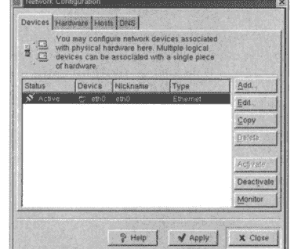

图 3-1 填写基本主机信息，然后是适配器信息。

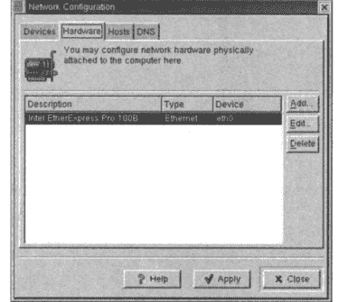

图 3-2 选择基本主机信息。

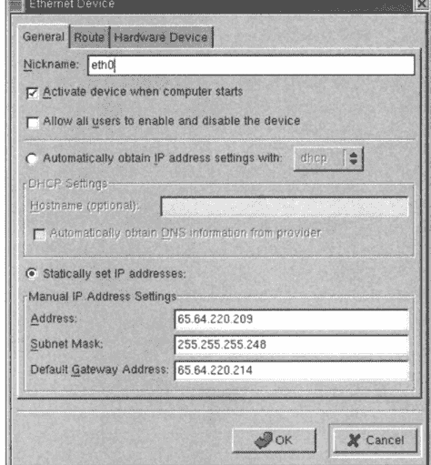

图 3-3 使用名称服务规范定义你的 `DNS` 服务器。

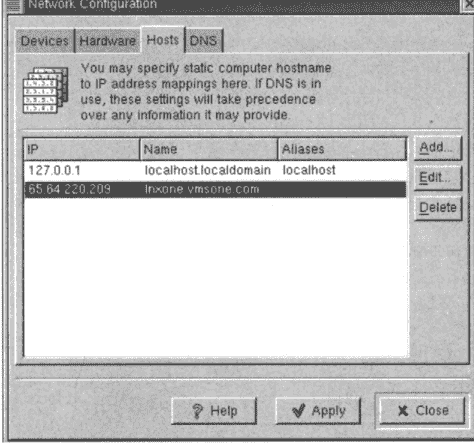

图 3-4 设置你的默认路由器地址

第 3 章 – 用于 `OpenVMS` 和 `Linux` 的 `TCP/IP` 23

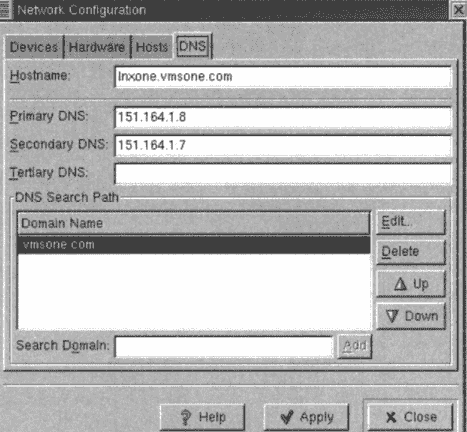

图 3-5 现在你应该已经完成了 `Linux` 以到你的 `TCP/IP` 网络的配置！

### 在 OpenVMS 上配置 TCP/IP

登录系统账户并在 `$` 提示符下输入：

```
$ @sys$manager:tcppipconfig.com
```

图 3-6 至图 3-9 展示了如何在 `OpenVMS` 上配置 `TCP/IP`。

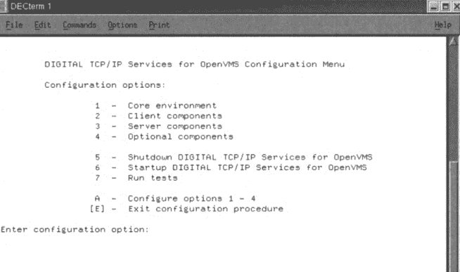

图 3-6 选择核心环境菜单。

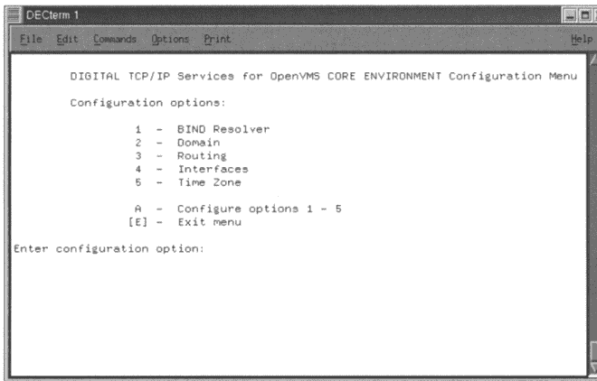

图 3-7 在 `OpenVMS` 菜单上输入数据。注意 `BIND` 和 `DNS` 是同一种东西！

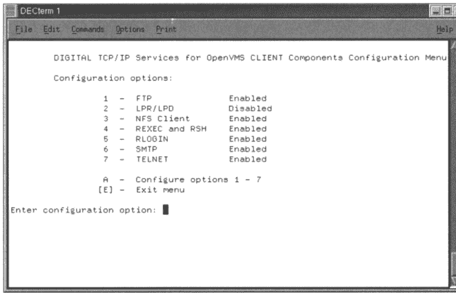

图 3-8 `OpenVMS` 客户端菜单允许你从系统中选择性启用或禁用 `TCP/IP` 客户端应用程序。

#### 用于 OpenVMS 的 DIGITAL TCP/IP 服务

##### 服务器配置

| 组件 | 状态 |
| :--- | :--- |
| 1 `BIND` | 已禁用 |
| 2 `BOOTP` | 已禁用 |
| 3 `TFTP` | 已禁用 |
| 4 `FTP` | 已启用 |
| 5 `LPR` | 已禁用 |
| 6 `NFS` | 已启用 |
| 7 `PC-NFS` | 已禁用 |
| 8 `PORT` | 已启用 |
| 9 `APPLE` | 已禁用 |
| 10 `SNMP` | 已禁用 |
| 11 `NTP` | 已禁用 |
| 12 `METRIC` | 已禁用 |
| 13 `POP3` | 已启用 |
| 14 `FINGER` | 已启用 |
| 15 `RMT` | 已禁用 |
| 16 `LBC` | 已禁用 |
| 17 `DMCP` | 已禁用 |

图 3-9 `OpenVMS` 客户端菜单允许你从系统中选择性启用或禁用 `TCP/IP` 客户端应用程序。

##### 菜单配置

| 组件 | 状态 |
| :--- | :--- |
| `Telnet` | 已禁用 |
| `SMTP`, `POP3`, `IMAP` | 已禁用 |
| `SSL`, `Stunnel` | 已禁用 |
| `X Windows` | 已启用 |

##### 应用程序

| 应用程序 | 描述 | 配置状态 |
| :--- | :--- | :--- |
| `BIND/DNS` | 名称服务 | 初始 |
| `FTP` | 文件传输 | 网络 |
| `LPD` | 打印服务 | 网络 |
| `SMB` | 消息块 | 网络 |
| `Telnet` | 终端仿真 | 初始 |

# 第 4 章 — OpenVMS 和 Linux 的安全工具

## 你曾被黑过吗？

那是 1999 年夏末。我是一个老练、强悍且经验丰富的系统工程师（SE），当时为我的客户准备固件、软件和专业建议，以应对“千年虫”（Y2K）。她是个性格很硬的女人，来自当地教会小组里那种“非主流”的人，但在那些月里，她还能写 `COBOL`。当时，计算机世界感觉就像在我们指尖下自我毁灭，于是我决定组装一台 `Linux` 机器。

一台 `Linux` 机器。噢，我之前加载过好几次 `Linux` 了，但时候到了。是时候在我的家庭网络上弄一台按我喜好配置的 `Linux` 机器了，是时候互联网上放一台 `Linux` 机器作为我电脑实力的象征了。况，你们都知道女性有多喜欢运行 `Linux` 的男士。


好了，一切就是这样开始的。我用手头的闲旧零件组装了一台 450MHz 的工作站/服务器，安装了 40GB 硬盘、256MB 内存和 10/100 以太网。我从 `cheapbytes.com` 花了 53 美元买了一个“红”发行版并安装了 Linux。然后我加载了一切。不只是几个工具，而是一切。我加载了编译器（`FORTRAN`, `COBOL`, `C`, `C++`, `CPlus+`, 等），像 `gimp`、`hypersnap` 和 ASCII 艺术之类的图形工具；游戏以及更多游戏；`Windows`，`SAMBA`, `MYSQL`, `YOUR`, `NFS`, `NSA`, `UBU`。任何我能找到的 RPM 格式的东西我全加载了。

噢，那是一台很棒的机器。专业人士为了自我娱乐而构建的系统。它将成为我的私人 Linux 乐场。然后作为创作的证明，我第一次连接互联网启动了它。我的 OpenVMS 服务器在互联网上运行了近 10 年没有出意外（如果算上通过 UUCP 的慢速连接的话更久），所以我觉得安全，Linux 操作系统也足以抵御互联网的肆虐。我做的第一件事是：配置了 `Apache`，并创建了一个指向家庭目录的 `SAMBA` SMB 映射和一个 MP3 文件共享。我在那个文件共享上加载了 10GB 的 Napster 文件，并开始探索现在我家庭网络可用的工具和事物。

## 四天后

Linux 机器的新鲜感已消退，我回到了 OpenVMS 系统，在 Netscape 中查看邮件。收件箱里出现了一个奇怪的邮箱地址，看起来来自“澳洲澳洲”（Down Under）。我打开信，立刻从邮件头意识到它来自一个 OZ 域名，并开始阅读。“你好，”我几乎能通过电线听见那口澳洲口音，“你为什么要探测和扫描我的整个 C 类地址空间？”

我惊呆了。我没有在对太平洋环带的 C 类地址运行任何端口扫描，对吧？然后我看到了他给我的日志。不是我，不可能是我！记住所有的阶段——否定、愤怒、讨价还价、抑郁、接受。在被黑后的第一个 24 小时，我经历了所有这些阶段。

看起来这些 ping 和扫描是来自我新新的 Linux 机器！那时已经晚了，我处于完全否认的状态，给那个粗鲁家伙回了一封邮件：“不可能是我。”然后我就睡觉了。

第二天早上，我那位来自澳大利亚的新朋友给我发了更多日志，证明我的系统在探测方面的复杂性：“你好，伙计，我相信脚本小子（script kiddies）控制了你的机器，你应该查查他们在做什么。”

脚本小子——这个名字让我那安装了四天的 Linux 感到恐惧。他们如何能在广袤无垠的互联网找到我。我才上线了四天啊！感觉自己像个异乡的异乡人，我问任何一个 OpenVMS 系统管理员在遇到 Linux 机器问题时会怎么办。我打了另一个 OpenVMS 系统管理员的电话！不是任何系统管理员，而是我的好朋友 Cathey，DECUS/VMS SIG 主席兼达拉斯-沃斯沃堡当地小组的总裁。David 的 Linux 经验没有我丰富，他很快指出我们应该在系统上寻找奇怪的文件。

Dave 走了过来，我们寻找了临时文件。寻找就寻得；所有的父母都担心自己的孩子感染了虱子！那台 Linux 机器不仅被黑了，而且还有端口扫描日志、端口扫描执行程序，以及两个坏蛋在破解机器之间整个文件对话的日志，他们正用这些寻找新机器进行攻击。David 和我以超级用户——我们——监控并捕获了会话信息。

### 迎接风暴

系统的安全性并不取决于它受审查的程度。系统的安全性并不取决于它受审查的程度。系统的安全性并不取决于它受审查的程度。系统的安全性并不取决于它受审查的程度。系统的安全性并不取决于它受审查的程度。系统的安全性并不取决于它受审查的程度。系统的安全性并不取决于它受审查的程度。系统的安全性并不取决于它受审查的程度。系统的安全性并不取决于它受审查的程度。系统的安全性并不取决于它受审查的程度。系统的安全性并不取决于它受审查的程度。系统的安全性并不取决于它受审查的程度。系统的安全性并不取决于它受审查的程度。系统的安全性并不取决于它受审查的程度。系统的安全性并不取决于它受审查的程度。系统的安全性并不取决于它受审查的程度。系统的安全性并不取决于它受审查的程度。系统的安全性并不取决于它受审查的程度。系统的安全性并不取决于它受审查的程度。系统的安全性并不取决于它受审查的程度。系统的安全性并不取决于它受审查的程度。系统的安全性并不取决于它受审查的程度。系统的安全性并不取决于它受审查的程度。系统的安全性并不取决于它受审查的程度。系统的安全性并不取决于它受审查的程度。系统的安全性并不取决于它受审查的程度。系统的安全性并不取决于它受审查的程度。系统的安全性并不取决于它受审查的程度。系统的安全性并不取决于它受审查的程度。系统的安全性并不取决于它受审查的程度。系统的安全性并不取决于它受审查的程度。系统的安全性并不取决于它受审查的程度。系统的安全性并不取决于它受审查的程度。系统的安全性并不取决于它受审查的程度。系统的安全性并不取决于它受审查的程度。系统的安全性并不取决于它受审查的程度。系统的安全性并不取决于它受审查的程度。系统的安全性并不取决于它受审查的程度。系统的安全性并不取决于它受审查的程度。系统的安全性并不取决于它受审查的程度。系统的安全性并不取决于它受审查的程度。系统的安全性并不取决于它受审查的程度。系统的安全性并不取决于它受审查的程度。系统的安全性并不取决于它受审查的程度。系统的安全性并不取决于它受审查的程度。系统的安全性并不取决于它受审查的程度。系统的安全性并不取决于它受审查的程度。系统的安全性并不取决于它受审查的程度。系统的安全性并不取决于它受审查的程度。系统的安全性并不取决于它受审查的程度。系统的安全性并不取决于它受审查的程度。系统的安全性并不取决于它受审查的程度。系统的安全性并不取决于它受审查的程度。系统的安全性并不取决于它受审查的程度。系统的安全性并不取决于它受审查的程度。系统的安全性并不取决于它受审查的程度。系统的安全性并不取决于它受审查的程度。系统的安全性并不取决于它受审查的程度。系统的安全性并不取决于它受审查的程度。系统的安全性并不取决于它受审查的程度。系统的安全性并不取决于它受审查的程度。系统的安全性并不取决于它受审查的程度。系统的安全性并不取决于它受审查的程度。系统的安全性并不取决于它受审查的程度。系统的安全性并不取决于它受审查的程度。系统的安全性并不取决于它受审查的程度。系统的安全性并不取决于它受审查的程度。系统的安全性并不取决于它受审查的程度。系统的安全性并不取决于它受审查的程度。

端口的应用、服务器的操作系统，甚至是该系统的所有者！一个优秀甚至中庸的端口扫描器都会将这些信息保存下来，以备搜索或后期审查。

使用端口扫描器最简单、容易的方法当然是 TCP/IP 应用程序 `Telnet`！你可以使用 `Telnet` 来检查并与服务器上的任何已知端口或应用程序端口进行交互！通常你使用 `Telnet` 客户端连接到服务器端口（默认编号为 23），但 `Telnet` 允许你更改端口以连接你希望的任何端口。只需在 VMS 或 Linux 提示符中输入：

```
telnet/port=25 yourhost.domain.com
```

从终端窗口执行。如果端口 25 处于激活状态，你的交互式终端会话将连接到端口 25（服务器上的电子邮件端口）！输入：

```
helo
help
```

你就可以进入交互式电子邮件系统了，它甚至允许你在这项被称为“电子邮件欺骗”的古老运动中发送 SMTP 邮件。你可以 `Telnet` 到已知端口，并直接与控制你端口的应用程序进行交流。

许多应用程序具有安全机制，而许多并没有。这并不是用来攻击他人系统的工具，而是当你的客户端应用程序无法工作或与服务器通信时，确认服务器的 TCP/IP 应用程序已配置、安装并运行的极佳方法。

当你在 Linux 或 OpenVMS 系统上工作时，扫描已知端口是一种实验性和学习工具。但当你从他人的 Linux 系统扫描澳大利亚和新西兰的所有已知端口，并且这是通过 AOL 和海外大学账户循环的某个“赏金老板”（替你干脏活）操作时，我认为这已经属于犯罪活动范畴。

我包含了一个已知端口列表；还有其他端口，且每个网络应用程序都可能包含自己的已知端口。这些是我查看应用程序是否运行的端口；而其他更彻底的端口扫描可以识别出未知的后门、安全漏洞以及你没有安装的应用程序。你应该定期扫描服务器上的 1-80,000 端口以确保万无一。

Linux 和 OpenVMS 系统的 TCP/IP 已知端口（部分而非全部）包括以下：

| 端口 | 服务 | 描述 |
| :--- | :--- | :--- |
| 7 | echo | 回显 |
| 11 | systat | 活跃状态 |
| 21 | ftp | 文件传输 |
| 22 | ssh | SSH 远程登录协议 |
| 23 | telnet | Telnet |
| 25 | smtp | 简单邮件传输 |
| 42 | nameserver | WINS 主机服务器 |
| 43 | nicname | Who Is |
| 53 | domain | 域名服务器 |
| 66 | sql*net | Oracle SQL*NET |
| 79 | finger | |
| 80 | http | 广域网 HTTP |
| 88 | kerberos | Kerberos |
| 109 | pop2 | 邮协议版本 2 |


| 110 | pop3 | 邮协议版本 3 |
| 111 | sunprc | SUN 远程过程调用 |
| 118 | sqlserver | SQL 服务 |
| 119 | ntmp | 网络传输协议 |
| 135 | ntprpc-o-dce | DCE 端点解析 |
| 139 | netbios-message | NETBIOS 会话服务 |
| 143 | imap | 互联网消息访问协议 |
| 389 | ldap | 轻量级目录访问协议 |
| 396 | network-ip | IP 之 Novell Netware |
| 443 | https |  |
| 513 | login | 类似 telnet 的远程登录 |
| 514 | rhell | cmd |
| 515 | printer | 打印机程序 |
| 800 | socks | Socks |
| 1313 | bmc_patrolb | BMC_PATROLDB |
| 1352 | lototus | Lotus Notes |
| 1443 | ms-sql-s | Microsoft SQL Server |
| 1494 | citrix | Citrix |
| 1524 | ingress | logback |
| 1525 | orasv | Oracle 服务器 |
| 1527 | tisv | Oracle 服务器 |
| 1723 | pptp | PPTP |
| 1745 | winsock-proxy | 代理，Winsock 代理 |
| 2000 | remotely-anywhere | 远程无处 |
| 2001 | cisco-mgmt | Cisco 路由器管理 |
| 2049 | nFS |  |
| 2301 | CIM | Compaq Insight洞管理器 |
| 2447 | openview | OpenView |
| 2998 | realsecure | RealSecure |
| 3000 | hbci | HBCI |
| 3306 | mysql |  |
| 4045 | nfs |  |
| 5222 | vnc |  |
| 5631 | vnc |  |
| 6000 | windows |  |
| 6063 | vnc |  |
| 6667 | web |  |
| 8000 | web |  |
| 8001 | web |  |
| 8002 | web |  |
| 8080 | web |  |

# Stunnel

SSL 需要应用程序来映射和重映射本地主机端口，而这个重映射工具就称为 Stunnel。

Stunnel 是一种允许你在 SSL 内部加密 TCP 连接的应用程序。这是一个非常新且实用的加密方法，因为你不需要重新编写非加密的应用程序协议（如 Telnet、POP、IMAP、LDAP），只需使用 Stunnel 提供加密即可。

Stunnel 到底有多用？随着 OpenSSL 和 Stunnel 在 OpenVMS 引入，系统管理员现在又有了一个工具，可以从 Linux 工作站或 Windows 工作站安全地管理 OpenVMS 系统！而且当然，它对于想要安全地管理其 Open Linux 服务器的 OpenVMS 系统管理员来说同样适用！

Stunnel 分发版包含以下内容：

- Linux 和 Windows 的开源 Stunnel 源码可以在 `http://www.stunnel.org/` 找到。
- OpenVMS Stunnel 工具包随 HP 提供的 OpenVMS 7.3-1 发行版提供，并可以在网上 `http://www.openvms.compaq.com` 获取。

## 在 OpenVMS 上安装 Stunnel 服务器

我刚刚在车库里构建了我的第一个 OpenVMS 7.3-1 系统，并查看了开始集成到 OpenVMS 中的所有新开源工具。我想在 Linux 系统和 OpenVMS 系统之间安装 Stunnel，于是请了另一位 OpenVMS 专家 Steve Smiley。Steve 多年来一直是 SSH 的坚实支持者，并一直要求在 OpenVMS 上使用 SSH。请他帮助完成 Stunnel，对于加密 Telnet 及其如何在跨 Stunnel 运行来说，这是一次严苛的测试。图 4-1 至 4.26 展示了 OpenVMS 上的 Stunnel 服务器安装。

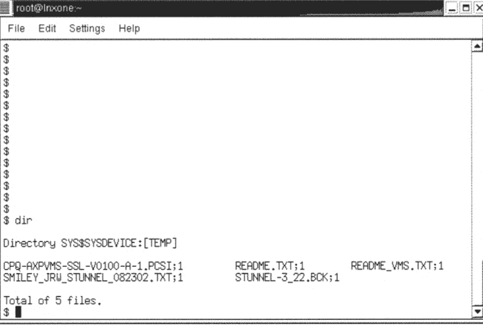

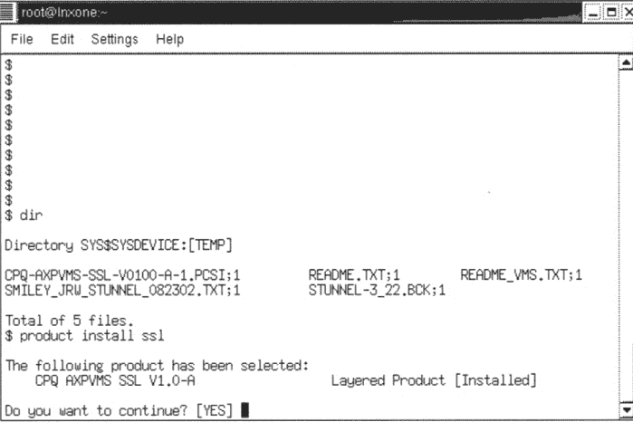

38 Linux & OpenVMS 互操作性

```
root@lnx:~ 
```

选择了以下产品：

`CPQXVPMS SSL V1.0-A`

是否继续？ [YES] yes

配置阶段开始： ...

你将被要求为每个选定的产品以及任何为了满足软件依赖关系而可能安装的产品选择选项（如果有）。

`CPQXVPMS SSL V1.0-A`: 用于 OpenVMS Alpha V1.0-A 的 SSL (基于 OpenSSL 0.9.68)。

(c) Compaq Computer Corporation 2002. 保留所有权利。

所有选项使用默认值？ [YES] yes

是否要检查选项？ [NO]

执行阶段开始： ...

将向目标位置安装以下产品：

`CPQXVPMS SSL V1.0-A`

完成部分：%0...10%...20%...30%...

```
DISK$VMS0731: [VMS$COMMON.]
```

图 4-3 安装将继续计算百分比。

```
root@lnx:~ 
```

完成部分：%0...10%...20%...30%...50%...60%...70%...80%...90%...100%

已安装以下产品：

`CPQXVPMS SSL V1.0-A`

XCSI-I-VPEXECUTE, 正在为 `CPQXVPMS SSL V1.0-A` 执行测试程序 ...

XCSI-I-VPSUCCESS, 测试程序成功完成

`CPQXVPMS SSL V1.0-A`: 用于 OpenVMS Alpha V1.0-A 的 SSL (基于 OpenSSL 0.9.68)。

```
在 SYSMANAGER:SYSTRUP 中插入以下行：
@sys$startup.com
在 SYSMANAGER:SHUTDOWN 中插入以下行：
@sys$shutdown.com
```

存在一些安装后需要执行的操作。这包括定义逻辑名称和运行外部符号，并且如果没有执行 IVP，则运行它。请参考 Release Notes 获取有关在安装完成后应该执行的操作的更多信息。

SSL 在此处创建了目录结构

图 4-4 第 4 章 – 用于 OpenVMS 和 Linux 的安全工具

# root@lnx:~

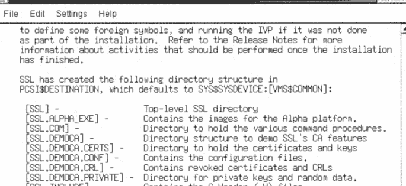

定义外部符号，并且如果没有执行 IVP，则运行它。请参考 Release Notes 获取有关在安装完成后应该执行的操作的更多信息。

SSL 在 DESTINATION 创建了以下目录结构，默认为 `SYSDEVICE:[VMS$COMMON]`:

- SSL 根目录
- `SSL.ALPHA.EXE` 包含 Alpha 平台的映像
- `SSL.COM` 各种命令程序
- `SSL.DEMO` 目录用于演示功能
- `SSL.CERTS` 目录存放证书
- `SSL.CONF` 包含配置文件
- `SSL.CRL` 包含编译后的证书吊列表
- `SSL.PRIVATE` 目录用于私钥和随机数据
- `SSL.INCLUDE` 包含 (.H) 文件
- `SSL.TEST` 包含 IVP 期间使用的文件

文件应保存在的位置信息

# root@lnx:~

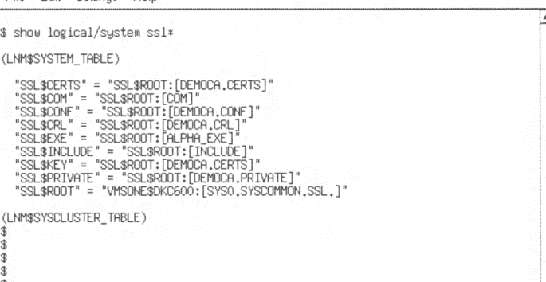

```
show logical/system=
"SSL$CERTS" = "SSL$ROOT:[DEMO]"
"SSL$COM" = "SSL$ROOT:[COM]"
"SSL$CONF" = "SSL$ROOT:[CONF]"
"SSL$CRL" = "SSL$ROOT:[CRL]"
"SSL$EXE" = "SSL$ROOT:[ALPHA.EXE]"
"SSL$INCLUDE" = "SSL$ROOT:[INCLUDE]"
"SSL$PRIVATE" = "SSL$ROOT:[PRIVATE]"
"SSL$ROOT" = "VMS$COMMON,SSL"
```

图 4-6 检查 OpenVMS 逻辑是否已定义。

## Linux & OpenVMS 互操作性


# 第 4 章 – 用于 OpenVMS 和 Linux 的安全工具

## 图 4-7 编辑 OpenVMS 启动脚本/文件以便在重启时启动 SSL

```
root@lnx:~
set cont
! 这是 OpenVMS Alpha VAX 特定通用模板。
对于 OpenVMS V7.2，此模板将应用于两个系统。
! 注意：在 OpenVMS VAX 系统上，此模板替换了特定的启动程序。仅更改了名称，功能相同。
! 更多详情请文档。
你可以根据需要向此程序添加命令或更改此程序内的命令。此命令程序在保存时：
缓冲区: STARTUP_VMS.COM
```

## 图 4-8 在启动文件的底部添加 SSL 行（TCP/IP 启动之后）

```
root@lnx:~
! 删除以下行的命令分隔符 ($) 以与 TCP/IP 一起运行。
@SYS$STARTUP:VM@STARTUP.COM
! 删除以下行的命令分隔符 ($) 以启动 RPC 服务。
@SYS$STARTUP:DCE@RPC_STARTUP.COM
! OpenSSL 启动...
-----------------------
@sys$startup:ssl@startup.com
! EXIT
[文件结束]
缓冲区: STARTUP_VMS.COM
```

## 第 4 章 – 用于 OpenVMS 和 Linux 的安全工具

```
root@lnx:~
create/dir ssl$root:[stunnel]
dir

目录 SYS$DEVICE:[TEMP]

CPQ-AVPMS-SSL-V0100-A-1.PCSI:1  README.TXT:1  README_VMS_TXT:1
SMILEY_JRW_STUNNEL_082302.TXT:1  STUNNEL-3_22.BCK:1
共 5 个文件。
$ backup stunnel-3_22.bck/save ssl$root:[stunnel...]$
```

## 图 4-9 从你的临时目录将 Stunnel 备份包恢复到主 SSL 目录

```
root@lnx:~
create/dir ssl$root:[stunnel]
dir

目录 SYS$DEVICE:[TEMP]

CPQ-AVPMS-SSL-V0100-A-1.PCSI:1  README.TXT:1  README_VMS.TXT:1
SMILEY_JRW_STUNNEL_082302.TXT:1  STUNNEL-3_22.BCK:1

共 5 个文件。
$ backup stunnel-3_22.bck/save ssl$root:[stunnel...].*$
$ set def ssl$root:[com]
dir

目录 SSL@ROOT:[COM]

SSL@CERT_TOOL,COM:1
共 1 个文件。
$ @ssl@cert_tool.com
```

## 图 4-10 运行 SSL 证书工具

42 Linux & OpenVMS 互操作性

```
root@lnxone~
文件 编辑 设置 帮助
  SSL 证书工具！
    主菜单
      1. 查看证书
      2. 查看证书请求
      3. 创建证书请求
      4. 创建自签名证书
      5. 创建 CA（证书授权机构）证书
      6. 签名证书请求
      7. 证书哈希
      8. 证书吊销列表哈希
      9. 退出
  输入选项: |
```

## 图 4-11 SSL 证书菜单——选择 5 创建证书权威证书

```
root@lnxone~
文件 编辑 设置 帮助
  SSL 证书工具！
    创建证书授权机构
  PEM 密码 ? []
  确认 PEM 密码 ? []
  加密位数 ? [1024]
  默认天数 ? [1825]
  OH 证书密钥 ? [SSL$ROOT:[DEMO.CERTS]SERVER_CA.KEY]
  OH 证书文件 ? [SSL$ROOT:[DEMO.CERTS]SERVER_CA.CRT]
  国家名称 ? [US]
  组织名称 ? [Defcon-vms]
  组织单元名称 ? [dfwug]
  通用名称 ? [CA Authority]
  显示 CA 证书 ? [N] |
```

## 图 4-12 选择 5 将引导你回答几个问题。使用默认值

第 4 章 – OpenVMS 和 Linux 的安全工具 43

```
root@lnxone:~-
文件 编辑 设置 帮助
  SSL 证书工具
    主菜单
    1. 查看证书
    2. 查看证书请求
    3. 创建证书请求
    4. 创建自签名证书
    5. 创建 CA（证书授权机构）证书
    6. 签名证书请求
    7. 证书哈希
    8. 证书吊销列表哈希
    9. 退出

  输入选项: 3
```

## 图 4-13 继续并选择 3 创建证书请求

```
root@lnxone:~-
文件 编辑 设置 帮助
  SSL 证书工具
    创建证书请求
    加密私钥 ? [N]
  加密位数 ? [1024]
  证书密钥文件 ? [SSL$ROOT:[DEMO.CERTS]SERVER_KEY]
  证书请求文件 ? [SSL$ROOT:[DEMO.CERTS]SERVER_CSR]
  国家名称 ? [US]
  州或省名称 ? [texas]
  城市名称 ? [mesquite]
  组织名称 ? [defcon-vs]
  组织单元名称 ? [ [ ] dfwug
  通用名称 ? [vmsone.vmsone.com]
  电子地址 ? [system@vmsone.vmsone.com]
```

44 Linux & OpenVMS 互操作性

```
root@vmnxone:~_
```

```
SSL 证书工具！

创建证书请求

加密私钥 ? [N]
加密位数 ? [1024]
证书密钥文件 ? [SSL$ROOT:[DEMO.CERTS]SERVER_KEY]
证书请求文件 ? [SSL$ROOT:[DEMO.CERTS]SERVER_CSR]
国家名称 ? [US]
州或省名称 ? [texas]
城市名称 ? [houston]
组织名称 ? [defcon-vas]
组织单元名称 ? [] dflw
通用名称 ? [vmsone.vmsone.com]
电子地址 ? [system@vmsone.vmsone.com]
显示证书 ? [N]
```

## 图 4-15 选择 5 并创建一个本地证书请求

```
root@vmnxone~_
```

```
SSL 证书工具

主菜单
1. 查看证书
2. 查看证书请求
3. 创建证书请求
4. 创建自签名证书
5. 创建 CA（证书授权机构）证书
6. 签名证书请求
7. 证书哈希
8. 证书吊销列表哈希
9. 退出

输入选项: 6
```

## 图 4-16 现在选择 6 并签名一个本地证书请求

第 4 章 – OpenVMS 和 Linux 的安全工具 45

```
root@lnxone~

```

文件 编辑 设置

SSL 证书工具

签名证书请求

CA 证书文件 ? [SSL$ROOT:[DEMOCA.CERTS]SERVER_CA.CRT]

CA 证书密钥文件 ? [SSL$ROOT:[DEMOCA.CERTS]SERVER_CA.KEY]

证书请求请求文件 ? [SSL$CSR:SERVER,CSR]

签名证书文件 ? [SSL$CRT:SIGNED,CRT]

默认数据 ? [Y]

PEM 密码 ? []

显示证书 ? [N]

```

## 图 4-17 再次使用默认值。保存 PEM 密码并记住你使用的大小写——你很快就会需要它

root@lnxone~

```

文件 编辑 设置

SSL 证书工具

主菜单

1. 查看证书

2. 查看证书请求

3. 创建证书请求

4. 创建自签名证书

5. 创建 CA（证书授权机构）证书

6. 签名证书请求

7. 证书哈希

8. 证书吊销列表哈希

9. 退出

输入选项: 9

```

## 图 4-18 退出 SSL 证书菜单

46 Linux & OpenVMS 互操作性

```

root@inxone:~

```
文件  编辑  设置  帮助
$
$
$
$
$
$
$
$
$
$
$
$
$
$
$
$
$
$
$
$
$ set ssl$root:[stunnel]
$
$
$
$
$
$
$
$
$
$
$
$
$


## 图 4-20. PEM 文件是本地证书，但当然它是加密的！

第 4 章 – OpenVMS 和 Linux 的安全工具 47

```

root@lnxone~~

文件 编辑 设置 帮助

$

$

$

$

$

$

$

$

$

$

$

$

$

$

$

$

$

$

$

$

$

$

$

$

$ 

$ dir

Directory SSL$ROOT:[STUNNEL]

STUNNEL-3.22,DIR:1 STUNNEL.PEM:1

Total of 2 files.


### 图 4-21 设置 Stunnel.PEM 文件的保护。

```
$ set security/protection=(G,W) stunnel.pem
```

`root@lnxone~~`

文件 编辑 设置 帮助

### 图 4-22 将 Stunnel.EXE 文件和服务器启动脚本文件拷贝到 Stunnel 目录。

```
$ set def ssl$root:[stunnel]

$ dir

Directory SSL$ROOT:[STUNNEL]

STUNNEL-3.22,DIR:1 STUNNEL.PEM:1

Total of 2 files.

$ copy ssl$root:[stunnel-3.22.vms] stunnel.exe ssl$root:[stunnel]*,* 

$ copy ssl$root:[stunnel-3.22.vms] stunnel_startup_server.com ssl$root:[stunnel]*,* 

$ dir

Directory SSL$ROOT:[STUNNEL]

STUNNEL-3.22,DIR:1 STUNNEL_EXE:1

STUNNEL_STARTUP_SERVER.COM:1

Total of 4 files.
```

`root@lnxone:~`

文件 编辑 设置 帮助

### 图 4-23 编辑 `stunnel_startup.server.com` 文件并定位到 "stunnel =" 行；然后用 "#" 注释掉它。

```
$! 编辑此命令过程文件以在你的环境中运行 Stunnel

$! 作者: Taka Shinagawa, OpenVMS 安全

$! (takaaki.shinagawa@hp.com)

$! 日期: 2002年6月2日

######################################################################

$! 定义一个 Stunnel 命令 /* 为你的本地主机编辑此命令：Stunnel 命令 */

$! Telnet

$ stunnel_command = "STUNNEL -d 992 -r localhost:23 -p -stunnel,pem -o stunnel+

######################################################################

$! 询问私钥是否加密

$ question:

$ inquire encrypted = "私钥（PEM 文件中的）是否已加密？[Y/N]"

$ if encrypted .eqs

$ then

$ goto question

$ else
```

`root@lnxone:~`

文件 编辑 设置 帮助

### 图 4-24 如高亮显示所示，添加 Stunnel 命令，并将第二行作为单行命令包含，在 -p 处隔一个空格（删除多余的 "-"）。将其保存为 DCL 脚本的新版本。

```
$! 编辑此命令过程文件以在你的环境中运行 Stunnel

$! 作者: Taka Shinagawa, OpenVMS 安全

$! (takaaki.shinagawa@hp.com)

$! 日期: 2002年6月2日

######################################################################

$! 定义一个 Stunnel 命令 /* 为你的本地主机编辑此命令 */

$! Telnet

$ stunnel_command = "STUNNEL -d 992 -r localhost:23 -p -stunnel,pem -o stunnel+

$ stunnel_command = "STUNNEL -d 992 -r localhost:23 -p -

$slroot:[stunnel,stunnel,pem -o stunnel.log"

$! 询问私钥是否加密

$ question:

$ inquire encrypted = "私钥（PEM 文件中的）是否已加密？[Y/N]"

$ if encrypted .eqs

$ then

$ goto question

$ else

$ if encrypted .eqs = "Y" then goto encrypted
```

第 4 章 – OpenVMS 和 Linux 的安全工具 49

### 图 4-25 验证现在是否有两个版本的 `stunnel_server_startup.com` 文件。

```
$ dir

目录 SSL@ROOT:[STUNNEL]

STUNNEL-3.22,DIR:1 STUNNEL.EXE:1 STUNNEL.PEM:1

STUNNEL_STARTUP_SERVER,COM:2 STUNNEL_STARTUP_SERVER.COM:1

共 5 个文件。
```

### 图 4-26 运行 `stunnel_server_startup.com` 脚本。使用与你加密 PEM 证书时相同的密码，注意区分大小写（记住在密码周围始终使用双引号——务必如此）。

```
$ dir

目录 SSL@ROOT:[STUNNEL]

STUNNEL-3.22,DIR:1 STUNNEL.EXE:1 STUNNEL.PEM:1

STUNNEL_STARTUP_SERVER,COM:2 STUNNEL_STARTUP_SERVER.COM:1

共 5 个文件。

$ @stunnel_startup_server

私钥（PEM 文件中的）是否已加密？[Y/n]: y

输入解密密钥的密码（请在使用时带双引号）：

"welcome"

正在启动在端口 992 运行的隧道

RUN-S-PROC_ID, 创建的进程标识为 20200435

Stunnel 成功启动！
```

50 Linux 与 OpenVMS 互操作性

## Linux 上安装 Stunnel 客户端

图 4-27 至 4-34 展示了在 Linux 上安装 Stunnel 客户端。

### 图 4-27 执行一个进程以确保 Stunnel 进程正在运行。

```
root@lnxone:~

文件 编辑 设置 帮助

私钥（PEM 文件中的）是否已加密？[Y/N]: y

输入解密密钥的密码（请在使用时带成对的双引号）：

"welcome"

正在启动在端口 992 运行的 Stunnel

IRULN-S-PROC_ID, 创建的进程标识为 20200437

Stunnel 成功：启动！

$ show system:process=stunnel_992

OpenVMS 7.3-1 运行于节点 VMSNODE 2002-AUG-26 20:16:53.37 运行时间 0 01:51:06

PID Name State Pri I/O CPU Page lists Pages

20200437 STUNNEL992 LE 5 659 0:00:00.19 369 481
```

### 图 4-28 解压 `stunnel-22.tar.gz`：`gzip -dc stunnel-22.tar.gz | tar -x`

```
root@lnxone:~/Stunnel

文件 编辑 设置 帮助

root@lnxone:~/Stunnel

[root@lnxone:~/Stunnel]#

[root@lnxone:~/Stunnel]# ls -al

total 2128

dr-xr-x 2 root root 25 44

stunnel-22.tar.gz
```


```
root@lnxone:~/Stunnel/stunnel.22
文件 编辑 设置 帮助
[root@lnxone:~/Stunnel]# # ./
[root@lnxone:~/Stunnel]# # ./
[root@lnxone:~/Stunnel]# #configure
checking build system... i586-pc-linux-gnu
checking for gcc... gcc
checking for C output... aout
checking whether the compiler works... yes
checking whether we are cross compiling... no
checking for executable suffix... a
checking for object suffix... o
checking whether we are using the GNU compiler... yes
checking whether gcc accepts -g... yes
checking for BSD compatible install... /usr/install -c
checking for SSL directory... /usr
checking whether enable SSL defaults... no
checking to disable RSA support... no
checking to enable DM support... no
checking for dipopen in -ldl... yes
checking for gethostname in -lnsl... yes
checking for socket in -lp
checking for pthread_
```

图 4-30 `./configure` 命令为 Stunnel 创建一个 make 脚本。

52 Linux 与 OpenVMS 互操作性

```
root@lnxone:~/Stunnel/stunnel.22
文件 编辑 设置 帮助
checking for pthread_sigmask... yes
checking for ANSI C header files... yes
checking for sys/types.h... yes
checking for sys/stat.h... yes
checking for stdlib.h... yes
checking for memory.h... yes
checking for string.h... yes
checking for intptes.h... yes
checking for strint.h... yes
checking for unistd.h (cached)
checking for unsigned char... yes
checking size of unsigned char... 1
checking for unsigned short... yes
checking size of unsigned short... 2
checking for unsigned int... yes
checking size of unsigned int... 4
checking for unsigned long... yes
checking size of unsigned long... 6
checking size of unsigned long... 8
configure: creating /config.status
config: creating Makefile
```

图 4-31 等待 `make` 命令完成且 `/configure` 完成。

```
root@lnxone:~/Stunnel/stunnel.22
文件 编辑 设置 帮助
checking for unsigned long... yes
checking size of unsigned long... 8
configure: creating /config.status
```

``` Makefile
root@lnxone:~/Stunnel/stunnel.22
文件 编辑 设置 帮助
[root@lnxone:~/Stunnel/stunnel.22]# # ./
[root@lnxone:~/Stunnel/stunnel.22]# # make
[root@lnxone:~/Stunnel/stunnel.22]# # make
```

图 4-32 执行 `make` 来构建 Stunnel 程序（你必须在 Linux 系统中安装了 c）。

第 4 章 – OpenVPN 和 Linux 的安全工具 53

```
root@lnox:~/stunnel/stunnel-3.22
文件 编辑 设置 帮助
你即将被要求输入一些信息，这些信息将整合到你的证书请求中。
你即将输入的内容被称为属性名称（Distinguished Name，简称 DN）。
有很多字段，但你可以留一些字段为空。
某些字段将有一个默认值，
如果你输入 "..."，该字段将留空。
国家，名称（字母代码） [PL]
州或省份（全称） [State-State]:Texas
地名名称（英文，城市） []
组织名称（英文，公司） [Developers Ltd]:Defcon-VMS
组织单元名称（可选） [dfslug]
通用名称（服务器的完全域名 FQDN） [localhost]
test - eq 1 - f "/dev/urandom" && /dev/urandom 512 >> stunnel.pem
test - eq 1 - f "/dev/urandom" && /dev/urandom 512 >> stunnel.pem
/usr/bin/openssl x509 -dates -fingerprint -notout
-in stunnel.pem
subject=C=US/ST=Texas/L=Defcon-VMS/OU=dfwlug/CN=localhost
Before=Aug 27 01:51:24 2022 GMT
After=Aug 27 01:51:24 2032 GMT
MD5 fingerprint=E1:F9:B1:67:A9:C5:7E:D0:32:12:60:F:54:A2:E6
[root@lnox:~/stunnel/stunnel-3.22]# _
```

图 4-3 这些问题的答案，以便能够为 Linux 系统创建一个 stunnel 文件。

```
root@lnox:~/stunnel/stunnel-3.22
文件 编辑 设置 帮助
/usr/bin/openssl ghend -rand "/dev/urandom" 512 >> stunnel.pem
test - eq 1 - f "/dev/urandom" || \
/usr/bin/openssl ghend 512 >> stunnel.pem
/usr/bin/openssl x509 -dates -fingerprint -notout
-in stunnel.pem
subject=C=US/ST=Texas/L=Defcon-VMS/OU=dfwlug/CN=localhost
Before=Aug 27 01:51:24 2022 GMT
After=Aug 27 01:51:24 2032 GMT
MD5 fingerprint=E1:F9:B1:67:A9:C5:7E:D0:32:12:60:F:54:A2:E6
[root@lnox:~/stunnel/stunnel-3.22]#
[root@lnox:~/stunnel/stunnel-3.22]#
[root@lnox:~/stunnel/stunnel-3.22]#
[root@lnox:~/stunnel/stunnel-3.22]#
[root@lnox:~/stunnel/stunnel-3.22]#
[root@lnox:~/stunnel/stunnel-3.22]# make install
/bin/make install /usr/local/bin /usr/local /usr/local/man/man8 /usr/local/
var/stunnel/
chmod anew /usr/local/var/stunnel/
/usr/bin/install -c 711 stunnel /usr/local/lib
test -z stunnel.so || /usr/bin/install -c 755 stunnel.so /usr/local/lib
test -z /usr/bin/install -c 600 stunnel.pem
[root@lnox:~/stunnel/stunnel-3.22]# _
```

图 4-4 执行 `make` 以完成 Stunnel 程序/库到生产系统中的安装。

54 Linux 与 OpenVMS 互操作性


```
root@lnxone:~/stunnel/stunnel-3.22
文件 编辑 设置 帮助
[root@lnxone stunnel-3.22]
[root@lnxone stunnel-3.22]
[root@lnxone stunnel-3.22]
[root@lnxone stunnel-3.22] stunnel -c -d 992 -r vsome.com:992 -o stunnel-client
tlog
[root@lnxone stunnel-3.22] telnet localhost 992
Trying 127.0.0.1...
Connected to localhost.
Escape character is '^'.

欢迎来到 OpenVMS (TM) Alpha 操作系统，版本 V7,3-1

Username: system
Password:
用户 授权失败
Username: system
Password:
欢迎来到 OpenVMS (TM) Alpha 操作系统，版本 V7,3-1
上次交互式登录于 Monday, 26-AUG-2002 20:26:10
上次非交互式登录于 Monday, 26-AUG-2002 18:27:47,63
自上次成功登录以来 1 次失败
```

图 4-35 执行 Stunnel 客户端命令。看起来你正在 Telnet 到本地主机。

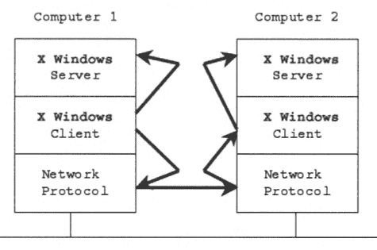

2000年，以及 DCE 的起源。OpenVMS 和许多 UNIX 系统都采用了 X Windows，因为与显示列表管理器或只能显示图形并控制本地系统的其他本地 GUI 不同，X Windows 的设计和优化目标是让其图形界面实现网络化。X Windows 设计用于通过多种标准网络协议（TCP/IP, LAT, DECNet, SNA）进行本地或远程应用程序显示。在 X Windows 中（与仅控制本地硬件的窗口管理器，如本地绘图仪不同），图形输出的架构经过优化，可以传输到网络中任何 X Windows 计算机上的其他 X Windows 显示器！这使得应用程序在多个系统之间显示变得容易，或者更方便地将许多不同的图形带到单个图形显示器上！这种级别的开放系统互操作性正是 DEC 在 1988 年选择 X Windows 作为其 OpenVMS 工作站和服务器的 GUI，也是 HP 至今继续支持 X Windows 的原因！

时光飞逝 17 年，经过 6 次主要的 X Windows 软件发布，如今这个经受考验的图形显示系统拥有安全性、新的显卡、Alpha 系统计算性能以及越来越快的网络连接。可以看出，一个低成本的 Linux 系统将成为一个完美的、廉价的集成工作站，使用标准的 X 工具显示来自 OpenVMS 服务器的图形和应用程序！

## 在 Linux 工作站上显示 OpenVMS X Windows

在 Linux 工作站上显示 OpenVMS 应用程序分部分。第一部分是登录 Linux 工作站并设置安全以接受来自 OpenVMS 应用程序的远程显示。第二部分是 Telnet 到 OpenVMS 工作站并将 X Windows 输出重定向到 Linux 机器，然后运行应用程序。为了执行此功能，你必须有两个账户：一个在 Linux 工作站，另一个在 OpenVMS 服务器。

让我们来看命令过程：在你的 Linux 机器上登录 X Windows 会话。打开一个交互式终端并输入（见图 5-2 和 5-3）。

`johnw@lnone.vsmone.com:/home/johnw <3>`

```
File Sessions Options Help
johnw@lnone.vsmone.com # host vsmone.com
vsmone.being added to access control list
johnw@lnone.johnw telnet vsmone.com
trying 85.24.200...
Connected to vsmone.com.
Escape character is '^'.
```

Welcome to OpenVMS (TM) Alpha Operating System, Version V7.2-1

Username: wisniewski

Password:

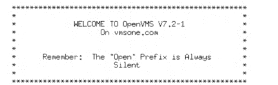

Last interactive login on Monday, 21-MAY-2001 23:37:35,10

Last non-interactive login on Monday, 21-MAY-2001 23:19:22,40

```
# set display/create/nodes/lnoneone.vsmone.com/transportstctip/screen=0
create/tera
```

图 5-2 你应该已经你的 OpenVMS `create/terminal` 命令重定向，以便将其结果显示在 Linux 工作站上！

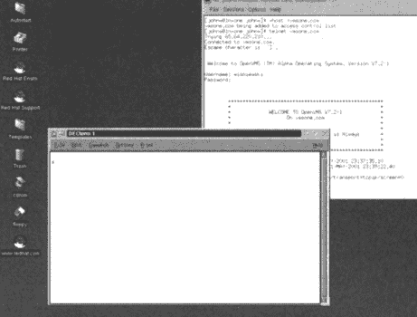

图 5-3 恭喜！你刚刚从 OpenVMS 系统创建了一个到你 Linux 机器的终端！

## X Windows 会话的命令控制

### Linux 命令: xhost

你 Linux 机器上的 `xhost` 命令控制谁可以向你的 X Windows 服务器显示器写入，如下如下：

- `xhost +` 允许网络中的每个主机向你的屏幕发送 X Windows 显示。
- `xhost -` 不允许网络中的任何人向你的屏幕发送 X Windows 显示。
- `xhost+nodename` 仅允许 "`nodename.com`" 向你的屏幕发送 X Windows 显示。
- 不带参数的 `xhost` 会告诉你谁有权向你的屏幕发送 X Windows 显示。

记住：你始终可以通过在本地终端中输入“`xhost -`” 来阻止所有网络化的 X Windows 显示。请注意此命令对你工作站的安全影响，特别是在公共网络中！如果有疑问，请务必使用“`xhost +`” 关闭访问。如果你不小心，它甚至可能会用对方的窗口覆盖你的 Linux 窗口管理器！

### OpenVMS 命令：SHOW DISPLAY 和 CREATE/TERMINAL

在你 Linux 机器上的新 DECterm 中，输入图 5-4 所示的信息。

- **Device**: 意味着 Open VMS 终端（进程）将其输出重定向到图形设备以接受输入。
- `[super]` 意味着从此进程运行的所有应用程序都将被显示。
- `[user]` 意味着只有从此进程运行的下一个应用程序将被显示。
- **Node**: 这是 X Windows 服务器所在的位置。
- **Transport**: 这是正在使用的协议。
- **Server**: 某些系统可以运行多个实例的 X Windows。默认为 0。
- **Screen**: X Windows 服务器可以有多个显示器连接到两个或多个图形头。

```
show display
Device: super
Node: node.com
Transport: TCP/IP
Server: 0
```

所有这些参数都可以通过发布以下命令进行更改：

```
SET DISPLAY/CREATE/NODE=node.com/TRANSPORT=tcp
```

- `/EXECUTIVE_MODE`（可选）为系统进程创建一个执行模式。
- `/SUPERVISOR_MODE`（可选，默认）为当前进程创建一个管理员模式。
- `/USER_MODE`（可选）限制下一个运行的程序为用户。

`CREATE/TERMINAL` 命令可以添加以下附加功能：

- `/DETACH` 为终端创建一个离线后台进程。
- `/NOPROCESS` 将你以不同的用户登录。如果你想在已登录 Windows 的情况下登录终端，这很有用。
- `/BIG_FONT` `/LITE_FONT` `/CLI` 属性可以在创建终端时修改终端的许多其他细节。请务必查看 `CREATE/TERMINAL` 工具并创建一个合适的终端。

## OpenVMS X Windows 应用程序

让我们查看安装 X Windows 时 OpenVMS 的应用程序（见图 5-5）。所有标准应用程序都有前缀 `DECW$`。`DECW$CALC`, `DECW$PAINT`, `DECW$CALENDAR`, `DECW$MAIL`, `DECW$CARDFILE`, `DECW$MESSAGEPANEL`, `DECW$NOTEPAD` 以及 `DECW$PUZZLE` 如下所示。


```
john@4nx.vms.com:~home/john
File Sessions Options Help
# dir sys$system:decw*
DIRECTORY SYS$COMMON:[SYSEX]
DECW$BOOKREADER,EXE:1      DECW$CALC,EXE:1       DECW$CALENDAR,EXE:1
DECW$CARDFILE,EXE:1      DECW$BI,EXE:1         DECW$CLOCK,EXE:1
DECW$DWT,EXE:1           DECW$INT_FONT_DAEMON,EXE:1
DECW$DWT_XDRIVER,EXE:1 DECW$MSESSION,EXE:1
DECW$COMPILER,EXE:1     DECW$MAIL,EXE:1
DECW$MESSAGEPANEL,EXE:1  DECW$MEMMAP,EXE:1
DECW$OVERLAY,EXE:1      DECW$NOTEPAD,EXE:1     DECW$PAINT,EXE:1
DECW$PUZZLE,EXE:1       DECW$REINIT,EXE:1      DECW$SCREEN,EXE:1
DECW$SEEKVER,EXE:1      DECW$SERVER_QUICK,EXE:1
DECW$SESSION_MAIN,EXE      DECW$SETSHODIS,EXE:1  DECW$PVRM,EXE:2
DECW$STARTLOG,EXE:1      DECW$TABLE,EXE:1       DECW$TERMINAL,EXE:1
DECW$TERMINAL_CREATE,EXE:1 DECW$UILMOTIF,EXE:1  DECW$WML,EXE:1
DECW$TERFORM,EXE:1      DECW$WINDOW,EXE:1
DECW$ACUST,EXE:1        DECW$WSINIT,EXE:1      DECW$XFS,EXE:1
Total of 37 files.
#
```

> 图 5-5 标准 VMS X Windows 应用程序位于 SYSTEM 目录。

与它们的 Linux Windows 对应程序。这些程序可以通过输入以下命令定义显示器后运行：

```
RUN SYS$SYSTEM:DECW$CLOCK.EXE
```

`RUN/DETACH SYS$SYSTEM:DECW$CLOCK.EXE` 会为您的程序创建一个分离进程以便运行，并将您带回终端窗口的 `$` 提示符以执行更多命令！

关于 DECwindow 应用程序：某些应用程序非常直观（例如 `DECW$CLOCK`），但另一些则并不那么清晰。`DECW$TERMINAL`、`DECW$WINMGR` 等程序似乎可以启动窗口管理器或创建新的终端（以及进程）。事实上，这正是这些程序的功能，但它们通过 VMS 启动程序访问，以便在 VMS 服务器上运行 Windows；而另一些则被 VMS 命令行解释器用于创建终端或启动 X 窗口；这类似于 Linux 上的 `xinit` 或 `xbfconfig`。

> 注意：不要直接运行窗口管理器程序，因为它们可能会搞乱你在两台机器上的 Windows 会话！

快速访问 OpenVMS Windows 应用程序的一种简单方法是使用 `DECW$SESSION.EXE` 或 `DTSESSION.EXE` 会话管理器。`DECW$SESSION` 是较旧的 Windows 会话管理器

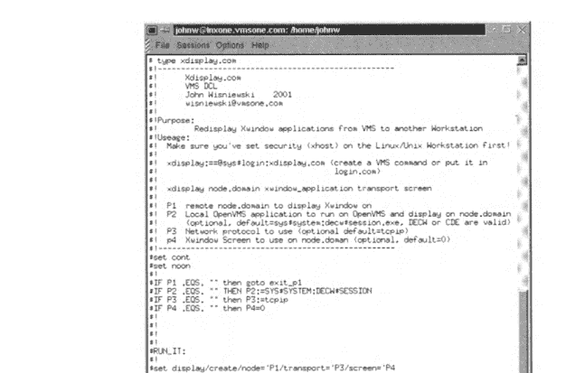

图 5-6 使用此 VMS 命令文件，你可以轻松自动化你的显示器和 X Windows 命令。默认设置会启动非常实用的 DECwindow 会话管理器。

第 5 章 – X Windows 应用程序：X Windows 与 VMS 和 Linux 的互操作性 63

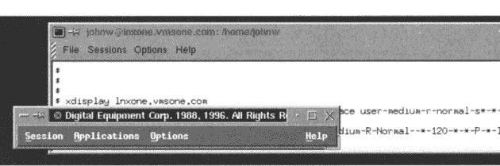

图 5-7 那么这有什么用呢？让我们看看菜单。

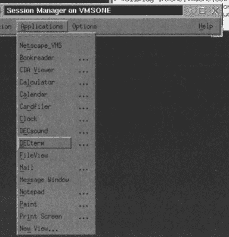

图 5-8 现在，你可以创建需要的所有 VMS 终端，检查正在进行的 X Windows 任务状态，或者更改你的 X Windows 安全或启动选项——这一切只需点击鼠标，且完全可以在你的 Linux 设备的显示上完成！

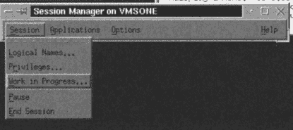

图 5-9

Linux & OpenVMS 互操作性

图 5-10 但如果你想从此菜单中启动自己的命令或 X Windows 应用程序怎么办？使用“Menu Control”窗口中 Options 下拉菜单上的 Menus 按钮。

图 5-11 创建你的新命令/菜单选项（VMS 命令文件或可执行文件），并将其添加到相应的下拉菜单。

第 5 章 – X Windows 应用程序：X Windows 与 VMS 和 Linux 的互操作性 65

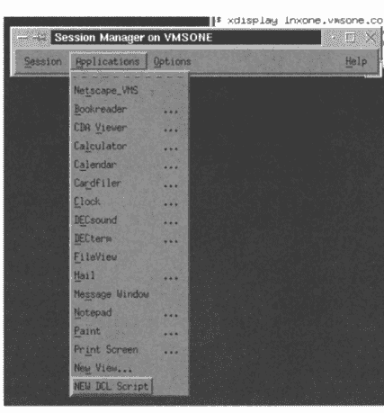

图 5-12 然后只需点击你的下拉菜单即可！

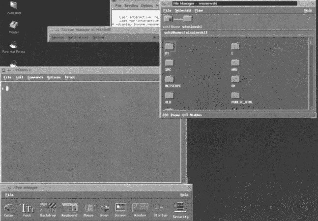

图 5-13 嘿！这些 VMS 应用程序和菜单是从哪里来的！我以为这是一台 Linux 机器！

66 Linux & OpenVMS 互操作性

注意，所有这些应用程序都同时来自 VMS CDE/DTSESSION 管理程序，此时 `DECW$SESSION` 管理程序和 Linux KDE 会话管理器也在运行！请小心，因为现在任何会话管理器都可以让你注销。

## 在 OpenVMS 上显示你的 Linux Windows 应用程序

在 20 世纪 80 年代，当 VMS 工作站还是尖端技术时，你的桌子上可能有一台 VMS 工作站。Alpha 工作站同样可能使用 Linux 或 True-64。OpenVMS PC 同样可能运行 Windows，而今天的 Linux 或 Windows 显卡可能比三年前 Alpha 工作站的显卡好得多。X Windows 的妙处在于，你不再限于自己的电脑或旧显卡；你可以限制显示器来享受应用程序！

但假设你足够幸运，你的桌子上有一台运行最先进的 VMS 工作站（而不是房间里的 GS320 集群），而你的 Linux 机器显卡有点老化了。你可以简单地将你的 Linux 应用程序重定向到新的 OpenVMS 显示器。过程与 VMS 类似，只是命令必须重定向到 VMS 工作站。首先，你必须授权 VMS 使用 TCP/IP 作为 X Windows 的传输（进入 VMS），因为默认是不开启的。你或你的 VMS 管理器应该添加此行：

```
SYS$MANAGER:DECW$SERVER.COM
```

如果你不方便修改此文件，可以将定义放在 `SYS$MANAGER:STARTUP_VMS.COM` 中。我把它放在 `DECW$SERVER.COM`，因为 TCP/IP 应该是默认开启的（带安全）！

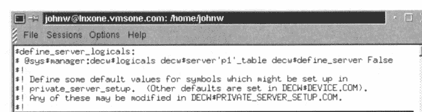

图 5-14 不要以此方式修改此文件，否则可能会可能会不稳定。

现在让 VMS 工作站上使用 VMS 会话管理器（见图 5-15）。

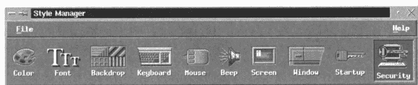

图 5-15 点击 Security 按钮，你将进入授权框。

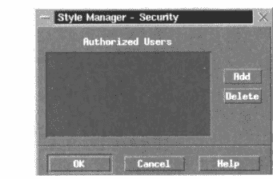

图 5-16 点击 Add，你就可以填写 Linux/UNIX 信息。对于 TCP/IP 传输，用户名始终使用 `"*"`，否则无法工作（图 5-17 至 5-19）！

68 Linux & OpenVMS 互操作性

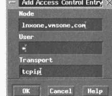

图 5-17 你现在准备好 `telnet` 到你的 Linux 系统并发送 X Windows 应用程序了。

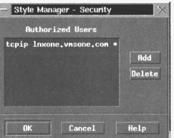

图 5-18

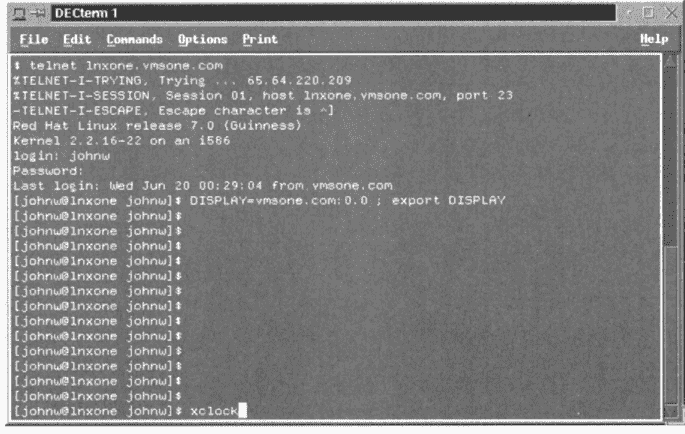


```
# telnet lxone.vmsone.com 85.64.220.209
# TELNET-IAC-CONNECT, Trying ... 
# Session 1, host lxone.vmsone.com, port 23
# TELNET-IAC-ESCAPE. Escape character is '^'
# Red Hat Linux release 7.0 (Guinness)
# Kernel 2.4.24-s22.el on i686
login: johnny
Password: 
# Last login: Wed Jun 20 00:29:04 from vmsone.com
[johnny@lxone ~]$ export DISPLAY=:0.0
[johnny@lxone ~]$
[johnny@lxone ~]$
[johnny@lxone ~]$
[johnny@lxone ~]$
[johnny@lxone ~]$
[johnny@lxone ~]$
[johnny@lxone ~]$
[johnny@lxone ~]$
[johnny@lxone ~]$
[johnny@lxone ~]$
[johnny@lxone ~]$ xclock
```

图 5-19 恭喜，你的 VMS 显示器上有一个 X 时钟了！你可能还想从 Linux 使用 `xterm` 或 `xterm&`（后台）或任何其他 X 应用程序！

第 5 章 – X Windows 应用程序：X Windows 与 VMS 和 Linux 的互操作性 69

对于使用 `bash` shell 的用户，你可能需要稍微更改你的 UNIX/Linux 方言：

- `csh`:
`# setenv DISPLAY vmsone.com:0.0`

- `sh` 和 `ksh`:
`DISPLAY=vmsone.com:0.0 ; export DISPLAY`

# 总结

即使在引入 15 年后，X Windows 仍然工作站和高端服务器不断扩展的一部分。标准支持以及在多个操作系统之间运行的工具简化并减少了显示图形和运行应用程序的复杂性。这为我们每个人面对每个的任务提供了选择：是使用点击式的 GUI 应用程序，还是命令驱动的 CLI。图形让工作直观且易于视觉化；命令行则适用于脚本和自动化。

如今，随着免费电子邮件账户的出现，对于拥有电脑的人来说，拨号接入费用每月低于 10 美元，大多数人认为这种类型的电子邮件已经过时且原始。虽然 UUCP 邮件的用处已经消减，但有趣的是，该协议在业余无线电（数据包/系统到系统）邮件以及全球其他仍然难以获取互联网拨号（POTS——普通电话服务）的地方仍在使用。

## 从网络时代的黎明至今

在《维多利亚时代的互联网》中，汤姆·斯坦丹奇（Tom Standage）描述了十九世纪的世界如何通过一项技术奇迹——电报得以缩小并传递。汤姆的书引用了塞缪尔·摩斯（Samuel Morse）1872年的诗：“科学从这一岸到另一岸宣告，时间和空间不再受支配。”

在过去的 150 年里，电报、电话和卫星缩短了人们交流的距离，而近年来的互联网和电子邮件又将这些工具进一步缩小了十倍——仅仅通过压缩技术和近乎普及的访问。如果一封邮件就能解决问题，为什么还要打电话呢？如果一个 URL 就能指向 Web 的共同现实，为什么还要进行对话呢？

这对生产力非常有好处，但那些让我们通过学徒制不断学习和加深理解的人与人的互动又是怎样的？电子通信将如何影响我们的学习方式，目前尚无定论。我们这一代人拥有家庭办公室、数字手机、远程办公、万维网和电缆，因此我们可能最依恋同类，或者生活在自己的盒子里——只够出门付电费，买点维生素以维持运转。无论好坏，简洁和高效是电子邮件带给我们的特质。

当然，如果你仍然想在网上进行对话，现在可以使用各种即时通讯工具，就像十九世纪的电报员一样，他们发现自己花了大量时间与其他运营商聊天、闲谈八卦（但对于今天的人来说，这听起来比例很低）。尽管技术发生了巨大的变化，但人们在过去的 150 年里变化很小。许多人仍然必须放下手头的工作，聚集在办公室的茶水旁，聊聊当天的事件。

## 电子邮件程序的兴起兴灭

1987 年当数字公司（Digital）加入时，它的电子邮件在全球范围内大约有八百万用户。它具有全文本文字处理和共享日历功能（用于会议室等资源），这让人们的时间更容易安排，并能跟踪附件、邮件列表以及各种邮件系统网关的交换情况。它运行在 OpenVMS 集群上，客户端/服务器连接现在仍然存在。尽管拥有如此强大的技术实力，数字公司在 1996 年仍选择了一个新的邮件系统——一种可以发送文字处理文档、图片和其他二进制文件的邮件系统。

新的电子邮件系统增加了可以在 Windows 操作系统上运行的优势，而在 1996 年，大家都知道这是在通过千年虫（Y2K）后唯一生存下来的平台。Microsoft Exchange 比免费的基于标准的电子邮件要贵得多，但话又回来，微软的营销做得好得多。剩下的就是历史了！

## 开放标准互联网邮件

开放电子邮件标准都围绕着 TCP/IP 标准和控制它们的 RFC（意见请求）过程展开。需要注意的是，当前的电子邮件协议正在演进，并随着改进不断添加新功能。终端用户不会担心这些标准，但那些为 VMS 或 Linux 等操作系统进行实现工作的人会担心。用户需要知道的是，他们从自己的平台上可以使用哪些基于标准的电子邮件客户端，以及可以建立什么样的邮件服务器来存储/检索网络中 OpenVMS 和 Linux 服务器上的邮件。

互联网客户端电子邮件应用程序基本上都在做相同的事情，但某些程序比其他的具有更多。在客户端电子邮件系统中，你应该寻找哪些功能？单元格或图形电子邮件应用程序应该是首选。像 `PINE` 这样的程序是基于字符单元的，但可以发送附件和二进制文件，并可以在 OpenVMS 和 Linux 上作为客户端运行。其他程序，如 `Mozilla`（源自 Netscape），也运行在 OpenVMS 和 Linux 上，但需要 X Windows 图形显示器才能工作。所见即所得（WYSIWYG）邮件窗口允许你从网络中的任何地方通过 `telnet` 阅读你的邮件——至少是文本部分！

今天在配置电子邮件服务器时，需要检查的重要标准包括：

- `POP3`—后邮局协议 V3：如果你的邮件服务器支持此协议，你的远程邮件客户端可以配置为从服务器下载你所有的邮件/消息并下载到你的客户端系统。一旦消息已下载到客户端，`POP3` 会删除邮件/消息服务器上的内容。

- `IMAP`—互联网消息协议：`IMAP` 将消息存储在电子邮件服务器上，供许多不同位置的多个客户端使用！可以使用其他用户的系统作为电子邮件客户端，并从电子邮件/消息服务器上移动或删除未读消息！这意味着你可以从你有权的任何系统读取邮件，并且当你注销时，消息将安全地保留在服务器上。

你何时使用每种协议？有些用户希望服务器将消息传递给并从服务器上删除——那么 `POP3` 是答案。其他用户喜欢使用客户端应用程序，并倾向于将消息存储在电子邮件服务器上以便存档和后期检索及查看——`IMAP` 最适合他们。我能对使用这些电子邮件协议提供的唯一警告是：对于你创建的每个电子邮件账户，在服务器上的每个邮件账户只使用 `POP3` 或 `IMAP` 作为访问方法。如果你同时使用 `POP3` 和 `IMAP` 访问同一个账户，你的客户端可能会有点困惑（如果你没有在客户端上创建电子邮件配置文件的话）！（多次登录不是获取卓越邮件体验的最佳方式。）

好消息是，OpenVMS 和 Linux 都能让电子邮件客户端通过 `POP3` 或 `IMAP` 访问其标准用户账户中的消息。你们只需要在系统上激活电子邮件服务，用户账户就会集成到电子邮件中。然后可以使用远程电子邮件客户端通过 OpenVMS 和 Linux 上的 `POP3` 或 `IMAP` 访问这些账户。

## OpenVMS 电子邮件服务器配置

让我们将 OpenVMS 设置为电子邮件服务器（参见图 6-1 至 6-36）。我们将假设像第 3 章讨论的那样 TCP/IP 已经设置好。

### Compaq TCP/IP 服务 OpenVMS 配置菜单

配置选项：

- 1 核心环境
- 2 客户端组件
- 3 服务器组件
- 4 可选组件
- 5 关闭 Compaq TCP/IP 服务
- 6 启动 TCP/IP 服务
- 7 运行测试

### Compaq TCP/IP 服务 OpenVMS 客户端组件配置菜单

配置选项：

- 1 `FTP` 已启用
- 2 `NFS` 客户端禁用
- 3 `REXEC` 和 `RSH`禁用
- 4 `RLOGIN` 已启用
- 5 `SMTP` 已禁用
- 6 `TELNET` 已启用
- 7 `DHCP` 已禁用
- 8 Telnetsym 已禁用

## SMTP 配置

服务定义在 `SYSMAF` 中。

服务定义在 `TCPIP$SERVICE` 数据库中。

配置定义在 `TCPIP$CONFIGURATION` 数据库中。

服务未启用。

服务已停止。

SMTP 配置选项：

- 在此节点上启用服务
- 在此节点上启用并启动服务
- 退出 SMTP 配置

输入配置选项: 2

正在创建模板 `$SYSCONFIG:TCPIP$SMTP|SMTP_CONFIG.TEMPLATE`


$TCIP-INFO, amge $SYSSYSTEM:`TCPIP$SMTP_RECEIVER.EXE` 已安装

$TCIP-INFO, 逻辑名称已创建

$TCIP-INFO, 服务队列已启动

$TCIP-INFO, 服务已启用

$TCIP-S-STARTDONE, `TCPIP$SMTP` 启动完成

按回键继续...


## OpenVMS 组件 Compaq TCP/IP 服务配置菜单

配置选项：

| 1 | FTP | 已启用 启动 |
| 2 | NFS Client | 已禁用 停止 |
| 3 | EXEC and RSH | 已禁用 停止 |
| 4 | LOGIN | 已启用 启动 |
| 5 | SMTP | 已启用 启动 |
| 6 | TELNET | 已启用 启动 |
| 7 | DMCP | 已禁用 停止 |
| 8 | Telnetsys | 已禁用 停止 |

A - 配置选项 1 - 8

[E] - 退出菜单

输入配置选项: `e`


## OpenVMS Compaq TCP/IP 服务配置菜单

配置选项：

- 核心环境
- 客户端组件
- 服务器组件
- 可选组件
- 关闭 OpenVMS Compaq TCP/IP 服务
- 启动 OpenVMS Compaq TCP/IP 服务
- 运行测试
- 配置选项 1 - 4
- 退出配置程序

输入配置选项: `3`

6-7 选择 服务器组件 菜单选项。

## OpenVMS Compaq TCP/IP 服务服务器组件配置菜单

配置选项：

1 - BIND 已禁用 停止
2 - BOOT 已禁用 停止
3 - DHCP 已禁用 停止
4 - FINGER 已禁用 停止
5 - FTP 已启用 启动
6 - IMAP 已禁用 停止
7 - LBRKER 已禁用 停止
8 - L/PD 已启用 启动
9 - METRIC 已禁用 停止
10 - NFS 已禁用 停止
11 - LOCKD/STAT 已禁用 停止
12 - MTP 已禁用 停止
13 - PC-HFS 已禁用 停止
14 - POP 已禁用 停止
15 - POPMAPPER 已启用 启动
16 - LOGIN 已启用 启动
17 - RMT 已禁用 停止
18 - SNMP 已禁用 停止
19 - TELNET 已启用 启动
20 - TFTP 已禁用 停止
21 - XDM 已禁用 停止

- 配置选项 1 - 21
- 退出菜单

输入配置选项: `6`

6-8 选择要配置 IMAP 协议。

### IMAP 配置

服务定义在 `SYSUAF` 中。

服务定义在 `TCPIP$SERVICE` 数据库中。

服务未启用。

服务已停止。

IMAP 配置选项：

- 在所有节点上启用服务
- 在此节点上启用服务
- 在此节点上启用并启动服务

> [E] 退出 IMAP 配置

输入配置选项: `3`

图 6-9 选择 3 以激活并启动此 OpenVMS 系统的 IMAP 服务。

### IMAP 配置

服务定义在 `SYSUAF` 中。

服务定义在 `TCPIP$SERVICE` 数据库中。

服务未启用。

服务已停止。

IMAP 配置选项：

- 在所有节点上启用服务
- 在此节点上启用服务
- 在此节点上启用并启动服务

> [E] 退出 IMAP 配置

输入配置选项: `3`

```
输入配置选项: 3
%TCPIP-I-INFO, image SYS$SYSTEM:TCPIP$IMAP_SERVER.EXE 已安装
%TCPIP-I-INFO, 服务已启用
%TCPIP-S-STARTUP, TCPIP$IMAP 启动完成
按回键继续 ...
```

图 6-10 退出并返回 TCP/IP 主菜单。

## OpenVMS Compaq TCP/IP 服务服务器组件配置菜单

配置选项：

| 1 - BIND | 已禁用 停止 | 12 - HTTP | 已禁用 停止 |
| 2 - BOOTP | 已禁用 停止 | 13 - PC-NFS | 已禁用 停止 |
| 3 - DHCP | 已禁用 停止 | 14 - POP | 已禁用 停止 |
| 4 - FINGER | 已禁用 停止 | 15 - PORTMAPPER | 已禁用 停止 |
| 5 - FTP | 已启用 启动 | 16 - RLOGIN | 已启用 启动 |
| 6 - IMAP | 已启用 启动 | 17 - RMQ | 已禁用 停止 |
| 7 - LOKER | 已禁用 停止 | 18 - SNMP | 已禁用 停止 |
| 8 - LPF/LFD | 已禁用 停止 | 19 - TELNET | 已启用 启动 |
| 9 - METRIC | 已禁用 停止 | 20 - TFTP | 已禁用 停止 |
| 10 - NFS | 已禁用 停止 | 21 - XDM | 已禁用 停止 |
| 11 - LOCKD/STAT | 已禁用 停止 | | |

A - 配置选项 1 - 21

[E] 退出菜单

输入配置选项:

图 6-11 注意 IMAP 服务现在已在该系统上启用并启动。

## OpenVMS Compaq TCP/IP 服务服务器组件配置菜单

配置选项：

| 1 - BIND | 已禁用 停止 | 12 - HTTP | 已禁用 停止 |
| 2 - BOOTP | 已禁用 停止 | 13 - PC-NFS | 已禁用 停止 |
| 3 - DHCP | 已禁用 停止 | 14 - POP | 已禁用 停止 |
| 4 - FINGER | 已禁用 停止 | 15 - PORTMAPPER | 已禁用 停止 |
| 5 - FTP | 已启用 启动 | 16 - RLOGIN | 已启用 启动 |
| 6 - IMAP | 已启用 启动 | 17 - RMQ | 已禁用 停止 |
| 7 - LOKER | 已禁用 停止 | 18 - SNMP | 已禁用 停止 |
| 8 - LPF/LFD | 已禁用 停止 | 19 - TELNET | 已启用 启动 |
| 9 - METRIC | 已禁用 停止 | 20 - TFTP | 已禁用 停止 |
| 10 - NFS | 已禁用 停止 | 21 - XDM | 已禁用 停止 |
| 11 - LOCKD/STAT | 已禁用 停止 | | |

A - 配置选项 1 - 21

[E] 退出菜单

输入配置选项: `14`

图 6-12 选择 POP 协议。OpenVMS 兼容性

### POP 配置

服务定义在 `SYSUAF` 中。

服务定义在 `TCPIP$SERVICE` 数据库中。

服务 启用。

POP 配置选项：

- 在所有节点上启用服务
- 在此节点上启用服务
- 在此节点上启用并启动服务

[E] 退出配置

输入配置选项: `3`


### POP 配置

服务定义在 `SYSUAF` 中。

服务定义在 `TCPIP$SERVICE` 数据库中。

服务未启用。

服务已停止。

POP 配置选项：

- 在所有节点上启用服务
- 在此节点上启用服务
- 在此节点上启用并启动服务

[E] 退出配置

```
输入配置选项: 3
%TCPIP-I-INFO, image SYS$SYSTEM:TCPIP$POP.EXE 已安装
%TCPIP-I-INFO, 服务已启用
%TCPIP-S-STARTUP, TCPIP$POP 启动完成
按回键继续...
```


## OpenVMS Compaq TCP/IP 服务服务器组件菜单

配置选项：

| 1 - BIND | 已禁用 停止 | 12 - NTP | 已禁用 停止 |
| 2 - BOOTP | 已禁用 停止 | 13 - PC-NFS | 已禁用 停止 |
| 3 - DHCP | 已禁用 停止 | 14 - POP | 已启用 启动 |
| 4 - FINGER | 已禁用 停止 | 15 - PORTMAPPER | 已禁用 停止 |
| 5 - FTP | 已启用 启动 | 16 - RLOGIN | 已启用 启动 |
| 6 - IMAP | 已启用 启动 | 17 - RMT | 已禁用 停止 |
| 7 - LBROKER | 已禁用 停止 | 18 - SNMP | 已禁用 停止 |
| 8 - LPR/LPD | 已禁用 停止 | 19 - TELNET | 已启用 启动 |
| 9 - METRIC | 已禁用 停止 | 20 - TFTP | 已禁用 停止 |
| 10 - NFS | 已禁用 停止 | 21 - XDM | 已禁用 停止 |
| 11 - LOCK/STATD | 已禁用 停止 | | |

A - 配置选项 1 - 21


[E] 退出菜单

输入配置选项:


## OpenVMS Compaq TCP/IP 服务服务器组件配置菜单

配置选项：

| 1 - BIND | 已禁用 停止 | 12 - NTP | 已禁用 停止 |
| 2 - BOOTP | 已禁用 停止 | 13 - PC-NFS | 已禁用 停止 |
| 3 - DHCP | 已禁用 停止 | 14 - POP | 已启用 启动 |
| 4 - FINGER | 已禁用 停止 | 15 - PORTMAPPER | 已禁用 停止 |
| 5 - FTP | 已启用 启动 | 16 - RLOGIN | 已启用 启动 |
| 6 - IMAP | 已启用 启动 | 17 - RMT | 已禁用 停止 |
| 7 - LBROKER | 已禁用 停止 | 18 - SNMP | 已禁用 停止 |
| 8 - LPR/LPD | 已禁用 停止 | 19 - TELNET | 已启用 启动 |
| 9 - METRIC | 已禁用 停止 | 20 - TFTP | 已禁用 停止 |
| 10 - NFS | 已禁用 停止 | 21 - XDM | 已禁用 停止 |
| 11 - LOCK/STATD | 已禁用 停止 |  |

A - 配置选项 1 - 21

[E] 退出菜单

输入配置选项:


## OpenVMS 的 Compaq TCP/IP 服务配置菜单

配置选项：

+   1 - 核心环境
2 - 客户端组件
3 - 服务器组件
4 - 可选组件
+   5 - 关闭 OpenVMS 的 Compaq TCP/IP 服务
6 - 启动 OpenVMS 的 Compaq TCP/IP 服务
7 - 测试
+   A - 配置选项 1 - 4

[E] - 退出配置程序

输入配置选项：e

图 6-17 退出 TCP/IP 配置菜单并返回 $ DCL 提示符

## OpenVMS 的 Compaq TCP/IP 服务配置菜单

配置选项：

+   1 - 核心环境
2 - 客户端组件
3 - 服务器组件
4 - 可选组件
+   5 - 关闭 OpenVMS 的 Compaq TCP/IP 服务
6 - 启动 OpenVMS 的 Compaq TCP/IP 服务
7 - 测试
+   A - 配置选项 1 - 4

[E] - 退出配置程序

```
Enter configuration option: e
$ tcpip
$ TCPIP> show config smtp
```

图 6-18 调用 TCP/IP 管理实用并显示 SMTP 配置。

### SMTP 配置

| 初始间隔: | 0 00:30:00.00 | 地址最大值: | 16 | 选项 |
| --- | --- | --- | --- | --- |
| 重试间隔: | 0 01:00:00.00 | 跳数数最大值: | 16 | E_BIT |
| 最大间隔: | 0 00:30:00.00 | | | RELAY TOP_HEADERS |
| 超时 | 初始 | 邮件 | 接收 | 数据 | 终止 |
| --- | --- | --- | --- | --- | --- |
| 发送: | 5 | 5 | 5 | 3 | 10 |
| 接收: | 5 | | | | |

备用网关：未定义

通用网关：未定义

替换域名：HIDDEN, vmsone.com

区域：未定义

管理员：WISHNIEMKI

日志文件：SYSSPEC:(TCPIP$SMTP)TCPIP$SMTP_LOGFILE.LOG

通用队列 队列 参与节点

```
TCPIP$SMTP_VMSONE__00 1 VMSONE
TCPIP>
```

图 6-19 注意到 SMTP 选项设置为 8 位（允许 ASCII），relay 允许 POP 和 IMAP 客户端通过 OpenVMS 服务器发送邮件，而 top headers 则在邮件消息顶部显示电子邮件标头。

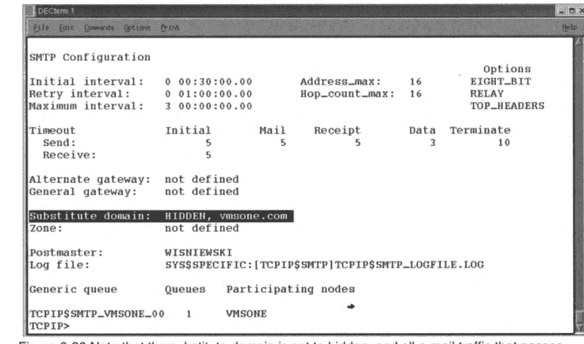

### SMTP 配置

| 初始间隔: | 0 00:30:00.00 | 地址最大值: | 16 | 选项 |
| --- | --- | --- | --- | --- |
| 重试间隔: | 0 01:00:00.00 | 跳数数最大值: | 16 | E_BIT |
| 最大间隔: | 0 00:30:00.00 | | | RELAY TOP_HEADERS |
| 超时 | 初始 | 邮件 | 接收 | 数据 | 终止 |
| --- | --- | --- | --- | --- | --- |
| 发送: | 5 | 5 | 5 | 3 | 10 |
| 接收: | 5 | | | | |

备用网关：未定义

通用网关：未定义

替换域名：HIDDEN, vmsone.com

区域：未定义

管理员：WISHNIEMKI

日志文件：SYSSPEC:(TCPIP$SMTP)TCPIP$SMTP_LOGFILE.LOG

通用队列 队列 参与节点

```
TCPIP$SMTP_VMSONE__00 1 VMSONE
TCPIP>
```

图 6-20 注意到替换域名设置为隐藏，所有通过此服务的电子邮件流量都将收到 VMSONE.com 的回信邮件地址。

84 Linux 与 OpenVMS 互操作性

### SMTP 配置

| 初始间隔: | 地址最大值: | 选项 |
| --- | --- | --- |
| 00:00:30.00 | 16 | RIGHT_BIT |
| 重试间隔: | 00:01:00.00 | 跳数数最大值: 16 | RELAY |
| 最大间隔: | 00:00:30.00 | | TOP_READERS |
| 超时 | 初始 | 邮件 | 接收 | 数据 | 终止 |
| --- | --- | --- | --- | --- | --- |
| 发送: | 5 | 5 | 5 | 3 | 10 |
| 接收: | | | | | |

备用网关：未定义

通用网关：未定义

替换域名：HIDDEN, vmsone.com

区域：未定义

| 管理员: | WISHNIEWSKI |
| 日志文件: | SYSSPECIFIC:$[TCIP$SMTP]TCIP$SMTP_LOG.FILE |
| 通用查询 | 队列 | 参与节点 |
| --- | --- | --- |
| TCIP$SMTP_VMSONE_00 | 1 | VMSONE |
| TCIP> | | |

> 图 6-21 管理员已被设置为本地 OpenVMS 服务器，也可以很容易地设置为 Internet 电子邮件地址（例如：wisniewski@VMSONE.com）。该系统的管理员可以发送到远程系统。

### SMTP 配置

| 初始间隔: | 地址最大值: | 选项 |
| --- | --- | --- |
| 00:00:30.00 | 16 | RIGHT_BIT |
| 重试间隔: | 00:01:00.00 | 跳数数最大值: 16 | RELAY |
| 最大间隔: | 00:00:30.00 | | TOP_READERS |
| 超时 | 初始 | 邮件 | 接收 | 数据 | 终止 |
| --- | --- | --- | --- | --- | --- |
| 发送: | 5 | 5 | 5 | 3 | 10 |
| 接收: | | | | | |

备用网关：未定义

通用网关：未定义

替换域名：HIDDEN, vmsone.com

区域：未定义

| 管理员: | WISHNIEWSKI |
| 日志文件: | SYSSPECIFIC:$[TCIP$SMTP]TCIP$SMTP_LOG.FILE |
| 通用查询 | 队列 | 参与节点 |
| --- | --- | --- |
| TCIP$SMTP_VMSONE_00 | 1 |
| TCIP> | | |

> 图 6-22 输入 help 获取设置 SMTP 配置（或任何 TCP/IP 功能）的语法。

```
TCPIP> help set config/

SET CONFIGURATION:SMTP
对不起，没有关于 SET 的文档

可用信息：
- /ADDRESS
- /GATEWAY
- /HOP_COUNT_MAX
- /INTERVAL
- /OPTIONS
- /QUEUES
- /RECEIVE_TIMEOUT
- /SEND_TIMEOUT
- /SUBSTITUTE_DOMAIN
- /ZONE
示例：
```

TCPIP>

TCPIP>

TCPIP>


图 6-23 注意到命令使用了经典 OpenVMS 风格的 "/" 限定符。

img/3ba916f144e94350147c366c3485e02e_86_0.png)

# SMTP 配置

| 初始间隔: | 0 00:30:00.00 | 地址最大值: | 16 | 选项 |
| --- | --- | --- | --- | --- |
| 重试间隔: | 0 01:00:00.00 | 跳数数最大值: | 16 | RELAY |
| 最大间隔: | 0 00:30:00.00 | | | TOP_HEADERS |

| 超时 | 初始 | 邮件 | 接收 | 数据 | 终止 |
| --- | --- | --- | --- | --- | --- |
| 发送: | 5 | 5 | 5 | 3 | 10 |
| 接收: | 5 | | | | |

备用网关：未定义
通用网关：未定义

替换域名：HIDDEN, vmsphere.com
区域：未定义

管理员：WISHNIEWSKI
日志文件：SYSSPECIFIC:[TCPIP$SMTP]TCPIP$SMTP_LOGFILE.LOG

通用队列 队列 参与节点

```
TCPIP$SMTP_VMSONE_00 1 VMSONE

TCPIP>
```

图 6-24 当 SMTP 选项设置为 relay（而不是 RELAY）时，OpenVMS 需要开启反垃圾邮件功能。通过你的系统管理其他用户的垃圾邮件，无需为你的 OpenVMS 服务器配置垃圾邮件过滤器。

img/3ba916f144e94350147c366c3485e02e_86_1.png)

# SMTP 配置

| 超时 | 初始 | 邮件 | 接收 | 数据 | 终止 |
| --- | --- | --- | --- | --- | --- |
| 发送: | 5 | 5 | 5 | 3 | 10 |
| 接收: | | | | |

备用网关：未定义
通用网关：未定义

替换域名：HIDDEN, vmsone.com
区域：未定义

管理员：WISHNIEWSKI
日志文件：SYSSPECIFIC:[TCPIP$SMTP]TCPIP$SMTP_LOGFILE.LOG

通用队列 队列 参与节点

```
TCPIP$SMTP_VMSONE_00 1 VMSONE

TCPIP> exit

$
$
$
```

```
$ set def$sysroot:[TCIP$smtp]
```

图 6-25 要编辑/激活 OpenVMS 的反垃圾邮件功能，你必须先将目录设置为 SMTP 处理目录。

```
$
$
$
```

```
$ set def$sysroot:[TCIP$smtp]

$ dir
```

```
Directory SYS$ROOT:

LOGIN.COM; MAIL$2F25BE00050A1.MAIL;1

MAIL$4A6FA8D00050A1.MAIL;1 MAIL$4A7A519200050A1.MAIL;1

MAIL;1; OK.2;

SMTP.CONFIG;2 SMTP.CONFIG;4 SMTP.CONFIG;3 SMTP.CONFIG_TEMPLATE;1 TCIP$SMTP_LOGFILE.LOG;12 TCPIP$SMTP_LOGFILE.LOG;10

TCPIP$SMTP_RECV_RUN.LOG;2072

TCPIP$SMTP_RECV_RUN.LOG;2070

TCPIP$SMTP_RECV_RUN_LOG;2069

TCPIP$SMTP_RECV_RUN_LOG;2068
```

共 23 个文件。
$

图 6-26 这里是 SMTP 邮件被接收和处理的地方。注意接收日志文件。这里是所有 SMTP 邮件进入本地或处理的地方。

第 6 章 – 在 OpenVMS 和 Linux 使用电子邮件 87

```
DECmd:1

File Edit Commands Options Print

$
$
$
$
$
$
$ dir
Directory SYS$SYSROOT:[TCIP$SMTP]

LOGIN.COM;1 MAIL$M2FF1FBE00050A1.MAIL;1

MAIL$4A6FRA8ED00050A1.MAIL;1 MAIL$4A7A7519200050A1.MAIL;1

MAIL.MAI;1

OK.COM;2

SMTP.CONFIG;6

SMTP_CONFIG_TEMPLATE;4

TCIP$SMTP_LOGFILE.LOG;12

TCPIP$SMTP_LOGFILE.LOG;10

共 10 个文件。

$
$
$
$
$
$
$ copy SMTP_CONFIG.TEMPLATE smtp.config
```

图 6-27 首先将配置模板复制到 SMTP:CONFIG，并开始创建反垃圾邮件规则文件。

# TCPIP-Version: V5.1

这是一个 SMTP.CONFIG 文件的模板。SMTP.CONFIG 文件包含了 SMTP 可配置的字段。如果你没有定义 TCPIP$$$COMMON 逻辑名称，则真实的 SMTP.CONFIG 文件必须位于 TCPIP$$$COMMON 目录（SYSSYSPECIFIC:[TCPIP$$SMTP]）。此时，SMTP.CONFIG 中支持的唯一配置字段用于控制服务器功能的行为。在未来的 TCPIP 版本中，此文件中的新字段将通过 SMTP/SHOW CONFIGURATION 命令替换 TCPIP$$CONFIGURATION 中当前存储的所有配置以及 SMTP 本地设置。

- 如果文件存在，请勿修改，出于文档目的，它将在 TCPIP 工具包中定期更新。
- 下列出了每个支持字段的名称。每个名称前都有两个感叹号。如果你想创建一个不包含此文件中注释的初始 SMTP.CONFIG：

```
do a

$ SEARCH/OUT/TCPIP$$$SMTP_COMMON:SMTP$.CONFIG -
$ TCPIP$$$COMMON_COMMON:SMTP$.CONFIG.TEMPLATE
```

图 29 标准模板包含信息、建议和示例配置命令，但在你编辑这些命令并移除配置指令前的 !!! 标记之前，没有任何一个是激活的。

# TCPIP-Version: V5.1

| sys$sysroot:[tcpip$smtp] smtp.config |
| !!! 反垃圾邮件规则 |
| 好客户端: 65.642.210, 65.642.209, 65.642.212, 65.642.211, 65.0 |
| !!!坏客户端: 1.2.3.5, 11.1.0.0/8 |
| 中继区域: vmsone.com, digital.com, compaq.com, hp.com, montagar.com, swell.net, ebay.com, arri.org, dfwug.org, delllegpro.com, ticnet.com |
| !!!RBL: rbl.maps.vix.com, dul.maps.vix.com, relays.orbs.org, mr-out.imrs.org |

图 6-30 这是我用于 VMSONE 的工作文件，用于限制各种电子邮件系统使用或不使用我的机器（作为电子邮件中继点）。

第 6 章 – 在 OpenVMS 和 Linux 上使用电子邮件 89

# DECM1

```
!!Reject-Mail-From: *.xyz.com, known.spammer@, *the_internet*

!

Accept-Mail-From: *@notabadguy.xyz.com, the_internet_news@somewhere.com

!

!!SPAM-Action: OPCOM, ACCOUNTING

SPAM-Action: OPCOM, ACCOUNTING

!!Security: secure

Security: secure

!!

Unbacktranslatable-IP-Text: 你的 IP 地址无法回溯。垃圾邮件发送者！

Rad-Clients-Text: 你这个肮脏的垃圾邮件者。

!!Client-IP-Text: 我在 RBL 中发现了你。垃圾邮件之息！

!!Reject-Mail-From: 你以前没有给我发过垃圾邮件吗？

MAIL FROM 谁？你一定是在开玩笑吧。

!!Unqualified-Sender-Text: MAIL FROM 哪里？（未限定的发送者）

!!Unresolvable-Domain-Text: MAIL FROM 哪里？行吧。（无法解析的域名）

SPAM-Relay-Text: 尝试从我的站点启动你的垃圾邮件将一无所获。

EOB]
```

跳过缓冲区底部
图 6-31 这是你的 smtp ANTI-SPAM 文件的剩余部分；你可能需要修改此文件以适应你的电子邮件网络，否则可能会被用作中继启动点或电子邮件垃圾邮件的目标。

# DECM1

```
$$
$
$
$
$
$
$
$
$
$
$
$
$
```


$\$

$ set def sys$manager:

$ dir startup.vms.com

Directory SYSCOMMON:[SYSMGR]

SY$S_ARTUP_VMS.COM:16

Total of 1 file

$ edit startup.vms.com

```
图 6-32 电子邮件-配置的最后部分必须放在 OpenVMS 系统启动文件中，它需要在 SMTP 启动之前执行。
```

# CCtestk1

| 文件 编辑 命令 选项 打印 | 帮助 |
|---|---|---|---|---|
| set cost noon | | | | |
| `$MOUNT/CLUSTER VMSONE$DKB100: datadkb100` |
| `$MOUNT/CLUSTER VMSONE$DKB200: datadkb200` |

```
$ set cost noon

$

$MOUNT/CLUSTER VMSONE$DKB100: datadkb100

$MOUNT/CLUSTER VMSONE$DKB200: datadkb200

$

$SYS$MANAGER:STARTUP_VMS.COM

$

$! 这是站点特定启动命令过程的模板。

$! 从 OpenVMS V7.2 开始，此模板适用于 OpenVMS Alpha 和 VAX。

$! 对模板的任何更改将同时应用于这两个系统。

$

$! 注意：在 OpenVMS VAX 系统上，此文件替换了站点特定的启动程序 SYS$MANAGER:STARTUP_VMS.COM。仅更改了名称；内容相同。

$! 详详细信息请参阅文档。
```

图 6-33 当你编辑启动文件时，必须找到插入这些配置更改的正确位置。

# CCchem

| 文件 编辑 命令 选项 打印 | 帮助 |

|---|---|---|---|

| | | | | |

```
$$
$ 在启动 TCP/IP 时为正确处理 MIME 设置逻辑名称
$DEFINE/SYSTEM/EXEC TCIP$SHTP_LOCAL 1
$DEFINE/SYSTEM/EXEC TCIP$IGNORE_MAIL_HEADERS 1 $SYS$STARTUP:TCIP
$! 移除以下行的注释分隔符以为 OpenVMS 启动 Kerberos
$! IF FSEARCH("SYS$STARTUP:KRBSTARTUP.COM") THEN
$! 编辑并移除以下行的注释分隔符以启动 Pathway。 FILE = FSEARCH([SYS$DISK:NETWORK.PATH.DIST.INET.COM") THEN
```

图 6-34 需要由 SYS$EXECUTE 级别定义的逻辑名称。这些逻辑名称随后也会被全系统范围所有 OpenVMS 进程读取（类似于 Linux 中的全局变量）。定义后，这些逻辑名称告诉 SMTP 进程正确处理 MIME 扩展、电子邮件头部和附件。注意，这些逻辑名称必须在 TCP/IP 启动之前定义！

第 6 章 — 在 OpenVMS 和 Linux 上使用电子邮件

# DECM1

```
$

$

$

$

$

$

$

$

$

$

$

$ dir sys$startup:tcpip$smtp*.

Directory SYSCOMMON:[SYSMGR]

  TCPIP$SMTP_SHUTDOWN.COM

Total of 2 files.

$
```

图 6-35 现在由于我们已经为 OpenVMS 服务器配置了互联网电子邮件并设置了反垃圾邮件防御，我们需要停止并重启 SMTP 进程。这两个文件都可以在 SYS$STARTUP: 目录中找到。

# DECM1

```
$

$ dir sys$startup:tcpip$smtp*.

Directory SYSCOMMON:[SYSMGR]

  TCPIP$SMTP_SHUTDOWN.COM TCPIP_STARTUP.COM

Total of 2 files.

$ @sys$startup:tcpip$smtp$shutdown

%TCPIP-I-INFO, service deinstalled

%TCPIP-I-INFO, logical names deleted

%TCPIP-I-INFO, image SYS$SYSTEM:TCPIP$deleted

%TCPIP-I-INFO, service deinstalled

%TCPIP-I-INFO, logical names deleted

%TCPIP-I-INFO, image SYS$SYSTEM:TCPIP$deleted

%TCPIP-I-INFO, service deinstalled

%TCPIP-I-INFO, logical names deleted

%TCPIP-I-INFO, image SYS$SYSTEM:TCPIP$deleted

%TCPIP-I-INFO, service deinstalled

%TCPIP-I-INFO, logical names deleted

%TCPIP-I-INFO, image SYS$SYSTEM:TCPIP$deleted

$
```

图 6-36 启动和重启电子邮件进程非常简单，不需要关闭所有 TCP/IP 功能即可完成。

```
root@irxone:~/kits/linux/mozilla-installer$ 
```

```
文件编辑设置帮助

./mozilla-installer/config.ini

./mozilla-installer/MPL-1.1.txt

./mozilla-installer/install.xpi

./mozilla-installer/plugins/xpcom.xpi

./mozilla-installer/plugins/browser.xpi

./mozilla-installer/plugins/orca.xpi

./mozilla-installer/plugins/mail.xpi

./mozilla-installer/plugins/chatilla.xpi

./mozilla-installer/plugins/tabback.xpi

./mozilla-installer/plugins/geolnus.xpi

./mozilla-installer/plugins/langens.xpi

./mozilla-installer/plugins/regus.xpi

./mozilla-installer/plugins/werkan.xpi

./mozilla-installer/plugins/inspector.xpi

root@irxone:~/kits/linux/mozilla-installer$ apache-2.2.13-linux.tar.gz mozilla-i686-linux-gnu-1.0.1-sea.tar.gz

root@irxone:~/kits/linux/mozilla-installer$ cd mozilla-installer

root@irxone:~/kits/linux/mozilla-installer]#$

root@irxone:~/kits/linux/mozilla-installer]# ls

config.ini MPL-1.1.txt xpi

installer.ini mozilla-installer-bin README

root@irxone:~/kits/linux/mozilla-installer]# ./mozilla-installer
```


图 6-40 运行 `/mozilla-installer` 脚本。

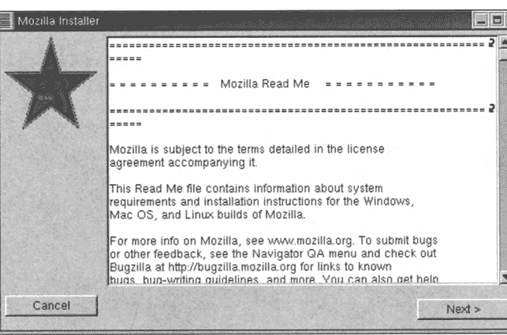

图 6-41 将弹出一个新窗口并开始你的 Mozilla 安装对话框。

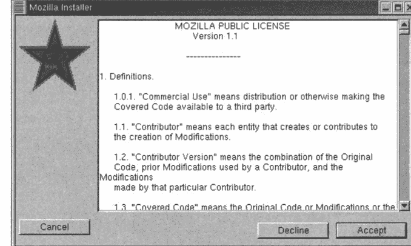

图 6-42 接受公共许可；微软已经让你签过更糟糕的了。

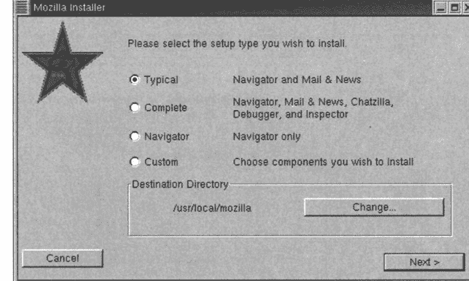

图 6-43 检查你想进行种种安装。（使用默认值：Power Hint 1897!）

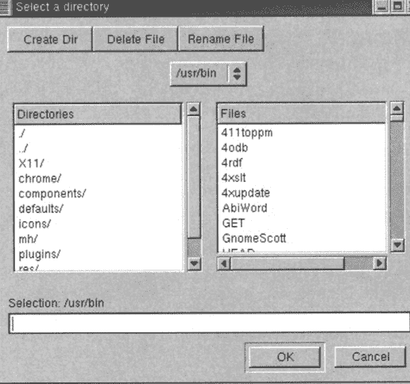

图 6-44 选择安装 Mozilla 的目录。

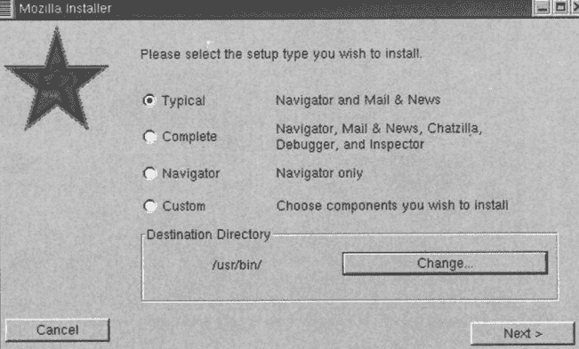

图 6-45 继续安装。

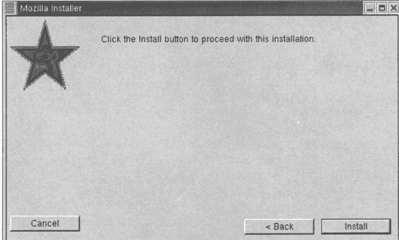

图 6-46 你真的、真的、真的确定吗？你确定只有系统管理员应该做这个，对吧？

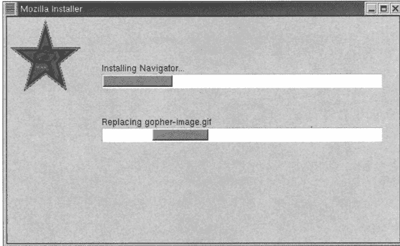

图 6-47 安装的状态栏！这再也不会比这更简单了！

## OpenVMS Mozilla 安装

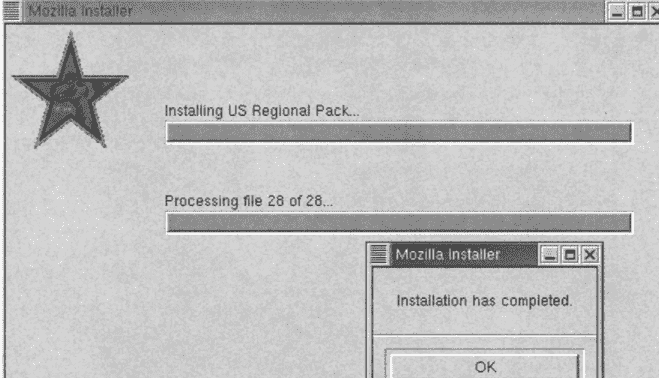

图 6-48 Linux 安装完成！

目录 `DBO:[KTS.TAMP]`

```
2RC2GFX.EXE;1  AUTOG_RUN.COM;1  AUTOGADOW.COM;1

CPG-AXPVMS-CSMB-V0100--1.PCSI;1

CPG-AXPVMS-CSMB-T0103--1.PCSI-DCX-AXPEPE;1

CPG-AXPVMS-CSMB-V0101--1.PCSI;1

CPG-AXPVMS-CSMB-V0102--1.PCSI-DCX-AXPEPE;1

CPG-AXPVMS-CSMB-FERL-V0101--1.PCSI-DCX-AXPEPE;1

CPG-AXPVMS-FERL-V0102--1.PCSI-DCX-AXPEPE;1

CPG-AXPVMS-SSL-V0100-A-1.PCSI-DCX-AXPEPE;1

CSMB_PERL-ALPHA-V101.SFX.AXPEPE;1  CSMB_MODPER_RELNETS.HTML;1

BEZSHNE.EXE;1  DECOM_TERM.COM;1

OHGU01_0_4.TXT;1  KRA246H.EXE;1

LIBNIBRA.118.ALPHA.SO;1  LIBNIBRA.CSMB--10.SO;1

LIBNIBRA.MV091.ALPHA_100.SO;1

LOGIN.COM;26  LQ246H.EXE

PRLSTARTUP.COM;6  MAJORDON0010_SRC.ZIP

OSQUIR_EXE;1  FERL.RELNETS.TXT;1

SMBCLIENT.ZIP;1  SSL_IGUITE.TXT;1

TCP/IP_SMTP.COM;1  TCP/IP_TELNET.COM;1

UNZIP.ALPHA.EXE;1  VIM.DIR;1
```
共 35 个文件。

```
$ product install
```

图 6-49 以 SYSTEM 身份登录并将工具包放在与系统文件独立的目录中。你可以在 `http://www.openvms.com` 找到 OpenVMS 安装（而不是在 `http://www.mozilla.org/`）。

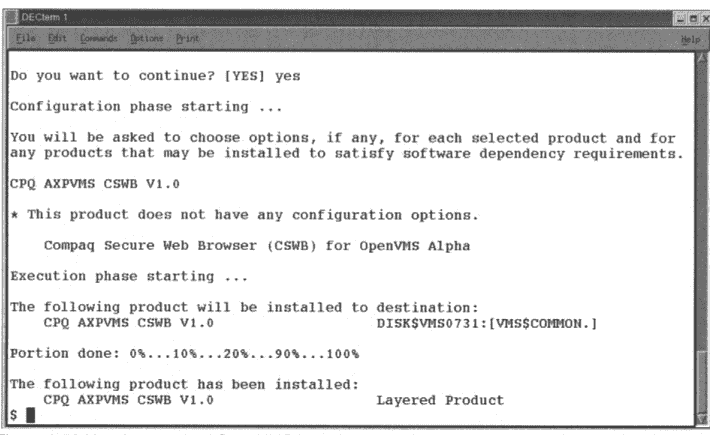

图 6-50 使用标准的 OpenVMS 工具包 `CSWB` 并使用 `$PRODUCT` 命令。

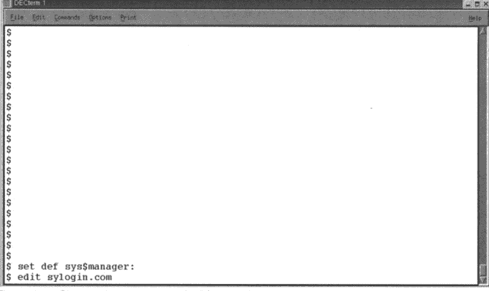

图 6-51 使用标准的 OpenVMS 工具包 `CSWB` 并使用 `$PRODUCT` 命令。

图 6-52 使用标准的 OpenVMS 工具包 `CSWB` 并使用 `$PRODUCT` 命令。

图 6-53 使用标准的 OpenVMS 工具包 `CSWB` 并使用 `$PRODUCT` 命令。

# DEF 类 1

```
$ 

$ 

$ 

$ 

$ 

$ 

$ 

$ 

$ 

$ 

$ 

$ 

$ 

$ 

$ 

$ 

$ 

$ 

$ 

$ 

$ 

$ 

$ 

$ 

$ 

$ 

$ 

$ 

$ 

$ 

$ 

$ 

$ 

$ 

$ SET DEF SYS$LOGIN:

$ MOZ
```
正在启动 `mozilla-bin`...


图 6-58 退出授权工具并首次运行 Mozilla。

恭喜！你刚刚在 OpenVMS 和 Linux 系统上安装了 Mozilla Web 浏览器。

## OpenVMS 或 Linux 上的邮件客户端配置

OpenVMS 和 Linux 开源应用程序的优点在于，无论在什么平台上，它们安装后的外观、感觉和运行方式都是完全相同的！让我们看看如何配置 Mozilla 的 POP3 或 IMAP；请注意，从应用的角度来看，两者是完全相同的（请参见图 6-60 至 6-70）！

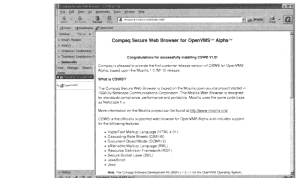

图 6-59 Mozilla Web 浏览器窗口已打开，准备好远程连接电子邮件服务器或通过其运行的本地服务器。

104 Linux 与 OpenVMS 互操作性

## Compaq 安全网浏览器 - CSWB (V1.0)

## 适用于 OpenVMS™ Alpha™ 的 Compaq 安全网浏览器

恭喜成功安装 CSWB V1.0！

Compaq 很高兴提供基于 Mozilla 1.0 (M1) 发布版本的 OpenVMS CSWB 首个客户发布版本。

## 什么是 CSWB？

CSWB Web 浏览器基于 Netscape Communications 公司于 1998 年启动的 Mozilla 开源项目。Mozilla Web 浏览器旨在符合标准、高性能并具有可移植性。Mozilla 与 Netscape 6.x 使用相同的代码库。

关于 Mozilla 项目的更多信息，请访问 http://www.mozilla.org/

CSWB 是 OpenVMS Alpha 官方支持的浏览器，并包含对以下功能的支持：

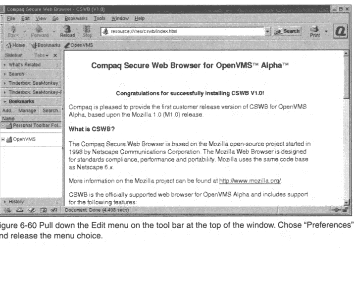

## Compaq 安全网浏览器 - CSWB (V1.0)

## 新账户设置

此向导将收集设置账户映射所需信息。如果您不知道所需信息，请联系您的系统管理员或互联网服务提供商。选择您想要设置的账户类型。

# Alpha™ 1.0

- 电子邮件账户
- 新闻组账户

在浏览器启动的 OpenVMS SWB 源项目使用了相同的代码库 http://www.mozilla.org/ 并包含支持

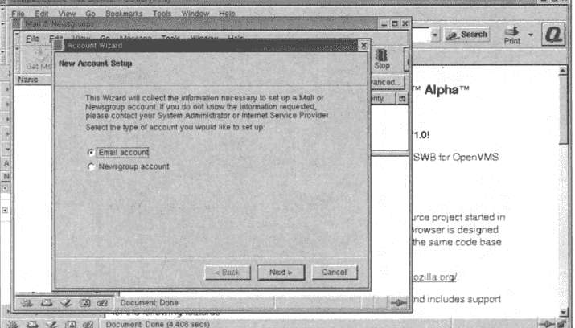

第 6 章 – 在 OpenVMS 和 Linux 使用电子邮件 105

## 账户向导

每个账户都可以有自己的身份，当他人收到您的消息时，这就是识别您身份的信息。

输入您希望在发送邮件“发件人”字段中显示的名称（例如，“John Smith”）。

输入您的电子邮件地址。这是他人向您发送邮件时使用的地址（例如，“user@example.net”）。

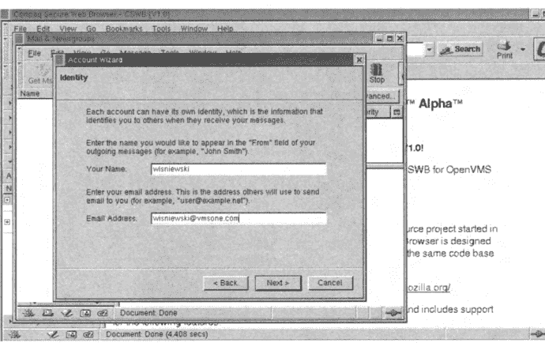

图 6-62 下，给出 users@server.com 的用户名和电子邮件地址。

## 服务器信息

选择您正在使用的入站服务器类型

输入您的入站服务器名称（例如，“imap.net”）。

输入您的出邮件服务器 (SMTP) 名称（例如，“smtp.net”）。

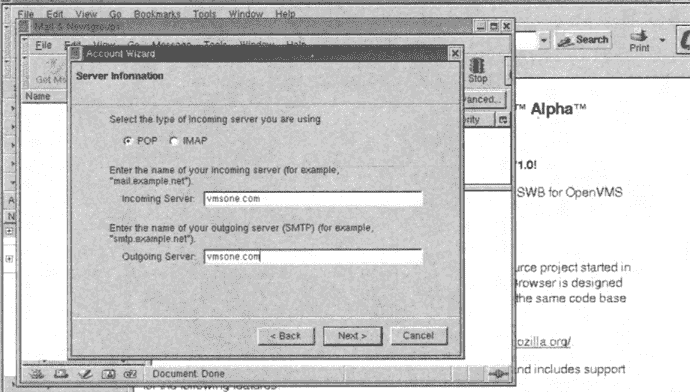

图 6-63 现在选择 POP 或 IMAP——必须确定您的服务器已好接受 POP 或 IMAP 连接。此外，您还需要一个出邮件服务器来处理您发出的客户端邮件。

Linux 与 OpenVMS 互操作性

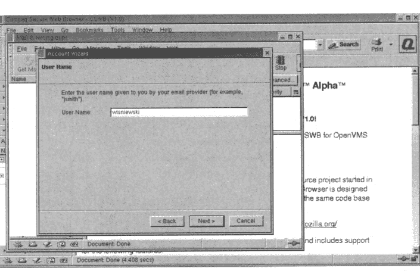

图 6-64 现在输入您将用于发送和接收电子邮件的账户用户名。

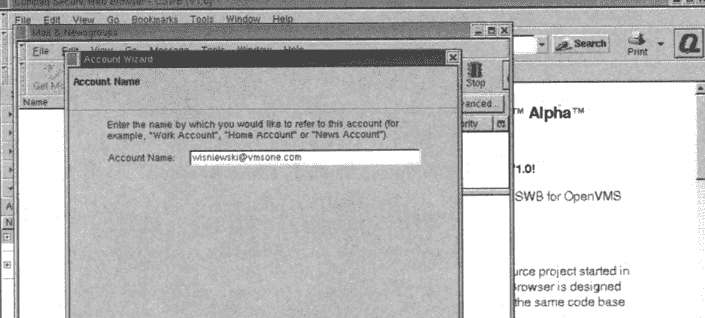

图 6-65 再次输入您的账户名称。

第 6 章 – 在 OpenVMS 和 Linux 使用电子邮件 107

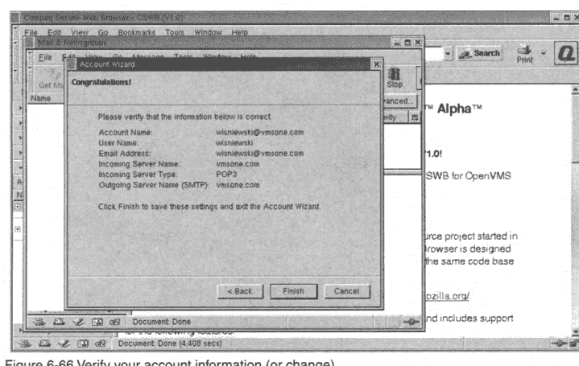

图 6-68 输入密码。

图 6-69 恭喜，您已为电子邮件服务器配置了邮件客户端！

第 6 章 - 在 OpenVMS 和 Linux 使用电子邮件 109

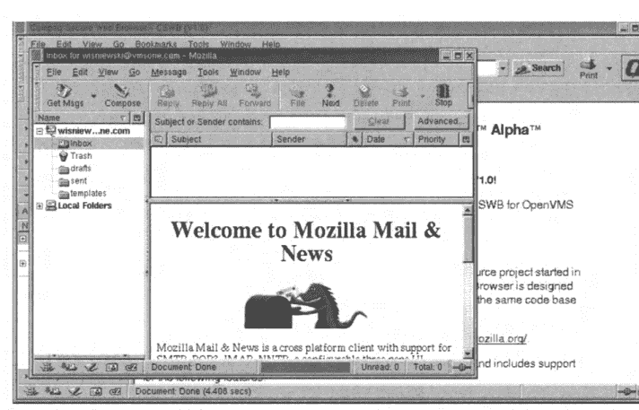

由于这是 POP3 连接，您需要将邮件消息下载到您的账户。

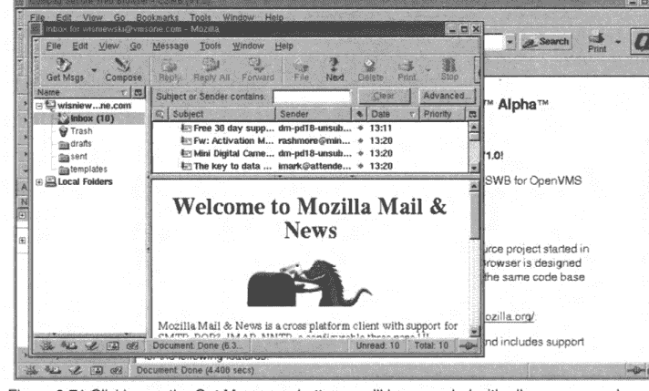

图 6-70 由于这是 POP3 连接……

Linux 与 OpenVMS 互操作性

## 欢迎使用邮件与新闻

图 6-72 查看列表，发现只有一个明显的选择可以先阅读。

图 6-73 噢，来自互联网，但不是垃圾邮件，所以让我们看看一条更典型的电子邮件消息。

第 6 章 – 在 OpenVMS 和 Linux 使用电子邮件 111

# 回复: 9月23日激活

主题: 回复 9月23日激活
发件人: john.doe@hotmail.com <backup@prodigy.net>
日期: 2002年9月23日 星期一 10:14
返回路径: <backup@prodigy.net>
来自 mailback.hotmail.com (172.64.19.53), 2002年9月23日 10:14 (GMT) 由 mx-center.net 接收，SMTP ID DA297
来自 google.net (198.74.15.34), 2002年9月23日 10:14 (GMT) 由 mx-center.net 接收，SMTP ID DK297
来自 prodigy.net (207.69.25.1), 2002年9月23日 10:14 (GMT) 由 mx-center.net 接收，SMTP ID JX297
来自 hotmail.com (98.53.100.101), 2002年9月23日 10:14 (GMT) 由 mx-center.net 接收，SMTP ID Q25
来自 hotmail.com (105.51.92.151), 2002年9月23日 10:14 (GMT) 由 mx-center.net 接收，SMTP ID 503
来自 hotmail.com (208.29.101.101), 2002年9月23日 10:14 (GMT) 由 mx-center.net 接收，SMTP ID 111
来自 hotmail.com (205.25.101.101), 2002年9月23日 10:14 (GMT) 由 mx-center.net 接收，SMTP ID 411
来自 hotmail.com (205.25.101.101), 2002年9月23日 10:14 (GMT) 由 mx-center.net 接收，SMTP ID 611
来自 hotmail.com (205.25.101.101), 2002年9月23日 10:14 (GMT) 由 mx-center.net 接收，SMTP ID 711
来自 hotmail.com (205.25.101.101), 2002年9月23日 10:14 (GMT) 由 mx-center.net 接收，SMTP ID 811
来自 hotmail.com (205.25.101.101), 2002年9月23日 10:14 (GMT) 由 mx-center.net 接收，SMTP ID 911
来自 hotmail.com (205.25.101.101), 2002年9月23日 10:14 (GMT) 由 mx-center.net 接收，SMTP ID 011
来自 hotmail.com (205.25.101.101), 2002年9月23日 10:14 (GMT) 由 mx-center.net 接收，SMTP ID 211
来自 hotmail.com (205.25.101.101), 2002年9月23日 10:14 (GMT) 由 mx-center.net 接收，SMTP ID 311
来自 hotmail.com (205.25.101.101), 2002年9月23日 10:14 (GMT) 由 mx-center.net 接收，SMTP ID 411
来自 hotmail.com (205.25.101.101), 2002年9月23日 10:14 (GMT) 由 mx-center.net 接收，SMTP ID 511
来自 hotmail.com (205.25.101.101), 2002年9月23日 10:14 (GMT) 由 mx-center.net 接收，SMTP ID 611
来自 hotmail.com (205.25.101.101), 2002年9月23日 10:14 (GMT) 由 mx-center.net 接收，SMTP ID 711
来自 hotmail.com (205.25.101.101), 2002年9月23日 10:14 (GMT) 由 mx-center.net 接收，SMTP ID 811
来自 hotmail.com (205.25.101.101), 2002年9月23日 10:14 (GMT) 由 mx-center.net 接收，SMTP ID 911
来自 hotmail.com (205.25.101.101), 2002年9月23日 10:14 (GMT) 由 mx-center.net 接收，SMTP ID 011
来自 hotmail.com (205.25.101.101), 2002年9月23日 10:14 (GMT) 由 mx-center.net 接收，SMTP ID 211
来自 hotmail.com (205.25.101.101), 2002年9月23日 10:14 (GMT) 由 mx-center.net 接收，SMTP ID 311
来自 hotmail.com (205.25.101.101), 2002年9月23日 10:14 (GMT) 由 mx-center.net 接收，SMTP ID 411
来自 hotmail.com (205.25.101.101), 2002年9月23日 10:14 (GMT) 由 mx-center.net 接收，SMTP ID 511
来自 hotmail.com (205.25.101.101), 2002年9月23日 10:14 (GMT) 由 mx-center.net 接收，SMTP ID 611
来自 hotmail.com (205.25.101.101), 2002年9月23日 10:14 (GMT) 由 mx-center.net 接收，SMTP ID 711
来自 hotmail.com (205.25.101.101), 2002年9月23日 10:14 (GMT) 由 mx-center.net 接收，SMTP ID 811
来自 hotmail.com (205.25.101.101), 2002年9月23日 10:14 (GMT) 由 mx-center.net 接收，SMTP ID 911

图 6-74 现在输入您将用于发送和接收电子邮件的账户用户名。

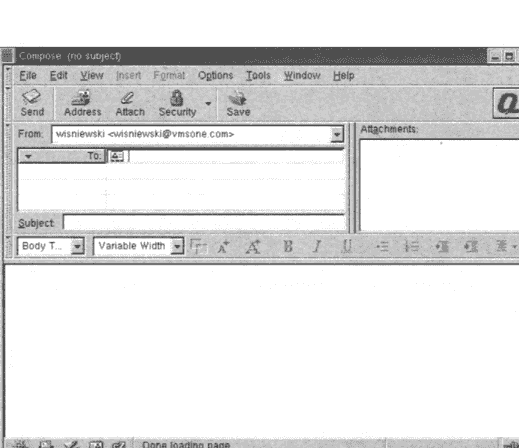

图 6-75 使用标准 Mozilla 你可以发送并回复电子邮件（带有附件）

Linux 与 OpenVMS 互操作性

# 电子邮件想要免费

跨 OpenVMS 的电子邮件，RedHat 7.3 随标准分发提供，无需额外费用。OpenVMS 增加了额外的检查和测试（由于它将 TCP/IP 栈到 Mozilla）。Linux 和 OpenVMS 使用相同的工具发送电子邮件、交换文件并浏览彼此的网站。电子邮件通常是第一个建立的应用程序——在知道它可行后，其他的就很简单了。至少我们知道电子邮件是可行的。

# 7 章 — 用于 Linux 和 OpenVMS 的 SMB

## 在 OpenVMS 和 Linux 使用 SMB 进行磁盘共享

Windows、Linux 和 OpenVMS 系统在过去的十年里一直在入侵他人的领地。经理和“普通”人士不仅希望它们能够良好地合作，还能共享文件、磁盘和打印机。这是一个简单的目标，如果合理的话！

还有其他磁盘共享协议，例如 UNIX 世界中的 NFS 和 VMS 世界中的 DFS，但 Windows 在数量上占优，因此其 SMB 协议在不同操作系统之间更可能被使用。

Windows NT 和 Windows 2000 服务器系统带有某些客户端许可提供了磁盘和打印机共享以及身份验证。其他系统需要集成这些工具。

一个 GNU 许可的开源磁盘共享和打印机网络协议，允许您的 Linux、OpenVMS 或 UNIX 系统加入 Windows 工作组、NT 4.0 域或 Windows 企业域。该软件通过 http://www.samba.org 为 OpenVMS 免费发布。SAMBA 包含在标准 RedHat 7.3 分发中。

OpenVMS SAMBA 也可以从 samba.org 获取，但对于 OpenVMS，对于需要与其企业 Windows 环境更好地集成的人来说，有一个商业选项。HP/OpenVMS 工程部门从微软那里许可了 Advanced Server 的源码，这是由于 AT&T 拥有源码访问权限以及一项行业重新许可协议，律师们可以理解其真实本质。然而，微软定期更新

这段带有新功能和改进的源代码被交付给 AT&T，由其更新 OpenVMS 工程，并派遣一个团队对产品进行移植、评估和测试，最后将二进制文件发送给全球的 OpenVMS Advanced Server 。

使用 OpenVMS Advanced Server 软件而不是免费的 SAMBA 软件的优势在于可以通过 HP 的 1-800 电话获得商业支持。作为 HP 的商业支持产品，Advanced Server 往往比 SAMBA 更早拥有 Microsoft 服务器功能（在本文写作时，SAMBA 正在等待最新 MS 产品中的新 LDAP、Active DNS 和新的安全模型，而 Advanced Server 已实现了这些功能）。SAMBA 将获得与 MS 产品的最新集成功能，但在这些功能上，SAMBA 通常落后于商业产品，而开源社区正在重新设计 SAMBA 的下一个版本。

支持服务和测试使得适用于 OpenVMS 的 Advanced Server 成为 Windows 环境下 OpenVMS 上进行 SMB 文件和打印机共享的首选商业方案。

这并不意味着用于 OpenVMS 的 SAMBA 不受欢迎欢迎！OpenVMS 爱好者社区以及那些仅需要文件和打印机共享的用户发现，SAMBA 的开源和免费成本在与他们的 UNIX、Linux 和 Windows 客户端共享时最高效！对于 OpenVMS，根据你的具体需求和预算，你对于 SMB 服务器 真的有两个选择。

## Linux 和 SAMBA

如今，共享文件和打印服务的能力被认为是所有操作系统的标配。Windows 是网络上可能存在的最大的客户端群体。实现这一点的最简单方法是在 Linux 中添加 Windows 安全和共享。这不仅提供了一种跨大多数桌面平台的通用身份验证机制，还为 Windows RedHat 客户端提供了文件和打印机服务，而这些服务可以存储在 Linux 服务器上。

使用 RedHat 7.3 安装 Linux 作为 SMB 服务器 允许你选择一个 SMB 服务器，该程序将为你自动安装 SAMBA（见图 7-1 至 7-13）。它安装了 SAMBA，但配置它取决于你个人！

## 服务配置

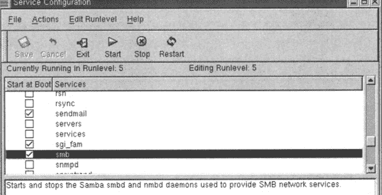

图 7-1 在 GNOME 桌面面的服务器管理器菜单中，你只需要勾选框并保存你的选择即可。


图 7-2 激活 SAMBA 的下一步是配置 `/etc/samba` 目录下的 `hosts` 文件，使用你喜欢的 Linux 编辑器，并添加工作组或域中其他主机的“LAN Manager”名称。


root@lnxone:etc/samba

File Edit Settings

`[root@lnxone samba]# pid`

`/etc/samba`

`[root@lnxone samba]# is`

leaves MOWDINE_SID secrets.tdb smb.conf sabusers

`[root@lnxone samba]# cat hosts`

127.0.0.1       localhost

65.64.220.210 version

65.64.220.213 wizzule

`[root@lnxone samba]#`

`[root@lnxone samba]# cat sabusers`

# Unique-name = Smb_name1,SMB_name2

# root = administrator admin

notbody = guest pcquest guestquest

john = john

steves = steves

jeraw = jeraw

smb_pub = smb_pub

`[root@lnxone samba]# #`

```
图 7-3 然后编辑 `smusers` 并添加 Linux 账户名以及你想要映射的 Windows 工作组/域名称。注意，你可以将 Windows 用户映射到单个 Linux 账户！
```

```
gedit /etc/samba
```

File Edit Settings Search Plugins Documents Help New Save Undo Redo Copy Paste Exit smb.conf

# 这是 Samba 主配置文件。你应该阅读 smb.conf (manual) 帮助页面以了解列出的选项。 Samba 有许多配置选项（可能太多了！），在示例中并未显示。任何以 # (注释) 开头的行都会被忽略。在示例中，我们使用 # 用于配置文件的部分。 注意：每当你修改此文件时，都应该运行 "testparm" 命令来检查你是否有任何语法错误。

============ Global Settings ============

[global]

# workgroup = NT-Domain-Name or Workgroup-Name

# workgroup = WORKGROUP

# server string is the equivalent of the NT field

```
图 7-4 编辑 `smamba.conf` 文件并更改 `workgroup` 名称，使其与 PC（以及其他 Linux 客户端）使用的域/工作组一致。18 Linux 与 OpenVMS 互操作
```

```
gedit /etc/samba/smb.conf
```

```
# 用于配置文件的部分。 注意：每当你修改此文件时，都应该运行 'testparm' 来检查你是否有任何语法错误。

============= Global Settings ==============

[global]

# workgroup = NT-Domain-Name or Workgroup-Name

workgroup = vski
```

图 7-5 将 `server string` 修改为适当的内容。这将在客户端浏览器中显示出来。

```
edit /etc/samba/smb.conf
```

```
[global]

# workgroup = NT-Domain-Name or Workgroup-Name

workgroup = vski

# server string is the equivalent of the NT field

# server string = 

# 此选项非常重要。它允许你限制对本地网络机器的连接。 下面的示例限制了两个 "loopback" 接口。 更多语法示例：

hosts = 192.168.1

hosts = 192.168.2.200 192.168.2.211 192.168.2.240 192.168.2.245 192.168.2.220 192.168.2.217

# 如果你想自动加载打印机列表而不是逐个设置，你需要这个：

name = /etc/printcap

load printers = yes
```

图 7-6 指定你允许进行 SMB 连接的所有客户端和服务器。可以使用通配符吗？第 7 章 – 用于 Linux 和 OpenVMS 的 SMB 119

```
root@lnxone:etc/samba# pwd
/etc/samba
root@lnxone:samba# ls
inhosts MOKINE.cd secrets.tdb smb.conf sambusers
root@lnxone:samba# cat hosts
127.0.0.1 localhost
65.64.220.211 vscore
65.64.220.211 wirzmole
65.64.220.211 wintermute
root@lnxone:samba# cat sambusers
unique-name = SMB_name_SMB2
root = administrator admin
nnbody = guest pcwest quest
john = john
steves = steves
jennaw = jenraw
smb_pub = smb_pub
root@lnxone:samba#
root@lnxone:samba# smbpasswd -a johnn
```

图 7-7 完成后，以 root 用户身份运行 `smbpasswd` 并创建一个 SMB 密码（第一次运行时）。然后为所有连接到你 SMB 服务器的 Linux 用户账户名添加密码。

```
root@lnxone:etc/samba# pwd
/etc/samba
root@lnxone:samba# ls
inhosts MOKINE.cd secrets.tdb smb.conf sambusers
root@lnxone:samba# cat hosts
127.0.0.1 localhost
65.64.220.211 vscore
65.64.220.211 wirzmole
65.64.220.211 wintermute
root@lnxone:samba# cat sambusers
unique-name = SMB_name_SMB2
root = administrator admin
nnbody = guest pcwest quest
john = john
steves = steves
jennaw = jenraw
smb_pub = smb_pub
root@lnxone:samba#
root@lnxone:samba# smbpasswd -a johnn
New SMB password:
```

图 7-8 为 Linux johnn 账户设置 SMB 密码。

```
root@lnxone:etc/samba# pwd
/etc/samba
root@lnxone:samba# ls
jwosts MOKINE.cd secrets.tdb smb.conf sambusers
root@lnxone:samba# cat hosts
127.0.0.1 localhost
65.64.220.210 vmsome
65.64.220.211 wirzule
65.64.220.213 winterwe
root@lnxone:samba# 
root@lnxone:samba# cat sambusers
# Unique_name = SMB_NAME2
root = administrator adminin
bobody = guest pcquesquest
johnw = johnw
steves = steves
jennaw = jennaw
smb_pub = smb_pub
root@lnxone:samba# 
root@lnxone:samba# smbpasswd -a johnw
New SMB password:
Retype new SMB password:
Unable to open passdb database.
Added user johnw.
root@lnxone:samba#
```

图 7-9 验证 johnw 的密码。

```
root@lnxone:etc/samba#
root@lnxone:samba# ls
jwosts MOKINE.cd secrets.tdb smb.conf sambusers
root@lnxone:samba# cat hosts
127.0.0.1 localhost
65.64.220.210 vmsome
65.64.220.211 wirzule
65.64.220.213 winterwe
```


`root@lnxone:samba#`

`root@lnxone:samba# cat sambusers`

`# Unique_name = SMB_NAME2`

`root = administrator adminin`

`bobody = guest pcquesquest`

`johnw = johnw`

`steves = steves`

`jennaw = jennaw`

`smb_pub = smb_pub`

`root@lnxone:samba#`

```bash
root@invoneone:/etc/samba#
文件 编辑 设置帮助
[root@invoneone samba]# cat hosts
127.0.0.1       localhost
65.64.220.210 opne
65.64.220.211 wizumle
65.64.220.212 wintermute
[root@invoneone samba]#
[root@invoneone samba]# cat smusers
# unique_name = SMB_name SMB_name2 ...
root = administrator admin
body = nobody quest pigment guest
njohn = john
steves = steves
jennaw = jenraw
smb_pub = smb_pub
[root@invoneone samba]#
[root@invoneone samba]# smpasswd -a john
New SMB password:
Retype SMB password:
unable to open passdb database.
Added user john.
[root@invoneone samba]#
[root@invoneone samba]# smbd
[root@invoneone samba]# nmbd
```

图 7-11 启动 SMB 守护进程进程（无需重启）。

```bash
root@invoneone:/etc/samba#
文件 编辑 设置帮助
127.0.0.1       localhost
65.64.220.210 opne
65.64.220.211 wizumle
65.64.220.212 wintermute
[root@invoneone samba]#
[root@invoneone samba]# cat smusers
# unique_name = SMB_name SMB_name2 ...
root = administrator admin
body = nobody quest pigment guest
njohn = john
steves = steves
jennaw = jenraw
smb_pub = smb_pub
[root@invoneone samba]#
[root@invoneone samba]# smpasswd -a john
New SMB password:
Retype SMB password:
unable to open passdb database.
Added user john.
[root@invoneone samba]#
[root@invoneone samba]# smbd
[root@invoneone samba]# nmbd
```

图 7-12 启动 NetBIOS 守护进程进程（`smbd` 和 `nmbd` 进程应在 Linux 启动时启动）。

```bash
root@iphone:/etc/samba
文件 编辑 设置帮助
body = guest pcquest sabguest
john = john
steves = steves
jeremy = jeremy
sabd_pub = sabd_pub
[root@none]# sambd
[root@none]# sambpasswd -a john
New SMB password:
Retype SMB password:
unable to open password database.
enabled user: john.
[root@none]# sambd
[root@none]# sambd
[root@none]# sambd
[root@none]# ps -ef | grep sambd
root 1011 0 0 19:10 ? 00:00:00 sambd -D
root 3118 2597 0 20:03 pts/0 00:00:00 grep sambd
[root@none]# ps -ef | grep nabd
root 1016 0 0 19:10 ? 00:00:00 nabd -D
root 3120 2597 0 20:03 pts/0 00:00:00 grep nabd
[root@none]# sambd
```

图 13 检查进程状态以验证这些守护进程正在运行。

# OpenVMS Advanced Server 安装与配置

要将 OpenVMS Advanced Server 安装为主域控制器（NT 4.0 安全模型），你必须执行以下五个步骤：

- 1. 配置 OpenVMS 注册表（见图 7-14）。
- 2. 配置 OpenVMS Advanced Server IP（见图 7-27）。
- 3. 从光盘安装 OpenVMS Advanced Server（见图 7-35）。
- 4. 配置 OpenVMS Advanced Server 进程（见图 7-46）。
- 5. 将 OpenVMS Advanced Server 配置为域控制器（见图 7-66）。

## 第 1 步：配置 OpenVMS 注册表


```bash
$
$
$
$
$
$
$ show def
SYS$ROOT:[SYSMGR]
= SYS$ROOT:[SYSMGR]
= SYS$COMMON:[SYSMGR]
$ dir $reg*
Directory REGISTRY_TABLE.COM;      REG$COM;
Total of 2 files.
$
$ @reg$config.com
图 7-14 要开始配置 OpenVMS 注册表，请执行脚本 `@SYS$MANAGER:REG$COM`。

```

OpenVMS Registry 配置
-----------------------
1 配置 OpenVMS Registry 逻辑名称和路径
2 显示 OpenVMS Registry 逻辑名称和路径
3 检查 OpenVMS Registry 服务状态
4 在此节点上启动 OpenVMS Registry 服务
5 转换为最新数据库版本并恢复数据库
关于此工具的帮助
`[E]` - 退出

图 7-15 运行菜单并选择第一个选项。

`[E]` - 退出

请输入你的选择：1

此系统是否在集群中或将成为集群的一部分？(Y/N/Q)：Y

```
REG0_STARTED -
REG0_STARTED 没有有效翻译
注意：如果你希望系统启动时启动或运行备用 OpenVMS Registry 服务，请将此逻辑设置为 TRUE。如果你不想在此节点启动 OpenVMS Registry 服务，请将此逻辑设置为 FALSE。在集群中，你想更改此值吗？(Y/N/Q)：Y
输入新值：TRUE
你想定义哪个逻辑名称？(SYSTEM/CLUSTER/Q)：SYSTEM
```

图 7-16 将 `REG0_STARTED` 逻辑设置为 TRUE。

```
REG0_STARTED 已临时定义。
在重启系统之前，你必须编辑 LOGICAL.COM 以包含以下行：
DEFINE/TABLE=SYSTEM REG0_STARTED TRUE
```

图 7-17 注意你可以将其放入集群表或系统表。

```
REG0_STARTED 已临时定义。
在重启系统之前，你必须编辑 LOGICAL.COM 以包含以下行：
DIRECTORY=SYSTEM REG0_STARTED TRUE
```


```
SYS$REGISTRY
SYS$REGISTRY 没有有效翻译
注意：在集群中，你可以为不同的目的运行多个 OpenVMS Registry 服务（每个节点一个）。但是，只有一个 OpenVMS Registry 数据库位于集群中所有节点可访问的中央磁盘和目录。请确保你的目录规范对整个集群可见，或者它与现有 SYS$REGISTRY 目录的规范匹配。
你想更改此值吗？(Y/N/Q)：Y
输入 SYS$REGISTRY 的新值 (value/NOVAL/Q)："SYS$SYSDEVICE:[VMS_REGISTRY]"
你已输入：sys$device:[vms_registry]
正确吗？(Y/N/Q)：Y
```

图 7-18 现在我们需要为 VMS 注册表文件选择磁盘/目录。我使用了 `SYS$SYSDEVICE:[SYS$REGISTRY]`。

```
SYS$REGISTRY
SYS$REG 没有有效翻译
注意：在集群中，你可以为不同的目的运行多个 OpenVMS Registry 服务（每个节点一个）。但是，只有一个 OpenVMS Registry 数据库位于集群中所有节点可访问的中央磁盘和目录。请确保你的目录规范对整个集群可见，或者它与现有 SYS$REGISTRY 目录的规范匹配。
你想更改此值吗？(Y/N/Q)：Y
输入 SYS$REGISTRY 的新值 ("yourvalue"/NOVAL/Q)："SYS$SYSDEVICE:[vms_REGISTRY]"
你已输入：SYS$sysdevice:[vms_registry]
正确吗？(Y/N/Q)：Y
你想定义哪个逻辑名称？(SYSTEM/CLUSTER/Q)：SYSTEM
```

```
SYS$REGISTRY 已临时定义。
在重启系统之前，你必须编辑 LOGICAL.COM 文件以包含以下行：
DEFINE/TABLE=LM$SYSTEM SYS$REGISTRY sys$sysdevice:[vms_registry]
```

图 7-20 该过程将为你创建目录和注册表数据库。


--- SYS$REGISTRY 目录 ---

- SYS$REGISTRY (LNM$SYSTEM) 目录未创建。

> 注意！！当 OpenVMS Registry 服务启动时，系统会在此位置创建一个 OpenVMS Registry 数据库。虽然你可以运行多个 OpenVMS Registry 服务，但你只能有一个数据库。请确保目录规范指向集群中所有节点均可访问的磁盘和目录。如果集群中某处存在 OpenVMS Registry 数据库，请重新定义 SYS$REGISTRY 逻辑指向该位置。

你想创建目录吗？(Y/N/Q) [Y]: Y

REG-I-CONFILE OpenVMS Registry 容器文件已成功创建

SYS$REGISTRY 目录现在已创建。

按 [Enter] 返回菜单。

图 7-21 在退出 Registry 菜单之前，使用选项 2 检查你的定义。

## OpenVMS 注册表实用程序

- 1 - 配置 OpenVMS 逻辑名称和目录路径
- 2 - 显示 OpenVMS 逻辑名称和目录路径
- 3 - 检查 OpenVMS 注册表的状态
- 4 - 在节点上启动 OpenVMS 注册表服务器
- 5 - 转换为最新数据库版本或回收数据库
- H - 关于此实用程序的帮助
- E - 退出

请输入您的选择：4

图 7-22 然后选择 4 启动 OpenVMS 注册表。

## OpenVMS 注册表实用程序

- 1 - 配置 OpenVMS 逻辑名称和目录路径
- 2 - 显示 OpenVMS 逻辑名称和目录路径
- 3 - 检查 OpenVMS 注册表的状态
- 4 - 在节点上启动 OpenVMS 注册表服务器
- 5 - 转换为最新数据库版本或回收数据库
- H - 关于此实用程序的帮助
- E - 退出

请输入您的选择：4

OpenVMS 注册表服务器已成功启动。

按回车键返回菜单。

图 7-23 收到成功消息提示。

## OpenVMS 注册表实用程序

- 1 - 配置 OpenVMS 逻辑名称和目录路径
- 2 - 显示 OpenVMS 逻辑名称和目录路径
- 3 - 检查 OpenVMS 注册表的状态
- 4 - 在节点上启动 OpenVMS 注册表服务器
- 5 - 转换为最新数据库版本或回收数据库
- H - 关于此实用程序的帮助
- E - 退出

请输入您的选择：E

图 7-24 退出注册表菜单，但尚未完成。

## OpenVMS 注册表实用程序

- 1 - 配置 OpenVMS 逻辑名称和目录路径
- 2 - 显示 OpenVMS 逻辑名称和目录路径
- 3 - 检查 OpenVMS 注册表的状态
- 4 - 在节点上启动 OpenVMS 注册表服务器
- 5 - 转换为最新数据库版本或回收数据库
- H - 关于此实用程序的帮助
- E - 退出

请输入您的选择：E

正在退出配置实用程序。

```
$ SET DEF SYS$LOGIN
$ EDIT STARTUP_VMS.COM
```

图 7-25 更改目录到 SYSTEM Manager 的登录目录并编辑 VMS 启动文件。

## 步骤 2：为高级服务器配置 OpenVMS

```
$ 从以下行删除注释分隔符 (!) 以启动 RPC 服务。
$ @SYS$STARTUP:DCE$RPC_STARTUP.COM
$ 启动 SSL 扩展。这些允许 SSL 隧道和其他 SSL 应用程序工作
$ @sys$startup:ssl$startup.com
$ 启动 OpenVMS 注册表
$ define=/system/exec/registry:registry_started true
$ define=/system/exec/registry$SYS$SERVICE:[VMS_REGISTRY]
$ @sys$startup:req$startup.com
Buffer: STARTUP_VMS.COM 写入 44 行写入文件 SYS$:[SYSMGR]STARTUP_VMS.COM
```

图 7-26 编辑启动文件，添加逻辑定义和注册表启动项，以便 VMS 注册表在每次系统启动时都会启动。

```
用于 OpenVMS 的 Compaq TCP/IP 服务配置菜单
配置选项：
1 - 核心环境
2 - 客户端组件
3 - 服务器组件
4 - 可选组件
5 - 关闭用于 OpenVMS 的 TCP/IP 服务
6 - 启动用于 OpenVMS 的 TCP/IP 服务
7 - 运行
A - 配置选项 1-4
[E] - 退出配置程序
```

图 7-27 使用 `@sys$startup:tcpip$config.com` 启动 TCP/IP 配置菜单。选择菜单 4。

输入配置选项：4

## OpenVMS 的 Compaq TCP/IP 服务可选组件配置菜单

配置选项：

- 为 DECnet-Plus 和 PATHWORKS 配置 PWIP 驱动程序
- 配置 SWIP QIO 接口 (INET 驱动)
- 设置匿名 FTP 账户和目录
- 配置 Kerberos 应用程序

A - 配置选项 1-4

[E] - 退出菜单

输入配置选项：1

图 7-28 为 PWIP 驱动选择菜单 1。

## DECnet 和 Pathworks TCPIP 传输服务配置

服务未启用。

服务已停止。

DECnet 和 Pathworks TCPIP 传输服务配置选项：

- 在此节点上启用服务
- 在此节点上启用并启动服务

[E] - PWIP_DRIVER 配置

输入配置选项：1

图 7-29 无论插图显示什么，选择启用并启动。


图 7-30 你应该收到类似的成功安装消息。


图 7-31 退出 TCP/IP 配置菜单。

## OpenVMS 的 TCP/IP 服务配置菜单

配置选项：

1 - 核心环境
2 - 客户端组件
3 - 服务器组件
4 - 可选组件
5 - 关闭用于 OpenVMS 的 TCP/IP 服务
6 - 启动用于 OpenVMS 的 TCP/IP 服务
7 - 运行
A - 配置选项 1-4
[E] - 退出配置程序

输入配置选项：E

图 7-32 返回到提示符：

| File | Command | Options | size | owner | user |
| :--- | :--- | :--- | :--- | :--- | :--- |
| 2020040E | AUDIT_SERVER | HIB | 9 | 00:00:00.02 | 117 | 146 |


| 2020040F | JOB_CONTROL | HIB | 10 | 00:00:00.02 | 64 | 88 |
| 20200411 | QUEUE_MANAGER | HIB | 10 | 00:00:00.26 | 279 | 313 |
| 20200412 | SECURITY_SERVER | HIB | 50 | 00:00:00.36 | 581 | 497 |
| 20200413 | ACME_SERVER | HIB | 102 | 00:00:00.03 | 353 | 471 |
| 20200414 | SERVER | HIB | 42 | 00:00:00.04 | 141 | 172 |
| 20200415 | TP_SERVER | HIB | 24 | 00:00:00.01 | 71 | 92 |
| 20200418 | TCP/IP_HOSTED | HIB | 192 | 00:00:00.02 | 243 | 168 |
| 20200419 | TCP/IP_SFTP_1 | LEF | 167 | 00:00:00.05 | 539 | 297 |
| 20200414 | TCP/IP_FMAP_1 | HIB | 434 | 00:00:00.12 | 415 | 368 |
| 20200418 | TCP/IP_SERVER | LEF | 250 | 00:00:00.15 | 581 | 497 |
| 2020041C | TCP/IP_SWP_WACP | HIB | 96 | 00:00:00.01 | 138 | 161 |
| 2020041D | VMSIP_WSH_01 | HIB | 4 | 00:00:00.01 | 31 | 38 |
| 2020041E | VMSIP_SERVER | LEF | 114 | 00:00:00.01 | 203 | 223 |
| 20201119 | REDISTRIB_SERVER | HIB | 40 | 00:00:00.09 | 149 | 450 |
| 20200421 | DL_SERVER_6 | HIB | 692 | 00:00:00.03 | 476 | 624 |
| 20200422 | DTLOGIN | LEF | 152 | 00:00:00.03 | 456 | 421 |
| 20200423 | DREETLET | LEF | 289 | 00:00:00.03 | 439 | 524 |
| 20200424 | SYSTEM | LEF | 448 | 00:00:00.15 | 890 | 76 |
| 20200425 | DECW_CREATE_05 | COM | 2472 | 00:00:00.65 | 719 | 719 |
| 20200426 | SYSTEM_95 | CUR | 612 | 00:00:01.11 | 720 | 126 |
| 20200427 | SYSTEM_$54 | LEF | 14 | 00:00:00.01 | 67 | 58 |

图 7-33 使用一个 `SHOW` 命令查看你是否已安装并启动了注册表服务器。

| File | Command | Options | size | owner | user |
| :--- | :--- | :--- | :--- | :--- | :--- |
| 2020040E | AUDIT_SERVER | HIB | 9 | 00:00:00.02 | 117 | 146 |
| 2020040F | JOB_CONTROL | HIB | 10 | 00:00:00.02 | 64 | 88 |
| 20200411 | QUEUE_MANAGER | HIB | 10 | 00:00:00.26 | 279 | 313 |
| 20200412 | SECURITY_SERVER | HIB | 50 | 00:00:00.36 | 581 | 497 |
| 20200413 | ACME_SERVER | HIB | 102 | 00:00:00.03 | 353 | 471 |
| 20200414 | SERVER | HIB | 42 | 00:00:00.04 | 141 | 172 |
| 20200415 | TP_SERVER | HIB | 24 | 00:00:00.01 | 71 | 92 |
| 20200418 | TCP/IP_HOSTED | HIB | 192 | 00:00:00.02 | 243 | 168 |
| 20200419 | TCP/IP_SFTP_1 | LEF | 167 | 00:00:00.05 | 539 | 297 |
| 20200414 | TCP/IP_FMAP_1 | HIB | 434 | 00:00:00.12 | 415 | 368 |
| 20200418 | TCP/IP_SERVER | LEF | 250 | 00:00:00.15 | 581 | 497 |
| 2020041C | TCP/IP_SWP_WACP | HIB | 96 | 00:00:00.01 | 138 | 161 |
| 2020041D | VMSIP_WSH_01 | HIB | 4 | 00:00:00.01 | 31 | 38 |
| 2020041E | VMSIP_SERVER | LEF | 114 | 00:00:00.01 | 203 | 223 |
| 20201119 | REDISTRIB_SERVER | HIB | 40 | 00:00:00.09 | 149 | 450 |
| 20200421 | DL_SERVER_6 | HIB | 692 | 00:00:00.03 | 476 | 624 |
| 20200422 | DTLOGIN | LEF | 152 | 00:00:00.03 | 456 | 421 |
| 20200423 | DREETLET | LEF | 289 | 00:00:00.03 | 439 | 524 |
| 20200424 | SYSTEM | LEF | 448 | 00:00:00.15 | 890 | 76 |
| 20200425 | DECW_CREATE_05 | COM | 2472 | 00:00:00.65 | 719 | 719 |
| 20200426 | SYSTEM_95 | CUR | 612 | 00:00:01.11 | 720 | 126 |
| 20200427 | SYSTEM_$54 | LEF | 14 | 00:00:00.01 | 67 | 58 |

## 步骤 3：OpenVMS 高级服务器安装


```
$ 
$ mount/oversid dbq:\ volume is write locked
#MOUNT-I-WRITELOCK,
#MOUNT-I-MOUNTED, ALP0731LP mounted on _VMSHOME$DBQ:
$ set def dbq:[000000]
$ $
```

图 7-35 好了！现在是正戏。登录 `SYSTEM` 账户并挂载带有 Advanced Server 的光驱。然后将您的当前目录设置为该磁盘。我建议在执行高级服务器的下一步之前重启系统。

```
$ set defqbo:[00000]
$ dir
Directory DQB0:[00000]
```
```
00000.DIR;1    ADV_SER_073.DIR;1   AVAILMAN.022.DIR;1   BACKUP.SYS;1
BADLBK.SYS;1      BADLOG.SYS;1         CONTIN.SYS;1
CORING.SYS;1      CRT.DIR;1             DECLAMS90.DIR;1
DEBRUS.CLIENTS01.DIR;1 DECAMDS.073.DIR;1   DECDFS.0232.DIR;1
DECRAM.025.DIR;1  DECRAM.031.DIR;1   ECP.054B.DIR;1    GCM.010.DIR;1
THDEF.SYS;1       JAVA.031.DIR;1        KITS.DIR;1        PATHWORKS_61.DIR;1
SECURITY.SYS;1     SSL.010.DIR;1        VISUAL.THREADS.022.DIR;1
VMSII18#ALPHA073.DIR;1  VOLSET.SYS;1;
```
Total of 27 files.

```
$ def ..adv_ser_073
$ dir
Directory DQB0:[00000.ADV_SER_073]
DOCUMENTATION.DIR;1 KIT.DIR;1
Total of 2 files.
$
```


### Figure 7-36 切换到 Advanced Server 7.3 kit 目录。

| DEBUG_CLIENTS01.DIR;1   DECAMDS.073.DIR;1   DECDFS.0232.DIR;1 |

| DECRAM.025.DIR;1      DECRAM.031.DIR;1   ECP.054B.DIR;1    GCM.010.DIR;1 |

| INDFX.SYS;1         JAVA.031.DIR;1        KITS.DIR;1        PATHWORKS_61.DIR;1 |

| SECURITY.SYS;1        SSL.010.DIR;1        VISUAL.THREADS.022.DIR;1 |

| VMSII18#ALPHA073.DIR;1                                 VOLSET.SYS;1 |

Total of 27 files.

```
$ def ..adv_ser_073
$ dir
```

Directory `DQB0:[00000.ADV_SER_073]`

`DOCUMENTATION.DIR;1` `KIT.DIR;1`

Total of 2 files.

```
$ def ..[kit]
$ dir
```

Directory `DQB0:[00000.ADV_SER_073.KIT]`

`CPQ-AXPVMS-ADVANCEDSERVER-V0703--1.PCSI;1`

Total of 1 file.

```
$
```

### Figure 7-37 现在定位 Advanced Server kit。注意这是一个 PCSI kit 而不是 VMS 安装包。

第 7 章 – 用于 Linux 和 OpenVMS 的 SMB 135

```
$ dir

Directory DQB0:[000000.ADV_SER_073]

DOCUMENTATION.DIR;1 KIT.DIR;1

Total of 2 files.
$ def [.kit]
$ dir

DQB0:[000000.ADV_ADVANCEDSERVER-V7073--1.PCSI;1

Total of 1 file.
$ product install advancedserver

已选择以下产品：
CPQ AXVPMS ADVANCEDSERVER V7.3

确定要继续吗？[YES] yes
配置阶段开始 ...
```

```
Advanced Server 每个客户端都需要一个 PAK PWLMXXXA07.03。
此安装过程需要满足所有条件：
1. 此过程正在 Alpha 处理器上运行。
2. 系统运行 OpenVMS 7.2 或更高版本。
3. 所有所需的权限均已启用。
4. 此节点或集群中的任何地方都没有运行 PATHWORKS 或 Advanced Server 镜像。
5. 系统磁盘上不存在来自 PATHWORKS (NetWare) kit 的文件。
6. 系统磁盘的 SYS SYSSPECIFIC 中不存在来自任何 PATHWORKS 或 Advanced Server kit 的文件。
此过程将检查是否满足条件。
如果满足，过程将继续。
如果不满足，过程将停止。
确定要继续吗？[YES] yes
选择一个编号选项：[default]
1. 安装完整的 Advanced Server
2. 仅安装许可证服务器
3. 仅安装外部身份验证镜像
4. 同时安装许可证服务器和外部身份验证镜像
```

### Figure 7-38 使用 product install 命令开始安装。

### Figure 7-39 请注意商业免责声明和对 PAK 的需求。请咨询您的 HP 销售代表以获取更多方面的帮助。

此过程将检查是否满足条件。

如果满足，过程将继续。

如果不满足，过程将停止。

确定要继续吗？(YES/no)

选择一个编号选项：

+ 1. 安装完整的 Advanced Server [default]

2. 仅安装许可证服务器

3. 安装外部身份验证镜像

4. 同时安装许可证服务器和外部身份验证镜像

选项：在启动此产品之前不需要重启。

有关可能需要重启以及如何避免不必要的重启，请参阅《安装指南》(Installation Guide)。

选择一个选项：

+ 1. 在所有节点上尽可能延迟重启。[default]

2. 在重启前防止对使用此磁盘的所有节点进行 SYS$ 配置。

3. 重启后防止所有节点进行 SYS$ 配置。

4. 重启前防止所有使用系统磁盘的节点启动。

5. 重启后防止所有节点启动。

选项：[I]

### Figure 7-40 选择 1 安装完整的 OpenVMS Advanced Server 软件。

用户账户和标识 (UIC)

安装 OpenVMS Advanced Server V7.3 会创建 OpenVMS 账户：默认账户 `SYS$DEFAULT` 和 `SYS$GUEST`。新账户的默认 UIC 取决于：

如果是首次安装，默认是从 364 开始的第一个未使用 UIC。

如果 `SYS$ACCOUNT` 已存在，默认是与 `SYS$ACCOUNT` 关联的 UIC 组。

如果 `SYS$DEFAULT` 或 `SYS$GUEST` 账户存在，默认是优先于 `SYS$ACCOUNT` 的 UIC 组。然而，默认 UIC 不更改现有账户的 UIC。

有关更多 UIC 信息，请参阅《OpenVMS 体系手册》(System Manager's Manual)。

输入 `SYS$DEFAULT` 和 `SYS$GUEST` 的默认 UIC 组：[361]

### Figure 7-41 用于 Advanced Server 的 OpenVMS 组号（你可能想使用默认值）。

默认是从 360 开始的第一个未使用 UIC。

如果 `SYS$ACCOUNT` 已存在，默认是与 `SYS$ACCOUNT` 关联的 UIC 组。

如果 `SYS$DEFAULT` 或 `SYS$GUEST` 账户存在，默认是优先于 `SYS$ACCOUNT` 的 `SYS$DEFAULT` 或 `SYS$GUEST` UIC 组。然而，默认 UIC 不更改现有账户的 UIC。

有关更多 UIC 信息，请参阅《OpenVMS 体系手册》。

输入 `SYS$DEFAULT` 和 `SYS$GUEST` 的默认 UIC 组：

为 `SYS$DEFAULT` 和 `SYS$GUEST` 创建 OpenVMS 账户。

* 此产品没有任何配置选项。

执行阶段开始 ...

将以下产品安装到：

`CPQ XPVMS ADVANCEDSERVER V7.3 DISK$VMS031:[VMS$COMMON]`。

完成：0%

默认是从 360 开始的第一个未使用 UIC。

如果 `SYS$ACCOUNT` 已存在，默认是与 `SYS$ACCOUNT` 关联的 UIC组。

如果 `SYS$DEFAULT` 或 `SYS$GUEST` 账户存在，默认是优先于 `SYS$ACCOUNT` 的 `SYS$DEFAULT` 或 `SYS$GUEST` UIC 组。然而，默认 UIC 不更改现有账户的 UIC。

有关更多 UIC 信息，请参阅《OpenVMS 体系手册》。

输入 `SYS$DEFAULT` 和 `SYS$GUEST` 的默认 UIC 组：

为 `SYS$DEFAULT` 和 `SYS$GUEST` 创建 OpenVMS 账户。

* 此产品没有任何配置选项。

执行阶段开始 ...

将以下产品安装到：

`CPQ XPVMS ADVANCEDSERVER V7.3 DISK$VMS031:[VMS$COMMON]`。

完成：0%...10%...20%...30%...40%

Advanced Server 安装将继续，直到从安装过程拷贝了 100% 的文件。


Linux & OpenVMS 互操作

```
$ @SYS$STARTUP:PWRK$STARTUP
```

注意：将此行位于启动网络传输（如 DECNET）的行之后。

在此节点上启动 OpenVMS Advanced Server V7.3 之前，请确保在运行该产品的集群节点上配置产品 `@SYS$UPDATE:PWRK$CONFIG`。

...100%

已安装以下产品：

`CPQ AXVPMS ADVANCEDSERVER V7.3` 分层产品

`%PCSI-I-IVPEXUTE`，正在执行 `CPQ AXVPMS ADVANCEDSERVER V7.3` 测试程序

...

Copyright Compaq Computer Corporation 1998, 2000.

正在启动 OpenVMS Advanced Server V7.3 安装验证程序

`%PWRK-I-NORMAL`，IVP成功完成

`%PCSI-I-SUCCESS`，测试程序成功完成

```
$
```

### Figure 7-44 运行安装验证程序以测试已进行的安装。你已经安装了 Advanced Server！


```
$: 设置 Advanced server 7.3
$
$ @SYS$STARTUP:PWRK$STARTUP
$
-----------------------------------------------------------------
$:-启动 SSL 扩展。这些允许 Stunnel 和其他 SSL 工作或运行其他启用 SSL 的应用程序
$
-----------------------------------------------------------------
$ @sysys$startup:ssl$startup.com
$
-----------------------------------------------------------------
$:-启动 OpenVMS 注册表
$ define/system/exec reg_be_started true
$ define/system/exec sys$registry SYS$SYSTEMDEVICE:[VMS_REGISTRY]
$@sysys$startup:regstartup.com
$
-----------------------------------------------------------------
```

| Buffer: SYSTARTUP_VMS_COM | Write | Insert | Forward |

444 行已写入文件 `SYS$COMMON:[SYSMGR]SYSTARTUP_VMS_COM;26`

$ 

Figure 7-45 切换目录/设置默认 `SYS$MANAGER:` 并编辑 VMS 系统启动文件以添加 `@SYS$STARTUP:PWRK$STARTUP.COM`，以便 Advanced Server 在重启时启动。

第 7 章 – 用于 Linux 和 OpenVMS 的 SMB 139

现在重启您的 OpenVMS 系统并准备配置新的 Windows 域服务器！

## 步骤 4：配置 OpenVMS 高级服务器进程

```
$ 
$
$
$
$
$
$
$
$
$
$
$
$
$
$
$
$ dir sys$update:pwrk*conf.com
Directory SYS$COMMON:[SYSUPD]
PWRK$COMMON_CONFIG.COM;1 PWRK$CONFIG.COM;1
PWRK$LICENSE_CONFIG.COM;1 PWRK$LMCONFIG.COM;1
Total of 4 files
$
```

图 7-46 重启后，再次以 SYSTEM 身份登录并在 `SYS$UPDATE` 中找到 `PWRKCONFIG.COM` 文件，然后运行命令文件。

```
$ PWRK$LICENSE_CONFIG.COM;1 PWRK$LMCONFIG.COM;1
Total of 4 files.
$ @sysupdate:pwrkconfig.com
Advanced Server V7.3 for OpenVMS 配置程序
```

Advanced Server 存储并访问以下类型的数据文件：

- 配置参数文件
- 许可证服务器数据文件
- 日志文件
- 打印机缓存内存文件
- 虚拟内存段文件

您可以指定任何具有至少 $5000 个空闲区块的 OpenVMS 磁盘设备来存储这些数据文件。

按 RETURN 继续。

$

图 7-47 关于空闲空间等的建议。

## DCcm-1

注意：服务器频繁访问存储在磁盘上的数据文件。如果这些文件存储在系统磁盘上，可能会降低 OpenVMS 系统和服务器的性能。因此，Compaq 建议指定系统磁盘以外的磁盘。

按 RETURN 继续：

- 如果 OpenVMS 集群有多个系统磁盘，请确保计划运行 Advanced Server 的所有节点：
  - 使用相同的磁盘设备来存储和访问 Advanced Server 数据文件。
  - 共享相同的 `SYSUAF.DAT` 文件。在每个系统磁盘的启动文件中，定义一个逻辑名称，将所有节点指向共享的 `SYSUAF.DAT` 文件。例如：

```
$ define/system/exec exec syssuaf pencil$ka300:[sys0.sysexe]sysuaf.dat
```

启动文件名为 `SYSSMAGER:STARTUP_VMS.COM`

输入存储 Advanced 数据文件的磁盘设备 `[SYS$DEVICE]`: `VMSONEDKB100:` 

$正在 `VMSONEDKB100` 上创建 Advanced pwk 目录树...

图 79 - `pwk$config.com` 程序创建并复制了高级 实例所需的所有文件。

## 第 7 章 – 用于 Linux 和 OpenVMS 的 SMB

所需的 OpenVMS 服务器键和值已创建。

正在创建 Advanced Server 目录树...

正在将客户端文件复制到 Advanced Server 目录文件：`PWMONHUAF.DAT` ...

正在创建 Monitor 服务器授权文件：`PWRKCOMMON:PWMONHUAF.DAT`

更改服务器配置参数将允许您修改此服务器的客户端容量并选择使用的传输协议。

VONE 当前配置为

- 支持 20 个 PC 客户端
- 使用以下传输协议：DECNet

如果您想让此服务器成为主域控制器，应将其配置为使用备份域控制器和域内成员服务器使用的所有传输协议。

如果您想让此服务器作为备份域控制器或成员服务器，应将其配置为与域的主域控制器至少有一个共同的传输协议，否则此配置将失败。

如果您现在不更改配置参数，稍后可以通过输入 `ADMIN/CONFIG` 进行更改。

您现在想更改服务器配置参数吗？[YES]:

图 7-50 现在程序询问我们是否要配置服务器 及其性能特性。回答 yes 并配置 Advanced Server进程。


图 7-51 您可能只想使用 512MB 内存作为缓存而非 1.6GB

Linux 与 OpenVMS 的互操作性

## 节点 VMSONE 的高级服务器配置

服务器-客户端容量

- 使用 AUTOGEN/Reboot 最大化客户端容量
- 在不使用 AUTOGEN 或重启的情况下最大化客户端容量
- 用户提供的客户端容量

客户端容量：20。

物理内存使用百分比：25%

数据缓存大小 (Kbytes)：2048

最大并发登录数：10

OpenVMS 进程优先级：9

| 验证 | 退出 | 高级... | 传输... |

输入最大并发外部身份验证操作数

图 7-52 对于家庭网络，十个并发登录已经足够了。菜单将要求您确认人数和其他您应该先验证的选项。

## 传输配置参数

传输：

- [ ] DECnet
- [X] NetBIOS
- [X] TCP/IP

TCP/IP 的 BIOS 名称解析

- [X] 启用 LMHOST 解析
- [X] 启用 DNS 解析
- [ ] 启用 WINS 解析

WINS 服务器地址：0 . 0 . 0

| 确定 | 取消 |

选择使用 DNS 服务器

图 7-53 在高级部分，您可以选择开启或关闭网络协议。如果您不使用某种协议，请将其关闭！您可能还想在 TCP/IP 网络中启用 DNS 和 LMHOST 翻译。

## 高级配置参数

- 文件缓存
  - [X] 打开文件缓存
  - 文件缓存间隔 (msec)：5000
  - 每个客户端的文件数：12
- [ ] 动态安全升级
- 安全模型-
  - (*) 仅高级服务器
  - ( ) 高级服务器和 OpenVMS

仅高级服务器

7-54 选择您的安全模型（尝试到 Windows 世界）

## 节点 VMSONE 的高级服务器配置

服务器的容量-

- ( ) 使用 AUTOGEN/Reboot 最大化客户端容量
- ( ) 在不使用 AUTOGEN 或重启的情况下最大化客户端容量
- (*) 用户提供的客户端容量
  - 客户端容量：20

物理内存使用百分比：80%

数据缓存大小 (Kbytes)：2048

最大并发登录：10

OpenVMS 进程优先级：9

测试配置

7-55 验证您刚刚更改的配置

7-56 成功！您刚刚更改的配置是正确的。现在可以进行下一步。


图 7-57 显示了您的服务器和域的定义。您可能需要更改其中的某些内容。

Linux 与 OpenVMS 的互操作性

## 节点 VMSONE 的高级服务器配置

输入项目编号，或返回值：5

************************************

您选择了项目 5。更改域名称将导致现有的 SAM 数据库初始化，从而丢失这些数据库中的任何数据（例如帐户名称）。

************************************

您想继续项目 5 吗 (Y/N)：y

高级服务器域是共享安全数据库和策略的计算机集合。每个域都有唯一的名称。网络可以有多个域。


高级服务器域名称最多为 15 个字符。域名必须与计算机名不同。

输入此集群的高级服务器域 `[LANGROUP]`: `WSKI`

图 7-58 将 `LANGROUP` 改为您的域或工作组名称！

服务器注释最多为 48 个字符。

输入服务器注释 `[无]`: `"I can't say if it's VMS sir!"`

注释包含非法字符，请重试。

输入服务器注释 `[无]`: `I can't say if it's VMS sir!`

您的 OpenVMS 高级服务器配置如下：

1. 许可证服务器：NO
2. 启用时间源：YES
3. 警报服务器：Administrator
4. 启用欢迎登录服务器：YES
5. 高级服务器域：WSKI
6. 高级服务器角色：PRIMARY
7. 高级服务器计算机名称：VMSONE
8. 高级服务器 OpenVMS 集群别名：VMON_ALIAS
9. 高级服务器语言：English (USA)
10. 启用 NT 打印：NO

输入项目编号，或按返回使用这些值 `[完成]`: ：

图 7-59 完善您的描述，然后验证所有的更改。

# 您的 OpenVMS 高级服务器当前配置如下：

```
1. 运行许可证服务器：NO
2. 启用时间源服务：NO
2a. 启用 Alerter 服务：YES
3a. 报警服务器名称：Administrator
4. 启用 Hetlog 服务：YES
5. 高级服务器域：WSK1
5a. 高级服务器角色：PRIMARY
7. 高级服务器集群名称：VMSONE
7a. 高级服务器集群别名：VMSONE_ALIAS
8. 服务器公告注释：我无法确定这是否是您的 VMS，先生！
9a. 高级服务器语言：英语（美国）
10. 启用 NT 样式打印：NO
```

输入项目，或按 RETURN 使用这些值 `[DONE]`:

正在保存参数到 OpenVMS 表...

正在创建 SAM 数据文件...

正在创建共享文件 `PWWRKRI#ROOT:[LANMAN.DATAFILES]SHAREDDB` ...

已创建共享文件。

已添加 `ADMINS`

已添加 `IPCS`

已添加 `PWMLIT`

图 7-60 完成后，菜单将显示新高级服务器的常用共享和管理员访问。

正在保存参数到 OpenVMS 表...

正在创建 SAM 数据文件...

正在创建共享文件 `PWWRKRI#ROOT:[LANMAN.DATAFILES]SHAREDDB` ...

已创建共享文件。

已添加 `ADMINS`

已添加 `IPCS`

已添加 `PWMLIT`

已添加 `PWLICENSE`

已添加 `PWLIC`

`Administrator` 账户用于管理服务器。该账户默认映射到 OpenVMS 系统账户。

`Administrator` 密码长度可达 14 个字符，并将保留所用字符的大小写。

输入 `Administrator` 密码：|

图 7-61 接下来，更改管理员密码（注意，这与 SYSTEM ACCOUNT 的密码不同！）。

第 7 章 – 用于 Linux 和 OpenVMS 的 SMB 147

# 根据需要在数据库中设置字符集信息 ...

- 设置共享数据库字符集信息。
- 设置 ACL 数据库字符集信息。

正在检查系统资源...

`VMSONE` 的当前系统配置将支持 20 个 PC 客户端。

高级服务器配置为使用 netBEUI、TCP/IP。

要在系统启动时自动启动适用于 OpenVMS 的 Advanced Server V7.3，您应该将以下行添加到 `$SYS$MANAGER:STARTUP_VMS.COM` 文件中。

```
$ SS$STARTUP:PWRKSTARTUP
```

注意：将此行添加到启动所有网络传输（如 DECNet）的行下方。

在启动此系统上的适用于 OpenVMS 的 Advanced Server V7.3 之前，请确保在运行高级服务器的每个节点上执行 `$SYS$UPDATE:PWRKCONFIG`。

您现在想在节点 `VMSONE` 上启动 Advanced Server V7.3 吗 `[YES]`:

图 7-62 启动所有高级服务器进程。

要在系统启动时自动启动适用于 OpenVMS 的 Advanced Server V7.3，您应该将以下行添加到 `$SYS$MANAGER:STARTUP_VMS.COM` 文件中。

```
$ SS$STARTUP:PWRKSTARTUP
```

注意：将此行添加到启动所有网络传输（如 DECNet）的行下方。

在启动此系统上适用于 OpenVMS 的 Advanced Server V7.3 之前，请确保在运行高级服务器的每个节点上执行 `$SYS$UPDATE:PWRKCONFIG`。

您现在想在节点 `VMSONE` 上启动 Advanced Server V7.3 吗 `[YES]`: yes

服务器将使用 netBEUI、TCP/IP。

创建进程 `PWRK#HRDAEMON`，标识号为 20200446

创建进程 `PWRK#CONFIG`，标识号为 20200446

创建进程 `PWRK#ICONFIG`，标识号为 2020044A

正在检查 OpenVMS Registry 服务是否可用...

OpenVMS Registry 服务已在该上启动。

高级服务器配置为支持 20 个 PC 客户端。

创建进程 `PWRK#MASTER`，标识号为 2020044D

主进程现在将启动所有其他高级服务器进程。

```
$
```

图 7-63 所有进程已启动！

148 Linux 与 OpenVMS 互操作性

## 步骤 5：将 OpenVMS 高级服务器配置为域控制器

| | | | | | | | | | |

|---|---|---|---|---|---|---|---|---|---|

| 20200418 | TCIPS/ROUT | LEF | 6 | 283 | 00:00:00.02 | 283 | 125 |
| 20200419 | TCIPS/FTP_1 | LEF | 10 | 167 | 00:00:00.06 | 537 | 296 |
| 20200420 | TCIPS/IMAP_1 | HIB | 10 | 106 | 00:00:00.12 | 552 | 546 |
| 20200421 | TCIPS/PWIP_ACP | HIB | 10 | 246 | 00:00:00.08 | 380 | 424 |
| 20200421 | TCIPS/SMTP_VMSONE_1 | HIB | 4 | 86 | 00:00:00.03 | 138 | 181 |
| 20200422 | TCML_SERVER | LEF | 11 | 351 | 00:00:00.11 | 2035 | 222 |
| 20200423 | REGISTRY_SERVER | HIB | 9 | 687 | 00:00:00.13 | 833 | 938 |
| 20200422 | DGSWR_0 | HIB | 8 | 492 | 00:02:09.42 | 476 | 726 |
| 20200423 | DTLOGIN | LEF | 5 | 229 | 00:00:00.09 | 463 | 372 |
| 20200424 | DTREET | LEF | 4 | 289 | 00:00:00.44 | 439 | 524 |
| 20200425 | DECSW_0425 | COM | 4 | 896 | 00:00:01.36 | 748 | 755 |
| 20200426 | SYSTEM_248 | C | 7 | 6084 | 00:00:15.63 | 5919 | 1660 |
| 20200446 | SYSTEM_48 | C | 11 | 42 | 00:00:00.01 | 67 | 585 |
| 20200446 | PWRK/WBDAO | HIB | 11 | 42 | 00:00:00.01 | 129 | 150 |
| 20200446 | PWRK/SKDBOP | HIB | 12 | 83 | 00:00:00.03 | 262 | 253 |
| 20200446 | PWRK/WMAIL_1 | HIB | 11 | 415 | 00:00:00.06 | 714 | 498 |
| 20200440 | PWRK/MASTER | HIB | 6 | 162 | 00:00:00.04 | 363 | 94 |
| 20200445 | PWRK/WMAIL_2 | HIB | 5 | 527 | 00:00:00.05 | 714 | 498 |
| 20200453 | PWRK/ADMIN_0 | LEF | 5 | 51 | 00:00:00.02 | 145 | 96 |
| 20200455 | PWRK/LMSWR | HIB | 11 | 778 | 00:00:00.19 | 1273 | 827 |
| 20200455 | PWRK/SLMBROW | HIB | 9 | 169 | 00:00:00.05 | 762 | 521 |


图 7-64 现在使用 `SHOW SYSTEM` 检查高级服务正在运行！


```
D:\> File Edit commands Print
$
$
$
$
$
$
$
$
$
$
$
$ admin
VMSONE>
Username: Administrator
Password:
您已登录，但尚未通过服务器验证。
您没有权限使用某些网络资源。
```

图 7-65 运行管理员工具并以要操作域管理员身份登录！

第 7 章 – 用于 Linux 和 OpenVMS 的 SMB 149

```
SKI\VMSONE show computer vmsone
域 "SKI" 中的计算机：
Computer      Type                Description
----------    ----------------    ----------------
[PD] VMSONE    OpenVMS (NT 4.0) Primary  我无法确定这是否是您的 VMS，先生
共 1 台计算机
SKI\VMSONE>
SKI\VMSONE>
SKI\VMSONE>
SKI\VMSONE>
SKI\VMSONE>
SKI\VMSONE>
SKI\VMSONE>
SKI\VMSONE>
SKI\VMSONE>
SKI\VMSONE>
SKI\VMSONE>
SKI\VMSONE>
SKI\VMSONE>
```

图 7-66 使用 `show computer` 命令，您只会发现这台服务器；它尚未配置！

```
SKI\VMSONE>
SKI\VMSONE> add computer wirzmule/role=workstation
*PWRK-S-COMPADD, 计算机 "WIRZMULE" 已添加到域 "SKI"
SKI\VMSONE> add computer wintermute/role=workstation
*PWRK-S-COMPADD, 计算机 "WINTERMUTE" 已添加到域 "SKI"
SKI\VMSONE> show computer
域 "SKI" 中的计算机：
Computer      Type                Description
----------    ----------------    ----------------
[WS] VMSONE    OpenVMS (NT 4.0) Primary  我无法确定这是否是您的 VMS，先生
[PD] VMSONE_ALIAS OpenVMS (NT 4.0) Primary  高级服务器 V7.3 为
[WS] WINTERMUTE  Windows Workstation or Server
[WS] WIRZMULE   Windows Workstation or
共 5 台计算机
SKI\VMSONE> _
```

图 7-67 使用 `Add Computer` 命令添加您的域中的服务器和工作站。

150 Linux 与 OpenVMS 互操作性

# DECnet 7

ADD Subtopic?

ADD Subtopic?

Topic?

```
SKI\VMSONE add user john/pass=welcome1
%WRK-S-USERADD, 用户 "JOHNW" 已添加到域 "SKI"

SKI\VMSONE> add user steves/pass=welcome1
%WRK-S-USERADD, 用户 "STEVES" 已添加到域 "SKI"

SKI\VMSONE> add user jennas/pass=welcome1
%WRK-S-USERADD, 用户 "JENNA" 已添加到域 "SKI"

SKI\VMSONE> add user jessica/pass=welcome1
%WRK-S-USERADD, 用户 "JESSICA" 已添加到域 "SKI"

SKI\VMSONE> add user patj/pass=welcome1
%WRK-S-USERADD, 用户 "PATJ" 已添加到域 "SKI"

SKI\VMSONE> add user davidc/pass=welcome1
%WRK-S-USERADD, 用户 "DAVIDIC" 已添加到域 "SKI"
```

图 7-68 接下来，添加可以从工作站和其他计算机登录域（及其共享）的用户！

# DECnet 8

```
SKI\VMSONE add user steves/fullname="Steven Smiley"descript="User Account"
%WRK-S-USERADD, 用户 "STEVES" 已添加到域 "SKI"
```

```
SKI\VMSONE show user
```

域 "SKI" 中的用户账户：

| User Name | Full Name | Type | Description |
|---|---|---|---|
| Administrator | | Global | 用于管理域的内置账户 |
| Guest | | Global | 用于客访问域的内置账户 |
| JOHNW | John Wniewski | Global | 用户账户 |
| STEVES | Steven Smiley | Global | 用户账户 |

共 4 个用户账户

```
SKI\VMSONE>
SKI\VMSONE>
SKI\VMSONE>
SKI\VMSONE>
SKI\VMSONE>
```

图 7-69 随时通过显示命令显示您的活跃用户。

```
WSKI\VMSONE> add share dkb100_share vmsone$dkb100$share[pwrk$share]/permissions=(guest full)
%PWRK-S-SHAREAD, share "DKB100_SHARE" added on server "VMSONE"
```

```
WSKI\VMSONE>
WSKI\VMSONE>
WSKI\VMSONE>
WSKI\VMSONE>
WSKI\VMSONE>
WSKI\VMSONE>
WSKI\VMSONE>
WSKI\VMSONE>
WSKI\VMSONE>
WSKI\VMSONE>
WSKI\VMSONE>
WSKI\VMSONE>
WSKI\VMSONE>
WSKI\VMSONE>
WSKI\VMSONE>
WSKI\VMSONE>
WSKI\VMSONE>
WSKI\VMSONE>
WSKI\VMSONE>
WSKI\VMSONE>
WSKI\VMSONE>
WSKI\VMSONE>
```

图 7-70 为你的服务器添加共享，新用户可以使用它们进行磁盘存储！

```
WSKI\VMSONE> mod share dkb100_share/description="Guest Share location"
%PWRK-S-SHAREMOD, share "DKB100_SHARE" modified on server "VMSONE"
```

```
WSKI\VMSONE>
WSKI\VMSONE>
WSKI\VMSONE>
WSKI\VMSONE>
WSKI\VMSONE>
WSKI\VMSONE>
WSKI\VMSONE>
WSKI\VMSONE>
WSKI\VMSONE>
WSKI\VMSONE>
WSKI\VMSONE>
WSKI\VMSONE>
WSKI\VMSONE>
WSKI\VMSONE>
WSKI\VMSONE>
WSKI\VMSONE>
WSKI\VMSONE>
WSKI\VMSONE>
WSKI\VMSONE>
WSKI\VMSONE>
WSKI\VMSONE>
```

图 7-71 你可能想为你定义的不同目录/共享设置权限。

Linux 与 OpenVMS 的互操作性

```
WSKI\VMSHOE>
WSKI\VMSHOE>
WSKI\VMSHOE>
WSKI\VMSHOE>
WSKI\VMSHOE>
WSKI\VMSHOE>
WSKI\VMSHOE>
WSKI\VMSHOE> show share
服务器 "VMSHOE" 上的共享资源：
| Name | Type | Description |
|---|---|---|
| DKB100_SHARE | Guest | 客位置目录 |
| NETLOOD | Directory | 脚本目录 |
| PWLIC | Directory | PATHWORKS 客户端许可软件 |
| PWLICENSE | Directory | PATHWORKS 客户端许可软件 |
| PWUTIL | Directory | 高级基于客户端的工具 |
| USER | Directory | 用户目录 |
总共 6 个共享
```

图 7-72 使用 `Share` 命令检查你定义的共享！

### 恭喜你！你已经在 OpenVMS 上安装了高级服务器（Advanced Server），并为网络使用配置了计算机、用户和共享！


# 第 8 章 — Apache VMS 与 Linux

## 你永远不会忘记你的第一个 Web 服务器

你永远不会真正忘记你的第一个 Web 服务器。那是九月，新英格兰的叶子刚刚开始变色，我正在上一门关于 Web 服务器、互联网电子商务和 Web 主机的课程。那周时间太短，老师们传授的信息也太快，因为要涵盖的内容太多了。

1995 年，最热门的工具无疑是 Netscape（有些人可能说西北地区传闻有一种叫 Front Page 的东西）。浏览器大战一即将来，空气中弥漫着未来战斗的姿态和轰鸣。每一个有价值的操作系统都在声称自己是 Web 服务器。

周五我从波士顿出发，笔记本上装满了 VMS 软件、PC Web 工具以及我最宝贵的货物——那个让我自豪地将我的 AlphaServer 带到 2000 年并在内部网络共享的东西是 Netscape Commerce Server。它将成为我的第一个 Web 服务器。SSL、用户目录支持以及快速的响应——至少可以处理 10 到 20 个并发请求。我对比构建 Web 服务器的前景感到非常兴奋。

回到家后，我为 Infotowers 上每个 CD-ROM 创建了用户/Web 账户（我记得那时有 21 个 CD-ROM 驱动器），并为内部网络提供了所有的 OpenVMS、PC 以及之后的开源 CD-ROM。那是通过 HTTP 和 HTTPS 工具、文件甚至 PowerPoint 幻灯片提供服务的光辉几天。有一套完整的 DECUS 图形库、追溯到 1970 年的 DEC CD-ROM 历史文件。

我记得在所有 Web 数据都上线的那个早晨，回到我的隔间，浏览我亲手添加/构建的 HTML 页面。后来我意识到，在我的工作站上原始 HTML 代码比当时我的老板 Dennis Bashore 进行每天的“巡视式管理”时手里拿着电子表格要好得多！

当主 Web 页面每月访问量达到 100 次时，我感到非常自豪——在随后的不到一周内，访问量翻了四倍，因为 DEC 文件抓取者们虔诚地将我那区区几个 GB 数据复制到他们不断增长的掠夺中。编号 8972：你知道你被掠夺了。

> 注：由于原文中存在大量段落重复，译文已根据要求去除了重复部分，仅保留核心内容翻译。

## 二进制发布版本

可在 `binaries/` 目录下找到。每个二进制发行版都包含一个 `README` 文件。

### Apache 2.0.43

此版本修复了 `CAN-2002-0640` 中描述的安全问题，并修复了 `2.0.42` 中的某些错误（并带有额外的兼容性说明）。敦促 Apache `2.0.42` 的用户尽快升级。

详情请参阅[官方公告]。在此处检查在您的平台上构建或运行 Apache `2.0.43` 是否需要任何补丁或其他指令。

Apache `2-x` 扩展模块与为 Apache `1.3` 编写或编译的模块不兼容。如果您正在运行第三方扩展模块，您可能需要为 Apache `2.0` 重新编译它们，或者在尝试从 Apache `1.3` 升级之前等待第三方。

请注意 Apache 的 `win-src-zip` 文件与 tar 版本几乎相同。然而，它们提供了 Windows 格式的源文件并包含了 Win 构建文件。`win-src-zip` 文件不包含二进制文件！请查看 `binaries/` 目录获取二进制发行版。

### Apache 1.3.27 也可用。

Apache `1.3.27` 是 `1.3` 系列的最佳可用版本，优于所有之前的 `1.3` 及更早版本。此版本修复了 `CAN-2002-0639`、`CAN-2002-0640` 和 `CAN-2002-0643` 中描述的安全问题。它还修复了 `1.3`（及更早）的一些错误，并增加了一些额外的兼容性。敦促 Apache `1.3.26` 的用户尽快升级。

> 图 8 我们安装的最新版本。

## `/dist/httpd/binaries` 索引

| 名称 | 最后修改时间 | 描述 |
| --- | --- | --- |
| [上级目录] | | |
| [..] | 2002年7月12日 06:55 | |
| [src/] | 2002年5月06日 12:56 | 二进制发行版 |
| [beos/] | 2002年3月02日 02:17 | 二进制发行版 |
| [ks2000-sed/] | 2002年6月21日 03:31 | 二进制发行版 |
| [hashlib/] | 2001年10月18日 00:22 | 二进制发行版 |
| [ap2/] | 2002年8月19日 21:19 | 二进制发行版 |
| [darwin/] | 2002年6月18日 18:33 | 二进制发行版 |
| [dget/] | 2002年6月12日 03:47 | 二进制发行版 |
| [digitalis/] | 2002年7月13日 03:47 | 二进制发行版 |
| [freebsd/] | 2002年8月15日 01:36 | 二进制发行版 |
| [hp/] | 2002年10月12日 12:27 | 二进制发行版 |
| [irix/] | 2002年10月13日 04:57 | 二进制发行版 |
| [linux/] | 2002年10月13日 23:58 | 二进制发行版 |
| [macos/] | 2002年6月19日 18:33 | 二进制发行版 |
| [macosxserver/] | | 二进制发行版 |

> 图 8-查找 Linux 目录。

158 Linux 与 OpenAMS 互操作性

## `/httpd/` 索引 - 构建：200805265881

编辑 视图 搜索 Go 书签 任务 帮助

`http://www.apache.org/docs/`

首页 支持 HTTP 网络 视图 产品 培训


| 名称 | 大小 | 最后修改 | |
| --- | --- | --- | --- |
| apache-httpd-1.27-zip.pdf | 1 MB | 2002-05-02 20:56 | PDF格式文档 - pkzipped |
| apache-httpd-1.27-win-scx.zip | 2.2 MB | 2002-05-03 19:13 | 当前发布 1.27 |
| apache-httpd-1.27-win-scx.zip.md5 | 477 | 2002-05-03 19:13 | PDF 签名 |
| apache-httpd-1.27-win-scx.zip | 3.5 MB | 2002-05-03 10:27 | 当前发布 1.27 |
| apache-httpd-1.27-tar.gz | 1.7 MB | 2002-05-03 11:51 | PDF 签名 |
| apache-httpd-1.27-tar.gz.md5 | 62 | 2002-05-03 11:51 | MDS 哈希 |
| apache-httpd-1.27-win-scx.zip | 2.2 MB | 2002-05-03 11:51 | 当前发布 1.27 |
| apache-httpd-1.27-tar.gz.md5 | 477 | 2002-05-03 11:51 | PDF 签名 |
| httpd-2.0.43-win-scx.zip | 6.8 MB | 2002-05-03 15:43 | Win32 编译源码 |
| httpd-2.0.43-win-scx.zip.md5 | 477 | 2002-05-03 15:43 | PDF 签名 |
| httpd-2.0.43-tar.gz | 7.9 MB | 2002-05-03 15:52 | HTTP 服务器项目 |
| httpd-2.0.43-tar.gz.md5 | 477 | 2002-05-03 15:52 | PDF 签名 |
| httpd-2.0.43-win.exe | 6.2 MB | 2002-05-03 11:51 | HTTP 服务器项目 |
| httpd-2.0.43-tar.gz.md5 | 477 | 2002-05-03 15:52 | PDF 签名 |
| httpd-docs-2.0.36.pdf | 1.4 MB | 2002-05-19 19:47 | PDF格式文档 - pkzipped |
| httpd-docs-2.0.36.pdf.md5 | 61 | 2002-05-19 19:47 | MDS 哈希 |

图 8-5 选择下载的文件。


| 名称 | 大小 | 最后修改 |
| --- | --- | --- |
| win-src-server | 2002年7月25日 12:11:48 |
| kb | 2002年7月25日 07:54:54 |

图 8-6 使用此版本！


| 文件名: httpd-2.0.43-tar.gz | |


| 类型: `.gz` (gzip) | |
| 保存至: `http://www.apache.org/dist/httpd/httpd-2.0/` | |
| 目标: `localhost` | |
| 状态: `140KB/422KB` (速度为 `38.4KB/sec`) | |
| 剩余时间: `01:04` | |
| 已用时间: | |
| 进度: `29%` | |
| 下载后保持此窗口打开。 | |

图 8-7 查看下载进度。

第 8 章 Apache VMS 与 Linux 159

```bash
root@linuxone~~
编辑  设置 帮助
[root@linuxone ~]# ls
anaconda-ks.cfg-8-apache-log kits httpd-2.0.43.tar.gz log,syslog
[root@linuxone ~]# gzip -d httpd-2.0.43.tar.gz
```

图 8-8 在 `/root` 目录下打开 Linux 窗口（这是您下载 Apache 套件的地方）。将文件解压缩为 tar 组件。

```bash
root@linuxone ~~
编辑  设置 帮助
[root@linuxone ~]# ls
anaconda-ks.cfg-8-apache-log kits httpd-2.0.43.tar.gz log,syslog
[root@linuxone ~]#
```

图 8-9 验证 tar 文件已从 zip 文件解压。

160 Linux 与 OpenVMS 互操作性


图 8-10 然后使用 `-xvf` 解压 tar 包并在根目录下展开。


图 8-11 解压 Apache 的 tar 包。

第 8 章 Apache VMS 与 Linux 161


图 8-12 验证 `httpd-2.0.43` 目录结构已创建，然后进入该目录树。


图 8-13 执行 `/configure` 脚本为 `make` 命令做准备。

```bash
root@linuxone:~/httpd-2.0.43
./configure
检查 检查...
编辑 设置 帮助
检查 gcc... gcc
检查 C 默认输出... a
检查 C 编译器是否工作... yes
检查正在编译... no
检查可执行文件后缀...
检查对象文件后缀... o
检查是否正在使用 GNU 编译器... yes
检查 gcc 是否接受 -g... yes
应用 i386-linux-gnu规则
设置 CPPFLAGS="-D_TOENT"
向 CPPFLAGS 添加 "-O2 REENTRANT"
（取消）
检查 make 是否设置 $(MAKE)... yes
检查如何运行 C 预处理器... gcc -E
检查 gaw... gaw
检查 gaw -in 是否工作... yes
检查 ranlib... ranlib
```

图 8-14 `/configure` 持续运行直到为 `make` 命令准备好目录/文件。

```bash
root@linuxone:~/httpd-2.0443
make
执行默认命令
creating srcilib/Makefile
creating os/beos/Makefile
creating os/os2/Makefile
creating Makefile
creating os/unix/Makefile
creating server/Makefile
creating srcilib/proc/Makefile
creating test/Makefile
config.status: creating docs/conf/httpd-std.conf
config.status: creating include/ap_config_layout,h
config.status: creating support/aspect
config.status: creating support/apachextl
config.status: creating support/dbmange
config.status: creating support/envvars-std
config.status: creating support/log_server_status
config.status: creating support/log.pl
config.status: creating support/php_abuse_log.cgi
config.status: creating support/split-logfile
config.status: creating build/rules.xx
config.status: creating include/ap_config.auto,h
config.status: executing default commands
```

图 8-15 在 `/configure` 脚本完成后，执行 `make` 命令。

```bash
root@lnxone -~//httpd-2.0.43
文件 编辑 设置帮助
[root@lnxone httpd-2.0.43]# make install
```

图 8-16 在执行 `make` 命令后使用 `make install` 命令继续。

```bash
root@lnxone -~//httpd-2.0.43
文件 编辑 设置帮助
make[2]: Entering directory /root/httpd-2.0.43/support
make[1]: Leaving directory /root/httpd-2.0.43/support
make[1]: Entering directory /root/httpd-2.0.43/
正在安装配置文件
mkdir /usr/local/apache2/conf
正在安装 HTML 文
mkdir /usr/local/apache2/htdocs
正在安装错误文档
mkdir /usr/local/apache2/error
正在安装图标
mkdir /usr/local/apache2/icons
mkdir /usr/local/apache2/logs
正在安装 GIS
mkdir /usr/local/apache2/cgi-bin
正在安装头文件
正在安装 man 页和在线手册
mkdir /usr/local/apache2/man
mkdir /usr/local/apache2/man/man1
mkdir /usr/local/apache2/man/man8
mkdir /usr/local/apache2/manual
正在安装构建系统
make[1]: Leaving directory /root/httpd-2.0.43/
[root@lnxone httpd-2.0.43]# vi /usr/local/apache2/conf/httpd.conf
```

图 8-17 当 `make install` 命令完成后，编辑（使用所示的 `vi`）`httpd.conf`。

```bash
root@lxone:~/httpd-2.0.43
文件 编辑 设置 帮助
# 此项通常可以自动确定，但我们建议您显式指定
# 以防止启动期间出现问题。

# 如果此项未设置为主主机的有效 DNS 名称，
# 服务器生成的重定向将无法工作。请参见 CanonicalName 指令。
# 如果您的主机没有注册的 DNS 名称，请在此处输入其 IP 地址。
# 因为无论如何您都必须通过其地址访问它，这将
# 使重定向以合理的方式工作。
#ServerName new_hostname:80
ServerName lxone,vsome.com:80
#UseCanonicalName: 决定 Apache 如何构建自引用
# URL 以及 SERVER_NAME 和 SERVER_PORT 变量。
# 当设置为 "Off" 时，Apache 将使用客户端提供的
# 主机名和端口。当设置为 "On" 时，Apache 将使用
# ServerName 指令的值。
#UseCanonicalName:Off
#DocumentRoot: 您将从该目录提供服务的目录
```

```bash
root@lxone:~/httpd-2.0.43
文件 编辑 设置 帮助
[root@lxone httpd-2.0.43]# /usr/local/apache2/bin/apachectl start
```

图 8-19 随后手动启动 Apache，以检查安装和配置是否正确。注意，使用 `apachectl` 的 `"stop"` 将停止 Apache 服务器！


```bash
root@lnxone:~/httpd-2.0.43# /usr/local/apache2/bin/apachectl start
root@lnxone:~/httpd-2.0.43]#$ ps -ef | grep apache
```

图 8-20 执行进程状态命令来查找名为 Apache 的进程。

```bash
root@lnxone:~/httpd-2.0.43]# /usr/local/apache2/bin/apachectl start
[root@lnxone httpd-2.0.43]#$ ps -ef | grep apache2
root      9880 9880 0 20:32 ?        00:00:00 /usr/local/apache2/bin/httpd -k
body      9881 9880 0 20:32 ?        00:00:00 /usr/local/apache2/bin/httpd -k
body      9882 9880 0 20:32 ?        00:00:00 /usr/local/apache2/bin/httpd -k
body      9883 9880 0 20:32 ?        00:00:00 /usr/local/apache2/bin/httpd -k
body      9884 9880 0 20:32 ?        00:00:00 /usr/local/apache2/bin/httpd -k
body      9885 9880 0 20:32 ?        00:00:00 /usr/local/apache2/bin/httpd -k
[root@lnxone httpd-2.0.43]# _
```

图 8-21 只有当您的 Linux 系统上运行 Apache 进程时，结果才会显示。

# Apache 测试页面 - Mozilla (Build ID: 200524683)

文件 编辑 视图 搜索 Go 书签 帮助

后退 向前 重新加载 停止

首页 书签 红色 网络支持

如果你能看到这个，说明该系统上的 Apache 服务器安装成功了。您现在可以向此目录添加内容并替换此页面。

看到的不是预期的网页？此页面的存在是因为网站管理员更改了配置。此页面在此是因为网站管理员更改了配置。此页面在此是因为网站管理员更改了配置。此页面在此是因为网站管理员更改了配置。此页面在此是因为网站管理员更改了配置。此页面在此是因为网站管理员更改了配置。此页面在此是因为网站管理员更改了配置。此页面在此是因为网站管理员更改了配置。此页面在此是因为网站管理员更改了配置。此页面在此是因为网站管理员更改了配置。此页面在此是因为网站管理员更改了配置。此页面在此是因为网站管理员更改了配置。此页面在此是因为网站管理员更改了配置。维护该网站的 Apache 软件基金可以解决问题。[](img))

```bash
root@lxone:~/httpd-2.0.43
文件 编辑 设置 帮助
[root@lxone httpd-2.0.43]# /usr/local/apache2/bin/apachectl start
```

图 8-19 手动启动 Apache 以检查安装和配置是否正确。注意，使用 `apachectl` 的 "`stop`" 将停止 Apache 服务器！

```bash
root@lxone:~/httpd-2.0.43
文件 编辑 设置 帮助
[root@lxone httpd-2.0.43]# /usr/local/apache2/bin/apachectl start
root@lxone:~/httpd-2.0.43
文件 编辑 设置 帮助
[root@lnxone httpd-2.0.43]# _
```

8- `makemake` 命令完成后，编辑（使用所示的 `vi`）`httpd.conf`。

```bash
root@lxone:~/httpd-2.0.43
文件 编辑 设置 帮助
```/

/local/conf
```

图 8-17 当 `make install` 命令完成后，编辑（使用所示的 `vi`）`httpd.conf`。

```bash
root@lxone:~/httpd-2.0.43
文件 编辑 设置 帮助
[root@lxone httpd-2.0.43]# /usr/local/apache2/bin/apachectl start
```

图 8-19 手动启动 Apache 以检查安装和配置是否正确。注意，使用 `apachectl` 的 "`stop`" 将停止 Apache 服务器！

```bash
root@lnxone:~/httpd-2.0.43# /usr/local/apache2/bin/apachectl start
root@lnxone:~/httpd-2.0.43]#$ ps -ef | grep apache
```

图 8-20 执行进程状态命令来查找名为 Apache 的进程。

```bash
root@lnxone:~/httpd-2.0.43]# /usr/local/apache2/bin/apachectl start
root@lnxone httpd-2.0.43]#$ ps -ef | grep apache2
root      9880 9880 0 20:32 ?        00:00:00 /usr/local/apache2/bin/httpd -k
body      9881 9880 0 20:32 ?        00:00:00 /usr/local/apache2/bin/httpd -k
body      9882 9880 0 20:32 ?        00:00:00 /usr/local/apache2/bin/httpd -k
body      9883 9880 0 20:32 ?        00:00:00 /usr/local/apache2/bin/httpd -k
body      9884 9880 0 20:32 ?        00:00:00 /usr/local/apache2/bin/httpd -k
body      9885 9880 0 20:32 ?        00:00:00 /usr/local/apache2/bin/httpd -k
[root@lnxone httpd-2.0.43]# _
```

图 8-21 只有当您的 Linux 系统上运行 Apache 进程时，结果才会显示。

# Apache 测试页面 - Mozilla (Build ID: 200524683)

文件 编辑 视图 搜索 Go 书签 帮助

后退 向前 重新加载 停止

首页 书签 红色 网络支持

如果你能看到这个，说明该系统上的 Apache 服务器安装成功了。你现在可以向此目录添加内容并替换此页面。

看到的不是预期的网页？此页面的存在是因为网站管理员更改了配置。维护该网站的 Apache 软件基金可以解决问题。[](img))

```bash
root@lxone:~/httpd-2.0.43
```
```

图 8-17 当 `make install` 命令完成后，编辑（使用所示的 `vi`）`httpd.conf`。

```bash
root@lxone:~/httpd-2.0.43
文件 编辑 设置 帮助
[root@lxone httpd-2.0.43]# /usr/local/apache2/bin/apachectl start
```

图 8-19 手动启动 Apache 以检查安装和配置是否正确。注意，使用 `apachectl` 的 "`stop`" 将停止 Apache 服务器！

```bash
root@lnxone:~/httpd-2.0.43# /usr/local/apache2/bin/apachectl start
root@lnxone:~/httpd-2.0.43]#$ ps -ef | grep apache
```

图 8-20 执行进程状态命令来查找名为 Apache 的进程。


```bash
root@lnxone:~/httpd-2.0.43]# /usr/local/apache2/bin/apachectl start
root@lnxone httpd-2.0.43]#$ ps -ef | grep apache2
root      9880 9880 0 20:32 ?        00:00:00 /usr/local/apache2/bin/httpd -k
body      9881 9880 0 20:32 ?        00:00:00 /usr/local/apache2/bin/httpd -k
body      9882 9880 0 20:32 ?        00:00:00 /usr/local/apache2/bin/httpd -k
body      9883 9880 0 20:32 ?        00:00:00 /usr/local/apache2/bin/httpd -k
body      9884 9880 0 20:32 ?        00:00:00 /usr/local/apache2/bin/httpd -k
body      9885 9880 0 20:32 ?        00:00:00 /usr/local/apache2/bin/httpd -k
[root@lnxone httpd-2.0.43]# _
```

图 8-21 只有当您的 Linux 系统上运行 `Apache` 进程时，结果才会显示。

# Apache 测试页面 - Mozilla (Build ID: 200524683)

文件 编辑 视图 搜索 Go 书签 帮助

后退 向前 重新加载 停止

首页 书签 红色 网络支持

如果你能看到这个，说明该系统上的 Apache 服务器安装成功了。你现在可以向此目录添加内容并替换此页面。

看到的不是预期的网页？此页面的存在是因为网站管理员更改了配置。维护该网站的 Apache 软件基金可以解决问题。

## OpenVMS 安全 Web 服务器 (基于 apache) - CSWB (v1)


hp OpenVMS 系统

Compaq 安全 Web 服务器 (基于 apache)

感谢提交注册表。您只能注册一次。请书签此页面，以便在套件发布后进行下载。


请参阅文档（`Documentation`）页面以获取为您的平台安装和配置服务器所需的信息。在下载套件时，请确保下载的文件类型为 `PCI-DCX-AXPEXE`。

请查看安全补丁（`Security Patch`）页面获取有关公司安全 Web 服务器所需安全补丁的信息。

> 重要：当您点击下载时，即表示您同意了《软件许可协议》中的条款。（15.418 秒）

### 图 8-32 现实——只剩最后一页了！下载文件！


```
$ 
$ 
$ 
$ 
$ 
$ 
$ 
$ 
$ 
$$ DIR
Directory DKB0:[KITS]
CPQ-AXPMS-CSWS-V0103-1.DCX-AXPEXE
CPQ-AXPMS-CSWS-V0101-1.DCX-AXPEXE
MOILLA.DIR
TEMP.DIR
Total of 4 files.
$ RUN CPQ-AXPMS-CSWS-V0103-1.DCX-AXPEXE
```

### 图 8-33 切换目录到刚刚下载的套件所在位置。在使用之前必须运行程序对该套件进行解压（它是自解压的）。Linux 与 OpenVMS 互操作性

```
$ DIR
Directory DKB0:[KITS]
CPQ-AXPMS-CSWS-V0103-1.DCX-AXPEXE
CPQ-AXPMS-CSWS-V0101-1.DCX-AXPEXE
MOILLA.DIR
TEMP.DIR
Total of 4 files.
$ RUN CPQ-AXPMS-CSWS-V0103-1.DCX-AXPEXE
```

### 图 8-34 默认情况下文件将在相同目录下解压。

```
$ Decompress into (file specification):
打开并检查压缩文件...
解压中...查看进度...
创建解压文件。
原始文件规格: ROOT:[APACH].CPQ-AXPMS-CSWS-V0103-1.PCSI
解压文件: DKB0:[KITS](CPQ-AXPMS-CSWS-V0103-1.PCSI)
解压成功，解压报告：
文件大小: 17364.3 blocks, 86827 bytes, 889554 bytes
压缩率: 1:64 (94.29 % expansion)
消耗 CPU 时间: 00:00:02.20
经过时间: 00:00:03.17
速度: 538848.00 blocks/min, 269420 bytes/min, 4598169.50 bytes/sec
```

### 图 8-35 成功解压并获取了压缩文件的信息。（如果你正在从 LA120 安装，请记住此进度条）。

第 8 章 – Apache VMS 和 Linux

打开并检查压缩文件...

解压到（文件规格）：

解压中（按 Ctrl-T 查看进度...

创建解压文件...

原始文件规格: `ROOT:[APACH.KIT]CPQ-AXPMS-CSWS-V0103-1.PCSI`

解压文件规格: `DKB0:[KITS]CPQ-AXPMS-CSWS-1.3-PCSI`

解压成功，解压报告：

文件大小: 17364.3 blocks, 8682.7 bytes, 889054 bytes

解压时间: 0:01.64 (64.29 % expansion)

经过时间: 0:00:00.02

速度: 53848.00 Blocks/min, 26924.00 Kbytes/min/sec

```
$ DIR  DKB0:[KITS]
CPQ-AXPMS-CSWS-V0103-1.PCSI
CPQ-AXPMS-CSWS-V0103-1.PCSI-DCX-AXPEXE
CPQ-AXPMS-CSWS-V0101-1.PCSI-DCX-AXPEXE
MOILLA.DIR
TEMP.DIR
```

共 5 个文件。

### 图 8-36 验证已下载并解压的文件。你必须找到 `*.PCSI` 文件并运行 `$ product install csws` 进行安装。

已选择产品：

CPQ-AXPMS CSWS V1.3

分层产品

已选择产品：

CPQ-AXPMS CSWS V1.3

分层产品

确定要继续吗？[YES]

正在配置 ...

已选择产品：

CPQ-AXPMS CSWS V1.3

分层产品

已选择产品：

CPQ-AXPMS CSWS V1.3

分层产品

已选择产品：

CPQ-AXPMS CSWS V1.3

分层产品

已选择产品：

CPQ-AXPMS CSWS V1.3

分层产品

已选择产品：

CPQ-AXPMS CSWS V1.3

分层产品

已选择产品：

CPQ-AXPMS CSWS V1.3

分层产品

已选择产品：

CPQ-AXPMS CSWS V1.3

分层产品

已选择产品：

CPQ-AXPMS CSWS V1.3

分层产品

已选择产品：

CPQ-AXPMS CSWS V1.3

分层产品

已选择产品：

CPQ-AXPMS CSWS V1.3

分层产品

已选择产品：

```
$ DIR
Directory DKB0:[KITS]
CPQ-AXPMS-CSWS-V0103-1.PCSI
CPQ-AXPMS-CSWS-V0103-1.PCSI-DCX-AXPEXE
CPQ-AXPMS-CSWS-V0101-1.PCSI-DCX-AXPEXE
MOILLA.DIR
TEMP.DIR
Total of 4 files.
$ RUN CPQ-AXPMS-CSWS-V0103-1.DCX-AXPEXE
```

### 图 8-38 阅读常见问题（FAQ）。

### 图 8-39 切换目录到 sys$manager: 并编辑 startup_vms.com。

```
$ 解压到（文件规格）：
打开并检查压缩文件...
解压中...查看进度...
创建解压文件。
原始文件规格: ROOT:[APACH].CPQ-AXPMS-CSWS-V0103-1.PCSI
解压文件: DKB0:[KITS](CPQ-AXPMS-CSWS-V0103-1.PCSI)
解压成功，解压报告：
文件大小: 17364.3 blocks, 86827 bytes, 889554 bytes
压缩率: 1:64 (94.29 % expansion)
消耗 CPU 时间: 00:00:02.20
经过时间: 00:00:03.17
速度: 538848.00 blocks/min, 269420 bytes/min, 4598169.50 bytes/sec
```

### 图 8-40 在系统启动文件的底部添加启动 Apache 的行并保存。

```
$ --启动 OpenVMS 注册
$ define/system reg_to_started true
$ define/system syssregistry SYS$DEVICE:[VMS_DIRECTORY]
$BysStartup:reg$startup.com
$
----------------------------------------------------------------
Setting up Advanced server 7.3
$
 @SSYSARTUP:PARKS$STARTUP
----------------------------------------------------------------
$ define/system/exec SYSUAF SYS$COMMON:[SYSEXE]:SYSUAF.DAT
$ define/system/exec RIGHTLIST SYS$COMMON:[SYSEXE]:RIGHTLIST.DAT
----------------------------------------------------------------
$ -- STARTUP APACHE WEBSERVER
@SSYSSTARTUP:APACHE$STARTUP.COM
$
$ EXIT
[End of file]
Buffer: STARTUP_VMS.COM                 Write Insert Forward
447 lines read from file SYS$COMMON:[SYSMOR]STARTUP_VMS.COM;27
```

### 图 8-41 在系统受控关机时，在 sysutdwn.com 中添加关闭 Apache 的行。

### 图 8-42 编辑系统管理员的 `login.script` 以添加 Apache 的启动和关闭命令。


```
$ IF $PMODE() == .NE . "INTERACTIVE" THEN GOTO ENDINTER
$ $1$ 将你只想在交互式登录时执行的命令
$ $1$ 放在此注释与 "ENDINTER" 符号之间。
$ IF $1 == /EDIT/CMD/COMMON:$SYSLOGIN:ETHI.L
$ SHUTDOWN == "$SYSSYSTEM:$SHUTDOWN" THEN SHUTDOWN YES NO LATER NO HONE
$ REBOOT == "$SYSSYSTEM:$SHUTDOWN" THEN SHUTDOWN YES NO LATER YES HONE
$ SHUTDOWN == "$SYSSYSTEM:$SHUTDOWN"
$ PWRSMAGER===$SYSMANAGER:PFILE.COM
$ PWRSMAGER===$SYSMANAGER:PWRKSHOWYS.COM
$ APACHEON==="$SYSSTARTUP:APACHESTARTUP.COM"
$ APACHEOFF==="$SYSSTARTUP:APACHESHUTDOWN.COM"
$ ENDINTER:
$ IF $PMODE() == .BATCH THEN GOTO ENDBATCH
$ $1$ 将你只想在批模式下执行的命令放在此注释
$ $1$ 与 "ENDBATCH": 符号之间。
```

图 8-43 在文件 `SYSCOMMON:` 中添加 `APACHE` 和 `APACHEEOFF` 行，这样系统管理员登录时就可以轻松地开启或关闭 Apache！

| 缓冲区: LOGIN.COM | 插入 | 进 |
| --- | --- | --- |
| 已写入 29 行到文件 SYSCOMMON:[SYSMGR]:LOGIN.COM;5 | | |

第 8 章 – Apache VMS 和 Linux 风格 177


图 8-44 编辑 `SYLOGICALS.COM` 文件，该文件在系统引导/启动时定义系统本地变量。


图 8-45 定义 "home" 逻辑，以便 VM 用户可以从主目录/登录目录使用 Apache。

Linux 与 OpenVMS 互操作性

```
File Edit Commands Options Print                                                                                             Help
$
$
$
$
$
$
$
$
$
$
$
$
$
$
$
$
$
$
$
$
$
$
$
$
$
$
$
$
$
$
$
  DIR USER$HOME:[OPCOM]*.DIR
Directory USER$HOME:[OPCOM]
PUBLIC_HTML.DIR;1  STOR.DIR;1
```

共 2 个文件。

图 8-46 用户可以（从其登录目录）创建一个名为 `[.PUBLIC_HTML]` 的子目录，该目录可以包含他们的个人主页或任何想要在 Apache 主目录中提供的 Web 页面。你可以通过浏览器从 `http://vsmsone/~-opcom` 添加个人 Web 页面，以访问这些或其他用户的 Web 文件。


```
File Edit Commands Options Print                                                                                             Help
DIRECTORY USER$HOME:[OPCOM].PUBLIC_HTML
3199COMM_TRUCK_LARGE.JPG;1  3199COMM_TRUCK_LARGES.JPG;2;JPG;2
5TOWRN9.JPG;2  5TOWRN9.JPG;1  ACSTR001.JPG;2  ACSTR002.JPG;2
ACSTR003.JPG;2  ACSTR004.JPG;2  ACSTR005.JPG;2  ACSTR006.JPG;2
ACSTR007.JPG;2  ACSTR008.JPG;2  ACSTR009.JPG;2  ACSTR010.JPG;2
ACSTR011.JPG;2  ACSTR012.JPG;2  ACSTR013.JPG;2  ACSTR014.JPG;2
ALLCHORT.PDF;2  AH-GC-7.JPG;2  APALL001.JPG;2  APALL002.JPG;2
BACKGROUND042.BMP;1  BACKGROUND042.JPG;1  BUKSHOT001.JPG;2  BUKSHOT002.JPG;2
BIHLDAHL1_SCORNE.JPG;2  BLXD001.JPG;2  BLXD002.JPG;2  BLXD004.JPG;2
BLXD010.JPG;2  BLXD105.JPG;2  BLXD006.JPG;2  BLXD007.JPG;2
BLXD008.JPG;2  BLXD009.JPG;2  CBUFF072.JPG;2  CBUFF074.JPG;2
DEAFHR001.JPG;2  DEAFHR011.JPG;2  DEAFALP001.JPG;2  DEAFBR001.JPG;2
DEFPW001.JPG;2  DEFPW101.JPG;2  DEFTTP001.JPG;2  DEFTM001.JPG;2
DEFTOP001.JPG;2  EBERASE001.JPG;2  ELLOGIC001.JPG;2
DEFOWMAC.ZIP;2  ELGAR001.JPG;2  ELGAR800_V1.JPG;2  APC125c01.JPG;2
EB_BLN90.JPG;2  EB_HTML.JPG;2  FAICON.ICO
MARKET001.JPG;2  PWRKS.JPG;2  GRID106.JPG;1
RETURN/Space+More,NEXT/Scroll,Home,SELECT*Ctrl+Quit
```

图 8-47 确保每个用户的子目录包含一个 `INDEX` 文件。可以通过浏览器查看并检索 `INDEX` 文件的文件。

第 8 章 – Apache VPS 和 Linux 风格 179


8-49 从此过程获取默认值以运行 Apache（至少一次）。

Linux 与 OpenVMS 互操作性

```
$ osysmanager:apache$config
```

```
$ osysmanager:apache$config
```

Compaq Secure Web Server for OpenVMS Alpha 此过程帮助你定义在系统上运行 Compaq Secure Web Server 所需的参数和环境。

请提供安装包的设备和目录。[SYS$COMMON:APACHE]

安装包的设备和目录？[SYS$COMMON:APACHE]

请提供特定系统的设备和目录。集群中的每个系统都有自己的写入特定文件的逻辑名称（例如日志文件）。此处指定的设备和目录将被系统使用。该命令将创建特定的目录和必要的子目录。你不需要手动创建这些。

系统的设备和目录？[SYS$COMMON:APACHE.SPECIFIC.VMSONE]


请提供安装包的设备和目录。

安装包的设备和目录？[SYS$COMMON:APACHE]

集群中的每个系统都有自己的写入特定文件的逻辑名称（例如日志文件）。此处指定的设备和目录将排除此系统。该命令将创建特定的目录和必要的子目录。你不需要手动创建这些。

系统的设备和目录？[SYS$COMMON:APACHE.SPECIFIC.VMSONE]

你可以指定一个在服务器启动之前执行的可选启动过程。

如果你没有指定启动过程，默认启动过程 `APACHESH:[000000]APACHESERVER_STARTUP.COM` 将执行。

系统未定义服务器启动。

更改服务器启动？[NO] yes

服务器启动过程（可选）？[NONE]

图 8-50 启动服务器/服务回答 yes。


系统的设备和目录？[SYS$COMMON:APACHE.SPECIFIC.VMSONE]

你可以指定一个在服务器启动之前执行的可选启动过程。

如果你没有指定启动过程，默认启动过程 `APACHESH:[000000]APACHESERVER_STARTUP.COM` 将执行。

系统未定义服务器启动。

更改服务器启动？[NO] yes


# 服务器启动过程（可选）？[NONE]

你可以指定一个在服务器映像终止后执行的可选关闭过程。

如果你没有指定关闭过程，默认关闭过程 `APACHESH:[000000]APACHESERVER_SHUTDOWN.COM` 将执行。

系统未定义服务器关闭。

更改服务器关闭？[NO] yes

服务器关闭过程（可选）？[NONE]

图 8-51 为此服务器添加服务器关闭定义。

# 第 8 章 – Apache VMS 和 Linux 风格 181

系统未定义服务器关闭。

更改服务器关闭？[NO] yes

服务器关闭过程（可选）？[NONE]

服务器标签可以与此服务器关联的可选名称。该标签是一个最多 4 个字符的字符串，出现在在此环境中创建的服务器进程的名称中。

系统未定义服务器标签。

更改服务器标签？[NO]

你想为此配置定义全局逻辑名称 `APACHE$SPECIFIC`、`APACHE$COMMON` 和 `APACHE$ROOT` 吗？

如果你计划在该系统上运行单个 Web 服务器，这些逻辑名称应该是全局的（默认）。

如果你计划在该系统上运行多个 Web 服务器，应使用 `APACHE$CONFIG` 数据文件之一来定义全局逻辑名称。

定义全局逻辑名称？[YES]

图 8-52 选择定义全局逻辑名称或输入 No 退出过程。

使用 `APACHE$CONFIG` 数据文件之一来定义全局逻辑名称。

定义全局逻辑名称？[YES]

182 Linux 与 OpenVMS 互操作性

## 为下方服务器启用 suEXEC [NO] 命令行参数。

（例如，指定 "-dname" 为 `Ifdef` 指令定义一个名称，或指定 "-dpath" 为 `ServerRoot` 目录。请注意，可选参数是区分大小写的。）

目前没有命令行参数。

更改此值？ [NO]

为了能够成功运行，服务器进程必须对已安装的文件具有读取权限，并对某些其他文件和目录具有读/写权限。Apache 建议您使用此过程将 CSWS 文件和目录的所有者 UIC 设置为与服务器匹配。您应该在每次安装该产品时都执行此操作，但每个集群的每次安装仅需执行一次。

> > 警告：`APACHE$COMMON:[000000...]` 中某些文件的所有者 UIC 并非服务器 UIC (`APACHE`)。这可能导致服务器进程因保护违规而失败。

在 CSWS 文件上设置所有者 UIC？ [YES]

图 8-54 设置 CSWS 文件的所有权（仅为了确保无误），并确保 HTDOCS 保护设置正确。

## 目前没有可选的命令行参数。

更改此值？ [NO]

为了能够成功运行，服务器进程必须对已安装的文件具有读取权限，并对某些其他文件和目录具有读/写权限。Apache 建议您使用此过程将 CSWS 文件和目录的所有者 UIC 设置为与服务器匹配。您应该在每次安装该产品时都执行此操作，但每个集群的每次安装仅需执行一次。

> > 警告：`APACHES$COMMON:000000...I` 中某些文件的所有 UIC 并非服务器 UIC (`APACHESWM`)。这可能导致 Web 服务器进程因保护违规而失败。

在 CSWS 文件上设置 UIC？ [YES]

正在设置文件所有权。这可能需要一或两分钟...

配置完成。要启动服务器：

```
$ SYS$STARTUP:APACHE$STARTUP.COM
```

图 8-55 在 Apache$config.com 完成后，准备好首次启动 Apache。您可以在启动之前将您的 HTML 文件加载到 `APACHE$ROOT:[HTDOCS...]`。

## 更改此值？ [NO]

为了成功运行，服务器进程必须对已安装的文件具有读取权限，并对某些其他文件和目录具有读/写权限。Compaq 建议您使用此过程将 CSWS 文件和目录的所有者 UIC 设置为与服务器匹配。您应该在每次安装该产品时都执行此操作，但每个集群的每次安装仅需执行一次。

警告：`APACHES$COMMON:000000...I` 中某些文件的所有者 UIC 并非服务器 UIC (`APACHESWM`)。这可能导致 Web 服务器进程因保护违规而失败。

在 CSWS 文件上设置 UIC？ [YES]

正在设置文件所有权。这可能需要一或两分钟。

配置完成。要启动服务器：

```
$ SYS$STARTUP:APACHES$STARTUP.COM
$ sys$startup:apache$startup.com
$APACHES-S-PROC_$ID, 202006C5 创建的进程标识
```

图 8-56 运行 Apache 启动程序并查找进程创建的消息。如果您想验证 Apache 进程正在运行，只需执行 `$ SHOW SYSTEM/PROCESS=APACHE` 命令。


图 8-57 使用您喜爱的浏览器验证基于 VMS 的 Web 服务器已运行！恭喜您已为 OpenVMS 安装并配置了 Apache！

# Linux 与 OpenVMS 的互操作性

## Linux 与 OpenVMS——未来

在我时代，我见过 PDP 16 位系统、VAX 32 位系统、Alpha 64 位系统，以及现在的 Itanium 64 位系统。毫无疑问，在我准备退休之前，通用计算世界还会有几个硬件平台和系统。Itanium 已经支持 64 位 Linux，计划在 2004 年初将 OpenVMS 及其分层产品移植到 Itanium 上。当 Windows、Linux、UNIX、VMS、NSK 以及其他许多操作系统都运行在相同的硬件上时，我们使用什么平台？对于许多人来说，听起来很难接受，但一个操作系统并不是所有计算的答案。

随着我们行业向前发展，我们需要为正确的工作寻找正确的工具，而不是纠结于每台计算机都必须相同。相同的接口、相同的应用程序、相同的工具？当然可以！但环境不同。我们需要桌面级、中端服务器、超级服务器、集群和容灾性集群；这些并非仅仅部署在单一操作系统上——互操作性为我们提供了更多选择、更低的成本以及针对我们行业整个计算机需求的更好解决方案。Linux 的功能在商业系统的高端并没有增加价值，在没有该市场特定资金的情况下，它们可能永远无法成为开源 GNU 世界的一部分。共同的基础、通用应用程序和通用服务器是解决新问题的良好开始，但了解今天可用的所有计算选项可以让我们使用单项技术解决未来的问题。未来见，我们注定要在那里度过余生！

# 第 9 章 —— OpenVMS 和 Linux 开源工具汇编

## 开源工具

当您需要时，寻找这些产品的最新版本（这总是最好的），它们是 GNU 提供的完整套件，支持多种平台、操作系统和网络，符合 POSIX 标准，并具有交互式编辑、如 GNU 的特性。

- `Bash`：

```
http://www.apache.org
compaq.com 是 GNU 的实现
```

- `Bzip`：

```
http://www.gnu.org
http://www.ourservers.net/openvms_ports/bzip/bzip_contents.html
```

- `CircleUD`：

```
http://www.circleud.org
http://www.ourservers.net/openvms_ports/circleud/circleud_contents.html
```

- `Corba`：

```
http://www.corba.org
http://www.openvms.compaq.com/openvms/pages
```

- `Emacs`：

```
http://www.gnu.org/directory/emacs
http://vms.gnu.org/released
```

- `FreeCiv`：

```
http://www.freeciv.org
http://www.ourservers.net/openvms_ports/index.html
http://www.ourservers.net/openvms_ports/freeciv/freeciv_contents.html
```

- `GIMP`：

```
http://www.gimp.org
```

- `GNU GCC`：

```
http://gcc.gnu.org/
```

- `GNUPG`：

```
http://www.gnupg.org
```

- `GTK+`：

```
http://www.gtk.org
http://www.openvms.compaq.com/openvms/products/ips/gtk.html
http://www.ourservers.net/openvms_ports/gtk/gtk_contents.html
```


# OpenSSL
OpenSSL 项目是一项开发稳健的、商业级、功能全开源工具包的协作工作。该包实现了安全套接层 (`SSL v2/v3`) 和传输层安全协议 (`TLS v1`)，以及一个全强度的通用加密库。该项目由广泛的志愿者社区管理，他们通过互联网进行通信、计划和开发 OpenSSL 工具包及其相关文档。

## OpenVMS 分发版

```
http://www.openvms.compaq.com/
http://www.opensssl.org
```

# PERL
`PERL` 是一种用于 Linux 和其他系统的强大且流行的脚本语言，它与 Apache 配合良好。

```
http://www.perl.com
http://www.openvms.compaq.com/openvms/products/ips/apache/csws_modperl1.html
```

# PHP
`PHP` 是一种服务器端、跨平台的、嵌入 HTML 的脚本语言，允许你创建动态 Web 页面。启用 PHP 的 Web 页面被视为普通 HTML 页面，你可以像平常创建 HTML 页面一样来创建和编辑它们。

```
http://www.php.net
http://www.openvms.compaq.com/openvms/products/ips/apache/csws_php.html
```

# Povray
`Povray`，即视觉持续射线追踪器（Persistence of Vision Raytracer），是一种用于创建三维图形的高质量、完全免费的工具。它提供了 Windows、Mac OS / Mac X 和 i86 Linux 的官方版本。对于想要进行自行移植（ports）的人来说，源代码是可用的。

```
http://www.povray.org/
http://www.software.ethz.ch/OpenVMS_AXP_Distr/9601-OpenVMS_Freeware.html
http://www.ourserver.net/openvms_ports/povray/povray_contents.html
http://www.ourserver.net/openvms_ports/megapovray/megapovray_contents.html
```

# PYTHON
`PYTHON` 是一种交互式、解释性的面向对象的编程语言。它经常与 Tl、Perl、Scheme 或 java 相相比。

```
http://www.python.org
http://www.pi-net.dyndns.org/docs/python_vms/genman/toc_gen.html
```

# SAMBA
`SAMBA` 是一个开源/免费软件套件，为 SMB/CIFS 客户端提供无缝的文件和打印服务。`SAMBA` 在 GNU 通用公共许可证下免费提供。

```
http://www.samba.org/
http://de.samba.org/samba/ftp/Binary_Packages/vms/
```

# RADIUS
`RADIUS` 是远程访问拨入用户服务（Remote Access Dial-In User Service），是一种授权、认证和计数的客户端/服务器协议。`RADIUS` 是远程访问 AAA（认证、授权、计数）的事实行业标准，也是一项 IETF 标准。通常，它是一个网络守护进程（网络进程），当有人登录网络时执行认证、授权和计数操作。

```
http://www.freeradius.org/
http://www.radiusms.com/
```

# VNC
`VNC`，或虚拟网络计算（Virtual network computing），是 Windows 系统（以及 MS）的远程显示。

```
http://www.uk.research.att.com/vnc
http://www.tmk.com/ftp/vms-freeware/fileserver/vnc331rlvms011.zip
```

# Vim
`Vim` 是 UNIX 编辑器的几乎完整版本。

```
http://packages.debian.org/unstable/editors/vim.html
http://www.thomer.com/vi/vi.html
```

# WGET
`WGET` 是一个用于使用 HTTP、HTTPS 和 FTP（最广泛使用的互联网协议）检索文件的免费软件软件包。它是一个非交互式命令行工具，因此易于从脚本、定时任务（cron jobs）、不支持 X 的终端中调用。

```
http://axp603.gsi.de:8080/vms/sw/ger/wget.html
http://unsite.dk/index.html
```

# OpenVM 和 Linux 源码存档

```
http://www.gnu.org
http://www.openvms.compaq/openvms/freeware
http://www.vms.process.com/fileserver-software.htmlp9
http://www.ourservers.net/openvms_ports/index.html
http://www.gnu.org/directory/
```

查看 VMS 站点上的移植。

# 索引

## A

活动-配置，2

地址

- 默认网关/路由器，21
- DNS 服务器，20
- IP，19–20

## Advanced Server

- 安装和配置，123-53
- SAMBA.,116
- SMB 选项，115–16

## Advanced Server 作为控制器

- 配置，149–53
- 活跃用户，159
- 集群命令，150
- 管理工具，运行，149
- 权限设置，152
- 共享，添加，152
- 共享，检查，153
- 显示集群命令，150
- 显示共享命令，153
- 用户，添加，151

## Advanced Server 安装，134–40

- CD-ROM 挂载，134
- 当前目录，设置，134
- kit 目录，135
- kit 位置，135
- 菜单选择，137
- OpenVMS 组选择，137
- 软件包需要，136
- 继续进行，138
- 产品安装命令，136
- 系统重启，140
- 验证过程，139
- VMS 系统文件编辑，139
- 另另 OpenVMS 安装/配置

## Advanced Server 配置配置，140–49

- 管理密码，147
- 缓存选择，142
- 更改验证，146
- 并发选择，143
- 磁盘选择，141
- 免费磁盘空间建议，140
- 网络协议，143
- 启动，148
- 验证，149
- PWR$CONFIG.com 文件，140
- 安全方法，144
- 服务器/域定义，145
- 服务器进程配置，142
- 验证，144

- ALL-IN-1，73
- ANTI-SPAM 配置文件，88
- 特性，86, 87
- 规则文件，88
- smtp 配置文件，90
- 模板，89

## Apache Web 服务器（Linux），156–68

- Apache 二进制文件下载，157
- 完成，167
- 配置文件，更改，165
- `/.configure` 脚本执行，162–63
- 文件解压，160
- http-d.0.43 目录结构，162
- 验证，162
- httpd.conf 编辑，164
- 安装/配置验证，165
- Linux 方向，158
- `make` 命令执行，163
- `make install` 命令执行，164
- 进程状态执行，166
- rc.local 文件编辑，168
- 在端口 80 上提供服务，167
- tar 归包扩展，161
- tar 文件验证，160
- zip 文件下载，159

## Apache Web 服务器（OpenVMS），168–84

- Apacheconfig.com，运行，180
- APACHEON 和 APAOFF 行，177
- Apache 启动，183–84
- CWS 文件所有权，183
- CWS 服务器，拉取，168–69
- 指令，记录，175
- 扩展成功，173
- 导出限制，171
- 文件下载，172
- “home” 逻辑定义，178
- 安装过程，运行，174
- it 扩展，172
- kit 验证，174
- login.com 脚本编辑，177
- 基于 Apache 的 OpenVMS 安全 Web 服务器，170
- OpenVMS Web 解决方案选择，169
- 个人 Web 页面地址，179
- 运行验证，184
- 安全 Web 服务器选择，170
- 服务器/服务启动，181
- 服务器关闭定义，181
- SSL 和，182
- sysshutdown.com 关机行，176
- SYLOGICAL com 文件编辑，178
- startup_vms.com 编辑，175


- 系统文件启动行，176
- 全局逻辑定义，182
- 用户 Web 目录，179
ASCII 通信，71
Common Internet File System (CIFS),115
Compaq SSL (安全套接层) 用于 OpenVMS Alpha,55
CORBA,187

# IMAP 协议配置, 78
IMAP 服务启用, 80
IMAP 服务激活, 79
逻辑文件定义, 91
登录, 75
OpenVMS 系统启动文件, 90
POP3 协议，启用/启动, 81
POP3 协议验证, 82
POP 协议选择, 80
postmaster 设置, 85
接收日志文件, 87
服务器组件菜单, 78
SMTP 激活, 77
smt 配置文件反垃圾邮件文件, 90
smt 配置, 83
smt 配置语法, 85
smt 选项, 84
sSMTP 进程，重启/ 92
sSMTP 中继/本地处理, 87
sSMTP RELAY 选项, 86
替换域名设置, 84
SYSTEM/EXECUTIVE 级逻辑文件, 91
系统启动文件编辑, 91
TCP/IP 客户端更改选项, 76
TCP/IP 连接菜单退出, 83
TCP/IP 管理工具, 83
TCP/IP 服务配置菜单, 81, 82, 83
TCP/IP 设置菜单, 75
TCP/IP SMTP 邮件服务激活, 76
模板, 89
加密, 35–55
SSH, 35–36
SSL, 36
Stunnel, 37–55
另见：安全
设备, 99

# G
GIMP, 188
GNUCC, 188
GNUPG, 188
图形化库, 75
GTK+, 188

# H
主机名, 20

# I
IBM 的 SNA 协议, 15, 16
IEEE 802.X 标准, 17
互联网访问协议 (IMAP) 配置, 78
定义, 74
启用, 8
选择, 106
服务，激活/启动, 79
另见：电子邮件
IP 地址, 19–20
类, 19
定义, 19
获取, 20
作为稀缺资源, 20

# K
Kerberos, 57–58
已知端口, 32–35
横幅, 32–33
定义, 32
信息, 32
用于 Linux 和 OpenVMS, 33–35
端口 80, 32
Telnet 以及, 33
扫描, 33
另见：TCP/IP

# L
行式打印机守护进程 (LPD), 26
Linux
优势, 6
Apache Web 服务器安装, 156–88
好处, 1
在...上配置 TCP/IP, 22–24
特性, 5–6
未来, 185
历史, 5
已知端口, 33–35
笔记本电脑, 5
Mozilla 安装, 93–99
网络, 17
用于 OpenSSL 的, 36, 189
平台, 2
使用原因, 5–6
RedHot 启动光盘, 11, 12
SAMBA 安装, 116–23
安全信息, 56
安全故事, 29–31
服务器, 6
账户密码, 108–9
已完成, 109
编辑菜单, 105
电子邮件账户选择, 105
POP/ IMAP 选择, 106
用户名/账户, 107
用户名和电子邮件地址, 106
窗口, 104
另见：电子邮件客户端设置
Mozilla 安装 (Linux), 93–99
自动, 93
完成, 99
文件扩展, 94
安装对话框, 95
安装类型, 96
安装包目录, 94
安装包下载, 93
安装位置目录, 97
`./mozilla-installer` 脚本, 95
继续进行, 98
公共许可证, 96
状态栏, 98
另见：电子邮件客户端设置
Mozilla 安装 (OpenVMS), 99–104
过程检查的 endif 部分, 102
退出, 104
SSH, 33
Stunnel 安装, 51–55
工作站, 5–6
`xhost` 命令, 60
Windows 应用程序, 67–70
Windows 显示, 6
另见：OpenVMS
Linux 系统
入侵的合法理由, 10–11
来自 NSLOOKUP, 28
物理访问, 11–12
root 密码，更改, 11–12
TCP/IP 工具, 27

# M
邮件客户端配置。另见 Mozilla 配置
定义, 74
Microsoft Exchange 程序, 73
获取消息, 110
网络浏览器, 104
撰写/回复, 112
Mozilla 安装, 104–12
安装包, 100
安装包目录, 99
登录, 99
Mode_interactive, 101
`$PRODUCT INSTALL.command`, 100
快捷键区域, 101
`u-modify` 命令, 103
另见：电子邮件设置
MultiNet SSH 产品, 35

# N
NAT 技术, 20
网络标准, 17–18
网络管理器, 18–21
重要性, 18
问题, 19–21

# 开源, 1, 6
电子邮件, 113
未来, 185
市场增长, 16
用于 VMS 工程的端口, 199
安全风险, 56
另见：Linux
开源工具, 187–90

# 开源于 OpenVMS 第1 卷, 55
+ BASH, 187
BZIP, 187
CircleUD, 187
emacs, 188
FreeCiv, 188
GIMP, 188
GNUCC, 188
GNUPG, 188
GTK+, 188
OpenSSL, 36, 189
PERL, 189
PHP, 189
POVray, 189
PYTHON, 189
RADIUS, 190
SAMBA, 115–23, 190
Vim, 190
VNC, 190
WGET, 190
OpenSSL, 36, 189
核心环境菜单, 24
所有成本, 4–5
`create/终端命令`, 59, 62
作为部署平台, 4
容灾型集群, 2
电子商务基础架构, 4
电子邮件服务器配置, 75–92
未来, 185
增长, 16
高可用性, 4
历史, 2
爱好者网页, 9
已知端口, 33–35
Mozilla 安装, 99–104
来自 Linux X Windows 显示, 67–70
网络, 17
用于 OpenSSL 的, 36, 189
Oracle 8, 2–3
原因, 2–5
用于 SAMBA, 116
安全, 3
安全信息, 55–56
服务器菜单, 26
服务与支持, 4
共享文件系统, 3–4
`SHOW-SET/DISPLAY` 命令, 60–61
SMB 选项, 116
SSH, 35
在 Stunnel 上, 37–50
TCP/IP 服务配置菜单, 81, 82
分共享, 3
X 应用程序, 62–67
另见：Linux
OpenVMS Advanced Server 安装, 123–53
Advanced Server 作为控制器配置, 149–53
Advanced Server 进程配置, 140–49
安装, 134–35
用于 Advanced Server 的 IP, 130–34 123–33
Open VMS 系统, 12-13
明文扫描，用于 31
SMB, 20
注册表配置，另见：Advanced Server
OpenVMS 注册表配置, 123–34
启用/启动选择, 131
PWWIP 驱动选择, 131
`$SHOW SYSTEM` 命令, 133
成功的安装消息, 132
TCP/IP 配置菜单, 130
TCP/IP 配置菜单退出, 132
IPPWIP_ACP 进程验证, 134
PERL, 189
PHP, 189
端口扫描器, 32–33
邮局协议 V3 (POP3)
定义, 74
启用/启动, 81
选择, 106
验证, 82
另见：电子邮件
OpenVMS 注册表配置, 123–30
集群或系统逻辑表, 125
目录/注册表创建, 127
磁盘选择, 126
注册表菜单退出, 126
注册表启动，运行, 130

# P
密码
OpenVMS
注册表配置, 123–30
隐私, 139
POVray, 189
PYTHON, 189

# R
RedHot 启动光盘, 11, 12
请求为, 70
RADIUS, 190
子网，掩码，20
系统消息块 (SMB), 26, 115–53

# U
UNIX, 4, 5, 6
- BSD, 16
- CDE, 57
- UUCP, 71–72
- 客户端/服务端规范, 119
- 守护进程，启动, 122
- 用于磁盘共享, 115
- 选项, 115–26
- 密码，启动, 120

# V
维多利亚时代的互联网，72
- Vim, 190
- VNC, 190

# T

# W
TCP/IP, 15–28
- 地址，19–20


# X

- 客户端应用程序，启用/禁用，25

- 客户端更改，76

- 在 Linux 上配置，22–24

- 在 OpenVMs 上配置，24–26

- 当前状态，17

`WGET`, 190

`FTP`, 26, 32

- 黄金时代，15–16

- 历史，15–56

- `IMAP`, 27, 74, 78, 79, 106

- 已知端口，32–35

- `LPD`, 26

- 管理实用程序，83

- `POP3`, 27, 74, 81–82, 106

`Xhost` 命令，60

`X Windows`, 27, 57–70

- 命令自动化，63

- 命令控制，60–62

- 显示路径，58

- 演变，57

- 增长/扩展，70

- 服务端应用程序，启用/禁用，26

- `SMB`, 26, 115–53

- `SMTP`, 27, 77, 83, 85, 87, 92

- 软件协议，17

- `SSL`, 27, 36–42

- `Stunnel`, 37–55

- 技术转型，15–16

- `Telnet`, 27, 32, 33

- `X Windows`, 27, 57–70

- `TCP/IP` 应用程序，26–28

- `BIND/DNS`, 26

- 客户端，25

- 服务端，22

- 电报，72

- `Telnet`, 27, 32

- 定义，27

- 已知端口，30

- 历史，57–58

- 任务，检查状态，64

- 登录，10

- 在 Linux 上的 OpenVMs 应用程序，76

- 工作站，58–59

- 安全，更改，64

- 软件发布，58

- 启动选项，更改，64

- 作为传输的 `TCP/IP`，67, 68

`X Windows` 应用程序 (Linux)

- 在 OpenVMs 上显示，67–70

- 发回，69

- `X` 时钟，69

`X Windows` 应用程序 (OpenVMs), 62–67

- 访问，63

- 添加，65–66

- 目录，62
