# Linux 与 OpenVMS 互操作性：针对老手、新兵及开放系统的技巧 (HP 技术)

# 前言

在过去的二十五年里，HP OpenVM™ 作为一种经久证明的企业级操作系统，一直支持着客户在可靠性、可用性、可扩展性和安全性方面最严苛的关键业务需求。

在过去的五年里，Linux 和开源运动已经从技术边缘的小型系统操作系统，转变为企业计算领域的强有力竞争者。

这两种操作系统都与 UNIX 和 Windows 服务器器有许多共同之处。OpenVMS 是一个通用型操作系统，拥有许多标准接口和 API。Linux 是一个可定制的操作系统，与 UNIX 共享其 API。这两个操作系统通用的 API 让 OpenVMS 和 Linux 能够轻松地互操作。

在同一个企业环境中运行 OpenVMS 和 Linux，可以让你能够结合 Linux 的低单机成本结构、及其海量的开源软件库，以及 OpenVMS 经证明的高可用性、安全性、可扩展性以及卓越的健壮性。

我发现这本书是一份实用的、手手操作的手手册，它解释了 OpenVMS 系统管理员如何将他们的系统与 Linux 集成，让两个平台协作工作并扩展计算环境的处理能力。John 清晰地描述了这两种操作系统的功能和优势，以便你可以评估哪一个对于任何特定任务都是。你在这里看到的提示、技巧和技术将帮助你创建一个异构的 OpenVMS 和 Linux 计算环境，以满足你现在和未来的需求。

Martin R. Fink

副总裁兼首席技术官

惠普 (Hewlett-Packard)

# 序言

这本书始于多年前，当时 Linux 仅仅是 Torvald 先生的一个梦想。它的萌芽源于《DECWindows Cookbook》、DFWCU Longwords Newsletter 的文章，以及在数百场 DECUS 会上分享的提示和技术，这些会议多年来以某种方式将 Open-VMS 和 Unix 系统连接在一起。

从所有这些想法，加上 Linux 和 OpenVMS 在数据中心使用次数的增加而带来的演进，我觉得有必要更好地理解 Linux 和 OpenVMS 能够共同做的事情。我也觉得，如果我需要理解这种互操作性，许多其他人可能也需要同样的理解。今天，使用开源程序的 Linux 和 OpenVMS 在许多应用程序和接口上具有相同的视觉效果和感受。尽管视觉效果和感受相似，但不同操作系统（OS）之间的配置、安装和脚本是存在差异。

本书识别了互操作领域，更重要的是为这些领域提供了一个分步实施的流程。产品、配置、脚本都在书中，其目标只有一个：就是让 Linux 和 OpenVMS 之间发生某些事情。无论你是 VMS 管理员还是 Linux 管理员，这本书都允许你开启 Linux 和 OpenVMS 之间的互操作性。

我还可以补充一点，你将学习使用本地编辑器，这些在书中并未被涵盖。学习终端或命令行界面（CLI）编辑器，例如 Linux 的 `vi` 和 VMS 的 `edit`；它们对于任何系统管理员的工具箱都是至关重要的。也有基于 X Windows 的编辑器，但如果你学习了 CLI 编辑器，你将能够在没有窗口系统（或启动程序）的情况下在这些系统上工作。在你学会了 Linux 和 OpenVMS 的编辑器后，书中的其余步骤应该很容易完成。

你可能想在尝试配置书中的工具之前，先加载每个操作系统的干净版本。我在书中描述的所有过程中都使用了 OpenVMS `7.3-1` 版本和 RedHat `7.3` 版本。如果你是继承了现有的系统，并且需要重用现有的安装，你可能想先访问第 2 章，学习如何进入 Linux 和 OpenVMS！

本书是一场关于开源、TCP/IP、X Windows、安全等领域的冒险。我希望它能拓宽你对 OpenVMS 和 Linux 的理解，并帮助你理解这两个伟大的开源软件（OSS）可以共同做什么。

最好的祝愿，

John Robert Wisniewski

2003年3月

出版者注：“Open Source（开源）”一词的使用存在很大差异；大多数观点似乎是这两个单词都要大写。然而，另一些人始终使用小写。我们选择遵循最常用的用法，在书正文中对这两个单词均大写。

## 第 1 章 — 评估 OpenVMS 和 Linux：工欲善其器

### 好、优、卓越

欢迎阅读这本书，它解答了：为什么是 OpenVMS？为什么是 Linux？以及你如何让这两个计算机操作系统（OS）协同工作？

在这个世界上，你为什么想让它们协同工作呢？让我尝试简短地回答：有些客户非常迷 OpenVMS——它的集群技术和全方位支持。而 Linux 则热衷开源，有成千上万的编码者在精进此项技能。多么疯狂的合奏！但尽管如此，它们仍然是亲戚——开源系统的亲戚。

现在，在不继续唱剩下的 Patty Duke 主题曲之前；这些操作系统有许多共同点：开放系统的亲戚；行业标准；X Windows；以及用于加密通信的安全性工具。既然 Linux 和 OpenVMS 已经可以协同工作，你为什么还要继续使用不同的操作系统呢？仅仅因为 OpenVMS 拥有其他操作系统都难以实现的特性。

OpenVMS 提供了某些功能，由于它在 25 年中经过了测试。Linux 为这个领域带来了什么？今天，Linux 是开源的，有成千上万的程序员在其中工作，并带来全球范围内的解决方案。与此同时，OpenVMS 和 Linux 提供了许多应用程序的商业工具，以及实际的部署选择：客户端/服务器、多路数据库。

在计算的高端和低端之间，各种部署策略在现在是需要的，未来也是需要的。OpenVMS 和 Linux 之间的界限在需要的地方划定。系统架构师和系统分析师需要理解 OpenVMS 和 Linux 的所有特性，包括实际工作站的部署。你可以描述这两种操作系统的特性，以便你可以评估哪一个对于任何特定任务都是最好的。

无论你是 VMS 管理员还是 Linux 管理员，这本书都允许你开启 Linux 和 OpenVMS 之间的互操作性。


我还可以补充一点，你将学习使用本地编辑器，这些在书中并未被涵盖。学习终端或命令行界面（CLI）编辑器，例如 Linux 的 `vi` 和 VMS 的 `edit`；它们对于任何系统管理员的工具箱都是至关重要的。也有基于 X Windows 的编辑器，但如果你学习了 CLI 编辑器，你将能够在没有窗口系统（或启动程序）的情况下在这些系统上工作。在你学会了 Linux 和 OpenVMS 的编辑器后，书中的其余步骤应该很容易完成。

你可能想在尝试配置书中的工具之前，先加载每个操作系统的干净版本。我在书中描述的所有过程中都使用了 OpenVMS 7.3-1 版本和 RedHat 7.3 版本。如果你是继承了现有的系统，并且需要重用现有的安装，你可能想先访问第 2 章，学习如何进入 Linux 和 OpenVMS！

本书是一场关于开源、TCP/IP、X Windows、安全等领域的冒险。我希望它能拓宽你对 OpenVMS 和 Linux 的理解，并帮助你理解这两个伟大的开源软件（OSS）可以共同做什么。

最好的祝愿，

John Robert Wisniewski

2003年3月

## 出版者注

“Open Source（开源）”一词的使用存在很大差异；大多数观点似乎是这两个单词都要大写。然而，另一些人始终使用小写。我们选择遵循最常用的用法，在书正文中对这两个单词均大写。

## 集成到 OpenVMS 和 OpenVMS 集群中

每年都有新客户。

### 分时共享（Timeshare）
随着互联网的持续增长和服务器整合的持续，系统的衡量标准将是能够在可预测的时间段内处理大量微小任务并均匀共享资源的能力。自20 世纪 70 年代以来，OpenVMS 及其调度器一直在提供并完善可预测的甚至实时的性能。针对当今 Web 服务器、事务服务器和应用程序服务器的需求，对每个任务进行容量规划和可预测响应已成为部署原型应用的先决条件。

### 安全（Security）
在过去的13 年里，OpenVMS/VMS 的 CERT 安全公告少于 45 条。（截至 2002 年 6 月：Windows 2000 为 484 条，Linux 为 546 条，Solaris 为 490 条，AIX 为 377 条：`http://www.cert.org/`）。

在生产环境中部署其他服务器，为了确保安全以及修补所有 CERT 公告，花费的系统管理费用将远高于直接开箱即用部署 OpenVMS 的费用！如果你检查了所有的 CERT 公告，可能需要花费数百小时来审查其他操作系统中的各种安全漏洞。

开箱即用的 OpenVMS 几乎是不可破解的（2001年7月 DEFCON 9 黑客大会的神灵/法官是这么说的：`http://www.dfwcug.org/dfwcug_newsletters/201007.PDF`）。

著名黑客 Kevin Mitnick 最近向国会作证，当他最近尝试侵入英国一个 OpenVMS 系统时，遭遇了人生中的第一次击败（`http://www.zdnet.com/zdnn/stories/news/0,4586,2454737,00.html`）。

### Diico
国防信息基础设施通用操作环境（DIICCOE）认证意味着 Compaq/HP 已于 2001 年与美国政府签署协议，在未来 20 年内支持 OpenVMS。这允许 HP 继续向美国政府销售 OpenVMS（OpenVMS 最大的用户群之一），并且必须在未来 20 年内对向美国政府的产品维持支持。

### 共享文件系统（Shared File Systems）
OpenVMS 通过 Advanced Server（微软的代码）提供与 Windows 2000 和 NT 4.0 SMB 文件系统的集成。从开放系统（UNIX）侧来看，OpenVMS 与 `NFS` (V3.0) 集成。OpenVMS 还可以提供单一目录，供 Windows 系统和 UNIX 系统同时查看、协调和访问！

### 电子商务基础设施（E-business Infrastructure）
Atturity 的 XML 和数据库网关包含在 OpenVMS 许可中。`Apache`、`SSH`、`Java`、微软的 `COM`（对象类标准）、`CORBA`（开放系统对象类标准）、`DCE` 和 `X Windows` 均包含在 OpenVMS 的基础许可中。

### 服务与支持（Service and Support）
对于一个运行操作系统长达数年的企业来说，对过去产品和操作系统以前版本的支持至关重要。HP 和 OpenVMS 继续支持 VAX 系统（尽管他们已经近 2 年没有交付过新的 VAX 了！），并且他们为客户支持追溯到 10 年之前的 OpenVMS 操作系统稳定版本。很难想象我们最新的 PC 能够部署 10 年。企业不喜欢更换正在运行的应用，一旦运行，往往倾向于不离线，这是 OpenVMS 最著名的标志之一。

### 高可用性（High Availability）
许多公司选择 OpenVMS 是因为它是少数能够实现其 99.9999%（每年停机时间约 3 分钟）承诺的操作系统之一。如果 OpenVMS 才开始声称实现这一壮举，它可能会引起怀疑；但客户自 20 世纪 90 年代初以来，一直从他们的机器上获得如此水平的服务（在配置配置和维护良好的 OpenVMS 集群中）。软件和操作系统的滚动升级，以及长达数年的持续处理，是 OpenVMS 开创的其他里程碑。

在作为计算机、应用程序和数据库服务器运行了 25 年后，很少有其他操作系统在部署平台方面能与 OpenVMS 相提并论，甚至开始比拟。虽然 OpenVMS 永远不会是最好的桌面系统，但它已经证明自己是当今行业中最优秀、最健壮、最安全且最易集群化的操作系统。等一下：别走，还有精彩的！如果 OpenVMS 只是我们行业中功能最多的另一个操作系统，你愿意为这样一个天才工具付多少钱？平均 UNIX 服务器成本的两倍或四倍吗？如果 OpenVMS 给你所有这些能力，并且与所有其他 UNIX 系统和大型机相比，具有业内最低的拥有成本又如何？嗯，不要听我的——看看 Techwise Research 在 2001 年对 OpenVMS 进行的调研，他们发现在五年内，OpenVMS 是任何服务器部署中成本最低的（`http://www.openvms.compaq.com/openvms/whitepapers/techwise.html`）。

经过测试和支持的功能、行业最低的拥有成本和部署成本、最高的可用性和可扩展性，以及与所有最新互联网和电子商务软件工具的互操作性方面的 25 年战绩——这就是为什么你在未来 10 年将继续使用 OpenVMS 的原因。

# 为什么选择 Linux？

当 Linus Torvald 启动他的项目时，他梦想着一种不受版权限制的操作系统。几年后，Linux 成为 Windows 和 OpenVMS 的强力替代方案。Linux 处于何种位置？

### Linux 服务器（Linux Server）
作为底层服务器（在标准的客户端/服务器模型中），Linux 与任何单机 NT、UNIX 或 OpenVMS 服务器相当甚至更好。Linux 服务器支持通过 `SAMBA` 与 Windows 服务器和客户端共享磁盘，通过 `NFS` 与 UNIX 和 OpenVMS 共享，支持 `Java`、`Apache` 以及所有主流编程语言和脚本工具。问题在于，无论 Linux 服务器功能多么强大，都受限于硬件的故障间隔。早晚某个部署的单服务器会出现会导致关键数据或程序的故障，届时系统必须恢复或重建。Linux 服务器的商业集群处于婴儿阶段，随着 Linux 故障转移环境、集群技术和共享存储（SAN、网络存储）的成熟，Linux 用于数据中心的应用也将成熟。

### Linux 终端（Linux Terminal）
Linux 工作站和笔记本电脑是极好的终端。Linux、UNIX 和 OpenVMS 都使用 `X Windows` 和各种管理器输出输出到远程机器。今天，微软拥有此类功能的程序，但 Linux 作为其大兄弟内置了 Windows 功能。因此，将所有的 OpenVMS 应用带到具有优秀图形和音的低成本高质量桌面，是购买昂贵工作站的绝佳替代方案。（尽管就像驾驶法拉利，一旦你用过真正的 UNIX 或 OpenVMS 工作站，就很难再用别的——无论那辆雪佛看起来有多“运动”。）

# 总结（The Bottom Line）

OpenVMS 和 Linux 系统与 UNIX 和 Windows 服务器有许多共同点，且各有独特优势。考虑到我们如今的异构计算环境并展望未来，OpenVMS 和 Linux 在未来多年里将在我们的数据中心和专业信息服务（IS）部署中有一席之地——OpenVMS 凭借其高可用性和可扩展性，而 Linux 则凭借其低廉的单位成本结构和庞大的开源软件库。

随着我们迈入这个千纪年，我们的口号应该是：为每种计算风格找到成本最低、合适的工具。在 OpenVMS 和 Linux 操作系统之间，计算光谱的很大一部分已经得到了实现，而且是以极具成本效益的方式。现在，让我们探索 Linux 和 OpenVMS 今日能做的各种事情吧！


本书的其余章节是一系列“操作指南”过程，旨在以不同的方式利用你的 OpenVMS 和 Linux 设备（TCP/IP、电子邮件、X Windows 等）。这些步骤简单且直击要点。它们也应该是成为你探索这些功能以进行更高级的使用和部署的良好起点！你不需要从头到尾读完这本书；每个章节应该是相互独立的，而且我希望，它们能为你解决特定的 Linux 和 OpenVMS 互操作性问题提供良好的参考。

本书的其余部分假设你已经有一个正在运行并配置了 TCP/IP 的 OpenVMS 和 Linux 系统，并且作为用户和操作员对这两个操作系统都有了了解。（你还需要两个系统上拥有系统权限；别担心，第 2 章将向你如何在你的设备上获取 System 和 root 权限。但不要在你的生产机器上进行实验；在学习将 OpenVMS 和 Linux 连接在一起时，同一网络中的两台小型工作站将是一个很好的测试平台。

# 第 2 章 — 破解 OpenVMS 和 Linux

### 为没有任何设备的人准备的设备

从前有三个计算机收藏家——如果你听过这个故事请停止我。

噢，当然，花几百美元你可以买到旧的 Alpha 64 位系统或基于 Intel 的 32 位系统，它们可以运行 OpenVMS 或 Linux，但请考虑，许多公司（甚至某些用户）每 18 个月或更短就会升级最新的硬件。与其直接扔掉这些旧设备，所有者宁愿给它们一个好人家，有人可以使用旧硬件用于学习目的或用户组。IT 专业人士对于获得完全“老旧”的设备感到很内疚，所以你应该在当地的用户组会议上告知大家你需要/将处理老旧设备。寻找吧，你就会找到。敲敲门，也许有人会为你打开装货平台的后门！

你去了一场周六特卖，接到了 IT 朋友的电话，或者公司办公室后门有人向你提供设备。在你谈好这些设备的最终交易后，你发现自己正开车回家，感到很高兴，因为你现在个人收藏中拥有曾经价值数千甚至几十万美元的设备，而你现在只需一箱油的钱（或更少）就获得了这些设备。

### 现实在回家的路上

当然，当你开车回家时，你意识到这是一台 OpenVMS 机器，你需要产品授权密钥（PAKs）才能让软件运行。机器上可能已经有了许可证（如果系统管理员没有擦除磁盘），但拥有你自己的许可证才能让你感觉真的拥有了这台机器。等一下，不要给 HP 购买新许可证。如果你的机器注定用于家庭使用和个人教育，你可以免费获得一个 OpenVMS 爱好者许可证，包含基础 VMS、集群（clustering）以及超过 105 个分层产品 PAKs！只需访问 OpenVMS 爱好者网页：`http://www.montagar/~hobbyist` 即可。

在网页上注册，你将会在几分钟内通过电子邮件收到你所需要的所有 PAKs。你应该注意，这些许可证是供个人或爱好者使用的；如果你打算将其用于你或他人的业务，就必须致电 HP 为你的新系统获取商业许可证！

### 回到宝藏猎

带着新收藏的新藏回到家，检查硬件并为你的新系统补齐缺失的部件——也许是显示器或 ASCII 终端、电源线、键盘或鼠标；也许你需要拧紧几颗螺丝或安装一个磁盘。电源线已就位，所有卡都已在槽中重置，网卡已插入，显示器连接到一个看起来像 VGA 端口的地方，真理时刻来临。你为系统通了电！显示器发出了类似松动的吉他琴弦的声音，符号出现在你的屏幕上：

- * 16, 32, 64, 96, 128 Mbytes 内存正在倒计时（系统看起来越来越棒了）。
- * 软驱发出呻鸣，CD-ROM 闪烁，BIOS 固件显示已加载了许多选项。
- * 硬盘开始启动 Linux 或 OpenVMS——快，你打算怎么办？

当你准备询问启动信息时，启动提示信息已经一闪而过，X Windows 登录横幅出现了，你被困在一个没有用户名或登录信息的多用户系统里。

X Windows 登录横幅隐藏着秘密！这台系统是管理核电站、医院、银行还是 ISP（互联网服务提供商）的？也许与给你系统的人达成交易之一就是让你擦除磁盘以删除所有那些昂贵的专有数据；但这里光标在闪烁——从一个小小的屏幕上嘲弄着你。

于是你决定破解它，窥探其内部，然后擦除硬盘——正如任何优秀的系统管理员所知，他的每周配额可能如此。抛开道德不谈，有许多合法的理由去破解并控制 Linux 或 OpenVMS 系统，即使你不是该系统的所有者！

### 破解 Linux 或 OpenVMS 计算机的合法理由

- * 系统管理员离开了公司，没有向新的系统管理员交接。
- * 系统已被攻破，你必须接管控制并重建安全性。已经没有人知道系统上还有什么了。

```bash
$ define/system/executable sysuaf sys$system:sysuaf.dat
$ set def$system
```

- 7. 运行授权程序以更改实际系统密码。

```bash
$ run authorize
Authorize> Modify system/password=welcome1/nopwdwexp
Authorize> exit
```

- 8. 调用 sysman 并将 uafternate 系统参数更改为“0”，系统重启时，它将使用原始的密码文件。

```bash
$ sys$system:sysman
sysman> parameters use current
sysman> parameters set uafternate 0
sysman> parameters write current
sysman> exit
```

- 9. 调用关机。

```bash
@sys$system:shutdown
```

- 10. 重启并登录你的 OpenVMS 系统。

用户 System 的密码现在将变为 Welcome。

恭喜，你刚刚接管了一个 OpenVMS 系统！

# 先是冲刺，然后是失落感

你以 root 或 System 身份登录并环顾四周。数据丢失了，指针的碎片暗示了该系统曾经的职责。有些磁盘命令指向不存在的卷，而那些五年来无人使用的命令正准备好听从你的号令。一个来自过去工作的珍品浮了出来，让你想起了你做过的一件事。接着你意识到，是时候擦除磁盘并整合一个更符合你目的的配置了，而不是试图拯救现有的系统磁盘及其过时的软件。

你很想对你的新系统进行备份，并保存从旧系统中获得的工作，但你停下来考虑了隐私，以及谁在你现在拥有完全控制权的系统上留下了简历、个人预算和电子邮件。看起来没有任何非法、不道德或从中获利（发胖）意义的内容，所以就你所知，没有理由保留另一个人的数据副本。

在工作过程中，系统管理员可能会在许多不同的计算机系统中发现各种个人用户数据。虽然有代码在处理此类数据（除了针对这类文件的公司人力资源指令外），但存在着一种伦理准则。正如国会制定法律规定无线电扫描仪可以监听蜂窝和其他通信，但不能透露它们听到的内容，系统管理员也承担着类似的责任。有关隐私和个人文件的公司规定使问题变得复杂，但除非有非常充分的理由（例如怀疑系统导致了非法活动），否则系统管理员绝不应该向他人披露或复制用户的个人文件、信息或发现的内容。

虽然你被特别要求这样做，但对前任所有者或管理员的职业礼貌要求你从获取的旧系统中擦除数据（不一定是系统程序）。如果你相信因果报应，那么也许有一天别人也会为你做同样的事。当你赶时间，只是为了处理掉一台机器而不直接扔掉它并给它找一个好家时，也许你可以把它送给一个需要良好的二手系统来练习的崭露头角的专业人士。

当然，你永远不会在不知道系统里有什么内容的情况下就把系统送人，而且你总是会删除所有被废弃磁盘上的所有数据，在微波炉中擦除 CD-ROM，处理大批量磁带，粉碎个人数据和程序，并销毁你在剩余捐赠箱中找到的所有身份卡。我们只是在讨论一种假设性情况，而不是我曾在见过的系统内部、上方或随附发现的任何情况。

入侵系统有许多原因；你的 OpenVMS 和 Alpha 工具包中应该始终包含一个你能找到的最新版本的 OpenVMS 启动盘（加载 OpenVMS 的 CD-ROM），版本为 `(7, 7.3-1)`，以及一个 RedHat Linux 7.2 或 7.3 启动盘。当你需要打开系统时，这些工具将为你提供帮助。

从寻宝到打捞，从企业救援到恢复系统，入侵系统是所有管理人员应该学会做的一切。

你可能会在系统中发现有趣的事物，但强大的力量伴随着巨大的责任。你可能会在系统时发现，你需要掌控它们。

# 第 3 章——用于 OpenVMS 的 TCP/IP

这似乎是上辈的事了，但我记得 1989 年还在争论哪种协议更好：IBM 的 SNA 协议、DEC 的 DECnet 协议，还是新兴的 TCP/IP 协议。

讨论扩展到许多客户，许多 DFTLG 用户加入了对 TCP/IP 的争论中。异步传输优于同步传输——使用低成本线路，点对点网络是唯一的出路，标准是未来，我的协议有更多功能，等等。

归根结底，所有的争议都偏离了重点。我们一直在争论点对点网络的技术优势，可以支持的终端数量，或者在 50 欧姆电缆末端的连接。这完全不是关注点，许多人错过了短时间内网络技术变化的真正原因。


IBM 的 SNA 可以在单个网络中托管数万个终端，并实现亚秒级响应。DECnet 提供了点对点网络，拥有超过 10 万个节点（当时互联网只有 15,000 个节点）。Novell 在 PC 磁盘共享方面最快，而过时的 OSI 协议将把所有网络统一到基于标准的世界，纠正过去协议的所有缺点。但这些及其他协议的技术卓越性在 TCP/IP 面前都显得黯失色。

到 1993 年，TCP/IP 扫清了网络协议领域所有新应用或网络的竞争。TCP/IP 击败了 OSI 作为所有新网络获取协议的政府指令。如果 DEC 拥有最好的 OSI 协议栈，它就可以跳过 TCP/IP 革命，因为当时 TCP/IP 在技术上还在等待，市场不得不使用 OSI 来解决其网络问题。

相反，TCP/IP 催生像 Cisco 这样的网络公司，并建立了像 TGV（两个家伙和一个 VAX）这样的十亿软件公司，仅仅是为了为 OpenVMS 编写和支持 TCP/IP 栈。其他公司也为 TCP/IP 到 SNA 网关、TCP/IP 终端服务器以及整个 TCP/IP 生态系统出现。

为什么这种转变会发生？更好的应用？更好的网络？TCP/IP 有什么特性让它成为赢者？并不是因为它一定更好，而是因为它是免费的。在商业世界中，免费是非常强大的动力。

## 今日的网络标准

今天（在网络协议战争爆发 10 多年后），TCP/IP 协议已经非常健壮，并被商业 IT 团体和个人所充分理解。现在行业正在向 IPv6 演进（目前 IPv4 已用于更多的实现）。该协议正在扩展和改进，以在路由和安全应用中加入更多功能——这一切都是通过基于标准的网络协议实现的。

OpenVMS 和 Linux 的联网（任何两台或更多台计算机器）必须基于相同的标准。如今首选的网络标准是 TCP/IP 软件协议和以太网硬件协议。在过去的几年里，跨终端线、视频以及直接同步和异步连接（如 RS-232 线缆）的交换也曾非常重要；对旧类型连接的需求正在减少，但尚未完全过时。今天的工作站继续使用拨号连接模型，通过点对点协议对 TCP/IP 进行封装以便在两台计算机之间进行传输。随着越来越多的工作站和服务器连接到 DSL 或电缆模式、路由器甚至防火墙，以太网网络（甚至是无线以太网网络）已成为可能的互联方式。

请注意，所有 IEEE 802.X 标准均指向 OSI 模型中的底部两层（所有硬件）（[http://standards.ieee.org/](）（见表 3-1）。

### 表 3-1：带有 TCP/IP 位置的标准 OSI 模型

| OSI 网络模型 | TCP/IP Internet 模型 | IEEE 标准 | |
|---|---|---|---|
| 第 7 层—应用层 | Netscape、Xterm、电子邮件阅读器、基于 FTP 的工具以及其他用于显示数据的应用程序 | | |
| 第 6 层—表示层 | Telnet、FTP、SMTP、其他 TCP/IP 协议 | | |
| 第 5 层—会话层 | Telnet、FTP、SMTP、其他 TCP/IP 协议 | | |
| 第 4 层—传输层 | 传输控制协议 (TCP)、用户数据报协议 (UDP) | | |
| 第 3 层—网络层 | IP Internet 协议 | | |

### 表 3-1：带有 TCP/IP 位置的标准 OSI 模型（续）

| OSI 网络模型 | TCP/IP Internet 模型 | IEEE 标准 | |
|---|---|---|---|
| 第 2 层—数据链路层 | 网络接口卡：以太网双绞线、同轴、大橙色缆 (AUI)、令牌环网、FDDI、ATM、ODI（开放链路接口）、NDIS（网络无关规范） | 802.1<br>802.2<br>802.3<br>802.4<br>802.5<br>802.6 | Interworking LLC Log C 以太网 CSMA/CD 令牌环网局域网 | | |
| 第 1 层—物理层 | 网络传输介：双绞线、同轴、光纤、无线 | 802.7<br>802.8<br>802.9<br>802.10<br>802.11<br>802.12 | 带宽咨询 光纤技术 集成语音/数据网络 安全无线网络 优先级 |

硬件和软件标准使得计算机通信成为可能。虽然查看另一张 OSI 图表（趣味记忆法：All People See to Need Data Processing！）可能看起来并不有用，但当你排除网络应用程序故障时，你需要知道 TCP/IP 应用程序和协议运行在哪里！如果你不能向网络管理员说明问题在第 3 层或以下，他将总是会归咎于你的书籍或应用程序——所以你最好习惯这一点。

## 网络管理员重要性

始终记住，网络管理员是你网络中最好的朋友，他们可以为你提供 TCP/IP 地址、线缆以及以太网卡和软件！网络管理员知道路由器在哪里，以及应该获取哪些数字`域名`数字域名服务 (`DNS`)，以及通往其他网络的网关数字。你应该记住并标记好，你的新好朋友将一只咆哮的猛兽，如果你胆于质疑网络状况，它会侮辱你的血统、操作系统选择或计算机知识。

如果我知道一个人的名字（主机、域名），通过电话簿，我可以定位到他或她的电话号码（IP 地址）。`DNS` 也采取了相同的过程：如果你想寻找 `VMSONE.com`，但不知道 IP 地址，底层的 TCP/IP 系统将解决这个问题。

所以，如果我将我的 Web 浏览器指向 `VMSONE.com`（一个我认识并记得的名字），底层的 TCP/IP 系统将查询本地 DNS 服务器，将该名称解析为适当的 IP 地址，并使用该地址连接到 `VMSONE.com`。

好了，好了，我所说的一切都是对整个过程的极大简化。我明白这一点，但你不需要拥有 TCP/IP 博士学位就可以配置你的节点并将它们连接到互联网或你的本地局域网！

### Q5：我的默认网关/地址是什么？

默认网关数字是从你的本地网络连接到其他网络的地址。它可以是你的 `NAT`（又又是这个）防火墙、代理服务器，或连接你的局域网（LAN）与互联网其他部分的路由器。

理解这一点简单的方法是注意：除非定义了这个数字，否则你无法与任何其他局域网或网络进行通信。对于初始设置，你不希望从你的机器上启用路由（这意味着你的系统启用了多个 TCP/IP 路径），而且除非你当前的系统连接了两个独立的 TCP/IP 网络（而不是路由器），否则你不会将路由信息导出到整个网络。

- 你的主机 TCP/IP 地址？例如：`10.0.0.25`

- 子网掩码地址？例如：`255.255.255.255`

- 你的主机名和域名？例如：`Inxone.vmsone.com`

- 你的远程 DNS 服务器地址？例如：`10.0.0.8`

- 你的局域网网关地址？例如：`10.0.0.1`

有了这五个问题的答案（从你的网络管理员或 ISP 处获得），你应该能够在单个网络上配置 TCP/IP，并将你的 OpenVMS 和 Linux 系统都连接到该网络。让我们来看配置 TCP/IP 系统的过程。

## 配置系统

OpenVMS 和 Linux 都使用工具来帮助配置 TCP/IP 网络。在 Linux 上（通过 `root` 账户），它被称为 `network configuration`（来自 RedHat 菜单），在 OpenVMS 上（通过 System 账户），它被称为 `tcpip$configure.com`（在较旧版本的 OpenVMS TCP/IP 服务上为 `ucxconfigure.com`）。

### 在 Linux 上配置 TCP/IP

在你的 Linux 机器通过 `root` 账户，你可以通过在终端窗口输入 `Linuxconf` 来调用 `Linuxconf`，或者使用系统菜单从 GNOME 桌面调用配置。图 3-1 到 3-5 展示了如何在 Linux 上配置 TCP/IP。

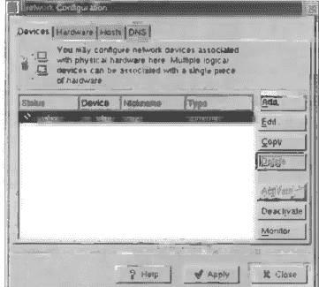

图 3-1 填写基本主机信息，然后是适配器信息。

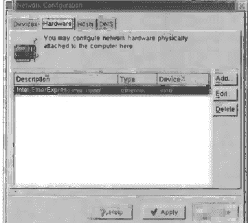

图 3-2 选择基本主机信息。

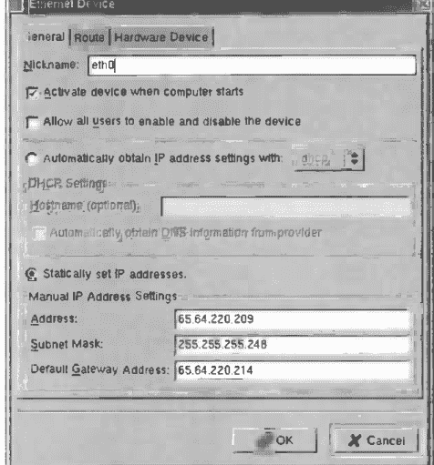

图 3-3 使用名称服务规范来定义你的 DNS 服务器。

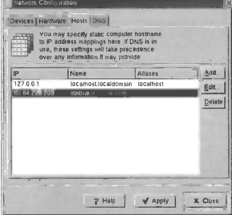

图 3-4 设置你的默认路由器地址

第 3 章 – 用于 OpenVMS 和 Linux 的 TCP/IP 23

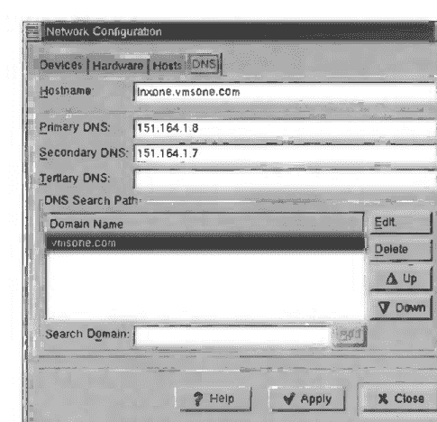

### 在 OpenVMS 上配置 TCP/IP

登录系统账户，并在 `$` 提示符下执行

```
$ sys$manager:tcpipconfig.com
```

图 3-6 到 3-9 展示了如何在 OpenVMS 上配置 TCP/IP。

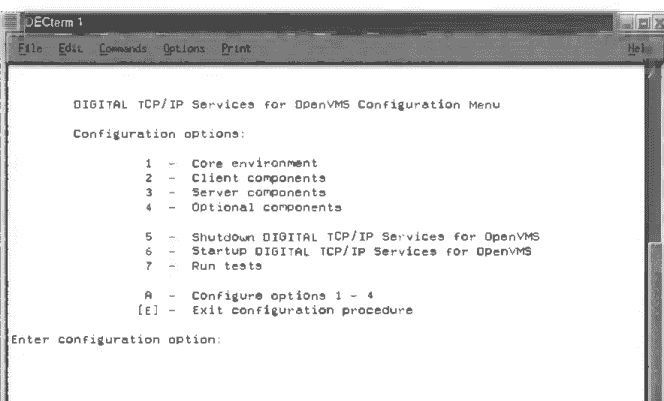

图 3-6 选择核心环境。

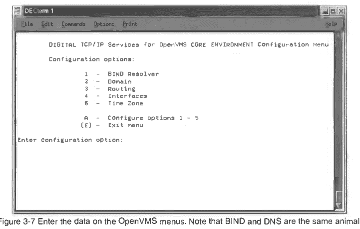


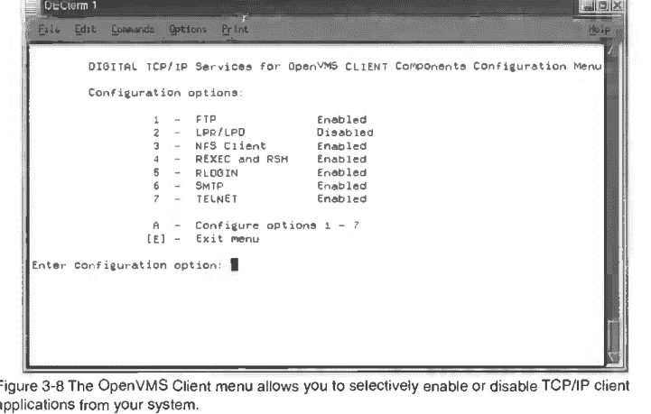

# 第 3 章 – 用于 OpenVMS 和 Linux 的 TCP/IP 25

## 用于 OpenVMS 的 DIGITAL TCP/IP 服务

### 服务器组件配置菜单

| 配置选项: | | | |
|---|---|---|---|
| 1 | BIND | 禁用 |
| 2 | BOOTP | 禁用 |
| 3 | TFTP | 禁用 |
| 4 | FTP | 启用 |
| 5 | LPR/LPD | 禁用 |
| 6 | NFS | 启用 |
| 7 | PC-NFS | 禁用 |
| 8 | PORTMAP | 启用 |
| 9 | TELNET/RLOGN | 禁用 |
| 10 | SNMP | 禁用 |
| 11 | NTP | 禁用 |
| 12 | METRIC | 禁用 |
| 13 | POP | 启用 |
| 14 | FINGER | 启用 |
| 15 | LOCKER | 禁用 |
| 16 | DMCP | 禁用 |
| 17 | 配置选项 17 | |
| (E) | 退出菜单 | |

编辑配置选项：为你的系统启用或禁用 TCP/IP 服务器应用程序。记住，如果你需要 NFS、POP3、IMAP 邮件或其他功能，它们必须能够运行！

## TCP/IP 应用

OpenVMS 和 Linux 网络通过使用跨越 TCP/IP 的相似应用程序共同协同工作。表 3-2 是协议以及一些常用应用程序的列表，并对它们执行的功能进行了简要描述。

### 表 3-2：OpenVMS 和 Linux 之间的 TCP/IP 应用

| 应用 | 描述 | 配置时 |
|---|---|---|
| BIND/DNS | 互联网名称服务 | 通常与你的 ISP 配合 |
| FTP | 文件传输协议—系统之间的网络复制 | 初始系统安装 |
| LPD | 打印机守护进程—用于打印到打印机 | |
| SMB | 系统块—磁盘共享 | 当你添加网络 |

### 表 3-2：OpenVMS 和 Linux 之间的 TCP/IP 应用（继续）

| 应用 | 描述 | 配置时 |
|---|---|---|
| Telnet | 终端仿真决定了如何使用它；TCP/IP 提供连接 | 初始系统安装 |
| SMTP, POP3, IMAP | 电子邮件、邮局协议、简单邮件传输协议 | 查看第 6 章 |
| SSL | 使用套接的安全层 | 查看第 4 章 |
| X Windows | 网络系统的 X Windows | 查看第 5 章 |

OpenVMS 和 Linux 网络因为应用程序遵循行业标准定义而共同工作。说这完全可行可能太简单了！大多数时候确实如此！FTP 在两个系统之间复制文件，无论你发送的是二进制文件（编译过的或对象文件）还是文本文件。X Windows、电子邮件客户端、Finger、Telnet 以及所有其他应用也是如此。

## URL 技巧及更多

TCP/IP 工具构建在 Linux 和 OpenVMS 操作系统的内部。你可以复制文件、发送电子邮件以及更多内容。进程间通信使得客户端/服务器成为可能，而万维网和 IP 端口可以在新应用程序投入生产之前在同一服务器上进行测试和运行。

所有这些内容的未来都是新的，我们应该看到更多具有增强功能且加密不断增加的应用。

在进入下一章安全之前，最后一个 TCP/IP 技巧：我的一个好朋友，来自 DFWLUG 的 Steve Smiley 向我展示了这个小技巧，并据此为 DFWLUG 季刊撰写了一篇文章。

如果你在 Linux 或 OpenVMS 系统上执行 `NSLOOKUP` 并输入有效的 DNS 名称，你会得到类似 209.39.152.33 的地址。如果你将 TCP/IP 字节转换为二进制表示（借助科学计算器的帮助），你会得到

```
209 = 11010101
39 = 00100111
```

确保在前面补 0 以形成 8 字节字符二进制！

```
152 = 10011000
33 = 00100001
```

将二进制（2 进制）字符串相加

```
209.39.152.33 = 1101000100111110011100000100001 (base2)
```

我惊呆了。我并没有对“环太平洋地区”的 C 类网段（Pacific Rim Class Cs）进行端口扫描吧？接着我看到了他发给我的日志。不是我，不可能是我！记住所有这些阶段——否定、愤怒、讨价、抑郁、接受。在被黑后的第一个 24 小时里，我经历了所有的阶段。

看起来这些 ping 包和扫描来自我那台新 Linux 机器！那时已经很晚了，我完全处于否认状态，于是给那个粗鲁之回了一封邮件：“不可能是我。”然后我就去睡觉了。

第二天早晨，我来自澳大利亚的朋友给我发了更多日志，证明了我的系统在探测方面的复杂性：“你好，伙计，我相信是那些脚本小子（script kiddies）控制了你的机器，你真的应该查查他们正在做什么。”

脚本小子——这个名字让我那安装了四天的 Linux 系统感到胆战。他们他们是如何在广阔无垠的互联网上找到我的。我才运行了四天啊！感觉自己像个异异乡的陌生人，我采取了任何 OpenVMS 系统管理员在遇到 Linux 机器问题时会采取的行动。我给另一个 OpenVMS 系统管理员打了电话！不只是普通的系统管理员，而是我的好朋友 David，DECUS/VMS SIG 主席兼达拉斯-斯顿当地用户小组主席。David 有 Linux 经验，所以我很快指出我们应该在系统上寻找奇怪的文件。

Dave 走了过来，我们寻找了临时文件。寻找就会发现；我简直就像是所有发现孩子身上爬满虱子的父母一样！那台 Linux 机器不仅被黑了，而且还有端口扫描日志、扫描执行程序，以及两个坏蛋之间关于破解机器以及利用其寻找新目标进行攻击的完整对话日志。David 和我观察、等待，并以超级用户的身份捕获了会话信息——其中一个连接通过 AOL 跳转以防被发现，另一个则通过韩国某所大学跳转。

我做了铁血系统管理员会做的事：获取日志，复制文件，打电话并给 AOL 提供了那个为了邪恶目的肆虐我的作案者的用户 ID。

当然，AOL 不想和我的证据有任何关系——我有 FBI 或者至少有当地执法部门！我考虑过由于我的生产环境 Linux 机器被一个 AOL 脚本小子攻击并破解，我可以开出 4200 万美元的 IT 费用，尽管浪费当局的时间不太好。

我对 Linux 机器的死后分析包括将其断开网络，并识别破解者是如何直接溜入，并让我的机器像骡子一样干体力活的。答案在密码文件中——我加载了所有东西，我能加载每一个 RPM！加载了一个数据库，默认特权用户账户可以创建其他账户——使用默认密码！

我变得很谦卑，不再那么自信，我清理了我的 Linux 系统，只加载了我将要使用并立即理解的 RPM。从这里我学到了关于系统安全的巨大教训：

如果你不知道某个软件是做什么，就不要在你的系统上加载它，并将任何默认设置更改为更安全的设置。

当然，我也学会了对澳大利亚人多信任一点，对 AOL 和韩国某大学的计算机账户少信任一点。

## 为风暴做准备

Steven Smiley 和我在一个著名的安全会议上休息，观看那天晚的电影节双片放映（《福比计划巨人》和《黑暗之星》）。教室后方传来阵阵笑声，因为有人在做些很酷的事。Steve 自己去参加一个深夜问答环节了，但我走向最后，和那群最吵闹的顾问坐在一起。

当我听着时，观众围坐着一个年轻人，他坐在地板上，笔记本电脑无线线连接到网络。

> “嗅探了他的即时通讯软件密码，现在我正在和他妈妈聊天”——坐在周围的人爆发出阵阵大笑。

> “但是妈妈，我会留在拉斯维加斯在赌场工作。我找到了我的真归宿！”那个键盘侠一边给目标的妈妈发字，一边大声念读道。

> “你不会毁掉那个可怜事儿对他自己的印象的，对吧？”我问道。

> “不会，”键盘侠说，“我只是为了确保他学会网络通信中加密的价值！”

每个人都为这个笑话大笑起来。

简单的真理是，如果你是一个开放网络，网络上的任何人都有可能嗅探数据包并扫描明文密码，扫描所有 TCP/IP 端口，并寻找已知的后门或更糟的东西。你能做什么？防火墙？入侵检测工具？加固操作系统？完全拔掉网络连接？

我们不太可能直接退出网络通信，因为这对于如今的计算机和便携式设备来说是前提条件。所以今天的主要解决方案之一（也是未来重要性日益增加的解决方案）是在建立连接时在客户端和服务器之间使用加密链路——任何连接！

现在记住，标准的 TCP/IP 工具如 Telnet 和 FTP 完全没有加密，你通过这些工具发送的任何数据都可以被检查密码、PIN 码、代码、信用卡号、社会安全号，甚至是位于传输文件内部的数据。现在问问自己：谁会花时间在你的网络上扫描这些东西？你会感到惊讶的。大多数计算机犯罪 60/40% 为内部人员。这比去年有所下降，去年的常态是内部人员占 70%。互联网和其他网络路径是计算机犯罪增长最快的访问方式！

考虑一下，每个运行标准程序的服务器都使用相同的端口，因此你不仅知道服务器在运行什么，你可能还可以利用这些端口作为这些服务器的后门。

## TCP/IP 已知端口


# TCP/IP 已知端口与端口扫描

由于它们是标准应用程序，TCP/IP 为服务器定义了“已知端口”，它们随时准备与尝试通信的客户端连接进行通信。

也许最为人知的端口是 80 端口，或者说是万维网（WWW）协议通信的端口。从带有 Web浏览器的客户端连接，WWW 协议通过此链路使用 TCP/IP 连接到 Web 服务器上的 80 端口——所有所有的超文本、图片、图形、电影、Java 和其他 Web 信息。

已知端口还告诉我们服务器目前正在提供哪些服务。许多应用程序有自己的 TCP/IP 端口号，它们在默认安装时总是使用。这些应用程序有时可以更改端口号，但很少这样做。服务器管理员可以更改这些端口，但其他客户端应用程序将无法与它们通信。

好消息是，这些端口现在提供了一种查看 TCP/IP 节点上提供的所有服务的方法。坏消息是，这些端口现在提供了一种查看 TCP/IP 节点上提供的所有服务的方法！只需通过探测这些应用程序的已知密码和已知后门，就可以打开这些节点的安全性。

网络服务器观察者的首选工具是一种名为端口扫描器的软件。互联网上可以找到端口扫描器；费用从免费到数千美元不等。这些工具中的许多会检查服务器从 1 到 80,000+ 的每一个端口。许多已知的软件端口带有横幅（banners），可以告诉你许多关于端口应用程序、服务器操作系统、甚至是谁拥有该系统的大量信息！一个优秀甚至平庸的端口扫描器都会保存这些信息以供搜索或稍后查看。

使用端口扫描器最简单最直接的方法当然是 TCP/IP 应用程序。你可以使用 `Telnet` 检查甚至与服务器上的任何已知端口或应用程序端口进行交互！通常你使用 `Telnet` 客户端连接到服务器端口（默认数字 23），大多数 `Telnet` 应用程序会更改你的端口以连接到你想要的任何端口。从 VMS 或 Linux 提示符简单输入：

```
telnet/port=25 yourhost.domain.com
```

从终端窗口执行。你的交互式终端会话将连接到 25 端口（服务器上的电子邮件端口），如果它是激活状态的话！输入

```
helo\help
```

你就进入了一个交互式电子邮件系统，它允许你在这样一项被称为“电子邮件欺骗”（e-mail spoofing）的古老运动中发送 SMTP 邮件。你可以 `Telnet` 到已知端口，并直接与控制这些端口的应用程序对话。

许多应用程序有安全性。但很多没有。这并不是你用来攻击他人系统的方法，而是确认服务器的 TCP/IP 应用程序已配置、安装并运行的极佳方法。

当你在操作你的 Linux 或 OpenVMS 系统时，遍历已知端口是一种实验性和学习工具。但当你从他人的 Linux 系统遍历澳大利亚和新西兰的所有已知端口，并在通过 AOL 和海外大学账户跳转的同时将其作为引导启动（进行你的工作）时，我相信这属于犯罪活动领域。

我包含了一份已知端口列表；还有其他端口，且每个网络应用程序都可能包含自己的已知端口。这些是我查看应用程序是否正在运行的端口；更彻底的端口扫描可以识别未知的后门、安全漏洞以及你没有安装的应用程序。你应该定期扫描服务器上的 1-80,000 端口以确保万无。

Linux 和 OpenVMS 系统的 TCP/IP 已知端口（并非全部）包括以下内容：

| 端口 | 服务 |

| :--- | :--- |

| 7 | echo |

| 11 | systat.Active Users |

| 21 | ftp |

| 22 | ash |

| 23 | telnet |

| 端口 | 服务 | 描述 |

| :--- | :--- | :--- |

| 25 | smtp | 简单邮件传输协议 |

| 42 | nameserver | WINS 主机名 |

| 43 | nicname | Who Is (用户信息查询) |

| 53 | domain | 域名服务器 |

| 66 | sql* | Oracle SQL*NET |

| 79 | finger | Finger (指纹查询) |

| 80 | http | 世界维网 HTTP |

| 88 | kerberos | Kerberos (密钥分发认证协议) |

| 109 | pop2 | 邮件协议版本 2 |

| 110 | pop3 | 邮件协议版本 3 |

| 111 | sunprc | Sun 远程过程调用 |

| 118 | sqlserv | SQL 服务 |

| 119 | ntmpr | 网络传输协议 |

| 135 | ntmpr | DCE 端点解析 |

| 139 | netbios-snm | NETBIOS 会话服务 |

| 135 | nttpr | DCE 端点解析 |

| 143 | imap | 互联网邮件访问协议 |

| 389 | ldap | 轻量级目录访问协议 |

| 396 | network-ip | Novell Netware over IP |

| 443 | https | 安全版 HTTP |

| 513 | login | 远程登录 |

| 514 | rhell | cmd |

| 515 | printer | 打印机进程程序 |

| 800 | socks | Socks 服务 |

| 1313 | bmc_patrold | BMC_PATROLDB |

| 1352 | lotusnote | Lotus Notes |

| 1433 | ms-sql-s | Microsoft SQL Server |

| 1494 | citrix | Citrix |

| 1524 | ingress | 入口 |

| 1525 | orasrv | Oracle 服务器 |

| 1527 | tlisv | Oracle 服务器 |

| 1723 | pptp | PPTP |

| 1745 | winsock-proxy | Winsock 代理 |

| 2000 | remotely-anywhere | 远程访问 |

| 2001 | cisco-mgmt | Cisco 路由器管理 |

| 2049 | nfs | NFS |

| 2301 | CIM | Compaq Insight Manager |

| 2447 | openview | OpenView |

| 2998 | realsecure | RealSecure |

| 3000 | hbcbi | HBCI |

| 3300 | bmc-agent | BMC Patrol 代理 |

| 3306 | mysql | mysql |

| 4001 | cisco-mgmt | Cisco 路由器管理 |

| 4045 | nfs-locked | NFS 锁 |

| 5222 | jabcat | ... |

| 5631 | pcanyherata | ANYWHEREData |

| 5800 | VNC | 虚拟网络计算服务器， |

| 6000 | xwindows | Windows 系统 |

| 6001 | cisco-mgmt | Cisco 路由器管理 |

| 6667 | irc | 互联网聊天服务器 |

| 8000 | web-shoutcast | Web/Shoutcast 服务器 |

| 8001 | web | Web |

| 8002 | web | Web |

| 8080 | WWW-Proxy | 标准 HTTP 代理 |

| 9001 | cisco-xremote | Cisco 远程 |

| 26000 | quake | quake |

| 32771 | rpc-solaris | Solaris RPC |

| 65301 | pcanywhere-def | pcAnywhere |

## 加密——不仅仅是为了早餐

当你通信敏感（或非敏感）信息时，你需要加密工具/命令，否则你会面临密码、文件以及任何在网络中移动、复制和重新分发的风险。让我们谈谈 OpenVMS 和 Linux 系统上常用的加密协议。

### SSH (V1 和 V2)

`SSH`（或安全外壳）的功能是众为人知的，多年来在 TCP/IP 世界的许多主机之间可用。

`SSH` 能够在主机之间创建加密的 `SSH` 会话。你可以打开加密的 `SSH` 终端连接到 `SSH` 服务器。Linux 和 OpenVMS 都可以作为客户端和服务器，允许两个系统进行安全的终端会话。`MultiNet` 使用此协议和文件传输应用 `SCP` 用于 OpenVMS（VMS TCP/IP 一直以来请求 `SSH`，但它们的注意力被其他 TCP/IP 方向所分散了）。

在开源和 Linux 世界的其他部分，`SSH` 通常是操作系统自带的终端或 shell 命令，但它本身并不执行文件传输 (`FTP`)。额外的应用程序已编写为使用 `SSH` 协议进行文件传输，例如用于 OpenVMS 的 `MultiNet SCP` 以及用于 Linux 和 UNIX 用户的 `SFTP`。


HP 的 OpenVMS TCP/IP 服务没有 SSH 能力，但通过添加 MultiNet SSH 产品，SSH 协议与 TCP/IP 服务（HP 的 5.3 TCP/IP）工作，使得 Linux 和 OpenVMS 之间可以使用 SSH。如果你需要在公有或私有的 Linux 或 OpenVMS 系统之间进行安全的终端访问，且该网络支持交互式终端或 shell 命令登录，而不是明文交换密码和数据，你就会使用 SSH。

可以在以下位置找到此类加密应用的软件：

- 对于 Linux：Linux 标准发行版中的开源软件，或访问 `http://www.openssh.org/`
- 对于 OpenVMS：`http://www.process.com/` 的 Process 软件 (`MultiNet`)
- 对于 HP：OpenVMS V5.3 TCP/IP 服务 `http://www.openvms.compaq.com/`

## SSL

SSL（安全套接层）自 1996 年以前就已经存在，但它仍然还没有版本 1.0。这并不意味着它没有功能——只是它需要时间成为 V1.0 版本。如果你怀疑 SSL 的功能，只需在你连接银行账户或在 Web 上尝试购买物品时，检查你常用浏览器底部的锁图标。只要你的锁是关闭的，SSL 被调用！

SSL 作为加密协议的作用正在不断扩大，新的更复杂的工具和应用程序与其身份机制和通信方式相关。今天，SSL 可以用于 Web、终端会话、文件传输、POP 和 IMAP，几乎任何使用已知主机端口地址的 TCP/IP 应用也需要对其通信进行加密。当然，SSL 需要一些帮助来完成这些任务，而它现在适用于 OpenVMS 和 Linux！

OpenSSL 仅包含一个带有程序和编程接口的工具包。你要么必须修改程序以使用 SSL（如你常用的 Web 浏览器），或者你需要另一个位于标准 TCP/IP 应用程序和 SSL 之间的工具。

### 文件编辑设置

已选择以下产品：

`CPQ ARXPMS SSL V1.0-A` 分层产品 [已安装]

你是否要继续？[是] 是

正在配置...

你将被要求为每个选定的产品以及可能为了满足软件依赖关系而安装的产选择选项。

`CPQ ARXPMS SSL V1.0-A`: 用于 OpenVMS Alpha V1.0-A 的 SSL（基于 OpenSSL 0.9.68）。

- Compaq 计算机公司 2002. 保留所有权利。

你是否使用默认选项？[是] 是

你是否要检查选项？[否]

开始执行...

以下产品将安装到目标位置：

`CPQ ARXPMS SSL V1.0-A` `DISK$VMS0731:[vMS$COMMON]`。

完成进度：0%...10%...20%...30%...

图 4-3 安装将继续计算完成的百分比。

文件编辑设置帮助

完成进度：0%...10%...20%...30%...40%...50%...60%...70%...80%...90%...100%

已安装以下产品：

`CPQ ARXPMS SSL V1.0-A` 分层产品

```
PCXI-I-EXECUTE, 执行 CPQ ARXPMS SSL V1.0-A 的测试程序
PCXI-I-IUPSUCCESS, 测试程序成功完成
```

`CPQ ARXPMS SSL V1.0-A`: 用于 OpenVMS Alpha V1.0-A 的 SSL（基于 OpenSSL 0.9.68）。

请将以下文件插入 `SYSMANAGER:STARTUP_VMS.COM`：

`@sys@startup$startup.com`

请将以下文件插入 `SYSMANAGER:SHUTDOWN.COM`：

`@sys@shutdown$shutdown.com`

有一些需要执行的安装后活动。

这包括定义逻辑名称、运行 `SQLUTILS.COM` 来定义某些外源符号，以及如果在安装过程中没有执行 IVP，则运行它。请参阅发行说明（Release Notes）以获取有关安装完成后应执行的活动的更多信息。

SSL 已在 VMS 安装中创建了以下目录结构。

图 4-4 重要的后处理信息从 VMS 安装交付。

第 4 章 – OpenVMS 和 Linux 安全工具 39

SSL 已在 `PCSDESTINATION` 中创建了以下目录结构，默认值为 `SYSSYSDEVICE:[VMSCOMMON]`：

- `[SSL]` 顶级目录
- `[SSL.ALPHA.EXE]` 包含 Alpha 平台的映像。
- `[SSL.COM]` 各种命令程序的目录。
- `[SSL.DEMOCA]` 演示 SSL 功能目录。
- `[SSL.DEMOCA.CERTS]` 用于存储证书和密钥的目录。
- `[SSL.DEMOCA.CONF]` 包含配置文件。
- `[SSL.CRL]` 包含撤销的证书和证书吊销列表 (`CRL`)。
- `[SSL.DEMOCA.PRIVATE]` 私钥和随机数据的目录。
- `[SSL.INCLUDE]` 包含 C 头文件 (`.H`)。
- `[SSL.TEST]` 包含 IVP 期间使用的文件。

请参考 `SYSHELP:SSL010A.RELEASE_NOTES` 获取更多信息。

系统启动时应运行 `$SYSSTART:$SYSSTART.com`。


```
$ show logical/system ssl:
```

`$SSL$CERTS = "$SSL$ROOT:[DEMOCA.CERTS]"`

`$SSL$COM = "$SSL$ROOT:[COM]"`

`$SSL$CONF = "$SSL$ROOT:[DEMOCA.CONF]"`

`$SSL$CRL = "$SSL$ROOT:[DEMOCA.CRL]"`

`$SSL$KEY = "$SSL$ROOT:[ALPHA.KEY]"`

`$SSL$INCLUDE = "$SSL$ROOT:[INCLUDE]"`

`$SSL$IKEY = "$SSL$ROOT:[DEMOCA.CERTS]"`

`$SSL$PRIVATE = "$SSL$ROOT:[DEMOCA.PRIVATE]"`

`$SSL$ROOT = "VMSINDEX:IDK600:[SYS9.SYSCOMMON.SSL]"`


## Linux & OpenVMS 互操作性

```
root@imone:~ 
```

文件编辑设置帮助

```
$ set cont
$ set noon
$ SYS$MANAGER:STARTUP_VMS.COM
$ 这是用于站点特定启动命令程序的模板。
$ 从 OpenVMS V7.2 开始，此模板通用于 OpenVMS Alpha VAX。
$ 对模板的任何更改将同时应用于两个系统。
$ -------------------------------------------------------
$ 注意：在 OpenVMS VAX 上，此系统替换了站点特定的
$ 启动程序 SYS$MANAGER:STARTUP_V5.COM。仅名称
 发生了变化，功能相同。
$ 请查看文档获取更多详情。
$ -------------------------------------------------------
$ 你可以根据系统的需要向此程序中添加命令或更改程序内的命令。
$ 此命令程序在保存时：
$ 缓冲区：STARTUP_VMS.COM                               -写入 Forward
从文件 SYS$COMMON:[3 读取了 424 行
```

图 4-7 编辑 OpenVMS 启动脚本/命令文件以便重启时启动。

```
@imone:~ 
```

文件编辑设置帮助

```
$ 
$ 移除以下行的注释符号 ($) 以
$ 在 TCP/IP 中运行 SSL。
$ SYS$STARTUP:VPM@STARTUP
$ 
移除以下行的注释符号 ($) 以启动
$ RPC 服务。
$ SYS$STARTUP:DCE@RPC_STARTUP
$ 
OpenSSL 启动...
$ @sys$startup:ssl3-com
$ EXIT
[文件结束]
$ 缓冲区：STARTUP_VMS.COM                               -写入 Forward
```

图 4-8 将行添加到文件末尾（TCP/IP 之后）。

第 4 章 – OpenVMS 安全工具


```
$ 
$
$ create/dir
root[PCSDESTINATION]

- [SSL.ALPHA.EXE] 包含 Alpha 平台的映像。
- [SSL.COM] 各种命令程序的目录。
- [SSL.DEMOCA] 演示 SSL 功能目录。
- [SSL.DEMOCA.CERTS] 用于存储证书和密钥的目录。
- [SSL.DEMOCA.CONF] 包含配置文件。
- [SSL.CRL] 包含撤销的证书和证书吊销列表 (CRL)。
- [SSL.DEMOCA.PRIVATE] 私钥和随机数据的目录。
- [SSL.INCLUDE] 包含 C 头文件 (.H)。
- [SSL.TEST] 包含 IVP 期间使用的文件。
```

图 4-9 从目录恢复 SSL 证书。

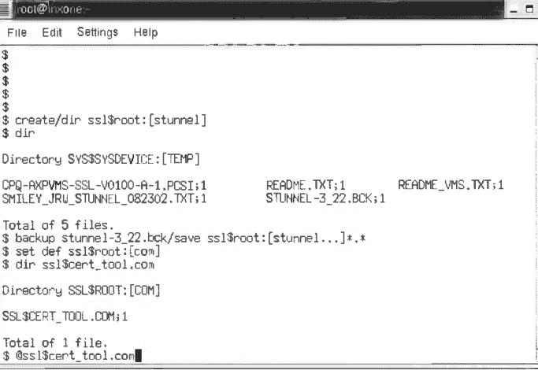

图 4-10 运行 SSL 工具。

# SSL 工具

主菜单

+   1. 查看证书
2. 查看证书请求
3. 创建证书请求
4. 创建自签名证书
5. 创建 CA 证书证书
6. 签名证书请求
7. 哈希证书
8. 哈希证书吊销列表
9. 退出

```
输入选项: 6
```

## SSL证书工具

### 签名证书请求

- CA证书文件 ? `[SSL$ROOT:[DEMOCA,CERTS]SERVER_CA,CRT]`
- CA 证书密钥文件 ? `[SSL$ROOT:[DEMOCA,CERTS]SERVER_CA,KEY]`
- 证书请求文件 ? `[SSL$CSR:SERVER,CSR]`
- 签名后的证书文件 ? `[SSL$CRT:SIGNED,CRT]`
- 默认数据 ? `[ ]`
- PEM 密码短 ? `[ ]`
- 显示证书 ? `[N]`

图 4-17 再次使用默认值。保存 PEM 密码短并记住你使用的大小——你稍后会需要它。

## SSL证书工具

## 主菜单

1. 查看证书
2. 查看证书签名请求 (CSR)
3. 创建证书签名请求 (CSR)
4. 创建自签名证书
5. 创建 CA（认证机构）证书
6. 签名证书签名请求 (CSR)
7. 证书哈希
8. 吊销列表哈希
9. 退出

输入选项：9

图 4-18 退出 SSL 证书菜单。

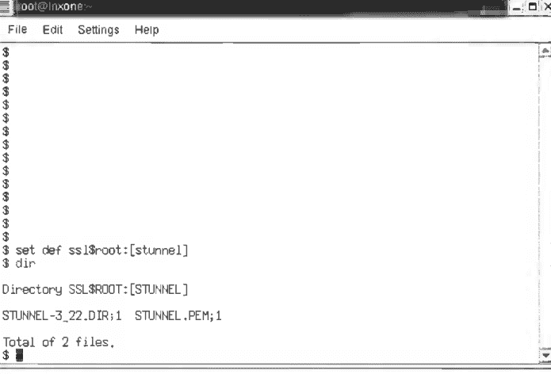

```
root@linuxone:~# File Edit Settings Help
$ set def ssl$root:[stunnel]
$ dir
Directory SSL:ROOT:[STUNNEL]\STUNNEL_3_22.DIR;1 STUNNEL.PEM;
Total of 2 files.
$
```

图 4-19 进入 Stunnel 所在的目录，你将找到一个 `STUNNEL.PEM` 文件。

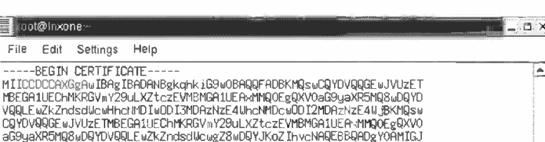

```
root@linuxone:~# File Edit Settings Help
---BEGIN CERTIFICATE---
MIIC9TCCCCAawwBAgANBgkqhkiG9w0BAQEFAAAD4NNICIBCKCAQEA6v8DAgAwIBAgAA
GEQGEQ0VGEQGEQ0VGEQGEQ0VGEQGEQ0VGEQGEQ0VGEQGEQ0VGEQGEQ0VGEQGEQ0VGEQGE
Q0VGEQGEQ0VGEQGEQ0VGEQGEQ0VGEQGEQ0VGEQGEQ0VGEQGEQ0VGEQGEQ0VGEQGEQ0VGEQGE
Q0VGEQGEQ0VGEQGEQ0VGEQGEQ0VGEQGEQ0VGEQGEQ0VGEQGEQ0VGEQGEQ0VGEQGEQ0VGEQGE
Q0VGEQGEQ0VGEQGEQ0VGEQGEQ0VGEQGEQ0VGEQGEQ0VGEQGEQ0VGEQGEQ0VGEQGEQ0VGEQGE
Q0VGEQGEQ0VGEQGEQ0VGEQGEQ0VGEQGEQ0VGEQGEQ0VGEQGEQ0VGEQGEQ0VGEQGEQ0VGEQGE
Q0VGEQGEQ0VGEQGEQ0VGEQGEQ0VGEQGEQ0VGEQGEQ0VGEQGEQ0VGEQGEQ0VGEQGEQ0VGEQGE
Q0VGEQGEQ0VGEQGEQ0VGEGEGEQ0VGEGEGEQ0VGEQGEQ0VGEGEQQ0VGEQQQ0VGEQQQ0VGEQQQ0VGEQGEQ0VVGEQ\
QVVGEQQ00VGEQQ00VGEQQ00VGEQGEQ0VGEQQQ0VGEQGEQ0VGEQQQ0VGEQQ0VGEQGE0VGEGEGEGE0VGEGEGEQ0VGEQGE
---END CERTIFICATE---
Proc-Type: 4,ENCRYPTED
DEF-Info: DES-3ED-CBC,0192165337884
```

图 4-20 这是一个 PEM 文件，它就是证书，且它是经过加密的！

第 4 章 – OpenVPN 和 Linux 安全工具 47

```
root@linuxone:~# File Edit Settings Help
$ dir
Directory SSL$ROOT:[STUNNEL]
STUNNEL-3_22_DIR;1 STUNNEL.PEM:1
Total of 2 files.
$ set security/protection=(G,U) stunnel.pem
$
```

图 4-21 为 Stelnel.PEM 文件设置保护属性。

```
root@linuxone:~# File Edit Settings Help
$ set def ssl$root:[stunnel]
$ dir
Directory SSL$ROOT:[STUNNEL]
STUNNEL-3_22_DIR;1 ssl$root:[stunnel]*
Total of 2 files.
$ copy ssl$root:[stunnel-3_22.vms]stunnel.exe ssl$root:[stunnel]*
$ copy ssl$root:[stunnel-3_22.vms]stunnel_startup_server.com ssl$root:[stunnel],*
$ dir
Directory SSL$ROOT:[STUNNEL]
STUNNEL-3_22_DIR;1 STUNNEL.PEM:1
STUNNEL_STARTUP_SERVER.COM:1
Total of 4 files.
$
```

图 4-22 将 Stelnel.EXE 文件和启动脚本拷贝到 Stelnel 目录。

48 Linux & OpenVMS 互操作性

```
root@linuxone:~# File Edit Help
$! Edit this command to run Stunnel in your environment
$! AUTHOR: Taka Shinagawa, OpenVMS Security
$ (takaaki.shinagawa@hp.com)
$! DATE: June 2, 2002
#############################
$! Define a Stunnel command /* Edit this for Stunnel command */
$ Telnet
$ stunnel_command = "STUNNEL -d 982 -r localhost:23 -p [-l]stunnel.pem -o stunnel
---------------------------------------------
$! Ask if the private-key is encrypted
$ question:
$ inquire "Is the private key (in PEM file) encrypted? [Y/N]"
$ if encrypted .EQ
$ then
    goto question
$ else
    if encrypted .EQ, "Y" then
```

图 4-23 编辑 `stunnel_startup.server.file`，找到 `"stunnel="` 行并用 `"#"` 注释掉。


# OpenVMS Stunnel 配置示例

```
root@linuxone:~# File Edit Settings Help
$! Edit this command procedure to run Stunnel in your environment
$! AUTHOR: Taka Shinagawa, OpenVMS Security
$ (takaaki.shinagawa@hp.com)
$! DATE: June 2, 2002
#############################
$! Define a Stunnel command /* Edit this for Stunnel command */
$ Telnet
$ stunnel_command = "STUNNEL -d 982 -r localhost:23 -p [-l]stunnel.pem -o stunnel
$ stunnel_command = "STUNNEL -d 982 -r localhost:23 -p root:stunnel -o stunnel
---------------------------------------------
$! Ask if the-key is encrypted
$ question:
$ inquire "Is the private key (in PEM file) encrypted? [Y/N]"
$ if encrypted .EQ
$ then
    goto question
$ else
    if encrypted .EQ, "Y" then
```

图 4-24 将高亮处显示的 `stunnel_command` 添加到 `-p` 之后的单行中（删除额外的 `"-"`）。保存为新版本的脚本。

第 4 章 – OpenVMS 和 Linux 安全工具 49

```
root@linuxone:~# File Edit Settings Help
$ dir
Directory SSL:ROOT:[STUNNEL]
STUNNEL-3_22_DIR;1 STUNNEL.EXE:1 STUNNEL.PEM:1
STUNNEL_STARTUP_SERVER.COM:2 STUNNEL_STARTUP_SERVER.COM:1
Total of 5 files.
$
```

图 4-25 验证现在有了 `stunnel_server.com` 文件。

```
root@linuxone:~# File Edit Settings Help
$ dir
Directory SSL:ROOT:[STUNNEL]
STUNNEL-3_22_DIR;1 STUNNEL.EXE:1 STUNNEL.PEM:1
STUNNEL_STARTUP_SERVER.COM:2 STUNNEL_STARTUP_SERVER.COM:1
Total of 5 files.
$ stunnel_server_startup
Is the private key (in PEM file) encrypted? [Y/N]: y
Enter password to decrypt the key (please use double quotes with it):
welcome!
Starting Tunnel server at port 992
RUN-S-PROC_ID, identification of created process is 20243
Stunnel successfully started up!
$
```

图 4-26 运行 `stunnel_startup.com` 脚本。使用加密 PEM 证书时相同的大小写密码（记住给密码加上双引号）。

Linux & OpenVMS 互操作性 51

```
root@linuxone:~# File Edit Settings Help
$ stunnel_startup_server 26-AUG-2002 20:16:53 Uptime 0:01:56
The private key (in PEM file) encrypted? [Y/N]: y
Enter password to decrypt the key (please use double quotes with it):
welcome!
Starting up Stunnel running at port 992
RUN-S-PROC_ID, identification of created process is 20243
Stunnel was, started up!
$ show system/process=stunnel.992
OpenVMS V7.3 on node 26-AUG-2002 20:16:53
Pid Name State I/O CPU Pages
202043 Stunnel.992 LE 5 659 0:00:19 369
```

图 4-27 执行一个过程以确保 Stunnel 进程正在运行。

## Linux 上的 Stunnel 客户端

图 27 至 34 展示了 Stunnel 的安装。

```
root@linuxone:~# File Edit Settings Help
$ ls -al
total 272
dr-xr-x 2 root 4096 Aug 26 20:45 -
dr-xr-x 18 root 4096 Aug 25 20:44 -
dr-xr-x 1 root 44413 Aug 27 07:04 stunnel-3.2
$ gzip -cd stunnel-3.2.tar.gz | tar -xvf
```

图 28 在 `/root` 目录中通过 `tar` 命令开始解压。

图 29 这里的管道命令解压 `stunnel-3.2.tar.gz`。

```bash
root@innoxone://stunnel/stunnel-3.22
文件 编辑 设置 帮助
正在检查 pthread sigmask... 是
正在检查 ANSI C 头文件... 是
正在检查 sys/types.h... 是
正在检查 sys/stat.h... 是
正在检查 stdlib.h... 是
正在检查 memory.h... 是
正在检查 strings.h... 是
正在检查 inttypes.h...
正在检查 unistd.h... (已缓存)
正在检查 unsigned char... 正在检查 unsigned char 的大小... ...
正在检查 unsigned short... 是
正在检查 unsigned short 的大小... 2
正在检查 unsigned int... 是
正在检查 unsigned int 的大小... 4
正在检查 unsigned long... 是
正在检查 unsigned long 的大小... 6
正在检查 unsigned long 的大小.../configstatus 8
configure: 正在创建 config.status
config.status: 正在创建 Makefile
[root]@stunnel-3.22]#
```

图 4-31 等待 `make` 命令被调用且 `/components` 完成。


```bash
root@innoxone:/stunnel/stunnel-3.22
文件 编辑 设置 帮助
正在检查 unsigned long... 是
正在检查 unsigned long long 的大小... 8
configure: 正在创建 /config.status
config.status: 正在创建 Makefile
[root]@stunnel-3.22]#
[root]@stunnel-3.22]#
[root]@stunnel-3.22]#
[root]@stunnel-3.22]#
[root]@stunnel-3.22]#
gcc -O2 -D_PATH=/usr/include -DHAVE_VERSION="3.22" -DHAVE_OPENSSL=-1 -Dssldir="*/
-DHAVE_HOME="/usr/local" -DNO_HOME -DHAVE_HOST="i386-pc-linux-gnu" -DHAVE_LIBC=1 -DHAVE_LIBPHTREAD=1 -DHAVE_LIBHUTIL=1
-DHAVE_LIBHAARE=1 -DHAVE_DEVP_PATH=1 -DHAVE_HOST=1 -DHAVE_HAVE_SYS
-DHAVE_SOCKET=1 -DHAVE_GETTOPEH=1 -DHAVE_GETTOPEH-1 -DHAVE_HAVE_SYS-1=1 -DHAVE_VSHPRINT=1 -DHAVE_OPENTI=1 -DHAVE_DEMON=1 -DHAVE_VAITPRD=1 -DHAVE_WAIT1 -DHAVE_HAVE_EPOLL=1 -DHAVE_HAVE_SELECT=1 -DHAVE_EPOLL=1 -DHAVE_HAVE_SYS-1 -DHAVE_TYPES_H=1 -DHAVE_STAT_H=1 -DHAVE_H=1 -DHAVE_STRING_H=1 -
-DHAVE_MEMORY_H=1 -DHAVE_STRINGS_H=1 -DHAVE_TYPES_H=1 -DHAVE_STINT_H=1 -DHAVE-UNISTD_H=1 -SIZED_OFFSET_LONG=8 -SIZED_UNLONG=8 -SIZED_UNSIGNED_SHORT=2 -SIZED_UNSIGNED-INT=4 -SIZED_OFFSET_UNSIGNED=8 -SIZED_OFFSET_UNSIGNED=8 -SIZED_CHDIR=4="/usr/lib/local/*" -DOPIDDIR="/usr/local/var/stunnel"
- c client created。
```

图 4-32 执行 `make` 以构建你已经在 OpenSSL 和 Linux 系统中创建的 `stunnel` 程序。

第 4 章 – 用于 OpenVPN 和 Linux 的安全工具 53

你将被要求输入信息，这些信息将整合到你的证书请求中。

你正要输入的内容被称为区分名称（Distinguished Name）或 `CN`。

有许多字段你可以留空。

对于某些字段将有一个默认值，如果你输入 '..'，则该字段将留空。

```bash
$ stunnel/stunnel-3.22
国家名称（2 位代码）[US]
州或省份（全称）[State-Name]:Texas
地名（例如，城市）[Mesquite]
组织名称（例如，公司）[Shanghai]:Defcon-VMS
组织单元名称（部门）[cflug]
通用名称（你的服务器）[localhost]:
test -1 eq 1 -f /dev/urandom || /dev/random 512 stunnel.pem
test -1 eq 1 -f /dev/urandom || \
/usr/bin/openssl x509 -dates -fingerprint -nout \
||
subject=C=US/ST=Texas/L=Mesquite/O=Defcon-VMS/OU=cflug/CN=localhost
notBefore=Aug 27 01:51:24 2023 GMT
notAfter=Aug 27 01:51:24 2024 GMT
M256 fingerprint:F1:B9:17:6B:C5:7E:A0:32:12:60:F5:42:E46
[root@stunnel-3.22]# 
```

图 4-3 回答来自市场的问题，以便你为 Linux 系统创建一个 `stunnel` 文件。

```bash
$ stunnel/stunnel-3.22
test -1 eq 1 -f /dev/urandom || \
/usr/bin/openssl rand 512 >> stunnel.pem
/usr/bin/openssl x509 -dates -fingerprint -nout \
in stunnel.pem
subject=C=US/ST=Texas/L=Mesquite/O=Defcon-VMS/OU=cflug/CN=localhost
notBefore=Aug 27 01:51:24 2023 GMT
notAfter=Aug 27 01:51:24 2024 GMT
M256 fingerprint:F1:B9:17:6B:C5:7E:A0:32:12:60:F5:42:E46
[root@stunnel-3.22]#
[root]@stunnel-3.22]#
[root]@stunnel-3.22]#
[root]@stunnel-3.22]#
[root]@stunnel-3.22]# make install
/usr/bin/install /usr/bin /usr/local/man /usr/local/share/stunnel/
cd ~; /usr/local/var/stunnel/
/usr/bin/install 755 stunnel
/usr/bin/install 600 stunnel
/usr/bin/install 555 stunnel
[root@stunnel-3.22]#
```

图 4-4 执行 `make` 以构建你在 OpenSSL 和 Linux 系统中创建的 `stunnel`。

```bash
root@innoxone:/stunnel/stunnel-3.22
文件 编辑 设置 帮助
正在检查 unsigned long... 是
正在检查 unsigned long long 的大小... 8
configure: 正在创建 /config.status
config.status: 正在创建 Makefile
[root]@stunnel-3.22]#
[root]@stunnel-3.22]#
[root]@stunnel-3.22]#
[root]@stunnel-3.22]#
[root]@stunnel-3.22]#
```

图 4-31 等待 `make` 命令被调用且 `/components` 完成。

```bash
root@innoxone:/stunnel/stunnel-3.22
文件 编辑 设置 帮助
正在检查 unsigned long... 是
正在检查 unsigned long long 的大小... 8
configure: 正在创建 /config.status
config.status: 正在创建 Makefile
```

图 4-32 执行 `make` 以构建你已经在 OpenSSL 和 Linux 系统中创建的 `stunnel` 程序。

第 4 章 – 用于 OpenVPN 和 Linux 的安全工具 53

你将被要求输入信息，这些信息将整合到你的证书请求中。

你正要输入的内容被称为区分名称（Distinguished Name）或 `CN`。

有许多字段你可以留空。

对于某些字段将有一个默认值，如果你输入 '..'，则该字段将留空。

```bash
$ stunnel/stunnel-3.22
国家名称（2 位代码）[US]
州或省份（全称）[State-Name]:Texas
地名（例如，城市）[Mesquite]
组织名称（例如，公司）[Shanghai]:Defcon-VMS
组织单元名称（部门）[cflug]
通用名称（你的服务器）[localhost]:
test -1 eq 1 -f /dev/urandom || /dev/random 512 stunnel.pem
test -1 eq 1 -f /dev/urandom || \
/usr/bin/openssl x509 -dates -fingerprint -nout \
||
subject=C=US/ST=Texas/L=Mesquite/O=Defcon-VMS/OU=cflug/CN=localhost
notBefore=Aug 27 01:51:24 2023 GMT
notAfter=Aug 27 01:51:24 2024 GMT
M256 fingerprint:F1:B9:17:6B:C5:7E:A0:32:12:60:F5:42:E46
[root@stunnel-3.22]# 
```


## 图 4-3 回答来自市场的问题，以便你为 Linux 系统创建一个 stunnel 文件。

```bash
$ stunnel/stunnel-3.22
test -1 eq 1 -f /dev/urandom || \
/usr/bin/openssl rand 512 >> stunnel.pem
/usr/bin/openssl x509 -dates -fingerprint -nout \
in stunnel.pem
subject=C=US/ST=Texas/L=Mesquite/O=Defcon-VMS/OU=cflug/CN=localhost
notBefore=Aug 27 01:51:24 2023 GMT
notAfter=Aug 27 01:51:24 2024 GMT
M256 fingerprint:F1:B9:17:6B:C5:7E:A0:32:12:60:F5:42:E46
[root@stunnel-3.22]#
[root]@stunnel-3.22]#
[root]@stunnel-3.22]#
[root]@stunnel-3.22]#
[root]@stunnel-3.22]# make install
/usr/bin/install /usr/bin /usr/local/man /usr/local/share/stunnel/
cd ~; /usr/local/var/stunnel/
/usr/bin/install 755 stunnel
/usr/bin/install 600 stunnel
/usr/bin/install 555 stunnel
[root@stunnel-3.22]#
```

## 图 4-4 执行 make 以构建你在 OpenSSL 和 Linux 系统中创建的 stunnel。

```bash
root@innoxone:/stunnel/stunnel-3.22
文件 编辑 设置 帮助
正在检查 pthread sigmask... 是
正在检查 ANSI C 头文件... 是
正在检查 sys/types.h... 是
正在检查 sys/stat.h... 是
正在检查 stdlib.h... 是
正在检查 memory.h... 是
正在检查 strings.h... 是
正在检查 inttypes.h...
正在检查 unistd.h... (已缓存)
正在检查 unsigned char... 正在检查 unsigned char 的大小... ...
正在检查 unsigned short... 是
正在检查 unsigned short 的大小... 2
正在检查 unsigned int... 是
正在检查 unsigned int 的大小... 4
正在检查 unsigned long... 是
正在检查 unsigned long 的大小... 6
正在检查 unsigned long 的大小.../configstatus 8
configure: 正在创建 config.status
config.status: 正在创建 Makefile
[root]@stunnel-3.22]#
```

## 图 4-31 等待 make 命令被调用且 /components 完成。

```bash
root@innoxone:/stunnel/stunnel-3.22
文件 编辑 设置 帮助
正在检查 unsigned long... 是
正在检查 unsigned long long 的大小... 8
configure: 正在创建 /config.status
config.status: 正在创建 Makefile
[root]@stunnel-3.22]#
[root]@stunnel-3.22]#
[root]@stunnel-3.22]#
[root]@stunnel-3.22]#
[root]@stunnel-3.22]#
gcc -O2 -D_PATH=/usr/include -DHAVE_VERSION="3.22" -DHAVE_OPENSSL=-1 -Dssldir="*/
-DHAVE_HOME="/usr/local" -DNO_HOME -DHAVE_HOST="i386-pc-linux-gnu" -DHAVE_LIBC=1 -DHAVE_LIBPHTREAD=1 -DHAVE_LIBHUTIL=1
-DHAVE_LIBHAARE=1 -DHAVE_DEVP_PATH=1 -DHAVE_HOST=1 -DHAVE_HAVE_SYS
-DHAVE_SOCKET=1 -DHAVE_GETTOPEH=1 -DHAVE_GETTOPEH-1 -DHAVE_HAVE_SYS-1=1 -DHAVE_VSHPRINT=1 -DHAVE_OPENTI=1 -DHAVE_DEMON=1 -DHAVE_VAITPRD=1 -DHAVE_WAIT1 -DHAVE_HAVE_EPOLL=1 -DHAVE_HAVE_SELECT=1 -DHAVE_EPOLL=1 -DHAVE_HAVE_SYS-1 -DHAVE_TYPES_H=1 -DHAVE_STAT_H=1 -DHAVE_H=1 -DHAVE_STRING_H=1 -
-DHAVE_MEMORY_H=1 -DHAVE_STRINGS_H=1 -DHAVE_TYPES_H=1 -DHAVE_STINT_H=1 -DHAVE-UNISTD_H=1 -SIZED_OFFSET_LONG=8 -SIZED_UNLONG=8 -SIZED_UNSIGNED_SHORT=2 -SIZED_UNSIGNED-INT=4 -SIZED_OFFSET_UNSIGNED=8 -SIZED_OFFSET_UNSIGNED=8 -SIZED_CHDIR=4="/usr/lib/local/*" -DOPIDDIR="/usr/local/var/stunnel"
- c client created。
```

## 图 4-32 执行 make 以构建你已经在 OpenSSL 和 Linux 系统中创建的 stunnel 程序。

第 4 章 – 用于 OpenVPN 和 Linux 的安全工具 53

你将被要求输入信息，这些信息将整合到你的证书请求中。

你正要输入的内容被称为区分名称（Distinguished Name）或 `CN`。

有许多字段你可以留空。

对于某些字段将有一个默认值，如果你输入 `..`，则该字段将留空。

```bash
$ stunnel/stunnel-3.22
国家名称（2 位代码）[US]
州或省份（全称）[State-Name]:Texas
地名（例如，城市）[Mesquite]
组织名称（例如，公司）[Shanghai]:Defcon-VMS
组织单元名称（部门）[cflug]
通用名称（你的服务器）[localhost]:
test -1 eq 1 -f /dev/urandom || /dev/random 512 stunnel.pem
test -1 eq 1 -f /dev/urandom || \
/usr/bin/openssl x509 -dates -fingerprint -nout \
||
subject=C=US/ST=Texas/L=Mesquite/O=Defcon-VMS/OU=cflug/CN=localhost
notBefore=Aug 27 01:51:24 2023 GMT
notAfter=Aug 27 01:51:24 2024 GMT
M256 fingerprint:F1:B9:17:6B:C5:7E:A0:32:12:60:F5:42:E46
[root@stunnel-3.22]# 
```

## 图 4-3 回答来自市场的问题，以便你为 Linux 系统创建一个 stunnel 文件。


```bash
$ stunnel/stunnel-3.22
test -1 eq 1 -f /dev/urandom || \
/usr/bin/openssl rand 512 >> stunnel.pem
/usr/bin/openssl x509 -dates -fingerprint -nout \
in stunnel.pem
subject=C=US/ST=Texas/L=Mesquite/O=Defcon-VMS/OU=cflug/CN=localhost
notBefore=Aug 27 01:51:24 2023 GMT
notAfter=Aug 27 01:51:24 2024 GMT
M256 fingerprint:F1:B9:17:6B:C5:7E:A0:32:12:60:F5:42:E46
[root@stunnel-3.22]#
[root]@stunnel-3.22]#
[root]@stunnel-3.22]#
[root]@stunnel-3.22]#
[root]@stunnel-3.22]# make install
/usr/bin/install /usr/bin /usr/local/man /usr/local/share/stunnel/
cd ~; /usr/local/var/stunnel/
/usr/bin/install 755 stunnel
/usr/bin/install 600 stunnel
/usr/bin/install 555 stunnel
[root@stunnel-3.22]#
```

### 图 4-4 执行 `make` 以构建你在 OpenSSL 和 Linux 系统中创建的 `stunnel`。

```bash
root@innoxone:/stunnel/stunnel-3.22
文件 编辑 设置 帮助
正在检查 pthread sigmask... 是
正在检查 ANSI C 头文件... 是
正在检查 sys/types.h... 是
正在检查 sys/stat.h... 是
正在检查 stdlib.h... 是
正在检查 memory.h... 是
正在检查 strings.h... 是
正在检查 inttypes.h...
正在检查 unistd.h... (已缓存)
正在检查 unsigned char... 正在检查 unsigned char 的大小... ...
正在检查 unsigned short... 是
正在检查 unsigned short 的大小... 2
正在检查 unsigned int... 是
正在检查 unsigned int 的大小... 4
正在检查 unsigned long... 是
正在检查 unsigned long 的大小... 6
正在检查 unsigned long 的大小.../configstatus 8
configure: 正在创建 config.status
config.status: 正在创建 Makefile
[root]@stunnel-3.22]#
```

### 图 4-31 等待 `make` 命令被调用且 `/components` 完成。

```bash
root@innoxone:/stunnel/stunnel-3.22
文件 编辑 设置 帮助
正在检查 unsigned long... 是
正在检查 unsigned long long 的大小... 8
configure: 正在创建 /config.status
config.status: 正在创建 Makefile
[root]@stunnel-3.22]#
[root]@stunnel-3.22]#
[root]@stunnel-3.22]#
[root]@stunnel-3.22]#
[root]@stunnel-3.22]#
gcc -O2 -D_PATH=/usr/include -DHAVE_VERSION="3.22" -DHAVE_OPENSSL=-1 -Dssldir="*/
-DHAVE_HOME="/usr/local" -DNO_HOME -DHAVE_HOST="i386-pc-linux-gnu" -DHAVE_LIBC=1 -DHAVE_LIBPHTREAD=1 -DHAVE_LIBHUTIL=1
-DHAVE_LIBHAARE=1 -DHAVE_DEVP_PATH=1 -DHAVE_HOST=1 -DHAVE_HAVE_SYS
-DHAVE_SOCKET=1 -DHAVE_GETTOPEH=1 -DHAVE_GETTOPEH-1 -DHAVE_HAVE_SYS-1=1 -DHAVE_VSHPRINT=1 -DHAVE_OPENTI=1 -DHAVE_DEMON=1 -DHAVE_VAITPRD=1 -DHAVE_WAIT1 -DHAVE_HAVE_EPOLL=1 -DHAVE_HAVE_SELECT=1 -DHAVE_EPOLL=1 -DHAVE_HAVE_SYS-1 -DHAVE_TYPES_H=1 -DHAVE_STAT_H=1 -DHAVE_H=1 -DHAVE_STRING_H=1 -
-DHAVE_MEMORY_H=1 -DHAVE_STRINGS_H=1 -DHAVE_TYPES_H=1 -DHAVE_STINT_H=1 -DHAVE-UNISTD_H=1 -SIZED_OFFSET_LONG=8 -SIZED_UNLONG=8 -SIZED_UNSIGNED_SHORT=2 -SIZED_UNSIGNED-INT=4 -SIZED_OFFSET_UNSIGNED=8 -SIZED_OFFSET_UNSIGNED=8 -SIZED_CHDIR=4="/usr/lib/local/*" -DOPIDDIR="/usr/local/var/stunnel"
- c client created。
```

### 图 4-32 执行 `make` 以构建你已经在 OpenSSL 和 Linux 系统中创建的 `stunnel` 程序。

第 4 章 – 用于 OpenVPN 和 Linux 的安全工具 53

你将被要求输入信息，这些信息将整合到你的证书请求中。

你正要输入的内容被称为区分名称（Distinguished Name）或 `CN`。

有许多字段你可以留空。

对于某些字段将有一个默认值，如果你输入 `..`，则该字段将留空。

```bash
$ stunnel/stunnel-3.22
国家名称（2 位代码）[US]
州或省份（全称）[State-Name]:Texas
地名（例如，城市）[Mesquite]
组织名称（例如，公司）[Shanghai]:Defcon-VMS
组织单元名称（部门）[cflug]
通用名称（你的服务器）[localhost]:
test -1 eq 1 -f /dev/urandom || /dev/random 512 stunnel.pem
test -1 eq 1 -f /dev/urandom || \
/usr/bin/openssl x509 -dates -fingerprint -nout \
||
subject=C=US/ST=Texas/L=Mesquite/O=Defcon-VMS/OU=cflug/CN=localhost
notBefore=Aug 27 01:51:24 2023 GMT
notAfter=Aug 27 01:51:24 2024 GMT
M256 fingerprint:F1:B9:17:6B:C5:7E:A0:32:12:60:F5:42:E46
[root@stunnel-3.22]# 
```

### 图 4-3 回答来自市场的问题，以便你为 Linux 系统创建一个 `stunnel` 文件。


```bash
$ stunnel/stunnel-3.22
test -1 eq 1 -f /dev/urandom || \
/usr/bin/openssl rand 512 >> stunnel.pem
/usr/bin/openssl x509 -dates -fingerprint -nout \
in stunnel.pem
subject=C=US/ST=Texas/L=Mesquite/O=Defcon-VMS/OU=cflug/CN=localhost
notBefore=Aug 27 01:51:24 2023 GMT
notAfter=Aug 27 01:51:24 2024 GMT
M256 fingerprint:F1:B9:17:6B:C5:7E:A0:32:12:60:F5:42:E46
[root@stunnel-3.22]#
[root]@stunnel-3.22]#
[root]@stunnel-3.22]#
[root]@stunnel-3.22]#
[root]@stunnel-3.22]# make install
/usr/bin/install /usr/bin /usr/local/man /usr/local/share/stunnel/
cd ~; /usr/local/var/stunnel/
/usr/bin/install 755 stunnel
/usr/bin/install 600 stunnel
/usr/bin/install 555 stunnel
[root@stunnel-3.22]#
```

### 图 4-4 执行 `make` 以构建你在 OpenSSL 和 Linux 系统中创建的 `stunnel`。

```bash
root@innoxone:/stunnel/stunnel-3.22
文件 编辑 设置 帮助
正在检查 pthread sigmask... 是
正在检查 ANSI C 头文件... 是
正在检查 sys/types.h... 是
正在检查 sys/stat.h... 是
正在检查 stdlib.h... 是
正在检查 memory.h... 是
正在检查 strings.h... 是
正在检查 inttypes.h...
正在检查 unistd.h... (已缓存)
正在检查 unsigned char... 正在检查 unsigned char 的大小... ...
正在检查 unsigned short... 是
正在检查 unsigned short 的大小... 2
正在检查 unsigned int... 是
正在检查 unsigned int 的大小... 4
正在检查 unsigned long... 是
正在检查 unsigned long 的大小... 6
正在检查 unsigned long 的大小.../configstatus 8
configure: 正在创建 config.status
config.status: 正在创建 Makefile
[root]@stunnel-3.22]#
```

### 图 4-31 等待 `make` 命令被调用且 `/components` 完成。

```bash
root@innoxone:/stunnel/stunnel-3.22
文件 编辑 设置 帮助
正在检查 unsigned long... 是
正在检查 unsigned long long 的大小... 8
configure: 正在创建 /config.status
config.status: 正在创建 Makefile
[root]@stunnel-3.22]#
[root]@stunnel-3.22]#
[root]@stunnel-3.22]#
[root]@stunnel-3.22]#
[root]@stunnel-3.22]#
gcc -O2 -D_PATH=/usr/include -DHAVE_VERSION="3.22" -DHAVE_OPENSSL=-1 -Dssldir="*/
-DHAVE_HOME="/usr/local" -DNO_HOME -DHAVE_HOST="i386-pc-linux-gnu" -DHAVE_LIBC=1 -DHAVE_LIBPHTREAD=1 -DHAVE_LIBHUTIL=1
-DHAVE_LIBHAARE=1 -DHAVE_DEVP_PATH=1 -DHAVE_HOST=1 -DHAVE_HAVE_SYS
-DHAVE_SOCKET=1 -DHAVE_GETTOPEH=1 -DHAVE_GETTOPEH-1 -DHAVE_HAVE_SYS-1=1 -DHAVE_VSHPRINT=1 -DHAVE_OPENTI=1 -DHAVE_DEMON=1 -DHAVE_VAITPRD=1 -DHAVE_WAIT1 -DHAVE_HAVE_EPOLL=1 -DHAVE_HAVE_SELECT=1 -DHAVE_EPOLL=1 -DHAVE_HAVE_SYS-1 -DHAVE_TYPES_H=1 -DHAVE_STAT_H=1 -DHAVE_H=1 -DHAVE_STRING_H=1 -
-DHAVE_MEMORY_H=1 -DHAVE_STRINGS_H=1 -DHAVE_TYPES_H=1 -DHAVE_STINT_H=1 -DHAVE-UNISTD_H=1 -SIZED_OFFSET_LONG=8 -SIZED_UNLONG=8 -SIZED_UNSIGNED_SHORT=2 -SIZED_UNSIGNED-INT=4 -SIZED_OFFSET_UNSIGNED=8 -SIZED_OFFSET_UNSIGNED=8 -SIZED_CHDIR=4="/usr/lib/local/*" -DOPIDDIR="/usr/local/var/stunnel"
- c client created。
```

### 图 4-32 执行 `make` 以构建你已经在 OpenSSL 和 Linux 系统中创建的 `stunnel` 程序。

第 4 章 – 用于 OpenVPN 和 Linux 的安全工具 53

你将被要求输入信息，这些信息将整合到你的证书请求中。

你正要输入的内容被称为区分名称（Distinguished Name）或 `CN`。

有许多字段你可以留空。

对于某些字段将有一个默认值，如果你输入 `..`，则该字段将留空。

```bash
$ stunnel/stunnel-3.22
国家名称（2 位代码）[US]
州或省份（全称）[State-Name]:Texas
地名（例如，城市）[Mesquite]
组织名称（例如，公司）[Shanghai]:Defcon-VMS
组织单元名称（部门）[cflug]
通用名称（你的服务器）[localhost]:
test -1 eq 1 -f /dev/urandom || /dev/random 512 stunnel.pem
test -1 eq 1 -f /dev/urandom || \
/usr/bin/openssl x509 -dates -fingerprint -nout \
||
subject=C=US/ST=Texas/L=Mesquite/O=Defcon-VMS/OU=cflug/CN=localhost
notBefore=Aug 27 01:51:24 2023 GMT
notAfter=Aug 27 01:51:24 2024 GMT
M256 fingerprint:F1:B9:17:6B:C5:7E:A0:32:12:60:F5:42:E46
[root@stunnel-3.22]# 
```

### 图 4-3 回答来自市场的问题，以便你为 Linux 系统创建一个 `stunnel` 文件。


```bash
$ stunnel/stunnel-3.22
test -1 eq 1 -f /dev/urandom || \
/usr/bin/openssl rand 512 >> stunnel.pem
/usr/bin/openssl x509 -dates -fingerprint -nout \
in stunnel.pem
subject=C=US/ST=Texas/L=Mesquite/O=Defcon-VMS/OU=cflug/CN=localhost
notBefore=Aug 27 01:51:24 2023 GMT
notAfter=Aug 27 01:51:24 2024 GMT
M256 fingerprint:F1:B9:17:6B:C5:7E:A0:32:12:60:F5:42:E46
[root@stunnel-3.22]#
[root]@stunnel-3.22]#
[root]@stunnel-3.22]#
[root]@stunnel-3.22]#
[root]@stunnel-3.22]# make install
/usr/bin/install /usr/bin /usr/local/man /usr/local/share/stunnel/
cd ~; /usr/local/var/stunnel/
/usr/bin/install 755 stunnel
/usr/bin/install 600 stunnel
/usr/bin/install 555 stunnel
[root@stunnel-3.22]#
```

### 图 4-4 执行 `make` 以构建你在 OpenSSL 和 Linux 系统中创建的 `stunnel`。

```bash
root@innoxone:/stunnel/stunnel-3.22
文件 编辑 设置 帮助
正在检查 pthread sigmask... 是
正在检查 ANSI C 头文件... 是
正在检查 sys/types.h... 是
正在检查 sys/stat.h... 是
正在检查 stdlib.h... 是
正在检查 memory.h... 是
正在检查 strings.h... 是
正在检查 inttypes.h...
正在检查 unistd.h... (已缓存)
正在检查 unsigned char... 正在检查 unsigned char 的大小... ...
正在检查 unsigned short... 是
正在检查 unsigned short 的大小... 2
正在检查 unsigned int... 是
正在检查 unsigned int 的大小... 4
正在检查 unsigned long... 是
正在检查 unsigned long 的大小... 6
正在检查 unsigned long 的大小.../configstatus 8
configure: 正在创建 config.status
config.status: 正在创建 Makefile
[root]@stunnel-3.22]#
```

### 图 4-31 等待 `make` 命令被调用且 `/components` 完成。

```bash
root@innoxone:/stunnel/stunnel-3.22
文件 编辑 设置 帮助
正在检查 unsigned long... 是
正在检查 unsigned long long 的大小... 8
configure: 正在创建 /config.status
config.status: 正在创建 Makefile
[root]@stunnel-3.22]#
[root]@stunnel-3.22]#
[root]@stunnel-3.22]#
[root]@stunnel-3.22]#
[root]@stunnel-3.22]#
gcc -O2 -D_PATH=/usr/include -DHAVE_VERSION="3.22" -DHAVE_OPENSSL=-1 -Dssldir="*/
-DHAVE_HOME="/usr/local" -DNO_HOME -DHAVE_HOST="i386-pc-linux-gnu" -DHAVE_LIBC=1 -DHAVE_LIBPHTREAD=1 -DHAVE_LIBHUTIL=1
-DHAVE_LIBHAARE=1 -DHAVE_DEVP_PATH=1 -DHAVE_HOST=1 -DHAVE_HAVE_SYS
-DHAVE_SOCKET=1 -DHAVE_GETTOPEH=1 -DHAVE_GETTOPEH-1 -DHAVE_HAVE_SYS-1=1 -DHAVE_VSHPRINT=1 -DHAVE_OPENTI=1 -DHAVE_DEMON=1 -DHAVE_VAITPRD=1 -DHAVE_WAIT1 -DHAVE_HAVE_EPOLL=1 -DHAVE_HAVE_SELECT=1 -DHAVE_EPOLL=1 -DHAVE_HAVE_SYS-1 -DHAVE_TYPES_H=1 -DHAVE_STAT_H=1 -DHAVE_H=1 -DHAVE_STRING_H=1 -
-DHAVE_MEMORY_H=1 -DHAVE_STRINGS_H=1 -DHAVE_TYPES_H=1 -DHAVE_STINT_H=1 -DHAVE-UNISTD_H=1 -SIZED_OFFSET_LONG=8 -SIZED_UNLONG=8 -SIZED_UNSIGNED_SHORT=2 -SIZED_UNSIGNED-INT=4 -SIZED_OFFSET_UNSIGNED=8 -SIZED_OFFSET_UNSIGNED=8 -SIZED_CHDIR=4="/usr/lib/local/*" -DOPIDDIR="/usr/local/var/stunnel"
- c client created。
```

### 图 4-32 执行 `make` 以构建你已经在 OpenSSL 和 Linux 系统中创建的 `stunnel` 程序。

第 4 章 – 用于 OpenVPN 和 Linux 的安全工具 53

你将被要求输入信息，这些信息将整合到你的证书请求中。

你正要输入的内容被称为区分名称（Distinguished Name）或 `CN`。

有许多字段你可以留空。

对于某些字段将有一个默认值，如果你输入 `..`，则该字段将留空。

```bash
$ stunnel/stunnel-3.22
国家名称（2 位代码）[US]
州或省份（全称）[State-Name]:Texas
地名（例如，城市）[Mesquite]
组织名称（例如，公司）[Shanghai]:Defcon-VMS
组织单元名称（部门）[cflug]
通用名称（你的服务器）[localhost]:
test -1 eq 1 -f /dev/urandom || /dev/random 512 stunnel.pem
test -1 eq 1 -f /dev/urandom || \
/usr/bin/openssl x509 -dates -fingerprint -nout \
||
subject=C=US/ST=Texas/L=Mesquite/O=Defcon-VMS/OU=cflug/CN=localhost
notBefore=Aug 27 01:51:24 2023 GMT
notAfter=Aug 27 01:51:24 2024 GMT
M256 fingerprint:F1:B9:17:6B:C5:7E:A0:32:12:60:F5:42:E46
[root@stunnel-3.22]# 
```

### 图 4-3 回答来自市场的问题，以便你为 Linux 系统创建一个 `stunnel` 文件。


```bash
$ stunnel/stunnel-3.22
test -1 eq 1 -f /dev/urandom || \
/usr/bin/openssl rand 512 >> stunnel.pem
/usr/bin/openssl x509 -dates -fingerprint -nout \
in stunnel.pem
subject=C=US/ST=Texas/L=Mesquite/O=Defcon-VMS/OU=cflug/CN=localhost
notBefore=Aug 27 01:51:24 2023 GMT
notAfter=Aug 27 01:51:24 2024 GMT
M256 fingerprint:F1:B9:17:6B:C5:7E:A0:32:12:60:F5:42:E46
[root@stunnel-3.22]#
[root]@stunnel-3.22]#
[root]@stunnel-3.22]#
[root]@stunnel-3.22]#
[root]@stunnel-3.22]# make install
/usr/bin/install /usr/bin /usr/local/man /usr/local/share/stunnel/
cd ~; /usr/local/var/stunnel/
/usr/bin/install 755 stunnel
/usr/bin/install 600 stunnel
/usr/bin/install 555 stunnel
[root@stunnel-3.22]#
```

### 图 4-4 执行 `make` 以构建你在 OpenSSL 和 Linux 系统中创建的 `stunnel`。

```bash
root@innoxone:/stunnel/stunnel-3.22
文件 编辑 设置 帮助
正在检查 pthread sigmask... 是
正在检查 ANSI C 头文件... 是
正在检查 sys/types.h... 是
正在检查 sys/stat.h... 是
正在检查 stdlib.h... 是
正在检查 memory.h... 是
正在检查 strings.h... 是
正在检查 inttypes.h...
正在检查 unistd.h... (已缓存)
正在检查 unsigned char... 正在检查 unsigned char 的大小... ...
正在检查 unsigned short... 是
正在检查 unsigned short 的大小... 2
正在检查 unsigned int... 是
正在检查 unsigned int 的大小... 4
正在检查 unsigned long... 是
正在检查 unsigned long 的大小... 6
正在检查 unsigned long 的大小.../configstatus 8
configure: 正在创建 config.status
config.status: 正在创建 Makefile
[root]@stunnel-3.22]#
```

### 图 4-31 等待 `make` 命令被调用且 `/components` 完成。

```bash
root@innoxone:/stunnel/stunnel-3.22
文件 编辑 设置 帮助
正在检查 unsigned long... 是
正在检查 unsigned long long 的大小... 8
configure: 正在创建 /config.status
config.status: 正在创建 Makefile
[root]@stunnel-3.22]#
[root]@stunnel-3.22]#
[root]@stunnel-3.22]#
[root]@stunnel-3.22]#
[root]@stunnel-3.22]#
gcc -O2 -D_PATH=/usr/include -DHAVE_VERSION="3.22" -DHAVE_OPENSSL=-1 -Dssldir="*/
-DHAVE_HOME="/usr/local" -DNO_HOME -DHAVE_HOST="i386-pc-linux-gnu" -DHAVE_LIBC=1 -DHAVE_LIBPHTREAD=1 -DHAVE_LIBHUTIL=1
-DHAVE_LIBHAARE=1 -DHAVE_DEVP_PATH=1 -DHAVE_HOST=1 -DHAVE_HAVE_SYS
-DHAVE_SOCKET=1 -DHAVE_GETTOPEH=1 -DHAVE_GETTOPEH-1 -DHAVE_HAVE_SYS-1=1 -DHAVE_VSHPRINT=1 -DHAVE_OPENTI=1 -DHAVE_DEMON=1 -DHAVE_VAITPRD=1 -DHAVE_WAIT1 -DHAVE_HAVE_EPOLL=1 -DHAVE_HAVE_SELECT=1 -DHAVE_EPOLL=1 -DHAVE_HAVE_SYS-1 -DHAVE_TYPES_H=1 -DHAVE_STAT_H=1 -DHAVE_H=1 -DHAVE_STRING_H=1 -
-DHAVE_MEMORY_H=1 -DHAVE_STRINGS_H=1 -DHAVE_TYPES_H=1 -DHAVE_STINT_H=1 -DHAVE-UNISTD_H=1 -SIZED_OFFSET_LONG=8 -SIZED_UNLONG=8 -SIZED_UNSIGNED_SHORT=2 -SIZED_UNSIGNED-INT=4 -SIZED_OFFSET_UNSIGNED=8 -SIZED_OFFSET_UNSIGNED=8 -SIZED_CHDIR=4="/usr/lib/local/*" -DOPIDDIR="/usr/local/var/stunnel"
- c client created。
```

### 图 4-32 执行 `make` 以构建你已经在 OpenSSL 和 Linux 系统中创建的 `stunnel` 程序。

第 4 章 – 用于 OpenVPN 和 Linux 的安全工具 53

你将被要求输入信息，这些信息将整合到你的证书请求中。

你正要输入的内容被称为区分名称（Distinguished Name）或 `CN`。

有许多字段你可以留空。

对于某些字段将有一个默认值，如果你输入 `..`，则该字段将留空。

```bash
$ stunnel/stunnel-3.22
国家名称（2 位代码）[US]
州或省份（全称）[State-Name]:Texas
地名（例如，城市）[Mesquite]
组织名称（例如，公司）[Shanghai]:Defcon-VMS
组织单元名称（部门）[cflug]
通用名称（你的服务器）[localhost]:
test -1 eq 1 -f /dev/urandom || /dev/random 512 stunnel.pem
test -1 eq 1 -f /dev/urandom || \
/usr/bin/openssl x509 -dates -fingerprint -nout \
||
subject=C=US/ST=Texas/L=Mesquite/O=Defcon-VMS/OU=cflug/CN=localhost
notBefore=Aug 27 01:51:24 2023 GMT
notAfter=Aug 27 01:51:24 2024 GMT
M256 fingerprint:F1:B9:17:6B:C5:7E:A0:32:12:60:F5:42:E46
[root@stunnel-3.22]# 
```

### 图 4-3 回答来自市场的问题，以便你为 Linux 系统创建一个 `stunnel` 文件。


```bash
$ stunnel/stunnel-3.22
test -1 eq 1 -f /dev/urandom || \
/usr/bin/openssl rand 512 >> stunnel.pem
/usr/bin/openssl x509 -dates -fingerprint -nout \
in stunnel.pem
subject=C=US/ST=Texas/L=Mesquite/O=Defcon-VMS/OU=cflug/CN=localhost
notBefore=Aug 27 01:51:24 2023 GMT
notAfter=Aug 27 01:51:24 2024 GMT
M256 fingerprint:F1:B9:17:6B:C5:7E:A0:32:12:60:F5:42:E46
[root@stunnel-3.22]#
[root]@stunnel-3.22]#
[root]@stunnel-3.22]#
[root]@stunnel-3.22]#
[root]@stunnel-3.22]# make install
/usr/bin/install /usr/bin /usr/local/man /usr/local/share/stunnel/
cd ~; /usr/local/var/stunnel/
/usr/bin/install 755 stunnel
/usr/bin/install 600 stunnel
/usr/bin/install 555 stunnel
[root@stunnel-3.22]#
```

### 图 4-4 执行 `make` 以构建你在 OpenSSL 和 Linux 系统中创建的 `stunnel`。

```bash
root@innoxone:/stunnel/stunnel-3.22
文件 编辑 设置 帮助
正在检查 pthread sigmask... 是
正在检查 ANSI C 头文件... 是
正在检查 sys/types.h... 是
正在检查 sys/stat.h... 是
正在检查 stdlib.h... 是
正在检查 memory.h... 是
正在检查 strings.h... 是
正在检查 inttypes.h...
正在检查 unistd.h... (已缓存)
正在检查 unsigned char... 正在检查 unsigned char 的大小... ...
正在检查 unsigned short... 是
正在检查 unsigned short 的大小... 2
正在检查 unsigned int... 是
正在检查 unsigned int 的大小... 4
正在检查 unsigned long... 是
正在检查 unsigned long 的大小... 6
正在检查 unsigned long 的大小.../configstatus 8
configure: 正在创建 config.status
config.status: 正在创建 Makefile
[root]@stunnel-3.22]#
```

### 图 4-31 等待 `make` 命令被调用且 `/components` 完成。

```bash
root@innoxone:/stunnel/stunnel-3.22
文件 编辑 设置 帮助
正在检查 unsigned long... 是
正在检查 unsigned long long 的大小... 8
configure: 正在创建 /config.status
config.status: 正在创建 Makefile
[root]@stunnel-3.22]#
[root]@stunnel-3.22]#
[root]@stunnel-3.22]#
[root]@stunnel-3.22]#
[root]@stunnel-3.22]#
gcc -O2 -D_PATH=/usr/include -DHAVE_VERSION="3.22" -DHAVE_OPENSSL=-1 -Dssldir="*/
-DHAVE_HOME="/usr/local" -DNO_HOME -DHAVE_HOST="i386-pc-linux-gnu" -DHAVE_LIBC=1 -DHAVE_LIBPHTREAD=1 -DHAVE_LIBHUTIL=1
-DHAVE_LIBHAARE=1 -DHAVE_DEVP_PATH=1 -DHAVE_HOST=1 -DHAVE_HAVE_SYS
-DHAVE_SOCKET=1 -DHAVE_GETTOPEH=1 -DHAVE_GETTOPEH-1 -DHAVE_HAVE_SYS-1=1 -DHAVE_VSHPRINT=1 -DHAVE_OPENTI=1 -DHAVE_DEMON=1 -DHAVE_VAITPRD=1 -DHAVE_WAIT1 -DHAVE_HAVE_EPOLL=1 -DHAVE_HAVE_SELECT=1 -DHAVE_EPOLL=1 -DHAVE_HAVE_SYS-1 -DHAVE_TYPES_H=1 -DHAVE_STAT_H=1 -DHAVE_H=1 -DHAVE_STRING_H=1 -
-DHAVE_MEMORY_H=1 -DHAVE_STRINGS_H=1 -DHAVE_TYPES_H=1 -DHAVE_STINT_H=1 -DHAVE-UNISTD_H=1 -SIZED_OFFSET_LONG=8 -SIZED_UNLONG=8 -SIZED_UNSIGNED_SHORT=2 -SIZED_UNSIGNED-INT=4 -SIZED_OFFSET_UNSIGNED=8 -SIZED_OFFSET_UNSIGNED=8 -SIZED_CHDIR=4="/usr/lib/local/*" -DOPIDDIR="/usr/local/var/stunnel"
- c client created。
```

### 图 4-32 执行 `make` 以构建你已经在 OpenSSL 和 Linux 系统中创建的 `stunnel` 程序。

第 4 章 – 用于 OpenVPN 和 Linux 的安全工具 53

你将被要求输入信息，这些信息将整合到你的证书请求中。

你正要输入的内容被称为区分名称（Distinguished Name）或 `CN`。

有许多字段你可以留空。

对于某些字段将有一个默认值，如果你输入 `..`，则该字段将留空。

```bash
$ stunnel/stunnel-3.22
国家名称（2 位代码）[US]
州或省份（全称）[State-Name]:Texas
地名（例如，城市）[Mesquite]
组织名称（例如，公司）[Shanghai]:Defcon-VMS
组织单元名称（部门）[cflug]
通用名称（你的服务器）[localhost]:
test -1 eq 1 -f /dev/urandom || /dev/random 512 stunnel.pem
test -1 eq 1 -f /dev/urandom || \
/usr/bin/openssl x509 -dates -fingerprint -nout \
||
subject=C=US/ST=Texas/L=Mesquite/O=Defcon-VMS/OU=cflug/CN=localhost
notBefore=Aug 27 01:51:24 2023 GMT
notAfter=Aug 27 01:51:24 2024 GMT
M256 fingerprint:F1:B9:17:6B:C5:7E:A0:32:12:60:F5:42:E46
[root@stunnel-3.22]# 
```

### 图 4-3 回答来自市场的问题，以便你为 Linux 系统创建一个 `stunnel` 文件。


```bash
$ stunnel/stunnel-3.22
test -1 eq 1 -f /dev/urandom || \
/usr/bin/openssl rand 512 >> stunnel.pem
/usr/bin/openssl x509 -dates -fingerprint -nout \
in stunnel.pem
subject=C=US/ST=Texas/L=Mesquite/O=Defcon-VMS/OU=cflug/CN=localhost
notBefore=Aug 27 01:51:24 2023 GMT
notAfter=Aug 27 01:51:24 2024 GMT
M256 fingerprint:F1:B9:17:6B:C5:7E:A0:32:12:60:F5:42:E46
[root@stunnel-3.22]#
[root]@stunnel-3.22]#
[root]@stunnel-3.22]#
[root]@stunnel-3.22]#
[root]@stunnel-3.22]# make install
/usr/bin/install /usr/bin /usr/local/man /usr/local/share/stunnel/
cd ~; /usr/local/var/stunnel/
/usr/bin/install 755 stunnel
/usr/bin/install 600 stunnel
/usr/bin/install 555 stunnel
[root@stunnel-3.22]#
```

### 图 4-4 执行 `make` 以构建你在 OpenSSL 和 Linux 系统中创建的 `stunnel`。

```bash
root@innoxone:/stunnel/stunnel-3.22
文件 编辑 设置 帮助
正在检查 pthread sigmask... 是
正在检查 ANSI C 头文件... 是
正在检查 sys/types.h... 是
正在检查 sys/stat.h... 是
正在检查 stdlib.h... 是
正在检查 memory.h... 是
正在检查 strings.h... 是
正在检查 inttypes.h...
正在检查 unistd.h... (已缓存)
正在检查 unsigned char... 正在检查 unsigned char 的大小... ...
正在检查 unsigned short... 是
正在检查 unsigned short 的大小... 2
正在检查 unsigned int... 是
正在检查 unsigned int 的大小... 4
正在检查 unsigned long... 是
正在检查 unsigned long 的大小... 6
正在检查 unsigned long 的大小.../configstatus 8
configure: 正在创建 config.status
config.status: 正在创建 Makefile
[root]@stunnel-3.22]#
```

### 图 4-31 等待 `make` 命令被调用且 `/components` 完成。

```bash
root@innoxone:/stunnel/stunnel-3.22
文件 编辑 设置 帮助
正在检查 unsigned long... 是
正在检查 unsigned long long 的大小... 8
configure: 正在创建 /config.status
config.status: 正在创建 Makefile
[root]@stunnel-3.22]#
[root]@stunnel-3.22]#
[root]@stunnel-3.22]#
[root]@stunnel-3.22]#
[root]@stunnel-3.22]#
gcc -O2 -D_PATH=/usr/include -DHAVE_VERSION="3.22" -DHAVE_OPENSSL=-1 -Dssldir="*/
-DHAVE_HOME="/usr/local" -DNO_HOME -DHAVE_HOST="i386-pc-linux-gnu" -DHAVE_LIBC=1 -DHAVE_LIBPHTREAD=1 -DHAVE_LIBHUTIL=1
-DHAVE_LIBHAARE=1 -DHAVE_DEVP_PATH=1 -DHAVE_HOST=1 -DHAVE_HAVE_SYS
-DHAVE_SOCKET=1 -DHAVE_GETTOPEH=1 -DHAVE_GETTOPEH-1 -DHAVE_HAVE_SYS-1=1 -DHAVE_VSHPRINT=1 -DHAVE_OPENTI=1 -DHAVE_DEMON=1 -DHAVE_VAITPRD=1 -DHAVE_WAIT1 -DHAVE_HAVE_EPOLL=1 -DHAVE_HAVE_SELECT=1 -DHAVE_EPOLL=1 -DHAVE_HAVE_SYS-1 -DHAVE_TYPES_H=1 -DHAVE_STAT_H=1 -DHAVE_H=1 -DHAVE_STRING_H=1 -
-DHAVE_MEMORY_H=1 -DHAVE_STRINGS_H=1 -DHAVE_TYPES_H=1 -DHAVE_STINT_H=1 -DHAVE-UNISTD_H=1 -SIZED_OFFSET_LONG=8 -SIZED_UNLONG=8 -SIZED_UNSIGNED_SHORT=2 -SIZED_UNSIGNED-INT=4 -SIZED_OFFSET_UNSIGNED=8 -SIZED_OFFSET_UNSIGNED=8 -SIZED_CHDIR=4="/usr/lib/local/*" -DOPIDDIR="/usr/local/var/stunnel"
- c client created。
```

### 图 4-32 执行 `make` 以构建你已经在 OpenSSL 和 Linux 系统中创建的 `stunnel` 程序。

第 4 章 – 用于 OpenVPN 和 Linux 的安全工具 53

你将被要求输入信息，这些信息将整合到你的证书请求中。

你正要输入的内容被称为区分名称（Distinguished Name）或 `CN`。

有许多字段你可以留空。

对于某些字段将有一个默认值，如果你输入 `..`，则该字段将留空。

```bash
$ stunnel/stunnel-3.22
国家名称（2 位代码）[US]
州或省份（全称）[State-Name]:Texas
地名（例如，城市）[Mesquite]
组织名称（例如，公司）[Shanghai]:Defcon-VMS
组织单元名称（部门）[cflug]
通用名称（你的服务器）[localhost]:
test -1 eq 1 -f /dev/urandom || /dev/random 512 stunnel.pem
test -1 eq 1 -f /dev/urandom || \
/usr/bin/openssl x509 -dates -fingerprint -nout \
||
subject=C=US/ST=Texas/L=Mesquite/O=Defcon-VMS/OU=cflug/CN=localhost
notBefore=Aug 27 01:51:24 2023 GMT
notAfter=Aug 27 01:51:24 2024 GMT
M256 fingerprint:F1:B9:17:6B:C5:7E:A0:32:12:60:F5:42:E46
[root@stunnel-3.22]# 
```

### 图 4-3 回答来自市场的问题，以便你为 Linux 系统创建一个 `stunnel` 文件。


```bash
$ stunnel/stunnel-3.22
test -1 eq 1 -f /dev/urandom || \
/usr/bin/openssl rand 512 >> stunnel.pem
/usr/bin/openssl x509 -dates -fingerprint -nout \
in stunnel.pem
subject=C=US/ST=Texas/L=Mesquite/O=Defcon-VMS/OU=cflug/CN=localhost
notBefore=Aug 27 01:51:24 2023 GMT
notAfter=Aug 27 01:51:24 2024 GMT
M256 fingerprint:F1:B9:17:6B:C5:7E:A0:32:12:60:F5:42:E46
[root@stunnel-3.22]#
[root]@stunnel-3.22]#
[root]@stunnel-3.22]#
[root]@stunnel-3.22]#
[root]@stunnel-3.22]# make install
/usr/bin/install /usr/bin /usr/local/man /usr/local/share/stunnel/
cd ~; /usr/local/var/stunnel/
/usr/bin/install 755 stunnel
/usr/bin/install 600 stunnel
/usr/bin/install 555 stunnel
[root@stunnel-3.22]#
```

### 图 4-4 执行 `make` 以构建你在 OpenSSL 和 Linux 系统中创建的 `stunnel`。

```bash
root@innoxone:/stunnel/stunnel-3.22
文件 编辑 设置 帮助
正在检查 pthread sigmask... 是
正在检查 ANSI C 头文件... 是
正在检查 sys/types.h... 是
正在检查 sys/stat.h... 是
正在检查 stdlib.h... 是
正在检查 memory.h... 是
正在检查 strings.h... 是
正在检查 inttypes.h...
正在检查 unistd.h... (已缓存)
正在检查 unsigned char... 正在检查 unsigned char 的大小... ...
正在检查 unsigned short... 是
正在检查 unsigned short 的大小... 2
正在检查 unsigned int... 是
正在检查 unsigned int 的大小... 4
正在检查 unsigned long... 是
正在检查 unsigned long 的大小... 6
正在检查 unsigned long 的大小.../configstatus 8
configure: 正在创建 config.status
config.status: 正在创建 Makefile
[root]@stunnel-3.22]#
```

### 图 4-31 等待 `make` 命令被调用且 `/components` 完成。

```bash
root@innoxone:/stunnel/stunnel-3.22
文件 编辑 设置 帮助
正在检查 unsigned long... 是
正在检查 unsigned long long 的大小... 8
configure: 正在创建 /config.status
config.status: 正在创建 Makefile
[root]@stunnel-3.22]#
[root]@stunnel-3.22]#
[root]@stunnel-3.22]#
[root]@stunnel-3.22]#
[root]@stunnel-3.22]#
gcc -O2 -D_PATH=/usr/include -DHAVE_VERSION="3.22" -DHAVE_OPENSSL=-1 -Dssldir="*/
-DHAVE_HOME="/usr/local" -DNO_HOME -DHAVE_HOST="i386-pc-linux-gnu" -DHAVE_LIBC=1 -DHAVE_LIBPHTREAD=1 -DHAVE_LIBHUTIL=1
-DHAVE_LIBHAARE=1 -DHAVE_DEVP_PATH=1 -DHAVE_HOST=1 -DHAVE_HAVE_SYS
-DHAVE_SOCKET=1 -DHAVE_GETTOPEH=1 -DHAVE_GETTOPEH-1 -DHAVE_HAVE_SYS-1=1 -DHAVE_VSHPRINT=1 -DHAVE_OPENTI=1 -DHAVE_DEMON=1 -DHAVE_VAITPRD=1 -DHAVE_WAIT1 -DHAVE_HAVE_EPOLL=1 -DHAVE_HAVE_SELECT=1 -DHAVE_EPOLL=1 -DHAVE_HAVE_SYS-1 -DHAVE_TYPES_H=1 -DHAVE_STAT_H=1 -DHAVE_H=1 -DHAVE_STRING_H=1 -
-DHAVE_MEMORY_H=1 -DHAVE_STRINGS_H=1 -DHAVE_TYPES_H=1 -DHAVE_STINT_H=1 -DHAVE-UNISTD_H=1 -SIZED_OFFSET_LONG=8 -SIZED_UNLONG=8 -SIZED_UNSIGNED_SHORT=2 -SIZED_UNSIGNED-INT=4 -SIZED_OFFSET_UNSIGNED=8 -SIZED_OFFSET_UNSIGNED=8 -SIZED_CHDIR=4="/usr/lib/local/*" -DOPIDDIR="/usr/local/var/stunnel"
- c client created。
```

### 图 4-32 执行 `make` 以构建你已经在 OpenSSL 和 Linux 系统中创建的 `stunnel` 程序。

第 4 章 – 用于 OpenVPN 和 Linux 的安全工具 53

你将被要求输入信息，这些信息将整合到你的证书请求中。

你正要输入的内容被称为区分名称（Distinguished Name）或 `CN`。

有许多字段你可以留空。

对于某些字段将有一个默认值，如果你输入 `..`，则该字段将留空。

```bash
$ stunnel/stunnel-3.22
国家名称（2 位代码）[US]
州或省份（全称）[State-Name]:Texas
地名（例如，城市）[Mesquite]
组织名称（例如，公司）[Shanghai]:Defcon-VMS
组织单元名称（部门）[cflug]
通用名称（你的服务器）[localhost]:
test -1 eq 1 -f /dev/urandom || /dev/random 512 stunnel.pem
test -1 eq 1 -f /dev/urandom || \
/usr/bin/openssl x509 -dates -fingerprint -nout \
||
subject=C=US/ST=Texas/L=Mesquite/O=Defcon-VMS/OU=cflug/CN=localhost
notBefore=Aug 27 01:51:24 2023 GMT
notAfter=Aug 27 01:51:24 2024 GMT
M256 fingerprint:F1:B9:17:6B:C5:7E:A0:32:12:60:F5:42:E46
[root@stunnel-3.22]# 
```

### 图 4-3 回答来自市场的问题，以便你为 Linux 系统创建一个 `stunnel` 文件。


```bash
$ stunnel/stunnel-3.22
test -1 eq 1 -f /dev/urandom || \
/usr/bin/openssl rand 512 >> stunnel.pem
/usr/bin/openssl x509 -dates -fingerprint -nout \
in stunnel.pem
subject=C=US/ST=Texas/L=Mesquite/O=Defcon-VMS/OU=cflug/CN=localhost
notBefore=Aug 27 01:51:24 2023 GMT
notAfter=Aug 27 01:51:24 2024 GMT
M256 fingerprint:F1:B9:17:6B:C5:7E:A0:32:12:60:F5:42:E46
[root@stunnel-3.22]#
[root]@stunnel-3.22]#
[root]@stunnel-3.22]#
[root]@stunnel-3.22]#
[root]@stunnel-3.22]# make install
/usr/bin/install /usr/bin /usr/local/man /usr/local/share/stunnel/
cd ~; /usr/local/var/stunnel/
/usr/bin/install 755 stunnel
/usr/bin/install 600 stunnel
/usr/bin/install 555 stunnel
[root@stunnel-3.22]#
```

### 图 4-4 执行 `make` 以构建你在 OpenSSL 和 Linux 系统中创建的 `stunnel`。

```bash
root@innoxone:/stunnel/stunnel-3.22
文件 编辑 设置 帮助
正在检查 pthread sigmask... 是
正在检查 ANSI C 头文件... 是
正在检查 sys/types.h... 是
正在检查 sys/stat.h... 是
正在检查 stdlib.h... 是
正在检查 memory.h... 是
正在检查 strings.h... 是
正在检查 inttypes.h...
正在检查 unistd.h... (已缓存)
正在检查 unsigned char... 正在检查 unsigned char 的大小... ...
正在检查 unsigned short... 是
正在检查 unsigned short 的大小... 2
正在检查 unsigned int... 是
正在检查 unsigned int 的大小... 4
正在检查 unsigned long... 是
正在检查 unsigned long 的大小... 6
正在检查 unsigned long 的大小.../configstatus 8
configure: 正在创建 config.status
config.status: 正在创建 Makefile
[root]@stunnel-3.22]#
```

### 图 4-31 等待 `make` 命令被调用且 `/components` 完成。

```bash
root@innoxone:/stunnel/stunnel-3.22
文件 编辑 设置 帮助
正在检查 unsigned long... 是
正在检查 unsigned long long 的大小... 8
configure: 正在创建 /config.status
config.status: 正在创建 Makefile
[root]@stunnel-3.22]#
[root]@stunnel-3.22]#
[root]@stunnel-3.22]#
[root]@stunnel-3.22]#
[root]@stunnel-3.22]#
gcc -O2 -D_PATH=/usr/include -DHAVE_VERSION="3.22" -DHAVE_OPENSSL=-1 -Dssldir="*/
-DHAVE_HOME="/usr/local" -DNO_HOME -DHAVE_HOST="i386-pc-linux-gnu" -DHAVE_LIBC=1 -DHAVE_LIBPHTREAD=1 -DHAVE_LIBHUTIL=1
-DHAVE_LIBHAARE=1 -DHAVE_DEVP_PATH=1 -DHAVE_HOST=1 -DHAVE_HAVE_SYS
-DHAVE_SOCKET=1 -DHAVE_GETTOPEH=1 -DHAVE_GETTOPEH-1 -DHAVE_HAVE_SYS-1=1 -DHAVE_VSHPRINT=1 -DHAVE_OPENTI=1 -DHAVE_DEMON=1 -DHAVE_VAITPRD=1 -DHAVE_WAIT1 -DHAVE_HAVE_EPOLL=1 -DHAVE_HAVE_SELECT=1 -DHAVE_EPOLL=1 -DHAVE_HAVE_SYS-1 -DHAVE_TYPES_H=1 -DHAVE_STAT_H=1 -DHAVE_H=1 -DHAVE_STRING_H=1 -
-DHAVE_MEMORY_H=1 -DHAVE_STRINGS_H=1 -DHAVE_TYPES_H=1 -DHAVE_STINT_H=1 -DHAVE-UNISTD_H=1 -SIZED_OFFSET_LONG=8 -SIZED_UNLONG=8 -SIZED_UNSIGNED_SHORT=2 -SIZED_UNSIGNED-INT=4 -SIZED_OFFSET_UNSIGNED=8 -SIZED_OFFSET_UNSIGNED=8 -SIZED_CHDIR=4="/usr/lib/local/*" -DOPIDDIR="/usr/local/var/stunnel"
- c client created。
```

### 图 4-32 执行 `make` 以构建你已经在 OpenSSL 和 Linux 系统中创建的 `stunnel` 程序。

第 4 章 – 用于 OpenVPN 和 Linux 的安全工具 53

你将被要求输入信息，这些信息将整合到你的证书请求中。

你正要输入的内容被称为区分名称（Distinguished Name）或 `CN`。

有许多字段你可以留空。

对于某些字段将有一个默认值，如果你输入 `..`，则该字段将留空。

```bash
$ stunnel/stunnel-3.22
国家名称（2 位代码）[US]
州或省份（全称）[State-Name]:Texas
地名（例如，城市）[Mesquite]
组织名称（例如，公司）[Shanghai]:Defcon-VMS
组织单元名称（部门）[cflug]
通用名称（你的服务器）[localhost]:
test -1 eq 1 -f /dev/urandom || /dev/random 512 stunnel.pem
test -1 eq 1 -f /dev/urandom || \
/usr/bin/openssl x509 -dates -fingerprint -nout \
||
subject=C=US/ST=Texas/L=Mesquite/O=Defcon-VMS/OU=cflug/CN=localhost
notBefore=Aug 27 01:51:24 2023 GMT
notAfter=Aug 27 01:51:24 2024 GMT
M256 fingerprint:F1:B9:17:6B:C5:7E:A0:32:12:60:F5:42:E46
[root@stunnel-3.22]# 
```

### 图 4-3 回答来自市场的问题，以便你为 Linux 系统创建一个 `stunnel` 文件。


```bash
$ stunnel/stunnel-3.22
test -1 eq 1 -f /dev/urandom || \
/usr/bin/openssl rand 512 >> stunnel.pem
/usr/bin/openssl x509 -dates -fingerprint -nout \
in stunnel.pem
subject=C=US/ST=Texas/L=Mesquite/O=Defcon-VMS/OU=cflug/CN=localhost
notBefore=Aug 27 01:51:24 2023 GMT
notAfter=Aug 27 01:51:24 2024 GMT
M256 fingerprint:F1:B9:17:6B:C5:7E:A0:32:12:60:F5:42:E46
[root@stunnel-3.22]#
[root]@stunnel-3.22]#
[root]@stunnel-3.22]#
[root]@stunnel-3.22]#
[root]@stunnel-3.22]# make install
/usr/bin/install /usr/bin /usr/local/man /usr/local/share/stunnel/
cd ~; /usr/local/var/stunnel/
/usr/bin/install 755 stunnel
/usr/bin/install 600 stunnel
/usr/bin/install 555 stunnel
[root@stunnel-3.22]#
```

### 图 4-4 执行 `make` 以构建你在 OpenSSL 和 Linux 系统中创建的 `stunnel`。

```bash
root@innoxone:/stunnel/stunnel-3.22
文件 编辑 设置 帮助
正在检查 pthread sigmask... 是
正在检查 ANSI C 头文件... 是
正在检查 sys/types.h... 是
正在检查 sys/stat.h... 是
正在检查 stdlib.h... 是
正在检查 memory.h... 是
正在检查 strings.h... 是
正在检查 inttypes.h...
正在检查 unistd.h... (已缓存)
正在检查 unsigned char... 正在检查 unsigned char 的大小... ...
正在检查 unsigned short... 是
正在检查 unsigned short 的大小... 2
正在检查 unsigned int... 是
正在检查 unsigned int 的大小... 4
正在检查 unsigned long... 是
正在检查 unsigned long 的大小... 6
正在检查 unsigned long 的大小.../configstatus 8
configure: 正在创建 config.status
config.status: 正在创建 Makefile
[root]@stunnel-3.22]#
```

### 图 4-31 等待 `make` 命令被调用且 `/components` 完成。

```bash
root@innoxone:/stunnel/stunnel-3.22
文件 编辑 设置 帮助
正在检查 unsigned long... 是
正在检查 unsigned long long 的大小... 8
configure: 正在创建 /config.status
config.status: 正在创建 Makefile
[root]@stunnel-3.22]#
[root]@stunnel-3.22]#
[root]@stunnel-3.22]#
[root]@stunnel-3.22]#
[root]@stunnel-3.22]#
gcc -O2 -D_PATH=/usr/include -DHAVE_VERSION="3.22" -DHAVE_OPENSSL=-1 -Dssldir="*/
-DHAVE_HOME="/usr/local" -DNO_HOME -DHAVE_HOST="i386-pc-linux-gnu" -DHAVE_LIBC=1 -DHAVE_LIBPHTREAD=1 -DHAVE_LIBHUTIL=1
-DHAVE_LIBHAARE=1 -DHAVE_DEVP_PATH=1 -DHAVE_HOST=1 -DHAVE_HAVE_SYS
-DHAVE_SOCKET=1 -DHAVE_GETTOPEH=1 -DHAVE_GETTOPEH-1 -DHAVE_HAVE_SYS-1=1 -DHAVE_VSHPRINT=1 -DHAVE_OPENTI=1 -DHAVE_DEMON=1 -DHAVE_VAITPRD=1 -DHAVE_WAIT1 -DHAVE_HAVE_EPOLL=1 -DHAVE_HAVE_SELECT=1 -DHAVE_EPOLL=1 -DHAVE_HAVE_SYS-1 -DHAVE_TYPES_H=1 -DHAVE_STAT_H=1 -DHAVE_H=1 -DHAVE_STRING_H=1 -
-DHAVE_MEMORY_H=1 -DHAVE_STRINGS_H=1 -DHAVE_TYPES_H=1 -DHAVE_STINT_H=1 -DHAVE-UNISTD_H=1 -SIZED_OFFSET_LONG=8 -SIZED_UNLONG=8 -SIZED_UNSIGNED_SHORT=2 -SIZED_UNSIGNED-INT=4 -SIZED_OFFSET_UNSIGNED=8 -SIZED_OFFSET_UNSIGNED=8 -SIZED_CHDIR=4="/usr/lib/local/*" -DOPIDDIR="/usr/local/var/stunnel"
- c client created。
```

### 图 4-32 执行 `make` 以构建你已经在 OpenSSL 和 Linux 系统中创建的 `stunnel` 程序。

第 4 章 – 用于 OpenVPN 和 Linux 的安全工具 53

你将被要求输入信息，这些信息将整合到你的证书请求中。

你正要输入的内容被称为区分名称（Distinguished Name）或 `CN`。

有许多字段你可以留空。

对于某些字段将有一个默认值，如果你输入 `..`，则该字段将留空。

```bash
$ stunnel/stunnel-3.22
国家名称（2 位代码）[US]
州或省份（全称）[State-Name]:Texas
地名（例如，城市）[Mesquite]
组织名称（例如，公司）[Shanghai]:Defcon-VMS
组织单元名称（部门）[cflug]
通用名称（你的服务器）[localhost]:
test -1 eq 1 -f /dev/urandom || /dev/random 512 stunnel.pem
test -1 eq 1 -f /dev/urandom || \
/usr/bin/openssl x509 -dates -fingerprint -nout \
||
subject=C=US/ST=Texas/L=Mesquite/O=Defcon-VMS/OU=cflug/CN=localhost
notBefore=Aug 27 01:51:24 2023 GMT
notAfter=Aug 27 01:51:24 2024 GMT
M256 fingerprint:F1:B9:17:6B:C5:7E:A0:32:12:60:F5:42:E46
[root@stunnel-3.22]# 
```

### 图 4-3 回答来自市场的问题，以便你为 Linux 系统创建一个 `stunnel` 文件。


```bash
$ stunnel/stunnel-3.22
test -1 eq 1 -f /dev/urandom || \
/usr/bin/openssl rand 512 >> stunnel.pem
/usr/bin/openssl x509 -dates -fingerprint -nout \
in stunnel.pem
subject=C=US/ST=Texas/L=Mesquite/O=Defcon-VMS/OU=cflug/CN=localhost
notBefore=Aug 27 01:51:24 2023 GMT
notAfter=Aug 27 01:51:24 2024 GMT
M256 fingerprint:F1:B9:17:6B:C5:7E:A0:32:12:60:F5:42:E46
[root@stunnel-3.22]#
[root]@stunnel-3.22]#
[root]@stunnel-3.22]#
[root]@stunnel-3.22]#
[root]@stunnel-3.22]# make install
/usr/bin/install /usr/bin /usr/local/man /usr/local/share/stunnel/
cd ~; /usr/local/var/stunnel/
/usr/bin/install 755 stunnel
/usr/bin/install 600 stunnel
/usr/bin/install 555 stunnel
[root@stunnel-3.22]#
```

### 图 4-4 执行 `make` 以构建你在 OpenSSL 和 Linux 系统中创建的 `stunnel`。

```bash
root@innoxone:/stunnel/stunnel-3.22
文件 编辑 设置 帮助
正在检查 pthread sigmask... 是
正在检查 ANSI C 头文件... 是
正在检查 sys/types.h... 是
正在检查 sys/stat.h... 是
正在检查 stdlib.h... 是
正在检查 memory.h... 是
正在检查 strings.h... 是
正在检查 inttypes.h...
正在检查 unistd.h... (已缓存)
正在检查 unsigned char... 正在检查 unsigned char 的大小... ...
正在检查 unsigned short... 是
正在检查 unsigned short 的大小... 2
正在检查 unsigned int... 是
正在检查 unsigned int 的大小... 4
正在检查 unsigned long... 是
正在检查 unsigned long 的大小... 6
正在检查 unsigned long 的大小.../configstatus 8
configure: 正在创建 config.status
config.status: 正在创建 Makefile
[root]@stunnel-3.22]#
```

### 图 4-31 等待 `make` 命令被调用且 `/components` 完成。

```bash
root@innoxone:/stunnel/stunnel-3.22
文件 编辑 设置 帮助
正在检查 unsigned long... 是
正在检查 unsigned long long 的大小... 8
configure: 正在创建 /config.status
config.status: 正在创建 Makefile
[root]@stunnel-3.22]#
[root]@stunnel-3.22]#
[root]@stunnel-3.22]#
[root]@stunnel-3.22]#
[root]@stunnel-3.22]#
gcc -O2 -D_PATH=/usr/include -DHAVE_VERSION="3.22" -DHAVE_OPENSSL=-1 -Dssldir="*/
-DHAVE_HOME="/usr/local" -DNO_HOME -DHAVE_HOST="i386-pc-linux-gnu" -DHAVE_LIBC=1 -DHAVE_LIBPHTREAD=1 -DHAVE_LIBHUTIL=1
-DHAVE_LIBHAARE=1 -DHAVE_DEVP_PATH=1 -DHAVE_HOST=1 -DHAVE_HAVE_SYS
-DHAVE_SOCKET=1 -DHAVE_GETTOPEH=1 -DHAVE_GETTOPEH-1 -DHAVE_HAVE_SYS-1=1 -DHAVE_VSHPRINT=1 -DHAVE_OPENTI=1 -DHAVE_DEMON=1 -DHAVE_VAITPRD=1 -DHAVE_WAIT1 -DHAVE_HAVE_EPOLL=1 -DHAVE_HAVE_SELECT=1 -DHAVE_EPOLL=1 -DHAVE_HAVE_SYS-1 -DHAVE_TYPES_H=1 -DHAVE_STAT_H=1 -DHAVE_H=1 -DHAVE_STRING_H=1 -
-DHAVE_MEMORY_H=1 -DHAVE_STRINGS_H=1 -DHAVE_TYPES_H=1 -DHAVE_STINT_H=1 -DHAVE-UNISTD_H=1 -SIZED_OFFSET_LONG=8 -SIZED_UNLONG=8 -SIZED_UNSIGNED_SHORT=2 -SIZED_UNSIGNED-INT=4 -SIZED_OFFSET_UNSIGNED=8 -SIZED_OFFSET_UNSIGNED=8 -SIZED_CHDIR=4="/usr/lib/local/*" -DOPIDDIR="/usr/local/var/stunnel"
- c client created。
```

### 图 4-32 执行 `make` 以构建你已经在 OpenSSL 和 Linux 系统中创建的 `stunnel` 程序。

第 4 章 – 用于 OpenVPN 和 Linux 的安全工具 53

你将被要求输入信息，这些信息将整合到你的证书请求中。

你正要输入的内容被称为区分名称（Distinguished Name）或 `CN`。

有许多字段你可以留空。

对于某些字段将有一个默认值，如果你输入 `..`，则该字段将留空。

```bash
$ stunnel/stunnel-3.22
国家名称（2 位代码）[US]
州或省份（全称）[State-Name]:Texas
地名（例如，城市）[Mesquite]
组织名称（例如，公司）[Shanghai]:Defcon-VMS
组织单元名称（部门）[cflug]
通用名称（你的服务器）[localhost]:
test -1 eq 1 -f /dev/urandom || /dev/random 512 stunnel.pem
test -1 eq 1 -f /dev/urandom || \
/usr/bin/openssl x509 -dates -fingerprint -nout \
||
subject=C=US/ST=Texas/L=Mesquite/O=Defcon-VMS/OU=cflug/CN=localhost
notBefore=Aug 27 01:51:24 2023 GMT
notAfter=Aug 27 01:51:24 2024 GMT
M256 fingerprint:F1:B9:17:6B:C5:7E:A0:32:12:60:F5:42:E46
[root@stunnel-3.22]# 
```

### 图 4-3 回答来自市场的问题，以便你为 Linux 系统创建一个 `stunnel` 文件。


```bash
$ stunnel/stunnel-3.22
test -1 eq 1 -f /dev/urandom || \
/usr/bin/openssl rand 512 >> stunnel.pem
/usr/bin/openssl x509 -dates -fingerprint -nout \
in stunnel.pem
subject=C=US/ST=Texas/L=Mesquite/O=Defcon-VMS/OU=cflug/CN=localhost
notBefore=Aug 27 01:51:24 2023 GMT
notAfter=Aug 27 01:51:24 2024 GMT
M256 fingerprint:F1:B9:17:6B:C5:7E:A0:32:12:60:F5:42:E46
[root@stunnel-3.22]#
[root]@stunnel-3.22]#
[root]@stunnel-3.22]#
[root]@stunnel-3.22]#
[root]@stunnel-3.22]# make install
/usr/bin/install /usr/bin /usr/local/man /usr/local/share/stunnel/
cd ~; /usr/local/var/stunnel/
/usr/bin/install 755 stunnel
/usr/bin/install 600 stunnel
/usr/bin/install 555 stunnel
[root@stunnel-3.22]#
```

## 图 4-4 执行 make 以构建你在 OpenSSL 和 Linux 系统中创建的 stunnel。

```bash
root@innoxone:/stunnel/stunnel-3.22
文件 编辑 设置 帮助
正在检查 pthread sigmask... 是
正在检查 ANSI C 头文件... 是
正在检查 sys/types.h... 是
正在检查 sys/stat.h... 是
正在检查 stdlib.h... 是
正在检查 memory.h... 是
正在检查 strings.h... 是
正在检查 inttypes.h...
正在检查 unistd.h... (已缓存)
正在检查 unsigned char... 正在检查 unsigned char 的大小... ...
正在检查 unsigned short... 是
正在检查 unsigned short 的大小...  


 unsigned unsigned......

检查 unsigned int 的大小...  


 unsigned long......


 unsigned long 的 的...... 


检查 unsigned 的 的......configconfig  
 
  正在  config config.
configconfigstatus:    Makefile


ststunnel-..22


 

 34-3待 命令 命令被被 /... /


 完成


inninninnoxoneststunnelunnel3222.
2  

   ...正在
............
正在...... 8
config     /configconfigconfigconfigconfigconfigconfig. 
config.status正在  configst

3root2stunnel-3.22]#
[root]@stunnel-3.22]#
[root]@stunnel-3.22]#
[root]@stunnel-3.22]#
[root]@stunnel-..22]#

 - -22.222


 - -2D___usrusr.
 -AVE_VERSION="3.22" -DHAVE_OPENSSL=-1 -Dssldir="*/
-DHAVE_HOME="/usr/local" -DNO_HOME -DHAVE_HOST="i386-pc-linux-gnu" -DHAVE_LIBC=1 -DHAVE_LIBPHTREAD=1 -DHAVE_LIBHUTIL=1
-DHAVE_LIBHAARE=1 -DHAVE_DEVP_PATH=1 -DHAVE_HOST=1 -DHAVE_HAVE_SYS
-DHAVE_SOCKET=1 -DHAVE_GETTOPEH=1 -DHAVE_GETTOPEH-1 -DHAVE_HAVE_SYS-1=1 -DHAVE_VSHPRINT=1 -DHAVE_OPENTI=1 -DHAVE_DEMON=1 -DHAVE_VAITPRD=1 -DHAVE_WAIT1 -DHAVE_HAVE_EPOLL=1 -DHAVE
HAVE_SELECT=1 -DHAVE_EPOLL=1 -DHAVE_HAVE_SYS-1 -DHAVE_TYPES_H=1 -DHAVE_STAT_H=1 -DHAVE_H=1 -DHAVE_STRING_H=1 -
-DHAVE_MEMORY_H=1 -DHAVE_STRINGS_H=1 -DHAVE_TYPES_H=1 -DHAVE_STINT_H=1 -DHAVE-UNISTD_H=1 -SIZED_OFFSET_LONG=8 -SIZED_UNLONG=8 -SIZED_UNSIGNED_SHORT=2 -SIZED_UNSIGNED-INT=4 -SIZED_OFFSET_UNSIGNED=8 -SIZED_OFFSET_UNSIGNED=8 -SIZED_CHDIR=4="/usr/lib/local/*" -DOPIDDIR="/usr/local/var/stunnel"
- c client created。
```

## 图 4-32 执行 make 以构建你已经在 OpenSSL 和 Linux 系统中创建的 stunnel 程序。

第 4 章 – 用于 OpenVPN 和 Linux 的安全工具 53

你将被要求输入信息，这些信息将整合到你的证书请求中。

你正要输入的内容被称为区分名称（Distinguished Name）或 `CN`。

有许多字段你可以留空。

对于某些字段将有一个默认值，如果你输入 `..`，则该字段将留空。

```bash
$ stunnel/stunnel-3.22
国家名称（2 位代码）[US]
州或省份（全称）[State-Name]:Texas
地名（例如，城市）[Mesquite]
组织名称（例如，公司）[Shanghai]:Defcon-VMS
组织单元名称（部门）[cflug]
通用名称（你的服务器）[localhost]:
test -1 eq 1 -f /dev/urandom || /dev/random 512 stunnel.pem
test -1 eq 1 -f /dev/urandom || \
/usr/bin/openssl x509 -dates -fingerprint -nout \
||
subject=C=US/ST=Texas/L=Mesquite/O=Defcon-VMS/OU=cflug/CN=localhost
notBefore=Aug 27 01:51:24 2023 GMT
notAfter=Aug 27 01:51:24 2024 GMT
M256 fingerprint:F1:B9:17:6B:C5:7E:A0:32:12:60:F5:42:E46
[root@stunnel-3.22]# 
```

## 图 4-3 回答来自市场的问题，以便你为 Linux 系统创建一个 stunnel 文件。

```bash
$ stunnel/stunnel-3.22
test -1 eq 1 -f /dev/urandom || \
/usr/bin/openssl rand 512 >> stunnel.pem
/usr/bin/openssl x509 -dates -fingerprint -nout \
in stunnel.pem
subject=C=US/ST=Texas/L=Mesquite/O=Defcon-VMS/OU=cflug/CN=localhost
notBefore=Aug 27 01:51:24 2023 GMT
notAfter=Aug 27 01:51:24 2024 GMT
M256 fingerprint:F1:B9:17:6B:C5:7E:A0:32:12:60:F5:42:E46
[root@stunnel-3.22]#
[root]@stunnel-3.22]#
[root]@stunnel-3.22]#
[root]@stunnel-3.22]#
[root]@stunnel-3.22]# make install
/usr/bin/install /usr/bin /usr/local/man /usr/local/share/stunnel/
cd ~; /usr/local/var/stunnel/
/usr/bin/install 755 stunnel
/usr/bin/install 600 stunnel
/usr/bin/install 555 stunnel
[root@stunnel-3.22]#
```


## 图 4-4 执行 `make` 以构建你在 OpenSSL 和 Linux 系统中创建的 `stunnel`

```bash
root@innoxone:/stunnel/stunnel-3.22
文件 编辑 设置 帮助
正在检查 pthread sigmask... 是
正在检查 ANSI C 头文件... 是
正在检查 sys/types.h... 是
正在检查 sys/stat.h... 是
正在检查 stdlib.h... 是
正在检查 memory.h... 是
正在检查 strings.h... 是
正在检查 inttypes.h...
正在检查 unistd.h... (已缓存)
正在检查 unsigned char... 正在检查 unsigned char 的大小... ...
正在检查 unsigned short... 是
正在检查 unsigned short 的大小... 2
正在检查 unsigned int... 是
正在检查 unsigned int 的大小... 4
正在检查 unsigned long... 是
正在检查 unsigned long 的大小... 6
正在检查 unsigned long 的大小.../configstatus 8
configure: 正在创建 config.status
config.status: 正在创建 Makefile
[root]@stunnel-3.22]#
```

抱歉，由于之前的输出中出现了严重的重复和格式错误，我将重新为您提供翻译后的图 4-31。

## 图 4-31 翻译

图 4-31 等待 `make` 命令被调用且 `/components` 完成。

以下是完整的翻译结果：

```bash
root@innoxone://stunnel/stunnel-3.22
文件 编辑 设置 帮助
正在检查 pthread sigmask... 是
正在检查 ANSI C 头文件... 是
正在检查 sys/types.h... 是
正在检查 sys/stat.h... 是
正在检查 stdlib.h... 是
正在检查 memory.h... 是
正在检查 strings.h... 是
正在检查 inttypes.h...
正在检查 unistd.h... (已缓存)
正在检查 unsigned char... 
正在检查 unsigned char 的大小... ...
正在检查 unsigned short... 是
正在检查 unsigned short 的大小... 2
正在检查 unsigned int... 是
正在检查 unsigned int 的大小... 4
正在检查 unsigned long... 是
正在检查 unsigned long 的大小... 6
正在检查 unsigned long 的大小.../configstatus 8
configure: 正在创建 config.status
config.status: 正在创建 Makefile
[root]@stunnel-3.22]#
```

图 4-31 等待 `make` 命令被调用且 `/components` 完成。

```bash
root@innoxone:/stunnel/stunnel-3.22
文件 编辑 设置 帮助
正在检查 unsigned long... 是
正在检查 unsigned long long 的大小... 8
configure: 正在创建 /config.status
config.status: 正在创建 Makefile
[root]@stunnel-3.22]#
[root]@stunnel-3.22]#
[root]@stunnel-3.22]#
[root]@stunnel-3.22]#
[root]@stunnel-3.22]#
gcc -O2 -D_PATH=/usr/include -DHAVE_VERSION="3.22" -DHAVE_OPENSSL=-1 -Dssldir="*/
-DHAVE_HOME="/usr/local" -DNO_HOME -DHAVE_HOST="i386-pc-linux-gnu" -DHAVE_LIBC=1 -DHAVE_LIBPHTREAD=1 -DHAVE_LIBHUTIL=1
-DHAVE_LIBHAARE=1 -DHAVE_DEVP_PATH=1 -DHAVE_HOST=1 -DHAVE_HAVE_SYS
-DHAVE_SOCKET=1 -DHAVE_GETTOPEH=1 -DHAVE_GETTOPEH-1 -DHAVE_HAVE_SYS-1=1 -DHAVE_VSHPRINT=1 -DHAVE_OPENTI=1 -DHAVE_DEMON=1 -DHAVE_VAITPRD=1 -DHAVE_WAIT1 -DHAVE_HAVE_EPOLL=1 -DHAVE_HAVE_SELECT=1 -DHAVE_EPOLL=1 -DHAVE_HAVE_SYS-1 -DHAVE_TYPES_H=1 -DHAVE_STAT_H=1 -DHAVE_H=1 -DHAVE_STRING_H=1 -
-DHAVE_MEMORY_H=1 -DHAVE_STRINGS_H=1 -DHAVE_TYPES_H=1 -DHAVE_STINT_H=1 -DHAVE-UNISTD_H=1 -SIZED_OFFSET_LONG=8 -SIZED_UNLONG=8 -SIZED_UNSIGNED_SHORT=2 -SIZED_UNSIGNED-INT=4 -SIZED_OFFSET_UNSIGNED=8 -SIZED_OFFSET_UNSIGNED=8 -SIZED_CHDIR=4="/usr/lib/local/*" -DOPIDDIR="/usr/local/var/stunnel"
- c client created。
```

## 图 4-32 执行 `make` 以构建你已经在 OpenSSL 和 Linux 系统中创建的 `stunnel` 程序

第 4 章 – 用于 OpenVPN 和 Linux 的安全工具 53

你将被要求输入信息，这些信息将整合到你的证书请求中。

你正要输入的内容被称为区分名称（Distinguished Name）或 `CN`。

有许多字段你可以留空。

对于某些字段将有一个默认值，如果你输入 `..`，则该字段将留空。

```bash
$ stunnel/stunnel-3.22
国家名称（2 位代码）[US]
州或省份（全称）[State-Name]:Texas
地名（例如，城市）[Mesquite]
组织名称（例如，公司）[Shanghai]:Defcon-VMS
组织单元名称（部门）[cflug]
通用名称（你的服务器）[localhost]:
test -1 eq 1 -f /dev/urandom || /dev/random 512 stunnel.pem
test -1 eq 1 -f /dev/urandom || \
/usr/bin/openssl x509 -dates -fingerprint -nout \
||
subject=C=US/ST=Texas/L=Mesquite/O=Defcon-VMS/OU=cflug/CN=localhost
notBefore=Aug 27 01:51:24 2023 GMT
notAfter=Aug 27 01:51:24 2024 GMT
M256 fingerprint:F1:B9:17:6B:C5:7E:A0:32:12:60:F5:42:E46
[root@stunnel-3.22]# 
```

## 图 4-3 回答来自市场的问题，以便你为 Linux 系统创建一个 `stunnel` 文件


```bash
$ stunnel/stunnel-3.22
test -1 eq 1 -f /dev/urandom || \
/usr/bin/openssl rand 512 >> stunnel.pem
/usr/bin/openssl x509 -dates -fingerprint -nout \
in stunnel.pem
subject=C=US/ST=Texas/L=Mesquite/O=Defcon-VMS/OU=cflug/CN=localhost
notBefore=Aug 27 01:51:24 2023 GMT
notAfter=Aug 27 01:51:24 2024 GMT
M256 fingerprint:F1:B9:17:6B:C5:7E:A0:32:12:60:F5:42:E46
[root@stunnel-3.22]#
[root]@stunnel-3.22]#
[root]@stunnel-3.22]#
[root]@stunnel-3.22]#
[root]@stunnel-3.22]# make install
/usr/bin/install /usr/bin /usr/local/man /usr/local/share/stunnel/
cd ~; /usr/local/var/stunnel/
/usr/bin/install 755 stunnel
/usr/bin/install 600 stunnel
/usr/bin/install 555 stunnel
[root@stunnel-3.22]#
```

图 4-4 执行 `make` 以构建你在 OpenSSL 和 Linux 系统中创建的 `stunnel`。

```bash
root@innoxone:/stunnel/stunnel-3.22
文件 编辑 设置 帮助
正在检查 pthread sigmask... 是
正在检查 ANSI C 头文件... 是
正在检查 sys/types.h... 是
正在检查 sys/stat.h... 是
正在检查 stdlib.h... 是
正在检查 memory.h... 是
正在检查 strings.h... 是
正在检查 inttypes.h...
正在检查 unistd.h... (已缓存)
正在检查 unsigned char... 正在检查 unsigned char 的大小... ...
正在检查 unsigned short... 是
正在检查 unsigned short 的大小... 2
正在检查 unsigned int... 是
正在检查 unsigned int 的大小... 4
正在检查 unsigned long... 是
正在检查 unsigned long 的大小... 6
正在检查 unsigned long 的大小.../configstatus 8
configure: 正在创建 config.status
config.status: 正在创建 Makefile
[root]@stunnel-3.22]#
```

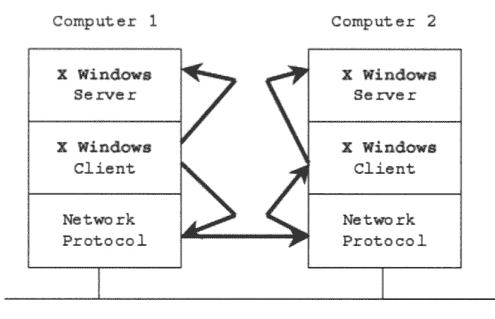

图 5-1 X Windows 显示路径。

2000年），以及 DCE 的开始。OpenVMS 和许多 UNIX 系统都采用了 X Windows，因为与显示列表管理器或其它只能显示图形和控制本地系统的本地 GUI 不同，X Windows 的设计初衷并经过了优化，旨在使其图形界面实现网络化。X Windows 设计用于通过许多标准网络协议（TCP/IP, LAT, DCNet, SNA）进行本地或远程应用程序显示。在 X Windows 中（与仅控制本地硬件的窗口管理器，如本地绘图机不同），图形输出的架构设计经过了优化，可以跨网络传输到网络中任何运行 X Windows 计算机上的其他 X Windows 显示器！这使得多个系统之间的显示变得变得简单，或者无论源操作系统如何，都能更容易将许多不同的图形带到单个显示器！这种程度的开放系统互操作性正是 DCE 在 1988 年选择 X Windows 作为 OpenVMS 工作站和服务器的 GUI 的原因，也是 HP至今继续支持 X Windows 的原因！

快进 17 年和 6 个主要的 X Windows 软件版本，以及这个经过测试的图形显示系统的安全性、新的显卡、Alpha 系统的计算性能以及越来越快的网络连接。很容易看出，低成本的 Linux 系统将作为一个完美的、廉价的集成工作站，使用标准的 X Windows 工具显示来自 OpenVMS 服务器的图形和应用程序！

## 在 Linux 工作站上显示 OpenVMS X Windows 应用程序

在 Linux 工作站上显示 OpenVMS 应用程序有两个部分。部分是登录 Linux 工作站并设置安全性以接受来自 OpenVMS 应用程序的远程显示。第二部分是 Telnet 到 OpenVMS 工作站并将 X Windows 输出重定向到 Linux ，然后运行应用程序。

```bash
john@vasone.vms.com:/home/johnw ~3
Session Options Help

john@vasone~$# + vasone.com
vasone.com being added to access control list
john@vasone~$] telnet vasone.com
Trying 85.64.200....
Connected to vasone.com.
Escape character is '^]'.
```

欢迎使用 OpenVMS (TM) Alpha 操作系统。版本 V7.2-1

Username: wisniewski

Password:

```
**************************************************
* WELCOME TO OpenVMS V7.2-1 *
*          On vasone.com
* 
* Remember: the "Open" Prefix is Always
*          Silent
* 
**************************************************
```

Last interactive login on Monday, 21-MAY-2001 23:37:10

Last non-interactive login on Monday, 21-MAY-2001 23:39:22,40

```bash
# set display/create/node=vasone.vasone.com=/transport/tcp/ip/screen=0
# create/term/
```

图 你应该将你的 OpenVMS `create/terminal` 命令重定向，以便结果显示在 Linux 工作站屏幕上！为了执行此功能，你必须有两个账户，一个在 Linux 工作站上，另一个在 OpenVMS 服务器上。

让我们来看命令过程：在你的 Linux 子上登录 X Windows 会话。打开一个交互式窗口并输入（参见图 5-2 和 5-3）。

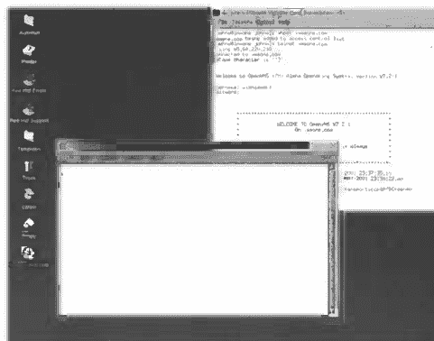

图 5-3 恭喜！你刚刚从你的 OpenVMS 系统创建了一个到你 Linux 子的终端！

## X Windows 会话的命令控制

### Linux 命令：`xhost`

你 Linux 上的 `xhost` 命令控制谁可以向你的 X Windows 服务器显示写入内容，如下：

- `xhost +` 允许你网络中的每个主机向你的屏幕发送 X Windows 显示。
- `xhost -` 不允许网络中的任何人向你的屏幕发送 X Windows 显示。
- `xhost+nodename.com` 仅允许 "`nodename.com`" 向你的屏幕发送 X Windows 显示。
- 不带参数的 `xhost` 会告诉你谁有权向你的屏幕发送 X Windows 显示。

### OpenVMS 命令：`SHOW-SET/DISPLAY` 和 `CREATE/TERMINAL`

在你的 Linux 机器上的新 DECterm 中，输入图 5-4 所示的信息。

- Device: `WSA4:` [`super`] 意味着这个 OpenVMS 终端（进程）将将其 X Windows 输出重定向到图形显示设备以接收。
- [`super`] 意味着从此进程运行的所有 X Windows 应用程序将显示在 `WSA4` 上。
- [`user`] 意味着只有从此进程运行的下一个 X Windows 应用程序将显示在 `WSA4` 上。
- Node: 这是 X Windows 服务器显示所在的系统。
- Transport: 这是正在使用的网络协议。
- Server: 某些系统可以运行多个实例的 X Windows 服务器。`0` 是默认值。


```
show display

Device: [super]
Node: LNXONE.VMSONE.COM
Transport: TCPIP
Server: 0
Screen: 0
```

### 图 5-4 `SHOW DISPLAY` 命令告诉从此窗口（在 OpenVMS 服务器上）运行的 X Windows 应用程序将尝试显示在哪里。

- `Screen`: X Windows 服务器显示可以在软件上具有多个显示屏幕，或者连接到另外两个带有两个更多显示器的显卡。屏幕编号从 0 到服务器包含的任意显卡数量。所有这些参数都可以通过执行以下命令进行更改/重定向：

```
SET DISPLAY/CREATE/NODE=node.com/transport=tcpip/screen=0 /TRANSPORT=(TCP/IP 如果你已经在内核中安装了 LAT 或 DECnet). /EXECUTIVE_MODE (可选) 为你系统上的所有进程创建一个执行模式 WSA: 设备（必须具有相应权限）。/SUPERVISOR_MODE（可选，默认）为你的当前进程（及子进程）创建一个监视模式 WSA: 设备。/USER_MODE（可选）限制下一个命令。此命令将更改正在运行的 X Windows。
```

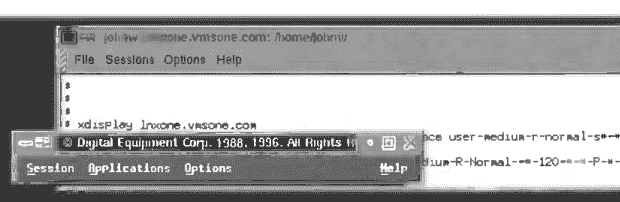

图 5-7 那么这有什么用呢？让我们来看看下拉菜单。

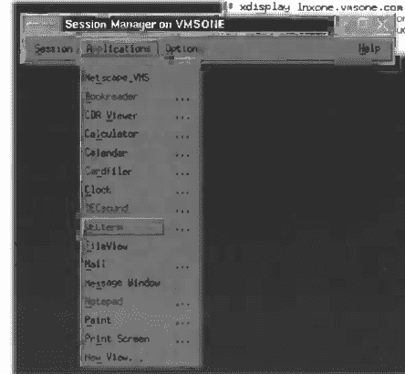

图 5-8 现在你可以根据需要创建任意 VMS 终端，检查正在运行的 X Windows 任务状态，甚至可以更改 X Windows 安全或启动选项——这一切只需点击鼠标，并且完全在你的 Linux 机器显示器上完成！

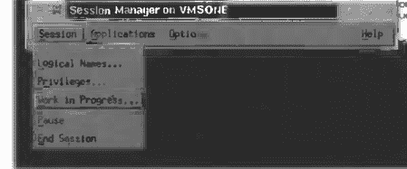

图 5-9

### Linux 与 OpenVMS 的互操作性

5-10 但如果你想从这个菜单中启动自己的命令或 X Windows 应用程序怎么办？使用 Menu Control 窗口 Options（选项）下拉菜单上的 Menus（菜单）按钮。

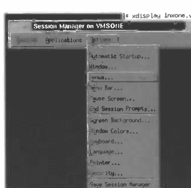

5-11 创建你的新命令/菜单选项（VMS 命令文件或可执行文件），并将其添加到相应的下拉菜单中。

第 5 章 – X Windows 应用程序：VMS 与 Linux 的 X Windows 互操作性 65

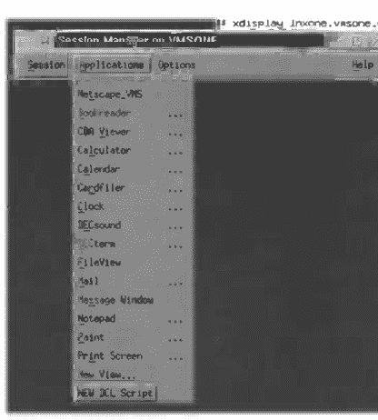

图 5-12 然后只需点击你的新下拉菜单！

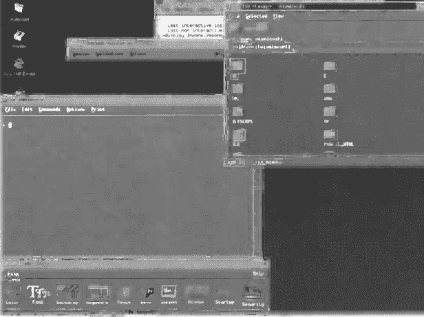

图 5-13 嘿！这些 VMS 应用程序和菜单是从哪里出来的！我以为这是一台 Linux 机器呢！

66 Linux 与 OpenVMS 的互操作性

请注意，这些应用程序来自 VMS CDE/DTSESSION 管理程序，而此时 DEC$$SESSION 管理程序和 Linux KDE 会话管理器正在运行！请要小心，因为任何一个会话管理器现在都可以把你注销。

## 在 OpenVM 上显示你的 Linux Windows 应用程序

回到 20 世纪 80 年代中期，当 VMS 工作站还是最先进的图形芯片组时，你的桌子上很可能有一台 VMS 工作站作为你的主工作站。今天，Alpha 工作站同样可能使用 Linux 或 True-64 UNIX 作为 OpenVMS。PC 同样可能供运维人员运行 Linux，而今天 Linux 或 Windows 下的 30 美元 PCI 显卡的显示引擎可能比你 Alpha 工作站上运行的三年前的显卡好得多。X Windows 的妙之处在于，你不受限于计算机引擎或陈旧的显卡；你只需要重定向图形，用全新的视角来享受应用程序即可！

但假设你足够幸运，在桌子上有一台运行 VMS 的最新先进 Alpha 工作站（而不是机房里的 GS320 集群），而你 Linux 机器的显卡有些老化了。你可以简单地将 Linux 应用程序重定向到新的 OpenVMS 显示器上。

此过程与 VMS 到 Linux 的重定向完全相同，不同之处在于必须发出 Linux 命令来将输出重定向到 VMS 工作站，而不是使用 `xhost` 命令；OpenVMS 在会话管理器下使用 Security（安全）菜单。

首先，你必须授权 VMS 使用 TCP/IP 作为 X Windows 的传输媒介（进入 VMS），因为它默认没有开启。

你或你的 VMS 系统管理员应该添加这一行短小的命令行（参见图 5-14）：

```
SYS$$MANAGER:DEC$$TSERVER.COM
```

如果你对修改此文件感到不习惯，可以将逻辑定义放在 `SYS$$MANAGER:STARTUP_VMS.COM` 中。我把它放在 `DEC$$TSERVER.COM` 中，因为 TCP/IP 默认应该是开启的（安全考虑）！

```
#define server_logical False

# 在 private_server_setup 中设置符号的默认值（其他默认值设置在 DEVICE.COM 中）。

# 任何这些都可以在 PRIVATE_SERVER_SETUP 中修改。

# 为了支持 manual_install.tcp

# if tchip=""

# then tchip = "tcp"

# server_transports = local.*

# server_correct_log = - client disconnect log mode

# server_bug_compatibility = - bug compatibility mode

# server_error_log_to_keep = 2 # 保留错误日志文件

# 检查用户指定的 server setup 程序

# server_device_setup =

# $server_device_setup = EXTRACT(0,2) + ".com"

# if exists(server_device_setup) then @
```

图 5-14 不要以任何方式修改此文件，否则可能会导致 windows 无法启动。

现在让我们使用 VMS 工作站上的 VMS 会话管理器来设置安全（参见图 5-15）。

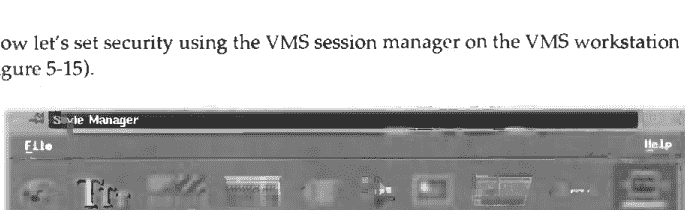

图 5-15 点击 Security（安全），进入授权框。

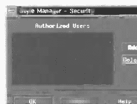

图 5-16 点击 Add（添加），就可以填写你的 Linux/Unix 信息。

对于 TCP/IP 传输，用户名始终使用 `"*"`, 否则无法工作（参见图 5-17 至 5-19）！

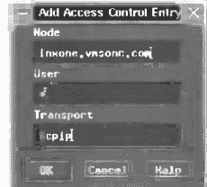

图 5-17 你现在准备好 telnet 到你的 Linux 系统并传回 X Windows 应用程序。

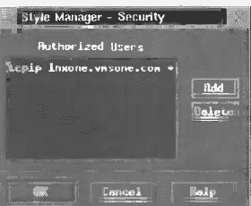

图 5-18

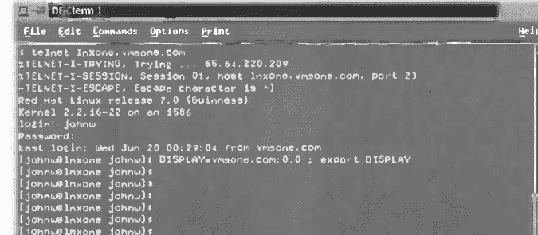

```
File Edit Commands Print Help

$ telnet inx.vmsone.com 23

-TELNET-TRYING, Connecting to Session 0 on host inx.vmsone.com. 

-TELNET-ESCAPE: Escape character is '^'

Red Hat Linux release 7.0 (Guinness)

Kernel 2.4.22 on i386

login: john

password:

Last login: Wed on Jun 20 09:29:04 from vmsone.com

john@vmsone.com $ DISPLAY= export DISPLAY
```


图 5-19 恭喜，你的 VMS 显示器上将有一个 X 时钟！你可能还想从你的 Linux 机器使用 `xterm` 或 `xterm`（背景）或其他任何应用程序！

第 5 章 - Windows 应用程序：VMS 与 Linux 的 X Windows 互操作性 69

关于哪种更好以及应该采用什么样的计算风格的争论会在讨论组和任何计算机爱好者交流的地方引发。但有一点是明确的：所有的计算风格都将长期存在，操作系统之间的互操作性将是未来所有工作站和服务器的标志。

# 第 6 章 —— 在 OpenVMS 和 Linux 使用电子邮件

## 回过去

在早在 20 世纪 80 年代初，计算机用户可以通过带有 ASCII 图形和未编码二进制对象的电子 BBS，通过 1200 波调制解调器相互发送电子邮件。而且（向 SNL 的老头道歉）我们喜欢那种方式——无论它是多么痛苦或花费多长时间，我们对这项技术表示感谢！

当我终于从年轻时使用的 ASCII 通信切换到 PC 和工作站的电子邮件客户端/服务器图形革命时，我已通过电子邮件使用嵌入式图形、附件以及二进制传输音乐和视频。我还发现（在将 ASCII 电子邮件传输到 `TK50` 磁带时），我花了 10 年的邮件往来和每天使用才创建了区区 1MB 的数据（使用英语作为通信协议）。

当我把 10 年的邮件历史填满那张只有三分之二的软磁盘（在改变对 95MB `TK50` 的主意后），我收到了 DEC 的某人通过新的客户端/服务器图形界面向我那亮新的 `DEC 320p` 笔记本电脑发送的第一个真实附件。

我惊讶地发现，消息中的 12 张 PowerPoint 幻灯片（正是用 MS Word 写的）有 1.5MB 的数据——它们甚至无法放入我刚刚填满的那张 10 美元的 1.44MB 软盘中。

如今，随着免费电子邮件账户的普及，以及对于拥有电脑的人来说，拨号上网的每月费用低于 10 美元，大多数人认为这种类型的电子邮件已经古老且过时了。`UUCP` 邮件的实用性已经减退；有趣的是，该协议在业余无线电（数据包）/系统间邮件，以及世界上其他由于互联网拨号接入（POTS——普通电话服务）仍难以获取的地方仍在使用。

## 从网络时代的黎明到今天

在《维多利亚时代的互联网》*The Victorian Internet* 中，汤姆·阶段（Tom Stage）描述了19世纪的世界是如何通过技术通信奇迹——电报来缩小并交付的。汤姆在书中引用了塞缞尔·莫尔斯（Samuel Morse）1872年的诗作《胜利》：

“科学已从这一岸，向另一岸宣告，
时间与空间不再受其支配。”

如果在过去的 150 年里，电报、电话和卫星缩短了人们交流的距离，那么在过去的 15 年里，互联网和电子邮件通过压缩技术和近乎普及的访问，将这些工具再次缩小了 10 倍。既然两行的邮件就能解释需要做什么，为什么还要打电话呢？既然一张图片就能解决问题，为什么还要对话呢？为什么要发送带有指向 URL 的图片来参考网络的共同现实呢？现在还有人会通过传真给任何人发送多份论文吗？

这对生产力非常有好处，但人与人之间的接触是如何通过导师和学徒制让我们不断学习并加深理解的？关于电子通信如何影响我们的学习方式和实职培训（OJT），目前尚无定论。我们这一代拥有家庭办公室、数字手机、远程办公、万维网和电缆，因此我们要么成为与同类最亲密、连接最紧密的一代，要么就有足够的冒险精神去支付电力、蛋白饮料和维生素费用以维持运转的一代。

简练、简洁、高效，无论好坏，这些都是电子邮件作为业务工具带给我们的品质。

当然，如果你仍然想在网上聊天，你现在可以使用各种即时通讯程序消磨时间，就像发现 19 世纪的电报员将空闲时间的 50% 用于跨越 19 世纪的以太与其他电报员说话、聊天和八卦一样（但对于今天生活在线的人来说，50% 听起来是一个很低的百分比）。尽管技术发生了巨大的变化，但人类在过去的 150 年里并没有多少。许多人仍然有着非常人性的欲望，只想放下工作，靠在后院围栏上或聚集在办公室的茶水旁，和其他人聊聊当天发生的事情。

## 电子邮件程序的兴起与衰落

1987 年，当我加入 Digital 公司时，它的邮件系统 `ALL-IN-1` 全球有 800 万用户。`ALL-IN-1` 具有全文本文字处理和共享日历（用于会议室、演示室等资源），这让人们的时间更容易安排和跟踪。它还包含了那个时代所有文字处理文档的文件交换、附件、邮件列表以及指向各种其他邮件系统（IBM 和当时的标准）的网关。

此外，`ALL-IN-1` 运行在 `OpenVMS` 集群上（谁会想要冗余系统呢），它的客户端/服务器前端链接仍然存在。然而，尽管拥有卓越的技术实力和 PC 集成，Digital 公司在 1996 年选择了一个新系统。DEC 放弃了 `ALL-IN-1` 的根源，选择了一个强有力的邮件系统——一个可以在邮件中发送文字处理文档、图片、视频和二进制文件的邮件系统，就像其他其他有 20 年历史的邮件系统一样。

新的电子邮件系统额外优势是可以在 `Windows NT` 操作系统上运行，在 1996 年，大家都知道这是在千年虫（Y2K）之后唯一能生存的系统平台。

`Microsoft Exchange` 比开源、基于标准的电子邮件贵得多，但话又回来，微软的营销做得好得多。剩下的就是历史了，直到人们意识到 `Exchange` 的安装和维护耗费大量资金——而开源产品是免费的！

## 开源开放标准的互联网邮件

开放标准完全围绕着 `TCP/IP` 标准和控制它们的 RFC（意见请求）过程展开。需要注意的是，当前的电子邮件协议正在演进，并随着它们的改进不断添加新功能。终端用户不会担心这些标准，但为 `VMS` 或 `Linux` 等操作系统进行实现工作的人会担心。用户需要知道的是，他们可以从各种客户端平台使用哪些基于标准的电子邮件客户端，以及可以设置哪些邮件服务器来从网络上的 `OpenVMS` 和 `Linux` 服务器检索他们的邮件。

互联网电子邮件应用程序基本上都在做相同的事情，但某些程序具有比其他程序更多的功能。在电子邮件系统中，你应该在客户端中寻找哪些功能？字符单元或图形电子邮件应用程序应该是首要考虑。像 `PINE` 这样的程序是基于字符单元的，但可以发送附件并在 `OpenVMS` 和 `Linux` 上作为客户端运行。其他程序，如 `Mozilla`（现在源自 Netscape 的开源项目），也运行在 `OpenVMS` 和 `Linux` 上，但需要 Windows 图形显示才能显示。图形显示为你提供了一个“所见即所得”（WYSIWYG）的邮件窗口，而字符客户端允许你从网络任何地方通过 `telnet` 读取你的邮件——至少是邮件的内容部分！

今天在配置电子邮件服务器时，需要检查的重要标准包括：

- `POP3`–邮局局协议：如果你的服务器支持此项，你的客户端就可以从服务器下载消息。
- `IMAP`–互联网消息访问协议：如果你的服务器支持此项，你的客户端可以访问消息并决定是否删除。

好消息是，`OpenVMS` 和 `Linux` 都能让电子邮件客户端使用 `POP3` 或 `IMAP` 访问邮件。你只需要在系统上启用电子邮件，账户就会集成到邮件中。远程电子邮件客户端就可以从不同位置通过 `POP3` 或 `IMAP` 访问这些标准账户。

## OpenVMS 邮件服务器配置

让我们将 `OpenVMS` 设置为电子邮件服务器（参见图 6-1 至 6-36）。我们假设 `TCP/IP` 已经设置好，如第 3 节所述。

[img/a26aae01e657faca13785a7eb03624a_75_0.png]

[img/a26aae01e657faca13785a7eb03624a_75_1.png]

第 6 章 - 在 OpenVMS 和 Linux 上使用电子邮件 75

### Compaq TCP/IP 服务配置菜单

配置选项：

+   1 - 环境
2 - 客户端组件
3 - 服务器组件
4 - 可选组件
5 - 关闭 Compaq TCP/IP 服务
6 - 启动 Compaq TCP/IP 服务
7 - 运行测试
8 - 配置选项 1-4
[E] - 退出配置程序

输入选项：2

图 6-3 选择菜单选项 2 进行 TCP/IP 客户端更改。

### Compaq TCP/IP 服务客户端组件配置菜单

配置选项：

+   1 - `FTP` 已启用
2 - `NFS` 客户端已停止
3 - `REXEC` 和 `RSH` 已停止
4 - `RLOGIN` 已启用
5 - `SMTP` 已停止
6 - `TELNET` 已启用
7 - `DHCP` 已停止
8 - `Telnetsym` 已停止
8 - 配置选项 1-8
[E] - 退出菜单

输入选项：5

图 6-4 从子菜单选择选项 5 以激活 TCP/IP SMTP 邮件服务。

### SMTP 配置

服务定义在 `SYSUAF` 数据库中。
服务定义在 `TCIPSSERVICE` 数据库中。
配置定义在 `TCIP$CONFIGURATION` 数据库中。
服务未启用。
服务已停止。

SMTP 配置选项：

- 在此节点上启用服务
- 在此节点上启用并启动服务
-  SMTP 配置

输入配置选项：
正在创建模板 `SYSCONFIG:TCPIP$SMTP|SMT7_CONFIG.TEMPLATE`
`TCPIP-I-INFO`, 安装镜像 `SYSPIP$SYSTEM:TCPIP$SMTP_RECEIVER.EXE`
`TCPIP-I-INFO`, 已创建逻辑名称
`TCPIP-I-INFO`, 服务队列已启动
`TCPIP-I-INFO`, 服务状态已启用
`TCPIP-S-TOARTONE`, `TCPIP$SMTP` 启动完成
按回车继续...


### OpenVMS 客户端组件的 Compaq TCP/IP 服务配置菜单

配置选项：

| | | |
|---|---|---|
| 1 | `FTP` | 已启用 启动 |
| 2 | `NFS Client` | 已禁用 停止 |
| 3 | `REXEC` 和 `SSH` | 已禁用 停止 |
| 4 | `HTTP` | 已启用 启动 |
| 5 | `SMTP` | 已启用 启动 |
| 6 | `TELNET` | 已启用 启动 |
| 7 | `DHCP` | 已禁用 停止 |
| 8 | `Telnet` | 已禁用 停止 |

A - 配置选项 1 - #
(E) 退出菜单

输入配置选项： e


第 6 章 – 在 OpenVMS 和 Linux 上使用电子邮件

### OpenVMS 的 Compaq TCP/IP 服务配置菜单

配置选项：

- 核心环境
- 客户端组件
- 服务端组件
- 可选组件
- 关闭 OpenVMS 的 Compaq TCP/IP 服务
- OpenVMS 的 TCP/IP 服务状态
- 运行测试

- - A - 配置选项 1 - 4
[E] - 退出配置程序

输入配置选项： 3

图 6-7 选择服务端组件菜单选项。

### OpenVMS Compaq TCP/IP 服务服务端组件配置菜单

配置选项：

| I | | | 12 | | |
|---|---|---|---|---|---|
| 1 `BIND` | 已禁用 停止 | 12 | `FTP` | 已禁用 停止 |
| 2 `BOOTP` | 已禁用 停止 | 13 | `PC-HFS` | 已禁用 停止 |
| 3 `DHCP` | 已禁用 停止 | 14 | `POP` | 已禁用 停止 |
| 4 `FINGER` | 已禁用 停止 | 15 | `RMAPPER` | 已禁用 停止 |
| 5 `FTP` | 已启用 | 16 | `CLOGIN` | 已启用 停止 |
| 6 `IMAP` | 已禁用 停止 | 17 | `RMT` | 已禁用 停止 |
| 7 `LOCKER` | 已禁用 停止 | 18 | `SNMP` | 已禁用 停止 |
| 8 `LPR/LPD` | 已启用 停止 | 19 | `TELNET` | 已启用 停止 |
| 9 `METRIC` | 已禁用 停止 | 20 | `TFTP` | 已启用 停止 |
| 10 `NFS` | 已禁用 停止 | 21 | `XDM` | 已禁用 停止 |
| 11 `LOCKD/STATD` | 已禁用 停止 | | | |

- - A - 配置选项 1 - 21
[E] - 退出菜单

输入配置选项： 6

图 6-8 选择要配置的 IMAP 协议。

Linux 与 OpenVMS 互性

### IMAP 配置

服务定义在 `SYSUAF` 中。
服务定义在 `TCPIP$SERVICE` 数据库中。
服务未启用。
服务已停止。

IMAP 配置选项：

- 1 - 在所有节点上启用服务
- 2 - 在此节点上启用服务
- 3 - 在此节点上启用并启动服务

[E] 退出 IMAP 配置

输入配置选项： 3

图 6-9 选择 3 以激活并启动此 OpenVMS 系统的 IMAP 服务。

### IMAP 配置

服务定义在 `SYSUAF` 中。
服务定义在 `TCPIP$SERVICE` 数据库中。
服务未启用。
服务已停止。

IMAP 配置选项：

- 1 - 在所有节点上启用服务
- 2 - 在此节点上启用服务
- 3 - 在此节点上启用并启动服务

[E] 退出 IMAP 配置

输入配置选项： 3
`TCPIP-I-INFO`, 安装镜像 `SYSTEM:TCPIP$IMAP_SERVER.EXE`
`TCPIP-I-INFO`, 服务已启用
`TCPIP-S-STARTUP`, `TCPIP$IMAP` 启动完成
按回车继续 ...

图 6-10 退出并返回 TCP/IP 主菜单。

### OpenVMS Compaq TCP/IP 服务服务端组件配置菜单

配置选项：

| 1 - `BIND` | 已禁用 停止 | 12 - `NTP` | 已禁用 停止 |
| 2 - `BOOTP` | 已禁用 停止 | 13 - `PC-NFS` | 已禁用 停止 |
| 3 - `DHCP` | 已禁用 停止 | 14 - `POP` | 已禁用 停止 |
| 4 - `FINGER` | 已禁用 停止 | 15 - `PORTMAPPER` | 已禁用 停止 |
| 5 - `FTP` | 已启用 启动 | 16 - `RLOGIN` | 已启用 启动 |
| 6 - `IMAP` | 已禁用 停止 | 17 - `SMTP` | 已禁用 停止 |
| 7 - `LOCKER` | 已禁用 停止 | 18 - `SNMP` | 已禁用 停止 |
| 8 - `LPR/LPD` | 已禁用 停止 | 19 - `TELNET` | 已启用 启动 |
| 9 - `METRIC` | 已禁用 停止 | 20 - `TFTP` | 已启用 停止 |
| 10 - `NFS` | 已禁用 停止 | 21 - `XDM` | 已禁用 停止 |
| 11 - `LOCKD/STATD` | 已禁用 停止 | | |

- - A - 配置选项 1 - 21
[E] - 退出菜单

输入配置选项：

图 6-11 现在 IMAP 服务已在此系统上启用并启动。

### OpenVMS Compaq TCP/IP 服务服务端组件菜单

配置选项：

| 1 - `BIND` | 已禁用 停止 | 12 - `NTP` | 已禁用 停止 |
| 2 - `BOOTP` | 已禁用 停止 | 13 - `PC-NFS` | 已禁用 停止 |
| 3 - `DHCP` | 已禁用 停止 | 14 - `POP` | 已禁用 停止 |
| 4 - `FINGER` | 已禁用 停止 | 15 - `PORTMAPPER` | 已禁用 停止 |
| 5 - `FTP` | 已启用 启动 | 16 - `RLOGIN` | 已启用 启动 |
| 6 - `IMAP` | 已禁用 停止 | 17 - `SMTP` | 已禁用 停止 |
| 7 - `LOCKER` | 已禁用 停止 | 18 - `SNMP` | 已禁用 停止 |
| 8 - `LPR/LPD` | 已禁用 停止 | 19 - `TELNET` | 已启用 启动 |
| 9 - `METRIC` | 已禁用 停止 | 20 - `TFTP` | 已禁用 停止 |
| 10 - `NFS` | 已禁用 停止 | 21 - `XDM` | 已禁用 停止 |
| 11 - `LOCKD/STATD` | 已禁用 停止 | |

- - A - 配置选项 1 - 21
[E] - 退出菜单

输入配置选项： 14

图 6-12 现在选择 POP 协议。

Linux 与 OpenVMS 互性

### POP 配置

服务定义在 `SYSUAF` 中。
服务定义在 `TCPIP$SERVICE` 数据库中。
服务未启用。
服务已停止。

POP 配置选项：

- 1 - 在所有节点上启用服务
- 2 - 在此节点上启用服务
- 3 - 在此节点上启用并启动服务

[E] 退出配置

输入配置选项： 3
图 6-13 在此 OpenVMS 系统上启用并启动 POP3 服务。

### POP 配置

服务定义在 `SYSUAF` 中。
服务定义在 `TCPIP$SERVICE` 数据库中。
服务未启用。
服务已停止。

POP 配置选项：

- 1 - 在所有节点上启用服务
- 2 - 在此节点上启用服务
- 3 - 在此节点上启用并启动服务

[E] - 退出配置

输入配置选项： 3
`TCPIP-I-INFO`, 安装镜像 `SYSTEM:TCPIP$POP_SERVER.EXE`
`TCPIP-I-INFO`, 服务已启用
`TCPIP-S-DONE`, `TCPIP$POP` 完成
按回车继续 ..

图 6-14 返回 OpenVMS TCP/IP 服务菜单。

第 6 章 - 在 OpenVMS 和 Linux 上使用电子邮件

### OpenVMS Compaq TCP/IP 服务服务端组件配置菜单

配置选项：

| 1 - `BIND` | 已禁用 停止 | 12 - `NTP` | 已禁用 停止 |
| 2 - `BOOTP` | 已禁用 停止 | 13 - `PC-IFS` | 已禁用 停止 |
| 3 - `DHCP` | 已禁用 停止 | 14 - `POP` | 已启用 启动 |
| 4 - `FINGER` | 已禁用 停止 | 15 - `POPTMAP` | 已禁用 停止 |
| 5 - `FTP` | 已启用 启动 | 16 - `RLOGIN` | 已启用 启动 |
| 6 - `IMAP` | 已启用 启动 | 17 - `RPC` | 已禁用 停止 |
| 7 - `LOCKER` | 已禁用 停止 | 18 - `SNMP` | 已禁用 停止 |
| 8 - `LPR/LPD` | 已禁用 停止 | 19 - `TELNET` | 已启用 启动 |
| 9 - `METRIC` | 已禁用 停止 | 20 - `TFTP` | 已禁用 停止 |
| 10 - `NFS` | 已禁用 停止 | 21 - `XDM` | 已禁用 停止 |
| 11 - `LOCKD/STATD` | 已禁用 停止 | |

- - A - 配置选项 1 - 21
[E] - 退出菜单

图 6-15 验证 POP3 协议在此系统上已启用并运行。

### OpenVMS Compaq TCP/IP 服务服务端组件配置菜单

配置选项：

| 1 - `BIND` | 已禁用 停止 | 12 - `NTP` | 已禁用 停止 |
| 2 - `BOOTP` | 已禁用 停止 | 13 - `PC-IFS` | 已禁用 停止 |
| 3 - `DHCP` | 已禁用 停止 | 14 - `POP` | 已启用 启动 |
| 4 - `FINGER` | 已禁用 停止 | 15 - `POPTMAP` | 已禁用 停止 |
| 5 - `FTP` | 已启用 启动 | 16 - `RLOGIN` | 已启用 启动 |
| 6 - `IMAP` | 已启用 启动 | 17 - `RPC` | 已禁用 停止 |
| 7 - `LOCKER` | 已禁用 停止 | 18 - `SNMP` | 已禁用 停止 |
| 8 - `LPR/LPD` | 已禁用 停止 | 19 - `TELNET` | 已启用 启动 |
| 9 - `METRIC` | 已禁用 停止 | 20 - `TFTP` | 已禁用 停止 |
| 10 - `NFS` | 已禁用 停止 | 21 - `XDM` | 已禁用 停止 |
| 11 - `LOCKD/STATD` | 已禁用 停止 | |

- - A - 配置选项 1 - 21
[E] - 退出菜单

输入配置选项：

图 6-16 退出并返回主 TCP/IP 配置菜单。

Linux 与 OpenVMS 互性

### Compaq TCP/IP 服务 for OpenVMS 配置菜单

配置选项：

+ - 核心环境
- 客户端组件
- 服务器组件
- 可选组件

+ - 关闭针对 OpenVMS 的 Compaq TCP/IP 服务
- 启动针对 OpenVMS 的 Compaq TCP/IP 服务
- 运行测试

+ A - 配置选项 1 - 4
[E] - 退出配置程序

输入配置选项：e

图 6-17 退出 TCP/IP 配置菜单并返回 $ DCL 提示符。

### Compaq TCP/IP 服务 for OpenVMS 配置菜单

配置选项：

+ - Core环境
- 客户端组件
- 服务器组件
- 可选组件

+ - 关闭针对 OpenVMS 的 Compaq TCP/IP 服务
- 启动针对 OpenVMS 的 Compaq TCP/IP 服务
- 运行测试

+ A - 配置选项 1 - 4
[E] - 退出配置程序
```


$ 输入配置选项：e

$ tcpip

TCP/IP> show config smtp

```
图 6-18 调用 TCP/IP 管理实用程序并显示 SMTP 配置。
```

# SMTP 配置

| 初始间隔： | 地址最大： | 选项 |
|---|---|---||
| 00 00:30.00 | 16 | EIGHT_BIT |
| 重试间隔： | 00 01:00.00 | Hop_count_max: 16 | RELAY |
| 最大间隔： | 3 00:00.00 | | TOP_HEADERS |

| 超时 | 邮件 | 接收 | 数据 | 终止 |
|---|---|---|---|--|
| 初始 | 5 | 5 | 3 | 10 |
| 发送： | 5 | | | |
| 接收： | | | | | | |

备用网关：未定义
通用网关：未定义

替换域名：HIDDEN, vmsone.com
区域：未定义

邮件管理员：WISHWMI
日志文件：SYSSPECIFIC:[TCPIP$SMTP]TCPIP$SMTP_LOGFILE.LOG

通用队列 参与节点

TCPIP$SMTP_VMSONE_00 I VMSONE
TCPIP>

图 19 注意：SMTP 选项被设置为八位（允许 8 位 ASCII），中继（RELAY）允许 POP 和 IMAP 客户端通过 OpenVMS 服务器发送邮件，而顶头（TOP_HEADERS）用于在邮件消息顶部显示电子邮件标头。

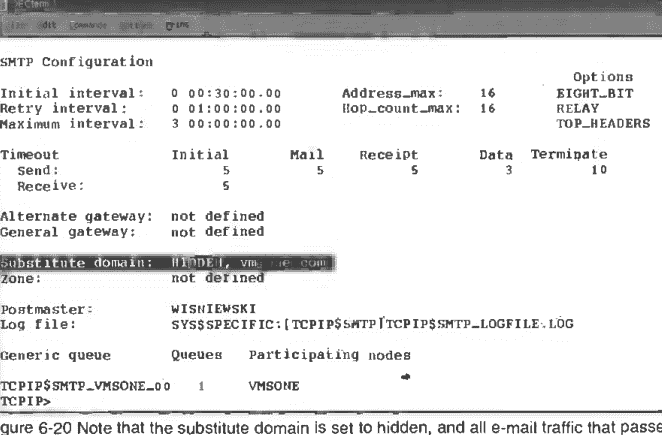

| 初始间隔： | 地址最大： | 选项 |
|---|---|---||
| 00 00:30.00 | 16 | EIGHT_BIT |
| 重试间隔： | 00 01:00.00 | Hop_count_max: 16 | RELAY |
| 最大间隔： | 3 00:00.00 | | TOP_HEADERS |

| 超时 | 邮件 | 接收 | 数据 | 终止 |
|---|---|---|---|--|
| 初始 | 5 | 5 | 3 | 10 |
| 发送： | 5 | | | |
| 接收： | | | | | | |

备用网关：未定义
通用网关：未定义

替换域名：HIDDEN, vmsone
区域：未定义

邮件管理员：WISHWMI
日志文件：SYSSPECIFIC:[TCPIP$SMTP]TCPIP$SMTP_LOGFILE.LOG

通用队列 参与节点

TCPIP$SMTP_VMSONE_00 I VMSONE
TCPIP>

图 20 注意：替换域名被设置为隐藏（hidden），所有通过此服务的电子邮件流量将将来自 VMSONE.com 的回邮件地址。

# Linux & OpenVMS 互操作性

## SMTP 配置

初始间隔：00:00:30.00
重试间隔：01:00:00.00
最大间隔：03:00:00.00

地址最大：16
Hop_count_max：16

选项
EIGHT_BIT
RELAY
TOP_HEADERS

超时
发送：
接收：

初始
5
5

邮件
5
5

接收：
5
5

数据
3

终止
10

备用网关：未定义
通用网关：未定义

替换域名：HIDDEN, vmsone.com
区域：未定义

Ptm.ini：VMSWISNI
日志文件：SYSSPECIFIC:[TCP$SMTP]TCP$SMTP_LOGFILE.LOG

通用队列：队列 参与节点

```
TCIPSMP_VMSONE.00 1 VMSONE

TCPIP>
```

> 图 6-21 邮件管理员（Postmaster）是本地 OpenVMS 账户 wisniewski，但也可以同样容易地设置为互联网电子邮件地址（例如，wisniewski@VMSONE.com）。通过此字段可以将此邮件管理员信息发送到远程系统。

## SMTP 配置

初始间隔：00:00:30.00
重试间隔：01:00:00.00
最大间隔：03:00:00.00

地址最大：16
Hop_count_max：16

选项
EIGHT_BIT
RELAY
TOP_HEADERS

超时
发送：
接收：

初始
5
5

邮件
5
5

接收：
5
5

数据
3

终止
10

备用网关：未定义
通用网关：未定义

替换域名：HIDDEN, vmsone.com
区域：未定义

Postmaster.ini：VMSWISNI
日志文件：SYSSPECIFIC:[TCP$SMTP]TCP$SMTP_LOGFILE.LOG

通用队列：队列 参与节点

```
TCIPSMP_VMSONE.00 1 VMSONE

TCPIP> help set config
```

> 图 6-22 您可以通过输入 help 来获取 SMTP 配置（或任何 TCP/IP 功能）的语法。

```
TCPIP> help net config /

SET

CONFIGURATION

SMTP

抱歉，没有关于 SET CONFIG / 的文档。

可用信息：

限制：限定符

/ADDRESS      GATEWAY     HOP_COUNT_MAX /INTERVAL /LOG

/OPTIONS              QUEUES     RECEIVE_TIMEOUT /SEND_TIMEOUT

/SUBSTITUTE_DOMAIN    /ZONE

示例

TCPIP>
TCPIP>
TCPIP>
```

图 6-23 注意该命令使用了经典 OpenVMS 风格的 /U 参数。


## SMTP 配置

| 初始间隔： | 地址最大： | 选项 |
|---|---|---||
| 00 00:30.00 | 16 | EIGHT_BIT |
| 重试间隔： | 00 01:00.00 | Hop_count_max: 16 | RELAY |
| 最大间隔： | 3 00:00.00 | | TOP_HEADERS |

| 超时 | 邮件 | 接收 | 数据 | 终止 |
|---|---|---|---|--|
| 初始 | 5 | 5 | 3 | 10 |
| 发送： | 5 | | | |
| 接收： | | | | | | |

备用网关：未定义
通用网关：未定义

替换域名：HIDDEN, vmsone.com
区域：未定义

邮件管理员：WISHWMI
日志文件：SYSSPECIFIC:[TCPIP$SMTP]TCPIP$SMTP_LOGFILE.LOG

通用队列 参与节点

```
TCPIP$SMTP_VMSONE.00 I VMSONE

TCPIP>
```

图 6-24 当 SMTP 选项设置为 RELAY（中继）时，OpenVMS 需要开启其 ANTI-SPAM 功能。垃圾邮件可以通过其发送到其他系统。

### Linux & OpenVMS 互操作性

| 超时 | 邮件 | 接收 | 数据 | 终止 |
|---|---|---|---|--|
| 初始 | 5 | 5 | 3 | 10 |
| 发送： | 5 | | | |
| 接收： | | | | | | |

备用网关：未定义
通用网关：未定义

替换域名：HIDDEN, vmsone.com
区域：未定义

邮件管理员：WISHWMI
日志文件：SYSSPECIFIC:[TCP$SMTP]TCP$SMTP_LOGFILE.LOG

通用队列 参与节点

```
TCPIP$SMTP_VMSONE.00 1 VMSONE

TCPIP> exit

$
```

图 6-25 为了激活 OpenVMS 的 ANTI-SPAM 功能，您必须首先将目录设置为 SMTP。

```
$ set def sysayroot:[TCIP$SMTP]

$

Directory sysayroot:[TCIP$SMTP]

LOGIN.COM:1

CONFIG:6CONFIG:

..TEMPLATE:4

TCIP$SMTP_LOGFILE:12

TCIP$SMTP_RECV.RUN:2072

TCIP$SMTP_RECV.RUN:2070

TCIP$SMTP_RECV.RUN:2068

$ 
```

共 23 个文件。

图 6-26 这里 SMTP 邮件被接收并处理。注意接收日志文件。这些是所有中继或本地处理的 SMTP 邮件所在处。

```
$ dir

Directory SYS$SYSROOT:[TCIP$SMTP]

LOGIN.COM:1

MAIL5A2F21F5BE000500A1.MAI;1

MAIL54A6FRA8ED000500A1.MAI;1

MAIL54A7A5A19200500A1.MAI;1

MAIL:1

DR:2

SMTP.CONFIG:6

SMTP.TEMPLATE:4

TCIP$SMTP_LOGFILE:12

TCIP$SMTP_RECV.RUN:2075

TCIP$SMTP_RECV.RUN:2070

TCIP$SMTP_RECV.RUN:2069
```


共 10 个文件。

图 6-28 编辑 smtp.config

第 6 章 – 在 OpenVMS 和 Linux 上使用电子邮件 89

```
!!Reject-Mail-From: *.xyz.com, known.spammer@, *the-internet.*

!!!Accept-Mail-From: @notabhadguy.xyz.com, the_internet_news@somewhere.com

!!SPAM-Action: OPCCOM, ACCOUNTING

SPAM-Action: OPCCOM, ACCOUNTING

!!Security: secure

Security: secure

!!Unbacktranslatable-IP-Text: Your IP address is unbacktranslatable. SPAMMER!

Clients-Text: You dirty SPAMMER.

!!Client-Mail-Text: I saw you in an RBL. SPAMBREATH!

!!Reject-Mail-From: Haven't you been spammed before?

!!MAIL FROM? You've got to be kidding.

!!Unqualified-Sender-Text: MAIL FROM who?

!!Unresolvable-Domain-Text: MAIL FROM where? Yeah right.

!!

SPAM-Relay-Text: Trying to launch your SPAM from your site will get you nowhere.

[R0bl]
```

图 6-31 这是你的 smtp 配置 ANTI-SPAM 文件的剩余部分；你需要修改此文件以适应你自己的邮件网络，否则可能会被用作中继启动点或垃圾邮件的目标。

```
$
$
$
$
$
$
$
$
$\$
$
$
$
$
$
$
$
$
$
$
$
$ $ $ set def sys$manager:
$ dir startup_vms.com

Directory SYS$COMMON:[SYSMGR]

SYSTARTUP_VMS:COM;16

Total of 1 file.
$ edit startup_vms.com
```

图 6-32 邮件配置的最后部分可以放在 OpenVMS 系统启动文件中，它需要在 SMTP 启动之前执行。

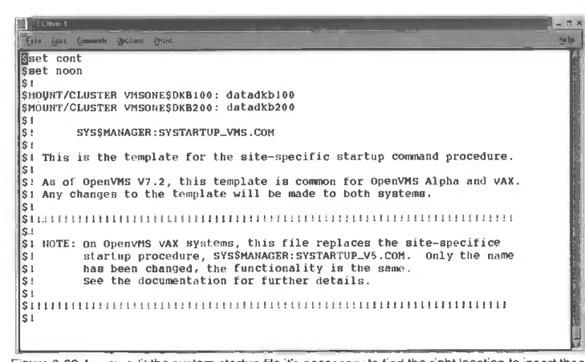

```
$ net cont
$ set noon
$ SHMOUNT/CLUSTER VMSLB100: datadkb100
$ SHMOUNT/CLUSTER VMSLB200: datadkb200
$
$ SYSMANAGER:STARTUP.VMS.COM
$
$ 这是站点特定启动程序的模板。
$ 
从 OpenVMS V7.2 开始，此模板适用于 OpenVMS Alpha 和 VAX
$ 
 对模板的任何更改都将同时应用于这两个系统。
$
$ 注意：在 OpenVMS VAX 系统上，此文件替换了站点特定的启动程序 SYSMANAGER:STARTUP_V5.COM。仅名称发生了变化，功能相同。
$ 请参阅文档获取更多详情。
```

图 6-33 当你编辑系统启动文件时，必须找到合适的位置来插入这些配置更改。

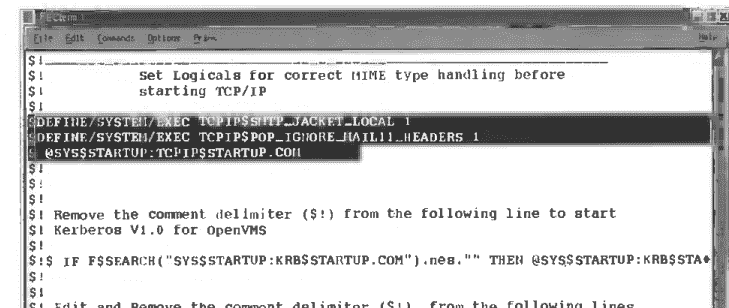

```
$ $1
$ Set Logicals for correct MIME type handling before
$ starting TCP/IP
$ $1
$ DEFINE/SYSTEM/EXEC TCP$IP$STUP_JACKET_LOCAL]
$ DEFINE/SYSTEM/EXEC TCP$POP_MIME_JAIL[1]:HEADERS 1
$ OSYS$STARTUP:TCP$IP-STARTUP.COM
$ $1
$ 删除以下行中的注释分隔符 ($$) 以启动
$ 为 OpenVMS 的 Kerberos V1.0
$ $1
$ IF FSEARCH('SYS$STARTUP:KRBSTATUS.COM').*="*" THEN SYS$STARTUP:KRBSTA*$
$ $1
$ 编辑并删除以下行中的注释分隔符 ($$) 以开始启动。Wollongong Pathway。
$ IF FILE = FSEARCH('SYS$DISK:[NETWORKS.PATHWAY.METDAT.MISC:STARTINET.COM*')
$ IF FILE.NES="*"
$ $1
$ THEN
$ $1
$ !'FILE'
```

图 6-34 需要定义为系统可执行的逻辑变量（Locals）。这些逻辑变量也会被全范围内所有的 OpenVMS 进程读取（类似于 Linux 中的全局 PATH 变量）。定义后，这些逻辑变量将告诉 SMTP 进程如何正确处理 MIME 扩展、邮件头和附件。注意，这些逻辑变量必须在 TCP/IP 启动之前定义！

第 6 章 – 在 OpenVMS 和 Linux 上使用邮件 91

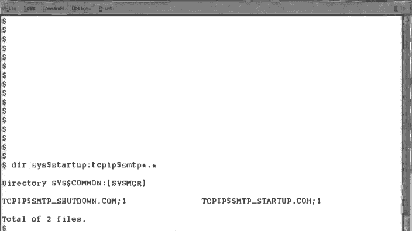

图 6-35 现在我们已经为互联网邮件配置了 OpenVMS 服务器并设置了我们的反垃圾邮件防御，现在我们需要停止并重启 SMTP 进程。两者的通用文件可以在 SYS$STARTUP 目录中找到。

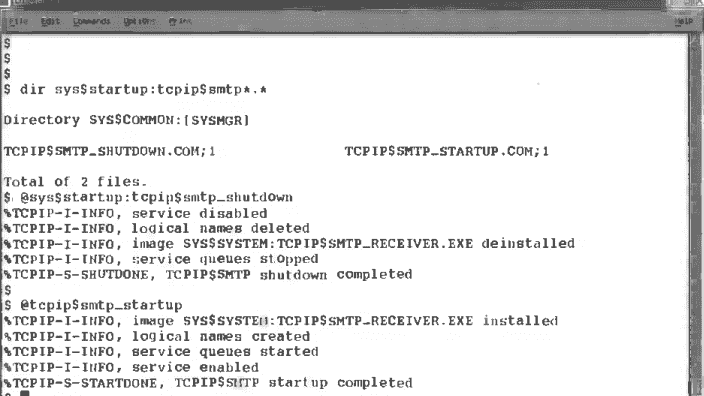

图 6-36 停止和重启邮件服务器进程非常简单，不需要关闭所有 TCP/IP 功能即可完成。

92 Linux & OpenVMS 互操作性

恭喜！你已经建立了一个带有反垃圾邮件过滤器的 OpenVMS 邮件服务器！

## 设置邮件客户端

OpenVMS 和 Linux 现在都运行 Mozilla。这意味着通过下载你不仅获得了一个世界级的浏览器，还获得了一个适用于你的 OpenVMS 或 Linux 工作站的完整图形化邮件客户端。

### Linux 安装

通常在安装 RedHat 时，Mozilla 会自动安装。但当你想要安装更新或尚未作为基础安装过 Mozilla 时该怎么办？从 www.org 下载 Mozilla（参见图 6-37 到 img/a26aae01e7657faca13785a7eb03624a_93_0.png）。使用 root 账户将 Linux 的 Mozilla 保存在子目录中，这样它就不会填满你的默认目录。

```
[root@rvlwone ~kits_linux] ls

apache-1.3.2b.gz mozilla-i686-pc-linux-1.0.1-sea.gz
```

图 6-38 使用 zip 命令解压 Mozilla 文件。该命令会将文件解压到子目录。

```
[root@rvlwone ~kits_linux/mozilla-installer]

File Edit Settings Help

./mozilla-installer/config.ini

./mozilla-installer/MPL-1.txt

./mozilla-installer/xpi/

/mozilla-installer/xpi/xpcom.xpi

/mozilla-installer/xpi/browser.xpi

/mozilla-installer/xpi/mail.xpi

/mozilla-installer/xpi/chatilla.xpi

/mozilla-installer/xpi/tablock.xpi

/mozilla-installer/xpi/deflenus.xpi

/mozilla-installer/xpi/langens.xpi

/mozilla-installer/xpi/regus.xpi

/mozilla-installer/xpi/verman.xpi

./mozilla-installer/inspector.xpi
[root@rvlwone ~kits_linux] ls

apache-1.3.2b.tar.gz.tar mozilla-i686-pc-linux-gnu-1.0.1-sea.gz
[root@rvlwone ~kits_linux] # gunzip -dc mozilla-i686-pc-linux-gnu-1.0.1-sea.gz
tar -xvf -
/mozilla-installer/
/mozilla-installer/mozilla-installer-bin
/mozilla-installer/mozilla-installer.ini
```


`/mozilla-installer/README`

`/mozilla-installer/config.ini`

`/mozilla-installer/MPL-1.txt`

`/mozilla-installer/xpi/`

`/mozilla-installer/xpi/xpcom.xpi`

`/mozilla-installer/xpi/browser.xpi`

`/mozilla-installer/xpi/mail.xpi`

`/mozilla-installer/xpi/chatilla.xpi`

`/mozilla-installer/xpi/tablock.xpi`

`/mozilla-installer/xpi/deflenus.xpi`

`/mozilla-installer/xpi/langens.xpi`

`/mozilla-installer/xpi/regus.xpi`

`/mozilla-installer/xpi/verman.xpi`

```
图 6-39 切换目录到 Mozilla 目录。

94 Linux & OpenVMS 互操作性
```

```
root@inxone:~/linux# cd mozilla-installer

File  Edit  Settings  Help

./mozilla-installer/config.ini

./mozilla-installer/MPL-1.txt

./mozilla-installer/xpi/

./mozilla-installer/xpi/xcom.xpi

./mozilla-installer/xpi/browser.xpi

./mozilla-installer/xpi/mail.xpi

./mozilla-installer/xpi/chatilla.xpi

./mozilla-installer/xpi/taskback.xpi

./mozilla-installer/xpi/dbus.xpi

./mozilla-installer/xpi/langens.xpi

./mozilla-installer/xpi/setup.xpi

./mozilla-installer/xpi/version.xpi

./mozilla-installer/xpi/inspector.xpi

[root@inxone:~/linux]$ ls mozilla-installer

apache-1.3.23.x86_64-linux-gnu-1.0.1-server.tar.gz

[root@inxone:~/linux]$ cd mozilla-installer

[root@inxone:~/mozilla-installer]$

root@inxone:~/mozilla-installer]$ ls

config.ini  MPL-1.txt xpi

mozilla-installer-bin mozilla-installer

installer.ini             README

[root@inxone:~/mozilla-installer]$ ./mozilla-installer
```

图 6-40 运行 `/mozilla-installer` 脚本。

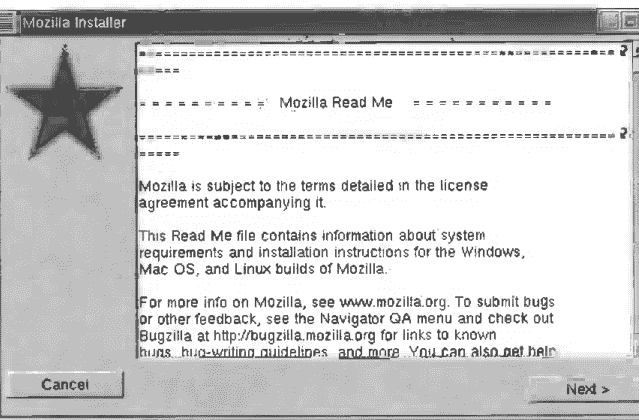

图 6-41 一个新窗口将弹出并开始你的安装对话框。

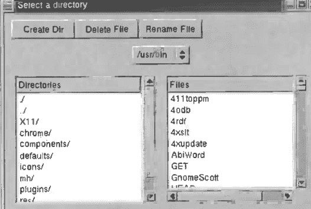

图 6-44 选择安装 Mozilla 的目录。

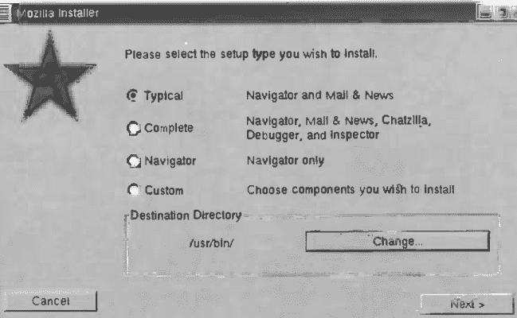

图 6-45 继续安装。

第 6 章 – 在 OpenVMS 和 Linux 上使用电子邮件 97

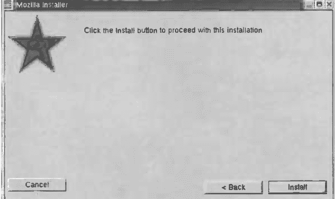

图 6-46 你真的、真的、真的确定吗？你知道只有系统管理员应该操作这个，对吧？

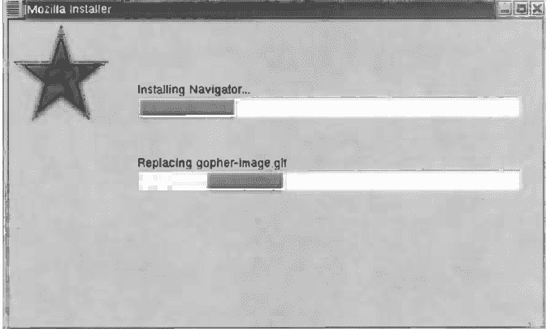

图 6-47 安装状态栏！再没有比这更简单了！

# OpenVMS Mozilla 安装

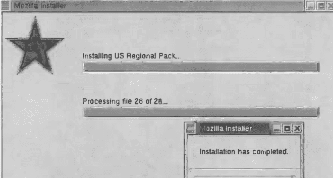

图 6-48 Linux Mozilla 安装完成！

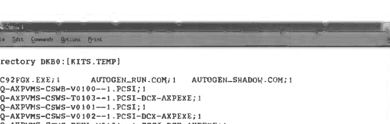

目录 DKB0: `[KITS.TEMP]`

```
2CR92FOX.EXE; AUTOGEN.RUN.COM;1

CPQ-APVMS-CSWM-V0100-1.1--PCSI;1

CPQ-APVMS-CSWM-T0103-1.1--PCSI-DCX-APEXE;1

CPQ-APVMS-CSWM-V0101-1.1--PCSI;1

CPQ-APVMS-CSWM-V0100-1.1--DCX-APEXE;1

CPQ-APVMS-CSWM-FINL-V0100-1.1--PCSI-DCX-APEXE;1

CPQ-APVMS-PRL-T0910-1.1--PCSI-DCX-APEXE;1

CPQ-APVMS-SSL-V0100-A-1.1--PCSI-DCX-APEXE;1

CPQ-APVMS-ALPHA-V0100.SFX.APEXE;1 CSWM_MODPERL.RELHOTS.HTML;1

CSWM_BHP_JETUMP.TXT DEZNO.EXE; DECOW.COM;1

DHUGO1_0.4.VIM;1 KNA2A6B.EXE;1

LIBSPRA-11.ALPHA.SO; LIBSPRA-11.LIB-10.SO;

LIBSPRA-11.LIB-18.SO; LIBSPRA-11.MOZILLA_100.SO;1

LOGIN.COM;2 L24Q4B.EXE;1 MAJORDBON0010--SRC.ZIP;1

SOUPG01_SET.TXT;1 PERL6START.COM;1 PERL6RELHOTS.TXT;1 SMBLIENT.ZIP;1

SSL_ISSUE.TXT;1 TCUMP_GMT.COM;1 TCUMP_PELT.COM;1

UN2IJ.ALPHA.EXE;1 VIM.DIR;

WHQ100.PDF;1
```

共 35 个文件。
5 个产品安装 cswm

图 6-49 以 SYSTEM 身份登录并将组件包放在与系统文件分开的目录中。你可以在 `http://www.openvms.compaq.com` 找到 OpenVMS Mozilla 帮助（而不是在 `http://www.mozilla.org/`）。

你想继续吗？[YES] yes

配置阶段开始 ...

你将被要求为每个选定的产品（如果有）以及任何为了满足软件依赖而可能安装的产选择选项。

CPQ AXPMS CSWB V1.0

* 此产品没有任何配置选项。
* 用于 OpenVMS Alpha 的 Compaq 安全浏览器 (CSWB)

执行阶段开始 ...

以下产品将安装到目标位置：
CPQ AXPMS CSWB V1.0                DISK$VMS073I:[VMS$COMMON]

完成部分：0%...10%...20%...100%

以下产品已安装：分层产品
CPQ AXPMS CSWB V1.0

图 6-50 使用标准的 OpenVMS 安装包 (CSWB) 并使用 `$PRODUCT INSTALL` 命令。

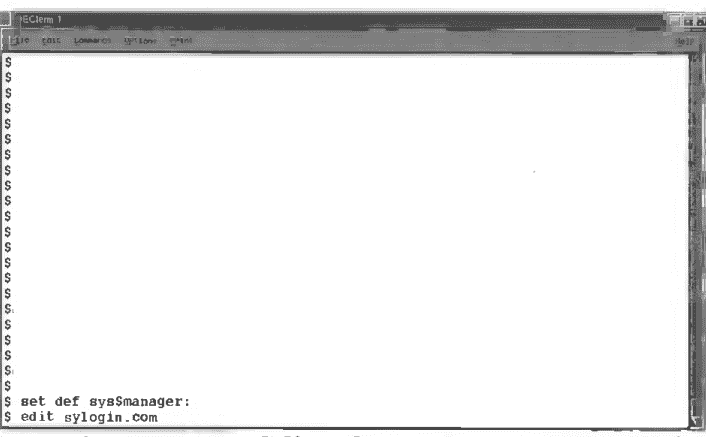

```
$

$

$

$

$

$

$

$

$

$

$

$

$

$

$

$

$

$

$

$

$

$

$

$

 set def sysmanager:

$ edit syslogin.com
```

图 6-51 切换目录到 `SYS$MANAGER:` 并编辑 OpenVMS LOGIN 文件。此文件将为每个创建进程的用户定义命令和符号。

## Linux & OpenVMS 兼容性

设置

```
$ VERIFY($FSTR("SYS$LOGIN"))

$ FMODE()

$++

$ SYLOGIN 等同于基于网络的 LOGIN.COM 程序；每当任何人登录 OpenVMS 系统、任何网络登录、或者任何分离进程（运行 DCL）启动、或者任何作业启动时，都会执行这些命令。

$ 结构:

$ 此 SYLOGIN 程序分为“交互式”、“作业”、“网络”和“其他”部分。每个部分都是累积的。
```

图 6-52 当编辑文件时，你需要知道交互式、网络和其他模式的快捷方式；我们将 Mozilla 定义放在交互式中，以便用户登录时可以启动程序。


```
$ MODE_INTERACTIVE:
$ 开启 <Control>.
$ SET CONTROL=
$ 除非是分离应用程序、远程登录或其他特定的终端（注意：通过 SET HOST 前缀 "TN" 进行远程登录被视为“交互式”进程而非“网络”进程）。
$ TT_NOINQ = "TT..NOINQ"
$ TT_DEVENAME = $FGET("TT..DEVENAME")
$ TT_DEVPREFIX = $FEXT(1,2,TT_DEVENAME)
$ IF $LOCATE("TT..DEVPREFIX",TT_NOINQ) .EQ LEN(TT_NOINQ)
$ TRUE
$ 判断这是一个终端
$ IF $GETDI($TT,"DEVCLASS") .EQ 66
$ TRUE
$ 确定什么样的终端，避免重置用户的显示设置...
```

图 6-53 定位 `Mode_interactive`；这是交互式部分的标签。

第 6 章 – 在 OpenVMS 和 Linux 上使用电子邮件 101

```
$ IF $LOCATE("TT_DEVPREFIX","TT_NOINQ") .EQ LEN(TT_NOINQ)
$ THEN
$! 判断这是一个终端
$! IF $GETDI("TT","DEVCLASS") .EQ 66
$ THEN
$! 确定什么样的终端，避免重置用户的显示设置...
$! tt_page = $FSDI("TT","TT_PAGE")
$! devbufsize = $FSDI("TT","DEVBUFSZ12")
$! SET TERMINAL/INQUIRE/PAGE="tt_page"/WIDTH="devbufsize"
$! Endif
$ END
```

```
$ @SYS$MANAGER:1:CSWB_MONON$LOGIN.COM
$! 移除以下注释以支持路径登录程序。
$ @SYS$MANAGER:$WETDIST.MISLOGIN.COM
$! 移除以下注释以执行 Process Software 的命令定义程序。
$ @TCPWARE:TCPWARE_COMMANDS.COM
```

图 6-54 检查的 `endif` 为我们的 Mozilla 设置新命令。注意 "`moz`" 允许我们从美元符号使用简写 "`moz`"，并使其被识别为我们输入了整个字符串 "`mozilla`"。

```
$! 确定什么样的终端，避免重置用户的显示设置...
$! tt_page = $FSDI("TT","TT_PAGE")
$! devbufsize = $FSDI("TT","DEVBUFSZ12")
$! SET TERMINAL/INQUIRE/PAGE="tt_page"/WIDTH="devbufsize"
$ GET IF
$ Endif
```

```
$ @SYS$MANAGER:1:CSWB_MONON$LOGIN.COM
$! 移除以下注释以支持路径登录程序。
$ @SYS$MANAGER:$WETDIST.MISLOGIN.COM
$! 移除以下注释以执行 Process Software 的命令定义程序。
$ @TCPWARE:TCPWARE_COMMANDS.COM
```

```
*EXIT
SYSCOMMAND:[SYSMGR]SYLOGIN.COM; 4 165 行
```

图 6-55 保存并编辑过的文件。

### Linux & OpenVMS 兼容性

# MCR AUTHORIZE

图 6-56 使用 `uaf-modify` 命令将这些配额授予任何需要在 OpenVMS 上运行 Mozilla 的用户账户。注意此账户仅具有 `tembx` 和 `netmbx` 权限来运行 Mozilla，而显示的 `SYSTEM` 账户拥有所有权限！

| Username: SYSTEM | Owner: SYSTEM |
| :--- | :--- |
| Account: UIC: [1,4] |
| CLI: DCL |
| Default: SYSROOT:[SMGR] | Tables: DCL |
| Primary days: Mon Wed Fri Sun |
| Secondary days: |
| Expiration: (none) | Login False: 0 |
| Pwdtime: 00:00 | Pwdchg: 23-SEP-2002 15:23 |
| Last Login: 28-SEP-2002 15:14 (interactive), 28-SEP-2002 16:01 (non-interactive) |
| Maxjobs: 100 | 150000 |
| Shrill: 300 | 4096 |
| Maxdetach: 300 | 4096 |
| Price: 10 | 300 |
| Prio: 250 | 8192 |
| Queuing: 160 | 32768 |
| CPU: 250 | 150000 |


104

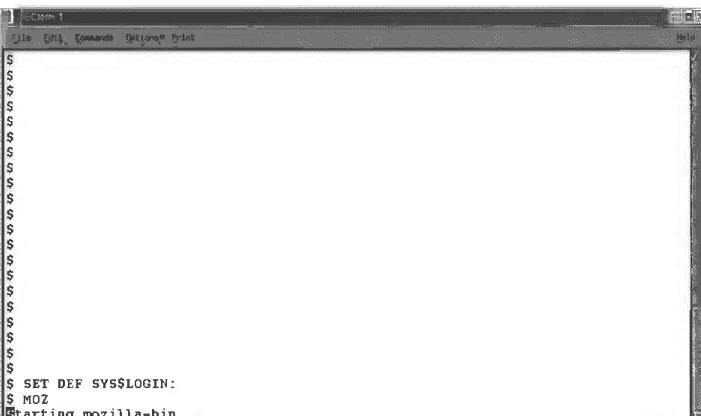

图 6-58 退出授权工具并首次运行 Mozilla。

恭喜！你已经在 OpenVMS 和 Linux 系统上安装了 Mozilla 浏览器。

# OpenVMS 或 Linux 邮件客户端配置

OpenVMS 和 Linux 开源应用程序的棒之处在于，无论什么平台，它们安装后的外观、感觉和运行方式都是完全一样的！让我们看看如何为 Mozilla 配置 POP3 或 IMAP；注意，两者从应用角度来看是完全相同的（参见图 6-60 至图 6-70！）

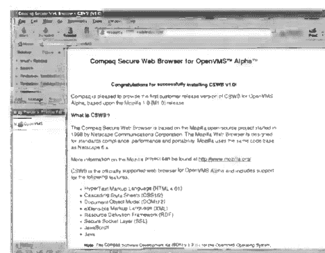

图 6-59 Mozilla 浏览器窗口已打开，并准备连接到远程电子邮件服务器或通过局域网连接到其运行的服务器。

# Compaq 安全浏览器 - CBWB (V1.0)

# 适用于 OpenVMS™ Alpha™ 的 Compaq 安全浏览器

恭喜您成功安装了 CBWB V1.0！

Compaq 很高兴提供基于 Mozilla 1.0 (M1) 版本的 OpenVMS Alpha CBWB 首次客户版。

# 什么是 CBWB？

Compaq 安全浏览器基于由 Netscape Communications 公司于 1998 年启动的 Mozilla 开源项目。Mozilla 浏览器旨在实现标准性、性能和可移植性而设计。Mozilla 与 Netscape 使用相同的代码库。

关于 Mozilla 项目的更多信息请访问 http://www.mozilla.org/

CBWB 是 OpenVMS Alpha 官方支持的 浏览器，包含以下功能：

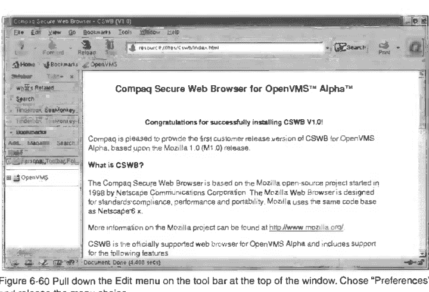

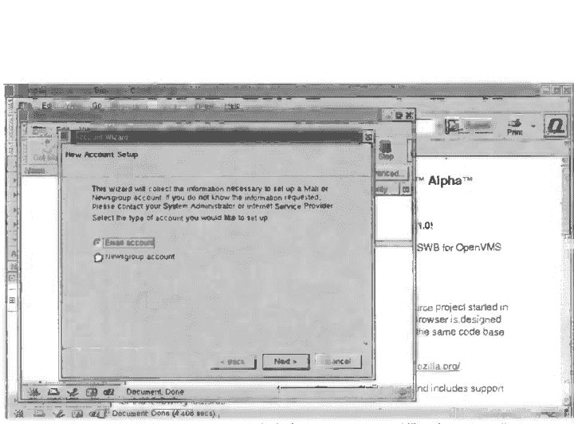

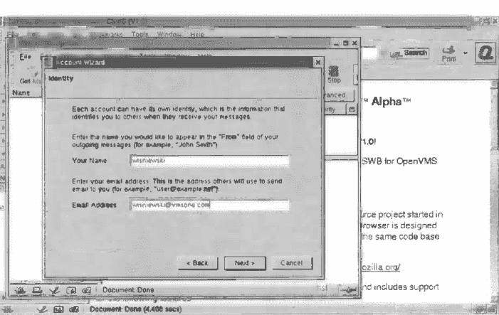

图 6-62 接下来，提供 users@server 的用户名和电子邮件地址。

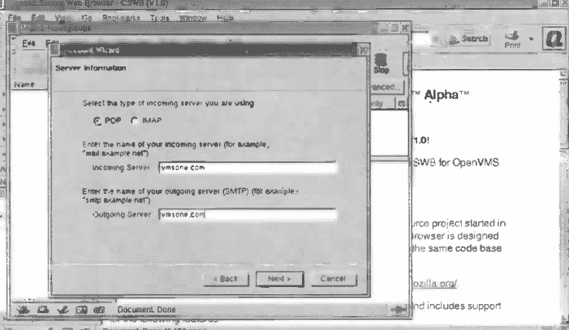

图 6-63 选择 POP 或 IMAP——你必须确保你的服务器已准备好接受 POP 或 IMAP 连接！此外，你还需要一个发邮件服务器来处理你发出的客户端电子邮件。

Linux & OpenVMS 互操作性

图 6-64 现在输入你将发送和接收电子邮件的账户用户名。

图 6-65 再次输入你的账户名称。

第 6 章 - 在 OpenVMS 和 Linux 上使用电子邮件 107页

图 6-66 验证（或修改）你的账户信息。

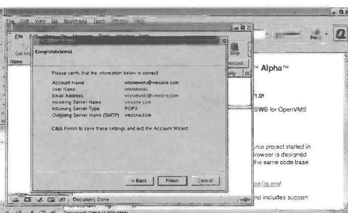

图 6-67 你现在正在连接到实际账户。你必须使用账户密码，就像交互式登录一样。

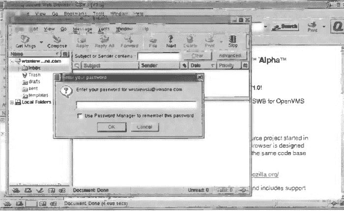

Linux & OpenVMS 互操作性

图 6-68 输入密码。

图 6-69 恭喜，你刚刚为你的电子邮件服务器配置了电子邮件客户端！

第 6 章 – 在 OpenVMS 和 Linux 上使用电子邮件 109页

图 6-70 因为这是 POP3 连接，你需要将电子邮件消息下载到你的 Mozilla 邮件客户端。

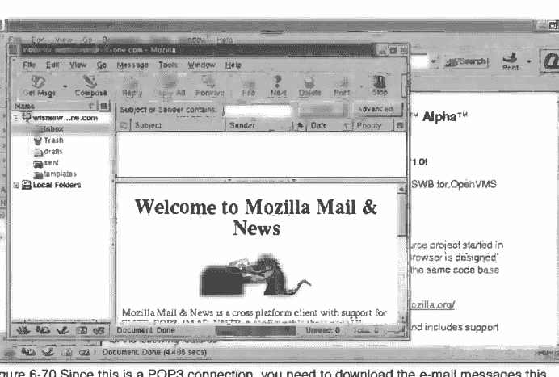

图 6-71 点击“获取消息”（Get Messages）按钮，你将获得所有的个人电子邮件，这简直无法拒绝！

Linux & OpenVMS 互操作性

# 欢迎来到邮件与新闻

图 6-72 浏览列表，只有一个选项可以优先阅读。

图 6-73 噢，热爱互联网，没有垃圾邮件，所以让我们来看看一条更典型的电子邮件消息。

第 6 章 - 在 OpenVMS 和 Linux 上使用电子邮件 111页

# 回复: 9月23日周一激活 (web-mail@vsone.com) - Martha

发件人: martha@morgandep.com
主题: 回复:9月23日周一激活
日期: 9月23日
返回路径: <martha@morgandep.com>
接收自: mail.activations.vsone.net (151.64.30.54) 通过 mail.helper (v3.1-Alpha); 2002年9月23日周六 13:04:53 -0700 (PDT)
接收自: web-mail.vsone.net (207.69.150.157); 通过 mail-back-relay.net (8.8.8.9) 使用 ESMTP 3.0; 2002年9月23日周六 13:04:53 -0700 (PDT)
接收自 <martha@morgandep.com> (172.19.49.151); 通过 mail-back-relay.net (8.8.8.9) 使用 ESMTP 3.0; 2002年9月23日周六 13:04:53 -0700 (PDT)
邮件 ID: <0015030355412.00000@web-mail.vsone.com>
收件人: <list@vsone.com>
发件人: "Martha Rose" <martha@morgandep.com>
主题: 回复:9月23日周一激活
回复: <reply-to@vsone.com>
“看起来本地无线电小组正被召集来应对风暴。”
Martha
发送自 <martha@morgandep.com>

图 6-74 看起来本地无线电小组正被召集来应对风暴。

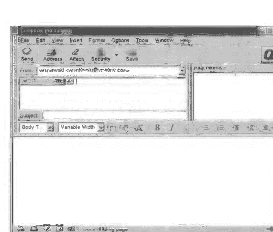

图 6-75 使用标准的 Mozilla，你仅需开源和标准的互联网邮件工具即可编写并回复（带附件）电子邮件！

Linux & OpenVMS 互操作性

# 电子邮件想要免费

跨 OpenVMS 和 RedHat 7.3 的电子邮件包含在基础发行版中，无需额外费用。OpenVMS 对开源电子邮件进行了额外的检查和测试（因为它编写了 TCP/IP 栈并将 Mozilla 移植到 OpenVMS）。Linux 和 OpenVMS 使用相同的工具发送电子邮件、交换文件、共享磁盘并浏览对方的网站。电子邮件通常是网络中建立的首个应用程序——一旦它运行正常，其他的就简单了。嗯，至少我们知道电子邮件是行的。

# 第 7 章 — 用于 Linux 和 OpenVMS 的 SMB

# 在 OpenVMS 和 Linux 上使用 SMB 进行磁盘共享

Windows、Linux 和 OpenVMS 系统在过去的 10 年里一直在入侵对方的领域。经理和“普通”用户只希望他们不仅能够良好地相处，还能共享文件、磁盘和打印机。这是一个简单的目标，尽管这是一个不合理的要求！

还有其他磁盘共享协议，例如 UNIX 世界中的 NFS 或 VMS 世界中的 DFS，但 Windows 的优势在于……

## 服务配置

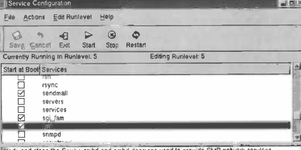

当前运行级别（Runlevel）: 5

- sync
- sendmbd
- servers
- services
- sql,lbm
- snmpd

在启动时启动并停止提供 SMB 网络服务的 Samba `smbd` 和 `nmbd` 守护进程。

在 GNOME 桌面下服务器管理器菜单的图 7-1 中，你只需要勾选复选框并保存选择即可。

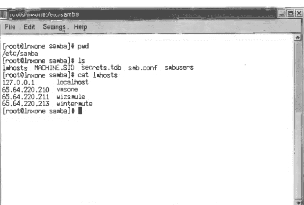

```
[root@lnone:samba]# pad

/etc/samba

[root@lnone:samba]# ls

hosts MACHINE.SID secrets.tdb smb.conf sabusers

[root@lnone:samba]# cat hosts

127.0.0.1 localhost

65.64.220.210 vasone

65.64.220.221 wizards

65.64.220.213 wintermate

[root@lnone:samba]#
```

图 7-2 激活 SAMBA 的下一步是配置 `/etc/samba` 目录下的 hosts 文件，使用你喜欢的 Linux 编辑器，并添加你的工作组或域中其他主机的“LAN 管理”（LAN Manager）名称。

第 7 章 – Linux 和 OpenVMS 的 SMB 117 页

```
[root@lrvone ~samba]# pad

/etc/samba

[root@lrvone ~samba]# ls

hosts  HOME_SID  secrets.smb.conf sabusers
```


```bash
[root@lrvone ~samba]# cat hosts

127.0.0.1    localhost

65.64.220.210 wizmle

65.64.220.213 winermute

[root@lrvone ~samba]#
```

# account starts with a cat sabusers

`username = <name> SID=<name2>`

# root = administrator admin

`nobody = guest pcquest sbquest`

`johnw = john`

`stves = steves`

`jerrow arrow`

`smb_pub = smb_pub`

```bash
[root@lrvone ~samba]# #
```

7-3 然后编辑 `sabusers` 以及 Linux 账户名称以及你想要映射到它们的 Windows 工作组/域名称。注意，你可以将 Windows 用户映射到单个 Linux 账户！

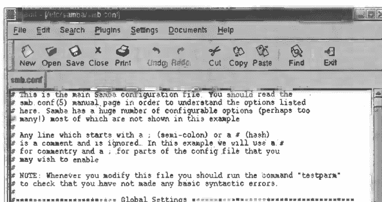

文件 编辑 查找 插件 设置 文档 帮助 撤销 切复制 退出

这是主要的 `samba.conf` 文件。你应该读取 `samba conf (global)` 部分以理解此处列出的选项。Samba 有许多可配置选项（可能太多了！），本示例中未显示。

任何以连字符（`-`）或分号（`;`）开头的行都是注释并会被忽略。在本示例中，我们将使用 `#` 作为注释，并使用 `;` 表示你想要启用的配置部分。

注意：每当你修改此文件时，都应该运行命令 `"testpar"` 来检查你是否没有任何基本的语法错误。

```
[global]

   Global Settings ------------------------------------------------------

```

```
workgroup = NT-Domain-Name or Workgroup-Name

server string = description

```

7-4 编辑 `samba.conf` 文件并更改域/工作组名称，使其与你的 PC（以及其他 Linux 客户端）使用的域/工作组相同。

# Linux 与 OpenVMS 交互性

# 编辑 `/etc/samba/smb.conf`


# 用于注释使用 `#` ，用于你可能
# 想要启用的配置部分

# 注意：每当你修改此文件时，都应该运行 `'testparam'`
# 来检查你是否没有任何基本的语法错误。

===========================================
# 全局设置
===========================================
  # 注意：每当你修改此文件时，都应该运行 `'testparam'`
# 来检查你是否没有任何基本的语法错误。
[global]
  # workgroup = NT-Domain-Name or Workgroup-Name
  # server string 等同于 NT Description 字段
  server string = I can't say if it's LINUX!
此选项对于安全非常重要。它允许你将连接限制在本地网络上的机器。以下示例限制了对两个 O 类网络和“回环”（loopback）接口的访问。更多语法示例请参见

图 7-5 将 `server string` 改为更合适的内容。当客户端浏览你的 SMB 服务器时将显示此内容。

# 编辑 `/etc/samba/smb.conf`


[global]
  # workgroup = NT-Domain-Name or Workgroup-Name
  # workgroup = uski

  # server string 等同于 NT Description 字段
  server string = I can't say if it's LINUX!
此选项对于安全非常重要。它允许你限制连接到本地网络上的机器。以下示例限制了对两个 O 类网络和
“回环”接口。更多语法示例请参见
conf name
  hosts = 192.168.1
  hosts = 192.168.2
  hosts = 192.168.3
  hosts = 192.168.4
  hosts = 192.168.5
  hosts = 192.168.6
  hosts = 192.168.7
  hosts = 192.168.8
  hosts = 192.168.9
  hosts = 192.168.10
  hosts = 192.168.11
  hosts = 192.168.12
  hosts = 192.168.13
  hosts = 192.168.14
  hosts = 192.168.15
  hosts = 192.168.16
  hosts = 192.168.17
  hosts = 192.168.18
  hosts = 192.168.19
  hosts = 192.168.20
  hosts = 192.168.21
  hosts = 192.168.22
  hosts = 192.168.23
  hosts = 192.168.24
  # 如果你想自动加载你的打印机列表
# 你需要单独设置
printname = /etc/
printers = yes

图 7-6 指定你允许的所有 SMB 客户端和服务器。你可以使用通配符！

第 7 章 – Linux 和 OpenVMS 的 SMB 119 页

```bash
[root@iphone:samba]# pwd

/etc/samba

[root@iphone:samba]# ls

hosts MACHINE.SID secrets.tdb smb.conf sabusers

[root@iphone:samba]# cat hosts

127.0.0.1 localhost

65.64.220.210 version

65.64.220.211 wirale

65.64.220.213 wintermate

[root@iphone:samba]# cat sabusers

unique_name = SMB_name...

root = administrator admin

robody = guest pcquest

john = john

steves = steves

jennaw = jennaw

smb_pub = smb_pub

[root@iphone:samba]# 7-2 第一次以 root 用户运行 smbpasswd 并创建一个 SMB 密码文件（第一次运行时）。为所有连接到你 SMB 服务器的 Linux 用户名添加密码。
```

```bash
[root@iphone:samba]# pwd
/etc/samba
[root@iphone:samba]# ls
hosts MACHINE.SID secrets.tdb smb.conf sabusers
[root@iphone:samba]# cat hosts
127.0.0.1 localhost
65.64.220.210 version
65.64.220.211 wirale
65.64.220.213 wintermate
[root@iphone:samba]# cat subusers
unique_name = SMB_name...
root = administrator admin
robody = guest pcquest
john = john
steves = steves
jennaw = jennaw
smb_pub = smb_pub
[root@iphone:samba]# smbpasswd -a johnny
new SMB password:
```

图 7-8 为 Linux `johnny` 账户设置 SMB 密码。

120 Linux 与 OpenVMS 交互性


### 图 7-9 验证 johnn 的密码。

```
[root@lv0one:/etc/samba]$
文件 编辑 设置 帮助
[root@lv0one~$samba]# pwd
/etc/samba
[root@lv0one~$samba]# ls
hosts MACHINE.tdb secrets.tdb smb.conf sabusers
[root@lv0one~$samba]# cat hosts
127.0.0.1    localhost
65.64.220.210 wizmle
65.64.220.213 winterute
[root@lv0one~$samba]# cat sambusers
unique_name = SMB_name...
root = administrator admin
nboboy = guest ocquest sambquest
johnn = johnn
steves = steves
jennaw = jennaw
smb_pub = smb_pub
[root@lv0one~$samba]# smbpasswd -a johnn
New password:
Retype new password:
```

### 图 7-10 成功消息意味着你已将 johnn 添加到密码文件中。

```
[root@lv0one:/etc/samba]$
文件 编辑 设置 帮助
[root@lv0one~$samba]# ls
hosts MACHINE.tdb secrets.tdb smb.conf sabusers
[root@lv0one~$samba]# cat hosts
127.0.0.1    localhost
65.64.220.210 wizmle
65.64.220.213 winterute
[root@lv0one~$samba]# cat sambusers
unique_name = SMB_name...
root = administrator admin
nboboy = guest ocquest sambquest
johnn = johnn
steves = steves
jennaw = jennaw
smb_pub = smb_pub
[root@lv0one~$samba]# smbpasswd -a johnn
New password:
Retype new password:
Unable to open passdb.
Added user johnn.
[root@lv0one~$
```

第 7 章 – Linux 和 OpenVMS 的 SMB 121 页

```
图 7-11 启动 SMB 进程（而不是重启）
```

```
图 7-12 启动 NetBIOS 进程（smbd 和 nmbd 进程都应在启动时启动）。
```

`show def`

`SYS$SYSROOT:[SYSMGR]`

`= SYS$SYSROOT:[SYSMGR]`

`= SYS$COMMON:[SYSMGR]`

`$ dir @reg*`

目录 `SYS$COMMON:[SYSMGR]`

`ICC$ADD_REGISTRY_TABLE.COM;1` `REG$CONFIG.COM;1`

共 2 个文件。

S 

S `@regconfig.com`

图 7-14 要开始配置 OpenVMS 注册表，请执行脚本 `@SYS$MANAGER:REG$CONFIG.COM`。

OpenVMS 注册表配置工具

1 配置 OpenVMS 注册逻辑名称和目录路径

2 显示 OpenVMS 注册逻辑名称和目录路径

3 检查 OpenVMS 注册服务器的状态

4 在此节点上启动 OpenVMS 注册服务器

5 转换为最新的数据库版本和/或回收数据库

H - 关于此工具的帮助

[E] - 退出

请输入你的选择： _

图 7-15 运行菜单并选择第一个选项。

124 Linux 与 OpenVMS 的互操作性

[E] - 退出

请输入你的选择：1

1 系统现在是集群中的一个节点，还是该系统将成为集群的一部分？(V/N/Q) : Y

`REGSTO_BE_STARTED _`

+ - 逻辑值 `REGSTO_BE_STARTED` 没有有效的翻译

注意：如果你希望某个节点在系统启动时启动服务器，或运行备用的 OpenVMS 注册服务器，请将此逻辑值设置为 TRUE。

你不希望在此节点上启动 OpenVMS 注册服务器，该进程可以处于状态并写入数据库。但是，你可以运行多个 OpenVMS 注册服务器，每个节点最多一个。

你想要更改此值吗？(V/N/Q) : Y

输入新值 (TRUE/FALSE/NOVAL/Q) : TRUE

你希望将该逻辑定义在哪个逻辑名称中？

(SYSTEM/SYSCLUSTER/Q) : SYSTEM

图 7-16 将 `REGSTO_BE_STARTED` 逻辑定义为 TRUE。


+ - 逻辑值 `REGSTO_BE_STARTED` 没有有效的翻译

注意：如果你希望某个节点在系统启动时启动服务器，或运行备用的 OpenVMS 注册服务器，请将此逻辑值设置为 TRUE。

你不希望在此节点上启动 OpenVMS 注册服务器，该进程可以处于状态并写入数据库。但是，你可以运行多个 OpenVMS 注册服务器，每个节点最多一个。

你想要更改此值吗？(V/N/Q) : Y

输入新值 (TRUE/FALSE/NOVAL/Q) : TRUE

你希望将该逻辑定义在哪个逻辑名称中？

(SYSTEM/SYSCLUSTER/Q) : SYSTEM

逻辑值 `REGSTO_BE_STARTED` 已临时定义。
在重启系统之前，请编辑你的 `SYLOGICALS.COM` 文件
以包含以下行：

```
DEFINE/TABLE=LMSYSTEMREGSTO_BE_STARTED TRUE
```

按 [Enter] 继续。

图 7-17 注意，你可以将其放在集群或系统逻辑表中。

第 7 章 – 适用于 Linux 和 OpenVMS 的 SMB 125

逻辑值 `REGISTRO_BE_STARTED` 已临时定义。
在重启系统之前，你必须编辑你的 `SYLOGICALS.COM` 文件
以包含以下行：

```
DEFINE/LH$SYSTEM REGISTRO_BE_STARTED TRUE
```

按 [Enter] 继续 -

`SYS$REGISTRY` 逻辑 -

+ - `SYS$REGISTRY` 服务器没有有效的翻译
注意：在集群中，你可以出于各种目的运行多个 OpenVMS 注册服务器
（最多跨两个节点）。然而，只有一个 VMS 注册表数据库位于中央磁盘上，并供集群中的所有节点直接访问。请检查你的目录规范对整个集群可见的，或者它与现有的 `SYS$REGISTRY` 目录的目录规范匹配。

你想要更改此值吗？(Y/N/Q) [Y]: Y


按 [Enter] 继续 -

`SYS$REGISTRY` 逻辑 -

+ - 逻辑值 `SYS$REGISTRY` 没有有效的翻译
注意：在集群中，你可以出于各种目的运行多个 OpenVMS 注册服务器
（最多跨两个节点）。然而，只有一个 VMS 注册表数据库位于中央磁盘上，并供集群中的所有节点直接访问。请检查你的目录规范对整个集群可见的，或者它与现有的 `SYS$REGISTRY` 目录的目录规范匹配。

你想要更改此值吗？(Y/N/Q) [Y]: Y

为 `SYS$REGISTRY("value/NOVAL/Q")` 输入新值："`SYS$SYSDEVICE:[VMS_REGISTRY]`"

你输入了：`sys$device:[vms_registry]`

这正确吗？(Y/N/Q) [Y]: Y

图 7-19 我再次在逻辑表中定义了这个逻辑（主要因为我只配置了单台系统）。

供集群中的所有节点直接访问。请检查你的目录规范对整个集群可见的，或者它与现有的
`SYS$REGISTRY` 的目录规范匹配。

你想要更改此值吗？(Y/N/Q) [Y]: Y

为 `SYS$REGISTRY("value/NOVAL/Q")` 输入新值："`SYS$SYSDEVICE:[VMS_REGISTRY]`"

逻辑值 `REGSTO_BE_STARTED` 已临时定义。

在重启系统之前，请编辑你的 `SYLOGICALS.COM` 文件

以包含以下行：

```
DEFINE/TABLE=LMSYSTEMREGSTO_BE_STARTED TRUE
```

按 [Enter] 继续。

图 7-17 注意，你可以将其放在集群或系统逻辑表中。

第 7 章 – 适用于 Linux 和 OpenVMS 的 SMB 125

逻辑值 `REGISTRO_BE_STARTED` 已临时定义。

在重启系统之前，你必须编辑你的 `SYLOGICALS.COM` 文件

以包含以下行：

```
DEFINE/LH$SYSTEM REGISTRO_BE_STARTED TRUE
```


按 `[Enter]` 继续 -

`SYS$REGISTRY` 逻辑 -

+ - `SYS$REGISTRY` 服务器没有有效的翻译

注意：在集群中，你可以出于各种目的运行多个 OpenVMS 注册服务器

（最多跨两个节点）。然而，只有一个 VMS 注册表数据库位于中央磁盘上，并供集群中的所有节点直接访问。请检查你的目录规范对整个集群可见的，或者它与现有的

`SYS$REGISTRY` 目录的目录规范匹配。

你想要更改此值吗？(Y/N/Q) [Y]: Y


按 `[Enter]` 继续 -

`SYS$REGISTRY` 逻辑 -

+ - 逻辑值 `SYS$REGISTRY` 没有有效的翻译

注意：在集群中，你可以出于各种目的运行多个 OpenVMS 注册服务器

（最多跨两个节点）。然而，只有一个 VMS 注册表数据库位于中央磁盘上，并供集群中的所有节点直接访问。请检查你的目录规范对整个集群可见的，或者它与现有的 `SYS$REGISTRY` 目录的目录规范匹配。

你想要更改此值吗？(Y/N/Q) [Y]: Y

```
为 SYS$REGISTRY("value/NOVAL/Q") 输入新值："SYS$SYSDEVICE:[VMS_REGISTRY]"
```

```
你输入了：sys$device:[vms_registry]
```

```
这正确吗？(Y/N/Q) [Y]: Y
```

## 第1章

```
$ 移除以下行的行的注释分隔符 ($:) 以启动
$ RPC 服务。
$ @SYsys$STARTUP:DCE_RPC_STARTUP.COM
$ @sys$STARTUP:
$
$ 启动 SSL 扩展。这些允许 Stunnel 和其他 SSL 应用程序工作
$ 或让其他启用 SSL 的应用程序运行
$ @sys$startup:ms$startup.com
$ 启动 OpenVMS 注册表
define=/system/exec reglo.0;started(true)
define=/system/exec sysregistry VMS_SERVICE:[VMS_REGISTRY]
$ms$startupregstartup.com
$ 缓冲区: STARTUP_VMS.COM  写入插入向前
444 行已写入文件 SYSCOMMON:[SYSM]$STARTUP_VMS.COM;25
```

图 2-26 编辑启动文件，添加逻辑定义和注册表启动，以便 VMS 注册表在每次系统启动时都会启动。

## 第 2 步：为高级服务器配置 OpenVMS IP

```
Compaq TCP/IP 服务：OpenVMS 配置菜单
配置选项：
1 核心环境
2 客户端组件
3 服务器组件
4 可选组件
5 关闭 OpenVMS 的 Compaq TCP/IP 服务
6 启动 OpenVMS 的 Compaq TCP/IP 服务
7 运行测试
A 配置选项 1 - 4
[E] 退出配置程序
输入配置选项：4
```

图 2-27 使用 `$@sys$startup:$tcpip$config.com` 启动 TCP/IP 配置菜单。选择菜单 4。

### Linux 与 OpenVMS 互操作性


图 7-28 为 PWIP 驱动程序选择菜单 1。


图 7-29 无论插图显示什么，都选择启用 (Enable) 和 启动 (Start)。


图 7-30 你应该收到类似的成功安装消息。


图 7-31 退出 TCP/IP 配置菜单。

### Linux 与 OpenVMS 互操作性

## OpenVMS 的 Compaq TCP/IP 服务配置菜单

配置选项：

- - 核心环境
- 客户端组件
- 服务器组件
- 可选组件
- - 关闭 OpenVMS 的 Compaq TCP/IP 服务
- 启动 OpenVMS 的 Compaq TCP/IP 服务
- 运行测试
- - 配置选项 1 - 4
- 退出配置程序

输入配置选项：E

图 7-32 返回提示符。

| | | | | | | | |
|---|---|---|---|---|---|---|---|
| 2020040E AUDIT_SERVER | HIB | 9 | 57 | 00:00:00.02 | 117 | 146 |
| 2020040F JOB_CONTROL | HIB | 10 | 58 | 00:00:00.02 | 64 | 88 |
| 2020040G QUIL_MANAGER | HIB | 9 | 2506 | 00:00:00.26 | 279 | 313 |
| 2020041H SECURITY_SERVER | HIB | 10 | 58 | 00:00:05.06 | 323 | 397 |
| 2020041I ACME_SERVER | HIB | 8 | 102 | 00:00:00.03 | 353 | 471 |
| 2020041J DM_SERVER | HIB | 14 | 45 | 00:00:00.04 | 581 | 497 |
| 2020041K TP_SERVER | HIB | 10 | 24 | 00:00:00.01 | 71 | 92 |
| 2020041L TCPIP_SERVICES | HIB | 10 | 95 | 00:00:00.15 | 614 | 696 |
| 2020041M TCPIP_FTPST | LEF | 10 | 167 | 00:00:00.05 | 529 | 697 |
| 2020041N TCPIP_MAP_1 | LEF | 10 | 434 | 00:00:01.01 | 315 | 381 |
| 2020041O TCPIP_HTTP | LEF | 10 | 212 | 00:00:00.12 | 415 | 488 |
| 2020041P TCPIP_WIP_ACP | LEF | 9 | 46 | 00:00:00.01 | 138 | 161 |
| 2020041Q TCPIP_VMS_MON | HIB | 4 | 8 | 00:00:06.10 | 215 | 318 |
| 2020041R TCPIP_SERVER | HIB | 6 | 25 | 00:00:05.01 | 203 | 223 |
| 2020041S SHOW_SERVER | HIB | 6 | 692 | 00:00:00.45 | 476 | 625 |
| 2020042A DIOG_LIN | LEF | 5 | 152 | 00:00:00.03 | 456 | 421 |
| 2020042B UDREET | LEF | 4 | 289 | 00:00:00.36 | 439 | 524 |
| 2020042C DEQUTILS | LEF | 4 | 888 | 00:00:00.15 | 888 | 709 |
| 2020042D DWSTE_025 | COM | 4 | 247 | 00:00:00.65 | 719 | 719 |
| 2020042E SYSTEM_95 | CUR | 7 | 612 | 00:00:01.11 | 720 | 126 |
| 2020042F SYSTEM_54 | LEF | 4 | 14 | 00:00:00.01 | 67 | 585 |

图 7-33 执行 SHOW 命令查看你是否已安装并启动了注册表。

| | | | | | |
|---|---|---|---|---|---|
| 2020040E AUDIT_SERVER | HIB | 9 | 57 | 00:00:00.02 | 117 | 146 |
| 2020040J JOB_CONTROL | HIB | 10 | 40 | 00:00:00.02 | 64 | 88 |
| 2020040Q QUEUE_MANAGER | HIB | 10 | 2506 | 00:00:00.26 | 279 | 313 |
| 20200412 SECURITY_SERVER | HIB | 10 | 58 | 00:00:00.06 | 323 | 397 |
| 20200415 ACME_SERVER | HIB | 10 | 102 | 00:00:00.23 | 453 | 476 |
| 20200414 MS_SERVER | HIB | 9 | 42 | 00:00:00.04 | 141 | 172 |


| 20200415 TP_SERVER | HIB | 10 | 24 | 00:00:00.01 | 71 | 92 |

| 2020041A TCPIP$HTTPP | HIB | 10 | 192 | 00:00:00.22 | 243 | 168 |

| 2020041B TCPIP$ROUTER | LEF | 6 | 85 | 00:00:00.01 | 614 | 695 |

| 2020041C TCPIP$WIP | LEF | 10 | 167 | 00:00:00.05 | 539 | 297 |

| 2020041D TCPIP$MAIL | HIB | 10 | 148 | 00:00:00.18 | 497 | 441 |

| 2020041E TCPIP$POP | HIB | 10 | 250 | 00:00:00.02 | 415 | 384 |

| 2011010 TCPIP$WIP_ACP | HIB | 4 | 86 | 00:00:00.10 | 315 | 81 |

| 2020042A VPL_SERVER | HIB | 15 | 11 | 00:00:00.01 | 203 | 223 |

| 2020042B REGISTRY_SERVER | HIB | 10 | 469 | 00:00:00.00 | 313 |

| 2020042C DEQYS_O | HIB | 6 | 692 | 00:00:00.45 | 476 | 625 |

| 20200422 LIN_ | LEF | 5 | 152 | 00:00:00.03 | 456 | 421 |

| 20200423 UTTER | LEF | 4 | 289 | 00:00:00.36 | 439 | 524 |

| 20200424 DEQ | LEF | 4 | 888 | 00:00:00.15 | 888 | 709 |

| 2020042D DWSTE_025 | COM | 4 | 247 | 00:00:00.65 | 719 | 719 |

| 2020042E SYSTEM_95 | CUR | 7 | 612 | 00:00:01.11 | 720 | 126 |

| 2020042F SYSTEM_54 | LEF | 4 | 14 | 00:00:00.01 | 67 | 585 |

此过程将检查是否满足条件。

如果满足条件，过程将继续。

如果不满足，进程将停止。

您要继续吗？(YES|no)

请选择以下选项之一：

- 1. 安装高级服务器 [默认]
- 2. 仅安装许可证服务器
- 3. 仅安装认证镜像
- 4. 同时安装许可证服务器和
- 5. 外部认证镜像

选项: i

此模式在启动此产品之前无需重启。

有关可能需要重启的原因以及如何避免不必要的重启的信息，请参阅《安装与配置指南》。

选择一个选项：

- 1. 在所有节点上尽可能的地延迟重启。[默认]
- 2. 重启之前防止在使用此系统的任何节点上进行 PRECONFIG 配置
- 3. 重启之前防止在所有节点上进行 PRECONFIG 配置
- 4. 重启之前防止在使用此系统的任何节点上启动
- 5. 重启之前防止在所有节点启动。

选项: i

选择选项 1 为 OpenVMS 安装完整的 Advanced Server 软件。

重启后。

重启之前防止在所有节点启动。

选项: i | 用户帐户和用户识别码 (UIC)

适用于 OpenVMS 的 Advanced Server V7.3 安装会创建两个账户：默认账户 `PWRK$DEFAULT` 和宾客账户 `PWRK$QUEST`。这两个帐户的默认 UIC 组号取决于以下因素：

- 如果您首次安装服务器，默认值是从 360 开始的第一个未使用的 UIC 组号
- 如果已存在 `PWRK$CONFIG`，则使用 `PWRK$CONFIG` 关联的 UIC 组号
- 如果已存在 `PWRK$DEFAULT` 或 `PWRK$QUEST` 账户，则使用 `PWRK$DEFAULT` 或 UIC 组号，优先级高于 `PWRK$CONFIG`。

然而，默认的 UIC 组号不会用于更改现有帐户的 UIC。

有关 UIC 组号的更多信息，请参阅《OpenVMS 系统管理员手册》。

输入 UIC 组号用于

组：`PWRK$DEFAULT` 和 `PWRK$QUEST`

图 7-41 现在选择一个 OpenVMS 组号用于 PWRK/Advanced Server 账户！（您可能想使用默认值）。

第 7 章 – 用于 Linux 和 OpenVMS 的 SMB

默认值是第一个未拥有的 UIC 组号，从 360 开始

- 如果已存在 `PCFSACCOUNT`，默认值是与 `PCFSACCOUNT` 关联的 UIC 组号。
- 如果已存在 `PWRDEFAULT` 或 `PWRKSGUEST` 帐户，默认值是与 `PWRDEFAULT` 或 `PWRKSGUEST` 关联的 UIC 组号，其优先级不会更改任何帐户的 UIC。

有关 UIC 组号的更多信息，请参阅《OpenVMS 系统管理员手册》。

输入 UIC 组号用于

`PWRDEFAULT` 和 `PWRKSGUEST`

为 `PWRDEFAULT` 和 `PWRKSGUEST` 创建 OpenVMS 帐户

- 精简版产品没有任何配置选项。

执行阶段开始 ...

以下产品将安装到目标位置：

`CPQ AXPMS ADVANCEDSERVER V7.3 DISKVSMS0731:[VMSCOMMON]`。

密度：0%

图 7-42 现在所有问题都已问完，实际安装开始了！

默认值是第一个未拥有的 UIC 组号，从 360 开始

- 如果已存在 `PCFSACCOUNT`，默认值是与 `PCFSACCOUNT` 关联的 UIC 组号。
- 如果已存在 `PWRDEFAULT` 或 `PWRKSGUEST` 帐户，默认值是与 `PWRDEFAULT` 或 `PWRKSGUEST` 关联的 UIC 组号。然而，优先于 `PCFSACCOUNT` 的默认 UIC 不用于更改任何帐户的 UIC。

有关 UIC 组号的更多信息，请参阅《OpenVMS 系统管理员手册》。

输入 UIC 组号用于

`PWRDEFAULT` 和 `PWRKSGUEST`

组：1!

为 `PWRDEFAULT` 和 `PWRKSGUEST` 创建 OpenVMS 帐户

- 精简版产品没有任何配置选项。

执行阶段开始 ...

以下产品将安装到目标位置：

`CPQ AXPMS ADVANCEDSERVER V7.3 DISKVSMS0731:[VMSCOMMON]`。

密度：0%...10%...20%...30%...40%

图 7-43 Advanced Server 安装将继续，直到从安装程序复制 100% 的文件。

### Linux & OpenVMS 互操作性

`$SYS$STARTUP:PWRK$STARTUP`

注意：在启动所有网络传输（如 DecNet）的行之后添加此行。

在此节点上启动适用于 OpenVMS 的 Advanced Server V7.3 之前，请确保在集群中运行该产品的每个节点上配置产品 (`$SYS$UPDATE:PWRK$CONFIG`)。

已安装以下产品：

`CPQ AVPMS ADVANCEDSERVER V7.3`

`PCS1-IVPEXECUTE`，正在执行 `CPQ AVPMS ADVANCEDSERVER V7.3` 的测试程序

Copyright Compaq Computer Corporation 1998, 2000.

正在启动安装验证程序

适用于 OpenVMS 的 Advanced Server V7.3

`$PWRK-I-NORMAL, IVP 执行成功`

`PCS1-IVPSSUCCESS, 测试程序执行成功`

```
$
```

图 74- 随后运行安装验证程序，以测试刚刚完成的安装。您已经安装了 Advanced Server


图 74- 随后运行安装验证程序，以测试刚刚完成的安装。您已经安装了 Advanced Server


```
$
```

图 74- 随后运行安装验证程序，以测试刚刚完成的安装。您已经安装了 Advanced Server


```
$
```

图 74- 随后运行安装验证程序，以测试刚刚完成的安装。您已经安装了 Advanced Server


```
$
```

图 74- 随后运行安装验证程序，以测试刚刚完成的安装。您已经安装了 Advanced Server


已创建所需的 OpenVMS 注册表键和值。

正在创建高级服务器目录树...

正在将客户端文件复制到高级服务器授权文件 `PWWRKSCOMMON:PWMNHUAF.DAT` ...

更改服务器配置参数将允许你修改

此服务器的客户端容量并选择要使用的传输协议。

+ `VMSONE` 目前配置为：

* 支持 20 个客户端

* 使用以下传输协议(): DCNet

如果你想让此服务器成为主域控制器，你应当


配置它使用来自域内备份域控制器和成员服务器的所有传输协议。

如果你想让此服务器成为备份域控制器或成员服务器，你应当配置它与域的主域控制器至少有一个共同的传输协议，否则此配置将失败。

如果你现在不更改配置参数，你稍后可以通过输入 `ADMIN/CONFIG` 来更改。

现在要更改服务器配置参数吗？(`YES`):

图 7-50 现在程序询问我们是否要配置 `SERVER` 进程及其性能特性。回答 `yes` 并配置高级服务器进程。


图 7-51 你可能只想使用 512MB 内存作为缓存，而不是 1.6GB。


图 7-52 对于家庭网络，十个并发登录已经足够了。菜单将允许你确认用户数量以及你应先验证的其它选项。


图 7-53 在高级部分，你可以选择开启或关闭网络协议。如果你不使用某个协议，请将其关闭！你可能还想在 TCP/IP 网络中启用 DNS 和 LMHOST 翻译。


# 节点 VMSOWNE 的高级服务器配置

服务器客户端容量

( ) 使用 `AUTOGEN/Reboot` 确认最大客户端容量

指定的客户端数量 (20) *可以* 被支持。

你不需要运行 `AUTOGEN` 来使用此配置，但你必须重启服务器。

你接受此配置吗？

`YES`

`NO`

`Verify`

`quit`

高级...

传输协议...

测试建议的配置


图 7-56 成功！默认设置将允许你建立一个 20 人的服务器（通常），但如果你需要回退或开启 VMS 以供更多用户，你可以在安装后的任何时候重新运行此部分的配置。

OpenVMS 注册表服务器已在该节点上启动。

正在读取当前配置参数 ...

你的 OpenVMS 高级服务器目前配置如下：

+ 1. 运行许可服务器: NO
2. 启用时间服务: NO
3. 警报服务: YES
4. 启用 netlog 服务: YES
5. 高级服务器域: LANDGROUP
6. 高级服务器角色名称: PRIMARY
7. 高级服务器集群名称: VMSOWNE
8. 高级服务器 OpenVMS 集群别名: VMSOWNE_ALIAS
9. 高级服务器注释: Advanced Server V7.3 for OpenVMS
10. 高级服务器语言: English (USA)
11. 启用 HT 样式打印: NO

输入项目编号，或按 RETURN 使用这些值 [DONE]:

图 7-57 此菜单显示了你对服务器和域的定义。你可能需要根据你的域和/或识别更改某些内容。

7. 高级服务器计算机名: VMSONE
7a. 高级服务器 OpenVMS 集群别名: VMSONE_ALIAS
8. 服务器公告注释: Advanced server V7.3 for OpenVMS
9. 服务器服务器语言: English (USA)
10. 启用 NT 类型: NO

输入项目编号，或按 RETURN 使用这些值 [DONE]: 5

********************************************************************

你从菜单中选择了项目编号 5。更改域名将导致现有的 `SAM` 数据库被重新初始化，导致这些数据库中当前的任何数据丢失（例如），用户账户（名称）。

********************************************************************

你要继续执行项目编号 5 吗 (Y/N): y

高级服务器域是共享公共数据库和策略的计算机集合。每个域都有唯一的名称。一个网络可以有多个域。

高级服务器域名长度可达 15 个字符。

域名必须与计算机名不同。

输入此集群的高级服务器域名 [LANGGROUP]: WKSI

图 7-58 将 LANGGROUP 改为你的域或工作组名称！

高级服务器注释长度可达 48 个字符。

输入服务器注释 [no comment]: "I can say it is VMS!"

非法字符 "，请重新输入。

输入服务器注释: I can say it is VMS!

你的 OpenVMS 高级服务器目前配置如下：

+ 1. 运行许可服务器: NO
2. 启用时间服务: NO
3. 警报服务: YES
4. 启用 netlog 服务: YES
5. 高级服务器域: LANDGROUP
6. 高级服务器角色: PRIMARY
7. 高级服务器集群名称: VMSOWNE
8. 高级服务器 OpenVMS 集群别名: VMSOWNE_ALIAS
9. 高级服务器注释: Advanced Server V7.3 for OpenVMS
10. 高级服务器语言: English (USA)
11. 启用 HT 样式打印: NO

输入项目编号，或按 RETURN 使用这些值 [DONE]: 5

Your Advanced Server for OpenVMS is presently configured to run as follows:

+ 1. Run the license server: NO
2. Enable Timeservice service: NO
3. Alert alert service: YES
4. Enable netlog service: YES
5. Advanced Server domain: LANDGROUP
6. Advanced Server role name: PRIMARY


## Advanced Server 配置菜单

7. Advanced Server cluster name: `VMSOWNE`

8. Advanced Server OpenVMS cluster alias: `VMSOWNE_ALIAS`

9. Advanced Server comment: Advanced Server V7.3 for OpenVMS

10. Advanced Server language: English (USA)

11. Enable HT style printing: NO

Enter item number, or RETURN to use these values [DONE]:

Figure 7-57 This menu shows your definitions for your server and domain. You may need to change some of these for your domain and/or recognized.

7. Advanced Server computer name: `VMSONE`

7a. Advanced Server OpenVMS cluster alias: `VMSONE_ALIAS`

8. Server announce comment: Advanced server V7.3 for OpenVMS

9. Advanced server language: English (USA)

10. Enable NT type: NO

Enter item number, or RETURN to use these values [DONE]: 5

********************************************************************

You choose item number 5 from the menu. Changing the domain name will cause the existing SAM databases to be RE-INITIALIZED resulting in the loss of any data currently in these databases (for) example, user accounts (name).

********************************************************************

Do you want to continue with item number 5 (Y/N): y

The Advanced Server domain is a collection of computers that share a common database and policy. Each domain has a unique name. A network can have many domains.

The Advanced Server domain name can be up to 15 characters.

The domain name must be different than the computer name.

Enter Advanced Server domain name for this cluster [LANGGROUP]: WKSI

Figure 7-58 Change LANGGROUP to your domain or workgroup name!

The Advanced Server comment can be up to 48 characters long.

Enter server comment [no comment]: "I can say it is VMS!"

Illegal character "，请重新输入。

Enter server comment: I can say it is VMS!

Your Advanced Server for OpenVMS is presently configured to:

+ 1. Run the license server: NO

2. Enable Timeservice service: NO

3. Alert alert service: YES

4. Enable netlog service: YES

5. Advanced Server domain: LANDGROUP

6. Advanced Server role: PRIMARY

7. Advanced Server computer name: VMSONE

7a. Advanced Server OpenVMS cluster alias: VMSONE_ALIAS

8. Server announce comment: I can say it is VMS!

9. Advanced server language: English (USA)

10. Enable NT type: NO

## 第 5 ：将 OpenVMS 高级服务器配置为域控制器


| 日期 | 名称 | 类型 | 大小 | 时间 | 所有者 | 组 | 权限 |
|---|---|---|---|---|---|---|---|
| 20200418 | TCIPSROUTED | LEF | 6 | 00:00:00.02 | 283 | 125 | |
| 20200419 | TCIPSFTP_1 | LEF | 10 | 167 | 00:00:00.06 | 537 | 296 |
| 20200420 | TCIPHSINT_1 | NIB | 9 | 109 | 00:00:00.12 | 552 | 516 |
| 20200421 | TCIPSFWIP_1 | NIB | 10 | 246 | 00:00:00.09 | 380 | 624 |
| 20200422 | TCIPSFWIP_ACP | NIB | 10 | 72 | 00:00:00.03 | 138 | 161 |
| 20200423 | VMS_SERVER | NIB | 8 | 86 | 00:00:00.08 | 315 | 81 |
| 20200424 | REGISTRY_SERVER | NIB | 9 | 11 | 00:00:00.01 | 203 | 222 |
| 20200425 | DGTSERVER_0 | NIB | 9 | 686 | 00:00:00.13 | 833 | 938 |
| 20200426 | DTLUI | LEF | 5 | 229 | 00:00:00.09 | 463 | 372 |
| 20200427 | SYSTEM | LEF | 4 | 289 | 00:00:00.04 | 439 | 524 |
| 20200428 | DEWCSTE_0425 | NIB | 6 | 577 | 00:00:00.16 | 877 | 626 |
| 20200429 | | COM | 4 | 8967 | 00:00:01.36 | 748 | 755 |
| 20200430 | SYSTEM_248 | CUR | 7 | 6840 | 00:00:15.63 | 5919 | 1660 |
| 20200431 | | | | 46 | 59 | 00:00:00.05 | 67 | 58 |
| 20200446 | PWRKSHBIDOWN | NIB | 11 | 42 | 00:00:00.01 | 269 | 293 |
| 20200447 | PWRKADMIN_ | NIB | 12 | 83 | 00:00:00.03 | 268 | 312 |
| 20200448 | PWRKLUSER_LR | NIB | 11 | 616 | 00:00:00.03 | 4660 | 320 |
| 20200449 | PWRKMASTER | NIB | 11 | 162 | 00:00:00.04 | 363 | 94 |
| 20200450 | PWRKCOMPILER | NIB | 11 | 616 | 00:00:00.04 | 711 | 488 |
| 20200451 | PWRKSHIL_O | NIB | 5 | 51 | 00:00:00.02 | 145 | 96 |
| 20200452 | PWRKSHLRV | NIB | 7 | 778 | 00:00:00.19 | 1273 | 827 |
| 20200453 | PWRKLISHOWER | NIB | 9 | 169 | 00:00:00.05 | 762 | 521 |

图 7-6 现在使用 `$SHOW` 检查并验证


# Web 管理者的 Apache 迈进

我永远不会忘记第一台 Web 服务器，而今天我们已经将 Web 服务器工具视为理所当然（而且是免费的），例如来自开源的 Apache。有人很快就说 Linux 的第一个杀手级/突破性应用是 Apache，它让 Linux 在许多人心中成为了 Web 服务器的代名词。在某一段时间内，几乎所有被引入的 Linux 机器其主要目的都是为了共享万维网页面。

今天，65% 或比例的 Web 服务器是基于 Apache 的。RedHat 现在随 Linux 提供了 Apache（尽管你必须进行最少的配置、启动 Apache 服务器，并将其设置为开机自启动）。OpenVMS 工程也提供了一个基于 Apache 的 Web 服务器，该服务器已通过 OpenVMS 工程的商业支持和性能测试。

这两款 Web 服务器都可以在网络上找到：

```
http://www.apache.org
http://www.openvms.compaq.com
```

今天 Apache 有许多理由被推荐为 Linux 和 OpenVMS 系统的主导 Web 服务器。它易于安装，性能卓越，并且是开源的（这使得变得容易得多，而且所有那些新的开源功能似乎都出现在代码库中！），而且它们源自相同，学习使用其中一个可以让你对目录结构、配置文件以及其他设置值有所了解，这些值在各种平台上运行的 Apache 中是通用的。

虽然多年来 Web 管理者有许多选择，但他们工作中最困难的部分仍然和多年前一样：找到足够的内容来满足满足饥渴的用户。对于 Apache 来说，Linux 还是 OpenVMS 哪种服务器更好？答案取决于哪些应用程序需要 Apache Web 界面？运行了 20 多年的旧式 FORTRAN 或 COBOL 应用程序可以通过 Apache 和万维网获得全新的、精美的界面。数据库、用户程序，甚至 DCL 都可以在 OpenVMS 上通过 Apache 实现 Web 化。Linux 系统可以为每个桌面或服务器提供任何易用的、标准的 Web 页面工具，这些工具可以提供尖端功能和电子商务商店。

你该从哪里开始？只需从在你的系统上设置服务器并加入万维网（WWW）开始！

## Linux Apache Web 服务器安装

图 8-1 到 8-24 展示了 Linux Apache Web 服务器的安装。

## Apache HTTP 项目

## Apache 服务器项目

## 核心要素

## 互联网第一大 HTTP 服务器

Apache HTTP Server 是开发和维护包括 Unix 和 Windows NT 在内的开源操作系统的。该项目的目标是提供一个安全、高效且可扩展的服务器，根据当前的 HTTP 标准提供 HTTP 服务。

- 关于
- 许可证
- 常见问题 (FAQ)
- 安全
- 特性

自1996年4月以来，Apache 是互联网上最流行的 Web 服务器。2000 年的调查发现，63% 的网站正在使用 Apache，这使其比所有其他 Web 服务器竞争对手更广泛。

Apache HTTP Server 是 Apache 软件基金的项目。

### 下载

- 从镜像站点
- 从这里

### 文档

有疑问？阅读友好的文档吧！

- Apache 1.3
- Apache 2.0

你已到达 Apache HTTP Server 2.0 的文档。如果你在想是否要升级到 2.0 或想知道如何使用它

如果你想为文档做出贡献（随时欢迎帮助），请查看 FAQ 页面获取更多信息


# Index of/dist/httpd

## Apache HTTP 源码发行

此页面仅包含供你使用适当工具编译和构建 Apache 的源码。请从 `binaries/` 下载适用于你平台的预编译发行版。

### 重要通知

- 从你最近的镜像站点下载
- 二进制密钥
- Apache 2.0.45 是当前可用的最佳版本。
- Apache 1.3.7 也可用。
- PGP 签名
- 正式发布
- 贡献补丁/模块

| 名称 | 最后修改 | 描述 |
|---|---|---|
| `binary/` | 15-Aug-2002 11:42 | 二进制发行版 |
| `contrib/` | 20-Jan-2002 18:22 | 贡献软件 |
| `flood/` | 27-Sep-2002 13:55 | |
| `libraries/` | 22-Kyr-2002 13:04 | |

图 8-2 二进制文件位于此处，适用于许多系统的二进制文件——确保你下载的是 Linux 版本。

第 8 章 – Apache VMS 和 Linux 风格 157

## 二进制发布

位于 `binaries/` 中；每个二进制发行版都包含一个安装脚本。详情见 README。

### Apache 2.0.43 是最佳版本。

此版本修复了 `cve.mitre.org` 上的 `CVE-2002-0640` 中识别的安全问题；它还修复了 2.0.42（及之前的版本）的错误，并增加了额外的功能。敦促 Apache 2.0.42 及之前的用户尽快升级。

详情请参阅官方公告。点击此处查看添加模块或在你的平台上运行 Apache 2.0.43 是否需要任何补丁或特殊说明。

Apache 插件与为 Apache 1.3 编译的模块不兼容。如果你正在运行第三方模块，在尝试从 Apache 1.3 升级之前，你需要从该第三方处为 Apache 2.0 重新编译它们。

-2.0.43 zip 二进制文件与之前的版本相同；但它们提供了 DOS/unix 的源文件和 Windows 构建文件。2.0.43 zip 文件不包含二进制文件。查看 `binaries/` 获取目录发行版。

### Apache 1.3.27 也可用。

Apache 1.3.27 是 1.3 系列的最佳版本，建议用于所有之前的 1.3 版本。此版本修复了 `cve.mitre.org` 上识别的 `CVE-2002-019`、`CVE-2002-0640` 和 `CVE-2002-0643` 安全问题；它还修复了 1.3（及之前）的错误并增加了额外的功能。敦促所有 Apache 1.3.26 及之前的用户尽快升级。


# Index of/dist/httpd/binaries/

| 名称 | 最后修改 | 描述 |
|---|---|---|
| `binary/` | 15-Aug-2002 11:42 | 二进制发行版 |
| `contrib/` | 20-Jan-2002 18:22 | 贡献软件 |
| `flood/` | 27-Sep-2002 13:55 | |
| `libraries/` | 22-Kyr-2002 13:04 | |

图 8-2 二进制文件位于此处，适用于许多系统的二进制文件——确保你下载的是 Linux 版本。

第 8 章 – Apache VMS 和 Linux 风格 157

## Apache HTTP 源码发行

此页面仅供你使用适当工具编译和构建 Apache 的源码。请从 `binaries/` 下载适用于你平台的预编译发行版。

### Apache 2.0.43 是最佳版本。

此版本修复了 `cve.mitre.org` 上识别的 `CVE-2002-0640` 安全问题；它还修复了 2.0.42（及之前的）的错误，并增加了额外的功能。敦促 Apache 2.0.42 及之前的用户尽快升级。

详情请参阅官方公告。点击此处查看添加模块或在你的平台上运行 Apache 2.0.43 是否需要任何补丁或特殊说明。

Apache 插件与为 Apache 1.3 编译的模块不兼容。如果你正在运行第三方模块，在尝试从 Apache 1.3 升级之前，你需要从该第三方处为 Apache 2.0 重新编译它们。

-2.0.43 zip 二进制文件与之前的版本相同；但它们提供了 DOS/unix 的源文件和 Windows 构建文件。2.0.43 zip 文件不包含二进制文件。查看 `binaries/` 获取目录发行版。

### Apache 1.3.27 也可用。

Apache 1.3.27 是 1.3 系列的最佳版本，建议用于所有之前的 1.3 版本。此版本修复了 `cve.mitre.org` 上识别的 `CVE-2002-019`、`CVE-2002-0640` 和 `CVE-2002-0643` 安全问题；它还修复了 1.3（及之前）的错误并增加了额外的功能。敦促所有 Apache 1.3.26 及之前的用户尽快升级。


# Index of/dist/httpd/binaries/

| 名称 | 最后修改 | 描述 |
|---|---|---|
| `binary/` | 15-Aug-2002 11:42 | 二进制发行版 |
| `contrib/` | 20-Jan-2002 18:22 | 贡献软件 |


| flood/ | 27-Sep-2002 13:55 | |

| libraries/ | 22-Kyr-2002 13:04 | |

图 8-2 二进制文件位于此处，适用于许多系统的二进制文件——确保你下载的是 Linux 版本。

第 8 章 – Apache VMS 和 Linux 风格 157

# Apache HTTP 源码发行

此页面仅供你使用适当工具编译和构建 Apache 的源码。请从 `binaries/` 下载适用于你平台的预编译发行版。

## Apache 2.0.43 是最佳版本。

此版本修复了 `cve.mitre.org` 上识别的 `CVE-2002-0640` 安全问题；它还修复了 `2.0.42`（及之前的）的错误，并增加了额外的功能。敦促 Apache `2.0.42` 及之前的用户尽快升级。

- `2.0.43` zip 二进制文件与之前的版本相同；但它们提供了 DOS/unix 的源文件和 Windows 构建文件。`2.0.43` zip 文件不包含二进制文件。查看 `binaries/` 获取目录发行版

## Apache 1.3.27 也可用。

Apache `1.3.27` 是 `1.3` 系列的最佳版本，建议用于所有之前的 `1.3` 版本。

此版本修复了 `cve.mitre.org` 上识别的 `CVE-2002-019`、`CVE-2002-0640` 和 `CVE-2002-0643` 安全问题；它还修复了 `1.3`（及之前）的错误并增加了额外的功能。敦促所有 Apache `1.3.26` 及之前的用户尽快升级。

```bash
root@inexone~# ls
[root@inexone ~]# ls
anaconda-ks.cfg chip_8_apache httpd-2.0.43.tar install.log,syslog
chip_7_adv_server httpd-2.0.43 install.log kits
[root@inexone root]# cd httpd-2.0.43
```

图 8-12 验证 `httpd-2.0.43` 目录结构已创建，然后进入该目录树。

```bash
[root@inexone root]# ls
anaconda-ks.cfg chip_8_apache httpd-2.0.43.tar install.log,syslog
chip_7_adv_server httpd-2.0.43 install.log kits
[root@inexone root]# cd httpd-2.0.43
[root@inexone httpd-2.0.43]# ./configure
```

图 8-13 执行 `/configure` 脚本以为 `make` 命令做准备。

```bash
checking for gcc... gcc
checking for C compiler default output... a.out
checking whether the C compiler works... yes
checking whether we are cross compiling... no
checking for suffix of executables...
checking for suffix of object files... 
checking whether we are using the ANSI C compiler... yes
checking whether gcc accepts -g... yes
parsing Make file rules for i686-pc-linux-gnu
setting CPPFLAGS="-D2 -DMAKE"
adding "-DREENTRANT" to CPPFLAGS
(default will be used)
checking whether make sets J(MAKE)... yes
checking how to run the C preprocessor... gcc -E
checking for gaw... gaw
checking whether in -s works... yes
checking for ranib... ranib
checking for a BSD-compatible install... /usr/bin/install -c
checking for re... re
checking for as... as
checking for cpp... cpp
checking for for... no
checking for library containing strerror...
```

图 8-14 `/configure` 将持续运行，直到为 `make` 命令准备好 `/files` 目录。

```text
creating srcclib/Makefile
creating os/beos/Makefile
creating os/os2/Makefile
creating os/Makefile
creating os/unix/Makefile
creating server/Makefile
creating srcclib/pcre/Makefile
creating test/Makefile
config.status: creating docs/conf/httpd-std.conf
config.status: creating include/ap_config_layout.h
config.status: creating support/apr
config.status: creating support/apache1
config.status: creating support/dbm
config.status: creating support/envvars-std
config.status: creating support/log_server.status
config.status: creating support/logapi.pl
config.status: creating support/phf_eblog.cgi
config.status: creating support/split-logfile
config.status: creating build/unix.axk
config.status: creating include/ap_config_auto.h
config.status: executing default commands
[root@inexone httpd-2.0.43]#$
[root@inexone httpd-2.0.43]# make
```

图 8-15 在 `/configure` 脚本完成后，执行 `make` 命令。

第 8 章 – Apache VMS 和 Linux

```bash
root@inexone~/httpd-2.0.43
File Edit Settings Help
[root@inexone ~/httpd-2.0.43]# make install
```

图 8-16 在 `make` 命令之后，使用 `make install` 命令继续。


```text
root@inexone~/httpd-2.0.43
File Edit Settings Help
make[2]: Entering directory /root/httpd-2.0.43/support'
make[1]: Leaving directory '/root/httpd-2.0.43/support'
make[1]: Entering directory '/root/httpd-2.0.43'
make[1]: Entering directory /root/httpd-2.0.43'
Installing configuration files
mkdir /usr/local/apache/conf
Installing HTML documents
mkdir /usr/local/apache/htdocs
Installing error documents
mkdir /usr/local/apache2/error
Installing icons
mkdir /usr/local/apache2/icons
mkdir /usr/local/apache2/logs
Installing GIS
mkdir /usr/local/apache2/cgi-bin
Installing header files
Installing man pages and online manual
mkdir /usr/local/apache2/man
mkdir /usr/local/apache2/man/man1
mkdir /usr/local/apache2/man/man8
Installing build system files
mkdir /root/httpd-2.0.43'
make[1]: Leaving directory /usr/local/apache/conf/httpd.conf
```

图 8-17 当 `make install` 完成时，编辑（此处显示使用 `vi`）`httpd.conf`。

# Linux 与 OpenVMS 互操作性

```bash
root@inexone:~#httpd-2.0.43
File Edit Settings Help
# 此项可以自动确定，但我们建议您显式指定
# 以防止启动期间出现问题。

# 如果此项未设置为您的主机的有效 DNS 域名，服务器生成的
# 重定向将无法工作。请另参 UseCanonical 指令。

# 如果您的主机没有注册的 DNS 域名，请在此输入其 IP 地址。
# 您将能够访问它的地址，这将合理地
# 进行重定向。
# ServerName new.host.name
# ServerName ineone.com:80
# UseCanonical: 决定 Apache 如何构建自引用
# URL 以及 SERVER_NAME 和 SERVER_PORT 变量。
# 当设置为 "Off" 时，Apache 使用客户端提供的
# Hostname。当设置为 "On" 时，Apache 使用
# ServerName 指令的值。
UseCanonical Off
# DocumentRoot: 您将服务的目录
# （您的服务器名称）。
```

图 8-18 修改配置文件。

```bash
root@inexone:~#httpd-2.0.43]# /usr/local/apache2/bin/apachectl
```

图 8-19 手动启动 Apache 以检查安装和配置是否正确。注意使用 `apachectl "stop"` 会停止 Apache 服务器！

# 第 8 章 – Apache VMS 和 Linux

```bash
root@inexone~/httpd-2.0.43
File Edit Settings Help
[root@inexone httpd-2.0.43]# /usr/local/apache2/bin/apachectl
[root@inexone httpd-2.0.43]# ps -ef | grep apache
```

图 8-20 结果仅在您的 Linux 系统中有 Apache 进程时显示。

```bash
root@inexone~/httpd-2.0.43
File Edit Settings Help
[root@inexone httpd-2.0.43]# /usr/local/apache2/bin/apachectl
[root@inexone httpd-2.0.43]# ps -ef | grep apache
root      8859 1 00:00 /usr/local/apache2/bin/httpd
root      8861 1 00:00 /usr/local/apache2/bin/httpd
root      8862 1 00:00 /usr/local/apache2/bin/httpd
root      8863 1 00:00 /usr/local/apache2/bin/httpd
root      8864 1 00:00 /usr/local/apache2/bin/httpd
```

图 8-21 执行 `status` 命令来查找名为 Apache 的进程。

# Linux 与 OpenVMS 互操作性

# 看到这个而不是预期的网站？

如果您看到这个，说明此系统的 Apache Web 服务器安装成功。您可以在此目录中添加任何内容并替换此页面。

此页面是因为站点更改了此 Web 服务器的配置。如有疑问，请联系维护此服务器的人员。编写 Apache 服务器的 Apache 基金会与维护此站点无关，无法解决问题。

Apache 文包含在此发行中。

您可以在任何运行 Apache 的 Web 服务器上使用下图。感谢 Apache！


图 8-22 回到 Mozilla 或您喜欢的浏览器，验证您正在提供端口 80 的页面。

```bash
user@inexone:~$ /usr/local/apache2/htdocs
File Edit Settings Help
[root@inexone htdocs]# pwd
/usr/local/apache2/htdocs
[root@inexone htdocs]# ls
apache2_man.gif  index.html.es
index.html.et
index.html.fr
index.html,iso8859-8
index.html,iso8859-2
index.html.it
index.html.ja,iso2022-jp
index.html.ko,euc-kr
index.html.utf8
index.html.nl
index.html.nn
index.html.ro
index.po.iso8859
index.html.pt-br
index.html.ru,iso-1251
index.html.ru,cp856
index.html.ru-ru
index.html.ru,koi8-r
index.html.utf8
index.html.var
index.html.zh
```

图 8-23 在此处添加您的 HTML 代码和页面！恭喜，您在 Linux 上运行 Apache 了！

```bash
root@lnxone[etc]# pwd
/etc
root@lnxone[etc]# cat rc.local
#!/bin/sh
#
# 此脚本将在其他初始化脚本 <之后> 执行。
# 如果您不想执行完整的 Sys V 风格初始化，
# 可以在此处放入自己的初始化内容。

/usr/local/apache2/bin/apache_start
touch /var/lock/subsys/local
[root@lnxone etc]#
```

图 8-24 如果您希望 Apache 在启动时启动/重启，请务必编辑 `rc.local` 文件。

# 基于 Apache 的 OpenVMS 安全 Web 服务器

图 8-25 到 8-58 展示了基于 Apache 的 OpenVMS 安全 Web 服务器。


图 8-25 使用 Mozilla 拉取基于 Apache 的服务器。

168 Linux 与 OpenVMS 互操作性

## OpenVMS 系统 (v.1)

http://www.openvms.compaq/

- OpenVMS
- hp 解决方案
- hp 产品与服务
- hp 存储

## OpenVMS 服务与支持

- OpenVMS 服务与支持
- 补丁、服务包、发布说明
- 库、更新
- 咨询最新（非存档版本）版本
- 安装程序

## OpenVMS 术表

- OpenVMS 在线文档
- OpenVMS 册子、证言、产品简报
- 搜索产品库
- OpenVMS 与 Windows NT 的集成

## OpenVMS 自由版


# OpenVMS 常见问题
- [已更新] 2002年6月
- 教育许可计划

## OpenVMS 培训
- OpenVMS 术表
- OpenVMS 白皮书
- 系统管理员 OpenVMS 入门指南
- OpenVMS 课程说明

在线帮助或拨打 1-800-282-6672

图 28 然后它位于 OpenVMS 主页的 freedom 下方。

## OpenVMS freedom CSW8 (v1.6)
`http://www.openvms.compaq.com/openvms/freedom/`

- OpenVMS
- OpenVMS 软件
- 操作系统
- OpenVMS 集群
- OpenVMS 术表
- 网络
- 数据库
- 存储管理
- 安全策略
- 应用开发与工具
- 软件许可
- OpenVMS CD 目录及相关的 EIS DIAGRAM 示例
- OpenVMS Alpha 的 CD 目录目录
- FTP
- Deque 在线文档
- 在 Alpha 上阻塞 OpenVMS
- 软件许可
- 白皮书
- 咨询最新
- 培训
- OpenVMS 书籍
- OpenVMS 基于 Web 的解决方案 Apache Alpha MSI
- OpenVMS 爱好者计划
- 如何购买
- 配置协助
- 购买协助

Freedom CD-ROM 通常包含在 Alpha v7.1 和 v7.2 kl 的 OpenVMS 操作系统中，不单独订购。各种 Freedom CD-ROM 的元素可以从此处及其他位置下载。请查看 OpenVMS 常见问题以获取提供 Freedom CD-ROM 的位置。

示例实例

图 28-7 然后打开 OpenVMS Web 解决方案。

第 8 章 – Apache VMS 和 Linux 风格 169


图 28 选择基于 Apache 的 OpenVMS 安全 Web 服务器。


图 29 选择 Compaq 安全服务器。然后选择下载软件。

70 Linux 与 OpenVMS 的互操作性

## OpenVMS Compaq Web 服务器（基于 apache）


SSL，数据传输需要加密。许多国家（包括美国）对加密算法的进出口有限制。请确保您使用 SSL，并符合所有国家和国际法规。

请阅读许可协议合规声明。如果您同意这些条款，请点击“接受”按钮。

如果您不同意，请点击“拒绝”按钮，否则将被禁止继续。

## Compaq 计算机公司
出口合规声明

Compaq 计算公司受美国及交易其他国家出口法律的约束。Compaq 计算公司同意其不受美国和其他出口条例的限制提供软件或技术数据。您证明根据本规定购买的产品可能受限于

文档编号：Q-346

图 8-3 请仔细阅读出口限制；我们不希望您违反美国法律。


图 8-31 填写关于您的信息。（别担心，Linux 的人们已经知道你是谁。）

## OpenVMS Compaq 安全 Web 服务器（基于 apache） - CSW v1.0


图 8-32 真的——只剩最后一页了！现在下载文件！


```
$ DIR
Directory DKR:[KITS]
CSW-V103--1.PCSI-DC-AXPEEX
CPQ-AXVMS-CSW_PHP-V1013--1.PCSI-DC-AXPEEX;1
HOZILLA.DIR;1TEMP.DIR;1
```

共 4 个文件。

```
$ RUN CPQ-AXVMS-CSW-V1013--1.PCSI-DC-AXPEEX;1
```

图 8-33 使用 DEC 并切换目录到刚刚下载的 CSW 固件所在目录。您在使用之前必须运行程序来解压此固件（它是自解压的）。

Linux 与 OpenVMS 的互操作性

```
$ DIR

Directory DKR:[KITS]

$ CPQ-AXVMS-CSW-V1013--1.PCSI-DC-AXPEEX;1

$ CPQ-AXVMS-CSW-V1013--1.PCSI-DC-AXPEEX;1

$ TEMP.DIR

共 4 个文件。

$ RUN CPQ-AXVMS-CSW-V1013--1.PCSI-DC-AXPEEX;1

CPQ-AXVMS-CSW-V1013--1.PCSI-DC-AXPEEX 用于 OpenVMS (AXP) 压缩文件 V3.0 - V3_DCX_EXTRACT

Copyright (C) Digital Equipment Corp. 1993

解压需要文件名作为解压后文件。如果您不指定任何名称，它将使用压缩前的原始文件名；如果您指定了名称，将在该目录创建该文件。

打开并检查压缩文件...

解压（按 Ctrl-T 查看进度)...

创建解压后文件。

原始文件规格: ROOT:[APACHE.KIT]CPQ-AXVMS-CSW-V0103--1.PCS1:

解压后文件规格: DKR:[KITS]CPQ-AXVMS-CSW-V0103--1.PCS

成功解压报告：

文件大小: 17634.34 bytes, 8862.17 Kbytes, 880954 bytes

压缩率: 1.9444 (54.29 % )

已用 CPU 时间: 00:00:02.20

已用时间: 00:00:03.17

速度: 53884.60 Blocks/min, 26924.00 Kbytes/min, 45981.50 bytes/sec
```

图 8-34 成功扩展获取文件信息。（如果您要安装 LA120，请保存绿色。）

第 8 章 – Apache VMS 和 Linux 173

# 打开并检查压缩文件...

解压缩（按 Ctrl-T 查看进度)...

创建文件。

原始文件规格: ROOT:[APACHE.KIT]CPQ-AXVMS-CSW-V0103--1.PCS1:

解压后文件规格: [KIT]CPQ-AXVMS-CSW-V0103--PCS

成功解压报告：

文件大小: 17364.33 Blocks, 8812.17 Kbytes, 880954 bytes

压缩率: 1.444 (64.29 % )

已用 CPU 时间: 00:00:02.20

已用时间: 00:00:03.17

速度: 53848.00 Blocks/min, 26742.00 Kbytes/min, 59816.50 bytes/sec

```
DIR

Directory [KITS]

CPQ-AXVMS-V0103--1:PCS1;

CPQ-AXVMS-CSW-V0103--1:PCS1-DCX-AXPEEXE1;

CPQ-AXVMS-PHP-V0101--1:PCS1-DCE-AXPEEXE1;

MOZILLA.DIR;1

DIR;1

共 5 个文件。

$
```

图 8-36 您已下载并扩展了密钥。您必须找到 `\PCS1` 文件并运行 `\product install csws`。

已选择以下产品：

CPQ AXVMS CSWS VI1.3

分层产品

您要继续吗？[YES] YES

开始配置...

您将被要求为每个选定产品以及为了满足软件依赖而可能安装的产品选择选项（如果有）。

CPQ AXVMS CSWS VI1.3

Compaq 公司与 Apache 软件基金会

* 此产品没有任何配置选项。

开始执行阶段

以下产品将安装到目标位置：

CPQ AXVMS CSWS VI1.3

DISKVMMS0731:[VMMSCOMMON].

以下产品将从目标位置移除：

CPQ AXVMS CSWS VI1.1

DISKVMMS0731:[VMMSCOMMON].

图 8-37 安装程序将运行并提供几个指令来完成安装。

## SYSSTARTUP:APACHESSTART.COM

```
$ file = SYSSTARTUP:APACHESDOWN.COM
$ if fsearch("$file").nes then "$file"
```

通过向 `SYSMANAGER:SHUTDOWN.COM` 添加以下行，在系统关机时关闭 Apache 服务器：

```
$ file = SYSSTARTUP:APACHESDOWN.COM
$ if fsearch("$file").nes then "$file"
```

使用您喜欢的浏览器测试安装。

将 URL（统一资源定位符）中的 host domain 替换为刚刚安装、配置并启动的 Compaq 安全服务器信息。


http://host.domain/ 应显示来自 Apache 软件基金会的介绍页。该页面顶部有粗体“it worked! The Apache server is installed on this site”，底部 Apache 服务器已禁用。如果您没有看到此页面，请检查 Compaq 安全服务器的发布说明，特别是常见问题部分。

图 8-38 读取并记录指令，或跟随操作进行自定义安装。

# 图 8-2

```
$ -- Start up OpenVMS registry
$ define/system/exec regsto_be_started true
$ define/system/exec sysregistry SYS$SYSDEVICE:[VMS_REGISTRY]
$ Mysstartup:reg$startup.com
$
$
$ Setting up Advanced server 7.3
$
$ SSYSSTARTUP:PARK$STARTUP
--------------------------------
$ DEFINE/SYSTEM/EXEC SYSSHMAF SYSCOMMON:[SYSEXE]SYSSHAF.DAT
$ DEFINE/SYSTEM/EXEC RIGHTLIST SYSCOMMON:[SYSEXE]RIGHTLIST.DAT
------------------------------------------- STARTUP APACHE WEB SERVER
$ SSYSSTARTUP:STARTUP.COM
$
$ EXIT
[End of file]
Buffer: SYSTARTUP.VMS.COM  Write Insert Forward
447 lines read from file SYSCOMMON:[SYSMO R]SYSTARTUP.VMS.COM;27
```

图 8-40 在系统启动文件的底部添加一行以启动 Apache 并保存它。

# 图 8-41

```
$ site, you should place the required commands in this procedure.
$istart the SSL extensions. These allow stunnel to work or other
$SSLN enabled applications
$
$ishutdown the SSL extensions
$
$ Wysstartup:ssl$shutdown.com
$
--------------------------------------- SHUTDOWN APACHE WEB SERVER
$SSL.S.L.TOPTA TSSL
$
$ exit
[End of file]
Buffer: SYSHUTDOWN.COM  Write Insert Forward
15 lines written to file SYSCOMMON:[SYSMOR]SYSHUTDOWN.COM;2
```

图 8-41 在系统执行控制关机时，在 `shutdown.com` 中添加一行以关闭 Apache。

176 Linux 与 OpenVMS 互操作性

```
$ EDIT = EDIT/EDIT/COMMAND/SYSLOGIN.ETTI.EDT
$ SHUTDOWN = "$SYSSYSTEM:SHUTDOWN 0 SHUTDOWN YES NO LATER NO HOME"
$ SHUTDOWN = "$SYSSYSTEM:SHUTDOWN YES NO LATER YES HOME"
$ SYSMANAGER =="$SYSMANAGER:PWORKSHOWYS.COM"
$ PWORKSHOWYS =="$SYSMANAGER:PWORKSHOWYS.COM"
$ APACHE =="$SYSSYSTEM:APACHESTUP.APACHESHUTDOWN.COM"
$ SHENDER:
$ IF $PMODE() == .BATCH THEN GOTO ENDBATATCH
$1 Put commands that you executed only in batch mode between this comment
$1 and the "SHDBATCH": symbol.
```

图 8-42 编辑系统管理员的登录 com 脚本以添加 Apache 启动和关闭命令。


```
$ IF $PMODE().NE "INTERACTIVE" THEN GOTO ENDIMTER
$
$1 Put commands that you executed only on an interactive login
$1 between this comment and the "ENDIMTER": symbol.
$ EDIT = EDIT/EDIT/COMMAND/SYSLOGIN.ETTI.EDT
$ SHUTDOWN = "$SYSSYSTEM:SHUTDOWN 0 SHUTDOWN YES NO LATER NO HOME"
$ SHUTDOWN = "$SYSSYSTEM:SHUTDOWN YES NO LATER YES HOME"
$ SYSMANAGER =="$SYSMANAGER:PWORKSHOWYS.COM"
$ PWORKSHOWYS =="$SYSMANAGER:PWORKSHOWYS.COM"
$ APACHE =="$SYSSYSTEM:APACHESTUP.APACHESHUTDOWN.COM"
$ SHENDER:
$ IF $PMODE() == .BATCH THEN GOTO ENDBATATCH
$1 Put commands that you executed only in batch mode between this comment
$1 and the "SHDBATCH": symbol.
22 lines written to file SYSCOMMAND:[SYSMGR]LOGIN.COM;5
```

图 8-43 为 `APACHEON` 和 `APACHEOFF` 添加这些行，这样系统管理员登录时就可以轻松开启和关闭 Apache！


图 8-44 编辑 `SYLOGICALS.COM` 文件，该文件在系统引导/启动时定义系统逻辑名称。


```
$ SET CONT
$1==========SYLOGICALS===========
$1
$ LGOOT:=DEFINE/SYSTEM/EXEC/HOLOG/TRANS=(CONCEALED,TERMINAL)
$ LDIR:=DEFINE/SYSTEM/EXEC/HOLOG
$ DEFINE/SYSTEM/OPCM_AS:=DON'T USE OPA FOR OPCM MESSAGES
$ DEFINE/SYSTEM/EXECOMMS TTA2
$ DEFINE/SYSTEM/EXEC/VMNSHOME=$SYSLOGIN:VMNSERMIT.INI
  --VMSHOME DIRECTORIES--
$ LGOOT=WISKOME VYONSDEKA100:[WISKOME.]
$ LGOOT=WISKOME VYONSDEKA100:[WISKOME.]
$ DEFINE/SYSTEM/EXEC/SYSHOME=$LDIR:SYMSYS.EXECUT
$ LDIR=$SYSLOGIN:SYMSYS.EXECUT
$1
$ This command define site-specific logical names.
$1 also contains space for user-defined logical names.
32 lines written to file SYSCOMMON:[SYSMGR]SYLOGICALS.COM;1
```

图 8-45 定义 "home" 逻辑名称，以便 VMS 用户可以从家目录使用 Apache。

178 Linux 与 OpenVMS 互操作性


$ DIR USER1$HOME:[OPCOM]*.DIR

DIRECTORY USER1$HOME:[OPCOM]

PUBLIC.HTML.DIR

Total of 2 files.

图 8-46 用户可以为其个人主页或任何想要通过家目录提供的页面创建子目录，家目录已为 Apache 定义。您可以通过浏览器访问 http://vmsname/~opcom 来访问这些或其他用户的文件。


DIRECTORY USER1$HOME:[OPCOM].PUBLIC_HTML


图 8-44 确保每个用户的网页子目录包含一个 `INDEX HTML` 文件。如果没有 `INDEX`，可以通过浏览器查看子目录中的文件。

第 8 章 - Apache VMS 与 Linux 179


图 18-48 在启动服务器之前，必须运行 `ApacheConfig.com`。


图 18-49 采用此过程的默认值以获取运行的 Apache（至少第一次）。

180 Linux 与 OpenVMS 互操作性

# 请提供安装包的设备和目录。

安装包的设备和目录？`[SYS$COMMON:[APACHE]`

请提供此特定系统的设备和目录。集群中的每个系统都有自己的用于写入系统特定文件的根逻辑名称（例如 `SYS$COMMON`）。此处指定的设备和目录将由该系统专用。此命令过程将创建系统特定目录以及必要的子目录。您无需创建这些目录。

此系统的设备和目录？`[SYS$COMMON:[APACHE.SPECIFIC.VMSONE]`

您可以指定一个在服务器映像之前执行的可选服务器启动程序。

如果您未指定启动程序，将执行默认启动程序 `APACHESROOT:[000000]APACHESERVER.STARTUP.COM`（如果存在）。

此服务器未定义服务器启动。

更改服务器启动？`[NO]` 是

此服务器的启动程序（可选）？`[NONE]`

图 8-50 回复以启动服务器/服务。

图 8-51 为此服务器添加服务器关闭定义。

# 未为此服务器定义关闭程序。

更改服务器关闭？`[NO]` 是

此服务器的服务器关闭程序（可选）？`[HONE]`

服务器标签是可以与此服务器关联的可选名称。该标签是一个 0 到 4 个字符的字符串，会出现在在此环境中创建的服务器进程的进程名称中。

此服务器未定义服务器。

更改服务器标签？`[NO]`

你是否想为此配置定义逻辑名称 `APACHE$SPECIFIC`、`APACHE$COMMON` 和 `APACHE$SYSTEMWIDE`？

如果你计划在该系统上运行一个简单的 Web 服务器，这些这些逻辑名称应被设置为系统范围（默认值）。

如果你计划在该系统上运行多个 Web 服务器，则应使用 `APACHE$CONFIG` 数据文件之一来定义系统范围逻辑名称。

定义系统范围逻辑名称？`[YES]`

图 8-52 选择 yes 以定义系统范围逻辑名称，或选择 No 退出程序。


应使用其中一个 `APACHE$CONFIG` 数据文件来定义系统范围逻辑名称。

定义系统范围逻辑名称？`[YES]`

你是否要启用 `MOD_SSL` 提供的安全功能？

如果是，服务器将支持 `HTTPS`（基于安全套接层协议的 HTTP）。

启用 `MOD_SSL`？`[YES]`

如果是，服务器将支持通过 `SuEXEC` 使用指定用户提供的位置功能。

启用 `SuEXEC`？`[NO]`

你可以为下面的服务器指定可选的命令行参数。

（例如，指定 "`-name>` 来为 `<IfDefine>` 指令定义名称，或指定 "`-path>` 来指定 `Serverroot` 目录）。

请注意可选参数是区分大小敏感的。

目前没有可选的命令行参数。

更改此值？`[NO]`

图 8-53 如果已安装 SSL，选择 yes；如果没有安装，选择 no。


Linux & OpenVMS 互操作性

# 为下面的服务器启用 suEXEC 命令行参数。

你可以指定可选的 "`-D<name>`" 来为 `<IfDefine>` 指令定义名称，或指定 "`-d<path>`" 来指定 `ServerRoot` 目录。

请注意可选参数是区分大小敏感的。

目前没有命令行参数。

更改此值？`[NO]`

为了成功运行，服务器进程必须对已安装的文件具有读取权限，并对某些其他文件和目录具有读写权限。Compaq 建议你使用此程序设置 `CSWS` 文件和目录的所有者 `UIC` 以与服务器匹配。你应该在每次安装产品时执行此操作，但对于集群上的每个安装，只需执行一次。

警告：`APACHECOMMON:[000000...]` 中某些文件的所有者 `UIC` 不是服务器 `UIC` (`APACHECOMMON`)。这可能导致 Web 服务器进程因保护违规而失败。

为 `CSWS` 文件设置所有者 `UIC`？`[YES]`

图 8-54 设置 `CSWS` 文件的所有权（仅为了确保性），并确保 `HTDOCS` 保护设置正确。

# 目前没有可选的命令行参数。

更改此值？`[NO]`

为了成功运行，服务器进程必须对已安装的文件具有读取权限，并对某些其他文件和目录具有读写权限。Compaq 建议你使用此程序设置 `CSWS` 文件和目录的所有者 `UIC` 以与服务器匹配。你应该在每次安装产品时执行此操作，但对于集群上的每个安装，只需执行一次。

警告：`APACHECOMMON:[000000...]` 中某些文件的所有者 `UIC` 不是服务器 `UIC` (`APACHECOMMON`)。这可能导致 Web 服务器进程因保护违规而失败。

为 `CSWS` 文件设置所有者 `UIC`？`[YES]`

正在设置文件所有权。这可能需要一或两分钟。

配置完成。启动服务器：

```
$ SYSSTARTUP.APACHESTARTUP.COM
```

图 8-55 在 `Apache$config.com` 完成后，在首次将 HTML 文件加载到 `APACHEROOT[HTDOCS...]` 之前，请准备好启动 Apache。

# 更改此值？`[NO]`

为了成功运行，服务器进程必须对可安装的文件具有读取权限，并对某些其他文件和目录具有读写权限。Compaq 建议你使用此程序设置 `CSWS` 文件和目录的所有者 `UIC` 以与服务器匹配。你应该在每次安装产品时执行此操作，但对于集群上的每个实例，只需执行一次。

警告：`APACHE:[000000...]` 中某些文件的所有者 `UIC` 不是 Web 所有者 `UIC` (`APACHESWAM`)。这可能导致 Web 服务器进程因保护违规而失败。

设置 `CSWS`文件的所有权？`[YES]`

这可能需要一或两分钟。

配置：完成。启动服务器：

```
$ WSYSSTART:APACHESSTART.COM
$ Ownysstartup:apachestartup.com
APACHE-S-PROC-ID, identification of created process is 20200655$
```

图 8-56 运行 Apache 启动并查找 Apache 启动消息。

`http://www.gnu.org/directory/GNU/emacs.html`

`http://vms.gnu.org/software/released1/`

`FreeCiv` 是一款免费的回合多人策略游戏，每位玩家都成为一个文明的领袖，为了获得最终目标而战斗。

```
http://www.freeciv.org/
http://www.overservers.net/openvms_ports/index.html
http://www.overservers.net/openvms_ports/freeciv/freeciv_contents.html
```

`GIMP`（GNU 图像处理程序）是一个免费分发的软件，适用于照片修饰、图像合成和图像编辑等任务。本网站包含有关下载、安装、使用和增强 `GIMP` 的信息。该网站还作为最新发布、补丁、插件和脚本的发行渠道。我们还尽可能提供更多关于 `GIMP` 社区及相关项目的信息。

```
http://www.gimp.org
```

`GNU GCC` 开发是 `GNU` 项目的一部分，旨在改进 `GNU` 系统（包括 `GNU/Linux` 变体）所使用的编译器。`GCC` 开发工作使用开放开发环境，并支持许多其他平台，以培养世界级的优化编译器，吸引更大的开发者团队，确保 `GCC` 和 `GNU` 系统能够在多种架构和多样化环境中运行，并彻底测试和扩展 `GCC` 的功能。

```
http://www.gcc.gnu.org/
```

`GNUPG` 代表 `GNU` 隐私卫，是 `GNU` 用于安全通信和数据存储的工具。它可以加密数据并创建数字签名。它包含一个先进的密钥管理设施，并符合 `RFC 2440` 中描述的 `OpenPGP` 网络标准。因此，它旨在与 `NAI, Inc.` 的 `PGP` 兼容。

```
http://www.gnupg.org/
```

`GTK+` 是用于创建图形用户界面（GUI）的多平台工具包。`GTK+` 提供了一整套组件，适用于从小型一次性项目到应用程序套的各种项目。


```
http://www.gtk.org
http://www.openvms.compaq.com/openvms/products/ips/gtk.html
http://www.overservers.net/openvms_ports/gtk/gtk_contents.html
```

OpenSSL。OpenSSL 项目是一项协作努力，旨在开发一个稳健、商业级、功能齐全开源工具包。该包实现了安全套接层 (SSL v2/v3) 和传输层安全 (TLS v1) 协议，以及一个全强通用加密库。该项目由广泛的志愿者社区管理，他们使用互联网进行通信、计划和开发 OpenSSL 工具包及其相关文档。

OpenVMS 发行

```
http://www.openvms.compaq.com/
http://www.openssl.org
```

PERL 是一种用于 Linux 和其他系统的强大且流行的脚本语言，它与 Apache 配合得很好。

```
http://www.perl.com
http://www.openvms.compaq.com/openvms/products/ips/apache/csws_modperl1.html
```

PHP 是一种服务器端、跨平台的 HTML 嵌入脚本语言，允许你创建动态 Web 页面。启用 PHP 的 Web 页面被视为普通的 HTML 页面，你可以像往常创建普通 HTML 页面一样创建和编辑它们。

```
http://www.php.net
http://www.openvms.compaq.com/openvms/products/ips/apache/csws_php.html
```

Povray（光线追踪器持久）是一种用于创建三维图形的高质量、完全免费的工具。它提供了 Windows、Mac OS / Mac X 和 i86 Linux 的官方版本。对于想要自己进行移植的用户，提供了源代码。

```
http://www.povray.org/
http://www.software.ethz.ch/OpenVMS_AXP_Distr/9601-OpenVMS_Freeware.html
http://www.ourserver.net/openvms_ports/povray/povray_contents.html
http://www.ourserver.net/openvms_ports/megapovray/megapovray_contents.html
```

PYTHON 是一种交互式的面向对象编程语言。它通常与 Tl, Perl, Scheme 或 java 相比。

```
http://www.python.org
http://www.pi-net.dyndns.org/docs/python_vms/genman/toc_gen.html
```

SAMBA 是一个开源/自由软件套件，为 SMB/CIFS 客户端提供无缝的文件和打印服务。SAMBA 在 GNU 通用公共许可证下免费提供。

```
http://www.samba.org/
http://de.samba.org/samba/ftp/Binary_Packages/vms/
```

RADIUS 是远程访问拨号用户服务，是一种授权、认证和计费客户端/服务器协议。RADIUS 是远程访问 AAA（认证、授权、计费）的事实行业标准，也是 IETF 标准。通常，它是一个网络守护进程（网络进程），当有人登录网络时执行认证、授权和计费操作。

```
http://www.freeradius.org/
http://www.radiusvms.com
```

VNC，或虚拟网络计算，是 Windows 系统（以及 MS）的远程显示。

```
http://www.uk.research.att.com/vnc
http://www.uk.research.att.com/vnc-packages.unstable/vnc
```

Vim 是一个非常接近 UNIX 的编辑器。

```
http://www.debian.org/unstable/vim
```

WGET。

WGET 是一个用于从 HTTP、HTTPS、FTP 等协议获取文件的免费软件，适用于 Linux 和 VMS。它可以通过命令行使用，并支持递归下载。

```
http://www.gnu.org/software/wget/
```

OpenVMS 源码

```
http://www.gnu.org/software/wget/
```

- IMAP 协议配置, 78
- IMAP 服务启用, 80
- IMAP 服务激活, 79
- 逻辑单元定义, 91
- 登录, 75
- OpenVMS 系统启动文件, 90
- POP3 协议，启用/启动, 81
- POP3 协议验证, 82
- POP 协议选择, 80
- 邮件管理员设置, 85
- 接收日志文件, 87
- 服务器组件菜单, 78
- SMTP 激活, 77
- smt config ANTI-SPAM 文件, 90
- smt 配置, 83
- smt 配置语法, 85
- smt 选项, 74
- smt 进程，启动/重启, 92
- smt 继继/本地处理, 87
- smt RELAY 选项, 86
- 域名设置, 84
- SYSTEM/EXECUTIVE 级逻辑单元, 91
- 系统启动文件编辑, 91
- TCP/IP 客户端更改选项, 76
- TCP/IP 配置菜单退出, 83
- TCP/IP 管理工具, 83
- TCP/IP 服务配置菜单, 81, 82, 83
- TCP/IP 设置菜单, 75
- TCP/IP SMTP 邮件服务激活, 78
- 模板, 89
- 加密, 35–55
- SSH, 35–36
- SSL, 36
- Stunnel, 37–55
- 另见 安全性
- 设备, 99

# G

- GIMP, 188
- GNUCC, 188
- GNUPG, 188
- 图形库, 75
- GTK+, 188

# H

- 主机, 20

# I

- IBM 的 SNA 协议, 15, 16
- IEEE 802.X 标准, 17
- 互联网邮件访问协议 (IMAP)
  - 配置, 78
  - 定义, 74
  - 启用, 86
  - 选择, 106
  - 服务，激活/启动, 79
  - 另见 邮件
- IP 地址, 19–20
  - 类, 19
  - 定义, 20
  - 获取, 20
  - 作为稀缺资源, 20

# K

- Kerberos, 57–58
- 已知端口, 32–35
  - 标幅, 32–33
  - 定义, 32
  - 信息, 32
  - 适用于 Linux 和 OpenVMS, 33–35
  - 端口 80, 32
  - 与 Telnet, 33
  - 遍历, 33
  - 另见 TCP/IP

# F

- 文件传输协议 (FTP), 26, 32
- FreeCiv, 188

# L

- 行打印机守护进程 (LPD), 26
- Linux
  - 优势, 6
  - Apache Web 服务器安装, 156–168
索引 — 193
  - 利益, 1
  - 在...配置 TCP/IP, 22–24
  - 特性, 5–6
  - 未来, 185
  - 历史, 5
  - 已知端口, 33–35
  - 笔记本电脑, 5
  - Mozilla 安装, 93–99
  - 网络, 17
  - OpenSSL, 针对 36, 189
  - 平台, 2
  - 使用原因, 5–6
  - RedHat Disk CD-ROM, 11, 12
  - SAMBA 安装, 116–123
  - 安全信息, 56
  - 安全故事, 29–31
  - 服务器, 6
    - 账户密码, 108–109
    - 已完成, 109
    - 编辑菜单, 105
    - 邮件账户选择, 105
    - POP/IMAP 选择, 106
    - 用户名/账户, 107
    - 用户名和电子邮件地址, 106
    - 窗口, 104
    - 另见 邮件客户端设置
  - Mozilla 安装 (Linux), 93–99
    - 自动, 93
    - 完成, 99
    - 文件扩展, 94
    - 安装对话框, 95
    - 安装类型, 96
    - 工具包目录, 94
    - 工具包下载, 93
    - 所在目录, 97
    - `/.mozilla-installer` 脚本, 95
    - 继续, 98
    - 公共许可证, 96
    - 状态栏, 98
  - SSH, 35
  - Stunnel 客户端安装, 51–55
  - 工作站, 5–6
  - `xhost` 命令, 60
  - X Windows , 67–70
  - X Windows 显示终端, 62
  - 另见 OpenVMS
  - 另见 邮件客户端设置
  - Mozilla 安装 (OpenVMS), 99–104
    - 进程检查的 endif 部分, 102
    - 退出, 104
    - 安装工具包, 100
    - 工具包目录, 99
    - 登录, 99
  - Linux 系统


# M

- 破解的合法理由, 10–11
- 物理访问, 11
- `root` 密码，更改, 11–12
- TCP/IP 工具, 27
- `Mode_interactive`, 101
- `$PRODUCT INSTALL.1` 命令, 100
- 授权, 103
- 快捷方式区域, 101
- `SYSLOG.COM` 编辑, 100
- `uaf-modify` 命令, 103
- 另见 邮件客户端设置
- MultiNet 产品, 35

- 邮件客户端配置. 另见 Mozilla 配置
- Microsoft Exchange 程序, 73
- Mozilla 定义, 74
- 获取消息, 110
- 工具包, 93
- 浏览器窗口, 104
- 写入, 112
- Mozilla 配置, 104–12
- 账户信息, 108
- 验证, 108

# N

- NAT 技术, 20
- 网络标准, 17–18
- 网络管理器, 18–21
- 问题, 19–21

# O

- 开源, 1, 6
- 邮件, 113
- 市场增长, 16
- 工程学, 199
- 安全风险, 56
- 另见 Linux
- 开源 OpenVMS 卷 1, 55
- 开源工具, 187–190
- OpenSSL, 36, 189
- OpenVMS
  - 能力, 2–4
  - 归档配置, 2
  - ANTI-SPAM 特性, 86, 87
  - 基于 Apache 的服务器, 168–184
  - 在 Linux 上设计
  - 利益, 1–5
  - 启动磁盘, 14
  - 客户端菜单, 25
  - 核心环境, 24
  - 拥有成本, 4–5
  - 作为部署平台, 4
  - 容错集群, 2
  - 电子商务基础架构, 4
  - 邮件服务器配置, 75–92
  - 未来, 185
  - 高可用性, 4
  - 历史, 2
  - 爱好者主页, 9
  - 已知端口, 33–35
  - Mozilla 安装, 99–104
  - 网络, 17
  - 针对 OpenSSL, 36, 189
  - 平台, 2
  - 使用原因, 2–5
  - SAMBA, 116
  - 安全, 3
  - 安全信息, 55–56
  - 服务器菜单, 26
  - 服务与支持, 4
  - 共享文件系统, 3–4
  - `SHOW-SET/DISPLAY` 命令, 60–61
  - SMB 选项, 115–16
  - SSH, 35
  - stunnel 服务器安装, 37–50
  - TCP/IP 服务配置菜单, 81, 82
  - 分享, 3
  - X Windows , 62–67
  - 另见 Linux
- OpenVMS Advanced Server 安装/配置, 123–53
  - Advanced Server 控制器, 149–53
  - Advanced Server 进程配置, 140–149
  - 安装, 134–135
  - Advanced Server IP 配置, 130–134
  - 注册表配置, 123–30
- Open VMS 系统, 12–13
- 明文，扫描, 31
- SMB, 120–21
- 另见 Advanced Server
- OpenVMS Advanced Server IP 配置, 130–134
  - 启用/启动选择, 131
  - PWIP 驱动选择, 131
  - `$SHOW SYSTEM` 命令, 133
  - 成功安装消息, 132
  - TCP/IP 配置菜单, 130
  - TCP/IP 配置菜单退出, 132
  - TCPIP$PWIP_ACP 进程验证, 134
- PERL, 189
- PHP, 189
- 端口扫描器, 32–33
- 邮局协议 V (POP3)
  - 定义, 74
  - 启用/启动,81
  - 选择, 106
  - 验证, 82
  - 另见 邮件
- OpenVMS 注册表, 123–30
  - 集群或系统逻辑表, 125
  - 目录/注册表数据库创建, 127
  - 磁盘选择, 126
  - 注册表配置菜单退出, 126
  - 注册表启动，运行, 130
  - REG$TO_BE_STARTED 定义定义, 125
- POVray, 189
- 隐私, 13–14
- 产品授权密钥 (PAKs), 9
- ”雅典项目,” 57
- PYTHON, 189
- 脚本 `@@@$SYSMANAGER:REG$CONFIG.COM` 执行, 124

# R

- RADIUS, 190
- RedHat 安装 CD-ROM, 11, 12
- 请求注释 (Rfc), 73
- 设置, 128
- 成功消息, 128
- VMS 启动文件编辑, 129–130
- OpenVMS 系统
  - 破解, 11
  - HP 的 TCP/IP 服务, 35
  - 破解的合法理由, 10–11
  - 物理访问, 11
  - `root` 密码，更改, 11–12
  - TCP/IP 工具, 27

# S

- 简单邮件传输协议 (SMTP), 27
  - 激活, 77
  - 配置, 83
  - 配置语法, 85
  - 邮件中继/本地处理, 87
  - 目录, 87
  - 激活激活, 76
  - 进程，停止/重启, 92
  - RELAY 选项, 86
  - 另见 邮件
- SSH, 35–36
  - 定义, 35
  - Linux, 35
  - MultiNet, 35
  - OpenVMS, 35
- Stunnel, 27–55
  - 定义, 37
  - 分发, 39
  - 加密, 37
  - 分发, 35
  - 安全, 56
  - 安全, 59
  - 安全, 60
  - 安全, 61
  - 安全, 62
  - 安全, 63
  - 安全, 64
  - 安全, 65
  - 安全, 66
  - 安全, 67
  - 安全, 68
  - 安全, 69
  - 安全, 70
  - 安全, 71
  - 安全, 72
  - 安全, 73
  - 安全, 74
  - 安全, 75
  - 安全, 76
  - 安全, 77
  - 安全, 78
  - 安全, 79
  - 安全, 80
  - 安全, 81
  - 安全, 82
  - 安全, 83
  - 安全, 84
  - 安全, 85
  - 安全, 86
  - 安全, 87
  - 安全, 88
  - 安全, 89
  - 安全, 90
  - 安全, 91
  - 安全, 92
  - 安全, 93
  - 安全, 94
  - 安全, 95
  - 安全, 96
  - 安全, 97
  - 安全, 98
  - 安全, 99
  - 安全, 100
  - 安全, 101
  - 安全, 102
  - 安全, 103
  - 安全, 104
  - 安全, 105
  - 安全, 106
  - 安全, 107
  - 安全, 108
  - 安全, 109
  - 安全, 110
  - 安全, 111
  - 安全, 112
  - 安全, 113
  - 安全, 114
  - 安全, 115
  - 安全, 116
  - 安全, 117
  - 安全, 118
  - 安全, 119
  - 安全, 120
  - 安全, 121
  - 安全, 122
  - 安全, 123
  - 安全, 124
  - 安全, 125
  - 安全, 126
  - 安全, 127
  - 安全, 128
  - 安全, 129
  - 安全, 130
  - 安全, 131
  - 安全, 132
  - 安全, 133
  - 安全, 134
  - 安全, 135
  - 安全, 136
  - 安全, 137
  - 安全, 138
  - 安全, 139
  - 安全, 140
  - 安全, 141
  - 安全, 142
  - 安全, 143
  - 安全, 144
  - 安全, 145
  - 安全, 146
  - 安全, 147
  - 安全, 148
  - 安全, 149
  - 安全, 150
  - 安全, 151
  - 安全, 152
  - 安全, 153
  - 安全, 154
  - 安全, 155
  - 安全, 156
  - 安全, 157
  - 安全, 158
  - 安全, 159
  - 安全, 160
  - 安全, 161
  - 安全, 162
  - 安全, 163
  - 安全, 164
  - 安全, 165
  - 安全, 166
  - 安全, 167
  - 安全, 168
  - 安全, 169
  - 安全, 170
  - 安全, 171
  - 安全, 172
  - 安全, 173
  - 安全, 174
  - 安全, 175
  - 安全, 176
  - 安全, 177
  - 安全, 178
  - 安全, 179
  - 安全, 180
  - 安全, 181
  - 安全, 182
  - 安全, 183
  - 安全, 184
  - 安全, 185
  - 安全, 186
  - 安全, 187
  - 安全, 188
  - 安全, 189
  - 安全, 190
  - 安全, 191
  - 安全, 192
  - 安全, 193
  - 安全, 194
  - 安全, 195
  - 安全, 196
  - 安全, 197
  - 安全, 198
  - 安全, 199


- 安全, 200

子网，掩码，20

系统消息块 (SMB)，26, 115–153

客户端/服务器规范，119

守护进程，启动，122

用于磁盘共享，115

选项，115–116

密码，设置，120

## U

`UNIX`，4, 5, 6

`BSD`，16

`CDE`，57

`UUCP`，71–72

## V

维多利亚时代的互联网，72

`Vim`，190

`VNC`，190

## W

`WGET`，190

## X

## T

`TCP/IP`，15–28

地址，19–20

客户端应用程序，启用/禁用，25

客户端更改，76

在 Linux 上配置，22–24

在 OpenVMS 上配置，24–26

当前状态的，17

`FTP`，26, 32

黄金时代，15–16

历史，15–16

`IMAP`，27, 74, 78, 79, 106 已知端口，32–35

`LPD`，26

管理实用程序，83

`POP3`，27, 74, 81–82, 106

服务器应用程序，启用/禁用，26

`SMB`，26, 115–153

`SMTP`，27, 77, 83, 85, 87, 92

软件协议，17

`SSL`，27, 36–42

`Stunnel`，37–55

技术转型，15–16

`Telnet`，27, 32, 33

`X Windows`，27, 57–70

`Xhost` 命令，60

`X Windows`，27, 57–70

命令自动化，63

命令控制，60–62

显示路径，58

演变，57

增长/扩展，70

作业，检查状态，64

历史，57–58

登录，10

OpenVMS 应用程序，在 Linux 上

工作站，58–59

安全性，更改，64

软件发布，58

启动选项，更改，64

`TCP/IP` 作为传输，67, 68

`TCP/IP` 应用程序，26–28

`BIND/DNS`，26

客户端，25

服务器，26

电报，72

`Telnet`，27, 32

定义，27

已知端口及，33

`X Windows` 应用程序 (`Linux`)

在 OpenVMS 上显示，67–70

返回，69

`X clock`，69

`X Windows` 应用程序 (`OpenVMS`)，62–67

访问，63

添加，65–66

目录，62
