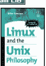
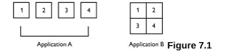
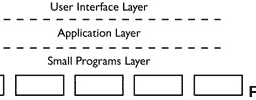

# Linux 与 Unix 哲学：操作系统



## 封底

不同于许多聚焦于如何使用 Linux 的书籍，*类 Unix 哲学下的 Linux 操作系统* 探索了…"帮助我以不同的视角看待事物，并为本书增添了极具趣味的深度。他们还在最后的冲刺阶段给了我急需的鼓励。

约翰·“Maddog”·霍尔不仅因撰写本书富有洞察力的序言而理应获得特别提及，他在推广 Unix 和 Linux 方面的努力也是我们所有人的榜样。很少有人能比得上他为向如此多的人传播 Unix 方式的信息而付出的孜孜不倦的努力。

也要感谢前数字出版社的菲尔·萨瑟兰，感谢我们就最初的书稿构想进行的邮件交流。虽然最终结果并不像我们双方预期的那样，但他可以欣慰的是，他说服我写这本书的努力并非徒劳。有些事情只是需要比其他事情花费更多时间而已。

家中有一位作者意味着每个人都能了解与作家同住的感受。莎拉，感谢你的所有打字工作，尽管那对你来说一定很枯燥。亚当，现在是彩弹射击的时间了。我对你做出的牺牲深表感激。最后，最重要的是，感谢我的妻子薇薇特在撰写本书全过程中的支持。现在的“待办事项”清单肯定已经长得有一英里那么长了吧。

## 前言

对我来说，1969 年发生了三件大事：

当时，作为东部一所知名大学的学生，我偶然接触到了为计算机编写软件这一崭新且迷人的领域。在那个年代，你不可能去当地的电脑商店从货架上买下一盒塑封好的软件。事实上，当时的平均计算机内存不足四千个字，处理器每分钟执行数百万条指令（而非每秒数十亿条），售价高达数十万美元，因此软件是为了充分利用机器性能而编写的。软件是从零开始的，由客户定义他们能提供的输入以及期望的输出。随后，软件团队（无论是内部团队还是顾问）负责编写实现这种转换的软件。如果软件无法运行，编写者就拿不到报酬。显然，像任何定制商品一样，软件成本高昂，但硬件也是如此。

幸运的是，数字设备公司用户协会（DECUS）有一个图书馆，人们可以在这里提交他们编写的程序，供他人使用。程序作者会向 DECUS 图书馆提交代码，图书馆随后会发行一份实用程序目录，邮寄副本的打印和邮资由请求该程序的人承担。软件本身是免费的，但分发过程（以及目录印刷等费用）并非如此。

通过 DECUS，我获得了许多可以使用的免费软件。这很好，因为作为学生，我没有多少钱去购买定制软件。对我来说，要么是软件，要么是啤酒，1969 年花 5 美元复制一个文本编辑器的钱，相当于十杯啤酒。想象一下，如果我试图购买“商业”软件，我得多穷啊。

这些人为什么要贡献他们编写的软件？他们编写软件是因为自己的工作或研究需要它，并且他们（慷慨地）认为也许其他人也能用上。他们也（正确地）希望其他人能帮助改进软件，或者至少提供改进的思路。

1969 年的第二件大事是，位于新泽西州 AT&T 贝尔实验室的 Ken Thompson、Dennis Ritchie 以及其他几位研究人员开始编写一个最终被称为“UNIX”的操作系统。在编写过程中，他们形成了一种方法论，即操作系统应由小型、可重用的组件组成，而不是大型、单体式的程序。此外，他们开发了一种操作系统架构，使其具有可移植性，最终能够在从最小的嵌入式设备到最大的超级计算机上运行，无论主 CPU 的指令集如何。最终，这个操作系统流入了大学，然后是美国的商业界，主要用于服务器机器。

第三件大事，以某种重要的方式改变了我和数百万其他人的生活，但当时几乎没人注意到，除了赫尔辛基两位自豪的父母，那就是 Linus Torvalds 的出生，他后来成为了 Linux 内核的架构师。

在接下来的十年里，计算机科学稳步发展。各公司投资于新的软件和技术。随着各公司在计算机领域做得越多，它们继续采用购买定制软件来在这些计算机上工作的策略，而这些计算机（以今天的标准来看）依然小得难以置信、慢得难以置信、贵得难以置信。然而，AT&T 致力于 Unix 的人员以及协助他们的大学继续从事他们的工作，创建一个鼓励软件重用的操作系统，并用无需重写和重新发明轮子的效率来换取更高效代码的可能性。大学和研究计算机科学的学者们喜欢拥有操作系统的源代码，以便协作改进它。生活是美好的。

然后在 20 世纪 80 年代初，又发生了三件大事。

第一件是 Unix 的商业化。到那时，小型计算机的成本已经降低到用户编程和培训成本开始超过基本硬件成本的程度。Sun Microsystems 创造了一个市场，其中各种客户要求一个“开放系统”，它可以在许多处理器类型上运行，而不是当前的“专有”系统，如 MVS、MPE、VMS 和其他商业操作系统。Digital Equipment Corporation、IBM 和 Hewlett Packard 等公司开始考虑为自己创建一个“商业”版本的 Unix。为了保护他们的投资，并从 AT&T 获得更低的版税价格，他们发布了仅包含二进制文件的发行版。Unix 系统的源代码价格高得惊人，很少有人买得起。对 Unix 改进的批发共享因此停滞不前。

第二件事件是微处理器的出现。起初，这通过公告板、杂志和电脑俱乐部营造出一种软件共享的氛围。然而，出现了一个新概念，即“塑封”软件。为 Intel 或 Motorola 等“通用”处理器架构编写的软件，其硬件以数百甚至数千计的产量生产。最初通过 CP/M，后来通过 MSDOS 和 Apple 的操作系统，塑封软件产品的数量增加了。我仍然记得走进第一家电脑商店，看到货架上来自不同公司、不同硬件架构的大量计算机，但只有三四款软件产品（一个文字处理器，一个电子表格，某种类型的“调制解调器软件”）。当然，这些都没有附带源代码。如果你不能让它们与你拥有的软件和文档配合工作，你就被困住了。在编写软件方面的公开协作逐渐被仅包含二进制代码、最终用户许可证（告诉你应如何使用你购买的软件）、软件专利和永久版权所取代。

幸运的是，在那时候，每家公司的客户数量仍然很少。你打电话给他们的支持热线时甚至可能得到一些帮助。但试图在这些公司所做的基础上进行构建几乎是不可能的。

第三件事件实际上是前两件的结果。在 MIT 的一个小办公室里，一位名叫 Richard Stallman 的研究人员决定，他喜欢修改 Unix 和其他软件包的源代码。他憎恶源代码接触度的日益减少，并于 1984 年决定启动一个项目，编写一个完整的操作系统，其源代码将永远对人们开放。作为自由分发源代码的副作用，对于希望下载源代码并编译自己操作系统的人来说，软件将永远是免费的。他将该项目称为“GNU”，意为“GNU is Not Unix”（GNU 不是 Unix），以表达他对 Unix 源代码被剥夺的不满。

时间流逝。微软在操作系统业务中成为一股主导力量，其他系统供应商推出了 Unix 的各种版本，其中大多数以“创新”为名互不兼容。一个充斥着塑封、不灵活软件的整个市场出现了，每个打包的软件都是为需要独特解决方案的大众市场编写的。

然后在 1990 年左右，又发生了三件事件：

第一件是一小群 Unix 专业人士围坐在桌旁，比较不同市场的不同类型软件，其中一个人问道（可能就是我）：

> “你们为什么喜欢 Unix？”

起初，桌上大多数人不知道该如何回答，但随着这个问题在空气中回荡，他们每个人开始给出自己喜欢这个他们极度忠诚的操作系统的原因。诸如“代码重用”、“高效、编写精良的工具”、“简单而优雅”等问题被提及并作为原因展开。我们没有注意到有一个人正在写下这些想法。这些想法成为本书第一版的核心理念，这也是第一次有人为 Unix 撰写了一本“哲学书”。

为什么需要一本关于“Unix 哲学”的书？为了帮助首次使用 Unix 的用户理解该系统的真正力量和优雅。向他们展示，在编写使用 Unix 工具和结构的程序时稍加思考，可以为他们节省大量的时间和精力。帮助他们扩展系统，而不是与系统作对。帮助他们站在前人的肩上。

其次，到 1990 年，GNU 项目的许多部分已经编写完成。命令解释器、实用程序、编译器、库，等等。这些 GNU 项目的组件，结合其他可免费获取的软件，如 `sendmail`、`BIND` 和 `X` 窗口系统，唯一缺少的就是操作系统的核心部分，即“内核”。

内核是系统的大脑，是控制程序运行时间、分配内存、文件访问权限等其他事物的组件。它被留到最后，因为内核每天都在变化，并不断得到改进。一个没有实用程序或命令解释器的内核将没有用处。多年来，能够使用其他操作系统和其他内核上的所有工具是非常有用的。

第三，1990 年 12 月，Linus Torvalds 已成长为赫尔辛基大学的一名大学生，并且刚刚得到了一台新的 Intel 386 计算机。Linus 认识到当时微软的操作系统没有充分利用 386 的所有性能，他决心编写一个内核，并将其与其余的自由软...

可用于创建整个操作系统的软件。几乎是在最后时刻，他才决定将该内核以 GNU 项目的通用公共许可证（GPL）进行授权。他在互联网的一些新闻组上宣布了这一项目，工作随即展开。


1994 年 4 月，我看着 DECUS Unix 特别兴趣小组（SIG）主席库特·赖瑟（Kurt Reiser）试图筹集资金，让一名程序员来到美国向 DECUS SIG 介绍他正在做的那个项目。最终，我请求 Digital 的高层资助这项活动，主要是基于我相信库特通常对事物有深刻的见解。1994 年 5 月，我参加了在新奥尔良举行的 DECUS 活动，见到了林纳斯·托瓦兹（Linus Torvalds），第一次看到了这个操作系统，我的人生从此永远改变了。

在过去几年里，我一直致力于倡导重新实现我热爱的 Unix 操作系统，但以这种方式鼓励人们查看、修改并改进前人构建的源代码。实际上，它的发展已经远远超出了大多数人认为的“Unix”范畴，因为现在的自由软件运动涵盖了数据库、多媒体软件、商业软件以及数百万人使用的其他软件。

软件生产的潮流再次发生了改变。硬件变得如此先进且廉价，互联网上的协作如此便捷，软件信息传播速度如此之快，最终，各大团体得以汇聚在一起，开发能帮助他们解决自身问题的软件。软件不再需要在崇高的“大教堂”中，使用昂贵的设备，由自命的架构师巫师来打造。来自如今有能力从家中或课堂对计算机科学做出重大贡献的人们那里，传来了“代码在此”的呼声，无论他们是在美国、巴西、中国，还是“甚至”在芬兰赫尔辛基。数以万计的项目启动，数十万名程序员参与其中，并且正以不断加速的速度继续扩展。

计算机编程的未来不会是少数蜷缩在一起的程序员徒劳地试图编写匹配 100% 所有人需求的代码。相反，大量的软件将以源代码形式存在于网络中，恳求顾问和增值转售商将其下载，并通过将该代码*精确*地定制到客户需求来为客户创造*解决方案*。

因此你看，Linux 和 GNU 项目的概念虽然看似 Unix 哲学的“下一步”，但这只是偏离正道后的回归。Unix 哲学初版中陈述的一切在今天依然同样真实，或许甚至更加真实。源代码可用性的增加让你能确切看到这些代码大师是如何创建他们的系统的，并挑战你编写速度更快、功能更强大的代码。

愿你能站在巨人的肩膀上，触碰星辰。

把握当下，

*乔恩·“maddog”·霍尔（Jon "maddog" Hall）*

*执行总监*

Linux 国际（Linux International）


# 前言

在《Unix 哲学》[^1]出版几年后，曾任 Digital Press 出版商的菲尔·萨瑟兰（Phil Sutherland）就撰写一本关于 Linux 的书向我提出了建议。他说 Linux 将会变得很大，并且他认为需要一本关于“Linux 哲学”之类的书。菲尔和我随后在持续了一年多的系列电子邮件往来中，对该主题进行了详尽的讨论。尽管此类书有着公认的需求，且有大量构思可供充实，但总觉得有些不对劲。

菲尔推动出版一本 Linux 版的《Unix 哲学》，这从市场营销角度看 certainly 很有意义。但我看到 Linux 社区里发生了不同的事情。一股新的活力正在 Unix 世界中流动。很明显，那些年迈的 Unix 狂热者成功地让“Unix 思维方式”的知识注入到了新一代充满活力的黑客和其他爱好者的头脑中，这些人喜欢在*自己的*机器上探索 Unix 的内脏。Linux 是 Unix，是的，但它不是你父亲的 Unix。

我曾希望在一本名为《Linux 宣言》的书中捕捉这种创新精神。最终大家发现，“开源”才是 Linux 的真正核心。因此，如果要契合主题，《Linux 宣言》就得改名为《开源宣言》。但埃里克·雷门（Eric Raymond）已经在他经典的《大教堂与集市》[^2]中写了关于“我们为什么要这样做”的最好文章。我不想写一本跟风之作，所以这个想法暂时搁置了。

当原始想法无法实现时，好主意往往会以另一种形式回归。Digital Press 的帕姆·切斯特（Pam Chester）几年前指出，《Unix 哲学》中的一些信息已经过时，并询问我是否有兴趣进行修订。但如何修订一种哲学？如果某事是真理，那么一个月后、一年后，甚至几个世纪后，它依然是真理。

然后我终于恍然大悟。《Unix 哲学》这本书，作为对 Unix 思维方式的描述，是一个“第一系统”。现在它正被拉入成为“第二系统”。在这种情况下，第二系统是第一系统的更完整、更成熟、更相关的版本。如果说《Unix 哲学》是基本需求，那么*Linux 与 Unix 哲学*则将该原始概念向前推进，探索新的领域。它同时也保留了原有的哲学准则，因为真理依然是真理。

因此，第一本书的读者会发现这里有很多熟悉的思想。Unix 哲学的原始准则依然完好，但我已审视每一章，以研究如何在 Linux 语境下最佳地表达观点。从某种意义上说，这本书是第一本的书的修订版。但在另一种意义上，它正在探索新的领域。开发审阅者已在反馈中提到这一点。它帮助他们以第一本书从未实现的方式看待 Unix。告诉人们 Unix 哲学影响了 Unix 程序员如何编写操作系统是一回事；展示该哲学如何影响计算机世界的其他部分，甚至计算机世界之外的生活，则是一个更大胆的命题。

由于 Linux 和开源软件，软件世界再次正在发生重大转变。Unix 哲学正在计算机行业走向主流。许多人已经采纳了其准则。这些观念引起了剧烈的动荡，标志性的形象被摒弃，人们开始质疑是否存在另一种方式来在个人层面拥抱计算。Linux 就在那里，站在这个缺口，为主流计算机用户提供了一条亲身体验 Unix 的途径。随着越来越多的人体验 Linux，他们看到了自己认为的新做事方式。另一方面，Unix 狂热者发现个人计算正在回归熟悉的领域。

Linux 哲学实际上是增强版的 Unix 哲学。我强调这一点，并与那些认为 Linux 不是 Unix 的人相抵触。但我也很快承认，作为现象的 Linux 与 Unix 发展历程有所不同。与 Unix 社区从未意识到的那种必要性相比，Linux 社区对克服专有软件开发方法有着更敏锐的感知。

Linux 社区在市场方面也更老练。它认识到，为了 Linux 获胜，它必须在每一刻在思考、操作和宣传上胜过竞争对手。它做得非常出色。据传闻超过一百万的 Linux 开发者正在他们的领地上，在所有关键领域——安装便捷性、图形用户界面、硬件兼容性、可靠性、安全性、性能、Web 开发、数据库、游戏等——激烈地挑战其他操作系统开发者的作品。

得益于其开发社区的持续努力，Linux 已经变成了那句老话：那个你挠得再厉害也消不掉的痒。

## 谁会从本书中受益

在早期，只有系统程序员对 Unix 的资料感兴趣。如今，Linux 的用户和开发者构成了一个更为多样化的群体，拥有各种各样的个人和职业兴趣。随着 Linux 向计算主流迈进，那些从未听说过 Unix 的人已经见过、使用过，甚至可能已经拥有了一台 Linux 系统。在这本书中，我试图通过避免低层次的技术细节，同时提供关于 Unix、Linux 和开源软件本质的发人深省的见解，来触及其中许多人。这些边缘人物会发现，这里介绍了 Unix 思想及其在 Linux 中的实现，而不会陷入命令参数、编程接口等细节的泥潭。

Linux 开发者将从学习本书中包含的 Unix 基石思想以及 Linux 如何拥抱和增强这些思想中受益。他们将了解到，尽管 Linux 拥有出色的图形用户界面环境，但其内在价值来自于其背后的哲学。为了成为真正的 Linux“高级用户”，他们需要理解为什么其文本基础和目标工具的方法使其在竞争中具有压倒性的优势。

“老派”的 Unix 程序员可能会考虑阅读这本书，因为它将帮助他们明白为什么 Unix 没有消失，以及为什么它永远不会消失。在 Linux 中，它只是以一种新的、更强大的形式重新发明了自己。这本书将向他们展示 Linux 如何在保持原始 Unix 哲学信条的同时，以新的、令人兴奋的方式解决新千年的计算需求。

在当今快节奏、竞争激烈的开发环境中工作的其他资深开发者常常发现，为了遵守良好的软件设计原则而放弃这些原则会带来巨大的压力。在另一些情况下，公司过分强调使用新的开发流程，因为这是最新的风尚，而不是确保其方法具有足够的实质内容。当设计问题看起来无法解决或解决方案包含可疑的假设时，这本书就起到了一种理智检查的作用。

在商业领域，今天的 IT 经理已经知道 Linux。许多人正在考虑将其引入其环境，因为他们预期能节约成本。他们的策略通常是用较便宜的基于 Intel 或 AMD 的 Linux 服务器替换较旧的 Solaris 和 HP-UX 平台，用于不那么关键的应用程序。随着 IBM 和 Oracle 进一步增强其 Linux 产品，将其主要服务器切换到 Linux 将比几年前更容易被接受。


然而，到目前为止，IT 经理们一直不敢将他们的桌面用户迁移到 Linux 上。这本书将帮助他们认识到，Linux 不仅是一种可行的替代方案，实际上它是*首选*的替代方案。他们将发现，Linux 和开源软件背后的哲学实际上使桌面比基于 Windows 的对应物更容易维护、成本更低且更安全。使 Linux 成为理想服务器的相同理念也延伸到了桌面。在他们回答“是的，但是……”之前，我要对他们说一句话：读读这本书。

最后，那些在抽象的思想世界中打交道的人会发现学习 Unix 哲学的价值。许多用于开发软件的技术也适用于其他领域。作家、图形艺术家、教师和演讲者可能会发现，快速原型设计和利用现有作品在他们的领域也有效。而且，由于如今有大量廉价的（即“免费的”）Linux 应用程序可用，他们可以负担得起使用那些以前对他们来说太贵而无法探索的工具类型。

[1] Gancarz, Mike, *The UNIX Philosophy*, Digital Press, 1995.

[2] Raymond, Eric S., *The Cathedral and the Bazaar: Musings on Linux and Open Source by an Accidental Revolutionary*. Sebastopol, CA: O'Reilly & Associates, Inc., 2001.


## 章节概览

- **第 1 章：** “Unix 哲学：千人百态”探讨了 Unix 哲学的历史及其由来。它还简要描述了 Unix 哲学的信条，作为后续章节中更详细解释的铺垫。
- **第 2 章：** “人类的一小步”展示了为什么小组件最适合构建大型系统。它讨论了这些组件在软件系统和物理世界中良好接口互动的能力。本章最后一部分着重于拥有只做一件事且做得很好的程序的重要性。
- **第 3 章：** “为了乐趣和利润进行快速原型设计”强调了在设计成功产品时早期构建原型的必要性。对“人的三大系统”的讨论说明了所有软件所经历的阶段。它为快速原型设计进行了辩护，认为这是通往第三系统（三者中最正确的系统）的最快途径。
- **第 4 章：** “可移植性的优先权”提供了关于软件可移植性的不同视角。它强调软件开发者必须在设计中权衡效率和可移植性。Atari VCS 被作为高效率但可移植性有限的模型进行研究。本章还突出数据可移植性是一个重要但常被忽视的目标。一个典型 Unix 用户工具集的案例研究提供了由于可移植性而具有软件 longevity（长效性）的优秀例子。
- **第 5 章：** “这才叫杠杆！”讨论了“软件杠杆”的概念，即重用组件会产生更大的影响。我们将看到，使用 shell 脚本如何实现高度的杠杆效应。
- **第 6 章：** “交互程序的陷阱”首先定义了“受困用户界面”。它建议开发者限制其使用，而是专注于使程序更好地与其他程序交互。它表达了所有程序都是过滤器的思想。本章以关于 Unix 环境中过滤器的讨论结束。
- **第 7 章：** “更多的 Unix 哲学：十条次要信条”列出了 Unix 开发者通常遵循但不认为它们是 Unix 哲学主要元素的一些观念。由于本章涉及比书中其他部分更深层的概念，技术性较低的读者可以自由跳过这一章。然而，Unix 纯粹主义者可能会觉得它非常有趣。
- **第 8 章：** “让 Unix 做好一件事”以 Unix 邮件处理程序 MH 为例，展示了良好的 Unix 应用程序是如何构建的。它以 Unix 哲学的摘要结束，展示了其力量如何源自各个元素的协同工作。
- **第 9 章：** “Unix 与其他操作系统哲学”将 Linux 和 Unix 哲学与其他几种操作系统哲学进行比较，以强调 Unix 方法独特性。
- **第 10 章：** “透过玻璃朦胧看：Linux 与 Windows”以 Linux 和 Microsoft Windows 之间的高层比较开始。它为基于文本的计算与图形用户界面的使用进行了辩论。然后，它查看了 Windows 在某些领域如何遵循 Unix 哲学，而在其他领域又如何偏离它。
- **第 11 章：** “大教堂？真奇怪！？”审视了由 Linux 社区普及的开源软件（OSS）概念如何与 Unix 哲学相契合。当 OSS 在所有领域采用“Unix 思维方式”时，其传播效果最好。
- **第 12 章：** “勇敢的新（Unix）世界”考察了 Unix 哲学的信条如何在新的技术领域被采用。它重点介绍了几项关键技术以及一些并非那么关键的技术，以说明 Unix 思想不再仅仅是为 Unix 开发者准备的。本书的 developmental reviewers 对第 12 章最频繁的评论是：“我以前从未那样想过。”读一读，它将会开阔你的思路。

正如你可能通过快速浏览已经看到的，文本避免了许多技术细节，因为它们因 Linux 实现而异。相反，它强调 Unix 哲学是一种设计方法论，依赖于具体细节较少，而依赖于更高水平定义的通用方法较多。

我努力在整个书中保持高昂的情绪基调。虽然有些人可能喜欢阅读缺乏人情味的庞大技术巨著，但我们其他人更喜欢既娱乐又信息丰富的写作，即“信息娱乐”方法。这也符合 Linux 和 Unix 文化。Unix 社区及其后代 Linux 社区一直有一种机敏的幽默感。这在原始的 Bell Laboratories Unix 文档中以及 Linux 人员常去的网络中都有体现。也许这就是为什么 Linux 开发者如此享受他们的工作。

然而，不要被这种轻松的氛围所劝阻。这是严肃的内容。人们通过观察或忽视这里涵盖的信条，发现或失去了软件财富。Unix 哲学的适当应用通常产生了极其成功的产品。与这些信条直接冲突的操作常常导致开发者错过重要的市场机遇窗口。

我的讲座学生提到，虽然你可能一开始会浅层地吸收这里表达的思想，但它们会在不寻常的时刻回到你的意识中。强大的思想往往如此。如果你之前从未接触过 Unix 哲学，请为一段有趣的旅程做好准备。

原始 Unix 哲学书的引言包含在这里有两个原因。第一是人们在互联网上引用它而闻名于世。在这个版本中保留它，将让那些没有购买原始书的人受益。第二个原因是在最后一段中的预言性声明：“……Unix 成为世界操作系统只是时间问题。”Linux 作为 Unix 的新同名者，正在日复一日、逐台机器、逐个应用程序地实现这一声明。

## Unix 哲学导论

操作系统是一个有生命、有呼吸的软件实体。它是计算机的灵魂，是将电子和硅片转化为个性的神经系统。它赋予了计算机生命。

操作系统按其本质，体现了其创造者的哲学。苹果 Mac/OS 以其高度视觉化、面向对象的界面，宣称“它就摆在你面前”。微软的 MS-DOS，这场个人电脑革命的无争议领导者，试图在桌面上带来“大型机的味道”。数字设备公司（Digital Equipment Corporation）的 OpenVMS 假设用户害怕电子机器，通常会说“Unix 还不错，但如果你想做些严肃的事，最好应该用 ______________。”（用你最喜欢的主流操作系统名称填空。）尽管如此，操作系统的哲学就像宗教一样。当某人心中认定自己找到了真理时，他们不愿轻易放弃。因此，Unix 的传教士们继续努力，固执地维护这一标准，相信终有一天世界会被感化，他们将看到软件天堂。

在商业界忙于为 Unix 构建壁垒的同时，学术界则张开双臂欢迎 Unix。那一代在拥有彩色电视、微波炉和电子游戏的家庭中长大的年轻人，正进入那些以极低分发成本（仅涵盖存储介质成本）就获得了 Unix 的大学。这些年轻人拥有空白的思维画布，而教授们非常乐意在画上描绘一幅远离主流的计算图景。

剩下的就是历史了。

如今，Unix 在它曾经被认为不可想象的场景中迅速获得接受。它是学术界无可争议的首选系统，其在军事和商业领域的应用每天都在扩展。

多年来，我不断告诉人们，Unix 成为全球操作系统只是时间问题。至今我尚未被证明是错误的。然而，具有讽刺意味的是，全球操作系统将不会被称为“Unix”。因为随着公司们意识到这个名称的价值，他们的律师们已抢先注册了其商标。结果，界面将被设计，标准将被提出，许多应用程序将本着“开放系统”的名义编写。请放心，Unix 哲学将成为这一切背后的驱动力。

# 第 1 章：Unix 哲学：千军万马

## 概述

> *一个世纪的哲学是下一个世纪的常识*
>
> 中国幸运饼干（Fortune Cookie）

许多人归功于 AT&T 的 Ken Thompson 发明了 Unix 操作系统，从某种程度上说，他们是对的。Thompson 于 1969 年在位于新泽西州穆里山（Murray Hill）的贝尔实验室 AT&T 研究部编写了第一个 Unix 版本。它运行在 Digital PDP-7 小型机上，作为程序 Space Travel 的平台。Space Travel 最初运行在多路复用分时系统 Multics 上，该系统由麻省理工学院开发。


Unix 基于 `Multics`，这是最早的分时操作系统之一。在 `Multics` 开发之前，大多数计算机操作系统在批处理模式下运行，迫使程序员编辑大量的打孔卡片或纸带。那些年代的编程是一个非常耗时的过程。那时，“天助那些弄丢了打孔卡片盒子的傻瓜”这句话被所有人都 readily 理解（轻易理解/心领神会）。

`Thompson` 借用了 `Multics` 的许多功能，并将其纳入他早期的 `Unix` 版本中，主要特征就是分时。如果没有这种能力，如今 `Unix` 系统中习以为常的许多功能——事实上大多数其他操作系统也是如此——将缺乏真正的力量。

通过从 `Multics` 借用想法，`Thompson` 走上了一条对于 `Unix` 开发者来说已经变成老路（此处无双关语之意）的行动路线：优秀的程序员编写伟大的软件；伟大的程序员“窃取”伟大的软件。不，我们并没有暗示 `Thompson` 是个小偷。但他愿意在某种程度上避免“这里没发明过”（`NIH`）综合征，同时在另一方面增加创造性价值，这有助于启动了可能是历史上最巧妙的操作系统。我们稍后将探讨“窃取”软件的意义。现在，请牢记：共享的想法价值是独自保留在脑海中的两倍。

## 1.1 “这里没发明过”综合征（`NIH` 综合征）

软件开发者经常沦为 `NIH` 综合征的受害者。这种情况发生在开发者查看其他人编写的软件解决方案时，认为自己或她可以做得更好。也许他确实可以做得更好，但他不知道其他开发者在何种约束条件下工作。其他开发者可能面临时间或预算压力，选择将重点放在解决方案的特定部分。

`NIH` 综合征的特征是决定丢弃其他开发者完成的所有工作，意图展示一个更优越的解决方案。这种纯粹的自我膨胀行为表明了对保存他人作品精华并将其作为迈向更高处的跳板缺乏兴趣。这不仅自私，还浪费了宝贵的重写时间，这些时间本可以花在其他地方提供其他解决方案。更糟糕的是，新的解决方案有时只是略好或仅仅是不同，从而加剧了问题。

偶尔，新的解决方案更好，因为开发者看到了第一人的工作，并能够通过借用好的部分并丢弃其余部分来改进它。这是增强和扩展的案例，而不是 `NIH` 综合征。从其他开发者那里借用的概念是 `Linux` 世界的一项既定做法，只有在软件源代码对每个人可用时才能做到。事实上，增强和扩展构成了 `Unix` 哲学的核心概念之一。

## 1.2 `Unix` 的开发

人们惊叹于 `Unix` 的可移植性，但它并非一开始就是可移植的。`Thompson` 最初是用汇编语言编写它的。到了 1972 年，随着新的硬件逐渐可用，他意识到自己可能需要利用这些新硬件，于是用一种名为 `B` 的可移植语言重写了它。贝尔实验室 `AT&T` 的另一位员工 `Dennis Ritchie` 在 1973 年对 `B` 进行了大幅修改，使其演变为如今全球程序员既爱又恨的 `C` 语言。

再次印证了 `Thompson` 后来被 `Unix` 开发者们效仿的先例：一个处于绝境（背水一战）的人往往能写出伟大的程序。当一个应用必须被编写时，如果 (1) 它是为了满足实际需求而做的，(2) 身边没有知道如何编写它的“专家”，且 (3) 没有时间“完美地”完成，那么很有可能会写出一件杰出的软件作品。在 `Thompson` 的案例中，他需要用一种可移植的语言编写操作系统，因为他必须将他的程序从一个硬件架构迁移到另一个架构。找不到自诩为可移植操作系统专家的人。他当然也没有时间“完美地”做这件事。

然而，`Ken Thompson` 在 `Unix` 整体哲学的形成过程中所起的作用是有限的。尽管他在文件系统结构、管道、I/O 子系统和可移植性等领域做出了重要的设计贡献，但 `Unix` 哲学的许多部分却是许多人共同努力的结果。在 `Unix` 早期参与工作的每个人，都根据自己的专业领域帮助塑造了它。以下列出了一些贡献者及其主要贡献：

| 贡献者 | 贡献 |
| --- | --- |
| Alfred Aho | 文本扫描、解析、排序 |
| Eric Allman | 电子邮件 |
| Kenneth Arnold | 屏幕更新 |
| Stephen Bourne | Bourne shell 命令解释器 |
| Lorinda Cherry | 交互式计算器 |
| Steven Feldman | 计算机辅助软件工程 |
| Stephen Johnson | 编译器设计工具 |
| William Joy | 文本编辑、类 C 命令语言 |
| Brian Kernighan | 正则表达式、编程原则、排版、计算机辅助教学 |
| Michael Lesk | 高级文本格式化、拨号网络 |
| John Mashey | 命令解释器 |
| Robert Morris | 桌面计算器 |
| D. A. Nowitz | 拨号网络 |
| Joseph Ossanna | 文本格式化语言 |
| Dennis Ritchie | C 编程语言 |
| Larry Wall | Patch 工具、Perl 命令语言、rn 网络新闻阅读器 |
| Peter Weinberger | 文本扫描 |

虽然上述个人是 `Unix` 现象中最早且最易被识别的参与者，但最终开发 `Unix` 计算方式的人数达到了数千。几乎所有关于 `Unix` 主要组件的已发表论文都列出了不止一小撮帮助促成这一切的贡献者。正是这些贡献者形成了今天所理解和传播的 `Unix` 哲学。

## 1.3 `Linux`：一人加一百万人的阵容

如果可以说 `Ken Thompson` 是 `Unix` 的发明者，那么当时还是赫尔辛基大学芬兰学生的 `Linus Torvalds` 则发明了 `Linux`。他于 1991 年 8 月 25 日发表在新闻组上那篇如今著名的帖子，开头写道：“大家好……我正在做一个（免费的）操作系统”，这永远地决定了他命运。

`Thompson` 和 `Torvalds` 之间的相似之处令人好奇，至少可以说如此。有人可能会争辩说 `Thompson` 编写 `Space Travel` 程序纯粹是为了好玩。`Torvalds` 对 `Minix`（另一种类 `Unix` 操作系统）着迷，发现让流行的 `Unix` 命令解释器 `bash` 在他的“玩具”操作系统上运行是一件极其有趣的事情。再一次，以“为了好玩”开始的事情，最终改变了软件行业的基本方面。

`Linux` 一开始也并不是一个可移植的操作系统。`Torvalds` 并没有打算将其移植到 Intel 386 架构之外。从某种意义上说，他背水一战，因为他可用的计算机硬件极少。因此，起初他充分利用了手头的资源，而没有打算走得更远。不过，他发现，良好的设计原则和坚实的开发模式最终促使他为了纯粹性而让 `Linux` 变得更加可移植。从那时起，其他人接过了接力棒，很快将其移植到了其他架构上。

到 `Torvalds` 的 `Linux` 出现时，借用由其他个人编写的软件这一想法已经相当普遍。事实上，理查德·M·斯塔尔曼（`Richard M. Stallman`）在其里程碑式的 `GNU` 通用公共许可证（`GPL`）中将其正式化。`GPL` 是应用于软件的法律协议，几乎保证软件的源代码对任何想要的人都保持自由可用。`Torvalds` 最终为 `Linux` 采用了 `GPL` 模式，通过这样做，使得任何人都可以借用 `Linux` 源代码，而无须担心与版权侵犯相关的法律纠纷。[1] 既然 `Torvalds` 免费提供 `Linux`，其他人也会免费为 `Linux` 开发贡献他们的软件也就顺理成章了。

从早期开始，`Linux` 就已经表现出它确实是一个类 `Unix` 操作系统。其开发者全心全意地拥抱了 `Unix` 哲学的信条，然后继续从头编写一个新的操作系统。关键在于，如今 `Linux` 世界中的几乎没有什么东西是从头开始编写的。几乎所有东西都是构建在其他人编写的代码和概念之上的。因此，`Linux` 成为 `Unix` 演进的下一个自然步骤，或者更准确地说，是 `Unix` 的下一大飞跃。

与 `Unix` 一样，`Linux` 在其技术发展的早期阶段也有帮助其前进的开发者群体。但是，`Unix` 在其巅峰时期的开发者数量以千计，而今天 `Linux` 的开发者数量则以百万计。谈论极端的 `Unix`！正是这种大规模的开发，几乎保证了 `Unix` 的后代 `Linux` 将在很长一段时间内成为一个极具竞争力的系统。

`Linux` 带给 `Unix` 世界的一个新特点是，所谓的“开源”软件比“专有”软件或源代码不易获取的软件更好。`Unix` 开发者多年来一直相信这一点，但计算机行业的其他许多人一直被专有软件公司灌输大量宣传，认为借用或免费的东西不可能比需要付费的东西——有时是巨额费用——好。

`Linux` 社区在市场营销方面也更加精明，他们意识到，如果市场营销得当，公司可以向数百万人成功销售劣质的软件。这并不是说 `Linux` 是劣质软件，只是说，与其 `Unix` 社区前身不同，`Linux` 社区认识到，即使世界上最好的软件，如果人们不知道它并且未意识到其真正的价值，也不会被使用。

我们稍后将更详细地涵盖这些主题。就目前而言，让我们把 `Unix` 和 `Linux` 的历史留在过去，继续前行。事情即将变得更加有趣。


Torvalds 借用的不仅仅只是 GPL。Stallman 和其他人指出，Linux 实际上只是操作系统内核。内核之外的大部分东西来自自由软件基金会（Free Software Foundation）的 GNU 项目。纯粹主义者有理由称完整系统为“GNU/Linux”，其中 Linux 内核是一个基本组成部分。在给予应得的赞誉之后，我们承认世界上大多数人已经认可“Linux”作为首选名称。

## 1.4 Unix 哲学简述

Unix 哲学的信条看似简单得令人惊讶。事实上，它们非常简单，以至于人们往往认为它们没什么重要性。欺骗性就在这里。它们的简单性掩盖了这样一个事实：如果一致地执行，这些想法具有难以置信的有效性。

以下列表能让你了解 Unix 哲学信条是什么。书的其余部分将帮助你理解为什么它们很重要。

- **小而美**。小事物相比其较大的对应物有着巨大的优势。其中一点是能够以独特且有用的方式与其他小事物结合，这些方式往往是原始设计者未曾预见的。

- *让每个程序做好一件事*。通过专注于单一任务，程序可以消除许多冗余代码，这些代码通常会导致过多的开销、不必要的复杂性和缺乏灵活性。

- *尽早构建原型*。大多数人会同意原型设计是任何项目中有价值的组成部分。但与其他方法学中原型设计只是设计阶段的一小部分不同，在 Unix 中，它是生成有效设计的主要载体。

- *选择可移植性而非效率*。当 Unix 作为第一个具有重大意义的可移植操作系统开辟新天地时，这是个大新闻。如今，可移植性被视为任何现代软件设计中理所当然的必需品，这是在 Unix 以外的其他系统中广泛接受的信条示例。

- *将数据存储为平文文本文件*。在可移植性和效率之间选择，针对的是可移植代码的价值。可移植数据至少与可移植代码一样重要——如果没说更重要的话。可移植数据通常是可移植性公式中常被忽视的部分。

- *利用软件杠杆优势*。许多程序员对可重用代码模块的重要性只有肤浅的理解。代码重用有助于利用软件杠杆，这是一个强大的概念，一些 Unix 开发者利用它在相对较短的时间内创建大量应用程序。

- *使用 shell 脚本以增加杠杆和可移植性*。Shell 脚本是双刃剑，用于增强设计中的软件杠杆和可移植性。只要可能，编写脚本而不是完整的 C 程序就是正确的方法。

- *避免被捕获的用户界面*。某些命令具有 Unix 开发者所知的“被捕获”用户界面。这些防止用户在命令使用期间运行其他命令，实际上使用户在命令持续期间成为系统的俘虏。在图形用户界面世界中，这样的界面被称为“模态”。

- *让每个程序成为一个过滤器*。所有软件程序的基本本质是它们只修改数据；它们不创造数据。因此，它们应被编写为

将其作为过滤器使用，因为它们本就是过滤器。

前面的列表包含了一些 Unix 开发者所坚持的信条。你在其他关于 Unix 的书籍中也能找到类似的列表，因为这些是每个人都认为基础的 Unix 概念。如果你采纳了它们，你就会被视为一个“Unix 人”。

下列 10 条次要信条，是那些倾向于成为 Unix 世界信仰体系一部分的理念。[2] 并非所有与 Unix 相关的人对这些理念都抱持教条主义态度，其中一些也并非严格意义上的 Unix 特征。尽管如此，它们似乎都是 Unix 文化（以及通过包容而包含的 Linux 文化）的一部分。

- 1. *允许用户定制环境。* Unix 用户喜欢控制其环境——所有方面。许多 Unix 应用程序坚决避免对交互风格做出决策，而是将选择权留给用户。这里的理念是实现做事的机制，而不是规定如何做的策略。让用户自己去探索通往计算机涅槃的道路。

- 2. *保持操作系统内核小而轻量。* 尽管不断推动新功能，Unix 开发者仍倾向于保持操作系统最核心的部分小巧。他们并不总是能成功做到这一点，但这是他们的目标。

- 3. *使用小写并保持简短。* 在 Unix 环境中使用小写字母是一种传统，即使其当初的原因早已消失，这一传统仍延续至今。如今许多 Unix 用户使用小写命令和晦涩的名字，是因为他们想要这样做，而不是因为他们被迫如此。

- 4. *拯救树木。* Unix 用户通常对使用纸质打印件持反对态度。将所有文本保存在线上并使用强大的工具进行处理是有充分理由的。

- 5. *沉默是金。* Unix 命令在生成详细错误消息方面以沉默著称。虽然经验丰富的 Unix 用户认为这是一种可取的特性，但许多其他操作系统的使用者可能会对此表示异议。

- 6. *并行思考。* 大多数任务都可以分解为一系列较小的子任务。这些子任务可以并行运行，从而在相同时间内完成比一个大任务更多的量。如今在对称多处理 (SMP) 设计方面有大量活动，这是计算机行业向并行化这一总体趋势的一个例子。

- 7. *部分之和大于整体。* 这条信条源于这样的观点：由一组较小的程序构建的大型应用程序比单个大型程序更灵活，因此也更有用。两种方案可能具备相同的功能能力，但“小型程序集合”的方法更具前瞻性。

- 8. *寻找 90% 的解决方案。* 完成任何事情的 100% 都很困难。完成 90% 则高效且更具成本效益得多。Unix 开发者经常寻找满足 90% 目标用户群需求解决方案，将剩余的 10% 留给其自行解决。

- 9. *更糟即更好。* Unix 爱好者认为，“最小公分母”系统最有可能生存下来。那些廉价但有效的东西，比那些高质量且昂贵的东西更有可能普及。PC 兼容世界从 Unix 世界借用了这一理念，并做得相当成功。这里的关键词是*包容*。如果某样东西足够容易获取，能够包含几乎任何人，那么它比那些呈现为“排他性”的东西要好。

- 10. *层级式思考。* Unix 用户和开发者更喜欢以层级方式组织事物。例如，Unix 目录结构是应用于文件系统的最早的树结构架构之一。Unix 已将层级思维扩展到其他领域，如网络服务命名、窗口管理和面向对象开发。

读完信条列表后，你可能想知道究竟有什么大惊小怪的。“小就是美！”并不那么了不起。“只做一件事并把它做好”听起来本身就挺狭隘的。选择可移植性而非效率并不是那种能改变世界的想法。

这就是 Unix 的全部吗？Linux 仅仅是为头脑简单的人设计的小型操作系统吗？

也许我们应该提一下，大众汽车曾围绕“*小就是美！*”这一概念开展营销活动，这帮助其销售了*数百万*辆汽车。或者考虑一下，领先的 Unix 系统供应商 Sun Microsystems 将其战略建立在“将所有木头放在一个箭头后面”上，或者换句话说，“只做一件事并把它做好”。对 PDA、无线网页访问和手持视频的所有关注是否与*可移植性*有关？

来吧。让我们开始这段旅程。

<sup>[2]</sup> 鉴于诸如“教条”、“信条”和“信仰体系”这样的词汇，人们是否会怀疑 Unix 哲学描述的是一种文化现象，而不仅仅是技术现象。

# 第 2 章：人类的一小步

## 概述

大约 30 年前，当美国人驾驶大型汽车并成为其他国家公民羡慕的对象时，大众汽车在美国开展了一场以“小就是美”为主题的广告活动。当时，似乎这家德国汽车制造商与现实脱节了。大众甲壳虫虽然在欧洲取得了巨大成功，但在美国环境中看起来有点傻气，就像巨人国中的矮人一样。尽管如此，大众汽车一直强调小型汽车将长期存在的信息。

随后，意外发生了：中东石油部长向世界表明，是的，他们确实可以就某事达成一致——即每桶石油的更高价格。通过顽固地扣押大量原油，他们使供需方程有利于供应方。汽油价格大幅超过每加仑一美元。当石油部长们将刀架在世界脖颈上时，排队的加油线出现在各地。

长期以喜爱大型汽车著称的美国人开始发现，小确实就是美。他们要求汽车制造商生产更小的汽车以安抚他们疼痛的钱包，而大众汽车乐于提供。曾经是一辆“有趣的小车”，现在变成了时髦的必需品。

随着时间推移，人们发现小型汽车相比大型汽车享有某些优势。除了享受更高的燃油经济性外，他们喜欢小型汽车的操控方式——更像英国跑车而非轮式海洋邮轮。将它们挤进狭窄的停车位轻而易举。其简单性使其易于维护。

就在美国人对小型汽车的喜爱盛开之时，新泽西州 AT&T 贝尔实验室的一组研究人员发现，小型软件程序也享有一些优势。他们了解到，小型程序像小型汽车一样，操控更好，适应性更强，且比大型程序更容易维护。这把我们带到了 Unix 哲学的第一个信条。

## 2.1 信条 1：小就是美

如果你要编写一个程序，从小开始并保持其小巧。无论你是在制作一个简单的过滤工具、一个图形包，还是一个庞大的数据库，都要努力将其简化为实际可行的最小软件片段。抵制将其变成庞然大物的诱惑。追求简单。

传统程序员通常怀有编写“伟大美国程序”的隐秘愿望。当他们开始一个开发项目时，似乎他们想要花费数周、数月甚至数年，试图用一个程序解决世界上所有的问题。这不仅从业务角度来看成本高昂，而且忽视了现实。在现实世界中，很少有不能用小解决方案克服的问题。我们选择实施如此大规模的解决方案，是因为我们没有完全理解这个问题。

科幻小说作家西奥多·斯特urgeon 曾写道：“90% 的科幻小说是垃圾。但接着，90% 的一切都是垃圾。” 这同样适用于大多数传统软件。任何程序中的很大一部分代码都用于执行与其既定任务无关的其他事情。

怀疑？让我们看一个例子。假设你想编写一个程序将文件 A 复制到文件 B。以下是典型的文件复制程序可能执行的一些步骤：

- 1. 询问源文件的名称。

- 2. 检查源文件是否存在。

- 3. 如果源文件不存在，通知用户。


- 4. 询问目标文件的名称。
- 5. 检查目标文件是否存在。
- 6. 如果目标文件存在，询问用户是否要替换它。
- 7. 打开源文件。
- 8. 如果源文件为空，通知用户。如有必要，退出。
- 9. 打开目标文件。
- 10. 将数据从源文件复制到目标文件。
- 11. 关闭源文件。
- 12. 关闭目标文件。

注意在第 10 步中文件被复制。其他步骤执行的功能，虽然必要，但与复制文件关系不大。更仔细地检查你会发现，其他步骤通常可以应用于文件复制之外的许多其他任务。它们碰巧在这里被使用，但并不是任务真正的部分。

一个好的 Unix 程序应该提供类似于第 10 步的能力，以及极少其他功能。塑造

作者认为程序应提供完整的上下文或数据副本等，这一理念进一步延伸意味着，严格遵循 Unix 哲学的程序会期望在调用时被提供有效的源文件和目标文件名。它将全权负责数据的复制工作。显然，如果程序唯一要做的就是复制数据，那么它确实会是一个非常小的程序。

这仍然让我们面临一个问题：有效的源文件和目标文件名从何而来？答案很简单：来自其他小型程序。这些其他程序负责获取文件名、检查文件是否存在，以及确定文件是否包含非零字节的数据。

你可能会想：“等等。”我们是不是在说 Unix 中包含仅用于检查文件是否存在程序？简短回答是肯定的。标准 Unix 发行版附带了数百个小型命令和实用程序，它们单独运行时功能非常有限。例如，`test` 命令等就执行看似平凡的功能，如判断文件的可读性或其等价物。如果这听起来并不重要，请意识到 `test` 命令是 Unix 中使用频率最高的命令之一。[1]

单独来看，小型程序的功能并不强大。它们通常只执行一两项功能，别无其他。然而，当它们组合在一起时，你便开始体验到真正的力量。整体大于部分之和。庞大复杂的任务可以轻松处理。你只需在命令行上输入命令即可编写新的应用程序。

> [1] 某些 Unix/Linux shell（命令解释器），如 `bash`，已将 `test` 命令整合到 shell 本身中，从而消除为了运行该命令而调用新进程的需要，进而减少了开销。其缺点在于，如果你不断将命令添加到 shell 本身中，最终 shell 会膨胀到非 shell 命令变得昂贵的地步，因为 Unix/Linux 创建新进程的方式会影响执行效率。或许更好的方法是依赖这样一个事实：常用命令通常已经位于内核的缓冲区缓存中，因此从磁盘获取它们（在时间上代价过高）并非必要。

## 2.2 简化软件工程

人们常说，Unix 为程序员提供了世界上最丰富的环境。原因之一是，那些在其他操作系统上难以完成，甚至不可能完成的任务，在 Unix 下相对容易实现。是不是小型程序让这些任务变得轻松？绝对是。

### 2.2.1 小型程序易于理解

小型程序的“全业务”方法将冗余减至最少，而是专注于出色地完成某项功能。它们仅包含少量算法，其中大多数与所涉任务直接相关。

另一方面，大型程序倾向于复杂性，并构成了理解的障碍。程序越大，它就越远离其作者。代码行的数量变得压倒性。例如，程序员可能会忘记程序的子程序位于哪些文件中，或者在交叉引用变量并记住其用途时遇到困难。调试代码变成了一项噩梦般的任务。

无论程序大小如何，有些程序可能难以理解，仅仅因为它们执行的功能性质本身就很晦涩。然而，这样的程序很少见。即使是经验中等的程序员也能轻松理解大多数小型程序。这是小型程序相对于其大型同类的一个明显优势。

此时，你可能会想知道小型程序在什么情况下会变成大型程序。答案是：视情况而定。在一个环境中被视为大型的程序，在另一个环境中可能被视为中等规模。对某位程序员来说是“意大利面条代码”的东西，对下一位程序员来说可能就是日常的“意面”。以下是一些迹象，表明你的软件可能正在偏离 Unix 方法：

- 传递给函数调用的参数数量导致屏幕上的行长度超出限制。
- 子程序代码超过了屏幕长度或一张标准的 8½/2 乘 11 英寸纸张的长度。请注意，在大尺寸工作站监视器上使用较小的字体和更高的窗口可以让你舒适地稍微放宽这一限制。只是别过头了。
- 你不读代码中的注释就再也记不清某个子程序的作用了。
- 当你获取目录列表时，源文件名在屏幕上滚动了出去。
- 你发现其中一个文件变得太大，无法用来定义程序的全球变量。
- 你还在开发程序，却记不清是什么条件导致某条特定的错误消息。
- 你发现自己不得不打印源代码到纸上，以便更好地组织它。

这些警示信号可能会激怒一些程序员，特别是那些属于“大更好”阵营的人。他们说，并不是每个程序都能做得很小。这个世界很大，而且那里有一些很大的问题，我们正试图用相当大的计算机来解决。这些问题要求我们编写相当大的程序。

这是一个相当大的误解。

存在一种软件工程师，他以编写只有他自己才能理解的大型程序为荣。他将这类工作视为“工作保障”。你可以说，唯一比他的自尊更大的，就是他上一个应用程序。在传统软件工程环境中，这样的软件工程师非常普遍。

这种工作保障方法的问题在于，他们工作的公司最终会意识到，这些工程师迟早会离职，把公司留在原地收拾残局。更明智的公司会采取措施防止这种情况发生。他们雇用那些理解易于维护的软件更有价值的人。

软件设计者再也不能说“愿上帝保佑下一个人”。优秀的设计者必须费心使其软件易于维护。他们彻底但不过度地注释代码。他们保持子程序简短。他们将代码精简到绝对必要的部分。这通常结果就是易于维护的小型程序。

### 2.2.2 小型程序易于维护

由于小型程序通常易于理解，因此它们可能也易于维护，因为理解程序是维护它的第一步。毫无疑问，你以前听过这话，但许多程序员忽略了维护这个话题。他们以为，既然自己花了时间编写程序，那么在他们之后，别人也会同样愿意花时间去维护它。

大多数软件工程师并不满足于靠维护别人的程序为生。他们相信——或许不无道理——真正的钱是在编写新程序中赚到的，而不是在修复过去的错误中。不幸的是，用户并不这么看。他们期望软件第一次就能正常工作。如果不能，他们对程序的供应商非常不满。未能维护其软件的公司不会在商业上存续太久。

由于维护软件并不是什么光彩的工作，程序员们寻找方法来让这项任务更轻松，甚至完全避免它。然而，大多数人无法完全消除这项职责。如果他们幸运，或许可以将维护工作移交给初级人员。但更常见的是，软件支持责任通常落在原作者身上，他们必须想尽办法让这项任务更容易接受。小型程序很好地满足了这一需求。

### 2.2.3 小型程序消耗更少的系统资源

由于它们的可执行映像占用非常少的内存，操作系统发现为它们分配空间要容易得多。这大大减少了对交换和分页的需求，通常带来显著的性能提升。Unix 世界的一个流行术语是“轻量级”（即小型程序通常被视为轻量级进程）。

大型程序拥有巨大的二进制映像，加载时从操作系统抽取高昂的代价。分页和交换常见发生，导致性能下降。操作系统设计者意识到大型程序的资源需求，试图通过构建动态加载和可共享运行时库等增强功能来解决这个问题。这些措施解决了症状，而非根本问题。

在我职业生涯早期遇到的一位计算机硬件工程师经常开玩笑说：“程序员想要的总是更多的核心内存！只要再给你一块内存板，就可以停止你的抱怨了。”当然，他是部分正确的。给程序员更多内存，程序运行会更快，编写时间更短，从而大大提高生产力。

反思一下“更多核心”这一疗法。我的硬件工程师朋友无意中基于了他那个领域内程序员编写大型复杂程序的倾向来发表言论。这并不令人惊讶。当时我们用于应用开发的操作系统不是 Unix。

如果我们当时使用的是 Unix 并拥抱其小程序哲学，对更多内存的需求就不会那么明显了。玩笑话将会是：“程序员想要的总是更多的 MIPS！”（`MIPS` 代表每秒百万条指令，是衡量 CPU 性能的一种流行但未必准确的指标。）

为什么 `MIPS` 这一指标在当今计算机界变得如此热门？因为随着 Unix 使用的普及，小型程序的使用也大量增加。小型程序虽然执行时占用很少的系统内存，但它们从额外 CPU 算力的注入中获益最多。将它们加载到内存中，它们会快速完成工作，从而释放内存供其他小型程序使用。显然，如果 CPU 能力不足，每个程序在下一个小型程序加载以执行其工作之前，必须在内存中停留更长的时间。

使用小型程序的系统也受益于额外的内存。更大容量的内存允许更多的小型程序在内核缓冲区缓存中停留更长时间，从而减少了对二级存储的依赖。较小的程序也可以在缓冲区缓存中更轻松地布局。正如我们稍后所见，你能同时运行的小型程序越多，整体系统性能就越高。这构成了 Unix 哲学中我们将稍后讨论的一条准则的基础。

### 2.2.4 小型程序可轻松与其他工具结合

任何曾与大型复杂程序打过交道的人都知道这一点。单片式程序自成一体。在试图在单个程序中提供任何人可能想要的每一个功能时，它们构建了阻碍与其他应用程序轻松接口的壁垒。

如果一个大型应用程序提供了许多到其他数据格式的转换，那它怎么样？它难道不真的比只允许一种数据格式的小程序更有价值吗？乍听起来，这似乎是一个合理的假设。只要所需的数据格式恰好是该应用已经支持的，你就能应付得刚刚好。但如果应用程序必须与一种它尚未配备处理能力的格式进行接口时会发生什么呢？


软件开发人员通常在一种错误的观念下编写大型程序，认为他们已处理了所有突发情况（即他们的程序可以处理当今存在的所有数据格式）。这可能成为一个问题。虽然开发人员能够处理今天的数据格式，但他们完全不知道可能会出现哪些新格式，而这些新格式会使他们的应用变得过时。那些编写大型、复杂程序的人抱着一种自大的假设：未来不仅是可预测的，而且与今天不会有多大区别。

另一方面，编写小型程序的作者则隐性地避免了预言未来。他们对明天所做的唯一假设是，明天将与今天不同。新的接口会出现。数据格式会演变。交互风格会从公众青睐中兴起或衰落。新硬件会使旧算法过时。变化是不可避免的。

总之，编写小型程序而不是大型程序，你将享受明显的优势。它们的简洁性使其更易于编写、理解和维护。此外，人类和机器都发现它们更易于适应。最重要的是，你将为你无法在编写时预见的情况配备你的程序。

展望。它会比你想象的更快地到来。

## 2.3 观察一种虫子

让我们花点时间聊聊一种虫子——不是软件 bug，而是另一种虫子。

一种独特的飞行昆虫栖息在维多利亚湖（尼罗河的源头）周边地区。已故探险家雅克·库斯托拍摄的壮观视频画面显示，这种被称为湖蝇的昆虫成群结队，在湖上及附近的丛林中形成类似浓雾的密集群体。它们在大小和外观上与蚊子相似，有时在湖面上形成如此致密的虫云，以至于人们很容易将其误认为水龙卷或小型龙卷风。

大群鸟类经常俯冲进入这些“虫龙卷风”，享用大自然的丰盛，在一次空中袭击中消耗数百万只昆虫。然而，尽管捕食者猛烈袭击，仍有数百万只昆虫幸存，它们阴暗的群体几乎没有表现出损耗的迹象。

当库斯托仔细研究这些不寻常昆虫的生命周期时，他发现成虫寿命极短——大约只有 6 到 12 小时。即使它们没有成为我们羽化朋友们的午餐，它们作为成虫的生活也仅仅是阳光下短暂的闪烁。

一种整个成虫生命周期都在一天内度过的昆虫，用那段时间做什么呢？它试图传播物种。它试图将我们人类花数年才完成的事情压缩到几个小时内完成。显然它成功了，因为该物种继续存在，且数量可观。如果物种的生存是它们的目标，那么这些微小的带翅生物已经明确了它们的优先事项。

这些蝇子一生只做一件事，而且做得很好。Unix 开发者相信，软件也应该如此。

## 2.4 准则 2：让每个程序做好一件事

就像库斯托的湖蝇一样，最好的程序在其一生中只执行一个任务，并把它做好。程序被加载到内存中，完成其功能，然后退到一边，让下一个专一的程序开始运行。这听起来很简单，但令人惊讶的是，许多软件开发人员在坚持这一单一目标上存在困难。

软件工程人员经常受到行业所称的“功能蔓延症”（creeping featurism）的侵害。程序员可能编写一个简单的应用程序，结果发现自己的创造冲动占据了主导，导致他在这里添加一个功能，在那里添加一个选项。很快他就拥有了一个真正杂凑的能力集合，其中许多对程序原始意图之外增加了很少的价值。其中一些发明可能有价值。（我们不是在谈论扼杀创造力！）但作者必须考虑它们是否属于这段代码。以下一组问题将是做出决定的良好起点。

- 程序需要用户交互吗？用户能否通过文件或命令行提供必要的参数？
- 程序是否要求输入数据以特殊方式格式化？系统上是否有其他程序可以完成格式化？
- 程序是否要求输出数据以特殊方式格式化？普通的 ASCII 文本是否足够？
- 是否存在另一个程序，可以执行类似功能，而无需你编写新程序？

前三个问题的答案通常是否。真正需要直接用户交互的应用程序很少。大多数程序无需将对话解析器纳入其例程就能运作良好。同样，大多数程序通过使用标准的输入和输出数据格式可以满足大多数需求。对于希望使用特殊格式的情况，可以使用另一种通用程序来进行转换。否则，每个新程序都必须不得不“重新发明轮子”。

Unix 的 `ls` 命令是一个 Unix 应用程序走歪路的绝佳例子。据最后统计，它拥有超过二十个选项，且似乎无止无休。似乎每个新版本的 Unix 都会增加选项数量。然而，与其挑剔一个深奥的功能，不如看看它更基本的功能之一，具体来说，就是它格式化输出的方式。最纯粹形式的 `ls` 应该按如下方式列出目录中文件的名称（无特定顺序）：

```
/home/gancarz -> ls
Txt
Doc
Scripts
Bin
Calendar
X11
Database
People
Mail
Slides
Projects
Personal
Bitmaps
Src
Memos
```

然而，大多数版本的 `ls` 按如下方式格式化输出：

```
mail calendar people slides
X11 database personal src
bin doc projects txt
bitmaps memos scripts
```

起初，将文件列在整齐的列中似乎是一件合理的事情。但现在 `ls` 包含了执行列格式化的代码，这与列出目录内容几乎无关。列格式化可以简单也可以复杂，取决于使用的环境。例如，`ls` 假设用户使用的是宽 80 字符的旧式字符终端。当在宽 132 字符的终端窗口系统上调用 `ls` 时，列会发生什么变化？假设用户更希望以两列而不是四列查看输出？如果终端使用变宽字符集呢？假设用户更喜欢每五行文件名后跟随一条实线呢？这样的例子还有很多。

公正地说，`ls` 保留了每行列出目录内容中一个文件的能力。它应该做的也只有这些，将列格式化的工作留给更适合格式化任务的其他命令。这样，`ls` 将是一个小得多的命令（即更易于理解、更易于维护、使用更少的系统资源等）。

由于编写只做一件事并做好它的应用程序会产生更小的程序，这两个准则是相辅相成的。小程序倾向于单一功能。单一功能的程序倾向于小。

这种方法的一个隐藏好处是，你保持关注于当前任务，将其提炼到你试图实现的本质。如果你不能让程序做好一件事，那么你可能并不理解你试图解决的问题。在后面的章节中，我们将讨论如何以 Unix 方式获得这种理解。目前，请小处着手。

章中，我们将讨论如何按照 Onix 的方式获得这种理解。就目前而言，请从小的方面思考。把一件事做好。

如果尼罗河上的湖蝇都能做到，这又难到哪里去呢？


# 第 3 章：为乐趣和收益进行快速原型开发

> 拉曼人凡事都成三。
>
> 亚瑟·C·克拉克，《拉玛会报》（*Rendezvous with Rama*）

## 3.1 知识与学习曲线

如果你沿着华尔街随机漫步，你很快就会发现，普通的业余投资者根本不知道自己在做什么。要在股市中赚钱，众所周知，你必须低买高卖。然而年复一年，狼群却把羊群剥夺得精光，损失了数百万美元。有充分记录表明，小人物——也就是你和我——在市场的关键转折点通常是错误的。

许多机构投资者做得好不了多少。大多数养老金基金经理、共同基金经理和职业理财经理都表现出了一种令人惊讶的、无法持续战胜市场的能力，尽管他们中的许多人年薪超过一百万美元。

研究表明，指数基金投资于由指数（如标准普尔 500）所代表的证券，从长期来看，其表现优于 77% 的共同基金。尽管金融界对热门投资机会炒作不断，但已公布的记录揭示了一个残酷的现实：我们大多数人通过向报纸的股票版投掷飞镖并购买其下的股票，所能取得的效果与其他投资者——无论是业余还是专业——差不多。

虽然持续战胜市场极其困难，但仍有人做到了。彼得·林奇，曾任富达麦哲伦基金的著名经理，在 1980 年代取得了令人印象深刻的业绩，使他的客户变得非常富有。沃伦·巴菲特，“奥马哈的神谕”，为伯克希尔·哈撒韦的股东获得了巨额利润。约翰·邓普顿爵士通过在全球寻找投资优惠，也积累了类似的财富。

尽管取得了这些成功，这些传奇投资者也坦率地承认，他们并不总是做对了。他们会讲述那些他们曾完全信任的公司，但这些公司的股票在他们购买的当年内损失了超过一半的价值。他们遗憾那些“溜走的机会”，那些后来涨幅达到 1000% 甚至更高的非典型股票。尽管他们的表现远超投资界的平均水平，但他们知道他们仍有很多要学的东西。

其他专业人员也有很多要学的东西。医生必须不断努力，以保持对最新医学研究发展的了解。会计师必须学习税法的新变化。律师必须研究最近的法院判决。精算师、销售人员、卡车司机、装配工、水管工、时装设计师、法官、研究人员、建筑工人和工程师都有需要学习的地方。

### 事实是，每个人都在学习曲线上

想一想。你上次遇到一个每次都能准确无误地知道行动结果的人是什么时候？我并不是说这样的人不存在。我只是说他们是罕见的。这种能力通常需要大量的艰苦工作和学习，外加一点好运气。

工程师也许提供了最好的活证据，证明大多数人仍在努力学习。例如，如果航空工程师知道航空学中所有应该知道的事情，那么他们为什么还需要试飞员？为什么通用汽车的工程师要对其进行道路测试？为什么计算机工程师在大规模生产前要对产品进行现场测试？如果工程师对他们所做的工作有完整的知识，那么质量保证部门就是不必要的，因为质量会在开发阶段就内置于产品中。

Unix 工程师将使用 `cat` 命令编写他们的所有程序。


软件工程师特别承受着陡峭学习曲线的重负。软件很难第一次就写对。软件工程职业由不断的修订组成，这是一份试错是常态的工作，应用程序诞生于无数小时的令人沮丧的重返工作。

请注意，我们并不是说人们永远无法掌握任何东西。只是这需要比大多数人怀疑的时间更长。今天世界上存在如此多的变量，以至于掌握可能需要一生，甚至完全知识可能根本无法达到。

### 即使是大师也知道变化是不可避免的

确实很少有项目不需要对原始规格说明进行修改。市场营销要求发生了变化。供应商未能按时交货。关键组件的性能可能与规格说明不同。原型和测试运行暴露出设计缺陷。这些因素使生产复杂技术成为最精细的任务之一。

有故障的沟通常常是造成需要修改的原因。当一个产品的预期最终用户试图解释他的需求时，描述中存在许多差距。他可能会遗漏某些东西，或者也许未能以足够的准确性传达他心中的细节。因此，工程师使用他的想象力来填补空白。他拿到描述，查看一下，并开始将自己的偏见应用到设计中。有时工程师试图猜测最终用户的意思，或者假设“他确实想要这样，而不是那样。”更糟糕的是，工程师通常被公司中的个人，如产品经理、销售团队和支持人员，与最终用户隔开，这些人给最终用户期望的结果增加了进一步的扭曲。

我们透过昏暗的玻璃观看。在烟雾和镜子之外，经验告诉我们，第一次不会做对。最好一开始就面对这个公理。在设计中假设将来需要修改，可以降低在目标更好地理解时进行主要修订的成本。

### 你猜他们为什么叫它软件？

软件工程比其他任何工程学科都需要更多的返工，因为软件处理的是抽象概念。如果人们很难准确地描述硬件以一次性做对，那么想象一下，描述只存在于人们脑海中和穿过微芯片的电信号中的东西有多难。脑海中浮现出“抛弃一切希望，所有进入此地的人”的告诫。

如果最终用户能够精确指定他们想要什么——如果软件工程师今天和将来都完全了解用户的需求——那么我们就不需要软件了。每次编写的每个程序第一次都会被放在只读存储器（`ROM`）中。不幸的是，这样一个完美的世界并不存在。

在我作为软件设计师的早期日子里，我努力追求软件完美。我会编写和重写子程序，直到它们尽可能快且整洁。我反复审查代码，希望即使能稍微好一点也好。随着想法的出现，我增加了新功能（实际上是功能蔓延）。我快乐地做这种练习，直到我的老板把我拉回现实。

“是时候发货了，”他宣布。

“但它还没做完！再给我几天时间……”

*“软件永远不会完成。它只有被发布。”*

一旦软件发布，没有人真正知道会发生什么。有经验的工程师可能对消费者的人口统计特征、它将使用的环境等有一些模糊的概念。但他们很难可靠地预测任何软件产品最终的成功或失败。

在某个阶段，我为一家大型计算机公司担任电话支持工程师。在多年的操作系统工程工作后，我发现自己站在围栏的另一侧，回答关于我们编写的程序的问题。这段经历真正开阔了眼界。当你从事工程工作时，很容易陷入一种观念，认为你掌控了一切，该死，你知道人们将如何使用你的软件。

错了。你可能认为你知道你的用户将如何用你的软件做什么。但是哪个工程师，安全地坐在他的 `Dilbert` 隔间里，被拥有高级学位的工程师包围着，能意识到以下几点：

- 一家华尔街公司因为一个在内核中不断崩溃系统的内核 bug，在交易时段每小时损失超过 100 万美元。该公司非常沮丧，一周后安装了一个竞争对手的系统。一个月后，他们重新安装了原来的系统，因为尽管有缺陷，它在两者中更可靠。
- 一家石油公司使用系统在美国湾进行地震扫描以寻找石油沉积物。他们每天获取数十吉字节的数据，需要在一个系统集群上使用超过九十个大型硬盘。所有数据都必须随时可用。出于安全原因，没有人能持有访问所有数据的关键，以免该个人带着关于在哪里钻探石油的多亿美元知识跑路。
- 一家电信公司每天将超过 1000 万条记录存入数据库，正在设计一个新系统，使他们能够每天插入超过 1 亿条记录。处理每秒超过 1,000 次数据库插入已经足够困难。现在他们必须处理高达每秒 5,000 次插入的高峰期
每秒。
- 某电力公司有一个系统，它是美国最大州之一的电力网格的中央控制器。如果该系统故障，数百万人将在系统修复前失去电力。

`Unix` 的开发者肯定不知道 `Unix` 最终会发展成什么样子。`MS-DOS`、`OpenVMS` 以及任何其他操作系统的开发者也是如此。每一个新的操作系统——`Linux` 也不例外——都将其设计者带入了未探明的领域。他们唯一的希望在于不断收集进度报告，并据此调整方向。

例如，当肯·汤普森编写第一个 `Unix` 内核时，他意识到可移植性的重要性了吗？显然没有，因为他用汇编语言编写了早期的 `Unix` 内核。他后来用更高级的语言重写了它们，改变了原本的方向。丹尼斯·里奇预料到 `C` 会成为一种通用编程语言，并被数百万程序员既喜爱又痛恨吗？几乎不可能。他经典著作《`The C Programming Language`》的再版中包含了对语言规范的修改，这证实了他第一次也没有完全做对。

所以，我们大多数人仍然在学习。即使我们自大到认为自己无所不知，总会有人来改变我们的需求。那么我们该如何构建软件？下一条准则掌握了关键。

[1] `Unix` 命令中最简单的一个是 `cat`，它将用户输入的所有内容定向到文件中。然而，与文本编辑器或文字处理器不同，`cat` 命令不允许修改之前行的文本。

## 3.2 准则 3：尽快构建原型

当我们说“尽快”时，意思就是尽可能快。火速进行。花少量时间规划应用程序，然后立即动手。写代码时仿佛你的生命取决于此。趁热打铁。你一刻也不能浪费！

这个想法与许多人认为的“正规工程方法论”背道而驰。大多数人被告知，在开始编码阶段之前，应该完全设计好应用程序。“你必须编写功能规范”，他们说。“定期举行评审以确保你在轨道上。编写设计规范以澄清你对细节的想法。在启动编译器之前，90% 的设计应该已经完成。”

这些指导原则在原则上听起来不错，但它们未能充分强调原型的重要性。正是在构建原型的过程中，想法首次以视觉化、现实化的方式被测试其价值。在此之前，你拥有的不过是一些关于某物应如何工作的想法集合。此时概念几乎未被理解，而且几乎不可能所有人以相同的方式感知它。在项目继续之前，你需要达成共识。原型通过提供目标的具体表示来推动达成共识。

### 3.2.1 原型制作是一个学习过程

开始得越早，你就越接近发布的产品。原型向你展示什么有效，最重要的是，什么无效。你需要确认或否认你所选择的路径。及早发现错误假设并只遭受轻微挫折，比在不知不觉中经历数月开发会议，结果在截止日期前三周遭遇“所有设计缺陷之母”伏击要好得多。

### 3.2.2 早期原型制作降低风险

假设你拥有一些具体的东西，可以指著说“它将会是这样的”。如果你可以将其展示给可信的用户以获得他们的反应，你可能会发现你的设计是准确的。更常见的情况是，你的原型会被发现漏洞百出。没关系。你获得了有价值的设计信息。比起听到一百万用户尖叫要求召回你的产品，承受一小群批评者带来的涟漪要好得多。

对于每一个正确的设计，都有数百个错误的设计。通过早期排除一些坏的设计，你开始了一个排除过程，这 invariably 使你更接近高质量的成品。你发现了一些无法计算的算法、一直漏拍的时间节奏，以及无法接口的用户界面。这些试验有助于去除糠秕，留下坚实的麦粒。

大多数人同意原型制作有许多优点。即使是教授更传统软件工程方法论的学者也很容易认识到其价值。然而，原型制作是手段，而非目的。所有原型制作的目标都应该是构建我们所谓的第三系统。不过，在谈论第三系统之前，我们需要先谈谈其之前的两个系统。

## 3.3 人类的三大系统

人类有能力构建的系统只有三个。无论他多么努力，无论他挣扎多少小时、几个月或几年，他最终会意识到自己无法构建更多。他 simply 无法构建第四个。相信否则即是自我欺骗。

为什么只有三个？这是一个棘手的问题。人们可以从科学、哲学和宗教观点中推测出几种理论。每一种都可能提供对此现象发生的合理解释。但最简单的解释可能是，人类系统的设计过程，就像人本身一样，经历三个生命阶段：青年、成熟和老年。

在青年阶段，人们充满精力。他们是街区里的新面孔；他们散发着活力，渴望关注，并展现大量潜力。当一个人从青年过渡到成熟期时，他或她对世界变得更有用。职业成形。长期关系发展。对世俗事务的影响力扩大。这个人产生影响——好的、坏的或其他。当老年到来时，这个人失去了许多青年时期的能力。随着体能下降，其世俗影响力也随之消退。职业成为回忆。抵抗改变的心理定势出现。留下的是基于经验的宝贵智慧。

人类的系统在其发展过程中也经历这些相同的阶段。每个系统都拥有与生命相应时期相关的特征。所有系统都遵循一条始于青年、经过成熟、终于老年的路径。

正如有些男人和女人从未进入老年，有些系统也未能成熟。通常，这是由于外部环境所致。开发计划可能会改变。项目资金可能会被撤回。潜在客户可能会改变主意，决定去别处。这些因素中的任何一个都可能导致系统无法达到成熟阶段。然而，在正常条件下，人类将系统带入所有三个阶段。为了我们的目的，我们将这些阶段称为人类的三大系统。

大多数 `Unix` 开发者不知道“人类的三大系统”这个名称，但他们都很轻易地证实了它们的存在。让我们更仔细地看看它们的一些特征。

## 3.4 人类的第一系统

### 3.4.1 人类背靠悬崖构建第一系统


通常，开发者面临着满足截止日期或其他时间紧迫要求 `pressure`。这点燃了他内心的创造火花。最终，随着他花数小时进行 `intense` 的思考，反复在脑海中打磨这个想法，火花变成了一小簇火焰。工作继续。他的创造性本能开始真正起作用。火焰变得更明亮。

在某个时刻，他意识到他的想法中有超越单纯达成目标的一面。他觉得自己偶然发现了一些更加重要的东西。目标略微淡化，但在说服自己他的想法提供了解决方案之前，并没有完全消失。

### 3.4.2 他没有时间做正确的事

如果他有时间做正确的事，他就不会受到任何截止日期压力的影响。所以他必须即兴发挥。但与典型的妥协式即兴不同，这种努力在没有妥协的情况下呼啸前进——朝错误的方向。至少，这是他的观察者得出的结论。当开发者背靠悬崖且没有时间做正确的事时，他倾向于打破所有规则。对于他传统思维的同事来说，他看起来像是脑细胞被冷藏到了冰箱底下。

批评者常常对他发动攻击。“他不能这样胡来！”他们坚持说。“他不知道自己在做什么。他全搞错了。”他的回应是什么？“是的，它很丑陋，但它能工作！”

没有时间做正确的事迫使他专注于任务的重要方面，并忽略非本质部分。因此，他计划将一些细节留到后续版本中。注意，他可能永远无法完成任何后续版本。然而，相信他未来会“填补空白”的信念，阻止了他走偏，并为第一版本的任何不足之处提供了借口。

### 3.4.3 人类独自或最多与一小群人在构建第一系统

部分原因是主流中的许多人对他正在做的事情缺乏欣赏。他们没有从他的高点看到他所看到的东西，因此完全不知道他为什么兴奋。因此，他们得出结论说，他的工作有趣，但不足以让他们参与进来。

许多人避免参与第一系统的第二个原因更实际：构建第一系统涉及重大风险。没人知道第一系统是否具有导致第二系统开发的特征。失败的可能性始终超过 80%。在行业术语中，与失败的第一系统联系在一起可能是“限制职业生涯发展的”。因此，有些人宁愿等到想法被证明为止。（他们通常成为第二系统的开发者。稍后我们再详细谈谈他们。）

一个相关的风险是，信息不充分的经理可能会过早地将“第一系统”宣布为产品，并将其移交给市场部。这通常会导致销售人员对一个尚未成熟的系统进行过分吹嘘，而这也会暴露出来。系统崩溃频繁发生，往往在最尴尬的时机出现。用户会因为认为该系统质量低下而产生强烈的偏见。最终，系统的销量会受到损害。

当一个小型团队构建第一系统时，他们的动机非常强烈。事情进展得很快。一种协同效应注入了团队，使其成为一个强大的、具有凝聚力的单位，共享共同的愿景，并有强烈的愿望将系统变成现实。他们理解目标，并拼命努力达成它。与这样的团队合作既令人兴奋又令人筋疲力尽，如果系统成功，那也是非常值得的。

有一件事是确定的：第一系统几乎从来不是由一大群人构建的。一旦团队变得太大，以至于成员之间无法进行日常的亲自交流，生产力就会下降。个性发生冲突。人们怀有隐藏的议程。小封建领地出现，人们开始追求自己的私利。这些情况稀释了目标，使其难以达成。

### 3.4.4 第一系统是一台“精干、凶猛的计算机器”

它以最低的成本实现了可接受的性能。其开发者在大多数领域不得不采取权宜之计，迫使他们“硬编码”大量的应用程序代码，用功能和灵活性换取简单性和速度。花哨的功能留给了下一个版本。任何与系统目标不相关的东西都被排除在外。软件完成了工作——仅此而已。

当人们将第一系统与更成熟的、他们熟悉的系统进行比较时，通常会对第一系统的性能感到惊叹。他们想知道为什么自己的系统无法与磁盘块上新来的小家伙竞争。他们哀叹这个不起眼的新系统在流行基准测试中胜过他们最喜欢的系统。这似乎不公平，而且确实不公平。将第一系统与第 n 个版本的系统进行比较，无异于苹果和橙子之间的比较。设计者心中有着不同的目标。

第一系统的设计者高度专注于解决当前的问题，想要启动某些东西，想要启动*任何东西*。后来的设计者通常花大量时间试图添加新功能以满足感知到的市场目标。当这些功能整体来看时，它们往往会对性能产生负面影响。是的，后来的系统可以做得更多，但新功能是有代价的。

### 3.4.5 第一系统展示了一个激发他人想象力的概念

第一系统使人们陷入“如果……会怎样？”的狂野幻想。它激发了人们对更多的渴望：更多的功能，更多的功能特性，更多的一切。人们会说：“想想那些可能性！”和“想象一下我们在 Gamma BioTech 用它能做什么！”

下面的列表列举了一些概念领域和技术，创新正在这些领域点燃人们的想象力，并催生了当今许多第一系统：

- 人工智能
- 生物技术
- 数字成像
- 数字音乐
- 电子货币系统和无现金社会
- 基因工程和克隆
- 互联网和万维网
- 互动电视
- 火星登陆
- 微型机器
- 纳米技术
- 质量（六西格玛、全面质量管理等）
- 虚拟现实
- 无线技术

激发他人想象力的概念成为第二系统紧随第一系统的主要原因。如果第一系统没有什么令人兴奋的事情发生，那么所有人都会得出结论，它满足了需求，而且（打哈欠！）有更重要的事情要做。许多第一系统在其发展初期就已经夭折，因为它们未能激励其观察者用它做出伟大和奇妙的事情。

`SourceForge`（[`http://www.sourceforge.net`](http://www.sourceforge.net)）是新的第一系统的流行互联网存储库。在那里展示的某些软件，当人们对新的概念或技术感到兴奋时，会引发大量的活动。然而不幸的是，那里贡献的内容并非都符合成功第一系统的标准。其中一些根本无法激发任何人。因此，`SourceForge` 在某种程度上变成了一个第一系统的墓地。

## 3.5 人类的第二系统

第二系统是一种奇怪的野兽。在人类构建的三种系统中，它吸引了最多的关注，并常常发展成为商业成功。对于风险厌恶的个体来说，它确实提供了一定程度的舒适感和易入门性。根据其市场规模，它可能会俘获成千上万甚至数百万用户的心。然而，讽刺的是，在许多方面，第二系统是三者中最糟糕的。

### 3.5.1 “专家”使用第一系统验证过的想法来构建第二系统

被第一系统的早期成功所吸引，他们跳上这趟旅程，希望通过将自己的名字附加到系统上来获得回报。每个人都希望与赢家联系在一起。

这群自称的专家中通常包含许多第一系统的批评者。这些人因为自己设计了第一系统而感到愤怒，于是攻击其创建者，声称他们本可以做得更好。有时他们是正确的。他们本可以在设计的某些方面做得更出色。他们的专业知识可以证明在重新设计第一系统中发现的几个更原始的算法时非常有帮助。请记住：第一系统的设计者几乎没有时间把它做对。许多这些专家知道什么是对的，并且有时间与资源去执行。

另一方面，其中一些专家试图将酸葡萄心态转嫁到某人来之不易的成功上。这通常带有 NIH（“非此地发明”综合征，Not Invented Here）的味道，这是一种永远很流行的心理。虽然这些人中的许多人都可以制作出第一系统，但他们被抢先了一步。他们希望通过将第一系统的机制替换为自己的机制，从而获得“改善了原始设计者明显业余尝试”的功劳，而不是加入这场狂欢。

这种态度常常引起第一系统设计者的愤怒。偶尔他们会反击。Bob Scheiffer，流行的 X 窗口系统的先驱之一，曾以巧妙的方式回应早期设计努力的批评者：

> “如果你不喜欢它，你可以自由地编写你自己的行业标准的窗口系统。”

### 3.5.2 第二系统由委员会设计

第一系统通常是少于七个人的作品，而第二系统的设计则有成百上千人，甚至像 `Linux` 那样成千上万人参与贡献。第一系统的成功像磁铁一样发挥作用。它吸引了许多可能对其思想启发性理念只有微弱兴趣的人。这些人中有一些真诚地希望在前任设计者的想法上走得更远；另一些人只是想搭便车。

第二系统的设计委员会非常公开地开展业务。它在高度可见的网络存储库、用户组通讯和其他知名信息渠道上发布会议公告。它发布设计文档，自豪地展示所有贡献者的名字。委员会试图确保所有参与者都获得他们应得的认可——有时甚至是他们不应得的认可。如果一个委员会建造人行道，其成员都希望在混凝土上写下他们的缩写。

尽管发生了各种活动（而不是因为活动），确实进行了一些真正的设计工作。少数委员会成员报名生产关键的设计部件，并实际提供了高质量的软件。有些人充当某些关键软件领域的“看门人”，以确保修改不仅意图良好，而且设计良好。另一些人扮演“魔鬼代言人”的角色，帮助委员会得出诚实的解决方案。还有人提出有趣讨论的出发点，最终有助于澄清新设计。

不幸的是，委员会设计的方法存在缺点。对于一个群体（由至少两个个人组成的组织机构来说，在所有关键问题上达成一致几乎是不可能的。为了让参与者感到被重视，每个人必须相信他对总体设计有所贡献，无论他在设计领域是否具备专业知识。这些人无论对错都不重要。他们为自己辩解而争论，为自己说“我能在这些专家面前站稳脚脚，因此我也是一位专家”而争取机会。然而，当你把所有的设计贡献者加在一起时，你得到的往往是一头大象，而你真正想要的是一只羚羊。

### 3.5.3 第二系统庞大且缓慢

它拥有与第一系统相反的特性（即第一系统是精干且凶猛的，而第二系统则像巨大的巨人一样蹒跚而行）。如果第一系统需要最少的 1 MB 内存，那么第二系统拒绝在少于 4 MB 内存的情况下运行。人们赞扬第一系统在 1 MHz 机器上的高吞吐量；用户则哀叹第二系统在 1 GHz 机器上像乌龟一样的性能。

“这是因为第二系统有更多的功能，”委员会说。“你得到的是你所付出的。”


第二系统*确实*有更多的功能。其令人印象深刻的能力阵列是其成功的一部分原因，但普通用户只利用了其中的一小部分。其余的只会碍事。结果是，第二系统运行得更慢，因为它必须处理其大量的“优势”。

通常，让它运行得更快的唯一方法是购买更多硬件。我一直相信计算机制造商因这个原因而喜爱第二系统。在软件便携的时代，大多数第二系统几乎可以在任何厂商的平台上运行，只要平台足够大。然而，为了利用新技术，客户通常必须投资新设备。第二系统的庞大尺寸几乎保证了大量产品的销售：更快的 CPU、更大的磁盘、更高容量的磁带驱动器以及大量的内存芯片。这意味着硬件供应商的巨大利润。

因此，第二系统是一种福祸参半的东西。你获得了很多功能，其中一些你甚至可能使用。你还有机会说服你的老板是时候购买新机器了。

### 3.5.4 世界将第二系统视为伟大成就，并给予隆重盛大的礼遇

它在市场上引起轰动。凭借其灵活性、广泛的选择范围以及可扩展性，它赢得了广泛的商业赞誉。供应商们盛赞其优点：它今天交付了明天的技术。它在各方面都远远超越了现有系统。它是你此生永远无需更换的最后一套系统。

被这些炒作冲昏头脑的大众，急切地寻求专家们的解答。专家们也欣然配合。设计委员会（到此时其成员已膨胀至数百人之多）的任何一位成员都能立刻获得专家般的尊重。其他人则通过批评设计委员会的工作来提升自己的公信力阶梯。

人们对这套系统的兴趣与日俱增。它成为媒体的宠儿。涌现出众多杂志来追踪其发展进程。书籍层出不穷，旨在揭示其神秘之处。针对深思熟虑者，大会被召开以讨论其未来。研讨会则帮助那些认知尚浅的人去探索其过去。随着越来越多的追随者加入知情者与内行人的行列，这一现象势不可挡。

一旦大众被所有的炒作所说服，认定第二系统出类拔萃，它就会顽固地保持这种地位。例如，X 窗口系统包含了许多超越其基本窗口管理功能特性的功能。其中大部分很少被使用，而它们的存在严重拖累了整体性能。尽管如此，X 系统之所以能存活，是因为它属于第二系统。尽管存在种种不足，它仍拥有足够的势头，在 Unix 市场击败任何其他窗口系统。它至高无上。作为第二系统，没有其他系统能取代它的地位——除了第三系统。

## 3.6 人类创造的第三系统

### 3.6.1 第三系统是由那些被第二系统“烧伤”的人们构建的

经过数月或数年后，一些人开始发现第二系统并非如吹嘘的那样完美无缺。他们了解到，它吞噬系统资源且运行缓慢。它是由专家设计的，其中一些所谓的专家不过是自封的。在试图满足每个人需求的过程中，第二系统在实质上并没有满足任何一个人的完整需求。

很快，第二系统“烧伤”了很多人。他们明白了，“你此生永远无需更换的最后一套系统”只不过是众多同类系统中的一员而已。用户群体形成得过多。现在处于该活动领域边缘的人也在主持研讨会。这些人不再像早期推波助澜者那样敏锐，因此质量水平急剧下降。用户会议上充斥着海洋般的雄辩辞藻，那些外围人士看到专家成名后，希望能效仿其风度。但他们来得太晚了。

最终，关于第二系统并不完美的低语，变成了不满用户震耳欲聋的怒吼。每个人都确信，一定存在更好的方法。至此，世界已准备好迎接第三系统。第三系统诞生于对第二系统的反叛。

### 3.6.2 第三系统通常涉及从第二系统进行更名

等到第三系统到来时，第一系统的开创者已经消失。第二系统开发中最具创新精神的人也已转投更有趣的项目。没人愿意与一种注定成为落伍技术的事物产生关联。

如果说从第一系统到第二系统的过渡如同乘着新希望的翅膀翱翔，那么从第二系统到第三系统的过渡则像搭乘泰坦尼克号：当人们意识到穿孔金属板无法漂浮时，所有人都奔向救生艇。

X 窗口系统再次为我们提供了一个现实案例。X10 是主要供应商提供的第一个商业化产品版本。其特征符合第一系统的特点：可接受的性能，寥寥无几的装饰，以及激动人心的概念。当 X11 出现时，它在各方面都具备典型的第二系统特征，并发展了大量的追随者。最终，一个第三系统将取代 X11。X 窗口系统的原始名称可能会淡出人们的记忆，因为该系统本身将被视为过时。

### 3.6.3 原始概念依然完整，并被视为理所当然

回想一下，第一系统展示了一个点燃人们想象力的概念。当第三系统出现时，该概念将被所有人理解并接受。每个使用该系统的人都承认，这才是正确的做法。推动第一系统和第二系统发展的那个理念依然存在于第三系统中。它经受住了考验，被证明是真金。

曾经的创新概念如今已变得司空见惯，这样的例子比比皆是。以墨水为例。曾经，人们用蘸着墨水的羽毛在羊皮纸上写字。最终，钢笔取代了羽毛。在近年来的相对短促时光里（相对而言），圆珠笔已成为日常使用的标准书写工具。未来，你很可能会看到新的书写工具，它们会让今天的圆珠笔显得原始。但不要惊讶地发现它们仍然使用墨水。使用液态介质将我们的思想转移到纸上，这是一个原始的想法，它经受了好几种不同容器的演变而存续下来。只要我们有纸张，我们就会有墨水。

### 3.6.4 第三系统结合了第一系统和第二系统的最佳特性

第一系统性能极高，但缺乏一些必要的功能。在第二系统中，钟摆回摆，以牺牲糟糕的性能为代价换取了更多的功能。在第三系统中，完美的平衡被达成。只有真正需要的功能被保留下来。结果是，该系统只需占用少量的资源，却能完成大量工作。

第三系统高性能的另一个因素是专家们的贡献——不是之前提到的“伪专家”，而是那些真诚、有动力、具备真实才华并对系统演进做出有效贡献的个人。他们的努力以具体且有意义的方式增强了系统。他们的工作，如同最初启发性的想法一样，经得起时间的考验。

由于软件特性的不断变化，在前两个系统中，将软件固化到 ROM 中的尝试可能都不成功。永远不应将“观点”固化在 ROM 中。然而，当第三系统到来时，设计师已经对什么有效、什么无效有了扎实的理解。事物已经定型，使得将软件转化为硬件成为一种现实的可能性。

### 3.6.5 最后，第三系统的设计者通常被给予了足够的时间来做正确的事

任务的规模已被充分理解，且由于设计师们使用的是经过验证的技术，风险很小。决策者可以为系统实施制定准确的预算和时间表。

## 3.7 Linux 既是第三系统也是第二系统

Linux 的出现紧随 20 世纪 80 年代末那个动荡时期，当时 Unix 正处于第二系统的混乱阶段。“第二系统综合征”的迹象无处不在，来自 AT&T 和伯克利 Unix 社区的主要阵营就在哪种 Unix 实现将占主导地位而争吵不休。诸如开放软件基金会（Open Software Foundation）之类的委员会被成立，试图让用户相信真正重要的是“开放接口”，而非操作系统哲学。许多 Unix 两种流派实现都变得臃肿且缓慢。

作为在由鲜为人知的系统构成的领域中 Unix 哲学的下一个主要实现，Linux 展现了许多第三系统的特征。那些厌倦了 Unix 世界臃肿和争吵的人们从中找到了许多乐趣。Unix 最好的原始概念在 Linux 下继续得到发展。许多 Linux 开发者正在花时间正确实现内核结构、接口和 GUI。而且，让我们别忽视显而易见的事实：Linux 是 Unix 的更名。

Linux 也包含了几个它自己的第二系统。例如，被称为“开源软件”的思想体系，在 Linux 世界中正真正腾飞。在经历一段漫长的辩论、举办研讨会并反复阐释其优点的时期后，它将进入第三系统阶段，届时，自由分发软件源代码将成为普遍的惯例。

## 3.8 构建第三系统

因此，目标就是构建第三系统，因为它是投入产出比最高的系统。它包含了功能、资源消耗和性能的理想组合，仅囊括人们实际使用的功能。它在磁盘空间、内存和 CPU 周期与所交付的性能水平之间取得了恰当的平衡。用户会推荐它，客户也会年复一年地购买它。

如何构建第三系统？你必须先构建另外两个系统。别无他法。任何试图改变这一顺序的行为，都只会保证你构建出比原本必要的更多第一或第二系统。

不过，有一些捷径。秘诀在于尽可能快地从第一系统过渡到第三系统。在前两个系统上花费的时间越多，达到第三系统最优平衡所需的时间就越长。如果你保持构建第一和第二系统的周期短且迭代式，你就能更快地到达第三系统。

尽管构建第三系统是 Unix 开发者和遵循“传统”软件工程方法论者的共同目标，但 Unix 开发者采取了一种激进的 approach。首先，考虑一下大多数软件的编写方式：

- 思考系统设计。
- 构建原型以验证你的假设。
- 编写详细的功能和设计规范。
- 编写代码。
- 测试软件。
- 修复在实地测试中发现的 bug 和设计缺陷，并在过程中更新规范。

传统的软件工程方法论由那些相信可以“一次就做对”的人发明。他们说：“既然要构建一个系统，不妨直接构建第三系统。” 问题在于，在第三系统被构建出来之前，没人知道它是什么。

传统主义者喜欢看到一切都写下来，仿佛撰写到第 n 个细节的规范能让他们确信自己已经考虑了所有设计因素。“在写下第一行代码之前，90% 的设计应当完成”这一观念源于一种信念：卓越的设计需要深思熟虑。他们相信，通过完整记录设计，你保证了已经调查了所有可行的可能性；通过拥有完整的规范，你保持了条理并最终提高了效率。

传统方法论在早期产生非常优质的规范，而在后期则产生劣质规范。随着项目的启动，进度压力迫使工程师在软件上花费越来越多时间，而在规范上花费越来越少时间。这种优先级的转变导致规范与实际产品不同步。如果在一个几乎没有文档的产品和一个没有产品的充足设计规范之间做选择，软件开发人员总是选择前者。人们不会为没有相应产品支撑的规范付费。


Unix 开发者对详细的功能和设计规范持另一种观点。虽然他们的意图与传统主义者相似，但事件的顺序不同：

- 编写简短的功能规范。
- 编写软件。
- 使用迭代式的测试/重写流程，直到做对为止。
- 如有必要，编写详细文档。

在这里，简短的功能规范通常意味着三到四页或更少。其背后的理由在于：(1) 没人真正知道想要什么，(2) 描述不存在的东西很难。虽然传统主义者可能会花数周甚至数月来编写功能和设计规范，但 Unix 程序员会在开始时记下关于目标已知内容，然后花费其余时间构建系统。

Unix 程序员如何知道他是否在正确的方向上前进？他不知道。传统主义者也不知道。最终，设计必须展示给预期终端用户。区别在于，传统主义者向用户展示的是一本厚重的大书，里面枯燥地描述了系统将会是什么样子；而 Unix 程序员向用户展示的是一个功能性的应用程序。

传统主义者担心最终产品是否满足用户需求。他无法确定用户是否有效地传达了需求，也无法确定实现是否会符合规范。

另一方面，Unix 方法向用户提供了一个可视、可触的功能性第一系统。他开始对最终产品将如何运行产生感觉。如果对他所见满意，那很好。如果不满意，现在进行重大变更远比以后容易。

然而，请记住，第一系统的一个特征是它展示了一个能点燃他人想象力的概念。查看第一系统的实时实现会在用户心中引发创意火花。他开始想象他能用这个产品做什么。这种火花自我强化，他开始想到新的用途，其中一些可能是原始设计者未曾想到的。

在此时，Unix 方法超越了传统工程方法。当传统主义者的用户在猜想产品将会是什么样子时，Unix 开发者的用户已经在思考如何使用这个可用的原型。

对于 Unix 用户来说，迭代式设计流程已经开始了。他和开发者正在迈向第三系统。一旦开发者收到来自用户的初步反馈，他们就知道自己是否在正确的轨道上。偶尔，用户可能会告知他们，得到的并非他们想要的，从而导致完全重新设计。但更常见的情况是，用户会喜欢设计的某部分，并对必须更改的内容提供有用的评论。开发者与终端用户之间的这种合作，几乎等同于生产出在大多数方面满足用户需求的第三系统。

编写详细设计规范的最好时间是在迭代式设计流程完成之后。当然，到那时一份冗长的规范可能已非必需，因为它主要供开发者和感兴趣的第三方阅读和审阅。在迭代式设计流程期间，用户和开发者一直在审阅该应用程序，因此在此时编写详细规范可能没有实际用途。如果因某种原因仍需要编写，记录一个现有的应用程序要容易得多。

有些人表示担心，Unix 的软件开发方法虽然非常适合小型系统，但无法适用于大型系统。他们辩称，在没有彻底设计的情况下开始编码阶段是工程自杀。他们声称，缺乏充分的深思熟虑只会导致灾难。

然而，我们并不是说在缺乏充分设计的情况下就应该一头扎进大型系统的编码中。为了定义适当的目标，需要一定程度的深思熟虑。只是在推进之前记录每个细节并没有太大用处，因为细节很可能会发生变化。这里的重点在于识别系统可能被分解成哪些更小的组件。然后，每个组件都可以在更小的设计域内进行架构设计。

还要考虑到，虽然 Unix 受益于极少的前期设计，但它已经演变成一个能够处理曾经由更大系统处理的任务的系统。像它这样地位的系统，传统上需要无数卷功能规范和详细设计文档。如今存在大量 Unix 文档，这是少数几家有进取心的技术出版商努力的结果，但其中大部分描述的是已经存在的设计。原始的规范几乎不存在。

与大多数以传统方式规划的系统不同，Unix 从一个原型演变而来。它从一系列设计迭代中发展而来，这些迭代将其从一个用途有限的实验室系统转变为如今被要求应对最艰巨任务的系统。它是一个设计哲学的活生生证明，虽然对一些人来说是非正统的，但产生了卓越的结果。

# 第四章：可移植性的优先级

## 概述

当时，我作为 1991 年 USENIX 技术大会的参会者，正在纳什维尔奥普里兰酒店的走廊里漫步，沉浸在那座乡村音乐堡垒的宏大奢华之中，在人群中穿梭，希望能偶遇某位名人，并享受刚签订出版合同带来的满足感。

一切进展得极好。我关于 Unix 哲学的书籍提案被毫不犹豫地接受。（“太多人需要读这本书了。”）合同谈判也很顺利。（“我想预付 $n$ 美元。” “好的，给你。”）设定了合理的截止日期。（“我们会多给你几个月，让你轻松点。”）你无法要求比这更好的局面了。

说实话，我吓坏了。在克服了签订出版合同之初对多年来一直热衷的主题感到兴奋之后，我一头撞上了一个心理准备不足的现实：我现在得把那本书写出来。

我过去的写作经验仅限于为一家地区娱乐杂志赶稿。我学会了如何组织语言。我知道主题句、动作动词以及被动语态的用法。我能吸引读者并保持他们的兴趣。然而，写杂志文章只让我成为一个出色的短跑者。现在是时候跑马拉松了。

我做的第一件事就是跑去找朋友寻求建议。他是几本书的作者，以前经历过这个过程。我问道，面对这个看似不可逾越的任务，我能做些什么来掌控局面？

“买台笔记本电脑，”他回答。

看到我脸上原始人般的表情，他解释说，写书是一全或无一件事。将如此多的想法落到纸上需要密集且集中的努力。你必须几乎时刻想着这本书：早上刷牙时，上下班开车时，会议间隙，吃午饭时，在健身俱乐部锻炼时，晚上和家人看电视时，以及睡前。笔记本电脑是当时唯一既足够强大又足够便携，能让你几乎在任何地方写书的文本输入设备。

作为现代微电子技术的一项惊人成就，典型的笔记本电脑将台式电脑的大部分功能集成在比三环活页夹更薄的机身中。重量不足五磅，其低矮的设计使其携带起来和大学教材一样轻松。它们配有硬盘驱动器和内置调制解调器，使其成为处理日常计算任务（如计算电子表格、文字处理和编程）的有力工具。

几年前，苹果公司制作了一则电视广告，画面中两名高管正在讨论各种个人电脑的优劣。两人都在谈论技术规格，其中一人似乎有了深刻的顿悟：最强大的电脑不是拥有最快 CPU、最大硬盘或最多 teraflops 的那台，而是被使用最多的那台。

如果仅以这一标准来衡量，笔记本电脑终有一天将被视为有史以来最强大的电脑。它没有例如实验室超级计算机那样令人眼花缭乱的速度。它也没有最新磁盘阵列技术的存储容量。其图形处理能力可能永远落后于最炫的台式机屏幕。它绝非性能的极致，只有一个真正的优势：可移植性。

这就引出了 Unix 哲学的下一条准则。你可能希望特别记下这一条。它标志着 Unix 使数千人年的软件开发努力变得毫无价值的原因。

## 4.1 准则 4：选择可移植性而非效率

软件开发涉及各种选择，每个选择都代表一种折衷。有时，开发者必须编写短小、简单的子例程，因为他没有时间去包含更复杂的例程。在其他时候，有限的 RAM 可能是一个约束条件。在某些情况下，必须避免用过多的小数据包占用网络连接，因为正在使用的网络协议倾向于传输大数据块。程序员总是在试图满足常常相互冲突的目标时，从一组折衷方案中进行选择。

程序员面临的一个艰难选择是可移植性与效率。这是一个痛苦的选择，因为优先选择效率会导致代码不可移植，而选择可移植性往往导致软件性能令人不满意。

高效的软件不会浪费 CPU 周期。它充分利用底层硬件，通常完全忽视可移植性问题。它利用了图形加速器、缓存内存和专用浮点指令等特性。

尽管从纯粹主义者的角度来看，高效软件很有吸引力，但软件在多种不同机器架构上运行的价值使天平倾向另一边。原因更多是财务的而非技术的：在当今的计算环境中，仅在一种架构上运行的软件会严重限制其潜在的市场性。

内置可移植性并不意味着你必须接受低效且技术上晦涩的软件。相反，从可移植软件中获得最佳性能需要更高水平的技术复杂性。然而，如果这种复杂性不存在，你还有一个替代方案，即等待硬件可用。

### 4.1.1 下一 _____ 的硬件运行得更快

我们过去通常会在这个空白处填入“年”：明年的硬件运行得更快。由于硬件技术飞速发展，如今我们有时可以说下个季度甚至下个月的硬件运行得更快。当今计算机制造商不断缩短的产品开发周期，使他们能在过去所需时间的极小比例内生产出新模型。供应商们通过频繁宣布更低价格下更高性能的产品来相互超越。因此，无论你今天使用什么电脑，很快就会感觉像大学实验室角落里那个笨重的老大家伙。

这种更紧凑的设计周期趋势也会加速。今天的半导体设计师使用复杂的模拟器来创建微芯片的后续版本。随着这些模拟器本身作为强大的电脑继续提速，开发者可以更快地完成设计。这些更新的芯片随后成为明天模拟器使用的引擎。随着每一代硅处理器迭代，这种现象滚雪球式地扩大。半导体设计领域置身于一个令人眩晕、不断向上的性能螺旋中。

随着更快的机器取代较慢的机器，关键问题不再是你的软件是否充分利用了硬件的所有特性，而是你的软件是否能运行在更新的机器上。你可能花费数天或数周时间调整应用程序以在今天的平台上获得更好的性能，结果发现下一次硬件升级“免费”地给你带来了十倍的速度提升。然而，要利用下一台超级计算机的优势，你的软件必须具有可移植性。

在 Unix 环境中，这通常转化为编写大量软件为 `shell` 脚本。`Shell` 脚本由多个可执行命令组成，放置在一个文件中，由 Unix 命令解释器间接执行。由于典型的 Unix 发行版中包含广泛的小型、单一用途的命令，除最低层级的任务外，其他任务都可以通过 `shell` 脚本轻松构建。


Shell 脚本的一个附带好处是，它们比用 `C` 语言编写的程序具有得多的可移植性。这可能听起来有些异端，但如果不是绝对必要，不应考虑用 `C` 编写程序。在 `Unix` 环境中，`C` 缺乏 shell 脚本的可移植性。`C` 程序通常依赖于头文件中的定义、机器架构大小以及 `Unix` 实现中许多其他不可移植的特性。随着 `Unix` 从 16 位移植到 32 位和 64 位架构，由于 `C` 的可移植性不强，大量软件变得无法操作。`C` 语言只是 20 世纪 80 年代汇编语言的略微升级版。

如果你希望程序在 `Unix` 以外的其他系统上运行怎么办？还有其他语言选择，每种都有其独特的优缺点。如果你的目标严格限定为可移植性，那么 `Perl` 和 `Java` 非常符合要求，因为这两个语言在 `Unix` 和 `Windows` 平台上都有实现。然而，仅仅因为一种语言被移植到 `Unix` 以外的其他平台，并不意味着其他平台遵循 `Unix` 哲学和 `Unix` 做事的方式。你会发现，例如 `Windows` 上的 `Java` 开发者倾向于大力提倡隐藏底层复杂性的交互式开发环境（IDEs），而 `Unix` 上的 `Java` 开发者通常更喜欢让他们能够深入图形用户界面背后进行探索的工具和环境。

## 4.1.2 不要花太多时间让程序运行得更快

如果它勉强运行得够快，那么接受这一事实，即它已经满足了你的需求。所有花在调整子例程和消除关键瓶颈上的时间，都应该着眼于利用未来硬件平台的性能提升。抵制让软件仅为了速度而更快的倾向。记住，明年的机器就在眼前。

许多 `Unix` 程序员常犯的一个错误是用 `C` 重写 shell 脚本以获得微小的性能优势。这是浪费本来可以更好用于获取用户建设性反馈的时间。有时 shell 脚本确实可能运行得不够快。然而，如果你绝对需要高性能，并认为必须使用 `C` 才能做到，请再三考虑。除非是某些专门的应用，否则用 `C` 重写脚本通常得不偿失。

警惕“微观优化”。如果——这是一个很大的“如果”——你必须优化 `C` 程序的性能，`Unix` 提供 `prof` 和其他工具来识别使用最频繁的子例程。调整那些被调用成百上千次的例程，能以最小的努力产生最大的改进。

改进程序性能的另一种方法是考察你如何处理数据。例如，我曾经编写过一个简单的 shell 脚本，它可以在不到一秒的时间内搜索散布在几千个文件中的两百多万行源代码。秘诀在于先为数据创建一个索引。索引的每一行包含一个唯一的单词以及包含该单词的所有文件的列表。大多数程序使用的符号少于 20,000 个，这意味着索引长度不会超过 20,000 行。对于 `Unix` 工具 `grep` 来说，搜索 20,000 行是一个相对简单的任务。一旦 `grep` 定位到唯一的单词条目，它就会简单打印出与该单词相关联的文件名列表。由于数据查看方式的原因，它既快速又具有可移植性。

## 4.1.3 最高效的方式往往不具备可移植性

每当程序利用特殊硬件功能时，它同时变得更高效但可移植性更低。特殊功能偶尔可以提供巨大的性能提升，但其使用需要单独的依赖设备的代码，当目标硬件被更快的版本取代时，这些代码必须更新。虽然更新硬件特定代码为许多系统程序员提供了职业安全感，但这对提高其雇主的利润率并没有多大帮助。

在我职业生涯中的某段时间，我参与了一个设计团队，为一个新硬件平台制作 `X Window System` 的早期版本。项目中的一位工程师编写了几个演示程序，它们绕过了 `X Window System`，利用了硬件的高级图形功能。另一位工程师编码了一组类似的演示程序，使其能够在 `X Window System` 提供的可移植接口下运行。第一位工程师的演示程序确实非常出色，因为它们使用了尖端的图形加速器。它们效率极高，充分发挥了硬件的性能。而第二位工程师的演示程序虽然承认速度较慢，但因为是在 `X` 下运行，所以保持了坚定的可移植性。

最终，尖端的图形硬件变得不再尖端，该公司构建了一个与第一款不兼容的、更快的新图形芯片组。为了新硬件重新实现第一位工程师的演示程序需要付出巨大努力，超出了任何人的时间承受能力。因此，这些演示程序消失在遗忘中。另一方面，在 `X` 下运行的可移植演示程序无需修改即可移植到新系统，截至本文撰写时，它们可能仍在使用。

当你为了效率利用专门的硬件功能时，你的软件就变成了销售硬件的工具，而不是独立存在的软件。这限制了其作为软件产品的效率，并导致你以低于其内在价值的价格出售它。

紧密耦合于硬件平台的软件只有在该平台保持竞争力期间才具有价值。一旦平台的优势消退，软件的价值就会急剧下降。为了保留其价值，它必须随着更新、更快的型号的出现而从一个平台移植到另一个平台。未能迅速迁移到下一个可用的硬件意味着死亡。市场机会窗口只会开启很短的一段时间，然后就会关闭。如果软件未在其机会窗口内出现，其市场位置就会被竞争对手夺走。甚至可以争辩说，无法将其软件移植到最新平台已经导致比所有其他原因总和更多的软件公司倒闭。

衡量应用程序成功的一个指标是它运行的系统数量。显然，主要依赖单一供应商硬件基础的程序，与已在多个供应商系统上获得市场的程序相比，很难成为主要竞争者。从本质上讲，可移植软件比高效软件更有价值。

从可移植性角度构思的软件降低了迁移到新平台相关的转移成本。由于开发人员必须花更少的时间进行移植，他们可以花更多时间开发吸引用户并赋予产品商业优势的新功能。因此，可移植软件在其编写之日后的价值更高。从一开始使其可移植所增加的额外努力，日后也会带来丰厚的回报。

## 4.1.4 可移植软件还减少了对用户培训的需求

一旦用户花了时间学习一个应用程序包，他就可以通过在后续平台上运行相同的包来获得这项投资的好处。软件的后续版本可能会略有变化，但支持它的核心概念和用户界面很可能会保持完整。用户对该产品的体验随着每个新版本而增加，随着时间推移，使他们从“偶尔”使用者转变为“高级”使用者。

将用户转变为高级使用者的过程自 `Unix` 的最早期版本以来就一直在进行。在操作早期版本中学到的大部分知识今天可以直接应用于 `Linux`。确实，`Linux` 增加了一些自己的复杂情况，但总体而言，经验丰富的 `Unix` 用户在 `Linux` 环境中相当舒适，因为从 shell 到可用的通用实用程序，整个用户环境都具有可移植性。

## 4.1.5 优秀的程序永不消亡——它们被移植到新的硬件平台

你是否注意到某些程序以这样或那样的形式存在了很多年？人们总是觉得它们有用。它们具有真正的内在价值。通常有人自愿去编写或将它们移植到当前流行的硬件平台，出于乐趣或利润。

以 `Emacs` 风格的文本编辑器为例。虽然在某些方面它们是 `Unix` 应用程序的不良例子，但它们长期以来一直是程序员以及 `Unix` 爱好者的最爱。你不仅能在 `Unix` 系统上，也能在其他系统上找到其版本。尽管一些 `Emacs` 版本多年来已经变得笨重庞大，但 `Emacs` 以其最简单的形式仍然提供了一个体面的“无模式”工具，用于输入和操作文本。

另一个很好的例子是典型的商业程序集，例如在 `Microsoft Office` 和类似产品中发现的那些。人们发现，现代商业环境通常需要具备文字处理器、电子表格和演示工具等桌面程序才能有效运行。

然而，没有个人、公司、组织甚至国家能够独占一个好点子。最终，其他人会注意到，该点子的“合理仿制品”开始出现。意识到用户需求的智能实体，应该努力在尽可能多的平台上实现它，以获得尽可能大的市场份额。实现这一目标的最有效方法是编写可移植软件。

## 案例研究：Atari 2600

让我们看看 `Atari 2600`，也被称为 `Atari` 视频计算机系统（`VCS`）。`VCS` 是第一个成功的家用视频游戏系统，是一个在正确时间出现在正确地点的产品。它激发了刚刚在本地酒吧和游戏厅体验过《太空侵略者》并准备将视频游戏新世界带入客厅的人们想象力。作为第一个可卡带编程的游戏机，它启动了一个旨在将曾经只在校园实验室和软件专业人员隐藏目录中才能找到的游戏乐趣带给家庭电视屏幕的整个行业。如果程序员对游戏有亲和力，与主流家庭（美国，乃至整个世界的）兴趣相比，那是微乎其微的。

在推出时，`2600` 在价格性能曲线上位居高位，它以合理的价格提供了适度的功能。这款 8 位游戏机售价约为 100 美元左右。它附带几个摇杆和一对被称为 paddle 控制器的电位器。`Atari` 随机器提供了 "`Combat`"，这是一个卡带，编程了包含坦克、喷气机和福克飞机等多种双人对战游戏。

`Atari` 在游戏机销售上赚的钱相对较少。巨大的利润来自于游戏卡带的销售。这些单元价格从 14 美元到 35 多美元不等，它们成为了 `Atari` 以及众多希望利用视频游戏热潮的小型软件公司的命脉。从 `Atari` 的角度来看，一旦开发卡带的软件工程投资收回，剩下的就是纯粹的收益。

我的一位朋友在一家为 `2600` 生产卡带的软件公司找到了工作。他解释说，将例如象棋游戏或“射击游戏”压缩到不到 8K 的 ROM 中是一项壮举。这就像把二十个人塞进一辆大众甲壳虫汽车里；并不是每个人都有机会看窗外。

在编写游戏卡带的代码时，他编写了他职业生涯中最高效——且最不可移植的软件。他将指令作为数据处理，将数据作为指令处理。某些操作是在水平回扫期间执行的，这是电视光束画完屏幕右侧最后一个点并返回左侧的时间。为了节省内存，必须采取所有可能的捷径。他的代码既是美的艺术品，也是软件维护者的噩梦。


在 2600 统治期间，Atari 推出了 800，一个基于 6502 的系统，它成为了其家用计算机系列的主力。800 是一台真正的计算机，因为它有打字机式的键盘以及用于二次存储和通信设备的接口。800 售价接近 1,000 美元，对 2600 的专属利基市场几乎没有构成威胁——直到内存芯片的价格下降。

由于来自其他供应商的竞争压力以及 800 流行的扩展图形功能，Atari 承受了巨大的压力，要求生产一台可以运行 800 软件的小型计算机领域的视频游戏机。这台被称为 XEGB 的机器，能够运行 800 系列软件的大众市场。这台新机器被称为 5200，它使得大众市场中的计算机新手也能运行那些极客在 800 系列上玩的游戏。

一旦大众市场发现了这台惊人的新机器，他们就抛弃了外观简陋的 2600，转而选择 5200 更流畅的图形效果。随后，Atari 2600 游戏卡带价格迅速崩溃。经销商们预见到 2600 的衰退，开始大幅削减现有库存的价格，几乎将廉价 2600 卡带淹没市场。这进一步压低了价格，在此过程中导致几家软件公司倒闭。

对于卡带制造商来说，痛苦并未止步于此。2600 上的大多数热门游戏在 5200 上同样能迅速取得巨大成功——但前提是完全重写以在新硬件平台上运行。由于 2600 卡带中的代码极其高效，它缺乏任何形式的可移植性。这意味着软件必须以高昂的代价重新编写。

这里的要点是，尽管游戏卡带软件可以说是最高效的代码，但在新硬件宣布的那一天，其价值却暴跌，全因为它不够可移植，无法重新编译并在 5200 上复用。如果代码是可移植的，电子游戏现象的演变将会截然不同。Atari 很可能成为世界上最大的软件供应商。

最后，请注意，如今你只需花几分钱就能买到一个 Atari 2600 游戏卡带，而且你这样做主要是出于怀旧之情。你仍然无法以低于几百美元的价格购买最强大的 Microsoft Office 版本。造成这一现象的部分原因是，随着 Intel 公司发布功能越来越强大的 8086 处理器版本，Microsoft Office 从一个平台迁移到下一个平台。这使得 Office 始终处于性能曲线的前沿。但处于性能曲线前沿的地位代价高昂。

然而，Office 的开发者必须密切关注 Linux 市场中出现的 Open-Office 和其他 Office 克隆产品的未来。其中一些产品比 Office 具有更强的固有可移植性。这意味着随着商业技术的演变，它们未来可能具有更强的适应性。微软可能会发现自己不得不越深入地去维持 Office 的主导地位。只要 Intel 继续生产具有向后兼容指令集的 CPU 芯片，移植 Microsoft Office（以及 Microsoft Windows 本身）的成本相对低廉。如果有人推出一台先进到即使不兼容 Intel，所有人都仍渴望其性能的设备，微软将面临将 Windows 和 Office 移植到新架构的艰巨任务——否则后果不堪设想。

故事的寓意是？可移植性有价值。其他一切都只是高效。

到目前为止，我们一直在讨论可移植软件与高效软件的优劣。能够轻松迁移到新平台的代码，比利用特殊硬件功能的代码价值高得多。我们看到，这一公理可以用实际衡量（即货币），为了维护其利润基础，软件公司应努力追求产品的可移植性，即使这意味着在过程中牺牲一些效率。

然而，可移植的代码只能完成可移植目标的一半。所有应用程序都由指令和数据组成。通过使指令可移植，你确保了代码准备好在下一年的机器上运行。那么你的数据呢？是被留下了吗？完全不会。Unix 程序员选择不仅让代码可移植，也让数据可移植。

如何让数据可移植？Unix 哲学的下一条准则提供了一个解决方案。

## 4.2 准则 5：将数据存储在扁平文本文件中

“扁平文本文件”意味着你将所有数据存储为文本。句号。禁止使用二进制格式文件。不允许使用特殊的文件系统格式。这就排除了供应商为专有目的而发明的大量有趣但不可移植的格式。数据文件应仅由字节流组成，并用换行符或 Unix 世界术语中的“newline”分隔。

许多人认为这是一剂苦药，但 Unix 程序员发誓这是最佳方式。秘诀在于：无论数据存储在何种存储介质上，最终它都必须去往某处。静止在磁盘上的数据价值会贬值。为了保持数据鲜活且有价值，它必须偶尔移动。否则就应归档并删除。

没有去向的数据是死数据。

如果你期望轻松移动数据，就必须使其可移植。任何对数据移动阻碍，无论是无意的还是刻意设计的，都会限制你数据的潜在价值。数据停留的时间越长，当其最终到达时价值就越低。问题在于，如果你的数据格式对其目的地没有用处，它必须被转换。转换过程需要时间。花在数据转换上的每一秒都会侵蚀你的数据价值。

有线电视新闻网（CNN）因其对波斯湾战争的报道而在 1991 年荣获最高荣誉。CNN 迅速向全世界提供了冲突的生动画面。许多人每晚赶回家看电视以见证事件的发展。如果制作团队花几天时间将录像带从 Beta 格式转换为 VHS 格式，然后空运到亚特兰大，且只在黄金时段播放，CNN 的报告会如此引人入胜吗？

你的数据也是如此。如果将数据从不可移植格式转换为可移动格式需要额外时间，那么数据到达时价值就不那么高了。世界变化太快，等不起你的数据。

### 4.2.1 文本是通用的交换格式

文本并不一定是性能最高的格式；它只是最通用的格式。其他格式在某些应用程序中被使用过，但没有哪一种像文本那样获得如此广泛的接受度。在几乎所有情况下，以文本编码的数据都可以由目标平台处理。

通过使用文本，你可以消除将数据从一种二进制格式转换为另一种格式的困难。很少有二进制格式是标准化的。每个供应商都定义了自己的二进制编码，而且大多数都是不同的。从一个供应商的格式转换为另一个供应商的格式可能是一项艰巨的任务，需要几天到几个月的时间。这段时间最好用于使用数据。

### 4.2.2 文本易于阅读和编辑

无需转换工具即可检查文本数据。如果数据看起来不对，你可以使用标准的文本编辑器进行修改。不需要专用工具。你不需要为每种数据文件使用单独的编辑器。一个尺寸适合所有。

文本文件的真正威力在开发使用管道（pipes）的 Unix 程序时显现出来。管道是一种机制，允许将一个程序的输出作为另一个程序的输入传递，而不需要使用临时文件。许多 Unix 程序不过是通过一系列管道连接的小型程序集合。当开发者对程序进行原型开发时，他们可以轻松地检查流水线中每个数据点的准确性。如果出现问题，他们可以中断流水线中的流动，并判断是数据还是其操作者存在问题。这大大加快了开发过程，使 Unix 程序员相对于其他操作系统的程序员具有显著优势。

文本文件还简化了 Unix 用户与系统的交互界面。Unix 下的大多数管理信息都存储在扁平文本文件中，并可供通用检查。这显著减少了个人访问信息以完成日常工作所花费的时间。关于其他用户、网络上的系统以及一般统计的信息可以以最小的努力获取。讽刺的是，这里的可移植数据带来了更高的效率。

### 4.2.3 文本数据文件简化了 Unix 文本工具的使用

大多数 Unix 环境包含数十种用于传输、修改和过滤文本的工具。Unix 用户将这些工具以多种组合方式用于日常工作。以下是其中一些较流行的工具及其功能的简要描述：

| 命令 | 描述 |
| :--- | :--- |
| `awk` | 对按字段排列的文本执行功能 |
| `cut` | 从文本行中提取特定列 |
| `diff` | 对两个文本文件进行逐行比较 |
| `expand` | 将制表位转换为空格 |
| `expr` | 从一个字符串中提取另一字符串的部分 |
| `fmt` | 一个简单的段落格式化器 |
| `grep` | 提取包含指定文本字符串的文件中的行 |
| `head` | 显示文件的前 n 行 |
| `lex` | 对文本流进行词法分析 |
| `more` | 一次显示一屏的文本文件 |
| `paste` | 将单个文本列转换为多列 |
| `roff` | 全面的文本格式化器和排字机 |
| `sed` | 非交互式文本行编辑器 |
| `sort` | 对文本列进行排序 |
| `tail` | 显示文件的最后 $n$ 行 |
| `test` | 比较两个字符串是否相等 |
| `tr` | 替换文件中的特定字符 |
| `wc` | 统计文件中的行数、单词数或字符数 |

这些实用工具除了上述列表中提到的功能外，还有许多其他特性。例如，`awk` 可以互换地混合使用字母和数字文本。`test` 可以检查文件的模式，以确定它们是否对用户可写。`lex` 提供了一个接口，允许 C 编程语言通过匹配输入流中的字符串表达式来驱动。`sed` 本身足够强大，可以替代 `grep`、`head` 和 `tail` 等命令。

这些命令的混合模式能力模糊了文本与传统意义上的数据之间的界限。因此，用文本形式表示以前存储在二进制文件中的内容变得更加容易。Unix 程序员通常将数值数据存储在文本文件中，因为 Unix 环境提供了一组丰富的工具来操作这些文件。

将数据存储为文本，然后使用一系列小型的文本导向工具进行操纵，使 Unix 系统成为强大的数据处理器。由于 `awk`、`sed` 和 `grep` 等工具几乎在所有 Unix 和 Linux 系统上都可用，选择、修改和移动数据的能力变得更加易于每个人掌握。即使是非程序员也发现读取和解释存储在纯文本文件中的数据很容易。


惠普 OpenVMS [1] 操作系统的开发人员可能认为大多数人害怕计算机是对的。然而，Unix 没有将用户与系统隔离，而是让他们进入系统内部。它引导他们穿过迷宫般的逻辑路径，同时他们紧紧抓住最后一丝熟悉感——即可以阅读和理解的数据格式。尽管对“不友好的 Unix 用户界面”有很多批评，Unix 可能是最友好的系统。用户始终可以查看他们的数据，而不必成为擅长解释复杂二进制文件格式的系统专家。

### 4.2.4 可移植性的提高克服了速度的缺乏

在整个讨论过程中，你可能一直在想：“是的，可移植性不错，但性能呢？”确实，使用纯文本文件会稍微减慢速度。用两个或三个字符来表示一个二进制字节的内容。因此，潜在的性能下降为 3:1。这听起来很显著，但事实并非如此，除了高分辨率实时应用或罕见的多 TB 数据仓库应用。即使在大型数据仓库应用中，用户也只能吸收和分析数据的一个微小抽象（以人类标准而言）。因此，在某个点上，数据量会减少到按 CPU 周期标准可以忽略不计的程度。

最终，每个应用程序程序都会被移植到新系统，否则就会消亡。计算机制造商不懈的进步向我们保证，今天可能昂贵到无法承受的东西明天就会变得非常便宜。在一个变得日益昂贵的慢速系统上运行应用程序是不划算的。

使用文本的回报来自当你需要将应用程序移植到新架构时。如果你有远见使你的程序具有可移植性，那么使用文本将数据移动到新平台就是一件简单的事。对于那些必须移植数据和程序代码的软件工程师来说，这是不幸的。数据在到达新内存板之前就会变得过时。由于 3:1 性能下降而累计失去的时间，与将数据移动到平台所需的数周或数月相比，显得微不足道。

### 4.2.5 速度的缺乏被下一年的机器所克服

我们承认文本文件会对性能造成阻碍。你可能会经历高达 3:1 的速度下降。但是，如果应用程序满足今天的最小性能要求，你可以期待下一年的机器将带来显著的提升——前提是你的数据可以移植。

截至本文写作时，下一年的机器通常提供足够的额外计算能力，使关于文本文件的任何今日性能担忧变得多余。换句话说，如果你的应用程序今天勉强表现良好，那么它的速度明天将绰绰有余。几年后，你甚至可能需要开始思考如何降低速度，以便人们可以使用它！

## 案例研究：一位 Unix 哲学家的诡计百出

我们已经看到，在高效率和高可移植性之间做出选择时，Unix 程序员更倾向于后者。结果，他们的应用程序往往是新平台可用时最早运行的应用程序之一。这给了他们的软件在市场上明确的优势。在一个机会窗口一夜之间打开并在一个月后迅速关闭的世界里，追求可移植性优先可能意味着成为行业领导者或希望成为领导者之一之间的区别。

Unix 程序员是如何接受这些信念的？大多数早期软件工程师在学校没有受到关于可移植性重要性的教育，至少没有带着坚定的信念。更有可能的是，他们通过亲身经历学到了可移植代码和数据价值的最好方式。

大多数 Unix“大师”，如他们被称为那样，携带着由程序组成的集合和 shell 脚本，构成了他们的个人工具包。这些工具随着他们从一个机器到另一个机器，从一个工作到另一个工作，从一个公司到另一个公司而跟随他们。为了说明起见，让我们看看一位 Unix 哲学家的诡计百出。

我个人工具集多年来有所变化。以下是那些经受住了时间和可移植性测试的部分样本：

| 工具 | 描述 |
| :--- | :--- |
| `cal` | 一个 shell 脚本前端，用于 Unix `cal` 程序，允许你使用文本名称而不是数字来指定月份。借鉴自 Brian Kernighan 和 Rob Pike 的 *The Unix Programming Environment*（《Unix 编程环境》）。[a] |
| `cp` | 一个“手滑”前端，用于 Unix `cp` 程序，防止你意外覆盖现有文件 |
| `l` | 运行带有指定 `-F` 开关的 `ls` 命令 |
| `ll` | 运行带有指定 `-l` 开关的 `ls` 命令 |
| `mv` | 类似于 `cp` 脚本，它通过防止将另一个文件重命名为同名文件，从而避免你意外覆盖现有文件。 |
| `vit` | 调用带有 `-t` 标志的 `vi` 编辑器，用于标签和标签文件。标签使在文件集合中定位子例程变得容易。 |

我将一些脚本转换成了 C shell 的别名，C shell 是一种交互式命令解释器，最初发现于 Berkeley Unix 系统。别名允许你指定常用命令的替代形式，而无需将所有内容都放入 shell 脚本中。与 shell 脚本一样，它们也是可移植的。

我最初在一家从事报纸排版系统制造的小型公司，在 Digital PDP-11/70 上运行 Unix Version 7 时构建了这些工具。随着公司为软件开发添加新系统，我将它们移动到 PDP-11/34、PDP-11/44 和 LSI-11/23 系统上，这些系统也运行 Unix。鉴于 PDP-11 系列著名的兼容性，这听起来不像一项伟大的壮举，但等等。情况更好了。

最终，我离开该公司追求其他职业机会，带着我的工具在九轨道磁带上。C 程序和 shell 脚本很快在 Digital VAX-11/750 上找到了归宿。VAX-11/750 比我之前使用的小型 PDP-11 拥有更强的处理能力。因此，它们在新公司运行得稍快一些。当公司用 VAX-11/780 替换 VAX-11/750 时，工具获得了更快的速度。所有这一切都没有对工具进行任何修改而发生。

在那段时间，工作站——那些神奇的“意思是说我可以拥有整个该死的电脑”的盒子——登上了舞台。所有人都争先恐后地购买 Sun Microsystems 的热门新机器，我的雇主也不例外。因此，那些从 PDP-11 移动到 VAX 系列的工具突然发现自己无需修改就在 Sun 工作站上运行。

在软件工程师生涯的大部分时间里，我在新英格兰度过，我发现波士顿一百英里范围内的原始数字设备制造商的最新设备相当常见。再次，我将我可靠的老 C 程序和 shell 脚本移植到 Digital 系列，这次是 VAX 8600 系列，后来是 VAX 8800 系列。再次，工具无需修改即可运行。

必要是深夜发明之母。我合作的一位软件工程师注意到大量 Digital Professional 350 正在仓库中积灰。一个有进取心的人断定这些 350 如果运行 Unix，将会成为我们在家使用的不错的个人电脑。于是他着手移植 Unix 的一个版本

到 350 系列。我的工具很快也跟上来了。

接着是 VAXstation 的登场以及早期版本的 X 窗口系统。可移植的窗口系统是实用用户界面演进中的重要一步。尽管窗口系统拥有各种炫目的特效，但我仍然发现，在 `xterm`（终端模拟器）窗口中，我最喜爱的那些工具依然非常有用。

但计算机行业是一个风险极大的行业。你必须保持灵活才能立于不败之地。对于软件工程师来说，灵活性意味着可移植性。如果你的软件无法移植到最新的机器上，它就会死。就这么简单。因此，当基于 RISC 的 DECstation 3100 和 5000 系列出现时，这就成了“要么移植，要么死亡”的境地。我的工具再次展现了其对可移植性的天生亲和力。

如今，我这个小工具箱在各种大型和小型的计算机平台上运行，支持各种 Linux 发行版——且无需任何修改。

这些 C 程序和 Shell 脚本已经接受了超过二十年日常使用的考验，运行在不同厂商的机器上，支持各种 Unix 版本，涵盖了从 16 位到 32 位再到 64 位 CPU 架构，设备类型从个人电脑、微型计算机到大型机无所不包。你还知道有哪些程序能在如此多的环境中使用如此之久吗？

我使用这些工具的经历并不罕见。世界各地的 Unix 和 Linux 程序员都有类似的故事可讲。几乎所有以非休闲方式使用过 Unix 或 Linux 的人，都有自己的珍藏利器。有些人拥有的工具集无疑比我更全面。也有人可能将他们的软件移植到了更多的平台，所有这些都是在无需修改且几乎不需要用户重新培训的情况下完成的。

可移植性的记录不言自明。通过让你的程序和数据易于移植，你为软件建立了持久的、有形价值。就是这么简单。那些选择效率的代码和数据会将自身锁定在其设计所针对的架构中。随着新平台的不断涌现，非可移植软件面临着过时的风险。与其看着你的软件投资价值随着每一个行业公告而缩水至零，不如提前规划。设计时要有可移植性的意识。

当你手中拿着第一台 100 PHz（拍赫兹）笔记本电脑，拥有 500 EB（艾字节）的存储空间 [2]——这也许比你想象的来得更早——请确保你的软件已为此做好准备。

[1] OpenVMS 最初由数字设备公司（Digital Equipment Corporation）开发。数字设备公司后来被康柏（Compaq）收购，而康柏随后又被惠普（Hewlett-Packard）收购。

[2] 一拍赫兹（petahertz）等于一千万亿（$10^{15}$）赫兹。一艾字节（exabyte）大约等于一千万亿字节，或约为十亿千兆字节。而且别忘了，明年的型号会更快！

# 第 5 章：这才叫杠杆效应！

## 概览

*要繁衍生息。*

创世记 1:28


如果你想赚大钱，就卖特百惠（Tupperware）吧。你知道，就是那种能锁住新鲜、让你的冰箱塞满无数未贴标签的柔和色调碗盘的塑料保鲜容器。下次当你希望厨房再多出六英尺的橱柜空间时，不妨想想这些容器的普遍吸引力是如何使它们成为家庭必备品的。每个人家里至少都藏着一个特百惠容器。

独立的经销商通过“派对计划”销售特百惠产品：他们在那些出资人举办的非正式聚会上进行展示，作为回报，出资人获得微薄的名义分成。在派对上，出资人非常忙碌，他们进行产品演示，提供技巧和提示，并接收订单。这是一项辛苦的工作。其中少数人甚至从中赚了一点钱。

我姑姑在某一年卖了近一百万美元的特百惠产品。

听到这个消息时，我的第一反应是：“那是相当多的碗！”在习惯了我们家即将拥有一位新百万富翁的想法后，我开始琢磨她是怎么做到的。她只是个普通人。你知道，就是家人之一。绝不是那种你预期会富甲一方的人。

我知道她非常努力，凭借看似无限的精力不断攀升新的高度。无论去哪里，她都会滔滔不绝地夸耀特百惠产品有多好。有时她在休假期间会来我们家，那时她往往工作到深夜，忙着处理业务文书工作。

尽管如此，尽管她有着如此艰苦卓绝的毅力，事情似乎还是对不上号。数学上根本讲不通。假设一个碗的平均售价是 7 美元。要卖一百万美元，就需要卖出 142,858 个。如果假设她每周工作六天，一年工作五十周，那么她每天必须卖出 477 个碗。

现在，我姑姑是个绝佳的推销员。她的销售才能是传奇般的。只要有东西能卖，她就能推销给你，而你就会买。但每天 477 个碗（除了周日），这超出了我认为即使是她也做得到的极限。毕竟，人偶尔也要休息。况且她当时还在抚养家庭。

于是有一天，我私下问她是如何在一年内卖出一百万美元的特百惠产品的。她的回答是？“傻问题！我没卖那么多碗。我找别人帮我卖！”

她解释说，她起初是在周中晚上的家庭派对上卖特百惠。她估计，在顺利的一周里，她可以举办五个派对，每个派对卖出 100 到 150 美元不等的产品。最终她意识到，虽然她是个出色的塑料（容器）推销员，但一周只有那么多小时可以用来推销。于是她找到了另外二十个人，并说服他们接受销售特百惠的想法。每个人每周举办五个派对，加起来每周共有一百场。她以微薄的利润将这些碗卖给那二十个人。没过多久，那二十个人就明白了“金字塔式”扩张的价值。很快，其中一些人每人就有二十个人在替他们卖碗了。

剩下的便是多层次营销（MLM）的历史了。

接着，我姑姑分享了一条深刻的智慧：无论你再聪明、精力再充沛或再具攻击性，你所能做的事情终究是有限的。如果你想取得巨大的成功，你就必须放大你在这世界上的影响力。仅仅拥有高智商或在夏威夷卖冬装的能力是不够的。你需要启动一些企业，以分发并增强你的天赋和能力的影响。对于你的每一小时劳动，预期其产出应是你努力的五倍、一百倍，甚至一千倍。

这里的关键词是杠杆（leverage）。就像你在高中物理课上学的杠杆和支点一样，杠杆一端的任何运动都会在另一端体验到。如果支点位于杠杆的正中心，杠杆两端的运动是一一对应的。如果一端向上移动五个单位，另一端就向下移动五个单位。然而，如果你站在杠杆的一端，并将支点设置得靠近你，那么你这一端的一小段移动就能使另一端产生大得多的运动。诀窍在于，找到一种方式，在事业中将支点移得离你更近。换句话说，你希望你在杠杆这一端的一英寸移动，能让另一端几乎到达月球的一半距离。

Unix 日益成功的一个原因，在于它帮助个人实现杠杆效应。这不是偶然发生的。这是由数十乃至后来数百名程序员通过协作设计而来的。他们认识到，单靠自己只能做到有限程度。但如果能放大他们的效果，他们就可以利用软件杠杆。

## 5.1 准则 6：利用软件杠杆为你谋利

假设你是世界上最优秀的程序员之一。你写的每一行代码都能点石成金。你的应用在发布当天就成为即时爆款。网站上的评论家对你的作品赞不绝口，你的软件登上了行业杂志的封面。你的程序确实独具匠心。

不幸的是，作为“独一无二”的人，这给你带来了一个问题。区分你工作的独特性成了束缚你的锁链。如果你所有的工作都自己做，你只能做到有限程度。除非你能找到一种方式分担一部分工作，否则你在达到最大潜能之前就会精疲力竭。

### 5.1.1 优秀的程序员编写好的代码；伟大的程序员借用好的代码

编写大量软件的最佳方式是借用。这里所说的借用软件，是指将他人的模块、程序和配置文件整合到你的应用中。在制作衍生作品时，你是在增强前开发者的努力，将他们的实现提升到新的实用高度。随着他们的软件找到更多的应用归宿，其价值变得更高；你的软件价值也更高，因为相对于你的回报，你对其投入的成本降低了。这是一个双赢的局面。

尽管你可能降低了在某个应用上的投入，但你不必非得接受利润减少。通过整合他人代码构建的应用可以卖出相当可观的价钱。它们也往往能抢占重要的市场份额，因为它们通常比竞争对手开发的产品更早上市。老话常说“早起的鸟儿有虫吃”，在这里尤为适用。如果你能率先推出一款热门新应用，那么你凭借他人工作取得这一地位的事实并不重要。潜在客户只想知道你的软件能否胜任工作。比起你的软件如何运作，他们更关心它能为他们做什么。

利用他人的代码，对于个人程序员来说也能带来强大的优势。有些程序员认为，通过自己编写代码来保障职业安全。“因为我写得好代码，我将永远有工作”，他们这样推理。问题是，编写好代码需要时间。如果你必须亲手编写应用中使用的每一行代码，你看起来就会显得缓慢且低效。真正的职业安全属于那些能够快速、高效地拼接模块的软件开发人员。这类开发人员通常能在短时间内生产大量的软件，公司通常认为他们是不可或缺的。

我回忆一位并非顶尖的软件工程师，他编程能力极差，连纸袋都钻不出去。然而，他擅长将许多小模块编织在一起。尽管他自己几乎从不编写这些模块。他只是整天在系统目录和源代码仓库中翻找，嗅探着可以串联起来形成完整程序的例程。天哪，千万别让他不得不写任何代码。奇怪的是，没过多久，管理层就认定他是一名杰出的软件工程师，一个能按时、按预算交付项目的人。大多数

### 5.1.2 避免“非自研”综合征

“非自研”（NIH）的症状出现在最顶尖的组织中。当一个团队拒绝承认另一个团队的应用程序的价值时，当人们宁愿从零开始编写应用程序而不使用“现成”的软件时，当在其他地方编写的软件仅仅因为是在别处编写的而不被使用时，NIH 就起作用了。

与普遍的看法相反，NIH 并不会增强创造力。审视他人的工作并宣称你能做得更好，并不一定会让你更具创造力。如果你从零开始并重新设计一个现有应用程序，你从事的是模仿，而非创造。然而，通过避免 NIH，你打开了通往工程设计与创新令人兴奋的新世界的大门。由于将较少的时间用于重写现有例程，你可以将更多时间用于开发新的功能能力。这就像在一局大富翁游戏中，你一开始就拥有海滨大道和公园广场的酒店。你不需要花半个游戏去尝试获取物业并建造酒店。

在当今软件行业强调标准化的背景下，NIH 尤其危险。标准推动软件供应商走向商品化。所有的电子表格开始变得相似，所有的文字处理器提供相同的功能，等等。由此导致的日常任务可用软件供过于求，从而压低价格，进而限制了盈利能力。每家供应商都需要一个电子表格、一个文字处理器等，仅仅为了留在游戏中。但很少有供应商能够负担得起从零开始生产这些基础产品的成本。最成功的公司将是那些“借用”软件的公司，这使他们有机会创造增强功能或行业术语中的“附加值”。

我曾經与一个软件工程师团队合作，他们正在开发一个窗口系统的图形用户界面（GUI）。我们有一个想法，要模仿市场上另一个流行的接口。既然那个接口非常成功，我们推断我们的也一定会很受欢迎。计划是从头重写用户界面，并在过程中使其更高效。

我们有两个明显的劣势。首先，在试图编写更高效的程序时，我们将不得不采取一些导致软件不可移植的步骤。通过“硬编码”应用程序到我们的目标架构，我们严重限制了潜在市场的规模。其次，从头编写用户界面需要几个月时间。当我们忙于编写自己的用户界面时，我们模仿的界面的开发者并没有闲着。他们正忙着为他们的软件添加功能和增强。等我们的版本发布时，他们的版本至少会领先我们一个代际。

幸运的是，当时我们太盲目，没有意识到在我们开发自己的界面期间，另一家公司的用户界面已经发生了相当大的演变。相反，我们担心的是，如果我们开发的软件看起来和感觉起来与我们一心要模仿的那个太像，我们可能会卷入专利侵权诉讼。因此，我们将我们的想法提交给了一位公司律师。他向我们揭示了一个更有趣的可能性。

“与其复制另一家公司的作品，为什么不在我们的产品中使用他们的软件呢？”他问道。听到这话，我们都深深地吸了一口气，字母 P-R-I-D-E（傲慢/自满）卡在了我们的喉咙里。他的建议对我们多年来精心培育和守护的 NIH 传统造成了真正的打击。最难的部分是承认他的想法是有道理的。

于是，我们开始学习如何将另一家供应商的软件整合到我们的产品中并对其进行增强。鉴于我们一直想按自己方式行事的历史，这是一个痛苦的过程。最终，我们发布了一套基于其他软件构建的程序。结果如何？客户称赞了我们在兼容性方面所做的努力。他们购买我们的产品，是因为它在保持与事实上的行业标准兼容的同时，提供了超越竞争对手软件包的价值。我们手中有了一款胜利的产品。


请注意“附加值”这个短语，因为它掌握着在 20 世纪 90 年代及以后软件领域成功的关键。随着计算机硬件成为商品，软件也将沿着同样的道路前进。各种正在进行的标准化工作几乎保证了这一点。软件的价格将会下降，因为每个主要供应商都将提供类似的功能。软件公司届时将面临两个选择：要么看着它们的利润边际缩小到零，要么通过为标准应用程序增加价值来保持利润边际。它们必须发明功能，使其产品与行业标准区分开来，同时保持与这些相同标准的兼容性。为了生存，公司必须应对统一性和独立性这两个相互冲突的目标的挑战。获胜之道是为轮子增加光芒，而不是重新发明轮子。

听起来很像是来自开源运动的欢呼，不是吗？你正在理解它。稍后我们将看到 `Linux` 供应商和咨询人员如何采用附加值理念，并将其转化为可行商业模式的基础。

在当今的商业环境中，`NIH` 的 adherents（拥护者/信徒）在多个方面受到攻击。新的高容量存储技术，如 `DVD`，构成了巨大的威胁。这些曾经用来分发最新电影的同样闪亮的磁盘，也可以廉价地存储超过 100 GB 的程序和数据。像这样廉价的媒体有可能永久改变软件格局。随着 CD 和 `DVD` 变得普及，存储技术已经迈出了一步不可逆转的前进。

在近期参观当地 PC 展览时，我发现一张包含超过 2,400 个程序的 CD 仅售 5 美元。（诚然，这在如今是一个“低技术”的例子，但它进一步说明了这一点。）为在别处以不足一分钱的价格就能获得的程序而重写它们很难找到正当理由——除非你是一位软件开发者，可以靠几分钱生活几个月。

也许对 `NIH` 最大的威胁来自高速互联网接入技术，如电缆调制解调器和 DSL。这些技术使任何人都可以免费下载数千个程序。他们甚至不需要去 PC 展览寻找它们。它们触手可及，只需几次鼠标点击。

当好的软件可以零成本获得时，`NIH` 几乎消失殆尽。任何不整合他人开发的软件的方法都变得太昂贵了。这并不是说永远不会有新的代码被编写。大多数新软件要么（1）增强和扩展现有软件，要么（2）实现完全新的应用程序。`Linux` 和开源社区处于独特的有利位置，可以利用这两种场景中的任意一种。

### 5.1.3 允许他人使用你的代码来推动他们的工作

软件工程师倾向于囤积他们的源代码。就好像他们认为他们编写了某种独特的装置，一种拥有秘密且能改变世界的魔法配方。他们潜意识里恐惧，如果交出源代码，他们将不再控制这颗无价之宝。

首先，软件不是魔法配方。任何思维合乎逻辑的人都能编写这些内容。你可以巧妙或平庸，但所有软件都归结为一系列计算出的语句，促使硬件执行某些明确定义的操作。一个从未见过源代码的程序员甚至可以反汇编最好的程序。反汇编是一个缓慢、乏味的过程，但它是可以做到的。

那么关于控制权的问题呢？计算机世界有一种普遍的看法，即控制源代码的人“拥有”该程序。这在一定程度上是正确的。持有源代码的公司对谁可以修改程序、谁可以获得运行时许可证等行使一定权威。不幸的是，这种控制软件生命周期的能力只保护了公司对程序开发的时间投资，而非软件本身。它无法阻止模仿者（克隆者）的出现，这些模仿者寻求模拟其功能和特性。对公司来说足够好的想法，对竞争对手来说也足够好。在其他供应商努力追赶浪潮时，模仿品迟早会出现。此时，最成功的软件将是出现在最多计算机上的那个。以专有方式运营的公司在此处于显著劣势。

`Unix` 的许多成功归功于其开发者认为没有特别需要保留对其源代码的强力控制。大多数人认为它缺乏真正的价值。他们视 `Unix` 为一种奇特的异类，适合研究实验室和大学，但不适合其他用途。除了其开发者外，没人认为它是一个严肃的操作系统。因此，人们只需花费很少的钱就能获得其源代码。

不断攀升的开发成本导致硬件供应商减少了对使平台具有市场吸引力的软件投资的投入。对于操作系统而言，少量的钱很快就看起来是一笔很好的交易。结果 `Unix` 蓬勃发展。每当有人想要节省为新型计算机开发操作系统的费用时，他们都会转向 `Unix`。即使今天，许多人仍认为它是可用的最便宜操作系统之一。

低成本使 `Linux` 成为今天许多软件公司的首选平台。通过基于 `Linux` 系统开发者提供的内核、编程接口和应用进行构建，这些公司利用软件杠杆获得了巨大的优势。通过避免编写操作系统和一组合适应用程序的成本，他们可以转而专注于增强他们自己的应用程序，提供卓越的增值定制。这使他们在软件世界中处于比那些

那些必须先投资操作系统开发才能生产应用的公司。以这种方式运营的公司往往出售的是专业知识，而非软件本身。因此，软件业务变成了提供咨询和定制服务的模式，而不是像软件制造商那样运作。

### 5.1.4 实现一切自动化

利用软件为自己谋取优势的一个强大方法，就是让你的机器更努力地工作。任何目前你手动执行而计算机能够完成的流程，都是对你时间的浪费。即使在现代化的工程实验室中，令人惊讶的是，许多熟练人员仍然依赖粗糙的手工方法来完成日常任务。他们本应知道得更多，但旧习难改。以下是一些提示，表明你可能正付出比必要更多的努力，而你的计算机却几乎无所事事：

- 你是否经常使用纸质打印件？一旦数据或文本被打印在纸上，管理它就变成了一个手动过程。这是极其低效的，更不用说浪费纸张了。传统风格的企业管理者常常陷入这种陷阱。
- 你是否手动对数据排序或手动计数文件和对象？大多数操作系统环境，尤其是 `Linux`，都提供了比手动操作快得多的工具来执行这些任务。
- 你如何在系统中查找文件？你是通过逐个浏览目录来定位它们吗？还是创建文件列表并使用编辑器或浏览工具进行扫描？在这些情况下，`Linux` 命令 `find`、`grep` 和 `locate` 可以组成强大的组合。
- 当试图在文件中查找特定项目时，你是手动扫描文件，依靠眼睛引导你找到正确位置吗？还是使用浏览器或编辑器的“搜索”命令让系统替你扫描？
- 如果你的命令解释器提供历史机制，你是否使用它？历史机制允许你使用简写方法调用之前的命令。`Linux` shell `csh` 和 `bash` 在这方面尤其出色。
- 如果你的系统具有多窗口功能，你是否一次只使用一个窗口？同时打开两个或更多窗口会给你带来好处。你可以将其中一个窗口作为工作空间（编辑、编译等），另一个作为测试空间。更好的是，一些 `Linux` 窗口管理器提供多桌面功能。这允许你将几个窗口作为一个组进行管理。由此产生的效率提升往往是显著的。
- 你多久使用一次剪切和粘贴功能？如果你发现自己经常手动输入长字符串，那你可能没有充分利用这些功能。我认识一个人，他在屏幕上保留一个窗口，其中包含常用的字符串。他将字符串从该窗口复制出来，然后根据需要粘贴到其他窗口中，从而节省了大量打字时间。
- 你使用的命令解释器是否提供命令和/或文件自动补全功能？你是否使用这些功能来加速输入，避免输入大量额外的按键？

通过增加自动化来利用软件杠杆可以带来巨大的生产力提升。我曾在一家公司工作，在那里工作的很大一部分内容是从多样化的来源中收集少量信息。在我们进行的一项研究中，我们观察到每个人每周花费多达 20 小时来定位所需的数据。这个数字甚至不包括找到信息后阅读和验证所花费的时间。人们编写了一个简单的工具，对来自广泛来源的信息进行索引，以便快速检索。回报是什么？使用该工具的人只需每周花费很少的 3 小时就能定位之前无法在 15 小时内找到的相同数据。办公室生产力飙升。所有人都很兴奋。曾经繁琐的研究工作现在变成了由机器执行的无痛、高度交互的一系列查询。这释放了我们的时间，使我们能够解决机器无法处理的更复杂的问题。

每次你自动化一项任务，你都会体验到我阿姨在找人为她销售特百惠（Tupperware）时享受到的那种杠杆效应。你调用的每个命令程序和每个程序都会派你的计算机去完成一项任务。你不再需要说服人们听命于你，而是指导一台调校良好的机器按照你指定的指示执行特定程序。机器越快，杠杆效应越大。使用下一年的机器，你的杠杆效应将产生更大的影响。当然，机器永远不会感到疲惫，也不会要求更大比例的利润。

在本章的第一部分，我们从一般角度以及具体到软件应用的角度探索了一些关于利用杠杆的原则。我们看到了成为“软件拾荒者”并关注利用他人工作成果的重要性。在讨论了麻烦的 `NIH`（“非自创则不用”）综合征后，我们强调了分享工作的价值。最后，我们触及了一个显而易见但常被忽视的愿望，即尽可能通过自动化日常任务来利用计算机增强时间效益。

既然我们已经打下了基础，现在是时候在此基础上构建 `Unix` 的另一个元素：shell 脚本。Shell 脚本以有趣的方式利用了软件杠杆。它们使初学者和专家用户都能利用 `Unix` 中巨大的潜力。经验丰富的 `Unix` 程序员对此信奉不疑。你也应该如此。

Shell 脚本与其他命令解释器和控制机制（如 `MS-DOS` 下的批处理文件和 `OpenVMS` 下的 `DCL` 命令文件）有些相似。然而，与其他实现不同，`Unix` shell 脚本存在于一个非常适合间接命令执行的环境中。为了强调其重要性，我们在 `Unix` 哲学中为它们包含了一条特别的原则。

## 5.2 原则 7：使用 shell 脚本增加杠杆效应和可移植性

如果你想充分利用软件杠杆，你需要学习如何有效使用 shell 脚本。我们在这里不会展示如何使用它们。已经有很多书涉及这个主题，大多数书都会教你如何使用。相反，我们将关注为什么你应该使用它们。


在进入这个讨论之前，我必须提醒你，许多 Unix 和 Linux 内核程序员看不起 shell 脚本程序。他们认为编写 shell 脚本不是“硬汉”该做的事。有些人甚至将“经验丰富的 shell 程序员”等同于“轻量级 Linux 程序员”。我猜他们只是嫉妒，因为编写 shell 脚本不需要太多脑力劳动。或者可能是因为你不能在内核中使用 shell 脚本。也许有一天会有人编写一个允许在内核本身使用 shell 脚本的 Linux 内核。那时，他们也可以更全面地欣赏软件杠杆的好处。

在审视 shell 脚本的案例时，你可能会觉得作者反对 C 语言；也就是说，程序再也不应该用像 C 这样可移植的语言编写了。如果是这样，你就没理解重点。有时用 C 而不是 shell 编写程序是完全合理的。但这些情况的发生频率比人们想象的少得多。

同样，由于目前围绕面向对象语言和工具的炒作，很容易陷入绕过 shell 而用 Java 等流行语言编写所有软件的陷阱。虽然 Java 在很多方面是一种优秀的语言，特别是在代码重用方面，但它仍然是一种编译型语言，即，你必须先编译 Java 程序的源代码，Java 运行时引擎才能解释它。本节将让你意识到 Java 的 shell 替代方案，即使这不能完全改变你的想法。

## 5.2.1 Shell 脚本赋予你强大的杠杆效应

Shell 脚本由一个或多个语句组成，指定要执行的本地或解释程序以及其他 shell 脚本。它们通过加载每个命令到内存并执行来间接运行这些程序。根据语句类型，顶层 shell 程序可能等待也可能不等待单个命令完成。被执行的命令是从多达一百行、一千行甚至十万行 C 源代码编译而来的，其中大部分都不是你写的。别人花时间编写和调试了这些程序。你的 shell 脚本只是受益者，它善用了这些代码行。虽然你付出的努力相对较少，但你获得了多达百万行或更多代码的益处。这就是杠杆效应。

在塑料家居用品的多层次营销中，诀窍是让别人为你做大部分工作。你试图创造一种情况，让别人播种，而你收获部分回报。Shell 脚本提供了这种机会。它们让你有机会结合他人的努力来实现自己的目标。你不需要编写 shell 脚本中使用的大多数代码，因为别人已经为你做完了。

### Shell 脚本的杠杆作用

让我们看一个例子。假设你希望有一个命令，能在单行上列出系统中所有用户的名称。为了使事情更有趣一点，我们用逗号分隔每个用户名，并且无论用户在系统上打开了多少个会话，每个名字都只显示一次。这是我们使用 Bash Shell 一种流行的 Linux 命令解释器编写的 Shell 脚本命令的样子：

```
echo 'who | awk '{print $1}' | sort | uniq | sed 's/ /, /g'
```

虽然这个 Shell 脚本只有一行，但它调用了六个不同的可执行程序：`echo`、`who`、`awk`、`sort`、`uniq` 和 `sed`。这些命令以某种串联-并联的方式同时运行。除了启动序列的 `who` 命令外，每个命令都从序列中前一个命令接收数据，并将其输出发送到序列中的下一个命令。几个由 `|` 字符表示的管道管理着数据传输。序列中的最后一个命令 `sed` 将其输出发送到用户的终端。

每个命令都与其他命令协同工作，以产生最终输出。`who` 命令生成系统中用户的列表列。它通过管道机制将此传递给 `awk`。`who` 输出的第一列包含用户名称。`awk` 命令保存这一列并丢弃 `who` 生成的其余数据。然后，用户列表被发送到 `sort`，`sort` 将其按字母顺序排列。`uniq` 命令丢弃因用户可能同时登录多个会话而产生的任何重复名称。

现在我们有一个按"换行符" Linux 行尾或换行字符分隔的排序名称列表。这个列表通过"反引号" back-quoting 机制发送到 `echo` 命令，该机制将前几个命令的输出放在 `echo` 命令行上。这里的 Bash shell 语义规定，单个空格将替换所有换行符。最后，我们的以空格分隔的用户名字符串被发送到 `sed` 命令，空格被转换为逗号。

如果你以前从未接触过 Linux 系统，这可能看起来很惊人，但这是一种典型的 Linux 风格命令执行。在 Shell 脚本中从单行命令调用多个命令并不罕见。

这里执行了多少代码？Shell 脚本编写者花不到一分钟就写好了这个脚本。脚本调用的其他命令由其他人编写。在当今可用的一种 Linux 版本中，使用的这六个命令包含以下数量的源代码行：

| 命令 | 源代码行数 |
| :------ | :------------------- |
| `echo`    | 177                  |
| `who`     | 755                  |
| `awk`     | 3,412                |
| `sort`    | 2,614                |
| `uniq`    | 302                  |
| `sed`     | 2,093                |
| **总计** | **9,353**            |

这个 Shell 脚本中的一行代码执行了相当于 9,353 行源代码的效果！虽然这不是一个不寻常的数字，但这么多行代码足以证明我们的观点。我们将我们的能力提高了 9,353 倍，即 9,353 比 1。再次，这就是杠杆作用。

这是一个简单的 Shell 脚本示例。如今的一些 Shell 脚本长达几十页，包含数百行命令。当你考虑到每个可执行文件背后的 C 代码时，这些数字真的开始累计。由此产生的杠杆作用令人难以置信。正如我们稍后将看到的，这种现象甚至给阿尔伯特·爱因斯坦留下了深刻的印象。

## 5.2.2 Shell 脚本也利用了你的时间

Shell 脚本有一个内在优势，即它们是被解释的，而不是被编译的。在标准的 C 语言开发环境中，事件序列如下：

- 思考 `THINK`
- 编辑 `EDIT`
- 编译 `COMPILE`
- 测试 `TEST`

Shell 脚本开发者的环境少一步：

- 思考 `THINK`
- 编辑 `EDIT`
- 测试 `TEST`

Shell 脚本开发者跳过了编译 `COMPILE` 步骤。考虑到当今高度优化的编译器，这可能看起来不是一个大胜利。配合高速 RISC 处理器，这些编译器可以在眨眼间将源代码转换为二进制文件。但今天的应用程序很少是独立存在的单个文件。它们通常依赖于复杂的大型构建环境。过去在快速机器上只需几秒钟编译的代码，由于集成度不断提高，现在可能需要一分钟或更长时间。较大的程序可能需要几分钟或更长时间。完整的操作系统及其相关命令可能需要数小时才能构建。

通过跳过编译步骤，脚本编写者可以保持专注于开发工作。他们不需要在等待命令构建完成时去喝咖啡或查看邮件。直接从编辑 `EDIT` 过渡到测试 `TEST`，他们在等待编译器完成时没有时间失去思路。这大大加速了软件开发过程。

需要考虑的一个关键点是执行时间与编译时间。许多小型应用程序请记住我们这里讨论的是 Unix/Linux 可以在几秒内完成任务。如果编译时间显著长于此，那么使用脚本可能是可取的。另一方面，如果脚本可能需要几个小时运行，而编译程序只需几分钟就能执行相同操作，那么当然应该编写 C 程序。只是要确保你仔细考虑过是否有可能通过脚本化各个组件来节省时间。

不幸的是，C 程序员比 Shell 脚本作者有一个优势——即增强了调试工具集。虽然开发人员为 C 语言创建了不少诊断软件，但脚本作者的调试工具选择非常有限。迄今为止，尚未出现功能完善的 Shell 脚本调试器。Shell 脚本编写者仍必须依赖诸如 `sh -x` 等原始机制来显示命令执行时的名称。方便的断点设施并不存在。检查变量是一个繁琐的过程。有人可能会争辩说，鉴于 Shell 编程的简易性，更全面的调试设施并非必要。我怀疑大多数 Shell 脚本作者会持不同意见。

像 Microsoft 的 Visual Studio 或 Borland 的 JBuilder 这样的大型 IDE 怎么样？它们是否提供了 superior 的调试和编辑设施？是的，它们确实如此。它们在从开发者隐藏底层技术的复杂性方面做得非常好。有时这是好事。但经常抱怨的是，当出现问题时，你仍然必须查看内部才能看到 IDE 做了什么。那个让语言更易用的漂亮外壳现在变成了开发者的梦魇，因为他或她试图弄清楚幕后发生了什么错误。

另一方面，Shell 脚本保持事物非常可见。它们所做的一切都明明白白地在你面前。没有什么隐藏在一个花哨 GUI 的下拉菜单后面。讽刺的是，Shell 脚本比所谓的"可视化"产品更具可视性。

## 5.2.3 Shell 脚本比 C 更具可移植性

增强软件杠杆作用的一个可靠方法是使其具有可移植性。之前我们了解到与他人共享软件很重要。任何能够轻松从一个平台移动到另一个平台的程序都可能被许多人使用。使用你软件的人越多，杠杆作用就越大。

在 Linux 环境中，Shell 脚本通常代表最高级别的可移植性。大多数在一个 Linux 系统上运行的脚本很可能在另一个系统上只需很少或无需修改即可运行。由于它们被解释执行，因此不需要编译或以其他方式转换以使用它们。当然可以设计出不具备可移植性的 Shell 脚本，但这种情况很少见，通常也不受鼓励。


Shell 脚本往往也缺乏与 C 源代码通常相关的"所有权"污名。人们很少对它们持保护态度。由于它们对所有人都是明明白白可见的，没有人认为保护其内容是其公司职责。尽管如此，这里仍需保持一定程度的谨慎。美国和英国的版权法为 Shell 脚本提供了保护。是否希望为 Shell 脚本申请版权是律师的事务。

### 5.2.4 抵制将 Shell 脚本重写为 C 的冲动

关于可移植性的章节建议你不要用 C 重写 Shell 脚本，因为明年的机器会让它们运行得更快。由于 Shell 通常具有高度可移植性，将它们迁移到"明年的机器"上通常几乎不需要费什么力气。你只需将它们复制到新机器上，它们就能运行。句号。没有麻烦，没有烦恼。

不幸的是，"知足常乐"的能力不是程序员的典型美德。如果程序员能找到空闲时间来鼓捣 Shell 脚本，你可以肯定他们会这样做：
- 为它添加一些新功能，
- 尝试通过细化脚本本身使其运行得更快，或者
- 尝试通过用 C 重写其部分或大部分来改进其性能。

你能猜到哪一种最具诱惑力吗？

### 哪个论点最具说服力：

将 Shell 脚本重写为 C 语言代码的渴望，源于这样一种信念：C 程序比 Shell 脚本运行得更快。这种想法侵蚀了程序员对整洁、有序世界的追求，在那个世界里，一切都经过精心调整且高效运行。这其实是一种 ego（自我/自负）问题。他知道，如果当初用 C 语言编写，程序从一开始就会运行得更快。不知出于何种原因，他没有那样做，于是内疚感随之而来。如果你问他为什么选择将程序写成 Shell 脚本，他可能会嘟囔着说点什么，比如："我只剩下这些时间了。"说完这个借口后，他会承诺，等以后有更多时间时，他会将其重写为 C 代码。

是时候克服这种执念了。他很可能永远没有机会那样做。任何物有所值的程序员都会忙得没时间回头去重写一个已经工作得相当好、足以满足用户需求的 Shell 脚本。生命太短暂，做不了那么多事。

此外，"C 程序比 Shell 脚本运行更快"这一信念也经不起细究。首先，Shell 脚本通过调用 C 程序来完成任务。一旦 C 程序被加载并执行，所谓的"纯" C 程序与从脚本内部调用的程序相比，在性能上并无优势。当今大多数 Linux 系统对命令执行例程进行了极佳的优化，加载程序所需的执行时间相对于完成完整任务所需的时间来说相对较小。

如果你真的希望 Shell 脚本运行得更快，那么你必须探索解决问题的不同方法。用户和程序员常常陷入思维定势，说"我一直都是这样做的，将来也会这样"。相反，你需要训练自己忽略那些显而易见的做法，寻找以新颖方式使用现有资源的技术。

举个例子，让我们看看我几年前遇到的一个情况。我当时在一个环境中工作，每天收到 50 到 100 封电子邮件，每周大约 300 封。虽然我可以阅读并删除一些邮件，但必须保存其他邮件以便日后参考。不久之后，我在 Unix 系统的 100 个目录中积累了超过 2,000 封邮件。快速访问正确的邮件变得越来越困难。

显而易见的解决方案是使用 Unix `grep` 命令，通过搜索其内容中的特定字符串来定位每封邮件。这种方法的问题在于，即使对于像 `grep` 这样快速的程序来说，它也非常耗时。我需要一种更好的方法。

经过几次失败的尝试后，我想到了为所有邮件建立索引的主意。我编写了一个 Shell 脚本，使用所有可能的文本字符串对目录中的每个文件进行 `grep` 操作。实际上，我创建的索引对文件进行了"预 grep"。当我想要查找某封邮件时，我在索引中查找包含在邮件中的文本字符串，例如作者或主题。索引会返回包含该字符串的文件指针。事实证明，这种方法比每次都运行 `grep` 来查找邮件高效得多，即使它是使用 Shell 脚本实现的。

这种方法的效果如此好，以至于我将这个想法传给了一个同事，他在更大规模上实现了它。几个月内，他就在我们的系统上使用同样的技术为大量文件建立索引。他完善了 Shell 脚本，直到它能在我们最慢的机器上在几秒内在几百兆字节的文本中定位字符串。该应用程序运行得如此出色，以至于大多数人都不相信它是用 Shell 脚本编写的。

虽然 *grep* 可能比许多从 Shell 脚本中运行的命令快得多，但通过使用不同的方法，可以生成性能远超单独使用 *grep* 的 Shell 脚本。关键只是从新角度审视问题。

在本章中，我们探讨了杠杆的价值。我们看到，当应用于软件时，杠杆是一个特别强大的概念。就像任何复利形式一样，软件杠杆会产生广泛的影响，而付出的努力却很少。每个小程序都是一颗种子，播种后会成长为参天大树。

Shell 脚本仍然是增强软件杠杆的最优选择。它们允许你利用他人的工作成果来为你服务。即使你从未编写过排序例程，你也能随时调用由专家编写的排序例程。这种方法让每个人都成为赢家，甚至包括那些连纸袋都走不出去的编程初学者。

Unix 哲学的一个优势在于它强调使用大量微小的命令。Shell 脚本是将它们统一为一个强大整体的方式，从而赋予甚至没有经验的程序员轻松完成困难任务的能力。使用 Shell 脚本，你可以站在巨人的肩膀上，而这些巨人们自己又站在其他巨人的肩膀上，无穷无尽。这就是杠杆！

爱因斯坦曾说过："我一生只见过两个奇迹：核聚变和*复利*"（*斜体*为添加）。尽管他有许多精彩的理论，这两个概念显然给他留下了最深的印象。他理解到，少量的某物，经过反复倍增，可以增长到惊人的程度。需要他那样敏锐的思维才能认识到这个简单概念中的力量。

另一方面，也许他妻子以前卖特百惠（保鲜盒）。

## 第 6 章：交互式程序的危险

## 概述

大众汽车说得对。小确实美。权力不属于庞大和强壮的东西，而属于小巧且能干的东西。你只需看看今天美国景观中数量众多的紧凑型汽车，就能意识到数百万人得出了同样的结论。大众汽车用"复古"甲壳虫再次证明了这一点。小巧是"时尚"。永远是"时尚"。

这种对小巧事物的喜爱并不止步于汽车。人们发现，小东西通常比大得多的对应物有巨大的优势。平装书长期销量超过精装书，部分原因是它们价格更低，部分原因是它们更容易随身携带。由于尺寸更小和便携性更强，手表取代了口袋表。技术进步使得当今微型电子组件具备了过去大得多的组件才有的功能。口袋电视、掌上电脑和手持遥控器的销量正在 skyrocketing（急剧上升）。即使今天的核武器也比二战期间投放在日本的武器小得多，却拥有大得多的破坏力。

我们欠这个不断缩小的宇宙一部分于先进科技。将大型机计算机缩小到可以放在手中的微芯片，需要高度先进的技术。没有高密度微处理器带来的微型化，今天的许多产品将因笨重而无用。

然而，要使用这些高科技奇迹，用户需要一定程度的专业素养。似乎设备越小、越先进，用户需要知道的知识就越多才能使用它。

一个例子是家用微波烤箱的演变。早期版本使用启动按钮和一个简单的旋钮作为定时器。然后，随着计算机芯片价格的下降，生产可编程烤箱变得很时髦。这些烤箱更智能，但它们也需要更聪明的用户才能利用其高级功能。

另一种看法是，孩子们学习写作时并不是先用超细记号笔。他们从大的、粗的蜡笔开始。为什么？蜡笔需要孩子用他能控制的最稳固的抓握方式握住。用尖锐的记号笔写作需要更高的手眼协调技巧。孩子直到拿起蜡笔几年后才达到这种技能水平。

从这些例子中我们可以得出几个结论。首先，小东西与人交互不好。虽然微电子技术正在使东西变小，但人并没有变小。一旦达到一定的缩小程度，人们就失去了直接处理事物的能力。他们必须求助于增强正常感官的工具。例如，钟表匠不用肉眼来检查精美瑞士手表内部微小的零件。他必须求助于使用放大镜来看清组件。同样，在当今的半导体制造设施中，使用显微镜来查找每平方英寸容纳数百万个晶体管的集成电路中的缺陷。

人类感官的作用范围非常有限。声音可能太轻或太响以至于无法被听见。存在频率低于人眼感知能力的可见光波。我们可以用嗅觉来区分不同的香水品种，或从臭鼬的恶臭中感到恶心，但很难区分两只臭鼬之间的气味差异。

随着技术使事物变得更小，最终会到达一个我们的感官无法再感知它们的临界点。这时，需要一种特殊的接口，以便人类能够处理这些事物。随着计算机变得越来越复杂，客观存在与感官所感知之间的差距也在扩大。执行特定任务的软件与其用户界面之间的距离，正在成为一个不断扩大的鸿沟。

关于微小事物，我们可以得出的第二个结论是：虽然它们与人的交互性较差，但它们彼此之间的交互性通常很好。它们的小巧尺寸赋予了它们极大的灵活性。它们很容易在许多情况下进行集成。

考虑这样一个例子：下次你在社区看到搬家货车时，观察一下工人如何装载客户的东西。如果他们正在把一辆汽车放进货车，汽车会先被装上。然后他们决定下一批最大件的物品放在哪里。接着是中等大小的物品，最后是小物品。这个顺序很明显。但真正发生的是，它展示了小物品以无数种方式相互结合以完成一项任务。虽然你在放置较小物品时有一定的灵活性，但较大的物品提供的放置选择则少得多。

如果你只有小件物品会发生什么？你将获得最大的灵活性。不过，这种灵活性是有代价的。小件物品越多，人们处理它们就越困难。管理它们变成了一个严重的问题。

类似地，在计算机软件世界中，拥有许多小程序和模块能给你最大的环境适应能力。不幸的是，随着模块变得更小，与用户交互的问题也随之而来。模块越多，处理它们的复杂度就越高。

这给软件设计者带来了困境。他希望自己的应用具有最大的灵活性，因此他将其构建为由许多小模块组成的集合。然而，他还受到软件易于使用这一要求的约束。人们很难处理过多的细小模块。


Unix 采取了不同的方法来解决这一问题。大多数其他系统试图通过一种被称为“捕获式用户界面”（Captive User Interface，简称 `CUI`）的软件，来弥合用户与执行任务的模块之间不断扩大的鸿沟。另一方面，Unix 开发者认识到这个鸿沟正在不断扩大。他们不是通过一堆“意大利面”式的代码将用户与底层模块连接起来，而是通过小块或分层来逐步处理这个鸿沟。

既然我们刚刚提到 Unix 和其他操作系统在这一点上存在分歧，你可能怀疑背后有某种潜在的逻辑依据。答案来自 Unix 哲学的下一条准则。

## 6.1 准则 8：避免捕获式用户界面

在开始讨论避免 `CUI` 的原因之前，我们首先需要定义它们。`CUI` 是一种与应用交互的风格，它存在于系统上最高层命令解释器作用范围之外。一旦你从命令解释器调用一个应用程序，在该应用程序退出之前，你无法与命令解释器进行通信。实际上，在应用程序释放你之前，你被“捕获”在该应用程序的用户界面中。

让我们通过一个例子来澄清这一点。假设你有两个程序，一个列出你电子信箱的内容，另一个在文件中搜索文本字符串。如果邮件和搜索程序使用 `CUI`，你的交互过程可能看起来像这样：

| 命令 | 描述 |
| :--- | :--- |
| $ `mail` | 从命令行调用 `mail` 程序。 |
| `MAIL>`dir | 显示信箱内容。 |
| `MAIL>`exit | 退出 `mail` 程序。返回到命令解释器层级。 |
| $ `search` | 调用 `search` 程序。 |
| `SEARCH>`find jack *.txt | 执行搜索。 |
| `SEARCH>`exit | 退出 `search` 程序。 |
| $ | 我们回到了命令解释器层级。 |

注意这里层级之间的流动。首先，调用 `mail` 命令使你进入其内部的输入解释器。它迫使你与其命令解析器交互。该解析器的命令集与调用它的命令解释器不同。其次，为了执行 `search` 命令，你必须先通过输入 `exit` 命令离开 `mail` 命令。然后你从主命令解释器调用 `search` 命令。一旦进入 `search` 应用程序内部，你不得不与另一个命令解释器交互。这个解释器的行为与主命令解释器以及 `mail` 命令的解释器都不同。唯一的相似之处是，它也要求你输入 `exit` 命令来结束。

你可以看出这种方法有明显的缺点。你必须熟悉三个不同的命令解释器，每个都有自己独特的交互语言。在小规模下，这听起来可能并不难，但在拥有数百个应用的系统中，它很快就会变得不可接受。此外，在执行某个命令期间，在你退出之前，你无法做其他任何事情。例如，假设在回复你信箱中的一封信时，你需要从另一个文件中包含一些文本，但你忘记了是哪个文件。你将不得不退出 `mail` 命令，执行搜索，然后返回到 `mail` 应用程序。

显而易见的缺点就说到这里。Unix 爱好者回避捕获式用户界面的原因并不那么明显。然而，在探索这些原因之前，让我们先将这种 `CUI` 与 Unix 风格的“非捕获式”接口进行对比：

| 命令 | 描述 |
| :--- | :--- |
| sh>`scan` | `scan` 命令列出邮件文件夹的内容。 |
| sh>`grep` jack *.txt | `grep` 命令在所有名称以 ".txt" 结尾的文件中搜索字符串 "jack"。 |

注意 Unix 用户在 shell 提示符或主命令解释器层级调用所有命令。每个命令完成其任务，控制权返回到 shell 提示符。不需要通过输入 "exit" 逐个退出每个命令。用户只需要学习一种语言——即 shell，Unix 命令解释器的语言。

悲观者可能会指出，用户仍然必须学习每次调用命令时应提供的顺序或参数。这是事实。但在 `CUI` 中，用户必须首先回忆要运行哪个命令，然后回忆从它的 `CUI` 中调用哪个子命令。因此，需要记忆的内容几乎是两倍之多。因此，采用 `CUI` 的系统通常需要高度发达的帮助系统来指导用户做出选择，也就不足为奇了。另一方面，大多数 Unix 用户在没有复杂帮助系统的情况下也能过得相当好。如果用户输入了错误的参数，Unix 命令通常会返回简单的消息，列出所需的参数及其用法。

到目前为止，我们已经定义了 `CUI` 并提及了一些显而易见的缺陷。然而，Unix 用户回避它们的真正原因要深得多。这与命令之间交互的方式有关。在 Unix 环境中，没有命令是孤立存在的。命令在各方面相互交互。`CUI` 干扰了多个命令实现这种交互的能力。多命令交互是 Unix 的关键概念。

### 6.1.1 CUI 假设用户是人类的

`CUI` 的制作者基于一个人坐在键盘前的前提进行设计。他们期望此人输入应用程序提供的提示。然后应用程序执行计算或执行各种任务。

然而，问题在于，即使是最快的人类也比平均计算机要慢。计算机可以以闪电般的速度进行运算，而且它不会疲劳或休息。如前所述，人们只在很窄的范围内运作。例如，即使是最快的打字员，每分钟也打不了多少超过 80 个单词。大多数 `CUI` 最终都会到达用户必须响应提示的点。此时，即使是超级计算机也比最低端的个人电脑更有效。几乎所有的个人电脑都能毫不费力地捕获用户输入文本。只要系统受到人类施加的限制，它就无法发挥其最大潜力。

### 6.1.2 CUI 命令解析器通常体积庞大且编写困难

当我面对一个运行在极快速工作站上的窗口系统时，我第一次意识到了这种现象。在 PC 问世之前，大多数人习惯于在终端上浏览文本文件。终端通常允许你通过按下 `<^S>`/`<^Q>` 组合键或“HOLD SCREEN”键来停止或恢复显示的输出。在 9,600 bps 或更低的调制解调器速度下，大多数人可以毫不费力地控制滚动速率。然而，如今的窗口系统并没有像通信速度这样的人为限制来控制系统显示文本的速率。用户完全受制于 CPU 及其 I/O 性能。换句话说，当计算机自行其是时，它显示文本的速度远超任何人通过输入 `<"S">` 所能处理的速度。随着大缓存内存和多吉赫兹速度范围机器的普及，这一情况在未来将进一步恶化。

由于我们人类对计算机施加的限制，任何必须等待用户输入的系统，其运行速度只能与坐在键盘前的人的速度一样快。换句话说，并不快。

典型的 Unix 命令力求在完全没有人为干预的情况下完成任务。大多数命令只在即将执行某些潜在不可逆操作（例如通过删除文件来“修复”文件系统）时才会提示用户。因此，Unix 命令始终以最大速度运行。这是为可移植性而非效率设计的系统仍然表现良好的原因之一。它认识到，在许多人机交互中，就性能而言，最薄弱的环节往往不是机器。

解析器读取用户输入并将其转换为应用程序软件能够理解的形式。它必须正确读取用户可能（甚至匪夷所思地）输入的任何内容。这使得典型的命令解析器变得极其庞大。有时，命令解析器所需的编程量甚至超过应用程序的主要任务。

考虑这样一个例子。假设你有一个用于格式化硬盘的程序。由于数据丢失的可能性很大，你可能会认为询问用户是否真的想要清除磁盘上的所有内容是“用户友好”的：

```
FORMAT V1.0 Rev.A
About to format drive C:
Formatting will destroy all files on the disk!
Begin format? <y|N>
```

针对此类提示，潜在的用户响应数量令人震惊。首先，如果用户希望继续执行格式化，他可能会输入 Y, y, Yes, YES，或者它们之间的各种组合。类似地，如果他确定不想继续，他可能会输入 N, n, no 或 NO。这些响应相对容易解析。

复杂性开始出现于用户不完全确定自己想要做什么的时候。不太熟练的用户可能会输入“help”，希望能获得关于格式化的更通用信息。更有经验的可能会输入“?”以获取格式化选项列表。还有一些用户可能会尝试通过强制其退出（通过一个或多个中断字符）来完全跳出格式化命令。其中一些操作可能会导致格式化应用程序非正常退出，甚至终止用户的登录会话。

为了处理这类反应，命令解析器必须庞大且高度复杂，用克里斯·克劳福德的话说，就像是在“坚岩中开凿隧道”（参见第 9 章）。你可以想象，如果应用程序需要多个提示，解析器会变得有多大。代码量将占据应用程序的大部分。

Unix 程序员通过避免用户界面来处理这个问题（即典型的 Unix 应用程序没有命令解析器）。相反，它期望在调用命令时通过命令行输入其运行参数。这消除了上述大多数可能性，尤其是那些不太优雅的选项。尽管如此，对于许多具有大量命令行选项的命令——这本身就是一个警示信号——Unix 提供了标准库例程来筛选掉不良用户输入。这使得应用程序显著变小。

这里的另一种方法是使用带 GUI 的对话框。这对于像 `FORMAT` 这样潜在具有灾难性影响的命令特别有用。人们不希望因为选错了字母而清除了自己的硬盘。在这种情况下，GUI 可以用来让用户慢下来并思考他们正在做什么。

然而，虽然 GUI 在引导用户穿越坚岩中的隧道方面非常出色，但它们并不擅长将这些隧道连接起来。坚岩，特别是巨大的坚岩，钻穿它们非常耗时。我们将在后面更详细地探讨这一点。

### 6.1.3 CUI 倾向于采用“越大越好”的方法


许多 CUI 使用菜单将用户限制在有限的选择集中。这在理论上听起来不错。但由于某种未知原因，CUI 设计者很少满足于一个简单的菜单，比如只有五个项目。他们通常会添加调用“子菜单”的菜单项，以扩展选项数量。这就像他们在想：“嘿！我费这么大劲设计了这个菜单系统；我最好用它来点别的。”因此，“功能蔓延”（creeping featureism）优先于简洁性。

计算机行业的营销部门也必须分担部分责任。对（“功能、功能、功能！”）的持续推动迫使软件设计师扩大菜单选择数量，而不考虑这些功能是否真正有用或是否有意义。从销售人员的角度来看，仅仅让应用变得更好是不够的。它必须看起来更好。如果一个程序有 5 个菜单选项能卖得好，那么有 10 个选项的将会卖得更好。额外的复杂性可能会疏远大部分目标市场，但这无关紧要。

避免 CUI 及其“越大越好”方法也有技术原因。随着 CUI 复杂度的增加，它们需要越来越多的系统资源。内存需求急剧上升。必须购买更多的磁盘空间。网络和 I/O 带宽成为一个问题。结果，计算机硬件供应商喜欢 CUI。

### 6.1.4 带有 CUI 的程序很难与其他程序组合

Unix 的一个优势在于其程序之间相互作用的方式非常有效。带有 CUI 的程序，因为它们假设用户是人，所以与其他程序的接口不良。设计用于与其他软件通信的软件通常比设计用于与人通信的软件灵活得多。

你还记得工人搬运搬家车的例子吗？我们说大件物品彼此配合得不好，而小件物品提供了最大的灵活性。同样，程序员发现由于体积原因，很难将具有 CUI 的程序彼此连接起来。CUI 倾向于产生巨大的程序。大型程序，像大型家具一样，不太便携。搬运工不会说“把那架钢琴递给我，好吗？”就像程序员不会在一夜之间将复杂的、独立的大型应用程序从一个平台迁移到另一个平台一样。

CUI 程序无法与其他程序组合，导致它们变得极其庞大。由于程序员不能依靠轻松地与系统中的其他程序接口来获得所需功能，他必须将新功能构建到程序本身中。这种恶性循环自我强化：在 CUI 程序中构建的功能越多，它就变得越大。它变得越大，与其他程序接口的难度就越大。当与其他程序接口变得更难时，CUI 程序本身必须集成更多功能。

### 6.1.5 CUI 的可扩展性较差

CUI 在处理少量实例时往往工作得很好。通过限制选择，它们可以使初学者更容易完成复杂任务。只要实例数量不是太多，用户通常乐于响应提示。然而，当必须响应数百个提示时，提示的数量可能变得难以管理。

许多 Unix 系统供应商提供的一个流行程序（实际上是一个 shell 脚本）是 `adduser`。它允许系统管理员通过“用户友好”的 CUI 向系统添加新的用户账户。大多数时候它工作得很好。当你需要一次添加，比如说，几千个用户时，`adduser` 的问题就变得明显了。

曾经有一所大学决定从另一个操作系统切换到 Unix。几千个用户账户需要迁移到新系统。系统管理员很快就意识到，运行那么多次 `adduser` 是行不通的。最终，他们确定了一种解决方案，涉及将旧系统的用户账户文件移动到 Unix 系统。然后他们编写了一个 shell 脚本来将这些文件转换为类似于 Unix 密码文件的格式。讽刺的是，用于执行转换的 shell 脚本比 `adduser` 还要短。

### 6.1.6 最重要的是，CUI 没有利用软件杠杆

因为 CUI 程序预期在某个时刻要与人类通信，它非常

由于 GUI 程序在某个阶段需要与人类进行通信，因此很难将它们集成到 shell 脚本中。在 shell 脚本中实现 CUI（字符用户界面）所要求的对话类型需要很多行代码。这些对话在 shell 脚本中编写起来可能非常繁琐，以至于程序员常常求助于小型用户界面程序来进行“是/否”查询并从用户那里获取其他响应。

由于 CUI 会阻碍与其他程序的交互，它们通常仅用于其原始目的，而不会做太多其他事情。虽然你可能会认为这仅仅是“做好一件事”的案例，但 CUI 与小型 Unix 命令的不同之处在于，它本身作为一个应用程序存在。它不提供其 Unix 对应物所具有的同样混搭、即插即用的功能。因此，从软件杠杆的角度来看，它的收获非常有限。

没有软件杠杆，CUI 程序无法放大其影响——以及其开发人员对计算机世界的影响。虽然 CUI 程序在其发布时可能因新颖性而获得早期追随者，但随着软件世界其余部分的不断前进，它很快就会失去吸引力。软件进步每天都在计算机领域出现，每个十年都会有少数想法引起重大变革。庞大的 CUI 程序根本无法适应如此快速演变的环境。

### 6.1.7 “谁在乎 CUI？没人再打字了。”

你们中的一些人可能会纳闷，为什么最初会有这么多关于 CUI 的讨论。毕竟，如今大多数用户界面不都是图形化的吗？当你可以查看复选框列表并用鼠标点击它们时，为什么还要担心在命令行上输入内容呢？

简短的答案是，GUI 仅仅是 CUI 的可视化形式。因此，出于以下原因，它具有与 CUI 相同的特征：

- 它假设用户是人类。软件设计师期望有一个物理用户在场来点击按钮和导航菜单。在某些情况下，会采取措施减慢程序速度以更好地适应用户。通常，在创建用户界面上花费的努力比在提供功能特性上更多。
- GUI 通常很大且难以编写。像 Microsoft 的 Visual Basic 和 Borland 的 Jbuilder 这样的大型 IDE 在某种程度上缓解了这个问题。但这些 IDE 本身也有我们在其他地方探讨过的问题。
- GUI 倾向于采用“越大越美”的方法。如果五个选项能满足需求，那么十个选项能更好地满足需求。这就是某些已经发展到庞大规模的办公程序的合理性所在。当你要钉几根钉子时，你不需要聘请一家建筑公司带着一队武装钉枪的劳工来施工。
- 很难将基于 GUI 的程序与其他程序结合。除非程序最初被设计为与其他程序接口，否则它不会很好地接口。在 Microsoft 世界中，OLE 和 COM 提供了一些这种连接性。对于大多数 Unix 和 Linux 命令，此类接口是不必要的。
- GUI 的可扩展性不好。它们与 CUI 有同样的问题，如 `adduser` 示例所示。点击鼠标几次来执行操作很容易。但点击鼠标来执行数千次相同操作会导致用户沮丧，并产生一种计算机在控制而不是相反的被支配感。
- GUI 没有利用软件杠杆。仅通过 GUI 执行的操作极其难以编写脚本。通常有必要求助于记录器类程序来捕获鼠标和键盘事件。这些提供的是一个不完美的解决方案，因为经常会出现需要根据程序产生的输出做出决定的情况。记录的脚本通常几乎没有能力处理这种情况。那些能处理的通常需要对脚本进行手动编辑，此时你再次处于脚本编写者的世界，而不是 GUI 世界。

到目前为止，本章讨论了 CUI 如何为程序的影响呈现了几个障碍。在特定情况下 CUI 是有意义的，但它们只是例外而非常规。如果应用程序由一组小组件组成，并且这些组件之间通信良好，那么它们的命运会好得多。如果它们与人类交互不好也没关系。最终，一个专门的程序——不出所料地，它本身很可能也是一个 CUI——来管理这种交互。

相互交互的程序实际上是数据过滤器。每个程序在其输入流上收集若干字节，对数据应用过滤算法，并在输出系统上通常产生若干字节。我们在这里说“通常产生”，因为并非所有程序都向其输出流发送数据。根据数据和算法，有些程序根本不会输出任何东西。

程序过滤数据这一事实意义重大。所有计算机及其程序都过滤数据。这就是为什么我们称它们为数据处理器的原因。处理数据就是过滤它。

如果一个程序是一个过滤器，那么它就应该像过滤器一样行事；也就是说，它应该专注于有选择地传递呈现给它的数据，而不是综合数据。这是 Unix 哲学下一条准则的本质。

## 6.2 准则 9：让每个程序成为一个过滤器

### 6.2.1 自计算机诞生以来编写的每个程序都是一个过滤器

每个程序——无论多么简单或复杂——都以某种形式接收数据作为输入，并以某种形式产生数据作为输出。程序如何过滤呈现给它的数据取决于其中包含的算法。

大多数人接受像文本格式化和翻译器这样的程序可以被视为过滤器，但很难意识到这对其他通常不被视为过滤器的程序也成立。以实时数据采集系统为例。典型的系统以定期间隔对模数转换器进行采样，以收集其输入流的数据。然后，它们选择这部分数据的适当部分并将其传递到其输出流，供用户界面、其他应用程序或文件存储使用。

GUI 也作为过滤器起作用吗？绝对是这样。GUI 通常将鼠标按钮操作或按键作为“事件”处理。这些事件形成数据流，在窗口系统的控制下被输送到屏幕上应用程序的输入端。应用程序作为过滤器响应这些事件，在显示上产生变化。

还有那些因硬件错误而失败的程序的问题。假设一个程序在从磁盘读取时遇到硬错误。当它尝试执行读操作时，没有获取到数据，而是接收到一个错误状态。大多数时候，它会过滤错误指示并生成错误消息以警告用户。换句话说，输入错误状态产生输出错误消息。确定要生成哪个错误消息的算法作为错误条件的过滤器起作用。

### 6.2.2 程序不创建数据——人才创建

人们普遍认为应用程序在创建数据，但实际上应用程序无法制造数据。数据综合需要创造力。它需要一个原始的信息来源。计算机没有原始的信息来源。


当一个人使用文字处理器时，正在编写的文本来自该人的头脑。文字处理器仅作为收集想法并以计算机容易存储和操作的形式保存它们的工具发挥作用。它不能写书，正如锤子和一盒钉子不能建造房屋一样。更智能的文字处理器——我们称之为“所见即所得”或 WYSIWYG 类型——可能会做一些过滤，如格式化和对齐，但它们最初并不会构思这些想法。

收集关于我们周围世界信息的实时程序也不创建数据。数据已经存在。通过从其环境中提取读数，程序执行一个选择过程。只有重要的数据通过程序的过滤器，以便它可以被保存。

世界充满了由人创建的数据。即使计算机从未被发明，这些数据也会存在。计算机只是使更高效地收集和过滤数据成为可能。产生的任何“新”数据都不是全新的。计算机只是给了我们一种更容易的方法来查找和组织已经存在的东西。

更高效。任何新产生的数据其实并不“新”。计算机只是为我们提供了一个以不同方式管理它的机会。如果世界上只有计算机而没有人类，那么就不会有数据。

### 6.2.3 计算机将数据从一种形式转换为另一种形式

另一种观点认为，为了对大多数应用程序有用，数据必须以有助于其操作的格式存储。例如，一个人按压键盘按键的动作本身对软件毫无价值。然而，一旦这些动作被转换为代表二进制数据的电子脉冲序列，它们就在机器内突然焕发了新的生命。随后，软件可以将数据转换为多种形式，以服务于各种目的。

这里有一个有趣的附带说明：音乐仅仅是另一种形式的数据。它以某种形式存在了几个世纪。人们弹奏弦乐已有数千年历史。钢琴，作为一种弦击乐器，已经存在了许多个世纪。自动钢琴装有打了孔的纸卷，用来“记忆”歌曲的音符。然而，近年来，键盘合成器已成为收集音乐家通过手腕和手指移动产生的“数据”的主要手段。一旦捕获，这些数据就被转换为 `MIDI` 文件，这是音乐产业用于电子音乐表示的标准格式。作为 `MIDI` 文件，数据可以以无限的方式过滤，从而产生的不仅是钢琴音色，还有超出任何天然声学乐器能力的其他声音。在很多方面，音乐界对 `MIDI` 的使用仍处于起步阶段。未来的 `MIDI` 应用将带来超出人类听觉感知极限的音乐体验。这是因为能够以前所未有的方式过滤音乐数据的程序将成为现实。毫无疑问，计算机将修改和增强 `MIDI` 数据，以产生新的、具有创造性的声音。

## 6.3 Linux 环境：将程序用作过滤器

你或许会好奇程序作为过滤器意味着什么。Linux 程序员遵循一套不成文的规则，以简化以此种方式运行的软件设计。为了帮助阐明这些规则，我在此处列出了几条准则。然而，在讨论这些之前，有必要简短解释一下 Linux 中称为 `stdio` 的一个概念。

当在 Linux 下调用一个程序时，它通常拥有三个打开的标准 I/O 通道，分别称为 `stdin`、`stdout` 和 `stderr`，因此得名 `stdio`。连接到这些 I/O 通道另一端的设备取决于程序是如何被调用的。在默认情况下，`stdin` 在程序被调用时收集用户输入，而 `stdout` 将任何程序输出发送到用户的显示屏幕。发送到 `stderr` 的任何输出也会显示在屏幕上，但这种数据通常被视为“带外”信息或错误信息。

Linux `stdio` 的一个有趣特性是，连接到 I/O 通道的设备并非“硬连线”到程序中。在调用时，用户可以指定数据源自用户终端以外的地方或发送到其他位置。例如，`stdin` 可以来自文件、通过 Linux 管道连接的另一个程序，甚至是通往世界另一侧系统的卫星链路。同样，如果用户希望将 `stdout` 保存到文件中以便日后查阅，他可以指示 Linux shell 将输出放置在那里。这为数据的来源和去向提供了极大的灵活性。

Linux 程序员如何处理 `stdio` 对程序作为过滤器功能的能力有重大影响。如果程序编写正确，那么可以利用 `stdio` 的所有适应性。否则，用户很可能被锁定在一个字符用户界面（`CUI`）中。因此，关键在于编写软件时采用 `stdio`。以下是三条重要准则：

### 1. 使用 stdin 进行数据输入

从 `stdin` 获取输入的程序假设其数据可能来自任何地方。确实如此。通过避免“硬连线”输入通道，你可以轻松让用户在调用程序时指定输入来源。输入源可以是键盘、文件、另一个 Linux 程序，甚至是一个 `CUI`。

### 2. 使用 stdout 进行数据输出

正如 `stdin` 的使用允许你的程序接受来自任何地方的输入数据一样，使用 `stdout` 允许将你的程序输出发送到任何地方。这里的“任何地方”可能指用户屏幕、文件、打印机，甚至数字语音合成器。选择权在用户手中，可以是程序运行时适合的任何对象。

### 3. 使用 stderr 处理带外信息

错误消息和其他警告应通过 `stderr` 发送给用户。它们绝不能成为发送到 `stdout` 的数据流的一部分。原因之一是用户可能选择将错误消息捕获到单独的文件中，或者直接在终端上查看。将错误消息与 `stdout` 通过同一 I/O 通道发送可能会导致后续环节混乱。请记住，Linux 命令很少单独使用。

注意这种方法如何不同于其他操作系统。运行在大多数其他系统上的应用程序倾向于将一切都“硬连线”。它们假设总有一个用户坐在键盘前。它们可能会询问用户是否希望将输出发送到文件，但除非有意识地去包含此功能，否则很少为用户提供这种选择。

“硬连线” I/O 意味着你知道你程序的所有可能用户。这是纯粹的自大。在之前的章节中，我们强调每个人都在学习曲线上。没有人能预测其软件将始终如何被使用。你所能做的最好的事情是使程序的接口足够灵活，以应对当今存在的尽可能多的情况。除此之外，就顺其自然吧。

在软件工程专业环境中工作多年后，我曾在一个电话支持中心任职，在那里我回答顾客关于软件的问题——许多情况下是关于我的软件。与那些依赖软件完成工作的顾客交谈是最令人受益匪浅的。我仔细聆听成百上千的人讲述他们如何在我的软件上做到不可思议之事。我最常见的反应是：“它本不是为此设计的！”

最近的网络安全入侵事件痛苦地表明，恶意用户经常尝试做软件从未打算让他们做的事情。这些入侵通常源于利用缓冲区溢出和其他使系统容易受攻击的编程错误。虽然程序员可能打算让程序以特定方式运行，但系统黑客往往会发明出奇怪且并不美妙的方法来使用程序，以获取未授权的访问权限。

你永远不会知道人们将用你的软件做什么。切勿，甚至是一瞬间，假设他们只会按照你预期的目的使用它。你可能认为你正在编写一个简单的排序程序、一个文字处理器或一个文件压缩例程。很快你会发现，有人使用排序程序将 `ASCII` 转换为 `EBCDIC`，文字处理器变成了公共访问公告板，而文件压缩例程正被用于数字化《乱世佳人》以便通过本地有线电视系统下载。

如果你铭记所有程序都是过滤器这一事实，避免开发带有 `CUI` 的程序会更容易。当你假设程序数据流的接收方可能是另一个程序而不是人类时，你就消除了我们所有人都试图使应用程序用户友好时固有的偏见。你不再从菜单选项的角度思考，而是开始查看数据最终可能到达的位置。不要向内关注你的程序能做什么，而是向外看你的程序可能去哪里。那时，你将开始看到你程序所组成的更大图景。

当将程序视为过滤器时，软件设计者将他们的应用程序分解为更小程序的集合，每个程序执行应用程序的一项功能。这些小程序不仅彼此通信良好，而且缺乏使其用户界面“防弹”所需的大部分臃肿代码。从某种程度上说，它们的“用户”是其他程序。这些程序最终将提供更高的性能。它们不受人类能力的限制，当未来引入更快的架构时，人类能力将落后。而且正如我们之前所说，程序不会抱怨、不会摆出姿态，也不会请病假。

现在，如果我们能让程序员们不要抱怨、摆架子或请假就行！

# 第七章：Unix 哲学的更多阐述：十条次要准则

## 概述

迄今为止，我们已经探讨了构成 Unix 哲学核心的各项准则。它们是 Unix 世界赖以生存的基石。没有人会强烈反对这些准则，同时还能理所当然地自称为"Unix 信徒"。若有人这样做，Unix 社区（Linux 是其中的一部分）便会对其产生怀疑，认为该人对 Unix 及其所代表的理念缺乏承诺。

在阐述了 Unix 这一"宗教"的教条之后，我们准备好去研习其一些教义了。Unix 和 Linux 的开发者们会拼尽全力（fight tooth and nail）来维护迄今为止所涵盖的各项准则的完整性。而此处讨论的准则，则属于"嗯，我某种程度上是赞同的"这一类别。虽然并非所有 Unix 信徒都会同意本章中的观点，但 Unix 社区（如今还有 Linux 社区）作为一个整体，经常与这些观点保持一致。

你会发现，此处着重强调的一些条目更关注事物应该如何做，而非为什么要这样做。我会尝试对这些进行一些解释，但请留意，有些事情之所以这样去做，唯一的理由就是一贯如此。就像既定宗教一样，Unix 也有其传统。Linux 也以某种"同样的内容，新的包装"的方式展现出同样的特征。

一个显而易见的缺失主题是开源（`Open Source`），这是大多数 Linux"意外革命者"所奉行的观念。由于开源已深深植根于 Linux 文化之中，且早在很久以前就成为了 Richard M. Stallman 等先驱者的口号，它值得比此处篇幅较短的片段更完整的论述。因此，我们将稍后更深入地审视它。


毫不奇怪，其他操作系统的支持者也采纳了一些这些次要准则。在计算机领域，好的想法往往倾向于传播。其他系统上的软件开发者们发现了在某些情境下最初看似不适用但后来证明有价值的 Unix 概念。他们将这些概念融入到其设计中，有时由此产生的系统或应用程序带有 Unix 风味。

## 7.1 允许用户定制环境

多年前，我编写了 `wm`，它是 X 窗口系统的一个"窗口管理器"或用户界面。它提供了许多人在当今窗口系统中视为理所当然的功能：移动窗口、调整大小、更改堆叠顺序等。它在市场上广受认可，并最终成为"X 版本 10 的标准窗口管理器"。它在当今 X 窗口系统使用的流行窗口管理器的概念祖先中占据着一个鲜为人知但依然合法的职位。如今的窗口管理器大量借鉴了 `wm` 及其衍生产品中原始的定制理念。

促成 `wm` 成功的因素之一，是 Bob Scheifler 在麻省理工学院早期 X 窗口系统设计会议上的感叹。Bob 是 `X` 整体设计的重要贡献者，当时他正在审阅我为"Unix 窗口管理器"撰写的简短规范。他突然脱口而出："假设我不希望鼠标左键那样做！"他接着建议，用户或许喜欢为每个鼠标按键选择触发的功能。

如果我是一个漫画角色，你会看到一个灯泡突然出现在我头顶上。

`wm` 在"可定制"用户界面领域开辟了新纪元。X 窗口系统使用户能够选择窗口管理器。`wm` 更进一步，允许用户选择窗口管理器本身的外观、感受和行为。鼠标移动、按键点击、颜色、字体甚至菜单选项的组合都可以由用户决定。这一理念如此强大，以至于 X Windows 的开发者后来设计了一个"资源管理器"，提供了对显示屏幕上几乎每个元素的用户级控制。这种前所未有的灵活性至今仍无出其右，即便微软和苹果的桌面环境也无法比拟。那些其他系统将这种灵活性赋予开发者，而 X Windows 则将其赋予用户。

我们之前说过，一个人对某事物的投入越大，其在结果上的利益攸关程度就越深。在观察人们如何使用 `wm` 时，我发现如果给人定制环境的机会，他们就会去利用。内置的灵活性邀请用户投入精力去学习如何最大限度地利用应用程序。当一个人对其定制的环境越感到舒适，他就越难以接受那些定制困难或不可能的环境。

如今的 Linux 环境大多围绕这一公理展开。人们起初通常发现使用 Linux 比较麻烦，因为它太过灵活。众多的选择令人应接不暇。从一开始，Linux 就提供选择：多个发行版、多个窗口管理器、多个桌面、多个文件系统，等等。你不必只从一个供应商那里购买 Linux。事实上，你甚至不需要购买它。你可以免费从某个供应商网站下载它。

不过，最终用户会找到一种适合自己的 Linux 使用方式。他们选择一个发行版，并投入精力去学习如何利用众多选项。一旦投入达到一定水平，回到其他操作系统就变得非常困难。他们达到一个阶段，此时他们对 Linux 的利益攸关程度已增长到宁愿改变其不喜欢的部分，也不愿彻底离开的程度。

一些人批评 Linux，称它强迫用户在能够高效使用之前，必须在学习其用户界面上投入大量精力。他们争辩说，使用 Linux 很容易让自己"受伤"。这可能是真的。但正如 Linux 倡导者 Jon "maddog" Hall 所断言的，让人自己受伤总比让人永远无法奔跑要好。

## 7.2 使操作系统内核小巧且轻量

这是 Unix 纯粹主义者中一个热门话题，多年来也是许多辩论的主题。Unix 内核由那些（除其他功能外）管理其内存子系统并与外围设备接口的例程组成。似乎每当人们想要更高的应用程序性能时，他们建议的第一件事就是将运行时例程放入内核。这通过增加内核的大小和使其与其他 Unix 内核不兼容，减少了正在运行的应用程序之间的上下文切换次数。

在 X 窗口系统开发的早期阶段，关于将 X 服务器的部分嵌入 Unix 内核是否会产生更高性能，产生了强烈的分歧。`X` 服务器是 X 窗口系统中捕获来自鼠标和键盘的用户输入并在屏幕上渲染图形对象的部分。`X` 服务器运行在用户空间（即内核之外），使其在窗口系统中相对可移植。

支持放入内核的一方主张利用内核与用户空间之间较少的上下文切换来提高性能。他们推理认为，尽管内核正在迅速增长，但这并不重要，因为与现代早期系统相比，现代 Unix 系统拥有更多的可用内存。因此，仍会有足够的内存留给应用程序运行。

另一方面，主张全用户空间的人群争辩说，`X` 服务器将不再可移植。任何修改 `X` 服务器的人都必须既是 Unix 内核专家，又是图形软件开发者。为了保持胜任 Unix 内核专家，一个人必须放弃对 `X` 服务器图形方面的许多兴趣。因此，`X` 服务器将会遭受损失。

双方如何解决了他们的分歧？系统本身替他们做到了。在一次看似成功地将 `X` 服务器植入内核的尝试后，测试人员发现服务器中的一个错误不仅会导致窗口系统崩溃，还会导致整个操作系统崩溃。由于系统崩溃被认为比 `X` 服务器崩溃更不可取，如今大多数 `X` 服务器实现都仅驻留在用户空间中。全用户空间人群记下一分。

通过避免将所有东西都放入内核的诱惑，更容易保持内核的小巧和轻量。小巧且轻量的内核通过减少启动任务时复制或修改的数据结构数量，加速了用户空间中任务的激活。这最终使得由只做好一件事的小程序组成的集合能够高效运行。快速激活小型单功能程序对 Unix 性能至关重要。

## 7.3 使用小写并保持简短

人们接触 Unix 系统时首先注意到的事情之一就是：所有操作均使用小写。Unix 用户不会一直操作锁定键，而是全部使用小写字母输入。

这样做有几个原因。首先，小写字母对眼睛更友好。如果一个人必须长时间处理文本，很快就会发现观看小写文本比观看大写文本愉快得多。其次，也许更重要的是，小写字母使用升部和降部，即那些延伸到文本基线上方或下方的短线条，比如字母 "l"、"g" 和 "p" 上的部分。它们传递出你在阅读时眼睛能捕捉到的可理解线索，使阅读变得更加容易。

在 Unix 中，大小写也很重要。例如，"MYFILE.TXT" 和 "MyFile.txt" 并不表示同一个文件。Unix 在大写中通常用于吸引某人的注意力。例如，在目录中将文件命名为 "README" 是一个视觉线索，邀请用户在继续操作之前阅读文件内容。此外，目录中的文件名通常通过 `ls` 命令按字母顺序排序，大写名称会在文件列表中显示在小写名称之前。这进一步吸引了人们对该文件的注意。

虽然大小写敏感常常让那些在长期使用不区分大小写的操作系统后转向 Unix 的人感到沮丧，但他们最终会适应这一点。许多人甚至学会了喜欢它。

关于 Unix 的另一个怪癖是，文件名往往非常短。最常用的命令名称通常不超过两到三个字母。简洁即黄金，你会发现诸如 `ls`、`mv`、`cp` 等如此晦涩的名称。非常长的多词命令名称通常缩写为单词的首字母。例如，"parabolic anaerobic statistical table analyzer"（抛物线无氧统计表格分析器）简单缩写为 "pasta"。

使用简短名称是有历史原因的。Unix 最初是在配备电传打字机而非 CRT 终端的系统上开发的。在电传打字机上打字时，每次按键都会伴随 "bzzzt-clunk" 的声音，快速打字员每分钟只能打大约十五到二十个字。因此，使用更短的名称在当时非常流行。至于当时大多数电脑程序员不会打字这一事实，与此事无关。（好吧，也许有点关系。）

为什么 Linux 用户今天坚持使用更短的名称？显然，当今的 PC 键盘可以处理高得多的速度，因此这种简短性已不再是必需的。原因是，较短的名称允许你在命令行中塞入更多内容。请记住，Linux shell 有一个管道机制，允许你将一个命令的输出连接到命令行中的另一个命令。

这个强大的功能在 Linux 用户中非常流行。他们经常在单行中串联如此多的命令，如果使用较长的名称，将超出他们正在使用的窗口宽度。解决此问题的一个方案是保持单个命令的简短，这样当屏幕上打开多个相邻窗口时，更多的命令可以适应较小的窗口。

当然，你可能会对 Unix 的 `ls` 命令感到不满。当它无法在目录中找到任何文件时，它仅仅返回到命令提示符：

```
sh> ls
sh>
```

许多熟悉非 Unix 系统的人经常批评 Unix 未能告知用户目录是空的。另一方面，Unix 的支持者认为，Unix 确实已通过 `ls` 命令拒绝打印任何文件名来告知用户没有文件。缺少文件名本身就是目录为空的证据。这就像说房间里很暗，而不是说灯没有开着。这是一个微妙的区别，但很重要。

当没有数据时，命令静默操作有什么优势？一方面，你的屏幕上只包含有意义的数据，而不是被传递很少有用信息的评论所杂乱。如果数据细流不被细节的海洋包围，更容易找到它们。

虽然这使事情保持简单，但还有一个更技术性的原因。正如我们之前讨论的，大多数 Unix 命令作为过滤器，通常使用 Unix 管道机制组合使用。例如：

```
ls -l | awk '{print $4}' | sort
```

`-l` 参数指示 `ls` 生成更长、更全面的文件列表。管道符号 `'|'` 将 `ls` 命令的输出连接到 `awk` 命令的输入。`'{print $4}'` 部分指示 `awk` 仅打印 `ls` 生成的每行文本的第四个字段，并丢弃其余部分。该字段传递给 `sort` 命令，该命令将每个字段按字母顺序排序。

在典型场景中，例如目录包含几个文件时，一切工作正常


如上所述。但是，当目录为空时会发生什么？由于 `ls` 不产生任何输出，管道会立即中断，后续的 `awk` 和 `sort` 处理也就不会发生。然而，如果 `ls` 在输出到管道时打印 "DIRECTORY: NO FILES FOUND"，这会导致一个奇怪的 "FOUND" 消息作为 `sort` 命令的最终输出出现，因为 "FOUND" 是该消息中的第四个字段。`ls` 可能看起来不太用户友好，因为它没有明确警告目录为空，但其设计既告知用户目录为空，又使得 `ls` 可以在管道中使用。

一位 Unix 系统管理员指出，系统日志对他来说真是救命稻草。他说，如果没有这些额外输出，他将无法解决他所遇到的一些配置问题。在需要额外输出用于调试的情况下，只需将错误信息重定向到日志文件中以便日后查阅即可。

在 Unix 系统中，重要的是你得言必行意——不多不少。

## 7.6 并行思考

计算机界有个老笑话，大概是这样的：如果一个女人生孩子需要九个月，那么九个女人能在一个月内生出一个孩子吗？这里显而易见的含义是，某些任务由于其本质必须串行执行。试图让进程并行运行并不会使结果更快呈现。

撇开生育话题不谈，如今世界上有许多过程是可以并且正在并行完成的。建筑工作队、电视制作团队和职业篮球队都是必须并行运作的实体的例子。为了达成目标，它们作为一系列同时进行的串行操作者运行，其中每个成员执行总任务的一部分。它们在特定点相遇以确保朝着目标前进，这与计算机应用程序中用于保持同步的信号量和其他进程间机制的工作方式类似。

在 Unix 语境中，并行思考通常意味着你试图让中央处理器（CPU）保持忙碌。当今大多数 CPU 的性能远超大容量存储设备（如硬盘、软盘甚至内存芯片）的跟随能力。为了从系统中获得最大效益，你必须让处理器保持忙碌，这样它就不必等待外围设备赶上。

Unix 的方法是同时运行多个进程，每个进程被安排执行整体任务的一部分。这样，当任何一个进程因等待外围设备而被阻塞时，其他几个进程仍可继续运行。这带来了巨大的效率提升。因此，就完成的工作总量而言，Unix 往往在同一硬件平台上优于其他操作系统。

并行性还极大地影响用户对你应用程序的感知。Unix 用户长期以来一直享受着 "net news"（网络新闻），这是通过 Internet 网络和 Unix-to-Unix 拷贝程序 `uucp` 在全球分布的大量文章（文件）集合。这些文件涵盖的范围极其广泛，每天都会有成千上万个新文件出现。网络新闻和其他类似论坛是终极的电子公共集会。

网络新闻的一个问题是，某些被称为新闻组的组通常会占用包含数千个文件的系统目录。打开此类目录以获取文件列表及其头信息很慢且笨重。过去的软件通常需要几分钟才能打开单个大型新闻目录。这极大地令用户沮丧。当用户希望快速从一个新闻组跳到另一个新闻组时，这会变得极其困难。

拉里·沃尔（Larry Wall）编写的一个名为 `rn` 的程序应运而生。它读取新闻组目录的方式与其他任何程序相同，但有一个小插曲：它在用户阅读消息时"在后台"获取目录列表。它在用户不知不觉的情况下安静地执行此操作。关键区别在于，当用户决定想要切换到不同的新闻组时，`rn` 很可能已经"预取"了其内容，因此可以立即显示。这就像提前打电话订披萨，这样你到达时披萨就准备好了。

虽然并行思考对 `rn` 用户界面有明显的优势，但它对其他类型的软件也能产生同样戏剧性的影响。例如，Unix 允许通过在命令行末尾添加 "&" 在后台运行命令。以这种方式调用的命令会启动一个与命令解释器或 shell 并行运行的进程。这样就可以同时运行几个任务。通过让 CPU 在大多数时间保持忙碌，而不是在等待外围设备完成其 I/O 请求时闲置，这提高了效率。

关于并行思考需要牢记的最后一点是：无论机器多快，你总是可以通过将几个机器串联起来创建更快的机器。随着 CPU 芯片价格持续暴跌，未来运行拥有数百、数千甚至数百万个处理器的系统将变得更加迫切。通过为每个处理器分配一个小型功能程序，将有可能完成大多数人今天认为不可能的任务。Unix 已经确立了其在此类环境中的领导地位。预计 Linux 也将在那里占据主导地位。

## 7.7 部分之和大于整体

尊贵的羊角锤自我们有钉子以来，一直是木匠职业的一部分。它既用于钉钉子，也用于拔钉子，将两种实用功能结合在一起，装在一个单一的木质手柄上。一些羊角锤可能具有改进的手柄或回火钢羊角，但基本思想仍然相同。这个思想经受住了时间的考验。

或者，真的如此吗？

大多数专业木匠今天仍然使用羊角锤，但锤子的领地正在受到新技术的挑战。锤子不再是完成工作的最佳工具，只是一个方便的替代品。例如，钉枪在钉钉子的能力上已经超越了锤子。它们以更快的速度和更高的精度完成工作。钉枪使工人能够用过去所需时间的一小部分时间建造房屋。然而，锤子的羊角端仍然稳固。似乎高科技对通用撬棍无能为力。

有些人的软件很像锤子。它提供了方便的、结合良好的功能集合来完成一项任务。问题是，许多像这样的集成应用程序作为大型、单一体的程序存在。当然，它们能完成任务，但通过纳入平均用户可能永远不会理解、更不用说使用的功能，它们压倒了用户——以及系统。

Unix 构建集成应用程序的方法是使用一系列小组件来构建它们。这样，你只加载和使用你需要的功能。你还保留了修改应用程序选定部分而无需替换整个应用程序的灵活性。请看图 7.1：



应用程序 A 和 B 包含相同的功能。在这方面，它们是等价的。在所有四个功能都需要的情况下，它们表现同样良好。应用程序 B 是一个大型单一程序，而应用程序 A 是一组较小的程序，每个程序提供应用程序 B 功能的一部分。

只要你使用所有四个应用程序功能，两者之间几乎没有区别。但是，假设你希望创建一个只需要功能一和功能二的新应用程序。使用应用程序 B，即使你只使用其一半功能，你也必须承受 B 的全部开销。另一方面，应用程序 A 使得构建新应用程序变得容易，因为你只需要将部分一和部分二"粘合"在一起。

现在，假设你希望创建一个包含功能二、三和五的应用程序。应用程序 A 再次使其变得容易：你创建一个具有功能五的模块，并丢弃功能一和四。应用程序 B 涉及更复杂的情况，需要软件开发人员对应用程序 B 进行"手术"。这不应该是

此外请注意，应用程序 B 不允许在其函数之间使用管道，而应用程序 A 则很可能严重依赖管道。这消除了每次函数更改时都必须重新链接整个应用的必要性。它还加快了开发和测试速度，因为维护应用程序 A 的程序员可以处理更易于管理的小型组件。

应用程序 A 的一个不那么明显的优势是，它便于多名开发人员并行工作。当程序员知道他们正在处理的是必须相互通信的独立程序时，他们会高度重视正确建立模块之间的接口。这有助于消除大量的“面条代码”（杂乱的代码）。

您可能想知道用户是如何与应用程序 A 的组件进行交互的。一种解决方案是让应用程序 A 包含一个独立的用户界面模块。由于应用程序 A 的模块设计为可互换，因此通过更换其用户界面模块，就可以根据不同类型的用户调整该应用程序。X 窗口系统就是一个实用示例。它使用户能够以所见即所得的方式，从广泛的选项中选择合适的用户界面。


## 7.8 寻找 90% 的解决方案

当联邦快运（Federal Express）等隔夜快递服务首次出现在美国社会时，人们惊叹于其高效。想象一下，一匹驿马能将你的包裹送到全国另一端的某人手中，耗时不是一周或一个月，而是一夜。对许多人来说，这简直是美梦成真。这项服务彻底改变了我们今天做生意的方式。

联邦快运和其他隔夜快递服务的迅速崛起提出了一个严肃的问题：为什么美国邮政服务不能提供这项服务呢？众所周知，美国邮政服务今天确实能提供并已经提供隔夜投递服务。尽管如此，许多人仍然认为商业包裹递送服务做得更出色。为什么？这是因为商业服务实施了 90% 的解决方案。

完成任何事情的 90% 总是比完成 100% 更容易。以联邦快运为例，他们在偏远地区提供的服务级别不如在大城市附近提供的服务级别。在美国大城市，似乎几乎每隔一个街角就有联邦快运的取件箱。但如果你想在蒙大拿州山区的一个偏远小镇找一个，那基本是不可能的。这对联邦快运来说并不盈利，所以他们不会这么做。美国邮政服务作为美国政府机构，必须为所有美国公民提供同等的服务。因此，在美国几乎每个小镇的街角你都能找到邮箱。

由政府法令规定，美国邮政服务必须执行 100% 的解决方案。与此同时，作为独立承运人的联邦快运可以专注于那个利润极高且更易于优化的 90% 解决方案。结果如何？联邦快运能够以低成本为企业和消费者提供次日（甚至有时是当日）包裹递送服务。美国邮政服务尽管存在种种低效，但它确实像人们期望那样，在一个必须为所有人做所有事情的组织中做得相当合理。

90% 的解决方案是指有意忽略那些成本高、耗时久或难以实施的问题方面而得出的结果。如果给你机会丢弃问题中最难解决的 10%，你可以很容易地解决世界上大多数问题。


当快速响应的 Unix 和 Linux 软件开发者设计应用程序时，他们致力于寻找能带来最大投入产出的解决方案。这意味着消除那些很少人使用且实施成本高的功能。他们无情地从产品需求中削减这类功能，常常抱着这样的态度：如果有人非常需要这种功能，他们可以自己实现。

显然，存在一些情况，例如心脏移植，90% 的解决方案是不够的。不过，这种情况在计算机世界很罕见。请记住，大多数软件都是妥协的产物，因为它们永远不会完成，只会发布。如果从定义上讲，软件永远无法完成，那么人们永远无法开发出能实现 100% 功能的软件。通过认识到 90% 的解决方案是一个合理的完整性衡量标准，编写吸引大多数用户群体的应用程序就变得容易多了。

这也是 Unix 成功的原因之一。虽然它避免试图满足所有人的所有需求，但它满足了大多数人的需求。剩下的那部分人可以编写自己的操作系统。

## 7.9 差强人意更好（Worse is better）

任何当过兵的人都知道，有正确的方式，错误的方式，以及军队的方式。

“正确的方式”是我知道是正确、你也知道是正确、每一个正常人都知道是正确的方式。它在我们看来在每个方面都是正确的，无可争议地恰当。鞋子合脚，它运作良好。

“错误的方式”是正确方式的反面。它公然不正确，无论谁看都是错的，大错特错。你的父母知道它是错的，你的小弟也同意，你的经纪人保证它是错的。

最神秘的“军队的方式”是这三者中有趣得多的。虽然正确方式和错误方式以相反关系共存，但军队方式将自己包裹在一团非黑即白的云雾中。它是那些本该起作用的东西神秘地失败了，而——更妙的是——那些本该彻底失败的东西却意外地取得了前所未有的成功的方式。

“Unix 方式”类似于军队的方式。如果你听信纯粹主义者，Unix 早在 20 年前就该枯萎死亡了。然而，它以其寄生虫般的全部辉煌存在着，汲取着来自批评者的批评而茁壮成长，每一天都变得更强壮。

深植于 Unix 方式中的是一种悖论式的观念：“差强人意更好”（worse is better）。许多人声称 Unix 远不如某某系统好，因为其用户界面糟糕，或者 Unix 过于简单，不能被视为一个严肃的操作系统。Linux 也曾因其缺乏合理的图形用户界面、安装困难且缺乏可行的办公应用软件包而受到相应份额的批评。

然而，如果 Unix 在很多方面比大多数其他系统更差，那恰恰证明了“更差”比“正确”或“错误”具有更好的生存机会。因为 Unix 和 Linux 已经展示了在世界不断出现新技术使现有技术过时的环境中，令人惊叹的持续存在能力。

在计算机界存在一种观点认为，所有恰当的设计应具备四个特征：简单性、正确性、一致性和完整性。设计应当是简单的，在所有可观察方面是正确的（无 bug 的），整体是一致的，并且是完整的，即必须涵盖人们可以合理预期的所有情况。

大多数 Unix 程序员会同意应用程序和系统应当是简单的、正确的、一致的和完整的。关键在于他们如何对这些特征进行优先级排序。虽然恰当的系统设计者力求以牺牲简单性为代价换取完整性，Unix 开发者却将简单性提升为首要优先事项。因此，恰当的系统设计者对 Unix 提出批评，不完全是因为它不恰当，而是因为它的优先级是颠倒的。从这个意义上说，它比恰当的系统更差。

另一方面，Unix 爱好者指出“更差”的生存特征，并说“差强人意更好”。他们说，看看 VHS 录像带格式。与索尼的 Beta 录像带相比，VHS 录像带更大且“笨拙”。它们的录制效果远不如 Beta。作为存档磁盘，它们远不如 Beta。然而，VHS 录像带……

光盘的对标产品。然而，与 Beta 格式相比，VHS 磁带显然主导了家用视频市场。当然，如今 DVD 正在取代 VHS 磁带，因为 DVD 甚至更便宜。

同样，Windows PC 上的用户界面远不及 Apple 机器上近乎完美的用户界面。即便如此，PC 出现在办公桌上的数量仍远超 Apple 机器，尽管从用户角度看，PC 比 Macintosh 糟糕得多。

Unix 成功的一个原因是，它一直被视为在许多方面比其他操作系统更差的系统。它从未被用于任何所谓的严肃工作，因为这类任务通常留给工业级的大型商用操作系统。Unix 通常占据较低层的硬件配置。它在小型计算机上找到了归宿，这种机器缺乏大型机（mainframe）的蛮力，但足以处理更平凡的工作。由于小型计算机通常用于不那么重要的任务，对硬件供应商来说，至少在科学界看来，投入大量资金开发小型计算机操作系统并没有意义。当工作站出现时，这种趋势被进一步放大。移植一个现成的系统——只需支付介质成本——变得更为便宜。

如今，要找到比 Linux 上提供的免费软件更好的商业应用版本并不困难。大多数免费软件缺乏优秀商业软件包的功能和精致度。然而，免费软件应用的增速轻松超越了商业软件包。

如今，一些供应商和行业联盟正在努力改进 Linux。在此过程中，他们希望 Linux 能失去其“更差即更好”（worse-is-better）的特性，并最终得到严肃对待。这可能是一个致命的错误。因为如果 Linux 被塑造成在所有方面真正更好的东西，那么它就面临灭绝的风险。在变得“更好”的过程中，它将不得不以牺牲简洁性为代价来追求完整性。一旦发生这种情况，一种新的操作系统很可能会涌现出来，它比 Linux 可能演变成的系统更深刻地体现 Unix 哲学的主张。

## 7.10 分层思考

几年前，我第一次不得不向我的女儿解释如何在目录层级中组织文件。在那之前，她对文件系统布局只有初步的了解。她知道家庭电脑的硬盘上有一个以她名字命名的目录。如果她在图形用户界面（GUI）中点击正确的图标，她就可以列出她视为自己拥有的那些文件。

不幸的是，年轻人有的是时间，缺的是经验。作为一个九岁的孩子，她有足够空闲时间创建了大量的绘画作品，以至于文件列表会滚动超出屏幕。为了让她目录更易于管理，我向她说展示了为图片文件创建多个子目录的好处。没过多久，她就意识到还可以在目录中创建目录，这样她就能将她的绘画作品组织在嵌套五层深、排列整齐的电子文件夹中。

她学会了分层思考。

这是一个简单的概念，但正如 Unix 中的许多其他事物一样，它具有深远的意义。虽然如今许多人认为文件系统应该分层布局是显而易见的，但这并非一直如此。早期的操作系统通常将与系统相关的文件放在一个目录中，而将用户文件放在目录树中同一层级的不同目录中。在那个时代，人们看不出分层思考的好处。

大多数现代操作系统以分层方式组织文件和目录，Unix 也不例外。然而，Unix 与其他系统略有不同，体现在引用嵌套在多个目录层级的深部文件时所使用的语法上。Unix 使用“/”字符来分隔文件路径名称的各个组成部分，这一点非常方便且具有一致性。例如：

`/usr/a/users/gancarz/.profile`

表示目录 `gancarz` 中的文件 `.profile`。目录 `gancarz` 位于目录 `users` 内，以此类推，直到目录 `/`，即 `root`（根）目录。[2] Unix 文件系统层级本质上是一棵倒置的树，根目录位于连续的分支（目录）和叶节点（文件）之上。

Unix 也以分层方式组织其他组件。例如，Unix 中的任务（称为进程）占据一种树结构。进程号 1，即 `init` 进程，充当树的根。所有其他进程——包括用户会话——都是它的后代或子进程。进程通过创建自身的副本并将自身*标记*为子进程的父进程来派生子进程。正如现实生活中一样，子进程继承其父进程的属性。

Unix 中分层方法的另一个例子是 X 窗口系统的用户界面库。它使用一个资源管理器，允许用户界面对象（如按钮和菜单）从其他用户界面对象分层继承属性。这一强大的想法使用户能够定制应用程序多个组件中的字体、颜色和其他属性。

除了 Unix 内的实际应用外，分层思考还有一个哲学上的原因。没有人会否认，自然界的大多数事物也是分层有序的。借用一个老生常谈，从小橡子生长出来的参天橡树最终会结出自己的橡子。这些橡子又会长出更多的橡树。这个循环自时间伊始便不断重复。同样，在人性中，父母生育子女，子女长大后又会生育自己的子女。从某种意义上说，家谱的概念其根源就在于森林中的树木。由于 Unix 的分层组织反映了自然规律，这是一个非常好的迹象，表明它很可能是一种良好的方法。

在本章中，我们探讨了 Unix 哲学的 10 条次要准则。并不期望 Unix 或 Linux 社区的广大成员会同意这里讨论的所有内容。这无关紧要。Unix 社区，如同自由世界的其他地方一样，允许高度个人的表达和偶尔的分歧。

这些思想中的一些也可以在其他操作系统中找到。Unix 是这些准则的起源者还是接受者尚不清楚。尽管如此，许多 Unix 用户和程序员都在遵循它们，无论是有意识还是无意识。Linux 社区的情况也是如此。

[2] Microsoft Windows 也以分层方式组织文件和文件夹。然而，用户必须始终意识到物理驱动器或分区（例如 `C:` 驱动器）。Unix 上的根目录代表了一棵包含系统中所有驱动器的树的顶端，而不是为每个物理驱动器拥有独立的根目录。Unix 用户无需担心系统中（通常复杂的）物理驱动器和分区布局。在 Unix 下，它只是一棵巨大的树。


# 第 8 章：让 Unix 做好一件事

## 概述

我们之前讨论的大部分内容都是抽象的。虽然我们已经看到 Unix 哲学的每一条准则背后都有实际原因，但你们中有些人可能仍然认为它们在现实世界中行不通。“小即是美”很好，但那些大型任务怎么办？真的可能从一组小程序构建一个完整的应用程序吗？没有图形用户界面（GUI）的程序能发挥有用的作用吗？这些问题都很合理。你将在本章中找到这些问题的答案以及更多内容。

我们要来看看 MH，这是由 RAND Corporation 开发的一款邮件处理应用。它由一系列程序组成，当结合在一起时，赋予用户操纵电子邮件消息的巨大能力。作为一个复杂的应用程序，它表明不仅完全可能从较小的组件构建大型应用程序，而且这种设计实际上更受青睐。

如果一个程序有价值，它就会被从一个平台移植到下一个平台。MH 就是这种情况。原始的想法保持不变，但多年来出现了新版本来增强原始功能。在如今的 Linux 发行版中，New MH `NMH` 在很大程度上取代了 MH。`NMH` 结合了 MH 的主要功能，并且——最重要的是——遵循了 MH 的原始哲学。为了本次讨论的目的，我们将涵盖 MH 背后的思想，认识到这些思想同样适用于 `NMH`。

在基于 Web 的电子邮件出现之前，两个程序——`/bin/mail` 和 Berkeley Mail——多年来几乎被独占用于处理 Unix 下的电子邮件。虽然 Berkeley Mail 被大量使用，但就 Unix 哲学而言，这两个程序都是糟糕的应用程序示例。两者都采用 CUI（字符用户界面），作为过滤器的功能有限，而在 Berkeley Mail 的情况下，很难说它是小程序。两者都没有专注于将一件事做好，而是选择在一个用户界面中集成一系列邮件相关功能。

MH 提供了与 `/bin/mail` 和 Berkeley Mail 相当的功能。它是一组小程序的集合，每个程序执行上述两款邮件程序中的一项功能。MH 还提供了其他执行上述两款程序不可用操作的小程序，仿佛为了强调在 Unix 哲学模型下创建的应用程序中融入新功能的容易程度。

以下是包含在 MH 中的部分命令列表：

| 命令 | 描述 |
| :--- | :--- |
| `ali` | 列出邮件别名 |
| `anno` | 注释消息 |
| `burst` | 将文摘（digests）分解为消息 |
| `comp` | 撰写消息 |
| `dist` | 将消息重新分发到其他地址 |
| `folder` | 发送（列出当前文件夹/邮件） |
| `folders` | 列出所有文件夹 |
| `forw` | 转发邮件 |
| `inc` | 引入新邮件 |
| `mark` | 标记邮件 |
| `mhl` | 生成 MH 邮件的格式化列表 |
| `mhmail` | 发送或阅读邮件 |
| `mhook` | MH 接收邮件钩子 |
| `mhpath` | 打印 MH 邮件和文件夹的完整路径名 |
| `msgchk` | 检查是否有新邮件 |
| `msh` | MH 外壳（以及 BBoard 阅读器） |
| `next` | 显示下一封邮件 |
| `packf` | 将文件夹压缩为单个文件 |
| `pick` | 按内容选择邮件 |
| `prev` | 显示上一封邮件 |
| `prompter` | 交互式编辑器前端 |
| `rcvstore` | 异步引入新邮件 |
| `refile` | 将邮件归档到其他文件夹 |
| `repl` | 回复邮件 |
| `rmf` | 删除文件夹 |
| `rm` | 删除邮件 |
| `scan` | 生成每封邮件一行的扫描列表 |
| `send` | 发送邮件 |
| `show` | 显示（列出）邮件 |
| `sortm` | 排序邮件 |
| `vmh` | MH 的可视前端 |
| `whatnow` | 用于发送的交互式前端 |
| `whom` | 报告邮件应发送的对象 |

MH 使用一组文件夹来组织用户的邮件。它将每封邮件作为文件夹内的一个单独文件存储。收件箱文件夹具有特殊用途：用户系统邮箱的内容首先由 `inc` 命令放入收件箱。一旦邮件被移动到收件箱，就可以由其余 MH 命令进行选择和操作，而无需指定文件夹。

正如你从列表中看到的，MH 提供了综合电子邮件应用应具备的所有功能。`scan` 命令显示当前文件夹中一系列邮件的发件人、日期和主题行。命令 `show`、`next` 和 `prev` 分别显示选定的邮件内容、当前文件夹中的下一封邮件或上一封邮件。`comp` 和 `repl` 允许你创建新邮件或回复现有邮件。

MH 与其他 Unix 邮件客户端的主要区别在于，你可以在 shell 提示符级别调用任何邮件处理功能。这赋予了 MH 极大的灵活性。由于每个功能本身就是一个命令，你可以像在 Unix 下调用其他命令一样调用这些功能。

这些命令可以在 shell 脚本中使用，也可以作为过滤器使用。例如，`scan` 的输出可以“管道”传输到 Unix `grep` 文本搜索命令，以快速查找来自特定发件人的邮件。如果文件夹包含太多邮件，`scan` 的输出在屏幕上滚动显示不完整，可以将输出管道传输到 Unix `more` 命令，允许用户逐页查看列表。如果用户只想查看最后五封邮件的列表，`scan | tail -5` 即可完成此任务。

这里的要点是，用户不受限于原始程序员内置在 MH 中的功能。只需将 MH 命令与其他 Unix 命令结合，即可创建新的实用功能。这不需要新的编程。用户可以根据需求混合和匹配这些命令。如果所需功能不存在，可以以极少的努力立即创建。许多新功能都是在用户的命令行上使用这种简单但强大的架构即时开发的。

人们有时会对 MH 提出的一个合理问题是，如何记住可用的命令？例如，熟悉 Berkeley Mail 命令的人知道，他们始终可以输入“?”来获取可用命令列表。MH 在这方面表现出色。由于它不使用 CUI，你可以随时查阅在线的 Unix 手册页。这些手册页比 Mail 提供的简短命令列表详尽得多。因此，MH 的操作文档更加完善，因为通常每个单独命令都有一个完整的页面文档（甚至更多！）。

那么，偏好 CUI 的用户怎么办？MH 提供了 `msh` 命令，满足那些喜欢被提示下一步操作的用户。显然，如果用户选择不使用，他们并不被强制使用 `msh`。他们可以自由编写自己的用户界面，作为 MH 命令集之上的层。例如，`xmh` 是一个在 X Window System 下作为客户端运行的 MH 用户界面。`xmh` 应用程序中的按钮和菜单项只是适当地调用底层的 MH 命令。然而，`xmh` 用户界面向用户呈现了一个无缝的界面。它看起来像是作为一个直接执行邮件处理功能的应用程序编写的。

MH 为我们提供了一个在 Unix 下构建复杂应用程序的具体方式的优秀示例。图 8.1 说明了更一般的情况。



## 图 8.1

小程序层由一组 Unix 命令或 shell 脚本组成，其中每个都执行应用程序的一个功能。当需要新能力时，创建其他小程序来提供所需功能是很简单的事。另一方面，如果希望应用程序功能更有限，则无需做任何事。应用程序层只需不调用那些不必要的小程序即可。

应用程序层确定对用户至关重要的功能。这些功能本身由小代码层执行。它封装了业务规则，并围绕应用程序提供边界。应用程序层主要作为小代码层和用户界面层之间的联络人。通过在小代码层中统一单一环境中的元素，它有助于建立小程序之间的关系，并提供将它们联系在一起的框架。换句话说，它是集成层。

用户界面层是用户调用应用程序时在屏幕上看到的部分。它具有高度的可塑性，因为可以根据期望的呈现方式使用各种用户界面样式。在 Unix 环境中，三种用户界面样式最为常见：命令驱动的用户界面，其中参数从命令行传递给命令；滚动菜单类型，这是一种 CUI，通过一系列与用户的交互式对话收集参数；以及 GUI，通常出现在具有图形功能的 PC 上，如 X Window System 下所见。

一个构建良好的应用程序层允许用户从各种用户界面样式中选择，这意味着用户界面层几乎不应该是“硬连线”的。用户应该自由选择适合特定情况的用户界面。因此，用户可以在偶尔使用时利用 GUI 提供的卓越性能，而在性能重要时仍可选择使用，例如，滚动菜单界面。MH 及其伴侣 `xmh` 提供了一个包含这种灵活性应用程序的示例。

1. 这些并非执行这些功能的唯一方式。正如 Unix 的其他部分一样，许多路径通向相同的结论。所示的示例旨在说明 Unix 风格架构的灵活性。

## 8.1 Unix 哲学：将一切整合在一起


进入`/path/to/xxx`目录，找到`xxx.json`。

在表达式`cvar = avar + bvar`中，加法运算符（`+`）将`avar`与`bvar`相加，得到它们的和`cvar`

在`List.of(arg0, arg1, arg2)`中，`List`接口的工厂方法`of()`接受一系列的元素，返回包含它们的只读列表。

之后我们这样调用`cmd`命令：`cmd arg0 arg1 arg2`。

```
if (condVar > someVal) {console.log("xxx")}
```


进入`/path/to/xxx`目录，找到`xxx.json`。

在表达式`cvar = avar + bvar`中，加法运算符（`+`）将`avar`与`bvar`相加，得到它们的和`cvar`

在`List.of(arg0, arg1, arg2)`中，`List`接口的工厂方法`of()`接受一系列的元素，返回包含它们的只读列表。

之后我们这样调用`cmd`命令：`cmd arg0 arg1 arg2`。

```
if (condVar > someVal) {console.log("xxx")}
```

Unix 和雅达利家用计算机操作系统的设计师有一个共同目标，即他们都想构建一个用于玩游戏的系统——具体来说，就是在 Unix 上玩《太空旅行》（Space Travel），在雅达利上玩各种游戏。（吃豆人？）这可能就是他们成功的原因之一。人们往往会为带来快乐的事物付出长时间和艰辛的努力。如今，许多开发者编写 Linux 软件纯粹是为了乐趣。对他们而言，这是一种极客式的娱乐。除了生存和社会秩序的需求外，人类天生就有娱乐的需求。这对计算机世界之外的人来说可能看起来很奇怪，但许多 Linux 极客认为软件开发是一种绝佳的消遣。

当时雅达利员工之一克里斯·克劳福德（Chris Crawford）对雅达利家用计算机操作系统的设计产生了重大影响。他的应用软件（实际上是游戏）为后来在该机器上运行的所有软件设定了评判标准。克劳福德在《De Re Atari: A Guide to Effective Programming》（《雅达利论：有效编程指南》）的附录 B 中记录了他的大部分设计哲学。虽然该章节的重点是人体工程学，但它也揭示了克劳福德对计算的一般方法。

克劳福德将计算机视为一个缺乏外在物理特征的 intelligent being（智慧生物）。它的思维过程是“直接的、分析的、具体的”。他将这些与人类的思维模式进行了对比，人类的思维模式是“联想的、整合的、弥散的”。这些思维过程之间的差异在这类人类与他称之为 homunculus（小智能体）的这种小智能体之间造成了沟通障碍。他认为，程序员的目标不应该是让 homunculus 更强大，而是打破 homunculus 与其交互的人之间的沟通障碍。

这正是克劳福德的方法与 Unix 哲学分道扬镳的地方。因为虽然克劳福德强调软件最重要的功能是与人交流，但 Unix 程序的最高优先级是与另一个程序交流。Unix 程序最终必须与人交互这一点是次要的。

在用户界面设计方面，雅达利家用计算机和 Unix 操作系统相距甚远。雅达利机器上的大多数软件都追求“封闭”，即缩小选项范围。根据克劳福德的看法，理想的程序就像是在坚硬的岩石中钻出的一个隧道。只有一条路径，通向成功的路径。用户除了成功别无选择。[1]

为了创建最优的雅达利家用计算机程序，你必须限制选择。应该只给用户提供一种执行任务的方法，并且这种方法应该显而易见。即使这意味着限制选择，也应尽量减少出错的机会。使用克劳福德的思路来看，在 Unix 和 Linux 世界中存在的灵活性和适应性只会导致混乱。

现代游戏机实施的是与雅达利家用计算机上软件相同的哲学。它们限制选择。它们使孩子几乎不可能做出错误选择。它们确保游戏玩家通常能拥有一个愉快的、虽然有限的计算机体验。

在计算机系统中限制选择可能具有挑战性。因为尽管用户不断寻求最新的刺激性体验，但他们希望在一个受约束的世界内做到这一点。他们希望冒险，但不要太过分。他们必须能够在体验结束后离开，以便再次体验。

雅达利的观点暗示，如果给普通人一把枪，他很可能自己打中脚。相比之下，Unix 系统有效地向未经培训的用户递上一支突击步枪，装上 20 发子弹，并将其指向他的脚。一个被射掉脚的人很难从这种体验中全身而退。

正如你可能预期的那样，Unix 的方式可能会造成混乱。Unix 环境中有许多选择，限制很少。通常执行任何任务都有至少十几种方法。这种相对丰富的自由常常使新用户的耐心达到极限，因为不善选择的命令会掠夺他们的数据，让他们不知如何挽救。但最终大多数 Unix 高级用户会发现，理解取代了混乱，灵活性和适应性胜过人为的限制。对于那些不打算成为 Unix 高级用户的人来说，各种 Linux 发行版都附带了 GUI（图形用户界面），隐藏了大部分底层复杂性。

主流计算机用户随着时间推移，已经对逐渐变窄的选择集感到十分舒适。曾经有时刻，PC 上有几个常用的办公应用套件，每个都提供其特有的功能集和优势。如今，微软 Office 明显主导了这个领域。许多商务办公室拒绝使用其他任何东西。有些人说这简化了事情，因为如果由同一应用套件生成所有文档，大家就可以更轻松地共享文档。缺点是这限制了创造力。如果文档格式成为公共标准，那么就会出现新的有趣应用，它们将遵守标准并提供单一供应商之外的附加价值。尽管微软 Office 很好——它是一个功能丰富的应用套件——但必须相信微软并没有将世界上所有的创造力宝库囚禁在雷德蒙德（Redmond）。

只需看看有线电视市场，就会意识到消费者面临的选择数量正在增加，而不是减少。大约 40 年前，在工业时代的尾声，在美国只有三个电视网络可选。如今，典型的数字有线电视系统提供数百个频道。随着人口增长及其观看兴趣变得更多样化，这个数字只会增加。

在信息时代，选择数量急剧增加。“穿过坚硬岩石的隧道”变成了一系列通道，每个通道都通向为特定用户定制的终点。与雅达利家用计算机的用户一样，新的或偶尔使用计算机的用户需要限制选择的用户界面，使其难以失败。中级用户希望有更多的功能和选项，但不能以让简单任务变得太难为代价。没有人想直接从消防水管喝水。“高级用户”希望访问系统提供的所有功能，而不受隐藏其选项的用户界面的阻碍。

这就是 Linux 介入的地方。借助 KDE 等 GUI 和其他环境，它为初级用户提供了多个入口。随着这些环境的改进，微软 Windows 和其他基于 GUI 的操作系统将失去作为新用户唯一选择的优势，逐渐屈服于大量桌面的冲击，其中一些可能更容易使用。Linux 下的高级用户发现，其明显的开放架构和接口留下了大量灵活性的空间，这是封闭架构无法做到的。

现在，如果我们能让克里斯·克劳福德为 Linux 写一个很酷的《星际争霸》版本就好了。

[1] 《De Re Atari: A Guide to Effective Programming》，©1982 雅达利有限公司。

## 9.2 MS-DOS：拥有七千万用户的系统绝不会错

在微软 Windows NT 及后续 Windows 版本问世之前，MS-DOS 是当时主流个人计算机底层运行的操作系统。在巅峰时期，每天有超过七千万人使用 MS-DOS。如果运行你的操作系统的用户数量是判断成功的唯一标准，那么 MS-DOS 可以毫不费力地宣称自己是历史上最成功的非 Windows 操作系统。[2]

“从众心理”在很大程度上解释了 MS-DOS 在美国取得压倒性成功的原因。早在 20 世纪 80 年代初，当小型汽车开始掏空美国人的钱包和银行账户时，小型计算机则俘获了数百万人的心灵和头脑，这些人需要在个人层面存储和管理信息（也就是说，几乎每个人都需要）。当 IBM 制造出一台性能强劲的机器，并利用其强大的营销能力将这款针对“个人计算机”市场需求成熟的公众进行大肆宣传时，大众很快便采纳了它。在商业机器行业，有什么公司比“商业机器界的通用汽车”更适合作为这场革命的推动者呢？

因此，MS-DOS 获得了巨大的认可，并非因为它在操作系统设计上实现了巨大的飞跃，而是因为它运行在一个被大众视为安全押注的系统之上。俗话说得好，没有人会因为购买 IBM 而被解雇。结合微软向 IBM PC“克隆”制造商积极营销 MS-DOS 的策略，这就构成了一种大众会视为安全押注的现象的公式。

随着时间推移，这种现象开始拥有了自己的生命。随着购买 MS-DOS 机器的人越来越多，软件应用供应商开始将 MS-DOS 视为首选平台。结果，更多的 MS-DOS 应用程序随之可用，这使得 MS-DOS 对更多人更具吸引力。

如今，这种循环以类似的方式在 Linux 身上延续，Linux 是 Unix 阵营中的新成员。Linux 下可用的应用程序越多，它就越成为首选操作系统。

那么，MS-DOS 背后的哲学是什么？首先，简单至上。如果你要为大众设计一个操作系统，那么你必须确保大多数大众成员都能轻松使用它。因此，MS-DOS 拥有简洁且有限的命令语言。对于精通技术的高级用户来说，自由度很小。另一方面，命令集的限制往往被冗长的帮助和错误信息所抵消。例如，在 MS-DOS 下，以下通知非常典型：

```
Warning ALL DATA ON NON-REMOVABLE DISK DRIVE C: WILL BE LOST...PROCEED WITH FORMAT (Y/N)?
```

其次，通过限制用户输入并增加系统输出，MS-DOS 的设计者让用户更像乘客而非驾驶员。这有助于营造一种用户正坐在大型主机控制台前的幻觉。不幸的是，这违背了使用个人计算机的初衷。

相比之下，Unix 拥有相当强大的命令语言，强大到即便是经验丰富的用户有时也无法充分利用其威力。虽然命令语言几乎是无限量的，但其错误信息集却极其简洁。“你知道你在做什么吗？”可能是你从 `mkfs` 获得的强警告消息，`mkfs` 是一个可能具有破坏性的 Unix 实用工具，用于初始化新的文件系统。

MS-DOS 环境中最令人惊讶的方面之一是，它已经融入了一些 Unix 概念。例如，MS-DOS 提供了类似于 Unix 管道机制的“管道”功能，以及树状目录结构。MS-DOS 还包含 `MORE` 命令，其功能与 Unix 实现中找到的 `more` 命令非常相似。这表明，在 MS-DOS 的早期设计阶段可能有一些熟悉 Unix 的人参与其中。

Unix 管道机制允许将一个命令的输出直接作为另一个命令的输入，而无需使用临时文件。一个快速的例子是 `find / | grep part`


这个命令实际上是两个命令——`find` 和 `grep`。`find` 命令输出系统中所有文件名的列表。`grep` 命令仅选择包含字符串 "part" 的文件名。管道符号（`|`）是允许数据从 `find` 的输出流向 `grep` 输入的“管道”。

`find` 和 `grep` 这两个命令是同时调用的，这种计算风格被称为“多任务处理”。当 `find` 的输出有数据可用时，它直接传递给 `grep`。

然而，MS-DOS 的管道与 Unix 的管道不同之处在于，MS-DOS 不提供真正的多任务处理能力。无论命令在命令行上如何输入，同一时间只运行一个命令。

在 20 世纪 90 年代初，MS-DOS 的后续版本似乎可能包含更多类似 Unix 的功能。例如，MS-DOS 6.0 版本增加了对 `CONFIG.SYS` 和 `AUTOEXEC.BAT` 文件多种配置的支持，此举显然旨在提供更大的灵活性。Unix 多年来一直支持多种配置，允许每个用户根据个人喜好指定一个定制的 `.profile` 文件。不过，很明显，微软对采用 Unix 的方式不感兴趣，而是选择了一条主要基于 Windows 的 `GUI` 的路径。

[2] 成功的另一个衡量标准是程序拥有多少个`非人类`用户。有多少`其他程序`执行该程序，程序就越好。参见第 10 章。

## 9.3 VMS：Unix 的反义？

如果 MS-DOS 是 Windows 出现之前 PC 操作系统的王者，那么数字设备公司（Digital Equipment Corporation）的 VMS 就是小型机操作系统的王者。在 Unix 引起全世界关注之前，没有其他单一的小型机操作系统能获得如此广泛且忠诚的用户群。

VMS 的许多成功归功于 Digital 的 VAX 系列计算机，在这些计算机上，相同的软件可以在从桌面机器到占据整个房间的大型实验室系统等各种系统上未经修改地运行。这种二进制级别的兼容性使得构建巨大的、完全集成的环境变得相对容易，这些环境在整个交互过程中具有一致的风格。

Digital 构建系统的方法一度是行业艳羡的对象。Digital 在 VMS 和 VAX 系列上所做的成就在小型机界无出其右。其他公司，如 IBM 和惠普，曾试图围绕单一架构统一其所有产品线，但都以失败告终。英特尔 x86 架构运行 Windows 的成功也印证了 Digital“一个系统，一个架构”的概念。

VMS 是一个闭源、专有操作系统，这意味着由单一公司开发源代码，牢牢掌控它，并从中获取所有利润。虽然由 Digital 位于新罕布什尔州纳舒厄的 VMS 工程组编写，但它实际上代表了 Digital 的工程师们在脑海中酝酿了多年的软件集体思想。Digital 的其他操作系统与 VMS 有许多相似之处。例如，使用 Digital 早期操作系统 RSX-11 的用户在接触 VMS 命令解释器时会感到非常亲切。与早期的 Digital 操作系统一样，VMS 依靠跨整个硬件产品线的兼容性来增强和扩展其用户基础。

VMS 开发人员对构成 VMS 哲学的内容有着坚定的看法。就像 Atari 家用计算机操作系统的开发人员一样，他们不仅假设用户应充分屏蔽系统内部潜在的各种不确定因素，还假设用户应充分了解这些因素的存在。如果 Atari 的方法是穿过坚固的岩石建造隧道，那么 VMS 的方法就是在隧道里安装灯光。

其次，在 VMS 环境中，如果大是好的，那么大就是更好的。这导致了大型复杂环境的开发，例如 Digital 的 All-In-1 办公自动化产品，它在单一用户界面下集成了许多紧密相关的功能。VMS 在这一领域非常成功，在基于 PC 的办公套件出现之前，它拥有当时最强大的办公套件之一。

VMS 哲学的第三个要素是 VMS 思维模式对 Digital 客户产生的影响的产物。许多购买 VMS 的人之所以这样做，是因为他们有明确要完成的任务，但并不清楚或不确定需要哪种信息技术来提供解决方案。如今典型的 Linux 用户会说“我需要这台机器”或“给我那个应用程序”，而典型的 VMS 客户会问“我如何用你们的系统做到这一点？”这种差异可能看似微妙，但深刻影响了 VMS 工程师编写软件的方式。

由 VMS 工程师开发的应用程序往往功能丰富。但它们常常在表面之下富集起来，用户无法看到所有奇妙的复杂性。

尽管存在大量有趣的选项，但在任何特定时刻展示给用户的特征选择范围并不大。Unix 和 Linux 应用程序设计者通常不会就什么是“有趣”做出此类假设。典型的 Unix 系统上的选项通常包含一切：好的、坏的，以及可以安全忽略的。

在某种程度上，VMS 哲学的一个底层信念是用户害怕计算机。鉴于现代 PC 的普及性，这听起来可能有点奇怪。事实是，许多人仍然感到计算机具有威胁性。如果可以的话，他们宁愿无视这项激动人心技术的好处。许多人希望计算机干脆消失。

Jon "maddog" Hall，一位长期的 Unix 系统倡导者，也是近期 Linux 系统的倡导者，始终在问一个棘手的问题：普通人（Mom and Pop）怎么办？他会说，普通百姓有一台微波炉，但只使用了其 59% 的功能。他们有一台 CD 播放器，但不知道四倍过采样是什么。他们拥有一台录像机，但至今没有设置过编程。他们不知道遥控器上的所有按钮都是做什么的。简而言之，他们拒绝学习任何不易使用的技术。

普通百姓——大多数 Unix 倡导者不愿意承认这一点，却又轻易地承认——在 Unix 和 Linux 的“按你喜欢的方式”方法中会过得很糟糕。VMS 哲学的支持者早已处理了这个概念。VMS 开发人员致力于让世界上那些需要有限解决方案而非自制工具包的人能更轻松地访问计算机。

除了显而易见的用户界面差异外，VMS 与 Unix 在其他方面也有不同。由于在许多方面处于光谱的两端，可以说 VMS 实际上是 Unix 的对立面。例如，VMS 通常只提供通往解决方案的一条路径；Unix 则经常提供十几种或更多的方式。VMS 倾向于大型、单体程序，具有许多选项以适应庞大的普通用户群体；Unix 倾向于小型程序，每个程序执行单一功能，且选项有限。VMS 最初是用汇编语言和 BLISS-32 编写的，这些语言针对底层硬件架构进行了高度优化；Unix 是用更高级的 C 语言编写的，以便移植到许多 CPU 架构上。

然而，VMS 和 Unix 之间最显著的差异在于，VMS 是一个闭源专有系统，而 Unix 在其各种实现中，尽管有许多供应商试图捕获、封闭并据为己有，但坚定地保持了开源系统的地位。

VMS 及其闭源系统方法最终在 20 世纪 90 年代初在 Unix 和开放系统的冲击下败下阵来。这并不奇怪。Digital 的专有操作系统总是屈服于开源系统不懈的推动。在 20 世纪 70 年代中期，人们看到 Digital 的 RSTS 和 RSX 系统逐渐被 Berkeley Unix 取代。在 20 世纪 80 年代初，Digital 的 TOPS-20 系统的地盘被 AT&T 的 System V Unix 侵入。

在本章中，我们将 Unix 及其设计哲学与计算历史中其他系统的哲学进行了比较。我们看到了一种期望用户界面像穿过坚硬岩石的隧道一样的操作系统哲学。我们看到另一个系统因羊群效应而流行——大量的人跟随潮流，仅仅因为看起来其他人都朝那个方向走。最后，我们考察了一个操作系统，它完善了“穿过坚硬岩石的隧道”哲学，并将其最终结论体现在一个复杂的、单体的、工业级强度的系统中。

Unix 及其工具方法比所有这些操作系统都更持久。也许是因为 Unix 哲学是一种开发操作系统（以及一般软件）的方法，它不断展望未来。它假设世界总是在变化。它承认，即使我们了解当前的一切，我们的知识仍然是不完整的。

这里讨论的每个系统都在某种程度上成功地提供了可行的计算技术。但没有一个系统能满足最广泛范围的操作系统用户的需求。Atari 家用计算机操作系统将用户选择限制到使用户转往他处。MS-DOS 虽然在羊群效应下曾经成功了一段时间，但最终因其较弱命令集自身不够强大，而被一个具有 GUI 的操作系统所取代。VMS 虽然曾一度占据服务器市场，但当开源系统首次显示出其价值时，它无法进行很好的竞争。

然而，到现在为止，你一定在 wondering 微软 Windows 在这个讨论中的位置。为什么我们没有将 Linux 和 Unix 与微软 Windows 进行比较？Windows 不是唯一重要的其他操作系统吗？为什么要谈论几乎没人再使用的旧操作系统？

我可以指出，Windows 成功的原因之一是它限制了新用户的选项，就像 Atari 家用计算机操作系统那样。华尔街知道微软已经取代 IBM 成为羊群的最爱。每天你都能听到关于 Windows 是“复杂、工业级计算”理想平台的说法。

你能看出这里的连续性吗？很好。你正在理解。对于那些还没明白的人，请等几年再安装 Linux。在我们为隧道装上灯之后，你会更加享受它。

Digital 后来将 VMS 改名为“OpenVMS”，试图抵挡“开放”（即 Unix）系统供应商的激进营销努力。将 VMS 这样的闭源系统称为“开放”，或许是其漫长而成功历史中最大的讽刺之一。

# 第 10 章：透过玻璃看朦胧：Linux vs. Windows

## 概述

> *仅仅因为你有一群人认为你是对的，并不意味着你是对的。我也能出去找一群人，让他们说我也对了。*


> 摘自与 Don "Smokie" Wallace 的对话

在*上一章*中，我们将 Linux 和 Unix 哲学与其他操作系统的哲学进行了比较。尽管那些系统本身很重要，但它们没有像微软 Windows 那样对世界产生巨大的影响。然而，我们探索那些系统是有充分理由的。它们不仅表现出专有系统的共同特征，而且体现了在许多方面与 Unix 哲学背道而驰的设计哲学。而且，不出所料，那些设计哲学的追随者在微软 Windows 中发现了一个延续他们方法的新系统。

如果你仔细检查微软 Windows 背后的设计哲学，你会发现它与 Digital 的 VMS 操作系统有着很强的相似性。这不是巧合。由于 Digital 的首席工程师 David Cutler 所采取的设计方法，它们的根源相似，Cutler 对 VMS（以及 Digital 的 VAX 硬件）的成功负主要责任。Cutler 多年来一直是 Digital 大多数操作系统的驱动力，VMS 是他的杰作。至少表面上看是这样。然而，就在 VMS 在 20 世纪 90 年代初达到顶峰后不久，Cutler 就在别处寻找志同道合的人。他在微软的办公室里找到了他们，并领导了最终成为 Windows NT 的系统设计，该系统最终获得了比 VMS 大得多的市场份额。

当时，很多人猜测 Windows NT 是否真的是 VMS 的下一个版本。事实上，当有人指出“W-N-T”这几个字母是字母表中“V-M-S”之后的几个字母时，传闻 Cutler 回答说：“你们怎么想了这么久？”

这并不是说 Cutler 对微软 Windows 的图形交互风格产生了重大影响。在 Cutler 到来之前很久，微软就已经走上了 GUI 的道路。除了 Windows GUI 之外，Windows 在许多方面都类似于 VMS。Windows 是一个闭源专有操作系统。尽管来自其商业合作伙伴和竞争对手的无数呼吁，微软从未发布 Windows 操作系统的最内部工作原理。即使它将来屈服于市场或法律压力，也不太可能释放所有 Windows 源代码。该公司表现得好像它认为 Windows 源代码是技术上的家族瑰宝，应受到严格保护。无论对错，它似乎持有这样的信念：将 Windows 源代码公开会使其失去竞争优势。

Windows 操作系统的制造者也坚持软件设计的“越大越好”方法。他们不倾向于将软件构建为以新颖有趣的方式集成的小程序集合，而是更倾向于发布越来越大的、单体的程序，这些程序常常因臃肿而受苦，并消耗大量的系统资源。

微软 Office 套件就是这类产品的一个例子。它并没有包含一系列可按需插入的插件模块，而是在启动时试图加载“几乎所有功能”（everything but the kitchen sink）。这导致了系统需要越来越多内存的需求。虽然这种对系统资源的贪婪消耗令内存芯片制造商欣喜若狂，但它迫使用户不得不在内存和 CPU 升级上花钱，而这些升级在使用更高效的应用程序时通常是不必要的。相比之下，Linux 已经证明在资源消耗方面要节俭得多，这很大程度上归功于其模块化架构。虽然显然任何操作系统都能从大量内存中受益，但 Linux 仍然可以在资源仅为 Windows 所需几分之一的系统中有效运行。

然而，Windows 在设计哲学上最像 VMS，尤其是在对待用户对电脑的恐惧方面。回想一下，VMS 的开发者假设用户认为电脑是某种需要畏惧的东西。在为 Windows 设计软件时，软件开发者必须费尽心机地让操作系统对*初学者*更易于使用。

这是 Windows 和 Unix 哲学之间的根本区别。请记住，Unix 并不试图满足初学者对易用性的要求。它的基于文本的用户界面，拥有完成任务的多种方式，顽固地抵抗着初学者的快速掌握。用户必须经历一条相对陡峭的学习曲线，才能利用其固有的强大功能。他们必须花费数天、数周甚至数月才能熟练使用 Unix，从而完成那些在基于 Windows 的系统上几分钟内就能学会并执行的任务。

Linux 试图通过提供诸如 KDE 和 Gnome 桌面环境等图形用户界面（GUI）的选择，来弥合初学者和专家用户之间的差距。KDE 和 Gnome 提供了类似 Windows 的用户界面，提供常规的“指点即操作”（point-and-click）功能，并增加了一些自己的独特之处。它们形成了一道盾牌，保护用户免受许多底层命令的影响，通常将可用选项限制在最适合初学者到中级用户的那些选项上。经验丰富的高级用户只能通过基于文本的命令行界面访问真正复杂的功能。

由于其巨大的灵活性，Linux 允许你在文本界面和图形用户界面共存的双重世界中操作。然而，这引出了一个重要的问题。虽然 Linux 可能提供类似 Windows 的环境，但为什么不直接运行 Windows 以获得真正的体验呢？如果你已经有 Windows，为什么还需要一个几乎等同于 Windows 的东西呢？正如歌曲中所唱，“Baby，没有什么是比真家伙更棒的！”（Ain't nothing like the real thing, baby!）

其中一个答案是，虽然 Linux 和 Windows 桌面在外观上可能相似，但两者之间存在显著的架构差异——也就是说，Windows 的图形用户界面与底层操作系统紧密集成。与 Linux 上找到的 X Window 系统不同（后者只是一个运行在操作系统下的应用程序），Windows 的图形用户界面和操作系统实际上是单一的实体。它们耦合得如此紧密，以至于 GUI 中发生的任何错误都可能导致操作系统灾难性的后果。如果 GUI 因某种原因挂起，用户没有其他方法来控制系统。用户与操作系统之间几乎所有交互都被期望通过 GUI 发生。除了通过 GUI，用户没有其他方式来操作 Windows 系统。与此形成对比的是 Linux，在那里 X Window 系统可以轻松地被完全不同类型的用户界面所取代。事实上，Linux 的 Gnome 和 KDE 环境正是如此——它们是分层叠加在相同操作系统之上的不同桌面界面。

GUI 与操作系统之间的分离，实际上是形式与功能之间古老的分裂。*功能*是事物的内容（即你想表达什么）。这是应用程序存在的原因。*形式*代表它是如何呈现给观众的。形式很重要，因为它帮助以观众可以接受的方式传递信息。但没有信息的功能或内容，形式只是一阵空洞的热气。就操作系统而言，如果你没有提供用户期望的功能能力，那么炫目的 GUI 是毫无意义的。换句话说，内容才是王道。

[^1]: 《计算机主义者的公报》，第 2 卷，第 26 期，1992 年 6 月 24 日。

[^2]: 微软有时曾以只读形式向合作伙伴提供 Windows 源代码。但微软很少允许其他公司进行修改。微软通常进行所有的修改。

### 10.1 内容才是王道！

如果你出生在 1970 年代末之后，你与电脑的第一次有意义的接触可能是在一台 WIMPY（Windows，*图标、菜单、指针*）个人电脑上。你的电脑一直有一个 GUI，你可以在其中指向并点击称为*图标*的小型图形图像。就你而言，是微软发明了窗口和菜单，以及所有让 PC 如此有趣的视觉享受。

事实是，微软并没有发明 WIMP 用户界面。Xerox——是的，就是那个做复印机的人家——做到了。Xerox Star 于 1981 年由 Xerox 帕洛阿尔托研究中心（又称“Xerox PARC”）推出，是首款具有 WIMP 用户界面的重要产品发布。其他早期系统，如 Smalltalk 和 Alto，体现了 Star 中的一些思想，但在 Star 中，开发人员首次将所有元素结合在一起。

Star 系统的许多方面今天仍可在微软 Windows、苹果 Macintosh 以及各种可用的 Linux GUI 环境中看到。桌面隐喻，即邀请用户将屏幕对象视为办公桌上找到的物体，源自 Star。位图显示器、图标和鼠标的使用均起源于 Star 的用户界面。

微软也没有发明万维网。这一荣誉属于蒂姆·伯纳斯-李。他对 Web 的愿景并非基于成为信息大亨的梦想，而是基于看到人们更好地沟通的真诚愿望。他和罗伯特·卡伊劳（Robert Cailliau）于 1990 年在位于法瑞边境的欧洲物理实验室 CERN 开始通过编写一个简单、无花哨功能的 Web 浏览器来实现他的愿景。

WIMP 用户界面和万维网主要存在一个原因：内容。Star 的位图显示器赋予了我们显示照片、动画、视频和更易读文本的能力。Web 给了我们将从强大服务器获取数据展示到用户机器上的手段。这两项技术的结合促进了丰富内容向桌面的传递。

在 AltaVista 的早期，作为 Web 的第一个“超级搜索引擎”，开发人员喜欢说：“内容才是王道！”（It's the content, stupid!）他们的意思是，无论你拥有最快的搜索引擎、最明亮的图形，还是最炫目的桌面，都无关紧要。用户只会对闪光和炫耀感到兴奋一段时间。最终，你必须提供满足个人需求的信息。否则，用户会另寻他处。如果你没有真正有价值的内容，你就一无所有。


虽然微软 Windows 有助于将内容交付到桌面，但微软并不创建内容。其他人生成内容：联合新闻服务、电影制片厂、独立制作人，以及数百万使用文字处理器、电子表格和图形编辑器的用户。Windows 仅提供传递这些内容的载体。尽管有着炫目的 GUI 和精致的桌面，Windows 提供的是噱头（sizzle），但并没有提供肉（steak）。在这种情况下，肉是指应用程序的内容。当然，如何交付内容*是*重要的。但你试图交付的内容的重要性远大于 GUI。

确实，内容才是王道。事实上，内容如此重要，即使计算机不存在，生产者总会找到方法将内容传递给你。起初，内容通过口耳相传的方式在村庄之间流动。随着印刷机的发明，内容以书籍和报纸的文字形式在城市间传播。后来，广播和电视成为向大众传播内容的媒介。万维网和互联网仅仅是传递至关重要的内容的下一种手段。

如果微软、Linux 和 Web 不存在，内容仍会找到通往你的途径。这就是它的重要性所在。无论通过何种方式，如果信息至关重要，你终将获取它。有些人出于商业或意识形态的原因，致力于确保这一点的实现。他们会利用一切可用的手段将内容传递给你。

因此，是否有图形用户界面（GUI）可用是次要的。关键在于所传达的信息。如果你没有看到对你重要的内容，你就会打发当前的信使，转而寻找下一位信使。

但是，难道某些类型的传输机制在传递内容方面比其他类型更优秀吗？简而言之，是的。虽然你可能会觉得视频无可匹敌，但你会惊讶地发现，在当今时代，与文字的力量相比，视频也黯然失色。

让我们来看看主要的三种传输机制：视觉、听觉和文本。通过研究这些机制，希望你能开始理解为什么 Unix——一个主要基于文本的系统——即使在 CNN 和 MTV 的时代，依然具有惊人的强大性能。

让我们首先从视觉媒体开始看起，它是三者中威力最小的。*什么？你意思是“三者中威力最小的”？众所周知视频威力巨大。* 请耐心听我说一会儿。也许几页之后，你的看法就会改变。请记住，我们正在得出关于 Windows——一种视觉型操作系统——与 Unix 这种文本型操作系统的结论。

## 10.1.1 视觉内容：“我亲眼所见。”

毫无疑问，视觉媒体确实威力强大。它们尤其擅长激发观众的情感。当你看到某物时，仿佛你与屏幕或页面上的场景之间建立了一种联系。无论是正面还是负面，大多数视觉内容都会以情感的方式引发你的反应。

视觉媒体分为两种：*静态*和*动态*。静态视觉媒体包括绘画和照片。在万维网和互联网时代，静态图像随处可见。几乎每个访问过的网站都包含静态图像。许多大型商业网站展示所谓的“横幅广告”，这些商业图形旨在引诱你点击它们，从而将你带到另一个网站，在那里你很可能会购买你因人口统计特征而被选中接收其信息的商品或服务。

静态图像通常易于制作，使其成为一种相对廉价的媒介。如今，照片可以通过数码相机快速拍摄，或从视频源获取静态帧。其他图形可以使用常见的图形应用程序制作，例如 Adobe 的 Photoshop® 或流行的开源应用程序“Gimp”。

静态图像的一个缺点是，如果没有某种关于其内容的文字说明，它们很难被编目和检索。例如，如果让你去定位一张伐木工人砍树的照片，你可能需要花费很长时间翻阅数千张照片才能找到一张。大型库存照片服务通过提供照片内容的文字描述使这一任务变得容易得多。这些服务的消费者随后通过搜索文字描述——通常借助先进的搜索引擎——来定位他们感兴趣的照片。

在典型的计算机桌面屏幕上，静态图像常作为图标使用，以代表要执行的功能或要操作的对象。由于人们通常识别图像的速度比识别文字快，用户常常发现图标能加速他们在 GUI 中的操作。但问题在于，在你对图标代表什么没有概念之前，图标实际上可能会拖慢你的速度。你甚至可能发现自己需要参考伴随图标的文字来描述其用途。

今天的动态视觉媒体主要由视频和较小程度的胶片组成。虽然胶片和视频随着电影和电视的出现取得了巨大成功，但它们对文字领域的影响并未达到某些人预测的那样大。虽然许多人喜欢看电视上的晚间新闻，但令人惊讶的是，仍有大量人更喜欢阅读报纸或杂志文章。尽管电视长期以来在许多家庭中担任主要的娱乐角色，但随着基于互联网的娱乐形式出现，它开始在与更交互式活动的竞争中失去地位。视频可能扼杀了电台明星，但按需形式的互动如今正在扼杀电视明星。

虽然静态图像的制作成本相对较低，但视频已被证明在以高于初级水平的质量制作时昂贵得令人望而却步。即使是制作短视频片段，往往也需要大量的计算能力和存储空间。制作合理的视频展示所需的技能水平超出了操作静态相机所需的要求。此外，在当今的视频格式下，一部两小时的电影需要超过 500 MB 的存储空间。相比之下，静态图像可以在不到一吉字节的空间内存放数百甚至数千张图像。

在编目和检索视频片段方面，视频仍具有静态图像的缺点。仍然需要某种文字表示来更轻松地检索特定主题的视频片段。由于实际视频片段所需的大量存储空间，问题变得更加复杂。想象一下，如果有一个包含 100,000 个视频片段的库，但没有标签。要找到一个展示聪明动物戏弄愚蠢人类片段的视频将是一项艰巨的任务。

至此应该不难看出，虽然视觉媒体可以强大有力且动态，但它们仍然需要文字表示的“后备”支持。如果没有用于搜索和检索目的的文字，制作图像和视频将是一个劳动密集型过程，成本将飙升。因此，如果没有文字表示，可用的视频数量将减少到涓涓细流。虽然用于标注视觉媒体的文字并不像视觉内容那样“好”，但它是廉价且有效的。这又回到了我们前几章提到的“ worse is better ”（劣胜优）的理念。嗯。也许这里有个模式？在我们继续讨论听觉内容时，请在脑海中想象一下这一点。

## 10.1.2 听觉内容：“现在能听到我吗？”

听觉内容，多媒体另一个组成部分，比视频存在的时间要长，但比静态视觉媒体短。它包括*原始音频、音乐*和*口述文字*。让我们简要看看每一类。

*原始音频*代表了人耳能感知到的无数声音中的任何一种。其中许多已被记录在磁带上或数字化并存储为计算机上的音频文件。通常被称为“声音片段”，它们可以是东洛杉矶枪战中疯狂的枪声，也可以是日出时分高山湖泊上几乎无法察觉的静谧之声。

为被称为*音乐*的听觉内容增添更多文字只会显得冗余。音乐是一种沟通媒介，它能像人们跨过人行道的裂缝一样轻松穿越国际边界和代沟。关于音乐，既有创作也有欣赏，已有许多卷宗著述。

音乐与视觉内容具有许多相同的特征。它的制作可能相对廉价——尤其是现场表演的情况下——或者它可以在录音棚中精心录制和制作，使用耗费巨资的设备。无论是视觉内容还是听觉内容，质量通常取决于一个人愿意花多少钱。

音乐还具备视觉内容向个人传达情感的能力。正如人们通常将快乐、恐惧或悲伤等感受与特定的电影联系起来，人们也会将类似的情感与多年来听到的喜爱歌曲联系起来。并且随着如今许多电影的原声带中包含了流行艺术家的歌曲，这两者之间的界限每年都在继续模糊。

最后，*口述文字*由可以以文本形式表示的听觉内容组成。口述文字可以是新闻广播、电台谈话节目，也可以是历史性演讲。它经常出现在听者将时间分配在吸收口述文字和完成其他任务（如通勤或做家务）的情境中。印刷媒体承载的信息经常转化为口述文字，因此，例如在 *USA Today* 这样的报纸中发现的信息也会在地方和全国新闻广播中详细报道。

口述文字的一个缺点是它对语言敏感。说话者必须使用与听者相同的语言——在某些情况下是同一语言的同一种方言——进行交流。否则，几乎没有沟通发生，口述文字的价值会大大降低。更糟糕的是，在某些情况下，口述文字可能存在文化偏见，因为词语的含义可能取决于听者和说话者的语境及背景。基于人类的翻译服务确实存在，但优秀译员的成本以及口述文字的即时性通常阻碍了将大多数口述内容翻译到母语中。

所有三种类型的听觉内容都共同需要对内容进行编目和分类，以便其发挥作用。所有的音乐作品、声音场景和录音演讲都必须通过某种文本介质进行记录，从而允许快速检索。例如，假设你拥有一千首音乐组成的紧凑光盘集合，但它们没有标签。你完全可以想象一下，在试图找到某一刻你想听的那首特定乐曲时，会有多么令人沮丧。即使是磨损或难以辨认的文本标签，也能帮助对每张紧凑光盘的内容进行分类。

如果音乐存储在其他介质上，例如个人计算机，那么同样的文本编目需求依然存在。假设你拥有的是存储在计算机上的一组文件，包含 10,000 首歌曲，且文件名相似。这显然不会非常有用。相比之下，如果所有歌曲的名称都存储在一个扁平的 ASCII 文件或简单的数据库中作为列表，那么寻找你喜欢的歌曲将是一项简单的任务。无论编目文本数据是打印在标签上还是存储在数据库中，这些数据的价值怎么强调都不为过。

到此为止，应该显而易见的是，虽然视觉和听觉媒体是图像和情感的强大载体，但它们无法独立存在。一旦内容数量超过，比如说，几十部作品，它们就需要文本数据目录的辅助。事实上，如果没有用于识别这些媒体的文本表示形式，你所掌握的电影、演讲和音乐作品的数量将仅限于当今可用作品极小的一部分。文本是音频和视频媒体的基本使能器。这就是为什么文本是所有内容中最强大的形式。

## 10.1.3 文本内容：“视频杀死了电台明星，但它杀不死小报。”

虽然视觉和听觉内容具有情感冲击力，但正是文字让我们不断回来寻求更多。一个网站可能拥有华丽的图形和最酷的声音，但这些并不能永远吸引你的兴趣。除非网站有你感兴趣的优质书面内容，否则你不会停留太久，也不会再回来。


许多人相信，一旦电视问世，无线电广播的终结就到来了。在很大程度上，无线电广播确实屈服于电视的冲击。人们不再匆忙赶回家去听最新的无线电广播。他们可能会在车载收音机上听新闻，但这只是持续到他们回到家打开 CNN 或观看他们最喜欢的电视节目之前。无线电广播不再具有昔日的吸引力。当你在视频上可以看到全貌时，为什么还要在无线电上获取一半的信息呢？

虽然视频几乎杀死了“电台明星”，但视频正在发现其主导地位被一种更强大的媒体——互联网——所取代。那些曾经花几个小时看电视的人发现，他们对万维网互动方面的沉迷程度同样深，甚至更深。而网上最受欢迎的内容形式是什么？这里有个提示。它不是音乐文件（尽管这些确实很受欢迎），也不是视频剪辑。它纯粹且简单地是文本。

人们涌向互联网和万维网的原因是吸收文本内容。万维网是人类历史上最大的图书馆，并且它时刻在变化。

文本是营销史上最大的图书馆，并且它时刻在变化。无论你的兴趣是什么，无论多么冷门，你都有可能在网上某处找到关于它的内容。而且，几乎所有内容都是文本。每一个视频剪辑或音乐文件背后，都有数千个包含极少图形和大量文本的网页。

文本统治一切。为什么？尽管面临无线电、电影和电视的冲击，报纸依然存在并且依然繁荣。虽然大家最初都以为计算机将把我们的世界变成一个无纸化社会，但今天人们发现，每天到达的垃圾邮件数量恰恰证明了文本材料——无论是印刷版还是在线版——依然健康且在你邮箱中的增长速度比“Catiki，不朽的怪物”还快。[1] 让我们看看文本内容如此强大并且多年来持续繁荣的一些原因。

### 文本是一种廉价的思想和观念存储与传输方式

就所需的存储空间而言，文本比音频或视频紧凑得多。例如，整本书的内容可以容纳在不到 1 MB 的空间内。将其存储在 CD 或 DVD 上的成本仅为几分之一美分。如果我将这本书录制成有声读物，所需的存储空间将是文本文件的数百倍。作为视频展示，其成本甚至更高。

在网络上传输文本内容同样便宜。即使网络带宽不断改善，由于文本文件与音频或视频文件之间巨大的尺寸差异，文本材料的传输成本始终更低。在高速网络上，整本书可以在几分之一秒内传输完毕。其他形式的内容需要更长时间，具体取决于文件大小和网络吞吐量，可能需要长得多。

针对 2002 年盐湖城冬季奥运会，Qwest 通信公司构建了一个容量超过每秒 388 万亿比特的网络。[2] 为了让人有一个直观的概念，这相当于每秒传输两次美国国会图书馆的全部内容——目前包含超过 1700 万卷藏书。拥有这样的网络容量，从理论上讲，几分钟内（甚至更短）传输世界上所有的书籍都是可能的。音频和视频的效率远不及此。使用文本内容，你永远不必担心带宽不足。

### 文本可以被极其高效地索引和搜索

如果你不知道要找哪本书，以每秒 2 个国会图书馆（LOCS，Libraries Of Congress per Second）的速度传输又有什么好处呢？这正是当今超高速、庞大的文本搜索引擎发挥作用的场景。截至本文撰写之时，流行的互联网搜索引擎 Google 已索引超过 20 亿个网页，超过 7 亿条 Usenet 论坛消息，以及超过 3500 万份非 HTML（即非网页）文档。尽管数量如此庞大，只要稍加思考，只需几秒钟即可在这堆巨大的干草堆中找到大多数针。试着用你的家庭相册来做这件事，那里面有两十亿张照片。图像可能看起来很有趣，但你永远无法像使用文本那样快速找到它们。

Google 的技术架构也值得仔细研究。有趣的是，Google 并没有采用来自主要 Unix 系统供应商的大型 RISC 服务器。它使用由超过 10,000 台非品牌基于 Intel 的 PC 组成的集群，这些 PC 运行 Linux 操作系统。这些 PC 被安装在机架中，并通过 100-Mbps 网络连接。因此，世界上最快的文本搜索引擎运行在一个由廉价小型 PC 组成的大型阵列上，并使用免费的开源操作系统。

不仅更小更好，也更便宜。关于 10,000 台 PC 的微软 Windows 许可证费用计算，留给读者作为练习吧。

Google 和其他主要文本搜索引擎的一个有趣功能是，它们提供将外语页面即时机器翻译为多种其他语言的服务。在 Linux 上找到的 KDE Konqueror 网页浏览器甚至有一个“翻译此页”菜单选项，该选项会跳转到 AltaVista 网站，并将你当前的页面在流行语言之间进行翻译和转换。但是等等，我们在这里超前了。

*文本可以低成本地机器翻译成其他语言。* 早在 17 世纪，机器翻译文本就是语言学家追求的“圣杯”。多年来，自动将文本从外语翻译成母语一直是无数科幻故事的题材。然而，直到 20 世纪后期，这不仅变得可能，而且变得实用。互联网上强大的服务器使机器翻译文本在今天成为一种商品。几乎所有的major搜索引擎都提供了在主要西方语言甚至少数亚洲语言之间翻译网页内容的手段。科幻，如在许多其他情况下一样，已成为科学事实。

机器翻译（在语言学术语中称为 MT）远非完美。但相对于全天候随叫随到的人类翻译的费用，MT 既便宜又有效。它没有提供与人类翻译相同的准确率。除非明确处理，否则它在处理大多数语言的惯用表达方面特别无效。因此，从某种意义上说，MT 比人类翻译更差。但我们之前对廉价且有效的事情说过什么？没错。更差即更好（Worse is better）。

电影呢？在这种情况下，文本是否比听觉和视觉内容具有优势？观看角色的动作和表情不是能让人对一部外国电影的内容有个大致了解吗？这在某种程度上是对的。再次强调，视频和音频在传递情感方面通常相当出色。但若要真正理解，比如说，《卧虎藏龙》（*Wo hu cang long* / Crouching Tiger, Hidden Dragon）中发生的细微差别，就必须阅读字幕。再次，文本统治一切。它掌握着理解的关键。

### 文本在含义上可以非常精确

第一次看到一个新的 GUI（图形用户界面）时，人会敏锐地意识到，图标和图像是识别对象非常不精确的手段。如果你过去见过类似的 GUI，那么关于屏幕上图标和图像所代表内容的知识是可以迁移的。你不会有太大困难识别文字处理文档、程序等。图标和图像最有效地帮助你快速识别你手头有什么。

不幸的是，图标本身仅提供某物的象征性表示。当你拥有多于一个此类对象且需要定位特定实例时，问题就出现了。此时，你需要比一堆看起来都一样的图片更具体的标识符。你也许能记得点击左边的文档图标会调出你的博士论文，点击右边的文档图标会调出你朋友的笑话集。但当你有一个文件夹，里面包含，比如说，一打类似的图标时，你还能记得吗？如果你最喜欢的互联网搜索引擎搜索“Linux kernel”的结果每页返回两百个文档图标，那会有多有用？你会心甘情愿花 50 美元买一张“（从图标地狱）解脱卡”，长

是在你看完返回的其他两百万个条目之前。

对于直接操作的用户界面（例如 Microsoft Windows），只要处理的数据集非常小，图标和图像就很有用。当你拥有的文件超过十几个左右时，你就需要在图标上添加文本说明来帮助你识别文件内容。最终，这些说明会比图标本身变得更加重要。有经验的 Windows 用户通常会将他们的“资源管理器”或文件管理器类型的应用程序设置为显示文件名列表，而不是大图标。

Windows 中基于文件夹的文件树视图尤其笨拙。这是一种不幸的反讽，因为文件树抽象在 Unix 和 Windows 世界中运作得都非常好。在 Windows 的情况下，通过点击图标导航文件树可能非常耗时，因为用户会逐步深入层级。Linux 和 Unix 的高级用户发现，文本的精确性在这里是一个优势，因为文件树的文本表示可以轻松地输入到简单的搜索命令中，例如 `grep`：

```
find . | grep myfile
```

在这种情况下，`find` 命令返回当前文件夹中包含的所有文件和文件夹的列表。`find` 命令递归操作，因此它将打开目录中的所有文件夹以及其中发现的所有文件夹，以此类推，无穷无尽。`grep` 命令从列表中选出包含字符串 "myfile" 的文件名。

对于宽且深的文件路径，例如 `/home/mike/eventcalendar/2004/May/19/Bahamas/Freeport/Princess/Towers.txt`，上述命令具有明显的优势。通过指定 "Towers.txt" 而不是 "myfile"，你可以非常迅速地定位该文件。当然，Unix 允许你将一个命令或一组命令的结果作为另一个命令的输入。以下是快速定位并编辑 Unix 下 "Towers.txt" 文件的方法：

```
vi $(find . | grep Towers.txt)
```

要在 Windows 下执行等效操作，你必须从 "/home" 文件夹开始，依次向下钻取每个后续文件夹，直到找到 "Towers.txt" 文件。然后你必须调用一个文字处理程序来打开该文件。现在想象一下，如果每个文件夹包含的不是十几个而是成百上千个文件。导航每个文件夹直到找到通向目标文件的正确文件夹路径，这确实是一项繁重的任务。[3]

如果这种技术还不够快，请考虑 Linux 的 `locate` 命令。它的运作方式与 `find` 命令几乎完全相同，不同之处在于它使用包含引用指针索引的数据库，以近乎瞬间的速度定位文件和文件夹。可以在几秒钟内定位隐藏在数千个文件堆栈中的文件。


通过使用文本而不是图标和图形用户界面（GUI），你可以轻松处理任意宽度和深度的树。这并不是说你不能在 Windows 下操作大型树。只是在 Windows 下操作它们更加笨拙。随着数据集大小的增加，点击越来越多的对象变成了一项艰巨的任务。另一方面，使用文本允许你非常精确地指定要访问的内容，即使它嵌套在许多层级深处。

不熟悉这一概念的人，当他们看到有经验的 Linux 用户仅在屏幕显示终端窗口的情况下疯狂敲击键盘时，常常会摇头表示难以置信。他们将这些用户视为终端和电传打字机时代的遗物。他们想知道，为什么在这个时代，这些“原始人”不像是他们的 Windows 用户那样使用鼠标点击图标。

答案很简单。文本能让你更快到达目的地。迟早，Linux 用户最终会回归使用终端窗口中的文本，因为那里蕴含着强大的力量。人点击图标和图像的速度有限。除此之外，文本提供的精确性优势之大，不容忽视。这并不是说 Linux 用户从不在 KDE 或 Gnome 图形用户环境中点击图标。只是当需要快速高效地操作时，图形用户界面（GUI）的速度远远不够快。

随着 Windows 用户成为“高级用户”，他们必须点击得更快。而 Linux“高级用户”则通过输入更少的内容来做更多的事。嗯。点击得更快？还是输入得更少？由你决定。

*由于数据抽象，文本在处理大量内容时效率更高。*

使用图标的一种常见技术是呈现较大图像的微型版本。通过瞥一眼图像的图标版本，你对完整尺寸图像的样貌会有些概念。文本没有这种表示方式的直接等价物。然而，它拥有更好的东西。

例如，假设你使用一个看似如下的文件路径的文本描述：

```
/home/mike/files/documents/financial/tax_returns/2002/
return.tax
```

你可以瞬间判断出该文件路径代表我 2002 年的所得税申报表。此外，该路径暗示了：

- 这很可能是存储在该系统上的许多税务申报表之一，
- 我可能存储了不止一种类型的财务文档，
- 我可能还存储了其他类型的文档，
- 我可能还保留了文档以外的其他类型文件，
- 系统上可能有其他用户，他们的文件也存储在那里，以及
- 系统中的 `home` 区域是大多数用户文件存储的地方。

这是你可以从文件路径中获取的大量信息。如果你试图在完全没有文本的情况下用图形表示等效内容，你会发现非常困难，因为你试图为文件路径中的每个组件显示不同的图标。用户将很难记住每个图标代表什么。最终，人们会不得不为每个图标附加文本描述，以帮助用户识别图标代表的具体内容。当然，到了那一步，用户又回到了使用文本内容的状态。

我们可以一直列举使用文本表示进行数据抽象的例子，但我相信你已经明白了其中的要点。（此处双关语无意冒犯。）使用图标或图像进行的图形表示，对于分类和抽象数据的目的来说，远远不够用。

正如我们在过去几页中所见，虽然音频和视觉内容在情感上引人入胜，但在我们使用计算机系统时，它们起到的作用是次要的。对于几乎所有一级任务，文本无人能出其右。计算机系统使用量的最大部分集中在文本内容上。如果没有文本内容，大多数计算机将只是我们生活中用处不大的玩具。

但为什么这在比较 Unix 及其变体与 Microsoft Windows 时如此重要？这是因为 Windows 主要是一个视觉系统，并随之带来所有相关影响。微软已经明确说明了这一点（再次，无双关语意）。图形化的用户-计算机交互代表了 Windows 哲学的核心要素之一。

Unix 及其变体之所以强大，源于它们作为文本处理系统的能力。文本是最强力的内容类型，典型的 Unix 或 Linux 发行版拥有数百个旨在访问、创建和操作文本的程序。世界上没有其他系统在处理文本方面比 Unix 更有能力。

在这一章中，我们了解了 Microsoft Windows 作为一个图形化操作系统的哲学。我们已经看到，虽然 GUI 最初有助于帮助人们克服对计算机的恐惧，但随着数据集大小的增加以及初级用户变成高级用户，它们带来了实际问题。当文本成为首选媒介时，视觉操作系统实际上可能会阻碍用户在其对内容永不枯竭的追求中前进。

这并不是说 GUI 本质上是邪恶的。它们发挥其作用，在某些时刻非常方便。Unix 和 Linux 与 Windows 之间的关键区别在于它们的实现方式。在 Windows 中，GUI 是*与系统交互的方式*。在 Unix 和 Linux 中，GUI 是*与系统交互的一种方式*。区别就在于此。

在建立了一般理解的基础上，现在是重新审视 Unix 哲学的具体原则的时候了，看看 Windows 如何与之相关或不相关，视具体情况而定。这部分内容将是一次旋风般的游览。到这个时候，你大概已经明白 Windows 处于什么地位了，我们只是过一遍一些更细微的要点。

# 原则 1：小即是美

早在 Windows 3.1 的初期，Microsoft Windows 是一个小 GUI，覆盖在一个更小的 MS-DOS 之上。然而，随着时间推移，它成长为一个体型庞大的巨兽。即使有共享库（旨在帮助减少占用的空间），像 Microsoft Office 和 Internet Explorer 这样的应用程序现在因其压倒性的体积而被冠以“臃肿软件”的通俗昵称。如果你认为它们之所以如此庞大是因为提供了众多功能，我会邀请你回顾关于“人的三大系统”的讨论。这些是深受“第二系统综合症”困扰的应用程序的绝佳例子。当微软最终意识到这些应用程序需要变得更小而不是更大时，它将踏上通往第三系统的道路，我们已经确定那是三者中最好的。在此期间，我们需要穿越数百个功能，这些功能对我们执行这些应用程序旨在完成的核心任务的能力提升甚微。

## 准则 2：让每个程序只做好一件事

这条准则讲的是小型工具或组件化的计算方式。虽然微软的技术，如 OLE 和 ActiveX，也属于组件化方法，但在一个关键方面有所不同。Unix 组件是设计给用户操作和集成的。微软不惜代价地隐藏组件存在的事实，而 Unix 的方法则是告知用户组件的存在，并鼓励他或她充分利用这些组件。Windows 对组件的处理方式反映了一种错误的观念，即用户害怕计算机，不应该接触其内部工作机制。

## 准则 3：尽快构建原型

微软在这方面表现出色，因为其工具（例如 Visual Studio 和其他 IDE）促进了快速原型开发。我曾参加过一次微软销售工程师的演示，他展示了使用微软工具在短短五分钟内创建一个简单的基于 Web 的数据库应用程序是多么容易。五分钟内构建一个原型为用户讨论如何最佳地完善应用程序留下了充足的时间。请注意，在这方面，微软已经偏离了 VMS 的方法，后者要求在编写任何代码之前必须彻底审查设计。对于应得的赞誉，我不吝啬给予认可。

## 准则 4：选择可移植性而非效率

这就是为什么它被称为“WinTel”垄断的原因。多年来，各种 Microsoft Windows 操作系统与 Intel x86 CPU 系列紧密绑定。为了使不断增长的 GUI 以最高效率运行，微软需要与 Intel 硬件保持紧密耦合。随着 Windows NT 的引入，微软终于看到了可移植性的价值。NT 运行在四种架构上：Intel x86、DEC Alpha、MIPS R4400 和 Motorola PowerPC。然而，Windows XP 却迈出了一大步倒退，仅运行在 Intel x86 架构上，而 Linux 则运行在当今所有可用的架构上。微软是否真正理解了可移植性胜过效率的价值？如果以 Windows XP 为参照，答案是否定的。

## 准则 5：将数据存储为纯文本文件

微软在这个领域得分不佳。虽然某些 Windows 系统配置文件以 ASCII 文本形式存储，但总体而言，微软世界仍然珍视和崇拜二进制文件的隐藏性质。例如，Windows 将关键配置信息存储在注册表中，这是一种容易损坏的二进制格式文件。自由软件基金会（Free Software Foundation）的理查德·斯托曼等开源倡议的倡导者有正当理由批评微软坚持为 Microsoft Word、Excel 和其他关键应用程序使用二进制文件格式。文件格式的趋势显然是向某种形式的（可扩展标记语言）XML 发展，这是在所有领域都适用的基于文本的格式。截至本文撰写时，微软计划将 Office 二进制文件格式改为 XML。另一方面，基于 Linux 的办公工具多年来一直基于 XML。

## 准则 6：利用软件杠杆为己利

坚持闭源、专有理念的公司如何利用软件杠杆？嗯，一种方式是微软吸收各种开源开发成果产生的软件思想，并将其融入其产品。它经常这样做，而且往往对其有益。但是，软件杠杆若要发挥最大优势，是一条双向道路。微软需要允许其他人轻松利用其源代码。这意味着开放 Windows 源代码供他人使用和改进。结果将是大量的新 Windows 应用程序，其中大多数可能同时在 Windows 和 Linux 上可用。我们已经讨论过这种情况发生的可能性。

## 准则 7：使用 shell 脚本增加杠杆和可移植性


为了使用 shell 脚本，必须有一个 shell 命令解释器。微软有一些，例如 Windows 脚本宿主及其 MS-DOS 批处理机制。由于世界各地 Perl 粉丝（或者是狂热者？）的足智多谋，Perl 也可以在微软平台上使用。问题在于，Windows 脚本宿主和 MS-DOS 批处理文件的命令集非常有限，而 Perl 拥有大量的模块可供整合，如果你愿意花时间寻找并安装它们。但是，普通的 Windows 在良好的脚本环境方面提供很少。因此，用户通常默认使用 GUI 与系统交互。这意味着 Windows 只能执行那些有人提前思考并编写了 GUI 应用程序的任务。可脚本操作——尤其是那些通常临时想到的操作——根本不存在。

这影响了 Windows 程序以最佳速度运行的能力。GUI 应用程序要求你时不时地点击按钮并从列表框中进行选择，迫使程序与人类而不是另一个程序交互。正如我们之前讨论的，这种交互成为最佳性能的阻碍因素。除非程序设计为无需人工干预运行，否则它只能以人类按下鼠标按钮的速度运行。另一方面，大多数 Unix 程序可以由脚本驱动，其限制仅在于机器的速度。

有人可能会争论说，一个无需人工干预运行的操作系统只是一台服务器。因此，一些评论家试图淡化 Linux 作为主流操作系统的潜力，转而将其 relegat 到据称较不有趣的服务器角色。他们说 Windows“优越”的 GUI 将继续统治桌面。这些批评者没有抓住重点。因为 Linux 是一个出色的服务器，它在包括桌面在内的计算所有方面都更强大。一个构建得当的桌面环境只不过是服务器的一项任务。只需看看 Linux 下可用的桌面环境数量，就能意识到 Linux 已经成为一流的桌面服务器。

## 准则 8：避免束缚用户界面

GUI 本质上是 CUI（字符用户界面）。它们倾向于使用户的注意力定住，直到他满足了应用程序的输入要求（无论是从选项列表中选择还是点击“确定”按钮）才释放用户去做其他事情。Windows 系统通过允许用户并发打开多个窗口来解决这个问题，从而提供同时与多个应用程序交互的能力。因此，至少在这方面，窗口系统——任何窗口系统——只是口头承诺避免 CUI 的准则。

许多 Windows 应用程序（虽然并非全部，值得庆幸的是）是假设用户只想与一个应用程序交互而编写的。它们忽视了一个事实：虽然 Windows 是一个图形用户环境，但它也是一个*窗口*环境，在任意给定时刻，多个应用程序可能会争抢用户的注意力。一个最明显的例子是一个弹出对话框，它命令用户只与它交互，直到点击框中的某个内容。这种类型的对话框被称为“模态”对话框。许多现代 Windows 应用程序，特别是自新千年开始以来编写的，对需要与多个应用程序交互以完成特定任务的用户处境更加敏感，并避免了使用模态对话框。然而，这种旧式交互的残留仍然存在。

避免导致 CUI 的思想的一种方式是以客户端与服务器通信的角度思考。KDE 桌面通信协议（`DCOP`）展示了正是那种思维方式。由 KDE 开发者 Matthias Ettrich 和 Preston Brown 开发的 `DCOP` 构成了通用进程间通信设施的基础。`DCOP` 的不同之处在于，虽然其他进程间通信协议（例如 `RMI`）处理的是非人类通信，但 `DCOP` 是 KDE 桌面环境的基础，其主要目的是人机交互。通过 `DCOP`，程序可以轻松通过标准 API 与其他程序通信，其中许多提供 GUI。然而，由于任何理解 `DCOP` 协议的程序都可以用于 KDE 用户环境，这开启了脚本工具可以驱动桌面对象和应用程序的可能性。在 `DCOP` 的情况下，只要它说 `DCOP`，KDE 客户端实际上不需要知道是谁在与它通信。

如果你认为这听起来与“所有程序都是过滤器”的概念非常接近，那么你就理解了。无论通信方式是 Unix 管道还是 `DCOP` 连接，仍然是同样的方法。小程序再次与其他小程序对话。

我可以在这里长篇大论地讲述 Windows 如何不便于这种脚本操作，但我感觉到我只是在向前越来越多的 KDE 开发者布道，他们已经找到了构建桌面环境的更好方法。然而，这确实是下一条准则的一个很好的引子。

## 准则 9：让每个程序都成为过滤器

这条准则对于整个 Windows 世界来说是一个陌生的概念。Windows 的方法倾向于“让我们构建一个拥有数百万个功能的大型程序，如果我们巧妙地营销它，它会卖得很好”。通过销售这类产品可以建立庞大的软件联合体，但仍然可能做不到位。像 Microsoft Outlook 这样的应用程序与其他程序的接口不好，因为开发者没有将程序视为过滤器来思考。对比我们之前讨论的 MH 邮件处理器。MH 也拥有全面的功能集。但用户和开发者可以轻松地向 MH 套件添加新组件，而 Outlook 是一个庞大但有限的环境。无论 Outlook 开发者能想出多少功能，他们仍然受限，因为他们仅仅是 Outlook 开发者。世界上其他人也有想法。

当你把程序视为过滤器时，你写出的软件就更容易接受增强——不仅来自你和你的公司，也来自那些看问题角度与你不尽相同的人。如此一来，你的工作为他人所用，正如你也在利用他人的工作成果。

这就让我们来到了关于 Microsoft Windows 这一章的结尾。但在进入讨论开放系统的一章之前，我想以一个收尾思考留给你。

我们观察过“羊群效应”对计算机行业的影响。截至本书撰写之时，这股“羊群”显然正乘着微软的浪潮。就像曾经“没有人会因为购买 IBM 而被解雇”一样，如今你至少可以靠加入那些推荐 Microsoft 方案的大军，再保住一段时间的工作。然而，虽然某些微软软件确实非常出色——我也不讳言这一点——但它毕竟是一家公司（以及少数几个被微软视为盟友的公司，如果真有盟友这回事的话）的产物。还有其他开发者、其他公司、其他声音，它们同样值得机会去展示各自的创造力。

尽管微软营销巨头的势头压人，但微软之声绝非计算世界唯一的声音。仅仅因为有一大批人宣称 Microsoft Windows 才是正确的计算途径，并不意味着这就是事实。我可以召集一支持相反观点的大军。

我这支大军的士兵看起来像一群企鹅。他们戴着红帽子，点缀着黄星星。他们像变色龙一样善于适应。他们说着一种带有“`grep`”、“`awk`”和“`sed`”等奇怪词汇的语言。

并且，他们信奉一种名为 Unix 的哲学。

### 脚注

- [3] 《发明万维网的人》，《时代》杂志，第149卷第20期，1997年5月19日。关于万维网历史的更多资料，请访问 `http://www.cern.ch`。

- [4] 在互联网电影数据库中查看《Immortal Monster》，网址：`http://www.imdb.com`！

- [5] 《Telephony》，2002年1月14日。

- [6] 是的，你*可以*使用 Windows 资源管理器中的“查找文件或文件夹”选项来查找“Towers.txt”。但是在你有时间填写对话框中空格的时间里，Linux 用户早已可以对那个文件调用 `vi` 文本编辑器了。在键盘和鼠标之间来回移动这些额外步骤会拖慢你的速度。

- [7] 参见 `http://developer.kde.org`，KDE 3.0 架构

# 第十一章：一座大教堂？真离奇！

> *先是无视你。接着嘲笑你。然后与你为敌。直到你获胜。*
>
> — 甘地

当滚石乐队于 2002 年 10 月 1 日发行他们的《Forty Licks》CD 时，大家都以为它会直接冲上排行榜首位，并在随后的星期内占据榜首。它差一点就做到了——排名第二。滚石乐队证实了：确实，你并非总能得到你想要的。这支史上最伟大摇滚乐队推出的这份极致精选集，竟然要让出榜首宝座，因为听众无法自拔地迷上另一份精选集——由另一位人物（没错，正是 Elvis Aaron Presley）于 2002 年 9 月 24 日发行、谦卑命名为 *ELVIS 30 #1 Hits* [1] 的作品。

持怀疑态度的人们想知道，像 Elvis 这样的“老狗”怎么能阻止滚石乐队获得他们的满足。为什么他们无法让他从自己的视野中消失？为什么滚石乐队竟然被 Elvis 掌控，而不是反过来？

答案很简单。滚石乐队的音乐是在大教堂中完成的，而 Elvis 则是从美国音乐的集市里借来了他的音乐。*什么？*在你因这一点再经历第 19 次神经崩溃之前，让我先解释一下。或许你会明白，为何哭泣的是滚石乐队，而非 Elvis。

从早期——那时他们尚占尽天时地利——Mick Jagger 和 Keith Richards 就共度过许多夜晚，一首接一首地写出让我们鼻子发酸、脑洞大开的金曲。尽管只是摇滚乐，但我们就是喜欢。Jagger 和 Richards 似乎只会做这一件事，而且他们做得很好。

然而，尽管他们才情横溢，他们的工作在本质上仍然是闭源、专有的。你几乎从未听到过由滚石乐队与第三方合作创作出来的歌曲。纵有千军万马也无法把他们从头脑中的大教堂里拉出来，投入到开源协作的漩涡中。他们成了自身“`NIH`（非我发明）”的受害者。

与此同时，Elvis 的奇妙之处则在于他行事如同集市。他喜欢将一切摇得粉碎，他的音乐风格涵盖从摇滚到蓝调、乡村、福音、抒情、百老汇秀歌等各种类型，具体取决于他当时正在迷恋的对象。他的幸运符就是他的多面性。无论是在大银幕前、录音室的麦克风前，还是在著名的 Ed Sullivan 电视节目上——Elvis 都对表演……一切事物怀有炽热的热爱。


# Elvis 还是复用的高手

Elvis 还是复用的高手。在 `Mick Jagger` 和 `Keith Richards` 忙于创作好歌的时候，Elvis 忙着*借用*那些歌——借用并让它们成为热门金曲。尽管他本可以亲自写出许多他演唱过的歌曲，但他选择同时借助其他词曲作者的作品来加强自己的影响力。这使得他对娱乐世界产生了更大的影响。是的，他凭借音乐和周边产品的销售积累了巨大财富。但许多其他的人也分享了他的这份幸运。这才是一个真正的开源协作环境所发生的事。人人得益。

# 国王已逝。国王万岁

也许有人会说，将滚石乐队与 Elvis 对比 Eric Raymond 的《大教堂与集市》[2]有些牵强。毕竟，Elvis 最接近集市的时刻，也许是他在 `Maxwell` 大道上去了 `Memphis` 的跳蚤市场。而《`Goat's Head Soup`》的制作者们最不可能出现的地方，则是大教堂。那就让我们看看一座真正的大教堂，或者更确切地说，一种曾经在大教堂中使用的语言：拉丁语。

拉丁语曾经占据着今日英语的地位。随着罗马的征服，拉丁语的使用从公元前 250 年左右稳步增长至 6 世纪。大约在那时，天主教会宣布拉丁语是科学、哲学和宗教写作的*正宗*语言。自此以后，如果你想成为一个酷酷的牧师或学者，你就必须说拉丁语。然而，随着罗马帝国逐渐衰落，入侵的蛮族——由于天性尚武而对智力上的精致兴趣寥寥——通常会按自己的喜好改造拉丁语。在加上他们关于杀戮、伤残和掠夺的俚语时，他们觉得这是上帝赋予他们的权利，连语言也必须臣服。与此同时，牧师和学者们痛斥这种对他们挚爱语言的污染，却仍在不断向日渐缩小的宗教少数群体传播其重要性，直到最终只有在大教堂的静谧中，才有人能用并书写拉丁语。

另一方面，英语之所以成长为国际语言，并非因为它纯正或神圣，而是因为它具有适应性。它几乎允许任何外来词汇或概念进入日常使用。迄今为止，没有任何其他语言能像它那样更好地与其他文化*接口*。而英语也确实做到了。在我们称作生活的集市般的多元世界里，英语之所以在众多国家中占据了一席之地，主要归功于它连接万物、适应万物的能力。

这恰恰是开源软件（OSS）蓬勃发展的原因。任何人都可以用它将任何事物连接到其他事物。之所以能做到这一点，是因为它的开放性：开放标准、开放协议、开放文件格式，开放一切。在 OSS 世界中没有秘密。这种开放性使软件开发者能看到前人是如何做事的。如果他们喜欢前人的做法且能加以利用，那太好了。他们找到了一件有用的工具并节省了时间。如果否则，至少他们可以自由地审视过去的错误并加以改进。

与此同时，那些在大教堂里埋头苦工、开发“更优越”软件的开发者最终会发现，他们的市场被开源开发者的作品所抢占。为什么呢？因为大教堂式的软件开发者只为同样居住在同一座大教堂中的人开发程序。无论这座大教堂是一家公司、一个社区，还是一个国家，迟早，该软件必须与教堂外的软件发生接口，否则它必将衰亡。

# Unix 哲学与可移植性

Unix 哲学的追随者，尤其是今天的 Linux 开发者，对此有着清醒的认识。例如，在混合环境中运行的 Linux 系统常常会运行 `Samba`，一个与 Windows 兼容的文件共享应用程序，它是兼容的与 Windows `SMB` 网络集成。讽刺的是，根据一项基准测试，Linux 实际上比运行微软自家 `SMB` 网络的 `Windows 2000` 性能更优。[3]

大多数 Linux 发行版都具备访问其他磁盘分区上 Windows 文件系统的功能。Windows 能做到反过来吗？Windows 能访问其他分区上的 Linux 文件系统吗？不能。Windows 是一个闭源的专有系统，就像那只把头埋在沙子里的长颈鹿一样，它想假装其他文件系统不存在。

此时，你可能已经察觉到开源软件（OSS）与遵循 Unix 哲学的软件之间存在某种相似性。单从个体来看，许多开源软件作品与那些更大规模、被称为“工业级强度”（至少某些人这么认为）的闭源专有软件应用相比，显得微不足道。毕竟，这些作品通常由个人独立开发，至少在早期阶段是这样。因此，这些早期的努力通常规模较小，缺乏市场营销式的华丽包装，但内容充实。不过这没什么关系。请记住，在 Unix 世界里，小即是美。

埃里克·雷蒙德（`Eric Raymond`）将这些作品称为“解决程序员个人痛点”的软件。许多开源软件开发者似乎有一个共同目标，那就是只想把代码写出来。由于日常工作的压力，他们往往背水一战，没有多少时间去搞花哨的东西。因此，他们通常会跳过那些营销机器们钟爱的华丽装饰，转而将某一件事做好，即开发一个精干、高效的应用程序来解决个人需求。对于那些成功的项目，这些朴素的解决方案会点燃其他人的想象力。热门开源软件应用就是这样诞生的。

一旦火种点燃，开源开发社区的更广泛成员便开始为该项目做贡献。起初，该程序会吸引一小群但忠诚的追随者。然后，最终软件将拥有自己的生命，并超出其最初意图的范围而成长。在此期间，数十名程序员将这个第一系统演变成一个更大、更具包容性的第二系统。截至本文撰写时，Linux 本身正处于第二系统阶段。大家过得很开心。

显然，如果一个人想要点燃火星，将一个单人的开源项目转变为软件现象，那么他必须尽快构建一个原型。仅仅谈论一个伟大的软件想法是不够的。在开源世界中，获得最多尊重的是那些编写了软件初始版本的人，或者后来贡献了重要内容的人。[4]

为了使开源项目吸引最广泛的用户，它必须能在最大数量的平台上可用。因此，优秀的开源开发者会选择可移植性而非效率。一个利用特定机器上特定硬件特性的程序，其追随者数量不会超过一个任何人都能在其首选平台上运行的程序。通过远离封闭的专有架构，转向开放架构，程序可以通过针对最大数量的目标平台来最大化其市场潜力。

考虑一下微软的 `Internet Explorer` Web 浏览器及其来自开源世界的竞争对手 `Mozilla`。截至本文撰写时，`Internet Explorer` 的市场份额比 `Mozilla` 大，主要是因为它在 `Microsoft Windows` 上占据主导地位。目前 Windows 拥有桌面市场的最大份额。另一方面，`Mozilla` 不仅能在 Windows 上运行，还能在几乎每一个现有的 Linux 和 Unix 平台上运行。随着用户开始看穿 `Internet Explorer` 的营销炒作，并意识到 `Mozilla` 是一款多么优秀的浏览器，越来越多来自所有平台的用户将切换到 `Mozilla`。与此同时，`Internet Explorer` 的增长几乎停滞在 Windows 预装用户群，因为它缺乏可移植性，导致将其移植到其他系统的成本高昂。如果 `Mozilla` 能成功获取甚至一半的 Windows 预装用户群，那么它就已经赢得了这场竞争。任何足够好、能俘获一半 Windows 用户心意的可移植浏览器，很可能也会俘获大部分 Linux 用户的心。[5]

# 开放数据格式

为了使开源程序和接口能够轻松移植到其他平台，*将数据存储在扁平文本文件中* 是有帮助的。这种开放性将文件格式向世界其余部分公开，并鼓励对其内容进行健康的辩论。这种辩论最终会导致开放的数据传输和存储标准，这些标准比闭源专有标准具有更广泛的普及性。

`OpenOffice.org` 团队采用的方法就是这种思路的一个好例子。他们选择 `XML` 作为文件格式，这是一个极佳的选择。`XML` 是 `HTML` 的超集，`HTML` 是 Web 浏览器用于显示文本、表格等的语言。`XML` 文件是扁平文本文件，这意味着可以用常规文本编辑器（而不是文字处理器）如 `vi` 或 `Windows` 记事本进行编辑。作为行业标准，`XML` 可能是结构化互操作数据的最佳选择，不仅适用于扁平文本文件，也适用于扁平网络消息。毫无疑问，这种格式会随时间演变。随着越来越多的人查看数据文件，该格式中的错误和遗漏将会显现。这将加强并完善该格式，使其最终优于目前可用的任何用于文档存储的闭源格式。

当然，`OpenOffice.org` 使用扁平文本文件并非新鲜事。现实世界中的办公套件 *一直* 使用扁平文本。商业通信通常通过 20 磅白纸进行传输，装入 10 号商业信封。这些文档具有以下特点：

- **可移植**：信封可以沿着走廊携带，也可以跨越世界传送。存在可扩展的机制，用于将文档从一个地方移动到另一个地方，无论是单个文档还是大批量文档。
- **可访问**：任何人都可以打开信封。你不需要花大价钱从单一供应商那里购买特殊的专有工具来查看内容。
- **可搜索**：文档可以根据收件人想要的任何方案建立索引并放入文件柜。它们可以随机访问或顺序访问。虽然速度较慢，但可以搜索整个文本。
- **健壮**：文档可以存储和检索数千次，无论是现在还是未来。你不需要升级办公套件来读取最新的文档，也不需要安装旧版本来查看十年前的文档。

不，我们并不是建议你放弃电脑，回到使用纸张的时代。出于本书其他部分提到的原因，纸张仍然是你数据的死亡证明。

然而，另一种威胁你数据的“死亡”是：闭源、专有文件格式。当你的数据存储在由单一供应商拥有的非人类可读的文件格式中时，你的数据就面临巨大的风险，正如秘鲁国会议员埃德加·大卫·维拉努埃纳·努涅斯博士（Dr. Edgar David Villanuena Núñez）在一封给微软的信中准确指出的那样[1]：

> 专有系统和格式的使用将使国家越来越依赖于特定的供应商。一旦确立了使用免费软件的政策（这当然意味着一定的成本），相反，从一个系统迁移到另一个系统就变得非常简单，因为所有数据都存储在开放格式中。

开源程序要求开放的数据格式。


# 开源杠杆与脚本增强

随着开源开发者将其软件公开发布供公众使用，他们利用软件杠杆的优势。这种杠杆作用是双向的。首先，开发者可以在他们的项目中使用其他开源项目的片段。这节省了整体开发时间，并有助于保持开发成本较低。其次，优秀的开源软件发布到世界上通常会吸引其他开发者，他们可以 leverage（利用）这些工作来满足自己的目的。其中一些工作最终可能会回流到原始作品中。给予他人，你也将得到回报。[2]

提高开源项目成功几率的一个方法是使用脚本来增加杠杆效应和可移植性。虽然有很多硬核的低层编码人员，但越来越多的人没有时间和精力去处理最底层的问题。通过为一种或两种流行的脚本语言提供接口，可以极大地增强任何软件部分的实用性。

如果这些接口获得了足够的流行度，开源社区内部将形成一个重要的子社区。这些子社区热衷于实验和扩展此类接口。他们将举办用户小组会议和大会，发布在线邮件列表帖子，并成为围绕流行接口的绝大部分活动的焦点。

## CVS 与 Perl 的社区现象

`Perl` 和用于软件版本控制的并发版本系统（`CVS`）社区就是这种现象的两个例子。`CVS` 在开源社区中吸引了相当多的追随者。由于几乎所有的 `CVS` 命令都可以在脚本中使用，许多工具和插件应运而生，将它们以新颖有趣的方式结合起来。`CVS` 的原始作者肯定不会预测到这些用途中的许多种。

`CVS` 在设计上避免使用 CUI（字符用户界面）。每个 `CVS` 命令都可以通过在命令行中传入适当参数来运行。这有助于 `CVS` 插件的涌现。基本的 `CVS` 命令，如 `checkout`（检出）、`update`（更新）和 `commit`（提交），构成了许多用于增强 `CVS` 的集成工具的基础。使用这些命令创建的各种插件工具通常具有 CUI。但基本的 `CVS` 命令没有。这是 `CVS` 蓬勃发展的主要原因之一。

`Perl` 作为一种开源脚本工具已声名鹊起。它比常见的 Unix 外壳（如 `Bourne` 外壳和 `Korn` 外壳）更强大，并擅长与其他软件进行接口交互。几乎所有 `Perl` 程序都充当过滤器。事实上，它的完整名称是 Practical Extraction “Reporting Language”证明 `Perl` 正是为这一目的而设计的。当一个程序从某处提取信息、对其进行修改并报告结果（即“输出”）时，它就在履行过滤器的角色。

`Perl` 的普及也得益于其可扩展性。黑客们（在此词的良好意义上）在这个语言的“大杂烩”中找到了一个真正的游乐场，并继续添加库以使其适应各种各样的情况。如今，你可以找到处理从复杂数学到数据库开发再到万维网 CGI 脚本的 `Perl` 模块。

毫不奇怪，`Perl` 是劣胜于优这一 Unix 哲学次要原则的一个光辉典范，也是令人震惊的证据，表明那些较“劣”的（例如 `Perl`）通常比那些较“优”的（例如 `Smalltalk`）具有更好的生存特性。很少有人会否认 `Perl` 是一种古怪且语法丑陋的语言。而更少的人会说 `Perl` 的成功不是极其辉煌的。

## Unix 哲学与开源过程

读者此时应该已经明白，`OSS`（开源软件）往往遵循 Unix 哲学。`OSS` 本身适合“集市”式的发展风格，这种风格在早期被 Unix 开发者呵护，并被当今的 `Linux` 开发者热情拥抱。但尽管 Unix 哲学专注于设计方法，许多来自开源社区的言论强调了软件开发过程。Unix 哲学与开源开发过程的结合是天生的一对，借用一个老套的说法。它们相互补充，相得益彰。

## 市场营销、微软与桌面战争

开源社区取得重大进展的一个领域是市场营销。在当今竞争激烈的计算机世界中，仅仅根据良好的设计原则生产高质量软件是不够的。人们必须知道你已经做到了。你可以拥有世界上最好的 frazzleflooze（虚构名词，此处保留原词），但如果没人知道你的 frazzleflooze，它有多好也无所谓。它会逐渐被遗忘，或者作为未发现的遗迹停滞多年。

许多优秀的 Unix 程序由于缺乏坚实的市场营销而消失。如果我能想起来的话，我可以列举出其中几个。明白了吗？

微软很好地理解了坚实市场营销的价值，可能比迄今为止任何其他公司都更深刻。这是公司如此成功的主要原因。微软制作了许多热门应用程序，但其优势主要在于能够说服每个人，无论质量如何，它的软件都是地球上最好的。

我对微软软件的主要问题是，它以大教堂式的方式在闭源环境中开发。微软有一些非常有天赋的人，他们写了一些非常好的软件。但微软并未在技术创新上垄断全球。世界上其他地方有许多有天赋的人，他们不为微软工作，但也写了一些非常好的软件。由于他们的大教堂式开发风格，微软开发者将自己与其他开发者隔绝开来。因为他们没有分享任何可以让他人增强并回馈给他们的东西，所以他们无法充分享受软件杠杆的作用。因此，大多数 Windows 操作系统的创新都是由微软开发者进行的，并因此受到他们视野的限制。另一方面，开源开发者可以借助更大规模的开源开发社区来获取想法。从纯粹的规模来看，开源开发社区远超微软内部开发社区。而这一点——尽管微软有出色的市场营销努力——最终将成为微软的 downfall（败因）。

在本文写作时，`Linux` 开发社区（传闻拥有超过一百万名开发者）开始侵入桌面环境，该环境长期被认为是微软的据点，外部人士认为它坚不可摧。仅在 18 个月内，`Gnome` 的开发者（一个在 `Linux` 上流行的类 Windows 应用程序环境）就使 `Linux` 从一个 Unix 命令行用户界面转变为一个具有与 `Windows 95` 几乎相同功能的环境。微软花了五年多的时间才实现了从 `MS-DOS` 到 `Windows 3.1` 再到 `Windows 95` 的同等转变。

很难看到微软如何能跟上这种创新速度。它显然处于劣势。`KDE` 社区，其规模可能比 `Gnome` 社区更大，已经证明它能够生产桌面环境的商业级 GUI 软件。除非微软重新发明自己以应对这一挑战，否则只是一时间问题，微软的 Windows 操作系统将成为下一个 `OpenVMS`（即由一个伟大的小团队制作的大软件）。

微软在近十年里忽视了 `Linux` 和开源社区。然后，他们嘲笑 `Linux`，称它“只是一个服务器系统”，不适合桌面。现在，微软面临着一场全面的桌面战争，`KDE` 的随从们正在冲锋。

甘地说得对吗？市场将做出决定。

## 安全、开放与闭源

在结束本章之前，我们有必要讨论后现代社会生活与计算中自 2001 年 9 月 11 日世贸中心和五角大楼遭受袭击以来一直牵动每个人的一个方面：安全。

那一天以某种方式使安全成为每个人心中的头等大事。这种集体安全意识也萦绕在计算机科学家的心中。也许以一种奇怪的方式，Unix 哲学和开源持有了解决方案的钥匙。

在信息安全与加密技术领域，有些人长期认为，为了提供最高级别的安全性，必须隐藏一切，并像那样封闭舱口。早期的 Unix 开发者采取了不同的方法。他们选择不隐藏密码数据和用于加密密码的算法，而是让加密的密码和加密算法对任何人、任何人公开可见。任何人都可以自由尝试破解 Unix 加密算法，并提供了所有工具来这样做。本着合作的精神，那些找到破解 Unix 密码文件方法的人将其解决方案提交给原始开发者，原始开发者随后将这些解决方案纳入未来版本的加密算法中。多年来，经过反复尝试击败 Unix 密码机制（其中一些成功了），Unix 发展成为一个比原始开发者在没有他人帮助的情况下所能生产的安全得多的系统。

但事情并未止步于此。截至本文写作时，仍有大量开发活动，同时，在闭源系统中通过隐蔽性实现安全的尝试惨败。诸如 `Windows NT` 等系统中的安全漏洞只能以微软（紧紧掌握源代码）能够堵塞它们的同样速度进行修补。

从某种意义上说，安全是一个数字游戏，而数字对闭源系统来说并不乐观。对于每一个恶意黑客（坏家伙）来说，可能有 100 倍甚至 1000 倍的善家伙（好家伙）。问题在于，闭源公司只能雇得起 10 个善家伙来查看他们的专有源代码。与此同时，在开源界，比坏家伙多 1000 倍的善家伙可以查看源代码以解决安全问题。无论闭源公司有多大、愿意花费多少，他们根本无法跟上整个开源社区中善家伙的数量。

这对开源软件与闭源专有软件的影响是显著的。由于有更多的眼睛审视 `OSS` 中的安全机制，`OSS` 最终将被证明是两者中更安全的。此外，随着个人、公司和国家越来越意识到需要审计用于信息安全软件的必要性，显然，唯一可以信任的安全软件是拥有其源代码的软件。

在某个时刻，每个人都必须决定是信任用于保护信息的软件生产者。每个人都需要对软件提供商做出自己的道德和伦理判断。该提供商真的值得信赖吗？当你的财务、声誉或身体或国家安全受到威胁时，唯一可接受的解决方案是让你能够验证软件直至最后一行代码的解决方案。

在我们生活的世界中，既有开放社会也有封闭社会。封闭社会的运作方式很像大教堂开发环境，源代码被少数特权人士保密，由他们决定保留什么和省略什么。在这些社会中，新思想传播缓慢。开发有效的安全机制以跟上新威胁的引入可能需要数年。

这个世界的开放社会，就像 `OSS` 社区一样，看似混乱，但也大胆富有想象力。创造力随处可见。新技术，特别是安全技术的主意以疯狂的速度涌现。开放社会快速响应创新想法的能力确保没有威胁能长期保持为威胁。就像 Unix 密码算法的开发者一样，他们愿意保持脆弱性，最终将带领他们达到最高级别的安全性。

- 1. 不，“ELV1S” 不是打字错误。CD 名称中的第四个字母确实是一个 “1”。


- 2. Raymond, Eric S., *《大教堂与集市：一位意外革命家对 Linux 和开源的沉思》*。Sebastopol, CA: O'Reilly & Associates, Inc., 2001.
- 3. John Terpstra, “使用 SNIA CIFS 基准测试客户端测试 Samba 性能”，CIFS 2002 会议论文，Santa Clara, CA
- 4. 这并非意在贬低那些在开源中作为催化剂行动的先驱者
社区。好点子总得有个来源，而这些人中有些确实是原创思维的源泉。
[5] 参见 <http://www.planettribes.com/alleyourbase/>
[6] <http://www.opensource.org/docs/peru_and_ms.php>
[7] 路加福音 6:38：“你们给人，就必有所给予；你们所用的量器，量给你们的，也必是丰盛的。因为你们用什么量器量给人，也必用什么量器量给你们。”

# 第十二章：勇敢的新（Unix）世界

## 概述

> 一张没有乌托邦的世界地图，甚至连看一眼的价值都没有。
>
> - 奥斯卡·王尔德

如果你仔细聆听当今大多数软件公司的宣传信息，你会发现每一家都鼓吹着自己通往软件乌托邦的独特路径：“我们的解决方案整合了系统”；“我们的流程加速了开发周期”；“我们的图形用户界面让你快速上手”；“以更低成本运行你的数据库应用”。毫无疑问，他们在论证自己的方法时花费了无数时间和大把美元。他们的论点听起来很有说服力。而且，为了传播这些理念，他们砍倒的树木比我们为建房而铲平树木的数量还多。

我并非先知，但我有一个简单的观察。Unix 操作系统及其伴随的哲学已经存在了 25 多年。在一个创新步伐不断加速的行业里，一种系统设计和软件架构方法能经久不衰是极不寻常的。它不仅经受住了成千上万甚至可能数百万批评者的风暴，而且如今依然蓬勃发展，地位稳固。事实上，作为 Unix 的最新化身，Linux 在未来不远处有望超越世界上最大的软件垄断巨头。

大约每 10 年左右，计算机世界就会经历一次重大的范式转变。早在 20 世纪 60 年代初期，大型机计算在所有计算机实验室中都根深蒂固。随后，在 70 年代，小型计算机和时间共享技术催生了第三代硬件的黄金时代。80 年代见证了图形用户界面的出现，并植入了人们可能会将计算机视为个人物品的观念。90 年代，我们见证了个人电脑的普及化以及互联网和万维网带来的全球网络崛起。在千禧年之际，我们正在经历大规模去中心化、大规模定制化，甚至前所未有的合作——这就是被称为“开源”的行业现象。

有趣的是，Unix 不仅参与了这些范式转变，通常还充当了其中大多数转变的催化剂。从小型计算机开始，Unix 便迅速传播到整个计算世界（有些人可能会说，像癌症一样蔓延！）。在 Unix 上开发的 X 窗口系统是第一个真正大规模普及的图形应用平台。最初在 Unix 上运行的 Apache Web 服务器，后来发展成为互联网上领先的 Web 服务器。作为一种无负担的、面向个人计算机的 Unix 实现，Linux 的魅力动员了一支庞大的程序员大军，他们致力于让所有重要的软件应用都能免费供所有人使用。

这些范式转变中的每一个都为那些及早意识到事物正在发生根本性变化的足智多谋的个人和公司创造了机遇浪潮。那些最早感知到范式转变的人，往往能最好地乘风破浪。过去的 Unix 信徒和今天的 Linux 倡导者都对这种震天动地的变革持开放态度。

尽管 Unix 及其哲学追随者在重大技术突破发生时一直站在最前沿，但仍有人声称 Unix 甚至 Linux 是陈旧的、过时的技术，它们已经随着昨天的小型计算机一起退出了历史舞台。他们说外面是一个勇敢的新世界。这是一个图形界面（GUI）的世界。这是一个网络化世界。这是一个商品化世界。[1] 这是一个无线世界。

其实，这就是一个 Unix 世界。因为 Unix 一次又一次地证明了其惊人的适应能力，无论发生什么它都能应对自如。当人们说它在商业服务器之外运行成本太高时，林纳斯·托瓦兹的 Linux[2] 证明了他们是错的。当人们说它永远无法在桌面上与微软 Windows 竞争时，基于 Linux 的 KDE 开发者将此视为挑战。而且——这是我最喜欢的一点——如今，尽管许多人认为 Windows 是比 Linux 更好的游戏平台，但我指出，早在游戏先驱 Atari 出售其第一台游戏主机之前，人们就已经在 Unix 上运行游戏了。

因此，随着技术竞赛的持续，Unix 哲学将继续作为一种驱动力，不仅在操作系统设计中，也在其他创新领域。在这一章中，我们将探讨 Unix 哲学是如何融入其他项目、技术、方法论和设计方法的。这些技术中的许多声称能带来某种涅槃或软件乌托邦的一部分。这没问题。如果这样做能引起关注，它们提出这些主张是可以接受的。至少通过这种方式，我们让它们进入了我们的视野。这些努力中的许多都充满了很好的想法。我唯一的遗憾是我无法参与所有的工作，因为每一个都因其成就或承诺而对我产生特别的吸引力。

为了更容易识别适用于特定努力的 Unix 哲学原则，你可以参考表 12.1，它列出了本章其余部分使用的缩写。主要原则使用大写，次要原则使用小写。

### 表 12.1：第十二章中使用的缩写

| 缩写 | 描述 |
| :--- | :--- |
| SMALL | 小即是美。 |
| 1THING | 让每个程序做好一件事。 |
| PROTO | 尽早制作原型，即“尽快”。 |
| PORT | 选择可移植性而非效率。 |
| FLAT | 将数据存储在一个平坦的 ASCII 文件中。 |
| REUSE | 利用软件杠杆的优势。 |
| SCRIPT | 尽可能使用脚本。 |
| NOCUI | 避免被困的用户界面。 |
| FILTER | 让每个程序成为一个过滤器。 |
| custom | 允许用户定制其环境。 |
| kernel | 保持操作系统内核小巧。 |
| case | 使用小写并保持简短。 |
| trees | 保护树木。 |
| silence | 沉默是金。 |
| parallel | 并行思考。 |
| sum | 部分之和大于整体。 |
| 90cent | 寻找 90% 的解决方案。 |
| worse | 糟糕即是更好。 |
| hier | 层次化思考。 |

这些技术中的大多数也有一个主要主题或压倒性的概念，我将在讨论每个技术开始时加以强调。

[1] 截至本文撰写时，你可以从 `Walmart.com` 购买一台运行 Linux 版本的 `1.1-GHz` 个人电脑，价格低于 200 美元。Windows 版本稍贵一些。当然，等你读到这篇文章时，你可能正在想这台机器太贵了。没关系。正如我们之前所说，明年的机器会更快。而且更便宜！

[2] Unix 甚至通过改变名称为 Linux 进行了适应，因为市场认为 Unix 太旧，无法在后现代计算时代立足。但众所周知，Linux 仅仅是 Unix 哲学的最新实现。

## Java

**原则：** `PORT`, `FLAT`, `REUSE`, `trees`, `parallel`, `hier`

**核心概念：** 选择可移植性而非效率。

Sun Microsystems 的 Java 编程语言本身就是一个现象。作为 C 编程语言曾经占据的“首选可移植语言”王位的继承人，它已经稳固地确立了自身作为当今新应用开发事实标准的语言地位。它并不完美，也有其怪癖。然而，它正被应用程序开发的大众迅速采用。

Sun 的宣传口号“一次编写，随处运行”有力地强调了可移植性的价值。虽然 Java 比 C 更具可移植性，但其效率只有 C 的 95% 左右。鉴于上述 Java 可移植性的优势，很难理解为什么有人会在意那 5% 的效率损失。

不过，旧习惯很难改变。对于那些坚持从硬件中榨取最后一点性能的纯粹主义者来说，C 仍然是首选语言，正如许多 Linux 开发者（尤其是那些从事 Linux 内核工作的人）所选择的那样。没关系。相对来说，实际上从事内核工作的人寥寥无几。数量最大的开发者群体无疑是那些为 Linux 和 Windows 平台开发应用程序的人。对于他们来说，Java 非常合适。

在将 Java 推广为一个开放标准时，Sun 在专有控制和开源灵活性之间走钢丝做得相当不错。许多开发者对 Sun 坚持控制 Java 命运的做法提出质疑，他们希望 Java 的演进由一个公开可访问的开放标准组织来管理。但我们把这些问题留给营销人员和战略家，转而关注语言的技术和哲学方面。

代码重用在 Java 程序员中非常流行，这在很大程度上归功于其面向对象的架构。通过层次化的继承机制，大多数 Java 类都利用了继承链中他人编写的代码。新类往往是现有类的扩展。尽管 Sun 的营销宣传有所不同，但这种重用的便利性使 Java 获得了迅速且广泛的接受。

Java 通过其属性文件机制遵循了 Unix 哲学中关于使用平文件的原则。在某些应用环境中，配置信息存储在二进制文件中，而 Java 属性文件显然是人类可读的。系统中的文本搜索引擎也可以为它们建立索引，使开发者能够在一瞬间定位环境中的任何属性。


Java 不仅仅是在口头上支持并行操作。其核心类包含了一组用于创建和操作线程的对象。因此，当今许多用 Java 编写的应用程序都是多线程的。这并不总是好事，因为有些开发者发现了滥用这种机制的多种方式。但总体而言，它很好地服务了 Java 社区。

另一个正确的方向是 Sun 的 Javadoc。这个工具生成 API 文档以 HTML 格式从源代码注释中生成。由于输出是 HTML，因此大多数 Javadoc 文档都是使用 Web 浏览器查看的，而不是通过打印文档本身来查看。我们在这里正在按公顷的数量级保护森林。

在 Java 做对的所有事情中，有做错的地方吗？当然有。虽然 C 语言中有令人畏惧的 `#include` 指令，它导致了变量之间无休止的名称冲突，但 Java 已经找到了一种通过其类路径 `classpath` 机制重新发明这种噩梦的方式。一次又一次，我们看到程序员在类路径上遇到的同类型问题，就像 C 程序员在 `#include` 指令上遇到的一样。也许有一天会有人发明出解决这个问题的方法。在此期间，我们只能与它共存。

最后，谁控制 Java 的问题不时地暴露出它丑陋的一面。许多硬核 Linux 开发者摒弃了 Java，因为 Java 并不是他们认为开源应有的那种开源方式。这种想法可能过于狭隘。Sun Microsystems 在 Java 方面扮演着一种仁慈的独裁者角色。它向任何想要的人提供源代码。它回应建议和批评。它只是想保留一定程度的控制权，以确保源代码不被其他实体污染或变得晦涩难懂。

那个其他实体就是 Microsoft。Sun 正在与 Microsoft 进行一场生死攸关的国际象棋比赛，努力从这个软件巨头手中夺回开发环境的控制权。与此同时，Microsoft 试图通过引入 `.Net` 及其自有的 `C#` 编程语言来颠覆 Java 的庞然大物。Java 能经受住这些攻击吗？很可能会。Java 被认为比 Redmond 推出的任何东西都具有更好的可移植性，无论营销炒作如何。而且有一个庞大的开发者社区认为可移植性具有超乎想象的重要性。

## 面向对象编程

- **准则**：`SMALL`、`1THING`、`REUSE`、`hier`
- **核心概念**：利用软件杠杆为你所用。

在讨论了 Java 之后，你可能会想知道我们为什么要提出面向对象编程 `OOP` 的想法。原因是，虽然 Java 是当今主要的面向对象语言，但它并不是关于 OOP 的全部故事。而且——出乎意料的是——一些程序员已经证明，如果选择这样做，可以在 Java 中编写非面向对象的程序。`我可能会说，这样做是有风险的。`

`OOP` 代表了从结构化或过程式编程（如 C 和 Pascal 等语言中的做法）的地壳运动般的转变。这种转变每 10 到 15 年就会在计算机领域发生一次。当它发生时，它改变了我们看待一切的方式。它作为驱动力促进了大量软件的开发，以实现新范式。它通常会导致大量旧软件的重写，这些旧软件在新架构下以意外且有趣的方式焕发光彩。

`OOP` 与 Unix 哲学非常契合。虽然过程式语言中的某些函数通常消耗一页或多页，但按 OOP 风格编写的对象通常倾向于更小的尺寸。因此，`OOP` 是“小而美”准则的体现。事实上，那些深刻掌握 Unix 哲学的程序员是最佳的 OOP 开发者。他们理解小型工具及其良好接口的内在价值。

然而，downside 是，我们可以轻易想象出数十亿个可重用类，每个类都由一个患有 `NIH` `“此处未发明”` 综合征的程序员编写，每个类都是某处现有类的扩展的扩展。这种趋势发生得很快，因为 `OOP` 正在进入其第二系统阶段，这时每个人、他的兄弟、甚至他在农场的舅舅内德都在编写面向对象代码。我们只能希望 `OOP` 的第二系统阶段能够仁慈地保持短暂。

表面上，良好的 `OOP` 系统由大量小对象组成，每个对象具有单一的功能意图，按层次组织，并且高度集成。这是 `OOP` 的本质。如果做得好，这样的系统可以非常高效。就像过去过程式架构一样，`OOP` 概念可能被滥用，一组对象的关系图可能看起来更像一碗意大利面，而不是一棵树。有时，程序员在需要 OO 简陋的小屋甚至 OO 厕所时，却建造了 OO 豪宅。解决这种情况的方法是重构，这是一个分析代码路径和对象关系以降低复杂度的过程。`OOP` 将长期存在……至少直到下一次地壳运动般的转变到来。

## 极限编程

- **准则**：`SMALL`、`1THING`、`PROTO`、`custom`、`sum`、`90cent`
- **核心概念**：尽早构建原型，并与客户进行迭代合作。

如果你查看 `http://www.extremeprogramming.org/what.html` 上对极限编程 `XP` 的定义，你可能会认为 `XP` 的发明者篡夺了 Unix 哲学，给它贴上新标签，并称之为自己的东西。你可能是对的。如果说有什么的话，`XP` 方法论肯定了过去的 Unix 开发者和今天的 Linux 开发者一直所说的一切：构建一个原型。现在就做。不要等待。

`XP` 社区值得称赞的是，他们在形式化迭代开发并将其价值传达给世界各地的非技术管理者和行政人员方面提供了巨大的服务。他们采纳了 Unix 程序员一直所说的许多内容，并使其对生活在会计和营销吹嘘世界中的人易于接受。他们正忙于告诉他们，开发软件的最佳方式可能是坐下来，试用一下，然后与程序员谈谈你喜欢或不喜欢它的哪些方面。万岁！

`XP` 思想家带来清晰度的一个关注领域是测试。Unix 的追随者通常通过向渴望获得最新产品的自愿小白鼠发布早期原型来测试他们的软件。虽然在这种情况下，测试人员数量通常很大，这对 Unix 社区非常有益，但它偶尔会留下缺口。另一方面，`XP` 的方法是首先编写测试软件。他们说，这有助于你尽早确定软件的业务需求。

实际上，`XP` 方法论中的早期测试是一把双刃剑。尽早让客户参与测试是件好事。然而，有时开发者会在早期编写测试中陷入困境，以至于没有给予客户真正想要什么足够的关注。更糟糕的是，随着需求随时间演变，通常不得不回去重新制作测试，而这在软件开发项目临近结束的疯狂时期并不总能完成。当这种做法走到极端时，它假设你最好提前知道所有需求，因为你要为这些需求编写测试。

问题在于，随着需求的变化，后来修改这些测试的时间将不会那么多。更好的做法是先花时间构建没有测试的原型，将其交到用户手中，然后再编写测试。这样，你会编写更少的不必要的测试，并花更多时间与客户的真正需求保持一致。然后，为了提高应用程序的整体质量，你只编写那些能为你付出最大努力的测试。这与使用代码配置文件来确定程序花费时间的地方，然后花 10% 的努力获得 90% 的改进并无不同。

尽管存在这些差异，我怀疑 Unix 社区和 `XP` 社区关系很好。它们共享许多共同目标，且方法非常相似。

`XP` 和 Unix 就像英国和美国。它们共享共同根源。两者都说同样的语言。但英国人稍微正式一点。而美国人则在方法上稍微有点“牛仔”风格。

Team LdB

## 重构

**信条**: 小规模 `SMALL`，单一功能 `1THING`，原型 `PROTO`，过滤器 `FILTER`，九十分 `90cent`

**核心概念**: 简化，再简化。

当下对重构的关注，是将程序员、黑客和其他捣鼓者热衷于做的事情——调整某些东西使其变得更好——进行了形式化。其主要的倡导者可能是马丁·福勒 `Martin Fowler`，他是书籍*《重构：改善既有代码的设计》* `《Refactoring: Improving the Design of Existing Code》` 的合著者。所有重构工作背后的基本思想是：在不改变软件系统外部行为的情况下，可以改善其内部结构。

重构的一个酷点在于，它帮助你意识到接口的重要性，也许比你过去理解的还要重要得多。当你在谈论一个由许多小工具组成的系统时，这一点至关重要，这些小工具需要良好地协同工作。除非你定义了它们之间稳固的接口，否则你最终会得到一大堆完全随机、毫无道理的东西。换句话说，你就是一团混乱。

开发者和其他哲学家正在撰写大量关于设计模式以及当前软件重构中使用的其他技术的书籍。终于，人们开始阐述多年来在程序员脑海中发生的过程。这种分析只能导致我们更深入地理解我们所做的事情，并朝着改进我们工作的方向迈进。

重构的一个公理是，它应该通过小的、增量的变更来进行，而不是进行大规模的重写。在此，Unix 哲学家和重构者找到了共同点。Unix 开发者一直采用小规模、增量、迭代的开发风格。然而，正如 `XP` 方法论与 Unix 哲学之间的区别一样，Unix 方法与重构者有许多共同点，但在至少一个方面有所不同，那就是“抛弃旧物”的意愿。重构者很少提倡彻底重写任何东西。Unix 开发者经常构建第一系统，然后将其丢弃，接着构建第二系统，他们完全清楚这条路通常是通往第三系统 `即正确系统` 的最便捷途径。因此，在这一点上，Unix 开发者更为大胆。有时一个系统糟糕到极点，通往软件乌托邦的最快方式其实是完全走另一条路。

在重构中做出的许多决策，都是为了让软件符合特定的设计模式，或者如果情况不符合任何现有的已知设计模式，就发明一个新的设计模式。所有的设计模式，无论多么雄辩，都只是原始设计模式的超集；也就是说，每个程序都是一个过滤器。这类似于那句古老的格言：一切都是 1 和 0。最复杂的数值或逻辑系统总是可以还原为一系列二进制表示。


在重构中，当人们寻求合适的设计模式作为其架构的模型时，最好记住，直到你能够以具有单一输入和单一输出的过滤器形式表达程序的逻辑过程为止，你可能都没有完全理解它。当你达到这种理解层次时，你就准备好进行重构了。

## Apache Jakarta 项目

**信条**: 小规模（SMALL），单一功能（1THING），原型（PROTO），重用（REUSE），整体（sum）

**核心概念**: 开源合作利用了众人的工作，带来巨大的收益。

当审视 Apache Jakarta 项目所达到的合作水平、对标准的忠实实现、诚实的技术互动，以及所产生软件一贯的高品质 [3]，人们只能得出一个结论：开源开发是有效的。

正如项目治理的方式、软件编写的方式以及用户热情的接受度所证明的那样，Jakarta 显然已经立下了标杆，这使得所有专有软件开发者都不得不坐直身子予以关注。

是什么让该项目如此成功？实际上没有任何单一因素。正是所有部分的总和使其成为一个强大、连贯的开发组织。但如果必须指出一个比其他任何因素都有更大影响力的方面，那就是社区比软件更重要的理念。换句话说，许多头脑的民主合作优于为单一（通常是企业）实体工作的封闭种姓制度开发者群体。

Jakarta 软件对任何想要它的人都是免费提供的。由于软件质量普遍被认可为高质量，大型企业一直使用它来运行关键业务功能。其副作用是，出现了顾问和开发者，他们提供定制服务，使软件适应特定行业。这说明了一个重要原则：从免费软件中仍然可以赚钱。

我们已经看到，计算行业乘上了几次广阔的机会浪潮。首先是硬件浪潮，期间投入了大量资金开发具有足够算力以带我们进入下一浪潮的新 CPU、内存和存储设备。像 IBM 和数字设备公司（Digital Equipment Corporation）这样的大公司在那次浪潮中赚了很多钱。第二次浪潮，即软件浪潮，看到 Lotus、Novell 和 Microsoft 等公司利用软件和应用满足业务需求的需要而崛起至顶峰。下一波浪潮是服务，最终用户不再关心内部运作，只要能在想要的时候获取所需内容即可。

请注意，前两次浪潮终结于各自波段的性价比模型崩溃之时。个人电脑的商品化硬件获利空间榨干。同样地，免费软件使得从销售软件中赚钱变得几乎不可能。利润点现在位于频谱的服务端。当每个人都能以微乎其微的成本获得任何软件或硬件时，服务（主要通过定制）就成了差异化因素。截至本文撰写时，这种情况已经在如 Red Hat Network 以及各种媒体机构（如 CNN 和《纽约时报》）提供的优质服务等服务产品中发生。我们已经从工业时代的大规模生产转向了信息时代的大规模定制。

因此，请密切关注 Apache Jakarta 项目的发展。它是整个开源开发社区中最佳实践的缩影。

[3] http://jakarta.apache.org

## 互联网

**信条**: 重用（REUSE），树（trees），整体（sum），差即好（worse），层级（hier）

**核心概念**: 如果“差即好”，那么那里大量糟糕网页的存在保证了网络的生命力。

随着网上拥有超过三十亿个网页，万维网已显现出其作为从人类海洋中崛起的一头野兽的真面目。在促进人类提供最佳内容的同时，它也探入了堕落的最深处。每次你以为你已经看遍了一切，网络就会猛烈反扑，让你觉得仿佛在用牙签去凿冰山。拥有这样的记录，它很可能还会存在非常、非常长的时间。

重用如今是网络上的热门概念。不仅数百万人非法共享和重用彼此的版权音乐 CD，他们也在合法地共享喜爱的 HTML 代码片段、图形图像、图标和 JavaScript 程序，以制作自己的网页。事实上，外面的非程序员个人在重用代码方面可能比大多数软件开发人员都要好。那里有很多垃圾并没有太大关系。重要的是，通过大多数网络浏览器允许用户查看 HTML 和 JavaScript 源代码的功能，这些垃圾对任何人都是免费可用的。这就好像互联网是世界上最巨大的垃圾桶，而世界上一半的人都在翻找这个垃圾桶。

当然，万维网也有许多很棒的内容。基于文本的搜索引擎使得查找相对容易。只要你意识到在互联网上，抱怨者（ax grinders）的数量至少是有事可做（axes to grind）的人的十倍，你就不会有问题。你甚至可能享受自己抱怨几句。

万维网最终可能会通过遏制各地打印机喷出的纸张洪流来挽回声誉。还记得当每个人都声称计算机引入工作世界将导致无纸化办公吗？嗯，令所有人惊讶的是，大家发现计算机帮助产生的纸张使用更多，而不是更少。但是，将一摞摞纸张分发给办公室里的同事，远不如把它放飞到世界旗杆上有趣，看看全球哪些个人会向它敬礼。因此，万维网以极其务实的方式，实际上可能通过帮助保护树木而实现了 Unix 哲学中较为次要的一条信条。

## 无线通信

**准则**：小（SMALL）、可移植（PORT）、定制、糟糕（worse）

**核心概念**：廉价、高效、可移植的通信构成了下一个“杀手级应用”。

与固定电话相比，手机并不那么高效。它们是很糟糕的免提电话。当你飞驰在高速公路上时，它们会在重要对话的中途掉线。与家庭中那些半固定的无绳电话相比，它们的电池似乎需要不断地充电。但我们都深知我们热爱它们的原因：便携性。

手机或许是可移植性优于高效性的最佳例证。手机的保真度并非最好，但人们发现他们越来越多地使用手机而非家用电话。那些连微波炉都设不好程序的人，却知道在手机上按哪些按钮来掌控它。这并非因为手机比微波炉更容易理解。它们并不是。只是因为沟通的需求如此巨大，显然甚至超过了进食的需求。

手机还将 Unix 哲学中“小即是美”的准则推向了极致。我的第一部手机是个笨重的东西。它重得像块砖。在主要覆盖区域之外，它的接收效果平平。它在话费上花了一笔小钱。而我付出的每一分钱都物有所值。如今，超薄、超智能的手机可能只需花上在外过夜的费用就能买到，许多无线运营商的授权代理甚至免费提供。

关于手机及其他无线通信设备，更有趣的问题是融合。仅用彼此通话是不够的。我们希望手机能做家用电脑能做的所有事情。这意味着收发实时视频、玩游戏、将语音消息转换为电子邮件、即时翻译外语、阅读电子邮件、访问互联网、观看流媒体视频等等。

不，手机无法像台式计算机那样完美地做到这些。但它们会足够好。这又是“糟糕即更好”的准则。廉价且有效的比巨大且昂贵的更有用。人们不会在意手机上的小屏幕不如笔记本电脑的大。他们想要的是一件既足够好又便携的东西。

你怀疑手机能否胜任这些任务吗？如果你只看……呃，请原谅。我有个来电。


## Web 服务

**准则**：小（SMALL）、单一功能（1THING）、可移植（PORT）、扁平（FLAT）、重用（REUSE）、过滤器、求和（sum）

**核心概念**：在网络中实施的 Unix 哲学。

大家意识到戈登·贝尔“网络即系统”的陈述绝对是真理，只是时间问题。[2] 后来，Sun Microsystems 通过“网络即计算机”的营销活动普及了这一概念。尽管沿途有一些有趣的尝试去实现这一愿景（例如 CORBA、DCOM），但迄今为止，没有任何像 Web 服务那样，展现出将网络变成一台整体计算机的希望。[5]

Web 服务使用一种由小型、基于网络的组件或工具组成的模型。简单描述，该技术是传输层 HTTP 和在其之上的消息语言简单对象访问协议（SOAP）的总和。你可能已经猜到，其架构与 Unix 哲学有很多共同之处。在理想实现中，每个 Web 服务：

- 做好一件事

- 充当客户端到服务器之间及反之的消息过滤器

- 使用 XML 形式的扁平文本作为消息

- 使用可移植语言从可重用组件中编写

难怪 Web 服务正在迅速普及？开源社区的 DotGNU 项目[5] 和微软的 .NET 计划[7] 都在围绕这项技术实施框架。Web 服务对商业应用的潜力巨大，它可能是计算机世界下一次板块运动（巨大地震般的变革）的开端。

尽管 Web 服务技术作为世界互联网联盟（W3C）的标准正在缓慢推进，但实施该标准中对立阵营正在为一场漫长血腥的纷争做准备。如果 Linux 和 Windows 之间的竞争是计算机界的末日审判，那么 Web 服务领域的主导权之争就是一场游击战。双方都理解交战规则，双方都显示出可能愿意颠覆这些规则的迹象。

这场斗争中最大的争议点之一，也是持续存在的就是安全性。微软 Passport 登录机制已经受到 AT&T Labs 研究部门的猛烈抨击。[8] 不出所料，微软的身份验证方法基于从单一实体（即微软）获取必要的凭证。这激怒了开源社区，他们声称没有任何单一实体应拥有持有此类凭证的权利。

问题再次归结为信任问题。在这方面，开源倡导者占有优势。除非人们可以查看用于构建该机制的源代码，否则无法完全信任任何人类组织、实体或政府产生的安全机制。否则最终将导致对个人的控制，并最终导致人类奴役。

大教堂里的僧侣们礼貌地表示不同意。

### 参考文献


- [4] Gordon Bell 等人，“为何数字系统致力于第五代以太网”，1982 年 2 月 10 日，纽约，见 `http://research.microsoft.com/~gbell/Digital/Ethernet_announcement_820210c.pdf`。

- [5] 参见 `http://www.w3.org/2002/ws`。该 URL 在某一刻可能会变为 `http://www.w3.org/2003/ws`，因此你可能需要从 `http://www.w3.org` 开始并在那里四处查找。

- [6] 参见 `http://www.dotgnu.org`。

- [7] 参见 `http://www.microsoft.com/net`。

- [8] David P. Kormann 和 Aviel D. Rubin，“Passport 单点登录协议的风险”，《计算机网络》，第 33 卷，2000 年：51-58。

## 人工智能

**准则**：原型（PROTO）、层级（hier）

**核心概念**：如果你足够早地构建一个原型，你可能会从机器告诉你的东西中学到东西。

阅读了本章中的其他讨论后，你可能会想知道我们为什么要涉及人工智能（AI）这个主题。毕竟，AI 不是留给终身制教授和过于极客的极客们的那种陈旧无聊的东西吗？所有关于 AI 的好科幻书不都已经写完了吗？AI 圈的人告诉我们很长一段时间了，计算机总有一天会比我们更聪明。大多数人把这视为技术梦想一笑置之。“总有一天”仍然是未来的某个时刻。AI 社区从未真正交付过有价值的东西，除了 IBM 的深蓝[2] 和其他下棋奇迹。

我在这里告诉你，AI 社区会有它高光时刻。可能比你想象的更早。而且你可能不喜欢，因为当你与比你更聪明的某人或某物打交道时，你意识不到那个某人或某物何时在掌控局面。

首先，许多 AI 理论关注探索遍历巨大决策树的方法。这是国际象棋程序背后的理念。国际象棋游戏的决策树是有限的，尽管非常大。早期的国际象棋计算机只能搜索几层深度的决策树。IBM 的深蓝使用了一台配备 256 个国际象棋加速芯片的 IBM SP2 32-CPU RS6000 并行机器，每秒检查 1 亿个局面，并执行最多 30 层深的选择性搜索。

还记得下一个______机器的想法吗？没错。总有一天，我们会在手表中拥有深蓝的力量。我迫不及待。届时，卡斯帕罗夫将能够随身携带深蓝，真正弄清楚为什么它击败了他。

其次，开发人员发现，在早期原型设计 AI 程序时，他们偶尔会发现程序本身教会了他们一些新东西。开发 AI 软件变成了一个迭代过程，涉及的不是最终用户，而是计算机本身。显然，使用越来越快的机器和更智能的程序这样做越频繁，这些程序就会变得越聪明。

当然，这种 AI 能力的增强并非没有危险，正如科幻作家长期以来所提醒我们的那样。要查看这种技术如何用于良性目的（至少从商业角度来看）的一个现实例子，请访问 Amazon.com 网站。注意 Amazon 试图说服你购买与你购买过的任何书、你查看过的任何书、你希望能拥有的任何书、你朋友推荐的任何书、你母亲购买的任何书、你前女友烧掉的你的任何书、你的配偶在你的手提箱里找到的任何书、你的狗吃掉的任何书、你在浴室里读过的任何书、你表弟借走且从未归还的任何书等相关书籍的众多方式。

这种 AI 试图通过匹配两个之间的链接来寻找人类行为中的模式

这种AI通过匹配两个或多个不同数据库之间的键值来寻找人类行为中的模式，这是一种相对较新的趋势。由于其巨大的商业潜力，随着公司寻求利润最大化，它很可能在未来几年内成为一种热门技术并迅速崛起。目前，像亚马逊这样的公司正在探索数据库之间显而易见的联系。然而，当AI启发式方法开始指出那些不那么明显的联系时，情况会变得更加有趣。当亚马逊向你推荐一本关于基于Linux的音乐制作的酷书时，这会很有趣。但当超市计算出提高你最爱的咖啡价格的准确日期时，这可能就不那么有趣了。

在本章中，我们探讨了来自Unix哲学的思想如何渗透到其它技术中的几个例子。这些讨论绝非全面，如果遗漏了你最喜欢的技术，我深表歉意。如今有太多引人入胜的技术，要讨论它们还需要另外一本书。即便如此，这样的巨著仍将是残缺的，因为每天都有新技术出现。

我渴望你能在任何事务中识别出那些本质上类似Unix思想的理念。当你看到这些模式浮现时，你将更有能力引导它们走向开放和社群，而非封闭和排他。一个分享出去的想法，其价值胜于两个藏在脑海中的想法。当我们分享自己的想法并对他人的想法保持开放态度时，我们所有人都会受益。

本章还阐明了另一个重要观点：Unix的各种版本来来去去，但Unix哲学将长久存续。对于Linux而言尤其如此。Linux很可能成为实现“Unix将成为世界首选操作系统”这一预言的Unix版本。即使Linux通过开放和包容克服了其对手和敌人，未来某天它也可能被一个以我们今日无法预见的方式体现Unix哲学的新操作系统所取代。这同样也是好的。当那一天来临时，那些已经学会如何“按Unix思维思考”的人将做好准备。

行动起来。做一件事。把它做好。最终，你取得的成就将大于你所做所有事情的总和。

参见 `http://www.research.ibm.com/deeple`。

## 索引

### 数字

- 90%解决方案, 10, 121-22, 136

  - 在计算机世界, 122

  - 定义, 121

  - 易用性, 121

### A

- 允许用户定制环境（原则），**109-11**

  - 定义, **9**

  - Linux环境, **110-11**

  - 与 *wwm*, **109-10**

- Apache Jakarta项目, **199-201**

  - 核心概念, **199**

  - 作为微观缩影, **201**

  - 软件质量, **200**

  - 原则, **199**

- 人工智能 (AI), **205-6**

  - 核心概念, **205**

  - 启发式方法, **206**

  - 原则, **205**

  - 理论重点, **205**

- Atari 2600案例研究, **58-60**

  - 与 Atari 800, **58-59**

  - 与 Atari 5200, **59**

  - 定义, **58**

  - 与 Microsoft Office, **59-60**

  - 另见 *可移植性*

- Atari家用计算机, **140-43**

  - 设计, **140**

  - 最优程序创建, **141**

  - 另见 *操作系统*

- 可听内容, **160-62**

  - 分类, **161**

  - 音乐, **160**

  - 原始音频, **160**

  - 口语, **161**

- 受众，本书, *xxi-xxii*

- 自动化, **78-80**

- 避免捕获用户界面（原则 8）, **93-101**

  - CUI 大的即是美丽的方法, **97**

  - CUI 命令解析器, **96-97**

  - CUI 扩展性, **99**

  - CUI 用户是人假设, **95-96**

  - 定义, **8**

  - 带有CUI的程序，组合, **98-99**

  - 软件利用与, **99-100**

  - Windows与, **172-73**

- Awk命令, 82

### B

- Bug类比, 22

- 尽快构建原型（原则 3）, 33-34

  - 定义, 8, 33

  - 作为学习过程, 34

  - 风险与, 34

  - Windows与, 169-70

  - 另见 原则

### C

- C，用其重写shell脚本, 85-87

- 捕获用户界面 (CUI)

  - 避免, 93-101

  - 大的即是美丽的方法, 97-98

  - 命令解析器, 96-97

  - 缺陷, 94-95

  - 定义, 93

  - 设计基础, 95

  - GUI与, 100-101

  - 阻碍与其他程序的交互, 99

  - 交互示例, 93

  - 利用与, 99-100

  - 带有CUI的程序，组合, 98-99

  - 扩展性与, 99

  - Unix风格界面 vs., 94

  - 用户是人假设, 95-96

  - 带有CUI的用户需求, 94-95

  - Windows与, 172-73

- 大小写敏感性, 113

- 案例研究

  - Atari 2600, 58-60

  - Unix哲学家的技巧库, 65-67

- 变化，其不可避免性, 30-31

- 选择可移植性优于效率（原则 4）, 52-60

  - 案例研究, 58-60

  - 手机示例, 202

  - 定义, 8

  - 效率/可移植性兼容性, 55-56

  - 新硬件平台与, 57

  - 程序速度与, 54-55

  - 用户培训与, 56-57

  - Windows与, 170

  - 另见 可移植性；原则

- 爪子锤子类比, 119

- 并发版本系统 (CVS), 183

- 内容

  - 可听, 160-62

  - 文本, 162-69


## 视觉, 158-60

- CPU
  - 容量, 21
  - 芯片价格, 118

- Crawford, Chris, 140–41, 143

- Cutler, David, 153

## D

- 数据
  - 转换, 103-4
  - 创建, 102-3
  - 输入, `stdin`用于, 104-5
  - MIDI, 103-4
  - 输出, `stdout`用于, 105
  - 可移植, 135
- 委员会设计, 40
- 桌面通信协议 (DCOP), 172-73

## E

- `Echo`命令, 82
- 效率
  - 用于提升硬件能力, 56
  - 可移植性优于, 52-60
  - 可移植性 vs., 55-56
  - 文本, 167-68
  - 价值, 53
- 极限编程 (XP), 197-98
  - 核心概念, 197
  - 社区, 197, 198
  - 早期测试, 197-98
  - 重点, 197
  - 原则, 197
- Team Lib

## F

- 联邦快递类比, 121
- 过滤器
  - GUI作为, 102
  - 制作程序, 102-4
  - 使用程序作为, 104-6, 173-74
- Find命令, 145, 166
- 人的第一系统, 35-39
  - 独自或与小组, 36-37
  - 背水一战, 35-36
  - 在第三系统中的特征, 44
  - 重点, 37-38
  - 思想构建第二系统, 39-40
  - 点燃他人的想象力, 38-39
  - 互联网存储库, 38-39
  - 动力, 37
  - 没有时间去完善, 36
  - 性能, 37
  - 风险, 36-37
  - 另见 人的三大系统
- 纯文本文件
  - 定义, 60
  - 存储数据于, 60-67
  - 另见 文本
- 自由软件, 124

## G

- Google, 164
- Grep命令, 86, 145, 165
- GUI, 97, 100–101
  - 大的即是美丽的方法, 100
  - 作为过滤器, 102
  - 利用与, 101
  - 操作系统划分, 155
  - 程序，组合, 100–101
  - 扩展性, 101
  - Windows, 155
  - 编写，难度, 100

## H

- 分层思维, 10, 124-26

## I

- IDE, 84
- 交互式程序
  - 示例, 93
  - 危害, 91-106
  - 另见 捕获用户界面 (CUI)
- 互联网, 201-2
  - 核心概念, 201
  - 内容, 201
  - 重用, 201
  - 原则, 201

## J

- Java
  - 核心概念, 194
  - 代码重用, 194
  - Microsoft与, 195
  - 原则, 194

## 索引

## K

- KDE
  - DCOP，172-73
  - Konqueror 网络浏览器，164

## L

- 大型程序
  - 系统资源及其关系，20
  - 理解，18
  - 警示信号，18
  - 另见 小型程序
- 学习曲线，29-33
  - 工程师及，30
  - 在职业生活中，29
- 利用（杠杆效应），71-87
  - 自动化及，78-80
  - CUI（字符用户界面）及，99-100
  - GUI（图形用户界面）及，101
  - 他人的代码，73-74
  - 他人使用你的代码进行利用，76-78
  - Shell 脚本，80-87
  - 软件，使用，72-80
  - Tupperware（特百惠）类比，71-72
  - Windows 及，170-71
- Linux
  - 命令源代码行，82
  - 发行版，179
  - 市场营销，7
  - 作为开源软件，7
  - 哲学，xx-xxi
  - 简称的使用及，113
  - 作为第三系统和第二系统，44-45
  - 在 Unix 演化中的角色，7
  - 作为类 Unix 操作系统，6-7
  - Windows 对比，153-74
- 寻找 90% 的解决方案（信条），121-22
  - 在计算机世界中，122
  - 定义，10
  - 联邦快递类比，121
  - 另见 信条
- 小写
  - 原因，112
  - 使用，9, 112-14
- Ls 命令，23-25
  - 在管道中，117
  - 用户友好，116-17

## M

- 机器翻译（MT），164
- 维护，小型程序，19-20
- 让每个程序只做好一件事（信条 2），23-25
  - “功能蔓延”及，23
  - 定义，8
  - 潜在好处，25
  - /s 命令示例及，23-25
  - “小即是美”信条及，25
  - Windows 及，169
  - 另见 信条
- 让每个程序成为过滤器（信条 9），102-4
  - 定义，8
  - Windows 及，173-74
  - 另见 信条
- 让操作系统内核小而轻量（信条），111-12
  - 好处，112
  - 定义，9
  - “放入内核”阵营对比，111
- MH
  - 应用层，132-33
  - 命令可用性，132
  - 命令组合，131
  - 命令，130-31
  - 命令使用，131
  - 复杂应用构建示例，132
  - 定义，129
  - 文件夹，131
  - 新 MH（NMH），129
  - 小型程序层，132
  - 用户界面层，133
- “微优化”，55
- Microsoft Windows
  - 可听内容，160-62
  - 避免封闭的用户界面（信条 8）及，172-73
  - “越大越好”方法，154
  - 尽快构建原型（信条 3）及，169-70
  - 选择可移植性而非效率（信条 4）及，170
  - GUI，155
  - Linux 对比，153-74
  - 让每个程序只做好一件事（信条 2）及，169
  - 让每个程序成为过滤器（信条 9）及，173-74
  - 小即是美（信条 1）及，169
  - SMB 网络，179
  - 面向其的软件设计，154
  - 将数据存储在扁平文本文件中（信条 5）及，170
  - 文本内容，162-69
  - Unix 哲学对比，154
  - 用户，作为高级用户，167
  - 使用 Shell 脚本增加杠杆和可移植性（信条 7）及，171-72
  - 利用软件杠杆对你有利（信条 6）及，170-71
  - 视觉内容，158-60
  - 窗口化环境，172
- MIPS（每秒百万条指令），20
- 单体架构，134
- MS-DOS，143-45
  - 接受度，143-44
  - 定义，143
  - 消除，139
  - 羊群效应及，143
  - 背后的哲学，144
  - 管道，145
  - Unix 概念及，144-45
  - 另见 操作系统
- Multics，3
- 音乐，160

## N

- 新 MH（NMH），129
- 非此处发明（NIH）综合征，3–4
  - 信奉者，76
  - 避免，74–76
  - 危险，74
  - 定义，3–4
  - 增强/扩展对比，4
  - 症状，74
  - 威胁，76

## O

- 面向对象编程
  - 核心概念，196
  - 重构，197
  - 信条，196
  - 及 Unix 哲学，196
- OpenOffice.org，181
- 开源软件（OSS），179–87
  - 尽快构建原型及，180
  - 选择可移植性而非效率及，180
  - 社区，185, 187
  - 开发目标，180
  - 做好一件事及，180
  - 营销进展，184
  - 开放数据格式，182
  - 安全性，186
  - 小即是美及，180
  - 将数据存储在扁平文本文件中及，181
  - 使用脚本增加杠杆和可移植性及，183
  - 利用软件杠杆对其有利，182
- 操作系统
  - Atari 家用计算机，140–43
  - GUI 划分，155
  - 内核，小型/轻量级，111–12
  - MS-DOS，143–45
  - VMS，145–49
  - Windows，153–74
- 组织，本书，xxii–xxv

## P

- 范式转变，[191-92](file_link)
- 并行性，[117-18](file_link)
- Perl，[183-84](file_link)
- 可移植性，[4](file_link), [51-67](file_link)


- 内置，[53](file_link)
- 案例研究，[58-60](file_link)
- 手机示例，[202](file_link)
- 效率对比，[55-56](file_link)
- 克服速度不足，[64](file_link)
- 优于效率，[52-60](file_link)
- Shell 脚本及，[80-87](file_link)
- 传输成本及，[56](file_link)
- 用户培训及，[56-57](file_link)
- Windows 及，[170](file_link)

- 程序
  - 与其他工具结合，[21-22](file_link)
  - 与 CUI 结合，[98-99](file_link)
  - 数据创建及，[102-3](file_link)
  - 作为过滤器，[102-4](file_link)
  - 与 GUI 结合，[100-101](file_link)
  - “硬编码”，[75](file_link)
  - 交互式，[91-106](file_link)
  - 大型，[18](file_link), [20](file_link)
  - 维护，[19-20](file_link)
  - 移植，[57](file_link)
  - 实时，[103](file_link)
  - 小型，[7-8](file_link), [15-22](file_link)
  - 速度，[53-55](file_link)
  - 系统资源及，[20-21](file_link)
  - 理解，[17-19](file_link)
  - 用户友好，[115](file_link)
  - 使用，作为过滤器，[104-6](file_link)
  - *另见 [软件](file_link)*

- 原型
  - 加速及，[135](file_link)
  - 优势，[34](file_link)
  - AI 程序，[206](file_link)
  - 构建，[8](file_link), [33-34](file_link), [135](file_link)
  - 重点强调，[34](file_link)
  - 作为学习过程，[34](file_link)
  - 风险降低及，[34](file_link)
  - Windows 及，[169-70](link)

## Team Lib


## R

- 原始音频，160
- 重构，197, 198-99
- 风险
  - 人的第一系统，36-37 原型及，34
- Ritchie, Dennis，33
- *Rn 用户界面*，118

## S

- 保护树木（信条），114-15
  - 定义，9, 114-15
  - 信息有用性及，115
- 扩展性
  - CUI 及，99
  - GUI 及，101
- 人的第二系统，39-42
  - 在第三系统中的特征，44
  - 定义，39
  - 委员会式设计，40
  - 臃肿且缓慢，41
  - 功能，41
  - 由第一系统验证的想法，39-40
  - Linux 作为，44-45
  - 作为福祸双刃剑，41
  - 全世界颂扬，41-42
  - 另见 人的三大系统
- 安全性，186
- Sed 命令，82
- Shell 脚本，54, 80-87
  - 命令解释器及，80
  - COMPILE 步骤及，83
  - 构建，136
  - 定义，81
  - 环境，80
  - 示例，81-82
  - 作为可移植性的最高层级，84
  - 杠杆效应，80-87
  - 作为最优选择，87
  - 可移植性及，80-87
  - 避免重写为 C 语言，85-87
  - 规模，83
  - 所有权 sigma 及，85
  - 时间杠杆及，83-84
  - 可见性，84
  - Windows 及，171-72
- 沉默是金（信条），115-17
  - 定义，9
  - 示例，116-17
  - 重要性，117
  - 另见 信条
- 小即是美（信条 1），15-17
  - 好处，17-22
  - 定义，7-8
  - 示例，16-17
  - 让每个程序只做好一件事信条及，25
  - Windows 及，169
  - 另见 小型程序；信条
- 小型程序，7-8, 15-17
  - 优势，134
  - 与其他工具结合，21-22
  - 示例，16-17
  - 维护，19-20
  - 单体架构及，134
  - 系统资源及，20-21
  - 理解，17-19
  - Windows 及，169
  - 另见 程序；小即是美（信条 1）
- 软件
  - 工程，在其中重新工作，31-33
  - 杠杆效应，72-80, 135
  - 可移植的，135
  - 重新工作，31-33
  - 拾荒者，80
  - 另见 程序
- Sort 命令，82
- SourceForge，38-39
- 口语，161
- 静态视觉媒体，158-59
  - 缺点，158-59
  - 制作，158
- Stderr，105-6
- Stdio，104
- Stdout，105
- Stin，104-5
- 将数据存储在扁平文本文件中（信条 5），60-67
  - 案例研究，65-67
  - 通用交换格式，61
  - 定义，8, 60-61
  - 易于读取和编辑，61-62
  - 提高可移植性，64
  - 速度不足及，64-65
  - Unix 文本工具简化，62-64

## Windows 与

170

另见 Tenets

### 部分之和大于整体（信条）

119-21

爪锤类比，119

定义，10

## 协同效应

136

## 系统资源

小型程序与，20-21

## 索引

## T

## 信条

7-11

- AI（人工智能），205
- 允许用户定制环境，9, 109-111
- Apache Jakarta 项目，199
- 避免专有用户界面，8, 93-101, 172-73
- 尽快构建原型，8, 33-34, 169-70
- 选择可移植性而非效率，8, 52-60, 170
- 极限编程，197
- 互联网，201
- Java，194
- 次要的，列表，9-10
- 列表，7-8
- 寻找90%的解决方案，10, 121-22
- 让每个程序做好一件事，8, 23-25, 169
- 让每个程序成为过滤器，8, 102-4, 173
- 让操作系统内核小型化和轻量级，9, 111-12
- 面向对象编程，196
- 重构，198
- 关系，134-36
- 拯救树木，9, 114-15
- 沉默是金，9, 115-17
- 小即是美，7-8, 15-17, 169
- 将数据存储在平面文本文件中，8, 60-67, 170
- 部分之和大于整体，10, 119-21
- 分层思考，10, 124-26
- 并行思考，9-10, 117-18
- 使用小写并保持简短，9, 112-14
- 使用 Shell 脚本增加杠杆和可移植性，8, 80-87, 171-72
- 利用软件杠杆优势，8, 72-80, 170-71
- Web 服务，203
- 无线通信，202
- 更糟即更好，10, 122-24
- 另见 Unix 哲学

## 文本

- 作为通用交换格式，61
- 内容，162-69
- 作为数据存储/传输介质，163
- 易于阅读和编辑，61-62
- 效率，167-68
- 与图标/GUI 对比，166
- 索引，163-64
- 可移植性克服速度不足，64
- 力量，168
- 精度，165-66
- 搜索，163-64
- 简化 Unix 文本工具的使用，62-64
- 速度，167
- 工具，62-64
- 翻译，164-65
- 传输，163
- Web，162
- Windows 与，170

## 分层思考（信条）

124-26

- 定义，10
- 示例，124-26
- 哲学原因，126
- 意义，125
- 另见 *Tenets*

## 并行思考（信条）

117-18

- 优势，118
- 定义，9-10
- 在 Unix 意义上的，117
- 另见 *Tenets*

## 人类的第三系统

42-44

- 构建，45-48
- 设计时间，44
- 第一/第二系统特征，44
- 作为目标，46
- 迭代设计过程与，47-48
- Linux 作为，44-45
- 从第二系统更名，43
- 原始概念，43-44


- 建造者，42-43
- 捷径，45
- 传统方法论与，46
- 另见 *Three Systems of Man*

## Thompson, Ken

3, 4, 33

## 人类的三大系统

34-35
- 特征，35
- 定义，34-35
- 第一系统，35-39
- 第二系统，39-42
- 第三系统，42-44

## Torvalds, Linus

5-6

## 特百惠类比

71-72

## U

- `Uniq` 命令，82
- Unix
    - 开发，4-5
    - 文件系统层次结构，125
    - `/s` 命令，23-25
    - Multics 基础，3
    - 与其他操作系统哲学，137-49
    - 范式转变与，191-92
    - 可移植性，4
    - 成功，124
    - 文本工具，62-64
- Unix 哲学，xx, 133-36
    - 与 bug 类比，22
    - 贡献者列表，5
    - 导言，xxv-xxvii
    - 原始信条，xx
    - 概览，7-11
    - 优势，87
    - 信条关系，134-36
    - 水滑梯类比，133
    - 与 Windows 哲学对比，154
- *另见 Tenets*
- The UNIX Philosophy，xix-xx
- Unix 方式，122-23
- 使用小写并保持简短（信条），112-14
    - 定义，9
    - 原因，112
    - *另见 Tenets*
- 用户界面
    - 专有界面（CUIs），93-101
    - 图形界面（GUIs），100-101
    - m，118
    - WIMP，156
- 用户
    - 与 Linux，111
    - 定制环境，109-111
    - 培训，56-57
    - Windows，作为高级用户，167
- 使用 Shell 脚本增加杠杆和可移植性（信条 7），80-87
    - 定义，8
    - 为杠杆，81–83
    - 为可移植性，84–85
    - 拒绝重写为 C，85–87
    - 为时间杠杆，83–84
    - 与 Windows，171–72
    - 另见 Shell 脚本；Tenets
- 利用软件杠杆优势（信条 6），72–80
    - 允许使用自己的代码，76–78
    - 自动化一切，78–80
    - 避免“非自研综合征”，74–76
    - 借用好代码，73–74
    - 定义，8
    - 与 Windows，170–71
    - 另见 Tenets
- `Uwm`，109–10

## V

- 视觉内容，158-60
    - 动态，159
    - 静态，158-59
    - 另见 内容
- VMS，145-49
    - 应用程序，147
    - 作为闭源专有操作系统，146
    - 定义，145
    - 设计，146
    - 环境，146
    - 哲学，146-47
    - 成功，146
    - Unix 对比，147-48
    - 另见 操作系统

## W

- Web 服务，203-5
    - 核心概念，203
    - 在理想实现中，204
    - 模型，203
    - 流行度，204
    - 信条，203
- `Who` 命令，82
- WIMP 用户界面，156
- 窗口管理器，109-10
    - 定义，109
    - `wmm` 与，109, 110
- Windows. 另见 Microsoft Windows
- 无线通信，202-3
    - 手机示例，202
    - 核心概念，202
    - 融合，203
    - 信条，202
- 更糟即更好（信条），122-24
    - 定义，10
    - 生存，123
    - 与 Unix 方式，122-23
    - *另见* Tenets
- WYSIWYG（所见即所得），113

# 插图列表

## 第 7 章：更多的 Unix 哲学：十条次要信条

图 7.1

## 第 8 章：让 Unix 做好一件事

图 8.1

# 表格列表

## 第 12 章：勇敢的新（Unix）世界

表 12.1：第 12 章使用的缩略语

# 案例研究列表

## 第 4 章：可移植性优先

- 案例研究：Atari 2600
- 案例研究：一位 Unix 哲学家的技巧包

Team Lib

4 PREVIOUS
