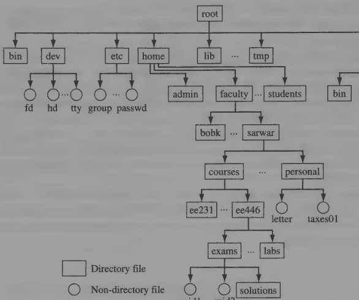
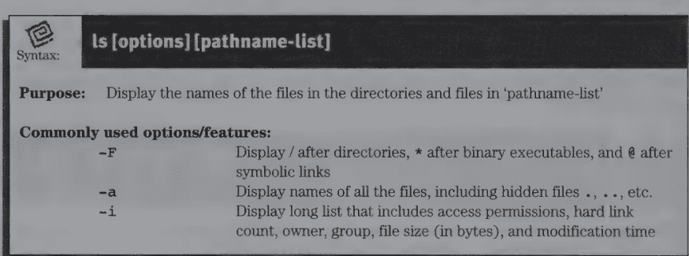
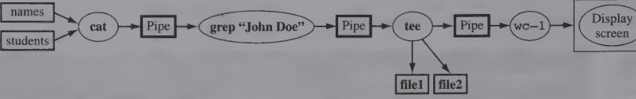
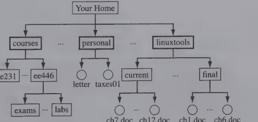
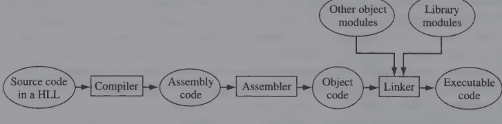
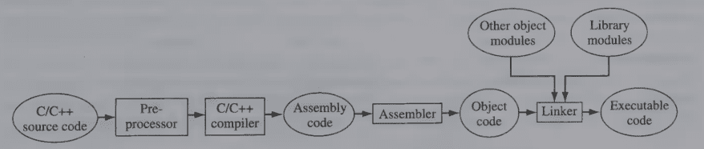
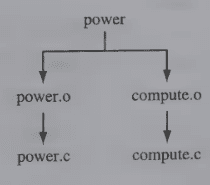
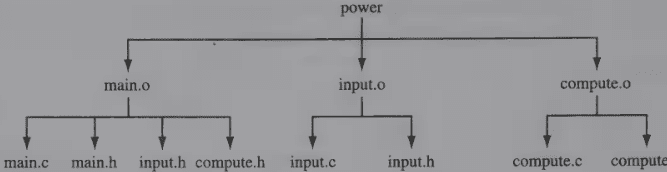
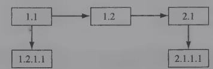

# LINUX 和 UNIX 编程工具：软件开发者入门指南

SYED MANSOOR SARWAR

拉合尔管理科学大学 (LUMS)

KHALED AL-SAQABI

库威特大学

# 献辞

给我的孩子、姐妹和兄弟。S.M.S.

给我的父母。K.S.

# 前言

## 为什么我们写这本书

这本简明的编程伴侣书为学生在 LINUX/UNIX 环境下的编程做好了准备。我们在大学层面拥有超过 28 年的实战教学经验。在这些年里，我们在 UNIX 和 LINUX 平台上教授了编程、数据结构、操作系统和软件工程等广泛课程。我们编写这本书的愿望源于我们找不到一本体面且实时的教材，来系统地描述 LINUX 和 UNIX 编程工具以及程序，用于编译多模块程序、处理库、软件剖析和版本控制。我们认为，一本以详细且有序的方式描述这些工具，并结合章内练习以及实用的章末练习和问题的书已经迟迟未出炉了。虽然书中讨论的几乎所有命令和工具都可以在 LINUX 和 UNIX 上使用，但我们所有的 shell 会话都是在 Mandrake 和 RedHat Linux 系统下录制的。

# 本书的目的

本书分为两部分：第一部分“有效使用 LINUX 和 UNIX”，第二部分“在 UNIX 或 Linux 平台上进行程序开发”。每部分包含七章。第一部分系统地描述了用于文件、进程和打印机控制的 LINUX 和 UNIX 命令及工具，此外描述了登录和注销程序、文件安全以及文件系统的备份与恢复。这些命令和工具允许读者以有序、高效且安全的方式使用他们的 LINUX/UNIX 系统。本教科书的主要目的是为 C++ 软件开发者描述一些重要的 LINUX 和 UNIX 软件工程工具；有时也会包含对 Java 的介绍。书书在第二部分详细描述了软件工程工具。第二部分涵盖的工具包括 `gcc`、`make`、`ar`、`gdb`、`gprof`、`nm`、`size`、`rcs` 和 `cv`。在编写本教科书时，我们假设读者没有 LINUX/UNIX 或编程的先前知识。由于编程工具的广深度，新手和经验丰富的程序员都能从书中受益。

# 我们的目标读者

本书设计用于作为 LINUX 或 UNIX 平台上基础编程和数据结构课程主教材的伴侣，或作为高级编程、软件工程导论和操作系统课程的补充教材。

# 呈现格式

书中充满了图表、表格、数百个章内交互式 shell 会话、章内练习以及章末的问题和习题。涵盖的每个命令、工具和应用程序都提供了一个语法框，描述了命令的语法、其输出及其使用选项和功能。大多数章节都包含一个实用的网络 资源表格。此外，每章都对该章涵盖的内容进行了总结。书末附有术语表。

# 全文路径

如果本书作为 LINUX 或 UNIX 平台上基础编程和数据结构课程的伴侣书，或作为高级编程、软件工程导论和操作系统课程的补充教材使用，那么所有的 shell 会话都是在 Mandrake 和 RedHat Linux 系统下录制的。书中讨论的几乎所有命令和工具都可以在 LINUX 和 UNIX 上使用。

| 字体 | 文本 |
| --- | --- |
| 粗体罗马 | 关键词 |
| 粗体等宽体 | 命令 |
| 等宽体 | 输出 |
| 等宽体斜体 | 提示 |
| 斜体 | 变量 |
| 罗马 | 强调 |
| 粗体 | 其他 |

# 补充内容

本书分为两部分：第一部分“有效使用 LINUX 和 UNIX”，第二部分“在 UNIX 或 Linux 平台上进行程序开发”。每部分包含七章。第一部分系统地描述了用于文件、进程和打印机控制的 LINUX 和 UNIX 命令及工具，此外描述了登录和注销程序、文件安全以及文件系统的备份与恢复。这些命令和工具允许读者以有序、高效且安全的方式使用他们的 LINUX/UNIX 系统。本教科书的主要目的是为 C++ 软件开发者描述一些重要的 LINUX 和 UNIX 软件工程工具；有时也会包含对 Java 的介绍。软件工程工具在第二部分详细描述。第二部分涵盖的工具包括 `gcc`、`make`、`ar`、`gdb`、`gprof`、`nm`、`size`、`rcs` 和 `cv`。在编写本教科书时，我们假设读者没有 LINUX/UNIX 或编程的先前知识。由于编程工具的广深度，新手和经验丰富的程序员都能从书中受益。

# 致谢

感谢 Addison-Wesley 团队提供的支持。如有反馈发送至 `http://www.aw.com/cs`。

感谢反馈报告和评论，请发送至 `msarwar@lums.edu`。

我们感谢所有参与其中的的人。首先，我们对提供意见的 Addison-Wesley 表示诚挚的谢意。

- 高级收购编辑
- 执行编辑
- 执行营销经理
- 编辑助理
- 制作监制
- 项目管理
- 组排与艺术
- 封面设计
- 设计经理
- 前印与制造
- Maite Suarez-Rivas
- Susan Hartman Sullivan
- Michael Hirsch
- Maria Campo
- Marilyn Lloyd
- Keith Henry/Dartmouth Publishing, Inc.
- Dartmouth Publishing, Inc.
- Joyce Cosentino Wells
- Gina Hagen Kolenda
- Caroline Fell


感谢反馈报告和评论，请发送至 `msarwar@lums.edu`。

# 个人致谢

**Seyed Mansoor Sarwar** 这是我多年来的第三本书，如果没有我完美的家人的支持、爱和鼓励，我无法完成：我亲爱的父母、我爱的妻子、我爱的孩子——Hassaan、Maham 和 Ibrahim——我优秀的姐妹——Rizwana 和 Farhana——以及我的兄弟（我们所有的朋友）——Masood、Nadeem、Aeqel 和 Nobel。他们多年来改变了我的生活。父母无尽的爱、情感、激励和指导引导了我意义的人生。这种支持是不可思议的！他们让我能够日夜工作完成这本书。我的姐妹兄弟对我非常慷慨。谢谢一切！

我感谢多年来鼓励和启发我的老师、同事和朋友：爱荷华州立大学的 Art Pohm 和 Jim Davis；库威特大学的 Sabah Al-Fidahi 和 Mansoor Rajah；波特兰大学的 Tom Nelson、Robert Albrecht、Aziz In、Peter Osterberg、Bob Koretsky、Matthew Kuhn、Larry Simmons、Zia Yamayee、Kent Thompson、Dales Fakes、Debbie Speier、Kitty Milton 和 Jamie Strohecker；拉合尔管理科学大学 (LUMS) 的 Ashraf Iqbal、Haroon Babri、Mohammad Ali Maud 和 Syed Zahor Hassan；Radys Corporation 的我的老朋友 Arif Kareem（他从未想过我能做比一堵墙更多）。

我们特别感谢 Dartmouth Publishing, Inc. 的 Keith Henry 团队在制作期间的耐心。感谢 Marilyn Lloyd 和 Maria Campos。我们衷心感谢所有提供反馈的评审人员，他们的贡献极大地提升了最终产品的质量。

- 西南西南州立大学的 Yang Wang
- 西雅图大学的 adair Dingle
- 旧金山州立大学的 Jozo Dujmov
- 纽约州立大学的 Charles P. Wright
- 联合大学的 George Williams
- 加州理工学院的 Mark Gretchenbauer, P.E.

最后，我想向四个非常特别的人表示我特殊的谢意。首先，感谢我的叔叔 Syed Shabbir Hussain（“Shahjee”），他是一位出色的记者和作家，感谢他在持续与帕金森病勇敢斗争的过程中带给我的灵感。其次，我感谢我的叔叔 Syed Nazir Hussain，他曾在我父亲求学期间给予了支持，并对我们全家给予了支持。第三，感谢我已去世的祖母“Bayjee”，她是她全家人特殊光芒的源泉，她对我父亲有着无尽的爱。最后，向我已去世的祖母“Armanjee”表示感谢，她对我们全家有着特殊的爱，并教会了我人生中最重要的几个价值观。

Khaled H. Al-Saqabi 感谢我亲爱的父母，他们为了抚养我付出了巨大的努力。我衷心感谢我的家人多年来的支持，并在工作期间为我提供了便利的环境。我还要感谢我的好友以及此本书的第一作者 Syed Mansoor Sarwar 对我的支持与鼓励。

## 目录

序言 v

### 第四章 打印机控制 89

- 4.2 LINUX/UNIX 文件打印机制 90
- 4.4 打印文件 91
- 4.9 总结 98
- 7.5 总结 147
- 8.4 编译过程 154
- 8.6 C、C++ 和 Java 程序 155
- 12.4 GNU 调试器 gdb 230
- 进入 gdb 环境 233
- 离开 gdb 并退出 244
- 12.5 调试进程 246
- 附录 C vim 编辑器 319

`PATH`（或 `path`）变量定义在家目录中一个名为 `.profile`（也称为点文件，dot file）的隐藏文件中。如果你在这些文件一个找不到该变量，它就在你正在使用的 shell 特定的启动文件（也是点文件）中。通过更改此变量的值可以更改 shell 的搜索路径。若要仅为当前会话临时更改搜索路径，你可以在命令行中更改 `PATH` 的值，并使用 `export PATH` 命令使得以后任何访问处 `PATH` 变量的新值都可用。若要进行永久更改，你需要更改相应点文件中该变量的值。在接下来的示例中，搜索路径增加了两个目录：`~/bin` 和当前目录（`.`）。此外，搜索路径以 `~/bin` 开始并以当前目录结束。

```
$
```

`$ tcsh`

`ps`

| PID TTY | TIME | CMD |
| :--- | :--- | :--- |
| 12911 pts/0 | 00:00 | bash |
| 12949 pts/0 | 00:00 | tcsh |
| 12954 pts/0 | 00:00 | ps |

你还可以使用 `exec` 命令更改你的 shell。例如，如果你已确定当前 shell 是 Bash 而你想切换到 TC shell。使用这种方法，你无法返回之前的 shell。

接下来的章节练习要求你练习这些内容。

每个 shell 的行为、它执行命令和程序的机制、程序输入输出（I/O）以及如何编程受到某些环境变量设置的影响。每个 LINUX/UNIX 系统都有初始启动文件 `/etc/profile`。该文件包含 shell 和其他工具的重要环境变量设置。此外，还有针对特定 shell 的隐藏文件（点文件），它们在你启动特定 shell 时执行。这些也称为启动文件，位于用户的家目录（由 `~` 指定）下的 `.profile` 或特定 shell 的 profile 或登录文件中。例如，Bash 的 profile 和登录文件名为 `~/.bash_profile` 或 `~/.bash_login`。这些文件最初由系统管理员配置供所有用户使用。表 1.1 列出了 Bash 和 TC shell 通用的一些环境变量；如果执行相同相同的 TC 变量名不同，则遵循该名称。

| 环境变量 | 它所影响的内容 |
| :--- | :--- |

以下章内练习允许你查看环境变量的设置。假设你起初运行的是 Bash。如果不是，请在进行练习前按照第 1.3.4 节所示切换 shell。

```
$ set
HISTFILESIZE=500
MAIL=/var/spool/mail/sarwar
```

```
PS1='$ '
PS2='#> '
```

```
$ HISTSIZE=500
```

在下面的会话中，我们使用 `set` 命令显示所有系统设置的值，并使用 `echo` 命令分别显示主目录和终端类型的值。

```
$ date
```

```
$ cat ~/.profile
```

```bash
/home/faculty/sarwar
```

在接下来的章节内练习中，你将被要求使用 `mkdir`、`pwd` 和 `ls -a` 命令来理解它们是如何运作的。

你可以使用 `cd` 命令从一个目录跳转到另一个目录。换句话说，该命令允许你将某个目录设置为当前/工作目录。我们将在第 2 章详细讨论该命令，但这里展示一个简单的命令示例，以便你可以在目录之间移动。在以下会话中的第一个 `cd` 命令将 `~/course` 设置为你的当前目录。第一个 `pwd` 命令显示你正处于 `/home/faculty/sarwar/courses` 目录。第二个 `cd` 命令将你置于 `/etc` 目录（即将其变为当前工作目录）。第二个 `pwd` 命令显示此时 `/home` 是你的当前目录。`ls -C` 命令用于显示 `/home` 目录的内容，即你此时的当前目录。

```bash
$pwd
$ ls -C
```


admin faculty lost+found students

```bash

$
```

我们将在第 2 章讨论非空目录的删除；在现在讨论它对你来说可能太危险了！

在章节内练习中，你将被要求使用 `cd`、`pwd` 和 `rmdir` 命令来理解它们是如何运作的。

## 1.6.8 打印文件

## 1.6.9 获取帮助

为了帮助了解所有的 LINUX/UNIX 命令及其选项，请参阅 LINUX/UNIX 参考手册页（Manual Pages）。这些页面根据描述的主题和适用于特定系统的任务组织成八部分。大多数用户在第 1 部分（命令）找到所需的页面。软件开发者使用系统调用和库调用，分别在第 2 部分和第 3 部分找到所需的页面。从事文档准备的用户从第 7 部分受益最多。管理员主要需要参考第 1、4、5 和 8 部分的页面。

这些页面包含了 LINUX/UNIX 中每个命令、系统调用和库调用的多页、特殊格式的描述性文档。这种格式由七个通用部分组成：名称（name）、摘要（synopsis）、描述（description）、文件列表（list of files）、相关信息（related information）、错误/警告（errors/warnings）和已知缺陷（known bugs）。你可以使用 `man` 命令查看命令的手册页。因为该命令的名字，手册页通常被称为 man pages。当你在屏幕上显示手册时，它通常被称为 man pages。

36

## 初学者通用命令

```bash
$ man -k password
```
- `chpasswd(8)` - 批量更新密码文件
- `gppassw(1)` - 管理 `/etc/group` 文件
- `mkpassword(8)` - 更新密码和组数据库
- `nwpasswd(5)` - 修改网络用户密码

```bash
$ help cd
```
`cd: cd [-PL] [dir]`

将当前目录更改 DIR。变量 `$HOME` 是默认 DIR。变量 `CDPATH` 定义了搜索路径 ...

| :--- |
| 1.14 练习上述节讨论的命令，以理解 `man` 和 `help` 命令的作用。 |

## 1.6.10 修改密码

为了维护系统的整体安全性，特别是为了确保系统上文件的安全，你应该更改初始密码。然后定期更改密码，以确保没有未经授权的人访问你的系统。通过使密码易于来限制

## 初学者实用的通用命令

请记住，密码不可能是任何语言字典中的单词，长度至少为六字符，并且必须包含大写字母、小写字母、数字和标点符号。

要更改密码，请使用所示的 `password` 命令，将 `your_username` 替换为你的用户名：

```
$ password
Changing password for your_username
old password: YourCurrentPassword
new password: YourNewPassword
retype new password: YourNewPassword
Changing password for your_username.
$
```

你现在有了一个新密码。如果你在网络上运行 LINUX/UNIX，你可能需要使用 `ypass` 或 `nispassword` 命令代替 `password` 命令，以便在你访问的网络的所有计算机上更改密码。

下面的章节内练习允许你使用 `password` 命令更改密码。

## 章节内练习

- 1.5 使用 `password` 命令更改密码，注销并使用新密码重新登录。在某些系统上，你将无法使用 `password` 命令。如果你的系统是此类系统，请你的导师或系统管理员为什么禁用了 `password` 命令。

## 1.6.11 命令历史

你在终端中输入的命令（也称为事件）保存在一个历史列表中。环境变量 `HISTSIZE` 可以设置为一个数字，以指定在历史列表中保存的命令数量。默认值为 500。

你可以使用内置命令 `history` 来操作历史列表，如下面的会话所示。命令输出显示了历史列表中的四个命令或事件。

```
1 10:40 ps
2 10:43 gcc -o lab lab1.c -lmm
3 10:43 more /etc/profile
4 10:51 gcc -o lab lab5.c -lpthreads
5 11:01 echo ~kuhn
6 11:01 history
$
```

你可以使用 Bash 和 TC Shell 的历史扩展功能调用历史列表中的任何事件。`!` 允许你指定一个事件标识符，用于从历史列表中调用的命令。表 1.3 描述了三个最常用的事件标识符。使用上述所示的历史列表，输入 `!!` 将执行 `history` 命令。输入 `!gcc` 并按下 `<Enter>` 将调用 `gcc -o lab1 lab5.c -lpthread` 命令。你也可以通过输入 `!2` 并按下 `<Enter>` 来调用第一个 `gcc` 命令。

## 1.6.12 显示命令

显示一年或一个月日历的命令是 `cal`。下面是该命令的简要描述。最佳参数可以在 1 到 12 之间，年份可以从 0 到 9999。如果指定了任何参数，该命令将显示当前年份的日历。如果只指定了一个参数，则它被视为年份。`cal 3 2003` 命令显示 2003 年 3 月的日历。注意，`cal 3` 命令显示的是第 3 年的日历，而不是 3 月。`cal 1991` 命令显示 1991 年的日历，那是 UX 操作系统的诞生年份。

## 1.6.13 显示系统运行

你可以使用 `uptime` 命令显示系统运行时间（自上次启动以来运行的时间）以及其他一些用的统计数据，例如登录系统的用户数。该命令不需要任何参数。下面的示例显示了命令的输出。

```
$ uptime
2:30pm up 37 day(s), 5:51, load average: 0.09, 0.10, 0.24
$
```

最近一项涉及 2400 多台 LINUX 机器的研究（http://counter.li.org/reports/uptimes.php）显示，LINUX 机器的平均运行时间超过 38 天。同一项研究发现有一台基于 LINUX 的机器已经运行了多年没有崩溃！我们鼓励你浏览 counter.li.com 网站，获取关于 LINUX 使用的许多统计数据。

| 表 1.3 历史扩展常用的事件标识符 |
| 事件标识符 | 含义 | 示例 |
| --- | --- | --- |
| `!N` | 重新调用历史列表中第 N 行的 `!14` 命令中的事件 | 历史列表中第 4 行的命令 |
| `!!` | 重新调用上一个 `!!1` 命令中的事件 | 你执行的最后一个命令 |
| `!string` | 重新调用以 "string" 开头的最近一次 `!1` 命令中的事件 | 以该字符串开头的最近命令（可能是最后一个或之前的命令） |

下面的章节内练习要求你使用 `history`、`cal` 和 `uptime` 命令来体会它们的工作原理。

## 章节内练习

- 1.16 使用 `history` 显示你的命令历史，然后使用表 1.3 中的各种事件标识符来体会它们是如何工作的。
- 1.17 使用 `cal` 命令显示当前年份和当前月的日历。你使用了哪些命令？
- 1.18 运行 `uptime` 命令观察你的系统，并记录下它运行的天数。记录命令的输出。

## 1.7 Shell 元字符

除了字母和数字外，大多数字符对 shell 都有特殊含义。这些字符是 shell 元字符，不能作为字面量使用。要将它们作为字面量使用，必须对它们进行转义或引用。最常见的元字符是空格、星号（`*`）、问号（`?`）、反斜杠（`\`）、美元符号（`$`）、圆括号（`()`）、方括号（`[]`）、大括号（`{}`）、管道符号（`|`）、分号（`;`）以及大于号（`>`）和小于号（`<`）。波浪号（`~`）也用于表示主目录。

| 元字符 | 功能 | 示例 |
| --- | --- | --- |
| `&&` | 逻辑与 | `command1 && command2` |
| `||` | 逻辑或 | `command1 || command2` |
| `&` | 后台执行 | `command &` |
| `;` | 命令分隔符 | `command1; command2` |
| `\` | 转义字符 | `\-metacharacter-` |
| `$` | 变量替换 | `$VARIABLE` |
| `` ` `` | 命令替换 | `` `command` `` |
| `*` | 通配符（任意字符串） | `*.txt` |
| `?` | 通配符（单个字符） | `file?.txt` |
| `[` | 模式匹配 | `[a-z]` |
| `{` | 花括号扩展 | `{a,b,c}` |
| `>` | 输出重定向 | `command > file` |
| `<` | 输入重定向 | `command < file` |
| `>>` | 追加重定向 | `command >> file` |


除了字母和数字外，大多数字符对 `shell` 都有特殊含义。这些字符是 `shell` 元字符，不能作为字面量使用。要将它们作为字面量使用，必须对它们进行转义或引用。最常见的元字符是空格、星号（`*`）、问号（`?`）、反斜杠（`\`）、美元符号（`$`）、圆括号（`(())`）、方括号（`[]`）、大括号（`{}`）、管道符号（`|`）、分号（`;`）以及大于号（`>`）和小于号（`<`）。波浪号（`~`）也用于表示主目录。

## 1.8 网络资源

有大量的网络仓库提供了 LINUX 的各种主题，从它的历史到它的结构。表 1.4 列出了一些有趣的网站。

## 1.9 总结

虽然 LINUX 已经有 12 年历史了，但它是最受讨论的操作系统之一。全球有数千万用户在从强大的计算机到手表的各种设备上使用它。

# 问题与练习

当你登录到 LINUX 计算机时，系统会运行一个名为 `shell`（外壳）的程序，它会给你提示符并等待你输入命令，每行一个。当你输入一个命令并按下 `<Enter>` 键时，`shell` 会尝试执行该命令，假设命令行中的第一个单词是命令名。因此，`shell` 进程也被称为命令行解释器。`shell` 拥有执行内置命令的代码，但外部命令的代码存储在文件中。要执行外部命令，`shell` 会逐个搜索目录，以找到包含该命令代码的文件。如果找到了该文件，且它包含代码（二进制文件或脚本），则会执行它。`shell` 搜索外部命令时所涉及的目录名称被称为搜索路径（`search path`）。搜索路径存储在名为 `PATH`（对于 Bourne shell）或 `path` 的 `shell` 变量中，通过向 `PATH` 中添加新名称或删除某些现有的目录名称来修改。

有多种 `shell` 可供你选择。这些 `shell` 在命令行层面的用法以及你的编程语言中可用功能方面有所不同。基于 Linux 的系统中最常用的 `shell` 是 Bourne 和 Bash。Bash `shell` 是 Bourne `shell` 的超集，具有优秀的编程语言和丰富的命令行级接口。TC `shell` 拥有 Bash 的许多交互式功能，但其编程功能较弱。为了高效、方便和安全地使用系统，系统管理员通过各种设置来配置你的环境。这些设置存储在环境变量中，例如 `TERM`（终端类型）。你可以根据喜好更改某些设置。

一个典型的 LINUX 系统中有数千个命令、实用程序和工具。对初学者最有用的包括：

- `mkdir`（创建目录）
- `rm`（删除目录）
- `cd`（切换目录）
- `ls`（列出目录中的文件）
- `pwd`（打印当前目录名称）
- `cat`（打印文件）
- `more`（逐页显示文件）
- `less`（分页显示文件）
- `cal`（显示日历）
- `date`（显示今天的日期和当前时间）
- `history`（显示命令历史）

某些字符被称为元字符（`metacharacters`），它们对 `shell` 具有特殊含义。`shell` 会以特殊方式处理它们；不应在文件名中使用它们。如果你必须在命令中使用它们，需要对它们加引号，这样 `shell` 就会将其视为字面量处理。

## 1.10 问题与练习

1. 访问表 1.4 列出的文档网站，阅读“清单（Manifest）”。用你自己的话描述其目的。打印一些常见问题（FAQ）以备后参考。

2. 访问期刊网站（见表 1.4），点击顶部的搜索按钮。你可以输入任何与 Linux 相关的搜索条件，你将获得与该主题相关的文章列表。在线搜索文章。有多少篇？

3. 浏览互联网并记录下你国家有多少人正在使用 Linux。写出用户最多的三个 `shell` 的名称。

4. 描述 LINUX/UNIX 系统的登录和注销程序。注出的三种方法有哪些？

5. 什么是 `shell`？它的目的是什么？什么是登录 `shell`（`login shell`）？你如何确定你的 `shell` 的名称？给出用于此目的的命令。写出三个 Linux `shell` 的名称。哪一个最流行？你通常使用哪一个 `shell`？为什么？

6. `shell` 有哪两种类型？它们之间有什么区别？

7. 假设你想将登录 `shell` 更改为 Bash。你会使用什么命令来执行？在网络系统中你需要使用什么命令？

8. 存储你登录 `shell` 名称的 `shell` 名称什么什么？在 Linux 下如何更改你的登录 `shell`？

9. 什么是主目录（`home directory`）？你如何确定你主目录的名称？给出用于此目的的命令。给出你系统中用户主目录的路径。

10. 存储你主目录名称的 `shell` 名称是什么？在 Linux 系统下如何更改你的主目录？

11. 你的终端类型设置的是什么？你使用什么命令获取的答案？

12. `shell` 的搜索路径是什么？用于维护 Bash 和 TC `shell` 搜索路径的变量名称是什么？它通常位于哪里（哪个文件中）？你环境中的搜索路径是什么？你是如何发现的？设置你的搜索路径，使其在查找你输入的命令时搜索你的当前目录和 `/bin` 目录。为什么？

13. 使用 `man` 命令显示 `grep` 命令的手册页。你的系统支持多少版本的 `grep`？写下这些版本的名称。如何显示内置命令的简要描述？

14. 什么是隐藏文件？当你登录到 Linux 系统时执行的隐藏文件名称是什么？

15. 什么是 `shell` 启动文件？对于 Bash `shell`，该文件的名称是什么？该文件位于哪里（哪个目录）？

16. 假设你的登录 `shell` 是 Bash。你收到一个在 Bourne `shell` 下运行的脚本。你会如何执行它？清楚地写下你将使用的所有步骤。

17. 在你的主目录下创建一个名为 `linux` 的目录。你使用了什么命令？在你的主目录下创建名为 `memos` 和 `personal` 的目录你会使用什么命令？

18. 给出一个显示文件 `lab1`, `lab2`, `lab3` 和 `lab4` 的命令。你能再给出两个功能相同的命令吗？显示 `lab1.c`, `lab2.c` 和 `lab4.c` 的命令是什么？（提示：使用元字符。）

19. 在你的系统中运行 `man ls > ~/ls.man` 命令。该命令会将 `ls` 命令的手页放在主目录下的 `ls.man` 文件。给出在实验室打印机上打印该文件的副本命令。你使用的命令行是什么？

20. 给出一个命令行，将你主目录下所有以 `memo` 开头并以 `.ps` 结尾的文件打印到名为 `tek2left` 的打印机上。你使用的命令行是什么？

21. 使用什么历史扩展表达式（即事件标识符）来调用你执行的最后一个命令？使用什么事件标识符来调用你执行的最后一个 `make` 命令？

# 第2章

# 文件与处理

## 目标

- 讨论 Linux 中的文件类型
- 描述 Linux 文件系统结构
- 讨论创建、移动和删除文件的常用命令
- 描述文件系统层次结构
- 讨论基本文件操作

在 Linux/UNIX 中，文件是字节序列。文件有五类型：普通文件、目录、命名管道（FIFOs）、符号链接和特殊文件。普通文件包括文本、图形和可执行文件。目录是包含文件和子目录的容器。特殊文件代表设备，分为两种类型：字符特殊文件和块特殊文件。字符特殊文件对应字符 IO，而块特殊文件按块或块进行 IO。命名管道允许进程之间进行通信。符号链接指向一个可能位于你的主目录下的的文件；可以使用 `ln -s` 命令创建，并存储它指向的文件的路径。

## 2.1 文件与文件处理



图 2.1 典型的 LINUX 文件系统结构

以当前工作目录或用户主目录开头的路径称为相对路径。当用户 `sarwan` 登录时，系统会将他放入其主目录 `/home/faculty/sarwan`。用户主目录的绝对路径存储在 `shell` 变量 `HOME`（在 TC `shell` 中为 `home`）中。在主目录中，`sarwan` 可以通过相对路径指定文件 `mid1`（见图 2.1）：`./courses/ee446/exams/mid1` 或 `courses/ee446/exams/mid1`。在 `ee446` 目录下的 `sarwan`（或任何其他人）可以使用相对路径 `exams/mid1` 指定相同文件，也可以通过使用路径 `~/courses/ee446/exams/mid1`（在 TC `shell` 下使用文件 `$HOME` 中的 `$home`）从文件结构中的任何位置指定该文件。

一个典型的 LINUX/UNIX 系统有几个包含系统文件和用户文件的驱动器，但作为用户，你不需要担心哪个磁盘驱动器包含你需要访问的文件。在 LINUX/UNIX 中，多个磁盘驱动器和/或分区挂载在同一个文件系统结构上，允许像目录一样访问，并像 MS-DOS 和 Microsoft Windows 中的 `A;`、`B;`、`C;` 等命名驱动器一样访问。可以通过指定路径来访问这些磁盘和/或分区上的文件和目录，就像它们是一个磁盘/分区的一部分。这提供了系统中所有文件和目录的统一视图，你不需要担心记忆它们包含的驱动器和文件（目录）名称。

## 2.3.3 HOME 和当前工作目录


当你登录时，LINUX/UNIX 系统会将你放在一个特定的目录，称为你的主/登录目录。例如，图 2.1 中名为 `sarwar` 的目录是登录名为 `sar` 的用户的主目录。使用 Bash 或 TC shell，你可以使用波浪号 (`~`) 来指定你的主目录。你在任何特定时刻所在的目录被称为你的当前工作目录（也称为当前目录）。当前工作目录也用 `.`（读作 dot）表示。当前目录的路径用 `.`（读作 dot）表示。

你可以使用 `echo pwd` 命令显示你的主目录或当前工作目录的路径。在下面的会话中，第一个命令用于显示主目录，第二个命令用于显示当前工作目录。此示例假设在执行这些命令时你不在主目录中。你可以在登录后立即使用 `pwd` 命令显示你主目录的路径。

```
$ echo $HOME
/home/faculty/sarwar
$ pwd
/home/faculty/sarwar/courses $
```

## 2.3.4 搜索路径

启动时搜索以查找与外部命令对应的文件的目录名称组成 shell 的搜索路径。Bash 的搜索路径存储在 shell 变量 `PATH` 中，TC shell 的搜索路径存储在 `path` 中。在 Bash 中，目录名用冒号分隔，在 TC shell 中用空格分隔。你可以通过在 Bash 中使用 `echo PATH` 命令和在 TC shell 中使用 `echo $PATH` 命令来显示你的搜索路径。`PATH`（或 `path`）变量定义在一个名为 `.profile`（也称为点文件）的隐藏文件中，或在你的主目录中。如果你在这些文件中找到了该变量，它就在你正在使用的 shell 特定的启动文件（点文件）中。你可以通过更改此变量的值来更改搜索路径。要临时更改当前会话的搜索路径，你只能在命令行中更改 `PATH` 命令的值，并运行 `export` 命令以使 `PATH` 变量的新值在以后任何访问的地方都可用。要进行永久更改，你需要在相应的点文件中更改该变量的值。在下面的示例中，搜索路径更改了三个目录。此外，搜索路径以 `~/bin` 开头并以当前目录结束。

```
$ PATH=/bin:/sbin:$PATH"

$ export PATH
$
```

## 34 第 2 章 文件与文件处理

## 2.4 LINUX 中的一些标准目录和文件

每个 LINUX 系统都包含一组根据 1994 年提出的文件系统标准 (FSSTND) 组织的标准文件和目录。标准目录包含一些特定文件。我们简要描述每个目录的用途。UNIX 使用的文件系统结构也类似。

### ROOT (`/`)

根目录位于文件系统层次结构的顶端，表示为斜杠 (`/`)。它包含一些标准文件和目录，从某种意义上说，它是包含所有抽屉、文件夹和文件的主柜子。

### `/BIN`

也称为二进制目录，`/bin` 目录包含系统管理员和用户大多数基本 LINUX/UNIX 命令的二进制（可执行）命令。该目录中的一些通用命令包括 `bash`, `cat`, `chmod`, `cp`, `date`, `echo`, `kill`, `ls`, `mail`, `mkdir`, `more`, `mv`, `ps`, `pwd`, `rmdir`, `sh`, `stty`, `touch`, `uname` 和 `vi`。一些用于系统恢复的命令包括 `tar`、`gzip`、`gunzip` 和 `zcat`。`/bin` 目录还包含一些必需的网络命令，包括 `domainname`（或 `nisdomainname`）、`hostname`、`netstat` 和 `ping`。`/usrbin` 包含了大部分用户命令。

### `/BOOT`

此目录包含启动 LINUX 系统所需的所有文件，包括 LINUX 内核的二进制镜像。（某些系统将配置文件和内核映射存储在其他目录中。）内核文件名为 `vmlin`（或 `vmlinux`），后面跟有版本和发布信息。例如，在 Red Hat Linux 6.1 上，内核位于 `/boot/mlinux-2.2.5-15` 文件中。

### `/DEV`

`/dev` 目录也称为设备目录，包含连接到计算机的设备（终端、磁盘驱动器、CD-ROM 驱动器、磁带设备、调制解调器、打印机等）对应的文件。这些文件被称为特殊文件，分为两类：字符特殊文件和块特殊文件。该目录中的一些文件包括 `cdrom`（CD-ROM 驱动器）、`console`（控制台）、`fd`（软盘驱动器）、`hd`（硬盘或硬盘上的分区）、`isdn`（IS 连接）、`lp`（行式打印机）、`midi`（媒体接口）、`pty`（伪终端）、`ram`（RAM 磁盘）和 `tty`（终端）。系统可能拥有每种类型的多个设备。在基于网络的系统中，每种类型可能有多个设备。对于我们的系统，`/dev` 目录包含了这些设备文件。

### `/BOOT` (注：原文此处重复，此处翻译逻辑)

此目录包含启动 LINUX 系统所需的所有文件，包括 LINUX 内核的二进制镜像。（某些系统将配置文件和内核映射存储在其他目录中。）内核文件名为 `vmlin`（或 `vmlinux`），后面跟有版本和发布信息。例如，在 Red Hat Linux 6.1 上，内核位于 `/boot/mlinux-2.2.5-15` 文件中。

### `/DEV` (注：原文此处重复，此处翻译逻辑)

`/dev` 目录也称为设备目录，包含连接到计算机的设备（终端、磁盘驱动器、CD-ROM 驱动器、磁带设备、调制解调器、打印机等）对应的文件。这些文件被称为特殊文件，分为两类：字符特殊文件和块特殊文件。该目录中的一些文件包括 `cdrom`（CD-ROM 驱动器）、`console`（控制台）、`fd`（软盘驱动器）、`hd`（硬盘或硬盘上的分区）、`isdn`（IS 连接）、`lp`（行式打印机）、`midi`（媒体接口）、`pty`（伪终端）、`ram`（RAM 磁盘）和 `tty`（终端）。系统可能拥有每种类型的多个设备。在基于网络的系统中，每种类型可能有多个设备。对于我们的系统，`/dev` 目录包含了这些设备文件。

### `/ETC`

`/etc` 目录包含系统特定的文件。这些文件和目录包含配置文件。`PATH`（或 `path`）变量定义在一个名为 `.profile`（也称为点文件）的隐藏文件中，或在你的主目录中。如果你在这些文件中找到了该变量，它就在你正在使用的 shell 特定的启动文件（点文件）中。

### `/HOME`

`home` 目录包含用户的主目录。然而，该设置在不同主机之间不同。在小型系统中，此目录包含用户的主目录，例如 `/home/bob`。

### `/LIB`

`lib` 目录包含给定语言的一系列相关对象文件，封装在一个名为存档（archive）的文件中。

### `/LOST+FOUND`

`lost+found` 目录包含系统中所有未连接到任何位置的文件。LINUX 和 UNIX 工具 `fsck`（文件系统检查）会找到这些文件，系统管理员使用它们检查文件系统。

### `/MNT`

`mnt` 目录主要供系统管理员使用 `mount` 命令临时挂载文件系统。我们系统上的此目录包含 `cdrom`、`disk` 和 `floppy` 挂载点。

# 第36 章 第2 章 文件与文件处理

## `/OPT`

`/opt` 目录用于安装附加软件包。用户为某个包调用的程序应该位于 `/opt/package_name/bin` 目录，其中 `package_name` 是安装包的名称。该软件包的手页位于 `/opt/package_name/man` 目录。

## `/PROC`

`/proc` 目录包含进程和系统信息。

## `/ROOT`

`/root` 目录在许多 LINUX 系统用于 root 账户家目录。该目录对普通用户完全保护。

### `/BIN`

`/bin`、`/usr/bin` 和 `/usr/local/bin` 目录包含系统管理工具、实用程序以及通用的 root 用户命令。`/bin` 中的一些通用 root 用户命令包括 `getty`、`init`、`update`、`mkswap`、`swapon`、`swapoff`。停止系统的命令有 `halt`、`re-boot` 和 `shutdown`。文件系统管理工具有：`fdisk`、`fsck`、`fsck.ext2`、`fsck.minix`、`mkfs`、`mkfs.ext2`、`mkfs.minix`、`mkfs.mdos` 和 `mkfs.vfat`。`/bin` 中最少的网络命令是 `ifconfig` 和 `route`。

## `/TMP`

`/tmp` 目录被多个命令和应用程序使用，包含临时文件。你可以使用此目录存放自己的临时文件。其中所有文件都会定期删除，以防止磁盘（或磁盘的分区）被临时文件填满。`/tmp` 目录中的文件由系统管理员设置，并因系统而异，但通常只有几分钟有效期。在大多数系统中，`/tmp` 设置了粘滞位（sticky bit），因此只有所有者才能删除其中的文件。

## `/USR`


`/usr` 目录包含 LINUX/UN 文件系统中最大的部分之一。它包含可以在不同主机之间共享的只读数据。在大多数 LINUX 系统上，`/usr` 子目录：`X11R6`、`bin`、`doc`、`games`、`include`、`lib`、`local`、`man`、`sbin`、`src` 和 `tmp`。表 2.1 简要描述了这些目录的内容。

## `/var`

`/var` 目录用于包含变量数据（系统运行期间不断变化的数据）。这些数据维护在几个子目录中，但对大多数子目录的讨论超出了本书的范围。其中一个目录是 `/var/spool/mail`，它包含你的收件箱。当你读取新邮件时，它来自该目录下的一个设置为包含你收件邮件的文件。一旦读取了邮件，它会被放入你家目录下一个名为 `mbox` 的文件中。

# LINUX 中的一些标准目录和文件

| 表 2.1 /usr 中的主要子目录 |
| 子目录 | 内容 |
| :--- | :--- |
| X11R6 | X 窗口系统第11版本第6发布及相关文件 |
| bin | 大多数用户使用。它还包含如 `perl`、`python` 和 `tcl` 等解释器 |
| doc | 各种工具、实用程序、库、应用程序、解释器的文档，如 `cc`、`gcc`、`XFree86`、`GNOME`、`Mesa` 和 `zsh` |
| games | 游戏和教育软件的可执行文件 |
| include | C/C++ 头文件，包含某些特定的头文件，如网络应用程序所需的头文件（`/usr/include/netdb`、`/usr/include/netinet` 等）、GNU C++ 头文件（`/usr/include/g+`）以及系统特定头文件（`/include/sys`） |
| lib | 对象文件和内部二进制文件（不供用户或 脚本执行）。某些子目录包含特定工具或应用程序的库，如 `gcc-lib`、`gnome-lib`、`netscape`、`perl`、`tcl_ib` 和 `emacs` |
| local | 系统管理员本地安装供主机间共享的软件（二进制文件和数据）。大多数系统包含以下目录：`bin`、`doc`、`etc`、`games`、`man`、`sbin` 和 `src` |
| man | LINUX 和 UNIX 命令、实用程序、工具和应用程序的手页 |
| sbin | 系统管理员和守护进程使用的非必需命令和工具 |
| share | 只读体系无关数据文件，即特定操作系统不同平台（Pentium、Alpha、Sparc 等）共享的数据 |
| src | LINUX/UN 软件包管理软件源代码（例如 RPM：红帽软件包管理） |
| tmp | 指向 `/tmp` 的符号链接 |

### `/etc/passwd`

`/etc/passwd` 文件为系统中的每个用户包含一行，描述该用户是。每行有七个字段，用逗号分隔。以下是行的格式：

`login_name:dummy_or_encrypted_password:user_ID:group_ID:home_directory:login_shell`

`login_name` 是系统识别用户的登录名，也是用户登录时输入的名称。`dummy_or_encrypted_password` 字段包含密码 x (*) 或密码的加密版本。如果密码存储在 `/etc/passwd` 中，则加密密码存储在 `/etc/shadow` 中。`user_ID` 是分配给用户的 0 到 65535 之间的整数，0 分配给超级用户，1–99 预留。`group_ID` 标识用户所属的组，也是 0 到 65535-99 之间的整数。`user_info` 字段包含关于用户的信息，通常是用户的全名。`home_directory` 字段包含该的绝对路径。

# 40 第2章 文件与文件处理

在接下来的会话中，我们将展示这些命令的使用。第一个命令将 `temp` 目录移动到主目录。第二个命令生成一个错误消息：目标 (`file1`) 不是一个目录。最后一个命令将你主目录下（并包括）`courses` 目录的完整目录结构复制为 `courses.bak` 目录。

```
$ mv temp ~
$ mv dir file1
mv: cannot create directory `file1`: File exists
$ cp -r courses ~/courses.bak
$
```

## 2.5.3 浏览文件系统结构和列出目录

`cd` 命令允许你在目录结构中来回跳转。如果不带参数执行，它会将你带到主目录。你可以通过 `pwd` 命令显示当前目录的绝对路径，并通过 `ls` 命令显示目录的内容（目录中的文件和目录）。`ls` 可能是最常用的 LINUX 和 UNIX 命令，可以配合许多选项使用。以下是该命令的简要描述。



如果不带参数使用，该命令会显示当前目录下的文件和目录名称。该命令的一些常用选项及其含义列于表2.2。`ls` 命令主要配合 `-l` 选项使用。我们将在2.6.2节中描述 `ls -l` 命令的输出。

## 目录操作与浏览文件系统结构 41

| 表 2.2 ls 命令的常用选项及其含义 |
| 选项 | 含义 |
| :--- | :--- |
| -l | 显示目录中文件（所有类型，隐藏文件除外）的详细列表 |
| -a | 显示目录中的所有文件，包括隐藏文件 |
| -d | 显示目录本身的详细列表（而不包含其内容）；通常与 -l 选项配合使用，即 -ld |
| -t | 根据时间戳（修改时间）显示文件，最近修改的文件在最前面；可以使用 -r 选项按反序列出文件 |
| -q | 按访问时间（而非修改时间）显示文件 |
| -s | 按大小显示文件（以 sk 块为单位） |

可以使用 `-ltr` 选项按当前修改时间的反序显示目录的详细列表。如果不带目录参数，该命令将列出当前工作目录下的文件。

在接下来的会话中，我们将展示这些命令的使用。不带参数的 `cd` 命令将你置于主目录。`ls -ld ~/temp` 命令显示 `~/temp` 目录的详细列表。`cd courses/cs475` 将你置于主目录下的 `courses/cs475` 目录。`pwd` 命令显示当前目录的绝对路径。接下来的 `cd` 命令显示你当前目录中的文件名（此时该目录也是你的主目录）。此列表不包含隐藏文件（即以点 `.` 开头的文件），例如 `.bashrc`。`ls -a -` 命令显示你主目录下所有文件的名称，包括隐藏文件（即以点 `.` 开头的文件）。

```
$ cd
$ ls -ld ~/temp
drwx------ 2 sarwar faculty 512 Oct 6 12:45
/home/faculty/sarwar/temp
$ cd ~/courses/cs475
$ pwd
$ cd ..
$ pwd
/home/faculty/sarwar/
$ cd
$ ls
bin books courses linuxtools mail personal temp
```

## 42 第2章 文件与文件处理

```
$ ls -a
  .bash_profile .emacs .gtkrc .nautilus
  .. .bashrc .gconf .ICEAuthority .pinerc
  .addressbook bin .gconfd input.c .sawfish
  .addressbook.lu books .gnome .kde .screenrc
  .bash_history vsroot .gnome-desktop linuxtools .Xauthority
  .bash_logout ddd .gnome_private mail .xsession-
  errors $
```

在随后的课内练习中，你将浏览 LINUX/UNIX 机器的文件系统，在其中定位某些信息，并显示和更改 shell 的搜索路径。

# 课内练习

- 2.1 浏览你的 LINUX/UNIX 文件系统并找到包含 LINUX 或 UNIX 内核的文件。该文件的绝对路径是什么？
- 2.2 搜索 `/etc/passwd` 文件以找到你用户名的那行。写下这一行。你的用户 ID、组 ID、主目录和登录 shell 分什么？
- 2.3 使用 `echo $PATH`（或 `$path`）命令显示你的 shell 搜索路径。扩展搜索路径包含你的主目录和当前目录。

## 2.6 文件处理

我们描述了如何在 LINUX 和 UNIX 中创建和操作文本文件，如何获取有关文件（任何类型）属性的信息，以及你如何保护你的文件。

### 2.6.1 创建文件

你可以使用文本编辑器在 LINUX 和 UNIX 中创建文本文件。LINUX/UNIX 有多种原生和非原生文本编辑器，如 `emacs`, `pico`, `vi`, `vim`, `Wemacs`。附录 A 提供了 `vi` 和 `pico` 编辑器的简要描述。

### 2.6.2 显示文件类型和数据


在浏览文件时，有时你需要显示文件的类型。你可以通过 `pwd` 命令显示当前目录的绝对路径，并通过 `ls` 命令显示目录的内容（目录中的文件和目录）。`ls` 可能是最常用的 LINUX 和 UNIX 命令，可以配合许多选项使用。以下是该命令的简要描述。

如果不带参数使用，该命令会显示当前目录下的文件和目录名称。该命令的一些常用选项及其含义列于表2.2。`ls` 命令主要配合 `-l` 选项使用。我们将在2.6.2节中描述 `ls -l` 命令的输出。

### 表2.3 文件类型与含义

| 类型 | 含义 |
| :--- | :--- |
| - | 普通文件 |
| b | 块设备文件 |
| c | 字符设备文件 |
| d | 目录 |
| l | 符号链接 |
| p | 命名管道 (FIFO) |

可以使用 `-ltr` 选项按当前修改时间的反序显示目录的详细列表。如果不带目录参数，该命令列出当前工作目录下的文件。

在接下来的会话中，我们将展示这些命令的使用。不带参数的 `cd` 命令将你置于主目录。`ls -ld ~/temp` 命令显示 `~/temp` 目录的详细列表。`cd courses/cs475` 将你置于主目录下的 `courses/cs475` 目录。`pwd` 命令显示当前目录的绝对路径。接下来的 `cd` 命令显示你当前目录中的文件名（此时该目录也是你的主目录）。此列表不包含隐藏文件（即以点 `.` 开头的文件），例如 `.bashrc`。`ls -a -` 命令显示你主目录下所有文件的名称，包括隐藏文件（即以点 `.` 开头的文件）。

```
$ cd
$ ls -ld ~/temp
drwx------ 2 sarwar faculty 512 Oct 6 12:45
/home/faculty/sarwar/temp
$ cd ~/courses/cs475
$ pwd
$ cd ..
$ pwd
/home/faculty/sarwar/
$ cd
$ ls
bin books courses linuxtools mail personal temp
```

```
$ ls -a
  .bash_profile .emacs .gtkrc .nautilus
  .. .bashrc .gconf .ICEAuthority .pinerc
  .addressbook bin .gconfd input.c .sawfish
  .addressbook.lu books .gnome .kde .screenrc
  .bash_history vsroot .gnome-desktop linuxtools .Xauthority
  .bash_logout ddd .gnome_private mail .xsession-
  errors $
```

在随后的课内练习中，你将浏览 LINUX/UNIX 机器的文件系统，在其中定位某些信息，并显示和更改 shell 的搜索路径。

# 课内练习

- 2.1 浏览你的 LINUX/UNIX 文件系统并找到包含 LINUX 或 UNIX 内核的文件。该文件的绝对路径是什么？
- 2.2 搜索 `/etc/passwd` 文件以找到你用户名的那行。写下这一行。你的用户 ID、组 ID、主目录和登录 shell 分什么？
- 2.3 使用 `echo $PATH`（或 `$path`）命令显示你的 shell 搜索路径。扩展搜索路径包含你的主目录和当前目录。

## 2.6 文件处理

我们描述如何在 LINUX 和 UNIX 中创建和操作文本文件，如何获取有关文件（任何类型）属性的信息，以及你如何保护你的文件。

### 2.6.1 创建文件

你可以使用文本编辑器在 LINUX 和 UNIX 中创建文本文件。LINUX/UNIX 有多种原生和非原生文本编辑器，如 emacs, pico, vi, vim, Wemacs。附录 A 提供了 vi 和 pico 编辑器的简要描述。

### 2.6.2 显示文件类型和数据

在浏览文件时，有时你需要显示文件的类型。你可以通过 `pwd` 命令显示当前目录的绝对路径，并通过 `ls` 命令显示目录的内容（目录中的文件和目录）。`ls` 可能是最常用的 LINUX 和 UNIX 命令，可以配合许多选项使用。以下是该命令的简要描述。

如果不带参数使用，该命令会显示当前目录下的文件和目录名称。该命令的一些常用选项及其含义列于表2.2。`ls` 命令主要配合 `-l` 选项使用。我们将在2.6.2节中描述 `ls -l` 命令的输出。

### 2.6.3 查看完整文件

你可以使用 `cat` 命令在屏幕上显示一个或多个文件的内容，前提是你拥有文件的读取权限（参见第5章文件访问权限）。以下是该命令的简要描述。

```
Syntax: cat [options][file-list]

Purpose: 连接 'file-list' 中的文件并发送到标准输出（默认为屏幕）

常用选项:
-E 在每行末尾显示 $
-n 为输出的行加上行号
```

该命令不会一次显示一屏或页文件内容，对于大小大于一页的文件，你只能看到最后一页。例如，以下命令显示当前工作目录下的 `student_records` 文件内容。如果文件大于一页，页面内容将滚出屏幕。

```
$ cat student_records
```

| John Doe ECE 3.54 |
| Pam Meyer CS 3.61 |
| Jim Davis CS 2.71 |
| Jason Kim ECE 3.97 |
| Amy Nash ECE 2.38 |

# 课内练习

- 2.4 在你的系统上运行 `ls -l /bin` 命令并识别两个普通文件和两个符号链接。这些文件的大小是多少？它们是什么时候创建？
- 2.5 对这些文件运行 `file` 命令并写下这些文件包含的数据类型。

# 文件处理 45

你可以使用元字符来指定文件名。可以使用 `cat` 命令显示当前目录下所有文件的内容。`cat exam` 命令显示当前目录中以该字符串开头后跟一个字符的所有文件。可以使用 `cat lab` 命令显示当前目录中所有以 lab 字符串开的文件内容。`cat prog[1-3]c` 命令可以用于显示 `prog1.c`、`prog2.c` 和 `prog3.c`。

当不带任何参数使用 `cat` 时，它会一次从标准输入接收输入并将其发送到标准输出。默认情况下，命令的标准输入是键盘，标准输出是显示器。当执行不带参数的 `cat` 命令时，它会从键盘接收输入，并逐行将其发送到屏幕。当用户按下 `<Ctrl-D>`（LINUX/UNIX 的文件结束标记）时，命令终止。

有时你需要显示带有行号的文件内容。在软件开发过程中，你通常需要这样做，例如，对源源代码的编译结果可能会产生包含源程序行号的错误。你可以使用 `cat -n` 或 `nl` 命令显示带有行号的文件行，如 `cat -n lab1.c` 或 `nl lab1.c`。你可以使用 `pr` 工具显示带有包含时间戳、文件名和页码的页眉的文件，我们将在第 4 章中进一步讨论 `cat` 命令。

你可以使用 `tac`（cat 的反向命令）来按反顺序显示文件。

## 2.6.4 逐页查看文件

如果文件内容大于一页，你可以使用 `more` 或 `less` 命令（称为 LINUX/UNIX 分页器）来一次显示一页文件。我们将逐一讨论这些命令。

在不带文件参数的情况下，`more` 命令像 `cat` 命令一样，每次从键盘接收一行输入并将其发送到显示器。如果给出的参数是文件列表（file-list，一个用空格分隔的文件名列表），`cat` 命令将一次一屏屏地显示 file-list 中文件的内容。要显示下一页，按 `<space bar>` 键。要显示文件的下一行，按 `<Enter>`（或 `<Return>`）。在屏幕左下角，命令会显示已显示到该点的文件百分比。要返回外壳（shell），按 `<Q>` 键。以下是 `more` 命令的简单描述。

| more [options] [file-list] |
| :--- |
| **用途：** 合并 file-list 中的文件并一次一屏地发送到标准输出（默认到屏幕；见第 3 章） |
| **+/str** | 从包含 str 的第一行之前的两行开始 |
| **-NN** | 每屏显示 N 行 |
| **+N** | 从文件的第 N 行开始显示文件内容 |

在工作目录中执行 `more sample letter memo` 会每次显示一屏。文件按照在命令中列出的顺序显示。

`more -n20 /usr/include/sys/param.h` 每页显示 20 行，显示 `/usr/include/sys/param.h` 文件的内容。


`less` 命令与 `more` 命令类似，但具有更多功能。`less` 命令也可以按页查看文件。它类似于 `more` 命令，但效率更高，并且具有许多 `more` 中不具备的功能。它支持许多 `vi` 模式命令。例如，它允许一次行或多行向前或向后移动文件、重新显示屏幕，以及正向和反向字符串搜索。它在不读取整个文件的情况下启动文件，这使得它对于大文件来说比 `more` 命令或 `vi` 编辑器更高效。以下是 `less` 命令的简单描述：

```
less [options] [file-list]
```

- 用途：一次一屏地显示 `file-list` 中的文件

常用的选项/功能：

- `-N` 显示行号
- `-o file` 当输入来自管道时，将输出发送到 `file` 的同时也发送到屏幕；如果 `file` 存在，则提示覆盖
- `-p pattern` 在文件中搜索 `pattern` 第一次出现处

当你使用 `less` 命令查看文件时，可以使用许多命令来浏览文件并对其进行其他操作。在接下来的会话中，我们使用 `less` 命令显示 `bash.man` 文件，并在 `less` 命令运行时使用 `!ps` 执行 `ps` 命令。`q` 命令用于退出 `less`。`-N` 选项用于带行号显示 `bash.man` 文件中的行。

```
$ less -N bash.man
1
2
3
4 BASH2(1) BASH2(1)
5
6
7 NAME
8 bash2 - GNU Bourne-Again Shell
```

## 2.6.5 查看文件的头部或尾部

SYNOPSIS（概要）

`bash2 [options] [file]`

COPYRIGHT（版权）

COPYRIGHT

Bash 版权所有 (C) 1989-1999 由 Free Software Foundation, Inc.

DESCRIPTION（描述）

```
-Bash 是一个与 sh 兼容的命令语言
...
```

`!ps`

```
PID TTY TIME CMD csh
29181 pts/3 00:00:00 csh
29211 pts/3 00:00:00 csh
29218 pts/3 00:00:00 csh
29219 pts/3 00:00:00 csh
29220 pts/3 00:00:00 csh
29221 pts/3 00:00:00 csh
29222 pts/3 00:00:00 csh
29223 pts/3 00:00:00 csh
29224 pts/3 00:00:00 csh
29225 pts/3 00:00:00 csh
29226 pts/3 00:00:00 csh
29227 pts/3 00:00:00 csh
29228 pts/3 00:00:00 csh
29229 pts/3 00:00:00 csh
29230 pts/3 00:00:00 csh
29231 pts/3 00:00:00 csh
29232 pts/3 00:00:00 csh
29233 pts/3 00:00:00 csh
29234 pts/3 00:00:00 csh
29235 pts/3 00:00:00 csh
29236 pts/3 00:00:00 csh
```

查看文件的头部（从开始的一些行）或尾部（从结束的一些行）的能力是非常用的，例如可以确定 PostScript 文件是否有正确的结尾，或者编码文件是否有所需的结尾。`head` 和 `tail` 命令在不带参数时从标准输入读取数据。默认情况下，它们显示文件的 10 行。

```
%!PS-Adobe-3.0
BoundingBox: 54 72 558 720
%%Creator: Mozilla (NetScope)
%%DocumentData: Clean7Bit
%%Orientation: Portrait
%%Pages: 4
%%PageOrder: Ascend
%%Title: Doggie
%%EndComments
%%BeginProlog
$
```

`tail` 命令用于显示一个或多个文件的最后部分（尾部）。它对于确定 PostScript 文件是否有正确的结尾或编码文件是否有所需的结尾有用。你可以从某一行开始显示任意数量的行，也可以反向显示行。

和 `head` 命令一样，如果没有给出文件，`tail` 命令从标准输入接收输入。`tail sample` 命令显示 `sample` 的最后 10 行，`tail -5` 命令显示 `sample` 的最后 5 行。`tail +8` 命令显示 `sample` 文件从第 8 行开始的所有行。`tail -5r` 命令以反顺序显示最后 5 行（文件的最后一行是第一个显示的）。

```
$ tail -5r
8 f3
( ) show
pagelevel restore
showpage
%%EOF
$
```

`tail` 命令的 `-f` 选项在你需要查看一个正在增长的文件尾部时非常有用。这种情况经常发生在你运行一个需要长时间才能完成的模拟程序（几分钟、几小时或几天），并且你希望在程序生成数据时就看到它们。使用你的 LINUX/UNIX 系统运行 X Window 系统是非常方便的。在 X

## 文件处理 49

在环境中，你可以在 `xterm`（控制台窗口）中运行 `tail` 命令来监控生成的数据，并同时进行你的其他工作。以下命令显示 `sim.data` 文件的最后 10 行，并在新行追加到文件时显示这些新行。可以通过按下 `<Ctrl-C>` 终止命令，如下所示。

```
$ tail -f sim.data
```

```
[ sim.data 的 10 行 ]
[ 随着数据追加到 sim.data 显示更多数据 ]
<Ctrl-C>
```

```
$
```

在接下来的章节练习中，你将使用 `more`（或 `less`）、`head` 和 `tail` 命令来体会它们的工作。

# 章节练习

- 2.6 使用 `more`（或 `less`）命令查看 `/usr/include/stdio.h` 文件。文件结束常量的值是多少？
- 2.7 使用 `head` 和 `tail` 命令查看大文件的开头和结尾。

## 2.6.6 显示 NIS 数据库

你可以使用 `ypcat` 命令显示 NIS 数据库中的映射，NIS 数据库是网络环境中各种系统级信息的集中存储库。例如，你可以使用 `ypcat` 命令在屏幕上显示与登录名相关的密码信息。同样，你可以使用 `ypcat aliases` 命令显示所有系统级别名，使用 `ypcat` 命令显示本地局域网上的主机，以及使用 `ypcat` 命令显示你的网络系统支持的互联网服务。你可以使用 `yp-` 命令显示你系统中维护的 NIS 映射名称及其别名。

## 2.6.7 复制文件

LINUX 和 UNIX 中复制文件的命令是 `cp`。你必须拥有权限（第 5 章）读取源文件（要复制的文件），并拥有对包含源文件和目标文件的目录的搜索权限。此外，如果目标文件不存在，你还必须对包含目标文件的目录具有写权限。以下是该命令的简要描述：

如果目标文件存在，你不需要包含它的目录的权限；但你必须对该文件具有写权限。如果目标文件存在，只要你有写入该文件的权限，默认情况下它将被覆盖而不会询问你。若要在覆盖现有文件时进行提示，你可以使用 `-i` 选项。如果你没有权限写入目标文件，或者没有权限读取源文件，屏幕上将出现错误消息。

50 第 2 章 文件与文件处理

| `cp [options] file 1 file 2` |
| :--- |
| 语法：将 `file 1` 复制到 `file2`。如果 `file 2` 是一个目录，则在该目录中创建 `file 1` 的副本 |
| 常用选项/功能： |
| `-i` 如果目标存在，则在覆盖前提示 |
| `-p` 保留权限和修改时间 |
| `-r` 递归复制文件和子目录 |

在接下来的会话中，`cp temp temp.bak` 命令将文件 `temp` 复制为 `temp.bak`。报告第一个错误信息是因为当前目录中不存在 `letter` 文件。第二个命令报告错误信息是因为 `temp` 已存在，且用户对它没有写权限。最后一个命令失败是因为用户没有权限读取系统文件 `/etc/shadow`。

```
$ cp temp temp.bak
$ cp letter letter.bak
$ cp: cannot access letter
$ cp memo create temp.bak: Permission denied
$ cp /etc/shadow /etc/shadow
$ cp: cannot open `/etc/shadow` for reading: Permission denied
$
```

以下命令在你的家目录中为 `.profile` 文件创建副本，并将其放在 `~/backups` 子目录下的 `.profile.old` 文件中。你应该在更改运行时环境（在 `~/.profile` 中指定）之前执行此命令，以便在设置新环境时出现问题，你有一个之前工作环境的备份。

```
$ cp ./.profile ~/.backups/.profile.bak
$
```


`cp -i lab* ~/courses/ee446/backups` 命令将当前目录下所有以 `lab` 字符串开头的文件复制到 `~/courses/ee446/backups` 目录。使用 `-i` 选项，如果任何源文件已存在于备份目录，该命令会提示你是否覆盖。

如果你想将一个完整的副本复制到另一个目录，需要使用带有 `-r` 选项的 `cp` 命令。该选项从源目录到目标目录递归复制文件和子目录。

# 文件处理 51

这是一个非常有用的选项，你可以用它定期创建重要目录的备份。以下命令将 `~/courses` 目录递归复制到 `~/backups` 目录。

```
$ cp -r ~/courses ~/backups
```

如果你想保留权限，请使用 `cp -a` 或 `cp -p` 命令。

## 2.6.8 移动和重命名文件

可以使用 `mv` 命令将文件从文件结构中的一个目录移动到另一个目录。在 LINUX 或 UNIX 中，如果源和目标位于同一个文件系统上，此操作可能会重命名文件。文件系统是一个目录层次结构，其根部位于磁盘或分区上，并挂载（连接）到一个目录。文件系统中的文件和目录通过其挂载所在的目录进行访问。

你必须对包含现有文件的目录具有写和执行权限，但不需要对文件具有读、写或执行权限。同样，你必须对路径中的每个目录具有写和执行权限。

## 2.6.9 删除文件

当文件不再被需要时，应该从文件结构中移除它们以释放磁盘空间。LINUX 和 UNIX 中移除（删除）文件的命令是 `rm`。以下是该命令的简要描述：

```
rm [options] file-list

目的：从文件结构（以及磁盘）中移除 file-list 中的文件

常用选项/功能：
-f 忽略 file-list 的权限强制删除
-i 在删除 file-list 中的文件之前提示用户
-r 递归移除作为参数的目录中的文件
```

你需要路径中所有目录组件的搜索权限，以及包含要删除文件的最后一个目录的搜索权限，但你不需要对文件本身具有读或写权限。如果你运行命令且没有要删除文件的权限，命令将显示你对文件的访问权限并提示你操作。

以下命令行说明了如何使用 `rm` 命令在不同目录删除一个或多个文件。

```
$ rm temp
$ rm backups/temp.old
$ rm -f phones grades ~/letters/letter.john
$ rm ~/dir1/*
$ rm [kK]*.prn
$ rm [a-kA-Z]*.prn
```

第一个命令删除当前目录下的 `temp`。第二个命令删除 `backups` 目录下的 `temp.old`。第三个命令无论权限如何都删除 `phones`、`grades` 和 `~/letters/letter.john`。第四个命令删除 `~/dir1` 中的所有文件；目录不会被删除。第五个命令删除当前目录下所有以 `.prn` 结尾且以 `k` 或 `K` 开头的文件。第六个命令删除当前目录下所有以 `.prn` 结尾且以小写字母 `a-k` 或大写字母 `A-Z` 开头的文件。

# 文件处理 53

`rm` 命令配合 `-r` 选项可以递归删除非空目录。当配合 `-r` 和 `-f` 选项使用时，`rm` 命令会递归删除整个目录，而忽略层次结构中文件和目录的权限。以下命令将递归删除你 `~/backups` 目录中的所有文件和子目录。除非你清楚其后果，否则绝不要执行此命令——这将丢失 `~/backups` 目录中的所有文件和目录。

```
$ rm -rf ~/backups
```

通常，你应该结合 `-i` 和 `-r` 选项来递归删除目录，如下命令所示。`-i` 选项用于交互式删除，当你使用此选项时，它会在删除文件前提示你。

```
$ rm -ir ~/personal
```

在接下来的章节内练习中，你将使用 `mkdir`、`cp`、`mv` 和 `rm` 命令来理解它们是如何工作的。

| 章内练习 | 描述 |
| :--- | :--- |
| 2.8 | 在主目录下创建一个名为 `temp` 的目录。将 `/bin` 目录下的 `ls`、`cat` 和 `ftp` 文件复制到该目录。在同一个 `temp` 目录中创建这些文件的备份副本 `ls.bak`、`cat.bak` 和 `ftp.bak`。写下你执行这些任务时命令。 |
| 2.9 | 在主目录下创建一个名为 `backups` 的目录。使用一个命令将 `~/temp` 目录中的备份文件移动到 `backups` 目录。你使用了什么命令？ |
| 2.10 | 使用一个命令删除 `~/temp` 目录中的文件，然后删除 `~/temp` 目录。你使用了哪些命令？使用一个命令删除 `~/backups` 目录。你使用了什么命令？ |

## 2.6.10 确定文件大小

你可以使用几种 LINUX/UNIX 命令之一来确定文件大小。通常用于此目的的两个命令是 `ls -l` 和 `wc`。如前，`ls -l` 命令的输出在第五字段显示文件大小（单位为字节）。在下面的会话中，实验文件的大小为 163 字节。

# 54 第 2 章 文件与文件处理

```
$ ls -l lab2
-xr-xr--r-- 1 sarwar faculty 163 April 22 17:15 lab2
```

该命令配合 `-ld` 选项使用时也会显示目录文件的大小。你可以通过在命令行指定文件名并用空格分隔来获取多个文件的大小，例如 `ls -l lab1 lab2`。你可以在 `ls -n /courses/ea46/` 中对文件名使用 Shell 元字符。

虽然 `ls -l` 是一个通用命令，可以用于确定一个或多个文件的大部分属性（包括其字节大小），但 `wc` 是一个只显示文件大小的特殊命令。以下是该命令的简要描述。

`wc` 命令每个文件的输出是一个包含四个字段的行：行数、单词数、字符数和文件名。该命令不适用于目录。你可以使用 `-c`、`-w` 或 `-l` 选项分别显示字节、单词或行的文件大小。下面的会话演示了在带选项和不带选项的情况下使用 `wc` 命令。

```
$ wc sample
4 44 227 sample
$ wc letter sample test
44 250 1687 letter
4 44 227 sample
2 12 90 test
50 306 2004 total
```

```
$ wc -c letter sample test
1687 letter
227 sample
90 test
2004 total
```

文件处理 55

```
wc -lw letter sample test
44 250 letter
4 44 sample
2 12 test
50 306 total
```

第一个命令显示当前目录下的 `sample` 文件有 4 行、44 个单词和 227 个字节。第二个命令显示了当前工作目录下 `file`、`sample` 和 `test` 文件的行数、单词、字节数。该命令输出的最后一行还显示了三个文件的总和。第三个命令显示了 `letter`、`sample` 和 `test` 中的字符数。最后一个命令显示单个命令可以使用多个选项；在这种情况下，输出是命令行中三个文件的单词数和字母数。

## 2.6.11 追加文件

追加文件是将新数据置于指定文件的末尾。如果文件不存在，则创建它以包含新数据。当应用程序或用户需要通过添加数据来扩充文件时，追加操作非常有用。

`>>` 运算符是 LINUX 和 UNIX 中的追加运算符。你可以按照以下语法在文件末尾追加文件：

`cat [file-list] >> destination`

目的：将 'file-list' 中的文件追加到 'destination' 的末尾；如果没有 'file-list'，则使用标准输出。

`cat sample >> temp` 命令将 `sample` 的内容追加到 `temp` 的末尾。你可以向一个文件追加多个文件，例如 `cat memo1 memo2 memo3 >> memos.record`。该命令将 `memo1`、`memo2` 和 `memo3` 文件的内容追加到 `memos.record` 文件的末尾。

如果没有文件参数，可以使用该命令将键盘输入追加到文件末尾。下面的命令从键盘输入并追加到名为 `test` 的文件中。当你按下 `Ctrl-D` 时，命令结束。

```
$ cat >> test
November 14, 2000
Dear John:
This is to inform you...
...
```

## 2.6.12 合并文件

你可以使用以下语法合并多个文件的内容并存储在单个文件中：

```
cat [file-list] >> destination

目的：合并 'file-list' 中的文件并存储到 'destination'
```


如果没有指定 file-list，则使用键盘输入存储到 `destination`。以这种方式使用时，当你按下 `Ctrl-D` 时，命令结束。如果文件不存在，则创建它。

`cat data1 data2 data3 >> data4` 命令将 `data1`、`data2` 和 `data3` 的内容保存到 `data4`。在接下来的章节内练习中，你将使用 `mkdir`、`cp`、`mv` 和 `rm` 命令来理解它们是如何工作的。

| 章内练习 | 描述 |
| :--- | :--- |
| 2.11 | 在主目录下创建一个名为 `temp` 的目录。将 `/bin` 目录下的 `ls`、`cat` 和 `ftp` 文件复制到该目录。在同一个 `temp` 目录中创建这些文件的备份副本 `ls.bak`、`cat.bak` 和 `ftp.bak`。写下你执行这些任务时命令。 |
| 2.12 | 在主目录下创建一个名为 `backups` 的目录。使用一个命令将 `~/temp` 目录中的备份文件移动到 `backups` 目录。你使用了什么命令？ |
| 2.13 | 使用一个命令删除 `~/temp` 目录中的文件，然后删除 `~/temp` 目录。你使用了哪些命令？使用一个命令删除 `~/backups` 目录。你使用了什么命令？ |

## 2.6.13 比较文件

如果你需要比较两个版本的程序代码或文档，可以使用 `diff` 命令。该命令比较两个文件，并以可将一个转换为另一个的命令形式显示它们之间的差异。`diff` 命令使用以下语法：

`diff [options][file1][file2]`

目的：按行比较 `file1` 和 `file2`，并将它们之间的差异显示为一系列可以将一个转换为另一个的命令。如果 `file1` 或 `file2` 未指定，则从标准输入读取。

`file1` 和 `file2` 参数也可以是目录。如果 `file1` 是目录，`diff` 将查找名为 `file2` 的文件并与 `file2` 进行比较（第二个参数）。如果 `file2` 是目录，`diff` 将查找名为 `file1` 的文件并与 `file1` 进行比较（第一个参数）。如果两个参数都是目录，命令将比较这些目录中同名的所有文件。

如果所比较的文件相同，`diff` 命令不会产生任何输出。在不使用任何选项的情况下，如果文件不同，`diff` 命令会生成一系列用于将 `file1` 转换为 `file2` 的指令。这些指令是 `a`（添加）、`c`（更改）和 `d`（删除）。下面的会话展示了 `diff` 命令的一个示例用法。

```
$ cat file1

Hello, World!

$ cat file2

Greetings!

$ diff file1 file1

$ diff file1 file2

l1

< Hello, World!

> Greetings!

$
```

## 58 第 2 章 文件与文件处理

```
$ diff Fall_OH Spring_OH

1 < 2001年秋季办公时间
---
> 2002年春季办公时间
8 > 下午 1:00 - 2:00
12 < 下午 3:00 - 4:00
---
15 < 下午 2:00 - 3:00
16 < 下午 4:00 - 4:30（注：此处为4:30）
```

指令 `1c` 允许你将 `Fall_OH` 文件中的第一行（2001年秋季办公时间）更改为 `Spring_OH` 文件中的第一行（2002年春季办公时间）。同样地，指令 `12c13` 要求你将 `Fall_OH` 中的第 12 行（下午 3:00–4:00）更改为空行（注意 `>` 符号符号之后没有任何内容）。指令 `8a9` 允许你将 `Spring_OH` 中的第 9 行追加到 `Fall_OH` 的第 8 行之后。指令 `15,16d15` 要求你从 `Fall_OH` 中删除第 15 和 16 行。

大多数系统都有一个名为 `diff3` 的命令，用于三路比较，即比较三个文件。在下面的示例中，我们比较了 `file1`、`file2` 和 `file3`。输出提供了三个文件的描述，显示三个文件中不同的行。

```
$ diff file1 file2 file3

===

1:lc

2:lc

Hello, World!

3:lc

Greetings!

$
```


`diff` 和 `zcmp` 命令可以用于比较压缩文件（见第 2.6.14 节）。`diff` 命令解压缩文件并连同任何选项传递给 `diff` 命令。`zcmp` 命令解压缩文件并连同任何选项传递给 `cmp` 命令。`cmp` 命令在两个文件不同的第一个字节处停止并在屏幕上报告该位置。如果一个或两个文件未压缩，它们将简单地传递给 `diff`（或 `cmp`）命令。如果只传递了一个文件（例如 `file1`）作为参数，则比较 `file1` 和 `file1.gz` 的未压缩版本。例如，`zdiff bash.man.gz` 命令用于比较未压缩的 `bash.man.gz` 和 `bash.man`。`zdiff.bash.man.gz tcsch.man.gz` 命令用于比较 `bash.man.gz` 和 `tcsch.man.gz` 文件的未压缩版本。`zcmp` 命令可以使用类似的方式。

## 2.6.14 压缩文件

文件大小的缩小被称为文件压缩，具有空间和时间上的优势。压缩文件占用更磁盘空间，从一台计算机传输到另一台或通过互联网环境的时间更短，复制的时间也短。压缩需要时间，但如果一个文件需要被复制或传输多次，那么压缩花费的时间可能是节省时间的一部分。此外，如果压缩文件要在次级存储设备（如磁盘）上存储长时间，节省的磁盘空间是非常可观的。压缩的一个结果是压缩文件是不可读的，但压缩文件可以转换回原始形式，使其可读。使用 `uncompress` 命令可以完全逆向地进行压缩过程。

LINUX/UNIX 操作系统有几个用于压缩和解压缩文件以及对压缩文件执行操作的命令。这些命令包含了传统的 UNIX 压缩解压缩命令 `compress` 和 `uncompress`，以及 GNU 工具 `gexe`、`gzip`、`unzip`、`zcat`、`zcmp`、`zforce` 和 `grep`。我们在这里描述 GNU 工具；GNU 命令（`gzip` 和 `unzip`）优 `compress` 和 `uncompress`，因为 `compress` 对小文件的压缩不如 `gzip` 命令。

## GZIP 命令

`gzip` 命令可压缩普通文件；它忽略符号链接。该命令读取作为参数传递的文件内容，分析其重复模式，并使用 Lempel-Zip 编码用较少的字符替换这些模式。压缩文件与原始文件完全不同。压缩文件包含不可打印字符，因此压缩文件的屏幕显示仅仅是一堆控制字符。见下一页关于该命令的简要描述。

压缩文件保留原始文件的访问/修改时间、所有者和权限。原始文件从文件结构中删除。在没有文件参数或使用 `-` 参数的情况下，`gzip` 命令从标准输入（默认是键盘）读取输入，这允许你在管道中使用该命令（见第 3 章）。我们通常使用一个或多个文件作为参数使用该命令。

## GUNZIP 命令

`gzip` 命令可执行反向操作并将压缩文件恢复为原始文件。`gzip -d` 命令也可以执行此任务。使用 `gzip` 命令时，`-N`、`-c`、`-f`、`-1` 和 `-r` 选项的作用与在 `gzip` 命令中使用时完全相同。

## 60 第 2 章 文件与文件处理

### gzip [options] [file-list]

语法：压缩 `file-list` 中的每个文件并将其存储在 `filename.gz` 中，其中 `filename` 是原始文件的名称；如果命令行中未指定文件或使用了 `-`，则 `gzip` 从标准输入读取输入。

常用选项/功能：

- `-N` 根据 N 的值控制压缩速度（以及压缩率），其中 1 最快，9 最慢；越慢压缩压缩率越高
- `-c` 将输出发送到标准输出
- `-d` 解压缩文件
- `-f` 如果文件已存在则强制压缩
- `-1` 快速压缩
- `-r` 递归压缩
- `-l` 显示压缩信息

我们通常使用一个或多个文件作为参数使用该命令。

# 第2章

- -rwx------ 1 sarwar faculty 10881 Nov 19 11:48 banner
- -rwx------ 1 sarwar faculty 5239 Nov 19 11:45 banner-

## ZCAT 命令

将压缩文件还原为原始文件并显示出来是一个耗时的过程，因为文件创建需要磁盘 I/O。如果你只想查看原始文件的内容，可以使用 LINUX/UNIX 命令 `zcat`（用于压缩文件的 `cat` 命令），它可以显示 `gzip` 或 `zcat` 格式的压缩文件内容。该命令在显示文件之前对其进行解压缩。原始文件保持不变。`zmore` 命令可以一次一屏地显示压缩文件。当没有提供文件或未提供参数时，这些命令将从键盘读取输入。这两个命令都允许你指定一个或多个文件作为参数。

在下面的会话中，使用 `gzip` 命令压缩 `bash.man` 文件并存储在 `bash.man.gz` 文件中。使用 `zmore` 命令显示原始文件的内容。我们没有使用 `zcat` 命令，因为 `bash.man` 是一个大型多页文件。

```
$ gzip bash.man

$ zmore bash.man.gz

--- > bash.man.gz < ---
```


# BASH2(1)

## 名称

`bash2` - GNU Bourne-Again Shell

## 用法

`bash2` `[options]` `[file]`

## 版权

`-Bash` 的版权所有 (C) 1989–1999 自由软件基金会所有。

## 描述

`-Bash` 是一个兼容 `sh` 的语言解释器，用于执行从标准输入或文件读取的命令。`Bash` 还整合了来自 Korn 和 C shell (`ksh` 和 `csh`) 的有用功能。

`$`

在接下来的章节内练习中，你将使用 `gzip`、`unzip` 和 `zcat` 命令查看文件如何被压缩和解压缩，以及如何显示压缩文件。

## 章内练习

### 2.14
将 TC shell 的手册页保存到家目录下的 `tcsh.man` 文件中。使用 `ls -l` 命令以字节为单位显示手册页的大小。使用 `gzip` 命令压缩 `tcsh.man` 文件。如果保存的是压缩版本而不是未解压缩的文件，可以节省多少磁盘空间？你是如何得到答案的？哪个文件包含 `tcsh.man` 的压缩版本？

### 2.15
使用 `zcat` 命令显示压缩版本。

### 2.16
解压缩 `tcsh.man` 的压缩版本。你使用了什么命令？

## 2.6.15 查找文件和命令

有时，你需要查找文件系统中是否存在某个特定文件或命令，或者如果你有多个版本的命令，你可能想找出在你运行该命令时执行的是哪一个。我们在这里讨论三个可以用于此目的的命令：`find`、`whereis` 和 `which`。

### FIND 命令

你可以使用 `find` 来搜索符合作为参数传递的表达式（见命令描述）的描述的目录列表。该表达式本质上用于指定正在搜索的一个或多个文件属性。该命令递归搜索目录列表；也就是说，搜索目录列表所有层级的子目录。以下是该命令的简要描述。

| 语法: | `find directory-list expression` |
| :--- | :--- |
| 目的: | 搜索 'directory-list' 中的目录，以定位符合 'expression'（第二个参数）标准的文件。表达式由一个或多个标准组成（见示例） |
| 输出: | 除非在 'expression' 中显式请求，否则无输出 |
| 常用选项/功能: | |
| `-exec CMD` | 如果命令 'CMD' 的退出状态返回 0（成功执行的命令的真值），则被搜索的文件符合标准；'CMD' 必须以带引号的分号结束，即 `\;` |
| `-inum N` | 搜索 inode 号为 N 的文件 |
| `-links N` | 搜索具有 N 个链接的文件 |

#### 语法：`find directory-list expression`（续）

| `-name pattern` | 搜索由 'pattern' 指定的文件 |
| `-newer file` | 搜索在 'file' 之后修改的文件（即比 'file' 更新的文件） |
| `-ok CMD` | 与 `-exec` 类似，区别是会先提示用户 |
| `-perm octal` | 搜索文件权限为 'octal' 的文件 |
| `-print` | 显示使用其余标准找到的文件路径名 |
| `-size N[c]` | 搜索大小为 N 块的文件。N 后面跟 'c' 可用于按字符测量大小；+N 表示大于 N 块，-N 表示小于 N 块 |
| `-user name` | 搜索由用户或 ID 'name' 拥有的的文件 |
| `\( expr \)` | 如果 expr 为真则结果为真；用于通过 OR 或 AND 组合标准 |
| `!expr` | 如果 expr 为假则结果为真 |

使用 `-a` 或空格来表示逻辑与（AND），使用 `-o` 表示逻辑或（OR）两个标准。注意，在括号 `[`、`]` 前后，以及在 `-o` 前后，至少需要一个空格。复杂的表达式可以用括号括起来 `\(` 和 `\)`。以下是说明性示例。
`find` 命令最常用的用法是在一个或多个目录中搜索文件，如第一个示例所示。在这里，命令在你的目录中搜索 `Pakistan.gif` 文件，并显示包含它的目录的路径名。

```
$ find ~ -name Pakistan.gif -print

/home/user/Pakistan.gif
```

## WHICH 命令

在具有多个版本命令的系统中，可以使用 `which` 工具来确定你正在使用的 shell 所执行的命令版本的位置（绝对路径名）。当命令运行不符合其规范时，可以使用 `which` 工具确定执行的命令版本的绝对路径名。本地版本的执行可能是因为在 `PATH` 变量中设置了搜索路径（第 4 章和第 7 章）。或者可能是因为系统中安装的代码最近进行了更新导致本地版本损坏。`which` 命令接受命令列表（实际上是命令的文件列表）作为参数，并向标准输出它们的绝对路径名。

## 2.6.17 搜索文件

`LINUX` 和 `UNIX` 拥有强大的文件搜索工具，允许你可以在文本文件中找到包含特定表达式、字符串或模式的行。例如，如果你有一个大文件，其中包含公司员工的记录（每行一条），你可能想搜索文件中包含 John Johnsen 信息的行。允许文件搜索的工具有 `grep`、`egrep` 和 `fgrep`。以下是这些工具的简要描述。

```
grep [options] pattern [file-list]

egrep [options] [string] [file-list]

fgrep [options] [expression] [file-list]
```

用途：在 'file-list' 中的文件中搜索给定的模式、字符串或表达式；如果没有 'file-list'，则从标准输入读取输入。

输出：在标准输出上打印包含给定模式、字符串或表达式的行。

常用选项：

- `-c` 仅打印匹配行的行数
- `-i` 在匹配过程中忽略字母大小写
- `-l` 仅打印包含匹配行的文件名
- `-n` 在匹配的行旁打印行号
- `-v` 打印不匹配的行

在这三个命令中，`grep` 命令最快但限制也最多；`egrep` 最慢但最灵活，允许充分使用正则表达式；而 `grep` 的速度适中，在支持正则表达式方面也相当可行性。在接下来的会话中，我们将通过描述中显示的某些选项，演示中规中矩的 `grep` 命令的使用。我们使用下面通过 `cat` 命令显示的学生文件。

```
$ cat students
```

| John Johnsen | john.johnsen@tp.com | 503.555.1111 |
| Hassan Sarwar | harswar@k12.st.or | 503.444.2132 |
| David Kendall | d_kendall@msnbc.org | 229.111.2013 |
| John Johnsen | johnsen@psu.net | 301.999.8888 |
| Kelly Kimberly | kelly@kumich.com | 555.123.9999 |
| Maham Sarwar | msarwar@k12.st.or | 713.888.0000 |
| Jamie Davidson | jdavidson@duet.edu | 515.001.2932 |
| Nabeel Sarwar | nsarwar@xyz.net | 504.555.1212 |

# 第2章 文件与文件处理

`grep` 工具最常用且简单的用法是显示文件文件中包含特定字符串、单词或模式的行。在接下来的会话中，我们显示学生文件中包含字符串 `sarwar` 的行。这些行按照它们在文件中出现的顺序显示。

```bash
$ grep sarwar students
```

| Hassaan Sarwar | hsarwar@k12.st.or | 503.444.2132 |
| Maham Sarwar | msarwar@k12.st.or | 713.888.0000 |
| Nabel Sarwar | nsarwar@xyz.net | 434.555.1212 |

`grep` 命令可以配合 `-n` 选项显示带行号的输出行。在接下来的会话中，学生文件中包含字符串 `sarwar` 的行将带行号显示。

```bash
$ grep -n sarwar students
```

| 2:Hassaan Sarwar | hsarwar@k12.st.or | 503.444.2132 |
| 7:Maham Sarwar | msarwar@k12.st.or | 713.888.0000 |
| 8:Nabel Sarwar | nsarwar@xyz.net | 434.555.1212 |

你可以使用 `grep` 命令配合正则表达式和 shell 元字符在多个文件中进行搜索。在接下来的会话中，`grep` 在当前工作目录中以 `.c` 结尾的所有文件（C 源文件）中搜索字符串 `include`。注意 `server` 的权限设置使得 `grep` 无法读取它——用户没有 `server.c` 的权限。

```bash
$ grep -n include *.c

client.c: 21: #include <stdio.h>
```


```
client.c: 22: #include <ctype.h>
client.c: 23: #include <string.h>
labl.c: 13: #include <stdio.h>
grep: can't open server.c$
```

你可以使用 `grep` 命令配合 `-l` 选项显示出现模式的文件名。然而，该命令并不显示包含模式的行。在接下来的会话中，`~/States` 目录被认为包含了美国每个州的一个文件（例如 Portland）。因此，`grep` 命令显示包含单词 Portland 的文件名，即名为 Portland 的州的文件。

```bash
$ grep -l Portland ~/States
```

Maine

Oregon

以下命令显示学生文件中以 A 到 H 开头的行。在命令中，`^` 指定行的开始。

```bash
```


`$ grep '^[A-H]' students`

Hassan Sarwar hswar@kl12.st.or 503.444.2132
David Kendall d_kendall@msnbc.org 229.111.0232

`grep '<Ke` 命令显示以该单词（字符串）开头的行。注意使用单引号 `^` 是为了确保 shell 不将模式解释为 shell 元字符。字符串 `$` 是单词的结尾锚。因此 `grep net$` 命令显示以 net 结尾的单词。如果我们把字符串 net 替换为 war，命令的输出是什么？

你可以使用 `-v` 选项显示不包含命令中指定字符串的行。因此 `grep -v 'Kimberly|Nabeel' students` 产生了不包含 Kimberly 和 Nabel 的行。

`zgrep` 命令可以用于压缩文件。该命令解压缩文件并将其连同任何命令行参数传递给 `grep` 命令。多个 `zgrep` 可以分别调用 `egrep` 和 `fgrep` 命令，而不是 `grep` 命令。shell 环境变量 `GREP` 可以设置为 `grep` 系列的三个命令（`grep`、`egrep` 和 `fgrep`）之一，以便在使用 `zgrep` 时调用。因此，如果 `grep` 是 `egrep`，`zgrep` 命令的执行就会调用 `egrep` 命令而不是 `grep` 命令。

在接下来的章节练习中，你将使用 `grep` 命令来理解它的特性。

### 章节练习

- 2.19 使用 `grep SOCK_STREAM /usr/include/bits/socket.h` 命令确定符号常量 `SOCK_STREAM` 的值。这个变量的值是多少？
- 2.20 使用 `grep PF_* /usr/include/bits/socket.h` 命令显示 `socket.h` 文件中所有以 `PF_` 开头的单词。有多少行此类

## 2.7 总结

在 LINUX 和 UNIX 中，文件是字节序列。文件系统是层级的，有一个根目录以及其下的所有文件。可以使用绝对路径或相对路径来指定文件的名称。绝对路径从根目录开始，相对路径从用户的家目录或工作目录开始。你可以使用 `pushd` 和 `popd` 命令维护目录栈。这允许你在目录之间快速切换。目录（主要）可以使用各种命令（`mkdir`, `rdir`, `cd`, `ls`, `pushd` 等）创建和删除。

基本文件操作包括创建可执行文件、显示文件内容（全部或部分）、重命名文件、将文件移动到其他、确定文件大小、比较文件、合并文件并存储在另一个文件中、在文件末尾追加新内容（可能来自另一个文件、键盘或命令输出）以及打印文件。LINUX 和 UNIX 提供了几种可以执行这些操作的工具。

可以使用 `vi` 和 `pico` 编辑器创建和编辑文件。可以使用 `gcc` 等编译器创建二进制/可执行文件。`grep` 工具可以显示文件中包含特定字符串、单词或模式的行。在接下来的会话中，我们显示学生文件中包含字符串 `sarwar` 的行。这些行按照它们在文件中出现的顺序显示。

`grep` 命令可以配合 `-n` 选项显示带行号的输出行。在接下来的会话中，学生文件中包含字符串 `sarwar` 的行将带行号显示。

你可以使用 `grep` 命令配合正则表达式和 shell 元字符在多个文件中进行搜索。在接下来的会话中，`grep` 在当前工作目录中以 `.c` 结尾的所有文件中搜索字符串 `include`。注意 `server` 的权限设置使得 `grep` 无法读取它——用户没有 `server.c` 的权限。

你可以使用 `grep` 命令配合 `-l` 选项显示出现模式的文件名。然而，该命令并不显示包含模式的行。在接下来的会话中，`~States` 目录被认为包含了美国每个州的一个文件（例如 Portland）。因此，`grep` 命令显示包含单词 `Portland` 的文件名，即名为 `Portland` 的州的文件。

以下命令显示学生文件中以 A 到 H 开头的行。在命令中，`^` 指定行的开始。

`grep '<Ke` 命令显示以该单词（字符串）开头的行。注意使用单引号 `^` 是为了确保 shell 不将模式解释为 shell 元字符。字符串 `$` 是单词的结尾锚。因此 `grep net$` 命令显示以 net 结尾的单词。如果我们把字符串 net 替换为 war，命令的输出是什么？

你可以使用 `-v` 选项显示不包含命令中指定字符串的行。因此 `grep -v 'Kimberly|Nabeel' students` 产生了不包含 Kimberly 和 Nabel 的行。

`zgrep` 命令可以用于压缩文件。该命令解压缩文件并将其连同任何命令行参数传递给 `grep` 命令。多个 `zgrep` 可以分别调用 `egrep` 和 `fgrep` 命令，而不是 `grep` 命令。shell 环境变量 `GREP` 可以设置为 `grep` 系列的三个命令（`grep`、`egrep` 和 `fgrep`）之一，以便在使用 `zgrep` 时调用。因此，如果 `grep` 是 `egrep`，`zgrep` 命令的执行就会调用 `egrep` 命令而不是 `grep` 命令。

一个文件的副本可以通过移动 `cp` 命令在另一个文件或目录中创建。取决于源和目的

文件位于同一个文件系统中，使用 `mv` 可能会也可能导致文件数据从一个位置到另一个位置的实际移动。如果源文件和目标文件在同一个文件系统中，则文件数据不会移动，源文件简单地链接到新位置（目标位置）。在新位置会创建源文件的实际副本，而如果源文件在不同的文件系统上，则源文件将从当前目录中删除（解除链接）。可以使用 `rm` 命令从文件结构中删除文件。该命令也可以用于递归删除目录。

可以使用 `ls -l` 或 `wc` 命令确定文件的大小；两者都以字节（bytes）为单位给出文件大小。此外，`wc` 命令还提供文件的行数和单词数。这两个命令均可使用 shell 元元字符 `?`、`[`、`]` 和 `^` 来显示多个文件的大小。

`diff` 命令可用于显示两个文件之间的差异。除了显示文件之间的差异，它还以 `ed` 编辑器命令序列的形式显示有用信息，这些命令可以使两个文件相同。`diff` 和 `zcmp` 命令可用于比较压缩文件。

有时，你需要查找文件系统中是否存在某个特定的文件或命令。如果你有多个版本的命令，你可能想找出在你运行命令时执行的是哪一个。可以使用三个命令来实现此目的：`find`、`where` 和 `which`。Linux 和 UNIX 拥有强大的文件搜索工具，允许你在包含特定表达式、字符串或模式的文本文件中进行查找。这些工具是 `grep`、`egrep` 和 `fgrep`。

## 2.8 问题与练习题

1. 在 LIN/UNIX 中，什么是文件？
2. LIN/UNIX 支持任何文件类型吗？如果是，请列出它们。LIN/UNIX 支持文件扩展名吗？
3. LIN/UNIX 中的特殊文件是什么？什么是字符特殊文件和块设备文件？运行 `ls /dev | wc -w` 来查找你的系统有多少个特殊文件。
4. 为你的 LIN/UNIX 机器绘制一个层次文件结构图，类似于图 2.1 所示。显示前两层下的所有文件和目录。还要显示你的家目录（home directory）在哪里，以及家目录下的文件和目录。
5. 给出一个可以用于查找家目录绝对路径的命令。
6. 你正在使用什么？你的 shell 搜索路径是什么？你是如何获得答案的？你使用了什么问题？
7. 写下你系统 `/etc/passwd` 文件中包含你登录信息的行。你的登录 shell、用户 ID（UID）和组 ID（GID）分别是什么？你的系统在 `/etc/passwd` 或 `/etc/shadow` 文件中包含加密密码？
8. 在你的家目录下创建一个名为 `memos` 的目录。进入该目录并使用第 5 章讨论的编辑器之一创建一个名为 `memo.james` 的文件。为此文件取三个名字。
9. 给出一个命令行，用于创建你在问题 8 中创建的名为 `the_emos` 的子目录。
10. 复制 `memo.james` 文件并将其放在家目录下。将复制后的文件命名为 `temp.memo`。给出两个完成此任务的命令。
11. 给出一个删除 `memos` 目录的命令。你如何知道该目录已被删除？
12. 为什么在空行开头按下 `<Ctrl-D>` 时进程会终止？
13. 给出一个命令行，显示你的 `~linux` 目录下所有以单词 `command` 开头，后跟数字 1、2、6、8 或 9，并以 `.eps` 或 `.prn` 结尾的文件类型。
14. 给出一个命令行，显示你的个人目录下所有文件名不以 `a`、`k` 或 `Q` 开头，且名称第三个字母既不是数字不是字母（大写或小写）的文件类型。
15. 给出一个命令行，查看你工作目录下所有文件的大小（以行数和字节计数）。
16. 列出 10 种你可以在 LINUX 和 UNIX 文件上执行的操作。
17. 给出一个命令行，查看你工作目录下所有文件的大小（以行数和字节为单位）。
18. 使用 `more`（或 `less`）命令查看 `/usr/include/bits/socket.h` 文件。符号常量 `SOCK_STREAM` 和 `SOCK_DGRAM` 的值是多少？假设你正处于家目录。给出另一个命令来完成 `PF_INET_AF=`。
19. `tail -10r .. /letter.John` 命令的作用是什么？
20. 给出一个查看你家目录大小的命令。给出一个显示家目录下所有文件大小的命令。
21. 给出一个显示 `Students` 文件中从第 25 行开始的所有行的命令。
22. 给出一个命令，复制家目录下 `courses` 目录下的所有文件和目录。假设你不在家目录下，给出完成相同任务的命令。
23. 以下命令的作用是什么？
    a. `rm -f /personal/memo*.doc`
    b. `rm -f /linuxbook/final/ch?.prn`
    c. `rm -f /linuxbook/final/*.o`
    d. `rm -f ~/courses/ece346/lab[1-6].CC`
26. 你在家目录下有一个名为 `tried..` 的文件。重命名这个文件。使用了什么命令？
27. 给出一个命令，显示家目录下 `courses/ece345` 目录下所有以某个字符串开头、后跟零或多个字符并以字符串 `.c` 结尾的文件的属性。
28. 参考问题 27，给出一个命令显示所有文件的属性。
29. 在 LIN/UNIX 中，什么是重定向（redirection）？
30. 给出一个重定向命令，将输出重定向
31. 什么是重定向？
32. 在 LIN/UNIX 中，重定向的命令是什么？
33. 给出一个重定向命令，显示错误信息。
34. 如何重定向标准输出和错误？
35. 什么是符号 `>`、`1` 和 `2`？
36. 给出一个重定向命令来追加输出。

## 输入、输出和错误重定向

你可以使用 LINUX/UNIX 重定向功能将 stdin、stderr 和 stdout 的默认文件分离，并将其他文件连接到它们。我们在本章中描述这些功能的工作原理。除非另有说明，我们的讨论针对 Bash。

## 3.3 输入、输出和重定向

使用 LINUX/UNIX 重定向功能，可以在单次执行命令时将连接的默认（设备）更改为命令的标准文件。这些功能的使用产生了通常所谓的输入、输出和错误重定向。我们将逐一讨论这些功能。虽然重定向可以在网络环境中的跨计算机使用，但我们的讨论限于同一台计算机上的重定向。

### 3.3.1 输入重定向

你可以通过输入重定向在执行一次命令时将与 stdin 关联的默认设备改为不同的文件。这允许命令从新连接的文件读取输入，而不是键盘。`<`（或 `0<`）是隐式运算符，根据以下语法用于输入重定向，其中 0 是 stdin 的文件描述符。

```


`command` `<` `input-file`

```
```

**目的：** 将键盘从 stdin 分离并将“`input-file`”连接到它，即“`command`”从“`input-file`”读取输入而不是键盘。

命令和错误信息仍然发送到显示屏幕。在下面的会话中，`cat` 和 `grep` 命令从 `Phones` 文件读取输入而不是键盘。命令的输出仍然发送到显示屏幕。

```
$ cat < Phones

[ contents of Phones ]

$ grep "John" < Phones

[ output of the grep command ]
```

尽管结果相同，但 `cat < Phones` 命令与 `cat Phones` 命令不同，后者将 `Phones` 文件作为命令行参数传递给 `cat` 命令；而 `cat` 的 stdin 并没有改变。

如果 `cat` 和 `grep` 没有在命令行中传递文件参数，则它们将从 stdin 读取输入。`tr` 命令仅从 stdin 读取输入并将其输出发送到 stdout。`tr` 命令不支持将文件作为命令行参数。输入重定向通常与 `tr` 命令一起使用，在下面的会话中，它将 `Phones` 文件中的多个连续空格替换为单个空格。

```
$ tr -s ' ' < Phones

[ contents of Phones with multiple consecutive spaces replaced with a single space ]
```

### 3.3.2 输出重定向

你可以通过输出重定向在执行一次命令时将与 stdout 关联的默认设备改为不同的文件。这允许命令将其输出发送到新连接的文件而不是显示屏幕。`>`（或 `1>`）是隐式运算符，根据以下语法用于输出重定向，其中 `1` 是 stdout 的文件描述符。

| `command > output-file` or `command 1> output-file` |
| :--- |
| **目的：** 将显示屏幕从 stdout 分离并将“`output-file`”连接到它，即“`command`”将输出发送到“`output-file`”而不是显示屏幕。 |

命令会话的输入仍然来自键盘，错误信息仍然发送到显示屏幕。在下面的会话中，`cat` 命令从 stdin 读取输入并将其保存到 `Phones` 文件。如果 `Phones` 文件已存在，它将被覆盖。`grep` 命令从 `Phones` 文件读取输入（作为命令行参数传递），命令输出去 `Phones` 文件。`find` 命令的输出被重定向到 `foo.paths` 文件。命令的错误信息仍然发送到显示屏幕。

```
$ cat > Phones

[ your input ]

<Ctrl->

$ grep "John" Phones > Phones.bak

[ output of the grep command ]

$ find -name foo -print > foo.paths

[ error messages ]
```

### 3.3.3 错误重定向

你可以通过错误重定向在执行一次命令时将与 stderr 关联的默认设备改为不同的文件。这允许将错误信息发送到新连接的文件而不是显示屏幕。`2>` 根据以下语法用于错误重定向，`2` 是 stderr 的文件描述符。你必须为 stderr 指定 `2`。

```
command 2> error-file
```

**目的：** 将显示屏幕从 stderr 分离并将“`error-file`”连接到它，即错误信息被发送到“`error-file`”而不是显示屏幕。

命令的输入仍然来自键盘，命令输出仍然发送到显示屏幕。在下面的会话中，`find` 命令的输出去显示屏幕，错误信息去 `find.errors` 文件。`ls -l` 命令的输出去显示屏幕，错误信息去 `error.log` 文件。如果 `foo` 不存在，错误信息 `ls: No such file or directory` 将进入 `error.log` 文件，如下所示：

```
$ find -name foo -print 2> find.errors

[ output of the find command ]

$ ls -l foo 2> error.log

[ output of the find command ]

$ cat error.log

ls: No such file or directory
```

将标准错误连接到显示屏幕（例如当你执行 `cat lab1 lab2 lab3 >` 命令时）在很多情况下很有用。如果你将文件 `lab1`、`lab2` 和 `lab3` 合并到一个名为 ... 的文件中，你想知道这三个文件是否不存在，或者你是否有读取权限。在这种情况下，将错误信息重定向到文件。

有时，在 shell 脚本中，你想要忽略命令的输出。你可以通过将输出重定向到 `/dev/null` 来实现。由于这个原因，我们称之为“黑洞”。在下面的命令中，我们将 `find` 命令的输出重定向到 `/dev/null`。

```
$ find -name foo -print > /dev/null
```

### 3.3.4 在命令行中重定向 STDIN、STDOUT 和 STDERR

你可以在命令行中组合输入、输出和错误重定向。重定向在命令行中的位置很重要，因为重定向内容是从左到右求值的。在下面的命令中，`sort` 命令对文件中的行进行排序，并将排序后的数据存储在 `students.sorted` 文件中。再次注意 `0`、`1` 和 `2` 分别指定 stdin、stdout 和 stderr。如果 `sort` 命令因为 `students` 文件不存在而无法启动，错误信息将发送到显示屏幕而不是 `sort.error` 文件。这发生在 shell 确定 `students` 文件不存在时，标准错误仍然连接到控制台。

```
$ sort 0 < students 1> students.sorted 2> sort.error
```

对于下面的命令，如果 `sort` 命令因为 `students` 文件不存在而无法启动，错误信息将去 `sort.error` 文件。这是因为 shell 在确定 `students` 文件之前之前处理错误重定向。

```
$ sort 2> sort.error 0 < students 1> students.sorted
```

你不需要重定向所有的标准文件。你可以运行一个命令，其 stdin 连接到键盘但重定向 stdout 和 stderr。同样，你可以运行一个命令，其输入来自文件，错误信息去往另一个文件，而 stdout 连接到显示屏幕。因此，`sort 0 < students 2> sort.error` 命令从 `students` 文件读取输入，如果 `sort` 因为 `students` 文件不存在而无法启动，则错误信息将发送到显示屏幕；命令的输出仍然发送到显示屏幕。`sort 2> sort.error 0 < students` 命令从 `students` 文件读取输入并发送错误信息。

## 输入、输出和错误重定向 81

写入 `sort.error` 文件；命令的输出仍然显示在屏幕上。`sort 1> students.sorted 2> sort.error` 命令从键盘读取输入，输出到 `students.sorted` 文件，并将错误消息发送到 `sort.error` 文件。

标准输出（stdout）和标准错误（stderr）可以重定向到同一个文件。一种方法是为输出和错误重定向指定文件名，例如 `cat lab1 lab2 lab3 1> cat.output 2> cat.errors`。另一种方法是使用 `2>&1` 操作符。`2>&1` 操作符告诉 shell 将文件附加到已附加到 stdout 的 stderr。它用于此类命令：你先指定输出重定向，然后使用该操作符将 stderr 重定向到同一个文件。`1>&2` 操作符告诉 shell 将文件附加到已附加到 stderr 的 stdout。对于后续命令，命令的输出和错误消息都保存存在 `cat.output.errors` 文件中。

```
$ cat lab1 lab2 lab3 cat.output.errors 1>&2
```

```
$
```

你通常使用 `1>&2` 和 `2>&1` 操作符来丢弃命令的输出及其错误消息，如下例命令所示。此类命令有时用于 shell 脚本，以检查命令是否执行成功。

```
$ find / -name foobar cat.output.errors 1>&2
```

```
$
```


如果一个符号依赖于另一个符号，必须按照从左到右的顺序指定重定向。在上面的命令中，首先将标准错误更改为 `cat.output.errors` 文件，然后将标准输出也指向同一个文件 `cat.output.errors`。`cat lab1 lab2 lab3 1> cat.output.errors 2&1` 命令执行了相同的任务。

因此，下面的命令并没有达到上述两个命令的效果，因为在该命令中，标准错误在重定向之前就已经变成了标准输出的副本。因此，stderr 首先成为 stdout（此时为显示器）的副本，然后标准输出被更改为 `cat-output.errors` 文件。因此，命令的输出进入了 `cat-output.errors` 文件，而错误则显示在屏幕上。

```
$ cat lab1 lab2 lab3 1> cat.output.errors
```

```
$
```

在 TC shell 中，你可以使用 `>&` 操作符将命令的 stdout 和 stderr 重定向到同一个文件，如下所示。`%` 符号用作 TC shell 的提示符。

```
$ cat lab1 lab2 lab3 >< cat.output.errors
```

```
$
```

## 82 第3章 输入输出重定向

TC shell 没有重定向 stderr 操作符。你可以通过在子shell 中执行命令（通过括号包裹命令）将命令的 stdout 和 stderr 附加到不同的文件。在下面的命令中，`find` 命令的输出进入 `out` 文件，错误消息进入 `error.log` 文件。

```bash
# (find -name foo -print foo.paths) >& error.log
```

默认情况下，输出和错误重定向会覆盖目标文件的内容。Bash 的 `noclobber` 变量可以防止意外覆盖文件。你可以通过如下所示的 `set -C` 命令设置此变量。如果你想永久设置此变量，请将 `set -C` 命令放在 `~/.profile` 等启动文件中。

```bash
# $ set -C
```

你可以使用如下所示的 `set` 和 `unset` 命令在 TC shell 中设置和重置（取消）`noclobber` 变量。

- `% set noclobber`
[ 交互会话 ]
- `% unset noclobber`

当 `noclobber` 变量被设置时，你可以使用 `>|` 操作符强制覆盖文件。

## 3.5 向文件追加数据

你可以使用 `>>` 操作符代替 `>` 操作符，将命令生成的输出或错误追加到文件末尾。与 `>` 操作符类似，`1>>`（追加到 stdout）和 `2>>`（追加到 stderr）可以分别重定向输出和错误并追加。在下面的命令中，`cat` 的输出被追加到 `stuff` 文件，错误消息追加到 `error.log` 文件。

```
$ cat memo letter >> stuff 2>> error.log
```

在接下来的章节内练习中，你将在命令行练习 LINUX/UNIX shell 的输入、输出和错误重定向功能。

## 章节内练习

- 3.1 写一个 shell 命令，显示当前工作目录下名为 `memo` 的文件的行数、单词数和字符数。使用输入重定向。
- 3.2 重复练习 3.1，但将输出重定向到名为 `counts.memo` 的文件。使用 IOO 重定向。
- 3.3 写一个 shell 命令，将 `lab3,lab4,lab5` 文件追加到 `labs` 文件的末尾。任何错误消息都追加到 `error.log` 文件。
- 3.4 写一个 TC 命令在你的家目录下定位 `lab1` 文件。将输出和错误消息重定向到 `lab1.all` 文件。
- 3.5 重复练习 3.4，但命令输出应进入 `find.lab1` 文件，任何错误消息进入 `error.log` 文件。
- 3.6 写一个 shell 命令，使用 `mail` 命令将 `greetings` 文件的内容发送到 `doe1@domain.net`。如果 `mail` 命令失败，输出应进入 `mail`。使用输入重定向。
- 3.7 写一个 shell 命令，在根目录 `/` 下搜索名为 `sort` 的文件。确保错误消息不显示在屏幕上。

## 3.4 LINUX/UX 过滤器与管道

LINUX 和 UNIX 命令被称为过滤器（filters），它们从 stdin 读取输入，进行某种处理，并将结果发送到 stdout。管道和过滤器常用于 LINUX/UX 执行单个命令无法完成的任务。常用的过滤器有 `cat`, `grep`, `gzip`, `ip`, `pr`, `sort`, `tr`, `uniq`, `wc` 和 `zip`。管道和重定向操作符可以在命令行结合使用。

有时你需要连接多个命令。下面的命令行演示了多个管道的使用，形成了一个命令管道。在该命令行中，我们使用了 `sort`、`uniq` 和 `grep` 过滤器。

| command1 | command2 | command3 | ... | commandN |
|---|---|---|---|---|
| 语法: | command1 的 stdout 连接到 command2 的 stdin | command2 的 stdout 连接到 command3 的 stdin | | |

通常，只要其中一个命令输出到另一个命令，任何两个命令都可以通过管道连接。例如，在下面的命令中，`more` 命令接收 `ls -1` 的输出作为其输入。

```
$ ls -1 | more
[ -1 命令的输出一次显示一次 ]
```

任何可以使用管道完成的任务也可以仅使用重定向操作符完成，但这样做需要许多命令、临时文件和昂贵的磁盘操作。例如，创建一个包含 `ls -l` 输出的临时文件。然后一次一页地显示临时文件的内容。最后，删除临时文件。

```
$ ls -l > temp
$ more temp
[ -l 命令的输出一次显示一页 ]
$ rm temp
```

图 3.2 `ls -1 | more` 命令的语义

```
$ ls -1 | more
[ -1 命令的输出一次显示一次 ]
```

## 重定向与管道的结合 85

在 TC shell 中，你可以使用 `| &` 操作符将一个命令的标准输出（stdout）和标准错误（stderr）附加到另一个命令的标准输入（stdin）。以下是该操作语法。

```
command1 | & command2
```

用途：`command1` 的 stdout 和 stderr 被附加到 `command2` 的 stdin。

在以下命令中，`cat` 命令的 stdout 和 stderr 被附加到 `grep` 命令，`grep` 命令的 stdout 被附加到 `sort` 命令的 stdin，而 `sort` 命令的 stdout 则被重定向到 `JohnDoe` 文件中。

```
$ cat filele2 | grep "John Doe" | sort JohnDoe
```

## 3.5 重定向与管道的结合

单凭重定向操作符和管道无法在单行命令行中将命令的 stdout 重定向到文件，同时将其连接到另一个命令的 stdin。`tee` 工具可以完成此任务。你可以使用 `tee` 工具告诉 shell 将命令的 stdout 发送到一个或多个文件，同时作为另一个命令的 stdin。以下是 `tee` 命令的语法。

```
tee [options] file-list
```

`tee` 工具通常用于通过管道读取另一个命令的输出，而不是读取键盘输入。此外，命令输出会被保存到 file-list 中的文件中，并重定向到另一个命令，而不是显示在屏幕上。以下是该工具的常用语法。

```
command1 | tee [options] file-list | command2
```

用途：该命令语法的语义是：执行 `command1`，将其输出存储在文件 file1 到 fileN 中，同时作为输入发送给 `command2`

## 86 第3章 输入/输出重定向



图 3.3 命令 `cat tempfile | grep "John Doe" | tee file 1 file 2 | wc -l` 的语义。

以下命令给出了 `tee` 工具的一个示例。

```
$ cat names students | grep "John Doe" | tee file1file2 | wc -l$
```


该命令行从 `names` 和 `students` 文件中提取包含字符串 `"John Doe"` 的行，将这些行通过管道传给 `tee` 工具，该工具将其复制到文件 `file1` 和 `file2` 中，同时发送给 `wc -l`，后者将其输出发送到显示器屏幕。因此，`names` 和 `students` 文件中包含字符串 `"John Doe"` 的行被保存到 `file1` 和 `file2` 中，并且这些行的行数显示在显示器上。图 3.3 Illust 了该命令行的语义。

## 章后练习

- 3.8 编写一个 shell 命令，对 `students.records` 文件进行排序，并将包含 `Tom` 的行存储到名为 `Tom.record` 的文件中。使用管道和 I/O 重定向。
- 3.9 编写一个命令，将 `Scores` 文件复制为 `Scores.bak`，并通过 `mail` 命令将 `Scores` 的排序版本并发送到 `professor@college.edu`。
- 3.10 编写一个 shell 命令，使用 `cat` 命令和 `>` 操作符将你家目录下的 `Phones` 文件复制到名为 `Phones.bak` 的文件（也在你的家目录下）。

这些命令在 shell 脚本中非常有用，脚本之后需要对文件和 `file2` 执行不同的操作。

在接下来的章后练习中，你将在命令行中练习输入、输出、错误重定向以及 LINUX/UNIX shell 的管道功能。

## 3.6 总结

对于每个命令，LINUX/UNIX 会自动打开三个文件来读取输入并发送输出和错误消息。这些文件是标准输入 `stdin`、标准输出 `stdout` 和标准错误 `stderr`。默认情况下，当命令执行时，这些文件附加到终端。因此，预计输入来自终端键盘，输出和错误消息发送到显示器屏幕。可以使用重定向将这些默认文件更改为其他文件：` < ` 用于输入重定向，` > ` 用于输出和错误重定向。

## 与 87

在 Bash 中，整数 0、1 和 2——分别称为三个标准字段的文件描述符——可以引用 `stdin`、`stdout` 和 `stderr`。` > ` 操作符与 2 结合使用以重定向错误。配合操作符 ` < ` 和 ` > ` 使用 0 和 1 是可选的。TC shell 不支持使用文件描述符进行重定向。将命令的 `stdout` 和 `stderr` 重定向到不同的文件在 TC shell 中的指定方法与 Bash 不同。

从 `stdin` 读取输入、以某种方式处理并发送到 `stdout` 的 LINUX/UNIX 命令被称为管道。过滤器的示例有 `sort`、`tr` 和 `zip`。命令的 `stdout` 可以通过 LINUX/UNIX 管道连接到另一个命令的 `stdin`。管道的创建是为了获取一个命令的输出并交给另一个命令，无需创建磁盘文件，有效地让两个命令相互通信。I/O 和错误重定向功能与管道可以结合使用，用一个命令执行复杂的操作。`tee` 工具可以将命令的输出保存到一个或多个文件中，同时将其发送到另一个命令的 `stdin`。

## 3.7 问题与练习

- 1. 什么是标准文件？列出它们并描述它们的用途。
- 2. 对 `data` 文件进行排序并将排序后的文件放入 `data.sorted`。给出执行此任务的 Bash 和 TC shell 命令。
- 3. 什么是 LINUX/UNIX 过滤器？列出五个并给出使用示例。
- 4. 使用 `tr` 命令将 `Grades` 文件中的所有大写字母转换为小写。
- 5. 什么是 LINUX/UNIX 管道？管道与输出重定向有什么区别？举例。
- 6. `tee` 命令的目的是什么？给出使用示例。
- 7. 编写 LINUX/UNIX 命令执行以下操作：
  a. 统计 `data` 中的字符数、单词数和行数并将输出显示在屏幕上。
  b. 统计 `ls -l` 输出的字符数、单词数和行数并将输出显示在屏幕上。
  c. 执行与 7b 相同的任务，但将输出重定向到文件 `data.stats`。
- 8. 给出命令行，在 `datafile` 中搜索字符串 `Internet`，将输出发送到文件 `Internet.freq`，并将任何错误消息发送到 `error.log`。
- 9. 以下命令的作用是什么？具体来说，命令的输入去哪里，错误消息去哪里？解释你的答案：
  a. `cat 1>letter 2>memo`
  b. `cat 1>letter 2>memo`
  c. `cat 1>letter 0<memo`
  d. `cat 1>letter 2>/dev/null`
  e. `cat 1>letter 0<memo 2>/dev/null`

## 88 第3章 输入/输出重定向

- 10. 考虑以下命令。在什么情况下 `cat` 命令的输出和错误消息去哪里？
  a. `memo` 和 `letter` 文件都存在于当前工作目录
  b. 两个文件之一不存在
- 11. 在你的系统上执行以下命令会发生什么？你认为这些命令为什么产生这些结果？
  ```
  cat letter >>
  cat letter >
  ```
- 12. 重复练习 3.6，但将错误消息附加到 `mail.error` 尾。
- 13. 给出显示当前登录系统用户数的命令行。给出一个在用户登录多次时只计算一次的上述任务的命令行。
- 14. 以下命令之间有什么区别？
  a. `grep "John Doe" Students > /dev/null 2>&1`
  b. `grep "John Doe" Students 2>&1 > /dev/null`
- 15. 将 `who` 命令的输出保存到 `who.log` 文件并在系统上运行以下命令。该命令做了什么？解释你的答案。

```
uptime -who.log >> system.log
```


- 16. 假设有一个名为 `employees` 的文件，包含一个部门员工的信息，每人一行。给出显示 `employees` 文件中不重复行的命令行。
- 17. 给出显示最近创建的目录的详细列表的命令行。
- 18. 给出显示第一个登录系统的用户的登录名的命令行。
- 19. 给出一个命令，从 `Phones` 文件读取输入，删除文件中的多余空格，对文件进行排序并删除该文件中的重复行。

# 第 4 章

# 打印机控制

## 目标

- 描述 LINUX/UNIX 的文件打印机制和命令
- 描述打印机控制命令
- 涵盖的命令和原语：`lpq`, `lpr`, `lprm`, `lpstat`

## 4.1 引言

在本章中，我们将全面介绍文件打印，包括与打印和打印机控制相关的命令。这些命令包括打印文件的命令、检查打印机上打印请求/作业状态的命令以及取消打印作业的命令。

## 4.2 LINUX/UNIX 文件打印机制

打印文件的过程与显示文件的过程相似：在两种情况下，一个或多个文件的内容都会发送到输出设备。在显示文件时，输出设备是显示器，而在打印文件时，输出设备是打印机。另一个区别主要源于每个用户都有独立的显示器，但在运行 LINUX/UNIX（或任何分时共享操作系统）的多用户计算机上，许多用户共享一台打印机。当你使用 `cat` 或 `more` 命令显示文件时，LINUX/UNIX 会立即将文件内容送到显示器。然而，当你打印文件时，其内容不会立即发送到打印机，因为打印机可能正忙于打印另一个文件（你的或其他用户的）。为了处理多个请求，先来先服务（FCFS）机制会将请求放入队列中，并在打印机可用时按顺序处理该请求。

LINUX/UNIX 为系统中的每台打印机维护一个打印请求队列，称为打印队列（print queue）。每个打印请求也称为打印作业（print job），都被分配一个数字，称为作业 ID（job ID）。当你使用命令打印文件时，系统会为你的文件创建一个临时副本，为你的请求分配一个作业 ID，并将作业放入命令行中指定的打印机关联的打印队列中。当打印机完成当前作业时，它将从打印队列的头部获取下一个作业。当打印机可用且你的作业位于打印队列首端时，你的作业就会被处理。

维护打印队列并将打印作业引导至正确打印机的工作由一个 LINUX/UNIX 进程完成，称为打印机后台程序（printer spooler）或打印守护进程（printer daemon）。LINUX/UNIX 打印守护进程 (`lpd`) 在系统启动时就会在后台开始执行，并等待你的打印请求。我们将在第 6 章中讨论 LINUX/UNIX 守护进程。现在，可以将守护进程视为在运行期间你察觉不到其存在的进程，因为它不与终端交互。

## 4.3 打印机控制命令

LINUX 和 UNIX 有许多打印机控制命令，允许你打印文件、显示打印作业状态、显示本地网络上一个或多个打印机状态、从打印队列中删除打印作业、测试打印机以及控制打印机、打印队列和打印守护进程。表 4.1 包含了 LINUX/UNIX 与打印相关的命令。超级用户——系统管理员——通常使用 `lpc` 和 `lpstat`。

## 表 4.1 与打印和打印机控制相关的命令列表

| 命令 | System V UNIX | LINUX 和 BSD UNIX | 用 |
| --- | --- | --- | --- |
| `lp` | `lpr` | 提交文件打印 |
| `lpstat` | `lpq`/`lpstat` | 显示一个多个打印机的打印作业状态 |
| `cancel` | `lrm` | 从打印队列中删除或清除一个多个作业 |
| | `lpc` | 打印机控制命令 |
| | `lptest` | 生成波纹图案以测试打印机 |

## 4.4 打印文件

如表 4.1 所示，你可以使用 `lpr` 命令打印文件。以下是该命令的简要描述。

> **目的：** 提交打印请求以打印 `file-list` 中的文件

常用的选项/功能：
- **`# N`** 打印 `file-list` 中文件的 N 份；默认打印一份
- **`-P ptr`** 为 **`ptr`** 打印机提交打印请求
- **`-T title`** 在横幅页上打印 **`title`**
- **`-m`** 在打印完成后发送邮件
- **`-p`** 使用 **`pr`** 命令格式化输出

以下会话显示了如何在带选项和不带选项的情况下使用 `lpr` 命令。第一个 `lpr` 命令发送在默认打印机上打印 `lab1.c` 请求。第二个命令发送在 `hp2left` 打印机上打印 `prog1.java` 文件的请求。第三个命令在 `hp3right` 打印机上打印三份 `project.C` 文件。

```
$ lpr lab1.c

$ lpr -P hp2left prog1.java

$ lpr -P hp3right -#3 project.C

$
```

你可以使用以下命令打印 `lab1.c` 文件，并在 `pr` 命令生成的每页上都包含头信息。在此命令中，`pr` 命令通常输出到 `stdout` 的内容通过管道发送给 `lpr` 命令。管道操作符 (`|`) 在第 3 章中讨论。

```
$ pr lab1.c | lpr
```

## 4.5 查找打印请求状态

你可以使用 `lpq` 或 `lpstat` 命令显示打印机状态。我们都会讨论这两个命令。以下是 `lpq` 的简要描述。

### `lpq [options]`

**目的：** 显示打印机上的打印作业状态

常用的选项/功能：
- **`-P printer-list`** 显示 `printer-list` 中打印机的打印作业状态
- **`-1`** 以长格式显示默认打印机上的打印作业状态

该命令最常用的选项是 **`-P`**。在以下会话中，第一个命令用于显示 `hp5` 打印机的打印作业状态。命令的输出显示队列中有四个作业，作业 ID 分别为 3991、3992、3993 和 3994。活动作业（作业 ID 3991）位于打印队列头部，用于打印 `mail.bob` 文件。当打印机准备好打印时，它将先打印活动作业。第二个命令显示 `hp3` 打印机没有要打印的任务。

```
$ lpq -Php5

hp5 is ready and printing

| 排名 | 所有者 | 作业 | 文件 | 总大小 |

|---|---|---|---|--|

| active | sarwar | 3991 | mail.bob | 1056 bytes |

| 1st | sarwar | 3992 | csh.man | 93874 bytes |

| 2nd | davis | 3993 | proposal.nsa | 2708921 bytes |

| 3rd | tom | 3994 | memo | 8920 bytes |

$ lpq -Php3right
no entries
```

## 练习

4.1 如何在 `hp5` 上打印五份 `lab1.c`？

4.2 重复上述任务，并包含线条和 `pr` 头信息。

4.3 注意，**绝对不要**打印非文本文件，应立即关闭打印机并向系统管理员寻求帮助。

## 第 4 章 打印机控制

| 语法: | |

| --- | --- |

| `-o job-ID-list` | 显示 `job-ID-list` 中打印作业的状态；用作业分隔作业 |

| `-p printer-list` | 显示 `printer-list` 中指定打印机上的打印作业状态 |

| `-u user-list` | 显示 `user-list` 中用户打印作业的状态 |

在不带任何选项的情况下，**`lpstat`** 命令会显示打印队列中正在打印或等待中的所有打印作业的状态。我们这里展示了该命令的一些典型用法。

**`lpstat -p`** 命令显示网络上所有打印机的状态。你可以指定打印机列表来显示这些打印机上打印作业的状态，例如使用 **`lpstat -p hp5`** 来显示 `hp5` 打印机上的打印作业状态。

在下面的会话中，**`lpstat -u listar`** 显示用户 `listar` 的所有打印作业。命令的输出显示 `listar` 提交了三个打印作业——两个发送到 `hp5`（作业 ID 3998 和 3999），一个发送到 `hp4left`（作业 ID 534）。

```
$ lpstat -u listar
3991 sarwar 1056 Aug 17 17:48 on hp5
3992 sarwar 34726 Aug 17 17:48
534 sarwar 47268 Aug 17 17:49 on hp4left
$
```

在接下来的章内练习中，你将使用 **`lpq`** 和 **`lpstat`** 命令来体会它们所执行的任务。

| 章内练习 |

| **4.3** 显示你所有打印作业的状态。你使用了什么种命令？ |

| **4.4** 显示你系统上所有打印机的状态。你使用了什么种命令？ |

## 4.6 显示系统上打印机的名称

你可以使用 **`lpstat -a`** 命令来显示所有已启动并接受打印作业的打印机。在下面的会话中，该命令的输出显示你的本地网络有 12 台已启动并接受打印请求的打印机。


```
$ lpstat -a
ppr accepting requests since Wed Mar 12 13:33:11 PST 1997
tpr accepting requests since Wed Mar 12 13:33:13 PST 1997
jpr accepting requests since Wed Mar 12 13:33:10 PST 1997
cpr accepting requests since Wed Mar 12 13:33:09 PST 1997
wpr accepting requests since Wed Mar 12 13:33:13 PST 1997
spr accepting requests since Wed Mar 12 13:33:12 PST 1997
opr accepting requests since Wed Mar 12 13:33:11 PST 1997
mpr accepting requests since Wed Mar 12 13:33:10 PST 1997
qpr accepting requests since Wed Mar 12 13:33:12 PST 1997
apr accepting requests since Wed Mar 12 13:33:09 PST 1997
fpr accepting requests since Wed Mar 12 13:33:10 PST 1997
kpr accepting requests since Fri Apr 17 19:00:26 PST 1998
$
```

若仅显示打印机名称，你可以使用 `lpstat -a | cut -d' ' -f1` 命令。当执行此命令行时，`lpstat -a` 命令的输出将作为输入传递给 `cut` 命令，`cut` 命令会截取输入内容中每行的第一个单词并将其发送到标准输出（即显示屏幕）。要显示你系统上的打印机总数，你可以使用 `lpstat -a | cut -d' ' -f1 | wc -l` 命令，如下所示。`wc -l` 命令显示输入的行数。我们将在第 13 章中详细讨论该命令。

```
$ lpstat -a | cut -d' ' -f1 | wc -l
13
```

在接下来的章内练习中，你将使用 `lpstat` 和 `cut` 命令，配合管道操作符，来显示你系统上的打印机。

## 章内练习

- 4.5 在你的系统上运行 `lpstat -a` 和 `lpstat -a | cut -d' ' -f1` 命令并显示它们的输出。

## 4.7 取消打印作业

有时你可能想要取消打印请求。例如，你可能会突然意识到自己提交了错误的文件进行打印。你可以使用 `lprm` 命令来执行此任务。以下是该命令的简要描述。

### `lprm [options][jobID-list][user(s)]`

**目的：** 取消通过 `lpr` 命令发出的打印请求，即从打印队列中移除作业。`jobID-list` 中的作业 ID 取自 `lpq` 命令的输出。

- **常用选项 / 功能：**

- `-N` 移除所有你拥有的作业

  从默认打印机的队列中移除作业 ID 为 `N` 的作业

- `-P ptr` 为 `ptr` 打印机指定打印队列

- `user` 尝试移除属于用户 `user` 的任何作业。此选项仅对超级用户有效，超级用户被允许移除任何人的打印作业。

`lprm` 命令显示了如何从打印机上移除打印作业。第一条命令从 `hp5` 打印机中移除作业 `3991`，第二个命令从 `hp5` 打印机中移除该用户的所有打印作业。

```
$ lprm -Php5 3991
3991 dequeued
$ lprm -Php5 john
3997 dequeued
3998 dequeued
$
```

在不带参数执行时，`lprm` 命令会移除当前活跃的作业，前提该作业属于你。你不能从打印机上移除他人的打印作业。如果 `lpr` 在打印队列中没有找到作业，它将保持沉默。

在接下来的章内练习中，你将使用 `lprm` 命令来体会它所执行的任务。

## 章内练习

- 4.6 打开你默认打印机的纸盒。向该打印机发送一个打印作业。然后使用 `lprm` 命令从打印机队列中移除该作业。显示执行这些步骤的 Shell 会话。

## 4.8 控制打印机

系统管理员可以使用 `lpc` 工具对打印机守护进程和队列执行各种操作，包括禁用和启用打印机、终止和重启打印守护进程、清理打印队列、关闭打印队列、显示打印守护进程和队列的状态，以及操作打印队列以按特定顺序打印作业（即重新排序打印队列）。以下是该命令的简要描述。

```
语法: lpc [options][command parameter]

目的: 控制打印机的工具
```

普通用户该工具的一个常用功能是显示打印机状态。在下面的会话中，我们使用 `lpc help` 命令来显示在 `lpc` 工具下可以运行的各种命令。`lpc status hp5` 命令用于显示 `hp5` 打印机的状态。命令的输出显示打印机已启动运行，且队列中没有打印作业。

### `$ lpc help` 可以缩写。命令如下：

- `abort enable disable help restart status topq =`
- `clean exit down quit start stop up`

```
$ lpc status hp5:

queuing is enabled
printing is enabled
no entries
no daemon present
```

当以交互模式使用时，`lpc` 命令会显示 `lpc>` 提示符并允许你运行任何 `lpc` 命令。在下面的会话中，我们展示了 `lpc` 的交互式用法。`status` 命令用于显示 `hp3` 和 `hp4` 打印机的状态。`quit` 命令用于退出 `lpc` 程序。`exit` 命令执行相同的任务。

```
$ lpc

lpc> status hp3 hp4
hp3:
  queuing is enabled
  printing is enabled
  no entries
  no daemon present
```

hp4:

  queuing is enabled

  printing is enabled

  no entries

  no daemon present


```
lpc> quit
```

$ 你可以使用 `lpc status 'ls /var/pool/lpd'` 命令来显示你网络上所有打印机的状态。注意 `ls` 命令被包含在反引号而不是单引号中。如果你没有权限在路径 `/var/pool/lpd` 下搜索和读取任何目录，将报告错误信息。

`lpt` 命令可用于显示打印机波纹图，该图表在 96 行中显示 96 个可打印的 ASCII 字符，每个字符出现在每个位置。默认显示 200 行，行长度为 79 个字符。

## 4.9 总结

LINUX 和 UNIX 有一套用于打印和控制打印机的命令。你可以使用 `lpr` 命令在打印机上打印文件，使用 `lpc` 命令检查打印机上所有打印作业的状态（等待、打印等），使用 `lprm` 命令从打印队列中移除未找到文件的作业，使用 `lpstat` 命令报告打印机打印作业的状态，使用 `lpc` 命令控制打印机和守护进程，以及使用 `lpt` 生成波纹图来测试打印机。

## 4.10 问题与练习

1. 描述 LINUX/UNIX 用于打印的机制。
2. 清楚描述打印作业、打印队列和打印池（打印守护进程）这些术语。
3. 列举五个常用的打印相关任务。给出执行这些任务的 LINUX/UNIX 命令。

# 问题 99

- 4. 什么是打印守护进程（printer daemon）？在 LINUX/UNIX 中它称为什么？你是如何获得答案的？
- 5. 什么是打印任务（print job）？打印请求的任务 ID 是什么？
- 6. 如何在名为 `hp` 的打印机上打印五份 `memo`？给出一个执行此任务的命令。
- 7. 给出一个命令行，在 `hp3` 打印机上生成 10 份 `report` 文件。每页应包含由 `pr` 命令生成的页眉。
- 8. 给出一个命令行，检查你默认打印机上 ID 为 8971 的打印任务的状态。你如何从打印队列中删除此打印任务？你会使用什么命令检查 `hp5` 打印机上 ID 为 9506 的打印任务的状态？
- 9. 在提交两个打印请求后，你意识到你想打印的是五份名为 `letter` 的文件。你如何从打印队列中删除这些打印任务？
- 10. 给出一个命令，显示你的 LINUX/UNIX 计算机可以访问的所有打印机状态。你使用了什么命令？显示该命令及其输出。
- 11. 你使用什么命令来显示系统上的打印机总数？显示该命令在你系统上的执行情况及其输出。
- 12. 给出一个命令，移除你所在打印队列中的所有打印任务。
- 13. 假设你是一个 LINUX/UNIX 计算机系统的管理员。你会使用什么命令删除系统中用户 `bill` 的所有打印任务？

# 第 5 章

# 文件安全

## 目标

- 简要讨论 LINUX 和 UNIX 提供的文件保护基本机制
- 详细描述基于访问权限的文件保护
- 讨论文件和目录的默认权限
- 描述 LINUX 和 UNIX 用于设置默认权限的机制
- 讨论设置、显示和更改文件权限的命令
- 涵盖的命令和原语：`chmod`, `ls -l`, `ls -ld`, `touch`, `umask`

## 5.1 引言

尽管 LINUX 和 UNIX 等分时系统提供了巨大的便利，但保护它们中的硬件和软件资源是一项挑战。这些资源包括 I/O 设备、`CPU`、内存以及存储用户文件的辅助存储设备。我们将本节的范围限制在防止其他用户未经授权访问用户文件上。LINUX 和 UNIX 提供了三种保护文件的机制。

保护用户文件的基本方案是给每个用户分配一个登录名称和密码，以便用户可以使用系统（见第 1 章）。为了防止他人访问你的文件，只有你本人应该知道你计算机账户的密码。第二种方案通过将信息加密转换为与原始版本完全不同的格式来保护个人。你可以使用这种技术保护文件，使得即使有人获得了这些文件的权限，其内容也无法被理解。第三种保护通过将访问权限与文件关联来保护你的文件，使得只有部分用户可以对文件进行文件操作。这种技术是本章的重点。我们将讨论 LINUX 和 UNIX 中基本文件保护机制（使用读、写、执行访问权限）是如何工作的，并扩展这一讨论，以描述使用 `set UID`、`set GID` 和粘滞位（sticky bits）的高级文件保护。

## 5.2 基于访问权限的文件保护

基于访问权限的文件保护防止用户在未以文件所有者登录的情况下访问他人的文件。作为所有者，你为文件附加了访问权限，规定了谁可以或不能为了各种类型的文件操作访问这些文件。该方案基于用户类型、访问权限类型以及在 LINUX/UNIX 下允许的文件操作类型。如果没有保护方案，用户就可以访问他人的文件，因为 LINUX 文件系统结构从系统中所有文件挂载一个单一根节点（见图 2.1）。

### 5.2.1 用户类型

LINUX/UNIX 系统中的每个用户都属于一个用户组，由系统管理员在用户获得系统账户分配时分配。一个用户可以属于多个组，但典型的 LINUX/UNIX 用户属于一个组。系统中的所有组及其成员列在 `/etc/group` 文件中（见图 2.1）。该文件每个组占一行，行的最后一个字段包含该组成员的登录名称。文件的三种用户类型是：文件所有者（称为用户）；与文件所有者属于同一组的人；或者未关联的用户（称为其他——即在系统中拥有账户的每个人）。作为文件所有者，你可以指定谁可以访问它。

每个 LINUX/UNIX 系统都有一个特殊用户，它可以访问系统上的所有文件，无论文件上的访问权限如何。该用户通常被称为超级用户（superuser），是计算机系统的管理员。超级用户的登录名称是 `root`，用户 ID 为 0。

### 5.2.2 文件操作类型/访问权限

在 LINUX 和 UNIX 中，文件与三种访问权限/权利相关联：读 `r`、写 `w` 和执行 `x`。读权限允许你读取文件，写权限允许你写入或删除文件，执行权限允许你执行（运行）文件。执行权限应仅为可执行文件（包含二进制代码或脚本的文件）设置；对任何其他类型的文件设置它没有意义。

回想一下，目录也是一个文件。目录的读权限允许你读取目录内容。目录的写权限允许你在目录中创建条目（名称、属性、磁盘上的位置）或删除现有条目。目录的执行权限允许你搜索目录，但不能对其读取或写入。因此，如果你对目录没有执行权限，就无法使用 `ls` 命令列出内容，也无法使用 `cd` 命令进入目录。如果目录路径中的任何组件没有权限，也是如此。

对于三种用户类型和三种权限类型，LINUX/UNIX 文件关联有九种不同的权限，每个用户三种，见表 5.1。

值 `X` 为 1（允许权限）或 0（不允许权限）。因此需要一个位来表示权限类型。所以，需要三个位来识别一类用户（用户、组或其他）的权限。换句话说，文件的用户可以拥有八种可能的权限类型之一。

表示所有类型用户权限所需的位总数导致访问权限范围从八进制的 000 到 777。文件权限的第一个八进制数字指定文件所有者的权限，第二个数字指定所有者所属组的权限，第三个数字指定其他所有人的权限。权限位为 0 也表示为破折号（—），而值 1 则对应 `r`、`w` 或 `x`，取决于该位在表中的位置。因此，用户权限的八进制值 0（不允许任何权限）可以写为 `---`，而权限 7（允许所有权限）为 `rwx`。

| 表 5.1 LINUX/UNIX 文件权限总结 |
| 用户类型 | 权限类型 |
| 读 `r` | 写 `w` | 执行 `x` |
| 用户 `u` | X | X | X |
| 组 `g` | X | X | X |
| 其他 `o` | X | X | X |

| 表 5.2 八进制权限表示 |
| 八进制值 | 权限表示 |
| 0 | `---` |
| 7 | `rwx` |

# 表 5.2 权限值

| `r` | `w` | `x` | 进制值 | 基于 `r`, `w`, `x` 和 `-` 的权限值 | 含义 |
|---|---|---|---|---|---|
| 0 | 0 | 0 | --- | --- | 无权限 |
| 0 | 0 | 1 | 1 | --X | 仅执行权限 |
| 0 | 1 | 0 | 2 | -w- | 仅写权限 |
| 0 | 1 | 1 | 3 | -wx | 写入和执行权限 |
| 1 | 0 | 0 | 4 | r-- | 仅读权限 |
| 1 | 0 | 1 | 5 | r-X | 读取和执行权限 |
| 1 | 1 | 0 | 6 | rw- | 读写权限 |
| 1 | 1 | 1 | 7 | rwx | 读、写、执行权限 |

## 5.2.3 默认文件访问权限

当创建新文件或目录时，LINUX 会根据 `umask` 命令的参数设置其访问权限。以下是该命令的简单描述。

```
Syntax: umask [mask]

Purpose: 将新创建的文件和目录的访问权限设置为 1，但 'mask' 中设置为 1 的位除外
```


`umask` 命令的参数是一个以进制形式指定的位掩码，用于标识在创建新文件时需要关闭的保护位。文件的访问权限值由表达式计算：

文件访问权限 = 默认权限 - `umask`

其中 `mask` 是 `umask` 命令的参数，默认权限对于可执行文件为 777，文本文件为 666（即文本文件没有执行权限）。如果文本文件包含 Perl 脚本或 Shell 脚本等程序，你必须显式地为文件添加执行权限以便创建它。符号链接始终以 777 访问权限创建，设备文件则根据权限创建。因此，如果使用 `umask 013` 命令，新创建的文件和目录的访问权限将设置为 (777 - 013) = 764。每个新的可执行文件或目录的访问权限均为 `rwxrxr-x-`。

777 的值允许访问新创建的文件和目录，因为 (777) 中的所有位都已设置。换句话说，新创建的可执行文件和目录的访问权限设置为 (777 - 022) = 755。

常用的 `umask` 值是 022，它将新创建的可执行文件和目录的默认访问权限设置为 (777 - 022) = 755，将文本文件设置为 (666 - 022) = 644。

## 基于访问权限 105的文件保护

本教材的作者倾向于使用 077 的掩码值，这样创建的文件将具有完全保护，即所有者拥有完全访问权限，而其他人没有任何权限。你可以根据需要使用 `chmod` 命令更改文件的权限（参见下文第 5.2.5 节）。在下一节中，我们将使用 `umask`、`touch` 和 `ls -1` 来展示 `umask` 命令如何影响新创建文件的权限。不带参数的 `touch` 命令可用于创建一个空文件。在权限掩码设置为 022 后创建的文件，其权限被设置为 644；而在权限掩码设置为 077 后创建的 `bar` 文件和 `foobar` 目录，其访问权限被设置为 600。

```
$ umask 022

$ touch foo

$ umask 077

$ touch bar

$ mkdir foobar

$ ls -l foo foobar
```

| -rw------- | 1 | sarwar | faculty | 0 | Nov 5 16:16 bar |
| -rw-r-- | 1 | sarwar | faculty | 0 | Nov 5 16:16 foo |
| dr------ | 2 | sarwar | faculty | 512 | Nov 5 16:16 foobar |

`umask` 命令通常放置于启动文件中，如 `~/.profile` 或 `/etc/profile`。它也可以放置于类似 `~/.zshrc`、`/etc/bashrc`、`/etc/cshrc`、`/etc/skel/bashrc`、`/etc/skel/bash_profile` 或 `/etc/skel/zshrc` 等启动文件中。当不带参数执行该命令时，它会显示位掩码的当前值：

```
$ umask
777
```

## 本章练习

- 5.2 不带参数的 `umask` 命令显示位掩码的当前值。是多少？根据此值，文本文件和目录的默认权限是什么？使用 `mkdir` 命令创建一个目录并使用你喜欢的文本编辑器创建一个文本文件，运行 `ls -l` 命令显示它们的权限。目录和文件的权限分别是什么

## 5.2.4 确定文件访问权限

```
$ ls -1
total 20
drwxr-x-- 2 sarwar faculty 512 Mar 3 10:10 courses
-rw-r--r-- 1 sarwar faculty 12 Apr 14 11:03 labs
-r--r--r-- 1 sarwar faculty 11 12 temp
```

如前所述，输出中第一字段中最左侧的字符表示文件类型（例如 `d` 表示目录，`-` 表示普通文件）。第一字段中剩余的九个字符分别显示用户、组和其他人的权限。输出显示所有者对 `courses` 目录具有读、写、执行权限，`faculty` 组具有读和执行权限，其他人没有任何权限。每个用户对 `labs` 有完全权限。而 `temp` 文件只有读权限。

如果 `ls -l` 命令的参数是一个目录，该命令显示该目录下所有文件和目录的详细列表。你可以使用 `ls -ld` 命令仅显示目录的详细列表。不带参数执行时，该命令显示当前目录的详细列表，如会话中的第一个命令所示。第二个和第三个命令显示，当带有目录列表执行 `ls -ld` 时，它仅显示这些目录。如果 `ls -ld` 命令的参数是一个文件，该命令显示该文件的详细列表。第四个命令 `ls -ld pvm/*` 显示 `pvm` 目录下所有文件和目录的详细列表。

```
$ ls -ld
drwx-x--x 2 sarwar faculty 11264 Jul 6 10:21 .
$ ls -ld ABET
drwx------ 2 sarwar faculty 512 Dec 18 1997 ABET
$ ls -ld -myweb/Images courses/ee446
drwx------ 3 sarwar faculty 512 Apr 30 09:52 courses/ee446
drwx-x--x 2 sarwar faculty 2048 Dec 18 1997 /home/faculty/sarwar/myweb/Images
$ ls -ld pvm/*
drwx------ 3 sarwar faculty 512 Dec 18 1997 pvm/examples
drwx------ 2 sarwar faculty 1024 Oct 27 1997 pvm/qsort
```

## 基于访问权限 107的文件保护

```
-rw------- 1 sarwar faculty 1606 Jun 19 1995 pvm/Book_PVM
-rw------- 1 sarwar faculty 7639 Sep 11 1998 pvm/Jim_Davis
```

本章练习要求你使用 `ls -l` 和 `ls -ld` 命令查看它们如何被用于显示文件和目录的访问权限。

## 本章练习

- 5.2 使用 `ls -l` 和 `ls -ld` 命令显示 `/etc/passwd` 文件和你的家目录的详细列表。写下每个文件的权限。这些权限值合理吗？为什么？

5.3 显示当前目录下所有文件的访问权限。你使用了什么命令？

## 2.2.5 更改文件访问权限

你可以使用 `chmod` 更改文件的访问权限。以下是 `chmod` 命令的简单描述。

```
Syntax: chmod [options] octal-mode file-list
chmod [options] symbolic-mode file-list
```

目的：更改或设置 'file-list' 中文件的权限

常用的选项/功能：递归进入目录，更改/设置给定目录下所有文件和子目录的权限

-f 强制执行指定的权限

符号模式（也称为字控制）的形式为 `<who><operator><privilege>`。`who` 的可能值有 `u`、`g`、`a` 或 `u`、`g`、`o` 的组合。记住 `u` 代表用户（所有者），`g` 代表组，`o` 代表其他人，`a` 代表所有。`operator` 的可能值有 `+`（添加权限）、`-`（移除）和 `=`（设置）。`privilege` 的可能值有 `r`、`w`、`x`、`u`（用户的当前权限）、`g`（组当前权限）和 `o`（其他人的当前权限）。我们不讨论高级权限，如粘滞位。

注意 `u`、`g` 或 `o` 只能在使用 `=` 操作符时作为权限。`who` 和 `privilege` 可以使用多个值，例如字段字段可以使用 `ug`，权限字段可以使用 `rx`。一些实用的

## 表 5.3 chmod 命令示例及其用途

| 命令 | 目的 |
|---|---|
| `chmod 700 *` | 设置当前目录下所有文件（包括目录）的访问权限，使所有者拥有读、写、执行权限，而其他人无权限 |
| `chmod 700 ~` | 设置家目录的访问权限，使所有者拥有读、写、执行权限，其他人无权限（作者在他们的家目录中使用了此命令；在文件安全方面，他们不信任任何人，并在主大门处阻挡了所有人。） |
| `chmod 740 courses` | 设置 `courses` 目录的访问权限，使所有者拥有读、写、执行权限，组用户只读；其他人无法访问 |
| `chmod 751 ~/courses` | 设置 `~/courses` 的访问权限，使所有者拥有读、写、执行权限，组具有读取和搜索权限；其他人仅可搜索 |
| `chmod 755 ~/labs` | 设置 `~/labs` 目录的访问权限，使所有者拥有读、写、执行权限 |
| `chmod u=rw courses` | 设置 `courses` 的所有者访问权限为读、写、执行，并保持组和其他人的权限值不变 |
| `chmod uga-rw sample a+x sample` | 不允许任何人读取或写入 `sample`，对其他所有人都赋予执行权限 |


| `chmod a-rw sample` | 使 `sample` 的组权限与其用户（所有者）权限一致 |

| `chmod a+x sample` | 允许所有人执行 `sample` |

| `chmod go= sample` | 移除 `sample` 对组和其他人的所有访问权限 |

`chmod` 命令及其用途如表 5.3 所示。请记住，以下权限意味着对目录进行搜索。

```bash
$ cd
$ ls -l
drwxr-x---- 2 sarwar faculty 512 Apr 23 09:37 courses
-rwxrxr-wx 1 sarwar faculty 12 May 01 13:22 labs
```

## 基于访问权限的文件保护

```
-rwxr---- 1 sarwar faculty 163 May 05 23:13 temp
$ chmod 700 courses
$ ls -ld courses
drwx------ 2 sarwar faculty 512 Apr 23 09:37 courses
$ chmod g+rx courses
$ ls -ld courses
drxr-x-- 2 sarwar faculty 512 Apr 23 09:37 courses
$ chmod o+r courses
$ ls -ld courses
drwxr-xr-- 2 sarwar faculty 512 Apr 23 09:37 courses
$ chmod a-w *
$ ls -l
dr-xr-xr-x 2 sarwar faculty 512 Apr 23 09:37 courses
-r-xr-xr-x 1 sarwar faculty 12 May 01 13:22 labs
-r-xr-xr-x 1 sarwar faculty 163 May 05 23:13 temp
$ chmod 700 [1-t]*
$ ls -l
dr-xr-x-- 2 sarwar faculty 512 Apr 23 09:37 courses
-rwx------ 1 sarwar faculty 12 May 01 13:22 labs
-rwx------ 1 sarwar faculty 163 May 05 23:13 temp
$
```

可以使用带有 `-R` 选项的 `chmod` 命令设置一个或多个目录下的所有文件和目录的访问权限。以下命令将 `~MyWeb` 目录下所有文件和目录的访问权限递归设置为 `711`。为了让其他人能够浏览 `MyWeb`，用户需要允许所有人对用户可浏览页面对应的所有文件具有读取权限，即对这些文件设置 `755` 权限。

### $ chmod -R 711 MyWeb

```bash
$
```

如果你在 `chmod` 命令中使用单个数字指定访问权限，该命令将使用该数字来设置其他人的访问权限；用户和组的访问权限将被设置为 `0`（无访问权限）。如果你在 `chmod` 命令中指定两个数字，该命令将使用这两个数字来设置组和其他人的访问权限；用户的访问权限将被设置为 `0`（无权限）。在接下来的序列中，第一个 `chmod` 命令将目录的其他人访问权限设置为 `7` (`rwx`)。第二个 `chmod` 命令分别将个人目录的组和其他人的访问权限设置为 `7` (`rwx`) 和 `0` (`--`)。`ls -1` 命令显示这些命令的结果。

### $ chmod 7 courses

### $ chmod 70 personal

### $ ls -1 -l

```
d----rwx 2 sarwar faculty 512 Nov 10 09:43 courses
d---rwx-- 2 sarwar faculty 512 Nov 10 09:43 personal
drwxr-x-- 2 sarwar faculty 512 Nov 10 09:43 sample
```

现在让我们来看看读、写、执行权限对目录意味着什么。正如我们之前提到的，目录的读取权限允许你读取目录的内容。请记住，目录的内容是其中文件和目录的名称，写权限允许你在目录中创建文件或删除现有的文件或目录，而目录的执行权限是搜索该目录。在接下来的演示中，`courses` 目录的写权限已被关闭。因此你无法使用 `mkdir` 命令在该目录下创建子目录。同样，由于你没有 `personal` 目录的搜索权限，你无法使用 `cd` 命令进入（切换目录）。如果 `sample` 目录有一个开启了执行权限的子目录，你仍然无法进入，因为 `sample` 的搜索权限被关闭。最后，由于 `personal` 目录的读取权限被关闭，你无法使用 `ls -l` 命令显示其中的文件和目录。

```bash
$ chmod 600 sample
$ chmod 500 courses
$ chmod 300 personal
$ ls -1 -l
dr-x------ 2 sarwar faculty 512 Nov 10 09:43 courses
d-x------ 2 sarwar faculty 512 Nov 10 09:43 personal
drwxr-x-- 2 sarwar faculty 512 Nov 10 09:43 sample
```

```bash
$ mkdir courses/sample
mkdir: cannot create directory "courses/sample"; Permission denied
$ cd sample
cd: Permission denied
$ ls -1 -personal
ls: Permission denied
```

下面的演示进一步阐述了目录执行权限的含义，它允许你搜索目录但不读取其内容。`mkdir -p test1/test2/test3` 在当前目录创建一个层级结构，其中 `test1` 为父目录，`test2` 为子目录，`test3` 为孙目录。`test1` 目录具有执行权限但没有读取或写入权限，这意味着你无法读取其内容。`test2` 目录具有读、写和执行权限，因此你可以读取其内容、在其创建新文件（或目录）并进行搜索。因此 `ls` 命令产生了错误：

```bash
$ mkdir -p test1/test2/test3
$ chmod 100 test1
$ chmod 700 test2
$ ls test1
ls: Permission denied
$ ls test2
```

## 特殊权限位

除了本章常用的访问位（用户、组和其他人的读、写、执行权限），还有三个额外的位具有特殊意义。这些位被称为用户 ID (`SUID`)、组 ID (`SGID`) 位和粘滞位 (`sticky bit`)。

### 5.3.1 用户 ID (SUID) 位

我们之前已经过外部 shell 命令具有包含二进制代码或 shell 脚本的相关文件。这些文件中的程序在执行任务的能力方面并没有特殊之处。通常，当命令执行时，它是在发出命令的用户访问权限下运行的，这就是本章描述的访问权限工作原理。然而，许多 Linux 和 UNIX 命令需要写入那些对通常运行这些命令的用户保护的文件。此类文件的一个示例是 `/etc/passwd`，它是包含用户登录信息的文件（见第 2 章）。只有超级用户允许写入此文件以执行添加新登录和更改用户 ID 等任务。但是，Linux/Unix 用户通常允许执行 `password` 命令来更改密码。那么，当用户执行 `password` 命令时，该命令代表运行此的用户更改 `/etc/passwd` 文件中的用户密码。问题在于，我们希望用户能够更改自己的密码，但同时他们不能随意访问 `/etc/passwd` 文件，以防其他用户的信息被泄露。

正如我们所说，当命令执行时，它以运行命令的用户权限运行。相同内容的另一种说法是，当命令运行时，它以运行命令用户的“有效用户 ID”执行。Linux/Unix 拥有一种优雅的机制来解决上述问题和其他许多安全问题——通过允许命令以某种方式改变其执行权限，而不破坏系统的完整性。Linux/Unix 还有一个额外的权限位称为 `SUID` 位。如果该位设置在一个包含可执行程序的文件，则命令在执行时将获取文件所有者的权限。因此，如果一个文件的所有者是 `root` 并具有 `SUID` 位，则为 `password` 命令设置该位。那么，当你运行 `password` 命令时，它可以写入 `/etc/passwd` 文件（用新密码替换现有密码），即使你没有写入该文件的访问权限。

其他几个 Linux 和 UNIX 命令需要设置所有和 `SUID`，因为它们可以访问和更新普通用户可能没有权限的系统资源（文件、数据结构等）。这些命令包括 `lp`、`mail`、`mkdir`、`mv` 和 `ps`。`SUID` 位的另一个用途用于维护评分文件的软件。当此类软件设置了 `SUID` 位时，用户玩游戏时它可以更新评分，尽管同一个用户无法通过显式写入更新评分。

可以使用 `chmod` 命令使用八进制或符号模式设置 `SUID` 位，语法如下：

```bash
chmod 4xxx file-list
chmod u+s file-list
```


在这里，`xxx`是指定读、写、执行权限的八进制数，八进制数字`4`（二进制`100`）用于设置`SUID`位。当设置`SUID`位时，如果用户已经设置了执行权限，用户的执行位将被设置为`s`；否则设置为`S`。以下插图使用了这些命令语法。第一个`ls -1 cp.new`命令用于显示`cp.new`文件的执行权限为。`chmod 4710 cp.new`命令用于。

# 章节练习

| 练习题 | 任务 |
|---|---|
| 5-4 | 使用`mkdir`命令创建名为`courses`、`sample`和`personal`的三个目录。设置`sample`目录的访问权限，让你拥有所有权限，组用户只读，系统其他用户无权限。你使用了什么命令？ |
| 5-5 | 使用`chmod+r sample`命令允许其他人访问`sample`目录。使用`ls -ld sample`命令确认对目录有读取权限。 |
| 5-6 | 使用之前的演示完全理解目录的读、写、执行权限是如何工作的。 |

## 特殊权限位

设置`SUID`位。第二次`ls -1 cp.new`命令显示`x`位的值已变为`s`（小写）。两个`chmod`命令用于将`SUID`位和执行位设置为`0`。`ls -1 cp.new`命令用于显示已从所有者处剥夺了执行权限。`chmod u+s cp.new`命令用于再次设置`SUID`位，最后一次`ls -1 cp.new`命令显示该位值为`S`（大写），这表示在设置`SUID`位之前没有设置执行位。

```bash
$ ls -1 cp.new
-rwx------ 1A faculty 12 May 08 20:00 cp.new
$ chmod 4710 cp.new
$ ls -1 cp.new
-rws----- 1A faculty 12 May 08 20:00 cp.new
$ chmod u-x cp.new
$ ls -1 cp.new
-rw------- 1A faculty 12 May 08 20:00 cp.new
$ chmod u+s cp.new
$ ls -1 cp.new
-rws------ 1A faculty 12 May 08 20:00 cp.new
$
```

虽然`SUID`位的概念是合理的，但如果实现不当，`SUID`位可能会损害系统安全。例如，如果任何`SUID`程序文件的权限被设为允许其他人具有写权限，其他人就可以更改该文件中的程序，或用另一个程序覆盖现有的程序。这样做将允许他人以超级用户权限执行你的新程序。

### 5.3.2 设置组 ID (SGID) 位

`SGID`位的工作方式与`SUID`位相同，但它允许进程的访问权限采用文件所有者所属的组标识符。此功能没有像`SUID`特性那样危险；无论当前的组`ID`是什么，大多数特权操作都需要超级用户身份。可以使用以下两种命令语法之一设置`SGID`位。

```
chmod 2xxx file-list
chmod g+s file-list
```

## 第 5 章文件安全

在这里，`xxx`是指定读、写、执行权限的八进制数，八进制数字`2`（二进制`010`）指定要设置`SGID`位。当设置`SGID`位时，如果组具有执行权限，则组的执行位被设置为`s`；否则设置为`S`。本节演示了这些命令语法的用法。`chmod 2751 cp.new`命令为`cp.new`文件设置`SGID`位，并将其权限设置为`751` (`rwxr-x--x`)。其余命令与第`5.3.1`节中的命令类似。

```bash
$ ls -1 cp.new
--rwxr-x--x 1 sarwar faculty 12 May 08 20:00 cp.new
$ chmod 2751 cp.new
$ ls -1 cp.new
--rwxr-s--x 1 sarwar faculty 12 May 08 20:00 cp.new
$ chmod g-s cp.new
$ chmod g-x cp.new
$ ls -1 cp.new
--rwxr------x 1 sarwar faculty 12 May 08 20:00 cp.new
$ chmod g+s cp.new
$ ls -1 cp.new
--rwxr-s--x 1 sarwar faculty 12 May 08 20:00 cp.new
$
```

你可以通过单个`chmod`命令来定义或重置`SUID`和`SGID`位。因此，可以使用`chmod u+s cp.new`命令对`cp.new`文件执行此任务。你也可以通过在权限八进制数之前加上`6`来与访问权限（读、写、执行）一起设置`SUID`和`SGID`位，最左侧的八进制`6`（二进制`110`）指定同时设置`SUID`和`SGID`位。因此，`chmod 6754 cp.new`命令为`cp.new`文件设置`SUID`和`SGID`位，将其访问权限设置为`750`。

### 5.3.3 粘滞位 (Sticky Bit)

`12`个访问位中的最后一位——粘滞位，可以设置以确保非特权用户无法删除或重命名目录中其他的文件。你必须是目录的所有者或具有相应的权限才能为该目录设置粘滞位。粘滞位通常用于包含由多个用户拥有文件的共享目录。

最初，该位是为`UNIX`系统设计的，用于告知内核由于该程序的频繁使用，其代码段应共享或保留在主内存或交换空间中；当为程序设置了此位时，系统会尝试在程序执行完成后将程序的执行代码（进程）保留在内存中——进程“停留在内存中”。如果由于某些原因，系统需要该内存空间来加载另一个程序，带有粘滞位的程序将保存在交换空间中（磁盘上用于临时保存的特殊区域）。也就是说，如果为程序设置了粘滞位，该程序在执行后要么在内存中，要么在交换空间中。当再次执行此程序时，由于内存中有程序代码，程序执行将立即开始。如果程序代码在交换空间中，加载所需的时间比作为`LINUX/UNIX`文件存储在磁盘上短得多。因此，这种方案的优势是，如果执行带有粘滞位的程序，其速度会快得多。

这种机制对于编译器、汇编器、编辑器以及`ls`和`cat`等在典型计算机系统中频繁使用的命令非常有用。注意不要有太多程序设置粘滞位，否则系统性能将因为缺少可用空间而受到影响，因为设置了粘滞位的程序会被越来越多的空间占用。这种粘滞位的历史用途在较新的`UNIX`系统中不再需要。粘滞位可以确保非特权用户无法删除或重命名目录中其他用户的文件。你必须是目录的所有者或具有相应的权限才能为该目录设置粘滞位。粘滞位通常用于包含由多个用户拥有文件的共享目录。

最初，该位是为`UNIX`系统设计的，用于告知内核由于该程序的频繁使用，其代码段应共享或保留在主内存或交换空间中；当为程序设置了此位时，系统会尝试在程序执行完成后将程序的执行代码（进程）保留在内存中——进程“停留在内存中”。如果由于某些原因，系统需要该内存空间来加载另一个程序，带有粘滞位的程序将保存在交换空间中（磁盘上用于临时保存的特殊区域）。也就是说，如果为程序设置了粘滞位，该程序在执行后要么在内存中，要么在交换空间中。当再次执行此程序时，由于内存中有程序代码，程序执行将立即开始。如果程序代码在交换空间中，加载所需的时间比作为`LINUX/UNIX`文件存储在磁盘上短得多。因此，这种方案的优势是，如果执行带有粘滞位的程序，其速度会快得多。

这种机制对于编译器、汇编器、编辑器以及`ls`和`cat`等在典型计算机系统中频繁使用的命令非常有用。注意不要有太多程序设置粘滞位，否则系统性能将因为缺少可用空间而受到影响，因为设置了粘滞位的程序会被越来越多的空间占用。这种粘滞位的历史用途在较新的`UNIX`系统中不再需要。粘滞位可以确保非特权用户无法删除或重命名目录中其他用户的文件。你必须是目录的所有者或具有相应的权限才能为该目录设置粘滞位。粘滞位通常用于包含由多个用户拥有文件的共享目录。

*(注：由于提供的文本中存在大量重复段落，此处译文已按照要求完整翻译了所有出现的内容)*

`LINUX/UNIX`在使用后将它们保留在主内存或磁盘上的固定区域，称为交换空间（`swap space`）。这一特性使得后续对这些文件的访问比它们作为普通文件从磁盘中加载要快得多。

## 5.6 问题与思考题

- 1. `LINUX/UNIX`中提供的三种基本文件保护方案是什么？
- 2. 基于访问权限的文件保护是如何工作的？请根据文件的不同类型用户以及他们可以执行的操作类型来回答你的问题。实现此方案需要多少个权限位？为什么？
- 3. `LINUX/UNIX`中的读、写、执行权限是如何工作的？请用一些示例来说说明你的答案。
- 4. 在你当前的工作目录下创建一个名为`test`的文件，并将其权限设置为：你自己可读、组组用户可读、其他人无任何权限。你使用了什么命令来设置权限？给出另一个可以实现相同效果的命令。
- 5. 用户使用`chmod 700 $HOME`命令为其家目录设置访问权限。如果其家目录下的文件`cp.new`权限设置为`777`，任何人可以读取该文件吗？为什么或为什么？请解释你的答案。


```
chmod 776 ~/lab5
chmod 751 */lab5?
chmod 555 *.c
chmod 711 -/*
chmod urx -/bin

umask 0077
ls -l
ls -ld
ls -l ~/personal
ls -ld ~/personal
```

- 7. 对于目录（一种执行操作没有意义的文件类型），执行权限意味着什么？

- 8. 应执行什么 `umask` 命令可以将权限掩码设置为 037？使用此掩码，你在系统上创建的任何新文件关联了哪些默认访问权限？为什么？你应该将此命令放在哪里，以确保每次你登录系统时该掩码都生效？

- 9. 给出一个命令行来设置默认访问模式，使得你拥有读、写、执行权限，你的组拥有读和执行权限，而其他人对新创建的可执行文件或目录没有权限。你将如何测试它以确保其正常工作？

- 10. 给出 `chmod` 命令行以执行与 `mesgn` 和 `mesgny` 命令相同的任务。（*提示*：每个硬件设备，包括你的终端，在 `/dev` 目录下都有关联的文件。）

- 11. 某些 LINUX/UNIX 系统不允许用户使用 `passwd` 命令更改密码。这种限制是如何强制执行的？这是一个做法还是坏做法？为什么？

# 第 6 章

## LINUX/UNIX 进程

## 目标

- 讨论进程概念
- 描述 LINUX/UNIX 中前景进程、后台进程和守护进程（daemons）的概念
- 讨论 Linux 和 UNIX 中用于进程和作业控制的各种命令
- 描述 LINUX 和 UNIX 中的进程层次结构
- 讨论 LINUX 和 UNIX 中的进程和文件属性
- 涵盖的命令和原语：`<Ctrl-C>`, `<Ctrl-Z>`, `bg`, `fg`, `jobs`, `kill`, `limit`, `ps`, `ptree`, `top`, `ulimit`

## 6.1 引言

进程是执行中的程序。每当你运行一个外部命令时，LINUX 脚本都会创建一个进程。当命令完成执行时，该进程会从系统中移除。进程的创建和终止是 LINUX/Unix 系统执行外部命令的唯一机制。在像 LINUX/UNIX 这样允许多个用户使用计算机并运行多个进程的典型分时系统中，每天会有成千上万的进程被创建和终止。系统同时运行其中的几个进程。在 LINUX 和 UNIX 中，进程可以在后台或前景运行。后台进程以较低的优先级运行，允许你在进程运行的同时使用 shell。由于后台进程的优先级较低，耗时较长完成的命令是后台执行的理想选择。

shell 使用 `fork` 和 `exec` 系统调用创建子进程来执行命令。当进程使用 `fork` 系统调用时，LINUX/UNIX 内核会创建一个该进程的完全主内存映像。内部命令由 shell 自身执行。外部二进制命令由子进程通过 `exec` 调用使用命令代码覆盖自身来执行。对于由 shell 脚本组成而成的外部命令，子 shell 会逐个执行脚本文件中的命令。

在本章中，我们将讨论以下与进程相关的话题、操作以及它们相关的命令：

- LINUX/UNIX 中的进程、作业和守护进程
- 显示进程属性
- 前景、后台和挂起的进程
- 显示作业
- 在前景和后台之间切换进程
- 挂起进程
- 挂起和恢复 shell 进程
- 终止进程
- 顺序和并行运行进程
- LINUX/UNIX 进程层次结构

## 6.2 进程、作业和守护进程

当你输入命令并按下 `<Enter>` 时，shell 会执行该命令。当命令完全处理（即完成）时，shell 通过显示 shell 提示符返回。在你的命令执行期间，你无法访问 shell，因此在当前命令完成且 shell 返回之前，无法执行任何其他命令。当命令以这种方式执行时，我们称它们在前景中执行。当命令在前景运行时，它保持对键盘的控制权。你可以通过按下 `<Ctrl-Z>` 挂起前景进程，这将控制权交回 shell。你可以通过在命令末尾加上符号 `&` 在后台运行命令。

## 进程和作业控制

后台执行允许你在命令运行时使用 shell。挂起的进程也称为作业（job）。尽管任何后台进程都可以被称为守护进程，但 LINUX 和 UNIX 中的守护进程是后台的系统进程。守护进程经常用于 LINUX/UNIX，为用户提供各种服务并处理系统管理任务。例如，电子邮件、telnet、Web 浏览和 finger 服务都是通过守护进程提供的。打印服务由打印守护进程 `lpd` 提供。finger 服务由 finger 守护进程 `fingerd` 处理。电子邮件服务由 `smtp` 守护进程提供。Web浏览由 `httpd` 处理，telnet 服务由 `telnetd` 提供。`inetd` 通常称为 LINUX/UNIX 守护，通过在启动时产生各种守护进程来处理各种服务。访问 `/etc/inetd.conf` 文件可以查看该守护进程在你系统中提供的服务。它为 inetd 提供的每个服务都有一行。

在单 CPU（或进程数量多于 CPU 数量）上运行 Linux 或 UNIX 等分时系统上，通过多路复用 CPU 时间（例如，允许一个进程短时间使用 CPU 并切换到另一个进程）来执行多个进程。执行此任务的 LINUX/UNIX 内核代码被称为 CPU 调度器。

## 6.3 进程和作业控制

LINUX/UNIX 内核负责与和作业管理相关的若干活动，包括进程创建、进程终止、在前景和后台运行进程、挂起进程、维护状态以及在前景和后台之间切换进程。作为 LINUX/UNIX 用户，你可以通过本节讨论的 shell 命令来请求这些进程和作业控制任务。

### 6.3.1 显示进程属性

每个 LINUX/UNIX 进程都有若干属性，包括进程 ID (`PID`)、父进程 ID (`PPID`)、进程名称、进程状态（运行、挂起、交换、僵尸等）、执行进程的终端、进程运行的时间以及进程优先级。可以使用 `ps` 命令来显示这些属性。

`ps` 命令接受适用于 System V、BSD 和 GNU 版本的 ps 命令选项。

System V 选项可以分组并必须以短横杠（`-`）开头；BSD 选项也可以分组，但不能以短横杠开头；GNU 选项以两个短横杠（`--`）开头。不同类型的选项可以混合使用。以下是 ps 命令的简要描述。我们在这里不讨论 GNU 选项；你可以使用 `man ps` 命令查看 GNU 选项。

```
ps [options]
```

目的：报告进程状态

输出：系统上运行的进程的属性

常用选项/功能：

+   System V 选项

- -a 显示在你的终端上执行的所有进程的信息，包括其他用户的进程
- -e/-A 显示系统上运行的所有进程的信息
- -l 显示状态报告的详细列表（14 列）
- -u [ulist] 显示属于 'ulist' 中 UID 或用户名用户的进程信息（UID 或用户名之间用逗号分隔）；默认用户为运行命令的用户

+   BSD 选项

- U [ulist] 显示属于 'ulist' 中 UID 或用户名用户的进程信息（UID 或用户名之间用逗号分隔）；默认用户为运行命令的用户
- -a 显示在你的终端上执行的所有进程的信息，包括其他用户的进程
- -e 显示系统上运行的所有进程的信息
- -l 显示状态报告的详细列表（14 列）
- x 选择没有控制终端（tty）的进程

你可以使用 `ps` 命令来获取当前系统上运行进程的用户的用户 ID (`UIDs`)。

`ps` 命令的输出在不带选项的情况下显示四个字段。下方的 `ps` 命令输出显示五个进程连接到终端 pts/2:(一个 TC-shell/tsch)、bash (一个 Bourne-Again-shell)、pine（e-mail/电子邮件软件）、banner 和 ps，它们都属于运行命令的用户。tcsh、bash、pine 和 ps 的 PID 分别为 7628, 7666, 7828, 7839 和 7830。列表中的第一个进程也是 PID 最小的 tsch 进程被称为会话领导进程（即你的登录 shell 进程）；在此会话中创建的所有进程都是它的子进程。在 LINUX 和 UNIX 中，shell 进程的执行启动了一个会话，在其下执行的进程是该会话的组件。每个会话被分配一个会话标识符 (`SID`)，会话中的进程具有相同的 SID。

# $ ps

```
PID TTY      TIME CMD
7628 pts/2    00:00:00 bash
7666 pts/2    00:00:00 bash
7828 pts/2    00:00:00 pine
7829 pts/2    00:00:03 banner
7830 pts/2    00:00:00 ps
```


你可以使用 `a` 或 `(-a)` 选项显示与你的终端相关的所有进程，包括你在之前的会话中在后台运行的进程。`ps` 命令的输出显示了一个额外的进程，即登录进程，它每当你登录时就会执行；你的登录 shell (`bash`) 是该进程的子进程。会话领导进程前面带有一个短横杠 (`-`) 标记（在下面的示例为 `-bash`）。此外，命令输出还显示了一个额外的列，显示每个进程的执行状态。可能的状态值及其含义见表 6.1。在接下来的会话中，前三个进程处于睡眠状态，`pine` 进程已停止，`banner` 和 `ps` 进程处于可运行状态（在单 CPU 计算机上，其中一个实际上正在运行，另一个在等待分配 CPU 给它）。

## `$ ps a`

```
PID TTY      STAT   COMMAND
7627 pts/2    S      0:00 login - sarwar
7628 pts/2    S      0:00 -bash
7666 pts/2    S      0:00 bash
7828 pts/2    T      0:00 pine
7829 pts/2    R      0:31 banner
7831 pts/2    R      0:00 ps a
```

### 表 6.1 某些进程状态及其含义

| 进程状态 (Process State) | 含义 (Meaning) |
|---|---|
| D | 不中断睡眠（通常正在进行 I/O 或正在等待 I/O） |
| N | 低优先级进程（经过 nice 调整的进程） |
| R | 可就绪进程：等待调度使用 CPU |
| S | 睡眠 (Sleeping) |
| T | 跟踪或停止 (Traced or stopped) |
| Z | 僵尸（已死亡）进程 |
| W | 完全交换到磁盘的进程（无驻留页） |

# 第 6 章 LINUX/UNIX 进程

你可以使用 `-e`、`-A` 或选项来选择系统上的所有进程。一组经常使用的选项是 `aux`，它会带有带有用户名的所有进程的详细信息。以下是 `ps aux` 命令的示例运行。某些进程的状态为 `SW` 意味着这些进程处于睡眠状态，并且已完全交换到磁盘，主内存中没有页内存（这适用于不经常唤醒的进程）。百分比使用通过 `cputime/runtime` 计算。对于接下来的示例，`banner` 进程的 CPU 百比最高。在所有当前运行的进程中，哪个用户占用的空间最多。阅读 `ps` 命令的主页获取其他字段的信息。

| USER PID %MEM VSZ RSS TTY START COMMAND |
|---|---|---|---|---|---|---|---|
| root | 1 | 0.1 | 1140 | 384 | S | Dec18 0:03 | init] |
| root | 2 | 0.0 | 0 | 0 | SW | Dec18 0:00 | [flushd] |
| root | 3 | 0.0 | 0 | 0 | SW | Dec18 0:00 | [date] |
| root | 4 | 0.0 | 0 | 0 | SW | Dec18 0:00 | [kfd] |
| root | 5 | 0.0 | 0 | 0 | SW | Dec18 0:00 | [swapd] |
| bin | 250 | 0.2 | 1144 | 60 | S | Dec18 0:00 | portmap |
| root | 266 | 0.2 | 1296 | 524 | S | Dec18 0:00 | ypbind (master) |
| root | 271 | 0.2 | 1324 | 584 | S | Dec18 0:00 | ypbind (slave) |
| root | 7503 | 0.3 | 1716 | 876 | S | 09:44:00 | telnetd:u.edu [ansi] |
| root | 7504 | 0.6 | 2240 | 1360 | pts/0 | S | 09:44:00 | login |
| murty | 7505 | 0.5 | 2148 | 1240 | pts/0 | S | 09:44:00 | -csh |
| murty | 7539 | 1.0 | 4540 | 2292 | pts/0 | S | 09:44:01 | pine |
| root | 7544 | 0.3 | 1716 | 880 | S | 09:54:00 | telnetd:u.eg.edu [xterm] |
| root | 7545 | 0.6 | 2240 | 1371 | pts/1 | S | 09:54:00 | --gaidl |
| vdahl | 7546 | 0.5 | 2216 | 1312 | pts/1 | S | 09:54:00 | -csh |
| root | 7626 | 0.3 | 1716 | 880 | S | 10:01:00 | telnetd:u.eg.edu [ansi] |
| root | 7627 | 0.6 | 2240 | 1316 | pts/2 | S | 10:01:00 | login --sarwar |
| sarwar | 7628 | 0.5 | 2136 | 2228 | pts/2 | S | 10:01:00 | -tcsh |
| sarwar | 7666 | 0.5 | 2056 | 1208 | pts/2 | S | 10:13:00 | bash |
| sarwar | 7828 | 0.5 | 4044 | 1192 | pts/2 | T | 11:04:00 | pine |
| sarwar | 7829 | 99.7 | 0.1 | 1104 | 292 | pts/2 | R | 11:04:22:12 | banner |
| sarwar | 7857 | 0.4 | 2744 | 1036 | pts/2 | R | 11:27:00 | ps aux |
| sarwar | 7858 | 0.1 | 1164 | 440 | pts/2 | S | 11:27:00 | more |

```
$
```

`ps axf | more` 命令可显示系统上所有的进程层级结构。通过使用 `f` 选项可以显示进程树，显示进程之间的父子和兄弟关系。

`ps 1` 命令显示系统上进程的详细列表。

`ps 1` 命令显示系统上进程的详细列表。表 6.2 简要描述了命令输出各个字段的含义。

### `ps 1`

| F | PPID | PRI | NI | VSZ | RSS | WCHAN | STAT | TTY | TIME | COMMAND |
|---|---|---|---|---|---|---|---|---|---|---|
| 100 | 121 | 7628 | 7627 | 0 | 0 | 2136 | 1228 | rt_sig | S | pts/2 | 0:00 | -tcsh |
| 000 | 121 | 7666 | 7628 | 0 | 0 | 2060 | 1244 | wait4 | S | pts/2 | 0:00 | bash |
| 000 | 121 | 7828 | 7666 | 0 | 0 | 4044 | 1192 | do_sig | T | pts/2 | 0:00 | pine |
| 000 | 121 | 7829 | 7666 | 16 | 18 | 1104 | 292 | | R | pts/2 | 0:00 | banner |
| 000 | 121 | 8007 | 7666 | 17 | 0 | 2740 | 1012 | | R | pts/2 | 0:00 | ps 1 |

在下面的章节练习中，你将使用带和不带可选参数的 `ps` 命令来理解生成的输出类型。

## 章节练习

+ **6.1** 在你的系统上运行本节使用的命令。你的系统输出与这里给出的相比如何？你的会话中运行了哪些进程？你能识别你的登录 shell 吗？它是什么？

**6.2** 在 `ps 1` 命令的输出中，识别运行、停止和睡眠进程。写下你的用户 ID、会话领导（shell）进程的进程 ID 以及所有进程的优先级。

| 字段 (Field) | 含义 (Meaning) |
|---|---|
| F | 标志 (Flags)：与进程相关的标志。指示诸如进程是用户还是内核进程，以及进程停止或进入睡眠的原因。 |
| UID | 用户 ID (User ID)：进程所有者的用户 ID |
| PID | 进程 ID (Process ID)：进程的进程 ID |
| PPID | 父进程 ID (Parent PID)：父进程的进程 ID |

### 表 6.2 `ps 1` 命令输出各个字段的简述（续）

| 字段 | 含义 |
| --- | --- |
| PRI | 优先级：决定进程调度时间的进程优先级数字。进程数字越小，优先级越高。 |


| NI | Nice 值：进程的 nice 值；计算进程优先级数字时使用的另一个参数。 |
| VSZ | 虚拟内存大小：该字段的值是进程内存映像（代码+数据+栈）的大小（以块）。 |
| RSS | 驻留集大小：以 KB 为单位的物理内存量；它不包括进程页表和内核任务结构占的空间。 |
| WCHAN | 等待通道：运行中进程或已就绪并等待 CPU 分配的进程显示为空。对于等待或睡眠状态的进程，此字段列出进程正在等待的事件——即进程所在的内核函数。 |
| STAT | 进程状态 |
| TTY | 终端：此字段显示进程所属的终端名称。 |
| TIME | 进程运行的时间（分钟和秒），或者在睡眠或停止之前运行的时间。 |
| COMMAND | 命令：此字段列出用于启动该进程的命令行。需要 `-f` 选项才能查看完整的命令行，否则只显示路径的最后一个组件。 |

### 6.3.2 前台、后台和挂起进程

在 Linux 和 UNIX 中，进程可以在后台或前台运行。当你输入一个外部命令（包含二进制代码的文件或 shell 脚本的文件名）并按下 `<Enter>` 键时，就会创建一个前台进程。后台进程以较低的优先级运行，允许用户在进程运行的同时使用 shell。由于后台进程的优先级较低，耗时较长的命令非常适合在后台执行。你可以使用 `fg` 命令将后台作业带到前台，并使用 `bg` 命令将前台进程移到后台。以下是 `fg` 命令的语法。

```
Syntax: fg [%jobid]
```

执行 `fg` 命令时不带作业号（`jobid`），它会将当前作业带到前台。当前正在使用 CPU 的作业称为当前作业。

进程与作业控制

在以下会话中，在后台执行了三个 `find` 命令。当执行 `fg` 命令时，它会将 `find / -inum 23456 -print &` 命令带到前台。执行 `fg %3` 命令将作业号 3 带到前台。可以使用唯一标识作业的字符串来代替作业号。如果字符串中包含空格，请将其括在双引号中。以下会话中的 `fg` 命令演示了这种字符串用法。仅使用 `find` 将不起作用的，因为有多个命令是以该字符串开头的。

```bash
$ find / -inum 23456 -print > pathnames 2 > /dev/null &
[1] 13590
$ find / -name foo -print > foo.paths 2 > /dev/null &
[2] 13591
$ find / -name foobar -print > foobar.paths 2 > /dev/null &
[3] 13596
```

如果存在挂起的进程，不带参数的 `fg` 命令会将当前进程带到前台，而不带参数的 `bg` 命令将在后台恢复当前进程的执行。在接接的示例中，我们使用 `bg` 命令将当前作业移到后台，并使用 `bg #4` 命令将作业 #4 移到后台。这两个作业之前都是通过 `<Ctrl-Z>` 挂起的。

```bash
$ bg
[1] find -inum 23456 -print &
$ bg #4
[4] find -name foobar -print &
```

正如命令语法所示，`bg %1 %3` 命令可将作业 1 和 3 移到后台。

在前台运行命令时，你可能需要挂起该命令以返回 shell 执行一些其他操作，然后返回到被挂起的进程。可以通过按下 `<Ctrl-Z>` 挂起前台进程。挂起的进程可以使用 `fg` 命令放入前台，或使用 `bg` 命令（在本节稍后部分将有描述）放入后台。前台进程和挂起进程可以使用 `bg` 命令移到后台。该命令的语法与 `fg` 命令的语法完全相同。

```
Syntax: bg [%jobid]
```

### 6.3.3 显示作业

你可以使用 `jobs` 命令来确定所有挂起（停止）进程的作业号，并确定当前进程。以下是 `jobs` 命令的语法。可选参数 `jobid-list` 可以是一个以 `%` 开头并用空格分隔的作业号列表。`jobs` 命令可以配合选项 `-1` 使用来显示进程的 PID。在以下会话中，`jobs -1` 命令显示每个作业的作业 ID 和进程 ID、每个作业的状态以及运行作业时使用的命令行。当前作业用 `+` 号标记。

```bash
$ jobs -1
[1] + 13583 find -inum 23456 -print 2 > /dev/null &
[2] 13586 find -name foo > foo.paths 2 > /dev/null &
[3] 13587 find -name foobar > foobar.paths 2 > /dev/null &
[4] 13589 vi
```

在接下来的章节内练习中，你将使用 `fg`、`bg` 和 `<Ctrl-Z>`。

## 6.3.4 挂起和恢复 shell

在前台运行命令时，你可能需要挂起该命令以便返回 shell 执行某些操作，然后返回到被挂起的进程。可以通过按下 `<Ctrl-Z>` 挂起前台进程。挂起的进程可以使用 `fg` 命令放入前台，或使用 `bg` 命令（在本节稍后部分将有描述）放入后台。前台进程和挂起进程可以使用 `bg` 命令移到后台。该命令的语法与 `fg` 命令的语法完全相同。

（注：原文此处存在内容重复，已已提供了逻辑的逻辑翻译）

## 6.3.5 顺序执行和并行执行命令

一组命令可以作为独立的进程或一个进程在组中运行。可以使用分号 (`;`) 作为命令分隔符，从一个命令行运行多个独立的命令；使用括号括起来，这些命令可以作为一个进程执行。可以使用符号 (`&`) 作为命令分隔符并发执行命令。你可以在单行命令行中使用所有这些功能。

接下来的部分展示了上述功能的示例。第一个命令顺序执行 `date`、`echo` 和 `pwd`。第二个命令并行执行 `date`、`echo` 和 `who`。

```bash
$ date; echo "Go Kings!"; pwd
```

```bash
$ who & echo "Go Kings!" & date
```

```bash
[1] 28987 find -inum 23456 -print 2 > /dev/null &
[2] 28988 echo "Go Kings!"
```

```bash
Go Kings!
Wed Apr 17 12:17:42 GMT+5 2002
```

## 章节内练习

- 6.3 在你的系统上运行本节及前节使用的 shell 命令。三个 `find` 命令的作业 ID 和进程 ID 分什么？当前作业的作业 ID 和进程 ID 是什么？
- 6.4 在你的系统上运行本节使用的 shell 命令，体会当前进程是如何被挂起的。如果你当前的 shell 是 Bash，请使用 `tcsh` 命令运行 TC shell。

# 进程与作业控制 131

```
[1]- Done who
[2]+ Done echo "Go Kings! \n$ find / -name passwd -print 2> /dev/null & (who; date)
# Output of commands =
# $
```

在接下来的章节练习中，你将体会如何使用 `;`、`&` 和 `&&` 运算符在一行命令中顺序或同时运行多个命令。

# 章节练习

- 6.5 在你的系统上运行本节使用的 shell 命令，并体会如何使用 `;` 和 `&` 运算符在一行命令中指定按顺序和同时运行多个命令。

## 6.3.6 命令和进程的异常终止

当你运行一个命令时，它通常会在成功完成任务后终止。然而，命令可能会因为你传递的错误参数（例如向 `cp` 命令传递了一个目录）或因为你执行的程序包含无限循环而提前终止。有时，你可能还需要异常地终止一个进程。当你在运行进程时使用了错误的参数（例如，给 `find` 命令传递了错误的文件名）或命令完成耗时过长时，就会发生异常终止。我们将针对前台和后台进程讨论异常终止。

### 终止前台进程

你可以通过 `<Ctrl-C>` 来终止前台进程。在下面的会话中，我们运行了 `find` 命令，但意识到提供了错误的文件。我们按下 `<Ctrl-C>` 来终止命令。

```
$ find / -name foo -print > foo.paths 2> /dev/null
[ command output ]
<Ctrl-C>
$
```

### 终止后台进程

你可以通过两种方式终止后台进程：(1) 使用 `kill` 命令或 (2) 使用 `fg` 命令将进程带入前台并按下 `<Ctrl-C>`。`kill` 命令的主要目的是向进程发送信号（也称为软件中断）。LINUX/UNIX 操作系统使用信号来获取进程的注意。60 多种信号类型（Red Hat 7.2 中有 60 种；Mandrake 6.1 中有 30 种）中的任何一种都可以发送给 LINUX/UNIX 进程。进程接收信号后可以采取三种行动之一：

- 接受由 LINUX/UNIX 内核确定的默认操作
- 忽略信号
- 拦截信号并发送由程序员定义的操作


对于大多数信号，默认操作（除了生成“core”文件等其他事件外）会导致进程终止。忽略信号对进程没有任何影响。程序员定义的操作作为程序语句指定在进程中指定，并且它可以在进程的特定代码处接管进程的控制权。

`kill` 命令可向进程发送任何类型的信号。以下是 `kill` 命令的简要描述：

```
kill [-signal_number]-proc list
```

**目的：** 向 'proc-list' 中指定的 PID 或 jobID 的进程发送 'signal_number' 信号；jobID 必须以 $ 开头。命令 `kill -l` 返回所有信号名称及其列表。

**常用数字：**

| 数字 | 描述 |
| :--- | :--- |
| 1 | 挂断（登出或通过调制解调器使用系统时挂断电话） |
| 2 | 中断 (<Ctrl-C>) |
| 9 | 强制杀死 (Sure kill) |
| 15 | 软件信号（默认信号） |

如果不指定信号数，命令将向作为参数指定的 PID 进程发送信号 15。该信号的默认操作是终止接收它的进程。该信号可以被进程拦截和忽略，与大多数其他信号一样。为了终止忽略信号 15或其他信号的进程，必须发送信号数 9，即**强制杀死 (sure kill)**。下面的会话展示了 `kill` 命令的用法实例。

```
$ kill 1845 1850
$ kill -2 1851
[1] Terminated      find -inum 23456 -print >inumpaths 2>/dev/null
$ kill -9 1837
[3]+ Killed         a.out
$
```

## LINUX/UNIX 中的进程层次结构

在第一种情况下，信号数 15 被发送给 PID 为 1845 和 1850 的进程。在第二种情况下，信号数 2 (<Ctrl-C>) 被发送给 PID 为 1851 的进程。在这两种情况下，如果信号数没有被拦截，进程将被终止。在第三种情况下，`a.out` 进程（进程 ID 1837）忽略了信号数 2 (<Ctrl-C>) 和 15（软件信号），我们使用 `kill -9 1837` 命令来终止它。执行 `kill` 命令后，你可以使用 `ps` 命令确保进程已终止。

进程 ID 0 可以用于引用当前登录期间创建的所有进程。因此，`kill -9` 命令会终止当前登录的所有进程（即你当前会话中的所有进程）并让你登出。`kill` 命令也适用于作业号；作业号以 % 字符开头。

大多数现代 shell（包括 Bash 和 Tesh）在你登出时会保留后台进程。这意味着当 shell 终止时，其所有的子进程都会继续运行。

当进程的父进程终止时，子进程通常会被重新分配给 init 进程。这确保了没有进程变成孤儿进程。

### 总结 135

```
$ ulimit -u
256
$ tcsh
% limit maxproc
maxproc 256
%
```

你可以使用 `ulimit -a` 命令显示系统上所有的进程 ID 和文件属性。该命令在 Red Hat 7.2 上的输出显示，进程的大小几乎没有限制，且进程最多可以打开 1024 个文件。

在接下来的“章内练习”中，你将使用 `limit` 和 `ulimit` 命令来了解你所生成的输出类型。

## 章内练习

- 6.7 在你的系统上运行本节中使用的 shell 命令。你系统上的输出与此处给出的相比如何？

## 6.6 总结

进程是一个正在执行的程序。由于 LINUX/UNIX 是一个分时用系统，它允许同时执行多个进程。在只有一个 CPU 的计算机系统上，进程是通过调度 CPU 时间并将其分配给每个进程短短的时间（这种时间称为量子或时间切片）来执行的。LINUX/UNIX 系统为每个进程分配一个优先级，当 CPU 空闲时，就会将其分配给优先级最高的进程。

每个 LINUX/UNIX 进程都有若干个属性，包括进程 ID (`PID`)、父进程 ID (`PPID`)、进程名、进程状态（运行、挂起、交换等）、执行该进程的终端进程、进程运行的时间以及进程优先级。可以使用 `ps` 命令显示这些属性。可以使用 `ptree` 命令显示进程的层次结构。

LINUX/UNIX 进程可以在后台或前台运行。前台进程会控制终端直到其完成，因此只要有后台进程在运行，shell 就可以用于任何其他事情。当进程在后台运行时，它会返回提示符，以便用户在进程执行时可以进行其他工作。由于后台进程的运行优先级较低，因此耗时较长的命令是后台执行的良好候选者。

一组命令可以作为多个独立的进程分分组运行，也可以作为一个整体运行。可以使用分号（`;`）作为命令分隔符，从一条命令行运行多个命令作为独立的进程；如果包括在括号中，这些命令可以作为一个进程执行。可以使用用于 符号（`&`）作为命令分隔符来并发执行命令。通过在命令行末尾加上 `&` 来创建后台进程。在后台执行的系统进程（执行是为了提供打印等服务）被称为守护进程（daemons）。

# 136 第6章 LINUX/UNIX 进程

挂起进程、将它们从前台移动到后台及反之、显示它们的状态、通过信号中断它们以及终止它们被称为作业控制，LINUX/UNIX 有了一系列命令允许执行这些操作。可以通过按下 Ctrl-Z 挂起前台进程，然后执行 `bg` 命令将其移动到后台。可以使用 `fg` 命令将后台进程移动到前台。被挂起或在后台运行的命令也称为作业（jobs）。可以使用 `jobs` 命令查看所有作业的状态。可以通过按下 Ctrl-C 终止前台进程。可以使用 `suspend` 命令挂起当前的 shell 进程。

`kill` 命令可以使用进程的 PID 或作业 ID 来终止进程。该命令可以向进程发送各种类型的信号（软件中断）。在接收到任何信号异常后，进程可以采取默认（内核定义）的操作、采取用户定义的操作或忽略该信号。没有进程可以忽略 `kill` 命令，LINUX 设计者设置了该机制，以确保运行在系统上的的每个进程都能被终止。当你注销时，Bash 和 TC shell 会保留后台进程。

`ps` 命令用于显示许多进程和文件属性，包括用户可以同时运行的进程数。

## 6.7 问题与练习

- 1. 什么是进程？在 LINUX/UNIX 系统内部是如何标识它的？
- 2. 什么是 CPU 调度？分时用系统如何在带有单 CPU 的系统上运行多个进程？请简要但准确。
- 3. 进程可以处于哪些主要状态？每种状态说明了进程的什么情况？
- 4. 列出三个进程属性。
- 5. LINUX/UNIX 中的前台进程和后台进程是什么？你如何作为前台和后台进程运行 shell 命令？请各给出一个例子。
- 6. 在 LINUX/UNIX 术语中，什么是守护进程（daemon）？给出五个守护进程的例子。
- 7. 给出显示系统上所有运行进程状态的命令。
- 8. 给出返回系统上运行进程总数的命令。
- 9. 给出终止后台进程的步骤序列（带命令）。
- 10. 在你的 LINUX/UNIX 系统上创建一个僵尸进程（zombie process）。使用 `ps` 命令显示该进程及其状态。
- 11. 给出两个在 10 秒后运行 `date` 命令的命令。利用 `sleep` 命令；阅读该命令的手页以了解如何使用它。
- 12. 运行一个命令，在启动一小时后通过显示消息“Time for Lunch”提醒你去午饭。
- 13. 给出并行运行 `find` 和 `sort` 命令的命令行。
- 14. 下面命令的作用是什么？

```
(who; date) & (cat temp; uname & whoami)
```

# 问题与练习 137

- 15. 给出一个不会通过 <Ctrl-C> 终止的 LINUX/UNIX 进程示例。
- 16. 在同一条命令行上运行以下命令，以便当你退出时它们不会终止。你使用了哪条命令行？

`find / -inum 23476 -print > all.links.hard 2 > /dev/null`

`find / -name foo -print > foo.paths 2 > /dev/null`
- 17. 在你的 shell 下运行以下系列命令。`pwd` 命令的输出是什么？为什么最后两个 `pwd` 命令的输出不同？

```
$ pwd
$ bash
$ cd /usr
$ pwd
...
$ <Ctrl-D>
$ pwd
...
```
- 18. 使用 `ptree` 和 `ps` 命令查出你的系统上运行了多少个 `mingetty` 进程。显示你的命令运行及输出。
- 19. 你知道某种无法通过 <Ctrl-C> 终止的前台进程吗？你如何终止这个进程？
- 20. LINUX/UNIX 中的信号是什么？给出三个信号的例子。进程在接收信号后可能采取哪些操作？写出向 PID 为 10 的进程发送这些信号的命令。
- 21. 给出运行 `kill -l` 命令显示系统支持的所有信号。SIGCHLD 和 SIGSEGV 的编号是多少？这些是如何产生的？
- 22. 假设你运行一个包含无限循环的程序。你会如何终止该程序的执行？

# 第7章

## 文件备份与恢复

## 目标


- 描述如何归档和恢复 LINUX/UNIX 中的文件和目录
- 解释归档文件的恢复
- 涵盖的命令：`cd`, `grep`, `ls`, `tar`, `uncompress`

# 140 第7章 文件备份与恢复

## 7.1 引言

LINUX/UNIX 系统有几种工具可以将归档（打包）你的文件和目录到磁带或单个文件中。系统管理员通常使用磁带作为备份的存储介质，以便在系统崩溃时恢复文件。作为 LINUX/UNIX 用户，你可以根据需要归档你的工作。你通常需要通过电子邮件或 `ftp` 传输，或者存储在辅助介质（磁带、软盘、CD-ROM 等）上。制作归档的主要原因是方便处理（单个文件）。如果没有归档，发送者可能必须发送多个文件。

LINUX 和 UNIX 有多种工具可以用于归档。这些工具被称为低级备份程序，包括 `tar`、`cpio`、`aio`（`cpio` 的增强版本）和 `dump`。还有一些脚本允许你在不同存储介质上执行增量备份（自上次备份以来更改的文件）；这些程序被称为高级备份程序。其中一些程序是 `amanda`、`backup`、`tbackup`、`ibu`（LINUX 备份工具）和 `tob`。此外，许多软件包都是分发的。我们讨论 `tar` 工具是因为它是最容易使用的之一且被广泛应用。其他工具的讨论可以在良好的 LINUX/UNIX 系统管理书中找到。

## 7.2 使用 tar 归档和恢复文件

`tar`（磁带存档）工具最初的设计是在磁带上保存文件系统作为备份，以便在系统崩溃时恢复文件。`tar` 工具仍用于该目的，但它经常用于这些设备将目录层次打包为磁盘文件。这在电子传输目录层次时节省了磁盘空间和传输时间。在本节中，我们将描述如何使用 `tar` 工具归档和检索文件。该工具的简要描述如下：

```
tar [options] [files]
文件前的减号不是强制的
```

目的：以特定格式归档（拷贝到）磁带或从磁带（可以是普通文件）恢复；递归归档和恢复目录。常用选项/功能：

选项格式：`Function_letter [Modifier]`

`Function_letter`：

创建一个新磁带并在上面归档存档文件。

```
tar [options][files]
在选项前使用 `-` 不是强制性的（续上）
```

常用选项 / 功能：

- `-r` 在磁带末尾记录文件（追加操作）
- `-t` 以类似于 `ls -l` 的格式列出磁带内容（磁带上归档的文件名）
- `-u` 如果文件未在磁带中或在磁带中的文件已修改，则通过添加文件来更新磁带。
- `-x` 从磁带中提取（恢复）文件；若未指定，则提取整个磁带。

修饰符 `f` 归档 使用 `'Arch'` 作为归档或恢复文件的归档文件。默认值为 `/dev/mnt0`。
如果 `Arch` 为 `-`，则读取标准输入（用于提取文件）或写入标准输出（用于创建归档）——这是一个在 `tar` 用于管道时会使用的功能。

- `-h` 跟踪符号链接。
- `-l` 如果未找到链接，则显示错误信息。
- `-v` 使用详细模式：显示正在归档或提取的文件和目录的路径。

### 7.2.1 归档文件

你使用 `tar` 命令配合 `c` 或 `r` 选项对文件和/目录列表进行归档。`c` 选项创建一个新的归档，而 `r` 选项将文件追加到当前归档的末尾。`tar` 命令最常用的用法是 `c` 选项。
在本章的示例中，我们使用了图 7.1 提供的目录结构。在图中，矩形代表目录，圆形代表文件。



图 7.1 示例文件结构

如果你想在磁带驱动器 `/dev/rmt0`（名称可能与你的系统不同）上创建 `linuxtools` 目录的归档，可以在切换到 `linuxtools` 目录后使用以下命令。除非你是系统管理员（或你正在使用的 LINUX/UNIX 机器），否则你可能没有读写磁带驱动器的访问权限。因此，shell 将给你显示所示的错误信息。然而，如果你为文件（即磁带驱动器）设置了正确的访问权限，则指定的磁带驱动器上就会创建 `linuxtools` 目录的归档。你不仅需要 `/dev/rmt0` 的访问权限，还需要挂载它。

```
$ tar cf /dev/rmt0 -

tar: Cannot open /dev/rmt0: Permission denied

tar: Error is not recoverable: exiting

$
```

你可以通过后续会话所示的命令，在具有写权限的目录下的磁盘文件中创建文件和目录的归档。在这个示例中，我们将 `~/linuxtools` 设置为当前目录，并创建一个名为 `linuxtools.tar` 的该文件的 tar 归档。注意，`tar` 并不是 `tar` 工具要求的扩展名。你应该通过查看它来识别它为 tar 归档。在没有此类扩展名的情况下，你必须使用 `file` 命令来识别你的 tar 归档文件，如下后续会话中的最后一条命令行所示（以防你忘记了 `file` 命令的用处了！）。你可以使用 `v`（详细）选项在归档时显示文件和目录的名称。

```
$ cd ~/linuxtools

$ tar cf linuxtools.tar .

tar: linuxtools.tar is the archive; not dumped

$ ls -l

drwx------ 2 sarwar 512 Jul 22 13:21 current

drwx------ 2 sarwar 512 Jul 22 13:21 final

-rw------- 1 sarwar 2064896 Jul 22 13:47 linuxtools.tar

$ file linuxtools.tar

linuxtools.tar: GNU tar archive

$
```

你也可以通过后续会话所示的命令创建当前目录的 tar 归档。该参数可以告知 `tar` 归档将发送到标准输出，将其重定向到 `linuxtools.tar` 文件。注意 `find` 命令被包含在反引号（grave quotes）中而不是单引号。`find -print` 命令的输出是当前目录中所有文件和目录的名称，它们作为参数传递给 `tar` 命令。这些文件和目录名称被视为 `tar` 命令要归档的文件列表。当前目录的归档创建在 `linux.tar` 文件中。

## 使用 Tar 归档和恢复文件

```
$ tar cf - `find . -print > linuxtools.tar

tar: ./linuxtools.tar is the archive; not dumped

tar: ./linuxtools.tar is the archive; not dumped

$
```

GNU 版本 `tar` 工具的 `-z` 选项可以生成 tar 归档的压缩版本。这也可以用于恢复 tar 归档的压缩版本。使用 `-z` 消除了使用 `gzip` 工具压缩归档，或使用 `gzip` 工具解压压缩文件然后用 `tar` 命令解压（恢复/解包）的操作；这两个步骤的过程仅由 `tar` 命令完成。在后续会话中，我们使用第一个 `tar` 命令在 `~/backup.tar.gz` 文件中创建当前目录的压缩归档，并使用第二个 `tar` 命令在 `~/backups` 目录将其解压并提取。

```
$ tar -zcf ~/backup.tar.gz

$ tar -zxf ~/backup.tar.gz ~/backups

$
```

### 练习题
- 7.4 为主目录下的目录创建一个归档。使用了什么命令？归档名称是什么？

### 7.2.2 恢复文件

你可以使用 `tar` 命令恢复归档。

#### 7.2.2.1 完整恢复

你可以运行以下命令使 `linuxtools.tar` 进入 `~/backups`。`cp` 命令将归档复制到当前目录。最后，使用 `tar` 命令恢复当前目录的文件。

```
$ cp linuxtools.tar ~/backups

$ cd ~/backups

$ tar xf linuxtools.tar

$ ls -l
```

```
drwx------ 2 sarwar 512 Jul 22 13:21 current

drwx------ 2 sarwar 512 Jul 22 13:21 final

-rw------- 1 sarwar 2064896 Jul 22 13:47 linuxtools.tar
```


注意恢复后仍然存在 `linuxtools.tar`。考虑到归档的主要目的是备份文件，归档应该是完好无损的。

### 练习题
- 7.2 将你在7.1中创建的归档文件复制并命名为 `labs.tar`。在主目录下的 `backup` 目录中提取 `labs.tar`。显示你使用的命令。

#### 7.2.2.2 部分恢复
有时你需要恢复归档中的子集。只要知道要恢复文件的路径，就可以使用 `x` 函数进行选择性恢复。如果你不记得要恢复文件的路径，可以使用 `t` 函数显示归档中的文件路径。你可以使用 `v` 选项显示文件列表。`tv` 命令的输出格式类似于 `ls -1` 命令的输出，如下所示。在示例输出中，第一个字段指定文件类型和访问权限，第二个字段指定所有者的登录名和组名，第三个字段显示文件大小，接下来两个字段显示文件最后修改的时间，最后一个字段显示存储在归档中的文件路径。

```
-rw------- sarwat/faculty 121344 2001-10-06 16:10 . /current/ch10.doc
```

| 文件类型和权限 | 登录名组名 | 文件大小 | 修改日期时间 | 文件名 |
|--- | --- | --- | --- | --- |

如果归档包含大量文件，你可以将 `tar t` 命令管道到 `more` 命令进行分页显示。如果你知道文件名但不知道其路径，可以将 `tar t` 命令的输出管道到 `grep` 命令。可以根据需要选择性地恢复文件或查看其路径。后续会话显示了一些示例。

```
$ tar tvf linuxutools.tar

drwx------ sarwat/faculty 0 2001-10-06 00:14:56 ./

-rw------- sarwat/faculty 0 2001-08-23 19:42:22 ../loginlog

drwx------ sarwat/faculty 0 2001-10-06 00:02:12 /current/
```

```
-rwxrw---- sarwar/faculty 204288 2001-08-23 19:11:22 ./current/ch7.doc

-rwxrw---- sarwar/faculty 334848 2001-08-23 09:24:15 ./final/ch6.doc
```

```
$ tar vtf linixtools.tar | grep ch10.doc
```

```
-rw------- sarwar/faculty 121344 2001-08-23 19:11:22 ./current/ch10.doc
```

```
$
```

如果你想在 `~/linixtools/current` 目录下恢复 `ch10.doc` 文件，可以使用以下命令序列。请确保你提供的是要恢复的文件路径，而不仅仅是文件名。

```
$ cd /linixtools

$ tar -xvf ~/backups/linixtools.tar ./current/ch10.doc

./current/ch10.doc
```

```
$
```

`tar` 命令的输出显示 `ch10.doc` 文件已恢复到 `~/backups/current` 目录中。你可以使用 `ls -l ~/backups/current` 命令来确认这一结果。恢复的文件仍然保留在 `~/backups/linixtools.tar` 文件中。

## 章内练习

- 7-3 列出你在练习 7.1 节中创建的归档中文件的属性，并识别其中所有文件的大小。你使用了什么命令？
- 7-4 从练习 7.1 节的归档中恢复名为 `lab1.c` 的文件。你使用了什么命令完成此任务？

## 7.2.3 复制目录层次

你可以使用 `tar` 命令将一个目录复制到另一个目录。你也可以使用 `cp -r` 命令来实现此操作，但使用 `cp -r` 的缺点是无法保留文件的访问权限和修改时间：复制的文件和目录的访问权限取决于 Linux/UX 系统的值，而修改时间则被设置为当前时间。此外，并不是所有系统都支持 `-r` 选项。

更常见的用法是使用 `tar` 命令对源目录进行归档，创建目标目录，并在目标目录中解压 `untar` 归档目录。通过命令分组和管道可以使用一个命令完成整个任务。你可以使用以下命令将当前目录下的整个目录层次结构复制到 `~/linux/backups` 目录。管道左侧的 `tar` 命令创建当前目录的归档，并将其作为输入传递给管道右侧的 `tar` 命令。请记住，括号中的命令 `cd ~/linuxbook/backups; tar -xvf -` 是在子 shell 中执行的。

```
$ tar -cf - . | ( cd ~/linuxbook/backups; tar -xvf - )

./

./ch1.doc

./ch2.doc

...

./ch21.doc
```

在接下来的会话中，`~/linuxbook/examples` 目录被复制到 `~/linuxbook/examples.bak` 目录中。管道左侧的 `tar` 命令将归档发送到标准输出 `stdout`，管道右侧的 `tar` 命令从标准输入 `stdin` 接收并解压归档。注意：在 `cd` 后不要按回车；行会自动换行到行长度以及 `examples.bak` 文件路径的长度。或者，你可以在 `cd` 后输入 `\`，在第一行按回车，然后在第二行继续输入。

```
$ ( cd ~/linuxbook/examples; tar -cvf - | ( cd
~/linuxbook/examples.bak; tar -xvf - )

/

./.loginin

./Tcsh/

./Tcsh/if_dem

...

./Bash/timeit
```

使用此命令行的优势是，`cd` 和 `tar` 命令在所有 Linux/UNIX 系统上均可用，并且复制的文件保留了源文件的访问权限和文件修改时间。

## 章内练习

- 7-5 使用本节讨论的命令格式练习使用 `tar` 命令复制目录层次结构。

## 7.3 TAR 格式的软件发行

公司在分发软件时经常使用 `tar` 命令，因为这为客户提供了一个单一文件进行复制，与包含待发行软件的未归档目录层次结构相比节省了磁盘空间。此外，大多数公司将其分发包 `tar` 格式放在其互联网站点上，客户可以通过 `ftp` 命令下载。因此，tar 格式还缩短了复制时间，并减少了客户的工作量，客户只需要使用一个 `get` 或 `mget`，一个 `ftp` 命令，而不是下载多个系列目录层次结构。

由于图形界面和多媒体格式，软件包的大小日益增大，归档在放入 `ftp` 站点之前会被压缩。软件用户在恢复之前需要解压缩下载的文件。

让我们考虑一个从 `ftp` 站点下载的文件 `tcsh-6.06.tar.Z`。为了恢复此文件，我们需要对其进行解压缩和提取 `untar`，如下命令序列所示。

```
$ uncompress tcsh-6.06.tar.Z

$ tar xvf tcsh-6.06.tar

[command output]
```


磁盘备份也常用于将大型、非活动或未使用的文件打包到磁盘空间中。

## 7.4 总结

LINUX 和 UNIX 有多种工具可以创建文件的归档（备份）副本。这些工具包括 `cp`、`cpio`、`dump` 和 `tar`。

## 7.5 思考与问答

- 1. 什么是归档的含义？
- 2. `tar` 命令用于什么？
- 3. 解释 `tar` 命令的各种形式。
- 4. 归档在什么系统下可用？
- 5. 归档的权限是什么？
- 6. 归档的命令是什么？
- 7. 为什么 `tar` 命令被用于目录层次结构？
- 8. 归档的命令是什么？
- 9. 归档的命令在什么情况下？
- 10. 使用什么命令来恢复文件？

# 第 8 章 程序开发

**目标**

- 提供各种编程语言的概述
- 简述解释型和编译型语言
- 介绍编程语言的分类范式
- 讨论编译和解释过程
- 介绍 C、C++ 和 Java 的生命周期
- 列出重要的网络资源

涵盖命令：无

## 8.1 引言

LINUX 和 UNIX 有多种高级编程语言，包括解释型和编译型。这些语言包括 C、C++、Java、Perl 和 FORTRAN。LINUX/unix 系统拥有丰富的开发工具，用于程序生成和静态分析。这些工具包括代码编辑、缩进、编译和链接、模块化、创建库、性能分析、调试和性能监控。在后续的章节中，我们将描述 C、C++ 和 Java 的常用工具。这些工具的深度取决于其实用性和使用频率。在本章中，我们将简述用于编写软件的各种语言。我们将在章末列出相关的网络资源。

### 计算机编程语言概述

以包含汇编语言程序的文件作为参数。尽管这些语言正变得越来越不流行，但它们仍被用于编写用于控制实时系统的时间关键型程序，例如油井钻机中的控制器，这些系统的存储空间非常有限。

为了让编程语言更接近英语——并使编程和调试变得更容易，开发者们开发了高级语言（HLLs）。常用的高级语言有 Ada、C、C++、JavaScript、BASIC、FORTRAN、LISP、Pascal、Perl 和 Prolog。在这些高级语言中，某些是解释型的，例如 JavaScript、Perl、BASIC 和 LISP，而另一些则是编译型的，例如 C、C++ 和 Java。用解释型语言编写的程序由解释器一次执行一条指令，将其翻译成计算机 CPU 使用的机器码。用编译语言编写的程序在执行之前，必须翻译成底层 CPU 的机器码。这种翻译由编译器完成，编译器会生成该高级语言程序的汇编版本。汇编版本在生成可执行代码之前还必须经过进一步的翻译。这种翻译由一个称为汇编器的程序完成。编译型语言的运行速度比解释型语言快得多，因为编译型语言是由 CPU 直接执行的，而解释型语言是由软件（解释器）执行的。

然而，Java 语言并不是传统意义上的编译语言。Java 程序被翻译成一种被称为 Java 字节码的形式，然后由称为 Java 虚拟机（JVM）的解释器进行解释。你也可以用即时编译（JIT）编译器编译 Java 程序，以便直接在原生处理器上运行。

为了简化编写计算机程序的任务，人们开发了比高级语言（HLLs）更高的语言。它们包括脚本语言和可视化语言，例如使用 Bash（或其他 shell）的 Linux/Unix shell 编程、Perl 和视觉 BASIC。这些语言中某些是解释型的，另一些是编译型的。图 8.1 显示了不同类型编程语言与硬件的接近程度、易用性以及程序执行的相对速度。尽管第四代语言 supposed 更像英语，但事实并非如此，因此有人反对将 Perl 和 Visual Basic 等语言归类为第四代语言，而是将它们归类为不同类型的高语言。

| 执行时间 | 编程易用性 | 示例 | 示例指令 |
|---|---|---|---|
| | 第四代语言 | Perl, visual BASIC | DrawWindow (...) |
| | 高级语言 | C, C++, Java, FORTRAN | while(count<100) (...) |
| | 汇编语言 | MASM, Turbo Assembler | ADD X, AX JMP L1 |
| | 机器语言 | 特定于每个 CPU | 10011100111101 |
| | 计算机硬件 | | |

图 8.1 编程语言的分级、示例、编程易用性及执行速度

随着编程语言层级的提高，编写程序的任务变得更容易，程序也变得更加易读。权衡是，用高级语言编写的程序如果在编译时没有经过适当优化，运行时间可能会更长。对于解释型程序，运行时间的增加是因为由于另一个程序（解释器）在运行该程序。对于编译型语言，编译过程需要时间，生成的机器码通常比手工用汇编语言编写的更大。然而，高级语言在编程易用性上节省的时间远大于代码体积的增加。此外，你的编译器技术允许对程序进行极佳的优化以缩小其尺寸和执行时间。图 8.1 还展示了一些语言语句示例，以证明随着编程语言层级的提高，程序的易读性也增加了。

## 8.3 编程语言与编程范式

编程语言有很多类，每一类都允许你使用特定的编程模型或范式来编写程序。例如，使用语言面向对象（OO）特征的编程风格被称为面向对象编程范式。我们将简要描述编程语言的各种类别，以及过程和面向对象的编程范式。

### 8.3.1 编程语言

编程语言通常分类为命令式、函数式/应用、逻辑性和面向对象。在本节中，我们将简要描述这些语言类。

在命令式编程语言中，程序使用变量存储数据，使用赋值语句更改数据并使用迭代重复（尽管大多数命令式语言允许递归重复）。大多数流行语言，包括 C、C++、Java、BASIC、COBOL 和 FORTRAN，都属于命令语言。命令式语言是是编译的，但也可以被解释。大多数科学、商业、Web 和软件系统都是用命令式语言编写的。大多数现代操作系统是用 C 或 C++ 编写的。Unix 和 Linux 用 C 编写的，Windows 操作系统是用 C、C++ 和 C++ 编写的。大多数商业软件是用 COBOL 编写的，大多数新的 Web 应用是用 Java 编写的。

在函数式编程语言中，通过向函数传递参数完成计算。在这些语言中，没有变量、赋值语句和迭代的概念；重复通过对函数进行递归调用来实现。一些著名的函数式语言有 Lisp、Scheme、ML 和 Haskell。Lisp 及其变体是编写人工智能（AI）应用程序的热门选择。在 AI 之外，类 Unix 系统最流行的文本编辑器之一是 Emacs，它是用 Lisp 编写的；流行的计算机辅助设计软件 AutoCAD 也是如此。

逻辑编程语言（也称为基于规则的编程语言）通过指定规则并让语言执行这些规则来执行计算。与函数式语言一样，逻辑编程语言也用于与 AI 相关的问题，例如专家系统。最流行的之一是 Prolog。

面向对象编程语言提供了抽象数据类型，称为类。一个类由数据和对数据的操作（称为方法）组成。类的实例（类似于 C 中的变量）被称为对象。面向对象编程中的计算通过对象的实例化以及对象之间通过方法调用通信来实现。著名的语言有 Smalltalk、Eiffel 和 Java。C++ 和 Ada 95 等语言也支持面向对象编程。CLOS 是 LISP 的面向对象版本。

脚本语言允许你在文件中放置一组命令，称为脚本。脚本中的命令由解释器逐条执行。这些语言由 Unix 的脚本语言 sh 始创的。一些脚本语言有 awk、cl、tk、bash、perl、BASIC 和 Javascript。

标记语言如超文本标记语言（HTML）虽然被称为语言，但它们并不是真正的编程语言。这些语言用于指定文档的外观，以便作为 Web 页面显示。

我们鼓励你浏览本章最后一节表 8.1 中列出的网站，以获取你感兴趣的语言的更多信息。

### 8.3.2 编程范式

虽然每种编程语言都会产生一种编程范式，但最常用的两种编程范式是过程和面向对象。我们在此对其进行描述。

在过程编程范式中，数据被传递给子程序（函数或过程），由这些程序产生结果。例如，如果要找到数组中整数的中位数，则将数组作为参数传递给执行任务的过程。大多数命令式语言如 C、FORTRAN、BASIC 和 Perl 都是为过程编程风格设计的。尽管它包含了面向对象的编程特征，但 C++ 也允许你用过程风格编写程序。

在面向对象编程范式（也称为面向数据编程范式）中，重点是包含数据以及与之关联的操作（即方法）的对象。考虑上述在面向对象范式中寻找数组数字中位的例子，我们将有一个包含整数数组作为数据的对象，以及寻找整数中位数的方法。对数组对象的中位数操作通过调用其方法来实现。使用 OO 范式的优点是生成的软件高度模块化，易于维护。缺点是软件比相应的面向过程软件大得多。

## 8.4 编译过程

由于 LINUX/UNIX 系统上使用的许多编程语言都是编译的，因此在进入机器码阶段之前，我们需要描述编译过程。正如我们在第 8.2 节中所说的，用编译语言编写的程序必须翻译成运行其所在的计算机系统所使用的 CPU 机器码。这种翻译通常是一个三步骤的过程，包括编译、汇编和链接。编译过程将源代码（例如 C++ 程序）翻译成该计算机系统所用 CPU 对应的汇编代码。然后将汇编代码翻译成可执行代码。无论你是否有其他对象模块，或者你的程序是否使用了任何库调用，都需要链接阶段。图 8-2 概述了翻译过程。

对象代码包含机器指令，但它是不可执行的，因为源程序可能使用了某些库函数，汇编器无法解析这些引用，因为库函数代码不在源代码文件中。链接器执行链接（连接）任务，将程序的对象代码（可能在多个文件或模块中）与一个或库中的对象代码连接起来。链接器的输出是程序经过编译、汇编和链接的计算机的可执行代码。

## 8.5 解释过程

由于 LINUX/UNIX 上提供的许多编程语言是解释型的，例如 Perl、awk、LISP、JavaScript 和 shell 脚本语言（例如 Bash 和 Test）。因此，理解用此类语言编写的程序是如何执行的非常重要。

用解释语言编写的程序由另一个称为语言解释器的程序执行，一次一条语句或命令。与编译语言编写的程序不同，用解释语言编写的程序在执行之前不需要任何翻译。解释器一次读取一条语句并尝试执行它，如图 8.3 所示。



图 8.2 将高级语言翻译成可执行代码的过程

## 8.6 编译 C、C++ 和 JAVA 程序

C 和 C++ 程序的翻译在编译之前会通过一个预处理阶段。预处理器在将修改后的源程序交给编译器之前，会对源程序进行若干项操作。预处理器执行的一些主要任务包括 `#include` 指令：

- 插入由 `#include` 指令指定的文件
- 展开宏（用 `#define` 指令指定）
- 处理用 `#if` 指令指定的条件编译
- 处理续行连接（仅限 C）。

续行特性允许你通过在行尾使用反斜杠和换行符结束部分语句，从而将一个语句断分为多行。当预处理器遇到下一行的反斜杠时，它会删除反斜杠和换行符，并将该行与下一行合并。此特性用于 C 语言中的多行预处理指令，因为它们是以换行符结束的。

图 8.4 概述了 C 和 C++ 程序的编译过程。整个翻译由单个编译器命令完成。在编译器生成可执行代码并将其存储在文件中后，可以通过命令行中输入文件名（以及任何程序参数）（或在 GUI 系统中点击可执行文件的图标）来执行它。我们将在第 9 章中讨论各种 LINUX 和 UNIX 编译器。各种语言的编译器和解释器位于 `/usr/bin` 目录。



图 8.4 将 C 和 C++ 程序翻译成可执行代码的过程

## 第 8 章 程序开发过程

程序也可以用即时编译（JIT）编译器编译，以产生底层机器的可执行代码。或者，你可以将 Java 程序翻译成 Java 字节码，以便由 Java 虚拟机解释（执行）。

在下面的章内练习中，你将使用 LINUX/UNIX 的 `ls`、`cd`、`more`、`whereas` 和 `grep` 命令，结合 LINUX/UNIX 的管道功能，通过使用 `man` 命令识别你所读过的各种编译器和解释器的位置。

### 章内练习

- 8.1 浏览你系统上的 `/bin` 目录，以确定以下哪些编译器存在于你的 LINUX/UNIX 系统中：`cc`, `gcc`, `CC`, `g++`, `java` 和 `f77`。你使用了哪些命令来完成这项任务？
- 8.2 阅读 `gcc`、`g++` 和 `java` 编译器的手动手册，以了解更多关于它们的信息。

## 8.7 软件工程生命周期

软件产品按照一系列阶段进行开发，统称为软件生命周期。文献中有多种生命周期模型，并在实践中得到应用。用于特定产品使用的生命周期取决于其规模、要开发的软件性质（科学、商业等）以及所使用的设计方法（面向对象或经典）。常用的生命周期模型包括构建-修复模型、瀑布模型和螺旋模型。

软件产品按照一系列阶段进行开发，统称为软件生命周期。常用的生命周期模型包括构建-修复模型、瀑布模型和螺旋模型。

## 8.8 WEB资源

表 8.1 列出了某些著名语言的网站。

| 引用 | URL | 描述 |
| --- | --- | --- |
| 1 | www.perl.com | Perl 语言 |
| 2 | allman.rhon.itam.mx/dcomp/awk.html | 软件生命 |
| 3 | cm.research.att/C++ | C++ 设计 |
| 4 | java.sun.com | Java 技术 |
| 5 | developer.sun.com/online/Training/ | Java 基础 |
| 6 | www.gnu.org/software/java.html | GNU 与 Java |
| 7 | www.haskell.org | Haskell 首页 |
| 8 | home.planet.net/~revoro/cobol.html | 有趣的 COBOL 站点 |
| 9 | sics.se/SICS-T-93-01/report_10.html | Prolog 语言优质网页 |
| 10 | www.eiffel.com | Eiffel 语言 |
| 11 | www.smalltalk.org | Smalltalk 语言 |
| 12 | www.visualbasic.org | Visual Basic 专业协会 |
| 13 | gcc.gnu.org/linedocs/gcc-2.95-3/877_12.html | GNU FORTRAN 语言 |
| 14 | www.acm.org/sigapl | APL 和 J 特别小组 |
| 15 | www.users.cloud9.net/~bradmcc/APL | APL 资源首页 |
| 16 | allman.rhon.itam.mx/dcomp/awk.html | awk 语言入门介绍 |
| 17 | www.gnu.org/software/gawk/gawk.html | GNU awk (gawk) 网页 |
| 18 | www.t.tk | tcl 开发者站点 |
| 19 | www.w3.org/MarkUp/ | HTML 活动首页 |

## 8.9 总结

LINUX 和 UNIX 支持许多编程语言，从低级汇编语言到高级可视化和脚本语言。它们支持的一些著名的高级语言（包括解释型和编译型）有 C、C++、Pascal、Java、JavaScript、FORTRAN、Perl、BASIC、Prolog、awk、tcl 和 LISP。C、C++ 或 Java 等编译语言的源程序必须经过一些在执行之前需要进行某种类型的翻译。这种翻译过程被称为编译，由编译、汇编和链接阶段组成。对于 Perl 这样的解释型语言，程序是由名为该语言的解释器的程序一次执行一条语句或命令来运行的。

高级语言通常分为命令式、函数式、逻辑型和面向对象。每类语言都定义了一种编程风格。最流行的两种编程范式是过程化和面向对象。今天大多数应用程序都是采用面向对象的编程风格。面向对象编程开发周期较长，通常跨越多个月。优点是面向对象的软件是模块化的，并且更容易维护。

一个产品是在一系列阶段中开发的，统称为软件工程生命周期。典型生命周期的阶段包括需求分析、规范、规划、设计、编码、测试和维护。一些著名的软件工程生命周期包括瀑布模型和螺旋模型。产品选择何种生命周期取决于产品的性质和规模。

## 8.10 问题与练习

1. 编译型语言和解释型语言之间有什么区别？请为两者给出三个例子。
2. 为汇编语言和高级语言各提供一个应用领域。
3. 过程化编程和面向对象编程风格之间有什么区别？
4. 面向对象程序中的“对象”是什么？在此类程序中的对象如何与另一个对象通信？
5. 写出编译器对源程序执行的生成可执行文件的步骤。说明每个步骤的目的。你的答案应准确。
6. 写出 C 或 C++ 编译器对源程序执行的生成可执行文件的步骤。说明每个步骤的目的。你的答案应准确。
7. 写出 C/C++ 预处理器在将（修改后的）代码交给编译器之前执行的操作。
8. 写出三个常用的软件生命周期名称。
9. 写下程序开发过程的三个步骤及其目的。
10. 浏览表 8.1 中的 Web 资源以了解更多各种语言。
11. Java 和 Javascript 有什么区别？请准确回答。
12. 在 java.sun.com 搜索一个示例 Java 程序，创建该程序的源文件，编译并运行它。写下完成此任务所需的步骤。
13. LINUX/UNIX 系统支持以下哪些语言：C, C++, Perl, tcl, awk, bash, Pascal, Java, BASIC, FORTRAN 和 LISP？它们的编译器（或解释器）的名称是什么？解释器位于 LINUX/UNIX 文件系统结构的什么位置？你使用哪些命令来完成给的任务？

# 第 9 章 程序生成工具

**目标**

- 描述如何生成源文件
- 讨论程序缩进以及 LINUX/UNIX 的缩进工具
- 描述 C、C++ 和 Java 程序的编译
- 讨论 C/C++ 编译的一些重要特性
- 介绍多文件程序的编译和链接
- 列出一些重要的 Web 资源
- 涵盖的命令和原语：`gcc`, `g++`, `indent`, `java`, `javac`

## 9.1 引言

代码开发过程包含三个阶段：代码生成、静态分析和动态分析。代码生成阶段包括创建源代码并生成对应的可执行代码。因此，它涉及编辑文本文件、妥善缩进源代码、编译源代码、编译模块化软件、创建库、管理源代码以及控制版本修订的工具。静态分析阶段包括验证源代码的可移植性并衡量源代码指标（例如，源代码的结构、代码行数大小和函数点数量）。动态分析阶段包括调试、测试和监控软件性能，包括其与产品需求的匹配情况。在本章及后续章节中，我们将讨论典型软件开发过程中所需的 LINUX 和 UNIX 工具。

在本章中，我们将讨论用于创建程序文件、缩进源代码以及编译 C、C++ 和 Java 源文件以生成可执行文件的 LINUX 和 UNIX 工具。我们还讨论了 C/C++ 编译的一些重要特性。

## 9.2 生成程序源文件

任何文本编辑器都可以生成程序源文件。最常用的 LINUX 和 UNIX 编辑器是 `vi`、`emacs` 和 `nano`。虽然 `pico` 不是原生的 LINUX 文本编辑器，但它也是 LINUX 和 UNIX 上相当流行的编辑器，尤其在学生群体中。我们在附录 A 中简要讨论了 LINUX 和 UNIX 文本编辑器。

## 9.3 源代码缩进

源代码的正确缩进是良好编码实践的重要部分，主要因为它提高了代码的可读性。C 最著名的缩进风格由 Brian Kernighan 和 Dennis Ritchie 在《C语言程序》中提出。这种风格通常被称为 K&R（Kernighan 和 Ritchie）缩进风格。大多数不从事 C 语言的程序员对这种风格并不陌生。你可以使用 LINUX `indent` 命令来妥善地缩进 C 代码。以下是该命令的简述。


`indent` [options] [input-files]

`indent` [options][single-input-file] [-o output-file]

```
目的：该命令读取“input-file”中指定的语法正确的程序，通过插入或删除空格按照某些广泛接受的 C 程序结构对其进行缩进，如果命令行中指定了“output-file”，则将格式化后的程序保存到“output-file”中。
```

`indent` [options] [input-files]

`indent` [options][single-input-file] [-o output-file]

```
目的：该命令读取“input-file”中指定的语法正确的程序，通过插入或删除空格按照某些广泛接受的 C 程序结构对其进行缩进，如果命令行中指定了“output-file”，则将格式化后的程序保存到“output-file”中。
```

常用选项：
- `INDENT OFF`：不缩进。
- `INDENT ON`：强制缩进。
- `-b`：在声明后强制换空行。
- `-bl`：在函数体后强制换空行。
- `-kr`：根据 Kernighan 和 Ritchie 风格格式化。
- `-ns`：根据换行符（GNU）风格格式化。
- `-st`：将格式化输出发送到标准输出。

# 源代码缩进 163

下面的会话了如何根据流行的 K&R（使用 `-kr` 选项）和 Berkeley（使用 `-orig` 选项）编码风格对 C 程序进行格式化。第二个命令中使用了 `-bad` 选项在变量声明后插入一个空行。

```
$ indent -kr -st second.c

main()

{

    int i, j;

    for (i = 0, j = 10; i < j; i++) {

        printf("LINUX Rules the Networking World!\n");

    }

}
```

```
$ indent -bad -kr -st second.c

main()

{

    int i, j;

    for (i = 0, j = 10; i < j; i++) {

        printf("LINUX Rules the Networking World!\n");

    }

}
```

```
$ indent -orig -st second.c

main()

{

    int i,

    j;

    for (i = 0, j = 10; i < j; i++) {

        printf("LINUX Rules the Networking World!\n");

    }

}
```

当使用 C 风格来关闭或开启格式化时（如语法框所示），`indent` 程序不会寻找结束的 `/*`。因此，你可以使用 `/**INDENT OFF*` 或 `/**INDENT ON*` 控制字符串来分别关闭或开启缩进。也可以通过使用 C++ 注释风格 `//INDENT OFF*` 和 `//INDENT ON*` 来关闭缩进。

接下来的章节内练习旨在让你练习使用 `indent` 命令来正确缩进你的 C/C++ 程序，并使其更具可读性。

164 第 9 章 程序生成工具

## 章节内练习

9.1 创建第 9.3 节所示的 `example.c` 文件，并使用 `indent` 命令根据 K&R 和原始 Berkeley 风格对其进行缩进。如果某些命令行选项在你的系统上不起作用，请使用 `man indent` 命令来获取有关你系统上命令选项的信息。

## 9.4 编译 C/C++ 程序

C++ 语言是 C 语言的超集，即它拥有 C 的所有功能并更多。LINUX 和 UNIX 最常用的 C 编译器是 `gcc`（GNU C/C++ 编译器）。该编译器是为 ANSI C 的，这是 C 语言最新的标准。`gcc` 编译器假设预处理文件用于 C 源代码和 C 风格链接（预处理和链接请参见第 8.6 节）。LINUX 和 UNIX 系统上的 `cc` 命令是 `gcc` 的符号链接。所有 C++ 编译器，如 `g++`（GNU 的 C++ 编译器），也可以用于编译 C 程序。`g++` 编译器调用 `gcc` 时会带有识别 C++ 源代码所需的选项。`g++` 编译器假设预处理文件用于 C 源代码和 C++ 风格链接。我们主要讨论 `gcc` 编译器，因为它是 LINUX 和 UNIX 平台上最广泛使用的 C 编译器。此外，书中的大多数示例命令都使用 C 程序文件，你可以改用 C++ 而不改变命令的效果。我们将在下面的第 9.5 节简要讨论使用 `g++` 编译器编译 C++ 程序。默认情况下，所有 C/C++ 编译器都会执行 `a.out` 文件中的可执行代码。以下是 `gcc` 命令的简要描述。

```
Syntax: gcc [options] file-list
```

用途：此命令可调用 C 编译系统。执行时，它会预处理、编译、汇编并链接以生成可执行代码。可执行代码默认放在 `a.out` 文件中。该命令接受多种类型的文件并根据命令行指定的选项对其进行处理。文件可以是归档文件（`.a` 扩展）、C 源文件（`.c` 扩展）、C 源文件（`.C,.cc` 或 `.cxx` 扩展）、汇编文件（`.s` 扩展）、预处理文件（`.i` 扩展）或对象文件（`.o` 扩展）。当无法识别文件扩展时，命令假设文件为对象文件或库/归档文件。文件在 `file-list` 中指定。

# `gcc` [options] file-list 续

常用选项 / 特性：

| 选项 | 描述 |
| --- | --- |
| `-ansi` | 强制符合 ANSI 标准 |
| `-C` | 抑制链接阶段并保留对象文件（扩展 .o） |
| `-Dmacro=[dfn]` | 将 `macro` 定义为 `dfn`。如果没有定义部分，则将 `macro` 定义为字符串 1 |
| `-E` | 在预处理阶段后停止并将预处理文件发送到标准输出 |
| `-g` | 创建符号表、分析和调试信息，供 `gdb`（GNU 调试器）使用 |
| `-llib` | 链接到 `lib` 库 |
| `-mconfig` | 为 `config` CPU 优化代码，可以指定多种 CPU，包括 Intel 8036、80486、Motorola 68K 系列、RS6000 和 MIPS 处理器 |
| `-o file` | 创建可执行文件，而不是默认的 `a.out` |
| `-O[level]` | 优化。你可以指定 0-3 作为 `level`，优化级别越高。 |
| `-pg` | 提供分析信息，供分析工具 `gprof` 使用 |
| `-S` | 不汇编或链接 `.c` 文件，并将汇编版本留在对应的 `.s` 扩展名文件中 |
| `-v` | 详细模式：显示实际调用的命令 |
| `-W` | 提供额外的和更详细的警告 |

`gcc` 命令可以带选项或不带选项使用；命令行中指定的选项顺序并不重要。我们在这里和后续章节描述一些基本选项。初学者常用的选项之一是 `-o`，你可以使用此选项告知 `gcc` 将可执行文件存储在特定文件中而不是默认的 `a.out` 文件。这意味着通过 `-o` 选项你可以为同一个程序存储多个可执行文件。包含可执行代码的文件名必须遵循 `-o` 选项，否则文件名将被覆盖！166 第 9 章 程序生成工具

在下面的会话中，我们展示了在带和不带 `-o` 选项的情况下对 `first.c` 进行编译。`gcc first.c` 在 `a.out` 文件中生成可执行代码，而 `gcc -o slogan.c` 在 `slogan` 文件中生成可执行代码。`ls` 命令显示 `gcc` 命令生成的可执行文件。

```
$ cat first.c

main()

{

    printf("LINUX Rules the Networking World!\n");

}
$ ls first.c
$ gcc first.c
$ ls a.out first.c
$ a.out
LINUX Rules the Networking World!
$ gcc -o slogan.c first.c
$ ls first.c slogan
$ slogan
$!
```

在下面的示例中，我们使用 `-v` 选项显示编译器编译你的程序的步骤。第 8 节中概述的 C/C++ 程序编译步骤（预处理、编译、汇编和链接）在这里显示显示显示了 GNU 预处理器 (`CPP`) 和 GNU 编译器版本 2.96。使用的汇编器版本为 2.11.90.8。输出还显示 LINUX 使用动态链接生成可执行代码。

```
$ -v slogan.c -lm
Reading specs from /usr/lib/gcc-lib/i386-redhat-linux/296/specs
gcc version 2.96 20000731 (Red Linux 7.1 96)
/usr/lib/gcc-lib/i386-redhat-linux/296/cpp0 -lang-c -v -D__GNUC__=2 -D__GNUC_M-
```

167 编译 C/C++ 程序


IN_=96 -D__GNUC_PATCHLEVEL =0 -D_ELF -Dunix -Dlinux -D_ELF -D_unix-D_linux -D_unix -Asym(posix)-D_NO_INLINE -Acpu(i386)-march(i386)-DI386 -D_i386 -D_tune_i386_s.c /tmp/cc86nu.i

```
GNU CPP version 2.96 20000731 (Red Linux 7.1 96-98) (cpp i386 Linux/ELF)
searching nonexistent directory "/usr/i386-redhat-linux/include",
```

#include "" starts here:

#include...> starts here:

/usr/local/include

/usr/lib/gcc-lib/i386-redhat-linux/296/include

/usr/include

```
```

End of search list.

/usr/lib/gcc-lib/i386-redhat-linux/296/ccl /tmp/cc86nu.i -quiet -dumpbase slogan.c-version -o /tmp/cc4ySmi.s

```
GNU C version 2.96 20000731 (Red Linux 7.1 96-98) (i386-redhat-linux) compiled by GNU C version 2.96 20000731 (Red Linux 7.1 96-98).as -V -Qy -o /tmp/ccWb.o /tmp/cc4ySmi.s.
GNU assembler version 2.11.90.8 (i386-redhat-linux) using BFD 2.11.90. 0.8
/usr/lib/gcc-lib/i386-redhat-linux/296/collect2 -m elf _i386 -dynamic-linker /lib-linux.so.2 /usr/lib/gcc-lib/i386-redhat-linux/296/...../..//crti.o /usr/li
b/gcc-lib/i386-redhat-linux/296/...../..//crti.o /usr/lib/gcc-lib/i386-redhat-li
ux/296/crtbegin.o -L/usr/lib/gcc-lib/i386-redhat-linux/296 -L/usr/lib/gcc-lib
c/i386-redhat-linux/296/...../..//tmp/ccWb.o -lm -lgcc -lgcc /usr/lib/gc
c-i386-redhat-linux/296/...../..//crtend.o /usr/lib/gcc-lib/i386-redhat-linux/296/...../..//crtn.o

$

接下来的章节内练习旨在让你练习使用 `gcc` 命令 `te -v` 选项以帮助你理解其基本逻辑。

## 章节内练习

+   9.2 在你的 UNIX 或 LINUX 系统上重复上述会话，以探索 `gcc` 命令的工作原理，并理解生成可执行代码的各种编译步骤。你的系统使用什么版本的编译器和汇编器？

### 9.4.1 编译多个源文件

你可以使用 `gcc` 命令在单条命令行中编译并链接多个 C 源文件并创建一个可执行文件。例如，你可以使用以下命令行为 `driver.c`、`stack.c` 和 `misc.c` 创建一个名为 `polish` 的可执行文件。

```bash
$ gcc driver.c stack.c misc.c -o polish
```

$ 如果三个源文件中的一个被修改，你需要重新输入整行命令行，这产生了两个问题。首先，即使只有一个文件需要重新编译，所有三个文件都会被编译成对象模块，这导致编译时间变长，特别是当文件很大时。其次，当你处理三个文件（如此处所示）时，重新输入整行可能不是什么大问题，但当你需要处理大量文件时，你肯定不会喜欢这样做。虽然使用 `-o` 运算符（参见第 1.6.11 节）你不需要重试整个命令，但使用该运算符指定不同的模式来调用多个命令仍然是一项耗时的任务。为了避免这些问题，你应该链接所有源文件的对象模块，然后只重新编译那些更新的模块。这被称为**增量编译**。然后将所有对象模块链接在一起，创建一个单一的可执行文件。

你可以使用 `gcc` 命令配合 `-c` 选项为 C 源文件创建对象模块。当你使用 `-c` 选项编译程序时，编译器会在你的当前目录下留下一个对象文件，而不生成可执行文件。对象文件的名称与源文件名相同，并带有 `.o` 扩展名。你可以通过另一个 `gcc` 命令链接多个对象文件。在下面的会话中，我们分别编译三个源模块 `driver.c`、`stack.c` 和 `misc.c` 来创建它们的对象文件，然后使用另一个 `gcc` 命令将它们链接并创建一个名为 `polish` 的单一可执行文件。

```bash
$ gcc -c driver.c
$ gcc -c stack.c
$ gcc -c misc.c
$ gcc misc.o stack.o driver.o -o polish
$ polish
```
[程序输出]

$ 你可以使用 `-c` 选项编译多个源文件并生成它们的对象模块。在接下来的第一条命令行中，我们使用单一编译器命令编译三个源文件以生成对象文件。第二条命令行链接这三个对象文件并生成一个可执行文件 `polish`。

```bash
$ gcc -c driver.c stack.c misc.c
$ gcc misc.o stack.o driver.o -o polish
```

$

## 编译 C+/C++ 程序

现在，如果你更新了其中一个源文件，你需要使用 `gcc -c` 命令仅为该源文件生成对象文件。然后再次链接所有对象文件（使用第二条 `gcc` 命令）来生成可执行文件，如下所示。在示例中，假设假设更新了 `misc.c`。

```bash
$ gcc -c misc.c
$ gcc misc.o stack.o driver.o -o polish
$
```

在接下来的课内练习中，你将使用 `gcc` 编译器为 C 源文件创建一个可执行文件。

# 课内练习

- 9.3 为名为 `power.c` 的文件中的 C 程序创建可执行代码，并将其放在名为 `XpowerY` 的文件中。你使用了什么种 `command()`？运行 `XpowerY` 以确认程序正常工作。

### 9.4.2 链接库

LINUX 和 UNIX 系统中的 C/C++ 编译器在编译程序时会将适当库与你的程序链接；你需要包含（使用预处理器的 `#include` 指令）一个头文件，例如字符串库的 `<string.h>`，以便库被链接。然而，有时你必须显式告诉编译器链接所需的库。你可以通过在程序中包含库的头文件并使用带有 `-l` 选项的 `gcc` 命令来实现，紧跟其后的是库名的字母（lib/lib.a）以供对象代码链接。在接下来的会话中，我们将数学库 (`lib/math.a`）链接到 `power.c` 程序的对象代码。我们使用第一个 `gcc` 命令来显示即使包含了 `<math.h>` 头文件（位于 `/usr/include` 目录），如果未链接数学库，编译器生成的错误信息。信息显示在 `power.c` 文件未找到符号 `pow`。数学库的名称为 `libm.a`，因此我们使用 `-l` 选项配合字母 `m`（它在字符串 `lib` 之后，扩展名之前）并重新编译程序以将可执行代码存储在 `power` 文件中。现在程序可以正常编译并运行。

```c
$ cat power.c
#include <math.h>
```

```c
main() {
    float x,y;
    printf("The program takes x and y from stdin and displays x^y.\n");
    printf("Enter number x: %f");
    scanf("%f", &x);
    printf("Enter number y: %f");
    scanf("%f", &y);
    printf("x^y is: %6.3f\n", pow((double)x,(double)y));
}
```

```bash
$ gcc power.c -o power
/tmp/cc67RTX0.o: In our current `main`:
/tmp/cc67RTX0.o: undefined reference to `pow`
ld: collect error in /tmp/cc67RTX0.o
: undefined reference to `pow`
exit status 1
```


```
$ The program takes x and y from stdin and displays x^y.
Enter number x: 2.0
Enter number y: 3.0
x^y is: 8.000
```

```bash
$ gcc power.c -o power -lm
```

在接下来的章节练习中，你将使用一个大型 C 源文件，并使用 `gcc` 编译器的 `-01` 和 `-02` 选项对其进行优化，以体会 C 程序的时间和空间优化。

# 章节练习

| 1.1 9-5 | 获取一个大型 C 源文件（来自 C 语言书籍或互联网），并使用 `gcc` 编译器的 `-01` 选项和 `-02` 选项为该文件生成可执行文件。确保你使用 `-o` 选项将可执行文件存储在三个不同的文件中（不要覆盖 `out` 文件）。然后使用 `ls -l` 或 `wc -c` 命令查看三个可执行文件大小的差异。 |

## 4.4.4 在命令行定义宏

宏的定义形式如下：

```c
#define name text
```

`text` 是该行的一部分，可以通过在每行尾放置 `\` 将其拆分为多行。预处理器会将后续每次出现的 `name` 替换为 `text`。`name` 的范围是从其定义点到该定义所在源文件的末尾。

大多数 C++ 编译器都允许你在命令行中定义宏。你可以使用带有 `-D` 选项的 `gcc` 或 `g++` 命令来执行，如 `gcc` 命令的语法框所示。在接 fact的编译器命令中，我们定义了一个宏（符号常量）`BUFSIZE` 为 512。

```bash
$ gcc -BUFSIZE=512 Huffman.c -o Huffman
```

当 `gcc` 处理命令行参数时，预处理器的行为就好像 `Huffman.c` 文件中的程序包含了如下宏定义一样。

```c
#define BUFSIZE 512
```

这允许你在代码中使用 `BUFSIZE` 作为符号常量，如下面的语句所示。

```bash
$ more Huffman.c
...
char buf[BUFSIZE];
...
while ((nr = read(fd, buf, BUFSIZE)) > 0)...
```

更复杂的宏定义可以通过包含双引号在命令行上传递。在接下来的会话中，我们使用 `g++` 命令在命令行上传递 `BUFSIZE` 和 `max` 的宏定义。可执行文件的输出显示，程序中使用这些宏的操作是有效的，就像这些宏是在 `test.c` 文件开头使用 -define 指令定义的一样。请注意，我们使用 `./a.out` 命令运行程序而不是 `a.out`，因为在 Linux 和 UNIX 系统上，当前目录不在搜索路径中（见第 1.4.1 节）；如果你使用 `a.out` 且当前目录不在搜索路径，你会得到类似 `bash: a.out: command not found` 的错误信息。如果你的搜索路径包含当前目录，你可以使用 `a.out` 命令运行可执行文件。

## $ more test.c

```c
#include <stdio.h>
int main() {
    printf("%d\t%d\n", BUFSIZE,max(10,20));
}
```

```bash
$ g++ -DBUFSIZE=512 -D"max(A,B)=(A)>(B)?(A):(B)" test.c
$ ./a.out
512 20
```

使用 `-D` 选项的主要优势之一是它允许你在程序中放置根据符号常量（例如 `DEBUG`）的值而执行的调试语句。因此，你的程序中可能会有如下语句。

```c
if (DEBUG) {
    /* 用于显示调试信息的程序语句 */
}
```

现在，如果你在编译器命令中指定 `-DDEBUG=1` 选项，`if` 语句的条件将为真，大括号之间的代码将执行。如果你使用 `-DDEBUG=0` 选项，`if` 语句的条件将为假，大括号之间的代码将执行。

使用 `-D` 选项的缺点会导致代码缺乏内聚。使用宏的选是在代码中定义它们，而不是在命令行上传递。

## 9.4.5 关闭编译、汇编或链接阶段

你可以使用带有 `-E` 选项的 `gcc` (或 `g++`) 命令关闭编译阶段。这允许你显示 C/C++ 代码的预处理后版本。在接下来的会话中，我们使用第一条命令行将 `test.c` 程序的预处理版本保存到 `test.i` 文件中。你可以使用第二条命令行显示预处理版本。我们在这里不显示命令输出，因为非常稀疏且占据很多页。。第三条命令行输出了程序预处理版本的行数：一个 6 行的 C 程序竟然有 2233 行预处理后的代码！

```bash
$ gcc -E test.c > test.i
$ gcc -E test.i
[ preprocessed version of the code for the C code in test.c ]
$ gcc -E test.c | wc -l
2233
```

你可以使用 `-S` 选项抑制汇编阶段。使用该选项，程序的汇编代码将留在与源文件相同但以 `.s` 为后缀的文件中。同样，之前讨论的，你可以使用 `-c` 选项抑制链接阶段。这会将对象代码留在与源文件同名但以 `.o` 为后缀的文件中。在下面的章节练习中，你将使用 `gcc` 和 `javac` 编译器命令在你的 UNIX 或 LINUX 系统上编译简单的 C++ 和 Java 程序。

## 9.5 编译 C++ 程序

在本节中，我们给出几个编译 C++ 的示例。有两个标准版本，一个没有命名空间，一个有命名空间。

- `expl1.cpp`
```cpp
// 带有 I/O 的标准版本
#include <iostream>
void main(void) {
  int i;
  cout << "You entered : ";
  cin >> i;
  cout << "You entered : " << endl;
}
```

- `expl2.cpp`
```cpp
// 没有命名空间的标准版本
#include <iostream>
void main (void) {
  int i;
  std::cout << "You entered : ";
  std::cin >> i;
  std::cout << "You entered : " << endl;
}
```

- `expl3.cpp`
```cpp
// 带有命名空间的标准版本
#include <iostream>
using namespace std;
void main (void) {
  int i;
  cout << "You entered : ";
  cin >> i;
  cout << "You entered : " << endl;
}
```

```bash
$ g++ expl3.cpp
$ ./a.out
Enter an integer : 2003
You entered : 2003
```

## 9.6 编译 Java 程序

Java 被编译（翻译）成 Java 字节码并由 Java 虚拟机（称为 Java 解释器）解释。我们 Linux 系统上的 Java 编译器是 `javac`，Java 虚拟机是 `java`。在接下来的会话中，你将使用 `javac` 命令编译 `myHelloProg.java` 文件中的 Java 程序。它产生 Java 字节码并存储在 `myHelloProg.class` 文件中，使用 `java` 命令进行解释。

$ more myHelloProg.java

```java
/**
 * Hello, World! 程序 - Java 版本
 */
class myHelloProg {
    public static void main(String[] args) {
        System.out.println("Hello, World!");
    }
}
```

```bash
$ javac myHelloProg.java
$ ls -l
```
-rw------ 1 sarwar 152 475 Feb 23 23:59 myHelloProg.class
-rw------ 1 sarwar 152 179 Feb 23 22:14 myHelloProg.java

```bash
$ java myHelloProg
Hello, World!
$
```


如果你在使用 `javac` 编译器时遇到问题，请将 `/usr/java/j2sdk1.4.0/bin` 包含在 shell 的搜索路径中。

## 在其他编程语言中编译和解释程序 177

## 章内练习

- 9.7 在你的 UNIX 或 Linux 系统上重复第 9.5 节和 9.6 节中的编译过程，以理解这两个编译器的基本工作原理。

## 9.7 灾难性的编译器命令和典型的编译时错误

两个最灾难性的编译器命令涉及 `-o` 编译器选项的使用以及输出重定向运算符 (`>`) 的使用。如前所述，当你使用编译器命令的 `-o` 选项时，包含执行代码的文件名必须紧跟选项之后，例如 `gcc sample.c -o`。如果你想将可执行文件保存为与源文件名相同但没有扩展名（`.c`, `.cpp` 等）的文件中（如上面的示例所示），你必须小心输入命令。在操作过程中，你可能会将源文件名输入为可执行文件名，例如 `g++ sample.c -o sample.c`。如果你这样做，你将用可执行代码覆盖你的源文件，这意味着你永远丢失了源文件！

当你使用输出或错误重定向并在重定向符之后输入源文件名时，也会发生类似的情况，例如 `gcc sample.c -o sample.c > sample.c`。在这种情况下，你会丢失源文件，因为 shell 会截断 `sample.c` 文件，由于你已经指示了 `sample.c > test.c` 将具有相同的灾难性效果。在这种情况下，你将得到一个空的 `test.c` 文件。

shell 可能无法启动你的编译器命令有许多原因。常见原因包括没有源文件、文件路径错误或对文件没有读取权限。

许多编译时错误是由于源代码中的简单错误导致的。大多数编译时错误（特别是对于初学者来说）都是由于缺少分号、引号、括号或大括号导致的。特别是缺少分号有时很难定位。在这种情况下，最好的解决方案可能是扫描你的源代码以找到未以分号结束的语句，插入缺失的分号，并重新编译程序。

## 9.8 在其他编程语言中编译和解释程序

LINUX 和 UNIX 系统拥有许多其他语言的编译器，例如用于 FORTRAN 的 `f77` 和用于 Perl 前端的 `perlcc`。GNU FORTRAN 编译器是 `g77`。同样，这些系统还有许多解释器，例如用于解释 bash 脚本的 `bash` 和用于解释 perl 脚本的 `perl`。

## 9.9 网络资源

表 9.1 列出了一些 C、C++ 和 Java 编译器以及编译工具的有用网站。

| 表 9.1 | 某些编译器和编译工具的网络资源 |
| :--- | :--- |
| 1 | gcc.gnu.org/ | gcc 编译器的首页 |
| 2 | www.delorie.com/gnu/docs/gcc/g++.html | GNU C++ 编译器 g++ 的手册页 |
| 3 | cs.wm.com/cpsages/computing/tutorial/gpp.html | 关于 g++ 的一个很好的教程 |
| 4 | developer.java.sun.com/developer/onlineTraining/Programming/BasicJava/ | Java 编程语言基础知识 |
| 5 | java.sun.com/products/jdk/1.1/tools/tooldocs/solar/javac.html | javac 编译器的手册页 |
| 6 | fp://ugcs.caltech.edu/pub/elef/autotools/toolsmanual.html | 使用 GNU 开发软件的工具库 |

## 9.10 总结

开发过程包含三个阶段：代码生成、静态分析和动态分析。LINUX 和 UNIX 系统拥有许多程序开发工具，包括文本编辑器和编译器。我们讨论了用于生成程序源文件、缩进源代码以及编译源文件生成可执行代码的一些基础且常用的工具。对工具的讨论集中在它们开发生产级 C 和 C++ 软件方面。我们还讨论了用于缩进（为了提高可读性）C 和 C++ 程序的 `indent` 命令，以及用于编译 C、C++ 和 Java 程序的 `gcc`、`g++` 和 `javac` 命令。我们通过示例讨论了 C/C++ 编译器的重要特性，如对象文件、链接库以及将可执行文件存储在特定文件中。我们还讨论了某些最灾难性的编译器命令、典型的编译时错误以及解决编译错误的方法。

## 9.11 问题与思考题

- 1. 程序开发过程中的三个步骤是什么？
- 2. LINUX 和 UNIX 上提供哪些用于代码生成的工具？每个工具的作用又什么？
- 3. 写出命令，根据 K&R 缩进风格对 `myProg.c` 文件中的 C 程序进行缩进，并将缩进后的程序保存到同一个源文件中。
- 4. 你的 LINUX 或 UNIX 系统上有哪些 C/C++ 编译器？你是如何获得答案的？

以下命令在你的 UNIX 或 LINUX 系统上做什么？这些命令的输出去到哪里？

- a. `gcc myProg.C`
- b. `gcc myProg.c -o myProg`
- c. `gcc -o myProg myProg.c`
- d. `gcc myProg.c -o myProg`
- e. `gcc myProg.c -o myProg -lm`
- f. `gcc -E myProg.c`
- g. `gcc -E myProg.c > myProg.i`
- h. `gcc -o myProg myProg.c`
- i. `gcc -o myProg myProg.c`

- 6. 写出命令，根据 K&R 缩进风格对 `myProg.c` 文件中的 C 程序进行缩进，并将缩进后的程序保存到同一个源文件中。使用 `indent` 命令处理以下内容：
- 7. 展示如何使用 `indent` 命令格式化 C++ 程序。
- 8. 解释模块化在软件开发中的重要性。
- 9. 列出用于编译和链接程序的命令。
- 10. 描述使用模块化结构的优缺点。
- 11. 解释编译 C++ 程序所涉及的步骤。
- 12. 描述 `make` 工具在构建软件中的作用。
- 13. 讨论常见的编译器错误以及解决它们的方法。

# make [options] [targets] [macro definitions] (续)

常用选项 / 特性：
- `-d` 显示调试信息
- `-f file` 此选项允许你指示 `make` 工具从 `file` 读取相互依赖关系规范；如果不使用此选项，则文件名将被视为 `makefile` 或 `Makefile`。文件名为 `-` 表示从标准输入 `stdin`。
- `-h` 显示所有选项的简要描述。
- `-n` 不运行任何 `make` 命令，仅显示它们。
- `-s` 在静默模式下运行，不显示任何消息。

`make` 工具有多个版本和扩展，例如 GNU `make`、`imake`、`makedepend`、`mk`、`nmake`、`shaper` 等。我们将在本章的剩余部分中讨论基础基础 `make` 工具的许多功能。

## 4.2.1 Makefile 和 Make 规则

`make` 工具基于文件之间的相互依赖关系、需要构建的目标文件（例如可执行文件或对象文件）以及为了构建目标文件而执行的命令。这些依赖、目标和命令定义在一个名为 `makefile` 的文件中，作为 `make` 规则（`make rules`）存在。当不带命令行参数运行 `make` 时，它会从 `makefile` 读取 `make` 规则。如果 `make` 规则位于 `makefile`（或 `Makefile`）之外的文件中，你需要使用 `-f` 选项运行 `make` 命令，例如 `-f .makefile`。以下是 `make` 规则的语法。

`target-list` 是一个由一个或多个空格分隔的目标文件列表，`dependency-list`（称为前提条件）是一个由一个或多个空格分隔的文件列表，目标文件依赖于这些文件，而 `command-list` 是一个由换行符分隔的命令列表，用于创建目标文件执行的命令。`command-list` 中的每个命令必须以 `<Tab>` 字符开头。在较旧的 `make` 版本中，你需要用空行来结束命令列表，但现在不再这样了。不过，为了向后兼容，你可以使用空行来结束命令列表。`make` 的另一种语法是 `target-list: dependency-list; command-list`，其中 `command-list` 是一系列由分号分隔的命令。目标之前不应有制表符。你可以通过以反斜杠 (`\`) 字符结尾来延续换行，例如：

```
cd /home/sarwar/courses/bin ; rm file1 file2 \
lab213 \
prog1.c prog2.c prog5.c
```

这等同于

```
cd /home/sarwar/courses/bin; rm file1 file2 lab2 lab13 prog1.c prog2.c prog5.c
```


该特性是使用多行 shell 命令的唯一方式，例如：

`while [ ... ] do ... done`

在 makefile 中使用这些命令时，使用分号和反斜杠来结束 do 和 done 之间的命令，以告知忽略新行的解释。请注意，你不能在 `\` 和换行符之间插入空格。以 `#` 字符开头的是注释行，make 会忽略空行。

你可以在 `dependency-list` 和 `command-list` 中使用 shell 的模式匹配符 `?`、` * ` 和 `[]`。例如，可以在 `command-list` 中指定 `rm -f *.o` 命令来强制重新编译目录下的所有对象文件。

makefile 由一组规则组成，这些规则定义了用于创建可执行文件的文件之间的关系。make 工具使用 makefile 中的规则来确定你的程序文件中的哪些文件需要编译和链接以重新创建可执行文件。如果某个参与构建的源文件比可执行文件上的时间戳（最后更新时间）新，make 就会重新编译该文件。例如，如果你修改了头文件 `.h`，只要该头文件在对象文件的依赖列表中，make 工具就会重新编译所有包含该头文件的源文件。包含该头文件的文件必须在相应的 makefile 中指定。我们在本章中展示了此类依赖关系的几个示例。包含该头文件的目录（如下所示）。

## Make 工具

因此，对应此依赖关系的 make 规则如下。请注意，数学库 `/lib/libm.a` 必须链接到 `compute.o` 文件，因为 `compute.c` 文件中的 `compute` 函数使用了该库中的 `pow` 函数。

```
power.o: power.o compute.o
```

```
gcc -c power.o -o power -lm
```

我们知道对象文件 `power.o` 是由源文件 `power.c` 构建的，而对象文件 `compute.o` 是由源文件 `compute.c` 构建的。图 10.2 显示了依赖关系的第二次划分。因此，创建这两个对象文件的规则如下：

```
power.o: power.c
```

```
gcc -c power.c
```

```
compute.o: compute.c
```

```
gcc -c compute.c
```

以下是最终版本。

```
$ cat makefile
```

```
power.o: power.o compute.o -o power -lm
```

```
power.o: power.c
```

```
gcc -c power.c
```

```
compute.o: compute.c
```

```
gcc -c compute.c
```

```
$
```

以下是使用上述 Makefile 执行 make 工具的示例。在没有命令行参数的情况下，make 会生成 Makefile 中第一条规则中的目标文件。注意三个 make 规则命令的执行顺序；该顺序是由依赖树的结构决定的



图 10.2 make 依赖树的第二次划分

依赖树节点按自底向上、逐层处理的，从叶子节点部分开始。同一层级的节点从左到右处理。生成可执行文件的命令正如预期的那样，在最后运行。

```
$ make
gcc -c power.c
gcc -o compute.c
gcc power.o compute.o -o power -lm
$
```

在章末练习中，你将使用 make 工具从分为两个文件的 C 源代码创建可执行代码。

## 章末练习

**10.4** 创建上述的 `power.c` 和 `compute.c` 两个源文件，并按照讨论的步骤使用 make 工具创建可执行文件。

我们现在更改软件的结构，将其分为六个文件：`main.c`、`compute.c`、`input.c`、`compute.h`、`input.h` 和 `main.h`。这些文件的内容见下文。注意，`compute.h` 和 `input.h` 包含了函数的声明（原型），而不是定义；定义位于 `compute.c` 和 `input.c` 文件中。`main.h` 文件包含了两个显示给用户的提示。

```
$ cat compute.h
/* "compute" 函数的声明/原型 */
double compute(double, double);
```

```
$ cat input.h
/* "input" 函数的声明/原型 */
double input(char *);
```

```
$ cat main.h
/* 用户提示的声明 */
const char *PROMPT1 = "Enter the value of x: "
const char *PROMPT2 = "Enter the value of y: "
```

```
$ cat compute.c
#include <math.h>
#include "compute.h"
```

```
double compute(double x, double y)
{
  return pow ((double) x, (double) y));
}
```

```
$ cat input.c
#include "input.h"
double input(const char *s)
{
    printf("%s", s);
    scanf("%f", &x);
    return (x);
}
```

```
$ cat main.c
#include <stdio.h>
#include "main.h"
#include "compute.h"
#include "input.h"
main()
{
    double x, y;
    printf("The program takes x and y from stdin and displays x^y.\n");
    x = input(PROMPT1);
    y = input(PROMPT2);
    printf("x^y is: %6.3f\n", compute(x,y));
}
```

要生成软件的可执行文件，你需要为三个源文件生成对象文件，并将它们链接成单个可执行文件。完成此任务需要以下命令。注意，与之前一样，在链接 `compute.o` 文件以生成 `power` 文件中的可执行文件时，你需要链接数学库。

```
$ gcc -c main.c input.c compute.c
$ gcc main.o input.o compute.o -o power -lm
$
```



图 10.3 示例 C 软件的 make 依赖树

图 10.3 显示了这些文件之间的依赖关系。
对应此依赖关系的 Makefile 是：

```
$ cat makefile
power: main.o input.o compute.o
	gcc main.o input.o compute.o -o power -lm
main.o: main.h input.h compute.h
	gcc -c
input.o: input.h
	gcc -c
compute.o: compute.h
	gcc -c
```

执行 make

```
$ make
gcc -c
gcc -c
gcc -c
gcc -lm
```

以下是最终

## Make 工具

## 第10 章 编译与链接多模块软件

## 章末练习

**10.4** 创建上述的 `power.c` 和 `compute.c` 两个源文件，并按照讨论的步骤使用 make 工具创建可执行文件。

我们现在更改软件的结构，将其分为六个文件：`main.c`、`compute.c`、`input.c`、`compute.h`、`input.h` 和 `main.h`。这些文件的内容见下文。注意，`compute.h` 和 `input.h` 包含了函数的声明（原型），而不是定义；定义位于 `compute.c` 和 `input.c` 文件中。`main.h` 文件包含了两个显示给用户的提示。

```
$ cat compute.h
/* "compute" 函数的声明/原型 */
double compute(double, double);
```

```
$ cat input.h
/* "input" 函数的声明/原型 */
double input(char *);
```

```
$ cat main.h
/* 用户提示的声明 */
const char *PROMPT1 = "Enter the value of x: "
const char *PROMPT2 = "Enter the value of y: "
```

```
$ cat compute.c
#include <math.h>


#include "compute.h"

```
double compute(double x, double y)
{
  return pow ((double) x, (double) y));
}
```

```
$ cat input.c
#include "input.h"
double input(const char *s)
{
    printf("%s", s);
    scanf("%f", &x);
    return (x);
}
```

```
$ cat main.c
#include <stdio.h>
#include "main.h"
#include "compute.h"
#include "input.h"
main()
{
    double x, y;
    printf("The program takes x and y from stdin and displays x^y.\n");
    x = input(PROMPT1);
    y = input(PROMPT2);
    printf("x^y is: %6.3f\n", compute(x,y));
}
```

要生成软件的可执行文件，你需要为三个源文件生成对象文件，并将它们链接成单个可执行文件。完成此任务需要以下命令。注意，与之前一样，在链接 `compute.o` 文件以生成 `power` 文件中的可执行文件时，你需要链接数学库。

```
$ gcc -c main.c input.c compute.c
$ gcc main.o input.o compute.o -o power -lm
$
```

## 第10 章 编译与链接多模块软件

图 10.3 显示了这些文件之间的依赖关系。
对应此依赖关系的 Makefile 是：

```
$ cat makefile
power: main.o input.o compute.o
	gcc main.o input.o compute.o -o power -lm
main.o: main.h input.h compute.h
	gcc -c
input.o: input.h
	gcc -c
compute.o: compute.h
	gcc -c
```

执行 `make`
```
$ make
gcc -c
gcc -c
gcc -c
gcc -lm
```

以下是最终

## Make 工具

## 第10 章 编译与链接多模块软件

## 章末练习

**10.4** 创建上述的 `power.c` 和 `compute.c` 两个源文件，并按照讨论的步骤使用 `make` 工具创建可执行文件。

我们现在更改软件的结构，将其分为六个文件：`main.c`、`compute.c`、`input.c`、`compute.h`、`input.h` 和 `main.h`。这些文件的内容见下文。注意，`compute.h` 和 `input.h` 包含了函数的声明（原型），而不是定义；定义位于 `compute.c` 和 `input.c` 文件中。`main.h` 文件包含了两个显示给用户的提示。

```
$ cat compute.h
/* "compute" 函数的声明/原型 */
double compute(double, double);
```

```
$ cat input.h
/* "input" 函数的声明/原型 */
double input(char *);
```

```
$ cat main.h
/* 用户提示的声明 */
const char *PROMPT1 = "Enter the value of x: "
const char *PROMPT2 = "Enter the value of y: "
```

```
$ cat compute.c
#include <math.h>
#include "compute.h"
```

```
double compute(double x, double y)
{
  return pow ((double) x, (double) y));
}
```

```
$ cat input.c
#include "input.h"
double input(const char *s)
{
    printf("%s", s);
    scanf("%f", &x);
    return (x);
}
```

```
$ cat main.c
#include <stdio.h>
#include "main.h"
#include "compute.h"
#include "input.h"
main()
{
    double x, y;
    printf("The program takes x and y from stdin and displays x^y.\n");
    x = input(PROMPT1);
    y = input(PROMPT2);
    printf("x^y is: %6.3f\n", compute(x,y));
}
```

### 10.2.3 后缀规则

`make` 工具有一条预定义规则，对于目标为 `.o` 文件的规则调用 `gcc -c xxx.c -o xxx.o`，如下：

```
xxx.o: zzz.h
gcc -c
```

此外，`make` 工具识别对象文件的名称通常是源文件的名称。这种能力被称为标准依赖，正因如此，你可以从目标 `xxx.o` 对应的依赖列表中移除 `xxx.c`。注意遵循标准命名是么重要。下面的 Makefile 与所给出的那个同样有效。

```
$ cat makefile
power: main.o input.o compute.o
	gcc main.o input.o compute.o -o power -lm
main.o: main.h input.h compute.h
	gcc -c
input.o: input.h
	gcc -c
compute.o: compute.h
	gcc -c
```

## 10.2.4 宏的支持

`make` 工具支持允许简单文本替换的宏。你必须在使用宏之前定义它们；它们通常放置在 Makefile 的顶部。宏的定义有两种形式之一：

| 语法： | 1. `macro_name = [text]` |
| | 2. `define macro_name [text] endif` |

## Make 工具 193

有了这条规则后，Makefile 其他部分中的每个 `$(macro_name)` 或 `$(macro_name)` 都会被替换为 'text'。对于单字符宏，不需要括号或大括号。一旦定义了宏，你就可以在随后的宏定义中使用它。以下是宏的合法定义和引用。注意，在 `$G` 中 G 周围没有使用括号或大括号，因为它是一个单字符宏。

```
G = gcc
NAME = Tom
ABC = memo.${NAME}
...
$G -o power.c -lm
..
```

`make` 工具具有内置宏，例如 `CFLAGS`，这些宏被设置为默认值并被内置规则使用，例如前文描述，为预定义规则执行 `gcc $(CFLAGS) -c xxx.o -O` 命令。`CFLAGS` 的默认值通常是 `-O`（用于优化），但它可以被更改为 `gcc` 编译器的任何标志。在我们的系统中，`CFLAGS` 被设置为 `null--options`。`make` 工具在内置规则中还使用了其他内置宏。

下面的示例展示了用户定义宏的使用，以及一些可以通过指定目标作为 `make` 的命令行参数来调用的有用规则。它还说明 `make` 规则的命令并不总是编译器或链接器命令；它们可以是任何 shell 命令。

### $ cat Makefile

```
CC = gcc
OPTIONS = -03
..
OBJECTS = main.o input.o compute.o
SOURCES = main.c input.c compute.o
HEADERS = main.h input.h compute.h
power: $(OBJECTS)
	$(CC) $(OPTIONS) -o power $(OBJECTS) -lm
main.o: main.h input.h compute.h
input.o: input.h
compute.o: compute.h
power.tar: makefile $(HEADERS) $(SOURCES)
	tar -cvf power.tar makefile $(HEADERS) $(SOURCES)
clean:
	rm *.o
```


## 第 10 章 编译与链接多模块软件

当执行不带参数的 `make` 命令时，最后两个目标（`power.tar` 和 `clean`）的命令不会执行，因为这些目标不依赖于任何内容，也不会被其他依赖。你可以通过向 `make` 命令传递参数来调用与这些目标相关的命令。将这些规则放在 Makefile 中的优势在于，你不需要记住哪些文件需要归档（在此情况下使用 `tar` 命令），以及在创建最终可执行文件后哪些文件需要删除。`make clean` 命令调用 `rm.*o` 命令删除构建软件可执行文件过程中创建的所有对象文件。下面的会显示了带有两个目标执行 `make` 的输出。tar 存档被放在 `power.tar` 中。

### $ make power.tar clean

```
tar -cvf power.tar makefile main.h input.h compute.h main.c input.c compute.c

makefile

main.h

input.h

compute.h

main.c

input.c

compute.c

rm *.o
```

```
$
```

章内练习
10.7 创建上述 Makefile 并在不带命令行参数的情况下运行该 Makefile。显示 `make` 命令的输出。运行 `power` 程序以确保其运行符合预期。然后运行 `make clean power.tar` 命令从你的构建目录中删除对象文件，并为项目文件创建一个 tar 存档。

### 10.2.5 内置宏

`make` 工具具有几个内置（内部）宏，你可以使用它们来简化代码。表 10.1 描述了一些常用的内部宏及其含义。

## Make 工具 195

| 表 10.1 make 工具中的内置（内部）宏及其含义 |
| 内部宏 | 含义 |
| :--- | :--- |
| `$` | 当前目标的名称。在在用于制作库的 make 规则中，它代表库名。 |
| `$'` | 比当前目标更新更频繁的依赖列表（即目标所依赖的文件）。 |
| `$<` | 比当前目标更新更频繁的当前依赖项名称。 |
| `$^` | 所有不重复的依赖项的空格分隔列表。 |

我们更新了 Makefile 以引入其中一些内部宏的使用。更新后的 Makefile 和 `make` 命令的一些示例运行显示在下面的会话中。注意，当目标 make 列表中的命令前面有 `@` 时，当 make 工具执行（即构建目标）时，该命令不会回显到屏幕上。你可以通过执行 `make -n` 命令来显示这些命令（以及其他 Makefile 命令）。在随后，我们还使用了另一种语法来定义 `CC` 宏。`clean` 目标的命令已被更改，用于强制删除可执行文件 `power`、任何核心文件（core）以及所有对象文件。

### $ cat makefile

```
# 更新后的 Makefile，使用了一些内置宏和

# @ 前缀的命令

define CC

gcc

endif

OPTIONS = -03

OBJECTS = main.o input.o compute.o

SOURCES = main.c input.c compute.o

HEADERS = main.h input.h compute.h

complete: power
  @echo "Build complete"

power: $(OBJECTS)
  $(CC) $(OPTIONS) -o $@ $^ -lm
  @echo "The executable is in the 'power' file."

main.o: main.h input.h compute.h
```

## 196 第 10 章 编译与链接多模块软件

```
compute.o: compute.h
input.o: input.h
power.tar: makefile $(HEADERS) $(SOURCES)
tar -cvf $@ $^

clean:
rm -f *.o power
```

```
$ make

gcc -c main.c -o main.o

gcc -c input.c -o input.o

gcc -c compute.c -o compute.o

gcc -03 -o power main.o input.o compute.o -lm
```

```
The executable is in the 'power' file.
Build complete
```

```
$ make power.tar clean

tar -cvf power.tar makefile main.h input.h compute.h main.c input.c

makefile

main.h

input.h

compute.h

main.c

input.c

compute.o

rm -f *.o core power
```

```
$
```

下面的章内练习是为了让你理解 Makefile 中常用内置宏的使用。

## 章内练习
10.8 重复之前的会话，理解如何使用某些内置宏。

## 10.2.6 伪目标 (DUMMY TARGETS)

下面的章内练习是为了让你理解 Makefile 中常用内置宏的使用。

## 章内练习
10.8 重复之前的会话，理解如何使用某些内置宏。

## Make 工具 197

在 10.2.4 节中，我们使用了伪目标来创建。在基于客户端-服务器的软件中，我们使用伪目标来构建客户端和服务器。在下面的 Makefile 中，我们使用了伪目标 `install`。如果没有这个伪目标，只有第一个目标 `client` 会构建。

## Make 工具 198

我们增强了此 Makefile，将客户端和服务器软件安装到安装目录 `/home/sarwar/courses/bin` 中。注意，虽然 `cp` 和 `rm` 命令可以像显示的那样分行写（中间用分号分隔），但 `cd` 和 `chmod` 命令必须在同一行，因为它们必须在同一个 shell 进程中执行。我们包含了一个伪目标以便卸载软件。在这种情况下，`cd` 和 `rm` 命令必须在同一行，以便它们在相同的 shell 进程下运行。这是增强后的版本。

```
$ cat makefile

INSTALLDIR = /home/sarwar/courses/bin

install: client server
cp -f ^ ${INSTALLDIR}
rm -f *.o ^
cd ${INSTALLDIR}; chmod 755 ^

uninstall:
cd ${INSTALLDIR}; rm client server
```

在接下来的会话中，我们使用 `make install` 命令（我们也可以只使用 `make` 命令）配合此文件将软件安装到目录 `/home/sarwar/courses/bin`。执行 `ls -l ~/courses/bin` 命令显示软件已正确安装。`make uninstall` 命令则用于卸载软件。

## $ make install

```bash
gcc -c client.c
gcc -c missc.c
gcc -c rcopyc.c
gcc client.o missc.o rcopyc.o -lnsl -o client
gcc -c server.c
gcc -c miscs.c
gcc -c rcopys.c
gcc server.o rcopys.o missc.o -lnsl -o server
```

```bash
cp -f client server /home/sarwar/courses/bin
rm -f *.o client server
cd /home/sarwar/courses/bin; chmod 755 client server
```

```bash
$ ls -l ~/courses/bin
```

```bash
total 17
-rwxr-xr-x 1 sarwar 152 7823 Nov 22 23:42 client
-rwxr-xr-x 1 sarwar 152 5599 Nov 22 23:42 server
```

## $ make uninstall

```bash
cd /home/sarwar/courses/bin; rm client server
```

```bash
$ ls -l ~/courses/bin
```

```bash
total 0
$
```


## 第 10 章 编译与链接多模块软件

接下来的章内练习旨在帮助你理解在 Makefile 中使用伪目标（dummy targets）的作用。

## 章内练习

10.9 使用你为章内练习 10.7 创建的 Makefile 运行 `make clean power.tar` 命令。该命令做了什么？请显示命令输出。

## 10.2.7 特殊目标 (Special Targets)

`make` 工具有一些预定义的目标，会被以特殊的方式处理它们。这些目标被称为特殊目标（special targets）。表 10.2 简要描述了其中一些目标。除了 `.PHONY` 目标外，所有其他特殊目标都是全局的，即它们适用于整个构建过程。

在之前的某些章节中，我们使用以下 `make` 规则来清理构建目录中的所有模块：

`clean:`

```bash
rm *.o
```

如果目录中没有名为 `clean` 的文件，你可以顺利地调用 `make clean` 命令来清理构建目录。如果你的构建目录中存在一个名为 `clean` 的文件，调用该命令将产生 `make: 'clean' is up to date` 的消息，且命令不会执行。

| 表 10.2 某些特殊目标及其目的 |
| 特殊目标 | 目的 |
| :--- | :--- |
| .DEFAULTS | 如果 `make` 找不到构建某个目标的 Makefile 条目或规则，它将执行与该目标相关的命令。 |
| .IGNORE | 如果 Makefile 中单独包含此目标，`make` 将忽略错误并继续构建；通常，如果命令异常存在，`make` 会停止，使用 `-i` 选项可以实现相同的效果。 |
| .PHONY | 允许你指定一个不是文件的目标，这样即使当前目录下存在同名文件，你也可以指示 `make` 调用 Makefile 中的一系列命令。 |
| .SILENT | `make` 在不显示命令的情况下执行命令。使用 `-n` 选项可以实现相同的效果。如第 10.2.5 节所述，可以通过命令前加上 `@` 符号来静默执行特定命令。 |
| .SUFFIXES | 为此目标指定的前提条件（后缀）将与后缀规则关联。如果该目标没有关联前提条件，将删除现有的后缀列表。 |

## Make 工具 201

```bash
$ touch clean
$ make clean
make: 'clean' is up to date.
$
```

你可以使用特殊目标 `.PHONY` 来解决这个问题。在接下来的示例中，`.PHONY` 的依赖是 `clean` 且没有命令列表。以下是更新后的行以及清理规则的调用。

```bash
$ more Makefile

...
.PHONY: clean

clean:
  rm -f *.o core power

$ touch clean

$ make clean

rm -f *.o core power

$
```

接下来的章内练习旨在帮助你理解在 Makefile 中使用特殊目标的作用。

| 章内练习 |
| :--- |
| 10.10 在你的构建目录创建一个名为 `clean` 的文件并运行 `make clean` 命令。该命令按预期清理了构建目录吗？输出对你意味着什么？在章内练习 10.7 的 Makefile 中，在包含伪目标 `clean` 的行之前添加以下行：`.PHONY: clean`。重新运行 `make clean`。这次命令起作用了吗？为什么这次命令按预期工作了？ |

## 10.2.8 常见语法错误及其解决方法

在创建 Makefile 时，不以制表符（tab character）开头命令可能是最常见的错误。在视觉上无法区分制表符和一系列空格字符。如后续会话所示，`make` 工具对此错误的错误信息并没有用处。

```bash
$ make
makefile:4: *** missing separator. Stop.
$
```

`make` 工具也没有提供任何用于在 `.` 前面显示标签（或其缺失）的选项。

```bash
$ make
makefile:4: *** missing separator. Stop.
$
```

在接下来的会话中，我们使用 `make install` 命令（我们本可以使用只 `make` 命令）配合此文件将软件安装到目录 `/home/sarwar/courses/bin`。执行 `ls -l ~/courses/bin` 命令显示软件已正确安装。`make uninstall` 命令用于卸载软件。

## $ make install

```bash
gcc -c client.c
gcc -c missc.c
gcc -c rcopyc.c
gcc client.o missc.o rcopyc.o -lnsl -o client
gcc -c server.c
gcc -c miscs.c
gcc -c rcopys.c
gcc server.o rcopys.o missc.o -lnsl -o server
```

```bash
cp -f client server /home/sarwar/courses/bin
rm -f *.o client server
cd /home/sarwar/courses/bin; chmod 755 client server
```

```bash
$ ls -l ~/courses/bin
```

```bash
total 17
-rwxr-xr-x 1 sarwar 152 7823 Nov 22 23:42 client
-rwxr-xr-x 1 sarwar 152 5599 Nov 22 23:42 server
```

## $ make uninstall

```bash
cd /home/sarwar/courses/bin; rm client server
```

```bash
$ ls -l ~/courses/bin
```

```bash
total 0
$
```


接下来的章内练习旨在帮助你理解在 Makefile 中使用特殊目标的作用。

| 章内练习 |
| :--- |
| 10.10 在你的构建目录创建一个名为 `clean` 的文件并运行 `make clean` 命令。该命令按预期清理了构建目录吗？输出对你意味着什么？在章内练习 10.7 的 Makefile 中，在包含伪目标 `clean` 的行之前添加以下行：`.PHONY: clean`。重新运行 `make clean`。这次命令起作用了吗？为什么这次命令按预期工作了？ |

## 10.2.8 常见语法错误及其解决方法

在创建 Makefile 时，不以制表符（`tab character`）开头命令可能是最常见的错误。在视觉上无法区分制表符和一系列空格字符。如后续会话所示，`make` 工具对此错误的错误信息并没有用处。

## 第 10 章 编译与链接多模块软件

```
$ make
makefile:4: *** missing separator. Stop.
$
```

（注：原文提供的 OCR 文本存在重复和断层，已根据逻辑流进行合并与去重处理，并提供了最终的格式。）

## 网络资源 203

## 章内练习

10.11 在你的构建目录创建一个名为 `clean` 的文件并运行 `make clean` 命令。该命令按预期清理了构建目录吗？输出对你意味着什么？在章内练习 10.7 的 Makefile 中，在包含伪目标 `clean` 的行之前添加以下行：`.PHONY: clean`。重新运行 `make clean`。这次命令起作用了吗？为什么这次命令按预期工作了？ |

### 10.2.9 命令行用法与调试

你可以带有许多选项运行 `make` 命令，如在 10.2 开头所示。`-f` 选项允许你指定一个非标准的 Makefile。例如，你可以使用以下命令告知 `make` 规则在 `prog.makefile` 中且它应该生成目标 `client1`。

```bash
$ make -f prog.makefile client1
```

你可以使用 `make -f -` 命令让 `make` 工具从标准输入读取。这种语法允许在管道中使用 `make` 工具。如果输入来自键盘，必须在新行输入 `<Ctrl-D>`。

默认情况下，`make` 显示执行的每条命令。你可以使用 `-n` 选项显示如果运行 `make` 将执行的命令序列，但不执行。在构建软件之前将 `make -n` 的输出保存到脚本文件中，可以调试 Makefile 并手动完成构建。

## 10.3 网络资源

表 10.3 列出了用于 `make` 以及其他类似工具的网站。

| 引用 | URL | 描述 |
| --- | --- | --- |
| 1 | www.gnu.org/software/make/make.html | GNU make 的主页 |
| 2 | tru64unix.compaq.com/demos/ossc-v1a/html/gnusites.html | 知名 GNU 网站列表 |
| 3 | www.free86.org/4.2.0/makedepend.1.html | makedepend 的手册页 |
| 4 | jakarta.apache.org/ant/ | Jakarta 项目。该网页描述 Apache Ant，一个基于 Java 的类似 make 工具 |
| 5 | www-bells.com/project/nmake/ | nmake 的主页 |
| 6 | www.chmi.cz/meteo/ov/lace/ladin_lace/Makefile.MK | mk 的主页 |

## 10.4 总结

大多数实用的软件都有多个模块。LINUX 和 UNIX 的 `make` 工具允许一种一种处理多模块软件，最大限度地缩短编译和构建时间。它根据一组被称为“make 规则”的规则集进行工作，这些规则存储在一个名为 `makefile` 的规格文件中。一个 make 规则包含一个目标（`targets`）列表、其先决条件（`prerequisites`）列表以及一组执行该目标列表的命令列表。`make` 工具具有许多内置的 make 规则，也称为后缀规则（`suffix rules`），用于简化 `makefile`。`make` 工具还支持宏的使用，并拥有许多内置宏，可以使 make 规则更短、更易读。`make` 工具还支持对 `makefile` 进行调试。

## 10.5 问题与练习题

1. 描述 `make` 工具如何决定构建哪些目标。
2. 针对 10.2.6 节中的 `infile`，写出它的目标及其先决条件。如果删除了虚拟目标 `install`，当带参数运行 `make` 命令时，哪些目标会被构建构建？
3. 为 10.2.6 节中的 `infile` 画出依赖关系树。
4. 为某个 `makefile` 执行 `make` 命令导致了错误信息：`makefile:4: missing separator. Stop.`。此错误信息的原因是什么？你是如何得到答案的？
5. 给出一个 make 规则，用于在 hp313 打印机上打印构建目录中所有的 C 源文件。尽可能使用 shell 的文件名匹配字符 `*`。
6. 为以下 `makefile` 画出依赖关系树。使用该 `makefile`，展示执行 `make` 工具的运行结果。

```
build: spiderc spiderg

spiderc: process.o commandline.o

gcc process.o commandline.o -o spiderc

spiderg: process.o graphical.o

gcc process.o graphical.o -o spiderg

process.o: process.c process.h

gcc -c process.c -lnsl

commandline.o: commandline.c commandline.c

gcc -o commandline.c

graphical.o: graphical.c graphical.

gcc -o graphical.c
```

7. 针对问题 6 中的 `makefile`，列出所有目标和生成这些目标所需的命令。识别出虚拟目标（dummy targets）并解释它们为何这样命名。
8. 使用问题 6 中的 `makefile`，给出一个创建 spider 的图形化版本 `spiderg` 的命令行。
9. 什么是虚拟目标（dummy targets）和特殊目标（special targets）？它们用途是什么？给出一个说明这两类目标的示例 `makefile`。
10. 给出一个命令行，用于生成上述 `makefile` 执行的命令序列并将其保存到名为 `spider.script` 的文件中。
11. `make` 命令默认以详细模式（verbose mode）运行，即它在构建软件时会显示执行的命令列表。假设你想在静音模式下运行 `make` 命令。完成此任务的方法是否有两种？
12. 考虑以下 `makefile` 并回答后续问题。

```
CC = gcc

OPTIONS = -ansi

CLIENT = pclient.o myinet.o

SERVER = pserver.o myinet.o

all: client server

client: $(CLIENT)

$(CC) $(OPTIONS) -o pclient $(CLIENT) -lsocket -lnsl -lposix4

server: $(SERVER)

$(CC) $(OPTIONS) -o pserver $(SERVER) -lsocket -lnsl -lposix4

client.o: pclient.myinet.h ipc.c

$(CC) $(OPTIONS) -c pclient.c

server.o: pserver.myinet.h ipc.c

$(CC) $(OPTIONS) -c pserver.c

myinet.o: myinet.c myinet.h

$(CC) $(OPTIONS) -c myinet.c

.PHONY: clean

clean:

rm -f $(CLIENT) $(SERVER)
```


a. 列出 `makefile` 中所有的宏、虚拟目标和特殊目标。
b. 如果执行 `make` 命令时不没有带命令行参数，它将构建哪些可执行文件？为什么？
c. 如果运行 `make all` 命令，它将构建哪些可执行文件？为什么？
d. 为该 `makefile` 画出依赖关系树。
e. 将使用什么命令来显示如果运行 `make` 时将执行的命令序列，而不执行这些命令？展示你的命令运行示例。
f. 将运行什么命令来显示 `makefile` 中不以制表符开头的行？展示你的命令运行示例。

## 第 11 章
## 开发、使用和调试库

### 目标
- 描述什么是库以及如何使用它们
- 讨论如何开发、操作、安装和使用库
- 简要描述 LINUX 和 UNIX 中可执行二进制文件的结构
- 讨论如何显示和研究库、对象文件或可执行文件的符号表
- 列出有 Web 资源
- 涵盖的命令和原语：`ar`, `gcc`, `nm`, `ranlib`

### 11.1 引言

LINUX 和 UNIX 操作系统允许你将文件归档（打包）成单个库文件。换句话说，它们允许你在编译器命令或 `makefile` 中使用一个文件名代替多个对象文件，并允许在多个程序中使用同一个函数。LINUX 和 UNIX 系统拥有许多用于 C、C++ 以及许多其他语言的封装库。这些库包含了许多用于 I/O、字符处理、字符串处理、数学函数和进程间通信的操作对象模块。`make` 工具支持宏的使用，并拥有许多内置宏，可以使 make 规则更短、更易读。`make` 工具还支持对 `makefile` 进行调试。

### 11.2 使用库

```
$ gcc -o power power.c -lm
$ power
```
程序从标准输入读取 x 和 y 并显示 x^y。
输入数字 x: 9.82
输入数字 y: 2.3
x^y is: 191.362

```
$
```

与库相关的常见编程错误有：
- 未包含库的头文件
- 未显式链接未编译器未自动链接的库
- 使用错误版本的库
- 链接了不兼容的库

### 11.3 AR 工具

该工具（也称为 librarian）允许你执行各种与库相关的任务，例如从归档中创建、修改和提取模块。以下是该工具的简要描述。

| `ar key archive-name [file-list]` | |
|---|---|
| 目的: | 此工具允许创建和操作归档。例如，它可以用于创建包含 `file-list` 中对象文件的归档，并将其存储在名为 `archive-name` 的文件中 |
| 常用键: | |
| `d` | 从归档中删除文件 |
| `q` | 在现有归档末尾追加文件 |
| `r` | 创建新归档或覆盖现有归档 |
| `t` | 显示归档的目录列表 |
| `s` | 强制生成归档符号表 |
| `x` | 从归档中提取一个或多个文件并将其存储在当前工作目录 |
| `v` | 生成详细输出 |

归档名称必须以 `.a` 扩展名结尾。一旦为对象模块创建了归档文件，C 编译器和 LINUX/UNIX 链接器 `ld` 就可以指定归档文件作为参数来访问这些模块。`ld` 命令可用于显式链接对象文件和库。编译器或链接器会自动从归档中链接所需的对象模块。

键（key）是命令的选项。然而，与大多数 LINUX/UNIX 命令不同，使用 `ar` 命令时，你不需要在键前面加连字符 `-`，但如果你选择，可以使用连字符。在我们的 `ar` 命令示例中，我们没有在键前插入连字符。

在本章的各个章节中，我们使用了第 10 章开发的多模块程序。我们在这里再次展示它以供参考。假设已使用编译器命令 `gcc -c main.c input.o compute.c` 创建了对象文件 `input.o` 和 `compute.o`。

```
$ cat compute.h
/* "compute" 函数声明/原型 */
double compute(double, double);
$ cat input.h
/* "input" 函数声明/原型 */
double input(char *);
```
```
$ cat main.h
/* 用户提示的声明 */
const char *PROMPT1 = "Enter the value of x: "
const char *PROMPT2 = "Enter the value of y: "
$ cat compute.c
#include <math.h>
#include "compute.h"
```
```
double compute(double x, double y)
{
    return pow((double) x, (double) y);
}
```
```
$ cat input.c
#include "input.h"
double input(const char *s)
{
    float x;
    printf("%s", s);
}
```

## 第 11 章 开发、使用和调试库

```
scanf("%f", &x);
return (x);
}
$ cat main.c
#include <stdio.h>
#include "main.h"
#include "compute.h"
#include "input.h"
main()
{
    double x, y;
    printf("The program takes x and y from stdin and displays x^y.\n");
    x = input(PROMPT1);
    y = input(PROMPT2);
    printf("x^y is: %6.3f\n", compute(x,y));
}
```

在接下来的章节练习中，你将使用 `gcc` 编译器为 C 源文件创建对象模块。

| 章节练习 |
|---|
| 11.1 使用 `gcc` 编译器为 C 源文件 `input.c` 和 `compute.c` 创建对象模块。你使用了什么命令来完成任务？ |

#### 11.3.1 创建或向归档追加内容

你可以使用 `ar` 命令配合 `r` 键来创建归档。以下命令行在 `libmath.a` 中创建 `input.o` 和 `compute.o` 文件的归档。注意，我们没有使用 `-r`，尽管可以这样做。

```
$ ar r libmath.a input.o compute.o
$
```

如果 `libmath.a` 存在，该命令行将用新归档覆盖它。一旦在当前目录创建了归档，可以使用以下编译器命令将其链接到 `main.c` 文件。注意， `gcc` 将 `libmath.a` 库中的对象模块 `input.o` 和 `compute.o` 链接到 `main.o`。由于 `compute.o` 中使用了 `pow` 函数，我们必须使用 `lm` 选项链接数学库 `libm`。

```
$ gcc main.c libmath.a -o power -lm
```

你可以使用 `q` 键将对象模块追加到现有归档的末尾。因此，在以下示例中，对象模块 `input.o` 和 `compute.o` 被追加到现有归档的末尾。

```bash
tar -cvf $@ 
.PHONY: clean
clean:
rm -f *.o core power
$ make
gcc -c main.c -o main.o
gcc -c input.c -o input.o
gcc -c compute.c -o compute.o
gcc -O3 -o power main.o input.o compute.o -lm
``` 
可执行文件位于 `power` 文件中。

构建完成
$ make bundle
归档对象模块 ...
ar qv libmath.a compute.o input.o
a - compute.o
a - input.o
归档完成。
$
```

#### 11.3.5 归档排序

归档文件中的对象文件并不是按照特定顺序维护的；其顺序取决于模块插入归档的顺序。`ranlib` 工具可用于为参数传递的一个或多个归档添加目录表。该工具的功能与 `ar` 命令配合 `s` 键使用相同。链接阶段需要带有目录表的归档，它允许归档中的函数相互调用，无论它们在归档中的位置如何。以下是 `ranlib` 命令的简要描述。

> 语法：`ranlib [archive-list]`

目的：此工具为 `archive-list` 中的每个归档生成并添加目录表（索引）。

下面的 `ranlib` 命令为 `libmath.a` 归档添加目录表。`ar s libmath.a` 命令也可以执行相同的任务。

```bash
$ ranlib libmath.a
$
```


`ranlib -v`命令显示`ranlib`的版本号。

在下面的章内练习中，你将使用`ranlib`和`ar s`命令来体会它们的工作原理。

## 章内练习

### 11.5 依次使用`ranlib`和`ar s`命令为`libmath.a`库添加目录表。

### 11.3.6 安装库 (INSTALLING LIBRARIES)

一旦创建了库归档并为其添加了目录表，你就可以安装该库使其公开可用。为此，你需要执行两个步骤：

1. 为库创建一个头文件并将其放置在`/usr/include`目录中。该头文件包含了库中资源（宏和函数）的声明。对于我们的`libmath.a`库，头文件将是`/usr/include/mymath.h`（记住头文件`math.h`是用于数学库`libm.a`的）。
2. 将库归档安装在`/usr/lib`目录中。在我们案例中，库将是`/usr/lib/libmath.a`

一旦安装了库（在我们案例中为`libmath.a`），你就可以在程序中使用它的任何函数，前提是在程序中包含其头文件 (`<mymath.h>`)，并使用`-lmath`选项进行编译。

## 11.4 nm 工具

你可以使用`nm`工具显示库或可执行文件的符号表（即名称、类型、大小、入口点等）。它会为文件中的每个标识符（如函数、变量名）输出一行内容，并告知你其属性。`nm`工具显示的信息对于调试库和可执行文件非常有用。以下是该工具的简要描述。

```
语法: nm [options][file-list]
目的: 显示 'file-list' 中可执行文件、对象或库文件的符号表；如果未给出对象文件，则使用 a.out 文件
```

### nm [options][file-list] (续)

常用选项/特性：

- `-D`

仅显示动态符号（当处理`ndynamic`库时很有用）

- `-V`

在标准错误上显示`nm`的版本号

- `-f format`

以`'format,'`格式输出，该格式可以是`bsd`、`sysv`或`posix`；默认值为`bsd`

- `-g`

仅显示关于外部（全局）符号的信息

- `-l`

为每个符号查找文件名和行号

- `-n`, `-V`

按地址对外部符号进行排序

- `-u`

仅显示未定义的符号，即位于每个对象模块外部的符号

- `-W`

提供额外且更详细的警告

如果文件可用符号信息，`nm`工具会报告。。如果命令行中的文件可用符号信息，则对于每个文件或归档成员，`nm`工具将向标准输出发送至少以下信息：每个符号的地址、其值和类型。取决于命令行使用的选项，库的性质或符号的大小（例如，如果符号是一个变量）也可能是输出的一部分。

符号的类型由字母表示；大写字母用于全局符号，小写字母用于本地符号。字母告知你符号所在的段。`LINUX`中程序的二进制镜像包含四个重要的段：文本/代码（`text/code`）、数据（`data`）、栈（`stack`）和堆（`heap`）。文本段包含程序代码，数据段包含函数调激活记录（也称为栈帧），堆段包含动态分配和释放的内存空间（通过`malloc()`和`free()`等调用）。数据段细分为两个部分：一部分用于初始化变量，另一部分用于未初始化变量。包含未初始化变量的部分通常称为`bss`。表 11.1 显示了最常见的字母。

| 表 11.1 输出中使用的类型 | 类型 | 含义 |
|---|---|---|
| A | 全局符号 |
| B | 未初始化数据 (`bss`) 中的全局符号 |
| D | 初始化数据中的全局符号 |
| F | 文件符号 |
| T | 文本段 (代码) 中的全局符号 |
| U | 未定义符号，一个外部符号 |

（注：原文此处有一段重复的段落描述，已省略）

```bash
$ ranlib libmath.a
$ ranlib -v
nm (GNU nm) 2.8
0000000000000000 0000000000000000 T add
0000000000000000 0000000000000000 T subtract
0000000000000000 0000000000000000 T multiply
0000000000000000 0000000000000000 T divide
0000000000000000 0000000000000000 T power
0000000000000000 0000000000000000 T sin
0000000000000000 0000000000000000 T sqrt
0000000000000000 0000000000000000 T log
0000000000000000 0000000000000000 T exp
0000000000000000 0000000000000000 T cos
0000000000000000 0000000000000000 T tan
0000000000000000 0000000000000000 T asin
0000000000000000 0000000000000000 T ceil
0000000000000000 0000000000000000 T floor
0000000000000000 0000000000000000 T pow
0000000000000000 0000000000000000 T abs
0000000000000000 0000000000000000 T fabs
0000000000000000 0000000000000000 T mod
0000000000000000 0000000000000000 T fmod
0000000000000000 0000000000000000 T hyp
0000000000000000 0000000000000000 T hypot
0000000000000000 0000000000000000 T acos
0000000000000000 0000000000000000 T acin
0000000000000000 0000000000000000 T atan2
0000000000000000 0000000000000000 T asin2
0000000000000000 0000000000000000 T sin2
0000000000000000 0000000000000000 T cos2
0000000000000000 0000000000000000 T tan2
```


```bash
$ nm -f sysv -l bugged.o

Symbols from bugged.o:

| Name | Section | Type | Line |
|---|---|---|---|
| add | 0000000000000000 | T | | |
| subtract | 0000000000000000 | T | | |
| | 0000000000000000 | | | |
| divide | 0000000000000000 | | | | |
| power | 0000000000000000 | | | | |
| sin | 0000000000000000 | | | 0 |
| sqrt | 0000000000000000 | T | | 0 |
| log | 0000000000000000 | T | | 0 |
| exp | 0000000000000000 | T | | 0 |
| cos | 0000000000000000 | T | | 0 |
| tan | 0000000000000000 | T | | 0 |
| atan | 0000000000000000 | T | | 0 |
| asin | 0000000000000000 | T | | 0 |
| ceil | 0000000000000000 | T | | 0 |
| floor | 0000000000000000 | T | | 0 |
| pow | 0000000000000000 | T | | 0 |
| abs | 0000000000000000 | T | | 0 |
| fabs | 0000000000000000 | T | | 0 |
| mod | 0000000000000000 | T | | 0 |
| fmod | 0000000000000000 | T | | 0 |
| hyp | 0000000000000000 | T | | 0 |
| hypot | 0000000000000000 | T | | 0 |
| acos | 0000000000000000 | T | | 0 |
| acin | 0000000000000000 | T | | 0 |
| atan2 | 0000000000000000 | T | | 0 |
| asin2 | 0000000000000000 | T | | 0 |
| sin2 | 0000000000000000 | T | | 0 |
| cos2 | 0000000000000000 | T | | 0 |
| tan2 | 0000000000000000 | T | | 0 |
| main | 0000000000000000 | T | | 13 |
| getchar | 0000000000000000 | U | | 37 |
| malloc | 0000000000000000 | U | | 34 |
| printf | 0000000000000000 | U | | 19 |
| mcount | 0000000000000000 | U | | 13 | |
```

在下面的示例中，我们显示了可执行 C 程序文件 `nmexample.c` 的符号表。第一个 `nm` 命令的输出显示 `main` 和 `foo` 是该文件的两个函数，分别位于偏移 `08048390` 和 `080483d0`。通过这些信息，我们可以确定 `main` 函数的大小为 64 字节。根据输出提供的额外信息，我们还可以确定 `foo` 函数的大小为 92 字节。输出还显示全局变量 `j` 和 `c` 位于初始化数据段，而全局变量 `i` 位于 bss（未初始化数据段）。第二个 `nm` 命令的输出显示，局部变量 `whereisit` 位于初始化数据段，作为一个局部初始化变量（类型 d），而 `andthis` 位于未初始化数据段，作为一个局部未初始化变量（类型 b）。注意，在 `nm -n` 命令的输出中，扩展名为 `.4` 的符号是局部初始化静态变量，而扩展名为 `.5` 的符号是局部未初始化静态变量。同样，全局变量 `s` 作为全局变量位于初始化数据段，全局变量 `ip` 也作为全局变量位于初始化数据段。

```
$ more nmexample.c
#define SIZE 512
\int i;
int j = SIZE;
char c = 'A';
static char *s;
static int *ip=&j;

int main(void)
{
    int k = 10;
    i = foo (j, k);
    printf("%i\n", i);
    exit(0);
}

int foo (int x, int y)
{
    static int whereisit = 100;
    static int andthis;

    whereisit += (x + y);
    return (whereisit);
```

```
}
$ gcc -o nmexample nmexample.c
$ nm -ng nmexample | more
U _deregister_frame_info@GLIBC_2.0
U _gmon_start
U _libc_start_main@GLIBC_2.0
U _register_frame_info@GLIBC_2.0
U _fp_hw
U _exit@GLIBC_2.0
U _printf@GLIBC_2.0
080482bc ?init
08048350 T start
08048400 T main
08048450 T foo
080484ac A etext
080484ac A ?fini
080484c8 R IO_stdin_used
080494d0 D data_start
080494d0 W data_start
080494dc D j
080494e0 D c
08049500 ? _GLOBAL_OFFSET_TABLE_
08049524 ? _DYNAMIC
080495c4 A _bss_start
080495c4 A _edata
080495e4 B i
080495e8 A _end
$ nm -n nmexample | more
...
080494d0 W data_start
080494d4 d p.2
080494d8 d completed.3
080494dc d force_to_data
080494dc D j
080494e0 D c
080494e4 d ip
```

```
080494e8 d whereisit.4
080494ec ? EH FRAME BEGIN_
080494ec ? FRAME_END_
080494ec d force_to_data
080494f0 ? CTOR LIST_
080494f4 ? CTOR_END_
080494f8 ? DTOR_END_
080494fc ? DTOR_END_
08049500 ? GLOBAL_OFFSET_TABLE_
08049524 ? DYNAMIC
080495c4 A __ bss_start
080495c4 A _edata
080495c4 b object.
080495dc b andthis.5
080495e0 b s
080495e4 B i
080495e8 A _end
...
$ 
```

## 11.5 网络资源

表 11.2 列出了与库相关的有用网络网站。

| 表 11.2 用于 gdb, ddd 和 GNU 软件测试工具的网络资源 | 描述 |

|---|---|---|

| 引用 | URL | 描述 |

| 1 | www.opengroup.org/onlinepubs/00790879/xcu/ar.html | `ar` 工具的手册 |

| 2 | www.npaci.edu/MTA/tera-cgi/man.cgi | 手页查看器：用于 UNIX/LINUX 手册页的网页 |

| 3 | www.opengroup.org/onlinepubs/00790879/xcu/nm.html | `nm` 工具的手册 |

## 11.6 总结

## 12.1 引言

程序的动态分析涉及在程序运行时对程序进行分析。这一阶段包括对软件进行调试、跟踪和性能监控，包括针对产品需求进行测试。在本章中，我们将讨论如何在 UNIX 和 LINUX 环境下对 C、C++ 和 Java 程序进行调试。


有时，你的程序编译时完美无缺，但在运行时表现并不正常——要么崩溃，要么对简单输入产生错误的输出。这意味着你的程序在语法上是完全的，但存在一些逻辑错误。这类程序通常被称为“多错（buggy）”程序。你需要识别程序中出现问题的代码（即“bug”）并对其进行适当修改，以使程序能够正常工作。要成为一名成功的程序员，你必须精通调试。识别问题代码是调试过程中最困难、最耗时的部分。一旦你确定了问题所在，就可以对代码进行必要的修改，使其能够正确运行。为了隔离出坏代码，你需要检查程序的逻辑。有几种技术可以帮助你发现代码中的 bug，但最正确且有效的方法是使用一种名为调试器（debugger）的工具。LINUX 和 UNIX 系统提供了多种调试器，其中最流行的是 GNU `gdb`。在本章中，我们将讨论 `gdb` 最实用的功能。

在继续之前，我们希望你理解调试（debugging）和测试（testing）的区别。在调试中，你从一个无法工作的程序开始（它可能崩溃，或者即使对于简单的输入也不产生预期输出），并采取各种措施使其对简单输入数据正常工作。在测试中，你从一个正常的程序开始，并运行一组输入数据（预期的和非期的），以确保它产生预期的输出。在章节的末尾，我们将介绍测试的一些重要元素。

## 12.2 源码调试

调试软件是一项耗时且困难的任务。它包括监控代码的内部运行、检查程序变量的值和函数的返回值，以及使用特定的输入参数执行函数。实现这一目的可以使用两种方法。

### 12.2.1 使用 `printf` 或 `cout`

许多 C/C++ 程序员倾向于在程序的适当位置使用 `printf` 或 `cout` 语句显示程序变量的值，以帮助寻找 bug 的根源。这种技术简单方便，适用于小型程序。但对于大型软件，错误可能隐藏在函数层次结构的深处，这种技术在源文件中编辑、添加和删除 `printf` 或 `cout` 语句上耗费大量时间。每当你插入或删除输出语句时，都必须重新编译并链接代码，这非常不方便。此外，这种技术无法识别“段错误（segmentation fault）”等致命错误的来源。我们建议不要养成使用这种方法来调试程序的习惯。例如，如果你正尝试调试一个多线程软件，通过调试器运行程序可能是你的最佳选择。例如，如果调试器改变了程序，导致定位错误将变得极其困难。

### 12.2.2 使用调试工具

调试程序的正确方法是使用名为符号调试器（symbolic debugger）的工具。使用此类工具可以在调试过程中节省大量时间并减少挫败感。LINUX 和 UNIX 上有许多调试工具。这些工具大多数是基于文本的，但某些也提供了前端 GUI。通过 GUI 界面使用这些工具会让调试体验更加愉悦。符号调试器中提供的典型功能包括：

- 运行程序
- 设置断点
- 单步执行
- 列出源代码
- 编辑源代码
- 访问和修改变量
- 跟踪程序执行
- 在程序栈上显示激活记录（也称为栈帧）
- 搜索函数、变量等
- 显示变量的值或表达式的值

LINUX 和 UNIX 系统上的标准调试器是 `gdb` (GNU Debug)，它可以用于调试 C、C++、Java 和 Modula-2 程序。这里我们主要讨论它调试 C 和 C++ 程序的功能，但也会提供一个调试 Java 程序的章节。

## 12.3 调试过程

使用符号调试器调试程序涉及许多步骤。我们在这里概述通用调试器的步骤，并在本章的剩余部分中详细描述 `gdb` 的这些步骤。通用步骤如下：

- 使用带有选项编译你的程序，在可执行代码中生成额外的调试信息以供调试器使用。
- 启动调试器。
- 在调试器内部运行你的程序。
- 获取识别多错代码所需的运行时信息。这些信息可以通过设置断点、单步执行代码、搜索标识符和显示程序源代码来。
- 识别坏代码。
- 对源文件进行修正以解决问题。
- 重新编译并运行代码以确认其工作正常。
- 感到好运并保持开心！

## 12.4 GNU 调试器 `gdb`

GNU 调试器 `gdb` 是一种基于文本的调试器。它有如 `xgdb` 和 `ddd` 等 GUI 前端，但我们只描述文本版本。你可以通过 `gdb` 命令调用 `gdb`。一旦开始运行，`gdb` 会从键盘读取命令以执行各种任务，并在你给出 `quit` 命令时退出。以下是 `gdb` 命令的详细说明。

```
gdb [options] [execprog [core | PID]]
Syntax:
```

目的：允许对程序 `execprog` 进行跟踪，以确定内部发生了什么，帮助你识别程序中 bug 的位置。你也可以指定核心文件或运行程序的 PID。

常用选项 / 功能：

- `-c core` 使用 `core` 作为要检查的核心文件
- `-h` 显示帮助信息
- `-n` 不显示调试信息
- `-q` 不显示版权信息
- `-s` 跟踪执行

在启动期间，`gdb` 从源文件中读取命令。在会话期间，`gdb` 搜索源文件并执行命令。

Table 12.1 常用 `gdb` 命令描述

| 命令 | 说明 |
| :--- | :--- |
| `break [[file]:line|func]` | 在 `line` 行或 `func` 处设置断点 |
| `continue [count]` | 继续执行程序，遇到 `count` 次断点 |
| `finish` | 执行直到选定的栈帧返回 |
| `frame [n]` | 选择第 `n` 个栈帧 |
| `list [a,b]` | 列出 `a` 到 `b` 行 |
| `next [count]` | 执行下一条源语句并跳过函数调用，遇到 `count` 次断点 |
| `nexti [count]` | 执行下一条指令（进入） |
| `print [/f] [expr]` | 根据格式 `f` 显示表达式 `expr` 的值 |
| `run [args]` | 使用参数 `args` 运行程序 |
| `step [count]` | 执行下一条源语句并进入函数调用，遇到 `count` 次断点 |
| `stepi [count]` | 执行下一条指令（进入） |
| `whatis [expr]` | 显示表达式 `expr` 的类型 |
| `expr` | 显示由 `expr` 标识的内存内容 |

### 12.4.1 使用 `gdb` 调试 C/C++ 程序

如上述 12.3 节所述，调试程序的第一步是使用包含调试信息的编译器编译程序。然后你在调试器中运行可执行文件，并使用各种调试器命令获取所需的运行时数据，以执行设置断点、单步执行、显示栈帧以及显示程序不同位置变量的值的操作。这有助于你识别程序中的坏代码。然后修正代码以解决问题。对调试后的代码进行重新编译并测试其预期（正确）行为。在本节中，我们将使用一个有错误的 C 程序，并带你完成上述调试程序的步骤。

为了用 `gdb`（或任何其他调试器）调试 C/C++ 程序，你必须使用 `-g` 编译器选项进行编译，以便在可执行文件中包含符号表信息。如果你正在使用

## 232 第12章 源代码调试

要构建你的可执行文件，请在 Makefile 中将 `CFLAGS` 宏设置为 `-g`，删除所有对象文件（`-f all files`），并重新构建可执行文件。我们使用 `bugged.c` 文件中的 C 程序来展示 `gdb` 的各种功能。该程序会提示你进行键盘输入，显示输入的内容并退出。我们将演示 `gdb` 的几项功能，包括显示堆栈回溯、设置断点、单步执行代码以及显示变量的值。下面的会话展示了程序代码、在未使用 `-g` 选项的情况下编译的情况以及其执行过程。

# $ `nl -ba bugged.c`

```cc
1 /*
2  * 一个带有简单但棘手 bug 的示例 C 程序
3  */
4
5  #include <stdio.h>
6
7  #define PROMPT "Enter a string: "
8  #define SIZE 255
9
10 char *get_input(char *prompt);
11
12 int main ()
13 {
14     char *input;
15     int i=10;
16
17     input = get_input(PROMPT);
18     (void) printf("You entered: %s\n", input);
19     (void) printf("The end of buggy code!\n");
20     return(0);
21 }
22
23 char *get_input(char *prompt)
24 {
25     char *str;
26     int i=20;
27
28     (void) printf("%s", prompt);
29     for (*str = getchar()); *str != '\n'; *str = getchar())
30          str++;
31      *str = '\0'; /* 终止符 */
32      return(str);
33  
34
```

$ `gcc gcc bugged.c -o bugged`

$ `bugged`

Enter a string: Hello, World!

Segmentation fault


注意，程序在提示你输入后并在没有回显你从键盘输入的内容的情况下崩溃了。这在 `C/C++` 编程中非常常见，特别是对于 `C/C++` 新手，或者那些在初始化程序中的指针变量时不小心且依赖编译器的程序员。是时候使用 `gdb` 了！

在接下来的章内练习中，你将创建 `bugged.c` 文件，编译它以生成 `bugged` 可执行文件，并运行该可执行文件。

## 章内练习

- 12.1 重复上述操作：创建 `bugged.c` 文件，编译该文件生成 `bugged` 的可执行文件，并运行该可执行文件。

## 进入 gdb 环境

正如我们之前提到过的，为了进入 `gdb` 环境，你必须使用 `-g` 编译器选项编译你的 `C/C++` 程序。该选项会创建一个包含程序符号表以及调试、重定位和分析信息的可执行文件。代码编译成功后，你就可以使用 `gdb` 命令来调试你的代码，如下会话所示。注意，我们运行了 `gdb -q` 命令以防止显示介绍信息。`(gdb)` 是 `gdb` 调试器的提示符。

```
$ gcc bugged.c -o bugged
$ gdb -q bugged
```

`(gdb)`

一旦你进入了 `gdb` 环境，你就可以运行许多命令来监控代码的执行。你可以使用 `help` 命令来获取有关 `gdb` 命令的信息。在不带参数的情况下，`help` 命令会显示 `gdb` 命令分类列表。你可以通过将类名作为参数传递给 `help` 命令获取任意类中命令的信息。

在下面的会话中，`help` 命令显示了所有 `gdb` 命令类的名称，`help running` 显示了运行程序的命令的要说明。`help tracepoints` 命令显示了可以在不停止程序的情况下跟踪程序执行的命令的要说明。最后，`help trace` 命令显示了跟踪命令的要说明。

```
(gdb) help
```

分类列表：

- aliases - 其他命令的别名

- breakpoints - 让程序在某些点停止

- data - 检查数据

- files - 指定并检查文件

- internals - 维护命令

- obscure - 晦涩特性

- running - 运行程序

- stack - 检查堆栈

- status - 状态查询

- support - 支持设施

- tracepoints - 在不停止程序的情况下跟踪程序执行

- user-defined - 用户定义命令

输入 "help" 后跟类名可以查看该类的命令列表。

输入 "help" 后跟命令名可以查看完整文档。

如果无歧义，允许使用命令缩写。

```
(gdb) help running
```

运行程序。

命令列表：

- attach - 附加到 GDB 外部的进程或文件

- continue - 继续执行正在调试的程序

- detach - 断开之前附加的进程或文件

- finish - 执行直到选定的堆栈帧返回

- go - 用法: go <location>

- handle - 指定如何处理信号

- info handle - 程序接收到各种信号时调试器执行的操作

- jump - 在指定的行或地址继续执行正在调试的程序

- kill - 杀死正在调试程序的执行

- next - 单步程序

- nexti - 单步程序

- run - 启动程序

- set args - 为程序设置参数

- set environment - 设置环境变量

- set scheduler-locking - 设置调度器锁定

- signal - 向程序发送信号

- step - 单步程序

- stepi - 单步执行指令

- target - 连接到目标

- thread - 切换线程

- thread apply - 对线程应用命令

- thread all - 对所有线程应用命令

- tty - 设置程序的终端

- unset environment - 取消环境变量

- until - 执行直到到达源行

### 第12章 源代码调试

在不停止程序的情况下跟踪程序执行。

命令列表：

- actions - 指定跟踪点处采取的动作

- collect - 指定跟踪点处收集的一个或多个数据项

- delete tracepoints - 删除指定的跟踪点

- disable tracepoints - 禁用指定的跟踪点

- enable tracepoints - 启用指定的跟踪点

- end - 命令或动作的结束

### 第12章 源代码调试

- passcount - 设置跟踪点的通过计数

- save-tracepoints - 将当前跟踪点定义保存为脚本

- dump - 打印跟踪点处的所有内容

- tfind - 选择跟踪帧

- tfind end - 'none' 的同义词

- tfind line - 按行选择跟踪帧

- tfind none - 取消选定的跟踪帧并恢复“现场”调试

- tfind outside - 选择在给定范围之外的跟踪帧

- tfind pc - 按 PC 选择跟踪帧

- tfind range - 选择在给定范围内的跟踪帧

- tfind start - 选择跟踪缓冲区中的第一个跟踪帧

- tracepoint - 按跟踪点编号选择跟踪帧

- trace - 在指定的行或函数设置跟踪点

- tstart - 开始跟踪数据收集

- tstatus - 显示跟踪数据收集的状态

- tstop - 停止跟踪数据收集

- while-stepping - 指定跟踪点处的单步执行行为

输入 "help" 后跟命令名

如果无歧义，允许缩写。

```
(gdb) help trace
```

在指定的行或函数或 '*' 加地址设置跟踪点。

参数可以是行号、函数名或。

对于行号或函数，在其代码开始处跟踪。

如果指定了地址，则在该地址处跟踪。

执行 "help tracepoints" 获取其他跟踪点命令的信息。

`(gdb)`

除了 `gdb` 特有的命令，`gdb` 还允许执行所有的 shell 命令。

在章内练习中，你将通过创建 `bugged.c` 程序的可执行文件、启动调试器并使用 `help` 命令学习一些调试器命令，开始学习 `gdb` 的基础知识。

# 调试进程

## 运行程序

你可以使用 `run` 命令在 `gdb` 环境中运行你的程序。以下命令执行了带有错误的程序。程序会提示你输入。当你输入内容（在此例中为 Hello, world!）并按下 `<Enter>` 键时，程序在尝试执行 `get_input()` 函数中第 29 行的 `for` 语句时失败。对于初学者和不熟悉 Linux 术语的人来说，错误信息是非常晦涩的。错误信息仅显示程序在执行使用 C 库调用 `getchar()` 的 `for` 语句时收到了 `SIGSEGV` 。我们必须单步执行程序以确定故障发生的位置。

## $ gdb begged

GNU Red Hat Linux 7.x (5.0rh-15) (MI_OUT)

Copyright 2001 Free Software Foundation, Inc.

GDB 是自由软件，受 GNU 通用公共许可证保护，欢迎在特定条件下修改和/或分发其副本。输入“show copying”查看条件。

GDB 不提供任何保证。输入“show warranty”查看详细信息。此 GDB 配置为“i386-redhat-linux”

```
(gdb) run
```

```
Starting program: /home/msarwar/linuxutools/bugged
Enter a string: Hello, world!
```

```
Program received signal SIGSEGV, Segmentation fault.
0x08048511 in get_input (prompt=0x80485b8 “Enter a string: \”) at bugged.c:29
    for (*str = getchar()); *str != '\
n'; *str = getchar())
```

```
(gdb) where
```

## 追踪程序执行

为了找出哪里出了问题，我们需要缩小代码中可能导致问题的部分范围。我们可以通过通过 `where` 命令回溯程序（我们可以使用 `backtrack` 命令）来实现。该命令打印程序中的当前位置以及显示如何到达该位置的堆栈跟踪。以下快照显示，当程序接收到 `SIGSEGV` 信号时，正处于 `get_input()` 函数（程序中第 29 行）的位置（内存地址）`0x08048511`。它告诉我们函数序列为 `main() -> get_input()`，并向我们展示程序堆栈顶部包含 `getchar()` 的激活记录。

```
#0 0x08048511 in get_input (prompt=0x80485b8 “Enter a string: \”)nat bugged.c:29
```


```
#1 0x080484aa in libc_ at bugged.c:17
#2 0x04047507 in __libc_start_main (main=0x08048490 <main>, argc=1,dup_av=0xbffffcc4, init=0x08048308 <init>, fini=0x08048590 <fini>,
rtld_fini=0x04000dc14 <dl_fini>, stack_end=0xbffffcbc
at .../sysdeps/generic/libc-start.c:129
```

`(gdb)`

在第 12.4.1 节开头提供的 `nl -ba bugged.c` 命令的输出显示，第 29 行的代码有两个赋值语句和一个比较语句。在所有三个状态下，我们都对指针变量 `*str` 解了解引用。两个语句使用了 `getchar()` 库函数。该库函数已多年多年经过了良好的测试。问题一定在于指针变量 `*str` 的使用上。我们将在后面的章节中进一步探讨指针变量 `*str` 的使用。

你可以使用 `frame` 命令切换到当前函数调用序列中另一个函数的堆栈帧。一旦进入函数的上下文中，你就可以使用 `print` 命令显示其中变量的值。在接下来的序列中，我们显示当前上下文中（`get_input()` 函数）变量 `i` 的值，切换到 `get_input()` 函数的上下文（`frame 1`），并显示变量 `i` 的值。

```
(gdb) print i
$1 = 20
(gdb) frame 1
#1 0x080484aa in main () at bugged.c:17
17      input = get_input(PROMPT);
(gdb) print i
$2 = 10
(gdb)
```

## 设置断点

在你能够仔细观察变量的值或监控代码的执行之前，你必须在不中断的情况下运行程序，直到控制权到达你想要仔细研究的语句或函数。这种以此停止程序的方法被称为设置**断点**。你可以使用 `break` 命令在 `gdb` 中设置断点。在我们的 `gdb` 会话中，我们在 `main()` 函数中调用 `get_input()` 函数的地方设置了一个断点，并再次运行程序，如下所示。

```
(gdb) break 17
Breakpoint 1 at 0x0804849d: file bugged.c, line 17.
(gdb) run
```

正在调试的程序已经启动。

要从头开始？(y or n) y

Starting program: `/home/msarwar/linuxtools/bugged`

```
Breakpoint 1, main () at bugged.c:17
17    input = get_input(PROMPT);
(gdb)
```

## 单步执行程序

始终通过设置断点以便逐语句查看所有部分代码的执行。这种逐语句追踪程序执行的过程被称为单步执行，结合变量追踪，允许你仔细研究程序执行。可以使用 `step` 命令进行单步执行。该命令执行下一行源代码，必要时会进入函数。可以使用 `next` 命令执行此操作，但会完整执行一个函数。在接下来的会话中，我们在第 17 行设置断点后使用 `continue` 命令单步执行代码。错误信息再次出现。最后一行（错误信息的第二行）左侧的十六进制数包含 `get_input()` 函数语句的内存地址（`0x08048511`）。我们使用 `x` 命令显示内存位置。

```
(gdb) step
get_input (prompt=0x80485b8 “Enter a string: \”)at bugged.c:29
    for (*str = getchar()); *str != '\
n'; *str = getchar())
```

## 显示变量或表达式的值

现在 `str` 变量没有初始化，我们显示代码查看它的初始化值。我们使用 `list` 命令显示全部或部分源代码。该命令可以用于显示范围内的行或函数。在下文中，我们使用 `help` 命令查找如何使用 `list` 命令，然后显示 `get_input` 函数以查看 `str` 变量的初始化。

```
(gdb) list get_input,
24      {
25      char *str=0;
26      int i=20;
27
28      (void) printf("%s", prompt);
29      for (*str = getchar(); *str != '\n'; *str = getchar())
```

## 242 页 第 12 节 源代码调试

```
30      str++;
31      *str = '\0'; /* 字符串结束符 */
32      return(str);
}
```

`(gdb)`

## 修复错误

从 `get_input` 函数的列表中，我们发现 `str` 是一个从未初始化的局部变量。它的值为 `0x0`（十六进制）——它指向内存位置 0。较低的内存位置用于存储 LINUX 操作系统的部分。通过 `*str=getchar();` 语句，我们的程序尝试向其进程地址空间之外的区域（即不属于它的位置）写入数据。这种尝试是明显的违规，会导致程序接收 SIGSEGV 信号，引起程序过早终止并显示错误信息 Segmentation fault（分段错误）。图 12.1 展示了分段违规。

要修复此错误，你只需要将 `str` 指针初始化为分配给程序的内存空间。我们使用 `malloc()` 库调用来实现这一目的。后续会话显示了修改后的 `get_input` 函数，以及程序的编译和正确执行。

## `$ cat bugged.c`

```
/*
* 示例 C 程序 —— 运行版本
*/
#define PROMPT "Enter a string: "
```

| 给出的指令访问了一个属于进程地址空间的内存位置。 | `*str = getchar();` | bugged 的进程地址空间 | 用户内存 |

| :--- | :--- | :--- | :--- |

| | | | 内核内存 |

图 12.1 导致程序崩溃的内存（分段）访问违规

## 调试过程

```
#define SIZE 255
char *get_input(char *);
int main ()
{
    char *input;
    int i=10;
    input = get_input(PROMPT);
    (void) printf("You entered: %s\n", input);
    (void) printf("The end of buggy code!\n");
    return(0);
}
char *get_input(char *prompt)
{
    char *str, *temp;
    int i=20;
    str = (char *) malloc(SIZE * (sizeof(char)));
    temp = str;
    (void) printf("%s", prompt);
    for(*str = getchar(); *str != '\n'; *str = getchar())
        str++;
    *str = '\0'; /* 字符串结束符 */
    return(temp);
}
```

`$ gcc bugged.c -o working`

`$ working`

Enter a string: Hello, world!

You entered: Hello, world!

The end of buggy code!

`$`

## 退出 gdb 并总结

你可以使用 `quit` 命令离开 `gdb` 并返回 shell。

```
(gdb) quit
$
```

## 244 页 第 12 节 源代码调试

一旦代码完成调试，你可以通过移除 C 编译器 `-g` 选项生成的信息来小可执行二进制文件的大小并释放磁盘空间。你可以通过使用 `strip` 命令、调试信息来实现。从文件中移除的信息包含了符号表和重定位信息。在后续会话中展示了执行 `strip` 命令前后的 `bugged` 文件详细列表。注意，文件大小从 21906 字节减少到 3508 字节，节省了超过 84% 的磁盘空间。或者，你可以使用其他选项重新编译源码以生成优化的执行文件。

```
$ ls -l bugged
-rw-xr-x 1 sarwar 152 21906 Mar 28 16:14 debugged
$ strip bugged
$ ls -l bugged
-rw-r--r-- 1 sarwar 152 3508 Mar 28 16:35 debugged
$
```

在后续章节中，你将大量使用 `gdb` 来理解它的各种功能，并使用 `strip` 命令移除执行文件的符号表。

# 章节练习


### 12.3 对于 `buggy` 文件，回顾本节讨论的所有 `gdb` 命令，以理解 `gdb` 是如何工作的。本节使用的某些命令在你的系统上不起作用，请使用 `help` 命令列出你版本 `gdb` 中可用的命令。注意，由于你的可执行文件名为 `buggy`，你将在上述会话中出现 `bugged` 的地方输入 `gdb`。

## 12.5 调试进程

你可以通过运行以下命令语法使用 `gdb` 调试进程：

```
gdb executable_name PID
```

其中 `executable_name` 是执行程序的路径，`PID` 是其进程 ID。`gdb` 会查找带有该 `PID` 的 `core` 文件。如果找到了，它将附加到执行文件并允许我们对其进行调试。如果没有找到，它假设 `PID` 是后台运行的 `bugged` 程序的进程 ID。该进程的 `PID` 为 `3574`。我们我们使用 `gdb -q bugged 3574` 命令附加到该进程。退出 `gdb` 后，我们运行 `ps` 命令显示 `bugged` 进程仍在运行。

### 调试进程

```
$ gcc -g bugged.c -o bugged
$ bugged&
[1] 3574
```

```
$ gdb -q bugged 3574
/home/msarwar/linuxtools/3574: No such file or directory.
Attaching to program: /home/msarwar/linuxtools/buggy, process 3574
Reading symbols from /lib/i686/libc.so.6...done.
Loaded symbols for /lib/i686/libc.so.6
Reading symbols from /lib/ld-linux.so.2...done.
Loaded symbols for /lib/ld-linux.so.2
0x08048444 in main () @ buggy.c:11
    for (i=0; i<=10; )
```

```
(gdb) where
#0 0x00484040 in main () @ buggy.c:11
#1 0x00047507 in __libc_start_main (main=0x08048430<main>, argc=1,
```

# 使用 GDB 调试 Java 程序

你可以在启动 `gdb` 会话后运行这些命令，或者将它们放入 `~/.gdbinit` 中。在下方的示例会话中，我们运行了以 `gdb` 开头的这些 `handle` 命令。我们使用 `info` 命令显示信号表格以及每个信号对应的 `gdb` 动作。

与 C/C++ 程序一样，你必须使用 `-g` 编译器选项编译你的 Java 程序，以便使可执行代码包含必要的调试信息。下面我们展示了一个调试 Java 程序的简短 `gdb` 会话。

```bash
$ javac gdbDemo.java
$ gcj -q -main=gdbDemo gdbDemo.class -o gdbDemo
$ gdb -q gdbDemo
```

```
(gdb) handle SIGPWR nostop noprint
Signal Stop Print Pass to program Description
SIGPWR No No Yes Power fail/restart
(gdb) handle SIGXCPU nostop noprint
Signal Print Pass to program Description
SIGPWR No No Yes CPU time limit exceeded
(gdb)
[ 设置断点、运行程序、单步执行等 gdb 命令 ]
(gdb) quit
```

你可以通过 `info thread` 和 `thread` 命令查看 Java 线程的状态，并在线程之间切换。`info thread` 命令为你提供所有当前正在执行线程的信息，而 `thread` 命令允许你从当前线程切换到另一个线程。例如，`thread 3` 命令允许你从当前线程切换到第三个线程。

有一些原生的 Java 调试器（如 `JSwat`），它们在调试 Java 程序时比 `gdb` 要好得多。请参见表 12.2 中的 Web 参考 5。

在接下来的“章内练习”中，你将学习如何调试 Java 程序。

## 章内练习

- 12.5 在你自己的 Java 程序上重复上述会话，以理解如何调试 Java 程序。如果你的程序有多个线程，请使用 `info` 和 `thread` 命令获取当前执行线程的信息，并从当前线程切换到另一个线程。阅读表 12.2 中的 Web 参考 7 以了解更多关于使用 `gdb` 调试 Java 程序。

# 12.8 在 EMACS 下使用 gdb

你可以使用 Emacs 中的 `M-x gdb programmer` 启动一个特殊界面，允许你查看并编辑正在用 `gdb` 调试的源代码。你可以将可执行文件的名称作为参数传递给该命令。该命令会启动一个运行 `gdb` 的 Emacs 窗口。你可以对此 Emacs 进程的缓冲区进行步进。在 Emacs 下使用 `gdb` 与正常使用 `gdb` 一样，但有几点不同：

- 1. `gdb` 通过 Emacs 窗口显示程序源码。
- 2. 所有终端 I/O（即 `gdb` 和程序的 I/O）都通过 Emacs 缓冲区进行。

一旦进入 Emacs 界面，你就可以使用 Emacs 命令执行各种调试操作。例如，你可以使用 `C-C SPACE` 命令（按下 `<Ctrl-C` 后按 `<Space>` 键）在当前行设置断点。如果你设置了断点并使用相应的参数运行程序，Emacs 将将你的屏幕分为两部分，上方是 `gdb` 命令行，下方是你的 `M-s`（步入）或 `M-n`（下一步）命令。你可以使用 `C-c C` (finish) 命令单步执行函数的执行。使用 `M-c`（或 `C-C C-p`）命令可以继续程序的执行。你可以使用 `C-h m` 命令显示 `gdb` 模式界面各种功能的描述。最后，你可以使用 `C-c o` 命令离开 Emacs 界面。

# 12.9 软件测试

如前所述，软件测试涉及针对一组预期和意外的输入数据运行“工作正常”的程序，以查看它是否产生了预期的输出。测试的目的是让程序失败。虽然要求程序员在产品编码阶段测试其编写的软件，但正式的软件测试分为三个阶段：代码检查（也称为代码走查）、白盒/玻璃盒测试和黑盒测试。对软件测试的详细讨论超出了本书的范围，但我们对这些类型进行了简要概述。

一旦开发者写完并测试了软件，软件开发团队中的一个或多个成员将向检查员团队逐行描述他们的代码，检查员通常来自组织中的软件质量保证小组。此项活动的目的是发现函数和模块之间的接口故障。这种活动被称为代码检查。故障由软件开发团队修复，并根据软件中故障的数量，可能需要进行后续检查。

白盒测试通过对经过精心设计的测试输入进行软件测试来发现故障，这些输入是根据代码结构制定的。测试人员选择输入数据以尽可能调用多的程序语句。在此测试阶段可以调用的程序语句百分比称为代码覆盖率。理想情况下，你希望拥有 100% 的代码覆盖率，但在实践中，代码覆盖率取决于软件的关键性。同样，代码中的故障会被记录并修复。

最后，黑盒测试是根据需求对软件进行测试。因此，测试用例是根据需求文档编写的。理想情况下，你应该针对所有可能的输入对程序进行测试

# 总结 249

以确保程序在所有情况下都能 100% 工作。针对所有可能的输入运行程序既是不可能的也不是必要的——不可能是因为取决于输入的数量，测试过程可能会花费极其长的时间；不必要是因为某些（32）是相似的。为了澄清这一点，假设你有一个接受输入并产生输出的程序。为了使用 `gdb` 调试程序，你首先使用 `-g` 选项编译它，然后运行 `gdb` 命令（可执行文件的名称）。`gdb` 允许执行许多任务，帮助你调试运行程序、设置断点、单步执行、列源码、编辑源码、访问和修改变量、跟踪程序执行、显示活动记录（栈帧）、搜索函数、变量和对象以及显示表达式的值。识别出程序中的故障后，你可以进行必要的更改使其工作。

# 12.10 网络资源

| 引用 | URL | 描述 |
| :--- | :--- | :--- |
| 1 | www.gnu.org/software/ddd | 文本调试器的图形化界面 |
| 2 | www.gnu.org/software/gdb | GNU 调试器 |
| 3 | www.gnu.org/software/gdb/manual.html | gdb 手册 |
| 4 | www.redhat.com/devnet/ | 使用技术的论文 |
| 5 | www.bluemarch.com/java | Java 开发网站 |
| 6 | gcc.gnu.org/java | Java 主页 |
| 7 | www.gnu.org/software/gdb/info.html | gdb 帮助 |
| 8 | www.gnu.org/software/ddd/ | ddd 页面 |

# 12.11 总结


程序运行时错误可以通过名为符号调试器的程序来识别。GNU `gdb` 是一个文本调试器。为了调试你的程序，你必须针对一组预期和意外的输入数据运行它。一种流行的测试技术被称为黑盒测试。`gdb` 允许你执行许多任务，帮助你调试运行程序、设置断点、单步执行、列源码、编辑源码、访问和修改变量、跟踪程序执行、显示活动记录（栈帧）、搜索函数、变量和对象以及显示表达式的值。识别出程序中的故障后，你可以进行必要的更改使其工作。

你可以使用其核心文件调试程序，或者附加到进程并进行调试。你可以调用 Emacs 的特殊界面，允许你在 Emacs 中使用 `gdb` 并通过 Emacs 命令调试程序。一种流行的文本调试器图形化界面是 `ddd`。

# 12.2 问题与练习

- 1. 计算机术语中的 `bug` 是什么？什么是调试？
- 2. 调试程序的方法有哪些？你通常遵循哪种？为什么？
- 3. 什么是符号调试器？它提供了什么功能来帮助识别程序中的坏代码？
- 4. `buggy.c` 文件中的 C++ 程序编译正常但产生运行时错误。列出使用 `gdb` 调试它的步骤。
- 5. 下代码旨在提示你从键盘输入整数，读取你的输入并显示在屏幕上。程序可以编译，但工作不正常。使用 `gdb` 找到程序中的 `bug`。它们是什么？修复 `bug`，重新编译程序并执行它以显示工作版本。

```c
#include <stdio.h>

#define PROMPT "Enter an integer: "
void get_input(char *, int *);
void main () {
	int *user_input;
	get_input(PROMPT, user_input);
	(void) printf("You entered: %d\n", user_input);
}
void get_input(char *prompt, int *ival) {
	(void) printf("%s", prompt);
	scanf("%d", ival);
}
```

- 6. `buggy.java` 中的 Java 程序没有产生预期的输出。请写出调试它的步骤。
- 7. 假设你运行了一个名为 `Huffman` 的程序。该运行程序的进程 ID 为 `2978`。你如何使用 `gdb` 调试这个进程？请给出相应的命令。
- 8. 如何使用 `gdb` 通过转储文件（`core` file）调试程序？
- 9. `gdb` 命令 `step` 和 `next` 之间有什么区别？请举例子来解释你的答案。
- 10. 调试（`debugging`）和测试（`testing`）的区别是什么？请解释你的答案并给出例子。

# 第 13 章

## 软件分析与指标

### 目标

- 描述什么是软件分析（`software profiling`）和指标
- 简述常用指标及其数值
- 讨论如何使用 LINUX 和 UNIX 工具（包括分析工具）来衡量软件指标
- 列出有用的网络资源
- 涵盖的命令和原语：`gprof`, `ls -l`, `size`, `time`, `wc`

## 13.1 引言

软件工程师汤·德马科（Tom DeMarco）曾说：“你无法控制你无法衡量的东西”（《控制软件项目》，Yourdon Press, New York, 1982）。软件指标的目的是收集和测量软件项目的可量化属性，以便更好地控制它们的执行并为未来的项目提供帮助。例如，软件指标使我们能够评估其中使用的过程（如程序员工时）及其成本。

软件分析（Software profiling）是指在程序执行时确定程序的某些参数。这些参数包括程序中最耗时的部分、每行（或每个函数）的执行频率以及程序的函数调用图。软件分析的目的是识别程序在执行时花费大部分时间的段落。这些信息允许你以更有针对性、更系统化的方式增强程序的性能。软件指标通常用于确定软件产品的属性，如代码行数（LOC）、可执行文件的字节大小、软件结构、测试时间、产品中的缺陷总数、软件的函数点（FPs）或对象点（OPs）数量，以及程序的运行时间。

在本章中，我们将描述 UNIX 中一些常用的 GNU 分析工具——`prof`，它可以用于生成 C 或 C++ 程序的执行分析报告。我们还使用 `wc`、`ls -l` 和 `size` 命令来确定程序的 LOC 计数、程序的字节大小以及可执行程序不同段（例如代码/文本段和数据段）的大小。最后，我们将展示如何使用 `time` 命令来确定程序的执行时间。

## 13.2 软件指标及其目的

软件工程从业者使用指标的多个方面，例如：

- 软件成本和工作量估计
- 软件生产率指标
- 软件质量衡量
- 软件规模和复杂度指标
- 软件运行时性能

这些指标中，某些可以直接测量，另一些是推出来的。可以直接测量的指标是直接指标，而推出来的指标被称为间接指标。表 13.1 列出了关于软件产品规模和复杂度的一些直接间接指标、软件项目所需的工作量、参与项目的程序员和测试人员的性能以及产品的运行时性能。

表 13.1 中提到的某些指标帮助我们评估程序员和测试人员的性能，某些帮助我们估计未来产品所需的工作量，某些帮助我们未来未来产品，某些帮助我们评估软件的运行时性能。我们在章中讨论的某些衡量标准包括源代码的大小、可执行代码的大小、程序的运行时间、源代码的复杂度以及软件分析。

#### C/C++ 程序分析

| 指标 | 单位 | 指标 | 单位 |
| :--- | :--- | :--- | :--- |
| 源代码长度 | 代码行数 (LOC) | 程序员生产率 | LOC/人月 |
| 可执行代码大小 | 字节 | 模块缺陷密度 | 缺陷数/模块大小 (LOC) |
| 测试花费的时间 | 持续时间（小时、天、月或年） | 工作量 | 人月/项目 |
| 缺陷数量 | 计数值 | 需求稳定性 | 初始需求数/需求总数 |
| 源代码的动态结构（分析） | 分析结果输出（例如：调用图、每个函数的调用次数、每个函数耗费的时间） | 系统可靠性 | 修复缺陷花费的工作量/项目总工作量 |
| 运行时间 | 时间单位（例如：秒） | 源代码复杂度 | 函数点 (FPs) 或对象点 (OPs) |

分析信息可用于识别程序中最耗时的代码段，以便对其进行优化。在软件项目的规划阶段，LOC、FPs 或 OPs 等参数（取自以前完成的类似项目）通常用于软成本模型，以估计完成软件项目所需的工作量（例如，人月数）。

关于软件指标和技术的详细讨论超出了本书的范围。感兴趣的读者应该参考关于软件指标或软件工程的书籍。

### 13.3 C/C++ 程序分析

有时，你可能会发现你的 C/C++ 程序运行速度没有你预期的那么快。如果你知道程序在执行时在每个函数中花费了多久，以及它在哪里花费大部分时间，你就知道应该提高程序的哪个部分。80/20 法则，程序 80% 的时间在执行 20% 的代码。软件分析允许你识别程序的这些段落。

你可以使用 LINUX 和 UNIX 工具 `gprof` 根据调用图、调用频率和执行时间百分比显示程序的执行分析。该工具对于识别软件中的瓶颈函数非常有效。拥有这些信息允许你消除昂贵的函数调用。

```
gprof [options][executable-file [profile-data-files]]
```

**目的：** 使用从 `profile-data-files`（未指定则为 `gmon.out`）获取的分析数据，显示 `executable-file`（未指定则为 `a.out`）中的 C/C++ 程序执行分析。

常用的选项/功能：

- `-b` 不显示字段的描述
- `-e name` 不显示函数 `name` 及其后代的分析信息；可以提供多个 `-e` 参数以抑制多个例
- `-E name` 与 `-e` 相同，但在计算总和和百分比时，排除函数 `name` 及其后代花费的时间
- `-f name` 显示函数 `name` 及其后代的分析信息；可以提供多个 `-f` 参数以显示多个例
- `-F name` 与 `-f` 相同，但在计算总和和百分比时，使用函数 `name` 及其后代花费的时间
- `-z` 显示使用率为零的例程名称

当你将对象文件作为参数传递给 `gdb` 命令执行时，它会建立符号表与 `gmon.out` 中调用图分析之间的关系。输出显示两种分析。第一种被称为**平铺分析 (flat profile)**，显示程序在每个函数中花费的时间以及每个函数被调用的次数。这种分析允许你识别程序中占用大部分执行时间的函数。第二种被称为**调用图 (call graph)**，显示每个函数及其后代花费了多少时间。它包含了每个函数调用的函数以及调用计数。它还显示了每个函数（包括其子函数）花费的时间估计（毫秒或微秒）。这种分析帮助你识别那些本身可能并不耗时但导致其他函数很昂贵的函数。如果无法确定函数的父函数，会在名称字段中显示字符串 `<spontaneous>`，所有其他字段为空。有时会发生在主函数上。

### 13.3.1 使用 gprof 的步骤

在我们详细讨论任何示例之前，我们先概述一下使用 `gprof` 生成程序执行概况的步骤。你可以按照以下步骤使用 `gprof` 对你的程序进行性能分析。

1. 确保你的程序运行正常。请记住，对程序进行性能分析是为了识别其中的瓶颈并提高性能，而不是为了调试。


## 使用编译器命令的 `-pg`（或 `-p`）选项编译程序以进行分析（例如使用 `gcc` 或 `g++`）。

## 按照预期的方式运行你的程序并让其正常终止；使用 `<Ctrl-C` 或 `kill` 命令终止属于异常终止。如果程序正常终止，它将生成性能分析信息并存储在 `gmon.out` 文件中，格式为 `gprof` 可识别的。

## 运行 `gprof` 命令，格式如 `gprof executable [data-file]`。如果分析数据在 `gmon.out` 文件中，你不需要在命令行中指定任何数据文件。由于 `gprof` 命令的输出全是文本，因此可以使用任何 LINUX 或 UNIX 文本编辑器或通过 `cat`、`more` 或 `less` 等命令进行查看。

## 研究 `gprof` 命令的输出——即你的程序的性能概况——以识别程序中的瓶颈。

下面显示了 `gprofexample.c` 程序的编译、生成 `gmon.out` 文件的执行，以及执行 `gprof` 命令以保存或显示性能分析信息。我们在 `gprof` 命令中使用了 `-b` 选项以保持输出简洁。如果没有此选项，输出中的每个术语都会被清晰地描述为输出的一部分。术语及其含义在表 13.2 中。

```
$ gcc -pg gprofexample.c -o gprofexample
[ program output ]
$ ls -l gmon.out
-rw------- 1 sarwar 152 35 Mar 17 12:24 gmon.out
$ gprof gprofexample > gprofexample.profile
$ gprof -b- gprofexample | more
```

### 扁平概况 (Flat profile)

每个样本计为 0.1 秒。

| % cumulative self total | time seconds calls ps/call ps/call name |
| :--- | :--- | :--- | :--- | :--- | :--- |
| 53.33 | 0.24 | 0.24 | 300000 | 80000.00 | 80000.00 | `mygetpid` |
| 46.67 | 0.45 | 0.21 | | | `main` |
| 0.00 | 0.45 | 0.00 | 249 | 0.00 | 0.00 | `mysocket` |

### 调用图 (Call graph)

粒度：每个样本命中覆盖 4 字节，占 0.45 秒的 2.22%

| index % time self children called name <spontaneous> |
| :--- | :--- | :--- | :--- | :--- | :--- |
| [1] | 100.0 | 0.21 | 0.24 | `main` [1] |
| | 0.24 | 0.00 | 300000/300000 | `mygetpid` [2] | |
| | 0.00 | 0.00 | 249/249 | `mysocket` [3] | |
| [2] | 53.3 | 0.24 | 0.00 | 300000/300000 | `main` [1] |
| | | `mygetpid` [2] | | | | |
| [3] | 0.0 | 0.25 | 0.00 | 249/249 | `main` [1] |
| | | `mysocket` [3] | | | | |

按函数名索引

[1] `main` [2] `mygetpid` [3] `mysocket` $

### 表 13.2 `gprof` 命令输出字段及其含义

| 字段 | 扁平概况 (Flat Profile) |
| :--- | :--- |
| % time | 函数所占运行时间的百分比 |
| cumulative seconds | 函数及其上方列出的函数占的秒数 |
| self seconds | 函数本身所占的秒数。 |
| calls | 函数被调用的总次数；未进行分析的函数留为空 |
| self us/call | 每次调用时函数及其后代函数消耗的平均微秒数；未进行分析的函数留为空（时间可能是毫秒、微秒、纳秒或皮秒） |
| name | 函数名；函数在 `gprof` 列表中的显示索引 |
| 调用图 (Call Graph) | |
| index | 赋予表格或列表中每个元素的唯一数字 |
| % time | 函数及其子函数所占总时间的百分比 |
| self | 在函数中花费的时间 |
| children | 函数的子函数花费的时间；符号 `+` 后跟数字表示对该函数执行了递归调用 |
| called | 函数被调用的总次数 |
| name | 当前函数的名称 |

在接下来的“章内练习”中，你将使用 `gprof` 命令来体会它的工作原理以及它生成的输出类型。

## 章内练习

### 13.1 使用第 12 节的 `power.c` 程序并用 `gprof` 命令对其进行分析。编写一系列命令来完成此任务。

### 13.3 分析 `gprof` 输出

如前面的演示所示，`gprof` 命令的默认输出包含扁平概况和调用图。扁平概况显示程序在每个函数上花费的总时间的百分比、每个函数花费的总时间（包括其后代函数的时间）、被调用的次数以及每个函数花费的时间。请注意，`gprof` 在收集分析数据时会有这些开销。取决于 `gprof` 的版本，这些信息可能不会显示，但在分析时应当考虑到。调用图显示了函数及其子函数所占总时间的百分比、函数花费的时间及其子函数。输出被分为每个函数一个条目，每个函数的信息之间用虚线分隔。在每个条目中，行以索引开头。该行被称为主行，显示了关于该函数、其祖函数和后代的所有信息。主行之前的行是调用者函数。上例示例显示 `mygetpid` 被调用了 3 万次，每次调用花费 8 微秒。`mygetpid` 和 `mysocket` 被 `main` 函数调用。很容易得出结论，为了使程序高效，这些函数必须尽可能高效。

```
$ gcc Huffman.c -o Huffman
$ gprof Data
```

| 字符频率 | Huffman编码 |
| :--- | :--- |
| 21 | 000111110000 |
| 4 | 000111110001 |
| q | 000111110001 |
| & | 000110101010 |
| X | 0300110101011 |
| ... | ... |
| t | 108780101 |
| e | 129360111 |
| 59 | 3411 |

Huffman code: 4.560958 ascii:0.570120

```
$ gprof -b | more
```

### 扁平概况 (Flat profile)

每个样本计为 0.01 秒。

| % cumulative seconds calls us/call us/call name |
| :--- | :--- | :--- | :--- | :--- | :--- |
| 100.00 | 0.03 | 0.03 | 1 | 30000.00 | 30000.00 | `getstatistics` |
| 0.00 | 0.03 | 0.00 | 241 | 0.00 | 0.00 | `MakeListNode` |
| 0.00 | 0.03 | 0.00 | 239 | 0.00 | 0.00 | `MakeTreeNode` |
| 0.00 | 0.03 | 0.00 | 159 | 0.00 | 0.00 | `AddOrderedListNode` |
| 0.00 | 0.03 | 0.00 | 158 | 0.00 | 0.00 | `DeleteFirstListNode` |
| 0.00 | 0.03 | 0.00 | 1 | 0.00 | 0.00 | `CopyList` |
| 0.00 | 0.03 | 0.00 | 1 | 0.00 | 0.00 | `HuffmanCode` |
| 0.00 | 0.03 | 0.00 | 1 | 0.00 | 0.00 | `MakeHuffmanTree` |
| 0.00 | 0.03 | 0.00 | 1 | 0.00 | 0.00 | `printresults` |

### 调用图 (Call graph)

粒度：每个样本命中 4 字节，占 0.03 秒的 33.3%

| index % self children called main [2] |
| :--- | :--- | :--- | :--- | :--- |
| [1] | 100.00 | 0.03 | 0.00 | 1 1/1 `getstatistics` [1] |
| | 0.00 | 0.00 | 0.00 | 80/239 `MakeTreeNode` [4] |
| | 0.00 | 0.00 | 0.00 | 80/159 `AddOrderedListNode` [5] |

# C/C++ 程序分析 261

| | | | | | |


| :--- | :--- | :--- | :--- | :--- |
| [2] | 100.0 | 0.00 | 0.03 | main [2] |
| | | 0.03 | 0.00 | 1/1 | getstatistics [1] |
| | | 0.00 | 0.00 | 2/241 | MakeListNode [3] |
| | | 0.00 | 0.00 | 1/1 | CopyList [7] |
| | | 0.00 | 0.00 | 1/1 | MakeHuffmanTree [9] |
| | | 0.00 | 0.00 | 1/1 | HuffmanCode [8] |
| | | 0.00 | 0.00 | 1/1 | printresults [10] |
| | | 0.00 | 0.00 | 2/241 | main [2] |
| | | 0.00 | 0.00 | 80/241 | CopyList [7] |
| | | 0.00 | 0.00 | 159/241 | AddOrderedListNode [5] |
| [3] | 0.0 | 0.00 | 0.00 | 241 | MakeListNode [3] |
| | 0.00 | 0.00 | 79/239 | MakeHuffmanTree [9] |
| | | 0.00 | 0.00 | 80/239 | getstatistics [1] |
| | | 0.00 | 0.00 | 80/239 | CopyList [7] |
| [4] | 0.0 | 0.00 | 0.00 | 239 | MakeTreeNode [4] |
| | 0.00 | 0.00 | 79/159 | MakeHuffmanTree [9] |
| | | 0.00 | 0.00 | 80/159 | getstatistics [1] |
| [5] | 0.0 | 0.00 | 0.00 | 159 | AddOrderedListNode [5] |
| | | 0.00 | 0.00 | 159/241 | MakeListNode [3] |
| | 0.00 | 0.00 | 158/158 | MakeHuffmanTree [9] |
| [6] | 0.0 | 0.00 | 0.00 | 158 | DeleteFirstListNode [6] |
| | | 0.00 | 0.00 | 1/1 | main [2] |
| [7] | 0.0 | 0.00 | 0.00 | 1 | CopyList [7] |
| | | 0.00 | 0.00 | 80/239 | MakeTreeNode [4] |
| | | 0.00 | 0.00 | 80/241 | MakeListNode [3] |
| | | 0.00 | 0.00 | 158 | HuffmanCode [8] |
| | | 0.00 | 0.00 | 1/1 | main [2] |
| | | 0.00 | 0.00 | 158/158 | MakeHuffmanTree [9] |
| [6] | 0.0 | 0.00 | 0.00 | 158 | DeleteFirstListNode [6] |
| | 0.00 | 0.00 | 1/1 | main [2] |
| [7] | 0.0 | 0.00 | 0.00 | 1 | CopyList [7] |
| | 0.00 | 0.00 | 80/239 | MakeTreeNode [4] |
| | 0.00 | 0.00 | 80/241 | MakeListNode [3] |
| | 0.00 | 0.00 | 1/1 | main [2] |
| [8] | 0.0 | 0.00 | 0.00 | 1+158 | HuffmanCode [8] |
| | 0.00 | 0.00 | 1/1 | main [2] |
| [9] | 0.0 | 0.00 | 0.00 | 158/158 | MakeHuffmanTree [9] |
| | 0.00 | 0.00 | 79/239 | DeleteFirstNode [6] |
| | 0.00 | 0.00 | 79/159 | MakeTreeNode [4] |
| | 0.00 | 0.00 | 1/1 | main [2] |
| [10] | 0.0 | 0.00 | 1 | printresults [10] |

# 第 13 章 软件分析与指标

通过使用调用图（call graph），我们可以构建程序的调用图，如图 13.1 所示。图中的整数表示一个函数被另一个函数调用的次数。例如，`MakeTreeNode` 被 `CopyList` 调用了 80 次。注意，`HuffmanCode` 自身进行了 158 次递归调用。函数调用开销包括栈帧（也称为激活记录）的构建和销毁，用于存储函数参数、局部变量和返回地址。空间是在程序栈上分配的。尽管结构很优雅，但大量的递归调用可能会程序栈溢出并导致异常终止。

**图 13.1** 程序的调用图

## 软件指标：大小与运行时间

分析信息可以识别程序中的瓶颈。这些信息指导你对加速程序执行做出明智决策。编译器技术非常先进，良好的 C/C++ 编译器（如 `gcc` 或 `g++`）可以在你使用 `-O` 选项编译程序时执行许多优化。请参阅第 9.4 节详细讨论这个问题。

### 软件指标：大小与运行时间

在软件项目的规划阶段，如 LOC（代码行数）、FP（功能点）或 OP（操作点）等参数通常用于软件成本模型来估计完成项目所需的工作（例如人月）。我们可以使用 Linux 和 UNIX 命令 `wc` 来测量源程序的 LOC。

### 13.5.1 源码和可执行程序的大小

在下面，第一个 `wc` 命令显示 Huffman 程序的 LOC 为 281。第二个 `wc` 命令显示 1110 为 bin 目录下抽象数据类型的 LOC 参数。

```
$ wc Huffman.c
281 Huffman.c
$ cd BST
$ wc -l *.[c,h]
258 bst.c
62 bst.h
151 file.c
207 main.c
21 main.h
351 misc.h
34 misc.h
1110 total
```

你可以通过仔细分析和一些已知方法估计程序的 FP 或 OP 参数。关于估计 FP 和 OP 参数的进一步讨论超出了本书的范围。感兴趣的读者可以通过阅读关于软件工程成本估算的教科书来获取更多这些方法的信息。有两个软件性能参数：可执行代码的大小和它的运行时间。可执行代码的大小可以使用 `wc -c` (或 `ls -l`) 命令测量。在下面的示例中，Huffman 程序的可执行代码大小为 9182 字节。

```
$ wc -c Huffman
9182 Huffman
```

你可以使用 `size` 命令显示可执行文件或二进制代码各个部分的大小。以下是 `size` 命令的简单描述。

| size [options][objectfile-list] |
| :--- |
| 用途：显示 objectfile-list 中对象文件或可执行文件的代码、数据和未初始化数据 (bss) 部分的大小及其总大小；如果没有指定文件，则使用 a.out |

注意对象或可执行文件的数据段包含初始化数据的空间，而 bss 段包含未初始化数据的空间。在下面的会话中，我们不带参数使用 `size` 命令显示当前目录下 a.out 文件的大小，以及书中讨论的各种工具和命令的大小，包括 `size` 命令。如上，`size` 命令显示当前目录下 /a.out 文件的输出。注意 gdb 的巨大尺寸。

```
$ size
text data bss dec hex filename
1380 280 300 1760 6e0
```

## 练习

在下面的练习中，你将分析 `gprof` 命令的输出，并绘制一张类似于图 13.1 的调用图。

**13.2** 修改第 10.2 节中的 power.c 程序，使其提示用户输入数字 10 次（而不是一次）。分析生成的程序。分析结果合理吗？为程序绘制一张类似的调用图。

## 13.4 优化软件

### 13.5.2 程序的运行时间

程序或任何 shell 命令的运行时性能可以使用 `time` 命令进行测量和显示。该命令报告三个时间：耗时、系统时间和用户时间，格式为 小时:分钟:秒。耗时是程序运行结束所花费的实际时间，系统时间是程序执行期间系统活动花费的时间，而用户时间是程序代码花费的时间。由于 Linux 和 UNIX 是分时系统，耗时并不总是等于系统时间和用户时间之和，因为在你的程序执行时，其他许多用户的进程可能正在运行，导致耗时远大于用户时间和系统时间之和。`time` 命令将其输出发送到 stderr，因此如果你想将 `time` 命令的输出重定向到磁盘文件，必须将其 stderr（而不是 stdout）重定向到文件。


# 软件指标：规模与运行时间

`time` 命令有两个版本：TC shell 的内置命令和 `/usr/bin/time` 命令。内置命令的输出非常晦涩，而后者

`/usr/bin/time` 命令的输出非常易读。当执行 TC shell 版本的 `time` 命令且不带任何命令参数时，它会报告 TC shell 运行的时间。报告的时间包含了其所有子进程（即在 shell 下运行的所有命令）所花费的时间。该命令的其他版本没有此功能。

以下由 TC shell 执行的 `time` 命令报告了当前 shell 的运行时间：2 小时 33 分钟 17 秒。在输出中，`u` 代表用户时间，`s` 代表系统时间。你可以在脚本中使用 TC shell 内置的 `time` 命令来为本书的范围计时。

```
% time
2.0u 4.0s 2:33:17 0+0k 0+io 0pf+0w
```

以下命令报告了 `find` 命令所花费的时间。为了简洁起见，我们没有显示由于某些目录权限不足而由 `find` 命令生成的错误信息。请注意，输出包含了额外信息，例如 `find` 命令执行期间发生的缺页错误和交换次数。关于输出路径的讨论是本书的内容。

```
$ /usr/bin/time find /usr -name socket.h -print
0.87user 2.83system 0:03.1elapsed 99%CPU (avgtext+0avgdata 0maxresident)k 0inputs+0outputs (110major+0minor)pagefaults
```

正如我们之前提到的，用户时间和系统时间的总和并不总是等于时间，特别是当程序处于空闲状态一段时间而不使用 CPU 时。在示例中，经过时间相差 0.1 秒。

由于 `time` 命令可以用于测量任何程序的运行时间，你可以将其用于二进制文件或 shell 脚本。以下会显示了你的程序在执行生成代码以及关于文件的其他相关信息时的运行时间。注意，经过时间等于系统时间和用户时间之和，因为该命令是在深夜运行的，当时系统没有运行其他进程。

```
$ /usr/bin/time
0.24user 0.01system 0:00.25elapsed 96%CPU (avgtext+0avgdata 0maxresident)k 0inputs+0outputs (13major+0minor)pagefaults
```

还有其他测量程序运行时间的方法可以给你提供更好的精的度；使用 `time` 命令是最简单的方法，推荐初学者使用。如果你是高级用户，可以使用系统调用来测量进程及其子进程消耗的用户时间和系统时间，或者使用 `getrusage` 系统调用来测量进程的用户时间和系统时间。我们鼓励你阅读这些系统调用的帮助页（man pages）。在以下练习中，你将使用 `time` 命令来体会它的工作原理以及它生成的输出类型。

## 练习

- **13.6** 运行 `time` 命令。显示你的命令及其输出。如果你的当前 shell 不是 TC，请先启动一个 TC shell。使用 TC shell 运行一段时间，然后运行 `time` 命令来确定你运行了多久。

- **13.7** 使用 `time find -name foo -print 2>/dev/null` 来显示 foo 文件的路径。显示命令输出并识别用户时间、系统时间和经过时间。用户时间和系统时间的总和等于经过时间吗？为什么等于或不等于？

## 13.6 Web 资源

表 13.3 列出了用于 gprof 和软件指标的有用网站。

| 表 13.3 | gprof 和软件指标的 Web 资源 |

| :--- | :--- | :--- |

| 引用 | URL | 描述 |

| 1 | www.gnu.org/manual/gprof-2.1/gprof.html | gprof 的主页：GNU 性能分析器 |

| 2 | sam.zoy.org/doc/programming/gprof.html | HOWTO：在多线程中使用 gprof |

| 3 | user-linux.sourceforge.net/gprof.html | 运行 gprof 和 gcov |

软件指标的目的是收集和测量软件项目的可量化属性，以便对它们的执行有更多的控制并为未来的项目提供帮助。例如，软件指标使我们能够评估项目使用的过程、涉及的资源（例如程序员的生产力）及其成本。

软件工程师使用指标的多个方面：软件成本和工作量、软件生产力、软件质量、软件规模和复杂度，以及软件运行时性能。其中一些指标可以直接测量（直接指标），而另一些是推导出的（间接指标）。表 13.1 列出了一些常用指标。

软件性能分析（Software profiling）允许你识别软件中的瓶颈，以从运行时间的方面优化代码。你可以使用 `gprof` 命令为 C/C++ 程序生成并显示运行时分析文件。软件指标（如 LC、FPs 和 OPs）可以用于软件成本模型来估算软件项目的成本。你可以使用 `wc -l` 命令显示源程序的 LC 属性。你可以使用 `wc -c` 或 `ls -l` 命令测量程序的大小。`size` 命令允许你显示对象或可执行文件中代码、文本和 bss 段的大小。程序在空间和时间上的性能可以使用 `wc -c` 命令测量。

## 13.8 问题与思考

1. 什么是软件性能分析？它有什么用？

2. 什么是软件指标？常用的软件指标有哪些？为什么这些指标很重要？

3. 概述在 LINUX 和 UNIX 中对 C/C++ 程序进行性能的步骤。

4. 什么是平直分析文件（flat profile）？什么是调用图（call graph）？

5. 对你最近编写的一个 C/C++ 程序进行性能分析。写下你完成此任务所使用的所有命令。

6. 识别第 5 题中分析的程序里耗时最大的函数。你认为该函数是你的程序的瓶颈吗？为什么是或不为什么？

7. 使用第 5 题创建的分析文件的调用图部分，画出调用图（如图 13.1）。识别调用次数最多的函数及其调用次数。哪个函数调用的函数最多？它调用了多少个函数？

8. 你会做什么来提高程序的时间和空间性能？

# 版本控制系统 (RCS)

对文件进行了修改。我们描述了执行最常用任务的命令。所有的 RCS 工具都位于 `/usr/bin` 目录下。如果该目录尚未你的搜索路径中，请将其添加到搜索路径（shell 变量 `PATH` 或 `path`）中。

## 14.2.1 使用 RCS

使用 RCS 的第一步是在包含你想用 RCS 管理文件的目录下创建一个名为 `RCS` 的目录。该目录包含文件的修订信息，包括每个文件的最新版本，以及 RCS 可用于创建以前版本的信息。每个 RCS 文件都维护着一个访问列表，其中包含可以访问该文件的用户登录名。可以从列表中添加或删除登录名。

## 14.2.2 创建 RCS 历史

`ci` 命令用于创建和管理 RCS 历史文件。以下是该工具的简要描述。


**目的：** 允许创建和管理 RCS 历史文件；历史文件的文件名后缀带有 'v'，

- 常用选项/特性：

  - `-f [rev]` 即使修订没有差异也提交修订
  - `-l [rev]` 提交修订并立即再次检出（checkout）并锁定
  - `-r rev` 将修改后的文件作为修订号 'rev' 提交
  - `-u` 提交文件但保留只读版本并移除任何锁定

除了访问列表外，RCS 文件包含文本的多个修订版本、变更日志、描述以及一些控制属性（如文件锁）。为了访问文件，你必须是它的所有者或超级用户，或者你的登录名在访问列表中。

一旦你创建了 RCS 历史文件，就可以删除原始文件。从现在起你将使用 RCS 特定命令访问源文件，这些文件仅与 RCS 历史文件配合。在下面的会话中，我们使用 `ci` 命令创建（提交）一个名为 `RCS/input.c` 的 RCS 历史文件。在提交新修订后，`ci` 会提示你输入日志消息，你可以输入它来总结更改。此消息必须以 <Ctrl-D> 或新行上的句号 (.) 结束。

## $ ci input.c

RCS/input.c,v <- input.c

输入描述，以单个 '.' 或文件结束作为结束：

注意：这不是日志消息！

## 274 第 14 章 使用 RCS 和 CVS 进行版本控制

```
>> 由 Syed Mansoor Sarwar 创建的 input.c 初始版本
>> .
initial version: 1.1.
done $
```

在创建 `RCS/input.c,v` 文件后，`ci` 命令会删除原始文件 `input.c`。你可以使用 `-u` 选项提交文件并在当前目录中保留原始只读副本。在下面的示例中，我们提交了 `input.c` 文件但保留了一个只读的工作文件，如 `ls -1 input.c` 命令的输出所示。`ci` 命令没有提示日志消息，因为文件没有更改。如果文件已更新，提交命令会提示你输入日志消息，后文所示。


```
$ ci -u input.c
RCS/input.c,v <- input.c
Ci: RCS/input.c,v: no lock set by sarwar
$ ls -l input.c
-r---- 1 sarwar faculty      137 Apr 1 11:03 input.c
$
```

在接下来的章内练习中，你将使用 `ci` 命令创建一个 RCS 历史文件。

## 章内练习

### 14.1
为 `input.c` 创建 RCS 历史文件。你使用了哪些命令？历史文件的路径是什么？

## 14.2.3 检出 RCS 文件

`co` 工具用于检出文件并将其存储在相应的工作文件中。以下是该工具的简要描述。

语法：`co[options] file-list`

目的：该工具允许从相应的 RCS 历史文件中检出 `file-list` 中的文件，并将它们存储在相应的工作文件中。

常用选项/特性：
- `-l` 以锁定模式检出文件进行编辑
- `-r` 检出指定文件的 `ver` 版本
- `-u[ver]` 检出指定文件的未预留（只读）版本
- `-v` 显示 RCS 的版本号

版本控制系统 (RCS) 275

在不使用任何选项的情况下，`co` 命令检出文件的只读副本。`-l` 选项用于检出文件进行编辑。使用此选项会锁定文件，使得只有一个用户可以检出并编辑。你可以使用以下命令检出 `input.c` 进行编辑。

```
$ co -l input.c
RCS/input.c,v -> input.c
revision 1.1 (locked)
done
$
```

在你完成 `input.c` 的编辑后，你可以使用 `ci` 命令提交它的新版本。在下面的会话中，我们提交了 `input.c` 的新版本并在当前目录中保留它的只读副本。

```
$ ci -u input.c
RCS/input.c,v <- input.c
new release: 1.1
```

## 第 14 章 使用 RCS 和 CVS 进行版本控制



图 14.1 `input.c` 的版本树

### 14.2.6 放弃更改

如果你对文件进行了更改但没有效果，可以撤销更改并取消对文件的覆盖，即使用 `rcs` 实用。以下是 `rcs` 实用程序的简要描述。

```
Syntax: rcs [options] file-list
Purpose: 这允许控制 RCS 文件，即允许更改它们的属性
Commonly used options/features:
-alogins 将逗号分隔列表 'logins' 中的登录名添加到访问列表中（即允许 'logins' 中的用户检出 'file-list' 中指定文件的可编辑版本并将其检回）
-e[logins] 从访问列表中移除逗号分隔列表 'logins' 中的登录名（即禁止 'logins' 中的用户检出 'file-list' 中文件的可编辑版本）
-l[rev] 检出文件的版本 'rev' 而不覆盖 'rev'，即锁定 'rev'；如果给定 'rev1.rev2' 未指定文件版本，则使用 'rev' 的最新版本
-orange 移除从 'rev1' 到 'rev2' 的版本；rev 表示从包含 'rev' 的分支开始到（并包含）'rev' 的版本
rev: 表示从版本 'rev' 到包含 'rev' 的分支末端的版本
-u[rev] 解锁版本 'rev'；放弃对文件所做的更改并取消对文件的检出
```

当你使用 `co -l` 命令检出文件时，该文件会被锁定，你可以编辑它并使用 `ci` 命令安装对文件所做的更改。如果文件未锁定状态，`ci` 命令将不会安装对文件所做的更改。你使用 `rcs -u` 来解锁已检出用于编辑的文件。虽然你的目录中仍然保留着检出文件的副本，但在解锁前后所做的任何更改都无法安装到 RCS 文件中。为了能够安装对文件所做的更改，你必须解锁它或重新检出以覆盖现有的（锁定的）版本。在下面的会话中，我们使用 `co -l` 命令检出 `input.c` 文件，将文件的备份副本保存在 `input.c.bak` 中，对检出的文件进行更改，并使用 `rcs -u input.c` 命令将其解锁。然后我们使用 `ci` 命令安装对文件所做的更改。尽管 `ci` 命令没有告诉我们，但对文件所做的更改并未安装。我们通过检出 `input.c` 文件并将其与之前保存的文件 `input.c.bak` 进行比较来确认这一点。

```
$ co -l input.c
RCS/input.c,v -> input.c
revision 2.1 (locked)
done
$ cp input.c input.c.bak
$ vi input.c
...
$ rcs -u input.c
RCS file: RCS/input.c,v
2.1 unlocked
done
$ ci input.c
RCS/input.c,v <- input.c
ci: RCS/input.c,v: no lock set by sarwar
$ co -l input.c
RCS/input.c,v -> input.c
revision 2.1 (locked)
writable input.c exists; remove it? [ny](n): y
done
$ diff input.c input.c.bak
$
```

### 14.2.7 在不覆盖的情况下锁定文件（处理错误）

当你执行 `ci -u input.c` 命令时，你的当前目录中会留下一个 `input.c` 的只读副本。警告：如果你更改了 `input.c` 的权限使其可写并对其进行更改，则这些更改将无法安装到 RCS 数据库中的 `RCS/filename.v` 中，因为你没有使用 `co -l input.c` 命令正确地检出该文件的可编辑版本。

你可以通过使用 `rcs -l` 命令在不检出的情况下锁定 `input.c` 来解决这个问题，紧跟使用 `ci -u input.c` 命令将更改安装到 `RCS/input.c,v` 文件中，并在当前目录中留一个只读副本。此命令创建一个新版本。下面的会话说明了这些点。

```
$ co -u input.c
RCS/input.c,v -> input.c
revision 1.2 (unlocked)
done
$ chmod 700 input.c
$ vi input.c
...
$ ci input.c
RCS/input.c,v <- input.c
ci no lock set by sarwar
$ rcs -l input.c
RCS file: RCS/input.c,v
1.2 locked
done
$ ci -u input.c
RCS/input.c,v <- input.c
new revision: 1.3; previous revision: 1.2
enter log message, terminated with single '.' or end of file
>> demonstrated file locking.
>> .
$
```

### 14.2.8 移除版本

RCS 允许你使用带有 `-o` 的 `rcs` 命令移除任何版本（包括非叶版本）。如果移除的版本是中间版本，版本将重新编号。在下面的会话中，我们移除 `input.c` 的版本 1.1。

```
$ rcs -o 1.1 input.c
RCS file: RCS/input.c,v
1.1 deleted
done
```

同样，可以通过指定范围来删除一组版本。例如，删除版本 2.1 到 3.2：

```
$ rcs -o 2.1-3.2 input.c
RCS file: RCS/input.c,v
revisions 2.1 to 3.2 deleted
```

### 14.2.9 工作组

前面的命令行需要长路径名，因此组中的用户可能想要创建用于 checkin 和 checkout 的单行脚本。以下是 checkin 和 checkout 的脚本。


```bash
$ cat checkin
#!/bin/bash
# checkin 命令，保留只读副本
ci -u RCS/$1,v

$ cat checkout
#!/bin/bash
# checkout 命令；检出文件的可编辑副本
co -l RCS/$1,v
```

创建这些脚本后，你需要使用 `chmod u+x` 命令赋予自己执行权限，例如

```bash
$ chmod u+x checkin checkout
```

现在你可以使用 `checkin input.c` 命令将 `input.c` 文件检入 `RCS` 目录，并使用 `checkout input.c` 命令从 `RCS` 目录检出 `input.c` 文件的可编辑版本。

创建脚本的替代方案是让组中的用户在 `/shared/` 目录中创建一个名为 `RCS` 的符号链接，并使用短名（文件名）。

### 14.2.10 显示 RCS 文件的历史

你可以使用 `rlog` 命令显示 RCS 文件的历史。以下是该命令的简要描述。

| rlog [options] file-list |

|------|

| **Purpose:** | 显示 'file-list' 中 RCS 文件的历史（日志消息和其他信息） |

| **Commonly used options/features:** | |

| -L | 显示检出用于编辑的文件（即已锁定的文件）的历史 |

| -R | 仅显示文件名 |

| -l[users] | 显示由 users（逗号分隔的登录名列表）指定的用户锁定的文件信息 |

| -r[rev] | 显示 rev（逗号分隔的版本列表）指定的版本信息；可以使用 rev1.2、rev2.2 或 rev1 来指定版本范围 |

# 版本控制系统 (RCS) 283

在不使用任何选项的情况下，`rlog` 命令显示 'file-list' 中文件中所有修订的历史。以下命令显示了 `input.c` 文件的历史。

```
$ rlog input.c
```

RCS file: `RCS/input.c,v`

Working file: `input.c`

head: 2.1

branch:

locks: strict

access list:

symbolic substitution: kv

keyword revisions: 6      selected revisions: 6

description:

`input.c` 文件的第一个版本

```
revision 2.1
date: 2002/03/31 01:18:55; author: sarwar; state: Exp; lines: +1 -0
branches: 2.1.1; 2.1.2;
仅演示如何创建一个文件的新版本。
```

```
revision 1.2
date: 2002/03/31 01:12:25; author: sarwar; state: Exp; lines: +2 -0
branches: 1.2.1;
为文件添加了注释头。
```

```
revision 1.1
date: 2002/03/31 01:11:37; author: sarwar; state: Exp;
初始修订
```

```
revision 1.2.1.1
date: 2002/03/31 01:20:57; author: sarwar; state: Exp; lines: +1 -0
仅演示如何创建一个文件的分支。
```

```
revision 2.1.2.1
date: 2002/03/31 01:35:54; author: sarwar; state: Exp; lines: +1 -0
*** 空的日志消息 ***
```

# 第 14 章使用 RCS 和 CVS 进行版本控制

`revision 2.1.1.1`

`date: 2002/03/31 01:33:46; author: sarwar; state: Exp; lines: +2 -14`

*** 空的日志消息 ***

以下命令行显示了由用户 `jonathan` 检出（checkout）的文件。以读模式检出的文件不在此列表中。

```
$ rlog -L -R -ljonathan RCS/*nRCS/compute.c,v
RCS/input.c,v
```

在章内练习中，你将使用 `rlog` 命令显示 RCS 文件的提交（checkin）和检出历史。

## 章内练习

- 14.5 在你的系统上执行 `rlog input.c` 命令。它显示了什么？输出合理吗？

# 14.2.11 破解锁

如果你更新了一个被你组中另一个用户检出进行编辑的文件（可能是为了修复其中的 bug），你可以使用 `rcs -u` 命令取消该文件的检出状态。然后，检出该相同文件的一个可编辑副本，而不覆盖现有文件，对其进行适当修改并检回。我们在下面的会话中展示这一系列事件。第一个 `co` 命令执行检出。第二个 `co` 命令显示了当使用该命令检出一个已经检出的文件时生成的消息。`rcs -u input.c` 命令取消了该文件的检出。`rlog` 命令显示 `input.c` 不再被检出。一旦文件被解锁（取消检出），最后三个命令将：检出 `input.c` 文件、编辑并将其提交（当前目录下的一个只读版本）。

```
$ co -1 input.c
RCS/input.c,v -> input.c
revision 1.2 (locked)
done
$ co -1 input.c
```

# 版本控制系统 (RCS) 285

RCS/input.c,v -> input.c

revision 1.2 (locked)

存在可写的 input.c；要删除它吗？[ny](n): n

co checkout aborted

```
$ rcs -u input.c
RCS file: RCS/input.c,v
1.3 unlocked
done
$ rlog -L -R -lswar input.c
$ co -l input.c
...
$ vi input.c
...
$ ci -u input.c
...
$ 
```

# 14.2.12 显示版本之间的差异

你可以使用 `rcsdiff` 命令显示文件不同版本之间的差异。带有任何参数时，它都会显示当前版本和上一次提交版本之间的差异。`rcsdiff` 命令调用 `diff` 来产生差异输出。你可以使用此工具在合并之前找到文件两个或多个修订版本之间的差异。以下是该工具的简要描述。

| 语法 | 用途 |

| :--- | :--- |

| `rcsdiff [options] filename` | 此工具允许比较同一文件的不同版本，并显示它们之间的差异 |

| **常用选项/功能** | `-r ver` 用于指定要与工作文件比较的版本号 'ver'（工作文件为已检出准备编辑的文件） |

以下 `rcsdiff` 命令行显示了 `input.c` 文件最新修订版本与上一次检出版本之间的差异。该命令对于确定自上一次提交以来 `input.c` 做了哪些更改非常有用。

# 286 第 14 章 使用 RCS 和 CVS 进行版本控制

```
$ rcsdiff input.c
===================================
RCS file: RCS/input.c,v
retving version 2.1
diff -u input.c input.c
@@ -1,3 +1,4 @@
-int main() {
-    printf("hello\n");
+int main() {
+    printf("hello world\n");
 }
```

上面的 `rcsdiff` 命令显示了 `input.c` 的最新版本与上一次检出版本之间的差异。你可以使用 `-r` 选项显式指定要比较的两个版本。

```
$ rcsdiff -r 1.2 -r 2.1 input.c
===================================
RCS file: RCS/input.c,v
retving version 1.2
diff -u input.c input.c
@@ -1,3 +1,4 @@
-int main() {
-    printf("hello world\n");
+int main() {
+    printf("hello\n");
 }
```

# 14.2.13 合并版本

`rcsmerge` 命令用于合并两个版本之间的差异到工作文件中。这些版本是当前版本和命令行中指定的版本。以下是该工具的简要描述。

| 语法 | 用途 |

| :--- | :--- |

| `rcsmerge [options] filename` | 此工具将 RCS 文件的两个版本合并到工作文件 |

| **常用选项/功能** | `-r` 指定要与工作文件比较的版本<br>`p` 输出到标准输出而不是文件 |

# 304 版本控制系统 (RCS) 287


如果 `input.c` 的检出版本是 1.4，而你想合并 1.1.2，可以运行以下命令。默认情况下，`rcsmerge` 会覆盖现有文件。如果你使用 `-p` 选项，可以将合并后的版本重定向到标准输出。

```
$ rcsmerge -1.1.2 -p input.c > merged.c
```

RCS file: `RCS/input.c,v`

retving version 1.1.2

你可以通过命令行指定 RCS 文件的任何版本。注意修订的顺序（较新的修订版本在前）。

```
$ rcsmerge -r2.1 -r1.2 input.c
```

RCS file: `RCS/input.c,v`

retving version 2.1

retving version 1.2

# 288 第 14 章 使用 RCS 和 CVS

在下面的章内练习中，你将练习合并 RCS 文件的各种版本。

## 章内练习

### 14.6 创建 `input.c` 的几个新版本，并执行 `rcsmerge` 命令将它们合并到 `merged.c` 文件中。

## 14.2.14 限制 RCS 权限

只要用户对文件具有相应权限并可以访问路径，就可以检出 RCS 文件。可以使用 RCS 命令的 `-a` 和 `-e` 选项限制 RCS 文件的访问。正如 RCS 命令的文件描述所示，你可以使用 `-a` 选项允许一个或多个用户检出文件的只读副本。所有其他用户允许检出只读副本。你可以使用 `-e` 选项从列表中移除一个或多个用户。

在下面的会话中，我们演示第一个第一个 RCS 命令将 matt、chang 和 mona 添加到允许检出 `input.c` 可编辑版本并提交的用户列表中；其他用户不允许执行这些任务。第二个 `rcs` 命令将 davis 添加到可以访问文件的列表中。最后一个 `rcs` 命令拒绝对 `input.c` 的编辑权限。`rlog` 的输出显示了 cur

```
$ -amatt,chang,mona input.c
RCS file: RCS/input.c,v
done
$ -adavis input.c
RCS file: RCS/input.c,v
done
$ rlog -h RCS/input.c,v
RCS file: RCS/input.c,v
Working file: input.c
head: 2.1
branch:
locks: strict
access list:
matt
chang
mona
davis
symbolic names:
```

### 版本控制系统 (RCS) 289

关键字替换：`kv`

总修订次数： 6

```
$ rcs -echang input.c
RCS file: RCS/input.c,v
done
$ rlog -h RCS/input.c,v
...
```

访问列表：

+   - matt

- mona

- davis

你可以在 `rcs` 命令行中指定多个 `-e` 或 `-a` 选项，以允许或拒绝对不同用户的访问。在下文的 `rcs` 命令行中，用户 sirini、chris 和 kahn 被允许访问 `input.c` 文件的编辑版本，但 liz 和 beena 不可以。

```bash
$ rcs -asirini,chris -akahin -eliz -ebeena input.c
```

在接下来的“章节内练习”中，你将使用带有 `-a` 和 `-e` 选项的 `rcs` 命令，为 RCS 文件上的不同用户设置不同的访问权限。

## 章节内练习

### 14.7 请给出一条命令行，允许用户 osterberg、tom 和 aziz 获得 `RCS/input.c,v` 文件的编辑权限，并撤销用户 debbie 和 sarah 的相同权限。

## 14.2.15 RCS 特殊字符序列

你可以在源文件的注释头中放置几种特殊字符序列。这些序列会被 RCS 特殊处理，并展开为包含文件 RCS 日志中的信息。这些特殊序列的通用格式为 `$string$`。该序列会导致 RCS 对字符串进行展开。这种展开发生在你将文件检入 RCS 目录时，并在下一次检出该文件时生效。表 14.1 显示了其中一些序列及其展开值。

## 表 14.1 RCS 特殊字符序列及其展开值

| 字符序列 | 替换为 |
| :--- | :--- |
| `$Author$` | 作者的登录名 |
| `$Date$` | 当前日期和时间 |
| `$Header$` | 仓库中 RCS 文件的完整路径、修订号、最后更改的日期和时间、作者和状态。 |
| `$ID$` | 类似于 `$Header$`，但不包含 RCS 文件的完整路径 |
| `$Name$` | 如果存在标签（tag），则为标签名称；如果文件没有标签则为空 |
| `$RCSfile$` | RCS 文件的名称 |
| `$Revision$` | 最高修订号 |
| `$Source$` | 源文件的名称 |

注释头

```c
/*
* Author: $Author$
* Date: $Date$
* Module: $RCSfile$
* Revision: $Revision$
* Status: $ID$
*/
```

在 `input.c` 文件中的注释头在检入时会展开为：

```c
/*
* Author: $Author: sarwar $
* Date: $Date: 2001/03/17 08:21:14 $$
* Module: $RCSfile: input.c,v $
* Revision: $Revision: 2.2 $
* Status: $ID: input.c,v 2.2 2001/03/17 08:21:14 sarwar Exp $
*/
```

最常用的序列是 `$ID$`，它会被 RCS 展开，展开内容包含 RCS 文件名、修订号、日期、时间、进行更改的用户登录名以及文件的 RCS 状态。如果你想将这些信息放入可执行文件中，你需要在源文件中包含以下 C/C++ 语句。

### 版本控制系统 (RCS) 291

`static char rcsid[] = "$$";`

该语句会被编译到你的 C/C++ 二进制程序中。该语句可以是局部的也可以是全局的。

你可以使用 `ident` 工具显示文件中展开的 RCS 特殊字符序列。

它适用于源文件和二进制文件。下例 `ident` 命令显示 `input.c` 文件中特殊字符串的展开内容。

### `$ ident input.c`

```
input.c:
$Author: sarwar $
$Date: 2002/03/31 08:21:14 $ 
$RCSfile: input.c,v $
$Revision: 2.2 $
$Id: input.c,v 2.2 2002/03/31 08:21:14 sarwar Exp $
```

## 14.2.16 杂项 RCS 工具

高级用户可能需要学习几个 RCS 控制命令。请查看你所在的 LINUX/UNIX 系统上 `rcs` 命令的帮助页（man page），以了解可用命令并学习更多关于它们的信息。

## 14.2.17 从 emacs 使用 RCS

`emacs` 编辑器为 RCS 和 CVS 下的版本控制提供了一个良好的界面。你可以在 `emacs` 编辑器内部检入、检出并运行其他 RCS 控制。要做到这一点，你需要在版本控制模式（也称为 VC 模式）下运行编辑器。VC模式命令是 `C-x v` 后跟一个键。在大多数情况下，`C-x v` 命令执行后续操作。例如，如果文件是只读的，`C-x v` 将检查其是否可以编辑。如果是可编辑编辑器，`C-x v v` 将检查该文件。`C-x u` 命令检出当前文件并恢复到上上一个版本。`C-x v l` 命令显示 RCS 历史（history）。`C-x v l` 命令显示 RCS 历史（history）。

## 14.2.18 超越 RCS

并发版本系统 (`CVS`) 是一种版本控制工具。并发版本系统 (`CVS`) 是一种版本控制工具。并发版本系统 (`CVS`) 是一种版本控制工具。并发版本系统 (`CVS`) 是一种版本控制工具。

### 并发版本系统 (CVS) 293

我们在下面讨论 `cvs` 命令的一些常用选项和命令。

### 14.3.1 CVS 命令

你需要使用 `cvs` 与 CVS 交互。以下是某些功能。

## 14.3.2 显示 CVS 帮助

你可以使用 `cvs -H` 命令显示 `cvs` 命令的简要描述。`cvs * -H` 命令可显示每个 `cvs` 命令的作用。以下是两个命令的会话示例。

```
cvs -H
用法: cvs [cvs-options] command [command-options-and-arguments]
cvs-options 为 -q, -n 等（指定 -help-options 获取选项列表）
command 为 add, admin 等
（指定 -help-commands 获取命令列表）
或 -help-synonyms 获取同义词列表
command-options-and-arguments 取决于特定命令
（指定 -H 后接命令名称获取特定帮助）
指定 -help 以接收此消息
```


并发版本系统 (CVS) 是一种版本控制工具。有关 CVS 更新的更多信息，请参阅 Cyclic Software `http://www.cyclic.com/` 或 Pas Molli 的 CVS 站点 `http://www.loria.fr/-molli/cvs-index.html`

`cvs * -H`

CVS 命令有：

+ `add` 将新文件/目录添加到仓库
`admin` RCS 的管理前端端
`annotate` 显示每行最后一次修改的修订版本
`checkout` 获取源码进行编辑
`commit` 将文件提交到仓库
`diff` 显示修订版本之间的差异
`edit` 准备编辑被监控的文件
`editors` 查看正在编辑被监控的文件
`export` 从 CVS 导出源码，类似于 `checkout`
`history` 显示仓库访问历史
`import` 使用供应商分支将源码导入 CVS
`init` 如果 CVS 仓库不存在则创建它
`log` 打印文件的历史信息
`login` 提示输入密码以进行服务器身份验证

## 第14章 使用 RCS 和 CVS 进行版本控制

- `logout`: 移除远程仓库中 `.cvpass` 中的条目。
- `rdiff`: 在版本之间创建“补丁”格式的差异。
- `release`: 表示某个模块不再被使用。
- `remove`: 从仓库中删除条目。
- `tag`: 为模块添加符号标记。
- `status`: 显示已检出文件的状态信息。
- `tag`: 为已检出的特定版本文件添加符号标记。
- `unedit`: 撤销编辑命令。
- `update`: 将工作树与仓库同步。
- `watch`: 设置观察。
- `watches`: 查看谁在观察某个文件
（指定 `-help` 选项以查看其他帮助选项）

$

你可以使用 `cvs -H` 命令并以命令名作为参数来获取任何 CVS 命令的帮助信息。在下面的会话中，我们显示了 `add` 和 `commit` 命令的帮助信息。

```
$ cvs -H add
Usage: cvs add [-k rcs-kflag] [-m message] files...
-k 使用 "rcs-kflag" 添加带有指定 kflag 的文件。
-m 使用 "message" 作为创建日志。
```

（指定 `-help` 全局选项以查看其他帮助选项）

```
$ cvs -H commit
Usage: cvs commit [-nRlf] [-m msg | -F logfile] [-r rev] files...
-n 不运行模块（如果有的话）。
-R 递归处理目录。
-l 仅限本地目录（不递归）。
-f 强制提交文件；禁用递归。
-F 从文件读取日志消息。
-m msg 日志消息。
-r rev 提交到此分支或主干版本版本。
```

（指定 `-help` 全局选项以查看其他帮助选项）

$

接下来的“章内练习”旨在让你练习使用 `cvs` 命令来显示其各种命令的信息。

## 并发版本系统 CVS

### 章内练习

- 14.8 在你的计算机上重复本节中的会话。记录记录各种命令输出之间的任何差异。
- 14.9 运行 `cvs -H import` 和 `cvs -H checkout` 命令，学习 `import` 和 `checkout` 命令。

## 14.3-3 创建源码仓库

由 CVS 维护的源代码存储在一个名为“源码仓库”（source repository）的目录中。源码仓库包含源码的 RCS 历史（"v"）文件以及包含管理文件的 `CVSROOT` 目录。在执行简单的例行开发任务时，你不需要访问 `CVSROOT` 目录中的文件。在使用 CVS 之前，你需要设置源码仓库的位置，创建它并将源码模块移动到其中。为了修改你的源码模块，请将它们检出（`checkout`）到你的工作区域，也称为沙箱（sandbox）。在修改沙箱中的源码模块副本后，将更新后的版本检回源码仓库。

你可以将源码仓库的路径作为 `cvs -d` 命令的参数，或者设置环境变量 `CVSROOT` 包含源码仓库的绝对路径。在产品开发期间，源码仓库的位置通常保持不变，在系统或壳（shell）启动文件中设置它可以节省大量时间。你可以为源码仓库选择任何名称，但 `root` 是常用的。对于书中的示例，我们希望将 `~/cvsroot` 目录作为我们的源码仓库，并将 `CVSROOT` 变量设置为此路径。我们使用 `CVSAREA` 变量（用户定义变量）来存储我们的 CVS 沙箱的位置，检出的模块将存储在此进行修改。在接下来的会话中，我们将展示如何为 Bash 执行此任务。

```
$ cat ~/.bashrc
..
CVSAREA=~/projects
CVSROOT=~/cvsroot
export CVSAREA CVSROOT
$ source ~/.bashrc
echo $CVSROOT
/home/faculty/sarwar/cvsroot
$
```

对于 TC shell，你将在 `~/tcshrc` 文件中插入以下行。

## 第14章 使用 RCS 和 CVS 进行版本控制

```
setenv CVSAREA ~/projects
setenv CVSROOT ~/cvsroot
```

尽管我们使用家目录下的子目录作为源码仓库，但在实际的开发环境中，你可能希望它位于任何团队成员家目录之外。

设置环境变量后，你需要使用 `cvs init` 命令创建源码仓库，如下所示。

```
$ cvs init
$
```

如果 `CVSROOT` 变量中的路径错误，或者你对包含源码仓库（`cvsroot`）的目录没有写入权限，或者你忘记导出 `CVSROOT` 变量，`cvs init` 命令将带有错误消息终止并告知你问题。如果你没有设置 `CVSROOT` 变量，可以使用带有 `-d` 选项的 `cvs` 命令告知 CVS 源码仓库的位置，如下所示。

```
$ cvs -d /cvsroot init
$
```

在 `cvs init` 命令成功执行后，源码仓库中创建一个名为 `CVSROOT` 的目录。该目录为每个源码仓库创建，包含了一组 CVS 用于维护各种日志的管理员文件。接下来的会话显示该目录的快照。

```
$ cd
$ ls -l cvsroot
total 1
drwxr-xr-x 2 sarwar faculty 1024 Apr 18 13:21 CVSROOT
$ cd cvsroot
$ ls CVSROOT
checkout config editinfo loginfo,v notify,v taginfo,v
checkoutlist,v config,v editinfo rcsinfo verymsg
commitinfo,v cvwrappers verifymsg
$
```

在接下来的章内练习中，你将练习如何创建源码仓库和沙箱。

## 章内练习

14.10 将源码仓库和沙箱分别设置为 `~/cvsroot` 和 `~/CVSAREA`。然后运行 `cvs init` 创建源码仓库。

## 14.3.4 将源码导入仓库

在创建仓库后，你需要在使用 CVS 管理之前将项目源码文件导入其中。你需要使用 `cvs import` 命令来实现此目的。下面的语法提供了 `cvs import` 命令的简要描述。

```
cvs import [options] repository
```

**目的：** 此命令将新源码导入源码仓库，或通过将更改纳入分支来更新仓库。

- 常用选项：
- `-b branch`: 将分支 ID 设置为 'branch'
- `-d`: 使用修改时间作为导入时间
- `-m message`: 日志消息。

在接下来的会话中，我们切换目录到 `project1`，使用 `ls` 确保我们要导入正确的文件。`cvs import` 命令带有 `-m` 选项来为 CVS 提供消息。参数 `project1` 是目录名称，参数 `DemoVS` 是版本标记。最后一个参数必须是 `start`。

```
$ cd $CVSAREA/project1
$ ls
compute.c compute.h input.c input.h main.c main.h makefile
$ cvs import -m "Imported Sources" project1 DemoVS
project1/compute.c
```

## 第14章 使用 RCS 和 CVS 进行版本控制

```
project1/compute.h
project1/input.c
project1/input.h
project1/main.c
project1/main.h
```

此导入未检测到冲突

$

在你将源码导入仓库并对它们设置适当权限后，就可以准备检出源码文件了。你应该只修改检出的模块，而不是源码仓库中的模块。你可以同时检出任意数量的文件。如果你想检出一个项目的模块（完整的源码树），你需要指定源码仓库中包含它的项目的目录名称。下面的语法框包含了 `cvs checkout` 命令的简要描述。

## 章内练习

| 练习 | 描述 |
| :--- | :--- |


| 14.11 | 在你的 CVS 沙箱中创建一个名为 `project1` 的目录并将源码文件复制到该目录。然后将该目录中的源码文件导入你的 CVS 仓库。 |

## 14.3-5 检出源码文件

### `cvs checkout [options] modules`

**目的：** 此命令用于检出源码“模块”以便编辑

- `-D date` 检出截至 'date' 的版本
- `-P` 剪除空目录
- `-R` 递归处理目录
- `-d dir` 将模块检出到目录 'dir' 而不是使用其名称(s)
- `-j ver` 合并当前版本与版本 'ver' 之间的更改
- `-r ver` 检出版本 'ver'（版本号或标签）

在接下来的会话中，我们将检出 `project1` 模块。`cvs checkout project1` 命令会在你的当前目录（你的 CVS 工作区域）中创建 `project1` 目录，并用源仓库中 `project1` 目录的源码填充它。工作区域中的 `project1` 目录还包含一个名为 `CVS` 的目录。如下所示，`CVS` 目录包含三个文件，称为 `Repository`、`Entries` 和 `Root`。这些文件包含了 CVS 维护的关于检出文件的信息。`CVS` 目录由 CVS 系统使用，你不应该对其进行管理。

```
$ cd $CVSAREA
$ cvs checkout project1
cvs checkout: Updating project1
U project1/compute.c
U project1/compute.h
U project1/input.h
U project1/main.c
U project1/main.h
U project1/makefile
$ cd project1
$ ls -1
total 8
-rw-r--r--  2 sarwar  faculty  512 Apr 6 15:22 CVS
```

## 第 14 章使用 RCS 和 CVS 进行版本控制

```
-rw-r--r-- 1 sarwar faculty 128 Apr 6 15:15 compute.c
-rw-r--r-- 1 sarwar faculty 87 Apr 6 15:15 compute.h
-rw-r--r-- 1 sarwar faculty 351 Apr 6 15:15 input.c
-rw-r--r-- 1 sarwar faculty 76 Apr 6 15:15 input.h
-rw-r--r-- 1 sarwar faculty 297 Apr 6 15:15 main.c
-rw-r--r-- 1 sarwar faculty 121 Apr 6 15:15 main.h
-rw-r--r-- 1 sarwar faculty 489 Apr 6 15:15 makefile
$ cd CVS
$ ls -l
total 3
-rw-r--r-- 1 sarwar faculty 313 Apr 6 15:22 Entries
-rw-r--r-- 1 sarwar faculty 9 Apr 6 15:13 Repository
-rw-r--r-- 1 sarwar faculty 47 Apr 6 15:13 Root
```

```
$ more Entries

/input.c/1.1.1.1/Sat Sep 14 22:15:58 2002//

/compute.c/1.1.1.1/Sat Sep 14 22:15:58 2002//

/compute.h/1.1.1.1/Sat Sep 14 22:15:58 2002//

/input.h/1.1.1.1/Sat Sep 14 22:15:59 2002//

/main.c/1.1.1.1/Sat Sep 14 22:15:59 2002//

/main.h/1.1.1.1/Sat Sep 14 22:15:59 2002//

/makefile/1.1.1.1/Sat Sep 14 22:15:59 2002//
```

```
$ more Repository

project1
```

```
$ more Root

/home/faculty/sarwar/cvroot
```

```
$
```

在接下来的课内练习中，你将使用 `cvs checkout` 命令从 CVS 仓库中检出源文件，以便你对它们进行操作（即编辑它们）。

**课内练习**

> 14.12 使用 `cvs checkout` 命令将 CVS 仓库中的所有文件检出到你 CVS 盒盒中的 `project1` 目录中。然后从 `cd` 命令开始重复上述会话，以验证所有内容是否如上文所示。

### 14.3.6 对源文件进行修改并提交

你现在已经准备好使用选择的编辑器对检出的模块（在本例中为 `project1`）进行更改。在对工作区域中的源文件进行必要的更改后，可以使用 `cvs commit` 命令将更改应用到源仓库。以下是 `cvs commit` 命令的简要描述。

```
cvs commit [options] file-list
```

**目的：** 此命令将 'file-list' 中文件的更改提交到源仓库

常用选项/功能：
- `-F file` 从 'file' 读取日志消息
- `-R` 递归处理目录
- `-f` 强制提交 'file-list' 中的文件；禁用递归
- `-m message` 记录消息 'message'
- `-r ver` 提交到此版本

在接下来的会话中，我们使用 `vi` 编辑器修改 `input.c` 文件，并使用 `cvs commit` 命令将这些更改应用到源仓库。与 `cvs import` 命令一样，如果你使用 `-m` 选项，CVS 会让你处于提示符状态以供你输入消息。

```
$ cvs commit -m "test changes" input.c
```

# 304 第14章 使用 RCS 和 CVS 进行版本控制

### 14.3.7 向存储库添加新文件和目录

你可以使用 `cvs add` 命令向源存储库中的模块添加新文件。一旦新文件位于你的 CVS 工作目录中，运行 `cvs add` 命令会将它们标记为包含在源存储库中。你需要运行 `cvs commit` 命令才能让这些文件对其他用户可用。在接下来的会中，我们将 `misc.c` 文件添加到源存储库的 `project1` 模块中并供其他用户使用。如所预期，该文件被分配了版本号 1.1。

```
$ cvs add misc.c
cvs add: scheduling file 'misc.c' for addition
cvs add: use 'cvs commit' to add this file permanently
$ cvs commit -m "A new file for the project1 module" misc.c
```

```
RCS file: /home/faculty/sarwar/cvsroot/project1/misc.c,v

done

Checking in misc.c;

/home/faculty/sarwar/cvsroot/project1/misc.c,v ← misc.c

done

initial revision: 1.1
```

```
$
```

你可以以类似的方式向源存储库添加目录。但一旦使用 `cvs add` 命令将目录添加到存储库，你就不需要提交（commit）它，因为目录是实时添加的。在接下来的会话中，我们向存储库添加了一个名为 `newproject` 的目录。

```
$ mkdir newproject
cvs add newproject
Directory /home/faculty/sarwar/cvsroot/newproject added to the repository
$
```

接下来的章内练习旨在让你在 CVS 源存储库中创建一个源存储库。

## 章内练习

14.14 使用 `mkdir` 和 `cvs add` 命令在你的 CVS 源存储库中创建一个名为 `project2` 的源存储库。写下你执行此项任务时使用的命令。

## 14.3.8 从源存储库中删除文件和目录

你可以使用 `cvs remove` 命令从源存储库的模块中删除文件。通过标记文件为删除，你必须使用 `rm` 命令将其从工作目录中删除，然后运行 `cvs remove` 命令。最后，你需要运行 `cvs commit` 命令从源存储库中删除该文件。在接下来的会中，我们将从源存储库的 `project1` 模块中删除 `misc.c` 文件。


```
$ rm misc.c
$ cvs remove misc.c
cvs remove: scheduling 'misc.c' for removal
cvs remove: use 'cvs commit' to remove this file permanently
$ cvs commit -m "Testing file removal"
Removing misc.c;
/home/faculty/sarwar/cvs/root/project1/misc.c,v ← misc.c
new revision: delete; previous revision: 1.1
done
$
```

你可以使用 `cvs remove` 命令的 `-R` 选项递归处理目录。

你可以实时从源存储库中删除目录，不需要提交命令。接下来的演示了如何删除 `newproject` 目录。

```
$ cvs remove newproject
$ cvs -rf newproject
$
```

在接下来的章内练习中，你将练习从 CVS 存储库中删除文件和目录。

## 章内练习

- 14.15 使用上述会话中的命令序列从源存储库的 `project1` 和 `project2` 目录中删除 `input.c` 文件。写下你为此目的而使用的命令序列。

### 14.3.9 冻结和提取版本

```
语法: cvs export [options] module

目的：此命令根据特定日期导出 'module' 中的源码

常用选项 / 功能：
- -D date 导出 'date' 日期的版本
- -d dir 导出到 'dir' 目录而不是模块名下
- -r ver 以 'rev' 作为标签导出源码
```

# 并发版本系统 (CVS) 307

在接下来的会话中，我们提取 `project` 的 `Release_0_1` 发布版本。

```
$ cvs export -r Release_0_1 project1
cvs export: Updating project1
U project1/compute.c
...
$
```

你可以使用 `-d` 选项在一个非冻结模块命名的目录中检出未冻结的内容。`cvs export -r Release_0_1 -d prjr1 project1` 命令提取 `project1` 模块的 `Release_0_1` 版本，并将文件放在 `prjr1` 目录而不是 `project1` 目录下。

在章内练习中，你将练习从 CVS 存储库中删除文件和目录。

## 章内练习

- 14.16 使用上述会话中的命令序列为 `project2` 冻结版本 `Release_1_2`。然后使用 `cvs export` 命令从 `project2` 存储库中提取 `Release_1_2`。写下你执行此目的时使用的命令。

### 14.3.10 显示差异

你可以使用 `cvs diff` 命令显示沙箱中的文件与源存储库文件之间的差异，或者存储库中文件的两个版本之间的差异。你可以配合更多选项使用此命令。

### 14.3.11 显示历史

你可以使用 `cvs log` 命令显示文件的历史，包括日期、时间、修改者的登录名和状态。

### 14.3.12 特殊序列

最常用的序列是 `$Id$`，它由 CVS 展开为包含文件名（不是完整路径名）、修订号、日期、时间、执行修改的用户登录名以及状态。如果你想将这些信息放入可执行文件中，你需要包含以下 C++ 语句。

```cpp
static char scid[] = "$Id";
```

该语句会被编译到你的 C++ 二进制程序中。语句可以是局部的或全局的。

| 字符序列 | 展开后的值 |
| :--- | :--- |
| $Author$ | 作者的登录名 |
| $Date$ | 当前日期时间 |
| $Header$ | 文件的完整路径 |
| $Id$ | RCS 文件的完整路径 |
| $Log$ | CVS 消息 |
| $Name$ | 如果存在标签(tag)名称，如果文件不存在则为空 |
| $RCSfile$ | 存储库中的文件名 |
| $Revision$ | 最高修订号 |
| $Source$ | RCS 文件的完整路径 |

### 14.3.13 工作后的清理

一旦你将更改安装到模块，就应该使用 `release` 命令释放工作目录。该命令在检查所有修改已提交后，移除工作目录中的所有文件。如果任何文件已修改但未提交，CVS 会相应通知你。修改但未提交的文件前面有标记 `M`，而 CVS 未知的文件前面有 `?` 字符。标记为 `?` 的文件实际上是你测试修改而生成的二进制文件（可执行文件或核心文件）。接下来的序列演示了该命令的一个示例，我们释放 `project1` 的沙箱。

```bash
$ cd ..
$ ls
```

# 310 第 14 章 使用 RCS 和 CVS 进行版本控制

project1

```bash
$ cvs release project1
此仓库中有 [0] 个已修改的文件。
你确定要发布目录 'project1' 吗：y
$
```

### 14.3.14 远程仓库以及通过客户端访问它们

CVS 允许你在不同的机器上维护沙箱（sandbox）和源码仓库。这种风格的 CVS 使用被称为客户端/服务器操作。挂载你的沙箱的机器称为客户端，挂载你的源码仓库的机器称为服务器。访问维护在远程主机上的源码仓库时，你将需要使用以下格式：

`:method:[user-name]:[password]@Hostname[:[port]]:source-repository`

这里 `source-repository` 是源码仓库的绝对路径。如果未指定 `method` 且仓库名称包含 `.`，那么根据你使用的平台，默认方法为 `ext` 或 `server`。如果你的用户名在两台主机上都相同，则可以省略 `user-name`。假设你的本地机器是 `willamette.pdx.com`，用户名是 `john`。你想访问远程主机 `columbia.pdx.com` 上源码仓库 `/home/share/projects` 中的一个模块 `project1`。如果你在远程机器上的用户名也是 `john`，则你需要使用以下命令来检出该模块。

```bash
$ cvs -d columbia.pdx.com:/home/share/projects checkout projects
...
$
```

如果你在远程主机上的用户名是 `dave`（而不是 `john`），则你需要使用以下命令来检出 `project1`。

```bash
$ cvs -d dave@columbia.pdx.com:/home/share/projects checkout projects
$
```

CVS 使用 `rsh` 命令执行远程操作，这意味着你的本地主机必须是一个信任主机，并且/或者你是远程主机上的一个信任用户。因此，远程主机的 `/etc/hosts.equiv` 文件必须包含如下所示的条目，以便你（用户名 `john`）能够访问远程源码仓库。

```
willamette.pdx.com john
```

如果远程主机的 `/etc/hosts.equiv` 文件中不存在此类条目，则远程用户（在本例中为 `dave`）的 `~/.hosts` 文件必须包含此条目。

### 14.3.15 在 emacs 下使用 CVS

你可以使用 emacs 编辑器的版本控制（vc）模式来调用 cvs 命令。如前所述，vc 模式命令是 `C-x v` 后后跟一个字母。在启动 emacs 之前，你必须正确设置 CVS 环境变量。在大多数情况下，`C-x v` 命令执行正确的操作。例如，如果文件是只读的，`C-x v` 将检查其是否可以编辑。如果文件是可编辑版本，`C-x v` 将提交已注册版本控制的修改文件。`C-x v` 命令将取消当前文件的勾选并恢复到之前的版本。`C-x v 1` 命令显示该文件的 CVS 历史（版本日志）。`C-x v -` 命令会提示你输入版本号，并在另一个窗口中获取文件的指定版本。`C-x v s` 命令会提示标签名称（label）并将该标签赋予版本树。

### 14.3.16 CVS 的重要方面

以下是你应该注意的 CVS 的某些方面：

- CVS 不支持版本控制目录。

- 虽然它支持二进制文件，但 CVS 主要用于文本文件。

- CVS 不是“错误跟踪”系统或构建系统。

- 如果你使用客户端与远程仓库工作，重要的是 `rsh` 和 `pserver` 以明文形式传输数据。

- 本地仓库必须对开发者具有写权限，这使其容易被开发者进行攻击。

### 14.3.17 获取和安装 CVS

在你的系统中安装 CVS 非常简单，但你必须以 root 身份登录。在你的系统中安装 CVS 之前，首先确定它是否已经安装。你可以通过运行任何一个以下命令来实现：`cvs -v`（查看 cvs 是何），或 `find / -name cvs -print 2 > /dev/null`。如果你的系统未安装 CVS，则你需要执行以下步骤进行安装。


1. 从主 CVS 站点 `ftp.cvhome.org` 或其一个镜像站点获取想要安装的 CVS tar 归包。

2. 通过运行 `tar` 命令，在你想要安装 CVS 的目录中解压 tar 归包。

3. 进入 `cvs-version` 目录（`version` 是你正在安装的 CVS 版本，例如 `1.11`），并使用 `./configure` 和 `make` 命令生成 CVS 二进制文件。

4. 通过运行 `make install` 命令安装 CVS。

在下面的会话中，我们展示在 `/usr/local` 目录下安装 CVS 版本 `1.11`；CVS 源码发行存储在 `/usr/local/src/cvs-1.11` 目录。压缩（使用 gzip）的 cvs-prompt tar 归包存储在 `ftp.cvhome.org/pub/cvs-1.11/cvs-1.11.tar.gz`。在下面的会话中，我们使用 `#` 提示表示你正以 root 身份登录。

```bash
# cd /usr/local/src
# ftp ftp.cvshome
[ ... ]
ftp> cd pub/cvs-1.11
[ ... ]
ftp> bin
[ ... ]
ftp> get cvs-1.11.tar.gz
[ ... ]
ftp> quit
# tar xzf cvs-1.11.tar.gz
# cd cvs-1.11
# ./configure -prefix=/usr/local
# make
# install
```

如果可用可用版本的 CVS，你可以安装。最新版本的 CVS 可以在 `ftp.cvhome.org` 获取。一旦安装，你需要执行以下步骤：

1. 在 `/etc/services` 中添加行：

```
cvs 2401/tcp

cvs 2401/udp
```


```
2. 在 `/etc/inetd.conf` 中添加第一行。
3. 重启守护进程。
```

## 14.4 网络资源

表 14.3 列出了 RCS 和 CVS 的有用网站。

| 表 14.3 RCS 和 CVS 网络资源 | 参考 | 描述 |
| :--- | :--- | :--- |
| 1 | www.gnu.org/software/rcs/rcs.html | RCS GNU 页面 |
| 2 | www.cvhome.org | CVS 信息：更新 |
| 3 | www.gnu.org/software/cvs | CVS GNU 页面 |
| 4 | www.loria.fr/moli/cvs-index.html | CVS 的更新和额外信息 |
| 5 | www.cs.utah.edu/dept/old/texinfo/cvs/FAQ.txt | 关于 CVS 的常见问题 |
| 6 | www.opensource.apple.com/tools/cvs/cedquist/ | Per Cederquist 的版本管理——终极手册 |
| 7 | wincvs | CVS 的图形化界面 |
| 8 | cvbook.red-bean.com/ | 一本关于 CVS 的免费书籍 |
| 9 | www.tldp.org/HOWTO/RCS-CVS-HOWTO-15.html | 配置管理工具，包括 RCS 和 CVS |

## 14.5 总结

在开发软件源码时，你可能需要撤销对它进行的更改，并返回到之前的版本。此外，如果你在软件运行很长时间后检测到错误，你将希望能够检索早版本的软件以确定引起错误的更改。此外，如果一个程序员团队正在编写某项软件，每个团队成员都应该能够检出和提交软件的可编辑版本。LINUX 和 UNIX 有支持此类功能的工具。

版本/修订控制是管理软件修订的任务。典型的修订软件允许你在修改文件时锁定其他用户更改它（提供文件访问的检出和检入系统），帮助识别同一文件的不同版本，合并多个版本的同一文件创建一个新的“最终”文件，维护与产品相关的所有文件的版本历史，访问产品所有文件的早期版本，并限制部分用户访问。

## 14.6 问题与练习

1. 什么是版本控制？用于对软件进行版本控制的、两种最流行的 LINUX/UNIX 工具的名称是什么？请给出它们的全称和缩写。
2. 版本控制软件允许你执行哪些任务？
3. RCS 和 CVS 之间的主要区别是什么？
4. 你可以从图 14.1 所示的版本树中删除 1.1 和 1.2 版本吗？为什么可以或不能？
5. 在创建了版本 1.1、1.2、1.3 和 1.2.1.1 之后，为 `s.input.c` 文件创建版本 2.1。你使用了什么命令？显示该命令及其输出。
6. 什么是源码仓库？写出导入需要版本控制的文件所需的命令序列（假设某些文件名）。将这些文件放入 `myproject` 目录。假设源码仓库为 `-cvroot`。
7. 假设 `input.c` 文件有版本 1.1 到 1.6，并且你需要删除版本 1.3。如果该文件在 RCS 管理下（`RCS/input.v $CVSROOT/project1/input.c,v`），你如何完成此任务？
8. 在 CVS 下，你已经检出了 `input.c` 文件的最新版本。如果你尝试再次检出同一个文件会发生什么？为什么？
9. 给出一个限制 CVS 日志文件 `RCS/input.c,v` 的命令，，用户 `dale` 和 `kent` 可以编辑此文件的任何版本。从名为 `ahmed` 和 `tomm` 的用户撤销编辑权限的命令行是什么？
10. 假设你有一个 CVS 模块 `$CVSROOT/EMBAProject`。写出显示该模块中所有文件日志所需的命令。
11. CVS 中的远程仓库是什么？客户端/服务器模型在 CVS 下是如何工作的？请用一个示例说明你的答案。
12. 使用 CVS 有哪些安全风险？
13. 写出在你的系统上安装 CVS 所需的步骤序列。目前可安装的 CVS 最新版本是什么？你是如何获得这个答案的？
14. 写出通过客户端访问时安装 CVS 服务器所需的的步骤序列（带有 LINUX/UNIX 命令）。
15. 如果你拥有一台 LINUX/UNIX 机器或拥有其管理权限，请使用 14.3.17 节概述步骤在你的系统上安装 CVS。

# 附录 A：使用 vi 和 pico 编辑文本文件

## VI 或 VIM 编辑器

`Vi` 是一种流行的 UNIX 文本编辑器。Linux 版 `vi` 是 `vim`。虽然 `vi` 和 `vim` 之间存在差异，但我们交替使用这些术。你可以使用 `vi`（或 `vim`）命令来调用 `vi` 编辑器。在下面的会话中，我们使用 `vi` 命令编辑文件 `vi_demo`。图 A.1 显示了新文件 `vi_demo` 的初始 `vi` 屏幕。正如屏幕左下角的消息所示，`vi_demo` 是一个全新的文件。如果 `vi_demo` 已经存在，它会被调入 `vi` 屏幕；否则创建一个名为 `vi_demo` 的新文件。

```
$ vi vi_demo
```

在使用文本编辑器时，文件的内容以及对其进行的任何更改都存储在内存中称为**编辑器缓冲区**（`editor buffer`）的区域。为了将更改提交文件中，你必须显式地将编辑器缓冲区保存到磁盘文件中。

**图 A.1** 新文件 `vi_demo` 的初始 `vi` 屏幕

编辑器以两种模式运行：命令模式和插入模式。在命令模式下，你可以使用某些按键并命令编辑器执行某些操作，如删除文本、移动文本、复制文本、保存文本更改、进入插入模式和退出。在插入模式下，你可以向正在编辑文件的编辑器缓冲区中插入文本。图 A.2 显示了你如何进入和退出插入模式、在命令模式下执行命令、保存文档的更改以及编辑编辑器。你通过按下 `<Esc>` 退出插入模式。

`Vi` 拥有一套丰富且强大的文本编辑功能。其中许多功能在命令模式下可用。在这里，我们只讨论这些功能中的子集，足以轻松地创建和编辑文本文件。在命令描述中，`<` 和 `>` 用于包围按键，它们本身不会作为命令的一部分被输入。

### 提交更改并退出 vi

你可以使用 `:w` 命令（`w` 代表 `write`，写入）对正在编辑的文件提交更改。如果你不执行此命令，更改将只应用于编辑器缓冲区，而文件的磁盘副本将保持不变。在完成最后的更改后，你可以使用 `:wq` 命令写入并退出。如果文件是只读的，请使用 `:wq!`。我们强烈建议在编辑过程中频繁使用 `:w`，否则如果系统崩溃或你由于某种原因被注销，你可能会丢失更改。对于许多异常情况（例如，当你通过调制解调器连接到远程机器时线路断开），`vi` 会保存其编辑器缓冲区并向你发送电子邮件告知如何恢复。

图 A.2 `vi` 编辑器的操作模式

### 浏览文件

你可以在命令模式下通过多种方式浏览正在编辑的文件。在微层面，你可以使用 `<j>`（下一行）、`<k>`（上一行）、`<h>`（上一列）和 `<l>`（下一列）键将光标移动一列或一行。在宏观层面，你可以使用 `<Ctrl-F>` 和 `<Ctrl-D>` 键显示下一页或上一页。

### 删除文本

## Vi 或 Vim 编辑器

下方所示的 `~/.exrc` 文件将换行边界设置为距离行尾 5 个字符（`wm=5`），通知 `vi` 在屏幕右下角显示 `vi` 模式（`showmode`），显示行号（`nu`），并在使用 `/` 或 `?` 命令进行搜索时忽略大小写（`ic`）。

```
$ cat ~/.exrc
```

```
set wm=5 showmode nu ic
```


## PICO 编辑器

如果你不想使用不适合你的 `vi` 编辑器，你可以使用一个名为 `pico` 的非原生 LINUX/UNIX 文本编辑器。`pico` 是一个基于窗口的文本编辑工具。它也被一种非原生 LINUX/UNIX 电子邮件软件 `pine` 使用。你可以如下所示通过 `pico` 命令调用 `pico`。图 A.3 显示了当你编辑一个新文件（在本例中为 `pico_demo`）时的 `pico` 界面。如果 `pico_demo` 是现有文件，它会被拉入 `pico` 窗口；否则创建一个名为 `pico_demo` 的新文件。

```
$ pico pico_demo
```

窗口顶部的栏包含 `pico` 的版本号和正在编辑的文件名。窗口底部包含各种编辑命令，以及在执行某些命令时的提示。使用 `pico` 编辑非常简单，因为与 `vi` 不同，它没有多种操作模式，且大多数命令都列在窗口底部。我们将讨论 `pico` 支持的一些编辑功能。

### 插入文本

为了在正在编辑的文件编辑器缓冲区中插入文本，请使用方向键上（↑）、下（↓）、左（←）和右（→）将光标移动所需位置，并输入输入的文本。文本会自动换行。

| UW PICO (tm) 4.0 | 文件: pico_demo |
| :--- | :--- |
| ^G 帮助 | ^O 保存 | ^R 读取文件 | ^V 上页 | ^K 剪切文本 | ^C 当前位置 |
| ^X 退出 | ^J 对齐 | ^W 查找 | ^V 下页 | ^U 取消剪切 | ^T 拼检查 |

图 A.3 新文件 `pico_demo` 的 `pico` 界面

### 删除文本

你可以通过将光标放在字符后并按 `<Backspace>` 来删除字符。要删除多个字符，请多次按 `<Backspace>`。要删除一行，将光标移动到该行并按 `<Ctrl-K>`。

### 提交更改

你可以使用 `<Ctrl-O>` 命令将更改提交到编辑器缓冲区。该命令会在新窗口左下角提示你文件名，如下所示。你可以根据需要更改文件名并按 `<Enter>` 将更改提交到文件。你可以使用 `<Ctrl-C>` 命令取消此提交，或按 `<Enter>` 提交更改。图 A.4 的截图演示了这一点。提交更改后，`pico` 会重新显示主窗口。

### 浏览文件

你可以使用方向键浏览编辑的文件。你可以使用 `<Ctrl-V>` 移动到（并显示）下一页，使用 `<Ctrl-Y>` 回到上一页。

### 剪切和粘贴

你可以通过将光标移动到所需的起始位置，按 `<Ctrl-Shift-6>`，移动光标到所需结束位置之后的一个字符，然后按 `<Ctrl-K>` 从正在编辑的文件剪切一段文本。将光标移动到要粘贴文本的位置并按 `<Ctrl-U>`

### 退出 PICO

你可以使用 `<Ctrl-X>` 命令退出 `pico` 会话。如果你在退出之前没有对文件提交任何更改，`pico` 将提示你提交。

| UW(tm) 4.0 | 文件: pico_demo |
| :--- | :--- |
| **插入文本** | 在正在编辑的文件编辑器缓冲区中插入文本，使用方向键将光标移动到所需位置并输入输入的文本。文本会自动换行。 |
| **提交更改** | 你可以使用 `<Ctrl-O>` 命令将更改提交到编辑器缓冲区。该命令会在屏幕左下角提示你文件名，如下所示。你可以根据需要更改文件名并按 `<Enter>` 将更改提交到文件。提交更改后，`pico` 会重新显示主窗口。你可以使用 `<Ctrl-C>` 命令取消此提交，或按 `<Enter>` 提交更改。下方的截图演示了这一点。 |
| **写入文件名** | pico_demo |
| ^G 获取 | 到文件 |
| ^C 取消 | TAB 补全 |

图 A.4 执行 `<Ctrl-O>` 命令为 `pico_demo_file` 提交更改时的截图

# 附录 B：电子邮件

LINUX 和 UNIX 有几种原生和非原生的电子邮件处理工具，包括 `mail` 和 `pine`。我们在这里简要讨论 `mail` 和 `pine`，因为它们是最常用的工具。虽然 `mail` 也许是最古老的 UNIX 电子邮件工具，今天主要用于 shell 脚本，而 `pine` 是 LINUX 社区广泛使用的通用电子邮件工具。我们这里的讨论范围限于使用 `mail` 和 `pine` 命令发送和接收电子邮件及电子文件的基础。

## MAIL 命令

### 发送邮件

你可以通过 **`mail`** 命令通过传递收件人的电子邮件地址（如 `johndoe@cold-mail.com`）来发送电子邮件。**`mail e-address`** 命令会提示邮件的主题。在你输入主题并按 `<Enter>` 后，就可以准备发送消息了。如果你想取消撰写，按 `<Ctrl-C>` 将会提示你确认。

### 发送文件

你可以通过在 `Attmnt:` 后输入文件路径来向邮件附加一个文件（任何类型的文本、图片、音频等）。在本例中，我们输入了 `-papers/OOPSLA02`，它会将其扩展为文件的绝对路径，如下所示。

### 发送给多个用户的邮件

你可以在命令行中使用逗号分隔多个发送目标地址，例如 `mail jain@cold-mail.com, john@mail.org`。你也可以通过 `alias` 命令并将地址放入 `~/.rc` 文件来创建组。

# PINE 命令

### 启动 Pine

`Pine` 拥有美观、直观的界面，让你无需大量阅读即可使用。你可以通过 `pine` 命令调用软件，它会进入主窗口，如图 B.1 所示。你可以使用方向键在该窗口及任何其他窗口中移动，并使用单字符命令执行各种任务。例如，按 `i` 进入读取、回复或转发电子邮件消息的窗口。按 `c` 可以撰写电子邮件消息。

### 撰写消息

你可以在基础界面中按 `c` 来撰写消息。这会让你进入如图 B.2 所示的窗口。你可以通过在 `Attmnt:` 后输入文件路径来附加一个文件（任何类型的文本、图片、音频等）。在本例中，我们输入了 `-papers/OOPSLA02`，它会将其扩展为文件的绝对路径，如下所示。你可以使用方向键在窗口中移动并修正。你可以使用 `<Ctrl-X>` 发送邮件。该命令会在窗口左侧弹出一个提示，询问是否要发送邮件。按 `Enter` 发送，按 `n` 返回上一个窗口。如果你想取消撰写会话，按 `<Ctrl-C>` 将提示你确认。按 `<y>` 将返回上一个窗口。

# 发送电子邮件的密抄

当你处于屏幕的头部部分并在窗口的 `Bcc:` 提示处输入收件人的电子邮件地址时，你可以向某人发送电子邮件的密抄。

## Pine 命令

| 主菜单 | 文件夹：INBOX 2 条消息 |
|---|---|
| ? 帮助 | 使用 Pine 获取帮助 |
| C 编写消息 | 编写并发送消息 |
| I 索引 | 查看当前文件夹中的消息 |
| L 文件夹列表 | 选择一个文件夹进行查看 |
| A 地址簿 | 更新地址簿 |
| S 设置 | 配置 Pineset |
| Q 退出 | 退出 Pine 程序 |

Copyright 1989–2001. PINE 是华盛顿大学的商标。

[文件夹“INBOX”已打开，包含 2 条消息]

- - O 其他命令 > [ListFldrs] N 下一命令 K K 块

图 B.1 基础 `pine` 界面

## 阅读、回复和转发电子邮件

你可以按 `<1>` 查看你的收件箱。此命令将你带入窗口，显示所有消息的标头，如图 B.3 所示。你可以使用向上和向下箭头在该窗口中移动。高亮的消息是当前消息。

> | 收件人：pohm@great-profs.org, jimavis@great-advisors.org |
| 抄：sarwar@teachers.org 1. home/faculty/maswar/papers/OPSLA02 (103.0 KB) " |
| 主题：来自拉合的问候 |
| ------消息正文------ |
| 你好！

希望这封邮件时你身体健康，心情愉快。写这封信只是为了从炎热而尘土的拉合向你问好。我附上了论文草稿的最终版本供你审阅。请尽快回复。谢谢！

祝好，
Mansoor

- - ^G 获取帮助 ^X 发送 ^R 读取文件 ^Y 上一页 ^K 剪切文本 ^O 推迟 ^C 取消 ^J 对齐 ^W 位置 ^V 下一页 ^U 取消取消 ^T 拼写

图 B.2 在 `pine` 中编写消息

## 324 附录 B：电子邮件

| PINE 4.33 消息索引 | 文件夹：INBOX | 消息 2/2 [新] |
|---|+N 1 5月6日 收件人：msarwar@reslab (536) 测试消息 |
| +N 2 5月6日 收件人：msarwar@reslab (885) 来自波特兰的问候 |
| | [导出消息取消] | |
| ? 帮助 < 文件夹列表 P 上一条消息 - 上一页 n 删除 R 回复 |
| O 其他命令 > [ViewMsg] N 下一条消息 空格 下一页 U 恢复 F 转发 |

图 B.3 在 `pipe` 中查看消息

你可以按 `<Enter>` 查看当前消息。图 B.4 显示了 `pipe` 用于显示你消息的屏幕。注意发送者的邮件标头和消息到达的时间。你可以按 `<Spacebar>` 显示消息的下一页，按 `<->` 显示上一条消息。你可以按 `<f>` 和 `<n>` 转发消息，按 `<d>` 删除。按 `<p>` 和 `<n>` 分别读取上一条消息和下一条消息。

| PINE 4.33 消息索引 | 文件夹：INBOX | 消息 2 |
|---|---|---|
| 日期：2002年5月6日 周一 14:23:18 +0500(PKT) | | |
| 发件人：bobk@eg.up | | |
| 收件人：msarwar@reslab2.lums.edu.pk | | |
| 主题：来自波特兰的问候 | | |

你好，Mansoor！

希望你在巴基斯坦停留一切顺利，孩子们也适应了新环境。他们在学校表现怎么样？我们这里都很好，但很想念你。昨天是这里的毕业典礼，你的很多学生都毕业了。

好了，我现在关闭了。有空时请写信。

祝好，
Bob

| ? 帮助 < 消息索引 P 上一条消息 - 上一页 D 删除 R 回复 |
| O 其他命令 > 查看存档 下一条消息 空格 下一页 U 恢复 F 转发 |

图 B.4 在 `pipe` 中查看消息

Pine 命令 325

## 处理附件

如果你想读取或保存附件，请按 `<v>`。这将让你进入一个窗口，你可以在其中查看或保存附件。

## 打印电子邮件消息

你可以在阅读邮件时按 `< %>` 打印它。系统会提示你确认打印。

## 退出 Pine

你可以按 `<q>` 退出 `pine`。Pine 将提示你是否真的想退出。

# 术语表

- **ADT** 参见抽象数据类型。
- **绝对路径 (Absolute Pathname)** 从根目录开始的路径名。参见路径名。
- **访问权限 (Access Permissions)** 参见访问权限 (Access Rights)。
- **访问权限 (Access Privileges)** 参见访问权限 (Access Rights)。
- **访问权限 (Access Rights)** 用户对文件可以执行的操作类型。在 LINUX 中，文件的访问权限可以是读、写和执行。目录的执行权限意味着搜索目录的权限。文件的所有者决定谁可以为了各种类型的文件操作访问文件。
- **抽象数据类型 (Abstract Data Type)** 一种根据对其的操作表示数据的数学模型。某些 ADT 包括栈、队列、链表、哈希表和树。
- **激活记录 (Activation Record)** 参见栈帧 (Stack Frame)。
- **存档 (Archive)** 包含在特定格式文件中的文件集合。
- **汇编器 (Assembler)** 取汇汇编语言作为输入并将其翻译成目标代码的程序。
- **汇编语言 (Assembly Language)** 一种底层语言。
- **黑盒测试 (Black Box Testing)** 在黑盒测试期间，根据需求对软件进行测试。
- **面向块设备 (Block-Oriented Devices)** 执行 I/O 的设备，如磁盘。
- **块特殊文件 (Block Special Files)** 对应的文件。
- **断点 (Break Point)** 执行停止。
- **构建 (Build)** 创建可执行文件的步骤。
- **构建目录 (Build Directory)** 包含源码的目录。
- **构建完成模型 (Build-and-Finish Model)** 创建代码的软件生命周期。
- **代码覆盖率 (Code Coverage)** 在白盒测试期间，选择输入以尽可能调用语句。可以调用语句的百分比。
- **代码检查 (Code Inspection)** 逐行描述程序以确保质量。
- **面向数据编程范式 (Data-Oriented Programming Paradigm)** 一种关注包含数据及其操作（即方法）对象的编程范式。
- **命令解释器 (Command Interpreter)** 计算机启动或用户登录时启动的程序。其目的是捕获并执行用户命令。在 LINUX 中，也称为 shell。
- **调试器 (Debugger)** 允许调试软件的软件工具。
- **命令模式 (Command Mode)** 其下方的编辑器接受编辑器命令的模式。
- **调试 (Debugging)** 在程序运行时识别问题原因。
- **编译型语言 (Compiled Languages)** 编译型语言程序在执行之前必须翻译成机器码。
- **直接指标 (Direct Metrics)** 可以直接测量的指标，如代码行数 (LOC)、执行文件大小、测试时间、程序员完成模块或产品的时间以及程序的运行时间。
- **编译器 (Compiler)** 取高层语言编写并将其翻译成汇编语言的程序。
- **目录 (Directory)** 允许在其存储任何类型文件（包括目录）的容器。目录也被称为文件夹。
- **并发系统 (Concurrent Systems)** 一种流行的前端。
- **点分十进制表示 (Dotted Decimal Notation, DNN)** 32 位 IPv4 地址的表示法，例如 192.140.30.10。
- **CPU 调度 (CPU Scheduling)** 在计算机系统中进程之间复用 CPU 的机制。
- **动态分析 (Dynamic Analysis)** 软件执行期间的分析。该分析包括软件的调试、跟踪和性能监控，包括与其需求比对。
- **动态链接 (Dynamic Linking)** 在动态链接中，每个库调用都被替换为一小代码，该代码的执行会导致控制转移到库调用的代码。
- **当前目录 (Current Directory)** 参见工作目录

# 词表 329

大多数现代操作系统（如 LINUX、UNIX 和 Windows）使用动态链接。

第一个（first）被赋予最高优先级，并最先使用 CPU。

编辑器缓冲区（Editor Buffer）当你编辑文件时，文件中在屏幕上显示的部分存储在主内存中一个称为编辑器缓冲区的区域。你对文件所做的更改存储在此缓冲区中，并在你使用编辑器命令进行操作时保存到文件（磁盘上）中。

平直剖析（Flat Profile）程序的一种，显示了在每个函数上花费的时间以及每个函数被调用的次数。参见调用图（Call Graph）。

前台进程（Foreground Process）在执行时控制键盘的进程（即标准输入连接到键盘的进程）。在任何时刻，系统只能运行一个前台进程。

文件结束标记符（EOF Marker）每个操作系统都会在文件末尾放置的一个或多个字符的标记。

完全限定域名域名（FQDN）主机的名称，它包含了主机名以及其所连接的网络域。例如，www.up.edu 是主机名 www 的 FQDN。

环境变量（Environment Variables）在你使用系统时控制环境的变量（见 Shell 变量）。变量决定了登录时启动什么 shell 进程以及进入哪个目录。

函数调用图（Function Call Graph）显示了每个函数及其后继花费了多少时间。函数式编程语言（Functional Programming Languages）在编程语言中，通过向函数传递参数完成计算。函数式语言没有变量、赋值和迭代的概念；通过递归调用函数来执行。一些流行的函数式编程语言有 LIST 和 ML。

FIFO 先进先出（First order）。参见命名管道（Named Pipe）。

文件描述符（File Descriptor）LINUX 中每个文件都关联的小型正整数。内核使用它来访问打开的文件并确定其属性，例如文件在磁盘上的位置。

文件描述符（File Descriptor）LINUX 系统维护的每个进程表，通过使用文件描述符来访问文件的索引。

文件系统（File System）每个 LINUX 都包含一组特定的文件和目录，它们按照 1994 年提出的标准组织，称为文件系统层次结构（FHSSTND）。

Getty 进程在系统启动时，LINUX 会在连接到系统的每个工作终端上启动一个进程。该进程在超级用户模式下运行，并根据 `/etc/termcap` 指定设置属性（如波特率）。最后，它显示登录提示并等待用户登录。该进程在 Linux 中称为 `getty`，在 UNIX 中称为 `getty`。

过滤器（Filter）一种 LINUX 命令，它从标准输入读取输入，以某种方式进行处理，并发送到标准输出。LINUX 过滤器的示例有 `sort`、`pr` 和 `tr`。先来先服务（FCFS）机制一种允许打印请求（或任何其他请求）根据到达时间激活的方案，优先处理第一个请求。

隐藏文件（Hidden Files）使用 `ls` 命令显示目录内容时不会列出的文件。由于隐藏文件以点（`.`）开头，它们也通常被用作隐藏文件（此处）。常用的隐藏文件有 `.bashrc`（Bash 的启动文件）、`.cshrc`、`.profile`（登录时执行的 shell 配置）。这些文件都存在于你的主目录下。一些应用程序和工具也会使用隐藏文件。

先来先服务（FCFS）调度算法一种优先考虑值的方法。在这种方法中，进程进入系统。

历史扩展（History Expansion）Bash 和 TC shell 中的一种功能，允许你从历史列表（shell 下之前执行的命令列表）中提取单词并将其插入命令行中。这让你更容易重复执行过的命令，并对其进行修改后重新执行。

主目录（Home Directory）参见登录目录（Login Directory）。

霍夫曼编码（Huffman Coding）一种基于输入数据中字符出现频率的编码方案，并将出现频率最高的字符分配较小的代码值。

超文本标记语言（HTML）一种允许你指定页面属性的语言。

指令式编程语言（Imperative Programming Language）用指令式编程语言编写的程序使用变量存储数据、使用赋值更改数据以及迭代重复（尽管大多数指令式语言都允许递归）。一些流行的指令式编程语言有 C、C++、Java 和 FORTRAN。

增量备份（Incremental Backup）自上次备份以来新文件和已更改文件的备份。

增量重新编译（Incremental Recompilation）仅编译自生成上次执行代码以来已更新的源模块。

指标（Direct Metrics）派生的软件指标，如程序员生产力、模块缺陷密度、工作量和源代码复杂度。

信息隐藏（Information Hiding）面向对象编程语言的关键特征，允许隐藏实现细节。支持信息隐藏的语言特性是类（class）。

Init 进程（Init Process）启动 LINUX 系统时创建的第一个进程。它是所有用户进程的祖父。

索引节点（Inode）在每个文件创建时分配给每个唯一文件的数组元素（称为 i-list）。它包含文件属性，如文件大小（字节为单位）。当打开文件进行操作（如读取）时，文件的 inode 会从主内存中保留的表位中拷贝，以便快速访问 inode。

索引节点号（Inode Number）用于访问文件 inode 的 ilist 的 4 位索引值。

索引节点表（Inode Table）主内存中一个存储节点的表（数组），保留了所有打开文件的节点。文件的节点号用于索引此数组，以访问打开文件的属性。

插入模式（Insert Mode）vi 和 vim 编辑器中的一种模式，可以在正在编辑的文件中插入内容。

实例化（Instantiation）构造一个类的对象。

解释型语言（Interpreted Language）通过一个称为解释器的程序一次执行一条语句或命令的语言。

解释型程序（Interpreted Program）一次执行一条语句或命令的程序。

IP 地址（IP Address）用于识别网络主机的 32 位标识符。

迭代（Iteration）执行的循环。

Java 字节码（Java Bytecode）被翻译成可以被 Java 虚拟机理解的形式。

Java 虚拟机（Java Virtual Machine）执行字节码的环境。

任务（Job）后台运行的进程。

任务 ID（Job ID）分配给任务的数字。

任务号（Job Number）分配给任务的数字。

先来先服务（FCFS）调度算法一种优先考虑值的方法。在这种方法中，进程进入系统。一些应用程序和工具也会使用隐藏文件。

逻辑编程语言（Logic Programming Languages）也称为规则编程语言，逻辑编程语言中的计算通过指定规则并让其完成。著名的逻辑语言是 Prolog。

登录目录（Login Directory）你登录的目录。

解释器（Language Interpreter）执行语句（命令）的程序。

登录进程（Login Process）接受你的密码并检查其有效性的进程。

登录 Shell（Login Shell）你登录时的 shell。

库（Libraries）各种语言预写的且经过测试的函数集。

lpd 打印守护。

懒锁（Lazy Locking）在允许用户检出文件编辑的版本控制系统中，只有当文件内容更改时才会锁定文件。并发版本系统（CVS）使用这种锁定方案。

机器码（Machine Codes）参见机器程序（Machine Programs）。

机器语言（Machine Language）以 0 和 1 的形式定义的 CPU 指令集。

机器程序（Machine Programs）用 C/C++ 编写的程序。

LZ 编码（Lempel-Ziv Coding）gzip 和 gunzip 以及其他相关命令用于压缩和解压缩文件的编码技术。

宏（Macro）预处理器的一种功能，允许定义一个单词/标记并将后续出现的标记替换为字符串。

存档（Librarian）LINUX 工具的别称，允许你将对象归档到单个文件中并以多种方式管理存档。

Make 规则（Make Rules）Make 用于编译和链接软件包多个模块的规则。

库（Library）供程序员使用的各种语言（如 C、C++、Java）预写的且经过测试的函数集。

Makefile 由规则组成的文件。

标记语言（Marking Language）用于指定文档外观的语言，通常作为 Web 页面显示。最著名的标记语言是超文本标记语言（HTML）。

链接器（Linker）也称为链接编辑器，链接器执行连接多个目标文件以创建可执行文件的任务。

方法调用（Method Invocation）启动类方法的执行。

方法（Method）类的一个成员。

模式控制（Mode Control）参见符号模式（Symbolic Mode）。模块（Module）CVS 术语中源代码的层次结构：文件也称为模块，如这样的源模块或二进制模块。

## 332 术语表

- 挂载 (Mount)：LINUX 和 UNIX 操作系统允许你将硬盘、软驱器和驱动器上的分区“连接”到文件系统结构中。这被称为挂载驱动器（或分区）。挂载驱动器的目录称为挂载点（mount points）。这允许你在文件系统中访问这些驱动器，而不需要像某些其他系统中那样必须使用 A:、B:、C: 等盘符。
- 类路径 (Classpath)：在具有分级文件系统的系统中指定文件（或目录）位置的规范。
- 管道 (Pipe)：LIN/UNIX 中的一种进程间通信通道，允许同一台计算机上的两个相关进程（即具有父子、孙子-父-子或兄弟关系的进程）进行相互通信。在命令行中，可以使用 `|` 运算符使两个命令进行相互通信，例如 `ls | less`。
- 命名管道 (Named Pipe)：也称为 FIFO，管道是一种通信通道，可以被同一台计算机上不相关的 LINUX 进程用于进行相互通信。LINUX 系统系统调用 `mkfifo`（旧系统中的 `mkknod`）用于创建命名管道。
- 流水线 (Pipeline)：由许多管道互连而成的命令序列。
- NIS 数据库 (NIS Database)：网络环境中系统信息片段的中央存储库。
- 当前工作目录 (Present Working Directory)：你在使用计算机系统时所处的目录，也称为你的当前目录。在 LINUX 中，可以使用 `pwd` 命令显示当前目录的绝对路径。
- 对象 (Object)：类的实例化。
- 打印作业 (Print Job)：与每个打印机关联的队列，当打印机忙时，进入的打印请求将列在其中。每当打印机可用时，它会逐一发送每个请求。
- 面向对象编程语言 (Object-Oriented Programming Languages)：面向对象的编程语言为类中的抽象数据类型提供支持。参见抽象数据类型。
- 打印守护进程 (Printer Daemon)：参见打印池化程序 (Printer Spooler)。
- 打印化程序 (Printer Spooler)：运行在后台的系统进程，负责接收打印请求并将其发送到相应的打印机进行打印。如果打印机忙，其请求将放入打印机的打印队列中。
- 面向对象编程范式 (Object-Oriented Programming Paradigm)：在面向对象编程范式中，重点在于包含数据以及与封装的数据相关的操作（即方法）。
- 过程化范式 (Procedural Paradigm)：在过程化范式中，数据被传递给子程序（函数或过程），由子程序处理数据以产生所需的结果。用于这种范式的一些流行语言有 C、FORTRAN、BASIC 和 Perl。C++ 也支持过程化编程范式。
- 普通文件 (Ordinary Files)：包括文本、图形、可执行、视频、音乐和 postscript 文件。
- 目标代码 (Object Code)：由汇编程序生成的程序。它是 CPU 的机器语言，但是不可执行的。
- 进程空间 (Process Space)：为其执行分配的主内存。当进程尝试访问其地址空间之外的任何位置时，操作系统将接管控制权，终止该进程并显示错误消息告知用户问题所在。
- 开源软件 (Open Source Software)：其源代码对用户社区免费开放，用户可以根据意愿对其进行修改。此类系统的例子是 LINUX 操作系统。
- 操作系统 (Operating System)：管理计算机系统资源并为使用应用程序软件提供接口的软件。
- 脚本语言 (Scripting Languages)：脚本语言允许你将一组命令（称为脚本）放在文件中。语言解释器会逐个执行脚本中的命令。一些流行的脚本语言有 awk、tcl、tk、bash、Perl 和 Javascript。
- **进程标识符 (PID)**：进程创建时分配给进程的整数。
- **搜索路径 (Search Path)**：目录列表，当你在 shell 提示符处输入可执行命令并按下 `<Enter>` 键时，shell 会通过该列表查找可执行文件（二进制文件或 shell 脚本）的位置。shell 进程的执行。
- **处理器调度器 (Processor Scheduler)：操作系统中实现 CPU 调度算法的代码。
- **会话领袖 (Session Leader)：登录进程。
- **程序生成阶段 (Program Generation Phase)：软件生命周期中的一个阶段，用于创建源代码并为源代码生成可执行代码。
- **设置组 ID (SGID)**：一种特殊的文件位，当为可执行文件设置位时，允许你代表文件所在组执行该文件。
- **程序生成工具 (Program Generation Tools)：程序员可以用于生成程序和可执行文件的软件工具和实用程序。此类工具示例包括编辑器、编译器和 make 实用程序。
- **设置用户 ID (UID)**：一种特殊的文件位，当为可执行文件设置位时，允许你代表文件所有者执行该文件。因此，你代表所有者的权限执行该文件。
- 重定向 (Redirection)：I/O 重定向。
- **重定向运算符 (Redirection Operator)：在 LINUX shell 中使用的运算符，用于将进程的标准输入、输出和标准错误附加到目标文件。（参见标准文件。）**
- shell (Shell)：在计算机系统启动且用户登录时开始执行的计算机程序。其目的是捕获用户命令并执行这些命令。
- 正则表达式 (Regular Expression)：一组用于指定单个字符串（字符序列）中一个或多个项的规则。许多 LINUX 工具如 awk、egrep、grep、sed 等都支持正则表达式。
- shell 环境变量 (Shell Environment Variables)：用于自定义 shell 运行环境以及确保 shell 命令正确执行的 shell 变量。
- RCS：版本控制系统 (Revision Control System)。
- **shell 元字符 (Shell Metacharacters)：大多数字符和数字对 shell 都有特殊含义，被称为 shell 字符。**
- 版本控制系统 (Revision Control System)：用于版本控制的 LINUX 工具。
- root (Root)：超级用户的名称。
- root 目录 (Root Directory)：所有文件所在的目录。
- shell 提示符 (Shell Prompt)：shell 准备好接受命令时显示的字符。
- 沙盒 (Sandbox)：使用版本控制系统管理项目源代码的环境。
- 脚本 (Script)：被解释的命令序列。
- shell 脚本 (Shell Script)：由 shell 命令组成的程序。
- shell 变量 (Shell Variable)：命名的内存位置。
- 单步 (Single Step)：每条指令后停止程序执行的调试功能。
- 信号 (Signal)：发送给进程的中断（事件）。
- 软件成本模型 (Cost Models)：用于估计软件成本和时间的经验公式。
- 软件中断 (Software Interrupt)：发送给进程的 LINUX/UNIX 术语。
- 软件生命周期 (Software Life Cycle)：开发产品遵循的阶段。流行的软件周期包括瀑布模型和螺旋模型。
- 软件指标 (Software Metrics)：用于确定软件产品属性，如代码行数 (LOC)、可执行文件大小、测试时间、总缺陷数、每小时缺陷数、函数点 (FP) 或对象点 (OP)，以及程序的运行时间。某些指标是直接测量或得出的。
- 软件分析 (Software Profiling)：在程序执行时确定某些参数。这些参数包括程序耗时最多的、每行的执行频率以及函数调用图。软件分析的目的是识别程序花费时间最多的部分。信息允许通过优化频繁执行的代码来增强程序的性能。
- 源码库 (Source Repository)：包含项目源代码的目录。
- 特殊目标 (Special Targets)：实用程序以特殊方式处理的预定义目标。例如，特殊目标 .PHONY 允许你选择一个不是文件的目标。如果构建目录中存在与目标同名的文件，该目标允许从 Makefile 调用一组命令。
- 特殊设备文件 (Special Device File)：代表键盘等设备的特殊文件。文件分为两种：字符特殊文件和块特殊文件。
- 螺旋模型 (Spiral Model)：通常用于组织内部大型项目的软件工程周期。
- 栈帧 (Stack Frame)：当函数被调用时，许多项（如实际参数、局部变量和返回地址）被推入栈中，以确保函数的正确执行和返回。这些项构成了函数调用的栈帧（也称为激活记录）。
- 标准依赖 (Standard Dependency)：实用程序识别对象文件名称的能力通常是源文件的名称。
- 标准错误 (Standard Error)：参见标准文件。
- 标准文件 (Standard Files)：进程输入来源以及其输出和错误消息去向的文件。进程读取输入的标准文件是标准输入，进程输出去往标准输出，生成的错误消息去往标准错误。默认情况下，标准输入来自键盘，标准输出和标准错误发送到显示屏幕。

# 术语表

**标准输入** 参见标准文件

通过设置断点、单步执行、列出源代码、编辑源代码、访问和修改程序变量以及跟踪执行来执行任务。

**标准输出** 参见标准文件

**静态分析** 在不执行软件的情况下，对其结构和属性进行静态分析。

**符号链接** 当在目录中创建指向共享文件的符号链接时，会创建一个包含“指向”共享文件的路径名（pathname）的链接文件。使用 `lns` 命令来创建符号链接。

**静态分析阶段** 软件生命周期中进行静态分析的阶段。

**符号模式** 与 `chmod` 命令配合使用，允许使用字母 `u`（代表用户）和 `w`（或其他权限）指定权限，例如 `chmod+ux .c` 表示为 lab.c 文件的所有者和所在组的用户添加执行权限。

**粘滞位 (Sticky Bit)** 当执行带有粘滞位的可执行文件时，Linux 内核会尽可能将其保留在内存中，以节省从磁盘加载所需的时间。当文件必须从主内存中移出时，它会被保存到交换空间（swap space），从而导致再次加载到内存中。

**Tar** 一种 Linux/UNIX 工具，允许打包（存档）和解包目录层次结构。它最初设计用于创建文件系统的备份，但也用于发布软件、复制目录层次以及创建磁盘备份。

**后缀规则 (Suffix Rules)** 允许 `make` 工具自动执行许多任务的预定义规则。参见标准依赖。

**测试** 软件工程生命周期中的一个阶段，在该阶段你运行一个“工作中的”程序并确保其产生预期输出。测试的目标是让软件失败。

**超级用户 (Superuser)** 每个 Linux 系统中的特殊用户，可以访问系统的任何文件或目录。该用户是系统管理员，通常称为系统管理员。

**分时系统** 一种多用户、多进程且交互式的操作系统。UNIX 和 Linux 是分时系统的典型示例。

**强制杀死 (Sure Kill)** 向进程发送信号量 9 被强制杀死，因为该信号无法被进程拦截，因此进程会被确定终止。

**用户自定义宏** 由用户或程序员定义的宏。

**交换空间 (Swap Space)** 磁盘系统上预留的一个区域，进程可以临时保存在此，以便稍后重新加载到内存中。将进程保存到交换空间的活动称为交换出（swap out），将它们带回主内存称为交换入（swap in）。从交换空间将进程加载到主内存的时间少于通常情况下从磁盘加载文件的时间。

**瀑布模型** 一种流行的软件工程生命周期，涉及以下阶段：需求、规格、计划、设计、编码与集成、测试、安装和维护。

**交换器进程 (Swapper Process)** 一种运行在从交换空间到主内存的进程中，或将进程从主内存交换到交换空间的进程。参见交换空间。

**网页浏览器** 一种网络应用程序，通过允许用户查看网页等其他功能来浏览网络。

**符号调试器** 一如 GNU gdb 这样的软件工具，允许你调试程序。

**白盒测试** 一种测试技术，其目标是通过根据代码结构编写经过仔细设计的测试输入对软件进行测试，以识别接口故障。测试人员选择输入数据以尽可能调用软件中的程序语句。

**X 窗口系统** 用户与 Linux 操作系统之间的图形中间件。它于 1983 年在 MIT 作为 Athena 项目的一部分被开发，是 Linux 的事实标准 GUI。

**Xterm** 一种允许你弹出一个提供 Linux/UNIX 系统命令行界面的应用程序。

**僵尸进程 (Zombie)** 正在死亡的 Linux 进程被称为僵尸进程。退出的进程变成僵尸进程，并一直保持这种状态，直到其状态传递给父进程以便能够优雅地退出。父进程先于子进程终止的僵尸进程由孙子进程“init”所有，这些进程已完成工作但仍分配了某些系统资源，从而导致系统资源的浪费。

## 符号

- * 12
- * 22
- * 120, 130–131
- ~, 107
- ;, 130–131
- #, 184
- $, 193
- $ < 191
- $ ?, 95
- @, 191, 195
- ^, 195
- * 23, 184
- ~, 107
- <, 195
- < 77
- ~, 107
- > 78, 177
- > 55, 82
- ?, 23, 184
- [ 23, 184
- [, display in makefile, 202
- (pipe), 83–85, 92, 145–146
- ~, 23, 33

## A

- 异常终止
- 前台进程, 131–133
- 前台进程, 131
- 绝对路径名
- 当前工作目录, 16
- 相对路径, 32
- 抽象数据类型, 153, 264
- 访问权限, 102–116
- 文件权限, 107
- 所有组, 100, 113–114
- 存档创建, 142
- 修改文件, 105–107
- 新目录, 104–106
- 文件-目录, 106–107
- 执行 (x), 103, 104, 107–111
- 移动和重命名文件, 51
- 类型, 103
- 未经授权删除文件, 111–115
- 文件访问, 228–289
- 读取权限/权利, 103, 104
- 而非用户 (SUID) 位, 111–113
- 设置组 (SGID) 位和, 113–114
- 设置用户 (SUID) 位和, 111–113
- 粘滞位和, 114–115
- 用户类型和 102, 103
- 写权限/权利, 103, 104
- 记录, 218, 262
- Ada, 151, 153
- 命令, 294
- 软件, /opt 目录, 36
- 文件权限, 107
- Alpha, 2–3
- 工具, 140
- Amos, 2–3
- APL, 157
- 附加操作, 55–56, 82
- 工具, 208, 210–217
- 存档创建, 212–213
- 存档内容, 213–214
- 键, 210, 211
- makefile 和, 215–216
- 对象删除, 214
- 对象提取, 214–216
- 存档文件的排序, 216–227
- 文件存储, 140–147
- 复制目录层次结构, 145–146
- 文件编译, 143
- 文件恢复, 143–145
- 软件发行和, 146–147
- 库, 35
- 创建, 212–213
- 内容显示, 213–214
- 文件扩展名, 211
- 对象删除, 214
- 对象提取, 214–216
- 在文件内, 216–217
- 人工智能 (AI) 应用, 152, 153
- make, 191
- FLAGS 宏, 191
- 汇编器, 150–151, 191
- 持有编译器, 174
- 汇编语言, 150–151
- tari, 2–3
- attach 命令, 245
- 附件, 电子邮件, 325
- AutoCAD, 153
- awk 脚本语言, 153, 157

## B

- 后台进程, 120–121, 126
- 转到前台, 126–127
- 将前台进程切换, 126
- 任务号显示, 128

# 索引

- 后台进程（续）
- 提前终止, 131–133
- make 后缀规则, 191–192
- 使用符号 (&) 运行命令, 120
- 软件优化, 171, 263
- 扩展, 30
- bash (), 与 makefiles, 183–184, 202
- C 编程语言, 150, 151, 152, 153
- backtrace 命令, 237
- 备份命令, 140
- 备份撤销, 140–176
- 复制目录层次结构, 145–146
- 目录, 50, 51–141
- 文件, 49, 50–141
- 高级备份程序, 140
- 低级备份程序, 140
- 编译的, 155, 164–178
- 代码缩进, 160–163
- K& 缩进风格, 160
- 多媒体软件和 182
- 预处理的, 115
- gcc 编译器, 164–174
- g++ 编译器, 174–179
- dbg 调试器, 229, 231–244
- 参见进程

# 索引 339

- chmod 755 ~/labs 命令, 108
- chmod a-rw sample 命令, 108
- chmod a+x sample 命令, 108
- chmod 命令, 105, 107–111
- 切换目录, 109–111
- 修改权限, 107–109
- 示例, 108
- 设置 SGID 位, 113–114
- 设置粘位, 115
- 设置 SUID 位, 112–113
- chmod geu sample 命令, 108
- chmod gse sample 命令, 108
- chmod u=rwx 命令, 108
- chmod ugo-rw 命令, 108
- chown -c, 命令, 153
- 创建文件的新版本, 276
- 创建 RCS 历史, 273–274
- 在不覆盖内容的情况下锁定文件, 279–280
- CSC. 参见复杂指令集计算机 (CSC)
- 类面向对象编程, 以及 153
- CLOS, 253
- co 命令, 55–59
- 检出 RCS 文件, 274–275
- 在不覆盖内容的情况下锁定文件, 279–280
- COBOL, 152, 157
- 代码, 248
- 代码生成, 155, 160
- 代码检查, 248
- COMMAND 字段, 1 put 命令和输出, 126
- 命令历史, 21–52
- 命令解释器, LINUX/UNIX, 6. 参见,
- LINUX, 253
- 定义宏, 在 172–183
- 数据库中的错误, 80–82
- 从一个命令中并发运行多个命令, 130–131
- 从一个命令中顺序运行多个命令, 130–131
- 命令模式, vi 编辑器, 316

## 命令
- 绝对路径, 65–66
- 通过管道操作符连接, 83–86
- 包含的目录, 34–38
- 错误检测和, 79–80
- 扩展, 30
- 外部 shell 命令, 6
- 过滤命令, 84
- 命令历史列表, 21–32
- 输入重定向和, 77–78
- 内部 shell 命令, 6
- LINUX/UNIX shell 的解释, 6
- 从历史中调用, 22
- 特定命令的手动页, 18–19
- 单条命令中的多个命令, 130–131
- 输出重定向和, 78
- 管道的, 84–85
- 提前终止, 131–133
- 处理. 参见进程
- 参考手册页的, 18–20
- 从一条命令行并发运行, 130–131
- 从一条命令行顺序运行, 130–131
- 以权限而非用户权限运行, 111–113
- 搜索, 65–66

- 参见特定命令
- commit 命令, 294, 301–303
- 编译过程, 154, 164
- 编译时, 177
- 编译型语言, 151, 152
- 编译器的, 151, 154
- 程序运行时间和, 152
- 参见特定语言
- C++, 153, 164–174
- 编译时和, 177
- g7, 177
- g++, 164–174, 185–186
- gec, 246–247, 185–194
- Java, 156, 156
- JIT, 151, 156
- 库的链接, 209–210
- o 选项的使用和, 177
- 优化软件性能, 使用 171, 163
- 完美的, 176–177
- Web 资源, 178
- 完整文件恢复, 143–144
- 复杂指令集计算机 (CSC), 150
- 复杂解释器, 150, 151
- 复杂度指标, 255
- 压缩文件, 59–63
- 进阶, 59
- arch 和 tar 工具, 143
- 版本的比较, 58–59
- gunzip 命令, 59–61
- gexe 命令, 61–62
- gzip 命令, 59–62
- nnzest 命令, 62
- 并发版本系统 (CVS), 291, 292–294
- 将文件添加到目录仓库, 301–303
- 优处, 292
- 二进制文件支持, 311
- 支持的检出, 298–300
- 将命令转换为源文件, 501–503
- cvas 命令语法, 292–294
- 图像图标版本, 311
- 文件日志和, 307
- 冻结和提取, 297–298
- 在可用命令上导入, 293–294
- 安装, 311–312
- 工作版本的发布, 306–310
- 远程仓库访问, 310, 311
- 从源中删除文件和目录, 305
- 源仓库, 295–296
- 源中的特殊字符序列, 307–309

## 并发版本系统 (CVS), (续)
- 易受攻击, 311
- 目录的版本控制, 311
- Web 资源, 313
- 参见版本控制系统 (RVS)
- 冲突解决, CVS, 以及 292
- 编译文件, 344
- 核心文件, 调试, 246
- 功能, 228
- cp 命令
- 复制目录, 39, 145
- 复制文件, 49–51
- 归档文件的恢复, 143
- 工具, 140
- 指令集, 150
- 在其上运行多个进程, 121
- 调度器, 121
- 崩溃程序, 核心文件, 246
- ~/.shrc 351
- <Ctrl-C> 命令, 131
- <Ctrl-D> 命令, 5, 6
- <Ctrl-O> 命令, 320
- <Ctrl-Z> 命令, 127
- 当前目录, 33
- 内容, 15
- 名称, 16
- 路径, 33, 40, 41
- 当前任务, 126
- 调至前台, 128
- 显示任务名称, 128
- 调至后台, 127
- 挂起, 127
- cut 命令, 95
- CVS. 参见并发版本系统 (CVS)
- CVS -h 命令, 292
- CVS -h 命令, 293–294
- CVS add 命令, 304
- CVS checkout 命令, 298–300
- CVS commit 命令, 292–294
- CVS diff, 301–303
- CVS diff, 307
- CVS export 命令, 306–307
- CVS import 命令, 297–298
- CVS log 命令, 397
- CVS remove 命令, 305
- CVS rtag 命令, 306
- CVSROOT, 295–296
- cwd 环境变量, 110
- 程序中的断点, 238–239
- 语句, 228
- 变量/值, 240–241
- emacs 接口, 248
- gdb 调试器, 228–229, 230–248
- makefiles, 303
- 打印语句, 228
- 运行的进程, 244–246
- 单步执行程序, 239–240
- 步骤, 229
- 符号表, 244
- 调试器, 228
- 跟踪程序, 237–238
- Web 资源, 238

# 索引

## 文件系统结构（续）
- 追加数据到, 35–56
- 归档, 140–143
- 合并为单个文件, 56
- 版本比较, 56–59
- 压缩, 59–63
- 复制, 49–51
- 文本创建, 42
- 解压缩, 59–63
- 默认权限, 104–105, 108
- 从目录删除/移除, 52–53
- 目录, 31
- 属性显示, 42
- 显示内容, 14–15, 43–44
- 显示末尾, 47–48
- 数字头部显示, 45
- 分页显示, 45–47
- 在文本编辑器中编辑, 315–320
- 文件描述符, 76
- 文件扩展名和, 30–31
- 同时数量限制, 76
- LINUX/Unix 上文, 30–31
- 移动, 51
- 管道 (FIFO), 31
- 普通, 31
- 路径, 31–32
- 防止未经授权重命名, 114–115
- 打印, 18–92
- 重写为, 31
- 归档恢复, 143–145
- 按内容搜索, 67–69
- 按名称搜索, 63–65
- 大小, 55–57
- 套接字, 31
- 行排序, 84
- 特殊设备, 31
- 标准. 标准文件
- 符号链接, 31
- 时间戳, 39
- 版本控制和. 版本控制
- 过滤器, 84
- find 命令, 65–78
- finger 进程, (127)
- finger 进程, 121
- 先来先服务 (FCFS) 请求, 90
- 扁化分析, gprof, 256, 257, 258–259
- 前台进程, 120
- 将后台进程改为后台, 126–127
- 切换到后台进程, 127–128
- 编译, 131
- 挂起到, 120
另见进程
- fork 系统调用, 120
- FORTRAN, 150, 151, 152, 153
- 编译器 (777), 177
- FORTRAN 归档, 35
- FORTRAN 库, 208
- make 工具后缀规则, 191
- 第四代语言（脚本与可视化）, 151
- frame 命令, 238
- Free 网站, 24
- free 函数, 208
- FreeBSD, 2, 3
- fsck 命令, 35, 36
- fsck.ext 命令, 36
- fsck.minix 命令, 36
- ftp 命令, 146–147
- 全限定域名, 4
- 函数调用图表, 254, 256
- 函数指针 (FOs), 254
- 函数式编程语言, 152

## G
- g++ 编译器, 164, 171–176, 178, 263. 另见 gcc
- gcc 编译器
- g++ 编译器, 177
- games/user 子目录, 36, 37
- gawk 语言, 157
- gcc 编译器, 164
- 归档创建, 212–213
- 通用选项, 76
- 在命令行定义宏, 172–173
- 停止预处理后的代码, 173–174
- 链接库, 169–179, 209
- 链接源文件, 168–169, 185–218
- 输出可执行代码, 263
- 输出到输出文件, 245
- 关闭, 173–174
- 查看步骤, 166–167
- 相关 Web 资源, 249
另见 g++ 编译器
- gcj 编译器, 246–249
- gdb 调试器, 228, 229
- 配合 gdb, 223–243
- 使用的命令, 230–231
- 通用选项, 230
- 创建可执行文件, 231–233
- 调试 C++ 程序, 231–244
- 崩溃程序的调试文件, 246
- 调试 Java 程序, 246–247
- 变量/表达式值显示, 240–241
- 文本编辑器和, 248
- 运行 bug 执行, 237
- 退出, 243–244
- 命令信息, 232–236
- 程序代码列出, 241–242
- 进程调试, 244–246
- 设置断点, 238–239
- 单步执行程序, 239–240
- 调试后修剪, 244
- 跟踪程序执行, 237–238
- 相关 Web 资源, 249
- getostname 函数, 209
- getty 命令, 38
- getty 代码, 134
- GNU FORTRAN 编译器, 177
- GNU/Linux 网站, 224
- gprof 工具, 254, 255–263
- 输出分析, 259–262
- 调用图, 255, 257, 258–263
- 通用选项, 256
- 扁化分析, 256, 257, 258–259
- 输出, 256, 257–258
- 步骤, 257
- 相关 Web 资源, 268
- Kernel 网站, 24
- grep 命令, 67–69
- 文件/目录恢复, 144
- 输入重定向, 77–78
- 输出重定向, 77–78
- 组文件, 35
- 权限 (g) 位, 102, 103, 107
- SGID 位, 113–114
- gunzip 命令, 30, 34, 59–61, 184
- 解压缩命令, 31–62
- gzip 命令, 30, 34, 59–61, 147
- halt 命令, 36
- handle 命令, 246–247
- 硬盘文件, 34
- hashell, 152
- hd 文件, 34
- head 命令, 47–48
- 每页打印, 92
- 查看文件, 47–48
- help 命令, 202, 232–236, 241
- help tracepoints 命令, 233–236
- 隐藏文件, 7, 10, 12, 15
- 分层级文件系统, 31, 32
- 层级, 123–134
- 高级备份程序, 140
- 高级编程语言 (HLLs), 150, 151
- 编译, 154
- 解释, 154–155
- 程序运行时间, 151, 152
另见特定语言
- history 命令, 22
- 历史扩展, 22
- 历史文件, 263
- 新版本检查, 275
- 取出文件, 274–275
- 内容, 275
- 创建, 273–274
- 历史列表命令, 21–22
- HLLs. 见高级编程语言 (HLLs)
- home 环境和, 12, 13, 33, 35
- 修改, 13
- 显示内容, 15
- 显示名称, 16
- 显示参数, 33
- 显示值, 12
- HOME 环境, 10
- home shell 变量, 32
- hostname 命令, 34
- HTML. 见超标记语言 (HTML), 176
- httpd 进程, 121
- Huffman 编码, 259

## I
- IO 重定向, 77–78
- 向文件追加数据, 82
- 输入重定向, 77–78
- make 工具和, 203
- 在命令行中, 80–82
- 输出重定向, 78
另见错误重定向
- ident 命令, 306
- ifconfig 命令, 36
- IGNORE 目标, 270
- make 工具, 183
- 命令式编程语言, 152, 153
- include/usr 子目录, 36, 37
- #include 指令, 208
- 增量备份, 140
- 增量编译, 168
- indent 命令, 160–163
- 源码, 160–163
- inetd 进程, 121
- 无限循环中的终止命令, 131
- info 命令, 230
- info signals 命令, 247
- info thread 命令, 247
- 在此处隐藏信息, 182
- init 命令, 36
- intab 文件, 77–78
- make 工具和, 203
- 在命令行中, 80–82
- 插入模式, 编辑, 216
- 实例化, 对象, 153
- 指令集, CPU, 150
- 内部命令信息显示, 20
- 内部服务器, 6
- 互联网日志, 4
- 互联网服务器进程 (inetd), 121
- 解释型语言, 151, 152
- 解释, 154–155
- 程序运行时间, 151, 152
- 解释器, 151
- 调用方法, 153
- IP 地址, 登录和注销

## J
- Jakarta 项目, 203
- Java, 150, 151, 153
- 编译, 176
- Java 程序调试, 229, 246–247
- gdb 调试器, 229
- j 调试器, 247, 249
- 相关 Web 资源, 157, 178
- Java 字节码, 151, 176
- Java 命令, 176
- Java 虚拟机 (JVM), 151, 156, 176
- javac 命令, 176, 178
- JavaScript, 151, 153
- JIT 编译器, 151, 156
- 即时编译编译器 (JIT), 151, 156
- JVM: 见 Java 虚拟机
- 任务控制
- 异常终止, 131–133
- 任务显示, 128
- 进程属性显示, 121–126
- 将后台移到前台, 126–127
- 将当前任务移到前台, 126, 127–128
- 顺序执行命令, 130–131
- 同时执行命令, 130–131
- 挂起和恢复 shell, 129–130
- 任务列表, 121, 126
- 任务进程, 126
- 任务 (进程), 120–121
- 前台进程, 126–127
- 任务编号显示, 128
- 任务命令, 129
- Jest 调试器, 247
- 库归档
- 创建, 212–213
- 从中删除模块, 214
- 显示归档内容, 213–214
- 提取模块, 214–216
- 文件扩展名, 216
- 文件中的排序, 216–217
- LLO, 进程层级和, 133–134
- lock 文件, 335
- limit 命令, 133–134
- 代码行确定, 254, 255, 264
- 链接器，编译, 154–164
- 库，和 169, 171–210
- LINUX 文档项目网站, 224
- LINUX 网站, 224
- LINUX 邮件网站, 224
- LINUX 内核, 343
- 安全网站, 224
- 并发版本 (CVS), 292–312
- 分发, 2, 33
- 电子邮件工具, 321–325
- 文件保护, 102–116
- 文件系统备份和恢复, 140–147
- 文件系统标准 (FSTND) 类型和目录, 344–345
- 文件系统结构, 331
- 历史, 2–3
- IO 重定向和, 76–186
- 库和, 208–223
- 登录和注销进程, 4–6
- make 工具和, 203
- 多模块软件和, 182–203
- 支持的平台, 2–3
- 打印文件, 90–98
- 进程层级, 133–134
- 进程和, 120–139
- 程序开发过程, 150–158
- 程序开发工具, 160–178
- 重定向功能, 76–86
- 参考手册页. 见参考手册页
- 版本控制系统 (RCS), 271–292
- shell, LINUX/UNIX
- 软件打印和, 254–168
- 源代码调试, 228–249
- 启动文件和环境变量, 10–11
- 系统工具, 12–14
- 相关 Web 资源. 见 Web 资源
- 全球使用, 3
- LINUX/UNIX 空洞, 79–90
- LINUX/UNIX shell, LINUX/UNIX

## K
- KBackup 工具, 140
- KDE, 3
- Kernigan, Bryan, 160
- 输出重定向从, 78
- 将命令重定向, 77–78
- 标准输入 (stdin), 76
- 键, 命令 21
- 关键字搜索, 参考手册页, 9–22
- kfshell, 133–134
- kill 命令, 34, 131–133
- korn shell, 6
- kkpoad 进程, 139
- kswap 进程, 133
- ksupdate 进程, 133–134

## L
- 语言解释器, 154
- 懒锁, 251
- lbu 备份工具, 140
- ld 命令, 20
- L-Ziv 编码, 55
- less 命令, 在 44, 45–47
- lex, 191
- lib/目录, 35
- lib/usr 子目录, 37
- 图书管理员: 见控制工具
- 库, 35, 208–225
- 艺术, 217–201
- c++, 208–209
- 常见编程错误, 210
- 创建文件, 212–213
- 目录包含, 208
- 显示归档内容, 213–214
- 提取模块, 214–216
- 文件扩展名, 216
- 文件中的排序, 216–217
- LLO, 进程层级和, 133–134
- lock 文件, 335
- limit 命令, 133–134
- 代码行确定, 254, 255, 264
- 链接器，编译, 154–164
- 库，和 169, 171–210

# 索引 345

- LINUX/UNIX 超级服务器 (inetd), 121
- linuxconf 文件, 35
- LISP, 150, 151, 152
- list 命令, 241–242
- inom 命令, 31, 34
- local/usr 子目录, 36, 37
- 局域网 (LANS), 4, 5
- localtime 文件, 35
- 日志编程语言, 152–153
- log 目录, 12, 33
- ~/login 文件, 7, 11
- ~/home/directory, 5
- log 用户名。见 usernames
- log 进程, 133–134
- log shell, 5, 6, 8, 13, 34
- log 过程, 5–6
- logout 命令, 5
- ~/logfile 文件, 11
- log 显示, of, 307
- lost-found 目录, 35
- 低级备份程序, 140
- ip 命令, 91, 112
- ip 文件, 34
- ip 命令命令, 90, 91–98
- ip (打印机守护进程), 90, 121
- ipq 命令, 18, 92–93
- iprm 命令, 31, 35–36
- istat 命令, 90, 91, 92, 93–95
- istpt 命令, 98
- is -1 命令, 40, 41
- 确定代码大小, 265
- 显示访问权限, 106–107, 108
- 接口显示, 35
- 文件属性显示, 42–43
- 显示文件大小, 53–54
- 代码行数, 254
- 设置 UID 位, and 112–113
- 查看当前备份, 145
- is-ld 命令, 106–107
- is 命令, 15, 16, 17–40
- 使用创建目录项, 103
- 目录显示, 15
- 手册页, on, 18
- M-X did 命令, 248
- 机器码, 150
- 机器语言, 150
- 机器程序, 150
- Macintosh, 2–3
- 宏定义, 172–173
- 宏
- + AS, 19
- $ , 95
- ^, 65
- ^, 195
- &&, 195
- ASFLAGS, 191
- CC, 19
- CFLAGS, 193
- 在命令行定义, 172–173
- make 工具和, 191, 192–196
- 用户定义, 193–194
- mail 命令, 112, 321–322
- MAIL 环境, 10
- make clean 命令, 200
- make install 命令, 199
- make rules, 184, 191–192
- 可用版本和, 183
- 使用构建可执行文件, with, 183–185
- 通用选项, 183
- 伪目标和, 196–202
- 错误消息, 201–202
- 使用的强制函数, with, 104–185
- 从 stdin 输入, 20
- 使用链接源文件, with, 187–190
- 宏和, 191–196
- make rules 和, 183–184
- makefiles 和, 183–4
- 预定义规则 (后缀规则), 191–192
- 预定义目标 (特殊规则), 200–201
- 输出代码简化, 273
- 标准依赖能力,, 192
- made 命令, 183, 203
- make own, 182, 183
- ar 命令和, 215–216
- 调试, 273
- 伪目标和, 196–202
- 宏和, 192–196
- 预定义目标 (特殊目标), 200–201
- 用名称指定一个, 203
- 后缀规则和, 201–202
- 其中的语法错误, 201–202
- 制表符字符和, 183, 201–202
- malloc 函数, 208
- man user 子目录, 36, 37
- man-hand 和, 18–202
- Mandrake, 3, 5, 24, 76, 134–135
- Manpage 查看器, 223
- 标记语言, 153
- 掩码值, 默认, 104–105
- 数学库, 209
- mbox 目录, 36
- 元字符, see metacharacters
- 方法, 153
- 面向对象编程和, 153
- 软件指标, software metrics
- mget 命令, 147
- midi 文件, 34
- minger 进程, 133, 134
- mk 工具, 183, 203
- mkdir 命令, 15, 34, 38–39, 110
- mkfs 命令, 36
- mkfs.ext 命令, 36
- mkfs.minix 命令, 36
- mkfs.msdos 命令, 36
- mkfs.vfat 命令, 36
- mod 命令, 194
- mswap 命令, 36
- ml, 152
- /mnt 目录, 35
- 模式控制, 107

# 索引 346

- Modula, 22
- module 缺陷, 255
- modules (多个源), with make, 183–185
- 创建可执行文件, linking of, 185–190
- module 软件, 182–190
- 缺点, 182
- 构建可执行文件, for, 183–185
- 信息隐藏, and, 182
- 链接源文件, for, 185–190
- 面向对象编程语言, 153
- 面向对象编程, 153, 182
- 对象点 (OPS), 254, 264
- 对象, 面向对象编程和, 153
- OO 编程。面向对象范式
- Open Source 交互站点, 24
- /opt 目录, 36
- 源代码优化, 171, 244, 263
- 日志文件, 31, 104
- 本地值, 权限, 103, 104
- off (o) 文件权限, 102, 103
- 输出重定向, 78
- 在文件末尾追加, 82
- make 工具输出, and, 203
- 输出方向操作, 78, 177
- 单命令行, 80–82
- 所有者访问权限, 应用到组, 113–111
- 父 PID (PID), 125
- 部分文件恢复, 144–145
- Pascal, 151
- passwd 命令, 21, 112
- passwd 文件, 35
- 密码, 20–21
- 使用 SUID 位由用户更改, 112
- 使用文件保护, 102
- 日志和过程, 5
- PATH 环境变量, 10
- PATH shell 变量, 6, 7, 33
- PATH shell 变量, 7, 33
- 路径名,–32
- 绝对路径, 31
- 显示, 33, 40
- 相对路径, 32
- 指定, 31
- 模式
- 模式匹配字符, 184
- 搜索文本文件, 67–69
- Perl, 150, 151
- Perl 脚本访问权限, 104
- perl 解释器, 177
- per 编译器, 117
- Web 资源, 157
- 权限。见 access permissions
- 个人数字助理 (PDAs), 2–3
- 传传机, 200, 201
- pico 命令, 319
- pico 文本编辑器, 42, 160, 319–320
- 浏览文件, 320
- 在其中剪切和粘贴, 320
- 从中删除文本, 320
- 向中插入文本, 319
- 退出, 320
- 将更改保存到, 320
- PID。见进程标识符 (PID)
- PID 字段, ps 输出, 125
- pid 软件, 122, 319, 320
- pid 进程, 4
- pid 状态, 123
- pid 标识符 (PID) 的, 121, 122, 128
- pid 驻存大小, 126
- 挂起 shell, 129
- 睡眠, 124
- 状态的, 123
- 挂起当前 shell, 129
- 挂起后台的, 127
- 运行时间, 126
- 运行的用户 ID 的, 122, 124
- 虚拟大小, 126
- 等待通道,, 126
- 僵尸进程, 133

# 348 索引

编程语言（续）
- 高级语言，150, 151, 152
- 命令式语言，152, 153
- 解释型语言，151, 154–155
- 对 LINUX/unix 支持，150
- 逻辑语言，152–153
- 机器语言和，150
- 为规则构建的 make 工具程序，191–192
- 标记语言，153
- 面向对象的语言，153
- 预处理，155–156
- 程序运行和，151, 152
- 编程范式和，153
- 脚本语言，153
- Web 资源用于，157
- 另见：语言

编程语言，153
- Prolog，153, 157
- 提示符环境，变量，10
- ps 命令，9, 11–121, 126–129
- ps 环境变量，10
- pstree 命令，134

远程仓库访问，310
- 稳定性指标，255
- 归档，文件
- 完整恢复，143–144
- 部分恢复，144–146
- 版本控制系统 (RCS)，272–291
- 放弃文件更改，278–279
- 破解锁，284–285
- 检出系统的副本，256–277
- 检出文件，274–275
- 创建新版本，276
- 创建 RCS 历史文件，276
- 显示版本间的差异，285–286
- 差异，273–274
- RCS 历史文件，282–284
- emacs 文本编辑器，291
- 限制对 RCS 的访问，288–289
- 在不覆盖文件的情况下锁定文件，279–280
- 合并版本，286–287
- RCS 目录，273
- 移除版本，285
- 源文件中的特殊序列，289–291
- 版本号，272
- Web 资源，313
- 在其中工作，281–282
- 另见并发版本控制系统 (CVS)

修订，软件管理。另见版本控制
- 涟波模式，打印机，98
- RSC：另见减少指令集计算机 (RSC)
- Dennis，210
- rowlog 命令，282–284–289
- rm 命令，17, 34, 52–53
- 根目录 (/)，31, 34, 36
- route 命令, 360
- rsh 命令, 310
- RSS 字段, ps1 输出, 126
- 规则编程语言, 152–153
- 运行时错误, 调试。另见调试
- 运行性能, 254, 255–266

pty 文件, 34
- 公共库头文件, 208
- PWB。另见 Unix 程序员工作台 (PWB)
- pwd 命令, 16, 33, 34, 40
- PWD 环境变量, 10

R
- ram 文件, 34
- rand 函数, 208, 216–217
- RCS。另见版本控制系统 (RCS)
- rcs 命令, 288–289
- rcs 工具, 191, 278–279
- scdiff 命令, 285–286
- merge 命令, 286–287
- 读和执行权限, 104
- 读写权限, 104
- 只读权限, 104
- 读 (r) 权限, 103, 104, 107, 110
- 读、写、执行权限, 104
- release 命令, 388
- 红帽 Linux (Red Hat Linux), 3, 27, 74, 134, 135
- 红帽 Linux 网站, 24
- 重定向功能
- 将 stdout 连接到另一个命令的字符串, 83–86
- 错误消息, 79–80
- 输入重定向, 77–78
- 输出重定向, 78
- 在单行命令中写入, 80–82
- 减少指令集计算机 (ISC), 150
- 参考手册页 (man pages), 18–20
- 正则表达式, 68
- 相对路径名, 32
- release 命令, 309–310
- 远程主机, 登录和注销程序, 4–6

S
- sbin/usr 目录, 36, 37
- /sbin 目录, 36
- scf 函数, 209
- SCCS 工具, 191
- SCCS Shell, 152
- SCO UNIX, 2, 3
- 脚本文件, make 工具输出, 203
- 脚本, 访问和权限, 104
- 脚本语言, 153
- 脚本, 153
- 搜索路径, 6, 7–33
- securetty 文件, 35
- 分号 (;), 文件和, 184
- 顺序命令, 130–131
- 会话标识符 (SIDs), 122
- 会话组长进程, 122
- 会话, 122
- set 命令, 12–13
- 组 ID (GID) 位, 113–114
- 用户 ID (SUID) 位, 111–113
- SGID 位另见组 ID (GID) 位
- sh 命令, 34
- sh 脚本语言, 153
- shape 工具, 181
- share/目录, 36, 37
- 共享目录, 带粘滞位, 114–115
- shell 字符, 23
- 文件搜索, 68–69
- 指定名称, 45
- sh 进程, 122–123
- 显示属性, 122
- 执行, 122
- 恢复的, 129
- 会话和, 123–124
- 挂起, 129
- shell 提示符, 5
- shell 脚本, 104
- shell, LINUX/UNIX, 2, 6–12
- 更改, 9–10
- 环境变量, 101
- 无法崩溃, 177
- 内部命令, 6
- 解释命令, 6
- 登录 shell, 5
- 名称, 2–4
- 搜索路径, 6–73
- 属性, 8–9
- 启动文件, 10–11
- 另见特定
- 关机命令, 36
- 信号, 131–132
- 同时命令, 239–240
- 单步执行程序, 239–240
- size 命令, 254, 264–265
- 大小文件, 35
- SLIP 连接, 44
- smalltalk, 80, 153, 157
- sshd 守护进程, 121
- socket 文件, 121
- 软件成本模型, 255, 263–264
- 软件开发。调试
- LINUX/UNIX 支持的语言, 150
- 程序开发过程, 156
- 编程语言, 和, 150–153
- 编程范式和, 153
- 测试, 244–249
- 另见编程语言
- 中断, 131–133
- 软件周期, 和, 156
- 软件周期, 156
- 软件指标
- 成本和工作估计, 254, 255
- 直接, 254, 255
- 功能点 (FOs), 254, 264
- 代码行 (LOC), 254, 255, 264
- 对象点 (OPs), 254, 264
- 生产力指标, 254, 255
- 目的, 254
- 质量衡量, 254, 255
- 运行时性能, 254, 266–268
- 大小和复杂性指标, 254, 254, 265–268
-，298
- 软件, 模块化软件
- 软件优化, 171, 244, 263
- 软件包分发, 146–147
- 排序分析, 256–263
- gprof 工具
- 目的, 254, 256–256
- 排序, 248–249
- sort 命令, 80, 84

源代码
- 回溯, 237–238
- 调试, 228–244
- 定义宏中, 172–173
- 缩进, 160–163
- 检查, 248
- 列出, 241–242
- 缩小大小, 171
- 单步执行, 239–240
- 编辑器生成, 160
- 源目录, 打包/解压缩, 145–146
源文件
- 添加新内容到源, 304
- 从源仓库检出, 298–300
- 将多个文件合并为一个文件, 168–169
- 定义宏中, 172–173
- 之间的依赖关系, 186, 187–188, 190
- 显示/呈现, 173–174
- 链接库和, 168–171
- 链接, 另见, 185–186
- 使用 make 工具制作, 171–190
- 多个, 182
- 对象模型生成, 168–169
- 优化, 171, 244
- 缩小大小, 171
- 特殊字符序列, 289–291, 307–309
- 开发步骤, 156
- 源仓库, 375
- 远程访问, 310
- 添加新文件, 304
- 从源文件检出, 298–300
- 显示文件间的差异, 307
- 冻结并提取文件, 306–307
- 导入到源, 297–298
- 从文件和目录移除, 305
- 特殊字符序列, 289–291, 307–309
- 特殊/设备文件, 31-34
- 特殊目标, 200–201
- 螺旋周期, 156
- srand 函数, 208
- 子目录, 36, 37
- 堆栈帧, 218, 262
- 独立登录/注销程序, 4, 5
- 标准依赖, 和 make 工具, 192
- 标准错误；另见标准错误
- 标准文件, 76–86
- 将一个命令的 stdout 连接到另一个命令的 stdin, 83–86
- 将一个命令的 stdin 连接到另一个命令的 stdin, 83–86
- 错误重定向和, 77
- 输入重定向, 78
- 输出重定向和, 78
- 在单行命令中重定向, 80–82
- 标准错误 (stderr), 76, 79
- 标准输入 (stdin), 76, 77
- 标准输出 (stdout), 76, 78
- 标准输入；另见标准输入
- 标准输出；另见标准输出
- 字段, 0 和 126
- 状态, 121, 123
- 启动开发和, 156, 160
- 标准错误 (stderr), 76
- 追加到文件, 82
- 从默认设备重定向, 73–80
- 在单行命令中重定向, 80–82
- stdin (标准), 76
- 与默认设备关联, 78
- 文件描述符, 76
- 向另一个命令发送 stdout, 85–86
- 向一个或多个命令发送发送 stdin, 85–86
- step 命令, 245
- 粘滞位, 114–115
存储媒体
- 归档文件和目录到, 140–143
- 从恢复文件和目录, 143–145
- 软件包到, 146–147
- string 函数, 208
- strings, 搜索, 67–99, 317, 318
- strip 命令, 244
- stty 命令, 34
- su 命令, 34
- 后缀, 191–192
- SUFFES, 目标, 202
- UID 位；另见 set-user-id (UID) 位
- Sun Microsystems' Solaris, 2, 3
- Sun SPARC, 2–3
- 超服务器 (inetd), 121
超级用户, 102
- sure, 132
- SuSE, 3, 24
- suspend 命令, 129
- 挂起进程 (作业), 127
- 带到前台, 128
- 显示对象列表, 128
- 移动到后台, 128
- 交换空间, 114–115
- swapon 命令, 76
- swapon 命令, 83
- 符号表, 217–223, 244
- 符号调试器, 228, 229, 249
- 另见 error dbg; jest debugger
- 符号链接, 31, 43, 107
- 符号模式, 107
- syslog conf 文件, 35
- 系统配置文件, 34–35
- System III UNIX, 2, 3
- System V UNIX, 2
- 系统进程；另见守护进程；进程
- 系统更新, 12–14
- 系统存储指标, 255
- 系统时间运行, 22
- System V UNIX, 2, 3, 122

# T
- 制表符字符, makefiles 和, 201–202
- 目录, 存档, 213–214
- tac 命令, 45
- tail 命令, 47–48
- 磁带存档工具；另见 tar 工具
磁带存档
- 使用 tar 创建, 141–143
- 从恢复文件, 143–145
- tar 工具, 34, 140–147
- 使用 归档文件, 141–143
- 常用选项, 141
- 使用复杂文件, 143
- 使用拷贝目录文件, 145–146
- 使用 恢复归档文件, 143–145
- 使用 tar 的软件发行, 146–147
target more
- 哑设备, 196–200
- 特殊, 200–201
- 备份工具, 101
- tch Shell (Teesh), 6
- 将 stdout 连接到另一个命令的 stdin, 85
- 从 Bash 切换到, 9, 10
- 目录名称语法, 6, 7
- 特性, 9
- 最大并发进程数, 134
- 在其中重定向 stdout 和 stdin, 81–82
- 搜索路径, 73
- ststaged 文件和环境变量, 10–11
- tcl 脚本语言, 153, 157
- tsch 命令, 9, 34
- tsch 进程, 122, 129
- ~/.tshshrc 文件, 11
- teesh 命令, 85-86
- teesh; see /TC shell (Teesh)

# 索引 351

- telnet 命令, 4, 5
- telnet 进程 (telnetd), 121
- telnet 登录/注销程序, 4, 5
- telnet 进程, 121
- 临时文件, 目录, 36
- 终端, 12
    - 更改, 13-14
    - 显示, 12
    - 在其上执行进程, 12, 123
    - 测试, 软件。参见软件测试
- 文本。另见编辑器

- 在 pico 中复制和粘贴, 320
- 在 vi 中复制和粘贴, 317
- 在 pico 中删除, 320
- 在 vi 中删除, 317
- 在 pico 中插入, 319
- 文本字符界面，登录和注销, 4-6
- 文本编辑器, 42, 160, 315-320
    - emacs, 42, 193
    - pico, 42, 310-320
    - vi, 42, 315-319
    - vim, 42, 315-319
    - xmarks, 42

- 文本文件
    - 追加数据到文件, 55-56
    - 合并多个文件, 56
    - 使用编辑器创建, 392
    - 显示, 14
    - 搜索内容, 67-69
    - 查看头部, 47-48
    - 每次查看页, 45-47
    - 查看尾部, 47, 48-49

另见编辑器
- Tompson, Ken 2
- thread 命令, 247
- 时间
    - 显示, 14
    - 进程运行, 121, 126
    - 程序执行, 254, 266-268
    - time 命令, 254, 266-268
    - time 字段, ps 输出中, 126
- 分时系统, 2, 90
- 时间戳, 39
- kt 脚本语言, 123
- tmp/usr 子目录, 36, 37
- tmp 目录

- tob 备份工具, 110
- Torvalds, Linux, 2-3
- touch 命令, 105, 184-185
- tr 命令, 78, 84
- trace 命令, 233-236
- TTY 字段, ps 输出中, 126
- tty 文件, 34
- tytype 文件, 35
- 2, 79

U
- UID 字段, ps 输出中, 126
- ulimit 命令, 76, 134-135
- name 命令, 34
- uncompress 命令, 59, 147

- uniq 命令, 84
- 加州大学伯克利分校, 72
- 赫尔辛基大学（芬兰）,2
另见 UNIX/UNIX
- Unix 程序员工作站 (PWB), 2, 3
- Unix 软件开发实验室 (USDL), 2, 3
- Unix 支持小组 (USG), 2, 3
- Unix 系统实验室 (USL), 2, 3
- UnixWare, 2
- unmask 命令, 104-105

- untar 命令, 147
- undate 命令, 36, 302
- uptime 命令, 22

## USDL. Unix 软件开发实验室 (USDL)
- 用户定义宏, 193-194
- 用户组, 12, 102
- 用户文件权限, 12, 103, 107
- usermidas
- 用户名
    - 显示, 124, 125
    - 使用文件查找位置, 102
    - 登录和注销程序, 5
    - 针对超级用户, 102

- 用户
    - 成员, 22
    - 超级用户, 102
    - 用户组类型, 102, 103
- USG。参见 Unix 支持小组 (USG)
- USL. Unix 系统实验室 (USL)
- 目录, 36, 37
    - /usr/local/sbin 目录, 36
    - /usr/sbin 目录, 36

V
- 变量
    - /var 目录, 36
    - var 目录及其他, 36
    - 调试期间显示值, 240-241
    - shell, 8

- vc 命令, 272-313
    - 比较代码版本, 56-59
    - 并发版本控制系统 (CVS), 292-312
    - 版本控制系统 (RCS), 272-291
    - Web 资源, 313

- vi 命令, 314, 315
- vi 编辑器, 42, 160
    - 浏览文件, 317
    - 命令, 316
    - 在 vi 中复制和粘贴, 317
    - 在 vi 中删除, 317
    - 显示行号, 317
    - 显示行范围, 318
    - 环境选项, 318-319
    - 插入模式, 316
    - 行数, 317
    - 移动光标, 318
    - 重绘窗口, 318
    - 替换字符串, 319
    - 运行 shell 命令, 318
    - 使用 rw 保存更改, 316

- vim 命令, 315
- vim 编辑器, 42, 319
- Visual Basic, 157
- vmlinux 文件, 34
- 显示绝对路径, 16
- 发布, 309
- 写入和执行权限, 104
- 仅写权限, 103
- 写 (w) 命令, 316
- 瀑布流周期, 56
- wc 命令, 53, 54
- 浏览守护进程 (httpd), 121
- Web 资源, 313
- X Window 系统, 48
- X11 文件, 35
- X11/usr 子目录, 36
- emacs 编辑器, 42, 160
- 并发版本控制系统 (CVS), 292-312
- 版本控制系统 (RCS), 272-291
- Jakarta 项目, 203
- 库, 223
- make 工具, 203
- make 语言, 157
- 软件指标, 268
- 软件测试, 249
- where 命令, 246
- which 命令, 65
- 通配符字符, 25
- 工作目录, 36
- yacc 工具, 191
- ycat 命令, 49
- ycat 命令, 49
- ypass 命令, 49
- ywd 命令, 21
- Shell (Zsh), 6
- zcat 命令, 34
- zmp 命令, 58
- z 命令, 54
- 僵尸进程, 133
- zshrc 文件, 35

责任限制
在打开软件包之前，请阅读随附协议和本标签。打开此密封包即表示您接受并同意下述条款和条件。如果您不同意，请退回此密封包。

软件介质按“现状”提供，不提供任何保证。作者、开发人员、出版商或 Pearson 公司对软件的质量或对特定用途的适用性不作任何明示或暗示的保证。因此，作者、开发人员、出版商或 Pearson 公司对于直接或间接由介质包含的程序引起的任何责任、损失或损害不承担任何责任。如果介质有缺陷，您可以退回换货。

```
