# Linux 解答指南


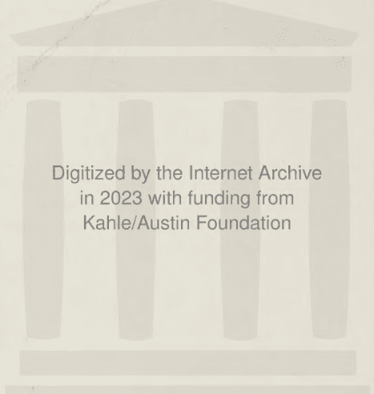

## 欢迎

让我们面对现实：Linux 不再仅仅属于少数人。这种免费版本的 Unix 变得越来越流行，用户不仅用于 Web 和邮件服务器，还作为一个通用计算平台。Linux 采用率的提高很大程度上归功于易用性的根本改进，而且像 Mandrake Linux 等领先 Linux 发行版现在比 Windows 更容易安装。

虽然现在的 Linux 可能更易用，但仍然有许多陷阱会让毫无经验的用户陷入。解决问题的方法之一就是知道在正确的地方寻找答案。聪明的 Linux 用户会关注 PC Plus 的姐妹杂志《Linux Format》。凭借其定期的问答专栏、对 Linux 使用各个领域的详细教程，以及权威的评测，它是所有 Linux 用户的权威信息源。

在《Linux Format》的前 25 期中，问答专栏已为您的 200 个技术问题提供了解答。问题涵盖了广泛的 Linux 相关主题，包括安装、网络、硬件配置和安全问题，每个问题都由《Linux Format》的专家进行了详细解答。我们现在将这些内容汇成了这本独特且不可或缺的 146 页指南，它将成为所有经验水平 Linux 用户的便捷参考。

如果本小册让你对《Linux Format》产生了兴趣，请翻到第 144 页的订阅部分，了解如何每月收到 116 页的 Linux 建议邮寄服务。

像 Mandrake 这样易于使用的发行版意味着 Linux 变得越来越容易安装，但问题仍然出现。答案是有代价的。更多的选择意味着回答所有与安装相关的问题，包括磁盘分区、引导加载器以及如何在 Linux 系统上安装额外软件的困难。

如今 Linux 支持更广泛的硬件驱动，但某些类别的设备仍然可能是困难的来源。你是否有一个难以摆布的 SCSI 控制器、可移动磁盘问题，或者无法让 Linux 使用你的 USB 设备？我们回答此类与硬件相关的问题。

Linux 的优势之一是它的灵活性，但这通常是有代价的。更多的选择意味着更多的配置——Linux 并不总是有友好的工具来快速完成工作。请在此查找配置问题的答案。我们还涵盖了关于重新编译 Linux 内核的问题。

Linux 作为服务器平台可能很，但这并不意味着它不能很好地处理多媒体。你是否在让你的 Linux 设备发出最佳声音方面遇到了困难？请看此节获取如何在 Linux 下运行声卡的帮助和建议。

如今，计算机在接入互联网时最有用，因此并不意外，让你的 Linux 设备上线将是许多用户的优先事项。如果你在建立调制号器拨号遇到问题，或无法通过以太网与局域网通信，请参考本节。

Linux 用户在安装桌面环境时有丰富的选择，但这可能是许多陷阱的来源。我们通过配置 X Window 系统、显卡、显示器和流行的桌面套件来解决这些棘手问题。

Web 服务可能是 Linux 的杀手级应用，但并不意味着它总是易做的。如果你在设置 Apache 时遇到问题、安装数据库引擎，如果你无法掌握 PHP，请阅读本节。我们在这里涵盖了文件服务器和邮件服务器。

由于所可用工具的数量和质量，Linux 是许多开发者的首选平台，但对初学者来说可能会令人困惑。如果你在 Perl 上遇到问题，或者无法构建共享库，请咨询本节以获取答案。

凭借健壮的安全模型和内置的网络防火墙，许多人因为其安全特性而选择 Linux，但你究竟如何确保自己的系统是安全的？我们回答诸如如何配置 Linux 防火墙以及是否需要担心病毒的问题。

对问题分类总是困难的。请查看此节无法归入之前章节的问题。这包括关于 shell 和常用 shell 命令的问题、调整你的系统启动行为以及挂载外部文件系统的问题。

如果本小册激发了你的兴趣，请通过订阅我们的姐妹刊《Linux Format》来获得定期的 Linux 解决方案，这是英国最大的致力于 Linux 的新闻杂志。它不仅包含一个定期的问答专栏，你还能获得最新的 Linux 新闻、评测和专题。

| 主题 | 页码 | 主题 | 页码 |
| --- | --- | --- | --- |
| 磁盘空间 | 8 | 特色功能 | 14 |
| 无引导 | 8 | 安装 Linux | 15 |
| 编译问题 | 8 | 缺少包 | 15 |
| 双系统分区 | 10 | RTF 文档 | 16 |
| 丢失源 | 10 | 库 | 16 |
| 针对...编译 | 10 | 什么是 | 17 |
| 异构二进制文件 | 11 | 在哪里 | 17 |
| Root 登录 | 11 | 彻底崩溃 | 18 |
| 软盘 | 12 | Mandrake 的 | 18 |
| 位置 | 12 | 发行版困境 | 19 |
| Mandrake | 13 | 选择性 KDE | 19 |
| 总困惑 | 13 | 恐慌！ | 19 |
| 糟糕体验 | 14 | 复制问题 | 20 |
| 主题 | 页码 | 主题 | 页码 |
| --- | --- | --- | --- |
| 硬盘 | 20 | 启动恼 | 25 |
| Linux | 20 | 相同的 | 25 |
| 区别是什么？ | 21 | 安装魔法 | 26 |
| Red Hat | 21 | 放入 | 27 |
| CD 无法引导 | 21 | 方圆孔 | 27 |
| RPMs | 22 | 圆圆孔 | 27 |
| Debian | 22 | 更多问题 | 28 |
| 不同类别 | 23 | 安装 | 28 |
| 双重困境 | 23 | 笔记本电脑 | 29 |
| 咖啡因 | 24 | Mandrake | 29 |
| Java | 24 | 结束 | 29 |

我正在硬盘上安装 Linux，问题是 Linux 只能看到 9GB。我尝试过 `Red Hat 7.2` 和 `Mandrake 8.1`。我该做来解决这个问题？

我运行一个 `Win98` 和 `Win2K` 双系统环境，要在另一个分区安装 `Mandrake 8.1`。我完全准备了驱动器，备份了所有内容，并准备了磁盘——至少我我是这么准备的。

问题似乎出现在写入可引导磁盘上。我怀疑问题的根源在模拟运行的部分（例如运行 FDD、硬盘、无模拟（使用 Nero 5））。无论原因如何，我得到的磁盘可以启动但无法继续设置。

如果没有指导，我将无法使用任何发行版。我可能不是唯一遇到这种问题的人，你们能否提供一些关于如何转换 ISO 镜像的指南？

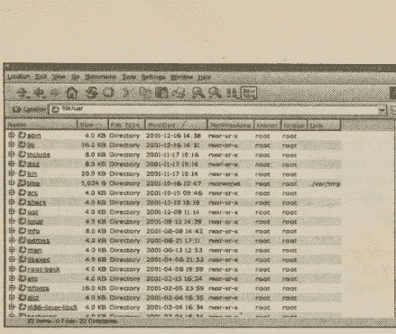

KDE 的 Konqueror 允许你按修改时间排序文件。

`sh /config --host=i686-gnu-linux`

它启动了但在某处停止，并带有各种错误信息：

checking gettextpg takes no argument...

configure: error: cannot check pgo if cross

compiling

or

checking setvbuf arguments are reversed...: error: cannot run test

program while crossing.

```
gcc -o tkparse tkparse.o tkconf.o tkgen.o
cat hexdump << /arch/i386/config >> tkconf.txt
<tkparse
/usr/bin/sh: like tilgang
make[1]: "tkconfig" Error 12
make[2]: Leaving directory
make[3]: /usr/src/lfs/linux/scripts/
make[4]: "tkconfig" Error 2
```

当我在 linux 源码目录执行 `make config` 时，它停止并显示：

> As is configuring with bad interpreter,

it would suggest that whatever is in the

first line of the file is not executable.

usually, `/bin/bash` or `/bin/sh`. Both need to be

readable and executable, which you can do with:

`chmod 755 /bin/bash`

if scripts run `/bin/bash` or `/bin/sh`, then it

to achieve anything, although nothing will

how your machine starts up properly if

it is the case. As you're using Red Hat, you

can `rpm` to verify an RPM installation, for this, you can

see if anything has.


# Linux 安装与排错讨论

## Dog Haviland

`$ rpm -V bash`

具体来说，对于 `M` 选项，建议文件权限发生了变化。你可能希望使用 RPM 模块重新构建 `bash`，或者对其他包进行进一步验证。

如果是权限问题，那么最好是检查 `/usr/bin` 和 `/usr/local/bin`，看看你拥有的其他程序是否也发生了相同的变化，并可能需要调查这种模式的原因。

至于你的依赖项错误，似乎 `dep` 认为 `iee1394` 系统的 `map` 文件实际上是一个模块。这表明你没有安装最新版本的模块，目前版本是 `2412`。

由于 `/lfs/modules/ -uname -/` 目录在 `2.4` 内核中发生了变化，旧版本的模块将无法正确处理，从而抛出你所经历的错误。

（注 "like tilgang" 是挪威语，意为“拒绝访问”）

最后：当我运行 `/sbin/depmod` 时，得到这条消息：

`depmod`:
`/lib/modules/2.4.10/modules.iee1394-map` is not
an an ELF file

很抱歉如果这些太复杂了，但我确实没主意，将非常感激任何帮助。

预先感谢，

Dog Haviland

## Richard Hardy

我是一个新的 Linux 用户。我需要帮助在我的家庭系统上安装 Red Hat 7.2，因为我希望制作一台双启动机器，以便我使用 Windows。我是否需要获取像 Partition Magic 这样的硬盘分区软件，还是 Red Hat 的安装程序包含此此功能的选项？另外，如果你购买了 Red Hat 拷贝版，可以告诉我一些额外软件的类型，以便我在去安装之前做出决定。

## Dan Marks

想知道你有什么想法。我喜欢尽可能保持机器整洁，欢迎任何建议。

- 你把下载放在哪里不是问题
- 关键在于你之后对它们做了什么。

软件包（如 RPM）可以从任何地方安装，然后你可以删除它们或将其存档备参考。

你只需将所有内容下载到你的主目录，或者放在其他地方，然后安装。

压缩包（Tarballs）也可以从任何地方安装。

人们有时使用 `/usr/src` 来存储源码，但区别意义不大。

只要你执行 `make install`，假设你需要 root 权限，你可以从任何地方配置并构建二进制文件，很少有人会把源码留在在那里。

- Red Hat 会提供分区你驱动器的选项，只要你选择“Custom”（自定义）、“Server”（服务器）或“Workstation”（工作站），它就会继续删除属于 Windows 的任何内容，但 Red Hat 的人员会在那里提供技术支持。

如果你想要软件但不想从互联网获取，可以从 `www.linuxemporium.com` 购买 Powertools CD。

## Raymond Mallard

我对 SDL 和 OpenGL 感兴趣，并正尝试让它们在我的系统上运行。我正在使用 Mandrake 8.0（SuSE 7.3，安装了 NVIDIA 驱动），但遇到了相同的问题。在编译程序 `cube.c` 时，我得到一系列未定义的引用（undefined reference），指向 `/usr/include/GL/gl.h`，但头文件是可以找到。这会有影响吗？

另一个演示，XFlame 编译并运行良好，但不使用那些命令。我尝试了使用发行包和下载 SDL-dev，结果相同。希望你有所帮助，这最接近……

对于 Linux 来说是个新手（大约一年了），我一直尝试让它在我的 Win2000 设定上工作。现在我很困惑于该把下载的内容放在哪里，尤其是那些 t.gz 和 `.rpm` 文件。我看到它们在 `"/usr/"` 或其他地方，从 Microsoft 迁移过来，我感觉这可能不是最好的做法。像 Linux 一样，似乎没有硬性的快速规则——这只是我在 PC 上编程时发现的。再次感谢，

Raymond Mallard

`error: 无法打开 Packages 索引 db3 - 无文件或目录 (2) error: 无法打开 /var/lib/rpm 在执行 'exec rpm -i --test rpm' 时失败。问题在于我没有运行基于 RPM 的发行版。有什么想法我可以绕过这个问题吗？`

Nick Wilson

如果你遇到未定义的引用，通常意味着你没有针对相关库编译程序。在构建 OpenGL 应用时，你会在 `gcc` 选项中包含 `-GL -GLU`，你首先需要检查这一点。当你安装 Mesa 的 RPM 和压缩包时，可能是相应的头文件安装导致了一堆问题。你应该检查 `/usr/local/lib "libGL"`，并删除任何存在的项，还要检查 `/usr/local/include/GL`。一旦删除了这些，你必须以 root 身份运行 `/sbin/ldconfig`，然后构建你的程序。

你是的。Debian 使用 `dpkg`，而 RedHat 和 Mandrake 等发行版使用 RPM。如果你能提取 RPM，可以使用 `alien` 将转换为 `dpkg` 包，然后安装。你可以通过 `apt install` 获取 `alien`。

值得注意的是，Debian 的 'testing' 和 'unstable' 是两个发行版本。'testing' 是我们所说的 Debian 3.0 或 Woody，而 'unstable' 包含不稳定的包。如果你在 `/etc/apt/sources.list` 中列出了 testing 和 unstable，那么你将使用来自 unstable 的包，因为它们的版本号更高，如果包没有正确安装，可能会出现问题。

这很就像当你尝试编译 `cube` 时，`Makefile` 不知道 GL 的位置，因此没有包含适用于 `gcc` 的相应 `-GL -GLU` 选项。Mesa 的 `/configure` 脚本用于构建 `Makefile`，检查 `config.log` 和 `/config` 的输出将帮助你诊断在定位 OpenGL 库时遇到的问题。

XFlame，据我所知，它完全不使用 OpenGL 系统，因此它对任何问题都没有影响。

我运行 Debian testing/unstable，我买了一个 Lexmark Z13 打印机，在让它工作方面遇到了问题。我使用的是 USB 打印机，所以我尝试了 USB 指南，但在 `/proc/bus/usb/` 下没有列出任何设备。所以我尝试了 Lexmark 在其网站上指定的 Linux 驱动。我下载并遵循了说明。运行 `sh lexmarkz13-1.0-4.sh` 启动了安装程序。它将打印机端口列为 `/dev/usb/ip0`。点击下一步开始安装，但随后出现了以下错误：

## Merry Mayweather

我想你可以帮帮我。我最近转到了 Linux 方式，在我的电脑上安装了 Mandrake 8.0。过程非常顺利，所有硬件都已检测到并运行良好（调制解调器和扫描除外，但我理解这种情况是正常的）。但我有一个小问题。

我必须安装几个不同的软件包，但到目前为止，我无法做到。我理解从“压缩包”安装的过程（我们有手册），但每当我尝试时，系统都会提示无法创建文件或文件夹并且拒绝访问。

我知道这可能是我遗漏的非常简单的问题，但任何帮助都不胜感激。

## 权限与 root 操作建议

通常情况下，当你想要安装软件时，需要是“root”用户而不是普通用户。另一种方法是将软件安装在你的主目录下，这样你就不需要执行操作，而且以 root 身份进行系统级安装要简单得多。

成为 root 用户最简单的方法是使用 `su`，它会要求你输入 root 密码，然后给你一个 root 提示符。然而，这会将你的 UID 更改为 root，并且可能不需要使用完整路径来访问某些程序，例如 `ifconfig` 和 `route` 的访问可能会变得麻烦。相反，你可以执行 `su -`，这会给你一个 root 登录 shell。

另一种方法是使用 `sudo`，它允许你根据 `/etc/sudoers` 配置使用用户的密码运行特定程序，而不是 root 密码，这样更安全，而且你可以限制特定用户允许以 root 身份运行的程序，这样他们就不会对整个系统拥有完全控制权。

## Dave Stuart

7.1，SuSE 7.2 Pro 和 Progeny 1.0 发行版。对于 Red Hat 和 SuSE，我很容易创建了安装软盘（我们运行评估的机器无法从 CD 启动），但 Progeny 是另一了。从你的驱动器发布版刻录了两个 `.img` 文件，但在创建 Install 和 Modules 软盘时失败了。Rawwrite 和 Rawwrite2 崩溃了，而手动使用 `dd` 路径似乎不起作用。假设这两个 `.img` 文件需要被复制，我从 Progeny Archive 下载了新的文件，仍然得到相同的结果！我现在假设我是一个完全的局外人，必须以错误的方式处理 `.img` 文件。任何帮助都将不胜感激。

Dave Stuart，通过邮件

首先，我是 Linux 的一个新手。目前，我正在为公司进行 Linux 平台的评估，这涵盖了 Red Hat...

由于 `dd` 直接将 `.img` 文件写入软盘，因此文件是否损坏并没有区别。你没有说明你使用的是哪一行（line）的命令，这很难判断你是否操作不当，向软盘写入某些内容的通用方法是：

```
dd if=boot.img=/dev/sdb bs=2k
```


如果这失败了，而且 `rawwrite` 也失败了，那么唯一的问题就是你的驱动器或软盘控制器没有正常工作，所以你可能想要调查一下，或者让别人为你制作启动磁盘看看它们是否可以工作。


我在 Windows 下使用过 Delphi，并对获取 Kylix 的副本感兴趣。我安装了该程序，注册了它并构建了一个小型测试。一切看起来都很正常，直到我尝试单独运行程序。通过命令行运行，我得到了以下结果：

损坏的软盘会导致无数问题，但不要忽视故障的驱动器或控制器。

`Demon` (www.demon.net) 与 Linux 配合良好，但还有许多其他优秀的 ISP。

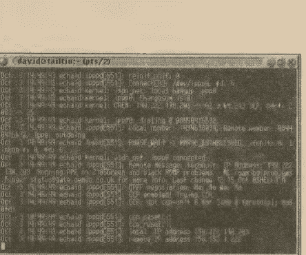

"error while loading shared libraries: `libqt5core.so` cannot load shared object file: no such file or directory"

使用 Windows 启动。我可以安装 Mandrake 8.0 且没有明显的问题或卡顿，但到了关键时刻，我无法让它跳过检测硬盘和 CD-ROM 后的最后几行。

安装目录在 `/opt/kylix`，启动脚本在 `/usr/local/bin`。所有程序文件都保存在单独目录 `/spb/kylix/` 中。有什么问题？我是否在 Kylix 程序中缺少某些对源码和编译文件的引用？

我想知道是不是我的内存出了问题，它有两个插槽，分别是 32MB 和 64MB。如果我真的能通过将内存减少到 32MB 让它运行起来。我看不出我做错了任何事，而且所有组件在其他系统中经过测试并被轻易识别。有什么建议吗？

D Couth，通过邮件

Derek Logan，通过邮件

如果 Mandrake 7.0 和 SUSE 能在机器上运行，那几乎是 Mandrake 8.0 的内核问题，这是你无法避免的。Mandrake 经常更新他们的内核，所以它们并不是标准的 Linux 内核。如果你使用 32MB 内存，你可以在机器上重新构建 Linux 内核并尝试，或者你可能只想切换到 SuSE 或更早版本的 Mandrake。

## Mandrake 苦恼

我的家庭配置是：Ryzen 300MHz，128MB PC100 RAM，4GB Western Digital 和 8.7GB 机械硬盘，Creative Labs Banshee 155 声卡配索尼显示器。我正在使用 Mandrake 8。我尝试安装 Creates Decoding Station 但收到了以下错误消息：

`file/cdrom/desktop/creatingdockstation_189_kgtr.bz`

我正从 Linux Windows 转换过来，并尝试点击 `run.htm` 下的链接进行安装。我该如何安装这个 BASH？你有任何解决方案吗？

Frank McKenzie，通过邮件

（此处内容与上文重复，已略）

## 全线困惑

出于兴趣和专业考虑，我购买了 LinuxWin 6.5，并很高兴现在可以在不分区的情况下运行 Linux。我的问题可能出在 Kylix 上，它只有在 Terminus（终端），而且磁盘出问题了……（后续大量内容为重复，已略）

最简单的方法是将 `dockingstation_189_46trq.bz2` 手动复制到你的硬盘，或者使用浏览器中的“另存为”选项。然后你可以运行 `bunzip2` 并解压 压缩：`zcat dockingstation_189_46trq.bz2 | tar xvf -`。你需要阅读创建目录内的相关文档。

许多发行版，如 Debian、Red Hat 和 SuSE，都提供 Sparc 二进制格式。我不认为你可以通过网络对 Linux 进行远程安装，但一旦 Linux 安装在计算机上，它就不需要显示器了。至于缺少 CD-ROM 驱动器的问题，你应该能够从软盘启动或通过 BOOT/DHCP 从网络启动，然后从另一台机器挂载的发行版安装 NFS。BOOT 和 DHCP 的设置非常复杂，但在 www.linuxdoc.org 有深入的文档。你不需要 Linux 机器来进行 NFS 挂载，所以你可以在其他地方查看如何在不同操作系统上使用 BOOT。

- 我有一台 Sparc 20，它没有显示器也没有 CD-ROM 驱动器，尽管它有一个网卡。它目前安装了 Solaris 2.5.1。关于如何在这台机器上安装 Linux 有什么建议吗？Richard，通过邮件

在读了一篇关于 gphoto 的文章后，我深受启发购买了一台柯达 DC3200 来替换一个对 Linux 不友好的产品。`Gphoto2` 作为命令行程序运行良好，可以下载存储的，我编写了一个简单的 shell 脚本来帮助我那不好的记忆。在同一篇文章中提到的 GUI 前端中，我发现它们都有许多依赖项，我的 SuSE 7.0 无法满足这些要求。

在网上下载了几个项目后，待办事项减少了，但现在由于缺少一个包而停滞。即 `libTTL`。似乎有很多人遇到了同样的问题，搜索网络只能找到像我这样的求助声。。Robert Whitney，通过邮件

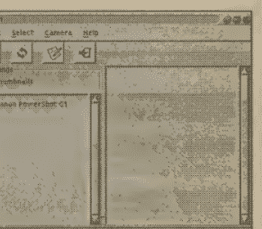

`Gttk` 是 `gphoto2` 一个非常好的 GUI，但它仍然处于开发中。

`gphoto2` 正在大力开发中，许多它的 GUI 前端并没跟上 CVS 版本构建的功能。如果你访问 www.gphoto.org，可以如何从你的 CVS 树中检出 `gphoto2`，并检查 `gttk`，它是使用 GTK+ 的前端。这将是一个从源码构建的过程，所以你可能需要从你的 SuSE CD 中安装一些开发库。至于在其他 Us（可能指其他工具）上会遇到什么问题，我设想相应的包可以从你的发行版 CD 中获取，或者从 SuSE 的 ftp 服务器获取。关于 `libTTL`，你应该能找到你所需的所有信息，地址在 www-2.cs.smith.edu/~/

我正尝试安装 GCC 3.0 更新。我已将所有内容复制到家目录，解压并提取了一切。然后，以 root 身份执行了：

```
/configure
make
make install
make(2): leaving '/home/darren/gcc/gcc-3.0:i686-pc-linux-gnu/lib'
Making in libintl
make(2): Entering directory '/home/darren/gcc/gcc-3.0:i686-pc-linux-gnu/lib'
make(3): Entering directory '/home/darren/gcc/gcc-3.0:i686-pc-linux-gnu/lib'
/bin/sh -../mkinstalldirs /usr/local
...mkinstalldirs: No such file or directory
make(3): [install-LIBRARIES] Error 127
make(2): Leaving directory '/home/darren/gcc/gcc-3.0:i686-pc-linux-gnu/lib'
make(2): [install-am] Error 2
make(2): Leaving directory '/home/darren/gcc/gcc-3.0:i686-pc-linux-gnu/lib'
make(1): [install-recursive] Error 1
make(1): Leaving directory '/home/darren/gcc/gcc-3.0:i686-pc-linux-gnu/lib'
make(2): [install-target] Error 2
```

然而，安装因这些错误失败了：

```
/configure
make bootstrap
make install
这将在你的系统上设置、构建并安装 gcc 3.0。
```

从我开始使用 Linux 已经有一了，情况并没有我刚开始这段开源冒险时那么糟糕。但遗憾的是，总会有问题——我仍然面临着任何 Linux 用户都非常重要的方面的问题，即编译和安装应用程序。有一个错误信息，而且无法将其解释为有意义的内容，这种体验以挫败感和愤怒告终。我给你们一个最近的例子，看看大师们能做什么来帮助新手。当尝试配置时，它显示了错误信息：checking for lib... not found。检查你的安装并查看 config.log。我的意思是找不到这个 lib 东西，但当我输入：

```
/lib/zlib.so.1
/lib/zlib.so.1.3
```

顺便说一下，使用的是 Mandrake 8.0。经过一番挖掘，我非常确定这一行：

```
...mkinstalldirs
...mkinstalldirs
...mkinstalldirs
```

实际上应该是：有什么想法吗？Dave，通过邮件


GCC 是标准的 `/configure` 脚本，如果你花时间阅读随附分发的文档，你会注意到它比你预期的要复杂。你需要提取随 `gcc 3.0` 分发的所有 `tar` 包。你可能不需要它们，但编译时是必须的。接下来，你需要执行：

`inetd` 使用的配置样式与之前的略有不同，但它仍然使用 `tcpd` 进行访问。

`configure` 应该准确地告诉你错误在哪里。你可能缺少更多的头文件，通常来自 `glibc` 或内核，或者你必须在重新运行 `./configure` 之前删除 `config.cache`。

我正努力放弃 CD-ROM 驱动器，尽管它有一个网卡。它目前安装了 `Solaris 2.5.1`。关于如何在这台机器上安装 Linux 有什么建议吗？Richard，通过邮件

# 安装

最简单的方法是将 `dockingstation_189_46trq.bz2` 手动复制到你的硬盘，或者使用浏览器中的“另存为”选项。然后你可以运行 `bunzip2` 并解压压缩：

```
zcat dockingstation_189_46trq.bz2 | tar xvf -
```

你需要阅读创建目录内的相关文档。

许多发行版，如 `Debian`、`Red Hat` 和 `SuSE`，都提供 `Sparc` 二进制格式。我不认为你可以通过网络对 Linux 进行远程安装，但一旦 Linux 安装在计算机上，它就不需要显示器了。至于缺少 CD-ROM 驱动器的问题，你应该能够从软盘启动或通过 `BOOT/DHCP` 从网络启动，然后从另一台机器挂载的发行版安装 `NFS`。`BOOT` 和 `DHCP` 的设置非常复杂，但在 `www.linuxdoc.org` 有深入的文档。你不需要 Linux 机器来进行 NFS 挂载，所以你可以在其他地方查看如何在不同操作系统上使用 `BOOT`。

## 安装 Linux

在读了一篇关于 `gphoto` 的文章后，我深受启发购买了一台柯达 `DC3200` 来替换一个对 Linux 不友好的产品。`Gphoto2` 作为命令行程序运行良好，可以下载存储的，我编写了一个简单的 `shell` 脚本来帮助我那不好的记忆。在同一篇文章中提到的 GUI 前端中，我发现它们都有许多依赖项，我的 `SuSE 7.0` 无法满足这些要求。

在网上下载了几个项目后，待办事项减少了，但现在由于缺少一个包而停滞。即 `libTTL`。似乎有很多人遇到了同样的问题，搜索网络只能找到像我这样的求助声。Robert Whitney，通过邮件


## Gttk 与 gphoto2

Gttk 是 `gphoto2` 一个非常好的 GUI，但它仍然处于开发中。

`gphoto2` 正在大力开发中，许多它的 GUI 前端并没跟上 CVS 版本构建的功能。如果你访问 `www.gphoto.org`，可以找到如何从你的 CVS 树中检出 `gphoto2`，并检查 `gttk`，它是使用 GTK+ 的前端。这将是一个从源码构建的过程，所以你可能需要从你的 SuSE CD 中安装一些开发库。至于在其他 Us 上会遇到什么问题，我设想相应的包可以从你的发行版 CD 中获取，或者从 SuSE 的 ftp 服务器获取。关于 `libTTL`，你应该能找到你所需的所有信息，地址在 `www-2.cs.smith.edu/~/`

## GCC 3.0 安装错误

我正尝试安装 GCC 3.0 更新。我已将所有内容复制到家目录，解压并提取了一切。然后，以 root 身份执行了：

```
/configure
make
make install
```

```
make(2): leaving '/home/darren/gcc/gcc-3.0:i686-pc-linux-gnu/lib'
Making in libintl
make(2): Entering directory '/home/darren/gcc/gcc-3.0:i686-pc-linux-gnu/lib'
make(3): Entering directory '/home/darren/gcc/gcc-3.0:i686-pc-linux-gnu/lib'
/bin/sh -../mkinstalldirs /usr/local
...mkinstalldirs: No such file or directory
make(3): [install-LIBRARIES] Error 127
make(2): Leaving directory '/home/darren/gcc/gcc-3.0:i686-pc-linux-gnu/lib'
make(2): [install-am] Error 2
make(2): Leaving directory '/home/darren/gcc/gcc-3.0:i686-pc-linux-gnu/lib'
make(1): [install-recursive] Error 1
make(1): Leaving directory '/home/darren/gcc/gcc-3.0:i686-pc-linux-gnu/lib'
make(2): [install-target] Error 2
```

然而，安装因这些错误失败了：

```
/configure
make bootstrap
make install
```

这将在你的系统上设置、构建并安装 gcc 3.0。

从我开始使用 Linux 已经有一了，情况并没有我刚开始这段开源冒险时那么糟糕。但遗憾的是，总会有问题——我仍然面临着任何 Linux 用户都非常重要的方面的问题，即编译和安装应用程序。有一个错误信息，而且无法将其解释为有意义的内容，这种体验以挫败感和愤怒告终。我给你们一个最近的例子，看看大师们能做什么来帮助新手。当尝试配置时，它显示了错误信息：checking for lib... not found。检查你的安装并查看 `config.log`。我的意思是找不到这个 lib 东西，但当我输入：

```
/lib/zlib.so.1
/lib/zlib.so.1.3
```

顺便说一下，使用的是 Mandrake 8.0。经过一番挖掘，我非常确定这一行：

```
...mkinstalldirs
...mkinstalldirs
...mkinstalldirs
```

实际上应该是：有什么想法吗？Dave，通过邮件

GCC 是标准的 `/configure` 脚本，如果你花时间阅读随附分发的文档，你会注意到它比你预期的要复杂。你需要提取随 gcc 3.0 分发的所有 tar 包。你可能不需要它们，但编译时是必须的。接下来，你需要执行：

`inetd` 使用的配置样式与之前的略有不同，但它仍然使用 `tcpd` 进行访问。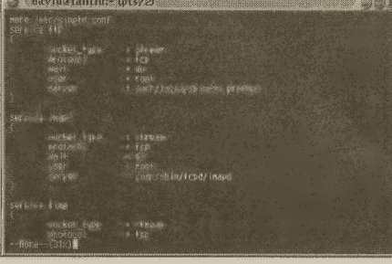

`configure` 应该准确地告诉你错误哪里。你可能缺少更多的头文件，通常来自 `glibc` 或内核，或者你必须在重新运行 `./configure` 之前删除 `config.cache`。

## 在 Solaris 机器上安装 Linux

我正努力放弃 CD-ROM 驱动器，尽管它有一个网卡。它目前安装了 Solaris 2.5.1。关于如何在这台机器上安装 Linux 有什么建议吗？Richard，通过邮件

笔记本电脑通常是非标准的，为了适应其有限的尺寸，使用了缩减或定制的芯片组。尽管硬件很奇异，如果你在文本模式下进行安装，Linux 会很乐意安装在大多数笔记本电脑上，只是 XFree86 不支持 X 显卡。幸运的是，Dell 是一个特别受欢迎的笔记本品牌，其硬件在 Linux 下经过了良好的测试，由于许多人已经在特定型号上安装了 Linux，因此对于几乎每个硬件，你都能 `www-linux.net` 找到。这通常涉及下载自定义的配置文件并手动进行一些调整，但这些文档非常详尽，且易于遵循。在转向更复杂、更重要的组件之前，最好从一个功能开始，例如 X 或 PCMCIA。

## Mandrake 7.1 升级 KDE 2.1

如果你有某种形式的在线包管理工具，确保你拥有特定软件包的最新版本相当简单。

我目前正在运行 Mandrake 7.1，想从 Linux CD 将 KDE 升级到 2.1 版本，但不知道该操作！显然我不需要任何语言包，也不一定需要开发相关内容，但我应该安装什么，按什么顺序安装？每个文件似乎都依赖于我还没有的其他东西！我尝试了包管理器，但也许我应该通过命令行，但依赖问题肯定会存在。另外，如果我替换了它们，我会使用旧的吗？

Mark Roberts

## 可靠发行版选择

我尝试寻找一个可靠的发行版，但没能解决很多问题。我并不追求最新的特性（尽管越新越好），我只是寻找可靠的。是否有人能出一个相当没有 bug 的发行版并持续更新 bug 修复？

Dragonhead，来自论坛

发行版是来自离散源的众多工具、实用程序服务的集合。实际上不可能制作出一个安装后不会有任何漏洞或 bug 的发行版。处理此问题的办法是安装一个可能包含核心最新发布的发行版，例如 RedHat 7.1，然后维护主程序，如 Apache、X，以及任何为了满足需求而使用的程序。

所有供应商（或至少是大多数）都会对其发行版中的几乎所有内容发布 bug 报告，至少安全是一个因素，但仍然依赖第三方首先为此类问题提供修复。由于大多数发...

使用 `rpm`，如果你尝试批量安装，就不需要按特定顺序安装 RPM。只需：以 root 身份运行 `rpm -Uv /path/to/kde21/rpm`，这在尝试安装集合包之前不会出现单个包的依赖错误。如果你遇到依赖问题，或者发现 Mandrake 7.1 使用 RPM 版本 3，不支持 CD 上的 RPM，你可能想尝试从 `www.rpmfind.net` 下载兼容的 RPM，或者升级到 Mandrake 7.2，这应该允许你使用 CD 上的 RPM。

## Mandrake 6.1 Rescue 模式 Kernel Panic

我安装了 Mandrake 6.1。安装过程顺利，但现在我无法从启动盘进入 Linux Rescue 模式，它显示“无法打开初始控制台 - Kernel Panic: 未找到 init。尝试向 'kernel' 传递 init= 选项”。有人能给我这样的新手提供一些建议吗？

Fishca，来自论坛。

除了 Mandrake 6.1 是一个非常旧的发行版，已经被 7x 甚至 8x 版本取代之外，你可能在救援磁盘上遇到了问题，要么是因为在 'root~' 选项中没有传递正确的根分区，要么尝试启动一个安装不正确的发行版。你可能想尝试：

如果你有信心这样做：从源码树构建内核不是该做的事，如果你不熟悉 Linux 以及你使用的每个单独组件（如内核源码、LILO、tar 等），你很快就会陷入困惑和不知所措。

```
linux root=/dev/hda5 init=/bin/sh
```

当然，如果你已经到了必须使用救援磁盘的地步，你还有一个还没有解释的重要问题，使用较新的发行版重新安装应该解决任何问题。

## 从 CD-ROM 拷贝内核文件

我目前正在 Linux 中迈出步履蹒跚的第一步，在加载内核 2.4.1 时遇到了问题。我在我的 Pentium 13、48MB 内存和 Matrix 显卡上安装了 Caldera 的 2.3。我的问题是无法从 CD 拷贝到硬盘。我想知道的是如何从 CD-ROM 拷贝文件。我知道别人在使用 SUSE 7 编译内核时遇到过问题，并被告知执行操作：`tar xvzf <path>/linux-2.4.0.tar.gz` 其中 `<path>` 为 `/mnt/cdrom/oftoftware/kernel-2.4.0`


> 我想在电脑上与 Windows 同时使用 Linux，但在安装时遇到了问题。在尝试安装 TurboLinux 时，我运行的是一块 ATA 100 HDD，我必须在 BIOS 中将其定义为 ATA 100 设备，而不是 IDE 硬盘。Linux 初始化器能识别 ATA 100 吗，还是说我必须等待驱动发布？

Liam Sheridan

当我尝试用 LILO 从 CD 拷贝时：`tar xvzf /mnt/cdrom/kernel-2.4.1.tar.gz`，我收到了这条消息：无法打开存档 `tar xvzf /mnt/cdrom/kernel-2.4.1.tar.gz`

> 我想在电脑上与 Windows 同时使用 Linux，但在安装时遇到了问题。在尝试安装 TurboLinux 时，我运行的是一块 ATA 100 HDD，我必须在 BIOS 中将其定义为 ATA 100 设备，而不是 IDE 硬盘。Linux 初始化器能识别 ATA 100 吗，还是说我必须等待驱动发布？

Liam Sheridan

（此处省略重复内容，已按翻译要求去重）

（注：提供的 OCR 文本包含了多个 Liam Sheridan 引言和 tar 存档错误的重复块。我已根据逻辑流处理了唯一内容。）

在 `root~` 选项中的根分区，或者尝试启动一个安装不正确的发行版。你可能想尝试：

如果你有信心这样做：从源码树构建内核不是该做的事，如果你不熟悉 Linux 以及你使用的每个单独组件（如内核源码、LILO、`tar` 等），你很快就会陷入困惑和不知所措。

```
linux root=/dev/hda5 init=/bin/sh
```

当然，如果你已经到了必须使用救援磁盘的地步，你还有一个还没有解释的重要问题，使用较新的发行版重新安装应该解决任何问题。

### 拷贝问题

我目前正在 Linux 中迈出步履蹒跚的第一步，在加载内核 2.4.1 时遇到了问题。我在我的 Pentium 13、48MB 内存和 Matrix 显卡上安装了 Caldera 的 2.3。我的问题是无法从 CD 拷贝到硬盘。我想知道的是如何从 CD-ROM 拷贝文件。我知道别人在使用 SUSE 7 编译内核时遇到过问题，并被告知执行操作：`tar xvzf <path>/linux-2.4.0.tar.gz` 其中 `<path>` 为 `/mnt/cdrom/oftoftware/kernel-2.4.0`

> 我想在电脑上与 Windows 同时使用 Linux，但在安装时遇到了问题。在尝试安装 TurboLinux 时，我运行的是一块 ATA 100 HDD，我必须在 BIOS 中将其定义为 ATA 100 设备，而不是 IDE 硬盘。Linux 初始化器能识别 ATA 100 吗，还是说我必须等待驱动发布？

Liam Sheridan

（此处省略重复内容，已按翻译要求去重）

关于 dselect 灭的传言被大大夸大了。

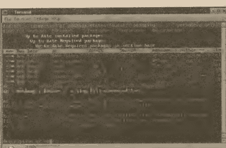

安装此工具后，你将可以使用命令转换 deb 包了：

`alien -r foobar.deb`

这将生成一个名为 `foobar-rpm` 的包——其中 ARCH 是 foobar 构建包时的目标架构（如果有的话）——然后你可以像往常一样使用 `rpm` 进行安装。

我们上次给出的答案在提到“较新版本的 Debian 中 dselect 已被 apt 取代”时也是不正确的。`dpkg` 是在 Debian 系统上用于安装、构建和配置软件包的工具，而 `apt` 是从指定源检索软件包、解决依赖关系等的工具。`dselect` 是这两个工具的基于菜单的前端界面，目前并没有被完全取代。当然，你也可以使用 dselect 的图形化替代方案，例如 KPackage 或 StormPkg。

> 嗯嗯。这听起来像是 grep。你可以使用 `rpm -query` 来查找特定软件包是否已安装。你也可以通过以下命令查询数据库中所有已安装的软件包：

> `rpm -qa`

然而，这会打印出名称和版本号，你仍会处于之前的同样的境地。因此，巧妙的方法是将输出通过管道交给 `grep`。`grep` 是一个搜索输入并尝试匹配给定模式的工具。如果你模糊地知道该包的名称，可以使用这行命令进行搜索：

> `rpm -qa | grep drak`

这将找到所有在安装文件中包含 'drak' 样的软件包。或者，如果你知道其中一个文件的位置，可以使用：

`rpm -q <filename-including path>`

这将返回安装该文件的包的完整名称。

我经常在 `rpm` 上遇到问题。我的麻烦是，我尝试了很多方法，但我没有足够的磁盘空间来玩 Linux。当我想要再次删除它时，RPMs 应该让这变得很简单，对吧？我通常要花好几个小时用像 kpackage 之类的工具来删除它。我很乐意在终端中操作，因为我觉得这很容易，而且坦率说快得多，但往往很难记住软件包的确切名称。有什么建议吗？来自，email

我正在使用 Linux Mandrake 7.2，我对它非常满意。然而，我希望能在系统上安装 Debian 软件包，例如 smartdrive。可以在 `rpm` 和 kpackage 旁边安装 `dselect`。我尝试过从 Core Linux 磁盘中拷贝 `dselect`，但我的系统对它毫无反应。如果你对此能提供任何建议，我将不胜感激。Steve，通过 email。

安装套装（sets）对于从未接触过 Linux 的人来说很好，因为他们在安装时有迹可循。由于发行版可以被擦除或免费分发，对于那些可以在其他地方获得帮助安装廉价 CD Debian 的人，这比花大钱买一个可能用上的盒装要好。

将基于 RPM 的系统迁移到 Debian 非常困难，所以你可能只想从 Debian 2.2 开始，从一个干净的系统开始。我考虑到时间和对 apt 工作原理的理解，运行双软件包系统是可行的，但付出的精力将超过改进带来的收益。你也可以在你的系统中添加一个基于 Debian 的系统。

关于 Harati，用 Google 快速搜索会有几个结果，其中最有前景的似乎是 www.complang.tuien.ac.at/nino/stonx.html，这是 StOnX 的首页。另一个很好的网站是 www.atari.org/links/St/Emulation/Emulators/，那里有很多有趣的线索。我们还没有试过其中任何一个，无法保证任何事……替代方案是从阁楼里把旧 St 取出来擦掉灰。

在较新的 Debian 发行版中，`dselect` 已被 `apt`取代，但 Core 是带有额外部分的 Debian 2.0，他们还没有跟上。

我安装了错误的 Mandrake 7.1 安装类，安装了“推荐”类，现在我想知道是否可以卸载它。我是 Linux 新手，所以我想知道你是否能告诉如何运行。我在我的 Mandrake 7.1 系统上加载了 Kaffe。我不知道这个发行版是否已经安装了 Java 编译器 (`jdk`)，还是说我需要从他们那里下载 Java 软件？Steve，通过 email。

我有一个关于 Mandrake 7.2 的咨询。我不知道这个发行版是否已经安装了 Java 编译器 (`jdk`)，还是说我需要从他们那里下载 Java 软件？Carol，通过 email

## 启动困扰，第一部分

我正第一次尝试使用一台旧电脑。它上运行着 Windows 95，硬盘只有 1 GB。我想擦除 Windows 并使用单个分区用于 Linux。我在尝试使用 fuses 时进展顺利，但它无法运行，因为左侧有隐藏文件。Windows 不再启动，甚至启动软盘也不行，MSDOS/Windows 软盘似乎无法识别 CD-ROM 驱动器。我该如何擦除硬盘、重新格式化它、创建分区并从 CD-ROM 加载 Linux？如果这听起来像是一场灾难现场，请抱歉。Dougal，通过 email。

如果它不是 ATAPI/IDE 接口，你可能会遇到一些问题。通常，非 ATAPI 驱动器具有专有接口，这些接口通常没有适用于 Linux 的驱动程序。如果是这样，你可能想从别人那里借一个 ATAPI CD-ROM 驱动器效果可能会更好。如果不行，你可以通过网络（如局域网或 PLIP 并行连接）或者在将 Linux 发行版复制到第二个硬盘后进行安装。

大多数 Linux 发行版都能自动检测并使用 SCSI 驱动器，但在你的情况下似乎没有发生。如果它是支持的 SCSI 设备，可能仍然可以让它工作，但你需要确切知道它是什么。

如果支持，你将能够修复 LILO 并尝试从其启动。在 LILO 加载时插入软盘驱动器，按住 Shift (Alt/control) 以进入 LILO 提示符。

然后你可以提供内核并加载所需的模块。更多详情，请参阅 SCSI HOWTO。安装 HOWTO 和相关文档（HTML HowTos 位于 CD 的 `/CD/Lp/html/` 目录下）。在没有你的准确硬件规格的情况下，很难回答这个问题，但我希望我们设法解决了你的问题。


# Linux 安装问题求助

## Peter Morris 通过电子邮件

我正尝试在一台带有 SCSI CD-ROM 和智能控制器的老旧 Compaq Prosign P1 上加载 Linux。我使用 `6.40 smartcds` 删除了当前设置并为系统准备了 Linux。令我惊喜的是，发现 Linux 是 `smartart` CD 上的一个可选的操作系统。

然而，无论我做什么，都无法让机器从 LILO CD 启动。Red Hat、SuSE 和 Mandrake 7.1 似乎会在左上角留下一个“闪烁”的光标，导致你被迫重启机器，但机器没有响应。

我已经在我的家用电脑上安装了 Linux，并且仍在尝试熟悉它。在使用多年后，这与我通常的设置很不同。

Mandrake 从 CD 启动的软盘效果非常棒，带有 TUX 和两个选项：自动加载或手动加载。它们看起来启动正常。

然而，事情并不一帆风顺，因为我在此过程中遇到了几个问题——希望你能够帮助我。

我从网上下载了一个 CRYPT 文件，并且有它的密码，但我无法将其解密。说明书中说你应该使用 UNIX 命令并输入类似下面的内容：

```
crypt password
filename.tar.crypt gunzip -c t xvf
```

我是 Linux 新手，但对电脑并不陌生，所以我并不对必须手动操作感到困扰，但这确实难住了我。你有什么主意吗？

当我输入它时，只得到“command not found”。Red Hat 的软件包中会有任何包含 `crypt` 命令的（我用的是 Red Hat 6.1？）？如果没有，我能从网上下载一个版本吗？

感谢你的时间，希望我能帮我自己。

## Paul Griffiths 通过电子邮件

遗憾的是，这并不是我遇到的问题。当我尝试使用 `rpm` 命令安装软件包时，收到的错误信息说“cannot /var/lib/rpm/ packages.rpm”。当我查看该目录时，`/var/lib/rpm/ packages.rpm` 确实在那里。你知道问题出在哪里吗？

Linux 似乎很难找到你的 CD-ROM 驱动器。由于它是 SCSI 驱动器，问题可能出在 SCSI 控制器本身，而不是特定的驱动器。

我一直遇到的最后一个问题是，当我卸载正在向其拷贝数据的软盘时，文件 `/mnt/floppy` 仍然包含已拷贝的文件。卸载软盘并将其移除不应该让 `/mnt/floppy` 返回一个空文件吗？

希望你能够帮助我。

## Tom de Man，荷兰

我多次尝试在运行 Linux 1（内核 `2.22`）和 `kde 1.2.1` 的家用电脑 Linux 上安装 ImageMagick，我得到了以下错误信息：

`Update-menus: Cannot remove lockfile /var/run/update-menus.pid/directoriesn`

此之后，安装了以下文件：

- `/usr/lib/ImageMagick`
- `/usr/share/docbase/image`
- `/usr/share/ImageMagick`
- `/usr/doc/imagemagick`
- `/usr/lib/menu/default/image`
- `/usr/lib/mime/packages/image`
- `/usr/share/doc/imagemagick`

但找不到可执行文件，所以我无法启动程序。你对于我该如何解决这个问题有什么主意吗？

# 回答 | LINUX

大多数 Linux 发行版实际上不会使用 `crypt`（旧版 Unix 的安全版本）。你可以在 `http://crypt.gr/` 找到源码，但 Red Hat CD-ROM 中也提供。即使 Red Hat 上没有安装，你也可以从他们的网站下载。访问 `redhat.com` 的下载 页面并搜索 `crypt`。

关于你的下一个问题，不要说你正在安装什么工具——是命令行还是图形前端？使用基于 shell 的 `rpm` 安装软件包非常简单。你只需要运行 `rpm-install package.rpm`。我怀疑问题在于你没有以 root 身份登录，导致 root 无法访问。解决方案是以 root 登录，或者如果你想让 root 以外的用户访问……


# Linux 新手问题汇总

## Peter Morris 通过电子邮件

我是 Linux 新手，但对电脑并不陌生，所以我并不对必须手动操作感到困扰，但这确实难住了我。你有什么主意吗？

当我输入它时，只得到“command not found”。Red Hat 的软件包中会有任何包含 `crypt` 命令的（我用的是 Red Hat 6.1？）？如果没有，我能从网上下载一个版本吗？

感谢你的时间，希望我能帮我自己。

**回复：**
大多数 Linux 发行版实际上不会使用 `crypt`（旧版 Unix 的安全版本）。你可以在 `http://crypt.gr/` 找到源码，但 Red Hat CD-ROM 中也提供。即使 Red Hat 上没有安装，你也可以从他们的网站下载。访问 `redhat.com` 的下载页面并搜索 `crypt`。

我正尝试在一台相当老老的 Compaq Prosign P1（带有 SCSI CD-ROM 和智能控制器）上加载 Linux。我使用 `6.40 smartcds` 删除了当前设置并为系统准备了 Linux。令我惊喜的是，发现 Linux 是 `smartart` CD 上的一个可选的操作系统。

然而，无论我做什么，都无法让机器从 LILO CD 启动。Red Hat、SuSE 和 Mandrake 7.1 似乎会在左上角留下一个“闪烁”的光标，导致你被迫重启机器，但机器没有响应。

我已经在我的家用电脑上安装了 Linux，并且仍在尝试熟悉它。在使用多年后，这与我通常的设置很不同。

Mandrake 从 CD 启动的软盘效果非常棒，带有 TUX 和两个选项：自动加载或手动加载。它们看起来启动正常。

我从网上下载了一个 `CRYPT` 文件，并且有它的密码，但我无法将其解密。说明书中说你应该使用 UNIX 命令并输入类似下面的内容：

```
crypt password
filename.tar.crypt gunzip -c t xvf
```

## Paul Griffiths 通过电子邮件

遗憾的是，这并不是我遇到的问题。当我尝试使用 `rpm` 命令安装软件包时，我收到的错误信息说“cannot `/var/lib/rpm/ packages.rpm`”。当我查看该目录时，`/var/lib/rpm/ packages.rpm` 确实在那里。你知道问题出在哪里吗？

Linux 似乎很难找到你的 CD-ROM 驱动器。由于它是 SCSI 驱动器，问题可能出在 SCSI 控制器本身，而不是特定的驱动器。

我一直遇到的最后一个问题是，当我卸载正在向其拷贝数据的软盘时，文件 `/mnt/floppy` 仍然包含已拷贝的文件。卸载软盘并将其移除不应该让 `/mnt/floppy` 回到一个空文件吗？

希望你能够帮助我。

**回复：**
关于你的下一个问题，不要说你正在安装什么工具——是命令行还是图形前端？使用基于 shell 的 `rpm` 安装软件包非常简单。你只需要运行 `rpm-install package.rpm`。我怀疑问题在于你没有以 root 身份登录，导致 root 无法访问。解决方案是以 root 登录，或者如果你想让 root 以外的用户访问……

## Tom de Man，荷兰

我多次尝试在运行 Linux 1（内核 2.22）和 `kde 1.2.1` 的家用电脑上安装 ImageMagick，我得到了以下错误信息：

`Update-menus: Cannot remove lockfile /var/run/update-menus.pid/directoriesn`

此之后，安装了以下文件：

- `/usr/lib/ImageMagick`
- `/usr/share/ImageMagick`
- `/usr/doc/imagemagick`
- `/usr/lib/menu/default/image`
- `/usr/lib/mime/packages/image`
- `/usr/share/doc/imagemagick`

但找不到可执行文件，所以我无法启动程序。你对于我该如何解决这个问题有什么主意吗？

## 硬件与安装建议

大多数 Linux 发行版都能顺利运行在所有系统中，尽管有些是针对 Pentium CPU 化的。这不会阻止它在 486 上运行，但你可能有旧的选项。通常，对于低配置机器，问题在于发行版安装的内容，而不是软件包针对什么进行了优化，所以你肯定想要进行自定义安装，不包含不需要的内容。低配置机器上最大的 CPU 消耗者是 X，所以如果你可以只用命令行输入你的技能，那么你会发现你的机器变得更轻松、更快、更易用。

```
dpkg -install package.deb
```

虽然这种方法完全可行，但并非理想状态。你真的应该考虑从源代码编译并安装软件。

如果你真的想被放在软件包管理器的控制下，那么大多数情况下，从源码树创建自己的 Debian 软件包并不困难。有许多文档和脚本可以帮助你完成工作。请查看随分发版 CD-ROM 提供的《 Debian 打包手册》。

## Dave Shaw 通过邮件

我在安装 KDE 1.9 时遇到了一些小麻烦，特别是 Qt。这可能是我自己有点笨了，因为我还不完全熟悉 Linux。我已经将 Qt 的 GZ 文件解压到 `/usr/local/qt`，并通过 `make` 命令运行了 `./configure`。

这两步看起来都没问题。问题出在我尝试运行 `make install` 时：“* Linux 抛出了一个错误说：”`No rule to make target 'install'! Stop.`“ 我已经尝试多次从网站重新制作 Qt 了。如果能提供一些有用的提示将不胜感激。

我坚信 Linux 是 IT 行业的未来方向。你对我该怎么做有什么建议吗？

**回复：**
如果你在默认位置 `/usr/local/qt` 构建 Qt，那么你就不需要通过 `make install` 执行单独的安装。它可以在你构建的目录中正常工作，只要你通过以下命令设置库和搜索路径：`export QTDIR=/usr/local/qt LD_LIBRARY_PATH=$QTDIR/lib export PATH=$QTDIR/bin`。这些在随存档提供的 `INSTALLALL` 文件中都有详细解释。

在安装 KDE 1.9 时，我遇到了第二个障碍。作为一个 Linux 新手，正如你建议的那样，我看到它正在成长变为一个更容易使用的桌面操作系统。在复制源文件并将桌面重启为 `FVWM1` 后，我以 root 身份进入 `xterm` 环境并输入：

`tar xyf Kdelibs-1.90`


猜怎么着？这几行说明了一个故事：`tar (child): Cannot open Kdelibs-1.90; No such file or directory (child): Error is not recovering: now tar returned status 2: Error exited from previous errors.` 

我漏掉了什么！难道我们被要求精通到掌握未被提供的 Linux 命令语言吗？还是说我也太想逃离 MS Windows 了？“Windows 万岁”，尽管我很想离开一个坚持要求你按照微软的方式做所有事情的系统，我的耐心正通过邮件受到严峻考验。

你漏掉了一些东西。首先，Linux 是区分大小写的，所以文件 `Kdelibs` 和文件 `kdelibs` 是不一样的。其次，并不是提供的代码有问题；而是在安装 KDE 的指南中漏掉了文件后缀名。例如，要在当前目录下解压 `kdelibs-1.90.bz2` 包，你应该输入：

```
tar xyf kdelibs-1.90.tarbz2
```

如果返回 `tar: invalid option - y`，则请尝试

```
tar xzf kdelibs-1.90.tbz2
```

某些版本的 `tar` 不接受用 `y` 来解压缩用 bzip2 压缩的文件；请使用 `j`。

# 安装

每当我下载 tar 文件并解压它们，然后编译源码时，我最终只是在该目录下得到一个可执行文件。它应该放在哪里，Linux 又期望我把源码存储在哪里？似乎有很多名为 'src' 的目录。Maurice，通过邮件。

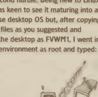

# 安装

## 笔记本电脑

我想在 Dell 笔记本电脑上安装 Definite Linux 7，但我需要知道硬件是否兼容。Stephanie，通过邮件。

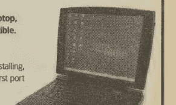

笔记本电脑在安装时总是很麻烦，因为它们的很多硬件是非标准的。你的第一个站点应该是 Linux 笔记本电脑主页：`(www.cs.utexas.edu/users/kharker/linux-laptop)`。

那里有链接指向如何在特定型号笔记本电脑上安装 Linux 的站点，包括特定的配置选项以及哪些硬件功能无法正常工作。

在 Linux 中安装程序有两种通用方法。第一种是使用发行版自带的包管理器。对于 Red Hat 及其衍生版本，使用 `RPM`；对于 Debian，使用 `dpkg`。这将为你提供复杂的软件包管理。它会将属于某个包的文件安装到它们所在的位置，并在有其他程序需要安装时警告你。如果你使用源码树，以后可能会遇到冲突。没有地方可以安装源码，尽管大多数人倾向于将其放在 `/usr/src`、`/usr/local/src` 或直接放在他们的家目录下。这实际上不需要运行程序。这个规则的例外是内核源码，它需要构建。但是，只要你拥有 `<prefix>/include/linux`，就不会遇到任何问题。第二方法是自己编译源码，这比使用包管理器要复杂得多，特别是当你遇到问题时。在做任何事情之前，确保仔细阅读包提供的任何文档。`README` 和 `INSTALL`。构建源码的标准方法是从源码的顶级目录，然后执行 `make`。在这个阶段，你会得到一个包含源码和二进制文件的树。最后一步是执行 `make test`，这将程序、库和通用文件安装到它们的默认位置。使用 `/usr/local`。我已经安装了 Mandrake 7，一切运行正常，除了 Gnome 主题（例如 'Pixmap'）。我该如何安装这个？Karl，通过邮件。

主题是名为 'gtk-engines' 的包的一部分。要安装它，请挂载发行版 CD 到 `/mnt/cdrom`；然后进入该目录。你可以使用命令 `rpm -vh gtk-engines-0` 安装。然后你可以重启 Gnome 来选择你想使用的主题。

#

| 主题 | 页码 | 主题 | 页码 |
| :--- | :--- | :--- | :--- |
| 挂载 SCSI 磁盘 | 32 | 自由 Penguin | 36 |
| 编译内核 | 32 | 懒惰 Mandrake | 37 |
| vfat 支持 | 33 | 颜色代码 | 37 |
| 更多模块 | 34 | 内核查询 | 38 |
| Debian 系统 | 34 | 大冻结 | 38 |
| 救救我 | 35 | 升级... | 38 |
| LILO | 35 | 我有了 | 39 |
| 新 /usr | 35 | 是什么？ | 39 |
| 路径大师 | 36 | SuSE 忧虑 | 39 |
| Bash 进 | 36 | | |
| 内核 2.4.0 问题 | 40 | 小控制台 | 42 |
| 更多 2.4.0 问题 | 41 | 三系统启动 | 43 |
| 6 的快乐 | 41 | 愤怒磁带 | 43 |
| 模块与 2.4 | 41 | 沉默是金 | 44 |
| 别名 | 41 | 更多 Mandrake 鬼话 | 44 |
| 还有更多 | 42 | 停止的时钟 | 45 |
| 记忆丢失？ | 42 | 挂载 Windows | 46 |
| 大硬盘 | 42 | 消失的别名 | 46 |
| | | Supermount | 46 |

## 配置

### 挂载 SCSI 磁盘

我写这封邮件是希望你能够提供帮助，或者可能指引我一个可以获得指导的地方。

当你访问 SCSI 设备时会自动加载：

`alias scsi_hostadapter alc7xxx`

我安装了 Linux，但在让它挂载我的 Adaptec 卡上的硬盘时遇到了困难。卡和磁盘显示在 `/dev` 上。我认为我需要一个脚本之类的来让 Linux 挂载硬盘。

自然，你需要将 'alc7xxx' 替换为你的卡所需的适当模块。如果你不确定出现了哪些 `/dev` 条目，可以在启动机器后使用 `dmesg` 进行检查，它会列出每个设备、SCSI ID 以及磁盘上的分区。如果 SCSI 磁盘没有分区，你需要使用 `fdisk` 创建它们，并使用 `mk2fs` 在上面创建 ext2 文件系统。

你可以帮我吗？

Dave 通过邮件

由于控制器和磁盘在 `dmesg` 中显示，你已经具备访问控制器的能力，因此在 SCSI 设备上挂载分区的任何方法都是：

`mount /dev/sda1 /partition`

### 编译内核

除非你使用 `devfs`，否则磁盘将是 `sda`、`sdb`、`sdc` 等，并且分区编号与 ATA 磁盘上的完全相同。一旦你确定正在挂载分区，就可以编辑 `/etc/fstab` 并为启动时挂载的 SCSI 磁盘添加相应的条目。

我在想你是否可以帮助我重新编译内核。我在解压内核相关的 tar 文件时遇到了特定问题。我尝试过包括 Core、SuSE7 和 Mandatory 7 在内的各种发行版。我还尝试过购买的 SuSE 7.0 个人版。

如果你没有加载你特定卡的驱动程序，你需要检查它是哪种芯片组，并编译或作为模块构建所需的内核功能。如果你选择使用可加载模块，那么你需要在 `/etc/modules.conf` 中添加类似以下的内容，以便模块能够

## 配置

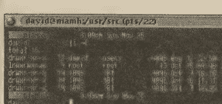

一个整洁的 `/usr/src` 是一个快乐的 `/usr/src`。请注意从 Linux 到最新内核的软链接。

`tar xvf (kernelfile-Version).tar`

我尝试过：

`tar xvf (kernelfile-Version).tar.gz`

我曾按照上述步骤处理过其他 tar 文件（如 Gnome 1.2.0 和 Wine），并成功解压了软件并完成了配置。

我是一个 Linux 新手，这个问题让我一筹无策。

Nick Edkert，通过邮件

由于你需要将它置于 `/usr/src`，然后执行 `tar xzf /mnt/cdrom/path/to/linux-2.4.0.tar.gz`，而你已经在该目录上解压了几个内核，这样做将变得毫无意义，你可能只想直接删除它并从头开始。

### Vfat 支持

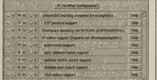

我的 Linux 安装遇到了一个问题。我在 Toshiba 8100 上安装了 Red Hat 7.2。前 10GB 是 Windows 2000，后 10GB 是 Linux。问题是我的无法挂载 Windows 分区。`mount -vfat (...)` 命令不起作用。我该如何挂载 Windows？

Luis Augusto，通过邮件

使用 Xconfig 重新编译内核以获取 netfilternsupport 是简单的。


内核源码被封装在当前目录中，即`/usr/src/`下的`/linux`目录内。你需要将`/linux`目录移开，例如移动到`/usr/src/linux-old`；然后像以前一样解压内核。通常情况下，一旦你解压了内核，你就必须将其移动到`/linux-2.4.0`；根据版本进行命名，然后将该目录链接回`/usr/src/linux`。不需要从 CD-ROM 拷贝那个大文件。

你没有提供我们任何调试信息或错误输出，可能是因为你的内核缺少`/vfat`支持。如果列表中列出了`'vfat'`，那么你通过`/proc/filesystems`检查，说明你有`vfat`支持；否则你需要编译一个支持该文件系统的内核。其他可能的原因是你正尝试挂载该驱动器，而由于你也没有提供这一点，我们无法提供太多信息。第一个 Windows 分区（或`'C'`盘）通常是`/dev/hd1`，所以你需要执行：

`mount -vfat /dev/hd1 /mnt/win`

这会将 Windows 分区挂载到`mnt/win`下，在尝试挂载之前，该路径必须作为一个目录存在。你还必须以`root`身份挂载所有文件系统，除非`/etc/fstab`中有条目允许普通用户挂载它们，尽管这显然是其他方面的权限问题。

## 配置

### 关于模块的更多信息

我正在使用`Mandrake 8.0`，并尝试弄如何在每次启动时加载我的模块。我使用的是位于`www.medres.com/-jstifer/linux/pctel.html`上的`pctel` modem `0.8.6`模块。每当我连接互联网时，都必须在终端输入以下几行：

```
su
insmod pctel
insmod ptsel
```

然而，当从`tar`包构建时，或者优选在下载 Debian 源码包后，我该如何设置架构和其他优化？

我知道有一个名为`debian-builder`的 Debian 包，但我找不到如何设置`DEBIAN BUILDVARIABLE`的说明。

（注：此处由于原文中存在大量重复且乱码的句子，已根据要求对可识别的文本部分进行了逻辑翻译）

新的文件系统不会所有内容都由`root`所有。一旦你确认所有内容都已复制，就可以安全地删除`/user`中的所有内容。然后你需要在`/etc/fstab`末尾添加一个条目，内容如下：

```bash
/etc/bashrc

fi
```

没有安装指南中建议的`PATH=/sbin/`这一行。如果你能告诉我如何以一种简单且意想不到的方式实现，我将不胜感激。预先感谢。

```
/dev/hda7 /usr/ext2 defaults 1.2
```

并挂载`/usr`然后检查是否已设置好。
如果看起来正常，你就可以重启机器，它将使用你那精彩、崭新的`/usr`文件系统。

## 路径大师

- 在`/usr/local/bin`目录下，当我从 GNOME 菜单或使用我的小型命令行启动程序时，它不在路径中。然而，如果我在 XTerm (`gnome-terminal`) 中输入`'echo PATH'`，它告诉我`/usr/local/bin`在路径中。此外，`/sbin`在用户或`root`下下不在路径中。

来自论坛

这完全取决于`/usr/local/bin/`被添加到`PATH`变量的哪里。通常，将其添加到`/etc/profile`是最佳方法，因为当父进程是`bash`时，不会执行`~/.bashrc`或`/etc/bashrc`等其他位置。通过`gnome-terminal`执行`'echo $PATH'`，你只是在查看`bash`内部的`PATH`变量。


## 免费企鹅

内核启动时遇到了一个企鹅的问题。当我带有帧缓冲区（frame buffer）支持配置内核 (`2.4.3`) 时，内核文档说明我可以获得一个企鹅。但我启动这个内核后什么都没有得到。

有什么需要应用的补丁或我遗漏了任何配置参数吗？

谢谢，

Tom Soieie,

## Bash 进阶

我按照提供的说明毫无问题地安装了`JDK 1.3`。然而，在设置自动运行的`PATH`时，我不知道该写在哪里。我尝试了所有能想到的选项（据我所知）。如果你能展示我的`.bashrc`看起来是什么样子的，是否可以展示一下它应该是什么样子的？

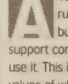

当前`.bashrc`

```bash
.bashrc
User specific aliases functions
Source global definitions
if [ -f /etc/bashrc ]; then
```

只有当你运行带帧缓冲区（FB）的控制台时才会企鹅，所以即使你已经支持 FB，也要使用它。它以`vga=extension`的形式存在，值列在内核源码的内核配置文档中。如果你想测试一组，在`/etc/io.conf`, `/sbin/reinit`, `reboot`中使用`'vga=ask'`选项，然后会要求你输入一个值。如果你需要，256色的`800x600`可以使用内核的`'303'`。一旦你决定了想要的值，需要将其从十六进制转换为十进制 - `0x03771`。然后你可以将其输入`lio.conf`并作为`vga=771`。


## 36 LINUX Answers

### 配置

还有许多作为`'video='`参数传递的选项，例如用于滚动的缓冲区文本，这在`vesafb.bt`文件中有介绍——注意`'video='`选项需要在`/etc/xorg.conf`中作为`append='video=vesa.mtrtr'`使用。

## Slouching Mandrake

> 我最近开始了 Linux 转换之路，并加载了`Mandrake 7.2`，与其他操作系统共享硬盘。但系统似乎很慢。这是由于共享磁盘空间的原因吗？

在尝试加载 GNOME 时也遇到了几个问题。我选择与 KDE 同时使用，它加载正常，登录屏幕上出现`gdm`图标并要求提供密码，但我并没有被提示提供密码。我如何访问 GNOME？

Roland Crump

你需要确保你已经编译了字体，否则内核将仅默认到普通的 VGA 非 FB 控制台。一旦 FB 运行，你就可以使用`fbset`程序（可从`filewatcher.org/sec/fbset/1week.html`获取）来更改 FB 分辨率和色彩深度，并显示当前选定的信息。

## 颜色代码

我最近读了一篇关于自定义`bash`提示符的文章。有一段短代码设置你的提示符以包含颜色的 ANSI 字符。我编辑了`.bashrc`并重启了`bash`，发现提示符不像我预期的那样。颜色在那里，但 ANSI 字符无处可见。我想这可能是由于我在终端中使用的字体？我如何更改它？

Lawrence, 通过邮件

你需要使用支持提示符内使用的扩展 ANSI 字符的字体。流行的字体有 Nexus 和 Shine，两者都可以通过流行的搜索引擎轻松找到。

（注：由于提供的原文中存在大量内容重复，译文已按要求处理核心逻辑内容。）

逻辑登录和启动活动时出现“超时错误”并拒绝继续运行。所以我们删除了所有内容，再也没有回到旧的`7.1`。

除非我被说服这种情况不会再次发生，否则我不会升级`7.1`的任何部分。也许我应该等待已经处于测试阶段的`8`版本，以及在我查看时看到的`XFree86 4.something-better`、`KDE 2.1`和内核版本`2.4`。

David Robertson

相反，这将使用更高效的`bzip2`方法来压缩内核，而不是常用的`gzip`。

## 什么情况？

- 每次我登录时，`xconsole`中都会出现以下消息：

`"linux kernel: cannot find map file"`

- 紧随之后，`messages`文件中出现了以下内容：

`"linux kernel: No module loaded"`

这是一个严重的问题吗，还是我可以直接忽略它？对于如何纠正它，你有什么建议吗？

Lindsay Francis

一旦你有了可以正常使用的 Linux 安装，没有理由对新版本进行批量更新，除非它有更多的安全或稳定性问题，而且并无法保证你安装的任何东西不会出现相应的问题。在处理完`glibc`和其他几个重大部分后，其他一切只需要在发现问题时进行升级即可。如果`XFree86`运行良好，为什么要升级它？除了预`2.219`内核的安全问题外，当声音正常时为什么要升级内核？

如果你想升级，请备份所有的配置文件，例如`/etc/X11/`和`/etc/X11/XFree86.conf`，然后安装新版本的`XFree86`。如果有效，太好了。如果没有，你可以从`Mandrake 71`重启原始版本并将你的配置文件还原。当然，等他们发布`8.0`时，内核和组件就会过时了。

你的系统引用的`map`文件是`/System.map`


从你提供的消息来看，无法判断内核编译时是否包含了支持，因此它不会导出任何内容，因为你可以直接使用它。内核可以这样正常工作，但最好是构建一个最小内核，并将许多额外内容（如文件系统和对各种类型硬件的支持）作为模块加载。

## 我遇到了问题

我尝试过安装 Linux 2.4，但 `make zimage` 失败并给出消息："make cannot find a rule for zimage"，
你有什么建议吗？

Eric Gilbert

就像 Linux 中的其他一切东西一样，`make` 命令是对大小敏感的。你需要使用大写 'I' 的规则 `zImage` 来构建内核镜像。如果生成的内核对于 LILO 来说太大了，你应该尝试 `make zImage`。

## SuSE 的担忧

自从几个月前尝试 SuSE 发行版以来，我很喜欢 Linux。自从安装双引导系统后，我为电脑增加了一个额外的 IDE 硬盘。我成功在新硬盘上安装了 Linux（我想把它留给 Linux 使用），但当我启动时，仍然 get 我安装的旧硬盘的引用。

这仍然在原始硬盘上，我可以删除它，并让它在启动时的菜单中不再出现吗？

Jeff Long

## 回答 | LINUX | 39

### 配置

如果你删除了某个发行版，Partition Magic 可以找回磁盘空间。

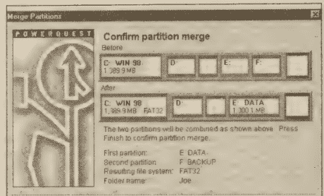

你基本上有两个问题，一个是修复你的启动管理器，另一个是从硬盘中收回空间。启动分区很容易修复。你没有说你是在新硬盘上重新安装了 SUSE，还是你在使用哪种启动管理器（grub 或 Lilo）。

无论哪种，你都需要编辑配置文件。首先，确定你想删除的是哪个旧发行版（如果它和 Windows 在同一块硬盘上，最好是 hda something）。接下来，找到相应的配置文件。如果你使用 grub，你可以在此处找到它：

- `/boot/grub/menu.list`
- `/etc/fstab`

使用你喜欢的编辑器（例如 `emacs`、`vi` 或任何编辑器）加载文件并删除引用旧硬盘上 lilo 的部分。对于 lilo，这将类似于：

```
image=/vmlinuz
label=linux
root=/dev/hda
read-only
```

确保你删除了从 `image` 到下一个 `image` 部分之间的所有行。grub 的过程也类似。对于 lilo，你现在需要从终端运行 `lilo` 来更新设置。当你重启时，旧分区应该就会消失。从旧分区收回空间是另一件事，特别是如果你想在 Windows 下使用它。如果你不确定自己在做什么，最好使用商用的 Windows 工具收回空间并将其加回你的分区中。

如果你想用 Linux 的方法，请使用 Parted (`www.gnu.org/software/parted`)，无论哪种情况，请确保彻底阅读文档并进行备份，否则可能会损坏所有数据。

### 内核 2.4.0 的问题

在构建 2.4 内核并执行 `make xconfig` 时，我得到了以下错误：

`make : Command not found`

`make: **[config] Error 127`

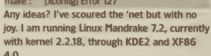

有什么想法吗？我在网上找过了，但我运行的是 Mandrake 2.2.18，带有 KDE2 和 X86 4.0。

Wish 是 T/Tk 工具包的一部分，用于 xconfig 创建图形化配置界面。你的系统中没有安装这个。在 Mandrake 上，这些应该由两个包提供，一个叫 `t`，一个叫 `tk`，并且在你的 Mandrake CD 上。如果没有，请访问 `www.mandrake.find`。

40 LINUX | 回答

### 2.4.0 的更多问题

哪里出错了？

Keith，通过邮件

代码中可能存在错误。它是对大小敏感的：你需要使用 `zImage` 而不是 `make zimage`。实际上，你可能想使用 `bzImage`。这使用 `bzip2` 压缩编译后的内核。

## 我遇到了问题

就像 Linux 中的其他一切东西一样，`make` 命令是对大小敏感的。你需要使用大写 'I' 的规则 `zImage` 来构建内核镜像。如果生成的内核对于 LILO 来说太大了，你应该尝试 `make zImage`。

## SuSE 的担忧

自从几个月前尝试 SuSE 发行版以来，我很喜欢 Linux。自从安装双引导系统后，我为电脑增加了一个额外的 IDE 硬盘。我成功在新硬盘上安装了 Linux（我想把它留给 Linux 使用），但当我启动时，仍然 get 我安装的旧硬盘的引用。

这仍然在原始硬盘上，我可以删除它，并让它在启动时的菜单中不再出现吗？

Jeff Long

## 回答 | LINUX | 39

### 配置

如果你删除了某个发行版，Partition Magic 可以找回磁盘空间。


你基本上有两个问题，一个是修复你的启动管理器，另一个是从硬盘中收回空间。启动分区很容易修复。你没有说你是在新硬盘上重新安装了 SUSE，还是你在使用哪种启动管理器（grub 或 Lilo）。

无论哪种，你都需要编辑配置文件。首先，确定你想删除的是哪个旧发行版（如果它和 Windows 在同一块硬盘上，最好是 hda something）。接下来，找到相应的配置文件。如果你使用 grub，你可以在此处找到它：

- `/boot/grub/menu.list`
- `/etc/fstab`

使用你喜欢的编辑器（例如 `emacs`、`vi` 或任何编辑器）加载文件并删除引用旧硬盘上 lilo 的部分。对于 lilo，这将类似于：

```
image=/vmlinuz
label=linux
root=/dev/hda
read-only
```

确保你删除了从 `image` 到下一个 `image` 部分之间的所有行。grub 的过程也类似。对于 lilo，你现在需要从终端运行 `lilo` 来更新设置。当你重启时，旧分区应该就会消失。从旧分区收回空间是另一件事，特别是如果你想在 Windows 下使用它。如果你不确定自己在做什么，最好使用商用的 Windows 工具收回空间并将其加回你的分区中。

如果你想用 Linux 的方法，请使用 Parted (`www.gnu.org/software/parted`)，无论哪种情况，请确保彻底阅读文档并进行备份，否则可能会损坏所有数据。

### 内核 2.4.0 的问题

在构建 2.4 内核并执行 `make xconfig` 时，我得到了以下错误：

`make : Command not found`

`make: **[config] Error 127`


有什么想法吗？我在网上找过了，但我运行的是 Mandrake 2.2.18，带有 KDE2 和 X86 4.0。

Wish 是 T/Tk 工具包的一部分，用于 xconfig 创建图形化配置界面。你的系统中没有安装这个。在 Mandrake 上，这些应该由两个包提供，一个叫 `t`，一个叫 `tk`，并且在你的 Mandrake CD 上。如果没有，请访问 `www.mandrake.find`。

40 LINUX | 回答

### 2.4.0 的更多问题

哪里出错了？

Keith，通过邮件

代码中可能存在错误。它是对大小敏感的：你需要使用 `zImage` 而不是 `make zimage`。实际上，你可能想使用 `bzImage`。这使用 `bzip2` 压缩编译后的内核。

### 配置

磁带驱动器对于备份非常方便，但你的备份软件不太可能找到它们，除非你配置内核来使用它们！

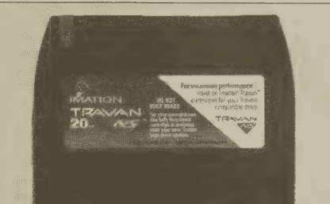

回到此屏幕或让 KDE 加载。它一直加载到 DOS 的 'type' 界面，这对于新用户来说没有帮助。

Jonathon，通过邮件

使用 LILO 从 NT 或 Windows 95 启动。LILO 应该能检测到两个操作系统的存在，或者你可以手动编辑 Lilo 并为 NT 添加一个条目：

```text
+ # Windows boot
other=/dev/hdc1
label=/dev/hda
loader=/boot/any.db
label=Windows NT
## End Windows NT
```

如果你在文本模式下使用 root 用户和你在提供的密码（在编辑 `/etc/inittab` 时，使用 `emacs` 或 `vi` 等文本编辑器）进行登录，你可以更改读取以下内容的行：

`d3:default:`

`d5:default:`

并保存。如果你不运行 `init 5`，它应该带有图形化登录启动，这将成为你下次重启机器时的默认设置。

## 愤怒之带

在读了一篇关于备份的文章后，我下载并安装了 Dump 的 RPM 包。如果你能告诉我如何配合你的 IDE 磁带驱动器配置 Dump，将不胜感激。

John Wallis，通过邮件

## 三启动


大多数人必须设置一个包含 Windows 98、Windows NT 和 Linux 的三启动系统。我有大量的磁盘空间，但我好奇该如何才能进入这三个系统。几个朋友告诉我这是可能的，但我必须从软盘启动 Linux。

Carolyn，通过邮件

啊哈，这里的诀窍在于你不需要这样做。配置你的磁带驱动器以与 Linux 工作，然后使用 `Dump` 将其作为一个设备进行备份。例如 `dump -f /dev/tape1 /home/where`，其中 `tape1` 是配置的任何磁带驱动器。

如果你还没有配置磁带驱动器在 Linux 下工作，你可能需要重新编译内核并包含 IDE/ATAPI 支持，这可以在 IDE/ATAPI 块设备中找到。

不一定如此。解决此问题的简单方法是先安装 Windows。如果你随后安装 Linux，你可以

## 回答 | LINUX

## 配置

## 沉默是金

我已经使用 Linux 几个月了，真的开始熟悉它了。我喜欢使用 shell，但真正让我感到警觉的是控制台铃声（console bell）。它一直响——当我按 TAB 键补全文件名时，当我尝试滚动出缓冲区时，等等。我该如何关掉该死的东西？

Dave Roberts，通过邮件

你将此命令添加到 `~/profile` 脚本中，然后 shell 运行的每个控制台都将被静音。值得注意的是，gnome 的终端仿真有一个配置选项可以静音终端铃声，而 KDE 的终端，你可以在 KDE 控制中心中关闭它，方法类似于上述过程，即通过将铃声持续时间设置为 0。

## 更多曼德拉克的胡闹

有几种关闭铃声的方法，最简单最有效的方法是物理上断开主板的扬声器！

然而，也可以向该控制台回某些控制代码来修改特定控制台的铃声持续时间（查看 `console_tools` 手册中的 Linux Console Controls 获取更多这些代码的详细信息）。你可以通过将其持续时间设置为 0 来完全关闭铃声。

我在电脑上安装了 Mandrake 7.2（Compaq，6GB 硬盘，128MB 内存和 AMD 处理器），并尽可能按照说明进行操作。

然而，这给我带来了一些困境。这台机器连同笔记本电脑被用作业务工具，也是家庭住所。Linux 的实现引入了一个顺序问题，用户会看到一个简短的操作系统菜单供选择：Linux、Fail Safe、Windows 或 Puppy。

这可以通过 shell 使用 `echo -u\033[11;0"` 实现。

这没问题，但菜单在几分钟后会超时并默认进入 Linux —— 当人的心不在焉且假设加载将提供通常的 Windows 界面时，并不并不。

这里的 `-e` 告诉 `echo` 将后面的内容解释为转义序列，引号是为了防止 shell 将分号解析为指令分隔符，而 `\033` 是 ESC 字符的八进制代码。如果

它将在我完全采用 Linux 之前发生，这种烦人且不便的情况会造成一些麻烦。是否可以重新排列菜单使默认值变为？

一些观察：

- 1) 我使用两个有线或红外遥控器。每个都有一个轮。配置部分中的任何选项都不接受这些设备。我从笔记本电脑上取下 USB 鼠标，它工作得良好。
- 2) 通过向该控制台回显某些控制代码来修改特定控制台的铃声持续时间也是可能的（查看 `console_tools` 手册中的 Linux Console Controls 获取更多这些代码的详细信息）。你可以通过将其持续时间设置为 0 来完全关闭铃声。

## LILO 默认设置

我妻子因为几个原因对我相当生气，但最迫在眉的问题之一是 LILO。我有一台双启动系统，所以我可以运行 Linux，而家里其他人可以运行其他操作系统。问题是，他们抱怨说我设置成了默认启动 Linux，或者为了进入其他操作系统，他们必须像老鹰一样盯着屏幕，并在正确的时间输入……嗯，一个特定的单词。所以基本上，我的问题是，我如何更改我的 LILO 设置，让 Linux 不再是默认项，并且 b) 让我有更多的时间来做决定。

Dave，通过邮件发送

### Liloconf 适用于各种事情，包括整理 LILO

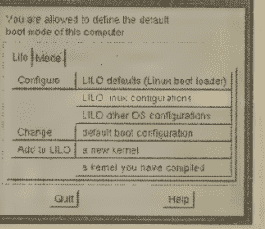

你可以定义这台电脑的默认启动模式。

| LILO | 模式 |
| :--- | :--- |
| 配置 | LILO 默认设置 (Linux 启动加载程序) |

好了，这并不难。如果你在发行版中有 `Linuxconf` 并点击“启动模式”（打开的面板底部），你就可以更改许多 LILO 相关设置。要更改输入操作系统选择的时间，点击“LILO 默认设置”并在“提示符超时框”中输入时间。

要更改默认操作系统，点击“更改启动配置”，并从出现的列表中选择操作系统。然后保存这些设置即可完成。

如果你没有 `Linuxconf`，你可能需要手动编辑 `lilo.conf` 文件。你可以在 `/etc` 目录下找到它，并只需用文本编辑器打开它进行修改。你会发现想要更改的值前面分别有 `default=` 和 `timeout=` 前缀。


你知道你要去哪里——或者你的源文件要去哪里。

# 网络 (NETWORKING)

| 主题 | 页码 | 主题 | 页码 |
| :--- | :--- | :--- | :--- |
| USB 网络 | 50 | 慢速网络 (SlowNet) | 55 |
| 网卡缺少模块 | 50 | 带宽管道问题 | 56 |
| 拨号解决方案 | 50 | 使用 Linux！ | 56 |
| 迷失时间 | 52 | 网络诀窍 | 57 |
| 调制解调器无法工作 | 53 | 病态 (Sick squid) | 57 |
| 美国离线：关于…… | 53 | 学生网络 | 58 |
| AOL 专有协议 | 53 | 老旧的最爱 | 58 |
| 连接查询 | 53 | 无网络 | 59 |
| 退回发者 | 53 | 代理浏览器 | 59 |
| 就快了！ | 54 | 速度守护魔 | 60 |
| 获取访问 | 54 | 带宽管道担忧 | 60 |

## 目录 (CONTENTS)


| 主题 | 页码 | 主题 | 页码 |
| :--- | :--- | :--- | :--- |
| 流量引导 | 60 | 休息一下 Gnap | 67 |
| 现在升级！ | 61 | 没网络？ | 67 |
| 调制解调器问题 | 61 | 密码危险 | 68 |
| ISP 的两难境地 | 62 | 调制解调器痛苦 | 68 |
| ISP 建议 | 62 | 身份危机 | 68 |
| 感觉顺畅 | 63 | 正确处理 | 68 |
| 流量大师 | 63 | 我想做回我自己 | 69 |
| 重拨 | 64 | 调制解调器、打印机等 | 69 |
| Telnet | 64 | 网络 | 70 |
| 调制解调器工作异常 | 70 | | |
| 流量 | 71 | | |

## 网络

你不能做一个串行主义者！

如果你是一个短端口，那么请怪罪 `winmodem`。

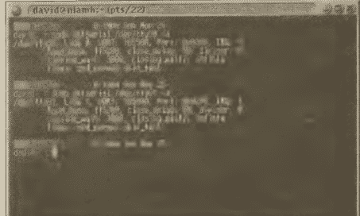

### 迷失在时间

如果你能指引正确的方向来解决一个问题，我将不胜感激。

历史：去年秋天我安装了三次 `suSE 6.4`（`KDE` 和开发者版本），只是为了练习，作为一个新手，我没有遇到任何无法处理的问题。然而，我有点自视过了，在尝试修复时丢失了部分安装内容，我不得不使用“整个光盘”选项重新安装。随后出现了邮件问题。紧接着，我安装了一个更大的硬盘，并重复了安装，结果仍然相同。我遇到的问题是：

- 1：当我的邮件到达时，它的“主题”和“发送者”详情是正确的，但日期显示为 1973 年 3 月，且时间是随机的。如果我点击消息显示它，头文件显示正确的时间。如果我点击“日期”，收件箱会重启，高亮消息的日期就变正确。但在重启后，日期又回到了 1973 年。
- 2：如果我向新闻组发送消息，“发送者”列显示正确的日期时间，而“日期”列显示 1970 年的日期，“发件人”列显示我的用户名（`oldbuffer@Rosecott`），“主题”是正确的，但带有“缓存中锁定密钥”后缀。如果我点击消息，头文件显示正确的日期时间，但“发件人”显示为指定的 `older@Rosecott` 而不是我的地址 `<cbuffer@clara.co.uk>`（以防你收到的是错误的），并且消息正文包含额外的行：`NNTP-Posting-Host;195.8.xx.xx (195.8.` 推测是 `(Clara)`；`NNTP-Posting-Date:` 正日期时间； `Lines:` 0-与之前的做法不同。

`KMail` 的问题让我更难对最近的消息排序并查找旧消息，并且可能让我看起来像个白痴蛋，虽然事实确实如此，但我并不喜欢自夸。大家有什么想法吗？

Ken Parkes

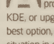

这似乎是一个库问题，或者是 `KMail` 无法正常工作的某种原因。重新安装 `KDE` 或升级到 `KDE 2.2` 是可能的选择，并希望在任何情况下都能纠正你的状况。由于日期显示为 1970 年，这表明解析失败，返回了 `'0'` 而不是正确的 UNIX 时间戳。`'0'` 秒是 1970 年 1 月 1 日，即纪元，这最可能是正确解释数据时的回退值。由于我已经安装了三次，看来 `suSE 6.4` 并不太理想，所以你可能想选择 `suSE 7` 或不同的发行版，看看是否更有成功。

## LINUX | 问答

### 网络

#### 调制调器无法工作

我对我的 Alcatel SpeedTouch 调制调器很满意，但它只在 Windows 下运行。我就是无法让它工作（我正在使用 `Mandrake 8.0`）。

违约。`PPP` 是拨号上网连接的标准系统，但那并不是 AOL 的工作方式。

Henrik Jorgensen, 比利

由于你没有提供问题的具体信息，似乎很难提供一个完整的答案来让你的 ADSL 桥接器在 Linux 下正常工作。关于文档，请参考 Alcatel SpeedTouch 设备页面：`www.linuxdoc.org/HOWTO/DSL-SPEEDtouch.html`

#### 连接查询

我安装了 `Progeny Debian`，似乎无法连接到 `BTInternet`。在 `KDE` 中我收到“退出状态: 1”的消息，在 `GNOME` 中它只是弹窗显示。我曾成功在 `SuSE 6.4`、`Caldera 2.4` 和 `Red Hat 7.x` 上连接，所以我知道自己做得不对。我安装了 `wial 1.42` 并收到消息：

- - 检测到载波。等待提示。返回无效！！正在断开。Owen Kennedy，通过邮件

#### 美国离线：AOL 的私有协议问题

我是一个热心的 Linux 用户，我在 Windows 方面遇到了问题。我必须使用 Windows 机器访问互联网，因为我的 ISP 是 `AOL`（我使用它们是因为它们不会每两小时断开一次）。

首要任务是检查 `PPP` 配置，确保你使用的是正确的 `/dev/tty` 文件，并且拥有读写权限。`wdial` 知道载波并且获取结果是那样，这表明还有更有趣的事情发生。我很倾向于使用 `minicom`，使用与 `wdial` 相同的选项，看看你是否可以查询调制调器并让它正确拨号你的 ISP。

遗憾的是，我不知道任何让 `AOL` 在 Linux 下工作的方法。

如果你可以查询调制调器，但它没有拨号，那么你的调制调器出了问题或者...

### 网络

... 部分。然而，我们将介绍基础知识，你可以后续参考互联网上丰富的文档进行深入学习。

还有许多其他可用方法。

首先，你需要在网关上安装 `Linux 2.4`，最新版本是 `2.4`。如果你的发行版在发布时较旧，你可能需要对其进行一些更新。

关于 `netfilter` 和 `iptables` 的更多信息请参阅 `http://netfilter.samba.org/`。`linuxdoc.org` 包含许多关于 IP 伪装（IP Masquerading）和简单网络配置的 HOW-TO 指南。

### 无客户端

一旦你完成了这些操作并在机器上设置好了网络，剩下的部分就非常简单了。

我的 PC 上安装了 `SuSE 7.1`，并想从那里运行 `DHCP`。客户端是一台 Windows 2000 机器和两台 Windows 98 机器。设置好了 `SuSE` 服务器，但客户端找不到它。

在每台 Windows 机器上，默认网关设为 `10.1.4.1`，DNS IP 为你的 ISP（服务提供商）提供的地址。你应该能够从其中任一台机器 `ping 10.1.4.1`。

来自论坛。

接下来，你需要在 Linux 机器上设置 IP 伪装，以便这三台 Windows 机器能够连接到外部世界。使用以下 `iptables` 命令：

假设你已经妥善地配置了 `/etc/dhcpd.conf`，你只需要运行 `dhcpd` 即可启动 DHCP 服务器：

```bash
iptables -A POSTROUTING -o eth0 -j MASQUERADE
iptables -A FORWARD -i eth0 -o eth0 -s 10.0.0.0/24 -j ACCEPT
iptables -P FORWARD -j DROP
```

`/etc/dhcpd.conf` 的内容大致如下：

```bash
subnet 10.1.10 netmask 255.255.255.0 {
  range 10.1.11.12 10.1.11.254;
  option routers 10.1.11.1;
  option domain-name-servers 10.1.11.1;
}
```

你想转发机器 0-768 端口的做法意义不大，因为 IRC、DCC 和游戏服务器通常使用高端口，而不是 0-1024 的低端口号。

将特定端口转发到某台机器是使用 `iptables` 中的 `DNAT` 实现的。如果你想从网关将某个游戏服务的特定端口转发到内部机器，可以这样操作：

```bash
iptables -A PREROUTING -p tcp --dport <port_number> -j DNAT --to-destination 10.0.0.10:<port_number>
```

`<port_number>` 是你想要转发到内部机器的特定端口。由于 IRC 使用完全随机的高端口，在不向网关上开启大量端口并进行转发的情况下，要确保所有 DCC 传输的安全并非不可能，否则这会影响它们的其他服务。

如果配置有误，它将失败并告诉你问题所在之处。当然，如果你需要在启动时启用 DHCP，可以使用 SuSE 的运行级别编辑器（run level editor）。`/etc/dhcpd.conf` 包含了 DHCP 服务器可以分配的 IP 列表。

然而，`netfilter` 的连接跟踪模块允许所有 IRC DCC 传输通过，尽管该模块仍处于开发阶段，你可能不会取得太大成功。

### 慢网络

我正在一台笔记本电脑上安装 Linux，但当我通过集线器将笔记本连接到服务器时，速度非常慢，甚至两个小时。

当我用交叉线连接服务器和笔记本时，就很正常。

两台机器都有 100M 网卡，集线器是双速率的。是我的集线器、线缆等有问题吗？这正常吗？


有几个精简版的直接专门设计用于提供此类服务，包括 SmoothWall 和 Mandrake 单网络防火墙，等几个……

James, 邮件

## 回答 | LINUX | 55

## 网络

...调试此类问题的方法是在运行正常的 Linux 机器上使用 `mi-tool`。你可以通过观察集线器上的各种小指示灯来检查集线器。然后你可以使用 `mi-tool` 修改 NIC 配置，将双工设置设置为集线器认为应该是的值。

`www.scyld.com/network/via-rhine.html`，它可以很好地针对 2.2 内核进行编译。你应该完全按照网站上的说明操作，然后你就能编译并安装新模块，在此过程中完全覆盖现有的模块，NIC 应该按预期工作。当然，更新模块并不意味着 YaST 工具能够检测到该 NIC。事实上，它使用的是不同版本的控制器。如果网卡本身工作正常，YaST 不会自动检测网卡本身。

这通常没什么什么大能做的，因为这往往是集线器和 NIC 之间的兼容性问题。对于笔记本电脑，你会有不同的 NIC，所以你应该能够……

## 网络

我曾尝试（简短地）移除 squid 上所有的控制项，并将 `iptables` 简化为简单的 `MASQUERADE`（伪装）指令，但它仍然不起作用。

jmang 通过邮件

在众多的 DNS 服务器中，要确保主机的主名遵循通过 DSL 或电缆租给你的 DHCP 设置。邮件可以通过众多服务器之一提供，发送 `smpd`、`qmail`、`exist` 等，因此这纯粹是一个找到可以确保其安全性的问题；出于安全考虑，不建议在 DNS 服务上运行入站邮件服务器，你可以避免远程邮件服务器的此类攻击。Linux 有 `POP3` 和 `IMAP4` 服务器，你可以在自己的机器上运行它们，使用自己的邮件客户端从箱中收集邮件。

> 看起来 Windows 机器上的 DNS 设置不正确，尽管这将影响所有依赖 DNS 查找的网络服务，如网页浏览，当然还有接收电子邮件。Windows 中的 DNS 服务器应该设置为你的 ISP（服务提供商），除非你的机器上运行了缓存 DNS 服务器。

尝试从 Linux 机器通过 `telnet` 端口 `110` 访问邮件服务器，看看是否可行。

## 老最爱的

我正准备搬进谢菲尔德的一个八人学生宿舍，那里有四台 PC 和一台 Mac，最好的办法是我们直接买一个 ADSL 或电缆调制解调器供大家共享。那么，用我的 Pentium 750 和 SuSE 7.2，可以将我的电脑作为大家共享的互联网连接吗？我还可以将其设置为 Web 服务器和邮件服务器吗，因为假设 ADSL 或电缆调制解调器有静态 IP。

> 你有，或者你不知道在哪里可以找到英国 Linux 免费 ISP 的最新列表？如果有靠谱的，我将使用 SuSE 7.1。James Baldwin

## 学生网络

我需要做什么才能实现这个？

来自论坛。

> 在 Linux 中设置连接是轻而易举的，你在内核中编译了 `ipchains` 真是太棒了。

所有的 ISP 都能支持 Linux，至少是那些使用 PPP 或 SLIP 进行连接的。绝大多数 ISP 将使用 PAT 进行认证，其他如 BTnet 和 Internet Connect。如果你使用基础 0845 ISP，`uklinux.net` 是一个不错的选择，因为它使用 Linux 提供其托管、邮件和 DNS 服务，并且在用户遇到问题时也非常专业。如果你需要从一台机器向另一台机器传输大量文件，`rsync.samba` 是最佳方法。

使用 `FORWARD -MASQUERADE` 并将所有其他机器指向 Linux 盒子作为网关。如果你运行的是 2-4 内核，设置伪装略有不同，但剩余的 `iptables` 过滤系统要安全得多，因此纯粹为了升级内核可能是更优的。

许多 ISP 对使用 Linux 使用他们服务的人并不感兴趣，因为他们缺乏资源来训练员工掌握 Unix 知识。在 ISP 的支持下，存在很多问题，从拨号失败到反向 DNS 问题应有，他们会立即将问题归咎于你自己的配置，因此需要一些时间、耐心和决心才能让他们明白这不是你的问题。当然，像 Demon 这样更传统的 ISP 非常乐意指导 Linux 用户——而其他的 显然不。。

至于 Web 服务器和邮件服务器——`Apache` 是一个完全胜任的 Web 服务器，你可以使用它来学习如何设置你的机器连接到他们的服务，但出现故障时，他们至少会听你解释。

在 Konqueror 的代理配置部分中，你需要以以下格式设置代理：

```
user:password@proxy.domain.com
```

用户名和密码认证框的行为不像你预期的那样，而且它在 KDE21 版本的 Konqueror 中无法正常工作。你可能需要检查 `kde.org` 上的邮件列表，看看是否其他人也有类似的问题，或者检查是否有新的 Konqueror 版本提供了对身份验证代理的正确支持。

来自论坛

设置伪装最快的方法是使用 `ipchains`。只需：

```bash
echo 1 >/proc/sys/net/ipv4/forward
## No No net
```

我正尝试配置我的 SuSE 7.1 网络以与内部网络共享互联网连接。我正在使用 Firewall，我的问题是我不知道 `FW_DEV_WORLD` 的值（我正通过 56k 调制解调器连接）。我尝试了几种选项，但每次启动日志都显示找不到特定模块。值应该是多少？

```
ipchains -A forward -s 10.0.10.24 -j MASQ
```

`'10.0.10.24'` 是你的内部网络使用的子网。你自然需要确保它在引导启动时运行，所以你可能想将其放入 `/etc/rc.d/local`，同时设置内部机器让你的 Linux 盒子成为它们的默认网关。

## Live 与点击

我安装了 SuSE Linux 7.1 Live 版。现在它不是完整版，因为我是从杂志封面附 CD 安装的，我想知道这个版本是否可以设置调制解调器来连接互联网？我只用一个普通的 US 56.6k 调制解调器进行拨号。我尝试了 X-Windows 中的 YaST 调制解调器连接程序，但它不起作用。（此处省略重复的失败描述）

## 网络

与 `'www.domain.com'` 完全不同的站点

## 调制解调器问题

服务器，可以使用 `mod_rewrite` 将外部网络服务器的请求重定向到内部机器，方法类似于：

我有一台 P233MHZ CPU、64MB 内存、ESS1868 声卡、S33 virge 4B、Rockwell HCF 56 PCI 调制解调器（在 COM3 上）；我在 Windows Me 上安装了 WinLinux2000。

Rewrite On

- 1. Linux2000 已检测到我的调制解调器，但它仍然无法工作。在电轴拨号时，我收到“modem is busy”的消息，但当我尝试使用 `minicom` 并将 `tty1` 更改为 `tty2` 来解决这个问题时，我的电脑就死机了。我是 Linux 新手，请尽可能提供详细说明。

RewriteRule(?) http://10.11.2.160/S1 [L]

`mod_rewrite` 是 Apache 的一部分——启用 `-enable-module-rewrite`，或者通过将其编译为 D5 并让 Apache 安装程序运行它，并使用 P 选项代理 `'mod_proxy'`，后者应该以完全相同的方式通过 `-enable-module-proxy` 构建。

- 2. Linux2000 没有检测到我的声卡，所以我强制使用之前使用的相同 IRQ、DMA、IO 和内存范围来设置它，但仍然无法工作。当我尝试使用 `mixer: cd; chmod a+rw=/dev/mixer;` 且操作得当时，什么也没有发生。

## 现在升级！

- 3. 当我尝试用 CD 自带的版本 Linux2000 内核 2.2.13 时，通过 `'patch-link'` 我收到了“can't detect kernel version”的消息。

当我运行 2.2.16 内核时，互联网连接的 KPPP 没有任何问题。这封邮件是使用 2.2.16 内核发送给您的。然而，如果我重启并使用新编译的 2.4.0 内核，我收到了可怕的“PPPD died unexpectedly”消息。我还得到了以下 PPPD 日志：

- 4. 有 Linux 的阿拉伯语版本吗？我发现了 Sun 提供的 StarOffice，它比我的 Office 好用，但它不支持阿拉伯语。有支持它的版本吗？

```
pppd 2.3.1 started by root, 0

Perms of /dev/ttyS0 are; no mesg necessary.

ioctl(FTIOCFLLAGS): Invalid argument

tsetattr: Invalid argument
```

感谢来信，Abbas。首先，尽管没有人特别熟悉 WinLinux，但答案应该适用于任何版本的 Linux，我们并不确切知道 WinLinux 与标准发行版有何不同。你应该检查随你的发行版附的任何文档。

我无法定位或识别出此问题。坦率地说，我不知道从何处开始。


- 1. 你的调制解调器是所谓的“Winmodem”，Linux 完全不支持它。你应该考虑购买一个外部调制解调器，因为任何外部调制解调器都能在 Linux 上愉快地工作。

Derrick

`PPP` 守护进程 `pppd` 是如果你想使用 2.4 内核所需的所需的更新之一。至少，如果你还想拨号上网的话。`PPP` 代码已经发生了很大变化，我担心 2.x 版本可能无法跟上了。我只需要为你的发行版获取最新的 2.4 版本 `pppd` 服务器，如果从 `freshly.net` 进行 `FTP` 更新，它就能正常工作。你还应该检查 `/dev/ttyS0` 而不是 `/dev/cu1`，因为后者不是用于 `PPP` 的正确设备，自 2.2x 发布以来就一直如此。

- 2. 然而，你的声卡在 Linux 下绝对受支持。`ESS1868` 是一个 `ISA` 即插即用设备，将与 `Soundblast` 驱动程序工作。配置可能很复杂。你首先需要设置 Linux 工具来识别你的声卡。这可以通过向 `/etc/pnp.conf` 文件添加条目来实现。

## 回答 | LINUX | 6

### 网络

#### ISP 22

我是 Linux 新手，刚刚发现我的 ISP 无打算支持 Linux 用户。

拨号，然后将你的浏览器指向 `www.scotfree-uk.net`

我见过一些对 Linux 友 ISP，但它们似乎都有在线程序，我无法这样做因为我无法上网。点击 `Join` 按钮并填写所需信息。随后屏幕将显示你的新账户详情。将此打印出来备用，然后在你的拨号程序中修改这些细节，并在你的邮件中输入。

#### ISP 建议

22 是常见的，对于像 Windows 和 Mac 用户这样的服务，可能会获得更多解决方案。`ISP` 是 Linux 友好的，如果知道如何从 `CD` 中提取必要信息。对于所有操作系统和浏览器，必须在文本编辑器中编辑 `INS` 文件。要注册 `linux.net`，按如下设置你的拨号器：

| 字段 | 值 |
| :--- | :--- |
| Tel No | 0870 920 |
| Login name | signup |
| Entry_Name | LineOne |
| Requires_Login | No |
| Password | signup |
| Dial_Is | No |
| Phone_Number | 00299 |
| Area_Code | 0845 |
| Country_ID | 44 |
| Device | modem |

`DNS` 等是动态分配的。你可以拨号并注册 `scotfree.net`。使用以下细节设置拨号程序：

电话号: 0845 3069

用户名: scotfree

`DNS1`: 212730.2

`DNS2`: 212730.3

假设主卡的 `I/O` 是 0，合成器在 0388，`MIDI` 端口使用 `IRQ 5`。你可能需要将其更改为你的设置：

```
(CONFIGURE ESS186-3 (LD)
(IO 0 (BASE 220))
(IO 1 (BASE 388))
(IO 2 (BASE 330))
(INT 0 (IRQ 5))
(ACT Y)
```

此文件可以使用 `pnpdump` 命令生成。关于 Linux 的即插即用，请访问 `www.linuxdoc.org`。你需要告诉你的机器加载并配置相关的内核模块以使用你的特定声卡：

```
/sbin/modprobe sound
/sbin/insmod uart41
/sbin/insmod sb io=220 irq=5 dma=1 dma16-1
/sbin/insmod mpu41 lo=3300
```

## 62 LINUX 回答

### 网络

| 字段 | 值 |
| :--- | :--- |
| Server | Type:PPP |
| SW | Compress=Yes |
| PW | Encrypt=No |
| Network | Login=no |
| SW | Encrypt=no |
| Negotiate | BEUI=no |
| Negotiate | IPX/SPX=no |
| Negotiate | TCP/IP=Yes |
| Disable | LCP=no |
| TCP/IP | Specify:Address=no |
| Specify | Server=No |
| DNS | Address=no |
| IP_Header | Compress=Yes |
| Gateway | On,Remote=Yes |
| DNS | Alt.0.0.0 |
| URL | Signup:http://registry.info/direct |

### 品牌

`OBT`

在 `X` 上，`/makeconfig` 然后输入系列命令来构建和安装新的内核镜像：

```
make dep
make image
make install
make modules
make modules install
```

在安装新的内核镜像之前，你应该知道自己在做什么，请查看 `Kernel HowTo`。

- 4. 你在查找 Linux 的阿拉伯版本方面更有优势，因为关于这个主题很少有非阿拉伯语编写的信息。`www.linux4arab.com` 网页看起来很有趣，但显然我们无法阅读。`Debian Linux` (`www.debian.com`) 也有阿拉伯语页面。至于文字处理器，我们还不知道任何可用的。`KDE` 项目有一个翻译团队正在事阿拉伯本地化工作，但我怀疑 `KWord` 的翻译准备就绪还需要一段时间。

使用这个来设置 `ppp/ppp` 拨号服务器，并使用用户名和密码登录注册。

在过程结束时，你将看到所有可以打印出来手动设置账户的信息，或者将将提供一个下载的文件，使用 `CONFIGUR`。你应该下载此文件并再次查看，然后使用它设置你的最终账户。

Gerry，通过邮件

### 刷新问题

我的问题出在 `Elm` 和 `Fetchmail` 上。当我使用 `FETCHMAIL mail.server.xxx` 时，我收到了以下错误：

```
skipping message not flushed
```

你能帮我吗？我目前只在文本模式下使用 Linux——是 `SUSE`——因为内存会重启。

对于为什么会出现这种情况你有什么建议吗？

Gerry，通过邮件

```
/bin/insmod opci3:io=388
/bin/insmod v_mid
```

你可能会发现切换到更现代的 Linux 发行版更容易，例如 `Mandrake 7` 或 `SUSE 7.0`，它们在为你配置音频方面做得更好。

3. 我们在许多 Linux 杂志漫画提供的内核源码是完整源码，而不是补丁。要构建内核镜像，解压缩存档并进入该目录。如果你正在运行，执行 `/make menuconfig` 来配置镜像。

### 流量大师

你能告诉我在 `Red Hat 5.2` 机器上是否可以实现以下操作吗：

> 当邮件在邮箱中被标记为已读时，`Fetchmail` 将不会下载它。可以通过命令行上的 `all` 关来停止跳过已读邮件，或者通过将 `fetchmail` 放在你的 `-fetchmail` 行末尾来实现。

### 网络

我希望能够自动将源自源网络的流量从一个主机 (a) 重定向到另一个主机 (b) ——换句话说，目标 `IP` 地址为 `10.1.1.70` (a) 的数据包将被发送到 `10.1.2.70`。

重启 - 请检查文档。例如在 `Kpp` 中，你可以在设置部分的 `Misc.` 选项卡下访问此选项。对于其他系统，你可能需要编辑一个 `.conf` 文件（例如 `wvdial`）。

机器 (a) 上的默认网关是 `10.1.2.54`，本地网络是 `10.1.1.0`。机器（主机 b）上的默认网关是 `10.1.2.254`，本地网络是 `10.1.2.0`。

另一个问题可能是连接在空闲一段时间后（通常大约 20 分钟）会断开。你可以轻松编写一个脚本，每隔几分钟 `ping` 一 `DNS` 服务器或其他内容以保持连接活跃。

如果你在网关上运行 2.4，只要流量通过网关，重定向流量就非常简单。与其让链路层流量直接从网卡流出并进入网络，你需要让它通过网关再出去。这会显著减少带宽，因此不是一个好选择。你始终可以设置 `IP` 别名，让 `10.1.2.0` 网络上的相应机器也拥有 `10.1.1.0 IP`，但它们需要处理适当的路由设置，以便数据包到达正确的位置。

更关键的一点是你为什么要这样做：如果你不是真的一直使用该服务，那么一直保持连接是有点是不社交的。

可能面临的另一个问题是，各种方案通过其“高使用”客户显示出一直在线状态。

如果你希望可以使用互联网访问，而无需安装像 `SmoothWall` 或你的服务器（`www.smoothwall.org`），尽管现在有更最近的更新可用：这将允许你在需要时让服务器拨号上网，而不会打扰别人。

你真的需要决定这样做是为了实现什么，而不是你试图做什么，而且会有比在网络上对数据包进行 `NAT` 好得多的选项。

### Telnet


我使用一种拨号服务，它对我的互联网连接有限制。你懂那种情况，每小时下线、无法使用某些服务等等。我不会点出它们，因为我不想让别人发现我在做什么（我只是疑神过度吗？）。我真的希望我的连接几乎一直可用。我希望将一台旧机器作为服务器并将两台机器连接起来，我希望设置成让我能可靠地访问网络。这必须是可能的。

我希望能够从 PC 远程访问我的 Linux 机器（主要作为服务器），这样我就可以安装、更改设置等等。我理解可以使用 `telnet` 来做到这一点，但我需要安装什么？

Darran，通过邮件

## 拨号

`Telnet` 用于这类事情是可以的，只要你的网络是安全的（即你处于防火墙之后，并且你网络上的任何人都是可信的）。检查 `SSH` 作为替代方案可能是值得的，因为它使用了加密（监听器（snoppers）可能会在你登录时检测到你的密码）。`Telnet` 可能正在运行。

```
stat -a | grep telnet
```

如果你得到类似 `tp 0 0 :LIST` 的内容，说明 `telnet` 已经安装并运行。你可以在 Windows 机器上运行 `telnet` 客户端。如果是管理事务，你……

你有几个问题。一个无疑是线路在一段时间后会断开。这很容易解决，因此拨号客户端可以自动

64 | LINUX | 回答

## 调制解器解决方案

我注意到关于在 Linux 下连接互联网的问题，答案对于这个本该简单的任务来说似乎很复杂。我可以提供我使用的方法吗？这些都是以 `root` 身份完成：

1. 确保安装了 `wvdial` 包。我刚刚安装了 Red Hat `wvdial-1.41-10.i386.rpm`，我假设这是当前版本。

2. 运行以下命令：`wvdialconf /etc/wvdial`

这将自动检测你的模型并在指定的文件中插入相关细节。在我的系统中，它创建了以下文件：

[Dialer Defaults]

Model = `/dev/ttyS1`

Baud = 115200

Init1 = ATZ

Init2 = ATQ V1 E1 S0=0&C1&D2 S51=55+CLASSASS=0

Phone = Number

Username = Username

Password = Password

3. 编辑 `/wvdial.conf` 并删除底部的注释，然后在底部插入一个独立的行块，格式如下，并与之前的行块之间空一个空行：

[Dialer FreeISP]

Phone = 0801 570 980

Username = ThisMe

Password = Secret

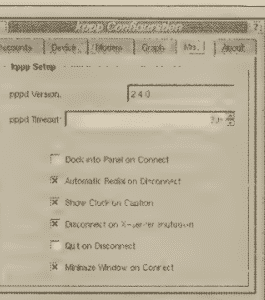

`kpp` 可以设置为在连接中断时自动重拨。

用户、用户名和密码显然应该是你所使用的 ISP 的相应内容。

号码从“Request For Drama Use”部分显示，并保证会发放。请参考 `www.oft.gov.uk/numbers/data599.htm` 获取详情。

4. 保存文件。

当你想上网时，命令是 `wvdial FreeISP`，将“FreeISP”替换为拨号连接。

Riley Williams, Aberdeen

（注：由于 OCR 文本识别错误，提供的 OCR 文本包含重复和交错的部分。我将提供基于逻辑流的干净版本。）

## 网络

### 尝试使用 Gnap

我的 Gnapster 版本似乎不再工作了。它以前一直运行良好，但现在它一直停留在那里，显示正在尝试寻找最佳服务器，然后返回“未知致命错误”。Giles，通过电子邮件。

《Norton Linux 完全指南》（Peter Norton's Complete Guide to Linux）中推荐的设置。你可以建议任何测试来排除问题故障，还是说这种特定的硬件和软件组合本身就存在困难性？Martin，通过电子邮件。

嗯，你没有说明在使用哪个版本的 Linux 客户端，但可能它已经过时。Napster 更改了其协议的一些部分，所以如果你的版本低于 `1.312`，可能无法工作。最新版本从 `jasta.gotlinux.org/gnapster` 获取。

在 Linux 下让你的 `3c509` 网卡工作起来应该是相当直接的——我们这里有一台机器运行着这种网卡。首先进行一些诊断。我们需要看看你的网卡是否真的找到了以太网卡。如果你像现在这样通过 `/proc/net/dev` 安装模块，如果网卡正常工作，你应该能看到 `eth0` 条目；如果是这样，你应该能够通过 `ifconfig` 启动网络。

### 无法工作？

我正在设置一台同时运行 Windows 98 和 Mandrake Linux 7.1 的新 Intel PC。一切都很完美，除了一点：我无法让 Linux 正常连接我的网络，那是一个 3Com 的 `3c509` 网卡。

如果没有 `eth0` 条目，你可以尝试几种方法。首先，你的网卡在 PNP 模式下可能是 Linux 问题的来源。`3c509` 驱动可以探测网卡，但 PNP 模式往往会引起混乱——所以使用 3Com 驱动提供的工具从 DOS 切换网卡模式。如果你没有磁盘，可以从 3Com 的 `www.3com.com` 下载副本。

在 Windows 98 下，该模块（网卡和点对网络）在 PNP 模式下工作，所以我假设物理安装没有问题。在 Linux 下，我运行了 `Ethernetdriver`，它允许我在有 Hardware 模式时通过正确的 IRQ 和 IO Base 设置选择此特定的网卡，但在 Network 标题下，没有任何我网卡的迹象。

你必须在 Windows 下配置网卡，如果你这样做并安装 `3c509` 遗留驱动而非 PNP 驱动。虽然 3Com 的软碟可能过了，但请检查网卡是否使用了正确的转换器。要使用超模式，请根据情况手动切换到 10BaseT（双绞）或 10Base2（同轴），而不是保持自动。如果尝试了所有这些后仍然不起，我建议重新构建 `3c509 driver-build`。

在尝试过程中，我将 `3c509.alias alias3c509` 添加到我的 `/etc/conf/modules` 文件中，正如 3Com 网站建议的那样。我还尝试了：`#insmod3c509` 来安装模块。

虽然可以用 `ifconfig` 设置 `eth0`，但由于某些原因它在启动运行时没有激活，并且无法启动 `smbd` 和 `named` 守护进程。然而，这台 PC 对网络上的其他 Windows PC 似乎仍然是不可见的（它们可以互相看到）。我已经完成了 Windows 98 的属性设置，以及 TCP/IP 设置。

如果网卡似乎工作正常，那么你的网络配置丢失了。检查 Samba 的某些设置。在你的网络上设置一个 `telnet` 或 `ftp` 服务器。网络管理员工具箱中最有工具是 `ping`，它只是尝试从网络上的特定端口回传数据包。获取一个 Windows 或 DOS 版本的 `ping`，并 `ping` 你的 Linux 盒子。

## 回答 | LINUX

`www.linuxdoc.org` 上的 Ethernet HOWTO 也是一个很好的信息来源。

## 密码危险

- 我在 PC 上运行着 Red Linux 6.0，并使用 PAP 认证连接到我的 ISP。问题是我的秘密密码是可见的。Bill Vargas，通过电子邮件。

> 这取决于你具体使用什么连接互联网。大多数拨号器不会显示密码，所以如果你的显示了，请检查是否有更新的版本。这取决于取决于密码具体是如何显示的。如果它在文件中，可能没有太大影响，因为它们通常可以被 `root` 读取。尝试用不同的用户拨号，而不是你平时使用的用户。

> 值得尝试使用 `minim` 测试调制调器，并让它带有 `'ATDT<'` 行拨号 LineOne。如果连接成功，那么它可能在使用你拨号器中的 `ttyS` 端口。如果没有连接，可能是 Linux 下的调制调器故障，这可能表明它是 WinModem，正如你可能知道的，这意味着让它在 Linux 上运行可能会有些困难。

> 我们找不到关于该特定型号的结论性文档——也许其他读者可以帮助？

## 调制调器之谜

- 我有一台 Compaq Presario 5060，等不及想尝试 Linux Mandrake，我对这个发行版留下了深刻印象。

为了让集成 `ess1869` 芯片工作，费了一些精力，在两周和多次配置尝试后，我几乎要跳了起来，我希望神奇的测试声音能从显示器扬声器传出来。

由于我无法连接互联网获取链接，我无法获取混乱的 DFI V56 模块配置。我尝试了使用 `KPPP` 并盲目地调整设置。

如果网卡似乎工作正常，那么你的网络配置丢失了。检查 Samba 的某些设置。在你的网络上设置一个 `telnet` 或 `ftp` 服务器。网络管理员工具箱中最有工具是 `ping`，它只是尝试从网络上的特定端口回传数据包。获取一个 Windows 或 DOS 版本的 `ping`，并 `ping` 你的 Linux 盒子。


如果在未来的某个问题中你们能回顾一下调制调器和打印机安装的典型问题（及解决方案），那就太好了。你们难道不能找比如三四个新手，并追踪他们尝试安装 Mandrake 或 Red Hat 时的体验吗？另外，我在笔记本电脑上用过 Asplink。在 Linux 下，如何在两台 PC 之间传输文件呢？

C. Ward，通过电子邮件

当然，NetWare 机器是通过 IPX（互联网数据包交换）协议而非 IP 进行通信的；第一步是重新编译内核以包含对 IPX 的支持。为了在 IPX 网络上执行此操作，你还需要向内核中添加 `ncpfs`。这将为你的 Linux 机器访问 NetWare 机器的服务以及反之亦然提供方法。

你没有说明你是如何尝试设置调制调器的——如果你能提供更多信息，也许我们可以为你提供帮助。需要注意的一点是你是否正确正确指定了调制调器设备。

`/dev/tty` 条目可能并没有指向你实际安装的调制调器，因此请尝试指定串口。`/dev/tty0` 是第一个端口，`/dev/tty1` 是第二个。运行一个简单的串口包如 `minicom` 并向调制调器发送 AT 命令。如果调制调器回复，那么它将允许你设置 Linux 机器和调制调器处于通信状态。另外，请检查《串口教程》（Serial How To）以及《调制调器教程》（Modem How To）。

你需要在你的机器上安装 `ncpfs` 包。该包包含各种客户端和服务器程序，使用哪一个取决于 Linux 机器是作为打印服务器还是作为向 NetWare 网络打印的工作站。它应该作为你所使用的 Linux 发行版的一部分而可用。例如，`ncpfs` 客户端 `nprint` 将允许你将文件插入 NetWare 服务器上的远程打印机队列中。

确实，在 Linux 下设置调制调器和打印机没有在 Windows 下那么简单，但因为 Windows 更好地隐藏了 PC 硬件的丑陋。

一旦你设置好了硬件和底层网络协议——例如用于并行线的的 `PLIP` 和用于串口的 `SLIP`——这样的网络与使用以太网没有区别。你可以使用 FTP 或 Samba 等协议在笔记本电脑和主 PC 之间传输数据。

最后，我们确实知道 'its' 和 'it's' 的区别；但我们这一行的临时制作编辑们并不知道。

关于如何设置这一切的完整概述，可以在 http://linux.com/howto/IPX-HOWTO.html 获取。

## 以太网

我正尝试在办公室的局域网上设置我的 Linux 机器。它是一块 3Com Vortex 以太网卡。在 Windows 下一切运行正常，但在尝试在 Linux 下设置时我遇到了一系列错误。在安装 Mandrake 7 时似乎被识别了，但当我尝试 ping 它们来获取任何信息时，甚至当它告诉我“网络不可达”（Network is unreachable）时

当我尝试手动使用命令时也会收到错误，告诉设备未就绪，尽管 `ifconfig` 显示了正确的信息。

Mark，通过电子邮件

## 网络

我们目前在局域网网上运行 Linux，并与 NetWare 配合使用。有什么方法可以在两个网络之间共享打印机吗？

Pete，通过电子邮件

Vortex 以太网卡可以是不同型号中的任意一种，都带有 `3c59x` 标识。加载模块的方法简单就是 `'3c59x.debug=1 option=X'`。你可以将其设置为各种不同的选项，例如 100base、100base-TX 或 10Mbs U。

KDE 对某些人来说设置有点问题，但并非不可能！

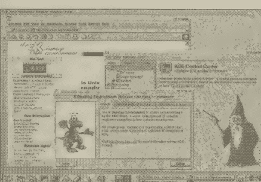

如果你在此之后仍在使用问题，一个可以尝试的方法是增加调试级别，另一个方法是尝试查看是否在 IRQ 分配上存在问题。值得注意的是，在启动时访问这些设备时，通过在 `/etc/modules` 结尾添加一行来加载 `imm` 模块。你可以看到 `/etc/ppp/`。`fetchmail -d 300` 是每隔一段时间运行的 `fetchmail` 脚本

## 回答 | LINUX

## 硬件


## 回答 | 硬件

## 目录

| 主题 | 页码 |
|---|---|
| 新手 | 74 |
| ATA100 与 hdparm | 74 |
| 照相机？ | 74 |
| 驱动没有 | 75 |
| PCIA | 75 |
| 燃烧问题 | 76 |
| 驱动测试 | 76 |
| 艺术失败 | 77 |
| 写入 | 77 |
| 棘手 | 78 |

## 硬件

### ATA100 与 hdparm

> 我使用 fetchmail 从我的服务器下载邮件。我可以让它在在线时自动运行吗？

David Jones，通过电子邮件

`imm` 模块可以通过在 `rc local` 的末尾添加 `/sbin/modprobe` 来加载。如果你愿意，在 `/etc/modules` 中添加一行，启动时加载 `imm`。你将需要以 root 身份执行 `depmod -a`，但之后每当你访问 `/dev/pda` 设备，`imm` 模块就会加载。

现在你应该看到速度提升

Chris Fox

作为一个 Linux 新手，我喜欢尝试。这太棒了，但我现在需要一些内核。

我唯一的问题是每次启动都必须以 root 登录并 `/modprobe`

```
hdparm -c1 -m16 /dev/sda
```

有什么建议知道我在哪里可以下载传真软件吗？SuSE 发行版中似乎没有。

SUSE 7

### 照相机？

我想为我丈夫买一台数码相机，他使用 Linux（我对系统一无所知）。总之，兼容的相机列表非常有帮助，只是很多产品已经更新了。例如，我感兴趣的两个相机：佳能 c530 和洋葱 A10/A20 以及洋葱-c60。

至于软件，HylaFax 是 Linux 下最好的软件包之一。你可以从 www.hylafax.org 下载。如果它不能满足你的需求，那么 fresh.net 有广泛的替代方案：http://fresh.net/browse/36/

你能告诉我这些更新后的型号是否兼容 Linux 吗？我尝试过联系制造商，但没有结果，

## 硬件

似乎没听说过 Linux，或者不想了解任何非微软体系的设备。

单个模块的源代码。重新构建一个干净的内核树可能是一个选项，因为许多发行版使用了非标准内核并进行了大量的补丁，这使得它们很难恢复到标准的“原版”（vanilla）内核。发行版的创建者通常会在他们的网站或 FTP 服务器上提供更新的内核源码和内核二进制包供使用。

Louise Smith，通过邮件

gPhoto 2.0（访问 w.gphoto.org）是一种用于数字相机的软件。在最新版本中，它支持佳能 Powershot A10 和 A20。

Olympus C-860L 虽然没有被 gPhoto 完全支持（尽管我收到报告它可能与 Linux USB 存储驱动程序工作）。第一种方案，通过 gPhoto 使用相机是最容易的。你只需要下载并运行最新版本的软件即可。然而，USB 存储驱动程序在使用之前可能需要一些设置。（取决于你的机器如何设置以及你使用的是哪个版本的 Linux，可能需要重新编译内核。一旦设置好就可以使用。存储在相机上的照片可以像存储在远程磁盘上的文件一样访问（事实上，它们就是那样的！）

## 驱动器无法工作

我可以帮你解决一个我自己似乎无法解决的问题。我无法在 Mandrake 8 上访问我的驱动器。每当我尝试查看 /mnt 目录时，我的电脑就会挂起。

我在终端窗口或 shell 中尝试列出目录时也遇到了类似的问题，所以这并不是 Conquer 的特定问题。Palmer Carter, Cardiff

## Zio USB 智能媒体

我目前正尝试让一个 microtech USB 读取器在 Linux 上工作。我找到了一个实现它的指南，涉及重新编译内核，并支持 SanDisk 读取器（SDR0）——这似乎存在几个问题。

问题的关键在于，必须将 SDR09 驱动程序编译为模块，并使用 `insmod` 或 `modprobe` 将其添加到现在的内核中。

Mandrake 8 挂载守护进程（mount daemon）似乎偶尔会在移动驱动器上出现问题（遗憾的是，这正是我的初衷）。我在我的 IDE 驱动器上遇到了相同的问题——如果里面没有磁盘，任何查看 `/mnt` 目录的进程一直等待（或者更准确地说，直到我杀死该进程）。

Alec Young

你没有提到你使用哪种发行版，Alec，但它们会有一个包含内核源码的软件包（例如来自 RedHat），你可以在该额外模块中进行重新配置和重建。

简单的解决方案是禁用守护进程并重新制作。编辑你的 `/etc/stab` 文件使驱动器能够被检测，例如，

你可以在需要时挂载和卸载。你可能只需要对一个驱动器操作——CD-ROM 驱动器通常没问题，但其他驱动器，尤其是由于某些原因 IDE 驱动器，可能会引起问题

## PCMCIA 支持

要将其作为模块构建，你首先需要内核源码，即使你已经


我有一台 IBM A20M 笔记本电脑，正在往里面安装 30GB 硬盘和 512MB 内存。我需要运行一些 Windows 应用程序，特别是 MYOB 会计软件包。我有两个 CD 刻录机，我想知道是否任何一个可以在 Linux 下工作。

我连接了一个火线线（FireWire）PCMCIA 卡到外部 Max 40GB 驱动器，我用它进行备份。Red Hat 7.x 和 SuSE 7.x 如预期地检测到了所有硬件。Winmod。我本希望你能推荐一个好用的支持 PCMCIA 的调制调器，或者调制调器/10-100 网卡组合。你知道 PCMCIA HP CD-Writer PLUS M20、CD 刻录机，或 USB ZIP CD 650 CD 刻录机如何在 Linux 下工作吗。我想 Linux 是否已经支持火线 PCMCIA 设备。

Shane Broomholm, 澳大利亚布里斯班

## 疑问

> 我知道答案一定很简单，但我想不出来。问题是：我如何用我的 CD 刻录机将图像（JPEG, TIF, GIF 等）保存到 CD 中？在 Windows 下我可以轻松做到，但在 Linux 下无论是使用 `gtoaster`、`xdraft` 还是 `create cd` 都无法实现。你能指点我一下吗？* 来自论坛

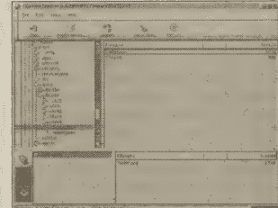

`Gtoaster` 允许你将文件拖入它创建的 ISO 文件系统。

如果你有一个包含文件的目录，

`3com` 制作了许多非常好的 PCMCIA 网络/调制调器卡。我的笔记本里有一张 `3CCEM556-B` 卡，它在 Linux 中运行得完美。`D-Link`。许多其他制造商都有自己的 PCMCIA 型，但你应该检查 `pcmia-csforge.net` 以获取对比列表。现在有很多 PCMCIA Windows 调制调器，有些 `3com` 型号因为 PCMCIA 驱动程序无法在 Linux 下工作，应该被识别为 IDE 控制器，因此你可以使用 `ide-scsi` 模块允许它们作为 SCSI 设备刻录 CD。值得记住，Linux 不支持 PCMCIA 设备（如 CD 刻录机和智能媒体适配器），因此你必须运行 `x`。

## 驱动器测试

我刚买了一个 DVD-RW 驱动器，我想用它刻录 DVD。在 Windows 下运行良好，但在 Linux 下它没有显示。我需要做什么让它工作？这是一个内部驱动器。


第一种方案，通过 `gPhoto` 使用相机是最容易的。你只需要下载并运行最新版本的软件。然而，USB 存储驱动程序在使用之前可能需要一些设置。（取决于你的机器如何设置以及你使用的是哪个版本的 Linux，可能需要重新编译内核。一旦设置好就可以使用。存储在相机上的照片可以像存储在远程磁盘上的文件一样访问（事实上，它们就是那样的！）

你可以使用 `ide-scsi` 模块允许它们作为 SCSI 设备刻录 CD。值得记住，Linux 不支持 PCMCIA 设备（如 CD 刻录机和智能媒体适配器），因此你必须运行 `x`。

`Gtoaster` 允许你将文件拖入它创建的 ISO 文件系统。

如果你有一个包含文件的目录，

`3com` 制作了许多非常好的 PCMCIA 网络/调制调器卡。我的笔记本里有一张 `3CCEM556-B` 卡，它在 Linux 中运行得完美。`D-Link`。许多其他制造商都有自己的 PCMCIA 型，但你应该检查 `pcmia-csforge.net` 以获取对比列表。现在有很多 PCMCIA Windows 调制调器，有些 `3com` 型号因为 PCMCIA 驱动程序无法在 Linux 下工作，应该被识别为 IDE 控制器，因此你可以使用 `ide-scsi` 模块允许它们作为 SCSI 设备刻录 CD。值得记住，Linux 不支持 PCMCIA 设备（如 CD 刻录机和智能媒体适配器），因此你必须运行 `x`。

## 硬件

控制卡上的跳线已设置并加载了 `aha1542` 模块，但我不知道接下来该做什么才能开始使用新驱动器。

这些驱动器是可用的。除了它们安装了更多软件之外，你所经历的问题（比如鼠标无法工作）容易解决得多，因为你实际上可以对其进行重新配置。只需通过移除驱动器来卸载 SuSE 发行版，然后安装新的。由于你来自新加坡，我不确定你如何从网上下载获取你选择的发行版，但会有人提供廉价的热门发行版 CD-R 光。

你能给我提供一些关于设置 SCSI 设备的基础说明吗？来自论坛的 Steve

从 Linux 的角度来看，SCSI 和 IDE 没太大区别，一旦加载了模块，你就可以通过 `/dev/sda` 设备访问驱动器。一旦加载了 `aha1542` 模块，检查 `/proc/scsi/aha1542/0` 并查看它包含哪些设备。如果没有检测到，请检查电缆的端接情况以及 SCSI BIOS，以排除任何基于 Linux 的问题。

## 刻录相关

我想买一张 CD-R，在 Watford Electronics 网站看到一张看起来很划算——反正很便宜。因为我有 LG `CD808008`。

由于 Quest 驱动器是可拆卸的，你可能想设置一个 `supermount`/`automount` 条目，就像软磁盘或 CD 驱动器一样，这样当目录文件系统挂载时，计算机就会挂载它。

我看了 SuSE 网站，只列出了一种 CD-R，而且文字是英文的，但阅读 SuSE 手册似乎表明任何 CD-R 都可以使用。

你能回答吗？

我安装了带有 2.4 内核的 SuSE Linux 7.1。我发现它非常有吸引且设置简单，但有一个问题：如何移动鼠标！我尝试了使用键盘方法重新运行 `YaST2`，而且我在一些书里读过并尝试了 `SaX`，但还是不行。也许我做错了什么，需要更多的指导？

来自论坛的 Anthony

- 问题：
1) 我该如何让鼠标工作起来？
2) 我想重新安装，但没有关于卸载和重新安装的说明。该如何操作？

所有最近的连接 IDE 接口的 CD-R 设备都支持，因此不需要 Linux 逐一支持。然而，你需要使用 `ide-scsi` 模块，以便 `crecord` 等刻录工具可以访问驱动器，这在 `www.linuxdoc.com` 的 CD-Writing HOW-TO 中有所介绍。

## 疯狂的鼠标

请建议，因为我正着迷于 Linux，但看不到如何继续下去的方法。SK Kong

## 硬性目标

我买了一个新的 AMD Athlon 550，并在上面安装了 Mandrake 8.0。它已经运行了一天，进入了级别 5，但我注意到当我按下 `[Ctrl][Alt]+F2` 获取控制台时，控制台上重复出现以下晦涩且可怕的信息：

```
hdatima: err=0x84 (DriveStatusErrorBadCRC)
hda: dma:status=0x51 (DriveReadSeekErrorError)
```

看起来我有点担心。这意味着什么，我必须怎么做才能消除它？此外，这与 Mandrake 安装有关，还是与我这台新机器有关？

SuSE live 并不是并不是为重新配置而设计的，所以你在使用 `YaST2` 时会遇到问题。如果你认真考虑 Linux，最好从正式的启动开始，使用 SuSE、Mandrake、Red Hat 或其他任何版本。

来自论坛的 Gavagai

我打印机使用了 USB 和并行线，发现 USB 打印和并行打印之间存在速度差异，但质量差异是巨大的。

假设 `hda` 是硬盘，那确实是件坏事——首先，你可能想使用 `hdparm -d 0 /dev/hda` 关闭 DMA，然后看看是否还有错误。IDE 控制器（特别是来自 VIA 的）DMA 问题直到 2.4 内核的一些发行版本才被解决。你还应该检查硬盘和主板之间的内部连接，确保它们已完全连接。

Mandrake 能够正确识别打印机并在通过并行端口连接时对其进行设置，但连接到 USB 时，它需要一些折腾。

我折腾了一些我不了解 Mandrake 的东西，所以这可能在我的机器上产生影响，不过由于并行电缆相对廉价。

来自论坛的 illy

在何种情况下，你都需要对磁盘上的所有分区进行彻底的 `fsck`，以确保文件系统没有损坏。

好的。我们使用 Linux (Mandrake 7.2) 搭建了办公室服务器，运行良好，USB zip 驱动器正常，USB 打印机正常，samba 正常，服务器等等……但可以吗？不需要详细说明，即在我们家里，如何像使用硬盘一样使用 CD-R/W 驱动器，通过以方式准备 CD/W 磁盘，我们就可以在其中拖放文件。现在，CD-R/W 在网络中共享，但我如何让它具有相同的功能？

来自论坛的 Yakkerti

决定你打印机类型的主要因素是缓存大小。这决定了你可以发送多少信息，假设你了解每种方式如何影响刻录速度和功能，问题将会很少。

Zip 驱动器有多种类型，从 IDE 到并行口到 SCSI，你访问 Zip 驱动器的方法取决于你的特定型号。IDE 和 SCSI 模型 Linux 足够在启动时识别它们，你可以直接移动它们，或者使用 `/dev/sda4` 或 `/dev/sda4` 设置稍微复杂，它们依赖于内核中的 `ppa` 模块。所有 Zip 驱动器的 Linux 文档都可以在 `www.linuxdoc.com` 获取。

你还需要 `mkiso` 来创建 ISO99660 文件系统，你在 CD 上存储数据时需要它。它将从目录结构或文件构建文件系统，你可以使用回环设备检查它是否编码了文件名，然后使用 `cdrecord` 将其刻录到 CD。

`gtoaster` 是 `cdrecord` 一个非常有用的前端，它结合 `cdrecord`、`mkiso` 以及许多其他工具来帮助你避免浪费太多光盘。

## 硬件

平板电脑一直连接着，有什么办法让控制台识别它吗？

Julia，通过邮件

如果能提供 RPM 格式的，将不胜感激。

John Wallis，通过邮件

- 简而言之，它在 `gpm` 下运行应该没问题，但请检查你的版本是否高于 1.18.1；之前的版本不支持 `graphire`。你可以尝试（如果 `wacom` 是你唯一的 USB 服务设备，否则检查 `/proc/usb`）。

  `killall gpm; -t wacom -m dev/wttyUSB`

- 是的，Linux 确实有一个驱动可以让 IDE（或适当的 ATAPI）驱动看起来和 SCSI 驱动器一样。好消息是你已经拥有这个驱动了——它随 Linux 内核一起而来——所以不需要安装 RPM 或其他东西。坏消息是，在使用之前你可能需要重新编译内核。别担心，这听起来没有那么可怕。如果你已经编译了内核，请查看我们在 Linux Format Issue 03 或 HOWTO 中的教程。

## 佳能 Canon

你有三个内核驱动需要关注。首先是 IDE 磁带驱动器——它允许你通过接口 `/dev/hda0` 访问驱动器（因为你只有一个磁带机）；其次是 SCSI 仿真驱动——它欺骗你的系统让其认为 ATAPI 设备是 SCSI；第三是 SCSI 驱动（与上一个结合使用），通过 `dev/sda` 创建。

如果你足够好，这些驱动程序已经作为内核模块安装在你的系统上了。请在 `/lib/modules/<KVER>/build` 目录中查找 `ide-tape` 和 `ide-scsi` 文件，并在 `/lib/modules/<KVER>/scsi` 目录中查找（其中 `<KVER>` 是你的内核版本）。如果它们都在，你就可以选择 `dev/hda` 或 `dev/sda` 作为驱动器，而无需额外的内核。

Sarah，通过邮件


# Linux 问答集

## 打印机与 USB

你会发现打印机在 Mandrake 7.2 下通过 USB 端口运行良好。至少，Mandrake 会找到该设备。但不确定 Mandrake 7.2 是否包含了 CUPS 系统以及为各种打印机提供 CUPS 兼容驱动的 G-Print。

针对 BCJ3000 的 G-print 是为了工作设计的，但目前如果发现它能工作，请你访问 `g-source.net` 并告诉他们，开发者将不胜感激。

如果由于某种原因 Mandrake 无法通过 USB 使用你的打印机，通过并行端口连接应该是没问题的。大多数打印机都能接受，只要你不要尝试同时与多个接口进行通信！

如果还是不行，你就必须进行一些内核编译。进入内核配置的“块设备”页面。选择 ATAPI 驱动（如果不需要则关闭）并将 SCSI 仿真驱动选择为模块。然后进入 SCSI 支持页面，并将 SCSI 磁带驱动选择为模块。保存配置，编译并安装你的新内核，然后重启机器。

## SCSI 欺骗

我理解有一个驱动仿真器，可以让我把我的 IDE 驱动器伪装成 SCSI 磁带驱动器。

## 不稳定的软盘

我已经用 Linux 使用 LS-120 有了一段时间了，没有什么大问题。为了使用 LS-120，你可以将 IDE/ATAPI 支持编译到内核中（尽管你也可以直接使用模块）。

## 回答 | LINUX | 8

### 硬件

对于我们使用 `menuconfig` 的人来说，这位于“块设备”下。安装启动盘问题可能会发生，因为安装程序几乎肯定在寻找 `/dev/td0`，而 LS-120 作为一个 ATAPI 设备，不会出现在那里！所以买一个软盘驱动器是最简单的选择。

一旦你运行了 Linux，你可以通过创建一个从 `/dev/hdX`（其中 X 是驱动器字母）到 `/dev/floppy` 和 `/dev/td0` 的链接，让你的 LS-120 在实际上看起来像是一个普通的软盘。

至于用于普通磁盘的 LS-120，我们没有遇到问题。设备会根据你的 IDE 通道显示为相应的 `/dev/hdX`，并能识别 3.5 英制软盘或 LS-120 的存在。`mtools` 也可以传输文件到 MSDOS 格式的磁盘。请注意这行代码：

```
b: file="/dev/hdX"
```

```
mformat -t 963 -h 8 -n 32 b:
```

其中 b 是你上面所示为 LS-120 分配的字母。然而，我们没有 LS-120 驱动器来测试。你的驱动器没有报告物理几何结构，这令人担忧。你安装的 IDE 驱动版本有一个 bug。你可以尝试升级到更好的内核，或者尝试 IDE SCSI 仿真。

### 移动音乐

我从 Maycom 给妻子买了一个 Merit MP-100 MP3 播放器。问题是我如何使用提供的高速 MMC 外部读取器写入可移动闪存多媒体卡。我有打印机连接。请帮帮，我搜索了整个网络一无所获。

如果可以，是否可以使用 Fresco 路由器。我刚刚设置了一台旧的 486 作为 Fresco 路由器，并试图了解它的功能。确定有很多人正在实验他们的旧机器。

John, Essex

必须是这样才对，我没能在 Linux 下在 LS-120 上成功格式化 mdos 文件系统，而那是最有用的文件系统。

## 声音

### 声音

84 | LINUX | 回答

### 目录

| 主题 | 页码 | 主题 | 页码 |
| --- | --- | --- | --- |
| 构建声音支持 | 86 | 挑剔的音频系统 | 89 |
| 静音运行 | 87 | 语音识别 | 89 |
| 标签处理 | 87 | 沉默并非金 | 89 |
| 沉默之声 | 87 | 声音即金钱 | 89 |
| 沉默是金 | 87 | | |
| 声卡困扰 | 88 | | |
| 声音建议 | 88 | | |

## 声音

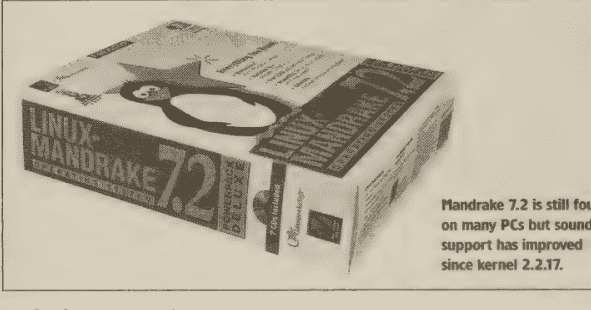

### 构建声音支持

我有一个 Mandrake 7.2 豪华增强包，它不支持我的声卡。下载了 `alsa-driver-0.5.11` 文件后，我一直尝试为 als4000 声卡制作 alsa-driver。我发现尝试尝试：

```
configure --cards=als4000 --with-kernel=/usr/src/linux-2.2.17
```

运行 `install` 时没有显示明显的错误信息。在输出结束时显示了：

```
make [1]: "[sound.o] Error 1
make [1]: leaving directory "/usr/src/alsa-driver-0.5.11/kernel"
make: "[compile] Error 1
```

检查 `config.log` 显示：

```
Config; failed program was:
#line 1773 'config'
#include <confdef.h>
#include /usr/src/linux-2.2.17/linux/autoconotest.h
int main(void) {
#ifdef CONFIG_SMP
exit(1);
#else
exit(0);
#endif
}
```

当我运行 `make install` 时，在输出最后得到如下：

```
make [1]: "[sound.o] Error 1 make [1]: leaving directory directory=/usr/src/alsa-driver-0.5.11/kernel* make:
[compile] Error 1
```

我怀疑我漏掉了某些明显的。

Ian Topp

Mandrake 7.2 仍然出现在很多 PC 上，但声音支持自内核 2.2.17 以来有所改进。

> `config.log` 文件是由 `configure` 脚本产生的，只要它运行正常，该文件中的任何错误都无关。你提供给我们的错误没有告诉我们任何信息，除了它在构建 `kernel.so` 时失败了，因此你需要调查由 `gcc` 产生的具体错误，以查看是什么原因导致了问题。首先，你可能需要检查 `/usr/src/linux-2.2.17` 中是否存在功能源码，并且 `make` 需要针对你将要使用的内核进行编译。你可能还想调查 2.2 版本（最新为 2.2.0）或 2.4 内核对你声卡的支持。

> 你不想在运行 `make` 之前运行 `make install`，因为它会在执行过程中不断安装，通常在出现问题时，你最终将得到一个无疑会破坏原始安装版本的安装结果。你发送给我们的错误是 `make` 产生的错误，表示 `makefile` 的执行（在此情况下）失败了，所以它会直接停止。你没有说 `gcc` 的错误是什么，因此要进一步诊断任何问题有些困难。

86 | LINUX | 回答

### 静音运行

我有一台 850MHz 的 Athlon，运行 Mandrake 8.0。我最近买了一块声卡（Xwave 7000），它使用 C-Media 驱动（我想）。它运行良好，KDE 播放它的加载音乐，`xmms` 也能完美播放我所有的 MP3。

问题出在 `xine` 上。我尝试带有流畅视觉效果的《黑客帝国》，但我无法让它输出音频。我尝试过使用 `esd`、`alsa` 和 `oss` 设置 A-flag，并尝试了几个通道，它告诉我正在使用 OSS，而我想我安装了 ALSA。为什么 `xine` 可以工作，其他所有应用什么时候能行？

Chris Nash

> 文件中包含的信息，所以你可能需要手动输入。你可以使用类似 EasyTag (`easytag.sourceforge.net`) 的工具手动添加标签，但如果你想自动完成，请使用 Grip (配合 `www.nottagged.org/grip/`) 从一开始就创建 MP3 文件。如果文件名中包含了信息，你可以写一个脚本将这些信息重写到 ID3 空间，但具体机制取决于文件名。

### 沉默之声

当我启动进入 Mandrake 7.2 并尝试通过 XMMS 播放 mp3 音频轨道时，它经常给出“could open audio”（打开音频）的错误。如果我选择选项/偏好，并将输出插件从默认（OSS 驱动程序）更改为选项并点击“应用”，然后再回到默认并点击“应用”，一切都能正常工作。

我确定声卡设置是正确的，因为如果我使用 Media Player 播放则没有问题。我在 XMMS（版本 1.2.3）中遇到的问题，或者是有

> 文件中包含的信息，所以你可能需要手动输入。你可以使用类似 EasyTag (`easytag.sourceforge.net`) 的工具手动添加标签，但如果你想自动完成，请使用 Grip (配合 `www.nottagged.org/grip/`) 从一开始就创建 MP3 文件。如果文件名中包含了信息，你可以写一个脚本将这些信息重写到 ID3 空间，但具体机制取决于文件名。

### 标签处理


当我启动进入 Mandrake 7.2 并尝试通过 `XMMS` 播放 `mp3` 音频轨道时，它经常给出“could open audio”（打开音频）的错误。如果我选择选项/偏好，并将输出插件从默认（`OSS` 驱动程序）更改为选项并点击“应用”，然后再回到默认并点击“应用”，一切都能正常工作。

我确定声卡设置是正确的，因为如果我使用 Media Player 播放则没有问题。我在 `XMMS`（版本 1.2.3）中遇到了问题，或者是有

> 文件中包含的信息，所以你可能需要手动输入。你可以使用类似 `EasyTag` (`easytag.sourceforge.net`) 的工具手动添加标签，但如果你想自动完成，请使用 `Grip` (`www.nottagged.org/grip/`) 从一开始就创建 `MP3` 文件。如果文件名中包含了信息，你可以写一个脚本将这些信息重写到 `ID3` 空间，但具体机制取决于文件名。

## 沉默是金

当我启动进入 Mandrake 7.2 并尝试通过 `XMMS` 播放 `mp3` 音频轨道时，它经常给出“could open audio”（打开音频）的错误。如果我选择选项/偏好，并将输出插件从默认（`OSS` 驱动程序）更改为选项并点击“应用”，然后再回到默认并点击“应用”，一切都能正常工作。

我确定声卡设置是正确的，因为如果我使用 Media Player 播放则没有问题。我在 `XMMS`（版本 1.2.3）中遇到了问题，或者是有

## 声卡困扰

当我启动进入 Mandrake 7.2 并尝试通过 `XMMS` 播放 `mp3` 音频轨道时，它经常给出“could open audio”（打开音频）的错误。如果我选择选项/偏好，并将输出插件从默认（`OSS` 驱动程序）更改为选项并点击“应用”，然后再回到默认并点击“应用”，一切都能正常工作。

我确定声卡设置是正确的，因为如果我使用 Media Player 播放则没有问题。我在 `XMMS`（版本 1.2.3）中遇到了问题，或者是有

## 声音建议

当我启动进入 Mandrake 7.2 并尝试通过 `XMMS` 播放 `mp3` 音频轨道时，它经常给出“could open audio”（打开音频）的错误。如果我选择选项/偏好，并将输出插件从默认（`OSS` 驱动程序）更改为选项并点击“应用”，然后再回到默认并点击“应用”，一切都能正常工作。

我确定声卡设置是正确的，因为如果我使用 Media Player 播放则没有问题。我在 `XMMS`（版本 1.2.3）中遇到了问题，或者是有

对于调制解调器，你可能不会那么幸运，因为它是由 `CPU` 驱动的 `WinModem`。如果你急需解决办法，可以尝试尝试 `www.liwmodems.org` 上的内核模块，但如果你打算使用 Linux 访问互联网，购买一个外部串行调制解调器会更有利。

我检查了雅马哈（`Yamaha`）的网站，但没有提到 Linux 驱动程序，这意味着我的声卡没有可用驱动吗？如果我的主板上有一个空闲的 `PCI` 插槽，我可以在那里插一张卡并使用它吗？

Kevin Wias

### 挑剔的音频系统

我正在运行 Mandrake 7.2。奇怪的是，声音在 `GNOME` 中总是正常工作，但在 `KDE` 中只工作过一次。我尝试过开启 `knix` 运行，也尝试过关闭 `knix` 运行，我甚至把所有旋钮都拧到了最大！Chris，通过邮件提供

Linux 支持几种雅马哈音频芯片组，除非你告诉我们是哪一种，否则我们帮不上什么忙。请在 Windows 控制面板中的相关部分查找此类信息。Core 基于旧的内核和软件，因此你可能通过升级到较新的内核或使用 `www.alsa-project.org` 的 `ALSA` 音频驱动包获得更好的支持。

`GNOME` 使用名为“`Esound`”的音频服务来混合多个应用程序的音频。`KDE` 不支持这种音频，因此任何 `KDE` 应用程序尝试连接音频时都无法成功。一旦 `KDE` 启动运行，如果你使用的是 Linux，请执行 `do pas xi grep` 或 `esd` 并恰当地杀掉它。通常 `Esound` 由 `GNOME` 自动启动，但也可能由你的发行版在 `/etc/rc.init.d` 中启动。

如果 Mandrake 在 `KDE` 中无法工作，尝试使用 `mpg123` 或 `play` 运行音频文件并查看错误信息是什么。

由于你的声卡是集成的，它可能是一个基于 `OPL3-SA` 的设备。该芯片受内核驱动程序和 `ALSA` 支持。我认为这是一个 `PNP`（即插即用）设备，但你可能需要一些手动配置。你可能会发现去买一张 `PCI` 声卡并插到空闲插槽中更简单。是的，它可以工作，而且 `PCI` 卡通常很容易就能运行。我推荐 `Soundblast PCI` 范围内的任何产品。旧型号现在可能很便宜地买到，而且它们都有 Linux 的良好支持。

## 语音识别

我读过很多关于 PC 语音识别的内容。我可以在 Linux 上使用这些吗？Marion，通过邮件提供

恢复音频设置的最简单方法是使用 `aumix`。这将你的设置保存到 home 中（使用任何混声器），然后执行 `aumix -S`。这会将当前的音频设置存储在 `~/.aumix` 或 `/etc/aumix/`（如果你正在运行的话）。使用 `aumix -L` 恢复设置！你可能想保存根目录下的设置，然后在 `/etc/rc.local` 中添加一行，以便在重启时恢复你的设置。

Linux 有许多语音识别软件可用，但最流行的之一是 `Sphinx`。请查看：`www.speech.cs.mu.com/sphinx`

## 黄金时刻保持静音

我在 Win 98 中单独安装了内核，但我听不到任何声音。我运行了 `sndconfig`，消息显示为“未检测到 `PCI` 或 `PNP` 声卡”。我的主板上集成了 Intel Bex 雅马哈声卡。

## 桌面

| 主题 | 页码 |
|---|---|
| 用于 konsole 的鼠标 | 92 |
| Mandrake 7.0 Deluxe | 92 |
| KDE 还是 GNOME？ | 93 |
| 启迪我 | 93 |
| 锁定 | 94 |
| 死亡屏 | 94 |
| 小字体，大问题 | 95 |
| 频率是多少？ | 96 |
| 请不要 X，我们是英国人 | 96 |
| 感受力量 | 96 |
| 离开边缘 | 97 |
| 回归黑色 | 97 |

## 目录

| 主题 | 页码 | 主题 | 页码 |
| --- | --- | --- | --- |
| 字体丢失 | 98 | 登录问题 | 102 |
| GUI 崩溃 | 98 | KDE 令人恼恼 | 103 |
| KDE 在哪里？ | 99 | Gnome 独处 | 103 |
| 红帽蓝调 | 99 | 屏幕分辨率 | 103 |
| 高度焦虑 | 99 | 大银幕 | 104 |
| 窗口切换 | 99 | 定制化 | 104 |
| SuSE 友好？ | 100 | XFree86 | 104 |
| X 恰到好处 | 100 | 使用 X | 104 |
| 声音与视觉？ | 101 | 字体失效 | 104 |
| 闪烁的蜥蜴 | 102 | 文件分类？ | 105 |
| 大小很重要 | 102 | | |
| 屏幕打印 | 102 | | |

## 桌面

按照下面的说明在 X 中设置 IBM ScrollPaint。

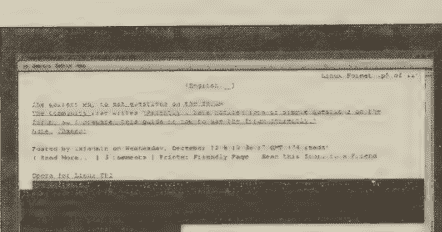

## 用于 konsole 的鼠标

我正在使用 Mandrake 8.0，需要对以下问题提供帮助：是否可以在 `KDE` `Konquer` 管理器中根据详细格式日期对文件进行排序？如何配置 IBM Scroll 鼠标？该程序只能从终端（`konsole`）运行，所以有一种方法可以复制到：`imwheel &`

一旦 `KDE` 启动运行，如果你使用的是 Linux，请执行 `do pas xi grep` 或 `esd` 并恰当地杀掉它。通常 `Esound` 由 `GNOME` 自动启动，但也可能由你的发行版在 `/etc/rc.init.d` 中启动。

如果 Mandrake 在 `KDE` 中无法工作，尝试使用 `mpg123` 或 `play` 运行音频文件并查看错误信息是什么。

由于你的声卡是集成的，它可能是一个基于 `OPL3-SA` 的设备。该芯片受内核驱动程序和 `ALSA` 支持。我认为这是一个 `PNP` 设备，但你可能需要一些手动配置。你可能会发现去买一张 `PCI` 声卡并插到空闲插槽中更简单。是的，它可以工作，而且 `PCI` 卡通常很容易就能运行。我推荐 `Soundblast PCI` 范围内的任何产品。旧型号现在可能很便宜地买到，而且它们都有 Linux 的良好支持。

## 语音识别

我读过很多关于 PC 语音识别的内容。我可以在 Linux 上使用这些吗？Marion，通过邮件提供


恢复音频设置的最简单方法是使用 `aumix`。这将你的设置保存到 `home` 中（使用任何混声器），然后执行 `aumix -S`。这会将当前的音频设置存储在 `~/.aumix` 或 `/etc/aumix/`（如果你正在运行的话）。使用 `aumix -L` 恢复设置。你可能想保存根目录下的设置，然后在 `/etc/rc.local` 中添加一行，以便在重启时恢复你的设置。

Linux 有许多语音识别软件可用，但最流行的之一是 Sphinx。请查看：`www.speech.cs.mu.com/sphinx`

## 黄金时刻保持静音

我在 Win 98 中单独安装了内核，但我听不到任何声音。我运行了 `sndconfig`，消息显示为“未检测到 PCI 或 PNP 声卡”。我的主板上集成了 Intel Bex 雅马哈声卡。

## 桌面

| 主题 | 页码 |
|---|---|
| 用于 konsole 的鼠标 | 92 |
| Mandrake 7.0 Deluxe | 92 |
| KDE 还是 GNOME？ | 93 |
| 启迪我 | 93 |
| 锁定 | 94 |
| 死亡屏 | 94 |
| 小字体，大问题 | 95 |
| 频率是多少？ | 96 |
| 请不要 X，我们是英国人 | 96 |
| 感受力量 | 96 |
| 离开边缘 | 97 |
| 回归黑色 | 97 |

## 目录

| 主题 | 页码 | 主题 | 页码 |
| --- | --- | --- | --- |
| 字体丢失 | 98 | 登录问题 | 102 |
| GUI 崩溃 | 98 | KDE 令人恼恼 | 103 |
| KDE 在哪里？ | 99 | Gnome 独处 | 103 |
| 红帽蓝调 | 99 | 屏幕分辨率 | 103 |
| 高度焦虑 | 99 | 大银幕 | 104 |
| 窗口切换 | 99 | 定制化 | 104 |
| SuSE 友好？ | 100 | XFree86 | 104 |
| X 恰到好处 | 100 | 使用 X | 104 |
| 声音与视觉？ | 101 | 字体失效 | 104 |
| 闪烁的蜥蜴 | 102 | 文件分类？ | 105 |
| 大小很重要 | 102 | | |
| 屏幕打印 | 102 | | |

## 桌面

按照下面的说明在 X 中设置 IBM ScrollPaint。


## 用于 konsole 的鼠标

我正在使用 Mandrake 8.0，需要对以下问题提供帮助：是否可以在 KDE Konquer 管理器中根据详细格式日期对文件进行排序？如何配置 IBM Scroll 鼠标？该程序只能从终端（`konsole`）运行，所以有一种方法可以复制到：`imwheel &`

一旦 KDE 启动运行，如果你使用的是 Linux，请执行 `do pas xi grep` 或 `esd` 并恰当地杀掉它。通常 Esound 由 GNOME 自动启动，但也可能由你的发行版在 `etc/rc.init.d` 中启动。

如果 Mandrake 在 KDE 中无法工作，尝试使用 `mpg123` 或 `play` 运行音频文件并查看错误信息是什么。

由于你的声卡是集成的，它可能是一个基于 OPL3-SA 的设备。该芯片受内核驱动程序和 ALSA 支持。我认为这是一个 PNP 设备，但你可能需要一些手动配置。你可能会发现去买一张 PCI 声卡并插到空闲插槽中更简单。是的，它可以工作，而且 PCI 卡通常很容易就能运行。我推荐 Soundblast PCI 范围内的任何产品。旧型号现在可能很便宜地买到，而且它们都有 Linux 的良好支持。

## 语音识别

我读过很多关于 PC 语音识别的内容。我可以在 Linux 上使用这些吗？Marion，通过邮件提供

恢复音频设置的最简单方法是使用 `aumix`。这将你的设置保存到 `home` 中（使用任何混声器），然后执行 `aumix -S`。这会将当前的音频设置存储在 `~/.aumix` 或 `/etc/aumix/`（如果你正在运行的话）。使用 `aumix -L` 恢复设置。你可能想保存根目录下的设置，然后在 `/etc/rc.local` 中添加一行，以便在重启时恢复你的设置。

Linux 有许多语音识别软件可用，但最流行的之一是 Sphinx。请查看：`www.speech.cs.mu.com/sphinx`

## 黄金时刻保持静音

我在 Win 98 中单独安装了内核，但我听不到任何声音。我运行了 `sndconfig`，消息显示为“未检测到 PCI 或 PNP 声卡”。我的主板上集成了 Intel Bex 雅马哈声卡。

## 桌面

| 主题 | 页码 |
|---|---|
| 用于 konsole 的鼠标 | 92 |
| Mandrake 7.0 Deluxe | 92 |
| KDE 还是 GNOME？ | 93 |
| 启迪我 | 93 |
| 锁定 | 94 |
| 死亡屏 | 94 |
| 小字体，大问题 | 95 |
| 频率是多少？ | 96 |
| 请不要 X，我们是英国人 | 96 |
| 感受力量 | 96 |
| 离开边缘 | 97 |
| 回归黑色 | 97 |

## 目录

| 主题 | 页码 | 主题 | 页码 |
| --- | --- | --- | --- |
| 字体丢失 | 98 | 登录问题 | 102 |
| GUI 崩溃 | 98 | KDE 令人恼恼 | 103 |
| KDE 在哪里？ | 99 | Gnome 独处 | 103 |
| 红帽蓝调 | 99 | 屏幕分辨率 | 103 |
| 高度焦虑 | 99 | 大银幕 | 104 |
| 窗口切换 | 99 | 定制化 | 104 |
| SuSE 友好？ | 100 | XFree86 | 104 |
| X 恰到好处 | 100 | 使用 X | 104 |
| 声音与视觉？ | 101 | 字体失效 | 104 |
| 闪烁的蜥蜴 | 102 | 文件分类？ | 105 |
| 大小很重要 | 102 | | |
| 屏幕打印 | 102 | | |

## 桌面

按照下面的说明在 X 中设置 IBM ScrollPaint。


## 用于 konsole 的鼠标

我正在使用 Mandrake 8.0，需要对以下问题提供帮助：是否可以在 KDE Konquer 管理器中根据详细格式日期对文件进行排序？如何配置 IBM Scroll 鼠标？该程序只能从终端（`konsole`）运行，所以有一种方法可以复制到：`imwheel &`

一旦 KDE 启动运行，如果你使用的是 Linux，请执行 `do pas xi grep` 或 `esd` 并恰当地杀掉它。通常 Esound 由 GNOME 自动启动，但也可能由你的发行版在 `etc/rc.init.d` 中启动。

如果 Mandrake 在 KDE 中无法工作，尝试使用 `mpg123` 或 `play` 运行音频文件并查看错误信息是什么。

由于你的声卡是集成的，它可能是一个基于 OPL3-SA 的设备。该芯片受内核驱动程序和 ALSA 支持。我认为这是一个 PNP 设备，但你可能需要一些手动配置。你可能会发现去买一张 PCI 声卡并插到空闲插槽中更简单。是的，它可以工作，而且 PCI 卡通常很容易就能运行。我推荐 Soundblast PCI 范围内的任何产品。旧型号现在可能很便宜地买到，而且它们都有 Linux 的良好支持。

## 桌面


可能是文件权限问题，但到目前我还没有找到任何可以解决它的办法。

Simon, Essex

最好的办法是检查 `/var/log/XFree86.log`，查看是否有任何与第二个显示器相关的错误。对于 X 本身来说，这似乎是一个相当奇怪的问题，因为 X 应该具有 SUID 权限，这样它就可以以任何运行者的身份运行，或者 `/usr/x11/R6/binXFree86` 是 SUID 且所有者为 root。值得检查一下你正在尝试使用的哪种窗口管理器或桌面环境，以及普通用户是否在使用同一个环境。如果你在使用 Xinerama 扩展（该扩展允许窗口在两个显示器之间绘制），那么窗口管理器不需要感知多显示器配置，尽管像 Enrichment 和 KWM 等许多工具是感知 Xinerama 的，并且可以处理窗口放置等功能；但如果你在两个显示器上运行，窗口管理器需要知道第二个显示器的存在。


首先删除 `enrichment` 目录，因为这里可能包含由于之前的尝试产生的错误或格式错误的文件。你仍然无法运行 `Enrichment`，它很可能是因为包构建得不好导致的崩溃，你必须查阅你发行版的 FTP 服务器寻找替换品，或者从 `enrichment.org` 上提供的源码包编译 `Enrichment`。`Enrichment` 编译时需要大量的头文件，是否要费费那个精力去完成这些事取决于你你自己。

该问题的另一个可能原因是你可能使用了一个构建错误或损坏的主题文件。如果你只是使用默认设置，你可能无能为力，但如果你是从网上获取的主题，那可能会导致你的困扰。在这种情况下，`e.themes` 可能包含一些备用文件，可能会解决问题。

很少有窗口管理器（WM）是这样工作的，而 `Enrichment` 确实是唯一在这种情况下支持多显示器配置的。

你最好的选择是以普通用户身份从控制台登录并运行：

- `+xinerama`

X 将启动，并使用 Xinerama 扩展让桌面跨越两个屏幕。如果这有效，你需要编辑 `/etc/x11/xservers` 来将你的图形化登录设置为运行带有 Xinerama 扩展的 X，或者编辑脚本在 X 服务器选项中添加 `+xinerama`。所有这些在 linux.org 的 Xamer HOW-TO 中都有涵盖。检查你运行的是否最新版本的 `XFree86`（目前是 4.10），以防 mga X 驱动和 G450 之间存在问题。

## 锁定

我有一块 Matrox G450 显卡，一切运行得完美，除了当我以用户身份登录时，第二个显示器 (1) 不是激活状态。我可以启动程序、打开文件，但我无法抓取窗口列表并将程序在屏幕上移动，也无法更改桌面外观等。

## 死亡屏

当我以 root 身份登录时，一切都如预期正常工作。我猜这导致了 X 死锁。这都是在使用任何图形加速的情况下发生的。Red Hat 7 和 Mandrake 8.0 一样几乎立即锁死。

我的困惑在于：同样的 ATI 和 Banshee 在 Mandrake 7.2 和 XFree 4.0 下都运行得完美无缺，但在 Mandrake 8.0 中都死锁了。

我将我的显卡升级到了 ATI Rage Fury Pro。我有一个运行在 AGP K62-400 上的 MVP3 芯片组。在安装了我从朋友买的 SuSE 7.2 后，屏幕图像在几分钟内逐渐恶化，然后电脑完全死机。

带有 Red Hat 7 和 SuSE（使用的是最新版本的 XFree）的 Woodos 系统，而 ATI 仅在 SuSE 7.2 中短暂出现过问题。为什么？我想用 SuSE 用一段时间，而且在花 100 美元买 ATI 显卡后，我不会回到 Banshee 了。目前看来我只能坚持使用 Mandrake 7.2。

- 3. 我有一个命令可以允许我重命名目录中的大量文件。例如，如果我 Sname 它们，然后目录里有数百个以 "mod." 开头的文件，我可以将它们全部重命名为结尾（即：文件 "mod.fantasy" 变成 "fantasy.mod"）

> Ray Smith，通过邮件

Linux 有什么程序可以实现这个功能吗？我该如何使用它？

这几乎肯定与你使用的 X 服务器的兼容性有关。如果两个显卡都能在 XFree86 下工作，也许安装你提到的那个版本的 XFree86 发行版。你提到的所有发行版众所周知在 XFree86 4.10 时会有一些“问题”，尽管它是最新发布，但那里仍然存在该问题。

呼，你们不是在问我，对吧？

从第一个问题开始，这取决于哪些应用程序显示了“小字体”。如果所有程序都如此，可能是 X 安装内部的字体安装不正确，或者在 Xconf 中设置错误。最好的检查方法是查看 `/var/XFree86.log`，或者看它是否提供了任何关于问题原因的提示。这也可能是你的服务器的问题，因为你可能使用了错误的发行版，而且很难猜测你正在使用的旧版 XFree86 安装情况如何，因为它正在检查你的发行版是否有 XFree86-4.10 的更新，或者查看此处，以防 mga X 驱动和 G450 之间存在问题。


从第一个问题开始，这取决于哪些应用程序显示了“小字体”。如果所有程序都如此，可能是 X 安装内部的字体安装不正确，或者在 `Xconf` 中设置错误。最好的检查方法是查看 `/var/XFree86.log`，或者看它是否提供了任何关于问题原因的提示。这也可能是你的服务器的问题，因为你可能使用了错误的发行版，而且很难猜测你正在使用的旧版 `XFree86` 安装情况如何，因为它正在检查你的发行版是否有 `XFree86-4.10` 的更新，或者查看此处，以防 `mga` X 驱动和 `G450` 之间存在问题。


从第一个问题开始，这取决于哪些应用程序显示了“小字体”。如果所有程序都如此，可能是 X 安装内部的字体安装不正确，或者在 `Xconf` 中设置错误。最好的检查方法是查看 `/var/XFree86.log`，或者看它是否提供了任何关于问题原因的提示。这也可能是你的服务器的问题，因为你可能使用了错误的发行版，而且很难猜测你正在使用的旧版 XFree86 安装情况如何，因为它正在检查你的发行版是否有 `XFree86-4.10` 的更新，或者查看此处，以防 `mga` X 驱动和 `G450` 之间存在问题。

## 边缘问题

我有一台运行 Red Hat 6.0 的 Toshiba 100CS 笔记本，它配备了一个 1Mb 的 Chips & Technologies 65548 显卡，运行非常流畅。我遇到的问题是笔记本的最大分辨率只有 640 x 480，这对于 DE 等窗口管理器来说并不理想。多年前，我曾有一个使用 `fwm` 的配置，可以通过屏幕边缘在整个桌面上进行滚动（而不是切换）。针对这个问题，你还能给我提供什么其他建议吗？

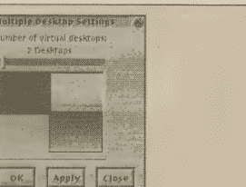

许多窗口管理器允许你设置多个桌面区域并在它们之间滚动。

`KDE` 支持多桌面，你可以通过点击任务栏中的页器（pager）来切换，但它不具备像使用 `FVWM` 那样在桌面上滚动的能力。当然，没有什么阻止你在运行 `KDE` 应用的同时运行 `FVWM`，由于 `FVWM` 不支持 `KDE` 提示（hints），应用程序的行为可能不会符合预期。市面上有很多窗口管理器，所以你可能想查看几个。尽管它们消耗的资源相当令人讨厌，但较小的、图形强度较低的 WM 如 `IceWM` 或 `Sawfish` 可能比标准的 `KDE` 窗口管理器表现得更好。

我已经尝试了文档中建议的所有方法，还有什么建议吗？

Martin Weiden

首先，你是否遵循了 NVIDIA 软件包的说明？它要求你删除所有实例的 `lib` 和 `libGL`，并用 `lib` 包替换它们。你必须确保这些文件的每一份副本都从系统中被删除——它们可能同时存在于 `/usr/lib` 和 `/usr/local` 中，并被新文件替换。

由于你没有提供关于特定笔记本的细节、芯片组、显卡型号以及你正尝试使用的 X 服务器等信息，很难确定发生这种情况的原因。首先，检查一下疑问（Doubt），如果这是一个常见问题，那么可能有人创建了修复程序或补丁，使其能够正常工作。如果不是常见问题，且其他人似乎正在使用与你相同的笔记本，请检查他们的配置并与你的进行对比，因为他们可能使用了完全不同的 X 服务器或设置。你还需要确保运行的是你所使用的 KDE 分发版的最新发布版本，无论是 `XFree86 3.3.6` 还是 `XFree86 4.1`（取决于日历），这取决于你在安装 'Mandrake' 时选择了哪个选项，并检查 `www.xfree86.org` 是否与你正在使用的 X 有任何不兼容之处。

## 回归黑色

我在 Mandrake 8 下配置显示时遇到了问题。我找不到任何关于通用 LCD 800X600 显示器刷新率的信息，我怀疑这可能是问题所在。更改默认值极可能导致出现黑屏。你能帮帮我吗？

Bernard Moreton

## 桌面

你运行的是最新版本，还是在尝试其他方法以看看是否会遇到相同的问题？也可能是你机器上的某个特定工具包（如 `Qt` 或 `GTK`）出现故障，没有显示组件。

更改刷新率不会产生任何影响，因为它纯粹是显示刷新的速率，不会以任何方式影响进程。如果你将刷新率设置得太高，它会驱动视频芯片高频运行，这可能没有帮助，而且更改 LCD 显示器的刷新率无论如何几乎或没有区别。

使用 `xset`，因为 Nexus 不是由 X 服务器控制的字体。

## GUI 崩溃

我的女朋友成功导致了她的 X 服务器（无论 RH7.1 自带的是哪个版本）崩溃。如果你运行一个 GUI 进程且 X 服务器崩溃，该进程还能继续运行吗？

我希望我是错的，但如果上述问题的答案是否定的，那么就引发了一个有趣的问题。Linux 以稳定闻名。然而，根据我的经验，XServer偶尔会崩溃，即使系统的其他部分继续工作。如果你将 Linux 作为日常桌面电脑使用（而不是服务器，而且你使用的大多数应用程序可能都是 GUI），那么你系统的稳定性很大程度上取决于你的`窗口管理器`稳定性。

我知道我在过度简化问题了，因为“稳定性”可以意味着很多事情（例如，一个应用不会导致整个系统崩溃），但我很想知道你的看法。

Aaron，通过邮件

## 丢失的字体

在 `/usr/X11/lib6/X11/fonts/misc` 中有 `Nexus.pic`，我运行了以下命令：

```
mkfontdir
xset tp refresh
/etc/rc.d/xinit restart
```

但 Nexus 并没有出现在 Konfont 列表（或任何其他字体列表）中。`xifs` 没有显示。

即使我不需要 `xset` 命令（使用 `xfs` 时不需要它，对吧？），它也毫无区别。

我想在控制台使用该字体（主要在 X 中），我认为它需要出现在应用程序列出的字体列表中。在输入以下命令并打开一个新的控制台窗口后，字体仍然不存在。

来自论坛

有点奇怪，`'mkfontdir'` 有点奇怪，`'mkfontdir'` 不不起。`'mkfontdir'` 没有正常工作。你需要添加字体。

```
misc-numium-normal-100-75-c-60-iso859-1
```

`misc-numium-normal-100-75-c-60-iso859-1`

```
misc-numium-normal-100-75-c-60-iso859-1
```

`misc-numium-normal-100-75-c-60-iso859-1`

```
misc-numium-normal-100-75-c-60-iso859-1
```

`misc-numium-normal-100-75-c-60-iso859-1`

```
misc-numium-normal-100-75-c-60-iso859-1
```

`misc-numium-normal-100-75-c-60-iso859-1`

```
misc-numium-normal-100-75-c-60-iso859-1
```

`misc-numium-normal-100-75-c-60-iso859-1`

```
misc-numium-normal-100-75-c-60-iso859-1
```

`misc-numium-normal-100-75-c-60-iso859-1`

```
misc-numium-normal-100-75-c-60-iso859-1
```

`misc-numium-normal-100-75-c-60-iso859-1`

```
misc-numium-normal-100-75-c-60-iso859-1
```

`misc-numium-normal-100-75-c-60-iso859-1`


一旦 Debian 安装好，你可以使用 `XFree86` 配置你的 X 设置。你可能希望确保运行最新版本的 `XFree86`，尽管由于某些流行显卡的兼容性问题，你可能在使用 `3.36` 或 `4.02`。如果你使用 `XFree86` 配置了显卡，应该不应该再有其他问题了。

来自论坛

...还需要将 `/usr/opt/kde/lib` 添加到 `/etc/ld.conf`，以便任何需要共享库的程序都知道去寻找它们。一旦 Debian 说“我不喜欢你的显卡”，我觉得无法继续安装过程，因为我没有机会手动告诉 Debian 我的显卡是 `ELASER III Ltd.`。我该如何在 Debian 上安装 X？

Claire，通过邮件

## Red Hat

我曾安装过 Red Hat `4.0.1` 并带有 X，一切正常。现在我有了 `RH7.0` 和 `XFree86`，但安装失败了。声称“致命服务器错误：崩溃信号11”。我正在使用带有 `2MB` 显存的 `CT65550` 视频适配。

## 窗口切换

我在 KDE 和桌面窗口上遇到了问题。每靠近屏幕边缘时，就会翻转或切换到一个新桌面。为什么？Bob，来自论坛

`start >XFreelog`

发生这种情况的情况是因为你激活了 KDE 的桌面边界。这意味着 KDE 设置了多个“虚拟”桌面，并允许你通过将鼠标“移出”屏幕边缘在它们之间切换。

你可以在 KDE 控制中心的“外观边框”`LookFeel Borders` 下调整此效果的灵敏度，或将其关闭。如果你想保留该效果但又不想频繁切换屏幕，最简单的方法是增加延迟，这样你就必须将鼠标移动到屏幕边缘并保持在那里，切换才会发生。

Dell Ultrcan `17ES` 显示器。在 Windows 下，它们支持 `1024x768` 和 `16` 位色彩。我使用 Mach32 `XFree86` 服务器。X 能够在 `1024x768` 分下良好运行，但无论如何调整都无法达到 `16` 位色彩。当我将我的 `/etc/XF86Config` 文件中的 `DefaultScreen` 设置为 `16` 时，xserver 报错：“bpp not set in this version of code:

## 升级到 XFree86 4.0.1 有帮助吗？

## 对 SuSE 友好？

我在一个备用的 `3.2 GB` 硬盘上安装了 SuSE `7`，但在设置时遇到了麻烦。我最担心的是无法解决单个 `800x600` 的 `24` 位显示问题。我的 AMD Athlon `650` 上配有 Voodoo `3000 AGP`，我正在使用 Physlets `105s` 显示器。

我的问题是，为了在 Linux 下获得支持，我需要用正确的选项编译内核。我已经这样做了，但重启时卡在了“加载内核”`Loading kernel`。它从未进入过“解压内核”`Decompressing the kernel`。我在重启前确实输入了 `lifito`。我尝试过 `zmake` 和 `make blimage`，但都不起作用。你们有什么能帮帮我的吗？

我运行 `Sax` 得到的最好结果是 `800x600` 左右 —— 糟糕到我甚至无法正常看到 KDE 上的时。StarOffice 和 YaST 似乎需要 `800x600` 才能运行，而我通常在启动时面对的是 `640x480`。

James Meek

John Lunney

> 在无法看到你的 `XF86Config` 的情况下，很难猜出哪里出了问题。在带有某些 RAMDAC 的设备上，Mach32 X 服务器确实支持 `16` 位屏幕，包括你 Ultra Pro 中的 `ATI68875`。所以，你确定你的系统实际上在使用 Mach32 服务器，而不是例如，通用的 SVGA 服务器吗？如果是的话，那么你的配置中 RAMDAC 类型不正确，或者完全没有设置，服务器在启动时返回了错误的类型。你可以尝试将该行添加到 `/etc/X11/XF86Config` 中描述你 Mach32 设备的节部分，从而管理正确的 RAMDAC。

用文本编辑器编辑 `/X11/XF86Config`，并管理深度位 `depth bit`，使深度完全与 X 的设置一致。你可能需要更改你正在使用的深度位的模式列表，例如：

| 显示器 Display | 深度 Depth |
| --- | --- |
| 640*480 | 16 |
| 1024*768 | 8 |
| 800*600 | |

使用“显示器”`Screen` 内的“颜色”`Color` 设置在之前设置深度位。根据 `XFree86` 安装的版本，你可能想在 `www.xfree86.org` 查看它的任何已知问题和升级。

你最初用什么来设置 X 的？如果你正在使用 `XFree86Setup`，那么我建议你继续使用它。你需要在安装 VGA 才能运行 `XFree86Setup`，并在启动它之前已安装了所有的 X 服务器。在页面上，选择显卡并选择你的 ATI Ultra Pro 卡（手动选择可能也更好）。

我有两个问题想要帮助。我的显卡是 ATI Ultra Pro PCI，我问过关于 `XFree86 4.0.1`。好吧，在……方面不应该有太大区别。

LINUX | 回答

## 桌面

我的系统是 `500MHz Celeron`，`128MB` 内存，`AT3D` 显卡，`2GB` 硬盘，音频配置由 Mandrake `7.2` 处理，但它确实在那里。

我被迫从头开始重新安装了 `7.1`，我想知道是否可以实现与之前 Mandrake `7.1` 相同的配置。

Hugh Wrexham

## 升级后出问题？读这里...

## 音频和视觉？

在成功安装并运行功能完全的 Mandrake `7.1` 后，我立即决定将安装升级到最新版本。

我惊讶地发现使用“升级”选项导致我的系统崩溃并出现黑屏，推测是 X 服务器的问题。于是我开始使用“安装”选项，结果完全相同。

在多次尝试后，我通过“专家”选项（尽管我并不是专家）获得了一些成功，通过选择旧版本的 FreeX6，这使我能够使用 `800x600` 显示，但不能使用 `1024x768`，这

此外，Mandrake `7.2` 拒绝配置声卡，但 `7.1` Mandrake `7.2` 上的 "`sndconfig`" FreeX86 版本在显示卡上有很多问题，尽管 AT3D 理应是被支持的。

## KDE 困扰

对 MP3 文件重复此步骤，问题就会解决，并立即获得因果报应……perhams。

我对 KDE 有一个小问题，虽然无害，但令人恼恼 —— 并且让我想起了另一个操作系统。这通常会增加我的理解。

## 唯有 Gnome

我的驱动器空间快用完了，我在想删除我安装的某些窗口管理器是否可以回收一些磁盘空间。我该如何安全地删除例如 KDE，并只运行 GNOME？

当我登录时看到两个非常相似的错误消息：'无法找到 mime type audio/x-mp3 在 /opt/kde/share/application/MP3.kdelink 以及其他的 "....mp3.kdelink' 文件并不在目录中 - 它们的存在是否会让我的生活变得更好或者说，我还能想起对它们的调用？

嗯，最简单的方法是使用 rpm 管理器 gnome，并使用它来许多有用的工具和实用程序依赖 KDE 库和软文件。如果你不想丢失它们，最好的做法是删除 KDE 软件包，来自 kde 和 kidsupport，以及所有 t 软件包软件，你可能想保留的项。

这个问题可能有一个简单的解决方案，但我将非常感激你所提供的任何帮助。

这些，以及你选择安装的基于 KDE 的程序，例如 KDE 本身，在你的系统上仍然应该正常工作

Gerry Gavin，通过邮件

## 屏幕分辨率

解决它并不困难。似乎由于某种原因，KDE 期望找到 MP3 文件的 mime type（因为在 "magic" 文件中没有定义，但确实存在一个

我的 GNOME 设置似乎有点坏了。屏幕分辨率非常糟糕（`640x480` 或类似）有点不寻常 - 我根据图标判断，认为它处于非常低的色彩深度。我该如何修复它？

你可以删除 magic 文件中的行，但最好为这些文件创建 Mime types —— 这意味着你双击这些文件之一 Kfm/Konquer，或者在桌面，将自动由相应的程序处理。

Joseph，通过邮件

从 Edit（编辑）菜单打开 kde，选择 Global Mime Types（全局 MIME 类型）。这将带你进入相关的目录，点击 audio，因为它是你想创建 MIME type 的地方。从 File（文件）菜单选择... Mime type 弹出框中输入 x-mp3.kdelink。按回键，属性框将弹出。点击 Binding（绑定）选项卡并输入详情：

首先，这与 GNOME 无关，可能是 X 的问题。你可以通过按下 `[Ctrl]+Alt]+` 或键盘上的组合键查看是否存在其他屏幕模式。此组合键将循环切换可用模式。

## 回答 | LINUX

对于你的问题的更持久解决方案，请运行配置工具，确保你选择了合适的分辨率并进行测试！

使用的工具是 `XF86Setup` 或 `xf86config`。这两个工具在 X 未在你的系统上运行时运行效果最好。

## XFree86

我在我的机器上安装了 `XFree86`，但我意识到它运行在一种特别无用的模式下。重新配置它的最佳方法是什么？

Suzanne, Manchester

## 自定义

这可能看起来像是一个非常简单的问题，但我如何在 Gnome 下自定义我的窗口？

Sam，通过邮件

重新配置 `XFree86` 的标准方法是通过 `XF86Setup` 命令。首先，你需要让机器处于文本登录模式，在 Red Hat 上使用 `'telint 3'` 或 `'telint 2'` 才能运行命令，因为如果你已经在运行 X 服务器，它会产生冲突。`XF86Setup` 会尝试使用 VGA16 服务器作为配置窗口，请确保你已安装。

- 像 Red Hat 等使用 Gnome 作为标准环境的大多数发行版，也使用 Enlightenment 作为默认窗口管理器。你可以通过从 themes.org 下载一个来更改 Enlightenment 的使用，然后将其复制到 `:-enlightment/themes/`。Gnome Center 可以通过主题更改。

- 如果你不使用 Enlightenment，或者你想使用不同的管理器，控制面板将让你从不同的 WMs 列表中进行选择。

## 使用 X

我如何退出 X 回到命令行？我似乎没弄出来。

Imran，通过邮件

## 大银幕

如何才能播放

## 服务器

## 目录

| 主题 | 页码 | 主题 | 页码 |
| --- | --- | --- | --- |
| PHP 运行 | 108 | 双倍的快乐？ | 112 |
| Apache 启动了吗？ | 108 | FTP 访问 | 112 |
| Samba | 109 | Telnet 和 FTP | 112 |
| 新开始 | 109 | Apache 和 PHP | 113 |
| 自动 Apache | 110 | 打印机共享 | 113 |
| 人人皆 Samba | 110 | 数据库灾难 | 114 |
| 启用 SQUIDS | 111 | ftp 缓慢进行 | 114 |
| 问题的根源 | 111 | 邮员 | 115 |
| 表格问题 | 112 | 电子邮件 | 115 |

## PHP 运行

我想尝试一下个人主页 `PHP`，所以我决定在我的本地机器上运行几个页面。我从一个网站获取了一些简单的 PHP 代码并将其放入页面中，但当我尝试在浏览器中查看它时，我只看到了页面上显示的实际文本。我的问题相对直接：如何让个人主页运行起来？

Andy Johnson, 伦敦

你的问题可能相对直接，遗憾的是，你问题的解决方案可能并不那么明确。你的问题可能是由许多因素之一引起的。由于你看到的是脚本的文本，最可能是你已经正确地将脚本粘贴到了页面中。即使 PHP 没有正常工作，脚本在大多数浏览器中也会被隐藏。

PHP 脚本看起来应该是这样的：

```
<?php
```


<?php

[your script]

?>
```

这让 Web 服务器知道这部分是在页面发送到服务器之前需要解释的脚本。
其次，你需要确保页面具有 `php` 扩展名。Apache 和其他 Web 服务器通常使用此扩展名来强调页面包含 PHP 脚本——如果它不具有该扩展名，它将完全不会被处理。

最后，检查 PHP 是否已安装并正常工作是一个好主意！你可以通过创建一个名为 `"test.php"` 的文件来快速检查：

```php
<?php
phpinfo();
?>
```

现在让你的浏览器指向它，你应该能看到一个充满 PHP 安装详细信息的彩色屏幕。如果你什么都没看到，要么是 PHP 没有安装，要么你的 Web 服务器没有配置为使用它。如今大多数 Apache 安装都是包含了 php 的掉程序包——如果你跳过了 PHP 的安装，可以从 `www.php.net` 获取，或者更简单地，访问你发行版的下载站点（或在你的 CD-ROM 上搜寻）并为你的 Linux 版本安装相应的包。

## Apache 启动了吗？

是否可以写一个 bash 脚本来确定 Apache Web 服务器正在运行？
如果可能的话，最好的方法是什么？
Richard Bunting，通过电子邮件提供

这完全取决于它想要检查什么。如果你只是想确保 Apache 正在运行，你需要检查 `/var/run` 或 `/usr/local/apache/logs`，取决于服务器是如何安装的。这里存储了第一个生成的 http 进程的进程 ID `PID`，你只需要检查它是否仍在运行。

```bash
#!/bin/bash
if [ -f /usr/local/apache/logs/httpd.pid ]; then
echo "Apache is down"
fi
ps ax | grep /usr/local/apache/logs/httpd.pid
```

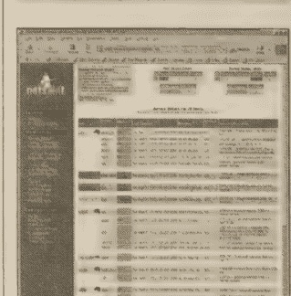

如果你想监控一组网络服务，Netsaint 可以给你提供通知和一个精美的网页前端。

```bash
& echo "Apache is running"
echo "Apache is down"
```

这并不完全可靠，仅仅 Apache 正在运行并不意味着它能够提供任何服务。最好的检查方法是从 Web 服务器下载一个文件并对其运行 `md5sum`。如果你知道要下载，并且有一个副本，你可以将其与从 Web 服务器下载的文件进行比较。这确实可以检查 Apache 或 PHP。

```bash
MDS=$(http://localhost/test.php --output|md5sum)
if [ "$MDS" -eq "87198465c255ae69" ]; then
echo "Apache is running"
else
echo "Apache is down"
fi
```

## 新开始

有很多程序可以完成这些事情，例如 NetSaint (`www.netsaint.org`)，并在 Apache 宕机时通知你。它每五分钟检查一次，或者按照你设置的时间检查，并记录遇到的任何问题。我已经在我的家庭 PC 上安装了 Red Hat 7.1，并尝试安装 Samba。但是，在 `/etc/inet.conf` 中添加一行时，该文件似乎并不存在。此外，让打印机运行变得有点像一团糟。有人遇到过这种情况并找到可行的方法吗？任何帮助不胜感激。
Joe Porter，通过电子邮件提供

> Red Hat 7.1 使用 'xinetd' 系统而不是 'inetd' 系统，尽管它在启动时似乎没有运行。如果没有安装，你将从发行版或从互联网下载。通过 Samba 打印有点混乱，因为你需要在 Linux 端进行设置，并在 Windows 端设置打印机驱动程序，xinetd 的语法与 inetd 有很大不同。我已经在 SUSE 7.1 上成功编译了 Apache 1.30，Web 服务器运行良好。我手动用 `/usr/local/bin/apachectl` 启动。我希望在启动/重启时运行它，并在机器关闭时显然关闭它。我想我需要从 `/etc/init.rc` 为它添加一些符号链接？

## 服务器

一旦你有了 `init.d` 脚本，就可以在进入特定的运行级别 `runlevel` 时使用运行级别编辑器来启动或停止。

| 可用 | 2 | 3 | 4 |
|---|---|---|---|
| amacron | devis | devis | devis |
| apand | 1 | network | whod | network |
| bewatch | apap | parmag | partimap | parmag |
| atd | syslog | random | random | |
| crond | crnd | netis | netfs | netfs |
| devis | | syslog | syslog | |
| isd | lpd | | ident | ident |
| gam | keytable | atd | | |
| halt | crond | | | |
| ident | | nfs | nto | whod |
| lert | | rchains | rchains | |
| jch | | | | |
| rotata | | ident | | |
| Add | | | | |
| Remove | | | | |

```
socket_type = stream
protocol = tcp
wait = no
user = news
server = /usr/local/sbin/leafnode
```

启动序列的结束，20 将在关闭序列附近被杀死。

## 自动 Apache

我已经在 SuSE Linux 7.1 PPC 上成功编译了 Apache 1.30，Web 服务器运行良好。我正在运行一个 RedHat 7 服务器，但无法让 Samba 工作。我修改了配置文件使其全网络化。然后我输入 `samba start`，它对启动的两个服务显示通常的“OK”。但它不起作用。如果我输入 `samba stop`，它对两个服务显示“失败”。它启动了，但 samba 状态显示两个服务已停止。我该如何解决这个问题？可以使用这台机器作为 Web 服务器，并且开箱可用 `smbclient`，所以网卡不是问题。
Ed，电子邮件

> 是的，你需要在每个 `rc.d` 目录下建立符号链接。你需要检查 `/etc/init` 查看你可以提供哪些运行级别，例如网络或多用户访问，并决定 Apache 在这些条件下是否运行。然后，如果你想让它启动，只需将 `apache` 符号链接到 `d/S80apache`，如果你想停止它，则链接到 `K20apache`。S 或 K 之后的数字定义了它们启动的顺序，因此 80 将在附近启动。

> 带有 Red 7 软件包的 Samba 将日志存放在 `/var/log/samba.log`，所以会有调用的第一部分。由于 `nmbd` 服务也没有启动；这表明你的 `smb.conf` 文件内部存在根本性问题。你可能需要检查是否拥有最新版本的 Samba，获取 RPM 或从源码编译，最新版本为 2.2.0a。smb conf 文件可以非常简单，只有几条条目，如下所示 `[global]`

```
workgroup = WORKGROUP
```


## Server

```
username map = /usr/local/samba/lib/smbusers
socket options = TCP.NODELAY
remote announce = 10.1.1.255
```

如果你需要安装 `SQUID` 之外的应用程序，你可能希望将 SmoothWall 安装替换为更完整的发行版，这会花费更长时间来完成设置，但会使安装额外的实用程序和服务变得更加容易。考虑到 SmoothWall 卓越的网络功能，但它真的并不是被设计成一个可以运行各种服务或应用程序的正式 Linux 发行版。事实上，在防火墙上运行任何类型的监听服务都是非常糟糕的做法，因为它会暴露在可能的攻击之下，这并不是一个好主意。

```
- comment = mp3
- path = /home/me/mp3
- public = yes
- writable = no
- printable = no
```

一如既往，最好从简单东西开始，而不是在有了一个无法运行的完整配置后尝试反向操作。假设 `Squid` 已经运行，你可以通过 `smbcient -L /boxname` 来测试它，它将列出所有可用共享。

## SQUIDS

我必须编译 `SQUID` SmoothWall，但 Smooth 并没有安装 `gcc`。要安装 `gcc`，Linux 需要编译，但我没有安装 `gcc` 来进行编译。

我在 `YaST2` 中通过 `SUSE` 添加/删除仓库使用了 `MySQL`。然后我运行了 `mysql_install_db` 脚本，它运行良好，这意味着可以更改 `mysql` 管理用户的密码。我没有更改它，因为它不允许我（即使我是 `root`）。我尝试了 `smooth_safe_db` 脚本，但任何连接都会立即失败。日志信息提到了一些缺少 `.frm` 文件的问题。然后我以 `root` 身份运行 `mysql` 而不是以 `mysql` 用户身份。我检查了用户是否存在，所有权限都设置正常。故障排除指南并没有什么帮助——它逐字描述了错误，而解决方案却是“请购买支持”，这值一百个金币！

Paul Francis

如果你安装了 Linux，请准备另一台安装了 `gcc` 的机器，你可以在那台机器上构建并安装 `Squid`，而不是在 SmoothWall 上设置并安装 `gcc` 以及所有需要的构建额外项（如 `make`, `autoconfig`），并仅为 `Squid` 配置防火墙。最简单的方法是配置 `squid --proxy=/path/`，这样所有的构建代码、配置文件和任何其他内容都在一个目录中，例如 `/usr/local/squid`。

```bash
RSYNC-ssh sync -av 10.1.1.255:/usr/local/squid /usr/local/squid
```


这应该直接从防火墙传输。当然，这要求你在防火墙上安装了 `resync`，这产生了一个有鸡还是蛋有鸡的问题。`sc -r 10.1.1.255:/usr/local/squid /usr/local/` 无法验证文件是否与原始文件一致。如果你仍然卡在这里，通过挂载 NFS 然后复制是另一个选择。

在运行 `mysql_install_db` 后，你想运行 `mysql -u root -localhost mysql` 吗？如果是的话，请用用户名 'root' 连接到服务器，不需要密码，然后使用以下命令更改 root 密码：

并且，为了让更改生效，运行 `mysqladmin -u root -localhost host-privileges`。你将能够以以下方式访问 MySQL 服务器的 root 用户：

在发布我的网站之前，我只想测试 DB/glasp。

Matt，来自论坛

## ANSWERS | LINUX | 111

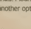

## Server

`mysql -u root localhost -p mysql`
输入你设置的密码。

至于以 'mysql' 身份运行服务器，你需要确保包含所有数据库表 true 目录（通常在 `/var/mysql/`）由 'mysql' 用户所有，以便它可以对其进行读写——记住，MySQL 用户系统与 UNIX 系统没有关系，即使你以 'root' 用户身份访问 MySQL，你只是作为 'root' 用户连接到服务器，而它实际上仍然以 'mysql' 身份运行。


服务器的规格取决于它提供什么服务。如果你只是运行一个 NFS 服务器来共享家级目录或常用文件，那么你完全不需要多少 CPU 能力，只需要大量的带宽和快速硬盘即可。我不熟悉 Compaq 机器的规格，但如果你不害怕，你可以花大约 400 美元自己构建一台拥有 256MB 内存和 30GB 以上磁盘空间的高端 Xeon 文件服务器。你并不真的需要很多硬件，但你可能最终会在上面运行其他网络服务，例如 Web 服务器或缓存服务器，这些需要更强大的性能。二手机器是可以接受的，到一定程度为止，但——特别是对于末端产品——现在非常便宜，完全有理由不买一个在不久将来会有兼容性问题的东西。如果你需要升级内存或更换烧毁的 CPU 呢？当然，你仍然可以买到零件，但很少值得花费那些时间、精力和开销。

## Table tables

我已经使用 MySQL 进行实际工作多年了，没有出现过任何特殊问题。好吧，我要开始一个涉及**非常大表**的项目，现在人们一直坚持用 MySQL 来执行这个糟糕的计划。真的是这样吗？

Julian，通过邮件


> MySQL 3.23 具有 RAID 选项，可以将表分布在多个不同的文件中，而不是单个大文件。这不仅可以突破当前内核的 2GB 限制，你还可以将表分布在多个设备上以提高速度。理想情况下，如果你使用任何数据库应用程序，你需要尽可能让数据留在内存中而不是写入磁盘。即使如此，MySQL 的性能也没有 PostgreSQL 好，所以最好切换到 Postgres 并将其分布在许多机器上。

## FTP access

在 Red Hat 上安装了 FTP，运行了六个月。但后来停止了接受用户。我检查了密码和 shells，但找不到。

Simon Fox Jones，通过邮件


> 检查任何 ftp 日志和 `/var/log/messages` 查看是否有问题迹象。使用 `proftpd` 会更容易查看和使用许多功能。当然，如果不起作用，你需要检查 `/etc/passwd` 和 `/etc/shells` 以确保它在里面。

## Twice the fun?

我正在考虑购买一台翻新的 Compaq w5100 并利用其双处理器能力，作为八台电脑的网络安装 Linux。这是一个现实的选择吗，还是我应该看更现代的机器？NFS 有什么不稳定性？

Mickey，通过邮件


> 我安装了 Red Hat 7.0，无法 telnet 或 ftp 到我的机器。我收到“被服务器拒绝”的消息。我安装了 wu-ftp、telnet-server（Red Hat iso 镜像附带的版本）。

## Telnet and FTP


112 | LINUX ANSWERS

## Apache PHP

我运行 SuSE 7.0，拥有 192MB 内存、4GB 和 9GB SCSI 硬盘。我运行安装在 `/usr/local/apache/` 的 Apache 1.3.19，module=most shared=max。这设置良好，我通过 64k 管道托管我的网页。我尝试安装 php-4.0.4，因为我看了 sourceforge.net 和 linuxformat.co.uk 等页面，我想在自己的页面上模拟这些设计。但每当我安装 php-4.0.4 并重启 Apache 服务器时，就会得到错误：无效命令 'LoadModule'，可能是拼写错误或由服务器未包含的模块定义。如果我注释掉 httpd.conf 中的 'LoadModule modules/mod_env.so$，错误就会移动到下一行，以此此类推。你对这样做有什么疑问吗？

Dave

为了在 Apache 中使用 PHP 作为加载模块或 DSO，你需要确保 Apache 在编译时支持共享对象。你可以通过运行 `httpd -l` 来检查这一点，它将列出 HTTP 守护进程包含的所有模块。如果没有列出 'mod_so'，你需要使用 `-enable-module=so` 以及其他需要的选项重新构建 Apache，以便可以使用 PHP DSO。你可以将 PHP 编译进 Apache，但也需要重新构建 Apache。

## Printer sharing

默认情况下，在 Red Hat 6.1 中安装这些 RPM 后似乎一切都已启用，我不知道需要更改什么来允许访问。我在 `hosts.allow` 文件中放入了 `ftp:ALL`，遗憾的是这不起作用。我尝试在其中一个 Linux 新组组发布，但我没有足够的 Linux 知识来理解收到的回复。

Barry-John Theobald，通过邮件

我在其中一台 Linux 盒上连接了打印机，正尝试让另一台远程打印（通过以太网 LAN）。我尝试了 SuSE 6.3 书告诉我的一切以及我发明的几点，但无法实现远程打印。能帮帮我吗？

检查 `/var/log/messages` 查看具体在编译什么。在本地，我可能想运行 '`netstat -ntlp`' 来列出所有在 tcp 端口上监听的进程。确实列出了 23 和 21，分别是 telnet 和 ftp。如果没有，检查 `/etc/inet.conf` 推荐的 telnet 和 ftp 服务器的引用。如果它安装了它们，但出于安全原因将启动引用注释掉了，你必须移除 'telnet' 和 'ftp' 开头行的 '#'。更改 `/etc/inet.conf` 后，你必须通过 `killall -HUP ipt` 重启它，然后重试。

R Susey，通过邮件。

你没有说已经让打印机本地工作——即从你希望使用的打印机上。我假设你已经做了。你也没有说在使用什么来管理打印队列。我假设是标准的 BSD `lpd` 系统。

现在，为了能够打印远程机，你必须在每台客户端机器上创建该打印机的描述。这涉及修改每台客户端上的 `/etc/printcap` 文件。你需要添加如下条目：

```
# Remote djet500
pid djet500:
```

## 服务器

```
:sd=/var/spool/lpd/lp
name=confucius.local
trp=dp500
lp=/dev/null
sh:
```

上述第一行是注释，第二行是打印机队列属性的开始。后者定义了打印队列的名称，并赋予了它 'lp' 和 'desket' 的额外名称。例如，你可以使用以下命令打印到此远程打印机：

```
lp -Q document
lp -Qdesket document
```


注意，打印队列的名称必须是唯一的。如果客户端有一个本地打印机，你必须确保通过不同的名称使打印队列与远程打印机对应。

上述定义的其余部分设置了打印机的各种属性。`Cl`属性指定打印机本地 spool 目录的位置。你必须在每个客户端以及打印服务器上都创建一个 spool 目录（例如，在网络中断时会使用它）。

下一行给出了打印服务器的地址——在此情况下为网络 `localnet`上的机器 `confucius`——接下来的行提供了打印到该机器的打印队列名称。当与本地打印机配合使用时，`lp`属性指定打印打印的设备名称，例如`/dev/lp`。不过，设置远程打印机时不需要它，我们只需将其指向`/dev/null`。最后一行用于抑制横幅页和页头的打印。如果你查看`printcap`管理，你将找到更多关于指定打印机定义的信息。

好了，打印客户端知道远程打印机了。我们必须告诉打印服务器哪些机器允许使用它的打印机。为了为此，请在服务器上的`/etc/hosts.lp`文件中添加每个机器的名字。

我的 CD 只有`mysql_install_db.sh`。这个文件没有可执行权限，所以我意识到我实际上需要`mysql_install_db`脚本。我在胡说乱道吗？有人投诉过吗？我能在磁盘或其他地方找到这个脚本吗？

Antonio Da Costa，通过邮件。

源码发行版和二进制发行版之间存在一些混淆。要从源码安装 MySQL，请解压缩存档，然后执行常规的`./configure`；`make`和`make install`。MySQL 默认将安装在`/usr/local`目录。要按照要求放入名为`/usr/local/mysql`的目录，你将在`configure`脚本中使用`--prefix=/usr/mysql`选项。安装 MySQL 时，系统会为你创建`mysql_install_db`脚本。

## ftp 洪水攻击

> 你能帮我解决一个 ftp 问题吗？我发现从 Windows PC 连接到 Linux 工作站的速度极其缓慢，而且登录屏幕会再次出现。一旦连接，数据传输似乎足够快。我是怎么做的？

我使用 ftp 连接到 Sun Solaris 工作站没有明显问题；但登录极其缓慢。感谢你的帮助。

Richard Purves

你没有指定运行的是哪种 ftp 守护进程，甚至没有说明你使用的是哪种 Linux 发行版。没有这些，我们只能猜测导致问题的原因。

我假设你正在使用`wu-ftpd`，这是 Linux 上最常安装的 ftp 服务器。如果你不确定，可以检查第一次登录时从服务器返回的欢迎信息。

如果你确实在运行`wu-ftpd`，那么登录延迟是由服务器尝试识别你的身份引起的。`wu-ftpd`通常默认配置为根据 RFC9331 进行身份验证，它会尝试验证你在登录时确实是你所说的人。

## 数据库灾难

我必须尝试 Apache/MySQL/Perl 组合的二进制安装，我遇到了一个问题。`mysql_install_db`不存在


114 | ANSWERS

身份验证发生在端口 21，但如果你的服务器有防火墙拦截该端口的通信，`wu-ftpd`将工作 10 秒（RFC931 身份验证超时时间）后继续。你可以通过重新配置防火墙或禁用`wu-ftpd`中的身份验证来解决此问题。由于`wu-ftpd`在验证过程中不会采取操作（它只记录在日志中），禁用它不会带来安全风险。RFC931 身份验证可以通过在你的`ftppass`文件（应位于`/etc/ftppass`）中添加该行来关闭：要获取更多信息，请咨询网络上的`exim`文档。也许由于需求足够，我们可以运行一个配置邮件服务器的教程。

## RFC931 0

如果你已经有一行指定 RFC931 协议的超时时间，只需将其更改为 0。

访问`www.wu-ftpd.org`获取更多关于`wu-ftpd`的信息。RFC 官方存档可以通过`www.ietf.org/rfc.html`访问。

## 邮件

我是一个在学校工作的网络管理员，一直在寻找让 IT 部门资源有限的方法。有一种简单的方法可以将多个用户添加到 Linux 服务器并为每个用户提供邮件访问吗？一旦添加到系统，有一种方法可以轻松控制用户，使其在特定时间暂停或撤销学生和员工权限？

## 邮件管理员

问题是，我想在 Linux Linux 上设置邮件服务器，这里的情况与 Red Hat 有很大不同。我现在主要在家里工作，我想在 Linux 上运行 Fortran 程序。我使用的是 SuSE Linux 7.1。

我找不到开源的 Fortran77 编译器。当我运行`gcc -fname`时，无法执行 'f77'：没有文件或目录。有人能帮我找到可以在 SuSE Linux 7.1 上运行的 Fortran77 编译器吗？

此致，
Michael Hatton

GNU Fortran 编译器是`g77`，它应该随着你的`gcc`和`g++`软件包一起分发。假设你安装了`g77`，你将能够识别 'f77'，因此`gcc -ffortran`将正常工作。如果你没有安装`g77`（你可以检查一下），你应该在发行版的 CD 或其 FTP 站点上找到它。如果你想从源码构建，它应该作为`gcc`包的一部分打包。在尝试安装源码发行版之前，请删除现有的`gcc`软件包。

> 可能是一个目录，如果是，不要单独索引它

```
If ( -d $File:name) {

  Ssq = "insert into file values (";

  Autovalue,

  $File:dir:dir, $Ssq";

  print "SQL insert in Ssq:" # 更多调试

  Result = Ssqdb->query(Ssq);

}
```

`find`应该递归遍历所有的目录和子目录，脚本在我早期的 CD-ROM 上有效，但对于后期的，CD-ROM 的根目录，它找到了里面的文件和目录，但无法进入目录，给出了非法寻址错误。

就我所知，CD 上的权限是，无论如何，如果我运行脚本到根目录，它仍然不起。任何建议吗？
Edward Evans，通过邮件。

寻址错误通常是 CD 本身的问题，而不是你的脚本问题。可能是某个特定的目录导致了问题并停止了其他工作，尽管你的代码没有问题。

在运行脚本并获取错误后，检查`/var/log/messages`并查看内核在尝试打开目录时记录了什么。你能够遍历挂载的 CD-ROM 文件系统而不产生任何错误吗？由于`File`只是使用`open`、`readdir`和`closed`，在 Perl 中并没有真正简单的方法执行文件系统搜索，因此你无法用其他东西替换`File`的用法。


## 回答 | Linux | 115

## 编程 #目录

| 主题 | 页码 | 主题 | 页码 |
| :--- | :--- | :--- | :--- |
| 编译 Fortran | 118 | 代码困惑 | 119 |
| 深入研究 Perl | 118 | 丢失库 | 120 |
| 缺少头文件 | 118 | DIY RPMs? | 121 |
| Perl 问题 | 119 | | |
| 脚本守护者 | 119 | | |

## 编程 # 编译 Fortran

我开始使用 Linux 的主要原因之一是微软对执行程序可用内存的限制。在研究中，我必须在 Unix 平台上使用 Fortran。现在我主要在家里工作，我想在 Linux 上运行 Fortran 程序。我使用的是 SuSE Linux 7.1。

我找不到开源的 Fortran77 编译器。当我运行`gcc -ffortran`时，无法执行 'f77'：没有文件或目录。有人能帮我找到可以在 SuSE Linux 7.1 上运行的 Fortran77 编译器吗？

此致
Michael Hatton

GNU Fortran 编译器是`g77`，它应该随着你的`gcc`和`g++`软件包一起分发。假设你安装了`g77`，你将能够识别 'f77'，因此`gcc -ffortran`将正常工作。如果你没有安装`g77`（你可以检查一下），你应该在你的发行版的 CD 或其 FTP 站点上找到它。如果你想从源码构建，它应该作为`gcc`包的一部分打包。在尝试安装源码发行版之前，请删除现有的`gcc`软件包。

> 可能是一个目录，如果是，不要单独索引它

```
If ( -d $File:name) {

  Ssq = "insert into file values (";

  Autovalue,

  $File:dir:dir, $Ssq";

  print "SQL insert in Ssq:" # 更多调试

  Result = Ssqdb->query(Ssq);

}
```


`find` 应该递归遍历所有的目录和子目录，脚本在我早期的 CD-ROM 上有效，但对于后期的，CD-ROM 的根目录，它找到了里面的文件和目录，但无法进入目录，给出了非法寻址错误。

就我所知，CD 上的权限是，无论如何，如果我运行脚本到根目录，它仍然不起。任何建议吗？
Edward Evans，通过邮件。

## 编程

我搜索了我的 Mandrake 7.1 光盘以寻找 Mesa 开发包，但在这里没有找到。我应该已经有了头文件和库吗？如果是的话，它们在哪里呢？它们默认是不安装的，我什么时候能获得它们？
Stuart，来自论坛。

## 脚本守护者

我是 Linux 的新手，在编写脚本时遇到了麻烦。该脚本首先遍历并将文本文件中的所有制表符替换为空格，我使用了以下命令：
我想遍历并替换所有的 `m_` 为空格。我起初想过使用 `tr`，但发现不行。你知道有什么方法可以实现这一点吗？用一个或两个命令来完成都没关系。
来自论坛

Mesa 头文件应该是 `mesa-dev` 软件包的一部分，尽管库已经作为头文件的一部分被安装。除非你安装了头文件，否则 GTK 用来检查 Mesa 是否安装的测试程序将无法编译，因此它不会标记 Mesa 为已安装。

如果你的系统中没有 `mesa-dev` 包，你可以从 Mandrake 或 `ftp.mindnet` 下载它。另一种方法可能是删除 `mesa` 包并从源码编译 Mesa (`freshmeat.net/projects/mesa`)，这将安装所有的库和头文件。

进行全局替换最简单的方法是使用 `sed`，它从 `stdin` 读取文本，处理后输出到 `stdout`。将 `m_` 交换为空格通过 `sed s/m_/g` 完成，因此为了将两者合并为单个命令，我们使用管道：
`tr -s ' ' < file | sed s/m_/g > newfile`。`tr` 命令的参数不需要包含在引号，所以我们可以去掉 `t`，但必须对结尾的空格进行转义。

## 各问题

如果这个问题很简单，请见谅，但它让我非常困扰。我有一个 Perl CGI 脚本，可以接收我的图片并将其写入我的 Linux 机器的图像目录。脚本在错误日志中报错“拒绝访问”。为了让它正常工作，图像目录的权限到底应该设置为什么？

## 代码难题

非常感谢提供的帮助！
Steven Edwards, Aldershot

脚本将以运行 Web 服务器的用户身份运行，该用户定义在 `http.conf` 文件中。如果该用户是 `nobody` 或 `httpd` 用户，而你要写入的目录属于你的用户，那么它将没有权限写入文件。

你既可以使用 `chmod 777`，这将允许所有人写入目录，或者可以将相关目录的 `uid/gid` 更改为运行 Apache 的用户。如果你决定后者，则需要 root 权限。

有什么想法可能是哪里出错了吗？
Jim，通过邮件

如果你不指定输出文件，`gcc` 以及其他编译器将直接将执行文件命名为 `a.out`，这里没有

# LINUX 回答 | 119

## 编程

## 迷失在库

我一直在尝试 C 语言编程并熟悉 Linux 库系统，特别是尝试使用 X 的时候。库和包含文件似乎几乎随机地分布在系统中，尽管我确定一切都是理由的！我理解如何在 `Config.mk` 文件中添加库路径和包含路径，但有几个位于未被搜索的目录中。我尝试过从命令行使用大量的包含路径和库路径来编译程序，但整个过程变得非常复杂。我参考了 `etc/ld.conf`，这可能是解决该问题的整洁方案。我的系统只有 `etc/ld.so.conf`， 它们是一样的，还是我应该为它创建一个 `ld.conf` 链接？

它默认应该设置为在这些地方（以及其他几个地方）。你可以通过以下命令检查 `gcc` 的搜索路径：
`gcc --print-search-dirs`

某些软件包（如 X）会将它们的包含和库存储在其他地方，但在 X 的情况下，使用 `/usr/X11/X16/include` 作为头文件，使用 `/usr/X11/X16/lib` 作为库，如果你需要使用此类库，你需要告知编译器这些头文件和库的位置。你可以使用 `gcc` 中的 `-I` 选项将路径添加到头文件搜索路径，使用 `-L` 添加到库搜索路径。为了完成编译，你可能会使用：`gcc -I/usr/X11/X16/include -L/usr/X11/X16/lib -o myprogram`。

一定有一种方法创建一个组织的库系统，让编程变得简单，我希望你对我问题有答案！

X 有点难以使用，仅仅因为有大量的 X 库，而且大多数在任何程序中可能永远都不需要。除了手动用 `-I` 切换指定你使用的库之外，没有其他选择。

非常感谢任何帮助。
Richard Rivers，通过邮件

当针对库编译（无论是共享库还是静态库）时，你的编译器需要知道哪里找到定义库 API 的头文件，它还需要找到库本身。它会在许多标准位置查找这些内容。标准库将位于 `/lib` 和 `/usr/lib` 目录，头文件位于 `/usr/include`。编译器

然而，某些软件包包含了让包含和库变得简单的脚本。GTK+ 使用 `gtk-config` 工具，它会打印出用于针对 GTK+ 编译程序所需的头文件、库路径和库。要进行编译，你可以执行如下操作：
`gcc myprogram.c `gtk-config --cflags --libs` -o my`

注意上面几行中的引号是单引号。还有另一种方法使用它，仅仅因为有大量的 X 库，而且大多数在任何程序中可能永远都不需要。除了手动用 `-I` 切换指定你使用的库之外，没有其他选择。

这应该解决你的问题。基本步骤是获取源代码，将你对源码的任何更改转换为补丁 (`patch`) 并创建一个 spec 文件。spec 文件包含关于软件包的各种元信息——名称、版本号、依赖项等——以及如何构建软件包的指令。它还包含了处理实际安装、配置和删除软件包的各种脚本。使用 `autoconf` 的工具将有助于进一步自动化。在编译程序时，`/etc/ld.so.conf` 没有帮助。它用于指定一个额外的路径列表（除了 lib 和 /usr/lib 之外），运行时链接器将将其用于共享库。如果你想在非标准位置安装库并使其全局可用，你可以向此文件添加路径。要修改 `/etc/ld.conf`，你需要以 root 身份登录并可以使用文本编辑器更新运行时链接器的库缓存。你也可以通过环境变量 `LD_LIBRARY_PATH` 临时将路径添加到库搜索路径。

## 自制 RPM？

- 我如何从源码制作 RPM？这比以后卸载所有软件要简单，而且我可以捐赠一个在我机器上编译好的 RPM！我在一台基于 Intel 的笔记本电脑上运行着 Mandrake 7.0。
Adrian Gibbons，通过邮件

## 安全

## 目录

| 主题 | 页码 | 主题 | 页码 |
| --- | --- | --- | --- |
| iptables vs ipchains | 124 | 病毒？什么病毒？ | 126 |
| 再次 ipchains | 124 | 保持安全 | 127 |
| Code Red 警报 | 125 | 限制访问 | 127 |
| Linux 保护 | 125 | | |
| 毫无收获 | 125 | | |

## iptables vs ipchains

我使用 Linux 一年了，非常喜欢它。

最近，我建立了一个包含 Red Hat 7.1 服务器和 Samba 的局域网（LAN），它用于处理 Win95/98（未来是 Win2000）客户端，作为打印服务器、文件服务器等。我通过 ISP 连接了互联网，通过光纤缆提供高达 10 Mbit/s 的数据传输（我居住在意大利米兰）。

我问你们的原因是，我在让 Red Hat 7.1 服务器同时也作为 PC 客户端的路由器时遇到了问题。服务器有两个以太网卡，一个连接集线器（静态 TCP/IP），另一个需要动态设置 IP。我重新编译了内核（2.4.3 版本），我遇到的主要问题是，首先那些无法访问互联网的客户端，当我尝试调整文件 `/etc/init.d/network` 并插入类似的内容时：

```
ipchains -P FOR DENY

ipchains -A eth1 192.168.1.0/24 255.255.255.0 -J MASQ
```

此操作不会被确认：事实上，当我告诉你们这个命令时：
`cat /proc/net/iptables`
答案是没有这样的文件，但如果一切正常正常，它应该列出相应的数据。

非常感谢您的帮助。
Filippo Del Ferro, 意大利米兰

类似于以下：

```
iptables -t nat -A POSTROUTING -o eth0 -s 192.168.1.0/24 -J MASQUERADE
```


## ipchains 再次失败

我正试图将我的互联网网关机器调整到完美状态，我想要 100% 且完全的安全。我使用的是一台 Packard Bell Spirit 500，运行 Red Hat 7.0 和内核 `2.2.116-24`（我无法升级到 2.4 内核，因为我的机器内存较小）。我想使用 `ipchains` 将我的内部局域网掩蔽到世界上。我知道这应该通过类似 `-10.11.216/24 217.x.x` 位于 `/etc/sysconfig/ipchains` 中的行来实现。我一直无法成功。为了实现这一点，我将启动文件修改成这样：

```
ipchains -Z

echo "Applying ipchains firewall rules"

grep -v "\[.*\]" "# IPCHAINS_CONFIG"

grep -v "\[.*\]" /usr/sbin/ipchains -A Forward

-s 10.11.216.0/24 -MASQ & -s

success "Applying ipchains firewall rules"

failure "Applying ipchains firewall rules"

echo touch/lock/syschains
```

你会注意到我在标准文件中添加了 `'-A forward'`。我想做的是找到 `/etc/sysconfig/ipchains` 中正确的行来实现相同的操作，这样我就可以把启动文件还原正常。
Matt Darcy

如果你使用的是 2.4 内核版本，且没有现有的防火墙配置，你应该从 `iptables` 配置开始，而不是 `ipchains`。你找不到 `/proc/net/iptables` 的原因是内核中不支持 `ipchains`。你需要重新编译带有 `netfilter` 支持的内核，然后将所有的 `iptables` 选项都选择为模块。当你重新启动机器时，可以探测 `iptables`，然后使用 `iptables` 二进制文件进行配置。

由于 `eth0` 是外部网卡，而 `eth1` 用于你的局域网，你会让某些

`/etc/sysconfig/ipchains` 是 RedHat 特有的配置文件，并不好用。更好的选项是使用 `ipchains-save` 和 `ipchains-restore` 命令来保存和加载规则，这样它们在重启机器时会被存储。当然，你不会在关机时自动保存规则，但你可能需要在重启时使用 `ipchains-restore` 来安装所需的配置。你首先需要设置好 `ipchains` 的结果，然后将结果

```
# ipchains-save > /etc/ipchains
```

然后编辑 `/etc/rc.d/init.ipchains` 文件（该文件加载 `ipchains` 条目），使其看起来类似于

带宽使用，除非代理在你的 ISP 某处进行流传输，否则你可能会发现你目前只能接受它——忽略它。
你无法用普通的数据包过滤系统（如 `ipchains` 或 `iptables`）来阻止它们，因为那也会阻止对服务器的访问，我假设这并不是你想要的。

```
ipchains -Z

echo -n "Applying ipchains firewall rules: /sbin/"

ipchains-restore < /etc/ipchains

& success "Applying ipchains firewall rules"

failure "Applying ipchains firewall rules"

echo
```

## Linux 保护

我希望设置一台运行 Windows 98 的机器，并用第三个运行 Linux 来配置它。你知道什么好的地方可以配置吗？有一个 Linux 发行版非常适合这个，而且容易使用。

## 安全

由 `xindet` 启动的服务将使用 `tcpd`，利用 `hosts.allow` 和 `hosts.deny` 文件来设置你的访问权限。

如果你想使用 ProFTPd 作为 ftp 服务器，在 `/etc/xindet` 中会有一个类似下面的条目：

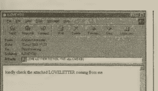

| service | socket type = stream |
| :--- | :--- |
| protocol = tcp |
| wait = no |
| user = root |
| server = /usr/local/sbin/proftpd |

你应该能够通过简单的 `procmail` 等工具来停止“我爱你”病毒。

## 限制访问

在 Linux 下处理邮件将使你能够通过 `procmail` 发送所有邮件，它可以轻松地用于过滤讨厌的垃圾邮件和其他不需要的邮件。一个简单的邮件客户端，如 `qmail` 或 `postfix`，可以毫无问题的处理中小型低端机器的邮件。当然，需要确保了解过滤特定病毒需要什么，并确保在病毒传播到内部机器之前已采取适当的阻止措施。对于像 LoveBug 之类的，最快的方法是在 Outlook 中禁用脚本选项，这将停止在打开邮件时自动运行任何脚本，而不是试图与反病毒软件和邮件中继站作斗。

> 我正在尝试寻找如何设置 IPCHAINS 防火墙来分离同一组织内的两个内部局域网（LAN）。LAN（A 课程）只需要通过 ftp 和邮件访问 LAN（B 管理员电脑）。
> Jazz，通过邮件

回复：A. 首先，你需要将两个 LAN 分离为两个 IP 网络，所以你可能会有 `'10.11.0.24'` 和 `'10.12.0.24'`；或者在单台机器之间路由。在路由机器上，你可以允许 HTTP 流量（即从 `10.11.0.24` 访问 `10.12.0.24` 的 80 端口的流量），对于 SMTP 和 FTP 流量，则停止允许所有其他。

## 安全

> 我安装了 Red Hat 7.1，现在无法将其作为 ftp 服务器使用。我知道问题与 `xindet` 有关，但如何在 `/etc/xindet` 中激活安全功能？我搜索了网络和 `xindet` 文档。他们给出的示例在 Red Hat 上不起作用，Red Hat 网站也没有关于如何设置 `xindet` 信息。
> James Coleman，通过邮件

```
ipCHAINS -A forward -tcp -s 10.11.0.10 --dport 80 - ACCEPT

ipCHAINS -A forward -tcp -s 10.11.0.10 --dport 25 - ACCEPT

ipCHAINS -A forward -tcp -s 10.11.12.0/24 --dport 21 - ACCEPT

ipCHAINS -A forward -tcp -s 10.11.12.0/24 --dport 20 - ACCEPT

ipCHAINS -A forward -tcp -s 10.11.0.0/24 - DENY
```


安全通过 `tcpd` 处理，或在应用程序中使用声明任何其他 wrapper，就像大多数情况一样。FTP 是一个状态协议，因为它会创建双向连接，所以你可以启用所有端口连接，或者使用 2.4 内核的 `iptables` 和 FTP 连接跟踪模块。

## 回答 | LINUX

## 杂项

| 主题 | 页码 |
| :--- | :--- |
| 网络杂烩 (Network stew) | 130 |
| 丢失的磁盘驱动器柱？ | 131 |
| Windows 吃掉了我的分区 | 131 |
| 内存大户 | 132 |
| 简单的问题 | 133 |
| Mod 文件 | 133 |
| 一个真正的超级用户 | 133 |
| 丢失的文件 | 134 |
| 格式化 Linux | 134 |
| 交换分区问题 | 134 |
| 持续运行 | 135 |
| 闲逛 | 135 |

## 目录

| 主题 | 页码 | 主题 | 页码 |
| :--- | :--- | :--- | :--- |
| 挪威蓝 (Norwegian Blue) | 136 | Tar | 141 |
| 关机烦恼 | 137 | 手帮助页 (Man pages) | 141 |
| 斗眼？ | 137 | 优先级 (Priority) | 141 |
| 救救我 | 138 | 归档 (Archiving) | 142 |
| Mac 挂载 | 138 | 登录 (Login) | 142 |
| 计数 | 139 | Cron 定时任务 | 142 |
| 保持整体 | 139 | 备份 (Backing up) | 142 |
| 取回我的 shell | 139 | Ghostscript | 143 |
| 基准测试 | 140 | 数据传输 | 143 |
| 补丁 | 140 | 多少可用空间？ | 143 |
| 备份 Lilo | 140 | 启动 (Startup) | 143 |
| 挂载 Dos | 141 | | |

## 网络杂烩

正如你所猜到的，我需要一些比我愿意承认的帮助！在提问之前：感谢提供可靠的信息源（仅是奉承）；你将会有一些好的答案和建议引导我走向正确的方向。在使用 Linux 几乎三个月后，我不自己告诉你。以下是我的问题：

- 1. 有没有通过 `autount` 挂载 DVD 的方法（在某些发行版中是可用的）？我发现 `autount` 无法处理 DVD，我尝试与反病毒软件和邮件中继站斗争费劲。
- 2. 有没有可以从 `autount` 挂载 DVD-光盘的方法？虽然通过 NFS 挂载，我遇到了以下问题。
- 3. 使用 `cdfs` 挂载 CD-光盘，它可以显示 ISO、CD 音频和其他文件。这意味着你可以通过 `cdfs` 本地挂载 CD-光盘，然后你可以在机器上允许音频轨道，或者挂载 `loopback` 系统文件。或者，远程使用 `loopback` 系统似乎无法处理 DVD，因此在网络上播放 DVD 的唯一选择是定义 DVD 镜像，然后通过 NFS 在网络上共享，或者将其复制到你想播放 DVD 的机器。这些文件通常在 5GB 左右，你可能需要重新考虑仅仅为了播放 DVD 使用如此巨大的镜像。
- 4. 使用 `autofs` 挂载 DVD。我发现 `autofs` 无法处理 DVD，我通过 `autofs` 能在网络上播放 DVD。我希望你能帮我解决这些问题。

为了回答你的问题：

- 1. 安全通过 `tcpd` 处理，或在应用程序中使用声明任何其他 wrapper，就像大多数情况一样。FTP 是一个状态协议，因为它会创建双向连接，所以你可以启用所有端口连接，或者使用 2.4 内核的 `iptables` 和 FTP 连接跟踪模块。
- 2. 共享 CDROM 内容最好通过 NFS 完成，虽然为了让它挂载 CDROM，你需要对它进行一些设置才能正常工作。许多发行版都提供了 `autofsd` 软件包，你可以从他们的网站下载。
- 3. 是否需要 Win98 机器？`Softwall` 是一个完全够用的服务器，由于它可以使用 IP 掩码，它可以进行转换。使用 POP3、smtp 等在进行额外的更改后是必要的，而且它听起来真的不太可行。拥有静态链接的 RPM 是没有意义的，因为你将得到巨大的二进制文件，这显然会让系统失去初衷。只要你只从发行版的网站或 FTP 服务器下载 RPM，并确保你获取的是适用于你发行版的正确 RPM，你就不应该遇到什么问题，如果有，只需要下载具有依赖项的特定 RPM 即可。

## 杂杂

你所遇到的 VFS 错误表明系统正尝试使用错误的分区作为你的 / 分区，或者正确的分区实际上由于某种原因损坏了。'03:05' 意味着它正尝试挂载主设备数为 3、次设备号为 5 的设备，即 `/dev/sda5`。由于你在 Windows 中进行磁盘整理后收到了该错误，这表明 Windows 可能损坏了你的 Linux 分区，可能是因为它没有忽略该分区，或者因为因为它不知道 Windows 分区何时正常结束。无论处于何种情况，你都需要重启 Mandrake 8.0，因为你可以认为硬盘上的数据已经丢失了。

自然，你可能想在 Windows 上进行实验，看看它是否会持续出现相同的问题。如果它再次发生这种情况，最好从 Linux 的分区工具中检查分区配置，看看 `/dev/hda1` 是否在正确的位置结束，或者是否继续位于你 Linux 分区所在的扩展分区上。最终，需要对 Linux 和 Windows 进行完全重新构建，才能彻底解决你所经历的问题。

运行多次/多个进程并使用大量内存。

查看下方的 `ps` 输出：

| PID | USER | RSS | %MEM | COMMAND |
|---|---|---|---|---|
| 5370 | dave | 1040 | 0.8 | /bin/sh |
| | /usr/bin/opera | | | |
| 5371 | dave | 14360 | 11.6 | |
| | /usr/lib/opera/05_tp1/opera-static | | | |
| 5444 | dave | 45776 | 36.1 | /usr/share/office52/program/soffice.bin |
| 5461 | dave | 45776 | 36.1 | /usr/share/office52/program/soffice.bin |
| 5462 | | 45776 | 36.1 | /usr/share/office52/program/soffice.bin |
| 5463 | | 45776 | 36.1 | /usr/share/office52/program/soffice.bin |
| 5464 | | 45776 | 36.1 | /usr/share/office52/program/soffice.bin |
| 5465 | | 45776 | 36.1 | /usr/share/office52/program/soffice.bin |
| 5466 | | 45776 | 36.1 | /usr/share/office52/program/soffice.bin |
| 5685 | | 1104 | 0.8 | |

top
| 5802 | dave | 724 | 0.5 | |

`ps -aop,user,rss,%mem,command`

我的 StarOffice 安装有问题吗？还是说这是正常现象？

谢谢，
Dave（来自坦桑尼亚的达斯萨拉姆）

## 内存大户

我是 Linux 的忠实粉丝，而且已经很长时间了。我觉得它非常可靠，并且符合我的个人需求。总之，我之所以写这封信是因为，尽管我很乐于远离微软并乐于使用 StarOffice，但当我最近在配置为 200MHz CPU 和 32MB RAM 的 Mandrake 8.0 机器上运行时，StarOffice 花了十多分钟才打开。我觉得这相当慢。我不确定这是否是 Linux 的兼容性问题；我本希望在那台机器上使用 Linux 并将其他办公软件迁移到 Linux，但没办法。我想也许我有点心心过度了。

在我自己的电脑上（东芝笔记本，600MHz，128MB RAM，Mandrake 8.0），当我使用 `top` 或 `ps` 查看时，显示 StarOffice 是

StarOffice 是一个多线程应用程序，因此会产生多个进程来处理不同的任务。这些进程之间可以共享内存，因此你所有的 `soffice.bin` 文件都在使用 45776 字节，即大约 45MB。StarOffice 不是一个小型程序，确实需要大量的内存才能正常运行。32MB 的内存对于 StarOffice 来说是不够，你可以考虑升级系统内存，或者寻找替代方案（例如 Office），以便使用较少的内存并完成工作。你也可以发现一些与 StarOffice 部分功能类似的小型 X 应用，fresh.net 是一个查找的好地方。

## 杂杂

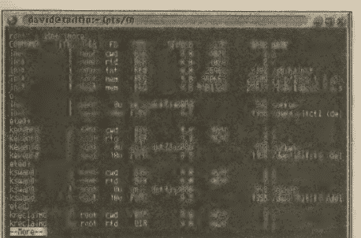

`lsof` 显示哪些进程打开了哪些文件，因此你可以发现是什么阻止了你的文件系统卸载。

## 快速提问

有办法可以将命令的结果写入文件吗？例如，如果我想把 `ls -l` 的结果保存到名为 `bar.txt` 的文件中，而不想太麻烦的话？Matt，来自表单区

抱歉要这么批评，我本想在近期写一些有建设性的建议，但我读完后发现没有更好的想法了。

## 杂杂

你所遇到的 VFS 错误表明系统正尝试使用错误的分区作为你的 / 分区，或者正确的分区实际上由于某种原因损坏了。'03:05' 意味着它正尝试挂载主设备数为 3、次设备号为 5 的设备，即 `/dev/sda5`。由于你在 Windows 中进行磁盘整理后收到了该错误，这表明 Windows 可能损坏了你的 Linux 分区，可能是因为它没有忽略该分区，或者因为它不知道 Windows 分区何时正常结束。无论处于何种情况，你都需要重启 Mandrake 8.0，因为你可以认为硬盘上的数据已经丢失了。自然，你可能想在 Windows 上进行实验，看看它是否会持续出现相同的问题。如果它再次发生这种情况，最好从 Linux 的分区工具中检查分区配置，看看 `/dev/hda1` 是否在正确的位置结束，或者继续位于你 Linux 分区所在的扩展分区上。最终，需要对 Linux 和 Windows 进行完全重新构建，才能彻底解决你所经历的问题。

## 格式化 Linux

在看 GRUB 教程时，我尝试格式化一个软磁盘。我发现了两个问题：第一个是我找不到任何关于如何操作的，即使我遵循了文章中的命令引用；然后我发现了 `fdformat`。我问题的答案？并没有：只是又一个问题，崩溃了。

```
```


`fdformat /dev/fd0H140`

我得到了如下输出：

# 134 | LINUX | ANSWERS

## 杂杂

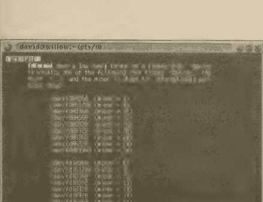

`fdformat` 需要一组 `/dev` 条目项，因为它需要知道使用何种磁盘几何结构来格式化 `/dev/fd0`。

在这台机器上升级到 7.1，`kswap` 的安装。我已经多次向 Red Hat 报告过此事，但从未得到过回复。
Matt Dary，通过电子邮件

要在注销后运行控制台应用程序，你需要使用 `screen` 程序（从 http://freshmeat.net/projects/screen 下载），它允许你创建几个终端，然后在注销时断开与终端的连接，登录时重新连接。

`kswap` 的失败极少是因为硬件问题引起的，因为 `kswap` 处理虚拟内存段到磁盘的页交换，然后你可以调查交换分区是否太小，或者已经损坏导致无法使用。由于 RedHat 7.1 使用了早期的 2.4 内核，因此交换分区的大小至少要与机器的 RAM 大小相当，否则你将会遇到问题。如果你对重新格式化不感兴趣，那么你可以在你的 7.0 机器上单独升级包，而不是完全升级到 7.1。

如果你尝试运行 X 应用程序，你可能想看看 VNC，因为它让你在断开远程机器连接后重新连接时不会丢失任何 X 应用程序。你必须在 `screen` 下使用 VNC 服务器，否则当你断开会话时它将会关闭，但因为它不是 X 客户端，即使 X 服务器关闭也没有关系

## 挂起

> 在关机（抱歉但我仍然需要双系统）最后一次安装 Mandrake 8.0 时，它运行到了卸载文件系统的点，然后就挂住了。

我的想法是可以在注销后保持一个进程运行吗？如果是的话？我想中的应用程序是一个环境分析包，需要很长时间才能完成（所以它运行一晚上）。

我想这可能是因为我的 DVD 驱动器有点问题并自动挂载了，但并不太确定。

我想可以使用 `'cron'` 或 `'at'` 来，但我想知道是否有更好的解决方案（我想 cron 和 at 是用于设置常规/周期性事件的）。
祝好。
Bill，通过电子邮件

关于如何解决此问题的任何想法或建议都会很有帮助。

Andrew

很有可能是某个进程没有关闭，机器正在等待某些项停止文件系统以便其卸载它。这是 Mandrake 8.0 中的一个已知问题，他们的 ftp 服务器上有很多更新，应该安装这些更新以确保你的机器正常工作。如果在应用了所有最新更新后仍发生这种情况，你可能需要在关机前尝试通过禁用服务来做一些实验。你可能还想观察是否有任何服务未能关闭，或者是否有其他消息回显到控制台上。

电子邮件地址 - 无论我尝试什么，键盘都完全无法输入 @ 符号。我能想到的唯一原因是我用的是挪威键盘。尝试过将键盘改为美式，但这没有帮助，而且无论如何都会让机器对我变得毫无用。你对这有什么提示吗？

不管怎样我发现 KDE2 并不不可或缺，它拖慢了我的机器（AMD 350/64）的速度。就个人而言，我认为这不值得。
Markus，通过电子邮件

## 挪威蓝

+ 关于 Linux 应用程序，我对你有两个小问题：
1. 我最近尝试了 OpenOffice，但不得不换回 StarOffice 5.1。我无法安装打印机——也就是说，在没有安装打印机的情况下，我无法打印任何内容或修正打印格式，我找不到任何安装方法。如果你有任何建议或技巧，我将不胜感激。
2. 我也尝试了 Mandrake 7.2，但因为一个奇怪的功能：当我按下 @ 键时，主程序启动了……而且，由于这个键被用于此处，我无法输入任何

关于这个问题的简单但令人不满的答案是，你不能直接从 OpenOffice 打印。它还处于开发阶段，而光盘上的初始版本基本上是所有旧 StarOffice 调整过的原始元素的来源。StarOffice 许可使用的非免费技术之一是软件的打印部分，而这部分并不存在。

OpenOffice 项目是一个持续进行的过程。你可以在 printing.openoffice.org 检查打印内容的进度。
2. 你的第二个问题听起来非常奇怪，听起来不像键盘映射问题，所以更改键位无法解决它。似乎某些设置了通过按键来启动你的软件。这并不是 Mandrake 或 KDE 的默认设置——你在安装 Mandrake 7.2 之后安装了其他软件吗？如果与 KDE 设置有关，你可以检查控制中心 'lookNFeel' 部分的检查点。

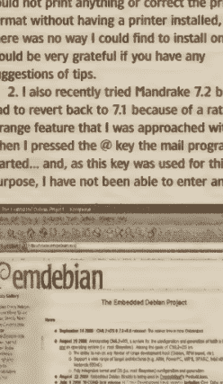

## 关机烦恼

我终于有了一个运行 Linux 的笔记本电脑（富士通 Lifebook E）。我已经学会了如何配置和启动 X，学会了如何使用 KDE，但在安装程序方面遇到了困难。总之所有

我面临的主要问题是关闭机器。我知道如何关闭 X，但我真正想知道的是如何关闭电脑，以便它不

如果你有必要的工具，为不同的架构编译内核映像是相对直接的。对于 PowerPC、MIPS 和 ARM，预编译工具可以从，例如获取。使用日志文件系统如 `ext3` 不会威胁文件的完整性。

你至少需要目标编译 `binutils` 和 `gcc`。你可以从 `gnu.org` 获取这些包的源码。这样做非常简单。关闭 Linux 机器的正确方法是使用命令：

`shutdown -h`，这将避免 `fsck`

在开始之前，你需要指定想要编译的架构：你可以通过修改内核 `Makefile` 中的 `ARCH` 变量来实现：然后你应该能够正常配置并编译内核。

## 交叉眼？

我尝试过几次这个，但一直没有进展。我有几台运行不同发行版的 PC：一台 RS/6500 和两台可以运行 Linux/68k 的 Amiga 420。

我想知道如何为另一个平台编译内核？在 RS/6500 或更快的机器上运行 Linux/68k 是否可行？

另一方面，作为 Amiga Format/Forum 的订阅者，让我使用 Linux 是一件困难的事，这需要很多说服。如果我批评它，杂志里真的会有关于 Linux 内部各种平台的文档。我理解 i86 平台将是主流，但如果其他平台偶尔能吸引我……至少是其他的“家庭”平台。这只是我的观点，供参考。

至于你提到的许多杂志关注 x86 平台的观点，我认为这有点不常见。通常，基于 Linux 的语言在很大程度上与架构无关。标准 PC 现在远胜其他，但也许我们应该更多地关注非 x86 CPU 上的 Linux。

Graham，通过电子邮件

## 杂杂

## 救救我

自从我的 Toshiba Tecra 8000 上安装了 Mandrake 7 之后，我了一些关于 Linux 的出版物，我觉得自己正在快速上手 Linux，而且再也不会回到那些缓慢、受限且过度监控的系统了。

自从安装了 Gnome 更新后，我遇到了一个小问题：LILO 不再加载，并且并在 CRC 错误处停止。是的，我本应该备份的，但我没有这样做，结果丢失了几个月的 Java 代码。

请问，有什么方法可以在不擦除和重装的情况下救我的 Linux 吗？Rod，通过邮件。

我不知道你的系统为什么发生了这种事情，但与其采取擦除并重装 Linux 的极端手段，你可能会发现重新安装 LILO 就足够了。

下一个问题是如何启动你的系统以获得一个救援软盘？大多数电脑在出厂时都带有一个，或者你可以选择自己创建一个。（有些光盘可以用作救援磁盘 - 抱歉，我不确定 Mandrake 是否支持。）从救援磁盘启动将允许你启动 Linux 安装系统，而无需使用驱动器上的 Linux 副本和内核镜像。

无论你从哪个磁盘启动，在看到 LILO 提示符时按下 `?`。然后你可以输入参数从内核启动，或将磁盘作为根文件系统。例如，如果磁盘上的内核被称为 `lilo`，并且 Linux 安装在你的第一个 IDE 驱动器的第二个分区上，那么：

```
linux root=/dev/hda2
```

一旦启动，你可以在 shell 中（当你以 root 登录时）执行它来重新安装 LILO。

## 我遗漏了什么明显的东西吗？Stephens，通过邮件。

你会认为 Emacs 有种简单的方法可以获取字数，对吧？但并没有。

也许最简单的方法是保存你想统计字数的文件，并使用工具 `wc` 输出统计信息。例如，尝试以下：

```
wc -w myfile.txt
```

这段代码将显示 `myfile.txt` 中的单词数。

另一种方法是使用 `Emacs-matches` 函数。它计算从光标点到缓冲区末尾匹配正则表达式的次数。要统计文档中的所有单词，将光标移动到缓冲区开头并按下 META-X 进入小型缓冲区。输入以下命令：

```
count-matches
```

输入代码后，按下回车。随后会要求你输入要匹配的正则表达式。输入下一个命令：

```
\w*
```


完成后，按下回车。Emacs 将打印匹配的次数，在这种情况下它是会显示的。

上述表达式的 `\c` 匹配单词的开头：在行首，或者在标点符号等非单词字符之后。`\w` 模式匹配任何可以组成单词部分的字符（取决于你所处的模式）。因此 `\w*` 匹配任意数量的单词组成字符。本质上，我们做的是计算[单词出现的]次数，并直接吞掉每个单词的其余部分。

理想情况下，你会在 Elisp 中编写自己的函数并将其添加到 Emacs 配置文件中，这样你手动输入这个表达式就可以一直保留。虽然这做起来并不难，但这超出了这些页面的讨论范围。

## 计数

在读了一篇关于 Emacs 的专题后，我想尝试一下。我不得不说我喜欢它。一个问题：我如何获取字数？

138 | LINUX | 问答

## 杂杂

### 挂载 Mac

我在普通的 Intel 机器上运行 Linux。我有一堆 Mac 磁盘，里面有一些我想获取的文件。可以在我基于 Intel 的 Linux 内部访问这些磁盘吗（例如，对于 Mac 软盘之类的）？

其中一个与 `netalloc` 软件包兼容。还提供了选项来控制文件名中的字符集转换以及数据文件中 CR 到 LF 的翻译。更多信息请查看内核源码存档中的 `fsHfs/HFS` 文件。

Ivan Uemtianni

是的，这是可能的。内核需要配置为使用“苹果文件系统”（Apple Filesystems）支持（请查看我们的教程列表获取编译内核的指南）。它可以很容易地编译为内置或可加载模块。

这个问题可能有一个简单的解决方案，但我们如何在 Linux 下让我的硬盘产生碎片化呢？

Colin Morris，通过邮件。

挂载 Mac 软盘就像挂载 MS-DS 软盘。例如，输入：
`mount -t hfs /dev/sdb1 /mount` 在挂载点 `floppy` 挂载第一个驱动器上的 Mac 格式系统。可以使用 `-o soft` 指定额外选项，HFS 支持许多与 MS-DS 模块相同的选项，例如指定挂载磁盘的用户和组。

一个简单的问题和一个很棒的答案是，通常你不需要这样做。`ext2` 文件系统比各种 Windows 文件系统更智能，它在写入磁盘时会尽量不产生文件碎片。只要你的驱动器不是太满，`ext2` 通常能让它们保持在相当碎片化的状态。

系统启动时，你可以看到磁盘的碎片程度。Linux 将通过 `fsck` 进行检查。对于每个分区，它将打印一份报告，告诉你有多少文件是“连续的”。这是衡量磁盘碎片化程度的指标。如果小于 10%，不用担心。

Mac 软盘的问题很复杂，因为它们可以被分为资源文件夹和数据文件夹。Linux HFS 支持这一点。

如果你真的想让磁盘碎片化，Linux 中有一个可用工具。这可能在每个发行版中都有，但问题是分区必须是未挂载的。挂载 Mac 软盘就像挂载 MS-DS 软盘。例如，输入：
`mount -t hfs /dev/sdb1 /mount` 在挂载点 `floppy` 挂载第一个驱动器上的 Mac 格式系统。可以使用 `-o soft` 指定额外选项，HFS 支持许多与 MS-DS 模块相同的选项，例如指定挂载磁盘的用户和组。

Mac 软盘的问题很复杂，因为它们可以被分为资源文件夹和数据文件夹。Linux HFS 支持这一点。

### 回我

Emacs 是一个强大的程序编辑器。如果你想要一些快捷键，有很多，但学习很难。

自从我的 Toshiba Tecra 8000 上安装了 Mandrake 7 之后，我了一些关于 Linux 的出版物，我觉得自己正在快速上手 Linux，而且再也不会回到那些缓慢、受限且过度监控的系统了。

自从安装了 Gnome 更新后，我遇到了一个小问题：LILO 不再加载，并在 CRC 错误处停止。是的，我本应该备份的，但我没有这样做，结果丢失了几个月的 Java 代码。

请问，有什么方法可以在不擦除和重装的情况下救我的 Linux 吗？Rod，通过邮件。

不知道你的系统为什么发生了这种事情，但与其采取擦除并重装 Linux 的极端手段，你可能会发现重新安装 LILO 就足够了。

下一个问题是如何启动你的系统以获得一个救援软盘？大多数电脑在出厂时都带有一个，或者你可以选择自己创建一个。（有些光盘可以用作救援磁盘 - 抱歉，我不确定 Mandrake 是否支持。）从救援磁盘启动将允许你启动 Linux 安装系统，而无需使用驱动器上的 Linux 副本和内核镜像。

无论你从哪个磁盘启动，在看到 LILO 提示符时按下 `?`。然后你可以输入参数从内核启动，或将磁盘作为根文件系统。例如，如果磁盘上的内核被称为 `lilo`，并且 Linux 安装在你的第一个 IDE 驱动器的第二个分区上，那么：

```
linux root=/dev/hda2
```

一旦启动，你可以在 shell 中（当你以 root 登录时）执行它来重新安装 LILO。

### 我遗漏了什么明显的东西吗？Stephens，通过邮件。

你会认为 Emacs 有种简单的方法可以获取字数，对吧？但并没有。

也许最简单的方法是保存你想统计字数的文件，并使用工具 `wc` 输出统计信息。例如，尝试以下：

```
wc -w myfile.txt
```

这段代码将显示 `myfile.txt` 中的单词数。

另一种方法是使用 `Emacs-matches` 函数。它计算从光标点到缓冲区末尾匹配正则表达式的次数。要统计文档中的所有单词，将光标移动到缓冲区开头并按下 `META-X` 进入小型缓冲区。输入以下命令：

```
count-matches
```

输入代码后，按下回车。随后会要求你输入要匹配的正则表达式。输入下一个命令：

```
\w*
```


完成后，按下回车。Emacs 将打印匹配的次数，在这种情况下它是会显示的。

上述表达式的 `\c` 匹配单词的开头：在行首，或者在标点符号等非单词字符之后。`\w` 模式匹配任何可以组成单词部分的字符（取决于你所处的模式）。因此 `\w*` 匹配任意数量的单词组成字符。本质上，我们做的是计算[单词出现的]次数，并直接吞掉每个单词的其余部分。

理想情况下，你会在 Elisp 中编写自己的函数并将其添加到 Emacs 配置文件中，这样你手动输入这个表达式就可以一直保留。虽然这做起来并不难，但这超出了这些页面的讨论范围。

# 计数

在读了一篇关于 Emacs 的专题后，我想尝试一下。我不得不说我喜欢它。一个问题：我如何获取字数？

138 | LINUX | 问答

# 杂杂

## 挂载 Mac

我在普通的 Intel 机器上运行 Linux。我有一堆 Mac 磁盘，里面有一些我想获取的文件。可以在我基于 Intel 的 Linux 内部访问这些磁盘吗（例如，对于 Mac 软盘之类的）？

其中一个与 `netalloc` 软件包兼容。还提供了选项来控制文件名中的字符集转换以及数据文件中 CR 到 LF 的翻译。更多信息请查看内核源码存档中的 `fsHfs/HFS` 文件。

Ivan Uemtianni

是的，这是可能的。内核需要配置为使用“苹果文件系统”（Apple Filesystems）支持（请查看我们的教程列表获取编译内核的指南）。它可以很容易地编译为内置或可加载模块。

这个问题可能有一个简单的解决方案，但我们如何在 Linux 下让我的硬盘产生碎片化呢？

Colin Morris，通过邮件。

挂载 Mac 软盘就像挂载 MS-DS 软盘。例如，输入：
`mount -t hfs /dev/sdb1 /mount` 在挂载点 `floppy` 挂载第一个驱动器上的 Mac 格式系统。可以使用 `-o soft` 指定额外选项，HFS 支持许多与 MS-DS 模块相同的选项，例如指定挂载磁盘的用户和组。

一个简单的问题和一个很棒的答案是，通常你不需要这样做。`ext2` 文件系统比各种 Windows 文件系统更智能，它在写入磁盘时会尽量不产生文件碎片。只要你的驱动器不是太满，`ext2` 通常能让它们保持在相当碎片化的状态。

系统启动时，你可以看到磁盘的碎片程度。Linux 将通过 `fsck` 进行检查。对于每个分区，它将打印一份报告，告诉你有多少文件是“连续的”。这是衡量磁盘碎片化程度的指标。如果小于 10%，不用担心。

Mac 软盘的问题很复杂，因为它们可以被分为资源文件夹和数据文件夹。Linux HFS 支持这一点。

如果你真的想让磁盘碎片化，Linux 中有一个可用工具。这可能在每个发行版中都有，但问题是分区必须是未挂载的。挂载 Mac 软盘就像挂载 MS-DS 软盘。例如，输入：
`mount -t hfs /dev/sdb1 /mount` 在挂载点 `floppy` 挂载第一个驱动器上的 Mac 格式系统。可以使用 `-o soft` 指定额外选项，HFS 支持许多与 MS-DS 模块相同的选项，例如指定挂载磁盘的用户和组。

## 回我

Emacs 是一个强大的程序编辑器。如果你想要一些快捷键，有很多，但学习很难。

# 杂杂

## 补丁

我如何将补丁应用到源码存档？我正在尝试这样做，并感谢你提供的任何帮助。

John，通过邮件。

通常，补丁以 `.gz` 格式分发。`patch` 命令将更改应用到一个或多个文件。这是 Linux 中的一个标准工具。

## 基准测试

我正在尝试为一个问题写一个更高效的代码。我不想要为我写代码，但在提交之前我需要一些帮助来解决办法。这里有很多基准测试工具。

Cve 通过邮件

在内核源码的情况下，事情变得更简单，因为有脚本可以完成工作。实际上有很多，而且你真正需要的取决于项目的性质。对于仅仅计时和 CPU 负载统计，命令是很难击付的。例如，如果你的程序执行了特定任务并退出，它会告诉你运行了多久、消耗了多少 CPU、产生的错误、上下文切换等。

修改你当前源码树中的脚本并复制任何内核补丁可能需要。然后使用 `/patch-kernel` 运行脚本并更新你的内核。

## 备份 L

这看起来像是一个愚蠢的问题，但你能告诉我如何制作备份 LILO 磁盘吗？

你可以创建一个有或没有 LILO 的 Linux 启动磁盘，后者更容易。

没有 LILO 的启动磁盘：像你通常做的那样配置内核，而不是使用 `make image` 来制作 zDisc；你的驱动器上有一个软盘。你必须确保恢复系统所需的任何内容都在那里，而是模块化的。

对于更多系统的基准测试，请访问 `www.linuxdoc.com/HOWTO/Benchmarking-HOWTO.html`

# 杂杂

### 使用 LILO 创建启动磁盘：

我们首先需要在磁盘上创建一个 `ext2` 文件系统，因此如下：

```
mkfs -t ext2 /dev/sda0

boot = /dev/sda0

inst = /boot/boot.b

map = /boot/map
```

挂载磁盘后，你就可以将内核拷贝进去。你可以为该磁盘创建一个 `lilo.conf` 文件。

```
read-write

image = vmlinux

label = Bootdisk

root = /dev/hda1
```

记得将根分区更改为你正在使用的系统分区。

如果你需要救援系统但手头没有磁盘，可以使用来自任何 Linux 发行版的启动磁盘或 CD-光驱，并执行 `lilo root=/dev/hda5`。

这非常简单。`tar` 命令支持使用 `-t` 将归包的内容列到控制台。你仍然需要使用 `-f` 选项指定归包路径；对于 GNU 的 `tar`，你仍然可以使用 `-z` 或 `-U` 选项对分别用 gzip 或 bzip2 压缩的流归包进行实时解压；`-v` 选项将以长格式列出内容。例如，要查看 `mypackage.tar.bz2` 的内容可以使用 `tar -tf mypackage.tar.bz2`。

## 手页 (Man pages)

我发现如果把手页打印出来，操作会方便得多。我担心这需要大量的纸，有什么建议吗？

## 挂载 Dos

我有两个问题：我如何在 Linux 中访问我的 DOS 分区？以及，我该如何访问我的第二个 DOS 硬盘？

Gene，通过邮件

在 Linux 中挂载 DOS 分区很容易。你唯一需要知道的是 DOS 驱动器是什么（例如，第一个 IDE 驱动器是 `sda`，第二个是 `hdb` 等）。使用以下命令挂载驱动器：

```
mount -t vfat /dev/hdb1 /mntdos
```


你可以使用 `mount -t vfat /dev/hdb1` 挂载你的第二个硬盘。

（注：OCR 文本在源文件中似乎出现了碎片或混乱，后续为不相关的章节。）

## 优先级

是否可以对 Linux 下运行的任务或应用程序进行优先级排序？我想在处理日常工作的同时在后台编码 MP3，但它似乎占用了大量的处理器时间，导致其他事情运行异常缓慢。

如何在不解包的情况下列出 tar 归包的内容？这快把我逼疯了。请帮忙！

Paul，通过邮件

### 杂杂

Linux 进程的优先级范围在 -20 到 19 之间（-20 优先级最高），但超级用户可以指定负的优先级值。你可以通过 `nice` 程序启动命令，使用 `-n <value> <command>` 设置默认的 nice 级别；或者如果你想更改当前进程的优先级，可以使用 `renice <pid>`。

所以，为了让你的 MP3 编码器占用更少的时间，为其他任务留出更多时间，你需要获得一个更大的 nice 值（即更高的数值）。大多数任务的默认级别为 0，除非你更改过默认值。

要查找任务的数字，可以使用 `ps` 命令。`ps -A` 将给你列出所有当前进程及其 pid。

如果你正在运行 KDE，更简单的方法是使用 KDE 任务管理器。你可以从列表中选择任务，并从进程（Process）菜单中的选项对其进行 `renice`。

软件、编辑配置或做任何事情，真的。我如何以自己的身份登录，但又拥有 root 的所有权限？Juan，通过邮件

以 root 身份运行通常是一个等待发生的错误，因为一个误放的星号或错误的命令可能会破坏你的整个安装。有几种方法可以在不实际以 root 登录执行一切的情况下获得权限。

第一个方法是使用 `sudo` 命令，它允许你在需要时创建 root 会话。

另一种更强大的方法是使用 `sudo` 命令。这允许你为特定用户设置管理权限。你可以让他们以 root 身份运行单个程序，或者停止以超级用户运行程序。

## 归档

我理解如何使用 `tar` 以及如何解压 zip 文件，但我注意到有很多以 `.bz2` 结尾的文件，这是一种是一种完全不同的压缩程序。

对于普通文件，我只需要运行 `tar xvf xxx.gz` 来解压它们，但对于 `.bz2` 文件，我必须解压两次。有方法可以用一行命令完成吗？Phil，通过邮件

实现此操作最简单的方法是让 `bzip2` 解压到标准输出（stdout），并使用管道将解压后的文件传递给 `tar` 命令进行解档。在 shell 中使用命令行 `bzip2 -c file.bz2 | tar xvf -` 即可。

## Cron

我知道有一个名为 `cron` 的程序用于在特定时间运行任务。然而，我似乎找不到关于如何设置它的信息。

## 备份

请你告诉我最好的备份方法吗？我的 Linux 设置上连接了几个驱动器，总有一个或另一个运行空间不足。我知道我有很多东西，并且以前查过过目录中有多少东西。但是，我需要知道每个分区上有多少可用空间。

## 数据传输

我在一台 Windows 机器上有许多图像文件、文本等，这些是我为某个网站开发的。现在我想把它们传输到 Linux，以便我可以正确测试网站。

## 启动

我如何让一个特定的程序在启动时运行？Helen，通过邮件

这取决于你具体想让它启动什么。如果你是指在启动时启动，只需将命令添加到 `/etc/initrc.local`，不要忘记在命令后添加 `&` 以确保它在后台运行。

如果你希望它在登录 X 时启动，请将运行命令的一行添加到 `~/.xinitrc` 文件（如果你使用 `startx` 启动 X）或 `~/.xsession` 文件（如果你使用的是如 xwm、gdm 或 kdm 等显示管理器）。

再次，如果你忘记了 `&`，会话将被锁定，直到你杀掉那个特定的程序。不幸的是，这不像像锁定 X 会话那样糟糕，而是在启动期间锁定了整台机器。

# 订阅

Linux Format 是一本致力于 Linux 和开源社区的杂志。
我们的目标是：

- 提供关于所有 Linux 相关事务最准确、无偏且最新的信息。
- 促进在商业、家庭、服务器和桌面端使用 Linux。
- 通过提供信息资源和辩论论坛来支持开源社区。
- 通过提供具有洞察力且实用的教程，帮助所有读者从他们的 Linux 中获得更多收获。

# 益处 - 为什么要订阅？

- 通过直接借记（Direct Debit）订阅，可以让您的资金留在留在更久。操作非常简单！拨打 0870 444 8645 并准备好您的银行详情。
- 订阅一年的 Linux Format 可节省大量费用。
- 直接送货上门。
- 绝不再错过任何一期。
- 您只需要拨打 Linux Format 订阅热线或在线订购。

# LINUX FORMAT

www.linuxformat.co.uk

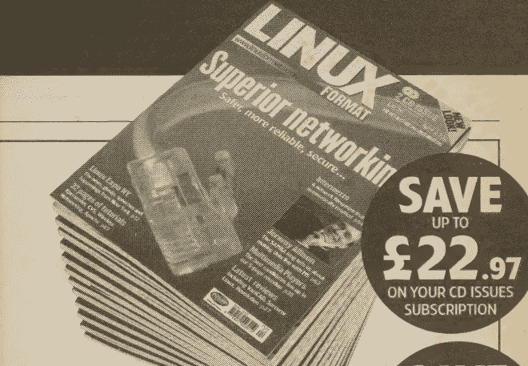

# 订阅价格（13 期）

| | CD | DVD |
|---|---|---|
| 英国 | £54.90 | £59.90 |
| 欧洲（含欧元） | £78.90 | £83.90 |
| 北美 | £78.90 | £83.90 |
| 世界其他地区 | £91.10 | £96.90 |

订购热线 0870 444 8645


