# Linux 家电设计：Linux 应用构建实用指南

作者：Bob Smith, John Hardin, Graham Phillips 以及 Bill Pierce

No Starch Press 和 No Starch Press Logo 是 No Starch Press, Inc. 的注册商标。书中提到的其他产品和公司名称均为各自所有者的商标。我们没有在每次出现商标名称时使用商标符号，而是以编辑的方式为了商标所有者的利益，无侵权意图。

书中的信息按“原样”提供，不作任何保证。虽然在准备本书时已采取一切措施，但作者或 No Starch Press, Inc. 对任何因书中信息直接或间接引起或声称的损失或损害不对任何个人或实体承担任何责任。

# 详细内容

# 致谢 xv

# 引言 xvii

+ 本书的内容 ........................................................ xviii
本书不涉及的内容 ...................................................... xviii
谁应该读这本书 ................................................ xix
为什么使用 Linux？ ................................................................ XIX
源代码的可用性 ................................................ xix
支持的硬件范围 ................................................ XIX
可靠性 ................................................................................ XX
优秀的编译器 ....................................................... XX
良好的文档 ................................................................ XX
现有的软件包 ................................................................ XX
低开发成本 ................................................................ XX
部署无许可费 ........................................................... XX
安全性 ................................................................................ XXI
Linux 设备设计 ............................................................ xxi

- 告诉 RTA 关于你的列和表 ................................................ 21
- 列 ................................................................................... 22
- 表 ...................................................................................................... 24
- 构建你的第一个 RTA 程序 ............................................................ 26
- 定义问题 ................................................................ 26
- 审查代码 ....................................................................... 26
- 安装 RTA ............................................................................ 31
- 编译与链接 ....................................................................... 32
- 测试 ................................................................................................ 32
- 基础 SQL .............................................................................................. 34
- SELECT ................................................................................................ 35
- UPDATE ............................................................................................... 35
- WHERE ................................................................................................ 36
- LIMIT ................................................................................................................. 36
- RTA 内置表介绍 ............................................... 37
- rta_dbg ................................................................................................ 37
- rta_stat ................................................................................................ 38
- rta_tables ............................................................................................... 38
- rta_columns ................................................................................ 38
- RTA 表编辑器 ............................................................................ 38
- 总结 ................................................................................................ 41

# 4 构建与加固守护进程 ............................................ 43

- 如何构建守护进程 ......................................................... 44
- 加载守护进程配置 ................................................... 44
- 进入后台运行 ................................................................ 45
- 成为进程和会话组长 ....................................... 46
- 设置工作目录 ............................................................ 47
- 重定向 stdin, stdout 和 stderr ................................................ 47


- 设置日志记录 48
- 设置组 ID 和用户 ID 49
- 检查 pidfile 50
- 设置 umask 52
- 设置信号处理程序 52
- 如何加固守护进程 53
- 设计一个安全的守护进程 54
- 编写一个安全的守护进程 55
- 在发生泄露时限制损害 57
- 原型守护进程 59
- 总结 60
- 延伸阅读 60

# 5 LADDIE 报警系统：一个示例设备 61

- 报警系统简介 62
- 传感器 62
- 启用区域 64
- Laddie 的功能规范 64
- laddie 的配置与状态 65
- laddie 的报警处理 67
- laddie 的硬件设计 68
- laddie 的软件设计 69
- applet[init()] 回调子程序 70
- poll_timeout() 回调子程序 71
- user_update() 回调子程序 73
- 构建与测试 laddie 74
- 总结 76

# 6 日志记录 77

- 你需要日志记录吗？ 77
- 日志系统的架构 78
- 消息源 78
- 消息路由 80
- 消息目的地 80
- syslog 82
- syslog 架构 82
- 使用 syslog 83
- syslog 协议 84
- 使用 syslogd 守护进程 85
- syslog 的局限性、优势及替代方案 86
- 按需日志记录 87
- 总结 89

# 7 LADDIE 事件处理 91

- 新事件处理系统的理由 92
- logmuxd 的功能与能力 93
- 配置 logmuxd 94
- logmuxd 源 94


# 8 设计 Web 界面 105

## Web 基础 106
## DNS 与 TCP 107
## Web 服务器 107
## CGI 107
## JavaScript 107
## 演进技术 107
## 建立需求 108
## 选择 Web 服务器 108

### 选项 108
### 使用 PHP 109
### 案例研究：Linksys WRT54G 无线路由器 109
### 案例研究：TUX Web 服务器 110
### Web 服务器比较 110

## UI 设计 114

### 菜单系统 114
### 对话框 115
### 错误信息 115
### 使用 Ajax 提高响应性 117

## 实现 118

### 与守护进程交互 119
### 报警状态页 121
### 报警设置页 122
### 页面布局与菜单系统 123
### Web 服务器独立性 124
### 使用 Ajax 进行异步更新 125
### 改进我们的设计 131

## 资源 132
## 总结 133

# 9 设计命令行界面 135

## 为什么你需要 CLI 136

### 安全性 136
### 可用性 136
### 带宽 137
### 可脚本性 137
### 配置备份与恢复 137

## CLI 的类型 138

### 语句 138
### 向导 139
### 菜单 139
### 有状态 140
### 字符界面与行界面 140

## 为用户访问 CLI 的权限 140
## Laddie CLI 141

### 命令摘要 141
### `set on` 142

- `logmuxd` 过滤器与重写 95
- `logmuxd` 目的地 97
- 使用 `logmuxd` 的示例 98
- 示例 1：`logmuxd` 演示 98
- 示例 2：`logmuxd` 与接受的 TCP 连接 98
- 示例 3：`logmuxd` 与 SNMP 陷阱 102
- 总结 104


- `dump` ........................................................................ 142
- `help` ........................................................ 143
- `test` 命令的代码审查 ................................... 143
  - CLI 词汇：`token.l` ................................................ 144
  - CLI 语法：`syntax.y` ................................................ 144
  - C 代码 ...................................................... 145
  - 代码审查笔记 ................... 145
- 总结 ........................................................................ 145

## 10 构建前面板界面 148
- 按钮、LED 和 LCD ................................................ 148
  - 按钮 ..................................................................... 148
  - LED ........................................................................................ 150
  - LCD ......................................................................... 151
- 设计前面板 UI ............................................... 152
  - 保持简单 ................................................... 152
  - 尝试、失败、再次尝试 ................................................. 153
  - 使用 LCD 菜单和模式............................................................... 154
  - 要快！ ................................................................ 155
- Laddie 前面板 ................................................... 157
  - Laddie LCD 菜单系统 ................................................ 158
  - Laddie 前面板硬件 ...................................... 159
  - Laddie 前面板 UI .................................................. 164
- 改进我们的设计 ..................................................... 166
- 总结 ....................................................... 167

## 11 设计帧接口 170
- 显存是如何工作的 .......................................... 170
  - 显存中的字节是如何被解释的 ................................... 170
  - 显存是如何映射到显示器的 ................................... 172
- Linux 帧缓冲区设备驱动 ............................................ 173
  - 使用 `open`, `read` 和 `close` 操作帧缓冲区 .... 174
  - 使用 `ioctl` 命令配置帧缓冲区 ................ 175
  - 一个用于帧缓冲器的简单图形程序 ........................ 177
- 图形库 ....................................................... 181
- 使用 SDL 实现“Hello, world!” ........................................... 182
  - 初始化库 ...................................... 183
  - 初始化帧缓冲区 ...................................... 183
  - 创建 Surface ....................................................... 184
  - 显示 Surface .................................................. 184
- 处理事件 .............................................................. 185
- 图形工具包 ........................................................ 185
  - 使用 STBmenu 构建简单的 UI ........................................ 187
  - 使用 STBmenu 实现“Hello, world!” .......................................... 190
- Laddie 帧缓冲区 ........................................................ 193
- 总结 ....................................................... 196

## 12 红外遥控 198
- 使用红外通信 ........................................ 198
  - 红外命令 .................................................... 198
  - 红外信号 ................................................. 200
  - 使用红外控制 ................................................. 200
  - 红外接收器 ...................................................... 201
  - 检测红外信号 ................................................. 201
  - 红外遥控波形 ................................................................ 203
  - Laddie 红外遥控硬件 ........................................ 204
  - 为 Laddie 安装并配置 LIRC ............................................ 207
  - 安装 LIRC 软件 ................................................ 208
  - 配置 `lirc_serial` 内内核驱动 ................................................. 210
  - 测试 `lirc_serial` 驱动 ................................................................ 212
  - 配置 `lircd` 守护进程 ................................................... 215
  - 测试 `lircd` 守护进程 ................................................................ 216


- 用于应用程序的 LIRC 工具 ............................................................ 218
- 控制 Laddie 设备 ................................................................. 219
- 总结 .......................................................................................... 220

## 13 SNMP 实战介绍 223
- 术语简述 .................................................... 224
- 软件 ................................................................. 225
- 安装 SNMP ................................................................ 225
- 下载与安装 ....................................................... 226
- 检查安装情况 ...................................................... 226
- 配置 Agent ................................................................. 227
- 启动 Agent ................................................................. 227
- 使用 SNMP 进行探索 ........................................................ 228
- 可读的 MIB 文件 ........................................................ 229
- 网络打印机 ...................................................................... 231
- sntable 命令 ................................................ 231
- MIB-2 TCP 连接表 ....................................................... 232
- MIB-2 UDP 表 ........................................................................ 233
- MIB-2 内容 ................................................................................... 234
- 使用 SNMP 写入值 ....................................................... 235
- 设置 sysContact ........................................................ 235
- 设置 sysName ................................................................ 237
- SNMP 陷阱 ...................................................................... 238
- 使用 snptrap 接收陷阱 ................................................ 238
- 带有数据的陷阱：linkUp 和 linkDown ............................... 240
- 总结 .......................................................................................... 242

## 14 设计 SNMP MIB 243
- 你的目标 ...................................................................... 244
- 你的企业编号 ................................................................ 245
- MIB 文件 ...................................................................................... 246
- LADDIE-GROUP-SMI ................................................ 246
- 创建 LAD-MIB ......................................................... 249
- 模块定义 ....................................................................... 251
- 版本与区域数量 .................................               253
- 报警表 ................................................................... 255
- 陷阱 ...................................................................................... 257
- 验证你的 MIB ............................................................ 259
- 总结 .......................................................................................... 260

## 15 实现你的 SNMP MIB 261
- SNMP Agent ................................................................ 262
- MIB 骨架: mib2c ........................................................ 265
- 头文件: ladProject.h ............................................... 267
- 代码文件: ladProject.c ................................................... 267
- 包含文件 ........................................................................ 268
- 基础 OID ................................................................. 268
- MIB 对象定义 ................................................ 268
- RTA 访问例程 ............................................................ 271
- 初始化程序 ................................................ 274
- 标量 (Scalars) ................................................................... 275
- 读取告警表 ................................................ 277
- 写入告警表 ................................................... 280
- 重温 Makefile ........................................................... 283
- 调试 ................................................................... 285


## B RTA 参考 289

- RTA 概述 .......................................................... 290
- RTA 常量 ............................................................... 291
- 数据结构 ............................................................ 292
- API 子程序 ............................................................ 296
- `dbcommand()` 子程序 ........................................ 297
- `rta_add_table()` 子程序 ................................... 297
- `SQL_string()` 子程序 ....................................... 298
- `rta_config_dir()` 子程序 ................................... 299
- `rta_save()` 子程序 .......................................... 299
- `rta_load()` 子程序 .......................................... 300
- SELECT 和 UPDATE 语法 ............................................ 301
- SELECT 命令 ...................................................... 301
- UPDATE 命令 ...................................................... 302
- 内部 RTA 表 ................................................ 303
- `rta_tables` 表 ....................................................... 303
- `rta_columns` 表 ................................................ 304
- 调试配置 ...................................................... 304
- 错误信息 ............................................................ 305
- SQL 请求错误 ................................................ 305
- 内部调试信息 ............................................ 306
- 回调例程 ........................................................ 307
- 读取回调 ............................................................ 307
- 写入回调 .......................................................... 308

## B SNMP 复习 309

- 为什么用 SNMP? ............................................................ 310
- 代理 (Agents) 与管理器 (Managers) ................................................... 310
- 命名空间、语法和协议 ............................ 310
- MIB ........................................................................... 311
- OID ....................................................................... 311
- MIB-2 ....................................................................... 313
- SMI ................................................................................................................ 314
- SNMP 协议 ................................................................................................ 316
- 基础命令: GET, SET, GETNEXT ....................................................... 316
- 使用 GETNEXT 遍历 MIB ....................................................................... 316
- 陷阱 (Traps) 与告警 (Informs) ................................................................................................ 316
- 命令行工具：示例 ................................................................... 316
- SNMPv1, SNMPv2 和 SNMPv3 ....................................................................... 318
- SNMP 数据类型 ................................................................................... 319
- SNMP 表 ........................................................................................ 320
- 定义新类型 ................................................................................ 321
- MIB 文件结构 ........................................................................ 322
- 总结 ............................................................................................ 324

## C 安装帧缓冲区设备驱动程序 ....................... 325

- 为你的显卡寻找帧缓冲区设备 (Framebuffer Devices) ................................ 326
- `vesabf` 驱动程序 ...................................................................................... 326
- 特定硬件驱动程序 ............................................................. 327
- Laddie CD 中未包含的驱动 ................................................ 327
- 配置帧缓冲区设备驱动程序 ........................................ 328

- 陷阱 (Traps) ........................................................................ 285
- 总结 ...................................................................... 286


- `vesabf` 驱动程序 ...................................................................................... 328
- 特定硬件驱动程序 ....................................................... 329

## D 数据库到文件的工具 ........................................................ 331
- 概述 .......................................................................................... 332
- 表定义 ............................................................................ 332
- `tbl2file` 表 ...................................................................... 333
- `tbl2field` 表 .......................................................................... 334
- `tbl2filed` 示例 ........................................................................ 335
- 安全注意事项 .......................................................................................... 336

## E LADDIE 设备启动 CD ............... 337
- 运行 Laddie 设备 ................................................... 337
- 启动 CD ......................................................................... 338
- 导航帧缓冲区设备界面 ................... 338
- 访问 Web 界面 ....................................... 339
- 尝试 Linux Shell 和其他接口 339
- 关闭 Laddie 设备 ........................... 340
- 探索 CD 内容 ....................................................... 340
- Laddie 设备源码 ......................................... 340
- Laddie 设备库 ........................................................ 341
- 启动脚本 ........................................................ 341
- Linux 从零构建 (Linux From-Scratch) 发行版及额外包 342
- 重建 Laddie 设备 ................................... 342

## 索引 ...................................................................... 345

# 致谢

作为本书的作者，我们要感谢 Peter Enemark、Chris Sommers 和 Keith Garrett 对此项目的无条件支持，以及对书中介绍的技术所做出的贡献。

作为本书的读者，你们应该感谢我们的技术编辑 Bob Lynch，他在文本和 CD 中发现了许多许多错误。你们也应该感谢 Elizabeth Campbell、Riley Hoffman 和 Megan Dunchak，她们将我们一些技术上正确但完全不可读懂的句子改成了既易读又正确的表达。

我们还要感谢 Jon Colton，他是负责 Tux's Workshop 系列的艺术家。


# 引言 (INTRODUCTION)

烤面包机、烤箱和洗碗机是我们日常生活中常见的家电器。虽然我们对它们的使用非常熟悉，但很少有人会停下来思考电器在内部是如何工作的，甚至是什么让一个设备真正成为一台“电器”。本书将家电器定义为一种主要设计用于执行单一功能的设备。如果你想一下刚才提到的这些电器，你会发现这个定义是成立的：烤面包机用于烤面包，烤箱用于烘焙，洗碗机用于洗碗。与能够运行成千上万个安装硬件和软件的 PC 相比，传统电器是枯燥且简单的。

这与 Linux 有什么关系？传统的电器不再那么简单了。以前那些通电但仍是机械的设备（如吸尘器），现在不仅是电子化的，还包含了处理器、电路板和复杂的交互界面。随着这些变化，出现了在电器上运行操作系统以管理新功能的需求。Linux 是这一需求的自然理想选择，因为它的成本低（大多数情况下是免费的）并且是开源的（这意味着你可以对其进行修改以更好地适应你的需求）。然而，Linux 真正用武之地是那些设计的新型电器。数字视频录像机（DVR）在几年前还闻未闻，但第一台最流行的 DVR 设备 TiVo 运行在 Linux 上，许多其他家庭网络和娱乐电器也是如此。

如果你想构建下一个伟大的机器人家用清洁系统，你会希望避免完全从零开始设计。你会尽可能从早期的机器人中复用许多部分，并尽可能使用现成组件。同样的复用理念也适用于 Linux 电器，这正是本书可以提供帮助。

# 本书内容 (What This Book Is About)

本书展示了如何构建一个 Linux 电器，并包含了一个原型电器，如果你愿意，可以将其作为你电器的基础。我们将电器分为守护进程（daemons）和用户界面，并展示了如何创建和管理守护进程，以及如何构建不同类型的用户界面。

我们涵盖了以下主题：
- 电器架构
- 如何与运行中的守护进程通信
- 如何构建和保护守护进程
- Laddie，我们的示例电器
- 日志和事件处理
- 基于 Web 的用户界面
- 命令行界面 (CLIs)
- 前面板接口
- 帧缓冲区（framebuffer）接口，包括红外遥控
- SNMP 接口，包括工具、MIB 和代理程序

大多数章节具有相同的基本布局。我们定义并解释为什么该功能是必要的，描述该功能面临的挑战和常用方法，并描述我们如何在我们的示例电器中实现该功能。

# 本书不涵盖的内容 (What This Book Is Not About)

本书不涵盖 C 语言编程、Linux 操作系统或定义特定 Linux 电器的主应用程序。此外，本书不涉及嵌入式 Linux。我们认为发现以下关于嵌入式 Linux 的书籍对你很有帮助：
- *Embedded Linux*, John Lombardo 著 (SAMS/New Riders, 2001)
- *Embedded Linux: Hardware, Software, and Interfacing*, Craig Hollabaugh 著 (Addison-Wesley, 2002)
- *Linux for Embedded and Real-Time Applications, Second Edition*, Doug Abbott 著 (Newnes, 2006)
- *Embedded Linux System Design and Development*, P. Raghavan, Amol Lad, and Sriram Neelakandan 著 (Auerbach Publications, 2005)

# 谁应该读本书 (Who Should Read This Book)

本书面向想要构建自定义 Linux 电器并支持多个用户界面、构建安全的守护进程或提供日志和事件管理的 Linux 程序员。本书可能对以下读者有所价值。

# 为什么使用 Linux？ (Why Use Linux?)

在深入探讨大多数电器的架构之前，我们应该回答：“为什么要使用 Linux？”

## 源码的可用性 (Availability of Source Code)

源码的可用性使得在电器上定制操作系统成为可能。

## 支持的硬件范围 (Range of Hardware)

Linux 支持从低端电子产品到高端超级计算机的硬件。

## Linux 开发者的可用性 (Availability of Developers)

Linux 开发者在计算机科学毕业生中是一个共识。

# 可靠性 (Reliability)

Linux 足够可靠，可以运行在数据中心多年不机。

# 优质的编译器 (Quality Compilers)


GNU 编译器集合（GCC）是一套全面的编译器、链接器和调试器，支持多种语言。更多信息请参见 http://gcc.org。

# 良好的文档 (Good Documentation)

互联网上有大量关于 Linux 的文档可以获取。一个很好的起点是 Linux 文档项目（见 tld.org）。

# 现有软件包 (Existing Software Packages)

有许多软件包可以帮助开发电器。例如，用于简单网络管理协议的 Net-SNMP、用于监控电器的 lm_sensors 以及用于 Web 的 lighttpd。

# 低开发成本 (Low Development Cost)

电器程序员通常可以使用他们的台式机进行软件开发。因此，电器软件开发可以并行，一个团队开发嵌入式 Linux，另一个团队开发主应用程序。

# 部署无需许可费用 (No Licensing Fees for Deployment)

电器制造商通常不需要支付费用即可分电器，尽管有一些例外。例如，来自 Trolltech 的 Qt 库和 MySQL 数据库可能付费。

电器开发者使用 grsecurity 和 systrace 等包将安全性提高到 Windows 无法比拟的水平。电器的额外优势是，多功能桌面或服务器永远无法像经过加固的单一功能设备那样安全。

# 电器设计 (Appliance Design)

我们试图将本书和随附的 CD 设计成一种“零件箱”，你可以在组装电器时从中提取。关于我们零件箱中组件的良好概述在第一章给出，该章展示了大多数电器通用的高层视图。

## 1 电器架构 (APPLANCE ARCHITECTURE)

我们将从 Linux 电器架构的高层视角开始我们的冒险。然后，我们将降低一点高度，从进程的角度来看 Linux 电器。正如你所见的，这种较低高度的视角与本书使用的组织和章节相匹配。

在本章中，我们将涵盖以下内容：

- UI 和守护进程
- Laddie 电器的架构

图 1-1 显示了我们在 Linux 电器中通常看到的栈。该栈的底部是嵌入式 Linux 内核。内核之上是各种用户界面和常用服务（如网络管理和日志），顶部是定义电器的特定功能。

对于设备而言，用户界面（UI）一术是指用户通过该界面管理设备配置并查看其状态和统计数据的接口。缺少屏幕和键盘只算设备的一半，但不要被它误骗了——所有设备都有 UI。可以确定，UI 的可见性越高，设备就越好，但 UI 始终是存在的。设备通常具有 Web、SNMP 和命令行界面，而消费级设备则具有帧缓冲区（framebuffers）和小型字母数字接口。

| 你的代码 | 定义的应用程序 |
|---|---|
| 本书中的代码 | 用户界面与常用服务 |
| 嵌入式 Linux | Linux |

图 1-1：Linux 设备软件堆栈

### UI 与守护进程

假设我们的 Linux 设备将拥有多个同时运行的 UI，当我们从运行进程的角度来看设备时，我们得到一个类似于图 1-2 所示的架构。UI 程序与用户交互以接受命令和配置，并显示状态和统计数据。另一方面，守护进程与硬件、其他守护进程以及 UI 交互，以提供设备的定义服务以及状态和统计数据。

图 1-2：常见的设备架构

### 守护进程

守护进程是在启动 Linux 之后立即启动的后台程序。守护进程的独特之处在于它们不像从 bash 命令行启动的程序那样拥有控制终端。让我们来看看典型设备上常见的守护进程类型。

### 定义的应用程序

图中的*定义应用程序*是指提供该设备独特功能的守护进程。例如，一个高级电话应答机的定义应用程序是负责接听电话和录音的守护进程。

### 日志守护进程

图 1-2 所示的*日志守护进程*收集日志消息，并将它们保存到磁盘或将它们路由到网络上的另一个主机。`syslog` 守护进程是大多数 Linux 系统上的默认的日志守护进程。

### 事件处理器

*事件处理器*对事件提供本地的、活动响应。通常，日志守护进程和事件处理守护进程是同一个，正如在我们的示例设备上运行的 `logmuxd` 守护进程中那样。

### 安全监控器

*安全监控器*控制对关键配置或资源的访问，例如身份识别和验证凭据。安全监控器还应该响应强制访问控制（MAC）违规。

### 硬件监控器

*硬件监控器*监控温度警报和磁盘驱动器问题。大多数基于 PC 的 Linux 设备将使用 `sensors` 包来监控 CPU 和主板传感器，并使用 `smartd` 来监控硬盘的温度和错误统计数据。硬件监控器可以将这些和其他来源的信息整合成一份关于设备状况的综合报告。

### 用户界面

当我们开始构建 Linux 设备时，我们曾认为设备的本质决定了它将拥有的 UI 类型。但，我们错了。客户总是要求有不止一种管理设备的方法。智能手机需要*帧缓冲区接口*和*通过蓝牙的 Web 接口*。网络设备需要*Web 接口*和 SNMP 接口。当你看图 1-2 时，不要想“是哪一个？”“有几个？”

图 1-2 中描绘的 UI 并非唯一的选择。例如，你可能想要一个在 Windows PC 上原生运行的接口，或者如果你正在构建网络设备，你可能想要为 LDAP 或 RADIUS 认证服务器，或者为网络的计费系统和数据库添加接口。图 1-2 显示了常见的 UI 以及书中描述的 UI。

#### Web 接口

如果设备具有网络接口，则 Web 接口是强制性的。在这里有很多需要决定：你使用 JavaScript 吗？后端是用 Perl、PHP、C 还是 Java 写的？你使用哪一个？你假设所有浏览器都支持级联样式（cascading sheets）吗？

#### 帧缓冲区接口

帧缓冲区接口对于电视顶盒、嵌入式和手持设备非常流行。这赋予了你对每个像素的直接控制。许多 UI 都依赖于帧缓冲区，正如在我们的示例设备上运行的 `SDL` 守护进程中。

#### 面板

无论面板是简单还是复杂，对于设备而言，UI 都是至关重要。简单的面板可能只有几个按钮，而更复杂的面板可能带有液晶显示器（LCD）。

#### SNMP 接口

对于商业级设备，SNMP 的至关重要。如果你将其拆解开，它并不困难。首先，你需要熟悉 SNMP 的概念。然后，你需要为 SNMP 可见的数据设计管理信息库（MIB）或架构。最后，你需要编写让 SNMP 指令可访问的软件。

#### 命令行接口

命令行接口（CLI）通常作为网络设备的最后控制接口，即使整个网络宕机，串口上的 CLI 仍然可用。

### 进程间通信

最后，你可能注意到图 1-2 中的全网格线。这种需求决定了进程间通信（IPC）。

### 设备架构

我们的示例设备是一个使用常用功能的报警系统。UI 包括 Web、命令行和 SNMP。设备上的守护进程包括响应设备事件的系统。我们选择不实现图 1-2 中的所有守护进程，以便专注于详细描述。这把 UI、功能或守护进程映射到章节编号，让你看到这些内容是如何在一起的。

图 1-3：设备 的章节映射

# 总结

大多数 Linux 设备都有相同的架构：底部是 Linux，顶部是定义应用程序，中间是常用服务和 UI。我们讨论了包含各种守护进程和 UI 的原因，并将书中章节映射到架构图中。

## 2

## 管理守护进程

大多数设备的核心都有一个执行定义功能的应用程序或守护进程，并由一个或多个用户界面管理核心应用程序或守护进程。图 2-1 显示了一个典型的设备架构，可能与你对设备的设想相似。

正如通过用户界面（UI）管理定义应用程序，常用服务（如 Web 服务器或系统日志）也需要管理。由于主应用程序和大多数常用服务都是作为守护进程实现的，管理问题就变成了管理守护进程的问题。本章的重点是如何更好地管理守护进程。

在本章中，我们将涵盖以下内容：

- 管理守护进程的方法
- 控制与状态协议

### 管理守护进程的常用方法

我们所说的管理守护进程，是指配置守护进程、从其收集统计数据并能够查看其当前状态。大多数 Linux 守护进程使用 ASCII 文本文件进行此类通信，但在构建守护进程时，还有其他选项供你考虑。接下来的章节将描述各种守护进程管理方法及其优缺点。

#### 基于文件的管理

守护进程通常通过几个配置文件进行管理或监控，这些文件控制着它们的运行参数、状态和日志。例如，DHCP 守护进程 `dhcpd` 由 `/etc/dhcpd.conf` 配置控制；其状态显示在 `/var/state/dhcp/dhcpd.leases` 中；启动脚本位于 `/etc/rc/init.d/dhcpd`；日志位于 `/var/log/messages`。然而，守护进程配置的存储方式或状态的获取方式并没有统一的标准。状态和其他状态变化通常使用 `syslog()` 记录，但许多应用程序使用自定义例程进行记录，并以非标准格式存储日志文件。图 2-2 显示使用文件进行配置和管理的守护进程的典型流程。

基于文件的方法对于设备而言具有以下局限性：

- 目前没有好的方法可以从大多数运行中的应用程序获取状态或统计数据。虽然应用程序可以将状态和统计数据写入文件，但要实时（或接近实时的）这样做可能对 CPU 和文件系统的负担过大。
- 你需要编辑配置文件，这在设备上并不总是容易的。
- 要应用新设置，你通常需要重启运行中的守护进程，这可能会中断服务并给用户带来麻烦。

图 2-2：管理守护进程的最常见方法


尽管基于文件的接口存在局限性，许多应用程序仍将其用于 Unix 系统管理，并且它们可能继续保持流行。如果你正在构建一个新应用程序并选择了使用基于文件的应用程序管理，请考虑使用 `libini` 或 XML 解析库。此外，像 `Webmin` 这样的应用程序通过提供 Web 前端来帮助你显示和编辑许多配置文件。

请记住，非常简单的应用程序（包括某些守护进程）可能永远不需要对状态、统计数据和配置进行运行时访问。可能没有理由放弃 Unix 传统的 `.conf` 和 `.log` 方法。哪种方法最适合你的特定应用程序取决于你的决定。

### 基于守护进程的 Web 接口

管理守护进程的另一种常用方法是直接从守护进程提供 Web 接口。例如，打印打印程序 CUPS 的守护进程 `cuspd` 通过 TCP 端口 `631` 提供了它自己的 Web 接口。这种方法对于简单的守护进程是可行的，但它有两个问题：

- 你需要在守护进程中维护代码，以支持许多不同浏览器的 HTTP 实现。
- 当需要额外的接口时，添加接口可能很困难。

举例来说，我们在其中一个项目中需要对状态和配置进行运行时访问，因此添加了一个内置的 Web 接口。这简直是一场编码噩梦！似乎永远无法正确处理 HTTP 的所有细节，并让生成的代码兼容所有主要的 Web 浏览器。如果你决定直接在守护进程中构建 Web 接口，请帮自己个忙，使用来自 Hugues Technologies 的 `libhttpd` 这样的 HTTP 库。因为其他作为 HTTP 专家的代码编写者不断跟进各种浏览器的特性，你的维护工作将会轻松得多。

这个项目也凸显了第二个问题。一旦 Web 接口工作正常，客户要求我们提供一个 SNMP 接口。最快的方法是像添加 Web 接口那样，直接将 SNMP 添加到守护进程中。这一添加使我们顺利进入了所谓的“合合一”方法之路，该方法将在下一节中描述。

如果你知道用户在守护进程运行时需要与其交互，而且你的运行中守护进程需要超过一种类型的接口，那么你可能想将必要的接口直接添加到守护进程中。图 2-3 显示了。

合合一方法

| 端口 | 接口 |
| :--- | :--- |
| 端口 80 | Web 接口 |
| 端口 141 | SNMP 接口 |
| 端口 23 | CLI 接口 |

图 2-3：添加所有接口

由于用户界面与守护进程是分离的，为每段代码构建脚手架是一个干净的过程。一旦构建了脚手架，即使所有部分尚未就位也可以进行测试。

将用户界面与守护进程解耦意味着你可以让两个团队合作该项目。人员配备更容易，因为你可以聘佣只需要开发技能的人员。分离用户界面开发者和守护进程开发者还有另一个优势：它迫使你仔细思考并定义守护进程的接口。

为你的守护进程使用控制状态协议可以从两个方面增加设备的安全性。首先，用户界面不需要以与守护进程相同的特权运行，这意味着任何时候具有特权的代码都更少。其次，使用紧凑定义的协议可以让你定义协议及其 API。这比使用“合合一”方法要简单得多。

控制状态协议可以使用串口连接、Unix 或 TCP 套接、文件读写，或者可能隐藏在库调用中。这些技术在本章晚些部分描述。作为介绍，考虑以下示例，它们设置了比特位 `cntl_pt`：

`AT` 命令 `AT501=1`

`XML` `<rpc><cntl_pt><value></cntl_pt></rpc>`

库调用 `ret = set_cnt_pt(1);`

`/proc` `echo 1 > /proc/sys/mydev/cntl_pt`

`SQL` `UPDATE my_table SET cntl_pt = 1`

### 控制状态协议的要求

如果你设计了自己的控制状态协议，你应该根据以下标准来判断你的设计：客户端和守护进程之间的数据模型、对现有协议和软件的重用、对客户端和守护进程的限制，以及发现系统的易用性：

#### 数据模型

控制状态协议应该允许客户端和守护进程具有相同的数据模型。也就是说，如果守护进程使用变量、结构、列表和数组，那么控制状态协议另一端的客户端也应该支持变量、结构、列表和数组。在协议双方具有相同的数据模型可以更容易重用，并有助于程序员对他们正试图解决的问题保持一致的视图。

### 使用现有标准和代码

控制和状态协议应尽可能使用现有的软件和标准。你可能会找到已经熟悉这些协议和软件的开发者，他们很可能为需要学习这些内容的开发者准备了良好的文档。使用现有代码几乎是一个好主意，因为新代码越少意味着需要的开发者就越少。

### 对守护进程和客户端的限制很少

理想情况下，协议应该对你设计守护进程（`daemon`）的方式产生很少的限制，并且不会增加守护进程的大小。你应该能够将控制和状态协议添加到你的程序的主源文件中。在对旧程序进行控制和状态协议的后期后改造时，你应该能够将大部分新代码放在单独的源文件中，而不是将更改交织在主代码库中。你的协议的客户端绑定应该支持所有主流编程语言：对于 Web 接口至少支持 `Java` 和 `PHP`，对于编译代码至少支持 `C` 和 `C++`。

### 发现机制

我们希望在不依赖文档的情况下发现设备上可用的信息。例如，`ls` 命令涵盖了 Unix 文件系统中的可用文件；`get-next` 操作符发现了 SNMP MIB 中的内容；系统表描述了数据库本身。类似地，我们希望有一种机制，使用户可以发现设备上可以配置的内容以及从设备上提供的可用信息。

### 通用控制和状态协议

在我们的工作中，我们开发了多种控制和状态协议，我们将在本节中描述它们。在您阅读时，请根据上一节提出的四个标准对它们进行判断。

### AT 命令

在我们的第一个控制和状态协议中，我们使用了 Hayes AT 命令集的变体。我们处理的设备是一个无线调制解调器，我们的大多数客户已经熟悉该命令集，使其成为一个逻辑选择。我们的守护进程监听传入的 TCP 连接。使用 TCP 为我们提供了诊断和配置的远程访问能力。

我们将系统配置存储为 AT 命令列表。在系统启动时，守护进程会读取配置文件并通过 AT 命令解释器运行它。这种方法意味着我们不需要添加代码来处理不同格式的配置文件。虽然 XML 和 INI 是配置的标准，但如果可以轻松避免，我们不想增加代码量和复杂性。

AT 命令协议有两个局限性。首先，我们无法使用标准的 AT 寄存器语法方便地访问数据数组。其次，客户端程序员必须编写大量的代码来生成 AT 命令并解析回复。

### 可扩展标记语言

我们使用扩展标记语言（XML）作为管理 Juniper 路由器的控制和状态格式。XML 协议示例包括 `XML-RPC`、`SOAP` 和 `JUNOScript`。`JUNOScript` 通过 `telnet` 或 `SSH` 连接管理 Juniper 路由器。它允许你用 XML 编码命令，路由器用 XML 响应进行回复。例如，运行配置的结果看起来如下：

```
<rpc>
<get-configuration/>
</rpc>
```

在 JunoScript Juniper 路由器出现之前，Juniper 路由器是通过命令行界面（CLI）配置的。当你用程序而不是手动操作来管理路由器时（特别是如果你必须编写该程序时），XML 优于 CLI 的优势就显而易见了。编写解析 XML 响应的代码比解析 CLI 响应的代码更容易。XML 的其他优势包括它在表示丰富数据方面的灵活性，以及处理 XML 格式的软件库。

在客户端和服务器之间交换 XML 需要添加传输协议。你可以像 `JUNOScript` 那样使用 `telnet` 或 `SSH`，也可以像 `SOAP` `XML-RPC` 标准那样使用 `HTTP`。

通常，你会使用库在服务器端解析 XML，并将 XML 元素序列化（marshal）到服务器的内部数据结构中。由于 XML 结构很少直接映射到守护进程中使用的数据模型，将 XML 映射到内部数据结构的代码可能是复杂且易出错的。

如果你使用 XML 构建控制和状态协议，应该考虑使用 XML 应用程序接口（SAX）。SAX 使用事件驱动模型来处理 XML。

`PostgreSQL` 客户端采用宽松的许可证，且文档极其详尽，RTA 中的系统表可以作为浏览 UI 程序提供的数据的一种方式。

使用 Unix 套接字并仔细设置所有权和读/写权限，可以增强安全性。`SELinux` 和 Linux 安全模块（Linux Security Module）可以更精确地控制哪些程序可以连接到 RTA 守护进程（`daemon`）。考虑使用 `stunnel` 或带有端口转发的 `SSH` 进行安全远程访问。


虽然 XML 很流行，但 RTA 和 PostgreSQL 相比它有几个优势。PostgreSQL 同时提供了数据格式和传输协议。使用 RTA 时，你不需要将 XML 的树形结构代码映射到守护进程的内部数据结构中；RTA 方法比基于 XML 的方法需要的开发更少。通过 RTA，客户端可以直接查看守护进程的内部内存变量，这种功能不需要额外的开发。

下一章将更详细地介绍 RTA，但一个简单的示例可以展示 RTA 如何从 UI 客户端工作。假设守护进程有一个如下结构数组：

```c
struct Zone {
  char zname[Z_LEN]; /* 用户编辑的字符串 */
  int zenabled;       /* 用户编辑的值 */
  int zcount;        /* 计数 */
};
```

在通知 RTA 数组（通过 `rta_add_table()`）后，你可以使用任何支持 PostgreSQL 的客户端来读写数组中的数据。如果你使用 `psql` 终端程序，可以使用以下命令读取 `Zone` 表：

```bash
psql -h localhost -p 8889
```

```sql
# SELECT zname, zenabled FROM Zone;
```

| zname | zenabled |
|---|---|
| Garage | 1 |
| Front Door | 1 |

这个示例展示了从运行的守护进程中读取变量的简单方法。RTA 也有一些缺点。由于 RTA 库是用 C 语言编写的，这意味着如果你的服务器进程是另一种语言（例如 Java），就无法使用 RTA。另一个缺点是，如果你的设备由多个守护进程组成，你需要一个管理进程来管理这些守护进程，而只向客户端暴露单一的管理点。公平地说，最后一个缺点是。

# 总结

在本章中，我们讨论了管理守护进程的不同方法。简单的守护进程可以使用文件进行所有管理，但我们认为对于具有多个用户界面的 Linux 设备，控制和状态协议是最好的。我们描述了使用控制和状态协议的原因，并在你决定构建自己的协议时提供了一些指南。

在下一章中，我们将为你展示如何将 RTA 整合到守护进程中，以便客户端访问守护进程的状态、RTA 配置和统计数据。

书中剩余的所有示例都使用 PostgreSQL 和 RTA 库作为守护进程和用户界面之间的管理协议。尽管你选择不使用 RTA 也不必，书中更多是关于设备设计而不是使用特定的库。

# 3 使用运行时访问

本章将带你通过 RTA 库开发 Linux 设备的实用介绍。将此视为你的“Hello, world!”示例。在本章中，我们将讨论：

- RTA 设备架构
- RTA 守护进程架构
- 通知 RTA 你的列和表
- 构建你的第一个 RTA 程序
- 简易 SQL
- 对 RTA 内置表的介绍
- RTA 表编辑器

## RTA 设备架构

你可能记得上一章提到过，在 UI 程序和守护进程之间放置一个定义的协议有几个原因。协议降低了 UI 和守护进程的复杂性，在守护进程运行时提供访问，让你能够独立地处理和测试 UI 以及守护进程，并提高了安全性。该协议的重要要求是：协议的数据模型与你的匹配，或者你不需要自己定义或编写协议，并且该协议适用于大多数 UI 编程语言。

我们在此处使用的数据模型是数据库模型。因为我们将结构数组视为数据，UI 程序（或客户端）将守护进程中的数据视为数据库。虽然 UI 程序认为它们正在处理 PostgreSQL 数据库，但实际上它们正在与守护进程通信。这种安排导致了类似于图 3-1 所示的设备架构，其中缓冲区使用 `libpq` 中的 PostgreSQL C 语言绑定，因此 Web UI 使用 `psql` 中的 PostgreSQL PHP 绑定；因此测试和调试 UI 使用命令行程序 `psql`。

| 缓冲区界面 | 你的 C/C++ 代码 | libpq |
| :--- | :--- | :--- |
| Web 界面 | Apache / PHP | php / psqld |
| | 守护进程 / RTA / 你的 C/C++ 代码 |
| 测试和调试界面 | | psql |

图 3-1：使用 RTA 的示例设备

通过 Unix 或 TCP 套接字连接到守护进程后，图 3-1 所示的 UI 可以显示守护进程中的配置、状态和统计数据。`librta.so` 库以来自 PostgreSQL 数据库的形式呈现守护进程的数据。此图显示了我们在书中使用的 PostgreSQL 客户端绑定，但还有更多语言绑定可用，包括 Java、Python。

## RTA 守护进程架构

将 RTA 添加到你的守护进程非常简单；第一个例程 `rta_add_table()` 使其中一个可见。第二个例程 `dbcommand()` 处理来自客户端的请求。

PostgreSQL 客户端采用宽松的许可证，且文档极其详尽，RTA 中的系统表可以作为浏览 UI 程序提供的数据的一种方式。使用 Unix 套接字并仔细设置所有权和读/写权限，可以增强安全性。SELinux 和 Linux 安全模块可以更精确地控制哪些程序可以连接到 RTA 守护进程。考虑使用 stunnel 或带有端口转发的 SSH 进行安全远程访问。

RTA 使用原生编译器数据类型以匹配你在结构体中使用的数据类型。对于整数、长整数、浮点数及其关联指针类型，`length` 成员会被忽略，但对于字符串以及它们的指针，它具有意义，应该报告字符串的字节数（包括终止的空字符）。

### offset

偏移量是从数据结构开始位置到所描述的成员之间的字节数。例如，一个使用包含 `int`、20 字符字符串和 `long` 数据结构的表，其 `long` 的偏移量为 24（假设 `int` 是 4 字节）。

计算结构体成员的偏移量非常麻烦且容易出错。gcc 编译器套件提供了 `offset()` 宏来自动计算结构体成员的偏移量。

### flags

列有两个由 `flags` 成员指定的二进制属性。第一个属性指定该列是否可以被覆盖或为只读。统计数据通常被标记为只读。如果标记为只读的列在 `UPDATE` 语句中作为主体，则会生成错误。该属性的 `#define` 为 `RTA_READONLY`。

第二个属性指定此列的值是否应该保存到与表相关的配置文件中。应该从程序本次调用到下一次调用持续的值应该标记为 `#define RTA_DISKSAVE` 属性。

`flags` 字段是 `RTA_DISKSAVE` 和 `RTA_READONLY` 的按位或结果。

### readcb()

如果定义了，每当使用列的值时，就会调用读取回调例程 `readcb()`。这对于那些需要消耗 CPU 周期计算但被频繁使用的值非常有用。每当引用列时，都会调用一次读取回调——如果你的 SQL 语句使用了两次该列名，则读取回调会被调用两次。

读取回调传递五个参数：表名、列名、SQL 请求文本、受影响行的指针以及从 0 开始索引的行号。回调的函数原型所示：

```c
int readcb(char *tbl, char *col, char *sql, void *pr, int rowid);
```

读取回调在成功时返回零，如果回调中发生错误，则返回错误代码。请在客户端中检查返回值以增强可靠性和安全性。

### writecb()

写入回调可以是驱动应用程序的真实引擎。如果定义了，在 `UPDATE` 中的所有列都更改后，就会调用写入回调 `writecb()`。考虑以下 SQL 命令：

```sql
UPDATE ifcfg set addr="192.168.1.1", mask = "255.255.255.0";
```

如果 `addr` 上有写入回调，它将在 `addr` 和 `mask` 都更新完毕后被调用。RTA 在所有字段更新后执行写入回调以保持一致性。

# 总结

在本章中，我们讨论了管理守护进程的不同方法。简单的守护进程可以使用文件进行所有管理，但我们认为对于具有多个用户界面的 Linux 设备，控制和状态协议是最好的。我们描述了使用控制和状态协议的原因，并在你决定构建自己的协议时提供了一些指南。

在下一章中，我们将为你展示如何将 RTA 整合到守护进程中，以便客户端访问守护进程的状态、RTA 配置和统计数据。

书中剩余的所有示例都使用 PostgreSQL 和 RTA 库作为守护进程和用户界面之间的管理协议。尽管你选择不使用 RTA 也不必，书中更多是关于设备设计而不是使用特定的库。


`int writecb(char *tbl, char *col, char *sql, void *pr, int rowid, void *poldrow);`

# help

你为列提供的帮助文本应该包含对列如何使用的描述、对列的任何限制或约束，以及任何读取或写入回调引起的侧边影响（为你和同事的列提供有意义的帮助文本，以便更容易维护和排排除代码）。

# Tables

你通过调用 RTA 例程 `rta_add_table()` 向 RTA 描述你的每个表。`rta_add_table()` 的唯一参数是一个指向描述表的 `TBLDEF` 结构体的指针。

`TBLDEF` 结构体使用 10 信息来描述你的表。其中关键的是表名、结构体数组的起始地址、每个结构体的宽度（即每行的宽度）、行数以及一个指向描述表中列的 `COLDEF` 结构体数组的指针。`TBLDEF` 结构中的大部分字段应该是自自明的。

```c
typedef struct {
  char *name;      // 表的 SQL 名称
  void *address;   // 表在内存中的位置
  int rowlen; // 每行的字节数
  int nrows; // 行数
  void (*iterator) (void *cur_row, void *it_info, int rowid);
  void *it_info; // 迭代器调用的透明数据
  COLDEF *cols; // 列定义数组
  int ncol; // 列数
  char *savefile; // 在此文件中保存表
  char *help; // 表的描述
}
```

# savefile

从设备的一次启动到下一次启动保存配置数据的需求是非常常见的，以至于作者们包含了在 RTA 更新时自动将表数据保存到文件中。。只有一个文件。

```c
int zcount; /* transition count of zalarm */
};
#define ROW_COUNT 100
struct ZData zdata[ROW_COUNT];
```

`zalarm` 的变化是在写回调函数中检测的。在这里，I 是它的前向引用。

我们需要为 SQL 命令的文本、客户端以及对客户端的响应分配缓冲区。我们分别使用了 500 和 5,000 字节。选择这些值是为了容纳我们预计使用的最大的 SQL 语句，以及我们预计获取的最大的结果集。

第 30 页的结构体定义是应用程序数据的核心。该数据结构的每个实例在各种 UI 和客户端看来，都像数据库中的一行。

我们看到该表中有五行。

## 列定义

这里是定义表中列的 `COLDEFS` 数组。`COLDEFS` 中的信息源于我们想要可视化的数据结构以及我们的问题描述。

```c
COLDEF zcols[] = {
  "ztable", /* the table name * */
  "zname", /* the column name * */
  RTA_STR, /* it is a string * */
  Z_NAME_LEN, /* number of bytes */
  offset(struct ZData, zname), /* location in struct */
  RTA_DISKSAVE, /* flags: configuration data * */
  (int (*()) 0, /* called before read */
  (int (*()) 0, /* called after write */
  "User assigned name for this row. The names are part of the "
  "saved to a disk file since they are part of the "
  "configuration. Note that the maximum name length "
  "is 20 characters, including the terminating NULL.\ ",
  "ztable", /* the table name * */
  "zalarm", /* the column name * */
  RTA_INT, /* it is an integer * */
  sizeof(int), /* number of bytes */
  offset(struct ZData, zalarm), /* location in struct */
  0, /* no flags * */
  (int (*()) 0, /* called before read */
  (int (*()) 0, /* called after write * */
  zeddedgeteffect,
  "A user read/write value. Print a message on all transitions "
  "from high-to-low or low-to-high. Do not display anything "
  "if a write does not cause a transition. A write callback "
  "translates all nonzero values to a value of.", ", 
}
```

注意 `COLDEF` 中 `zgedetect` 写回调的定义。我们在该回调函数中对 `zalarm` 进行变化检测。

```c
{
    "ztable",      /* the table name */
    "zcount",      /* the column name */
    RTA_INT,        /* it is an integer */
    sizeof(int),    /* number of bytes */
    offsetof(struct ZData, zcount), /* location in struct */
    RTA_READONLY,   /* flags: a statistic */
    (int (*()) 0,   /* called before read */
    (int (*()) 0,   /* called after write */
    "The number of transitions of zalarm. This is a "
    read-only statistic."
}
```

## 表定义

在 `TBLDEF` 中，我们给出了表的名称、起始地址、每行的大小、行数、指向该表 `COLDEFs` 表的指针以及表中的列数。保存文件 `/tmp/zsave.sql` 将用于保存 `RTA_DISKS` 列，在本例中它只有名称列。

```c
TBLDEF ztbl = {
    "ztable",       /* table name */
    zdata,           /* address of table */
    sizeof(struct ZData), /* length of each row */
    ROW_COUNT,      /* number of rows */
    (void *) NULL,  /* linear array; no need for an iterator */
    (void *) NULL,  /* no iterator callback data either */
    zcols,          /* array of column defs */
    sizeof(zcols),  /* the number of columns */
    "/tmp/zsave.sql", /* Save config in /tmp directory */
    "A sample table showing the use of column flags and write callbacks"
};
```

## 程序

这是非常标准的代码。我们分配了结构体和局部变量，初始化了表值并使用 `rta_add_table()` 通知 RTA 我们的表。

```c
int main() {
    int i;          /* a loop counter */
    int srvfd;      /* File Descriptor for our server socket */
    int conffd;     /* File Descriptor for conn to client **/
    struct sockaddr_in srvsock; /* server socket */
```


`struct sockaddr_in` `cliskt`; /* socket to the UI/DB client **/

```c
/* Buffer for incoming SQL commands */
/* response back to the client */
/* SQL command input count */
/* SQL command output count */
/* return value from SQL command */
```

```c
/* init zdata */
for (i=0; i<ROW_COUNT; i++) {
zdata[i].zname[0] = (char) 0;
zdata[i].zalarm = 0;
zdata[i].zcount = 0;
}
```

```c
/* tell RTA about zdata */
if (rta_add_table(&zdata) != RTA_SUCCESS) {
printf(stderr, "Table definition error!\n");
exit(1);
}
```

## 设置监听 Socket

记得每个 UI 程序将我们的应用程序视为 Unix 数据库，并且必须接受 Unix 或 TCP 连接。因此，作为初始化的最后一部分，我们设置 Socket 来监听传入的连接。我们的程序监听 TCP 端口 `8888`。以下代码存在缺陷（例如阻塞 I/O、忽略错误以及乐观地假设 socket I/O）。然而，我们的目标是尽可能保持代码简洁易懂。

```c
/* We now need to open a socket for listening connections;
rlen = sizeof(struct sockaddr_in);
(void) memset(&srvsk, 0, (size_t)rlen);
srvsk.sin_family = AF_INET;
srvsk.sin_addr = INADDR_ANY;
srvsk.sin_port = htons(8888);
srvfd = socket(AF_INET, SOCK_STREAM, 0); /* no error checks! */
bind(srvfd, (struct sockaddr *)&srvsk, rlen);
listen(srvfd, 1);
```

```c
/* Loop forever accepting connections */
while (1) {
connfd = accept(srvfd, (struct sockaddr *)&cliskt, &rlen);
if (connfd < 0) {
printf(stderr, "Error on socket/bind/accept\n");
exit(1);
}
incnt = 0;
while (connfd >= 0) {
incnt = read(connfd, &inbuf[incnt], OUTSZ-incnt);
if (incnt <= 0) {
close(connfd);
connfd = -1;
}
outcount = rlen;
```
上面的 `read` 调用使用了阻塞 I/O。在实际应用中，我们希望接受连接并使用 `select()` 或 `poll()` 进行多路复用。在本示例中，我们试图保持代码简洁。

## dbcommand() 调用

以下调用是 RTA 真正工作的地方。我们将从客户端读取 SQL 命令并传入 RTA 库，由其解析、验证、执行并填充结果。我们根据 `dbcommand()` 的结果来决定是将结果返回给客户端还是关闭连接。正常情况下，PostgreSQL 客户端会正常关闭，`dbcommand()` 返回 `RTA_CLOSE`。

```c
dbret = dbcommand(inbuf, &incnt, outbuf, outcount);
switch (dbret)
  case RTA_SUCCESS:
    write(connfd, outbuf, OUTSZ - outcount);
    incnt = 0;
    break;
  case RTA_NOCMD:
    break;
  case RTA_CLOSE:
    close(connfd);
    connfd = -1;
    break;
  default:
    break;
```

## 写回调

这是 UI/客户端程序设置 alarm 列后调用的子程序。此更新的典型 SQL 命令是 `UPDATE ztable SET alarm = 0`。注意，第一次学习使用回调时，你可能想在回调中添加打印语句来显示表、列、输入 SQL 和行号。

```c
/* zgeddetect(), 一个写回调，当 alarm 
* 从零变为一或从一变为零时打印消息。
* 我们还将 alarm 归一化为 0 或 1。 */
```

```c
int zgeddetect(char *tbl, char *col, char *sql, void *pr, rowid, void *poldrow)
{
/* 我们通过观察 zalarm 的旧值与新值是否不同来检测边沿。 */
int oldalarm;
int newalarm;
/* 将非零值归一化为 1 */
if ((struct ZData *) pr)->zalarm != 0) {
  (struct ZData *) pr)->zalarm = 1;
}
oldalarm = ((struct ZData *) poldrow)->zalarm;
newalarm = ((struct ZData *) pr)->zalarm;
if (oldalarm) {
  zdata[rowid].zcount++; /* 计数器 */
printf("Transition from %d to %d in row %d\n",
oldalarm, newalarm, rowid);
}
```

通过比较 `zalarm` 的旧值和新值来检测变化。行的新旧值都作为参数传入例程。在本示例中，我们总是返回成功。

```c
return(0); /* 总是成功 */
}
```

注意：提醒一下，如果写回调返回非零值，受影响的行将恢复到旧值，客户端将收到发送的 SQL 命令的错误结果。

## 安装 RTA

你可以在这本书的配套 CD 以及 RTA 项目网站（`http://www.linuxappliancesesign.com`）上找到 RTA 软件包的副本。请查看网站获取最新版本。RTA 中的 SQL 解析器是使用 `yacc` 和 `lex` 编写的，如果你从源码编译 RTA，你的开发系统需要安装这两个工具。

RTA 的默认安装将 `.a` 和 `.so` 库放入 `/usr/local/lib` 目录。如果你不想使用 `/usr/local/lib`，可以在安装前编辑 `Makefile`。

下载 RTA 软件包后，提取文件并构建库。下面的示例代码所示：

```bash
# tar -xzf rta-X.Y.Z.tgz
# cd rta-X.Y.Z
# cd src
# make librtadb.so.2
# make install
```

# 构建与链接

现在在 `rta-X.Y.Z` 下创建一个测试目录，并将 `myapp.c` 拷贝到其中。接下来使用此命令构建应用程序：

```bash
# gcc myapp.c -o myapp -L/usr/local/lib -lrtadb
```

为了编译并运行应用程序，我们需要告诉系统在运行时去哪里寻找 RTA 库。你可以编辑 `/etc/ld.so.conf` 并运行 `ldconfig`，或者导出 `LD_LIBRARY_PATH` 环境变量。如果编译成功，你应该可以使用这些命令运行应用程序：

```bash
# export LD_LIBRARY_PATH=/usr/local/lib
# ./myapp
```

搞定！你的示例应用程序应该已经运行起来并准备好响应 PostgreSQL 请求了。

# 测试

在本节中，我们假设你已经从你的 Linux 发行版或从本书附带 CD 中包含的版本安装了 PostgreSQL，并且 `postgres` 命令已在你的路径中。如果一切顺利，你现在应该有一个运行的伪装 PostgreSQL 数据库服务器的应用程序。然而，我们的示例应用程序并不是数据库，而是提供了其内部表供各种 PostgreSQL 客户端使用。第一个将使用的客户端是命令行工具 `psql`。

假设一切正常，打开另一个终端窗口并启动 `psql`，按如下方式指定数据库服务器的主机和端口。（记住我们已让应用程序监听 `8888` 端口。）

```bash
# psql -h localhost -p 8888
```


PostgreSQL 应该返回类似的内容：

Welcome to psql 8.1.5, the PostgreSQL interactive terminal.

```text
Type: \copyright for distribution terms

\h for help with SQL commands

\? for help on internal slash commands

\g or terminate with semicolon to execute query

\q to quit
```

让我们给 `psql` 发一个简单的 SQL 命令：

（此处缺少 SQL 命令示例）

如果你的 SQL 命令没有显示上面的表，你将需要调试 RTA 的安装。最常见的问题是客户端和 RTA 之间的 PostgreSQL 协议不匹配。`psql` 客户端可能会给出警告，但它对使用新客户端连接旧服务器是相当宽容的。如果你使用的是最新的 `psql` 客户端，可能会出现这种情况。

检查 RTA 网站以查看你的 RTA 版本是否与你的 PostgreSQL 版本兼容。如果不匹配，请更新 RTA 或 PostgreSQL。本书附带 CD 包含了已知兼容的 RTA 和 PostgreSQL 库版本。你也可以通过 `netstat -natp` 验证应用程序是否正在监听 8888 端口。

在进入 SQL 教程之前，让我们尝试几个命令看看应用程序是如何响应的。

```bash
# UPDATE ztable SET zalarm = 1;
UPDATE 5
#
```

这应该会在你启动 `myapp` 的控制台上打印出一条转换消息。（注意，`psql` 返回了更改的行数，因为我们没有指定更改哪一行，所以所有五行都已更新）。
现在再次执行执行相同的命令。

```bash
# UPDATE ztable SET zalarm = 1;
UPDATE 5
#
```

控制台上不应打印任何消息，因为这次没有发生转换。

将警报器置回零应该会导致一次转换，现在转换的计数应该是 2。

```bash
# UPDATE ztable SET zalarm = 0;
UPDATE 5
# SELECT * FROM ztable;
| zname | zalarm | zcount |
|---|---|---|
| 0 | | 2 |
| 0 | | 2 |
| 0 | | 2 |
| 0 | | 2 |
(5 rows)
```

当你第一次启动 `./myapp` 时，保存的表配置文件 `/tmp/zsave.sql` 并不存在。通过对标记为 `RTA_DSKSAVE` 的列进行更新来创建它。

```bash
# UPDATE ztable SET zname = "row name";
UPDATE 5
#
```

你可以通过执行 `cat /tmp/zsave.sql` 来验证上述内容。你应该看到以下内容：

```text
UPDATE ztable SET zname = "row name" LIMIT 1 OFFSET 0
UPDATE ztable SET zname = "row name" LIMIT 1 OFFSET 1
UPDATE ztable SET zname = "row name" LIMIT 1 OFFSET 2
UPDATE ztable SET zname = "row name" LIMIT 1 OFFSET 3
UPDATE ztable SET zname = "row name" LIMIT 1 OFFSET 4
```

为了结束关于 RTA 的这一节，让我们生成一些错误并查看对应的错误消息。

```bash
# UPDATE ztable SET zcount = 0;
ERROR: Can not update read-only column 'zcount'
# UPDATE ztable SET zname = "abcdefuvwxyzuvwxyz";
ERROR: String too long for 'zname'
#
```


# 一点 SQL

结构化查询语言是数据库中操作数据的标准方法。RTA 仅使用两个 SQL 命令：`SELECT` 用于从表中获取数据，`UPDATE` 用于向表中写入数据。RTA 的 `SELECT` 和 `UPDATE` 语法是标准 SQL 语法的有限子集，带有一个小小的扩展。

## SELECT

`SELECT` 语句从表中读取值。RTA `SELECT` 语句的语法为：

```
SELECT column_list FROM table [where_clause] [limit_clause]
```

`column_list` 是由逗号分隔的列名列表，或使用星号 (`*`) 来选择所有列。`table` 是要查询的表。`where_clause` 是过滤条件，`limit_clause` 是限制行数。

你可以以任何顺序选择列，并且可以多次选择。SQL 识别大写和小写保留字。我们在示例中使用了大写。此外，SQL 并不要求在行尾加分号。

```sql
SELECT * FROM ztable
select * FROM ztable
select * FROM zcount
```

## UPDATE

`UPDATE` 语句向表中写入值。RTA `UPDATE` 语句的语法为：

```
UPDATE table SET update_list [where_clause] [limit_clause]
```

`update_list` 是逗号分隔的赋值列表，格式如下：在上面的示例中，值为字面量。让我们看一些示例。

```sql
UPDATE ztable SET zalarm = 4
UPDATE ztable SET zname = 0
```

带有空格的字符串必须包含在单引号或双引号中。一种引号可以使用另一种。

```sql
UPDATE ztable SET zname = "Back Door"
UPDATE ztable SET zname = 'Just say "no"'
```

## WHERE

`WHERE` 子句根据数据选择或更新行。`WHERE` 可能是使用 SQL 的最重要的原因。`WHERE` 子句的形式为：

```text
col_name op_value [AND col_name op_value]
```

支持的比较运算符有等于、不等于、大于、小于、大于等于和小于。只有逻辑 `AND` 可连接列比较，且值必须引用字面量。例如：

```bash
SELECT * FROM ztable WHERE zalarm != 0
UPDATE ztable SET zalarm = 1 WHERE zname = "Back Door"
```

## LIMIT

`LIMIT` 子句可以限制选择的行数，并指定忽略前 `OFFSET` 行。`LIMIT` 子句的形式为：

```text
LIMIT [OFFSET offset]
```

普通 SQL 不支持“只给我第三行”的想法，但如果你正在尝试管理启用的应用程序，此功能非常重要。`LIMIT` 和 `OFFSET` 子句允许你精确指定返回多少行以及在开始读取行之前忽略多少候选行。如果有 `WHERE` 子句，offset 和 limit 只针对匹配 `WHERE` 条件的行。示例：

```sql
UPDATE ztable SET zname = "Front Door" LIMIT 2
UPDATE ztable SET zname = "Back Door" LIMIT 3 OFFSET 2
UPDATE ztable SET zalarm = 1 LIMIT 2 OFFSET 1
SELECT zname FROM ztable LIMIT 4
UPDATE ztable SET zname = "Garage" LIMIT 1 OFFSET 2
SELECT * FROM ztable WHERE zalarm = 1 LIMIT 1
```

```bash
# cat /tmp/zsave.sql
UPDATE ztable zname = "Front Door" LIMIT 1 OFFSET 0
UPDATE ztable zname = "Front Door" LIMIT 1 OFFSET 1
UPDATE ztable zname = "Garage" LIMIT 1 OFFSET 2
UPDATE ztable zname = "Back Door" LIMIT 1 OFFSET 3
UPDATE ztable zname = "Back Door" LIMIT 1 OFFSET 4
```


读到这里的 SQL 纯粹主义者可能正用鞋子敲桌子并大喊：“`ORDER_BY`、`INSERT` 和 `DELETE` 都在哪里……还有……？”但那里并没有这些。记住，`RTA` 不是一个数据库——它是一个接口。我们只选择 `SELECT` 和 `UPDATE`。

## RTA 内置表介绍

`RTA` 库有几个内置表。附录 A 提供了完整细节，因此我们在这里介绍这些表。第一张表只有一行。

### `rta_dbg`

`rta_dbg` 表允许你控制日志的记录方式和记录内容。你可以通过将 `trace` 设置为 1 来开启 SQL 追踪，并通过将 `target` 分别设置为 0、1、2 或 3，将日志消息重定向到无、`syslog`、`stderr` 或两者。你还可以为 `syslog()` 指定 `priority`、`facility` 和 `ident` 值。从 `psql` 中：

```sql
# select * from rta_dbg;
syserr | rtaerr | sqlerr | trace | target | priority | facility | ident
+------+------+------+------+----+----+----------+------+
1 | 1 | 1 | 0 | 1 | 3 | 8 | rta
(1 row)
```

### `rta_stat`

`rta_stat` 表存储与调用 `RTA` 的统计信息。它包含了不同类型的错误计数、打开 `RTA` 的连接数，以及 `SELECT` 和 `UPDATE` 的数量。

```sql
# select * from rta_stat;
syserr | nrtaerr | nsqerr | nauth | nselect | npdate
+------+------+------+------+------+------+
0 | 0 | 1 | 3 | 6 | 7
(1 row)
```

### `rta_tables`

`rta_tables` 元数据是表定义结构的集合。为了向 `RTA` 中添加表，你必须填充一个带有该表描述的数据结构。该表定义结构集合本身就是 `RTA` 中的一张表。这是 `RTA` 的元表之一。

```sql
# select name, address, rowlen, nrows, ncol from rta_tables;
name | address | rowlen | nrows | ncol
rta_tables | 0 | 40 | 5 | 10
rta_columns | 0 | 36 | 5 | 9
rta_dbg | 1073986432 | 48 | 1 | 8
rta_stat | 1073988768 | 48 | 1 | 6
ztable | 134517280 | 28 | 5 | 3
(5 rows)
```

`RTA` 元表的 `address` 字段为 0，因为它们实际上是指针数组，所以它们使用迭代器函数。元表中的所有列都被标记为只读，因为所有值都是通过 `rta_add_table()` 调用设置的。

### `rta_columns`

`rta_columns` 元数据是列定义的集合。所有表的所有列定义都收集到 `rta_columns` 表中（该表实际上持有指向 `COLDEF` 结构的指针）。我们可以使用元表和 `WHERE` 子句查看某个表中包含哪些列。

```sql
# SELECT table, name FROM rta_columns WHERE table = ztable;
ztable | address
ztable | zalarm
table | zcount
(3 rows)
```

你认为如果我们将元表结合会得到什么？

## RTA 表编辑器

`RTA` 软件包有一个基于 `PHP` 的工具叫做表编辑器，它可以让你查看并编辑任何表。图 3-3 显示了该界面。你可以通过浏览器访问 `http://192.168.1.11/rta/tables.php?port=8885` 来启动它。

### rta 表

| 名称 | 描述 |
| --- | --- |
| rta_tables | 系统中的所有表。 |
| rta_columns | 所有列的列表。 |
| rta_dbg | 调试日志。通过修改 `target` 字段设置默认值。 |
| rta_stat | rta 软件包错误计数。 |
| ztable | 显示列标志 |

图 3-3：RTA 表编辑器

从顶部选择一个表会打开该表内容的网页。图 3-4 显示了 `ztable` 的示例。

| name | zalarm | zcount |
| --- | --- | --- |
| Front Door | 0 | 0 (编辑) |
| Back Door | 0 | 0 (编辑) |
| Garage | 0 | 0 (编辑) |
| Refrigerator | 0 | 0 (编辑) |
| 0 | 0 | 0 (编辑) |

图 3-4：示例表格显示

你可以从表格中选择一行进行编辑。图 3-5 显示了选择第 3 行后的视图。


图 3-5：示例行编辑界面

侵入。作为安全预防措施，某些守护进程如果无法打开并加载配置文件，它们将拒绝运行。

由于配置文件通常在命令行中指定，你的程序可能需要对它进行两次扫描：第一次是为了获取配置文件，第二次是在加载配置文件后解析命令行。命令行上的参数通常在调试时使用，因此它们的值会覆盖配置文件中的值。

让你的程序进行一次完整性检查（sanity check），验证配置的一致性，并在发现任何问题时确保其报告错误或退出。

# 进入后台

一旦加载了配置，下一步是让进程（可选地）进入后台运行，这样它就可以从控制终端中分离出来。这是通过调用 `fork()` 函数创建一个子进程来实现的。父进程应该在 `fork` 之后退出。

为了进入后台，子进程会关闭控制终端的文件描述符。结果是，我们拥有了一个没有附加到控制终端的后台进程。

你的代码看起来可能像这个示例，父进程 `fork` 并退出，留下子进程继续设置守护进程：

```c
pid_t dpid;                                //守护进程 PID
dpid = fork();
if (dpid < 0)                             // 错误？
    exit(-1);
if (dpid > 0)                             // 父进程？
    exit(0);
// 我们是子进程，继续设置守护进程
```

在两种情况下，你不应该将进程发送到后台：调试时（因为你希望终端保持为程序的的控制终端，以便你可以查看诊断信息并在需要时杀死程序），以及当你希望在程序崩溃时自动重新启动它时。在后一种情况下，守护进程应该保持在前台，这样当守护进程退出时（无论正常退出还是由于错误），父进程将接收控制权。

下面的示例 脚本展示了你如何自动重新启动守护进程。

```sh
#!/bin/sh
while true
do
    mydaemon
    logger "Restarting mydaemon"
done
```

脚本监控的两种常见替代方案是将你的守护进程添加到 `/etc/initab` 并让 `init` 进程重新启动它，或者编写一个自定义监控程序来重新启动设备上的各种守护进程。`/etc/initab` 方法可以节省内存和进程表中的条目，而且你不需要编写任何新软件。重启 `mydaemon` 的脚本可以替换为 `/etc/initab` 中的单行内容。如果默认级别为 3，该行可能显示为：

```
ap:3:respawn=:usr/local/bin/mydaemon
```

`respawn` 词告诉 `init` 程序在 `mydaemon` 崩溃时重启它。

# 成为进程和会话组组

Linux 内核将每个进程分配到一个进程组和一个会话，两者都用于信号的分发。在一个会话中，所有进程通常从 `xterm` 窗口或虚拟控制台登录启动。在一个进程组中，所有进程都在命令行管道中启动。每个进程只有一个从控制终端接收输入的进程组；该进程组被称为前台进程组。

例如，打开一个 `xterm` 或登录虚拟控制台，并输入这些命令：

```bash
cat | sort uniq | tr a &
cat | sort uniq | tr a d
```


从另一个 `xterm`，`ps xj` 的输出可能如下：

| PPID | PGID | SID | TTY | TPGID | STAT | UID | TIME | COMMAND |
| :--- | :--- | :--- | :--- | :--- | :--- | :--- | :--- | :--- |
| 2501 | 2504 | 2504 | 2504 | pts/2 | S | 501 | 0:00 | |
| 2504 | 5327 | 5327 | 2504 | pts/2 | S | 501 | 0:00 | |
| 2504 | 5328 | 5328 | 2504 | pts/2 | S | 501 | 0:00 | sort |
| 2504 | 5329 | 5329 | 2504 | pts/2 | S | 501 | 0:00 | uniq |
| 2504 | 5330 | 5330 | 2504 | pts/2 | S | 501 | 0:00 | tr a d |
| 2504 | 5331 | 5331 | 2504 | pts/2 | S | 501 | 0:00 | cat |
| 2504 | 5332 | 5332 | 2504 | pts/2 | S | 501 | 0:00 | sort |
| 2504 | 5333 | 5333 | 2504 | pts/2 | S | 501 | 0:00 | uniq |
| 2504 | 5334 | 5334 | 2504 | pts/2 | S | 501 | 0:00 | tr a d |

来自第一条命令的所有进程将出现在一个进程组中，以 `cat` 进程（上述示例中的 PID 为 5327）作为进程组组。

现在查看 `ps xj` 输出中的进程组 `PGID` 列。分配给 `cat` 命令的 PID 是 2504。每个进程只有一个从控制终端接收输入的进程组；该进程组被称为前台进程组。

许多守护进程允许你通过命令行参数设置调试日志的详细程度。例如，`-d 5` 可能会开启详细级别为 5 的调试输出。

Linux 中的调试级别没有标准。某些守护进程提供简单的开启/关闭选项，而另一些则使用 0 到 9 之间的级别。某些守护进程允许你通过发送 `SIGUSR1` 和 `SIGUSR2` 信号在程序运行时开启调试，而某些守护进程则从配置文件读取调试级别。

在一个有多个开发者的项目中，你可能希望为代码的不同部分设置不同的调试级别，以便每位开发者都能独立控制其代码的日志。如果可以在程序运行时设置调试级别，那就更好了。（第 6 章将更详细介绍日志记录，并展示如何在运行时修改调试级别。）

# 设置组 ID 和用户 ID

许多守护进程在系统启动时从 `init` 或 rc 脚本启动；另一些则由 `cron` 启动。然而，大多数守护进程以 root 用户 ID 启动，如果程序被破解，将带来安全风险。

为了限制程序被破解后可能造成的损害，请尽快管理权限释放（drop privileges）。例如，Web 服务器在占用 TCP 端口 80 后可能会立即释放 root 权限。

同样，如果可能，你的守护进程也释放权限。但如果不可以，使用哪些用户 ID？许多应用程序会创建自己的用户和组（快速查看 `/etc/passwd` 和 `/etc/group` 即可证实这一点）。如果你决定为你的守护进程创建一个用户，请将该用户设置为 `/bin/nolog`。你的守护进程可以从配置文件或命令行获取 UID 和组 ID。

你可以使用 `setuid()` 系统调用来释放 root 权限并变为另一个用户。其他例程如 `setreuid()` 可以同时设置真实 UID 和有效 UID。你应该根据需求决定使用哪一个。

接面代码摘自我们的示例守护进程，它从全局配置表 `Config[]` 中获取用户 ID（UID）名称，并调用 `getwnam()` 将名称转换为数值 UID。调用 `setuid()` 会为守护进程设置 UID。

```c

void do_setuid() {

    struct passwd *ppw;      // 指向 passwd 体的指针

    uid_t uid;               // 整数形式的 UID

}

```

/* Config 表中的 UID 是字符串，可能包含
数字或用户名。我们通过尝试 a-to-int 转换来测试其是否为数值。如果转换失败，则在密码文件中查找该名称。 */

if (sscanf(Config[ED_WORKING].uid, "%d", &uid) != 1) {
    ppw = getwnam(Config[ED_WORKING].uid);
    if (ppw) {
        LOG(LOG_ERR, CF, E_NoUser, Config[ED_WORKING].uid);
        exit(-1);
    }
    uid = ppw->pw_uid;
}

/* 获取了数值 UID。设置它 */
if (setuid(uid) != 0) {
    LOG(LOG_ERR, CF, E_Bad_uid, Config[ED_WORKING].uid);
    // 设置 UID 时出现问题。出错时退出……
    exit(-1);
}
```

# 检查 pidfile

许多守护进程需要对计算机资源的独占访问权，例如 TCP 端口或打印机。在这种情况下，不应该有两个守护进程实例在运行，因为它们都无法获得对资源的独占访问。预留访问的最常用方法是使用 pidfile。

pidfile 是一个包含运行中的守护进程进程 ID（PID）的文本文件，通常位于 `/var/run/xxx.pid`，其中 xxx 是守护进程的名字。例如，你可能会在 `/var/run` 中看到以下：

```bash
$ ls /var/run/*.pid
/var/run/apmd.pid /var/run/ntppd.pid
/var/run/atd.pid /var/run/rpc.stat.pid
/var/run/cron.pid /var/run/sendmail.pid
/var/run/dhclient-eth0.pid /var/run/sm-client.pid
/var/run/gdm.pid /var/run/sshd.pid
/var/run/gpm.pid /var/run/syslogd.pid
/var/run/klogd.pid /var/run/xfs.pid
/var/run/messagebus.pid /var/run/xinet.pid
```

当守护进程启动时，它会检查 pidfile 是否存在。如果文件不存在，守护进程会创建它并写入自己的 PID。如果文件已存在，守护进程会检查文件中指定的 PID 是否仍在运行。它从文件中读取 PID 并调用 `kill(0)` 向该进程发送信号。如果 `kill(0)` 成功，则意味着文件中指定的进程正在运行并能够接收信号，因此新的守护进程可以启动（可选地记录该事件）。由于没有方法可以原子地检查并创建 pidfile，因此你必须使用 Linux 文件锁（file lock）来确保另一个守护进程实例不会创建 pidfile。本节后面提供的代码说明了如何使用文件锁。

作为安全预防措施，你可能希望配置你的设备，使得不允许一个进程 `kill()` 另一个进程。为此，请检查

如何处理它们。运行 `man 7 signal` 命令将为你提供可能想要捕获的信号概述。一些常见的信号和动作如下：

- `SIGHUP`: 重新读取配置文件并进行适当初始化。关闭并重新打开任何日志文件以便 `logrotate` 有机会工作。
- `SIGTERM`, `SIGQUIT`: 优雅退出守护进程。
- `SIGUSR1`: 切换调试模式的开启或关闭。
- `SIGCHLD`: 处理任何子进程的死亡。

在实现信号处理程序之前，你应该查阅 `sigaction()` 的 man 页以及你最喜欢的 Linux 编程书籍，但这个简单的示例可能帮助你快速上手：

```
struct sigaction:
volatile int Got_HUP = 0; // 清除全局标记

sa.sa_handler = hangup;
sa.sa_flags = 0; // 此示例中没有标志
if (signal(SIGHUP, &sa, NULL)) {
  LOG(LOG_ERR, E_No_Signals); // 报告问题并退出
  exit(-1);
}
```

处理信号的例程接收一个带有信号号的整数。该例程的类型应为 `void`。

```
void handler_hangup(int recv_sig)
{
  Got_HUP = 1; // 设置全局标记
}
```

> 注意：信号处理程序中的代码并不是在程序的主执行路径中执行的，由于信号可以在信号处理程序本身运行时发生，因此信号处理程序必须是重入的（reentrant）。


编写重入代码可能有点棘手，你可能考虑设置一个 `volatile` 标记并让你的主循环定期检查该标记，将实际工作留给主循环完成。该标记必须是 `volatile` 的，这样编译器就不会优化主循环中对其的测试。如果你决定在信号处理程序中执行比设置标记更多的操作，请确保信号处理程序中的所有 `glibc` 调用和系统调用都是重入的。

# 如何保护守护进程

本节将为你提供一些通用的指南，帮助你编写更安全的程序。然而，由于你的守护进程安全性至关重要，不能将本文档作为你安全信息的唯一来源，我们敦促你阅读本章末参考文献中列出的书籍。这里的信息实际上只是你需要考虑的要点的概述。此外，本节并没有告诉你如何保护 Linux 内核或你的通用设备。

我们将守护进程安全性的话题分为三个部分：

- 设计安全的守护进程
- 编写安全的守护进程
- 在发生破解泄露时限制损害

## 设计安全的守护进程

保护你的守护进程始于你开始考虑它的规范、架构和设计。当你奠定守护进程的基础时，你有最大的能力让你的应用程序安全。

我们说的安全是指守护进程应该以预测的方式响应错误和恶意攻击。这意味着我们首先检测错误（和攻击），然后妥善处理它们。考虑这种问题的方法是为每种可能的错误状况和攻击做好计划。

### 始终有一个逃生计划

许多建筑在电梯和楼梯旁张贴逃生计划。逃生计划是一张显示紧急情况下最佳路线的地图。在你设计守护进程时，考虑如何从每种错误状况恢复或逃生。尽早为良好的逃生计划奠定基础，会增加之后开发的负担。

退出可能意味着核心转储和程序终止，也可能是终止单个请求、关闭网络连接或执行其他错误恢复。如果你在启动或配置更改期间检测到错误，或者出于任何你认为安全性已被破坏的原因，程序终止可能是合适的。例如，如果你的守护进程是一个处理客户端请求的网络服务器，当守护进程接收到格式错误的请求时，关闭网络连接可能是合适的。

在实践中，拥有错误逃生计划意味着你所有的例程都返回错误代码。无论你的子程序调用有多深，你都应该能够将错误指示器沿子程序例程链上传。事件驱动或状态机驱动的程序可以使用标记或单独的状态来指示错误。

你的逃生应该始终从一条描述错误位置和产生错误的输入的日志消息开始。你可以有两个日志消息：一个用于检测错误，另一个在更高层级用于报告你决定如何处理该错误的细节。

### 严格限制

从零开始设计守护进程时，你可以详细地指定它的操作。你的规范和生成的代码应该只允许最简单的请求和配置数据子集。设定严格的标准将使你的守护进程更安全，并可能帮助消除微妙的 bug。

例如，让我们考虑你可以对配置或其他内部文件名设置的限制。在 bash 提示符中输入以下内容（注意单引号和双引号的位置）：

```
date \ 
"cd ..; cd ..; cd etc; echo 'nameserver 1.2.3.4'>resolv.conf"
ls -l1
```

很惊人，不是吗？上面的命令有效。字符串 `cd ..; cd ..; cd; echo 'nameserver 1.2.3.4'>resolv.conf` 是一个完全合法的 Linux 文件名。虽然 bash 必须将其视为有效文件名，但你不需要这样做。可以考虑在规范中说明文件名仅限于字符 `[a-zA-Z./]`，但序列 `//` 是无效的。此外，Linux 路径和文件名的最大长度是 `limits.h` 中的 `PATH_MAX`，且它通常被设置为 4096。

## 编写安全的守护进程

安全性取决于最薄弱的一环。尽管如此，我们并不认为 `strncpy()` 例程都是安全的，因为它们不保证字符串以空字符结束。最好的做法是在拷贝之前检查字符串的长度。

### 验证输入

许多近期漏洞源于缓冲区溢出。针对这种问题最有效的防御是验证所有输入。例如，确保字符串格式是正确的。

### 检查所有返回值

增强安全性的最佳方法之一是检查所有的返回值，特别是来自系统调用的返回值。通常这看起来是一种负担，但如果你在设计时规划了逃生计划，你会发现这并不费力。

### 避免溢出攻击

某些库函数被认为是不安全的，因为它们不限制覆盖的内存。例如，`strcpy()` 函数被认为是不安全的，而其他则是安全的。让我们看一些例子：

```
非常糟糕：strcpy(dest, src);
```

如果 `src` 没有预先检查，这就是在邀请缓冲区溢出攻击。

```
糟糕：strncpy(dest, src, MAXN);
```

此调用不保证以空字符结束。

```
较好：strncpy(dest, src, MAXN);
dest[MAXN -1] = (char) 0; //截断 => 仍然不好
```

上面的代码保护了程序，因为它防止了缓冲区溢出并保证了空字符结束，但它会静静地截断源字符串。

```
最佳：if (strlen(src) >= MAXN) {
  LOG("String error at %:%d\n", __FILE__, __LINE__);
  return(_ERROR_STR_LEN);
}
strncpy(dest, src, MAXN);
```

虽然使用了更多的代码，但上面的代码保护了程序，并报告了可能是攻击部分的源字符串。几个函数族是不安全的。具体来说，包括 `strcpy()`、`gets()` 和 `scanf()`。

### 其他安全软件

即使你遵循了最佳编码实践，你可能还需要以下软件提供的额外保护：

- **IBM 的 ProPolice**: GNU 编译器集合 (GCC) 补丁，帮助防止缓冲区溢出。
- **StackGuard**: GCC 补丁，帮助防止缓冲区溢出。
- **Libbsafe**: `strcpy()` 等其他不安全函数的替代库。
- **grsecurity**: 内核补丁，可以（除其他功能外）使栈不可执行。
- **Systrace**: 内核补丁，可以限制守护进程的系统调用。

我们强烈建议使用 grsecurity 并配置您的系统，使代码永远不会从栈中执行。此功能利用了内存管理单元中的硬件，不会影响程序的程序的性能。

## 在发生泄露时限制损害

几乎每个主要的 Linux 应用程序都曾于不同时候被发现存在漏洞。由于您的守护进程（daemon）在未来某时刻也可能发生同样的情况，您将希望限制受破坏的守护进程对设备可能带来的风险。

### 防止库和路径攻击

如果攻击者获取了您设备的访问权限，他可能在先将 `LD_LIBRARY_PATH` 或 `PATH` 指向受破坏的库和命令后，运行您的守护进程。如果您的程序是以 User ID (SUID) root 身份运行的，那么攻击者就获得了了对您设备的完全 root 控制权。不要绝望。在守护进程被破坏的情况下，您仍然可以做几件事来限制灾难。

首先，不要以 root 的 SUID 运行您的应用程序。对于设备来说，这比在多用户系统中容易得多，在多用户系统中，ssh 和 X Server 等程序必须是 SUID root。最好是放弃 root 权限或以非特权用户运行。（您将在下一节中学习更多关于此的细节。）第二种防御是对您的守护进程进行静态构建——在调用 `gcc` 时使用 `-static` 选项。静态链接的可执行文件可能不会像您想象的那样增加可执行文件的大小，如果您在使用 chroot 监狱，它实际上可以节省磁盘空间。静态链接的可执行文件通常加载更快。

防止库或路径攻击的另一种方法是忽略告诉程序去查找共享对象库和系统命令的环境变量。如果您非常关注安全，请使用 glibc 的 `clearenv()` 函数来取消定义环境变量。您需要为使用 `system()` 运行的任何命令提供完整路径，但这无论如何都是个好主意。

### 避免 root 权限

攻击者想要 root 权限，以便他们控制您的设备。如果您以 root 身份运行守护进程，您就让您的守护进程成为了他们攻击的目标。只要可能，请避免 root 权限。创建一个新用户（登录 shell 设置为 `/bin/nologin`），并使用 `setuid()` 和 `setgid()` 切换到该用户。这种技术被大多数 Web 服务器和数据库服务器使用。

另一种方法是修改您的 rc 初始化脚本，使用 `sudo` 启动守护进程以切换到适当的用户。例如，您的 rc 脚本可以使用以下命令以用户 wuser 启动您的 webui：

```
sudo -l wuser webui
```

### 放弃 root 权限并设置 Capabilities

如果您必须拥有 root 权限来打开 1024 以下的网络端口或向 root 拥有的文件写入，请尽可能放弃 root 权限。2.2 及更高版本的内核通过 capabilities（能力）使得这成为。Capabilities 是执行非常特定操作的独立权限。SUID root 程序可以放弃单个能力并保留其他。

内核为每个程序保留了三组能力：

- **Effective（有效）**：当前允许的操作。
- **Permitted（许可）**：进程可以使用的最大能力。
- **Inherited（继承）**：跨 `execve()` 传递的内容。

设置能力的系统调用是 `capset()`。您可能还可以使用 `cap_set_proc()`，它更具可移植性。


Capabilities 是 Linux 中一个不断增长的活跃开发列表。以下是您的守护进程在可能的情况下放弃的 25 多种能力中的示例。所有能力的列表可以通过 `man capabilities` 的输出获取。

| Capability | Description |
| :--- | :--- |
| CAP_CHOWN | 允许任意更改 UIDs 和 GIDs。放弃此能力以以禁用对 UIDs 和 GIDs 的更改。 |
| CAP_KILL | 绕过发送信号的权限检查。 |
| CAP_MKNOD | 允许使用 `mknod(2)` 创建特殊文件。某些设备如 `/dev/mem` 和 `/dev/kmem` 对攻击者来说特别有吸引力。如果您的系统正在运行，您可能会放弃这种能力。如果您可以验证您的设备没有任何程序需要它们，您可能想要移除 `/dev/mem` 和 `/dev/kmem`。 |
| CAP_NET_ADMIN | 允许各种网络相关的操作——例如设置 socket 选项、启用多播、接口配置和修改路由表。 |
| CAP_NET_BIND_SERVICE | 允许绑定到 Internet 保留的 socket 端口（端口号小于 1024）。 |
| CAP_NET_RAW | 允许使用 RAW 和 PACKET 套接字。 |
| CAP_SYS_CHROOT | 允许调用 `chroot(2)`。 |
| CAP_SYS_MODULE | 允许加载和卸载内核模块。 |
| CAP_SETCAP | 允许修改能力集。如果您已通过放弃不需要的能力使您的系统更安全，您可能想要放弃所有更改系统能力的能力。一旦放弃了 `CAP_SETCAP`，完全 root 权限将无法重新获得已放弃的能力。 |

内核本身遵循一组能力，并且作为您启动过程的最后一步，您可能想要限制内核所能做的事情。例如，如果您的内核使用模块，在系统启动结束时，您可能想要完全移除内核加载或移除模块的能力。

对能力的完整描述超出了我们在这里可以介绍的范围。一个很好的起点是您 Linux 系统上的 `man capabilities`。

## 如果可能，使用 chroot

在发生泄露时限制损害的最老且最受信任的技术之一是在 `chroot` 监狱（jail）中运行守护进程。其思想是将守护进程需要的所有文件放在一个目录子树中，并告诉守护进程该子树的顶部是文件系统的“根”。系统调用 `chroot()` 是让系统其他部分不可见的好方法，如果守护进程由 root 拥有，请确保在 `chroot()` 调用后放弃 root 权限。构建 `chroot` 监狱的典型调用序列如下：

```
chdir("/var/jail")
chroot("/var/jail")
setuid(500);
```

`chroot()` 调用之后，程序将只能看到 `chroot()` 调用指定目录下的文件。构建成功的 `chroot` 监狱的秘诀在于限制监狱之外的文件和设备。如果您的程序是动态链接的，您需要包含 `/lib` 目录以及程序使用的任何共享对象库。标准日志程序 `syslog()` 假设访问 `/dev/log` Unix socket。在监狱中创建 `/dev` 目录并告诉系统日志程序 `syslog` 监听额外的 socket。以下是启动 `syslog` 的示例：

```
syslog -a /var/jail/dev/log
```

`chroot` 监狱的常见替代方案是虚拟机。诸如 `VMware`、`VServer` 和用户模式 Linux 程序提供了比 `chroot` 监狱更好的隔离，但代价是更高的内存或 CPU 要求。本书包含一张可启动的光盘，可以将 PC 转换为 Linux 设备。书中示例程序的编程工作由作者共同完成，每个人编写了一些程序。为了让设备代码易于您阅读（也便于我们编写），我们决定先为每个程序构建一个通用核心。

空守护进程的代码作为我们设备代码的一部分可用，您可以从光盘或书中网站获取。我们尝试构建空守护进程以反映上面章节中的教训，欢迎根据需要复制我们的空守护进程代码。

在本章中，我们演示了典型守护进程采取的初始化步骤——例如重定向标准输入、输出和错误以及进入后台。我们还介绍了一些可能用于使您的守护进程更安全的概念和技术。

## 延伸阅读

- *Secure Programming for Linux and Unix HOWTO* by David A. Wheeler (http://www.deler.com/secure-programs, 2003)
- *Real World Linux Security* by Bob Toxen (Prentice Hall, 2000)
- *Network Security Hacks* by Andrew Lockart (O'Reilly, 2004)
- *SSH, The Secure Shell: The Definitive Guide* by Daniel J. Barrett and Richard E. Silverman (O'Reilly, 2001)
- *Linux Security* by Shadab Siddiqui (Premier Press, 2002)

# 5 LADDIE 报警系统：示例设备


之前的章节涵盖了如何构建和保护一个守护进程，以及在守护进程运行时如何与其通信。

在本章中，我们将通过构建 Laddie（一个基于 Linux 的报警系统）来将这些主题结合起来。¹¹

Laddie 使用标准 PC 并行口的五个状态输入作为报警系统的传感器的输入。Laddie 设备的核心是一个名为 `ladd`（发音为 *lad-dee*）的守护进程，它轮询状态线并使用 `syslog()` 报告变化。报警系统是示例应用程序的理想选择，因为大多数读者对报警系统熟悉，而且报警系统应用程序易于编写、理解和修改。

本章包含以下五个部分：

- 报警系统简介
- Laddie 的功能规范
- Laddie 硬件设计
- Laddie 软件设计
- 构建与测试 Laddie

> ¹ Laddie 是一个示例设备，用于说明书中介绍的技术和软件。Laddie 不是一个商业可行的报警系统，绝不应替代真实的报警系统。

在阅读本章时，请记住，报警系统本身并没有构建它所用的技术重要。不要让实现细节掩盖了所教授的设计原则。

## 报警系统简介

本节介绍了用于描述通用报警系统以及特别是 Laddie 的概念和定义。

### 传感器

报警*传感器*（sensor）是一个小型设备或开关，用于检测房间内的移动或区域内的活动。*报警系统*（alarm system）监控多个报警传感器，并报告它们检测到的任何异常活动。传感器保护的区域称为*区域*（zone）。区域被赋予*名称*（names），通常描述其受保护的区域；典型的区域名称可能包括*车库*（Garage）、*二楼窗户*（Second Floor Windows）和*冰箱*（Refrigerator）。

图 5-1 显示了小型企业的传感器和区域布局示例。前门和后门上有门传感器，还有一个用于检测办公室和储室附近移动的运动检测器。

#### 有三个区域的小型企业

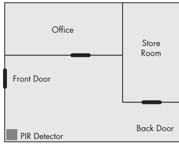

图 5-1: 报警系统示例

### 传感器类型

由于报警系统只能报告其传感器检测到的内容，因此仔细选择传感器至关重要。让我们考虑一下各种传感器类型。

#### 磁触干开关

这些通常用于监控门；开关安装在门框上，磁铁安装在门上。

#### PIR 运动检测器

被动红外（PIR）运动检测器检测红外（热）源移动的细微变化。人或动物可以触发 PIR 运动检测器，例如，棒球也可以。

#### 声学传感器

声学传感器检测特定的声音。它们被用于检测玻璃破碎的声音，且非常敏感，单个声学传感器就可以保护房间内所有的窗户。

#### 地垫传感器

地垫传感器带有可以检测人体重量的开关。它们非常薄，通常放置在入口处的地毯下。

#### 震动传感器

震动传感器可以检测非常细微的物理运动。它们通常用于保护汽车。

#### 烟雾和一氧化碳检测器

这些传感器用于检测潜在的火灾。

#### 温度传感器

恒温器和其他温度传感器在特定温度下触发，或简单地报告区域内的当前温度。它们通常用于保护对温度敏感的设备和物资。

### 传感器接触类型

对于报警系统来说，大多数传感器看起来像开关。开关触点在非报警时可以是开启的（称为常开或 NO 传感器），在非报警时可以是闭合的（称为常闭或 NC 传感器）。当你安装传感器时，必须告诉报警系统传感器的触点类型——即触点是常开还是常闭的。大多数传感器是常闭的。常闭传感器具有一个理想特性：如果传感器的线路被切断，它会触发报警。

传感器与区域设置的另一个有用特性是，可以在区域内级联传感器，只要级联的传感器具有相同的触点类型即可。图 5-2 显示了如何级联常开传感器，图 5-3 显示了如何级联常闭传感器。

#### 级联常开（NO）传感器

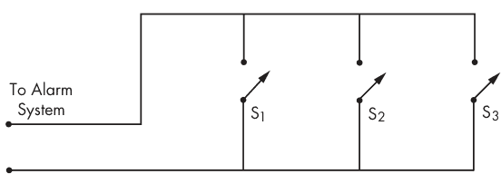

图 5-2: 如何级联常开传感器


### 级联常闭（NC）传感器

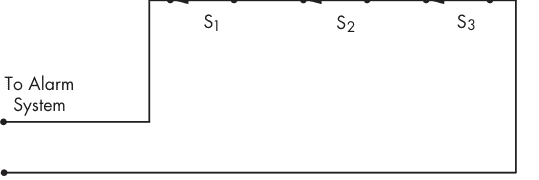

图 5-3: 如何级联常闭传感器

从逻辑上讲，报警系统在每个区域只看到一个传感器，即使实际上有多个级联传感器。

## 传感器锁定（Latching）

当检测到的条件移除时，大多数传感器会返回非报警或正常状态——例如，当有人关门或离开地垫时。你通常希望配置报警系统锁定这些传感器检测到的报警。锁定的报警即使在检测到的条件移除后仍保持报警状态，直到由用户手动清除。

然而，你可能并不希望锁定每个传感器。例如，你可能希望在恒温器保护的房间温度恢复正常时，自动移除报警。

在设置区域内的报警策略时，请考虑你正在使用的传感器类型以及你的特定需求。

## 启用区域

在区域内设置报警时，请标记区域为启用、锁定或非锁定。只有启用的区域才会触发报警。禁用的输入可以被忽略。启用区域，你可能希望在恒温器保护的房间温度恢复正常时，自动移除报警。

## Laddie 的功能规范

Laddie 系统监控多五个区域，当其中一个区域发生变化时触发报警。用户界面允许查看、清除并配置 Laddie 的报警。配置参数包括：

- 区域名称
- 接触类型
- 锁定或非锁定
- 启用或禁用

Laddie 的功能规范分为两个部分：一部分允许访问报警配置和状态，另一部分处理报警。

**注意** 提醒一下，Ladd 指整个设备，而 ladd 仅指守护进程。由于它们发音相同，很容易混淆。

## ladd 的配置与状态

ladd 有一个名为 `Zone` 的配置和状态表，用户界面可见。`Zone` 表有五行，由以下数据结构定义：

```c
/* 并行端口每个报警的定义、配置和状态的结构 */
typedef struct {
    int id;                  // 报警 ID 号 [1-5]
    char name[ZONE_NAME_LEN]; // 区域名称
    int enabled;             // ==1 表示启用
    int edge;                // ==1 表示高电平触发报警
    int latching;            // ==1 表示我们应锁定报警
    int input;               // 来自报警的最新原始输入
    int alarm;               // ==1 表示处于报警状态
    int count;               // 此引脚报警计数
};
```

让我们逐一考虑这些字段。

### id（配置）

区域由一到五之间的数字标识。`id` 字段在 ladd 启动时初始化，用户无法编辑。你可以在用户界面 `id` 来唯一标识特定区域。

### enabled（配置）

只有启用的区域会导致系统进入报警状态。标记为禁用的区域不会产生日志消息或导致报警状态。此字段持有整数而不是布尔值，C 不支持布尔类型。

### edge（配置）

对于下一节描述的硬件，常闭传感器在零到一边沿触发报警。Laddie 上的常开传感器在上一到零边沿触发报警。“Laddie 的硬件设计”位于第 68 页，描述了开启和闭合传感器。

### latching（配置）

用户将此字段设置为 1，可以使报警在传感器引脚恢复正常状态后依然持续（锁存）。用户必须手动清除已锁定的报警。

### input（状态）

此字段显示输入引脚的最近一次原始值。这是一个只读字段，用户无法对其进行编辑。

### alarm（状态）

每个区域被认为处于报警状态或安全状态。此字段由 ladd 守护进程根据在输入引脚上检测到的边沿信号进行设置。在该字段上进行写回调允许用户通过向其写入 1 来测试某个区域。当用户将此字段设置为 0 时，报警会被清除。

### count（状态）

此字段包含触发过报警的输入边沿数量。只有当区域被标记为启用（`enabled`）时，该字段才会递增，用户发起的区域测试不会增加此值。这是一个只读的统计字段，在 ladd 启动时被置零。

你可能记得 RTA 的优势在于，它为所有用户界面提供了相同的守护进程配置、状态和统计的 API。RTA 定义的 API 就是 PostgreSQL 数据库的 API。PostgreSQL 的优势在于 SQL 被广泛使用和理解，并且有许多 PostgreSQL 的绑定，包括 C、PHP、Java 和 Perl。图 5-4 展示了 Laddie 如何使用 RTA 允许五个不同的 UI 仅通过一个守护进程协议获取状态并设置配置。

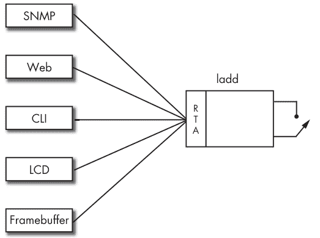

**图 5-4：一个守护进程对应多个用户界面**

让我们来看看一些典型的 Laddie 配置更改和查询的 SQL。

要禁用区域 2，输入：

```
UPDATE Zone SET enabled = 0 WHERE id = 2
```

要查找区域 4 报警了多少次，输入：

```
SELECT count FROM Zone WHERE id = 4
```

要清除系统中的所有报警，输入：

```
UPDATE Zone SET alarm = 0
```

任何可以此类命令的程序都可以作为 Laddie 的用户界面。在书的后续部分将关注此类命令。

## Ladd 的报警处理

ladd 通过 `syslog()` 发送日志来响应报警。日志的内容取决于报警是由硬件检测到的还是由用户发起的测试。还取决于报警是被设置还是被清除。对于 ID 为 n、名为 zone_name 的区域，四条日志消息为：

- 区域 zone_name 报警
- 区域 zone_name 报警清除
- 用户设置区域 zone_name报警
- 用户清除区域 zone_name报警

某些用户并不关心是哪个区域报警，他们只想知道是否有区域处于报警。为了满足这一需求，ladd 提供了其他日志消息：

- 系统状态：报警
- 系统状态：安全

这些消息在第一个区域报警和最后一个区域清除后发送。Laddie 还将并行端口的所有控制引脚设置为 1（见表 5-1）以指示系统报警。当所有报警清除时，它会将控制引脚拉低。Laddie 整体架构的一个优点是 ladd 本身不需要向 UI 发送信号、发送电子邮件或发送 SNMP 陷阱。这些交给一个独立的进程，极大地简化了 ladd 守护进程的设计和实现。日志输出不仅简化了 ladd，也使得调试和测试更容易，因为我们可以轻松地检查日志文件，并可以使用 `logger` 命令为事件处理器生成测试事件。报警的数据流如图 5-5 所示。

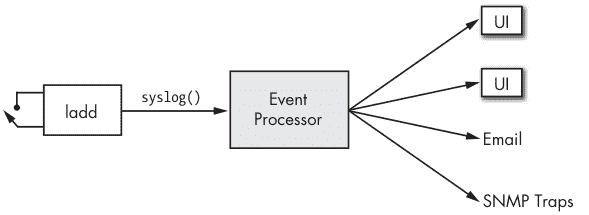

Ladd 的硬件设计

如果你熟悉电子电路或对硬件工作原理感兴趣，本节介绍了 Laddie 使用的硬件。并行端口的引脚分为三组：数据线、控制线和状态线。每组由一个寄存器控制，位于特定的 I/O 地址。数据线位于并行端口的基地址，状态线位于基地址加一，控制线位于基地址加二。表 5-1 显示了 25 位并行端口连接器的引脚名称与报警系统的关系。

表 5-1：PC 并行端口的使用

| 引脚 | 名称 | 寄存器 | 位 | 报警输入 |
|---|---|---|---|---|
| 1 | STB | Control | 0 | |
| 2 | D0 | Data | 0 | |
| 3 | D1 | Data | 1 | |
| 4 | D2 | Data | 2 | |
| 5 | D3 | Data | 3 | |
| 6 | D4 | Data | 4 | |
| 7 | D5 | Data | 5 | |
| 8 | D6 | Data | 6 | |
| 9 | D7 | Data | 7 | |
| 10 | ACK | Status | 6 | Zone 4 |
| 11 | BSY | Status | 7 | Zone 5 |
| 12 | PAP | Status | 5 | Zone 3 |
| 13 | OFN | Status | 4 | Zone 2 |
| 14 | ALF | Control | | Zone 1 |
| 15 | FEH | Status | | |
| 16 | INI | Control | | |
| 17 | DSL | Control | | |
| 18–25 | Ground | | | |

## Laddie 的软件设计

我们使用第 4 章引入的空守护进程来构建守护进程。但无论我们使用空守护进程、编写基于 `select()` 的程序还是编写基于线程的程序，仍然三个主例程：

- `appInit()` 初始化硬件。启动定时器。
- `poll_timeout()` 读取状态线。记录相关更改。
- `user_update()` 为用户发送日志。

这些例程将在后续章节中详细描述。

## appInit() 回调


`appInit()` 子程序是空守护进程调用的第一个回调。该回调负责执行任何特定于应用的初始化、设置定时器以及注册 RTA 表。在 `ladd` 中，`appInit()` 初始化 `Zone` 数组，调用 `rta_add_table()` 注册 `Zone` 表，初始化并行端口，并启动一个以 `poll_timeout()` 为回调的 100 毫秒定时器。注意，当 `appInit()` 返回时，守护进程准备好接受来自用户界面的连接。

未显示 `Zone` 数组的列定义，表 5-2 让你了解它们的内容。

### 表 5-2：Ladd Zone 中的列

| 列名 | 类型 | 只读 | 保存到磁盘 |
| --- | --- | --- | --- |
| `id` | `int` | `yes` | `no` |
| `name` | `char` | `no` | `yes` |
| `enabled` | `int` | `no` | `yes` |
| `edge` | `int` | `no` | `yes` |
| `latching` | `int` | `no` | `yes` |
| `input` | `int` | `yes` | `no` |
| `alarm` | `int` | `no` | `no` |
| `count` | `int` | `yes` | `no` |

`ladd` 的所有初始化代码都在下面的 `appInit()` 例程中。

```
************************************************
* appInit(): - 初始化所有内部变量和表。
  * 根据需要设置和读取控制线。

* 输入: int argc, char *argv[] 命令行参数
* 返回: 无
************************************************/
void appInit(int argc, char *argv[])
{
    int value; /* 来自并行端口的输入值 */
    int i; /* 循环索引 */

    /* 初始化区域 ID */
    for (i = 0; i < NUM_INPUTS; i++) {
        Zone[i].id = i+1;
    }

    /* 添加单比特报警中断表 */
    rta_add_table(&ZoneTable);

    /* 交付并行端口并将数据引脚置高 */
}
```

```c
if (ioperm(PORT, 3, 1)) {
    fprintf(stderr, "Cannot open parallel port at %x\n", PORT);
    exit(1);
}
outb((unsigned char)0x00FF, PORT);
```

```c
/* 现在读取输入引以获取初始状态 */
value = inb(PORT+1);
for (i = 0; i < NUM_INPUTS; i++) {
    Zone[i].input = (value & (8<<i)) ? 1 : 0;
}
```

```c
/* 将控制端口上的输出字符置低，因为我们从
*“无报警”状态开始。设置全局报警以保持匹配。 */
outb((unsigned char)0x0000, PORT+2);
GlobalAlarm = 0;
```

```c
/* 设置轮询定时器 */
if (add_timer(ED_PERIODIC, 100, poll_timeout, (void *)__LINE__) {
    fprintf(stderr, "Cannot set periodic timer. Exiting...\n");
    exit(1);
}
```

## `poll_timeout()` 回调子程序

`poll_timeout()` 子程序执行了报警守护进程的大部分功能。该子程序读取并行端口、处理输入引脚并修改相应的 `ZONE` 数据结构的状态。根据代码 `add_timer()` 指定，该子程序每 100 毫秒被调用一次。请注意 `poll_timeout()` 子程序的以下特性：

- `poll_timeout()` 的主要责任是设置 `Zone` 表中每个区域的报警字段。如上所述，报警字段显示特定区域是否处于报警状态。
- 该子程序独立地处理每个区域，不受其他区域的影响。这意味着一个区域可以处于报警状态，而另一个区域可以处于安全状态。
- 只有当启用字段 `enabled field` 不为零时，才会修改特定区域的报警字段。此功能允许用户在没有传感器或用户希望忽略传感器的情况下禁用某个区域。
- 当 `poll_timeout()` 检测到该区域已进入报警状态时，它会将报警字段设置为 1 并发送一条 `syslog` 消息。在随后的章节中，我们将向你展示如何将 `syslog` 消息转换为电子邮件和 SNMP 陷阱。
- 同样，当此子程序检测到输入引脚恢复正常状态时，它会清除报警变量；如果锁存字段 `latching field` 设置为零，它会发送一条 `syslog` 消息。这种机制允许用户配置区域，使其一旦进入报警状态，就必须手动清除。
- `poll_alarm()` 子程序还维护一个全局报警变量 `GlobalAlarm`。如果任何区域处于报警状态，该变量被设置为零；如果所有区域都安全，则设置为零。子程序在 `GlobalAlarm` 状态改变时跟踪此变化。当 `GlobalAlarm` 变量被设置时，并行端口的控制引脚被置高。当 `GlobalAlarm` 变量状态改变时，会发送相应的消息。

所有对新报警的轮询都在给定的 `poll_timeout()` 例程中完成。

```c
********************************************************************
* poll_timeout() - 读取状态行并根据需要
 * 设置（或清除）报警的后台例程。
*
* 输入：无
* 返回：无
********************************************************************
void poll_timeout(void handle, void cbd) {
  int value; /* 来自并行端口的输入值 */
  int i; /* 循环变量 */
  int new; /* 引脚的新状态 */

  /* 从并行端口读取引脚 */
  value = inb(PORT+1);

  for (i = 0; i < NUM_INPUTS; i++) {
    new = (value & (1 << i)) ? 1 : 0;
    if ((new != Zone[i].input) && Zone[i].enabled) {
      /* 我们有一个启用的输入引脚状态变化 */
      if ((new == 1 && Zone[i].edge == 1 && Zone[i].alarm != 1) ||
          (new == 0 && Zone[i].edge == 0 && Zone[i].alarm != 1)) {
        Zone[i].alarm = 1;
        Zone.count++;
        syslog(LOG_ALERT, "Alarm set on zone %d, %s", Zone[i].id, Zone[i].name);
      }
      /* 寻找已清除的报警 */
      if ((Zone[i].alarm == 1) && (Zone[i].latching == 0) &&
          ((new == 0 && Zone[i].edge == 1) ||
          (new == 1 && Zone[i].edge == 0))) {
        /* 我们可以移除报警 * */
        Zone[i].alarm = 0;
        syslog(LOG_ALERT, "Alarm cleared on zone %d, %s", Zone[i].id, Zone[i].name);
      }
    }
    Zone[i].input = new;
  }
```

- 所有输入已处理完毕。设置或清除全局报警状态和控制引脚。注意，我们也使用这段代码来处理手动设置或清除的报警。


```c
  for (i = 0; i < NUM_INPUTS; i++) {
    if (Zone[i].alarm == 1) {
        if (GlobalAlarm == 0) {
            /* 新的报警。记录它并将控制位（低三位）置高。 */
            syslog(LOG_ALERT, "Alarm status");
            outb((unsigned char)0x0007, PORT+2);
            GlobalAlarm = 1;
        }
    }
    /* 检查所有报警是否已清除 */
    for (i = 0; i < NUM_INPUTS; i++) {
        if (Zone[i].alarm == 1) {
            GlobalAlarm = 1;
            break;
        }
    }
    if (GlobalAlarm == 0) {
        /* 如果没有剩余报警，清除控制位 */
        outb((unsigned char)0x0000, PORT+2);
    }
  }
```

## `user_update()` 回调子程序

下面的 `user_update()` 子程序检查用户是否设置了报警变量并其变化。如果报警变量发生变化，`user_update()` 会发送一条 syslog 消息。

```c
********************************************************************
* user_update(): - 列的写入回调。
* 进行简单的检查，如果用户更改了值则发送 syslog
* 消息。
* 输入：无
* 返回：成功返回 0，错误返回 -1
********************************************************************
int user_update(char *tbl, char *col, char *sql, void *pr, int rowid, void *poldrow)
{
    /* 确保查看的是有效行 */
    if (rowid >= NUM_INPUTS) {
        return(-1); // 返回错误
    }

    /* 检查变化 */
    if (((ZONE*)pr)->alarm != ((ZONE*)poldrow)->alarm) {
        if ((ZONE*)pr)->alarm) {
            syslog(LOG_ALERT, "User set alarm on zone %d, %s", Zone[rowid].id, Zone[rowid].name);
        } else {
            syslog(LOG_ALERT, "User cleared alarm on zone %d, %s", Zone[rowid].id, Zone[rowid].name);
        }
    }
    return(0); // 成功
}
```

```c
COLDEF ZoneColumns[] = {
    "Zone", // 表名
    "alarm", // 列名
    RTA_INT, // 数据类型
    sizeof(int), // 字节数
    offset(ZONE, alarm), // 结构体中的位置
    0, // 标志
    (int*)0, 0, // 调用前回调
    user_update, // 调用后回调
    "报警状态。（可能被锁存的）该输入的"
    "报警状态。仅等于"
    "非锁存报警。用户在值变化时清除此项以重置报警。"
};
```

# 编译与测试 ladd

你不需要安装整套报警传感器来运行此守护进程——你只需要一台带有并行端口的标准 PC。在运行守护进程之前，你必须创建 `/opt/laddie/ladd/` 目录，因为守护进程会在该目录下创建一个 PID 文件。使用以下命令创建该目录：

```bash
mkdir /opt/laddie/ladd
```

`ladd` 的源代码位于随附 CD 的 `/Code/src/ladd` 目录下。编译报警守护进程，然后以 root 身份运行该进程，如下命令所示：

```
cd /Code/src/ladd
make
su
./ladd
```

为了确保报警守护进程正在运行并对用户请求做出响应，请调用下方的 `psql` SQL 命令，并验证显示了 `Zone` 表。

```
psql -h localhost -p 8888
SELECT * FROM Zone;
```

| id | name | enabled | edge | latching | input | alarm | count |

|---|---|---|---|---|---|---|---|

| 1 | | 0 | 0 | 0 | 0 | 0 | 0 |

| 2 | | 0 | 0 | 0 | 0 | 0 | 0 |

| 3 | | 0 | 0 | 0 | 0 | 0 | 0 |

| 4 | | 0 | 0 | 0 | 0 | 0 | 0 |

| 5 (rows) | | 0 | 0 | 0 | 0 | 0 | 0 |

通常情况下，你会为报警设备添加硬件传感器，但你可以在没有硬件传感器的情况下模拟报警。

> 考虑区域 1。我们的方法是使用此命令调用报警写入回调：

```
UPDATE Zone SET name = "BackDoor", enabled=1, edge=0; WHERE id=1;
```

接下来，我们将使用以下命令在区域 1 的输入上模拟一次报警：

```
UPDATE Zone SET alarm=1 WHERE id=1;
```

验证 `ladd` 是否生成了一条日志，显示“用户在区域 1 设置了报警”。然后按照如下手动清除报警：

```
UPDATE Zone SET alarm=0 WHERE id=1;
```

再次验证 `ladd` 是否为 `syslog` 生成了消息。我们将在今后的章节中向你展示如何为报警守护进程构建更易用的用户界面。

# 总结

本章通过展示如何使用 RTA 和空守护进程构建 `ladd`（一个简单的报警守护进程），将之前的几个章节联系在一起。你了解了 `ladd` 的 RTA 表的设计，以及用户界面管理报警守护进程的控制点。你还看到了报警守护进程的源代码，包括空守护进程用于实现报警守护进程运行时行为的三个子程序。最后，你了解了如何配置报警守护进程以及如何从命令行手动设置和清除报警。

下一章将继续开发 Laddie 的设计，向你展示如何处理设备上的事件，包括 `ladd` 向 `syslog` 发送消息等事件。

# 6 日志


日志消息是对感兴趣的事件的异步报告。本章将讨论通用的日志记录，然后详细介绍 `syslog`，这是 Linux 默认的日志系统。我们还描述了在守护进程运行时如何控制日志记录阈值。

我们将本章组织为以下几个部分：

- 你需要日志吗？

- 日志系统的架构

- 按需日志记录

## 你需要日志吗？

在进入日志记录的机制之前，让我们先讨论一下为什么你可能想在设备上开启日志。

### 运行时间 (Uptime)

记录日志的主要原因是增加设备的可用性。适当路由和显示如“CPU 风扇转速低于 1000 RPM”之类的日志消息可以帮助你的用户保持系统运行。对系统收集的日志消息进行回归分析或趋势分析，有助于在问题中断服务之前识别它们。趋势分析在发现风扇、磁盘和电源的问题方面特别有用。

### 安全

如果你的设备连接在网络上，它几乎肯定会在某个时刻受到攻击。你可以利用日志消息来触发防火墙规则的变化，或通知系统操作员或终端用户正受到攻击。

### 调试 (Debug)

修复 bug 的第一步是意识到 bug 的存在。日志报告子程序输入输出的任何不一致之处对于寻找 bug 价值价值。你可以使用本章后部分描述的按需日志记录，在检测到 bug 时跟踪程序执行并记录子程序的输入输出。

### 应用不可或缺 true

`Laddie` 是一个集成日志记录和事件处理应用程序的良好示例。它简化了 `ladd` 守护进程的设计，使其仅通过日志消息报告所有状态转换。

在某些连接受限且磁盘空间有限的深度嵌入 Linux 系统上，你可能无法使用日志记录。但对于大多数系统，日志记录将是你设备的一项真实资产。

## 日志系统的架构

本节描述了“理想”日志系统的架构和属性。下一节将介绍 `syslog` 并将其与理想系统进行比较。

日志系统可以分为三个主要部分：一个用于收集消息，一个用于路由消息，一个用于交付消息（或启动其他操作）。图 6-1 所示了日志系统的架构。

让我们详细考虑这三个部分部分。

### 消息源


理想的日志系统是来自设备任何地方消息的汇中心，它应该能够接受来自许多源的消息，包括 Unix 套接字、UDP 和 TCP 套接字、命名管道以及跟踪文件（`tail -` 的输出）。

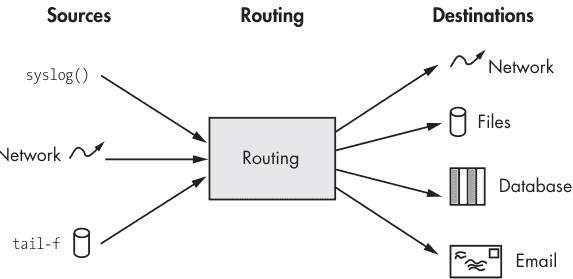

图 6-1：消息流

### Unix 套接字

`syslog` 是 Linux 上最流行的日志系统，使用套接字作为收集点。日志系统应该通过套接字处理消息。

### 网络套接字

网络消息可能通过 UDP 或 TCP 传输。日志系统应该将消息发送到网络、服务器或设备。

### 跟踪文件

许多应用程序直接写入文件。如果你想捕获这些消息，必须监控文件。`tail -f` 命令就是这样做：

```
tail -f
```

日志系统应该跟踪文件。

## 消息路由

路由部分识别每条消息的适当目的地。路由标准因系统而异，但大多数系统包含根据重要性路由的过滤器。

在本章中，我们将过滤器定义为一组路由规则以及与之关联的目的。路由规则及其关联的目的存储在配置文件中（对于 Laddie，则存储在 RTA 表中）。只有当系统支持且你使用多个目的地时，过滤器才有意义。

## 消息目的地

日志系统通过将消息发送到目的地来完成处理。虽然下面将讨论以下消息目的地，但列表可能很长，有很多未描述的目的。

### 文件

文件是日志消息常见的目的地。日志文件是被接受的标准，可能是因为它们非常容易进行定期分析。遗憾的是，对于许多没有硬盘的嵌入系统带来了问题。内存是易失的，闪存对于存档日志来说太贵了。对于无磁盘设备，你的选择是大量过滤消息并只保存少量到闪存、发送到网络上的服务器，或者仅仅保存日志。

如果你将消息保存到文件中，可以使用 `logrotate` 定期删除旧文件，将新文件轮换编号存档，并向消息源进程发送 `SIGHUP`。`SIGHUP` 应该导致应用程序打开一个新的日志文件。

（因此得名 fanout）。本书的网站托管了 fanout 项目，包括源代码和更详细的文档。请访问 http://www.linuxappliancesdesign.com 获取更多信息。

## 远程 UDP/syslog 主机

如果您设计的是为大型数据中心设计的设备，请务必包含将日志消息转发到网络中另一个主机的能力。`syslog` 进程可以使用 UDP 接收和/将日志消息转发到其他主机。

## TCP 多路复用

如果你想将某些消息路由到其他程序，可以定义一个接受连接的监听 TCP 套接字。当消息到达路复用器时，它会被复制并发送套接字上每个打开的 TCP 连接。

例如，在我们的 Laddie 设备中，我们有一个命令行 (CLI) 可以显示 Laddie 告警消息¹。当 CLI 用户使用 `set logs on` 命令时，CLI 会打开到 `logmuxud`（Laddie 的日志守护进程）的 TCP 连接，消息将通过每个被接受的 TCP 连接发送到另一端的 CLI。（`logmuxud` 在下一节中描述。）

## 电子邮件

通过电子邮件接收重大事件报告是一件好事，因为电子邮件无处不在，尽管它并非实时。此外，电子邮件经常被用作传呼机和手机的网关（这样无论你躲在哪里，都能找到重要的细节）。

## 控制台

输出到 `/dev/console` 或串口是调试的必须的。一些大型网络中心仍然倾向于通过像 RS-232 线缆这样物理安全且不共享的通道收集日志消息。

## 数据库

某些消息需要立即响应，但大多数情况下，你对系统事件模式的变化或趋势感兴趣。关系型数据库是日志消息的理想存储库，因为它有广泛工具来排序和计数日志消息。由于数据库在排序和计数时消耗大量的 CPU 周期，你可能希望将数据库放在网络某处而不是你的设备上。

## SNMP 陷阱

大多数网络有一个或多个运行 SNMP 管理器的专用网络管理工作站。这些网络的运营商通常坚持所有网络设备使用 SNMP 进行状态、配置和错误报告。

> ¹ 日志消息是对事件的报告。告警是系统故障或可用性降低的状态。日志消息用于报告进入和退出告警状态的转换，这两个术语有时会被混淆。

## system()

使用 `system()` 调用运行实用程序是另一个常见目标。虽然简单且灵活，但这种方法比其他目标消耗更多的内存和 CPU 周期，并且不适合处理大量消息。

使用 `system()` 始终被认为存在安全风险。为了完整性，我们提到了 `system()`，但不建议使用它。如果你必须运行外部命令，尝试使用 `pop()` 代替 `system()`。我们在 Laddie 上使用附录 D 中描述的 `RTA-to-file` 实用程序解决了这个问题。

我们这里没有空间来描述所有可能的目标。例如，我们没有讨论传呼机、语音邮件或即时消息。

## syslog


日志系统需要一种标准的方式来报告事件，一种日志消息的通用语言。对于我们大多数人来说，这个标准就是 `syslog`。`syslog` 有几个优点。它是所有 Linux 应用程序使用的主要事件报告机制，广为人知且理解。与内核守护进程配合，`syslog` 捕获你可能希望设备用户可见的内核和系统日志消息。

本节描述了 `syslog` 如何工作、如何在应用程序中使用它，以及如何配置其消息过滤器。我们提供了足够的细节，使你在使用 `syslog` 作为日志系统基础时不会遇到困难。

## syslog 架构

来自 `syslog` 的消息是在你的程序中通过调用 glibc C 库函数 `syslog()` 生成的。然后，它格式化消息并尝试写入 `/dev/log`，这是一个 `syslog` 启动时打开的 Unix 套接字。`syslogd` 从 `/dev/log` 读取消息并根据 `/etc/syslog.conf`（`syslog` 配置文件）定义的过滤器进行处理。图 6-2 显示了 `syslog` 的整体架构和消息流。

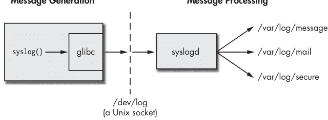

图 6-2：带有 `syslog` 的消息流

## 使用 syslog

几乎所有的 Linux 编程语言都有发送 `syslog` 消息的例程。下面显示的 C 库原型适用于大多数语言。

```
void syslog(int priority, const char *format, ...);
```

`priority` 是日志级别、事件的重要性或严重性以及生成消息的程序类型的组合²。大多数程序员在使用 `syslog` 例程时只指定日志级别。共有八个日志级别，重要性从调试 `debug` 到紧急 `emergency` 不等。每个章节都会显示可用的八个级别。

```
#define LOG_EMERG   0 /*/ 系统无法法用 */
#define LOG_ALERT   1 /*/ 必须立即采取行动 */
#define LOG_CRIT    2 /*/ 关键条件 */
#define LOG_ERR     3 /*/ 错误条件 */
#define LOG_WARNING 4 /*/ 警告条件 */
#define LOG_NOTICE   5 /*/ 正常但重要的条件 */
#define LOG_INFO    6 /*/ 信息 */
#define LOG_DEBUG   7 /*/ 调试级消息 */
```

`syslog()` 例程使用 `printf` 风格的字符串，可以接受任意数量的参数。格式字符串中的文本应该对事件形成清晰、无歧的描述，格式字符串的任何参数都应该提供事件的更多细节。

当我们构建设备时，我们交付的大部分是文档，格式字符串的任何参数都应该提供事件的更多细节。

```c
#include <syslog.h>
```

```c
main() {
    openlog("my_prog", 0, LOG_USER);    //LOG_USER = 0x0008
    syslog(LOG_INFO, "abc=%d", 2);      //LOG_INFO = 0x0006
}
```

如果我们就在 `syslogd` 从其 Unix 套字读取消息后立即查看，我们将看到：

<14>Aug 2 13:18:31 my_prog: abc=2

请注意 `LOG_USER` (8) 和 `LOG_INFO` (6) 合并为 `<14>`。不需要换行符或其他终止符，`syslog` 在将消息写入 `/dev/log` 套字之前会添加一个空字符（null character）。如果你不包含换行符，`syslogd` 会向日志文件中追加一条消息。

## 使用 syslogd 守护进程

`syslog` 守护进程从 `/dev/log` Unix 套字读取消息，并根据其设施（facility）和日志级别（log level）路由消息。`syslog` 消息的去称为“操作”（actions），包括文件、命名管道、系统控制台（或其他 TTY 端口）、网络上的 `syslogd` 系统以及用户。

`syslog` 的过滤器和操作在 `/etc/syslog.conf` 中定义。该配置文件通常每个目标有一行，列出了该目标所需的许多设施和级别列表。操作中的设施用逗号分隔，后面紧跟一个点号 `.`，然后是日志级别。可以使用星号 `*` 来表示所有设施或级别，指定的日志级别将包含该级别以及所有比它更高的级别。

```
*                所有日志消息
mail,lpr.*      所有来自邮件和打印机守护守护进程的消息
.*crit           所有日志级别为严重（critical）或更高级别的消息
```

`syslog` 最常见的目标包括文件、管道以及网络上的其他日志守护进程。管道通过在目的起始处提供管道符号 `|` 来指定。网络目标以符号 `@` 开头。`syslog.conf` 的主页提供了关于如何指定将哪些设施和优先级路由到哪些操作的更完整描述。以下 `syslog.conf` 的行将所有邮件路由到 `/var/log/mail`，并将所有严重或更高级别的打印队列程序和 FTP 日志路由到网络日志服务器：

```
mail.*              /var/log/mail
lpr,ftp.crit      @localhost.mynranet.com
```

回想一下设施是从 `syslog()` 传递到 `syslogd` 的优先级整数的一部分，而且你可以定义自己的设施。这在 `syslog` 之上构建了一个私有的日志系统。你可以将新的设施整数和名称添加到 `syslog.h`，然后重新编译 glibc 和 `syslog`。然而，为新设施使用一个显式整数可能更简单。有 24 个预定义的设施，因此选择一个大得多的数字，例如 1000。发送此设施的 INFO 日志的代码可能如下所示：

```c
syslog((1000<<3) | LOG_INFO, "an event occurred");
```

我们展示了位移和按位或以说明正在发生什么。我们建议你使用等等的 `LOG_PRIO(facility, level)` 宏。

继续此示例，你有一个程序在命名管道 `/usr/local/private_pipe` 上监听你的新日志消息。你可以通过向 `syslog.conf` 添加以下行并重启 `syslog`，来配置 `syslog` 发送所有具有新设施的日志。

| 1000.* | /usr/local/private_pipe |

桌面开发者可能会对使用 `syslog` 进行事件处理的想法感到畏缩。但话说回来，Linux 桌面系统通常比设备具有更多的 RAM 和 CPU 资源，它们可以负担起 D-Bus（相对）较高的磁盘、内存和 CPU 开销。我们推荐 `syslog` 是因为它的简单性、在几乎所有编程语言中的可用性以及较小的内存和 CPU 开销。

## syslog 的局限性、优势和替代方案

默认 `syslog` 守护进程有一些局限性。如之前提到的，它不保存消息级别或设施（尽管你可以通过基于路由直接获取它们）。`syslog` 不是基于正则表达式路由的，它只接受来自 Unix 套字的消息，并且其操作集相当有限。一些程序员在设置调试和跟踪机制时，发现有限的级别数量是一个问题。但优点是，`syslog` 是全球接受的，并且经过了彻底的调试、测试且是安全的。

`logger` 工具（我们在本章开头简要见过它）允许你绕过 `syslog` 受限的消息源。`logger` 将消息发送到 `syslog`，从其命令行或从其标准输入的每一行获取日志消息。如果你愿意，可以指定级别、设施和前缀字符串。详情请参 `logger` 页面。你还可以结合 `netcat`（一个用于从网络连接读写数据的简单工具）和 `logger`，使用类似下面所示的命令从单个接受的 TCP 连接接收日志消息。

```
nc -1 -p 2250 | logger
```

`logger` 工具允许你“监控”其他日志文件。例如，假设你想让添加到 `/usr/www/error.log` 的每一行也发送到 `syslog`。以下命令行执行了此操作。

```bash
tail -f /usr/www/error.log | logger
```


另一个值得提的辅助程序是 `klogd`。由于 Linux 内核不使用 `glibc`，因此无法使用 `syslog()` 发送内核消息。相反，内核日志消息通过系统调用 `c_syslog()` 或从 `/proc/kmsg` 中可见的循环缓冲区可用。守护进程 `klogg` 翻译来自其他源的日志消息。流行的替代方案包括 `syslog-ng`，它是处理高并发、支持正则表达式的 logger。

# 按需日志

这里是 `Logit` 的定义：

```c
typedef struct
{
    char sect[LOGIT_LEN]; /* 名称 */
    int thres;               /* 日志阈值。0-6=正常5=调试 */
    int output;             /* 0=无,1=stderr,2=syslog,3=两者 */
    char comment[LOGIT_LEN]; /* 描述 */
} LOGIT;
```

)

这种思想是为每个代码部分设置独立的日志阈值，如果 `LOG` 调用设置的阈值小于 `Logit` 中该部分的阈值，则将消息发送到 `syslog()`。我们的 `Logit` 实现有12 行，其中五行被原型守护进程内部使用。你可以轻松更改 `logit.c` 中的 `LOGITS` 来添加更多行。

让我们来看一个例子。假设你想为两个不同的代码部分添加图像处理添加按需日志。在初始化期间，你的程序必须在日志表中创建条目。你可以直接这样做，也可以使用封装函数 `logitEntry()`。下面的代码显示了两种方法。

```c
#include "empd.h" /* 原型守护进程的定义 */
#define IM 5
#define BM 6

/* 为图像处理部分初始化按需日志 */
strncpy(Logit[IM].sect, "img proc", LOGIT_NAME_LEN-1);
Logit[IM].thres = LOG_DEBUG;
Logit[IM].output = 2; /* 输出到 syslog() */
strncpy(Logit[IM].comment, "im, image process", LOGIT_COMMENT_LEN-1);

/* 为缓冲区管理初始化按需日志 */
logitSetEntry(BM, "buf_mgmt", "BM", LOG_DEBUG, "buffer management");
```

有了上述初始化，现在可以通过提高或降低日志表中的阈值来添加日志消息。在 Laddie 守护进程头文件 `empd.h` 中定义的 `LOG()` 宏如果在 `LOG` 调用设置的阈值小于该部分 `Logit` 中的阈值，将发送消息到 `syslog()` 或发送标准错误。

```log
LOG(LOG_DEBUG, IM, "Deep into image processing"); ownLOG(DBG_2, BM, "Freeing buffer ID=%d", buf_id); own
```

文件嵌入定义在 `LOG_DEBUG` 之下定义了五个额外的日志级别（`DBG_0` 到 `DBG_4`），以便让你更精确地控制调试消息的详细程度。

在完成上述所有配置后，你可以启用或禁用程序中各个部分的日志消息。例如，禁用除 `IM` 部分以外的所有日志记录的 SQL 命令可能是：

```sql
UPDATE Logit SET tres = 0
UPDATE Logit SET tres = 10 WHERE sect = "IM"
```

# 总结

日志记录是几乎所有设备的一项非常有价值的补充，即使在磁盘、内存和 CPU 功率有限的情况下也是如此。一个理想的日志系统具有许多日志消息源和目的地，并允许添加新的源和目的地。

`syslog` 是 Linux 上默认的日志系统，包含两个组件：用于发送日志消息的库函数，和一个用于处理这些消息的守护进程。`syslog()` 库函数在 Linux 支持的每种主流编程语言中都是可用的。`syslog` 守护进程 `syslogd` 根据消息的来源（设施/facility）和报告的事件严重性（日志级别）来路由消息。在本章中，你学习了如何将你的设施添加到 `syslog` 中，以便路由特定于你设备的日志消息。

按需日志使我们能够动态控制应用程序不同部分日志记录的详细程度。`RTA` 让按需日志变得更简单，但它并不是按需日志所必需的。

本章回顾了日志记录以及日志消息的收集与归档。下一章将描述一种日志系统，它能够识别日志消息中的特定文本，然后根据具体情况重写并路由消息。


# 7

## LADDIE 事件处理


当发生警报或其他关键事件时，你的设备需要做出响应。无论是 CPU 温度、电池电量、磁盘空间不足还是纸张水位，都会发生需要你的设备采取行动的事情。

拥有一个通用事件处理系统的想法令人惊讶的是，这在 Linux 中并不常见。很多时候，事件处理的需求在设备系统测试结束之前并不显而易见，因此它通常被视为一种事后补救——使用临时的且集成程度较差的代码。

作者们构建了足够多的 Linux 设备，以至于我们知道应该在 Laddie 的设计核心中构建事件处理。在我们的项目中，我们构建了自己的事件处理系统，它利用日志记录来捕获感兴趣事件。我们的事件处理守护进程被称为 `logmuxd`，本章将解释我们构建它的原因，描述其功能，介绍其主要数据表，并给出其使用的完整用示例。即使你选择不使用 `logmuxd`，本章可能也有价值，因为它展示了任何感知事件的设备所需的此类处理类型。

本章讨论了日志记录背景下的事件处理，但请记住，目标是事件处理，而日志记录只是实现该泛的机制。

我们将本章组织为以下章节：

- 新型事件处理系统的理由
- `logmuxd` 的功能与能力
- 配置 `logmuxd`
- 使用 `logmuxd` 的示例

## 新型事件处理系统的理由

我们发现，我们唯一按时交付且没有 Bug 的代码就是我们没有写的代码。也就是说，我们最成功的项目是那些我们最不需要编写新代码的项目。新代码总是有 Bug，而且新代码总是迟到。为什么我们决定写写一个日志守护进程来处理事件处理呢？答案实际上包含两个部分：为什么我们选择使用日志记录作为机制，以及为什么我们选择不使用现有的日志系统。

第 6 章解释了为什么日志记录是事件报告的正确机制。我们感兴趣的所有事件已经通过 `syslog` 消息捕获，或者可以被 `syslog` 消息轻松捕获。几乎每种编程语言都有 `syslog` 库，而且 `syslog` 被广为人知、完全安全，并且对 CPU 和内存都是高效的。


# 事件处理与 logmuxd

## D-Bus 与 syslog 的对比

选择进行事件处理的第二个原因是 D-Bus，这是一个用于分发桌面事件的开放包，D-Bus 提供了库和 API，允许进程交换消息，前提是两个进程都感知 D-Bus。（正因如此，使用 syslog 的遗留应用程序必须重写以添加对 D-Bus 的支持。）然而，D-Bus 提供的语言支持没有 syslog 那么广泛，且 D-Bus 通常需要两个运行的守护进程，这使得它相对于 syslog 来说消耗内存和 CPU。

> D-Bus 随标准 Linux 桌面系统提供，但对于大多数 Linux 设备的事件处理来说可能并不合适。

如果 syslog 是事件报告机制，那么为什么不使用 syslog 守护进程进行事件处理呢？我们目前可用日志系统中缺失的主要功能是能够轻松复制日志消息并在接受的 TCP 连接上广播它们。

Laddie 警报系统需要连接到多个运行中的程序和 UI。图 7-1 所示了一个典型案例。当警报发生时，`ladd` 发送一条日志消息来报告事件。我们需要将生成的日志消息副本发送到每个启用了日志记录的 CLI 以及每个查看系统状态的网页。问题是，我们预先不知道这些界面中有多少是打开的。

我们的新日志守护进程 `logmuxd` 解决了这个问题，允许我们将消息路由到许多目的地，即使这些目的地是瞬时的。没有其他日志系统可以做到这一点。当检测到事件时，`logmuxd` 将消息路由到许多目的地，即使这些目的地是瞬时的。

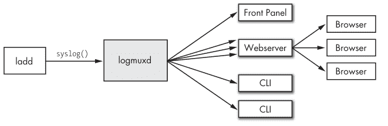

图 7-1: 多路复用

## 本章内容

本章讨论日志记录背景下的事件处理：

- 新型事件处理系统的理由
- `logmuxd` 的功能与能力
- 配置 `logmuxd`
- 使用 `logmuxd` 的示例

## 表 7-2: 六种可能的源类型

| 类型 | 含义 |
|---|---|
| 1 | 具名 FIFO 的读端 |
| 2 | 指定文件的“尾部” |
| 3 | UDP 套接字 |
| 4 | `logmuxd` 为指定的地址和端口打开的 TCP 连接 |
| 5 | `logmuxd` 在指定的地址和端口接受的 TCP 连接 |
| 6 | Unix 数据报套接字 |

`*term*` 字段指定了源如何终止日志消息。零表示日志消息以空终止符终止。来自 syslog 的消息在源端使用 `read()` 接收一条完整的消息。这种终止方式用于 UDP 套接字，例如。二 表示以换行符终止消息。换行符终止用于 `tail -f` 类型的源。

MUx 表具有只读的字段，其中存储了使用统计数据、错误统计数据以及源的文件描述符。如需了解有关这些字段的更多信息，请使用 RTA 表编辑器在运行中的 Laddie 设备上对其进行检查。

另外两个 logmux 实例与消息输入处理相关。Rawlog 表是一个 FIFO，用于存储最近的 10 条消息。它在调试过滤器或监控向日志器的原始输入时非常有用。Accept 表存储了接受的 TCP 连接和 Unix 套接字所需的文件描述符和其他信息。Rawlog 或 Acpt 中均没有可配置字段。

## logmux 过滤器与重写

使用 `logmuxd` 的主要原因之一是它可以重写消息并将其转发到另一个进程。例如，当用户在区域内设置警报时，laddie 会发送消息“User set alarm on zone n, zone_name”（其中 *n* 和 *zone_name* 被替换为区域编号和用户分配的名称）。我们希望这条日志消息出现在前面的 LCD 显示屏；LCD 显示屏只能显示 16 个字符，因此我们使用 `logmuxd` 的重写功能将消息重写以适应 LCD 显示。原始消息从如下形式重写：

```
Aug 12 22:28:31 Ladd[3820]: User set alarm on zone 5, Refrigerator
```

变为如下形式：

```
22:28 Usr set 5
```

用于识别和重写日志消息的所有配置数据都包含在 Filters 表中。该表包含目的地的类型和名称、用于匹配的正则表达式，以及用于重写消息的 `sprintf()` 格式化字符串。让我们逐一查看这些每个字段。

Laddie 事件处理 95

有两个字段用于指定目的地：`*destype*` 和 `*destname*`。每种类型的目的地都有一个单独的表。这是必要的，因为例如，电子邮件目的地需要比 SNMP trap 目的地不同的配置信息。目的地的类型和其目的地表由 `destype` 字段设置。共有 9 种有效的目的地类型。类型 1 和 2 的类型未包含在表 7-3 中，因为它们严格来说是源。

### 表 7-3: 九种目的地类型

| destype | 目的地表 | 含义 |
| --- | --- | --- |
| 0 | None | 无目的地（用于收集统计数据） |
| 3 | NetDest | 接受的 TCP 连接 |
| 4 | NetDest | 发出的套接字连接 |
| 5 | NetDest | UDP 套接字目的地 |
| 7 | FileDest | 文件（包括 FIFO 和普通文件） |
| 8 | PdbDest | PostgresSQL（或 RTA 表） |
| 9 | SmpDest | SNMP trap 目的地 |
| 10 | MailDest | 电子邮件目的地 |
| 11 | TblDest | logmbox 用于输出消息的内部表 |

每个目的地表中可以描述多个目的地。每个目的地在其中一个目的地表中都有其唯一的名称（`*destname*`）。例如，如果你有两个不同的 SNMP 目的地，可以将其中一个命名为 `allsnmp`，另一个命名为 `laddiesie`。通过给它们赋予不同的名称，你可以为它们定义不同的路由和重写规则。要将 Filters 表中的过滤器链接到特定的目的地，你需要同时指定目的地类型和目的地名称。

Logmbox 根据消息的设施（facility）、日志级别（level）以及文本模式匹配来路由消息。Filters 表中的这三个字段分别是 `*facility*`、`*level*` 和 `*regex*`。这些设施和日志级别与 syslog 的定义相同。`regex` 模式是用于模式匹配和子模式匹配的正则表达式。`regex` 库是模式匹配和提取的良好选择，因为模式可以预编译以提高匹配速度，且 `regex` 让你能够轻松提取子模式。在使用 Logmbox 时，我们发现不需要过多了解 `regex` 模式。

假设你正在处理列车到达车站的事件，日志消息为 *Train from San Jose arriving on Track number*。为了重写这条消息，你提取了城市和列车号。捕获城市的 `regex` 模式是 `[A-Za-z-]+`。该模式匹配任何大写或小写字母字符、空格或连字符的组合。列车号的模式是 `[0-9]+`。诀窍在于：如果你在模式周围加上括号，`regex` 就会让该模式在输出中单独可用。以下是一个匹配城市和列车号的 `regex` 模式：

`Train from ([A-Za-z-]+) arriving on Track number ([0-9]+)`

Filter 表的 `rewrite` 字段包含用于重写日志消息的 `snprintf()` 格式化字符串。该格式包含你选择的文本，并可以包含从 `regex` 模式中提取的字符串。匹配项作为显式参数提供给 `snprintf`。格式包含你选择的文本并可以包含从正则模式中提取的字符串。

### 表 7-4: 可用的 snprintf 参数

| 参数 | 含义 |
| --- | --- |
| `%1s` | 模式匹配 |
| `%2s` | 模式匹配 |
| `%3s` | 模式匹配 |
| `%4s` | 模式匹配 |
| `%5s` | 模式匹配 |
| `%6s` | 模式匹配 |
| `%7s` | 模式匹配 |
| `%8s` | 模式匹配 |
| `%9s` | 目的地 |
| `%10s` | 目的地 |
| `%11s` | 目的地 |
| `%12s` | 目的地 |


## Logmbox 路由与过滤

Logmbox 根据消息的设施、`facility`、日志级别以及文本模式匹配来路由消息。`Filters` 表中的这三个字段分别是 `facility`、`level` 和 `regex`。这些设施和日志级别与 syslog 的定义相同。`regex` 模式是用于模式匹配和子模式匹配的正则表达式。`regex` 库是模式匹配和提取的良好选择，因为模式可以预编译以提高匹配速度，且 `regex` 让你能够轻松提取子模式。在使用 Logmbox 时，我们发现不需要过多了解 `regex` 模式。

假设你正在处理列车到达车站的事件，日志消息为 `Train from San Jose arriving on Track number`。为了重写这条消息，你提取了城市和列车号。捕获城市的 `regex` 模式是 `[A-Za-z-]+`。该模式匹配任何大写或小写字母字符、空格或连字符的组合。列车号的模式是 `[0-9]+`。诀窍在于：如果你在模式周围加上括号，`regex` 就会让该模式在输出中单独可用。以下是一个匹配城市和列车号的 `regex` 模式：

```
Train from ([A-Za-z-]+) arriving on Track number ([0-9]+)
```

`Filter` 表的 `rewrite` 字段包含用于重写日志消息的 `snprintf()` 格式化字符串。该格式包含你选择的文本，并可以包含从 `regex` 模式中提取的字符串。匹配项作为显式参数提供给 `snprintf`。

### 表 7-4: 可用的 snprintf 参数

| 参数 | 含义 |
| --- | --- |
| `%1s` | 目的地 |
| `%2s` | 目的地 |
| `%3s` | 目的地 |
| `%4s` | 目的地 |
| `%5s` | 目的地 |
| `%6s` | 目的地 |
| `%7s` | 目的地 |
| `%8s` | 目的地 |
| `%9s` | 目的地 |
| `%10s` | 目的地 |
| `%11s` | 目的地 |
| `%12s` | 目的地 |

## 表 7-2: 六种可能的源类型

| 类型 | 含义 |
|---|---|
| 1 | 具名 FIFO 的读端 |
| 2 | 指定文件的“尾部” |
| 3 | UDP 套接字 |
| 4 | `logmuxd` 为指定的地址和端口打开的 TCP 连接 |
| 5 | `logmuxd` 在指定的地址和端口接受的 TCP 连接 |
| 6 | Unix 数据报套接字 |

`term` 字段指定了源如何终止日志消息。零表示日志消息以空终止符终止。来自 syslog 的消息在源端使用 `read()` 接收一条完整的消息。这种终止方式用于 UDP 套接字，例如。二表示以换行符终止消息。换行符终止用于 `tail -f` 类型的源。

`MUx` 表具有只读的字段，其中存储了使用统计数据、错误统计数据以及源的文件描述符。如需了解有关这些字段的更多信息，请使用 `RTA` 表编辑器在运行中的 Laddie 设备上对其进行检查。

另外两个 `logmux` 实例与消息输入处理相关。`Rawlog` 表是一个 FIFO，用于存储最近的 10 条消息。它在调试过滤器或监控向日志器的原始输入时非常有用。`Accept` 表存储了接受的 TCP 连接和 Unix 套接字所需的文件描述符和其他信息。`Rawlog` 或 `Acpt` 中均没有可配置字段。

## logmux 过滤器与重写

使用 `logmuxd` 的主要原因之一是它可以重写消息并将其转发到另一个进程。例如，当用户在区域内设置警报时，`laddie` 会发送消息 `User set alarm on zone n, zone_name`（其中 `n` 和 `zone_name` 被替换为区域编号和用户分配的名称）。我们希望这条日志消息出现在前面的 LCD 显示屏；LCD 显示屏只能显示 16 个字符，因此我们使用 `logmuxd` 的重写功能将消息重写以适应 LCD 显示。原始消息从如下形式重写：

```
Aug 12 22:28:31 Ladd[3820]: User set alarm on zone 5, Refrigerator
```

变为如下形式：

```
22:28 Usr set 5
```

用于识别和重写日志消息的所有配置数据都包含在 `Filters` 表中。该表包含目的地的类型和名称、用于匹配的正则表达式，以及用于重写消息的 `sprintf()` 格式化字符串。让我们逐一查看这些每个字段。

Laddie 事件处理 95

有两个字段用于指定目的地：`destype` 和 `destname`。每种类型的目的地都有一个单独的表。这是必要的，因为例如，电子邮件目的地需要比 SNMP trap 目的地不同的配置信息。目的地的类型和其目的地表由 `destype` 字段设置。共有 9 种有效的目的地类型。类型 1 和 2 的类型未包含在表 7-3 中，因为它们严格来说是源。

### 表 7-3: 九种目的地类型

| destype | 目的地表 | 含义 |
| --- | --- | --- |
| 0 | None | 无目的地（用于收集统计数据） |
| 3 | NetDest | 接受的 TCP 连接 |
| 4 | NetDest | 发出的套接字连接 |
| 5 | NetDest | UDP 套接字目的地 |
| 7 | FileDest | 文件（包括 FIFO 和普通文件） |
| 8 | PdbDest | PostgresSQL（或 RTA 表） |
| 9 | SmpDest | SNMP trap 目的地 |
| 10 | MailDest | 电子邮件目的地 |
| 11 | TblDest | `logmbox` 用于输出消息的内部表 |

每个目的地表中可以描述多个目的地。每个目的地在其中一个目的地表中都有其唯一的名称 `destname`。例如，如果你有两个不同的 SNMP 目的地，你可以将其中一个命名为 `allsnmp`，另一个命名为 `laddiesie`。通过给它们赋予不同的名称，你可以为它们定义不同的路由和重写规则。要将 `Filters` 表中的过滤器链接到特定的目的地，你需要同时指定目的地类型和目的地名称。

Logmbox 根据消息的设施、`facility`、日志级别 `level` 以及文本模式匹配来路由消息。`Filters` 表中的这三个字段分别是 `facility`、`level` 和 `regex`。这些设施和日志级别与 syslog 的定义相同。`regex` 模式是用于模式匹配和子模式匹配的正则表达式。`regex` 库是模式匹配和提取的良好选择，因为模式可以预编译以提高匹配速度，且 `regex` 让你能够轻松提取子模式。在使用 Logmbox 时，我们发现不需要过多了解 `regex` 模式。


*term* 字段指定了源如何终止日志消息。零表示日志消息以空终止符终止。来自 syslog 的消息在源端使用 `read()` 接收一条完整的消息。这种终止方式用于 UDP 套接字，例如。二表示以换行符终止消息。换行符终止用于 `tail -f` 类型的源。

MUx 表具有只读的字段，其中存储了使用统计数据、错误统计数据以及源的文件描述符。如需了解有关这些字段的更多信息，请使用 RTA 表编辑器在运行中的 Laddie 设备上对其进行检查。

另外两个 logmux 实例与消息输入处理相关。Rawlog 表是一个 FIFO，用于存储最近的 10 条消息。它在调试过滤器或监控向日志器的原始输入时非常有用。Accept 表存储了接受的 TCP 连接和 Unix 套接字所需的文件描述符和其他信息。Rawlog 或 Acpt 中均没有可配置字段。

## logmux 过滤器与重写

使用 logmuxd 的主要原因之一是它可以重写消息并将其转发到另一个进程。例如，当用户在区域内设置警报时，laddie 会发送消息“User set alarm on zone n, zone_name”（其中 *n* 和 *zone_name* 被替换为区域编号和用户分配的名称）。我们希望这条日志消息出现在前面的 LCD 显示屏；LCD 显示屏只能显示 16 个字符，因此我们使用 logmuxd 的重写功能将消息重写以适应 LCD 显示。原始消息从如下形式重写：

```
Aug 12 22:28:31 Ladd[3820]: User set alarm on zone 5, Refrigerator
```

变为如下形式：

```
22:28 Usr set 5
```

用于识别和重写日志消息的所有配置数据都包含在 Filters 表中。该表包含目的地的类型和名称、用于匹配的正则表达式，以及用于重写消息的 *sprintf()* 格式化字符串。让我们逐一查看这些每个字段。

Laddie 事件处理 95

有两个字段用于指定目的地：*destype* 和 *destname*。每种类型的目的地都有一个单独的表。这是必要的，因为例如，电子邮件目的地需要比 SNMP trap 目的地不同的配置信息。目的地的类型和其目的地表由 destype 字段设置。共有 9 种有效的目的地类型。类型 1 和 2 的类型未包含在表 7-3 中，因为它们严格来说是源。

### 表 7-3: 九种目的地类型

| destype | 目的地表 | 含义 |
| --- | --- | --- |
| 0 | None | 无目的地（用于收集统计数据） |
| 3 | NetDest | 接受的 TCP 连接 |
| 4 | NetDest | 发出的套接字连接 |
| 5 | NetDest | UDP 套接字目的地 |
| 7 | FileDest | 文件（包括 FIFO 和普通文件） |
| 8 | PdbDest | PostgresSQL（或 RTA 表） |
| 9 | SmpDest | SNMP trap 目的地 |
| 10 | MailDest | 电子邮件目的地 |
| 11 | TblDest | logmbox 用于输出消息的内部表 |

每个目的地表中可以描述多个目的地。每个目的地在其中一个目的地表中都有其唯一的名称（*destname*）。例如，如果你有两个不同的 SNMP 目的地，你可以将其中一个命名为 *allsnmp*，另一个命名为 *laddiesie*。通过给它们赋予不同的名称，你可以为它们定义不同的路由和重写规则。要将 Filters 表中的过滤器链接到特定的目的地，你需要同时指定目的地类型和目的地名称。

Logmbox 根据消息的设施（facility）、日志级别（level）以及文本模式匹配来路由消息。Filters 表中的这三个字段分别是 *facility*、*level* 和 *regex*。这些设施和日志级别与 syslog 的定义相同。regex 模式是用于模式匹配和子模式匹配的正则表达式。regex 库是模式匹配和提取的良好选择，因为模式可以预编译以提高匹配速度，且 regex 让你能够轻松提取子模式。在使用 Logmbox 时，我们发现不需要过多了解 regex 模式。

假设你正在处理列车到达车站的事件，日志消息为 *Train from San Jose arriving on Track number*。为了重写这条消息，你提取了城市和列车号。捕获城市的 regex 模式是 *[A-Za-z-]+*。该模式匹配任何大写或小写字母字符、空格或连字符的组合。列车号的模式是 *[0-9]+*。诀窍在于：如果你在模式周围加上括号，regex 就会让该模式在输出中单独可用。以下是一个匹配城市和列车号的 regex 模式：

Train from ([A-Za-z-]+) arriving on Track number ([0-9]+)

Filter 表的 rewrite 字段包含用于重写日志消息的 snprintf() 格式化字符串。该格式包含你选择的文本，并可以包含从 regex 模式中提取的字符串。匹配项作为显式参数提供给 snprintf。

你可以从 CD 中复制源码并在你的开发系统上构建 logmuxd，也可以启动 Laddie CD 并使用其正在运行的 logmuxd 版本。不用担心更改 Laddie 上的 logmuxd 表，重启将把它们恢复到原始状态。如果你愿意，我们将使用 `psql` 来更新表。图 7-3 阐了此示例中的数据流。


图 7-3：使用 telnet 的 logmuxd 示例

配置的基本步骤为：

- 配置 logmuxd 以接收来自 `/dev/log` 的 syslog 消息。验证设置。
- 配置 logmuxd 识别并重写“train arriving”（列车进站）消息。
- 配置 logmuxd 在端口 3333 上接受 TCP 连接。
- 使用 `logger` 和 `telnet` 验证消息是否已通过 TCP 端口 3333 分发到连接。

我们首先开始清除将用到的所有表中的配置。通过控制台或 telnet 登录到运行 logmuxd 的 PC（从书籍 CD 启动的 PC）。logmuxd 上的 RTA 接口监听在 8887 端口；当你启动 SQL 会话并使用这些命令清除表时：

```sql
psql -h localhost -p 8887
UPDATE MuxIn source = "", type =0;
UPDATE Filters destype = 0, destname = "", regex = ""
rewrite = "", time_fat = ""
UPDATE NetDest destname = "", dest = "", port = 0;
```

## MuxIn

在示例中，我们希望 logmux 替换 syslog，因此我们需要配置它监听 Unix 套接字 `/dev/log` 并按 syslog 格式读取日志消息。我们将将其指定为 `/dev/log`，类型指定为 6（syslog 格式），日志消息终止符指定为 0（消息之间的空字符）。

```sql
UPDATE MuxIn source = "/dev/log", type = 6, term = 0 LIMIT 1;
```

如果此时一切正常，该命令在 `/dev/log` 上打开了一个 Unix 套接字，MuxIn 表的显示应显示我们源的有效文件描述符。（`netstat` 命令也应该显示 `/dev/log` 套接字）。

```sql
SELECT source, fd FROM MuxIn;
```

如果我们现在正在监听 `/dev/log`，我们应该能看到通过 `logger` 发送的消息。打开另一个终端窗口并再次 telnet 登录到运行 logmuxd 的 PC。在新窗口中执行以下命令：

```bash
logger "Hello, world";
```

通过查看 Rawlog 表验证 logmuxd 是否接收了该消息。

```sql
SELECT source, log FROM Rawlog;
```

## Filters

继续该示例，我们将使用 Filters 表中的第一行，我们将一次更新一或两列，以便更好地解释这些列。

### destype

你可能记得 `destype` 是一个整数，它隐式地选择此过滤器将使用哪一个目标表作为其目标。`destype` 为 3 用于接受的 TCP 连接。

### destname

在一个目标表中可能有多个独立的目的地。我们需要某种方法来区分一个目的地和另一个，因此我们为每个目的地分配一个名称。Filter 表中的 `destype` 选择使用哪个目标表，而 `destname` 选择该表中的哪行。对于此示例，我们分配了名称 example_2。

```sql
UPDATE Filters SET destype = 3, destname = "example 2" LIMIT 1;
```

### regex


如果我们将最初看到的列车进站示例的正则模式与简单的 SQL 结合，就可以得到在过滤器中设置正则模式的命令。

```sql
UPDATE Filters SET regex = "Train from [A-Za-z -]+ arriving on Track number ([0-9]+)" LIMIT 1;
```

## level and facility

`logmuxd` 会根据输入消息的 `level` 和 `facility` 进行路由。在示例中，我们并不关心使用哪个 `level` 和 `facility` 来发送消息，我们将 `level` 设置为一个高值并清除 `facility`。

```sql
UPDATE Filters SET level = 15, facility = 0 LIMIT 1;
```

在示例中，我们可以测试正则匹配能力。使用带有 bash 提示符的终端执行以下命令：

```bash
logger "Train from Phoenix arriving on Track number 22"
```

验证过滤器的计数增加。

```sql
SELECT * FROM Filters LIMIT 1;
```

重复上述步骤，使用不同的城市名称和站号。执行几次不匹配模式的 `logger` 命令，验证计数不会增加。

## rewrite

你可能记得正则模式的魔力在于你可以通过括号来提取子模式。在这里，我们提取城市名称和站号，并将它们重写为 `city_name:track_number`。正则子模式可用重写字符串 `%1s` 到 `%9s`。我们想要前两个模式，因此使用命令设置 `rewrite` 字符串：

```sql
UPDATE Filters SET rewrite = "%1s : %2s" LIMIT 1;
```

`Filters` 表已完成，现在可以通过编辑 `NetDest` 表来完成配置。

## NetDest

我们希望在端口 3333 上设置 TCP 套接字。通过绑定到 0.0.0.0 为所有人提供网络访问。此目的地的名称应为 `example_2`，网络目的地的类型应该是接受 TCP 连接的类型 3：

```sql
UPDATE NetDest destname = "example_2", dest = "0.0.0.0", port = 3333, type = 3 LIMIT 1;
```

如果一切顺利，端口 3333 上有一个监听套接字。使用 `netstat` 验证端口已打开并绑定到正确的地址。使用以下 SQL 查看文件描述符。我们现在打开第三个终端窗口并连接到端口 3333。你的命令可能如下：

```bash
telnet 192.168.1.9 3333
```

你应该能够验证 `logmuxd` 已接受你的 `telnet` 连接。在 sql 提示符处输入以下内容：

```sql
SELECT * FROM NetDest;
```

在带有 bash 提示符的终端输入以下内容：

```bash
logger "Train from Phoenix arriving on Track number 22"
logger "Train from San Jose arriving on Track number 15"
logger "Train from San Francisco arriving on Track number 9"
```

验证城市和站号被提取并显示在连接端口 3333 上。你的输出应该是：

```
Phoenix : 22
San Jose : 15
San Francisco : 9
```

这是一个长示例，但它说明了如何配置 `logmuxd` 以及如何调试配置。

## 示例 3：logmuxd 和 SNMP Traps

简单网络管理协议（SNMP）是一种用于管理路由器等网络设备的 Internet 标准。读取和写入值的协议命令（GET 和 SET）以及 traps（告警）与 syslog 类似。网络设备通常在发生特定事件时需要发送 SNMP traps。此示例展示了如何使用 `logmuxd` 将 syslog 翻译为 SNMP traps（SNMP 和 traps 将后面的章节中详细介绍，你可能想在阅读那些章节后再进行此示例）。

报警系统进入或离开报警状态时会发送 SNMP traps。为了发送 SNMP traps，`logmuxd` 使用辅助程序 `snmtrap`。`snmtrap` 命令以与 `logger` 发送 syslog 相同的方式发送 traps。你可能记得当区域进入报警时，syslog 发送类似的消息：

```
Alarm set on zone 2, Back Door
User alarm on zone 3, Garage
```

上述两个日志消息对应的 `snmtrap` 命令所示：

```bash
snmtrap -v2c -public snmp_mgr:162 ladAlarmTrapZoneId 2 TrapZoneName "Back Door"
snmtrap -v2c -public snmp_mgr:162 ladTestTrapZoneId 3 TrapZoneName "Garage"
```

在上述行中，`public` 是社区名称，它来自 `NetDest` 表，因为它是特定于目的地的。`snmp_mgr:162` 也是如此，它是目的地名称（或 IP 地址）以及 `snmtrap` 使用的端口号。如果 `SNMPDest` 的类型设置为 3，则命令中会添加 `-c`，使其成为 SNMP 版本 2。目的地名称、端口、社区字符串和 trap 类型的 SNMP 字段都应该出现在你的 UI 中，因为最终用户必须根据与其安装情况匹配的值进行配置。

如果你的 MIB 已安装且 `snmtrap` 命令可以访问，你可以使用 trap 的名称。如果 MIB 未安装，你需要在命令行中提取 trap 的完整数字对象 ID (OID)。命令行中的两个单引号告诉 `snmtrap` 发送当前的 uptime 在 trap 中。

关于 SNMP 服务器的信息来自用户输入的 `NetDest` 表。trap 的某些信息必须从日志中提取。例如，为了发送我们的 SNMP traps，你需要将这些：

```
Alarm set on zone 2, Back Door
User set on zone 3, Garage
```

翻译为：

```
ladAlarmTrapZoneId 2 TrapZoneName "Back Door"
TestAlarmTrapZoneId 3 TrapZoneName "Garage"
```

这就是正则模式匹配和重写发挥作用的地方。使用上面火站示例中的正则模式，你拥有填充表格的所有内容。

目的地类型 9 表示 SNMP 目的地，我们给这个目的地命名的名称是 `snmp_monitor`。我们需要两行来处理“User set”消息，另一行处理由报警生成的“Alarm set”消息。我们使用 `Filters` 1 和 2，这样就不会覆盖之前示例中使用的 0。我们使用 SQL 显示配置，但表格编辑器同样有效。

```sql
UPDATE Filters set destype = 9 LIMIT 1 OFFSET 1;
UPDATE Filters destname = "snmp_monitor" LIMIT 1 OFFSET 1;
UPDATE Filters regex = "User set on alarm zone ([1-5]), (.*)"
LIMIT 1 OFFSET 1;
UPDATE Filters rewrite = "ladTestAlarmTrapZoneId 1%%s\nladTrapZoneName '%%%s' LIMIT 1 OFFSET 1;
```

```sql
UPDATE Filters Set destype = 9 LIMIT 1 OFFSET 2;
UPDATE Filters Set destname = "snmp_monitor" LIMIT 1 OFFSET 2;
UPDATE Filters Set regex = "Alarm set on zone (|[1-5]), (.*)"
LIMIT 1 OFFSET 2;
UPDATE Filters Set rewrite = "Ladalarm ladTrapZoneId = %1%%s\nladTrapZoneName = '%%$s' LIMIT 1 OFFSET 2;
```

`SnmpDest` 表中的值特定于配置为接收陷阱的网络计算机，因此您需要通过一个或多个 UIS 为用户提供这些值的访问权限。（UIS 是您指定的用于 Laddie SNMP 陷阱的 Laddie Web界面）。在本示例中，我们使用 SQL 手动设置了这些值。假设陷阱目标位于网络主机 `snmp_host` 上。


```sql
UPDATE SnmpDest SET destname = "snmp_monitor" LIMIT 1;
UPDATE SnmpDest SET dest = "snmp host" LIMIT 1;
UPDATE SnmpDest SET community = "public", port = 162 LIMIT 1;
UPDATE SnmpDest SET version = 2 LIMIT 1;
```

您可以通过在其中一个网络主机上运行 `snmptrapd` 来测试此配置。（详情请参见第 13 章。）

# 总结

传统的日志记录通过将事件的报告（日志消息）放入磁盘上的一个或多个文件中来处理事件。一种更好的方法是逐个检查每个事件，然后决定如何处理它们最有效。让您的设备感知事件并对这些事件做出响应，是您能为客户所做的最棒的几件事之一。

在较早的章节中，我们向您展示了如何使用 PostgreSQL 协议和 API 来控制和查看您设备的状态。但控制和状态仅是解决方案的一半——在本章中，我们介绍了了事件处理，这是成功设备设计的另一半。

# 8 章 设计 Web 界面


浏览器已成为配置网络设备的首选用户界面，特别是来自 Linksys 和 Netgear 等公司的家庭路由器。

Web 界面流行的动力是它们易于使用且不需要专门的客户端软件。客户现在期望能够访问其设备的 Web 界面，因此领先的家庭网络设备制造商提供这些界面并不意外。

这是几个专门用于用户界面（UI）设计章节中的第一章。本章涵盖了通用的 Web UI 以及 Laddie Web UI 的开发。在接下来的章节中，我们将查看 Laddie 的其他 UI：第 9 章的 CLI 界面、第 10 章的前面板 LCD 界面、第 11 章的帧缓冲缓冲区界面以及第 12 章的红外遥控界面。所有这些 UI 都通过 PostgreSQL 协议与后端守护进程进行通信。

本章涵盖了以下主题：

- Web 技术概述
- 为您的设备 Web 界面建立需求
- 选择 Web 服务器
- 设计 Web 界面的视觉效果
- 我们实现的亮点
- 经验教训和未来改进

## Web 基础

Web 浏览器使用超文本传输协议 `HTTP` 与 Web 服务器通信，这是一种客户端-服务器协议。通信是由 浏览器（客户端）通过统一资源定位符（URL）请求网页（例如 `http://www.google.com`）时发起的。当 Web 服务器接收到此请求时，它会检查请求的页面是否可用，如果可用，它会将页面发送到浏览器。

由于 HTTP 协议是基于文本的，您可以使用 `telnet` 如下所示检查服务器响应：

```
telnet www.google.com 80
```

一旦 `telnet` 会话连接，输入以下内容：

```
GET / HTTP/1.0
```

然后按回车（回车键产生的空行会导致 Web 服务器响应 GET 请求）。返回的页面以 HTML 格式格式化；示例页面如下所示。（显然，如果您在浏览器中打开它，页面看起来会有不同，因为浏览器会解释 HTML 标记并以人类可读的方式呈现它。）注意页面的中间部分被省略号 (...) 替换以缩小其尺寸。

```
HTTP/1.1 200 OK
Cache-Control: private
Content-Type: text/html
Set-Cookie:
PREF=9d6dad0d761f019c;TM=115611888;LM=115611888;S=p7N07cVnpUMK6vXX;
expires=Sun, 17-Jan-2038 19:14:07 GMT; path=/; domain=google.com
Server: GWS/2.1
Date: 26 Aug 2006 17:06:44 GMT
<head><meta http-equiv="content-type" content="text/html">
...
ca <a href="/en/about.html">About Google</a>a><p><font size=-2>&copy;2006 Google</font></p></center></body></html
```

## DNS 和 TCP

网络协议 `DNS`（域名系统）和 `TCP`（传输控制协议）使得这种客户端-服务器交换成为可能。给定 URL（例如 `http://www.google.com`），Web 服务器使得这种客户端-服务器交换成为可能。（此处由于原文中存在大量重复句子，翻译时已按逻辑处理精简）。

## Web 服务器

由于 HTTP 协议是基于文本的，您可以使用 `telnet` 如下所示检查服务器响应：

给定 URL（例如 `http://www.google.com`），Web 服务器使得这种客户端-服务器交换成为可能。（此处由于原文中存在大量重复句子，翻译时已按逻辑处理精简）。

## CGI

通用网关 `CGI` 的出现是 Web 服务器产生任意进程以代表 Web 服务器生成网页内容的方法。在 Unix 世界中，早期程序是用 `bash`、`Perl` 和 `C` 编写的。今天，像 `PHP` 等脚本语言更为常见。

## JavaScript

`JavaScript` 已被接受为客户端编程语言。`JavaScript` 代码嵌入在 HTML 中。`JavaScript` 的主要优势之一是它提供了更具响应性的用户体验。`JavaScript` 的缺点之一并不是所有浏览器都支持它。

## 演进的技术

随着客户端和服务器端的发展，HTML 协议已经经过多次修订，并扩展到包含 `CSS`、`XSL` 和 `XPath`。Web 技术仍在进化中。

## 建立需求

在为 Laddie 设备开发 Web UI 之前，我们建立了以下需求来指导我们：

- Web 界面应该是是于于用的。
- Web 界面应该支持各种浏览器，包括基于文本的浏览器。
- Web 页面应该根据设备状态自动更新。
- Web 页面应该遵循互联网标准，避免私有功能。
- 实现应该兼容各种 Web 服务器，以便在出现更好的服务器时可以进行替换。
- 实现应该是简单的，以便于维护。

## 选择 Web 服务器

在构建设备时应该使用哪种 Web 服务器？在本节中，我们将查看几种适用于 Linux 的 Web 服务器。

### 选择

Web 服务器有多种类型。许多服务器支持 `CGI` 接口，允许 Web 服务器产生任意进程以代表 Web 服务器生成网页内容。

- `Apache` Web 服务器可以编译 `PHP` 解释器，使得 `PHP` 脚本在 `Apache` 内部解释。
- `lightweightd` 支持 `FastCGI` 接口。`FastCGI` 机制产生多个 `PHP` 解释器并在它们之间负载均衡请求。
- `GoAhead` Web 服务器允许将 Web 服务器和所有网页封装到单个执行文件中，使得 Web 服务器可以在没有文件系统中运行。
- `Linksys WRT54G` 无线路由器的 Web 服务器完全用 `C` 语言编写，并每个网页使用手工编写的函数。
- `TUX` Web 服务器运行在 Linux 内核中。

我们建议你不要尝试开发自己的 Web 服务器。选择现有的服务器并以与服务器无关（server-agnostic）的方式开发网页会更具成本效益。这种方法的优之处是，你不需要花费开发资源来维护 Web 服务器，而且当有更好的服务器出现时，你可以将其替换掉。

## 使用 PHP

我们建议使用 `PHP` 作为生成动态网页的语言。虽然你可以用 `C` 语言编写较小的 `CGI` 程序，但如果你使用编译型语言，并且在设备部署后需要修改网页，你将需要一个编译环境，而该环境通常在部署的设备上是不可用的。

当你使用像 `PHP` 这样的解释型语言时，可以轻松地在部署的设备上修改和测试网页。

`PHP` 是一种生成网页内容的良好语言，因为它流行、成熟、拥有活跃的开发者社区，并且良好地集成到 `Apache`、`httpd` 和 `lighttpd` 等开源服务器中。即使对于不支持 `PHP` 的 Web 服务器，你仍然可以使用 `PHP` 编写 `CGI` 程序。因此，你可以在任何 Web 服务器上使用 `PHP`。正因为这些原因，我们选择了 `PHP` 来开发 Laddie UI。

## 案例研究：Linksys WRT54G 无线路由器

让我们来看看 `Linksys WRT54G` 无线路由器所采用的方法。该路由器中的 Web 服务器是 `micro_httpd` 和 `mini_httpd` Web 服务器的手工组合，并使用专门的 `C` 函数增强，以生成网页的动态内容。代码采用 GPL 许可，可以在 `http://www.linksys.com` 下的 GPL Center 获取（`micro_httpd` 和 `mini_httpd` 均由 J Poskanzer 编写，可在 `http://www.acme.com` 获取）。

专门的 `C` 函数负责生成网页的动态内容。由于这些函数被编译到 Web 服务器中，因此不需要像 `PHP` 那样的脚本解释器。

例如，`C` 函数 `dump_route_table()` 通过将该函数置于一对匹配的标签之间从网页中调用，如下所示：


```
<% dump_route_table(""); %>
```

这种标签机制与 `PHP` 采用的方法类似，区别在于，这里的函数是用 `C` 语言实现的，并编译到 Web 服务器中的。

这种方法的优点是它对内存的需求较小。然而，如前提到的，这种方法的缺点是开发周期被延长，因为对专门的 `C` 函数的任何更改都需要重新编译。

# 案例研究：TUX Web 服务器

与大多数运行在用户态的 Web 服务器不同，`TUX` Web 服务器运行在 Linux 内核中。运行在内核态允许 `TUX` 避免内核态与用户态之间的通信；因此，`TUX` 比其他 Web 服务器提供了提供了更好的响应时间。

`TUX` 支持静态和动态网页内容，但为了支持动态内容，必须有另一个 Web 服务器运行在用户态中。`TUX` 的工作方式是自己响应静态网页的请求，并将动态内容的请求转发给像 `Apache` 这样的用户态。正如你可能想象的，`TUX` 在支持动态生成的内容方面并没有提供优势，额外的 `TUX` 配置可能不值得费这些精力。

# Web 服务器的比较

在节一节中，我们列出了从 `Apache` 到 `TUX` 的一系列 Web 服务器。在本节中，我们将缩小范围，仅比较支持 `PHP` 作为脚本语言的 Web 服务器。由于空间原因，我们将 Web 服务器的范围限制为 `Apache`、`Boa`、`BusyBox httpd`、`Cherokee`、`GoAhead`、`lighttpd` 和 `httttp`。选择这些 Web 服务器是因为它们要么被用于商业产品，要么是为嵌入式应用定制的。

用于比较 Web 服务器的可能标准包括：

- 内存占用
- 可执行文件大小
- 性能
- 安全性支持
- 持续维护与开发
- 调试支持
- 文档
- 成本

无论你如何权衡不同的标准，选择 Web 服务器都需要折中。例如，内存占用对某些设备可能至关重要，但对其他设备则不然。

与其为你的设备推崇一种 Web 服务器，不如说……（注：此处原文似乎不完整，翻译至此）。

本文编写时发布的版本为 2.25b，但我们测试了 2.21b 版本，因为 2.21b 是最后一个支持进程内脚本的版本。

**调试（Debugging）：** 这表示你是否可以对 Web 服务器的脚本进行调试。在 `Apache` 和 `PHP` 的情况下，有一个名为 `Zend Studio` 的商业开发环境，允许你使用 `Internet Explorer` 调试 `PHP` 脚本。使用 `Zend`，你可以逐行执行 `PHP` 脚本并查看 `PHP` 变量。

**文档（Documentation）：** 这是一个粗略的标准，用于判断文档是否清晰地说明了 Web 服务器支持哪些功能，以及它是否提供了如何使用每个功能的说明。

**成本（Cost）：** 这是将 Web 服务器分发到设备中的货币成本。请注意，我们没有包含任何需要费用的 Web 服务器。

**安全性（Security）：** 这些是防止用户访问其不应访问的文件的安全特性。最安全的 Web 服务器是通过配置文件强制访问控制的。

**许可（License）：** 这是 Web 服务器所属的软件许可类型。`Apache`、`BSD` 和 `GPL` 许可广为人知。`GoAhead` 许可要求你在发布产品之前使用 `GoAhead`，并在你的初始网页上显示 `GoAhead` 标志。

# 考虑内存需求

如果内存不是你设备的考虑因素，`Apache` Web 服务器将是一个不错的选择。`Apache` 的优势在于其功能成熟、工具良好（如 `Zend Studio`）以及活跃的开发社区。

如果内存非常紧张，`BusyBox` Web 服务器可能是一个不错的选择；它是我们测试的 Web 服务器中内存需求最小的。`GoAhead` Web 服务器的内存需求次之；然而，`GoAhead` 的缺点是是一项开源技术。（你在 `GoAhead` 中通过 `CGI` 机制运行 `PHP` 脚本，但这并不像使用内置 `PHP` 解释器的 Web 服务器那样无缝）。

# 考虑响应时间

响应时间方面排名前三的 Web 服务器是 `httpd`、`Apache` 和 `lighttpd`。`httpd` 和 `Apache` 的速度源于在与 Web 服务器相同的进程中运行 `PHP` 脚本，这避免了其他 Web 服务器使用的进程间通信。`httpd` Web 服务器的缺点是它一次只能处理一个请求，因此它将阻塞后续请求，直到先前的请求完成。这种行为对于某些网页来说是可以接受的，但如果网页被设计为阻塞请求一段时间，或者阻塞到状态改变为止，那么就会变成一个问题。`Laddie` 的网页之一会为了状态改变而阻塞，因此该网页排除了在 `Laddie` 设备使用 `httpd` Web 服务器。（我们将在第 125 页的“使用 `Ajax` 进行异步更新”部分讨论这个特定的网页）。

# 我们的选择

当我们开发 `Laddie` 时，我们使用 `Apache` Web 服务器是因为它的调试支持；而在生产设备上，我们由于其内存需求更且速度更快而选择了轻量级。我们选择在生产设备中使用 Web 服务器而不是开发周期中使用。我们能够在后期做出这个决定是因为我们编写的 `PHP` 脚本可以在 `Apache`、`CGI` 和 `FastCGI` 下运行。

在他关于嵌入式 Linux 的书中，`Yaghmour` 反对使用 `Apache`，因为它很难进行交叉编译（《`Embedded Systems`》，`Karim Yaghmour` 著，`O'Reilly`，2003）。我们的设备不需要交叉编译，但如果你的设备的 CPU 与开发机器的 CPU 不同，你应该记住这一点。

# UI 设计

在本节中，我们将回顾设计 UI 视觉效果和感受的各种方法，以及它们所需的权衡。在第 118 页的“实现”部分做出实现决策时，我们将权衡这些取舍。

# 菜单系统

菜单系统最重要的功能之一是它允许我们快速掌握系统的能力。具有许多顶层选项的菜单会让用户难以选择操作，因为选择太多了。另一方面，具有许多嵌套的菜单减少了顶层菜单的拥挤，但会增加寻找操作的时间。

菜单系统可以分为两类：顶层菜单在窗口左侧垂直向下运行的菜单（见图 8-1），以及顶层菜单在窗口顶部水平运行的菜单（见图 8-2）。虽然垂直菜单可能很有用，但随着菜单项数量的增加，导航会迅速变得困难（图 8-1 中的滚动条）。水平菜单通常更好，因为当二级菜单共享相同的空间时，它可以设计得更紧凑。


| 高级无线设置 | |
|---|---|
| 无线路由器设置 | |
| ☐ 启用无线电电台 | |
| ☐ 启用 SSID 广播 | |
| 分段阈值 (256 - 2346): | 2346 |
| CTS/RTS 阈值 (256 - 2346): | 2346 |
| 导频模式 | 自动 |

图 8-1: 垂直菜单


| MyFaces | Tomahawk | Sandox |
|---|---|---|
| * Tomahawk | | |
| * 概述 | | |
| * 许可 | | |
| * 扩展过滤器 | | |
| ... (为了简便，其余列表) | | |

# MyFaces 概述

自定义组件

图 8-2: 水平菜单

图 8-2 中的水平菜单的缺点是，非选择菜单（例如 `Tomahawk`、`组件`）不清晰。`MyFaces` 可以通过图 8-3 所示的方式让错误消息更可见。

| 基础 | Jetspeed 概述 |
|---|---|
| 概述 | |
| 入门 | |
| 本地化 | |
| 用户属性 | |
| 子项目 | |
| Maven 插件 | |
| 安全 | 安全 概述 |

图 8-3: 带有区分项目的菜单

# 对话框

我们对对话框的建议是：避免使用它们。对话框会中断进程，因为用户必须点击按钮关闭框才能继续。

对话框的替代方案是将信息放在网页中。

# 错误消息

良好的错误消息可以极大提高 UI 的易用性。专家们同意以下指南：

- 如果可能，让程序更智能以避免特定的错误情况或从中恢复。
- 如果检测到无法恢复的错误，提供显式的错误消息——即不要抑制错误。
- 错误消息应该是人类可读且详细的。
- 错误消息应该指示如何解决问题。
- 错误消息应该靠近错误的字段。
- 错误的字段应该被清晰地标记。

某些错误情况是由用户引起的（用户在 Web 表单中输入了值），而另一些是由外部事件引起的（设备磁盘满）。在设计设备的网页时，请考虑如何处理这些错误。

呈现错误消息的方法是使用对话框（见图 8-4），但正如我们之前提到的，我们不建议这种方法。第二种方法是将错误消息插入刷新后的网页中（见图 8-5）。这种方法的显著特征是错误消息显示在表单字段中，以便用户立即重新输入数据。


第三种方法是在发生错误的地方对标签进行注释，如图 8-6 所示。在这个示例中，错误通过用另一种颜色显示标签来表示。在图中，所有的字段标签都是黑色的，除了 LAN IP 和 Control IP，它们是红色的（在这里它们被圈起来是因为它们原本显示为灰色的）；这告诉你这些字段存在问题。这种方法的一个问题是它未能提供详细信息。虽然某些系统提供了带有消息的工具提示，但这种机制通常不够明确，你必须将鼠标悬停在标签上才能看到更多细节，这让用户做了不必要的工作。

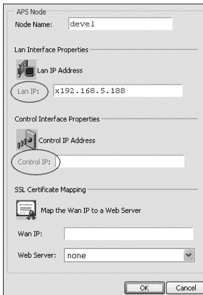

图 8-6：标注的错误消息

## 使用 Ajax 提高响应性

Ajax（异步 JavaScript 和 XML）是一组允许网页部分更新的技术。由于只刷新了网页的一部分，因此更新发生的速度比刷新整个网页要快。此外，部分更新可能由鼠标点击和按键按下等用户事件触发。这种行为使得 UI 比传统的网页更具响应性。

例如，Google 的邮件服务 Gmail 就使用了 Ajax。当你撰写邮件并开始输入联系人的姓名时，浏览器会对每个按键做出响应，随着你的输入减少匹配项列表。这种响应性令人印象深刻。

图 8-7 显示了 Ajax 通信机制工作的一个示例。图中的交换是在用户在事件 ① 移动到网页上的活动元素时启动的。在事件 ② 触发鼠标悬停操作，并在网页浏览器中执行 JavaScript 代码。JavaScript 创建了一个带有服务器端脚本 URL 和 JavaScript 回调函数的 `XMLHttpRequest`，网页浏览器在事件 ③ 向服务器发送该 `XMLHttpRequest` 请求。在服务器端，由 URL 标识的特定脚本在 ④ 返回 XML 数据。

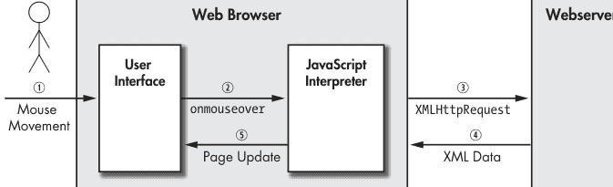

图 8-7：典型的 Ajax 序列。

注意：XML 的格式客户端和服务器都知晓，因此当服务器发送 XML 数据时，客户端理解其格式。通常，XML 数据将包含显示在浏览器网页某些区域的更新信息。

回到客户端侧，网页浏览器接收 XML 数据并调用 JavaScript 回调函数。该回调函数在事件 ⑤ 从 XML 消息中提取数据，并使用 XML 文档对象（`DOM`）API 修改网页的部分。

鼠标移动不是 Ajax 支持的事件，但它们是最流行的，此外还有鼠标点击、按键按下、文本选择以及对可编辑字段的键盘焦点——并且每次浏览器升级都会提供更多事件。

## 实现

在本节中，我们将讨论 Laddie Web UI 的实现。我们将展示一些 Web UI 的截图及其工作原理。

该 Web UI 至少支持以下浏览器：Internet Explorer（5.0 及更高版本）、Netscape Navigator（4.72 及更高版本）、Firefox（1.0 及更高版本）、Safari（1.0 及更高版本）、Opera（5.0 及更高版本）以及 Lynx（2.8.2 及更高版本）。这些版本是通过对来自 `https://browsers.evolt.org` 的存档浏览器直接测试确定的。

注意：与其它图形化浏览器不同，Lynx 浏览器是基于文本的。

## 与守护进程交互

Laddie Web UI 展示了来自多个运行守护进程的信息。如你所知，这些守护进程中的每一个都与 PostgreSQL 协议通信。在本节中，我们将讨论 Web UI 如何与 Laddie 报警守护进程 `ladd` 交互。一旦你理解了这种交互，你就理解了 Web UI 如何与其他进程交互。图 8-8 显示了一个典型的序列：用户请求一个网页，网页根据守护进程的状态动态生成。

图中显示了运行着 Web 服务器和 `ladd` 报警守护进程的 Linux 设备。为了简单起见，我们展示了 PHP 解释器在与 Web 服务器相同的进程中运行（如 Apache 的情况），但如果你使用 CGI 脚本，它可能是不同的进程。

如前所述，图中显示了网页的典型请求-响应序列。首先，用户在 ① 请求特定页面。Web 服务器从文件系统中定位页面，由于 Web 服务器在页面中发现了 PHP 标签，它调用了 PHP 解释器来解释 PHP 代码。在我们的案例中，特定的 PHP 代码包含了 `pg_connect()` 和 `pg_exec()` 函数，它们由 PHP 解释器在事件 ② 和 ③ 被调用。PHP 代码在 ④ 生成网页，此新页面在事件 ⑤ 返回给浏览器。

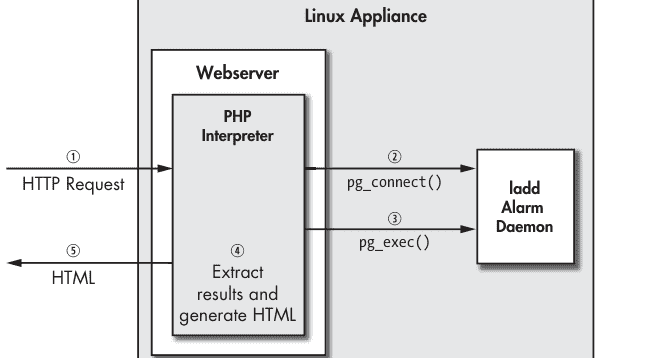

图 8-8：与守护进程交互

## 连接到守护进程

如插图所示，在读写 `ladd` 守护进程之前，你必须使用 `pg_connect()` 函数建立连接，该函数是在配置 PHP 时使用 `--with-pgsql` 选项时内置到 PHP 解释器中的。`pg_connect()` 函数接收一个字符串参数，指定服务器的主机名（或 IP 地址）和端口。在我们的案例中

报警状态可以用灰色水平条的形式显示，也可以在“状态（Status）”列下显示“报警（Alarm）”标签。如果你实际使用这个界面，可能会发现水平条比标签更容易阅读，因为它提供了快速的视觉提示。在设计 Web 界面时，请考虑如何通过类似的视觉提示来增强你的界面，以便快速传达信息。

与需要用户刷新页面才能更新状态的传统网页不同，此状态页面在报警状态变化时会自动更新。要观察这种自动行为，请启动两个浏览器并将它们指向报警状态页面。在其中一个浏览器中，通过点击清除（Clear）和设置（Set）按钮来修改报警状态。如果两个浏览器中都启用了 JavaScript，你将看到两个浏览器的页面同时发生了更新。

生成此网页的 PHP 代码可以在本书的配套 CD 中找到，文件位于 `/opt/laddie/htdocs/web/cgi-bin/status.php`。

## 报警设置页面

图 8-10 所示的报警设置页面允许你配置报警区域的名称。在设计此页面时，我们考虑了两种 UI 设计方案：为每个区域设置一个“更新（Update）”按钮，或者为所有区域设置一个单一的“更新”按钮。我们选择了单一按钮，因为它减少了为了修改几个区域参数并点击更新所需的导航。

| 设置 (Setup) | 状态 (Status) | 报告 (Reports) | 表格编辑器 (Table Editor) | 帮助 (Help) |
|---|---|---|---|---|
| 网络 SNMP 报警 | 区域名称 (Zone Name) | 状态 (State) | 锁类型 (Latch Type) | 类型 (Contact Type) |
| 1 | 车库门 (Garage Door) | 已启用 (Enabled) | 非锁定 (NonLatching) | 常闭 (Normally Closed) |
| 2 | 电机检测器 (Motor Detector) | 已启用 (Enabled) | 锁定 (Latching) | 常开 (Normally Open) |
| 3 | 大门 (Front Door) | 已启用 (Enabled) | 锁定 (Latching) | 常开 (Normally Open) |
| 4 | 厨房窗 (Kitchen Window) | 已启用 (Enabled) | 锁定 (Latching) | 常闭 (Normally Closed) |
| 5 | 冰箱 (Refrigerator) | 已启用 (Enabled) | 锁定 (Latching) | 常闭 (Normally Closed) |
| 更新 (Update) | | | | |

图 8-10：Laddie 报警设置页面

此网页允许用户输入每个报警区域的名称。现在我们将描述该网页的工作原理，特别是如何处理其中显示的表格数据。在浏览器端，网页包含一个 HTML 表单，这是接收用户输入并在用户点击“提交（Submit）”按钮时将其发送到 Web 服务器的机制。如果你查看网页的 HTML 源代码，会看到以下行：

```
<td><input type=text name=Name_1 value="Garage Door" /></td>
```

`input` 标签告诉浏览器显示一个文本输入字段。`name` 标签告诉浏览器如何命名该字段，`value` 标签告诉浏览器如何填充字段的初始值。当用户点击提交按钮时，所有表单字段的名称和值会被发送服务器。当服务器接收此请求时，你的 PHP 代码将从请求中提取名称并更新 Laddie 守护进程。

PHP 提供了一种简单的机制来提取字段值。例如，要提取名为 `Name_1` 字段的值，你可以使用以下 PHP 代码：

```
$name = $_REQUEST["Name_1"];
```

`REQUEST` 变量是由 PHP 解释器填充的全局变量，而字符串 `Name_1` 对应 HTML 表单中的字段名称。该语句在服务器上执行，变量 `$name` 将将包含用户在浏览器中输入的文本。


对于表格字段，我们需要小心命名，因为 HTML 规范要求表单中的所有字段必须具有唯一的名称。在 HTML 中为此类字段命名的常用方法是在列名后附加行号。例如，我们在 `Name` 后面附加行号 1（使用下划线作为分隔符），从而为区域 1 的 `Name` 列得到 `Name_1`。

生成此网页的 PHP 代码可以在本书的配套 CD 中找到，文件位于 `/opt/laddie/htdocs/web/cgi-bin/setup_alarm.php`。查看 `displayForm` 函数，它是示例中处理网页更新的 PHP 代码。

## 页面布局与菜单系统

在本节中，我们将描述 Laddie 的网页布局和菜单系统。这个简单的方案由两个 PHP 文件处理。第一个文件 `layout.php` 将 Laddie 的两级菜单系统定义为二维数组（参见本书配套 CD 中 `/opt/laddie/htdocs/web/cgi-bin/layout.php` 中的全局变量 `menu_system`），并定义了函数 `display()`。该函数用于刷新页面。第二个文件 `alarmstyle.css` 控制颜色、字体和缩进（见图 8-11）。

| 设置 (Setup) | 状态 (Status) | 报告 (Reports) | 帮助 (Help) |

|---|---|---|---|

| 网络 SNMP 报警 | 区域名称 (Zone Name) | 状态 (State) | 锁类型 (Latch Type) |

| 1 | 车库门 (Garage Door) | 已启用 (Enabled) | 非锁定 (NonLatching) |

| 2 | 电机检测器 (Motor Detector) | 已启用 (Enabled) | 锁定 (Latching) |

| 3 | 大门 (Front Door) | 已启用 (Enabled) | 锁定 (Latching) |

| 4 | 厨房窗 (Kitchen Window) | 已启用 (Enabled) | 锁定 (Latching) |

| 5 | 冰箱 (Refrigerator) | 已启用 (Enabled) | 锁定 (Latching) |

图 8-11：设计 Web 界面

## 使用 Ajax 进行异步更新

考虑图 8-9 所示的状态页面。网页如何响应报警状态的变化？

理想情况下，网页应该自动更新，而不是要求用户反复点击浏览器的“刷新”按钮。这种方法是以固定频率轮询服务器，例如使用如下 `Refresh` HTML meta 标签：

```
<META HTTP-EQUIV="Refresh" CONTENT="URL=refreshed-page.html">
```

另一种方法是使用 Ajax，使得网页仅在服务器上发生状态变化时进行更新。Ajax 的缺点是它要求在 浏览器中启用 JavaScript；如果用户禁用了 JavaScript，更新机制就会失效。另一方面，当使用 Ajax 时，网页会迅速响应服务器状态的变化并进行更新。

在第 117 页的“通过 Ajax 提高响应性”章节中，我们描述了典型的 Ajax 交换工作原理。然而，请注意，这种交换是由客户端发起的而不是服务器。我们需要一种方法来修改 Ajax，让浏览器对服务器的状态变化做出响应。

事实证明我们可以修改 Ajax 交换，使得系统的行为就像是 Web 服务器发起的交换一样。技巧在于双重处理：首先，将 `mouseover` 事件替换为 `onload` 事件，以便在网页加载后立即发送 `XMLHttpRequest`。其次，修改 Web 服务器脚本，使其阻塞等待事件。通过实现这种修改后的 Ajax 交换，每当服务器上发生特定事件时，网页就会进行更新。经验丰富的 Ajax 程序员会注意到，还有另一种机制可以实现类似的结果，特别是在 http://www.ajaxpatterns.org 中记录的 HTTP Streaming 模式（以及相关的书籍 Michael Haemhoff 编写的、O'Reilly 2006 年出版的 *Ajax Design Patterns*）。我们的方法和 HTTP Streaming 模式都有使用长连接 TCP 的缺点，这对于并发连接数有限的 Web 服务器来说可能是一个问题。然而，对于我们的方法，我们可以控制请求等待服务器事件的时间，从而限制并发连接的数量。

在描述这种修改后的 Ajax 交换的细节之前，让我们回顾一下整体。图 8-12 显示了用户请求新网页的序列，包括首次页面更新和随后的部分页面更新。从计时来看，事件 ➀ 到 ⑧ 在用户请求网页后接连发生。此时，网页已加载了最新的警报 状态。当某些警报状态在事件 ⑨ 发生变化时，它会触发事件 ⑩ 到 ⑮，此时网页将用新的警报状态进行刷新。后一个序列会一直重复，直到用户离开网页。

### 浏览器发送第一个 HTTP 请求

从事件 ➀ 到 ⑦ 的序列是标准的 HTML 请求响应交换。在步骤 ⓗ 中，用户请求网页，服务器通过发送网页进行响应，在步骤 ⑿ 中，服务器显示该页面。无论网页是否包含 JavaScript，所有 Web 请求都会执行这些步骤。通过 ����� 的剩余序列更有趣，我们将详细描述这一序列。

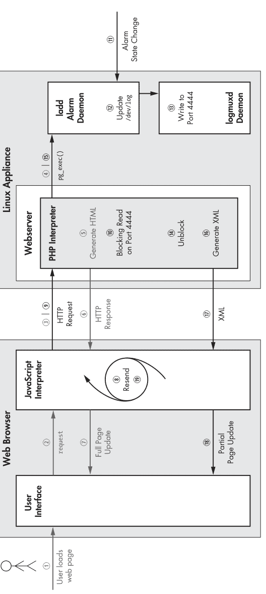

### 浏览器发送第二个 HTTP 请求

在客户端，当网页的 `currentStatus` 在事件 ⑦ 处首次加载时，事件 ® 会立即被触发。具体来说，`GetCurrentStatus()` 函数被调用。通过启动本书的附带 CD 并使用浏览器访问 http://192.168.1.11，查看区域状态（Zone Status）页的 HTML 源码。

Laddie 设备的默认 IP 地址为 192.168.1.11（默认掩码为 255.255.0.0）。当你将此设备插入计算机并重启时，你可以在另一台电脑的任何 浏览器上使用 URL http://192.168.1.11 连接到 Web。如果默认 IP 地址与网络上的现有节点冲突，你可以按照以下步骤更改 Laddie 的 IP 地址：退出帧缓冲区界面（按 `Q` 退出），然后在提示符处输入 `root` 作为用户并按 ENTER 密码（没有密码）。在命令提示符处输入 `linux`。从 `linux` 可以导航到网络设置（Network Setup）页面并修改网络接口的 IP 地址。一旦你使用 `linux` 更改了 IP 地址，就可以在另一台电脑的浏览器中重新输入 URL（带有你的新 IP 地址）。

如果你查看此网页的源码，将看到以下行：

```
<body onload="GetCurrentStatus()">
```

`GetCurrentStatus()` 函数在事件 ⑨ 处通过 `url_for_status.php` 发起一个 `XMLHttpRequest`。你将在本书附带 CD 的 `/opt/laddie/web/cgi-bin/status.php` 文件中看到以下代码：

```javascript
function GetCurrentStatus() {
  // 使用 ms= 部分使 url 唯一，以防止 IE 检索
  // 缓存副本。
  url = "wait_for_status.php?disp_id=" + curr_id + "&ms=" + new Date(Date.getTime());
}
```

```javascript
if (window.XMLHttpRequest) {
  // Firefox/Netscape XMLHttpRequest 分支
  req_status = new XMLHttpRequest();
  if (req_status) {
    req_status.abort();
    req_status.onreadystatechange = GotStatus;
    req_status.open("GET", url, true);
    // lighthttp 必需的 Header
    req_status.requestHeader("Accept", "*/*");
    req_status.send(null);
  }
...
```

这段代码段指示浏览器发送一个 URL 为 `wait_for_status.php` 的 HTTP GET 请求。它还指示浏览器在收到服务器的响应时调用回调函数 `GotStatus()`。

### 服务器阻塞等待警报状态变化

在服务器端，脚本 `wait_for_status.php` 被调用。该脚本在事件 ⑧ 处对端口 4444 执行阻塞读取。每当在事件 ⑨ 处发生警报状态变化时，日志守护进程向端口 4444 写入消息（事件 ⑿）。写入 线程的内容并不重要；重要的是消息解阻塞了 ⑧ 处的 线程。


注意上面的代码，`curr_id` 随 URL 发送。该变量防止了在事件发生过快时浏览器丢失事件。该变量在服务器和浏览器之间传递，并与日志事件同步增加。如果浏览器的 `curr_id` 值与服务器上的日志事件不匹配，PHP 线程将跳过对端口 4444 的阻塞。这种方式，如果在 PHP 线程未阻塞端口 4444 的期间出现了新事件，PHP 线程将继续执行。

## 服务器发送 XML 警报状态

一旦开始读取，PHP 脚本从阶梯守护进程读取状态。XML 文档如下：

```xml
<?xml version="1.0" encoding="UTF-8"?>
<ladder_status>
  <zone id="1" name="Front Door" enabled="1"/>
  <zone id="2" name="Back Door" enabled="0"/>
  <zone id="3" name="Garage" enabled="1"/>
  <zone id="4" name="Motion Detector" enabled="0"/>
  <zone id="5" name="Smoke Detector" enabled="0"/>
  <logcount>29</logcount>
</ladder_status>
```

PHP 脚本从阶梯守护进程读取警报状态，将数据组合成 XML 文档，并传递给浏览器（事件 ⑿）。

## 浏览器更新页面部分

回到客户端，浏览器接收 XML 文档并从其生成 HTML 片段；它使用该片段更新页面（事件 ⑨）。

```javascript
var zones = req_status.responseXML.getElementsByTagName("zone");
table = generateHtml(zones);
div = document.getElementById('status_table');
div.innerHTML = table;
```

## 浏览器通过发送另一个 HTTP 请求重复

浏览器再次调用 `XMLHttpRequest`，过程重复（事件 ⑨）。在短暂的延迟后，`GetStatus()` 函数通过以下行调用 `getCurrentStatus()`：

```javascript
setTimeout(getCurrentStatus(), 2000);
```

适当的环境。遗憾的是，当用户禁用了 JavaScript 并重新加载特定页面时，该解决方案不起作用。变通是让用户开启 JavaScript 然后重新访问首页。

我们采取了另一种方法，允许用户启用或禁用 JavaScript 然后重新加载特定页面。这意味着每个网页都必须支持一个 JavaScript 版本和一个非 JavaScript 版本。在过去，解决这个问题可能很棘手，因为浏览器……但在今天，这个问题很容易解决，大多数浏览器（即使是像 Lynx 这种不支持 JavaScript 的浏览器）都能识别 HTML `<script>` 标签。当现代浏览器禁用了 JavaScript 时，它会忽略 `<script>` 和 `</script>` 标签之间所有的 HTML 代码。

# 隐藏 JavaScript

以下这种向浏览器隐藏 JavaScript 的模式被证明对于 Internet Explorer（5.0 及更高版本）、Netscape Navigator（4.72 及更高版本）、Firefox（1.0 及更高版本）、Safari（1.0 及更高版本）、Opera（5.0 及更高版本）以及 Lynx（2.8.2 及更高版本）是有效的。

```
<SCRIPT TYPE="text/javascript">
<!-- hide from old browsers

// javascript code goes here

<!-- end of script hiding -->
</script>
```

HTML 注释 `<!-- -- -->` 被包含在内，作为不支持 `<SCRIPT>` 标签的旧浏览器的安全机制。同样，你可以使用 `<NOSCRIPT>` 和 `</NOSCRIPT>` 标签在未启用 JavaScript 时提供备用内容。

使用这些模式，每个网页都可以同时支持 JavaScript 和非 JavaScript 版本，因此用户可以更改浏览器的 JavaScript 设置并重新加载页面。由于用户不需要寻找并重新加载某些全站重定向页面，用户的体验得到了极大简化。

# 改进我们的设计

在实现了 Web UI 后，我们处于一个更好的审查和改进设计的阶段。哪些领域可能需要改进呢？

当前设计的一个问题是，配置网络接口的逻辑包含在 `setup_network.php` 中，遗憾的是，该逻辑对其他 UI（如命令行界面 CLI）不可用。当我们首次实现网络设置页面时，并没有预见到这种配置逻辑会有如此复杂，因此我们决定所有的 UI 都复制这种“简单”的逻辑。回想起来，我们认为如果将网络配置逻辑整合到一个单一管理器中（特别是 `networkd` 守护进程），设计将会得到改进。这样，CLI 用户界面就可以提供与网络设置网页页相同的功能，而无需在 `setup_network.php` 中重复逻辑。

我们可以通过明确二级菜单和一级菜单之间的关系来提高 Web 的易用性。这可以通过使用不同的颜色区分一级和二级菜单来实现，如图 8-2 所示。注意这一点，可以很容易看出二级项目 `Components` 属于一级菜单 `Tomahawk`。

另一个改进是在客户端添加错误检查功能。这种改进将通过添加 JavaScript 函数来检查表单字段的有效性来实现，从而获得更响应的 UI。

我们可以通过添加一个网页来提供网络连接和硬件健康状况（如温度和风扇速度）的诊断功能来增强功能性。此功能允许软件远程监控设备是否存在性能下降。

# 资源

以下资源对于进一步学习网页设计、Ajax、调试和测试将非常有用。

- **UI 设计**：Alan Cooper 和 Robert Reimann 编写的《About Face 2.0: The Essentials of User Interaction Design》（Wiley, 2003）是一本关于 UI 设计的好书。

- **JavaScript**：一本良好的 JavaScript 参考书是 Danny Goodman 和 Michael Morrison 编写的《JavaScript Bible, 5th Edition》（Wiley, 2004）。

- **Ajax**：关于 Ajax 编程的 Wikipedia 页面介绍了该技术并包含了 Ajax 的历史。参见 http://en.wikipedia.org/wiki/Ajax_(programming)。

- **HTML 验证**：世界维网联盟（W3C）在 http://validator.w3.org 提供了免费的 HTML 验证服务。还提供 CSS 验证服务。

- **Web 浏览器**：用于测试网页的旧版 Web 浏览器存档于 http://browsers.evolt.org。

- **调试器**：Zend Studio 调试器允许你使用微软的 Internet Explorer 和 Apache Web 服务器调试 PHP 代码。使用此浏览器，你可以单步执行在 Apache 下运行的 PHP 代码。这是一个商业软件包，可在 http://www.zend.com 获取。

# 总结

在本章中，我们讨论了基于 Linux 的设备的 Web UI 的开发，特别是针对 Laddie 的 Web UI。我们的目标并不是讨论所有的 Web 技术——你可以找到关于该主题的整本书。

本章强调了 Laddie Web UI 的相关特性：

- 对于不支持 JavaScript 的浏览器，Web UI 能够优雅地降级，以便 Web UI 功能可以被各种浏览器访问。

- 每当设备上的警报状态发生变化时，警报状态页面就会自动更新：

    - 当触发警报时，每个查看状态页面的浏览器都会刷新。

    - 当使用任何浏览器清除警报时，变化将反映在所有其他浏览器上。

在实现 Web UI 后，我们回顾了设计并提出了一些未来的改进建议。特别是，我们建议将配置网络接口的逻辑从 PHP 移动到网络守护进程 `networkd` 中。这种重构的优势是，其他 UI（例如 CLI）可以配置网络接口，而无需重复 PHP 中复杂的逻辑。

## 带宽

当你希望通过低带宽通道访问设备时，CLI 是非常有用的。低带宽通道可能是一个缓慢的无线电链路，或者是一个过载或发生故障的快速网络。如果你的设备需要在地理位置上进行中心化管理，低带宽能力也可能具有优势。

## 脚本化

CLI 的最大优势之一是，它通常允许你将一系列命令行收集到一个文件或脚本中，并像用户手动输入一样执行这些命令。这与难以自动化的 Web 或或其他图形界面 (UI) 相比，提供了巨大的优势。脚本对于帮助自动化重复或枯燥的任务特别有用。CLI 允许用户使用你 CLI 中的命令作为他们的原语或基础操作，从而构建他们自己的命令。

并不是所有 CLI 在脚本化能力上都是平等的。我们将在本章的稍后部分讨论这一点。


# 配置备份与恢复

作为设备开发人员，你应该预想的最大问题之一是客户在软件升级期间需要保留或迁移配置数据。我们通过多种方法处理了这个问题，最糟糕的解决方案是给用户一个网页，让他们可以在那里启动包含配置数据的二进制文件的 FTP 传输。由于几个原因，这简直是一场灾难：客户反对设置 FTP 站点以接收文件的繁琐过程，而且他们真的无法看到配置。

升级过程非常麻烦，因为我们必须编写并分发程序来读取二进制文件并将其转换为新软件所需的格式。关注版本号、寻找运行转换器的地方以及将新文件传回设备，这简直是一团乱麻。将配置保存为 XML 有帮助，但作用并不大。

真正有效的解决方案是提供一个网页，将整个配置以 CLI 命令列表的形式显示。我们的客户非常喜欢。他们一目了然地看到配置，对配置进行备份就像访问网页并在浏览器中选择“另存为”一样简单。当然，我们还有一个匹配的 Web 表单，用户可以在其中粘贴已保存配置的 CLI 命令，并轻松恢复原始设置。像 `wget` 这样的工具也能让配置备份自动化。你将在本章稍后看到一个示例，当时我们将回顾 Laddie CLI 命令，该命令将 Laddie 的配置导出为一系列 CLI 命令。

这种方法也让我们升级变得更加容易。CLI 相当稳定，对它的更改几乎都是后兼容的扩展。切换到这种方法后，我们再也不需要编写和分发程序将一个版本的配置文件转换为下一个版本。

将设备配置保存为脚本中的 CLI 命令列表还有其他优势。我们的一个客户希望他所有配置的主副本存储在 NMS 中。他配置设备使用 DHCP，并设置了 DHCP 和 NMS，以便在他从 DHCP 服务器接收到 IP 地址后立即为我们的设备获取相应的配置。例如，他订购了 10 台新服务器，我们在发货前给了他以太网 MAC 地址。在设备到达之前，他就准备好了 10 台新服务器的配置下载，所有新设备在初始通电后几分钟内就完成了配置并运行。

## CLI 的类型

大多数 Linux 系统上的默认 CLI 是 `bash`，但 `bash` 只是 CLI 的一种类型。还有其他可能更适合你类型，随着你选择匹配任务的任务，你的 CLI 可能会在不同类型之间切换。让我们看看不同的 CLI 类型：句子、菜单和向导，以及两个 CLI 属性：状态性以及 CLI 是面向行的还是面向字符的。

### 句子

句子 CLI 是最常见的 CLI 类型，它将设备中的动作和对象映射为动词和名词。考虑一个简单的 `bash` 命令：

```bash
rm -f backup.sxw
```

在这里，`rm` 是动词，`-f` 是副词，`backup.sxw` 是名词。这种类型 CLI 成功的关键在于选择能够良好映射客户对设备理解的动词名词。

当然，你可以使用其他的句子结构，如动词-名词、动词-名词-形容词或名词-动词-形容词——这取决于你。核心思想是让阅读 CLI 像像句子。当客户、现场支持和工程师都使用与你的 CLI 相同的词汇和语法描述配置时，你就知道你做对了。

通常你需要动词来查看状态或统计数据、更改配置以及启动操作。例如，Laddie CLI 中的动词有 `view`、`set`、`test` 和 `clear`。

句子 CLI 的巨大优势是它是最容易、最可靠地脚本化的 CLI。这种 CLI 的主要缺点是它的学习曲线可能很陡。用户必须记住一些词汇和语法才能有效使用这种类型的 CLI。然而，在 CLI 中花费大量时间的用户通常倾向于句子 CLI。

### 向导

向导是一种界面类型，它通过一系列问题向用户提问，通常在提问之前会给用户一些描述性文本。例如，以下内容可能是 Laddie 向导配置的一部分。

传感器类型：

报警传感器有两种不同的类型：常闭型 `nc` 和常开型 `no`。常闭型传感器中的开关是关闭的，产生电接触，此时传感器不处于报警状态。常开型传感器在正常（或非报警）状态下不产生电接触。

请在传感器主体或其包装上寻找传感器类型。

（注：原文中存在大量重复的“传感器类型”文本，此处已根据要求去重并保留核心内容。）

最常见的访问类型是将 CLI 可执行文件的路径添加到 `/etc/shells` 文件中，并创建一个登录 shell `login shell` 设置为 CLI 的用户。这样做的优点是，CLI 可以通过串口端口、`telnet` 和 `SSH` 同样地访问。这是我们为 Laddie 采用的方法。

非常小的设备可能不支持登录。在这种情况下，你可以将 CLI 的标准输入 `standard-in` 和标准输出 `standard-out` 直接绑定到串口端口。这里的安全模型是基于串口端口的物理访问。

正如我们在下一节中将看到的，即使 CLI 仅用于配置备份且只能从网页访问，它也可能是很有用的。

# Laddie CLI

Laddie 的 CLI 使用了“动词-形容词-名词”的方法；它没有显式声明，并且是基于行和基于字符的。我们的命令允许 CLI 用户查看状态、查看日志、配置并获取帮助。Laddie 的 CLI 并不完整，因为它不允许用户配置或查看设备的网络、`SNMP` 或日志配置。

你可以通过多种方式进入 Laddie CLI。你可以以用户 `cli` 的身份无密码地 `telnet` 到 `192.188.1.11`。你也可以以 `root` 身份 `telnet` 到 Laddie，并在 `bash` 提示符下使用 `cli` 命令启动 Laddie CLI。

## Laddie 命令摘要

以下是所有的 Laddie CLI 命令及其语法和描述。

- `clear [all|1-5]` - 清除报警
- `test [1-5]` - 手动设置报警
- `view` - 查看系统状态
- `view [all|1-5]` - 查看区域状态
- `view logs` - 列出最后 20 条日志消息
- `set zone [1-5] enabled [yes|no]` - 启用或禁用区域
- `set zone [1-5] latching [yes|no]` - 设置区域是否锁存报警 `latching`
- `set zone [1-5] name "zone name"` - 给区域命名
- `set zone [1-5] contact [no|nc]` - 设置为常开或常闭
- `set logs [yes|no]` - 将日志流式传输到此 CLI 会话
- `help` - 查看 Laddie 的通用帮助
- `dump` - 以 CLI 命令的形式查看配置
- `# (comments)` - 注释行
- `quit` - 退出命令行界面

你已经熟悉 Laddie 的配置，因此我们对每个命令都提供了详细的解释。然而，有几个命令值得提及。

## set logs on

Laddie 日志记录器的功能之一是，你可以对其开启一个 `telnet` 连接，并通过该连接向你发送日志消息。

`logs` 命令打开（或关闭）到日志记录器的连接以接收这些消息。一个示例会话可能会更清晰。

```
> set logs on
> test 2
2006-06-21 14:40:29 User set alarm on zone 2, Back Door
2006-06-21 14:40:29 Alarm system status: alarm
> set logs off
> clear all
```

注意，执行 `clear all` 命令后没有显示任何日志消息，因为我们通过 `set logs off` 命令关闭与日志记录器的连接。

系统会在日志发生时打印日志，日志消息的输出可能会出现在正在输入的命令中间。这可能会令人困扰，因此你可能建议用户使用两个窗口并在每个窗口启动一个 CLI，一个用于日志消息，另一个用于交互式命令。

在 CLI 会话中拥有日志消息对于设备来说是一个加分项。你的客户可以使用 CLI 作为从设备向其网络管理系统发送日志消息的方式。此外，CLI 中的日志消息对任何尝试远程管理设备的人都非常有帮助。

## dump

`dump` 命令将 Laddie 的配置显示为一系列 CLI 命令，这些命令可以重新输入到 CLI。输出的第一行是注释，用于标识显示的内容，更重要的是显示的时间。尽管我们没有在顶部的注释中包含 CLI 版本号，但这样做会很有帮助。

```
> dump
# Laddie Alarm System as 2008-06-21 15:01:02
set enabled 1 yes
set name "Front Door"
set contact 1 no
set enabled 2 yes
set name "Back Door"
set contact 2 nc
set enabled 3 yes
set name "Garage"
set contact 3 no
set enabled 4 no
set enabled 4 no
set name "Motion Detector"
set contact 4 nc
set enabled 5 yes
set name "Smoke description"
set contact 5 no
set latching 5 no
>
```

几个 Linux 命令，如 `setserial`，也可以以可以输入回命令的方式打印配置信息。

## help


Laddie CLI 提供了 `help` 命令来显示可用命令。在不带任何参数的情况下，`help` 会给出其他命令的建议。

```
> help
Help is available on the following topics:
- intro - Laddie Alarm System 介绍
- commands - 可用 CLI 命令列表
- how - "how to" 主题
- what - "what if" 主题
```

通过输入命令名称可以获取单个命令的帮助，例如：`help view` 或 `help set enabled`。

# test 命令的代码审查

我们使用 `lex`、`yacc` 和 C 实现了 Laddie CLI。Laddie 的动词-形容词-名词词表由 `lex` 生成的解析器识别，而 CLI 的语法由 `yacc` 生成的 C 文件识别。关于 `lex` 或 `yacc` 的教程超出了本书的范围，但我们可以对实现它的增量代码进行一个概述。此审查可能会让你感受到它们的强大和优雅。

代码被分为四个文件：`main.c`、`syntax.y`、`token.l` 和 `commands.c`。`main.c` 文件包含 `main()` 例程，需要监听用户输入和日志消息。`syntax.y` 文件是包含语法的 `yacc` 输入文件。`token.l` 文件是包含 CLI 中用词汇定义的 `lex` 文件。`commands.c` 文件实际上实现了命令。`yacc` 和 `lex` 产生 C 文件，使用以下命令翻译、编译并链接这四个源文件：

```
gcc -fpic -c -I. -std=gnu -gWall main.c -o main.o
yacc -d syntax.y
lex -I. token.c
gcc -fpic -c -I. -std=gnu -gWall token.c -o token.o
gcc -fpic -c -I. -std=gnu -gWall syntax.tab.c -o syntax.tab.c
gcc -fpic -c -I. -std=gnu -gWall commands.c -o commands.o
gcc main.o syntax.tab.o commands.o -o cli
```

## CLI 词表：`token.l`

`token.l` 文件有一系列定义我们词表中单词的正则表达式。`lex` 将 `token.l` 中的正则表达式翻译成一个实现有限状态机的 C 程序，以识别词表中的单词。Laddie 的 `test` 形式是 `zone id`，其中 `zone` 是 1 到 5 之间的数字。我们的输入文件 `token.l` 包含以下代码来定义 `zone ID` 和 CLI 动词：

```
[1-5] \t* { Zone = (int)(yytext - '0');
return(ZONE_ID); }
test[\t]+ { return(TEST); }
```

`[1-5]` 表示 1 到 5 之间的数字。`\t` 表示空格或制表。`*` 表示 `zone ID` 后面可以有零或多个空格或制表。`yacc` 变量指向令牌开头的命令行，因此 `(int)(yytext - '0')` 是整数格式的 `zone ID`。代码在返回之前设置了全局变量 `Zone`，以验证找到了有效的 `zone ID`。`lex` `[\t]+` 表示单词 `test` 后面跟着一个或多个空格或制表。需要一个空格或制表将 `test` 令牌与 `zone ID` 隔开。

## CLI 语法：`syntax.y`

正如语法定义了语言中的有效句子一样，`yacc` 文件 `syntax.y` 中定义的语法定义了我们 CLI 中的有效命令。`yacc` 将 `syntax.y` 中的语法转换为基于 C 的状态机以识别有效命令。

`test` 命令的语法由以下行定义：

```
%token ZONE_ID
%token TEST

test_command :
    TEST ZONE_ID             { test_zone(Zone); }
    ;
```

`ZONE_ID` 和 `TEST` 的令牌定义被转换为 `#define` 语句并传递到 `lex` 文件 `token.l`。`test` 命令的语法定义需要一个 `TEST` 紧跟一个 `ZONE_ID` 令牌。如果命令行有一个有效的 `test` 命令，则用 `zone ID` 作为参数调用 C 例程 `test_zone()`。

## 代码

`commands.c` 中的 C 例程 `test_zone()` 是执行区域实际工作的地方；它将 `Zone` 表中的 `alarm` 字段设置为 1。`test_zone()` 例程完整展示如下：

```
void test_zone(int zone) {
    char cmd[100];      /* 构建 SQL 命令的地方 */
    sprintf(cmd, "UPDATE Zone SET alarm = 1 WHERE id = %d", zone);
    update(cmd);
}
```

`update()` 例程是一个向 `ladd` 守护进程发送 PostgreSQL 更新命令的实用例程。该例程的代码与第五章介绍的 SQL 更新代码几乎相同，因此我们在此不展示该例程的代码。

## 代码笔记

根据我们的计算，添加 `test` 命令的增量成本大约是 15 行代码。并不，`yacc`、`lex` 和 C 可以构建 CLI 变得非常简单。事实上，危险可能是倾向于添加大量的 CLI 命令。不要忘记每个新命令都会给用户带来学习负担，这可能会减缓对你 CLI 的采用。

## 总结

在本章中，我们看了在应用程序中包含 CLI 的原因以及你可以使用的 CLI 类型。我们展示了 Laddie 的 CLI，并对 `test` 命令进行了简要的代码审查。

考虑到你可能不想直接使用 Laddie CLI，我们 CLI 的程序员在编写源代码时特别留了注释，以便你对其进行修改。此外，帮助系统的设计初衷是为了方便移植到你的设备中。

在下一章中，我们将继续对用户界面（UI）的讨论，介绍如何在你的设备中引入按钮、发光二极管（LED）和简单的基于文本的液晶显示器（LCD）。虽然下一章不会将其称为 CLI，但我们将 LCD 接口视为一个带有字符界面的菜单系统。

# 10 构建前面板接口


按钮、发光二极管（LED）和小型字母数字显示是如此常见，以至于我们不再注意到它们了。打印机、微波炉、DVD 和 CD 播放器都将按钮、LED 和 LCD 作为其用户界面的一部分——你可能也想在你的设备前面板上安装按钮和 LED。

在本章中，我们将描述如何构建前面板 UI，讨论所使用的硬件，然后通过审查需求来向你展示如何设计系统。我们将前面板的范围分为以下几个部分：

- 按钮、LED 和 LCD
- 设计前面板
- 改进我们的设计

我们将从查看前面板硬件的细节开始。（如果你对接线图感到陌生，可以随意略过本章。）本节介绍了你在前面板上看到的各种硬件，包括按钮、LED 和 LCD。

## 按钮

你的量产规模可能会决定你使用的硬件类型，特别是当按钮直接连接到打印电路板（PCB）上。键盘背后的原理是，如果你是大批量生产的一部分，可以减少所需的输入输出线路总数。另一方面，小批量生产或原型机通常使用独立的开关。从电气角度来说说，按钮仅仅是常开的。每个按钮通常需要一条可以由你的处理器读取的数字输入线（第 5 章解释了你如何使用输入线来读取单个开关的状态）。

## 键盘

键盘是一组用于扫描闭合状态的按钮。扫描键盘背后的原理是将开关分成行和列组成的阵列，并逐个检查开关。每行分配一个输出线，每列分配一个输入线。排列成 4x4 键盘的 16 个开关将使用 CPU 的 I/O 线。当你有五个或六个按钮时，键盘就成了一个可行的选择。像 Marvell 这样的片上处理器具有专用硬件来执行键盘扫描。考虑图 10-1 中的 2x2 键盘电路。上拉电阻将低线连接到 V+，因此当没有开关闭合时，两个输入将读取逻辑电。为了扫描键盘，处理器将其中一行与其他行隔离。处理器在行 0 上放置逻辑电，在行 1 上放置逻辑电。处理器读取输入端口，如果输入 0 为逻辑电，则它知道按钮 A（第 0 行第 0 列）被按下。如果输入 1 为逻辑电，则它知道按钮 B（第 0 行第 1 列）被按下。处理器将输出 0 设置为逻辑电，输出 1 设置为逻辑电；现在输入 0 为逻辑电，它知道按钮 C（第 1 行第 0 列）被按下，如果输入 1 为逻辑电，它知道按钮 D（第 1 行第 1 列）被按下。


图 10-1： 2x2 键盘

以下是用于扫描上述键盘的简单代码：


```c
// 扫描 2x2 键盘。如果闭合则返回 A-D，如果没有闭合
// OUT: I/O 端口 0x378 的低两个位（第二个并行端口）
// IN: I/O 端口 0x379 的低两个位
char scan2x() {
    // 给定行的状态
    int state;
    // 在行 0 上置 0
    outbx(0, 0x378);
    // 低两个位中的开关状态
    state = inb(0x379) & 0x03;
    if (state & 0x01 == 0x00) {
        // 记得：闭合=0，断开=1
        return('A');
    }
    if (state & 0x02 == 0x00) {
        // 查看第 1 列的开关
        return('B');
    }
    outbx(1, 0x378);
    state = inb(0x379) & 0x03;
    if (state & 0x01 == 0x00) {
        // 查看第 0 列的开关
        return('C');
    }
    if (state & 0x02 == 0x00) {
        // 查看第 1 列的开关
        return('D');
    }

    // 没有按键按下
    return(0);
}
```

这段代码很好地说明了扫描键盘的过程，但如果你扫描多行，你可能需要使用循环。

### 抖动 (Bounce)

当开关掉在金属板上时，它可以看作是两个金属之间的碰撞。开关在闭合或断开时会产生抖动。如果你扫描得太快，可能会误认为发生了抖动。抖动的持续时间取决于物理属性，它们各不相同。制造商可以提供规格，但你必须确保自己测量抖动时间。避免抖动的方法是减慢扫描，但扫描得太慢会导致响应变得迟钝。

在下一章中，我们将继续对用户界面（UI）的讨论，介绍如何在你的设备中引入按钮、发光二极管（LED）和简单的基于文本的液晶显示器（LCD）。虽然下一章不会将其称为 CLI，但我们将 LCD 接口视为一个带有字符界面的菜单系统。

## 10 构建前面板接口


按钮、发光二极管（LED）和小型字母数字显示是如此常见，以至于我们不再注意到它们了。打印机、微波炉、DVD 和 CD 播放器都将按钮、LED 和 LCD 作为其用户界面的一部分——你可能也想在你的设备前面板上安装按钮和 LED。

在本章中，我们将描述如何构建前面板 UI，讨论所使用的硬件，然后通过审查需求来向你展示如何设计系统。我们将前面板的范围分为以下几个部分：

- 按钮、LED 和 LCD
- 设计前面板
- 改进我们的设计

我们将从查看前面板硬件的细节开始。（如果你对接线图感到陌生，可以随意略过本章。）本节介绍了你在前面板上看到的各种硬件，包括按钮、LED 和 LCD。

### 按钮

你的量产规模可能会决定你使用的硬件类型，特别是当按钮直接连接到打印电路板（PCB）上。键盘背后的原理是，如果你是大批量生产的一部分，可以减少所需的输入输出线路总数。另一方面，小批量生产或原型机通常使用独立的开关。从电气角度来说，按钮仅仅是常开的。每个按钮通常需要一条可以由你的处理器读取的数字输入线（第 5 章解释了你如何使用输入线来读取单个开关的状态）。

### 键盘

键盘是一组用于扫描闭合状态的按钮。扫描键盘背后的原理是将开关分成行和列组成的阵列，并逐个检查开关。每行分配一个输出线，每列分配一个输入线。排列成 4x4 键盘的 16 个开关将使用 CPU 的 I/O 线。当你有五个或六个按钮时，键盘就成了一个可行的选择。像 `Marvell` 这样的片上处理器具有专用硬件来执行键盘扫描。考虑图 10-1 中的 2x2 键盘电路。上拉电阻将低线连接到 V+，因此当没有开关闭合时，两个输入将读取逻辑电。为了扫描键盘，处理器将其中一行与其他行隔离。处理器在行 0 上放置逻辑电，在行 1 上放置逻辑电。处理器读取输入端口，如果输入 0 为逻辑电，则它知道按钮 A（第 0 行第 0 列）被按下。如果输入 1 为逻辑电，则它知道按钮 B（第 0 行第 1 列）被按下。处理器将输出 0 设置为逻辑电，输出 1 设置为逻辑电；现在输入 0 为逻辑电，它知道按钮 C（第 1 行第 0 列）被按下，如果输入 1 为逻辑电，它知道按钮 D（第 1 行第 1 列）被按下。


图 10-1： 2x2 键盘

以下是用于扫描上述键盘的简单代码：

```c
// 扫描 2x2 键盘。如果闭合则返回 A-D，如果没有闭合
// OUT: I/O 端口 0x378 的低两个位（第二个并行端口）
// IN: I/O 端口 0x379 的低两个位
char scan2x() {
    // 给定行的状态
    int state;
    // 在行 0 上置 0
    outbx(0, 0x378);
    // 低两个位中的开关状态
    state = inb(0x379) & 0x03;
    if (state & 0x01 == 0x00) {
        // 记得：闭合=0，断开=1
        return('A');
    }
    if (state & 0x02 == 0x00) {
        // 查看第 1 列的开关
        return('B');
    }
    outbx(1, 0x378);
    state = inb(0x379) & 0x03;
    if (state & 0x01 == 0x00) {
        // 查看第 0 列的开关
        return('C');
    }
    if (state & 0x02 == 0x00) {
        // 查看第 1 列的开关
        return('D');
    }

    // 没有按键按下
    return(0);
}
```

这段代码很好地说明了扫描键盘的过程，但如果你扫描多行，你可能需要使用循环。

### 抖动 (Bounce)

当开关掉在金属板上时，它可以看作是两个金属之间的碰撞。开关在闭合或断开时会产生抖动。如果你扫描得太快，可能会误认为发生了抖动。抖动的持续时间取决于物理属性，它们各不相同。制造商可以提供规格，但你必须确保自己测量抖动时间。避免抖动的方法是减慢扫描，但扫描得太慢会导致响应变得迟钝。

第二种常见的架构是让 Linux 处理器通过连接到串口、并行或 USB 端口的控制芯片来处理 LCD。这种架构适用于小批量生产和基于个人主板的设备。

这种架构的 LCD 通常有 1 到 4 行文本，每行 10 到 40 个字符。这些显示器中最常见的是通用的 `HD44780`，它最初来自日立（Hitachi），现在由多家供应商提供。基于 `HD44780` 的显示器通常具有并行输入，但许多带有一个扩展卡（daughter card），可以提供串口或 USB 输入、键盘扫描和 LED 输出。某些带有扩展卡的显示器允许你在设备上电时对闪存器进行编程。对于设备来说，可编程的上电启动尤为重要，因为响应速度对于成功的 UI 至关重要。带有扩展卡和闪存的显示器还具有可编程字符，如果你想显示 Logo 或其他简单图形，这非常有用。在本章中回顾 Laddie 的前面板硬件时，我们将对 `HD44780` 进行更多介绍。

有几个网页和软件包支持 Linux 下的字母数字 LCD。你可能会发现两个网站特别有价值：`http://lcd4linux.sourceforge.net` 和 `http://lcdproc.org`。多家供应商都提供串口、并行或 USB 输入的字母数字 LCD。以下是你可能考虑的几个：

- Scott Edwards Electronics, Inc. (`http://www.seetron.com`)
- Crystalfontz America, Inc. (`http://www.crystalfontz.com`)
- Matrix Orbital, Inc. (`http://www.matrixorbital.com`)
- Clinson Limited (`http://www.cwlinux.com`)
- Decade Engineering (`http://www.decadenet.com`)
- EarthLCD (`http://store.earthlcd.com`)

使用标准 I/O 端口并不排除使用图形显示器。例如，Decade Engineering 的 `BOB-4` 从串口接收命令和载，并输出到复合同步视频，而 EarthLCD 的 `eZLCD` 是一种具有 240x160 像素分辨率的彩色图形 LCD。

## 设计前面板 UI

本节提供了关于如何构建前面板 UI 的建议。我们将讨论为 LCD 显示器构建菜单系统的各种方法，并就如何让用户开启设备后尽快让前面板做出响应提供一些想法。

### 保持简单


设备的首要目标是做好一件事。将你的产品称为设备（appliance）意味着承诺你不会用用户不需要的功能和选项让他们无所适从。你的目标是保持设备足够简单，让新用户或非技术用户可以在几分钟内安装设备，而无需阅读说明书。你可以通过设置合理的默认值并设计易于导航的 UI 来实现。你仍然可以允许技术型和深深用户访问所有配置选项，但你应该通过将这些选项放在“高级选项”子菜单中，向新手隐藏这些复杂性。

最简单的 UI 应该是前面板上的按钮、LED 和 LCD。当你设计前面板时，请考虑将一个按钮分配给一个功能或状态。单按钮界面对于最常见的功能特别有用。

## 尝试、失败、再次尝试

不要期望第一次就能搞定前面板。要准确预测什么样的菜单流和按钮标签对用户来说最直观是非常困难的。不要害怕向朋友和邻居展示你的设备模型并让他们导航菜单系统，从而耗费他们的热情。在为你的设备选择正确的面板之前，你可能需要制作并尝试几个面板。

我们发现了一些在这方面有帮助的技巧。第一个是使用可更换的纸质面板构建原型。安装纸质面板，并让新用户执行特定任务。新用户导航菜单系统的速度和易用程度是我们用来选择最佳菜单布局的主要标准。图 10-2 显示了我们用于 Laddie 原型设计的纸质面板。


图10-2：带有纸质面板的前面板

另一种技术是意识到菜单系统是一个状态机，可以存储为表格。不要在程序中硬编码状态和转换，而是建立一个包含状态、事件、下一个状态和要执行的操作的表格。然后将状态转换表存储在单独的文件中并在 LCD UI 初始化时加载它。

虽然没有比使用真实的前面板硬件更好的反馈，但你可能会发现使用网页、`Tcl/Tk` 或基于 `curses` 库的字符接口来构建一个工作的前面板原型。你会喜欢能够测试各种前面板设计的。网页或 `Tcl/Tk` 版本的前面板的一个优势是，你可以将其作为成品设备上的另一种 UI。例如，我们发现 `curses` 版本的 Laddie 前面板比 `Laddie CLI` 更容易使用且功能更强大，两者都在 `xterm` 会话中运行。

Laddie 有使用 `curses`、`Tcl/Tk` 和结合 `JavaScript` 编写的前面板模拟器。基于网页的前面板在显示面板硬件的照片上方使用了图像映射。`Tcl/Tk` 版本如图 10-3 所示。


图10-3：`Tcl/Tk` 版本的前面板（注：OCR 文本存在图像/标签错误，但根据上下文这是图 10-3）

可能可以使用一或两个自定义脚本替换整套初始化脚本。这可能是一项大量的工作，但节省的时间将是巨大的。一个好的开始方法是使用内核选项 `init=/bin/sh` 启动系统，并逐条命令地手动启动你的设备。尝试尽可能地运行按钮和 LED UI，将非前面板程序推迟到初始化的最后阶段。如果可以，请在后台启动程序，但要小心不要将完成了你所需的启动的另一个程序的程序放入后台。由 Jimmy Wendlunn 提供的 `Init` 软件包是一个流行的初始化脚本替代方案，它针对更快速启动进行了优化。

如果上述技术不足以让你的前面板快速工作，你可能希望在设计中添加一个微控制器。

## 使用微控制器

你可以使用微控制器来处理 UI 中的按钮、LED 和 LCD。微控制器是带有板载 RAM、ROM、CPU 和 I/O 的单芯片计算机。常见的微控制器包括 `Microchip PIC` 和 `Atmos AVR`¹。这些控制器是在启动后立即在 LCD 上显示消息，并让按钮和键盘立即具有响应速度的极佳方法。在通电后，用户通常会打开 DVD 播放器作为示例。要打开抽屉，插入光片，关闭抽屉并按下播放。如果抽屉机构直接连接到你的 Linux 系统，则用户必须等待 Linux 启动后才能开始上述操作。另一方面，如果你有一个微控制器来处理抽屉机构和打开按钮，你可以立即在 LCD 上显示“就绪”（Ready）并让按钮可用。当用户打开抽屉、加载光片并按下播放时，DVD 播放器的 Linux 部分可能正在启动。当然，一旦 Linux 运行，它将想要通过将微控制器作为其外设设备之一进行控制来直接控制抽屉机构。

这种技术描述了虚拟机（VM）的一种形式；随着它们变得越来越流行，你可能会发现 VM 提供了作为 I/O 控制器所需的所有钩子。

## 将主 CPU 作为微控制器

添加微控制器会增加设备的成本、功率需求和打印电路板的尺寸。另一种方法是在 Linux 启动时划分出主 CPU 的部分区域作为微控制器使用。你可以修改加载程序以使用定时器中断，并使用中断处理程序来处理前面板 UI。你需要修改 Linux，使其在启动过程中不接触定时器或中断处理程序。一旦 Linux 运行，它就可以接管定时器和中断，使前面板硬件成为它管理的另一个设备。

## 不要关机

让设备响应更灵敏的一种常用技术是永远不要关闭它。相反，你可以构建设备在用户按下关闭按钮时进入低功耗状态。低功耗状态可能包括较慢的 CPU 时钟频率并切断尽可能多的外设备的电源。然而，你应该意识到，随着越来越多的消费者要求“关闭”意味着零功耗，这种方法已不再受到青睐。

> ¹你可以在 Linux 工作站上使用 C 语言对 Atmel AVR 进行编程。更多信息请访问 http://www.avrfreaks.org。

## 提供反馈

如果你不能很快，至少要尝试给出一个关于系统正在做什么的线索。不要害怕修改 Linux 内核将启动状态消息发送到 LCD。告诉用户正在发生什么可以帮助他们忍受 Linux 10 到 20 秒的启动时间。

提供反馈不应仅限于启动过程。通过将以太网活动 LED 引入前面板或让 LCD 显示各种活动统计数据，给用户提供持续反馈。务必清楚且无歧地指示错误。

## Laddi 前面板

我们对 Laddi 前面板 UI 的要求是：能够查看状态或日志消息，并且我们拥有管理系统所需的最小命令集。我们为 Laddi LCD UI 提供了三种模式：状态（Status）、日志（Logs）和菜单（Menu）。状态显示报告是否有警报，日志模式显示最后两条日志消息，而菜单模式允许用户清除、测试、启用和禁用报警区域。有四个按钮用于导航菜单系统，一个闪烁的 LED 表示系统中的警报。

Laddi LCD 使用 `logmuxd` 用于日志消息，并打开到警报守护进程（`ladd`）的 `PostgreSQL/RTA` 连接。到 `ladd` 的连接用于配置更改和请求当前状态。图 10-5 中的图说明了这些守护进程是如何连接的。

## Laddi 前面板接口


Laddi LCD 使用并行端口扫描 2x2 键盘，控制警报 LED 并控制字母数字显示。我们为键盘、LED 和字母数字显示提供了 Linux 2.6 字符设备驱动程序。

我们原型前面板的硬件接线图如图 10-7 所示。该电路中的信号频率较低，因此使用跳线或点对点布线都应该没有问题。组件值都不是关键的，所示的值应被视为指南而非要求。

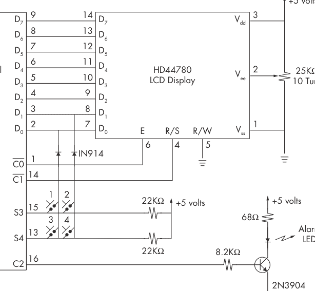

图 10-7：前面板的 Laddie 并行端口原理图。（你可能记得，第一个并行端口用于报警系统传感器。）我们使用并行端口的数据线用于显示屏的字符输入。并行端口的两条控制线用于寄存器选择和写脉冲（write strobe）。来自并行端口的第三条控制线控制报警 LED。两条数据线和两条状态线用于扫描四键键键盘。根据你对扫描式键键盘工作原理的理解，你可能可以将这五个区域开关添加到此原理图中，从而将所有的 Laddie 硬件放在一个并行端口上。

### HD44780 显示控制器

基于 `HD44780` 的字母数字显示器可以看作一个终端。像任何终端一样，向它写入 ASCII 字符，它就会显示。它们的8位字符集包含可打印 ASCII 字符、片假名字符集的子集以及 16 个用户定义字符。实际字符集取决于你使用的是哪个版本的 HD4478，但图 10-8 所示的 Samsung `KS0066U` 的字符集相当典型。注意，字符代码大部分与 ASCII 代码对应。例如，A 的代码是 0x41，这正是 A 的 ASCII 代码。

#### Char.code

```
000000111111
0001110011111
01010101010101
xxx0000 UURP$F ﾜｴム
xxx0001 11AB3ア7ﾌq
xxx0010 "BRbr"ｲメƒ8
xxx0011 #3CS$S@€€€
xxx0100 $4DTD.ｴﾌア
xxx0101 5SEUウ. ｵナｯｼｳ
xxx0111 &6FURﾘタｼﾀﾝｼロﾌ
xxx1000 <8HKHﾀｸﾘｰﾘｸ
xxx1001 9D9Vｲｼｴｺﾙﾌ
xxx1010 +KJZJｼｴｺﾙｲ7
xxx1011 +KCKK ｵｻﾄﾘﾌｵ
xxx1100 <L!ｲﾌｯｼﾜﾌﾒ
xxx1101 =-Mﾌｼｽﾍﾝｼｰ
xxx1110 .>Nｧｵｴﾁﾑ
xxx1111 /?0-ロｺｳﾀｼ
```

图 10-8：典型的 HD4780 字符集

### HD4780 指令集


`HD4780` 同时接受命令和字符。接口 10-9 显示了 `HD4780` 的典型指令集。初始化命令用于清除显示、开启或关闭显示，并指定接口使用八位还是四位。光标命令控制光标、光标是否可见、显示字符后显示是否移动，以及向左还是向右移动。其他命令允许你将光标移动到特定位置，并读写用户定义的字符发生器。

| | D7 | D6 | D5 | D4 | D3 | D2 | D1 | D0 |
|---|---|---|---|---|---|---|---|---|
| 清除显示 (Clear Display) | 0 | 0 | 0 | 0 | 0 | 0 | 0 | 01 |
| 显示与光标复位 (Display & Cursor Home) | 0 | 0 | 0 | 0 | 0 | 0 | 1 | x | 02 或 03 |
| 进入输入模式 (Enter Entry Mode) | 0 | 0 | 0 | 0 | 0 | 1/D | S | 04 或 07 |
| 显示开启/关闭与光标 (Display On/Off & Cursor) | 0 | 0 | 0 | 0 | 1 | U | B | 08 或 0F |
| 显示/光标移动 (Display/Cursor Shift) | 0 | 0 | 0 | 0 | 1/C | R/L | x | 10 to 1F |
| 功能设置 (Function Set) | 0 | 0 | 8/4 | 2/1 | 10/7 | x | 20 to 3F |
| 设置 CGRAM 地址 (Set CGRAM Address) | 0 | I | A | A | A | A | A | 40 to 7F |
| 设置显示地址 (Set Display Address) | 1 | I | A | A | A | A | A | 80 to FF |

图 10-9：`HD4780` 指令集

D/1 = 初始化；0 = 递减

S: 1 = 移动开启，0 = 关闭*

D: 显示开启，0 = 关闭*

U: 1 = 光标下划，0 = 关闭*

B: 1 = 光标闪烁开启，0 = 关闭*

D/C: 显示移动，0 = 光标移动

R/L: 1 = 右移，0 = 左移

8/4: 1 = 8 位接口，0 = 4 位接口

2/1: 1 = 2 行模式，0 = 1 行模式*

10/7: 1 = 5x10 点阵格式，0 = 5x7 点阵格式*

x = 不忽略

* = 初始化序列

我们对 `HD4780` 的初始化包含以下序列：

```
0x01 /* 清显示 */
0x38 /* 8位 / 2行 / 5x7字体 */
0x04 /* 移动光标 / 右移 */
0x03 /* 复位 */
0x0C /* 显示开启，无光标 */
```

我们发现，初始化之后，我们使用的唯一命令是移动光标——我们只用它将光标移动到顶行或底的第一列。

## 向 Laddie 面板发送命令和字符

如果你愿意，可以从 `HD4780` 读取状态和配置，但许多设计（包括我们的设计）将 `R/W` 线连接到地，以节省一个引脚（因为不需要控制），而且在软件中维护任何必要的状态（例如光标位置）是很容易的。

`HD4780` 有十个引脚连接微处理器：八条数据线、一个用于指定每个命令或字符的引脚 (`RS`)，以及一个告诉 `HD4780` 新数据可用的脉冲引脚 (`E`)。并行端口上的输出线直接连接到 `HD4780` 的数据引脚。


根据你对扫描式键键盘工作原理的理解，你可能可以将这五个区域开关添加到此原理图中，从而将所有的 Laddie 硬件放在一个并行端口上。

# Laddie 前面板 UI

在本章的早期章节中，我们回顾了 Laddie 前面板的需求、操作和硬件。在本节中，我们将介绍实现前面板 UI 的软件。我们将讨论分为三个领域：前面板的软件、各种前面板模拟器，以及两者共同通用的软件架构。让我们先从通用架构开始。

## UI 软件架构

前面板软件使用事件驱动的状态机。事件包括按钮按下、定时器超时以及到达的日志消息（用于指示警报系统可能发生状态变化）。程序的输出包括发送到 Laddie 守护进程的 SQL 命令、用于闪烁（或不闪烁）LED 的标志，以及显示在 LCD 上的文本。

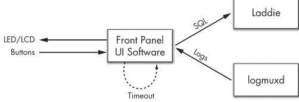

图 10-10：Laddie 前面板架构

使用了多个状态变量。主状态变量（毫无新意地命名为 `state`）指示在 LCD 上显示的信息类型：状态（status）、日志（log）或菜单（menu）。还有用于简短的“已发送命令”（Command Sent）消息的状态，以及指示程序无法打开到 ladd 进程 SQL 连接的状态。另一个状态变量 `Curcmd` 包含一个整数，指示用户在菜单中时显示的循环次数。命令（Command）按钮使 `Curcmd` 在五种可能的面板命令之间循环。`Zone` 变量存储当前命令使用的数字。`Zone` 按钮在五个可能的区域数字之间循环。

| 事件 | 状态 | Curcmd | Zones |
|---|---|---|---|

| "Display" 按钮 | Status | 清除所有警报 | 1 |
| "Command" 按钮 | Logs | 清除区域 n | 2 |
| "Zone" 按钮 | Menu | 测试区域 n | 3 |
| "Enter" 按钮 | Command Sent | 启用区域 n | 4 |
| 日志消息到达 | Unavailable | 禁用区域 n | 5 |

图 10-11：前面板菜单系统中的事件和状态

一旦你回顾了前面板的操作，处理状态和事件处理的代码就非常易读了。状态机代码实现了两次——一次使用 C 语言用于硬件和若干个模拟器（包括一个用 JavaScript 和 PHP 编写的网络端模拟器）。

## lad216

生成正确转义序列的代码在 `lad216` 程序中。该程序使用标准输入输出，因此如果你构建了上述硬件并安装了我们的 `/dev/lad_pad` 驱动，你可以通过命令将 `lad216` 程序连接到硬件：

```
lad216 <dev/lad_pad> </dev/lad_pad
```

代码位于三个文件中：包含选择循环的 `main.c`、包含状态机的 `menu.c` 以及用于在 `lad_pad` 硬件上显示输出编码的 `lad216.c`。使用标准输入输出可以方便将 `lad216` 连接到下面描述的各种前面板模拟器。

## 前面板模拟器

前面板模拟器是在不构建硬件的情况下测试前面板设计的极佳方法。随成品附带的前面板模拟器对于不想背负学习不同 UI 负担的终端用户来说非常友好。

我们有点过度了，为 Laddie 构建了多个前面板模拟器：一个使用 C 和 curses 的，一个使用 Tcl/Tk 和 X 窗口系统的，以及一个使用 JavaScript 和 HTML 的。你可以根据你偏好的编程语言选择检查哪种模拟器。

curses 用 `cur216.c` 替换了 `lad216`，它在使用 `main.c` 和 `menu.c` 文件。你可以通过启动 Laddie CD 并 telnet 进入设备来尝试 curses 前面板模拟器。`cur216` 可执行文件位于默认路径。

Tcl/Tk 版本 `x216.tcl` 基于 `lad216` 可执行文件，使用 Tcl/Tk 替换 `lad_pad` 硬件。Laddie CD 不包含 X 窗口系统，因此你无法在启动的设备上运行 `x216.tcl`。

你可以通过启动 Laddie并将浏览器指向 `http://192.168.1.11/front_panel` 来尝试基于 Web的前面板模拟器。索引文件应显示一个带有我们实际前面板硬件照片的窗口。按钮绑定到图像映射，操作方式与真实系统上的按钮相同。LED 是 LED 关闭状态的静态图像，或者是 LED 闪烁的动画 GIF 图像。LCD 的 HTML 使用 CSS 指定了相当大的等宽字体。

Web 模拟器中使用的技术非常简单，如果你以后构建自己的前面板模拟器，可能会发现它们的用处。为了说明这些技术，让我们看看 LED 图像是如何控制的。在 HTML 中，我们指定了图像的精确位置并将其命名为 `led`。

> 你可能需要设置终端类型，因为 telnet 不会为你设置。我在桌面上使用 xterm，所以当我 telnet 到 Laddie 设备时，使用命令 `export TERM=xterm` 设置终端类型。

```
<div id="led" style="position:absolute; left:27;"></</div>
```

JavaScript 代码使用 `XMLHttpRequest()` 从运行在设备上的 Web 服务器的 PHP 脚本请求警报状态。如果没有警报，返回值为零。控制 LED 图像的 JavaScript 非常直接。

```javascript
if (alarms > 0) {
  document.getElementById("led").innerHTML=" /tmp/screen
laddie:~# clear
laddie:~# cat /tmp/screen > /dev/fbo
```

第一行中使用的 `cat` 命令调用了 `open`、`read` 和 `close` 系统调用，在单独文件中复制帧缓冲区。第二行清除控制台显示。在第三行中，重定向调用了 `open`、`write` 和 `close` 系统调用，用原始内容替换控制台显示。结果可能会让人困惑，因为光标位置将不再与显示匹配（你可以用另一个 `clear` 命令来清理显示）。然而，这个实验说明了，对于 `cat` 命令来说，帧缓冲区只是另一个文件。

如果你的图形适配器有大量的视频内存，第一个 `cat` 命令可能需要一些时间（并在 `/tmp` 中产生一个大文件）。如果第一个命令（`cat /dev/fbo > /tmp/screen`）立即返回：

```
cat:/dev/fbo: No such file or directory
```

你需要使用 `mknod` 创建 `/dev/fbo` 设备文件。运行以下命令来实现：

```
laddie:~# mknod /dev/fbo c 29 0
```

如果命令 `/dev/fbo > /tmp/screen` 产生错误

```
cat: /dev/fbo: No such device
```

说明帧缓冲区设备驱动程序未成功加载。如果需要帮助设置帧缓冲区设备，再次参见附录 C。

注意：在本章的剩余部分，我们将假设你已经有一个工作正常的帧缓冲区。

为了实验像素数据与屏幕显示内容之间的关系，请尝试以下任何命令：

```
laddie:~# yes | cat > /dev/fbo
laddie:~# while [ 1 ]; do echo 01234567; | cat > /dev/fbo
laddie:~# cat /dev/urandom > /dev/fbo
```

在成功完成每个命令后（对于大型帧缓冲区这可能需要一段时间），你应该看到错误：

```
cat: write error: No space left on device
```

你之所以看到这个错误，是因为你正试图将无限的位 `cat` 到有限的内存中。每个实验后，输入恢复控制台的命令。

## 使用 ioctl 命令配置帧缓冲区

在之前的实验中，我们在不考虑像素数据如何解释的情况下操纵了视频内存。图形硬件解释视频内存数据的方式还包括视频内存的物理地址、屏幕分辨率（虚拟和可见）、可见屏幕相对于虚拟屏幕的位置，以及本章范围之外的定时和其他信息。要访问视频模式（video mode），我们需要一个额外的系统调用 `ioctl`，它允许我们访问或修改设备的参数。

`ioctl` 系统调用接受一个设备的文件描述符和一个表示请求的整数（详情请参见 `ioctl` man 页面）。在帧缓冲区的情况下，可能的 `ioctl` 命令列在 `/usr/include/linux/fb.h` 头文件中，包括以下内容：

```
#define FBOGET_VSREENINFO 0x4600
#define FBIOUT_VSREENINFO 0x4601
#define FBOGET_FSREENINFO 0x4602
```

这两个 `ioctl` 请求允许我们检索或更新可变帧缓冲区参数，第三个允许检索固定帧缓冲区参数。可变参数汇总在以下数据结构中（省略了字段），取自 `fb.h`：


```c
struct fb_var_screeninfo {
	u32 xres;	/* visible resolution */
	u32 yres;
	u32 x_virtual;	/* virtual resolution */
	u32 y_virtual;
	u32 xoffset;	/* offset from virtual to visible */
	u32 yoffset;	/* resolution */

	u32 bits_per_pixel;	/* guess what **/
	u32 grayscale;	/* !== 0 Graylevels instead of colors **/

	struct fb_bitfield red;	/* bitfield in fb mem if true color, */
	struct fb_bitfield green;	/* else only length is significant */
	struct fb_bitfield blue;

};
```

在大多数情况下，通过标识符应该清楚此数据结构中的字段是如何与我们在第 170 页“视频内存如何工作”节中讨论的概念对应的。`fb_bitfield`结构体描述了当像素位被用于指定颜色强度时（在真彩色模式下）是如何被解释的。

对于 Laddie 设备，我们不需要修改可变帧缓冲区数据。事实上，我们使用的 VESA 驱动程序并不支持系统启动后的修改。如果你在使用非 VESA 帧缓冲区并且需要在运行时修改其配置，请考虑`fbset`工具的文档。

固定帧缓冲区配置参数由以下数据结构提供（部分已省略），同样在`fb.h`中：

```c
struct fb_fix_screeninfo {
    char id[16];                    /* identification string */
    unsigned long smem_start;      /* Start of buffer */
    u32 smem_len;                   /* Length of buffer */
    u32 type;                      /* FB_TYPE */
    u32 visual;                    /* FB_VISUAL */
    u32 line_length;               /* length of line */
    ...
};
```

我们使用的主要字段是`visual`（指定解释方式）和`line_length`（我们需要的）。最后，`ioctl`请求我们检索或更新：

```c
#define FBIGETMAP 0x4604
#define FBOPUTMAP 0x4605
```

我们在下一节将显示调映射的示例。此时，使用系统调用更新代价太大。

# 用于帧缓冲器的简单图形程序

在本章的剩余部分，我们将通过编写一个简单的程序来演示帧缓冲区接口。我们的程序`hazy_moon`将显示一个直径 240 像素的简单磁盘，从顶部的青色渐变为底部的模糊红色。我们脑海中的图像如图 11-7 所示。我们的程序将演示调映射的使用，并直观地显示我们是否正确配置了帧缓冲区。


图 11-7：模糊月

程序的源码位于 Laddie CD 的`/Code/src/examples/hazy_moon`目录。在学习本节内容之前，我们建议构建并运行该程序。启动 CD 并登录后，切换到程序目录，输入`make`，然后运行`./hazy_moon`。你应该看到中间有一个磁盘，可见屏幕周围有一圈细细青色边界。如果你没有看到所有的边界线，请尝试调整显示器的图像尺寸。返回原始虚拟终端请使用 CTRL-ALT-F1。如果图形终端的尺寸不符合预期，请在 bash 提示符输入`deallocate`命令释放未使用终端的资源，然后重新运行测试程序。

> **注意**：使用 Laddie CD 时，可以使用`vim`或`less`查看源码。如果不熟悉`vim`编辑器，请查看`man vim`。

现在我们来讨论`hazy_moon`程序的细节。第一个细节需要一些关于虚拟终端的工作知识。

# 用于图形的虚拟终端

Linux 的优势和挑战之一是它使用帧缓冲区作为文本控制台。这种帧缓冲区的使用是一个优势，因为它支持彩色文本以及各种字体和字符集。然而，这种使用方式也也带来了一个挑战：在开发帧缓冲区应用程序时，很容易被 Linux 管理控制台的机制所困扰。

例如，一个向控制台打印单行消息的程序可能会修改可见显示相对于虚拟显示的位置；结果是显示的图形发生了该该行宽的错位。或者，如果图形硬件被配置为使用调色板，且程序修改了用于显示控制台文本的颜色，打印出的消息可能会变得难以阅读甚至不可见。

出于这些原因，最好使用单独的虚拟终端进行图形显示。我们在`hazy_moon`程序中通过以下几行代码实现了这一点。

```c
#include <fcntl.h>
#include <linux/vt.h>

console_fd = open("/dev/tty", O_RDWR);
ioctl(console_fd, VT_ACTIVATE, 7);
ioctl(console_fd, VT_WAITACTIVE, 7);
```

注意，我们正在使用熟悉的`open`和`ioctl`系统调用，尽管在这种情况下它们不是针对帧缓冲区（framebuffer）的。第一个调用`console_fd = open("/dev/tty", O_RDWR)`打开控制台设备；第二个`ioctl(console_fd, VT_ACTIVATE, 7)`请求切换到虚拟终端 7；第三个`ioctl(console_fd, VT_WAITACTIVE, 7)`则等待切换完成。（我们选择终端 7 是因为我们的系统使用终端 1 到 6 作为控制台。）

## open

现在，我们在帧缓冲区设备上使用`open`系统调用，并指定设备文件为读/写模式。

```c
fb_fd = open("/dev/fb0", O_RDWR);
```

该函数在出错时返回 -1；否则，它返回一个整数描述符，我们将使用该描述符对此设备进行后续系统调用。

> 注意：`open`系统调用会返回一个应该处理的错误值。我们在这里不会讨论错误处理，但你可以通过查看`hazy_moon.c`文件的完整源代码看到我们是如何处理错误的。

## ioctl

使用帧缓冲区的描述符，我们可以通过`ioctl`调用来获取帧缓冲器的固定和变量配置数据。

```c
#include <linux/fb.h>

struct fb_fix_screeninfo fixed_info;
struct fb_var_screeninfo var_info;

ioctl(fb_fd, FBIOGET_FSCREENINFO, &fixed_info);
ioctl(fb_fd, FBIOGET_VSCREENINFO, &var_info);
```

在更新显示之前，`hazy_moon`调用了两个辅助程序来显示固定和变量数据。当你尝试调试——或仅仅理解——帧缓冲区应用程序时，这些信息非常有用。

```c
display_fb_fixed_info(&fixed_info);
display_fb_var_info(&var_info);
```

如果你之前运行过该程序，在返回启动程序的虚拟终端后会看到此输出。输出特别显示了我们的显示器分辨率为 640x480，每像素 8 位颜色，且我们的视觉类型为伪彩色（pseudocolor）。

以下代码使用辅助函数`new_fb_cmap`创建了一个新的调色板。该函数定义在随附的文件`colormap.c`中。程序随后使用`ioctl`从帧缓冲区复制当前值，并更新条目以提供从青色到深红色的渐变。最后，程序使用`ioctl`用新调色板更新帧缓冲区。


```c
#include "colormap.h"
/* 用于 new_fb_cmap() */
struct fb_cmap *new_cmap;
int entry;

fb_cmap *new_cmap = new_fb_cmap(256); /* 创建一个新的空的调色板 */
ioctl(fb_fd, FBIOETCMAP, new_cmap); /* 包含 256 个条目。 */ /* 复制当前调色板。 */
/* 用渐变填充新调色板。 */
/* 我们将完整保留前 16 种颜色供 Linux 控制台使用。 */
for(new_cmap->entry=16; entry < 256; entry++) {
    /* 从亮青色到深红色渐变。颜色值为 16 位的。 */
    new_cmap->red[entry] = 64*256;
    new_cmap->green[entry] = entry * 256 + 255;
    new_cmap->blue[entry] = entry * 256 + 255;
}

ioctl(fb_fd, FBIOUTCMAP, new_cmap);
```

## mmap

我们使用 `mmap()` 系统调用将帧缓冲区映射到程序的地址空间中。

```c
#include <sys/mman.h>
/* 用于 mmap. */
unsigned char *frame;

frame = mmap(0, fixed_info.size, PRO_READ|PRO_WRITE, MAP_SHARED, fb_fd, 0);
```

`mmap` 的第一个参数是 0，表示由 `mmap` 选择映射帧缓冲区的位置。值 `fixed_info.smem_len` 是帧缓冲区的长度。我们指定使用 `PROT_READ|PROT_WRITE` 使帧缓冲区可读可写，并使用 `MAP_SHARED` 表示内存区域的变化将传播到实际帧缓冲区。打开的帧缓冲区设备的文件描述符为 `fd`，我们指定偏移量为 0，因为我们想要映射整个帧缓冲区。

如果成功（再次提醒，查看 CD 上的源码进行错误处理），`frame` 将指向帧缓冲区内存的开始。

## 写入像素数据

现在我们已经有了调色板以及在屏幕上放置像素的方法，我们将编写一个简单的程序。

```c
/* 计算偏移量 */
visible_frame = frame + offset;

/* 绘制顶部和底部边框。 */
for(col=0; col < fixed_info.width; col++){
    visible_frame[col] = 0;
    visible_frame[(fixed_info.height-1) * fixed_info.width + col] = 0;
}

/* 绘制显示器的左右边框。 */
for(row=0; row < fixed_info.height-1; row++){
    visible_frame[row * fixed_info.width] = 0;
    visible_frame[row * fixed_info.width + fixed_info.width-1] = 0;
}

/* 在中心绘制一个正方形 */
for(row=100; row < 200; row++){
    for(col=100; col < 200; col++){
        visible_frame[row * fixed_info.width + col] = 128;
    }
}

/* 在中间绘制一个圆盘。 */
for(row=0; row < fixed_info.height; row++){
    for(col=0; col < fixed_info.width; col++){
        if((row-240)*(row-240) + (col-320)*(col-320) <= 50*50){
            visible_frame[row * fixed_info.width + col] = 255;
        }
    }
}
```

## 清理工作

此时，我们可以清理资源并退出。

```c
munmap(frame, fixed_info.size);
free(new_cmap);
```

适用于内存和存储预算紧凑的设备。如果你受到资源限制但仍想使用 X，你可能想要研究一下 TinyX，它在 `http://XFree86.org` 上被描述为“一组专为极小尺寸设计的 X 服务器家族”。关于 Xlib 的更多信息，请参阅 Adrian Nye 编写的《Xlib Programming Manual》（O'Reilly, 1994）。Wikipedia 上也有几篇关于 X 的文章，例如 `http://en.wikipedia.org/wiki/Xlib`。

图形处理的另一种方案是 SimpleMediaLayer (`SDL`)，这是一种最初为开发和移植游戏而设计的多媒体库。与 Xlib 类似，`SDL` 是跨平台的，并管理用户输入以及图形。与 Xlib 不同，`SDL` 对窗口管理仅提供极少的支持。它的内存非常小；`SDL` 的库（包括用于 TrueType 字体的 `SDL_ttf`）在剥离后约占用 330kb。

由于其简单性（我们不需要窗口支持），我们选择 `SDL` 作为 Laddie 设备的图形库，并在下一节中通过一个简单的示例来演示该库。关于 `SDL` 的更多细节，特别是关于多媒体支持，请参阅 John R. Hall 编写的《Programming Linux Games》（No Starch Press, 2001）。`SDL` 网站（`http://www.libsdl.org`）也提供了良好的 `SDL` API 文档。我们使用 `SDL_ttf` 库作为 TrueType 字体的封装，这反过来需要来自 `http://www.freetype.org` 的 Free 程序包。访问 `http://www.libsdl.org/projects/sdl_ttf` 获取文档链接。

## 使用 SDL 实现 Hello, world!

为了介绍 `SDL`，让我们通过一个简单的程序来显示 Hello, world!，监控键盘，并在按下空格键时优雅地退出（见图 11-8）。

该程序位于 Laddie CD 中；在查看细节之前，我们建议构建并运行该 CD。启动 Laddie CD，在 framebuffer UI 加载后，按 ESC 退出。


图 11-8：使用 `SDL` 显示“Hello, world!”

**注意** 确保 framebuffer 没有运行非常重要，因为它会干扰我们当前的示例。顺便提一下，如果你启动 CD 时 framebuffer UI 没有自动启动，你的 framebuffer 可能会有问题。在这种情况下，请参阅附录 C 获取帮助。framebuffer UI 的显示见图 11-10。

以 root 身份使用空密码登录，切换到 `sdl_hello` 目录，然后构建并运行程序。

```
laddie:$# cd /Code/src/examples/sdl_hello
laddie:$# make
laddie:$# ./sdl_hello
```

你应该看到图 11-8 所示的。当你按下空格键时，显示将消失，你将回到命令行提示符。在本节的剩余部分中，我们将展示如何实现 `sdl_hello` 程序。

我们的程序使用单一的 `main` 函数，并初始化 framebuffer，创建一个 `surface`（`surface` 是 `SDL` 中对矩形像素区域的术语），显示该 `surface` 并处理事件。在较早的示例中，我们不会在此处显示错误处理。请参阅 CD 中 `/Code/src/examples/sdl_hello` 目录下的 `sdl_hello` 程序源码，以获取错误处理代码示例。

### 初始化库

我们示例程序中的以下几行初始化了 `SDL` 和 `SDL_ttf` 库。

```
#include "SDL.h"
#include "SDL_ttf.h"
```

- `SDL_Init(SDL_INIT_VIDEO);`

- `TTF_Init();`

- `atexit(SDL_Quit);`

`atexit(TTF_Quit);`

`SDL` 支持多个子系统，包括 `TIMER`、`AUDIO`、`VIDEO`、`CDROM` 和 `JOYSTICK`，我们在调用 `SDL_Init()` 时选择了这些系统。为了显示文本，我们在本章使用了 `VIDEO` 子系统。我们初始化了 `SDL` 对 TrueType 字体的支持。调用 `atexit` 提供了程序退出时调用的函数（`SDL_Quit` 和 `TTF_Quit`）；它们确保 `SDL` 在程序结束时干净地退出。

### 初始化 Framebuffer

为了配置 framebuffer 的分辨率和每个像素位数，我们使用函数 `SDL_SetVideoMode`。

```
SDL_Surface* Screen;
```

- `Screen = SDL_SetVideoMode(640, 480, 0);`


- `SDL_ShowCursor(SDL_DISABLE)`;

当所需的视频模式不可用时，SDL 将对其进行仿真；然而，我们保持简单，选择了一个能与大多数图形适配器原生工作的模式：640x480，每像素 8 位。`SDL_SetVideoMode` 的最后一个参数提供了用于功能的标志位，例如是否使用视频内存或系统内存、是否支持双缓冲以及是否支持 OpenGL。对于我们的目的，默认值就足够了。返回值类型为 `SDL_Surface`。这些 surface 代表矩形像素集合，其特征是高度、宽度、像素格式、扫描长度、一个裁剪矩形，当然，还有实际的像素数据。这个 surface 是特殊的，因为它直接对应于显示的内存。但 surface 也可以表示任何图形对象，例如图像或文本。对于本章的示例，我们将从位图或通过文本创建图形对象，但也可以创建一个空 surface 然后操作其像素数据。

在设置视频模式后，我们调用 `SDL_ShowCursor` 来隐藏光标，因为我们没有使用它。

### 创建 Surface

为了创建文本，我们需要打开一个字体然后渲染它。

```
TTF_Font *HelloFont;
SDL_Surface *helloSurface;
SDL_Color helloColor = {255, 255, 255, 255}; // R, G, B, A
```

`helloFont = TTF_OpenFont("Vera.ttf", 24);`

`helloSurface = TTF_RenderSolid(helloFont, "Hello, world!", helloColor);`

### 显示 Surface

```
SDL_Rect helloRect = {150, 100, 200, 50}; // x, y, width, height */
```

- `SDL_BlitSurface(helloSurface, NULL, Screen, &helloRect);`

- `SDL_UpdateRects(Screen, 1, &helloRect);`

### 处理事件

此时，我们已经显示了 Hello, world! 信息。现在我们需要监控键盘并在按下空格键时退出。

```
enableQuit = 0;
while(!enableQuit){
    SDL_WaitEvent(&event);
    switch(event.type){
        case SDL_KEYDOWN:
            switch(event.key.keysym){
                case SDL_SPACE:
                    enableQuit = 1;
                    break;
            }
            break;
    }
}
```

这段代码可以为“Hello, world!”应用进行简化，但这种形式代表了使用 SDL 处理事件的通用方法。`SDL_WaitEvent` 挂起主线程直到事件发生。

### 变量具有联合体类型，对应于十多种 SDL 事件，包括键盘、鼠标和用户定义事件。SDL 区分区分按下和释放。在键盘事件的情况下，我们可以通过 `event.key.keysym` 字段捕获特定的键，该字段可以取 `SDL_SPACE`、`SDL_TAB`、`SDL_0`、`SDL_a` 等值。

## 图形 UI 工具包

虽然 API 比 framebuffer 接口更容易使用，但它本身并不是开发 GUI 的方便库。SDL 支持事件处理和图形，但它们之间是松耦合的。在构建 GUI 时，我们使用显示和输入机制内在关联的对象。示例包括滚动条、下拉菜单和文本输入框。

表单 GUI 工具包通过提供这些对象（部件）的集合来支持 GUI 开发。图 11-9 展示了部件、用户与底层应用程序之间的关系。

用户输入

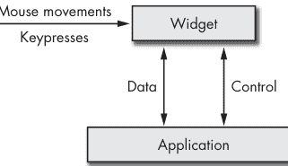

图 11-9：一个典型的全功能部件

用户输入事件（例如鼠标移动或按键）通过启动回调函数来更新部件并控制底层应用程序。应用程序可以通过调用部件函数来控制部件或与其交换数据。

除了提供部件外，GUI 工具包还提供了一个管理它们的框架。该框架通常构建在窗口管理器之上。它路由事件，确定哪个小部件拥有焦点，并确保重叠的小部件得到恰当显示。

Linux 最流行的 GUI 工具包是 GTK+(http://www.gtk.org) 和 Qt (http://www.trolltech.com)；如果你选择其中之一，你的决定可能取决于成本和许可。GTK+ 在更宽松的 LGPL 许可证下发布，允许你将专有软件链接到 GTK+。库可能根据 GPL 获得许可，但这要求你的应用程序也根据 GPL 发布。若要在 Qt 之上构建专有应用程序，你需要向 Trolltech 支付商业许可。

如果你的应用程序根据 GPL 许可，或者金钱不是问题，还有其他差异需要考虑。GTK 是用 C 语言编写的，尽管它具有许多面向对象的特性。Qt 用 C++ 编写。两者都拥有更广泛的用户群：GTK 是 Gnome 桌面的基础，而 Qt 是 KDE 桌面的基础。

在你的设备没有使用 X 的情况下，Qt 也支持 Linux 帧缓冲区（framebuffer）。针对 GTK+ DirectFB 已经做了帧后端的工作，它也在 LGPL 下发布。更多信息请参见 http://www.directfb.org/wiki/index.php/Projects/GTK_on_DirectFB。

Light Toolkit (FLTK; http://www.fltk.org) 如果你想要比 GTK+ 更小的占用但仍然愿意采用 X，那么它是免费 GUI 工具包的一个很有前景的选择。FLTK 是为紧凑的静态链接应用程序设计的，其修改后的 LGPL 许可证允许在专有应用程序中进行静态链接。它用 C++ 编写，除 Linux 外还支持 Windows。

我们不再进一步讨论这些流行的 GUI 工具包；它们在其他地方有详尽的记录.¹¹事实上，对于 Laddie 设备，我们发现这些工具包提供了许多不需要的功能，而且由于它们面向鼠标和键盘，它们显然不匹配我们使用简单手持遥控器的方法。在本节的剩余部分，我们将描述 stbmenu，这是一个构建在 SDL 之上的薄层，我们开发它时考虑了机盒式接口。

## 使用 StBmenu 构建 UI

除了使用能够与遥控器自然协作的框架外，编写自己的 GUI 工具包还有两个优势。我们认为这对于说明 GUI 工具包如何工作很有用（包括注释在约 1,300 行，阅读并不耗时），并且根据本书的哲学，我们想看看在 UI 和底层应用程序之间可以做出多大的分离。

在本节中，我们建议快速浏览 Laddie-buffer UI，以查看 stbmenu 可以支持的类型。如第 182 页“Hello, world! with SDL”章节所示，当你启动 Laddie CD 时，它将尝试启动 Laddie 帧缓冲区 UI。如果没有启动，请参见附录 C 设置你的帧缓冲区。如果你已经在运行 CD 并有了命令提示符，请使用 `start` 命令启动帧缓冲区 UI。如果 UI 已经在运行但不可见，使用 `CTRL-ALT-F7` 切换到虚拟终端。

Laddie 帧缓冲区由两个页面组成，如图 11-10 所示。我们将在下一节讨论遥控；使用方向键导航 UI 并使用 `ENTER` 键激活选择。使用 Setup 和 Status 按钮在页面之间切换。当你做出更改时，使用 `CTRL-ALT-F1` 切换到命令提示符，并使用第 9 章描述的 `cli` 工具检查结果。使用 `cli` 工具进行更改，并通过通过 `CTRL-ALT-F7` 回到帧缓冲区 UI 来确认这些更改。（或者，你可以使用网络上的另一台机器通过第 8 章描述的 Web 界面进行检查）。

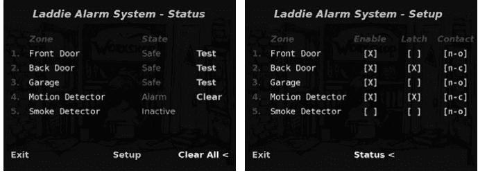

图 11-10：Laddie 帧缓冲区 UI

> ¹例如，Richard Stones、Neil Matthew 和 Alan Cox 编写的《Beginning Linux Programming》第 3 版（O'Reilly, 2004）包含一个关于 GTK+ 和 Qt 的章节。

设计帧缓冲区接口 187

## STBmenu 框架

在尝试了 Laddie 帧缓冲区 UI 后，你会注意到它与全功能 GUI 之间的某些差异。Laddie 帧缓冲区 UI 没有可以在屏幕上移动的窗口；相反，它由一系列全屏页面组成。没有可以选择屏幕上任意点的自由光标；相反，输入部件的二维几何结构决定了方向键如何移动焦点。最后，部件的输入选项是极少的：只有一个，并且

注意：在实验 stbmenu 框架时，你会发现部件在构造时就已经完全配置好了，并且只有在调用 Activate 回调时数据才会传递给应用程序。对于全功能部件，应用程序可以调用函数来更改部件的输出（例如大小或位置），但 stbmenu 使用静态指针进入应用程序来检索数据。最后，stbmenu 显示的数据类型限于整数和字符串。


由于没有用于配置 `stbmenu` 部件或设置其数据的函数，底层应用程序的开发者不需要熟悉工具包。他们需要做的是暴露显示的数据并提供适当的回调函数。

### `stbmenu` 部件

Laddie 帧缓冲区 UI 没有可以在屏幕上移动的窗口；相反，它由一系列全屏页面组成。没有可以选择屏幕上任意点的自由光标；相反，输入部件的二维几何结构决定了方向键如何移动焦点。最后，部件的输入选项是极少的：只有一个，和

（注：OCR 文本有大量重复。我将重新构建。）

## `WButtonArray(buttonArray, trackedIndex, callback, data)`

根据应用索引变量显示按钮数组中的一个按钮。激活时，将带有指定的数据调用应用程序回调函数。

## 使用 STBmenu 实现 "Hello, world!"

在本节的剩余部分中，我们将通过运行一个简单的示例来演示 STBmenu 工具包。该示例位于 Laddie CD 的 `/Code/src/examples/stb_hello` 目录下。此时，我们建议返回 Laddie CD 并编辑 Laddie 帧缓冲区 UI（如果它仍在运行，请记住使用 CTRL-ALT-F1 或 CTRL-ALT-F7 在控制台之间进行切换，并使用方向键和 ENTER 键导航帧缓冲区菜单）。然后切换到 `stb_hello` 目录，使用以下命令编译并运行示例：

```
laddie:\# cd /Code/src/examples/stb_hello
laddie:\# make
laddie:\# ./stb_hello
```

你应该能看到图 11-12 所示的显示。


图 11-12：使用 STBmenu 实现 "Hello, world!"

此示例实现了两个按钮组件。你可以通过按下键盘上的方向键来选择按钮，并可以使用 ENTER 键激活它们。当你激活 Hello 按钮时，它会在标准输出打印 Hello, world!，你可以在激活 Exit 按钮并关闭 UI 后验证这一点。

在本节的剩余部分中，我们将介绍 `stb_hello` 示例的实现过程。

使用 STBmenu 构建 UI 涉及三个步骤：

- 1. 定义监控和控制应用程序所需的任何数据结构和回调函数。
- 2. 使用指向这些数据结构和回调函数的组件构建 UI。
- 3. 使用 STBmenu 框架的方法处理事件。

我们将通过这个双按钮示例来演示这些步骤。

### 定义数据结构和回调函数

在这个简单的示例中，没有需要监控的数据。控制内容包括打印消息或退出程序，这需要一个数据项和两个回调函数。

```
int enableQuit = 0;
static void Hello(InputClass* const widget) {
    printf("Hello, world!\n");
}
```

```
static void QuitApplication(InputClass* const widget) {
    enableQuit = 1;
}
```

`Hello()`（由 Hello 按钮调用）将在控制台打印一条消息。`QuitApplication()` 回调（由 Exit 按钮调用）将把 `enableQuit` 变量设置为 1。所有组件回调函数都接收调用它们的组件指针作为参数。所有此类组件都具有 STBmenu 的 `InputClass` 类型，并可能提供对回调有用的额外数据；但我们在这里没有使用该功能。

### 构建 UI

构建 UI 的第一步是声明一个菜单对象。

```
#include "STBmenu.h"
Menu* menu = new Menu(1, 640, 480, 580);
```

这必须在声明任何其他 UI 对象之前，因为它初始化了底层的 SDL 视频上下文。我们指定了页数（1）、UI 屏幕的宽度（640）和高度（480，像素），以及每像素比特数（8）。

接下来，为菜单对象声明并附加单页。

```
#define BLACK 0x000000
Surface background(640,480,BLACK);
Page page(2, 1, background);
menu->AttachPage(0, page);
```

对于真实的 UI，我们想要更有趣的背景，但为了快速示例，我们指定了一个黑色的 640x480 像素表面。我们声明了页面，提供了行数（2）、列数（1）和背景。我们使用 `AttachPage()` 将页面附加到菜单对象，并指定页码。

我们现在可以指定按钮组件。以下是 Test 按钮的代码。

```
#define CYAN 0X0FFFF
#define YELLOW 0xFFFFFF
```

- `Font("usr/local/share/fonts/bitstream/VeraBI.ttf",42);`
- `Surface nHello(font,CYAN, "Hello");`
- `Surface Hello(font,YELLOW, "Hello");`
- `Button helloButton(nHello,Hello);`
- `WButton helloButton(helloButton,NULL,NULL);`

我们通过指定路径和字体大小声明了一个 TrueType 字体。我们使用该字体构造了两个表面：一个用于按钮未 own时（即未聚焦）的青色文本，另一个用于按钮被选中时的黄色文本和符号。我们从两个表面构造了一个按钮，并指定了第一个表面为焦点。最后，我们构造了一个按钮组件，指定了按钮、回调以及该回调可能需要的任何数据（在这种情况下为 `NULL`）。

构造按钮组件后，我们将其附加到页面。

```
page.AttachWidget(0, 0, 250, helloButton);
```

回想我们声明该页面有两个行一列。在附加组件时，我们指定了它们在页面内的行（0）和列（0），以及它们的绝对 x (250) 和 y (200) 像素位置。行和列将决定上、下、左、右光标输入如何选择各种按钮组件。

Exit 按钮的构造和附加方式与 Hello 组件类似。你可以在 `/Code/src/examples/stb_hello` 的 CD 中查看示例代码。

在构造好菜单、页面和组件后，我们现在可以显示菜单。

- `menu->setCursor(0, 0, 0);`
- `menu->DisplayCurrentPage();`

在这里，`SetCursor()` 方法指定了初始高亮组件的页、行和列。在当前情况下，这是 Hello 按钮。`DisplayCurrentPage()` 方法产生图 11-12 所示的屏幕。

### 处理事件

我们程序的其余部分包含一个事件循环循环

```
enableQuit = 0;

while(!enableQuit){

  SDL_WaitEvent(&event);

switch(event.type){

```

```
case SDL_KEYDOWN:

switch(event.key.keysym.sym){

  case SDL_LEFT:

    menu->CursorLeft();

    break;

  case SDL_RIGHT:

    menu->CursorRight();

    break;

  case SDL_UP:

    menu->CursorUp();

    break;

  case SDL_DOWN:

    menu->CursorDown();

    break;

  case SDL_RETURN:

    menu->Activate();

    break;

}

break;

menu->Update();
```


当接收到方向键事件时，使用菜单的四个导航方法 `CursorLeft()`、`CursorRight()` 等来更新高亮按钮。`ENTER` 键调用 `Activate()` 方法，从而调用当前高亮按钮的回调。我们将在下一章学习如何使用红外遥控器代替键盘，但这段代码不需要更改，因为我们将使用红外接口产生 SDL 事件。

## Framebuffer UI

正如我们在上一节看到的，使用 STBmenu 的应用程序有两个义务：提供要显示的数据以及提供 UI 回调。图 11-13 展示了 Laddie 帧缓冲区是如何满足这些要求的。

在用户侧，键盘或遥控事件选择一个组件并调用 `Activate` 方法。此操作通过 RTA/PostgreSQL 协议调用应用程序的回调。在应用程序侧，`logmux` 转发 Laddie 守护进程状态已更改的事件。响应这些事件，`UpdateZone` 使用 RTA/PostgreSQL 协议更新本地守护进程数据并调用菜单的 `Update` 方法。此操作会菜单组件根据新数据进行重绘。

回想第 6 章，事件处理程序 `logmuxd` 可以配置为通过管道路由事件。我们配置 `logmuxd`（使用 `/opt/laddie/logmuxd` 目录下的过滤器 `Filter.sql` 和 `FileDest.sql`）将所有 Laddie 事件路由到管道 `/opt/laddie/fbmenu/ladderevents`。框架 UI 主线程使用 `select()` 系统调用来等待通过此管道接收的消息，然后使用告警守护进程的接口更新 `LaddZone` 结构数组。

对于我们的 UI，我们将提供几列组件来显示 `LaddZone` 报警数据。让我们只考虑 Status 状态中的 State 列。正如图 11-10 所示，这些组件显示 Inactive（未活动）、Safe（安全）或 Alarm（报警）指示，取决于每个区域的状态。如下代码所示，我们使用 `WiconArray` 组件来显示报警状态。

```
SurfaceInactive(statefont,INACTIVE_COLOR,"Inactive")

Surface stateSafe(statefont,SAFE_COLOR, "Safe")

SurfacestateAlarm(statefont,ALARM_COLOR, "Alarm")
```

```
SurfaceArrayAlarm(3, &stateInactive,&stateSafe,&stateAlarm);
```


```
- WiconArray wAlarmState(alarmState,(int*)&laddZones[0].state)
- WiconArray wAlarmStates(alarmState,(int*)&laddZones[1].state)
- WiconArray wAlarmStates(alarmState,(int*)&laddZones[2].state)
- WiconArray wAlarmStates(alarmState,(int*)&laddZones[3].state)
- WiconArray wAlarmStates(alarmState,(int*)&laddZones[4].state).
```

在这里我们声明了三个三个报警状态的表面，带有相应的颜色。我们将这些表面组成一个 `SurfaceArray` 并使用它构建报警状态组件。通过在应用程序接口的本地结构中声明指向整数值的指针。注意 `alarmState` 表面的顺序对应 `LaddZones[n].state` 的可能值。

为了完成此 UI，我们需要定义额外的组件来显示 `LaddZone` 报警中的剩余数据，并在适当的情况下通过回调与 Laddie 报警守护进程进行路由。在“Hello, world!”示例中，我们还必须将组件附加到页面，并将页面附加到主菜单。我们已经讨论过如何切换页面。STbMenu 框架使用 `SetCursor` 函数来选择页面和光标位置。我们通过在每个页面上提供带有回调的按钮来切换到相反的页面。

Laddie 框架 UI 的事件处理程序与 stb_hello 示例略有不同。它不是等待 SDL 事件，而是使用 `select` 调用等待来自 logmuxd 的 Laddie 守护进程事件。它使用 100 毫秒的超时，当完成或超时时，它使用函数 `SDL_PollEvent` 检查按键。在 stb_hello 示例中，我们只需要五个输入，因此我们监控并响应键和 ENTER 键。在下一章中，我们将看到如何使用手持遥控器控制此 UI。

对于省略的细节，请查看 Laddie CD 中 `/Code/src/fbmenu` 目录下的代码。STBmenu 的代码包含在 `/Code/src/stbmenu`。

# 总结

如图 11-14 所示，构建器具的 GUI 需要几层。

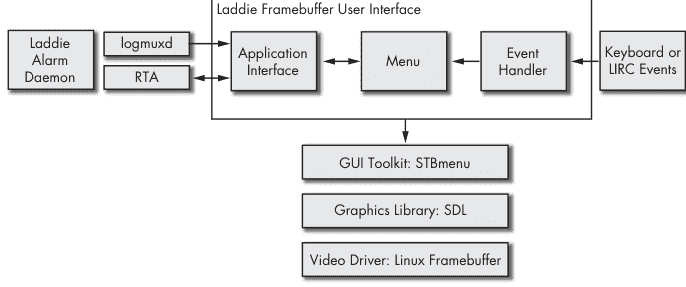

图 11-14：Laddie 帧 UI 和图形栈

Linux 帧缓冲区驱动程序提供了视频硬件的抽象，便于配置视频模式和操作像素内存。有可以使用此设备驱动程序的各种图形库，这些库提供了操作图形对象和文本的支持。这些库通常也提供事件处理的支持。我们选择为 Laddie 器具使用 Simple DirectMedia Layer，因为它支持良好、文档齐全且轻量级。GUI 工具包提供了下一层；它们提供并管理组件，组件的输入事件和图形显示是紧耦合的。对于该器具，我们开发了一个轻量 GUI 工具包 STBmenu，旨在用于简单的手持遥控器，并便于以很少额外精力为现有应用程序添加 GUI 层。为了支持最后一点，我们还展示了如何使用 RTA/PostgreSQL 协议和 logmux 处理程序将 Laddie 帧 UI 连接到告警守护进程。在下一章中，我们将通过添加对远程控制的支持来完成 Laddie 帧 UI。

## 12 红外遥控


遥控器已成为我们控制某些器具最自然的方式，如果你像我们一样，偶尔会花几分钟时间尝试寻找遥控器，而不是尝试操作某些设备晦涩的前面板。在未来，我们预计看到更多器具完全放弃前面板，转而采用简单遥控器的按键。这是一个经验法则。如果你正在构建一种人们坐在沙发上时可以享受的器具，请包含一个遥控器。

在本章中，我们将涵盖以下主题：

- 与红外光通信
- 遥控接收器的硬件
- 为 Laddie 器具安装和配置 LIRC

# 与红外光通信

红外光（IR）是一种电磁辐射，波长略大于可见光。它被用于远程通信是因为组件廉价且易于实现。大多数遥控器使用红外 LED，以模式脉冲来表示二进制数据。器具上的接收器随后检测这些脉冲并将其转换回电信号。

对于 Laddie，我们使用一个连接到 GPIO 引的简单红外接收器。接收器在检测到红外光时输出低电平，在未检测到时输出高电平。我们使用计时器测量脉冲持续时间并解码数据。

# 遥控接收器的硬件

遥控接收器的硬件由红外接收二极管、放大器和过滤器组成。红外接收二极管是一种光电二极管，红外光照射时产生电流。放大器增加信号强度以便微控制器检测。过滤器消除环境光干扰。

# 为 Laddie 器具安装和配置 LIRC

为了在 Laddie 上使用红外控制，我们使用 LIRC（Linux 红外遥控）。LIRC 是一个软件库，允许我们与各种红外接收器接口。我们将展示如何安装 LIRC 并为 Laddie 器具配置它。

# 命令编码协议

有很多种遥控协议，每种协议都代表了一系列工程权衡。例如，松下的的 REC-800 协议使用等宽脉冲，并通过脉冲长度编码 0 和 1。

大多数协议使用以下结构：

- 头部：告诉接收器消息开始的序列。
- 数据：发送的实际命令。
- 校验和：用于确保数据接收正确的代码。

我们将使用的协议是 NEC 协议，它在消费电子中非常常见。NEC 协议使用 32 位头部和 32 位数据。头部由一个长脉冲加一个短脉冲组成。数据逐位发送，每个 0 由一个短脉冲加一个长脉冲表示，每个 1 由一个长脉冲加一个短脉冲表示。校验和是数据的按位取反。

脉冲之间。这种方法可以延长电池寿命，因为它最大限度地减少了遥控器发射光的时间。其他协议通过在按住按钮时发送简短的“重复”（Repeat）命令来节省电池，而不是像索尼电视协议那样反复传输整个命令。

**注意** 若要了解其中一些其他协议，请访问 http://sbprojects.com/knowledge/ir/ir.htm。

## 通过调制红外信号减少干扰

到目前为止，我们一直把红外脉冲处理成相当于稳定的光束。但考虑图 12-2，假设某些闪烁的红外光脉冲重叠了消息中的某些间隔。显然，这种干扰可能导致接收器无法正确解释消息。解决方案是对红外脉冲进行调制。在调制脉冲中，红外光实际上是以固定频率开启和关闭，通常在 30 到 60 kHz（千赫兹）之间。就像在拥挤的房间里分辨人声一样，接收器可以使用此频率作为特征，将目标信号与背景噪声区分开来。由于这种调制，索尼电视协议的脉冲编码零和 1 在图 12-3 中得到了更准确的描述。


图 12-3：索尼电视协议中的调制脉冲

我们测量出遥控器的调制频率约为 40 kHz。因此，对于我们的遥控器，图 12-3 中的“脉冲”实际上由 40,000 * 0.00065 = 26 个更短的脉冲组成。

## 使用红外光控制电器

现在我们已经看到红外光可以传递信息，我们就可以设计一个用于实现电器遥控控制的系统。图 12-4 所示了这样一个系统。

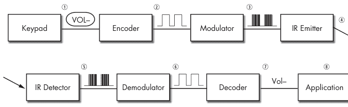

图 12-4：完整的遥控系统

第 12 章 200

在发射端，典型的手持遥控器执行以下步骤：

1. 它扫描*键盘*。
2. 它根据某些协议将输入*编码*为波形。
3. 它用 30 kHz 到 60 kHz 之间的频率对该编码进行*调制*。
4. 它*发射*红外光的辐射图案。

在接收端，典型的红外接收器执行以下阶段：

5. 红外*探测器*将输入信号转换为电压波形。
6. *解调器*去除 30 到 60 kHz 的调制。
7. *解码器*分析此波形并确定相应的命令。
8. *应用程序*对该输入做出恰当响应。

## 遥控控制的硬件

在这一节中，我们将关注红外接收器硬件。设计遥控发射器超出了本章的范围，但我们的建议是采用我们处理 Laddie 电器时相同的方法：使用现成的通用遥控器。

## 检测和调制红外信号

检测和调制红外输入的两个阶段可以由单一的商业现成组件处理。图 12-5 显示了该部件的三个示例，均由夏普微电子（Sharp Microelectronics）生产。

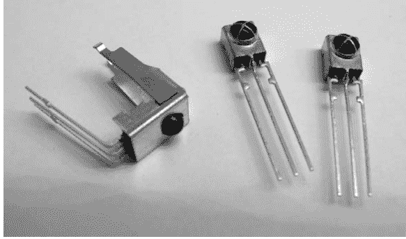

图 12-5：红外探测器/解调器

对于 Laddie 电器，我们选择了夏普 GP1UV70QS 系列中的 40 kHz 单元（图 12-5 右侧）。Vishay 的 TSOP17XX 系列也很流行。这些部件易于与孔板或无源面包板原型材料配合。每个单元都需要 5V 电源，并提供对应于调制后红外波形的输出（图 12-4 中的步骤 6）。在评估设备时，请确保调制频率适用于你选择的协议。对于低功耗应用，你还需要比较不同设备的功耗需求。

这些设备没有统一命名法。当你搜索信息时，可能会看到如“红外遥控接收器”、“遥控光电模块”或“遥控红外检测单元”之类的名称。在本章的剩余部分，我们将它们称为“红外探测器/解调器”，以强调它们提供的两个功能。

## 构建一个简单的红外探测器

如果你可以使用示波器并想在遥控信号被解调之前查看它，你可以构建图 12-6 所示的简单红外探测器电路。你只需要一个电源（9V 电池即可）、一个阻值合适的电阻和一个光电晶极管。


图 12-6：简单的红外探测器

你可能需要选择一个电阻，使得当遥控器关闭时，输出电压约为电源电压的一半。当我们尝试这样做时，使用了一个 100K 电阻，并让遥控器非常靠近探测器。我们使用 Radio Shack 的红外光电晶极管时得到了良好的结果。

## 解码控制波形

在上一节中，我们介绍了用于解码波形的现成设备。解码波形的第三种方法因为其硬件要求简单而吸引人。硬件需要做的只是提供一个红外探测器/解调器，并将信号作为输入提供电器的。在负面方面，这种方法对处理器提出了额外要求。具体来说，每当输入变为高电平时，处理器必须响应中断。尽管如此，由于硬件要求简单，我们为 Laddie 电器选择了这种方法。在下一节中，我们将介绍构建这种接收器的细节。

## Laddie 电器的红外遥控硬件

如果你不擅长构建硬件，你可能会寻找一位擅长的朋友，或者——这是我们的建议——亲自己尝试构建。这是一个很好的入门项目，也是很有成就感的，因为它为你的 Linux 项目提供了新的控制模式。

为了将我们的简单红外接收器与电器集成，我们需要两样东西：用于探测器/解调器的电源和一个能产生中断的输入。好消息是串口提供了足够的功率，且串口引脚数据载波检测（DCD）引脚可以中断。坏消息是，串口输出电压在正侧范围为 3.7V 到 12V，负侧范围为 -3.7V 到 -12V。此外，串口输入需要在这些相同的正负范围之间进行摆动。然而，红外探测器期望的是干净的 5V 电源（部分部件为 3.3V）；它输出 0V 到 5V 的信号（部分部件为 0V 到 3.3V）。因此，如果你想使用串口输入，将需要额外的电路来为检测器提供所需的电压，并将检测器的输出转换为有效的串口电平水平。图 12-9 展示了这种电路。

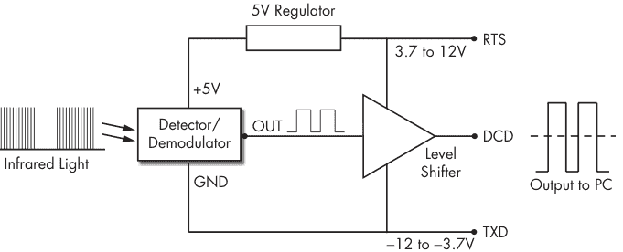

图 12-9：简单红外接收器的框图

我们假设串口已经配置为，将请求发送（Request to Send，RTS）输出保持在高电平水平，并将传输数据（TXD）输出保持在低电平水平。5V 稳压器提供检测器所需的电压。电平转换器（level shifter）为 DCD 输入提供正确的电平水平。

如果你查看在网络上介绍的红外接收器电路，你会发现某些电路采用了更简单的方法，省略了电平转换器，并提供一个在 0V 和 5V 之间摆动的输出。这可能对你的电脑上有效。如果无效，或者你想要一个更健壮的解决方案，可以使用我们在这里选择的方法。

图 12-10 显示了 Laddie 红外接收器的原理图。

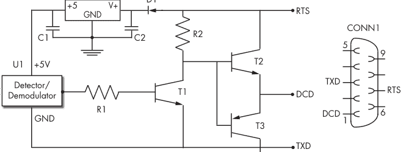

图 12-10：用于 Laddie 设备的红外接收器原理图

其中，U1 是一款现成的红外检测器/解调器，U2 是一个线性电压稳压器，为 U1 提供 5V 电压，而晶体管/电阻电路是电平转换器，提供适合串口的输出。二极管 D1 负责在 RTS 信号初始化不当时保护电路，导致其相对于 TXD 变为负值。

红外遥控器 205

# 表 12-2：Laddie 设备红外接收器部件

| 引用符号 | 费用 | 描述 |
|---|---|---|
| U1 | Sharp GP1UV701QS, GP1UV70QS, GP1UV700QS | $1.50 | 红外检测器/解调器 |
| U2 | LM7805, LP2950CZ5 | $0.80 | 5V 线性电压稳压器 |
| C1 | 0.47 uf 或更高 | $0.15 | 电解电 |
| C2 | 0.47 uf 或更高 | $0.15 | 电解电 |
| D1 | 1N4148, BAT46 | $0.35 | 二极管 |
| R1 | 220K, 1/4 瓦 | $0.06 | 电阻 |
| R2 | 100K, 1/4 瓦 | $0.06 | 电阻 |
| T1, T2 | PN2222A, 2N3904 | $0.20 | NPN 晶体管 |
| T3 | PN2907A, 2N3906 | $0.20 | PNP 晶体管 |
| CONN1 | DB9 socket | $0.50 | 9针 d-sub 串口连接器，母头 |

这可能导致其相对于 TXD 变为负值。表 12-2 提供了我们使用的特定部件及其近似成本。在我们列出多个部件的地方，你可以假设它们是可以互换的。通过在 Digi-Key (http://www.digikey.com) 和 Jameco Electronics (http://www.jameco.com) 之间寻找，你不应该在使用部件上感到困难。

图 12-1 显示了我们的几个原型。我们建议从免焊接面包板和 22 AWG 导线（单股线）开始，如左图所示。你还需要一个用于 22 AWG 导线的剥线器和一个用于调试的电压表。你唯一需要使用电烙铁的地方是将导线连接到 DB9 串口连接器。在左图中，来自 DB9 连接器的两根线为面包板边缘的接线条提供电源和地线。第三根线通过串口线将 DCD 信号传回计算机。

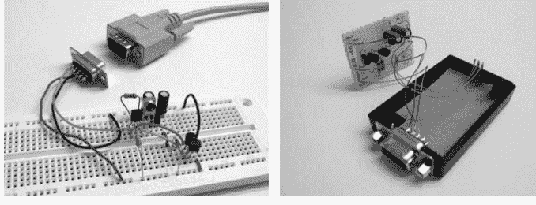

图 12-11：两个红外接收器原型

一旦你有了可以工作的电路，你就可以使用洞板和塑料外壳构建一个更永久的设备。在右图中，只显示了外壳的一侧。我们在一侧钻了一个孔用于安装检测器/解调器，并在另一侧开了一个孔用于安装 DB9 连接器。一块纸板固定了检测器/解调器。

在构建原型时，请遵循以下步骤，以确保电路正常运行：

- 构建电路，但不要连接串口或检测器-解调器。使用 5V 稳压器代替 RTS 和 TXD 引脚。使用正极代替 RTS，使用负极代替 TXD 输出。
- 验证稳压器输出与负极之间的电压为 5V。
- 验证电路输出与负极之间的电压为 0V（电路输出是你稍后将连接到串口 DCD 引脚的点）。
- 现在将 R1 的一端连接到稳压器的 5V 输出，并验证电路输出与负极之间的电压为 0V。
- 现在连接检测器-解调器，并连接串口。

# 安装 LIRC 软件

LIRC 允许你解码并发送许多（但不是所有）常用遥控器的 LIRC 信号。图 12-10 显示了 Laddie 红外接收器的原理图。二极管 D1 负责在 RTS 信号初始化不当红外遥控器 205

在我们深入细节之前，让我们先进行一个快速的自下而上的巡检，并解释 LIRC 接收器如何控制 Laddie 设备的帧缓冲区 UI（该内容在第 11 章中有所描述）。IR 接收器外部硬件将遥控波形提供给串口的 DCD 引脚。在内核空间中，`lirc_serial` 设备驱动（LIRC 软件包包含的多个驱动之一）监控此引脚，并从设备文件 `/dev/lirc` 产生来自定时数据的二进制流。在用户空间中，`lird` 守护进程管理来自 `/dev/lirc` 设备文件的定时数据，以便在 Unix 套接字 `/dev/lirc` 上提供一系列命令字符串。帧缓冲区直接连接到此套接字以响应用户输入。

现在来介绍我们之前省略的所有细节。在本节的剩余部分中，我们将更仔细地观察 LIRC 软件架构的每一层。

## 配置 lirc_serial 内核设备驱动

`lirc_serial` 设备驱动实际上由两个内核模块实现：`lirc_serial.ko` 和 `lirc_dev.ko`，在我们安装软件时，它们被存放在 `/lib/modules/2.6.10/misc/` 目录下。为了使用这些模块，我们必须执行三个额外的步骤：释放串口、创建设备文件并将模块加载到内核。我们创建了一个启动脚本 `lirc` 来执行这些步骤。我们在这里回顾这些步骤；你可以在光盘的 `/etc/rc.d/init.d` 中查看完整代码。

## 释放串口

对于 Laddie 设备的 IR 输入端口，我们选择了 COM1（`/dev/tty50`）。Linux 通常在启动时将 COM1 到 COM4 启用为串口；因此，我们需要为 LIRC 释放 COM1。为了做到这一点，我们使用了 `setserial` 命令：

```


`setserial /dev/tty50 uart none`

通过将硬件类型（UART）设置为 `none`，该命令禁用了指定的端口。

> 注意：UART 代表**通用异步收发输传输器**（Universal Asynchronous Receiver Transmitter）。UART 负责串口链路的底层实现，使得 CPU 只需要关注提供待发送的字节和处理接收到的字节即可。

在本章的剩余部分，我们建议你使用 Laddie CD 启动 Laddie 设备并跟随这些练习（ejercicios）。启动 CD 后，退出帧缓冲区 UI（按 ESC），并使用空密码登录 root。在 `laddie:~` 提示符下执行以下命令，以验证端口 COM1 是否已正确配置：

```
laddie:~# setserial /dev/tty50
```

你应该能看到以下输出：

```
/dev/ttySO, UART: unknown, Port: 0x03f8, IRQ: 4
```

UART 类型为未知（unknown），这意味着该端口是可用的。

## 创建设备文件

你可能记得在上一章中使用设备文件 `/dev/fb0` 来暴露帧缓冲区功能。同样，我们必须提供一个设备文件来暴露 `dev/lirc_serial` 功能。以下代码创建了主设备号为 61、从设备号为 0 的字符设备文件 `/dev/lirc`，这符合 lirc 驱动的要求。

```
mknod /dev/lirc c 61 0
```

使用 Laddie CD，通过以下命令验证 `/dev/lirc` 设备文件是否存在：

```
laddie:~# ls -1 /dev/lirc
```

你应该能看到如下输出：

| crw------| 1 root root 61, 2007-01-27 08:03 /dev/lirc |

这表示该文件代表一个字符设备，它 ① 对 root 可读写，② 主设备号为 61，且 ③ 从设备号为 0。

## 将 lirc_serial 模块加载到内核

在串口可用且设备文件就绪后，我们能够使用 `modprobe` 命令加载 `lirc_serial` 设备驱动：

```
modprobe lirc_serial
```

要验证 `lirc_serial` 设备驱动已加载，请执行操作：

```
laddie:~# lsmod grep lirc
```

你应该能看到类似这样的输出：

| lirc_serial 13152 1 |
| lirc_dev 14804 1 lirc_serial |

第一列显示已加载的模块；第四列显示依赖关系。在这里我们看到 ① `lirc_serial` 模块依赖于 ② `lirc_dev` 模块。

如果我们想为接收器使用不同的端口 COM1，我们将通过 `modprobe` 命令为 `lirc_serial` 驱动提供额外的参数。要指定 COM2，我们将使用命令 `modprobe lirc_serial irq=3 io=0xf8`。COM3 和 COM4 的默认 irq 和 io 值分别为 (4, 0x3f8) 和 (3, 0xe28)。

## 测试 lirc_serial

现在我们已经验证 `lirc_serial` 驱动已加载，我们使用 Laddie CD 来测试 IR 接收器硬件。我们首先回顾一下想要测试的内容。记得我们的 LIRC 接收器提供的信号如图 12-14 所示（至少在索尼电视音量命令的情况下）。


`lirc_serial` 内核驱动的作用是测量该信号中间隙（spaces）和脉冲（pulses）的定时。这里显示的波形符合该协议。`lirc_serial` 内核驱动负责测量此信号中的间隙和脉冲定时。此处波形符合该协议。驱动包含一个中断处理程序，每当 DCD 发生变化时就会调用它。驱动使用定时器测量间隙和脉冲，然后通过 `/dev/lirc` 文件发射这些信息。在每个字中，第 0 到 23 位指定间隙，第 24 位是脉冲，第 25 到 31 位为 0。驱动设计为处理任何协议，但这里是 Sony 协议。为了测试 `lirc_serial` 设备驱动，我们需要在按下遥控器时产生这些脉冲。在访问 `/dev/lirc` 设备文件之前，我们需要确保它没有被其他进程占用。在 Laddie 提示符下执行以下命令：

```
laddie:~# laddie stop

laddie~# kill $(pidof lirc)
```

第一个命令后，我们需要等待 Laddie 停止。在第二个命令中，`pidof` 函数提供进程 ID，`$(...)` 结构为 `kill` 命令提供参数，从而终止该进程。我们现在可以访问 `/dev/lirc` 文件进行测试。正如我们在上一章中所看到的，我们可以使用 `cat` 命令访问输出。我们不想直接将 `/dev/lirc` 的输出传到控制台，因为某些输出会被解释为控制字符，导致控制台进入异常状态。一种方法是将输出管道给 `hex` 工具，它会将二进制数据转换为十六进制。输入以下命令：

```
laddie:~# cat /dev/lirc | hexdump
```

现在，DCD 引脚上的任何脉冲都会被 `lirc_serial` 驱动测量，通过 `cat` 命令驱动 `/dev/lirc` 文件，并通过 `hexdump` 以十六进制显示。为了产生此类脉冲，将 IR 接收器连接到 COM1 端口，将遥控器指向 IR 检测器/解调器并按下按钮。如果一切正常，你应该看到如下输出：

```
000000 df67 0091 011b 0000 04f6 0100

000010 0216 0000 04d4 01f0 0000 026e 0100

000020 02d3 0000 028a 01f0 0000 04f7 0100

000030 01f0 0000 02a1 01f0 0000 02a0 0100

000040 01f0 0000 04fc 01f0 0000 02a0 0100

000050 01f0 0000 0283 0118 0000 0289 0100
```

这就是我们通过短按下为索尼电视编程的通用遥控器上的音量键产生的输出。

幸运的是，LIRC 软件包包含一个名为 `mode2` 的工具，它可以理解 `lirc_serial` 驱动的输出并将其显示为脉冲和间隙计时数据。

按下 CTRL-C 终止上一个命令，并执行以下命令：

```
laddie:# mode2
```

现在按下按钮的同时将红外遥控器指向接收器。`mode2` 命令读取 `/dev/lirc` 的输出，解析 23 位计时数据和 1 位脉冲或间隙指示，并产生一系列脉冲和间隙计时信息。例如，当我们用单个 TV 音量命令刺激红外接收器时，我们观察到了以下间隙和脉冲计时序列。

```
laddie:-# mode2 space 5668 pulse 1265

space 5794213 pulse 663 space 517

pulse 2471 space 494 space 663

space 496 space 1260 space 516

pulse 1282 space 497 pulse 633

space 546 pulse 685 space 546

pulse 1263 space 518 space 639

space 517 space 661 space 496

pulse 611 space 515 space 682
```


如果你参考第 198 页上的“遥控命令编码协议”，你会注意到这些计时值比理想波形所示的噪声更大。第一个脉冲约为 2500 毫秒，对应于头部。其他脉冲约为 1300 或 650 毫秒，分别对应 1 和 0。间隙约为 500 毫秒，但较大的初始值对应于按键之间的时间。`lired` 守护进程的任务是拒绝不对应有效波形的脉冲，并正确解释有效的脉冲。完成对 `mode2` 的实验后，按下 `CTRL-C` 终止该工具。

此时，我们已经确定 `lirc_serial` 设备驱动程序就是 `lired` 守护进程。在下一节中，我们将提供配置 `lired` 守护进程的说明，它将使用该设备驱动程序的输出。

如果你想编写一个直接使用 `lirc_serial` 设备驱动输出的程序，`mode2` 工具的源代码提供了如何访问 `/dev/lirc` 设备文件的示例。该源代码可以在 http://www.lirc.org 获取，也包含在本书附 CD `/usr/src/packages/` 目录下的 `lirc-0.8.1.tar.bz` 压缩包中。

# 第 12 章

## 配置 lirc 守护进程

LIRC 软件包中最智能的部分是 `lirc` 守护进程。这部分分析来自 `/dev/lirc` 设备文件的带噪声计时值，并产生一系列易于下游 LIRC 工具或用户应用程序解析的命令。

为了让 `lirc` 守护进程解释来自 `/dev/lirc` 的计时数据，它必须理解遥控协议。配置文件 `/etc/lirc.conf` 捕获了这些协议信息。以下是 Laddie 设备使用的 `lirc.conf` 文件，为了节省空间删除了注释和部分条目。

```
begin remote

name        SONY-TV

bits        12

flags       SPACE_ENC

eps         30

aeps        100

header      2457 525

one         1269 520

zero        650 520

gap         26076

toggle_bit  0

begin codes

POWER       0xA90

ENTER       0xD10

VOL-        0xC90

VOL+        0x490

CH-         0xB90

CH+         0x090

end codes

end remote
```

使用 LIRC 时不需要理解此文件中的条目，我们会在这里做一些注释，以防你想手动编辑文件。`name` 可以是任何描述遥控器的字符串。`bits` 字段是数据位总数（在本例中为命令代码位加地址位）。`eps` 和 `aeps` 字段代表相对和绝对误差容差（在本例中为 30% 和 100 微秒）。`header`、`one` 和 `zero` 字段代表脉冲计时（微秒）和数据位。重复命令之间有约 26,000 微秒的间隙（`gap`），且 `toggle_bit` 反映了重复命令的实际计时，可能与协议标准有所不同。`codes` 是各种命令的实际数据序列。对于适用于其他遥控器的额外字段，你可以在 WinLIRC 网页 http://winlirc.sourceforge.net/technicaldetails.html 查看详情。

如果你有一个使用你所示协议的遥控器，你应该能够在不更新 `/etc/lirc.conf` 文件的情况下控制 Laddie 设备。（再次，我们使用的是 RCA RCU410 通用遥控器，设置为索尼电视，代码为 002）。LIRC 网站也提供了许多遥控器的配置文件，但使用 LIRC 的 `record` 工具可以轻松从头生成这些文件。`record` 工具通过监控 `/dev/lirc` 的输出并提示用户输入遥控内容来创建配置文件。

现在为你的遥控器创建一个配置文件。正如我们在测试 `lirc_serial` 设备驱动时提到的，`mode2` 工具的源代码提供了如何访问 `/dev/lirc` 设备文件的示例。

该程序位于 CD 中的 `/Code/src/examples/socket_cat.c`。请使用以下命令编译并运行该程序：

```
laddie:## cd /Code/src/examples/socket_cat

laddie:## make

laddie:# ./socket_cat /dev/lircd
```

然后在你的遥控器上按下几个按钮。你应该能看到类似下面的输出。

```
0000000000c90 00 VOL- /etc/lircd.conf

0000000000d90 00 VOL+ /etc/lircd.conf

0000000000b90 00 CH- /etc/lircd.conf

0000000000b90 00 CH+ /etc/lircd.conf

0000000000a90 00 POWER /etc/lircd.conf

0000000000a90 01 POWER /etc/lircd.conf

0000000000a90 02 POWER /etc/lircd.conf
```


每个字符串包含一个 16 位的十六进制命令代码、一个十六进制重复计数、一个命令字符串以及遥控器的名称（默认为 lirc 配置文件的名称）。注意，在此序列的末尾，当按住 `POWER` 按钮时，重复计数会增加。

这 16 位的命令代码通常没有用，除非通过命令和遥控器的名称捕获了释放信息。注意，观察命令代码如何与输入 `<unused123>` 对应很有趣。例如，`0bc90` 是我们在第 198 页的《遥控器命令编码协议》中提到的索尼（Sony）电视音量命令（Volume-command-for-Sony-TV-Volume-command）命令波形中 12 位（从左到右）的十六进制表示。当你完成 `socket_cat` 后，按下 `CTRL-C` 终止程序。

> 当按下遥控器按钮时，取决于协议的不同，命令可能会重复得很快。对于 Laddie 帧缓冲区 UI，我们利用输出相关的重复计数来忽略与每次按下相关的第一个命令以外的所有命令。

# 用于应用程序的 LIRC 工具

正如你在上一节所示，编写一个通过 `/dev/lircd` 套接字响应遥控器命令的程序是简单的。但如果你想用遥控器控制一个已经存在的程序，而该程序最初是为键盘输入而不是遥控器输入设计的呢？LIRC 包通过这些工具连接到 `/dev/lirc` 套接字并产生许多程序预期的输出来解决这些需求。

`icat` 工具是一个很好的例子，因为它最简单；当按下遥控器按钮时，它会在标准输出打印用户指定的、以换行符分隔的字符串。如果你有一个从标准输入接收命令的程序，可以通过 LIRC 将 `icat` 的输出管道到你的程序来控制它。要将遥控器映射到适当的输出，请配置 `/etc/lirerc` 文件。LIRC 包提供的 HTML 文档提供了有关该文件格式的详细信息。

同样，LIRC 包还提供了用于模拟键盘输入的 `irpty` 工具、用于调用系统调用的 `irex` 工具，以及用于生成 X 事件（用于运行 X 的系统）的 `irevent` 工具。再次，这些操作根据这些工具使用的 `/etc/lirerc` 文件映射到遥控器。这些工具使用一个 API 调用 `lirc_client` 库以访问 `/dev/lirc` 套接字。`cat` 工具的源代码提供了如何使用此库的简单示例。

最后，LIRC 包包含一个守护进程 `lircd`，它使用遥控器套接字连接到 `/dev/lirc` 并移动事件。`/etc/lirerc` 文件指定了 X 事件（用于运行 X 的系统）如何映射到遥控器。这些工具使用一个 API 调用 `lirc_client` 库来访问 `/dev/lirc` 套接字。`cat` 工具的源代码提供了如何使用此库的简单示例。

# 控制 Laddie 应用

对于 Laddie 应用，我们安装了 LIRC 包，并像上一节描述的那样配置了 `lirc` 驱动。由于我们是从头构建 Laddie 应用的，不需要使用 `icat` 或 `irpty`；相反，我们编写了直接访问 `/dev/lirc` 代码。

正如上一章讨论，Laddie 的帧缓冲区界面构建在简单多媒体层 `SDL` 库之上。由于 `SDL` 包含了自己的按键事件处理器，因此整合遥控器非常简单。我们创建了一个独立的 `Handler()` 线程从 `/dev/lirc` 套接字读取命令，解析命令，然后将相应的按键事件推入 `SDL` 事件队列。具体来说，我们对通道 +/- 和音量 +/- 的遥控命令分别模拟了上、下、右、左方向键的 `SDL` 事件。我们用 `SDL` 回车事件响应遥控电源命令。在 Laddie 的 `SDL` 程序中，我们通过调用 Laddie 对象的命令来响应这些按键事件。这种对 `/dev/lirc` 输出控制了 Laddie 的菜单。

| /dev/lirc | Handler() | Laddie 的事件 | Laddie 的菜单 |
| :--- | :--- | :--- | :--- |
| ... | SDL_LEFT | CursorDown() | |
| VOL- | | | |

图 12-15：控制 Laddie 帧缓冲区

如果你想查看 `lircHandler` 的细节，可以查看来自 `/Code/src/fbmenu/lirc.cc`。如果你有本章描述的 IR 接收器，可以使用它来控制帧缓冲区 UI。为了完成练习我们停止了 Laddie 守护进程；你需要使用以下命令重启它们：

```
laddie# laddie start
```

这需要一些时间，之后你就能看到帧缓冲区 UI。

# 总结

红外光是控制视距范围内应用程序的有效手段。为了产生有效性，红外光必须通过发射器进行特征频率调制，并且这种调制必须由接收器消除。幸运的是，有商业设备可以轻松满足这些要求。对于 IR 接收器，我们介绍了红外探测解调器并展示了如何使用它们。对于 IR 发射器，我们建议使用通用遥控器。

我们还描述了 LIRC 包作为控制应用程序的实用工具。该包提供了用于测量和解释波形的设备驱动和守护进程，以及控制应用程序的实用。虽然我们没有讨论整个 LIRC 包，但确实描述了用于 Laddie 的包元素。我们希望这段红外通信的概述以及 LIRC 包的示例应用，在你决定为自己的设备使用红外控制时将是一个非常有用的起点。

- 安装软件
- 启动代理
- 使用 SNMP 进行探索
- 使用 SNMP 写入值
- SNMP 陷阱 (Traps)

# 关于术语的快速说明

这里将带你快速浏览一下理解本章内容时需要的最基本概念和术语。有关 SNMP 概念和术语的完整介绍，请参阅附录 B。

SNMP 是一种旨在在网络上读取和写入少量信息（如单个数字和字符字符串）的协议。你不会使用 SNMP 来传输大量数据（如文件传输）。

SNMP 中的读取操作被称为 GET，而写入操作被称为 SET。SET 或 GET 操作的目标被称为对象（object）。对象就像数据库记录中的一个字段。

SNMP 将对象处理为组织成一个名为管理信息库（MIB）的大型数据库。将 SNMP 视为一个设备的 API 可能会有所帮助。它在自己的命名空间之后隐藏了获取对象的细节。每个系统上的 SNMP 代理（agent）都提供此 API。代理是一个后台（守护）进程，在 UDP 端口 161 上监听 SNMP 请求。除了 API 之外，代理可能会与内核或系统上运行的某些进程交互；它还可能从不同来源读取几条信息，并应用数学公式来提供 MIB 中定义的值。MIB 中的对象也可能代表操作而非数据；例如，将 MIB 对象设置为特定值可能会触发重启或某个服务的重启。

MIB 的层级命名空间与 Unix 文件系统非常相似，但它使用数字代替目录和文件名，并使用字符代替 / 目录分隔符。因此，虽然文件路径可能像这样：

```
/usr/sbin/ifconfig
```

但 MIB 中对象的名称（称为对象标识符，或 OID）可能像这样：

```
.1.3.6.1.2.1.1.1
```


MIB 文件描述了完整的 MIB 数据库。通常，每个 MIB 文件描述一个 MIB 模块，它是整个数据库的子树。MIB 文件既是人类可读的，也是程序可读的。它们为人类文档记录了 MIB，并为程序提供了翻译这些字符串数字及其人类可读名称的方法。尽管我们把 MIB 称为 SNMP 可寻址的宇宙，但 MIB 这个术语更常见的用法是指这些命名子树之一。

例如，你会听到关于主机资源 MIB（Host Resources MIB）、HP 打印机 MIB（HP Printer MIB）或 MIB-2 的讨论。这些都是子树，但它们在整个命名空间内都是可寻址的。

最重要的是 MIB 中命名至关重要的 MIB-II。当 SNMP 最初创建时，IETF 的 SNMP 工作组定义了一个核心信息。这是第一个 MIB，即 MIB-I。几年后，SNMP 修订了这组核心，我们在本章中使用 MIB-2 而不是 MIB-II，是为了与定义该 MIB 的 MIB 文件中使用的名称一致。

一旦你安装了正确的 MIB 文件（稍后将介绍如何操作），你就可以使用 `snmpranslate` 命令为你的 ID 提供人类可读的名称（稍后也会介绍）。例如：

```
$snmpranslate -of .1.3.6.1.2.1.1.1

.iso.org.internet.mgmt.mib-2.system.sysDescr

$
```

这些术语应该足够入门了。

# 软件

Net-SNMP 是一个优秀的免费软件包，包含了你跟随本章所需的所有内容。Net-SNMP 将为你提供命令（`snmpget`, `snmpset`, `snmpwalk`, `snmtrap`）、一个 SNMP 代理以及标准的 MIB 文件。通常，命令和代理运行在不同的系统上，但为了简单起见，你将在同一个系统上运行。如果你有两个可用系统，你可以在两个系统上进行完整安装；例如，你可以在一个系统上运行 `snmpget`，与另一个系统上的代理通信。如果你使用两个系统，请将本章代码中所有的 `localhost` 或 `127.0.0.1` 更改为运行 SNMP 代理的系统名称或地址。

# 安装 SNMP

在安装之前，检查你的系统是否已经安装了 Net-SNMP——许多常见的 Linux 发行版都提供了它的某个版本。如果你使用的是非常老的 Linux 发行版（如 Red Hat 7.x），你可能会找到 UCD-SNMP；这是 Net-SNMP 的一个较旧版本（或父级版本）。尽管它的行为与 Net-SNMP 非常相似，但存在足够的差异让你在尝试遵循教程时感到困惑；你应该删除它，并按照这里的说明安装 Net-SNMP。如果你发现安装了其他软件包，请在继续之前一定要删除它。

> ¹ 互联网工程任务组（IETF）始于 1986 年，是互联网主要的标准组织。参与是自愿的并对所有人开放。它的大部分工作在工作组（WG）中进行，工作组是由对特定主题感兴趣的成员组成的临时小组。

如果系统中目前没有安装 Net-SNMP，它可能包含在你的 Linux 发行版中，请检查你的 CD。但要注意，不同的发行版可能修改了 Net-SNMP 以符合它们对默认文件位置的观点，并可能包含一些补丁。

# 下载与安装

Net-SNMP 未包含在你的发行版中，你可以从 http://www.net-snmp.org 下载它。你可以从 RPM（假设你使用的是 Fedora）或源码安装，但现在让我们先安装二进制版本，如果 rpm 抱怨缺少项的话。

```
$ rpm -Uvh net-snmp-5.2.1.fc4.i86_64.rpm

Preparing... ################################# [100%]

Installing net-snmp-5.2.1.fc4.i86_64... ################# [100%]
```

# 检查

现在测试它是否工作。首先，检查代理版本。

```
/usr/sbin/snmpd --version

NET-SNMP version: 5.2.1
```

现在检查工具。使用 `which` 找到它们安装的位置。

```
$ which snmpwalk

/usr/bin/snmpwalk
```

```
$ which snmpget

/usr/bin/snmpget
```

```
$ which snmpset

/usr/bin/snmpset
```

```
$ which snmtrap

/usr/bin/snmtrap
```

```
$ which snmpranslate

/usr/bin/snmpranslate
```

# 配置代理

到为止，有了客户端程序。现在你需要运行代理以便这些程序进行查询。

代理作为守护进程运行，默认在端口 161 上监听传入的请求。它需要从 `/etc/snmp/snmpd.conf` 获取某些配置（`snmpd.conf` 中的 d 表示守护）。`snmpd.conf` 告诉代理如何验证传入的请求、如何发送陷阱（ SNMP 通知）等等。

Net-SNMP 提供了一个名为 `snmpdconf` 的程序，可以根据一系列问题的回答生成 `snmpd.conf` 文件，但由于你的需求很简单，你可以手动生成配置。你的 `snmpd.conf` 文件应该包含：

- `community public`
- `syslocation "my den"`
- `syscontact me@addr.com`

`community` 宏设置你的只读社区字符串，目前你可以将其想象为类似密码。Net-SNMP 允许对其进行更精确的控制，但这超出了我们的需求。`syslocation` 和 `syscontact` 行设置 MIB-2 组中 `syslocation` 和 `syscontact` 对象的值。当你只管理一个位置的小组系统时，这些信息可能并不有趣，但在具有多个站点的大型企业网络中，了解定位系统将是无价的。

将此 `snmpd.conf` 文件放置在 `/etc/snmp` 目录中。上述三行就是启动所需的所有内容。

# 启动代理

启动代理并将其放入后台。代理监听端口 161，因此你需要以 root 身份登录以使用此命令：

```
/usr/sbin/snmpd -c /etc/snmp/snmpd.conf -C &
```

在 CLI 章节的术语中，`snmpdconf` 被称为向导。

`-c /etc/snmpd.conf` 告诉代理使用给定的配置文件，而 `-c` 则告诉代理仅使用此配置文件。

目前，你只需要输入上述命令（以 root 身份运行），但在你的设备上，你可能希望 SNMP 代理随系统一起启动。

# 使用 SNMP 探索

现在让我们关注到客户端侧。`snmpget`、`snmpwalk` 和 `snmpset` 都是 SNMP 命令，或者在 SNMP 术语中称为 SNMP 管理应用程序。SNMP 使用“管理器”（manager）或“管理应用”（management application）来指代客户端和服务器端。代理（agent）提供设备上的数据，而 SNMP 管理器是请求设备信息的客户端。使用这些客户端命令不需要以 root 身份登录。

让我们使用 `snmpget` 来测试你的代理。

```
$ snmpget -v2c public localhost syslocation.0

SNMPv2-MIB:syslocation.o = STRING: "my den"
```

你已经告诉 `snmpget` 使用 SNMPv2c（基于社区的）SNMP 版本 2 以及团体字符串 `public` 向本地机器发送查询，请求变量的值，该变量是在你在 `snmp.conf` 文件中配置的变量名后附加的 `.o`。`.o` 位置是 SNMP 表示 `syslocation` 是一个只有一个实例的类的方式。如果这是一个表的数组（表格），则 `.o` 将被变量的行号（1, 2, 3 等）取代。行号始终从 1 开始，因此行索引和标量指示器之间不会产生混淆。

你需要告诉 `snmpget` 命令使用 SNMPv2c，因为它默认使用 SNMPv3；你可以使用 `snmpconf` 来生成该文件，这次选择 `snmp.conf`（不带 d），但你也可以直接通过这条单条命令（以 root 身份运行）手动创建 `snmp.conf` 文件。

```
echo "defversion 2" > /etc/snmp/snmp.conf
```


现在你再也不需要在每个命令中都输入 `-v2c` 了。

> ³ 如果你收到了 `Timeout: No Response from localhost` 消息，可能是某些内容阻止了指向 161 端口的 UDP 请求。检查你的防火墙设置和 `/etc/hosts.deny`。如果你在 `hosts.deny` 中发现 `ALL`，请将其注释掉并尝试 SNMP 代理。

> ⁴ SNMP 之称为“基于社区的”，因为它使用了 SNMPv1 团体字符串（将它们想象成密码）。为 SNMPv2 设计的新安全框架还没有完善，因此 SNMPv2c 在发布时没有包含它。当该框架就绪后，新的安全框架在 SNMPv3 中发布了。

> ⁵ 注意到 MIB 对象是 `syslocation`，但 `snmp.conf` 文件中的命令是 `syslocation`。这并没有特殊意义；这只是实现者的设计选择，在配置文件的键中使用全小写字母。

如果你可以访问任何其他网络设备，可以尝试查询它们。例如，这里是对 ApplePort Base Station 运行的 `snmpwalk` 命令：

```
$ snmpwalk -c public 10.0.0.1:1

snmpv2-MIB::sysDesc.0 = STRING: Base Station V3.84 Compatible

snmpv2-MIB::sysObjectID = OID: Snmpv2-SM::dotZero

DISMAN-EVENT-MIB::sysTimeInstance = Timeticks:(49711868): 14:31:88

snmpv2-MIB::sysContact.0 = STRING: me@myaddr.com

snmpv2-MIB::sysName.0 = STRING: MyAirport

snmpv2-MIB::sysServices.0 = INTEGER: 79

snmpv2-MIB::sysServices.0 = No more variables left in the MIB View (It is the end of the MIB tree)
```

显然，`sysDesc.0`（系统描述）识别出这是一个 Apple Base Station。你也会识别该设备的 syslocation 和 sysContact 信息。该设备提供的信息不多，但足以识别它是什么、在哪里，以及当设备出现故障时应该联系谁。当然，系统位置和联系方式的可用性取决于该系统的管理员，由他在目标设备上配置这些值。注意，对于这次查询我们使用了 `snmpwalk` 而不是 `snmpget`，因为我们想看看此设备还提供了哪些信息。`snmpget` 使用一个 SNMP GET 单元（unit）检索一个实例，而 `snmpwalk` 使用多个 GETU 来“漫游”整个 MIB。你选择一个起点，`snmpwalk` 询问下一个对象；代理返回该对象及其 OID，`snmpwalk` 在新 OID 之后询问下一个实例。最终，代理响应无无可返回，漫游结束。

OID 的可读名称（如 `sysDesc` 和 `sysLocation`）的显示取决于客户端上是否有正确的 MIB 文件。在 Net-SNMP 的情况下，注册简单意味着将这些文件放在正确的目录中并设置 SNMP 命令（如 `snmpget` 和 `snmpwalk`）使用它们。你可以设置几个环境变量来完成这项工作（例如 `.bashrc`）：

```
export MIB-ALL

export MIBDIRS=/usr/share/snmp/mibs
```

当你安装 Net-SNMP 时，它会将一组标准 MIB 文件放置在 `/usr/share/snmp/mibs`，如下所示。这些都是人类可读且机器解析的纯文本文件。其中一些描述了 MIB，其他定义了 MIB 需要的信息。

如果没有任何 MIB 文件，Apple Base 组的显示将如下：

```
$ snmpwalk -On -v2c -c public 10.0.1 system

1.3.6.2.1.1.1 = STRING: Base Station V3.84 Compatible

1.3.6.2.1.1.2.1.0 = OID: .0

1.3.6.2.1.1.2.1.3.0 = Timets:(629726):44:57:26

1.3.6.2.1.1.2.1.4.0 = STRING: me@myaddr.com

1.3.6.2.1.1.2.1.5.0 = STRING: MyApp

1.3.6.2.1.1.2.1.6.0 = STRING: my

1.3.6.2.1.1.2.1.7.0 = INTEGER: 79

1.3.6.2.1.1.2.1.7.0 = No more variables in this MIB (It is the end of the MIB tree)
```

你可以检查响应了解一些设备信息，但知道 OID 的含义会更好。

# 网络打印机

让我们尝试另一个类型的设备：

```
$snmpwalk -c public 10.0.0.1

STRING: HP ETHERNET MULTI-ENVIRONMENT, ROM

SNMPv2-MIB:sysDesc.0 = STRING: L.20.07,DIRECT,JD84,EEPROM L.20.07

SNMPv2-MIB:sysObjectID = OID: Snmpv2-SM::dotZero

SNMPv2-MIB:sysUptime.0 = Timeticks:(3548750) 41 days, 04:07:50

SNMPv2-MIB:sysContact.0 = STRING: me@myaddr.com

SNMPv2-MIB:sysName.0 = STRING: Airport

SNMPv2-MIB:sysServices.0 = INTEGER: 79
```

这次，管理员没有设置 sysContact 和 sysLocation。不过，更难读的是 `sysDesc.0`，它显示为：`HP ETHERNET MULTI-ENVIRONMENT, ROM`。

# 用于可读名称的 MIB 文件

以下是 `/usr/share/snmp/mibs` 中的文件：

- `AGENTS-MIB.txt`
- `AGENT-EXAMPLES-MIB.txt`
- `AGENT-MP-BASE-MIB.txt`
- `DISMAN-EVENT-MIB.txt`
- `DISMAN-SCHEDULE-MIB.txt`
- `DISMAN-SCRIPT-MIB.txt`
- `EtherLike-MIB.txt`
- `HCNUM-TC.txt`
- `HOST-RESOURCES-MIB.txt`
- `HOST-RESOURCES-TYPES-MIB.txt`
- `RFC1155-S.txt`
- `RFC1213-MIB.txt`
- `RFC1215.txt`
- `RMON-MIB.txt`
- `SMUX-MIB.txt`
- `SNMP-COMMUNITY-MIB.txt`
- `SNMP-FRAMEWORK-MIB.txt`
- `SNMP-NOTIFICATION-MIB.txt`
- `SNMP-MPD-MIB.txt`
- `SNMP-PROXY-MIB.txt`
- `SNMP-TARGET-MIB.txt`
- `SNMP-USER-MIB.txt`
- `SNMP-VIEW-BASED-MIB.txt`
- `SNMPv2-CONF.txt`
- `SNMPv2-MIB.txt`
- `SNMPv2-SMI.txt`
- `SNMPv2-TC.txt`
- `TCP-MIB.txt`
- `IPV6-ICMP-MIB.txt`
- `IPV6-MIB.txt`
- `IPV6-TCP-MIB.txt`
- `IPV6-TC.txt`
- `UCD-DEMO-MIB.txt`
- `UCD-DISKO-MIB.txt`
- `UCD-DLMOD-MIB.txt`
- `UCD-IPWACC-MIB.txt`
- `UCD-SNMP-MIB.txt`
- `UDP-MIB.txt`

# snmable 命令

这台打印机的 SNMP 代理提供了比系统组多多的信息，让我们有机会机会演示另一个命令 `snmable`。该命令的行为类似于 `snmpwalk`，但输出格式不同。我们用它查看同一台直接打印机的 TCP 连接。

```
$ snmpwalk -v1 -c public 10.0.0.183 tcpConnTable

SNMP-table:tcpConnTable
```


| tcpConnLocalAddress | tcpConnLocalPort | tcpConnRemAddress | tcpConnRemPort |
| :--- | :--- | :--- | :--- |
| listen | 0.0.0.0 | 21 | 0.0.0.0 |
| listen | 0.0.0.0 | 23 | 0.0.0.0 |
| listen | 0.0.0.0 | 80 | 0.0.0.0 |
| listen | 0.0.0.0 | 280 | 0.0.0.0 |
| listen | 0.0.0.0 | 515 | 0.0.0.0 |
| timeWait | 10.0.0.183 | 80 | 10.0.1.3 | 1933 |
| timeWait | 127.0.0.1 | 2872 | 127.0.0.1 | 8000 |
| listen | 127.0.0.1 | 8000 | 0.0.0.0 | 0 |

从此表中你可以看到打印机正在监听的 TCP 端口。你还可以看到有两个连接处于 `timeWait` 状态，一个位于打印机 (10.0.0.183, 80) 和远程系统 (10.0.1.3, 19333) 之间，另一个位于本地系统的两个 TCP 端口之间。

## MIB-2: TCP 连接表

现在我们来看我们的系统。这是来自本地系统的 TCP 连接表：

```
snmptable -c public localhost tcpConnTable

SNMP table: MIB::tcpConnTable
```

| tcpConnState | tcpConnLocalAddress | tcpConnLocalPort | tcpConnRemAddress | tcpConnRemPort |
|---|---|---|---|---|
| listen | 0.0.0.0 | 22 | 0.0.0.0 | 0 |
| listen | 0.0.0.0 | 111 | 0.0.0.0 | 0 |
| listen | 0.0.0.0 | 199 | 0.0.0.0 | 0 |
| listen | 0.0.0.0 | 32770 | 0.0.0.0 | 0 |
| listen | 127.0.0.1 | 25 | 0.0.0.0 | 0 |
| listen | 127.0.0.1 | 631 | 0.0.0.0 | 0 |
| listen | 127.0.0.1 | 32771 | 0.0.0.0 | 0 |

将此与 `netstat` 输出中关于 TCP 监听习惯的信息进行对比：

```
$ netstat -tlp

tcp 0 0 0.0.0.0:32770 0.0.0.0:* LISTEN 1789/rpc.statd

tcp 0 1 127.0.0.1:32771 0.0.0.0:* LISTEN 1955/xinetd

tcp 0 0 0.0.0.0:199 0.0.0.0:* LISTEN 9828/snmpd

tcp 0 0 0.0.0.0:111 0.0.0.0:* LISTEN 1769/portmap

tcp 0 0 0.0.0.0:22 0.0.0.0:* LISTEN 1939/sshd

tcp 0 0 127.0.0.1:631 0.0.0.0:* LISTEN 3633/cupsd

tcp 0 0 127.0.0.1:125 0.0.0.0:* LISTEN 2000/sendmail: acce
```

这显然是相同的信息，对吧？SNMP 不仅让你可以在本地系统访问这些信息，还可以在网络上的其他系统访问。

现在打开 Firefox，将浏览器指向 `http://www.com`，然后再次查看 TCP 连接：

| State | LocalAddress | LocalPort | RemAddress | RemPort |
|---|---|---|---|---|
| listen | 0.0.0.0 | 22 | 0.0.0.0 | 0 |
| listen | 0.0.0.0 | 111 | 0.0.0.0 | 0 |
| listen | 0.0.0.0 | 199 | 0.0.0.0 | 0 |
| listen | 0.0.0.0 | 32770 | 0.0.0.0 | 0 |
| established | 10.0.1.5 | 32852 | 64.236.24.4 | 80 |
| established | 10.0.1.5 | 32853 | 64.236.16.137 | 80 |
| established | 10.0.1.5 | 32854 | 64.122.174.121 | 80 |
| established | 10.0.1.5 | 32855 | 64.236.16.137 | 80 |
| established | 10.0.1.5 | 32856 | 64.236.44 | 80 |
| established | 10.0.1.5 | 32857 | 64.236.44 | 80 |
| timewait | 10.0.1.5 | 32859 | 64.70.10.83 | 80 |
| listen | 127.0.0.1 | 25 | 0.0.0.0 | 0 |
| listen | 127.0.0.1 | 631 | 0.0.0.0 | 0 |
| listen | 127.0.0.1 | 32771 | 0.0.0.0 | 0 |

表中表中增加了几个连接，从你本地系统的临时端口到多个远程系统的 80 端口。这些是浏览器用于获取主页面部分的连接。

## MIB-2: UDP 表

MIB-2 中另一个可能感兴趣的表是 UDP 表。

```
$ snmp -c public localhost udp

SNMP table: MIB::udpTable
```

| udpLocalAddress | udpLocalPort |
|---|---|
| 0.0.0.0 | 68 |
| 0.0.0.0 | 111 |
| 0.0.0.0 | 123 |
| 0.0.0.0 | 161 |
| 0.0.0.0 | 631 |
| 0.0.0.0 | 691 |
| 0.0.0.0 | 32768 |
| 0.0.0.0 | 32769 |
| 127.0.0.1 | 123 |
| 10.0.1.5 | 123 |

此表显示了系统上的开放 UDP 端口，某些应用程序正在监听（SNMP 代理本身监听 161 端口）。作为参考，该系统的地址是 10.0.1.5。将其与 `netstat` 输出进行对比。你必须运行 `netstat` 来获取程序名。

```
$ netstat -ulp

Active connections (only servers)

Proto | Recv-Q | Send-Q | Local Address | Foreign State | PID/Program

udp | 0 | 0 | *:32768 | * | 1787/rpc.stat

udp | 0 | 0 | *:snmp | * | 2553/snmpd

udp | 0 | 0 | *:691 | * | 1787/rpc.stat

udp | 0 | 0 | *:1694 | * | dhclient

udp | 0 | 0 | *:1677 | * | portmap

udp | 0 | 0 | *:2656 | * | cuspd

udp | 0 | 0 | 10.0.1.5:ntp | * | 1977/ntpd

udp | 0 | 0 | localhost:ntp | * | 1977/ntpd

udp | 0 | 0 | *:ntp | * | 1977/ntpd
```

## MIB-2 内容

在 SNMP 中，“组”术语是指 MIB 的一个子划分，由一组在某些方面相关的对象或表组成。例如，MIB-2 的 UDP 和 TCP 组分别关于 UDP 和 TCP 流量。Net-SNMP 代理可以构建支持多种 MIB，但你总是可以找到 `system`、`interfaces`、`icmp`、`tcp`、`udp` 和 `snmp` 这些 MIB 组。这些不是 MIB-2 中定义的所有组，但它们最可能被任何 SNMP 代理支持。图 13-1 显示了 MIB-2 在整个 MIB 地址空间中的位置，并列出了组成 MIB-2 的组。注意 `enterprises` 分的位置。你可以在那里找到之前看到的 HP 打印机 MIB 对象。


图 13-1: MIB-2

尝试遍历这些组：

```
snmpwalk -c public localhost system

snmpwalk -c public localhost interfaces

snmpwalk -c public localhost ip

snmpwalk -c public localhost icmp
```


`snmpwalk -c public localhost tcp`

`snmpwalk -c public localhost udp`

`snmpwalk -c public localhost snmp`

```
如果你想接受挑战，尝试将上述命令的输出与 MIB 文件内容进行对比。这里列出的 snmpwalk 命令的输出会在每行输出开头指示你可以找到所显示对象定义的 MIB 文件。
```

`SNMPv2::snmpInPkts.0 = Counter32: 5998`

`SNMPv2::snmpOutPkts.0 = Counter32: 5998`

`SNMPv2::snmpInBadVersions.0 = Counter32: 0`

这些行表示你可以在 `SNMPv2-MIB.txt` MIB 文件中找到这些定义。有关如何解释 MIB 文件中发现内容的帮助，可以阅读附录 B。

> 6 如果你忘记了，MIB 文件位于 `/usr/share/snmp/mibs` 目录。

你可能还会发现你的 SNMP 代理在构建时包含了主机资源 MIB、UC Davis MIB 以及较新的 Net-SNMP MIB。使用以下命令尝试遍历这些：

```
snmpwalk -c public localhost enterprises ucdavis
snmpwalk -c public localhost enterprises snmp
```

你可能感兴趣的对象之一是你自己代理的版本。

```
$snmpget -c public localhost versionTag.0
UCD-SNMP-MIB::versionTag.0 = STRING: 5.2.1
```

## 使用 SNMP 设置值

除了从代理读取信息外，SNMP 还可以用于设置远程系统对象的值。让我们选择一个定义为读写访问的对象并进行一些实验。

### 设置 sysContact

查看定义 MIB-2 中 system 组的 MIB。记得，当我们访问 system 组时，显示的结果包含类似下面的行：

```
SNMPv2::sysContact.0 = STRING: "admin@example.com"
```

代理拒绝了该请求。为什么？还记得你的配置文件吗？

`rocomunity public`
`syslocation "the den"`
`syscontact me@myaddr.com`

你设置了一个只读的团体字符串（community string），但没有设置读写的，因此你没有权限设置任何值。你必须配置一个读写团体名称。请在你的 `snmpd.conf` 文件中添加以下行，以配置读写团体字符串写入者：

`rwcommunity writer`

现在，你需要让 SNMP 代理注意到这一更改。向代理发送一个 `SIGHUP` 信号以让它重新读取配置。你必须按照以下方式操作：

```
killall -s HUP snmpd
```

现在再次尝试 `snmpset`。

```
$ snmpset -c localhost sysContact.o s "me@myself.com"
Error in packet.
Reason: notWritable (that object does not support modification)
Failed object: SNMP2-MIB::sysContact.0
```

代理再次拒绝了！这次的原因稍微没那么那么显而易见。如果某个对象的值已经在 `snmpd.conf` 文件中配置过，Net-SNMP 代理将拒绝设置新值的请求。这不属于 SNMP 标准的一部分，只是 Net-SNMP 的工作机制。它假设既然你使用 `snmpd.conf` 文件配置了这些值，你可能不希望别人远程更改它们。如果你想让这些值变为可写，你需要使用本地的 `snmpset` 命令来设置它们的值，而不是使用配置文件。

> 抱歉在这里误导了你。我们的意图是向强调 Net-SNMP 这种非显而易见的行为，并可能以后为你节省一些时间。

## 设置 sysName

既然你已经知道 `sysContact` 和 `syslocation` 因为配置文件中的定义对你来说不可写的，请尝试 `sysName`。你还没有为它配置过值。

```
$ snmpset -c localhost sysName.o s "NewName"
SNMPv2-MIB::sysName.o = NewName
```

`snmpset` 命令要求你使用读写团体字符串，并指定对象实例的名称、类型和新值。`s` 表示你正在写入一个字符串值。这告诉 `snmpset` 命令如何格式化 SET 数据包。如果你写的是整数变量，类型将是 `i`。有关所有类型的完整列表，请阅读 `snmpset` 页面。当然，你设置的值类型必须与你正在设置的对象类型匹配。

这里是 `sysContact`、`sysName` 和 `syslocation` 现在的样子：

```
$ snmpset -c localhost sysContact.0 sysName.0 sysLocation.0
$SNMPv2-MIB:sysContact.0 = STRING: me@myaddr.com
$SNMPv2-MIB:sysName.0 = STRING: NewName
$SNMPv2-MIB:sysLocation.0 = STRING: "the den"
$
```

## SNMP Traps

除了响应 SET 和 GET 等 SNMP 请求外，网络中启用了 SNMP 的设备还可以发送本地事件的自发通知。这些通知以 SNMP Traps（陷轮）或 Informs（告知）的形式发送。Traps 是不期待响应的数据报。Informs 是对 Traps 的改进，因为它们期望一个确认响应，并且当 trap 接收者没有及时确认时，它们会重发。超时时间和重试次数由 trap 发送者作为 `snmtrap` 命令的参数设置。

## 使用 snmtptrap 接收 traps

你可以使用 `snmtptrap` 来接收 traps。在我们这一章使用的 Net-SNMP 5.2.1 版本中，你只需要打开一个单独终端窗口并以 root 身份执行以下命令：

```
snmtptrap -Os -Le -f
```

从 5.3 版本开始，`snmtptrap` 的安全性得到了加强，它不再允许接受任何团体名称的 traps。在稍后的版本中，你需要在 `/etc/snmp` 目录下创建一个 `snmtptrap.conf` 文件，并包含一行告诉它要连接到哪些团体。我们将使用 `public`，因此我们的 `snmtptrap.conf` 文件将包含以下内容：

```
authCommunity log public
```

现在你可以执行上面的 `snmtptrap` 命令来查看收到的 traps。该命令通常在后台运行，可以在那里接收 traps、格式化它们并将它们写入日志文件。然而，你正在使用 `-f` 参数告诉 `snmtptrap` 保持在前台运行，并使用 `-Le` 参数将其输出发送到 `stderr`。你还可以使用 `-Os` 参数告诉 `snmtptrap` 打印 OID 的符号部分，这将节省空间并使输出更具读性。

使用单独窗口通过 `snmtrap` 命令发送 traps。你需要以 root 身份运行 `snmtrapd` 因为它想要监听 UDP 端口 162。为了让它快速运行，请以 root 身份运行以下任一命令：

```
snmtrap -c public localhost "" coldStart
```

或者

```
snmtrap -c public localhost "" .1.3.6.1.1.5
```

你可以更改输出格式，使其比下面易读得多，但这需要你需求之外的格式化指令。`snmtrapd` 输出的默认格式如下：

```
2007-02-14 20:43:26 localhost [127.0.0.1]:nsUpTime = Timeticks: (469425)
```

除了响应 SNMP 请求外，网络中启用了 SNMP 的设备还可以发送本地事件的自发通知。这些通知以 SNMP Traps 或 Informs 的形式发送。Traps 是不期待响应的数据报。Informs 是对 Traps 的改进，因为它们期望一个确认响应，并且当 trap 接收者没有及时确认时，它们会重发。超时时间和重试次数由 trap 发送者作为 `snmtrap` 命令的参数设置。

## 使用 snmtptrap 接收 traps

你可以使用 `snmtptrap` 来接收 traps。在我们这一章使用的 Net-SNMP 5.2.1 版本中，你所需要的是打开一个单独终端窗口并以 root 身份执行以下命令：

```
snmtptrap -Os -Le -f
```


从 5.3 版本开始，`snmtptrap` 的安全性得到了加强，它不再允许接受任何团体名称的 traps。在稍后的版本中，你需要在 `/etc/snmp` 目录下创建一个 `snmtptrap.conf` 文件，并包含一行告诉它要连接到哪些团体。我们将使用 `public`，因此我们的 `snmtptrap.conf` 文件将包含以下内容：

```
authCommunity log public
```

现在你可以执行上面的 `snmtptrap` 命令来查看收到的 traps。该命令通常在后台运行，可以在那里接收 traps、格式化它们并将它们写入日志文件。然而，你正在使用 `-f` 参数告诉 `snmtptrap` 保持在前台运行，并使用 `-Le` 参数将其输出发送到 `stderr`。你还可以使用 `-Os` 参数告诉 `snmtptrap` 打印 OID 的符号部分，这将节省空间并使输出更具读性。

使用单独窗口通过 `snmtrap` 命令发送 traps。你需要以 root 身份运行 `snmtrapd` 因为因为它想要监听 UDP 端口 162。为了让它快速运行，请以 root 身份运行以下任一命令：

```
snmtrap -c public localhost "" coldStart
```

或者

```
snmtrap -c public localhost "" .1.3.6.1.1.5
```

你可以更改输出格式，使其比下面易读得多，但这需要你需求之外的格式化指令。`snmtrapd` 输出的默认格式如下：

```
2007-02-14 20:43:26 localhost [127.0.0.1]:nsUpTime = Timeticks: (469425)
```

```
IF-MIB::ifDescr.1 = STRING: lo
IF-MIB::ifDescr.2 = STRING: eth0
IF-MIB::ifType.1 = INTEGER: softwareLoopback(24)
IF-MIB::ifType.2 = INTEGER: ethernetCsmacd(26)
IF-MIB::ifMtu.1 = INTEGER: 16436
IF-MIB::ifMtu.2 = INTEGER: 10000000
IF-MIB::ifSpeed.1 = Gauge32: 0
IF-MIB::ifSpeed.2 = Gauge32: 0
IF-MIB::ifPhysAddress.1 = STRING: 
IF-MIB::ifPhysAddress.2 = STRING: 0:10:5a:72:c3
IF-MIB::ifAdminStatus.1 = INTEGER: up(1)
IF-MIB::ifAdminStatus.2 = INTEGER: up(1)
IF-MIB::ifOperStatus.1 = INTEGER: up(1)
IF-MIB::ifOperStatus.2 = INTEGER: down(2)
IF-MIB::ifInOctets.1 = Counter32: 4501945
IF-MIB::ifInOctets.2 = Counter32: 312184
IF-MIB::ifLastPkts.1 = Counter32: 23113
IF-MIB::ifLastPkts.2 = Counter32: 2865
IF-MIB::ifInDiscards.1 = Counter32: 0
IF-MIB::ifInDiscards.2 = Counter32: 0
IF-MIB::ifInErrors.1 = Counter32: 0
IF-MIB::ifInErrors.2 = Counter32: 0
IF-MIB::ifOutOctets.1 = Counter32: 4503127
IF-MIB::ifOutOctets.2 = Counter32: 312697
IF-MIB::ifOutCastPkts.1 = Counter32: 21129
IF-MIB::ifOutCastPkts.2 = Counter32: 3471
IF-MIB::ifOutDiscards.1 = Counter32: 0
IF-MIB::ifOutDiscards.2 = Counter32: 0
IF-MIB::ifOutErrors.1 = Counter32: 0
IF-MIB::ifOutErrors.2 = Counter32: 0
IF-MIB::ifOutLen.1 = Gauge32: 0
IF-MIB::ifOutLen.2 = Gauge32: 0
IF-MIB::ifSpecific.1 = OID: SNMPv2-SMI:zeroDotZero
IF-MIB::ifSpecific.2 = OID: SNMPv2-SMI:zeroDotZero
```

尝试发送如下这样的 linkDown 链接：

```
snmptrap -c public localhost " linkDown " \
ifIndex i 2 \
ifAdminStatus i 1 \
ifOperStatus i 2
```

这是 snmptrap 显示的内容：

```
2007-02-14 12:48:15 localhost.localdomain [127.0.0.1]
sysUpTimeInstance = TimeTicks: (10483057) 1 day, 5:07:10.5 snmpTrapOID.0
= OID: linkDown ifIndex = INTEGER: 2 ifAdminStatus = up(1)
ifOperStatus = INTEGER: down(2)
```

这个陷阱（trap）显示接口 2（你可以看到它是 eth，通过 ifTable 遍历可见）在管理上是开启的（up），但在运行上是关闭的（down）。这台机器只有一个以太网接口，不太可能看到此类陷阱（你无法从离线的接口发送陷阱），但当接口恢复正常时，你会看到 linkUp 陷阱。

```
2007-02-14 12:52:15 localhost.localdomain [127.0.0.1]:nsysUpTimeInstance = TimeTicks:(10507037) day 1, 5:11:10.37 snmpTrapOID.0
  OID: linkUp  ifIndex = INTEGER: 2  ifAdminStatus = INTEGER: (1)
  ifStatus = INTEGER: (1) own
```

到此时，你应该能够弄清楚如何发送生成此输出的陷阱了。尝试一下吧。

# 总结

本章让你领略了 SNMP 的功能。你已经在计算机上安装、配置并启动了 Net-SNMP 代理。你已经使用 Net-SNMP 提供的 `snmpget`、`snmpwalk` 和 `snmtable` 命令探索了 SNMP 能为你提供哪些关于网络机器的信息。你还通过 SNMP 修改了系统的一项设置（sysName）。你还发送并接收了一些陷阱（traps）。除了对无线访问点和网络打印机进行简要探测外，我们将范围限制在本地机器，以便即使是目前在网络上的读者也能享受探索的乐趣。

我们将工具限制在 Net-SNMP 软件包自带的范围内。标准协议的优点在于，来自多个来源的软件可以相互运行。你可以尝试查看其他来源的 MIB 浏览器。MIB 浏览器会为你遍历 MIB，并为你提供目标系统提供的 MIB 树的图形化视图。你可以在 http://www.mib.org 找到此类浏览器。

我们希望本章让你感受到 SNMP 对网络管理员或专业人士有多有多用。SNMP 可以用于发现网络上的设备、根据地址识别设备类型，甚至重新配置设备上的选项。这种视角在下一章设计你自己的 MIB 时会帮助。

# 设计 SNMP MIB


如果你阅读了上一章，已经知道为什么可能需要一个 SNMP 接口以及它如何有用。在本章和下一章中，你将看到如何将特定设备的信息添加到此接口中。就像 Web 和 CLI 接口一样，SNMP 接口也将基于 Laddie 应用程序内部的信息。本章主要涉及 MIB 的设计。涵盖的主题有：

- 申请企业编号（enterprise number）
- 设计 MIB
- 创建 MIB 文件
- 验证 MIB

你将在下一章学习如何实现代理。

# 目标

在第 5 章中，你看到了 Laddie 程序的几个用户接口：CLI 和 web。以下是来自 Laddie 的 `ZONE` 结构体：

```
typedef struct {
    int id;                // 报警数量 [1-5]
    char name[ZONE_LEN]; // 报警名称
    int enabled;           // 如果启用为1
    int edge;              // 如果报警从低到高跳变
```


```
    int latching;          // 如果报警应锁存

    int input;             // 报警的最新输入

    int alarm;             // 如果报警为1

    int count;             // 报警计数器

}
ZONE;
```

图 14-1 显示了它在编辑器中的器貌。

| id | name | enabled | latching | alarm | count |
|---|---|---|---|---|---|
| 1 | 车库门 | 1 | 0 | 1 | 7 |
| 2 | 运动检测器 | 1 | 0 | 0 | 228 |
| 3 | 大门 | 1 | 0 | 1 | 0 |
| 4 | 厨房窗 | 1 | 0 | 1 | 0 |
| 5 | 冰箱 | 1 | 1 | 0 | 0 |

图 14-1：编辑器中的 `ZONE` 结构体。

稍微跳跃一下，当我们设计和实现我们的 MIB 时，相同的信息在我们的 SNMP 接口中看起来如下：

```
$ snmptable -c public -v2c application ladAlarmTable ladAlarmCount

SNMP table: lad-MIB::ladAlarmTable
```

| ladAlarmZoneName | ladAlarmenable | ladAlarmLatching | ladAlarmState | ladAlarmCount |
|---|---|---|---|---|
| 车库门 | true | 0 | 0 | 7 |
| 运动检测器 | true | 0 | 0 | 228 |
| 大门 | true | 0 | 0 | 0 |
| 厨房窗 | true | 0 | 0 | 0 |
| 冰箱 | true | true | 0 | 0 |

在本章和下一章的任务是向你展示如何从 `ZONE` 结构体逐步变为上述 SNMP 接口。完成后，你应该应该理解如何在自己的应用程序中做同样的事情，并从此 MIB 中进行大量的剪粘贴。

# 你的企业编号

你可能注意到，我们没有在 SNMP 表格视图包含 `id`、`edge` 和 `input` 列。这并不是疏忽。由 MIB 设计师（或者任何接口设计者）根据接口的预期用途决定什么是合理的。在我们的案例中，我们认为 `edge` 和 `input` 信息硬件特定性太强，在该接口没有必要。`id` 列不由我们的 SNMP 代理返回，但需要访问特定行时它将作为报警表的索引使用。

现在你的兴趣被激起了，我们将为那些实际上正在建立一家小公司来告知你的设备的人通过一个小绕路来增加悬念。你可能还记得上一章在我们用 SNMP 识别打印机时关于企业编号的简短讨论。每个 MIB 都必须挂载到全局命名空间，如果你正在设计私有 MIB，你需要一个自己的企业编号。这些编号由 IANA（互联网分配编号机构）分配。每家公司或组织只需要一个企业编号，IANA 授予管理你编号下方树的权限。

从 IANA 获取企业编号可能需要一段时间，所以你应该开始行动起来。一旦你申请，IANA 会告诉你该过程大约需要一个月。在 IANA 处理你的请求期间，你可以设计并实现你的 MIB。

过程非常简单。只需使用你喜爱的浏览器访问 IANA 网站 (`http://www.iana.org`) 并点击菜单中的“Application Forms”。在下一页，选择“Private Enterprise Numbers (SNMP)”。你将看到一个需要填写的在线表。

在网页底部，有一个指向当前注册编号列表的链接。你可能想检查一下谁在列表上。你会发现在开头有一些熟悉的名字；公司从 SNMP 游戏之初就参与了；IBM 的是 2。思科有 9。惠尔士-普罗有 11。你可以滚动到最后查看当前最大的编号是多少。你可能还会识别条目 23528。它是我们将在本章中开发的 Laddie MIB 挂载的子树起始。

正如你在查看当前列表时可能注意到的，在线仅列出了企业编号、公司名称、联系人姓名和联系人邮箱地址。在这里最好使用你通用邮箱地址的其他地址，因为垃圾机器人可能会采集它。为此目的使用一个独立的地址非常方便，这是一个通用的地址，你可以将其转发给未来任何负责你 SNMP 工作的人。

只需在表单中输入你的信息并点击提交（Submit）按钮。

## MIB 文件

IANA 授予了你管理自己子树的权限，但要将其做好取决于你自己。为成功做好计划，不要把这台设备看作终点——为扩展留出空间。你可能想在一个单独文件中定义你的企业编号，可以在那里放入所有 MIB 通用的信息。（顺便说一下，阅读他人的 MIB 是非常好的主意。你会发现哪些是通用用法，并可能发现你喜欢的风格。）

以下是本章我们将创建的两个文件：

- `LADDIE-GROUP-SMI.txt`

这是我们将定义 Laddie 企业编号和产品标识 OID 的文件。¹

- `LADDIE-MIB.txt`

此文件将包含 Laddie MIB。该 MIB 将锚定在 `LADDIE-GROUP-SMI.txt` 文件定义的 OID 上。

我们将通过 Net-SNMP 提供的工具运行这些文件，以为我们的 MIB 实现生成骨架代码。你还需要将这些文件放在任何运行管理应用程序（`snmpget`, `snmpset`, `snmpwalk` 等）或解释陷阱（traps）和通知（informs）的系统中。

你正在使用的网络管理系统决定了这些文件的位置。Net-SNMP 管理应用程序希望它们位于 `/usr/local/share/snmp/mibs` 目录，尽管你可以修改它，并且取决于你所使用的操作系统分发版的偏好。对于我们的设备，我们将它们放在 `/opt/snmp/share/snmp`。

## LADDIE-GROUP-SMI

该文件描述了我们将用于组织 Laddie 企业子树的顶层结构。它包含了我们的企业编号和产品标识 OID。这个文件很小，让我们看看全文，然后讨论它的结构。（地址、电话号码和传真号码是为了保护 Bob 的隐私的虚造信息，但你会明白大致的意思。）

¹用于识别产品的 OID 作为 MIB-2 中 `sysObjectId` 的值返回。

```
LADDIE-GROUP-SMI DEFINITIONS ::= BEGIN
```

```
IMPORTS

    MODULE-IDENTITY,

    enterprises

    FROM SNMPv2-SMI
```

```
;laddieGroup MODULE-IDENTITY

LAST-UPDATED "200502220000Z"

ORGANIZATION "The Laddie Group"

CONTACT-INFO

    "Contact: Bob Smith

```

```
Postal: 221B Baker Street

Santa Clara, California, USA 12345

```

```
Phone: 408-555-1138

FAX: 408-555-1234

```

```
Web: www.runtimeaccess.com

Email: bsmith@linuxtoys.org

```

# DESCRIPTION

"The Laddie MIB"
Copyright 2005 The Laddie Group
保留所有权利。

此 MIB 模块指定了 Laddie Group MIBs 的锚点以及这些 MIB 通用的定义。

```

REVISION "200502220000Z"

DESCRIPTION

::= 1.0 - Initial Document.

::= { enterprises 23528 }
```

```
-- MIBs are defined here:

laddieMgmt OBJECT IDENTIFIER ::= { laddieGroup 1 }
```

```
-- Products are registered here:

laddieProducts OBJECT IDENTIFIER ::= { laddieGroup 2 }

laddieAppliance OBJECT IDENTIFIER ::= { laddieProducts 1 }

END
```


现在让我们再次详细地过一遍这个文件。我们将先向你展示 MIB 文件的一个部分，然后进行讨论。阅读此内容的内容的方法是简要扫描 MIB 文本，然后阅读引用 MIB 文本的描述。

## LADDIE-GROUP-SMI DEFINITIONS ::= BEGIN

这一行给 MIB 赋予了一个名称，并告诉读者（人类或程序）这是我们对该 MIB 定义的开始。在文件底部寻找匹配的 `END` 标记以告诉读者所有定义都已完成。

## IMPORTS

- `MODULE-IDENTITY`,
  `enterprises` FROM `SNMPv2-SMI`

`Imports`（导入）部分相当于 C 程序中的 `#include` 部分——它告诉你在哪里可以找到此 MIB 中使用了但未在此定义的术语。我们包含了 `MODULE_IDENTITY` 宏和 `enterprises` 以供后续使用。接下来，我们定义了 `laddieGroup` 模块：

- `laddieGroup` `MODULE-IDENTITY`
`LAST-UPDATED` "200502220000Z"
`ORGANIZATION` "The Laddie Group"
`CONTACT-INFO`

"这里告诉用户你是谁以及如何联系你的地方。"

`DESCRIPTION`
"这里是你描述此 MIB 通用用途的地方。这也是你想要放置版权声明的地方。"

`REVISION` "200502220000Z"
`DESCRIPTION`
" 1.0 - Initial Document."

- { `enterprises` 23528 }

我们将 `laddieGroup` 锚定到此模块，并定义其值为 23528。完整的 OID 看起来如下：

```
1.3.6.1.4.23528
```

`LAST-UPDATED` 和 `REVISION` 行中的时间字符串指定了年、月、日、小时和分钟。Z 代表格林威治标准时间（GMT）。

```
"200502220000Z" 意味着 2005年2月22日00:00。
```

```
-- MIBs are defined here:

laddieMgmt OBJECT IDENTIFIER ::= { laddieGroup 1 }
```

这里我们锚定了它。

```
-- Products are registered here:

laddieProducts OBJECT IDENTIFIER ::= { laddieGroup 2 }

laddieAppliance OBJECT IDENTIFIER ::= { laddieProducts 1 }
```

LaddieProducts 部分是定义我们产品 OID 的地方。

`END`

这是 SMIie.txt 文件的结束。

## 创建 LAD-MIB

在本节中，我们将创建我们的设备 MIB。在跟随开发 MIB 时，请参考图 14-2 中的图片以获得更好的理解。LAD-MIB 分为三个部分：

- LaddTraps，包含陷阱的定义
- LaddieInfo，包含信息的定义
- laddSystem，包含

让我们开始详细的回顾。同样，我们将通过对所展示内容的讨论来展示一行或多行。
我们将从 `BEGIN` 语句和 MIB 的定义开始：

```
LAD-MIB DEFINITIONS ::= BEGIN
```

希望这看起来很熟悉。如果没有，请再次查看 LADDIE-GROUP-SMI.txt 文件的开头。`BEGIN` 行表示我们开始定义 LAD-MIB，这是我们为设备 MIB 起的名字。

接下来，我们将从其他文件导入将使用的外部定义类型和宏：

```
IMPORTS

NOTIFICATION-TYPE,

MODULE-IDENTITY,

OBJECT-TYPE,

Counter32,

Integer32,

Gauge32

FROM SNMPv2-SMI

DisplayString,

TrueValue

FROM SNMPv2-TC

laddieMgmt

FROM LADDIE-GROUP-SMI
```

SNMPv2-SMI 和 SNMPv2-TC MIB 定义随 Net-SNMP 软件包一起提供。当你在第 13 章在系统上安装 Net-SNMP 时，这些文件可能被放置在 `/usr/share/snmp/mibs` 或 `/usr/local/share/snmp/mibs` 中。请寻找 `SNMPv2-TC.txt` 文件。

# 模块定义

我们首先定义一个名为 `ladProject` 的模块来包含我们的设备的 MIB。在这里我们放置版权信息、修订历史、联系信息以及该模块包含内容的通用描述。

```
ladProject MODULE-IDENTITY

LAST-UPDATED "200505280000Z"

ORGANIZATION "The Laddie Group"

CONTACT-INFO

"Here we put contact information."
```

`DESCRIPTION`

"The LAD MIB."

此 MIB 模块指定了 Linux 设备设计演示应用程序（一个报警系统监控器）中的可轮和可设置对象。该 MIB 还描述了与此演示设备相关的陷阱（traps）。

+ `REVISION` "200505280000Z"
`DESCRIPTION`
" 1.1 - 根据 trapInfo 部分添加了陷阱。

+ `REVISION` "2005052220000Z"
`DESCRIPTION`
" 1.0 - 初始文档。"

```
:= { laddieMgmt 1 }
```

`MODULE-IDENTITY` 部分相当于一句话长度。第一行和最后一行结合在一起表示 ladProject 是在下方命名空间中定义的模块，其 OID 为 `laddieMgmt.1`。以下是该 OID：

`.1.3.6.1.4.1.3382.1`

在上一节讨论了 LADDIE-SMI 之后，`MODULE-IDENTITY` 的其余部分应该非常清晰。你可能会注意到我们在第 1 行和第 2 行列出了两个 `REVISION` 子句。如果你将来对 MIB 进行了更改，你需要添加修订子句来解释你做了什么。惯例是将修订子句按逆 chronological排列（即最近的更改出现在最顶部）。这并不意味着你可以随心所欲地对 MIB 进行任何更改；如果你更改了 MIB 中已定义的任何内容（名称、OID 等），将给你的客户带来困扰。你可能会发现需要根据客户需求的新信息来增强你的 MIB，或者帮助管理将添加到设备中的新功能。你可以添加新结构，但不要更改现有的结构！

显然，你的 `LAST-UPDATED` 时间戳将与你最近的修订子句匹配，我们的也是如此。

下一组行定义了我们将详细说明的部分：

```
-- LAD MIB 的顶层 MIB 标题

ladTraps OBJECT IDENTIFIER ::= { ladProject 0 }

ladSystem OBJECT IDENTIFIER ::= { ladProject 1 }

ladTrapInfo OBJECT IDENTIFIER ::= { ladProject 2 }
```

将所有的部分标题 OID 放在顶部（正如我们在这里做的那样），这是一种风格选择，我们认为这有助于传达 MIB 其他部分的结构。我们明确了将有一个部分用于定义陷阱，一个部分用于系统信息（我们将报警表放在那里），以及另一个部分用于仅通过陷阱发送的非轮询信息。

SNMP 中的编号通常从 1 开始，而不是 0，但你可能已经注意到我们给上面的陷阱部分分配了 `ladProject 0` 的 OID。我们这样做的原因可以追溯到 SNMP2（SNMP 版本 2）的早期，当时正在构建与 SNMPv1（SNMP 版本 1）的兼容性。更多详细信息，你可能需要阅读 RFC 1908：Coexistence Version 1 and Version 2 of the Internet-Standard Network Management Framework。

我们将通过 `ladSystem` 部分继续审查 MIB，并将陷阱留到以后考虑。这样我们就可以在讨论陷阱之后，紧接着讨论 `ladTrapInfo` 部分。

```
-- LAD 系统信息

ladSystemScalars OBJECT IDENTIFIER ::= { ladSystem 1 }

ladSystemTables OBJECT IDENTIFIER ::= { ladSystem 2 }
```

我们进一步将 `ladSystem` 细分为标量（scalars）部分和另一个表（tables）部分。标量只是不是表中列的实例。经验告诉我们，要将标量和表分开，以避免在 MIB 随着时间演变时，标量散落在各个表中。

# 区域的版本和数量

接下来，我们将在 `ladSystemScalars` 部分中定义一些标量。

+ - LAD 系统标量

```
ladVersion OBJECT-TYPE

SYNTAX      DisplayString

MAX-ACCESS  read-only
```


STATUS      current

DESCRIPTION

    "此字符串代表 LAD 报警设备的软件版本。"

:: { `ladSystemScalars` 1 }

`ladNumberOfZones` OBJECT-TYPE

SYNTAX      Integer32 (1..128)

MAX-ACCESS  read-only

STATUS      current

DESCRIPTION

    "报警区域的数量，因此是 `ladAlarmTable` 中的行数。"

:: { `ladSystemScalars` 2 }

在这里我们定义了两个对象（注意 `OBJECT-TYPE` 关键字）：`ladVersion` 和 `ladNumberOfZones`。`SYNTAX` 子句告诉我们 `ladVersion` 是一个 `DisplayString`，意味着它是一个可打印字符字符串，而 `ladNumberOfZones` 是一个范围从 1 到 128 的 32 位整数。

# 报警表

现在是 MIB 的核心：报警表（Alarm Table）。这是本开头显示的表格显示了区域和报警状态。这是我们在 MIB 中定义该表的方式：

+ - LAD 报警表

```
ladAlarmTable OBJECT-TYPE

SYNTAX SEQUENCE OF LadAlarmEntry

MAX-ACCESS  not-accessible

STATUS      current

DESCRIPTION

  "报警表。

:: { ladSystemTables 1 }
```

```
ladAlarmEntry OBJECT-TYPE

SYNTAX LadAlarmEntry

MAX-ACCESS  not-accessible

STATUS      current

DESCRIPTION

  "报警表中的条目。"

INDEX { ladAlarmZoneId }

:: { ladAlarmTable 1 }
```

```
ladAlarmEntry ::= SEQUENCE {

  ladAlarmZoneId Integer32,

  ladAlarmName DisplayString,

  ladAlarmEnable TruthValue,

  ladAlarmLatching TruthValue,

  ladAlarmState TruthValue,

  ladAlarmCount Counter32

}
```

STATUS	current

DESCRIPTION
"此区域的索引（表行号）。"
::= { `ladAlarmEntry` 1 }

```
ladAlarmName OBJECT-TYPE

SYNTAX	DisplayString

MAX-ACCESS	read-only

STATUS	current
```

DESCRIPTION
"此区域的用户配置名称。
::= { `ladAlarmEntry` 2 }
```

```
ladAlarmEnable OBJECT-TYPE

SYNTAX	TruthValue

MAX-ACCESS	read-write

STATUS	current
```

DESCRIPTION
"将其设置为 true 以启用此告警输入。
设置为 false 以禁用此告警输入。"
::= { `ladAlarmEntry` 3 }
```

```
ladAlarmLatching OBJECT-TYPE

SYNTAX	TruthValue

MAX-ACCESS	read-write

STATUS	current
```

DESCRIPTION
"如果设置为 True，此告警将在报警引脚恢复到正常状态后持续存在。锁存
报警必须通过清除报警状态来重置。"
::= { `ladAlarmEntry` 4 }
```

```
ladAlarmState OBJECT-TYPE

SYNTAX	TruthValue

MAX-ACCESS	read-write

STATUS	current
```

DESCRIPTION
"告警状态。（此输入可能被锁存的）告警状态。用户将此字段
设为 false 以清除锁存的告警。"
::= { `ladAlarmEntry` 5 }
```

```
ladAlarmCount OBJECT-TYPE

SYNTAX	Counter32

MAX-ACCESS	read-only

STATUS	current
```

DESCRIPTION
"告警触发的次数计数。"
::= { `ladAlarmEntry` 6 }

这些对象中的每个 `MAX-ACCESS` 子句定义了它们可以如何被使用。我们将 `ladAlarmId` 设置为不可访问（not-accessible），因为我们只将其用于索引表，以便读取或写入其他值。注意，`ladAlarmEnable`、`ladAlarmLatch` 和 `ladAlarmState` 是读写的，而 `ladAlarmZoneName` 是只读的。我们希望能够使用 SNMP 命令启用或禁用告警（无论是否锁存），并通过将其状态设置为 false 来更改告警。然而，我们认为更改区域名称是静态配置，应该通过另一个接口（如 Web 界面或 CLI）进行。`ladAlarmCount` 是告警触发次数的历史记录，因此我们将其设置为只读。

我们在这里做的这些 `MAX-ACCESS` 选择没有任何强制性。你可能不同于某些选择并以不同的方式设计你的 MIB。就像我们在第 244 页的“目标”中对区域结构的 SNMP 显示所样。如果我们把 `ladAlarmId` 定义为可读，你将在每行的开头、区域名称之前看到行号。我们也可以将计数字段定义为可写，以便你可以定期将其重置为零；这将允许你查看在一段时间内告警触发了多少次，而无需保存旧值并从新值中减去它。这些选择属于设计者。

# 陷阱 (The Traps)

现在让我们离开告警表，进入我们的陷阱部分：

```
---

LAD traps

ladAlarm NOTIFICATION-TYPE

OBJECTS { ladTrapZoneId, ladTrapZoneName }

STATUS current

DESCRIPTION

" 当触发告警时发出的陷阱。 "

:: { ladTraps 1 }

ladAlarmClear NOTIFICATION-TYPE

STATUS current

DESCRIPTION

" 当最后一次告警恢复到正常状态时发出的陷阱。 "

:: { ladTraps 2 }
```

我们包含了两个陷阱：一个在检测到入侵时发出红旗，另一个在一切恢复正常时通知你。这些看起来与上面的 `OBJECT-TYPE` 定义相似，但我们对陷阱使用了 `NOTIFICATION-TYPE`。

`ladAlarm` 陷阱定义中的 `OBJECTS` 子句告诉我们哪些其他信息将随陷阱。这通常被称为变量绑定列表（varbind list），即变量绑定。这些解释了为何发送陷阱的变量在发送陷阱时被绑定到陷阱上。

- LAD 陷阱信息：随陷阱发送的 varbind

```
ladTrapZoneId OBJECT-TYPE

SYNTAX Integer32

MAX-ACCESS	accessible-for-notify

STATUS current

DESCRIPTION

这是产生告警的区域的 ID（`ladAlarmTable` 表中的行号）。

::= ladTrapInfo 1
```

```
ladTrapZoneName OBJECT-TYPE

SYNTAX	DisplayString

MAX-ACCESS	accessible-for-notify

STATUS current

DESCRIPTION

这是产生告警的区域的名称。

::= ladTrapInfo 2
```


这些是我们 `varbind` 列表中的对象的定义。这些对象的 `MAX-ACCESS` 设置为 `accessible-for-notify`，意味着它们不能被轮询（poll）；它们仅仅是为了陷阱接收者而定义的对象。这些对象只有在附加到陷阱时才有意义。

早期的 SNMP 文档（`RFC`）创建时考虑的是尽可能将 SNMP 流量降至最低，以防止额外流量增加网络负担。陷阱旨在引起对可能问题的关注；我们假设通过轮询设备来获取错误的详细信息。然而，今天，某些网络管理员将陷阱日志作为设备上发生情况的历史。他们希望随陷阱和陷阱接收软件发送相关信息。

你还需要确保你的设备不会因为陷阱过多而变得过于不稳定（choppy）。`Laddie` 不太可能这个问题，但如果你正在构建一个旨在放置在大型企业、ISP 或运营商网络上的设备，你最好考虑这一点。如果你每分钟检查一次，并在每次测量值超过可接受阈值时生成一个陷阱，那么一个在周五晚上发现错误的设备到周一早晨将能够发送大约 3,500 个陷阱，报告所有问题。来自不同设备的任何其他问题都将在缓冲区中丢失。你可能只想报告。

发送大量陷阱的论据是 SNMP 设计上是不可靠的。陷阱接收端期望收到陷阱的确认，如果发送发送，将重试次数。如果这对你来说不够，你可能考虑使用 `informs` 而不是 `traps`。`Informs` 在 `SNMP2` 中可用并且是可靠的。

`END`

最后，`END` 标记标志着 MIB 的结束。

# 验证你的 MIB

现在 MIB 已经编写完成，我们需要测试它的有效性。MIB 不仅必须对人类可读，还必须对机器解析。如果 MIB 的语法不正确，使用 MIB 的应用程序将无法解释它。幸运的是，网上有很多免费的 MIB 验证器。当你读到这里时，这里的在线资源可能失效，但我们在这里使用的如图 14-4 所示。你可以在 `http://snmp.utente.nl/ietf/mibs` 找到它。自 1997 年以来它一直是荷兰特文特大学的。

# SimpleWeb MIB

| 通过上传文件验证 MIB 模块 |
| :--- | :--- |
| 输入你的 MIB 模块的文件名： | 浏览... |
| `/tmp/LIE-MIB.txt` | |
| 输入不在标准路径中的导入 MIB 模块的文件名 (*): | |
| `/tmp/ADDIE-GROUP-SMI.txt` | 浏览... |
| | 浏览... |
| | 浏览... |
| | 浏览... |
| 严重程度：3 | 提交 | 重置 |
| # 导入条目：5 | |
| 不对导入使用内置搜索路径： | |

图 14-4：SimpleWeb MIB 验证器

我们使用的另一个免费验证器是 Muonics 提供的 `http://www.muonics.com/Tools/smicheck.php`。

确保不要跳过验证步骤！如果你没有完全获得 MIB 的语法，从现在起都会失效。

# 总结

在本章中，你了解了如何申请企业编号、开发 MIB 并验证该 MIB。困难的部分是设计 MIB 结构以适应未来的变化。我们对 Maddie 的任务相当简单，因为我们的整个 MIB 围绕一个简单的 RTA 表，而且 MIB 不可能发生很大变化。为真实设备设计 MIB 的人员并没有那么容易。我们建议考虑你可能需要的各种信息类型，无论你的产品未来向什么方向发展。例如，你可能需要：

- 配置信息
- 统计数据
- 历史信息
- 各种运行状态
- 性能指标
- 使用水平
- 服务或资源饱和水平

这可以指导你构建 MIB，以便在未来面临需求时你的生活更轻松。

# 15 实现你的 SNMP MIB


在本章中，我们将通过为 Net-SNMP 代理编写扩展程序，来实现我们在第 14 章中开发的 MIB，并添加对 `LAD-MIB` 的支持。我们将涵盖以下主题：

- Net-SNMP 代理
- MIB 骨架：`mib2c`
- 头文件：`ladProject.h`
- 代码文件：`ladProject.c`
- 重新回顾 Makefile
- 调试
- 陷阱（Traps）

请记住，我们的目标是实现一个支持我们 MIB 的正常工作的 SNMP 代理。当查询我们定义的对象时，代理将对这些对象的当前值做出响应。我们还可以为定义的具有读写访问权限的对象赋值。例如，

我们将能够使用 `snmptable` 命令从 Alarm 表中检索值，如下。不要过于担心此命令的格式（尽管你读过第 13 章，但你应该已经熟悉了）。`snmptable` 命令使用 SNMPv2 和社区名 `public` 从名为 `appliance` 的系统检索 `ladAlarmTable`，并逐行显示表格以便阅读。

```
$ snmptable -c public -vz appliance ladAlarmTable

SNMP table: LAD-MIB:ladAlarmTable
```

| ladAlarmZoneName | ladAlarmEnable | ladAlarmLatching | ladAlarmState | ladAlarmCount |
|---|---|---|---|---|
| Garage Door | true | 0 | 0 | 7 |
| Motion Detector | true | 0 | 0 | 2281 |
| Front Door | true | 0 | 0 | 0 |
| Kitchen Window | true | 0 | 0 | 0 |
| Refrigerator | true | true | 0 | 0 |

SNMP 命令将允许远程访问 ladd 进程内部数据结构中的信息。如图 15-1 所示，SNMP 用于远程系统和 SNMP 代理之间。然后，代理使用 PostgreSQL 向运行 ladd 进程的 RTA 请求信息。


图 15-1: SNMP 代理工作流程

> 注意：你会注意到本章中的文件位置与第 13 章有所不同，因为我们正在为 appliance 设备本身设计代理。为了清晰起见，我们将文件保留在 `/opt` 下，而不是将它们分发到文件系统的默认默认位置。

# Net-SNMP 代理

我们将扩展 Net-SNMP 代理，因此需要下载源码 tar 包，我们可以在 `http://net-snmp.sourceforge.net` 找到它。在编写本文时，5.2.1 是当前版本，因此我们将获取 `net-snmp-5.2.1.tar.gz`。毫无疑问当你读到这里时，SNMP 已经发布了几个后续版本，但你只需获取最新版本即可。我们在本章中描述的扩展代理的过程在我们处理它的这段时间内并没有发生重大变化（即至少自 UCD-SNMP 4.1 起）。

我们的目标是建立一种构建代理的方法，以便将来能够轻松下载 Net-SNMP 的新版本并将其直接放入构建中。计划是创建一个 Makefile，用于构建 Net-SNMP，将代理扩展复制到构建树的正确位置，配置 Net-SNMP 代理以包含这些扩展，然后进行构建。要升级到更高版本的 Net-SNMP，你只需将新版本的 Net-SNMP 源码 tar 包放入目录，并修改 Makefile 中定义 Net-SNMP 版本的一行代码即可。我们还没有准备好扩展程序，所以让我们先从解压并构建原生代理开始。这将允许我们在用 MIB 使问题变得复杂之前测试该过程。以下是随附光盘提供的 Makefile 简易版本：

```makefile
NETSNMP_VERSION = 5.2.1

BUILD_DIR = ./net-snmp-$(NETSNMP_VERSION)
```

```makefile
#
# 目标
all: clean setup config build
```

```makefile
clean:
rm -rf $(BUILD_DIR)
rm -rf /opt/snmp/*
```

```makefile
setup:
tar zf net-snmp-$(NETSNMP_VERSION).tar.gz
```

```makefile
config:
cd $(BUILD_DIR); \
../configure --prefix=/opt/snmp ../configure.input; \
cd ..
```

```makefile
build:
cd $(BUILD_DIR); \
make
```

```makefile
install:
cd $(BUILD_DIR); \
install
```


如果你使用的是较新版本的 Net-SNMP，只需将 tar 包放入与 `Makefile` 相同的目录中，修改 ❶ `NETSNMP_VERSION` 行以匹配你的版本，并继续执行下面的说明。

我们将 `Makefile` 和 `configure.input` 文件放入刚刚下载的 tar 包所在的目录中。`configure.input` 包含了 `configure` 步骤预期的交互式答案。`--prefix` 选项告诉 `configure` 使用 `/opt/snmp` 前缀。

```bash
./configure
make
```

以下是 `configure.input` 的内容：

```text
prefix=/opt/snmp
```

*(注：原文后续部分存在大量重复的占位符，已根据上下文逻辑进行了处理。)*

# MIB 骨架：mib2c

Net-SNMP 提供了一个工具程序，它可以读取 MIB 文件并生成用于代理扩展的骨架代码。在本章的后半部分，我们将展示如何将这个骨架充实为 MIB 的完整实现。

在运行 `mib2c` 之前，你需要安装 SNMP Perl 模块，它位于 Net-SNMP tar 包中。当你之前运行 `make` 时，解压了该 tar 包并创建了 `net-snmp-5.2.1` 目录。进入该目录，然后运行 `perl/SNMP`。

在那里你将找到一个 README 文件，解释如何构建和安装 SNMP Perl 模块。或者，如果你的 Linux 发行版提供了该包，你也可以安装 `libsnmp-perl` 软件包。

我们还需要将我们的 MIB 文件（我们在第 12 章中创建的 `LADDIE-GROUP-SMI.txt`）复制到包含其他 MIB 的目录中（`/snmp/share/snmp/mibs`），以便 `mib2c` 可以使用。或者，如果你愿意，可以在你的 `MIBDIRS` 列表中添加点 (`.`)，例如：

```
export MIBDIRS=:/snmp/share/snmp/mibs
```

现在让我们运行 `mib2c` 来生成骨架代码。如果你在目录路径中添加了 `.`，那么你可能需要与 MIB 文件位于同一个目录。请注意，我们运行 `mib2c` 时使用的是 MIB 模块或 OID，而不是 MIB 文件的名称。

```
$ mib2c LAD-MIB:ladProject
writing to
```

`mib2c` 有多个配置文件，取决于你编写的代码类型。你必须根据需要选择其中一个。

请求运行 `mib2c` 以处理 MIB 树的以下部分：
OID: `1.3.6.1.4.1.23528.1.1`
数字翻译：
内部标量数量：4
内部表格数量：1
内部通知数量：2

首先，你是想生成一个与 ucd-snmp 4.X 系列代码兼容的代码，还是为较新的 Net-SNMP 5.X 代码库生成代码（它提供了更多的 API 可供选择）：

+ 1) ucd-snmp 风格代码
2) Net-SNMP 风格代码 1

选择你的选项： 1
********************************************************************
正在为 4.X 系列代码生成代码（旧 API）
********************************************************************

使用 `mib2c.old-api.conf` 配置文件生成你的代码。
正在写入 `ladProject.h`
正在写入 `ladProject.c`

********************************************************************
* 注意：mib2c 生成的代码只是一个模板。*TODO* *
* 在大多数情况下，必须填充代码才能运行。在许多
* 情况下，文件中必须编辑的地方已标记为
* /* XXX */ 或 /* TODO */ 注释。
********************************************************************

正在对 `ladProject.c` 执行缩进
正在对 `ladProject.h` 执行缩进

在这一切中间，你将在第 ① 行看到以下内容：

+ 1) ucd-snmp 风格代码
2) Net-SNMP 风格代码

选择你的选项： 1

我们使用选项一是因为我们在那里有经验。你可能想尝试更新且更灵活的 Net-SNMP 类型，但对于我们在这里的操作不需要那种灵活性。

## 头文件：ladProject.h

我们生成了两个文件：`ladProject.c` 和 `ladProject.h`。头文件 `ladProject.h` 简短明了，我们不需要再费心于它了。它的样子如下：

```
/*
* 注意：此文件最初由 mib2c 使用
* mib2c-old-api.conf 自动生成，v 1.4 2004/07/28 08:04:58 dts12 Exp $
*/
#ifndef LADPROJECT_H
#define LADPROJECT_H
/*
* 函数声明
*/
void init_ladProject(void);
FindVarMethod var_ladProject;
FindVarMethod var_ladAlarmTable;
WriteMethod write_ladAlarmEnable;
WriteMethod write_ladAlarmLatching;
WriteMethod write_ladAlarmState;
/* LADPROJECT_H */
```

它们是为代码文件 `ladProject.c` 生成的例程原型。

## 代码文件：ladProject.c

`ladProject.c` 文件是我们要修改的文件。与其描述生成的代码并进行第二遍以添加修改，我们直接逐步处理它，边走边修改。我们将使用**粗体文本**将我们添加的代码与 `mib2c` 生成的代码区分开。具体来说，我们需要对生成的骨架代码进行以下修改：

- 1. 包含 libpq（PostgreSQL 库）的头文件。
- 2. 提供一个连接到 `ladd` 守护进程 RTA 的函数。
- 3. 提供通过连接到 `ladd` 守护进程读写 RTA 表格的函数。
- 4. 提供读取 MIB 中每个标量的代码。
- 5. 提供读取 `ladAlarmTable` 中每个表格对象的代码。
- 6. 为 MIB 中的每个可写对象提供写入函数。

### 包含

我们首先包含必要的头文件。记住，我们将用**粗体**标记我们的添加和修改。

```
/*
* 注意：此文件最初由 mib2c 使用
 * mib2c.old-api.conf v 1.4 2004/07/28 08:04:58 dts12 Exp $
 */
```

```
#include net-snmp/net-snmp-config.h
#include net-snmp/net-snmp-includes.h
#include net-snmp/agent/net-snmp-agent-includes.h
#include "pq-lib-fe.h" /* libpq 头文件 */
#include "ladProject.h"
```

通过包含定义 `libpq` 的头文件完成了第一个目标。

### 基础 OID

在这段代码中，`mib2c` 生成的注释基本上是我们 MIB 中所有对象的基础 OID。

```
/*
* ladProject_variables_oid:
* 这是我们要注册的顶层 OID。
* 本质上是变量块中的后缀。
*/
```

```
ladProject_variables_oid[] =
{ 1, 3, 6, 4, 1, 23528, 1, 1 };
```

### MIB 对象

后续代码定义了 MIB 中所有的叶子对象（leaf objects），即我们将返回的对象。对于这些叶子对象，生成了定义以提供一个唯一编号。定义是对象名称的大写版本。

每个对象在 `ladProject_variables` 表中都有自己的条目（所示），提供了对象的以下信息：

- 之后使用的唯一标识符（定义的名称）
- 数据类型
- 是只读还是读写
- 用于读取对象值的函数
- OID 后缀，当附加到基础 OID 时，将得到对象的完整 OID

我们发现 `mib2c` 的原始输出有点难读，因为唯一标识符混合在表格中。为了让这更易访问，我们将所有定义放在在一起。不幸的是，`mib2c` 没有为我们生成完美的代码，但我们将利用这一点来提供关于应该生成什么的的内容。`mib2c` 之类的工具很棒，但你应该始终意识到应该生成什么，并检查输出。最终，你将为你编写的代码负责。首先，让我们看看代码，然后我们讨论我们看到的问题。

```
#LADVERSION 1
#LADNUMBEROFONES 2
#LADTRAPZONE 3
#LADTRAPZENAME 4
#LADALARMZONEID 5
```


# LADALARMZONENAME 6

# LADALARMENABLE 7

# LADALARMLATCHING 8

# LADALARMSTATE 9

# LADALARMCOUNT 10

```
/*
* variable4 ladProject_variables:
* 此变量定义了名称的回调和返回类型
*/
```

```
struct variable4 ladProject_variables[] = {
/*
* 魔数, 变量类型, ro/rw, 回调函数, 后缀
*/
{LADVERSION, ASN_OCTET_STR, RONLY, var_ladProject, 1, {1}},
{LADNUMBEROFONES, ASN_INTEGER, RONLY, var_ladProject, 1, {2}},
{LADTRAPZONE, ASN_INTEGER, RONLY, var_ladProject, 1, {1}},
{LADTRAPZENAME, ASN_OCTET_STR, RONLY, var_ladProject, 1, {2}},
{LADALARMZONEID, ASN_INTEGER, var_ladAlarmTable, 3, {1, 1, 1}},
{LADALARMZONENAME, ASN_OCTET_STR, RONLY, var_ladAlarmTable, 3, {1, 1, 2}},
{LADALARMENABLE, ASN_INTEGER, RWRITE, var_ladAlarmTable, 3, {1, 1, 3}},
{LADALARMLATCHING, ASN_INTEGER,
{LADALARMSTATE, ASN_INTEGER,
{LADALARMCOUNT, ASN_COUNTER,
RWRITE, var_ladAlarmTable, 3, {1, 1, 4}},
RWRITE, var_ladAlarmTable, 3, {1, 1, 5}},
RONLY, var_ladAlarmTable, 3, {1, 1, 6}},
};
```

```
/*
* (oids的长度)
*/
```

上面的第一个问题是生成的代码包含了 `ladTrapZoneId` 和 `ladTrapName` 作为可读对象，但它们不应该这样。这些对象仅用于陷阱（traps），代理无法读取或写入它们，因此我们不需要为它们编写代码，也不需要为它们指示回调。我们应该删除这些行。

其次，这里的每个 OID 后缀都是错误的。你将此后缀附加基础 OID（上一节定义的 `ladProject_variables_oid`）以获取单个对象的 OID。我们是这样定义基础 OID 的

```
ladProject_variables_oid[] =
{ 1, 3, 6, 4, 1, 23528, 1, 1 };
```

因此，例如，生成代码中 `ladAlarmState` 的 OID 应该是：

```
{ 1, 3, 6, 4, 1, 23528, 1, 1, 1, 5 };
```

让我们看看是否正确。我们可以通过运行 `snmptlate` 来检查。

```
$ snmptrlate -On LAD-MIB:ladAlarmState
1.3.6.1.4.1.23528.1.1.2.1.5
```

这不对。我们的 OID 层次结构中缺少了两个节点。如果你对 LAD-MIB 中 `ladSystem` (1) 和 `ladSystemScalars` (1) 的每个标量执行此 `snmptlate`，你会发现它们缺失。如果你对表格列重复测试，你会发现它们缺失 (1) 和 `ladSystemTables` (2)。这就像缺少了文件路径中的几个目录级。

在继续之前解决这个问题。这里是修复后的代码，添加的数字已加**粗体**：

```
struct variable7 ladProject_variables[] = {
/*
* 魔数, 变量类型, ro/rw, 回调函数, 后缀
*/
{LADVERSION, ASN_OCTET_STR, RONLY, var_ladProject, 3, {1, 1, 1}},
{LADNUMBEROFOBJECTS, ASN_INTEGER, RONLY, var_ladProject, 3, {1, 1, 2}},
```

```
{LADALARMONEID, ASN_INTEGER, RONLY, var_ladAlarmTable, 5, (1, 2, 1, 1, 1)},
{LADALARMZONENAME, ASN_OCTET_STR, RONLY, var_ladAlarmTable, 5, (1, 2, 1, 1, 2)},
{LADLERNAME, ASN_INTEGER, RWRITE, var_ladAlarmTable, 5, (1, 2, 1, 1, 3)},
{LADALARAMLATCHING, ASN_INTEGER, RWRITE, var_ladAlarmTable, 5, (1, 2, 1, 1, 4)},
{LADALARSTATE, ASN_INTEGER, RWRITE, var_ladAlarmTable, 5, (1, 2, 1, 1, 5)},
{LADALARMCOUNT, ASN_COUNTER, RONLY, var_ladAlarmTable, 5, (1, 2, 1, 1, 6)};
```

这样好多了。我们从 `trapInfo` 部分移除了这些对象，修正了 OID，并修正了后缀的长度。注意，我们必须更改用于 `variable7` 数组的类型，因为我们的 OID 已经不再适用。Net-SNMP 头文件为不同长度的 OID 提供了不同的结构体。你不想使用额外的内存，但确实需要为你定义的的最长后缀准备一个 `long` 结构体。当我们将表对象的后缀长度从三个增加到五个时，超过了 `variable4` 的长度，下一个就是 `variable7`。你可以在 `include/net-snmp/agent/net-snmp-5.2.1` 目录下的 `var_struct.h` 中找到这些结构。如果你需要更长的结构体，可以查看这里提供的可用。看看 `variable7` 是如何定义的：

```c
struct variable7 {
    u_char      magic;      /* 作为提示传递给函数 */
    u_char      type;       /* 变量类型 */
    u_short     acl;        /* 变量的访问控制列表 */
    FindVarMethod *findVar;  /* 查找变量的函数 */
    u_char      nameelen;   /* 下方名称的长度 */
    u_char      name[7];    /* 变量的对象标识符 */
};
```

字段。

## RTA 访问例程

现在我们需要插入用于与 lad 守护进程连接和通信的函数：`lad_connect()`、`query()` 和 `update()`。

```c
/* LAD 特有变量 */
PGconn      *conn;       /* 保存数据库连接 */
********************************************************************
* 连接到应用程序
********************************************************************
static
int lad_connectdb(void) {
    conn = PQconnectdb("host=localhost port=8888");
    if (PQstatus(conn) == CONNECTION_BAD) {
        DEBUGMSGGT("LAD", "连接到应用程序失败。\n");
        DEBUGMSGGT("LAD", "%s", PQerrorMessage(conn));
    }
    PQfinish(conn);
}
```

### 实现你的 SNMP MIB 271

```c
return (-1);
DEBUGMSGTL("LAD", "连接到应用程序成功。\n");
return (0);
```


我们定义了一个全局变量来存储与 Laddie 连接的句柄，以及建立此连接的函数 `lad_connect`。注意 `pqconnectdb`、`PQstatus`、`PQerrorMessage` 和 `PQfinish` 的使用。这些是 `libpq` 提供的函数；你可以在 PostgreSQL 为该库提供的文档中阅读更多关于它们的信息。基本上，我们正尝试连接到 `localhost` 的 `8888` 端口（`ladd` 守护进程决定使用的端口）。如果失败，我们释放资源（`PQfinish`），使用之前看到的 `DEBUGMSGTL` 记录错误消息并返回错误。否则，我们返回成功。注意 `DEBUGMSGTL` 接受类似于 `printf` 的语句和参数，但它需要额外的一组括号。我们将默认的 `defaultProject` 字符串替换为更短的 `LAD`，以在示例中节省水平空间。未生成的代码默认仍会使用 `LadProject`。你应该在代码中保持它们的一致；即如果你添加了 `DEBUGMSGTL` 语句，请使用与 `mib2` 生成相同的值。你并不要求保持 `DEBUGMSGTL` 字符串一致，但这样做可以避免混淆。我们做这些更改是为了防止换行，节省书本打印页面的空间。你不需要在代码中这样做。

接下来是用于从 RTA 表中读取值的函数。我们传递了表名和字段名、用于选择表行的过滤字符串、选项、用于从表中返回值的缓冲区以及该缓冲区的长度。我们没有为一次性从 RTA 表中查询多个字段做过任何准备（这实际上不是什么问题，因为 Net-SNMP 每次只传递一个 MIB 对象进行读取）。虽然单个 MIB 对象可能需要读取多个 RTA 表——即 RTA 表与 MIB 对象之间没有一一对应的关系——但 Laddie 的 MIB 并不需要这样做。

****************************************************************
* `query()` - 从表中请求一个值。
****************************************************

```c
static
int query(char* table, char *field, char *filter, char* options, char
*output_str, int output_len)
{
    char            query_string[256]; /* 托管 SQL 查询 */
    PGresult        *result;           /* 结果 */
    ExecStatusType status;             /* 状态 */
    char            *errMsg;          /* 错误 */
    // ... 实现细节
}
```

（注：由于 OCR 文本存在严重碎片化，已根据提供的片段进行了逻辑重构。）

```c
/*
 * 在此处放置你需要的任何初始化垃圾代码
 */
```

`REGISTER_MIB` 行会将你的 OID 子树注册到中心代理代码中，这样它就知道如何读取和写入该子树中的对象。注意，我们在这里同样将 `variable6` 更改为 `variable7`。

# 标量 (Scalars)

下一个例程是处理所有对标量的读取。标量是 MIB 中的叶节点对象（也就是说，它们不是通过索引表访问的）。

在深入研究此函数之前，让我们花一点时间查看输入参数。Net-SNMP 软件包提供的 `AGENTget` 对这些参数的描述非常详细（顺便说，强烈建议阅读），我们在这里对其进行总结：

- `vp` 是指向 `ladProject_variables` 数组中相关条目的指针，该数组在第 268 页的“MIB 对象定义”节。
- `name` 是来自请求的 OID，`length` 是该 OID 的长度。
- `exact` 取决于你处理的是传递给你的 OID 的请求（如 GET 或 SET），还是需要你处理的请求（如 GETNEXT）。GETNEXT 之所以 `name` 和 `length` 也是输出参数。你必须为 GETNEXT 请求正确设置它们，以指示你正在返回值的 OID。）
- `var_len` 是一个输出参数，函数必须将其设置为返回数据的长度。
- `write_method` 也是一个输出参数，用于指向处理任何已标记为可设置的 OID 的 SET 操作的方法。
- 该函数返回请求数据的值，如果数据不可用则返回 `NULL`。

现在让我们处理函数体。我们重新格式化了某些行以更好地适应打印页面，但除此之外，此例程的大部分保持了生成时的原样。我们突出显示了少数需要添加或更改的行，以便从 Ladder 守护程序的 RTA 表中检索值。如你所示，在 SNMP 代理中检索 MIB 中的可读值需要的工作很少。每个对象都需要访问一次 Laddie 可访问的 RTA 表中的字段。

- `var_ladProject()`:
- 每当获取对标量变量的请求时，都会调用此函数，该变量可能位于你在上方注册的 mib 部分中。由你来执行正确的操作并返回正确的值。
- 你还应该根据需要修正 `var_len` 的值。
- 关于编写模块扩展更多信息请参见文档，并查看 `examples mibII` 目录中的示例。

```c
unsigned char *;
var_ladProject(struct variable *vp,
    oid *name,
    size_t *length,
    int exact,
    size_t *var_len,
    WriteMethod **write_method)
/* 用于我们以后使用的变量 *
    static long long_ret;
    static ulong u_ret;
    static unsigned char string[SPRINT_MAX_LEN];
    static oid oid[MAX_OID_LEN];
    static struct counter64 c64;
if (header_generic(vp,name,length,exact,var_len,write_method)
    == MATCH_FAILED )
    return NULL;
/* * 在这里我们为 mib 结果进行赋值。
switch(vp->magic) {
case LADVERSION:
    if (o == query("Config",
        "version",
        "\n        LIMIT 1 OFFSET 1",
        string,
        SPRINT_MAX_LEN)) {
        *var_len = strlen(string);
        return (u_char*) &string;
    }
    break;
case LADNUMBEROFZONES:
    if (o == query("rta_tables",
        "nrows",
        "name=Zone",
        "\n        string,
        SPRINT_MAX_LEN)) {
        long_ret = atol(string);
        return (u_char*) &long_ret;
    }
    break;
```

我们的更改更改在 `switch` 语句中。我们调用 `query()` 例程从 Laddie 的 RTA 表中检索值，来自 `Config` 表的 `version` 字段。我们添加 `LIMIT 1 OFFSET 1` 是因为 `Config` 表有多个行。每个行都有一个 `version` 字段，但我们只需要请求的某一行，所以我们使用了 `OFFSET 1`。

我们对区域的数量没有此类问题，它来自 `rta_tables` 表的 `nrows`（行数）字段。`rta_tables` 表包含了 ladder 守护程序描述 Zone 表的行。

# 读取报警表 (Alarm Table)

`var_AlarmTable()` 函数处理对 Alarm 表对象的读取。再次，我们大部分的工作将添加到 `switch` 语句中。读取表的例程的主要区别在于需要处理表的索引和确定的大小。

```c
* var_AlarmTable():
* 与标量分开处理此表。
```


```c
unsigned char *
var_AlarmTable(struct variable *vp,
  oid *name,
  size_t *length,
  int exact,
  size_t *var_len,
  WriteMethod **write_method)
{
  /* 用于我们以后使用 */
  static long long_ret;
  static ulong u_ret;
  static unsigned char string[SPRINT_MAX_LEN];
  static oid oid[MAX_OID_LEN];
  static struct counter64 c64;
```

`var_AlarmTable` 的开头看起来像 `var_ladProject` 一，我们到目前为止做的是添加了一些变量，具体来说：

- `table_size`，存储行数。
- `table_index`，显示表行。
- `filter`，这是我们将传递给 `query()` 的内容。

```c
case ladAlarmCount:

    DEBUGMSGTL("LAD", "readingladAlarmCount\n", SPRINT_MAX_LEN));

    if (0 == query("Zone", "count", filter, "", string, SPRINT_MAX_LEN)) {

        DEBUGMSGTL("LAD", "ladAlarmCount[%d]=%s\n", table_index, string);

        long_ret = atol(string);

        return (char*)&long_ret;

    }

    break;

default:

    ERROR_MSG("");

    }

return NULL;
```

在每个 `case` 中，我们都会查询 `Zone` 表中的某个字段以获取我们在 `switch` 语句中的值。如果查询失败，我们将跳出 `switch` 语句并返回 `NULL`，这会告诉代理（agent）该值无法检索。
另一个需要注意的是，在这里对于我们定义的每个具有读/写权限的对象，我们都必须返回一个 `write_method`。每个可写对象都有它们自己的写方法——即指向用于处理 `SET` 操作的例程的指针。每当完成写入（`snmspset`）时，主代理代码会首先调用读取例程来找到相应的写入例程。

## 写入报警表 (Writing the Alarm Table)

可写对象的写入例程基本上看起来相同，因此我们以 `AlarmEnable` 对象为例。
写入例程围绕一个 `switch` 语句展开，根据 `action` 参数选择不同的处理方式。`switch` 中的 `cases` 始终如下：

- `RESERVE1`
- `RESERVE2`
- `FREE`
- `ACTION`
- `UNDO`
- `COMMIT`

写入的复杂度比读取要高得多。当代理接收到针对你的某个对象的 `SNMP` 命令时，将调用我们讨论的读取代码来返回 `write_method`（指向特定对象的写入例程的指针）。然后，该写入函数将被多次调用，每次传入不同的 `action` 参数。如果一切进展顺利且没有冲突，将连续调用 `RESERVE1`、`RESERVE2`、`ACTION` 和 `COMMIT` 的写入方法。第二个 `RESERVE` 是为了在接收到多个对象的写入请求时允许对象之间存在依赖关系。如果从 `RESERVE` 返回失败，将会调用 `FREE` 以释放任何分配的资源。`UNDO` 用于处理流程后续发生失败的情况。

你得到了保证（发誓保证），`UNDO` 不可能失败，这样你的设置就不会变得不一致——或者至少尽力做到，请记住这一点。关于此主题的更多信息，可以在 `Net-SNMP` 软件包中根目录下的 `AGENT.txt` 文件中找到。这里是我们为 `Laddie` 代理修改的代码。

```c
int

write_ladAlarmEnable(int action,

    u_char *var_val,

    u_char var_val_type,

    size_t var_val_len,

    u_char *statP,

    oid *name,

    size_t name_len)

{

    static long value;

    int size;

    static int saved_value;
```

我们更改了 `mib2c static` 生成的代码，添加了另一个静态变量来存储保存的值。此函数将按照一系列 `action` 参数被重复调用，因此我们可以在调用与调用之间保存某些信息。

```c
/* query 和 update 调用所需的变量 */

static u_long table_index;

static unsigned char string[SPRINT_MAX_LEN];

static unsigned char filter[SPRINT_MAX_LEN];
```

这些看起来在我们标量和 `ladAlarmTable` 查询中很熟悉。在上方，我们将它们同时用于查询和更新。

```c
table_index = name[name_len-1];
```

这看起来也应该熟悉。我们正在从 `OID` 的末尾获取表索引。

```c
switch ( action ) {

case RESERVE1:

    if (var_val_type == ASN_INTEGER) {

        DEBUGSMTL("LAD", "write to ladAlarmEnable - not ASN_INTEGER\n");

        return SNMP_ERR_WRONGTYPE;

    }

    if (var_val_len > sizeof(long)) {

        DEBUGSMTL("LAD", "write to ladAlarmEnable - bad length\n");

        return SNMP_ERR_WRONGLENGTH;

    }

    value = (*long *) var_val;

    if (value > 1) {

        DEBUGSMTL("LAD", "write to ladAlarmEnable - wrong value %x\n", value);

        return SNMP_ERR_WRONGVALUE;

    }
```

```c
}
DEBUGMSGTL("LAD", "\nRESERVE 1 ok; value is %d\n", value);
break;
```

`RESERVE1` 检查值的类型和长度的准确性。检查错误类型和长度的代码是为我们生成的，但我们将 `printf` 替换为了 `DEBUGMSGTL` 宏。我们还添加了对值的范围检查。启用值应该是 0 或 1。

```c
case RESERVE2:
size = var_len;
value = (long *) var_val;
DEBUGMSGTL("LAD", "\nRESERVE 2 ok; value is %d\n", value);
break;
```

```c
case FREE:
DEBUGMSGTL("LAD", "\nFREE ok; value is\n");
break;
```

在 `Laddie` 中我们不需要使用 `RESERVE2` 和 `FREE`。通常情况下，`RESERVE` 用于检查 bind 列表中对象之间的依赖关系，`FREE` 用于释放临时占用的资源。这些代码由 `mib2c` 为我们生成。

```c
case ACTION:
/*
* 变量存储在 'value' 中供你使用，
* 并且你要求对其进行某些操作。
* 注意，这里做的任何操作在 UNDO 情况下必须是可逆的。
*/
```

```c
DEBUGMSGTL("LAD", "\nACTION; value is %d\n", value);
DEBUGMSGTL("LAD", "writing ladAlarm in row %d\n", table_index);
sprintf(filter, "id=%d", table_index);
if (0 != 1) query("Zone", "enabled", filter, "", SPRINT_MAX_LEN)) {
    saved_value = -1; /* ... 所以值失败 */
    return SNMP_ERR_RESOURCEAVAILABLE;
}
saved_value = atof(string); /* 以备后撤销保存当前值 */
snprintf(filter, "id=%d", table_index);
sprintf(string, "%d", value);
```


```c
if (0 != 1) update("Zone", "enabled", filter, string)) {

    return SNMP_ERR_RESOURCEAVAILABLE;

}

break;
```

在 `ACTION` 中，我们在将新值写入 `Zone` 表之前获取当前值并将其保存在。如果遇到问题，我们将返回错误。保存的值可能在 `UNDO` 情况下使用。

```c
case UNDO:
```

```c
/* 撤销 ACTION 情况中做的更改 */
snprintf(filter, "id=%d", table_index);
sprintf(string, "%d", saved_value);
if (saved_value != -1) {
    /* 如果有保存的值，将其写回 */
    if (0 != update("Zone", "enabled", filter, string)) {
        return SNMP_ERR_RESOURCEAVAILABLE;
    }
}
break;
```

我们通过写回保存的值来实现 `UNDO`，但前提是 `ACTION` 已经获取到了旧值。

```c
case COMMIT:
```

```c
/*
* 运行情况良好，现在可以永久性更改了。确保这里做的任何操作都不会失败！
*/
```

```c
/* 这里不会失败。没有剩下的工作了！ */
```

在 `COMMIT` 情况中我们不需要做什么。`ACTION` 已经将值写入 Laddie 守护进程的表中。

```c
}
return SNMP_ERR_NOERROR;
}
```

如果我们在此之前没有返回错误，则返回成功完成。

所有其他写入例程都如此，因此结束了我们对 LAD-MIB 实现的讨论。下一步是构建它。

## 重新回顾 Makefile (Makefile Revisited)

在第 262 页的“Net-SNMP Agent”中，我们使用 Makefile 来生成代理。现在我们只需要修改这个 Makefile 来包含我们的 LAD-MIB 代码。

```
NETSNMP_VERSION = 5.2.1
BUILD_DIR = ./net-snmp-$(SNMP_VERSION)
```

### 目标 (Targets)

`all: clean setup config build`

`clean:`

```make
rm -rf $(BUILD_DIR)
rm -rf /opt/snmp/*
```

`setup:`

```make
tar zzvf net-snmp-$(SNMP_VERSION).tar.gz; \
mkdir $(BUILD_DIR)/agent/mibgroup/lad; \
cp ladProject.h $(BUILD_DIR)/agent/mibgroup/lad
```

`config:`

```make
cd $(BUILD_DIR);
export LDFLAGS="-lpq"; \
../configure --prefix=/opt/snmp \
--with-mib-modules=lad/ladProject/../configure.input; \
```

```make
cd ..
```

`build:`

```make
cd $(BUILD_DIR); \
make
```

`install:`

```make
cd $(BUILD_DIR); \
install
```

这些更改非常细微。我们在 `setup` 情况中添加了两行，用于在 `agent/mibgroup` 下创建 `lad` 目录，并复制我们的 `ladProject` 头文件和 C 文件。

`config` 情况将 `-lpq` 添加到链接器的 `LDFLAGS` 以包含查询和更新例程使用的 PostgreSQL 代码。我们通过 `configure` 包含我们的 MIB。

我们现在需要做的只是编译并安装。

```bash
make
make install
```

你可能还需要从 `/opt/snmp` 将你需要的文件复制到你的设备构建中，但这超出了本章的范围。

## 调试

得益于 `DEBUGSGL` 宏，我们在编写代码时直接插入了一个 MIB 扩展，如果必要，我们已经准备好追踪 agent 中的控制流。只需停止后台运行的 agent 即可：

```bash
/etc/rc.init/snmpd stop
```

然后从命令行运行你的复制命令：

```bash
/opt/snmp/bin/snmpd -D "LAD" -le -f -c /opt/snmp/etc/snmp/snmpd.conf -C
```

`-c` 配置文件路径 `-C` 来自运行 agent 的普通命令字符串。我们在第 14 章中讨论过这一点。新的是前三个选项。

`-D "LAD"` 激活了 `DEBUGSGL` 语句，它指定了 "LAD"。这里是从上面讨论的代码中提取的一个：

```c
DEBUGSGL(("LAD", "reading ladAlarmState\"));
```

`-le` 告诉 agent 将输出到 `stderr`。其他选项有 `stdout`、`syslog` 或文件。更多信息请参见 snmp 页面。

`-f` 告诉 agent 不要 fork 进入后台运行。这会让它与我们当前的终端窗口绑定，以便我们看到输出。

现在，从另一个终端窗口使用 `snmpget`、`snmset` 或 `snmpwalk` 查询 agent 并观察输出，或将其捕获到文件中。

## Trap（陷阱）

我们在 MIB 中定义了两个 trap，但本章将不会讨论如何发送这些 trap。在第 14 章中，我们讨论了如何使用 `snmrap` 工具为我们发送 trap，在第 7 章中，我们解释了如何使用日志事件（log event）来触发 SNMP trap。请记住，我们在 LAD-MIB 中定义的 trap 并不是由 SNMP agent 生成的。它们是通过日志系统通过 `ladd` 守护自身记录的事件生成的。

# 总结

在第 14 章中，你学习了如何创建一个匹配应用程序的 MIB，在本章中，你学习了如何为 Net-SNMP agent 创建一个 MIB 扩展以实现该 MIB，以及如何使用 PostgreSQL 接口库和 RTA 从另一个守护进程检索 MIB 数据值。到此时，你应该有信心可以从头开始完成这些工作。

你应该也对 MIB 结构和 Net-SNMP agent 扩展足够熟悉，并能够向 MIB 和代码中加入新对象。不需要重新通过 `mibbc` 生成骨架代码。你所做的只是向 MIB 文件中添加新对象（主要是复制粘贴工作），在 `defines` 列表中为这些变量定义新数字，向 `ladProject_variables` 数组添加相应的行，然后在相应的 `switch` 语句中添加 `case`。只需记住你可以向 MIB 中添加内容，但不能重新分配 OID。如果你始终向分支的末尾添加，那么应该是没问题的。

在第 14 章中，我们提到忘记了在 MIB 中包含 Laddie 表的 `edge` 和 `input` 列。测试你对这两章理解程度的一个好方法是回到自己将这一个或两个字段手动添加到 MIB 和 agent 中。


## RTA 引用


Run Time Access (RTA) 是一个可以将你程序的 RTA 内部结构和数组显示为数据库表的库。RTA 使用 PostgreSQL 协议的一个集，并与 C 和 PHP 的 PostgreSQL 绑定以及 PostgreSQL 命令行工具 `psql` 兼容。本附录包含了 RTA 包的定义、数据结构和函数原型。

本附录的内容摘自 `rta.h` 的片段。

### RTA 概述

RTA 使用 PostgreSQL 协议的一个集，并与 C 和 PHP 的 PostgreSQL 绑定以及 PostgreSQL 命令行工具 `psql` 兼容。本附录包含了 RTA 包的定义、数据结构和函数原型。

- RTA 常量

- 数据结构

- 回调程序

```c
struct tcpconn {
    int fd;                /* 文件描述符 */
    int lport;             /* 本地端口号 */
    int dport;             /* 目标端口号 */
    long nbytes;           /* 发送的字节数 */
    long nbytes;           /* 接收的字节数 */
    long nread;            /* socket 上的读取次数 */
    long nwrite;           /* socket 上的写入次数 */
};
```

```c
struct tcpconn Conns[10];
```


上面的数组可以被视为数据库表，每个结构为行，结构中的每个成员为列。以下是两个操作数据的 SQL 语句：

```sql
SELECT lport, dport FROM Conns WHERE fd != -1;
UPDATE Conns SET dport = 0 WHERE fd = -1;
```

```c
#define MXFILENAME (300)
```

```c
/** openlog() 调用中 'ident' 字段的
* 最大字符数。请参见下表的 rta_dbg 表。 */
#define MXDBGIDENT (20)
```

```c
/** 最大行长度。保存文件中的 SQL 命令
* 包含的字符不超过 MX_LN_SZ。
* 超过 MX_LN_SZ 个字符的行将被静默截断
* 为 MX_LN_SZ 个字符。 */
#define MX_LN_SZ (1500)
```

```c
/** 单个表允许的最大列数 */
#define MXCDOLS (40)
```

# 数据结构

请记住，表中的每一列对应一个结构体成员，表中的每一行对应一个数组元素。为了让 RTA 将你的结构体数组视为表，你必须告诉 RTA 关于 `COLDEF` 结构，并通过填充 `TBLDEF` 结构来描述每一列。以下是 `rta.h` 的节选，它完整定义了与表和列相关的数据结构和常量。

> **列定义 (`COLDEF`) 结构描述了**
> * 表中的一列。表描述包含一个
> * `COLDEF` 数组，用于描述表中的
> * 所有列。 */

```c
typedef struct
{
  char /** 拥有此列的表名。 */
  *table;
```

```c
  /** 列名。其长度最大不能超过 MXCOLNAME
* 字符，并且在表内是唯一的。相同的
* 列名可能会在多个表中使用。 */
  char *name;
```

```c
  /** 列的数据类型。该类型必须是 int、long、
* string、void 指针、int 指针、
* long 指针或 string 指针。DB 类型
* 紧随在此结构体之后定义。 */
  int type;
```

```c
  /** 如果上述类型为 RTA_STR 或 RTA_PSTR，则表示
  * 字符串的字节数。该长度包括
  * 字符串末尾的空字符 (\0)。 */
  int length;
```

- **从结构体开始到**
* **此列的字节数。例如，一个包含 int、**
* **20 字符字符串和一个 long 的结构体，**
* **其 long 的偏移量将设置为 24。建议**
* **使用 `offset()` 函数。如果你有**
* **结构成员没有按字边界对齐，**
* **且不想使用 `offset()`，可以考虑**
* **使用 gcc 的 `-fpack-struct` 参数。** */
`int`;

- **描述列属性的**
* **布尔标志。这些标志定义在此**
* **结构体之后，包括一个“只读”标志**
* **以及一个指示对该列进行 UPDATES**
* **会导致过时失败的标志。（参见下文**
* **描述的 savefile。）** */
`int`;

- **读取回调。此例程在列值**
* **被使用之前调用。输入值包括**
* **表名、列名、输入的 SQL 命令、**
* **受影响行的指针、正在读取的**
* **行的（从 0 开始计数）索引。**
* **此例程在每次列被读取时**
* **都会被调用，因此以下操作将产生调用：**
* `SELECT item FROM inns WHERE intime >= 100;`
* **回调成功时返回 0，失败时返回非零值。** */
`(readcb)(char *tbl, char *column, char *SQL, char *pr, row_num)`;

- **写回调。此例程在列被**
* **写入的 UPDATE 之后调用。输入值**
* **包括表名、列名、SQL 命令、**
* **修改行的指针、修改行的**
* **（从 0 开始计数）行号，以及**
* **修改前行的副本指针。请参见**
* **回调部分。**
* **此例程在所有列 UPDATES 发生**
* **后调用一次。例如，如果 addr 列**
* **绑定了写回调，则以下 SQL**
* **语句将在 mask 和 addr 被写入**
* **后触发写回调执行：**
* `UPDATE ethers SET mask="255.255.255.0", addr = "192.168.1.10" WHERE name = "eth0";`
* **回调为每个被修改的行调用一次。**
* **回调成功时返回 0，失败时返回**
* **非零值。如果失败，表的行将恢复**
* **初始值，并向客户端返回 SQL 错误。**
* **错误为 TRIGGER ACTION EXCEPTION** */
`(writecb) (char *tbl, char *column, char *SQL, char *pr, int row_num, void *poldrow)`;

> **列的简要描述。这应该**
> * **包括列中数据的含义、限制**
> * **（如果有的话）以及默认值。包含**
> * **更改副作用的简要描述。**
> * **该字段对于作为 UI**
> * **开发者与应用程序程序员之间**
> * **“边界”部分的表来说尤为重要。** */

```c
char
}
COLDEF;
```

> **数据类型。**
> * **String 指的是一个 char 数组。列的**
> * **'length' 必须包含数组中的字节数。** */
`#define RTA_STR 0`

- **void 指针。用于通用指针** */
`#define RTA_PTR 1`

- **整数。这是编译器的原生**
* **整数。** */
`#define RTA_INT 2`

- **长。这是编译器的原生**
* **long。** */
`#define RTA_LONG 3`

- **字符串指针。指向 char**
* **数组的指针。** */
`#define RTA_PSTR 4`

- **int 指针。指向 int**
* **指针。** */
`#define RTA_PINT 5`

- **long 指针。指向 long**
* **指针。** */
`#define RTA_PLONG 6`

- **浮点数指针。指向 float**
* **指针。** */
`#define RTA_PFLOAT 7`

- **磁盘标志。如果设置了**
* **磁盘标志，数据将保存到**
* **savefile 中。** */
`#define RTA_DISKS (1)`

- **只读标志。如果设置了**
* **只读标志，对该列的 UPDATES**
* **将导致失败。** */
`#define RTA_READONLY (2)`

# dbcommand() 子程序

您的设备中的主应用程序接受来自 PostgreSQL 客户端的 TCP 连接，并通过 `dbcommand()` 子程序将客户端的字节流（编码后的 SQL 请求）传递给 RTA。相反，`dbcommand()` 将字节流写入 SQL 命令的输入缓冲区。

如果输入缓冲区包含一个完整的命令，字符数变量 `number-of-characters-in` (`nin`) 将根据所消耗的字节数而减少，并返回 `RTA_SUCCESS`。如果输入缓冲区中没有完整的命令，将返回 `RTA_NCMD` 并从输入缓冲区中移除这些字节数。

如果执行了命令，结果将编码为 PostgreSQL 协议并放在输出缓冲区（`out`）中。当调用该子程序时，输入变量 `number-of-characters-out` (`out`) 包含输出缓冲区中的可用字节数。当子程序返回时，`nout` 变量将根据输出缓冲区中响应的大小递减。如果输出缓冲区中的可用字节数太小，无法容 SQL 命令的响应，则会生成错误消息。

下表总结了 `dbcommand()` 的输入缓冲区和字节：

| 缓冲区/字节 | 说明 |
|---|---|
| `cmd` | 包含 PostgreSQL 数据包的缓冲区 |
| `nin` | 进入时，`cmd` 缓冲区中的字节数；退出时，`cmd` 缓冲区中剩余的字节数 |
| `out` | 持有返回给客户端响应的缓冲区 |
| `nout` | 进入时，输出缓冲区中的空闲字节数；退出时，输出缓冲区中剩余的空闲字节数 |

> 列表总结了 `dbcommand()` 的返回值

| 返回 | 说明 |
|---|---|
| `RTA_SUCCESS` | 执行了一个命令 |
| `RTA_NCMD` | 输入不是完整的命令 |
| `RTA_CLOSE` | 客户端请求有序关闭 |
| `RTA_NOBUF` | 输出缓冲区空间不足 |

`dbcommand()` 子程序的原型下所示。

```c
int dbcommand(char *cmd, int *nin, char *out, int *nout);
```


# rta_add_table() 子程序

`rta_add_table()` 子程序注册一个表以包含在数据库接口中，这使得外部 PostgreSQL 客户端可以访问该表的内容。您需要为每个表调用 `rta_add_table()`。

请注意，`TBLDEF` 结构必须是静态分配。RTA 仅保留表的指针，而不复制信息。这意味着您可以通过更改 `TBLDEF` 结构的内容来更改表定义的内容，这在需要为表分配更多内存并更改其行数和地址时非常有用。

当您添加一个 RTA 表时，如果数据库中已存在同名的表，或者表定义时没有指定任何列，您将看到错误消息。

如果您指定了保存文件（savefile），保存文件中的 SQL 命令将作为 `rta_add_table()` 调用的一部分被加载。更多细节请参见第 300 页的“The rta_load() Subroutine”。

此列表总结了 `rta_add_table()` 子程序的输入。

| 输入 | 说明 |
|---|---|
| `ptbl` | 指向要添加的表的 `TBLDEF` 结构指针 |

此列表总结了 `rta_add_table()` 子程序的返回值。

| 返回 | unique |
|---|---|
| `RTA_SUCCESS` | 成功添加了一个表。 |
| `RTA_ERROR` | 由于错误未添加表。 |

`rta_add_table()` 子程序的原型下所示。

```
int rta_add_table(TBLDEF *ptbl);
```

# SQL_string() 子程序

`SQL_string()` 执行置于空 结尾输入字符串 `cmd` 中的 SQL 命令。结果被编码为 PostgreSQL 协议并放在输出缓冲区 `out` 中。当调用该子程序时，输入变量 `nout` 具有输出缓冲区 `out` 中的可用字节数。当子程序返回时，`nout` 已根据放在输出缓冲区中的响应的大小递减。如果输出缓冲区中的可用字节数太小，无法容纳 SQL 命令的响应，则会生成错误消息。

该子程序在更新表值以触发写回调时可能最有用。（输出缓冲区包含编码为 PostgreSQL 协议的结果，直接使用可能用处不大。）

下表列表总结了 `SQL_string()` 的输入：

| 输入 | unique |
|---|---|
| `cmd` | 包含 PostgreSQL 数据包的缓冲区 |
| `out` | 持有返回给客户端响应的缓冲区 |
| `nout` | 进入时，输出缓冲区中的空闲字节数；退出时，输出缓冲区中剩余的空闲字节数 |

`SQL_string()` 无返回值。
`SQL_string()` 的原型下所示。

```
void SQL_string(char *cmd, char *out, int *nout);
```

# rta_config_dir() 子程序

`rta_config_dir()` 子程序设置保存文件的默认路径。您应该在加载表之前调用 `rta_config_dir()` 子程序。如果使用绝对路径（以 `/` 开头），则不会添加前缀。
此列表总结了 `rta_config_dir()` 子程序的输入。

| 输入 | unique |
|---|---|
| `configdir` | 目标目录 |

此列表总结了 `rta_config_dir()` 子程序的返回值。

| 返回 | unique |
|---|---|
| `RTA_SUCCESS` | 已设置配置路径 |
| `RTA_ERROR` | 由于错误未设置路径 |

`rta_config_dir()` 子程序的原型下所示。

```
int rta_config_dir(char *configdir);
```

# rta_save() 子程序

`rta_save()` 子程序将表保存到指定。生成的文件是每行一个 UPDATE 命令的列表。`rta_save()` 子程序通过在目标文件相同的目录中打开一个临时（temp）文件来防止保存文件损坏。子程序将数据保存到临时文件中，然后调用 `rename()` 子程序将临时文件移动到保存文件。如果 `rta_save()` 无法打开临时文件或无法重命名文件，则会产生错误。

注意：请记住，任何磁盘 I/O 都可能导致程序阻塞。因此，保存和加载表会导致您的程序阻塞。

此列表总结了 `rta_save()` 的输入。

| 输入 | unique |
|---|---|
| `ptbl` | 指向要保存表的 `TBLDEF` 结构指针 |
| `fname` | 存储数据的路径和文件名的空结尾字符串 |

此列表总结了 `rta_save()` 子程序的返回值。

| 返回 | unique |
|---|---|
| `RTA_SUCCESS` | 成功保存了一个表。 |
| `RTA_ERROR` | 由于错误未保存表。 |

`rta_save()` 子程序的原型下所示。

```
int rta_save(TBLDEF *ptbl, char *fname);
```

# rta_load() 子程序

`rta_load()` 子程序从文件加载表，文件格式为每行一个 UPDATE 命令的系列。每发生一次 UPDATE，都会执行任何写回调。注意，当您使用 `rta_add_table()` 添加表时，会自动调用 `rta_load()`。

此总结了 `rta_load()` 子程序的输入。

| 输入 | unique |
|---|---|
| `ptbl` | 指向要加载表的指针 |
| `fname` | 加载文件的字符串 |

此列表总结了 `rta_load()` 子程序的返回值。

| 返回 | unique |
|---|---|
| `RTA_SUCCESS` | 成功加载了一个表。 |
| `RTA_ERROR` | RTA 无法打开指定的文件。 |

`rta_save()` 子程序的原型所示如下。

```
int rta_load(TBLDEF *ptbl, char *fname);
```

# SELECT 和 UPDATE 语法

接下来的章节将简要介绍 RTA APL 实现的两个 SQL 命令。RTA UPDATE 命令和 RTA SELECT 命令均不严格遵循其 PostgreSQL 的等效版本。RTA 不允许 JOIN 子句，且 WHERE 子句仅支持布尔逻辑与 AND 操作符。它没有锁或事务。

## SELECT 命令

RTA SELECT 命令的原型所示如下。

```
SELECT column_list FROM table [where_clause] [limit_clause]
```

大多数 NCMCDLS（上文定义）列可以在 `column_list` 或 `WHERE` 子句中指定。保留字 `LIMIT` 将返回的行数限制为指定的数量。保留字 `OFFSET` 将跳过指定数量的行，并从下一行开始输出。
`column_list` 可以包含一个代表所有列的 *通配符*（`*`）、一个单个列名，或者一个用逗号分隔的列名列表。
子句语法的示例所示如下：

```
col_name = value [AND col_name = value ..]
```

在此示例中，为了使某行匹配，所有的 `col_name = value` 必须匹配。请注意，除了相等外，你还可以使用其他五个比较操作符。下方显示了六种可用的比较操作符。

| 操作符 | 描述 |
| --- | --- |
| `=` | 等于 |
| `!=` | 不等于 |
| `>` | 大于 |
| `<` | 小于 |
| `>=` | 大于等于 |
| `<=` | 小于等于 |

`limit_clause` 语法的示例所示如下：

```
LIMIT 5
```

你会发现 `LIMIT` 和 `OFFSET` 非常有用，因为它们可以防止 `dbcommand()` 输出缓冲区发生缓冲区溢出。它们对于 Web 界面也很有用，用户希望能够一次查看一页数据。
有八个不能作为列名或表名的保留字。保留字有 AND、FROM、LIMIT、OFFSET、SELECT、UPDATE 和 WHERE，且不区分大小写。
字符串可以包含以下任何字符：! @ # $ % ^ & (*) _ + = { } ] < > / ~
如果字符串包含双引号，请使用单引号将其包裹。下方的字符串包含双引号，因此被包含在单引号。对于嵌入单引号的字符串，请使用双引号包裹。SELECT 命令的示例所示如下。

```
SELECT * FROM rta_tables
SELECT * FROM conns WHERE fd = 0
SELECT * FROM conns WHERE fd != 0 AND offset = 0
SELECT * FROM conns WHERE fd != 0 LIMIT 100 OFFSET 0
```

## UPDATE 命令

UPDATE 命令将值写入表。RTA UPDATE 命令的原型所示如下。

```
UPDATE table SET UPDATE_list [where_clause] [limit_clause]
```


`UPDATE_list` 的格式如下所示：
`col_name = val [, col_name = val .. ]`

`where_clause` 的语法为：
`col_name = value [AND col_name = value ..]`

`limit_clause` 的语法为：
`LIMIT n`

`UPDATE` 会触发受影响列的写回调函数。`UPDATE_list` 中的所有数据会在回调执行之前写入。`UPDATE` 的 `LIMIT` 子句不是标准的，但该子句可以用于逐行遍历表。要仅更改表的第 n 行，请使用下方的 limit 子句。请注意 n 是从零开始索引的。

参见下方的 `UPDATE` 命令示例。

```
UPDATE conn SET offset = 0 WHERE name = "target"
```

```
UPDATE conn SET count = 0 WHERE fd = 0
```

# 内部 RTA 表

当你使用 RTA 库时，你的应用程序将包含以下四张 RTA 表。

| 表名 | 描述 |
|---|---|
| rta_tables | 所有列的表 |
| rta_columns | 所有列的定义表 |
| rta_dbg | 日志变量表 |
| rta_stats | 使用和错误统计表 |

## rta_tables 表

`rta_tables` 表提供了对所有内部和注册表的 SQL 访问。表中的数据与通过 `rta_add_table()` 子程序注册的 `TBLDEF` 结构的数据完全相同。该表是用于应用程序调试的通用表。`rta_tables` 表中的列所示如下，并对应于上述的 `RTA_TABLE` 数据结构中的字段。

| 列名 | 描述 |
|---|---|
| name | 表名 |
| address | 表在内存中的起始地址 |
| rowlen | 表中每行的字节数 |
| nrows | 表中的行数 |
| iterator | 从当前行移动到下一行的子程序 |
| it_info | 迭代器的透明化数据 |
| cols | 指向列定义数组的指针 |
| ncol | 表中的列数 |
| savefile | 用于存储非易失性列的文件 |
| help | 表描述 |

## rta_columns 表

`rta_columns` 表列出了数据库中所有列的定义。表中的数据与通过 `rta_add_table()` 子程序注册的 `COLDEF` 结构的数据完全相同。该表用于通用表查看器和表编辑器应用程序，主要用于应用程序调试。

`rta_columns` 表中的列所示如下。

| 列名 | 描述 |
|--- |---|
| table | 表名 |
| name | 列名 |
| type | 数据类型 |
| length | 类型的字节数 |
| offset | 从起始的字节数 |
| flags | 磁盘位字段 |
| readcb | 在读取前调用的子程序 |
| writecb | 在写入后调用的子程序 |
| help | 列描述 |

## 调试配置

RTA 包不产生任何用户级别的日志消息，只产生调试消息。`rta_dbconfig` 表指定了这些调试消息。该表的所有字段都是易失的。你需要在主程序中设置这些值以使其持久化。这是一个示例 SQL 字符串：

```
UPDATE rta_dbconfig SET target = 3
```

`rta_dbconfig` 表的列所示如下。

| 列名 | 描述 |
|--- |---|
| syserr | 整数表示不记录；1 表示记录。记录如 `malloc()` 失败等操作系统错误。默认值为 1。 |
| rtaerr | 整数表示不记录；1 表示记录 RTA 自身的错误。默认值为 1。 |
| sqlerr | 整数表示不记录；1 表示记录：产生错误回复的 SQL 请求。如果 SQL 请求格式错误或请求不存在的表或列，则产生错误回复。默认值为 1。（SQL 错误对客户端通常没用。） |
| trace | 整数表示不记录；1 表示记录所有 SQL 请求。默认值为 0。 |
| target | 0：禁用所有调试；1：将调试消息发送到 `syslog()`；2：将调试消息发送到 `stderr`；3：发送到 `syslog()` 和 `stderr` |
| level | 整数：`syslog` 要求在消息中包含优先级。该整数指定发送 RTA 调试消息时使用的级别。在更改 `dbg_target` 后生效：0: `LOG_EMERG`；1: `LOG_ALERT`；2: `LOG_CRIT`；3: `LOG_ERR`；4: `LOG_WARNING`；5: `LOG_NOTICE`；6: `LOG_INFO`；7: `LOG_DEBUG`。默认值为 3。 |
| facility | 整数：`syslog` 要求在消息中包含设施类型。这指定发送 RTA 调试消息时使用的设施。最好使用默认...`sys/syslog.h` 来设置此项。默认值为 `LOG_USER`。在更改 `db_target` 后生效。 |
| ident | 字符串：`syslog` 要求在消息中包含标识符字符串。这指定发送 RTA 调试消息时使用的标识符。这通常设置为进程或命令名称。默认值为 `rta`。在更改 `db_target` 后生效。其长度最多为 `MXDBGIDENT` 个字符。 |

# 错误消息

RTA 包提供了两种类型的错误消息：SQL 请求消息和内部调试消息。

## SQL 请求错误

SQL 请求消息包括作为 SQL 请求一部分返回的错误消息。此类类型的六条消息列在下方。

> > ERROR:  '%s' 不存在

此回复表示语句请求的表不存在。`%s` 被替换为请求的表名。

> > ERROR: 未找到属性 '%s'

此回复表示 `SELECT` 或 `UPDATE` 语句中请求的列不存在。`%s` 被请求的列名替换。

```
ERROR: SQL parse error
```

此回复表示 SQL 请求格式错误，或者子句或 `UPDATE` 列表中的数据类型不匹配。

```
ERROR: Output buffer full
```

此回复表示对请求的响应大小超过了输出缓冲区的大小（参见 `dbcommand()` 以及 `out` 和 `not` 参数）。可以使用足够大的输出缓冲区来避免此错误，或者优先使用 `LIMIT` 和 `OFFSET`。

```
ERROR: String too long for '%s'
```

此回复表示对字符串类型或字符串指针类型的列进行 `UPDATE` 操作将超过列的宽度。`%s` 被列名替换。

```
ERROR: Can not UPDATE read-only column '%s'
```

此回复表示尝试更新标记为只读的列。`%s` 被列名替换。

## 内部调试消息

RTA 使用标准的 `syslog()` 功能记录内部错误，该功能在所有 Linux 系统上均可用。默认的 `syslog` 是 `LOG_USER`，但你可以通过设置 `rta_dbg` 表中的 `facility` 来更改默认值。你可以修改 `syslog` 以便进行处理，例如从这些调试消息生成 SNMP 陷阱。RTA 程序以这种格式将所有内部调试消息发送到 `syslog()`：

```
rta[PID]: FILE LINE#: error_message
```

RTA 程序会将 `PID`、`FILE` 和 `LINE#` 替换为进程 ID、源文件名以及检测到错误的行号。以下是生成调试和错误消息的定义。RTA 程序会将每个错误字符串开头的 `%d` 替换为检测到错误的行号。

### 系统错误

```
#define Er_No_Mem "%s d: Cannot allocate memory"
```

```
#define Er_No_Save "%s d: Table '%s' save failure. Cannot open %s"
```

```
#define Er_No_Load "%s d: Table '%s' load failure. Cannot open %s"
```

### RTA 错误

```
#define Er_Max_Tbls "%s %d: Too many tables in DB"
```

```
#define Er_Max_Cols "%s %d: Too many columns in DB"
```

```
#define Er_Tname_Big "%s %d: Too many characters in table name: %s"
```

```
#define Er_Column_Big "%s %d: Too many characters in column name: %s"
```

```
#define Er_Hname_Big "%s %d: Too many characters in help text: %s"
```

```
#define Er_Tbl_Dul "%s %d: DB already has column name: %s"
```

```
#define Er_Col_Dul "%s %d: Table '%s' already has column name: %s"
```


#define `Er_Col_Type` "`%s %d: Column contains an unknown data type: %s`"

#define `Er_Col_Flag` "`%s %d: Column contains unknown flag data: %s`"

#define `Er_Col_Name` "`%s %d: Incorrect table in column definition: %s`"

#define `Er_Cmd_Cols` "`%s %d: Too many columns in table: %s`"

#define `Er_No_Space` "`%s %d: Not enough buffer space`"

#define `Er_Reserved` "`%s %d: Table or column is a reserved word: %s`"

# SQL 错误

#define `Er_Bad_SQL` "`%s %d: SQL parse error: %s`"

#define `Er_Readonly` "`%s %d: Attempt to UPDATE readonly column: %s`"

# 跟踪消息

#define `Er_Trace_SQL` "`%s %d: SQL command: %s (%s)`"

# 回调程序

如上所述，读回调在列值使用之前执行，而写回调在所有列完成 `UPDATE` 后被调用。读回调和写回调在成功时返回零，在错误时返回非零。

# 读回调

读回调具有以下调用参数：

| Readback | 描述 |
|---|---|
| char *tblename | 被引用的表名 |
| char *colname | 被引用的列名 |
| char *sqlcmd | SQL 命令的文本 |
| void *pr; | 指向表中受影响行的指针 |
| int rowid; | 被读取或写入的行的行号（从 0 开始计数） |

读回调对于计算总和和平均值等值特别有用。如果可以在需要这些值时进行计算，那么持续计算这些值是不值得的。

## 写回调

写回调在绑定到配置更改时最适用。因此，写回调也是记录配置更改的好地方。

写回调具有与读回调相同的参数，额外了一个指向行在修改前副本的指针。访问未修改行的副本有助于检测行数据的变化。这很有用，因为某些 UI 即使在没有发生实际变化也会生成 `UPDATE` 操作。

回调在成功时返回零，失败时返回非零。失败时，表的行将恢复到初始值，并向客户端返回 SQL 错误。返回的错误是 TRIGGERED ACTION EXCEPTION。

写回调具有以下调用参数：

| Callback | 描述 |
| --- | --- |
| char *tblname: | 被引用的表名 |
| char *colname: | 被引用的列名 |
| char *sqlcmd: | SQL 命令的文本 |
| void *pr; | 指向表中受影响行的指针 |
| int rowid: | 被读取或写入的行号（从 0 开始计数） |
| void *copy: | 指向修改前行副本的指针 |

# SNMP 概述


SNMP 代表简单网络管理协议，但它不仅仅是一种协议——它是一种命名数据的方法、一种描述数据的语法以及在网络上交换数据的方法。这些组件被称为 MIB（命名空间）、SMI（语法）和 SNMP 协议。描述 SNMP 的 RFC 包含通用信息。

# 为什么需要 SNMP？

在 20 世纪 70 年代，计算机及其 I/O 设备大到需要空调房。大多数公司使用独立系统执行任务。检测问题并不容易——错误会打印在系统控制台上，面板上的指示灯会停止闪烁。

今天，即使是小型科技公司也有服务器机。网络打印机分布在方便的地方，每个人都有台式机或笔记本电脑。事实上，高科技公司拥有大量员工。网络故障并不容易检测。IT 管理需要自动化来管理这些设备。自动化可能只是简单的 ping 脚本，较大的网络可能会连接到使用 SNMP 的网络管理系统（NMS），例如惠普 OpenView。当设备故障时，这样的系统可以提供更多信息。它可以记录性能统计、保存重启历史并维护设备通知。

# 代理与管理器

受管理的设备（路由器、交换机、Web 主机、桌面电脑、网络打印机等）各运行一个名为 SNMP 代理的服务器进程（守护进程）。该代理在特定的 UDP 端口（通常为 161）监听读（GET）和写（SET）命令。代理负责获取请求的数据并返回。该代理以及设备上的其他监控软件还可能向配置好的系统自发发送陷阱（traps）或通知（informs）。

管理应用程序（管理器）轮询获取信息。它们可以保存历史信息、生成报告并创建设备的图形地图。

有助于管理网络设备。这被称为 MIB-2（花了两次尝试才正确）。我们稍后会更多地讨论 MIB-2。

## MIB

MIB 代表管理信息信息库（Management Information Base）。这个词读起来有点绕口，但你只需要将其看作是虚拟数据库的分层命名方案。它之所以被称为“虚拟”数据库，是因为在代理（agent）接收到读取数据的请求之前，这些数据可能并不存在存储器的任何地方。当被请求某个对象时（将其想象为数据库中记录中的一个字段），代理会检索信息并将其返回，这个过程可能涉及从被管理系统中获取多个数据点的信息，并计算出要返回的值。（你可以将其看作是一个即时数据库。）请求某条信息的行为本身就可能触发该值的创建。

尽管有一套通用的地址方案，但我们将其划分为不同的部分，这些部分也称为 MIB。通常，当人们使用 MIB 一词时，他们指的是整个命名空间，但也可能是指这些子部分中的一个。MIB-2 是其中之一，还有许多其他由不同的小组为了不同的目的定义。有些由标准组产生，另一些由私有公司定义，用于描述其网络产品提供的专有数据。（在第 14 章中，我们将描述如何为自己的设备定义一个私有 MIB，以及它在命名空间中占留的位置。）

## OID

每个 MIB 中的每个对象都有一个唯一的对象标识符（OID）。OID 是一个唯一的名称，由一系列用点（`.`）分隔的十进制数字组成，格式如下：

`.1.3.6.1.2.1.1.2.0`

此名称代表该对象在命名空间中的位置。第一个点代表树的根，每个数字代表树中的一个节点（分支的基础）。SNMP 中所有可命名的内容都位于此 OID 树的某处，并且每个（OID）都包含从树根到到该对象的完整路径。

这初看起来看起来可能很奇怪，但它的工作方式与你应该熟悉的 Unix 文件系统相同。文件路径从根目录开始（以初始斜杠（`/`）表示），穿过若干个由斜杠分隔的命名节点（目录），并以文件本身的名称命名的结尾。

让我们以 Unix 文件系统上的一个文件为例：

```
/usr/local/bin/myprog
```

如果我们使用点而不是斜杠来分隔目录，文件的路径看起来像这样：

```
.usr.local.bin.myprog
```


假设下表定义了目录名与一组数字之间的映射：

| 目录 | 编号 |
| --- | --- |
| usr | 1 |
| local | 3 |
| bin | 6 |
| myprog | 1 |

如果我们用数字代替名称，路径将看起来像这样：

`.1.3.6.1`

图 B-1 显示了 OID 树（或命名空间）的一部分。注意树中的某些节点是用组织命名的：ISO 是国际标准组织，DOD 是美国国防部。（DOD 出现在这个结构中，是因为它在 DARPANet 的创建中起了关键作用，DARPANet 最初由一个四台计算机的网络组成。到 1972 年，DARPANet 已发展为一个拥有 37 台计算机的网络，并更名为 ARPANET，这导致了今天的互联网。历史课结束。）

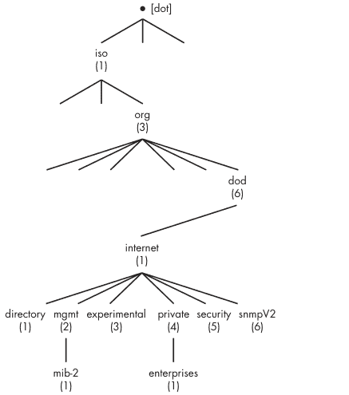

图 B-1: OID 树

互联网数字分配机构（IANA）负责为企业节点下的公司和组织分配数字，赋予这些公司或组织管理其自身子树中 OID 的权限。

我们最感兴趣的树部分位于 `.1.3.6.1`(iso.dod.internet)。在该节点之下是 `mgmt-mib-2` (`.1.3.6.1.2`) 子树和 `private.enter` (`.1.3.6.1.4`) 子树。MIB-2 是我们之前提到的常用对象集；它由所有可通过 SNMP 管理的网络设备支持。企业（enterprises） OID 是组织注册其私有 MIB 的地方。（有关更多信息，请参阅第 14 章。）

## MIB-2

定义在 `RFC 1213` 中的 `MIB-2` 描述了有助于管理网络设备的核心信息。`MIB-2` 被组织为下所示的十组。并不是所有的网络设备都支持所有的组，但你通常可以预期找到大部分组。

### System（系统）

此组包含对象如 `sysDesc`（操作系统、硬件、网络软件等的可打印描述）、`sysContact`（通常是该系统管理员的电子邮件）、`sysLocation`（系统所在位置的可打印描述）以及 `ObjectID`（可用于确定设备类型的 OID）。

### Interfaces（接口）

此组是一个描述系统上可用接口的表格。接口表包含每个接口速率的信息以及接口上的活动（输入和输出的字节数/octets）。通过定期轮询输入和输出字节，你可以知道接口带宽被占用的百分比。这可以帮助你监控网络中路由器的容量。

### AT（地址转换）

这是地址转换组。`MIB-2` 弃用了此组，仅将其包含在是为了与实现 `MIB-1` 的设备兼容。除非你对此有特殊兴趣，否则你应该忽略此组。

### IP

此组包含与 IP（网络）层相关的信息，包括 `ipAddrTable`（IP 地址表），该表描述了系统可用接口的 IP 地址。

### ICMP

此组包含各种互联网控制消息协议（ICMP）统计数据。

### TCP

此组包含 TCP 层统计数据，包括 `tcpConnTable`（连接表），该描述了网络中此系统与其他系统之间的当前连接。

### UDP

此组包含各种用户数据报协议（UDP）数据报统计数据。

### EGP

此组包含支持该协议的系统的外部网关协议（EGP）统计数据。

### Transmission（传输）

此组包含与传输媒介相关的信息。

### SNMP

此组包含与 SNMP 协议本身相关的各种统计数据。

### The SMI（管理信息结构）

`MIB` 使用管理信息结构（`SMI`）定义的语法进行描述，`SMI` 是抽象语法表示法（`ASN.1`）的一个子集。`ASN.1` 的创建是为了允许以独立于机器架构（例如字节序或字长）的方式描述数据。SNMP 采纳了对象类型的子集，从而简化了表示法。关于这一点，你真正需要知道的就是如何读取和写入描述 `MIB` 的表示法。关于如何描述一个 `MIB` 的表示法，你真正需要知道的就是如何读取和写入它。

（类似于 C 语言的 `lint` 程序）用于帮助验证 `MIB` 文件的正确性。（我们将在第 14 章中进一步讨论这一点，那里将涵盖我们 `MIB` 的创建和验证。）

# SNMP 协议

虽然 SNMP 协议值得单独成一章，但我们可以通过它定义的协议数据单元（PDU）及其用途来了解关于 SNMP 协议的大部分知识。

# 基础命令：GET, SET, GETNEXT

SNMP 协议用于在受管系统与用于它们的应用程序之间交换信息。受管系统托管名为代理（agent）的守护进程，通常命名为 `snmpd`，它提供了从一个或多个 `MIB` 读取信息或向其写入信息的能力。`GET`、`SET` 和 `GETNEXT` PDU 分别用于读取、写入和遍历（walk）`MIB`。

# 使用 GETNEXT 遍历 MIB

`GETNEXT` 允许你指定一个对象的名称，并请求代理返回 `MIB` 树中下一个对象的 OID 和值。遍历（walk） `MIB` 意味着从 OID 树的某点开始，通过重复使用 `GETNEXT` 命令遍历其下方的整个子树。当返回的 OID 不在第一个 OID 定义的子树内时，遍历完成。应用程序可以通过这种方式遍历整个 `MIB` 树，从而发现受管系统支持哪些 `MIB`。

# Trap（陷阱）与 Inform（通知）

受管系统还可以自发地向配置的目标管理节点发送信息，这一过程称为发送 SNMP `trap` 或 `inform`。`trap` 是向目标系统发送，发送者永远不知道它是否送达。`inform` 是 `trap` 的改进，因为它期望一个回复；如果在合理时间内没有收到回复，则可以重新检索。

# 命令行工具：示例

让我们看看一些命令行工具的示例，它们使用我们刚刚讨论的 SNMP PDU 来实现功能。这些命令作为 Net-SNMP 软件包（http://net-snmp.sourceforge.net）的一部分提供，我们在书中整个 SNMP 章中都会使用它。

要检索上一节中的 `sysDescr` 字段，你可能执行命令：

```
snmpget -c public 10.1.1.21 .1.3.6.1.2.1.1.0
```

这请求从 IP 地址为 `10.1.1.21` 的系统获取 `sysDescr` 实例，使用社区名称 `public`（可以将其视为密码）。作为一个 SNMP `GET` PDU 执行。

现在让我们查看一个子树。`snmpwalk` 命令使用了一系列 `GETNEXT` PDU。如果你执行命令从一个系统检索接口表：

```
snmpwalk -c 10.1.1.21 .1.3.6.1.2.1.2
```

这是你得到的结果：

```
interfaces.ifNumber.0 = 2

interfaces.ifTable.ifIndex.1 = 1

interfaces.ifTable.ifIndex.2 = 2

interfaces.ifTable.ifDescr.1 = lo

interfaces.ifTable.ifDescr.2 = eth0

interfaces.ifTable.ifEntry.ifType.1 = softwareloopback(24)

interfaces.ifTable.ifEntry.ifType.2 = ethernetSmacd(6)

interfaces.ifTable.ifEntry.ifMTU.1 = 16436

interfaces.ifTable.ifEntry.ifMTU.2 = 1500

interfaces.ifTable.ifEntry.ifSpeed.1 = Gauge:32:1000000

interfaces.ifTable.ifEntry.ifSpeed.2 = Gauge:32:10000000

interfaces.ifTable.ifEntry.ifPhysAddress.1 =

interfaces.ifTable.ifEntry.ifPhysAddress.2 = 0:84:73:43:29

interfaces.ifTable.ifEntry.ifAdminStatus.1 = up(1)

interfaces.ifTable.ifEntry.ifAdminStatus.2 = up(1)

interfaces.ifTable.ifEntry.ifOperStatus.1 = up(1)

interfaces.ifTable.ifEntry.ifOperStatus.2 = up(1)

interfaces.ifTable.ifEntry.ifInOctets.1 = Counter:32:199082

interfaces.ifTable.ifEntry.ifInOctets.2 = Counter:32:29168868

interfaces.ifTable.ifEntry.ifOutPkts.1 = Counter:32:33880

interfaces.ifTable.ifEntry.ifOutPkts.2 = Counter:32:1579204

interfaces.ifTable.ifEntry.ifInDiscards.1 = Counter:32:0

interfaces.ifTable.ifEntry.ifInDiscards.2 = Counter:32:0
```


`interfaces.ifTable.ifEntry.ifInErrors.1` = Counter:32:0
`interfaces.ifTable.ifEntry.ifInErrors.2` = Counter:32:0
`interfaces.ifTable.ifEntry.ifOutOctets.1` = Counter:32:199082
`interfaces.ifTable.ifEntry.ifOutOctets.2` = Counter:32:6118726
`interfaces.ifTable.ifEntry.ifOutPkts.1` = Counter:32:33880
`interfaces.ifTable.ifEntry.ifOutPkts.2` = Counter:32:1579204

```
（注：提供的表格 OCR 文本在源文件中包含大量的重复/乱码；我已根据标准的 MIB 输出清理了逻辑流）
```

此输出读起来有点显别扭，因为它是一个深度优先遍历；也就是说，在返回上一列之前会先向下遍历每一列。这是 OID 词法排序的结果。例如，`ifDesc` 是 `ifentry.1`，`ifType` 是 `ifentry.2`。

# 通过其 MIB 了解设备

遍历通常可以识别出设备支持的 MIB 类型。

# SNMPv1, SNMP2, SNMP3

遍历通常可以识别设备支持的 MIB 类型。

SNMP 有三种版本。原始的 `SNMPv1` 存在以下问题，而 `SNMP2` 试图解决：
- 引入了 64 位整数。
- `SNMP` 引入了批量获取命令。
- `SNMP2` 引入了通知（inform）机制，以确保可靠性。

`SNMPv2` 存在以下问题：
- `SNMP2` 引入了 64 位整数。
- `SNMP2` 引入了批量获取命令。
- `SNMP2` 引入了通知（inform）机制，以确保可靠性。
- `SNMP2` 引入了 64 位整数。
- `SNMP2` 引入了批量获取命令。
- `SNMP2` 引入了通知（inform）机制，以确保可靠性。

# SNMP 数据类型

`SNMP` 数据类型是 `ASN.1` 类型的一个子集。`SNMP` 定义了三种类型：原生的（primitive）、定义的（defined）和构造的（constructor）。我们不会在此深入探讨它们的区别，只需知道原生类型是基础类型，定义的类型有特殊含义但属于原生类型的基础，而构造类型是我们在下文中讨论的。

## INTEGER

`INTEGER` 可以是正数也可以是负数。其值可以是枚举的，范围指定为（例如 `LowValue,MaxValue`）。在 `SNMP2` 中，`INTEGER` 变为 `Integer32`，明确指示大小为 32 位。`SNMP2` 还为所有正值增加了 `Unsigned32` 类型。

## Gauge

`Gauge` 是仅取非负值的整数，其值会在指定的范围内上升或下降（例如 0 到 100%，或者 0 到某些最大容量）。`SNMP2` 将其重新定义为 `Gauge32`。

## Counter

与 `Gauge` 类似，`Counter` 是非负值整数。与 `Gauge` 不同，计数器的值只会增加，直到达到最大值回零。`SNMP2` 将 `Counter` 替换为 `Counter32` 和 `Counter64`。

## TimeTicks

`TimeTicks` 是以毫秒为单位描述时间的整数。它们通常用于描述自某个重大事件或起点以来的时间，例如系统启动或最后配置更改。

## OCTET STRING

`OCTET STRING` 是字节流字符串。它不一定是以空字符结尾的字符串；每个字节在任何位置都可以包含任何值（0-255）（即中间可以存在空字节）。`SNMP2` 增加了限制，`OCTET STRING` 的长度不能超过 65535（即其长度必须用 16 位表示）。

## OBJECT IDENTIFIER

用于包含 `SNMP` `OID` 值。`SNMP2` 增加了限制，`OBJECT IDENTIFIER` 包含的组件不能超过 128 个，每个组件最多用 32 位表示。

## IpAddress

`IpAddress` 字符串是长度为四的字节组。（注意，这允许表示 `IPv4` 地址。）

### Opaque（不透明）

这种类型与 `OCTET STRING` 非常相似，因为它也是一个具有相似限制的字节字符串。定义 `Opaque` 是为了允许 `SMI` 的扩展。强烈建议不要基于 `Opaque` 类型定义新类型。

### BITS（位字段）

`BITS` 在 `SNMPv2` 中引入，用于提供一种表达带标记位字段的方法（即每个位都有独立的含义）。

**注意** `SNMP` 后期版本中已删除的类型未显示在列表中。

# SNMP 表格

除了上述描述的简单类型外，可以使用 `SEQUENCE` 和 `SEQUENCE OF` 来描述表格。`MIB` 中的表格被描述为描述条目的类型的 `SEQUENCE OF`。然后，表格条目被描述为一个包含该条目各个字段的 `SEQUENCE`。条目类型描述了构成表格中每一行的列，而表格本身被描述为这些条目结构的数组。

例如，这里是来自 `MIB-2` 的 `interfaces` 表格定义：

```
ifTable OBJECT-TYPE

SYNTAX SEQUENCE IfEntry

MAX-ACCESS not-accessible

STATUS current

DESCRIPTION

```
> "接口条目的列表。条目数量由 ifNumber 的值决定。"
:: { interfaces 2 }
```

ifEntry OBJECT-TYPE

SYNTAX IfEntry

MAX-ACCESS not-accessible

STATUS current

DESCRIPTION

```
> "包含适用于特定接口的管理信息的条目。"
INDEX { ifIndex }
:: { ifTable 1 }
```

ifEntry :=SEQUENCE {
```


`ifIndex` `InterfaceIndex`,

`ifDesc` `DisplayString`,

`ifType` `IANAifType`,

`ifMtu` `Integer32`,

`ifSpeed` `Gauge32`,

`PhysAddress` `PhysAddress`,

`ifAdminStatus` `INTEGER`,

`ifOperStatus` `INTEGER`,

`lastChange` `TimeTicks`,

```
ifInOctets             Counter32,
ifIncastPkts           Counter32,
ifInUCastPkts          Counter32, -- 已弃
ifInDiscards           Counter32,
ifInErrors             Counter32,
ifUnknownProtos       Counter32,
ifOutOctets            Counter32,
ifOutcastPkts          Counter32,
ifOutUCastPkts         Counter32, -- 已弃
ifOutDiscards          Counter32,
ifErrors               Counter32, -- 已弃
ifOutQLen              Gauge32,
ifSpecific             OBJECT IDENTIFIER -- 已弃
```

注意 `ifEntry` 和 `ifEntry` 的区别，一个是首字母大写，另一个不是。所有对象名称均为小写；例如 `ifTable` 和 `ifEntry`。因为 `ifEntry` 是首字母大写的，我们知道它是一个类型而不是一个对象。

`ifType` 类似于 C 语言中的 `struct`；它描述了表格每行的布局。小写的 `ifentry` 是 OID 树中的一个节点，列对象将定义在它的节点之下。因此，特定接口的描述将具有如下所示的 OID：

```
ifTable.ifEntry.ifDescr.x
```

其中 `x` 是行索引。

在条目类型定义之后将是构成该条目序列的对象的定义。你会在 MIB 定义中反复看到这种格式；许多 MIB 信息都是组织成表格。

# 定义新类型

虽然 SMI 中定义的数据类型已经足够，但有时更具体一些会更方便。例如，如果你的 MIB 重复使用这些限制值，你可能希望限制 `OCTET STRING` 中的可能值或 `Integer32` 覆盖范围，否则重复描述这些限制将变得繁琐。

RFC 1903 描述了文本约定（`textual convention`），这是一种允许你将说明绑定到一个新类型中的宏。以下文本约定取自 Net-SNMP（版本 5.0.8）分发的文件 `SNMPv2-TC.txt`。

```
Displaying ::= TEXTUAL-CONVENTION
DISPLAY-HINT "25a"
STATUS current
DESCRIPTION "代表来自 NVT ASCII 字符集的文本信息，如 RFC 854 第 4 页和第 10-11 页所示。
```

总结 RFC 854，NVT ASCII 集合规定：

- 使用字符代码 0-127（十进制）
- 图形字符（32-126）被解释为 US ASCII
- NUL, LF, CR, BS, HT, VT 和 FF 有 RFC 854 指定的特殊含义
- 其他 25 个代码没有标准解释
- 序列 'CR LF' 意味着换行
- 序列 'CR NUL' 意味着回车
- 前面没有 'CR' 的 'LF' 意味着到下一行的相同列。
- 对于除 LF 或 NUL 以外的 x，序列 'CR x' 是非法的。（注意，这意味着字符串可以以 'CR LF' 或 'CR NUL' 结尾，但不能以 CR 结尾。）

使用此语法定义的任何对象长度不得超过 255 个字符。

`SYNTAX STRING (o..255))`

这描述了一个名为 `DisplayString` 的类型，它可以占用最多 255 个字节，并限于可显示字符。`DISPLAY-hint` 显示了 `DisplayString` 可能出现的形式。`255a` 意味着它可以采取最多 255 个 ASCII 字符的形式。RFC 1903 描述了显示提示的完整语法。

# MIB 文件的结构

当你读取 MIB 文件时，你会注意到它在 `BEGIN` 和 `END` 语句之间命名并定义。它将描述它包含了其他哪些内容

```
IF-MIB DEFINITIONS ::= BEGIN
```

`IMPORTS`

`MODULE-IDENTITY`, `Counter32`, `Gauge32`,

`Integer32`, `TimeTicks`,

`SMI`,

```
```

= { mib-2 31 }

```

这描述了 `ifmib`，它占用 `m` 地址。组织和联系信息清晰可见，随后是按时间倒序排列的先前版本描述。时间和日期看起来很晦涩，但它们只是 GMT（由 Z 表示 Zulu 时间）的年、月、日的拼接。因此，最近的修订（`200006140000Z`）是在 2000 年 6 月 14 日做的。接下来，你将看到 MIB 对象实际结构的定义，以及任何属于此 MIB 的文本约定。

```

END

```
然后是模块的定义。

```

ifMIB-MODULE-IDENTITY

LAST-UPDATED "200006140000Z"

ORGANIZATION "IETF MIB Working Group"

CONTACT-INFO

    Keith McChrie

    Cisco Systems, Inc.

    170 Tasman Drive

    San Jose, CA 95134-1706

    kmlogh@cisco.com

```

`DESCRIPTION` "描述通用对象的 MIB 模块。此 MIB 是 MIB-II 的更新版本，并包含了 RFC 1229定义的扩展。"

`REVISION` "200006140000Z"
`DESCRIPTION` "Interfaces MIB WG 同意的澄清，并已发布为 RFC 2863。"

`REVISION` "199602281555Z"
`DESCRIPTION` "Interfaces MIB WG 的修订，并发布在 RFC 2233 中。"

`REVISION` "199311082155Z"
`DESCRIPTION` "初始修订，作为 RFC 1573 的一部分发布。"


# 安装帧缓冲区驱动程序


在本附录中，我们将涵盖以下主题：

- 为你的显卡查找帧缓冲区设备驱动
- 配置帧缓冲区设备驱动

## 为你的显卡查找帧缓冲区设备驱动

要找到显显卡的可用设备驱动，请使用 Laddie CD 启动你的 PC。

如果 Laddie CD 成功为你的显卡找到了驱动，它将启动 Laddie 帧缓冲区 UI（如图 C-1 所示）。否则，它将在登录提示符之前显示消息 *The framebuffer (/dev/fb0) is unavailable*（帧缓冲区 /dev/fb0 不可用）。

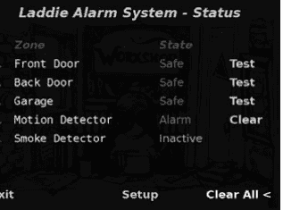

图 C-1：Laddie 帧缓冲区 UI

现在，我们假设帧缓冲区驱动已成功加载。要确定加载了哪种驱动，首先按 ESC 键退出帧缓冲区 UI。然后在命令提示符处输入以下内容：

```
laddie:~$ dmesg | grep fb
```

`dmesg` 命令显示内核启动产生的消息缓冲区，而 `grep` 命令选择那些可能与帧缓冲区相关的消息。

### vesafb 驱动

Laddie CD 首先尝试加载 `vesafb` 驱动，因为对于未知显卡这最可能的候选者。`vesafb` 驱动将视频电子标准协会（VESA）开发的接口转换为 VESA BIOS 扩展（VBE）。该驱动依赖 BIOS，因此必须在系统启动时进行配置。这意味着 `vesafb` 驱动必须编译进内核，而不是作为一个独立的模块。Laddie 设备使用启动提示符配置驱动，我们将对此进行描述。

这是我们一个成功安装了 `vesafb` 驱动的系统输出示例：

```
vesafb: framebuffer=0x88000000, mapped to 0xf8880000, using 600k, total 32768k

vesafb: mode=640x480, linewidth=640, pages=11

vesafb: mode=protected interface info at c000:f003

vesafb: scrolling:redraw

vesafb: Pseudocolor:size=8:8:8, shift=0:0:0

vesafb: Mode is VGA compatible
```


# fbo: VESA VGA frame buffer device

## 特定硬件的驱动

如果你的系统成功加载了 `vesafb` 驱动，你需要在启动时禁用该驱动以检查其他驱动。要执行此操作，请重启 Laddie CD。当你看到启动提示符时，输入 `novesa` 并按回。如果帧缓冲区 UI 启动，说明系统找到了合适的驱动。退出帧缓冲区 UI，输入命令 `dmesg fb`。当我们在一个系统上执行此操作时，命令产生了以下内容：

```
vesafb: probe vesafb failed with error -6

rivaf: Nvidia device/chipset 10DE0D0D

rivaf: Nvidia Corporation NV6 [NVIDIA TNT2 Model 64/Model 64 Pro]

rivaf: MTRR set to ON

rivaf: could not retrieve ID from DIC/I2C

rivaf: setting virtual resolution to 52428

rivaf: PCI Nvidia framebuffer over 0.95b (32MB @ 0xF8000000)

[additional lines omitted]
```

在这里我们看到 `vesafb` 驱动加载失败，而特定设备的驱动加载成功。`rivafb` 是 NVIDIA 显卡的视频驱动程序。

你也可以使用 `lsmod` 命令检查系统加载的特定硬件帧缓冲区驱动。在控制台执行执行：

```
lsmod | grep fb
```

`lsmod` 命令列出内核当前加载的所有模块；帧缓冲区名称通常包含字母 `fb`，例如 `radeon`、`savagefb` 或 `matrx_g450`。顺便一下，`lsmod` 命令对 `vesafb` 驱动无效，因为 `vesafb` 驱动不是模块——它是被编译进内核的。

## Laddie CD 不包含的内容

如果 Laddie CD 没有为你的显卡找到驱动程序，可能较新的内核会支持它。在这种情况下，使用 `lspci` 命令识别你的显卡。如果你的卡是 AGP、PCI 或 PCI-Express，此命令将报告它。以下是在我们的某一台开发机器上运行 `lspci` 时的几行之一：

```
01:00.0 VGA compatible controller: Nvidia Corporation NV15 [GeForce 2 GTS/Pro] (rev a4)
```

这向我们显示有一个 NVIDIA VGA 兼容控制器（VGA 代表视频图形阵列）。此时，你可能需要在互联网上花些时间为你的显卡寻找驱动程序。还要记住，Linux并不支持所有的显卡，所以你可能需要安装不同的显卡以便使用帧缓冲区。

## 配置帧缓冲区设备驱动

一旦你为系统找到了合适的帧缓冲区驱动程序，你就需要对其进行配置。

### vesafb 驱动

由于 `vesafb` 驱动依赖于 BIOS，它必须在系统启动时进行配置。这意味着 `vesafb` 驱动必须编译进内核，而不是作为一个独立的模块。Laddie 设备使用启动提示符配置驱动，我们将对此进行描述。

视频模式是一个指定分辨率和每像素比特数的数字。Linux 视频模式总结在表 C-1 中。

表 C-1：Linux 模式

| 每像素比特 | 320x200 | 640x400 | 640x480 | 800x600 | 1024x768 | 1280x1024 |
| :--- | :--- | :--- | :--- | :--- | :--- | :--- |
| 4 | | | | | | | |
| 8 | | | | | | | |
| 15 | | | | | | | |
| 16 | | | | | | | |
| 24 | | | | | | |

### 选择合适的视频模式

一旦你找到了一个有效的 VBE 模式，你就可以更新内核命令行。例如，命令：

```
video=vesafb=<mode>
```

适用于 640x480 每像素 16 位特。Laddie CD 不支持所有模式，因此你可能需要尝试使用 Laddie CD。

### 更新内核命令行

一旦你找到了一个有效的 VBE 模式，你就可以更新引导加载文件中的内核命令行。例如，命令：

```
video=vesafb=0x311
```

适用于分辨率为 640x480、每像素 16 位。

## 在启动时选择所需的视频模式

Laddie CD 将特定硬件视频驱动维护为模块，但一旦你为系统找到了合适的帧缓冲区驱动，

你可能想将其构建到内核中。当然，在 Laddie CD 中这并不是一个选项，但如果你为自己的系统重新构建内核，你需要在内核启动提示符处配置驱动程序。现在许多非 VBE 帧缓冲区设备驱动程序都支持一种通用语法，用于在内核命令行上提供视频模式。遵循此语法，可以在启动时通过以下命令选择 `examplefb` 驱动：

```
video=examplefb:1024x768-24876
```

这指定了宽度为 1024 像素、高度 768 像素、每像素 24 位以及 76 Hz 的刷新率。

注意：除了刷新率外，未提供任何计时信息。内核包含一个计时参数数据库（详见文件 `/usr/src/linux/drivers/video/mode.c`），并将搜索与所需分辨率和刷新率匹配的项。如果未能找到匹配项，它将使用默认视频模式，并尝试数据库中的所有模式。

通常，使用以下格式指定视频模式：

```
<x>x<yes>[r][<bpp>[@refresh>][i][m]
```


这里，可选的 `m` 请求使用 VESA 协调视频计时（Co-CVT），这是一种根据分辨率、刷新率、显示器类型（CRT 或数字显示器）和隔行来确定适当计时的系统方法。可选的 `r` 指定数字显示的消隐。可选的 `i` 指定隔行模式，可选的 `m` 请求在计时计算中增加 1.8% 的裕量。

除了此处列出的通用语法外，特定驱动程序可能支持其他选项，例如禁用加速。驱动程序之间的共同性很小；你可能需要咨询驱动程序的源码来查找这些选项。

## 验证你的帧缓冲区驱动程序设置

如果你成功加载了帧缓冲区驱动并让 `fbset -i` 命令报告了关于其配置的信息，你可以查看帧缓冲区的几何结构、计时和其他参数。

要查看已加载帧缓冲区驱动的配置数据，请尝试使用 `cat` 查看 `/proc/fb` 的内容以及 `/sys/class/graphics/fb0` 中的文件。并不是所有驱动程序都使用 `/sys` 目录，但当它们使用时，文件提供了访问帧缓冲区参数（如 `bits_per_pixel` 和 `color_map`）的方便方法。

有关关于 Linux 帧缓冲区的更多信息，请参见 http://ldp.org/HOWTO/Framebuffer-HOWTO.html 的（有些过时的）HOWTO。VBE 3.0 规范可以在 http://www.vesa.org/public/VBE/vbe3.pdf 获取。

## DB-TO-FILE 工具


本附录描述了 `tbl2filed`，这是一个允许你使用 SQL 读取和写入 Linux 配置文件中的值的守护进程，就像这些值存储在数据库而不是文件中一样。如果你想为新的守护进程使用 RTA，并希望在读取和写入传统的、非 RTA 配置文件时保持相同的数据库比喻，那么这个实用程序就会非常方便。本附录讨论的话题包括：

- 概述
- 表定义
- 使用方法和 API
- 安全注意事项

## 概述

`tbl2filed` 守护进程的目标是允许你的 UI 程序使用 PostgreSQL 库来读取或写入（SELECT 或 UPDATE）RTA 表，并在 SELECT 或 UPDATE 的过程中扫描或修改底层的系统配置文件。该实用程序尝试模拟以下常见任务：

- 查看配置文件中的值（SELECT value ...）
- 编辑配置文件中的值（UPDATE value ...）
- 将文件原子地写入磁盘（`UPDATE tbl2filed SET do_commit...`）
- 在需要时重启服务（`UPDATE tbl2filed SET do_script...`）

`tbl2filed` 守护进程允许你通过两个 RTA 表使用 PostgreSQL 命令来读取和写入配置文件。第一张表 `tbl2filed` 描述由守护进程管理的文件，第二张表 `tbl2field` 描述受管理的字段。

图 D-1 展示了该实用程序如何将两个表映射到磁盘文件内部文本字段。

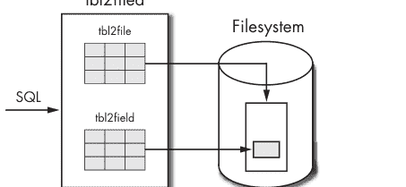
图 D-1：使用 SQL 访问文件中的数据。

该守护进程还允许我们将所有系统服务的重启脚本放在一个文件中，并使用单一方法（写回调）来调用它们。这种方法可能有助于安全性，因为它允许非特权 UI 程序安全地更改系统配置。

## 表定义

本附录后文将给出示例，但为了理解其含义，你需要对 `tbl2filed` 表的内容有一定的了解。Laddie 使用 `tbl2filed` 来帮助网络配置，你可能会发现在运行的系统中查看这些表会更容易一些。启动 Laddie CD 并按照 `rta_apps.html` 中的 `tbl2filed` 链接。

### tbl2file 表

表信息 `tbl2file` 具有以下列：

```
name               // 文件名
path               // 文件的完整路径
do_commit          // 将值刷新到文件 0->1
timestamp          // 上次读取时间
do_script          // 脚本 0->1
script_parms       // 传递给脚本的参数
```

文件名是 UI 看到的名称。这也被用作进入 `tbl2field` 的索引，即该文件的助记符。路径是文件的完整路径，包括文件名。

`do_commit` 将值刷新到文件 0->1。`timestamp` 是上次读取时间。`do_script` 运行脚本 0->1。`script_parms` 是传递给脚本的参数。

`tbl2file` 表具有以下列：

`do_commit` 将值刷新到文件 0->1。`timestamp` 是上次读取时间。`do_script` 运行脚本 0->1。`script_parms` 是传递给脚本的参数。

文件名是 UI 看到的名称。这也被用作进入 `tbl2field` 的索引，即该文件的助记符。路径是文件的完整路径，包括文件名。

`do_commit` 将值刷新到文件 0->1。`timestamp` 是上次读取时间。`do_script` 运行脚本 0->1。`script_parms` 是传递给脚本的参数。

### tblfield 表

`tblfield` 表持有各个字段的值，具有以下列：

```
name      // 文件名，例如 "resolv"
field     // 字段名，例如 "search_domain"
pattern   // 提取值的正则表达式
regerr    // 如果模式字符串有错误则非零
skip      // 跳过这些模式
format    // 替换行的 printf 格式
value     // 字段的当前值
```

`name` 是文件名，必须匹配 `tbl2file` 表中的 `name` 列。`field` 是 UI 看到的字段名。这始终用于 `WHERE` 子句以识别要读取和更新的字段。`pattern` 是一个正则表达式，与 `skip` 结合识别文件中的字段。模式应包含一组括号以提取值。例如，为了从 `resolv.conf` 文件获取第一个 DNS 服务器，我们可以使用以下正则表达式：

```
^nameserver[\t]+([0-9]+)
```


如果模式无法解析，`regerr`字段为非零。开发期间需要检查`regerr`。`skip`列指示在选择行作为文件源之前跳过多少方的模式。例如，我们使用`skip`值1来从`resolv.conf`读取第二个DNS服务器。这将跳过一个服务器并读取第二个。

`format`字段用于生成目标文件中的配置数据行。我们可以从正则表达式获取这些，但有一个`printf`字符串要容易得多。如果此列为空，则该字段被视为只读。任何`/proc`或`/sys`中的只读值都应该具有空的`format`字段。你可以通过查看`tbl2field`表中的`uptime`字段查看只读值的示例。对于`resolv.conf`中的名称服务器，格式字符串将是`nameserver \s`。格式字符串中不需要`\n`，它由打印语句自动添加。

`value`是字段作为字符串的当前值。对此列执行`SELECT`将导致在必要时读取并解析文件（见上文`tbl2field`中的`timestamp`）。如果缓存值有效，则直接从表中提取。对此列进行写入会将值保存在表中，但实际上不会将值写入文件；将`do_commit`写入1即可。

# 一个 tbl2filed 示例

让我们通过继续 Laddie 的名称服务器配置来查看一个完整的示例。在运行的 Laddie 系统上，`/etc/resolv.conf`文件内容如下：

```
nameserver 204.117.214.10

nameserver 199.2.252.10

nameserver 65.173.40.10
```

我们的目标是能够使用如下的`SELECT`语句读取第一个DNS名称服务器：

```bash
psql -h localhost -p 8885
> SELECT * FROM tbl2field where name = "nameserver_1";
> q
```

同样，为了修改第二个名称服务器，Laddie 使用了`UPDATE`语句：

```bash
psql -h localhost -p 8885
> UPDATE tbl2field SET value="192.168.1.1"
> WHERE name=resolv AND field="nameserver_2";
> q
```

你可以通过启动 CD、退出缓冲区菜单、以 root 身份登录并执行上述命令来验证以上操作。务必验证执行`UPDATE`命令后文件已已修改。

现在让我们来看看 tbl2filed 和 tbl2field 配置，它们让我们能够像操作 PostgreSQL 数据库一样读写名称服务器的 IP 地址。我们首先在`tbl2file`表中列出想要管理的文件：

```
UPDATE tbl2file SET name="resolv", path=/etc/resolv.conf,
script_params="*" LIMIT 1 OFFSET 0
```

在编辑编辑`resolv.conf`文件后不需要运行脚本，因此可以留空`script_params`。你可以使用完整路径或相对路径名称，作为安全考虑，使用完整路径是一个好主意。

在此示例中，我们管理了三个 DNS 名称服务器。

相应的 SQL 语句摘自`tbl2filed.sql`（可能是完整路径，例如`/opt/laddie/tbl2filed/...`），内容如下：

```sql
UPDATE tbl2filed SET name="resolv", field="nameserver_1", skip=0,
pattern="^nameserver[^0-9]+" LIMIT 1 OFFSET 1

UPDATE tbl2filed SET name="resolv", field="nameserver_2", skip=1,
pattern="^nameserver[ \t][0-9]+" LIMIT 1 OFFSET 2

UPDATE tbl2filed SET name="resolv", field="nameserver_3", skip=2,
pattern="^nameserver[ \t][0-9]+" LIMIT 1 OFFSET 3
```

该模式（`pattern`）识别带有参数的行，模式中的单组括号提取实际的字段值。在上面的示例中，`nameserver`字段的值只能包含0到9的数字和/或小数点。括号不是识别的一部分——它们仅用于提取字段值。

`tbl2field`守护进程的一个优秀特性是，当你向字段写入值时，守护进程会使用该字符串构建一个配置行的副本。然后它会针对新行运行模式，如果模式无法识别新行，则拒绝更新。在这种情况下，更新11.22.33.44的名称服务器将成功，因为它包含了所需的数字和小数；然而，更新8ob's fun house的名称服务器将失败，因为它不包含所需的数字和小数。

名称的示例还说明了`skip`列的使用。主名称服务器的`skip`设置为0，意味着我们使用第一个匹配模式的行。次要名称服务器指定的`skip`设置为1，意味着我们跳过一个匹配行并使用第二条匹配行。

# 安全注意事项

取决于你的使用方式，此守护进程可能会增强或损害你的系统。从初看，拥有一个以 root 权限运行并接受数据库连接的守护进程似乎是一个坏主意。另一方面，这可能允许你提高安全性，即只以 root 身份运行一个守护进程，并以非 root 用户身份运行每个 UI 程序。这样，如果攻击者侵入你的某个 UI 程序，他或她仅获得非 root 用户的权限。对比大多数 Linux 设备，在这些设备中，UI 需要以 root 身份运行才能进行系统更改。

守护进程在启动时读取`tbl2file.sql`，然后将其所有配置文件标记为只读。不允许对管理的文件或脚本参数进行更新有助于安全，但也意味着在程序启动后无法更新配置的任何部分。你必须在启动`tbl2field`守护进程之前直接编辑`tbl2file.sql`和`tbl2field.sql`文件。如果你为了方便开发而将任何列标记为可读写，请在发布产品之前将其改回只读。此外，确保使用守护进程的初始配置保护目录和文件的写权限。

> `resolv.conf`文件与大多数 Linux 配置文件的不同之处在于，切换到 DHCP 作为启动配置协议可能会完全破坏你之前写入的任何值。解决此问题的简单方法是在需要时将模板文件拷贝到`/etc/resolv.conf`。

# LADDIE 设备
# 可启动 CD


随书附的 CD 有两个用途。首先，它允许你通过将你的 x86 PC 转换为一个运行的设备来演示此书中描述的技术。其次，它允许你以你感兴趣的细节研究实现该设备的源码。在本附录中，我们向你展示如何启动并运行 CD，并提供了 CD 内容的导览。我们还提供了通过 CD 进行修改和重新安装设备的简单示例。

# 运行 LADDIE 设备

LADDie CD 不需要特定的操作系统，你不需要安装任何东西，CD 不会在你的硬盘上放置任何内容。事实上，你甚至不需要硬盘。CD 为根文件系统创建一个内存磁盘。当你用完 CD 后，只需将其移除并重启原始操作系统。你会发现没有任何变化。

运行 Laddie 设备需要的是一个具有至少 64MB 内存的 x86 PC、一个符合 VESA 标准的显卡（如果你需要运行帧缓冲区），以及配置从 CD-ROM 启动的 BIOS。

在本节中，我们将解释如何启动 CD，向你验证帧缓冲区的工作，然后解释如何访问用户界面。我们将解释如何关闭设备。

# 启动 CD

将 Laddie CD 放入驱动器，重启电脑。如果 CD 成功启动，你将看到如下消息：

```
SOLINUX 2.08 0x4072248c Copyright (C) 1994-2003 H. Peter Anvin
Welcome to LAD dist 2007.02.25
*** To abort, hit <SPACE>, then eject the CD. ***
Select "linux", "vga", "novesa", or "shell"
Boot default (linux) in 6...
boot:
```


在此处，你应该按下回车键或等待六秒以继续启动序列。

商业设备通常会向用户隐藏启动信息。由于这是一个教育系统，我们希望看到这些信息。为特定硬件配置设计的商业设备启动速度也会更快。此 CD 设计适用于各种硬件配置，并为用户提供一个灵活的实验和构建环境，因此过程需要时间。特别是启动脚本会加载系统识别的任何硬件驱动程序。

# 帧缓冲区界面

一旦 CD 成功启动，系统将向你展示 Laddie 帧缓冲区的主界面（见图 E-1）。如果你看到这个屏幕，说明你成功运行了设备，现在你应该可以使用键盘的方向键和回车键导航 Laddie 帧缓冲区界面。（如果你的键盘没有方向键，使用 `i` 向上、`j` 向左、`k` 向下和 `l` 向右。）

注意：如果启动过程完成后出现登录提示而不是图 E-1 所示的屏幕，则你的显卡可能不符合 VESA 标准。在这种情况下，Laddie 设备仍可以运行，但你将无法对帧缓冲区界面进行实验。

# Laddie 报警系统 - 状态

| 区域 | 状态 |
|---|---|
| 1. 前门 | 安全测试 |
| 2. 后门 | 安全测试 |
| 3. 车库 | 安全测试 |
| 4. 运动检测器 | 报警清除 |
| 5. 烟雾检测器 | 未激活 |

退出 设置 清除全部

E-1: Laddie Framebuffer 用户界面

# 访问 Web 界面

Laddie 设备以静态 IP 地址 `192.168.1.11` 启动。如果你的 PC 连接到一个被 Laddie 操作系统识别的以太网卡的局域网，该设备将提供 Web 服务，允许你监控和控制该设备（见图 E-2）。你可以使用本地网络上的浏览器通过 URL://`192.168.1.11` 访问此 Web 界面。

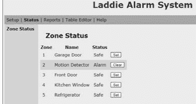

| 区域名称 状态 |
|---|---|
| 1 车库门 | 安全 |
| 2 运动检测器 | 报警清除 |
| 3 前门 | 安全 |
| 4 厨房窗户 | 安全 |
| 5 冰箱 | 安全设置 |

E-2: Laddie Web 界面

> 注意：你也可以使用基于文本的 Web 浏览器 `Lynx` 访问 Laddie 页面。在命令提示符中输入 `lynx`，然后按照显示器底部的说明进行导航。

# 尝试 Linux Shell 和其他用户界面

除了 framebuffer 和 Web 界面外，Laddie 设备还支持命令行界面（CLI）、前面板界面和 SNMP 界面。在尝试这些其他界面时，你会发现拥有一个 Linux shell 将非常有用，因为你可以直接与操作系统进行交互。如果 Laddie 设备在网络上，你可以使用 `telnet` 访问登录 shell（即 `telnet 192.168.1.111`）。登录时，输入用户名和空密码。你可以通过 `CTRL-ALT-F1` 从 framebuffer 用户界面切换到登录提示符。（如果以后想返回 framebuffer 界面，请按 `CTRL-ALT-F7`）。

请参阅相关章节获取有关访问 CLI、前面板和 SNMP 界面的说明。

# 关闭 Laddie 设备

Laddie 操作系统在运行时不会弹出 CD，因为它依赖于 CD 提供的必要系统文件。若要弹出 CD 并返回你的原始操作系统，请在 Linux shell 中输入 `reboot` 重启你的电脑。当你看到 Laddie 启动提示符时（如第 338 页的“启动 CD”所示），按空格键中断自动启动，弹出 CD，然后按 `CTRL-ALT-DEL` 使用你的原始操作系统重新启动电脑。

# 探索 CD 内容

如果你启动了 Laddie 设备，你会发现大多数顶层目录都存在于内存磁盘（ramdisk）中，只有 `/bin`、`/lib`、`/sbin` 和 `/usr` 链接回 CD。特别是，所有与 Laddie 设备相关的目录都是可读可写的，因此你可以使用 CD 对设备进行实验、重构和重新安装。

# Laddie 设备源码

Laddie 设备软件提供在 `/Code/src` 中，并划分为对应各种用户界面和服务的包。二进制文件和相关文件安装在 `/opt/laddie`。表 E-1 标识了每个 Laddie 设备组件的源码和安装目录。

表 E-1: Laddie 设备组件的源码与安装目录

| 组件 | (/Code/src) 中的源码 | 安装目录 |
|---|---|---|
| 命令行界面 | cli | /opt/laddie/{cli,bin} |
| 空闲守护进程（供其他组件使用） | empd | 无否 |
| Framebuffer 界面 | fbmenu | /opt/laddie/{fbmenu,bin} |
| 前面板 | front_panel | /opt/laddie/bin, /opt/laddie/htdocs/front_panel |
| Laddie 报警守护进程 | ladd | /opt/laddie/(bin) |
| 系统日志记录器 | logmuxd | /opt/laddie/(logmuxd,bin) |
| 网络守护进程 | network | /opt/laddie/(network,bin) |
| SNMP 代理和 MIB | snappmp | /opt/snmp/sbin, /opt/snmp/share/snmp/mib |
| STmenu | stbmenu | /usr/local/{include,lib} |
| 数据库转文件工具 | tbl2filed | /opt/laddie/{tbl2filed,bin} |
| Web 界面 | web | /opt/laddie/htdocs/web |

这些组件外，`/Code/src` 目录还包含 `buildappd` 子目录，其中包含了支持构建设备的脚本和文件。该子目录还包含了我们在文中讨论的示例程序。

在适当的情况下，组件子目录包含 `Makefile`。`/Code/src` 中还有一个顶层 `Makefile`，允许你使用以下命令构建并重新安装整个设备：

```
laddie::# make

laddie::# rm -rf /opt/laddie

laddie::# make install
```


如果你想研究源码，一个很好的起点是 `/Code/src/ladd` 子目录下的报警代码。这是一个简单的应用程序，但它同时演示了空闲守护进程和 framebuffer 界面。该服务的入口点是 `main.c`。`main()` 函数调用了 `laddie`。

# Laddie 设备库

Laddie 设备使用了若干个库。RTA 库位于 `/usr/local/include`。PostgreSQL、轻量级守护进程和 SNMP 都是文档良好的开源项目，我们已将它们编译并安装到 `/usr/local/lib`。

`lightpd` 守护进程使用 `/etc/lightpd.conf`。PHP 的配置文件是 `/etc/php.ini`。我们使用的源码位于 `/src/packages`：

- `postgresql-8.0.1`
- `lightpd-1.40`

# 启动脚本

为了启动时启动设备，我们将脚本添加到 `/etc/init.d`。这些脚本将在运行级别 3 中调用。framebuffer 用户界面使用 `fbmenu` 启动，但必须先启动控制台，我们从 `/etc/inittab` 调用它。为了方便测试，我们在 `/opt/laddie/bin` 中提供了 `laddie` 脚本。系统关闭。

# 重建 Laddie 设备

作为文件结构的快速演示，让我们修改并重新安装 Laddie 设备的一部分。这并不是永久性的；我们不会创建新的 CD。我们将在报警进程的 `.c` 文件中添加一行，在 Linux shell 提示符下重新编译它、重新安装并运行。

如果你想跟随操作，请使用 Laddie CD 启动 x86 PC 并调出 shell 控制台。请参阅第 338 页的“启动 CD”获取说明。

此练习假设你会使用 `vi` 编辑器。如果你不熟悉 `vi`，可以通过 CD 提供的 `vimutor` 快速上手。

# Linux From Scratch 发行版和其他包

如果这是一个真实的设备，我们可能会选择更简单的 Linux 环境。我们可能会使用较小的内核、`BusyBox` 工具和 `uclib` 库。但我们的重点不是嵌入式 Linux，我们认为更通用的环境可以让我们专注于架构。

作为起点，我们使用了 Linux From Scratch (`http://www.linuxfromscratch.org`)，这是一个包含了我们构建设备所需大部分工具的发行版，且不包含我们需要的 X Window 系统。重建 Laddie 设备所需的所有包包含在 `/usr/src/packages` 目录。大部分软件包是根据 Linux 文档安装的，文档也包含在 `/usr/src/packages` 中的 `LFS-BOOK-6.0.pdf`。额外的包包括：

| PostgreSQL | FreeType2 和 Bitstream 字体 | SNMP |
|---|---|---|
| PHP | utenetld | nettools, libnet, libcap 和 arping |
| SNMP | gdbserver | lynx |
| dhcpcd | dialog | pcuitils |
| fbset | setserial | lighttpd |
| SDL 和 SDL_ttf | UIRC | fanout |
| Pure-FTPD | | |

> 有关这些额外包的详细安装说明请参阅文件 `/usr/src/packages/HISTORY`。

- 1. 由于报警守护进程（alarm daemon）已经在运行，请使用此命令将其杀死：

```
laddie~# laddie stop
```

- 2. 随后，使用以下命令进入报警守护进程目录并打开 `laddie.c` 文件进行编辑：

```
laddie~# cd /Code/src/ladd
laddie~# vi laddie.c
```

- 3. 在文件末尾的 `user_update()` 函数中找到以下行：

```
syslog(LOG_ALERT, "User set alarm on zone %d, %s", Zone[rowid].id, Zone[rowid].name);
```

- 4. 紧接着这些行之后插入以下内容：

```
syslog(LOG_ALERT, "Hello, world! I've modified the alarm daemon!");
```

- 5. 保存文件并退出。使用以下命令编译并重新安装 laddie：

```
laddie~# export DEF_APPDIR=/opt/laddie
laddie~# make -e
laddie~# make -e install
```

`注意` Laddie 设备组件使用环境变量 `DEF_APPDIR` 来指定安装位置。默认是更常用的位置 `/usr/local`，但我们使用 `/opt/laddie` 以便您识别特定于设备的组件。`-e` 选项告诉 `make` 实用让环境变量覆盖 Makefile 中出现的变量。

这将创建一个新的可执行文件并将其安装在 `/opt/laddie/bin`。然后通过输入此命令启动报警守护进程：

```
laddie~# laddie start
```

- 6. 按 `ESC` 退出帧缓冲区用户界面。然后使用此命令监控系统日志：

```
laddie~# cat /var/log/messages
```

日志消息通过 `logmuxd` 事件处理器路由到管道 `/var/log/messages`。使用 `cat`，我们可以在控制台中显示这些消息。在事件发生之前，该命令将不会执行任何操作。

- 7. 要创建一个用户更新事件，使用 `CTRL-ALT-F2` 切换到控制台 2，然后运行命令行界面：

```
laddie:~# cli
```

- 8. 使用以下命令创建一个更新事件：

```
clear all
test 1
quit
```


- 9. 现在使用 `CTRL-ALT-F1` 切换回原始控制台。如果重新安装成功，显示的日志消息将包含一条带有时间戳的您的新消息“Hello, world!”条目。
- 10. 使用 `CTRL-C` 终止日志显示。

## 索引

A
Ajax（异步 JavaScript 和 XML）， 117–118, 125–126, 132
alarm（报警），定义, 81
报警系统 (alarm system)
定义, 62
启用区域, 64
锁存 (latching), 64
传感器接触类型, 63–64
传感器类型, 62–63
报警区域 (alarm zones), 62–63
定义, 62
启用, 64
Apache, 108, 110, 111, 114
API（应用程序接口）, 11
appInit() 子程序, 70–71
设备 (appliances), Linux, 通用架构, 5
应用程序接口 (API), 11
异步 JavaScript 和 XML (Ajax), 117–118, 125–126, 132
AT 命令, 13–14
进程组 (process groups), 46–47
重定向 stderr, 47–48
重定向 stdin, 47–48
重定向 stdout, 47–48
重新产生 (respawning), 45–46
在后台运行, 45–46
合法性检查 (sanity checking), 45
会话组 (session leader), 46–47
设置日志 (setting up logging), 48–49
设置工作目录, 47
信号处理程序 (signal handlers), 52–53
umask, 52
用户 ID (user IDs), 49–50
BusyBox httpd, 110, 111
缓冲区溢出 (buffer overrun), 56

C
CGI（通用网接口）, 107, 125
字符图形 (character graphics), 171
Cherokee, 111
chroot 监狱监狱 (chroot jail), 59
客户端库 (client-side libraries), 15
CLI 命令行界面 (CLI); Laddie 命令行界面
关闭系统调用 (close system call), 174
COLDEF 结构, 22–24
调色板 (colormap), 171
命令行界面 (CLI) 用户检查, 140–141
访问 (accessing), 140–141
可用性 (availability), 136
备份 (backups), 137

B
Boa Web 服务器, 110, 111
启动加速 (boot foster), 用于 Linux, 155–156
构建守护进程 (building daemons)
检查 pid 文件, 50–52
配置加载 (configuration loading), 44–45
组 ID (group IDs), 49–50
命令行界面 (CLI),
带宽 (bandwidth), 137
字符与行 (character versus line)
方向 (orientation), 140
配置 (configuration), 138
定义, 4
字段 (fields), 22–24
标志 (flags), 23
帮助 (help), 24
长度 (length), 23
名称 (name), 22
偏移量 (offset), 23
readcb(), 23
表格 (table), 22
类型 (type), 22
writecb(), 24
使用 yacc 的语法 (grammar using yacc), 144–51
驱动的 (driven), 139–140
需要 (need for), 136–137
脚本性 (scriptability), 137
句子类型 (sentence type), 138
状态 (state), 140
类型 (types of), 138
词汇 (vocabulary), 使用 lex, 144
向导 (wizards), 139
通用网接口 (CGI), 107, 125
控制和状态协议 (control and status protocols)
优势 (advantages of), 11–12
API, 11
AT 命令, 13–14
库调用 (library calls), 14–15
PostgreSQL, 16–17
需要 (requirements for), 12–13
安全 (security), 17
SQL, 15–16
XML, 定义, 2, 43
DHCP, 8, 138
logd, 87
Laddie 设备 (Laddie appliance). 参见 Laddie 设备
lircd. 参见软件包
logmuxd. 参见 logmuxd 守护进程
管理 (managing). 参见守护进程
networkd, 132–133
文件, 43, 55
原型 (prototype), 59–60
安全 (securing). 参见守护进程
snmpd, 227–228
日志 (syslog). 参见守护进程
文件 (file). 参见文件
command(), 30, 297
数据库使用 (db-use), 92
到文件工具 (db-to-file utility), 3
定义 (definitions), 3
报警 (alarm), 81
报警传感器 (alarm sensor), 62
报警系统 (alarm systems), 62
守护进程 (daemon), 2
定义应用程序 (defining application), 3
事件处理器 (event handler), 3
帧缓冲区接口 (framebuffer interface), 4
前面板接口 (front panel interface), 4
硬件监控 (hardware monitor), 3
日志守护进程 (logging daemon), 3
日志消息 (log message), 77
MIB, 311
文件, 50
传感器 (sensors), 62
信号处理程序 (signal handler), 52
SNMP 代理 (SNMP agent), 310
SNMP 接口, 4
模式 (mode), graceful, 130–131
模拟器 (emulator), 201, 204–213
dev/fb0, 211
dev/lirc, 210–217
守护进程 (daemons), 2–3
构建 (building). 参见守护进程
控制和状态协议 (control and status protocols), 11–17. 参见状态协议
/dev/lircd, 210, 217–119
DHCP 守护进程 (DHCP daemon), 8, 138
DNS（域名系统）, 107
dump 命令, 142–143
验证设置 (verifying settings), 330
vesab 驱动, 326–327
视频卡 (for video cards), 326
视频模式 (video modes for), 328, 329–330
虚拟终端 (virtual terminals for graphics), 177
写入 (writing), 174–175
帧缓冲区接口 (framebuffer interface). 参见模拟器
模拟器 (emulators)
前面板 (front), 165–166
基于 T/Tk (T/Tk-based), 165
基于 Web (web-based), 165–166
转码 (escape codes), 165
事件处理器定义 (event handler defined), 3
事件处理系统 (event-handling systems)
帧缓冲区 (framebuffer)
Laddie 接口 (Laddie interface)
架构 (architecture), 170
字符图形 (character graphics), 171
定义, 4
Laddie 设备 (for Laddie appliance), 193–196. 参见 Laddie 框架
显示映射 (mapping to display), 172–173
单色图形 (monochrome graphics), 171–172
真色彩图形 (truecolor graphics), 172
视频内存 (video memory), 170–173
D-Bus, 329
logmuxd. 参见 logmuxd 守护进程
需要事件处理 (need for event handling), 91–92
新系统的原理 (rationale for a new system), 92–93
syslog, 129
扩展标记语言 (XML), 14, 118
报警状态 (alarm status), 129
SAX, 14
快速光工具包 (FLTK), 186
fset, 329–330
FLTK（快速光工具包）, 186
帧缓冲区设备驱动 (framebuffer device drivers)
关闭 (closing), 174–175
配置 (configuration), 175–176, 328–330
定义, 4
Laddie CD 中未包含驱动程序, 327
查找视频卡驱动程序 (finding drivers for your video card), 326. 参见图形库
硬件特定库 (libraries hardware-specific), 327, 329
阻塞 (stalling), 325–330
ioctl 命令, 175–176
内核命令行 (kernel command line)
更新, 329
打开 (opening), 174–175
读取 (reading), 174–175
示例图形程序 (sample graphics program), 177–182
前面板模拟器 (front panel emulators), 165–166
前面板接口 (front panel interface). 参见 Laddie面板接口
架构 (architecture), 157, 164–166
定义, 4
设计 (designing), 152–157
模拟器 (emulator), 154
快速启动 (faster booting), 155–156
反馈 (giving feedback), 157
前面板模拟器 (front panel emulators), 165
硬件 (hardware), 209
HD44780 数字显示器, 160–163
键盘 (keypads), 148
键盘 (keypad), 149
Laddie 设备 (for Laddie appliance), 192
LCD, 151
菜单 (menus), 154
模式 (modes), 155
微控制器 (microcontrollers, using), 156
永不关机 (never shutting down), 156

# J
- JavaScript, 107, 118, 132
- 前置面板仿真器, 166
- 优雅降级, 130–151
- 隐藏, 131
- 以及 HTTP, 107

# K
- KDE, 186
- 键键, 148–149
- klogd, 87

# L
- ladd daemon
  - 报警处理, 67–68
  - API, 66
  - appInit() 子程序, 70
  - 构建与测试, 74–75
  - 配置与状态, 65–66
  - poll_timeout() 子程序, 71–53
  - 用于 SQL, 66–67
  - 状态, 65–67
  - 测试, 74–75
  - user_update() 子程序, 73–74
  - 区域, 65–67, 70

# LAD-MIB
- 创建, 249–259
- Laddie 设备
  - appInit() 子程序, 70
  - 架构, 5
  - CD, 326–327
  - 帧缓冲区接口. *参见* Laddie
  - 帧缓冲区接口
  - 前置面板接口. *参见* Laddie
  - 前置面板接口
  - 功能规范, 64–67
  - 硬件设计, 68–69
  - 推断远程遥控. *参见* 红外遥控
  - ladd daemon, 65–67. *另参见* ladd daemon
- LIRC 软件包. *参见* Linux
- 红外遥控器 (LIRC) 软件包
  - 并行端口引脚, 68–69
  - p_connect() 子程序, 119–120
  - poll_timeout() 子程序, 71–73
  - SNMP MIB. *参见* Laddie
  - MIB
  - SNMP MIB 扩展. *参见* Laddie
  - SNMP 扩展
  - 软件设计, 69–73
  - user_update() 子程序, 73–74
  - Web 接口. *参见* Laddie interface
- Laddie 命令行界面
  - 命令摘要, 141
  - dump 命令, 142–143
  - 语法, 使用 yacc, 144–145
  - 帮助, 143
  - 语法, 使用 yacc, 144–145
  - 测试命令, 143–144
  - 词汇, 使用 lex
- Laddie 帧缓冲区接口
  - 架构, 170
  - 设备驱动程序. *参见* 帧缓冲区设备驱动程序
  - 最终配置, 193–196
  - 图形用户界面工具包. *参见* GUI (图形用户界面工具包)
  - 视频到显示, 172
  - 视频显存, 170–173. *另参见* 视频显存
- Laddie 前置面板接口
  - 架构, 157, 164–166
  - 仿真器, 基于 T/Tk 的, 165
  - 仿真器, 基于 Web 的, 165–166
  - 转义序列码, 165
  - 更快启动, 155–156
  - 前置面板仿真器, 165–166
  - 硬件, 159–163
  - HD44780
    - 命令集, 161–162
    - 设计备注, 162–163
    - 显示器控制器, 160–163
  - 日志问题, 166
  - 菜单, 158–159
  - 软件架构, 164–166
  - 用户界面, 151–152, 154, 155, 158

# Laddie SNMP 扩展
- 报警表
  - 读取, 277–280
  - 写入, 280–283
- 架构, 262
  - baseID, 268
  - 代码文件, 267–283
  - 调试, 285
  - 头文件, 267
  - 包含, 268
  - 初始化例程, 274–275
  - 用于 Makefile, 283–285
- mib2c, 265–276
  - MIB 对象定义, 268–271, MIB 骨架 (mib2c), 265–267
  - Net-SNMP 代理, 262–265
  - 读取报警表, 277–280
  - RTA 例程, 271–274
  - 标量用于, 275–277
  - 陷阱, 285
  - 写入报警表, 280–283

# Laddie SNMP MIB
- 报警表, 255–257
- 创建 LAD-MIB, 249–259
  - 设计目标, 244–245
  - 企业编号, 245–246
  - IANA, 245
  - ADDIE-GROUP-SMI, 246–249
  - AD-MIB 结构, 250
  - MIB 文件, 246
  - 模块定义, 251–252
  - RTA 表编辑器, 244
  - 陷阱, 257–258
  - 验证你的 MIB, 259
  - 区域编号和版本, 253–254

# Laddie Web 接口
- Ajax, 117–118, 125–126, 132
- 报警设置页面, 222
- 状态页面, 121–123
- 浏览器行为, 126–131
- 与 CGI. *参见* CGI (Common Gateway Interface), 119
- 设计, 114–118
- 改进, 131–132
- 对话框, 115
- DNS, 107
- 错误消息, 115–117
- 第一, 126
- 第二, 128–129
- JavaScript 和 *参见* JavaScript 系统, 115, 123–124
- 页面布局, 123–124
- pg_connect() 函数, 120–121
- pg_exec(), 120–121
- pg_free(), 120–121
- pg_result(), 120
- PHP, read_params() 函数, 125
- 要求, 108
- TCP, 107
- Web 页面更新, 129–130
- Web 独立性, 124
- ADDIE-GROUP-SMI, 246–249
- LCDs, 151–152
- 菜单, 154
- 模式, 155
- LEDs, 150–151
- 客户端库, 155
- 库调用, 14–15
- LIMIT 子句, 36–37
- Linksys WRT54G 路由器, 109
- linkUp 和 linkDown, 240–242
- Linux 操作系统
  - 开发者可用性, xx
  - 现有软件包, xx
  - 部署成本, xx
  - 质量限定, xx
  - 支持的硬件范围, six
  - 使用原因, xx
  - 安全, xx
  - 源码可用性, xx
- Linux 启动后, 155–156
- 分发, 342
- 附加包, 342
- 红外遥控器 (LIRC) 软件包
  - 架构, 208
  - 组件, 209
  - 调制器, 201, 204–213
  - /dev/fb0, 211
  - /dev/lirc, 210–217
  - /dev/lircd, 210–217
  - Final Laddie 配置, 219–220
  - 安装, 208–210
  - irrecord 工具, 209, 216, 220
  - 内内核驱动程序配置, 210–212
  - figuration, 215–216
  - lirc_serial 驱动程序, 210–214
  - 配置, 210–212
  - 测试, 212
  - 测试驱动程序, 212–214
  - 控制应用程序的工具, 218–219
- irc_serial 驱动程序, 210–214
- logger 工具, 86–87
- 日志守护进程, 定义, 3
- 在守护进程上设置, 48–49
- 日志系统
  - 架构, 78–79
  - 使用守护进程, 48–49
  - 路由, 80
  - 源, 78–79
  - 需要, 77–78
  - 按需日志, 87–89
  - 套接字, 79
  - system() 调用, 82
- 日志消息, 定义, 77
- logmuxd
  - 接受的 TCP 连接, 98–102
  - 架构, 92–93
  - 配置, 94–97
  - 数据库目标, 96
  - 目标, 97–98
  - 目标类型, 96
  - 邮件目标, 97
  - 示例 1: demo, 98
  - 示例 2: 接受的 TCP 连接, 98–102
  - 示例 3: SNMP 陷阱, 102–104
  - 特性和功能, 93–94
  - 过滤器和重写, 95–97
  - 跟踪文件, 94–95
  - logmuxd 源, 94–95
  - 网络套接字目标, 101–102
  - RTA 表目标, 97
  - SNMP 陷阱目标, 97, 102–104
  - sprintf() 参数, 97
  - 源类型, 94–95
  - Unix 套接字, 95

# M
- 管理守护进程, 8–10
- 多合为一方法, 10
- 基于文件管理, 8–9
- Web 接口, 9–10
- UI 设计, 114–118
- 改进改进, 131–132
- MIB (管理信息库)
  - 定义, 311
  - 可读的 MIB 文件, 229–230
  - MIB 结构, 322–323
  - 内容, 234–235
  - TCP 表, 232–233
  - UDP 表, 233
  - MIB 骨架 (mib2c), 265–267
  - 验证, 259
  - mib2c, 265–267
  - 使用 Laddie 前置面板, 156
  - map 系统调用, 176, 179–180
  - 单色图形, 171–172
  - pg_rows(), 120
  - pg_result(), 120
  - pid, 43
  - 删除, 80–81
  - 像素数据, 198–200, 212, 214
  - 脉冲, 198–200, 212, 214
  - PostgreSQL, 16, 32–33
  - 进程, 46
  - 守护进程类型, 59–60
  - 设备架构, 19–20
  - 构建, 32
  - 内置表, 37–38
  - 回调例程, 307–308
  - 列定义 (COLDEF), 21–24, 27–28
  - 命名管道, 80–81
  - Net-SNMP. *参见* SNMP (Simple Network Protocol)
- 网络, 132–133

# 0
- OFFSET 子句, 36
- OID (标识符), 311–312
- 树, 312–313
- open 系统调用, 174

# P
- pg_connect() 函数, 119–120
- pg_exec() 函数, 121–121
- pg_free(), 120–121
- 常量, 291–292
- 守护进程架构, 20–21
- 数据结构, 21–26, 292–296
- dbcommand() 子程序, 30, 297

# $
- 调试配置, 304–305
- 调试消息, 306–307
- 定义, 26–291
- 错误消息, 305–307
- 第一程序, 26–31
- 安装, 31–32
- 语言绑定, 16
- 链接, 32
- 监听套接字, 29
- Logit 表, 87–88
- metables, 38, 303–304
- 概述, 290–291
- 读取回调, 307–308
- 参考, 290–308
- 来自 ldi 的例程, 271–274
- ta_add_table() 子程序, 297–298
- ta_columns 表, 38, 304
- ta_config_dir() 子程序, 299
- ta_db_table, 37
- ta_load() 子程序, 300–301
- ta_save() 子程序, 299–300
- ta_stat_table, 37
- ta_tables metables, 38, 303–304
- SELECT 语句, 301–302
- SQL 请求错误, 305–306
- SQL_string() 子程序, 298–299
- 表编辑器, 38–40
- 表, 37–38, 303–304
- TBLDEF, 21–24, 24–25
- 测试, 32
- UPDATE 语句, 302–303
- 使用 PostgreSQL, 17
- 写入回调, 30, 301
- RTA 例程, 20, 24, 29, 297–298, 299–301
- ta_add_table() 子程序, 38, 297–298
- ta_columns 表, 38, 304
- ta_config_dir() 子程序, 299
- ta_db_table, 37
- ta_load() 子程序, 300–301
- ta_save() 子程序, 299–300
- ta_stat_table, 37
- ta_tables metables, 38, 303–304
- 运行时访问库. *参见* RTA (Run-Time Access library)

354 索引

SNMP（简单网络管理协议）代理和管理器，310 基础命令，316 检查安装，226–227 命令行工具，316–318 命令，227–228, 229, 231–232, 238–240 配置代理 227 数据类型，319–320 定义 321–322 下载，226 探索，228–229 GETNEXT, 带有语法的遍历 MIB，310–311 组，定义，234 告知，316 安装，225–226 接口，定义的，4 linkUp 和 linkDown，240–242 管理器，310 MIB-2，313–314 内容，234–235 TCP 连接表，232–233 UDP 表，233 MIB，311 文件结构，322–323 用于可读名称的文件，229–230 命名空间、语法和协议，310–311 需要，310 Net-SNMP, 225 Net-SNMP 代理，262 OID（对象标识符），311–312 树，313 协议，316–318 参考，309–324 示例 SNMP 查询，231 SMI 示例，314 语法，314–316 SNMP 命令，227–228, 229, 231–232, 238–240 snmpd，227–228 启动代理，227–228 sysContact，设置，235–237 sysName，设置，237–238 表，320–321 术语，224–225 陷阱，238–242 陷阱和告知，81, 318 遍历 MIB GETNEXT，316 写入值，235–238 SNMP 接口，定义的，4 snmpget，229–230 snmptable 命令，231 snmpwalk 命令，229–230 snprintf() 参数，97 套接字，网络和 Unix，79 Sony 命令代码，199 设备地址，199 SIRCS，198 TV 协议，198–200 以及脉冲编码数据编码，198–200, 212, 214 带有脉冲编码数据编码的空间，198–199

SQL（结构化查询语言），15–16, 34 LIMIT 子句，36–37 SELECT 语句，35 SQL string() 子程序，298–299 UPDATE 语句，35–36 WHERE string() 子程序，298–299 Stbmenu + 构建简单的用户界面，187 按钮，192 回调函数，191 数据结构，191–192–193 事件处理程序，框架用于 188 “Hello, world!”，带有 190 菜单对象，191 示例程序，190 小部件，188 stderr 重定向，47–48
stdin 重定向，47–48
stdout 重定向，47–48

test 命令，代码审查，143
telnet，106
thttpd，111
TPGID（会话组 ID），46–47
传输控制协议 (TCP)，107
陷阱，SNMP，257–258
真彩图形，172
TUX 网页服务器，110

结构化查询语言。参见 SQL（结构化查询语言）
管理信息结构。参见 SMI（管理信息结构），57

# U

sudo 命令，57
syslog，59
优点，86–87
备替代方案，82
架构，82
守护进程，85–87
局限性，86–87
选项，84
优先级级别，83
协议，84–85
使用，83–84, 85–86

UART（通用异步传输收发器），209–211
UI。参见用户界面 (Uis)
umask 命令，52
通用异步传输收发器 (UART)，209–211
UPDATE 命令，302–303
UPDATE 语句，35–36, 302–303
sysObjectID，21
system() 调用，82

# T

RTA 中的表 (TBLDEF)，使用，24–25
TBLDEF，24–25
字段，24–25
迭代器，25
保存文件，25
tbl2field 表，334
tbl2file 表，333
tbl2field 概述，332
安全注意事项，336
表定义，332–334
tbl2field 表，334
tbl2field 示例，335
tbl2file 表，333
tbl2script 脚本，333
用户 ID 和守护进程，21–45
用户界面 (Uis)，2–44
Ajax 提高响应速度。参见 Asynchronous JavaScript and XML (Ajax)
命令行，4
设计问题，114–15
对话框，15
错误消息，115–117
缓冲区，4
前面板，4
与守护进程的通信，4
菜单设计，114–118
改进，131–132
SNMP，4
web，user_update() 子程序，73–74

# V

验证 MIB，259
VESA（视频电子标准协会），326
VESA BIOS 扩展 (VBE)，326
vesa 驱动程序，226–327
前面板模拟器，166
前面板原型，154
TCP（传输控制协议），107
TCP 复用器，81
视频卡，326
视频内存字节，170–172
显示映射，172–73
虚拟终端，177–178
词汇，使用 lex，144
小部件，186
无线路由器，109
工作目录，守护进程上的设置，47
write 系统调用，174
无线路由器，109

# W

Apache，108
BusyBox httpd，110
选择，108
网络基础，106–107
Laddie 的 web 接口。参见 Laddie
web 接口，114
响应时间，112，113
TUX，110
虚拟内存消耗，111

# X

Xlib 库，181–182
XML（扩展标记语言），14
SAX，18
X Window 系统，181–182
yacc，144–145

# Y

报警，26
计数，65–67
名称，26

# Z

# 数字边界：捍卫世界的自由

言论自由。隐私。创新。公平使用。反向工程。如果你关心数字世界的这些权利，就应该加入电子边界基金 (EFF)。EFF 成立于 1990 年，旨在保护用户和开发者的权利。目前的 EFF 项目包括：阻止 FBI 扩展通信协助法》(CALEA)，该法要求电话系统中的窃听功能扩展到互联网。安全漏洞表明，尽管具有潜力，但这项技术远非完美。EFF 捍卫开放讨论，并维护一个行动中心，为超过 5 万订阅者提供警报。EFF 还制作一份每周简报和一个博客，提供最新信息，并确保你不会通过所属物品被追踪。政府和私营部门正在采用无线频率识别（RFID）——这是一种精确定嵌入标签物理位置的技术。虽然这看起来是某种不好的方法：跟踪人们及其活动，但 EFF 正在确保技术不会侵蚀你的隐私。娱乐业过度保护其版权，往往破坏了公平使用。EFF 正从多个方面对抗电影和音乐行业。访问 http://www.eff.org 查看我们正在工作的一切，并在今天加入或捐赠以支持在线自由斗争。

电子边界基金
454 SHOW STREET, SAN FRANCISCO, CA 94110

# Linux Works

每个超级用户都应该了解
BRIAN WARD

Linux Works 为在办公室或家里维护大型系统的管理员介绍了 Linux 系统内部。在对文件系统、启动序列、系统管理基础和网络进行引导后，Brian Ward 深入探讨了开发工具、自定义内核和硬件购买等主题。通过背景理论和现实示例的结合，这本书展示了如何管理 Linux 以及为什么每种特定技术有效，让你知道如何让 Linux 为你服务。

2004 年 5 月，368 页，$37.95 ($55.95 CDN)
ISBN 978-1-59372-035-3

# The Linux Enterprise Cluster

使用商品硬件和免费软件构建高可用集群
KARLOP

Linux Enterprise Cluster 展示了如何将许多廉价的联网计算机转换为一台强大的服务器。学习如何：使用 Heartbeat（Linux 虚拟服务器负载软件）构建高可用服务器对，在 Linux 集群环境中配置可靠的系统，以及在 Linux 中构建无故障点的作业调度系统。CD 包含了 Linux 内核、目录、Ganglia、OpenSSH、rsync、System、Heartbeat 以及书中使用的所有图表和插图。

2005 年 5 月，464 页，$49.95 ($67.95 CDN)
ISBN 978-1-59372-036-0

# The Linux Cookbook, 2nd Edition

日常使用的技巧与技术
MICHAEL STUTZ

Linux 很酷，但并不总是文档齐全。那里有很多不一致的 HOWTO、过时的 FAQ 和散落在各处的程序。每你想用 Linux 做任何事情时，通常都要阅读每一份文档并基本上反向工程出一个解决方案。许多非极客的 Linux 书籍按主要系统组织，包含安装、视频、声音、网络等章节。但如果你想写一本书？或者录制一张专辑？如果你无法在 Web 上找到其他人在做同样的事情，你就倒霉了。除非，你拥有《The Linux Cookbook》。

2004 年 8 月，824 页，$39.95 ($55.95 CDN)
ISBN 978-1-59372-031-5

# 机器内部

微处理器与计算机架构的图解介绍

作者：JON STOKES

《机器内部》解释了微处理器是如何运作的——它们做什么，以及是如何做到的。本书由备受推誉的科技网站 Ars Technica 的联合创始人编写，书中从计算基础知识开始，定义了什么是计算机，并使用类比、大量的四色图表和清晰的解释来传达构成现代计算基础的概念。在讨论了抽象的计算机后，书中进一步涵盖了特定的微处理器，详细讨论了它们的工作原理及其区别。

2006年12月，320页，49.95 美元（61.95 加纳元）
ISBN 978-159327-104-6


# 使用 FreeBSD 构建服务器

作者：BRYAN J. HONG

构建服务器（作为文件服务器、Web 服务器或邮件服务器）最困难的方面是初始的安装和配置。获取软件是一回事；让这一切正常运行完全是另一回事。对于许多人来说，唯一的选择是聘佣昂贵的顾问。使用 FreeBSD 构建可以从系统上解决这一问题，让读者可以使用免费许可的 FreeBSD 操作系统高效且廉价地完成任务。指令非常清晰直观，读者只需阅读并遵循方向即可。本指南不仅解释了如何首次安装 FreeBSD，还涵盖了如何使用端口集合（ports）配置流行的第三方软件。它消除了组装组件的痛苦，并将它们整合在一起，让读者能够构建出一个即插即用的服务器。

2007年8月，256页，29.95 美元（37.95 加纳元）
ISBN 978-1-59327-145-9


邮箱：
SALES@NOSTARCH.COM

网站：
WWW.NOSTARCH.COM

电话：
800.420.7240 或
415.863.9990
周一至周五，
上午 9 点至下午 5 点（太平洋标准时间）

传真：
415.863.9950
24 小时服务，每周 7 天

邮寄：
NO STARCH PRESS
555 DE HARO ST, SUITE 250
SAN FRANCISCO, CA 94107

# 版后记

《Linux 设备设计》在 Adobe FrameMaker 中排版。使用的字体族为正文使用 New Baskerville，标题和表格使用 Futura，标题使用 Dogma。

本书在密歇根州安诺堡的 Malloy Incorporated 公司打印并装订。使用的纸张是 Glatfelter Thor 60# Antique，由 500% 的回收材料制成，包括 30% 的消费后内容。本书采用 RepKover 装订方式，使其在打开时可以平放。

# 更新

访问 www.nostarch.com/appliance.htm 获取更新、错误说明和其他信息。

# 附带 CD 包含一个原型设备——一个家庭系统——支持书中的课程。

# Linux 设备构建实战指南

现代设备是复杂的机器，拥有处理器、操作系统和应用程序。虽然有书籍告诉你如何在嵌入式硬件上运行 Linux，以及关于如何构建 Linux 应用的书籍，但《Linux 设备设计》是本演示如何将两者结合并创建 Linux 设备设备。你将亲眼看到，为什么 Linux 是低成本开发和快速上市的首选嵌入式操作系统。

学习：

-   将你的用户界面与守护进程（daemons）分离
-   让用户界面在运行时获得配置、状态和统计数据的访问
-   为你的应用程序添加专业的网络管理功能
-   使用 SNMP 并构建 MIB
-   构建基于 Web 的设备界面
-   构建命令行界面 (CLI)
-   构建带有红外控制输入的帧缓冲区 (framebuffer) 接口
- 管理设备上的日志和告报

《Linux 设备设计》展示了如何构建设备——拥有具有更多种类的接口、更具动态性的接口以及更易于调试（调试得更佳）的接口。你将学习如何构建后端守护进程、处理异步事件，并把各种用户界面（包括 Web、帧缓冲区、红外控制、SNMP 和前面板）连接到这些进程以进行远程配置和控制。《Linux 设备设计》还引入了 Run-Time Access 库，它为用户界面与守护进程之间的通信提供了一种统一机制。

# 关于作者

Bob Smith、John Hardin、Graham Phillips 和 Bill Pierce 在嵌入系统、商业 Linux 和 BSD 设备、网络管理系统以及为业务问题设计软件解决方案方面拥有经验。


“极客娱乐中的顶级”
www.noostarch.com
“我摊平了。”
这本书使用了 Rynner——一种耐用的装订方式，绝不会折断！


ISBN: 978-1-59327-140-4
59.95 美元（74.95 加纳元）


55999
9781593272140
68914571409

```
