# Linux 汇编语言编程


> 本书献给所有为试图用铁去实现那些同样需要用硅来实现之事而被监禁的“犁铧运动”（Plowshares）活动人士。


## 前言

汇编语言是一种赋予程序员对计算机直接控制权的语言。正是这一点吸引了人们使用汇编语言。它就像使用手动换挡汽车一样。使用其他语言，即高级语言进行编程，就像使用自动换挡汽车一样。

许多使用计算机的人只是运行程序。对他们来说，程序是一个现成的软件包。喜欢编写程序的人喜欢能够像金属匠将金属塑造成有用的机械工具那样塑造机器的行为。在计算机上的所有程序中，有一个程序运行着操作系统，即操作系统。它控制一切。它向其他程序提供“服务”。大多数操作系统迫使程序员在接近操作系统时搁置他们的编程技能，并像使用现成软件包那样使用它。这是因为其源代码是保密的。Linux 预示着计算机领域保密代码的终结。因为 Linux 的源代码及其编译器就在那台计算机上，与其他源代码在一起，这使得程序员可以像处理他们编写的程序一样处理操作系统。

操作系统曾经是由计算机制造商雇用的程序员编写的。硬件的革命引起了软件相应的革命。当 Linus Torvalds 重写 Linux 使其能够在 Alpha 架构上运行时，他的目标不是将其硬件基础从一个平台扩展到两个平台，而是使 Linux 变得与平台无关。随后 Linux 向从 Sparc 到 PowerPC 等所有平台的移植，证明了他重写的成功。它的主要价值在于，它让我们有信心认为 Linux 将长久存在。我们不必担心 PowerPC 革命的到来会迫使我们抛弃所有旧软件。

另一方面，汇编代码本质上依赖于平台，并且由于这个原因而被谨慎对待是合理的。当下一次硬件革命发生时，它必须重新编写。此外，那些将 386 的机器语言与其他机器语言（无论是现实的还是理想的）进行比较的人，最终不可避免地会将 386 语言视为一个历史偶然。另一方面，遗传密码有时被称为“冻结的偶然”。这个术语基于这样的观点：当可以通过突变“打破”的遗传密码所编码的蛋白质数量变得如此之大，以至于这种突变变得致命时，遗传代码就停止了进化，因此代码变得固定。386 机器代码是否由于其软件基础的大小而被“冻结”在原位，仍有待观察。PowerPC 革命的威胁已经过去。另一方面，许多 Linux 爱好者预期会出现 Alpha 革命。

但是 Alpha 革命尚未发生，也可能不会发生。386 语言已经存在很长时间了。既然现在许多 RISC 机器都在模拟 386 架构，是不是时候考虑使用 386 汇编语言进行编程了？汇编语言需要更多的工作，但它有其优势。汇编语言代码的一个非常好的特性（顺便说一下，Linux 本身也共享这一特性）是，从粗略的性能角度来看，它工作得非常完美。依赖编译器生成良好的代码通常是可以正当的，作为一种节省时间的措施。但要获得尽可能好的代码，目前仍没有比使用汇编语言更好的选择。当高级语言仍然是一种新奇事物并被称为自动编程时，许多程序员对其感到极度冒犯。他们确信没有编译器程序能写得像他们一样好。当然他们是对的。编译器产生更便宜的代码，但不是更好的代码。要获得机器所能达到的速度和优雅程度的全部极限，汇编语言无可替代。

此外，即使 Alpha 革命明天如期到来，世界上仍然会有数以百万计的处理器运行 386 语言，它们工作得非常完美，需要被用于对社会负责的使用方式。

计算机可以被编程来报告我们的购买习惯，或者发射核导弹。但它们也可以被编程来保护隐私或支持医学研究。作为硅匠（siliconsmitths），我们的工作是塑造机器的行为以符合人类的议程。

本书假设读者具备一些 C 语言知识，但除此之外不做任何假设。

书中带星号（*）的章节在后续内容中不需要，如果不具有内在兴趣，可以跳过。

我感谢 Dave Felter 编写了 8080 的部分模拟器。这个模拟器让我开始了 Edinas 的编写工作。


我感谢布鲁斯·格兰特（Bruce Grant）、伊茨克·瓦特尼克（Itzick Vatnick）和凯特·拉曼（Kate L'Armand）与我一同开发 scalex 设备驱动程序。

我感谢许多在本书早期草稿中发现错误的学生。我特别感谢乔·比塞尔（Joe Bissell）、斯科特·霍金斯（Scott Hawkins）、杰森·克罗尔（Jason Kroll）、南希·吉村（Nancy Yoshimura）和乔安·尤雷查克（Joanne Yurechak）细致入微且富有建设性的批评。书中无疑仍残留许多错误，对于通过 neveln@cs.widener.edu 通知我这些错误的读者，我将深表感激。

### Linux 驱动串行端口输入设备


# 第 1 章 引言

本章将回顾一些必要的工具和背景概念。

## 1.1 取指-执行周期

最早的电子计算机之一是 ENIAC。当它最初被建造时，无法存储程序。每次新的计算都需要移动插线和跳线。然而，如今几乎所有计算机都能存储程序。对于这类计算机来说，执行计算意味着运行程序。程序存储的位置被称为*内存*。计算机中执行计算的部分被称为*处理器*。计算机程序通常表现为指令列表。计算是通过处理器使用取指-执行周期来执行的。取指-执行周期由一个重复过程组成，包括以下步骤：

- **步骤 1.** 处理器从内存中取指一条指令。
- **步骤 2.** 处理器执行该指令。
- **步骤 3.** 处理器循环回到步骤 1。

基于取指-执行周期的计算机有时被称为冯·诺依曼计算机。冯·诺依曼是一位著名的数学家，也是一位早期的计算机理论家。

那些不基于取指-执行周期的计算机中最重要的例子可能是 DNA 计算机和量子计算机。当然，这些计算机的发展可能会达到一个阶段，那时它们准备好离开大学实验室，并且到那时，它们也将运行存储程序。

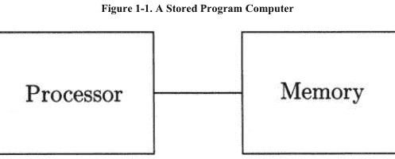

## 1.2 Linux 操作系统

大多数计算机并非仅仅一次运行一个程序。它们运行一个称为操作系统的程序。它与用户交互，管理硬件设备（如磁盘驱动器和打印机），并运行其他程序。最早的操作系统由计算机制造商编写。每台计算机都有自己独立的操作系统。第一个独立于厂商的操作系统是 Unix 操作系统。它是由贝尔实验室的一小群研究人员开发的。

贝尔实验室的主要所有者 AT&T 很快以象征性的费用向学术机构提供 Unix，这些机构反过来进一步开发了 Unix。AT&T 这种慷慨的行为可能受到 1956 年达成的一项同意令的影响，该命令限制了 AT&T 在“提供公共载波通信服务”之外的商业活动。该命令是司法部于 1949 年对西部电气公司和 AT&T 提起的投诉的结果，声称他们试图利用电话垄断优势扩展到其他领域。

在加利福尼亚大学伯克利分校开发的 Unix 版本被广泛使用。它被设计为可移植的，即易于从一种类型的计算机转移到另一种。它被称为伯克利 Unix 或 BSD Unix（Berkeley Software Division）。

Linux 是 Unix 的一种非专有变体，由林纳斯·托瓦兹（Linus Torvalds）在一个基于 386 的计算机上创建，随后由在线用户社区开发。虽然存在多个非 PC 版本的 Linux，但大多数现有的 Linux 安装都位于 Intel 兼容硬件上。

许多 Linux 用户在安装 Linux 的同时还安装了其他操作系统。为 Linux 和 Windows/DOS 设置单独的磁盘分区是很常见的。

## 1.3 Gnu C 编译器

Unix 操作系统的可移植性部分源于这样一个事实：到 1973 年，它已经用高级语言 C 重写。C 语言反过来被设计为一种可移植语言。

第一个非专有版本的 C 由自由软件基金会的理查德·斯托曼（Richard Stallman）开发。其名称 gnu 代表“Gnu's Not Unix”（Gnu 不是 Unix），宣告其脱离了专有版权限制。gnu C 编译器被广泛使用，不仅因为它免费，还因为它树立了可靠性标准。Linux 操作系统严重依赖 gnu C 编译器。

编译器是将程序（如 C 语言程序）翻译成机器代码程序的程序，该机器代码程序可以存储在计算机内存中并运行。可以存储在内存中并运行的程序称为可执行文件，有时简称为可执行文件。

gnu C 编译器分阶段工作。参见图 1-2。要将诸如 `prog.c` 之类的程序编译到 gnu 编译器，可以输入命令

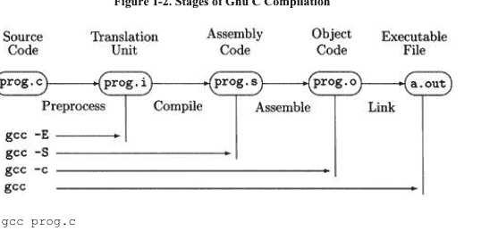

```
linuxbox$ gcc prog.c
```

此命令将翻译过程通过所有阶段，并生成名为 a.out 的可执行文件。若要停在较早的阶段，可以在 gnu 命令行中添加一个开关。例如，要生成汇编代码文件，请使用“ -S”开关（大写）。输入命令

```
linuxbox$ gcc -S prog.c
```

将生成一个汇编语言文件 `prog.s`。要完成编译，可以在 `.s` 文件上使用 `gcc` 命令

```
linuxbox$ gcc prog.s
```

## 1.4 Edlinas 汇编器

由 gnu 编译器生成的 `.s` 文件中的汇编语言与广泛用于 x86 处理器的 Intel 汇编语言不同。Edlinas 汇编语言基本上是 Intel 汇编语言。其目标代码文件在 x86 Linux 下运行。Edlinas 是一个交互式环境，由编辑器、汇编器和模拟器组成。

### 1.4.1 编辑

源代码编辑使用借自 EDLIN（一种 DOS 编辑器）的命令。命令包括 i（插入）、d（删除）、c（更改）、e（退出）、q（退出）和 h（帮助）。命令影响当前行，即带有星号 `*` 的行。使用箭头键移动星号。输入的行会被汇编器检查语法错误。

### 1.4.2 汇编

代码在输入或加载时进行汇编。汇编代码出现在屏幕右侧的默认窗口中。可以使用 `o` 命令随时保存汇编好的代码。

### 1.4.3 解释执行

为了逐行执行代码，使用空格键。即将执行的行以黄色显示。它是指*指令指针*所指向的行。回车键将指令指针重置到当前行。因此，通过移动星号，可以按任何顺序执行指令。

Esc 键会在下方的命令提示符处调出光标。在这里执行的命令是*立即*执行的。空命令退出命令行。

为了观察代码执行的效果，可以将机器的各个区域显示在屏幕右侧面板中。可以使用制表符键循环切换右侧面板内容的不同选项。

图 1-3 展示了 Edlinas 屏幕布局，该布局改编自 Dave Felter 编写的 8080 模拟器。

**图 1-3. Edlinas 屏幕**

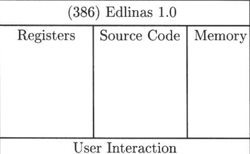

Edlinas 是一个 DOS 程序，EDL.EXE。

### 1.4.4 Dosemu

Edlinas 汇编器是一个 DOS 程序。如果你的机器有一个 DOS 分区，进入 DOS 最简单的方法是重启。但这不一定是最方便的。此外，你的机器可能没有 DOS 分区。dosemu 程序使得从 Linux 运行 DOS 程序成为可能。它可以从 www.dosemu.org 获取。

要运行 Edlinas，应将 dosemu.conf 中的 `$_graphics` 变量设置为 (1)。

## 1.5 NASM

Netwide 汇编器（NASM）是一个开源汇编器，可在 Linux 和 DOS 下运行。其使用正在增加，并且有很多值得推荐之处。特别是由于其广泛使用，它已经过非常彻底的调试。与 Edlinas 相比，它接受更广泛的汇编语言指令词汇。本书中的大多数程序可以使用任一种汇编器进行汇编。可以使用 Edlinas 逐步执行文本中的示例程序，但对于较大的程序，例如第 11 章中的中断处理程序，NASM 肯定是更好的选择。NASM 是一个工业级强度的汇编器。

要解包随书提供的发行版，请使用命令


## 1.6 其他汇编器

MASM 和 Turbo-Assembler 是在 DOS 环境下被广泛使用的汇编器。由于使用汇编语言在 Windows 中开发相对不那么容易，这些汇编器的普及度有所下降。许多人认为 Linux 也不太适合使用汇编语言。这种印象部分源于在使用 gcc 时接触到的汇编语言观点。对于习惯了 Intel 语法的人来说，AT&T 语法自然显得不那么顺手。更糟糕的是，当汇编指令插入 C 代码中时，gcc 要求的引号以及由此产生的行错乱令人非常反感。我希望到第 7 章时，读者们会相信使用汇编语言与 Linux 交互可以既简洁又优雅。

市面上还有几种其他汇编器。关于它们的简要讨论可以在 Linux 文档项目网站（www.linux.doc.org/HOWTO）上的汇编器 HOWTO 文档中找到。

## 延伸阅读

*Open Sources, Voices from the Open Source Revolution*，Chris DiBona 等，O’Reilly 出版社：1999 年。

*A Quarter Century of Unix*，Peter Salus，Addison-Wesley 出版社：1994 年。

# 第 2 章 位置记数法

ENIAC 并没有使用二进制系统。其算术处理器使用真空管连接成环，工作方式类似于旧式桌面加法器上的轮子。这些是基于十进制的装置。然而，自那以后，所有电子计算机都使用二进制系统（基数为 2）进行算术运算。因此，计算机算术的描述通常使用二进制系统或相关系统（如十六进制，基数为 16；或八进制，基数为 8）来表达。理解这些数字系统是至关重要的。已经熟悉这些系统的读者可能更愿意跳过本章。

## 2.1 十进制和五进制系统

在东方（可能在印度或中国）发明位置制十进制记数法之前，围绕十的幂构建的非位置制记数系统是很常见的。例如，阿基米德使用的系统如表 2.1 所示。在这个系统中，SPA 表示数字 $171$。当然，使用的是希腊字母，而不是拉丁字母。这类系统最明显的缺点是计算方面。这种记数法对于看出以下事实毫无帮助：

表 2.1. 非位置制十进制系统

| | | | | | |
|---|---|---|---|---|---|
| A | 1 | J | 10 | S | 100 |
| B | 2 | K | 20 | T | 200 |
| C | 3 | L | 30 | U | 300 |
| D | 4 | M | 40 | V | 400 |
| E | 5 | N | 50 | W | 500 |
| F | 6 | O | 60 | | |
| G | 7 | P | 70 | | |
| H | 8 | Q | 80 | | |
| I | 9 | R | 90 | | |

B + C = E
K + L = N     以及
T + U = W

这三者本质上代表同一个基本事实。但这只在记数法本身被用于计算时（例如我们用纸笔计算时）才是一个问题。当计算是使用实物代币（如算盘上的珠子或小石子）进行的时候，这就不再是个问题了。事实上，这种记数法可能有助于防止读错。任何将 200.00 美元的支票兑换成 20.00 美元的人都理解这一点。

但当记数法本身被用于计算时，最好使用一种能突出以下这种基本相似性的记数系统：

2 + 3 = 5
20 + 30 = 50
200 + 300 = 500

位置制系统做到了这一点。位置制数字，有时被不那么友好地称为“异教数字”，大约公元 1200 年由皮萨的列奥纳多（也被称为斐波那契）在欧洲推广。斐波那契很可能依赖于 al-Khwârizmi（我们在 *algorithm* 这个词中可以看到他的名字）在公元 820 年左右于巴格达用阿拉伯语撰写的一部著作。像当时所有的欧洲学者一样，斐波那契必然精通阿拉伯语。

本书讨论的所有进位制系统，包括我们每天使用的十进制系统，都是位置制系统。在讨论非十进制系统之前，让我们先考虑一下基数 10 在美国货币体系中的作用。

### 2.1.1 纯十进制货币

当前的美国货币体系是在 1789 年法国大革命引入公制系统之后采用的。这两个十进制系统的扩展目的都是为了通过将货币单位和计量单位与用于表示数字的十进制系统相协调，从而简化计算。

为了突出货币系统和数字系统的这种对齐，让我们设想一个简化版的美国货币系统，其中只包含便士（pennies）、一角硬币（dimes）、1 美元纸币、10 美元纸币、100 美元纸币、1000 美元纸币，等等。

1 角硬币 = 10 便士
1 美元纸币 = 10 角硬币
= 100 便士
1 张 10 美元纸币 = 10 张 1 美元纸币
= 100 角硬币
= 1000 便士
等等

在这种纯十进制货币体系中，除了便士之外，每种面额的价值正好是下一个更小单位价值的十倍。面额对应于十进制进位制中的位值，*反之亦然*。便士是 1，角硬币是 10，美元是 100，等等。

为了在这种精简的货币体系中进行任何可能的交易并携带精确的找零，每种面额都需要携带九个。例如，要支付 56.78 美元（即 5678 美分）的账单，需要 5 张 10 美元纸币、6 张 1 美元纸币、7 角硬币和 8 枚便士。

如果我们实际使用这种系统，我们的零钱包需要比现在更大。五分硬币（nickels）、四分之一美元硬币（quarters）等的存在减少了我们必须携带的零钱数量。为了得到一个不那么笨重但仍然基于简单倍数的系统，我们可以设想一个基于 5 而不是 10 的系统。

### 2.1.2 五进制货币

假设我们设想一种货币体系，其面额为便士、五分硬币、四分之一美元硬币、1.25 美元纸币、6.25 美元纸币，等等。在这个体系中，除了便士之外，每种面额的价值正好是下一个更小面额价值的五倍。让我们称 125 美分为“大美元”，并想象它的货币是一张印有大号“1”的纸币。

1 枚五分硬币 = 5 枚便士
1 枚四分之一美元硬币 = 5 枚五分硬币
           = 25 枚便士
1 张 1.25 美元纸币 = 5 枚四分之一美元硬币
              = 25 枚五分硬币
              = 125 枚便士
              等等

为了能够进行此系统中的任何交易，我们每种单位只需携带四件。这会减少零钱包的体积。但看看算术会变成什么样！要支付 56.78 美元的交易需要：

一张    31.25 美元纸币   =  31.25 美元
四张    6.25 美元纸币   =  25.00 美元
零张   1.25 美元纸币    =   0.00 美元
      两枚四分之一美元硬币    =   0.50 美元
      零枚五分硬币    =   0.00 美元
      三枚便士   =   0.03 美元
                       -------
                       =  56.78 美元

这种算术不再像我们有十进制货币时那样直观明了。尽管这种五进制货币体系与十进制货币体系同样简单，但这事实依然成立。十进制货币系统之所以看起来更简单，是因为它与我们的十进制进位制匹配。然而，如果我们同时也使用五进制进位制和五进制货币体系，简洁性就会回归。每个货币单位都将对应于五进制进位制中的位值，反之亦然。

### 2.1.3 五进制数字

五进制数字系统中的位值是一、五、二十五、一百二十五等。每个值的价值正好是下一个更小值的五倍。

任何数字都可以使用最多四个同一位值的数字来表示。因此，数字 5、6、7、8 和 9 不被使用。所有数字都仅使用数字 0、1、2、3 和 4 来表示。

五进制的 24 等同于普通十进制的 14。它的意思是 2 个五和 4 个一，就像 2 枚五分硬币和 4 枚便士。类似地，124 等同于十进制的 39。以美分为单位，它意思是 1 枚四分之一美元硬币、2 枚五分硬币和 4 枚便士。

计数如下：1, 2, 3, 4, 10, 11, 12, 13, 14, 20, 21, 22, 23, 24, 30, 31, 32, 33, 34, 40, 41, 42, 43, 44, 100, 101, 102, 103, 104, 110, 111，等等。使用五进制进位制来描述五进制货币，我们得到下表：

1 枚五分硬币 = 10 枚便士 (10=五)
1 枚四分之一美元硬币 = 10 枚五分硬币
           = 100 枚便士 (100 = 二十五)
1 张 1.25 美元纸币 = 10 枚四分之一美元硬币
              = 100 枚五分硬币
              = 1000 枚便士 (1000 = 一百二十五)

## 2.2 五进制算术


给定一个五进制算术问题：

```
423
+ 334
```

我们有方法可选。我们可以将这些数字转换为十进制，执行算术运算，然后再转换回五进制。或者，我们可以不进行任何转换，直接使用“原生算术”来完成这道题。

第一种方法起初更容易，因为我们习惯使用十进制。用货币单位来思考：423 相当于四个二十五美分硬币（quarters）、两个五分硬币（nickels）和三个便士（pennies），即普通十进制中的 113 美分。同样，334 相当于普通十进制中的 94 美分。因此，我们可以使用普通的十进制算术进行加法：

```
113
+ 94
------
207
```

一百一十三加 94 等于 207，即 2.07 美元。为了转换回去，首先取出一个整美元（big dollar）和一个四分之一美元，剩下 82 美分。这相当于三个二十五美分硬币、一个五分硬币和两个便士。因此，答案是 1312。

## 表 2.2。五进制位值

| 25位 | 5位 | 1位 | 五进制 | 十进制 |
|---|---|---|---|---|
| 0 | 0 | 1 | 1 | 1 |
| 0 | 0 | 2 | 2 | 2 |
| 0 | 0 | 3 | 3 | 3 |
| 0 | 0 | 4 | 4 | 4 |
| 0 | 1 | 0 | 10 | 5 |
| 0 | 1 | 1 | 11 | 6 |
| 0 | 1 | 2 | 12 | 7 |
| 0 | 1 | 3 | 13 | 8 |
| 0 | 1 | 4 | 14 | 9 |
| 0 | 2 | 0 | 20 | 10 |
| 0 | 2 | 1 | 21 | 11 |
| 0 | 2 | 2 | 22 | 12 |
| 0 | 2 | 3 | 23 | 13 |
| 0 | 2 | 4 | 24 | 14 |
| 0 | 3 | 0 | 30 | 15 |
| 0 | 3 | 1 | 31 | 16 |
| 0 | 3 | 2 | 32 | 17 |
| 0 | 3 | 3 | 33 | 18 |
| 0 | 3 | 4 | 34 | 19 |
| 0 | 4 | 0 | 40 | 20 |
| 0 | 4 | 1 | 41 | 21 |
| 0 | 4 | 2 | 42 | 22 |
| 0 | 4 | 3 | 43 | 23 |
| 0 | 4 | 4 | 44 | 24 |
| 1 | 0 | 0 | 100 | 25 |
| 1 | 0 | 1 | 101 | 26 |
| 1 | 0 | 2 | 102 | 27 |
| 1 | 0 | 3 | 103 | 28 |
| 1 | 0 | 4 | 104 | 29 |
| 1 | 1 | 0 | 110 | 30 |
| 1 | 1 | 1 | 111 | 31 |
| 1 | 1 | 2 | 112 | 32 |
| 1 | 1 | 3 | 113 | 33 |

### 2.2.1 原生加法

然而，使用原生算术比上述方法更容易，尤其是当数字变大时。关于需要记住的一切，基本上就是任何单位满五个必须进位，将其转换为下一个更大单位的 1：

```
423
+ 334
```

个位（或便士）列的总和是七，即 12，即 2 进 1：

```
  1
423
+ 334
  2
```

1 + 2 + 3 是六，即 11，即 1 进 1：

```
  1
423
+ 334
  12
```

而 1 + 4 + 3 是八，即 13，即 3 进 1：

```
423
+ 334
1312
```

显然，一旦我们理解了原生算术，它就会变得更容易。

### 2.2.2 原生减法

减法需要借位，例如，将一个二十五美分硬币转换为五个五分硬币，或将一个五分硬币转换为五个便士。下面从十中减去三的减法示例说明了借位：

```
 20
 - 3
```

从五分硬币列借一个五分硬币，并将其转换为五个便士：

```
10 (五个便士)
1 (一个五分硬币)
- 3
---
 2
```

剩下一个五分硬币：

```
10 (五个便士)
1 (一个五分硬币)
- 3
---
 12
```

因此，我们得到一个五分硬币和两个便士剩余。

## 2.3 转换为五进制

有时转换是不可避免的。为了让计算机能够存储以十进制输入的二进制数，需要进行转换。虽然可以通过查找一种可行的表示法来进行转换，但还有更高效的方法。考虑将 207 转换为五进制。为了理解这种转换，在开始之前看看答案可能会有帮助：

$1312 = 1 \cdot 5^3 + 3 \cdot 5^2 + 1 \cdot 5^1 + 2 \cdot 5^0$

我们可以看到，除了末尾的 2 之外，5 可以从这个和中提取出来：

$1312 = (1 \cdot 5^2 + 3 \cdot 5^1 + 1 \cdot 5^0) \cdot 5 + 2$

但这只是说明了 207 除以 5 的商和余数。请注意，余数就是我们的个位数。此外，我们可以使用十进制来计算这个商和余数，这是我们在开始这种转换时拥有的资源：

```
    41
5 ) 207
    205
    ---
      2
```
因此，我们的个位数是 2。

我们在十进制中有：

$207 = 41 \cdot 5 + 2$

再次窥视答案，我们可以看到：

$41 = 1 \cdot 5^2 + 3 \cdot 5^1 + 1 \cdot 5^0$

商 41 包含了获取其他所有数字所需的信息。可以通过更多的除法来获得它们：

```
     8
5 )  41
    40
    --
     1
```
并连接这个数字，我们得到 12。

```
     8
5 )  8
     0
     -
     3
```
这给我们 312。

最后一次除法的商为零：

```
     1
5 )  3
     0
     -
     1
```
即 1312

转换的算法由反复除以 5 组成，每个余数产生答案的一个数字。它持续进行，直到获得零商为止。

## 2.4 二进制系统

了解二进制系统很重要，因为所有现有计算机处理器的原生算术都是二进制算术。

二进制数仅使用两个数字：0 和 1。所有二进制数都由这两个数字构成。计数如下：1, 10, 11, 100, 101, 110, 111, 1000, 1001, 1010, 1011, 1100, 1101, 1110, 1111, 10000, 10001, 10010 等。

二进制系统是一个位值系统。除了个位位置外，每个位置代表一个单位，其值是下一个更小单位值的两倍。见表 2.3。

### 2.4.1 二进制加法

假设我们要相加

```
1101
+ 110
```

这是十三加六。第一列不需要进位：

```
1101
+ 110
----
  1
```

第二列也不需要：

```
1101
+ 110
----
  11
```

第三列的总和是二，即 10，即 0 进 1：

```
  1
1101
+ 110
011
```

第四列的总和也是二，再次是 0 进 1：

```
1101
+ 110
10011
```

这完全是计算机如何将十三和六相加。我们可以检查结果为十九。

```
1 x 16 = 16
0 x  8 =  0
0 x  4 =  0
1 x  2 =  2
1 x  1 =  1
--
19
```

### 表 2.3。二进制位值

| 32位 | 16位 | 8位 | 4位 | 2位 | 1位 | 二进制 | 十进制 |
|:---:|:---:|:---:|:---:|:---:|:---:|:---:|:---:|
| 0 | 0 | 0 | 0 | 0 | 1 | 1 | 1 |
| 0 | 0 | 0 | 0 | 1 | 0 | 10 | 2 |
| 0 | 0 | 0 | 0 | 1 | 1 | 11 | 3 |
| 0 | 0 | 0 | 1 | 0 | 0 | 100 | 4 |
| 0 | 0 | 0 | 1 | 0 | 1 | 101 | 5 |
| 0 | 0 | 0 | 1 | 1 | 0 | 110 | 6 |
| 0 | 0 | 0 | 1 | 1 | 1 | 111 | 7 |
| 0 | 0 | 1 | 0 | 0 | 0 | 1000 | 8 |
| 0 | 0 | 1 | 0 | 0 | 1 | 1001 | 9 |
| 0 | 0 | 1 | 0 | 1 | 0 | 1010 | 10 |
| 0 | 0 | 1 | 0 | 1 | 1 | 1011 | 11 |
| 0 | 0 | 1 | 1 | 0 | 0 | 1100 | 12 |
| 0 | 0 | 1 | 1 | 0 | 1 | 1101 | 13 |
| 0 | 0 | 1 | 1 | 1 | 0 | 1110 | 14 |
| 0 | 0 | 1 | 1 | 1 | 1 | 1111 | 15 |
| 0 | 1 | 0 | 0 | 0 | 0 | 10000 | 16 |
| 0 | 1 | 0 | 0 | 0 | 1 | 10001 | 17 |
| 0 | 1 | 0 | 0 | 1 | 0 | 10010 | 18 |
| 0 | 1 | 0 | 0 | 1 | 1 | 10011 | 19 |
| 0 | 1 | 0 | 1 | 0 | 0 | 10100 | 20 |
| 0 | 1 | 0 | 1 | 0 | 1 | 10101 | 21 |
| 0 | 1 | 0 | 1 | 1 | 0 | 10110 | 22 |
| 0 | 1 | 0 | 1 | 1 | 1 | 10111 | 23 |
| 0 | 1 | 1 | 0 | 0 | 0 | 11000 | 24 |
| 0 | 1 | 1 | 0 | 0 | 1 | 11001 | 25 |
| 0 | 1 | 1 | 0 | 1 | 0 | 11010 | 26 |
| 0 | 1 | 1 | 0 | 1 | 1 | 11011 | 27 |
| 0 | 1 | 1 | 1 | 0 | 0 | 11100 | 28 |
| 0 | 1 | 1 | 1 | 0 | 1 | 11101 | 29 |
| 0 | 1 | 1 | 1 | 1 | 0 | 11110 | 30 |
| 0 | 1 | 1 | 1 | 1 | 1 | 11111 | 31 |
| 1 | 0 | 0 | 0 | 0 | 0 | 100000 | 32 |
| 1 | 0 | 0 | 0 | 0 | 1 | 100001 | 33 |

### 2.4.2 二进制减法

假设我们要从十二中减去五：

```
1100
- 101
```

这需要借位：

```
10 (为个位列提供二)
1 (为二位列提供一)
1000
- 101
```

在第一列执行减法得到

```
10 (为个位列提供二)
1 (为二位列提供一)
1000
- 101
1
```

在二位列中，我们从 1 中减去 0：

```
1 (为二位列提供一)
1000
- 101
11
```

四位列需要另外的借位：

```
10
1101
- 101
111
```

这就是如何在二进制中从十二减去五。但这绝不是计算机进行这种算术的方式。计算机使用负数进行减法，就像这样：

```
12 - 5 = 12 + (-5)
```

由于我们在学校学习的加负数的方法是将它转换为减法，这看起来可能只是一个没有实质区别的区别。然而，计算机对负数的表示不仅仅是简单地在数字前加一个减号，所以确实存在区别。负数的表示在第 3 章第 3.6 节中讨论。


### 2.4.3 转换为二进制

首先，我们观察到，通过检查任意二进制数的个位数字，我们可以确定该数是偶数还是奇数。例如，19 是奇数，其二进制表示以 1 结尾。

```
$10011 = 1 \cdot 16 + 0 \cdot 8 + 0 \cdot 4 + 1 \cdot 2 + 1 \cdot 1$
```

进一步地

```
$10011 = (1 \cdot 8 + 0 \cdot 4 + 0 \cdot 2 + 1 \cdot 1) \cdot 2 + 1$
```

因此，如果我们使用十进制来处理数字十九，我们有

```
$19 = 9 \cdot 2 + 1$
```

假设我们将 19 转换为二进制。上述等式中的 1 是 19 的二进制形式的个位数字。我们通过除以 2 得到了 9。

```
$\begin{array}{rcl} & 9 & 1 \\ 2) & \overline{19} & \\ & 18 & \\ & 1 & \end{array}$
```

重复该过程并记下每次的余数，我们就可以得到剩余的数字。

```
$\begin{array}{cccc} 4 & 11 & 2 & 011 \\ 2) & \overline{9} & 2) & \overline{4} & 2) & \overline{2} & 2) & \overline{1} \\ & 8 & & 4 & & 2 & & 0 \\ & 1 & & 0 & & 0 & & 1 \end{array}$
```

转换是通过反复除以 2 完成的。每个余数提供一个二进制位。

## 2.5 作为比特矩形的内存

在所有电子计算机中，主存被组织为比特矩形。图 2-1 展示了一个微小的 6 位乘以 4 位的内存。如图所示，内存横向被划分为行。每一行称为一个**字**（word）。数据在计算机内存之间传输时，是按字为单位，或者按字的倍数进行的。

### 图 2-1. 包含六个四位字的内存

| 地址 | 字 |
| :--- | :--- |
| 0 | 0 1 1 1 |
| 1 | 1 1 0 0 |

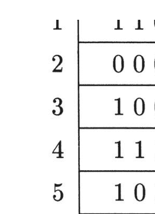

一个字中的比特数称为*字长*（word size）。图 2-1 中内存的字长为 4 位。拥有这种内存的计算机可以说具有*四位字*。此内存中的每个字存储一个可用四个二进制位表示的数字，即 0 到 15 之间的数字。因此，例如，处理器请求位于地址 3 的字时，会收到数字 8。例如，在设计国际象棋计算机时，使用 64 位字可能是一个好主意，国际象棋棋盘上的每个位置占一位。

计算机内存中的字是按顺序编号的，从零开始。这些数字称为*地址*。在图 2-1 中，地址是从 0 到 5 的整数。拥有 $n$ 个字的计算机的地址将从 0 到 $n-1$。当请求数据传入或传出内存时，计算机处理器使用地址来指定要传输的数据字。

计算机内存的总容量是内存中的字数乘以字长，即长度乘以宽度。图 2-1 中的小内存容量为 24 位。内存容量通常以*字节*而不是位来衡量。一字节内存等于八位。

基于 Intel 处理器的计算机使用八位字。这里需要提一下警告。由于来自 Intel 和 Microsoft 的文档使用术语*字*来指代 16 位对象，这种用法已变得相当标准。这是不幸的。最好保留该术语随机器变化的含义。无论如何，基于 Intel 的机器内存中的字节数等于地址的数量。

由于计算机内存中的字数通常是二的大幂次或其小倍数，因此从公制系统中借用了这些大幂次的几个名称。例如，$2^{10}$ 是 1024，而 1024 大约等于 1000。在公制系统中，字母 K（来自 *kilo*，千）用来代表 1000。在提及计算机内存时，kilo 意味着 1024。其他被采用的公制前缀显示在下面的表格中。

| 精确值 | 符号 | 前缀 | 近似值 |
| :---: | :---: | :---: | :---: |
| $2^{10}$ | 1,024 | K | kilo | 千 (thousand) |
| $2^{20}$ | 1,048,576 | M | mega | 百万 (million) |
| $2^{30}$ | 1,073,741,824 | G | giga | 十亿 (billion) |
| $2^{40}$ | 1,099,511,627,776 | T | tera | 万亿 (trillion) |

二的幂次

使用表中的近似等式可以使涉及二的幂次的大数计算简化。例如，IBM AT 计算机的最大内存容量是 $2^{24}$ 字节。为了用更熟悉的术语表达这个数量，我们可以将 $2^{24}$ 分解如下：

$2^{24} = 2^4 \times 2^{10} \times 2^{10}$
$= 16 \times 1 \text{K} \times 1 \text{K}.$

这大约等于 1600 万字节。由于 $2^{20} = 1 \text{K} \times 1 \text{K} = 1$ 兆（Meg），因此精确的内存量是 16 兆字节（Megabytes）或 16,777,216 字节。

## 2.6 十六进制系统

十六进制很重要，因为它比二进制更容易读写，但可以轻松地相互转换。

十六进制也是我们要考虑的第一个大于十的基数。十六进制并没有弃用某些数字，而是需要额外使用数字。由于所有小于十六的数字都需要数位，这意味着十、十一、十二、十三、十四和十五的位置是开放的。习俗是用字母 A、B、C、D、E 和 F 来填充这些位置。

所以在十六进制中，计数是这样的：1, 2, 3, 4, 5, 6, 7, 8, 9, A, B, C, D, E, F, 10, 11, 12, 13, 14, 15, 16, 17, 18, 19, 1A, 1B, 1C, 1D, 1E, 1F, 20，等等。参见表 2.4。

**表 2.4. 十六进制数位的位值**

| 16s | 1s | 十六进制 | 十进制 |
| :---: | :---: | :---: | :---: |
| 0 | 1 | 1 | 1 |
| 0 | 2 | 2 | 2 |
| 0 | 3 | 3 | 3 |
| 0 | 4 | 4 | 4 |
| 0 | 5 | 5 | 5 |
| 0 | 6 | 6 | 6 |
| 0 | 7 | 7 | 7 |
| 0 | 8 | 8 | 8 |
| 0 | 9 | 9 | 9 |
| 0 | A | A | 10 |
| 0 | B | B | 11 |
| 0 | C | C | 12 |
| 0 | D | D | 13 |
| 0 | E | E | 14 |
| 0 | F | F | 15 |
| 1 | 0 | 10 | 16 |
| 1 | 1 | 11 | 17 |
| 1 | 2 | 12 | 18 |
| 1 | 3 | 13 | 19 |
| 1 | 4 | 14 | 20 |
| 1 | 5 | 15 | 21 |
| 1 | 6 | 16 | 22 |
| 1 | 7 | 17 | 23 |
| 1 | 8 | 18 | 24 |
| 1 | 9 | 19 | 25 |
| 1 | A | 1A | 26 |
| 1 | B | 1B | 27 |
| 1 | C | 1C | 28 |
| 1 | D | 1D | 29 |
| 1 | E | 1E | 30 |
| 1 | F | 1F | 31 |
| 2 | 0 | 20 | 32 |
| 2 | 1 | 21 | 33 |

能够进行十六进制加法和减法是有价值的。调试器通常以十六进制显示寄存器，能够检查显示的算术运算而不必转换回十进制很方便。

如果我们记得进位和借位是以 16 进行的，十六进制中的加法和减法就很容易做到。

### 2.6.1 十六进制加法

要相加

```
47BC
+ A78
-------
```

我们从十二加八开始，结果是二十，即 14H（H表示十六进制），即 4 进 1：

```
  1
47BC
+ A78
-----
   4
```

1 加 11（B）加 7 是 19，即 13H，即 3 进 1：

```
  11
47BC
+ A78
-----
  34
```

1 + 7 + A（10）= 18，即 12H，即 2 进 1：

```
 111
47BC
+ A78
-----
 234
```

最后，1 + 4 = 5：

```
 111
47BC
+ A78
-----
5234
```

### 2.6.2 十六进制减法

要相减

```
47BC
- A4E
```

我们从借位开始：

```
     1C
   47A
-  A4E
```

1C - E 是二十八减十四，结果是十四：

```
     1C
   47A
-  A4E
-------
     E
```

A - 4 是十减四是 6：

```
     1C
   47A
-  A4E
-------
   6E
```

再次借位

```
  171C
   37A
-  A4E
-------
   6E
```

17 - A 是二十三减十，结果是十三或 D：

```
  171C
   37A
-  A4E
-------
  D6E
```

最后 3 - 0 = 3：

```
  171C
   37A
-  A4E
-------
 3D6E
```

### 2.6.3 转换为十六进制

要将一个数字转换为十六进制，我们可以根据需要多次除以 16。假设我们将 1000 转换为十六进制：

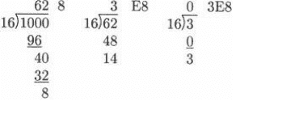

为了演示二进制到十六进制转换的便捷性，我们再次考虑数字 1000，但这次我们将它转换为二进制：

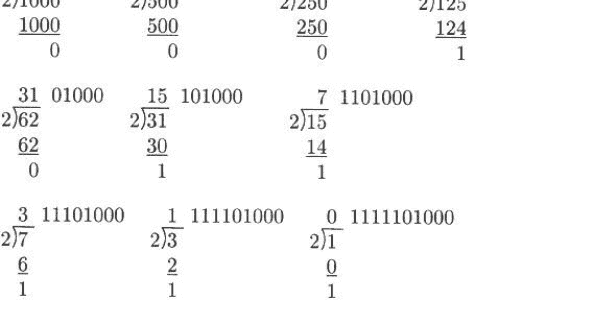

除以 2 四次本质上与除以 16 相同这一事实表明，此转换的四个阶段必然对应十六进制转换的一个阶段。如果我们把二进制位分成四位一组，我们确实观察到这种关系。

| 二进制 | 十六进制 | 十进制 |
| :---: | :---: | :---: |
| 11 1110 1000 | 3 E 8 | 1000 |

*注意：原文将二进制转换分为显示 `11 | 1110 | 1000` 在上方和 `3 | E | 8` 在下方的两行表格。我根据“表格样式”指令将其合并为更清晰的单一表格结构，但仔细查看 OCR 后：*

| | | |
| :---: | :---: | :---: |
| 11 | 1110 | 1000 |
| 3 | E | 8 |

这些四位数字块，当作为单个数字 11、1110 和 1000 处理时，给出了十六进制位 3、E 和 8。这是一千的十六进制表示。如何反向转换也很清楚。两种进制之间的转换足够简单，甚至可以不经思考完成。参见表 2.5。这使得可以使用十六进制作为二进制的人类可读形式，一种高级机器语言（！）。考虑以下同一数字的两种表示：

| 二进制 | 十六进制 |
| :---: | :---: |
| 1011 | B |
| 0010 | 2 |
| 1001 | 9 |
| 0101 | 5 |
| 0000 | 0 |
| 0111 | 7 |
| 1010 | A |
| 1000 | 8 |
| 1000 | 8 |

*最后一个表格的更正：原始 OCR 将其作为单行 9 列和另一行 9 列。我将恢复多列表格格式。*

| 1011 | 0010 | 1001 | 0101 | 0000 | 0111 | 1010 | 1000 | 1000 |
| :---: | :---: | :---: | :---: | :---: | :---: | :---: | :---: | :---: |
| B | 2 | 9 | 5 | 0 | 7 | A | 8 | 8 |


## 2.5 二进制与十六进制

| 二进制 | 十六进制 | 十进制 |
| :--- | :---: | :---: |
| 0000 | 0 | 0 |
| 0001 | 1 | 1 |
| 0010 | 2 | 2 |
| 0011 | 3 | 3 |
| 0100 | 4 | 4 |
| 0101 | 5 | 5 |
| 0110 | 6 | 6 |
| 0111 | 7 | 7 |
| 1000 | 8 | 8 |
| 1001 | 9 | 9 |
| 1010 | A | 10 |
| 1011 | B | 11 |
| 1100 | C | 12 |
| 1101 | D | 13 |
| 1110 | E | 14 |
| 1111 | F | 15 |

假设你需要通过电话向硬件支持人员朗读上述数字之一，或者将其抄写在明信片上。毫无疑问，使用十六进制会更简单，且不易出错。

计算机程序最初由一行行二进制代码组成。这里存在着一种苦乐参半的反讽。填写满是零和一的代码表，通常是由女性完成的工作。因此，许多女性得以涉足计算机编程领域的早期阶段。

## 2.6.4 为什么不用八进制？

八进制数可以像十六进制数一样与二进制数相互转换，只是分组时按三位一组而非四位一组。八进制相对于十六进制的优点在于不需要使用字母数字。然而，随着字节作为基本内存单位的日益普及，八进制的重要性有所下降。

## 2.7 进制区分标记法

由于十进制中的所有数字在十六进制中都是有效的，如果没有额外信息，我们无法确定诸如“50”这样的数字是表示十进制还是十六进制。表示十六进制的常见约定是后缀添加 H。当使用这种约定时，“50”仅表示五十；而“50H”表示十六进制的五十，即八十。偶尔，特别是在汇编器中，会添加后缀 B 和 D 来表示二进制和十进制。显然，添加后缀 O 来表示八进制不是一个好主意。在 C 语言中，八进制通过在前面加 0 来表示，十六进制通过在前面加 0x 来表示。本书主要依赖十进制、十六进制和二进制记数法。为了区分这些进制，将使用以下约定：

- 除了 C 程序外，十六进制始终通过后缀 H 表示。（此外，由于 3.1.1 节讨论的问题，汇编语言中使用的十六进制记数法前面还会加一个 0。）
- 二进制通过将数字每四个一组，用空格分隔来表示。
- 十进制为默认进制。对于未明确指明进制的任何数字，均假定为十进制。

## 2.8 其他进制中的分数

涉及分数的许多计算使用科学记数法。由于科学记数法涉及十进制分数和十的显式幂，它允许小数点位置灵活。例如：

```
2345.6789 × 10^2 = 23.456789 × 10^4
```

因此，科学记数法有时被称为*浮点*记数法。该表示法具有浮点性质，这是因为表示法的所有部分（包括小数部分）都使用十的幂。为了在采用二进制系统的计算机计算中利用浮点性质，所有分数和显式幂都必须是二进制的，而不是十进制的。

巴比伦人使用非十进制的占位分数，如今这在我们的时间和角度单位系统中依然存在，我们将分钟和秒视为六十进制分数。

十进制分数当然是我们日常的标准。例如：

```
.125 = 1 · (1/10)^1 + 2 · (1/10)^2 + 5 · (1/10)^3 = 125/1000 = 1/8
```

我们通过长除法找到这个十进制分数，

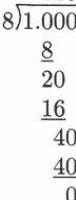

假设我们要寻找八分之一的五进制分数。我们可以在五进制下使用长除法，必要时使用五进制乘法表。（八的五进制表示为 13）。

.0303 ... (3 × 3 = 14，即 4，进位 1)

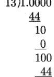

这是一个循环小数，类似于十进制系统中的 .33333 ... = 1/3。因此，八分之一在五进制系统中是

```
1/13 = .0303030303...
```

一个无限循环小数。其含义如果用普通十进制表示法表达，即为：
1/8 = 0 · (1/5)^1 + 3 · (1/5)^2 + 0 · (1/5)^3 + 3 · (1/5)^4 + ...

如果使用长除法来求十六进制分数，我们会得到一个有限的表示。

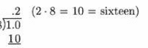

由于 2 · 1/16 = 1/8，这显然是正确的。在二进制下，同样的除法看起来像这样：

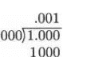

这是正确的，因为
1/8 = 0 · (1/2)^1 + 0 · (1/2)^2 + 1 · (1/2)^3

在早期的 Intel 系统中，基于浮点数的计算是在单独的处理器（如 80387）上完成的。从 486 开始，这些浮点单元被整合到主处理器中。在 C 语言中，程序员可以通过使用 `double` 等浮点数据类型将计算发送到浮点单元。

## 2.9 分数转换

在上一节中，我们使用长除法根据给定的整数分子和分母来寻找占位分数。例如，为了寻找二进制占位分数，我们可以在二进制下进行长除法。如果给定的是其他进制中的占位分数，我们可以使用乘法过程进行转换。例如，假设给定的十进制分数为 .33333333...，我们希望将其转换为二进制分数。设 $b_1, b_2, b_3...$ 为我们二进制分数中的未知数字：

.b₁ b₂ b₃ ...

如果我们要利用等式
.3333333... = b₁ · (1/2)^1 + b₂ · (1/2)^2 + b₃ · (1/2)^3 + ...
我们可以如下确定它们的值。假设我们将此方程两边都乘以 2。
.6666666... = b₁ + b₂ · (1/2)^1 + b₃ · (1/2)^2 + ...

两边整数部分必须相等。左边整数部分为零，因此 b₁ = 0。这样我们就得到了第一个数字，同时也得到了方程
.6666666... = b₂ · (1/2)^1 + b₃ · (1/2)^2 + b₄ · (1/2)^3 + ...

如果将此方程乘以 2，我们得到
1.333333... = b₂ + b₃ · (1/2)^1 + b₄ · (1/2)^2 + ...

再次，两边整数部分必须相等，因此 b₂ = 1。从此方程中减去 1 = b₂，得到方程
.333333... = b₃ · (1/2)^1 + b₄ · (1/2)^2 + b₅ · (1/2)^3 + ...

以此类推，我们得到 b₃ = 1, b₄ = 0, b₅ = 1, b₆ = 0，等等。因此 .333333 的二进制形式为
.01010101...

我们刚刚通过反复乘以 2 从十进制分数得出了二进制分数。要从十进制分数中求得五进制分数，我们从类似的方程开始，并反复乘以 5。

根据定义，五进制系数使此方程成立：
.3333333... = b₁ · (1/5)^1 + b₂ · (1/5)^2 + b₃ · (1/5)^3 + ...

将此方程乘以 5 得到
1.666666... = b₁ + b₂ · (1/5)^1 + b₃ · (1/5)^2 + ...

两边整数部分必须相等。因此 b₁ = 1。减去 1 = b₁，得到：
.6666666... = b₂ · (1/5)^1 + b₃ · (1/5)^2 + b₄ · (1/5)^3 + ...

将此方程乘以 5 得到
3.333333... = b₂ + b₃ · (1/5)^1 + b₄ · (1/5)^2 + ...

由此我们得到 b₂ = 3，且
.3333333... = b₃ · (1/5)^1 + b₄ · (1/5)^2 + b₅ · (1/5)^3 + ...

以此类推，我们得到 b₃ = 1, b₄ = 3, b₅ = 1, b₆ = 3，等等。因此，五进制等价值为 .13131313... 。

## 延伸阅读

《数字词语与数字符号：数字的文化史》，卡尔·梅宁格（Karl Menninger），多佛书店（Dover Books）：1992 年。

# 第 3 章。逻辑电路与计算

电子计算机由逻辑电路组成。本章旨在解释如何利用这些电路实现基本的计算机算术和存储功能。本章最终以对 ADD 和 MOV 指令的简要讨论作为结尾。

最基本的逻辑电路称为*门*（gates）。门是控制电路。最简单的逻辑门是 NOT 门。在下一节中，将展示 NOT 门如何控制手电筒。

## 3.1 NOT 门


图 3-1 所示的简单手电筒电路由顶部的开关控制，图中开关处于断开位置。电池负极直接连接到灯泡，而正极则仅通过开关与灯泡相连。因此，当开关断开时，电流不会流动，灯泡熄灭。当开关闭合时，电流可以流动，灯泡点亮。这种控制是机械式的。


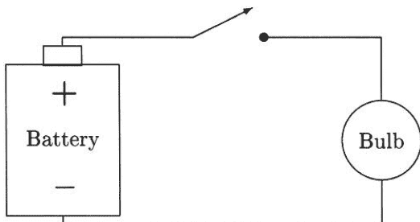

### 3.1.1 逻辑门端子

逻辑门是一种像开关一样工作的电路。图 3-2 展示了一个通用逻辑门连接电池的情形。如图所示，逻辑门有四个或更多端子。


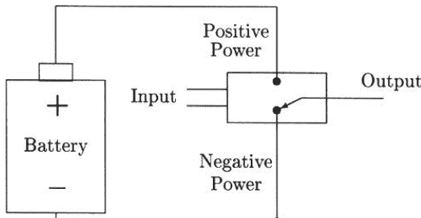

- 1. 输出端子。该端子经过切换，连接到正电源或负电源端子。这种切换是由嵌入在硅中的固态电子器件完成的，不涉及任何运动部件。
- 2. 正电源端子。该端子始终连接到电池或电源的正极。
- 3. 负电源端子。该端子始终连接到电池或电源的负极。
- 4. 输入端子。逻辑门有一个或多个输入端子。这些端子承载决定输出端子是切换到正电源端子还是负电源端子的输入信号。不同类型的逻辑门以不同的方式做出这种判定。

#### 逻辑值约定

由于逻辑门的两个电源端子始终连接到电池或电源的对应端子，因此输出端子总是提供到电池或电源正极或负极的连接。对于本书中的电路：

- 直接或直接间连接到电池或电源正极端子的逻辑门端子被描述为处于“逻辑 1”状态。
- 直接或间连接到电池或电源负极端子的逻辑门端子被描述为处于“逻辑 0”状态。

由于输入端子通常像输出端子一样直接或间连接到电池或电源端子，因此它们也可以被描述为处于逻辑 1 或逻辑 0 状态。输入端子被设计为处于逻辑 1 或逻辑 0 这一事实还有一个进一步的后果，即一个逻辑门的输出可以以可预测的结果连接到另一个逻辑门的输入。

### 3.1.2 非门的行为

非门是具有一个输入端子的逻辑门。要描述非门的行为，只需描述其输入如何决定其输出即可。规则如下：

- 如果输入为逻辑 1，则输出为逻辑 0。
- 如果输入为逻辑 0，则输出为逻辑 1。

现在我们可以将一个手电筒组装起来，方法是将非门的输出连接到灯泡，输入连接到机械开关。图 3-3 说明了这种连接。当示意图中的导线在黑色圆点处交叉时，表示这些导线是连接的。当导线交叉且没有黑色圆点时，表示它们彼此不接触。此图中的手电筒最终仍由机械开关控制，就像图 3-1 中的手电筒一样。当开关处于图中所示的下方位置时，手电筒是亮的。下方位置将非门的输入端子连接到电池负极，使其处于逻辑 0。因此，由于非门的工作方式，输出处于逻辑 1。这意味着非门内部将输出端子连接到正电源端子，进而连接到电池正极。因此灯泡获得电流，手电筒点亮。

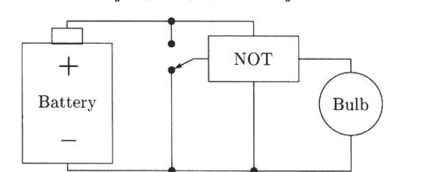

### 3.1.3 非门的真值表

逻辑值使得用一个小的表来总结非门的行为变得容易。这样的表称为真值表。表 3.1 显示了非门的真值表。

#### 表 3.1. 非门真值表

| 输入 | 输出 |
|-------|--------|
| 1     | 0      |
| 0     | 1      |

### 3.1.4 门级图

展示各个逻辑门但不展示其内部结构的逻辑电路图称为 *门级图*。在门级图中，通常不显示逻辑门上的电源端子。门级图中使用的非门符号仅显示两个端子：输入和输出：

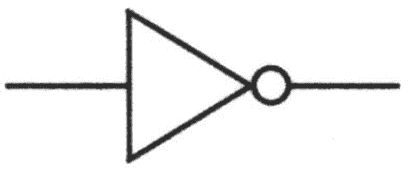

左侧显示的导线代表输入；右侧的导线是输出。

图 3-4 展示了使用原理图符号的非门控制手电筒的示意图。这个图可能会让人困惑，因为未显示到非门的主要电源连接。在此图中，唯一的电池连接是在非门的信号输入端。虽然未显示电源连接，但它们必须存在，否则电路无法工作。图 3-4 代表的连接与图 3-3 完全相同。

#### 图 3-4. 这个手电筒是亮的！

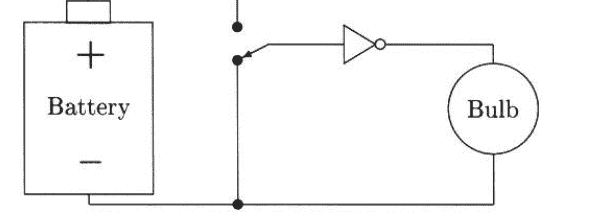

## 3.2 布尔运算符

上一节讨论的非门是逻辑门的一个例子。逻辑门是其行为基于布尔运算符建模的电路。

最基本的布尔运算符包括 AND（与）、OR（或）、XOR（异或）和 NOT（非）。在 C 语言中，我们有符号 `&` 代表 AND，`|` 代表 OR，`!` 代表 NOT。这些运算符的工作原理可以通过 C 语言中的两个例子来说明。在这些例子中，C 语言语句使用逐步简化的过程进行求值。

### 3.2.1 OR 运算符

第一个例子是一个涉及布尔 OR 运算符的 `if` 语句。在以下部分中，我们假设 `x` 已经被赋予值 7。

```text
if ((x > 0) || (x < 5)) y = 10;
```

- 首先可以确定操作数的真值。在这种情况下，因为 `(x > 0)` 为真，其值为 1；因为 `(x < 5)` 为假，其值为 0。这些求值结果导致 C 语言语句简化如下。

```text
if (1 || 0) y = 10;
```

- 接下来可以应用布尔 OR 运算符。OR 看到的仅仅是由操作数求值结果得出的真值。OR 接收一个 1 和一个 0，并产生一个 1。

```text
if (1) y = 10;
```

- 接下来 `if` 可以工作。它只在括号中看到 1。因此，它产生一个简单的赋值语句

```text
y = 10;
```

该过程的最终结果是 `y` 被设置为值 10。请注意，OR 运算符从未看到 `x` 的值。它只需要 0 和 1 来完成其工作。因此，OR 运算符的工作原理可以通过与非门真值表类似的真值表来描述。表 3.2 显示了 OR 运算符的真值表。在布尔运算符的真值表中，字母 `p` 和 `q` 常被用作真值 0 和 1 的变量。只有这两种可能取值的变量有时被称为 *布尔变量*。请注意，C 示例中做出的决定可以从表 3.2 的第二行推断出来。

#### 表 3.2. OR 真值表

| p | q | (p OR q) |
|---|---|----------|
| 1 | 1 | 1        |
| 1 | 0 | 1        |
| 0 | 1 | 1        |
| 0 | 0 | 0        |

### 3.2.2 AND 运算符

AND 运算符也可以用真值表来描述。参见表 3.3。下一个例子展示了如何使用该表来求值包含 AND 运算符的 C 语言语句。

- 再次假设 `x = 7`。

```text
if ((x > 0) && (x < 5)) z = 20;
```

#### 表 3.3. AND 真值表

| p | q | (p AND q) |
|---|---|-----------|
| 1 | 1 | 1         |
| 1 | 0 | 0         |
| 0 | 1 | 0         |
| 0 | 0 | 0         |


• 再次，操作数的值分别为 1 和 0。
```
if(1 && 0) z = 20;
```

• AND 运算符的操作可以参考表 3.3 的第二行，从中我们看出结果为 0。
```
if( 0  ) z = 20;
```

• 括号中的 0 导致语句为空。什么也不会发生。
```
;
```

从这些例子中，可以清楚地看到布尔运算符的工作是操作真值并产生一个真值。

### 3.2.3 布尔表达式

就像 C 语言中的运算符可以嵌套一样，例如在语句
```c
if((x > 0) && (x < 5)) || (x = 7)) w = 30;
```
中，布尔运算符本身也可以嵌套
((p AND q) OR r)

由此产生的表达式称为布尔表达式。就像布尔运算符有真值表一样，布尔表达式也有真值表。上面所示表达式的真值表如表 3.4 所示。

| p | q | r | ((p AND q) OR r) |
|---|---|---|------------------|
| 1 | 1 | 1 | 1 |
| 1 | 1 | 0 | 1 |
| 1 | 0 | 1 | 1 |
| 1 | 0 | 0 | 0 |
| 0 | 1 | 1 | 1 |
| 0 | 1 | 0 | 0 |
| 0 | 0 | 1 | 1 |
| 0 | 0 | 0 | 0 |

表 3.4. 布尔表达式的真值表

## 3.3 逻辑门

表 3.5 展示了布尔 NOT 运算符的真值表。它与表 3.1 中所示的 NOT 门真值表非常相似。如果我们把 p 看作输入，(NOT p) 看作输出，实际上没有区别。甚至可以将 NOT 门视为 NOT 运算符的硅实现。布尔运算符 AND、OR 和 XOR 也在硅中实现。

表 3.5. NOT 的真值表

| p | (NOT p) |
|---|---------|
| 1 | 0 |
| 0 | 1 |

### 3.3.1 OR 门

OR 门是一个具有两个输入端子的电路。它在门级图中用符号表示


表 3.6. XOR 的真值表

| p | q | (p XOR q) |
|---|---|---|
| 1 | 1 | 0 |
| 1 | 0 | 1 |
| 0 | 1 | 1 |
| 0 | 0 | 0 |

输入显示在左侧。输出在右侧。根据表 3.2，我们可以推断

- 如果两个输入端子都处于逻辑 0，则输出端子将处于逻辑 0。
- 如果任一输入端子处于逻辑 1，则输出端子将处于逻辑 1。

例如，在下述电路中，除非施加到所有 Filter 输入端的逻辑值都等于 0，否则输出将处于逻辑 1。如果在每个 Filter 输入端施加逻辑 0，则输出逻辑值将与输入逻辑值相同。在这种情况下，可以将输入信号视为通过了门。请注意，门的类比在信号传播方面是有意义的，而不是电压传播。施加到任一 Filter 输入端的逻辑 1 保证输出将处于逻辑 1，但这应被视为门的*闭合*。输入的变化不会传递到输出。该电路*不允许*信号通过。因此，当调节输入处于逻辑 1 时，将这些 OR 门视为*闭合*是有道理的。

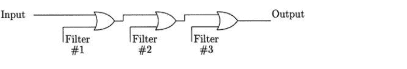

### 3.3.2 AND 门

AND 门也是一个双输入门。其符号为


根据表 3.3，我们可以推断

- 如果两个输入端子都处于逻辑 1，则输出端子将处于逻辑 1。
- 如果任一输入端子处于逻辑 0，则输出端子将处于逻辑 0。

在下面的电路中，施加到所有 Filter 输入端的逻辑值必须等于 1；否则输出将处于逻辑 0。如果在每个 Filter 输入端施加逻辑 1，则输入逻辑值通过门并成为输出值。

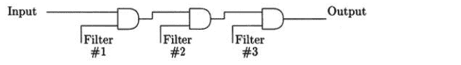

### 3.3.3 布尔电路

AND、OR 和 NOT 逻辑门可用于构建各种各样的逻辑电路。对于任何布尔表达式，都有一个对应的电路。例如，对应于布尔表达式 ((p AND q) OR r)

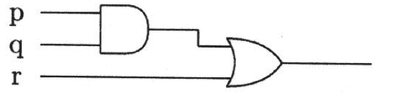

该电路的真值表与其来源的布尔表达式的真值表相同。如表 3.4 所示。

布尔运算符 XOR 的真值表显示在表 3.6 中。通过使用该真值表中具有逻辑 1 输出的行，可以找到 XOR 的布尔表达式。使用该表，我们找到这样的两行，一行是 p = 1 且 q = 0，另一行是 p = 0 且 q = 1。这些是表达式 (p AND (NOT q)) 和 ((NOT p) AND q) 为真的行。因此，表达式 ((p AND (NOT q)) OR ((NOT p) AND q)) 具有与 XOR 相同的真值表，并可用于构建 XOR 电路

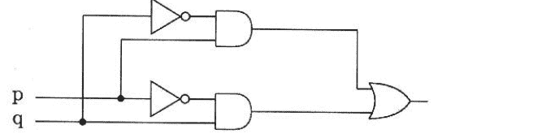

布尔表达式 (p OR q) AND (NOT (p AND q)) 也具有相同的真值表。因此，对应于该表达式的逻辑电路也作为 XOR 电路工作。该电路如下所示：

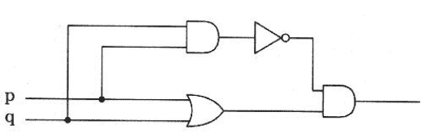

XOR 的标准符号为

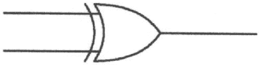

XOR 可以使用具有正确真值表的任何电路来实现，包括刚刚展示的两个电路。

### 3.3.4 传播延迟

逻辑电路行为的一些基本特性在任何仅基于布尔表达式和真值表的描述中都被省略了。其中一个特性是传播延迟，即输入信号的变化引起输出变化所需的时间。例如，在 100 MHz 处理器中使用的门的传播延迟必须小于 10 纳秒。这是因为 100 MHz 意味着每秒 1 亿个周期 (cps)。因此，每个处理周期的长度是 $\frac{1}{100,000,000}$ 秒，这与 $\frac{10}{1,000,000,000}$ 秒或 10 纳秒相同。

| 频率 | 每秒周期数 | 周期长度 | 等效 |
|---|---|---|---|
| 1 Hz | 1 cps | 1 s | 1 sec |
| 1 kHz | 1,000 cps | 1 ms | $\frac{1}{1,000}$ sec |
| 1 MHz | 1,000,000 cps | 1 μs | $\frac{1}{1,000,000}$ sec |
| 1 GHz | 1,000,000,000 cps | 1 ns | $\frac{1}{1,000,000,000}$ sec |

考虑到执行一个处理周期可能需要信号依次通过例如五个这样的门，限制可能会降低到 2 纳秒或更低。减少这种时间延迟是当前制造技术的主要目标之一。传播延迟越小，电路可以运行的时钟速度就越快。

同样重要的是耗散功率的量。当许多电路被密集地打包在芯片上时，除非将每个电路耗散的功率降低到非常低的水平，否则温度可能会升高到不可接受的级别。减少功率耗散是处理器设计的另一个主要目标。

架构观点将这些问题排除在外。从这个角度来看，我们需要知道的关于布尔电路的一切内容都包含在其真值表中。在计算机科学中，架构观点通常比在电气工程中更适用。

## 3.4 加法电路

本节展示了如何使用逻辑电路进行加法。

再次考虑 13 和 6 的加法，并注意到在每一列中，我们要添加两个数字以及来自前一列的进位数字。

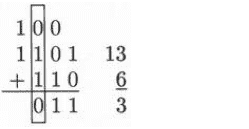

能够完成此类加法中一列所涉工作的加法电路称为*全加器*。它产生该列中两个数字的和以及来自前一列的进位数字。它还产生输出进位数字。如图所示的 13 和 6 的加法需要使用四个全加器电路。由于使用的是二进制系统，布尔真值 0 和 1 可以作为二进制数字使用。*表 3.7* 显示了全加器电路的真值表。构建全加器并不难。输出和电路可以从两个 *XOR* 电路构建。输出进位电路可以从三个 AND 门和两个 OR 门构建。参见图 3-5。全加器有三个输入和两个输出，它们共同作为一个加法器的一列发挥作用。

### 图 3-5. 全加器电路

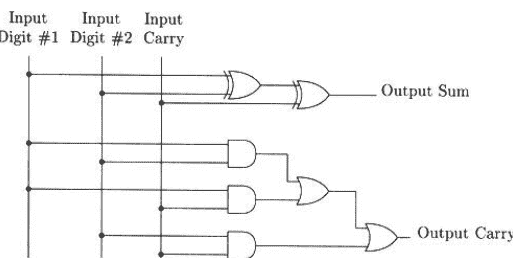

### 表 3.7. 全加器的真值表

| 输入数字 #1 | 输入数字 #2 | 输入进位 | 输出和 | 输出进位 |
| :---: | :---: | :---: | :---: | :---: |
| 0 | 0 | 0 | 0 | 0 |
| 0 | 1 | 0 | 1 | 0 |
| 1 | 0 | 0 | 1 | 0 |
| 1 | 1 | 0 | 0 | 1 |
| 0 | 0 | 1 | 1 | 0 |
| 0 | 1 | 1 | 0 | 1 |
| 1 | 0 | 1 | 0 | 1 |
| 1 | 1 | 1 | 1 | 1 |


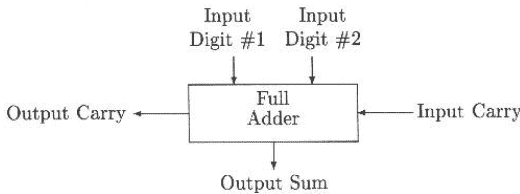

用于相加四位二进制数的电路需要将四个全加器串联在一起。

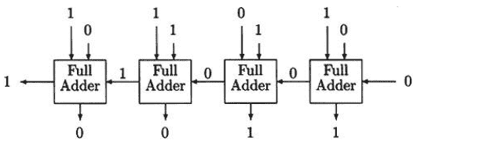

这就是四位处理器中加法电路的样子。这里展示的是本节开头所说明的十三加六的相同计算。在二进制中，即 1101 加 0110。得到的总和为 0011。还有一个输出进位值为 1。这里没有使用输入进位。令人惊讶的是，实际上却需要它。我们将在 3.7 节中看到它是做什么用的。

四位处理器的特点之一是它每次以四位二进制数的形式进行相加。

拥有四位处理器的计算机并不限于小数字算术，但其软件需要将会把大数分解为不超过 16 的数字。

## 3.5 时序电路

在迄今为止展示的所有电路中，输出是由输入决定的。通过使用组成门的真值表，可以构建整个电路的真值表。这似乎应该是所有逻辑电路的情况。然而，如果输出被反馈回输入，那么在确定真值表的过程中就会引入一个恶性循环。具有反馈回路的电路被称为*时序电路*。

没有反馈回路的电路无法存储逻辑值。布尔电路的输出是其输入，即*当前*输入的函数。这意味着，例如，如果你试图将布尔电路用作存储器，那么无论你决定使用什么样的取指令作为内存读取命令，这个输入总是产生相同的输出，即由真值表指定的输出，因此它不会是一个真正的内存读取。真正内存读取的输出将取决于在*过去*某个时间存储的内容。

时序电路之所以重要，是因为它们可以存储逻辑值。

### 3.5.1 触发器

图 3-6 展示了一个称为*触发器*的电路示例。图中的 S 代表*置位*，R 代表*复位*。如果 S = 1 且 R = 0，该电路的输出可以被置位。在这种情况下，由 R 输入馈送的与门被强制输出 0。因此，另一个与门的两个输入均为 1。因此其输出为 1，最终输出为 1。

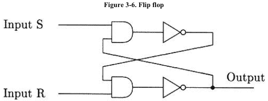

如果 S = 0 且 R = 1，情况正好相反，最终输出为 0。

然而，如果 S = 1 且 R = 1，输出不能由真值表确定。反馈回路使得这成为不可能。事实证明，如果从置位或复位状态进入 S = R = 1 的状态，则最终输出保持不变。它不会改变。

### 3.5.2 锁存器

图 3-7 展示了一个称为*锁存器*的电路示例。此电路存储一位。它之所以被称为锁存器，是因为它“锁定”在一个值上。

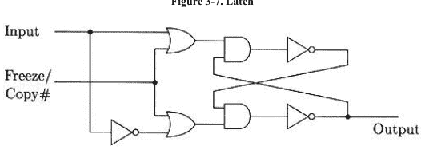

该图中的 *Freeze/Copy#* 标签使用了 Intel # 约定：当一个信号被标记为一个有意义的词时，除非标签后附加了 #，否则当线处于逻辑 1 时，其含义才真实适用；如果附加了 #，则情况相反。因此，*Freeze/Copy#* 标签告诉我们要这样理解：逻辑 1 意味着冻结（Freeze），逻辑 0 意味着复制（Copy）。

- 当 *Freeze/Copy#* 线为零时，或门打开，电路变为一个触发器，此时输入要么是置位要么是复位。非门使 S 和 R 输入互为相反数。输入值被复制到输出。
- 当 *Freeze/Copy#* 线变为 1 时，两个或门都被强制为 1，从而冻结输出。当输出被冻结时，后续输入的变化对电路没有影响。输出值保持不变，即最后一次 *Freeze/Copy#* 线从 1 变为 0 时（即最后一次冻结时）的值。

该输出值处于存储状态。

### 3.5.3 寄存器

四个锁存器并联使用可以存储四位。这是*寄存器*的一个例子。四位寄存器是一个可以存储四位的电路集合。处理器中不同的寄存器不需要存储相同数量的位，但当它们相同时，工作会更容易。一个“典型”寄存器中的位数是处理器的属性之一，它决定了该处理器被称为四位处理器、八位处理器或其他。

四位寄存器的内容使用四位二进制数非常自然地指定。四位二进制数是 0 到 15 的整数。八位寄存器容纳 0 到 127 的整数。

我们发现，指定寄存器内容的最自然方式没有为负数留下空间。负数的表示将在下一节中讨论。

### 3.5.4 位的重要性

由于使用二进制数来描述寄存器和内存位置的内容，*有效数字*的数值概念对于识别特定存储位置的单个位很有用。例如，如果四位寄存器包含二进制数 1100，那么按重要性顺序排列的四个数字是 1、1、0 和 0。因此，最高有效位是 1，最低有效位是 0。三个最高有效位是 110。三个最低有效位是 100。有时在本文档中，最高有效位被称为*上*位或*高*位，而最低有效位被称为*下*位或*低*位。

## 3.6 负数表示

表示负数的常规方法是在前面加一个负号。在 3 前面加一个 - 就变成了 -3。这种表示负数的方法称为*原码*表示。在计算机上，可以通过分配一位存储用于符号位来实现这种方法。要改变使用原码表示存储的数的符号，只需翻转符号位即可。原码表示通常不用于计算机中的整数。原因是，为了使用原码表示进行加法，你需要按照教给小孩的方法去做。

### 3.6.1 原码加法

要相加 x 和 y：

- 情况 I。如果 x 和 y 都是正数，只需相加并将结果设为正数。
- 情况 II。如果 x 和 y 都是负数，去掉负号，相加这两个数，并在结果后加上负号。
- 情况 III。如果 x 和 y 符号不同，从较大的绝对值中减去较小的绝对值，如果较大的绝对值带有负号，则将其加在结果上。

在芯片上用逻辑电路实现原码加法将会极大地浪费晶体管。

### 3.6.2 简单加法

实际上用于逻辑电路相加 x 和 y 的方法如下工作：

不要管 x 和 y 是正还是负；直接相加！

这种方法看起来似乎根本不是方法。但它行得通。它行得通是因为使用了一种特殊的负数表示系统，并且因为寄存器有有限的大小，就像里程表一样。

### 3.6.3 里程表算术

里程表是一种加法机。它累加你驾驶行驶英里数。行驶英里数始终被视为具有正值。（负值是否意味着倒着开车，或者别的什么？）然而，考虑以下方程，我们通常认为它只对负数有意义。

$$x + 10 = 5$$

表 3.8. 里程表中的负数

| -1 | 99,999 |
| -2 | 99,998 |
| -3 | 99,997 |
| -4 | 99,996 |
| -5 | 99,995 |
| -6 | 99,994 |
| -7 | 99,993 |
| -8 | 99,992 |
| -9 | 99,991 |
| -10 | 99,990 |
| -11 | 99,989 |
| -12 | 99,988 |
| … | … |
| 等等 | |

显然的解是 x = -5。然而，这个方程也有里程表的解释。假设你在车上开了 10 英里，结束后里程表读数为 5，那么开始时读数是多少？它一定是 99,995。同样，如果你的车里程表读数 10 英里，而你驾驶了 99,995 英里，那么结束后里程表应该读数为 5 英里。这里的要点是，在里程表上相加时，99,995 的作用就像 -5 一样。表 3.8 展示了里程表中的负数看起来是什么样。请注意，要得到作为数 x 的负数的数，你从 100,000 中减去 x。

里程表上的算术是这样工作的，因为里程表在 100,000 英里时归零。计算机寄存器也会归零——但不是 100,000。

### 3.6.4 寄存器算术

四位寄存器在二进制 1 0000 = 2⁴ = 16 时归零。四位寄存器的负数表可以很容易地完全列出。见表 3.9。这个表与里程表表的唯一区别是 16 比 100,000 小得多。与里程表一样，你可以使用减法而不是表来找到作为某个数 x 的负数的数。对于四位寄存器，你从 16 中减去 x，而不是从 100,000 中减去。其他方面是一样的。

但就某一方面而言，表 3.9 有点令人担忧。例如，它告诉我们 11 的作用与 -5 相同。这意味着我们现在面临严重的歧义。如果四位寄存器包含 1011，我们无法判断这实际上意味着 11 还是 -5。需要某种约定。使用的约定是将第一位作为某种符号位。当第一位为 0 时，该数为正数（或零）。当第一位为 1 时，该数为负数。由此产生的系统称为*补码*系统（two's complement system）。当使用补码系统时，歧义是

表 3.9. 四位寄存器中的负数（有歧义？）

| 十进制 | 二进制 |
| -1 | 15 | 1111 |
| -2 | 14 | 1110 |
| -3 | 13 | 1101 |
| -4 | 12 | 1100 |
| -5 | 11 | 1011 |
| -6 | 10 | 1010 |
| -7 | 9 | 1001 |
| -8 | 8 | 1000 |


### 表 3.10. 四位补码表示法

| 十进制 | 二进制 |
| :--- | :--- |
| -1 | 1111 |
| -2 | 1110 |
| -3 | 1101 |
| -4 | 1100 |
| -5 | 1011 |
| -6 | 1010 |
| -7 | 1001 |
| -8 | 1000 |
| 7 | 0111 |
| 6 | 0110 |
| 5 | 0101 |
| 4 | 0100 |
| 3 | 0011 |
| 2 | 0010 |
| 1 | 0001 |

请注意，尽管补码系统中的第一位是符号位，但它不仅仅是一个符号位。例如，如果我们改变 `1011` 的符号位，会得到 `0011`。这将 `-5` 变成了 `3`，而不是 `5`。

### 3.6.5 有符号数与无符号数

如果计算机上的所有算术运算都使用补码表示法进行，那么解释数值寄存器的内容将永远不会有任何问题。但不幸的是，事实并非如此。有时算术运算被假设为使用纯二进制系统表示数字。因此，当一个四位寄存器中存放着 `1011` 时，这代表 `-5` 还是 `11`？如果我们使用补码，我们知道它是 `-5`。但我们可能只使用纯二进制！那么它就是 `11`。计算实践在这方面并不一致。两种系统都在使用。它可能是其中之一。区分它们的责任在于软件。*有符号* 与 *无符号* 的术语常被使用。有符号整数是补码整数。无符号整数是纯二进制整数。

虽然当我们加法时，数字是有符号还是无符号并不重要——加法硬件两种方式都能工作——但许多其他操作根据操作数是作为有符号数还是无符号数，需要不同的实现。考虑不等式测试。假设四位硬件被要求判断 `1011 < 0010` 是否为真。虽然 `0010` 在有符号和无符号系统中都代表 `2`，但 `1011` 作为有符号数是 `-5`，作为无符号数是 `11`。有符号解释 `-5 < 2` 产生真，而无符号解释 `11 < 2` 产生假。硬件必须在两种情况下做出不同的响应。这意味着单个“小于”指令无法工作。需要两个，一个用于有符号数，一个用于无符号数。这个问题在汇编语言中反复出现。

在 C 语言中，整数可以声明为 *unsigned int* 或 *signed int*。未指定的 *int* 声明等同于 *signed int*。

## 3.7 使用取反进行减法

本节解释了如何使用前文描述的电路进行减法。

### 3.7.1 补码运算

既然我们有一个可以处理负数的加法器，我们应该能够使用它来进行减法，例如 `5 - 3`，因为：

5 − 3 = 5 + (−3)

但存在一个问题。将 `3` 转换为 `-3` 并不像仅仅加上一个减号或翻转一个位那么简单。如果可以的话，像表 3.8 和表 3.9 这样的表就不需要了。虽然确实有一个解释这些表的公式，但不幸的是，它是基于减法的。例如，根据四位表的公式，要得到 `3` 的负数，需要从 `16` 中减去 `3`。但由于我们的目标是找到一种进行减法的方法，我们似乎陷入了一种恶性循环。然而，情况并没有看起来那么糟糕。即使我们不知道如何做减法，也可以用二进制进行 `16` 减 `3` 的运算，尽管 `16` 的二进制表示比我们的四位寄存器能容纳的要多一位。两个事实拯救了我们。

- 16 − x = (15 − x) + 1.
- 从 15 中减去可以通过翻转位来完成。注意在二进制中用 15 减去 3 时发生了什么。

```
  1111
- 0011
------
  1100
```

`0011` 中的位被翻转，得到 `1100`。我们有可以翻转位的硬件。我们可以将每个位送入一个非门。加上 1 然后得到结果。

```
  1100
+    1
------
  1101
```

加法电路中未使用的进位输入在此处发挥了作用。（参见 3.4 节。）它正是将 1 加到总和上所需要的。翻转位并加 1 的过程称为补码运算。它将一个数从溢出值中减去。n 位补码数的溢出值是 $2^n$。如果 n = 4，这个值是 16。

因此，我们可以将 5 - 3 作为加法进行

```
  0101
+ 1101
------
  0010
```

或者为了真正看看计算机是如何做的，

```
     1
  0101
+ 1100
-------
  0010
```

最终的进位位被忽略。这就是计算机如何从 5 中减去 3。

使用 *补码* 一词是合理的，因为：

$$ 16 - (16 - x) = x $$

注意，这忠实地反映了以下事实：

$$ -(-x) = x $$

### 3.7.2 十六进制下的补码运算

补码过程是通过翻转位并加 1 来完成的。如果我们认为翻转十六进制数字的位，我们可以看到这是通过从 15 中减去来完成的。因此，要对十六进制数进行补码运算，我们可以将其每一位从 15 中减去，然后加 1。例如，给定一个八位数字 `23H`，

```
 FF    DC
 - 23  然后   +1
------     -----
  DC    DD
```

因此，`23H` 的补码是 `DDH`。另一方面，如果我们利用寻找补码实际上是从溢出值中减去这一事实，我们只需要进行减法。

```
 100
-  23
------
  DD
```

### 3.7.3 转换

当调试器向我们显示寄存器内容时，负数以十六进制显示。因此，熟练掌握十六进制中的补码值是有价值的。假设我们看到了 16 位值 `FF42H`，我们想知道它代表什么值。首先，我们观察到如果我们将此视为有符号数，那么它是负数，因为它的最高位是 1 —— 如果最高十六进制数字是 8, 9, A, B, C, D, E 或 F 中的任何一个，那么第一个二进制位就是 1。为了找到对应的正数，我们可以执行十六进制的补码运算。

```
 10000
- FF42
------
   BE
```

并且 `BEH` 是 $11 \times 16 + 14 = 190$。因此，代表的值是 -190。

你也可以将所有东西转换为二进制，取补码，然后转换为十进制。当然，你也可以将 `FF42H` 转换为十进制，然后从 65,536 中减去结果！很可能，尽可能多地使用十六进制工作是最容易的。

## 3.8 补码的位权占位

补码可以被视为一种位权占位系统。如果认为最高有效位的位权代表其普通二进制值的负数，那么这就提供了补码数字的位权解释。表 3.11 显示了四位补码系统中的位权。使用表格，我们可以看到 -5 可以表示为 (-8) + 2 + 1。

表 3.11. 四位补码的位权

| -8s | 4s | 2s | 1s | 二进制 | 十进制 |
| :--- | :--- | :--- | :--- | :--- | :--- |
| 1 | 1 | 1 | 1 | 1111 | -1 |
| 1 | 1 | 1 | 0 | 1110 | -2 |
| 1 | 1 | 0 | 1 | 1101 | -3 |
| 1 | 1 | 0 | 0 | 1100 | -4 |
| 1 | 0 | 1 | 1 | 1011 | -5 |
| 1 | 0 | 1 | 0 | 1010 | -6 |
| 1 | 0 | 0 | 1 | 1001 | -7 |
| 1 | 0 | 0 | 0 | 1000 | -8 |
| 0 | 1 | 1 | 1 | 0111 | 7 |
| 0 | 1 | 1 | 0 | 0110 | 6 |
| 0 | 1 | 0 | 1 | 0101 | 5 |
| 0 | 1 | 0 | 0 | 0100 | 4 |
| 0 | 0 | 1 | 1 | 0011 | 3 |
| 0 | 0 | 1 | 0 | 0010 | 2 |
| 0 | 0 | 0 | 1 | 0001 | 1 |

## 3.9 存储器电路

图 3-7 所示的锁存器电路具有以下特性：如果对 Freeze/Copy# 线施加逻辑 0，则 Input 上的值会传播到 Output。另一方面，如果对 Freeze/Copy# 线施加逻辑 1，则 Output 信号被保持在“冻结”时它所持的任何值。该值存储在存储中，输入被忽略。


为了看到该电路如何可作为存储器电路的一位，想象许多这样的电路排列成一个矩形，每一行形成一个内存字。每一行都会响应一个选择信号，将该行从内存中的其他所有行中选出。存储器需要在选择信号不存在时保持休眠。为了将此电路用作存储器的一位，假设我们有一个 W/R# 控制信号和一个选择信号，Sel。W 代表写，意味着处理器想要向存储器电路写入。R 代表读，意味着处理器想要从存储器电路读取。整个存储器中的所有电路都连接到同一个 W/R# 信号，但同一字中的电路只连接到一个单一的 Sel 信号。


当 Sel 为 0 时，NOT 门输出 1，这会冻结电路。当 Sel 为 1 且 W/R# 输入为 0 时，意味着处理器想要读取，电路再次保持冻结状态。当 Sel 为 1 且 W/R# 为 1 时，NOT 门输出 0，从而将 Data In 中的数据存储起来。

这个电路本来工作得还算不错，但事实是，整个内存的数据线数量与一个字的位数相同。例如，这意味着该字的最低有效位必须与其他所有内存字中对应的 Data Out 线以及对应的 Data In 线共享同一条 Data Out 线。其他各个位也是如此。一个拥有四字节的内存只有四条数据线，无论它有多少个字。为了避免引起大规模冲突，使用了具有所谓 *三态输出* 的电路。

### 3.9.1 三态输出

*图 3-7 展示了一个通用的逻辑门。这个门的输出可以切换到正极或负极电源端子。由于其输出有两个可能的值，因此被称为双态门。* *图 3-8 展示了一个通用的三态逻辑门。它的输出有三种可能的值。这个门的输出可以是逻辑 1 或逻辑 0，但输出也可以切换到断开状态，使得输出不连接到任何地方。这有时被称为“无关状态”（don't care state），有时用字母 X 表示。当逻辑门切换到这个状态时，它就释放了对输出的控制。如果冲突即将来临，切换到这个状态是避免冲突的好方法。一个简单的三态电路是三态缓冲器，其真值表见表 3.12。该电路的符号为*

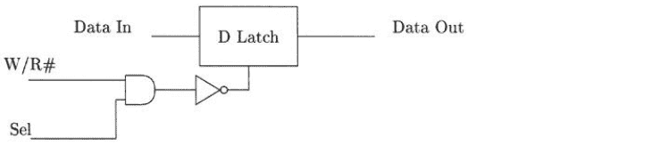

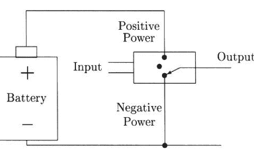

**表 3.12. 三态缓冲器真值表**

| 控制 | 输入 | 输出 |
| :---: | :---: | :---: |
| 0 | 0 | X |
| 0 | 1 | X |
| 1 | 0 | 0 |
| 1 | 1 | 1 |

当将三态缓冲器添加到锁存器中，如图 3-9 所示时，数据线可以被输入和输出共享。当然，处理器那一端也需要一个三态缓冲器。该电路只有三个外部连接。假设我们如图 3-10 所示那样表示它。将其中四个这样的电路并联使用可以存储四个位，它们都受相同的两个信号 W/R# 和 Sel 控制。

**图 3-9. 单比特内存电路**

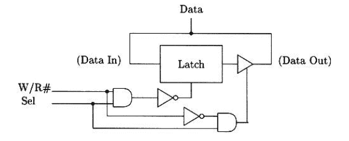

**图 3-10. 单比特内存**

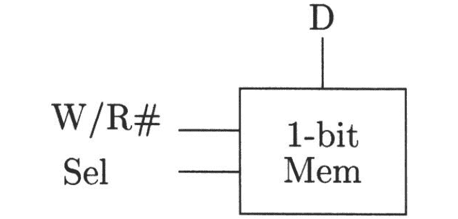

假设我们将四字节的内存表示如下：

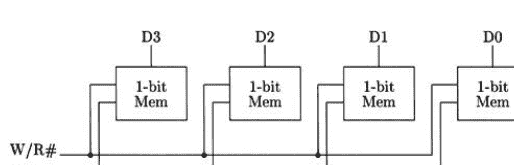

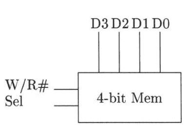

图 3-11 展示了一个由这四个电路组成的内存。两条地址线足以寻址此内存。该内存电路有四个字。每个字存储四个位。数据线 D0、D1、D2 和 D3 都是共享的。地址线 A0 和 A1 控制四个不同的 Sel 输入。地址线选择四条 Sel 线中的哪一条被选中。其余三条的值将为 0。不可能同时打开两条线。

**图 3-11. 四字内存。每个字存储四个位**

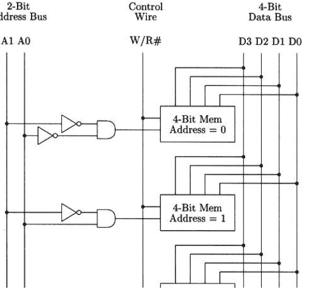

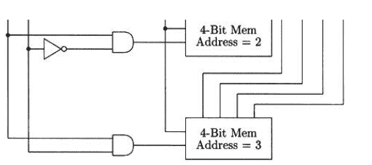

如果我们把这个想象成一台微型计算机的内存，那么这台计算机将有一条四字节的总线、一条二位的地址总线和一条一位的控制总线。要从内存中获取一项，这台小计算机的处理器会将它的 $W/R\#$ 引脚置为逻辑 0，并在地址总线上放置一个二位的地址。这将激活恰好一个字内存的 Sel 信号。如果我们想象取指-执行周期正在进行，处理器需要注册一个二位的寄存器来记录它正在执行的指令的地址。所有执行取指-执行周期的处理器都需要这样的寄存器。它通常被称为 **程序计数器**。在英特尔机器中，它被称为 *指令指针*。

#### 内存容量的定义

任何 *物理内存* 都是处于多个稳定状态中的对象或设备。其容量是其稳定状态的数量。由于计算机内存被布局为一个矩形对象，每个对象有两个稳定状态，因此内存中的稳定状态数量为 $2^{l \times w}$，其中 $l$ 和 $w$ 分别是矩形的长和宽。$l$ 也被称为字数，$w$ 是每个字的位宽。为了方便，容量通常以位为单位给出，即 $l \times w$，也就是稳定状态数量的以 2 为底的对数。以字节为单位的容量，当然是以位为单位的容量的八分之一。

#### SRAM 与 DRAM

当内存电路由逻辑电路构建时，它被称为 *静态内存* 或 *SRAM*。内存电路也可以由电容器制成。充电的电容器代表存储的 1；放电的电容器代表存储的 0。由于所需的晶体管更少，这些电路在芯片上可以以更小的密度打包。小型、紧密排列的电容器有一个缺点，即它们放电很快。它们需要不断检查。每一个没有完全放电的电容器都必须再次被泵送充电。由于内存被不断“刷新”，因此被称为 *动态内存*，或 *DRAM*。动态内存就像一个没有隔板的书架；除了当一个书掉落到地板上（比如说下落四英尺），你只有 0.5 秒的时间接住它之前撞到地板。这些微小的电容器在 0.0001 秒内放电。内存刷新必须大约每 100 $\mu$s 进行一次。与有许多贡献者的许多发展不同，动态内存是由单个人 Ted Hoff 在 1970 年左右发明的。动态内存比静态内存更便宜但更慢。静态内存通常用于缓存内存，而动态内存用于 RAM。

DRAM 的一个缺点是它使硬件调试变得更加困难。进行硬件调试的最简单方法是将计算机时钟速度大幅降低。这样就可以观察到异常行为的发生。但由于 DRAM 的快速刷新要求，没有简单的方法可以做到这一点。

## 3.10 x86 通用寄存器及其渊源

英特尔 x86 系列处理器市场成功的原因之一在于，该系列中的每个新处理器在设计时都遵循了与之前处理器兼容的要求。英特尔从未像 Motorola 和 IBM 在 PowerPC 芯片以及 DEC 在 Alpha 处理器上那样彻底推倒重来。这最小化了升级所必需的硬件和软件重新调整的工作量。因此，x86 的描述，特别是其寄存器，非常适合采用历史视角。我们从 8080 处理器开始。

### 3.10.1 8080 寄存器

8080 是第一个真正大批量生产的微处理器。它被用作几台早期微型计算机的 CPU，包括 Atari。这台个人计算机也是最早使用 8080 处理器的计算机之一。它曾登上 1975 年 1 月《科学美国人》杂志的封面。事实上，它的寄存器、内存地址和数据传输都是八字节大小，这使得该计算机成为八位计算机的一个很好的例子。图中显示的所有寄存器都是八位寄存器。地址总线和数据总线各有八条线。

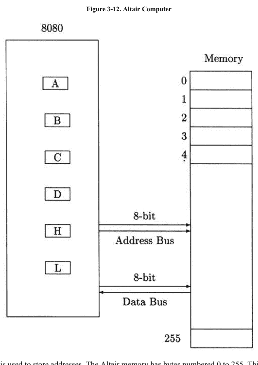

L 寄存器用于存储地址。Altair 内存的字节编号从 0 到 255。这个内存小得惊人，但另一方面，它是通过翻转八个位开关一次写入一个字节的！

市场上现存 8080 的版本，如 8085 和 Z80。Radio Shack 的 TRS-80 基于 Z80。

当 IBM 推出 PC 时，他们选择 Intel 8088 作为其处理器，因为它在与内存和系统主板交互时表现为一个八位处理器。特别是，它很像 8080 处理器。


### 3.10.2 8086 寄存器

尽管 Altair 是八位计算机的近乎纯粹的范例，但 8080 处理器确实具有一些 16 位特性。特别是，它的设计允许其用于 16 位内存寻址系统。它通过允许两个八位寄存器（H 和 L）配对形成一个 16 位寄存器来实现这一点，该寄存器随后可用于地址。当这个高位字节-低位字节对（high byte-low byte pair）在指令中被引用时，指令中会使用 X。例如，16 位增量指令为 INX。八位指令为 INR。X 代表 *extended*（扩展），用于引用 16 位寄存器对的情况。当图 3-13 中所示的 16 位 8086 处理器被设计时，这个 X 被引入用于 16 位寄存器命名 AX、BX、CX 和 DX。16 位寄存器 AX、BX、CX 和 DX 是高位和低位字节寄存器 AH 和 AL、BH 和 BL、CH 和 CL、DH 和 DL 的配对。其他 16 位寄存器 SP、BP、SI 和 DI 的名称中没有 X，且它们不是字节对。数据总线有 16 根线。图中还展示了单个 8086 内存段中的 65,536（= $2^{16}$）个内存位置。尽管有上面的图示，8086 并不是 16 位计算机的好例子。地址总线有 20 根线，并且有一种笨拙的机制用于同时使用少数几个段。因此，内存实际上并未限制在 64K，但没有便捷的方法来一次性使用所有 $2^{20}$ 字节。

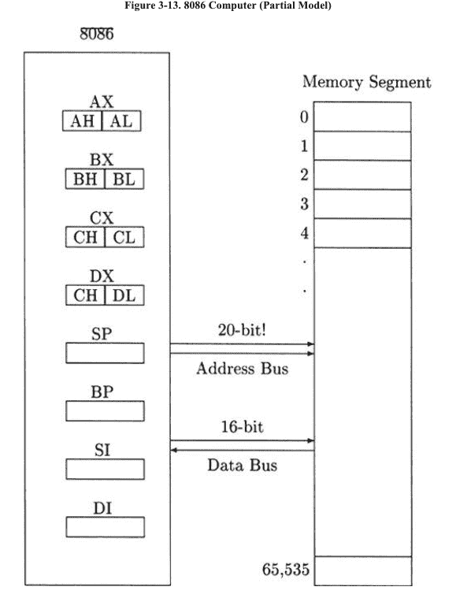

### 3.10.3 80386 寄存器

在 8086 设计中可见的许多细节在图 3-14 所示的 80386 中得到了平滑处理。名称以 E 开头的八个寄存器都是 8086 上相应寄存器的扩展。每个 32 位寄存器的下半部分是继承自 8086 的 16 位寄存器。地址总线和数据总线各有 32 根线。图中还展示了 80386 能够寻址的 4,294,967,296（$\approx 2^{32}$）个内存位置。80386 计算机是 32 位计算机的非常好的范例。80486 和 Pentium 也是 32 位处理器。事实上，在寄存器大小、内存寻址等方面，没有任何变化。直到 Pentium II 和 Pentium Pro 发布之前，主要的发展在于不改变基本架构的情况下提高速度。图 3-14 既可以标记为“Pentium 计算机”也可以标记为“80386 计算机”，除了 Pentium 具有 64 位数据总线外。

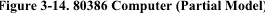

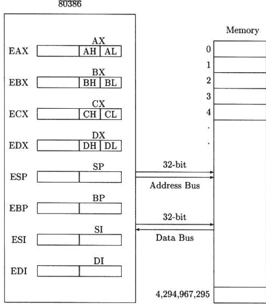

## 3.11 MOV 指令

本节介绍 MOV 指令。它是一条非常重要的指令。MOV 是一个存储指令。它将一个值复制到某个位置。它有许多不同的有效形式。reg,imm 和 reg,reg 形式尤为重要。

### 3.11.1 MOV reg,imm

- *reg* 代表 *register*（寄存器）。它可能是表 3.13 中列出的任何寄存器。
- *imm* 代表 *immediate*（立即数）。术语 *immediate* 用于指代直接通过十进制或十六进制表示给出的数值，而不是包含该值的寄存器或内存位置。

例如，在

```
MOV AX, 54
```

中，数字 54 作为立即数出现。该指令将数字 54 存储到 16 位寄存器 AX 中。该寄存器与寄存器 EAX 的低 16 位相同。高 16 位保持不变。由于 54 = 36H，该指令等同于指令

```
MOV AX, 36H
```

分配给位置的数值必须适合。指令

```
MOV AL, 999
```

无效，因为 999 无法放入八位寄存器中。NASM 和 Edlinas 允许带符号整数。因此

```
MOV AL, -128
```

有效，并执行与

```
MOV AL, 128
```

相同的功能。

但在 Edlinas 中无效，因为 -129 不在八位带符号范围内。NASM 直到遇到 -257 时才报错。NASM 允许字符表示 ASCII 码。例如，

**表 3.13. x86 通用寄存器**

| 8 位 | 16 位 | 32 位 |
|---|---|---|
| AH | AX | EAX |
| AL | BX | EBX |
| BH | CX | ECX |
| BL | DX | EDX |
| CH | BP | EBP |
| CL | SP | ESP |
| DH | SI | ESI |
| DL | DI | EDI |

```
MOV AL, 'A'
```

将字母 A 的 ASCII 码，即 65，存储在 AL 中。

使用 32 位寄存器的代码无法在 80386 之前的 x86 处理器上运行。虽然使用 32 位寄存器是所谓的“32 位代码”的特征，但一些“16 位代码”也使用它。32 位代码和 16 位代码之间的实际差异在第 5 章第 5.5 节中讨论。

### 3.11.2 MOV reg,reg

MOV reg,reg 将第二个寄存器的内容复制到第一个寄存器。本书中描述的双操作数指令使用语法 COMMAND destination, source（指令 目标，源）。因此指令

```
MOV EAX, EBX
```

不改变 EBX 寄存器。它意味着

```
let EAX = EBX
```

而不是将 EAX 移动到 EBX。

有一些汇编器使用相反的语法，例如 gcc 使用的 AT&T 风格汇编器。在其语法中，完全相同的指令写作

```
movl %ebx, %eax
```

MOV 指令中使用的两个寄存器必须大小相同。例如，以下指令无效。

```
MOV EBX, DX
```

### 3.11.3 歧义问题

根据第 2 章第 2.7 节讨论的附加 H 十六进制约定，寄存器名称 AH、BH、CH 和 DH 也是数字十、十一、十二和十三的有效十六进制名称。这会使如下指令

```
MOV BL, AH
```

产生歧义。该指令将是 **reg,reg** 形式和 **reg,imm** 形式的 MOV 指令的有效示例。解决此歧义的传统方法是要求汇编语言指令中使用的十六进制数字必须以数字 0、1、… 9 之一开头。本文将对附加 H 约定进行此修改，NASM 和 Edlinas 都要求这样。因此 MOV BL, AH 实际上不是 **reg,imm** 形式的有效示例。它是 **reg,reg** 形式的一个示例。要将立即数值十存储到 BL，我们必须使用

```
MOV BL, 0AH
```

或者

```
MOV BL, 10
```

## 3.12 加法和减法指令

本节描述 ADD 和 SUB 指令的 **reg,imm** 和 **reg,reg** 形式。这些是非常基本的算术指令。

### 3.12.1 ADD reg,imm

```
ADD reg, imm
```

意味着将立即数值加到寄存器上。例如

```
ADD BL, 10
```

可以看作

```
let BL = BL + 10
```

### 3.12.2 ADD reg,reg

指令

```
ADD reg, reg
```

意味着将第二个寄存器的内容加到第一个寄存器上。因此指令

```
ADD BL, AL
```

意味着

```
let BL = BL + AL
```

寄存器 AL 不被该指令改变。

### 3.12.3 SUB reg,imm

例如，指令

```
SUB BL, 10
```

意味着

```
let BL = BL - 10
```

### 3.12.4 SUB reg,reg

例如，

```
SUB BL, AL
```

意味着

```
let BL = BL - AL
```

## 3.13 乘法和除法指令

如果乘法指令的功能类似于 ADD 和 SUB 指令，我们会期望看到如下指令

```
MUL EAX, EBX
```

这意味着将寄存器 EAX 的内容乘以 EBX 中的值。然而，乘法指令不是这样工作的。一个原因是，因为数字相乘通常会使它们的大小加倍，使用与相乘数字相同大小的寄存器来存储结果并不合理。

### 3.13.1 MUL 指令

乘法指令的语法是

```
MUL reg
```

**reg** 可以是表 3.13 中列出的 24 个通用寄存器中的任何一个。如果使用的寄存器是八位寄存器，例如

```
MUL BH
```

则该指令意味着：

let AX = AL • BH

当使用八位寄存器时，它总是与 AL 相乘并将结果存储在 AX 中。当使用 16 位寄存器时，例如，

```
MUL BX
```

则该指令意味着

```
let DX:AX = AX • BX
```

其中 32 位结果存储在两个 16 位寄存器中。高 16 位存储在 DX 中，低 16 位存储在 AX 中。当使用 32 位寄存器时，例如，

```
MUL EBX
```

则该指令意味着

```
let EDX:EAX = EAX • EBX
```

使用 MUL 指令时，你指定的是一个寄存器。其他寄存器始终是隐含的。这种情况类似于 8080 处理器上的 ADD 指令，其中加法结果始终存储在 A 寄存器中。8080 汇编语言中的指令 ADD B 意味着

```
let A = A + B
```

与 ADD 和 SUB 指令不同，MUL 指令没有立即数形式。指令

```
MUL 7
```

无效。

### 3.13.2 DIV 指令

DIV 指令在语法上与 MUL 指令非常相似，并且基本上是它的逆运算。它形成商和余数

| | 被除数 | 余数 | 商 |
|---|---|---|---|
| 32 位形式 | EDX:EAX | EDX | EAX |
| 16 位形式 | DX:AX | DX | AX |
| 8 位形式 | AX | AH | AL |

例如，如果 AX 持有值 17 且 BH 持有值 3，则

```
DIV BH
```

会将 2 存储在 AH 中，将 5 存储在 AL 中。该指令被识别为八位指令，因为 BH 是八位寄存器。

除以零会产生称为异常的 error。异常在第 9 章中讨论。

值得注意的是，由于参与除法的寄存器大小，零并不是唯一会导致异常的除数。例如，当 AX 被存储在八位寄存器中的数字除时，商应该存储在 AL（一个八位寄存器）中。但是，将一个 16 位数字除以一个 8 位数字并不总是产生可以存储在 8 位中的数字。例如，1024 ÷ 2 = 512，或十六进制为 400H÷2 = 200H。但 200H 至少需要 10 位的存储空间。这意味着


以下代码将导致异常：

```asm
MOV AX, 400H
MOV BH, 2
DIV BH
```

这种错误称为*除法溢出*。

### 3.13.3 负数与同余

负数使用二进制补码表示，部分原因在于它允许加法和减法硬件在不区分被操作的位是指定有符号整数还是无符号整数的情况下照常使用。关于二进制补码表示为何如此有效的数学解释，基于19世纪一位杰出的数学家 C. F. 高斯提出的一种概念。

高斯定义 $a \equiv b \ (\text{mod } m)$ 意为 $a$ 和 $b$ 仅相差 $m$ 的某个确切倍数。在二进制补码表示中，负数与用于表示该负数的正数之差，等于所使用的寄存器的模值（turnover value）。如果使用四位寄存器，则每个负数及其正数表示之间的差为 $2^4$，即 16，如表 3.9 所示。用高斯的记法举例来说，-5 $\equiv$ 11 (mod 16)。因此，当计算机将 $(-2) + (-3)$ 作为 $14 + 13$ 执行时，这依赖于 $14 + 13 = 27 \equiv -5$ (mod 16) 这一事实。四位加法硬件产生 11，因为丢失了值为 16 的进位。但这没问题。11 是 -5 的正确代表。

**同余加法定理**

这种推理总结如下，由高斯提出的以下定理：

若 $a \equiv b \ (\text{mod } m)$ 且 $c \equiv d \ (\text{mod } m)$
则 $a + c \equiv b + d \ (\text{mod } m)$

该定理指出，同余式可以像等式一样相加。高斯发明同余记法，旨在表明同余式与等式相似。

**同余乘法定理**

以下定理指出，同余式也可以像等式一样相乘。

若 $a \equiv b \ (\text{mod } m)$ 且 $c \equiv d \ (\text{mod } m)$
则 $a \cdot c \equiv b \cdot d \ (\text{mod } m)$

由于这个优美的定理，我们应该能够像使用 ADD 那样，对带符号和无符号数都使用 MUL，而不会有任何问题！除了一个问题。

我们希望随着运算扩展寄存器大小。因此，我们真正需要的定理是：

若 $a \equiv b \ (\text{mod } m)$ 且 $c \equiv d \ (\text{mod } m)$
则 $a \cdot c \equiv b \cdot d \ (\text{mod } m^2)$

不幸的是，这不是一个定理。它是一个谬误。例如，在八位情况下，$m = 256$ 且 $m^2 = 65,536$，若 $a = -16$，$b = 240$，且 $c = d = 2$，我们得到 $a \cdot c = -32$ 且 $b \cdot d = 480$。因此，定理意味着 224（无符号）或 -32（有符号），那么一切都没问题。二百二十四是八位系统中与 -32 等价的二进制补码正数。但我们不满足于八位。我们要 16 位。而 $-32 \equiv 480 \ (\text{mod } 65,536)$ 是错误的。

在 16 位系统中，-32 由 65504 表示，而不是 480。因此，我们不能对带符号和无符号数都使用 MUL（或 DIV）。MUL 和 DIV 适用于无符号数。有指令适用于带符号数：IMUL 和 IDIV。这是第 3.6.5 节中提到的问题的一个实例。

## 延伸阅读

- *《微处理器：传记》*，迈克尔·S·马隆，斯普林格出版社：1995。
- *《高性能微处理器解剖》*，谢尔伯和史密斯，IEEE：1998。

# 第 4 章 汇编语言

计算机程序是可以存储在计算机内存中的东西。如果内存包含单字节字，我们可以说计算机程序由字节组成。这些字节也称为*机器语言*。通过显式列出这些字节来编写程序称为*机器语言编程*。这是编程的最初形式。它肯定是最繁琐的。汇编语言被发明作为一种指定机器代码的方法，而无需实际将其写下来。汇编语言可能仅仅是速记，也可能涉及复杂的*宏*，其中一些甚至类似于 C 语言中的 *if 或 while* 语句。但无论是原始的还是花哨的，其定义特征在于它赋予程序员对机器语言的控制权。

学习汇编语言有三个好理由：

1. 在真正对时间敏感的代码部分，有时可以通过使用汇编语言编码来提高性能。
2. 它是学习特定 CPU 工作方式的好方法。
3. 在编写新的操作系统或将现有系统移植到新机器时，有代码部分必须用汇编语言编写。

汇编语言被编写得与特定处理器紧密配合。鉴于处理器和指令集的相当多的多样性，人们可能期望各种汇编语言的指令格式也有相当大的差异。但事实并非如此。汇编语言通常遵循一种通用格式，可称为*四字段格式*。

## 4.1 四字段格式

根据此格式，每个汇编语言程序由行组成。每行由四个字段组成。这四个字段是标签字段、助记符字段、操作数字段和注释字段。

1. 标签字段用于指定跳转指令的目标标签。跳转等同于*go to* 指令。跳转指令的例子在*第 4.4 节*中给出。
2. 助记符字段包含指令说明符。助记符的例子有*MOV*、*ADD*、*SUB*、*等等*。单词*助记符*暗示它使机器代码易于记忆，尽管并非如此；它使机器代码无需记忆。
3. 操作数字段包含指令操作的对象或对象。如果有多个操作数，它们用逗号分隔。正如上面所注意到的，*ADD* 接受两个操作数。另一方面，*JMP* 只接受一个。有些助记符根本不接受操作数。
4. 注释字段包含文档。它以分号开始。在任何计算机语言中，文档都很重要。在汇编语言中，文档尤其重要，因为汇编语言程序在没有文档的情况下特别难读。一行可以仅包含注释。

程序 4.1 是一个 x86 汇编语言程序的例子。读者应注意一致的四字段布局，尽管某些行的某些字段是空的。程序 4.1 中的许多指令在此书中首次出现。这些新指令都在本章中讨论。

### 程序 4.1

```asm
;
; 最大公约数程序
;
MOV  EDX, 0      ; 0 是唯一的 Edlinas 输入端口
IN   EAX, [DX]   ; 获取用户的第一个输入
MOV  ECX, EAX    ; 将输入移出危险区域
IN   EAX, [DX]   ; 获取用户的第二个输入
MOV  EDX, EAX    ; 使用 EDX 作为两个输入中较大的那个
ORD:
   SUB  EAX, ECX  ; 使用 EAX 作为 EDX 的工作副本
   JZ   GCD       ; 当获得相等时，我们完成了。
   JNS  NXT       ; 我们希望 EDX 较大。无需交换
   MOV  EAX, ECX  ; 交换 EDX 和 ECX（需要三个 MOV）
   MOV  ECX, EDX
NXT:
   MOV  EDX, EAX  ; 如果没有交换，则 EDX = EDX-ECX
   JMP  ORD       ; 循环结束
GCD:
   MOV  EAX, EDX  ; GCD 在 EDX 中
   MOV  EDX, 1    ; 我们需要 EDX 作为输出端口号
   OUT  [DX], EAX ; 向用户显示答案
   RET
```

## 4.2 从 CPU 角度看待计算机

计算机通常被描述为由三部分组成：CPU、内存以及输入/输出或 I/O 系统。按照此图绘制的示意图看起来像图 4-1。I/O 系统包括显示器、键盘、硬盘、打印机、调制解调器、声卡和 CDROM。这些只是 I/O 设备。这是一种以处理器为中心的观点。正像团体成员有时根据人们与团体的关系来对人们进行分类一样，这种计算机视图根据各部分与 CPU 的关系来定义计算机的各个部分。然而，由于汇编语言主要涉及与 CPU 的工作，这是我们要采取的一个有用观点。

图 4-1. 所有计算机分为三部分

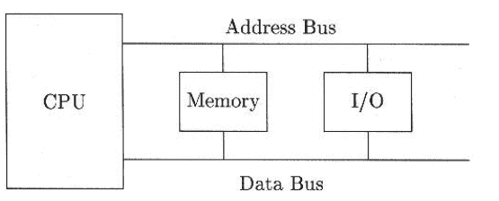

如果我们想象图中的 CPU 是 386，那么我们可以将数据总线想象为连接到 CPU 上 32 个引脚的一组 32 根导线，将地址总线想象为另一组也连接到 CPU 的 32 根导线。注意，内存和 I/O 系统以基本上相同的方式连接到处理器。如果

想象一下观察在总线上传输的比特流，CPU 和内存之间的数据传输与 CPU 和 I/O 系统之间的数据传输看起来几乎完全一样。这种差异实际上归结为 CPU 上的一个引脚。这个引脚被称为 M/I/O# 引脚。当该引脚处于逻辑 1 时，它表示内存传输。当它处于逻辑 0 时，它表示 I/O 传输。如果没有 M/I/O# 线，上述图表其实没有多大意义。它还需要一条 W/R# 线来指示数据是流入还是流出处理器。这些线路被称为 *控制线*，并且是 *控制总线* 的一部分。

读者被建议对比图 4-1 和图 3-11，后者更详细地展示了来自三个不同总线的线路如何连接到内存电路。

### 4.2.1 内存与 I/O

在表 4.1 中，我们看到了 *MOV* 命令的两种立即形式与对应的 I/O 命令进行了比较。这些命令在 AL 寄存器和位于地址 12 的内存或 I/O 设备之间执行传输。处理器使用 W/R# 引脚指示读取还是写入，使用 M/I/O# 引脚指示内存还是 I/O。否则，事务过程非常相似。

| | 内存 | I/O |
|---|---|---|
| 读取 | MOV AL,[12] | IN AL,[12] |
| 写入 | MOV [12],AL | OUT [12],AL |

在 x86 架构中，内存和 I/O 寻址的一个显著区别在于，内存地址在离开处理器之前会经过处理。这种处理分为两个阶段：分段和分页。分段在 *第 12 章* 中有描述，分页在 *第 8 章* 中有描述。

I/O 系统与内存之间的另一个区别是它们的有效地址范围不同。正如 *第 3 章* 中所述，有效内存地址的范围因 x86 处理器而异。（这取决于处理器拥有的地址引脚数量。）另一方面，所有 x86 处理器上的有效 I/O 地址范围是相同的。它是从 0 到 65,535 的 16 位范围。顺便说一下，这意味着 I/O 系统不需要连接到所有 32 根地址线，只需要连接到低位的 16 根。这个范围内的地址被称为 *端口* 或 *端口号*。

许多现有的 I/O 设备，如磁盘驱动器、打印机和串行端口，每个只使用少数几个端口。例如，表 4.2 列出了标准串行端口使用的八个地址。（显然，表中的端口号 1 到 4 并非此处我们讨论的特定意义上的端口号。但以下十六进制地址是这些端口号的 *完美* 示例。）标准 PC 上使用的端口号的相对完整列表可以在 Shanley 的 *ISA System Architecture* 附录 A 中找到。在 Linux 机器上使用的 I/O 端口可以通过使用命令访问 `/proc` 目录来访问

```
linuxbox$ cat /proc/ioports
```

内存和 I/O 传输的高度相似性并未完全体现在 x86 汇编语言中，后者有许多涉及内存访问的指令，但控制 I/O 访问的指令只有少数几个，例如 `IN` 和 `OUT`。使用 `MOV` 和许多其他指令访问内存的内容在第 6 章第 6.2 节中讨论。接下来讨论 `IN` 和 `OUT` 指令。

### 4.2.2 `IN` 指令

输入指令将数据从 I/O 端口传输到处理器。该指令有六种有效形式

```
IN EAX, [DX]
IN AX, [DX]
IN AL, [DX]
IN EAX, [imm]
IN AX, [imm]
IN AL, [imm]
```

其中 `imm` 可以是任意一字节数字。请注意，此指令遵循通用的指令目标、源格式。有效的目标寄存器是 EAX、AX 和 AL。端口号存储在 `DX` 中或由 `imm` 给出的 I/O 设备是源。

请注意 `DX` 是一个 16 位寄存器。这很有意义，因为端口号是一个 16 位数字。大多数 Intel 汇编器，包括 NASM，在端口号周围不使用方括号。但是，如果你使用了方括号，你可以将指令 `IN AL, [DX]`（例如）理解为

让 AL = [DX]

其中 [DX] 指位于地址 DX 的数据。Eldinas 这样做是为了保持一致性。内存指令以相同的方式使用方括号。方括号变成了类似 C 语言中 * 的解引用运算符。在 Eldinas 和 NASM 中，通过地址引用内存中数据时，都在地址周围使用方括号。NASM 在 I/O 引用中不使用方括号。因此，在使用 NASM 时，`IN` 和 `OUT` 指令中的方括号被省略。

由于 `IN` 指令的 `imm` 形式仅接受一字节的端口，因此只有 65,536 个端口中的低 256 个端口可以通过 `imm` 形式访问。请注意，`IN` 指令没有写成 `IN reg, [reg]`。这是因为诸如 `IN EBX, [DX]` 和 `IN EAX, [CX]` 等形式是 *无效的*。

### 4.2.3 `OUT` 指令

输出指令将数据从处理器传输到 I/O 设备。该指令的六种有效形式是

```
OUT [DX], EAX
OUT [DX], AX
OUT [DX], AL
OUT [imm], EAX
OUT [imm], AX
OUT [imm], AL
```

同样，`imm` 可以是任意一字节数字。操作数的顺序与 `IN` 指令中的相反，因为数据流向相反。源是 EAX、AX 或 AL 寄存器，目标是 I/O 设备。同样，NASM 在 `OUT` 中不使用方括号。

### 4.2.4 内存映射 I/O

当内存地址空间中的地址实际上连接到 I/O 设备时，这被称为 *内存映射 I/O*。标准 PC 上的视频缓冲区就是一个例子。存储在从内存地址 B800H 开始的 4000 字节处的字符会被输出到监视器。

为 I/O 设备使用单独的地址空间并非 I/O 寻址唯一可想象的方法。许多架构使用一组单一地址，并简单地将其中一些保留用于 I/O。

在 PC 上，保留的地址也用于 ROM，即 *只读存储器*。如果对只读存储器执行写入操作，处理器会将相应的写信号发送到总线上，但“存储”的数据不会发生任何改变。

## 4.3 简单的汇编语言程序

简单的高级语言程序通常具有三部分格式：输入数据，进行计算，然后输出结果。使用 Edlinas，可以编写同样风格的简单 x86 汇编语言程序。

### 4.3.1 Edlinas 端口

Edlinas 模拟的虚拟机器仅使用两个端口号。

- 0 是键盘输入端口。
- 1 是屏幕输出端口。

键盘输入在屏幕左下角回显，输出在右下角显示。当在 Edlinas 中使用 `IN EAX, [DX]` 时，DX 中存储的值应为 0。当寻址端口 0 时，系统会提示用户输入一个值。当使用 `OUT [DX], EAX` 时，DX 中存储的值应为 1。当使用端口 1 时，输出值以十进制形式显示在屏幕右下角。使用这两个端口允许用真正的 x86 汇编语言编写非常简单的程序，并在 Edlinas 模拟器上运行。

使用 Edlinas 端口的程序无法在 DOS 或 Unix 下运行。在第 8 章第 8.4.7 节中展示了如何将这些针对模拟机器的 I/O 指令替换为对 C 库函数 `scanf()` 和 `printf()` 的调用。通过这种方式，使用真实 I/O 的简单 Edlinas 程序可以在 Linux 下运行。

### 4.3.2 RET 指令

程序由操作系统启动。当程序完成时，它必须将控制权交还给操作系统。`RET` 指令做到这一点。子程序也使用 `RET` 将控制权交还给调用程序。`RET` 使用堆栈工作，并在第 7 章第 7.2 节中讨论。

### 4.3.3 添加两个数的程序

我们现在已经拥有了编写一些简单但完整的程序所需的所有指令。下面是一个添加两个数的 Edlinas 程序：

**程序 4.2**

```
MOV EDX, 0      ;将所有 32 位清零使 DX 为零。
IN EAX, [DX]    ;用户通过端口零输入第一个数字。
MOV EBX, EAX    ;将第一个数字移开（暂存）。
IN EAX, [DX]    ;用户输入第二个数字。
ADD EAX, EBX    ;将第一个数加到第二个数上。
MOV EDX, 1      ;Edlinas 输出端口为一。
OUT [DX], EAX   ;结果输出给用户。
RET             ;结束模拟。
```


## 4.4 带跳转的汇编程序

高级语言需要循环才能完成其工作。这些循环必须由编译器转换为汇编代码。例如，如图 4-2 所示，以最直接的方式执行 C 语言的 while 循环，需要同时使用向前条件跳转和向后无条件跳转。

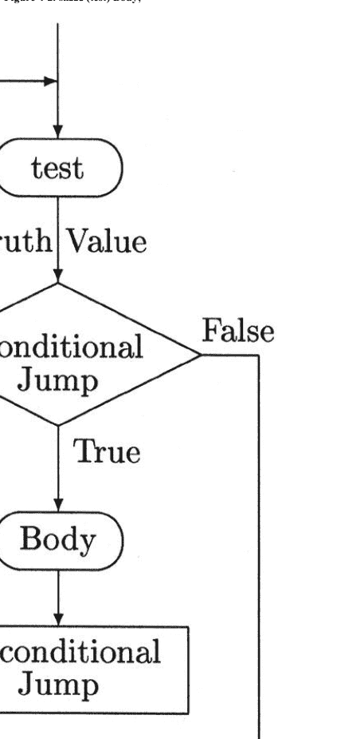

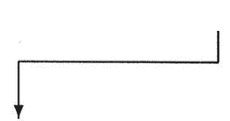

### 4.4.1 JMP 指令

取指-执行周期通过计算下一条指令在内存中的地址来工作。通常，这个地址是通过跳转到当前指令之后的第一个地址来确定的。然而，为了支持高级语言中的 if-then 语句或循环，需要跳转指令。*JMP* 指令将执行转移到由标签指定的地址。

*JMP* 指令的形式如下：

```
JMP label
```

标签由程序员创建。明智的做法是设计有助于理解程序的标签。为此，长标签很有用。另一方面，Edlinas 使用的屏幕空间非常有限，因此除非标签单独占一行，否则超过三个字符的标签在显示时会被截断。标签字段中的标签指定跳转的目标，通常会在后面加上冒号，以明确表明它是一个标签，而不是晦涩难懂的助记符。许多跳转指令可以指向同一个目标，但没有任何两行可以在其标签字段中拥有相同的标签。在下面的程序中，最后一行将控制权转移到前一行。该程序会永远不断地向 *EAX* 寄存器加 2。这是一个无限循环。无限循环通常只是出于错误而被编写出来的。

### 4.4.2 条件跳转和标志

*条件跳转* 是基于真值执行的跳转。做出此类决策所依据的信息包含在称为*标志*的一位寄存器中。当标志包含 1 时，称为*置位*（set）。当它包含 0 时，称为*清零*（cleared）。两个非常重要的标志是零标志（zero flag）和符号标志（sign flag）。

#### 程序 4.3

```
        MOV EAX, 0
        MOV EBX, 2
XYZ:    ADD EAX, EBX
        JMP XYZ
```

#### 零标志和符号标志

*ADD* 和 *SUB* 指令不仅影响其目标寄存器，还影响许多标志。假设执行了以下指令：

```
ADD EAX, EBX
```

该指令的结果将存储在 EAX 寄存器中。如果该结果为 0，则零标志被置位。如果结果不为 0，则零标志被清零。

在 *ADD* 指令执行后，符号标志的值是结果的最高有效位的值。当结果被视为有符号数时，如果结果为负，则此位为 1。因此，如果执行 *ADD EAX, EBX* 指令使 *EAX* 的值作为一个四字节有符号数为负，则符号标志被置位；否则，符号标志被清零。

### 4.4.3 JZ、JS、JNZ 和 JNS 指令

以下条件跳转指令都具有与 JMP 指令相同的格式。

| 指令 | 标签 |
| :--- | :--- |
| JZ | label |
| JS | label |
| JNZ | label |
| JNS | label |

它们都在操作数字段中接受一个标签。这些指令的含义如下：

| 指令 | 含义 |
| :--- | :--- |
| JZ | 如果零标志置位，则跳转。 |
| JS | 如果符号标志置位，则跳转。 |
| JNZ | 如果零标志未置位，则跳转。 |
| JNS | 如果符号标志未置位，则跳转。 |

下面的汇编语言程序展示了 *JS* 指令在程序中用于判断两个用户输入哪个更大的应用。程序 4.4 看起来严丝合缝。事实上它存在一个 bug。

#### 程序 4.4

```
; 如果第一个输入更大，输出 1
; 如果第二个输入更大，输出 2
; 该程序使用减法：
; B < A 当且仅当 B - A 为负。
; 减法后接 JS 即可完成此工作
;
	MOV EDX, 0
	IN EAX, [DX] ; 第一个输入现在在 EBX 中
	MOV EBX, EAX
	IN EAX, [DX] ; 第二个输入现在在 EAX 中。
	SUB EBX, EAX ; 这是 (first - second)。
	JS SIB ; Second is Bigger (第二个更大)
	MOV EAX, 1 ; 否则 First is Bigger (第一个更大)
	JMP END ; 不要漂移到另一种情况！
SIB:	MOV EAX, 2 ;
END:	MOV EDX, 1 ; 无论如何，现在 EAX 已就绪。
	OUT [DX], EAX
	RET
```

## 4.5 带循环的汇编程序

条件跳转用于实现循环和 if-then 语句。假设我们考虑以下程序，它通过重复加法来进行乘法运算。例如，要做 7 × 5，我们可以执行 5 + 5 + 5 + 5 + 5 + 5 + 5。在程序 4.5 中，数字 1 在一行中相加，在另一行中相减。有专门用于此的指令，它们占用更少的内存空间。

### 程序 4.5

```
;
	MOV EDX, 0
	IN EAX, [DX] ; 第一个输入是乘数
	MOV EBX, EAX ; 将乘数放入 EBX
	IN EAX, [DX] ; 第二个输入是被乘数
	MOV ECX, 0 ; 初始化累加和。
RPT:	ADD ECX, EAX ; 执行一次加法。
	SUB EBX, 1 ; 还差一次未完成。
	JNZ RPT ; 如果未归零，再执行一次。
	MOV EAX, ECX ; 将总和放入 EAX
	ADD EDX, 1 ;
	OUT [DX], EAX ; 输出答案。
```

### INC 和 DEC 指令

以下的增量和减量指令分别加 1 和减 1：

```
INC reg
```

以及

```
DEC reg
```

*reg* 可以是 24 个通用寄存器中的任意一个。这些指令通常用于递增或递减循环计数器。在程序 4.5 中，`SUB EBX, 1` 可以被 `DEC EBX` 替换，`ADD EDX, 1` 可以被 `INC EDX` 替换。

## 4.6 有符号比较

### 4.6.1 基于比较的跳转

高级语言经常在 if-then 语句中使用比较。利用符号标志来测试减法的结果，如第 4.4 节所做的那样，似乎是实现这种测试的合理方法，因为这是一个数学事实：

```
B < A 当且仅当 B - A 为负。
```

既然符号标志指示减法结果的符号，我们似乎是有坚实基础的。但事实并非如此。

### 4.6.2 溢出标志

假设我们正在使用单字节有符号数，并希望测试：

```
100 < -50
```

在单字节寄存器中：

```
100 - (-50) = -106
```

发生了溢出。结果是负的。符号标志被置位，并且比较将被判定为真！使用符号标志来确定跳转给出了错误的答案。但由于溢出总是使结果的符号变为与其应有的值相反，因此可以修正跳转条件。

1. 如果没有发生溢出，如果符号标志置位则跳转。
2. 如果发生了溢出，如果符号标志未置位则跳转。

x86 处理器有一个溢出标志。它被用于实现这个修正后的跳转条件。如果我们用 SF 表示符号标志的二进制值，用 OF 表示溢出标志的值，我们可以将修正后的跳转条件重新表述为：

```
Jump if (SF XOR OF)
```

在执行如下的减法之后，如果且仅当 `AL < BL` 时，此跳转条件将产生跳转：

```
SUB AL, BL
```

有一条 x86 指令用于此跳转。其助记符是 *JL*，代表 *jump if less than*（如果小于则跳转）。

### 4.6.3 CMP 指令

当减法仅为了比较目的而执行时，可以使用 *CMP* 指令来完成。该指令以与 *SUB* 完全相同的方式设置标志，但其优点是不浪费寄存器空间来存储不需要的结果。使用 *JL* 和 *CMP* 指令，我们可以将程序 4.4 重写如下：

#### 程序 4.6

```
; 如果第一个输入更大，输出 1
; 如果第二个输入更大，输出 2
; 该程序使用减法：
; B < A 当且仅当 B - A 为负。
MOV EDX, 0
IN EAX, [DX]
MOV EBX, EAX    ; 第一个输入现在在 EBX 中
IN EAX, [DX]    ; 第二个输入现在在 EAX 中。
CMP EBX, EAX    ; 这是 first - second。
JL SIB          ; Second is Bigger (第二个更大)
MOV EAX, 1      ; 否则 First is Bigger (第一个更大)
JMP END         ; 不要漂移到另一种情况！
SIB:
MOV EAX, 2
END:
MOV EDX, 1      ; 无论如何，现在 EAX 已就绪。
OUT [DX], EAX
RET
```

程序 4.6 对于无符号四字节范围内的所有数字都能正确工作。

### 4.6.4 更多跳转指令

在 *CMP EAX, EBX* 指令之后，*JL* 指令在条件 `EAX < EBX` 为真时执行跳转。指令：

```
CMP EAX, EBX
JL ABC
```

意味着：

- 将 *EAX* 与 *EBX* 进行比较
- 如果 *EAX* 小于 *EBX* 则跳转

这里正在进行的是减法和标志检查，但设计良好的语法允许我们忽略这一点。*小于*条件并不是在 *CMP* 指令之后方便访问的唯一条件。这里列出了其他几个条件跳转指令。

| 指令 | 条件 | 示例 |
| :--- | :--- | :--- |
| JL | 小于 | EAX < EBX |
| JLE | 小于或等于 | EAX <= EBX |
| JG | 大于 | EAX > EBX |
| JGE | 大于或等于 | EAX >= EBX |
| JE | 等于 | EAX = EBX |
| JNL | 不小于 | EAX ? EBX |
| JNLE | 不小于或等于 | EAX ? EBX |
| JNG | 不大于 | EAX ? EBX |
| JNGE | 不大于或等于 | EAX ? EBX |
| JNE | 不等于 | EAX ? EBX |


由于这些各种各样的跳转指令极其容易被解释，它们将比较指令变成了一种语法上的意外之财。

## 4.7 无符号数比较

在第 4.6 节中，我们展示了如何使用标志位来确定不等式的真值，从而将这些不等式用于条件跳转。所得到的条件适用于无符号数。

但假设我们考虑上一节中提到的同一个例子 $100 < -50$，并注意到当这个相同的不等式用无符号数表述时，它变成了 $100 < 206$。

这个不等式的真值正好相反。因此，用于无符号数的“小于则跳转”指令在这种情况下必须执行跳转。$J_L$ 指令不会这样做。前一节中的有符号跳转指令不适用于无符号数。如果 AL = 64H = 100 且 BL = CEH = 206，那么 $J_L$ 不会执行跳转，因为它作用于 $100 < -50$。我们需要一个无符号的“小于则跳转”。

### 4.7.1 进位标志

在无符号数的情况下，不等式 $A < B$ 比其有符号对应形式更容易测试。由于无符号数减法 $A - B$ 在高位端不会超出范围，只有当结果为负时才会超出范围。无符号数的超出范围错误被称为进位错误。因此，$A < B$ 为真，当且仅当减法 $A - B$ 产生进位错误。所以，一个指示进位错误的标志位也将指示减法结果的负值。x86 处理器具有进位标志来指示这些错误。使用 CF 来表示该进位标志的值，我们可以很容易地陈述用于实现无符号“小于则跳转”指令的条件，即“若 CF 为真则跳转”。

就像符号标志、零标志和溢出标志一样，进位标志对 ADD 或 SUB 使用时发生的条件作出响应。与这三个其他标志不同，它不受 INC 和 DEC 指令的影响。

### 4.7.2 超出范围标志摘要

像 ADD 和 SUB 这样的算术指令在二进制位上执行，没有任何信息指定这些位是用于表示有符号数还是无符号数。跟踪这一点是软件的责任。

当软件使用处理器对无符号数进行算术运算时，它应参考进位标志以检查是否发生超出范围错误。当软件使用处理器对有符号数进行算术运算时，则应参考溢出标志以确定是否发生超出范围错误。

硬件无法知道数字是有符号还是无符号。而且这也不重要。

例如，在单字节寄存器中，将 FFH 加到 FFH 上的指令可能来自处理有符号数的软件。在这种情况下，总和 FEH 没有问题。软件将刚刚发生的算术运算视为 $-1 + -1 = -2$。

这是可以的。

另一方面，该指令也可能来自使用无符号数的软件。在这种情况下，软件将刚刚发生的算术运算视为 $255 + 255 = 254$。

这是不可以的。真实答案 510 超出了单字节无符号范围 0-255。因此，将 FFH 加到 FFH 上会清除溢出标志，因为有符号算术答案是正确的，并置位进位标志以通知软件存在无符号的超出范围错误。

另一个例子，假设单字节寄存器接收到将 40H 加到 40H 上的指令。总和为 80H。如果在“大于”和“小于”的说法中使用“高于”和“低于”替代，那么“若...则跳转”条件将如下所示：

$64 + 64 = 128$。

这是可以的。

假设该指令来自处理有符号数的软件。那么算术看起来像这样：

$64 + 64 = -128$。

这是不可以的。真实答案 +128 超出了单字节有符号范围 -128 到 +127。硬件置位溢出标志，因为在有符号数系统中这是一个超出范围错误，并清除进位标志，因为在无符号系统中没有超出范围错误。硬件不知道软件使用的是哪个系统，因此必须处理这两个标志。

进位标志和溢出标志都是超出范围指示标志。如果按无符号系统解释的算术运算产生了超出范围错误，则置位进位标志。如果按有符号系统解释的算术运算产生了超出范围错误，则置位溢出标志。

### 4.7.3 更多跳转指令

鉴于我们需要为无符号数使用不同的“小于则跳转”指令，我们还需要一个不同的助记符。此外，考虑到其他所有跳转条件，如“大于”、“大于或等于”等，我们需要一整套新的指令和助记符。为了系统化这套新指令，使用“高于”和“低于”替代“大于”和“小于”的说法。因此，适用于无符号数的“小于则跳转”指令使用助记符 $J_B$，即“低于则跳转”。这些指令的完整集合如下：

| 指令 | 条件 | 示例逻辑 |
| :------ | :-------------- | :----------------- |
| $J_B$   | 低于 | EAX < EBX |
| $J_BE$  | 低于或等于 | EAX $\le$ EBX |
| $J_A$   | 高于 | EAX > EBX |
| $J_AE$  | 高于或等于 | EAX $\ge$ EBX |
| $J_NB$  | 不低于 | EAX $\ge$ EBX |
| $J_NBE$ | 不低于且不等于 | EAX > EBX |
| $J_NA$  | 不高于 | EAX $\le$ EBX |
| $J_NAE$ | 不高于且不等于 | EAX < EBX |

## 4.8 Linux .s 文件

gcc 将 C 源程序翻译成 a.out 文件过程中使用的中间步骤之一是汇编语言文件。该文件是编译器本身的输出，也是汇编器 gas 的输入。要查看这些汇编器文件，可以使用 -S 开关指示 gcc 在达到此阶段时输出汇编器文件。该输出具有 .s 文件扩展名。例如，考虑以下 C 程序 mult.c：

### 程序 4.7

```c
main ()
{
    int x, y;
    register int a, b, c;
    printf("Enter a number: ");
    scanf("%d", &x);
    printf("Multiply it by what number? ");
    scanf("%d", &y);

    a = x;
    b = y;
    c = 0;

    while (b != 0)
    {
        c = c + a;
        b = b - 1;
    }

    printf("The result is %d.\n", c);
}
```

假设输入的 x = 5 和 y = -7。该程序实际上输出了正确的答案 -35，为了计算它，循环执行了 $2^{32} - 7 = 4,294,967,289$ 次。注意：

$$(2^{32} - 7) \times 5 = 2^{32} \times 5 - 7 \times 5$$

每当运行总计 *b* 超过 $2^{32}$ 的翻转值时，$2^{32}$ 会从总数中减去。这发生四次。*b* 的最终值为 $2^{32} - 35$，这是 -35 的二进制补码表示。

汇编语言编程的一个主要实际应用在于编码那些执行次数多得多的循环，以至于每次执行时间的改进实际上会在总运行时间上产生明显的差异。在一台 120 MHz Pentium 上的测试中，$5 \times -7$ 的计算需要 110.90 秒。要获取该程序的汇编代码，可以使用命令：

```bash
linuxbox$ gcc -S mult.c
```

生成的文件 *mult.s* 是 gcc 用于生成可执行文件的汇编代码。此汇编代码的语法与本书中广泛使用的 Intel 汇编语言不同，但仍可以破译。为此目的添加了注释。第一行使用 TEST。它是一个类似于 $CMP$ 的指令，将在下一章中讨论。$\%esi$ 指的是 ESI 寄存器。像 $CMP$ 一样，$TEST$ 指令在 $ESI = 0$ 时置位零标志。许多这些指令末尾的 $l$ 用于指定操作数的长度，在此情况下为“长”，即四字节。注意 add 使用了“命令 源 目标”的操作数顺序，这与本书使用的顺序相反。

该循环由所示的六条指令组成。如果我们注意到可以通过在循环末尾测试 ESI 是否为零来从循环中移除一些跳转，我们可以将循环从六条指令减少到三条。所做的唯一更改是循环末尾的跳转。

### 程序 4.8

```assembly
.L2:
testl %esi,%esi ; 是否 ESI = 0
jne .L4 ; 如果不是则转到 L4
jmp .L3 ; 否则转到 L3
.L4:
addl %ebx,%edi ; 令 EDI = EDI + EBX
decl %esi ; 令 ESI = ESI - 1
jmp .L2 ; 转到 L2
.L3:
```

### 程序 4.9

```assembly
.L2:
     testl %esi, %esi
     jne    .L4
     jmp    .L3
.L4:
     addl   %ebx, %edi
     decl   %esi
     jne    .L4             ; 如果 ESI 不是 0 则转到 L4
.L3:
```

修改后的文件使用 gcc 编译。

```bash
linuxbox$ gcc mult.s
```

运行生成的程序，在同一台机器上，$5 \times -7$ 的计算耗时 $76.14$ 秒。

### 4.8.1 Pentium 的双流水线

如果我们查看每条指令的执行时间，在第一种情况下我们得到

$$\frac{110.9}{4,294,967,289 \times 6} \approx 4.303 \text{ ns}$$

此算术运算假设程序花费了所有时间在循环中。将其与一个时钟周期的长度进行比较，

$$\frac{1}{120,000,000} = 8.333 \text{ ns}$$

我们发现了惊人的结果：两条指令执行的时间，$8.606$ 纳秒，仅仅略多过一个时钟周期。由于在普通情况下每个时钟周期执行一条指令是理想的，我们这里遇到的是一种特殊情况。这是 Pentium 双流水线的例证。在可能的情况下，Pentium 将指令配对并一次执行两条。这就是如何达成每个时钟周期执行多条指令的。（实际上还有一个用于浮点数的流水线。）指令配对也解释了为什么当我们把循环中的指令数从六条减少到三条时，我们原本预期的 2:1 改进并未实现。显然发生的是，指令对的数量从三对减少到两对，其中两个“对”中有一个是半空的。时间 $76.14$ 秒是 $110.9$ 秒的 $0.687$。这大约是三分之二，表明在每次通过循环时使用两个指令对而不是三个。

# 第 5 章 机器语言

机器语言是处理器所见的语言。在取指-执行周期中获取的字节是机器代码字节。汇编语言可以定义为赋予程序员对机器代码控制权的语言。汇编语言指定机器代码。汇编语言的这一特征属性在没有熟悉机器语言的情况下不会显而易见。在本章中，将介绍 x86 机器代码的主要特征。


将汇编代码转换为机器码的过程称为汇编（assembling）。接收汇编语言作为输入并生成机器语言作为输出的程序称为汇编器（assembler）。它与编译器类似，但工作在更低的层级。

相反，将机器码转换为汇编语言的过程称为反汇编（unassembling）。执行此操作的程序称为反汇编器（unassembler）。

## 5.1 汇编简单程序

要完整讲述 x86 处理器的机器码涉及许多棘手的技术细节。然而，对于第 4.3 到 4.5 节中所有编号程序所使用的 x86 汇编语言子集，指定其机器码是相当容易的。表 5.1 给出了这部分 x86 汇编语言的编码。大多数机器码以十六进制给出，但有些字节必须以二进制给出。字节数从一到六不等。例如，表的第一行显示 MOV reg,reg 的代码是一个两字节代码，第一个字节以十六进制给出，第二个以二进制给出。以二进制给出的字节是那些包含寄存器代码的字节。二进制编码中的 S S S 代表源寄存器的三位代码。D D D 代表目标寄存器的三位代码。寄存器代码在表格底部给出。命令中出现的每个 "imm" 指定另外四个字节，这些字节必须由程序员提供。示例如下。使用表 5.1，程序 5.1 可以按如下方式汇编为机器码：

**表 5.1. 一些 32 位机器编码**

| 指令 | 操作数 | 第一字节 | 第二字节 | 另外 4 字节 |
|---|---|---|---|---|
| MOV | reg,reg | 89 | 11SSDDDD | |
| MOV | reg, imm | 10111DDD | | |
| ADD | reg,reg | 01 | 11SSDDDD | |
| ADD | reg, imm | 81 | 11000DDD [1] | |
| SUB | reg,reg | 29 | 11SSDDDD | |
| SUB | reg, imm | 81 | 11101DDD [1] | |
| INC | reg | 01000DDD | | |
| DEC | reg | 01001DDD | | |
| IN | EAX, [DX] | ED | | |
| OUT | (DX), EAX | EF | | |
| RET | | C3 | | |
| INT | imm | E9 | 84 | |
| JZ | imm | 0F | 85 | |
| JNZ | imm | 0F | 85 | |
| JS | imm | 0F | 88 | |
| JNS | imm | 0F | 89 | |

¹ 如果 reg 是 EAX，则存在更短的机器码。

### 5.1.1 寄存器代码

第一条指令 BA 的第一字节使用为 MOV reg,imm 提供的 1011 1DDD 代码进行编码。DDD 位用 DX 的寄存器代码 010 填充，结果得到二进制代码 1011 1010 或十六进制代码 BA。

第二条 MOV 指令 MOV ECX, EAX 使用图表的第一行编码为 89 C1，该行指定第二字节为 11 SSS DDD。EAX 是源寄存器，其代码为 000。ECX 是目标寄存器，其代码为 001。结果得到的第二字节是 11 000 001，即 C1。

**程序 5.1**

| 标签 | 源代码 | 地址 | 机器码 |
|---|---|---|---|
| | MOV EDX, 0 | 0 | BA 00 00 00 00 |
| | IN EAX, [DX] | 5 | ED |
| | MOV ECX, EAX | 6 | 89 C1 |
| | IN EAX, [DX] | 8 | ED |
| | MOV EDX, EAX | 9 | 89 C2 |
| | SUB EAX, ECX | B | 29 C8 |
| ORD | JZ GCD | D | 0F 84 F1 00 00 |
| | JNS NXT | 13 | 0F 89 15 00 00 |
| | MOV EAX, ECX | 17 | 89 C8 |
| | MOV ECX, EDX | 1B | 89 D1 |
| NXT | MOV EDX, EAX | 1D | 89 C2 |
| | JMP ORD | 1F | E9 E7 FF FF |
| GCD | MOV EAX, EDX | 24 | 89 D0 |
| | MOV EDX, 1 | 26 | BA 01 00 00 00 |
| | OUT [DX], EAX | 2B | EF |
| | RET | 2C | C3 |

### 5.1.2 小端立即数代码

此程序中的第一条和最后一条 MOV 指令都包含立即数值。这两个指令都将四字节的值存储到四字节的寄存器中。注意在最后一条 MOV 指令中，四字节的立即数值 00000001H 被存储为 01 00 00 00。

### 5.1.3 相对跳转

x86 处理器使用的跳转编码在可行时使用相对地址而非绝对地址。此程序中的所有跳转指令都将跳转编码为相对跳转。绝对跳转指定实际地址作为跳转的目标，而相对编码指定从下一条指令的开头开始跳转的字节数。该值可以解释为有符号数，负值表示向后跳转。处理器将该编码值加上下一条指令的地址，以获得被跳转指令的地址。例如，JMP NXT 指令的小端编码值为 4；从开始 MOV EAX, ECX 的 89 字节开始计数 4 个字节，就会到达开始 MOV EDX, EAX 的 89 字节。该指令是 JMP NXT 的目标。JMP ORD 指令包含相对跳转值 FFFFFFFH = -25。从开始 MOV EAX, EDX 的 89 字节向后计数 25 个字节，就会到达 SUB EAX, ECX 代码的第一个字节 29。

### 5.1.4 短跳转

程序中的相对跳转值均编码为四个字节，尽管值 17、4 和 -25 很容易适应单字节有符号范围。存在替代编码，可用于节省单字节跳转的空间。这些跳转称为短跳转。例如，JNS NXT 指令的短跳转编码是 79 04。可以通过丢弃 0F 字节并从第二字节中减去 10H 来获得条件短跳转的机器码，这些码来源于其 32 位对应项。JMP 指令的短代码是 EB。在 Edlinas 中，可以使用 s 键将长跳转转换为短跳转。在 NASM 中，未修饰的 JMP 指令始终意味着短跳转。无法编码为单字节的 JMP 指令会得到错误消息。要指定使用较长编码的跳转，使用 JMP NEAR。在目前的语境下，跳得“远”似乎比跳得“近”更有意义，但远跳转实际上指的是使用绝对编码的跳转，如第 12 章所示。

由于大多数跳转不超过 128 字节，为它们设计一种特殊编码是有道理的。8086 的指令集实际上只包含条件跳转的短版本。0F 长跳转代码直到 80386 才出现。

## 5.2 操作码空间

上一节给出的机器码可用于汇编各种各样的简单程序。另一方面，整体来看，它们仅代表完整的 x86 指令集的一小部分。本节给出整个 x86 机器码集合的概述。表 5.2 展示了机器码的第一字节传达了哪些信息。

表中的大多数条目既包含助记符信息，也包含操作数信息。在少数情况下，这些信息完全指定了两者。例如，表中字节 EE 的条目是：

```
OUT [DX], AL
```

在其他情况下，给出了助记符，但使用字母键描述了一类允许的操作数。

- r 代表 *寄存器*。
- m 代表 *内存*。
- i 代表 *立即数*。
- b 代表 *字节*。
- w 代表 *2 字节*。
- v 表示 32 位或 16 位。
- e 在 32 位中为 E，在 16 位中消失。

Stephen Morse 在其出色的著作 *80386/387 Architecture* 中使用了这些键。

考虑表中字节 03 的条目。

```
ADD rv, rmv
```

由于第一个操作数位置包含 rv，这表明第一个操作数必须是 16 位或 32 位寄存器。由于第二个位置包含 rmv，第二个操作数必须是 16 位或 32 位寄存器或内存操作数。由于 EDI 和 EAX 是 32 位寄存器，我们可以看到 ADD EDI,EAX 是可以用第一字节为 03 的代码编码的指令的一个例子。另一个例子是 ADD EDI,[1234H]。代码第一字节传达的信息类型可以分解为几种情况。

1. 在少数情况下，这一字节足以完全指定一条指令。例如，F4 指定了 halt 指令，HLT。
2. 在许多其他情况下，虽然第一字节确定了要执行的操作，但它并未指定操作数。在这些情况下，第二个字节通常足以携带操作数信息。这个第二字节被称为 ModRM 字节。例如，如果第一字节是 89，则表条目是 MOV rm,rv。除了指定 MOV 操作外，rmv,rv 操作数键还传达了关于如何解释 ModRM 字节的信息。
3. 也有这样的情况：第一字节并未完全指定一个操作，而仅仅指定了一个操作的通用类型，ModRM 字节用于完成操作的规范并携带操作数信息。例如，如果第一字节是 C2，则表条目是 Shift rmv,ib。在这些情况下，ModRM 字节的完整解释需要参考表 5.3。*Shift* 不是一个助记符。它只是指向表 5.3 的一个指针。这一点在表中由以下事实表明：并非其所有


...
4. 如果第一个字节是 0F，则会打开一系列的可能性。0F 所传达的信息仅仅是“跳转到表 5.4”。

### 表 5.2. 操作码空间的首字节

| | 0 | 1 | 2 | 3 | 4 | 5 | 6 | 7 | 8 | 9 | A | B | C | D | E | F |
|---|---|---|---|---|---|---|---|---|---|---|---|---|---|---|---|---|
| 0 | ADD r/m8, v | ADD r/m8, v | ADD r/m8, v | ADD AL, LB | ADD AL, LB | PUSH r/m16 | OR r/m8, v | OR r/m8, v | OR r/m8, v | OR r/m8, v | OR r/m8, v | OR AL, IB | OR eAX, II | PUSH CS | | |
| 1 | ADC r/m, v | ADC r/m, v | ADC r/m, v | ADC AL, IB | ADC AL, IB | PUSH eAX, II | SUB r/m, v | SBB r/m, v | SBB r/m, v | SBB r/m, v | SBB r/m, v | SBB r/m, v | SBB r/m, v | SBB AL, IB | SBB eAX, II | POP DS |
| 2 | AND r/m, v | AND r/m, v | AND r/m, v | AND r/m, v | AND AL, IB | AND eAX, II | DAA | SUB 9, IB | SUB r/m, v | SUB r/m, v | SUB r/m, v | SUB r/m, v | SUB r/m, v | SUB AL, IB | SUB eAX, II | POP CS |
| 3 | XOR r/m, v | XOR r/m, v | XOR r/m, v | XOR r/m, v | XOR AL, IB | XOR eAX, II | AAA | CMP r/m, v | CMP r/m, v | CMP r/m, v | CMP r/m, v | CMP r/m, v | CMP r/m, v | CMP r/m, v | CMP r/m, v | AAS |
| 4 | INC eAX | INC eCX | INC eDX | INC eBX | INC eSP | INC eBP | INC eSI | INC eDI | DEC eAX | DEC eCX | DEC eDX | DEC eBX | DEC eSP | DEC eBP | DEC eSI | DEC eDI |
| 5 | PUSH r/m, 16 | PUSH eAX | PUSH eCX | PUSH eDX | PUSH eBX | PUSH eSP | PUSH eBP | POP eSI | POP eDI | POP eAX | POP eCX | POP eDX | POP eBX | POP eSP | POP eSI | POP eBP |
| 6 | PUSHA | POPA | POPD | ARPL m, m2 | | | PUSH FS | MUL m, Len | PSHL Ad, Len | INSIL m, Len | INSIB m, Len | INSID m, Len | OUTSB m, Len | OUTSD m, Len | | |
| 7 | JO IB | JNO IB | JB IB | JAE IB | JE IB | JNE IB | JBE IB | JA IB | JS IB | JNS IB | JP IB | JNP IB | JL IB | JGE IB | JG IB | JLE IB |
| 8 | IMOVSD r/m, v | IMOVSD r/m, v | IMOVSD r/m, v | TEST r/m8, IB | TEST r/m, v | XCHG r/m, v | XCHG r/m, v | MOV r/m, v | MOV r/m, v | MOV r/m, v | MOV m, v | MOV m, n | LEA r/m, v | MOV r/m, v | MOV r/m, v | MOV r/m, v |
| 9 | NOP | XCHG eAX, eAX | XCHG eCX, eAX | XCHG eDX, eAX | XCHG eBX, eAX | XCHG eSP, eAX | XCHG eBP, eAX | XCHG eSI, eAX | XCHG eDI, eAX | CWD | CWO | CALL r/m, IB | CALL FAR [v, L, A] | FWAIP | PUSHF | POPF |
| A | MOV AL, [v] | MOV eAX, [v, L, A] | MOV eAX, [v, L, A] | MOV [v, L, A] | MOVSW [v, L, A] | CMPSB [v, L, A] | CMPSW [v, L, A] | TEST AL, IB | TEST eAX, IV | STOIB AL, IB | LOOBD AL, IB | LOOBS AL, IB | SCASB AL, IB | SCASW eAX, IV | | |
| B | MOV AL, IB | MOV CL, IB | MOV DL, IB | MOV BL, IB | MOV AH, IB | MOV CH, IB | MOV DH, IB | MOV BH, IB | MOV r/m, IB | MOV eCX, IV | MOV eDX, IV | MOV r/m, IV | MOV eSP, IV | MOV eSI, IV | MOV eDI, IV | MOV eBP, IV |
| C | Shift r/m, IV | Shift r/m, IV | Shift r/m, IV | RET | IESP 12 | INT IB | ENTER 12 | RETF | RETF IV, 12 | RETF IV, 12 | RETF IV, IB | RETF IV, IB | IN IV, 12 | INTO | IRET | IV, IB |
| D | Shift r/m, IV | Shift r/m, IV | Shift r/m, IV | AAM | AAD | | XLEATB r/m, | 87 space | 87 space | 87 space | 87 space | 87 space | 87 space | 87 space | 87 space | 87 space |
| E | LOOPI short | LOOPF LOOP | LOOP short | JOCC | OUT r/m, 1B | OUT eAX, II | CALL [v, L, A] | JMP [v, L, A] | JMP IV, | JMP IV, | CALL ALL, IB | CALL ALL, | INT OAX, IB | OUT OAX, IB | INC/Dec | |
| F | LOCK | | REP | REPZ | CMC | URAY r/m, v | URAY r/m, v | CLC | STC | CLI | STI | CLD | STD | | | INDR m, v |

5. 如果第一个字节在 D8-DF 范围内，则该指令是浮点指令。本文不处理这些指令。

6. 还有前缀字节，用于修改后续指令。在表 5.2 中，像 **LOCK** 前缀 F0 这样的前缀字节被显示为*底部填充项*。

以下各部分将逐一处理这些各种情况。

## 5.3 ModRM 字节

当第一个字节无法携带操作数信息时，ModRM 字节用于承载操作数信息。ModRM 字节由三个部分组成。

| 位位置 | 7 | 6 | 5 | 4 | 3 | 2 | 1 | 0 |
|---|---|---|---|---|---|---|---|---|
| 字段 | Mod | R | M | | | | | |

1.  第 7 位和第 6 位是 Mod 位。当 Mod 位为 11 时，M 位指定一个寄存器。否则，M 位用于内存编码。
2.  第 5、4 和 3 位是 R 位，也称为寄存器位，通常使用斜杠表示法 *r*/*r* 来指定。
3.  第 2、1 和 0 位是 M 位，也称为内存位，用于指定或协助指定内存位置，除了当 Mod 位为 11 的情况。

### 5.3.1 r/v, r/mv 编码

表 5.2 中字节 03 的条目为：

```
ADD
r/m8, v
```

我们可以使用此条目来组装指令 ADD EDI, EAX。指令 ADD EDI, EAX 需要一个 ModRM 字节。第二个操作数位置中的 m 不仅指定第二个操作数可以是内存操作数，还指定它必须在 ModRM 字节的 M 位中编码。由于第二个操作数是寄存器 EAX，EAX 的位码 000 占据了 ModRM 字节中的 M 位。由于我们在 M 位中使用了寄存器，两个 Mod 位必须是 11。第一个操作数，如 r 所示，必须是寄存器，因此编码在 ModRM 字节的 R 位中。EDI 是第一个操作数，其代码为 111。因此 ModRM 字节为：

| Mod | R | M |
|---|---|---|
| 位位置 | 7 6 | 5 4 3 | 2 1 0 |
| 值 | 1 1 | 1 1 1 | 0 0 0 |
| 十六进制 | | | |
| **F8H** | **1111 1000** | | |

将 03 与 ModRM 字节结合，得到 ADD EDI, EAX 的代码 03 F8。

如果我们在此代码中将两个 Mod 位从 11 更改为 00，我们就得到了 ADD EDI, [EAX] 的代码。这里 M 位用于实际的内存操作数。代码 01 和 10 用于编码立即数位移，例如 ADD EDI, [EAX + 5]，其中位移类型为 ib 或 iv。因此，ADD EDI, [EAX + 5] 的代码是 03 78 05。ADD EDI, [EAX + 87654321H] 的代码是 03 B8 21 43 65 87。然而，如果这种编码是均匀的，它将在编码空间中不留下为第 6 章第 6.2.3 节中看到的复杂格式留出空间。为了给编码这些格式腾出空间，ESP 寄存器的代码被移除，以提供进入称为 SIB 字节的另一编码空间字节的逃逸通道。

### 5.3.2 rmv.rv 编码

当 rmv 和 rv 键互换时，三位代码的顺序会反转。例如，假设我们要编码指令 MOV EDI, EAX。条目 8B 匹配，可以用与 ADD EDI, EAX 代码相同的 ModRM 字节进行编码。但条目 89 也匹配：

```
MOV
rmv, rv
```

使用此条目，我们注意到第一个操作数可以是寄存器，并编码在 M 位中。因此，EDI 的代码进入最低有效位。第二个操作数 EAX 编码在 R 位中。

| Mod | R | M |
|---|---|---|
| 位位置 | 7 6 | 5 4 3 | 2 1 0 |
| 值 | 1 1 | 0 0 0 | 1 1 1 |
| 十六进制 | | | |
| **C7H** | **1100 0111** | | |

因此，使用表 5.2 中的 89 条目，我们得到 MOV EDI, EAX 的编码 89 C7。

### 5.3.3 非寄存器 R 位

在某些情况下，第一个字节不足以指定操作，但 ModRM 字节的 R 位用于完成指定。这些情况列在表 5.3 中。SUB ECX, 32 是一个例子。表 5.2 中 83 的条目为：

```
Immed
rmv, ib
```

由于表 5.3 中标记为 "Immed" 的行在 tr = /5 下有 SUB，我们得知匹配以下内容的指令：

### 表 5.3. 由 R 位指定的指令

| /r | /0 000 | /1 001 | /2 010 | /3 011 | /4 100 | /5 101 | /6 110 | /7 111 |
|---|---|---|---|---|---|---|---|---|
| Immed | ADD | OR | ADC | SUB | AND | SUB | XOR | CMP |
| Shift | ROL | ROR | RCL | RCR | SHL | SHR | SAR | |
| Unary | TEST 1 | | NOT | NEG | MUL | IMUL | DIV | IDIV |
| IncDec | INC | DEC | | | | | | |
| Indir | INC | DEC | CALL m | CALL FAR m | JMP | JMP FAR | PUSH | |

可以使用 83 作为第一个字节，并使用 ModR/M 字节中的 101 作为 R 位进行编码。由于第一个操作数 ECX 不是内存，Mod 位必须是 11，M 位将填入 001，即 ECX 的代码。因此，所需的 ModR/M 字节为：

| Mod | R | M |
|---|---|---|
| 位位置 | 7 6 | 5 4 3 | 2 1 0 |
| 值 | 1 1 | 1 0 1 | 0 0 1 |
| 十六进制 | | | |
| **E9H** | **1110 1001** | | |

ib 代表一个立即数字节。因此，SUB ECX, 32 的代码是 83 E9 20。

## 5.4 386 空间 (OF + ...)

在 8086 上，字节 OF 编码指令 $\mathrm{POP}$ CS。在后续处理器中，为了显著扩展指令集，该指令被移除，使得 OF 代码可用。表 5.4 揭示了由此打开的空间。与表 5.2 一样，它显示单个字节传达的信息，在本例中是跟在初始 OF 字节后的字节。表 5.4 中的少数指令首先出现在 80286、80486 或 Pentium 上，但大多数指令首先出现在 80386 上。80286 的新指令大部分在表 5.2 中。

1.  与表 5.2 一样，有时一个条目指定恰好一条指令。例如，OF CA 是指令 BSWAP EDX 的代码（交换 EDX 寄存器中的字节）。
2.  有时需要 ModR/M 字节来传达操作数信息。XADD 指令的前两个字节是 OF C1，就是一个例子。
3.  有时使用 ModR/M 字节来指定操作。例如，如果指令的前两个字节是 OF 01，则我们必须检查 ModR/M 字节的 R 位以确定操作。从表 5.5 中我们可以看到，如果 ModR/M 字节中的寄存器位为 011，则指令将是 LIDT 指令（加载中断描述符表）。

### 表 5.4. 386 空间

| | 0 | 1 | 2 | 3 | 4 | 5 | 6 | 7 | 8 | 9 | A | B | C | D | E | F |
|---|---|---|---|---|---|---|---|---|---|---|---|---|---|---|---|---|
| 0 | LDLT GrAnt | LAR | LSL | FLUSH | | LDT LIM | CLTS | | INVD | WRNVD | | | | | | |
| 1 | | | | | | | | | | | | | | | | |
| 2 | MOV r2, CR | MOV r2, CR | MOV DR, r2 | MOV DR, r2 | MOV r2, CR | MOV TR, r2 | | | | | | | | | | |
| 3 | WRMSR | RDtSC | RDMSR | | | | | | | | | | | | | |
| 4 | | | | | | | | | | | | | | | | |
| 5 | | | | | | | | | | | | | | | | |
| 6 | MMX space | MMX space | MMX space | MMX space | MMX space | MMX space | MMX space | MMX space | MMX space | MMX space | MMX space | MMX space | MMX space | MMX space | MMX space | MMX space |
| 7 | MMX space | MMX space | MMX space | MMX space | MMX space | MMX space | MMX space | MMX space | MMX space | MMX space | MMX space | MMX space | MMX space | MMX space | MMX space | MMX space |


### 5.4 x86 指令编码（续）

| 操作码 | JD | JNO | JB | JAE | JE | JNE | JBE | JA | JS | JNS | JP | JNP | JL | JGE | JLE | JG |
|:---|:---|:---|:---|:---|:---|:---|:---|:---|:---|:---|:---|:---|:---|:---|:---|:---|:---|
| 8 | iv | iv | iv | iv | iv | iv | iv | iv | iv | iv | iv | iv | iv | iv | iv | iv |
| 9 | SETO | SETNO | SETB | SETAE | SETE | SETNE | SETBE | SETA | SETS | SETNS | SETP | SETNP | SETL | SETGE | SETLE | SETG |
|   | r/m8 | r/m8 | r/m8 | r/m8 | r/m8 | r/m8 | r/m8 | r/m8 | r/m8 | r/m8 | r/m8 | r/m8 | r/m8 | r/m8 | r/m8 | r/m8 |
| A | PUSH | POP | CPUID | BT | SHLD | SHLD |   | IMUL | PUSH | POP | RSM | BTS | SHRD | SHRD | IMUL | |
|   | FS | FS |   | LSS | BTR | LFS | MOVX | TL,rm | GS |   |   | rmv,rs | r/m, s | r/m, s | rv,rm | |
| B | CMOS | XCHG |   |   |   |   | MOVX | MOVX |   |   |   | BSR | MOVX |   | BSWAP | |
|   | m8,v8 | m8,v8 |   |   |   |   | rv,rm | rv,rm |   |   |   | r.rm | rv,rm | rv,rm | r/m32 | |
| C | XADD | XADD |   |   |   |   |   | BSWAP | BSWAP | BSWAP | BSWAP | BSWAP | BSWAP | BSWAP | BSWAP | BSWAP |
|   | r/m8,r/m8 | r/m8,r/m8 |   |   |   |   |   | r/m32 | EAX | ECX | EDX | EBX | ESP | EBP | ESI | EDI |
| D | MMX | MMX | MMX |   | MMX |   |   | MMX | MMX |   | MMX | MMX | MMX |   |   |   |
|   | 空间 | 空间 | 空间 |   | 空间 |   |   | 空间 | 空间 |   | 空间 | 空间 | 空间 |   |   |   |
| E | MMX | MMX | MMX | MMX |   | MMX | MMX | MMX | MMX | MMX | MMX | MMX | MMX | MMX | MMX | MMX |
|   | 空间 | 空间 | 空间 | 空间 |   | 空间 | 空间 | 空间 | 空间 | 空间 | 空间 | 空间 | 空间 | 空间 | 空间 | 空间 |
| F | MMX | MMX | MMX | MMX |   | MMX | MMX | MMX | MMX | MMX | MMX | MMX | MMX | MMX | MMX | MMX |
|   | 空间 | 空间 | 空间 | 空间 |   | 空间 | 空间 | 空间 | 空间 | 空间 | 空间 | 空间 | 空间 | 空间 | 空间 | 空间 |

表 5.5。由 R 位指定的 OF 指令

| /R | /0 000 | /1 001 | /2 010 | /3 011 | /4 100 | /5 101 | /6 110 | /7 111 |
|:---|:---|:---|:---|:---|:---|:---|:---|:---|
| LocalT | SLOI rm8 | STR rm8 | LLD t,rm8 | LTR rm8 | VERW rm8 | VERW rm8 |   |   |
| GlobalT | SGT m6 | SIDT m6 | LGDT m6 | LIDT m6 | SWAPGS rm8 |   | LMSW rm8 |   |
| 位 |   |   |   |   | BT r/nv, ib | BTS r/nv, ib | BTR r/nv, ib | BTC r/nv, ib |

- 4. 部分代码指代 MMX 指令。这些指令在 Intel 的书《MMX 技术完全指南》（*The Complete Guide to MMX Technology*）中有详细讨论。

我们了解到，匹配表 5.5 的指令包含 80486、Pentium 和 MMX 指令，以及 80386 指令。例如，XADD 和 BSWAP 指令首次出现在 80486 上，而 CPUID 和 RDTSC 则首次出现在 Pentium 上。

## 5.5 32 位与 16 位代码

到目前为止，我们只讨论了涉及 32 位通用寄存器命令的机器码。现在准备考虑 16 位通用寄存器的编码。

正如 5.1 节所述，`MOV ECX, EAX` 命令可以编码为 `89 C1`。相应的 16 位命令是 `MOV CX, AX`。令人惊讶的是，该命令的代码也是 `89 C1`！80386 的设计使得 16 位寄存器的编码与 32 位寄存器的编码相同。显然，这里存在问题。当处理器获取字节 `89 C1` 时，应该执行哪条指令，是 `MOV ECX, EAX` 还是 `MOV CX, AX`？事实证明，这一决定基于处理器中的一个位。该位决定代码被解释为 32 位代码（此时 `89 C1` 表示 `MOV ECX, EAX`）还是 16 位代码（此时 `89 C1` 表示 `MOV CX, AX`）。

当该位被设置时，并不意味着指令 `MOV CX, AX` 不可用。为了编码“32 位编码假设错误”这一事实，使用了一字节前缀 `66`。因此在 32 位代码中，`66 89 C1` 是 `MOV CX, AX` 的代码。类似地，`MOV ECX, EAX` 指令在 16 位代码中也是可用的。其代码为 `66 89 C1`。这个前缀被称为操作数大小前缀。它意味着操作数大小不是默认大小。

通常，在运行 Linux 时该位被设置，而在运行 DOS 时被清除。除非另有明确说明，本书中给出的代码假设处理器的该位为 32 位默认值而设置。因此，`89 C1` 表示 `MOV ECX, EAX`，而 `66 89 C1` 表示 `MOV CX, AX`。既然我们可以看到代码 `89 C1` 可能有两种含义之一，解释第一张图中代码 89 的条目中的 v 就变得容易了：

表 5.6。32 位与 16 位编码示例

|   | 32 位代码 | 16 位代码 |
|:---|:---|:---|
| MOV ECX, EAX | 89 C1 | 66 89 C1 |
| MOV CX, AX | 66 89 C1 | 89 C1 |

# 表 5.7。8 位寄存器代码

| 8 位寄存器代码 |   |   |   |
|:--------------------------|:---|:---|:---|
| AL | 000 | AH | 100 |
| CL | 001 | CH | 105 |
| DL | 010 | DH | 110 |
| BL | 011 | BH | 111 |

每个操作数标记中的 `v` 代表 variable（变量），其中“变量”指的是大小可能是 16 位或 32 位。类似地，eAX 等寄存器表示中的 `e` 指的是在 32 位编码中意为 EAX，而在 16 位编码中意为 AX。

## 5.6 8 位寄存器

尽管 32 位和 16 位寄存器命令被迫共享操作码，但 8 位寄存器通常具有专用的操作码。例如，操作码 `8A` 指定了一个 8 位 MOV 指令。表 5.2 中 `8A` 的条目是

```
MOV rD, r/m8
```

**rD** 代表*寄存器字节*，并在 ModRM 字节的寄存器位中编码。**r/m8** 代表*寄存器或内存字节*，并在 ModRM 字节的内存位中编码。`8A C1` 是 `MOV AL, CL` 的代码。表 5.7 列出了 8 位寄存器代码。CL 的代码放入 M 位，AL 的代码放入 R 位。

|   | Mod | R | M |
|:---|:---|:---|:---|
| 7 | 6 | 5 | 4 | 3 | 2 | 1 | 0 |
| 1 | 1 | 0 | 0 | 0 | 0 | 0 | 1 |

结合这两个字节得到 `8A C1`。

## 5.7 Linux .o 文件

C 程序中包含对 `printf()` 或 `scanf()` 等函数的调用，需要链接到这些函数的编译代码。这些代码存储在诸如 `libc.so` 这样的库中。完成链接后，程序变得长得多。为了检查程序的机器代码，查看链接前的代码更容易，因为代码量少得多。这些代码存储在扩展名为 `.o` 的目标模块中。DOS 中的类似文件是 `.OBJ` 文件。要指示 GNU C 编译器生成 `.o` 文件，可以使用 `-c` 开关。命令

```
linuxbox$ gcc -c mult.c
```

生成一个 `mult.o` 文件。该文件包含程序的机器代码，以及允许链接器执行其工作的表格。

要检查目标代码文件，可以使用本书附带的 `ob` 程序（对象转储）或标准的 Unix 实用程序 `od` 程序（八进制转储）。要让 `od` 以十六进制显示，请使用开关 `-tx` 和 `-Ax`。

```
linuxbox$ od -tx -Ax mult.o
```

`ob` 没有开关：

```
linuxbox$ ob mult.c
```

# 第 6 章。内存

在第 4 章 4.2 节中，我们注意到 `MOV` 命令可用于在内存之间传输数据，正如 `IN` 和 `OUT` 可用于在 I/O 设备之间传输数据一样。对于程序员来说，使用 `MOV` 访问内存很简单：只需将地址括在方括号内即可。然而，无论在 DOS 还是 Linux 中，方括号内的地址都不是实际的内存地址。在 DOS 中，使用一种称为分段的地址处理机制，而在 Linux 中，使用另一种称为分页的机制。但这些机制可以被规避。在本章中，我们做一个简化假设，即已经这样做了，因此方括号内的地址是实际的硬件地址。基于此编写的程序可以在 Edlinas 下运行。分段和分页将在后面讨论。分段在第 12 章讨论，分页第 8 章讨论。

## 6.1 4 字节数据宽度

当字大小和寄存器大小匹配时，处理器与其内存之间的数据传输是容易的。例如，8080 处理器将 8 位字获取到其 8 位寄存器中。8 位寄存器当然是过去的主要事物。但 8 位字我们仍然有。Intel 实施了许多措施，使其新处理器能够运行旧软件。其中一项是维护 8 位字，尽管处理器寄存器和数据传输早已超出了 8 位大小。例如，386 处理器具有 32 位寄存器和 32 位数据传输。

当寄存器大小和字大小不匹配时，简单的传输命令不再有意义。例如，没有进一步的协议，命令

```
MOV [19H], EAX
```

没有意义。所引用的内存位置，像所有 Intel 内存位置一样，是一个 8 位位置。但另一方面，EAX 是一个 32 位寄存器。

### 6.1.1 存储协议

使用了另外两个协议。

- 1. 当由地址 $a$ 指示 $n$ 字节传输时，所引用的内存字节是位于地址 $a$、$a+1$、…、$a+n-1$ 的字节。所有架构都这样做。
- 2. 当 $n$ 字节数字存储在内存中时，其字节按重要性顺序存储，最低有效字节在最低地址。数值递增的地址对应于递增的字节重要性。并非所有架构都这样做。

这两个协议使得解释 `MOV [19H], EAX` 命令成为可能。如图 6–1 所示，EAX 中的字节存储在地址 19H、1AH、1BH 和 1CH 中。EAX 中最低有效的字节存储在 19H 中，下一个存储在 1AH 中，依此类推。程序 6.1 演示了该指令的使用。当程序 6.1 运行时

**图 6–1.** MOV [19H], EAX


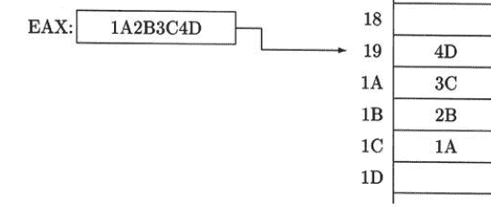

#### 程序 6.1

```assembly
; Tiny Edlinas program which stores an input number into memory.
;
    IN  EAX, [0]
    MOV [19H], EAX
    RET
```

在 Edlinas 下运行，它从地址 0 开始加载。由于加载此程序时，地址 20H 及之前的内存位置都会显示出来，因此 `MOV` 指令的执行过程可以直接观察到。

### 6.1.2 小端序和大端序架构

采用上述协议中第二种字节排序的架构被称为*小端序*（little endian）。执行相反操作的架构被称为*大端序*（big endian）。

所有 Intel 处理器都是小端序。大端序处理器的例子包括 Motorola 的 6800 和 68000 处理器。MIPS 和 PowerPC 处理器可以工作在两种模式下。

为了鼓励软件开发者从竞争硬件迁移，一种常见的策略是融入兼容性功能。添加到 486 处理器中的一项兼容性功能是 `BSWAP` 指令。它反转任意 32 位通用寄存器的字节顺序。其格式非常简单：

```
bswap reg
```

例如，如果 `EAX` 寄存器包含数字 12345678H，那么在执行 `BSWAP EAX` 指令后，它将包含数字 78563412H。

### 6.1.3 对齐

386 和 486 系统中存在的四字节数据传输大小与一字节字大小之间的差异并没有完全体现在硬件上。事实上，一字节字的大小是为了方便软件而维持的一种虚构概念。尽管这些系统的内存被强制模拟为一字节字内存，但字实际上是有四字节宽度的。32 位地址总线的两个最低位实际上是不存在的。地址总线上的线是 A31 到 A2。A1 和 A0 缺失。从硬件角度来看，386 寻址 $2^{30}$ 个 32 位字。$2^{32}$ × 8 位内存是一种虚构。但正因为这种虚构被一致地维护，相信这种虚构的软件才能正常工作。但是，它不如考虑真实情况的软件工作得那么好。例如，命令

```assembly
    MOV EAX, [10H]
```

访问四个内存字节，其 32 位地址为

```
    0000 0000 0000 0000 0000 0000 0001 0000
0000 0000 0000 0000 0000 0000 0001 0001
0000 0000 0000 0000 0000 0000 0001 0010
0000 0000 0000 0000 0000 0000 0001 0011
```

请注意，这些地址仅在“不存在”的最低两位上有所不同。这四个字节实际上只是一个四字节的字。该命令可以通过一次内存传输完成。另一方面，命令

```assembly
MOV EAX, [12H]
```

同样访问四个内存字节，但不能以相同方式执行。这四个字节的 32 位地址为

```
0000 0000 0000 0000 0000 0000 0001 0010
0000 0000 0000 0000 0000 0000 0001 0011
0000 0000 0000 0000 0000 0000 0001 0100
0000 0000 0000 0000 0000 0000 0001 0101
```

要访问这四个字节，需要两次不同的内存传输。在访问大量连续内存位置（每次四个字节）的代码中，如果调用的地址最低两位不为零（即不是四的倍数），性能将减半。跨越四字节字边界的内存传输被称为*未对齐*（out of alignment）。从 486 处理器开始，增加了一个标志位，用于检测未对齐的内存传输。

## 6.2 括号内的地址

使用 MOV 访问内存只是可用内存命令的皮毛。表 5.2 中所有包含操作数键 **m** 的条目都描述了访问内存的命令。从表中我们可以看到，MOV、ADD、OR、ADC、SBB、AND、SUB 和 XOR 都允许在源操作数或目标操作数位置使用内存操作数。内存操作数可以使用几种不同的格式提供。

### 6.2.1 [imm] 格式

迄今为止给出的所有内存操作数示例都使用了 MOV 指令的 [imm] 格式。用 ADD 命令说明 [imm] 格式，我们既有

```
ADD reg, [imm]
```

又有

```
ADD [imm], reg
```

其中 **imm** 可以是任意四字节数字。

众所周知，内存可用于存储多种类型的数据，包括文本、图形和数字。在接下来的段落中，我们将探讨数字（特别是大数）与之相关的用法。

#### 64 位算术

内存空间远大于处理器空间。当数字大到处理器无法直接处理时，可以分块进行算术运算，将足够小以便处理器处理的块在需要时从内存加载。处理器的某些特性就是为这种算术设计的。ADC 指令就是一个典型例子。该指令使得大数的分块加法成为可能。假设数字 1111222233334444H 和 AAAABBBBCCCCDDDDH 存储在内存位置 100H 和 108H，我们希望将它们相加。使用 ADD 指令对这些数字的低四字节进行操作将设置进位标志。对接下来的四字节使用 ADC 指令可以处理进位。ADC 指令与 ADD 指令非常相似。它的含义是

令 目标 = 目标 + 源 + 进位标志

而普通的 $ADD$ 指令的含义是

令 目标 = 目标 + 源

然后加法可以在两个阶段中完成，第一阶段使用 $ADD$，下一阶段使用 $ADC$。

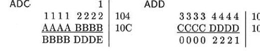

为了让进位传递正常工作，重要的是低位加法和高位加法之间没有任何东西干扰进位标志。以下代码使用从 100H 开始的八个字节作为目标，从 108H 开始的八个字节作为源执行此算术运算。当该程序完成时，

**程序 6.2**

```assembly
; 8 byte Destination at 100H
; 8 byte Source at 108H
MOV EAX, [108H]  ; Bottom 4 Source bytes
ADD [100H], EAX   ; Add to bottom 4 Destination bytes
MOV EAX, [10CH]   ; Top 4 Source bytes
ADC [104H], EAX   ; Add to top 4 Destination bytes
```

八字节和位于从地址 100H 开始的八个字节中。当 $ADC$ 指令完成时，溢出、进位和符号标志对于八字节算术将是正确的。零标志对于八字节不是那么好用。当置位时，它不一定表示八字节和为 0。

#### 3 的幂

扩展这个想法，我们可以使用以下算法编写一个小的 64 位 3 的幂计算器：

初始化 $y = 3$

然后重复：

```text
x = y
y = y + x
y = y + x
```

程序 6.3 没有输入或输出。可以通过在 Edlinas 中单步执行来观察它。[imm] 格式在引用内存中少数固定位置时很有用。它不适合处理内存中长序列的字节。

**程序 6.3**

```assembly
; Edlinas program which finds 64-bit powers of 3.
; Store the 8 bytes of x starting at memory address 100H.
; Store the 4 least significant bytes of y in EAX.
; Store the 4 most significant bytes of y in EBX.
;
;y = 3
MOV EAX, 3
MOV EBX, 0
MOV EDX, 1
; x = y
ABC: MOV [100H], EAX
      MOV [104H], EBX
; y = y + x
      ADD EAX, [100H]
      ADC EBX, [104H]
; y = y + x
      ADD EAX, [100H]
      ADC EBX, [104H]
      INC EDX ; Keep track of the exponent.
;
JMP ABC
```

### 6.2.2 [reg] 格式

长序列的字节出现在数组和非常大的数字中。与 [imm] 格式相比，[reg] 格式更适合处理这些情况。使用 MOV 说明 [reg] 格式，我们既有

```
MOV reg, [reg]
```

又有

```
MOV [reg], reg
```

在第一个中，[reg] 源操作数指代内存中地址位于括号内同名寄存器中的位置。例如，代码

```assembly
MOV EBX, 10H
MOV EAX, [EBX]
```

从地址 10H 开始的内存中将四个字节传输到 EAX 寄存器。

作为 [reg] 格式有用性的例子，假设我们要解决两个 256 字节数字相加的问题。

```
ADC       ADC       ADD
88 | 1FC        22 | 104      44 | 100
77 | 2FC        AB | 204      CD | 200
BE              21           21 | 100
```

在程序 6.2 中，地址直接使用 [imm] 格式访问。加法的每四个字节都使用两条指令完成，一条 MOV 和一条 ADC。使用相同的技术在这里相加 256 字节数字，需要将所需指令数乘以 64。因此，我们需要 128 行代码。另一方面，如果使用 [reg] 格式，我们可以使用寄存器作为源和目标地址，并在循环中增加它们。如果使用 EDI 作为目标索引，ESI 作为源索引，那么我们首先将 100H 存入 EDI，将 200H 存入 ESI。然后，在遍历两个大数时，我们需要每次增加四个字节来增加这些指针。这段代码比 128

**程序 6.4**

```assembly
;
; Code which adds two 256-byte numbers y and x:
; y = y + x
;
; Assume the 256 bytes of y are stored starting at memory address 100H.
; Assume the 256 bytes of x are stored starting at memory address 200H.
```


; 使用 EDX 作为 y = y + x 循环的递减计数器。
;
        MOV EDI, 100H ; 初始化指向 y 的指针。
        MOV ESI, 200H ; 初始化指向 x 的指针。
;
; y = y + x
        MOV EDX, 40H    ; 循环需要执行 64 次迭代。
        CLC             ; 清除进位标志。
XYZ:     MOV EAX, [ESI]  ; 将 4 个源字节载入处理器。
        ADC [EDI], EAX    ; 执行加法运算。
        INC ESI
        INC ESI           ;
        INC ESI           ; 这样写很不优雅。
        INC ESI
        INC EDI           ; 但在此处使用 ADD 指令
        INC EDI           ; 会清除进位标志。
        INC EDI
        INC EDI
        DEC EDX           ; 递减循环计数器。
        JNZ XYZ           ; 检查循环是否结束。

这些是如果使用 [imm] 格式将会产生的指令行。

乍一看，似乎我们可以用 ADD 指令代替多个 INC 指令来做得更好。但这实际上会破坏一切。由于我们使用循环以每次 4 字节的方式从最低有效字节向最高有效字节移动，我们遇到了进位标志的问题。如果在两次执行 ADC 指令之间，我们使用 ADD 指令将数值向下移动 4 个字节，我们就破坏了进位标志。在第 4 章中指出，进位标志不受 INC 和 DEC 指令的影响。这个晦涩的小例外背后的原因现在变得清晰了。多字节算术需要一个能够承受循环计数器调整的进位标志。由于它们不影响进位标志，INC 和 DEC 指令可用于执行无害的循环计数器调整。通过四个 INC 指令加上 4 并不美观，但它是有效的。

从占用内存空间的角度来看，这段代码并不算差，因为内存很便宜。但从增加循环执行时间的角度来看，它很糟糕。如果有一个地方执行时间代价高昂，那就是嵌套循环的内部，而这恰恰是那些额外的 INC 指令所在的地方。

另一种内存格式在处理这个问题时非常有用。

### 6.2.3 [reg+scale*reg+imm] 格式

最通用的内存格式是 [reg + scale * reg + imm] 格式，其中 scale 是一个比例因子，必须是 1、2、4 或 8。乘以比例因子的寄存器被称为**索引寄存器**。另一个寄存器被称为**基址寄存器**。某些字段可以省略。这给了我们各种格式的效果，包括

-   [scale*reg + imm]
-   [reg + scale*reg]
-   [reg + reg + imm]
-   [reg + imm]
-   [reg + reg]

除了前面已经讨论过的 [reg] 和 [imm] 格式。很难相信具有这种复杂度的指令是硬编码在处理器中的。但所有这种复杂度在指令长度方面的代价实际上只是为使用此通用格式指令多了一个字节的代码。这个字节被称为 SIB 字节，既是 scaled-index-base 字节的缩写，也是 ModR/M 字节的“兄弟”（sibling）。

回到 Program 6.3 中重复 INC 指令的问题，请注意，比例为 4 的因子会在索引寄存器递增 **1** 时将地址增加 **4**。在 Program 6.5 所示的代码中，使用 `[scale*reg + imm]` 格式来引用源和目标内存位置。在此代码中，我们看到单个 `INC` 指令取代了 Program 6.3 中的八个 `INC` 指令。

#### Program 6.5

```assembly
;
;	Edlinas program which finds 256-byte powers of 3.
;	Store the 256 bytes of x starting at memory address 100H.
;	Store the 256 bytes of y starting at memory address 200H.
		MOV EBX, 3 ; Initialize base.
		MOV EDX, 1 ; Initialize exponent.
;	y = 3
		MOV EAX, 0 ; Do the adding in EAX.
		MOV EDI, 40H ; Loop needs 64 iterations.
ZRO:		DEC EDI
		MOV [4*EDI + 200H], EAX
		JNZ ZRO
		MOV [4*EDI + 200H], EBX
;
;	x = y. Main infinite loop starts here.
;	
LUP:		MOV EDI, 40H ; Loop needs 64 iterations.
		MOV ESI, EBX ; Initialize main loop counter.
BEG:		DEC ESI
		MOV EAX, [4*EDI + 200H]
		MOV [4*EDI + 100H], EAX
		JNZ BEG
;	y = y + x
AGN:		MOV ECX, 40H ; Loop needs 64 iterations.
XYZ:		MOV EAX, [4*EDI + 200H]
		ADC EAX, [4*EDI + 100H]
		MOV [4*EDI + 200H], EAX
		INC EDI
		DEC ECX
		JNZ XYZ
;		DEC ESI
		JNZ AGN
;		INC EDX
		JMP LUP
```

一种不被允许的变体是在两个操作数位置都使用内存引用。没有 x86 处理器指令同时使用内存作为源和目的操作数。例如，指令

```assembly
ADD [EAX], [EBX]
```

并不存在。然而，确实有涉及从内存读取和写入内存的指令；例如，`INC [EAX]` 既从地址在 EAX 中的内存位置读取，又写入该位置。称为 *load/store*（加载/存储）的体系结构不允许混合处理器操作和内存操作。加载/存储体系结构中访问内存的唯一命令是 *load*（加载）和 *store*（存储）。

### 6.2.4 16 位地址

在 6.2.2 节中介绍了内存寻址的 `[reg]` 格式，其中 `reg` 可以是八个 32 位通用寄存器中的任何一个。8086 和 80286 也使用 `[reg]` 格式。并非所有八个 16 位寄存器都允许使用；然而，只有 `BP`、`BX`、`SI` 和 `DI`。还有一种 `[reg + reg + imm]` 形式。`imm` 必须是一个 16 位数字。如果使用两个寄存器，允许的组合只有 `BP + SI`、`BP + DI`、`BX + SI` 和 `BX + DI`。由于这些限制很容易忘记，不习惯 16 位地址的程序员可能会发现自己使用了不允许的地址形式。大多数程序员会尽量避免在可能的情况下使用 16 位寻址。

这些 16 位内存地址形式可用于 80386。当它们出现在 32 位代码中时，必须向机器码应用一个特殊前缀 67H，以通知处理器 ModR/M 字节中的内存地址位是使用旧的 16 位编码系统编码的。这个前缀被称为地址大小前缀。它与第 5 章 5.5 节中讨论的操作数大小前缀类似。

### 6.2.5 CISC 与 RISC

x86 计算机通常被认为是一个复杂指令集计算机（CISC）。这 partly 是因为复杂的寻址，例如 [EDX + 4*ESI + ABC] 内存操作数。像 SUN 和 MIPS 工作站这样的机器基于这样的想法：通过简化指令并减少指令数量，它们变得更易于执行且速度更快。这可以抵消编写程序需要更多这类小指令的事实。基于此理念的计算被称为 RISC（精简指令集计算）。RISC 与 CISC 的问题并不是像小端序与大端序那样的非此即彼的问题。RISC 是一组可以部分采用、不同程度上采用的功能特性。486 和 Pentium 处理器能够与早期的 RISC PowerPC 处理器竞争的一个原因是它们采用了部分 RISC 理念。尽管允许在 Pentium 上使用 CISC 指令，但如果使用类似 RISC 的指令子集进行编程，其运行速度会更快。

尽管名字如此，Pentium II 和 Pentium Pro 已全面转向 RISC 架构。内部使用的指令集是纯 RISC 指令集。传统的 x86 指令在执行前会在内部转换为 RISC 指令。在某种意义上，苹果营销人员在 Pentium 身上挂的“此路不通”（end of the line）标签是正确的。但具有讽刺意味的是，386 汇编语言现在比以往任何时候都更强大。

## 6.3 操作数大小歧义

在大多数双操作数指令中，两个操作数必须具有相同的大小。因此，当在此类上下文中使用内存操作数时，如果另一个操作数是寄存器操作数，可以确定其引用的字节数。例如，在 ADD [EBX], AX 中，内存操作数 [EBX] 必须引用两个内存字节，因为 AX 是一个双字节寄存器。然而，当内存操作数与立即数操作数一起使用时，结果会产生歧义。例如，以下命令具有歧义：

```assembly
MOV [EBX], 5
```

类似地，当内存操作数与一元运算（如 NEG，它取一个数的补码）一起使用时，操作数大小是不确定的。像这样的指令

```assembly
NEG [EBX]
```

可能引用一个、两个或四个内存字节。在这种情况下，汇编器必须做出选择。NASM 选择生成错误消息。在 32 位代码中，Edlinas 在引用产生歧义时默认为四字节的引用。在 16 位代码中，默认为双字节。要在 Edlinas 中表示单字节情况，可以使用传统但笨拙的表示法

```assembly
NEG BYTE PTR [EBX]
```

在 NASM 中，代码是

```assembly
NEG BYTE [EBX]
```

要在 NASM 中表示四字节引用，代码是

```assembly
NEG DWORD [EBX]
```

双字节引用使用 WORD 作为限定符。这些限定符清楚地完成了任务。隐含的让步是一个字为 16 位不幸。鉴于 BYTE PTR 这样的表示法，AT&T 在助记符后添加字母的做法似乎并不那么糟糕。事实上，Intel 汇编器确实在少数情况下使用了这种类型的助记符，例如 LODSB 和 STOSB（加载字符串字节和存储字符串字节）。

## 6.4 标签


## 6.4 标签与内存

在编程跳转中，标签被用作一种便利工具。使用标签配合跳转指令可以省去计算跳转目标上方或下方字节数的繁琐步骤。计算这些字节需要汇编中间代码，并且每当中间代码发生变化时，都必须重新进行计算。因此，标签是一个极大的便利。但归根结底，它们仅仅是一种便利手段。

标签也可以用于访问内存存储位置。在*程序 6.6*中，我们可以看到*ABC*被用作一个标签，用于标识存储输入字节的位置。

### **程序 6.6**

```assembly
; Tiny Edlinas program which uses a label to reference a data storage location.
;
	IN AL, [0]		; E4 00
	MOV [ABC], AL		; 88 05
				; 09 00
				; 00 00
	RET			; C3
ABC:	NOP			; 90
```

对于 `MOV [ABC], AL` 指令的机器码，标签 *ABC* 会被替换为一个数字。基于在*第 5 章*中讨论的跳转指令编码规则，我们预计 *ABC* 会被替换为数字 *1*，因为标签 *ABC* 出现在下一条指令起始位置后一个字节处。基于*第 6.2 节*中的 `MOV` 指令，如果我们假设程序从 *0* 开始加载（如 Edlinas 所做的那样），我们预计 *ABC* 会被替换为标签 *ABC* 所在指令的地址，在此情况下为 *9*。

### 6.4.1 地址编码

编码目标内存位置地址的常见方法有两种。

-   **相对编码。** 在机器码中使用目标位置地址与紧随其后的指令地址之间的数值差。
-   **绝对编码。** 在机器码中直接使用目标地址本身。

*第 5 章*中讨论的所有跳转指令都使用相对编码。绝对编码用于 8080 代码中的跳转指令以及 x86 机器码中所谓的*远跳转*。某些绝对编码的存在几乎是不可避免的。（唯一的替代方案是设计处理器来接管内存分配的工作。）

x86 机器码中所有内存访问指令，如 `MOV`、`ADD` 等，都使用绝对编码。

### 6.4.2 程序加载

休眠状态下的程序通常驻留在硬盘或其他二级存储设备上。为了执行，它们需要进入内存。要让程序执行，用户需将其文件名传递给操作系统（例如通过命令行输入），在 Linux 中是通过 execve() 函数。决定程序在内存中加载位置的并非用户或程序员，而是操作系统。由于程序员无法控制其程序在内存中的位置，当使用标签引用内存时，使用基于绝对内存编码的指令就会变得有问题。事实上，这使得将使用内存标签的程序汇编成纯未加载的机器码成为不可能。使用内存标签的程序生成的可执行代码必须附带标识代码中所有绝对地址出现位置的表格。这些表格被称为*重定位表*。所有目标代码文件，如 Linux 中的 .o 文件，都包含重定位表。当程序被加载到内存时，这些表格被用来修正机器码中的每个绝对地址，使其指向程序实际加载位置下的有效地址。

Edlinas 模拟器从地址零开始加载所有程序。我们可以从那里数到*程序 6.6*中包含 `ABC` 的那一行。如果这样做，我们会发现 `NOP` 指令位于地址 *9*。这就是为什么*程序 6.6*中给定的 `MOV [ABC], AL` 指令的机器码显示标签 *ABC* 被编码为 9。因此，可以使用指令 `MOV [9], AL` 来替代 `MOV [ABC], AL`。如果该程序被重定位以从地址 100H 开始，那么 `MOV` 指令中 `ABC` 标签的代码需要是 109H 而不是 9。

### 6.4.3 变量

在高级编程语言中，变量通常实现为带标签的内存位置。虽然编译器可能会使用寄存器，但变量的更典型实现方式是带标签的内存位置。对于全局变量尤其如此。

### 6.4.4 数组

作为一个示例，说明这些寻址模式如何用于处理数组编程，请考虑以下 C 代码，它统计数组 x[70][100] 中从第 20 行到第 29 行、第 50 列到第 54 列部分中零和一的个数。要在汇编器中编写此代码，我们可以使用 `EBX` 代表 `num_zeros`，`ECX` 代表 `num_ones`，以及标签 `ABC` 代表数组 x 的起始位置。要引用数组位置 `x[i][j]`，我们需要利用这样一个事实：地址 `&x[i][j]` 位于 `&x[0][0] = ABC` 之后 `i*100*4 + j*4` 个字节处。`i*100*4` 中的 100 来自声明 `int x[70][100]`，它告诉我们每一行包含 100 个四字节的存储位置。虽然我们可能希望使用 `EDI` 代表 i，`ESI` 代表 j，并使用 `[ABC + 400*EDI + 4*ESI]` 来引用 `x[i][j]`，但编码空间中并不存在如此大的自由度。允许对一个寄存器使用乘数 4，但不允许使用乘数 400，也不允许使用两个带缩放的寄存器。因此，使用 `EDX` 来表示 `400*i` 是有意义的。`[ABC + EDX + 4*ESI]`

### **程序 6.7**

```c
num_zeros = 0;
num_ones = 0;
for(i = 20; i < 30; i = i + 1)
  for(j = 50; j < 55; j = j + 1)
  {
      if (x[i][j] == 0)
          num_zeros = num_zeros + 1;
      if (x[i][j] == 1)
          num_ones = num_ones + 1;
  }
```

## 6.5 立即数存储

汇编器的工作是生成目标代码文件。汇编语言程序是汇编器的输入。除了注释之外，我们之前处理的所有汇编语言文件中的所有行都是由翻译成处理器指令的指令组成的，正如第 5 章所述。汇编器的自动翻译是一个巨大的便利，也是汇编语言的主要内容。尽管如此，有时放弃翻译并直接指定目标代码字节也是可取的。这两种值得注意的情况是：

-   需要直接插入数据字节。
-   需要手动汇编处理器指令。

以下语法用于将给定的字节直接插入机器代码中。

### 6.5.1 字节定义汇编器指令

在 NASM 中，命令

```nasm
db imm
```

将任何一字节数字存储到目标代码文件中。`db` 代表*定义字节*。像 `db` 这样不翻译成处理器指令的指令有时被称为*伪指令*。由于它们实际上是给汇编器的指令，称其为*汇编器指令*更为恰当。汇编器指令通常缺乏处理器指令那种普遍性，后者通常遵循制造商制定的格式。Edlinas 遵循 Unix 传统，即所有汇编器指令以点开头，并使用 `.db`。

没有开头的点，定义字节语法非常广泛。当与标签一起使用时，它在 Microsoft 和 Turbo 汇编器中都有效。在这些汇编器中

### **程序 6.8**

```assembly
MOV EBX, 0          ; num_zeros
MOV ECX, 0          ; num_ones
MOV EDX, 8000       ; 400*20, Initially i = 20
;  
; Outer loop begins here.
;  
OTL:    MOV ESI, 50    ; Let j = 50
;  
; Inner loop begins here.
;  
INL:    MOV EAX, [ABC + 4*ESI + EDX]
                              ; ABC = &x[0][0].
                              ; EDX = &x[i][0] - &x[0][0]
                              ; 4*j = &x[i][j] - &x[i][0]
                              ; ESI = j

        CMP EAX, 0      ; Check for zeros
        JNE NOZ         ;  
        INC EBX         ; Count zeros
NOZ:     CMP EAX, 1      ; Check for ones
        JNE NOO
        INC ECX         ; Count ones
NOO:     INC ESI          ; j=j + 1
        CMP ESI, 55     ; Check that j < 55
        JL INL          ; Inner loop ends here.
        ADD EDX, 400    ; Increase EDX by 100 * 4
        CMP EDX, 12000  ; 8000 + 10 * 100 * 4
        JL OTL          ; Outer loop ends here.
ABC:     NOP             ; Begin array here.
```

定义字节指令具有数据类型声明的味道。这种“数据类型”用于解决第 6.2 节中提到的那种歧义。例如，如果标签 `ABC` 在一个包含如下行的程序中使用：

```assembly
ABC DB 3 ; ABC is of type byte
```

那么诸如

```assembly
NEG [ABC]
```

这样的命令与

```assembly
NEG BYTE PTR [ABC]
```

意味着相同的事情。

在 NASM（以及 Edlinas）程序中，`db` 不具有类型意义。简单语法的常见修饰在两者中都有效。

```nasm
db imm, imm, ...
```

在 `db` 后跟随一串一字节数字时，将一串字节存储到目标代码文件中。

在 Edlinas 中，也可以使用左侧的整数乘数。例如，以下代码将零存储到一百字节的内存中。

```assembly
.db 100 * 0
```


在 NASM 中，可以使用以下代码实现相同的效果：

```nasm
TIMES 100 db 0
```

### 6.5.2 指令的手工编码

由于新处理器通常使用的指令集与旧指令集相同，只是多了一两条新指令，因此使用旧的汇编器来编程新处理器往往很有价值。通过手工编码新指令，即可加以利用。开源倡导者可能会指出，如果该汇编器是开源程序，完全可以重新编程以处理新指令。但那是另一个话题了。

**程序 6.9**

```nasm
; 使用立即数存储来编码 CPUID 指令。
;			MOV EAX, 0
			db 0FH,0A2H	; 立即数存储
```

### 6.5.3 数据初始化

在 C 语言中，人们容易产生一种印象，认为带有初始化的声明，例如

```c
char x = 2;
```

与声明后紧接着的赋值语句没有区别，例如

```c
char x;
x = 2;
```

然而事实上，二者是有区别的。在后一种情况中，隐含了一条处理器指令，将立即数值 2 进行存储。而在前一种情况中，并不隐含任何处理器指令。所指示的存储操作可能在程序被加载之前，就由汇编器通过将数值 2 存储在程序内部地址来完成。

**程序 6.10**

```nasm
; 一个微小的 Edlinas 程序，使用标签访问存储的数据。
;			MOV AL,[ABC]
			OUT [1], AL
			RET
ABC:		.db 3
```

# 第 7 章 栈

*栈*（stack）是内存中的一部分，它与操作系统共享。程序使用栈来进行与子程序的通信、临时存储以及在发起系统调用时使用。之所以称为栈，是因为它遵循“后存储先检索”（Last In, First Out, LIFO）的策略。它实际上是被称为栈的数据结构的一个实例。由于栈既被操作系统使用，也被程序员使用，因此必须负责任地使用。误用栈是使程序崩溃，或者在操作系统没有保护的情况下使整个系统崩溃的一个非常容易的方式。

## 7.1 压栈和出栈操作

下图展示了栈和 ESP 寄存器。该寄存器负责跟踪栈的状态。它通过持有栈顶的地址来实现这一功能。ESP 中的 SP 代表*栈指针*（stack pointer）。

虽然 ESP 被称为通用寄存器，因为它像寄存器 EAX、EBX 等一样对程序员可访问，但对 ESP 的写入操作应极其小心地进行。

假设 ESP 包含地址 19H，如**图 7-1**所示。那么将字节 76H 存储在栈上会填充位置 18H，并且栈指针会发生变化，如**图 7-2**所示。这种操作称为**压栈**（push）。此处所示的单字节压栈本质上等同于以下两个操作：

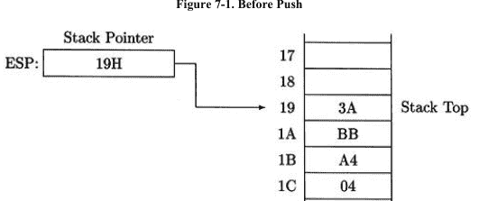

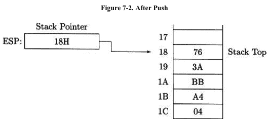

```
DEC ESP ; 将指针移动到第一个空缺位置。
MOV [ESP],76H; 将 76H 存储在 ESP 中的地址处。
```

事实上，x86 不允许单字节压栈。所有压栈操作必须是双字节或四字节压栈。压栈的字节数由 PUSH 指令中操作数的大小决定。

### 7.1.1 PUSH 命令

PUSH 指令最常见的形式是：

```
PUSH reg
```

允许的寄存器包括 16 位和 32 位通用寄存器，但不包括 8 位寄存器。内存操作数和立即数操作数也可以与 PUSH 一起使用，但寄存器操作数形式最为有用。

**图 7-3** 和 **图 7-4** 展示了 PUSH EAX 指令的效果。


PUSH EAX

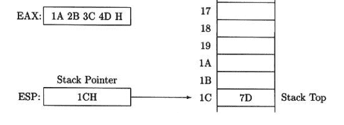

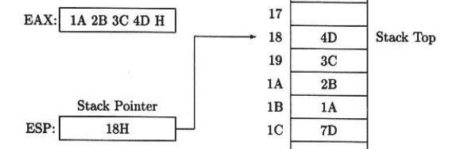

这与以下操作非常相似：

```
SUB  ESP, 4
MOV  [ESP], EAX
```

因为栈指针指向最后占据的位置，而不是栈的第一个未占据位置，所以必须先从栈指针中减去值，然后将字节传输到栈中，而不能反过来执行 PUSH 操作。如果所有压栈和出栈操作的大小都相同，让栈指针指向第一个可用位置将是一个合理的策略。但由于压栈和出栈可能是 2 字节或 4 字节，这种策略是不可行的。

### 7.1.2 POP 命令

相反的操作称为*出栈*（pop）。与 PUSH 指令类似，POP 接受寄存器操作数和内存操作数，可以是 2 字节或 4 字节。与 PUSH 不同，它不接受立即数操作数。与压栈一样，操作数的大小决定了要出栈的字节数。由于 BX 是一个双字节寄存器，POP BX 从栈中弹出两个字节。

```
POP BX
```

这与以下操作非常相似：

```
MOV  BX,  [ESP]
ADD  ESP, 2
```

栈的一个用途仅仅是当可用寄存器不足时作为存储使用。假设 EAX 和 EBX 中有重要的值需要保存，但同时还需要执行使用寄存器 EAX 和 EBX 的计算。这种情况就需要使用栈。在计算完成之前，可以将寄存器 EAX 和 EBX 中的值保存到栈上。计算完成后，它们可以再次恢复。以下代码执行此操作：

```
PUSH EAX
PUSH EBX
...
; 计算
...
POP EBX
POP EAX
```

出栈的顺序与压栈的顺序完全相反。这是因为栈具有“后存储先检索”的特性。在结束时，EAX 和 EBX 中的值应与开始时相同。但这只有在中间的计算负责任地使用栈时才成立。这意味着每个压栈操作应与一个出栈操作匹配。如果压栈和出栈操作不平衡，那么在计算结束时弹出到 EBX 和 EAX 中的值将与其原始值不同。

在编写要在 Unix 下运行的用户程序时，没有必要通过向 ESP 存储值来初始化栈。事实上，由于栈已经设置好了，向 ESP 存储任意值会破坏现有的栈并导致程序崩溃。然而，在编写要在 Edlinas 下运行的程序时，有必要初始化 ESP。

## 7.2 子程序

高级编程语言使用子程序将复杂任务简化为更简单的组件。在 C 语言中，子程序就是函数。函数可以被调用，就像另一条 C 指令一样。如果已定义了函数 subpr()，那么它就可以出现在主程序的一行中，如程序 7.1 所示。

**程序 7.1**

```c
main()
{
    int x, y, z;
    ...
    subpr(); // 此子程序单独定义。
    ...
}
```

### 7.2.1 CALL 和 RET 命令

编码包含子程序的汇编器程序是使用 CALL 和 RET 指令完成的。RET 代表返回（return）。这些命令的作用类似于跳转和跳转返回命令。CALL 指令的格式与 JMP 指令的格式非常相似。

**程序 7.2**

```c
subpr()
{
    int a, b, c;
    ...
    return c;
}
```

```nasm
    CALL label
```

与 JMP 指令一样，标签是由程序员创建的，并指向其所占据标签字段的那一行。

当子程序完成时，控制需要转回主程序；特别是，主程序中执行的下一条指令需要是 CALL 指令之后的指令。为了实现这一点，处理器在离开主程序之前会将下一条指令的地址压入栈中。`CALL` 执行此操作。`RET` 指令将此地址从栈中弹出并跳转到该地址。

例如，程序 7.3 是一个接受用户输入的程序，它使用一个将 `EBX` 寄存器加 1 的子程序来递增数字，然后将结果输出给用户。

**程序 7.3**

```nasm
;                        ;
;   MOV ESP, 2000H ; 初始化栈
; Edlinas 程序必须初始化栈
; Unix 程序则不应该。
;                        ;
    IN EAX, [0]     ; 获取用户输入
    MOV EBX, EAX    ; EBX 是子程序工作的地方。
    CALL subpr      ; 转到子程序。
    MOV EAX, EBX    ; 从子程序返回！
    OUT [1], EAX    ; 输出递增后的值
    RET             ; 返回到 Edlinas。
;                        ;
subpr:
    INC EBX         ; 子程序执行其任务。
    RET             ; 返回到主程序。
```

对于一个更复杂的示例，考虑以下算法。这个算法是一个名为考拉茨问题（Collatz Problem）的著名未解决数学问题的核心。

- 如果 x 是偶数，将其除以 2
- 如果 x 是奇数，将其乘以 3 并加 1。
- 重复此过程，直到 x = 1。

假设我们想要一个执行此算法并统计在 x 的值变为 1 之前需要多少步骤的程序。

由于需要循环来确定数字是奇数还是偶数，或者将其除以 2（如果我们仅使用加法、减法和条件跳转指令），因此设计一个子程序来执行此操作是有意义的。具体来说，假设我们分配给子程序的任务是检查 `EAX` 寄存器，如果 `EAX` 是偶数，则将 `EAX` 的一半存储在 `EBX` 中，否则在 `EBX` 中存储零。我们可以按以下方式编码此子程序：

**程序 7.4**

```nasm
HAF:   MOV ECX, EAX
       MOV EBX, 0
AGN:   INC EBX         ; 计算减法次数
       SUB ECX, 2      ; 重复减去 2
       JG AGN          
       JZ DUN          ; 结果是偶数
       MOV EBX, 0      ; 它不是偶数。
DUN:   RET
```

使用这个子程序，我们现在可以编写一个执行程序 7.4 的主程序。

## 7.3 参数传递

栈最重要的功能之一是用于参数传递。例如，假设在 C 程序中调用了字符代码转换函数 `tolower( )`。

标准 C 库 ctype.h 中的 `tolower( )` 函数将字符代码转换为小写。例如，在使用 ASCII 的机器上，如果给定的代码是 65（'a' 的 ASCII 码），它将返回 97


以 'A' 的编码作为输入参数。该输入参数被压入堆栈。因此，同一函数调用的汇编代码如下所示：

### **程序 7.5**

```assembly
MOV EBX, 65
PUSH EBX
MOV EDX, 0
IN EAX, [DX]
ABC: CMP EAX, 1    ;
     JE FIN        ;如果 EAX = 1，则结束。
     INC EDX        ;使用 EDX 作为计数器。
     CALL HAF       ;这是子程序调用！
     CMP EBX, 0     ;EBX = 0 表示 EAX 是奇数
     JE ODD         ;
     MOV EAX, EBX   ;如果不是，则 EBX 是 EAX 的一半
     JMP ABC        ;
ODD: MOV EBX, EAX   ;将 EAX 乘以 3 并加 1
     ADD EAX, EBX   ;
     ADD EAX, EBX   ;
     INC EAX
     JMP ABC        ;
FIN: MOV EAX, EDX   ;EDX 包含最终计数。
     MOV EDX, 1
     OUT [DX], EAX
     RET
```

### **程序 7.6**

```c
#include <ctype.h>

main()
{
    int x,y;

    x = 65; /* x = 'A' */
    y = tolower(x); /* y = 'a' */
}

CALL tolower
ADD ESP, 4
```

尽管使用堆栈存储返回值似乎是一个自然的想法，但更常见的做法是使用寄存器。在针对 x86 架构的 GNU C 中，返回的整数值存储在 EAX 寄存器中。不同语言在子程序还是主程序负责从堆栈中弹出参数方面存在差异。在 Fortran、Basic 和 Pascal 中，由子程序弹出堆栈，但在 C 中由调用程序执行此操作。这就是刚才展示的调用程序中 `ADD ESP, 4` 指令的原因。

语言在参数压入堆栈的顺序上也存在差异。C 语言从右侧开始压入参数。假设我们定义了一个整数幂函数 `ipow()`：

```c
int ipow(int base, int exponent);
```

调用此函数以计算 $2^3$ 的汇编代码如下所示：

```assembly
MOV EBX, 3
PUSH EBX
MOV EBX, 2
PUSH EBX
CALL ipow
ADD ESP, 8
```

在此调用之后，结果 `ipow(2, 3) = 8` 将存储在 EAX 寄存器中。

### 7.3.1 全局汇编指令

在由 GNU 编译器生成的 .o 文件中，诸如 `printf` 或 `tolower` 等需要外部链接的符号在符号表中的编码方式不同。如果没有这种特殊编码，GNU 链接器将忽略这些符号，导致链接失败。为了获得这种特殊编码，汇编语言源代码必须特别指示哪些符号需要接受这种处理。GNU 汇编器和 Edlinas 都识别一条汇编器指令，该指令将使汇编器在符号表中将符号编码为可用于链接。其语法是

```assembly
.globl symbol
```

在 NASM 中，语法为：

```assembly
global symbol
```

### 7.3.2 从 C 调用汇编

如果从 C 调用 `half` 子程序，它将无法正常工作，因为它不在 EAX 寄存器中返回值。此外，它也没有压入其使用的寄存器。在下面的代码中，由于 ECX 被使用，且调用程序可能将其用于其他用途，因此 ECX 被压入堆栈。我们还需要使用全局指令使函数名称可见。

我们刚刚编写了一个汇编函数，可以从 C 程序中调用。C 程序会将调用参数存储在堆栈上。它将被埋在调用程序压入的返回地址以及刚刚压入的 ECX 内容之下。这两项在堆栈上占用八个字节，因此调用参数的访问地址为 ESP + 8。结果存储在 EAX 中，而不是 EBX。要在 Edlinas 中保存对象代码为 .o 文件，请使用 o 键。要使用 NASM 生成对象代码文件，请输入

#### 程序 7.7

```assembly
        global half ; 或在 Edlinas 中使用 .globl
half:   PUSH ECX      ; ECX 被使用，因此压入。
        MOV ECX, [ESP + 8]
                                  ; 栈顶 + 2 个整数
        MOV EAX, 0
AGN:    INC EAX       ; 统计减法次数
        SUB ECX, 2    ; 反复减去 2
        JG AGN
        JZ DUN        ; 结果为偶数
        MOV EAX, 0    ; 不是偶数。
DUN:    POP ECX
        RET
```

```bash
linuxbox$ nasm -f elf half.asm
```

`-f elf` 开关指定对象代码文件的格式，在当前的 Linux 中为 elf。第 8 章将进一步讨论此格式。

程序 7.8 是一个调用函数 `half()` 的 C 程序，其汇编代码显示在程序 7.7 中。如果程序 7.8 保存在文件 `collatz.c` 中，则要对其进行编译并与 `half()` 链接，请对这两个文件使用 `gcc`

```bash
linuxbox$ gcc collatz.c half.o
```

## 7.4 递归

在递归中，计算的大部分工作由参数传递机制完成。

递归定义通常可以很容易地转换为计算上有效（即使效率不高）的程序。这通常使用斐波那契数列来说明。

```text
fib(k) =
   1                    如果 k < 2
   fib(k - 1) + fib(k - 2)   其他情况。
```

程序 7.9 展示了如何将此递归定义转换为 C 代码。在汇编语言中，只要记住除 EAX 外使用的寄存器必须被压入，就可以轻松编写此代码。程序 7.10 展示了如何仅使用 ECX 和 EAX 来实现。要从 C 测试此程序，可以使用像程序 7.11 这样的小型调用程序。要使用 Edlinas 测试此类程序，还需要初始化堆栈，如程序 7.3 的第一行所示。

### 程序 7.8

```c
main()
{
    int count,x,y;
    count = 0;

    printf("Enter a number:  ");
    scanf("%d", &x);

    while(x != 1)
    {
        count = count + 1;
        y = half(x); /* 这是子程序调用！ */
        if(y != 0)
            x = y;
        else
            x = 3*x + 1;
        printf("\n x = %d.", x);
    }
    printf("\n There were %d iterations.\n\n", count);
}
```

### 程序 7.9

```c
int fib(int k)
{
    int d;

    if(k < 2)
        d = 1;
    else
        d = fib(k-1) + fib(k-2);

    return d;
}
```

### 程序 7.10

```assembly
        global fib
fib:  PUSH ECX          ; 让我们可以访问 ECX
      MOV EAX, [ESP + 8]  ; 访问参数
      CMP EAX, 2          ; 如果 k < 2
      JAE ELS             ;
      MOV EAX, 1          ; 将返回值放入 EAX
      JMP DUN
ELS:  DEC EAX             ; 获取 k-1
      MOV ECX, EAX        ; EAX 将被覆盖！
      PUSH EAX            ; 传递 k-1 作为参数
      CALL fib            ; 获取 EAX 中的 fib(k-1)
      ADD ESP, 4          ; 清除参数
      DEC ECX             ; 获取 k-2
      PUSH ECX            ; 传递 k-2 作为参数
      MOV ECX, EAX        ; 将 fib(k-1) 放入 ECX
      CALL fib            ; 获取 EAX 中的 fib(k-2)
      ADD ESP, 4          ; 清除参数
      ADD EAX, ECX        ; 将两个部分结果相加
      POP ECX             ; 恢复原始值
      RET
```

### 程序 7.11

```c
main()
{
int x, y;
;
printf("Enter a number: ");
scanf("%d", &x);
;
y = fib(x);
;
printf("%d\n", y);
}
```

# 第 8 章. Linux 用户程序

在第 6 章开头提到，Linux 用户程序中使用的内存地址不是真实的内存地址。主要原因是 Linux 需要防止用户直接访问内存。参见图 8-1。

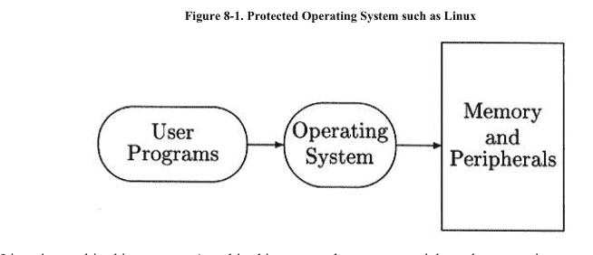

Linux 是一个多任务系统。多任务系统拥有许多用户作业和一个操作系统，它们都在同时运行。在某个作业可以覆盖属于另一个作业的内存的机器上，多任务系统是不可能实现的。多任务需要内存保护。Linux 使用分页来实现内存保护系统。

分页最初被设计为一种节省内存的系统。Linux 也使用它来节省内存以及进行内存保护。分页通过拦截用户机器代码中遇到的每次内存访问来工作。换句话说，用户程序中的每个内存引用都会变成内存访问请求，该请求需要经由分页系统进行审批。这意味着分页对内存访问拥有控制权。为了实现这一点，处理器必须内置分页功能。

8086 和 80286 处理器都不支持分页。第一个支持分页的 Intel 处理器是 80386。

## 8.1 多任务

在多任务操作系统出现之前，计算机程序是按顺序执行的，即一个接一个。前面的程序未完成，后面的程序就无法开始执行。像这样按顺序运行程序的操作系统被称为*批处理*操作系统。多任务系统允许程序轮流使用处理器。一个名为*调度器*的操作系统程序充当裁判，强制用户程序相互让出控制权，即使它们尚未完成。在任何给定时刻，可能有许多用户程序正在轮流等待处理器时间。这些程序中的每一个都称为*任务*或*进程*。必须区分程序和进程，因为一个程序可以被多个用户同时调用多次。程序的每个独立实例就是一个进程。在 Linux 中，我们可以使用以下命令列出进程

```bash
linuxbox$ ps aux
```

或者，为了进行更详细的检查，我们可以探索 `/proc` 目录。

像 Linux 这样的多任务系统不断地对其处理器资源进行调配，将它们在进程之间传递。每当进程从处理器上被移除时，它都必须保存其当前状态。保存工作的一部分是由硬连线例程完成的，该例程在 x86 执行*任务切换*时运行。它将所有当前寄存器保存到内存中称为*任务状态段*的区域。任务状态段保存了当前未运行任务的冻结状态。每个任务都有自己独立的任务状态段。这些任务状态段使得从一个任务切换到另一个任务成为可能。**图 8-2** 展示了任务状态段的基本布局，包括所有通用寄存器的空间，以及一个称为 *CR3 寄存器* 的寄存器。图中未标记的部分在第 13 章中讨论。

**图 8-2. 任务状态段**

| 偏移量 | 值 |
| :----- | :----- |
| 0 | |
| 4 | |
| 8 | |
| 12 | |
| 16 | |
| 20 | |
| 24 | |
| 28 | CR3 |
| 32 | EIP |
| 36 | EFLAGS |
| 40 | EAX |
| 44 | ECX |
| 48 | EDX |
| 52 | EBX |
| 56 | ESP |
| 60 | |


## 8.2 分页

如第 4 章 4.2 节所述，x86 I/O 地址不会经过处理。如果 DX 寄存器包含诸如 FC30H 这样的数字，那么执行 `IN AL, [DX]` 指令会导致 DX 的 16 位直接施加到地址总线上。

FC30H = 1111 1100 0011 0000

因此，地址总线上得到的是：

| A15 | A14 | A13 | A12 | A11 | A10 | A9 | A8 | A7 | A6 | A5 | A4 | A3 | A2 | A1 | A0 |
|---|---|---|---|---|---|---|---|---|---|---|---|---|---|---|---|
| 1 | 1 | 1 | 1 | 1 | 1 | 0 | 0 | 0 | 0 | 1 | 1 | 0 | 0 | 0 | 0 |

高 16 位只是 0。

另一方面，内存地址的处理方式并不那么直接。`MOV AL, [0FC30H]` 不会导致这些相同的位被泵送到地址总线上。内存地址要经过一个两步过程：

- 1. 分段（Segmentation）
- 2. 分页（Paging）

只有在这个过程的最后，且只有当一切顺利时，才会有一个物理地址可以被泵送到地址总线上。由于 Linux 不使用分段，对其的讨论推迟到第 12 章。

### 8.2.1 虚拟内存

所有地址都位于 0 到 4 Gig 的范围内。虽然让不同的任务使用 4 Gig 空间的不同部分听起来很有道理，但 Linux 并非这样工作。Linux 可能会在同一时间将相同的地址分配给不同的任务。这些地址不是真实的。它们被称为虚拟地址。就像不诚实的会计会保留两套账本，一套给审计员，一套反映真实情况一样，Linux 必须为每个任务保留一组虚拟地址，以及一组用于磁盘和 RAM 中实际物理位置的真实地址。

图 8-3. x86 虚拟内存系统

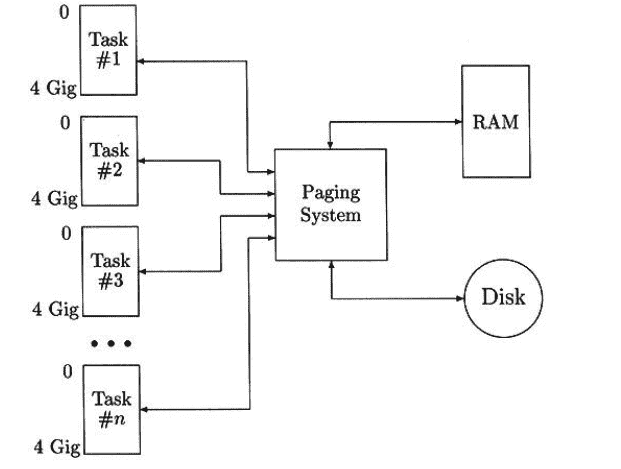

虚拟地址和真实地址之间的转换是通过使用大量称为*页表*的表来完成的。每个进程都有自己的表组。

*图 8–5* 展示了由此产生的情况。读者会注意到内存已被严重超订。通常有许多进程在运行。每个进程使用多达 4 Gig 的虚拟地址空间。但典型的计算机拥有的 RAM 远不足以让所有进程都拥有 4 Gig！乍一看，分页似乎是个很坏的主意。但事实上它极大地节省了内存使用，并且是计算机能够快速运行大型程序的原因之一。航空公司为了保持飞机满载而超售机票。偶尔为被改签的乘客提供免费机票的代价，完全可以通过保持座位满员来弥补。同样，偶尔的*页面错误*所付出的代价，也完全可以通过保持内存忙碌来弥补。

#### 图 8–5. Linux 虚拟内存系统


分页通过将暂时空闲的内存部分复制到磁盘上工作。如其名称所示，它以称为*页*的单位工作。

#### 4K 页

在 x86 机器上，一页是 4,096 字节。为了建立分页系统，需要将四个区域划分为页：

- 可用的物理内存被划分为页。由于 4,096 = $2^{12}$ = 4K = 1000H，每个页都始于以三个十六进制零结尾的地址。物理内存中的页有时被称为*页帧*。
- 每个任务的 4 Gig 虚拟地址空间也被划分为页。4 Gig 对应 1 Meg 的页。
  - 4 Gig $\div$ 4K = (4 $\times$ $2^{30}$) $\div$ (4 $\times$ $2^{10}$) = $2^{32}$ $\div$ $2^{12}$ = $2^{20}$ = 1 Meg。
  - 同样，每个页都始于以三个十六进制零结尾的地址。
- 用于分页的硬盘部分也被划分为页。这部分通常被称为*交换空间*。由于大多数磁盘格式化为 512 字节的扇区，这意味着分配给交换空间的扇区数量必须是八的倍数。4,096 = 8 $\times$ 512。
- 用于转换虚拟地址的页表本身也是以页为单位设置的。这些表在第 8.3.1 节中描述。

注意虚拟内存、物理内存和磁盘的页大小都是相同的。这促进了按页大小进行数据转移。

### 8.2.2 分页与交换

术语*交换空间*是不幸的，因为“交换（swapping）”传统上指将完整进程复制到磁盘或从磁盘复制回来。当多任务系统的内存需求超过可用 RAM 时，一个非常简单的解决方案就是将某些进程复制到磁盘。这就是交换所做的。交换并不提高内存效率。它只是防止内存过载。它可以由操作系统自行完成。它不需要任何特殊的硬件支持。在发明分页之前，Unix 系统中很常见交换。Linux 不使用交换，从未使用过。

虽然交换解决了内存不可用的问题，但在使内存使用高效方面表现不佳。将完整进程复制进内存和移出内存往往会使内存碎片化，正如将文件复制进磁盘和移出磁盘往往会碎片化磁盘一样。此外，通过将进程作为整体创建，它错过了这样一种可能性：即通过仅将每个进程最重要的部分保留在内存中，可能会以很少的持续磁盘访问来运行所有进程。如果做不到这一点，至少可以大大降低处理器花费在处理内存故障上的时间比例。

#### 页面错误

使用分页时，所有进程都像是在内存中同时运行一样被运行。当遇到一条引用实际在磁盘上的内存位置的机器指令时，这被称为*页面错误*。

当发生页面错误时，必须选择 RAM 中的某个页帧，以便可以从磁盘将所需的页加载到其中。如果没有空闲的页帧，则必须选择某个内存页传输到磁盘，以释放一个页帧。该内存页被复制到磁盘，包含缺失地址的页被复制到 RAM。有许多不同的算法正在使用，用于选择从内存中驱逐的页。这类算法被称为*分页算法*。许多分页算法基于使用情况选择要驱逐的页。未使用的页会被驱逐。

### **8.2.3 内核地址**

虽然 Linux 可能会并且通常会将相同的虚拟地址分配给不同的任务，但它使用一组特殊的虚拟地址用于内核内存，这些地址永远不会重复。

- 内核地址位于 C0000000H 到 FFFFFFFH 的范围内，即 3 到 4 Gig。
- 用户地址位于 0 到 BFFFFFFH 的范围内，即 0 到 3 Gig。

图 8-4 从单个进程的视角说明了这一内存策略。图 8-5 从整个系统的视角展示了它。用户虚拟地址是单独分配的。内核地址是系统范围的。

#### 图 8-4. 单进程内存视图


在 Linux 2.1.39 版本之前，内核和用户内存的分离是通过分段过程实现的。当前 Linux 不使用分段。现在，这种分离仅仅是作为一种分配策略来实现的。顺便说，这使得 x86 Linux 更像 Alpha Linux。Alpha 架构没有分段。分段在第 12 章和第 13 章中讨论。

### 8.2.4 内核页

Linux 分页算法永远不会将内核内存分页到磁盘。因此，Linux 内核始终位于 RAM 中。

这就是为每台机器专门编译 Linux 是值得的一个原因。如果内核编译了不需要的代码，例如机器没有的设备驱动程序，RAM 将被永远不会使用的代码永久占用。

这也是机器根据 Linux 版本不同，大约需要 4 Meg 的 RAM 才能运行 Linux 的原因。

### 8.2.5 内核模块

虽然内核内存从不被分页系统触及，但从 Linux 版本 2.0 开始，只要它们被单独编译为模块，就可以添加或删除内核内存块。命令

```
linuxbox$ insmod module
```

用于“安装模块”，以及

```
linuxbox$ rmmod module
```

用于“移除模块”，会改变内核占用的 RAM 量。要检查内存以了解可用内存量，Linux 命令

```
linuxbox$ free
```

很有用。

## 8.3 地址转换

Linux 用户内存地址是虚拟地址，而不是实际的物理地址。Linux 使用分页将虚拟地址转换为 RAM 地址。x86 分页从操作系统设置的页表中获取转换。由于转换过程被硬连入处理器中，x86 页表必须具有图 8-6 所示的两层结构。


# **图 8-6. x86 页表结构**


### 8.3.1 两级 x86 页表


此结构中的每个表都有 1024 个四字节的表项。因此，每个表的大小为 4K。请注意，每个表也是一个页。

页表表列出了 1024 个页表的位置。每个页表列出了 1024 个页的位置。每个页包含 4096 字节。因此，页表表引用的总内存为 $1024 \times 1024 \times 4096 = 2^{10} \times 2^{10} \times 2^{12} = 2^{32} = 4$ GB。这就是一个虚拟地址空间的大小。

### 8.3.2 地址解析

所有虚拟地址都是 32 位量。这 32 位被分解如下：

**32 位 = 10 位 + 10 位 + 12 位。**

这些位的分配如 *图 8-7* 所示。两个 10 位的数字是索引，用于指向具有 $1024 = 2^{10}$ 个表项的表。10 位数字是一个从 0 到 1023 的数。12 位数字是页内的索引。一个页有 $2^{12}$ 字节。12 位数字是一个从 0 到 4095 的数。它从页中挑选出一个字节。


### 8.3.3 转换示例

假设我们有一个虚拟地址 1A2B3C4DH。这个 32 位地址被分解为其三个部分：

```
1    A    2    B    3    C    4    D
0001 1010 0010 1011 0011 1100 0100 1101   虚拟地址
0001 1010 00                          10 1011 0011                 页表表的索引
                                100 0100 1101                       页内的索引
```

转换从页表表开始。前 10 位从这个表中挑选出一个表项。在我们的例子中，这些位是：$0001\ 1010\ 00 = 0110\ 1000 = 68H = 104$。索引从零开始。获取的第一个项目是页表表中的第 105 个四字节表项。如果一切顺利，该表项将包含一个地址。在 *8.3.4 节* 中展示了如何提取这个地址。该地址是某个页表的地址。接下来的 10 位，$10\ 1011\ 0011$，等于 $2B3H$，即 691，这是页表中表项的编号。同样，如果一切顺利，我们可以从这个表项中提取一个地址。这个地址是 RAM 中容纳所需信息的页的地址。假设这个地址恰好是 $1234000H$。虚拟地址的最后 12 位，$1100\ 0100\ 1101 = 0C4DH$，是页内的偏移量。因此，转换后的地址是 1234C4DH。

### 8.3.4 页表项

假设处理器第一次在如下读取命令中遇到某个内存地址：

MOV AL, [12345678H]

正如在 8.3.3 节中刚刚解释的那样，获取了这个地址的表项。该表项大小为四个字节。其最低有效位被称为“存在位”（present bit）。在下方的图示中，它被标记为 “P P”，代表页存在（page present）。

当存在位被置位时，意味着所寻找的页位于 RAM 中。在这种情况下，调用程序很幸运，刚刚读取的页表项提供了包含所需字节的页的物理地址。由于物理内存中的所有页框都存储在低 12 位为零的地址处，该地址可以使用其高 20 位来表示。这就是页表项的高 20 位所提供的。一旦确定了页的地址，内存读取即如 8.3.3 节所示完成。

### 8.3.5 内存保护

当存在位未被置位时，有两种可能性：

- 1. 这可能意味着包含所寻找字节的页位于磁盘上。在这种情况下，会产生页错误（Page Fault）。
- 2. 这也可能意味着该地址完全无效！在这种情况下，会产生段错误（Segmentation Fault）。

第一种可能性并不令人惊讶。分页的思想就是将一些内存页换出到磁盘上。当程序试图访问这些页时，当然会有问题。这类问题在 9 章 9.4 节中处理。

第二种可能性对于分页作为一种内存节约机制的想法来说略显陌生。但它恰恰阐明了我们说 Linux 使用分页来“保护”内存时的含义。因为页表受操作系统控制，它给了操作系统拦截每一个内存请求的机会。这是 Linux 如何控制潜在的、可能压倒性的内存需求的方法。只有分配到进程的页上的地址才会在页表中将存在位置位。对未分配页的任何引用都会导致令人畏惧的“段错误”错误信息。

### 8.3.6 CR3 寄存器

转换从页表表开始。每个任务都有自己独立的页表表。页表表的物理地址存储在一个名为 CR3 的寄存器中。CR 代表控制寄存器（control register）。控制寄存器是从 386 开始添加到 x86 处理器中的。关于这些寄存器的更多讨论见 13 章 13.1 节。

每当 x86 处理器从一个任务切换到另一个任务时，CR3 都会自动重新加载。这使得每个任务都能拥有自己的一套虚拟地址成为可能。地址空间最后四分之一处的内核内存（参见 8.2.3 节）之所以在那里，是因为 Linux 把它放在那里。这个地址空间是共享的，因为转换这些地址的页表是共享的。系统中每个页表表的最后四分之一都是相同的。

### 8.3.7 内核内存访问

内核地址存储在所有页表中的事实可能会让我们认为内核内存可以被系统中的所有进程使用。在某种程度上这是正确的。在 9 章 9.7 节中，我们将看到用户代码如何调用系统调用来获得对内核内存的访问。然而，用户代码本身并没有这种访问权限。它被内核内存表项中的 U_S 用户-超级用户位（user-supervisor bit）所阻止。（参见图 8-8。）

**图 8-8. 页（表）表项**


如果该位为 1，则不会阻止访问。如果它位为 0，则会被检查并与存储在名为 CPL 寄存器的特殊寄存器中的两位特权值进行对比。关于该寄存器及其存储的特权级别的讨论见 9 章 9.6 节。如果 CPL 寄存器中的值为 3，则访问被阻止。当用户程序运行时，CPL 寄存器持有值 3。这是内核内存针对用户程序访问的基本保护。

### 8.3.8 分页的页表

页表表中的表项看起来与页表中的表项完全一样。每个表项中的存在位意味着同样的事情。如果被清除，则意味着所寻找的项目不存在。正如某个进程的内存页可以被换出到磁盘一样，页表也可以被换出。正如页内的 4K 地址空间可以被标记为未分配一样，页表下的 4MB 地址空间也可以被标记为未分配。

缺失的页表会导致页错误或段错误，就像缺失的用户内存页一样。

## 8.4 程序段

考虑程序 8.1。当运行该程序时，标记为 ABC 的那行代码会擦除自身。该程序是自修改代码的一个例子。曾经在那段糟糕的老日子里，自修改代码有时被用来节省几个字节的内存空间。如今，自修改代码不被认为是良好的编程习惯。Tom Shanley 在谈到那些创建自修改代码的程序员时应被“抛入深渊”时，说法更为直白。通常，一个正在运行的程序被修改的唯一原因是出错了。正在运行的程序不应该被修改。

**程序 8.1**

```
; 自销毁的程序。
;
IN AL, [0]
ABC:	MOV [ABC], AL
RET
```

### 8.4.1 不可写内存

Unix 要求正在运行的程序通过存储在“不可写”内存中，从而受到保护以免被意外修改。Linux 使用页表项的位 1 来实现此要求。这是图中标记为 “W_R”（Write Read，写读）的位。如果该位被清除，则索引到的页不可写。当处理器遇到如下写命令时：

```asm
MOV [87654321H], AL
```

会检查该位。首先获取地址 87654321H 的页表项。假设该页表项的存在位被置位，则因为这是一条写命令，位 1（即写或读位）会被检查。如果该位未被置位，处理器将不执行该指令，且 Linux 会发出“Segmentation Fault”（段错误）错误信息。关于错误（Faults）的更详细描述见 9 章 9.4 节。

Unix 通过将代码标记为不可写来保护代码。

### 8.4.2 可写内存

用于计算的数据空间需要位于可写内存中。考虑程序 8.2。标签 XYZ 仅用于标记存储的数据。代码完全


### 8.4.2 程序 8.2

之前的讨论是合理的。但是，由于整个程序存储在不可写内存中，当处理器尝试执行 `MOV [XYZ], AL` 指令时，会发生段错误。这是一个问题。

- 一方面，Linux 通过将代码存储在不可写的页面上来保护 **程序 8.2** 中的代码。
- 另一方面，**程序 8.2** 中的标签 `xyz` 标记的是可写空间。因此，它不能与程序的可执行行存储在同一页上。

由于代码的写保护是通过页表项实现的，那么 **程序 8.2** 至少需要两个不同的页面，一个是带写保护的，另一个是不带写保护的。没有页面可以被受写保护的代码和可写的数据空间共享。

### 8.4.3 代码段和数据段

程序必须被拆分。可执行文件的不同部分被称为*段*。

机器代码可以在加载时进行拆分，但这会给加载程序带来不合理的负担。为了使段不必在加载时创建，可执行文件被划分为各个段。最终我们将描述五种不同的段类型。到目前为止，我们已论证了两种段的必要性：

- 代码段。可执行代码需要一个段，该段存储在写读位被清除的页面上。它被称为代码段。
- 数据段。有些程序需要在可执行文件中预留可以写入数据的空间。它存储在写读位被设置的页面上。它被称为*数据*段。

### 8.4.4 代码节和数据节

就像可执行文件有段一样，目标代码文件也有*节*。链接器的工作之一是将来自所有正在链接的目标代码文件的代码节组合成一个代码段，将所有数据节组合成一个数据段，等等。链接器有很多工作要做。

谁创建目标代码文件中的节？目标代码文件是由汇编器创建的。

### 8.4.5 节定义指令

汇编器不会自行将代码分离到代码节和数据节中。至少，大多数汇编器并不具备这种智能。程序员需要使用指定哪些代码放入哪个节的指令来提供帮助。以下 NASM 指令可用于启动节。

```
section .text
```

指定一个代码节。类似地，

```
section .data
```

启动一个数据节。

通过这些指令，我们可以指导 NASM 生成一个同时包含代码节和数据节的 .o 文件。将这些指令添加到程序 8.2 中，就得到了程序 8.3，它可以编译并运行而不会崩溃。

#### 程序 8.3

```
; Tiny program which increments a byte of stored data.
;
global main
section .text
main: MOV AL, [XYZ]
      INC AL
      MOV [XYZ], AL
      RET
section .data
XYZ: db 3
```

### 8.4.6 C 代码中的段

程序 8.4 可用于确定分配给自身的页面地址。

#### 程序 8.4

```c
char a = 'A';
main()
{
 char *n;
 int i,t;

 n = &a;
 printf("Enter a pointer displacement in hex:");
 scanf("%x", &i);
 printf("Pointer value in hex = %x\n", (n + i));
 printf("Read, write, or skip? (Enter 0, 1, or 2):");
 scanf("%d", &t);
 if (t == 0)
   printf("Contents there= %x", *(n + i));
 else if (t == 1)
   *(n + i) = 'Y';
 printf("\n");
}
```

### 8.4.7 从汇编器调用 C

调用函数涉及使用堆栈。当使用汇编器调用函数时，可以确切看到堆栈在函数调用中是如何被使用的。一旦知道了如何使用堆栈来调用函数，就可以调用 C 库函数，为在 Linux 下运行的汇编器程序获取实际的输入和输出。

为了使用汇编器调用 `printf()` 和 `scanf()`，必须将字符串压入堆栈。这是因为这些函数中的每一个的第一个参数始终是一个字符串。在第 6 章 6.5.1 节中介绍的 `db` 汇编指令可用于存储字符串以及数字。例如，

```
.db "Hello world!\n\x0"
```

可用于存储字符串。如果位置被标记，则可以使用该标签将存储字符串的地址压入堆栈。在 Edlinas 中，允许的字符串与 C 语言中允许的字符串完全相同，除了如果希望显式编码 null 终止符的话，必须明确进行编码。可以使用 C 语言的十六进制转义序列 `\x` 将 null 或任何其他字符包含到字符串中。

在 NASM 中，非 ASCII 字符通过逗号在字符串外编码。

```
db "Hello world!", 0AH,0
```

为了从汇编器调用 `scanf()`，需要在数据段中有一个标签。`scanf()` 函数获取用户输入并将其写入内存。该内存不能位于代码段中。它必须位于数据段中。由于 `printf` 和 `scanf` 是对未知位置的引用，NASM 要求使用 `extern` 指令。如果在程序被汇编的行中，标签字段未出现而被引用的标签，NASM 将产生错误消息。程序 8.5 展示了如何从 NASM 程序调用 `printf()` 和 `scanf()`。关于寄存器使用需要予以警示。尽管我们可能期望 C 库函数（如 `printf()` 和 `scanf()`）在使用寄存器之前会在堆栈上保存寄存器，但它们并不一定会这样做。在调用 `printf()` 之前存储在寄存器中的值*不需要*在该调用之后仍然存在。为了保护值不被库函数调用破坏，程序员必须承担在堆栈上保存它们的责任。标记为 `ABC`、`BCD` 和 `CDE` 的行存储字符串。`XYZ` 位于数据段中。因此，`MOV EAX, [XYZ]` 指令可以执行而不会导致内存违规。

#### 程序 8.5

```
; This program calculates y = 2 * x + 1
section .text
global main
extern printf
extern scanf
main: PUSH ABC
      CALL printf
      ADD ESP, 4
      PUSH XYZ
      PUSH BCD
      CALL scanf
      ADD ESP, 8
      MOV EAX, [XYZ]
      ADD EAX, EAX
      INC EAX
      PUSH EAX
      PUSH CDE
      CALL printf
      ADD ESP, 8
      RET
ABC: db "Enter a number: ", 0AH,0
BCD: db "%d \x0" ,0AH,0
CDE: db "You get %d.\x0" ,0AH,0
section .data
XYZ: db 4 * 0
```

## 8.5 其他数据段

Linux 用户内存是程序内部的数据空间。程序内部有三种数据空间。

1. 已初始化的数据空间。它是可执行文件内部的空间，即使文件闲置在磁盘上也如此。
2. 未初始化的数据空间。它是程序加载时添加到程序中的空间。
3. 动态分配内存。它是程序执行时添加到程序中的空间。

### 8.5.1 已初始化的数据空间

在第 6 章 6.5.3 节中，讨论了 `db` 指令在数据初始化方面的使用。由于需要永久存储该数据，因此它必须是可执行文件的一部分。

如果该数据占据的空间被程序写入，那么它必须位于数据段中。

```
section .data
```

指令是完成此项工作的合适工具。

有时存储的数据从未被覆盖。例如，"Hello world!" 这样的控制字符串基本上从不被写入。这种数据也可以存储在受写保护的页面上。在 GNU 汇编器中，有一种特殊的节标签用于这种类型的节，即 .rodata。

### 8.5.2 未初始化的数据空间

运行程序所需但初始不包含数据的空间，可以在加载时添加到程序中。由

```
int x[100000];
```

声明的数组可能会占用 400,000 字节的空间。将这样的数组放入可执行文件将浪费磁盘空间。为了在加载时保留空间，使用 .bss 节标签。

### 8.5.3 动态分配内存

程序在运行时使用系统调用 `malloc()` 获取内存。系统调用在第 9 章 9.5 节中讨论。

## 8.6 I/O 保护

在 8.3 节中，我们讨论了使用分页来保护内存免受不受监管的用户访问的方法。我们还注意到 I/O 寻址是不经过处理的。它不使用分页、分段或其他任何对手册中地址的篡改。但 x86 架构支持 I/O 保护，Linux 也使用了它。

## 8.7 ELF 格式的可执行文件

在第 6 章 6.4 节中，我们注意到，由于程序包含在加载时未确定的绝对地址，可执行文件包含列出了这些位置的重定位表。这些表需要具有指定的格式。

在 8.4 节中，我们注意到，由于程序段根据是否可写而保存在单独的页面上，操作系统必须知道这些段在文件中的位置。如果 Linux 没有此信息，它将无法确定文件的哪些部分应存储在可写内存页中，哪些应存储在只读页中。

出于所有这些原因，可执行文件必须具有某种确定的格式。Linux 从 2.0 版本开始使用的格式称为 ELF（可执行和链接格式）。

另外两种 Unix 可执行文件格式是 COFF（通用对象文件格式）和 a.out。尽管所有 Unix 系统都将 C 编译器生成的可执行文件命名为 a.out，但 a.out 也是可执行文件和目标代码文件的一种特定格式的名称。曾经所有版本的 Unix 都使用 a.out 格式。现在大多数版本使用 ELF。《Understanding and Using COFF》一书对 COFF 和 a.out 都提供了详尽的描述。

图 8–9 展示了 ELF 格式可执行文件的布局。


### 8.7.1 ELF 文件头

ELF 文件头将文件标识为 ELF 文件，并指明其具体的 ELF 文件类型。它还指定了程序头表（Program Header Table）和节头表（Section Header Table）的大小与位置。

-   第一项是一个标识字符串，其中包含 ELF。
-   第二项是一个数字，如果文件是目标文件则为 1，可执行文件为 2，共享对象文件为 3，核心转储文件为 4。共享对象文件将在第 11 章中讨论。每当程序崩溃时都会生成核心转储文件。它们是为调试目的而创建的。
-   第三项数字指定了机器架构。数字 3 代表 x86 架构。
-   ELF 文件头中还有另外 11 项条目，包括用于指定程序头表和节头表的大小及位置的条目。

### 8.7.2 程序头表

程序头表针对每个段（segment）包含一个条目。程序头表中的每个条目包含八项信息：

1.  **类型。** 如果该段在文件执行时需要加载，则类型值为 1。其他类型的段不会被加载到内存中。
2.  **文件偏移量。** 此偏移量给出段在文件内的位置。像所有偏移量一样，它是从文件开头计算的字节数。
3.  **虚拟地址。** 这是段中第一个字节将要被加载到的地址。
4.  **物理地址。** 对于 x86 Linux 系统，此项名称具有误导性。它被忽略。
5.  **文件大小。** 这是段在加载前的字节数。
6.  **内存大小。** 这是段在加载后的字节数。
7.  **权限。** 此代码包含读、写、执行权限。
8.  **对齐方式。** 段的起始位置必须是该条目值的倍数。

作为一个例子，表 8.1 列出了 `chmod` 的程序头表。像大多数 Unix 命令一样，`chmod` 命令实际上是一个可执行文件。在大多数系统中，它位于 `/bin` 目录下。表 8.1 是通过对该文件运行 `ob` 程序生成的。

### 8.7.3 ELF 段

在 Linux 2.0 中，可执行文件通常包含五个段。段 0 始终是程序头表。请注意，在表 8.1 中，段 0 的类型字段值为 6，代表 *程序头*。

段具有 *读、写、执行* 权限，这与 Unix 中的文件类似。程序头表中每个条目的第七项是该条目的权限代码。将其写为二进制数时很容易理解。例如，权限代码 6 意味着具有读和写权限，但不具有执行权限。

**表 8.1. `chmod` 的程序头表**

```
0034:00d4 Program Header Table
```

| Num | Seg Type | File Offset | Virtual Address | Physical Address | File Size | Mem Size | Perm | Alignment |
| --- | --- | --- | --- | --- | --- | --- | --- | --- |
| 00: | 0006 | 0034 | 8048034 | 8048034 | 00a0 | 00a0 | 0005 | 0004 |
| 01: | 0003 | 00d4 | 80480d4 | 80480d4 | 0013 | 0013 | 0004 | 0001 |
| 02: | 0001 | 0000 | 8048000 | 8048000 | 1d29 | 1d29 | 0005 | 1000 |
| 03: | 0001 | 1d30 | 804ad30 | 804ad30 | 011e | 011fc | 0006 | 1000 |
| 04: | 0002 | 1dc4 | 804adc4 | 804adc4 | 0088 | 0088 | 0006 | 0004 |

类型 1 = 可加载，2 = 动态信息，3 = 解释器，4 = 注释，6 = 程序头

| | r | w | x |
| --- | --- | --- | --- |
| | 1 | 1 | 0 |

请注意，其中两个段是可加载的。这些是代码段和数据段。

尽管链接器将节（section）合并为段，但有些节不属于任何段。节头表列出并描述了这些节。可执行文件中的这些部分也出现在目标文件中，并在第 8.8 节中进行讨论。

考虑以下 C 程序。程序 8.6 打印出指针。指针只是地址。由于 C 是一种相对低级的语言，我们预期这些指针应与机器代码中出现的指针相同。

## 8.8 ELF 格式的目标文件

大多数程序并非完全从头编写。它们依赖于已经编写好并反复使用的程序，例如 `printf()`。需要其他代码才能运行的文件称为目标代码文件。链接器的任务是将来自不同文件的目标代码组合成一个可执行文件。例如，`printf()` 的代码位于 `/lib/libc.so` 中。通常，程序员使用 gcc 或汇编器创建一个或两个这样的目标代码文件，其余的由链接器从系统中存储的标准库中检索。这个过程从命令行看不太明显，因为链接器是由 gcc 调用的。

重要的是要认识到，创建目标代码文件是汇编器的主要目的。在第 8.9 节中，将讨论用于塑造目标文件的汇编器命令。但首先，需要对目标代码文件本身进行描述。就像可执行文件的格式由 ELF 规定一样，目标代码文件的格式也是如此。图 8-10 展示了 ELF 目标代码文件的结构。目标文件中的 ELF 文件头与可执行文件中的 ELF 文件头相同。

**程序 8.6**

```c
int a = 0x55555555, b = 0x66666666;
int c = 0x77777777, d = 0x88888888;

main()
{
    /* 存储一些在编译后程序的机器代码中很容易识别的数字。 */
    
    a = 0x11111111;
    b = 0x22222222;
    c = 0x33333333;
    d = 0x44444444;

    printf("Variables: Addresses:\n");
    printf(" a %x\n", &a);
    printf(" b %x\n", &b);
    printf(" c %x\n", &c);
    printf(" d %x\n", &d);

    /* %x 表示使用 "十六进制" 输出。 */
    printf("\n");
}
```

**表 8.2. 程序 8.6 的节头表**

```
01bc:0374 Section Header Table
```

| Name | Type | Flgs | Virtual Address | Offset | Size | Link | Info | Algn | Mod | Entry Size |
| :--- | :--- | :--- | :--- | :--- | :--- | :--- | :--- | :--- | :--- | :--- |
| 00: | 0000 | 0000 | 0000 | 00000000 | 0000 | 0000 | 0000 | 0000 | 0000 | 0000 |
| 01: | 001b | 0001 | 000c | 00000000 | 0034 | 0091 | 0000 | 0000 | 0004 | 0000 |
| 02: | 0021 | 0009 | 0000 | 00000000 | 0490 | 00a0 | 0009 | 0001 | 0004 | 0008 |
| 03: | 002b | 0001 | 0003 | 00000000 | 00c8 | 0010 | 0000 | 0000 | 0004 | 0000 |
| 04: | 0031 | 0008 | 0003 | 00000000 | 00d8 | 0000 | 0000 | 0000 | 0004 | 0000 |
| 05: | 0036 | 0007 | 0000 | 00000000 | 00d8 | 0014 | 0000 | 0000 | 0001 | 0000 |
| 06: | 003c | 0001 | 0002 | 00000000 | 00cc | 0070 | 0000 | 0000 | 0001 | 0000 |
| 07: | 0044 | 0001 | 0000 | 00000000 | 015c | 0012 | 0000 | 0000 | 0001 | 0000 |
| 08: | 0011 | 0003 | 0000 | 00000000 | 016e | 004d | 0000 | 0000 | 0001 | 0000 |
| 09: | 0001 | 0002 | 0000 | 00000000 | 0374 | 0010 | 000a | 0009 | 0004 | 0010 |
| 0a: | 0009 | 0003 | 0000 | 00000000 | 0464 | 002b | 0000 | 0000 | 0001 | 0000 |

名称：指向节头字符串表（ `.shstrtab` ）的索引
类型：1 = Progbits，2 = Symtab，3 = Strtab，4 = Rel，5 = Hash，6 = Dynamic，7 = Note，8 = Nosbits，9 = Relplt

### 8.8.1 节头表

节头表列出了目标文件中所有的节。表 8.2 中显示的表格是通过对程序 8.6 的目标文件运行 `objdump` 生成的。Flags（标志）项包含属性位，它们有点类似于可执行文件程序头表中的权限位。如果节是可执行的，则位 2 为 1。在表 8.2 中，唯一设置了位 2 的是节 1，它实际上是文本节。对于可写的节，位 0 为 1。只有节 3 和 4 是可写的。节 3 被证明是数据节。

### 8.8.2 节

当链接器创建文本段时，它会合并来自目标代码文件的文本节。当创建数据段时，它会合并数据节。链接过程涉及汇编。

当 gnu 链接器链接 .o 文件时，它需要指定执行开始处的地址。程序员可以使用标签 main 并确保通过 global 汇编器指令使其对链接器可见来指定这一点。

## 延伸阅读

Understanding ELF Object Files and Debugging Tools, Mary Lou Nohr, Prentice Hall: 1994.

# 第 9 章 中断

取指-执行循环是一种由程序驱动的计算模型。但计算机并非完全由程序驱动。在某种程度上，它们是由硬件驱动的。CPU 配备了输入信号引脚，允许中断取指-执行循环。这些引脚的原始目的是通过减少与 I/O 设备通信所花费的时间来提高处理器效率。

在第 8 章中，我们看到了一种提高内存效率的设备被采用为控制内存访问的设备。中断也经历了类似的转变。本章首先描述中断如何节省处理器时间。然后，从第 9.6 节开始，我们将看到中断如何用于控制处理器访问。

## 9.1 轮询


如果没有中断引脚，I/O 通信就必须依赖处理器的指令，例如 IN 和 OUT 命令。

### 9.1.1 数据端口

假设一个处理器正在将位于 ABC 的缓冲区中的字符发送到位于端口 378H 的打印机，并且为了执行此操作，它通过循环发出一字节 OUT 命令，如程序 9.1 所示。那么，假设每个机器周期执行一条指令，每次执行该循环需要五个机器周期。在 100 MHz 的时钟频率下，所有 100,000 个字符将在 .005 秒内发送到打印机。这对于打印机来说，足够的时间只能打印其中的一两个字符。打印机将被淹没，大部分发往打印机的输出将会丢失。

与处理器相比，打印机的速度很慢。大多数其他 I/O 设备也是如此。

### 9.1.2 状态端口

为了防止数据丢失，打印机除了数据端口外，还必须有一个状态端口。随后，处理器将被要求查询状态端口，以确定打印机是否准备好接收另一个字符。只有当打印机准备好时，处理器才会输出另一个字符。

程序 9.1

```asm
MOV EDX, 378H    ; Printer Data Port
MOV ECX, 0       ; Use ECX as the loop counter.
XYZ:  MOV AL, [ABC + ECX]
             ; ABC is the beginning of the memory area
             ; that characters are being printed from.
OUT [DX], AL     ; Send a character to the printer.
INC ECX
CMP ECX, 100000  ; Print this many characters.
JL XYZ
```

假设数据端口位于 378H 的打印机还有一个位于 379H 的状态端口，并且当它准备好时对该端口的查询返回 1，当它未准备好时返回 0。在这种情况下，输出循环可能如下所示：像这样的循环通过降低处理器的吞吐量至打印机的速度来解决数据丢失的问题。处理器的大部分时间都花在执行 XYZ 标签后的三条指令上。

程序 9.2

```asm
MOV EDX, 379H    ; Printer status port
MOV ECX, 0
XYZ:  IN AL, [DX]        ; Ask the printer if it's ready
CMP AL, 1        ; 1 means it's ready
JNE XYZ          ; If not try again
MOV AL, [ABC + ECX]
DEC EDX          ; Data port is 378H
OUT [DX], AL     ; Send one byte!
INC ECX
INC EDX          ; Put back the status port
CMP ECX, 100000
JL XYZ
```

依次查询一个又一个 I/O 设备以了解其状态称为轮询。轮询通过将向所有待处理的 I/O 设备发起查询整合到一个状态查询循环中，从而对这种情况做出适度的改进。但这仍然显然是对处理器时间的浪费。

## 9.2 外部中断

为了允许程序员避免依赖轮询，处理器至少拥有一个输入引脚，允许 I/O 设备在需要处理器执行某些操作时向处理器发出信号。这样的引脚被称为中断引脚。中断引脚使得 I/O 设备能够启动与 CPU 的通信。一个没有中断引脚的 CPU 常被比作一个没有铃铛的电话。

假设一个打印机连接到 CPU 的中断引脚上，如图 9-1 所示。通过这种方式将打印机连接到 CPU，CPU 可以忽略打印机，直到它接收到信号。然后它可以处理打印机字符并返回其主要任务。这样浪费的时间将相对较少。如果打印机是唯一需要关注的 I/O 设备，这种设置将运行良好。但当然，有很多这样的设备。

### 图 9-1. 只有一个中断的计算机


为了适应多个 I/O 设备，人们可能期望处理器上有多个中断引脚。x86 架构并非如此运作。它只有一个通用中断引脚。它将中断信号的仲裁委托给一个称为中断控制器电路的外部电路，如图 9-2 所示。此图还显示了从 I/O 系统到中断控制器电路的 IRQ 总线。IRQ 总线由来自各种 I/O 设备的线路组成。每个需要中断服务的设备都分配了总线上的一根线路，前提是这些线路足够分配。IRQ 总线线路编号为 IRQ0、IRQ1 等。IRQ 代表中断请求线（Interrupt Request）。在此上下文中遇到的数字 0、1 等被称为 IRQ 编号。

### 图 9-2. 带有中断控制器的计算机


尽管 x86 只有一个通用中断引脚，但中断控制器允许多个 I/O 设备拥有通往 CPU 的信号路径。

### 9.2.1 x86 中断处理

当 x86 处理器接收到中断信号时，它首先完成当前正在执行的指令。然后，只要没有清除特殊标志，它将通过三个步骤处理中断。

- 步骤 1. 从中断控制器读取负责该中断信号的中断编号。
- 步骤 2. 从内存中的中断表中获取正确的中断服务例程的地址。
- 步骤 3. 将控制权转移到中断服务例程。

一旦中断得到处理，处理器将从中断处继续处理。中断服务例程与普通子程序有些相似。一个重要的区别是，它们是由硬件信号调用的。

#### 中断确认总线周期

由于 x86 通过一个引脚接收所有通用中断，它无法从单一的“敲门声”中得知是哪个 I/O 设备正在发出信号。如图 9-2 所示，中断控制器电路像内存和 I/O 一样连接到数据总线。为了从 interrupt controller 获取所需的识别信息，处理器执行一次读取，这类似于内存或 I/O 读取。这被称为中断确认总线周期。正如处理器使用 M/I/O# 引脚来指示它是命令进行内存读取还是 I/O 读取一样，它使用 D/C# 引脚来区分 I/O 控制器读取与内存和 I/O 读取周期。D 代表数据（Data），C 代表代码（Code）。由 D/C#、M/I/O# 和 W/R# 引脚定义的总线周期完整列表见表 9.1。

当处理器接收到中断时，它启动一个中断确认总线周期。只有中断控制器可以响应中断确认总线周期。它通过在数据总线的低八位上放置一个一字节数字来响应。这个数字被称为中断编号。它与 IRQ 编号不同。处理器从数据总线读取中断编号。

#### 表 9.1. 486 总线周期定义引脚

|  | D/C# | M/I/O# | W/R# |
| :--- | :---: | :---: | :---: |
| 中断确认 | 0 | 0 | 0 |
| 停止/特殊周期 | 0 | 0 | 1 |
| 代码读取 | 0 | 1 | 0 |
| 保留 | 0 | 1 | 1 |
| I/O 读取 | 1 | 0 | 0 |
| I/O 写入 | 1 | 0 | 1 |
| 内存读取 | 1 | 1 | 0 |
| 内存写入 | 1 | 1 | 1 |

#### ISR 地址获取

然后，处理器使用这个编号作为索引进入一个称为中断描述符表（Interrupt Descriptor Table）的表。该表包含中断服务例程的地址。参见图 9-3。由于中断编号是一个八位数字，有效的中断编号范围从 0 到 255。

图 9-3. 中断描述符表，b = IDT 寄存器


| ... | 门 # 2 |
| $b + 16$ | 门 # 3 |
| $b + 24$ | 门 # 4 |
| $b + 32$ | 门 # 5 |
| $b + 40$ | ... |
| ... | ... |
| ... | ... |
| $b + 2040$ | 门 # 255 |

创建此表是操作系统的责任。它还负责将地址列在此表中的中断服务例程加载到内存中。这两项工作是在系统引导过程中完成的。如果它们没有完成，系统将无法响应中断。当 Edlinas 显示“处理器已停止”消息时，通常是因为它试图响应一个中断，但没有构建中断表。

#### 中断描述符表

x86 有一个专用寄存器，存储中断描述符表（IDT）的地址。它被称为 IDT 寄存器。有专门用于访问此寄存器的命令。命令

```
LIDT mem
```

加载该寄存器。命令

```
SIDT mem
```

存储该寄存器的内容。$\mathbf{LIDT}$ 命令用于在启动时设置操作系统。一旦创建中断描述符表，$\mathbf{LIDT}$ 命令就可以让处理器指向它。在响应中断时，x86 利用每个表项占用八个字节空间的事实。因此，如果 $b$ 是存储在 IDT 寄存器中的地址，那么对于编号为 $n$ 的中断，x86 获取从地址 $b + 8 \times n$ 开始的八个字节。这些八字节表项被称为门（Gates）。

#### ISR 执行

一旦获取了中断服务例程的地址，它几乎像 CALL 指令处理地址一样被处理。在跳转到目标地址之前，CALL 指令将下一条指令的地址（位于 CALL 指令自身地址之后）压入堆栈。这意味着被调用的例程可以通过从堆栈读取地址返回到 CALL 指令之后的指令。由于中断服务例程也需要执行返回，因此在中断服务例程执行之前，将本来要执行的指令（如果未发生中断）的地址压入堆栈。但在中断的情况下，标志寄存器也被压入。中断服务例程执行中断所需的各种操作。中断服务例程应以 IRET 指令结束，该指令类似于 POP 指令，但它弹出标志寄存器


应以一条 IRET 指令结束，该指令类似于 RET 指令，但它会弹出标志寄存器。

标志寄存器是一个名为 EFLAGS 的 32 位寄存器，其中包含所有标志位。它是 16 位 FLAGS 寄存器的扩展。表 9.2 展示了 486 处理器上 EFLAGS 寄存器中的标志位。

x86 在响应中断时具有特殊的标志行为，这与中断仲裁的问题有关。

### 9.2.2 中断一个中断

当一个中断发生时，如果 ISR（中断服务例程）正在执行，会发生什么？一个设备能中断另一个设备的 ISR 吗？想象一下两个设备，每个都拒绝被对方的 ISR 抢占。处理器将在两个 ISR 之间来回切换，直到堆栈上待处理的返回地址累积过多导致溢出，并使系统崩溃。

表 9.2. EFLAGS 寄存器
| 位 | 标签 | 完整名称 |
|---|---|---|
| 18 | AC | 对齐检查 (Alignment Check) |
| 17 | VM | 虚拟 8086 模式 (Virtual 8086 Mode) |
| 16 | RF | 重启标志 (Restart Flag) |
| 14 | NT | 嵌套任务 (Nested Task) |
| 13-12 | IOPL | I/O 特权级 (I/O Privilege Level) |
| 11 | OF | 溢出标志 (Overflow Flag) |
| 10 | DF | 方向标志 (Direction Flag) |
| 9 | IF | 中断允许标志 (Interrupt Enable Flag) |
| 8 | TF | 陷阱标志 (Trap Flag) |
| 7 | SF | 符号标志 (Sign Flag) |
| 6 | ZF | 零标志 (Zero Flag) |
| 4 | AF | 半进位标志/ASCII 溢出标志 (ASCII Overflow Flag) |
| 2 | PF | 奇偶标志 (Parity Flag) |
| 0 | CF | 进位标志 (Carry Flag) |

#### 中断允许标志

8086 的设计允许以非常简单的方式避免这种情况。其思想是强制实施严格的“一次一个”中断策略。其工作原理是在 ISR 运行期间自动屏蔽中断信号，并在 ISR 结束时解除屏蔽。x86 处理器上的标志位之一是中断允许标志。当此标志被清除时，通用中断引脚上的所有信号都将被忽略。当 8086 进入 ISR 时，此标志会自动被清除。这就是为什么处理器在进入 ISR 之前刚刚将标志寄存器压入堆栈的原因。这使得当 ISR 完成时，中断允许标志可以恢复为其原始状态。当中断允许标志被设置时，中断将正常处理。

“一次一个”的中断策略会让中断控制器的生活变得轻松。控制器只需将传入的中断续断传递给处理器，直到其被确认，从而处理传入的中断。一旦收到中断确认，控制器就可以对该中断置之不理，因为可以指望处理器会持续处理该中断直到完成。

虽然“一次一个”的策略在 x86 处理器上非常容易实现，但标准 PC 并不使用它。它的问题在于，需要快速响应的中断可能会一直等待。如果串行端口正准备开始破坏数据，因为其缓冲区已满，那么它不应该被让等待磁盘驱动器寻找一个好的扇区。具有“一次一个”中断策略的处理器就像一个只有一个且正在被占用的浴室的家庭。然而，与浴室的情况不同，中断 ISR 并不一定是无礼的。有时中断 ISR 是合理的。

#### 嵌套中断

大多数计算机对中断进行优先级排序，然后允许高优先级的中断打断低优先级的中断。这种策略被称为*嵌套中断*策略。在 x86 上实现嵌套中断策略需要中断控制器和程序员承担更多的责任。在 x86 上，程序员可以控制中断允许标志。STI 指令设置中断允许标志。CLI 指令清除它。通过在 ISR 的开头包含一条 STI 指令，程序员可以覆盖默认的“一次一个”策略并使 ISR 可被中断。如果中断允许标志被清除，则不能嵌套中断。

中断控制器也有更多的工作要做。如果 x86 在中断允许标志设置的情况下执行 ISR，那么中断控制器必须负责强制实施优先级系统。由于处理器没有保护，中断控制器不能允许每个传入的中断都通过。否则，如上所述，ISR 可能会让处理器玩乒乓球。特别是，控制器的职责是除非被打断的 ISR 的优先级低于它允许通过的那个，否则不打断一个中断。如果正在执行的 ISR 具有相同或更高的优先级，那么待处理的中断必须等待直到 ISR 完成。但是为了能够在那之前抑制待处理的中断，控制器需要知道 ISR 何时完成。它需要一个信号。没有信号，它就没有办法知道。如果它不知道一个高优先级 ISR 是否已执行完毕，那么它就无法决定是否可以用低优先级中断 CPU。由于中断控制器有自己的读周期，人们可能期望有一个写周期用于此目的。

#### EOI 命令

由于 x86 没有 I/O 控制器写周期，因此在每个 ISR 的末尾包含一个针对中断控制器的“全部完成”消息就成了程序员的责任。这个消息被称为 EOI，即*中断结束*命令。

为了让中断控制器能够接收来自处理器的通信，它有一个 I/O 地址。然后，程序员可以使用 OUT 指令发出 EOI。当编程中断控制器时，也使用该 I/O 地址。如上所述，需要对其进行编程，使其知道要报告哪些中断号。

作为一个具有 I/O 地址的设备，中断控制器看起来就像任何其他 I/O 设备。但它是特殊的，因为它是唯一可以直接向处理器发信号的 I/O 设备。所有其他设备都必须通过中断控制器。

### 9.2.3 NMI 和 RESET 中断

除了 x86 上的通用中断引脚外，还有另外两个中断引脚。它们是 NMI 和 RESET 引脚。

NMI 或*不可屏蔽中断*引脚上的信号不会被清除中断允许标志所屏蔽。它不会触发一个中断确认总线周期。它由 2 号中断服务例程处理。它用于指示内存中的奇偶校验错误或电源问题。

RESET 引脚旨在用于内存中可能没有中断描述符表的情况。例如，当计算机开机时。因此，在中断表中为其存储地址没有意义。相反，地址被内置在处理器中。该地址是 FFFFFFF0H（或在 8086 上是 FFFFOH）。它很容易被记作二进制补码中的 -16。此地址处的只读存储器必须包含一条跳转指令，其目标是 POST 或上电自检程序。该程序位于称为 BIOS 的 ROM 芯片中。只读 BIOS 芯片有时由计算机制造商制造，但更常见的是从第三方购买，例如 American Megatrends 或 Phoenix。POST 可以被视为 RESET 中断的 ISR。POST 的最后动作是启动引导序列。RESET 引脚连接到电源，并且通常还连接到计算机前面板上的一个按钮。

## 9.3 ISA 架构

ISA 架构本质上是 IBM AT 计算机的架构。AT 是一款于 1984 年推出的基于 80286 的计算机。ISA（工业标准架构）这一名称是在 IBM 在其 PS/2 计算机中引入了一种名为 MicroChannel 的新架构后产生的反应。MicroChannel 旨在取代非常流行的 AT 架构。许多第三方制造了可以插入 AT 或 AT 克隆机扩展槽的卡。这些第三方对 IBM 新架构（这将使其所有 AT 卡过时）的反应是联合起来，将 AT 架构更名为工业标准架构。因此，AT 架构的生命周期得到了相当大的延长。许多重要的架构功能在 ISA 中得到了标准化，包括：

- 中断控制器电路
- 许多 IRQ 分配
- 许多 I/O 端口分配
- 提供给扩展卡的信号和连接
- 扩展卡上使用的物理连接器

这些功能中的许多已在所有后续 x86 计算机中保留下来。

### 9.3.1 8259 中断控制器

ISA 中断控制器电路基于 Intel 8259 PIC，即可编程中断控制器。8259 是原始 IBM PC 中使用中断控制器电路。8259 可以单独使用，如 PC 中那样，或者组合成具有一个主中断控制器和一到八个从中断控制器的两层结构，如图 9-4 所示。在原始 PC 中只有一个 8259。一个主中断控制器和一个从中断控制器的配置作为 ISA 架构的一部分固定下来。ISA 中断控制器电路如图 9-5 所示。在此配置中，有 15 条 IRQ 线馈入两个 8259 电路。


如果 8259 报告的中断号是内置的，那么如图 9-4 所示的这种配置中的不同控制器都将报告相同的一组编号。这显然不能令人满意。拥有控制器电路的原因是为了让 IRQ 总线上的不同导线能够产生不同的中断号。因此，不同的 8259 需要报告不同的中断号。实现这一点的唯一合理且简便的方法是使 8259 可编程。8259 可以被编程为报告从小于 256 的任意 8 的倍数开始的任意 8 个连续编号。8259 的编程是在启动时通过 OUT 命令完成的。在 8259 语言中，EOI（中断结束）命令是 20H。在 ISA 架构中，主 8259 被分配数据端口 20H（这难道不是极客幽默吗？）以及 21H。从 8259 被分配端口 0A0H 和 0A1H。

响应于来自从控制器的中断的 EOI 命令会同时发送到 A0H 和 20H。

### 9.3.2 中断请求（IRQs）

在 ISA 架构中，这些 IRQ 线中的大多数都有指定的用途。它们都有固定的中断号。当一个中断正在被处理或中断标志被清除时，未处理的中断可能会堆积起来。中断控制器电路按照 IRQ0, IRQ1, IRQ8,..., IRQ15, IRQ3, IRQ4, ..., IRQ7 的顺序对这些中断进行优先级排序。IRQ0 具有最高优先级。IRQ7 具有最低优先级。可用的 IRQ 线数量极少这一事实导致了 IRQ 冲突、IRQ 共享，以及卡片上的开关

Linux 维护着进入 IRQ 线的中断请求计数。要查看此计数，可以使用命令

```
linuxbox> cat /proc/interrupts
```

该命令的输出应与表 9.3 进行比较。

## 9.4 内部中断和软件中断

也存在那些并非由中断引脚上的外部信号引起的中断。

### 9.4.1 异常

假设取指-执行周期遇到了机器码 F0FH。这个机器码是未定义的。假设一条 MOV 指令试图访问操作系统未赋予权限的内存地址。假设 DIV 指令产生的商对于目标寄存器来说太大了。假设堆栈溢出。在这些情况下，x86 的设计者倾向于将决定采取何种行动的决定权委托给操作系统。实际上，他们通过为这些*异常*分配中断号，强制操作系统在这些点接管。这些中断号是内置在 x86 处理器中的。异常不使用中断确认总线周期。但它们必须由编号的 ISR（中断服务例程）来处理，就像外部中断一样。

**表 9.3. ISA 中断路由**

| IRQ | 分配 | 中断号 |
| :--- | :--- | :--- |
| IRQ0 | 系统定时器 | 08H |
| IRQ1 | 键盘 | 09H |
| IRQ3 | 串行端口 #2 | 0BH |
| IRQ4 | 串行端口 #1 | 0CH |
| IRQ5 | 并行端口 #2 | 0DH |
| IRQ6 | 软盘控制器 | 0EH |
| IRQ7 | 并行端口 #1 | 0FH |
| IRQ8 | 实时时钟 | 70H |
| IRQ9 | 可用 | 71H |
| IRQ10 | 可用 | 72H |
| IRQ 11 | 可用 | 73H |
| IRQ 12 | 鼠标 | 74H |
| IRQ13 | 87 错误线 | 75H |
| IRQ 14 | 硬盘控制器 | 76H |
| IRQ15 | 可用 | 77H |

表 9.4 列出了内置在 x86 处理器中的异常。请注意，其中一些中断号与 ISA 中断控制器报告的中断号相同。当中断像这样共享时，ISR 将不得不负责区分是哪种情况导致了该中断。

### 9.4.2 软件中断

为了使中断服务例程对程序员可访问，INT 指令被添加到指令集中。其语法简单地表示为

```
INT imm
```

其中立即数是任意一个字节大小的数字。这条指令可用于执行任何中断服务例程。它类似于一条 CALL 指令。

**表 9.4. 内置硬件异常**

| 分配 | 中断号 |
| :--- | :--- |
| 除法溢出 | 00H |
| 单步执行 | 01H |
| NMI（不可屏蔽中断） | 02H |
| 断点 | 03H |
| 溢出中断 | 04H |
| BOUND 超出范围 | 05H |
| 无效机器码 | 06H |
| 87 不可用 | 07H |
| 双重故障 | 08H |
| 87 段越限 | 09H |
| 无效任务状态段 | 0AH |
| 段不存在 | 0BH |
| 堆栈溢出 | 0CH |
| 通用保护错误 | 0DH |
| 页面错误 | 0EH |
| 保留 | 0FH |
| 87 错误 | 10H |

**表 9.5. 中断类似于子程序**

|  | 普通子程序 | 中断服务例程 |
| :--- | :--- | :--- |
| 调用 | CALL | INT |
| 终止 | RET | IRET |

### 9.4.3 故障（Faults）和陷阱（Traps）

当外部中断或软件中断的服务例程结束时，控制权转移到中断后的下一条指令，就像子程序调用完成后的情况一样。对于硬件异常，通常不是这种情况。当大多数异常的服务例程完成时，产生这些异常的指令会被重试。对于此特性为真的硬件异常被称为*故障（faults）*。故障的一个良好例子是页面错误。当由于内存被换出到磁盘而导致内存访问失败时，就会发生页面错误。中断服务例程将其重新换入，然后原始指令被重试。

少数硬件异常类似于普通中断，并在结束时将控制权传递给下一条指令。这些被称为*陷阱（traps）*。8086 上的除法溢出是陷阱的一个例子。

## 9.5 系统调用

操作系统的基本功能之一是提供对硬件设备的访问，如图 8-1 所示。在 Unix 中，所有对硬件设备的访问都是通过所谓的*系统调用*提供的。用户通常通过使用标准的 Unix 命令（如 cat 或 ls）或 C 库函数（如 *printf*() 或 *scanf*()）来获取访问权限。但是，Unix 命令和 C 库函数都依赖于系统调用来获取硬件访问权限。参见图 9-6。*read*() 和 *write*() 是系统调用的例子。*write*() 系统调用接受三个参数：要写入的文件、要从中写入的内存缓冲区以及要写入的字节数。它看起来像一个普通的 C 函数，也可以像普通函数一样使用。程序 9.3 展示了一个使用 *write*() 系统调用的“Hello world”程序。

**图 9-6. 系统调用仅仅是软件中断**


**程序 9.3**

```c
main()
{
    char s[] = "Hello world!\n";
    write(1,s,13);
}
```

尽管外观如此，write() 系统调用并不是一个普通的 C 函数。像 Linux 中的所有系统调用一样，它使用 INT 80H 将控制权转移给内核。Linux 中的每个系统调用都有一个编号。这些调用及其编号的列表可以在 /usr/src/linux/arch/i-386/unistd.h 中找到。在 Linux 2.0 中，write() 是第 4 号系统调用。为了执行此系统调用，在调用 INT 80H 之前，必须将数字 4 存储在 EAX 寄存器中。

在 DOS 中，许多系统调用是通过 INT 21H 发出的。存储在 AH 寄存器中的数字决定了正在执行哪个系统调用。大多数这些调用的列表可以在标准的 DOS 书籍中找到。Andrew Schulman 等人撰写的《Undocumented DOS》一书试图列出所有系统调用。未记录的 DOS 系统调用的存在引发了开发者的巨大不满，如果他们知道这些功能的存在，本可以好好利用它们。不用说，微软的程序员并没有遇到这个障碍。

要从汇编器中使用系统调用，有必要了解参数传递约定。这些约定由同样位于 unistd.h 中的宏定义确立。根据 Linux 2.2 使用的约定，参数按照从左到右的顺序分别存储在寄存器 EBX、ECX、EDX、EDI 和 ESI 中，使用尽可能多的这些寄存器来存储参数。

例如，系统调用 write (1, s, 13) 如果在 EBX 中存储 13，在 ECX 中存储字符串指针，在 EDX 中存储 1，则可以完成。程序 9.4 说明了这一点。在调试系统调用时，strace 工具是无价的。例如，在通过 gcc 为程序 9.4 获得 a.out 之后，如果在遇到困难时，我们可以使用

```
linuxbox$ strace a.out
```

来检查情况。

**程序 9.4**

```asm
; This program makes a system call.
;
global main
main:
    MOV EAX, 4    ; Write is system call # 4.
    MOV EBX, 1    ; 1 is number for standard output.
    MOV ECX, ABC  ; ABC is the string pointer.
    MOV EDX, 13   ; Writing 13 bytes.
    INT 80H       ; System call interrupt.
    RET
ABC:    db "Hello world!", 0AH, 0
```


Linux 提供给程序员的资源本质上是由系统调用的功能来定义的。Linux 早期成功的一个原因是它被设计为遵循程序员系统接口的 POSIX 标准。Linux 是首批实现 POSIX 兼容的操作系统之一。Windows NT 也是符合 POSIX 标准的。

## 9.6 特权级

当系统调用接管处理器时，其原因是程序需要内核执行某些它自己无法完成的操作，例如读取文件或写入显示器。程序无法执行这些操作，是因为在用户代码执行期间，处理器本身被禁止执行这些操作。内核代码与用户代码之间的区别在于*特权级*。自 286 处理器以来，基于四种不同特权级的保护系统就已经存在。这四个级别是：

- 0 系统级特权，由 Linux 内核使用。
- 1 在 Linux 中未使用。
- 2 在 Linux 中未使用。
- 3 用户级特权，由 Linux 用户程序使用。

当前执行代码的特权级被称为*当前特权级*。它存储在一个名为 CPL 寄存器的两位寄存器中。

### 9.6.1 CPL 寄存器

CPL 寄存器是机器上最重要的寄存器之一。级别 0 拥有最高的特权。将 CPL 值更改为 0 就像解除处理器的安全锁扣。每次执行系统调用时都会发生这种情况。这比成为超级用户更为 drastic。从基于 CPL 的特权角度来看，超级用户只是另一个用户。但当 CPL 为 0 时，处理器可以做*任何*用户都无法做到的事情。例如，它可以修改页表或更改中断描述符表。

当然，鉴于 *root* 是内核磁盘映像的所有者，即根目录中的文件 *vmlinux*，*root* 可以通过间接修改此文件来做任何它想做的事。*root* 还可以修改存储在模块中的内核代码。但是，这些更改只有在系统下次启动或加载内核模块时才会生效。

### 9.6.2 特权指令

LIDT 指令更改 IDT 寄存器中存储的地址。这是处理器在接收到中断时跳转到的地址。此指令的作用是从一个中断表切换到另一个中断表。如果由用户调用，它可以被用来通过将所有中断引导至私有表来处理所有中断，从而夺取对所有中断的控制权。这是所谓*特权指令*的一个很好的例子。除非 CPL = 0，否则处理器不会执行特权指令。如果该指令包含在 CPL > 0 时执行的代码中，例如在 CPL = 3 的用户代码中，它会引发一个称为*通用保护错误*的异常。参见表 9.4。

MOV 助记符指定了一个可以访问控制寄存器的指令。命令

```
MOV reg, reg
```

其中一个 *reg* 是控制寄存器，另一个是 32 位通用寄存器，例如可以用来将值加载到 CR3。CR3 持有页表的地址，地址转换从这里开始。向 CR3 加载新值的效果是从一组页表切换到另一组页表。如果用户可以这样做，用户可以夺取对物理内存的控制权。与控制寄存器一起使用的 *MOV* 是特权指令的另一个很好的例子。

### 9.6.3 堆栈问题

由于中断跳转到的 ISR 代码可能会使用堆栈，因此堆栈不受用户写访问是非常重要的。尽管用户代码在 ISR 退出之前不会再次运行，但仍可能出现问题。例如，假设正在执行系统调用 `read()`。`read()` 将数据从文件传输到用户内存。该调用的一个参数是用户有权写入的某些内存的地址。在执行调用时，系统会在该地址存储文件数据。如果系统使用的堆栈是用户的堆栈，那么用户就有权限对其进行写入。然后用户可以提供堆栈地址作为 `read()` 的参数，而系统会在其使用它的那一刻搞乱它正在使用的堆栈。这将导致崩溃。

用户代码写入了不该写的地方，通常是因为错误而非恶意。但这种情况经常发生。这就是为什么我们的段错误消息如此令人痛惜地熟悉。像 `read()` 这样的系统调用的代码需要使用自己的堆栈。每个 CPL 值都有一个不同的堆栈。切换堆栈由硬件处理！每个堆栈都有自己的栈指针。这四个栈指针存储在一个称为 **任务状态段** 的内存区域中。

门的布局内置于 x86 处理器中。**图 9.7** 显示了门中最关键的字段。这些字段包含两个与此讨论相关的项目。它们是：

- 一个存储在第 40–43 位中的四位类型值。
- ISR 的地址。这个 32 位地址位于表条目的第 48–63 位和第 0–15 位。


中断门用于硬件中断。陷阱门用于 INT 80H 系统调用中断。

## 9.7 控制转移

基于从门中获取的两条信息，会采取第 9.7.1 至 9.7.4 节中讨论的操作。

### 9.7.1 清除中断允许标志？

当 x86 响应中断加载描述符表条目时，会检查四位的类型值，以确定是否应清除中断允许标志。如果类型值为 14，则中断允许标志会被清除，这与 8086 上的情况相同。16 个可能的四位值中有 12 个被定义。

表 9.6. 中断门与陷阱门

| 类型值 | 门类型 | 清除 IE 标志 |
| :--- | :--- | :--- |
| 14 | 中断门 | 是 |
| 15 | 陷阱门 | 否 |

### 9.7.2 向 CPL 存储 0

中断处理的下一步是将 0 加载到 CPL 中。对此步骤安全性的信心必须建立在对被跳转到的代码的信心之上。

CPL 的原始值在 `IRET` 指令执行时恢复。

CPL 存储和恢复背后的机制在第 13 章中讨论。

### 9.7.3 切换堆栈

内核使用的 ESP 正在任务状态段中等待。当 0 被加载到 CPL 时，对应于 CPL = 0 的 ESP 会从那里加载到 ESP 中。当前的 ESP 不会存储在任务状态段中。它会被压入新堆栈。

事实是，当 0 被存储到 CPL 中时，任务状态段不会改变，这有时被理解为内核在“某个任务”内或“代表”某个任务执行。换句话说，没有涉及任务切换。仍然是同一个任务在运行。

### 9.7.4 跳转到 ISR

为了进行跳转，下一条指令的返回地址被压入新堆栈。然后，新 EIP 被加载来自门的 32 位地址。

当这四个步骤完成后，控制权已转移到内核代码，该代码在 CPL = 0 时运行。处理器在此特权级别可访问的资源包括对操作系统运行至关重要的所有数据结构以及硬件和内存。

当 ISR 结束时，除了一个例外，控制权会返回到用户代码。旧堆栈和 CPL 都会恢复。例外情况是定时器中断。

## 9.8 调度

在表 9.3 中，我们看到最高优先级的可屏蔽中断是定时器中断。此中断的 ISR 跟踪所有进程使用的时间。特别是，当一个进程用尽其时间时，它会设置一个名为 `need_resched` 的标志。当 Linux 从任何中断（包括定时器中断）返回时，它会检查此标志，如果 `need_resched` 被设置，则调用 `schedule()`。`schedule()` 系统调用是*调度器*。它是操作系统的核心程序。它决定哪个进程下一个获得运行机会。必要时，它启动任务切换。

因此，最终的计算机资源，处理器时间，也落在基于 CPL 的保护系统的控制之下。

## 延伸阅读

- ISA 系统架构，Tom Shanley 和 Don Anderson， Addison-Wesley: 1995 年。
- 中断驱动 PC 系统设计，Joseph McGivern，Annabooks: 1998 年。

## 第 10 章，位操作

- 10.1 按位逻辑运算
- 10.2 AND、OR、NOT 和 XOR 命令
- 10.3 置位与测试
- 10.4 移位指令


## 10.1 按位逻辑运算

在第 3 章第 3.3 节中，讨论了布尔运算 **AND**（与）、**OR**（或）、**NOT**（非）和 **XOR**（异或）的电路和真值表。**AND** 运算的真值表如下

| p | q | (p AND q) |
|---|---|-----------|
| 1 | 1 | 1         |
| 1 | 0 | 0         |
| 0 | 1 | 0         |
| 0 | 0 | 0         |

该运算通过以下布尔电路实现：


如果并行使用八个这样的布尔电路，那么两个八位二进制数，

```
1111  0101
1100  0011
```

输入到八个 AND 门中，将产生一个八位二进制输出：

```
1100  0001
```

该运算如 *图 10-1* 所示执行。在十六进制表示法中，作为单字节 AND 运算输入的字节 **F5H** 和 **C3H** 产生了输出 **C1H**。此运算可应用于任意位数的数字。布尔运算 **OR**、**XOR** 和 **NOT** 也可以按位并行应用。


## 10.2 *AND*、*OR*、*NOT* 和 *XOR* 指令

高级编程语言支持 **AND**、**OR** 和 **NOT** 等布尔运算。它们依赖于汇编和机器级对这些运算的实现。

**AND** 指令对两个操作数应用 **AND** 运算，其方式与 **ADD** 指令对两个操作数执行加法非常相似。**AND** 命令的以下形式均有效：

```
AND  reg, imm
AND  reg, reg
```

与 ADD 指令类似，内存操作数可以代替一个寄存器操作数。与 ADD 指令相同，两个操作数的位宽必须相同。例如，假设 AL 寄存器包含 0F5H，BL 包含 0C3H。那么命令

```
AND AL, BL
```

会将结果 0C1H 存储到 AL 中，而 BL 保持不变。

除了执行不同的运算外，OR 和 XOR 命令与 AND 命令相同。NOT 指令只接受一个操作数，可以是寄存器或内存。

可以使用标志位来检查执行这些命令的结果。例如，

```
MOV EAX, 0F5H  
MOV EBX, 0C3H  
AND AL, BL
```

应在 AL 中存储 0C1H。

所有这些逻辑指令都会清除溢出标志和进位标志。如果结果的最高有效位为 1，则设置符号标志，否则清除符号标志。如果结果为 0，则设置零标志，否则清除零标志。在逻辑指令之后，零标志通常用于确定条件跳转。

例如，我们可以使用 AND 指令来确定存储在寄存器中的数字是偶数还是奇数。以二进制表示的数字，如果其最低有效位为 0，则为偶数。如果我们有一个单字节寄存器，那么可以使用二进制数 0000 0001 作为源操作数，对该寄存器应用 AND 指令。

那么结果的所有位都将是 0，除了可能的最低有效位。如果被测试的数字是偶数，该位将为 0。

```
MOV BL, AL    ;准备测试 AL 是否为偶数  
AND BL, 1      ;如果 BL = 0，则设置零标志  
JZ EVN         ;如果 AL 是偶数则跳转
```

TEST 指令类似于 CMP 指令，它设置标志位但不存储结果。CMP 是一个不存储结果的 SUB 指令。TEST 是一个不存储结果的 AND 指令。使用 TEST，测试 AL 是否为偶数所需的三条指令可以缩短为两条。

```
TEST AL, 1  
JZ EVN        ; 如果 AL 是偶数则跳转
```

## 10.3 置位与测试位

逻辑运算的一个优点在于它们允许程序员控制内存或 I/O 寄存器中的单独位。

### 10.3.1 开启和关闭扬声器

系统板上的扬声器是标准 PC 的一个相对固定的功能。其音频信号来自 1.19318 MHz 的方波。为了控制扬声器的音高，该信号会被除以存储在 I/O 地址 42H 处的双字节寄存器中的数值。必须通过两次连续的单字节写入来写入此寄存器，先写入最高有效字节。扬声器是否开启由位于 I/O 地址 61H 处的重要单字节寄存器的最低两位控制。该寄存器的一些位指示内存中的奇偶校验错误。这些错误的报告会导致系统停止！因此，我们不希望随意或意外地翻转其中某一位。AND 和 OR 指令非常适合用于更改某些位而保持其他位不变。例如，要打开扬声器，需要以下三条命令：

```
IN AL, [61H]
OR AL, 3
OUT [61H], AL
```

要关闭扬声器，执行以下代码即可：

```
IN AL, [61H]
AND AL, 0FCH
OUT [61H], AL
```

需要注意的是，在 Linux 中，默认情况下（至少）禁止用户访问 I/O 端口。然而，可以通过系统调用 ioperm() 和 iopl() 向进程授予 I/O 权限，这些系统调用是专门针对 x86 架构的。

### 10.3.2 边沿触发与电平触发 IRQ 位

在第 9 章第 9.2 节中讨论的 8259 可编程中断控制器有一个寄存器，用于确定其接收到的中断是作为边沿触发还是电平触发进行处理。对于其处理的八条 IRQ 线，每条线对应一个位。两种触发模式之间的区别很重要。如果 I/O 设备使用电平触发信号，而 8259 将其 IRQ 视为边沿触发，那么来自 I/O 设备的中断信号可能会被忽略。通过使用按位操作命令，可以单独选中该寄存器上的某一位并更改它。

例如，假设我们正在安装一张在 IRQ4 上发出边沿触发中断请求的卡。（IRQ4 是传统上与 COM1 关联的请求线。）在 EISA 机器上，控制此触发模式的寄存器位于 I/O 端口 4D0H。它被称为 ELCR（边沿/电平控制寄存器，Edge/Level Control Register）。每个 0 位使对应的 IRQ 线变为边沿触发；每个 1 位引起电平触发。使 IRQ4 变为边沿触发的最简单方法是向此端口写入 0。

```
MOV AL, 0
MOV EDX, 4D0H ; ELCR 的地址是 4D0H.
OUT [DX], AL ; 在 ELCR 中存储一个零。
```

但这是个坏主意。这会将 ELCR 中的八个位都置为 0。任何恰好使用电平触发的 IRQ 都会出现问题。要正确设置所有位，我们必须知道所有八个输入的所有触发方式，或者除了第四位之外保持它们不变。要使第 4 位为 0，我们可以将 ELCR 的内容与二进制数 1110 1111 = E FH 进行 OR 运算。为此，我们需要从 ELCR 读取，执行掩码操作，然后写回。

程序 10.1

```
MOV EDX, 4D0H ; ELCR 的地址是 4D0H.
IN AL, [DX] ; 读取 ELCR 寄存器。
AND AL, 0EFH ; 掩蔽第 4 位。
OUT [DX], AL ; 将修改后的字节写回 ELCR。
```

### 10.3.3 禁止不可屏蔽中断

在 ISA 机器上，不可屏蔽中断（NMI）在到达处理器之前可以被停止。它们通过一个由位于端口 70H 的 I/O 寄存器的第 7 位控制的门电路传输。如果此位为 0，则允许 NMI。内存问题可能导致不可屏蔽中断的发生。假设我们想通过关闭 NMI 来绕过此保护机制。要使第 7 位等于 1，我们可以将 I/O 寄存器的内容与 1000 0000 = 80H 进行 OR 运算。

程序 10.2

```
IN AL, [70H] ; 读取字节。
OR AL, 80H ; 掩蔽第 7 位。
OUT [70H], AL ; 写回修改后的字节。
```

## 10.4 移位指令

可以右移或左移位的寄存器称为 *移位寄存器*。假设一个 16 位移位寄存器包含二进制数

```
0110 1011 0011 1111
```

将此数右移一位得到

```
0011 0101 1001 1111
```

并设置进位标志，因为最右侧的位是 1。移位寄存器是微处理器标准指令集的一部分。在 x86 中，“丢失”的位通常存储在进位标志中。因此，在执行上述移位后，进位标志将被设置。“新”位从哪里来取决于使用的移位命令。如果新位是 0，则该移位称为 *逻辑移位*。注意，按此方式将数字 6

```
0110
```

右移一位

```
0011
```

得到 3。因此，向右移位可用于实现除以 2 的运算。然而，对于带符号数字，逻辑移位无法正确实现此操作。例如，-4 这样的八位补码值

```
1111 1100
```

使用逻辑移位右移一位

```
0111 1110
```

得到 126，而不是 -2。如果我们真正想要的是除以 2，那么新的最高位应从旧位复制。在这种情况下，我们得到

```
1111 1110
```

即实际上是 –2。这种移位称为 *算术移位*，有时也称为 *带符号扩展移位*。由于算术移位在处理大的无符号值时会产生错误的除法结果，因此后者（带符号扩展移位）是一个可能更合适的术语。向左移位不会发生这个问题。右移的逻辑移位和算术移位的指令为

```
SHR reg, imm
SHR reg, CL
SAR reg, imm
SAR reg, CL
```

其中立即数必须是一个字节大小的数字。左移使用助记符 `SHL` 和 `SAL`。这两个助记符实际上指的是相同的操作码。它们具有与 `SHR` 和 `SAR` 相同的有效形式。在所有这些情况下，内存操作数可以替代寄存器操作数。

当“丢失”的位被回收为“新”位时，该移位称为 *循环移位*。`ROL` 和 `ROR` 分别是循环左移和循环右移的助记符。与逻辑移位和算术移位一样，进位标志获取被循环移位位 的值。但它不参与循环。若要将进位位包含在循环中，请使用 `RCR` 和 `RCL` 指令。`RCL` 和 `RCR` 分别指通过进位循环左移和通过进位循环右移。表 10.1 说明了在这些循环指令假设在执行循环之前...


指令执行后，AL 为 0011 1101，CF 为 1。

表 10.1. 当 AL = 0011 1101, CF = 1 时的旋转指令

| 之前 | | 移位 | | 之后 |
| :--- | :--- | :--- | :--- | :--- |
| AL 寄存器 | CF | 指令 | AL 寄存器 | CF |
| 0011 1101 | 1 | **ROR AL,1** | 1001 1110 | 1 |
| 0011 1101 | 1 | **ROL AL,1** | 0111 1010 | 0 |
| 0011 1101 | 1 | **RCR AL,1** | 1001 1110 | 1 |
| 0011 1101 | 1 | **RCL AL,1** | 0111 1011 | 0 |

移位寄存器被处理器用于执行乘法运算。8080 处理器没有乘法指令。但它确实有移位指令。可以使用如下程序通过移位指令进行乘法运算：

### 程序 10.3

```asm
IN   EAX, [0]
MOV  ECX, EAX ; multiplier
IN   EAX, [0]
MOV  EBX, EAX ; multiplicand
XOR  EAX          ; Initialize the total
AGN: CMP  ECX, 0  ; Is multiplier 0 yet?
     JE   DUN
     TEST ECX, 1  ; Is bottom bit of multiplier 1
     JZ   SKP      ; If so skip (Note: Original logic suggests adding if bit is 1, so JZ skips the ADD. Wait, the comment says "If so add", implying if bit is 1. JZ jumps if zero. So if bit is 1, it falls through to ADD. This is correct.)
     ADD  EAX, EBX ; Add shifted multiplicand to the total
     JC   BAD      ; A carry here is an overflow
SKIP: SHL  EBX, 1  ; Multiplicand goes left
     JC   BAD      ; Better not overflow here either
     SHR  ECX, 1   ; Shift the multiplier to the right
     JMP  AGN
DUN: OUT  [1], EAX ;
BAD: RET           ; No output if multiplication overflows
```

# 第 11 章. 设备驱动程序

在第 6 章中，我们讨论了指令的使用，假设程序员可以无限制地访问内存。在第 8 章中，我们讨论了在 Linux 限制内存访问的情况下，用户程序中使用内存指令的方法。在第 4 章第 4.2 节中，讨论了 I/O 指令的使用，同样假设程序员拥有无限制的 I/O 访问权限。虽然有一些系统指令的目的是授予用户 I/O 访问权限，但 Linux 的默认情况是禁用用户程序中的 IN 和 OUT 指令。用户对外设的访问仅通过系统调用进行。系统调用将用户服务请求转换为 IN 和 OUT 指令。由于系统调用在特权级别 0 下执行，因此可以执行这些 I/O 指令。

设备驱动程序包含将所有针对特定设备的系统调用转换为发往该设备的 I/O 指令所需的程序，以及处理由设备发出的中断服务请求的程序。设备驱动程序中的所有程序都被集成到 Linux 内核中。Linux 中超过一半的代码是设备驱动程序代码。

涉及的代码量很大，因为被访问的硬件设备种类繁多。Unix 的一项显著成就是，这种大量的硬件多样性被控制在少量的简单指令集之下。这个指令集发展过程中的一个重要阶段是独立于设备的文件概念。

## 11.1 独立于设备的文件

为了理解什么是设备独立性，我们可以考虑如何简单地开始编程以访问普通的 1.4 MB 软盘驱动器，而不借助这一有用的概念。

### 11.1.1 软盘控制器

软盘驱动器包括电机和感应臂，并由一个称为**软盘控制器**的处理器控制。见图 11-1。许多软盘控制器都与 8272 控制器兼容。在 ISA 架构中，与 8272 兼容的控制器被分配 I/O 端口 3F0H 到 3F7H。对软盘的访问是通过这些端口进行的。


1.4 MB 的软盘被软盘驱动器划分为小部分。软盘的每一面都有 80 个同心圆，像靶子的环一样。这些环被称为磁道。每一面也被半径划分为 18 个形状像披萨片的区域。每个磁道都会经过这 18 个披萨片区域中的每一个。每个磁道在某个披萨片区域上的部分被称为**扇区**。每个扇区包含 512 字节的数据。磁盘的总容量为：

2 面 × 80 磁道/面 × 18 扇区/磁道 × 512 字节/扇区  
= 1440 K 字节。

要获得磁盘的读写访问权限，必须向 8272 发出指令。指令端口位于 ISA 地址 3F4H。在 8272 语言中，46H 是一个 READ（读取）指令。它后面必须跟随八个字节，用于指定（除其他事项外）要读取磁盘的哪个磁道、哪个扇区以及哪一面。所有读取指令至少读取一个完整扇区。例如，要读取一面为 1、柱面号为 6 的第五扇区，需要发出以下 OUT 指令：

#### 程序 11.1

```asm
MOV AL, 46H  ; Data Read command
OUT 3F4H, AL

MOV AL, 1
OUT [3F4H], AL ; Side 1, Drive A:
MOV AL, 6
OUT [3F4H], AL ; The Cylinder number
MOV AL, 1
OUT [3F4H], AL ; Side 1, (again)
MOV AL, 5
OUT [3F4H], AL ; The Sector number
MOV AL, 2
OUT [3F4H], AL ; Sector size code for 512 bytes
MOV AL, 17
OUT [3F4H], AL ; Last Sector number
MOV AL, 0
OUT [3F4H], AL ; Gap size
MOV AL, 0FFH
OUT [3F4H], AL ; Unused special Sector size code
```

虽然这段代码访问了 512 个字节，但简单的算术表明，从处理器的角度来看，它们并不是同时被访问的。以 300 rpm（即每秒 5 转）旋转时，软盘驱动器可以收集

5 转/秒 × 18 扇区/转 × 512 字节/扇区  
= 46,080 字节/秒

这意味着每 1/46080 秒收集一次字节，即 21.7 微秒。在 100MHz 的机器上，这意味着需要等待 2,170 个机器周期，这显然太长了，不能让处理器空转。这是一个中断路由助于节省时间的情况的很好的例子。每当 8272 从软盘驱动器收集到一字节信息时，它都会向系统发出信号以获取该信息。它可能使用 IRQ#6 来执行此操作。在第 11.1.3 节中，我们将发现已经开发了一种处理输入的其他方法，它能更有效地节省处理器时间。

### 11.1.2 糟糕的旧文件

我们软盘驱动器的编程中突出的一点是，信息是使用绝对地址处理的，每次处理一个扇区。磁盘上的空间以 512 字节的大小为单位使用。因此，如果所有 1.4 MB 软盘文件长度都是 512 字节的倍数，并且使用它们所占扇区的绝对地址进行引用，这将是自然而然的事情。同样自然地，将关于哪些扇区被占用的信息存储在“文件”中，与其他信息一起。这类信息构成了所谓的文件控制块。在 Unix 中，这类信息由系统持有在称为 inode 的特殊系统内存区域中，并且不与文件中的数据集成。

当这类信息作为数据的一部分包含在内时，像将文件从一个设备复制到另一个设备这样的基本操作会变得有问题。文件复制程序变得像转换文字处理文档的程序那样具有设备特异性（或软件包特异性）。复制文件很容易改变其长度，例如。在 C 语言中，文本文件存在与此完全相同的残留问题，其中行边界可以通过系统信息标记（保存文件的设备可能具有固有的行结构），也可以通过换行符 \n 标记，后者是内部于数据文件的。在 C 中复制文本文件不能保证保留长度。C 预处理器连接字符串的原因之一是为了克服固有的换行边界。尽管标题并非如此，Jim Plauger 的《标准 C 库》包含了一些关于这些问题的有趣的历史旁白。

这里的要点是，这些“糟糕的旧文件”受其存储设备的形状影响。相反，独立于设备的文件不带有其存储设备的印记。独立于设备的文件可以从一个设备复制到另一个设备而不发生任何变化。独立于设备的文件起源于 Multics 操作系统，这是 Unix 的直接前身。

### 11.1.3 直接内存访问

对进入设备驱动程序感兴趣的读者可以跳至第 11.2 节。对是什么阻止软盘驱动器（或其他外设）在每次获取字节后中断处理器感到好奇的读者，应该阅读接下来的两段。

除了 IRQ 线，8272 还有一个称为 DMARQ 的输出线，用于 DMA 请求。DMA 代表直接内存访问（Direct Memory Access）。8272 可以被编程不使用 IRQ 线，而是使用 DMARQ 线。DMARQ 线从 8272 运行到一个称为 DMA 控制器的处理器，该控制器配备了发出总线控制信号的功能，从而可以发起内存写总线周期。因此，它可以减轻 CPU 将字节一次从软盘驱动器传输到内存的任务。为了防止 DMA 控制器使用总线周期干扰不断使用总线获取指令的 CPU，有一条从 DMA 控制器到 CPU 的 HOLD 线，以及一条从 CPU 到 DMA 控制器的 HOLD A（保持应答）线。为了使用总线，DMA 控制器必须使用 HOLD 线请求权限，并在 HOLD A 线上收到许可。顺便提一下，程序员可以通过使用两个新指令指示 CPU 拒绝许可...


程序员可以使用 LOCK 前缀指示 CPU 保留权限（withhold permission）。

配置 DMA 传输比配置 512 字节读取需要程序员做更多的工作。必须向 DMA 控制器和软盘控制器发出指令，但这样做可以节省大量的 CPU 时间。

由于任何在内存之间传输数据块的设备都可以利用 DMA 服务来避免对处理器造成不必要的负担，因此 ISA 架构中存在一个 DMA 处理电路，它与图 9-5 中所示的中断处理电路非常相似，并且包含主 DMA 控制器和从 DMA 控制器。每个获得 DMA 服务的设备都有一条 DMARQ 线。这些 DMA 线被称为 DMA 通道。


## 11.2 设备作为文件

设备无关文件是一个带有名称的字节列表，仅此而已。因此，它是一种抽象。事实证明，这是一种非常有用的抽象。紧随设备无关文件概念之后，Multics 操作系统出现了另一项创新。即应该允许程序员将 I/O 设备（打印机、终端等）视为设备无关文件。这个想法是 Unix 设备驱动程序的基础。然后，从设备输入数据就可以像从文件"读取"一样进行。向设备输出数据就可以像向文件"写入"一样进行。将文件操作变为通用设备操作，不仅使应用程序员使用设备变得容易，还澄清了设备驱动程序的作用。其作用是向内核提供 read()、write()、open() 等针对设备特定版本的实现，当处理来自用户程序的这些通用系统调用时，可以访问这些实现。

例如，在第 11.3 节中定义了一个摩尔斯电码扬声器设备，并定义了 `cq_write()` 函数。当使用系统调用 `write()` 访问摩尔斯电码扬声器时，内核会调用此函数。例如，当用户向扬声器发送字符串文本时，可能会发生这种情况。

```
linuxbox$ echo "Hello world" > /dev/cq
```

由于大多数设备在某些方面都是独特的，因此必须保留用于不适合通用 read 和 write 类型系统调用的特性的空间。系统调用 `ioctl()` 旨在处理这些遗留部分。每个独特特性都被分配一个称为魔术号（magic number）的唯一编号。例如，扬声器的一个独特特性是其音高。当 `ioctl()` 使用正确的魔术号调用扬声器函数 `cq_ioctl()` 时，就会调用音高设置函数。

魔术号（magic number）这一术语的含义并不幸运，因为它给一个仅仅涉及细节和值的特权信息蒙上了一层神秘色彩，而开放性的价值观在社会责任上更具合理性。"愚蠢的编号"（Stupid number）可能更好。但无论如何，魔术号至少并不难找。按照惯例，它们在解释其用法的 #define 语句中给出。POSIX 惯例要求魔术号不仅对设备唯一，而且在全系统范围内唯一。

在以下章节中，将介绍两个设备驱动程序的示例。这些示例的目的是展示编写包含一些汇编代码的设备驱动程序涉及的内容。第一个驱动程序是一个玩具。它存在的原因是为了作为设备驱动程序的示例。第二个驱动程序是根据一位朋友的需求编写的，该朋友需要在涉及蜥蜴代谢率测量的研究项目中从外部设备输入数据。研究的目标是更好地理解环境变化如何导致蜥蜴物种形成（以及灭绝）的机制。因此，虽然这不是一个大程序，但它不仅仅是一个玩具。第二个驱动程序具备而第一个驱动程序不具备的主要特性是，它安装了自己的中断处理程序。摩尔斯电码驱动程序只是向已安装的处理程序添加了一些任务。

## 11.3 摩尔斯电码扬声器驱动程序

用于将设备特定功能（如 `cq_write()`）与其通用对应项（如 `write()`）连接起来的基本结构是文件操作结构。

### 11.3.1 file_operations 结构

该结构的定义位于 `/usr/src/linux/include/linux/fs.h`。此处给出了简化版本。

```c
struct file_operations
{
	long long * lseek();
	int * read();
	int * write();
	int * readdir();
	int * poll();
	int * ioctl();
	int * mmap();
	int * open();
	int * flush();
	int * release();
	int * fsync();
	int * fasync();
	int * check_media_change();
	int * revalidate();
	int * lock();
};
```

此结构的所有组件都是指向函数的指针。函数名称原样给出，但省略了其参数声明，并使用一种熟悉但不具备可移植性的 x86 版本给出返回类型，例如使用 `int` 而不是更具可移植性的 `ssize_t`。然而，像 `ssize_t` 这样的类型的使用，尽管对于使同一代码在不同架构上编译和运行具有价值，但在阅读代码时有一个严重的缺点。例如，为了追踪 `ssize_t` 的定义，我们需要在 `/usr/src/linux/include/linux/types.h` 中找到

```c
typedef __kernel_ssize_t ssize_t;
```

然后在 `/usr/src/linux/include/asm-i386/posix_types.h` 中找到

```c
typedef int __kernel_ssize_t;
```

学习操作系统不应该变成使用 `grep` 命令的练习。

为特定创建设备创建 `struct file_operations` 实例是编写设备驱动程序的关键。编写驱动程序的最大部分是在此结构中定义函数。这些函数处理导致系统到设备调用的系统调用。处理来自设备到系统的调用需要设置中断处理程序，或者如摩尔斯电码扬声器驱动程序那样，"搭便车"利用现有的中断处理程序。并非 `struct file_operations` 结构中命名的所有函数在每个设备中都是必需的。未使用的组件可以简单定义为 NULL。对于摩尔斯电码驱动程序，以下声明设置了所需的文件操作结构。

```c
static struct file_operations cq_fops =
{
    cq_lseek,
    NULL,     /* cq_read  */
    cq_write,
    NULL,     /* cq_readdir */
    NULL,     /* cq_poll */
    cq_ioctl,
    NULL,     /* cq_mmap */
    cq_open,
    NULL,     /* cq_flush */
    cq_release
};
```

这些组件函数的编码在第 11.3.10 节中给出。`cq_release` 之后省略的组件可以安全地留给 gcc，gcc 会用值 NULL 填充它们。

#### 程序 11.2

```c
void delay(int i)
{
    /* VERY roughly: delay by i hundredths of a second. */

    i = i * 1000000; /* Multiply by a million.  */
    while(i > 0) i = i - 1; /* Could be just one instruction.  */
}
/* Many instructions take just one clock cycle.  */
/* On a 100 MHz machine one million clock cycles take .01 sec. */
```

### 11.3.2 使用延迟循环进行计时

然而，在深入研究各个函数的细节之前，花点时间概览整个系统是如何工作的将是值得的。例如，在未保护的单用户系统（如 DOS）中，我们可以使用 IN 和 OUT 指令随意打开和关闭扬声器。可以使用程序 11.2 中所示的延迟循环来管理开和关的时序。在这些延迟循环中花费的时间不会是多大的问题，因为作为单用户系统，计算机可能本来就没有做其他任何事情。

我们也可以在线设备驱动程序中使用这种技术。没有什么能阻止我们。程序 11.3 展示了结果。然而，在线设备驱动程序中，这段代码会很糟糕。Linux 不会中断内核代码。由于设备驱动程序是内核的一部分，这段代码永远不会超时。它将独占系统。

为了不窒息计算机，驱动程序需要释放 CPU，并重新调度自己在稍后时间执行。驱动程序可以利用现有的 Linux 系统资源来完成这一点，在这种情况下就是系统定时器。系统定时器是一个时钟，每 0.01 秒中断一次处理器。它使用 IRQ #0。在 Linux 中，所有中断都被计数，计数值显示在 /proc/interrupts 目录中。定时器中断的计数器被称为 jiffies，其值与其他中断计数一起显示。当此中断的中断服务例程（ISR）执行时，它会检查一个具有预定执行时间的任务队列。这个队列被称为定时器队列。

### 11.3.3 定时器队列

使用定时器队列并不难。每个定时器队列条目就像一个方便的小订单表格。它具有图 11-3 中所示的结构。在提交订单时，填写最后三项，第一项和第二项留空。


#### 程序 11.3

```c
while(<Code not done>)
{
    if(<Dot starts>)
    {
        speaker_on();
        dtime = 20;
    }
    else if(<Dash starts>)
    {
        speaker_on();
        dtime = 40;
    }
    else if(<Dot or Dash stops>)
    {
        speaker_off();
        dtime = 30;
    }
    delay(dtime);
    /* dtime is how long to run the delay loop. */
}
```

`timer_list` 结构体定义如下：

```c
struct timer_list
{
    struct timer_list * next;
    struct timer_list * prev;
    unsigned long expires;
    unsigned long data;
    void * function();
};
```

- `next` 和 `prev` 是典型的双向链表指针。在提交的任务中，它们应设置为 `NULL`。当该条目被链接到定时器队列时，Linux 稍后会将它们重置。
- `expires` 是以 `jiffies` 为单位的任务预计开始执行的时间。
- `function` 组件是要执行的任务。顾名思义，它只是一个指向函数的指针。当到达 `expires` 中指定的时间时，`function` 指向的函数将被调用。
- `data` 组件是传递给 `function` 指向的函数的参数。

要提交这些订单表单之一给 Linux，你需要对一个指向它的指针调用 `add_timer()` 函数。这就是使用定时器队列的全部内容。

#### 程序 11.4

```c
void cq_timer_handler(unsigned long x)
{
    unsigned long dtime;
    /* dtime is how long to wait on the timer queue. */

    if(<Code not done>)
    {
        if(<Dot starts>)
        {
            speaker_on();
            dtime = 20;
        }
        else if(<Dash starts>)
        {
            speaker_on();
            dtime = 40;
        }
        else if(<Dot or Dash stops>)
        {
            speaker_off();
            dtime = 30;
        }

        (cq_timer->expires) = jiffies + dtime;
        (cq_timer->function) = cq_timer_handler;
        /* Here cq_timer_handler is adding its
           own name to the timer queue entry form. */
        add_timer(cq_timer);

        /* Now submit the queue entry. */
    }
}
```

如果我们使用定时器队列来修复程序 11.3，就会得到程序 11.4。它本质上与程序 11.3 相同，不同之处在于它在开启或关闭扬声器后迅速退出，而不是占用 CPU。它依赖于定时器中断以便稍后再次被调用。`struct timer_list` 结构体中的 `data` 组件未被使用。一旦调用此代码，它就使用定时器再次回调自身。这有点像递归，不同之处在于它不是直接调用自身，而是通过向定时器队列发送其名称来间接调用。由于任何函数都可以将此条目添加到定时器队列中，因此启动它没有问题。实际上，这是由 `cq_write()` 完成的。

### 11.3.4 设备内存

我们在编写此驱动程序时面临的下一个问题是内存访问。程序 11.4 中使用的内存标签（变量名和函数名）在执行中断 #0 的中断处理程序（ISR）时被引用。该中断可能在任何进程运行期间发生。此时生效的页表属于当时正在运行的任何进程。它不一定是向扬声器发送文本的那个进程。

请注意，在程序 11.4 中未编码的部分（例如 `<Dot starts>` 或 `<Code not done>`），必须包含指向正在发送到扬声器的文本的引用。该文本位于最初调用设备驱动程序的进程的内存中。然而，访问此内存是一个问题。问题不在于访问权限；而在于找到一个可用的地址。我们拥有指向此文本的唯一地址是相对于一组由未加载到 `CR3` 的 `CR3` 值指向的页表定义的。内核权限无法解决这个问题。执行任务切换返回到调用进程会恢复访问页表所需的 `CR3` 值，但如果我们只需要开启或关闭扬声器，那么这将是一种荒谬的时间浪费。

解决此问题的一个好方法是为设备分配一些内核内存，并让 `cq_write()` 将数据从用户内存复制到设备内存中。与 `cq_timer_handler()` 不同，`cq_write()` 是对用户系统调用的响应而被调用的，并在用户页表仍然生效时执行。在那时，定位文本不成问题。但与 `cq_timer_handler()` 类似，它以内核权限执行，因此拥有访问内核内存所需的权限。

由于内核地址在全系统范围内共享，无论运行什么进程，它们都是有效的。例如，我们可以随时通过执行 `grep` 命令来查找 `jiffies` 或 `add_timer` 的地址，例如：

```bash
linuxbox$ grep jiffies /System.map
```

本质上，所有设备都需要一些自己的内存才能运行。图 11-4 中定义的结构体为扬声器驱动程序预留了所需的设备内存。该结构的组件是

#### 图 11-4. 扬声器设备内存

```c
struct cq_struct
{
    int flags;
    unsigned int timerdiv;    /* Timer divisor determines pitch */
    unsigned int wholenote;   /* Duration in centiseconds */
    char *mcode;             /* Pointer into current Morse Code string.*/
    char buffer[CQ_BUFFER_SIZE];
    unsigned int buffer_offset;  /* Current character */
    unsigned int buffer_end;     /* End of buffer.  */
    struct wait_queue *cq_wait.q;
} cq_area;
```

- **flags**：`flags` 的位携带有关设备状态的信息。

```c
#define CQ_EXIST  0x0001
#define CQ_BUSY   0x0002
#define CQ_OFF    0x0004
```

`CQ_EXIST` 位仅表示已安装设备驱动程序。`CQ_BUSY` 位用于防止多于一个进程同时使用该设备。当对设备调用 `open()` 时会检查此位。阻止其他进程使用 `/dev/cq` 并不会阻止他们使用扬声器。发送到终端的 `ctrl-G`（蜂鸣声）仍然会被发送。真正的扬声器设备驱动程序不会允许这种情况发生。所有访问扬声器的内核代码都会重新路由通过扬声器驱动程序。但由于紧急代码需要直接访问扬声器，因此这样是不理想的。`CQ_OFF` 位表示设备驱动程序目前关闭了扬声器。每次调用 `cq_timer_handler()` 时都会检查此位。这些定义总是被插入到与设备相关的头文件中。在这种情况下，文件名 `cq.h` 几乎是不可避免的。

- **timerdiv**：`timerdiv` 组件保存决定扬声器音高的定时器除数值的值。将此数字放入设备内存中允许每次使用摩尔斯电码扬声器时重置音高，从而保护它不被其他进程的 `ctrl-G` 更改，并且仍可通过 `ioctl()` 进行修改。
- **wholenote**：类似地，`wholenote` 组件保存一个单位时间值，用作程序中计算其他所有时间值的基础。更改此值会改变摩尔斯电码从扬声器输出的整体速率。它以一个音乐“全音符”的持续时间来表示。
- **buffer[CQ_BUFFER_SIZE]**：`buffer` 保存来自调用进程的文本。这是正在被发送到扬声器的文本。文本存储在此内核内存中这一事实，使得每次扬声器准备好处理下一个字母时不必进行任务切换。
- **mcode**：指针 `mcode` 跟踪我们在当前字符的点划字符串中的位置。
- **buffer_offset**：`buffer_offset` 组件挑选出扬声器当前正在处理的 `buffer` 中的哪个字符。
- **buffer_end**：`buffer_end` 标记当前 `buffer` 加载的末尾。通常它与 `CQ_BUFFER_SIZE` 相同。但如果 `buffer` 只被部分填充，`buffer_end` 允许驱动程序及时停止，而不是运行到 `buffer` 的末尾。
- **cq_wait_q**：最后一个组件 `cq_wait_q` 的存在是因为，虽然文本缓冲区 `buffer[CQ_BUFFER_SIZE]` 是个好主意，但它并没有完全解决访问用户文本的问题。当 `buffer` 中的所有文本都已发送到扬声器且还有更多文本需要发送时，我们就回到了没有缓冲区时的老问题，试图在用户进程没有运行（因此用户地址空间不活跃）时获取用户的文本。

设备内存中的 `buffer` 并没有消除进行任务切换的需要。它只能减少任务切换的次数。我们可以通过使 `buffer` 更大来实现这一点。`buffer` 越大，需要任务切换的频率就越低。但更大的 `buffer` 会增加内核内存的大小。这里是一个典型的时间与空间权衡。

填充 `buffer` 的用户调用进程和清空 `buffer` 的定时器处理程序，是一个被称为生产者-消费者对的示例。

### 11.3.5 等待队列

等待队列的设计目的是允许进程以这样一种方式挂起操作，以便在需要时容易重新激活。例如，生产者可以在产生盈余时挂起操作，并在供应耗尽时被消费者重新激活。

一个进程可以通过调用 `sleep_on()` 来挂起其自身操作。可以使用 `wake_up()` 重新激活。

在我们的扬声器驱动程序的情况下，生产者 `cq_write()` 填充 `cq_area.buffer`（扬声器的文本缓冲区），完成后可以调用 `sleep_on()`。当定时器处理程序 `cq_timer_handler()` 通过向扬声器发送内容而用完一个 `buffer` 加载量后，它可以调用 `wake_up()` 函数来让 `cq_write()` 再次填充 `buffer`。

从 `wake_up()` 的名称，我们可能会产生一种印象，即会立即启动任务切换。事实上，发生的是运行 `cq_write()` 的进程被放回一个名为运行队列（run queue）的队列中，该队列由所有进程组成

#### 程序 11.5

```c
cq_write(u, n)
{
    /* This program puts itself to sleep
       after it fills device memory. */
    int k, total = 0;
    while (total < n)
    {
        k = CQ_BUFFER_SIZE;
        copy_from_user(cq_area.buffer, u, k);
        add_timer(&cq_timer);/* Start timer handler */
        total = total + k;
        sleep_on(&cq_area.wait_q);
    }
}

cq_timer_handler(unsigned int x)
{
    /* This program wakes up the user
       process when device memory is empty. */
    <Turn speaker on or off>
    if(<Character done>)
    {
        cq_area.buffer_offset = cq_area.buffer_offset + 1;
        if(cq_area.buffer_offset == cq_area.buffer_end)
```


### 11.3.5 任务切换

下面的代码片段展示了在 `cq` 驱动程序背景下唤醒休眠进程和管理定时器的逻辑。

```c
( ~ _ _ _ )
    cq_area.buffer_offset = 0;
    wake_up(&cq_area.wait_q));
    return; /* No future scheduling done here! */
    }
        add_timer(&cq_timer); /* Continue calling timer handler */
}
```

运行队列上的进程目前正在轮流使用处理器。每当运行队列上的另一个进程轮到它使用处理器时，当然就需要进行一次任务切换。

`sleep_on()` 和 `wake_up()` 都必须在一个类型为 `(struct wait_queue **)` 的参数上调用，即指向等待队列结构体的指针的指针。虽然听起来很可怕，但设置这样一个东西其实并不困难。`struct wait_queue` 的定义位于 `/usr/src/linux/include/linux/wait.h` 中。

但实际上，要使用等待队列，我们不需要了解其内部细节。只要我们在 `sleep_on()` 使用的同一指针上调用 `wake_up()`，我们就没问题了。`struct cq_struct` 中的 `wait_q` 组件为我们提供了一个（单个）指向等待队列结构体的指针。由于 `cq_write()` 使用 `sleep_on()`，而 `cq_timer_handler()` 使用 `wake_up()`，因此等待队列的双重指针必须位于两个函数都能访问到的位置。这是设备内存很有用的另一个例子。这就是为什么等待队列指针位于那里的原因。指向该指针的指针给了我们所需的参数：`&(&cq_area.wait_q)`。

程序 11.5 展示了 `sleep_on()` 和 `wake_up()` 调用是如何协同工作的。在程序 11.5 中，`cq_write()` 在填满内核内存中的设备缓冲区后立即调用 `sleep_on()`。当 `cq_timer_handler()` 清空设备缓冲区时，它会唤醒休眠的 `cq_write()` 进程。

既然我们可以编程实现必要的任务切换，我们就处于可以编写可驱动程序的位置。不幸的是，目前概述的驱动程序会有一个严重的缺陷。它不会响应所谓的*信号*。

### 11.3.6 信号

Unix 中的进程拥有几种不同的机制来相互通信。其中之一是发送*信号*。当通过 Ctrl-C 或 `kill` 命令终止一个进程时，该进程就接收到了一个信号。要解释什么是信号，我们需要稍微扩展一下任务的概念。我们将任务状态段描述为内存区域，在发生任务切换时，寄存器会被保存在这里。任务状态段由硬件维护。但这只是 Linux 为每个进程维护的上下文信息的*一部分*。有一个名为 `struct task_struct` 的结构体，定义在 `/usr/src/linux/include/linux/sched.h` 中，它保存了 Linux 关于进程所需的所有信息。当设备驱动程序代表某个进程执行时，这些信息是可用的，因为内核内存中有一个名为 `current` 的全局变量，其值始终是当前进程的任务结构体。例如，在 `/dev/cq` 的驱动程序中，从 `cq_write()` 访问这个变量是有意义的，但从 `cq_timer_handler()` 访问则不是。`struct task_struct` 的一个组件是 `tss`，即硬件的任务状态段。`pid` 组件是进程 ID 号，运行 `ps` 时会显示出来。在从命令行终止作业时需要它。`struct task_struct` 的另一个组件是 `signal`。当前该组件被定义为整数数组。数组中每个整数的每一位都可以携带一个信号。数组中有两个 32 位整数，因此 Linux 配置为最多支持 64 个信号。无论这些不同信号之间的细微差别是什么，对于设备驱动程序来说，接收信号只意味着一件事：是时候退出了。

**无法被终止的驱动程序**

`signal_pending()` 调用检查进程的 `signal` 组件是否有非零位。确保执行此检查并在发现此类位时继续退出是设备驱动程序编写者的责任。未能做到这一点会导致驱动程序无法被终止。这是一个容易犯且严重的错误。Linux 中的多任务处理有时被称为*协作式多任务处理*。在内核中作为特权任务执行的用户任务是不可抢占的。这样的具有内核权限的任务（例如 `cq_write()`）被期望自愿让出处理器。如果它不这样做，调度器不会强制其这样做。为了履行这一职责，驱动程序必须包含如下的代码：

```c
if (signal_pending(current))
    return value;
```

在代码中会频繁遇到的位置插入上述代码，以便等待驱动程序在执行时到达这些位置不会造成过度的延迟。

为了确保驱动程序响应信号，还有一个细节需要修复。

### 11.3.7 进程的状态

`struct task_struct` 的一个非常重要组件是 `state`。其最重要的值在 `/usr/src/linux/include/linux/sched.h` 中分配：

```c
#define TASK_RUNNING 0
#define TASK_INTERRUPTIBLE 1
#define TASK_UNINTERRUPTIBLE 2
#define TASK_ZOMBIE 4
#define TASK_STOPPED 8
```

位于运行队列上的任务，即那些目前正在轮流使用处理器的任务，其 `state` 组件的值为 `TASK_RUNNING`。当一个任务将自己放入等待队列时，`state` 可以取 `TASK_INTERRUPTIBLE` 或 `TASK_UNINTERRUPTIBLE` 作为值。而且这有很大的区别。

尽管我们可能会合理地认为这与中断有关，但实际上不是。这与信号有关。

如果 `state` 的值为 `TASK_UNINTERRUPTIBLE`，那么其 `signal` 组件不会因为 Ctrl-C 或 `kill` 而改变。不幸的是，这是 `sleep_on()` 函数分配给 `state` 的值。幸运的是，有一个相关的函数叫做 `sleep_on_interruptible()`，它将 `state` 分配为 `TASK_INTERRUPTIBLE`。因此，在程序 11.5 中，对 `sleep_on()` 和 `wake_up()` 的调用需要被它们可中断的对应版本替换。否则，我们将面临与省略 `signal_pending()` 检查时相同的问题。两个 `sleep_on` 函数的定义位于 `/usr/src/linux/kernel/sched.c` 中，`wake_up()` 的主要部分也在那里。两个 `wake_up` 宏定义在 `/usr/src/linux/include/linux/sched.h` 中。

在 11.4 节中的数字化仪驱动程序中，必须查阅 `wake_up_interruptible()` 宏定义以找到实际的函数调用，因为 NASM 不使用 gcc 预处理器。

摩尔斯电码扬声器驱动程序的主要特性现在已经就位，因此我们可以接下来进行有趣的部分。

### 11.3.8 摩尔斯电码计时

点和划的计时是一门艺术，而不是一门科学。如果听起来对摩尔斯电码使用者来说是正确的，那么摩尔斯电码驱动程序的计时就是好的。该驱动程序中的时间值基于以下规则：

- 所有时间值都基于 `cq_area` 中 `wholenote` 组件的持续时间，其以百分之一秒或 `jiffies` 给出。
- 一个划是 `wholenote` 的四分之一。
- 一个点是 `wholenote` 的十六分之一。
- 字母中点和划之间的静默间隔是 `wholenote` 的八分之一。
- 字母之间的静默间隔是 `wholenote` 的八分之二。
- 单词之间的静默间隔是 `wholenote` 的八分之三。
- 摩尔斯电码中未包含的字符会得到四分之一全音符的静默间隔。

### 11.3.9 汇编语言扬声器代码

为了打开和关闭扬声器，使用了程序 11.6 中显示的两个小型汇编例程。虽然驱动程序的大部分是用 C 编写的，但这通常也是可能的。很多时候，小型例程用汇编语言编写，其余部分用高级语言编写。

如果包含程序 11.6 的文件名为 speak.asm，则可以使用 NASM 进行汇编：

```bash
linuxbox$ nasm -f elf speak.asm
```

-f elf 开关决定了生成的目标代码文件（名为 speak.o）的格式。它应该存储在 /usr/src/linux/drivers/char 中。

#### 程序 11.6

```nasm
global speaker_on
global speaker_off
extern cq_area
SYSP    equ 61h ; System port for controlling speaker feed
DIVREG  equ 42h ; Port for timer divisor

speaker_off:
        IN AL, [SYSP]
        AND AL, 0FCH
        OUT [SYSP], AL
        MOV EAX, [cq_area]
        OR EAX, 4
        MOV [cq_area], EAX
        RET

speaker_on:
        MOV EAX, [cq_area + 4]
; timervid is offset by 4
        OUT [DIVREG], AL
        SHR EAX, 8
        OUT [DIVREG], AL
        IN AL, [SYSP]
        OR AL, 3
        OUT [SYSP], AL
        MOV EAX, [cq_area]
        AND EAX, 0FFFFFFFBh
        MOV [cq_area], EAX
        RET
```

### 11.3.10 C 语言驱动程序代码

#### 程序 11.7

```c
#include <linux/errno.h> /* Need this for ENODEV, etc. */
#include <linux/kernel.h> /* Need this for printk() */
#include <linux/major.h> /* Need this for CQ_MAJOR */
#include <linux/sched.h> /* Need this for sleeping and waking */
#include <asm/uaccess.h> /* Need this for copy_from_user() */

#include <linux/cq.h> /* Note the cq file. */

void cq_timer_handler(unsigned long);
static void cq_set_pitch(unsigned long);
static void cq_set_tempo(unsigned long);

void speaker_on(void);
```


```c
void speaker_off(void);

char *morse_code[40] = {
    "", "-.-...", "-.", "-..", ".", "..-.", "..", "--.", "-..-", "...", "",
    "-.-.", ".-..", "", "", "--", "-.-", "--..", ".", "-", "", "", "--..",
    ".-", ".-..", "", "-", "..-.", "", "--.", ".-.", "", ""
};

/* The empty string, followed by the 26 letter codes, 
   followed by the 10 numeral codes, followed by the comma,
   period, and question mark.  */

struct cq_struct cq_area = {0, 0, 0, {0}, 0, 0, "", NULL};

struct timer_list cq_timer = {NULL, NULL, 0, 0, &cq_timer_handler};

inline char *mcodestring(int asciicode)
{
    char *mc;
    /* This is the mapping from the ASCII code
       into the mcode array of strings.  */

    if(asciicode > 122) /* Past 'z' */
        mc = morse_code[CQ_DEFAULT];
    else if(asciicode > 96) /* Upper case */
        mc = morse_code[asciicode - 96];
    else if(asciicode > 90) /* Uncoded punctuation */
        mc = morse_code[CQ_DEFAULT];
    else if(asciicode > 64) /* Lower case */
        mc = morse_code[asciicode - 64];
    else if(asciicode == 63) /* Question Mark */
        mc = morse_code[39]; /* 36 + 3 */
    else if(asciicode > 57) /* Uncoded punctuation */
        mc = morse_code[CQ_DEFAULT];
    else if(asciicode > 47) /* Numerals */
        mc = morse_code[asciicode - 21]; /* 27 + (asciicode - 48) */
    else if(asciicode == 46) /* Period */
        mc = morse_code[38]; /* 36 + 2 */
    else if(asciicode == 44) /* Comma */
        mc = morse_code[37]; /* 36 + 1 */
    else
        mc = morse_code[CQ_DEFAULT];
    return mc;
}

static int cq_reset(void)
{
    speaker_off();
    cq_set_pitch(CQ_DEF_PITCH);  /* Pitch in Hz */
    cq_set_tempo(CQ_DEF_TEMPO); /* Quarter note equals this */
    return 0;
}

void cq_timer_handler(unsigned long x)
{
    /* This is the function which is called because
       its name is submitted to the timer queue.  */

    int status;
    unsigned int time_value;

    time_value = jiffies + 1; /* Mollify gcc */

    status = cq_area.flags;

    if (((cq_area.mcode) == 0) && (status & CQ_OFF)
        && (cq_area.buffer_offset + 1 == cq_area.buffer_end))
    {
        /* This buffer load is done */
        wake_up_interruptible(&cq_area.cq_wait_q);
        return;
    }
    
    if (((cq_area.mcode) == 0) && (status & CQ_OFF))
    {
        /* This character is done.  Reset mcode.  */
        cq_area.buffer_offset = cq_area.buffer_offset + 1;
        x = cq_area.buffer[cq_area.buffer_offset];
        cq_area.mcode = mcodestring(x);
    }
    
    if (((cq_area.mcode) == 0) && (status & CQ_OFF))
    {
        /* Preceding if-block put in the empty string.  */
        /* Empty string gets a quarter note.  */
        time_value = cq_area.wholenote >> 2;
    }
    else if (status & CQ_OFF)
    {
        /* Speaker is off.  Begin another dot or dash */
        if (*(cq_area.mcode) == '.')
            time_value = cq_area.wholenote >> 2;
        else if (*(cq_area.mcode) == ',')
            time_value = cq_area.wholenote >> 4;
        cq_area.mcode = cq_area.mcode + 1;
        speaker_on();
    }
    else if (*(cq_area.mcode) == 0)
    {
        /* Speaker is on.  End of character.  */
        time_value =
            (cq_area.wholenote >> 3) + (cq_area.wholenote >> 2);
        /* Inter-letter rest */
        speaker_off();
    }
    else /* Speaker is on.  In the midst of a character.  */
    {
        time_value = (cq_area.wholenote >> 3);
        /* Short intra-letter rest */
        speaker_off();
    }
    
    cq_timer.expires = jiffies + time_value;

    /*
        cq_timer.expires = jiffies;
        In case you have seen this elsewhere,
        it does Not Work!
    */

    add_timer(&cq_timer);
    return;
}

static ssize_t cq_write(struct file *file, const char *buf,
                       size_t count, loff_t *ppos)
{
    /* This function fills the buffer and then goes to sleep.  */
    unsigned long copy_size;
    unsigned int time_value;
    ssize_t total_bytes_written = 0;
    time_value = 1;

    total_bytes_written = 0;
    do
    {
        if (signal_pending(current))
            return total_bytes_written;
        copy_size = (count <= CQ_BUFFER_SIZE ? count : CQ_BUFFER_SIZE);
        cq_area.buffer_offset = 0;
        cq_area.buffer_end = copy_size;
        copy_from_user(cq_area.buffer, buf, copy_size);
        cq_area.mcode = mcodestring(cq_area.buffer[0]);

        time_value = cq_area.wholenote >> 4;
        cq_timer.expires = jiffies + time_value;
        add_timer(&cq_timer);
        speaker_off();
        interruptible_sleep_on(&(cq_area.cq_wait_q));
        total_bytes_written = total_bytes_written + copy_size;
        count = count - copy_size;
        buf = buf + copy_size;
    } while (count > 0);
    del_timer(&cq_timer);
    return total_bytes_written;
}

static long long cq_lseek(struct file *file,
                          long long offset, int origin)
{
    return -ESPIPE;
}

static int cq_open(struct inode *inode, struct file *file)
{
    unsigned int minor = MINOR(inode->i_rdev);

    if (minor > 0) /* Stereo No */
        return -ENXIO;
    if ((cq_area.flags & CQ_EXIST) == 0)
        return -ENXIO;
    if (cq_area.flags & CQ_BUSY)
        return -EBUSY;

    cq_area.flags = (cq_area.flags | CQ_BUSY);
    return 0;
}

static int cq_release(struct inode *inode, struct file *file)
{
    cq_area.flags = (cq_area.flags & ~CQ_BUSY);
    return 0;
}

static void cq_set_pitch(unsigned long cps)
{
    cq_area.timerdiv = 1193180 / cps;

    /* Frequency of the OSC signal on the AT bus */
}

static void cq_set_tempo(unsigned long beats_per_minute)
{
    /* Quarter note = 1 beat, timer works in centi seconds */

    cq_area.wholenote = 24000 / beats_per_minute;
}

static int cq_ioctl(struct inode *inode, struct file *file,
                    unsigned int cmd, unsigned long arg)
{
    unsigned int minor = MINOR(inode->i_rdev);
    int retval = 0;

    if (minor > 0)
        return -ENODEV;
    if (((cq_area.flags) & CQ_EXIST) == 0)
        return -ENODEV;
    switch (cmd)
    {
    case CQABORT:
        if (arg)
            cq_area.flags = (cq_area.flags | CQ_ABORT);
        else
            cq_area.flags = (cq_area.flags & ~CQ_ABORT);
        break;
    case CQSETPITCH:
        if (arg)
            cq_set_pitch(arg);
        else
            retval = -EINVAL;
        break;
    case CQSETTEMPO:
        if (arg)
            cq_set_tempo(arg);
        else
            retval = -EINVAL;
        break;
    case CQRESET:
        cq_reset();
        break;
    case CQGETFLAGS:
        retval = verify_area(VERIFY_WRITE,
                             (void *) arg, sizeof(int));
        if (retval)
            return retval;
        else
        {
            int status = cq_area.flags;
            copy_to_user((int *) arg, &status, sizeof(int));
        }
        break;
    default:
        retval = -EINVAL;
    }
    return retval;
}

int cq_init(void)
{
    /* Initialization code like this can be called
       if a call to it is placed in mem.c */
    if (register_chrdev(CQ_MAJOR, "cq", &cq_fops))
    {
        printk(KERN_INFO "cq: unable to get major %d\n", CQ_MAJOR);
        return -EIO;
    }
    cq_area.flags = (CQ_OFF | CQ_EXIST);
    cq_reset();
    return 0;
}
```

通常做法是在包含文件中定义 C 程序中使用的参数。摩斯密码驱动程序的包含文件如下。

```c
#define CQ_EXIST	0x0001
#define CQ_BUSY	0x0002
#define CQ_OFF		0x0004
#define CQ_ABORT	0x0008

/* IOCTL numbers */

#define CQABORT	0x0714
#define CQSETTEMPO  0x0716  /* Store whole note int cq_area.  */
#define CQSETPITCH  0x0719  /* Store a timer divisor into cq_area.   */
#define CQRESET	0x071c  /* reset speaker */
#define CQGETFLAGS  0x071e  /* get status flags */
```

```c
#define CQ_BUFFER_SIZE         256
#define CQ_DEF_CHAR            0      /* Default character */
#define CQ_DEF_PITCH           440    /* Default pitch */
#define CQ_DEF_TEMPO           160    /* Default tempo */
/*
 *  function prototypes
 */
extern int cq_init(void);
```

定义在结构 `cq_struct` 中的函数负责处理驱动程序对内核在执行系统调用时向驱动程序发出的服务请求的响应。`cq_timer_handler()` 函数负责处理驱动程序对定时器中断的响应。这些是主要需要完成的工作。但当设备驱动程序工作时，诸如

```bash
linuxbox$ cat file > /dev/cq
```

等命令将开始让扬声器发出蜂鸣声。为了实现这一点，必须在 `/dev` 目录中有一个名为 `cq` 的条目，该条目与 `cq_write()` 等程序相关联。

### 11.3.11 收尾工作

为了完善设备驱动程序，只需执行以下操作：

- 在 `/usr/include/linux/major.h` 文件中为该设备添加一个主设备号。
- 使用 `mknod` 命令在 `/dev` 目录中为该设备创建条目。
- 编写 `cq_init()` 函数，并在 `mem.c` 文件中包含对其的调用。
- 修改包含驱动程序的目录（本例中为 `/usr/src/linux/drivers/char`）下的 `Makefile`，并重新编译内核。

`/dev` 目录包含大量文件列表，其中大多数实际上并不是常规文件。`ls -l` 命令通过每一行的第一个字符来区分不同类型的文件。真正的常规文件以 `a -` 开头列出，目录以 `ad` 开头列出，硬链接以 `l` 开头列出，等等。设备根据是块设备还是字符设备，分别以 `b` 或 `c` 列出。块设备以块为单位传输数据，即大小均匀的大数据块。为此，它们与内核的缓冲区缓存进行交互。块设备可以被挂载，即集成到 Unix 的树状文件层次结构中。硬盘是块设备的一个良好示例。字符设备不使用块，也不会被挂载。我们的小扬声器驱动程序是一个字符设备。每个设备条目，无论是块设备还是字符设备，还都列出了主设备号和次设备号。主设备号用作内核字符设备驱动程序数组 `chrdevs` 的索引。

```c
struct device_struct chrdevs[MAX_CHRDEV]
```

每个设备驱动程序仅仅是一个

```c
struct device_struct
{
    const char *name;
    const struct file_operations *fops;
};
```

设备通过定义在 `/usr/src/linux/fs/devices.c` 中的函数 `register_chrdev()` 被放入数组中。该定义中最重要的是以下几行。

#### 程序 11.8

```c
int register_chrdev(unsigned int major,
                    const char *name,
                    const struct file_operations *fops)
{
    ...
}
```


struct file_operations *fops)
{
    chrdevs[major].name = name;
    chrdevs[major].fops = fops;
    return 0;
}

当调用此函数时，主设备号会与设备驱动程序设置的文件操作结构体建立连接。该调用由设备驱动程序在 `cq_init()` 函数中发起。`cq_init()` 执行的另一个唯一任务就是初始化 `cq_area` 中的部分值。为了使该调用在启动期间执行，可以将对它的调用放置在 mem.c 程序的末尾附近，靠近对 lp_init() 的调用处。命令

```
linuxbox$ mknod /dev/cq c 102 0
```

会在文件系统中为 cq 设备创建一个条目，赋予它主设备号 102 和次设备号 0。然后，/dev 目录中的这个条目用于将对 /dev/cq 的引用转换为对文件操作结构体中列出的函数的调用。

## 11.4 串口数字化仪驱动程序

Sealex 设备是一种手持式测量设备，用于读取平坦表面的距离。它通过串口以 600 波特率输入数据。由于它没有握手硬件，因此它对将其视为调制解调器或终端的软件不做响应。它还以特殊格式处理数据，该格式将两个四比特字符打包到发送或接收的每个字节中。出于这两个原因，为其编写专用驱动程序是非常有用的。

典型设备驱动程序的一个重要组成部分，在摩尔斯电码设备驱动程序中未用到，是安装中断处理程序。摩尔斯电码驱动程序只是利用了现有的定时器中断处理程序的服务。

### 11.4.1 设置新的中断处理程序

大多数设备驱动程序需要一个 ISR 来处理来自设备的中断。Linux 函数 `request_irq()` 负责安装新的处理程序。其定义位于 /usr/src/linux/arch/i386/kernel/irq.c。

```
int request_irq(unsigned int irq,
```

#### 表 11.1. ASCII 码表

| 0 | Ctrl-@ | 32 | <SPC> | 64 | @ | 96 | ' |
|---|---|---|---|---|---|---|---|
| 1 | Ctrl-A | 33 | ! | 65 | A | 97 | a |
| 2 | Ctrl-B | 34 | " | 66 | B | 98 | b |
| 3 | Ctrl-C | 35 | # | 67 | C | 99 | c |
| 4 | Ctrl-D | 36 | $ | 68 | D | 100 | d |
| 5 | Ctrl-E | 37 | % | 69 | E | 101 | e |
| 6 | Ctrl-F | 38 | & | 70 | F | 102 | f |
| 7 | Ctrl-G | 39 | ' | 71 | G | 103 | g |
| 8 | Ctrl-H | 40 | ( | 72 | H | 104 | h |
| 9 | Ctrl-I | 41 | ) | 73 | I | 105 | i |
| 10 | Ctrl-J | 42 | * | 74 | J | 106 | j |
| 11 | Ctrl-K | 43 | + | 75 | K | 107 | k |
| 12 | Ctrl-L | 44 | , | 76 | L | 108 | l |
| 13 | Ctrl-M | 45 | - | 77 | M | 109 | m |
| 14 | Ctrl-N | 46 | . | 78 | N | 110 | n |
| 15 | Ctrl-O | 47 | / | 79 | O | 111 | o |
| 16 | Ctrl-P | 48 | 0 | 80 | P | 112 | p |
| 17 | Ctrl-Q | 49 | 1 | 81 | Q | 113 | q |
| 18 | Ctrl-R | 50 | 2 | 82 | R | 114 | r |
| 19 | Ctrl-S | 51 | 3 | 83 | S | 115 | s |
| 20 | Ctrl-T | 52 | 4 | 84 | T | 116 | t |
| 21 | Ctrl-U | 53 | 5 | 85 | U | 117 | u |
| 22 | Ctrl-V | 54 | 6 | 86 | V | 118 | v |
| 23 | Ctrl-W | 55 | 7 | 87 | W | 119 | w |
| 24 | Ctrl-X | 56 | 8 | 88 | X | 120 | x |
| 25 | Ctrl-Y | 57 | 9 | 89 | Y | 121 | y |
| 26 | Ctrl-Z | 58 | : | 90 | Z | 122 | z |
| 27 | Ctrl-[ | 59 | ; | 91 | [ | 123 | { |
| 28 | Ctrl-\ | 60 | < | 92 | \ | 124 | | |
| 29 | Ctrl-] | 61 | = | 93 | ] | 125 | } |
| 30 | Ctrl-^ | 62 | > | 94 | ^ | 126 | ~ |
| 31 | Ctrl-_ | 63 | ? | 95 | _ | 127 | <DEL> |

```
void (*handler)(int, void *, struct pt_regs *),
unsigned long irqflags,
const char * devname,
void *dev_id);
```

### 11.4.2 Scalex 中断处理程序

中断处理程序（用汇编语言编写）与程序其余部分之间的一个关键链接是 scalex 设备内存区域的定义。由于汇编代码无法访问 C 编译器中使用的标签，因此从结构体开头计算偏移字节非常重要。这些偏移用于访问设备内存。因此，使用 `scalex_area + 4` 代替 `scalex_area.readin`。由于该结构体的所有组件均为 4 字节大小，因此计算中没有技巧可言。

**程序 11.9**

```
struct cq_struct
{
    unsigned long flags; /* 0 */
    unsigned int readin; /* 4 */
    unsigned int readout; /* 8 */
    unsigned int writein; /* 12 */
    unsigned int writeout; /* 16 */
    char *read_buffer; /* 20 */
    char *write_buffer; /* 24 */
    struct wait_queue *rdwait_q; /* 28 */
    struct wait_queue *wrwait_q; /* 32 */
};
```

```
global scalex_interrupt
RBS equ 256; This must be a power of 2.
COMI equ 3F8H; COMI Base I/O Address and Data Port
extern scalex_area
extern printk
extern _wake_up
;
scalex_interrupt:
; Push all the registers that get used, except EAX
    PUSH ECX
    PUSH EDX
    PUSH EBX
    PUSH ESI
    PUSH EDI

    MOV EDX, COMI + 5; Line Status Register
    IN AL, DX ;
    TEST AL, 1 ; See if Data Has Arrived
    JZ NEAR WRD ; No? Then Need to Write Data?

;
; Process Incoming Data
;

    MOV ESI, [scalex_area + 4] ; readin component of structure
    ADD ESI, RBS + 27 ; Read Buffer Size + 2
    SUB ESI, [scalex_area + 8] ; readout component of structure
    AND ESI, RBS - 2 ; Read Buffer Size - 2
    JZ NEAR RBF ; Read Buffer Full

;
; These lines test the condition:
; readin + 1 = readout OR readin + 2 = readout (mod 2^n)
; If it is true then the circular buffer has overflowed. Note RBS = 2^n.
;
    MOV EDX, COM1 ; Data Port has zero offset.
    IN AL, DX ; This is the data byte right here!
    MOV CL, AL ; Keep whole byte in AL
    AND ECX, 15 ; Clear ECX and look at halves in CL

    MOV DL, [OKC + ECX] ; Translate incoming half byte
    MOV EBX, [scalex_area + 28] ; Get address of Read Buffer
    MOV ESI, [scalex_area + 4] ; readin component of structure
    MOV [EBX + ESI], DL ; Store translated byte in Read Buffer
    INC ESI ; Increment readin
    AND ESI, RBS - 1 ; mod 2^n of course
    MOV [scalex_area+4], ESI
    CMP DL, 10 ; Was that a terminal signal?
    JZ NEAR RQW ; If so wake up the reading process.

    MOV CL, AL ; Now do the other half byte
    SHR CL, 4
    MOV DL, [OKC + ECX] ; Translate incoming half byte
    MOV [EBX + ESI], DL ; Store translated byte in Read Buffer
    INC ESI ; Increment readin
    AND ESI, RBS - 1 ; mod 2^n of course
    MOV [scalex_area + 4], ESI
    CMP DL, 10 ; Was that a terminal signal?
    JZ NEAR RQW ; If so wake up the reading process.

;
; Process Outgoing Data
WRD:
    MOV EDX, COM1 + 2 ; Interrupt Identification Register
    IN AL, DX
    TEST AL, 2 ; Check the Data Has Been Sent Bit
    JZ NEAR LEV ; No? Then quit.

;
; See if the end of the write buffer has been reached.
    MOV EDI, [scalex_area + 16] ; writeout component of structure
    CMP EDI, [scalex_area + 12] ; written component of structure
    JZ WQW ; If done then wake up writing process.

POL:
    MOV EDX, COM1 + 5 ; Line Status Register
    IN AL, DX
    TEST AL, 64 ; Data Has Been Sent Bit
    JZ POL ; Should be just a short wait
    MOV EBX, [scalex_area + 24] ; Get address of Write Buffer
    MOV AL, [EBX + ESI]
    MOV EDX, COM1 ; Data Port
    OUT DX, AL ; Here is the outgoing byte!
    INC ESI
    MOV [scalex_area + 16], ESI ; writeout
    JMP LEV

WQW: ; Write Queue Wake-up
; Since __wake_up() looks like a function we should expect
; to push the arguments as shown on the next two lines.
; PUSH dword 1;TASK_INTERRUPTIBLE
; PUSH dword scalex_area + 32; Wake up
; . . . ' . ' . ' . ' . ' . This is the double pointer!
; . . . . . . . . . .

;
However __wake_up() actually wants its arguments passed
; in registers EDX and EAX!
							MOV EDX, 1;TASK_INTERRUPTIBLE
							MOV EAX, scalex_area + 32; Write wait queue
							CALL __wake_up
							JMP LEV


		RQM; Read Queue Wake-up
		; Test flags component for the Read Pending Bit
							TEST dword [scalex_area], 8
							JZ NEAR LEV 		; No? False alarm, just quit.
							MOV EDX, 1;TASK_INTERRUPTIBLE
							MOV EAX, scalex_area + 28; Read wait queue
							CALL __wake_up
							JMP LEV

		RBF; ; Read Buffer Full
							PUSH dword OVR ; Overflow
							CALL prntk
							ADD ESP, 	4
							JMP LEV

; Error message:
		OVR: db "Read buffer overflow!",0AH,0
		;
		; Half-byte to Byte Translation table:
		OKC: db "0123456789AB-" ,0AH,"F"
```

```
LEV:
							POP EDI
							POP ESI
							POP EBX
							POP EDX
							POP ECX
							RET
```

### 11.4.3 Scalex 系统调用处理程序

以下是文件操作结构体中指向的函数。

程序 11.10

```c
#include <linux/errno.h>
#include <linux/kernel.h>
#include <linux/major.h>
#include <linux/sched.h>
#include <linux/malloc.h>
#include <linux/delay.h>
#include <linux/scalex.h>
#include <asm/io.h>
#include <asm/irq.h>
#include <asm/uaccess.h>

struct scalex_struct scalex_area =
		{0, 0, 0, 0, 0, NULL, NULL, NULL, NULL};
static int scalex_reset(void)
{
	int retval = 0;
	scalex_area.flags = SCALEX_EXIST;
	scalex_area.readin = 0;
	scalex_area.readout = 0;
	scalex_area.writein = 0;
	scalex_area.writeout = 0;
	return retval;
}

static inline char cut(char x)
{
```


#### 代码片段 1

```c
char y;
if (x == ',') y = 14;
else if (x == '-') y = 12;
else if (x >= 'A' && x <= 'F') y = (x - 'A') + 10;
else if (x >= 'a' && x <= 'f') y = (x - 'a') + 10;
else if (x >= '0' && x <= '9') y = x - '0';
else if (x == 0) y = 13;
else if (x == 10) y = 13;
else if (x == 13) y = 13;
else y = -1;

return y;
```

#### 代码片段 2

```c
static inline char char_fill (char x)
{
/* Convert four-bit code into a C character */
char y;

if (x == 15) y = 'F';
else if (x == 14) y = ',';
else if (x == 13) y = 0; /* Termination flag!! */
else if (x == 12) y = '-';
else if (x == 11) y = 'B';
else if (x == 10) y = 'A'; /* Not used. */
else if (x < 10) y = x + '0';
else y = 0; /* Keep the compiler happy. */

return y;
}
```

#### 代码片段 3

```c
static inline int ok_ascii_char (char x)
{
/* Just a validity check on the to see if x
is one of the characters codeable in the four-bit scalex code */

return((x >= 'A' && x <= 'F') ||
(x >= 'a' && x <= 'f') ||
(x >= '0' && x <= '9') ||
(x == ',') || (x == '-')||(x == '\n') || (x == 0));
}
```

#### 代码片段 4

```c
static inline void write_byte(char x)
{
while(!(inb_p(SCALEX_COM_BASE + 5) & SCAL_EX_LSR_DATA_OUT_EMPTY))
    udelay(100); /* Check Line Status Register until its okay */

outb_p(x, SCAL_EX_COM_BASE);
}
```

#### 代码片段 5

```c
static ssize_t scalex_write(struct file * file, const char * buf,
size_t count, loff_t *ppos)
{
ssize_t retv;
unsigned long copy_size;
int j, k, lsr_reg;
char c, d;
struct scalex_struct *scalex = &scalex_area;

/* Scalex takes short command strings.
Characters following termination will be discarded.
Termination will be added to all strings.
*/

k = 0;
while (buf [k] != 0 && k < SCALEX_WRITE_SIZE &&
k < count) k = k + 1;

if ( k == SCALEX_WRITE_SIZE)
return -EINVAL;
if (k == 0) return count;

/* Since count <= SCALEX_WRITE_BUFSIZE */
copy_size = k;
for(k = 0; k < copy_size; k = k + 1)
{
    c = buf[k];
    if(!ok_ascii_char(c))
        return -EFAULT;
}

if (copy_from_user(scalex->write_buffer, buf, copy_size))
{
    return -EFAULT;
}

k = copy_size;
/* Pack each two bytes from the user's buffer into one byte
of the scalex buffer.  */
for(k = 0, j = 0; k <= copy_size; k = k + 2, j = j + 1)
    if (k == copy_size)
    {
        scalex->write_buffer[j] = 0xfd;
    }
    else if (k + 1 == copy_size)
    {
        c = cut (buf [k]);
        scalex->write_buffer[j] = (0xd0 | c);
    }
    else
    {
        c = cut(buf[k]);
        d = cut(buf[k+1]) << 4;
        scalex->write_buffer[j] = (d|c);
    }

scalex->wretein = j; /* Number of bytes into scalex buffer */
while(!(inh_p(SCALEX_COM_BASE + 5) & SCALEX_LSR_DATA_OUT_EMPTY));
scalex->wretein = 1; /* Next byte to be transmitted */
lsr_reg = inh_p(SCALEX_COM_BASE + 5);
if (lsr_reg & 1)
{
    /* Read this damn byte. It shouldn't be here but it is.  */
    c = inh_p(SCALEX_COM_BASE);
    d = char_fill(c & 0xf);

    if (((scalex -> readout == /* Circular buffer is full. */
    ((scalex -> readin + 1) % SCALEX_READ_BUFFER_SIZE)))||
    ((scalex -> readout ==
    ((scalex -> readin + 2) % SCALEX_READ_BUFFER_SIZE)))
    {
        scalex -> flags =
        (scalex -> flags | SCALEX_ERR | SCALEX_RFULL);
        printk("The read buffer overflowed!\n");
        return -EFAULT;
    }
    if (d == 0) /* Other half byte should be just filler. */
    {
        /* Don't store this. It might get the read stuck. */
    }
    else
    {
        scalex -> read_buffer[scalex -> readin] = d;
        scalex -> readin =
        ((scalex -> readin + 1) % SCALEX_READ_BUFFER_SIZE);
    }

    d = char_fill (c >> 4);  
    if (d == 0)
    {
        /* Don't store this either. */
    }
    else
    {
        scalex -> read_buffer [scalex -> readin] = d;
        scalex -> readin =
            ((scalex -> readin + 1) % SCALEX_READ_BUFFER_SIZE);
    }
}

outb_p(scalex->write_buffer[0], SCALEX_COM_BASE );
interruptible_sleep_on(&scalex->rwait_g);
if (signal_pending(current))
    return -EINTR;
retv = count;
return retv;
}

static long long scalex_lseek(struct file * file,
            long long offset, int origin)
{
    return -ESPIPE;
}

static ssize_t scalex_read(struct file * file, char * buf,
       size_t length, loff_t *pos)
{
    struct scalex_struct * scalex = &scalex_area;
    ssize_t count_;
    int k = 0;
    /*
     Read from ascii_read buffer.
     Make the interrupt handler do the translating.
     see if char is waiting in buffer
     if so read it.
     if not set READ_PENDING bit and go to sleep
     */
    scalex->flags = (scalex->flags | SCALEX_RPEND);
    count = length;
    do
    {
        if(scalex->readin == scalex->readout)
            interruptible_sleep_on(&scalex->rdwait_g);
        if(scalex->readin != scalex->readout)
        {
            buf[k] = scalex->read_buffer [ scalex->readout];
            scalex->readout
                = (scalex->readout + 1) % SCALEX_READ_BUFFER_SIZE;
                k = k + 1;
            if (buf [k -1] == SCALEX_READ_STRING_TERMINAL)
                return k;
            /*
            Whether the TERMINAL string is counted as one of the bytes read
            or not has a drastic effect.  Scan hangs on EOLs if it is
            but on ordinary strings if it is not.
            It is probably better to count it.
            */
        }
        count = count - 1;
    } while(count > 0);
    count = k;
    /* Interrupt handler should check READ_PENDING bit
       and issue a wake up if its set. */
    scalex->flags = (scalex->flags & ~SCALEX_RPEND);
    return count;
}

static int scalex_open(struct inode * inode, struct file * file)
{
  char c;
if ((scalex_area.flags & SCALEX_EXIST) == 0)
    return -ENXIO;
if (scalex_area.flags & SCALEX_BUSY)
    return -EBUSY;

scalex_area.read_buffer =
  (char *) kmalloc(SCALEX_READ_BUFFER_SIZE, GFP_KERNEL);

scalex_area.write_buffer =
  (char *) kmalloc(SCALEX_WRITE_BUFFER_SIZE, GFP_KERNEL);
if (!scalex_area.read_buffer || !scalex_area.write_buffer)
{
  scalex_area.flags = (scalex_area.flags | SCALEX_BUSY);
  return -ENOMEM;
}
/*
Initialize the Scalex Area
*/
scalex_area.readin = 0;
scalex_area.readout = 0;
scalex_area.writein = 0;
scalex_area.writeout = 0;

/*
Initialize the COM port
*/

c = inb_p(SCALEX_COM_BASE + 3); /* Line Control Register.  */
c = c | 0x80; /* Bit 7 allows Baud Rate Setting */
outb_p(c, SCALEX_COM_BASE + 3);
outb_p(0, SCALEX_COM_BASE + 1); /* Baud Rate Divisor,Upper Byte */
outb_p(0xc0, SCALEX_COM_BASE); /* 600 Baud, BRD, Lower Byte */
outb_p(3, SCALEX_COM_BASE + 3);
          /* Put back bit 7 and make parity 8,N,1 */
c = inb_p(SCALEX_COM_BASE + 4); /* modem Control Register */

outb_p(3, SCALEX_COM_BASE +1);  /* Interrupt Enable Register */
/* Transmit and Receive Ready Only */
c = (c | 8);
outb_p(c, SCALEX_COM_BASE + 4); /* Enable interrupts */

return 0;
}

static int scalex_release(struct inode * inode, struct file * file)
{
  unsigned int minor = MINOR(inode->i_rdev);
char c;

if (minor > 0)
    return -ENODEV;

kfree_s(scalex_area.read_buffer, SCALEX_READ_BUFFER_SIZE);
kfree_s(scalex_area.write_buffer, SCALEX_WRITE_BUFFER_SIZE);
scalex_area.read_buffer = NULL;
scalex_area.write_buffer = NULL;
scalex_area.flags = (scalex_area.flags & ~SCALEX_BUSY);
c = inb_p(SCALEX_COM_BASE + 4); /* Disable interrupts */
c = (c & ~0xff);
outb_p(c, SCALEX_COM_BASE + 4);
return 0;
}

static int scalex_ioctl(struct inode *inode, struct file *file,
		unsigned int cmd, unsigned long arg)
{
	unsigned int minor = MINOR(inode->i_rdev);
	int status;
	int retval = 0;

	if (minor > 0)
		return -ENODEV;
	if ((scalex_area.flags & SCALEX_EXIST) == 0)
		return -ENODEV;
	switch ( cmd ) {
	case SCALEXRESET:
		scalex_reset();
		break;
	case SCALEXGETFLAGS:
		status = scalex_area.flags ;
		if (copy_to_user((int *) arg, &status, sizeof(int)))
		return -EFAULT;
		break;
	default:
		retval = -EINVAL;
	}
	return retval;
}

static struct file_operations scalex_fops ={
	scalex_lseek,
	scalex_read,
	scalex_write,
	NULL, /* scalex readdir */
	NULL, /* scalex_poll */
	scalex_ioctl,
	NULL, /* scalex_mmap */
	scalex_open,
	NULL, /* flush */
	scalex_release
};

int scalex_init(void)
{
	if (register_chrdev(SCALEX_MAJOR, "scalex", &scalex_fops))
	{
		printk("scalex: unable to get major %d\n", SCALEX_MAJOR);
		return -EIO;
	}
	if (request_irq(4, scalex_interrupt, 0, "scalex", NULL))
	{
		printk("scalex: unable to get irq %d\n", 4);
		return -EIO;
	}
	scalex_area.flags = SCALEX_EXIST;
	return 0;
}
```

#### 代码片段 6

```c
#define SCALEX_EXIST	0x0001
#define SCALEX_BUSY	0x0004
#define SCALEX_RPEND	0x0008
#define SCALEX_RFULL	0x0010
#define SCALEX_RERR	0x0020
#define SCALEX_COM_BER	0x200
```


#define SCALE_X_COM_BASE 0x3f8
#define SCALEX_IIR_DATA_IN_FULL 4
#define SCALEX_IIR_DATA_OUT_EMPTY 2
#define SCALEX_LSR_DATA_IN_FULL 1
#define SCALEX_LSR_DATA_OUT_EMPTY 64
#define SCALEX_WRITE_SIZE 20
#define SCALEX_WRITE_BUFFER_SIZE 256
#define SCALEX_READ_BUFFER_SIZE 1024
#define SCALEX_READ_STRING_TERMINAL 10

/* IOCTL numbers */

#define SCALEXRESET 0x072c /* 重置 scalex */
#define SCALEXGETFLAGS 0x072e /* 获取状态标志 */

#define SCALEX_WRITE_BUFFER_SIZE 256
#define SCALEX_READ_BUFFER_SIZE 1024

/*
 * 函数原型
 */
extern int scalex_init(void);

## 延伸阅读

《编写 Unix 设备驱动程序》，作者 George Pajari，出版社 Addison Wesley，1992年。

《Linux 设备驱动程序》，作者 Alessandro Rubini，出版社 O'Reilly，1998年。

## 第12章. DOS 程序

Linux 是为 386 编写的。386 保留了许多 8086 的特性。由于 DOS 是为 8086 编写的，因此从研究 DOS 程序中可以学到许多关于 386 的知识。

DOS 程序运行的环境与 Unix 用户程序的环境非常不同。令人惊讶的是，同一个处理器竟然能同时支持这两种环境。DOS 环境与 Unix 用户程序环境之间的三个主要区别是

1.  内存寻址。在 Unix 中，内存访问通过虚拟内存系统进行控制。在 Linux 中，虚拟内存基于分页。应用程序程序员无法直接访问物理内存。在 DOS 中，没有分页。知道内存位置的物理地址使得程序员可以直接写入该位置。这需要操作分段过程，如第12章12.1节所述。在 Unix 中，应用程序程序员可以忽略分段过程，因为对于用户来说，只有一个大的段，并且它始终是相同的。
2.  权限级别。在 Unix 中，只有系统程序拥有系统级权限。用户程序则没有。严格来说，DOS 没有权限级别。但实际上，当 DOS 运行时，所有程序都在有效等效于系统级的权限下执行。Linux 用户程序不具有系统级权限。其结果之一是它们没有直接 I/O 访问权限。也就是说，不允许它们使用 IN 或 OUT 指令。权限级别在第9章9.6节中讨论。
3.  编码默认值。x86 Linux 程序以 32 位编码默认值执行。DOS 程序以 16 位编码默认值执行。编码默认值在第5章5.5节中讨论。

当 x86 处理器（从 80286 开始）创建 DOS 环境时，它们被称为处于实模式。当不处于实模式时，它们被称为处于保护模式。在 Linux 中，用户程序和大多数内核程序在保护模式下运行。Linux 仅在引导时使用实模式，这是必要的，因为 x86 处理器引导的唯一方式就是实模式。

权限级别和编码默认值已经讨论过，但直到本为止，分段一直被完全忽略。然而，DOS 程序需要分段。我们将从实模式开始讨论分段。保护模式下的分段将在第13章13.2节中讨论。

## 12.1 实模式分段

术语 *segment*（段）和 *segmentation*（分段）在许多重叠且相互矛盾的方式中被使用。因此，有必要先对术语进行初步澄清。在 DOS 中，程序的代码段和数据段可能存储在内存的代码段和数据段中，但并非总是如此。在 Linux 中，它们永远不会这样存储。程序的文本段和数据段存储在内存的独立页面上，而不是独立的内存段上。在 x86 Linux 中，错误消息 "Segmentation Fault" 并不指分段错误，它指的是页保护故障。最糟糕的术语是 *logical segment*（逻辑段），它根本没有准确指明任何东西。

为了避免进一步肆意混淆，本书将坚决遵守以下程序段、内存段和分段之间的区别。

**段与分段**

-   程序段。从第8章开始，我们一直使用术语 *segment* 来指代可执行文件的一块。这是标准用法。程序通常具有文本段和数据段。
-   分段过程。在本书中，术语 *segmentation* 仅应用于一种具有将内存划分为块的效果的地址处理机制。
-   内存段。习惯上，术语 *segment* 被应用于由分段过程产生的内存块。在本书中，内存段将始终与一种称为 *segment register*（段寄存器）的特殊寄存器联系起来提及。

在 x86 处理器上，分段由段寄存器控制。

### 12.1.1 段寄存器

在 8086 上，四个通用寄存器可用于地址：BX、BP、SI 和 DI。也就是说，它们可以放在括号中用来引用内存。例如，命令

```
MOV  BX,  1234H
MOV  AL, [BX]
```

将把一个内存位置的内容复制到 AL 寄存器。但 BX、BP、SI 和 DI 是 16 位寄存器，而 8086 具有 20 位地址总线。因此，地址寄存器只能寻址可用 1 MB 内存中的 64K！为了解决这个问题，8086 的设计者创建了特殊的 16 位寄存器，称为 *segment registers*（段寄存器），在 8086 上，它们指定 64K 内存块的首地址，即 *base address*（基地址）。在 8086 上，由段寄存器指定的 64K 内存块称为 *memory segment*（内存段）。8086 的内存段可以从任何以零结尾的五位十六进制地址开始。该地址的前四位存储在与之关联的段寄存器中。8086 的段寄存器是 CS、DS、ES 和 SS。例如，由 CS 寄存器指定的内存段被称为 CS 段（代码段）。在 x86 处理器上，代码始终从 CS 段获取。同样，栈始终位于 SS 段（栈段）。80386 及后续 x86 处理器有两个额外的段寄存器：FS 和 GS。

可以使用以下命令访问段寄存器

```
MOV  reg, reg
```

其中一个寄存器是任何 16 位通用寄存器，另一个可以是任何段寄存器。例外的是 CS 不能用作目的寄存器。由于指令是从 CS 段获取的，在 CS 中存储新值会产生改变代码获取来源段的巨大影响。跳转到不同段的动作称为 *far jump*（远跳转）。执行远跳转需要特殊的

命令。段内跳转称为近跳转。

段寄存器没有立即数加载命令。例如，以下命令是非法的。

```text
MOV DS, 1234H
```

假设 DS、ES 和 SS 通过以下命令存储了值：

```text
MOV AX, 2000H
MOV DS, AX
MOV AX, 5000H
MOV ES, AX
MOV AX, 0C800H
MOV SS, AX
```

那么 DS 保存 2000H，ES 保存 5000H，SS 保存 C800H。图 12-2 显示了这三个寄存器加载所启用的三个段。整个内存由地址 0 到 FFFFFH 组成。DS 段由地址 20000H 到 2FFFFH 组成。ES 段范围从 50000H 到 5FFFFH。SS 段范围从 C8000H 到 D7FFFFH。

**图 12-2. 具有三个显著段的 8086 内存**


### 12.1.2 段:偏移 表示法

假设我们现在想在汇编命令中引用地址为 23456H 的内存。该地址位于 DS 段中。（这是因为刚刚将 2000H 存储到了 DS 寄存器中。）它距离基地址 3456H 字节。这个差值，即地址减去基地址，称为 *offset*（偏移量）。段:偏移 对经常在汇编语言中如下使用：

```
MOV BL, DS:[3456H]
```

在 NASM 中语法是

```
MOV BL, [DS:3456H]
```

该命令将内存位置 23456H 的内容加载到 BL 中。23456H = 20000H + 3456H。请注意，基地址本身是一个五位十六进制数，即使 DS 只保存四位数字，在此情况下为 2000H。

地址 23456H 是一个物理地址，而不是虚拟地址。处理器泵出到地址总线上的位可以从二进制数中读取

```
0010 0011 0100 0101 0110
```

可以使用 16 位地址寄存器如下实现相同的内存读取：

```
MOV BX, 3456H
MOV BL, [DS:BX]
```

BX、BP、SI 和 DI 可以这样用于寻址，但 SP、AX、CX 和 DX 不可以。

### 12.1.3 默认段

可以省略段指定。总是存在一个默认段。参考表 12.1，我们可以看到立即数的默认段是 DS 段。因此，命令

```
MOV BL, [3456H]
```

也实现了与 `MOV BL, [DS:BX]` 指令相同的加载操作。以下命令也是

```
MOV BX, 3456H
MOV BL, [BX]
```

**表 12.1. 默认段**

| 32位地址 | 16位地址 |
|---|---|
| [imm] | [imm] |
| DS | DS |


| [EAX] | DS | [AX] | 非法！ |
|---|---|---|---|
| [EBX] | DS | [BX] | DS |
| [ECX] | DS | [CX] | 非法！ |
| [EDX] | DS | [DX] | 非法！ |
| [ESI] | DS | [SI] | DS |
| [EDI] | DS[1] | [DI] | DS[1] |
| [ESP] | SS | [SP] | SS |
| [EBP] | SS | [BP] | SS |

[1] 配合字符串指令使用 ES

立即数地址和存储在 BX 寄存器中的地址的默认段都是 DS 段。

在 32 位代码中同样存在默认段。事实上，正是默认段的存在使得我们可以在编程时不引用段（如第 8 章所示）。那里的 Linux 程序都利用了默认段。实际上这是一个 4 Gig 的段。关于如何设置如此大的段在第 13 章中进行了讨论。在 x86 Linux 中，CS、DS、ES 和 SS 段都指向同一个 4 Gig 段。因此程序员没有选择余地，默认段总是可用的。

## 12.2 Edlinas 环境变量

许多汇编器都有指令，允许定义变量并在随后的表达式中使用。在 NASM 中，此类指令的语法是

```
var equ value
```

在 Edlinas 中，它是

```
var . = value
```

在 Edlinas 中，有一些内置变量，其值控制汇编器和模拟器的行为。其中一个就是 USE，它决定汇编器使用 16 位还是 32 位编码。默认值为 32。DOS 程序需要 16。

NASM 使用名为 *BITS* 的指令。例如，要在 NASM 中指定 16 位代码，可以使用这一行

```
BITS 16
```

这就起作用了。另一个环境变量是 *DOTO*。它决定了 Edlinas 保存的 .o 文件的格式。默认是 *ELF*。DOS 需要 *COM* 格式。

NASM 使用命令行开关来控制输出文件的格式。要在 NASM 中获取 *COM* 格式，`-f bin` 开关是有效的。它也是默认的，因此不使用任何开关也会得到相同的效果。这种格式的文件基本上没有任何额外代码。它只是一个普通的二进制文件。

Edlinas 环境变量也可以在 *EDL.INI* 文件或从 > 提示符中定义。

## 12.3 固定内存区域

实模式允许程序员使用物理内存地址。实模式下指定的内存地址就像 I/O 地址一样被用于地址总线。这为程序员提供了无阻碍的内存访问。本节作为使用实模式地址的练习，我们考虑两个由固定物理地址定义的内存区域：视频缓冲区（video buffer）和键盘缓冲区（keyboard buffer）。视频缓冲区的位置在硬件中是固定的。但是键盘缓冲区只是由 DOS 固定的，因此它可以被移动。参考图 12-1，直接访问这些物理内存区域的程序绝对是“无礼”的程序，与“礼貌”的程序相对。

### 图 12-1. 不受保护的操作系统，如 DOS


### 12.3.1 视频缓冲区

在标准 PC 上，有一个从地址 B8000H 开始的内存区域被称为*视频缓冲区*。在最常用的视频文本模式下，视频缓冲区保存显示在屏幕上的文本信息。在 PC 上输出信息的一个非常简单但略显繁琐的方法是将 ASCII 代码存储在这个缓冲区中。（参见表 11.1。）

地址 B8000H 实际上是屏幕左上角字符的 ASCII 代码的实际地址。参见图 12-3。下一个字节，位于 B8001H，包含该字符的*属性*信息。表 12.2 展示了属性字节的八位是如何使用的。B8002H 是第一行第二个字符的 ASCII 代码；B8003H 是其属性字节，等等。顶行由 80 个字符组成，即 160 个字节，因为每个字符占用两个字节的空间。一屏是 25 行 × 80 列 × 每字符 2 字节 = 4000 字节。缓冲区实际上包含 4096 字节 = 1000H。

#### 图 12-3. 左上角在 B8000，右下角在 B8F9E


程序 12.1 通过向视频缓冲区存储五个 ASCII 代码在屏幕上打印 "Hello"。在第 13 行计算第 37 个字符的地址，以十六进制表示，

```
B8000H + DxA0 + 24H x 2 = B8000H + 820H + 48H = B8868H
```

程序 12.2 是一个简短的 17 字节程序，通过向视频缓冲区中的所有属性字节写入，将屏幕颜色设置为蓝底黄字。它从 FFFH 开始，每次递减 2。

### 12.3.2 键盘缓冲区

当按键被按下或释放时，会产生一个中断。在 ISA 机器上，这个中断分配为 IRQ #1，进而由中断控制器报告为中断号 9。（参见表 9.3。）

DOS 中断服务例程 9 在 I/O 端口 64H 处查询键盘，并将从那里接收到的字符放入位于 41EH 的微小缓冲区中。字符从键盘作为*扫描码*进入。ISR 将每个扫描码转换为 ASCII 字符，并在缓冲区中存储扫描码和 ASCII 代码。应用程序或命令行解释器从这个缓冲区获取按键。存储在 41A 的两个字节指向下一个发出的字节。在图 12-4 中，有一个按键等待被获取。它是字母 C，其 ASCII 代码为 43H。2E 是其扫描码。存储在 41C 的两个字节指向下一个到达字节将被存储的位置。由于发出指针仅落后于到达指针两个字节，这意味着缓冲区中只有一个字符，在本例中是 C。当两个指针都到达 43E 时，它们都会回绕。因此，该缓冲区被称为*循环缓冲区*。

**程序 12.1**

```
USE    . = 16
DOTO   . = COM

; 通过向视频缓冲区存储 ASCII 代码来写入 Hello。

        MOV AX, 0B886H ; B8868H 的前 4 位
        MOV DS, AX
        MOV DI, 8      ; B8868H 的最后一位
        MOV AH, 72     ; H 的 ASCII
        MOV [DI], AH   ; 存储该字符。
        ADD DI,2       ; 下一个奇数地址
        MOV AH, 101    ; e 的 ASCII
        MOV [DI], AH   ; 存储该字符。
        ADD DI,2
        MOV AH, 108    ; l 的 ASCII
        MOV [DI], AH   ; 存储该字符。
        ADD DI,2
        MOV AH, 108    ; l 的 ASCII
        MOV [DI], AH   ; 存储该字符。
        ADD DI,2
        MOV AH, 111    ; o 的 ASCII
        MOV [DI], AH   ; 存储该字符。
        RET            ; 返回 DOS
```

图 12-4. DOS 键盘缓冲区

| | | | | | |
|---|---|---|---|---|---|
| 键盘缓冲区 (ASCII - 扫描码) | | | | | |
| 41E | 41F | 420 | 421 | 422 | 423 |
| 31 | 02 | 43 | 2E | 4C | 26 |
| ↑ | | ↑ | | | |

头指针：20
尾指针：22

程序 12.3 将字符串 DIR 存储到键盘缓冲区。

## 12.4 实模式中断

当“礼貌”的用户程序想要访问外设时，它们会调用操作系统。在保护模式操作系统中，对此没有选择余地。在像 DOS 这样的非保护操作系统中，对操作系统的调用是可选的。（参见图 12-1。）就像 12.3 节中的程序通过闯入它们的私有内存空间来访问外设一样，“无礼”的程序也可以使用 IN 和 OUT 指令来访问外设。

与 Linux 类似，DOS 操作系统是通过软件中断来访问的。用于访问 DOS 最常用的中断是 INT 21H。要调用 INT 21H 下可用的某个函数，需要在调用中断前将函数号存储在 AH 寄存器中。

### 12.4.1 DOS 中断

要调用在屏幕上光标位置输出字符的 DOS 功能，需将功能号 2 存储在 AH 寄存器中，并将要打印字符的 ASCII 代码存储在 DL 寄存器中。（表 11.1 显示了 ASCII 代码。）例如，以下代码将打印字母 H。

**程序 12.2**

```
USE   . = 16
DOTO  . = COM

      MOV AX, 0B800H ; 视频缓冲区从 B8000H 开始
      MOV DS, AX
      MOV BX, 0FFFH  ; 结束 4K 缓冲区的奇数地址。
      MOV AH, 1EH    ; 蓝底黄字。
AGN:  MOV [BX], AH   ; 属性写入奇数地址
      DEC BX         ; 获取下一个
      DEC BX         ; 奇数地址
      JNS AGN        ; 继续直到缓冲区开头
      RET            ; 返回 DOS
```

| 位 | 用途               | 示例 |
|-----|---------------------|---------|
| 7   | 闪烁            | 0       |
| 6   | 背景红色      | 0       |
| 5   | 背景绿色    | 0       |
| 4   | 背景蓝色     | 1       |
| 3   | 前景亮度| 1       |
| 2   | 前景红色      | 1       |
| 1   | 前景绿色    | 1       |
| 0   | 前景蓝色     | 0       |

**程序 12.3**

```
      MOV AH, 2
      MOV DL, 72 ; H 的 ASCII 代码。
      INT 21H

USE   . = 16
DOTO  . = COM

      MOV AX, 40H  ; 使 400H 成为基地址
      MOV DS, AX   ; DS 段的。
```


MOV DL, 44H ; 'D' 的 ASCII 码
CALL CST
MOV DL, 49H ; 'I' 的 ASCII 码
CALL CST
MOV DL, 52H ; 'R' 的 ASCII 码
CALL CST
RET

CST: MOV SI, [1CH] ; 键盘缓冲区末尾的指针
MOV [SI], DL ; 将字符存入缓冲区。
SUB SI, 1CH
AND SI, 15 ; 向 SI 加 2 (模 16) - 1EH
ADD SI, 1EH
MOV [1CH], SI ; 存储修正后的指针。
RET

一个相关的 DOS 函数用于输出字符字符串，可以通过 AH = 9 调用。字符串的段：偏移地址存储在 DS:DX 中。字符串必须以美元符号字符结尾，ASCII 码为 24H。

这些 DOS 函数中的许多都调用存储在 ROM 中的程序。它们通常被称为 BIOS 程序。许多 BIOS 中断通过 INT 16H 或 INT 10H 访问。

### 12.4.2 BIOS 中断

要调用将字符输出到屏幕光标位置的 BIOS 功能，需将功能号 0AH 存储在 AH 寄存器中，并将要打印字符的 ASCII 码存储在 DL 中。字符要写入的次数存储在 CX 中。

```
MOV AH, 10
MOV DL, 72; H 的 ASCII 码
MOV CX, 1; H 打印的次数
MOV BH, 0; 当前页
INT 10H
```

BH 寄存器需要置 0，以便将输出发送到第 12.3 节中描述的显存。通常还有另一个 4K 显存，起始地址为 B9000H。要访问此缓冲区，应在 BH 中存储 1。这些缓冲区中的每一个都称为一页。

这些页使得可以在复制 4K 内存的情况下从一个屏幕切换到另一个屏幕。DOS 函数调用负责访问当前页；BIOS 调用则不然。

图 12-5 说明了典型的功能调用序列。DOS 程序调用 BIOS 程序而不直接调用硬件这一事实，使得硬件设计者可以自由地对硬件进行至少微小的更改，而无需修改 DOS。通过修订 BIOS 程序以保持 BIOS 中断相同的功能，DOS 的变更变得没有必要。同样，如果重新编写 DOS 中断以为应用程序提供相同的功能，DOS 中的变更也可以在不干扰应用程序的情况下完成。这些层为应用程序程序员、系统程序员和硬件设计者提供了一定程度的相互独立性。


绕过这些层中一层或多层的用户程序冒着失去可移植性的风险。直接调用硬件的程序可能无法在硬件不同的机器上运行。软件开发人员牺牲可移植性的最强烈原因是绕过软件层会减少执行时间。视频处理中执行时间仍然是一个问题。这就是显存得以标准化的原因之一。如此多的软件直接写入显存，如果移动它，将使得带有旧显存的图形硬件难以销售。

### 12.4.3 实模式中断表

当中断发生时，中断号被用作中断表的索引。中断表包含所有服务例程的位置。表中的第一个条目对应中断号 0，第二个对应中断号 1，等等。Linux 中断表在第 9 章第 9.2.1 节中简要描述。实模式中断表在几个方面与 Linux 使用的保护模式中断表不同。

图 12-6. 实模式中断表


实模式中断表中的每个条目占用四个字节。前两个字节是小端偏移值，接下来两个是小端段值指定。

在实模式下，该表通常从内存地址零开始放置。因此，中断 0 的中断服务例程地址存储在字节 0 到 3 中。中断 1 的例程地址存储在字节 4 到 7 中。一般来说，如果 *n* 是中断的编号，那么中断表中第 *n* 个条目的地址是 $4 \times n$。例如，如果中断号是 33H，则 ISR #33 的地址位于字节 CCH 到 CFH 中。最大的有效中断号是 255。该例程的地址存储在字节 1020 到 1023 中，或 3FCH 到 3FFH。$4 \times 255 = 1020$。

**中断向量**

术语 *中断向量* 经常与此表一起使用。不幸的是，该术语有许多相互矛盾的含义。该术语已被用于表示

-   - 中断表本身
-   - 表中包含的 256 个条目之一
-   - 包含表中条目的内存位置
-   - 用于索引到表中的 0–255 范围内的数字

该术语已损坏得无法修复，最好不再使用它。

了解此表使得编写替代 DOS 或 BIOS 中断的程序成为可能。通过将从 DOS 或 BIOS 中断存储的 ISR 地址更改为新程序的地址，新程序可以取代旧程序。新程序还可以作为一层插入，在它对原始函数调用做任何事情后调用旧程序。

### 12.5 检查 DOS 内存

移位指令的一个简单但有用的应用是将寄存器的内容转换为四位十六进制字符序列。例如，要打印存储在 BX 中的数字的第一位，假设是 3C4DH，我们可以复制 BX 并将其右移 12 位得到 0003H。3 的 ASCII 码是 30H + 3 = 33H。然后我们可以将此代码直接发送到屏幕，使用显存（如第 12.3 节），或作为中断（如第 12.4 节）。要获取第二位，我们可以将 BX 的副本右移 8 位得到 003CH。要屏蔽除最低四位外的所有位，我们可以与 000FH 进行与运算。

程序 12.4 使用这种简单的寄存器转换来显示 1 Meg DOS 内存中是 ROM 的区域。它通过检查内存中每第 16 个字节来工作。程序扫描整个内存这一事实意味着在某个时刻它变成自修改代码。程序 12.4 中代码被修改的关键行从指令 MOV [DI], DL 到 DEC BYTE [DI] 指令。开始时存储在 DI 中的值必须选择为使得修改的字节跳过这段关键代码部分。所以恰好 0 与此代码有效。要查看原因，你可以检查十六进制代码以找到这段关键代码部分的地址。你可以使用 Edlinas 这样做，或使用 DOS 程序 DEBUG，或十六进制编辑器。Emacs 和 vi 的克隆 elvis 都可以用作十六进制编辑器。在这种情况下，地址是从 11H 到 1BH，所以 0 工作正常。

程序 12.4 逐个字母打印 ROM 和 RAM。它们也可以作为字符串打印。DOS 中断 21H，使用 AH = 9，将打印以 $ 字符结尾的字符串，其起始地址存储在 DX 中。而不是使用

```
MOV DX, ABC
...
ABC: db 'RAM$'
```

来存储指向字符串的指针，我们需要将程序开头的偏移量加到 DX。DOS 在偏移量 100H 处加载 .COM 程序。因此，如果 MOV 指令后面跟随，所示代码有效

**程序 12.4** 的一个示例运行产生的输出如下

**程序 12.4**

RAM 00000
ROM A0000
RAM B8000
ROM C8000

```
; Map RAM vs. ROM in DOS's 1 Meg
;
        BITS 16        ; DOS 程序使用 16 位编码默认
        MOV AH, 2      ; AH = 2 用于 DOS 视频输出中断
        XOR BL, BL     ; BL = RAM/ROM 检查，1 = RAM，0 = ROM
        MOV DI, 0      ; DI 是每 16 个字节中要检查哪个字节
        XOR SI, SI     ; SI = 0 从内存开始处开始
TOP:
        MOV DS, SI
        MOV BH, BL     ; 在 BH 中保存先前的 RAM/ROM 指示
        XOR BL, BL     ; BL = 0 除非在下面递增
        MOV DL, [DI]   ; 获取内存值
        INC DL          ; 改变它
        MOV [DI], DL   ; 尝试存储改变后的值
        CMP [DI], DL   ; 看是否成功
        JNE ROM        ; 如果不相等则是 ROM
        DEC BYTE [DI]  ; 快！放回原始值
        INC BL         ; 1 = RAM，0 = ROM
ROM:
        CMP BH, BL     ; 比较旧值与新值
        JG PRO         ; 从 RAM 变为 ROM，所以打印 ROM
        JL PRA         ; 从 ROM 变为 RAM，所以打印 RAM
        INC SI          ; 递增主循环计数器
BOT:
        JNZ TOP
DUN:
        RET             ; 全部完成
;
PRO:
        MOV DL, 'R'    ; 'R'. 打印 ROM 的开头
        INT 21H
        MOV DL, 'O'    ;
        INT 21H
        JMP MRG
PRA:
        MOV DL, 'R'    ; 'R'. 打印 RAM 的开头
        INT 21H
        MOV DL, 'A'    ; 'A'
        INT 21H
MRG:
        MOV DL, 'M'    ; 'M'
        INT 21H
        MOV DL, 32     ; <空格>
        INT 21H
PRL:
        MOV CL, 12     ; 准备打印四个数字
        MOV DX, DI
        SHR DX, CL
        AND DX, 15     ; 屏蔽除了十六进制的一位数
        CMP DL, 10     ; 这是打印为数字还是字母？
        JL NML
        ADD DL, 7      ; 字母需要额外的七
NML:
        ADD DL, 30H
        INT 21H        ; 打印十六进制数字
        SUB CL, 4
        JGE PRL        ;
        MOV DL, '0'    ; 第五位是 0
        INT 21H
        MOV DL, 13     ; 回车
        INT 21H
        MOV DL, 10     ; 也需要行尾
        INT 21H
        RET
```


# **延伸阅读**

*《高级汇编语言编程》*，Alien Wyllt, Sr., Que: 1992。

# **第 13 章 Linux 启动时程序**

在第 12 章中，我们讨论了在 Linux 下运行的用户程序环境与 DOS 程序运行环境之间的主要区别。我们可以看到这两个环境有多么不同。这两个环境之间的大部分差异是由于各自运行着不同的操作系统。但在硬件层面也存在差异。DOS 是为 8086 处理器编写的。为了让 DOS 在机器上运行，该机器必须表现得像一台 8086。Linux 是一个多任务系统。为了让它在机器上运行，该机器必须具有支持保护一个任务免受另一个任务影响的硬件。x86 处理器从 80386 开始，通过运行在两种不同的操作模式来支持这两种操作系统，即模拟 8086 的*实时模式*（real mode）和支持多任务的*保护模式*（protected mode）。

## **13.1 切换到保护模式**

x86 处理器运行在实时模式还是保护模式由 CR0 寄存器的最低位决定。该寄存器是 80286 上 16 位机器状态字（Machine Status Word）寄存器的 32 位扩展。该寄存器中的最低有效位实际上是整个处理器上最高有效的位。如果该位被清除，处理器在实时模式下操作。如果该位被置位，处理器在保护模式下操作。

表 13.1 展示了 486 中 CR0 寄存器的位分配。

要从 DOS 切换到保护模式很容易。

### **程序 13.1**

```assembly
MOV EAX, CR0
OR  EAX, 1  ; Make the least significant bit 1.
MOV CR0, EAX ; Here goes!
```

但是，在未做好准备的情况下不应尝试切换到保护模式。如果在执行以下步骤之前运行**程序 13.1**，机器会立即崩溃。

### **表 13.1. 486 CR0 寄存器**

| 位 | 标签 | 全称 |
| :--- | :--- | :--- |
| 31 | PG | 分页使能 (Paging Enable) |
| 30 | CD | 缓存禁用 (Cache Disable) |
| 29 | NW | 不写回 (No Write Through) |
| 18 | AM | 对齐掩码 (Alignment Mask) |
| 15 | WP | 写保护 (Write Protect) |
| 5  | NE | 数值错误使能 (Numeric Error Enable) |
| 4  | ET | 扩展类型 (287 vs. 387) |
| 3  | TS | 任务切换 (Task Switched) |
| 2  | EM | 模拟数学芯片 (Emulate Math Chip) |
| 1  | MP | 数学芯片存在 (Math Chip Present) |
| 0  | PE | 保护模式使能 (Protected Mode Enable) |

- **步骤 1。**
  在保护模式下，所有内存引用都依赖于内存段描述符表，特别是*全局描述符表*。包括用于代码获取的内存引用在内，在这些表设置好之前都无法正常工作。这些表在第 13.2 节中讨论。

- **步骤 2。**
  在保护模式下，由于使用了截然不同的寻址系统，指令将从不同的 CS 段获取。代码必须存储在新的 CS 段中。

- **步骤 3。**
  在保护模式下，中断表中的每个条目都是格式特殊的八字节条目。因此，其中每个条目仅为四字节地址的 DOS 中断表将无法工作。在进入保护模式之前，必须创建一个新的中断表。

这就是所有 x86 处理器都在实时模式下启动的原因。

请注意，切换到保护模式并不会启动分页。如查阅表 13.1 所示，分页是通过使用 CR0 的最高位来开启的。

## **13.2 保护模式分段**

在 8086 上工作的汇编程序员可以访问机器拥有的所有内存。所有地址都是可访问的。为了解决由 20 位地址和 16 位地址寄存器不匹配引起的问题，8086 上的寻址使用 64K 内存段。这些内存段的位置由段寄存器指定。一旦加载了段寄存器，就可以从指定的内存段读取或写入数据。由于在 8086 上，程序员可以随意写入任何段寄存器，因此程序员可以读取或写入内存中的任何位置（物理只读存储器除外）。这意味着在 8086 上实现内存保护是不可能的。

从 80286 开始，分段机制为了将其转变为内存保护机制而完全重新设计。286 上的内存段具有类似于 Unix 文件权限的访问权限。它们还具有访问特权级。内存段不再要求必须是 64K 长度，可以是操作系统程序员决定的任何长度。内存段由称为*段描述符*（segment descriptors）或有时简称为*描述符*（a descriptor）的八字节数据结构定义。这些描述符存储在称为*描述符表*（descriptor tables）的表中。描述符表像中断表一样位于内存中。（见第 9 章，第 9.2 节。）

段寄存器用于存储指向这些描述符表的指针。这些指针称为*选择子*（selectors）。它们从描述符表中选择段描述符。参见*图 13-2*。


### **13.2.1 保护模式内存段**

保护模式内存段最重要的特性是其*基地址*（base address）和*界限*（limit）。参见**图 13-1**，这是一个位于 64 Meg 内存中点的 1 Meg 段的示例。假设 DS 寄存器包含一个选择子，该选择子选择了此内存段的描述符。那么命令


```assembly
MOV EAX, [DS:80000H]
```

将访问位于地址 2080000H 到 2080003H 的四个字节。另一方面，命令

```assembly
MOV EAX, [DS:180000H]
```

将导致一般保护故障（general protection fault），这是一种产生中断号 13 的硬件异常。见第 9 章，第 9.4 节。这是因为该命令引用的所有四个偏移地址都超出了界限。例如，

```text
180003H > FFFFFH
```

该命令试图从距段开始处 1.5 Meg 的位置读取数据，而该段长度仅为 1 Meg。由于硬件强制这些段边界，分段系统可用于保护一个任务的内存免受另一个任务的影响。在 Linux 2.1.39 之前的版本中，它被用于保护内核内存免受用户进程的影响，但在 Linux 中不再用于内存保护。Linux 中的段现在使用基地址 0 和界限 FFFFFFFH，即全部 4 Gig。

保护模式内存段特性的更完整列表如下：

1. **基地址（Base）** 这是段中第一个字节的地址。它对应于偏移量为零，[0] 的地址。在实时模式下，基地址是通过在段寄存器中存储的四个十六进制数字后添加一个零来获取的。
2. **界限（Limit）** 这是最后一个有效的偏移地址。它比段中的字节数少一。正是由于这个参数，段不再必然是 64K。例如，指定 1 Meg 段所需的界限是 FFFFH。
3. **访问权限（Access Permissions）** 可以指定读取、写入和执行权限。
4. **访问特权级（Access Privilege Level）** 此特权级是允许访问时 CPL（当前特权级）可以拥有的最低特权值。
5. **杂项（Miscellaneous）** 描述符中有四或五个功能位未被第 1 至 4 项使用。对于可执行段，这些位中的一个决定了存储在段中的代码是使用 16 位还是 32 位默认值执行（见第 5.5 节）。

为了执行基地址加偏移量的计算以及偏移量与界限的比较，而不因内存访问造成的延迟，每个段寄存器都有关联的基地址寄存器和界限寄存器，这些寄存器在段寄存器更改以引用不同段时会被重新加载。*图 13-3 显示了这些寄存器。虽然图 13-3 仅显示了基地址和界限寄存器，但还包含由段描述符定义的所有其他权限和特权位寄存器。*

### **图 13-3. 选择子、基地址和界限寄存器**

| 段寄存器 | 基地址寄存器 | 界限寄存器 |
| :--- | :--- | :--- |
| ES | | |
| CS | | |
| SS | | |
| DS | | |
| FS | | |
| GS | | |
| LDTS | | |
| TSS | | |
| GDT | | |
| IDT | | |

### **13.2.2 特殊内存段，GDT 和 IDT**

*图 13-3* 中显示了任务状态段、局部和全局描述符表以及中断描述符表的寄存器，即 TSS、LDTS、GDT 和 IDT。这些都不是可以在普通内存访问命令中使用的内存段。例如，

```assembly
MOV EAX, [TSS:10h]
```

不是有效的代码。但它们是有基地址和界限的内存块。由于 GDT 和 IDT 不是通过选择子访问的，因此它们不被称为内存段。TSS 和 LDT 被称为*特殊内存段*。

任务状态段用于任务切换。正在退出的任务将其寄存器保存在其任务状态段中。TSS 的基地址和界限由段描述符定义，就像其他内存段一样。

局部描述符表（段），LDTS，用于存储不与系统上所有其他任务共享的段的描述符。


全局描述符表用于存储被系统中所有任务访问的内存段描述符，以及所有本地描述符表（LDT）和任务状态段（TSS）描述符。

正如我们在图 13-3 中所见，在任何给定时刻，只有一个全局描述符表和一个本地描述符表是有效的。当发生任务切换时，本地描述符表会发生变化，就像页表发生变化一样。但全局描述符表保持不变。

中断描述符表（IDT）及其项在第 9 章中进行了描述。

全局描述符表和中断描述符表也有基址和界限，因此它们拥有相应的寄存器。但是，这些地址从不被编码到描述符中，因此为它们设置选择子（selector）没有意义。英特尔不认为全局描述符表或中断描述符表是段，因为不使用选择子来访问它们。

### 13.2.3 选择子 (Selectors)

在实模式下，诸如 DS 这样的段寄存器通过保存段基地址的前四个十六进制数字来指定段。在保护模式下，段寄存器通过保存指向其描述符的指针来指定段。每个描述符由段的完整定义组成。指针指向描述符表。该表可以是全局描述符表，也可以是本地描述符表。

实现这种指针的一种非常简单方法是使用从描述符表开头开始的偏移量。这就是图 13-2 中展示的内容。虽然图中显示的值 24 可以像插图那样工作，但选择子并不仅仅是偏移量。

假设我们要指向的描述符位于描述符表开头 48 字节处。在这种情况下，偏移量 48 将是该描述符的一个非常好的指针，假设我们知道该描述符位于哪个表中。由于每个描述符占用 8 字节存储空间，因此所有此类偏移量都是 8 的倍数。因此，以二进制表示，每个偏移量的最低有效 3 位都是零。x86 利用这一事实，让选择子的这 3 个位携带其他信息。位 0 和位 1 携带特权级别。位 2 是表指示位，它决定选择子是全局表的指针还是本地表的指针，1 = 本地，0 = 全局。要从选择子中恢复偏移量，必须将最低的 3 个位再次清零。图 13-4 说明了 DS 包含 51（即 33H）的示例。作为一个 16 位二进制数，它是 0011 0011B。指向描述符表的指针是表偏移量，在这种情况下为 48，即 30H。


最低有效 3 位被清零。要定位 DS 段的描述符，我们需要从 GDT 基地址寄存器获取全局描述符表的地址，并加上 30H。

有一个选择子不使用刚才描述的格式。

最好有一个选择子值是空值。这使得关闭未使用的段成为可能。指向全局表中偏移量零的选择子根据定义是空选择子。在段寄存器中存储空选择子会禁止使用该段。所有尝试访问标记为空选择子的段的操作都会导致通用保护异常。顺便说一下，这使得任何选择子实际上都无法指向全局表中的第一项。（因此该项包含什么并不重要。）

### 13.2.4 段操作 (Segment Operations)

在全局模式下，为了让内存引用正常工作，必须存在 GDT；为了让中断正常工作，必须存在 IDT。这些表的加载命令是：

```
LGDT mem
```

以及

```
LIDT mem
```

其中 mem 指向 6 字节的内存，包含一个 2 字节的界限，后跟一个 4 字节的基地址。这些命令通常只在系统以实模式启动时执行一次。

其他段寄存器使用选择子加载。图 13-5 显示了加载和保存段寄存器的命令，以及加载和保存 GDT 和 IDT 基址和界限寄存器的命令。当加载段寄存器时，与其相关的所有其他寄存器也会随之加载，除非使用了空选择子，或者发生了某种访问违规。


这 8 字节将包括 DS 段的基地址和大小。这 8 字节还将包括特权级别。由于 DS 中携带的特权级仅为 3，段描述符中的特权级别也需要是 3，否则处理器会因错误而使我们陷入困境。在保护模式下，诸如

```
MOV DS, AX
```

这样的指令，当 AX 中选择的最低有效两位携带的特权级别低于段描述符中写入的特权级别时，将导致保护异常。因为本地描述符表被实现为一个段，访问它要求其选择子加载到段寄存器中。由于本地描述符表是一个特殊段，并非任何段寄存器都可以。有一个专门用于本地描述符表的段寄存器，即 LDT 寄存器。要加载 LDT 寄存器，使用以下命令：

```
LLDT rm2
```

其中 rm2 必须是一个包含引用全局描述符表中某项的选择子的 2 字节寄存器或内存位置。该项应该是本地描述符表的描述符。由于该指令使用全局表，因此它仅在保护模式下有效。例如，如果 AX 包含一个指向位于全局描述符表中的描述符的选择子，并且该描述符描述了一个本地表，那么：

```
LLDT AX
```

假设我们有一台拥有 64 MB 内存的计算机，我们希望从中间位置（即地址 32 MB 处）开始有一个 1 MB 的段。

- 基址：02000000H（从 32 MB 开始）
- 界限：000FFFFFH（1 MB 段）
- 权限：读和写
- 特权级别：用户

这些信息可以编码到一个 8 字节的描述符中。然后可以将该描述符添加到描述符表中。对于用户程序要访问此段，必须在如 DS 这样的段寄存器中存储该描述符的索引或选择子。访问段时使用的偏移地址必须小于描述符中定义的界限。

### 13.2.5 描述符编码 (Descriptor Encoding)

#### 图 13-6. 段描述符布局

| 位范围 | 63-56 | 55-54 | 51-48 | 47-44 | 43-40 | 39-16 | 15-0 |
| :--- | :--- | :--- | :--- | :--- | :--- | :--- | :--- |
| 字段 | 基地址高字节 | G | D | 基地址高位 | D | P | I | E | R | W | A | 界限（低 16 位） |

*(注：原文表格表示形式是碎片化的。上表基于提供的片段“Top | G | D | Top | D | P | I | E | R | W | A | Base Address | Limit”重建了标准的 80x86 段描述符布局。)*

需要编码到内存段描述符中的两个主要项是基址和界限。由于这两个都是 4 字节数值，而描述符是一个 8 字节结构，看起来这些空间仅由这两项使用完毕。然而，通过压缩界限编码，可以释放出额外的位。与其允许 4 字节界限值的 8 个十六进制数字全部可配置，段设计者只允许 5 个数字。这节省了 3 个十六进制数字，即 12 位。这 3 个十六进制数字允许在前附加 0 或在后附加 F。前者称为字节粒度，后者称为页粒度。指定使用这两种粒度中的哪一种需要额外的一位。这位被称为粒度位。作为该描述符格式使用示例，让我们编码上述描述的 1 MB 示例段。4 字节基址值 02000000H 将存储在位 16-39 和 56-63 中，即 24 位加 8 位。（这种奇怪的分割是 80286 上使用的 24 位寻址的遗留问题。）将所有 8 个字节显示为一个 16 位十六进制数，使用 X 表示未确定的位，结果为

```
02 XX XX 00 00 00 XX XX
```

32 位界限值通过限制允许的界限数值数量编码到 21 位中。来自位 0-15 和 48-51 的 20 位编码 5 个十六进制数字。位 55，即 G 代表粒度，决定这三位


## 13.2.5 [推断的章节标题 - 可能是上一节的延续]

剩余的十六进制数字将是在高位添加0或在低位添加F。值 `000FFFFFH` 可以采用任何一种编码方案。如果我们使用 `G = 0` 作为字节粒度，那么插入20个限制位 `FFFFFH` 后，我们得到：

`02 XF XX 00 00 00 FF FF`

在 CS 段中，D 位极其重要。在 x86 代码中，存在一个编码默认值，它可能是16位代码或32位代码。有关此机制的详细信息，请参见第5章第5.5节。在保护模式下，默认值由 CS 段描述符的 D 位决定。`D = 1` 表示默认为32位代码，`D = 0` 表示默认为16位。在实模式下，默认始终为16位代码。当 `G = 0`，`D = 1` 且第52位和第53位为0时，我们得到

`02 4F XX 00 00 00 FF FF`

第51位，P（存在位），应标记为1。如果这要是用户可访问的段，那么 DPL 位必须为3。DPL 代表描述符特权级（Descriptor Privilege Level）。如果这是一个数据段，那么 `E = 0`，即它不可执行，且 `W = 1`，即它是可写的。将剩余的两个位，第40位和第42位设为0，得到

`02 4F F2 00 00 00 FF FF`

### 13.2.6 通过本地描述符表实现任务隔离

一个进程只能访问列在两个表中的内存段，一个是它的*本地描述符表*，另一个是*全局描述符表*。系统只有一个全局描述符表。所有进程都可以访问全局表，但本地表不需要共享。因此，操作系统隔离不同任务的一种方法是为不同的进程分发不同的本地描述符表。如果一个段没有列在全局描述符表或该进程自己的本地描述符表中，那么该进程无法访问它。在进一步讨论保护机制之前，我们需要了解描述符、选择子和描述符表的一些细节。

80286上的分段旨在允许不同的任务拥有自己的内存段，而其他任务无法访问这些段。每个任务可以拥有自己的本地描述符表。私有内存段的描述符可以存储在这些本地表中。x86架构将本地描述符表实现为段，并配有全局表中的描述符。在*图 13-7*所示的内存中，有八个内存段。这些内存段中的每一个都由位于描述符表中的描述符定义。虽然全局表类似于段，但它不是段。内存中没有它的任何描述符，处理器中也没有它的任何选择子。

*图 13-7. 带有保护段的内存*


简要回顾一下，操作系统通过利用本地描述符表来保护属于某个任务的内存免受另一个任务的访问。一个新任务会收到一个本地描述符表，其中包含该任务被允许访问的所有段的描述符。只要操作系统没有将相同的描述符放入属于其他任务的本地表中，该段就是私有的。只有当段的描述符位于全局表或该任务自己的本地表中时，任务才能访问该段。

然而，这种保护系统是不完整的。锁定你家的前门并不等于锁住了房子，如果后门没有锁的话。既然所有任务都可以访问全局表，就必须有某种机制来防止不守规矩的任务读取定义属于其他任务的本地描述符表的描述符。

考虑以下代码：

**程序 13.2**

```
MOV AX, 0       ; AX 是一个 16 位选择子。
                ; 第 2 位为 0。; 我们指向的是全局表。
                ; 第 0 位和第 1 位为 0
                ; 这是系统级特权。
HAK: LLDT AX    ; AX 指向某个描述符
                ; 它可能是本地表描述符
                ; 如果是，可能不是我们自己的本地表。
                ; 在这种情况下，我们就借用了别人
                ; 私有的描述符表，如果我们这样使用，
                ; 可能会给自己带来麻烦。
ADD AX, 8       ; 访问其中列出的任何内容。
                ; 也许不行。
JMP HAK          ; 跳转到下一个描述符
                ; 本地表就在这里面。
                ; 我们会找到它们。
```

`LLDT` 指令将 16 位操作数的值设置为 LDTR 寄存器的值。处理器使用此值来确定新任务本地描述符表的位置。由于我们刚刚借用了别人的表，我们稍后可能会引发保护违规。

仅靠内存保护是不够的。不允许用户进程执行如上述代码这样的代码。

### 13.3 设置全局描述符表

当 x86 处理器开机或重启时，它不会自动创建全局描述符表。因此（除非制造商在 ROM 中放置了一个），在启动时不存在全局描述符表。由于处理器在保护模式下没有全局表就无法使用内存，处理器必须以实模式启动。处理器随后可以切换到保护模式，但这只有在设置好全局表之后才能进行。

处理器有全局描述符表（GDT）的基地址寄存器和界限寄存器。这些寄存器使用以下命令加载

```
LGDT mem
```

其中 **mem** 指向包含 GDT 的2字节界限值和4字节基地址的6字节内存。虽然使用寄存器 MOV 指令可能更方便，但并没有可用的6字节寄存器。

作为一个我们如何使用 LGDT 命令的例子，假设我们要用作全局表的10个描述符从地址 `10000H` 开始存储。因此，我们的全局表将是80字节长，并起始于 `10000H`。界限值是80减1，即 `4FH`。为了使用 LGDT 命令，我们需要在内存的某处存储这些值。假设我们在 `20000H` 设置了一个“临时”内存区域，并将我们的 GDT 值放在那里。在这段代码执行后

**程序 13.3**

```
MOV AX, 2000H ; 为临时区域设置一个段。
MOV DS, AX
MOV AX, 4FH   ; GDT 的界限是一个 2 字节值。
MOV [DS:0], AX ; 将 79 存储到临时的前 2 字节。
MOV EAX, 10000H ; GDT 的基地址是一个 4 字节值。
MOV [DS:2], EAX ; 将这个 4 字节地址存储到临时区域的第 2 字节处。
                 ; （不要覆盖前两个字节。）
LGDT [DS:0]
; 这将加载 GDT 基地址寄存器
; 和 GDT 界限寄存器
; 即，加载所有 6 个字节。
```

GDT 基地址和界限寄存器将被加载。全局表尚未用于任何用途。事实上，我们甚至可以先运行这段代码，然后再存储那80字节。全局表不会在处理器切换到保护模式之前投入运行。

### 13.4 结语

表面 barely 被刮擦。但前进的道路是敞开的。

