# Linux 汇编语言编程

**前言**

汇编语言是一种赋予程序员对计算机直接控制权的语言。这就是汇编语言吸引人的地方。它就像使用手动挡汽车一样。使用其他语言，即高级语言编程，就像使用自动挡汽车。

许多使用计算机的人只是运行程序。对他们来说，程序就是一个罐装软件包。喜欢编写程序的人喜欢能够像金属匠将金属塑造成有用的机械工具那样塑造机器的行为。在计算机上的所有程序中，有一个程序运行着操作系统。它控制一切。它为其他程序提供“服务”。大多数操作系统迫使程序员在接近操作系统时放弃他们的编程技能，并将操作系统视为罐装软件包来使用。这是因为它的源代码是秘密。Linux 预示着计算中秘密代码的终结。因为 Linux 的源代码及其编译器就在那里，与计算机上的其他源代码在一起，它允许程序员像处理他们编写的程序那样处理操作系统。

操作系统曾经由受雇于计算机制造商的程序员编写。硬件的革命产生了软件相应的革命。当 Linus Torvalds 重写 Linux 以使其能在 Alpha 架构上运行时，他的目标不是将硬件基础从一个平台扩展到两个平台，而是使 Linux 平台无关。Linux 随后的移植，从 Sparc 到 PowerPC，证明了其重写的成功。它的主要价值在于，它让我们确信 Linux 将长期存在。我们不必担心 PowerPC 革命的到来，迫使我们丢弃所有旧的软件。

另一方面，汇编代码内在上是依赖平台的，并因这一原因而受到谨慎对待。当下一次硬件革命发生时，它将不得不重做。此外，将 386 的机器语言与其他机器语言（无论是现实的还是理想的）进行比较的人，最终不可避免地会将 386 语言视为历史偶然。另一方面，遗传密码有时被称为*冻结的偶然*。该术语基于这样的观点：当遗传代码可以被“破坏”的蛋白质数量变得如此之大，以至于这种突变变得致命时，遗传代码停止了进化，因此代码固定了下来。386 机器代码是否已因其软件基础的大小而被“冻结”在原地，尚待观察。PowerPC 革命的威胁已经过去。另一方面，许多 Linux 爱好者预见到 Alpha 革命。

但 Alpha 革命并未发生，而且可能不会发生。386 语言已经存在了很长时间。随着许多 RISC 机器现在模拟 386 架构，是不是该考虑使用 386 汇编语言编程了？汇编语言工作量更大，但它有其优势。汇编语言代码的一个非常好的特性（顺带一提，Linux 本身也具有这一特性）是，从纯粹的性能角度来看，它表现非常出色。依赖编译器生成良好的代码通常作为节省时间的措施是合理的。但要获得尽可能最佳的代码，仍然没有比使用汇编语言更好的选择。当高级语言还是一种新事物且被称为*自动编程*时，许多程序员对其感到极度不满。他们坚信没有任何计算机程序能像他们写代码写得那么 good。当然，他们是对的。编译器生成的代码更廉价，但不是更好的代码。要获得机器所能具备的速度和优雅的全量，没有比汇编语言更好的替代品。

此外，即使 Alpha 革命按计划于明天到来，世界上仍将存在数百万运行 386 语言的处理器，它们运行完美，需要被用于社会责任感的使用中。

计算机可以被编程来报告我们的购买习惯，或者发射核导弹。但它们也可以被编程以保护隐私或支持医学研究。作为硅匠，我们的工作是塑造机器的行为，使其服务于人类议程。

本书假设读者具备一些 C 语言知识，但没有其他假设。

书中带星号的章节后续不需要，如果没有内在兴趣可以跳过。

我感谢 Dave Felter 编写了 8080 的部分模拟器。这个模拟器让我开始了 Edinas 的编写。

感谢 Bruce Grant、Itzick Vatnick 和 Kate L'Armand，与我合作开发 scalex 设备驱动程序。

感谢许多学生在本书早期草稿中发现了错误。特别感谢 Joe Bissell、Scott Hawkins、Jason Kroll、Nancy Yoshimura 和 Joanne Yurechak 的细致、详尽和深思熟虑的批评。书中无疑仍有许多错误。对于通过 `neveln@cs.widener.edu` 通知我这些错误的读者，我将不胜感激。

**Linux 驱动的串行端口输入设备**


# 第 1 章。简介

本章回顾了一些必要的工具和背景知识。

## 1.1 取指-执行周期

早期的电子计算机之一是 ENIAC。在最初构建时，它无法存储程序。每次新的计算都需要移动插头和跳线。然而，如今几乎所有计算机都存储程序。对于这些计算机来说，执行计算意味着运行一个程序。存储程序的地方被称为*内存*。执行计算部分的机器部件被称为*处理器*。计算机程序通常表现为指令列表。计算是通过处理器使用取指-执行周期来完成的。取指-执行周期由一个重复的过程组成，包括以下步骤：

- **步骤 1。** 处理器从内存中获取一条指令。
- **步骤 2。** 处理器执行该指令。
- **步骤 3。** 处理器循环回到步骤 1。

基于取指-执行周期的计算机有时被称为*冯·诺依曼*计算机。冯·诺依曼是一位著名的数学家，也是一位早期的计算机理论家。

可能最重要的不基于取指-执行周期的计算机示例是 DNA 计算机和量子计算机。当然，这些计算机可能会在其发展过程中达到一个阶段，准备好离开大学实验室，而到那时，它们也可能运行存储的程序。

**图 1-1. 存储程序计算机**

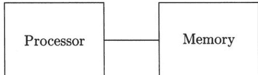

## 1.2 Linux 操作系统

大多数计算机并不只是简单地一次运行一个程序。它们运行一个运行程序的程序，称为*操作系统*。它与用户交互，管理硬件设备（如磁盘驱动器和打印机），并运行其他程序。最早的操作系统是由计算机供应商编写的。每台计算机都有自己的操作系统。第一个独立于供应商的操作系统是 Unix 操作系统。它由贝尔实验室的一小群研究人员开发。

AT&T 是贝尔实验室的主要所有者，很快就以象征性的费用向学术机构提供 Unix，这些机构进而进一步发展了 Unix。AT&T 的这种慷慨行为可能受到了 1956 年达成的一项和解法令的影响，该法令限制了 AT&T 在“提供公共承运通信服务”之外的商业活动。该法令是司法部 1949 年对 Western Electric 和 AT&T 的投诉的结果，声称他们试图利用其在电话行业的垄断地位进入其他领域。

在加州大学伯克利分校开发的 Unix 版本被广泛使用。它的设计旨在具有可移植性，即易于从一种类型的计算机转移到另一种。它被称为*伯克利 Unix* 或 *BSD Unix*（Berkeley Software Division，伯克利软件部门）。

Linux 是一种非专有变体的 Unix，由 Linus Torvalds 在一台基于 386 的计算机上创建，随后由在线用户社区开发。虽然存在几个非 PC 版本的 Linux，但大多数现有的 Linux 安装都位于 Intel 兼容硬件上。

许多 Linux 用户将 Linux 与其他操作系统一起安装。为 Linux 和 Windows/DOS 设置独立的磁盘分区是很常见的。

## 1.3 GNU C 编译器

Unix 操作系统的可移植性 partly 是因为到 1973 年，它已被重写为高级语言 C。C 语言本身被设计为一种可移植的语言。

第一个非专有版本的 C 语言由自由软件基金会的 Richard Stallman 开发。它的名称 *gnu* 代表“Gnu’s Not Unix”（Gnu 不是 Unix），宣称其摆脱了专有版权限制。GNU C 编译器被广泛使用，不仅因为它免费，还因为它为可靠性树立了标准。Linux 操作系统严重依赖于 GNU C 编译器。

编译器是一种将程序（如 C 语言程序）翻译成机器码程序的程序，后者可以存储在计算机内存中并运行。可以存储在内存中并运行的程序被称为*可执行文件*，有时也称为*可执行文件*。

GNU C 编译器分阶段工作。见图 1-2。要使用 GNU 编译器编译诸如 `prog.c` 这样的程序，可以输入以下命令

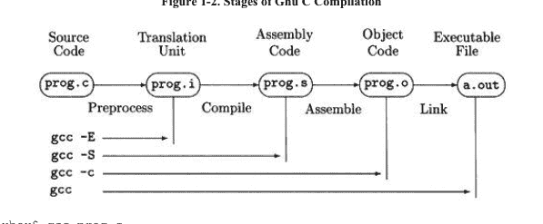

```
linuxbox$ gcc prog.c
```

此命令通过所有阶段进行翻译，并生成一个名为 `a.out` 的可执行文件。要在早期阶段停止，可以在 `gcc` 命令行中添加一个*开关*。例如，要生成汇编代码文件，使用“-S”开关（大写）。输入以下命令

```
linuxbox$ gcc -S prog.c
```

将生成一个汇编语言文件 `prog.s`。要完成编译，可以在 `.s` 文件上使用 `gcc` 命令

```
linuxbox$ gcc prog.s
```

## 1.4 Edlinas 汇编器

GNU 编译器生成的 `.s` 文件中的汇编语言与 x86 处理器广泛使用的 Intel 汇编语言不同。Edlinas 汇编语言基本上是 Intel 汇编语言。其目标代码文件在 x86 Linux 下运行。Edlinas 是一个交互式环境，由编辑器、汇编器和模拟器组成。

### 1.4.1 编辑


源代码编辑使用从 `EDLIN`（一种 DOS 编辑器）借用的命令。其中命令包括 `i`（插入）、`d`（删除）、`c`（更改）、`e`（退出）、`q`（终止）和 `h`（帮助）。这些命令影响`当前行`，即带有星号 \* 的行。使用箭头键移动星号。输入的行将由汇编器检查语法错误。

### 1.4.2 汇编

代码在输入或加载时进行汇编。汇编代码显示在屏幕右侧的默认窗口中。随时可以使用 `o` 命令保存已汇编的代码。

### 1.4.3 解释

代码可以从加载的程序或下方的命令提示符执行。

要逐步执行代码行，使用空格键。即将执行的行以黄色显示。它是由`指令指针`指向的行。Enter 键将指令指针重置到当前行。因此，通过移动星号，可以按照任何顺序执行指令。

Esc 键在下方命令提示符处调出光标。这里的命令`立即`执行。空命令退出命令行。

为了观察代码执行的效果，可以将机器的不同区域显示在屏幕右侧的面板中。右侧面板内容的不同选项可以使用 Tab 键循环切换。

图 1-3 显示了 Edlinas 屏幕的布局，该布局改编自 Dave Felter 编写的 8080 模拟器的布局。

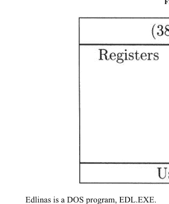

Edlinas 是一个 DOS 程序，`EDL.EXE`。

### 1.4.4 Dosemu

Edlinas 汇编器是一个 DOS 程序。如果你的机器有 DOS 分区，最简单的进入 DOS 的方法是重新启动。但这不一定是最方便的。此外，你的机器可能没有 DOS 分区。`dosemu` 程序使得可以从 Linux 运行 DOS 程序。它可以从 www.dosemu.org 获取。

要运行 Edlinas，应将 `dosemu.conf` 中的 `$ _graphics` 变量设置为 1。

## 1.5 NASM

Netwide Assembler，即 `NASM`，是一种在 Linux 和 DOS 下都能运行的开源汇编器。它的使用日益增多，有许多推荐理由。特别地，由于它的广泛使用，它经过了非常彻底的调试。与 Edlinas 相比，它还接受更广泛的汇编语言指令词汇。本书中的大多数程序都可以使用任一汇编器进行汇编。Edlinas 可用于逐步执行文本中的示例程序，但对于较大的程序，如第 11 章中的中断处理程序，`NASM` 绝对是更好的选择。`NASM` 是一个工业级强度的汇编器。

要解压随本书提供的发行版，请使用以下命令

## 1.6 其他汇编器

`MASM` 和 `Turbo-Assembler` 是与 DOS 一起被广泛使用的汇编器。由于 Windows 不太容易使用汇编语言进行开发，这些汇编器的流行度有所下降。许多人认为 Linux 对汇编语言也不是特别友好。这种印象部分源于使用 `gcc` 编写汇编语言代码时的体验。习惯了 Intel 语法的人可能会觉得 AT&T 语法很别扭。更糟糕的是，当汇编语言指令插入到 C 代码中时，`gcc` 所需的引号以及由此产生的行混乱是非常令人反感的。我希望到第 7 章时，读者会被说服：使用汇编语言与 Linux 交互可以是整洁和有序的。

市面上还有其他一些汇编器。关于它们的简要讨论可以在 Linux 文档项目的网站（www.linux.doc.org/HOWTO）上的一个汇编 HOWTO 中找到。

## 延伸阅读

- 《开源：来自开源革命的呼声》，Chris DiBona 等，O'Reilly：1999。

- 《Unix 的二十五个年头》，Peter Salus，Addison-Wesley：1994。

# 第 2 章 位值计数法

ENIAC 没有使用二进制系统。其算术处理器使用真空管连接成环，工作方式就像旧式的桌面加法机轮盘。这些是十进制设备。然而，从那时起，所有电子计算机都使用二进制系统（基数二）进行算术运算。因此，计算机算术的描述通常使用二进制系统或相关的系统，如十六进制（基数十六）或八进制（基数八）。理解这些数系统是必不可少的。已经熟悉这些系统的读者可能会选择跳过这一章。

## 2.1 十进制和五进制系统

在东方发明位值十进制计数法之前（可能在印度或中国），围绕十的幂构建的、非位值的计数系统很常见。例如，阿基米德使用的系统如表 2.1 所示。在这个系统中，SPA 代表数字 171。当然，使用的是希腊字母，而不是拉丁字母。这类系统最明显的缺点是计算方面的。这种记数法在观察以下事实时毫无帮助：

**表 2.1. 非位值十进制系统**

| 符号 | 值 | 符号 | 值 | 符号 | 值 |

| :--- | :--- | :--- | :--- | :--- | :--- |

| A | 1 | J | 10 | S | 100 |

| B | 2 | K | 20 | T | 200 |

| C | 3 | L | 30 | U | 300 |

| D | 4 | M | 40 | V | 400 |

| E | 5 | N | 50 | W | 500 |

| F | 6 | O | 60 | X | 600 |

| G | 7 | P | 70 | Y | 700 |

| H | 8 | Q | 80 | Z | 800 |

| I | 9 | R | 90 | | |

$B + C = E$

$K + L = N$

$T + U = W$

所有这些表达式本质上代表同一基本事实。但这只有在记数法本身被用于进行计算（如我们用纸笔）时才是一个问题。当计算是通过物理代币进行的，例如算盘上的珠子或鹅卵石，这就不再是一个问题。事实上，这种记数法可能有助于防止阅读错误。任何曾将一张 $200.00 的支票兑现为 $20.00 的人都能理解这一点。

但当记数法本身被用于进行计算时，拥有一个能凸显以下基本相似性的记数系统会更好：

$2 + 3 = 5$

$20 + 30 = 50$

$200 + 300 = 500$

位值系统就是这样做的。位值数字，有时被不那么友好地称为“异教徒数字”，由比萨的列奥纳多（也称为斐波那契）在 1200 年左右在欧洲推广开来。斐波那契很可能依赖于花拉子米（al-Khwārizmī，我们在“算法”这个词中看到了他的名字）在 820 年左右在巴格达用阿拉伯语撰写的一部著作。像当时所有欧洲学者一样，斐波那契必然精通阿拉伯语。

本书讨论的所有计数系统，包括我们每天使用的十进制系统，都是位值系统。在进入非十进制系统之前，让我们考虑一下十进制在美国货币系统中扮演的角色。

### 2.1.1 纯十进制货币

现行的美国货币系统是在 1789 年法国大革命期间引入公制系统之后采用的。这两个十进制系统扩展的目的都是通过使货币和度量单位与用于表示数字的十进制系统相协调来简化计算。

为了突出货币系统和数字系统之间的对齐关系，让我们想象一个简化版的美国货币系统，其中只包含便士、角、$1 纸币、$10 纸币、$100 纸币、$1000 纸币，等等。

- 1 角 = 10 便士

- 1 美元纸币 = 10 角

  - = 100 便士

- 1 十美元纸币 = 10 美元纸币

  - = 100 角

  - = 1000 便士

- 等等

在这个纯十进制货币系统中，除了便士以外的每种面额恰好是下一个较小单位的十倍。面额对应于十进制计数系统中的位值，反之亦然。便士是个位，角是十位，美元是百位，等等。

为了在这个简陋的货币系统中为任何可能的交易携带精确的找零，你需要每种面额各九件。例如，要完成一次成本为 $56.78（或 5,678 美分）的购买，需要 5 张十美元纸币、6 张美元纸币、7 个角和 8 个便士。

如果我们真的使用这种系统，我们的零钱包需要比现在更大。五分硬币、四分之一美元硬币等的存在减少了我们需要携带的零钱数量。为了获得一个不那么笨重但仍基于简单倍数的系统，我们可以想象一个基于 5 而不是 10 的系统。

### 2.1.2 五进制货币

假设我们想象一个货币系统，其面额为便士、五分硬币、四分之一美元硬币、$1.25 纸币、$6.25 纸币，等等。在这个系统中，除了便士以外的每种面额的值恰好是下一个较小面额的五倍。让我们称 125 美分为“大美元”，并想象其货币是一张上面印有大号“1”的纸币。

- 1 五分硬币 = 5 便士

- 1 四分之一美元硬币 = 5 个五分硬币

  - = 25 便士

- 1 大美元 = 5 个四分之一美元硬币

  - = 25 个五分硬币

  - = 125 便士

- 等等

为了准备好在这个系统中进行任何交易，我们只需要携带每个单位的四件。这将减少零钱包的笨重程度。但看看算术会发生什么！要完成一次 $56.78 的购买，需要：

| 物品 | 数量 | 价值 |

| :--- | :--- | :--- |

| $31.25 纸币 | 1 | $31.25 |

| $6.25 纸币 | 4 | $25.00 |

| $1.25 纸币 | 0 | $0.00 |

| 四分之一美元硬币 | 2 | $0.50 |

| 五分硬币 | 0 | $0.00 |

| 便士 | 3 | $0.03 |

| **总计** | | **$56.78** |


这种算术不再像我们使用十进制货币时那样直观明显。尽管这种五进制货币系统像十进制货币系统一样简单。十进制货币系统看起来更简单，是因为它匹配我们的十进制计数系统。然而，如果我们同时使用五进制计数系统和五进制货币系统，简单性就会回归。每个货币单位都将对应于五进制计数系统中的一个位值，反之亦然。

### 2.1.3 五进制数字

五进制数字系统中的位值为一、五、二十五、一百二十五等。每个值的价值是下一个较小值的五倍。

任何数字最多可以使用四个任意单个位值来表示。因此，数字 5、6、7、8 和 9 不被使用。所有数字仅使用数字 0、1、2、3 和 4 来表示。

五进制中的 24 等同于普通的十进制 14。它意味着 2 个五和 4 个一，就像 2 个五分硬币和 4 个便士。同样，124 等同于十进制中的 39。以美分为单位，它意味着 1 个四分之一美元硬币、2 个五分硬币和 4 个便士。

计数是这样的：1, 2, 3, 4, 10, 11, 12, 13, 14, 20, 21, 22, 23, 24, 30, 31, 32, 33, 34, 40, 41, 42, 43, 44, 100, 101, 102, 103, 104, 110, 111，等等。使用五进制计数来描述五进制货币，我们得到这个表格：

- 1 五分硬币 = 10 便士（其中 10 在五进制中表示五）
- 1 四分之一美元硬币 = 10 个五分硬币
  - = 100 便士（其中 100 在五进制中表示二十五）
- 1 大美元 = 10 个四分之一美元硬币
  - = 100 个五分硬币
  - = 1000 便士（其中 1000 在五进制中表示一百二十五）

## 2.2 五进制算术

给定一个五进制算术题：

$$423$$

$$+\ 334$$

我们有多种方法可选。我们可以将这些数字转换为十进制，执行算术运算，然后再转换回五进制。或者，我们可以不进行任何转换，直接使用“原生算术”来解决这个问题。

第一种方法一开始更容易，因为我们习惯十进制。用货币单位来思考：423 是四个25美分硬币、两个5美分硬币和三个1美分硬币，即普通十进制下的113美分。同样地，334 是普通十进制下的94美分。因此，我们可以使用普通十进制算术进行加法：

$$113$$

$$+\ 94$$

$$207$$

113 加 94 等于 207，即 $2.07。为了转换回去，先拿出一个1美元，再加一个25美分硬币，剩下82美分。这是三个25美分硬币、一个5美分硬币和两个1美分硬币。所以答案是 $1312.$

## 表 2.2. 五进制位值表

| 25的位 | 5的位 | 1的位 | 五进制 | 十进制 |
|---|---|---|---|---|
| 0 | 0 | 1 | 1 | 1 |
| 0 | 0 | 2 | 2 | 2 |
| 0 | 0 | 3 | 3 | 3 |
| 0 | 0 | 4 | 4 | 4 |
| 0 | 1 | 0 | 10 | 5 |
| 0 | 1 | 1 | 11 | 6 |
| 0 | 1 | 2 | 12 | 7 |
| 0 | 1 | 3 | 13 | 8 |
| 0 | 1 | 4 | 14 | 9 |
| 0 | 2 | 0 | 20 | 10 |
| 0 | 2 | 1 | 21 | 11 |
| 0 | 2 | 2 | 22 | 12 |
| 0 | 2 | 3 | 23 | 13 |
| 0 | 2 | 4 | 24 | 14 |
| 0 | 3 | 0 | 30 | 15 |
| 0 | 3 | 1 | 31 | 16 |
| 0 | 3 | 2 | 32 | 17 |
| 0 | 3 | 3 | 33 | 18 |
| 0 | 3 | 4 | 34 | 19 |
| 0 | 4 | 0 | 40 | 20 |
| 0 | 4 | 1 | 41 | 21 |
| 0 | 4 | 2 | 42 | 22 |
| 0 | 4 | 3 | 43 | 23 |
| 0 | 4 | 4 | 44 | 24 |
| 1 | 0 | 0 | 100 | 25 |
| 1 | 0 | 1 | 101 | 26 |
| 1 | 0 | 2 | 102 | 27 |
| 1 | 0 | 3 | 103 | 28 |
| 1 | 0 | 4 | 104 | 29 |
| 1 | 1 | 0 | 110 | 30 |
| 1 | 1 | 1 | 111 | 31 |
| 1 | 1 | 2 | 112 | 32 |
| 1 | 1 | 3 | 113 | 33 |

### 2.2.1 原生加法

然而，使用原生算术比上述方法更容易，特别是当数字变大时。唯一需要记住的是，任何单位中的五个都必须进位，即转换为下一个更大单位中的一个：

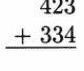

个位（或1美分硬币）列的总和为7，即五进制下的12，即写2进1：

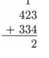

1 + 2 + 3 等于6，即五进制下的11，即写1进1：

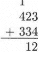

而 1 + 4 + 3 等于8，即五进制下的13，即写3进1：

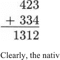

显然，一旦我们理解了，原生算术就更容易。

### 2.2.2 原生减法

减法需要借位，例如，将一个25美分硬币转换为五个5美分硬币，或将一个5美分硬币转换为五个1美分硬币。以下从10中减去3的减法示例说明了借位：

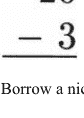

从5美分硬币列借一个5美分硬币并将其转换为五个1美分硬币：

10 (五个1美分硬币)

 1 (一个5美分硬币)

---

-3

 2

剩下一个5美分硬币：

10 (五个1美分硬币)

 1 (一个5美分硬币)

---

-3

12

因此，我们得到一个5美分硬币和两个1美分硬币。

## 2.3 转换为五进制

有时转换是不可避免的。例如，对于计算机要存储以十进制输入的二进制数，需要进行转换。虽然可以通过搜索表示法来完成转换，但存在更高效的方法。考虑将207转换为五进制。为了理解这种转换，我们在开始之前先看看答案可能会有所帮助：

$1312 = 1\cdot5^3 + 3\cdot5^2 + 1\cdot5^1 + 2\cdot5^0$

我们可以看到，除了末尾的2以外，这个和中可以提取因子5：

$1312 = (1\cdot5^2 + 3\cdot5^1 + 1\cdot5^0)\cdot5 + 2$

但这只是说明了207除以5的商和余数。注意，余数是我们要的个位数字。此外，我们可以使用十进制来计算这个商和余数，这是我们在开始此转换时拥有的工具：

41

5)207

 205

---

 2 因此我们的个位数字是2。

在十进制中，我们有：

$207 = 41\cdot5 + 2$

再次窥视答案显示：

$41 = 1\cdot5^2 + 3\cdot5^1 + 1\cdot5^0$

商41包含获取其他所有数字所需的信息。可以通过更多的除法获得它们：

8

5)41

 40

---

 1 将此数字相邻，得到12。

5)\underline{8}

5

3 这给我们**312**。

最后一次除法商为零：

5)\underline{1}

0

0

1 或**1312**

转换算法由反复除以5组成，每个余数产生答案的一个数字。这个过程持续进行，直到得到商为零。

## 2.4 二进制系统

了解二进制系统很重要，因为所有现有计算机处理器的原生算术都是二进制算术。

二进制数仅使用两个数字：0和1。所有二进制数都仅由这两个数字构造。计数如下：1, 10, 11, 100, 101, 110, 111, 1000, 1001, 1010, 1011, 1100, 1101, 1110, 1111, 10000, 10001, 10010, 等等。

二进制系统是一个占位系统。除了个位位置外，每个位置代表一个单位，该单位的值是下一个较小单位值的两倍。见表2.3。

### 2.4.1 二进制加法

假设我们想要相加

```
 1101
 + 110
```

这是13加6。第一列不需要进位：

```
 1101
 + 110
 ---
    1
```

第二列也不需要：

```
 1101
 + 110
 ---
   11
```

第三列总和为2，即10，即写0进1：

1

1101

+ 110

011

第四列总和也为2，再次写0进1：

1101

+ 110

10011

这正是计算机如何相加13和6的方法。我们可以检查结果是19。

1 x 16 = 16

0 x 8 = 0

0 x 4 = 0

1 x 2 = 2

1 x 1 = 1

19

## 表 2.3. 二进制位值表


| 32的位 | 16的位 | 8的位 | 4的位 | 2的位 | 1的位 | 二进制 | 十进制 |
|---|---|---|---|---|---|---|---|
| 0 | 0 | 0 | 0 | 0 | 1 | 1 | 1 |
| 0 | 0 | 0 | 0 | 1 | 0 | 10 | 2 |
| 0 | 0 | 0 | 0 | 1 | 1 | 11 | 3 |
| 0 | 0 | 0 | 1 | 0 | 0 | 100 | 4 |
| 0 | 0 | 0 | 1 | 0 | 1 | 101 | 5 |
| 0 | 0 | 0 | 1 | 1 | 0 | 110 | 6 |
| 0 | 0 | 0 | 1 | 1 | 1 | 111 | 7 |
| 0 | 0 | 1 | 0 | 0 | 0 | 1000 | 8 |
| 0 | 0 | 1 | 0 | 0 | 1 | 1001 | 9 |
| 0 | 0 | 1 | 0 | 1 | 0 | 1010 | 10 |
| 0 | 0 | 1 | 0 | 1 | 1 | 1011 | 11 |
| 0 | 0 | 1 | 1 | 0 | 0 | 1100 | 12 |
| 0 | 0 | 1 | 1 | 0 | 1 | 1101 | 13 |
| 0 | 0 | 1 | 1 | 1 | 0 | 1110 | 14 |
| 0 | 0 | 1 | 1 | 1 | 1 | 1111 | 15 |
| 0 | 1 | 0 | 0 | 0 | 0 | 10000 | 16 |
| 0 | 1 | 0 | 0 | 0 | 1 | 10001 | 17 |
| 0 | 1 | 0 | 0 | 1 | 0 | 10010 | 18 |
| 0 | 1 | 0 | 0 | 1 | 1 | 10011 | 19 |
| 0 | 1 | 0 | 1 | 0 | 0 | 10100 | 20 |
| 0 | 1 | 0 | 1 | 0 | 1 | 10101 | 21 |
| 0 | 1 | 0 | 1 | 1 | 0 | 10110 | 22 |
| 0 | 1 | 0 | 1 | 1 | 1 | 10111 | 23 |
| 0 | 1 | 1 | 0 | 0 | 0 | 11000 | 24 |
| 0 | 1 | 1 | 0 | 0 | 1 | 11001 | 25 |
| 0 | 1 | 1 | 0 | 1 | 0 | 11010 | 26 |
| 0 | 1 | 1 | 0 | 1 | 1 | 11011 | 27 |
| 0 | 1 | 1 | 1 | 0 | 0 | 11100 | 28 |
| 0 | 1 | 1 | 1 | 0 | 1 | 11101 | 29 |
| 0 | 1 | 1 | 1 | 1 | 0 | 11110 | 30 |
| 0 | 1 | 1 | 1 | 1 | 1 | 11111 | 31 |
| 1 | 0 | 0 | 0 | 0 | 0 | 100000 | 32 |
| 1 | 0 | 0 | 0 | 0 | 1 | 100001 | 33 |

### 2.4.2 二进制减法

假设我们想要从12中减去5：

1100
- 101

这需要借位：

10 (个位列的两个)
1 (2位列的一个)
1000
- 101

在第一列执行减法得出

10 (个位列的两个)
1 (2位列的一个)
1000
- 101
1

在2位列中，我们从1中减去0：

1 (2位列的一个)
1000
- 101
11

4位列需要再次借位：

10
1101
— 101
111

这是二进制下从12中减去5的方法。但这完全不是计算机执行这种算术的方式。计算机使用负数进行减法，如下所示：

12 − 5 = 12 + (−5)

由于我们在学校学到的加法负数的方法是将其转换为减法，这似乎是一个没有区别的区分。然而，计算机使用的负数表示法不仅仅是在数字前面加一个减号，所以实际上确实存在区别。负数的表示法在第3章第3.6节中讨论。

### 2.4.3 转换为二进制

首先，我们观察到，通过检查其二进制数末位（个位），我们可以判断任何一个二进制数是偶数还是奇数。例如，19 是奇数，其二进制表示以 1 结尾。

$$10011 = 1 \cdot 16 + 0 \cdot 8 + 0 \cdot 4 + 1 \cdot 2 + 1 \cdot 1$$

进一步地

$$10011 = (1 \cdot 8 + 0 \cdot 4 + 0 \cdot 2 + 1 \cdot 1) \cdot 2 + 1$$

所以，如果我们使用十进制来处理十九，我们有

$$\mathbf{19} = \mathbf{9} \cdot \mathbf{2} + \mathbf{1}$$

假设我们将 19 转换为二进制。上述等式中的 1 是 19 的二进制形式的个位。我们是通过除以 2 得到 9 的。

$$
\begin{array}{r}
9 \quad 1 \\
\sqrt[\overline{18}]{2 \sqrt{19}} \\
\overline{1} 
\end{array}
$$

重复该过程并写下每次的余数，我们就得到了其余的数字。

$$
\begin{array}{rrrrr}
\sqrt[\overline{8}]{4 \quad 11} & \sqrt[\overline{0}]{2 \quad 011} & \sqrt[\overline{0}]{1 \quad 0011} & \sqrt[\overline{1}]{0 \quad 10011} \\
2 \sqrt{9} & 2 \sqrt{4} & 2 \sqrt{2} & 2 \sqrt{1}
\end{array}
$$

这种转换是通过反复除以 2 完成的。每个余数提供一个二进制位。

## 2.5 作为位矩形的内存

在所有电子计算机中，主内存都被组织为位的矩形。图 2-1 展示了一个微小的由 6 个 4 位字组成的内存。如图所示，内存按宽度被划分为行。每一行被称为一个**字**。数据到计算机内存以及从计算机内存传出的传输都是以字为单位，或以字的倍数进行的。

**图 2-1. 具有六个四位字的内存**


| 地址 | 二进制值 |
| :---: | :---: |
| 1 | 1 1 0 0 |
| 2 | 0 0 0 0 |
| 3 | 1 0 0 0 |
| 4 | 1 1 1 1 |
| 5 | 1 0 1 0 |

一个字中的位数被称为*字长*。图 2-1 中内存的字长为 4 位。拥有这种内存的计算机被称为具有*四位字长*。该内存中的每个字保存一个可以用四个二进制数字表示的数，即从 0 到 15 的数。因此，例如，请求位于地址 3 的字的处理器将被给予数字 8。在设计国际象棋计算机时，例如，使用 64 位字长可能是一个好主意，棋盘上的每个位置对应一位。

计算机内存中的字是从零开始连续编号的。这些数字被称为*地址*。在图 2-1 中，地址是 0 到 5 的整数。拥有 $n$ 个字的计算机将有从 0 到 $n-1$ 的地址。当请求数据进出内存传输时，计算机处理器使用地址来指定要传输哪些数据字。

计算机内存的总容量是内存中的字数乘以字长，即长度乘以宽度。图 2-1 中的小内存容量为 24 位。内存容量通常以*字节*而非位来衡量。一字节内存等同于八位。

基于 Intel 处理器的计算机使用八位字长。这里需要发出一个警告。由于 Intel 和 Microsoft 的文档使用术语*字*来指代 16 位对象，这种用法已经变得相当标准。这是不幸的。最好让该术语保留其依赖于机器的含义。无论如何，基于 Intel 的机器内存中的字节数与地址数相同。

由于计算机内存中的字数通常是 2 的大幂或这些小幂的倍数，因此从公制系统中借用了一些名称来表示这些 2 的大幂。例如，$2^{10}$ 是 1024，而 1024 近似于 1000。在公制系统中，字母 K（源自*kilo*）被用来代表 1000。在提及计算机内存时，kilo 表示 1024。下列表格展示了其他被借用的公制前缀。

| 幂 | 值 | 前缀 | 名称 | 公制等价 |
| :---: | :---: | :---: | :---: | :---: |
| $2^{10}$ | 1,024 | K | kilo | 千 |
| $2^{20}$ | 1,048,576 | M | mega | 百万 |
| $2^{30}$ | 1,073,741,824 | G | giga | 十亿 |
| $2^{40}$ | 1,099,511,627,776 | T | tera | 万亿 |

**2 的大幂**

使用此表中的近似等式，使得涉及 2 的大幂的简化计算成为可能。例如，IBM AT 计算机的最大内存容量是 $2^{24}$ 字节。为了用更熟悉的术语表示这一数量，我们可以将 $2^{24}$ 分解如下：

$$
\begin{aligned}


$$
\begin{aligned}
2^{24} &= 2^4 \times 2^{10} \times 2^{10} \\
&= 16 \times 1 \mathrm{K} \times 1 \mathrm{K} .
\end{aligned}
$$

这大约是 1600 万字节。由于 $2^{20}=1 \mathrm{K} \times 1 \mathrm{K}=1$ Meg，因此确切的内存量是 16 兆字节（Megabytes），即 16,777,216 字节。

## 2.6 十六进制系统

十六进制很重要，因为它比二进制更容易读和写，但仍然可以轻松地与二进制进行相互转换。

十六进制也是我们要考虑的除十进制以外第一个大于十的基数。十六进制并没有停用某些数字，而是需要引入额外的数字。由于需要表示所有小于十六的数，这意味着数字十、十一、十二、十三、十四和十五的位置空缺。惯例是用字母 A, B, C, D, E, 和 F 来填补这些位置。

所以在十六进制中，计数如下：1, 2, 3, 4, 5, 6, 7, 8, 9, A, B, C, D, E, F, 10, 11, 12, 13, 14, 15, 16, 17, 18, 19, 1A, 1B, 1C, 1D, 1E, 1F, 20，以此类推。参见表 2.4。

**表 2.4. 十六进制系统位值**

| 16 位 | 1 位 | 十六进制 | 十进制 |
| :---: | :---: | :---: | :---: |
| 0 | 1 | 1 | 1 |
| 0 | 2 | 2 | 2 |
| 0 | 3 | 3 | 3 |
| 0 | 4 | 4 | 4 |
| 0 | 5 | 5 | 5 |
| 0 | 6 | 6 | 6 |
| 0 | 7 | 7 | 7 |
| 0 | 8 | 8 | 8 |
| 0 | 9 | 9 | 9 |
| 0 | A | A | 10 |
| 0 | B | B | 11 |
| 0 | C | C | 12 |
| 0 | D | D | 13 |
| 0 | E | E | 14 |
| 0 | F | F | 15 |
| 1 | 0 | 10 | 16 |
| 1 | 1 | 11 | 17 |
| 1 | 2 | 12 | 18 |
| 1 | 3 | 13 | 19 |
| 1 | 4 | 14 | 20 |
| 1 | 5 | 15 | 21 |
| 1 | 6 | 16 | 22 |
| 1 | 7 | 17 | 23 |
| 1 | 8 | 18 | 24 |
| 1 | 9 | 19 | 25 |
| 1 | A | 1A | 26 |
| 1 | B | 1B | 27 |
| 1 | C | 1C | 28 |
| 1 | D | 1D | 29 |
| 1 | E | 1E | 30 |
| 1 | F | 1F | 31 |
| 2 | 0 | 20 | 32 |
| 2 | 1 | 21 | 33 |

能够进行十六进制加减法是有价值的。调试器通常以十六进制显示寄存器，并且能够检查显示的算术运算而不必转换回十进制是很方便的。

如果我们记得进位和借位是以 16 为基进行的，十六进制的加减法很容易。

### 2.6.1 十六进制加法

要相加

```
  47BC
+ A78
------
    4
```

我们从十二加八开始，结果是二十，即 14H，即 4 进 1：

```
   1
  47BC
+ A78
------
    4
```

1 加十一加七是十九，即 13H，即 3 进 1：

```
   11
  47BC
+ A78
------
   34
```

1 + 7 + A = 十八，即 12H，即 2 进 1：

```
   111
  47BC
+ A78
------
  234
```

最后，1 + 4 = 5：

```
   111
  47BC
+ A78
------
 5234
```

### 2.6.2 十六进制减法

要相减

```
 47BC
- A4E
```

我们从借位开始：

```
  1C
 47A
- A4E
```

1C — E 是二十八减十四，结果是十四：

```
  1C
 47A
- A4E
    E
```

A – 4 是十减四，结果是 6：

```
  1C
 47A
- A4E
   6E
```

再次借位

```
 171C
 37A
- A4E
   6E
```

17 - A 是二十三减十，结果是十三或 D：

```
 171C
 37A
- A4E
  D6E
```

最后 3 - 0 = 3：

```
 171C
 37A
- A4E
 3D6E
```

### 2.6.3 转换为十六进制

要将一个数转换为十六进制，我们可以反复除以 16，直到必要时为止。假设我们将 1000 转换为十六进制：

```
62 8    3 E8    0 3E8
16)1000   16)62   16)3
    96      48     0
    40      14     3
    32
     8
```

为了演示二进制转换为十六进制的容易性，我们再次考虑数字 1000，这次我们将其转换为二进制：

```
500 0     250 00    125 000    62 1000
2)1000    2)500     2)250      2)125
   1000      500       250        124
    0         0         0          1

31 01000   15 101000    7 1101000
2)62      2)31         2)15
   62        30          14
    0         1          1

3 11101000   1 111101000   0 1111101000
2)7         2)3            2)1
   6          2             0
   1          1             1
```

除以 2 四次本质上等同于除以 16 这一事实表明，此转换的四个阶段对应于十六进制转换的一个阶段。如果我们把二进制数字分组为四个，我们确实观察到这种关系。

| 二进制组 | 十六进制位 |
| :---: | :---: |
| 11 | 3 |
| 1110 | E |
| 1000 | 8 |

这些四位数字块，当被视为独立数字时，11, 1110, 和 1000，给出了我们十六进制位 3, E, 和 8。这是一千的十六进制表示。反向转换的方法也很明显。两种系统之间的转换很容易，可以不假思索地完成。参见表 2.5。这使得十六进制可以作为二进制的可读形式，一种高级机器语言(!)。考虑以下同一数字的两种表示：

| 二进制 | 1011 | 0010 | 1001 | 0101 | 0000 | 0111 | 1010 | 1000 | 1000 |
| :---: | :---: | :---: | :---: | :---: | :---: | :---: | :---: | :---: | :---: |
| 十六进制 | B | 2 | 9 | 5 | 0 | 7 | A | 8 | 8 |

## 表 2.5. 十六进制与二进制转换

| 二进制 | 十六进制 | 十进制 |
| :---: | :---: | :---: |
| 0000 | 0 | 0 |
| 0001 | 1 | 1 |
| 0010 | 2 | 2 |
| 0011 | 3 | 3 |
| 0100 | 4 | 4 |
| 0101 | 5 | 5 |
| 0110 | 6 | 6 |
| 0111 | 7 | 7 |
| 1000 | 8 | 8 |
| 1001 | 9 | 9 |
| 1010 | A | 10 |
| 1011 | B | 11 |
| 1100 | C | 12 |
| 1101 | D | 13 |
| 1110 | E | 14 |
| 1111 | F | 15 |

假设你需要通过电话向硬件支持人员口述其中一行，或者将其抄写在明信片上。毫无疑问，使用十六进制会更简单，且不易出错。

早期的计算机程序由一行又一行的二进制代码组成。这里存在一种苦涩的反讽。填写由零和一组成的编码表通常是由女性完成的工作。因此，许多女性进入了计算机编程领域的初期阶段。

### 2.6.4 为什么不使用八进制？

八进制数可以像十六进制数一样与二进制进行相互转换，只是分组时按三位一组而非四位。八进制相对于十六进制的优势在于不需要使用字母数字。然而，随着字节作为内存基本单位的日益普及，八进制的重要性有所下降。

## 2.7 进位制区分符号


由于十进制中的所有数字在十六进制中都是有效的，因此在没有额外信息的情况下，无法确定如“50”这样的数字是十进制还是十六进制。一种常见的表示十六进制的惯例是在末尾附加 H。当使用此惯例时，“50”仅代表五十；但“50H”表示十六进制下的五十，即十进制的八十。偶尔，特别是在汇编器中，会附加 B 和 D 分别表示二进制和十进制。对于八进制，显然不宜附加 O。在 `C` 语言中，八进制通过前置 0 表示，十六进制通过前置 `0x` 表示。本书主要依赖十进制、十六进制和二进制计数法。为了区分这些进位制，将使用以下惯例：

- 十六进制，除了 `C` 程序外，始终通过末尾附加 H 来表示。（此外，由于第 3.11 节讨论的问题，汇编语言中使用的十六进制数也将前置 0。）
- 二进制通过每四位一组，组间用空格分隔来表示。
- 十进制计数法是默认值。对于未指明进位制的所有数字，均假设为十进制。

## 2.8 其他进位制中的分数

大量涉及分数的计算是使用科学记数法进行的。由于科学记数法涉及十进制小数和明确的十的幂次，它允许小数点位置的自由移动。例如：

$$ 2345.6789 \times 10^2 = 23.456789 \times 10^4 $$

因此，科学记数法有时被称为*浮点*记数法。这种表示法的浮点特性是由于表示法的所有部分，包括小数部分，都使用十的幂次所致。为了在采用二进制系统的计算机计算中利用浮点特性，所有分数和显式幂次必须是二进制而非十进制。

巴比伦人使用非十进制的位值分数，这些分数一直延续至今存在于我们的时间和角度单位系统中，我们看到分和秒作为六十进制分数。

十进制分数当然是我们日常的标准。例如：

$$ .125 = 1 \cdot (\frac{1}{10})^1 + 2 \cdot (\frac{1}{10})^2 + 5 \cdot (\frac{1}{10})^3 = \frac{125}{1000} = \frac{1}{8} $$

我们通过长除法找到这个十进制分数，

```text
   .125
8)1.000
   8
   20
   16
    40
    40
     0
```

假设我们想找到八分之一的五进制分数。我们可以使用长除法在五进制下计算，必要时使用五进制乘法表。（八的五进制表示为 13）。

```text
  .0303 ...  (3 x 3 = 14, which is 4 with 1 to carry)
13)1.0000
    44
    10
     0
    100
     44
     1
```

这是一个循环小数，类似于十进制中的 $.33333... = \frac{1}{3}$。因此，五进制系统中的八分之一是

$$ \frac{1}{13} = .030303030303... $$

一个无限循环小数。如果用普通十进制符号表示其含义，即

$$ \frac{1}{8} = 0 \cdot (\frac{1}{5})^{1} + 3 \cdot (\frac{1}{5})^{2} + 0 \cdot (\frac{1}{5})^{3} + 3 \cdot (\frac{1}{5})^{4} + \ldots $$

如果使用长除法获取十六进制分数，我们将得到一个有限表示。

$$ \frac{.2}{8|1.0} \text{ (}2 \cdot 8 = 10 = \text{sixteen)} $$

$$ \frac{10}{0} $$

这是正确的，因为 $2 \cdot \frac{1}{16} = \frac{1}{8}$。在二进制中，同样的除法如下所示：

$$ \frac{.001}{1000|1.000} $$

$$ \frac{1000}{0} $$

这是正确的，因为

$$ \frac{1}{8} = 0 \cdot (\frac{1}{2})^{1} + 0 \cdot (\frac{1}{2})^{2} + 1 \cdot (\frac{1}{2})^{3} $$

在早期的 Intel 系统中，基于浮点数的计算是在独立处理器（如 `80387`）上进行的。从 `486` 开始，这些浮点单元被集成到主处理器中。在 `C` 语言中，程序员可以通过使用 `double` 等浮点数据类型将计算发送到浮点单元。

## 2.9 分数转换

在上一节中，我们使用长除法在给定分子和分母为整数的情况下找到了一个位值分数。例如，为了找到二进制位值分数，我们可以在二进制下进行长除法。如果我们给定的是其他进位制下的位值分数，我们可以使用乘法过程进行转换。例如，假设我们给定十进制分数 `.33333333...`，希望将其转换为二进制分数。设 `$b_1,b_2,b_3...$` 为我们二进制分数中的未知数字：

**.b1b2b3...**

如果我们使用等式

$$ .3333333... = b_1 \cdot (\frac{1}{2})^{1} + b_2 \cdot (\frac{1}{2})^{2} + b_3 \cdot (\frac{1}{2})^{3} + \ldots $$

我们可以按以下方式确定它们的值。假设我们将方程两边都乘以 2。

$$ .6666666... = b_1 + b_2 \cdot (\frac{1}{2})^{1} + b_3 \cdot (\frac{1}{2})^{2} + \ldots $$

两边的整数部分必须相等。左边的整数部分是零，所以 `$b_1 = 0$`。因此我们得到了第一个数字，并且我们有方程

$$ .6666666... = b_2 \cdot (\frac{1}{2})^{1} + b_3 \cdot (\frac{1}{2})^{2} + b_4 \cdot (\frac{1}{2})^{3} + \ldots $$

如果我们再次将此方程乘以 2，得到

$$ 1.333333... = b_{2}+b_{3} \cdot(\frac{1}{2})^{1}+b_{4} \cdot(\frac{1}{2})^{2}+... $$

同样，两边的整数部分必须相等，所以 `$b_{2}=1$`。从这个方程中减去 `$1=b_{2}$` 得到方程

$$ .333333...=b_{3} \cdot(\frac{1}{2})^{1}+b_{4} \cdot(\frac{1}{2})^{2}+b_{5} \cdot(\frac{1}{2})^{3}+... $$

继续这样做，我们得到 `$b_{3}=1, b_{4}=0, b_{5}=1, b_{6}=0$`，等等。因此 `.333333` 的二进制形式是

## .01010101...

我们刚刚通过反复乘以 2 从十进制分数中找到了一个二进制分数。要从十进制分数中找到五进制分数，我们从一个类似的方程开始，并反复乘以 5。

根据定义，五进制系数使此方程成立：

$$ .3333333...=b_{1} \cdot(\frac{1}{5})^{1}+b_{2} \cdot(\frac{1}{5})^{2}+b_{3} \cdot(\frac{1}{5})^{3}+... $$

将此方程乘以 5 得到

$$ 1.666666...=b_{1}+b_{2} \cdot(\frac{1}{5})^{1}+b_{3} \cdot(\frac{1}{5})^{2}+... $$

两边的整数部分必须相等。因此 `$b_{1}=1$`。减去 `$1=b_{1}$` 得到：

$$ .6666666...=b_{2} \cdot(\frac{1}{5})^{1}+b_{3} \cdot(\frac{1}{5})^{2}+b_{4} \cdot(\frac{1}{5})^{3}+... $$

将此方程乘以 5 得到

$$ 3.333333...=b_{2}+b_{3} \cdot(\frac{1}{5})^{1}+b_{4} \cdot(\frac{1}{5})^{2}+... $$

由此得到 `$b_{2}=3$` 以及

$$ .3333333...=b_{3} \cdot(\frac{1}{5})^{1}+b_{4} \cdot(\frac{1}{5})^{2}+b_{5} \cdot(\frac{1}{5})^{3}+... $$

继续这样做，我们得到 `$b_{3}=1, b_{4}=3, b_{5}=1, b_{6}=3$`，等等。因此五进制等价形式是 `.13131313...`

## 延伸阅读

- [数字词语与数字符号：数字的文化史](https://example.org/number-words-and-number-symbols)，Karl Menninger，Dover Books: 1992。

# 第 3 章. 逻辑电路与计算

电子计算机由逻辑电路制成。本章的目的是解释如何使用这些电路执行基本的计算机算术和存储功能。最后，简要讨论了 `ADD` 和 `MOV` 命令。

最基本的逻辑电路被称为门。门是控制电路。最简单的逻辑门是非门（`NOT` gate）。在下一节中，我们将展示非门如何控制手电筒。

### 3.1 非门

图 3-1 中所示的简单手电筒电路由顶部的开关控制，图中显示开关处于断开状态。电池负极直接连接到灯泡，但正极仅通过开关连接到灯泡。因此，当开关断开时，电流不会流动，灯泡熄灭。当开关闭合时，电流可以流动，灯泡亮起。该控制是机械式的。


## 图 3-1. 一个简单的手电筒

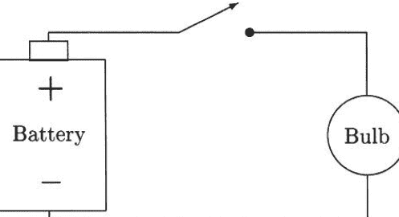

### 3.1.1 逻辑门端子

逻辑门是一种像开关一样工作的电路。图 3-2 展示了一个连接到电池的通用逻辑门。如图所示，逻辑门有四个或更多端子。

## 图 3-2. 一个通用逻辑门

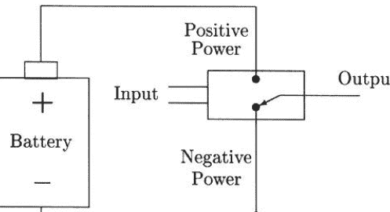

- **输出端子。** 该端子通过切换连接，使其连接到正极电源或负极电源。切换过程由嵌入硅中的固态电子设备完成，不涉及任何移动部件。
- **正电源端子。** 该端子始终连接到电池或电源的正极端子。
- **负电源端子。** 该端子始终连接到电池或电源的负极端子。
- **输入端子。** 逻辑门有一个或多个输入端子。这些端子传输决定输出端子是切换到正电源端子还是负电源端子的输入信号。不同类型的逻辑门以不同方式做出此判断。

### 逻辑值约定

由于逻辑门上的两个电源端子始终连接到电池或电源上对应的端子，因此输出端子始终提供到正电池或电源端子，或负电池或电源端子的连接。对于本书中的电路：

- 直接或间接连接到正电池或电源端子的门端子被描述为“处于逻辑 1”。
- 直接或间接连接到负电池或电源端子的门端子被描述为“处于逻辑 0”。

因为输入端子通常也直接或间接连接到电池或电源端子，就像输出端子一样，因此它们也可以被描述为处于逻辑 1 或逻辑 0。输入端子被设计为处于逻辑 1 或逻辑 0 这一事实还有一个进一步的推论：一个逻辑门的输出可以连接到另一个逻辑门的输入，并产生可预测的结果。

### 3.1.2 NOT 门的行为

NOT 门（非门）是一个具有一个输入端子的逻辑门。要描述 NOT 门的行为，只需描述其输入如何决定其输出即可。规则如下：

- 如果输入为逻辑 1，则输出为逻辑 0。
- 如果输入为逻辑 0，则输出为逻辑 1。

现在，我们可以通过将 NOT 门的输出连接到灯泡，将输入连接到机械开关，来组装一个手电筒。图 3-3 说明了这种连接。当图中导线交叉处显示黑色圆点时，表示导线已连接。当导线交叉且没有黑色圆点时，表示它们未接触。该图中的手电筒最终由机械开关控制，就像图 3-1 中的手电筒一样。当开关处于图中所示的向下位置时，手电筒开启。向下位置将 NOT 门的输入端子连接到电池负极，使其处于逻辑 0。因此，由于 NOT 门的工作方式，输出处于逻辑 1。这意味着输出端子内部由 NOT 门连接到正电源端子，从而连接到电池正极。因此灯泡获得电流，手电筒开启。

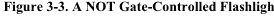

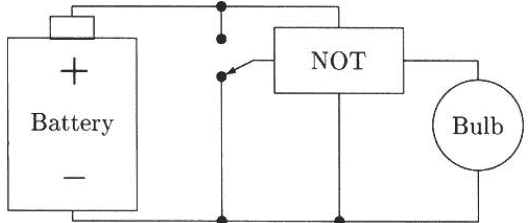

### 3.1.3 NOT 门的真值表

逻辑值使得用一个小表格来总结 NOT 门的行为变得很容易。这样的表格称为*真值表*。表 3.1 显示了 NOT 门的真值表。

**表 3.1. NOT 门的真值表**

| 输入 | 输出 |
| :---: | :---: |
| 1 | 0 |
| 0 | 1 |

### 3.1.4 门级图

展示单个逻辑门但不展示其内部构造的逻辑电路图称为*门级图*。在门级图中，逻辑门上的电源端子通常不显示。门级图中使用的 NOT 门符号仅显示两个端子，即输入和输出：

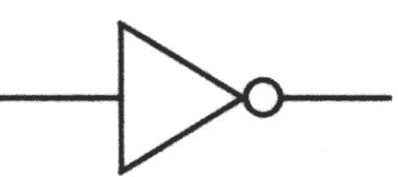

左侧显示的导线代表输入；右侧的导线是输出。

图 3-4 展示了使用原理图符号绘制的 NOT 门控制手电筒的图。该图可能令人困惑，因为未显示连接到 NOT 门的主要电源连接。在此图中，唯一的电池连接位于 NOT 门的信号输入端。虽然未显示电源连接，但它们必须存在，否则电路将无法工作。图 3-4 代表与图 3-3 完全相同的连接。

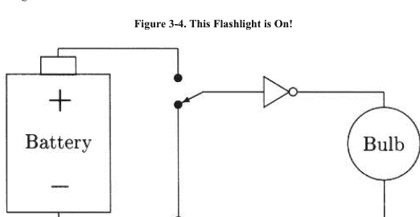

## 3.2 布尔运算符

上一节讨论的 NOT 门是逻辑门的一个示例。逻辑门是行为基于布尔运算符建模的电路。

最基本的布尔运算符是 AND（与）、OR（或）、XOR（异或）和 NOT（非）。在 C 语言中，我们有用于 AND 的符号 `&&`，用于 OR 的 `||`，以及用于 NOT 的 `!`。这些运算符的工作原理可以通过 C 语言中的两个例子来说明。在这些例子中，C 语言语句通过逐步简化过程进行评估。

### 3.2.1 OR 运算符

第一个例子是一个涉及布尔 OR 运算符的 `if` 语句。在以下内容中，我们假设 `x` 已被赋予值 7。

```c
if ((x > 0) || (x < 5)) y = 10;
```

- 首先，可以确定操作数的真值。在这种情况下，由于 `(x > 0)` 为真，其值为 1；由于 `(x < 5)` 为假，其值为 0。这些评估导致 C 语言语句简化如下。

```c
if (1 || 0) y = 10;
```

- 接下来可以应用布尔 OR 运算符。OR 仅看到操作数评估产生的真值。OR 接收到 1 和 0，并产生 1。

```c
if (1) y = 10;
```

- 接下来 `if` 可以开始工作。它在括号内只看到一个 1。因此，它产生简单的赋值语句

```c
y = 10;
```

该过程的最终结果是 `y` 被设置为值 10。请注意，OR 运算符从未看到 `x` 的值。它只需要 0 和 1 来完成其工作。因此，OR 运算符的工作原理可以用真值表来描述，就像 NOT 门的真值表一样。表 3.2 显示了 OR 运算符的真值表。在布尔运算符的真值表中，字母 `p` 和 `q` 通常用作真值 0 和 1 的变量。只有这两种可能取值的变量有时被称为布尔变量。请注意，C 例子中的决定可以从表 3.2 的第二行推断出来。

**表 3.2. OR 的真值表**

| p | q | (p OR q) |
|---|---|---|
| 1 | 1 | 1 |
| 1 | 0 | 1 |
| 0 | 1 | 1 |
| 0 | 0 | 0 |

### 3.2.2 AND 运算符

AND 运算符也可以用真值表来描述。参见表 3.3。下一个例子展示了如何使用该表来评估包含 AND 运算符的 C 语言语句。

- 再次假设 `x = 7`。

```c
if ((x > 0) && (x < 5)) z = 20;
```

- 再次，操作数的值为 1 和 0。

```c
if (1 && 0) z = 20;
```

- AND 运算符的操作可以参照表 3.3 的第二行，从中可以看出结果为 0。

```c
if (0) z = 20;
```

- 括号中的 0 导致空语句。什么都不发生。

```c
;
```

从这些例子中，可以清楚地看出，布尔运算符的工作是操作真值并产生一个真值。

**表 3.3. AND 的真值表**

| p | q | (p AND q) |
|---|---|---|
| 1 | 1 | 1 |
| 1 | 0 | 0 |
| 0 | 1 | 0 |
| 0 | 0 | 0 |

### 3.2.3 布尔表达式

正如 C 语言中的运算符可以嵌套，如语句：

```c
if(((x > 0) && (x < 5)) || (x == 7)) w = 30;
```

布尔运算符本身也可以嵌套，例如：

**( (p AND q) OR r )**

由此产生的表达式称为*布尔表达式*。正如布尔运算符有真值表，布尔表达式也有真值表。上述表达式的真值表在表 3.4 中给出。

**表 3.4. 布尔表达式的真值表**

| p | q | r | ( (p AND q) OR r ) |
|---|---|---|---|
| 1 | 1 | 1 | 1 |
| 1 | 1 | 0 | 1 |
| 1 | 0 | 1 | 1 |
| 1 | 0 | 0 | 0 |
| 0 | 1 | 1 | 1 |
| 0 | 1 | 0 | 0 |
| 0 | 0 | 1 | 1 |
| 0 | 0 | 0 | 0 |

## 3.3 逻辑门

表 3.5 显示了布尔 NOT 运算符的真值表。它与表 3.1 中显示的 NOT 门的真值表非常相似。如果我们认为 `p` 是输入，`(NOT p)` 是输出，实际上没有区别。人们甚至应该将 NOT 门视为 NOT 运算符的硅实现。布尔运算符 AND、OR 和 XOR 也在硅中实现。

**表 3.5. NOT 的真值表**

| p | (NOT p) |
|---|---|
| 1 | 0 |
| 0 | 1 |

### 3.3.1 或门（OR Gate）

或门是一个具有两个输入端子的电路。在门级图中，它用以下符号表示：


### 表 3.6. 异或（XOR）真值表


| p | q | (p XOR q) |
| :---: | :---: | :---: |
| 1 | 1 | 0 |
| 1 | 0 | 1 |
| 0 | 1 | 1 |
| 0 | 0 | 0 |

输入显示在左侧。输出在右侧。从表 3.2，我们可以推断：
- 如果两个输入端子都处于逻辑 0，那么输出端子将处于逻辑 0。
- 如果任意一个输入端子处于逻辑 1，那么输出端子将处于逻辑 1。

例如，在下面的电路中，除非所有 `Filter` 输入应用的逻辑值都等于 0，否则输出将处于逻辑 1。如果在每个 `Filter` 输入上应用逻辑 0，那么输出的逻辑值将与输入的逻辑值相同。在这种情况下，可以认为输入信号穿过了这些门。请注意，门的类比在信号的传播方面是有意义的，而不是电压的传播。在任何 `Filter` 输入上应用逻辑 1 都会保证输出处于逻辑 1，但这应被理解为门的*关闭*。输入的变化不会传递到输出。电路*不允许*信号通过。因此，当监管输入处于逻辑 1 时，将这些或门视为*关闭*是有意义的。

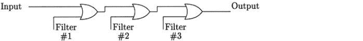

### 3.3.2 与门（AND Gate）

与门也是一个两输入门。其符号为：

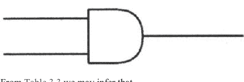

从表 3.3 我们可以推断：
- 如果两个输入端子都处于逻辑 1，那么输出端子将处于逻辑 1。
- 如果任意一个输入端子处于逻辑 0，那么输出端子将处于逻辑 0。

在下面的电路中，应用于所有 `Filter` 输入的逻辑值必须等于 1；否则输出将处于逻辑 0。如果在每个 `Filter` 输入上应用逻辑 1，那么输入逻辑值将穿过门并成为输出值。

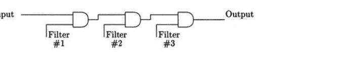

### 3.3.3 布尔电路

与（AND）、或（OR）和非（NOT）逻辑门可以用来构建各种各样的逻辑电路。对于任何布尔表达式，都有一个对应的电路。例如，对应于布尔表达式

```
((p AND q) OR r)
```

我们可以构建如下电路


该电路的真值表与其来源的布尔表达式的真值表相同。它列在*表 3.4*中。

布尔运算符 `XOR` 的真值表显示在*表 3.6*中。通过使用该真值表中输出为逻辑 1 的行，可以找到 `XOR` 的布尔表达式。使用该表，我们找到了两个这样的行，一个是 `p = 1` 且 `q = 0`，另一个是 `p = 0` 且 `q = 1`。这些是表达式 `(p AND (NOT q))` 和 `((NOT p) AND q)` 为真的行。因此，表达式

```
((p AND (NOT q)) OR ((NOT p) AND q))
```

具有与 `XOR` 相同的真值表，可用于构建 `XOR` 电路

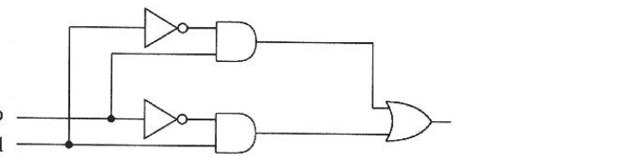

布尔表达式 `((p OR q) AND (NOT (p AND q)))` 也具有相同的真值表。因此，对应于此表达 logic 电路也作为 `XOR` 电路工作。该电路如下所示：

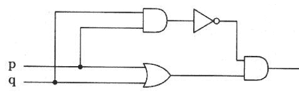

`XOR` 的标准符号是

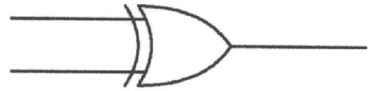

`XOR` 可以使用任何具有正确真值表的电路来实现，包括刚才展示的两个电路。

### 3.3.4 传播延迟

逻辑电路行为的一些基本特征在仅基于布尔表达式和真值表的描述中会被遗漏。其中一个特征是传播延迟，即输入信号的变化导致输出变化所需的时间。例如，用于 100 MHz 处理器中的门，其传播延迟必须小于 10 纳秒。这是因为 100 MHz 意味着每秒 100 百万个周期（cps）。因此，每个处理周期的长度是 $\frac{1}{100,000,000}$ 秒，等于 $\frac{10}{1,000,000,000}$ 秒或 10 纳秒。

| 频率 | | 周期长度 |
|---|---|---|
| 1 Hz | 1 cps | 1 s |
| 1 kHz | 1,000 cps | 1 ms |
| 1 MHz | 1,000,000 cps | 1 $\mu$s |
| 1 GHz | 1,000,000,000 cps | 1 ns |

考虑到执行一个处理周期可能需要信号依次穿过五个这样的门，限制可能会降至 2 纳秒或更低。减少这种时间延迟是当前制造技术的主要目标之一。传播延迟越小，电路可以运行的时钟速度就越快。

同样重要的是耗散功率的量。当许多电路紧密地封装在一个芯片上时，除非将每个电路耗散的功率降低到非常低的水平，否则温度可能会升高到不可接受的水平。减少功率耗散是处理器设计的另一个主要目标。

架构视角将这些问题排除在外。从那个角度来看，关于布尔电路我们需要知道的一切内容都包含在其真值表中。在计算机科学中，架构视角比在电气工程中更常见适用。

## 3.4 加法电路

本节展示了如何使用逻辑电路进行加法。

再次考虑 13 和 6 的加法，并观察到在每一列中，我们要将两个数字相加，再加上前一列的进位数字。

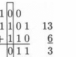

一个能完成此类加法中一列所需工作的加法电路被称为*全加器*。它产生该列中两个数字的和以及来自前一列的进位数字。它还产生一个输出进位数字。如前所示的 13 和 6 的加法需要使用四个全加器电路。由于使用的是二进制系统，布尔真值 0 和 1 可以作为二进制数字使用。表 3.7 显示了全加器电路的真值表。构建全加器并不困难。输出和电路可以由两个 `XOR` 电路构建。输出进位电路可以由三个 `AND` 门和两个 `OR` 门构建。参见图 3-5。全加器有三个输入和两个输出，它们共同作为一个加法机的一列工作。

### 图 3-5. 全加器电路

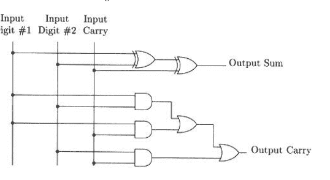

### 表 3.7. 全加器的真值表

| 输入数字 #1 | 输入数字 #2 | 输入进位 | 输出和 | 输出进位 |
| :---: | :---: | :---: | :---: | :---: |
| 0 | 0 | 0 | 0 | 0 |
| 0 | 1 | 0 | 1 | 0 |
| 1 | 0 | 0 | 1 | 0 |
| 1 | 1 | 0 | 0 | 1 |
| 0 | 0 | 1 | 1 | 0 |
| 0 | 1 | 1 | 0 | 1 |
| 1 | 0 | 1 | 0 | 1 |
| 1 | 1 | 1 | 1 | 1 |

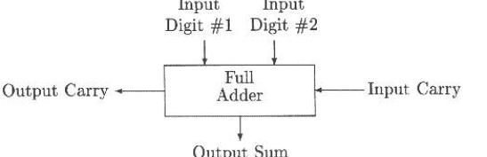

一个将四位数二进制数相加的电路需要将四个全加器串联起来。

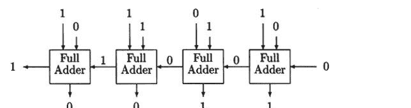

这就是四位处理器中加法电路的样子。这里展示的是本节开头所示的十三加六的相同计算。在二进制中，这是 1101 加 0110。得到的总和是 0011。还有一个输出进位值为 1。此处未使用输入进位。令人惊讶的是，然而确实需要它。我们将在*第 3.7 节*中看到它的作用是什么。

四位处理器的一大特征是它每次添加四位二进制数。

具有四位处理器的计算机并不局限于小数的算术运算，但其软件需要将大数分解为不超过 16 的数。

## 3.5 时序电路

在迄今所示的所有电路中，输出由输入决定。通过使用组成门的真值表，可以为整个电路构建一个真值表。对于所有逻辑电路，情况似乎都应该是这样。然而，如果一个输出反馈回一个输入，那么在确定真值表的过程中会引入一个恶性循环。具有反馈回路的电路被称为*时序电路*。

没有反馈回路的电路无法存储逻辑值。布尔电路的输出是其输入的函数，即其*当前*输入。这意味着，例如，如果你试图将布尔电路用作内存，那么无论你决定什么作为内存读取命令，这个输入将始终产生相同的输出，即由真值表指定的输出，因此它不会是真正的内存读取。来自真正内存读取的输出将取决于在*过去*某个时间存储的内容。

时序电路之所以重要，是因为它们可以存储逻辑值。

### 3.5.1 触发器

图 3-6 展示了一个称为*触发器*的电路示例。图中的 `S` 代表*置位*（set），`R` 代表*复位*（reset）。如果 `S = 1` 且 `R = 0`，该电路的输出可以被置位。在这种情况下，由 `R` 输入馈送的与门被强制输出 0。因此，另一个与门的两个输入均为 1。因此，其输出为 1，最终输出为 1。

### 3.5.2 锁存器

图 3-7 展示了一个被称为 *latch*（锁存器）的电路示例。该电路用于存储一位二进制数。之所以称之为锁存器，是因为它会“锁住”某个数值。

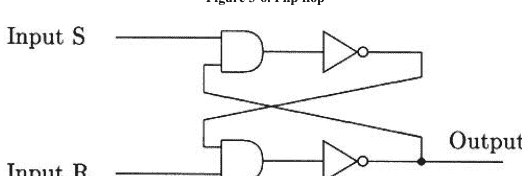


如果 `S = 0` 且 `R = 1`，情况正好相反，最终输出为 0。然而，如果 `S = 1` 且 `R = 1`，输出无法由真值表确定。反馈回路使得这种情况变得不可能。但是事实证明，如果 `S = R = 1` 的状态是从置位（set）或复位（reset）状态进入的，那么最终输出将保持原样，不会改变。

此图中的 `Freeze/Copy#` 标签采用了 Intel 的 `#` 约定：当信号被赋予一个有意义的单词标签时，如果该线处于逻辑 1，则该含义真实适用；除非标签后附有 `#`，此时情况相反。因此，`Freeze/Copy#` 标签表明逻辑 1 意味着 `Freeze`（冻结），而逻辑 0 意味着 `Copy`（复制）。

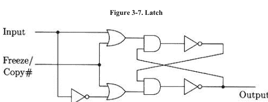

- 当 `Freeze/Copy#` 线为 0 时，或门被打开，电路变为触发器，输入可以是置位或复位。非门使得 `S` 和 `R` 输入互为反相。
  - 输入值被复制到输出。
- 当 `Freeze/Copy#` 线变为 1 时，两个或门都被强制为 1，从而冻结输出。
  - 当输出被冻结时，输入的后续变化对电路没有影响。输出值保持不变，仍为 `Freeze/Copy#` 线最后一次从 1 变到 0（即最后一次冻结操作）时的值。
    - 该输出值存储在存储器中。

### 3.5.3 寄存器

四个并排使用的锁存器可以存储四位二进制数。这是 `register`（寄存器）的一个示例。四比特寄存器是一组可以存储四位二进制数的电路。处理器中的不同寄存器不一定需要存储相同数量的比特，但如果它们存储的数量相同，操作起来更容易。一个“典型”寄存器中的比特数是决定处理器被称为四比特、八比特或其他类型处理器的属性之一。

四位寄存器的内容非常自然地可以用一个四位数二进制数来指定。四位二进制数即为从 0 到 15 的整数。八比特寄存器则存储 0 到 127 之间的整数。

我们可以看到，指定寄存器内容最自然的方式没有为负数留出空间。负数的表示方法将在下一节讨论。

### 3.5.4 比特权重

由于使用二进制数来描述寄存器和内存位置的内容，数值概念中的“有效数字”对于识别特定存储位置中的单个比特非常有用。例如，如果一个四比特寄存器存储二进制数 1100，那么按照权重顺序（从高位到低位），这四个位是 1、1、0 和 0。因此，最高有效位是 1，最低有效位是 0。三个最高有效位是 110。三个最低有效位是 100。在本文的某些部分，最高有效位将被称为顶位或高位，最低有效位被称为底位或低位。

## 3.6 负数表示法

表示负数的惯用方法是在前面加上负号。在 3 前面加一个 - 就变成了 -3。这种表示负数的方法称为原码表示法。在计算机中，可以通过分配一个比特作为符号位来实现此方法。要改变使用原码表示法存储的数的符号，只需翻转符号位即可。原码表示法通常不用于计算机中的整数。原因是，为了进行原码加法运算，你必须按照教导儿童的方式去执行。

### 3.6.1 原码加法

要计算 `x + y`：

- 情况 I。如果 `x` 和 `y` 都为正，直接相加并得出正的结果。
- 情况 II。如果 `x` 和 `y` 都为负，去掉负号，将数字相加，然后在结果前加上负号。
- 情况 III。如果 `x` 和 `y` 符号不同，用较大绝对值的数减去较小绝对值的数，如果较大绝对值的数是负数，则在结果前加上负号。

在芯片上使用逻辑电路实现原码加法将是对晶体管的极大浪费。

### 3.6.2 简单加法

实际上使用逻辑电路对 `x` 和 `y` 进行加法运算的方法如下：

不要管 `x` 和 `y` 是正还是负；直接相加！

这种方法看起来似乎什么方法都不是。但它行得通。之所以行得通，是因为使用了一种特殊的负数表示系统，而且寄存器具有有限的大小，就像里程表一样。

### 3.6.3 里程表算术

里程表是一种加法机。它累加你行驶的里程。里程数总是被视为正值。（负值是否意味着倒车行驶，还是怎么回事？）然而，考虑以下方程，我们通常会认为这个方程只对负数有意义。

`x + 10 = 5`

显然的解是 `x = -5`。但是，这个方程也有里程表的解释。假设你在汽车中行驶了 10 英里，结束时里程表读数为 5，那么开始时读数是多少？它一定是 99,995。同样，如果你的汽车里程表读数为 10 英里，你行驶了 99,995 英里（！），那么结束时里程表读数应为 5 英里。这里的要点是，在里程表中，99,995 的作用就像 -5 一样。表 3.8 展示了里程表负数的样子。请注意，要获得作为数字 `x` 的负数的有效数值，你需要从 100,000 中减去 `x`。

**表 3.8. 里程表负数**

| | |

| :--- | :--- |

| -1 | 99,999 |

| -2 | 99,998 |

| -3 | 99,997 |

| -4 | 99,996 |

| -5 | 99,995 |

| -6 | 99,994 |

| -7 | 99,993 |

| -8 | 99,992 |

| -9 | 99,991 |

| -10 | 99,990 |

| -11 | 99,989 |

| -12 | 99,988 |

| ... | ... |

| 以此类推 | |

里程表上的算术运算之所以这样工作，是因为里程表在 100,000 英里时回零。计算机寄存器也会回零——但不是 100,000。

### 3.6.4 寄存器算术

四比特寄存器在二进制 1 0000 = `$2^4$` = 16 时回零。四比特寄存器的负数表可以很容易地完整列出。见表 3.9。该表与里程表之间的唯一区别是 16 远小于 100,000。与里程表一样，你可以使用减法而不是表格来找到作为某个数字 `x` 的负数的有效数值。对于四比特寄存器，你需要从 16 中减去 `x`，而不是从 100,000 中减去。其他方面则相同。

但在某一方面，表 3.9 有点令人担忧。例如，它告诉我们 11 的作用与 -5 相同。这意味着我们现在面临一个严重的二义性。如果四比特寄存器包含 1011，我们无法判断这究竟意味着 11 还是 -5。需要某种约定。所使用的约定是将第一个比特视为某种符号位。当第一个比特为 0 时，该数为正（或零）。当第一个比特为 1 时，该数为负。由此产生的系统称为补码系统（two's complement system）。当使用补码系统时，二义性被消除

**表 3.9. 四比特寄存器负数（二义）**

| 十进制 | 二进制 |

| :---: | :---: |

| -1 | 15 1111 |

| -2 | 14 1110 |

| -3 | 13 1101 |

| -4 | 12 1100 |

| -5 | 11 1011 |

| -6 | 10 1010 |

| -7 | 9 1001 |

| -8 | 8 1000 |

| -9 | 7 0111 |

| -10 | 6 0110 |

| -11 | 5 0101 |

| -12 | 4 0100 |

| -13 | 3 0011 |

| -14 | 2 0010 |

| -15 | 1 0001 |

**表 3.10. 四比特补码表示法**

| 十进制 | 二进制 |

| :---: | :---: |

| -1 | 1111 |

| -2 | 1110 |

| -3 | 1101 |

| -4 | 1100 |

| -5 | 1011 |

| -6 | 1010 |

| -7 | 1001 |

| -8 | 1000 |

| 7 | 0111 |

| 6 | 0110 |

| 5 | 0101 |

| 4 | 0100 |

| 3 | 0011 |

| 2 | 0010 |

| 1 | 0001 |

请注意，尽管补码系统中的第一个比特是符号位，但它不仅仅是符号位。例如，如果我们改变 1011 的符号位，得到 0011。这把 -5 变成了 3，而不是 5。

### 3.6.5 带符号数与无符号数

如果计算机上的所有算术运算都使用补码表示法，那么解释数值寄存器内容时永远不会出现问题。但不幸的是，事实并非如此。有时执行算术运算时，假设数字使用普通的二进制系统表示。因此，当四比特寄存器中有一个 1011 时，这意味着 -5 还是 11？如果我们使用补码，那么我们知道它是 -5。但我们可能只是使用普通的二进制！那么它就是 11。计算实践在这方面并不一致。两种系统都在使用。可能是其中任何一种。区分这两者是软件的责任。通常使用带符号（signed）与无符号（unsigned）术语。带符号整数是补码整数。无符号整数是普通二进制整数。

虽然在我们加法运算时，数字是带符号还是无符号并不重要——加法硬件都能正常工作——但许多其他操作需要根据操作数是有意作为带符号数还是无符号数来进行不同的实现。考虑不等式测试。假设四比特硬件被要求判断 `1011 < 0010` 是真还是假。虽然 `0010` 在带符号和无符号系统中都代表 2，但 `1011` 作为带符号数是 -5，作为无符号数是 11。带符号解释 -5 < 2 结果为真，而无符号解释 11 < 2 结果为假。硬件必须在这两种情况下做出不同的响应。这意味着单个“小于”命令无法工作。需要两个，一个用于带符号数，一个用于无符号数。这个问题在汇编语言中反复出现。


在 C 语言中，整数可以声明为 `unsigned int` 或 `signed int`。未指定的 `int` 声明等同于 `signed int`。

## 3.7 使用取反进行减法

## 3.7 减法

本节解释如何使用前面描述的电路执行减法运算。

## 3.7.1 补码

既然我们有一个可以处理负数的加法器，那么我们应该能够利用它来进行减法运算，例如 5 - 3，因为：

5 - 3 = 5 + (-3)

但是这里存在一个问题。将 3 转换为 -3 并不像简单地加上负号或翻转一个位那么简单。如果可以的话，像表 3.8 和表 3.9 这样的表格就没有必要存在了。虽然我们确实有一个解释这些表格的公式，但不幸的是，该公式是基于减法推导出来的。例如，根据四位数表格的公式，要获取 3 的负数，你需要从 16 中减去 3。但由于我们的目标是寻找一种进行减法运算的方法，我们似乎陷入了一个恶性循环。然而，情况并没有看起来那么糟糕。在二进制下，即使我们不知道如何执行减法，即使 16 的二进制表示所需的位数比我们的四位移位寄存器所能容纳的多一位，从 16 中减去 3 的操作也是可行的。我们被以下两个事实所拯救：

- 16 - x = (15 - x) + 1。
- 从 15 中减去一个数可以通过翻转位来完成。请注意在二进制下从 15 中减去 3 时发生的情况。

```
  1111
- 0011
--------
  1100
```

0011 中的位被翻转，我们得到 1100。我们可以使用能够翻转位的硬件。我们可以将每一位输入到一个 `NOT gate` 中。然后加上 1 就能得到结果。

```
  1100
+    1
--------
  1101
```

加法电路中未使用的进位输入在这里发挥了作用。（参见第 3.4 节。）它正好可以用来给总和加上 1。翻转位并加 1 的过程被称为补码运算（two's complementation）。它从进位值中减去一个数。对于 n 位补码数，进位值为 $2^n$。如果 $n = 4$，该值为 16。

因此，我们可以将 5 - 3 作为加法运算执行：

```
  0101
+ 1101
--------
  0010
```

或者，为了真正看清计算机是如何操作的：

```
    1
   0101
 + 1100
   0010
```

最终的进位位被忽略。这就是计算机从 5 中减去 3 的方式。

使用“补码”（complement）一词是合理的，因为：

$$16 - (16 - x) = x$$

请注意，这忠实地反映了以下事实：

$$-(-x) = x$$

## 3.7.2 十六进制下的补码

补码运算过程是通过翻转位并加 1 完成的。如果我们考虑翻转一个十六进制数字的位，我们会发现这可以通过从 15 中减去该数字来实现。因此，要对一个十六进制数求补码，我们可以将其各位都从 15 中减去，然后加 1。例如，给定一个 8 位数 23H：

```
  FF
- 23
----
  DC

  DC
+  1
----
  DD
```

因此，23H 的补码是 DDH。另一方面，如果我们利用求补码实际上是从进位值中减去这个事实，我们可以直接执行减法。

```
  1 0 0
-   2 3
-------
     D D
```

## 3.7.3 转换

当调试器向我们显示寄存器内容时，负数会以十六进制形式显示。因此，熟练处理十六进制下的补码值是有价值的。假设我们看到了一个 16 位的值 FF42H，我们想知道它代表什么值。首先，我们观察到如果将其视为带符号数，则它是负数，因为其最高位是 1 —— 如果第一个十六进制数字是 8, 9, A, B, C, D, E 或 F 中的任意一个，则第一个二进制位是 1。为了找到对应的正数，我们可以执行十六进制下的补码运算。

```
  1 0 0 0 0
-   F F 4 2
-----------
     B E B E
```

并且 BEH 是 $11 \times 16 + 14 = 190$。因此，表示的值为 -190。

你也可以将一切都转换为二进制，求补码，然后再转换为十进制。当然，你还可以将 FF42H 转换为十进制，然后从 65,536 中减去该结果！可能尽可能在十六进制下工作是最简单的方法。

## 3.8 按位权制表示的补码

补码可以被视为一种按位权制系统。如果认为最高有效位（MSB）的位权代表其普通二进制值的负数，那么这就得出了补码计数的按位权解释。表 3.11 显示了四位补码系统中的位权。使用该表，我们可以看到 -5 可以表示为 $(-8) + 2 + 1$。

**表 3.11. 四位补码的位权**

| | -8s | 4s | 2s | 1s | 二进制 | 十进制 |
|---|---|---|---|---|---|---|
| | 1 | 1 | 1 | 1 | 1111 | -1 |
| | 1 | 1 | 1 | 0 | 1110 | -2 |
| | 1 | 1 | 0 | 1 | 1101 | -3 |
| | 1 | 1 | 0 | 0 | 1100 | -4 |
| | 1 | 0 | 1 | 1 | 1011 | -5 |
| | 1 | 0 | 1 | 0 | 1010 | -6 |
| | 1 | 0 | 0 | 1 | 1001 | -7 |
| | 1 | 0 | 0 | 0 | 1000 | -8 |
| | 0 | 1 | 1 | 1 | 0111 | 7 |
| | 0 | 1 | 1 | 0 | 0110 | 6 |
| | 0 | 1 | 0 | 1 | 0101 | 5 |
| | 0 | 1 | 0 | 0 | 0100 | 4 |
| | 0 | 0 | 1 | 1 | 0011 | 3 |
| | 0 | 0 | 1 | 0 | 0010 | 2 |
| | 0 | 0 | 0 | 1 | 0001 | 1 |

## 3.9 存储器电路

图 3-7 中显示的锁存电路具有这样的特性：如果在 `Freeze/Copy#` 线上施加逻辑 0，则 `Input` 上的值会传播到 `Output`。另一方面，如果在 `Freeze/Copy#` 线上施加逻辑 1，则 `Output` 信号保持其在“冻结”时刻所具有的值。该值被存储在存储器中，并且输入被忽略。


为了了解这个电路如何作为存储器电路的一位，设想有许多这样的电路排列成一个矩形，每一行形成一个存储字。每一行都会响应一个选择信号，该信号将该行从存储器中的所有其他行中选取出来。无论选择信号何时不存在，存储器都需要保持休眠状态。为了将此电路用作存储器的一位，假设我们有一个 `W/R#` 控制信号和一个选择信号 `Sel`。`W` 代表写（write），意味着处理器想要向存储器电路写入数据。`R` 代表读（read），意味着处理器想要从存储器电路读取数据。整个存储器中的所有电路都连接到同一个 `W/R#` 信号，但只有同一字中的电路才连接到同一个 `Sel` 信号。

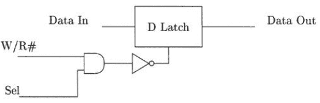

当 `Sel` 为 0 时，非门输出 1，从而冻结电路。当 `Sel` 为 1 且 `W/R#` 输入为 0（表示处理器想要读取）时，电路同样保持冻结状态。当 `Sel` 为 1 且 `W/R#` 为 1 时，非门输出 0，这导致 `Data In` 被存储。

除了整个存储器的数据线上数据线的数量等于一个字中的位数这一事实外，这个电路工作得很好。例如，这意味着该字的最低有效位必须与其他所有存储器字中对应的 `Data Out` 线以及对应的 `Data In` 线共享同一根 `Data Out` 线。其他每一位也是如此。无论存储器有多少字，具有四位字的存储器只有四条数据线。为了避免造成严重的冲突，使用具有所谓*三态输出*的电路。

## 3.9.1 三态输出

图 3-2 显示了一个通用逻辑门。该门的输出可以切换到正极或负极电源端。因为其输出有两种可能的值，所以被称为*二态门*。图 3-8 显示了一个通用三态逻辑门。其输出有三种可能的值。该门的输出可以是逻辑 1 或逻辑 0，但输出也可以切换到断开状态，使得输出未连接到任何东西。这有时被称为*无关*（don't care）状态，有时用字母 X 表示。当逻辑门切换到这种状态时，它放弃对其输出的控制权。如果存在潜在的冲突，切换到这种状态是避免冲突的好方法。一个简单的三态电路是三态缓冲器，其真值表见表 3.12。该电路的符号为

**图 3-8. 三态逻辑门**

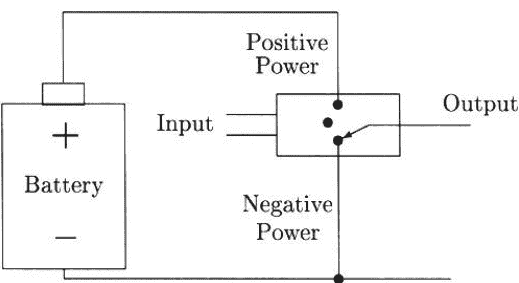

**表 3.12. 三态缓冲器真值表**

| 控制 | 输入 | 输出 |
|---|---|---|
| 0 | 0 | X |
| 0 | 1 | X |
| 1 | 0 | 0 |
| 1 | 1 | 1 |


当锁存器中加入三态缓冲器时，如图 3-9 所示，数据总线可以被输入和输出共享。当然，处理器端也需要三态缓冲器。该电路只有三个外部连接。假设我们将其表示为如图 3-10 所示的形式。四个这样的电路并行使用可以存储四个比特，并且都受相同的两个信号 `W/R#` 和 `Sel` 控制。

## 图 3-9. 单比特内存电路

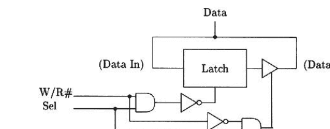

## 图 3-10. 单比特内存

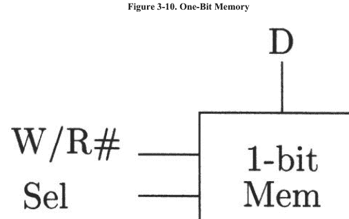

假设我们像这样表示一个四比特内存：

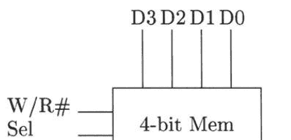

图 3-11 展示了一个由这四个电路组成的内存。两根地址线足以寻址此内存。该内存电路包含四个字。每个字存储四个比特。数据总线 `D0`、`D1`、`D2` 和 `D3` 都是共享的。地址线 `A0` 和 `A1` 控制四个不同的 `Sel` 输入。地址线选择四个 `Sel` 线中的哪一个被选中。其他三根线的值为 0。不可能同时打开两根线。

## 图 3-11. 四字内存。每个字存储四个比特

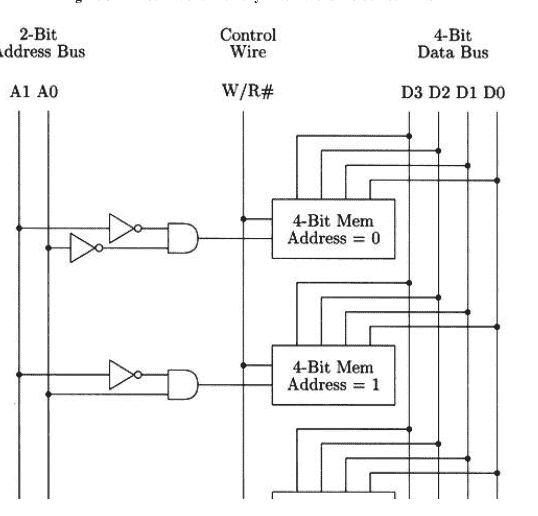

如果我们把这个想象成一台微型计算机的内存，那么这台计算机将拥有 4 位数据总线、2 位地址总线和 1 位控制总线。要从内存中取出一条指令，这台小计算机的处理器需要将其 `W/R#` 引脚置于逻辑 0，并在地址总线上放置一个 2 位地址。这将激活恰好一个字内存的 `Sel` 信号。如果我们想象取指-执行周期正在进行中，处理器需要一个 2 位寄存器来记录其正在执行的指令的地址。所有执行取指-执行周期的处理器都需要这样一个寄存器。它通常被称为程序计数器（`Program Counter`）。在 Intel 机器中，它被称为指令指针（`Instruction Pointer`）。

## 内存容量的定义

任何物理内存都是一个具有多个稳定状态的物体或设备。其容量是其稳定状态的数量。由于计算机内存被布局为由具有两个稳定状态的物体组成的矩形，内存中的稳定状态数量为 $2^{l\times w}$，其中 `l` 和 `w` 分别是矩形的长度和宽度。`l` 也被称为字长（word count），`w` 是每个字的位宽。为了方便，容量通常以位（bits）为单位表示为 `l×w`，即稳定状态数量的以 2 为底的对数。以字节（bytes）为单位的容量，当然，是以位为单位的容量的八分之一。

## SRAM 与 DRAM

当内存电路由逻辑电路构成时，被称为静态内存或 `SRAM`。内存电路也可以由电容器制成。充电的电容器代表存储的 1；放电的电容器代表存储的 0。由于所需的晶体管更少，这些电路可以在芯片上以更高的密度封装。小型、紧密排列的电容器有一个缺点，即它们放电迅速。它们需要不断的重新检查。每个没有完全放电的电容器都必须再次充电。因为内存正在不断地“刷新”，所以它被称为动态内存，或 `DRAM`。动态内存就像没有架子的书架；只不过在一本书掉落到地板（假设掉落了四英尺）的情况下，你有 0.5 秒的时间去接住它，否则它就会砸到地板上。这些小型电容器在 0.0001 秒内放电。内存刷新必须大约每 100 μs 进行一次。与许多拥有众多贡献者的发展不同，动态内存是由一个人发明的，即 Ted Hoff，大约在 1970 年。动态内存比静态内存更便宜但速度更慢。静态内存通常用作缓存内存，而动态内存用作 RAM。

`DRAM` 的一个缺点是它使硬件调试变得更加困难。进行硬件调试最简单的方法是极大地降低计算机的时钟速度。这样就可以在异常行为发生的时候观察到它。但由于 `DRAM` 的快速刷新要求，没有简单的方法可以做到这一点。

## 3.10 x86 通用寄存器及其渊源

Intel x86 系列处理器在市场上成功的原因之一是，该系列中的每一个新处理器在设计时都受到必须与以前处理器兼容的要求。Intel 从未像 Motorola 和 IBM 在开发 PowerPC 芯片以及 DEC 在开发 Alpha 处理器那样完全推倒重来。这将升级所需的硬件和软件重新调整工作降到了最低限度。因此，对 x86 的描述，特别是对其寄存器的描述，适合采用历史性的方法。我们从 8080 处理器开始。

### 3.10.1 8080 寄存器

`8080` 是第一个真正大规模生产的微处理器。它被用作早期几台微计算机的 CPU，包括 Atari。该处理器有 `A`、`B`、`C`、`D`、`H` 和 `L` 寄存器，它们都是 8 位寄存器。第一台个人计算机也使用了 `8080` 处理器。那就是 Altair，它出现在 1975 年 1 月的 *Popular Science* 杂志封面上。由于其寄存器、内存地址和数据传输均为 8 位大小，使这台计算机成为 8 位计算机的极佳例子。图中所示的所有寄存器都是 8 位寄存器。地址总线和数据总线各拥有 8 根线。

## 图 3-12. Altair 计算机

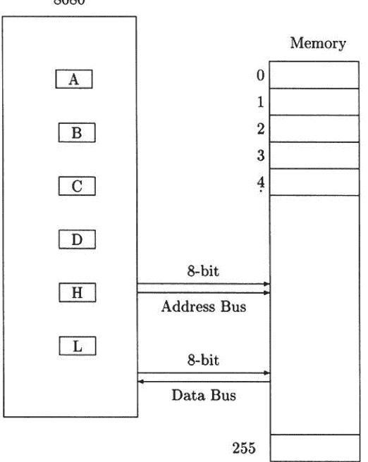

`L` 寄存器用于存储地址。Altair 的内存字节编号从 0 到 255。这个内存小得惊人，但另一方面，它是通过拨动 8 个位开关，一次填充一个字节！

目前市场上存在 `8080` 的版本，即 `8085` 和 `Z80`。Radio Shack 的 TRS-80 基于 `Z80`。

当 IBM 推出 PC 时，他们选择 Intel `8088` 作为其处理器，因为它在与内存和系统总线的交互中表现得像一个 8 位处理器。特别是，它表现得非常像 `8080` 处理器。

### 3.10.2 8086 寄存器

虽然 Altair 几乎是 8 位计算机的纯粹例子，但 `8080` 处理器确实有一些 16 位特性。特别是，它被设计成可以配合 16 位内存寻址系统使用。它通过允许两个 8 位寄存器（`H` 和 `L`）配对形成一个 16 位寄存器来实现这一点，该寄存器随后可用于地址。当引用这种高字节-低字节对时，命令中使用了 `X`。例如，16 位增量命令是 `INX`。8 位命令是 `INR`。`X` 代表 *extended*（扩展），每当引用 16 位寄存器对时使用。当设计图 3-13 所示的 16 位 `8086` 处理器时，这个 `X` 被征用用于 16 位寄存器命名 `AX`、`BX`、`CX` 和 `DX`。16 位寄存器 `AX`、`BX`、`CX` 和 `DX` 是高字节和低字节寄存器对 `AH` 和 `AL`、`BH` 和 `BL`、`CH` 和 `CL`、`DH` 和 `DL`。其他 16 位寄存器 `SP`、`BP`、`SI` 和 `DI` 的名称中没有 `X`，也不是字节对。数据总线有 16 根线。图中还展示了一个 `8086` 内存段中的 65,536（= 2¹⁶）个内存位置。尽管如上所述，`8086` 并不是 16 位计算机的好例子。地址总线有 20 根线，并且使用少量段同时工作有一个笨拙的机制。因此，内存实际上并不局限于 64K，但没有方便的方法来一次性使用所有的 2²⁰ 字节。

**图 3-13. 8086 计算机（部分模型）**

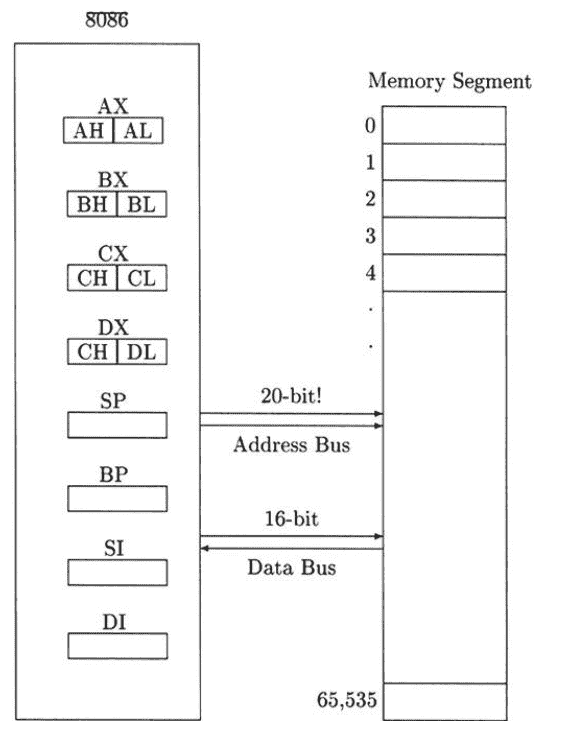

### 3.10.3 80386 寄存器

`8086` 设计中可见的许多曲折在图 3-14 所示的 `80386` 中得到平滑。名称以 `E` 开头的八个寄存器都是 `8086` 上相应寄存器的扩展。每个 32 位寄存器的下半部分是继承自 `8086` 的 16 位寄存器。地址总线和数据总线各有 32 根线。图中还展示了 `80386` 能够寻址的 4,294,967,296（= 2^32）个内存位置。`80386` 计算机是 32 位计算机的极佳例子。`80486` 和 `Pentium` 也是 32 位处理器。实际上，就寄存器大小、内存寻址等方面而言，完全没有变化。直到 `Pentium II` 和 `Pentium Pro` 发布之前，主要的发展在于不改变基本架构的情况下提高速度。图 3-14 既可以标注为“`Pentium` 计算机”，也可以标注为“`80386` 计算机”，除了 `Pentium` 拥有 64 位数据总线。

## 图 3-14. 80386 计算机（部分模型）

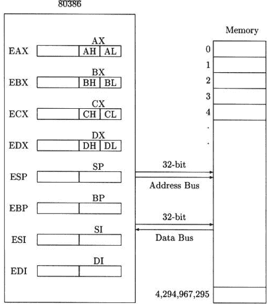

## 3.11 MOV 指令

本节介绍 `MOV` 指令。这是一条非常重要的指令。`MOV` 是一条存储指令。它复制值到一个位置。它有许多不同的有效形式。`reg,imm` 和 `reg,reg` 形式尤为重要。

### 3.11.1 MOV reg,imm

- `reg` 代表 *register*（寄存器）。它可以是表 3.13 中列出的任何寄存器。

*   `imm` 代表 *immediate*（立即数）。术语 *immediate* 用于指直接通过十进制或十六进制表示给出的数值，而非包含该值的寄存器或内存位置。

例如，在

```
MOV AX, 54
```

中，数字 54 作为立即数出现。该命令将数字 54 存储到 16 位寄存器 `AX` 中。该寄存器等同于寄存器 `EAX` 的低 16 位。高 16 位保持不变。由于 54 = 36H，因此该命令等同于命令

```
MOV AX, 36H
```


分配给该位置的值必须适合。命令

```
MOV AL, 999
```

无效，因为 `999` 无法容纳在八位寄存器中。`NASM` 和 `Edlinas` 允许使用带符号整数。因此

```
MOV AL, -128
```

是有效的，其作用与

```
MOV AL, 128
```

相同。

但是，`MOV AL, -129` 在 `Edlinas` 中无效，因为 `-129` 不在八位带符号范围内。`NASM` 直到遇到 `-257` 才会报错。`NASM` 允许字符表示 ASCII 码。例如，

### 表 3.13. x86 通用寄存器

| 8位 | 16位 | 32位 |
| :---- | :----- | :----- |
| AH | AX | EAX |
| AL | BX | EBX |
| BH | CX | ECX |
| BL | DX | EDX |
| CH | BP | EBP |
| CL | SP | ESP |
| DH | SI | ESI |
| DL | DI | EDI |

```
MOV AL, -129
MOV AL, 'A'
```

将在 `AL` 中存储字母 `A` 的 ASCII 码，即 `65`。

使用 32 位寄存器的代码无法在 80386 之前的 x86 处理器上运行。虽然使用 32 位寄存器是所谓“32 位代码”的特征，但某些“16 位代码”也会使用。32 位代码和 16 位代码之间的实际区别在第 5 章第 5.5 节中讨论。

### 3.11.2 MOV reg,reg

`MOV reg,reg` 将第二个寄存器的内容复制到第一个寄存器。本书中描述的双操作数命令使用语法 `COMMAND destination, source`（命令 目标, 源）。因此，命令

```
MOV EAX, EBX
```

不会改变 `EBX` 寄存器。它意味着

令 `EAX` = `EBX`

而*不是*将 `EAX` 移动到 `EBX`。

有些汇编器使用相反的语法，例如 gcc 使用的 AT&T 风格汇编器。在其语法中，完全相同的命令写为

```
movl %ebx, %eax
```

`MOV` 命令中使用的两个寄存器必须大小相同。例如，以下命令无效。

```
MOV EBX, DX
```

### 3.11.3 歧义问题

根据 *第 2 章第 2.7 节* 中讨论的附加 H 十六进制约定，寄存器名称 `AH`、`BH`、`CH` 和 `DH` 也是数字十、十一、十二和十三的有效十六进制名称。这使得诸如

```
MOV BL, AH
```

这样的命令具有歧义。该命令既可以是 `MOV` 命令的 **reg,reg** 形式的有效示例，也可以是 **reg,imm** 形式的有效示例。解决此歧义的惯例是要求汇编语言命令中使用的所有十六进制数字必须以数字 0, 1, ... 9 中的一个开头。本文中将遵守这一对附加 H 约定的修改，并且 `NASM` 和 `Edlinas` 都要求这样做。因此，`MOV BL, AH` 实际上不是 **reg,imm** 形式的有效示例。它是 **reg,reg** 形式的示例。要将立即数十存储到 `BL` 中，我们必须使用

```
MOV BL, 0AH
```

或

```
MOV BL, 10
```

## 3.12 加法和减法命令

本节描述 `ADD` 和 `SUB` 命令的 **reg,imm** 和 **reg,reg** 形式。这些是非常基本的算术指令。

### 3.12.1 ADD reg,imm

```
ADD reg,imm
```

意味着将立即数加到寄存器中。例如

```
ADD BL, 10
```

可以理解为

```
令 BL = BL + 10
```

### 3.12.2 ADD reg,reg

命令

```
ADD reg, reg
```

意味着将第二个寄存器的内容加到第一个寄存器中。因此，命令

```
ADD BL, AL
```

意味着

```
令 BL = BL + AL
```

寄存器 `AL` 不会因该命令而改变。

### 3.12.3 SUB reg,imm

命令

```
SUB BL, 10
```

例如，意味着

```
令 BL = BL - 10
```

### 3.12.4 SUB reg,reg

```
SUB BL, AL
```

例如，意味着

```
令 BL = BL - AL
```

## 3.13 乘法和除法命令

如果乘法命令的功能与 `ADD` 和 `SUB` 命令类似，我们可能会看到诸如

```
MUL EAX, EBX
```

这样的命令，其含义是将寄存器 `EAX` 的内容乘以 `EBX` 中的值。然而，乘法命令并非如此工作。其中一个原因是，由于数字相乘通常会使其大小加倍，使用与相乘数字相同大小的寄存器来存储结果没有意义。

### 3.13.1 MUL 命令

乘法命令的语法是

```
MUL reg
```

`reg` 可以是表 3.13 中列出的 24 个通用寄存器中的任意一个。如果使用八位寄存器，例如

```
MUL BH
```

则该命令意味着：

令 `AX` = `AL` • `BH`

当使用八位寄存器时，它总是乘以 `AL` 并将结果存储在 `AX` 中。当使用 16 位寄存器时，例如

```
MUL BX
```

则该命令意味着

令 `DX:AX` = `AX` • `BX`

其中 32 位答案存储在两个 16 位寄存器中。高 16 位存储在 `DX` 中，低 16 位存储在 `AX` 中。当使用 32 位寄存器时，例如

```
MUL EBX
```

则该命令意味着

令 `EDX:EAX` = `EAX` • `EBX`

使用 `MUL` 命令时，你只需指定一个寄存器。其他寄存器总是隐含的。这种情况类似于 8080 处理器上的 `ADD` 命令，其中加法结果始终存储在 `A` 寄存器中。8080 汇编语言中的命令 `ADD B` 意味着

令 `A` = `A` + `B`

与 `ADD` 和 `SUB` 命令不同，`MUL` 命令没有立即数形式。命令

```
MUL 7
```

无效。

### 3.13.2 DIV 命令

`DIV` 命令在语法上与 `MUL` 命令非常相似，本质上是其逆运算。它同时形成商和余数

| 形式 | 被除数 | 余数 | 商 |
| :--- | :------- | :-------- | :------- |
| 32位 | `EDX:EAX` | `EDX` | `EAX` |
| 16位 | `DX:AX` | `DX` | `AX` |
| 8位 | `AX` | `AH` | `AL` |

例如，如果 `AX` 保存值 `17`，`BH` 保存值 `3`，则

```
DIV BH
```

将在 `AH` 中存储 `2`，在 `AL` 中存储 `5`。由于 `BH` 是八位寄存器，因此该命令将被识别为八位命令。

除以零会产生一种称为异常的错误。异常将在第 9 章中处理。

值得注意的是，由于参与除法的寄存器大小，零并不是唯一可能导致异常的除数。例如，当 `AX` 被存储在八位寄存器中的数字除时，商应当存储在 `AL`（一个八位寄存器）中。但 16 位数字除以 8 位数字并不总能产生可以存储在 8 位中的数字。例如，`1024 ÷ 2 = 512`，或十六进制 `400H ÷ 2 = 200H`。但 `200H` 至少需要十位存储。这意味着

以下代码将导致异常：

```
MOV AX, 400H
MOV BH, 2
DIV BH
```

此错误被称为*除法溢出*。

### 3.13.3 负数和同余

负数使用补码表示，部分原因是无论被操作的位是作为带符号整数还是无符号整数，都可以使用加法和减法硬件。解释为什么补码表示是这样工作的数学原理基于十九世纪杰出数学家 C. F. Gauss 的一个概念。

Gauss 定义 $a \equiv b$ (mod m) 表示 $a$ 和 $b$ 仅相差 m 的某个确切倍数。在补码表示中，负数与其表示该负数所用的正数之差等于所用寄存器的回绕值。如果使用四位寄存器，则每个负数及其正数表示之差为 $2^4$，即 `16`，如表 3.9 所示。用 Gauss 的记法，例如，$-5 \equiv 11$ (mod 16)。因此，当计算机将 $(-2) + (-3)$ 作为 $14 + 13$ 计算时，它依赖于 $14 + 13 = 27 \equiv -5$ (mod 16) 这一事实。四位加法硬件产生 `11`，因为丢失了 `16` 的进位。但这没关系。`11` 是 `-5` 的正确代表值。

**同余加法定理**

这种推理总结在 Gauss 提出的以下定理中：

> $$\begin{aligned} &\text{若 } a \equiv b \text{ (mod m) 且 } c \equiv d \text{ (mod m)} \\ &\text{则 } a + c \equiv b + d \text{ (mod m)} \end{aligned}$$

该定理指出，同余式可以像方程一样相加。Gauss 发明同余记法是为了说明同余式类似于方程。

**同余乘法定理**

以下定理指出，同余式也可以像方程一样相乘。


> $$\begin{aligned} &\text{若 } a \equiv b \text{ (mod m) 且 } c \equiv d \text{ (mod m)} \\ &\text{则 } a \cdot c \equiv b \cdot d \text{ (mod m)} \end{aligned}$$

由于这个漂亮的定理，我们应该能够像使用 `ADD` 一样，使用带符号和无符号数字进行 `MUL` 而不出任何问题！除了一个问题。

我们希望随着进展加倍寄存器大小。因此，我们真正需要的定理是这个：

> $$\begin{aligned} &\text{若 } a \equiv b \text{ (mod m) 且 } c \equiv d \text{ (mod m)} \\ &\text{则 } a \cdot c \equiv b \cdot d \text{ (mod } \text{m}^{2}\text{)} \end{aligned}$$

不幸的是，这不是一个定理。这是一个谬误。例如，在八位情况下，`m = 256` 且 `m² = 65,536`，如果 `a = -16`，`b = 240`，且 `c = d = 2`，则 `a · c = -32` 且 `b · d = 480`。因此该定理指出 $$-32 \equiv 480 \text{ (mod } 256\text{)}, \text{这是正确的。}$$ 从 480 中减去八位回绕值 256 后剩下 224。因此，如果我们考虑答案为

$-32 \equiv 480 \pmod{65,536}$ 是错误的。

在 16 位系统中，-32 表示为 65504，而不是 480。因此，我们不能对有符号数和无符号数都使用 `MUL`（或 `DIV`）。`MUL` 和 `DIV` 适用于无符号数。对于有符号数，有专用的指令：`IMUL` 和 `IDIV`。这是第 3.6.5 节中提到问题的一个例子。

## 延伸阅读

- *《微处理器传》*，作者 Michael S. Malone，Springer 出版社：1995 年。
- *《高性能微处理器剖析》*，作者 Shriver 和 Smith，IEEE：1998 年。

# 第 4 章 汇编语言

计算机程序是可以存储在计算机内存中的东西。如果内存的字长为 1 字节，我们就可以说计算机程序由字节组成。这些字节也被称为*机器语言*。通过显式列出这些字节来编写程序被称为*机器语言编程*。这是编程的最原始形式，也是最繁琐的方式。汇编语言被发明出来，作为一种指定机器代码而无需实际编写的方法。汇编语言可能只是简单的简写，也可能涉及复杂的*宏*，其中一些甚至类似于 C 语言中的 *if* 或 *while* 语句。但无论它是原始的还是花哨的，其定义特征是它赋予程序员对机器语言的控制权。

学习汇编语言有三个很好的理由：

1. 在真正对时间敏感（time-critical）的代码段中，有时通过汇编语言编码可以提高性能。
2. 它是了解特定 CPU 工作方式的好方法。
3. 在编写新的操作系统或将现有系统移植到新机器时，有一部分代码必须用汇编语言编写。

汇编语言是专为特定处理器量身定制的。鉴于处理器和指令集的多样性，人们可能会认为各种汇编语言的指令格式也有相当大的差异。但事实并非如此。汇编语言通常遵循一种通用格式，可以称为*四字段格式*。

## 4.1 四字段格式

根据这种格式，每个汇编语言程序都由行组成。每一行包含四个字段。这四个字段分别是标签字段、助记符字段、操作数字段和注释字段。

1. 标签字段用于指定跳转指令目标的标签。跳转与 *go to* 指令相同。第 4.4 节给出了跳转指令的例子。
2. 助记符字段包含指令标识符。助记符的例子包括 `MOV`、`ADD`、`SUB` 等。*助记符* 这个词暗示它使机器代码易于记忆，尽管它并没有做到；它使机器代码变得无需记忆。
3. 操作数字段包含指令所操作的对象。如果有多个操作数，它们用逗号分隔。正如我们之前注意到的，`ADD` 接受两个操作数。而 `JMP` 只接受一个。有些助记符根本不接受操作数。
4. 注释字段包含文档说明。它以分号开始。在任何计算机语言中，文档都很重要。在汇编语言中，文档尤为重要，因为没有文档，汇编语言程序特别难读。一行可以只包含一个注释。

程序 4.1 是一个 x86 汇编语言程序的例子。读者应注意其一致的四个字段布局，尽管某些行中的某些字段是空的。程序 4.1 中的许多指令在这里是本书中首次出现。这些新指令都在本章中讨论。

### 程序 4.1

```text
; 最大公约数程序
;
MOV EDX, 0      ; 0 是唯一的 Edlinas 输入端口
IN EAX, [DX]    ; 获取用户的第一个输入
MOV ECX, EAX    ; 将输入转移到安全位置
IN EAX, [DX]    ; 获取用户的第二个输入
MOV EDX, EAX    ; 使用 EDX 存储两个输入中较大的那个
ORD: SUB EAX, ECX ; 使用 EAX 作为 EDX 的工作副本
JZ GCD          ; 当获得相等值时即完成。
JNS NXT         ; 我们希望 EDX 较大。无需交换
MOV EAX, ECX    ; 交换 EDX 和 ECX (需要三个 MOV)
MOV ECX, EDX
NXT: MOV EDX, EAX ; 如果未交换，则 EDX = EDX-ECX
JMP ORD         ; 循环结束
GCD: MOV EAX, EDX ; GCD 在 EDX 中
MOV EDX, 1      ; 我们需要 EDX 作为输出端口号
OUT [DX], EAX   ; 向用户显示答案
RET
```

## 4.2 从 CPU 角度看待计算机

计算机通常被描述为由三部分组成：CPU、内存以及输入/输出（I/O）系统。根据这种描述绘制的示意图如图 4-1 所示。I/O 系统包括显示器、键盘、硬盘、打印机、调制解调器、声卡和 CDROM。它们都是 I/O 设备。这是一种以处理器为中心的观点。就像一个群体的成员有时会根据人与群体的关系来对人进行分类一样，这种计算机图景也是根据各部分与 CPU 的关系来定义计算机组成部分的。然而，由于汇编语言都是围绕 CPU 进行工作的，因此采用这种观点对我们很有用。

### 图 4-1. 所有计算机都分为三部分

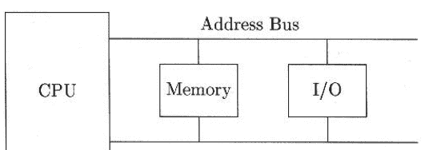

如果我们想象图中的 CPU 是 386，那么我们可以把数据总线想象成连接到 CPU 上 32 个引脚的一组 32 根导线，把地址总线想象成另一组也连接到 CPU 的 32 根导线。请注意，内存和 I/O 系统基本上以相同的方式连接到处理器。如果我们想象观察总线上流动的比特，CPU 与内存之间的数据传输看起来与 CPU 与 I/O 系统之间的数据传输几乎完全一样。差异实际上归结为 CPU 上的单个引脚。这个引脚被称为 `M/IO#` 引脚。当此引脚处于逻辑 1 时，它表示内存传输。当它处于逻辑 0 时，它表示 I/O 传输。如果没有 `M/IO#` 导线，上面的示意图其实没有意义。它还需要一根 `W/R#` 导线来表示数据是流入还是流出处理器。这些导线被称为*控制导线*，是*控制总线*的一部分。

读者被建议将图 4-1 与图 3-11 进行比较，后者更详细地展示了来自三个不同总线的导线如何连接到内存电路。

#### 4.2.1 内存与 I/O

在表 4.1 中，我们将 `MOV` 命令的两种 **imm** 形式与相应的 I/O 命令进行了比较。这些命令执行 `AL` 寄存器与位于地址 12 的内存或 I/O 设备之间的传输。处理器

##### 表 4.1. 内存和 I/O 传输命令示例

| | 内存 | I/O |
| --- | --- | --- |
| 读 | `MOV AL,[12]` | `IN AL,[12]` |
| 写 | `MOV [12],AL` | `OUT [12],AL` |

通过 `W/R#` 引脚信号表示读/写，并通过 `M/IO#` 引脚信号表示内存/I/O。否则，交易过程非常相似。

x86 上内存寻址和 I/O 寻址之间的一个显著差异是，内存地址在离开处理器之前会经过处理。这种处理有两个阶段：分段和分页。分段在第 12 章中描述，分页在第 8 章中描述。

I/O 系统与内存之间的另一个差异是，它们的有效地址范围不同。如第 3 章所述，有效内存地址的范围因不同的 x86 处理器而异。（这取决于处理器拥有的地址引脚数量。）另一方面，所有 x86 处理器上的有效 I/O 地址范围是相同的。它是从 0 到 65,535 的 16 位范围。顺便提一下，这意味着 I/O 系统不需要连接到所有 32 根地址线，只需要连接到底部 16 根。这个范围内的地址被称为*端口*或*端口号*。

许多现有的 I/O 设备，如磁盘驱动器、打印机和串行端口，每个只使用少数几个端口。例如，表 4.2 列出了标准串行端口使用的八个地址。（显然，表中的端口号 1 到 4 *不是* 我们这里所考虑的特定意义上的端口号。但以下十六进制地址是我们考虑的这些端口号的 *完美* 示例。）标准 PC 上使用的端口号的相对完整的


#### 表 4.2. 标准串行端口 I/O 地址

| 串口 | I/O 地址 |
| --- | --- |
| 1 | 3F8H-3FFH |
| 2 | 2F8H-2FFH |
| 3 | 3E8H-3EFH |
| 4 | 2E8H-2FFH |

列表可在 Shanley 的 *《ISA 系统架构》* 附录 A 中找到。Linux 机器上正在使用的 I/O 端口可以通过使用命令访问 */proc* 目录

```text
linuxbox$ cat /proc/ports
```

#### 4.2.2 `IN` 指令

内存传输与 I/O 传输之间的紧密联系并未在 x86 汇编语言中得到完全体现，x86 汇编语言中有许多涉及内存访问的指令，但只有少数如 `IN` 和 `OUT` 用于控制 I/O 访问。关于使用 `MOV` 及许多其他指令访问内存的讨论将在第 6 章 6.2 节中进行。接下来将讨论 `IN` 和 `OUT` 指令。

输入指令将数据从 I/O 端口传输到处理器。该指令有六种有效形式：

```
IN EAX, [DX]
IN AX, [DX]
IN AL, [DX]
IN EAX, [imm]
IN AX, [imm]
IN AL, [imm]
```

其中 `imm` 可以是任意单字节数值。请注意，此指令遵循通用的“指令 目的，源”格式。有效的目的寄存器为 EAX、AX 和 AL。端口号存储在 DX 中或由 `imm` 指定的 I/O 设备为源。

请注意 DX 是一个 16 位寄存器。这是合理的，因为端口号是一个 16 位数值。大多数 Intel 汇编器（包括 NASM）在端口号周围不使用方括号。然而，如果您使用方括号，可以将例如 `IN AL, [DX]` 指令视为：

```
let AL = [DX]
```

其中 `[DX]` 指的是位于地址 DX 处的数据。Edlinas 为了保持一致性而采用这种方式。内存指令同样使用方括号。方括号变成了类似 C 语言中 `*` 的解引用运算符。在 Edlinas 和 NASM 中，通过地址引用内存中的数据时，都在地址周围使用方括号。NASM 在 I/O 引用中不使用方括号。因此，在使用 NASM 时，`IN` 和 `OUT` 指令中的方括号被省略了。

由于 `IN` 指令的 `imm` 形式仅接受单字节端口，因此只能访问 65,536 个端口中的前 256 个。请注意，`IN` 指令并未写成 `IN reg, [reg]`。这是因为诸如 `IN EBX, [DX]` 和 `IN EAX, [CX]` 之类的形式是*无效*的。

#### 4.2.3 OUT 指令

输出指令将数据从处理器传输到 I/O 设备。该指令的六种有效形式为：

```
OUT [DX], EAX
OUT [DX], AX
OUT [DX], AL
OUT [imm], EAX
OUT [imm], AX
OUT [imm], AL
```

同样，`imm` 是任意单字节数值。操作数的顺序与 `IN` 指令相反，因为数据流向是相反的。源是 EAX、AX 或 AL 寄存器，目的是 I/O 设备。再次强调，NASM 在 `OUT` 中不使用方括号。

#### 4.2.4 内存映射 I/O

当内存地址空间中的地址实际上连接到 I/O 设备时，这被称为*内存映射 I/O*。标准 PC 上的视频缓冲区是一个例子。存储在从内存地址 B8000H 开始的 4000 字节处的字符会被输出到显示器。

为 I/O 设备使用单独的地址空间并非唯一设想的 I/O 寻址方法。许多架构使用单一的一组地址，并简单地保留其中一些用于 I/O。

保留地址在 PC 上也用于 ROM（*只读存储器*）。如果对只读存储器执行内存写入，处理器会在总线上发出相应的写信号，但“存储”的数据不会发生任何改变。

## 4.3 简单的汇编语言程序

简单的高级语言程序通常具有三部分格式：输入数据、执行计算，然后输出结果。使用 Edlinas，可以用 x86 汇编语言编写同样风格的简单程序。

## 4.3.1 Edlinas 端口

由 Edlinas 模拟的假想机器仅使用两个端口号。

- 0 是键盘输入端口。
- 1 是屏幕输出端口。

键盘输入会在屏幕左下角回显，输出则显示在右下角。当使用 `IN EAX, [DX]` 时，DX 中存储的值应为 0。当寻址端口 0 时，系统会提示用户输入一个值。当使用 `OUT [DX], EAX` 时，DX 中存储的值应为 1。当使用端口 1 时，输出值会以十进制形式显示在屏幕右下角。这两个端口的使用允许用真正的 x86 汇编语言编写非常简单的程序并在 Edlinas 模拟器上运行。

使用 Edlinas 端口的程序无法在 DOS 或 Unix 上运行。在第 8 章 8.4.7 节中，展示了如何将这些针对模拟机器的 I/O 指令替换为对 C 库函数 `scanf()` 和 `printf()` 的调用。通过这种方式，使用真实 I/O 的简单 Edlinas 程序可以在 Linux 上运行。

## 4.3.2 RET 指令

程序由操作系统启动。当程序结束时，必须将控制权交还给操作系统。`RET` 指令实现这一点。子程序也使用 `RET` 将控制权交还给调用程序。`RET` 利用堆栈工作，将在第 7 章 7.2 节中进行讨论。

## 4.3.3 两个数相加的程序

现在我们拥有了编写一些简单但完整的程序所需的所有指令。下面是一个用于两个数相加的 Edlinas 程序：

### 程序 4.2

```
MOV EDX, 0      ;将 32 位全部清零会使 DX 变为零。
IN EAX, [DX]    ;用户通过端口零输入第一个数。
MOV EBX, EAX    ;将第一个数移开（暂存）。
IN EAX, [DX]    ;用户输入第二个数。
ADD EAX, EBX    ;将第一个数加到第二个数上。
MOV EDX, 1      ;Edlinas 输出端口为一。
OUT [DX], EAX   ;将结果输出给用户。
RET             ;结束模拟。
```

## 4.4 带跳转的汇编程序

高级语言需要循环才能完成其工作。这些循环必须由编译器转换为汇编代码。例如，如图 4-2 所示，以最直接的方式执行 C 语言的 `while` 循环需要正向条件跳转和反向无条件跳转。

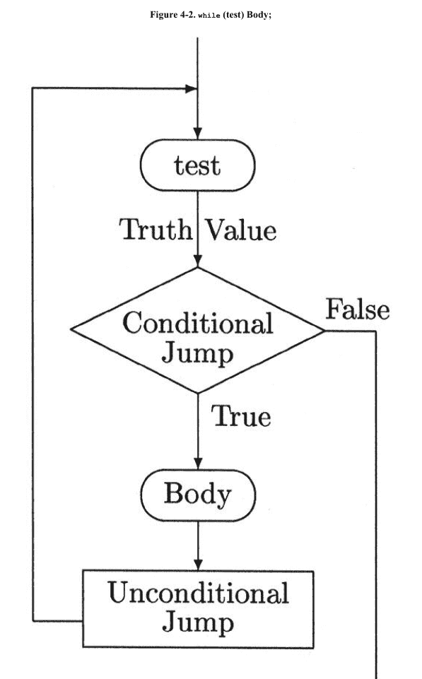

## 4.4.1 JMP 指令

取指-执行周期通过计算内存中下一条指令的地址来工作。这个地址通常通过简单地定位到当前指令之后的第一个地址来确定。然而，为了支持高级语言中的 if-then 语句或循环，需要跳转。`JMP` 指令将执行流程转移到标签指定的地址。

`JMP` 指令的形式为：

```
JMP label
```

标签由程序员创建。设计有助于理解程序的标签是明智的。为此，长标签很有用。另一方面，Edlinas 使用的屏幕空间非常有限，因此除非标签单独占一行，否则超过三个字符的标签在显示时会被截断。标签字段中的标签指定跳转的目标，通常附加一个冒号以明确表明它是一个标签而非晦涩的记忆符号。许多跳转指令可以指向同一个目标，但没有任何两行可以在标签字段中携带相同的标签。在以下程序中，最后一行将控制权转移到前一行。此程序会永远不断地向 EAX 寄存器加 2。这是一个无限循环。无限循环通常只是由错误编写的。

### 程序 4.3

```
MOV  EAX, 0
MOV  EBX, 2
XYZ: ADD  EAX, EBX
JMP  XYZ
```

## 4.4.2 条件跳转与标志

*条件跳转*是基于真值执行的跳转。做出此类决策所依据的信息包含在称为*标志*的单比特寄存器中。当标志包含 1 时，被称为*置位*。当它包含 0 时，被称为*清零*。两个非常重要的标志是零标志和符号标志。

### 零标志与符号标志

`ADD` 和 `SUB` 指令不仅影响其目的寄存器，还影响许多标志。假设执行了指令 `ADD EAX, EBX`。该指令的结果将位于 EAX 寄存器中。如果该结果为 0，则零标志被置位。如果它不为 0，则零标志被清零。

`ADD` 指令后赋予符号标志的值是结果的最高有效位的值。如果将结果视为有符号数且结果为负，则此位为 1。因此，如果执行 `ADD EAX, EBX` 指令后 EAX 获得一个作为四字节有符号数时为负的值，则符号标志被置位；否则符号标志被清零。

## 4.4.3 JZ, JS, JNZ 和 JNS 指令

以下条件跳转命令的格式与 `JMP` 命令完全相同。

`JZ label`

`JS label`

`JNZ label`

`JNS label`

它们各自在操作数字段中接受一个标签。这些命令的含义如下：

`JZ` 如果零标志位置位则跳转。

`JS` 如果符号标志位置位则跳转。

`JNZ` 如果零标志位未置位则跳转。

`JNS` 如果符号标志位未置位则跳转。

下面的汇编程序示例说明了如何在一个程序中确定两个用户输入中哪一个更大。程序 4.4 看起来无懈可击。事实上，它存在一个 bug。

### 程序 4.4


```assembly
; If the first input is larger output 1
; If the second input is larger output 2
; The program uses subtraction:
; B < A is true if and only if B - A is negative.
; A subtraction followed by a JS does the job
;
MOV EDX, 0
IN EAX, [DX] ; The first input is now in EBX
MOV EBX, EAX
IN EAX, [DX] ; The second input is now in EAX.
SUB EBX, EAX ; This is (first - second).
JS SIB ; Second is Bigger
MOV EAX, 1 ; Otherwise First is Bigger
JMP END ; Don't drift into the other case!
SIB: MOV EAX, 2 ;
END: MOV EDX, 1 ; Either way now EAX is ready.
OUT [DX], EAX
RET
```

## 4.5 包含循环的汇编程序

条件跳转用于实现循环和 if-then 语句。假设我们考虑以下程序，它通过重复加法来执行乘法。例如，要做 7 × 5，我们可以执行 5 + 5 + 5 + 5 + 5 + 5 + 5。在程序 4.5 中，数字 1 在一行中被加上，在另一行中被减去。对于这种情况，有专门的命令，它们占用更少的内存空间。

### 程序 4.5

```assembly
;
MOV EDX, 0
IN EAX, [DX] ; First input is the multiplier
MOV EBX, EAX ; Put Multiplier in EBX
IN EAX, [DX] ; Second input is the multiplied number
MOV ECX, 0 ; Initialize the running total.
RPT: ADD ECX, EAX ; Do one addition.
SUB EBX, 1 ; One less yet to be done.
JNZ RPT ; If that's not zero, do another.
MOV EAX, ECX ; Put the total in EAX
ADD EDX, 1 ;
OUT [DX], EAX ; Output the answer.
```

### INC 和 DEC 命令

以下增量和减量命令用于加 1 和减 1：

`INC reg`

以及

`DEC reg`

`reg` 可以是 24 个通用寄存器中的任意一个。这些命令通常用于递增或递减循环计数器。在程序 4.5 中，`SUB EBX, 1` 可以替换为 `DEC EBX`，而 `ADD EDX, 1` 可以替换为 `INC EDX`。

## 4.6 有符号比较

### 4.6.1 基于比较的跳转

高级语言通常在 if-then 语句中使用比较。如第 4.4 节所示，使用符号标志位来测试减法的结果似乎是一种实现此测试的合理方法，因为这是一个数学事实：

`B < A` 当且仅当 `B - A` 为负数。

由于符号标志位指示减法结果的符号，我们似乎站在坚实的基础上。但事实并非如此。

### 4.6.2 溢出标志位

假设我们正在使用单字节有符号数，并希望测试：

`100 < -50`

在单字节寄存器中：

`100 - (-50) = -106`

发生了一次溢出。结果为负数。符号标志位置位，因此比较将被判断为真！使用符号标志位来确定跳转会导致错误的答案。但由于溢出总是将结果的符号改变为与其应有的相反，因此可以修正跳转条件。

1. 如果没有发生溢出，如果符号标志位置位则跳转。
2. 如果发生了溢出，如果符号标志位未置位则跳转。

x86 处理器具有溢出标志位。它被用于实现这种修正后的跳转条件。如果我们用 `SF` 表示符号标志位的二进制值，用 `OF` 表示溢出标志位的值，我们可以将修正后的跳转条件重述为：

如果 (`SF XOR OF`) 则跳转

在诸如 `SUB AL, BL` 这样的减法操作之后，此跳转条件将产生跳转，当且仅当 `AL < BL`。x86 有一个用于此跳转的指令。其助记符是 `JL`，代表“如果小于则跳转”（jump if less than）。

### 4.6.3 CMP 命令

当减法仅为了比较的目的而执行时，可以使用 `CMP` 指令来完成。该命令以与 `SUB` 完全相同的方式设置标志位，但其优势在于不会通过存储不必要的结果而浪费寄存器空间。使用 `JL` 和 `CMP` 指令，我们可以将程序 4.4 重写如下：

### 程序 4.6

```assembly
; If the first input is larger output 1
; If the second input is larger output 2
; The program uses subtraction:
; B < A is true if and only if B - A is negative.
MOV EDX, 0
IN EAX, [DX]
MOV EBX, EAX ;The first input is now in EBX
IN EAX, [DX] ;The second input is now in EAX.
CMP EBX, EAX ; This is first - second.
JL SIB ; Second is Bigger
MOV EAX, 1 ; Otherwise First is Bigger
JMP END ; Don't drift into the other case!
SIB: MOV EAX, 2 ;
END: MOV EDX, 1 ; Either way now EAX is ready.
OUT [DX], EAX
RET
```

程序 4.6 在四字节无符号数的所有范围内都能正确工作。

### 4.6.4 更多的跳转命令

在 `CMP EAX, EBX` 命令之后，`JL` 命令在条件 `EAX < EBX` 为真时执行跳转。命令

`CMP EAX, EBX`

`JL ABC`

的意思是

将 `EAX` 与 `EBX` 比较，

如果 `EAX` 小于 `EBX` 则跳转。

这里发生的是减法和标志位检查，但设计良好的语法允许我们忽略这一点。小于条件并不是在 `CMP` 命令之后方便访问的唯一条件。此处列出了几个其他条件跳转命令。

`JL` 小于 `EAX < EBX`

`JLE` 小于或等于 `EAX ≤ EBX`

`JG` 大于 `EAX > EBX`

`JGE` 大于或等于 `EAX ≥ EBX`

`JE` 等于 `EAX = EBX`

`JNL` 不小于 `EAX ≥ EBX`

`JNLE` 不大于也不等于 `EAX > EBX`

`JNG` 不大于 `EAX ≤ EBX`

`JNGE` 不小于也不等于 `EAX < EBX`

`JNE` 不等于 `EAX ≠ EBX`

由于这些各种跳转命令如此易于解读，它们使比较命令成为一种语法上的意外收获。

## 4.7 无符号比较

在第 4.6 节中，展示了如何使用标志位来确定不等式的真值，从而在条件跳转中使用这些不等式。获得的条件适用于无符号数。

但假设我们考虑上一节中提到的相同示例：

`100 < -50`

并注意到，当这个相同的不等式用无符号数表述时，它变为：

`100 < 206`

这个不等式的真值相反。因此，针对无符号数的“如果小于则跳转”命令在这种情况下必须执行跳转。`JL` 命令不会这样做。上一节中的有符号跳转命令不适用于无符号数。如果 `AL = 64H = 100` 且 `BL = CEH = 206`，那么 `JL` 不会执行跳转，因为它是在处理 `100 < -50`。需要一种针对无符号数的“如果小于则跳转”。

### 4.7.1 进位标志位

对于无符号数，不等式 `A < B` 的测试比其有符号对应项更容易。由于无符号数的减法 `A - B` 在高位不会超出范围，因此如果它为负数，则意味着超出范围。无符号数的超出范围误差被称为*进位误差*。因此，`A < B` 为真当且仅当减法 `A - B` 产生进位误差。因此，指示进位误差的标志位将指示减法的负结果。x86 处理器具有进位标志位来指示这些误差。使用 `CF` 来表示此进位标志位的值，我们可以轻松地将用于实现无符号“如果小于则跳转”命令的条件表述为“如果 `CF` 则跳转”。

与符号标志位、零标志位和溢出标志位一样，进位标志位会对使用 `ADD` 或 `SUB` 时发生的条件做出响应。与这三个其他标志位不同，它不受 `INC` 和 `DEC` 命令的影响。

### 4.7.2 超出范围标志位摘要

诸如 `ADD` 和 `SUB` 这样的算术命令在二进制位上执行，没有任何信息指定这些位是否被用于表示有符号数或无符号数。跟踪此事是软件的责任。

当软件使用处理器对 signed numbers 进行算术运算时，它应查阅溢出标志位以确定是否发生了超出范围误差。当软件使用处理器对 unsigned numbers 进行运算时，软件应查阅进位标志位以检查是否发生超出范围误差。

硬件无法知道数字是有符号的还是无符号的。而这并不重要。


例如，在单字节寄存器上，将`FFH`加到`FFH`的命令可能来自正在处理`signed numbers`的软件。在这种情况下，和`FEH`不是问题。软件将刚发生的算术运算视为：

- `-1 + -1 = -2`。

这没有问题。

另一方面，该指令可能来自使用无符号数的软件。在这种情况下，软件将刚刚发生的算术运算视为

$$255 + 255 = 254.$$

这就不对了。真实答案`510`超出了单字节无符号数的范围（`0-255`）。因此，`FFH`加`FFH`会清除溢出标志，因为有符号算术运算的结果是正常的；同时会设置进位标志，以通知软件存在无符号数的越界错误。

作为另一个例子，假设单字节寄存器接收到将`40H`加到`40H`的指令。和为`80H`。如果在上和下用于替代“大于”和“小于”这两个短语。因此，“如果刚刚完成的算术运算……则跳转”指令看起来如下：

$$64 + 64 = 128.$$

这没有问题。

假设该指令来自处理有符号数的软件。那么算术运算看起来是这样的：

$$64 + 64 = -128.$$

这就不对了。真实答案`+128`超出了单字节有符号数的范围（`-128`到`+127`）。硬件会设置溢出标志，因为这是有符号数系统中的越界错误；同时会清除进位标志，因为无符号数系统中没有越界错误。硬件不知道软件使用的是哪种系统，所以它必须同时处理这两个标志。

进位标志和溢出标志都是越界指示标志。如果将算术运算解释为无符号数系统产生了越界错误，则设置进位标志。如果将算术运算解释为有符号数系统产生了越界错误，则设置溢出标志。

### 4.7.3 更多的跳转指令

鉴于我们需要一个不同的指令用于“小于”以便配合无符号数使用，我们也需要一个新的助记符。此外，考虑到其他所有跳转条件，“大于”、“大于或等于”等，我们需要一整套新的指令和助记符。为了系统化这套新指令，单词“above”（上）和“below”（下）被用来替代短语“greater than”（大于）和“less than”（小于）。因此，适用于无符号数的“如果小于则跳转”指令使用助记符`J_B`，意为“如果低于则跳转”。这些指令的完整集合如下：

- `JBE`低于或等于`EAX = EBX`
- `JA`高于`EAX > EBX`
- `JAE`高于或等于`EAX >= EBX`
- `JNB`不低于`EAX = EBX`
- `JNBE`不低于或等于`EAX ? EBX`
- `JNA`不高于`EAX ? EBX`
- `JNAE`不高于或等于`EAX ? EBX`

## 4.8 Linux .s 文件

`gcc`将`C`源程序翻译为`a.out`文件的一个中间步骤是汇编语言文件。该文件是编译器本身的输出，也是汇编器`gas`的输入。要查看这些汇编器文件，可以使用`-S`开关让`gcc`在此阶段到达后输出汇编文件。该输出具有`.s`文件扩展名。例如，考虑以下`C`程序`mult.c`：

**程序 4.7**

```C
main()
{
	int x, y;
	register int a, b, c;
	printf("Enter a number: ");
	scanf("%d", &x);
	printf("Multiply it by what number?");
	scanf("%d", &y);

	a = x;
	b = y;
	c = 0;

	while (b != 0)
	{
		c = c + a;
		b = b - 1;
	}

	printf("The result is %d.\n", c);
}
```

假设输入的数字`x = 5`和`y = -7`。该程序实际上输出了正确答案`-35`，为了计算它，循环执行了`2^{32}` - `7 = 4,294,967,289`次。请注意

$$(2^{32} - 7) \times 5 = 2^{32} \times 5 - 7 \times 5$$

每次累加总和`b`超过周转值`2^{32}`时，都会从总和中减去`2^{32}`。这发生了四次。结果`b`的值为`2^{32}` - `35`，这是`-35`的补码表示。

汇编语言编程的一个主要实用用途是编写执行次数极多的循环，使得对每次执行所需时间的改进实际上会对总运行时间产生可察觉的影响。在一台`120 MHz Pentium`计算机上进行测试时，`5 × -7`的计算需要`110.90`秒。要获取此程序的汇编代码，可以使用命令

```
linuxbox$ gcc -S mult.c
```

生成的文件`mult.s`是`gcc`用于生成可执行文件的汇编代码。该汇编代码的语法与本书中广泛使用的`Intel`汇编语言不同，但仍然可以解读。为此添加了注释。第一行使用了`TEST`。它是一条指令

**程序 4.8**

```
.L2:
	testl %esi,%esi	; Is ESI = 0
	jne	.L4		; If not go to L4
	jmp	.L3		; otherwise go to L3
.L4:
	addl %ebx,%edi	; Let EDI = EDI + EBX
	decl %esi		; Let ESI = ESI - 1
	jmp	.L2		; Go to L2
.L3:
```

类似于`CMP`（将在下一章中讨论），`%esi`指的是`ESI`寄存器。与`CMP`类似，`TEST`指令如果`ESI = 0`则设置零标志。许多指令末尾的`1`用于指定操作数的长度，在此情况下为“长”（`long`），意味着四个字节。请注意，`add`指令使用了“指令 源 目标”的操作数顺序，这与本书中使用的顺序相反。

该循环由所示的六条指令组成。如果我们注意到通过检测循环末尾`ESI`是否为零，可以从循环中移除一些跳转，我们可以将循环从六条指令减少到三条。所做的唯一更改是

**程序 4.9**

```
.L2:
    testl %esi,%esi
    jne .L4
    jmp .L3
.L4:
    addl %ebx,%edi
    decl %esi
    jne .L4 ; If ESI isn't 0 go to L4
.L3:
```

针对循环末尾的跳转。修改后的文件使用`gcc`进行了编译。

```
linuxbox$ gcc mult.s
```

运行生成的程序，`$5 × -7`的计算在同一台机器上耗时`76.14`秒。

### 4.8.1 Pentium 的双流水线

如果我们查看每条指令的执行时间，在第一种情况下我们得到


此算术假设程序所有时间都花在循环中。将此与一个时钟周期的长度进行比较，


我们发现一个惊人的结果：执行两条指令的时间，`8.606`纳秒，仅略多于一个时钟周期。由于在正常情况下理想的情况是每个时钟周期执行一条指令，所以我们这里看到的是某种特殊的东西。这是`Pentium`双流水线的例证。在可能的情况下，`Pentium`会将指令配对并同时执行两条。这就是如何实现每个时钟周期执行多条指令的原因。（实际上还有一个用于浮点数的流水线。）指令配对也解释了为什么当我们把循环中的指令数从六条减少到三条时，预期的`2:1`的改进并未实现。显然发生的事情是，指令对的数量从三对变成两对，其中一对“指令对”是半空的。`76.14`纳秒是`110.9`纳秒的`.687`倍。这大约等于三分之二，暗示每次循环通过使用的是两个指令对而不是三个。

## 第 5 章 机器语言

机器语言是处理器所看到的内容。取指-执行周期中提取的字节是机器代码的字节。汇编语言可以定义为让程序员控制机器代码的语言。汇编语言指定机器代码。如果没有对机器语言的熟悉，汇编语言的这一特征就不明显。本章介绍了`x86`机器代码的主要特征。

将汇编代码转换为机器代码的过程称为*汇编*。一个以汇编语言为输入并产生机器语言为输出的程序称为*汇编器*。它类似于编译器，但在较低级别上操作。

相反，将机器代码转换为汇编语言的过程称为*反汇编*。执行此功能的程序称为*反汇编器*。

### 5.1 汇编简单程序

要完整讲述`x86`处理器的机器代码故事，涉及许多繁琐的细节。然而，指定`x86`汇编语言子集的机器代码非常容易，该子集用于第`4.3`到`4.5`节中所有带编号的程序。`x86`汇编语言该部分的编码见表`5.1`。大多数机器代码以十六进制给出，但有些字节必须以二进制给出。字节数从一到六不等。例如，表的第一行表明`*MOV* reg,reg`的代码是一个双字节代码，第一个字节以十六进制给出，第二个以二进制给出。以二进制给出的字节是那些包含寄存器代码的字节。二进制编码中的`S S S`代表*源*寄存器的三位代码。`D D D`代表*目标*寄存器的三位代码。寄存器代码在底部给出。每条指令中出现的每个"`imm`"指定额外的四个字节，这些必须由程序员提供。示例如下。使用表`5.1`，程序`5.1`可以如下进行机器汇编：

**表 5.1. 一些 32 位机器编码**

| | 第一个字节 | 第二个字节 | 另外 4 位 |
|---|---|---|---|


| `MOV` | `reg,reg` | 89 | 11 S S D D D | |

| `MOV` | `reg, imm` | 1 0 1 1 D D D | | |

| `ADD` | `reg,reg` | 01 | 1 1 S S D D D | |

| `ADD` | `reg, imm` | 81 | 1 1 0 0 D D D [1] | |

| `SUB` | `reg,reg` | 29 | 1 1 S S D D D | |

| `SUB` | `reg, imm` | 81 | 1 1 1 0 1 D D D [1] | |

| `INC` | `reg` | 0 1 0 0 D D D | | |

| `DEC` | `reg` | 0 1 0 0 1 D D D | | |

| `IN` | `EAX, [DX]` | ED | | |

| `OUT` | `[DX], EAX` | EF | | |

| `RET` | | C3 | | |

| `INP` | `imm` | E9 | 84 | |

| `JZ` | `imm` | 0F | 84 | |

| `JNZ` | `imm` | 0F | 85 | |

| `JS` | `imm` | 0F | 88 | |

| `JNS` | `imm` | 0F | 89 | |

[1] 如果 `reg` 是 `EAX`，存在更短的机器代码。

#### 5.1.1 寄存器代码

第一条指令的第一个字节，`BA`，使用为 `MOV` `reg,imm` 给出的 `1011 1DDD` 代码进行编码。`DDD` 位填入 `DX` 的寄存器代码 `010`，结果是二进制代码 `1011 1010` 或十六进制代码 `BA`。

第二条 `MOV` 指令，`MOV ECX, EAX` 使用图表的第一行编码为 `89 C1`，该行指定第二个字节为 `11 SSS DDD`。`EAX` 是源寄存器，其代码为 `000`。`ECX` 是目标寄存器，其代码为 `001`。结果第二个字节为 `11 000 001`，即 `C1`。

**程序 5.1**

标签 源代码 地址 机器代码

`MOV EDX, 0` | 0 `BA 00` | 2 `00 00` | 4 `00`

`IN EAX, [DX]` | 5 `ED`

`MOV ECX, EAX` | 6 `89 C1`

`IN EAX, [DX]` | 8 `ED`

`MOV EDX, EAX` | 9 `89 C2`

`ORD SUB EAX, ECX` | B `29 C8`

`JZ GCD` | D `0F 84` | F `11 00`

| 11 `00 00` | 13 `0F 89` | 15 `04 00` | 17 `00 00`

`JNS NXT` | 19 `89 C8` | 1B `89 D1`

`NXT MOV EDX, EAX` | 1D `89 C2`

`JMP ORD` | 1F `E9 E7` | 21 `FF FF` | 23 `FF`

`GCD MOV EAX, EDX` | 24 `89 D0`

`MOV EDX, 1` | 26 `BA 01` | 28 `00 00` | 2A `00`

`OUT [DX], EAX` | 2B `EF`

`RET` | 2C `C3`

#### 5.1.2 小端序立即数编码

该程序中的第一条和最后一条 `MOV` 指令都包含立即数。这两条指令都将四字节的值存储到四字节的寄存器中。请注意在最后一条 `MOV` 指令中，四字节立即数 `00000001H` 以 `01 00 00 00` 的形式存储。

#### 5.1.3 相对跳转

`x86` 处理器在可行时使用相对地址而非绝对地址来进行跳转编码。本程序中所有的跳转指令都使用相对跳转进行编码。绝对跳转将指定跳转目标的一个实际地址，而相对编码则指定从下一条指令开始处起跳转的字节数。该值可以解释为带符号数，负值表示向后跳转。处理器会将编码后的值加上下一条指令的地址，从而得到被跳转指令的地址。例如，`JMP NXT` 指令的小端序编码为 `4`；从开始 `MOV EAX, ECX` 的 `89` 字节起数四个字节，就会到达开始 `MOV EDX, EAX` 的 `89` 字节。这条指令就是 `JMP NXT` 的目标。`JMP ORD` 指令包含的相对跳转值为 `FFFFFFH = -25`。从开始 `MOV EAX, EDX` 的 `89` 字节起向后数 `25` 个字节，就会到达 `SUB EAX, ECX` 指令代码的第一个字节 `29`。

#### 5.1.4 短跳转

尽管值 `17`、`4` 和 `-25` 很容易拟合在一字节的带符号范围内，但程序中的相对跳转值都使用四个字节编码。存在用于节省空间的单字节跳转的替代编码。这些跳转被称为短跳转。例如，`JNS NXT` 指令的短跳转编码是 `79 04`。条件短跳转的机器码可以通过去掉 `32` 位对应项中的 `0F` 字节并将第二个字节减去 `10H` 来获得。`JMP` 指令的短代码是 `EB`。在 Edlinas 中，可以使用 `s` 键将长跳转转换为短跳转。在 `NASM` 中，未加修饰的 `JMP` 指令始终意味着短跳转。无法用单字节编码的 `JMP` 指令会收到错误消息。要指定使用较长编码的跳转，可以使用 `JMP NEAR`。在此上下文中，跳转“远”似乎比跳转“近”更合理，但实际上“远跳转”指的是使用绝对编码的跳转，这一点将在第 `12` 章中看到。

由于大多数跳转不超过 `128` 字节，因此为它们提供专用编码是有意义的。`8086` 的指令集实际上只有条件跳转的短版本。`0F` 长跳转代码直到 `80386` 才出现。

## 5.2 操作码空间

上一节给出的机器码可用于汇编各种简单的程序。另一方面，合在一起，它们仅代表完整 `x86` 指令集的一小部分。本节将对整个 `x86` 机器码集进行概述。表 `5.2` 展示了机器码第一个字节所传达的信息。

表中大部分条目都包含助记符和操作数信息。在少数情况下，这些信息完全指定了两者。例如，表中字节 `EE` 的条目是：

```
OUT [DX], AL
```

在其他情况下，给出了助记符，但使用字母键描述了一类允许的操作数。

- `r` 代表寄存器。
- `m` 代表内存。
- `i` 代表立即数。
- `b` 代表字节。
- `w` 代表 `2` 字节。
- `v` 代表 `32` 位或 `16` 位。
- `e` 在 `32` 位中代表 `E`，在 `16` 位中消失。

这些键由 Stephen Morse 在其优秀著作《80386/387 体系结构》中使用。

考虑表中字节 `03` 的条目。

```
ADD rv, rmv
```

由于第一个操作数位置包含 `rv`，这表明第一个操作数必须是 `16` 位或 `32` 位寄存器。由于第二个位置包含 `rmv`，第二个操作数必须是 `16` 位或 `32` 位寄存器或内存操作数。由于 `EDI` 和 `EAX` 是 `32` 位寄存器，我们可以看到 `ADD EDI, EAX` 是一个可以用第一个字节为 `03` 的代码进行编码的指令示例。另一个示例是 `ADD EDI, [1234H]`。代码第一个字节传达的信息类型可以分为几种情况。

1. 在少数情况下，这个单字节足以完全指定一条指令。例如，`F4` 指定了停机指令 `HLT`。

2. 在许多其他情况下，虽然第一个字节确定了要执行的操作，但它不指定操作数。在这种情况下，通常第二个字节就足以携带操作数信息。这个第二个字节被称为 ModRM 字节。例如，如果第一个字节是 `89`，那么表条目是 `MOV rmv,rv`。除了指定 `MOV` 操作外，`rmv,rv` 操作数键还传达了关于如何解释 ModRM 字节的信息。

3. 还有这样的情况：第一个字节并未完全指定一个操作，而仅指定了一类通用操作，ModRM 字节用于完成操作的指定以及携带操作数信息。例如，如果第一个字节是 `C2`，那么表条目是 `Shift rmv,ib`。在这些情况下，ModRM 字节的完整解释需要转到表 `5.3`。`Shift` 不是助记符。它只是指向表 `5.3` 的指针。这在表中通过并非所有字母都是大写字素这一事实来指示。

4. 如果第一个字节是 `OF`，则开启了大量的可能性。`OF` 传达的信息仅仅是“转到表 `5.4`”。

### 表 5.2。操作码空间的第一个字节

| | 0 | 1 | 2 | 3 | 4 | 5 | 6 | 7 | 8 | 9 | A | B | C | D | E | F |

|---|---|---|---|---|---|---|---|---|---|---|---|---|---|---|---|---|

| 0 | `ADD`<br>`rm,ib` | `ADD`<br>`rm,ib` | `ADD`<br>`rm,ib` | `ADD`<br>`AL,ib` | `ADD`<br>`AL,ib` | `ADD`<br>`AX,iw` | `PUSH`<br>`ES` | `OR`<br>`ES` | `OR`<br>`rm,v,iw` | `OR`<br>`rm,v,iw` | `OR`<br>`AL,ib` | `OR`<br>`eAX,ib` | `OR`<br>`eAX,il` | `PUSH`<br>`DS` | `386`<br>`space` | |

| 1 | `ADC`<br>`rm,ib` | `ADC`<br>`rm,ib` | `ADC`<br>`rm,ib` | `ADC`<br>`AL,ib` | `ADC`<br>`AL,ib` | `ADC`<br>`AX,iw` | `PUSH`<br>`SS` | `SBB`<br>`rm,v,iw` | `SBB`<br>`rm,v,iw` | `SBB`<br>`AL,ib` | `SBB`<br>`AX,iw` | `SUB`<br>`rm,v,iw` | `SUB`<br>`rm,v,iw` | `SUB`<br>`AL,ib` | `SUB`<br>`eAX,il` | `POP`<br>`DS` | `DS` |


| 2 | AND<br>rm,ib | AND<br>rm,ib | AND<br>rm,ib | AND<br>AL,ib | AND<br>AL,ib | AND<br>AX,iw | DAA<br>ES: | SUB<br>rm,v,iw | SUB<br>rm,v,iw | SUB<br>AL,ib | SUB<br>AX,iw | XOR<br>rm,v,iw | XOR<br>rm,v,iw | XOR<br>AL,ib | XOR<br>AX,iw | DAS |

| 3 | XOR<br>rm,v,iw | XOR<br>rm,v,iw | XOR<br>AL,ib | XOR<br>AX,iw | AAA | CMP<br>rm,v,iw | CMP<br>rm,v,iw | CMP<br>AL,ib | CMP<br>AX,iw | CMP<br>rm,v,iw | CMP<br>rm,v,iw | CMP<br>AL,ib | CMP<br>AX,iw | CMPSB<br>CS: | AAS |

| 4 | INC<br>rm,v | INC<br>rm,v | INC<br>AL | INC<br>AX | DEC<br>rm,v | DEC<br>rm,v | DEC<br>AL | DEC<br>AX | INC<br>rm,v | INC<br>rm,v | INC<br>AL | INC<br>AX | DEC<br>rm,v | DEC<br>rm,v | DEC<br>AL | DEC<br>AX |

| 5 | PUSH<br>ES | PUSH<br>CS | PUSH<br>SS | PUSH<br>DS | PUSH<br>EAX | POP<br>ES | POP<br>CS | POP<br>SS | POP<br>DS | POP<br>EAX | POP<br>ES | POP<br>CS | POP<br>SS | POP<br>DS | POP<br>EAX | |

| 6 | POPA | POPAD | POPD | POPD | CALL<br>fs: | OPLen<br>AdLen | PUSH<br>ES | PUSH<br>CS | PUSH<br>SS | PUSH<br>DS | PUSH<br>ES | PUSH<br>CS | PUSH<br>SS | PUSH<br>DS | PUSH<br>ES | PUSH<br>CS |

| 7 | JB<br>ib | JAE<br>ib | JA<br>ib | JNC<br>ib | JZ<br>ib | JNO<br>ib | JNE<br>ib | JO<br>ib | JS<br>ib | JNS<br>ib | JBE<br>ib | JG<br>ib | JL<br>ib | JGE<br>ib | JLE<br>ib | JNG<br>ib | |

| 8 | IMUL<br>rm,ib | IMUL<br>rm,ib | IMUL<br>rm,ib | IMUL<br>rm,ib | IMUL<br>rm,ib | TEST<br>rm,ib | TEST<br>rm,ib | XCHG<br>AX,iw | XCHG<br>CX,iw | MOV<br>rm,ib | MOV<br>rm,ib | MOV<br>rm,ib | CALL<br>rv,m | LOOP<br>LEA<br>rv,m | LOOP<br>mov<br>rx,m | LOOP<br>mov<br>rw,m |

| 9 | NOP | XCHG<br>AL,IV | XCHG<br>AX,IV | XCHG<br>CL,IV | XCHG<br>CX,IV | XCHG<br>DL,IV | XCHG<br>DX,IV | BSWAP<br>ECW<br>CQD | CWQ<br>CWD<br>FWAIT | PUSHF<br>POP<br>SAHF | PUSHF<br>POP<br>SAHF | | |

| A | MOV<br>AL,iv | MOV<br>AX,iv | MOV<br>CL,iv | MOV<br>CX,iv | MOV<br>DL,iv | MOV<br>DX,iv | MOV<br>AL,iv | STOSB<br>STOSW<br>LODSB | LODSW<br>SCASB<br>SCASW | SCASW | | | | | | |

| B | MOV<br>AL,ib | MOV<br>CL,ib | MOV<br>DL,ib | MOV<br>BL,ib | MOV<br>AH,ib | MOV<br>CH,ib | MOV<br>DH,ib | MOV<br>BH,ib | MOV<br>ECX,il | MOV<br>EDX,il | MOV<br>ESP,il | MOV<br>EBP,il | MOV<br>ESI,il | MOV<br>EDI,il | |

| C | Shift<br>rm,v,iw<br>1 | Shift<br>rm,v,iw<br>2 | Shift<br>RET<br>rm,iv | RET<br>rm,iv | INT 22 | INT<br>iv | ENTER<br>iw,iw | RETF<br>iw | RETF<br>iv | IRET<br>INTO<br>IRET | |

| D | Shift<br>rm,v,iw<br>1 | Shift<br>rm,v,iw<br>2 | AAM<br>rm,ib | AAD<br>rm,ib | XLATB | 87 | 87 | 87 | 87 | 87 | 87 | 87 | 87 | |

| E | LOOPNE<br>short<br>REPE | LOOP<br>short<br>REPE | LOOP<br>short<br>REPE | JCCZ<br>short<br>REPE | CALL<br>in<br>out<br>eax,ilb | OUT<br>eax,ilb<br>Unasy<br>rmv | CALL<br>out<br>eip,ilb | JMP<br>in<br>AX | JMP<br>out<br>AX | IN<br>eax,ilb<br>AL,OUT<br>AX,ilb | OUT<br>eax,ilb<br>IN,OUT<br>IncDec<br>rm,ib | In/De<br>rv,mv |

| F | LOCK | REPE<br>HLT | CMC<br>Unasy<br>rmv | CLC<br>Unasy<br>rmv | STC<br>Unasy<br>rmv | CLI<br>Unasy<br>rmv | STI<br>Unasy<br>rmv | CLD<br>Unasy<br>rmv | STD<br>Unasy<br>rmv | |

5. 如果第一个字节在 `D8-DF` 范围内，则该命令是浮点命令。这些命令不在本文书中讨论。

6. 还有一些前缀字节用于修改后续命令。在表 5.2 中，诸如 `LOCK` 前缀 `F0` 这样的前缀字节被显示为 *底置项*。

这些各种情况将在接下来的各节中逐一处理。

## 5.3 ModRM 字节

当第一个字节无法携带操作数信息时，使用 `ModRM` 字节来携带操作数信息。`ModRM` 字节由三部分组成。

| Mod | R | M |
|---|---|---|

| 7 | 6 | 5 | 4 | 3 | 2 | 1 | 0 |

1. 位 7 和 6 是 `Mod` 位。当 `Mod` 位为 11 时，`M` 位指定一个寄存器。否则，`M` 位用于内存编码。

2. 位 5、4 和 3 是 `R` 或寄存器位，通常使用斜杠表示法 */r* 来指定。

3. 位 2、1 和 0 是 `M` 或内存位，用于指定或帮助指定内存位置，除非 `Mod` 位为 11。

### 5.3.1 rv,rmv 编码

表 5.2 中字节 03 的条目是

### 5.3.1 ADD EDI, EAX

我们可以使用此条目来组装 `ADD EDI, EAX` 指令。`ADD EDI, EAX` 指令需要一个 `ModRM` 字节。操作数位置中的 `m` 不仅指定第二个操作数可以是内存操作数，还指定它必须以 `ModRM` 字节中的 `M` 位进行编码。由于第二个操作数是寄存器 `EAX`，`EAX` 的位代码 000 占据了 `ModRM` 字节中的 `M` 位。由于我们使用寄存器作为 `M` 位，两个 `Mod` 位必须为 11。第一个操作数，如 `r` 所示必须是寄存器，因此编码在 `ModRM` 字节的 `R` 位中。`EDI` 是第一个操作数，其代码为 111。因此 `ModRM` 字节为：

| Mod | R | M |
|---|---|---|

| 7 | 6 | 5 | 4 | 3 | 2 | 1 | 0 |

| 1 | 1 | 1 | 1 | 1 | 0 | 0 | 0 |

`1111 1000 = F8H`

将 `03` 与 `ModRM` 字节组合，得到 `ADD EDI, EAX` 的代码 `03 F8`。


如果在此代码中将两个 Mod 位从 11 改为 00，则得到 `ADD EDI, [EAX]` 的代码。这里 M 位用于实际的内存操作数。代码 01 和 10 用于编码立即数位移，例如 `ADD EDI, [EAX + 5]`，其中位移类型为 `ib` 或 `iv`。因此，`ADD EDI, [EAX + 5]` 的代码是 `03 78 05`。`ADD EDI, [EAX + 87654321H]` 的代码是 `03 B8 21 43 65 87`。然而，如果这样统一编码，编码空间中将没有空间容纳第 6 章 6.2.3 节中看到的复杂格式。为了为编码这些格式腾出空间，移除了 ESP 寄存器的代码，以提供进入编码空间中另一个字节（称为 SIB 字节）的逃逸机制。

## 5.3.2 rmv, rv 编码

当 `rmv` 和 `rv` 键反转时，三位代码会颠倒顺序。例如，假设我们要编码指令 `MOV EDI, EAX`。`8B` 的条目匹配，可以使用与 `ADD EDI, EAX` 代码相同的 ModRM 字节进行编码。但条目 `89` 也匹配：

```
MOV
rmv, rv
```

使用此条目，我们注意到第一个操作数可以是寄存器，并编码在 M 位中。因此，EDI 的代码进入最低有效位。第二个操作数 EAX 编码在 R 位中。

| Mod | R | M |
|---|---|---|

| 7 | 6 | 5 | 4 | 3 | 2 | 1 | 0 |
| 1 | 1 | 0 | 0 | 0 | 1 | 1 | 1 |

`1100 0111 = C7H`

因此，使用表 5.2 中的 89 条目，我们得到 `MOV EDI, EAX` 的编码 `89 C7`。

## 5.3.3 非寄存器 R 位

在某些情况下，第一个字节不足以指定操作，但 ModRM 字节的 R 位用于完成指定。这些情况列在表 5.3 中。`SUB ECX, 32` 是一个例子。表 5.2 中 `83` 的条目是：

```
Immed
rmv, ib
```

由于表 5.3 中标记为 "Immed" 的行在 `ir = /5` 下有 SUB，我们知道匹配以下内容的指令：

```
SUB
rmv, ib
```

可以使用 `83` 作为第一个字节，并使用 `101` 作为 ModRM 字节的 R 位进行编码。由于第一个操作数 ECX 不是内存，Mod 位必须为 11，M 位将填充 ECX 的代码 `001`。因此所需的 ModRM 字节是：

### 表 5.3. 由 R 位指定的指令

|  /r | /0 000 | /1 001 | /2 010 | /3 011 | /4 100 | /5 101 | /6 110 | /7 111 |
|---|---|---|---|---|---|---|---|---|

| Immed | ADD | OR | ADC | SBB | AND | SUB | XOR | CMP |
| Shift | ROL | ROR | RCL | RCR | SHL | SHR | SAR | |
| Unary | TEST i | NOT | NEG | MUL | IMUL | DIV | IDIV | |
| IncDec | INC | DEC | DEC | | | | | |
| Indir | INC | DEC | CALL m | CALL FAR m | JMP | JMP FAR | PUSH | |

| Mod | R | M |
|---|---|---|

| 7 | 6 | 5 | 4 | 3 | 2 | 1 | 0 |
| 1 | 1 | 1 | 0 | 1 | 0 | 0 | 1 |

`1110 1001 = E9H`

`ib` 代表立即数字节。因此，`SUB ECX, 32` 的代码是 `83 E9 20`。

## 5.4 386 空间 (OF + ...)

在 8086 上，字节 `OF` 编码指令 `POP CS`。在后续处理器中，该指令被移除，以便将 `OF` 代码用于指令集的重大扩展。表 5.4 揭示了开放的空间。与表 5.2 类似，它显示由单个字节传达的信息，在此情况下是跟随初始 `OF` 字节之后的字节。表 5.4 中的几条指令最初出现在 80286、80486 或 Pentium 上，但大多数最初出现在 80386 上。80286 新增指令的大部分在表 5.2 中。

- 与表 5.2 一样，有时一个条目恰好指定一条指令。例如，`OF CA` 是指令 `BSWAP EDX`（交换 EDX 寄存器的字节）的代码。

- 有时需要 ModRM 字节来传达操作数信息。前两个字节为 `OF C1` 的 XADD 指令就是一个例子。

- 有时 ModRM 字节用于指定操作。例如，如果指令的前两个字节是 `OF 01`，则必须检查 ModRM 字节的 R 位以确定操作。从表 5.5 我们看到，如果 ModRM 字节中的寄存器位是 `011`，则指令将是 LIDT 指令（加载中断描述符表）。

### 表 5.4. 386 空间

| | 0 | 1 | 2 | 3 | 4 | 5 | 6 | 7 | 8 | 9 | A | B | C | D | E | F |
|---|---|---|---|---|---|---|---|---|---|---|---|---|---|---|---|---|

| 0 | LOCKIT | GRANTIT | LAR PU,IBY | LSL PU,IBY | | | UDM,AL | CLTS | | | INVD | WNSWD | | | | | |
| 1 | | | | | | | | | | | | | | | | |
| 2 | MOV r2,DRi | MOV r2,CRi | MOV CRi,2 | MOV DRi,2 | MOV r2,DRi | | MOV TRi,2 | | | | | | | | | | |
| 3 | WRMSR | RDTSR | RDMSR | | | | | | | | | | | | | |
| 4 | | | | | | | | | | | | | | | | |
| 5 | | | | | | | | | | | | | | | | |
| 6 | MMX 空间 | MMX 空间 | MMX 空间 | MMX 空间 | MMX 空间 | MMX 空间 | MMX 空间 | MMX 空间 | MMX 空间 | MMX 空间 | MMX 空间 | MMX 空间 | MMX 空间 | MMX 空间 | MMX 空间 | MMX 空间 |
| 7 | MMX 空间 | MMX 空间 | MMX 空间 | MMX 空间 | MMX 空间 | MMX 空间 | MMX 空间 | MMX 空间 | MMX 空间 | MMX 空间 | MMX 空间 | MMX 空间 | MMX 空间 | MMX 空间 | MMX 空间 | MMX 空间 |
| 8 | JO | JNO | JB | JAE | JE | JNE | JBE | JA | JS | INS | JP | JNP | JL | JGE | JLE | JG |
|   | iv | iv | iv | iv | iv | iv | iv | iv | iv | iv | iv | iv | iv | iv | iv | iv |
| 9 | SETO | SETNO | SETB | SETAE | SETE | SETNE | SETBE | SETA | SETS | SETNS | SETP | SETNP | SETL | SETGE | SETLE | SETG |
|   | m8 | m8 | m8 | m8 | m8 | m8 | m8 | m8 | m8 | m8 | m8 | m8 | m8 | m8 | m8 | m8 |
| A | PUSH | POP | CPUID | BT | SHLD | SHLD | BUL | PUSH | POP | RSM | BTS | SHRD | SHRD | BSR | MOVX | IMUL |
|   | FS | FS | FS | cv, rm | cv, rm | cv, rm | r, m16 | m16, gs | r | m8 | rmv r, m8 | rmv r, ib | rmv r, m8 | rm | rmv r, m8 | r, rm |
| B | CMPOVP | LSS | LFS | LOGS | MOVX | MOVX | CMOVS | BSWAP | BSWAP | BSWAP | BSWAP | BSWAP | BSWAP | BSWAP | BSWAP | BSWAP |
|   | mv, m8 | m8 | m8 | m8 | r, rm | r, rm | m8 | m8 | m8 | m8 | m8 | m8 | m8 | m8 | m8 | m8 |
| C | XADD | XADD | MXC | | MXC | | | | | | | | | | | |


| D | | | | | | | | | | | | | | | | |

| E | | | | | | | | | | | | | | | | |

| F | | | | | | | | | | | | | | | | |

某些代码指向 MMX 指令。这些指令在英特尔书籍《*The Complete Guide to MMX Technology*》中有讨论。

我们了解到，匹配表 5.5 的指令包含 80486、Pentium 和 MMX 指令，以及 80386 指令。例如，`XADD` 和 `BSWAP` 指令最初出现在 80486 上，而 `CPUID` 和 `RDTS C` 最初出现在 Pentium 上。

### 表 5.5. 由 R 位指定的 OF 指令

| /r | /0 000 | /1 001 | /2 010 | /3 011 | /4 100 | /5 101 | /6 110 | /7 111 |

|---|---|---|---|---|---|---|---|---|

| LocalT | `SLD rm2` | `STR rm2` | `LLDT rm2` | `LTR rm2` | `VERR rm2` | `VERW rm2` | | |

| GlobalT | `SGDT m6` | `SIDT m6` | `LGDT m6` | `LIDT m6` | `SWGS rm2` | | `LMSR rm2` | |

## 5.5 32 位与 16 位代码

到目前为止，我们只讨论了涉及 32 位通用寄存器的机器代码。现在我们准备考虑 16 位通用寄存器的编码。

`MOV ECX, EAX` 指令，如在 5.1 节中所述，可以编码为 `89 C1`。对应的 16 位指令是 `MOV CX, AX`。令人惊讶的是，此指令的代码也是 `89 C1`！80386 的设计使得 16 位寄存器和 32 位寄存器使用相同的编码。显然，这里存在问题。当处理器获取字节 `89 C1` 时，应该执行哪条指令，`MOV ECX, EAX` 还是 `MOV CX, AX`？事实证明，这个决定基于处理器中的一个位。这个位决定代码是解释为 32 位代码（此时 `89 C1` 意味着 `MOV ECX, EAX`），还是 16 位代码（此时 `89 C1` 意味着 `MOV CX, AX`）。

当位被设置时，并不意味着指令 `MOV CX, AX` 不可用。为了编码 32 位编码假设错误的情况，使用单字节前缀 `66`。因此在 32 位代码中，`66 89 C1` 是 `MOV CX, AX` 的代码。同样，`MOV ECX, EAX` 指令在 16 位代码中也可用。其代码是 `66 89 C1`。这个前缀称为操作数大小前缀。它意味着操作数大小不是默认大小。

通常在运行 Linux 时（例如），该位被设置，而在运行 DOS 时清除。除非另有明确说明，本书中给出的代码假设处理器位为 32 位默认值已设置。因此，`89 C1` 意味着 `MOV ECX, EAX`，而 `66 89 C1` 意味着 `MOV CX, AX`。既然我们看到代码 `89 C1` 可以有两种可能的含义之一，就很容易解释

### 表 5.6. 32 位与 16 位编码示例

| | 32 位代码 | 16 位代码 |

|---|---|---|

| `MOV ECX, EAX` | `89 C1` | `66 89 C1` |

| `MOV CX, AX` | `66 89 C1` | `89 C1` |

# 表 5.7. 8位寄存器编码

| 8位寄存器编码 |

| :---: | :---: | :---: | :---: |

| `AL` | `000` | `AH` | `100` |

| `CL` | `001` | `CH` | `101` |

| `DL` | `010` | `DH` | `110` |

| `BL` | `011` | `BH` | `111` |

编码 `89` 在第一个图表中的条目：

```
MOV
_r_m_v, r_v
```

每个操作数标记中的 `v` 代表变量，这里的变量指的是大小可能是 16 位或 32 位。类似地，寄存器标识符（如 `eax`）中的 `e` 指的是在 32 位编码中指代 `EAX`，而在 16 位编码中指代 `AX`。

## 5.6 8位寄存器

尽管 32 位和 16 位的寄存器指令被迫共享操作码，但八位寄存器通常拥有专用的操作码。例如，操作码 `8A` 指定了一条八位 `MOV` 指令。表 5.2 中关于 `8A` 的条目是

```
MOV
_r_b, r_m_b
```

`rb` 代表寄存器字节，并在 ModRM 字节的寄存器位中编码。`rmb` 代表寄存器或内存字节，并在 ModRM 字节的内存位中编码。`8A C1` 是 `MOV AL, CL` 的代码。表 5.7 列出了八位寄存器编码。`CL` 的代码进入 M 位，`AL` 的代码进入 R 位。

| Mod | R | M |

| :---: | :---: | :---: | :---: | :---: | :---: | :---: | :---: | :---: |

| 7 | 6 | 5 | 4 | 3 | 2 | 1 | 0 |

| 1 | 1 | 0 | 0 | 0 | 0 | 0 | 1 |

组合这两个字节得到 `8A C1`。

## 5.7 Linux .o 文件

包含诸如 `printf()` 或 `scanf()` 等函数调用的 C 程序需要链接这些函数的编译代码。这些代码存储在诸如 `libc.so` 这样的库中。一旦完成链接，程序就会变得长得多。为了检查程序的机器代码，查看链接之前的代码更容易，因为那时候代码量少得多。这些代码存储在扩展名为 `.o` 的目标模块中。DOS 中类似的文件是 `.OBJ` 文件。要指示 GNU C 编译器生成 `.o` 文件，可以使用 `-c` 开关。命令

```
linuxbox$ gcc -c mult.c
```

生成一个 `mult.o` 文件。该文件包含程序的机器代码，以及允许链接器工作的表格。

要检查目标代码文件，可以使用随本书提供的 `ob` 程序（对象转储）或标准 Unix 实用程序 `od` 程序（八进制转储）。要让 `od` 以十六进制显示，使用开关 `-tx` 和 `-Ax`。

```
linuxbox$ od -tx -Ax mult.o
```

`ob` 没有开关：

```
linuxbox$ ob mult.o
```

## 第 6 章. 内存

在第 4 章第 4.2 节中，我们注意到 `MOV` 命令可以用于在内存之间传输数据，正如 `IN` 和 `OUT` 可以用于在 I/O 设备之间传输数据一样。对于程序员来说，使用 `MOV` 访问内存很简单：只需将地址放在括号内即可。然而，无论是在 DOS 还是 Linux 中，括号内的地址都不是实际的内存地址。在 DOS 中，使用一种称为分段（segmentation）的地址处理机制；而在 Linux 中，使用另一种称为分页（paging）的机制。但这些机制可以被规避。在本章中，我们做出简化假设，即认为已做到这一点，使得括号内的地址是实际的硬件地址。基于此基础编写的程序在 Edlinas 下运行。分段和分页将在后面讨论。分段在第 12 章讨论，分页在第 8 章讨论。

## 6.1 4字节数据宽度

当字长和寄存器大小一致时，处理器与其内存之间的数据传输是容易的。例如，8080 处理器将八位字获取到其八位寄存器中。八位寄存器当然是过去的事。但八位字我们仍在使用。英特尔实施了许多措施，使其新的处理器能够运行旧软件。其中之一就是维护八位字，尽管处理器寄存器和数据传输早已超出了八位大小。例如，386 处理器具有 32 位寄存器和 32 位数据传输。

当寄存器和字大小不匹配时，简单的传输命令就不再有意义了。例如，在没有进一步的协议的情况下，命令

```
MOV [19H], EAX
```

没有意义。所引用的内存位置，就像所有英特尔内存位置一样，是一个八位位置。但另一方面，`EAX` 是一个 32 位寄存器。

### 6.1.1 存储协议

还使用了两个进一步的协议。

-   当由地址 `a` 指示 `n` 字节传输时，所引用的内存字节是位于地址 `a, a + 1, ..., a + n - 1` 的字节。所有架构都这样做。

-   当 `n` 字节的数字存储在内存中时，其字节按重要性顺序存储，最小有效字节位于最低地址。数值上递增的地址对应于字节重要性递增。并非所有架构都这样做。

这两个协议使得能够解释 `MOV [19H], EAX` 命令。如图 6-1 所示，`EAX` 中的字节存储在地址 `19H`、`1AH`、`1BH` 和 `1CH` 中。`EAX` 中的最小有效字节存储在 `19H`，下一个在 `1AH`，依此类推。程序 6.1 演示了此指令的使用。当程序 6.1


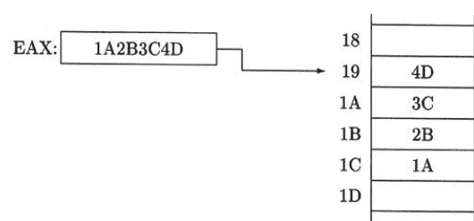

**程序 6.1**

```
; Tiny Edlinas program which stores an input number into memory.
; IN EAX, [0]
    MOV [19H], EAX
    RET
```


在 Edlinas 下运行时，它从地址 `0` 开始加载。由于当加载此程序时，所有直到地址 `20H` 的内存位置都会显示出来，因此 `MOV` 指令的执行可以直接观察到。

### 6.1.2 小端和大端架构

使用上述第二个协议中给出的字节排序的架构被称为*小端（little endian）*。做相反操作的架构被称为*大端（big endian）*。

所有英特尔处理器都是小端的。大端处理器的例子包括摩托罗拉的 `6800` 和 `68000` 处理器。`MIPS` 和 `PowerPC` 处理器可以在任一模式下工作。

为了鼓励软件开发者从竞争硬件中迁移，一种常见策略是纳入兼容性功能。添加到 `486` 处理器中的兼容性功能是 `BSWAP` 指令。它反转任何 `32` 位通用寄存器的字节顺序。其格式很简单：

```
BSWAP reg
```

例如，如果 `EAX` 寄存器包含数字 `12345678H`，则在执行 `BSWAP EAX` 命令后，它将包含数字 `78563412H`。

### 6.1.3 对齐

在 `386` 和 `486` 系统中，四字节数据传输大小与单字节字大小之间的差异并未完全反映在硬件中。事实上，单字节字大小是为软件利益而维护的一种虚构。尽管这些系统上的内存被迫模拟单字节字内存，但字实际上宽为四个字节。`32` 位地址总线的最低两位实际上并不存在。地址总线上的线是 `A31` 到 `A2`。`A1` 和 `A0` 缺失。从硬件角度看，`386` 寻址 `2^30` 个 `32` 位字。`2^32 × 8` 位内存是一种虚构。但由于这种虚构被一致维护，相信这种虚构的软件确实有效。但它不如考虑到实际情况的软件运行得那么高效。例如，命令

```
MOV EAX, [10H]
```

访问四个字节内存，其 `32` 位地址为

```
0000 0000 0000 0000 0000 0000 0001 0000
0000 0000 0000 0000 0000 0000 0001 0001
0000 0000 0000 0000 0000 0000 0001 0010
0000 0000 0000 0000 0000 0000 0001 0011
```

请注意，这些地址仅在不存在的最低两位不同。这四个字节实际上只是一个四字节字。该命令可以通过单次内存传输完成。另一方面，命令

```
MOV EAX, [12H]
```

这也访问四个字节内存，无法以相同方式执行。这四个字节的 `32` 位地址是

```
0000 0000 0000 0000 0000 0000 0001 0010
0000 0000 0000 0000 0000 0000 0001 0011
0000 0000 0000 0000 0000 0000 0001 0100
0000 0000 0000 0000 0000 0000 0001 0101
```

要访问这四个字节，需要两次不同的内存传输。在访问大量连续内存位置（每次四个字节）的代码中，如果调用的地址的最低两位不为零（即不是 `4` 的倍数），性能将减半。跨越四字节字边界的内存传输被称为*未对齐（out of alignment）*。从 `486` 处理器开始，增加了一个标志，用于检测未对齐的内存传输。

### 6.2 括号中的地址

使用 `MOV` 访问内存只是触及可用内存命令的皮毛。表 `5.2` 中所有包含带有 `m` 的操作数键的条目都描述了访问内存的命令。从表中我们可以看到，`MOV`、`ADD`、`OR`、`ADC`、`SBB`、`AND`、`SUB` 和 `XOR` 都允许在源操作数或目标操作数位置使用内存操作数。内存操作数可以使用几种不同的格式提供。

#### 6.2.1 [imm] 格式

迄今为止演示的所有内存操作数示例都使用了 `MOV` 指令的 `[imm]` 格式。用 `ADD` 命令说明 `[imm]` 格式，我们有

```
ADD reg, [imm]
```

和

```
ADD [imm], reg
```

其中 `imm` 可以是任何四字节数字。

正如我们都知道的，内存可用于存储多种类型的数据，包括文本、图形和数字。在接下来的段落中，我们将查看它与数字（特别是大数字）连接时的使用情况。

## 64位算术

内存空间比处理器空间大得多。当数字变得太大，处理器无法直接处理时，算术运算可以分块进行，将足够小的块从内存中加载进来供处理器使用。处理器的某些功能是针对这种算术运算设计的。`ADC` 指令就是一个例子。该指令使得可以分块添加大数字。假设我们将数字 `1111222233334444H` 和 `AAABBBCCCCDDDDH` 存储在内存位置 `100H` 和 `108H`，并且我们希望将它们相加。使用 `ADD` 指令处理这两个数字的低四个字节会设置进位标志。对接下来四个字节使用 `ADC` 指令会考虑进位。`ADC` 指令与 `ADD`

**instruction.** 其含义为

令 `destination = destination + source + 进位标志`

而普通的 `ADD` 指令的含义为

令 `destination = destination + source`

加法可以分两个阶段完成，第一阶段使用 `ADD`，第二阶段使用 `ADC`。

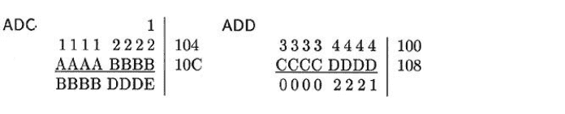

为了使进位机制正常工作，关键在于在低位加法和高位加法之间，没有任何操作干扰进位标志。以下代码执行这种算术运算，使用从 `100H` 开始的八个字节作为目的操作数，使用从 `108H` 开始的八个字节作为源操作数。当程序结束时，

### **程序 6.2**

```
; 8 byte Destination at 100H
; 8 byte Source at 108H
MOV EAX, [108H] ; Bottom 4 Source bytes
ADD [100H], EAX ; Add to bottom 4 Destination bytes
MOV EAX, [10CH] ; Top 4 Source bytes
ADC [104H], EAX ; Add to top 4 Destination bytes
```

八字节和位于从地址 `100H` 开始的八个字节中。当 `ADC` 指令结束时，溢出、进位和符号标志对于八字节算术将是正确的。零标志在八字节运算中表现不佳。当置位时，它不一定表示八字节和为 `0`。

### **3 的幂**

基于这个想法，我们可以编写一个小的 `64` 位 `3` 的幂计算器，使用以下算法：

初始化 `y = 3`

然后重复：

- `x = y`
- `y = y + x`
- `y = y + x`

程序 `6.3` 没有输入或输出。我们可以通过在 Edlinas 中单步调试来观察它。`[imm]` 格式在引用内存中几个固定位置时很有用。它不适合处理内存中连续的大量字节。

### **程序 6.3**

```
; Edlinas program which finds 64-bit powers of 3.
; Store the 8 bytes of x starting at memory address 100H.
; Store the 4 least significant bytes of y in EAX.
; Store the 4 most significant bytes of y in EBX.
;
; y = 3
ABC:      MOV [100H], EAX
            MOV [104H], EBX
; x = y
; y = y + x
            ADD EAX,[100H]
            ADC EBX, [104H]
; y = y + x
            ADD EAX, [100H]
            ADC EBX, [104H]
            INC EDX  ; Keep track of the exponent.
;
            JMP ABC

            MOV EAX,   3
            MOV EBX,   0
            MOV EDX,   1
```

## 6.2.2 [reg] 格式

字节的长序列出现在数组和非常大的数字中。与 `[imm]` 格式相比，`[reg]` 格式更适合处理这些情况。以 `MOV` 为例说明 `[reg]` 格式，我们有：

```
MOV reg, [reg]
```

以及

```
MOV  [reg], reg
```

在第一种情况中，`[reg]` 源操作数指的是内存中的位置，该位置的地址位于括号内指定名称的寄存器中。例如，代码

```
MOV EBX,  10H
MOV EAX,  [EBX]
```

将四个字节从起始地址为 `10H` 的内存传输到 `EAX` 寄存器。

作为一个 `[reg]` 格式实用性的例子，假设我们考虑两个 `256` 字节数字相加的问题。

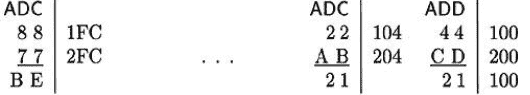


在程序 6.2 中，地址是直接使用 `[imm]` 格式访问的。加法的每四个字节都使用两条指令完成，即一条 `MOV` 和一条 `ADC`。如果在这里使用相同的技术来添加 256 字节数字，所需指令数量将乘以 64。因此，我们需要 128 行代码。另一方面，如果使用 `[reg]` 格式，我们可以使用寄存器作为源和目的地址，并在循环中递增它们。如果我们使用 `EDI` 作为*目的索引*，使用 `ESI` 作为*源索引*，那么我们首先将 `100H` 存入 `EDI`，将 `200H` 存入 `ESI`。然后，我们必须每前进四个字节就增加一次这些指针，以便遍历这两个大数字。这段代码比使用 `[imm]` 格式产生的 128

### 程序 6.4

```
;
; Code which adds two 256-byte numbers y and x:
; y = y + x
;
; Assume the 256 bytes of y are stored starting at memory address 100H.
; Assume the 256 bytes of x are stored starting at memory address 200H.

; Use EDX to store a decrement counter for the y = y + x loop.
      MOV EDI, 100H ; Initialize pointer into y.
      MOV ESI, 200H ; Initialize pointer into x.
      ;
; y = y + x
      MOV EDX, 40H    ; Loop needs 64 iterations.
      CLC             ; Clear the carry flag.
XYZ:  MOV EAX, [ESI]  ; 4 Source bytes into the Processor.
      ADC [EDI], EAX   ; Do the addition.
      INC ESI          ;
      INC ESI          ;
      INC ESI          ; This is ugly.
      INC ESI          ;
      INC EDI          ; But using ADD here would
      INC EDI          ; clear the carry flag.
      INC EDI          ;
      INC EDI          ;
      DEC EDX          ; Decrement the loop counter.
      JNZ XYZ          ; See if the loop is finished.
```

行代码要短得多。

乍一看，我们似乎可以使用 `ADD` 指令代替多个 `INC` 指令来做得更好。但这实际上会破坏一切。因为我们要使用循环从最低有效字节开始，每次前进四个字节，直到最高有效字节，我们会遇到进位标志的问题。如果在两次执行 `ADC` 指令之间，使用 `ADD` 指令将数字向下移动四个字节，我们就打乱了进位标志。在第 4 章中指出，进位标志不受 `INC` 和 `DEC` 指令的影响。这个晦涩的小例外的原因突然变得清晰了。多字节算术需要一个能够经受循环计数器调整的进位标志。因为它们不影响进位标志，所以 `INC` 和 `DEC` 指令可以用来执行无害的循环计数器调整。使用四个 `INC` 指令来加 4 并不美观，但它是有效的。

从占用内存空间的角度来看，这段代码并不算差，因为内存是廉价的。但从增加循环执行时间的角度来看，它是糟糕的。如果有一个地方执行时间成本很高，那就是嵌套循环的中部，而那些额外的 `INC` 指令恰好就在那里。

另一种内存格式有助于处理这个问题。

## 6.2.3 [reg*scale*reg*imm] 格式

最通用的内存格式是 `[reg + scale * reg + imm]` 格式，其中 *scale* 是一个缩放因子，必须是 1、2、4 或 8。被缩放因子乘以的寄存器被称为*索引寄存器*。另一个寄存器被称为*基址寄存器*。某些字段可以省略。这为我们带来了多种格式的效果，包括：

- `[scale*reg + imm]`
- `[reg + scale*reg]`
- `[reg + reg + imm]`
- `[reg + imm]`
- `[reg + reg]`

除了前面讨论过的 `[reg]` 和 `[imm]` 格式之外。很难相信具有这种复杂度的指令是硬编码在处理器中的。但就指令长度而言，这种复杂度的实际成本只是使用这种通用格式的指令多一个字节代码。这个字节称为 SIB 字节，既代表*scaled-index-base*（缩放-索引-基址）字节，也代表 ModR/M 字节的*sibling*（兄弟/姊妹）。

回到程序 6.3 中重复使用 `INC` 指令的问题，请注意，缩放因子为 4 会在索引寄存器递增 1 时使地址增加 4。在程序 6.5 所示的代码中，`[scale*reg + imm]` 格式用于引用源和目的内存位置。在这段代码中，我们可以看到单条 `INC` 指令取代了程序 6.3 中的八条 `INC` 指令。

### 程序 6.5

```
; Edlinas program which finds 256-byte powers of 3.
; Store the 256 bytes of x starting at memory address 100H.
; Store the 256 bytes of y starting at memory address 200H.

      MOV EBX, 3 ; Initialize base.
      MOV EDX, 1 ; Initialize exponent.

y: = 3

      MOV EAX, 0 ; Do the adding in EAX.
      MOV EDI, 40H ; Loop needs 64 iterations.
ZRO:
      DEC EDI
      MOV [4*EDI + 200H],EAX
      JNZ ZRO
      MOV [4*EDI + 200H],EBX

;
; x = y. Main infinite loop starts here.
;
LUP:
      MOV EDI, 40H ; Loop needs 64 iterations.
      MOV ESI, EBX ; Initialize main loop counter.
BEG:
      DEC ESI
      MOV EAX,[4*EDI + 200H]
      MOV [4*EDI + 100H],EAX
      JNZ BEG

; y = y + x
AGN:
      MOV ECX, 40H ; Loop needs 64 iterations.
XYZ:
      MOV EAX,[4*EDI + 200H]
      ADC EAX,[4*EDI + 100H]
      MOV [4*EDI + 200H], EAX
      INC EDI
      DEC ECX
      JNZ XYZ

      DEC ESI
      JNZ AGN

      INC EDX
      JMP LUP
```

一种不被允许的变体是在两个操作数位置都使用内存引用。没有 x86 处理器指令同时使用内存作为源和目的操作数。例如，指令

```
ADD [EAX] , [EBX]
```

并不存在。然而，有些指令涉及从内存读取和写入内存；例如 `INC [EAX]` 既从地址位于 `EAX` 的内存位置读取，也写入该位置。称为*load/store*（加载/存储）的体系结构不允许将处理器操作与内存操作混合。在 load/store 体系结构中，访问内存的唯一命令是*load*（加载）和*store*（存储）。

## 6.2.4 16 位地址

在第 6.2.2 节中介绍了内存寻址的 `[reg]` 格式，其中 `reg` 可以是八个 32 位通用寄存器中的任何一个。8086 和 80286 也使用 `[reg]` 格式。然而，并非允许所有八个 16 位寄存器；只允许 `BP`、`BX`、`SI` 和 `DI`。还有一种 `[reg + reg + imm]` 形式。`imm` 必须是一个 16 位数字。如果使用两个寄存器，允许的组合仅为：`BP + SI`、`BP + DI`、`BX + SI` 和 `BX + DI`。由于这些限制容易遗忘，不习惯 16 位地址的程序员可能会发现自己使用了不允许的地址形式。大多数程序员会尽量避免使用 16 位寻址，只要可能。

这些 16 位内存地址形式可以在 80386 上使用。当它们出现在 32 位代码中时，需要一个特殊的


前缀 `67H` 必须应用于机器代码，以通知处理器 ModR/M 字节中的内存地址位使用的是旧的 16 位编码系统。这个前缀被称为地址大小前缀。它与第 5 章第 5.5 节中讨论的操作数大小前缀类似。

## 6.2.5 CISC 与 RISC

`x86` 计算机通常被认为是一种复杂指令集计算机（CISC）。部分原因是其地址计算方式非常复杂，例如内存操作数 `[EDX + 4*ESI + ABC]`。像 SUN 和 MIPS 工作站这样的机器基于这样一种理念：通过简化指令并减少指令数量，使其执行起来更容易且速度更快。这一优势足以弥补编写程序时需要使用更多这类小型指令的事实。基于这一哲学理念的计算方式被称为 RISC，即精简指令集计算。RISC 与 CISC 的问题不像小端序与大端序那样是非此即彼的问题。RISC 是一组特性，可以部分或不同程度地采纳。`486` 和 `Pentium` 处理器能够与早期的 RISC `PowerPC` 处理器竞争，原因之一是它们采纳了务实的 RISC 理念。虽然 `Pentium` 允许使用 CISC 指令，但如果使用类似 RISC 的指令子集进行编程，其运行速度会更快。

尽管名称听起来不同，但 `Pentium II` 和 `Pentium Pro` 已经完全转向了纯 RISC 架构。其内部使用的指令集是纯 RISC 指令集。传统的 `x86` 指令在执行前会在内部被转换为 RISC 指令。从某种意义上说，苹果营销人员给 `Pentium` 打上的“终结者”标签是正确的。但具有讽刺意味的是，`386` 汇编语言如今比以往任何时候都更加强大。

## 6.3 操作数大小歧义

在大多数双操作数指令中，两个操作数必须具有相同的大小。因此，当在这种上下文中使用内存操作数时，如果另一个操作数是寄存器操作数，那么它所引用的字节数是可以确定的。例如，在 `ADD [EBX], AX` 中，由于 `AX` 是一个双字节寄存器，内存操作数 `[EBX]` 必须引用两个字节的内存。然而，当内存操作数与立即数操作数一起使用时，结果是不确定的。例如，以下命令存在歧义：

```
MOV [EBX], 5
```

同样，当内存操作数与单目运算（如 `NEG`，取一个数的补数）一起使用时，操作数的大小是不确定的。像这样的指令

```
NEG [EBX]
```

可能引用一个、两个或四个字节大小的内存。在这种情况下，汇编器必须做出选择。`NASM` 选择生成错误消息。在 32 位代码中，`Edlinas` 在引用存在歧义时默认使用四字节引用。在 16 位代码中，默认值是两字节。要在 `Edlinas` 中指示单字节情况，你可以使用传统但笨拙的表示法

```
NEG BYTE PTR [EBX]
```

在 `NASM` 中，代码为

```
NEG BYTE [EBX]
```

要在 `NASM` 中指示四字节引用，代码为

```
NEG DWORD [EBX]
```

使用 `WORD` 作为限定符来表示两字节引用。这些限定符显然能够完成任务。令人遗憾的是，隐含假设字（word）为 16 位。鉴于类似 `BYTE PTR` 的表示法，AT&T 为助记符添加字母的做法似乎也没那么糟糕。事实上，Intel 汇编器在某些情况下也使用了这种类型的助记符，例如 `LODSB` 和 `STOSB`（加载字符串字节和存储字符串字节）。

## 6.4 标号

在编程跳转中，标号被用作一种便利工具。在跳转指令中使用标号使得无需数跳转目标上游或下游的字节数。数这些字节需要汇编中间代码，并且每当中间代码发生变化时都必须重新进行。因此，标号是一种极大的便利。但尽管如此，它们仍然只是一种便利。

标号也可用于访问内存存储位置。在 **程序 6.6** 中，我们看到 `ABC` 被用作存储输入字节位置的标号。在

### 程序 6.6

```
;
; Tiny Edlinas program which uses a label to reference a data storage location.
;
        IN  AL,  [0]         ; E4 00
        MOV [ABC], AL        ; 88 05
                                ; 09 00
                                ; 00 00
        RET                   ; C3
ABC:
        NOP                  ; 90
```

`MOV [ABC], AL` 指令的机器代码中，标号 `ABC` 被替换为一个数字。基于第 5 章中讨论的跳转指令编码，我们预计 `ABC` 会被替换为数字 1，因为标号 `ABC` 出现在下一条指令开始处之后一字节的位置。基于 6.2 节中的 `MOV` 指令，我们预计 `ABC` 会被替换为标号 `ABC` 所在指令的地址，在这种情况下是 9，假设它是从 0 开始加载的，就像 `Edlinas` 会做的那样。

### 6.4.1 地址编码

编码目标内存位置地址的两种常见方法如下。

- **相对编码。** 机器代码中使用目标位置地址与后续指令地址之间的数值差。
- **绝对编码。** 机器代码中使用目标地址本身。

第 5 章中讨论的所有跳转指令都使用相对编码。绝对编码用于 8080 代码中的跳转指令，也用于 `x86` 机器代码中所谓的 *远跳转*。某些绝对编码的存在几乎是不可避免的。（唯一的替代方案是设计处理器来接管内存分配的任务。）

`x86` 机器代码中所有内存访问指令，如 `MOV`、`ADD` 等，都使用绝对编码。

### 6.4.2 程序加载

休眠程序通常驻留在硬盘或其他二级存储设备上。要执行它们，它们需要在内存中。为了执行程序，用户将文件名传递给操作系统（例如在命令行中输入），由 `exec(vi)`（在 Linux 情况下为 `execve()`）决定，而非用户或程序员，决定程序将加载到内存的哪个位置。由于程序员无法控制其程序在内存中的位置，当使用标号引用内存时，使用绝对内存编码的指令就会产生问题。事实上，这使得将使用内存标号的程序汇编成纯粹的、无辅助的机器代码变得不可能。使用内存标号的程序生成的可执行代码必须附带标识代码中所有出现绝对地址位置的表格。这些表格被称为 *重定位表*。所有目标代码文件，如 Linux 中的 `.o` 文件，都包含重定位表。当程序被加载到内存时，这些表格用于修正机器代码中的每个绝对地址，使其指向程序实际加载位置下有效的地址。

`Edlinas` 模拟器从地址零开始加载所有程序。我们可以从那里数到带有 `ABC` 的行中 **程序 6.6** 的字节数。如果我们这样做，会发现 `NOP` 指令位于地址 9。这就是为什么 **程序 6.6** 中 `MOV [ABC], AL` 指令的机器代码显示标号 `ABC` 被编码为 9。因此，可以用 `MOV [9], AL` 代替 `MOV [ABC], AL`。如果该程序被重定位以在地址 `100H` 处开始，那么 `MOV` 指令中标号 `ABC` 的代码需要变为 `109H` 而不是 9。

### 6.4.3 变量

在高级编程语言中，变量通常实现为带标号的内存位置。虽然编译器可能会使用寄存器，但变量的更典型实现是带标号的内存位置。这对于全局变量尤为如此。

### 6.4.4 数组

作为如何使用这些寻址模式来处理数组编程的一个例子，考虑以下 C 代码，它统计数组 `x[70][100]` 中感兴趣的部分（行从 20 到 29，列从 50 到 54）中有多少个 0 和 1。要在汇编器中编码此程序，我们可以使用 `EBX` 表示 `num_zeros`，`ECX` 表示 `num_ones`，并使用标号 `ABC` 表示数组 `x` 的开头。要引用数组位置 `x[i][j]`，我们需要利用事实：地址 `&x[i][j]` 在 `&x[0][0]` = `ABC` 之后 `i*100*4 + j*4` 字节处。`i*100*4` 中的 `100` 来自声明 `int x[70][100]`，它告诉我们每行包含 100 个四字节位置。虽然我们可能希望使用 `EDI` 表示 `i`，`ESI` 表示 `j`，并使用 `[ABC + 400*EDI + 4*ESI]` 来引用 `x[i][j]`，但编码空间中不存在这么大的自由度。允许在一个寄存器上使用倍数 4，但不允许倍数 400，也不允许有两个缩放寄存器。因此，使用 `EDX` 表示 `400*i` 是有意义的。`[ABC + EDX + 4*ESI]`

### 程序 6.7

```c
num_zeros = 0;
num_ones = 0;
for(i = 20; i < 30; i = i + 1)
for(j = 50; j < 55; j = j + 1)
{
if (x[i][j] == 0)
num_zeros = num_zeros + 1;
if (x[i][j] == 1)
num_ones = num_ones + 1;
}
```

## 6.5 立即数存储


汇编器的工作是生成目标代码文件。汇编语言程序是汇编器的输入。除了注释，我们迄今为止处理的所有汇编语言文件中的每一行都是由指令组成的，这些指令在第 5 章中被转换为处理器指令。汇编器的自动转换是一种极大的便利，也是汇编语言的主要内容。尽管如此，有时希望放弃转换并直接指定目标代码字节。这两个值得注意的场合是

- 需要直接插入数据字节。
- 处理器指令需要手动汇编。

以下语法用于将给定的字节直接插入机器代码。

### 6.5.1 字节定义汇编指令

在 NASM 中，命令

```
db imm
```

将任何单字节数字存储到目标代码文件中。`db` 代表 *定义字节*。像 `db` 这样不翻译成处理器指令的指令有时被称为 *伪指令*。因为它们实际上是

## 6.5 汇编器指令

对于汇编器的指令，最好称其为汇编器指令。与通常遵循制造商规定格式的处理器指令不同，汇编器指令通常缺乏通用性。Edlinas 遵循 Unix 的传统，即所有汇编器指令都以句点开头，并使用 `.db`。

如果没有开头的句点，定义字节语法非常普遍。当与标签一起使用时，它在 Microsoft 和 Turbo 汇编器中均可用。在这些汇编器中，定义字节指令具有数据类型声明的性质。这种“数据类型”用于解决第 6.2 节中提到的此类歧义。例如，如果在程序中使用标签 `ABC`，且有一行代码为：

```assembly
ABC DB 3 ; ABC 是字节类型
```

那么类似以下命令：

```assembly
NEG [ABC]
```

意思与以下内容相同：

```assembly
NEG BYTE PTR [ABC]
```

在 NASM（以及 Edlinas）程序中，`db` 没有类型意义。简单语法的常见修饰在两者中都可以使用。

```assembly
db imm, immn, ...
```

其中 `db` 后跟一系列单字节数字，会将一系列字节存储到目标代码文件中。

在 Edlinas 中，也可以在左侧使用整数乘数。例如，以下代码将零存储到 100 个字节内存中。

```assembly
.db 100 * 0
```

在 NASM 中，可以使用以下代码实现相同的效果：

```assembly
TIMES 100 db 0
```

### 6.5.2 指令的手工编码

由于新型处理器通常使用的指令集与旧指令集相同，只是增加了一两条新指令，因此通常值得使用旧汇编器来为新型处理器编程。可以通过手工编码来利用新指令。开源倡导者可能会指出，如果汇编器是一个开源程序，它可以简单地重新编程以处理新指令。但那是另一个问题。

# 程序 6.9

```assembly
; 使用立即存储来编码 CPUID 指令。
;	MOV EAX, 0
	db 0FH, 0A2H		; 立即存储
```

### 6.5.3 数据初始化

在 C 语言中，人们很容易产生这样的印象：带有初始化的声明，例如：

```c
char x = 2;
```

与声明后跟赋值的语句，例如：

```c
char x;
x = 2;
```

没有区别。然而，事实并非如此。在后一种情况下，隐含了一条处理器指令，用于存储立即数 2。然而，在前一种情况下，没有隐含处理器指令。所示的存储可能由汇编器在程序加载之前，通过在一组内部地址处存储 2 来完成。

# 程序 6.10

```assembly
; 一个使用标签访问已存储数据的 Tiny Edlinas 程序。
;	MOV AL, [ABC]
	OUT [1], AL
	RET
ABC:	.db 3
```

## 第 7 章. 堆栈

*堆栈* 是与操作系统共享的内存部分。程序使用堆栈来与子程序通信、进行临时存储以及在执行系统调用时使用。之所以称之为堆栈，是因为它遵循“最后存储最先检索”的策略。它实际上是被称为堆栈的数据结构的一个例子。由于它既被操作系统使用，也被程序员使用，因此必须负责任地使用它。滥用堆栈是使程序崩溃或使整个系统崩溃（如果操作系统未受保护）的一种非常容易的方式。

## 7.1 压栈和出栈操作

下图显示了堆栈和 `ESP` 寄存器。该寄存器的工作是跟踪堆栈。它通过保存堆栈顶部的地址来做到这一点。`ESP` 中的 `SP` 代表 *堆栈指针*。

尽管 `ESP` 被称为通用寄存器，因为它像 `EAX`、`EBX` 等寄存器一样对程序员可访问，但对 `ESP` 的写入应非常谨慎。

假设 `ESP` 包含图 7-1 中的地址 `19H`。那么将字节 `76H` 存储到堆栈中会填充位置 `18H`，并且堆栈指针将发生变化，如图 7-2 所示。这种操作称为压栈（push）。这里显示的单字节压栈本质上与以下两个操作相同：

### 图 7-1. 压栈前

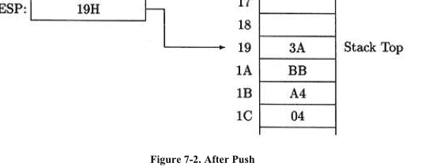

### 图 7-2. 压栈后

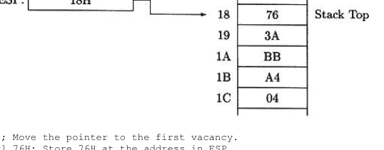

```assembly
DEC ESP ; 将指针移动到第一个空缺位置。
MOV [ESP], 76H ; 将 76H 存储在 ESP 中的地址处。
```

实际上，x86 不允许单字节压栈。所有压栈必须是双字节或四字节压栈。压栈的字节数由 `PUSH` 指令的操作数大小决定。

### 7.1.1 PUSH 命令

`PUSH` 指令最常见的形式是

```assembly
PUSH reg
```

允许的寄存器包括 16 位和 32 位通用寄存器，但不包括 8 位寄存器。也可以对 `PUSH` 使用内存和立即操作数，但寄存器操作数形式最有用。

图 7-3 和图 7-4 显示了 `PUSH EAX` 指令的效果。

### 图 7-3. PUSH EAX 之前

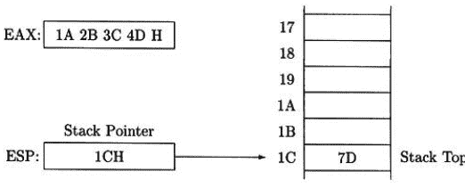

### 图 7-4. PUSH EAX 之后

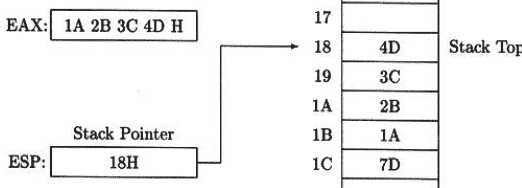

这与以下内容非常相似：

```assembly
SUB ESP, 4
MOV [ESP], EAX
```

因为堆栈指针指向堆栈的最后一个占用位置，而不是第一个未占用位置，所以 *PUSH* 必须先对堆栈指针进行减法，然后将字节传输到堆栈，而不是反过来。如果所有压栈和出栈的大小相同，让堆栈指针指向第一个可用位置将是一个合理的策略。但由于压栈和出栈可以是 2 字节或 4 字节，因此这种策略是行不通的。

### 7.1.2 POP 命令

相反的操作称为 *出栈*（pop）。与 *PUSH* 指令类似，*POP* 接受寄存器和内存操作数，可以是 2 字节或 4 字节。与 *PUSH* 不同，它不接受立即操作数。与压栈一样，操作数的大小决定要弹出的字节数。由于 `BX` 是一个 2 字节寄存器，*POP* `BX` 从堆栈中弹出 2 个字节。

```assembly
POP BX
```

这与以下内容非常相似：

```assembly
MOV BX, [ESP]
ADD ESP, 2
```

堆栈的一种用途是当没有足够的寄存器可用时仅用于存储。假设 `EAX` 和 `EBX` 中的值很重要且需要保存，但还需要执行使用寄存器 `EAX` 和 `EBX` 的计算。这种情况需要使用堆栈。在执行计算之前，可以将寄存器 `EAX` 和 `EBX` 中的值保存在堆栈上。计算完成后，可以再次恢复它们。以下代码实现了这一点：

```assembly
PUSH EAX
PUSH EBX
...
; 计算
...
POP EBX
POP EAX
```

出栈的顺序是压栈顺序的完全反转。这是因为堆栈具有“最后存储最先检索”的特性。结束时的 `EAX` 和 `EBX` 中的值应与开始时相同。但这只有在中间的计算负责任地使用堆栈时才会成立。这意味着每个压栈都应有一个对应的出栈。如果压栈和出栈不平衡，则在计算结束时弹出到 `EBX` 和 `EAX` 的值将与它们的原始值不同。

在编写要在 Unix 中运行的用户程序时，不需要通过向 `ESP` 存储值来初始化堆栈。事实上，由于堆栈已经设置好，向 `ESP` 存储任意值会破坏现有的堆栈并使程序崩溃。然而，在编写要在 Edlinas 中运行的程序时，需要初始化 `ESP`。

## 7.2 子程序

高级编程语言使用子程序将复杂任务分解为更简单的组件。在 C 语言中，子程序是函数。函数可以像另一条 C 指令一样被调用。如果定义了函数 `subpr()`，它可以出现在主程序的一行中，如程序 7.1 所示。

# 程序 7.1

```c
main()
{
    int x, y, z;
    ...
    subpr(); // 此子程序单独定义。
    ...
}
```

### 7.2.1 CALL 和 RET 命令

编写包含子程序的汇编器程序是使用 `CALL` 和 `RET` 指令完成的。`RET` 代表返回。这些命令类似于跳转和跳回命令。`CALL` 指令的格式与 `JMP` 指令的格式非常相似。

# 程序 7.2

```c
subpr()
{
    int a, b, c;
    ...
    return c;
}
```

```assembly
CALL label
```

与 `JMP` 指令一样，标签由程序员创建，并指向其所在的标签字段的那一行。


当子程序完成时，控制需要传回主程序；特别是，主程序中执行的下一条指令需要是 `CALL` 指令之后的指令。为了做到这一点，处理器在离开前会将下一条指令的地址压入堆栈

主程序。`CALL` 指令会执行此操作。`RET` 指令会将此地址从栈中弹出并跳转到该位置。

例如，程序 7.3 是一个接受用户输入的程序，它使用一个子程序将 `EBX` 寄存器的值加 1 以递增数字，然后将结果输出给用户。

## 程序 7.3

```asm
;           MOV ESP, 2000H ; initialize the stack
;           ; Eddinas programs must initialize the stack
;           ; Unix programs must not.
;
;           IN EAX, [0]      ; Get a user input
;           MOV EBX, EAX     ; EBX is where the subroutine works.
;           CALL subpr       ; Leave for the subroutine.
;           MOV EAX, EBX     ; Back now from the subroutine!
;           OUT [1], EAX     ; Output the incremented value
;           RET              ; Go back to Eddinas.
; subpr:
;           INC EBX          ; Subprogram does its job.
;           RET              ; Go back to the main program.
```

对于一个更复杂的例子，考虑以下算法。该算法是一个著名的未解决数学问题——考拉兹猜想（Collatz Problem）的核心。

- 如果 `x` 是偶数，将其除以 2

- 如果 `x` 是奇数，将其乘以 3 并加 1。

- 重复此过程，直到 `x = 1`。

假设我们需要一个程序来执行此算法，并计算直到 `x` 的值变为 1 所需多少步。

由于判断一个数是偶数还是奇数，或者将其除以 2 都需要循环，如果我们要使用加法、减法和条件跳转指令，那么设计一个子程序来执行此操作是合理的。具体来说，假设我们分配给子程序的任务是检查 `EAX` 寄存器，如果 `EAX` 是偶数，则将 `EAX` 的一半存储在 `EBX` 中，否则在 `EBX` 中存储零。我们可以按以下方式编写此子程序：

## 程序 7.4

```asm
HAF: MOV ECX, EAX
     MOV EBX, 0
AGN: INC EBX      ; Count the subtractions
     SUB ECX, 2   ; Repeatedly subtract 2
     JG AGN       ;
     JZ DUN       ; It comes out even
     MOV EBX, 0   ; It's not even.
DUN: RET
```

有了这个子程序，我们现在可以编写一个主程序来执行程序 7.4。

## 7.3 参数传递

栈最重要的功能之一是用于参数传递。例如，假设在 C 程序中调用了字符代码转换函数 `tolower()`。

标准 C 库 `ctype.h` 中的 `tolower()` 函数将字符代码转换为小写。例如，在使用 ASCII 的机器上，如果给定的输入参数是 65（'A' 的 ASCII 代码），它将返回 97（'a' 的 ASCII 代码）。输入参数被推入栈中。因此，相同函数调用的汇编代码如下所示：

## 程序 7.5

```c
#include <ctype.h>

main()
{
    int x, y;

    x = 65; /* x = 'A' */
    y = tolower(x); /* y = 'a' */
}
```

```asm
    MOV EBX,  65
    PUSH EBX
    MOV EDX,  0
    IN EAX, [DX]
ABC:  CMP EAX,  1         ;
      JE FIN              ;If EAX = 1 then it's over.
      INC EDX             ;Use EDX as the counter.
      CALL HAF            ;This is the subroutine call!
      CMP EBX,  0         ;EBX = 0 means EAX is odd
      JE ODD              ;
      MOV EAX, EBX        ;If not then EBX is half of EAX
      JMP ABC
ODD:  MOV EBX,  EAX       ;Triple EAX and add 1
      ADD EAX, EBX
      ADD EAX, EBX        ;
      INC EAX
      JMP ABC             ;
FIN:  MOV EAX,  EDX       ;EDX contains the final count.
      MOV EDX,  1
      OUT [DX], EAX
      RET
```

## 程序 7.6

```asm
    CALL tolower
    ADD ESP, 4
```

虽然使用栈来存储返回值看起来似乎是一个自然的想法，但更常见的是使用寄存器。在 x86 的 GNU C 中，返回的整数值存储在 `EAX` 寄存器中。不同语言在谁负责从栈中弹出参数方面存在差异。在 Fortran、Basic 和 Pascal 中，子程序负责弹出栈，但在 C 中，调用程序负责弹出栈。这就是为什么在刚刚展示的调用程序中出现 `ADD ESP, 4` 指令的原因。

不同语言在将参数推入栈中的顺序上也有所不同。C 语言从右侧开始推送参数。假设我们定义了一个整数幂函数 `ipow()`：

```c
    int ipow(int base, int exponent);
```

调用此函数以计算 $2^3$ 的汇编代码如下所示：

```asm
    MOV EBX,  3
    PUSH EBX
    MOV EBX,  2
    PUSH EBX
    CALL ipow
    ADD ESP, 8
```

在此调用之后，结果 `ipow(2, 3) = 8` 将存储在 `EAX` 寄存器中。

### 7.3.1 全局汇编指令

在 GNU 编译器生成的 `.o` 文件中，诸如 `printf` 或 `tolower` 等需要外部链接的符号在符号表中的编码方式不同。如果没有这种特殊编码，GNU 链接器将跳过它们，导致链接失败。为了获得这种特殊编码，汇编语言源代码必须特别指示哪些符号将接受这种处理。GNU 汇编器和 Edlinas 识别一条汇编指令，该指令会使汇编器在符号表中将符号编码为可供链接使用。其语法为：

```asm
.globl symbol
```

在 NASM 中，语法为：

```asm
global symbol
```

### 7.3.2 从 C 调用汇编

如果从 C 调用 `half` 子程序，它不会正常工作，因为它没有在 `EAX` 寄存器中返回值。此外，它没有推送其使用的寄存器。在下方的代码中，`ECX` 被推送，因为它被使用，且调用程序可能正在将其用于其他用途。我们还需要使用 `global` 指令使函数名可见。

我们刚刚编写了一个汇编函数，可以从 C 程序中调用。C 程序将调用参数存储在栈中。它将被调用程序推送的返回地址和刚刚推送的 `ECX` 的内容所掩埋。这两项在栈上占用 8 个字节，因此调用参数在地址 `ESP` + 8 处访问。结果存储在 `EAX` 中，而不是 `EBX`。要在 Edlinas 中将目标代码保存为 `.o` 文件，请使用 `o` 键。要使用 NASM 生成目标代码文件，请输入：

## 程序 7.7


```asm
        global half ; or    .globl in Edlinas
half:
        PUSH ECX        ; ECX is used, so push it.
        MOV ECX,  [ESP +  8]
                        ; Stack top + 2 integers

        MOV EAX,  0
        INC EAX         ; Count the subtractions
AGN:
        SUB ECX,  2     ; Repeatedly subtract 2
        JG AGN          ;
        JZ DUN          ; It comes out even
        MOV EAX,  0     ; It's not even.
DUN:
        POP ECX
        RET
```

```bash
$ linuxbox$ nasm -f elf half.asm
```

`-f elf` 开关指定了目标代码文件的格式，在当前 Linux 中为 `elf`。第 8 章将进一步讨论此格式。

程序 7.8 是一个调用函数 `half()`（其汇编代码如程序 7.7 所示）的 C 程序。如果将程序 7.8 保存在文件 `collatz.c` 中，则要对其进行编译并与 `half()` 链接，请对这两个文件使用 `gcc`：

```bash
$ linuxbox$ gcc collatz.c half.o
```

## 7.4 递归

在递归中，计算的大部分工作由参数传递机制完成。

递归定义通常可以很容易地转化为计算上有效（即使不是最高效）的程序。这通常用斐波那契数来说明。

$$
fib(k) = \begin{cases}
1 & \text{if } k < 2 \\
fib(k - 1) + fib(k - 2) & \text{otherwise.}
\end{cases}
$$

程序 7.9 展示了如何将这种递归定义转化为 C 代码。在汇编语言中，只要我们记住除 `EAX` 外使用的寄存器必须被推送，就可以轻松地编写此代码。程序 7.10 展示了我们如何仅使用 `ECX` 和 `EAX` 来实现。要从 C 测试此程序，可以使用像程序 7.11 这样的小调用程序。要使用 Edlinas 测试此类程序，也需要像程序 7.3 的第一行所示那样初始化栈。

### 程序 7.8

```c
main()
{
    int count, x, y;
    count = 0;

    printf("Enter a number:  ");
    scanf("%d", &x);

    while(x != 1)
    {
        count = count + 1;
        y = half(x); /* This is the subroutine call! */
        if(y != 0)
            x = y;
        else
            x = 3*x + 1;
        printf("\n x = %d.", x);
    }
    printf("\n There were %d iterations.\n\n.",count);
}
```

### 程序 7.9

```c
int fib(int k)
{
    int d;

    if(k < 2)
        d = 1;
    else
        d = fib(k-1) + fib(k-2);

    return d;
}
```

### 程序 7.10

```asm
    global fib
fib:    PUSH ECX          ; Gives us access to ECX
        MOV EAX, [ESP + 8]
                        ; Access parameter
        CMP EAX, 2          ; if k < 2
        JAE ELS           ;
        MOV EAX, 1        ; Put the return value in EAX
        JMP DUN
ELS:    DEC EAX           ; Get k-1
        MOV ECX, EAX      ; EAX will be overwritten!
```

`PUSH EAX` ; 将 `k-1` 作为参数传入

`CALL fib` ; 在 `EAX` 中获取 `fib(k-1)`

`ADD ESP, 4` ; 移除参数

`DEC ECX` ; 得到 `k-2`

`PUSH ECX` ; 将 `k-2` 作为参数传入

`MOV ECX, EAX` ; 将 `fib(k-1)` 放入 `ECX`

`CALL fib` ; 在 `EAX` 中获取 `fib(k-2)`

`ADD ESP, 4` ; 移除参数

`ADD EAX, ECX` ; 将两个部分结果相加

`POP ECX` ; 恢复原始值

`RET`

### 程序 7.11

```c
main()
{
  int x, y;
  ;
  printf("Enter a number:  ");
  scanf("%d", &x);
  ;
  y = fib(x);
  ;
  printf("%d\n", y);
}
```

# 第 8 章。LINUX 用户程序

在第 6 章开头曾指出，Linux 用户程序中使用的内存地址并非真实的物理内存地址。主要原因在于 Linux 需要防止用户直接访问内存。参见图 8-1。

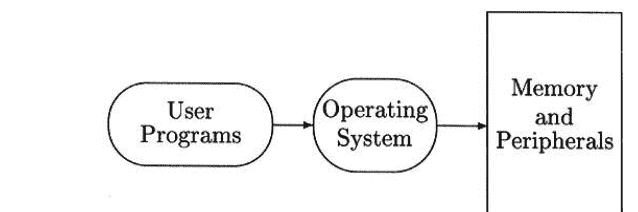

Linux 是一个多任务系统。多任务系统包含许多用户作业和一个操作系统，它们都在同时运行。在任何一个作业都可能覆盖其他作业所属内存的机器上，多任务系统是不可能实现的。多任务需要内存保护机制。Linux 使用分页 `Paging` 来实现内存保护系统。

分页最初被设计为一种节约内存的系统。Linux 也将其用于此目的以及内存保护。分页通过拦截用户机器代码中遇到的每次内存访问来工作。换句话说，用户程序中的每个内存引用都会转化为内存访问请求，这些请求必须经过分页系统的“办公桌”批准。这意味着分页系统获得了对内存访问的控制权。为了实现这一点，处理器内部必须集成了分页功能。

`8086` 和 `80286` 处理器都不支持分页。第一个支持分页的 Intel 处理器是 `80386`。

## 8.1 多任务

在多任务操作系统出现之前，计算机程序是按顺序执行的，即一个接一个地运行。在前面的程序完成之前，后面的程序无法开始执行。像这样串行运行程序的操作系统被称为*批处理*操作系统。多任务系统允许程序轮流使用处理器。一个称为*调度器*的操作系统程序充当裁判，强制用户程序即使未完成也要相互让出资源。在任何给定时刻，可能有许多用户程序正在轮流等待处理器时间。这些程序中的每一个都被称为*任务*或*进程*。必须区分程序和进程，因为一个程序可能被多个用户同时调用多次。程序的每个独立实例就是一个进程。在 Linux 中，我们可以使用 `linuxbox$ ps aux` 命令来列出进程。或者，为了进行更详细的检查，我们可以浏览 `/proc` 目录。

像 Linux 这样的多任务系统不断调节其处理器资源，将资源从一个进程传递给另一个进程。每次进程从处理器上被抢占时，它必须保存其当前状态。保存工作的一部分是由硬件例程完成的，当 x86 执行*任务切换*时，该例程会被执行。它将所有当前寄存器保存到内存中一个称为*任务状态段*的区域。任务状态段保存了当前未运行的任务的冻结状态。每个任务都有自己独立的任务状态段。这些任务状态段使得从一个任务切换到另一个任务成为可能。图 8-2 展示了任务状态段的基本布局，包括所有通用寄存器的空间，以及一个称为 `CR3 寄存器`的寄存器。图中一些未标记的空间将在第 13 章中讨论。

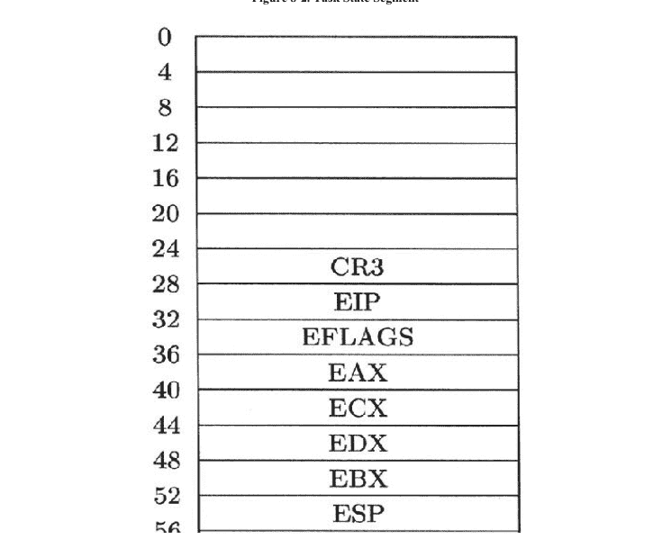

## 8.2 分页

如第 4 章 4.2 节所述，x86 I/O 地址不经过处理。如果 `DX` 寄存器包含诸如 `FC30H` 这样的数值，那么执行 `IN AL, [DX]` 指令会直接将 `DX` 的 16 位内容应用到地址总线上。

`FC30H = 1111 1100 0011 0000`

因此在地址总线上我们得到：

高 16 位仅为 0。

另一方面，内存地址的处理方式并非如此直接。执行 `MOV AL, [0FC30H]` 不会导致相同的位被泵送到地址总线上。内存地址要经过一个两步过程。

1. 分段
2. 分页

只有在这个过程结束时，并且一切都正常的前提下，才会生成一个可以泵送到地址总线上的物理地址。由于 Linux 不使用分段，对其的讨论推迟到第 12 章。

### 8.2.1 虚拟内存


所有地址都位于 0 到 4 Gig（吉字节）的范围内。虽然让不同的任务使用 4 Gig 空间的不同部分听起来合理，但 Linux 并非如此运作。Linux 可能在同一时间将相同的地址分配给不同的任务。这些地址并不是真实的。它们被称为虚拟地址。就像一个虚假的会计师保留两套账簿——一套给审计员，一套记录真实情况一样，Linux 必须为`每个`任务维护一套虚拟地址，外加一套指向磁盘和 RAM 中实际物理位置的真实地址。


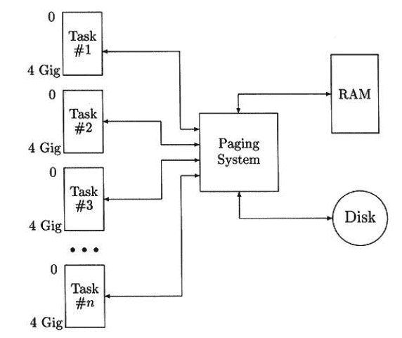

虚拟地址和真实地址之间的转换是通过大量称为`页表`的表格集合完成的。每个进程都有自己的一组表格。

图 8-5 展示了由此产生的情况。读者会注意到内存已经被严重超额预订。通常有许多进程在运行。每个进程可能使用多达 4 Gig 的虚拟地址空间。但典型的计算机拥有的 RAM 远少于将所有进程提供 4 Gig 内存所需！乍一看，分页似乎是一个很不好的主意。但事实上，它在内存使用上极大地节省了资源，这也是计算机能够以如此快的速度运行大型程序的原因之一。航空公司通过超额订票来保持飞机满载。偶尔给被拒载的乘客提供免费机票的成本，完全被座位满载带来的收益所抵消。同样，偶尔发生的`页错误`所带来的代价，也被保持内存繁忙使用所带来的好处所弥补。

### 图 8-5. Linux 虚拟内存系统

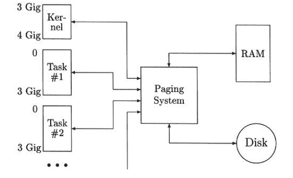

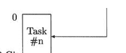

分页通过暂时将空闲的内存部分复制到磁盘来工作。顾名思义，它以称为`页`的单位进行操作。

### 4K 页

在 x86 机器上，一页是 4,096 字节。为了建立分页系统，需要将四个区域划分为页：

1. 可用的物理内存被划分为页。由于 $4,096 = 2^{12} = 4K = 1000H$，每一页都以三个十六进制零结尾的地址开始。物理内存中的页有时被称为`页框`。
2. 每个任务 4 Gig 的虚拟地址空间也被划分为页。4 Gig 相当于 1 Meg（兆）的页数。

   $$4 \mathrm{Gig} \div 4 \mathrm{K} = \left(4 \times 2^{30}\right) \div \left(4 \times 2^{10}\right) = 2^{32} \div 2^{12} = 2^{20} = 1 \mathrm{Meg}.$$
   同样，每一页都以三个十六进制零结尾的地址开始。
3. 用于分页的硬盘部分也被划分为页。这部分通常被称为`交换空间`。由于大多数磁盘都格式化为 512 字节的扇区，这意味着分配给交换空间的扇区数量必须是八的倍数。$4,096 = 8 \times 512$。
4. 用于转换虚拟地址的页表本身也是以页为单位设置的。这些表在第 8.3.1 节中描述。

请注意，虚拟内存、物理内存和磁盘中的页大小都相同。这有助于以页大小为单位进行数据传输。

### 8.2.2 分页 vs. 交换

术语`交换空间`是不幸的，因为“交换”传统上指的是将整个进程复制到磁盘并取回。当多任务系统对内存的需求超过可用 RAM 时，解决此问题的一个非常简单的方法就是直接将某些进程复制到磁盘。这就是交换所做的。交换并不能提高内存效率。它只是防止内存过载。操作系统可以独立完成交换。它不需要任何特殊的硬件支持。在分页发明之前，交换在 Unix 系统中很常见。Linux 不使用交换，过去也没有使用过。

虽然交换解决了内存不可用的问题，但在使内存使用高效方面表现不佳。将完整的进程复制进内存和移出内存往往会像将文件复制到磁盘上那样使内存碎片化。此外，通过将进程作为整体创建，它忽略了仅将每个进程最重要的部分保留在内存中就可能使所有进程无需大量持续的磁盘访问即可运行的可能性。即使无法做到这一点，也可能大大减少处理器时间中浪费在内存故障处理上的比例。

### 页错误

使用分页时，所有进程的运行方式好像它们同时都在内存中。当遇到一条引用实际上位于磁盘上的内存位置的机器指令时，这就称为`页错误`。

当发生缺页中断时，必须从 RAM 中选择一个页框，以便将所需的页面从磁盘加载到其中。如果没有空闲页框，则必须选择某个内存页面将其传输到磁盘，从而释放出一个页框。该内存页会被复制到磁盘，而包含缺失地址的页面则被复制到 RAM 中。有许多不同的算法用于选择要从内存中驱逐的页面。这类算法被称为`分页算法`。许多分页算法根据使用情况来选择要驱逐的页面。未使用的页面会被驱逐。

### 8.2.3 内核地址

虽然 Linux 可能会（并且经常）将相同的虚拟地址分配给不同的任务，但它为内核内存使用一组特殊的虚拟地址，这些地址永远不会重复。

- 内核地址位于 C0000000H 到 FFFFFFFH 之间，即 3 到 4 Gig。
- 用户地址位于 0 到 BFFFFFFH 之间，即 0 到 3 Gig。

`图 8-4` 从单个进程的视角展示了这种内存策略。图 8-5 则从整个系统的视角展示了这一点。用户虚拟地址是单独分配的。内核地址则是系统范围的。

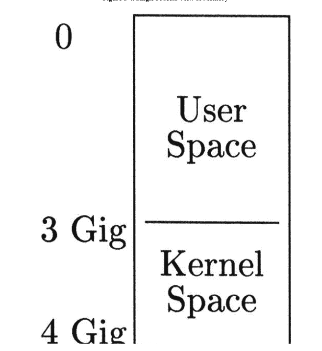

在 Linux 版本 2.1.39 之前，内核与用户内存的分离是通过分段机制实现的。目前的 Linux 不再使用分段。现在，这种分离仅仅是通过一种分配策略来实现的。顺便提一下，这使得 x86 Linux 更加类似于 Alpha Linux。Alpha 架构没有分段。分段在第 12 章和第 13 章中讨论。

### 8.2.4 内核页

Linux 的分页算法从不将内核内存分页到磁盘。因此，Linux 内核始终驻留在 RAM 中。

这就是为什么专门为每台机器编译 Linux 是值得的。如果内核编译了不需要的代码，例如机器没有的设备驱动程序，RAM 将永久被这些从未使用的代码占用。

这也是为什么机器需要大约 4 Meg 的 RAM（取决于 Linux 版本）才能运行 Linux 的原因。

### 8.2.5 内核模块

尽管内核内存从不被分页系统触及，但自 Linux 版本 2.0 起，只要这些内存块作为模块单独编译，就可以添加或删除内核内存块。命令

```
linuxbox$ insmod module
```

用于“安装模块”，而

```
linuxbox$ rmmod module
```

用于“移除模块”，它们会改变内核占用的 RAM 数量。为了检查内存以了解可用内存的量，Linux 命令

```
linuxbox$ free
```

很有用。

### 8.3 地址转换

Linux 用户内存地址是虚拟地址，而不是实际的物理地址。Linux 使用分页将虚拟地址转换为 RAM 地址。x86 分页从由操作系统设置的页表中获取转换信息。由于转换过程是硬连在处理器中的，x86 页表必须具有图 8-6 所示的两级结构。


#### 8.3.1 两级 x86 页表

该结构中的每个表都有 1024 个四字节条目。因此，每个表的大小为 4K。请注意，每个表也是一个页。

页表目录（page table table）列出了 1024 个页表的位置。每个页表列出了 1024 个页的位置。每个页包含 4096 字节。因此，页表目录引用的总内存为 $1024 \times 1024 \times 4096 = 2^{10} \times 2^{10} \times 2^{12} = 2^{32} = 4$ Gigabytes。这是一个虚拟地址空间的大小。

#### 8.3.2 地址解析

所有虚拟地址都是 32 位数量。这 32 位按如下方式分解：

**32 位 = 10 位 + 10 位 + 12 位。**

这些位的分配如`图 8-7` 所示。两个十位数是拥有 $1024 = 2^{10}$ 个条目的表的索引。十位数是一个从 0 到 1023 的数字。12 位数是页内的索引。一页有 $2^{12}$ 字节。12 位数是一个从 0 到 4095 的数字。它从页中选取一个字节。


#### 8.3.3 转换示例

假设我们有一个虚拟地址为 **1A2B3C4DH**。这个 32 位地址被分解为三个部分：


转换从页表目录开始。前 10 位从该表中选出一个条目。在我们的例子中，这些位是：`0001 1010 00 = 0110 1000 = 68H = 104`。索引从 0 开始。获取的第一个项目是页表目录中的第 105 个四字节条目。如果一切顺利，该条目包含一个地址。在第 8.3.4 节中展示了如何提取此地址。该地址是一个页表的地址。接下来的 10 位，`10 1011 0011`，等于 `2B3H`，或 `691`，这是页表中的一个条目编号。同样，如果一切顺利，我们可以从该条目中提取一个地址。该地址是包含所需信息的页在 RAM 中的地址。假设这个地址恰好是 `1234000H`。虚拟地址的最后 12 位，`1100 0100 1101 = 0C4DH`，是页内的偏移量。转换后的地址则是 `1234C4DH`。

### 8.3.4 页表条目

假设处理器在处理如下的读命令时首次遇到一个内存地址

正如 8.3.3 节刚刚解释的，会为这个地址获取一个表条目。该条目大小为 4 字节。其最低有效位被称为存在位（present bit）。在此处所示的图中，它被标记为“P P”（页存在）。

当存在位被设置时，意味着所寻找的页位于 RAM 中。在这种情况下，调用程序很幸运，刚读取的页表条目提供了包含所需字节的页的物理地址。由于物理内存中的所有页框都存储在其低 12 位为零的地址中，因此可以使用其高 20 位来表示该地址。这正是页表条目的高 20 位所提供的。一旦确定了页的地址，内存读取就按照 8.3.3 节中所示完成。

### 8.3.5 内存保护

当存在位未被设置时，有两种可能性：

- 1. 这可能意味着包含所寻找字节的页位于磁盘上。在这种情况下，会导致缺页中断（Page Fault）。

- 2. 这也可能意味着该地址根本无效！在这种情况下，会导致分段错误（Segmentation Fault）。

第一种可能性并不奇怪。分页的思想是将一些内存页放到磁盘上。当程序试图访问它们时，这当然是一个问题。像这样的问题在第 9 章第 9.4 节中处理。

第二种可能性对于作为内存节约功能的概念来说有些陌生。但它恰恰揭示了我们说 Linux 使用分页来“保护”内存时的含义。因为页表由操作系统控制，这给了操作系统拦截每一个内存请求的机会。Linux 就是这样控制潜在压倒性的内存需求的。只有分配给进程的页上的地址才会在页表中设置存在位。任何对未分配页的引用都会导致可怕的“Segmentation Fault”（分段错误）错误消息。

### 8.3.6 CR3 寄存器

转换从页表目录开始。每个任务都有自己的页表目录。页表目录的物理地址存储在一个名为 `CR3` 的寄存器中。`CR` 代表控制寄存器。控制寄存器是从 386 开始添加到 x86 处理器中的。关于这些寄存器的更多讨论，请参见第 13 章第 13.1 节。

每次 x86 处理器从一个任务切换到另一个任务时，`CR3` 都会自动重新加载。这使得每个任务都可以拥有自己的一组虚拟地址。地址空间最后一个四分之一部分中的内核内存（参见第 8.2.3 节）之所以存在，是因为 Linux 把它放在那里。这个地址空间是共享的，因为转换这些地址的页表是共享的。系统中每个页表目录的最后四分之一都是相同的。

### 8.3.7 内核内存访问

内核地址存储在所有页表中这一事实可能让我们认为，系统中的所有进程都可以使用内核内存。在某种程度上，这是真的。在第 9 章第 9.7 节中，我们将看到用户代码如何调用系统调用来获取对内核内存的访问。然而，单独的用户代码并不具有这种访问权限。它被内核内存表条目的 `U_S`（用户-监管者）位所阻挡。（参见图 8-8。）


### 8.3.7 访问位

| 31 | 12 | 11 | 2 | 1 | 0 |
|---|---|---|---|---|---|

| 页面地址 | | U | W | P |
| | | S | R | |

如果此位为 1，则不会阻止访问。如果为 0，则通过与存储在名为 `CPL` 寄存器的特殊寄存器中的两位特权值进行比较进行检查。该寄存器及其存储的特权级别在第 9 章第 9.6 节中进行了讨论。如果 `CPL` 寄存器中的值为 3，则访问将被阻止。当用户程序运行时，`CPL` 寄存器保存 3。这是内核内存针对用户程序访问的基本保护。

### 8.3.8 分页页表

页表中的条目看起来就像页表中的条目一样。每个条目中的存在位具有相同的含义。如果被清除，意味着所寻找的项不存在。正如某个进程的内存页可以被分页到磁盘一样，页表也可以被分页。正如页中的 4K 地址空间可以标记为未分配一样，页表下的 4 Meg 地址空间也可以标记为未分配。

缺失的页表会导致页面错误或段错误，就像缺失的用户内存页一样。

## 8.4 程序段

考虑程序 8.1。当此程序运行时，标记为 `ABC` 的行的自我擦除。这个程序是自修改代码的一个例子。在旧时代的某个时候，自修改代码有时被用来节省几字节的内存空间。如今，自修改代码不被认为是良好的编程。当汤姆·尚利（Tom Shanley）写道，创建自修改代码的程序员应该“被投入坑中”时，他更直言不讳。通常，正在运行的程序被修改的唯一原因是某事出错了。正在运行的程序不应该被修改。

**程序 8.1**

```
; Program which self-destructs.
;
IN AL, [0]
ABC:  MOV [ABC], AL
RET
```

### 8.4.1 不可写内存

Unix 要求正在运行的程序通过存储在“不可写”内存中，从而受到意外修改的保护。Linux 使用页表条目中的位 1 来实现这一要求。这是图中标记为“W_R”（写读）的位。如果此位被清除，则索引的页面不可写。当处理器遇到诸如

```
MOV [87654321H], AL
```

这样的写命令时，将检查此位。首先获取地址 `87654321H` 的页表条目。假设此页条目的存在位已设置，则由于此指令是写命令，将检查位 1，即写或读位。如果此位未设置，处理器将不执行该指令，Linux 将发出“段错误”错误消息。故障在第 9 章第 9.4 节中进行了更详细的描述。

Unix 通过将代码标记为不可写来保护代码。

### 8.4.2 可写内存

用于计算的数据空间需要位于可写内存中。考虑程序 8.2。标签 `xyz` 仅标记存储的数据。代码是完全合理的。但由于整个程序存储在不可写内存中，当处理器尝试执行 `MOV [XYZ], AL` 指令时，会发生段错误。这是一个问题。

- 一方面，Linux 通过将代码存储在不可写的页面上来保护 **程序 8.2** 中的代码。

- 另一方面，**程序 8.2** 中的标签 `xyz` 标记了可写空间。因此，它不能与程序的 executable 行存储在同一个页面上。

由于代码的写保护是使用页表条目实现的，因此 **程序 8.2** 至少需要两个不同的页面，一个具有写保护，另一个没有。可写保护代码和可写数据空间不能共享同一个页面。

**程序 8.2**

```
; Tiny NASM program which crashes trying to increment a byte of stored data.
;
global main
main:	MOV AL, [XYZ]
	INC AL
	MOV [XYZ], AL
	RET
XYZ:	db 3
```

### 8.4.3 文本段和数据段

程序必须被拆分。可执行文件的各个部分称为*段*。

机器码可以在加载时进行拆分，但这会对加载程序提出不合理的要求。为了使段不需要在加载时创建，可执行文件被分为段。最终，我们将描述五种不同类型的段。到目前为止，我们论证了两种段：

- 文本段。可执行代码需要一个段，该段存储在写读位被清除的页中。它被称为文本段。

- 数据段。某些程序需要可执行文件中可以写入数据的空间。它存储在写读位被设置的页中。它被称为*数据*段。

### 8.4.4 文本节和数据节

就像可执行文件有段一样，目标代码文件有*节*。链接器的工作之一是从所有正在链接的目标代码文件的文本节中组装一个文本段，从所有数据节中组装一个数据段，等等。链接器有很多工作要做。

谁创建目标代码文件中的节？目标代码文件由汇编器创建。

### 8.4.5 节定义指令

汇编器不会自行将代码分离为文本节和数据节。至少，大多数汇编器没有那么聪明。程序员需要使用指定哪些代码进入哪些节的指令来提供帮助。以下 NASM 指令可用于启动节。

```
    section .text
```

指定文本节。类似地，

```
    section .data
```

启动数据节。

使用这些指令，我们可以指导 NASM 生成包含文本节和数据节的 .o 文件。将这些指令添加到程序 8.2 中，得到程序 8.3，该程序可以编译并运行而不会崩溃。

**程序 8.3**


```
; Tiny program which increments a byte of stored data.
;
global main
section .text
main:	MOV AL, [XYZ]				; get a data byte
			INC AL			; increment
			MOV [XYZ], AL		; write it back
			RET				; return
section .data
XYZ:	db 3
```

### 8.4.6 C 代码中的段

程序 8.4 可用于确定分配给自身的页面的地址。

**程序 8.4**

```
char a = 'A';
main()
{
	char *n;
	int i, t;

	n = &a;
	printf("Enter a pointer displacement in hex:");
	scanf("%x", &i);
	printf("Pointer value in hex = %x\n", (n + i));
	printf("Read, write, or skip?  (Enter 0, 1, or 2):");
	scanf("%d", &t);
	if (t == 0)
		printf ("Contents there= %x", *(n + i));
	else if (t == 1)
		*(n + i) = 'Y';
	printf("\n");
}
```

### 8.4.7 从汇编调用 C

调用函数涉及使用堆栈。当使用汇编器调用函数时，可以精确看到堆栈在函数调用中是如何使用的。一旦你知道了如何使用堆栈调用函数，你就可以调用 C 库函数，为在 Linux 下运行的汇编器程序提供实际的输入和输出。

为了使用汇编器调用 `printf()` 和 `scanf()`，需要将字符串推送到堆栈上。这是因为这些函数的第一个参数始终是一个字符串。在第 6 章第 6.5.1 节中介绍的 `db` 汇编器指令可用于存储字符串以及数字。例如，

```
.db "Hello world!\n\x0"
```

可用于存储字符串。如果位置有标签，则可以使用该标签来推送存储字符串的地址。在 Edlinas 中，允许的字符串与 C 语言中允许的字符串完全相同，但如果需要，必须显式编码空终止符。C 语言十六进制转义序列 `\x` 可用于将空字符或其他字符包含到字符串中。

在 NASM 中，非 ASCII 字符使用逗号在字符串外部编码。

```
db "Hello world!", 0AH,0
```

为了从汇编器调用 `scanf()`，需要在数据段中有一个标签。`scanf()` 函数获取用户输入并将其写入内存。此内存不能在文本段中。它必须在数据段中。由于 `printf` 和 `scanf` 作为对未知位置的引用，NASM 要求使用 `extern` 指令。如果引用了未在程序中某行的标签字段中出现的标签，NASM 将产生错误消息。程序 8.5 展示了如何从 NASM 程序调用 `printf()` 和 `scanf()`。关于寄存器使用，有必要提出一点警告。虽然我们可能期望 C 库函数，如 `printf()` 和 `scanf()` 在使用寄存器之前将寄存器保存到堆栈上，但它们并不一定这样做。在调用 `printf()` 之前存储在寄存器中的值在调用之后不一定还在。为了通过库函数调用保存值以免被破坏，程序员必须承担将值保存到堆栈上的责任。标记为 `ABC`、`BCD` 和 `CDE` 的行存储字符串。`XYZ` 位于数据段中。因此，`MOV EAX, [XYZ]` 指令可以执行而不会导致内存违规。

**程序 8.5**

```
;
section .text
    global main
    extern printf
    extern scanf
main:  PUSH ABC
       CALL printf
       ADD ESP, 4
       PUSH XYZ
       PUSH BCD
       CALL scanf
       ADD ESP, 8
       MOV EAX, [XYZ]
       ADD EAX, EAX
       INC EAX
       PUSH EAX
       PUSH CDE
       CALL printf
       ADD ESP, 8
       RET
ABC:    db "Enter a number:  ", 0AH,0
BCD:    db "%d \x0", 0AH,0
CDE:    db "You get %d.\x0", 0AH,0
section .data
XYZ:    db 4 * 0
```

## 8.5 其他数据段

Linux 用户内存是程序内部的数据空间。程序内部有三种数据空间。

1. 已初始化的数据空间。这是可执行文件内部的空间，即使文件空闲地躺在磁盘上也是如此。
2. 未初始化的数据空间。这是程序加载时添加到程序中的空间。
3. 动态分配的内存。这是程序执行时添加到程序中的空间。

### 8.5.1 已初始化的数据空间

在第 6 章第 6.5.3 节中，讨论了 `db` 指令在数据初始化方面的使用。这些数据需要永久存储的事实要求其成为可执行文件的一部分。

如果程序写入该数据所占用的空间，则它必须位于数据段中。`section .data` 指令是完成此项任务的正确工具。

有时存储的数据永远不会被覆盖。例如，像 "Hello world!" 这样的控制字符串基本上永远不会被写入。这类数据同样可以存储在写保护页面中。在 `gnu` 汇编器中，有一个用于此类段落的特殊段落标签，即 `.rodata`。

### 8.5.2 未初始化数据空间

运行程序所需的但初始不包含数据的空间，可以在程序加载时添加。由

`int x[100000];`

声明的数组可能占用 400,000 字节的空间。将这样一个数组放入可执行文件中将是磁盘空间的浪费。为了在加载时预留空间，使用 `.bss` 段标签。

### 8.5.3 动态分配的内存

程序在运行时使用系统调用 `malloc()` 获取内存。系统调用在*第 9 章，9.5 节*中讨论。

## 8.6 I/O 保护

在*8.3 节*中，我们讨论了使用分页来保护内存免受未经用户监管的访问。我们还注意到 I/O 寻址未经处理。它不使用分页、分段或对方括号内地址的其他任何篡改。但 `x86` 架构支持 I/O 保护，而 Linux 确实使用了它。

## 8.7 ELF 格式的可执行文件

在*第 6 章，6.4 节*中，我们注意到由于程序包含直到加载时才能确定的绝对地址，因此可执行文件包含重定位表，这些表列出了文件中的这些位置。这些表需要具有某种指定的格式。

在*8.4 节*中，我们注意到由于程序的段保存在单独的页面上，具体取决于这些段是否可写，这些段在文件内的位置必须为操作系统所知晓。如果 Linux 没有这些信息，它将无法确定文件的哪些部分应存储在可写内存页中，哪些部分应存储在只读页中。

出于所有这些原因，可执行文件必须具有某种确定的格式。自 2.0 版本以来，Linux 使用的格式称为 ELF（可执行与链接格式，Executable and Linking Format）。

另外两种 Unix 可执行文件格式是 COFF（通用目标文件格式，Common Object File Format）和 a.out。虽然所有 Unix 系统都使用 a.out 作为 C 编译器生成的可执行文件的名称，但它也是可执行文件和目标码文件的一种特定格式的名称。曾经所有版本的 Unix 都使用 a.out 格式。现在大多数版本使用 ELF。《Understanding and Using COFF》一书对 COFF 和 a.out 都进行了详尽的描述。

*图 8−9* 展示了 ELF 格式可执行文件的布局。


| ELF 头 |

| --- |

| 段 1 |

| 段 2 |

| 段 3 |

| 段 4 |

| 程序头表 |

| 节头表 |

| 节 1 |

| • • • |

| 节 n |

### 8.7.1 ELF 头

ELF 头将文件标识为 ELF 文件，并指定它是哪种类型的 ELF 文件。它还指定了程序头表和节头表的大小和位置。

- 第一个条目是一个包含 ELF 的标识符字符串。
- 第二个条目是一个数字：如果文件是目标文件则为 1，如果是可执行文件则为 2，如果是共享对象文件则为 3，如果是核心文件则为 4。共享对象文件在第 11 章中讨论。核心文件是在程序崩溃时生成的。它们用于调试目的。
- 第三个条目编号指定机器架构。数字 3 代表 `x86` 架构。
- ELF 头文件中还有 11 个条目，包括程序头表和节头表的大小和位置的条目。

### 8.7.2 程序头表

程序头表为每个段都有一个条目。程序头表中的每个条目包含八项信息：

1. 类型。如果段在文件执行时需要加载，则类型为 1。其他类型不会加载到内存中。
2. 文件偏移量。此偏移量给出段在文件中的位置。与所有偏移量一样，它是距起始位置的字节数。
3. 虚拟地址。这是段的首字节要加载到的地址。


4. 物理地址。对于 x86 Linux 系统，此条目名称不当。它会被忽略。

5. 文件大小。这是段在加载前的字节数。

6. 内存大小。这是段在加载后的字节数。

7. 权限。此代码包含读-写-执行权限。

8. 对齐方式。段必须从此条目的倍数处开始。

作为一个例子，`chmod` 的程序头表列在表 8.1 中。像大多数 Unix 命令一样，`chmod` 命令实际上是一个可执行文件。在大多数系统中，它位于 `/bin`。表 8.1 是通过对该文件运行 `ob` 程序生成的。

## 8.7.3 ELF 段

在 Linux 2.0 中，可执行文件通常具有五个段。段 0 始终是程序头表。请注意，在表 8.1 中，段 0 的类型字段的值为 6，代表程序头。

段具有与之关联的读-写-执行权限，就像 Unix 中的文件一样。程序头表中每个条目的第七项是该条目的权限代码。当写成二进制数时，它很容易理解。例如，权限代码 6 意味着有读和写权限但没有执行权限。

### 表 8.1. `chmod` 的程序头表

`[0034:00d4 程序头表`

| Num | 段类型 | 文件偏移量 | 虚拟地址 | 物理地址 | 文件大小 | 内存大小 | 权限 | 对齐 |
| :--- | :--- | :--- | :--- | :--- | :--- | :--- | :--- | :--- |
| 00: | 0006 | 0034 | 8048034 | 8048034 | 00a0 | 00a0 | 0005 | 0004 |
| 01: | 0003 | 00d4 | 80480d4 | 80480d4 | 0013 | 0013 | 0004 | 0001 |
| 02: | 0001 | 0000 | 8048000 | 8048000 | 1d29 | 1d29 | 0005 | 1000 |
| 03: | 0001 | 1d30 | 804ad30 | 804ad30 | 011c | 011c | 0006 | 1000 |
| 04: | 0002 | 1dc4 | 804adc4 | 804adc4 | 0088 | 0088 | 0006 | 0004 |

类型 1 = 可加载，2 = 动态信息，3 = 解释器，4 = 注记，6 = 程序头

| r | w | x |
| :---: | :---: | :---: |
| 1 | 1 | 0 |

注意，其中两个段是可加载的。这些是代码段和数据段。

尽管链接器将节合并到段中，但有一些节不属于任何段。节头表列出并描述这些节。可执行文件的这些部分也出现在目标文件中，并在 8.8 节中讨论。

考虑以下 C 程序。程序 8.6 打印指针。指针只是地址。由于 C 是一种相对低级的语言，我们期望这些指针与机器代码中出现的指针相同。

## 8.8 ELF 格式的目标文件

大多数程序并非从头开始完全编写。它们依赖于已经编写并反复使用的程序，例如 `printf()`。需要其他代码才能运行的文件被称为目标码文件。链接器的工作是将来自不同文件的目标代码组合成一个可执行文件。例如，`printf()` 的代码位于 `/lib/libc.so`。通常，程序员使用 `gcc` 或汇编器创建一个或两个这样的目标码文件，其余部分由链接器从存储在系统上的标准库中检索。由于链接器是由 `gcc` 调用的，因此这个过程从命令行上并不明显。

重要的是要意识到，创建目标码文件是汇编器的主要目的。在第 8 章中，我们将讨论用于塑造目标文件的汇编器命令。但首先，需要描述目标码文件本身。就像可执行文件的格式由 ELF 规定一样，目标码文件的格式也是如此。图 8-10 展示了 ELF 目标码文件的结构。目标文件中的 ELF 头与可执行文件中的 ELF 头相同

### 图 8-10. ELF 目标文件格式


## 程序 8.6

```c
int a = 0x55555555, b = 0x66666666;
int c = 0x77777777, d = 0x88888888;

main()
{

/* Store numbers which will be very easy to pick out
from the machine code of the compiled program. */

  a = 0x11111111;
  b = 0x22222222;
  c = 0x33333333;
  d = 0x44444444;

  printf("Variables: Addresses:\n")
  printf(" a %#x\n", &a);
  printf(" b %#x\n", &b);
  printf(" c %#x\n", &c);
  printf(" d %#x\n", &d);

  /* %x means to use "hexadecimal" output.  */

    printf("\n");
}
```

可执行文件。

### 表 8.2. 程序 8.6 的节头表

01bc:0374 节头表

| 名称 | 类型 | 标志 | 虚拟地址 | 偏移量 | 大小 | 链接 | 信息 | 对齐 | 修改 | 入口大小 |
|---|---|---|---|---|---|---|---|---|---|---|
| 00: | 0000 | 0000 | 0000 | 00000000 | 00000 | 00000 | 0000 | 0000 | 0000 | 0000 |
| 01: | 001b | 0001 | 0000 | 00000000 | 0034 | 00091 | 0000 | 0000 | 0004 | 0000 |
| 02: | 0021 | 0009 | 0000 | 00000000 | 0490 | 000a0 | 0009 | 0001 | 0004 | 0008 |
| 03: | 002b | 0001 | 0003 | 00000000 | 00c8 | 00010 | 0000 | 0000 | 0004 | 0000 |
| 04: | 0031 | 0008 | 0003 | 00000000 | 00d8 | 0000 | 0000 | 0000 | 0004 | 0000 |
| 05: | 0036 | 0007 | 0000 | 00000000 | 00d8 | 0014 | 0000 | 0000 | 0001 | 0000 |
| 06: | 003c | 0001 | 0002 | 00000000 | 00ec | 0070 | 0000 | 0000 | 0001 | 0000 |
| 07: | 0044 | 0001 | 0000 | 00000000 | 015c | 0012 | 0000 | 0000 | 0001 | 0000 |
| 08: | 0011 | 0003 | 0000 | 00000000 | 016e | 004d | 0000 | 0000 | 0001 | 0000 |
| 09: | 0001 | 0002 | 0000 | 00000000 | 0374 | 0010 | 000a | 0009 | 0004 | 0010 |
| 0a: | 0009 | 0003 | 0000 | 00000000 | 0464 | 002b | 0000 | 0000 | 0001 | 0000 |

- 名称：节头字符串表（.shstrtab）的索引

- 类型：1 = 程序位，2 = 符号表，3 = 字符串表，4 = 重定位表，5 = 哈希表，6 = 动态信息，7 = 注意，8 = 无位，9 = 重定位表

### 8.8.1 节头表

节头表列出了目标文件中的所有节。表 8.2 所示的表是通过在程序 8.6 的 `.o` 文件上运行 `objdump` 生成的。标志项包含属性位，这些位有些类似于可执行文件程序头表中的权限位。如果节是可执行的，第 2 位为 1。在表 8.2 中，唯一设置第 2 位的节是节 1，它实际上是文本节。对于可写节，第 0 位为 1。只有节 3 和节 4 是可写的。结果发现节 3 是数据节。

### 8.8.2 节

当链接器创建文本段时，它会组合目标代码文件中的文本节。当它创建数据段时，它会组合数据节。链接过程涉及整理。

当 gnu 链接器链接 `.o` 文件时，它需要指定一个开始执行的地址。程序员可以使用标签 `main` 并确保通过使用汇编器的全局指令使其对链接器可见，来指定此地址。

## 延伸阅读

- Understanding ELF Object Files and Debugging Tools, MaryLou Nohr, Prentice Hall: 1994.

## 第 9 章. 中断


取指-执行周期是一种程序驱动的计算模型。但计算机并非完全由程序驱动。在某种程度上，它们是由硬件驱动的。CPU 配备了输入信号引脚，允许中断取指-执行周期。这些引脚的原始目的是通过减少与 I/O 设备通信所花费的时间来提高处理器效率。

在第 8 章中，我们看到一种提高内存效率的设备被采用为控制内存访问的设备。中断经历了类似的转变。本章首先描述中断如何节省处理器时间。然后，从 9.6 节开始，我们将看到中断如何用于控制处理器访问。

### 9.1 轮询

如果没有中断引脚，I/O 通信将不得不依赖处理器指令，例如 `IN` 和 `OUT` 命令。

#### 9.1.1 数据端口

假设一个处理器正在将位于 `ABC` 的缓冲区中的字符发送到位于端口 `378H` 的打印机，并且为此它从循环中发出单字节 `OUT` 命令，如程序 9.1 所示。那么，假设每个机器周期执行一条指令，每次执行循环需要五个机器周期。在 100 MHz 的时钟速率下，所有 100,000 个字符将在 .005 秒内发送到打印机。这足以让打印机打印其中的一两个字符。打印机将被淹没，大部分输出到打印机的内容将会丢失。

与处理器相比，打印机的速度很慢。大多数其他 I/O 设备也是如此。

#### 9.1.2 状态端口

为了防止数据丢失，打印机必须拥有一个状态端口，除了数据端口之外。处理器随后将被要求查询状态端口，以确定打印机是否准备好接收另一个字符。只有当打印机准备好时，处理器才会输出另一个字符。

### 程序 9.1

```asm
MOV EDX, 378H  ; Printer Data Port
MOV ECX, 0     ; Use ECX as the loop counter.
XYZ:  MOV AL, [ABC + ECX]
      ; ABC is the beginning of the memory area
      ; that characters are being printed from.
OUT [DX], AL   ; Send a character to the printer.
INC ECX
CMP ECX, 100000; Print this many characters.
JL XYZ
```

假设数据端口位于 `378H` 的打印机还有一个位于 `379H` 的状态端口，并对查询此端口做出响应：当准备好时返回 1，当未准备好时返回 0。在这种情况下，输出循环可能如下所示：一个循环

### 程序 9.2

```asm
MOV EDX, 379H  ; Printer status port
MOV ECX, 0
XYZ:  IN AL, [DX]     ; Ask the printer if it's ready
CMP AL, 1           ; 1 means it's ready
JNE XYZ             ; If not try again
MOV AL, [ABC + ECX]
DEC EDX             ; Data port is 378H
OUT [DX], AL        ; Send one byte!
INC ECX
INC EDX             ; Put back the status port
CMP ECX, 100000
JL XYZ
```

像这样的循环通过将处理器吞吐量降低到打印机的速度来解决数据丢失的问题。处理器的大部分时间都花在执行 `XYZ` 标签后的三条指令上。

依次查询每个 I/O 设备的状态被称为*轮询*。轮询通过对所有挂起的 I/O 设备进行一次状态查询循环，对这种情况进行了适度的改进。但这显然仍然浪费了处理器时间。

### 9.2 外部中断

为了允许程序员避免依赖轮询，处理器至少拥有一个输入引脚，允许 I/O 设备在需要处理器执行某些操作时向处理器发送信号。这样的引脚被称为*中断引脚*。中断引脚使 I/O 设备能够发起与 CPU 的通信。没有中断引脚的 CPU 常被比作没有铃的电话。

假设一个打印机连接到 CPU 的中断引脚上，如图 9-1 所示。通过这种方式将打印机连接到 CPU，CPU 将能够忽略打印机，直到它接收到信号。然后它可以处理一个打印机字符并返回到其主要任务。这样浪费的时间相对较少。如果打印机是唯一需要关注的 I/O 设备，这种设置将运行良好。但当然有很多这样的设备。

#### 图 9-1. 只有一个中断的计算机


为了允许多个 I/O 设备，人们可能会期望处理器上有多个中断引脚。x86 架构并不是这样做的。它只有一个通用中断引脚。它将中断信号的仲裁委托给一个名为*中断控制器电路*的外部电路，如图 9-2 所示。该图还显示了从 I/O 系统到中断控制器电路的 IRQ 总线。IRQ 总线由来自各个 I/O 设备的线组成。每个需要中断服务的设备都会被分配此总线上的其中一条线，假设总线上的线足够多的话。IRQ 总线线被编号为 `IRQ0`、`IRQ1` 等。`IRQ` 代表*中断请求*线。在此上下文中遇到的数字 0、1 等被称为*IRQ 编号*。

#### 图 9-2. 带有中断控制器的计算机


尽管 x86 只有一个通用中断引脚，但中断控制器允许多个 I/O 设备拥有到 CPU 的信号路径。

#### 9.2.1 x86 中断处理

当 x86 处理器接收到中断信号时，它首先完成当前正在执行的指令。然后，只要没有清除特殊标志，它会分三步处理中断。

**步骤 1.**

它从中断控制器读取负责该中断信号的中断编号。

## 步骤 2

它从内存中的中断表中获取正确的中断服务例程的地址。

## 步骤 3

它将控制权转移给中断服务例程。

当中断被处理完毕后，它将从暂停的地方恢复处理。中断服务例程在某种程度上类似于普通子例程。一个重要的区别在于，它们是由硬件信号调用的。

### 中断确认总线周期

由于 x86 的所有通用中断都通过一个引脚接收，它无法从单一的“敲门声”判断是哪个 I/O 设备正在请求注意。如图 9-2 所示，中断控制器电路就像内存和 I/O 一样连接到数据总线。为了从中断控制器获取所需的标识信息，处理器执行一次读取操作，这类似于内存或 I/O 读取。这被称为中断确认总线周期。正如处理器使用 `M/IO#` 引脚来指示是命令内存还是 I/O 读取一样，它使用 `D/C#` 引脚来区分 I/O 控制器读取与内存和 I/O 读取周期。D 代表数据，C 代表代码。由 `D/C#`、`M/IO#` 和 `W/R#` 引脚定义的完整总线周期列表见表 9.1。

当处理器接收到中断时，它会发起一个中断确认总线周期。只有中断控制器可以对中断确认总线周期做出响应。它通过在数据总线的低 8 位上放置一个字节数字来响应。这个数字称为中断号。它与 IRQ 号不同。处理器从数据总线上读取中断号。

#### 表 9.1. 486 总线周期定义引脚

| | D/C# | M/IO# | W/R# |
| :--- | :---: | :---: | :---: |
| 中断确认 | 0 | 0 | 0 |
| 停止/特殊周期 | 0 | 0 | 1 |
| 代码读取 | 0 | 1 | 0 |
| 保留 | 0 | 1 | 1 |
| I/O 读取 | 1 | 0 | 0 |
| I/O 写入 | 1 | 0 | 1 |
| 内存读取 | 1 | 1 | 0 |
| 内存写入 | 1 | 1 | 1 |

## ISR 地址获取

然后，处理器将此编号用作称为中断描述符表（Interrupt Descriptor Table）的表的索引。该表包含中断服务例程的地址。见图 9-3。由于中断号是一个八位数，有效中断号的范围从 0 到 255。

图 9-3. 中断描述符表，b = IDT 寄存器

| 地址 | 门号 |
| :--- | :--- |
| b | 0 |
| b + 8 | 1 |
| b + 16 | 2 |
| b + 24 | 3 |
| b + 32 | 4 |
| b + 40 | 5 |
| ... | ... |
| b + 2040 | 255 |

创建此表是操作系统的责任。它同样负责将列在该表中的地址所对应的中断服务例程加载到内存中。这两项工作作为系统启动的一部分完成。如果这些工作没有完成，系统将无法响应中断。当 Edlinas 显示“处理器已停止”消息时，通常是因为它试图响应中断，但尚未构建中断表。

## 中断描述符表

x86 拥有一个专用寄存器，用于存储中断描述符表（IDT）的地址。它被称为 IDT 寄存器。有特殊的命令用于访问此寄存器。命令

```
LIDT mem
```

加载该寄存器。命令

```
SIDT mem
```


存储该寄存器的内容。`LIDT`命令在操作系统启动时设置中使用。一旦创建了中断描述符表，`LIDT`命令就可以将处理器指向该表。在响应中断时，x86 利用每个表项占用八字节空间的事实。因此，如果 `$b$` 是存储在 IDT 寄存器中的地址，那么对于编号为 `$n$` 的中断，x86 将获取从地址 `b + 8 × n` 开始的八个字节。这些八字节项被称为门（gates）。

## ISR 执行

一旦获得中断服务例程的地址，其处理方式几乎与 `CALL` 指令处理地址的方式相同。在跳转到目标地址之前，`CALL` 指令将其自身地址之后的下一个地址压入堆栈。这意味着被调用的例程可以通过从堆栈读取地址返回到 `CALL` 指令之后的指令。由于中断服务例程也需要执行返回，因此在中断服务例程执行之前，原本将要执行的指令的地址（如果中断没有到达的话）会被压入堆栈。但在中断的情况下，标志寄存器也会被压入。中断服务例程执行中断所需的任何业务。中断服务例程应以 `IRET` 指令结束，该指令类似于 `RET` 指令，但它会弹出标志寄存器。

标志寄存器是一个名为 `EFLAGS` 的 32 位寄存器，包含所有标志。它是 16 位 `FLAGS` 寄存器的扩展。表 9.2 显示了 486 上 `EFLAGS` 寄存器中的标志。

x86 在响应中断时具有特殊标志行为的原因与中断仲裁问题有关。

## 9.2.2 中断一个中断

当一个 ISR 正在执行时发生中断会发生什么？一个设备能否中断另一个设备的 ISR？想象两个设备，每个设备都拒绝被另一个设备的 ISR 抢占。处理器将在两个 ISR 之间来回跳跃，直到堆栈上待返回地址的累积导致溢出并使系统崩溃。

### 表 9.2. EFLAGS 寄存器

| 位 | 标签 | 全称 |
| :--- | :--- | :--- |
| 18 | `AC` | 对齐检查 |
| 17 | `VM` | 虚拟 8086 模式 |
| 16 | `RF` | 重启标志 |
| 14 | `NT` | 嵌套任务 |
| 13-12 | `IOPL` | I/O 特权级 |
| 11 | `OF` | 溢出标志 |
| 10 | `DF` | 方向标志 |
| 9 | `IF` | 中断允许标志 |
| 8 | `TF` | 陷阱标志 |
| 7 | `SF` | 符号标志 |
| 6 | `ZF` | 零标志 |
| 4 | `AF` | ASCII 溢出标志 |
| 2 | `PF` | 奇偶校验标志 |
| 0 | `CF` | 进位标志 |

## 中断允许标志

8086 的设计允许通过一种非常简单的方法来避免这种情况。其想法是执行严格的“一次一个”中断策略。它将通过在 ISR 运行时自动阻塞中断信号，并在其完成后取消阻塞来实现。x86 处理器上的一个标志被称为中断允许标志。当此标志被清除时，通用中断引脚上的所有信号都被忽略。当 8086 进入 ISR 时，此标志会自动被清除。这就是为什么处理器在进入 ISR 前会将标志寄存器压入堆栈。它允许在 ISR 完成时将中断允许标志恢复为其原始状态。当中断允许标志被设置时，中断正常处理。

一次一个的中断策略会使中断控制器的生活变得简单。控制器只需将传入的中断传递给处理器，直到被确认，即可处理该中断。一旦收到中断确认，控制器就可以对该中断袖手旁观，因为可以指望处理器会不间断地处理它，直到完成。

尽管一次一个的策略在 x86 处理器上非常容易实现，但标准 PC 并不使用它。它的问题在于，需要快速响应 的中断可能会被保持等待状态。如果串行端口正准备因缓冲区满而开始损坏数据，那么它不应该被强迫等待，而此时软驱正在寻找一个好的扇区。具有一次一个中断策略的处理器就像一个家里只有一个且已被占用的卫生间。然而，与卫生间的情况不同，中断一个 ISR 并不一定是无礼的。有时候中断一个 ISR 是合情合理的。

## 嵌套中断

大多数计算机会对中断进行优先级排序，并允许高优先级中断打断低优先级中断。这种策略被称为*嵌套中断*策略。在 x86 架构上实现嵌套中断策略，需要中断控制器和程序员承担更多的责任。在 x86 上，程序员可以控制中断允许标志。`STI` 指令设置中断允许标志，`CLI` 指令清除该标志。通过在 ISR（中断服务程序）开头包含 `STI` 指令，程序员可以覆盖默认的“一次处理一个”策略，使 ISR 可被打断。如果在中断允许标志被清除的情况下执行，则无法嵌套中断。

中断控制器还有更多工作要做。如果 x86 在中断允许标志设置的状态下执行 ISR，那么中断控制器必须承担起强制执行优先级系统的责任。由于处理器此时处于开放状态，中断控制器不能让所有传入的中断都通过。否则，如上所述，ISR 可能会与处理器进行“乒乓球”式的来回中断。具体来说，控制器负责确保除非被中断的 ISR 优先级低于允许通过的中断，否则不打断当前的中断。如果正在执行的 ISR 优先级相等或更高，那么挂起的中断必须等待，直到当前 ISR 结束。但为了让控制器将挂起的中断保留到那时，它需要知道 ISR 何时完成。它需要一个信号。没有信号，它就无从知晓。如果它不知道高优先级 ISR 是否已完成执行，就无法决定是否可以用低优先级中断来中断 CPU。由于中断控制器有自己的读周期，人们可能期望为其设置一个写周期，用于此目的。

## EOI 指令

由于 x86 没有 I/O 控制器写周期，因此程序员有责任在每个 ISR 结束时向中断控制器发送“完成”消息。这个消息被称为 `EOI`，即*中断结束*（end of interrupt）指令。

为了能够接收来自处理器的通信，中断控制器拥有一个 I/O 地址。然后程序员可以使用 `OUT` 指令发出 `EOI`。当中断控制器被编程时，也使用相同的 I/O 地址。如上所述，需要对其进行编程，使其知道要报告哪些中断号。

作为一个拥有 I/O 地址的设备，中断控制器看起来与其他任何 I/O 设备无异。但它很特别，因为它是唯一能直接给处理器发信号的 I/O 设备。其他所有设备都必须通过中断控制器。

## 9.2.3 NMI 和 RESET 中断

除了 x86 上的通用中断引脚外，还有另外两个中断引脚。它们是 `NMI` 和 `RESET` 引脚。

`NMI`，即*不可屏蔽中断*（nonmaskable interrupt）引脚上的信号，不会因清除中断允许标志而被屏蔽。它不会触发中断响应总线周期。它由中断服务例程 2 处理。它用于指示内存奇偶校验错误或电源问题。

`RESET` 引脚旨在用于内存中可能没有中断描述符表的情况。例如，当计算机开机时。因此，在中断表中存储其地址没有意义。相反，该地址是内置于处理器中的。该地址是 `FFFF0H`（在 8086 上是 `FFF0H`）。它很容易被记作补码表示的 -16。此地址处的只读存储器必须包含一条跳转指令，其目标是 `POST`（加电自检，Power On Self Test）程序。该程序位于称为*BIOS*的 ROM 芯片上。只读 BIOS 芯片有时由计算机制造商制造，但更常见的是从第三方购买，如 American Megatrends 或 Phoenix。`POST` 可以被视为 `RESET` 中断的 ISR。`POST` 的最后一步是启动引导序列。`RESET` 引脚连接到电源，通常还连接到计算机前部的一个按钮。

## 9.3 ISA 架构

*ISA 架构*本质上是 IBM AT 计算机的架构。AT 是基于 80286 的计算机，于 1984 年推出。ISA，即*工业标准架构*（Industry Standard Architecture），这一名称是在 IBM 在其 PS/2 计算机中引入了一种名为*MicroChannel*的新架构作为反应而产生的。*MicroChannel*旨在取代 AT 非常流行的架构。许多第三方制造商生产可以插入 AT 或其克隆机扩展槽中的卡片。这些第三方对 IBM 新架构的反应是团结起来，并将 AT 架构重新命名为工业标准架构。结果是，AT 架构的生命周期得到了相当大的延长。许多重要的架构特性在*ISA*中得到了标准化，包括：

- 中断控制器电路
- 许多 `IRQ` 分配
- 许多 I/O 端口分配
- 提供给扩展卡的信号和连接
- 扩展卡使用的物理连接器

这些特性中的许多在后来的所有 x86 计算机中都得到了保留。

## 9.3.1 8259 中断控制器

*ISA*中断控制器电路基于 Intel 8259 `PIC`，即可*编程中断控制器*（programmable interrupt controller）。8259 是原始 IBM PC 使用的中断控制器电路。8259 可以单独使用（如 PC 中那样），也可以组合成两层结构，包含一个*主*控制器和一个到八个*从*控制器，如图 9-4 所示。在原始 PC 中只有一个 8259。一主一从的配置固定为*ISA*架构的一部分。*ISA*中断控制器电路如图 9-5 所示。在此配置中，有 15 条 `IRQ` 线馈入两个 8259 电路。

图 9-4. 通用 8259 配置


图 9-5. ISA 中断控制器电路


如果 8259 报告的中断号是内置的，那么如图 9-4 所示的此配置中的不同控制器都会报告相同的一组数字。这显然不可接受。拥有控制器电路的原因是使 IRQ 总线上不同的线能够生成不同的中断号。因此，不同的 8259 需要报告不同的中断号。实现这一点的唯一合理简单方法是使 8259 可编程。8259 可以被编程为报告从任意小于 256 的 8 的倍数开始的任意 8 个连续数字。8259 的编程在启动时使用 `OUT` 指令完成。在 8259 语言中，`EOI` 指令是 `20H`。在 ISA 架构中，主 8259 被分配数据端口 `20H`（这是否是极客幽默？）以及 `21H`。从设备被分配端口 `0A0H` 和 `0A1H`。

对来自从控制器的中断的响应所发送的 `EOI` 指令会同时发送到 `0A0H` 和 `20H`。

## 9.3.2 IRQs

这些 IRQ 线中的大多数在 ISA 架构中有指定的用途。它们都有固定的中断号。当一个中断正在被处理或中断标志被清除时，未处理的中断可能会堆积。中断控制器电路按 `IRQ0`, `IRQ1`, `IRQ8`,..., `IRQ15`, `IRQ3`, `IRQ4`, ..., `IRQ7` 的顺序对这些中断进行优先级排序。`IRQ0` 具有最高优先级。`IRQ7` 具有最低优先级。可用 IRQ 线数量很少的事实导致了 IRQ 冲突、IRQ 共享，以及允许用户更改 IRQ 的卡片开关。

Linux 维护传入 IRQ 线中断请求的计数。要查看此计数，可以使用命令：

```
linuxbox> cat /proc/interrupts
```

该命令的输出应与*表 9.3*进行比较。

## 9.4 内部中断和软件中断

并非由中断引脚上的外部信号引起的中断也存在。

### 9.4.1 异常

假设取指-执行周期遇到机器码 `F0FH`。这个机器码未定义。假设 `MOV` 指令试图访问操作系统未授予权限的内存地址。假设 `DIV` 指令产生的商对于目标寄存器来说太大。假设堆栈溢出。在这些情况下，x86 的设计者倾向于将采取何种行动的决定权委托给操作系统。事实上，他们通过为这些*异常*分配中断号，强制操作系统在这些点接管。这些中断号内置于 x86 处理器中。异常不使用中断响应总线周期。但它们必须像外部中断一样由编号的 ISR 处理。

**表 9.3. ISA 中断路由**

| IRQ | 分配 | 中断号 |
| :--- | :--- | :--- |
| IRQ0 | 系统定时器 | 08H |
| IRQ1 | 键盘 | 09H |
| IRQ2 | *未使用* | *未使用* |
| IRQ3 | 串行端口 #2 | 0BH |
| IRQ4 | 串行端口 #1 | 0CH |
| IRQ5 | 并行端口 #2 | 0DH |
| IRQ6 | 软盘控制器 | 0EH |
| IRQ7 | 并行端口 #1 | 0FH |
| IRQ8 | 实时时钟 | 70H |
| IRQ9 | 可用 | 71H |
| IRQ10 | 可用 | 72H |
| IRQ11 | 可用 | 73H |
| IRQ12 | 鼠标 | 74H |
| IRQ13 | 87 错误线 | 75H |
| IRQ14 | 硬盘控制器 | 76H |
| IRQ15 | 可用 | 77H |

*表 9.4* 列出了内置于 x86 处理器中的异常。注意，其中一些中断号与 ISA 中断控制器报告的中断号相同。当中断像这样共享时，ISR 负责区分哪种情况导致了中断。

### 9.4.2 软件中断

为了使中断服务例程对程序员可访问，指令集增加了*INT*指令。其语法很简单：

```
INT imm
```

其中立即值可以是任意一个字节数字。该指令可用于执行任何中断服务程序。它类似于一个 CALL 指令。

## 表 9.4. 内置硬件异常

| 分配 | 中断号 |
|---|---|
| 除法溢出 | 00H |
| 单步 | 01H |
| NMI | 02H |
| 断点 | 03H |
| 溢出中断 | 04H |
| BOUND 超出范围 | 05H |
| 无效机器码 | 06H |
| 87 不可用 | 07H |
| 双重故障 | 08H |
| 87 段超限 | 09H |
| 无效任务状态段 | 0AH |
| 段不存在 | 0BH |
| 栈溢出 | 0CH |
| 一般保护错误 | 0DH |
| 页面故障 | 0EH |
| 保留 | 0FH |
| 87 错误 | 10H |

## 表 9.5. 中断类似于子程序

| | 普通子程序 | 中断服务程序 |
|---|---|---|
| 调用 | CALL | INT |
| 终止 | RET | IRET |

### 9.4.3 故障与陷阱

当外部中断或软件中断的服务程序执行完毕时，控制流会转移到紧随中断之后的下一条指令，就像子程序调用完成后的那样。对于硬件异常，情况通常并非如此。当大多数异常的相应服务程序执行完毕后，触发这些异常的指令会被重新执行。符合这种特性的硬件异常被称为*故障*。故障的一个典型例子是页面故障。页面故障发生在由于访问内存失败，因为该内存页已被换出到磁盘时。中断服务程序会将其重新换入，然后原始指令会被重新执行。

少数硬件异常类似于普通中断，当它们执行完毕时，控制流会转移到下一条指令。这些被称为*陷阱*。在 8086 上的除法溢出就是一个陷阱的例子。

## 9.5 系统调用

操作系统的基本功能之一是提供对硬件设备的访问，如图 8-1 所示。在 Unix 中，所有对硬件设备的访问都是通过所谓的*系统调用*来提供的。用户通常通过两种方式使用标准 Unix 命令，例如 `cat` 或 `ls`，或者使用 C 库函数，例如 `printf()` 或 `scanf()`，来获取访问权限。但无论是 Unix 命令还是 C 库函数，都依赖于系统调用来获取硬件访问权。参见图 9-6。`read()` 和 `write()` 就是系统调用的例子。`write()` 系统调用接受三个参数：要写入的文件、要从中写入的内存缓冲区以及要写入的字节数。它看起来像一个普通的 C 函数，并且可以像普通函数一样使用。程序 9.3 展示了一个使用 `write()` 系统调用的 "Hello world" 程序。

## 图 9-6. 系统调用仅仅是软件中断


## 程序 9.3

```c
main ()
{
    char s [] = "Hello world!\n";
    write(1, s, 13);
}
```

但尽管看起来如此，`write()` 系统调用并不是一个普通的 C 函数。与 Linux 中所有的系统调用一样，它使用 `INT 80H` 将控制权转移到内核。Linux 中的每个系统调用都有一个编号。这些调用及其编号的列表可以在 `/usr/src/linux/arch/i-386/unistd.h` 中找到。在 Linux 2.0 中，`write()` 是系统调用编号 4。为了执行这个系统调用，必须在调用 `INT 80H` 之前将数字 4 存储在 `EAX` 寄存器中。

在 DOS 中，许多系统调用是使用 `INT 21H` 执行的。存储在 `AH` 寄存器中的数字决定了正在执行的是哪个系统调用。其中大部分调用的列表可以在标准的 DOS 书籍中找到。Andrew Schulman 等人著的 *Undocumented DOS* 一书试图列出所有这些调用。未记录的 DOS 系统调用的存在，让那些本可以好好利用这些功能的开发人员感到相当遗憾，如果他们知道这些功能的话。不用说，微软的程序员并没有遇到这种障碍。

要在汇编语言中使用系统调用，必须了解参数传递约定。这些约定由 `unistd.h` 中同样位于那里的宏建立。根据 Linux 2.2 使用的约定，参数按从左到右的顺序分别存储在寄存器 `EBX`, `ECX`, `EDX`, `EDI` 和 `ESI` 中，使用尽可能多的这些寄存器来存储参数。

例如，系统调用 `write(1, s, 13)` 可以通过将 13 存储在 `EBX` 中，将字符串指针存储在 `ECX` 中，并将 1 存储在 `EDX` 中来完成。程序 9.4 对此进行了说明。在调试系统调用时，`strace` 工具是无价的。例如，在为程序 9.4 获取 gcc 生成的 a.out 之后，如果遇到困难，我们可以使用 `linuxbox$ strace a.out` 来检查情况。

## 程序 9.4


```asm
; This program makes a system call.
;
global main
main:
    MOV EAX, 4      ; Write is system call # 4.
    MOV EBX, 1      ; 1 is number for standard output.
    MOV ECX, ABC    ; ABC is the string pointer.
    MOV EDX, 13     ; Writing 13 bytes.
    INT 80H         ; System call interrupt.
    RET
ABC:    db "Hello world!", 0AH, 0
```

Linux 提供给程序员的资源基本上由系统调用的能力定义。Linux 早期成功的其中一个原因是它被设计为遵循程序员系统接口的 POSIX 标准。Linux 是最早实现 POSIX 兼容性的操作系统之一。Windows NT 也符合 POSIX 标准。

## 9.6 特权级别

当系统调用接管处理器时，这是因为程序需要内核做一些它自己无法完成的事情，例如读取文件或向显示器写入。程序无法完成这些事情，因为当用户代码正在执行时，处理器本身被阻止执行这些操作。内核代码与用户代码之间的区别在于*特权级别*。自 286 处理器以来，基于四个不同特权级别系统的保护机制就已经就位。这四个级别是：

- 0 系统级别特权，由 Linux 内核使用。
- 1 在 Linux 中未使用。
- 2 在 Linux 中未使用。
- 3 用户级别特权，由 Linux 用户程序使用。

当前执行代码的特权级别被称为*当前特权级别*。它存储在一个称为 CPL 寄存器的两位寄存器中。

### 9.6.1 CPL 寄存器

CPL 寄存器是机器上最重要的寄存器之一。级别 0 拥有最高的特权。将 CPL 值更改为 0 就像解除处理器的保险销一样。每次执行系统调用时都会发生这种情况。这是一个比成为超级用户更激进的操作。从基于 CPL 的特权角度来看，超级用户只是另一个用户。但当 CPL 为 0 时，处理器可以做*没有任何*用户能做的事情。例如，它可以修改页表或更改中断描述符表。

当然，鉴于 `root` 是内核磁盘映像的所有者，根目录下的文件 `vmlinux`，`root` 可以通过修改此文件间接地做任何它想做的事。`root` 还可以修改存储在模块中的内核代码。但这些更改只有在系统下次启动或加载内核模块时才会生效。

### 9.6.2 特权指令

`LIDT` 指令更改存储在 IDT 寄存器中的地址。这是处理器接收到中断时前往的地址。该指令的效果是更改中断表。如果被用户使用，它可以通过将处理器引导至用于处理所有中断的私有表来用于控制所有中断。这是一个所谓的*特权指令*的良好例子。除非 CPL = 0，否则处理器不会执行特权指令。如果此指令包含在 CPL > 0 时执行的代码中，例如在 CPL = 3 的用户代码中，它会导致一种称为*一般保护错误*的异常。参见表 9.4。

`MOV` 助记符命名了一个可用于访问控制寄存器的指令。命令

```
MOV reg, reg
```

其中一个 `reg` 是控制寄存器，另一个是 32 位通用寄存器，可用于例如将值加载到 CR3 中。CR3 保存页表表中地址转换开始的地址。将新值加载到 CR3 的效果是更改页表集。如果用户可以做到这一点，用户就可以控制*物理内存*。使用控制寄存器的 `MOV` 是另一个良好的

### 9.6.3 堆栈问题

由于中断跳转到的中断服务例程（ISR）代码很可能会使用堆栈，因此堆栈不应允许用户进行写访问这一点至关重要。尽管在 ISR 退出之前用户代码不会再次运行，但仍可能出现麻烦。例如，假设系统调用 `read()` 正在执行中。`read()` 将数据从文件传输到用户内存。该调用的参数之一是某块用户有权限写入的内存的地址。在执行该调用时，系统会将文件数据存储在该地址处。如果系统正在使用的堆栈是用户的堆栈，那么用户就拥有对该堆栈的写权限。用户随后可以将堆栈地址作为参数提供给 `read()`，系统就会在正在使用堆栈的同时搞乱它，从而导致崩溃。

用户代码通常会因错误而非恶意而写入不应写入的位置，但这经常发生。这就是段错误（Segmentation Fault）信息如此令人心痛地熟悉的原因。像 `read()` 这样的系统调用代码需要使用自己的堆栈。对于每个 CPL 值都有一个不同的堆栈。堆栈切换由硬件处理！每个堆栈都有自己的栈指针。这四个栈指针存储在一个称为任务状态段（Task State Segment）的内存区域中。

门的布局内置于 x86 处理器中。图 9-7 显示了门中最关键的字段。这些字段包含与此讨论相关的两项内容。它们是：

- 一个存储在 40–43 位中的四位类型值。
- ISR 的地址。这个 32 位地址位于表项的 48–63 位和 0–15 位。

中断门用于硬件中断。陷阱门用于 `INT 80H` 系统调用中断。


## 9.7 控制转移

基于从门中获取的两项信息，将执行 9.7.1 至 9.7.4 节中讨论的操作。

### 9.7.1 是否清除中断允许标志？

当 x86 响应中断而加载描述符表项时，会检查四位类型值以确定是否应清除中断允许标志。如果类型值为 14，则如同在 8086 上一样，中断允许标志会被清除。16 种可能的四位值中有 12 种被定义了。

表 9.6. 中断门与陷阱门

| 类型值 | 门类型 | 清除 IE 标志 |
| :--- | :--- | :--- |
| 14 | 中断门 | 是 |
| 15 | 陷阱门 | 否 |

### 9.7.2 将 0 存入 CPL

处理中断的下一步是将 0 加载到 CPL 中。对这一步骤安全性的信心必须基于对被跳转到的代码的信心。

当执行 `iRET` 指令时，CPL 的原始值会被恢复。

CPL 存储和恢复的机制在第 13 章中讨论。

### 9.7.3 切换堆栈

内核使用的 ESP 正等待在任务状态段中。当 CPL 被加载为 0 时，对应的 CPL = 0 的 ESP 从那里被加载到 ESP 中。当前的 ESP 不会存储在任务状态段中。它会被压入新的堆栈。

当 0 存入 CPL 时任务状态段不会改变这一事实，有时意味着内核是在某个任务“内部”或“代表”某个任务执行。换句话说，没有涉及任务切换。同一个任务仍在运行。

### 9.7.4 跳转到 ISR

为了执行跳转，下一条指令的返回地址会被压入新堆栈。然后新 EIP 被加载从门中获取的 32 位地址。

当这四个步骤完成后，控制转移到内核代码，该代码在 CPL = 0 下运行。处理器在此特权级别可访问的资源包括对操作系统运行至关重要的所有数据结构，以及硬件和内存。

当 ISR 结束时，除了一个例外情况外，控制将返回给用户代码。旧的堆栈和 CPL 都会被恢复。例外情况是定时器中断。

## 9.8 调度

在表 9.3 中我们可以看到，最高优先级的可屏蔽中断是定时器中断。该中断的 ISR 跟踪所有进程使用的时间。特别是，当某个进程时间用尽时，它设置一个名为 `need_resched` 的标志。当 Linux 从任何中断返回时（包括定时器中断），它会检查这个标志，如果 `need_resched` 被设置，则调用 `schedule()`。`schedule()` 系统调用就是*调度器*。它是操作系统中的核心程序。它确定下一个运行的进程。必要时，它会启动任务切换。

因此，终极计算资源——处理器时间，也受基于 CPL 的保护系统的控制。

## 延伸阅读

- ISA 系统架构，Tom Shanley 和 Don Anderson 著，Addison-Wesley：1995年。
- 中断驱动 PC 系统设计，Joseph McGivern 著，Annabooks：1998年。

# 第 10 章. 位操作

- 10.1 按位逻辑运算
- 10.2 AND、OR、NOT 和 XOR 指令
- 10.3 位的设置与测试
- 10.4 移位指令

## 10.1 按位逻辑运算

在第 3 章第 3.3 节中，讨论了 AND、OR、NOT 和 XOR 布尔运算的电路和真值表。AND 的真值表是：

| p | q | (p AND q) |
| :-- | :-- | :-- |
| 1 | 1 | 1 |
| 1 | 0 | 0 |
| 0 | 1 | 0 |
| 0 | 0 | 0 |

并且使用以下布尔电路实现：


如果将八个这样的布尔电路并行使用，那么两个八位数字，

```
1111  0101
1100  0011
```

输入到八个 AND 门后，产生一个八位输出：

```
1100  0001
```


该操作如 图 10-1 所示。在十六进制表示法中，用作单字节 `AND` 运算输入的字节 `F5H` 和 `C3H` 产生了输出 `C1H`。此操作可以应用于任意数量的位。布尔运算 `OR`、`XOR` 和 `NOT` 也可以以按位并行的方式应用。

### 图 10-1. 按位 AND 运算


## 10.2 AND、OR、NOT 和 XOR 指令

高级编程语言包含对 `AND`、`OR` 和 `NOT` 等布尔运算的支持。它们依赖于汇编器和机器级别对这些运算的实现。

`AND` 指令以类似 `ADD` 指令对两个操作数相加的方式，对两个操作数应用 `AND` 运算。以下是 `AND` 命令的所有有效形式：

```
AND  reg, imm
AND  reg, reg
```

与 `ADD` 指令一样，内存操作数可以替代其中一个寄存器操作数。同样，与 `ADD` 指令类似，两个操作数必须具有相同的大小。例如，假设 `AL` 寄存器包含 `0F5H`，`BL` 包含 `0C3H`。那么指令：

```
AND AL, BL
```

会将结果 `0C1H` 存储到 `AL` 中，而 `BL` 保持不变。

除了它们应用不同的运算外，`OR` 和 `XOR` 指令与 `AND` 指令相同。`NOT` 指令仅接受一个操作数，可以是寄存器或内存。

可以使用调试器（如 `Edlin` 或类似工具，原文指 Edit/Debug 工具）来检查应用这些指令后的结果。例如：

```
MOV EAX, 0F5H
MOV EBX, 0C3H
AND AL, BL
```

结果应在 `AL` 中存储 `0C1H`。

所有这些逻辑指令都会清除溢出标志和进位标志。如果结果的最高有效位为 1，则设置符号标志，否则清除。如果结果为 0，则设置零标志，否则清除。零标志常用于确定逻辑指令后的条件跳转。

例如，我们可以使用 `AND` 指令来确定存储在寄存器中的数字是偶数还是奇数。以二进制表示的数字，当其最低有效位为零时，该数字为偶数。如果我们有一个单字节寄存器，则可以对其应用 `AND` 指令，使用二进制数 `0000 0001` 作为源操作数。

那么结果的所有位都将为 0，除了最低有效位可能不为 0。如果被测试的数字是偶数，该位将为 0。

```
MOV BL, AL ;准备测试 AL 是否为偶数
AND BL, 1 ;如果 BL = 0，则设置零标志
JZ EVN ;如果 AL 是偶数，则跳转。
```

`TEST` 指令类似于 `CMP` 指令，因为它设置标志但不存储结果。`CMP` 是一个不存储结果的 `SUB` 指令。`TEST` 是一个不存储结果的 `AND` 指令。使用 `TEST`，用于测试 `AL` 是否为偶数的三条指令可以缩短为两条。

```
TEST AL, 1
JZ EVN ; 如果 AL 是偶数，则跳转。
```

## 10.3 位的设置与测试

逻辑运算的一个优点是它们使程序员能够控制内存或 I/O 寄存器中的单个位。

### 10.3.1 打开和关闭扬声器

系统板上的扬声器是标准 PC 的另一个相对固定的特性。其音频信号来自 1.19318 MHz 方波。为了控制扬声器的音高，该信号会被除以存储在 I/O 地址 `42H` 处的两字节寄存器中的数值。该寄存器必须通过两次连续的单字节写入操作来写入，最高有效字节先写。扬声器是否开启由位于 I/O 地址 `61H` 的一个非常重要单字节寄存器的最低两位控制。该寄存器的一些位指示内存中的奇偶校验错误。这些错误的报告会导致系统停止！因此，我们不希望不小心或意外地翻转其中任何一位。`AND` 和 `OR` 指令非常适合于修改某些位而保持其他位不变。例如，要打开扬声器，需要以下三条指令：

```
IN AL, [61H]
OR AL, 3
OUT [61H], AL
```

要关闭它们，

```
IN AL, [61H]
AND AL, 0FCH
OUT [61H], AL
```

即可实现。

值得注意的是，在 Linux 中，用户默认（至少是默认情况下）被禁止访问 I/O 端口。不过，系统调用 `ioperm()` 和 `iopl()` 可以授予进程 I/O 权限，这两个系统调用是专门为 x86 架构适配的。

### 10.3.2 边沿触发与电平触发中断位

第 9 章 9.2 节中讨论的 8259 可编程中断控制器（`PIC`）有一个寄存器，用于确定其接收的中断是按边沿触发还是电平触发方式处理的。对于它所处理的八条 IRQ 线，每一条都有一个对应的位。这两种触发模式之间的区别非常重要。如果一个 I/O 设备使用电平触发信号，而 8259 将其 IRQ 视为边沿触发，那么来自该 I/O 设备的中断信号可能会被忽略。通过使用位操作指令，可以单独选取该寄存器中的某一位并改变其状态。

例如，假设我们正在安装一张在 IRQ4 上发送边沿触发中断请求的卡。（IRQ4 通常是与 COM1 相关联的请求线。）在 EISA 机器上，控制此触发模式的寄存器位于 I/O 端口 `4D0H`。它被称为 `ELCR`（边沿/电平控制寄存器）。每个 0 位使相应的 IRQ 线变为边沿触发；每个 1 位则导致电平触发。使 IRQ4 变为边沿触发的最简单方法是向此端口写入 0。

```
MOV AL, 0
MOV EDX, 4D0H ; ELCR 的地址是 4D0H。
OUT [DX], AL ; 在 ELCR 中存储一个零。
```

但这并不是一个好主意。这会将 `ELCR` 中的全部八位都置为 0。任何恰好使用电平触发的 IRQ 都会受到干扰。为了正确设置它们，我们必须知道所有八个输入的所有触发模式，或者除了第四位外保持它们原样。为了使第 4 位变为 0，我们可以将 `ELCR` 的内容与二进制数 `1110 1111 = EFh` 进行 `OR` 运算。为此，我们需要从 `ELCR` 读取数据，进行掩码操作，然后再写回。

程序 10.1

```
MOV EDX, 4D0H ; ELCR 的地址是 4D0H。
IN AL, [DX] ; 读取 ELCR 寄存器。
AND AL, 0EFH ; 屏蔽第 4 位。
OUT [DX], AL ; 将修改后的字节写回 ELCR。
```

### 10.3.3 禁止不可屏蔽中断

在 ISA 机器上，不可屏蔽中断（NMI）可以在到达处理器之前被停止。它们通过一个由位于端口 `70H` 的 I/O 寄存器的第 7 位控制的门电路。如果该位为 0，则允许 NMI。内存问题可能会导致不可屏蔽中断的发生。假设我们想通过关闭 NMI 来规避这一保护机制。为了使第 7 位等于 1，我们可以将 I/O 寄存器的内容与 `1000 0000 = 80h` 进行 `OR` 运算。

程序 10.2

```
IN AL, [70H] ; 读取该字节。
OR AL, 80H ; 屏蔽第 7 位。
OUT [70H], AL ; 将修改后的字节写回。
```

## 10.4 移位指令

能够向右或向左移位的寄存器被称为*移位寄存器*。假设一个 16 位移位寄存器包含以下二进制数：

0110 1011 0011 1111

将该数右移一位后得到

0011 0101 1001 1111

并设置进位标志，因为最右位是 1。移位寄存器是微处理器标准指令集的一部分。在 x86 架构中，移出的“丢失”位通常存储在进位标志中。因此，在上述移位操作之后，进位标志会被置位。新位的来源取决于使用的移位命令。当新位为 0 时，该移位被称为*逻辑移位*。请注意，以这种方式将数字 6

0110

右移一位

0011

的结果是 3。因此，右移可用于实现除以二。然而，逻辑移位无法正确地对有符号数执行此操作。例如，一个八位补码值，如 -4

1111 1100

如果使用逻辑移位右移一位

0111 1110

结果是 126，而不是 -2。如果我们真正想要的是除以二，那么新的最高位应该从旧的最高位复制过来。在这种情况下，我们得到的结果是

1111 1110

即 -2。这种移位被称为*算术移位*，有时也称为*符号扩展移位*。由于算术移位在处理大的无符号值时会产生错误的除法结果，后者这个术语可能更合适。左移不会发生这个问题。右移逻辑移位和算术移位的指令如下：

```
SHR reg, imm
SHR reg, CL
SAR reg, imm
SAR reg, CL
```

其中立即值必须是一个字节数。左移使用助记符 `SHL` 和 `SAL`。这两个助记符实际上指的是相同的操作码。它们具有与 `SHR` 和 `SAR` 相同的有效形式。在这些情况下，内存操作数可以替换寄存器操作数。

当“丢失”的位被循环作为“新”位时，该移位被称为*循环移位*。`ROL` 和 `ROR` 分别是循环左移和循环右移的助记符。正如在逻辑移位和算术移位中一样，进位标志取被循环位的值，但它不参与循环过程。若要将进位位纳入循环过程，请使用 `RCL` 和 `RCR` 指令。`RCL` 和 `RCR` 分别指带进位循环左移和带进位循环右移。表 10.1 展示了在假设执行循环指令之前 `AL` 为 `0011 1101` 且 `CF = 1` 的情况下，这些循环指令各自的效果。

| 之前 | | 移位 | | 之后 | |

|---|---|---|---|---|---|

| AL 寄存器 | CF | 指令 | | AL 寄存器 | CF |

| 0011 1101 | 1 | ROR AL, 1 | | 1001 1110 | 1 |


| `0011 1101` | `1` | `ROL AL, 1` | | `0111 1010` | `0` |

| `0011 1101` | `1` | `RCR AL, 1` | | `1001 1110` | `1` |

| `0011 1101` | `1` | `RCL AL, 1` | | `0111 1011` | `0` |

### 表 10.1. `AL = 0011 1101`, `CF = 1` 时的循环指令

移位寄存器被处理器用于执行乘法运算。8080 处理器没有乘法指令，但它有移位指令。可以使用类似以下程序来利用移位指令进行乘法运算：

#### 程序 10.3

```
IN EAX, [0]

MOV ECX, EAX ; 乘数

IN EAX, [0]

MOV EBX, EAX ; 被乘数

XOR EAX ; 初始化总和

AGN: CMP ECX, 0 ; 乘数是否为 0？

JE DUN

TEST ECX, 1 ; 乘数的最低位是否为 1

JZ SKP ; 如果是，则加上被乘数

ADD EAX, EBX ; 将移位后的被乘数加到总和中

JC BAD ; 此处的进位意味着溢出

SKP: SHL EBX, 1 ; 被乘数左移

JC BAD ; 这里也不应溢出

SHR ECX, 1 ; 乘数右移

JMP AGN

DUN: OUT [1], EAX ;

BAD: RET ; 如果乘法溢出则无输出
```

# 第 11 章 设备驱动程序

在第 6 章中，讨论内存指令的使用时，假设程序员对内存具有不受限制访问权限。在第 8 章中，讨论了 Linux 限制内存访问的用户程序中内存指令的使用。在第 4 章 4.2 节中，讨论了 I/O 指令的使用，同样假设程序员具有不受限制的 I/O 访问权限。尽管存在旨在向用户授予 I/O 访问权限的系统指令，但在 Linux 的默认情况下，用户程序中禁止使用 `IN` 和 `OUT` 指令。用户通过系统调用来访问外围设备。系统调用将用户服务请求转换为 `IN` 和 `OUT` 指令。由于系统调用在特权级别 0 下执行，因此这些 I/O 指令可以被执行。

设备驱动程序包含将所有系统调用转换为针对特定设备的 I/O 指令所需的所有程序，以及处理设备发出的中断服务请求的程序。设备驱动程序中的所有程序都被集成到 Linux 内核中。Linux 中超过一半的代码是设备驱动程序代码。

涉及的代码量很大，是因为被访问的硬件设备种类繁多。Unix 的一项重要成就是，通过一组简单的命令控制着种类繁多硬件。这一命令体系发展过程中的一个重要阶段是非依赖于设备的文件概念。

## 11.1 非依赖于设备的文件

要理解非依赖性意味着什么，考虑我们可能会如何天真地开始

为了理解什么是设备独立性，考虑一下如果没有这个有用概念，我们目前如何开始编写访问普通 1.4 MB 软盘驱动器的程序，会很有帮助。

### 11.1.1 软盘驱动器控制器

软盘驱动器包括一个电机和一个传感臂，并由一个称为*软盘驱动器控制器*的处理器进行控制。参见图 11-1。许多软盘驱动器控制器都与 8272 控制器兼容。在 ISA 架构中，与 8272 兼容的控制器被分配了 `3F0H` 到 `3F7H` 的 I/O 端口。访问软盘通过这些端口进行。


1.4 MB 软盘被软盘驱动器划分为小部分。软盘的每一面有 80 个同心圆，就像靶环一样。这些环被称为*磁道*。每一面也被半径划分为 18 个类似披萨切片的形状。每个磁道会经过所有这 18 个“披萨切片”。一条磁道上在一个“披萨切片”的部分被称为*扇区*。每个扇区包含 512 字节的数据。磁盘的总容量为：

```
2 sides × 80 tracks/side × 18 sectors/track × 512 bytes/sector
= 1440 K bytes.
```

要获得磁盘的读取或写入访问权限，必须向 8272 发出命令。命令端口位于 ISA 地址 `3F4H`。在 8272 语言中，`46H` 是一个 `READ`（读取）命令。它必须跟随八字节，指定除其他内容外，将读取磁盘的哪个磁道、哪个扇区以及哪一面。所有读取命令都至少读取一个完整的扇区。例如，要读取第 1 面、第 6 柱面上的第 5 扇区，需要发出以下 *OUT* 指令：

#### 程序 11.1

```
MOV  AL, 46H       ; Data Read command
OUT  3F4H, AL
OUT  [3F7H], AH
MOV  AL, 4         ; Side 1, Drive A:
OUT  [3F4H], AL
MOV  AL, 6         ; The Cylinder number
OUT  [3F4H], AL
MOV  AL, 1         ; Side 1, (again)
OUT  [3F4H], AL
MOV  AL, 5         ; The Sector number
OUT  [3F4H], AL
MOV  AL, 2         ; Sector size code for 512 bytes
OUT  [3F4H], AL
MOV  AL, 17
OUT  [3F4H], AL    ; Last Sector number
MOV  AL, 0
OUT  [3F4H], AL    ; Gap size
MOV  AL, 0FFH
OUT  [3F4H], AL    ; Unused special Sector size code
```

虽然这段代码访问了 512 字节，但简单的算术表明，从处理器的角度来看，并不是同时访问的。软盘驱动器以 300 rpm（转/分钟）的速度旋转，即每秒五转，它可以收集

```
5 revolutions/second × 18 sectors/revolution × 512 bytes/sector
= 46,080 bytes/second
```

这意味着每 1/46080 秒（即 21.7 微秒）收集一次字节。在 100MHz 的机器上，这相当于等待 2,170 个机器周期，显然时间过长，无法让处理器保持空闲。这是一个中断可以节省时间的良好示例。每次 8272 从软盘驱动器积累了一个字节的信息后，它都会向系统发出信号以获取该信息。它可能使用 `IRQ#6` 来执行此操作。在第 11.1.3 节中，我们将发现处理输入的另一方法已被开发出来，它对处理器时间的浪费更少。

### 11.1.2 糟糕的旧文件

信息使用绝对地址且一次处理一个扇区这一事实，在我们对软盘驱动器的编程中显得尤为突出。磁盘空间以 512 字节的块为单位使用。因此，如果所有 1.4 MB 软盘文件的长度都是 512 字节的倍数，并且通过其所占据扇区的绝对地址进行引用，那是非常自然的。同样，将有关哪些扇区被占用的信息存储到“文件”中，与其余信息一起，也是自然的。这类信息构成了所谓的*文件控制块*。在 Unix 中，这类信息由系统保存在称为*inode*（索引节点）的特殊系统内存区域中，并不与文件中的数据集成。

当这类信息作为数据的一部分包含时，诸如将一个文件从一个设备复制到另一个设备等基本操作就会变得有问题。文件复制程序变得具有设备特异性，就像将文字处理文档转换为其他格式的程序具有软件包特异性一样。例如，复制文件很容易改变其长度。在 C 语言中，与*文本文件*相关仍然存在这类性质的残留问题，其中行边界可以由系统信息（持有文件的设备可能具有固有的行结构）或行尾字符（内部于数据文件）标记。在 C 语言中复制文本文件并不保证保留长度。C 预处理器连接字符串的一个原因，就是为了克服固有的行尾边界。Jim Plauger 的著作*《The Standard C Library》*（《标准 C 库》），尽管书名如此，但其中包含了一些关于这些问题的迷人历史旁注。

这里的要点是，这些“糟糕的旧文件”是由其存储设备塑造的。另一方面，设备独立的文件不带有其存储设备的印记。设备独立的文件可以从一个设备复制到另一个设备而不发生任何改变。设备独立的文件起源于 Multics 操作系统，它是 Unix 的直接前驱。

### 11.1.3 直接内存访问

对进入设备驱动程序感兴趣的读者可以跳至第 11.2 节。对是什么防止软盘驱动器（或其他外设）在获取每个字节后都中断处理器感到好奇的读者，应该阅读接下来两段。


除了 IRQ 线外，8272 还有一个称为 `DMARQ`（DMA 请求）的输出线。DMA 代表 `直接内存访问`。8272 可以被编程为不使用 IRQ 线，而是使用 DMARQ 线。DMARQ 线从 8272 运行到一个称为 `DMA 控制器` 的处理器，该控制器配备有发出总线控制信号的功能，从而发起内存写总线周期。因此，它可以使 CPU 免于从软盘驱动器逐个字节传输数据到内存的任务。为了使 DMA 控制器使用总线周期机制时不与不断使用总线获取指令的 CPU 发生干扰，有一条 `HOLD` 线从 DMA 控制器运行到 CPU，以及一条 `HOLDA`（保持确认）线从 CPU 运行到 DMA 控制器。要使用总线，DMA 控制器必须使用 HOLD 线请求许可，并在 HOLDA 线上收到许可。顺便说一下，程序员可以使用 LOCK 前缀指示 CPU 扣留许可。

设置 DMA 传输比设置 512 字节读取需要程序员做更多的工作。必须向 DMA 控制器和软盘控制器都发出命令，但这结果是节省了大量的 CPU 时间。

由于任何将数据块从内存传输到内存或反之的设备都可以利用 DMA 服务来避免对处理器施加不必要的要求，因此 ISA 架构中存在一个 DMA 处理电路，它与图 9-5 中显示的中断处理电路非常相似，并配备了一个主 DMA 控制器和一个从 DMA 控制器。每个获得 DMA 服务的设备都有一条 DMARQ 线。这些 DMA 线被称为 `DMA` 通道。

### 图 11-2. 使用 DMA 代替中断的软盘控制器


## 11.2 设备作为文件

设备独立的文件是一个带有名称的字节列表，仅此而已。因此，它是一种抽象。事实证明，这是一种非常有用的抽象。紧随设备独立文件概念之后，Multics 操作系统推出了另一项创新。这就是程序员应该能够将 I/O 设备（打印机、终端等）视为设备独立文件的想法。这一想法是 Unix 设备驱动程序的基础。从设备输入数据可以像从文件“读取”那样进行。向设备输出数据可以像向文件“写入”那样进行。将文件操作变为通用设备操作，使应用程序程序员使用设备变得更加容易，同时也澄清了设备驱动程序的角色。它的角色是为内核提供设备特定版本的 `read()`（读取）、`write()`（写入）、`open()`（打开）等，以便在处理来自用户程序的这些通用系统调用时可以被访问。

例如，在第 11.3 节中定义了一个摩尔斯电码扬声器设备，定义了函数 `cq_write()`。当系统调用 `write()` 被用于访问摩尔斯电码扬声器时，内核会调用此函数。例如，当用户向扬声器发送一串文本时，可能会发生这种情况。

```
linuxbox$ echo "Hello world" > /dev/cq
```

由于大多数设备至少在某种程度上都是独特的，因此必须为不适合通用读和写类型系统调用的功能留出空间。系统调用 `ioctl()` 旨在处理这些遗留问题。每个独特功能都被分配一个称为 `魔术数字`（magic number）的唯一编号。例如，扬声器的一个独特功能是其音高。当 `ioctl()` 使用正确的魔术数字调用扬声器函数 `cq_ioctl()` 时，就会调用音高设置功能。

`魔术数字`一词的含义是不幸的，因为它在一仅仅是细节和值上蒙上了一层神秘色彩，而在这种特权信息上，开放性的价值在社会责任方面更为负责任。`愚蠢数字`会更好。但无论如何，魔术数字至少不难找到。按照惯例，它们在 `#define` 语句中给出，并解释其用途。POSIX 规范要求魔术数字不仅对某个设备是唯一的，而且在整个系统中也是唯一的。

在以下各节中，介绍了两个设备驱动程序的示例。这些示例的目的是展示编写包含部分汇编代码的设备驱动程序所涉及的内容。第一个驱动程序是一个玩具。它存在的意义是作为设备驱动程序的一个示例。第二个驱动程序是应一位朋友的要求而编写的，该朋友在一个涉及测量蜥蜴新陈代谢率的研究项目中，需要从外部设备输入数据。该研究的目标是更好地理解环境变化导致蜥蜴物种形成（以及灭绝）的机制。因此，尽管它不是一个大型程序，但它不仅仅是一个玩具。第二个驱动程序具有而第一个驱动程序不具备的主要功能是，它安装了自己的中断处理程序。摩尔斯电码扬声器驱动程序仅仅为已经安装的处理程序增加了一些繁琐的操作。

## 11.3 摩尔斯电码扬声器驱动程序

用于将设备特定功能（如 `cq_write()`）与其通用对应函数（如 `write()`）连接起来的基本结构是文件操作结构。

### 11.3.1 `file_operations` 结构

该结构的定义位于 `/usr/src/linux/include/linux/fs.h` 中。这里给出了它的简化版本。

```c
struct file_operations
{
    long long * lseek();
    int * read();
    int * write();
    int * readdir();
    int * poll();
    int * ioctl();
    int * mmap();
    int * open();
    int * flush();
    int * release();
    int * fsync();
    int * fasync();
    int * check_media_change();
    int * revalidate();
    int * lock();
};
```

该结构的所有组件都是指向函数的指针。函数名称给出得完全准确，但省略了它们的参数声明，并且返回类型使用的是熟悉但不具备可移植性的 x86 版本，例如使用 `int` 而不是更可移植的 `ssize_t`。然而，使用诸如 `ssize_t` 这样的类型，尽管在让相同的代码在不同架构上编译和运行方面非常有价值，但在阅读代码时有一个严重的缺点。例如，为了追踪 `ssize_t` 的定义，我们需要在 `/usr/src/linux/include/linux/types.h` 中找到

```c
typedef __kernel_ssize_t ssize_t;
```

然后在 `/usr/src/linux/include/asm-i386/posix_types.h` 中找到

```c
typedef int __kernel_ssize_t;
```

学习操作系统不应变成使用 `grep` 命令的练习。

为特定设备创建 `struct file_operations` 的实例是编写设备驱动程序的关键。编写驱动程序的最大部分是定义该结构中的函数。这些函数处理导致系统调用设备的系统调用。处理从设备到系统的调用需要设置一个中断处理程序，或者就像在摩尔斯电码扬声器驱动程序的情况下，借用现有的中断处理程序。并非每个设备都需要 `struct file_operations` 结构中命名的所有函数。不需要的组件可以简单地定义为 `NULL`。对于摩尔斯电码驱动程序，以下声明设置了所需的文件操作结构。

```c
static struct file_operations cq_fops =
{
	cq_lseek,
	NULL,	/* cq_read */
	cq_write,
	NULL,	/* cq_readdir */
	NULL,	/* cq_poll */
	cq_ioctl,
	NULL,	/* cq_mmap */
	cq_open,
	NULL,	/* cq-flush */
	cq_release
};
```

这些组件函数的编码在 11.3.10 节中给出。cq_release 之后的省略组件可以安全地留给 gcc，它会将它们填充为 NULL 值。

### 程序 11.2

```c
void delay(int i)
{
	/* VERY roughly:  delay by i hundredths of a second.  */

	i = i * 1000000; /* Multiply by a million.  */
	while(i > 0) i = i - 1; /* Could be just one instruction.  */
/* Many instructions take just one clock cycle.  */
/* On a 100 MHz machine one million clock cycles take .01 sec.  */
}
```

### 11.3.2 使用延时循环进行计时

然而，在深入了解各个函数的细节之前，值得先总览一下整个工作流程。例如，在 DOS 这样不受保护的单用户系统中，我们可以随时使用 IN 和 OUT 指令打开和关闭扬声器。开和关的计时可以使用程序 11.2 中所示的延时循环来管理。由于它是单用户系统，机器可能本来就没有做其他事情，所以花在这些延时循环上的时间不会是个大问题。


我们也可以在一个 Linux 设备驱动程序中使用这种技术。没有什么能阻止我们这样做。程序 11.3 显示了结果。然而，在 Linux 设备驱动程序中，这段代码将是非常糟糕的。Linux 不会中断内核代码。由于设备驱动程序是内核的一部分，这段代码永远不会超时。它将垄断系统。

为了避免窒息计算机，驱动程序需要释放 CPU 并重新调度自身以便稍后执行。驱动程序可以通过利用现有的 Linux 系统资源来完成这一点，在本例中是系统定时器。系统定时器是一个时钟，每 0.01 秒中断处理器一次。它使用 IRQ #0。在 Linux 中，所有中断都会被计数，并且计数显示在 `/proc/interrupts` 目录中。定时器中断的计数器称为 `jiffies`，其值与其他中断计数一起显示。当此中断的 ISR 执行时，它会检查一个具有计划执行时间的任务队列。这个队列被称为定时器队列。

### 11.3.3 定时器队列

使用定时器队列并不困难。每个定时器队列条目就像一个方便的小订单表。它具有图 11-3 中所示的结构。提交订单时，填写最后三项，前两项留空。

```c
struct timer_list
{
struct timer_list * next;
struct timer_list * prev;
unsigned long expires;
unsigned long data;
void * function();
};
```

### 程序 11.3

```c
while(<Code not done>)
{
if(<Dot starts>)
{
speaker_on();
dtime = 20;
}
else if(<Dash starts>)
{
speaker_on();
dtime = 40;
}
else if(<Dot or Dash stops>)
{
speaker_off();
dtime = 30;
}
delay(dtime);
/* dtime is how long to run the delay loop. */
}
```

- `next` 和 `prev` 是典型的双向链表指针。在已提交的任务中，它们应设置为 NULL。Linux 稍后会将条目链接到定时器队列时重置它们。

- `expires` 是以 `jiffies` 为单位的时间，表示任务应该开始执行的时间。

- `function` 组件是要完成的任务。顾名思义，它只是一个指向函数的指针。当 `expires` 中指定的时间到达时，`function` 指向的函数将被调用。

- `data` 组件是传递给 `function` 指向的函数的参数。

要将其中一个订单表提交给 Linux，调用 `add_timer()` 函数并传入指向它的指针。这就是使用定时器队列的全部内容。

### 程序 11.4

```c
void cq_timer_handler(unsigned long x)
{
unsigned long dtime;
        /* dtime is how long to wait on the timer queue.
if(<Code not done>)
{
    if(<Dot starts>)
    {
        speaker_on();
        dtime = 20;
    }
    else if(<Dash starts>)
    {
        speaker_on();
        dtime = 40;
    }
    else if(<Dot or Dash stops>)
    {
        speaker_off();
        dtime = 30;
    }
    (cq_timer -> expires) = jiffies + dtime;
    (cq_timer -> function) = cq_timer_handler;
    /* Here cq timer handler is adding its
    own name to the timer queue entry form. */
    add_timer(&cq_timer);
    /* Now submit the queue entry. */
}
```

如果使用定时器队列来修复程序 11.3，就会得到程序 11.4。它与程序 11.3 本质上相同，只是它在打开或关闭扬声器后立即退出，而不是占用 CPU。它依靠定时器中断让自身稍后被再次调用。`struct timer_list` 结构中的 `data` 组件未被使用。一旦这段代码被调用，它使用定时器再次回调自身。这有点像递归，除了它不是直接调用自身，而是通过将其名称发送到定时器队列间接调用。由于任何函数都可以将此条目添加到定时器队列，因此启动它没有问题。事实上，这是由 `cq_write()` 完成的。

## 11.3.4 设备内存

在编写此驱动程序时，我们面临的下一个问题是内存访问。程序 11.4 中使用的内存标签（变量名和函数名）在中断 #0 的 ISR 执行时被引用。该中断可能在任何进程运行期间发生。当时生效的页表属于当时恰好正在运行的进程。它不一定是正在向扬声器发送文本的进程。

请注意，在程序 11.4 中未编码的部分，如 `<Dot starts>` 或 `<Code not done>`，必须引用发送到扬声器的文本。这些文本位于最初调用设备驱动程序的进程的内存中。然而，获取对此内存的访问是一个问题。问题不在于访问权限；而是找到一个可用的地址。我们拥有的关于这些文本的唯一地址是相对于一组页表定义的，而该页表由未加载到 CR3 的 CR3 值指向。内核特权不能解决这个问题。切换到调用进程会恢复访问页表所需的 CR3 值，但如果我们只需要打开或关闭扬声器，那将是一种荒谬的时间浪费。

解决这个问题的一个好方法是预留一些内核内存用于设备，并让 `cq_write()` 从用户内存复制到设备内存。与 `cq_timer_handler()` 不同，`cq_write()` 是对用户的系统调用进行响应的，并在用户页表仍然有效时执行。在那时，定位文本不成问题。但与 `cq_timer_handler()` 一样，它以内核特权执行，因此拥有访问内核内存所需的权限。

由于内核地址在整个系统中共享，无论哪个进程在运行，它们都是有效的。例如，我们可以随时通过执行如 `grep` 这样的操作来查找 `jiffies` 或 `add_timer` 的地址

`linuxbox$ grep jiffies /System.map`

本质上，所有设备都需要一些属于自己的内存才能正常工作。**图 11-4** 中展示的结构定义，为扬声器驱动程序分配了所需的设备内存。该结构的组成部分如下：

## 图 11-4. 扬声器的设备内存

```c
struct cq_struct
{
    int flags;
    unsigned int timerdiv;    /* 定时器分频值决定音调 */
    unsigned int wholentone;  /* 持续时间，以厘秒为单位 */
    char * mcode;             /* 指向当前摩尔斯电码字符串的指针。*/
    char buffer[CQ_BUFFER_SIZE];
    unsigned int buffer_offset; /* 当前字符 */
    unsigned int buffer_end;    /* 缓冲区末尾。 */
    struct wait_queue *cq_wait_q;
}cq_area;
```

- `flags:` 标志位中的比特携带有关设备状态的信息。

    ```c
    #define CQ_EXIST    0x0001
    #define CQ_BUSY     0x0002
    #define CQ_OFF      0x0004
    ```

    `CQ_EXIST` 位仅指示设备驱动程序已安装。`CQ_BUSY` 位用于防止多个进程同时使用该设备。当对设备调用 `open()` 时会检查此位。阻止其他进程使用 `/dev/cq` 并不会阻止它们使用扬声器。发送到终端的 ctl-G（蜂鸣声）仍然可以通行。真正的扬声器设备驱动程序不会让这种情况发生。所有访问扬声器的内核代码都会通过扬声器驱动程序进行重路由。但由于紧急代码需要直接访问扬声器，这是不理想的。`CQ_OFF` 位表示设备驱动程序当前已关闭扬声器。每次调用 `cq_timer_handler()` 时都会检查此位。这些定义始终插入到与该设备关联的头文件中。在这种情况下，文件名 `cq.h` 几乎是不可避免的。

- `timerdiv:` `timerdiv` 组件保存定时器分频值，该值决定了扬声器的音调。将此数值放入设备内存中，可以在每次使用摩尔斯电码扬声器时重置音调，从而防止其被其他进程的 ctl-G 更改，同时仍可通过 `ioctl()` 进行修改。

- `wholentone:` 同样，`wholentone` 组件保存一个单位时间值，用作计算程序中所有其他时间值的基础。更改此值会改变摩尔斯电码从扬声器发出的整体速率。它以音乐“全音符”的持续时间为单位给出。


- `buffer[CQ_BUFFER_SIZE]`: 缓冲区 `buffer[CQ_BUFFER_SIZE]` 保存调用进程中的文本。这是正在发送到扬声器的文本。文本存储在内核内存这一事实，使得每当扬声器准备好发送下一个字母时，就不必进行任务切换了。
- `mcode`: 指针 `mcode` 用于跟踪当前字符的点划字符串处理到了哪里。
- `buffer_offset`: `buffer_offset` 组件选出扬声器当前正在处理缓冲区中的哪个字符。
- `buffer_end`: `buffer_end` 标记当前缓冲载荷的结束位置。通常它等于 `CQ_BUFFER_SIZE`。但如果缓冲区只装载了一部分数据，`buffer_end` 允许驱动程序在到达缓冲区末尾之前准时退出。
- `cq_wait_q`: 最后一个组件 `cq_wait_q` 的存在是因为，尽管文本缓冲区 `buffer[CQ_BUFFER_SIZE]` 是个好主意，但它并没有完全解决访问用户文本的问题。当缓冲区中的所有文本都已发送到扬声器且还有更多文本待发送时，我们就回到了没有缓冲区时的老样子，即试图在用户进程未运行（因此用户地址空间不起作用）时获取用户文本。

设备内存中的缓冲区并不能消除进行任务切换的需求，它只能减少切换次数。我们可以通过增大缓冲区大小来实现这一点。缓冲区越大，任务切换的频率就越低。但较大的缓冲区会增加内核内存的大小。这里就是一个典型的时间与空间的权衡。

填充缓冲区的用户调用进程和清空缓冲区的定时器处理程序，是一个被称为生产者-消费者对的示例。

### 11.3.5 等待队列

等待队列的设计目的是允许进程以能够轻松重新激活的方式挂起操作。例如，生产者可以在产生盈余时挂起操作，并在供应耗尽时被消费者重新激活。

进程可以通过调用 `sleep_on()` 来挂起自身操作。可以使用 `wake_up()` 进行重新激活。

在我们的扬声器驱动程序中，生产者 `cq_write()` 填充 `cq_area.buffer`（即扬声器的文本缓冲区），完成填充后就可以调用 `sleep_on()`。当定时器处理程序 `cq_timer_handler()` 通过将数据发送给扬声器用完一批缓冲数据后，可以调用函数 `wake_up()` 让 `cq_write()` 再次填充缓冲区。

从 `wake_up()` 这个名字，我们可能会以为会立即发起任务切换。实际上发生的是，正在运行 `cq_write()` 的进程会被放回一个名为*运行队列*的队列中，该队列由所有当前轮流使用处理器的进程组成。每当运行队列中的另一个进程轮到其使用处理器时，自然需要进行任务切换。

`sleep_on()` 和 `wake_up()` 都必须在一个类型为 `(struct wait_queue **)` 的参数上调用，即指向等待队列结构体指针的指针。虽然听起来很糟糕，但设置这样一个对象其实毫无难度。`struct wait_queue` 的定义位于 `/usr/src/linux/include/linux/wait.h`。

但实际上，要使用等待队列，我们不需要了解其内部细节。只要我们在传给 `sleep_on()` 的同一个指针上调用 `wake_up()`，就万事大吉了。我们的 `struct cq_struct` 中的 `wait_q` 组件给了我们一个指向等待队列结构体的（单个）指针。由于 `cq_write()` 使用 `sleep_on()` 而 `cq_timer_handler()` 使用 `wake_up()`，因此等待队列的双指针必须位于两个函数都能访问到的地方。这是设备内存派上用场的另一个例子。这就是为什么等待队列指针位于那里。指向该指针的指针给了我们所需的参数：`&(cq_area.wait_q)`。

#### 程序 11.5

```c
cq_write(<File>, u, n)
{
/* 此程序在填充设备内存后让自己休眠。 */
  int k, total = 0;

  while(total < n)
  {
     k = CQ_BUFFER_SIZE;
     copy_from_user(cq_area.buffer, k, u);
     add_timer(&cq_timer);/* 启动定时器处理程序 */
     total = total + k;
     sleep_on(&cq_area.wait_q);
  }
}

cq_timer_handle(unsigned int x)
{
/* 此程序在设备内存为空时唤醒用户进程。 */
     <开启或关闭扬声器>
     if(<字符处理完成>)
     {
        cq_area.buffer_offset = cq_area.buffer_offset + 1;
        if(cq_area.buffer_offset == cq_area.buffer_end)
        {
           cq_area.buffer_offset = 0;
           wake_up(&cq_area.wait_q);
           return; /* 这里不进行未来的调度！ */
        }
     }
     add_timer(&cq_timer);/* 继续调用定时器处理程序 */
}
```

程序 11.5 展示了 `sleep_on()` 和 `wake_up()` 调用是如何协同工作的。在程序 11.5 中，`cq_write()` 在填充内核内存中的设备缓冲区后，立即调用 `sleep_on()`。`cq_timer_handle()` 在清空设备缓冲区后，唤醒休眠的 `cq_write()` 进程。

既然我们可以编程实现必要的任务切换，我们就处于编写一个可行驱动程序的位置了。不幸的是，目前概述的驱动程序存在一个严重缺陷。它不会响应所谓的信号。

### 11.3.6 信号

Unix 中的进程拥有若干种不同的机制来相互通信。其中之一是发送信号。当进程被 Ctrl-C 或 `kill` 命令终止时，该进程就接收到了一个信号。要解释什么是信号，我们需要稍微扩展一下任务的概念。我们已经描述过任务状态段（TSS）是任务切换发生保存寄存器的内存区域。任务状态段由硬件维护。但这只是 Linux 为每个进程维护的上下文信息的一部分。有一个名为 `struct task_struct` 的结构体，定义在 `/usr/src/linux/include/linux/sched.h` 中，它保存了 Linux 对进程所需的所有信息。当设备驱动程序代表某个进程执行时，这些信息对驱动程序是可见的，因为内核内存中有一个名为 `current` 的全局变量，其值始终是当前进程的任务结构体。例如，在 `/dev/cq` 的驱动程序中，从 `cq_write()` 访问此变量是有意义的，但从 `cq_timer_handle()` 访问则没有意义。`struct task_struct` 的一个组件是 `tss`，即硬件的任务状态段。`pid` 组件是进程 ID 号，在运行 `ps` 时会出现。在从命令行终止作业时它是有用的。`struct task_struct` 的另一个组件是 `signal`。该组件目前类型定义为整数数组。数组中每个整数的每个比特位都可以携带一个信号。由于数组中有两个 32 位整数，Linux 配置的最大信号数为 64 个。无论这些不同信号之间有什么细微差别，对于设备驱动程序来说，接收信号只意味着一件事：该退出了。

## 无法被终止的驱动程序

`signal_pending()` 调用检查进程的 `signal` 组件中是否有非零位。编写设备驱动程序的人有责任确保执行此检查，如果在发现此类位，则继续执行退出操作。未能这样做会导致产生一个无法被终止的设备驱动程序。这是一个容易犯且后果严重的错误。Linux 中的多任务有时被称为协作式多任务。执行的用户任务

处理非阻塞或事件敏感型任务（即使在运行阻塞任务时也是如此，更不用说具有内核权限的任务，例如 `cq_write()`），预期它们会自愿将处理器让出。如果它们没有这样做，调度程序也不会强制它们这样做。为了履行这一职责，驱动程序必须包含如下代码：

```
if (signal_pending (current))
return value;
```

并且要放置在代码中会频繁遇到这些位置的地方，以便等待设备驱动程序在执行过程中到达这些位置时不会造成过大的延迟。

为了确保驱动程序能够响应信号，还需要修正另一个细节。

### 11.3.7 进程的状态

`struct task_struct` 的一个非常重要的组成部分是 `state`。其最重要的值在 `/usr/src/linux/include/linux/sched.h` 中被赋值：

```
#define TASK_RUNNING 0
#define TASK_INTERRUPTIBLE 1
#define TASK_UNINTERRUPTIBLE 2
#define TASK_ZOMBIE 4
#define TASK_STOPPED 8
```

位于运行队列上的任务，即现在正在轮流使用处理器的任务，其 `state` 组件的值为 `TASK_RUNNING`。当任务将自己放入等待队列时，`state` 可能取 `TASK_INTERRUPTIBLE` 或 `TASK_UNINTERRUPTIBLE` 作为值。而这会产生很大的差异。


虽然我们可能会合理地认为这与中断有关，但实际上并不是。它与信号有关。

如果 `state` 的值为 `TASK_UNINTERRUPTIBLE`，那么其 `signal` 组件不会被 Ctrl-C 或 `kill` 修改。不幸的是，这正是 `sleep_on()` 函数分配给 `state` 的值。幸运的是，有一个密切相关的函数叫做 `sleep_on_interuptible()`，它将值 `TASK_INTERRUPTIBLE` 分配给 `state`。因此，在程序 11.5 中，对 `sleep_on()` 和 `wake_up()` 的调用需要被替换为它们可中断的对应函数。否则，我们将遇到与省略 `signal_pending()` 检查时相同的问题。两个 `sleep_on` 函数的定义在 `/usr/src/linux/kernel/sched.c` 中定义，同时也包括 `wake_up()` 的主要部分。两个 `wake_up` 宏在 `/usr/src/linux/include/linux/sched.h` 中定义。

在第 11.4 节的数字化仪驱动程序中，必须查阅 `wake_up_interruptible()` 宏定义以找到实际的函数调用，因为 gcc 预处理器不被 NASM 使用。

摩尔斯电码扬声器驱动程序的主要特性现在已经就位，因此我们可以进入有趣的下一部分。

## 11.3.8 摩尔斯电码的时序

点和划的时序是一门艺术，而非科学。如果一个摩尔斯电码驱动程序听起来符合摩尔斯电码使用者的习惯，那么它的时序就是好的。此驱动程序中的时间值基于以下规则：

- 所有时间值都基于 `cq_area` 的 *整音符*（wholenote）分量，该分量以百分之秒或 *jiffies* 给出。
- 一个划是 *整音符* 的四分之一。
- 一个点是 *整音符* 的十六分之一。
- 字母内点和划之间的静默间隔是 *整音符* 的八分之一。
- 字母之间的静默间隔是 *整音符* 的八分之三。
- 未包含在摩尔斯电码中的字符获得 *整音符* 四分之一的静默间隔。

## 11.3.9 汇编语言扬声器代码

为了打开和关闭扬声器，使用了程序 11.6 中显示的两个小汇编例程。尽管设备驱动程序的大部分是用 C 语言编写的，但这种情况很常见。很多时候，小例程用汇编语言编写，其余部分用高级语言编写。

如果包含程序 11.6 的文件名为 `speak.asm`，则可以使用 NASM 进行汇编：

```
linuxbox$ nasm -f elf speak.asm
```

`-f elf` 开关决定了生成的目标代码文件 `speak.o` 的格式。它应存储在 `/usr/src/linux/drivers/char` 中。

### 程序 11.6

```
glocal speaker-on
glocal speaker_off
extern cq_area
SYSP equ 61h ; System port for controlling speaker feed
DIVREG equ 42h ; Port for timer divisor
speaker_off:
 IN AL,[SYSP]
 AND AL, 0FCH
 OUT [SYSP], AL
 MOV EAX, [cq_area]
 OR EAX, 4
 MOV [cq_area],EAX
 RET
speaker_on:
 MOV EAX,[cq_area + 4]
; timerdiv is offset by 4
 OUT [DIVREG], AL
 SHR EAX, 8
 OUT [DIVREG], AL
 IN AL,[SYSP]
 OR AL,3
 OUT [SYSP], AL
 MOV EAX, [cq_area]
 AND EAX, 0FFFFFFFBh
 MOV [cq_area], EAX
 RET
```

## 11.3.10 C 语言驱动程序代码

### 程序 11.7


```
#include <linux/errno.h> /* Need this for ENODEV, etc. */
#include <linux/kernel.h> /* Need this for printk() */
#include <linux/major.h> /* Need this for CQ_MAJOR */
#include <linux/sched.h> /* Need this for sleeping and waking */
#include <asm/uaccess.h> /* Need this for copy_from_user() */

#include <linux/cq.h> /* Note the cq file. */

void cq_timer_handler(unsigned long);
static void cq_set_pitch(unsigned long);
static void cq_set_tempo(unsigned long);

void speaker_on(void);
void speaker_off(void);

char * morse_code[40] ={"",
".-","-...","..-.","...", ".-.","--.",".","---.",
"-.","---","..-.","-",".","---","--.","-..-","..",
".-.","---","..","---.",".","-..",".","-..",".."}

/* The empty string, followed by the 26 letter codes, 
* followed by the 10 numeral codes, followed by the comma, 
* period, and question mark.  */

struct cq_struct cq_area = {0, 0, 0, {0}, 0, 0, "", NULL};

struct timer_list cq_timer = (NULL, NULL, 0, 0, &cq_timer_handler);

inline char * mcodestring(int asciicode)

{
char * mc;
/* This is the mapping from the ASCII code 
* into the mcode array of strings.  */

if(asciicode > 122) /* Past 'z' */
mc = morse_code[CQ_DEFAULT];

else if (asciicode > 96) /* Upper case */
mc = morse_code[asciicode - 96];

else if(asciicode > 90) /* Uncoded punctuation */
mc = morse_code[CQ_DEFAULT];

else if (asciicode > 64) /* Lower case */
mc = morse_code[asciicode - 64];

else if (asciicode == 63) /* Question Mark */
mc= morse_code[39]; /* 36 + 3 */

else if(asciicode > 57) /* Uncoded punctuation */
mc = morse_code[CQ_DEFAULT];

else if (asciicode > 47) /* Numerals */
mc = morse_code[asciicode - 21]; /* 27 + (asciicode - 48) */

else if (asciicode == 46) /* Period */
mc = morse_code[38]; /* 36 + 2 */

else if (asciicode == 44) /* Comma */
mc = morse_code[37]; /* 36 + 1 */

else
mc = morse_code[CQ_DEFAULT];
return mc;
}

static int cq_reset(void)

{
speaker_off();
cq_set_pitch(CQ_DEF_PITCH); /* Pitch in Hz */
cq_set_tempo(CQ.DEF-TEMPO); /* Quarter note equals this */
return 0;
}

void cq_timer_handler(unsigned long x)

{
/* This is the function which is called because 
* its name is submitted to the timer queue.  */

int status;
unsigned int time_value;

time_value = jiffies + 1; /* Mollify gcc */

status = cq_area.flags ;

if ((*cq_area.mcode) == 0) && (status & CQ_OFF) 
&& (cq.area.buffer_offset + 1 == cq_area.buffer_end)) 
/* This buffer load is done */
{
	wake_up_interruptible(&cq_area.cq_wait_q));
	return;
}
if ((*(cq_area.mcode) == 0) && (status & CQ_OFF))
/* This character is done. Reset mcode. */
{
	cq_area.buffer_offset = cq_area.buffer_offset + 1;
	x = cq_area.buffer[cq_area.buffer_offset];
	cq_area.mcode = mcodestring[x];
}
if ((*(cq_area.mcode) == 0) && (status & CQ_OFF))
/* Preceding if-block put in the empty string. */
/* Empty string gets a quarter note. */
{
	time_value = cq_area.wholenote >> 2;
}
else if (status & CQ_OFF)
/* Speaker is off. Begin another dot or dash */
{
	if(*(cq_area.mcode) == '_')
		time_value = cq_area.wholenote >> 2;
	else if (*(cq_area.mcode) == '.')
		time_value = cq_area.wholenote >> 4;
	(*(cq_area.mcode)) = (*(cq_area.mcode)) + 1;
	speaker_on();
}
else if(*(cq_area.mcode) == 0)
/* Speaker is on. End of character. */
{
	time_value =
		(cq_area.wholenote >> 3) + (cq_area.wholenote >> 2);
	/* Inter-letter rest */
	speaker_off();
}
else /* Speaker is on. In the midst of a character. */
{
	time_value = (cq_area.wholenote >> 3);
	/* Short intra-letter rest */
	speaker_off();
}
cq_timer.expires = jiffies + time_value;
/*
	cq_timer.expires = jiffies;
	In case you have seen this elsewhere,
	it does Not Work!
*/
add_timer(&cq_timer);
return;
}

static ssize_t cq_write(struct file * file, const char * buf,
					 size_t count, loff_t *ppos )
{
/* This function fills the buffer and then goes to sleep. */
unsigned long copy_size;
unsigned int time_value;
ssize_t total_bytes_written = 0;
time_value = i;

total_bytes_written = 0;
do
{
	if (signal_pending(current))
		return total_bytes_written;
	copy_size = (count <= CQ_BUFFER_SIZE ? count : CQ_BUFFER_SIZE);
	cq_area.buffer_offset = 0;
	cq_area.buffer_end = copy_size;
	copy_from_user(cq_area.buffer, buf, copy_size);
```


```c
time_value = cq_area.wholenote >> 4;

cq_timer.expires = jiffies + time_value;

add_timer(&cq_timer);

speaker_off();

interruptible_sleep_on(&cq_area.cq_wait_q);

total_bytes_written = total_bytes_written + copy_size;

count -= copy_size;

buf = buf + copy_size;

} while (count > 0);

del_timer(&cq_timer);

return total_bytes_written;

}
```

```c
static long long cq_lseek(struct file * file,
                          long long offset, int origin)
{
    return -ESPIPE;
}
```

```c
static int cq_open(struct inode * inode, struct file * file)
{
    unsigned int minor = MINOR(inode->i_rdev);
    if (minor > 0) /* 立体声编号 */
        return -ENXIO;
    if ((cq_area.flags & CQ_EXIST) == 0)
        return -ENXIO;
    if (cq_area.flags & CQ_BUSY)
        return -EBUSY;
    cq_area.flags = (cq_area.flags | CQ_BUSY);
    return 0;
}
```

```c
static int cq_release(struct inode * inode, struct file * file)
{
    cq_area.flags = (cq_area.flags &~ CQ_BUSY);
    return 0;
}
```

```c
static void cq_set_pitch(unsigned long cps)
{
    cq_area.timerdiv = 1193180 / cps;
        /* 扩展总线中 OSC 信号的频率 */
}
```

```c
static void cq_set_tempo(unsigned long beats_per_minute)
{
        /* 四分音符 = 1 拍，计时器以厘秒为单位工作 */
    cq_area.wholenote = 24000 / beats_per_minute;
}
```

```c
static int cq_ioctl(struct inode *inode, struct file *file,
                    unsigned int cmd, unsigned long arg)
{
    unsigned int minor = MINOR(inode->i_rdev);
    int retval = 0;
    if (minor > 0)
        return -ENODEV;
    if ((cq_area.flags & CQ_EXIST) == 0)
        return -ENODEV;
    switch ( cmd )
    {
    case CQABORT:
        if (arg)
            cq_area.flags = (cq_area.flags | CQ_ABORT);
        else
            cq_area.flags = (cq_area.flags & ~ CQ_ABORT);
        break;
    case CQSETPTTCH:
        if (arg)
            cq_set_pitch(arg);
        else
            retval = -EINVAL;
        break;
    case CQSETTEMPO:
        if (arg)
            cq_set_tempo(arg);
        else
            retval = -EINVAL;
        break;
    case CORESET:
        cq_reset();
        break;
    case CQGETFLAGS:
        retval = verify_area(VERIFY_WRITE,
                    (void *) arg, sizeof(int));
        if (retval)
            return retval;
        else
        {
            int status = cq_area.flags;
            copy_to_user((int *) arg, &status, sizeof(int));
        }
        break;
    default:
        retval = -EINVAL;
    }
    return retval;
}
```

```c
int cq_init(void)
{
    /* 像这样的初始化代码，
       如果将其调用放在 mem.c 中就可以被执行 */
    if (register_chrdev(CQ_MAJOR, "cq" ,&cq_fops))
    {
        printk(KERN_INFO "cq: unable to get major %d\n", CQ_MAJOR);
        return -EIO;
    }
    cq_area.flags = (CQ_OFF | CQ_EXIST);
    cq_reset();
    return 0;
}
```

按照惯例，会在头文件中定义 C 程序使用的参数。摩斯密码驱动程序的头文件如下所示。

```c
#define CQ_EXIST	0x0001
#define CQ_BUSY	0x0002
#define CQ_OFF	0x0004
#define CQ_ABORT	0x0008
/* IOCTL 编号 */
#define CQABORT	0x0714
#define CQSETTEMPO	0x0716	/* 在 cq_area 中存储全音符 */
#define CQSETPTTCH	0x0719	/* 在 cq_area 中存储定时器分频因子 */
#define CORESET	0x071c	/* 重置扬声器 */
#define CQGETFLAGS	0x071e	/* 获取状态标志 */
#define CQ_BUFFER_SIZE
#define CQ_DEF_CHAR 0 /* 默认字符 */
#define CQ_DEF_PITCH 440 /* 默认音高 */
#define CQ_DEF_TEMPO 160 /* 默认速度 */
```

```c
/*
 * 函数原型
 */
extern int cq_init(void);
```

`struct cq_struct` 中定义的函数负责驱动程序对内核在执行系统调用时向驱动程序发出的服务请求的响应。`cq_timer_handler()` 函数负责驱动程序对定时器中断的响应。这些是需要完成的主要任务。但当设备驱动程序工作时，如

`linuxbox$ cat file > /dev/cq`

这样的命令会使扬声器开始发出哔哔声。为了实现这一点，`/dev` 目录中必须有一个名为 `cq` 的条目，该条目与 `cq_write()` 等程序相连。

### 11.3.11 收尾工作

要完成该设备驱动程序，只需

- 将设备的主设备号添加到 `/usr/include/linux/major.h` 文件中。
- 使用 `mknod` 命令在 `/dev` 目录中为该设备创建一个条目。
- 编写一个 `cq_init()` 函数，并在 `mem.c` 文件中包含对该函数的调用。
- 修改包含该驱动程序的目录的 Makefile，在本例中为 `/usr/src/linux/drivers/char`，并重新编译内核。


`/dev`目录包含大量文件的列表，其中大多数实际上并不是常规文件。`ls -l`命令通过每行的第一个字符来区分不同类型的文件。真正的文件以`-`开头列出，目录以`d`列出，硬链接以`l`列出，等等。设备根据是块设备还是字符设备，分别以`b`或`c`列出。块设备按块传输数据，即传输大小均匀的大块数据。为此，它们与内核的缓冲区缓存进行交互。块设备可以被挂载，即被整合到Unix的树状文件层次结构中。硬盘是块设备的一个好例子。字符设备不使用块，也不会被挂载。我们的小型扬声器驱动程序就是一个字符设备。每个设备列表，无论是块设备还是字符设备，都会列出一个主设备号和一个次设备号。主设备号被用作`chrdevs`（一个内核中的字符设备驱动程序数组）的索引。

`struct device_struct chrdevs[MAX_CHRDEV]`

每个设备驱动程序仅仅是一个

`struct device_struct {`

`const char * name;`

`const struct file_operations * fops;`

`};`

设备通过定义在`/usr/src/linux/fs/devices.c`中的`register_chrdev()`函数添加到数组中。该定义最重要的几行如下所示。

程序 11.8

```c
int register_chrdev(unsigned int major, const char * name,
                    struct file_operations *fops)
{
    chrdevs[major].name = name;
    chrdevs[major].fops = fops;
    return 0;
}
```

当调用此函数时，主设备号会与设备驱动程序建立的文件操作结构相关联。该调用是在`cq_init()`函数中由设备驱动程序执行的。`cq_init()`执行的另一个任务就是初始化`cq_area`中的某些值。为了在启动时执行该调用，可以在`mem.c`程序末尾附近，靠近对`lp_init()`的调用处放置对该函数的调用。命令

`linuxbox$ mknod /dev/cq c 102 0`

在文件系统中为`cq`设备创建一个条目，将其主设备号设为`102`，次设备号设为`0`。然后，`/dev`目录中的此条目将用于将`/dev/cq`的引用转换为对文件操作结构中列出的函数的调用。

## 11.4 串行端口数字化仪驱动程序

Sealex设备是一种手持式测量设备，用于读取平表面的距离。它通过串行端口以600波特率输入数据。由于没有握手硬件，它不会响应将其视为调制解调器或终端的软件。此外，它以一种特殊的格式处理数据，该格式将两个四比特字符打包到每个发送或接收的字节中。基于这两个原因，为其编写一个特殊的驱动程序是有用的。

典型设备驱动程序的一个重要元素是安装中断处理程序，这在摩斯密码设备驱动程序中并不需要。摩斯密码驱动程序只是利用了现有定时器中断处理程序的服务。

### 11.4.1 设置新的中断处理程序

大多数设备驱动程序需要一个ISR来处理来自设备的中断。Linux函数`request_irq()`负责安装新的处理程序。其定义位于`/usr/src/linux/arch/i386/kernel/irq.c`。

`int request_irq(unsigned int irq,`

表 11.1. ASCII 代码表

|  |  |  |  |  |  |  |  |
|---|---|---|---|---|---|---|---|
| 0 | Ctrl-@ | 32 | <SPC> | 64 | @ | 96 | ` |
| 1 | Ctrl-A | 33 | ! | 65 | A | 97 | a |
| 2 | Ctrl-B | 34 | " | 66 | B | 98 | b |
| 3 | Ctrl-C | 35 | # | 67 | C | 99 | c |
| 4 | Ctrl-D | 36 | $ | 68 | D | 100 | d |
| 5 | Ctrl-E | 37 | % | 69 | E | 101 | e |
| 6 | Ctrl-F | 38 | & | 70 | F | 102 | f |
| 7 | Ctrl-G | 39 | ' | 71 | G | 103 | g |
| 8 | Ctrl-H | 40 | ( | 72 | H | 104 | h |
| 9 | Ctrl-I | 41 | ) | 73 | I | 105 | i |
| 10 | Ctrl-J | 42 | * | 74 | J | 106 | j |
| 11 | Ctrl-K | 43 | + | 75 | K | 107 | k |
| 12 | Ctrl-L | 44 | , | 76 | L | 108 | l |
| 13 | Ctrl-M | 45 | - | 77 | M | 109 | m |
| 14 | Ctrl-N | 46 | . | 78 | N | 110 | n |
| 15 | Ctrl-O | 47 | / | 79 | O | 111 | o |
| 16 | Ctrl-P | 48 | 0 | 80 | P | 112 | p |
|   |       |   |   |   |   |   |       |
|---|-------|---|---|---|---|---|-------|
| 17 | Ctrl-Q | 49 | 1 | 81 | Q | 113 | q     |
| 18 | Ctrl-R | 50 | 2 | 82 | R | 114 | r     |
| 19 | Ctrl-S | 51 | 3 | 83 | S | 115 | s     |
| 20 | Ctrl-T | 52 | 4 | 84 | T | 116 | t     |
| 21 | Ctrl-U | 53 | 5 | 85 | U | 117 | u     |
| 22 | Ctrl-V | 54 | 6 | 86 | V | 118 | v     |
| 23 | Ctrl-W | 55 | 7 | 87 | W | 119 | w     |
| 24 | Ctrl-X | 56 | 8 | 88 | X | 120 | x     |
| 25 | Ctrl-Y | 57 | 9 | 89 | Y | 121 | y     |
| 26 | Ctrl-Z | 58 | : | 90 | Z | 122 | z     |
| 27 | Ctrl-[ | 59 | ; | 91 | [ | 123 | {     |
| 28 | Ctrl-\ | 60 | < | 92 | \ | 124 | \|    |
| 29 | Ctrl-] | 61 | = | 93 | ] | 125 | }     |
| 30 | Ctrl-^ | 62 | > | 94 | ^ | 126 | ~     |
| 31 | Ctrl-_ | 63 | ? | 95 | - | 127 | <DEL> |

```c
void (*handler)(int, void *, struct pt_regs *),
unsigned long irqflags,
const char * devname,
void *dev_id);
```

### 11.4.2 Scalex 中断处理程序

中断处理程序（用汇编语言编写）与程序其余部分之间的一个关键联系点是`scalex`设备内存区域的定义。由于汇编代码无法访问C编译器使用的标签，因此从结构体开头计算偏移字节至关重要。这些偏移量用于访问设备内存。因此，使用`scalex_area + 4`代替`scalex_area.readin`。由于该结构体的所有组件大小均为四个字节，计算过程中没有任何技巧。

**程序 11.9**

```c
struct cq_struct
{
  unsigned long flags;  /* 0 */
  unsigned int readin;  /* 4 */
  unsigned int readout; /* 8 */
  unsigned int writein; /* 12 */
  unsigned int writeout; /* 16 */
  char *read_buffer;    /* 20 */
  char *write_buffer;   /* 24 */
  struct wait_queue *rdwait_q;  /* 28 */
  struct wait_queue *wrwait_q; /* 32 */
};
```


## 11.4.3 Scalex 系统调用处理程序

以下是文件操作结构体中指向的函数。

**程序 11.10**

```asm
glokal scalex_interrupt
RBS equ 256; This must be a power of 2.
COMI equ 3F8H; COM1 Base I/O Address and Data Port
extern scalex_area
extern printk
extern __wake_up
;
scalex_interrupt:
; Push all the registers that get used, except EAX
   PUSH ECX
   PUSH EDX
   PUSH EBX
   PUSH ESI
   PUSH EDI

   MOV EDX, COMI + 5; Line Status Register
   IN AL, DX          ;
   TEST AL, 1         ; See if Data Has Arrived
   JZ NEAR WRD        ; No? Then Need to Write Data?

; Process Incoming Data
; MOV ESI, [scalax_area + 4]; readin component of structure
   ADD ESI, RBS + 2; Read Buffer Size + 2
   SUB ESI, [scalax_area + 8]; readout component of structure
   AND ESI, RBS - 2 ; Read Buffer Size - 2
   JZ NEAR RBF        ; Read Buffer Full

; These lines test the condition:
; readin + 1 = readout OR readin + 2 = readout (mod 2^n)
; If it is true then the circular buffer has overflowed. Note RBS = 2^n.
;
   MOV EDX, COM1      ; Data Port has zero offset.
   IN AL, DX          ; This is the data byte right here!
   MOV CL, AL         ; Keep whole byte in AL
   AND ECX, 15        ; Clear ECX and look at halves in CL

   MOV DL, [OKC + ECX]; Translate incoming half byte
   MOV EBX, [scalax_area + 28]; Get address of Read Buffer
   MOV ESI, [scalax_area + 4]; readin component of structure
   MOV [EBX + ESI], DL; Store translated byte in Read Buffer
   INC ESI            ;Increment readin
   AND ESI, RBS - 1   ;mod 2^n of course
   MOV [scalax_area+ 4], ESI
   CMP DL, 10         ; Was that a terminal signal?
   JZ NEAR QWQ        ; If so wake up the reading process.

   MOV CL, AL         ; Now do the other half byte
   SHR CL, 4
   MOV DL, [OKC + ECX]; Translate incoming half byte
   MOV [EBX + ESI], DL; Store translated byte in Read Buffer
   INC ESI            ; Increment readin
   AND ESI, RBS - 1   ; mod 2^n of course
   MOV [scalax_area + 4], ESI;
   CMP DL, 10         ; Was that a terminal signal?
   JZ NEAR QWQ        ; If so wake up the reading process.

; Process Outgoing Data
WRD:  MOV EDX, COM1 + 2; Interrupt Identification Register
   IN AL, DX
   TEST AL, 2         ; Check the Data Has Been Sent Bit
   JZ NEAR LEV        ; No? Then quit.
;
; See if the end of the write buffer has been reached.
   MOV EDI, [scalax-area + 16]; writeout component of structure
   CMP EDI, [scalax_area + 12]; written component of structure
   JZ QWW             ; If done then wake up writing process.
POL:  MOV EDX, COM1 + 5; Line Status Register
   IN AL, DX
   TEST AL, 64        ; Data Has Been Sent Bit
   JZ POL             ; Should be just a short wait
   MOV EBX, [scalax_area + 24]; Get address of Write Buffer
   MOV AL, [EBX + ESI]
   MOV EDX, COM1      ; Data Port
   OUT DX, AL         ; Here is the outgoing byte!
   INC ESI
   MOV [scalax_area + 16], ESI; writeout
JMP LEV

QWQ: ; Write Queue Wake-up
; Since __wake_up() looks like a function we should expect
; to push the arguments as shown on the next two lines.
; PUSH dword 1;TASK_INTERRUPTIBLE
   PUSH dword scalax_area + 32; Wake up
   PUSH This is the double pointer!

;
; However __wake_up() actually wants its arguments passed
; in registers EDX and EAX!
   MOV EDX, 1;TASK_INTERRUPTIBLE
   MOV EAX, scalex_area + 32; Write wait queue
   CALL __wake_up
   JMP LEV

ROW: ; Read Queue Wake-up
; Test flags component for the Read Pending Bit
   TEST dword [scalex_area], 8
   JZ NEAR LEV        ; No? False alarm, just quit.
   MOV EDX, 1;TASK_INTERRUPTIBLE
   MOV EAX, scalex_area + 28; Read wait queue
   CALL __wake_up
   JMP LEV

RBF: ; Read Buffer Full
   PUSH dword OVR ; Overflow
   CALL printk
   ADD ESP, 4
   JMP LEV

; Error message:
OVR: db "Read buffer overflow!",0AH,0
;
; Half-byte to Byte Translation table:
CKC: db "0123456789AB-",0AH,"F"

LEV:
   POP EDI
   POP ESI
   POP EBX
   POP EDX
   POP ECX
   RET
```


```c
#include <linux/errno.h>
#include <linux/kernel.h>
#include <linux/major.h>
#include <linux/sched.h>
#include <linux/malloc.h>
#include <linux/delay.h>
#include <linux/scalex.h>
#include <asm/io.h>
#include <asm/irq.h>
#include <asm/uaccess.h>
```


```c
struct scalex_struct scalex-area =
          {0, 0, 0, 0, 0, NULL, NULL, NULL, NULL};
static int scalex_reset(void)
{
    int retval = 0;
    scalex_area.flags = SCALEX_EXIST;
    scalex_area.readin = 0;
    scalex_area.readout = 0;
    scalex_area.writein = 0;
    scalex_area.writeout = 0;
    return retval;
}

static inline char cut(char x)
{
    char y;
    if (x == ',') y = 14;
    else if (x == '-') y = 12;
    else if (x >= 'A' && x <= 'F') y = (x - 'A') + 10;
    else if (x >= 'a' && x <= 'f') y = (x - 'a') + 10;
    else if (x >= '0' && x <= '9') y = x - '0';
    else if (x == 0) y = 13;
    else if (x == 10) y = 13;
    else if (x == 13) y = 13;
    else y = -1;
    return y;
}

static inline char char_fill(char x)
{
    /* Convert four-bit code into a C character */
    char y;
    if (x == 15) y = 'F';
    else if (x == 14) y = ',';
    else if (x == 13) y = 0; /* Termination flag!! */
    else if (x == 12) y = '-';
    else if (x == 11) y = 'B';
    else if (x == 10) y = 'A'; /* Not used. */
    else if (x < 10) y = x + '0';
    else y = 0; /* Keep the compiler happy. */
    return y;
}

static inline int ok_ascii_char(char x)
{
    /* Just a validity check on the to see if x
       is one of the characters codeable in the four-bit scalex code */
    return((x >= 'A' && x <= 'F') ||
           (x >= 'a' && x <= 'f') ||
           (x >= '0' && x <= '9') ||
           (x == ',') || (x == '-')||(x == '\n') || (x == 0));
}

static inline void write_byte(char x)
{
    while(!(inb_p(SCALEX_COM_BASE + 5) & SCALEX_LSR_DATA_OUT_EMPTY))
        udelay(100); /* Check Line Status Register until its okay */
    outb_p(x, SCADEX_COM_BASE);
}

static ssize_t scalex_write(struct file * file, const char * buf,
                           size_t count, loff_t *ppos)
{
    ssize_t retv;
    unsigned long copy_size;
    int j, k, lsr_reg;
    char c, d;
    struct scalex_struct *scalex = &scalex_area;
    /* Scalex takes short command strings.
       Characters following termination will be discarded.
       Termination will be added to all strings.
       */
    k = 0;
    while (buf [k] != 0 && k < SCALEX_WRITE_SIZE &&
           k < count) k = k + 1;
    if (k == SCALEX_WRITE_SIZE)
        return -EINVAL;
    if (k == 0) return count;

    /* Since count <= SCALEX_WRITE_BUFSIZE */
    copy_size = k;

    for(k = 0; k < copy-size; k = k + 1)
    {
        c = buf[k];
        if(!(ok_ascii_char(c)))
            return -EFAULT;
    }

    if (copy_from_user(scalex->write_buffer, buf, copy_size))
    {
        return -EFAULT;
    }

    k = copy_size;

    /* Pack each two bytes from the user's buffer into one byte
       of the scalex buffer. */
    for(k = 0, j = 0; k <= copy_size; k = k + 2,j = j + 1)
        if (k == copy_size)
        {
            scalex->write_buffer[j] = 0xfd;
        }
        else if (k + 1 == copy_size)
        {
            c = cut(buf [k]);
            scalex->write_buffer[j] = (0xd0 | c);
        }
        else
        {
            c = cut(buf[k]);
            d = cut(buf[k+1]) << 4;
            scalex->write_buffer[j] = (d|c);
        }
    scalex->wretain = j; /* Number of bytes into scalex buffer */
    while(!inb_p(SCALEX_COM_BASE + 5) & SCALEX_LSR_DATA_OUT_EMPTY));
    scalex->writeOut = 1; /* Next byte to be transmitted */
    lsr_reg = inb_p(SCALEX_COM_BASE + 5);
    if (lsr_reg & 1)
    {
        /* Read this damn byte. It shouldn't be here but it is. */
        c = inb_p(SCALEX_COM_BASE);
        d = char_fill(c & 0xfe);

        if ((scalex -> readout == /* Circular buffer is full. */
            ((scalex -> readin + 1) % SCALEX_READ_BUFFER_SIZE)))||
            (scalex -> readout ==
            ((scalex -> readin + 2) % SCALEX_READ_BUFFER_SIZE)))
        {
            scalex -> flags =
            (scalex -> flags | SCALEX_ERR | SCALEX_RFULL);
            printk("The read buffer overflowed!\n");
            return -EFAULT;
        }
        if (d == 0) /* Other half byte should be just filler. */
        {
            /* Don't store this.  It might get the read stuck. */
        }
        else
        {
            scalex -> read_buffer[scalex -> readin] = d;
            scalex -> readin =
            ((scalex -> readin + 1) % SCALEX_READ_BUFFER_SIZE);
            if
```


## 代码片段

```c
d = char_fill (c >> 4);  
if (d == 0)  
{  
    /* Don't store this either. */
}  
else  
{  
    scalex -> read_buffer [scalex -> readin] = d;  
    scalex -> readin =  
        ((scalex -> readin + 1) % SCALEX_READ_BUFFER_SIZE);  
}  
}  
outb_p(scalex->write_buffer[0], SCALEX_COM_BASE );  
interruptible_sleep_on(&scalex->wrwait_q);  
if (signal_pending(current))  
    return -EINTR;  
retv = count;  
return retv;  
}
```

```c
static long long scalex_lseek(struct file * file,  
long long offset, int origin)  
{  
return -ESPIPE;  
}
```

```c
static ssize_t scalex_read(struct file * file, char * buf,  
size_t length, loff_t *pos)  
{  
struct scalex_struct * scalex = &scalex_area;  
ssize_t count;  
int k = 0;  
/*  
Read from ascii_read buffer.  
Make the interrupt handler do the translating.  
see if char is waiting in buffer  
if so read it.  
if not set READ PENDING bit and go to sleep  
*/  
scalex->flags = (scalex->flags | SCALEX_RPEND);  
count = length;  
do  
{  
if(scalex->readin == scalex->readout)  
    interruptible_sleep_on(&scalex->rdwait_q);  
if (scalex->readin != scalex->readout)  
{  
buf[k] = scalex->read_buffer [ scalex->readout];  
scalex->readout  
= (scalex->readout + 1) % SCALEX_READ_BUFFER_SIZE;  
k = k + 1;  
if (buf [k -1] == SCALEX_READ_STRING_TERMINAL)  
return k;  
}  
}  
while(count > 0);  

count = k;  
/* Interrupt handler should check READ PENDING bit  
and issue a wake up if its set. */
scalex->flags = (scalex->flags & ~SCALEX_RPEND);
return count;
}
```


# 第12章 DOS 程序

## 程序 11.11

```c
static int scalex_open(struct inode * inode, struct file * file)
{
    char c;
    if ((scalex_area.flags & SCALEX_EXIST) == 0)
        return -ENXIO;
    if (scalex_area.flags & SCALEX_BUSY)
        return -EBUSY;

    scalex_area.read_buffer =
        (char *) kmalloc(SCALEX_READ_BUFFER_SIZE, GFP_KERNEL);

    scalex_area.write_buffer =
        (char *) kmalloc(SCALEX_WRITE_BUFFER_SIZE, GFP_KERNEL);
    if (!scalex_area.read_buffer || !scalex_area.write_buffer)
    {
        scalex_area.flags = (scalex_area.flags | SCALEX_BUSY);
        return -ENOMEM;
    }
    /*
       Initialize the Scalex Area
       */
    scalex_area.readin = 0;
    scalex_area.readout = 0;
    scalex_area.writein = 0;
    scalex_area.writeout = 0;

    /*
       Initialize the COM port
       */

    c = inb_p(SCALEX_COM_BASE + 3); /* Line Control Register.  */
    c = c | 0x80; /* Bit 7 allows Baud Rate Setting */
    outb_p(c, SCALEX_COM_BASE + 3);
    outb_p(SCALEX_COM_BASE + 1); /* Baud Rate Divisor,Upper Byte */
    outb_p(0xc0, SCALEX_COM_BASE); /* 600 Baud, BRD, Lower Byte */
    outb_p(3, SCALEX_COM_BASE + 3);
    /* Put back bit 7 and make parity 8,N,1 */
    c = inb_p(SCALEX_COM_BASE + 4); /* modem Control Register */

    outb_p(3, SCALEX_COM_BASE +1); /* Interrupt Enable Register */
    /* Transmit and Receive Ready Only */
    c = (c | 8);
    outb_p(c, SCALEX_COM_BASE + 4); /* Enable interrupts */

    return 0;
}

static int scalex_release(struct inode * inode, struct file * file)
{
    unsigned int minor = MINOR(inode->i_rdev);
    char c;

    if (minor > 0)
        return -ENODEV;
    kfree_s(scalex_area.read_buffer, SCALEX_READ_BUFFER_SIZE);
    kfree_s(scalex_area.write_buffer, SCALEX_WRITE_BUFFER_SIZE);
    scalex_area.read_buffer = NULL;
    scalex_area.write_buffer = NULL;
    scalex_area.flags = (scalex_area.flags | SCALEX_BUSY);
    c = inb_p(SCALEX_COM_BASE + 4); /* Disable interrupts */
    c = (c & 0xf7);
    outb_p(c, SCALEX_COM_BASE + 4);
    return 0;
}

static int scalex_ioctl(struct inode *inode, struct file *file,
unsigned int cmd, unsigned long arg)
{
unsigned int minor = MINOR(inode->i_rdev);
int status;
int retval = 0;

if (minor > 0)
return -ENODEV;
if ((scalex_area.flags & SCALEX_EXIST) == 0)
return -ENODEV;
switch ( cmd ) {
case SCALEXRESET:
scalex_reset();
break;
case SCALEXGETFLAGS:
status = scalex_area.flags ;
if (copy_to_user((int *) arg, &status, sizeof(int)))
return -EFAULT;
break;
default:
retval = -EINVAL;
}
return retval;
}

static struct file_operations scalex_fops ={
scalex_lseek,
scalex_read,
scalex_write,
NULL, /* scalex readdir */
NULL, /* scalex_poll */
scalex_ioctl,
NULL, /* scalex_mmap */
scalex_open,
NULL, /* flush */
scalex_release
};

int scalex_init(void)
{
if (register_chrdev(SCALEX_MAJOR, "scalex", &scalex_fops))
{
printk("scalex: unable to get major %d\n", SCALEX_MAJOR);
return -EIO;
}
if (request_irq(4, scalex_interrupt, 0, "scalex", NULL))
{
printk("scalex: unable to get irq %d\n", 4);
return -EIO;
}
scalex_area.flags = SCALEX_EXIST;
return 0;
}
```

```c
#define SCALEX_EXIST    0x0001
#define SCALEX_BUSY     0x0004
#define SCALEX_RPEND    0x0008
#define SCALEX_RFULL    0x0010
#define SCALEX_RERR     0x0020

#define SCALEX_CMD_BASE    0x5f30
#define SCALEX_IIR_DATA_IN_FULL       4
#define SCALEX_IIR_DATA_OUT_EMPTY     2
#define SCALEX_LSR_DATA_IN_FULL       1
#define SCALEX_LSR_DATA_OUT_EMPTY     64
#define SCALEX_WRITE_SIZE             20
#define SCALEX_WRITE_BUFFER_SIZE      256
#define SCALEX_READ_BUFFER_SIZE       1024
#define SCALEX_READ_STRING_TERMINAL   10

/* IOCTL numbers */

#define SCALEXRESET  0x072c  /* reset scalex */
#define SCALEXGETFLAGS  0x072e  /* get status flags */

/*
 * function prototypes
 */
extern int scalex_init(void);
```

## 延伸阅读

- 《编写 Unix 设备驱动程序》，作者：George Pajari，出版社：Addison Wesley，出版年份：1992年。
- 《Linux 设备驱动程序》，作者：Alessandro Rubini，出版社：O'Reilly，出版年份：1998年。


Linux 是为 `386` 编写的。`386` 保留了许多 `8086` 的特性。由于 `DOS` 是为 `8086` 编写的，因此通过研究 `DOS` 程序，我们可以了解到许多关于 `386` 的知识。

`DOS` 程序运行的环境与 `Unix` 用户程序的环境非常不同。令人惊叹的是，同一个处理器竟然能够同时支持这两种环境。`DOS` 环境与 `Unix` 用户程序环境之间的三个主要区别是：

1. 内存寻址。在 `Unix` 中，内存访问是使用虚拟内存系统来控制。在 `Linux` 中，虚拟内存基于分页。应用程序员无法直接访问物理内存。在 `DOS` 中，没有分页。知道内存位置的物理地址，程序员就可以直接写入该位置。这需要操作分段过程，如第12章第12.1节所述。在 `Unix` 中，应用程序员可以忽略分段过程，因为对于用户来说，只有一个大的段，并且它始终不变。

2. 特权级别。在 `Unix` 中，只有系统程序具有系统级特权。用户程序则没有。严格来说，`DOS` 没有特权级别。但实际上，当 `DOS` 运行时，所有程序都在有效地系统级特权下执行。`Linux` 用户程序不携带系统级特权。这一后果之一就是它们没有直接 I/O 访问权限。也就是说，它们不允许使用 `IN` 或 `OUT` 指令。特权级别在第9章第9.6节中讨论。

3. 编码默认值。x86 `Linux` 程序以 32 位编码默认值执行。`DOS` 程序以 16 位编码默认值执行。编码默认值在第5章第5.5节中讨论。

当 x86 处理器（从 `80286` 开始）创建 `DOS` 环境时，我们说它们处于实模式。当不处于实模式时，我们说它们处于保护模式。在 `Linux` 中，用户程序和大多数内核程序都在保护模式下运行。`Linux` 仅在启动时使用实模式，这是必要的，因为 x86 处理器启动的唯一方式就是实模式。

特权级别和编码默认值已经讨论过，但此前完全忽略了分段。然而，`DOS` 程序需要分段。我们将从实模式开始讨论分段。

## 12.1 实模式分段

“段”和“分段”这些术语在许多重叠且矛盾的方式下被使用。因此，最好先尝试澄清术语。在 `DOS` 中，程序的代码段和数据段可以存储在内存的代码段和数据段中，但并非总是如此。在 `Linux` 中，它们永远不会如此。程序的文本段和数据段存储在内存的不同页面中，而不是不同的段中。在 x86 `Linux` 中，错误消息“`Segmentation Fault`”（段错误）并不指代分段错误；它指的是页保护错误。最糟糕的是“逻辑段”这个术语，它实际上没有准确说明任何东西。

为了避免无端地进一步混淆，本书将坚定地坚持以下关于程序段、内存段和分段的区别：

### 段与分段

- 程序段。自从第8章以来，我们已将术语 *segment*（段）应用于可执行文件的一部分。这是标准用法。程序通常有文本段和数据段。
- 分段过程。在本书中，术语 *segmentation*（分段）仅应用于一种地址处理机制，该机制的效果是将内存划分为块。
- 内存段。通常，术语 *segment*（段）应用于由分段过程产生的内存块。在本书中，内存段将始终与一种称为 *segment register*（段寄存器）的特殊寄存器相关联。

在 x86 处理器上，分段由段寄存器控制。

### 12.1.1 段寄存器

在 `8086` 上，四个通用寄存器中的四个可以用于地址：`BX`、`BP`、`SI` 和 `DI`。也就是说，它们可以在方括号中用于指代内存。例如，指令：

```assembly
MOV BX, 1234H
MOV AL, [BX]
```

会将一个内存位置的内容复制到 `AL` 寄存器中。但 `BX`、`BP`、`SI` 和 `DI` 是 16 位寄存器，而 `8086` 拥有 20 位地址总线。因此，地址寄存器只能寻址可用的 1 Meg 内存中的 64K！为了绕过这个问题，`8086` 的设计者创建了称为段寄存器的特殊 16 位寄存器，在 `8086` 上，这些寄存器指定 64K 内存块的首地址或基地址。在 `8086` 上，由段寄存器指定的 64K 内存块称为内存段。`8086` 内存段可以开始于任何以零结尾的五位十六进制地址。该地址的前四位存储在关联的段寄存器中。`8086` 的段寄存器是 `CS`、`DS`、`ES` 和 `SS`。例如，由 `CS` 寄存器指定的内存段称为 `CS` 段（代码段）。在 x86 处理器上，代码始终从 `CS` 段获取。同样，栈始终位于 `SS` 段（栈段）中。`80386` 及后续 x86 处理器具有两个额外的段寄存器：`FS` 和 `GS`。

可以使用以下命令访问段寄存器：

```assembly
MOV reg, reg
```

其中一个寄存器可以是任何 16 位通用寄存器，另一个可以是任何段寄存器。例外情况是 `CS` 不能用作目标寄存器。由于指令是从 `CS` 段获取的，将新值存储到 `CS` 中会产生改变正在获取代码的段这一严重后果。跳转到不同的段称为远跳转。执行远跳转需要特殊

### 12.1.2 段:偏移量表示法

假设我们现在希望在汇编命令中引用地址为 `23456H` 的内存。该地址位于 `DS` 段中。（这是因为刚刚将 `2000H` 存储到了 `DS` 寄存器中。）它距离基地址有 `3456H` 字节。这个差值，即地址减去基地址，被称为偏移量（offset）。段:偏移量（segment:offset）对在汇编语言中通常如下使用：

```
MOV BL, DS:[3456H]
```

在 `NASM` 中，语法是

```
MOV BL, [DS:3456H]
```

此命令将内存位置 `23456H` 的内容加载到 `BL` 中。`23456H = 20000H + 3456H`。注意，基地址本身是一个五位十六进制数，尽管 `DS` 只保留四位，在这种情况下是 `2000H`。

地址 `23456H` 是一个物理地址，而不是虚拟地址。处理器输出到地址总线上的位可以通过二进制数读取：

```
0010 0011 0100 0101 0110
```

使用 16 位地址寄存器也可以完成相同的内存读取，如下所示：

```
MOV BX, 3456H
MOV BL, [DS:BX]
```

`BX`、`BP`、`SI` 和 `DI` 可以以这种方式用于寻址，但 `SP`、`AX`、`CX` 和 `DX` 则不行。

### 12.1.3 默认段

段指定可以省略。总是存在一个默认段。参考表 12.1，我们可以看到即时地址的默认段是 `DS` 段。因此，命令

```
MOV BL, [3456H]
```

同样可以完成与 `MOV BL, [DS:BX]` 指令相同的加载操作。以下命令也是如此：

```
MOV BX, 3456H
MOV BL, [BX]
```

表 12.1. 默认段

| 32 位地址 | 16 位地址 |

| --- | --- |

| `[imm]` | `DS` |

| `(AX)` | `DS` |

| `[imm]` | `DS` |

| `(AX)` | `DS` |

| `EAX` | `DS` |

| `AX` | 非法！ |

| `EBX` | `DS` |

| `BX` | `DS` |

| `ECX` | `DS` |

| `CX` | 非法！ |

| `EDX` | `DS` |

| `DX` | 非法！ |

| `ESI` | `DS` |

| `SI` | `DS` |

| `EDI` | `DS` [1] |

| `DI` | `DS` [1] |

| `ESP` | `SS` |

| `SP` | `SS` |

| `EBP` | `SS` |

| `BP` | `SS` |

[1] 字符串指令中使用 `ES`

即时地址和存储在 `BX` 寄存器中的地址的默认段都是 `DS` 段。

32 位代码中也存在默认段。事实上，正是默认段的存在使得在不引用段的情况下进行编程成为可能，如第 8 章所示。那里的 `Linux` 程序都利用了默认段。实际上它是一个 4 Gig 的段。像这样设置大段的讨论在第 13 章中。在 x86 `Linux` 中，`CS`、`DS`、`ES` 和 `SS` 段都指向同一个 4 Gig 段。因此程序员没有选择余地，默认段始终是正确的。

## 12.2 Edlinas 环境变量

许多汇编器都有允许定义变量并在后续表达式中使用的指令。在 `NASM` 中，此类指令的语法是

```
var equ value
```

在 `Edlinas` 中，它是

```
var . = value
```

在 `Edlinas` 中，有一些内置变量，其值控制汇编器和模拟器的行为。其中之一是 `USE`，它决定汇编器使用 16 位还是 32 位编码。默认值是 32。`DOS` 程序需要 16。

`NASM` 使用称为 `BITS` 的指令。例如，要在 `NASM` 中指定 16 位代码，可以使用行

```
BITS 16
```

这就解决了问题。另一个环境变量是 `DOTO`。它决定 `Edlinas` 保存的 `.o` 文件的格式。默认是 `ELF`。`DOS` 需要 `COM` 格式。

`NASM` 使用命令行开关来控制输出文件的格式。要在 `NASM` 中获取 `COM` 格式，`-f bin` 开关即可生效。这也是默认设置，因此不加任何开关也能达到相同效果。具有此格式的文件基本上没有额外的代码。它只是一个普通的二进制文件。

`Edlinas` 环境变量也可以在 `EDL.INI` 文件中定义，或者从 `>` 提示符处定义。

## 12.3 固定内存区域


实模式允许程序员使用物理内存地址。实模式下指定的内存地址就像 I/O 地址一样直接在地址总线上使用。这赋予了对内存的无阻碍访问。在本节中，作为使用实模式地址的练习，我们考虑两个由固定物理地址定义的内存区域：视频缓冲区和键盘缓冲区。视频缓冲区的位置在硬件中是固定的。但键盘缓冲区仅由 DOS 固定，因此它可以移动。参考图 12-1，直接访问这些物理内存区域的程序绝对是“无礼”程序，相对于“礼貌”程序而言。

# 图 12-1. 不受保护的操作系统，如 DOS


## 12.3.1 视频缓冲区

在标准 PC 上，有一个从地址 `B8000H` 开始的内存区域，称为视频缓冲区。在最常用的视频文本模式下，视频缓冲区存储显示在屏幕上的文本信息。在 PC 上输出信息的一种非常简单但稍显繁琐的方法是将 ASCII 码存储在此缓冲区中。（见表 11.1。）

地址 `B8000H` 实际上是屏幕左上角字符的 ASCII 码的实际地址。参见图 12-3。下一个字节，位于 `B8001H`，包含同一个字符的属性信息。表 12.2 展示了属性字节的八个位是如何使用的。`B8002H` 是第一行第二个字符的 ASCII 码；`B8003H` 是其属性字节，依此类推。第一行由 80 个字符组成，即 160 个字节，因为每个字符占用两个字节存储。一屏内容是 25 行 × 80 列 × 每字符 2 字节 = 4000 字节。缓冲区实际包含 4096 字节 = `1000H`。

# 图 12-3. 从 B8000 的左上角到 B8F9E 的右下角


程序 12.1 通过将五个 ASCII 码存储到视频缓冲区，在屏幕上打印 "Hello"。以十六进制计算第 13 行第 37 个字符的地址：

`B8000H + DxA0 + 24H×2 = B8000H + 820H + 48H = B8868H`

程序 12.2 是一个微小的 17 字节程序，通过向视频缓冲区中的所有属性字节写入，将屏幕颜色设置为蓝底黄字。它从 `FFFH` 开始，以步长 2 递减计数。

## 12.3.2 键盘缓冲区

当按键被按下或释放时，会产生一个中断。在 ISA 机器上，该中断被分配为 `IRQ #1`，进而由中断控制器报告为中断号 9。（见表 9.3。）

DOS 中断服务程序 9 查询 I/O 端口 `64H` 处的键盘，并将其从那里接收到的字符存放在位于 `41EH` 的一个小缓冲区中。字符作为扫描码从键盘传入。`ISR` 将每个扫描码转换为 ASCII 字符，并在缓冲区中存储一个扫描码和一个 ASCII 码。应用程序或命令行解释器从此缓冲区中提取按键。存储在 `41A` 的两个字节指向下一个待发出的字节。在图 12-4 中，有一个按键等待被提取。它是字母 C，其 ASCII 码为 `43H`。`2E` 是它的扫描码。存储在 `41C` 的两个字节指向下一个到达字节将被存储的位置。由于发出指针仅比到达指针落后两个字节，这意味着缓冲区中只有一个字符，在本例中是 C。当两个指针到达 `43E` 时，它们都会回绕。因此，该缓冲区被称为环形缓冲区。

# 图 12-4. DOS 键盘缓冲区

键盘缓冲区 (ASCII - 扫描码)

| 41E | 41F | 420 | 421 | 422 | 423 | ... | 43C | 43D |
|---|---|---|---|---|---|---|---|---|
| 31 | 02 | 43 | 2E | 4C | 26 | ... | 5A | 2C |

[PAGE 168]


程序 12.3 将字符串 `DIR` 存储到键盘缓冲区。

## 12.4 实模式中断

当“礼貌”的用户程序需要访问外设时，它们会调用操作系统。在受保护的操作系统中，这是唯一的途径。而在不受保护的操作系统（如 DOS）中，调用操作系统是可选的。（参见图 12-1。）正如 12.3 节中的程序通过强行占用私有内存空间来访问外设一样，“无礼”的程序也可以使用 `IN` 和 `OUT` 指令来访问外设。

```
Program 12.2

USE . = 16
DOT . = COM
    MOV AX, 0B800H ; Video buffer begins at B8000H
    MOV DS, AX
    MOV BX, 0FFFH ; Odd address ending the 4K buffer.
    MOV AH, 1EH ; Yellow on blue.
AGN: MOV [BX], AH ; Attribute goes into odd address
    DEC BX ; Get next
    DEC BX ; odd address
    JNS AGN ; Continue till the beginning of the buffer
    RET ; Return to DOS
```

表 12.2. 属性字节：蓝色背景上的黄色为 `1EH`

| 位 | 用途 | 示例 |
| --- | --- | --- |
| 7 | 闪烁 | 0 |
| 6 | 背景红色 | 0 |
| 5 | 背景绿色 | 0 |
| 4 | 背景蓝色 | 1 |
| 3 | 前景亮度 | 1 |
| 2 | 前景红色 | 1 |
| 1 | 前景绿色 | 1 |
| 0 | 前景蓝色 | 0 |

与 Linux 类似，DOS 操作系统是通过软件中断进行访问的。用于访问 DOS 最常用的中断是 `INT 21H`。要调用 `INT 21H` 下可用的某个功能，需在中断调用前将该功能号存入 `AH` 寄存器。

### 12.4.1 DOS 中断

要调用将字符输出到屏幕光标位置的 DOS 功能，需将功能号 2 存入 `AH` 寄存器，并将要打印字符的 ASCII 码存入 `DL` 寄存器。（表 11.1 列出了 ASCII 码。）例如，以下代码将打印字母 H。

```
Program 12.3

    MOV AH, 2
    MOV DL, 72; ASCII code for H.
    INT 21H
USE . = 16
DOT . = COM
    MOV AX, 40H ; Make 400H the base address
    MOV DS, AX ; of the DS segment.
```


```
MOV DL, 44h      ; ASCII code for 'D'
CALL CST
MOV DL, 49h      ; ASCII code for 'I'
CALL CST
MOV DL, 52h      ; ASCII code for 'R'
CALL CST
RET
CST:  MOV SI, [1CH]  ; Pointer to end of keyboard buffer
      MOV [SI], DL   ; Store the character into the buffer.
      SUB SI, 1CH
      AND SI, 15     ; Add 2 (mod 16) to SI - 1EH
      ADD SI, 1EH
      MOV [1CH], SI  ; Store the revised pointer.
      RET
```

一个相关的 DOS 功能，用于输出一个字符字符串，可以通过 `AH = 9` 调用。字符串的段:偏移地址存储在 `DS:DX` 中。字符串必须以美元符号字符结束，其 ASCII 码为 `24H`。

这些 DOS 功能中的许多都调用了存储在 ROM 中的程序。它们通常被称为 BIOS 程序。许多 BIOS 中断通过 `INT 16H` 或 `INT 10H` 进行访问。

### 12.4.2 BIOS 中断

要调用将字符输出到屏幕光标位置的 BIOS 功能，需将功能号 `0AH` 存入 `AH` 寄存器，并将要打印字符的 ASCII 码存入 `DL`。字符写入的次数存储在 `CX` 中。

```
MOV AH, 10
MOV DL, 72 ; ASCII code for H
MOV CX, 1 ; Number of times H is printed
MOV BH, 0 ; Current page
INT 10H
```

`BH` 寄存器需要置为 `0`，以便将输出发送到 12.3 节中描述的 `video buffer`（视频缓冲区）。通常还有另一个 4K 视频缓冲区，起始地址为 `B9000H`。要访问此缓冲区，应在 `BH` 中存入 `1`。每个这样的缓冲区称为一个页面。

这些页面使得无需复制 4K 内存即可从一个屏幕切换到另一个屏幕成为可能。DOS 功能调用负责访问当前页面；而 BIOS 调用则不负责。

图 12-5 展示了典型的函数调用序列。DOS 程序调用 BIOS 程序而非直接访问硬件，这使得硬件设计师拥有自由度，至少可以进行小的硬件更改而不需要修改 DOS。通过修改 BIOS 程序以保持 BIOS 中断的相同功能，即可避免对 DOS 进行修改。类似地，只要重写 DOS 中断以保持对应用程序提供相同的功能，就可以在不破坏应用程序的情况下实现 DOS 的更改。这些层次为应用程序程序员、系统程序员和硬件设计师提供了适度的相互独立性。


绕过这些层次中一个或多个层的用户程序面临可移植性丧失的风险。直接调用硬件的程序可能无法在具有不同硬件的机器上运行。软件开发人员牺牲可移植性最有力的理由是绕过软件层可以减少执行时间。视频处理中的执行时间仍是一个问题。这就是 `video buffer`（视频缓冲区）标准化的原因之一。直接写入它的软件太多了，如果移动它，将使得带有旧 `video buffer` 的图形硬件难以销售。

### 12.4.3 实模式中断表

当中断发生时，中断号被用作中断表的索引。中断表包含所有服务例程的位置。表中的第一个条目对应中断号 `0`，第二个对应中断号 `1`，等等。Linux 中断表在第 9 章 9.2.1 节中进行了简要描述。实模式中断表与 Linux 使用的保护模式中断表在几个方面有所不同。


实模式中断表中的每个条目占用四个字节。前两个字节是小端序偏移量，接下来的两个字节是小端序段值指定。

在实模式中，该表通常从内存地址零开始放置。因此，中断 `0` 的中断服务例程（ISR）地址存储在字节 `0` 到 `3` 中。中断 `1` 的例程地址存储在字节 `4` 到 `7` 中。通常，如果 `$n$` 是中断号，那么中断表中第 `$n$` 个条目的地址是 `4×n`。例如，如果中断号是 `33H`，那么 ISR #33 的地址可以在字节 `CCH` 到 `CFH` 中找到。最大的有效中断号是 `255`。该例程的地址存储在字节 `1020` 到 `1023` 中，即 `3FCH` 到 `3FFH`。`4 × 255 = 1020`。

## 中断向量

术语 *中断向量*（interrupt vector）经常与此表相关联使用。不幸的是，该术语有许多相互矛盾的含义正在使用中。该术语曾被用来指代：

- 中断表本身
- 表中包含的 256 个条目之一
- 包含表中条目的内存位置
- 用于作为表索引的 0-255 范围内的数字

该术语已损坏得无法修复，最好不再使用它。

了解该表使得编写超越 DOS 或 BIOS 中断的程序成为可能。通过将从 DOS 或 BIOS 中断存储的 ISR 地址更改为其他地址，新程序可以取代旧程序。新程序还可以通过在调用旧程序之前执行其所需的任何操作后，将自己插入为一个新的层。

## 12.5 检查 DOS 内存

移位命令的一个简单但有用的应用是将寄存器内容转换为四位十六进制字符序列。例如，要打印出存储在 `BX` 中的数字（假设为 `3C4DH`）的第一位，我们可以复制 `BX` 并右移 `12` 位，得到 `0003H`。`3` 的 ASCII 码为 `30H + 3 = 33H`。然后，我们可以将此代码直接发送到屏幕，如 12.3 节中通过 `video buffer`（视频缓冲区）所示，或者作为中断，如 12.4 节所示。要获取第二位，我们可以将 `BX` 的副本右移八位，得到 `003CH`。为了屏蔽除最低四位以外的所有位，我们可以与 `000FH` 进行 AND 操作。

程序 12.4 使用这种简单的寄存器转换来显示 1 Meg DOS 内存中哪些区域是 ROM。它通过检查内存中每第 16 个字节来工作。程序扫描整个内存的事实意味着在某个时刻它变成自修改代码。程序 12.4 中修改代码的关键行从指令 `MOV [DI], DL` 跨越到 `DEC BYTE [DI]` 指令。在开始时存储在 `DI` 中的值必须选择得使得修改的字节跳过这段关键代码。巧合的是，`0` 在此代码中有效。要查看原因，可以检查十六进制代码以找到这段关键代码的地址。你可以使用 `Edinas` 来完成此操作，或者使用 DOS 程序 `DEBUG`，或者使用十六进制编辑器。`Emacs` 和 `elvis`（`vi` 的克隆版）都可以用作十六进制编辑器。在这种情况下，地址是从 `11H` 到 `1BH`，所以 `0` 运行良好。

程序 12.4 逐字符打印 ROM 和 RAM。它们也可以作为字符串打印出来。DOS 中断 `21H`，使用 `AH = 9`，将打印出以 `$` 字符结束的字符串，其起始地址存储在 `DX` 中。而不是使用

```
MOV  DX, ABC
...
ABC:  db  'RAM$'
```

来存储指向字符串的指针，我们需要将程序的起始偏移量加到 `DX` 中。DOS 在偏移量 `100H` 处加载 `.COM` 程序。因此，如果 `MOV` 指令后面跟着以下代码，则所示代码有效：

**程序 12.4** 的一次示例运行会产生如下输出：

#### 程序 12.4

```
RAM 00000
ROM A0000
RAM B8000
ROM C8000
```


```
; Map RAM vs. ROM in DOS's 1 Meg

BITS 16           ; DOS programs use a 16-bit coding default
MOV AH, 2         ; AH = 2 for DOS video output interrupt
XOR BL, BL        ; BL = RAM/ROM check, 1 = RAM, 0 = ROM
MOV DI, 0         ; DI is which byte out of each 16 to check
XOR SI, SI        ; SI = 0 Start at the beginning of memory
TOP:
MOV DS, SI
MOV BH, BL        ; Save previous RAM/ROM indication in BH
XOR BL, BL        ; BL = 0 unless incremented below
MOV DL, [DI]      ; Get memory value
INC DL            ; Change it
MOV [DI], DL      ; Try storing the changed value
CMP [DI], DL      ; See if it worked
JNE ROM           ; If they're not equal it's ROM
DEC BYTE [DI]     ; Quick! Put back original value
INC BL            ; 1 = RAM, 0 = ROM
ROM:
CMP BH, BL        ; Compare old with new value
JG PRO            ; Changed from RAM to ROM, so print ROM
JL PRA            ; Changed from ROM to RAM, so print RAM
INC SI            ; Increment main loop counter
BOT:  JNZ TOP
DUN:  RET         ; All done
PRO:  MOV DL, 'R' ; 'R'. Print start of ROM
      INT 21H
      MOV DL, 'O'
      INT 21H
      JMP MRG
PRA:  MOV DL, 'R' ; 'R'. Print start of RAM
      INT 21H
      MOV DL, 'A'
      INT 21H
MRG:  MOV DL, 'M' ; 'M'
      INT 21H
      MOV DL, 32  ; <space>
      INT 21H
PRL:  MOV CL, 12  ; Prepare to print four digits
      MOV DX, DI
      SHR DX, CL
      AND DX, 15  ; Mask everything except hex one's digit
      CMP DL, 10  ; Does this print as a numeral or as a letter?
      JL NML
      ADD DL, 7   ; Letters need an extra seven
NML:  ADD DL, 30H
      INT 21H     ; Print hex digit
      SUB CL, 4
      JGE PRL
      MOV DL, '0' ; Fifth digit is 0
      INT 21H
      MOV DL, 13  ; Carriage return
      INT 21H
      MOV DL, 10  ; Need an EOL too
      INT 21H
      RET
```

## 延伸阅读

《高级汇编语言编程》。Allen Wyatt, Sr. 著，Que 出版社：1992 年。

# 第 13 章 Linux 启动时程序

在第 12 章中，我们讨论了在 Linux 下运行的用户程序环境与 DOS 程序运行环境之间的主要区别。我们可以看到这两个环境有多么不同。这两个环境之间的许多差异是因为各自运行了不同的操作系统。但在硬件层面也存在差异。DOS 是为 8086 处理器编写的。为了让 DOS 在机器上运行，该机器必须表现得像 8086 一样。Linux 是一个多任务系统。为了让它运行在机器上，该机器必须具有将一个任务与另一个任务隔离开来的硬件支持。从 80386 开始的 x86 处理器通过运行在两种不同的操作模式——模拟 8086 的实模式和具有多任务支持的虚拟 86 模式——来支持这两种操作系统。

## 13.1 切换到保护模式

x86 处理器运行在实模式还是保护模式，由 `CR0` 寄存器的最低位决定。该寄存器是 80286 上 16 位机器状态字（Machine Status Word）寄存器的 32 位扩展。该寄存器中的最低有效位实际上是整个处理器中最重要的位。如果它被清除，处理器运行在实模式。如果它被设置，处理器运行在保护模式。

表 13.1 展示了 486 处理器中 `CR0` 寄存器的位分配情况。

从 DOS 切换到保护模式很简单。

### 程序 13.1

```
MOV EAX, CR0
OR EAX, 1 ; Make the least significant bit 1.
MOV CR0, EAX ; Here goes!
```

但是，如果没有做好准备，就不应尝试切换到保护模式。如果在执行以下步骤之前运行程序 13.1，机器会立即崩溃。

### 表 13.1. 486 CR0 寄存器

| 位 | 标签 | 全称 |
|---|---|---|
| 31 | PG | 分页使能 (Paging Enable) |
| 30 | CD | 缓存禁用 (Cache Disable) |
| 29 | NW | 不写回 (No Write Through) |
| 18 | AM | 对齐掩码 (Alignment Mask) |
| 15 | WP | 写保护 (Write Protect) |
| 5 | NE | 数值错误使能 (Numeric Error Enable) |
| 4 | ET | 扩展类型 (287 vs. 387) |
| 3 | TS | 任务切换 (Task Switched) |
| 2 | EM | 模拟数学协处理器 (Emulate Math Chip) |
| 1 | MP | 数学协处理器存在 (Math Chip Present) |
| 0 | PE | 保护模式使能 (Protected Mode Enable) |

#### 步骤 1。

在保护模式下，所有内存引用都依赖于内存段描述符表，特别是全局描述符表。直到这些表设置好为止，包括代码获取中使用的内存引用在内，所有内存引用都无法工作。这些表在第 13.2 节中讨论。

#### 步骤 2。

在保护模式下，使用一种根本不同的寻址系统意味着指令将从不同的 `CS` 段中获取。代码必须存储在新的 `CS` 段中。

#### 步骤 3。

在保护模式下，中断表中的每一项都是一个特殊格式的八字节条目。因此，其中每项只是一个四字节地址的 DOS 中断表将无法工作。在进入保护模式之前，必须创建一个新中断表。

这就是为什么所有 x86 处理器都在实模式下启动的原因。

请注意，切换到保护模式并不会启动分页。如查看表 13.1 所示，分页是通过 `CR0` 的最高位开启的。

## 13.2 保护模式分段

在 8086 上工作的汇编程序员可以使用机器拥有的所有内存。所有地址都是可访问的。为了解决由 20 位地址和 16 位地址寄存器不匹配引起的问题，8086 上的寻址使用 64K 内存段。这些内存段的位置由段寄存器指定。一旦段寄存器被加载，就可以读写指定的内存段。由于在 8086 上程序员可以随意写入任何段寄存器，因此程序员可以读写内存中的任意位置（除了物理只读内存）。这意味着在 8086 上内存保护是不可能的。

从 80286 开始，分段机制被完全重新设计，目的是将其转化为一种内存保护机制。286 上的内存段具有类似 Unix 文件权限的访问权限。它们还具有访问特权级别。内存段不再要求长度为 64K，可以是操作系统程序员决定的任何长度。内存段由称为*段描述符*（segment descriptors）或有时仅称为*描述符*（descriptors）的八字节数据结构定义。这些描述符存储在使用*描述符表*（descriptor tables）中。描述符表像中断表一样定位在内存中。（参见*第 9 章，第 9.2 节*。）

段寄存器用于存储指向这些描述符表的指针。这些指针称为*选择子*（selectors）。它们从描述符表中选择段描述符。参见*图 13-2*。

*图 13-2. 选择子从描述符表中选取段描述符*


### 13.2.1 保护模式内存段

保护模式内存段最重要的特性是其`基地址`（base address）和其`界限`（limit）。参见图 13-1，示例展示了一个位于 64 Meg 内存中点的 1 Meg 段。假设 `DS` 寄存器包含一个选择该内存段描述符的选择子。那么命令


```
MOV  EAX,  [DS:80000H]
```

将访问位于地址 `2080000H` 到 `2080003H` 的四个字节。另一方面，命令

```
MOV  EAX,  [DS:180000H]
```

会导致一般保护故障，这是一种产生中断号 13 的硬件异常。参见第 9 章，第 9.4 节。这是因为该命令引用的所有四个偏移地址都超过了界限。例如，

```
180003H > FFFFFH
```

该命令试图从一个仅为 1 Meg 长度的段的起始位置 1.5 Meg 处读取。由于硬件强制这些段边界，分段系统可用于保护一个任务的内存不受另一个任务的影响。在 2.1.39 版本之前的 Linux 版本中，它曾用于保护内核内存免受用户进程影响，但在 Linux 中不再用于内存保护。Linux 中的段现在使用 0 的基地址和 `FFFFFFFFH` 的界限，即全部 4 Gig。

保护模式内存段特性的更完整列表如下：

- 1. 基址。这是段中第一个字节的地址。它对应于偏移量为零 `[0]` 的地址。在实模式下，基地址只是通过在段寄存器中存储的四个十六进制数字后追加一个零来获得的。
- 2. 界限。这是最后一个有效的偏移地址。它比段中的字节数少一。正是由于这个参数，段不再是必须为 64K。例如，要指定 1 Meg 段所需的界限是 `FFFFFH`。
- 3. 访问权限。可以指定读取、写入和执行权限。
- 4. 访问特权级别。这是 CPL 在被授予访问权限时可能拥有的最低特权值。
- 5. 杂项。描述符中未在第 1 至 4 项中使用的功能位有四个或五个。对于可执行段，其中一个位决定了存储在该段中的代码是使用 16 位还是 32 位默认模式来执行的（参见第 5.5 节）。

为了执行基址加偏移量的计算以及偏移量与界限的比较，而不因内存访问而产生延迟，每个段寄存器都关联有基址寄存器和界限寄存器，这些寄存器在段寄存器更改以引用不同段时每次都会被重新加载。图 13-3 展示了这些寄存器。虽然图 13-3 只显示了基址寄存器和界限寄存器，但对于段定义中定义的所有其他权限和特权限位，也存在相应的寄存器。


## 13.2.2 特殊内存段、GDT 和 IDT

图 13-3 中显示了任务状态段、局部和全局描述符表以及中断描述符表的寄存器，即 `TSS`、`LDTS`、`GDT` 和 `IDT`。就它们不能用于普通内存访问指令而言，这些都不是内存段。例如，

```
MOV EAX, [TSS:10h]
```

这是无效的指令。但它们是具有基址和界限的内存块。由于 `GDT` 和 `IDT` 不是通过选择器访问的，因此不被称为内存段。`TSS` 和 `LDT` 被称为特殊内存段。

任务状态段用于任务切换。正在退出的任务将其寄存器保存到其任务状态段中。`TSS` 的基址和界限由段描述符定义，就像其他内存段一样。

局部描述符表（段），`LDTS`，用于存储不与系统上所有其他任务共享的段描述符。

全局描述符表用于存储系统上所有任务访问的内存段描述符，以及所有 `LDT` 和 `TSS` 描述符。

从图 13-3 可以看出，在任何给定时间，只能有一个生效的全局描述符表和一个生效的局部描述符表。当发生任务切换时，局部描述符表会像页表一样被更改。但全局描述符表保持不变。

`IDT`，即中断描述符表及其条目在*第 9 章*中有描述。

全局描述符表和中断描述符表也有基址和界限，因此它们也有寄存器。但 these 地址从未编码到描述符中，因此为它们设置选择器没有意义。英特尔不认为全局描述符表或中断描述符表是段，因为它们不是使用选择器访问的。

## 13.2.3 选择器

在实模式下，诸如 `DS` 这样的段寄存器通过保存段基址的前四个十六进制数字来指定段。在保护模式下，段寄存器通过保存指向其描述符的指针来指定段。每个描述符都包含段的完整定义。该指针指向一个描述符表。该表可以是全局描述符表或局部描述符表。

实现这种指针的一种非常简单的方法是使用从描述符表开头开始的偏移量。这就是图 13-2 中所示的内容。虽然图中显示的数值 24 会像示例那样正常工作，但选择器并不仅仅是偏移量。

假设我们想要指向的描述符位于描述符表开头偏移 48 字节处。在这种情况下，偏移量 48 将是该描述符的非常好的指针，前提是我们知道该描述符位于哪个表中。由于每个描述符占用 8 字节的存储空间，所有此类偏移量都是 8 的倍数。因此在二进制中，每个偏移量的最低三位均为零。x86 利用这一事实，将选择器中的这三个位用于携带其他信息。第 0 位和第 1 位携带特权级别。第 2 位是表指示位，它确定选择器是指向全局表还是局部表的指针，1 = 局部，0 = 全局。为了从选择器中恢复偏移量，必须将最低的三位再次置零。图 13-4 展示了 `DS` 包含 51，即 `33H` 的示例。作为一个 16 位二进制数，它是。指向描述符表的指针是表偏移量，在本例中为 48，即 `30H`。


最低的三位被置零。为了定位 `DS` 段的描述符，我们需要从 `GDT` 基址寄存器获取全局描述符表的地址，并加上 `30H`。

有一个选择器不使用刚刚描述的格式。

最好有一个选择器值是空值。这使得关闭未使用的段成为可能。指向全局表中零偏移量的选择器，根据定义是一个空选择器。在段寄存器中存储空选择器会禁止使用该段。所有尝试访问标记为空选择器的段的操作都会引发一般保护性错误。顺带一提，这使得任何选择器实际上都无法指向全局表中的第一个条目。（因此该条目包含什么内容并不重要。）

## 13.2.4 段操作

`GDT` 必须存在才能使保护模式下的内存引用正常工作，`IDT` 必须存在才能使中断正常工作。这些表的加载指令为 `LGDT mem` 和 `LIDT mem`，其中 `mem` 指向 6 字节的内存，包含 2 字节的界限，随后是 4 字节的基址。这些指令通常只在系统以实模式启动时执行一次。

其他段寄存器使用选择器进行加载。图 13-5 展示了加载和保存段寄存器的指令，以及加载和保存 `GDT` 和 `IDT` 基址和界限寄存器的指令。当段寄存器被加载时，与之关联的所有其他寄存器也会被加载，除非使用了空选择器，或者发生了一些访问违例。

**图 13-5. 段加载和存储指令**

| | 加载 | 存储 | MOV 加载 | MOV 存储 |
|---|---|---|---|---|
| ES | LES | | X | X |
| CS | | | | X |
| SS | LSS | | X | X |
| DS | LDS | | X | X |
| FS | LFS | | X | X |
| GS | LGS | | X | X |
| LDTS | LLDT | SLDT | | |
| TSS | LTR | STR | | |
| GDT | LGDT | SGDT | | |
| IDT | LIDT | SIDT | | |

这 8 字节将包括 `DS` 段的基址和大小。这 8 字节还将包括一个特权级别。由于 `DS` 中携带的特权仅为 3，因此段描述符中的特权级别必须为 3，否则处理器会因错误而停止我们。在保护模式下，像 `MOV DS, AX` 这样的指令在 `AX` 中由选择器最低两位携带的特权级别低于写入段描述符的特权级别时，会导致保护错误。由于局部描述符表是作为段实现的，访问它需要将其选择器加载到段寄存器中。由于局部描述符表是一个特殊段，并非任何段寄存器都可以。有一个专门用于局部描述符表的段寄存器，即 `LDT` 寄存器。要加载 `LDT` 寄存器，使用以下指令：

```
LLDT rm2
```

其中 `rm2` 必须是一个包含引用全局描述符表中条目的选择器的 2 字节寄存器或内存位置。该条目应该是局部描述符表的描述符。由于该指令使用全局表，因此仅在保护模式下有效。例如，如果 `AX` 包含一个指向位于全局描述符表中的描述符的选择器，且该描述符描述了一个局部表，则 `LLDT AX`

假设我们有一台具有 64 MB 内存的计算机，并且希望有一个 1 MB 的段，起始于半程点开始，即位于地址 32 MB 处。

- 基址：`02000000H`（从 32 MB 开始）
- 界限：`000FFFFFH`（1 MB 段）
- 权限：读和写
- 特权级别：用户

这些信息可以编码到一个 8 字节的描述符中。然后可以将此描述符添加到描述符表中。用户程序若要访问此段，必须在诸如 `DS` 这样的段寄存器中存储该描述符的索引或*选择器*。用于访问该段的偏移地址必须小于描述符中定义的界限。

## 13.2.5 描述符编码


需要编码到内存段描述符中的两个主要项是基址和界限。由于这两个都是 4 字节数字，而描述符是 8 字节结构，看起来空间似乎全被这两项占用了。然而，通过压缩界限编码，可以腾出额外的位。除了允许所有 8 个十六进制数字的 4 字节界限值可配置外，段设计者只允许 5 个数字可调。这节省了 3 个十六进制数字或 12 位。这三个十六进制数字允许要么在末尾追加 0，要么在末尾追加 F。前者称为*字节粒度*，后者称为*页粒度*。指定使用这两种粒度中的哪一种还需要额外一位。这个位称为*粒度*位。为了说明如何使用这种描述符格式，让我们对刚才描述的 1 MB 示例段进行编码。4 字节的基址值 `02000000H` 将存储在位 16-39 和 56-63 中，24 位加上 8 位。（这种奇怪的分裂是 80286 使用的 24 位寻址的残留。）将所有 8 个字节显示为 16 位十六进制数，使用 X 表示未确定的数字，得到：

```
02 XX XX 00 00 00 XX XX
```

32 位的界限值通过限制允许的界限值数量被编码到 21 位中。0-15 位和 48-51 位中的 20 位编码了 5 个十六进制数字。第 55 位，即用于粒度的 G，决定了三个

剩余的十六进制数字将在高位补 0 或在低位补 F。值 `000FFFFFH` 可以使用任一种方案进行编码。如果我们使用 G = 0 表示字节粒度，那么插入 20 个限制位 `FFFFFH`，我们将得到：

```
02 XF XX 00 00 00 FF FF
```

在 `CS` 段中，D 位极其重要。在 x86 代码中，有一个编码默认值，它可能是 16 位代码或 32 位代码。有关此工作原理的详细信息，请参阅*第 5 章，5.5 节*。在保护模式下，默认值由 `CS` 段描述符的 D 位决定。D = 1 表示默认为 32 位代码，D = 0 表示为 16 位。在实模式下，默认始终为 16 位代码。当 G = 0，D = 1 且第 52 位和第 53 位为 0 时，我们得到

```
02 4F XX 00 00 00 FF FF
```

第 51 位，即“存在”位 P，应标记为 1。如果该段需要允许用户访问，则 DPL 位必须为 3。DPL 代表*描述符特权级别*。如果这是一个数据段，则 E = 0，即可执行性为假，且 W = 1，即可写性为真。将剩余的第 40 位和第 42 位设为 0，则得到

```
02 4F F2 00 00 00 FF FF
```

## 13.2.6 通过局部描述符表进行任务隔离

进程只能访问列在两个表中的内存段：一个是其自身的表，称为*局部描述符表*；另一个表称为*全局描述符表*。系统只有一个全局描述符表。所有进程都可以访问全局表，但局部表无需共享。因此，操作系统隔离任务的一种方法是向不同进程分配不同的局部描述符表。如果某个段未列在全局描述符表或该进程自身的局部描述符表中，则该进程无法访问它。在进一步讨论保护机制之前，我们需要先查看描述符、选择器和描述符表的一些细节。

80286 上的分段机制旨在允许不同任务拥有各自的内存段，而其他任务无法访问这些段。每个任务可以拥有自己的局部描述符表。私有内存段的描述符可以存储在这些局部表中。x86 架构将局部描述符表实现为段，并在全局表中包含相应的描述符。在*图 13-7*所示的内存中，有八个内存段。这些内存段中的每一个都由位于描述符表中的描述符定义。虽然全局表类似一个段，但它本身不是一个段。内存中没有任何关于它的描述符，处理器中也没有关于它的选择器。


简要回顾一下，操作系统通过使用局部描述符表来保护一个任务的内存免受其他任务的访问。新任务将接收一个局部描述符表，其中包含该任务被允许访问的所有段的描述符。只要操作系统不在其他任务的局部表中放入相同的描述符，该段就是私有的。只有当某个段的描述符存在于全局表中或进程自身的局部表中时，该任务才能访问该段。

然而，这种保护系统并不完整。如果后门没锁，那么锁住前门也并不意味着房子安全。既然所有任务都能访问全局表，就必须有某种机制来防止恶意任务读取定义属于其他任务的局部描述符表的描述符。

考虑以下代码：

### 程序 13.2

```
MOV AX, 0 ; ; AX 是一个 16 位选择器。 ; 第 2 位为 0。 ; 指向全局表。 ; 第 0 位和第 1 位为 0 ; 这是系统级特权。 HAK: LLDT AX ; ; AX 指向某个描述符 ; 它可能是局部表描述符 ; 如果是，那很可能不是我们自己的局部表。 ; 在这种情况下，我们就借用了别人的 ; 私有描述符表，并且可以访问 ; 其中列出的任何内容。
ADD AX, 8 ; 也许不是。 ; 移动到下一个描述符
JMP HAK ; 局部表就在这里面。 ; 我们会找到它们的。
```

仅靠内存保护不起作用。不允许用户进程执行像上述代码这样的指令。

## 13.3 设置全局描述符表

当 x86 处理器开机或重启时，它不会自动创建全局描述符表。因此（除非制造商将其放在 ROM 中），在启动时并不存在全局描述符表。由于处理器在保护模式下没有全局表就无法使用内存，所以处理器必须先在实模式下启动。随后可以将处理器切换到保护模式，但必须在设置好全局表之后才能进行。

处理器拥有用于全局描述符表（GDT）的基址寄存器和界限寄存器。这些寄存器使用以下命令加载：

```
LGDT mem
```

其中 `mem` 指向六字节的内存区域，其中包含全局表的两字节界限值和四字节基址。虽然使用寄存器 `MOV` 命令可能更方便，但没有可用的六字节寄存器。

以我们如何使用 `LGDT` 命令为例，假设我们要用作全局表的十个描述符从地址 `10000H` 开始存储。因此，我们的全局表长度为八十字节，起始于 `10000H`。界限值是八十减一，即 `4FH`。为了使用 `LGDT` 命令，我们需要将这些值存储在内存的某处。假设我们在 `20000H` 设置了一个“临时”内存区域，并将 GDT 值放在那里。执行以下代码后

### 程序 13.3

```
asm
    MOV AX, 2000H    ; 为临时区域设置一个段。
    MOV DS, AX       ;
    MOV AX, 4FH      ; GDT 的界限是一个 2 字节值。
    MOV [DS:0], AX   ; 将 79 存储在临时的
                      ; 前 2 个字节中。
    MOV EAX, 10000H  ; GDT 的基址是一个 4 字节值。
    MOV [DS:2], EAX  ; 将这个 4 字节地址
                      ; 存储在临时的第 2 个字节处。
                      ; （不要覆盖前两个字节。）
    LGDT [DS:0]      ;
                      ; 这将加载 GDT 基址寄存器
                      ; 和 GDT 界限寄存器
                      ; 即，加载全部 6 个字节。
```

GDT 的基址寄存器和界限寄存器将被加载。全局表尚未用于任何用途。事实上，我们可以先执行此代码，然后再存储那八十字节。只有在处理器切换到保护模式后，全局表才会生效。

## 13.4 结语

我们才刚刚触及表面。但前进的道路已经打开。
