# 道德黑客的 Linux 基础第一部分：Linux 入门指南


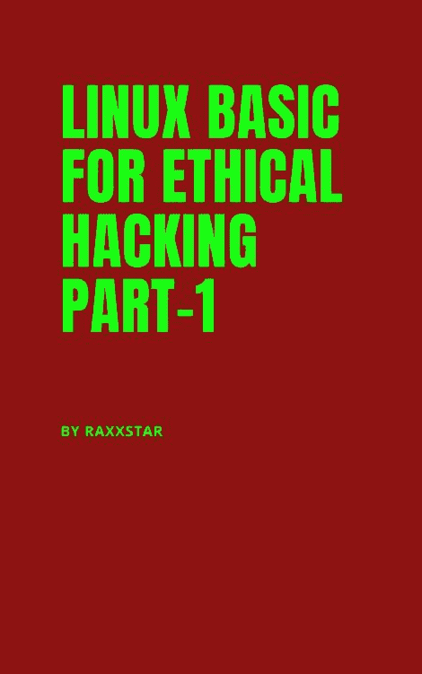


本书献给：

致所有想要为社会带来变革的优秀人才。


# 引言

许多人写信问我关于哪种操作系统最适合黑客。我首先要说，几乎每个专业和专家黑客都使用 Linux 或 Unix。虽然某些攻击可以在 Windows 和 Mac OS 上完成，但几乎所有的黑客工具都是专门为 Linux 开发的。

[](https://img.wonderhowto.com/img/original/68/08/63505510360807/0/635055103608076808.jpg) 不过也有一些例外，包括像 [Cain and Abel](https://null-byte.wonderhowto.com/how-to/hack-like-pro-grab-crack-encrypted-windows-passwords-0146679/)、Havij、[Zenmap](https://null-byte.wonderhowto.com/how-to/hacking-reconnaissance-finding-vulnerabilities-your-target-using-nmap-0133518/) 以及 [Metasploit](https://null-byte.wonderhowto.com/how-to/hack-like-pro-getting-started-with-metasploit-0134442/) 等为 Windows 开发或移植的软件。

当这些 Linux 应用在 Linux 中开发然后移植到 Windows 时，它们通常会丢失某些功能。此外，Linux 内置的一些功能在 Windows 中根本是无法使用的。这就是为什么黑客工具在大多数情况下仅为 Linux 开发的原因。

总结之，要成为一名真正的专家黑客，你应该掌握一些 Linux 技能，并使用如 [BackTrack](https://null-byte.wonderhowto.com/how-to/hack-like-pro-getting-started-with-backtrack-your-new-hacking-system-0146889/) 或 Kali 这样的 Linux 发行版。

对于那些从未用过 Linux 的人，我准备了[这个 Linux 基础系列](https://null-byte.wonderhowto.com/how-to/linux-basics/)，重点介绍黑客所需的所需的技能。那么，让我们打开 BackTrack 或你的其他 Linux 发行版，让我给你们展示一些东西。

## 第一章：入门

（章节标题每个单词的首字母大写）

### 步骤 1：启动 Linux

一旦你启动了 BackTrack，以 "root" 身份登录，然后输入：

```
bt > startx
```

你应该能看到一个类似这样的屏幕。

[](https://img.wonderhowto.com/img/original/65/93/63505507615717/0/635055076157176593.jpg) 步骤 2：打开终端

想要精通 Linux，你**必须**掌握终端。现在在各种 Linux 发行版中，许多事情都可以通过简单的点击来完成，类似于 Windows 或 Mac OS，但专家黑客必须知道如何使用终端来运行大多数黑客工具。

如果你用过 Windows 的命令提示符，Linux 终端与其相似但强大得多。与 Windows 命令提示符不同，你可以在 Linux 中通过终端完成**所有事情**，并比在 Windows 中更精确地控制它。

记住与 Windows 不同，Linux 是区分大小写的。这意味着 "Desktop" 与 "desktop" 是不同的，而后者又不同于 "DeskTop"。学者往往会发现这具有挑战性，所以请记住这一点。

### 步骤 3：检查目录结构

让我们从基础的 Linux 开始。许多初学者会被 Linux 文件系统的结构搞乱。与 Windows 不同，Linux 的文件系统不像 Windows 那样链接到物理驱动器，因此我们的 Linux 文件系统开头没有 `c:\`，而是一个 `/`。

正斜杠 `/` 代表文件系统的“根”或文件系统的最顶。所有其他目录（文件夹）都位于此目录下，就像文件夹和子文件夹位于 `c:\` 盘下一样。

为了视觉化文件系统，让我们看看下面的这张图。

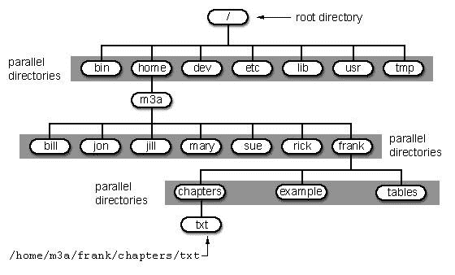

对这种文件结构有基本的理解是非常重要的，因为我们经常需要在终端中进行导航，而不使用像 Windows 资源管理器这样的图形工具。

在此图形表示中需要注意的几个关键点：

- `/bin` 目录是存储二进制文件的地方。这些是让 Linux 的程序。
- `/etc` 通常是存储配置文件的地方。在 Linux 中，几乎所有配置都是通过存储在 `/etc` 下的文本文件完成。
- `/dev` 目录存放设备文件，类似于 Windows 设备驱动。
- `/var` 通常是存储日志文件等文件的地方。

### 步骤：使用 pwd

当我们在 BackTrack 中打开终端时，我们所在的默认目录是我们的“家”目录。如上面的图形所示，它位于“根”目录的右侧，或者在根目录下方“一级”。我们可以通过输入来确认我们所在的目录：

```
bt > pwd
```

`pwd` 代表“present working directory”（当前工作目录），正如你看到的，它返回 `/root`，这意味着我们在 root 用户目录下（不要将其与目录树顶端的 "root" 混淆。这是 root 用户目录）。

`pwd` 是一个值得记住的方便命令，因为我们可以随时使用它告诉我们在目录树中的位置。

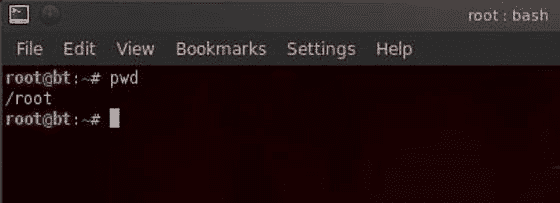

### 步骤 5：使用 Cd 命令

我们可以使用 `cd`（change directory，切换目录）命令更改我们工作的目录。在这种情况下，让我们通过输入以下命令“向上”移动到目录结构的顶端：

```
bt > cd ..
```

`cd` 命令后跟双点 `..` 的意思是“让我向目录树中向上移动一级”。注意我们的命令提示符已经更改，当我们输入 `pwd` 时，我们看到 Linux 响应告诉我们我们在 `/` 或目录树的顶端。

```
bt > pwd
```

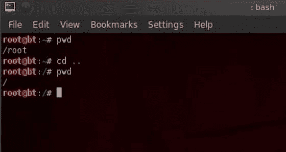

### 步骤 6：使用 whoami 命令

在本文教程的最后一个节中，我们将使用 `whoami` 命令。此命令将返回我们当前登录的用户名称。由于我们是 root 用户，我们可以登录任何用户账户，该用户的名称将显示在这里。

```
bt > whoami
```

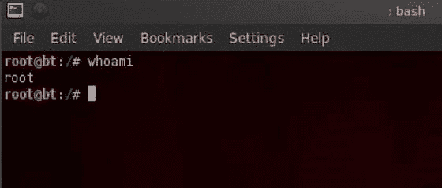

## 第二章：创建目录和文件

### 步骤:1：切换目录(cd)

我们可以通过 `cd` 以多种方式切换目录。正如我在之前的文章中向你们展示的那样，可以使用 `cd ..` 在目录树中向上移动一级。我们也可以通过输入 `cd /` 直接移动到根目录，或通过 `cd ~` 移动到家目录。

更多时候，我们将使用 `cd` 通过目录的绝对路径移动到目录。这意味着我们在 `cd` 之后写出想要移动到的目录的完整路径。我们也可以通过目录的相对路径移动到目录。这意味着我们不需要编写整个路径，只需使用我们当前所在的路径并在其追加。让我们来看一些例子。

假设我们在 BackTrack 的 root 用户目录下，想要移动到 aircrack-ng 目录（我们很快就会进行一些 aircrack 教程）。我们只需输入：

```
bt > cd /pentest/wireless/aircrack-ng
```

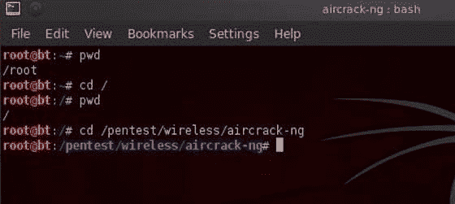

这将带我们进入 aircrack-ng 目录。


现在假设我们想进入 `aircrack-ng` 下的 `scripts` 子目录。我们可以输入该子目录的完整路径，但从当前位置输入相对路径要简单得多。我们知道现在位于 `/pentest/wireless/aircrack-ng`，所以输入：

```
bt > cd scripts
```

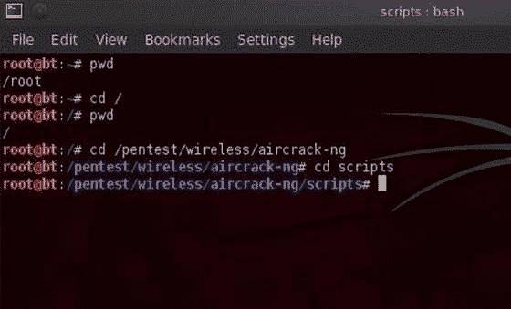

这就会带我们进入 `aircrack-ng` 内部的 `scripts` 子目录，即 `/pentest/wireless/aircrack-ng/scripts`。

再次强调至关重要的一点是 Linux 是区分大小写的，因此输入错误的大小写目录名会导致错误信息“no such file or directory”。

### 第二 步：列出命令 (Ls)

Linux 中最常用且最重要的命令之一是 `ls` 或 `list`。该命令用于列出目录或子目录的内容，以便我们看到其中的文件。它与 Windows 中的 `dir` 命令非常相似。让我们在 `aircrack-ng` 目录中使用它吧：

```bash
bt > ls
```

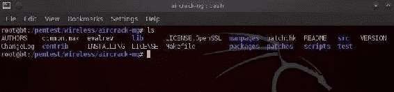

我们可以看到 Linux 列出了 `aircrack-ng` 目录下的所有文件和目录。Linux 允许我们通过开关（switches）来修改命令；这些通常是带有破折号（`-`）的字母。对于 `ls`，使用两个开关 `-a` 和 `-l` 是非常有用的。

`-a` 开关意味着“all”（全部），所以当我们使用它时，Linux 会列出所有文件和目录，即使是隐藏文件。当我们使用 `-l` 开关时，它会提供详细列表（long listing），意味着它提供了关于文件或目录的安全权限、大小、所有者、组、创建时间等信息。

让我们输入：

```bash
bt > ls -la
```

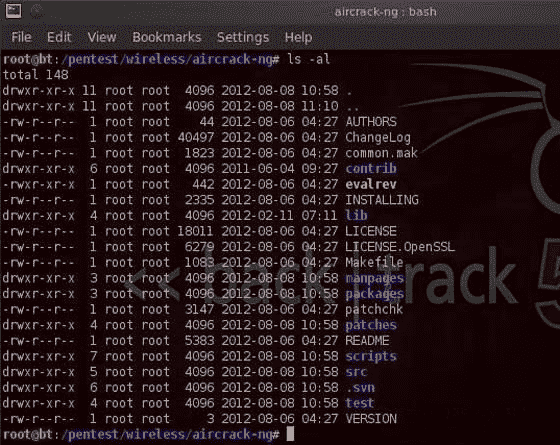

我们将在后面的教程中更详细地检查安全权限，但你必须知道，对于任何想要执行的文件，都需要执行（x）权限。因此，如果你下载了一个新工具，必须确保你对它拥有执行权限。

### 第三 步：创建文件(Touch)

在 Linux 中创建文件与 Windows 略有不同。在 Linux 中，我们使用 `touch` 命令。让我们创建一个名为 `newfile` 的新文件：

```bash
bt > touch newfile
```

现在我们可以通过列出目录来检查该文件是否存在：

```
bt > ls -la
```

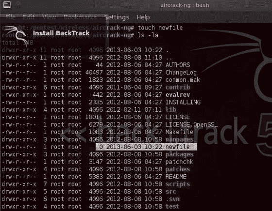

### 第四 步：创建目录(Mkdir)

与 Windows 类似，我们可以使用创建目录命令（`mkdir`）来创建一个目录。现在我们创建一个新目录。

```bash
bt > mkdir newdirectory
```

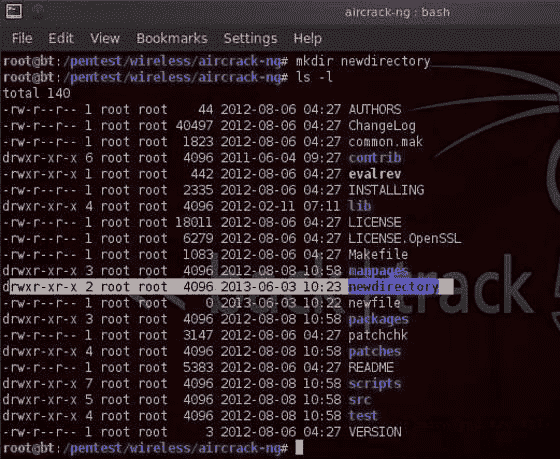

现在输入 `ls`，我们就能看到新目录目录。

### 第五 步：获取帮助(Man)

Linux 有一个非常有用的工具叫做 `man`。`Man` 是几乎每个命令的说明手册。如果你忘记了某个命令的作用，只需输入 `man` 加上命令名称，它就会显示包含关于该命令、开关和参数的所有所需信息的手册。例如，输入：

```bash
bt > man touch
```

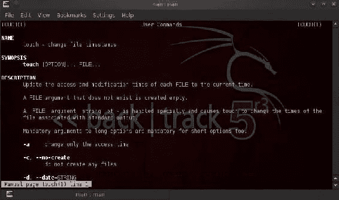

对于大多数命令，你也可以在命令后使用 `-h` 开关或 `--help` 开关来获取关于特定命令的“帮助”。在 "touch" 的情况下，我们必须使用 `--help` 来获取关于 `touch` 命令的帮助。

```
bt > touch --help
```

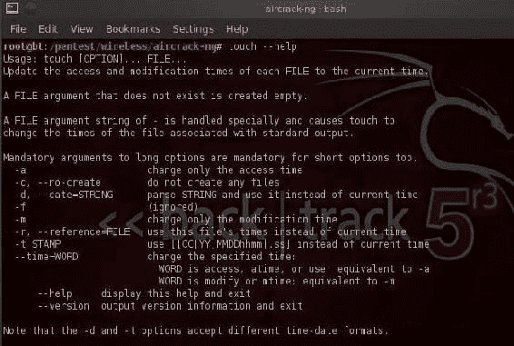

## 第三章：管理目录和文件

在本节中，我们将学习如何在 Linux 中管理文件和目录，即复制、重命名、移动和查看。然后我们将简单介绍网络和 `ifconfig` 命令。

### 第一 步：复制文件 (cp)

在上一个章节中，我们在 `/pentest/wireless/aircrack-ng` 目录下创建了一个名为 `newfile` 的文件。

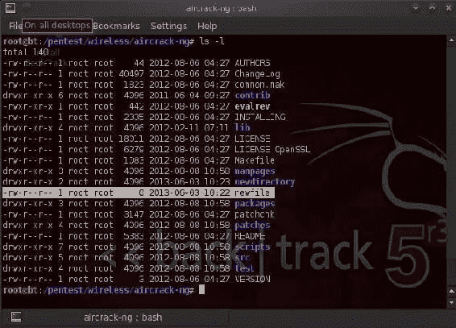

假设我们需要在家目录用户 root 中该文件的拷贝。可以通过以下方式实现：

```bash
bt > cp newfile /root
```

我们只需告诉 Linux 复制（`cp`）`newfile`（在我们当前目录中）到 root 用户的目录（再次提醒，不要将其与 `/` 目录混淆）。如果 `newfile` 在我们的当前工作目录中，我们就不需要指定它所在的目录。复制命令会创建指定文件的副本并将其放置在指定的目录中，保持原始文件完整且不变，因此我们现在有两个原始文件的副本。

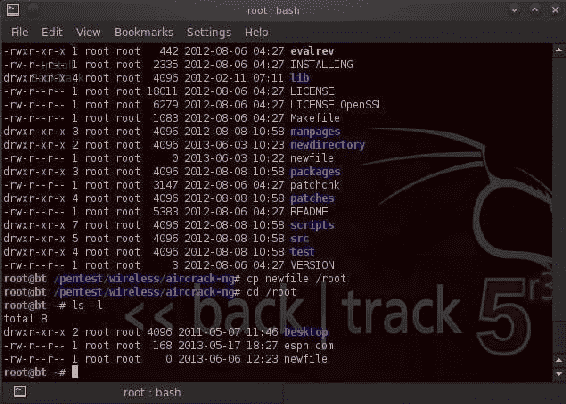

你可以从上面的截图看到，当我们切换目录（`cd`）到 root 用户并列出文件（`ls`）时，该目录下出现了一个 `newfile` 副本。

如果我们想从不在当前工作目录的目录复制文件怎么办？在这种情况下，我们需要指定目录的路径，例如：

```bash
bt > cp /etc/newfile /root
```

此外，注意我们不需要指定要复制到的目标文件名。它仅仅会创建一个副本并赋予它与原始 "newfile" 相同的名称。

### 第二 步：移动文件 (MV)

遗憾的是，Linux 没有用于重命名文件的 rename 命令，因此大多数用户使用移动（`mv`）命令来同时移动文件和重命名它们。现在假设我们将那个 `newfile` 放在了错误的目录，而真的想把它放在根目录（`/`）下。我们可以使用移动命令来实现。

```bashbt > mv /root/newfile /
```

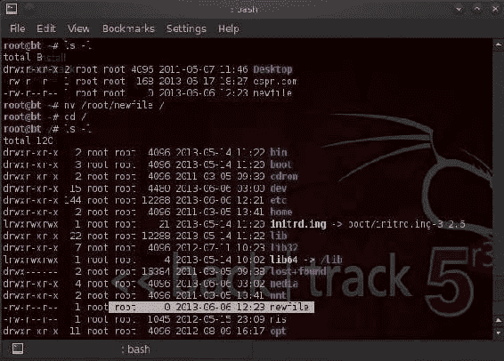

这条命令的意思是：将 `newfile` 从 root 用户目录移动到根目录（`/`）。移动命令字面上的是移动文件，而不会在旧文件所在留下副本。注意 `newfile` 已经移动到了根目录。

有时，我们想更改文件名称而不是实际将其移动到不同的位置。移动命令也可以用于此目的。我们只需告诉 Linux 将原始文件移动到一个具有新名称的文件。以我们在 `aircrack-ng` 目录中的 `newfile` 为例。假设我们要将该文件重命名为 "crackedpasswords"。只需输入：

```
bt > mv newfile crackedpasswords
```

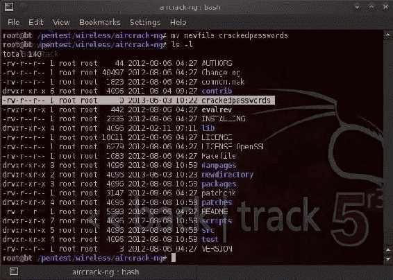

注意这里我没有使用任何目录路径，因为我正在移动当前工作目录中的一个文件到当前工作目录中的另一个文件。如果我们现在运行目录列出，可以看到 `newfile` 消失了，而 `crackedpasswords` 现在存在于 `aircrack-ng` 目录中。

### 第三 步：查看文件 (Cat, More, Less)

从终端的命令行，我们可以使用 `cat` 命令查看文件内容。`cat` 是 concatenate（连接）的缩写，这是一个用于汇合许多片段的高级词汇（我们正在汇合显示在屏幕上的单词）。Concatenate 是一个高级词，但在计算机科学和信息技术中广泛使用，所以把它加入你的词汇表中。

留在 `/pentest/wireless/aircrack-ng` 目录，让我们 `cat` 一些文件。首先，获取此目录下的文件列表。

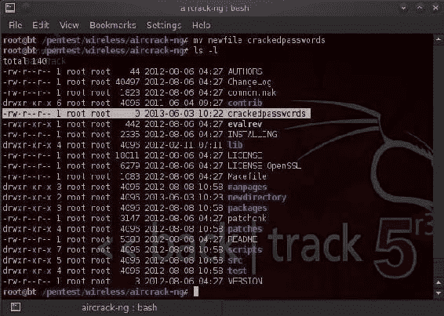

注意上面的截图，有一个名为 `README` 的文件。软件开发者通常使用此文件向用户提供重要的注释。这个文件可能是关键的，特别是对于黑客工具，因为大多数是开源的且很少有手册。让我们看看这个文件的内容。

```
bt > cat README
```

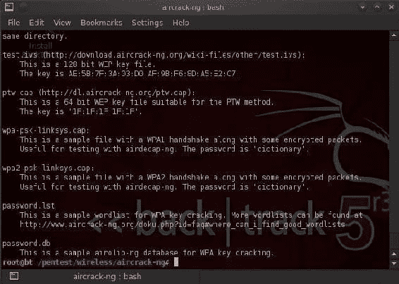

当你运行这个命令时，你会看到大量文本滚过屏幕。显然，它运行得太快了无法阅读，但在完成后，我们可以使用终端上的滚动按钮向上滚动阅读所有文本。不过，还有另一种方法可能更简单。

有两个命令的作用与 `cat` ，但它们不会简单地让文本刷过屏幕直到到达文件结束。这些是 `more` 和 `less`。它们非常相似，每个只在屏幕上显示一页信息，直到你提示它向下滚动。让我们先尝试 `more`。

```
bt > more README
```

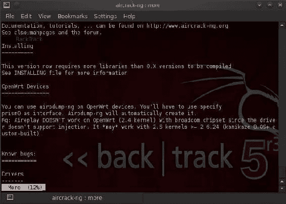

如你所示，当我使用 `more` 和文件名时，它会显示文件直到屏幕并等待我的进一步指令。如果我按下回车，它会一次向下滚动一行；如果我按下空格键，它会一次滚动一页。

现在尝试更强大的 `less`（在某些 Linux 圈子里有一句话叫 "less is more"，意思是 less 比 more 更强大）。

```
bt > less README
```

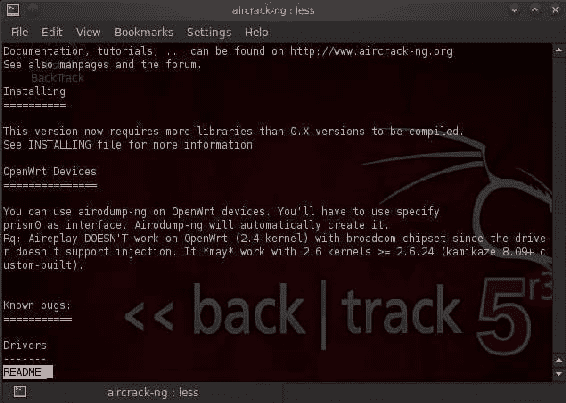


你可以看到，`less` 后面跟着文件名会再次像 `more` 一样显示 README 文件，直到它填满我的终端。不过，请注意 `less` 会在左下角显示我正在查看的文件名。更重要的是，`less` 具有强大的文本搜索功能，而 `more` 则不具备。我可以通过输入正斜杠 `/` 然后加上我要搜索的内容来在此文件中搜索文本，`less` 会找到并为我高亮显示。

这就是我偏好使用 `less` 的主要原因之一。

## 步骤 4：网络 (ifconfig)

在完成这个教程之前，我想向你们展示最后一个简单的网络命令：`ifconfig`。那些熟悉 Windows 网络的同学知道，在 Windows 中可以使用 `ipconfig` 命令来显示网络配置的关键信息。Linux 中的 `ifconfig` 与此非常相似，仅有一个字母之差。让我们运行 `ifconfig` 看看它告诉了我们什么。

```
bt >ifconfig
```

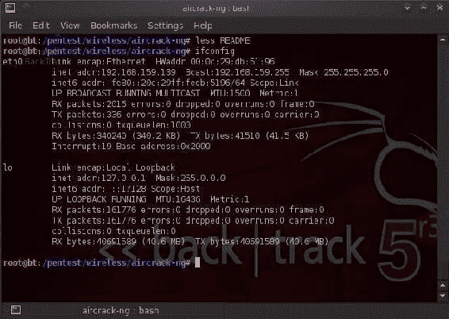

如你所见，它显示了内核需要的关于系统网络配置的大部分关键信息，包括 IP 地址、子网掩码、广播地址、接口、接口的 MAC 地址等。我们将在未来的 Linux 教程中花更多时间学习网络。

## 第四章：查找文件

Linux 初学者经常面临如何查找文件和程序的问题，特别是考虑到其与 Mac OS 或 Windows 相比完全不同的目录结构。初学者在尝试寻找必要的文件或二进制文件时有时会感到沮丧，因此我把这个教程专注于如何在 Linux 中查找东西。

### 步骤 1：在目录中查找文件 (find)

我想向你们展示的第一个命令是 `find`。正如你可能猜到的那样，`find` 能够通过在目录查找你正在寻找的文件来找到它。默认情况下，它是递归的，这意味着它会查找所有子目录并列出找到该文件的所有位置。例如，如果我们正在寻找 `aircrack-ng`，可以输入：

```
bt > find -name aircarck-ng
```

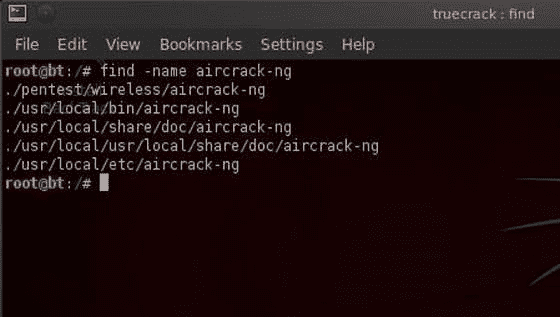

注意，我们需要告诉 Linux 我们想通过名称 (`-name`) 进行搜索，然后是我们要搜索的文件名。

随后它会返回找到 `aircrack-ng` 的每个位置的完整路径。我们可以更具体一些，要求 Linux 只告诉我们它在 `/pentest` 目录中找到了 `aircrack-ng`。我们可以输入：

```
bt > find /pentest -name aircrack-ng
```

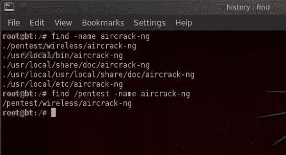

这条命令的意思是：“在 pentest 目录及其所有子目录中查找，并告诉我在哪里找到了名为 aircrack-ng 的”。

现在，Linux 只返回位于 `/pentest` 或其子目录下的文件路径，例如 `/pentest/wireless/aircrack-ng` 等其他。

### 步骤 2：在环境变量中查找二进制文件 (which)

我们想要查看的下一个搜索命令是 `which`。这个命令允许我们搜索路径变量中的二进制文件。嗯……即使我觉得这听起来也有很多技术术语。让我们试着理解它的含义。

二进制文件（Binaries）是等同于 Windows 中可执行程序的文件。这些是执行如 `echo`、`ls`、`cd`、`mv` 等操作的文件。我们的环境变量是存储二进制文件目录路径的变量。通常，我们的二进制文件位于 `/bin`（bin 是 binaries 的缩写）或 `/sbin` 目录，这反映在我们的环境变量中。我们可以通过让 Linux `echo` 变量中的值来检查环境变量设置。我们通过输入：

```
bt > echo $PATH
```

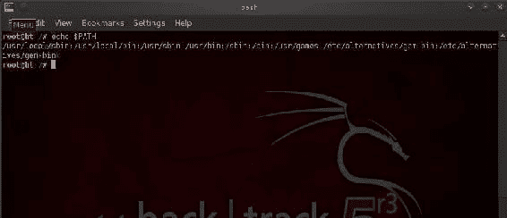

Linux 返回环境变量中的值。这些是 `which` 搜索二进制文件的地方。所以当我们输入：

```
bt > which ls
```

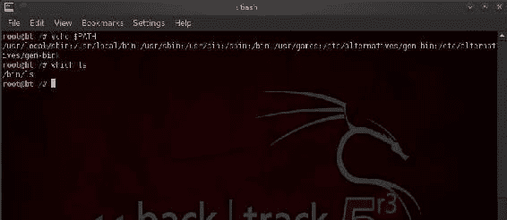

它会返回该二进制文件的路径。如果我们使用 `which` 搜索 `aircrack-ng`：

```
bt > which aircrack-ng
```

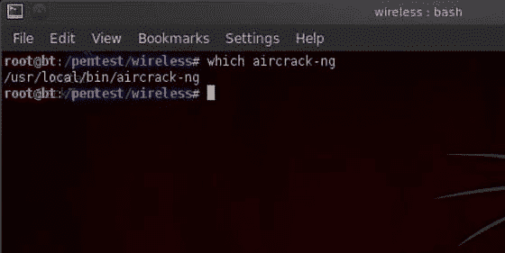

那么我们就可以看到 Linux 返回了 `/usr/local/bin/aircrack-ng`。如果 `aircrack-ng` 不在我们路径中的某个目录中，它将无法为我们提供帮助。

### 步骤 3：在任何目录中查找任何文件 (whereis)

与 `which` 不同，`whereis` 不限于查找路径中的二进制文件。它可以定位任何目录中的文件，此外，它还能定位手册文件或帮助页（man pages）。所以，当我们输入：

```
bt > whereis aircrack-ng
```

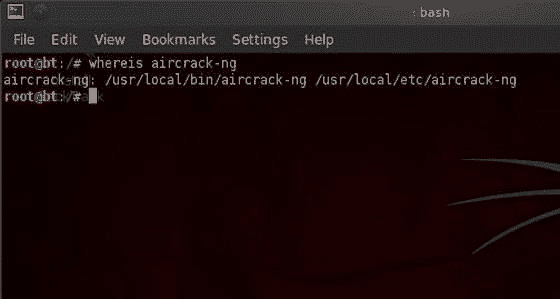

我们可以看到 `whereis` 返回了 `aircrack-ng` 多个位置的路径，包括帮助页。

### 步骤 4：使用数据库查找文件 (locate)

`locate` 命令也可用于查找文件，通常比 `which` 或 `whereis` 都快得多。区别在于 `locate` 使用了文件系统中所有文件的数据库，因此搜索过程要快得多。

`locate` 的缺点是 `locate` **无法**发现新文件，因为数据库通常只每天更新一次，通常安排在系统活动较少的半夜，因为更新此数据库会消耗大量的 CPU 资源。

```
locate aircrack-ng
```

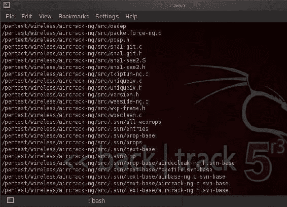

你从上面的截图中可以看到，`locate` 每每次遇到包含 `aircrack-ng` 的文件（无论二进制文件还是其他）都会返回一个路径。

## 第五章：安装新软件

在前面的几个教程中，我们查看了许多基础命令，但在这里我想关注在 Linux 中安装新软件，特别是在 BackTrack 中。

BackTrack v5r3 构建在 Ubuntu 之上，这是一种 Debian Linux。这很重要，因为不同的 Linux 系统使用不同的包管理方法（包管理意味着下载和安装新的软件包）。

在深入之前，请确保查看了我之前关于 Linux 基础的指南，以跟上我们的进度。

### 步骤 1：使用 GUI 软件包管理器

在 BackTrack 上安装软件简单的方法是使用 GUI 软件包管理器。在我基于 KDE 的 BackTrack 5 中，GUI 软件包管理器被称为 `KPackageKit`（你们某些人可能使用的是 `Synaptic`）。

这些软件包管理器允许我们查找包、下载它们并安装到我们的系统中。我们可以通过导航到系统（System）然后点击 `KPackageKit` 来打开它，如下方的所示。

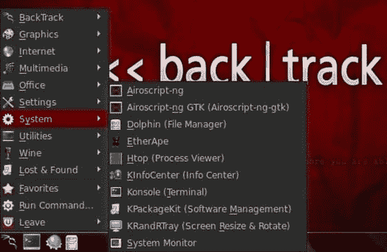

打开后，你只需将名称输入搜索字段中。它将检索所有符合你搜索标准的选项，然后只需点击你想下载的软件包旁边的图标即可。

在这个例子中，我们将寻找无线破解软件 `aircrack-ng`。

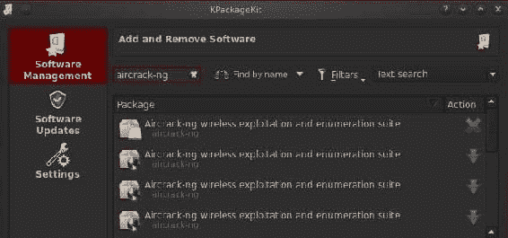

请注意，如果软件包已经安装，它旁边会有一个 X。如果没有，则会有一个向下的箭头。点击箭头，然后点击下方的 `APPLY` 按钮。

### 步骤 2：更新你的仓库

软件包管理器在指定的仓库（存放软件包的网站）中搜索你寻找的包。如果你收到未找到包的消息，这并不意味着它不存在，而仅仅是它不在你的操作系统正在搜索的仓库中。

BackTrack 默认在 `backtrack-linux.org` 中搜索，那里有很多黑客工具。遗憾的是，如果你寻找的不是黑客工具，或者是 BackTrack 尚未放入其仓库的新黑客工具，你可能需要修改你的操作系统搜索包的位置。

这可以通过编辑 `/etc/apt/sources.list` 文件来实现。让我们用 `KWrite` 打开它看一看。

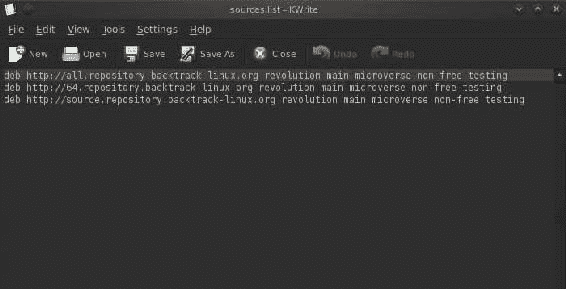

如你所见，BackTrack 的 `sources.list` 有三个默认源，全部指向 BackTrack 仓库。我们可以向此列表添加任何包含 Linux 软件的仓库，但由于 BackTrack 是 Ubuntu 发行版，我们可能想向列表中添加一个 Ubuntu 仓库来下载和安装 Ubuntu 软件。我们可以通过向文件中添加一行来实现：

`deb http://archive.ubuntu.org/ubuntu lucid main restricted`

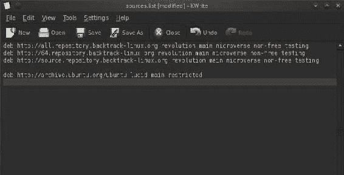


现在当我使用我的包管理器时，它会首先搜索三个 BackTrack 仓库，如果在这些地方任何一个都没有找到该软件包，它将会在 Ubuntu 仓库中搜索。

### 第 3 步：命令行包管理

Ubuntu 也有一个名为 `apt` 的命令行包管理器。使用 `apt` 下载软件包的基本语法为：

```bash
apt-get install aircrack-ng
```

所以，让我们打开终端并输入上述命令来安装 `aircrack-ng`（当然，我们只需要替换软件包名称来安装其他软件）。

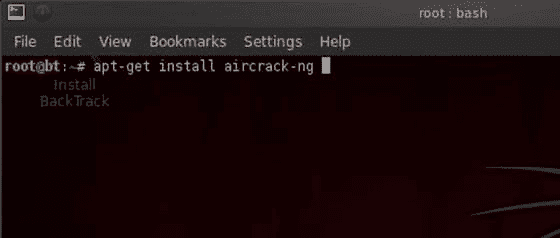

如果软件包存在于我们的仓库之一，它将自动下载该包以及任何必要的依赖项（软件包正常运行所需的文件），并自动将其安装到你的系统上。

### 第 4 步：从源码安装

最后，有时你将下载既不在仓库中也不在软件包中的软件。这些软件通常以 `tar` 或 `tarball` 格式归档。这些是将多个文件“打包”成单个文件的文件，并且通常经过压缩（类似于使用 WinZip 压缩文件并将它们合并成一个 `.zip` 文件）。

假设 `aircrack-ng` 不在我们的仓库中（有些软件从未进入过仓库），我们必须从 `aircrack-ng.org` 网站下载它。我们可以下载文件 `aircrack-ng-1.2-beta1.tar`。

一旦下载完成，我们需要使用 `tar` 命令将其解压：

```bash
tar xvf aircrack-ng-1.2-beta1.tar
```

这将将其解包并解压缩（如果它是被压缩的话）。接下来，我们需要用 GNU 编译器对其进行编译。从源码编译将为我们提供针对硬件和操作系统优化的二进制文件（程序文件），这意味着它们通常运行得更快、更高效。我们可以通过输入以下命令来编译这段源码：

```bash
gcc aircrack-ng
```

最后，我们现在可以在解压文件的目录内运行该文件：

```bash
./aircrack-ng
```

注意，为了运行该文件，我们在前面加上了 `./`，这告诉 Linux 从我们当前所在的目录执行此文件，因此请确保你在编译源码的同一个目录中运行此命令。

这应该涵盖了安装软件的所有方法，我希望这不会太困惑。在大多数情况下，我们可以简单地使用基于 GUI 的包管理器来安装软件，但正如生活中的一切一样，总有例外。

## 第六章：网络基础

有志的黑客需要了解一些 Linux 才能成功，可能最重要的是 Linux 网络。为了填补这一知识空白，我提供了这份关于 Linux 网络基础的指南。

### 第 1 步：分析网络

分析网络最基础的 Linux 命令是 `ifconfig`。它与 Windows 的命令 `ipconfig` 非常相似。让我们来看看。

```bash
ifconfig
```

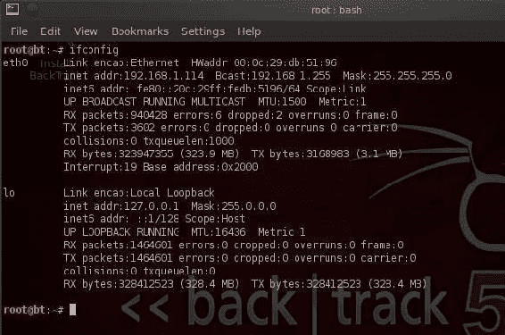

正如你在截图中看到的，`ifconfig` 向用户传递了大量的信息。在第一行中，我们在最左侧看到 `eth0`。这是第一个有线网络连接，以太网 0（Linux 通常从 0 开始计数）。

随后，我们看到了使用的网络类型（以太网）和硬件地址（这是刻在每个网络硬件设备（在此例中为网卡 NIC）上的全局唯一地址）。

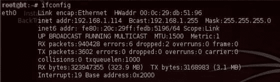

第二行包含 IP 地址信息，在此例中为 `192.168.1.114`，广播地址（向子网上所有 IP 发送信息的地址），最后是网络掩码（这是关于 IP 地址中哪部分是网络部分、哪部分是主机部分的信息）。那里还有很多技术信息，但它超出了 Linux 基础教程的范围。

如果我们向下看似乎是第二段的地方，我们看到了另一个段的开头，最左侧是 `lo`。

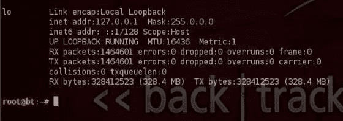

这是回环地址或本地主机（localhost）。如果你只是想测试类似网站的东西，这就是你正在操作的机器的地址。它通常表示为 IP 地址 `127.0.0.1`。

### 第 2 步：更改 IP 地址

在 Linux 中更改 IP 地址可以相当简单。记住，在大多数情况下，你会从 DHCP 服务器获得动态分配的地址。在某些情况下，你可能需要重新分配地址，特别是当你进行攻击时。这对于伪造你的 IP 地址很有用，可以让网络取证更具挑战性，但并非不可能。

我们可以通过使用 `ifconfig` 命令配合我们要分配 IP 的接口以及我们想要的 IP 地址来实现，例如：

```bash
ifconfig eth0 192.168.1.115
```

现在，当我们输入 `ifconfig` 时，可以看到我们的 IP 地址已经更改为新的 IP 地址。

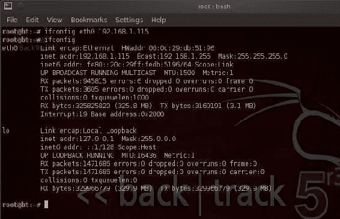

如有必要，我们还可以更改掩码和广播地址，例如：

```bash
ifconfig eth0 192.168.1.115 netmask 255.255.255.0 broadcast 192.168.1.255
```

### 第 4 步：DNS（域名解析服务）

DNS 或域名解析服务使我们能够输入如 `www.wonderhowto.com` 这样的域名，然后将其翻译成相应的 IP 地址。如果没有它，我们都必须记住喜爱的网站的成千上万个 IP 地址（对于天才来说也不是易事）。

对于有志的黑客最有用的命令之一是 `dig`，它相当于 Windows 中的 `nslookup`，但为我们提供了更多关于域名的信息。例如，我们查询 `wonderhowto.com` 并添加 `ns` 选项，它将显示 `wonderhowto.com` 的名称服务器。

```bash
dig wonderhowto.com ns
```

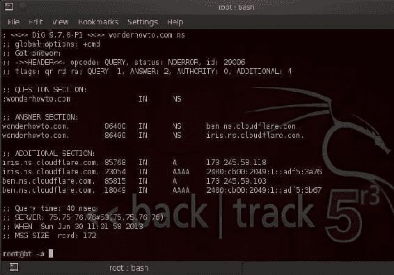

通过使用带有 `mx` 选项的 `dig` 命令，我们可以获取 WonderHowTo 邮件服务器的信息。

```bash
dig wonderhowto.com mx
```

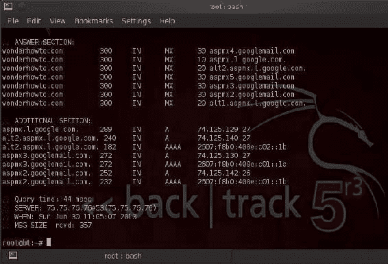

常见的 Linux DNS 服务器是伯克利互联网域名，或 `BIND`。在某些情况下，Linux 用户经常将 DNS 称为 `BIND`，所以不要困惑。DNS 或 `BIND` 只是将单个域名映射到 IP 地址。

在我们的 BackTrack 系统上，我们可以将 DNS 服务指向本地 DNS 服务器或公共 DNS 服务器。这种指向发生在名为 `/etc/resolv.conf` 的纯文本文件中。让我们用 `kwrite` 打开它：

```bash
kwrite /etc/resolv.conf
```

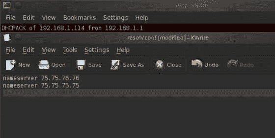

如你所见，我们指向两个公共 DNS 服务器为我们提供 DNS 服务。如果我们想更改 DNS 服务器或添加另一个服务器，只需向此文本文件添加另一行并保存。下当需要 DNS 服务时，Linux 操作系统将查找此文件中指定的新 DNS 服务器。

## 第七章：管理权限

欢迎回来，我的新手黑客们！

我写这本 Linux 书是为了试图填补一些有志黑客在 Linux 操作系统教育方面的空白。有很多东西要学，在这一章中，我们将查看 Linux 文件权限。

### 第 1 步：检查权限

当我们想要查找文件的权限时，可以简单地使用 `ls` 命令配合 `-l` 或长格式开关。让我们在 `pentest/wireless/aircrack-ng` 目录下使用该命令，看看它告诉我们关于那里文件的什么信息。

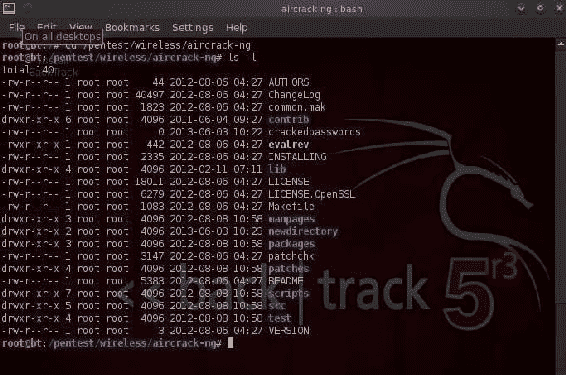

如果我们查看每一行，可以看到关于文件的很多信息，包括它是文件还是目录、文件的权限、链接数、文件所有者、文件组所有者、文件大小、创建或修改时间，最后是文件名。让我们检查每一项。

#### 识别文件或目录

行的非常第一个字符告诉我们它是文件还是目录。如果行以 `d` 开头，它是一个目录。如果以 `-` 开头，它是一个文件。

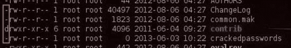

#### 识别权限

接下来的字符定义了文件的权限。有三组 `rwx`，代表读、写和执行。这决定了是否有权限读取文件、写入文件或执行文件。每组 `rwx` 代表所有者、组以及所有其他人的权限。


所以，如果我们查看 `ChangeLog` 文件的第二行...

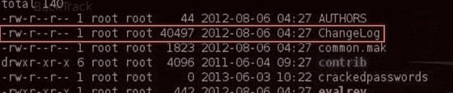

我们可以看到它开头是：

`-rw-r--r--`

这意味着这是一个文件 (`-`)，所有者拥有读取 (`r`) 和写入 (`w`) 权限，但没有执行权限 (`-`)。

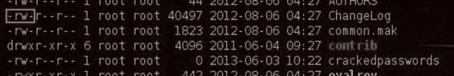

下一组权限代表组的权限。在这里我们可以看到组拥有读取权限 (`r`)，但没有写入 (`-`) 或执行权限 (`-`)。

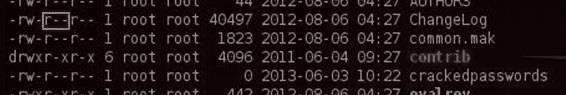

最后，最后一组权限是针对所有其他人的。我们可以看到所有其他人对 `ChangeLog` 文件只拥有读取 (`r`) 权限。

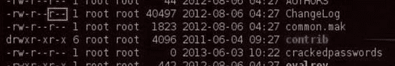

### 步骤 2 更改权限

让我们想象一种情况：我们希望组能够同时对 `ChangeLog` 文件进行写入和执行。Linux 有一个名为 `chmod` 的命令，只要我们是 root 用户或文件的所有者，就可以更改文件的权限。这些权限在操作系统中用它们的二进制等效值表示。

### 数字

记住，在底层操作系统中，一切都是简单的 0 和 1，这些权限由系统中的开启/关闭开关表示。所以，如果我们把权限想象成三个开启/关闭开关，并且这些开关处于二进制数字系统中，那么最右边的开关开启时代表 1，中间的开关开启时代表 2，最后，最左边的开关开启时代表 4。

所以，当三个权限都开启时，它们看起来像这样：

`r w x`
`4 2 1 = 7`

如果我们将这三个相加，得到的是，对吧？在 Linux 中，当所有权限开关都开启时，我们可以用十进制等效值 `7` 来表示。所以，如果我们想表示所有者 (7)、组 (7) 和所有用户 (7) 都拥有所有权限，我们可以表示为：

`777`

现在，回到我们的 `ChangeLog` 文件。记得它的权限吗？它们是 `rw-r--r--`，所以我们可以用数字表示为：

`r w - r - - r - -`
`4 2 0 4 0 0 4 0 0`

这可以用 `644` 表示。

### 更改 ChangeLog 的实际权限

现在，如果我们想给组赋予写入 (2) 和执行 (1) 权限，我们可以使用 `chmod` 命令来实现。我们需要为 `ChangeLog` 文件添加写入 (2) 权限和执行 (1) 权限。我们可以这样做：

`chmod 7 7 4 ChangeLog`

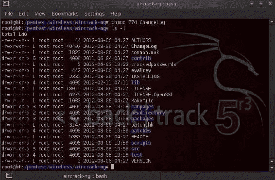

这条语句表示给所有者所有权限 (4+2+1=7)，给组相同的权限 (4+2+1=7)，并给其他人简单的读取权限 (4+0+0=4)。当我们现在执行 `ls -l` 时，可以看到 `ChangeLog` 的权限现在是：

`r w x r w x r - -`

很简单，对吧？

### 步骤 3 使用 UGO 更改权限

虽然数字法可能是 Linux 中更改权限最常见的方法（每个自尊的 Linux 大师都能使用），但还有另一种一些人觉得更舒服的方法。它通常被称为 UGO 语法。UGO 代表 U=user（用户或所有者）、G=group（组）和 O=others（其他）。UGO 有三个操作符：

- `+` 添加权限
- `-` 减去权限
- `=` 设置权限

所以，如果我想取消 `ChangeLog` 所属组的写入权限，我可以写道：

`chmod g-w ChangeLog`

这条命令表示“对于组 (g)，减去 (-) `ChangeLog` 的写入 (w) 权限”。

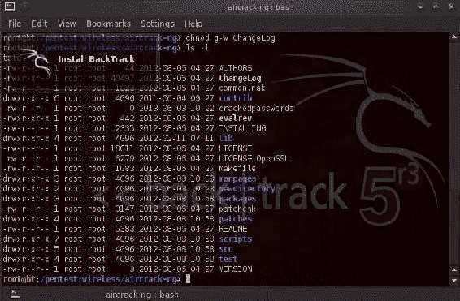

你可以看到，当我现在输入 `ls -l` 检查文件权限时，`ChangeLog` 文件不再对组拥有写入权限。

如果我想给用户和组都赋予执行权限，我可以输入：

`chmod u+x, g+x ChangeLog`

这条命令表示“对于用户添加执行权限，对于组向文件 `ChangeLog` 添加执行权限”。

### 步骤 4 为我们的新黑客工具赋予自己执行权限

作为黑客，我们经常需要下载新的黑客工具。在下载、解压、解包、编译和安装它们之后，我们经常需要给自己赋予执行权限。如果我们不这样做，通常会收到“我们没有足够的权限来执行”的消息。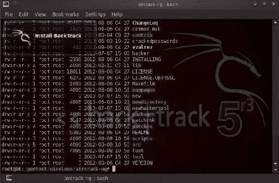

从上面的截图中可以看到，我们的 `newhackertool` 对任何人都没有执行权限。


我们可以通过写道给 `newhackertool` 赋予自己执行权限：

`chmod 766 newhackertool`


正如你现在知道的，这将赋予我们所有所有者包括执行在内的所有权限，而组和其他人只有读取和写入权限 (4+2=6)。你可以从上面的截图中看到，运行 `chmod` 命令后，我们得到的正是这些！

## 第八章：管理进程

在我不断提升你的 Linux 技能的过程中，我现在为你提供《针对黑客的 Linux 基础》系列中的第八部分。在这个教程中，我们将查看系统进程以及如何管理它们。

### 步骤 1 查看正在运行的进程

我们可以通过输入以下命令查看系统上运行的所有进程：

`ps aux`

这些开关将提供所有进程 (a)、用户 (u) 以及未关联终端的进程 (x)。这是我最喜欢的 `ps` 开关组合，因为它能让我看到哪个用户启动了进程，以及它正在使用多少资源。

注意，列出的每个进程向我们展示了许多信息：

- 用户
- `PID`（进程标识）
- `%CPU`
- `%MEM`（内存）

如果我们只想查看信息有限的所有进程，可以输入：

`ps -A`

你可以看到所有运行的进程，但没有 CPU 百比和内存百分比等信息。注意 `airbase-ng` 列出的 `PID` 为 5143，而最后一个进程是 `ps` 命令。

进程号（或 `PIDs`）在 Linux 操作中至关重要，因为你通常需要 `PID` 来管理进程。正如你可能在我的某些 Metasploit 教程中看到的，`PID` 在黑进受害者系统时往往变得至关重要。

### 步骤 2 top 命令

与 `ps` 命令类似的是 `top` 命令，区别在于 `top` 只向我们显示顶部的进程。换句话说，它只显示使用资源最多的进程，而且它是动态的，这意味着它为我们提供了进程的实时视图。只需输入：

`top`


正如你所看到的，进程按照它们使用系统资源的顺序排列，随着进程使用更多或更少资源，列表会不断变化。

### 步骤 3 杀死进程

有时我们需要停止 Linux 中的进程。我们使用的命令是 `kill`。不要担心，它听起来比实际情况要暴力得多。如果有一个进程在我们尝试停止它后继续运行并消耗系统资源，那么这个命令就尤为重要。这些进程通常被称为“僵尸”进程。

我们可以通过输入 `kill` 和进程 ID 或 `PID` 来杀死进程。所以为了杀死我的 `airbase-ng` 进程，我只需要输入：

`kill 5143`


我们可以从上面的截图中看到，我的 `airbase-ng` 进程不再运行了。

有很多类型的“kill”。默认的 `kill`（当我们不带任何开关使用 `kill` 命令时）是 `kill 15` 或即终止信号。它允许进程进行清理并温和地终止。

有时，即使发送了默认的 kill 命令，进程仍然拒绝终止。在这种情况下，我们必须变得更加严肃，使用绝对终止器来完成工作。这就是 `kill -9`，它不留情面，在不允许进程告别的情况下结束任务，并强制内核立即终止它。

### 步骤 4 更改进程优先级

Linux 中的每个进程都被赋予了一个优先级数字。正如你可能猜到的，这个优先级数字决定了进程的重要性以及它在系统资源使用队列中处于什么位置。这些优先级数字的范围从 0 到 127，其中 0 是最高优先级，127 是最低优先级。


作为 root 用户或系统管理员，我们无法直接确定进程的优先级——那是内核的工作——但我们可以向内核发出提示，表示希望某个进程以更高的优先级运行。我们可以通过 `nice` 命令来实现这一点。Nice 值的范围从 -20 到 +19，数值越低表示优先级越高。

我们可以通过使用 `nice` 命令、`-n` 切换开关、nice 值以及我们想要运行的命令来设置进程的 nice 值。因此，如果我们想在我们的“邪恶双胞生（Evil Twin）”教程中以最高优先级启动 `airbase-ng` 进程，可以输入：

```
nice -n -20 airbase-ng -a 00:09:5B:6F:64:1E --essid "Elroy" -c 11 mon0
```

之后，如果我们觉得想降低 `airbase-ng` 命令的优先级，可以使用 `renice` 对其进行重置。`renice` 命令只需要 `renice` 命令、优先级级别，与 `nice` 命令不同，它只接收进程 PID，例如：

```
renice 15 5143
```


我们可以看到，通过对 `airbase-ng` 命令进行 renice，我们将它的优先级从 -20（最高）降低到了 15（相对较低）。

### 步骤 5：将进程推入后台

你可能在运行我的某些黑客教程时注意到，当我们从 shell 终端运行命令时，该进程将控制该 shell 直到完成。如果是一个持续运行进程（类似于 `airbase-ng`），它将一直保持对该终端的控制，直到我们停止它。在此之前我们无法使用该 shell。

如果我们仍然想使用该 shell，可以将进程发送到后台，重新获得对 shell 的控制权。要在后台启动命令，我们只需要在命令末尾加上 `&` 或连接符即可。因此，要让 `airbase-ng` 在后台运行，我们只需输入：

```
airbase-ng -a 00:09:5B:6F:64:1E --essid "Elroy" -c 11 mon0 &
```

如果我们想将后台作业调回前台，只需输入 `fg`。要将前台进程发送到后台，我们可以输入 `Control Z` 停止它，然后使用 `bg` 命令配合 `PID` 将其发送到后台。

目前就到这里……

# 关于作者

作者是网络世界中一个知名人物，由于某些个人原因，他使用笔名 `Raxxstar`

