# Linux 基础：学习 Linux 命令与 Linux 编码指南 (1 小时上手)


开始需要 1 小时

# Linux 基础

在本指南中，我们将通过命令行操作。尽管刚开始可能会感到非常陌生，但你将学习到对于一名渴望成为管理员的人来说，熟悉通过终端执行的操作是多么重要。现代实践（即使对于学习者也是）正朝着这一方向发展，通过云服务器提供终端可用的操作系统。Amazon AWS 就是云服务器的一个示例，你可以在那里发现大量免费供探索的机器，只需开启服务并设置配置，即可使用你偏好的 ISO 镜像开始。

在本指南中，我们使用 Linux 发行版 Ubuntu 18.04。你将能够完全通过命令行来安装优秀的工具，用于监控服务和进程、控制用户、网络管理、日志等。

书中出现频率最高的命令之一是 `cd`。该命令用于从一个目录移动到另一个目录，后面跟着你想移动到的目录。目录路径由 `/` 分隔，表示指定文件夹名称。

```bash
cd desktop/folder1
```

如果使用以下语法，你可以返回之前的路径。两个点 `..` 指向结构中的文件夹的层级关系。

```bash
cd ..
```

## 权限

对下一章的提醒是权限的重要性。假设你始终可以使用机器上的当前用户，但某些操作可能不允许所有用户执行。这就是为什么关注你正在使用的用户非常重要。有时有必要在命令本身前面加上 `sudo` 才能正确执行操作。

## Man 命令

当关于某个命令的信息不详尽时，你可能会发现使用 `man` 命令非常有用。每个命令都有一个对应的 `man` 来显示有关该命令的信息，例如：

```bash
man kill
```

`Kill` 是杀死进程的命令。通过 `man`，你可以找到该命令的所有选项。

## 什么是内核？

在本指南中有很多关于内核（Kernel）的引用。如果你从未听过这个术语，你可能会发现完全理解它是什么以及如何工作的意义。

我们说的内核是指软件和硬件之间协作的工作层，它允许通过驱动程序实现两者之间的通信。尽管发行版有很多，但内核的目的始终相同。

当任何应用程序需要对硬件应用更改时，它会将请求传递给内核，内核会翻译该请求并直接与驱动程序通信以接受或拒绝请求。

内核是操作系统连接资源的主要组件之一。这就是为什么它还负责操作系统中的资源管理。

Linux 内核是单式的（monolithic），这意味着它能够运行复杂的操作，完全应用了我们在本节早些讨论的概念。因此，它负责 CPU、内存、硬盘、I/O 设备等资源，同时管理文件系统、驱动程序等……

虽然一方面，这种类型的内核在处理所有任务时能够更谨慎地工作，因为所有请求都由内核直接处理；但另一方面，这种方法要求每次都接受所有请求。当存在仍需批准的请求时，这个过程可能会导致严重问题。这种通信的优点包括：软件访问硬件、双方交流的简单方法、可能不需要额外的驱动程序、双方响应迅速。使用内核也有负面方面。例如，它占用内存，而且并不是一个安全的选择。

### 文件在哪里？

Ubuntu 中的内核文件收集在 `/boot` 文件夹下。

## 什么是守护进程（Daemon）？

本指南的一个特定章节关于如何管理进程，但在其他部分你总是能找到 `deemons` 这个术语。进程是运行以完成任务的程序实例。进程由内核管理，内核赋予它们一个标识符（`PID`）。正如我们将看到的，`PID` 对于处理进程以及监控活动至关重要。

某些特定的进程会在用户工作时后台运行并完成请求。例如，邮件服务器会在你工作时接收和转发电子邮件。这些进程不是由用户激活的，但通常在操作系统启动后自动启动。一些著名的守护进程示例包括 `httpd`、`Apache`、`MySQL`，它们在你处理不同活动时可用。

# 日志与监控

在探索像 Linux 这样最常用的操作系统时，跟踪同时运行的进程（包括应用程序和服务）执行情况也是至关重要的。无论你是开发者还是对该主题有浓厚兴趣的用户，清晰理解 Linux 日志对于全面了解操作系统的逻辑（无论你在哪种发行版上工作）都非常有帮助。

无论发生什么错误（例如操作系统崩溃），所有运行的事件和应用程序都记录在名为日志文件（log files）的特定文件中。这些记录了操作系统生命周期内注册的过去事件列表。你是操作系统的管理员吗？通过日志文件，你将能够排除故障并找到合适的解决方案。此外，日志文件将成为监控活动并理解其含义的巨大资源。

在 Linux 中，所有日志文件都存储在 `/var/log` 路径下。该目录下是所有与操作系统本身相关的进程日志。然后，根据每个应用程序，你可以在同一目录下的单独文件夹中识别日志文件。使用任何 Linux 发行版的命令行即可完成此操作。

日志是标准的纯 ASCII 文本文件，在子目录 `/var/log` 下以列表显示。它们的名称根据用途变化，例如 `auth.log` 或 `kern.log`。

在本指南中，我们将使用 Ubuntu 18.04 作为几乎所有任务的参考。

## 文件类别

这些日志文件的主要类别有：

*   系统日志
*   应用程序日志
*   事件日志
*   服务日志

它们是必须监控的关键文件，以便根据开发者或系统管理员的需求进行集中活动管理。

### 系统日志


日志文件的主要组之一是系统日志。此类类别包含了所有本质上基于直接在操作系统上执行的活动的日志，而不是其他应用程序创建的日志文件。`syslog` 的起源取决于 `syslog` 服务、`syslog` 协议或 `syslog` 消息。`syslog` 服务负责接收或转发消息。基于一个监听器，该监听器随后翻译写入或发送到远程服务器的消息。通过协议日志，可以确定消息的结构并查看它们是如何传输到另一个服务器的。最后，`syslog` 消息是任何具有标准头以及包含时间戳、应用程序、系统位置和优先级的内容的任何消息。

这些文件的示例有：
* 系统日志 (System Log)
* 授权日志 (Authorization Log)
* 守护进程日志 (Deamon Log)
* 内核日志 (Kernel Log)
* 调试日志 (Debug Log)

## 系统日志文件
系统日志包含了大部分与操作系统相关的信息。

系统日志文件的路径为：`/var/log/syslog`

在 Ubuntu 以及其他基于 Debian 的系统中，所有与系统相关的文件存储在 `syslog` 目录下。而在某些 Linux 发行版中，对于位于 `/var/log/messages` 目录下独立文件夹下的消息存在例外。这些是通用文件，描述了谁在机器启动时登录了，例如在重启时必须识别的任何硬件问题。

## 授权日志文件
此类日志文件记录了所有身份验证信息，包括成功或失败的访问尝试、`sudo` 命令、密码、通过可插身份模块 (`PAM`) 系统进行的用户管理，以及通过 SSH (`sshd` 登录) 的远程访问。

授权日志文件的路径为：`/var/log/auth.log`

Redhat 和 CentOS 等其他 Linux 发行版将授权日志保存在 `/var/log/secure`。

通过使用这些文件，你可以跟踪漏洞方法以及来自未列出用户的可能的未经授权访问。作为管理员，你可能需要进行进一步调查以跟踪这些活动。

## 守护进程日志文件
此组涉及所有在后台运行、无用户直接干预且无输出的服务和应用程序守护进程。一些示例包括打印服务、蓝牙应用程序、Gnome 显示管理器、MySQL 数据库 (`mysqld`) 等。

守护进程日志文件的路径为：`/var/log/daemon.log`

## 内核日志文件
它们提供了关于 Linux 内核的所有信息，例如谁通过内核登录了。这些日志提供了警告和其他消息，对于排排除故障非常有帮助，例如自定义构建的内核以及硬件或网络问题。

内核日志文件的路径为：`/var/log/kern.log`

## 内核环缓冲区
使用 `dmesg` 实用程序，你可以访问描述启动时与硬件任何相关问题的消息。内核环缓冲区消息提供了对于检测和解决设备与其驱动程序之间任何关键通信问题的有效信息。

内核环缓冲区消息的路径为：`/var/log/dmesg`

## 调试日志文件
它提供了关于操作系统调试消息的信息。

调试日志文件的路径为：`/var/log/debug`

## 应用日志
应用程序可能会在 `/var/log/` 目录下创建日志文件。通常很容易识别，因为你可以准确找到它们所指的应用程序名称。

### Apache 服务器日志文件
在 Ubuntu 中，所有 apache 的日志文件位于 `/var/log/apache2/` 子目录下。其他 Linux 发行版在 `/var/log/httpd/` 下包含 Apache 日志文件。

这里是 Apache 使用和加载的所有文件。这还包括向 Web 服务器发送请求的所有客户端的 IP 地址、用户 ID、时间、日期以及查询产生的 HTTP 结果。

对 Apache 服务器的所有访问分别存储在两个文件中：`access_log` 和 `error_log`。访问日志涉及内存问题以及为了访问向 Web 服务器发送的请求。而 `error_log` 报告与 Web 服务器相关的所有错误，这意味着发生在 `httpd` 请求期间的问题。

除了这两个文件外，Apache 服务器还有一个用于尝试和访问的不同文件，即 `access_log` 文件。无论尝试是否成功完成，所有日志都会记录。这些信息对于重现关键 bug 非常有资源。

### MySQL 日志文件
对于某些 Linux 发行版，MySQL 日志文件放置在目录 `/var/log/mysqld.log` 或 `/var/log/mysql.log` 中。新版本 Ubuntu 的错误日志可以在 `/var/log/mysql/error.log` 找到。

虽然文件位置根据你使用的 Linux 版本而不同，但监控活动几乎是相同的。你可以使用该文件跟踪 MySQL 守护进程 `mysqld` 的异常行为，例如在运行时启动或完成操作的情况。对连接 MySQL 的客户端行为以及查询请求进行更深入的诊断是可能影响性能的示例问题。了解日志文件的内容，你将能够解决与数据库相关的问题、崩溃和延迟。

### CUPS 打印系统日志（Ubuntu 版本）
`CUPS` 代表通用 Unix 打印系统，`error_log` 包含了与 Ubuntu 版本打印问题相关的所有错误。

CUPS 打印系统日志文件的路径为：`/var/log/cups/error_log`

### Rootkit Hunter 日志（Ubuntu 版本）
Rootkit Hunter 是一个工具，旨在寻找可能对你的操作系统构成威胁的后门、嗅探器和 rootkit。Rootkit Hunter 在最新版本的 Linux Ubuntu 中可用。

Rootkit Hunter 日志文件的路径为：`/var/log/rkhunter.log`

### Samba (SMB) 服务器
`SMB` 代表服务器消息块，是一种用于在相同版本的操作系统以及各种发行版或操作系统之间共享和传输文件的协议。这就是为什么作为管理员，熟悉这类日志文件是如此重要。某些攻击可能来自与另一台计算机的连接，因此了解如何处理 `SMB` 协议问题是首要任务。

Samba 服务器日志文件的路径为：`/var/log/samba`

在最新版本的 Ubuntu 的 `samba` 目录下，你还会看到其他类别，即 `log.nmbd`、`log.smbd` 和 `log.[IP_ADDRESS]`。第一组命名为 `log.nmbd`，标识网络操作，意味着 Samba 基于 IP 的 NETBIOS。`log.smbd` 提供文件共享活动的信息，也称为 Samba 的 SMB/CIFS。最后一种类型 `log.[IP_ADDRESS]` 包含 IP 地址发送的特定服务的请求信息。

### X11 服务器日志（Ubuntu 版本）
如果你需要解决 X11 环境的问题，可以查找特定的日志文件。

X11 服务器日志文件的路径为：`/var/log/Xorg.0.log`

如果你使用的是 Ubuntu 版本，`Xorg` X11 是运行 X11 窗口服务器的默认服务器。

## 其他服务和事件日志
### 内核
信息关于通过内核的连接。这种日志用于检索任何问题，例如与内核相关的警告。

### 登录历史


通过跟踪登录历史，你可以解析出尝试通过用户名和密码登录你操作系统的外部入侵攻击。访问这些信息后，你能够意识到哪些是其他用户尝试访问你的个人数据。在此类别中，你将找到最后登录会话、当前登录以及登录失败的记录。

# 最后一次登录 (Last Logins)

在此列表中，你将找到系统的最后登录记录，即用户登录和注销的记录。

最后登录日志文件的路径为：`/var/log/lastlog`

在 Ubuntu 版本中，你可以从终端使用以下命令来显示访问列表。`less` 命令可以帮助你以每页页的形式列出这些信息。你将以一种更易于管理的方式查看内容，而不是向下滚动一个无止尽的列表。

```bash
lastlog | less
```

输出结果将是一个包含用户名、IP 地址、访问日期和时间、`pts/0`（显示通过 SSH 连接访问了服务器）以及文件夹创建日期的列表。

# 当前登录 (Current Logins)

你可以检查当前登录到你操作系统的用户。

当前登录日志文件的路径为：`/var/log/wtmp`

除了存储信息的 `wtmp` 文件夹外，使用以下命令你还可以列出当前登录用户的名称：

```bash
who
```


# 登录失败 (Login Failures)

在同一个目录 `/var/log` 下还存在其他日志文件，包括 `faillog`。正如其名称所示，该日志文件用于监控登录会话失败的信息。

登录失败日志（Login Faog）文件的路径为：`/var/log/faillog`

在 Ubuntu 版本或其他发行版中，`faillog` 日志文件位于 `/var/log/faillog` 目录下。要在 Ubuntu 上显示登录失败，请从终端执行以下命令：

```bash
faillog
```

# syslogd (系统日志守护进程)

Linux 和 Unix 操作系统均使用 `syslogd`，也称为系统日志守护进程。它处理来自不同来源的消息，并将它们与最终终点建立通信。`syslogd` 通过配置文件工作，读取报告的信息并将消息转发给指定的接收者。

配置文件的路径为：`/etc/syslog.conf`。

该文件的每一行都包含选择器（selector）和动作（action），它们分别通过与接收者匹配的设施（facility）来标识。设施是指触发事件的进程。

以下面的示例为例，转发到配置文件的行由设施 `mail` 和动作 `/var/log/mail` 组成，后者是目标文件。

## 定义优先级

此外，该行还包含一个分配给设施的优先级。优先级级别每次变化，并用 `.` 分隔。

```text
mail.emerg /var/log/mail
```

设施的一些示例包括 `auth`、`daemon` 等。优先级按重要性从低到高列出为 `debug, info, notice, warning, err, crit, alert` 到最高级别 `emerg`。

如示例所示，`mail` 是设施而 `emerg` 是优先级。

你也可以使用 `@` 将消息重定向到主机名。

```text
*.emerg      @mail.domain.com
```

系统将解释消息，获取所有优先级为 `emerg` 的消息并将其发送给主机名为 `mail.domain.com` 的用户。

事实上，符号 `*` 表示所有设施。按照如下所示输入，你将引用所有设施和所有优先级级别：

```text
*.*      @mail.domain.com
```

然后，`=` 表示具有相似优先级的消息，通常适用于具有相同级别或递增数量的消息。

与等号相反，`!` 符号用于应用消息规则并排除具有特定优先级的消息。

在配置文件中，与要发送的动作在同一行可以使用 `;` 符号添加更多选择器。此外，还可以使用 `,` 符号添加设施，并将它们相互隔开。

# 日志文件中包含什么？

打开终端并执行以下命令移动到包含日志的文件夹：

```bash
cd /var/log
```

`cd` 是 Unix 操作系统中用于从当前位置移动到另一个由 `/` 分隔的文件夹的命令。

然后输入以下命令查看 `log` 文件夹下列的内容：

```bash
ls
```

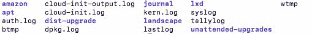

上面的示例显示了使用 Amazon AWS 的控制台截图。列出的某些目录与本指南开始处考试中取的取的相同。

在显示这些信息时，你可能会发现某些重复内容，例如按不同数字报告的 `daemon.log.0`。不要惊慌。这些文件是由系统通过复制和粘贴初始文件来生成新文件生成的。初始文件并没有完全从你的操作系统中删除，而是被单独压缩了。这种被称为日志轮（log rotation）的实用运行高效，可以节省空间。结果，你可能会在文件列表中发现类似 `daemon.log.0.gz` 的内容，这表示文件已压缩在 `.gz` 归文件中。

无问题地编辑文件最简单的方法之一就是直接在控制台中中使用 `nano` 命令。输入下面的示例，你可以读取 `kernel.log` 文件的内容：

```bash
nano kernel.log
```

完成编辑后，你可以使用组合键 `CTRL + C` 直接关闭它。

编辑日志文件的另外两个有用功能是 `head` 和 `tail`。这两个命令用于显示文件的头部和底部的内容。

```bash
head file.log
```

使用 `head` 命令，你可以查看 `file.log` 文件顶部的几行。

如果你需要显示从开始的 15 行，只需输入：

```bash
head -n 15 file.log
```

结果，`tail` 命令的作用与 `head` 命令相反。该命令精确地显示底部的内容：

```bash
tail file.log
```

像 `head` 命令一样，`tail` 也具有相同的功能。通过指定行数，它可以显示 15 行而不是固定的 10 行：

```bash
tail -n 10 file.log
```

如果你需要同时监控文件并查看文件的编辑，你可以使用命令 `tail -f`：

```bash
tail -f file.log
```

另一个你可以执行的命令是对日志文件内容的任何搜索。你可能想使用下面的命令在 `file.log` 中搜索单词 `mail`：

```bash
grep "mail" file.log
```

此外，你也可以使用 `grep` 配合 `^` 来查找行首重复的单词：

```bash
grep "^mail" file.log
```

# 管理用户和组

管理用户和组对于任何用户或管理员来说都是一项关键任务。主要原因之一是因为良好的管理实践对网络和系统安全是有效的。此外，对这个主题充满信心是关重要的，以保护你的数据免受外部源的影响。

在开始介绍用于这些程序的命令之前，你应该了解用户和组是如何工作的。

每个用户都彼此隔离，并且在其账户下有其在使用时使用的文件夹、文件和应用程序。因此，一旦特定用户的会话激活，操作将在该配置下完成。

默认情况下，安装的新操作系统有一个定义为 `root user` 的用户名。

输入以下命令以 root 管理员身份工作：

```bash
su
```


然而，此操作需要输入密码，而该密码通常在系统中不可用。因此，避免任何问题的常见做法之一是在任何命令前加上 `sudo` 单词。这种方法允许自动以 root 权限运行命令。如果你被允许作为 root 用户工作，你就可以进行任何编辑。

通过使用 `sudo` 命令，你可以运行命令并对文件进行更改，例如配置文件、所有用户通用的应用程序，以及编辑所有用户的文件夹和文件的权限。没有 root 用户访问权限可能会阻止你向系统上安装或编辑设置。所有的 root 权限都已添加到 `/etc/sudoers` 下的“sudoers”文件中。

```
sudo cat /etc/sudoers
```

运行上述命令，你可以看到 `/etc` 文件夹的内容，而这在其他情况下是无法访问的。

以下命令显示了当前操作系统上可的用户列表：

```bash
cut -d: -f1 /etc/passwd
```

此外，你还可以查看当前正在使用的用户：

```bash
whoami
```

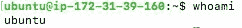

管理用户的下一步是如何创建用户组。此操作的主要目标是创建具有相同规则和功能的组。这项任务非常有用，因为属于同一组的所有用户都可以操作同一组文件夹、文件，并且他们被允许执行某些应用程序。

## 在用户上应用更改

### 添加新用户

常见操作之一是添加新用户。要执行此任务，你只需要像下面一样输入，使用 `adduser` 命令后跟新用户的名称：

```bash
sudo adduser user1
```

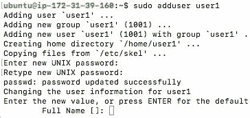

首先，需要管理员密码来运行 `adduser` 命令。

然后，它会要求输入与新用户相关的密码并再次输入。

此外，另一个要求是用户的全名，在我们的示例中为“User1”。

之后，操作系统还需要诸如房间号、工作电话、家庭电话等信息。这些信息都是可选的。最后，它会询问信息是否正确。只需输入：

```bash
Y
```

新用户现在已添加到你的列表中。

### 验证用户是否为组成员

运行 `id` 命令查看该用户是否为组成员：

```bash
id user1
```

### 删除用户

你可以使用 `deluser` 命令后接要删除的用户名称来删除用户：

```bash
sudo deluser user1
```

### 锁定和解锁特定用户

可以使用以下命令锁定或解锁用户：

```bash
sudo passwd -l user1
sudo passwd -u user1
```

选项 `-l` 和 `-u` 的作用是分别锁定和解锁用户。

### 查看与用户相关的所有进程

如果你想查找有关如“user1”等某个用户的进程详细信息，输入命令 `ps`：

```bash
ps -u user1
```

## 在组上应用更改

### 如何查看你是否属于某个组

运行以下命令查看你属于哪个组：

```bash
groups
```


示例中报告的组有 ubuntu, adm, dialout, cdrom, floppy, sudo, audio, dip, video, plugdev, lxd, netdev。

此外，你可以使用以下命令检查你的用户是哪些组的一部分。你可以显示服务列表以及你所需的权限（如 root）。

```bash
sudo cat /etc/group
```

### 将用户添加到组

用于将用户添加到已知组的命令是 `usermod`。你需要指定参数为用户名，然后是要关联的组。

```bash
sudo usermod -a -G user1 ubuntu
```

在上面的示例中，“user1”被添加到“ubuntu”组中。

再次运行命令查看用户列表，你可以检查用户是否已添加：

```bash
sudo cat /etc/group
```

如下所示，用户已成功添加并显示在“ubuntu”下。

```
user1:x:1001:ubuntu
```

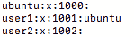

### 创建新组

当你需要创建一个尚不存在的新组时，可以使用 `groupadd` 命令和组名（组可以是“usergroup1”）。

```bash
sudo groupadd usergroup1
```

### 从组中删除用户

正如我们之前在本节中针对用户看到的那样，用户也可以从组中移除。要应用这些更改，请使用 `deluser` 命令，后接用户名然后是组名。

```bash
sudo deluser user1 usergroup1
```

如果你想查看用户属于哪些组，只需使用以下命令：

```bash
sudo groups user1
```

然后，按下组合键 `CTRL + X` 退出文件并输入“Y”保存更改。系统会要求以相同的名称“visudo”保存文件以覆盖它。按 `enter` 继续。

新的“user1”现在能够以 root 权限执行任何命令。

## 权限

对于用户来说，权限是一个非常有用的操作。在这种情况下，你需要输入信息列表：

*   第一个是类型，可以是文件 (-)、目录 (d) 或符号链接 (l)
*   用户权限、组权限和其他权限被分为：
    *   读取 (r)
    *   写入 (w)
    *   执行 (x)

对于读取、写入和执行的每种操作，都根据角色被分配了一个数字。

### 给用户授予权限

可能会产生大量工作的操作之一是编辑特定用户的权限。此操作需要检查包含所有用户信息的“visudo”文件。

首先，使用以下命令打开 `visudo` 文件：

```bash
sudo nano visudo
```

现在，在此处输入如下内容，并将“user1”替换为需要需要授予 root 权限的用户名：

```
user1 ALL=(ALL) ALL
```

此外，你也可以按照此处所示给 user1 授予权限：

```
User_Alias ADMINS = user1
Cmnd_Alias HTTPD = /etc/init.d/httpd
ADMINS ALL = HTTPD
```

### 如何向目录添加权限

下面你将找到为“NewFolder”文件夹添加读取和写入权限的方法：

```bash
sudo chmod -R g+w $HOME/Documents/NewFolder
```

同样，也可以向想要访问“NewFolder”文件夹的用户拒绝权限：

```bash
sudo chmod -R o-x NewFolder
```

通过此程序，你能够同时给一个组和多个组授予权限。为了克服这一限制，你可以使用访问控制列表（ACL）。这里的命令允许对“NewFolder”文件夹进行“读取”权限。这意味着该文件夹现在对于名为“users3”的组也是访问的，而无需涉及其他用户的权限。

```bash
setfacl -m g:usergroup3:rx $HOME/Documents/NewFolder
```

允许同一组的用户写入“NewFolder”文件夹，请使用以下命令：

```bash
setfacl -m g:auditors:rwx $HOME/Documents/NewFolder
```

## 执行常规系统健康检查

保持系统性能稳定的良好做法是检查并对整个系统运行检查。操作系统的可靠性取决于虚拟内存状态（这可以通过 `vmstat` 系统实用程序访问）、CPU 使用率、硬盘驱动器使用情况、输入输出设备、网络分析以及当前运行的进程。所有这些操作对于 Linux 服务器管理员都是至关重要的。

### Top 命令 – 监控任务

需要记住的非常重要的步骤之一是实时监控资源以及硬件的使用情况。虽然这看起来可能没用，但你可能会发现这种方法有助于监督所有活动并就何处干预做出决策。该命令显示 CPU 使用率、内存状态、交换内存、缓存大小、缓冲区大小、进程 PID 等……

```bash
top
```

运行以下命令 `top` 查看所有运行的服务：


## top

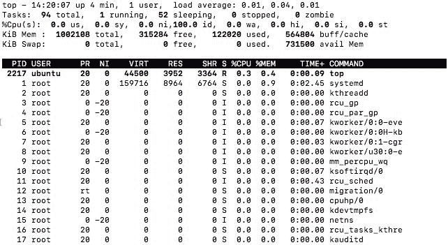

如上所示，你获得了一份关于当前运行服务的完整报告。你可以通过按下键盘上的“q”来退出实用程序。

你也可以通过以下命令在显示 10 个结果后退出：

```bash
top -n 10
```

列出的术语详细说明如下：

*   `PID`: 进程 ID
*   `PR`: 标识任务的优先级
*   `SHR`: 每个活动的共享内存使用情况
*   `VIRT`: 每个活动的虚拟内存使用情况
*   `USER`: 运行任务的用户
*   `%CPU`: CPU 使用率
*   `TIME+`: 以秒为单位表示的 CPU 时间
*   `SHR`: 每个活动的共享内存大小 (kb) 使用情况
*   `NI`: 活动的 Nice 值。优先级可以是正数也可以是负数，意味着优先级较低或较高
*   `%MEM`: 每个活动的内存使用情况

### 使用不同顺序进行排序的信息

`top` 命令允许按不同的顺序列出信息。在这里你可以看到一些对任务进行排序的示例。

### 按进程 PID 排序

例如，你可能想按进程 PID 对统计数据进行排序。要添加过滤器排序数据，请按下 `SHIFT + O` 组合键。现在你可以决定如何过滤你的信息。按下“a”查看进程 PID。

在键盘上按下 `SHIFT + O` 后，输入以下内容：

```
a
```

### 选项 -k – 杀死进程

现在你已经知道了 PID 进程的名称，可以使用选项 `k` 杀死一个进程：

```bash
top -k
```

然后，按下任意键返回屏幕顶部。之后，如果你想退出报告，只需按下：

```
q
```

### 按 CPU 使用率排序

组合键 `SHIFT + P` 允许你按 CPU 使用率对任务。

### 选项 -u - 用户

如果你需要显示已知用户的报告，请输入以下选项：

```bash
top -u user1
```

如示例所示，执行 `top` 命令后接选项 `u` 和 `user1`，其中 `user1` 是当前执行操作的用户。

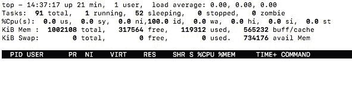

### -b 选项 - 批模式

使用选项 `-b` 将输出到文件或任何其他应用程序：

```bash
top -b
```

### 选项 -s – 安全模式

选项 `top -s` 启用安全模式：

```bash
top -s
```

### 选项 -d – 延迟时间

虽然延迟时间的默认设置为 3s，但你可以使用此处所示的选项 `-d` 来编辑此设置：

```bash
top -d 2
```

通过传递参数 `-d` 和 `2`，它将延迟时间设置为 2 秒。

### 选项 -c - 绝对路径

按下选项 `c` 列出运行进程的绝对路径。

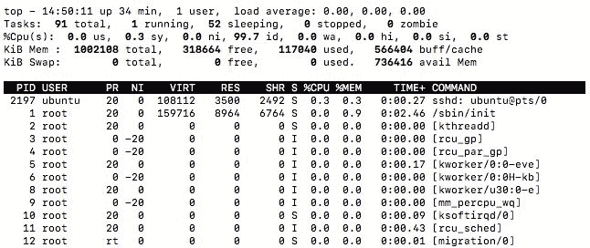

再次按下“q”可以离开终端，但不显示任务列表。

### 选项 -h – 帮助

如果你需要所有可用命令的摘要，请按下：

```bash
top -h
```

现在，你可以看到适用于你的 Linux 发行版的各种选项。

## 监控内存

通过第一步，你查看了系统的整体性能。现在你可以深入了解内存使用的更多细节。为什么这非常重要？

任务负载和数据量的同时增加可能意味着内存使用的增加。结果是，当内存不足时，系统可能会性能下降并使用其他资源（例如 CPU），而这些资源通常应该定期使用而不应超过某个水平。

你想要处理的主要活动之一是检查操作系统中的可用空空间。

输入以下命令查看内存中当前可用的空间：

```bash
watch free -m
```

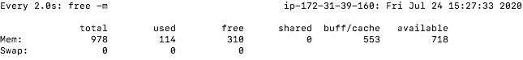

默认情况下，内存使用每两秒更新一次。你可以通过添加 `-n 10` 来更新此设置，以便每 10 秒刷新一次：

```bash
watch -n 5 free -m
```

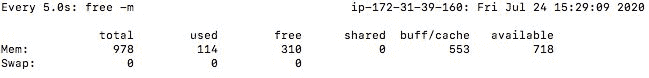

使用的内存量以 MB 表示。这意味着机器上的总物理内存为 978 MB，已用 114 MB，剩余 310 MB，没有共享空间。缓冲缓存为 553MB，仍有 718 MB 可用。相反，交换空间为 0。

要退出，只需按下 `CTRL + X`。

## VmStat (虚拟内存统计)

VmStat 是一个本质的实用程序，提供有关虚拟内存统计的信息。这意味着它显示了内存使用、分页、硬盘状态和 CPU 使用率等的摘要。

运行下方的命令查看上次重启以来的信息：

```bash
vmstat
```

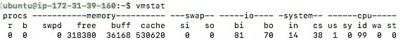

更多细节是关于进程、内存、交换、io、系统和 CPU 的报告：

*   **Procs**（进程）
    *   `r`: 等待运行时间的进程数。
    *   `b`: 不可中断睡眠的进程数。
*   **Memory**（内存）
    *   `swpd`: 使用的虚拟内存量。
    *   `free`: 空闲内存量。
    *   `buff`: 缓冲内存量。
    *   `cache`: 缓存的内存量。
    *   `inact`: 不活跃内存量。
    *   `active`: 活跃内存量。
*   **Swap**（交换）
    *   `si`: 换入的内存量。
    *   `so`: 换出的内存量。
*   **IO**（输入/输出）
    *   `bi`: 从设备接收的块。
    *   `bo`: 发送到设备的块。
*   **System**（系统）
    *   `in`: 每秒中断数。
    *   `cs`: 每秒上下文切换数。
*   **CPU**
    这些是占总 CPU 时间的百分比。
    *   `us`: 运行非内核的时间（用户时间）。
    *   `sy`: 运行内核的时间（系统时间）。
    *   `id`: 空闲花费的时间。
    *   `wa`: 等待 IO 的时间。
    *   `st`: 从虚拟机中窃取的时间。

所有上述报告的信息都可以通过输入访问：

```bash
man vmstat
```

### 为什么检查 VmStat 如此关重要？

你应该关注的列之一是 `swap`。确保此数据设置为 0 或接近 0 非常重要。高值表示存在相当的问题。导致交换的一些原因可能包括影响内存导致使用过载的应用程序、配置中的某些问题，或者机器安装的内存较少。

无论情况如何，尝试识别问题对于未来包含任何问题始终是积极的。正如之前看到的，`top` 命令能够帮助你监控进程的活动。

### 执行指定秒数的 VmStat

输入以下命令：

```bash
vmstat 2 4
```

执行此命令后，报告将每 2 秒更新 4 次，然后停止。正如本节之前提到的，数据指的是自上次重启后的更新值。

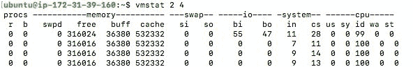

正如 `man vmstat` 的摘要所示，`r` 指向运行队列，该队列是指每个应用程序必须等待才能执行的队列。

你可以通过某些选项查看有关信息的详细信息。

### 选项 -a – 活跃和不活跃内存

选项 `-a` 还指定内存的活跃和不活跃状态。

### 选项 -t – 时间戳

使用选项 `-t` 查看每行的时间戳。

```bash
vmstat -t
```

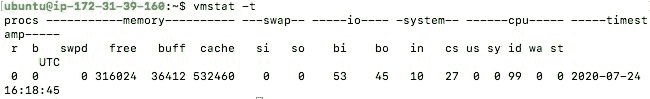

### 选项 -d – 磁盘

使用选项 `-d`，你可以如下所示查看磁盘状态：

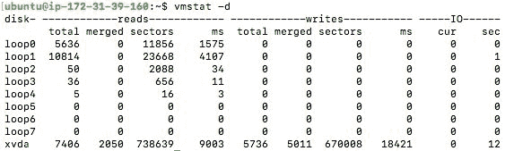


硬盘数据提供了读取、写入、IO 三列。在总结部分，列出了完整的写入扇区列表、可读扇区列表以及访问这些信息的时间。

### -s 选项切换

使用 `-s` 选项，你可以查看事件和内存统计信息。

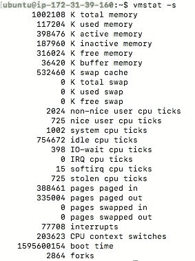

## iostat 命令 – CPU 和 I/O 统计数据

`iostat` 是一个监控输入输出设备和 CPU 数据的工具。为了优化所有资源，明确了解每个设备的加载时间、文件平均传输时间等信息至关重要。

尝试执行 `iostat` 命令时，你可能会发现类似的输出，提示需要安装 `sysstat`：

```
iostat
```

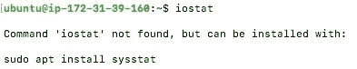

按照以下格式输入相应的命令：

```bash
sudo apt install sysstat
```

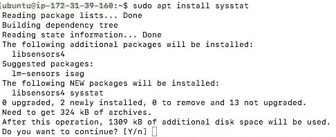

只需输入“y”即可继续 `sysstat` 的安装。


安装完成后，再次输入：

```bash
iostat
```

随后你就可以显示如下所示的信息：

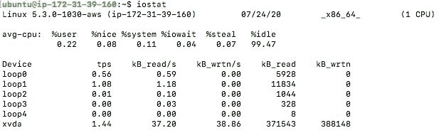

### -c 选项 – CPU 统计数据

`-c` 选项用于仅显示与 CPU 相关的统计数据：

```bash
iostat -c
```

CPU 使用率的统计数据对于识别如何找出机器运行缓慢非常有用，特别是当它只有一个内核而不是两个时。

### -d 选项 – 磁盘 I/O 统计数据

`-d` 选项用于仅显示磁盘分区，显示如 `sda` 等设备。信息包括显示在磁盘中的写入操作响应时间。

```bash
iostat -d
```

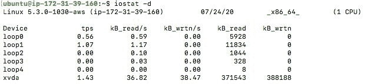

操作系统将所有信息存储在内存中。执行此活动的最佳方法是将数据保存在临时内存中，而不仅仅使用物理内存。通过访问所谓的“缓存”，你的信息可以更快地传递。

### -p 选项 – 磁盘 I/O 统计数据

一旦确定了想要检查的磁盘，可以使用 `-p` 选项对其进行进一步调查，如下所示：

```bash
iostat -p loop0
```

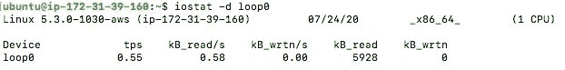

如上所示，关于设备 `loop0` 有特定的信息，描述了写入、读取速率等。

### -N 选项 – LVM 统计数据

`-N` 选项提供了有关 LVM 统计数据信息：

```bash
iostat -N
```

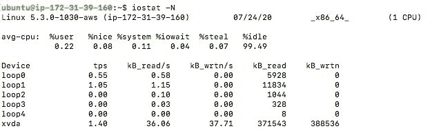

### -v 选项 – iostat 版本

输入 `-v` 选项查看 `iostat` 版本。

## iotop 命令

`iotop` 是一个可以安装在 Ubuntu 发行版上的实用，用于跟踪使用输入输出设备的活动。它利用内核和 Python 工作。

在 Ubuntu 中，可以通过 `apt` 命令轻松安装 `iotop` 实用。输入 `iotop` 命令查看结果：

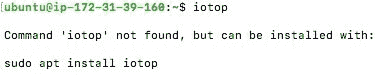

然后，安装完成后，运行命令：

```bash
sudo iotop
```

命令结果显示了一个包含 `TID`、`PRIO`、`USER`、`DISK READ`、`DISK WRITE`、`SWAPIN`、`IO>` 和 `COMMAND` 列的列表。`command` 列指的是检查的进程或线程类型，而其他列仅显示等待 I/O 时的读写时间。`IO` 命令处理每个进程的 IO 使用情况。`Swapin` 处理每个列出进程的交换分区使用情况。

你也可以应用过滤器只显示显示特定 I/O 信息的进程：

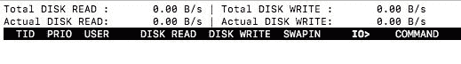

该命令的一些实用选项有：

*   `-d SEC`, `--delay=SEC`。设置迭代之间的延迟（单位为秒，默认 1 秒）。它接受非整数值，例如 1.1 秒。
*   `-p PID`, `--pid=PID`。提供要监控的进程/线程列表（默认所有）。
*   `-u USER`, `--user=USER`。提供要监控的用户列表（默认所有）。
*   `-P`, `--processes`。仅显示进程。通常 `iotop` 会显示所有线程。
*   `-a`, `--accumulated`。显示累积的 I/O 而不是带宽。在此模式下，`iotop` 显示自 `iotop` 启动以来进程执行的 I/O 量。
*   `-k`, `--kilobytes`。使用千字节而不是易读的单位。这种模式在编写 `iotop` 批量脚本时非常有用。`iotop` 将不再选择最合适的单位，而是以千字节显示所有大小。
*   `-t`, `--time`。在每行添加时间戳（隐含 `--batch`）。每行都将以当前时间作为前缀。
*   `-q`, `--quiet`。抑制某些表头行（隐含 `--batch`）。该选项可以指定三次以删除表头行。

输入 `man iotop` 查看此处报告的所有可用选项。

## htop 命令

`htop` 命令是 Ubuntu 中可用的工具，无需安装。它是 `top` 命令的良好替代方案，同样提供了当前正在执行的进程的实时信息。

输入命令查看结果：

```bash
htop
```


如上所示，你可以垂直滚动查看列表，然后水平滚动查看完整概述。你可以直接杀死进程，无需输入 PID。此外，`htop` 更符合用户习惯，因为你可以使用指针进行选择。突出的一些主要信息是 CPU 使用率、内存使用率时间和。

在下方，你会找到关于 CPU、内存、交换区的统计数据，还会显示任务、平均负载和运行时间。

如示例所示，你会看到带有不同颜色的进度条。每种颜色对应一种含义：

*   蓝色：低优先级的 CPU 使用
*   绿色：普通优先级的 CPU 使用
*   红色：系统进程的 CPU 使用
*   橙色：通过 IRQ 时间的 CPU 使用
*   洋红色：通过普通 Soft IRQ 时间的普通优先级 CPU 使用
*   灰色：通过 IO Wait 时间的 CPU 使用
*   青色：通过 Steal 时间的 CPU 使用

列中的选项卡指示什么？在这里你可以查看每个术语代表的更多详细信息：

*   `PID`：进程 ID
*   `USER`：正在使用机器的用户
*   `PRI`：进程的优先级
*   `N`：用户或 root 重置的进程优先级
*   `VIR`：使用的虚拟内存
*   `RES`：使用的物理内存
*   `SHR`：使用的共享内存
*   `S`：进程状态
*   `CPU%`：进程的 CPU 使用率
*   `MEM%`：进程的内存使用率
*   `TIME+`：执行进程所需的时间
*   `Command`：进程本身

所有进程默认根据 CPU 使用率过滤。可以使用键盘尝试一些额外功能：

*   向上和向下：使用键盘查看进程
*   `U`：用于查看特定用户的进程
*   `P`：过滤 CPU 使用率较高的进程
*   `M`：过滤内存使用较高的进程
*   `T`：根据时间过滤进程
*   `H`：用于 `htop` 帮助

在 `htop` 命令底部，你可以找到通过 F1 到 F10 命令访问的选项（如帮助、设置、过滤树杀死、nice、退出）。

## /proc/meminfo 文件

`/proc` 目录下的 `meminfo` 文件总结了机器使用的内存，这意味着物理内存和虚拟内存、共享内存以及缓冲区。

输入以下命令查看输出：

```bash
cat /proc/meminfo
```


一些重要信息关于 `MemTotal`、`MemFree`、`MemShared`、`MemShared`、`Buffers`、`SwapCache`。`MemTotal` 是可用内存，部分由内核使用。`Buffers` 是缓冲区缓存中的内存。`Cached` 是页缓存中的内存。`SwapCache` 是交换文件中的可用内存。

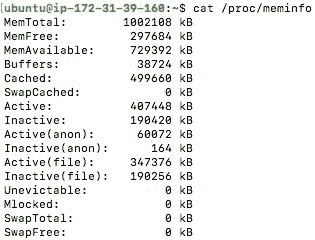

虚拟机统计（VM Statistics）提供了关于内存“活动”（active）和“非活动”（inactive）状态的详细信息。当负载超过时，未使用部分可以被用途。

其他信息关于 `HighTotal`（高区域内存）、`RAM`、`LowTotal`、`LowFree`、`SwapTotal`（物理交换内存）、`SwapFree`（空闲交换内存）、`Dirty`（可以写入的内存）、`Writeback Memory`（正在积极回写的内存）、`Mapped`（待映射的文件）、`Slab`、`Committed_AS`、`PageTables`、`ReverseMaps`（完成的反向映射数量）、`VmallocTotal`（vmalloc 内存区域）、`VmallocUsed`（已使用的 vmalloc 区域）、`VmallocChunk`。

# Lsof – 列出打开的文件

正如名称所示，`Lsof` 代表打开文件列表（List of open files），指的是磁盘文件、网络套字、管道、设备和进程等文件。文件打开意味着它们正在运行。

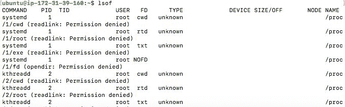

在报告的表格顶部，你会有 `COMMAND`、`PID`、`TID`、`USER`、`FD`、`TYPE`、`DEVICE`、`SIZE/OFF` 和 `NODE NAME` 值。

深入研究更多信息，`FD` 意味着“文件描述符”（File descriptor），接受以下值：

* `Cwd`: 当前目录
* `Rtd`: 根目录
* `Txt`: 文本文件
* `Mem`: 内存映射文件

然后，后续的值是：

* `R`: 读取
* `W`: 写入
* `U`: 读写

# 用于健康检查的其他工具

## Nmon 工具

该工具的目标是分析系统在 cpu、内存、网络、磁盘、文件系统、nfs、顶层进程、资源和功率微分区方面的性能。

在 Ubuntu 发行版中，你需要使用以下命令安装该工具：

```bash
sudo apt install nmon
```

安装完成后，运行下面的命令 `nmon`：

```bash
nmon
```

如下所示，显示所有统计数据。通过 `c` 选项，你可以过滤关于 CPU 的信息。

按下 `CTRL + C` 退出该工具。

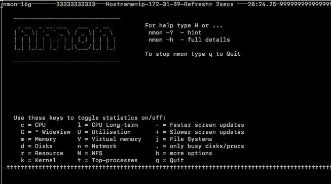

### “t”选项 – 顶层进程

`t` 选项列出顶层进程：

```bash
nmon -t
```

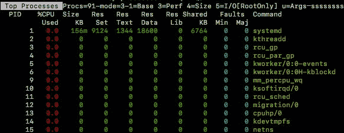

### “r”选项 – 资源

`r` 选项显示所用资源信息，可以是 CPU。

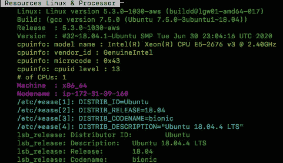

### “n”选项 – 网络

`n` 选项显示网络详细信息。

### “d”选项 – I/O 磁盘

`d` 选项显示 I/O 磁盘信息。

### “k”选项 – 内核

`k` 选项显示内核信息。

### “n”选项 – NFS

`n` 选项显示 NFS 数据信息。

### “j”选项 – 文件系统

`j` 选项显示文件系统信息。

## Collectl 工具

除了“top”和“htop”命令外的额外工具是 Collectl。Collectl 工具可以提供关于 cpu、内存、网络、磁盘、文件系统、nfs、顶层进程、资源和功率微分区的详细信息。Collectl 工具可以提供……（此处原文有重复，已对应翻译）除了“top”和“htop”命令外的额外工具是 Collectl。Collectl 工具可以提供关于 cpu、内存、网络、磁盘、文件系统、nfs、顶层进程、资源和功率微分区的详细信息。Collectl 工具可以提供…… 

除了“top”和“htop”命令外的额外工具是 Collectl。Collectl 工具可以提供关于 cpu、内存、网络、磁盘、文件系统、nfs、顶层进程、资源和功率微分区的详细信息。

（注：原文中存在多处段落重复，已按要求逐行翻译并保持了格式对应）

...（此处根据原文逻辑继续翻译重复部分）


- **等待（Waiting）**：进程正在等待程序或某些资源的响应，这些资源是完成指令所需的基础。如果进程正在等待某些服务或非物理源，它们可能会被中断。如果它们正在等待使用硬盘，进程是无法被中断的。
- **已停止（Stopped）**：进程由于某些原因（如调试模式）停止工作。
- **僵尸（Zombie）**：进程仍在列表中，但已不再运行。

在 Linux 中，管理进程操作最常用的命令是 `ps` 和 `top` 命令。

## `ps` 命令

`ps` 一词代表 process status（进程状态）。执行此命令，你可以看到当前活跃的进程：

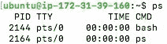

如果你想列出所有进程，请使用以下两个选项之一：

```bash
ps -a
```

```bash
ps -e
```

## 通过 `kill`、`pkill` 和 `killall` 监控进程

### `kill` 命令

了解进程的 PID 对于采取行动并杀死它至关重要。如果你想杀死 Chrome 进程，你需要知道该进程的名称：

```bash
pidof chrome
```

现在你已经有了 PID，可以直接杀死该进程：

```bash
kill PID_NUMBER
```

之后，你可以检查 Chrome 进程是否仍然活跃：

```bash
pidof chrome
```

另一个实用的选项是应用 `kill` 命令通过一个命令同时删除多个进程，如下例所示：

```bash
kill PID_NUMBER1 PID_NUMBER2
```

请始终记住，每个用户都可以杀死自己的进程，但不能杀死属于其他用户的进程以及系统进程。只有具有 root 权限的用户才允许杀死任何用户的进程或系统进程。

### `pkill` 命令

与其使用标识进程的数字 PID，你也可以应用相同的概念，通过名称来删除进程。在接下来的示例中，你将使用 `pkill` 命令杀死 MySQL 进程。

```bash
pkill mysqld
```

### `killall` 命令

正如从名称上想象的那样，`killall` 命令能够杀死与主进程相关的所有进程。例如，如果你有一个带有子进程和其他实例的父进程，将需要时间来确定对哪些进程采取行动。而使用 `killall` 命令要简单得多。

重复相似的之前的示例，你可以像如下所示杀死 MySQL 进程，删除所有链接到它的实例：

```bash
killall mysqld
```

最后，始终使用 `pidof` 命令检查进程是否仍在运行：

```bash
pidof mysqld
```

### `pgrep` 实用程序

`Pgrep` 是一个有效的替代工具，其用途与我们之前看到的类似。`Pgrep` 是一个允许查找进程 ID 的命令。从命令行执行此命令时，它会返回数值值。

例如，如果你想找到 SSH 服务器的 PID，可以输入以下命令：

```bash
pgrep ssh
```

输出应该显示类似此处的内容。如果没有匹配到请求的程序名称，它将报告值为“0”，意味着没有你正在查找的条目。

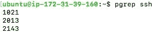

在标识 PID 后，你可以使用相同的命令 `kill` 后加上名称 ID。

如果你还想知道列出的每个条目的名称，可以如下所示应用 `-l` 选项：

```bash
pgrep ssh -l
```

显示的命令展示了名称 `sshd`，以便你可以看到每个 PID 匹配什么。

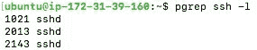

## 监控工具

### Glances 工具

`Glances` 是一个跨平台工具，适用于多种操作系统和 Linux 发行版。该工具用 Python 编写，能够实时运行并监控这些资源的性能：

* CPU
* 内存
* 负载 (Load)
* 进程列表
* 网络接口
* 磁盘 I/O
* IRQ / Raid
* 传感器
* 文件系统
* Docker
* 监控
* 告警
* 系统信息
* 运行时间
* 快速查看 (CPU, MEM, LOAD)

`Glances` 可以作为 `top` 命令的替代品，因为它工作更精确，提供了关于每个资源及其在系统中使用情况详细数据，并证明了哪些资源正在被更多使用。

### 安装 Glances

Glances 不是 Linux Ubuntu 的原生应用程序。运行 `glances` 命令需要通过 APT 安装应用程序：

```bash
glances
```

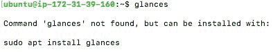

然后，使用命令开始安装 glances：

```bash
sudo apt install glances
```

命令行询问你是否继续，因为安装软件需要大约 100MB 的额外空间。输入“Y”完成安装。

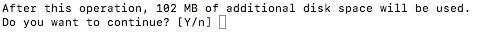

所有软件包都将下载并安装。

现在再次运行命令：

```bash
glances
```

新安装的实用程序应该显示类似此处的内容：

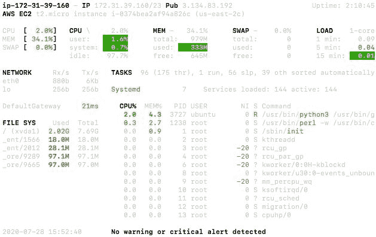

在此工具中，你可以找到一个包含系统所有信息的摘要部分，并且可以水平滚动。

从顶部开始，在第一行找到主机名、Linux 发行版、内核版本和系统运行时间。

在下一行，有一份关于 CPU、内存使用、交换分区（swap）和负载统计的数据列表。所有信息都以百分比显示，并在行左侧有简短摘要。

至于 CPU，`Glances` 提供了许多关于以下内容的细节：

* `CPU`: CPU 使用百分比
* `User`: 用户环境中可用的应用程序
* `System`: 正在运行的内核应用程序
* `Idle`: 空闲时间
* `Nice`: 此值定义了进程的优先级
* `Irq`: 中断 CPU 的请求
* `Iowait`: 在再次运行进程之前等待 I/O 输入的状态
* `Steal`: 虚拟 CPU 正在等待处理其他进程物理 CPU
* `Ctx-sw`: 每秒上下文切换次数
* `Inter`: “Inter”代表中断，意味着从设备工作到中断 CPU 使用所需的时间
* `Sw_int`: 与软件相关的中断

至于内存，你可以在此处找到更多详细信息：

* `MEM`: 以百分比表示的内存使用率
* `Total`: 上物理安装的 RAM 总量
* `Used`: 不包括缓存或缓冲器的内存量
* `Free`: 仍然可用的内存
* `Active`: 当前活跃使用的内存
* `Inactive`: 当前未活跃使用的内存
* `Buffers`: 通常用于连接输入或输出设备的缓冲区空间
* `Cached`: 在移动数据到物理内存之前临时保存数据的内存

在进程部分，你可以找到当前在机器上运行的进程信息：

* `CPU%`: 每个核心的 CPU 百分比使用
* `MEM%`: 每个进程在运行时使用的 RAM 内存
* `VIRT`: 每个进程使用的虚拟内存，以兆字节为单位
* `RES`: “RES”指常驻（resident），意味着每个进程使用的物理内存，根据可用空间以千字节、兆字节和千字节计数
* `PID`: 标识每个进程的 ID 数字
* `USER`: 运行进程的用户名
* `TIME+`: 自开始以来每个进程使用的 CPU 时间累计量
* `THR`: 为进程运行的线程数
* `NI`: 进程的 nice 值
* `S`: “S”代表状态；它可以是 R - 运行、S - 睡眠、I - 空闲、T 或 t - 在调试模式下停止，或 Z - 僵尸（进程已死亡但不再可用但在进程列表中可见）
* `R/s` 和 `W/s`: 磁盘读取和写入速率
* `Command`: 激活当前分析进程的命令


在另一个章节中，你可以识别警告和警报，当您需要对该工具的某些部分进行进一步调查时，这些信息非常有帮助。

颜色的变化代表了重要性，让你一眼看出应该优先关注哪里。绿色表示一切正常。蓝色则需要我们留意以弄清楚发生了什么。紫色表示警告，而红色则指出需要快速采取行动的关键问题。

## Glances 选项

在这里你还可以找到一些用于显示特定细节的选项：

* `a`: 自动列出进程
* `c`: 按 CPU 占用列出进程
* `m`: 按内存占用列出进程
* `p`: 按名称列出进程
* `i`: 按 I/O 速率列出进程
* `d`: 显示或隐藏磁盘 I/O 统计信息
* `f`: 显示或隐藏文件系统统计信息
* `n`: 显示或隐藏网络统计信息
* `s`: 显示或隐藏传感器统计信息
* `y`: 显示或隐藏 hddtemp 统计信息
* `l`: 显示或隐藏日志
* `b`: 网络 I/O 使用字节 (Bytes) 或比特 (bits)
* `w`: 移除警告日志
* `x`: 移除警告和严重日志
* `t`: 检查网络和 I/O 设备设置
* `u`: 检查累计网络 I/O

该工具还允许通过网络界面（Web UI）监控本地机器，或将统计数据导出到 CSV 文件。

你可以通过帮助选项 `-h` 或输入 `man glances` 查看关于 Glances 的所有信息。

退出该工具请按 quit：

```
q
```

## 什么是服务？

当应用程序运行时，任务会在机器上执行。服务会等待请求并给出回答。

你可能的问题是你的操作系统中有哪些可用服务。为了回答这个问题，你可以在这里列出所有可的服务：

```bash
service --status-all
```

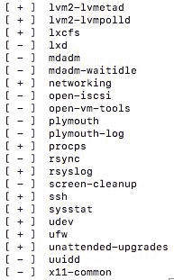

## Systemd 工具

Systemd 是一个系统和服务管理器，可以在进程运行时运行时跟踪它们。你可以使用这个实用的工具来运行、停止或重启服务。在 Systemd 中，单元（units）是可识别为服务的块，例如 `(.service)`、`(.device)`、`(.sockets)`、slice 等……

服务可以并行运行，利用了一种显示服务的新方式。

在启动时，系统在 BIOS 通过引导程序调用后被加载。之后，内核（Kernel）加载 systemd 并运行进程。此时，用户被加载，其环境也通过 systemd 加载。

以下是一些需要记住的目录，用于查找单元文件：

* `/usr/lib/systemd/user/`: 在每个用户创建的文件夹下，你可以找到所有文件
* `/run/systemd/system/`: 单元文件的运行时位置
* `/etc/systemd/system/`: 单元文件可以通过将其存储在此文件夹中进行扩展。

运行 `systemctl` 命令，可以获取 Systemd 下所有可用单元的列表：

```bash
systemctl
```

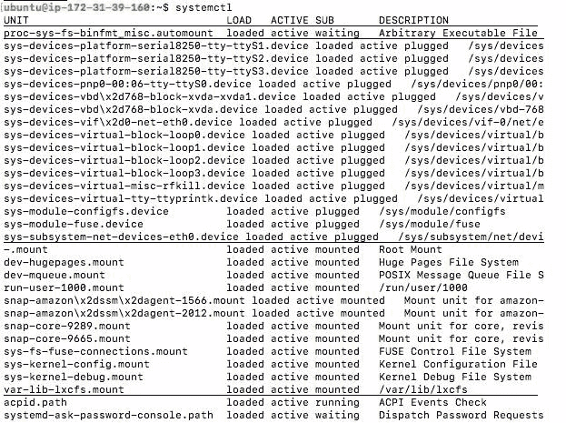

在列表中，你可以看到 `Unit`（单元）、`Load`（加载）、`Active`（激活）、`Sub`（子项）的状态，以及总结每行单元类型的 `Description`（描述）。

然后运行以下命令来查看每个单元当前状态的单元文件列表：

```bash
systemctl list-unit-files
```

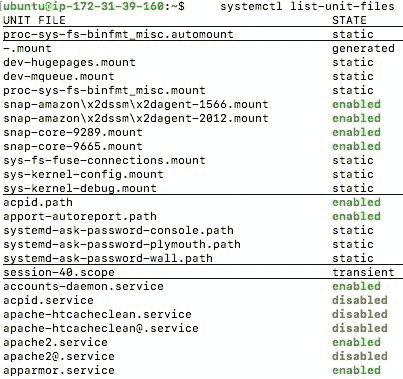

你也可以显示初始化失败的单元：

```bash
systemctl –failed
```

要将分析限制为仅服务而不是所有服务的列表，你可能需要使用以下命令：

```bash
systemctl list-unit-files –type=service
```

要启动服务，输入单词 `start`，然后是服务名称以及扩展名 `.service`：

```bash
systemctl start name.service
```

要停止服务，输入单词 `stop`，然后是服务名称以及扩展名 `.service`：

```bash
systemctl stop name.service
```

要重启服务，输入单词 `restart`，然后是服务名称以及扩展名 `.service`：

```bash
systemctl restart name.service
```

要重载服务，输入单词 `reload`，然后是服务名称以及扩展名 `.service`：

```bash
systemctl reload name.service
```

要查看服务状态，输入单词 `status`，然后是服务名称以及扩展名 `.service`：

```bash
systemctl status name.service
```

### 启用和禁用服务

可以使用 Systemctl 相应的启用和禁用服务。以下命令用于启用服务：

```bash
systemctl enable name.service
```

下方的命令用于禁用服务：

```bash
systemctl disable name.service
```

### 掩蔽或取消掩蔽服务

每个服务都可以被掩蔽或取消屏蔽，以避免所有单元同时运行。

这是运行掩蔽服务的命令：

```bash
systemctl mask name.service
```

这是运行取消掩蔽服务的命令：

```bash
systemctl unmask name.service
```

## Acct 工具

Acct 工具是一个后台运行的应用程序，用于监控用户运行的操作。该工具的目标是检查任务消耗的资源。作为开发者或管理员，你经常需要确保使用量不会超过阈值且性能稳定。否则，Apache Web Server 等服务可能会出现严重问题，导致加载重要文件时出现延迟。因此，拥有像 Acct 这样的工具对于减少使用不同命令解决相同问题的时间非常有帮助。

该工具的一些主要功能是：

* 登录和注销的用户统计
* 访问机器的用户统计
* 用户之前执行过的命令仍然可用

要安装 Acct 工具，你可以像下面所示使用 APT：

```bash
sudo apt-get install acct
```

在这种情况下，你需要在开头运行 `sudo` 以获得 root 权限运行命令。

输入以下命令查看从 `wtmp` 文件中收集的数据。它们提供了用户连接系统的时间：

```bash
ac
```


### -d 选项

`option -d` 显示以天为单位的时间：

```bash
ac -d
```

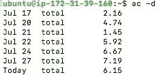

### -p 选项

`option -p` 显示每个用户的总登录时间：

```bash
ac -p
```

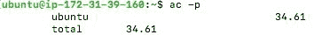

### sa 命令

执行 `sa` 命令可以查看可用且最近执行的命令摘要：

```bash
sa
```

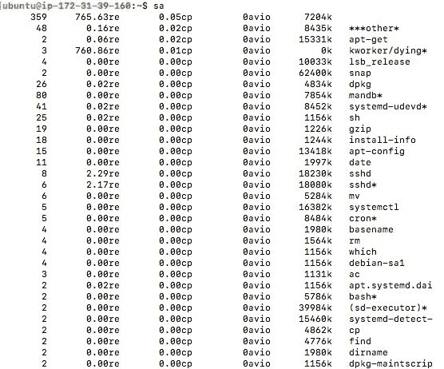

对收集的数据表格进行详细分析，可以看到每一列对应的内容：

* 第 2 列 `0.00re` - 墙钟时间（分钟）
* 第 3 列 `0.00cp` - 系统/用户时间（cp）
* 第 5 列 `1131k` – 单位数量对应的 CPU 时间
* 第 6 列 `ac` – 所指的命令

### -u 选项

`option -u` 显示单个用户的信息：

```bash
sa -u
```

### -m 选项

`sa` 命令结合 `option -m` 显示以 CPU 分钟表示的进程数：

```bash
sa -m
```

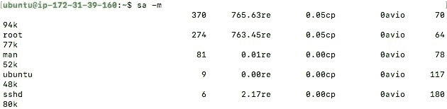

### -c 选项

`sa` 命令结合 `option -c` 显示用户的百分比：

```bash
sa -c
```

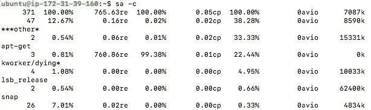

# 如何创建计划任务


Linux 中一项频繁的操作是创建计划任务。为了完成此活动，你可能可以使用 `Cron`，这是一个非常实用的工具，可以让你在你处理其他文件时在后台运行任务。你可以决定调度这些任务的时间，以便它们在不同的时间运行，例如备份、通知、清理系统文件、同步文件等。所有这些操作都被称为“cron 任务（cron jobs）”，它们可以使用 `crontab` 命令运行。“tab”指的是列出所有任务的表格。

在本节的简要介绍中，你可能会复习如何检查系统中是否已经安装了版本的 `Cron`，然后通过命令行运行任务。

用户可以创建自己的 cron 任务，这些任务被收集在 `/var/spool/cron/crontabs` 目录中，尽管它只能通过命令行访问。

## crontabs 权限

`/etc/cron.deny` 目录下的文件可以限制用户编辑 crontab。如果存在 `cron.deny` 文件，用户名通常会列在该文件中，这意味着该用户无法对 cron 任务应用更改。另一方面，如果在同一目录 `/etc/` 下存在 `cron.allow` 文件，则意味着只有列出的用户能够编辑计划任务。当两个文件同时存在时，`cron.allow` 文件将覆盖 `cron.deny` 文件。

信息通常位于这些文件夹：

* `/etc/cron.allow`
* `/etc/cron.deny`（通过编辑该文件我们可以禁用某些用户的某些功能）
* `/var/spool/cron/crontabs`

Cron 通常已经安装在 Linux 发行版中。万一你没有准备好运行的版本，你可以继续更新 APT：

```bash
sudo apt update
```

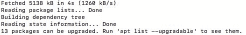

完成更新后，你应该会看到类似的截图，显示 APT 升级的软件包数量。

然后，你可以继续安装 Cron：

```bash
sudo apt install cron
```

安装完成后，你可以启动 Cron 服务。你必须在命令前使用 `sudo` 以以管理员身份运行命令。

```bash
sudo service cron start
```

之后，你可以检查 Cron 服务的状态。在下面你可以看到它应该有的样子。服务结果为已启用，状态为“active (running)”。

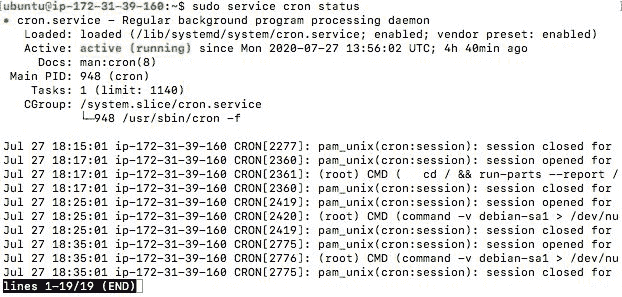

每当你想要添加计划任务时，你就打开并编辑 crontab 文件，通过添加表达式进行编辑。

运行以下命令，你可以编辑当前用户的 crontab 文件：

```bash
crontab -e
```

## crontabs 中的表达式

要创建这些表达式，有一个精确的语法可以遵循：

```bash
0 7 * * * /root/backup.sh
```

此示例在每天早上 7 点执行备份。没有提供日期、月份和星期的信息。这意味着该 cron 任务每天都会激活并重复。

下面是表达式的总结：

* 第一位置：分钟，取值在 0 到 59 之间 – 示例中的值为 0
* 第二位置：小时，取值在 0 到 23 之间 – 示例中的值为 3
* 第三位置：日期，取值在 1 到 31 之间 – 示例中的值为 `*`
* 第四位置：月份，取值在 1 到 12 之间或从 Jan 到 Dec – 示例中的值为 `*`
* 第五位置：星期，取值在 0 到 6 之间或从 Sun 到 Sat – 示例中的值为 `*`
* 第六位置：脚本或命令（包括命令的路径） – 示例中的值为 `/root/backup.sh`

cron 任务的运算符有：

* 星号 (`*`)：该字段的所有值或任何一个可能的值
* 逗号 (`,`)：引用不同值的列表
* 连字符 (`-`)：引用值的范围
* 分隔符 (`/`)：引用 1/10 或范围的增量

结合运算符与位置所示数字的用法示例例如：

* `* * * *` - 每分钟执行一次操作。
* `15 * * * *` - 每小时后 15 分执行一次操作。
* `0,15,30,45 * * * *` - 每 15 分执行一次操作。
* `*/15 * * * *` - 每 15 分执行一次操作。
* `0 5 * * *` - 每天早上 5:00 执行操作。
* `0 7 * * 2-4` - 每周二、周三和周四早上 7:00 执行操作。
* `15,30 */7 7-12 *` - 在每年最后 6 个月里，每隔 7 小时的第 15 分和第 30 分执行操作。

另一个澄清表达式用法的示例：

```bash
15 7 10 * * /root/backup.sh
```

使用上面的命令，cron 任务已设定为每月 10 号的早上 7:15 执行备份。

一个用字母表示日期的示例：

```bash
30 2 * * mon /root/backup.sh
```

该任务在每周一的凌晨 2:30 执行备份。

## 如何列出 Cron 任务

如之前所示，cron 任务在后台运行，守护进程能够读取信息。选项 `-e` 指用户。

```bash
crontab -e
```

运行命令后，通常会向你展示文本编辑器的选项。默认情况下，如果没有列出选项，广泛使用的编辑器是 Nano：

* `/bin/nano`
* `/usr/bin/vim.basic`
* `/usr/bin/vim.tiny`
* `/bin/ed`

如果你可以决定编辑器，只需输入 1 到 4 的选项即可。

选项 `-l` 则指向列表。它允许在不编辑的情况下查看文件：

```bash
sudo crontab -l
```

即使你使用 `sudo` 运行命令，如果存在 `cron.deny` 或 `cron.allow` 文件，你可能仍然无法执行代码。

你也可以使用下面的命令并指定用户名：

```bash
sudo crontab -u user1 -l
```

通常此命令应该用 `sudo` 执行，因为只有管理员才有操作 cron 任务的权限。

## 如何删除 cron 任务

你可以决定删除所有 cron 任务。选项 `-r` 代表“删除（erase）”，可以使用以下命令：

```bash
crontab -r
```

此外，你可以删除特定用户（例如 `user1`）的 cron 任务：

```bash
crontab -r -u user1
```

另一个选项提供了在删除前确认的机会：

```bash
crontab -i -r
```

## Crontab 中的字符串

Cron 任务的另一个有用功能是使用字符串，这可以避免重复表达式的相同部分而浪费时间。以下是列表：

* `@hourly`:每小时执行一次，即 `0 * * * *`
* `@midnight`:每天执行一次，即 `0 0 * * *`
* `@daily`:在午夜执行
* `@weekly`:每周执行一次，即 `0 0 * * 0`
* `@monthly`:每月执行一次，即 `0 0 1 * *`
* `@annually`:每年执行一次，即 `0 0 1 1 *`
* `@yearly` 或 `@annually`:每年执行一次
* `@reboot`:在启动时执行一次

## 调度任务的其他示例

虽然看起来非常简单，但显而易见，当你尝试管理特定任务的命令时，结果可能会变得复杂。

这是创建日志文件的语法：

```bash
0 * * * /path/to/your/script >> /var/log/cron.log
```

在 syslog 中查看 cron 任务的执行情况：

```bash
grep 'CRON.*(yourusername)' /var/log/syslog
```

有关 Linux Ubuntu 中 `crontab` 命令的更多详细信息，你可以如下所示进入：

```bash
man crontab
```


`ping` 命令代表 Packet Internet Groper（数据报网络探测器），广泛用于测试提供 IP 地址的服务器活动状态。通过 `ping` 命令，你可以检查你正在查找的 IP 是否处于激活状态。

该命令通过数据包（互联网控制消息协议 ICMP）发送请求来工作。同时，接收端用另一个互联网控制消息协议进行响应。这种通信可能会导致延迟等问题，这可以通过运行 `ping` 命令得到证明。此外，在数据传输过程中某些数据包可能会丢失。

一旦输入 `ping` 命令，它将无限次地重复相同的操作。

输入以下命令来 ping google.com：

```bash
ping google.com
```

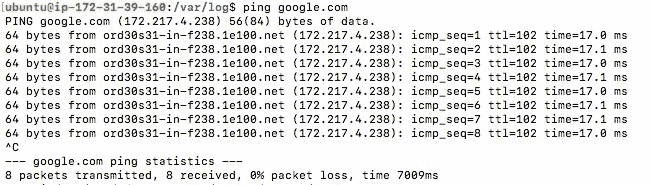

在每一行中，你都可以看到 `ping` 命令的结果。

56 字节是默认的数据字节数，其中 64 字节用于互联网控制消息协议。当 IP 地址为 `ord30s31-in-f238.1e100.net` `172.217.4.238` 时，连续数据包的序列将从 1 到 n 生成，如下所示：

```text
icmp_seq=1
```

使用 `option -c` 来避免无限地重复相同的操作：

```bash
ping -c 4 google.com
```

数字“4”指的是发送的数据包数量，因此 `ping` 命令能够解释预期发送多少个数据包，然后停止执行。

`ping` 命令非常重要，因为它允许你快速检查尝试访问的服务器是否正在工作。

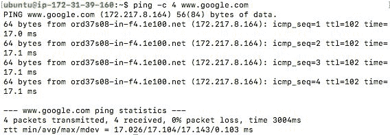

如果你在输入 `ping` 命令后没有收到回复，可能是网络存在问题。在某些情况下，网络问题还会导致通往目的地的连接出现丢包。可以应用的解决方案之一是直接使用下面的命令检查丢失数据包的状态并查看发生了什么：

```bash
traceroute
```

除了 `-c` 之外，`ping` 命令的另一个可用选项是使用 `-i` 选项。当存在如下所示的其他网关源时可以使用此规则：

```bash
ping -I eth0 www.yourdomain.com
```

此外，你还可以选择从 IPv4 或 IPv6 哪种互联网协议发送 ping。IPv4 和 IPv6 分别用 `-4` 和 `-6` 解释。

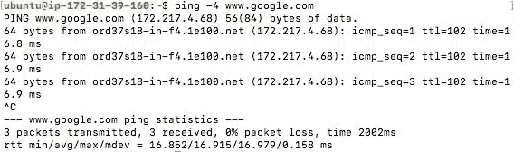

# Netstat 命令

`netstat` 命令是获取网络统计信息的极佳来源。这意味着检查 TCP 和 UDP 端口是否已打开等更多信息。`netstat` 工具通常在你的系统中已经可用。

输入以下命令查看 `netstat` 的当前版本：

```bash
netstat -v
```

在深入研究 `netstat` 命令的潜力之前，你应该对 TCP 和 UDP 端口的工作原理有一个清晰的认识。事实上，TCP 和 UDP 是通过网络发送数据包的两种方法。你需要转发的是端口号、端口类型以及你目的地的 IP 地址。

为了帮你复习一下记忆，TCP 代表传输控制协议（Transmission Control protocol），它是这两种方法中最可靠的一种。它将连接发送者和接收者，并等待后者的回答。连接在两者之间直接建立，仅在结束时停止。另一方面，UDP 代表用户数据报协议（User Datagram protocol），是一种可靠性较低的数据传输方式，但同时对网络的工作负载要求也较低。

为了让服务器与另一台通信，它需要一个可以作为监听器的端口，用于接受来自服务器自身的入站连接。端口可以是开启或关闭的，取决于是否有防火墙等服务阻止数据传输。TCP 端口默认最常用的端口之一是 80 端口。

输入以下命令列出作为监听器的可用 TCP 端口，这意味着它们接受连接：

```bash
sudo netstat -t
```

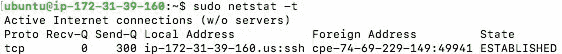

而选项 `sudo netstat -u` 显示了它们正在监听的 UDP 端口：

```bash
sudo netstat -u
```

带有选项 `-l` 的命令显示监听的端口：

```bash
sudo netstat -l
```

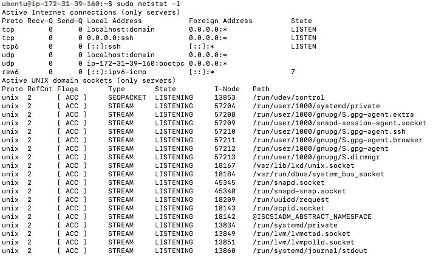

如上面的示例所示，命令显示了一些重要信息。从 `proto` 开始，`ping` 命令产生套字使用的协议，然后是 `local address` 指明 IP 地址以及正在监听的端口，最后是指定为 `LISTEN` 的 `state`。

其他可用的选项：

*   `-n` 显示用点分隔的地址。
*   `-p` 显示 PID（与连接关联的进程标识），必须以管理员权限使用。
*   `-a` 显示用于入站连接的可用套字

所有选项可以同时使用以查看特定的结果。

要检查内核中 `option -a` 下网络接口的统计信息 `option -I`：

```bash
netstat -ai
```

通过以下命令你可以检查服务、其状态和 PID：

```bash
sudo netstat -tunlp
```

加上 `grep` 后，你可以过滤端口并查看哪些服务正在使用指定的 80 端口：

```bash
sudo netstat -tnlp | grep :22
```

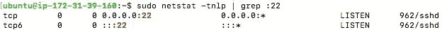

# ifconfig 命令

`ifconfig` 是管理员配置网络时最常用的命令之一。正如名称本身所描述，`ifconfig` 处理接口配置，显示可以使用的网络接口，如 `eth0`、`lo` 等：

```bash
ifconfig
```

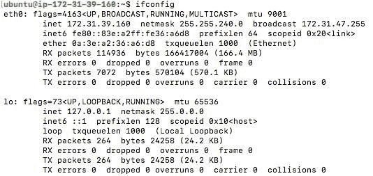

因此，使用以下命令，你可以看到 `eth0` 接口上的配置：

```bash
ifconfig eth0
```

每个接口也可以根据你的需求激活或禁用。

`ifconfig up` 和 `ifup` 命令以这种方式应用更改。

如果接口已经启用，则任何内容都不会改变：

```bash
ifconfig eth0 up
```

同样，要禁用如 `eth0` 的接口，请使用 `ifconfig down` 或 `ifdown eth0`：

```bash
ifconfig eth0 down
```

`ifconfig` 命令还用于为如 `eth0` 的接口分配 IP 地址：

```bash
ifconfig eth0 192.16.20.120
```

此外，`ifconfig` 可以配合 `netmask` 命令为特定接口如 `eth0` 设置子网掩码：

```bash
ifconfig eth0 netmask 255.255.255.220
```

而使用同一命令配合 `broadcast` 则为特定接口设置广播地址：

```bash
ifconfig eth0 broadcast 192.16.20.120
```

`MTU` 代表最大传输单元（maximum transmission unit），是通过网络接口发送的单元中最大的部分。接口类型的属性可以编辑，同时也定义了每次可以发送的数据包数量阈值。

下面的示例设置传输限制为 800 个数据包：

```bash
ifconfig eth0 mtu 800
```

通常常规进程检查数据包是否属于当前使用的接口，但还有一个选项可以激活或禁用被定义为混杂模式（promiscuous mode）。在这种模式下，数据包都会被接受。以下命令随后用于此目的：

```bash
ifconfig eth0 promisc
```

与用于启用混杂模式配置的 `promisc` 命令相反，`promisc` 命令用于禁用此设置：

```bash
ifconfig eth0 -promisc
```

另一个有趣的特性是可以分配给 `eth0` 接口的别名。该值在子网掩码的相同范围内。通过向 `ifconfig eth0:0` 添加 IP 地址可以赋予别名，而仅用 `ifconfig eth0:0` 则检查别名本身。

```bash
ifconfig eth0:0 192.16.20.120

ifconfig eth0:0
```


在命令末尾加上“down”即可移除分配给接口的别名。

```
ifconfig eth0:0 down
```

通过命令行，你可以找到你的 MAC 地址并对其进行编辑。`MAC` 代表介质访问控制（Media Access Control），它是分配给网络的标识符。通过向 `ifconfig` 添加“hw ether”，你就可以更改这些信息。

```bash
ifconfig eth0 hw ether AA:BB:CC:DD:EE:FF
```

## Tcpdump 工具

`Tcpdump` 是一个仅从命令行运行的实用程序。它负责分析通过网络接口接收和发送的 `TCP/IP` 数据包，并决定它们是否可以被存储以供以后解释。

输入以下命令查看结果：

```bash
sudo tcpdump
```

如果你想将搜索范围限制在特定类型的接口上，可以向 `tcpdump` 命令添加 `-i` 参数。

```bash
tcpdump -i eth0
```

通过搜索，你还可以通过添加选项 `-c` 来过滤输出中显示的数据包数量：

```bash
tcpdump -c 5 -i eth0
```

## Route 命令

在深入研究 `route` 命令之前，对 IP 路由概念有一个整体了解是有用的。我们所说的 `IP 路由` 是指主机在将数据转发到最终目的地之前，先到达另一个主机的过程。在这种方法中，接收者在中间工作并处理接收到的数据包，决定在将其发送到最终主机之前如何对其进行排序。它通常由一个路由器标识，无论最终主机是否连接，第一个主机都会使用它。在主要步骤中，会检查 IP 地址以查看其是否属于同一个网络。然后 `TCP` 负责重建传输过程中收集的信息。

有了这个总体的介绍，请记住你正在学习的命令的目标。通过输入 `route` 命令，你可以显示或编辑路由表。

路由表包含有关发送和接收的数据包传输过程的信息，包括网络细节。该命令的主要功能之一是在网络中设置静态路由和接口。

如下例所示，你可以输入该命令来访问当前路由表：

```bash
route
```


截图中报告的数据提供了路由表的预览。根据列名，`Destination`（目的地）指示目标主机或网络的 IP 地址。

然后，`Gateway`（网关）表示为过滤目的地可用数据的路由器的 IP 地址。路由器作为传输的中介，它会根据如何将接收到的数据发送到最终主机做出决策。`Flags`（标志）描述了最终接收者主机的类型，对于判断它是路由器还是其他设备很有用。此外，`Iface` 提供了在网络中使用的接口。在所示的示例中，接口是常用的 `eth0`。

通过路由表的过程，第一个主机尝试到达目标主机，并命名处理流量的路由器。通过这样，即使最终主机不在发送者的同一个网络中，也可以进行通信。

`route` 命令有一些可以添加的选项，以略有不同的显示信息。通过选项 `-n`，你可以以数字形式查看 IP 地址列表：

```bash
route -n
```


IP 地址 `ip-172-31-32-1` 现在被数字 `172.31.32.1` 替换。

使用相同的命令，你还可以设置默认网关，以便在最终 IP 地址不属于同一个网络时使用：

```bash
route add default gw 172.31.32.3
```

在 `Destination` 下显示的将不是 IP 地址，而是 `gateway` 单词。

以下命令用于编辑主机：

```
route add -host 172.31.32.3 reject
```

## Nslookup 命令

`Nslookup` 命令代表“名称服务器查询”（name server lookup），是另一个处理网络的强大工具。你可以简单地使用它来发现 IP 地址或域名。

`DNS` 提供的数据可以通过交互模式和非交互模式进行传输。交互模式显示属于同一域的主机列表，而非交互模式则仅显示特定主机的信息。

该命令的目的是查找与 `DNS` 配置相关的问题。

只需输入命令，即可使用交互模式：

```bash
nslookup
```


输入 `nslookup` 后，系统会要求输入以域名开头的其他信息，如示例所示的 `google.com`。随后，关于服务器和 IP 地址的所有信息将显示给你。每当你输入 IP 地址或域名时，你都在请求一个查询，该查询将揭示你的搜索信息。当提供 IP 地址而不是域名时，你是在使用反向 DNS 查询。

第二种方法更适用于已经具有该主题知识并知道要查找什么参数的用户。

同样，你也可以请求查找 `MX` 记录中的信息。在这种特定情况下，你需要添加 `set type=mx`：


如预览所示，在输入：

```bash
nslookup
```

你必须输入过滤器：

```
set type=mx
```

然后是域名：

```
google.com
```

同样，你可以通过输入 `type=`ns` 来查找有关 `DNS` 服务器的信息：

```
set type=ns
```

还可以应用其他选项，例如通过 `type=`soa` 查看 `SOA`：

```bash
set type=soa
```


如前所述，可以应用于 `nslookup` 的第二种方法是非交互模式。你不是单独插入参数，而是在输入 `nslookup` 的同时，还需要像这里这样包含域名：

```bash
nslookup google.com
```

或者你可以对 IP 地址进行查询：

```bash
nslookup 209.18.47.62
```

## host 命令

给定域名，可以使用 `host` 命令查找 IP 地址，或者提供 IP 地址来查找关联的 IP 地址。只需输入命令 `host`，即可获得可用选项：

```
host
```


如上所示，在没有向命令传递特定参数的情况下，列出了选项。

输入以下内容查看 google 的 IP 地址：

```bash
host google.com
```


如预览所示，地址 `172.217.10.238` 匹配域名 `google.com`。

同样，也可以反向查找。这意味着通过 IP 地址获取域名。

```bash
host 172.217.10.238
```

选项 `-C` 可以比较权威名称服务器上的 `SOA` 记录：

```bash
host -C google.com
```


选项 `-a` 代表 `ANY`，意味着它尝试查找有关 Google 主机的任何信息：

```bash
host -a google.com
```

选项 `-t` 可查找特定的 DNS，如 `ns`：

```bash
host -t ns google.com
```


## whois 命令

`whois` 能够查找有关注册域名、IP 地址和名称服务器的信息。

`whois` 命令是一个用于查找你所连接的 `whois` 服务器信息的实用程序。它通过默认端口（`43`）接受请求，并翻译接收到的数据，以便以不同的格式读取。

使用该命令，你可以列出关于域名注册商、域名状态、名称服务器、过期日期的所有信息：


`whois google.com`


此外，相同的命令也可以用于通过 IP 地址获取信息：

`whois 209.18.47.62`

但是这些信息是如何提供给你的呢？

ICANN 是一个非营利组织，负责管理给每个域名的 IP 地址，并与注册局（registries）合作。他们负责诸如 `.com` 等域名。在这一层之下，注册商（registrars，如 GoDaddy、TuCows 等）与最终客户交道。因此，任何想要注册新域名的用户都会向常见的注册商提交注册申请。

使用 `whois google.com` 命令，你将向监听端口 `43` 发送查询请求，该端口将提供从注册局收集的一系列信息。

如果你在同一个查询中还包含了该域名所属的注册商，系统将向你提供额外信息：

`whois -h whois.markmonitor.com google.com`
