# Linux 圣经，第 11 版

一如既往，我将本书献给我的妻子 Sheree。

# 关于作者

**Chris Negus** 是亚马逊云服务 (`AWS`) 的高级技术文档工程师。在 `AWS` 的前几年里，Chris 参与了 Linux 容器相关的开源软件项目。在担任 `Kubernetes` 1.22、1.23 和 1.24 版本的 `Kubernetes` 发布团队成员期间，他编写了 `Kubernetes` 项目的“生产环境”页面。对于 `AWS` 内部开源项目，Chris 为 `Eks Anywhere`、`Eks Distro` 和 `Karpenter` 自动伸缩器编写了文档。

最近，Chris 参与了 `AWS Elastic Kubernetes Service (EKS)` 文档工作，为 `EKS` 启动体验、在 `EKS` 上运行 `AI/ML` 工作负载以及 `EKS Auto Mode` 的文档做出了贡献。他还参与了弹性容器注册 (`ECR`) 和 `EKS` 最佳实践的文档工作。

在加入 `AWS` 之前，Chris 是 `Red Hat, Inc.` 的 Linux 主技术文档工程师、讲师和考官。在红帽的十多年里，Chris 教导了数百名 IT 专业人员成为红帽认证工程师 (`RHCE`)，并编写了涵盖从 Linux 虚拟化到云计算和容器化的方方面面。

在加入红帽之前，Chris 花了大约十年时间编写了数十本关于 Linux 和 UNIX 的书籍，包括《Red Hat Linux 圣经》（所有版本）、《Docker Containers》、《CentOS 圣经》、《Fedora 圣经》、《Linux 故障排除手册》、《Linux Toys》、《Linux Toys II》以及 10 版《Linux 圣经》。

**David Clinton** 是 `Wiley` 的技术编辑，已在那里工作多年。在之前，David 曾当过 20 年高中教师。他目前与妻子和家人住在加拿大多伦多，可以通过他的网站与他联系：`www.bootstrap-it.com`。

# 致谢

我想感谢我在亚马逊云服务每天合作的同事。我是由于为开源项目（主要是与 `Kubernetes` 相关）编写文档的承诺，才离开了我在红帽的舒适职位。虽然我在这些项目上做了很多工作，但最近我专注于 `EKS` 以及学习关于大规模运行集群的所有知识。

在 `AWS`，我找不到更好的团队可以合作了。我的同事 `Donovan Finch`、`Geoffrey Cline` 和 `Paul Gasca` 推动了创新，改进并扩展了工作所需的工具和流程。`Donovan` 的支持背景使得我在需要对某技术进行深度理解时成为首选。`Paul` 创建了许多工具让我们的工作变得轻松，领导了部门整合 `AI` 的工作。`Geoffrey` 在开放工作中展现了创意领导力，帮助扩展了该工作的贡献。最后，我们的团队由 `Samantha Lindsey-Amed` 领导。在我们突破边界而非等待他人解决挑战时，`Sam` 在个人和职业上都给予了团队勇敢的支持。

对于 `Wiley` 的同事，感谢多年来让我继续开发和完善本书。感谢 `Satish Gowankar` 引导了将作者交付的约 900 页书籍从作者手中投入生产的漫长过程。感谢 `Danielle Shaw` 对文本进行仔细彻底的审查，感谢 `Kim Wimpsett` 在书籍结束生产前进行了良好的最后润色。感谢 `Saranan Dakshinamurthy` 确保了样章的进度。感谢 `David Clinton` 对书籍进行了出色的技术评审（包括确保我正确涵盖了 `Ubuntu`）。感谢 `Pete Gaugan` 和 `Kenyon Brown` 监督整个过程。

感谢 `Waterside Productions` 的 `Margot Maley Hutchinson` 多年来代表 `Wiley` 与我签署了书籍合同，并一直考虑我的最大利益。特别感谢 `Jay Kippfeller` 为我修剪草坪，以便我能完成这本书。

献给我的妻子 Sheree，感谢她与我分享生活，并如此出色抚养了 Seth 和 Caleb。

—Christopher Negus

## 目录

### 第一部分：入门

#### 第 1 章：从 Linux 开始

- 理解 Linux 是什么
- 理解 Linux 与其他操作系统的差异
- 探索 Linux 历史
  - 贝尔实验室自由流动的 UNIX 文化
  - 商业化 UNIX
  - 伯克利软件发行版 (`BSD`) 的到来
  - UNIX 实验室与商业化
  - `GNU` 将 UNIX 转型为自由
  - `BSD` 失去动力
  - Linus 构建了缺失的拼图
  - `OSI` 开源定义
- 理解 Linux 发行版是如何产生的
- 选择红帽 (`Red Hat`) 发行版
  - 使用红帽企业 Linux (`RHEL`)
  - 使用 `Fedora`
- 选择 `Ubuntu` 或其他 `Debian` 发行版
- 如今寻找 Linux 的职业机会
- 理解公司如何通过 Linux 盈利


# 目录

- [获得红帽认证](#获得红帽认证) ................................................................................................................................................................................................................................................................................................................................................................................................................................................................................................................................................................................................................. 21

- [RHCA 主题](#rhca-主题) ................................................................................................................................................................................................................................................................................................................................................................................................................................................................................................................................................................................................. 22

- [RHCE 主题](#rhce-主题) ................................................................................................................................................................................................................................................................................................................................................................................................................................................................................................................................................................................................................................................................................. 23

- [总结](#总结) ................................................................................................................................................................................................................................................................................................................................................................................................................................................................................................................................................................................................................................................................................................................................................................................................................................. 25

- [第 2 章：创建完美的 Linux 桌面](#第-2-章创建完美的-linux-桌面) ................................................................................................................................................................................................................................................. 27

- [理解 Linux 桌面技术](#理解-linux-桌面技术) ................................................................................................................................................................................................................................................. 28

- [从 Fedora GNOME 桌面启动镜像开始](#从-fedora-gnome-桌面启动镜像开始) ................................................................................................................................................................................................................................................................................................................................. 30

- [使用 GNOME 桌面](#使用-gnome-桌面) ................................................................................................................................................................................................................................................................................................................................................................................................................................................................................................................................................................................................................. 31

- [电脑启动后](#电脑启动后) ................................................................................................................................................................................................................................................................................................................................................................................................................................................................................................................................................................................................................................................................................................................................. 31

- [使用鼠标导航](#使用鼠标导航) ................................................................................................................................................................................................................................................................................................................................................................................................................................................................................................................................................................................................................................................................................................................................................................................................................................................................................. 32

- [使用键盘导航](#使用键盘导航) ................................................................................................................................................................................................................................................................................................................................................................................................................................................................................................................................................................................................................................................................................................................................................................................................................................................................................. 36

- [设置 GNOME 桌面](#设置-gnome-桌面) ................................................................................................................................................................................................................................................................................................................................................................................................................................................................................................................................................................................................................................................................................................................................................................................................................................................................................................................................................................................................................................................. 38


- 扩展 GNOME 桌面 ................................................................................................................................................................................................................................................................................................................................................................................................................................................................................................................................................................................................................................................................................................................................................................................................................................................................................................................................................................................................................................................................................................................................................................................. 39

## 第二部分：成为 Linux 高级用户 ............................................................................................................................ 57

## 第 3 章：使用 Shell ............................................................................................................................................ 59

    - 扩展命令 ...................................................................................................................................................................................................... . . . . 77

    - 扩展算术表达式 ................................................................................................................................................................................................... . . . 78

    - 扩展变量 ................................................................................................................................................................................................... . . . . 78

# 第 4 章：在文件系统中移动 ................................................... 91

# 第 5 章：处理文本文件 ........................................................ 111

# 第 6 章：管理运行进程 ............................................................ 129

# 第 7 章：编写简单的 Shell 脚本 ............................................................ 145

# 第三部分：成为 Linux 系统管理员 163

## 第 8 章：学习系统管理 ............................................................ 165

理解系统管理...................................................... 165

使用图形化管理工具 ................................................................... 167

使用基于浏览器的 Cockpit 管理 ........................................................ 167

使用 system-config-* 工具 ................................................................................ 169

使用其他基于浏览器的管理工具 ................................................................. 171

使用 root 用户账户 ........................................................................................ 172

从 shell 变为 root（启用命令） ................................................ 173

通过 GUI 允许管理访问 ............................................................ 174

通过 sudo 获取管理访问 ................................................................... 174

探索管理命令、配置文件和日志文件 ................ 176

管理命令 ....................................................................................... 176

管理配置文件 ...................................................................... 177

管理日志文件和 systemd journal ........................................................ 181

通过管理 journalctl 查看 systemd journal ................................................ 181

使用 rsyslogd 管理日志消息 ................................................................ 182

使用其他管理账户 ................................................................ 182

检查和配置硬件 ................................................................ 183

检查你的硬件 ....................................................................................... 184

管理可移动硬件 ............................................................................ 187

处理可加载模块 ............................................................................ 187

列出模块 ................................................................................ 188

加载模块 ............................................................................... 188

移除模块 ............................................................................................ 189

总结 ........................................................................................ 189

练习 ....................................................................................... 189

## 第 9 章：安装 Linux 191

- 快速开始 Linux 安装 ........................................................ 192

选择计算机 ....................................................................... 195

从安装媒体安装 Red Hat Enterprise Linux ............................ 198

理解云端安装 ............................................................ 201

在企业中安装 Linux ................................................... 202

探索常见的安装主题 ............................................................ 203

升级或从零安装 ................................................................ 203

双启动 ................................................................................................ 205

- 安装 Linux 以在虚拟机中运行 ............................................ 206

使用安装启动选项 ........................................................ 206

用于禁用功能的启动选项 ................................................ 207

用于解决视频问题的启动选项 ........................................................... 208

用于特殊安装类型的启动选项 ........................................ 208

用于 kickstart 和远程仓库的启动选项 ............... 208

杂项启动选项 ................................................................ 209

使用专用存储 ................................................................... 209

硬盘分区 ................................................................... 210

理解不同的分区类型 ........................................ 211

创建分区的技巧 ............................................................ 212

使用 GRUB 引导加载程序 ........................................ 213

总结 ........................................................................................ 215

练习 ....................................................................................... 216

## 第 10 章：获取和管理软件 ................................... 217

在桌面上管理软件 ................................................... 218

超越软件窗口 ................................................... 219

理解 Linux RPM 和 DEB 软件打包 ................ 220

理解 DEB 包 ........................................................ 221

理解 RPM 包 ........................................................ 222

RPM 中包含什么？ ................................................................ 223

RPM 来源于哪里？ ............................................................ 224

安装 RPM ............................................................................ 224

使用 dnf 和 yum 管理 RPM 包 ................................. 225

从 yum 迁移到 dnf ................................................ 225

理解 dnf 的工作原理 ................................................. 225

使用 YUM 配合第三方软件仓库 ............... 228

使用 dnf 命令管理软件 ................................... 229

搜索包 ........................................................ 229

安装和移除包 ...................................... 231

更新包 ......................................................... 233

更新包组 ................................................ 234

维护你的 RPM 包数据库和缓存 ............... 235

从 YUM 仓库下载 RPM ................................ 236

使用 rpm 命令查询、安装和验证软件.. 237

使用 rpm 安装和移除包 ......................... 237

查询 rpm 信息 ................................................... 238

验证 RPM 包 ........................................................ 240

使用 Snap、Homebrew 和 Flatpak 进行个人化安装 ........ 241

使用 Snap ...................................................................... 242


# 使用 Homebrew

# 使用 Flatpak

# 在企业中管理软件

# 总结

# 练习

## 第11 章：管理用户账户

- 创建用户账户
- 使用 `useradd` 添加用户
- 设置用户默认值
- 使用 `usermod` 修改用户
- 使用 `userdel` 删除用户
- 理解组账户
- 使用组账户
- 创建组账户
- 使用访问控制列表（ACL）管理企业用户
- 使用 `setfacl` 设置权限 ACL
- 设置默认 ACL
- 启用 ACL
- 为用户添加协作目录
- 创建组协作目录（设置 GID 位）
- 创建受限删除目录（粘滞位）
- 用户账户的集中管理
- 总结
- 练习

## 第12 章：管理磁盘和文件系统

- 理解磁盘存储
- 硬盘分区
- 理解分区表
- 查看磁盘分区
- 创建单分区磁盘
- 创建多分区磁盘
- 使用逻辑卷管理器（LVM）分区
- 检查现有的 LVM
- 创建 LVM 逻辑卷
- 扩展 LVM 逻辑卷
- 挂载文件系统
- 支持的文件系统
- 启用交换区
- 禁用交换区
- 使用 `fstab` 文件定义可挂载的文件系统
- 使用 `mount` 命令挂载文件系统
- 在回环设备中挂载磁盘镜像
- 使用 `umount` 命令
- 使用 `mkfs` 命令创建文件系统
- 使用 Cockpit 管理存储
- 总结
- 练习

# 第四部分：成为 Linux 服务器管理员

## 第13 章：理解服务器管理

- 从服务器管理开始
- 第一步：安装服务器
- 第二步：配置服务器
  - 使用配置文件
  - 检查默认配置
- 第三步：启动服务器
- 第四步：加固服务器
  - 密码保护
  - 防火墙
  - SELinux
  - 配置文件中的安全设置
- 第五步：监控服务器
  - 配置日志
  - 运行系统活动报告
  - 使用 Cockpit 实时查看活动
  - 保持系统软件更新
  - 检查文件系统是否存在黑客痕迹
- 检查和设置服务器
- 使用 Secure Shell (SSH) 管理远程访问


## 第 13 章：企业级服务器管理

- 启动 `openssh-server` 服务
- 使用 SSH 客户端工具
- 使用 `ssh` 进行远程登录
- 使用 `ssh` 进行远程执行
- 使用 `scp` 和 `rsync` 在系统间复制文件
- 交互式复制
- 使用基于密钥（无密码）认证
- 配置系统日志
- 使用 `rsyslog` 启用系统日志
- 理解 `rsyslog.conf` 文件
- 理解 `messages` 日文件
- 使用 `rsyslogd` 设置和使用日志主机
- 使用 `logwatch` 日志
- 使用 `sar` 检查系统资源
- 检查系统空间
- 使用 `df` 显示系统空间
- 使用 `du` 检查磁盘占用
- 使用 `find` 查找磁盘消耗
- 企业级服务器管理
- 总结
- 练习

## 第 14 章：网络管理

### 为桌面级配置网络

- 检查你的网络接口
- 从 GNOME 设置窗口检查网络
- 从 Cockpit 检查网络
- 从命令行检查网络
- 配置网络接口
- 手动设置 IP 地址
- 设置 IP 地址别名
- 设置路由
- 配置网络代理连接

### 从命令行配置网络

- 使用 `nmcli` 配置网络
- 编辑 NetworkManager TUI 连接
- 理解网络配置文件
- NetworkManager 连接文件
- `/etc/hosts` 文件
- `/etc/resolv.conf` 文件
- `/etc/nsswitch.conf`
- 设置别名网络接口
- 设置以太网通道绑定

### 在企业配置网络

- 将 Linux 配置为路由器
- 将 Linux 配置为 DHCP 服务器
- 将 Linux 配置为 DNS 服务器
- 将 Linux 配置为代理服务器
- 总结
- 练习

## 第 15 章：启动和停止服务

### 理解初始化进程

- 理解 `systemd` 初始化
- 学习 `systemd` 基础
- 学习 `systemd` 与 SysVinit 的后兼容性

### 停止和启动服务

- 停止和启动 SysVinit 服务
- 停止和启动 `systemd` 服务
- 使用 `systemd` 停止服务
- 使用 `systemd` 启动服务
- 使用 `systemd` 重启服务
- 使用 `systemd` 重载服务

### 启用持久服务

- 使用 `systemd` 启用服务
- 使用 `systemd` 禁用服务

### 配置默认运行级别或目标单元

- 添加新或自定义的服务
  - 向 `systemd` 添加新服务
  - 步骤 1：创建新的或自定义的服务配置单元文件
  - 步骤 2：移动服务配置单元文件
  - 步骤 3：将服务添加到 Wants 目录
- 总结
- 练习

## 第 16 章：配置打印服务器

- 通用 UNIX 打印系统

### 设置打印机


- 自动添加打印机
- 使用基于 Web 的 CUPS 管理
- 允许远程打印管理
- 添加未自动检测到的打印机

### 使用打印设置窗口

- 使用打印设置窗口配置本地打印机
- 配置远程打印机
- 添加远程 CUPS 打印机
- 添加 UNIX (LDP/LPR) 打印机
- 添加 Windows (SMB) 打印机

### 使用 CUPS 打印

- 配置 CUPS 服务器 (`cupsd.conf`)
- 启动 CUPS 服务器
- 手动配置 CUPS 打印机选项

### 使用打印命令

- 使用 `lp` 打印
- 使用 `lpstat -t` 列出状态
- 使用 `lprm` 删除打印任务

### 配置打印服务器

- 配置共享 CUPS 打印机
- 配置共享 Samba 打印机
- 理解打印的 `smb.conf`
- 设置 SMB 客户端
- 总结
- 练习

## 第 17 章：配置 Web 服务器

### 理解 Apache Web 服务器

### 获取并安装你的 Web 服务器

- 理解 `httpd-core` 软件包
- 安装 Apache

### 启动 Apache

### 安全 Apache

- Apache 文件权限与所有权
- Apache 与防火墙
- Apache 与 SELinux
- 理解 Apache 配置文件
- 使用指令（`directives`）
- 理解默认设置
- 在 Apache 中添加虚拟主机
- 允许用户发布自己的 Web 内容
- 使用 SSL/TLS 保护您的 Web 流量
- 理解 SSL 如何配置
- 生成 SSL 密钥和自签名证书
- 生成证书签名请求（CSR）
- 故障排除您的 Web 服务器
- 检查配置错误
- 访问被访问和服务器内部错误
- 探索 Web 服务器部署
- 总结
- 练习

# 第 18 章：配置 FTP 服务器

- 理解 vs 与 vsftpd
- 安装 vsftpd FTP 服务器
- 启动 vsftpd FTP 服务器
- 保护您的 FTP 服务器
- 为 FTP 开放防火墙
- 在较新的 RHEL 或 Fedora 系统上为 FTP 开放防火墙
- 在较旧的 RHEL 或 Fedora 系统上为 FTP 开放防火墙
- 为您的 FTP 服务器配置 SELinux
- 将 Linux 文件权限与 vsftpd 关联
- 配置您的 FTP 服务器
- 设置用户访问
- 允许上传
- 设置 vsftpd 以连接到您的服务器
- 使用 FTP 客户端连接到您的服务器
- 使用 `lftp` 命令访问 FTP 服务器
- 使用 gftpd 客户端
- 总结
- 练习

# 第 19 章：配置 Windows 文件共享 (Samba) 服务器

- 理解 Samba
- 安装 Samba
- 启动和停止 Samba
- 启动 Samba (`smb`) 服务
- 启动 NetBIOS (`nmbd`) 名称服务器
- 停止 Samba (`smb`) 和 NetBIOS (`nmb`) 服务
- 保护 Samba
- 为 Samba 配置防火墙
- 为 Samba 配置 SELinux
- 为 Samba 设置 SELinux 布尔值（`Booleans`）
- 为 Samba 设置 SELinux 文件上下文


# 第 20 章：配置 NFS 文件服务器

- 安装 NFS 服务器
- 启动 NFS 服务
- 共享 NFS 文件系统
- 配置 `/etc/exports` 文件
- `/etc/exports` 中的主机名
- `/etc/exports` 中的访问选项
- `/etc/exports` 中的用户映射选项
- 导出共享文件系统
- 保护您的 NFS 服务器
- 为 NFS 开放防火墙
- 为您的 NFS 服务器配置 SELinux
- 使用 NFS 文件系统
- 查看 NFS 共享
- 手动挂载 NFS 文件系统
- 在启动时挂载 NFS 文件系统
- 挂载不自动挂载（`noauto`）文件系统
- 使用挂载选项
- 使用 autofs 按需挂载 NFS 文件系统
  - 自动挂载 `/net` 目录
  - 自动挂载主目录
- 卸载 NFS 文件系统
- 在 Cockpit 中使用 NFS
- 总结
- 练习

## 第 21 章：Linux 故障排除

- 启动故障排除
- 理解启动方法
- 使用 systemd 启动
- 从固件 (UEFI) 启动
- 硬件设置故障排除
- 启动顺序故障排除
- GRUB 启动引导程序故障排除
- 启动内核
- 初始化系统故障排除
- systemd 初始化故障排除
- 软件包故障排除
- 网络故障排除
- 出站连接故障排除
- 查看网络接口
- 检查物理连接
- 检查路由
- 检查主机名解析
- 入站连接故障排除
- 检查客户端是否能够访问你的系统
- 检查服务对客户端是否可用
- 检查服务器上的服务
- 内存故障排除
- 发现内存问题
- 检查内存问题
- 处理内存问题
- 救援模式下的故障排除
- 总结
- 练习

## 第 22 章：配置人工智能聊天机器人

- 选择语言模型
- 评估你的 AI 需求
- 让 Ollama 提供语言模型服务
- 从命令行运行语言模型


# 使用 Ollama 自定义模型

# 总结

# 练习

# 第部分：学习 Linux 安全技术

## 第 23 章：理解基础 Linux 安全

### 实现物理安全

#### 实施灾难恢复

#### 保护用户账户

##### 每个用户账户一个用户

##### 限制 root 用户账户的访问

#### 为临时账户设置过期日期

#### 未使用的账户

### 保护密码

#### 选择最佳密码

#### 设置和更改密码

#### 强制执行最佳密码实践

#### 理解密码文件和密码哈希

### 保护文件系统

#### 管理危险的文件系统权限

#### 保护密码文件

#### 锁定文件系统

### 管理软件和服务

#### 更新软件包

#### 跟进安全公告

### 高级实施

### 监控你的系统

#### 监控日志文件

#### 监控文件系统

#### 验证软件包

#### 扫描文件系统

#### 检测病毒和根部程序

### Linux 审计与审查

#### 进行合规性审查

#### 进行安全审查

### 总结

### 练习

## 第 24 章：理解高级 Linux 安全

### 使用密码学实现 Linux 安全

#### 理解哈希

#### 理解加密/解密

##### 理解加密算法

##### 理解加密密钥

##### 理解数字签名

### 实现 Linux 密码学

#### 确保文件完整性

#### 在安装时加密 Linux 文件系统

#### 加密 Linux 文件

#### 使用各种工具加密 Linux

#### 在桌面端使用加密

#### 使用 PAM 实现 Linux 安全

#### 理解 PAM 认证过程

#### 理解 PAM 上下文

#### 理解 PAM 控制标志

#### 理解 PAM 模块

#### 理解 PAM 配置文件

#### 在你的 Linux 系统上管理 PAM

#### 使用 authselect 管理 PAM 配置

#### 管理单个 PAM 配置文件

#### 管理 PAM 系统事件配置文件

#### 使用 PAM 实现资源限制

#### 使用 PAM 实现时间限制

#### 使用 PAM 强制执行强密码

#### 使用 PAM 鼓励使用 sudo

#### 获取关于 PAM 的更多信息

### 总结

### 练习

## 第 25 章：使用 SELinux 增强 Linux 安全

### 理解 SELinux 的优势

### 理解 SELinux 的原理

### 理解类型强制（Type Enforcement）

### 理解多级安全（Multi-Level Security）

### 实现 SELinux 安全模型

### 理解 SELinux 的操作方法

### 理解 SELinux 安全上下文

### 理解 SELinux 策略类型


# 第六部分：接触云计算

## 第 27 章：转向云和容器

- 理解 Linux 容器
- 命名空间（Namespaces）
- 容器仓库
- 基础镜像与层
- 从 Linux 容器开始
- 拉取并运行容器
- 拉取容器
- 从容器中运行 Shell
- 从容器中运行 FTP 服务器
- 启动和停止容器
- 构建容器镜像
- 构建简单的容器镜像
- 从 GitHub 构建 FTP 容器
- 为镜像打标签并推送到仓库
- 企业中使用容器
- 总结
- 练习

## 第 28 章：使用 Linux 进行云计算

- Linux 与云计算概述
- 云虚拟机管理程序
- 云控制器
- 云存储
- 云身份认证
- 云部署与配置
- 云平台
- 尝试基础云技术
- 搭建小型云环境
- 配置虚拟机管理程序
- 第 1 步：获取 Linux 软件
- 第 2 步：检查你的计算机
- 第 3 步：在虚拟机管理程序上安装 Linux
- 第 4 步：在虚拟机管理程序上启动服务
- 第 5 步：编辑 `/etc/hosts` 或设置 DNS
- 配置存储
- 第 1 步：安装 Linux 软件
- 第 2 步：配置 NFS 共享
- 第 3 步：启动 NFS 服务
- 第 4 步：在虚拟机管理程序上挂载 NFS 共享
- 创建虚拟机
- 第 1 步：获取制作虚拟机的镜像
- 第 2 步：检查网络桥接


## 目录

- 第 3 步：启动虚拟机管理器 (`virt-manager`)
- 第 4 步：检查连接详情
- 第 5 步：创建一个新虚拟机
- 管理虚拟机
- 迁移虚拟机
- 第 1 步：识别其他虚拟机管理程序
- 第 2 步：将运行中的 VM 迁移到另一个虚拟机管理程序
- 总结
- 练习

## 第 29 章：将 Linux 部署到云端

- 让 Linux 在云中运行
- 为云创建镜像
- 配置并运行 `cloud-init` 云实例
- 调查云实例
- 克隆云实例
- 扩展你的 `cloud-init` 配置
- 使用 `cloud-init` 添加 SSH 密钥
- 使用 `cloud-init` 添加软件
- 在企业计算中使用 `cloud-init`
- 使用 Amazon EC2 部署云镜像
- 总结
- 练习

## 第 30 章：使用 Ansible 实现应用和基础设施自动化

- 理解 Ansible
- 探索 Ansible 组件
- 清单 (`Inventories`)
- 剧本 (`Playbooks`)
- 节点 (`Plays`)
- 任务 (`Tasks`)
- 模块 (`Modules`)
- 角色、导入与包含
- 逐步解析 Ansible 部署
- 前提条件
- 为每个节点设置 SSH 密钥
- 安装 Ansible
- 创建清单
- 验证主机身份
- 创建剧本
- 运行剧本
- 运行即时 Ansible 命令
- 尝试即时命令
- 使用 Ansible Tower 自动化框架实现任务自动化
- 总结
- 练习

## 第 31 章：使用 Kubernetes 以容器部署应用

- 理解 Kubernetes
- Kubernetes 控制平面
- Kubernetes 数据平面
- Kubernetes 应用
- Kubernetes 接口
- 尝试 Kubernetes
- 获取 Kubernetes
- 启动 Kubernetes 基础教程
- 启动 `Minikube`
- 运行 Kubernetes 基础教程
- 获取你的集群信息
- 部署 Kubernetes 应用
- 获取部署的 Pod 信息
- 使用服务暴露应用
- 为服务打标签
- 删除服务
- 扩展应用
- 检查负载均衡器
- 缩缩应用程序
- 使用 EKS 获取企业级 Kubernetes
- 总结
- 练习题

# 附录 A：媒体

- 获取 Fedora
- 获取红帽企业 Linux (`Red Hat Enterprise Linux`)
- 获取 Ubuntu
- 从 USB 驱动启动 Linux
- 创建 Linux CD 和 DVD
- 在 Windows 中刻录 CD/DVD
- 在 macOS 系统上刻录 CD/DVD
- 在 Linux 中刻录 CD/DVD
- 从 Linux 桌面刻录 CD 或 DVD
- 从 Linux 命令行刻录 CD 或 DVD

# 附录 B：练习答案

- 第 1 章：从 Linux 开始
- 第 2 章：创建完美的 Linux 桌面
- 第 3 章：使用 Shell
- 第 4 章：在文件系统中移动
- 第 5 章：处理文本文件
- 第 6 章：管理运行进程
- 第 7 章：编写简单的 Shell 脚本
- 第 8 章：学习系统管理


# 目录

- 第 9 章：安装 Linux ................................................................ 772
- 第 10 章：获取与管理软件 ............................................ 774
- 第 11 章：管理用户账户 ................... 775
- 第 12 章：管理磁盘和文件系统 ........................................ 779
- 第 13 章：理解服务器管理 ................................... 781
- 第 14 章：管理网络 ............................................... 785
- 第 15 章：启动与停止服务 ........................................ 786
- 第 16 章：配置打印服务器 ............................................ 788
- 第 17 章：配置 Web 服务器 ................................................ 790
- 第 18 章：配置 FTP 服务器 ......................................... 794
- 第 19 章：配置 Windows 文件服务器 (Samba) ........... 796
- 第 20 章：配置 NFS 文件服务器 ...................................... 798
- 第 21 章：Linux 故障排除 ................................... 800
- 第 22 章：配置人工智能机器人 ................... 802
- 第 23 章：理解基础 Linux 安全 ....................... 804
- 第 24 章：理解高级 Linux 安全 ............................... 805
- 第 25 章：使用 SELinux 增强 Linux 安全 ................................................ 807
- 第 26 章：网络上的 Linux 安全................................................................ 809
- 第 27 章：转向云端................................................................ 810
- 第 28 章：云端 Linux ................................................. 812
- 第 29 章：部署 Linux.................................................................. 814
- 第 30 章：使用 Ansible 自动化应用.............................................. 815
- 第 31 章：使用 Kubernetes 部署应用程序....................................... 817
- 索引 .................................................................................................... 821

# 引言

没有 Linux 你无法学习它。在之前的版本中，我描述了如何使用和管理 Linux。25 多年来，我一直在编写关于 Linux 的内容。1999 年，我写了第一本书。2008 年，我写了关于红帽的内容。2019 年，我写了关于云和容器的内容。

在这一版中，我专注于 Linux 作为一个开发者平台。我包含了开发者工具、云控制台、防火墙功能、AI 工作负载以及软件安装工具的更新。虽然系统级软件软件包安装传统上由 RHEL 和 Ubuntu 的 RPM 和 Deb 工具处理，但开源世界也涌出了其他工具。

### 设置开发者桌面

像许多人一样，我喜欢将 Linux 作为我的开发者桌面。为了帮助你入门，我增加了一个描述 Linux 自带开发者工具的章节。我还提供了对 Git 的简要介绍，因为它是开源世界中存储、更新和其他管理软件的主要工具。

### 使用云控制台

在本地 Linux 系统上，你打开窗口或访问虚拟终端来使用 shell。对于云端 Linux 系统，有方法从云控制台访问 Linux shell。我描述了如何针对 AWS 进行。

### 软件安装工具

虽然系统级软件软件包安装传统上由 RHEL 和 Ubuntu 的 RPM 和 Deb 工具处理，但已出现其他用于个人安装软件的工具。这些工具（如 Snap、Homebrew 和 Flatpak）的描述已加入本书。

### 改进的防火墙

由于 iptables 在 Linux 系统上变得常见，我删除了大部分 iptables 的内容。相反，我加强了对 firewalld（适用于 RHEL 和 Fedora 系统）的描述，并引入了 UFW 防火墙（适用于 Ubuntu 系统）。

### 设置 聊天机器人

随着 AI 大语言模型（LLM）以及管理这些模型的工具可用，运行自己的 AI 聊天机器人是可能的。虽然这些软件可以在低配置硬件上运行，但我将向你介绍如何在 Linux 中运行 AI 聊天机器人。

### 演示与练习

每个步骤和练习都经过测试，可以在 Fedora 或红帽企业 Linux 中运行。

# 引言

**Web 服务器部署：** 我添加了一个关于部署 Web 服务器的不同方式的简短章节。

**使用 authselect 配合 PAM：** 近年来，authselect 已成为管理可插认证模块（PAM）的首选方式。因此，我增强了对 authselect 的描述。

**关于旧版内容：** 如果某个功能有几种流行的实现方式，在理想情况下，只要它们相关，我会尝试同时介绍两种。然而，我之前涵盖的一些功能已经太过时，无法包含在本版中，因此我将其删除了。这些包括 GNOME 2、iptables 和 SystemV init。删除 SystemV init 对我来说特别难过，因为当它在 20 世纪 80 年创建时，我是第一个对其进行记录的人。

# 本书的结构

本书的结构旨在让你从 Linux 开始，逐步成长为一名专业的 Linux 系统管理员和高级用户。

## 第一部分“入门”

包含两个章节，旨在帮助你理解什么是 Linux，并帮助你开始使用 Linux 桌面：

- 第 1 章“从 Linux 开始”涵盖了 Linux 操作系统是什么、它源自哪里以及如何开始使用它等主题。
- 第 2 章“创建完美的 Linux 桌面”提供了关于如何创建桌面系统以及使用一些最流行的桌面功能的信息。

## 第二部分“成为 Linux 高级用户”

深入详细介绍了如何使用 Linux shell、文件系统、操作文本文件、管理进程以及使用 shell 脚本的细节：

- 第 3 章“使用 Shell”包含了如何访问 shell、运行命令、回溯命令（使用 history）以及制键补全的信息。该章节还描述了如何使用变量、别名（aliases）和 man 页面（传统的 Linux 命令参考页）。
- 第 4 章“在文件系统中移动”包含了用于列出、创建、复制和移动目录的命令。本章中的更多主题包括文件系统安全，如所有权、权限和访问控制列表（ACL）。
- 第 5 章“处理文本文件”包含了从基础文本编辑器到查找和搜索文本文件工具的所有内容。
- 第 6 章“管理运行进程”描述了如何查看系统上运行的进程以及如何更改它们。更改进程的方法包括杀死、暂停和发送其他类型的信号。
- 第 7 章“编写简单的 Shell 脚本”包含了你可以汇到一个文件中并作为命令本身运行的 shell 命令和函数。

## 第三部分“成为 Linux 系统管理员”

你将学习管理 Linux 系统：

- 第 8 章“学习系统管理”提供了用于管理 Linux 系统的基础图形化工具、命令和配置文件。它引入了 Cockpit UI 用于简化、中心化的 Linux 管理。
- 第 9 章“安装 Linux”涵盖了常见的安装任务，如磁盘分区和初始软件包选择，以及高级安装工具，如从 kickstart 文件安装。
- 第 10 章“获取和管理软件”提供了对软件包工作原理以及如何获取和管理软件包的理解。
- 第 11 章“管理用户账户”讨论了添加和删除用户及组的工具，以及如何集中化用户账户管理。
- 第 12 章“管理磁盘和文件系统”提供了添加分区、创建文件系统和挂载文件系统的信息，以及与逻辑卷管理（LVM）的工作。

## 第四部分“成为 Linux 服务器管理员”

你将学习创建强大的网络服务器以及管理它们所需的工具：

- 第 13 章“理解服务器管理”涵盖了远程日志、监控工具和 Linux 启动过程。
- 第 14 章“管理网络”讨论了如何配置网络。
- 第 15 章“启动和停止服务”提供了启动和停止服务的信息。
- 第 16 章“配置打印服务器”描述了如何配置打印机以便在你的 Linux 系统上本地或通过网络使用。
- 第 17 章“配置 Web 服务器”描述了如何配置 Apache Web 服务器。
- 第 18 章“配置 FTP 服务器”涵盖了设置 vsftpd FTP 服务器的步骤，该服务器可以从网络从你的 Linux 系统下载文件。
- 第 19 章“配置 Windows 文件共享 (Samba) 服务器”涵盖了使用 Samba 进行 Windows 文件服务器的配置。
- 第 20 章“配置 NFS 文件服务器”描述了如何使用网络文件系统（NFS）功能在网络上的多个系统之间共享文件。
- 第 21 章“Linux 故障排除”涵盖了流行的 Linux 系统故障排除工具。
- 第 22 章“配置 AI 机器人”描述了如何使用 Ollama 和你选择的语言模型设置 AI 机器人。

## 第五部分“学习 Linux 安全技术”

你将学习如何保护你的 Linux 系统和服务：

- 第 23 章“理解基础 Linux 安全”涵盖了基础安全概念和技术。
- 第 24 章“理解高级 Linux 安全”提供了使用 PAM 和加密来收紧系统安全和认证的信息。
- 第 25 章“通过 SELinux 增强安全”向你展示如何启用增强 Linux (SELinux) 来保护系统服务。
- 第 26 章“网络上的 Linux 安全”涵盖了网络安全功能，如防火墙和 ufw 防火墙，以保护系统服务。

## 第六部分“接触云计算”

本书的重点从单系统转向了容器化、云计算和自动化：

- 第 27 章“转向云和容器”描述了如何拉取、推送、启动、标记和构建容器镜像。
- 第 28 章“使用 Linux 进行云计算”通过描述如何设置虚拟机并跨网络资源，引入了 Linux 中的云计算概念。
- 第 29 章“将 Linux 部署到云端”描述了如何向 Amazon EC2 或本地环境部署 Linux。
- 第 30 章“使用 Ansible 自动化应用和基础设施”告诉你是如何创建 Ansible playbooks 并运行 Ansible 命令来自动化配置系统的。
- 第 31 章“使用 Kubernetes 部署应用”描述了 Kubernetes 项目以及如何用于编排容器镜像，以应对大型数据中心。

## 第七部分

包含两个附录，帮助你充分利用本书内容。附录 A“媒体”提供了下载 Linux 发行版的指南。附录 B“练习答案”提供了第 2 章到第 31 章中包含的练习解答。

# 访问 Linux Bible 网站

若要查找各种 Linux 发行版的链接、获取 Linux 认证的提示以及书籍更新后的勘误修正，请访问 `www.wiley.com/go/linuxbiblele`。

# 如何联系 Wiley 或作者

您可以通过 `striker57@gmail.com` 联系 Christopher Negus。

如果您认为在书中发现了错误，请告知我们。在 John Wiley & Sons，我们深知为客户提供准确内容有多么重要，但即使我们尽了最大努力，也可能出现错误。

如需提交您可能的勘误，请通过电子邮件发送至我们的客户服务团队 `wiley support@wiley.com`，邮件主题为“Possible Book Errata Submission”（可能的书籍勘误提交）。

# 第一部分：入门

本部分包含

- 第 1 章：从 Linux 开始
- 第 2 章：创建完美的 Linux 桌面

《Linux Bible》，十一版。Christopher Negus。

© 2026 John Wiley & Sons, Inc. 版权所有，包括文本和数据挖掘以及人工智能技术训练或类似技术的权利。2026 年由 John Wiley & Sons, Inc. 出版。

# 第 1 章：从 Linux 开始

## 本章

- 学习什么是 Linux
- 学习 Linux 源自何
- 选择 Linux 发行版
- 探索 Linux 的职业机会
- 获得 Linux 认证

操作系统的时代已经过去，Linux 赢了。闭源操作系统无法跟上 Linux 通过其共享和创新文化所实现的改进速度和质量。即使是微软，其前首席执行官 Steve Ballmer 曾称 Linux 为“癌症”，现在也表示 Linux 在微软 Azure 云计算服务上的使用率已经超过了 Windows。

Linux 是 21 世纪最重要的技术进展之一。除了对互联网增长的影响以及作为一系列计算机设备的赋能技术之外，Linux 的开发已成为协作项目的典范，这种协作能够超越单个个人和公司的能力。

Google 运行数千台 Linux 服务器来支持其搜索技术。它的 Android 手机基于 Linux。同样，当你下载并运行 Google 的 Chrome OS 时，你获得了一个由 Linux 操作系统支持的浏览器。

Facebook 使用所谓的 LAMP 栈（Linux、Apache 服务器、MySQL 数据库和 PHP 脚本语言）来构建和部署其网站——这些都是开源项目。事实上，Facebook 本身也使用开源开发模型，使驱动 Facebook 的应用程序和工具的代码对公众开放。这种模型帮助 Facebook 修复了漏洞，获取了全球范围内的成果并实现了指数级增长。

金融机构将数万亿美元押注在操作系统的速度和安全性上，它们也高度依赖 Linux。这包括纽约证券交易所、芝加哥商品交易所和东京证券交易所。


# 理解什么是 Linux

Linux 是一种计算机操作系统。操作系统由管理您的计算机并允许在上面运行应用程序的软件组成。构成 Linux 和类似操作系统的特性包括：

- **检测和准备硬件：** 当 Linux 系统启动时（当您打开电脑时），它会检查您计算机上的组件（处理器、硬盘、网卡等），并加载访问特定硬件设备所需的软件（驱动程序和模块）。
- **进程管理：** 操作系统必须跟踪同时运行的多个进程，并决定哪些进程在何时访问中央处理单元（CPU）。系统还提供启动、停止和更改进程状态的方法。
- **内存管理：** 随机存取存储（RAM）和交换空间（扩展内存）必须在应用程序需要内存时分配给它们。操作系统决定如何处理内存请求。
- **提供用户界面：** 操作系统必须提供访问系统的方式。早期的 Linux 系统通过命令行解释器进行访问。如今，图形界面也很常见。
- **控制文件系统：** 文件系统结构构建在操作系统（或作为模块加载），控制文件和目录（文件夹）。
- **提供用户访问和身份验证：** 创建用户访问边界是 Linux 的基本功能。分离的用户组账户允许用户控制自己的文件和进程。
- **提供管理工具：** 在 Linux 中，可以使用数百甚至数千条命令来添加用户、管理磁盘、网络、安装软件以及管理计算机。`Cockpit` 等 Web UI 工具降低了执行管理任务的门槛。
- **启动服务：** 为了使用打印机、处理日志消息并提供各种系统和网络服务，守护进程在后台运行并等待请求进入。Linux 提供了启动和停止这些服务的方法。换句话说，虽然 Linux 包含了查看网页的浏览器，它也可以作为为提供网页的计算机。流行的服务器功能包括 Web、邮件、数据库、打印机、文件、DNS 和 DHCP 服务器。
- **编程工具：** Linux 提供了各种用于创建应用程序的编程工具和实现特殊接口的库。

作为 Linux 系统管理员，您需要学习如何处理描述的特性。虽然许多功能可以使用图形界面管理，但对于管理 Linux 系统的用户来说，理解命令行至关重要。

现代 Linux 系统已经远远超过了作为基础的早期 UNIX 系统。大型企业中常用的 Linux 高级特性包括：

- **集群：** Linux 可以配置为集群模式工作，使多个系统在外部世界显示为一个大型计算集。来自集群的服务请求分布在运行在多个节点上的服务实例之间，即使任何单个服务或节点不可用，也能无缝继续。
- **虚拟化：** 为了更有效地管理计算资源，Linux 可以作为虚拟化主机运行。在该主机上，您可以作为虚拟机运行其他 Linux 系统、Microsoft Windows、BSD 或其他操作系统。对于外部世界来说，每个虚拟机看起来都像一台独立的计算机。`KVM` 和 `Xen` 是 Linux 中创建虚拟机的两种技术。
- **云计算：** 为了管理大规模的虚拟化环境，您可以使用主要基于 Linux 的完整计算平台。亚马逊云服务 (AWS)、Google 云平台 (GCP) 和微软 Azure 等云可以无缝地管理许多虚拟化主机、虚拟网络和用户身份验证方法、虚拟机以及网络存储。云允许您创建你自己的私有云（VPCs），让你能够完全控制运行工作负载的环境中的安全策略和性能。诸如 `Kubernetes` 这种管理容器化应用程序的项目，旨在根据你工作负载需求的变化来扩展或缩小你的计算资源。
- **实时计算：** Linux 可以配置为实时计算，其中高优先级进程可以获得快速、可预测的响应。
- **专门化存储：** 你可以不仅将数据存储在计算机的硬盘上，还可以将其存储在 Linux 提供的许多专门的本地和网络存储接口上。Linux 中流行的文件级存储选择包括网络文件系统（NFS）和 Samba。Linux 支持的块级网络包括 iSCSI、光纤通道（Fibre Channel）和 Infiniband。开源存储平台包括 Ceph (`https://ceph.io`) 和 GlusterFS (`https://www.gluster.org/`) 等项目。

本书并未涵盖这些高级主题中的某些。然而，我们为你涵盖的关于使用 shell、处理磁盘操作、启动和停止服务以及配置各种服务器的内容，将成为使用这些高级功能的基础。

## 理解 Linux 与其他操作系统的区别

如果你是 Linux 的新手，很有可能你正在使用 Microsoft Windows 或 macOS 操作系统。尽管 macOS 的根源是一种被称为 BSD（伯克利软件发行版）的自由软件操作系统，但微软和苹果的操作系统被认为是专有操作系统。这意味着：

- 你无法看到用于配置操作系统的代码，因此，如果它不符合你的需求，你就无法在最基础的层面更改操作系统。此外，你无法使用该操作系统从源码构建你自己的操作系统。
- 你无法检查代码以寻找漏洞、探索安全风险，或仅仅学习代码在做什么。
- 如果该系统的创建者不想向外部世界暴露你所需的编程接口，你可能无法轻松地将你的软件插到操作系统中。

你可能会看着这些关于专有软件的陈述说：“我在乎什么呢？我不是一个软件开发者。我不想看或改变我的操作系统是如何构建的。”

这可能是事实。其他人获取自由开源软件并按其意使用，这推动了互联网的爆炸式增长（例如 Google）、手机（例如 Android）、特殊计算设备（例如汽车信息娱乐系统和软件定义汽车）以及数百家科技公司的发展。自由软件降低了计算成本，并允许创新的爆发。

## 探索 Linux 历史

一些 Linux 历史始于 Linus Torvalds 于 1991 年 8 月 25 日在 `comp.os.minix` 新组发布的一篇名为“你想在 minix 中看到什么？”的消息：

https://groups.google.com/forum/#msg/comp.os.minix/d1NtHtRRRGA/SwRavzCVe7gJ

```
Linus Benedict Torvalds

大家好，所有使用 minix 的各位：

我正在为 386(486) AT 兼容机编写一个（自由）操作系统（一个爱好，不会像 gnu 那样大而专业）。这从 4 月就开始酝酿了，现在开始准备就绪。我想请大家对 minix 中喜欢或不喜欢的地方提供任何反馈，因为我的 OS 保持了某种（文件系统的物理布局相同（由于其他原因等））……欢迎任何建议，但我不保证会实现它们 :-)

Linus (torvalds@kruuna.helisinki.fi)

备注：是的，它是完全免费且开源的，并且具有多线程文件系统。它不是可移植的[sic]（使用了 386 任务切换等），并且可能支持除 AT 硬盘以外的任何东西，因为我只有这些 :-
```

Minix 是 20 世纪 90 年代运行在 PC 上的类 Unix 操作系统。Linux 也是 Unix 操作系统的克隆。除了 Microsoft Windows 等少数例外外，大多数现代计算机系统（包括 macOS 和 Linux 本身）都源于最初由 AT&T 的 UNIX 操作系统。

为了理解一个自由操作系统如何以 AT&T 贝尔实验室的专有系统为模型，理解创建 UNIX 的文化以及使 UNIX 精髓能够复制的一系列事件将非常有帮助。

> **注意**
>
> 要了解更多关于 Linux 如何创建的知识，请阅读 Linus Torvalds 写的书籍《趣事人生：一个革命者的故事》（Just for Fun: The Story of an Revolutionary，Harper Collins Publishing, 2001）。

### 贝尔实验室自由流动的 UNIX 文化

从一开始，UNIX 操作系统就是在在一个社区环境中创建和培养的。它的创建并非由市场驱动，而是出于克服产生程序障碍的渴望。拥有 UNIX 商标的 AT&T 最终将 UNIX 变成了商业产品。到那时，许多让 UNIX 特别独特的概念（甚至是早期代码）已经进入了公领域。

如果你还没有老到能记得 AT&T 在 1984 年拆分时，你可能不记得那个 AT&T 还是电话公司的时期。直到 20 世纪 80 年代初，如果你在美国想要电话就得去 AT&T，它并没有考虑过竞争。它有资助研究项目的资金。此类项目的圣地是位于新西州穆里奇的贝尔实验室。

在 1969 年名为 Multics 的项目失败后，贝尔实验室的员工 Ken Thompson 和 Dennis Richie 致力于创建一个提供改进软件开发环境的操作系统。在此之前，大多数程序是写在纸片上的，必须在大型机上进行批处理。在 1980 年一次题为“UNIX 的演变”的演讲中，Dennis Richie 总结了开启 UNIX 的精神：

> 我们想要保留的不仅仅是一个良好的编程环境，而是一个围绕着我们遵循的哲学的系统。我们从经验中知道，远程访问、分时机器所提供的计算精髓，不仅仅是在终端上输入程序而不是打孔卡，而是为了鼓励紧密交流。

UNIX 设计的简单和强大打破了直到那时阻碍软件开发人员的障碍。UNIX 的基础由几个关键元素奠定：

**UNIX 文件系统：** 由于它包含了允许分级子目录的结构（对于今天的桌面用户来说，看起来就像文件夹中的文件夹），UNIX 可以用直观的方式组织文件和目录。此外，通过将这些设备表示为可以像访问目录项一样访问的单独文件，访问设备、磁带和其他设备的复杂方法被大大简化。

**输入/输出：** UNIX 用户可以使用右箭头 (`>`) 将命令的输出重定向到文件。后来引入了管道 (`|`) 的概念，允许将一个命令的输出重定向到另一个命令的输入。例如，以下命令行将连接 (`cat`) 文件1 和文件2，按字母顺序排序 (`sort`) 这些文件中的行，生成打印所需的排序后文本 (`pr`)，并将输出重定向到计算机的默认打印机 (`lpr`)：

```
$ cat file1 file2 | sort | pr | lpr
```

这种重定向输入输出的方法允许开发者创建自己的专用实用工具，并将其与现有工具组合。这种模块化使得许多代码由许多不同的人开发是可能的。用户只需要组合起他们需要的部分即可。

**可移植性：** UNIX 体验的简化也使其在不同的计算机硬件上运行时具有了极强的可移植性。通过将设备文件化（即由文件系统树中的文件表示），UNIX 能够向应用程序提供一种接口，使得程序无需了解底层的硬件。要将 UNIX 移植到另一个系统，开发者只需要更改驱动程序即可。应用程序本身不需要为不同的硬件进行更改！

然而，为了让可移植性变为现实，需要一种高级编程语言来实现这些软件。为此，Brian Kernighan 和 Dennis 创造了 C 语言。1973 年，UNIX 用 C 语言进行了重写。今天，C 语言仍然是创建 UNIX（以及 Linux）操作系统内核使用的主要语言。

正如 Ritchie 在 1979 年的一场演讲中（https://www.nokia.com/bell-labs/about/dennis-m-ritchie/hist.html）中所说：

> 今天，唯一用汇编语言编写的重要程序是汇编器本身；几乎所有的工具程序都是 C 语言编写的，大多数应用程序也是如此，其中许多是用 Fortran、Pascal 和 Alg 68 编写的。可以确定，UNIX 的成功源于软件的可读性、可维护性和可移植性，而这些特性的反过来又源于它在高级语言中的表达。

如果你是 Linux 爱好者，并且对 Linux 早期留存的特征感兴趣，可以参考 Dennis Ritchie 重版的首份《程序员手册》（日期为 1971 年 11 月 3 日）。你可以在 Dennis Ritchie 的网站找到它：https://www.nokia.com/bell-labs/about/dennis-m-ritchie/edman.html。该文档的格式是 man pages（帮助页），这仍然是今天记录 UNIX 和 Linux 操作系统及命令工具的主要格式。

在阅读 UNIX 系统的早期文档和叙述时，显而易见的是，开发是一个自由流动的过程，它缺乏自我表现，并致力于让 UNIX 卓越。这一过程导致了代码的共享（包括贝尔实验室内部和外部），允许了高质量 UNIX 操作系统的快速开发。它还导致了一个 AT&T 后来并不认为有用的操作系统。

### 商业 UNIX

在 1984 年 AT&T 拆分之前（当时它被分为 AT&T 和七家“小贝尔”公司），AT&T 被禁止出售计算机系统。后来成为 Verizon、Qwest（现为 CenturyLink 的一部分）、Nokia 和 Alcat-Lucent（现为 Nokia 的一部分）的公司都是 AT&T 的组成部分。由于 AT&T 对系统的垄断，美国政府担心不受限制的 AT&T 可能会主导新兴的计算机行业。

由于 AT&T 在拆分前被限制向客户出售编译器，UNIX 源代码以廉价的费用许可给大学。这使得 UNIX 安装在顶尖大学中规模扩大并成为中端市场主流。然而，AT&T 并没有出售任何不需要你自己编译的 UNIX 操作系统供选择。

### 伯克利软件发行版（BSD）的到来

1975 年，UNIX V6 成为第一个在贝尔实验室之外广泛使用的 UNIX 版本。从这段 UNIX 源代码，加利福尼亚州大学伯克利分校创建了第一个 UNIX 变体。它被命名为伯克利软件发行版（BSD）。

在接下来的十年里，BSD 和贝尔实验室版本的 UNIX 向了两个不同的方向发展。BSD 继续以早期贝尔实验室 UNIX 标志性的自由流动、代码共享的方式向前发展，而 AT&T 则开始引导 UNIX 向商业化发展。随着一个独立的 UNIX 实验室的成立（该实验室从穆雷希尔移动到新泽西州的萨米特），AT&T 开始尝试将 UNIX 资本化。到 1984 年，多样化已在 AT&T 之后，它已经真正准备好出售 UNIX 了。

### UNIX 实验室与商业化

UNIX 实验室被认为是一个找不到归宿或盈利方式的明珠。由于它介于贝尔实验室和 AT&T 之间，它的名称更改了多次。它最被人们记住的可能是它在从 AT&T 拆分出去时的名称：UNIX 系统实验室（USL）。

来自 USL 的 UNIX 源代码（其遗产在圣塔克鲁斯运营公司 SCO 售出）被作为主要 Linux 供应商（如 IBM 和 Red Hat, Inc.）不断发展的诉讼的主题。因此，我认为 USL 为 Linux 的成功做出贡献的努力对大多数人来说被遗忘了。

当然，20 世纪 80 年代，许多计算机公司担心新设计的 AT&T 对控制计算机行业的威胁比来自华盛顿州雷德蒙德的初创公司更大。为了消除 IBM、英特尔、数字设备公司和其他计算机公司的恐惧，UNIX 实验室做出了以下承诺以创造公平竞争环境：

- **仅限源代码：** 在生产其 UNIX 盒装时，AT&T 继续仅向自己出售源代码，并向所有被许可者平等提供。每家公司随后会将 UNIX 移植到自己的设备上。直到 1992 年左右，该实验室作为 Novel 的合资企业（称为 Univel）拆分，并最终卖给 Novel，才从该源代码生产了商业 UNIX 盒装（称为 UnixWare）。
- **发布的接口：** 为了给原始设备制造商（OEM）创造一个公平的社区环境，AT&T 开始标准化哪些 UNIX 端口必须能够仍然调用 UNIX。为此，可移植操作系统接口（POSIX）标准和 AT&T UNIX 系统接口定义（SVID）被建立。

> 在一个早期新闻组帖子中，Linus Torvalds 请求了一副本 POSIX 标准，这些文档后来成为了创建 Linux 的路线图。

由于每个人都能看到为项目产生的代码，编写得糟糕的代码可以被快速纠正或随着时间的推移而得到改进。

### GNU 将 UNIX 转向自由

1984 年，Richard M. Stallman 启动了 GNU 项目（https://gnu.org），重命名为“GNU Is Not Unix”。作为自由软件基金会（FSF）的项目，GNU 旨在成为一个可以自由分发的整个 UNIX 系统的替代品。

如果你熟悉 UNIX，你可能会在数百个 GNU 软件包中（其中包含数千个命令）进行搜索，从[自由软件目录](https://directory.fsf.org/wiki/GNU)中寻找你喜爱的 UNIX 命令。很有可能，你可以在那里找到它，以及许多其他可用的软件项目。

随着时间的推移，“自由软件”大部分被“开源软件”一词所取代。自由软件基金会（Free Software Foundation）偏于“自由软件”，而开源倡议组织([Open Source Initiative](https://opensource.org))则推广“开源软件”。


# 第一部分：入门

## 第1章：从 Linux 开始

为了兼顾这两者，有些人开始使用“自由开源软件”（FOSS）这一术语。然而，根据 FOSS 的另一个原则，尽管你可以随心所欲使用软件，但你有责任将对代码所做的改进分享给他人。这样，社区中的每个人都能从你的工作中受益，而你也能从他人的工作中受益。

为了清晰地定义如何处理开源，GNU 项目创建了《GNU 公共许可证》（GPL）。尽管许多其他软件许可证对保护自由软件采用了略有不同的方法，但 GPL 是最广为人知的——它也是涵盖 Linux 内核本身的许可证。《GNU 公共许可证》包含以下基本特性：

- **作者**：原作者保留其对软件的权利。
- **自由分发**：人们可以在自己的软件中使用 GNU 软件，并根据意愿进行更改和重新分发。但是，必须在分发时包含源代码（或使其易于获取）。
- **维护版权**：即使你对软件进行了重新封装和销售，必须保持原始的 GNU 协议，这意味着软件未来的所有接收者都有机会更改源代码，就像你所做的一样。

GNU 软件不提供任何保证。如果出现问题，软件的原始开发者没有义务修复问题。然而，许多大小不等的组织为 Linux 或其他开源发行版的软件提供付费支持（通常为订阅形式）。参见本章稍后的“OSI 开源定义”部分以获取开源的更详细定义。

尽管 GNU 项目成功生产了数千个 UNIX 工具，但 GNU 项目本身未能产出一项代码：内核。它尝试通过 GNU Hurd 项目（`https://gnu.org/software/hurd/`）构建开源内核的尝试最初并没有成功，因此未能成为首选的开源内核。

### BSD 失去了势头

曾经有机会击败 Linux 成为首选开源内核的软件项目是著名的 BSD 项目。到20世纪80年代后期，加州大学伯克利分校（UC Berkeley）的 BSD 开发者意识到，他们已经重写了十年前收到的大部分 UNIX 代码。

1989年，加州大学伯克利分校将其 UNIX 代码作为 Net/1 发布，随后在1991年作为 Net/2 发布。正当加州大学伯克利分校准备一个不包含任何 AT&T 代码的完整类 Unix 操作系统时，AT&T 在1992年向他们发起了诉讼。原告声称该软件使用的是 AT&T UNIX 系统的商业秘密编写的。

重要的是，BSD 开发者已经完全重写了来自 AT&T 的版权保护代码。版权是 AT&T 保护其 UNIX 代码权利的主要手段。一些人认为，如果 AT&T 对其中涵盖的概念申请了专利，今天可能就不会有 Linux（或任何 UNIX 克隆版本）操作系统了。

当 Novell 在 1994 年收购 AT&T 的 UNIX 系统实验室时，诉讼被撤销了。尽管如此，在那段时间，人们对 BSD 的合法性存在足够的恐惧和怀疑，导致 BSD 在此之前积累的势头在初创的开源社区中消失了。许多人开始寻找另一个开源替代方案。这时，一位来自芬兰、正在开发内核的大学学生出现了。

> **注意**
>
> BSD 版本可以从以下主要项目获得：FreeBSD、NetBSD、OpenBSD 和 Dragonfly BSD。人们将 FreeBSD 描述为最易用的，认为 FreeBSD 适用于最多的计算机硬件平台，而 OpenBSD 则认为具有极高的安全性。Dragonfly BSD 出现得稍晚，提供了高性能和先进的存储方案。许多关注安全的人仍然倾向于使用 BSD 而非 Linux。此外，由于许可规定，BSD 代码可以被专有软件供应商使用（如微软和苹果），他们不想共享自己的操作系统代码，因此 macOS 是构建在 BSD 变体之上的。

### Linux 补齐了缺失的一块

林斯·托瓦尔斯（Linus Torvalds）于1991年开发 Linux，当时他还是芬兰赫尔辛基大学的一名学生。他想创建一个类 Unix 内核，这样他就可以在家里的 PC 上使用与学校相同的操作系统。当时，Linux 使用的是 Minix，但他想超越 Minix 允许的标准。

1991年8月25日的 `.minix` 新闻组中，尽管托瓦尔斯宣布了第一个版本的内核，但该第一个版本实际上直到那年的9月中旬才正式发布。

尽管托瓦尔斯表示 Linux 是为 386 处理器编写的，并且可能不具备移植性，但其他人仍然坚持在 Linux 的早期版本中鼓励（并贡献）更具移植性的方法。到1991年10月5日，Linux 0.02 发布，大部分原始汇编代码已用 C 语言重写，这使得在其他机器上启动成为可能。

Linux 内核是在 GPL 下完成一个整个类 Unix 操作系统所需的最后一段代码。因此，当人们开始一起制作发行版时，Linux 和 GNU 的名称就固定下来了。然而，像 Debian 等某些发行版自称为 GNU/Linux 发行版。（在操作系统的标题或副标题中包含 GNU 也引起了 GNU 部分成员的不满。参见 `https://www.gnu.org/gnu-linux.html`。）

今天，Linux 可以被描述为一种结合了 OSI、POSIX 和 BSD 合规性的开源类 Unix 操作系统。Linux 继续致力于符合 UNIX 所有者 Open Group（`https://www.opengroup.org/membership/forums/platform/unix`）的标准。

非营利组织 Open Development Labs 与 Free Standards Group（`https://linuxfoundation.org`）合并后更名为 Linux Foundation，该组织雇用了林斯·托瓦尔斯并管理 Linux 的开发方向。其赞助商包括 IBM/红帽、亚马逊云服务、微软、Meta、甲骨文、HP、英特尔、思科等1800家公司。Linux Foundation 的主要宗旨是通过为 Linux 开发者提供法律保护和软件开发来保护并加速 Linux 的增长。

尽管企业 Linux 的重点在于企业计算，但桌面领域也在不断改进。KDE 和 GNOME 桌面环境不断提升普通用户的体验。新的轻量级桌面环境如 Chrome OS、Xfce 和 LXGT 现在为数万网络用户提供了高效的替代方案。

林斯·托瓦尔斯继续维护并改进 Linux 内核。

> **注意** 如需了解更详细的 Linux 历史，请参阅书籍《Open Sources：开源革命的声音》（O'Reilly，1999年）。第一版在线可用：`https://oreilly.com/openbook/opensources/book`

### OSI 开源定义

Linux 提供了一个平台，让软件开发者可以随心更改操作系统，并在创建他们所需的应用程序时获得广泛帮助。开源运动的监督者之一是开源倡议组织（OSI）（`https://opensource.org`）。

尽管开源软件的主要目标是使源代码可用，但以下许可证的规则保护了开源代码的自由和完整性：

- **自由分发**：开源许可证不能向任何转售软件的人收取费用。
- **源代码**：必须包含在软件中，且对重新分发没有任何限制。
- **衍生作品**：许可必须允许根据相同的条款对代码进行修改和分发。
- **作者源代码的完整性**：许可可能要求使用源代码的人在更改源代码时，移除原始项目的名称或版本号。
- **不对个人或群体无歧视**：许可必须允许所有人平等地分发使用源代码。
- **不对从事领域无歧视**：许可不能因为某个项目是商业性的，或者因为其与软件提供者不喜欢的领域相关而限制该项目使用源代码。
- **许可的分发**：使用和分发该软件不需要额外的许可。
- **许可不得针对特定产品**：许可不能将源代码限制在特定的软件发行版中。
- **许可不能限制其他软件**：许可不能防止有人将开源软件与非开源软件一起包含在同一介质上。
- **许可必须是技术中立的**：许可不能限制源代码分发的方法。

开发项目使用的开源许可必须满足这些标准才能被 OSI（开源软件倡议）认可为开源。超过 100 种不同的许可被 OSI 认可用作软件“OSI 认证开源软件”。除了 GPL 之外，其他流行的 OSI 批准许可还包括：

- **Apache**：流行的 Apache Web 服务器项目以及其他 Apache.org 项目均受 Apache 许可保护。企业源码贡献者使用 Apache 许可是因为它在提供专利保护的同时，在其他方面是宽松许可的。
- **LGPL**：GNU 简化通用公共许可 (LGPL) 通常用于分发其他应用程序依赖的库。
- **BSD**：伯克利软件许可 (Berkeley Software License) 允许分发源代码，但要求必须保留 BSD 版权声明，且未经许可不得使用贡献者的名称背书或推广衍生软件。然而，与 GPL 的主要区别在于，BSD 不要求修改代码以将这些更改提交社区。因此，像苹果和微软这样的专有软件供应商在其自己的操作系统使用了 BSD 代码。
- **MIT**：MIT 许可与 BSD 许可相似，区别在于它不包含背书和推广的要求。
- **Mozilla**：Mozilla 许可涵盖了与 Firefox 浏览器以及其他与 Mozilla 项目（`https://www.mozilla.org/en-US/`）相关的软件源代码的使用和分发。它比上面提到的许可长得多，因为它包含了更多关于贡献者和重用源代码的人应该如何的定义。这包括在提交修改时提交一份更改文件，以及那些为了分发而对代码自行添加的人应该意识到与其代码相关的专利问题或其他限制。

开源代码的最终结果是它在增长上更有灵活性，在用法上则更有边界。许多人认为，许多人查看某个项目源代码的这一事实为所有人带来了更高质量的软件。正如开源倡导者 Eric S. Raymond 在一句经常被引用的话中所说：“只要足够的眼睛，所有的 Bug 都是浅显的。”

### 理解 Linux 发行版的出现

互联网上流传着可以打包成 Linux 系统的源代码包，这对极客来说效果很好。然而，更休闲的用户需要一种简单的方法来组合 Linux 系统。为了响应这一需求，一些顶尖极客开始了自己的 Linux 发行版。

一个 Linux 发行版由创建 Linux 系统所需的组件以及安装和运行这些组件所需的程序组成。从技术上讲，Linux 就是所谓的`内核`（kernel）。在内核有用之前，你必须拥有其他软件，例如基本命令（GNU 工具）、你想提供的服务（如远程登录或 Web 服务器），以及可能需要的桌面界面和图形应用程序。你必须能够收集所有内容并将其安装在计算机的硬盘上。

Slackware (`www.slack.com`) 是今天仍支持的最老的 Linux 发行版之一。它通过分发已经编译并分组包的软件，让 Linux 对技术不太佳的用户变得友好。（那些软件组件包采用称为 `tarballs` 压缩包的格式。）然后你使用基本命令来执行如格式化磁盘、启用交换分区和创建用户账户等操作。

不久，又创建了许多其他 Linux 发行版。某些 Linux 发行的创建是为了满足特殊需求，例如 Kali Linux（用于计算机取证和网络安全的可启动 Linux）、Gentoo（一种酷酷的基于源码的可定制 Linux）和 Linux Mint（多种桌面 Linux 发行版之一）。其他许多发行版包括：Red Hat Linux 和 Debian。

### 选择 Red Hat 发行版

当 Red Hat Linux 在 20 世纪 90 年代出现时，由于几个原因，它迅速成为了最流行的 Linux 发行版：

- **RPM 包管理**：将压缩包丢到你的电脑上很好，但当你想要更新、删除甚至对软件进行操作时，它们的效果就不那么好了。Red Hat 创建了 RPM 打包格式，软件包不仅可以包含要共享的文件，还可以包含关于软件包版本、创建者、哪些文件是文档或配置文件以及创建时间的信息。通过安装 RPM 格式封装的软件，你可以在本地 RPM 数据库中存储每个软件包的信息。查找已安装的内容、更新或删除它变得简单。
- **简单安装**：Anaconda 安装程序让安装 Linux 变得更容易。作为用户，你可以回答一些简单的问题，在大多数情况下接受默认值来安装 Red Hat Linux。
- **图形化管理**：Red Hat 添加了简单的图形化工具来配置打印机、添加用户、设置日期以及执行其他基础管理任务。因此，桌面用户可以使用 Linux 系统，而无需运行任何命令。

多年来，红帽 Linux 一直是 Linux 专业人士和爱好者的首选发行版。Red Hat 公司赠送了源代码，还赠送了编译好的、可运行的 Red Hat 版本（称为`二进制文件`）。但随着其 Linux 社区用户和大客户的需求开始分离，Red Hat 放弃了 Red Hat Linux，转而开发两个操作系统：Red Hat Enterprise Linux 和 Fedora。

### 使用 Red Hat Enterprise Linux

2012 年，Red Hat 公司成为首个年收入超过 10 亿美元的开源软件公司。它通过构建一套 Red Hat Enterprise Linux (RHEL) 来满足最苛刻计算环境的需求实现了这一目标。在将其产品线扩展到混合云计算的许多组件后，IBM 于 2019 年 7 月以 340 亿美元收购。

当其他发行版专注于桌面系统或小型企业计算时，RHEL 致力于处理大型企业和政府关键应用程序的功能。它构建的系统可以为最大的金融交易所加速交易，并作为集群和虚拟主机部署。

不仅仅是使用 RHEL，Red Hat 还提供了 Linux 客户可以利用的生态系统。为了使用 RHEL，客户购买订阅并可以部署任何所需的版本的 RHEL。如果他们弃用了 RHEL 系统，可以使用该订阅部署另一个系统。

根据客户需求，RHEL 提供不同级别的支持。客户可以确保除了支持之外，还可以获得经过 RHEL 认证的硬件和第三方软件。他们还可以获得 Red Hat 顾问和工程师帮助他们构建所需的计算环境。他们还可以为员工提供培训和认证考试（本章稍后部分对 RHCE 认证的讨论）。

Red Hat 还增加了其他产品作为 Red Hat Enterprise Linux 的自然扩展。JBoss 是一种将 Java 应用程序部署到互联网和公司内网的中间件。红帽虚拟化由虚拟机主机、管理器和客户计算机组成，允许您对巨大的计算环境进行安装、运行、管理、迁移和退役。

有些人尝试过克隆 RHEL，使用免费提供的 RHEL 源代码对其进行重新构建和重命名。Oracle Linux 是根据 RHEL 源代码构建的，但目前提供的是一个不兼容的内核。Amazon Linux 2023 (AL2023) 主要基于 Fedora 发行版。

我在本书的许多示例中选择了使用红帽企业 Linux（Red Hat Enterprise Linux），如果你想从事 Linux 系统方面的工作，那么市场对管理 RHEL 系统的人才是巨大的需求。然而，如果你是从 Linux 开始，Fedora 可以为你提供一个绝佳的切入点，获得使用和管理 RHEL 系统所需的技能。Ubuntu 在书中被作为这些发行版的主要替代方案。

### 使用 Fedora

虽然 RHEL 是商业化、稳定且支持的 Linux 发行版，但 Fedora 是由红帽公司支持的免费、前沿发行版。Fedora 是 RHEL 用于与 Linux 开发社区接触的 Linux 系统，并鼓励那些想要用于个人和快速开发的免费 Linux 者的使用。

Fedora 包含了数千个软件包，这些软件包可能跟随着最新的开源技术。作为用户，你可以免费尝试 Fedora 中最新的 Linux 桌面、服务器和管理界面。作为软件开发人员，你可以使用最新的 Linux 内核和开发工具来创建并测试你的应用程序。

由于 Fedora 的重点是最新技术，它对稳定性的关注较少。因此，请预计你可能需要做一些额外的工作来让一切正常运行，并不是所有的软件都会得到完全支持。

我建议你在本书的大多数示例中使用 Fedora 或 RHEL，原因如下：

- Fedora 被用作红帽企业 Linux 的试验场。红帽在将许多新应用引入 RHEL 之前，会在 Fedora 中进行测试。通过使用 Fedora，你将在功能为红帽企业 Linux 开发时学习到工作所需的技能。
- 对于学习来说，Fedora 比 RHEL 更方便，但它仍然包含了 RHEL 中的许多先进的、企业级的工具。
- Fedora 是免费的，不仅是指“自由”上的免费，而且是指“你不需要为它付钱”。它还包含了免费应用程序，例如音乐播放器和游戏。

Fedora 在开发开源软件的人中非常受欢迎。然而，在过去的几年里，另一个 Linux 发行版吸引了许多 Linux 初学者的注意力：Ubuntu。

### 选择 Ubuntu 或其他 Debian 发行版

与红帽 Linux 一样，Debian GNU/Linux 发行版是一个早期 Linux 发行版，擅长软件的打包和管理。Debian 使用 `deb` 包格式和工具来管理系统上的所有软件包。Debian 也以稳定性闻名。

许多 Linux 发行版的根源都可以追溯到 Debian。如果你搜索 DistroWatch (`https://distrowatch.com`)，超过 150 个活跃的 Linux 发行版可以追溯到 Debian，尽管可能有数百个基于 Debian 的发行版。基于 Debian 的包括 Linux Mint、Zorin OS、Kali Linux 等许多其他。然而，最成功的衍生版本是 Ubuntu (`https://ubuntu.com`)。

通过依靠稳定的 Debian 开发和打包，Ubuntu Linux 发行版（由 Canonical 赞助）出现并添加 Debian 缺失的功能。为了吸引新用户使用 Linux，Ubuntu 项目增加了简单的图形化安装程序和易于使用的图形化工具。它还专注于功能全桌面系统，同时提供流行的软件包。

Ubuntu 在创建运行 Linux 的新方法方面也做出了贡献。使用 Ubuntu 提供的光盘或 USB，你可以在几分钟内让 Ubuntu 运行。光盘上的其他内容包括源应用程序，例如网络浏览器和文字处理器，它们实际上可以在 Windows 中运行。这使得某些人从 Windows 的过渡变得更容易。

如果你正在使用 Ubuntu，不要担心。书中涵盖的大部分内容在 Fedora 或 RHEL 中都可以运行。

### 寻找 Linux 专业机会


# 从 Linux 开始

如果你想为 Linux 相关的项目开发专业技能，你应该从 Linux 开始。然后，寻找能够帮助你在开发过程中提供支持的工具。今天，像 Google 或 Facebook 这样的公司对 Linux 的支持包括互联网连接、知识库以及其他资产。如果你想参与现有的开源项目，开发者、管理员和用户通常愿意提供帮助。红帽提供培训课程和认证考试，帮助系统管理员精通使用红帽企业 Linux 系统。特别是红帽认证工程师 (RHCE) 和红帽认证系统管理员 (RHCSA) 认证成为热门（https://www.redhat.com/en/services/certifications）。本章稍后将介绍更多关于 RHCE/RHCSA 认证的内容。

其他认证计划还由 Linux 专业协会（https://www.lpi.org）、Linux 基金会（https://training.linuxfoundation.org/certification-catalog）和 CompTIA（https://comptia.org）提供。LPI、Linux Foundation 和 CompTIA 都是专业的计算机行业协会。

**赏金（Bounties）：** 软件赏金是为开源软件付费的一种引人入胜的方式。你正在使用 XYZ 软件包，并且立即需要一个新功能。通过向项目本身或其他软件开发者支付软件赏金，你可以让你所需的改进排在队列首端。你所付费的软件将继续受其开源许可的保护，但你将获得所需的功能——可能需要付出从头构建项目的成本。

**捐赠（Donations）：** 许多开源项目接受个人或在项目中使用这些代码的开源公司的捐赠。令人惊讶的是，许多开源项目完全依靠捐赠支持一到两个开发者运行。

**套装、马克杯和 T 恤：** 一些开源项目设有在线商店，我们可以在那里购买套装（有些人仍然喜欢物理 DVD 或 USB 驱动器以及文档纸质版）以及各种 T 恤、鼠标垫和其他物品。如果你真的喜欢一个项目，看在份上，买件 T 恤吧！

这不是一个详尽的列表，但每天都在发明更有创新的方式来支持那些创建开源软件的人。请记住，许多人成为开源软件的贡献者和维护者，是因为他们想要或者他们自己也需要软件。他们免费提供的贡献回报是他们从做同样事情的人那里所获得的。

## 成为红帽认证

虽然这本书的重点不在于获得 Linux 认证，但它涉及了你通过 Linux 认证考试所需的活动。特别是，对于针对红帽企业级 Linux 8 的红帽认证工程师（RHCE）和红帽认证系统管理员（RHCSA）考试涵盖的大部分内容在书中都有描述。

如果你正在寻找 Linux IT 方面的工作，RHCE 或 RHCSA 认证通常被列为就业要求，或至少是优选项。RHCSA 考试（EX200）提供基础认证，涵盖了配置磁盘和文件系统、添加用户、使用简单的 Web 和 FTP 服务器以及添加交换空间等主题。RHCE 考试（EX300）测试更高级的服务器配置以及关于安全特性的高级知识，例如 SELinux 和防火墙。

我们这些教过 RHCE/RHCSA 课程并组织过考试（正如我教了三年一样）的人是不允许确切告诉你考试中具体内容的。然而，红帽提供了考试运作方式的概述，以及一份你可能预期在考试中涵盖的主题列表。你可以在以下网站找到考试目标：

- RHCSA: https://www.redhat.com/en/services/training/ex200-red-hat-certified-system-administrator-rhcsa-exam
- RHCE: https://www.redhat.com/en/services/training/ex294-red-hat-certified-engineer-rhce-red-hat-enterprise-linux-9

作为考试目标，RHCSA 和 RHCE 考试是基于性能的，会被给你任务去完成，你必须在实际的红帽企业级 Linux 系统上执行任务，就像你在工作中一样。将根据你获取这些任务结果的优坏进行评分。

如果你计划参加考试，请经常查看考试目标页面，因为它们会随时间变化。还要记住，RHCSA 是一项独立认证；但是你必须通过 RHCSA 和 RHCE 考试才能获得 RHCE 认证。通常，这两场考试在同一天进行。

你可以在 https://redhat.com/en/services/training-and-certification 注册 RHCSA 和 RHCE 的培训和考试。培训和考试在美国及世界各大主要城市举行。你需要完成后续章节描述的这些考试。

## RHCSA 主题

如前，RHCSA 考试主题涵盖了基础系统管理技能。这些是 RHCSA 考试目标中列出的针对红帽 Linux 9 的当前主题（再次，请检查考试目标以防发生变化），以及你可以在书中哪些部分学习到这些内容：

- **理解要素（Understand essentials）：** 你需要对命令 shell（`bash`）有实际操作知识，包括如何使用正确的命令语法和输入/输出重定向（`< >`）。你需要知道如何登录和远程登录本地系统。被预期能够对文件进行创建、编辑、移动、复制、链接、删除和更改所有权的操作。同样，要知道如何从 man 手页和 `/usr/share/doc` 中查找信息。这些主题大部分在本书的第 3 章和第 4 章。第 5 章描述了如何编辑和查找文件。

- **操作系统（Operating systems）：** 在这一类中，你必须理解 Linux 启动过程以及如何关闭、重启和切换到不同的目标（称为运行级别）。你需要识别并根据要求杀死进程。你必须能够找到并解释日志文件。第 15 章描述了如何更改目标和管理系统服务。有关管理和链接进程的信息请参见第 6 章。日志记录在第 13 章描述。

- **配置本地存储（Configure local storage）：** 设置分区，包括创建物理卷并将其配置用于逻辑卷管理（LVM）或加密（LUKS）。你还应该能够将分区设置为文件系统或交换空间，并使其在启动时挂载或启用。磁盘分区和 LVM 涵盖在第 12 章。LUKS 和其他加密主题在第 23 章“理解高级安全”中描述。

- **创建并配置文件系统（Create and configure filesystems）：** 创建并监控各种文件系统，包括普通 Linux 文件系统（`ext2`、`ext3` 或 `ext4`）和网络文件系统（NFS）。使用组 ID 位创建协作目录。你还应该能够使用 LVM 扩展卷的大小。文件系统主题涵盖在第 12 章。NFS 内容参见第 20 章。

- **部署、配置和维护系统（Deploy, configure, and maintain systems）：** 这涵盖了一系列主题，包括网络和 cron 任务。对于软件包，你必须能够从红帽内容交付网络（CDN）、远程存储或本地文件安装软件包。cron 在第 13 章描述。

- **管理用户和组（Manage users and groups）：** 你必须知道如何添加、删除和更改用户组账户。你应该知道另一个主题是密码过期，使用 `chage` 命令。有关配置用户和组的信息请参见第 11 章。

- **管理安全（Manage security）：** 你必须基本了解如何设置防火墙（`firewalld`、`iptables`）和 SELinux。你还应该能够设置 SSH 密钥对认证。在第 25 章学习 SELinux。防火墙涵盖在第 26 章。第 13 章包含了密钥对认证的描述。

这些主题大部分在本书中涵盖。请参考红帽文档（https://access.redhat.com/documentation）中的红帽企业级 Linux 部分以获取书中未涵盖的功能描述。特别是，系统管理指南包含了许多 RHCSA 相关的主题。

## RHCE 主题

RHCE 考试涵盖更高级的服务器配置，以及用于在红帽企业级 Linux 中保护这些服务器的各种特性。再次，检查 RHCE 考试目标网站获取学习主题的最新信息。

### 系统配置与管理

RHCE 考试的系统配置与管理要求涵盖了一系列主题，包括：

- **防火墙（Firewalls）：** 阻止或允许进入 Web、FTP 和 NFS 等服务的系统端口的流量，并能根据源 IP 地址阻止或允许访问服务。防火墙涵盖在第 26 章“网络上的 Linux 安全”中。

- **Kerberos 认证（Kerberos authentication）：** 使用 Kerberos 在 RHEL 系统上验证用户身份。

- **系统报告：** 使用如 `sar` 等功能报告系统内存使用情况、磁盘访问、网络流量和处理器利用率情况。第 13 章描述了如何使用 `sar` 命令。

- **Shell 脚本：** 创建一个简单的 Shell 脚本，以各种方式获取输入并产生输出。第 7 章描述了 Shell 脚本。

- **SELinux：** 在强制模式（Enforcing mode）下的安全增强型 Linux 中，请确保下一节中的所有服务器配置都通过 SELinux 妥善保护。第 25 章描述了 SELinux。

- **Ansible：** 配置核心 Ansible（清单、模块、剧本等）。能够安装和配置 Ansible 控制节点。掌握 Ansible 角色和高级 Ansible 特性。有关使用 Ansible 剧本安装和管理 Linux 系统的信息，请参阅第 30 章。

### 安装网络服务

对于后续列出的每个网络服务，请确保您按照以下步骤操作：安装服务所需的包、设置 SELinux 以允许访问该服务、设置服务在启动时或通过用户启动启动（使用 `iptables` 或服务本身提供的功能），并配置基础运行。这些服务包括：

- **Web 服务器：** 配置 Apache (HTTP/HTTPS) 服务器。您必须能够设置虚拟主机、部署 CGI 脚本、使用私有目录，并允许特定的 Linux 组管理内容。第 17 章描述了如何配置 Web 服务器。

- **DNS 服务器：** 设置 DNS 服务器（`bind` 软件包）作为仅缓存名称服务器，该服务器可将 DNS 查询转发到另一个 DNS 服务器。不需要配置主区域或从区域。第 14 章从客户端侧描述了 DNS。有关使用 `bind` 配置 DNS 服务器的信息，请参阅《RHEL 网络指南》：
```
https://docs.redhat.com/en/documentation/red_hat_enterprise_linux/9/html/networking_infrastructure_services/assembly_setting-up-and-configuring-a-bind-server_networking-infrastructure-services
```

- **NFS 服务器：** 将特定目录配置给特定的客户端系统，以便它们可用于小组协作。第 20 章涵盖了 NFS。

- **Windows 文件共享服务器：** 设置 Linux (Samba) 为主机和用户提供 SMB。配置用于小组协作的共享。参阅第 19 章了解 Samba。

- **邮件服务器：** 配置 `postfix` 或 `sendmail` 以接受来自本地主机之外的入站邮件。本书未涵盖邮件服务器配置（且不应轻率操作）。请参阅《RHEL 系统管理员指南》获取配置邮件服务器的信息：
```
https://docs.redhat.com/en/documentation/red_hat_enterprise_linux/9/html/deploying_mail_servers/assembly_mail-transport-agent_deploying-mail-servers
```

- **Secure Shell 服务器：** 设置 SSH 服务 (`sshd`) 以允许通过密钥认证远程登录到您的本地系统。否则，请根据需要配置 `sshd.conf` 文件。第 13 章描述了如何配置 `sshd` 服务。

- **网络时间：** 配置网络时间协议服务器 (`ntpd`) 以与 NTP 节点同步时间。

- **数据库服务器：** 配置 MariaDB 数据库并以各种方式进行管理。从 `https://mariadb.com/docs/` 了解如何配置 MariaDB 数据库。

尽管 RHCE 考试中还有其他任务，但如所述，请记住您面临的大部分任务是配置服务器并使用您需要的任何技术来保护这些服务器。您可以包含防火墙规则、SELinux 或特定服务配置文件内置的任何功能。

## 总结

Linux 是一个由全球软件开发者社区构建的操作系统，由其创始人林纳斯·托瓦兹（Linus Torvalds）领导。它源自 UNIX 操作系统，但多年来变得日益受欢迎。

Linux 操作系统的历史可以追溯到早期免费提供给大学的 UNIX 系统，并在伯克利软件发行版 (BSD) 等计划的基础上进行了改进。自由软件基金会创建了创建完全自由的类 UNIX 操作系统所需的许多组件。Linux 内核本身是完成这项工作所需的最后一个主要组件。

大多数 Linux 系统项目都受一组属于开源倡议（Open Source Initiative）伞下的许可证保护。其中最著名的是 GNU 通用许可证 (GPL)。诸如 Linux 标准基础的标准以及世界级的 Linux 组织和公司（如 Canonical Ltd. 和 Red Hat, Inc.）使得 Linux 在未来继续作为一个稳定、高效的操作系统成为可能。

学习如何使用和管理 Linux 系统将对你在处理 Linux 工作的任何方面都受益匪浅。其余章节提供了一系列练习，您可以通过这些练习测试自己的理解。这就是为什么在书的剩余部分，您最好的学习方式是在面前有一个 Linux 系统，这样您就可以完成每章中的示例并顺利完成练习。

下一章通过描述如何获取和使用 Linux 桌面系统来解释如何开始使用 Linux。

# 第 2 章：创建完美的 Linux 桌面

## 本章内容

- 理解 Linux 桌面环境
- 从 Live 镜像运行 Linux
- 导航 GNOME 桌面
- 为 GNOME 添加扩展
- 使用 Nautilus 在 GNOME 中管理文件
- 启用 3D 效果
- 配置开发者桌面

将 Linux 作为您的日常桌面系统正变得越来越容易。和 Linux 中的所有事物一样，您有多种选择。有功能齐全的 GNOME 或 KDE 桌面环境，或者像 LXDE 或 Xfce 这样的轻量级桌面。甚至有简单的独立的窗口管理器。

在选择桌面后，您会发现您拥有的每种类型的桌面应用程序都是可用的。本章的目标是让您熟悉桌面的概念。在本章中，您将：

- 逐步了解 Linux 桌面的功能
- 游览 GNOME 的主要功能
- 学习 GNOME 的技巧
- 使用 Compiz 尝试有趣的 3D 效果
- 设置您的开发桌面

## 理解 Linux 桌面技术

现代计算机系统提供图形化窗口、图标和菜单，并通过鼠标和键盘操作。如果你小于 40 岁，可能会认为这没什么特别。然而，早期的 Linux 系统没有图形界面。而且，今天许多用于特殊任务的 Linux 服务器（例如作为 Web 服务器或文件服务器）也没有安装桌面软件。

每个主要的 Linux 发行版都可以追溯到 X.Org Foundation (http://www.x.org) 的 X 窗口系统。X 窗口系统为构建桌面环境或简单的窗口管理器提供了框架。名为 X.Org 的替代品 Wayland (http://freedesktop.org) 已经开发出来并被 Ubuntu、Fedora 和 RHEL 使用。

X 窗口系统（有时称为 X）在 Linux 出现之前就已经创建了，它甚至比 Windows 还要早。它被设计成一个轻量级的网络桌面框架。

X 工作在后台客户端/服务器模型。X 服务器运行在本地系统上，为屏幕、鼠标和键盘提供接口。X 客户端（如文字处理器、音乐播放器和图像查看器）可以从本地系统启动，也可以从 X 服务器允许的任何网络启动。

X 创建时，图形终端（瘦客户端）仅管理键盘、鼠标和显示。应用程序、磁盘存储和处理能力都在较大的中央化计算机上。后来，瘦客户端被桌面计算机所取代。大多数 PC 客户端应用程序使用本地处理能力、磁盘空间、内存和其他硬件功能运行，而未从本地系统启动的应用程序是不被允许的。

X 本身提供纯灰色的背景和一个简单的“X”鼠标光标。在纯 X 屏幕上没有菜单、面板或图标。如果你启动一个 X 客户端（如一个窗口或文本处理器），它将显示在 X 显示器上，且周围没有用于移动、最小化或关闭窗口的边框。这些功能由窗口管理器添加。

窗口管理器增加了在你的桌面上管理窗口的能力，并通常提供用于启动应用程序以及其他方式与桌面交互的菜单。一个完整的桌面环境包含窗口管理器，但它还添加了菜单、面板，以及通常配套的应用程序编程接口，用于创建能够良好协同工作的应用程序。

那么，在你在使用 Linux 的时候，你是否了解 Linux 桌面界面是如何工作的？这里是一些相关内容：

- 因为 Linux 桌面环境并不是运行 Linux 系统所必需的，因此 Linux 系统可能是在没有桌面的情况下被安装的。它可能只提供纯文本的命令行界面。你可以选择稍后添加桌面。安装完成后，你可以在电脑启动时选择启动桌面，也可以在需要时手动启动它。

- 对于轻量级 Linux 系统（意味着运行在性能较弱的计算机上的系统），你可以选择一个高效且功能丰富的窗口管理器（如 LXDE 或 Xfce），或轻量级桌面环境（如 fluxbox）。

- 对于配置更高的计算机，你可以选择更强大的桌面环境（如 GNOME 和 KDE Plasma），它们可以执行诸如监控事件（如插入 USB 驱动器）并对这些事件做出响应（如打开窗口查看驱动器内容）的操作。

Linux 中许多不同的桌面环境可供选择。以下是一些示例：


# 第 2 章：创建完美的 Linux 桌面

（窗口或文本处理器），它将显示在 X 显示器上，且周围没有用于移动、最小化或关闭窗口的边框。这些功能由窗口管理器添加。

窗口管理器增加了在你的桌面上管理窗口的能力，并通常提供用于启动应用程序以及其他方式与桌面交互的菜单。一个完整的桌面环境包含窗口管理器，但它还添加了菜单、面板，以及通常配套的应用程序编程接口，用于创建能够良好协同工作的应用程序。

那么，在你在使用 Linux 的时候，你是否了解 Linux 桌面界面是如何工作的？这里是一些相关内容：

- 因为 Linux 桌面环境并不是运行 Linux 系统所必需的，因此 Linux 系统可能是在没有桌面环境的情况下被安装的。它可能只提供纯文本的命令行界面。你可以选择稍后添加桌面。安装完成后，你可以在电脑启动时选择启动桌面，也可以在需要时手动启动它。

- 对于轻量级 Linux 系统（意味着运行在性能较弱的计算机上的系统），你可以选择一个高效且功能丰富的窗口管理器（如 `LXDE` 或 `Xfce`），或轻量级桌面环境（如 `fluxbox`）。

- 对于配置更高的计算机，你可以选择更强大的桌面环境（如 `GNOME` 和 `KDE Plasma`），它们可以执行诸如监控事件（如插入 USB 驱动器）并对这些事件做出响应（如打开窗口查看驱动器内容）的操作。

Linux 中许多不同的桌面环境可供选择。以下是一些示例：

## GNOME

`GNOME` 是 Ubuntu、Fedora、`Red Hat Enterprise` 以及许多其他系统的默认桌面环境。可以将其视为一个专注于稳定性而非华丽特效的专业桌面环境。

## KDE Plasma

`KDE Plasma` 是 Linux 上最流行的桌面环境。它比 `GNOME` 拥有更多功能和细节，并提供了更多集成应用程序。`KDE Plasma` 也适用于 Fedora、Ubuntu 等许多其他 Linux 系统。但对于 `RHEL`，它已从发行版中被移除。

## Xfce

`Xfce` 是最早的轻量级桌面环境之一。它非常适合在旧设备或性能较弱的计算机上使用。在 Fedora、Ubuntu 以及其他 Linux 发行版中可用。

## LXDE

轻量级 X11 桌面环境旨在成为一种高性能、节能的桌面环境。通常，`LXDE` 被用在较廉价的设备（如笔记本电脑）和启动介质（如 CD 或 USB 盘）上。它是 `KNOPPIX` Linux 发行版的默认桌面。虽然 `RHEL` 不包含 `LXDE`，但你可以在 Fedora 或 Ubuntu 上尝试它。

# 第一部分：入门指南

`GNOME` 最初的设计理念是类似于 macOS 桌面，而 `KDE` 则旨在模拟 Windows 桌面环境。因为它是最流行的桌面环境，也是商业 Linux 系统中使用率最高的桌面，因此书中的大多数桌面操作和练习都使用 `GNOME` 桌面。不过，使用 `GNOME` 仍然让你拥有不同 Linux 发行版的选择。

## 从 Fedora GNOME 桌面 Live 镜像开始

一个 Live Linux ISO 镜像是让 Linux 系统启动并运行最快的方法，让你从今天起就开始。根据镜像的大小，可以将该镜像刻录到 USB 盘、CD 或 DVD 中，并在你的计算机上启动。通过 Live Linux 镜像，你可以让 Linux 临时接管计算机的运行，而不会损坏你硬盘中的内容。

如果你安装了 Windows，Linux 会直接忽略它并接管你的计算机。当你完成 Live 镜像的操作后，可以重启电脑；拔出 USB 盘、CD 或 DVD；并回到硬盘上安装的任何操作系统。

为了配合本节中的描述尝试 `GNOME` 桌面，我建议你获取 Fedora Workstation Live ISO（如附录 A 所示）。因为 Live ISO 的所有工作都在操作系统和内存中运行，它的运行速度比安装的 Linux 系统慢。此外，尽管你可以更改文件、添加软件并进行其他配置，但默认情况下，除非你显式将数据保存到硬盘，否则重启后工作将会消失。

## 图 2.1

从 Fedora 中的 `GNOME` 桌面开始。


图 2.1 是 Fedora 中显示的 `GNOME` 桌面屏幕示例。按下 Windows 键（或将鼠标光标移动到桌面的左上角）可以在空白桌面和“活动”（Activities）屏幕之间切换。

根据设计，当你刚开始使用 `GNOME` 桌面时，上面的内容非常少。屏幕底部没有任务栏，也没有供你选择的应用图标。顶部栏左侧有“活动”图标，中间是时钟，右侧有一些图标，用于调整音量、检查网络连接和重启系统。“活动”屏幕是你选择打开应用程序、查看正在运行的应用程序或使用不同工作区的地方。

## 使用鼠标导航

开始之前，尝试用鼠标导航 `GNOME` 桌面：

1. **切换活动和窗口。** 将你的鼠标光标移动到屏幕左上角靠近“活动”按钮的地方。每移动一次，屏幕都会变化，向你展示当前空间内正在使用的窗口以及可用的“活动”列表。（这与按下 Windows 键的效果相同。）在 `GNOME` 的某些版本中，你需要选择一下“活动”按钮。

2. **从“活动”屏幕打开应用程序。** 在“活动”屏幕上，点击底部图标集中的某些应用程序（Firefox、日历、文件、软件、文本编辑器或其他）来打开它们，或者选择“显示应用”（Show Apps）从更大的应用程序列表中进行选择。再次将鼠标移动到左上角，在显示当前工作区的活动应用程序与显示带有可选选择工作区和活动应用程序的“活动”屏幕之间进行切换。图 2.2 显示了“活动”屏幕的一个示例。

3. **从应用程序列表打开应用程序。** 从“活动”屏幕上，选择左列底部的“应用程序”按钮（框内有九个点的按钮）。视图将变为一组代表系统上已安装应用程序的图标，如图 2.3 所示。

4. **查看更多应用程序。** 在“活动”屏幕上，可以通过多种方式更改应用程序的视图，并以不同的方式启动它们：

   a. **翻页。** 要查看未显示在屏幕上的应用程序图标，使用鼠标点击右侧的小点来翻页应用程序。如果你有滚轮鼠标，可以使用它来滚动图标。

   b. **启动应用程序。** 要启动你想要的应用程序，左键点击其图标在当前工作区中打开该程序。右键点击打开菜单，允许你选择打开新窗口、打开特定类型的内容（例如新电子表格）、固定到 Dash（该应用程序图标将出现在 Dash 栏上）或显示有关应用程序的详细信息。图 2.4 显示了创建电子表格应用程序的菜单示例。

图 2.2

在“活动”屏幕上显示活动应用、可用应用和工作区。

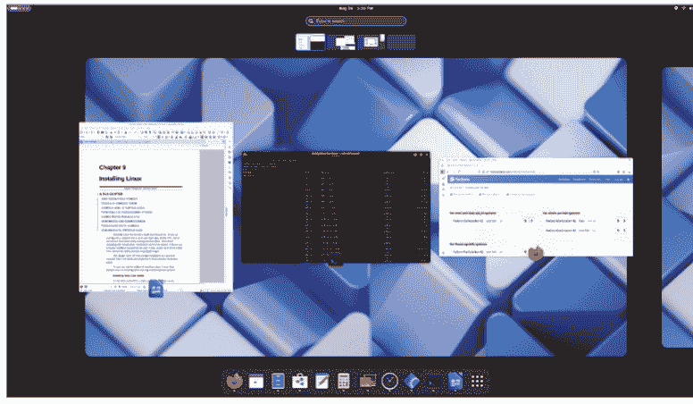

5. **打开其他应用程序。** 启动额外的应用程序。注意，当你打开一个新应用程序时，代表该应用程序的图标会出现在“活动”屏幕底部的 Dash 栏中。

6. **使用多个工作区。** `GNOME` 的设计鼓励使用工作区。`GNOME` 的设计者并没有让你最小化应用程序，而是让你在想将其搁置不想关闭时，轻松地将应用程序拖到其他工作区。注意，原来的“最小化”按钮现在被称为“隐藏”（Hide）。

将鼠标移动到左上角（需要时点击），在“活动”屏幕顶部显示当前的工作区。将几个窗口拖放到空白的桌面空间。图 2.5 显示了小型工作区的样子。注意，每当使用最后一个空工作区时，就会创建一个额外的空工作区。你可以将缩略窗口拖放到任何工作区，然后选择该工作区进行查看。

### 图 2.5

随着新桌面的使用，额外的桌面会在右侧出现。


7. **使用窗口菜单。** 将鼠标移动到屏幕左上角返回活动工作区（大窗口视图）。右键点击窗口上的标题栏查看窗口菜单。以下是 Fedora 中该菜单的内容：

   a. **截图。** 截取当前屏幕截图。当前窗口的图像将保存到主目录下的 `Pictures/Screenshots` 目录。

   b. **隐藏。** 将当前工作区中的窗口搁置。进入“活动”屏幕并选择它即可恢复。

   c. **最大化。** 将窗口扩展到最大尺寸。

   d. **移动。** 将窗口切换到移动模式。移动鼠标即可移动窗口。点击将其固定在某个位置。

   e. **调整大小。** 将窗口切换到调整大小模式。移动鼠标调整窗口大小。点击保持大小。

   f. **工作区选择。** 几项选择让你以不同的方式使用工作区。“始终置顶”（Always On）让当前窗口位于工作区内其他窗口之上。“在可见工作区始终置顶”（Always On on Visible Workspace）始终显示可见的工作区，或使用“移动到左侧工作区”或“移动到右侧工作区”分别将窗口左右移动。

如果你不习惯用鼠标导航 `GNOME`，或者你没有鼠标，下一节将帮助你通过键盘导航桌面。

## 使用键盘导航

如果你倾向于把手留在键盘上，可以通过多种方式直接通过键盘与 `GNOME` 桌面交互，包括以下方法：

### Windows 键

按下键盘上的 Windows 键。在 PC 键盘上，这是 `Alt` 键旁边带有 Windows 标志的键。它可以在微窗口（活动）和活动窗口（当前工作区）之间切换。很多人经常使用此键，而不是将指针移动到左上角。

### 选择不同视图

在“窗口”视图或“活动”视图下，按住 `Ctrl+Alt` 查看视图菜单（见图 2.6）。

图 2.6


按 `Tab` 显示待选择的桌面区域。

在按住 `Ctrl+Alt` 键的情况下，再次按 `Tab` 突出菜单中的以下图标之一并释放以选择：

- **顶部栏。** 突出顶部栏。选中后，你可以在该栏上的项目之间切换（活动、日历和顶部栏）。

- **Dash。** 突出左侧应用程序栏中的第一个应用。使用方向键上下移动该菜单，并按 `Enter` 打开选中的应用程序。

- **应用。** 选择应用程序视图。

- **窗口。** 选择窗口视图。

- **搜索。** 突出搜索栏。输入几个字母以显示包含这些字母的应用程序图标。当你输入的字母足以唯一标识你想要的应用程序时，按 `Enter` 启动应用程序。

### 选择活动窗口

返回到任何工作区（如果你不在活动工作区，请按 Windows 键）。按 `Alt+Tab` 查看所有窗口（图 2.7）。继续按住 `Alt` 键，按 `Tab` 键（或左方向键）从桌面应用程序窗口列表中突出你想要的应用程序。如果一个应用程序打开了多个窗口，按 `Alt+Backspace`（退格键，位于 `Tab` 键上方）在这些窗口之间选择。释放 `Alt` 键进行选择。

### 启动命令或应用程序

从任何工作区，你都可以启动 Linux 命令或图形化应用程序。以下是一些示例：

#### 应用

在“活动”屏幕上，按 `Ctrl+Alt+Tab` 并按 `Tab` 直到突出应用图标；释放 `Ctrl+Alt`。应用程序视图，第一个图标被突出。使用 `Tab` 键或方向键（上、下、左、右）突出你想要的应用程序图标，并按 `Enter`。

图 2.7

按 `Alt+Tab` 选择要前往的运行应用程序。


#### 命令框

如果你知道想要运行的命令的名称（或部分名称），按下 `Alt+F2` 显示命令框。在框中输入要运行的命令名称，例如输入 **Calculator**（计算器）可以打开计算器应用程序。

#### 搜索框

从“活动”（Activities）屏幕中，按下 `Ctrl+Alt+Tab` 并持续按 `Tab` 键，直到放大镜（搜索）被高亮；然后松开 `Ctrl+Alt`。在选中的搜索框中，输入应用程序名称或描述的几个字母（输入 `scr` 可以查看结果）。继续输入，直到你需要的应用程序被高亮（在此情况下是 Screenshot，即截屏工具），然后按回车键启动它。

#### 启动器（Dash）

从“活动”屏幕中，按下 `Ctrl+Alt+Tab` 并持续按 `Tab` 键，直到星形（启动器）被高亮；松开 `Ctrl+Alt`。在启动器中，移动上下箭头高亮你想要启动的应用程序并按回车键。

#### 退出键（Escape）

当你处于一个不想完成的操作中时，尝试按下 `Esc` 键。例如，在 `Alt+F2`（输入命令）后、从顶部栏打开图标或进入概览页面后，按下 `Esc` 可将你带回工作区上的活动窗口。

希望你现在已经习惯了在 `GNOME` 桌面中进行导航。接下来，你可以尝试运行 `GNOME` 中一些实用的扩展和桌面应用程序。

## 设置 GNOME 桌面

你需要的 `GNOME` 为完成的大部分工作都是自动设置的。但是，你需要进行一些微调，以获得你想要的桌面。这些活动大部分可以在“设置”窗口（图 2.8）中完成。从应用程序列表中打开设置图标即可。

以下是配置 `GNOME` 桌面的一些设置：


# 配置 Wi-Fi

如果你在安装期间没有进行，GNOME 桌面的 Wi-Fi 设置允许你配置 Wi-Fi 连接。Wi-Fi 设置允许你从无线网络中选择或连接到隐藏网络。如果你有有线 Internet 连接，可以配置无线连接，作为你所在地其他设备的 Wi-Fi 热点。

# 配置网络

如果你的电脑有有线网络连接，它在你启动 Fedora 系统时通常会自动配置。或者，你可以设置网络代理，以便你的系统通过代理服务器进行 HTTP(S)、FTP 或 SOCKS 服务与本地网络之外进行通信。同样，你可以设置允许 VPN 连接。请参考第 14 章“网络管理”获取有关配置网络的信息。

# 蓝牙

如果你的电脑有蓝牙硬件，你可以启用它以与其他蓝牙设备（如蓝牙耳机或打印机）通信。这些设置允许你连接电脑在附近的蓝牙设备。

# 第二章：创建完美的 Linux 桌面

## 图 2.8

从系统设置窗口更改桌面设置。

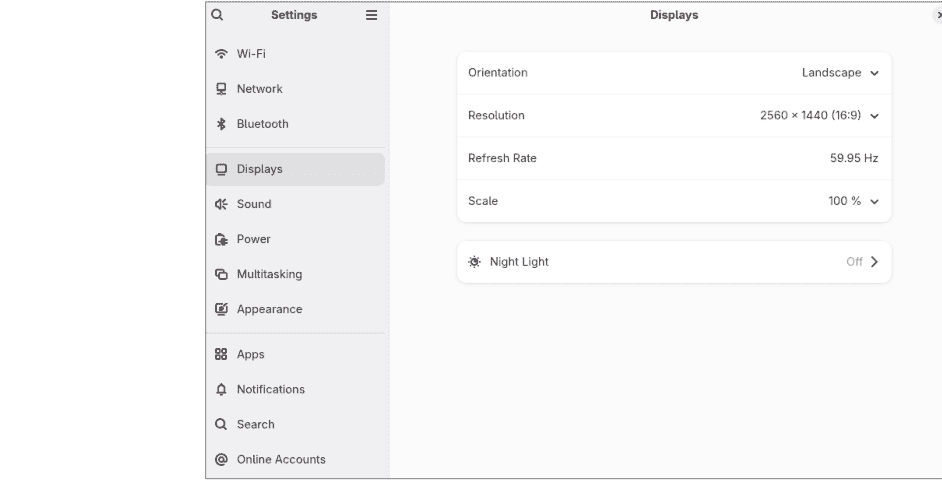

## 显示器

从“显示器”屏幕中，你可以配置屏幕方向、屏幕分辨率、刷新率和缩放。

## 声音

点击设置按钮调整系统上的音频输入和输出设备。

## 扩展 GNOME 桌面

如果 GNOME shell 没满足你所有的需求，不要绝望。你可以添加扩展来为 GNOME 提供额外功能。此外，一个名为 `GNOME Tweaks` 的工具允许你更改 GNOME 中的高级设置。

## 使用 GNOME shell 扩展

GNOME 扩展可更改你的 GNOME 桌面的外观和行为。在 GNOME 桌面上的 Firefox 浏览器访问 GNOME 扩展站点（`http://extensions.gnome.org`）。该页面要求你允许扩展。如果你同意，你将与 `extensions.gnome.org` 和 `extensions-next.gnome.org` 站点共享数据。这些站点将访问你的浏览器标签并向你显示通知。如果你同意这些请求以及它们可能添加的其他请求，就可以继续阅读本节。

在本书的早先版本中，我描述了 GNOME 2，它是 GNOME 的上一个主要更新。如果你喜欢 GNOME 2，GNOME 3 自带的一些扩展（但默认是关闭的）允许你找回一些 GNOME 2 的功能。从 `gnome.org` 扩展中，选择“已安装的扩展”（Installed Extensions）来查看已安装的扩展，包括：

- **应用程序菜单（Apps Menu）**：在顶部面板添加应用程序菜单，就像在 GNOME 2 中那样。
- **位置指示器（Places Indicator）**：添加一个系统状态菜单，类似于 GNOME 2 中的位置，让你能够快速导航到系统上的有用文件夹或网络资源。
- **窗口列表（Window List）**：添加一个活动窗口列表，就像出现在 GNOME 2 底部的那样。

要开启已安装的扩展，只需选择名称旁边的 ON 按钮。或者，你可以点击列表中的扩展名称查看该扩展页面，并点击页面上的按钮从 OFF 切换到 ON。寻找每个扩展旁边的设置图标以进行配置。

图 2.9 显示了应用程序菜单和位置指示器的示例（带有文件夹功能）。

目前已有 100 多个 GNOME shell 扩展可用，并且正在不断增加。其他流行的扩展包括通知（Notifications，更改顶部栏颜色）和可移动驱动器（Removable Drive，在顶部栏添加状态）。

## 图 2.9

扩展为桌面添加功能。


## Tweaks 工具

## 图 2.10

使用 Tweaks 更改设置。

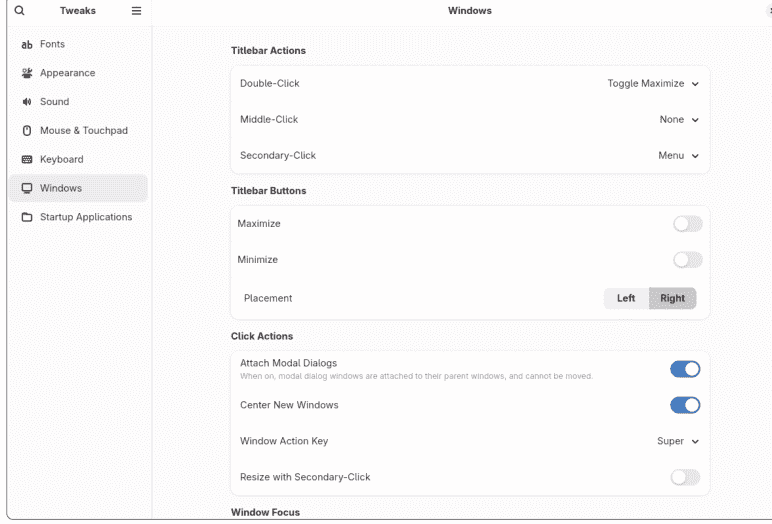

## 桌面背景

## 第 2 章：创建完美的 Linux 桌面

由于 Nautilus 与你在其他计算机系统上使用过的大多数文件管理器没有太大区别，本章将不会详细介绍如何使用拖放和遍历文件夹来查找内容。不过，我想就如何使用 Nautilus 分享几点可能并不显而易见的观察：

- **主目录（Home folder）**：你对在主目录中创建的文件和文件夹拥有完全控制权。文件系统的其他部分你通常无法访问。
- **文件系统组织**：尽管它显示名称为 Home（主），但你的主目录实际上位于文件系统的 `/home` 文件夹下，并以你的用户名命名：例如 `/home/liveuser` 或 `/home/chris`。在接下来的几个章节中，你将学习文件系统是如何组织的（特别是与 Linux 命令行终端的关系）。
- **操作文件和文件夹**：右键点击文件或文件夹以查看你可以对其执行的操作。例如，你可以复制、剪切、移动到垃圾箱（删除）或打开任何文件或文件夹图标。
- **创建文件夹**：要创建一个新文件夹，在文件夹窗口中右键点击并选择“新建文件夹（New Folder）”。在新文件夹窗口中输入新文件夹名称，并按回车键命名。
- **访问远程内容**：Nautilus 可以显示来自远程服务器以及本地系统的内容。在 Nautilus 中，从文件菜单选择“其他位置（Other Locations）”。在“连接服务器（Connect To Server）”框中，你可以通过 SSH（shell）、带登录的 FTP、公共 FTP、Windows 共享、WebDav (HTTP) 或安全 WebDav (HTTPS) 连接到远程服务器。根据需要添加适当的用户和密码信息，远程服务器的内容出现在 Nautilus 窗口中。图 2.12 显示了一个 Nautilus 窗口示例，准备通过 SSH `ssh://chris@192.168.122.128` 连接到远程服务器。

## 安装和管理额外软件

Fedora Live Desktop 自带网络浏览器（Firefox）、一个文件管理器（Nautilus）以及一些常用应用程序。然而，还有许多其他实用程序由于体积太大，无法放入刻光 CD 中。如果你将实时 Fedora Workstation 安装到硬盘上（如第 9 章所述），你几乎肯定需要添加更多软件。

> **注意**：如果你正在运行实时介质，可以安装软件。但请记住，因为在实时介质上的写操作使用虚拟内存（RAM），空间有限且容易用尽。此外，当你重启系统时，你安装的任何内容都会消失。

安装 Fedora 后，它会自动配置并将你的系统连接到互联网上巨大的 Fedora 软件仓库。只要你有互联网连接，你就可以运行“添加/删除软件（Add/Remove software）”工具来下载和安装数以千计的 Fedora 软件包。

## 图 2.12

使用 Nautilus 的“连接服务器”功能访问远程文件夹。

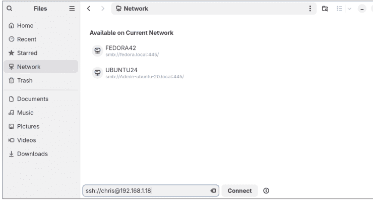

虽然 Fedora 中管理软件的所有功能（`dnf` 和 `rpm` 功能）在第 10 章中介绍，但你可以在不需要了解这些功能工作原理的情况下开始安装某些软件包。只需进入“活动（Activities）”屏幕并打开“软件（Software）”窗口。图 2.13 显示了软件窗口的示例。

通过软件窗口，你可以通过搜索（在查找框中输入名称）或选择类别来选择你想要安装的应用程序。每个类别都按子类别排序，并提供每个类别中的特色软件包。选择左上角的图标，输入与你想要安装的软件包相关的词。你可以阅读搜索结果中每个软件包的描述。当你准备好后，点击“安装（Install）”安装该软件包以及使其运行所需的任何依赖包。

通过搜索和安装一些常用的桌面应用程序，你应该能够开始使用你的桌面环境了。有关如何添加软件仓库和使用 `dnf` 的详细信息，请参考第 10 章。

## 使用 Rhythmbox 音乐

使用一些常用的桌面应用程序

`Rhythmbox` 是一个 `GNOME` 音乐播放器，它在 Fedora Linux 桌面。你可以通过 GNOME 应用程序列表打开它，并播放音乐文件。你可以使用 `GNOME` 格式。

## 图 2.14

显示了一个 `Rhythmbox` 窗口。


以下方法：

1. 点击“其他位置”：在 `GNOME` 窗口中，选择“其他位置”。
2. 在“连接服务器”框中，你可以通过 SSH（shell）、带登录的 FTP、公共 FTP、Windows 共享、WebDav (HTTP) 或安全 WebDav (HTTPS) 连接。

- **鼠标滚轮**：如果你有鼠标滚轮，向上向下切换工作区。
- **鼠标点击并按住**：点击并按住当前工作区的左键。向上、向下、向左或向右移动观察工作区像立方一样旋转。

## 第 2 章：创建完美的 Linux 桌面

## 图 2.15

使用“桌面立方”插件旋转工作区。

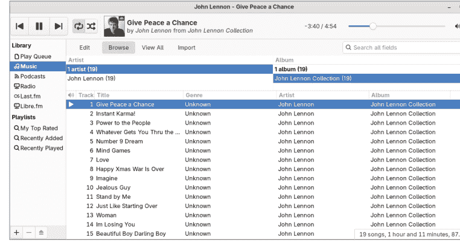

图 2.15 显示了一个旋转桌面立方体的示例。

## 为 GNOME 桌面添加 3D 效果

对于你，你可以通过 GNOME 插件添加 3D 效果。

你可以通过以下几种方式使用它：

- **鼠标滚轮**：如果你有鼠标滚轮，向上向下切换工作区。
- **鼠标点击并按住**：点击并按住当前工作区的左键。向上、向下、向左或向右移动观察工作区像立方一样旋转。

## 图 2.15

使用“桌面立方”插件旋转工作区。


图 2.15 显示了一个旋转桌面立方体的示例。

“我的窗口”插件在窗口打开和关闭时添加效果。默认情况下，“我的窗口”会用火焰打开和关闭窗口。要启用不同的效果，在启用时点击旁边的设置图标。它将允许你从 20 多种不同效果中进行选择，例如破碎玻璃、矩阵和恐龙攻击。

如果你觉得这些效果很有趣，你可以尝试包含 Compiz Fusion 特殊特效的轻量级 MATE 桌面。

## 运行 MATE+Compiz 桌面

Fedora 项目提供了一个完整的 MATE+Compiz 版本（`fedoraproject.org/spins/mate`）。要尝试它，你可以从网站下载 ISO 镜像并运行或安装，如第 9 章或附录 A 所述。

一旦运行 MATE+Compiz 桌面，通过选择“系统 > 偏好 > 外观 > CompizConfig 设置管理器”开始使用 Compiz。图 2.16 显示了 MATE Compiz 设置器的页面效果示例。

是一些你可以尝试的效果（你可以通过取消选择效果随时关闭它们）：

- 启用水效果，然后按 `Shift+F9` 让桌面充满移动的水环。按 `Shift+F8` 用雨刷切换。
- 启用运动模糊，然后按 `Ctrl+F12` 在移动窗口时使其模糊。

## 图 2.16

在 Compiz 中配置桌面效果


- 启用屏幕上的火画效果，然后按住 `Windows+Shift` 的同时拖动左鼠标键，即可让火焰横跨整个屏幕。
- 启用“果冻窗口”（Wobbly Windows），使你移动的任何窗口都会产生摇动。图 2.17 显示了在开启摇动效果时移动窗口的示例。

虽然玩桌面效果很有趣，但 Linux 桌面也是为了严肃的工作而设计的。如果你是一名软件开发者，特别是如果你正在开发最终运行在 Linux 系统上的应用程序，那么将 Linux 桌面作为开发者工作站会非常有帮助。下一节将帮助你开始尝试。

## 配置开发者桌面

Linux 操作系统一直以来软件开发者的最爱，今天也是如此。Linux 提供了许多工具，让你将其配置成一个功能完备的开发者桌面，这并不意外。

Linux 桌面在为 Linux 服务器开发软件的人群中特别受欢迎，尤其是在大型企业中。这些环境可能包含定制化软件、嵌入式 Linux 软件，以及人工智能和机器学习。在你的 Linux 开发者桌面上，你可以在与运行环境基本相同的环境中构建和运行软件。

虽然有很多不同的开发者工具可供选择，但你几乎需要根据以下标准来选择工具：

- **编辑器/IDE**：可以使用纯文本编辑器来编辑代码，许多命令行和图形代码编辑工具都提供了代码编辑的特殊功能。功能范围从代码高亮到自动补全，再到完全的人工智能集成。完整的 IDE 提供了一套更全面的工具，用于构建、调试和部署软件。
- **集成**：对于代码的存储、共享和管理，`Git` 是行业标准。`Git` 由 `Linus Torvalds`（Linux 的发明者）创建并是开源的。通过 `Git`，你可以使用各种命令行工具和代码编辑器与你的 `Git` 工具集成。从零开始构建代码，或从开源项目“派叉”（fork）代码，以开始使用 `Git` 工具进行大型或小型软件项目的版本控制管理。

命令行工具将是你 Linux 桌面体验中不可或缺的一部分。由于我还没有描述 Shell 和命令行工具，本部分将主要描述你可以从 Linux 桌面添加并使用的开发者工具。我将描述如何选择和使用可以增强以管理和编辑文档及代码的编辑器。然后，我将描述如何将你使用的代码与 `Git` 账户集成，以便计数和存储你的工作。

## 获取 Git 账户

如果你想公开你的代码并参与其他公共软件项目，你应该获取一个 `Git` 账户。虽然你可以在没有账户的情况下克隆（clone）许多公共 `Git` 仓库，但如果你想对 `Git` 仓库提交更改建议（拉请求），则需要账户。根据仓库的不同，你可能还需要额外的权限。

刚开始，你可以根据想要贡献的仓库以及想要保存自己代码的地方，在 `GitHub.com`、`GitLab.com` 或 `Bitbucket.org` 获取免费账户。要开始使用 `GitHub`，请访问 `GitHub.com` 并点击 Sign Up（注册）。它将引导你完成获取 `GitHub` 凭据的过程。

为了将你的 `GitHub` 凭据永久存储在 Linux 系统中，你可以参考来自 Geeksforgeeks 的说明（`https://www.geeksforgeeks.org/git/how-to-add-git-credentials-in-linux/`）。不过，就我们的目的而言，我将演示如何在你的计算机上获取一个 `Git` 项目以开始使用编辑器（这不需要凭据）。

如果你想学习如何使用 `Git` 贡献其他软件项目或创建自己的项目，有很多学习 `Git` 的资源。我推荐 `GitHub Skills` (`skills.github.com`)、`Git Immersion` (`gitimmersion.com`) 和 `Learn Git Branching` (`learn gitbranching.js`)。

## 选择 IDE 或代码编辑器

有时，你使用的 IDE 或代码编辑器由雇主决定。你的公司可能有一套你必须使用的集成工具和工作流。

如果你是自己选择编辑代码的工具，可能会根据多种因素的组合来决定，例如你编程使用的语言以及你对使用纯开源解决方案的程度。以下是你在 Linux 中的一些选择：

- **Eclipse**：Eclipse 已经存在了二十多年，是一个流行的 IDE，特别是对于 Java 开发。它最初由 IBM 创建，是一个开源项目。通过添加插件，你可以在 Eclipse 中为数十种编程语言开发应用程序。
- **IntelliJ IDEA**：这是 JetBrains 提供的几个 IDE 之一。它在 Java 开发者中的人气已经超过了 Eclipse IDE。提供免费的开源社区版 IntelliJ IDEA，但许多开发者会升级到 Ultimate 版本，以获得用于 Web 开发、数据库工具和远程开发的额外工具。
- **Apache NetBeans**：与其他 IDE 类似，Apache NetBeans 特别适用于 Java 开发，尽管它也支持 PHP、HTML5、CSS、C 和 C++。它是 Apache 软件基金会的顶级项目，并提供在多个平台运行，如 Linux、macOS、Windows 和 Berkeley Software Distribution。
- **Visual Studio Code**：Visual Studio Code 由微软开发，是一种用于 C（以及 C++ 和 C#）、Node.js、Python、Java 和 JavaScript 等语言的源代码编辑器。虽然它不是一个完全的 IDE，但通过扩展，你可以添加匹配大多数 IDE 所需的组件，如调试器、调试器和编译器。Visual Studio Code 的开源版本可在 Linux 上运行。

为了演示使用添加了 IDE 类型功能的代码编辑器可以做的一些事情，我正在使用 Visual Studio Code。

## 使用 Visual Studio Code

虽然不是一个完整的 IDE，但 Visual Studio Code 提供了许多实用的代码功能，通过扩展，可以提供一种免费的方式来……（原文截断）


## 第 2 章：创建完美的 Linux 桌面

你可以从逐步完成 Visual Studio Code 的设置开始：

- **免费使用 Copilot 的 AI 特性：** 如果你想尝试 Copilot，可以通过提供你的 GitHub 账户或其他凭据来启用它。在操作之前，请阅读服务条款和隐私声明，并意识到你正在离开隐私和开源的领域。尽管如此，启用 Copilot 是了解 AI 能在辅助编程方面为你提供什么帮助的简单方法。

- **选择你的主题：** 默认为你选择了深色模式，但有十多种浅色、深色和高对比度主题供你选择。

- **观看视频教程：** 点击链接查看有关如何使用 Visual Studio Code 的视频教程。与安装版本相关的视频提供了关于如何使用 JavaScript、Python 和 HTML 编程的教程。

- **调整你的设置：** 检查并更改常用设置、字体、自动保存（默认关闭）以及默认格式化程序（如 CSS、HTML 或 JSON 语言功能）。

- **代码扩展：** 添加扩展是让 Visual Studio 不仅仅是一个代码编辑器的方法。在这里，你可以选择不同的扩展、Git 版本控制扩展和生产力工具。

- **内置终端：** 选择此项会在 Visual Studio Code 窗口底部打开一个终端界面。如果你不熟悉 Linux，我建议当你熟悉它后，你会需要这个功能。

- **使用 Git 跟踪你的代码：** 选择此项为 Visual Studio Code 添加 Git 存储库。

当你选择添加 Git 存储库时，系统会提示你输入存储库的 URL。例如，我将演示下载（克隆） GitHub 存储库并从 Visual Studio Code 开始编辑文件的过程。

1. 选择一个你想要使用的 GitHub 项目。我输入了 `https://github.com/StartBootstrap/bootstrap-grayscale`。Grayscale 是一个 HTML 主题，可以被复制并重新用于你的项目。我将使用 Visual Studio Code 编辑 HTML 内容并替换图像。

2. 系统提示你选择一个文件夹将仓库复制到其中。我选择了我的家目录（`/home/chris`）。

3. 打开浏览器查看我们即将编辑的页面。在我的情况下，我在浏览器地址栏中输入了：`file:///home/chris/bootstrap-grayscale/dist/index.html`。

4. 现在既然你已经知道我们要编辑哪个文件了，请进入活动视图并输入 Visual Studio Code 来打开应用程序。

5. 选择“打开文件夹”，然后选择你刚刚在系统文件夹。在我的情况下，它是 `/home/chris/bootstrap-grayscale/dist/`。该文件夹的内容出现在 Visual Studio Code 的左侧导航栏中。

6. 选择 `index.html` 文件并按喜好进行修改。我将 Grayscale 改为 Holiday 并放入了一张节日图片作为背景。图 2.19 显示了 Visual Code 中显示的 `index.html` 文件。


### 图 2.19

HTML 中的不同元素在 Visual Studio Code 中高亮显示。

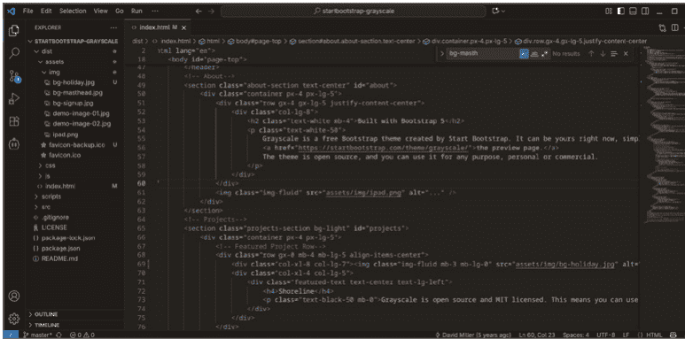

### 图 2.20

在你的浏览器窗口中显示更新后的 HTML 内容。


7. 保存你的更改（`Ctrl+S`）。

8. 刷新浏览器以查看对 `index.html` 页面的更新。图 2.20 显示了该页面的示例。

对 Visual Studio Code 的简要介绍只是你能用它做的事情的冰山一角。使用远程资源管理器功能，你可以通过 SSH 连接处理其他系统上的代码。使用运行和调试功能测试你正在编写的代码，并添加各种扩展来支持各种编程语言和 AI 机器人。

## 总结

GNOME 桌面环境是许多 Linux 系统（包括 Fedora 和 Ubuntu）的默认环境。除了 GNOME 桌面，你还可以尝试其他流行且实用的桌面环境。K 桌面环境提供了比 GNOME 更多的功能。笔记本电脑和 Live CD 发行版有时会使用 LXDE 或 Xfce 桌面。

现在你已经掌握了如何使用 Linux 桌面，是时候开始研究更专业的管理界面了。第 3 章“使用 Shell”将为你介绍 Linux 命令行 shell 环境。

## 练习题

使用这些练习来测试你使用 GNOME 桌面的技能。如果你遇到困难，任务的解决方案位于附录 B。

1. 获取一个默认安装了 GNOME 桌面的 Linux 系统。启动系统并登录 GNOME 桌面。

2. 启动 Firefox 网页浏览器并访问 GNOME 主页（`http://gnome.org`）。

3. 从 GNOME 艺术网站（`http://gnome-look.org`）挑选一个你喜欢的背景，将其下载到你的“图片”文件夹，并将其选择为当前背景。

4. 启动 Nautilus 文件管理器窗口并将其移动到你的工作区或桌面上。

5. 找到你下载的作为桌面背景的图像，并使用任何图像查看器打开它。

6. 在运行 Firefox 的工作区和运行 Nautilus 文件管理器的工作区之间切换。

7. 在运行 Firefox 的工作区和运行 Nautilus 文件管理器的工作区之间切换。

8. 在运行 Firefox 的工作区和运行 Nautilus 文件管理器的工作区之间切换。

9. 从桌面开始，使用键盘启动音乐播放器。

10. 仅使用键盘为你的桌面截图。

## 第二部分：成为 Linux 高级用户

在本部分中

- 第 3 章：使用 Shell
- 第 4 章：在文件系统中移动
- 第 5 章：处理文本
- 第 6 章：管理运行进程
- 第 7 章：编写简单的 Shell 脚本

## 第 3 章：使用 Shell

在本章中

- 理解 Linux shell
- 从控制台或终端使用 shell
- 使用命令
- 使用命令历史和标签补全
- 连接和扩展命令
- 理解变量和别名
- 使 shell 设置永久
- 使用帮助和其他文档

在图标和窗口接管屏幕之前，你通过输入命令与大多数计算机交互。在 Linux 派生的 UNIX 系统上，用于解释和管理命令的程序被称为 shell。

无论你使用哪种 Linux 发行版，你都可以认为 shell 是可用的。它提供了创建可执行脚本、运行程序、操作文件系统、编译代码和管理计算机的方法。本章介绍的 Linux shell 称为 Bash shell，全称为 Bourne Again Shell。这个名字源于它兼容最早的 shell 之一：Bourne shell（以其创建者 Stephen Bourne 命名，由 `sh` 命令表示）。

尽管 Bash 包含在大多数发行版中并被视为标准，但其他 shell 也是可用的，包括深受 BSD 用户喜欢的 C shell（`csh`）和深受 UNIX System V 用户喜欢的 Korn shell（`ksh`）。Ubuntu 默认使用 dash，它的设计旨在比 Bash shell 性能更好，但使用 bash 作为默认登录 shell。Linux 还有 tsh shell（改进版的 csh）和 ash shell（另一种 Bourne shell 变体）。

## 第二部分：成为 Linux 高级用户

你正在使用的 Linux 发行版很有可能提供了多个可用的 shell（终端）。然而，本章主要关注 Bash shell。这是因为书中介绍的 Linux 发行版——Fedora、Ubuntu 和红帽企业版在打开 Terminal 窗口时，默认都使用 Bash shell。

以下是学习使用 shell 的几个原因：

- 你将学会进入任何 Linux 或其他 Unix 类系统。例如，我可以登录到我的红帽企业 Linux Web 服务器、我的家庭多媒体服务器、我的家庭路由器，或者我妻子的 Mac，并从 shell 中探索和使用任何一个计算机系统。甚至我可以在我的安卓手机上登录并运行命令。它们内部运行的 Linux 或类似的系统。

- 特殊功能允许你在命令和 Linux 文件系统之间汇集数据输入并重定向数据输出。为了节省输入时间，你可以从 shell 历史记录中查找、编辑和重复命令。许多高级用户几乎不触碰图形界面，大部分工作都是通过 shell 完成的。

- 你可以使用编程结构（如条件测试、循环和语句）将命令汇集到一个文件中，以执行难以反复重复的复杂操作。存储在文件中的命令组成的程序被称为 shell 脚本。许多 Linux 系统管理员使用脚本来自动化任务，如备份数据或监控日志。

shell 是一个命令语言解释器。如果你用过微软操作系统，你会发现 Linux 中的 shell 与用于运行命令的 PowerShell 相似，但通常比它强大得多。然而，如果你喜欢 Bash shell，可以安装 Git 应用并在 Windows 中作为 Bash shell 使用。

你可以通过图形桌面界面使用 Linux，但随着你对 Linux 的学习深入，你将来会在某点需要使用 shell 来追踪问题或管理某些功能。

起初使用 shell 并不显而易见，但在正确的帮助下，你可以快速学会许多重要的 shell 特性。本章将指导你如何从 shell 操作 Linux 系统命令、进程和文件系统。它描述了 shell 环境，并帮助你根据需求进行定制。

## Shell 和 Terminal 窗口

在 Linux 中获取 shell 界面有多种方法。最常见的包括 shell 提示符、Terminal 窗口、虚拟控制台和云端控制台，你将在接下来的章节中详细了解它们。

首先，启动你的 Linux 系统。在屏幕上，你应该能看到图形登录界面或类似下面的纯文本登录提示符：

```
Fedora Linux 42 (Workstation Edition)
Kernel 6.15.7-200.fc42.x86_64 on an x86_64 (tty3)

fedora login:
```

## 第 3 章：使用 Shell

在任何一种情况下，你都应该使用普通用户账户登录。如果你看到纯文本登录提示符，请继续下一节“使用 shell 提示符”。如果你通过图形界面登录，请进入“使用 Terminal 窗口”章节查看如何从桌面访问 shell。无论何种情况，你都可以按照本章后面出现的“使用云端控制台”章节中的描述访问更多的 shell。

### 使用 shell 提示符

如果你的 Linux 系统没有图形界面（或界面目前无法工作），你在登录后很可能会看到一个 shell 提示符。在 shell 中输入命令可能是你使用 Linux 系统的主要手段。

普通用户的默认提示符只是美元符号：

$

root 用户（管理员）的默认提示符是井号（也称为数字符号或标签符号）：

#

在大多数 Linux 系统中，`$` 和 `#` 提示符之前是你的用户名、系统名和当前目录名。例如，在名为 pine 的计算机上，当前工作目录为 `/usr/share/`，用户 jake 的登录提示符可能如下：

```
jake@pine share$
or
jake@pine:/usr/share$
```

你可以将提示符更改为你喜欢的任何字符，甚至可以读取关于系统的部分信息。例如，你可以使用当前工作目录、日期、本地计算机名或任何字符字符串作为你的提示符。要配置提示符，请参阅本文后面的“设置你的提示符”章节。

虽然 shell 提供了大量功能，但只需输入几个命令即可轻松开始。在后续章节中的某些命令将让你对当前的 shell 环境变得熟悉。

在接下来的示例中，美元符号（`$`）和井号（`#`）表示提示符。`$` 表示该命令可以由任何用户运行，但 `#` 意味着你应该以 root 用户身份运行命令；也就是说，许多管理工具需要运行权限。提示符后面跟着你输入的命令（然后按回车键）。随后的行显示由命令产生的输出。

> **注意**
>
> 尽管我们使用 `#` 表示命令可以作为 root 身份运行，但你不需要以 root 用户身份登录即可以 root 身份运行命令。事实上，以 root 用户身份运行命令最常用的方法是使用 `sudo` 命令。请参考第 8 章“学习系统管理”获取更多关于 `sudo` 命令的信息。

### 使用 Terminal 窗口

当桌面 GUI 运行时，你可以打开一个 Terminal 模拟器程序（有时称为 Terminal 窗口）来启动 shell。大多数 Linux 发行版都方便你从 GUI 进入 shell。以下是从 Linux 启动 Terminal 窗口的两种常用方式：

- **右键点击桌面。** 在出现的右键菜单中，如果你看到 Terminal、Shell、New Terminal Window、Xterm 或类似项目，点击它以启动 Terminal 窗口。（某些发行版禁用了此功能。）

- **点击面板。** 许多 Linux 发行版在顶部或底部包含面板，你可以从中启动应用程序。例如，在 GNOME 中，点击 Activities、输入 `Terminal` 并回车。所有情况下，你都可以在没有 GUI 的 shell 中输入命令。Terminal 模拟器适用于 Linux (RHEL) 以及使用 GNOME 桌面的其他 Linux 发行版，默认的模拟器是 `gnome-terminal`。

GNOME Terminal 支持许多基础 shell 之外的功能。例如，你可以从 GNOME Terminal 窗口剪切文本、更改字体、设置标题、选择颜色或背景以及设置滚动文本。要尝试某些 GNOME Terminal 功能，启动 Fedora 或 RHEL 系统并登录桌面。按照以下步骤操作：

1. 点击 Activities 并输入 Terminal。Terminal 窗口会在你的桌面上打开。

2. 选择窗口顶部的图标设置 Preferences。

3. 在 General 选项卡下，勾选 Custom font 框。

4. 在 Font 字段中尝试不同的字体和大小并选择。新字体出现在 Terminal 窗口中。

5. 取消勾选 Custom font 框。返回原始字体。

6. 在 Colors 选项卡下，从 System Theme 尝试不同的颜色和背景。

7. 重新选择 System Theme 颜色以返回默认颜色。

8. 进入你的 Profile 窗口。这里有你可能想要的其他功能，如滚动数据保留。

9. 完成后关闭 Profile 窗口。现在你准备好使用 Terminal 窗口了。

如果你从图形桌面使用 Linux，你可能经常通过 Terminal 窗口访问 shell。

### 使用虚拟控制台

大多数包含桌面界面的 Linux 系统都在计算机上运行多个虚拟控制台。虚拟控制台是在计算机上运行多个 shell 会话的方法。你可以通过按住 `Ctrl` 和 `Alt` 键按下 `F1` 到 `F6` 之间的功能键来切换虚拟控制台。例如，在 Fedora 中，按下 `Ctrl+Alt+F3` 显示六个控制台之一：

1. 尝试运行。现在按下 `Ctrl+Alt+F3`。你会看到一个纯文本登录提示符。使用你的用户名和密码登录。尝试几个命令。完成后输入 `exit`，按下 `Ctrl+Alt+F1` 或 `Ctrl+Alt+F2` 返回桌面。

### 使用云端控制台

云端控制台允许你通过浏览器访问远程 Linux 系统的 shell。例如，使用 AWS Session Manager：

1. 选择 Session Manager。如果实例允许 Session Manager 连接且你有使用该功能的权限，你会看到 shell 提示符，是以用户身份登录。该用户对机器拥有 `sudo` 权限。

2. 此时，你可以使用 shell 命令操作系统。你也可以使用 `sudo` 切换到另一个用户（如 `ec2-user`）并按你需要运行命令。

### 选择你的 shell

在 Linux 系统中，你的默认 shell 是 Bash。要发现你的默认 shell 是什么，输入以下命令：

```
$ whoami
$ grep chris /etc/passwd
chris:x:13597:13597:Chris Negus:/home/chris:/bin/bash
```

注意，这里以及书中所有的命令行示例都显示命令后跟其输出。命令完成后，你会看到命令提示符。

`whoami` 命令显示你的用户名。`grep` 命令（将 chris 替换为你的用户名）显示 `/etc/passwd` 文件中的用户定义。条目字段显示 Bash shell（`/bin/bash`）是你的默认 shell（登录时启动的 shell）。

虽然可能，你可能设置了不同的默认 shell。要尝试不同的 shell，只需输入该 shell 的名称（例如 `ksh`、`tcsh`、`csh`、`sh`、`dash` 以及其他 shell，假设它们已经安装）。你可以在该 shell 中尝试一些命令，并在完成后输入 `exit` 返回到 Bash shell。

你可能会出于以下原因选择使用不同的 shell：

- 你正在使用 UNIX System V 系统（通常默认为 `ksh`）或 Sun Microsystems 以及其他基于 Berkeley UNIX 的发行版（通常默认为 `csh`），且你由于更习惯于使用这些环境的默认 shell。

- 你想要运行为特定 shell 环境创建的 shell 脚本，并且你需要运行这些脚本，以便能够从当前 shell 中测试或使用这些脚本。


- 你仅仅是倾向于某一个 shell 而不是另一个。例如，你用户组的一位成员倾向于使用 `ksh` 而不是 `bash`，因为他不喜欢 `bash` 处理别名（aliases）的工作方式。

大多数 Linux 用户对某个 shell 都有自己的偏好，当你学会了如何使用其中一个时，你可以参考该 shell 的 man 页（例如，输入 `man bash`）快速学习其他任何 shell。man 页（在后文的“获取命令信息”章节中描述）提供了 Linux 中命令、文件格式和其他组件的文档。大多数人使用 Bash 仅仅是因为他们没有使用其他 shell 的特定理由。本章的其余部分将描述 Bash shell。

Bash 包含了最初为 UNIX 系统中的 `sh` 和 `ksh` 开发的功能，以及一些 `csh` 的功能。你可以预计在你正在使用的大多数 Linux 系统中，Bash 是默认登录 shell，但某些特殊的 Linux 系统（例如某些运行在嵌入式设备上的系统）可能需要内存占用更少、功能更少的较小 shell。

> **提示**
>
> Bash shell 值得学习不仅是因为它是大多数安装中的默认选项，还因为它是你在 Linux 认证考试中将用到的 shell。

## 执行命令

运行命令最简单的方法直接在 shell 中输入命令名称。从桌面打开终端（Terminal）窗口。然后输入以下命令：

```
$ date
Fri Jun 13 08:14:53 EDT 2025
```

输入 `date` 命令而不带任何选项或参数，将如上所示显示当前的日期、月份、日期、时间、时区和年份。

## 第 3 章：使用 Shell

这里是你可以尝试的另外几个命令：

```
$ pwd
/home/chris
$ hostname
mydesktop
$ ls
Desktop Downloads Pictures Templates
Documents Music Public Videos
```

`pwd` 命令显示你当前的工作目录。输入 `hostname` 显示你计算机的主机名。`ls` 命令列出当前目录下的文件和目录。虽然许多命令可以通过输入命令名运行，但更常见的做法是在命令后输入其他字符来修改其行为。你在命令后输入的字符和单词被称为选项（options）和参数（arguments）。

## 理解命令语法

大多数命令都有一个或多个可以添加的选项来更改命令的行为。选项通常由一个连字符开头的单个字母组成。然而，你可以将多个字母组合，或者在每个字母前都加上连字符，以便同时使用多个选项。例如，以下 `ls` 命令的两种用法是：

```
$ ls -l -a
$ ls -lt
```

在这两种情况下，运行的 `ls` 命令都带有 `-l`（长列表）、`-a`（显示隐藏点文件）和 `-t`（按时间列表）选项。

某些命令包含由完整单词表示的选项。要告诉命令使用完整单词作为选项，你通常在它前面加上双连字符（`--`）。例如，要在许多命令上使用帮助选项，你需要在命令行上输入 `--help`。如果没有双连字符，字母 `h`、`e`、`l` 和 `p` 将解释为单独的选项。有些命令没有遵循双连字符规范而在单词前使用单个连字符，但大多数命令单词选项使用双连字符。

> **注意** 你可以对命令使用 `--help` 选项来查看它们支持的选项和参数。例如，尝试 `hostname --help`。

许多命令在输入某些选项后或命令行的末尾接受参数。参数是额外信息，例如文件名、用户名、设备或其他项目，告诉命令如何操作。例如，`cat /etc/passwd` 显示屏幕上 `/etc/passwd` 文件的内容。通常，你可以在命令行上有多个参数，取决于命令行允许的总字符数。有时参数与选项相关。在这种情况下，参数必须紧跟在选项之后。对于单字母选项，参数通常在空格之后。对于完整单词，参数通常在等号（`=`）之后。以下是一些示例：

```
$ ls --hide=Desktop
Documents Music Videos
Downloads
```

在上例中，`--hide` 选项告诉 `ls` 命令不显示名为 `Desktop` 的文件或目录。注意等号紧跟选项之后（无空格），然后是参数（无空格）。这里有一个 `-cvf` 选项的示例：

```
$ tar -cvf backup.tar /home/chris
```

在示例中，`-cvf` 选项创建（`c`）一个名为 `backup.tar` 的文件（`f`），并显示（`v`）`/home/chris` 目录及其子目录的内容。因为 `backup.tar` 是参数，它必须紧跟在选项之后。你可以尝试以下命令看看它们在不同选项下的表现：

```
$ ls
Desktop Downloads Music Templates Videos
$ ls -a
Desktop gnome2_private .lesshst .bash_history .gnupg .bash_logout .bash_profile .edged-auth .fsync.log .zshrc .vs
$ uname
Linux
$ uname -a
Linux fedora 6.15.7-200.fc42.x86_64 #1 SMP PREEMPT_DYNAMIC
Thu Jul 17 17:57:16 UTC 2025 x86_64 GNU/Linux
$ date
Sat Jul 26 00:44:39 PM 2025
$ date '+%d/%m/%Y'
26/07/25
$ date '+%A, %B, %Y'
Saturday, July 26, 2025
```

`ls` 命令本身显示当前目录下的所有文件和目录。通过添加 `-a`，你还可以看到目录中的隐藏文件（以点开头的文件）。`uname` 命令显示你运行的系统类型（Linux）。当你添加 `-a` 时，还可以看到主机名、内核发行和内核版本。`date` 命令有特殊类型的选项。`date` 命令本身如之前所示打印当前的日期时间和。`date` 命令支持一个特殊的 `--format` 选项，允许以不同的格式显示日期。输入 `--help` 查看你可以使用的格式。

尝试 `id` 和 `who` 命令来感受下文描述的当前 Linux 环境。

当你登录 Linux 系统时，Linux 将你视为特定的身份，包括你的用户名、组名、用户 ID 和组 ID。Linux 还会跟踪你的登录会话：它知道你何时登录、你空闲了多久以及从哪里登录。

要查找有关你身份的信息，请如下所示使用 `id` 命令：

```
$ id
uid=1000(chris) gid=1000(chris) groups=10(wheel)
```

在此示例中，用户名 `chris` 由数字用户 ID（`uid`） 1000 表示。`chris` 的主组也是 `chris`，其组 ID（`gid`）为 1000。Ubuntu、Fedora 和 Red Hat Linux 使用与用户名相同的主组名是正常的。用户 `chris` 属于另一个名为 `wheel`（gid 10）的组，这赋予了你 sudo 权限。这些名称和数字代表了 chris 访问计算机资源的权限。

> **注意** 启用了 SELinux 的 Linux 发行版（如 Fedora 和 RHEL）会在 `id` 输出的末尾显示额外信息。该输出可能如下所示：
>
> `context=unconfined_u:unconfined_r:unconfined_t:s0-s0:c0.c1023`
>
> SELinux 提供了一种加强 Linux 系统安全的机制。如果你想了解更多关于 SELinux 的信息，请参阅第 24 章“使用 SELinux 增强 Linux”。

你可以使用 `who` 命令查看有关当前登录会话的信息。在以下示例中，`-u` 选项显示添加空闲时间和进程 ID 的信息，`-H` 请求打印表头：

```
$ who -uH
NAME  LINE      TIME             IDLE    PID COMMENT
chris seat0  2025-01-13 20:57 ?       3778 (login screen)
chris tty2   2025-01-13 20:57 old     3778 (tty2)
chris tty3   2025-01-26 18:41                1250885
```

## 第二部分：成为 Linux 高级用户

此命令的输出显示用户 chris 登录在 seat0（代表在连接到计算机的显示器的第一个虚拟控制台上运行的登录会话），他的登录会话于该时间开始。唯一活跃的登录 shell 位于 tty3，其中 IDLE 时间显示 shell 在没有输入任何命令的情况下已打开了多久（点号表示它当前处于活动状态）。PID 显示用户登录 shell 的进程 ID。COMMENT 将显示用户登录的远程计算机名称（从网络上的另一台计算机登录），或者在本例中，显示登录会话运行的位置 (seat0) 或桌面运行的位置 (tty2)。

## 学习命令

现在你已经输入了一些命令，你可能想知道命令位于何处以及 shell 是如何找到你输入的命令的。要找到你输入的命令，shell 会在所谓的“路径（path）”中查找。对于不在路径中的命令，你可以输入命令位置的完整标识。

如果你知道想要运行的命令所在的目录，运行它的一种方法是输入完整（或绝对）路径。例如，你可以通过输入以下内容从 `/bin` 目录运行命令：

```bash
$ /bin/date
```

当然，这可能非常不方便，特别是当命令位于路径很长的目录时。更好的方法是将命令存储在常用的目录中，并将它们添加到 shell 的 `PATH` 环境变量中。路径由一系列目录组成，shell 会按顺序检查你输入的命令。输入以下内容：

```bash
$ echo $PATH
/usr/local/bin:/usr/bin:/bin:/usr/local/sbin:/usr/sbin:/sbin:/home/chris/bin
```

结果显示了普通 Linux 用户的常用默认路径。路径中的目录用冒号分隔。大多数用户使用 `/usr/local/bin` 中的命令，其内容与 `/usr/bin`（现在的旧 `/bin` 目录）相同。`/bin` 和 `/sbin` 目录包含管理命令（某些 Linux 系统不会将这些目录放在普通用户的路径中）。最后一个目录是你家目录下的 `bin` 目录 (`/home/chris/bin`)。

> **提示** 如果你想添加自己的命令或 shell 脚本，请将它们放在家目录下的 `bin` 目录中（例如用户 chris 的 `/home/chris/bin`）。在某些 Linux 系统中，这会自动添加到你的路径中，但在其他 Linux 系统中，你可能需要创建它或将其添加到 `PATH` 中。因此，只要你带有执行权限并将命令添加到 `bin` 中，你只需通过在提示符处输入命令名称即可开始使用。要让系统上的所有用户都能使用命令，请将它们添加到 `/usr/local/bin`。

## 第三章：使用 Shell

与某些操作系统不同，Linux 默认不会在搜索路径之前检查当前目录下的可执行文件。它会立即开始搜索路径，只有当当前目录中的可执行文件位于 `PATH` 变量中或者你提供了它们的绝对（例如 `/home/chris/script.sh`）或相对（例如 `./script.sh`）位置时，它们才会被运行。

路径顺序很重要。目录从左到右进行检查。因此，在这个例子中，如果 `foo` 命令同时位于 `/usr/bin` 和 `/bin` 目录中，将执行 `/usr/bin` 中的那个。你可以使用另一个 `foo` 命令，或者更改你的 `PATH` 变量（更改 `PATH` 并向其添加目录将在本章稍后描述）。

并不是你运行的所有命令都位于你的 `PATH` 变量中。有些命令是 shell 内置的。其他命令可以通过创建别名（aliases）以及你想让命令运行的选项来覆盖。还有定义使用一组存储命令的函数的方法。以下是 shell 检查你输入的命令的顺序：

- **别名（Aliases）**：这些是通过 `alias` 命令设置的，用于表示特定的命令和一组选项。输入 `alias` 查看所有别名。通常，别名允许你为长而复杂的命令定义一个短名称（我将在本章稍后描述如何创建你自己的别名）。
- **保留字（Reserved word）**：这些词被 shell 预留用于特殊用途。其中许多是你在编程类型函数中使用的词，例如 `while`、`case` 和 `else`。（我将在第 7 章“编写 Shell 脚本”中介绍其中一些保留字）。
- **函数（Function）**：这是在当前 shell 中一起执行的一组命令。
- **内置命令（Built-in command）**：这是内置在 shell 中的命令。因此，在文件系统中没有该命令的表示。你将使用的一些常用命令是 shell 内置命令，例如 `cd`（切换目录）、`echo`（输出到屏幕）、`fg`（将命令从后台运行到前台）、`history`（查看以前运行的命令列表）、`pwd`（列出工作目录）、`set`（设置 shell 选项）和 `type`（显示命令的位置）。
- **文件系统命令（Filesystem command）**：这些命令存储在计算机文件系统中并从那里执行。这些是由 `PATH` 变量的值指示的命令。

要确定特定命令的位置，你可以使用 `type` 命令。（如果使用的是 bash 以外的 shell，请使用 `which` 命令。）例如，要找到 bash shell 命令的位置，输入以下内容：

```bash
$ type bash
bash is /bin/bash
```

尝试使用 `type` 命令输入这几个单词来查看命令的其他位置。

> **提示** 有时在命令行上输入了错误的内容，Bash shell 确保你不需要删除整行并重新开始。同样，你可以回溯之前的行并进行编辑。


- **保留字（Reserved word）**：这些词被 shell 预留用于特殊用途。其中许多是你在编程类型函数中使用的词，例如 `while`、`case` 和 `else`。（我将在第 7 章“编写 Shell 脚本”中介绍其中一些保留字）。

- **函数（Function）**：这是在当前 shell 中一起执行的一组命令。

- **内置命令（Built-in command）**：这是内置在 shell 的命令。因此，在文件系统中没有该命令的表示。你将使用的一些常用命令是 shell 内置命令，例如 `cd`（切换目录）、`echo`（输出到屏幕）、`fg`（将命令从后台运行到前台）、`history`（查看以前运行的命令列表）、`pwd`（列出工作目录）、`set`（设置 shell 选项）和 `type`（显示命令的位置）。

- **文件系统命令（Filesystem command）**：这些命令存储在计算机文件系统中并从那里执行。这些是由 `PATH` 变量的值指示的命令。

要确定特定命令的位置，你可以使用 `type` 命令。（如果使用的是 bash 以外的 shell，请使用 `which` 命令。）例如，要找到 bash shell 命令的位置，输入以下内容：

```bash
$ type bash
bash is /bin/bash
```

尝试使用 `type` 命令输入这几个单词来查看命令的其他位置：查看命令的位置：通常，别名允许你为长而复杂的命令定义一个短名称。（我将在本章稍后描述如何创建你自己的别名）。

> **提示**：有时在命令行上输入了错误的内容，Bash shell 确保你不需要删除整行并重新开始。同样，你可以回溯之前的行并进行编辑。

## 回溯命令

shell 历史记录是你输入过的命令列表。能够重复一个命令非常方便。幸运的是有些 shell 功能允许你回溯行。

## 命令行编辑

如果你在命令行上输入了错误的内容，Bash shell 确保你不需要删除整行并重新开始。

默认情况下，Bash shell 使用基于 `emacs` 编辑器的命令行编辑。（如果你熟悉 `emacs`，你可能知道大多数的快捷键。）

如果你更倾向于使用 `vi` 命令编辑行，可以轻松地实现这一点。将以下行添加到你的 `.bashrc` 文件中：

```bash
set -o vi
```

## 第二部分：成为 Linux 高级用户

- 3. **`Ctrl+F` 或右箭头键 (→)**。重复此命令几次，以将光标移动到第一个斜杠（/）下方。

- 4. **`Ctrl+D`**。输入此命令四次，以删除行中的 `/usr`。输入 `s` 将其更改为 `/sbin`。

- 5. **按回车键 (Enter)**。执行命令行。

在编辑命令行时，你可以在任何位置输入普通字符，将这些字符添加到命令行中。字符会出现在你文本光标所在。你可以使用右箭头和 ← 箭头让光标在命令行的一端到另一端。你还可以按 ↑ 和 ↓ 键在历史列表中遍历之前的命令，以选择一个命令进行编辑。（详情请参见“命令行回溯”章节，了解如何从历史列表中回溯命令。）你可以使用许多按键来编辑行。表 3.1 列出了你可以用于在命令行中移动的按键。

## 表 3.1 用于导航命令行的按键

| 按键 | 全称 | 含义 |
|---|---|---|
| `Ctrl+F` | Character forward | 向前移动一个字符。 |
| `Ctrl+B` | Character backward | 向后移动一个字符。 |
| `Alt+F` | Word forward | 向前一个单词。 |
| `Alt+B` | Word backward | 向后一个单词。 |
| `Ctrl+A` | Beginning of line | 转到当前行开头。 |
| `Ctrl+E` | End of line | 转到行末尾。 |
| `Ctrl+L` | Clear screen | 清除屏幕并将行留在屏幕顶部。 |

表 3.2 中的按键可用于编辑命令行。

## 表 3.2 用于编辑命令行的按键

| 按键 | 全称 | 含义 |
|---|---|---|
| `Ctrl+D` | Delete current | 删除当前字符。 |
| `Backspace` | Delete previous | 删除上一个字符。 |
| `Ctrl+T` | Transpose character | 交换当前和上一个字符的位置。 |
| `Alt+T` | Transpose words | 交换当前和上一个单词的位置。 |
| `Alt+U` | Uppercase word | 将当前单词转换为大写。 |
| `Alt+L` | Lowercase word | 将当前单词转换为小写。 |
| `Alt+C` | Capitalize word | 将当前单词的首字母大写化。 |
| `Ctrl+V` | Insert special character | 添加特殊字符。例如，要添加 Tab 字符，按 `Ctrl+V+Tab`。 |

## 第3章：使用 Shell

使用表 3.3 中的按键在命令行上剪切和粘贴文本。

## 表 3.3 在命令行内剪切和粘贴文本的按键

| 按键 | 全称 | 含义 |
|---|---|---|
| `Ctrl+K` | Cut end of line | 剪切到行末。 |
| `Ctrl+U` | Cut beginning of line | 剪切到行首。 |
| `Ctrl+W` | Cut previous word | 剪切光标之前的单词。 |
| `Alt+D` | Cut next word | 剪切光标之后的单词。 |
| `Ctrl+Y` | Paste recent text | 粘贴最近剪切的文本。 |
| `Alt+Y` | Paste earlier text | 回到之前剪切的文本并粘贴。 |
| `Ctrl+C` | Delete whole line | 删除整行。 |

## 命令行完成

为了节省按键，Bash Shell 提供了几种不同的方式来完成部分输入的值。要完成一个值，输入前几个字符并按 `Tab` 键。以下是你可以在 Bash Shell 中部分输入的某些值：

- **命令、别名或函数**：如果你输入带有普通字符的文本，Shell 会尝试用命令、别名或函数名来补全文本。

- **变量**：如果你输入的文本以美元符号 (`$`) 开头，Shell 将用当前 Shell 中的变量来补全文本。

- **用户名**：如果你输入的文本以波浪号 (`~`) 开头，Shell 将用用户名来补全文本。结果，`~username` 表示指定用户的家目录。

这里是命令补全的几个示例。（当你看到 `<Tab>` 时，意味着按下键盘上的 Tab 键。）输入以下内容：

```bash
$ echo $OS<Tab>
$ cd -ro<Tab>
$ user<Tab>
```

第一个示例使用 `OS` 来扩展 `$OSTYPE` 变量。在下一个示例中，`-ro` 扩展为 root 用户的家目录 (`-root/`)。接下来，`userm` 扩展为 `usermod` 命令。

按 `Tab` 键提供了一些奇妙的可能性。有时，对于你输入的字符字符串有多种可能的补全方式。在这种情况下，你可以在想要进行补全的地方按 `Tab` 键，检查文本可以扩展的所有方式。

以下显示了如果你检查 `$P` 的可能补全项将得到的结果：

```bash
$ echo $P<Tab><Tab>
$PATH PPID $PS1 $PS2 $PS4 $PWD
$ echo $P
```

在这种情况下，有六个以 `$P` 开头的可能变量。在显示可能性后，原始命令行会返回，准备让你根据自己的选择进行补全。例如，如果你又输入了一个 `P` 并再次按 `Tab`，命令行将补全为 `PPID`（唯一的唯一可能性）。

## 命令行回溯

在你输入一个命令后，可以从历史列表中回溯它。使用方向键遍历之前的命令。你还可以使用 `Ctrl+R` 搜索你的历史记录。当你输入一个字符串时，Shell 会显示包含该字符串的最近命令。要编辑命令，按回车键。要运行命令，按回车键。

处理历史列表的另一种方法是使用 `fc` 后跟一个历史编号，该命令行将在文本编辑器中打开。进行所需的更改。当你退出编辑器时，命令将运行。你也可以给出一个行号范围（例如 `fc 100 105`）。

在你关闭 Shell 后，历史列表存储在家目录下的 `.bash_history` 文件中。默认情况下，为你存储高达 1,000 条历史命令。

## 第二部分：成为 Linux 高级用户

> **注意**：某些人通过将 shell 变量 `HISTFILE` 设置为 `/dev/null` 或简单地留空 `HISTSIZE` 来禁用 root 用户的历史功能。这可以防止 root 用户的活动信息被潜在利用。如果你是具有 root 权限的管理用户，出于相同的原因，你可能希望在退出时也清空文件。此外，由于 shell 历史在 shell 退出时永久存储，你可以通过杀死（kill）shell 来防止存储 shell 历史。例如，要杀死进程 ID 为 1234 的 shell，输入 `kill -9 1234`。

# 连接与扩展命令

shell 的一个真正强大的功能是可以将命令的输入和输出重定向到其他命令和文件。为了允许命令串联，shell 使用了元字符。元字符是指对 shell 有特殊含义的类型字符。元字符包括管道 (`|`)、安培符 (`&`)、分号 (`;`)、右括号 (`)`)、左括号 (`(`)、右括号 (`}`)、小于 (`<`) 和大于 (`>`)。接下来的章节将描述如何在命令行使用元字符以及命令的行为。

# 命令之间的管道

管道元字符 (`|`) 将一个命令的输出连接到另一个命令的输入。这允许你对某些数据运行一个命令，然后让下一个命令处理结果。这里有一个管道命令行的示例：

```bash
$ cat /etc/passwd | sort | less
```

此命令列出 `/etc/passwd` 文件的内容，并将输出传给 `sort` 命令。`sort` 命令收集 `/etc/passwd` 文件中每一行的用户名，按字母顺序进行排序，并将输出传给 `less` 命令（用于分页查看输出）。

管道极好地说明了 Linux 的前身 UNIX 是如何作为一种由构建块组成的操作系统被创建起来的。UNIX 的标准做法是以后不同的方式连接实用工具来完成任务。例如，在文字处理器出现之前，用户使用包含用于指示格式的宏的纯文本文件。为了查看文档的真实外观，他们会使用如下的命令：

```bash
$ gunzip /usr/share/man/man1/grep.1.gz | man -man | less
```

在这个示例中，grep 的 man 手页（`grep.1.gz`）的内容被重定向到 `gunzip` 命令进行解压缩。从 `gunzip` 开始，它被管道到 `man` 命令，并使用手册宏 (`-man`) 格式化 man 手页。为了显示输出，它被管道到 `less` 命令。由于显示的文件是纯文本，你可以在显示之前使用任意数量的选项处理文本。你可以对内容进行排序、更改或删除某些内容，或者从其他文档引入文本。关键在于，并不是将所有这些功能都放在一个程序中，而是通过在多个命令之间管道和重定向输入输出来获得结果。

# 第三章：使用 shell

# 顺序命令

有时，你可能需要运行一系列命令，其中一个命令在下一个命令开始之前完成。你可以通过在同一条命令行上输入多个命令并用分号 (`;`) 将它们隔开来实现：

```bash
$ date ; troff -me verylargedocument | lpr ; date
```

在这个示例中，我正在格式化一个大文档，并想知道需要多长时间。第一个命令（`date`）显示了格式化之前的日期和时间。`troff` 命令格式化了文档并将输出传到打印机。格式化完成后，再次打印日期和时间（这样我就知道 `troff` 完成花了多长时间）。

另一个可以添加到长命令行末尾的命令是 `mail`。你可以在命令行末尾执行以下操作：

```bash
: mail -s "Finished the long command" chris@example.com
```

然后，例如，在命令完成后向你选择的用户发送一条邮件消息。

# 后台命令

某些命令可能需要一段时间才能完成。有时，你可能不想让等待命令完成占用你的等待。在这种情况下，你可以使用安培符 (`&`) 在后台运行命令。

文本格式化命令（如之前描述的 `nroff` 和 `troff`）是在后台运行以格式化大文档的命令示例。你可能还会创建自己的在后台运行的 shell 脚本，持续检查某些事件，例如磁盘满或特定用户登录。

以下是一个在后台运行的命令示例：

```bash
$ troff -me verylargedocument | lpr &
```

在进程完成或杀死该进程之前，不要关闭 shell。管理后台和前台进程的其他方法将在第六章“管理运行中的进程”中描述。

# 命令扩展

通过命令替换，你可以让 shell 解析命令的输出而不是命令本身。通过这种方式，你可以让一个命令的标准输出成为另一个命令的参数。命令替换的两种形式是 `$(command)` 和 `` `command` ``（反引号，不是单引号）。

## 第二部分：成为 Linux 高级用户

在这种情况下，命令可以包含选项、元字符和参数。以下是使用命令替换的示例：

```bash
$ vi $(find /home | grep xyzzy)
```

在这个示例中，命令替换在 `vi` 命令运行之前就已经完成了。首先，`find` 命令从 `/home` 目录开始，并打印文件系统中该点以下的所有文件和目录。输出传给 `grep` 命令，该命令过滤掉所有不包含字符串 "xyzzy" 的文件。

## 表达式扩展

有时，你想扩展一个表达式。有两种形式：`$(expression)` 和 `` `expression` ``。shell 会获取括号或反引号中命令的输出并将其替换。例如：

```bash
$ echo $(date)
```

此命令显示当前的日期和时间。你也可以使用反引号：

```bash
$ echo `date`
```

这两个命令产生相同的结果。然而，`$(expression)` 更好，因为它更容易嵌套。例如：

```bash
$ echo $(basename $(pwd))
```

这将首先执行 `pwd`，然后对输出执行 `basename`。

## 变量扩展

变量是可以存储并在稍后命令行使用的值。为了区分变量和普通文本，它们前面有一个美元符号 (`$`)。例如，要查看 `USER` 变量的值，你将输入：

```bash
$ echo $USER
```

这将打印存储在 `USER` 变量中的值。你也可以通过等号来设置变量：

```bash
$ NAME=John
$ echo $NAME
```

这将打印 John。变量仅在当前会话中可用。要让变量对子 shell 可用，必须将其导出：

```bash
$ export NAME
```

现在，`$NAME` 将适用于从当前 shell 启动的任何 shell。

## 使用变量

变量可以使用命令。例如：

```bash
$ FILE=test.txt
$ cat $FILE
```

这将读取 `test.txt` 的内容。你还可以在路径中使用变量：

```bash
$ DIR=/home/user/documents
$ mkdir $DIR/work
```

将在 `/home/user/documents` 下创建一个名为 `work` 的目录。

# 环境变量

环境变量是当前 shell 启动的所有进程可用的变量。它们包含了如 `PATH`、`USER` 和 `SHELL` 等信息。你可以通过输入 `env` 命令看到所有的环境变量：

```bash
$ env
```

下表显示了一些常用的环境变量。

## 表 3.5 常用环境变量

| 变量 | 说明 |
|---|---|
| `BASH` | 包含 bash 命令的完整路径。通常是 `/bin/bash`。 |
| `BASH_VERSION` | 一个表示 bash 命令版本的数字。 |
| `UID` | 当前用户的有效用户 ID。它在 shell 启动时根据 `/etc/passwd` 中的用户条目分配。 |
| `FCEDIT` | 如果设置，此变量指示 `fc` 命令在编辑历史命令时使用的文本编辑器。如果未设置此变量，则使用 `vi` 命令。 |
| `HISTFILE` | 历史文件的位置。它通常位于 `$HOME/.bash_history`。 |

## 第二部分：成为 Linux 高级用户

表格 3.5（续）

| 变量 | 描述 |
|---|---|
| `HISTFILESIZE` | 这是可以存储的历史记录条目数量。达到此数量后，最旧的命令将被丢弃。默认值为 1000。 |
| `HISTCMD` | 这返回历史列表中当前命令的编号。 |
| `HOME` | 这是你的家目录。每当你登录或输入不带任何选项的 `cd` 时，这就是你的当前工作目录。 |
| `HOSTTYPE` | 这是一个描述运行 Linux 系统的计算机架构的值。对于 Intel 兼容的 PC，该值为 `i386`、`i486`、`i586`、`i686` 或类似 `i386-linux` 的值。对于 AMD64 机器，该值为 `x86_64`。 |
| `MAIL` | 这是你本地邮箱文件的位置。该文件通常是 `/var/spool/mail` 或 `/var/mail` 目录下以你的用户名命名的文件。 |
| `OLDPWD` | 这是你在切换到当前工作目录之前所在的目录。 |
| `OSTYPE` | 识别当前的操作系统。对于 Fedora 和 Ubuntu Linux，`OSTYPE` 可能是 `linux` 或 `linux-gnu`，取决于你正在使用的 shell 类型。（Bash 也可以运行在其他操作系统上）。 |


| PATH | 这是一个用冒号分隔的目录列表，用于查找你输入的命令。不同发行版的普通用户默认值通常包含以下内容：`/usr/local/bin:/`。如果你需要运行一个不在 `PATH` 中的命令，则输入该命令的完整路径或相对路径。对于 root 用户，该值还包括：`/bin:/sbin:/usr/bin:/usr/sbin`，尽管这些通常也会被添加到普通用户的 `PATH` 中。 |

| PPID | 这是启动 shell 的命令的进程 ID（例如包含该内容的 Terminal 窗口）。 |

| PROMPT_COMMAND | 这可以设置为在每次显示提示符时运行的名称。设置 `PROMPT_COMMAND=date` 会在提示符出现之前列出日期/时间。 |

| PS1 | 这设置你的 shell 提示符的值。你可以将许多项目读入提示符中（日期、时间、用户名、主机名等）。有时命令需要额外的提示符，你可以通过 `PS2`、`PS3` 等变量进行设置。 |

| PWD | 这是被分配为当前目录的目录。每当你使用 `cd` 命令更改目录时，此值就会改变。 |

# 第3 章：使用 Shell

表格 3.5（续）

| 变量 | 描述 |

| --- | --- |

| RANDOM | 访问此变量会生成一个随机数。数字在 0 到 99999 之间。 |

| SECONDS | 自 shell 启动以来的秒数。 |

| SHLVL | 这是与当前 shell 会话相关的 shell 层数。当你登录 shell 时，`SHLVL` 为 1。每当你启动一个 `bash` 命令（例如使用 `su` 变成新用户，或简单地输入 `bash`），该值就会加1。 |

| TMOUT | 这可以设置为数字，代表 shell 在未接收输入的情况下空闲秒数。达到该秒数后，shell 将退出。此安全功能使得无人看的 shell 被未经授权的人访问的可能性降低。（这必须在登录 shell 中设置才能导致 shell 退出用户）。 |

## 创建和使用别名 (aliases)

使用 `alias` 命令，你可以为你想要运行的任何命令和选项有效地创建快捷方式。你可以使用 `alias` 命令添加和列出别名。考虑以下 Bash shell 中的别名示例：

```
$ alias pwd='pwd ; ls -CF'
$ alias rm='rm -i'
```

在第一个示例中，字母 `p` 被分配给命令 `pwd`，并运行 `ls -CF` 来打印当前工作目录并以列的形式列出其内容。每当你输入 `rm` 时，shell 都会带有 `-i` 选项运行 `rm` 命令。（这是一个为 root 用户自动设置的别名。它不仅仅是简单的删除文件，还能防止你误将 `rm` 输入为 `*` 而自动删除目录中的所有文件）。

当你在 shell 中时，可以通过输入 `alias` 命令检查设置了哪些别名。如果你想删除别名，请使用 `unalias`。（记住，如果别名是在配置文件中设置的，当你打开另一个 shell 时，它会被再次设置）。

## 退出 shell

完成后，输入 `exit` 或按下 `Ctrl+D` 退出 shell。如果你从 Terminal 窗口进入 shell 并且正在使用该窗口的原始 shell，退出会导致 Terminal 窗口关闭。如果你处于虚拟控制台，shell 将退出并返回到登录提示符。

如果你从同一个 shell 会话打开了多个 shell，退出 shell 仅仅会返回到启动当前 shell 的 shell。例如，`su` 命令以新用户的身份打开一个 shell。退出 shell 只需返回到原始 shell。

## 第二部分：成为 Linux 高级用户

## 创建你的 Shell 环境

你可以调整你的 shell 以帮助你更高效工作。你可以设置别名来为你喜爱的命令行创建快捷方式，并设置环境变量来存储信息。通过将这些设置添加到 shell 配置文件中，你可以确保每次打开 shell 时都使用这些设置。

## 配置你的 shell

几个配置文件支持你的 shell 行为。某些文件会在每个用户和每个 shell 中执行，而另一些则特定于创建它的用户。这些文件决定了 shell 的行为。表 3.6 显示了这些文件（注意文件名中的 `~` 表示用户家目录）。

# 表格 3.6 配置文件

| 文件 | 描述 |

| --- | --- |

| `/etc/profile` | 为每个用户设置信息。在你首次登录时执行。 |

| `/etc/bashrc` | 在每个用户运行 Bash 时执行。它设置了提示符并允许某些别名。 |

| `~/.bash_profile` | 供用户使用的信息。仅在登录时执行一次。 |

| `~/.bashrc` | 在每次打开 shell 时执行。它包含用户的特定信息。 |

| `~/.logout` | 在注销时执行。 |

| `/etc/profile.d/custom.sh` | 如果你管理系统，可能会为所有用户设置这些默认值。 |

# 第3 章：使用 Shell

在学习第 5 章“处理文本文件”中的 `vi` 编辑器之前，你可以使用一个名为 `nano` 的简单编辑器来编辑文本文件。例如，输入：

```bash
$ nano ~/.bashrc
```

在 `nano` 中，将光标移动到文件底部。输入你想要的行（例如）。保存文件时按下 `Ctrl+O`（字母 O）；退出时按下 `Ctrl+X`。要让刚刚添加的信息在当前 shell 中生效，输入：

```
$ source ~/.bashrc
$ date
```

## 设置你的提示符

你的提示符由 shell 准备好接受命令时显示的字符集组成。`PS1` 环境变量设置了提示符的内容，也是你交互的对象。如果你的提示符需要额外的输入，它将使用 `PS2`、`PS3` 和 `PS4` 的值。

当你的 Linux 系统安装时，通常提示符包含不仅仅是美元符号或井号。例如，在 Ubuntu、Fedora 或 Red Hat Enterprise Linux 中，你的提示符被设置为包含以下信息：用户名、主机名和当前工作目录的基本名称。这些信息被括号括起来，后面跟着美元符号（普通用户）或井号（root 用户）。以下是一个示例：

```
[chris@myhost:~/bin]$
```

如果你更改目录，`~` 就会变成新目录的名字。同样，如果你登录不同的用户或不同的主机，这些信息也会改变。

你可以使用特殊字符（用反斜杠加各种字母表示）在你的提示符中包含不同的信息。特殊字符可以输出你的终端 编号、日期和时间以及其他信息。表 3.7 提供了一些示例（你可以在 Bash man 手页中找到更多内容）。

## 第二部分：成为 Linux 高级用户

表 3.7 向 Bash 提示符中添加信息的字符

| 特殊字符 | 说明 |

| --- | --- |

| `!` | 显示当前命令历史记录编号。这包含了为你的用户名存储的所有之前的命令。 |

| `\#` | 显示当前命令的命令编号。这仅包含活动 shell 的命令。 |

| `\$` | 显示提示符 ($) 或 root 提示符 (#)，取决于你是哪种类型的用户。 |

| `\W` | 显示工作目录的基名。例如，如果当前工作目录是 `/var/spool/mail`，此值将简单显示为 mail。 |

| `\[` | 位于非打印字符序列之前。这可以用于向提示符中添加终端控制序列，例如更改颜色、添加链接效果或加粗字符。（你的终端决定了具体的可用序列）。 |

| `\]` | 紧跟在非打印字符序列之后。 |

| `\\` | 显示反斜杠。 |

| `\d` | 显示当前日期的年、月和日期，例如，Jan 25。 |

| `\h` | 显示运行 shell 的计算机主机名。 |

| `\n` | 导致换行。 |

| `\nnn` | 该字符与替换 nnn 的八进制数有关。 |

| `\s` | 显示当前的 shell 名称。对于 Bash shell，值是 bash。 |

| `\t` | 打印当前的小、分、秒，例如，10:14:39。 |

| `\u` | 打印你当前的用户名。 |

| `\w` | 显示当前工作目录的完整路径。 |

> 提示

如果你正在通过在 shell 中输入命令来设置提示符，你应该输入值 `PS1="$| \t |\w$"`，以看到类似所示的提示符：[20:26:32 /var/spool$]。

要使你对提示符的更改生效，请将 `PS1` 的值添加到家目录下的 `.bashrc` 文件中（假设你正在使用 Bash shell）。该文件中可能已经有一个 `PS1` 值，你可以对其进行修改。请参考 Bash Prompt HOWTO (http://www.tldp.org/HOWTO/Bash-Prompt-HOWTO) 获取有关更改 Bash shell 提示符的颜色、命令和其他功能的信息。

# 第 3 章：使用 shell

## 添加环境变量

你可能想要向你的 `.bashrc` 文件中添加几个环境变量。这些可以帮助使操作 shell 更高效、更有效：

**TMOUT** 设置 shell 在 Bash 自动退出之前处于非活动状态的时间。该值是 shell 未接收到输入的秒数。这可以是一个很好的安全功能，以防你在仍登录 Linux 的情况下离开桌子。为了防止在工作时被踢出，你可能想将值设置为类似 `TMOUT=1800`（允许允许 30 分钟的空闲时间）。你可以使用任何终端在几秒钟后关闭 shell，例如 `TMOUT=30`。

**PATH** 如前所述，`PATH` 变量设置了搜索你所用命令的目录。如果你使用了不在路径中的其他命令目录，可以永久地添加它们。要执行此操作，请向你的 `.bashrc` 文件中添加 `PATH` 变量。例如，要添加目录 `/getstuff/bin`，请添加以下内容：

```
PATH=$PATH:/getstuff/bin ; export PATH
```

此示例首先将所有当前路径目录读入新的 `PATH` (`$PATH`)，添加 `/getstuff/bin` 目录，然后导出新的 `PATH`。

# 注意

有些人人通过添加仅标识为点 (`.`) 的目录将当前目录添加到他们的 `PATH` 中，如下：

```
PATH=.:$PATH ; export PATH
```

这允许你在评估路径中的任何其他命令之前，运行当前目录中的命令（这可能是为了让人检查你是否使用过 DOS）。然而，这种做法的安全风险是，你可能处于一个包含你并不打算从该目录运行的命令的目录中。例如，恶意人员可以在某个目录中放置一个 `ls`，它不是列出你的目录内容，而是做一些诡异的事情。因此，强烈不建议这种向路径添加内容的做法。

# 无论如何

你可以创建自己的环境变量为工作提供快捷方式。选择任何未被使用的名称并给它分配一个有用的值。例如，如果你在 `/work/time/files/info/memos` 目录的文件中大量工作，你可以设置以下变量：

```
M=/work/time/files/info/memos ; export M
```

你可以通过输入 `cd $M` 进入你的当前目录。你可以通过输入 `$M/hotdog` 从该目录运行名为 `hotdog` 的程序。你可以通过输入 `vi $M/bun` 从那里编辑一个名为 `bun` 的文件。

## 获取命令信息

当你刚开始使用 shell 时，它可能会令人生畏。你看到的只是一个提示符。你如何知道哪些命令可用，它们使用哪些选项，或者如何使用高级功能？幸运的是，有很多帮助可用。以下是你可以查找的地方，以补充在本章中学到的知识：

- 检查 PATH。输入 `echo $PATH`。你会看到包含可直接使用的命令的目录列表。列出这些目录的内容将显示大多数标准的 Linux 命令。

```
ls /usr/bin
arch fusermount loadkeys mv
awk df gawk login nano
basename dmes gettext netstat
bash dsdomainname grep lsblk nice
cat domainname gtar nisdomainname
chgrp echo gunzip ping
chmod grip mail ping6
chown grep hostname mkdir ps
cp ipcalc readlink
csh false kbd_node red
cut grep kill redhat_ls:init
dash find link rm
find mountpoint rm
```

- 使用 help。某些命令内置在 shell 中，因此它们不会出现在目录中。`help` 命令列出了这些命令并显示每个命令可用的选项（输入 `help | less` 来翻页列表）。要获取特定内置命令的帮助，输入 `help command`，将 `command` 替换为你感兴趣的名称。`help` 在 Bash shell 中有效。

- 使用 --help。许多命令包含一个 `--help` 选项，可以使用它来获取有关命令如何使用的信息。例如，如果执行 `date --help | less`，输出不仅显示了选项，还显示了你可以配合 `date` 命令使用的格式。命令简单使用 `-h` 选项，如 `fish -h`。

- 使用 info 命令。`info` 命令是另一个从 shell 显示命令信息的工具。`info` 命令可以在层次节点之间移动以找到有关命令的信息。并不是所有命令在 `info` 中都有信息，但有时可以在 `man` 页面找到更多信息。

- 使用 man 命令。`man` 命令是显示命令信息的工具。要获取有关特定命令的信息，输入 `man command`（将 `command` 替换为你感兴趣的名称）。描述将显示在屏幕上。

手册页是获取命令以及 Linux 系统其他组件信息的常用方法。每个手册页都属于表 3.8 中的一个类别。

# 第 3 章：使用 shell

在表 3.8。作为普通用户，你将对部分 1 的手册页感兴趣。作为系统管理员，你也将对部分 5 和 8 以及部分 4 感兴趣。

表 3.8 手册部分

| 数字 | 部分名称 | 说明 |

| --- | --- | --- |

| 1 | 用户命令 | 普通用户可以在 shell 中运行的命令 |

| 2 | 系统调用 | 应用程序内部用于调用内核的编程函数 |

| 3 | C 库函数 | 提供接口的编程函数（例如图形界面或其他在用户空间运行的库） |

| 4 | 设备和特殊文件 | 代表硬件设备（如终端或光驱）或软件设备（如随机数生成器）的文件系统节点 |

| 5 | 文件格式和规范 | 文件类型（如图形或文字处理文件）或特定的配置文件（如 `passwd` 或 `group` 文件） |

| 6 | 游戏 | 系统上的游戏 |

| 7 | 杂项 | 协议、文件系统、字符集标准等主题的概述 |

| 8 | 系统管理工具和守护进程 | 需要 root或其他管理员权限使用的命令 |

`man` 命令的选项允许你搜索手册数据库或在屏幕上显示手册页。是一些 `man` 命令和选项的示例：

```
$ man -k password
--
passwd (1) - 更新用户身份验证令牌
passwd (5) - 密码文件
$ man password
$ man 5 password
```

使用 `-k` 选项，你可以搜索系统中安装的所有手册页的名称和摘要部分。大约有几个手册页的命令名称或描述中包含“password”。

> 注意 如果 `-k` 没有显示输出，可能是手册数据库尚未初始化。以 root 身份运行 `mandb` 来初始化手册数据库。

## 第二部分：成为 Linux 高级用户

假设感兴趣的两个 man 页（帮助页）分别是 `passwd` 命令（位于 man 页第 1 节）和 `passwd` 文件（位于第 5 节）。因为输入 `man passwd` 会显示第 1 节的内容，如果我想查看后者，则需要显式指定第 5 节 man 页（`man 5 passwd`）。

在查看 man 页时，可以使用 Page Down 和 Page Up 键查看文件的不同部分（一次翻一页）。按下斜杠（/）并输入术语即可在文档中搜索该术语。按 `n` 重复搜索或按 `N` 反向搜索。退出 man 页请输入 `q`。

## 练习题

要成为一名 Linux 专家，你必须能够使用 shell 输入命令。本章重点关注 Bash shell，它是 Linux 系统中最常用的 shell。你已经学习了命令的结构，以及使用了多少种特殊功能，例如变量、命令自动补全和别名。

下一章将描述如何从 shell 命令行在 Linux 文件系统中移动。

使用这些练习题来测试你对 shell 的使用程度。这些任务假设你正在运行 Fedora 或 Red Hat Enterprise Linux 系统（尽管某些任务在其他 Linux 系统上也能良好运行）。如果你遇到困难，附录 B 解决方案（尽管在 Linux 中，完成一个任务通常有多种方法）。

1. 从桌面切换到第三个虚拟控制台并登录你的用户账户。运行几个命令。然后退出 shell 返回桌面。

2. 打开终端窗口并根据喜好更改字体颜色。

3. 找到 `mount` 命令和 `tracepath` 页的位置。

4. 输入以下三个命令，然后按照描述回溯并更改这些命令：

```
$ cat /etc/passwd
$ ls $HOME
$ date
```

- 使用命令行回溯功能回调 `cat` 命令，并将 `/etc/passwd` 更改为 `/etc/group`。

- 回调 `ls` 命令，确定如何按时间列出文件（使用 man 页），并将该选项添加到 `ls $HOME` 命令行中。

- 为 `date` 命令添加格式指示符，以便将日期输出显示为“月/日/年”。

5. 运行以下命令，尽可能少输入字符（使用制表键补全）：

```
basename /usr/share/doc/
```

6. 使用 `cat` 命令列出 `/etc/services` 文件的内容，并将其管道到 `less` 命令以便你可以翻页（完成后按 `q` 退出）。

7. 运行 `date` 命令，使其输出产生当前的天、月、日、年。将其读入另一个命令行，生成的文本显示如下所示（当然，你的日期会不同）：Today is Thursday, July 31, 2025。


8. 使用变量找出你的主机名、用户名、shell 和家目录当前被设置了什么。

9. 创建一个名为 `mpass` 的别名，使其可以在屏幕上显示 `/etc/passwd` 文件的内容，并且在你每次登录或从用户账户打开新 shell 时该别名都可用。

10. 显示 `mount` 系统调用的 man 页。

## 第四章

# 在文件系统中移动

## 本章内容

- 学习 Linux 文件系统
- 列出文件和目录属性
- 创建文件和目录
- 列出和更改权限及所有权
- 复制和移动文件

Linux 文件系统是存储计算机上所有信息的结构。事实上，基于 Linux 的 UNIX 系统的一个定义属性是：你需要在系统上标识的所有内容（数据、命令、符号链接、设备和目录）都由文件系统中的项表示。知道东西在哪里以及理解如何从 shell 在文件系统中移动，是 Linux 中的关键技能。

在 Linux 中，文件按目录的分层结构进行组织。每个目录都可以包含文件以及其他目录。你可以使用完整路径（例如 `/home/joe/myfile.txt`）或相对路径（例如，如果你的当前目录是 `/home/joe`，你可以简单地将文件引用为 `myfile.txt`）。

如果你对 Linux 中的文件和目录进行映射，它看起来像一棵倒过来的树。顶部是根目录（不要与 root 用户混淆），它由一个单斜杠（`/`）表示。下面是 Linux 系统中的一组常用目录，例如 `bin`、`dev`、`home`、`lib` 和 `tmp` 等。这些目录以及添加到根目录的目录都可以包含子目录。

图 4.1 展示了 Linux 文件系统如何组织成层级结构。为了演示目录是如何连接的，该图显示了一个 `/home`，其中包含一个用户 `joe` 的子目录。在 `joe` 目录中有 `Desktop`、`Documents` 和其他子目录。要引用 `memos` 目录中名为 `memol.doc` 的文件，你可以输入完整路径 `/home/joe/Documents/memos/memol.doc`。如果当前目录是 `/home/joe/`，则引用文件为 `Documents/memos/memol.doc`。

## Linux 标准目录

以下 Linux 目录可能会引起你的兴趣：

- `/bin`：包含常用的 Linux 用户命令，如 `ls`、`sort`、`date` 和 `chmod`。
- `/boot`：包含可引导 Linux 内核、初始 RAM 磁盘和引导程序配置文件 (GRUB)。
- `/dev`：包含代表系统设备访问点的文件。这些包括终端设备 (`tty*`)、虚拟终端 (`pts*`)、硬磁盘 (`hd*` 或 `ad*`)、RAM (`ram*`) 和 CD-ROM (`cd*`)。
- `/etc`：包含管理文件。大部分是纯文本文件，只要用户拥有适当权限就可以用任何文本编辑器编辑。
- `/home`：包含每个普通用户的目录（root 用户是一个例外，使用 `/root` 作为其家目录）。
- `/lib`：包含应用程序所需的共享库。
- `/mnt`：可移动介质的常用挂载点。
- `/misc`：杂项文件的架构。
- `/opt`：附加软件目录。
- `/proc`：包含系统信息。
- `/root`：代表 root 的家目录。
- `/sbin`：包含管理命令。
- `/sys`：包含系统参数。
- `/tmp`：包含临时文件。
- `/usr`：包含用户文档、游戏、图形文件 (x11) 以及启动过程中不需要的各种其他命令。
- `/var`：包含各种应用程序使用的数据。特别是，这是你放置共享 FTP 服务器 (`/var/ftp`) 或 Web 服务器 (`/var/www`) 的地方。它还包含系统日志文件 (`/var/log`) 和 `/var/spool` 中的备用文件。

## Linux 文件系统与 Windows 文件系统

尽管有相似之处，但 Linux 文件系统与 MS-DOS 和 Windows 文件系统相比有一些显著差异。以下是这些差异的一些：

- 在 MS-DOS 和 Windows 中，驱动器代表不同的存储设备。在 Linux 中，所有存储设备都连接到文件系统层级结构。即使它们可能位于独立的磁盘上，或者 `/remote1` 是另一个计算机的文件系统，这对于用户来说也是不可见的。
- Linux 使用斜杠而不是反斜杠来分隔目录名称。因此，Windows 系统中的 `C:\joe` 是 Linux 系统中的 `/home/joe`。
- DOS 中的文件名始终带有后缀（例如文本文件的 `.txt`）。虽然在 Linux 中你有时可以使用这种约定，但三字符后缀在 Linux 中没有强制含义。它们对于识别文件类型很有用。许多 Linux 应用程序和桌面环境使用后缀来确定文件的内容。在 Linux 中，DOS 命令扩展如 `.com`、`.exe` 和 `.bat` 并不意味着可执行文件（权限标志位使 Linux 文件可执行）。

## 使用基础文件系统命令

我想向你介绍几个用于在文件系统中进行跳转的简单命令。如果你想跟随一起操作，请登录并打开一个终端（shell）。当你登录到 Linux 系统并打开终端时，你将处于你的家目录。作为一名 Linux 用户，你保存和处理的大多数文件可能位于该目录或你创建的子目录中。表 4.1 显示了创建和使用文件的命令。

**表 4.1 创建和使用文件的命令**

| 命令 | 结果 |
|---|---|
| `cd` | 切换到另一个目录 |
| `pwd` | 打印当前（或当前所在）工作目录的名称 |
| `mkdir` | 创建目录 |
| `chmod` | 更改文件或目录的权限 |
| `ls` | 列出目录内容 |

你从终端中使用的基本命令之一是 `cd`。`cd` 命令可以不带任何选项使用（回到你的家目录），也可以使用完整路径或相对路径。考虑以下命令：

```
$ cd /usr/share/
$ pwd
/usr/share
$ cd doc
$ pwd
/usr/share/doc
$ cd
$ pwd
/home/chris
```

`/usr/share` 代表系统上某个目录的绝对路径。因为它以斜杠 (`/`) 开头，此路径告诉终端从文件系统的根开始，并带你进入 `usr` 目录下的 `share` 目录。`cd` 的 `doc` 选项查找相对于当前目录的名为 `doc` 的目录。因此，该命令将 `/usr/share/doc` 变为你的当前目录。

之后，单独输入 `cd`，你就会返回家目录。如果你想知道自己在文件系统的什么位置，`pwd` 命令可以帮助你。这里是其他一些有趣的 `cd` 选项：

```
$ cd ~
$ pwd
/home/chris
$ cd ~/Music
$ pwd
/home/chris/Music
$ cd ../../usr
$ pwd
/usr
```

波浪号 (`~`) 代表你的家目录。`cd ~` 会带你去那里。你可以使用波浪号来引用相对于家目录的目录，例如用 `~/Music` 代表 `/home/chris/Music`。输入一个点 (`.`) 作为选项会保持在当前目录，但你可以使用两个点 (`..`) 来进入当前目录的上一级目录。示例带你向上移动三个目录级（到达 `/`），然后带你进入 `/usr` 目录。

以下步骤将引导你完成在家目录中创建目录以及在目录间移动的过程，并提到了设置适当权限：

1. 回到你的家目录。要做到这一点，只需在终端输入 `cd` 并按回车。（有关引用家目录的其他方法，请参见侧边栏“识别目录”）。
2. 为了确保你在家目录中，输入 `pwd`。当我执行此操作时，会得到以下响应（将显示你的家目录）：
3. 在你的家目录中创建一个名为 `test` 的新目录：
4. 检查目录的权限：

```
$ pwd
/home/joe
$ mkdir test
$ ls -ld test
drwxr-xr-x 2 joe sales 1024 Jan 24 12:17
```

此列表显示 `test` 是一个目录 (`d`)。`d` 后面跟着权限 (`rwxr-xr-x`)，这些权限将在后面的“理解文件权限和所有权”章节中解释。其余信息指示了所有者 (`joe`)、用户主组 (`sales`) 以及目录中文件最后修改的日期 (1 月 24 日下午 12:17)。

> **注意**：在 Ubuntu、Fedora 和 Red Hat Linux 以及其他 Linux 系统中添加新用户时，默认情况下用户会被分配到一个同名的组。例如，在前面的文中，用户 `joe` 将被分配到组 `joe`。这种分配组的方法被称为用户私有组方案。

现在，输入以下内容：

```
$ chmod 700 test
```

此步骤更改了目录权限，赋予你完全访问权限，而其他人完全没有权限（新权限应该是 `rwx------`）。

5. 如下所示将 `test` 目录设置为你的当前目录：

```
$ cd test
$ pwd
/home/joe/test
```

如果你跟从了，到此时，你家目录下名为 `test` 的子目录就是你的当前工作目录。你可以在 `test` 目录中创建文件和目录，并在本章的其余部分中提供描述。

## 使用元字符和操作符

无论你是在 Linux 系统中列出、移动、复制、删除还是处理文件，某些特殊字符（称为元字符和运算符）都能帮助你更高效地处理文件。元字符可以帮助你管理一个或多个文件，而无需完整输入每个文件名。运算符允许你将信息从一个命令或文件传递到另一个命令或文件。

## 使用文件匹配元字符

为了减少击键次数并让你能够轻松引用一组文件，Bash 终端允许你使用元字符。每当你需要引用文件或目录时（例如列出、打开或删除它），你都可以使用元字符来匹配你想要的文件。这里是一些匹配文件名的有用元字符：

| 字符 | 含义 |
|---|---|
| `*` | 匹配任意数量的字符 |
| `?` | 匹配任意一个字符 |
| `[...]` | 匹配括号内的任意字符，可以包括由连字符分隔的字母或数字范围 |


# 文件名匹配元字符

以下是一些匹配文件名的有用元字符：

| 元字符 | 说明 |
| --- | --- |
| `*` | 匹配任意数量的字符 |
| `?` | 匹配任意一个字符 |
| `[...]` | 匹配括号内的任意字符，可以包括由连字符分隔的字母或数字范围 |

尝试这些元字符：为了减少击键次数并让你能够轻松引用一组文件。每当你需要引用文件或目录时（例如列出、打开或删除它），你都可以使用元字符来匹配你想要的文件。

# 第 4 章：在文件系统中移动

## 使用括号扩展字符

通过使用大括号 (`{}`)，你可以对文件名、目录名或命令参数展开一组字符。例如，如果你想创建一组如 `memo1` 到 `memo5` 这样的文件，可以如下操作：

```
$ touch memo{1,2,3,4,5}
$ ls
memo1 memo2 memo3 memo4 memo5
```

被展开的项目不必是数字甚至是数字。例如，你可以使用数字或字符范围。你也可以使用任何字符字符串，只要用逗号分隔它们即可。以下是一些示例：

```
$ touch {John,Bill,Sally}-{Breakfast,Lunch,Dinner}
$ ls
Bill-Breakfast Bill-Lunch Bill-Dinner John-Breakfast John-Lunch John-Dinner Sally-Breakfast Sally-Lunch Sally-Dinner
$ rm {John,Bill,Sally}-{Breakfast,Lunch,Dinner}
$ ls
a1 a3 b2 b4 c1 c5 d2 d4 e3 e5 f2 f4
a2 a4 b1 b3 c2 c4 d1 d3 d5 e2 e4 f3 f5
```

在第一个示例中，使用括号组意味着 John、Bill 和 Sally 分别拥有与 Breakfast、Lunch 和 Dinner 关联的文件名。如果操作错了，可以轻松召回命令并将 `rm` 改为删除所有文件。在下一个示例中，在字母 a 和 f 以及数字 1 和 5 之间使用两个点指定了要使用的范围。注意由这些少数字符创建的文件。

## 列出文件和目录

`ls` 是列出文件和目录信息最常用的命令。`ls` 命令提供的许多选项允许你收集不同类型的文件和目录，并查看关于它们的不同类型的信息。

默认情况下，当你输入 `ls` 时，输出会显示你当前目录下的所有非隐藏文件和目录。许多 Linux 系统（包括 Fedora、Ubuntu 和 RHEL）会为 `ls` 分配一个别名以添加选项。（别名是一种通过向自己的配置文件（如 `~/.bashrc`）中添加别名来更改任何命令行为的方式）。要查看 `ls` 是否设置了别名，请输入以下内容：

```
$ alias ls
alias ls='ls --color=auto'
```

`--color=auto` 选项导致不同类型的文件和目录以不同的颜色显示。因此，回到本章之前创建的 `$HOME/test`，添加几个不同类型的文件，并使用 `ls` 命令查看它们的外观。

```
$ cd $HOME/test
$ touch script.sh
$ chmod 755 script.sh
$ mkdir Stuff
$ ln -s apple pointer_to_apple
$ ls
apple pointer_to_apple script.sh Stuff
```

虽然你在上一个示例中可以看到，但目录 `Stuff` 显示为蓝色，`pointer_to_apple`（符号链接）显示为红色，而 `script.sh`（一个可执行文件）显示为绿色。所有其他普通文件显示为黑色（或你的默认颜色）。输入 `ls -l` 查看文件的长列表可以区分不同类型的文件：

```
$ ls -l
total 4
-rw-r--r-- 1 joe joe 0 Dec 18:38 apple
lrwxrwxrwx 1 joe joe 5 Dec 18:46 pointer_to_apple -> apple
-rwxr-xr-x 1 joe joe 0 Dec 18:43 script.sh
drwxr-xr-x 2 joe joe 4096 Dec 18:38 Stuff
```

当你查看列表时，注意每行的第一个字符显示文件的类型。`-` 表示普通文件，`d` 表示目录，`l` 表示符号链接。可执行文件（作为命令运行的二进制文件）具有执行位（`x`）。目录（`Stuff`）也必须具有执行权限才能进入该目录。请查看接下来的章节“文件权限和所有权”以了解更多位。

接下来你应该熟悉你的主目录内容。使用 `-l` 和 `-a` 选项：

```
$ ls -la /home/joe
total 158
drwxr-xr-x 2 joe joe 4096 May 12 13:55 .
drwxr-xr-x 3 root root 4096 May 10 01:49 ..
-rw-r---- 1 joe joe 2204 May 18 21:30 .bash_history
-rw-r---- 1 joe joe 24 May 10 01:50 .bash_login
-rw-r---- 1 joe joe 230 May 10 01:50 .bash_profile
-rw-r---- 1 joe joe 124 May 10 01:50 .bashrc
drwxr-xr-x 1 joe joe 4096 May 10 01:50 .kde
-rw-r---- 1 joe joe 14972 May 11 22:49 .viminfo
```

显示主目录内容的列表 (`-l`) 可以让你看到更多文件大小和目录。`total` 行显示列表中文件占用的空间（在本例中为 158 千字节）。添加所有选项 (`-a`) 会显示以点开头的文件，例如当前目录（`.`）和父目录（`..`）。以 `d` 开头的项会被标记为目录。文件名和目录名显示在第 7 列。在本例中，点（`.`）表示 `/home/joe`，两个点（`..`）表示 `/home`——即 joe 的父目录。列表中的大多数文件是点（`.`）文件，用于存储属性。例如，shell 属性 (`.bash`)。第 3 列显示目录或文件的所有者，`/home` 目录属于 `root`，其他所有文件属于用户（组列在第 4 列）。

除了 `d` 和 `-` 之外，每行还包含该文件或目录的权限。列表中的信息包括项目的硬链接数（第 2 列）、以字节为单位的文件大小（第 5 列）以及文件最近修改的日期（第 6 列）。

关于文件和目录的一些其他事实：

- 目录的字符（在本例中为 4096 字节）反映了包含目录信息的文件。对于包含大量文件的目录，这个数字可能会超过 4096 字节，例如类型为 `/usr` 的子目录如 `/usr/bin/` 和 `/usr/share`，它们的文件足以显示数值约为 4096。
- 日期和时间的格式可能会不同。与其显示 "May 12"，可能会显示 "2025-05-12"，取决于发行版和语言设置（`LANG` 变量）。
- 有时对可执行文件设置执行位（`x`）时，你可能会在那个位置看到 `s`，所有者权限（`-rwsr-xr-x`）或组权限（`-rwxr-sr-x`），或者两者都有。应用程序可以由任何用户运行，但运行进程的所有权将分配给运行该命令的用户的用户/组身份。这分别被称为 UID 或 GID。例如，`mount` 命令的权限为 `-rwsr-xr-x`。这允许任何用户挂载已挂载的文件系统（尽管大多数情况下他们从命令行使用 root 来挂载文件系统）。输入 `ls -l` 查看这些位。如果你看到大写的 `S` 而不是 `x`，说明 setuid 位已设置但执行位未设置。如果你看到 `T`，说明粘滞位已设置。

## `ls` 常用选项示例

按修改时间列出所有文件：

```
$ ls -at
.tmpfile .hiddendir docs watermelon banana script.sh .stuffer pointer_to_apple grapefruit apple grape
```

列出文件并附加文件类型指示：

```
$ ls -F
apple banana docs/ grape grapefruit pointer_to_apple@ script.sh* watermelon
```

在使用 `ls` 时，若要避开某些文件或目录，请使用 `--hide` 选项。在接下来的示例中，以 g 开头的文件不会出现在输出中。对目录使用 `-d` 选项会显示目录本身的信息，而不是该目录包含的文件和目录。`-R` 选项列出当前目录下的所有文件，以及与原始目录相关的任何文件或目录。`-S` 选项按大小列出。

在列表中排除任何以字母 g 开头的文件：

```
$ ls --hide=g*
apple banana docs pointer_to_apple script.sh watermelon
```

列出目录的信息而不是其包含的文件：

```
$ ls -ld $HOME/test/
drwxr-xr-x. 4 joe joe 4096 Dec 18 22:00 /home/joe/test/
```

同时创建多层目录（需要 `-p`）：

```
$ mkdir -p $HOME/test/documents/memos/
```

从当前目录开始递归地列出所有文件和目录：

```
$ ls -R
```

按大小列出文件：

```
$ ls -S
```

## 理解文件权限和所有权

在 Linux 环境下工作后，你肯定会遇到“拒绝访问”的提示。Linux 中与文件和目录关联的权限设计用于防止用户访问其他用户的私有文件，并保护重要的系统文件。

分配给每个文件权限的九位定义了你和其他人对该文件的访问权限。普通文件的权限位显示为 `-rwxrwxrwx`。这些位用于定义谁可以读取、写入或执行该文件。

> 对于普通文件，九位权限指示器前面会出现一个连字符。除了连字符外，你还可能会看到 `d`（代表目录）、`l`（代表符号链接）、`b`（代表块设备）、`c`（代表字符设备）、`s`（代表套接字）或 `p`（代表命名管道）。

在九位权限中，前三位适用于所有者权限，中间三位适用于分配给文件的组，后三位适用于所有其他人。`r` 代表读，`w` 代表写，`x` 代表执行。如果出现连字符而不是字母，则意味着相关的读、写或执行位权限已关闭。

由于文件和目录是不同类型的元素，文件和目录的读、写、执行权限含义有所不同。表 4.2 解释了你对每种权限可以的操作。

### 表 4.2 设置读、写和执行权限

| 权限 | 文件 | 目录 |
| --- | --- | --- |
| 读取 (Read) | 查看文件内容。 | 查看其包含哪些文件和子目录，但不一定查看这些文件的内容。 |
| 写入 (Write) | 修改文件内容、重命名或删除。 | 向目录添加文件或子目录。从目录中删除文件或目录。 |
| 执行 (Execute) | 将文件作为程序运行。 | 将目录切换为当前目录、搜索目录或从目录执行程序。访问该目录内文件的元数据（文件大小、时间戳等）。 |

如前所述，你可以通过输入 `ls -ld` 命令查看任何文件或目录的权限。文件或目录的名称如例所示：

```
$ ls -ld ch3 test
-rw-rw-r-- 1 joe sales 0 Jan 18 22:13 ch3
drwxr-xr-x 2 joe sales 1024 Jan 24 13:47 test
```

第一行显示 `ch3` 对所有者和组具有读写权限。所有其他用户具有读取权限，这意味着他们可以查看文件但不能更改其内容或将其删除。第二行显示 `test` 目录（由权限位前的字母 `d` 指明）。所有者拥有读、写、执行权限，而组和其他用户只有读和执行权限。结果是所有者可以在该目录中添加、更改或删除文件，而其他人只能读取内容、切换到该目录并列出目录内容。（如果你没有对 `ls` 使用 `-d` 选项，你列出的将是目录中的文件而不是该目录的权限。）

## 使用 `chmod` 更改权限（数字）

如果你拥有一个文件，可以使用 `chmod` 命令随心更改其权限。其中一种方法是，每种权限（读、写、执行）被分配一个数字——`r=4`、`w=2`、`x=1`——你使用每个数字的总和来建立权限。例如，要让你自己作为所有者拥有所有权限，应将数字设置为 `7` (4+2+1)，然后通过将第二个和第三个数字都设置为 `4` (4+0+0) 给组和其他仅读取权限，这样最终数字就是 `744`。任何权限组合都是可以的。

任何权限组合可以是：
- `7` (4+2+1): `rwx`
- `6` (4+2): `rw`
- `5` (4+1): `rx`
- `4` (4): `r`
- `3` (2+1): `wx`
- `2` (2): `w`
- `1` (1): `x`
- `0`: `---`

例如，要让你自己作为所有者开启权限，应将数字设置为 `7` (4+2+1)，然后通过将第二个和第三个数字设置为 `4` (4+0+0) 给组和其他人仅读取权限，这样最终数字就是 `744`。

## 使用 `umask` 设置默认权限

要临时更改你的 `umask` 值，请运行 `umask` 命令。然后尝试创建文件和目录，以观察 `umask` 值如何影响权限的设置。例如：

```
$ umask 777 ; touch file01 ; mkdir dir01 ; ls -ld file01 dir01
d------- 2 joe joe 6 Dec 19 11:00 dir01
---------- 1 joe joe 0 Dec 19 11:02 file01

$ umask 000 ; touch file02 ; mkdir dir02 ; ls -ld file02 dir02
drwxrwxrwx. 2 joe joe 6 Dec 19 11:00 dir02
-rw-rw-rw-. 1 joe joe 0 Dec 19 10:59 file02

$ umask 022 ; touch file03 ; mkdir dir03 ; ls -ld file03 dir03
drwxr-xr-x. 2 joe joe 6 Dec 19 11:19 dir03
-rw-r--r--. 1 joe joe 0 Dec 19 10:07 file03
```

如果你想永久更改 `umask` 值，请在你的家目录下的 `.bashrc` 文件中添加 `umask` 命令（位于文件末尾附近）。下次打开 shell 时，你的 `umask` 将被设置为你选择的值。

## 修改文件所有权

作为普通用户，你无法更改文件或目录的所有权以使其属于另一个用户。你可以作为 root 用户来更改所有权。例如，假设你在 root 用户身份下在用户家目录中创建了一个文件 `memo.txt`。以下是如何将其所有权更改为 `joe`：

```
# chown joe /home/joe/memo.txt
# ls -l /home/joe/memo.txt
-rw-r--r-- 1 joe root 0 Dec 19 11:23 /home/joe/memo.txt
```

注意，`chown` 命令将用户更改为了 `joe`，但将组留为 `root`。要将用户和组都更改为 `joe`，你可以输入以下内容：

```
# chown joe:joe /home/joe/memo.txt
# ls -l /home/joe/memo.txt
-rw-r--r-- 1 joe joe 0 Dec 19 11:23 /home/joe/memo.txt
```

`chown` 命令可以递归使用。如果你需要将一个目录结构的所有权更改给特定用户，那么使用递归选项（`-R`）将会非常有帮助。例如，如果你将一个磁盘分区挂载到 `/mnt/mystuff` 目录，并想将该内容的完整所有权交给用户 `joe`，你可以输入：

```
# chown -R joe:joe /mnt/mystuff
```

## 移动、复制和删除文件

移动、复制和删除文件的命令非常直观。要更改文件的位置，请使用 `mv` 命令。要从一个位置复制文件到另一个位置，使用 `cp` 命令。要删除文件，使用 `rm` 命令。这些命令可以操作单个文件和目录，也可以递归地同时操作许多文件和目录。以下是一些示例：

```
$ mv abc def
$ mv abc ~
$ mv /home/joe/mymemos/ /home/joe/Documents/
```

第一个 `mv` 命令将文件 `abc` 移动到同一目录（本质上是重命名），而第二个 `mv` 命令将文件 `abc` 移动到你的家目录（`~`）。下一个 `mv` 命令将 `mymemos` 目录（及其所有内容）移动到 `/home/joe/Documents` 目录。

默认情况下，如果目标文件已存在，`mv` 命令将覆盖任何现有文件。然而，许多 Linux 系统为 `mv` 命令设置了别名（特别是对于 root 用户），使其使用 `-i` 选项（这会导致 `mv` 在覆盖现有文件之前向你提问）。以下是检查你的系统中这是否为真的的方法：

```
$ alias
alias mv='mv -i'
```

以下是使用 `cp` 从一个位置复制文件到另一个位置的示例：

```
$ cp abc def
$ cp abc ~
$ cp -ra /usr/share/doc/bash-completion* /tmp/a/
$ cp -ra /usr/share/doc/bash-completion* /tmp/b/
```


第一个复制（`cp`）将 `abc` 复制到相同目录下的新名称 `def`，而第二个将 `abc` 复制到你的家目录（`-`），并保留名称 `abc`。递归（`-r`）复制 `bash-completion` 目录及其包含的所有文件，分别到 `/tmp/a/` 和 `/tmp/b/`。如果你对两个目录使用 `ls -l`，你会发现对于带有存档选项（`-a`）运行的 `cp` 命令，原始的日期/时间戳和权限会被复制保留。如果没有 `-a`，当前的日期/时间戳将替换现有的，且权限将由你的掩码决定。

`cp` 命令通常被别名带有 `-i` 选项，以防止你不意中覆盖文件。

与 `cp` 和 `mv` 命令一样，`rm` 通常也别名为包含 `-i` 选项，以防止意外递归删除（`-r` 选项）带来的损害。以下是一些 `rm` 命令的示例：

```
$ rm abc
$ rm *
```

第一个 `rm` 命令删除 `abc` 文件；第二个命令删除当前目录下的所有文件（但它不会删除目录和/或任何以点开头的文件）。如果你想删除一个目录，你需要使用 `rmdir`。考虑以下示例：

```
$ rmdir /home/joe/nothing
$ rm -ri /home/joe/bigdir
$ rm -rf /home/joe/hugedir
```

`rmdir` 命令在目录为空时删除。对于带有 `-i` 选项的 `rm` 命令，它会向你提问。使用 `-f` 选项，`hugedir` 目录及其内容将被立即删除。

## 注意事项

当你对 `mv`、`cp` 和 `rm` 使用 `-i` 选项时，可能会无意中覆盖文件。使用通配符（如 `*`）和 `-i` 会更容易出错。对于 `mv` 或 `cp`，如果存在相同的文件将创建一个备份。

## 总结

移动文件系统、复制文件和删除文件的命令是你操作 shell 最基础的命令。本章涵盖了大量移动和操作文件的命令，以及更改所有权和权限的命令。下一章将介绍编辑和搜索文件的命令。这些命令包括 `vi/vim` 编辑器、`find` 命令和 `grep` 命令。

## 练习

使用这些练习来测试你对在文件系统中高效操作文件和目录的知识。尽可能尝试使用快捷方式来获得所需的结果。这些任务假设你运行的是 Fedora 或 Red Hat Linux 系统（尽管某些任务适用于其他系统）。如果你遇到困难，任务的解决方案见附录 B。

1. 在你的家目录下创建一个名为 `projects` 的目录。`projects` 目录下创建名为 `house1`、`house2`、`house3` 等空文件，直到 `house9`。假设该目录下有很多其他文件，想出一个 `ls` 参数来列出这九个文件。
2. 创建 `$HOME/projects/houses/doors/` 路径。在此路径内创建以下空文件（尝试从家目录使用绝对和相对路径）：
   - `$HOME/projects/houses/bungalow.txt`
   - `$HOME/projects/doors/bifold.txt`
   - `$HOME/projects/outdoors/vegetation/landscape.txt`
3. 将文件 `house1` 和 `house5` 复制到 `$HOME/projects/houses/` 目录。
4. 递归将 `/usr/share/doc/inits*` 目录复制到 `$HOME/projects/` 目录。保持原始日期/时间戳和权限。
5. 递归列出 `$HOME/projects/` 目录的内容。将输出通过管道传递到 `less` 命令以便翻页查看。
6. 在不被提示的情况下删除 `house6`、`house7` 和 `house8` 文件。
7. 将 `house3` 和 `house4` 移动到 `$HOME/projects/houses/doors` 目录。
8. 删除 `$HOME/projects/houses/doors` 目录及其内容。
9. 更改 `$HOME/projects/house2` 文件的权限，使得拥有文件的用户可以读写，组仅读取，其他人没有任何权限。
10. 递归更改 `$HOME/projects/` 目录的权限，使得任何人对文件系统中该点之后的任何文件或目录都没有写入权限。

# 第 5 章：使用文本文件操作 Linux

## 本章内容

- 使用 `vim` 和 `vi` 编辑文本文件
- 搜索文件
- 在文件中进行搜索

Linux 所基于的 UNIX 系统在创建时，系统中的大多数信息都是以纯文本文件的形式进行管理的。因此，对于用户来说，了解如何使用工具对纯文本文件及文件内部进行搜索，并能够更改和配置这些文件是至关重要的。

今天，Linux 系统的配置仍然可以通过编辑纯文本文件来完成。无论你是在修改 `/etc` 目录下的文件来配置本地服务，还是编辑 Ansible 文件来配置一组主机，纯文本文件在这些任务中仍然很常见。

在成为一名合格的系统管理员之前，你必须学会使用纯文本编辑器。大多数 Linux 服务器没有图形界面，这一事实使得使用文本编辑器编辑纯文本配置文件成为必不可少的技能。

在你学会了如何编辑文本文件后，你可能会发现很难找到需要编辑的文件位于何处。通过命令，你可以根据各种属性（文件名、大小、修改日期和所有权等）来搜索文件。通过 `grep` 命令，你可以在文件中进行搜索以找到特定术语。

## 使用 vim 和 vi 编辑文件

在 Linux 上运行任何一段时间而不需要文本编辑器几乎是不可能的，因为正如前面提到的，大多数 Linux 配置都是纯文本文件，这些文件几乎肯定会在某些时刻需要手动更改。

如果你正在使用 GNOME 桌面，可以运行 `gedit`（在搜索框中输入 `edit` 并按回车，或选择“应用程序：辅助工具：编辑器”），它对于编辑文本来说非常直观。（对于 Ubuntu，使用 `sudo apt install edit` 来安装它。）你也可以从 shell 运行一个名为 `nano` 的简单文本编辑器。然而，大多数 Linux shell 都使用 `vi` 或 `emacs` 命令来编辑文本文件。

`vi` 或 `emacs` 优于图形编辑器的优势在于，你可以在任何 shell、字符终端或通过网络进行的字符连接（例如使用 `ssh`）中使用命令——而不需要图形界面。它们还包含大量功能，让你能够随着它们不断进步。

接下来的章节提供了 `vi` 编辑器的简要教程，你可以用它从任何 shell 手动编辑文本文件。它还描述了名为 `vim` 的改进版 vi。（如果 `vi` 不符合你的需求，请使用侧边栏“探索文本编辑器”获取其他选项。）

`vi` 编辑器起初很难学习，但一旦学会了它，你就再也不需要使用鼠标或功能键——你只需使用键盘即可在文件中快速、高效地编辑和移动。

## 探索文本编辑器

Linux 有几十种文本编辑器可供选择。你的 Linux 发行版中可能包含一些替代方案。如果你觉得 `vi` 太过费力，可以尝试它们。以下是一些选项：

- **nano**: 这种流行的、精简的文本编辑器用于许多可启动的 Linux 系统和其他空间有限的 Linux 环境。例如，在 Gentoo 安装过程中可以使用 `nano` 编辑文本文件。
- **gedit**: GNOME 文本编辑器运行在桌面上。
- **jed**: 这种面向屏幕的编辑器是为程序员设计的。通过使用颜色，`jed` 可以高亮代码，让你轻松阅读代码并发现语法错误。使用 `Alt` 键选择菜单来操作你的文本。
- **joe**: 该编辑器与许多 PC 文本编辑器类似。使用 `Ctrl` 和方向键移动。按 `Ctrl+C` 不保存并编辑，或按 `Ctrl+X` 保存并退出。
- **kate**: 这个外观良好的编辑器来自 `kdebase` 软件包。它有很多花哨功能，例如针对不同编程语言的高亮显示以及管理自动换行的控制。
- **kedit**: 这个基于 GUI 的文本编辑器来自 KDE 桌面。
- **medit**: 在这个编辑器中，功能键帮助你移动、保存、复制、移动和删除文本。像 `jed` 和 `joe` 一样，`medit` 是面向屏幕的。它包含 RHEL 和 Fedora 的 `mc` 包中。
- **nedit**: 这是一个优秀的程序员编辑器。你需要安装 `nedit` 包来获取这个编辑器。

如果你使用 `ssh` 登录网络上的其他 Linux 计算机，可以使用任何可用的文本编辑器编辑文件。如果你使用 `ssh -X` 连接到远程系统，基于 GUI 的编辑器会出现在你的本地屏幕上。当没有可用 GUI 时，你需要一个运行在 shell 中的文本编辑器，例如 `vi`、`jed` 或 `joe`。

## 从 vi 开始

通常，你启动 `vi` 是为了打开一个特定的文件。例如，打开名为 `/tmp/test` 的文件，输入以下命令：

```
$ vi /tmp/test
```

如果这是一个新文件，你应该会看到类似下面的内容：

```
~
~
~
"/tmp/test" [New File]
```

顶部的闪烁框代表你的光标所在的位置。底部的行让你了解编辑正在发生的情况（在这里，你刚刚打开了一个新文件）。中间有波浪号（`~`）作为填充，因为文件中还没有文本。现在，令人生畏的部分来了：没有提示、菜单或图标来告诉你该做什么。更糟糕的是，你不能直接开始打字。如果你真的这么做了，计算机可能会对你鸣叫。（有些人抱怨 Linux 不够友好。）

首先，需要知道两种主要的运行模式：命令模式和输入模式。`vi` 编辑器始终从命令模式开始。在文件中添加或更改文本之前，你必须输入一个命令。

## 移动光标

以下是一些常用的光标移动命令：

- `h`：向左移动一个字符
- `j`：向下移动一行
- `k`：向上移动一行
- `l`：向右移动一个字符
- `w`：移动到下一个单词的开头
- `b`：移动到前一个单词的开头
- `0`：移动到行首
- `$`：移动到行尾
- `H`：移动到屏幕顶部
- `M`：移动到屏幕中间
- `L`：移动到屏幕底部

## 删除、复制和修改文本

你只需要学会的编辑操作就是删除、复制或修改文本。`x`、`d`、`y` 和 `c` 命令用于删除和修改文本。这些命令可以配合移动键以及数字一起使用，以精确指示你想要删除、复制或修改的内容。考虑以下示例：

- `x`：删除光标下的字符
- `X`：删除光标直接前方的字符
- `d<移动命令>`：删除某些文本
- `y<移动命令>`：复制（剪切）某些文本
- `c<移动命令>`：修改某些文本（删除并进入输入模式）

前缀列表中每个字母后的 `<移动命令>` 表示你可以使用移动命令的位置来选择你想要删除、修改或复制的内容。例如：

- `dw`：删除当前光标位置后的单词
- `db`：删除当前光标位置前的单词
- `dd`：删除整行
- `c$`：修改从当前字符到行尾的字符并进入输入模式
- `c0`：修改从上一个字符到当前行开头的字符并进入输入模式
- `cc`：删除整行并进入输入模式
- `yy`：将当前行复制到缓冲区
- `y)`：复制光标右侧的当前句子到缓冲区
- `y}`：复制光标右侧的当前段落到缓冲区

显示的任何命令都可以使用数字进一步修改，如下例所示：

- `3dd`：从当前行开始删除三行
- `3dw`：删除后三个单词
- `5cl`：修改后五个字母（即删除这些字母并进入输入模式）
- `2j`：向下移动 2 行
- `5cw`：删除后五个单词并进入输入模式
- `4y)`：复制后四个句子

## 粘贴文本

将文本复制到缓冲区（通过删除、修改或复制）后，你可以使用字母 `p` 或 `P` 将该文本放回文件。这两个命令都会以不同的方式将最近存储在缓冲区中的文本放入文件。

- `P`：如果文本由字母或单词组成，将复制的文本放在光标左侧；如果复制的文本包含行，则将复制的文本放在当前行上方
- `p`：如果文本由字母或单词组成，将缓冲区中的文本放在光标右侧；如果文本包含行，则将缓冲区文本放在当前行下方

## 重复命令

在删除、修改或粘贴文本后，可以通过输入句号 (`.`) 来重复该操作。例如，当光标位于名字 `Joe` 的开头时，输入 `cw` 然后输入 `Jim` 将 `Joe` 改为 `Jim`。在文件中搜索 `Joe` 的下一次出现，将光标置于该名字的开头并按句号。单词将变为 `Jim`，你可以继续搜索下一次出现。你可以通过这种方式遍历文件，按 `n` 跳到下一次出现，按句号 (`.`) 修改单词。

## 退出 vi

最后，总结一下，使用以下命令来保存或退出文件：

- `ZZ`：保存更改到文件并退出 `vi`
- `:w`：保存文件，但你可以继续编辑
- `:wq`：保存文件并退出
- `:q!`：退出文件且不保存你对文件所做的更改


> 如果你不小心真的搞乱了文件，`:q` 命令是退出并放弃更改的最佳方法。文件将恢复到最近保存的版本。所以，如果你刚刚用 `w` 保存过，你就只能停留在该点的更改。然而，尽管已经保存了文件，你也可以输入 `u` 来撤销更改（如果你愿意，可以一直回到编辑会话开头），然后再次保存。

# 第 5 章：处理文本文件

你已经学习了一些编辑命令。我将在后续章节中描述更多命令。首先，请考虑以下提示，以简化你首次尝试 vi 的过程：

**Esc**: 你可以运行 `esc` 回到命令模式。（我见过有人通过按下键盘上的每一个键来尝试退出文件。）按下 `Esc` 后接 `ZZ` 可以让你退出命令模式、保存文件并退出。

**u**: 按下 `u` 撤销更改。

**Ctrl+R**: 按 `Ctrl+R` 重做更改。

**Caps Lock**: 如果开启了大写锁定，你的命令将无法正常工作。

**!command**: 使用 `!` 后接命令运行 shell 命令。

**Ctrl+g**: 按 `Ctrl+g` 显示文件名和行号。

## 在文件中跳转

这里是一些示例：
- `:g/Local`: 搜索 Local 并打印所有包含它的行。
- `:s/Local/Remote`: 将当前行中的第一个 Local 替换为 Remote。
- `:g/Local/s/Remote`: 将文件中每行中的第一个 Local 替换为 Remote。
- `:s/Local/Remote/g`: 将整个文件中所有的 Local 替换为 Remote。
- `:g/Local/s/Remote/gp`: 将整个文件中所有的 Local 替换为 Remote 并打印每一行以便查看更改。

## 搜索文本

要在文件中搜索文本的下一次或上一次出现，请使用斜杠 (`/`) 或问号 (`?`)。在斜杠或问号后跟上模式（文本字符串），分别向前或向后搜索。这里是一些示例：

- `/hello`: 向前搜索 hello。
- `?goodbye`: 向后搜索 goodbye。
- `/.*foot`: 向前搜索包含 foot 的行。
- `?print`: 向后搜索 print 或 Print。

进入搜索后，只需输入 `n` 在相同方向搜索，或输入 `N` 在反向方向搜索。

## 使用 ex 模式

vi 原是基于 ex 编辑器的，ex 不允许你在全屏模式下工作，但它允许你运行命令来查找并修改多行文本。当你输入冒号且光标移动屏幕底部时，你实际上处于 ex 模式。以下是一些搜索和修改文本的命令示例。（我选择了 Local 和 Remote 进行搜索，但你可以使用任何词。）

- `:g/Local`: 搜索 Local 并打印所有包含它的行。（如果输出超过一屏，输出将传递给命令。）
- `:s/Local/Remote`: 将当前行中的第一个 Local 替换为 Remote。
- `:g/Local/s/Remote`: 将文件中每行中的第一个 Local 替换为 Remote。
- `:s/Local/Remote/g`: 将整个文件中所有的 Local 替换为 Remote。
- `:g/Local/s/Remote/gp`: 将整个文件中所有的 Local 替换为 Remote 并打印每一行以便查看更改。

## 学习 vi 和 vim

要了解更多 vi 编辑器，尝试输入 `vimtutor`。`vimtutor` 命令会在 vim 编辑器中打开一个教程，逐步介绍 vim 中常用的命令和功能。要使用 `vimtutor`，需要安装 `vim-enhanced` 软件包。

# 第 5 章：处理文本文件

## 查找文件

即使是基础的 Linux 安装也可能包含数千个文件。为了帮助你在此系统中查找文件，你可以使用如 `locate` 或 `plocate`（通过名称查找命令）、`find`（根据许多不同的属性查找文件）以及 `grep`（在文件内部搜索查找包含文本的行）。

## 使用 locate 通过名称查找文件

在 Linux 系统（包括 Ubuntu、Fedora 和 RHEL）中，`updatedb` 命令每天运行一次，将你整个 Linux 系统中的文件名收集到数据库中。通过运行 `locate` 命令，你可以搜索该数据库以找到其中存储的文件的位置。（注意，在某些 Linux 发行版中，`locate` 已被 `plocate` 软件包取代，尽管你仍然可以使用 `locate` 命令，因为它是指向 `plocate` 的符号链接）。

以下是你在使用 `locate` 命令搜索文件时应该了解的几点：

- 使用 `locate` 命令查找文件名相比 `find` 命令有其优缺点。`locate` 命令查找文件的速度更快，因为它搜索的是数据库而不是文件系统。缺点是，`locate` 命令无法找到自上次数据库更新以来新添加到系统的任何文件。
- 文件系统中的每个文件都存储在数据库中。`/etc/updatedb.conf` 文件的内容通过查询挂载类型、文件系统类型、文件类型和挂载点来限制文件名。例如，不会从远程挂载的文件或 DVD 收集；包含临时文件的路径（`/tmp`）或本地挂载的 CD（iso9660）以及打印文件（`/var/spool/cups`）也会被过滤。你可以添加项目或移除你不需要的项目。在 Fedora 42 中，`updatedb.conf` 文件包含以下：

```bash
# https://bugzilla.redhat.com/show_bug.cgi?id=2033216
PRUNEFS = "9p afs auto autofs bpf cgroup cgroup2 ceph cifs coda configfs curlftpfs debugfs devfs devpts devtmpfs ecryptfs efivarfs fuse.fuse_dfs fuse.gvfsd-fuse fuse.mfs fuse.rocksdb fuse.s3fs fusectl fusesmb gfs gfs2 gpfs hugetlbfs iso9660 lustre lustre_lite mfs mqueue ncpfs nfs nfs4 ocfs2 proc pstore rpc_pipefs securityfs selinuxfs smbfs squashfs sysfs tracefs udf usbfs"
```

```bash
# https://bugzilla.redhat.com/show_bug.cgi?id=2097889
PRUNEPATHS = "/media /dev /proc /run /cache /var/spool/*"
```

作为普通用户，通常你无法看到 locate 数据库中的任何文件。例如，如果你可以使用 `ls` 查看 `/root` 目录下的文件，但你无法定位存储在该目录中的文件。

- 当你搜索一个字符串时，该字符串出现在文件路径的任何地方。例如，如果你搜索 password，你可能会找到 `/etc/passwd`、`/usr/bin/passwd`、`/home/chris/passdfiles.txt` 以及其他路径包含密码的文件。
- 如果你在 `updatedb` 运行后向系统添加了文件，在 `updatedb` 再次运行之前（可能是当天晚上），你都无法找到这些文件。为了让数据库包含截至目前的所有文件，你可以简单地从 shell 根权限运行 `updatedb`。

以下是一些使用 `locate` 命令搜索文件的示例：

```bash
$ locate .bashrc
/etc/skel/.bashrc
/home/cnegus/.bashrc

# locate .bashrc
/etc/skel/.bashrc
/home/bill/.bashrc
/home/cnegus/.bashrc
/home/joe/.bashrc
/root/.bashrc
```

当作为普通用户运行时，`locate` 只能找到 `/etc/skel` 和用户家目录下的 `.bashrc`。作为 root 身份，相同的命令可以定位每个人家目录下的 `.bashrc` 文件。

```bash
$ locate dir_color
/usr/share/man/man5/dir_colors.5.gz

$ locate -i dir_color
/etc/DIR_COLORS
/etc/DIR_COLORS.256color
/etc/DIR_COLORS.lightbgcolor
/usr/share/man/man5/dir_colors.5.gz
```

使用 `locate -i`，不分大小写即可找到文件名。因此在之前的 Fedora 中，使用 `-i` 可以找到 `DIR_COLORS`，而如果不带 `-i` 选项则找不到。

```bash
$ locate bzip2
/usr/bin/bzip2
/usr/bin/bzip2recover
/usr/share/bash-completion/completions/bzip2
/var/lib/dpkg/info/bzip2.list
/var/lib/dpkg/info/bzip2.md5sums
```

与 `find` 命令使用 `-name` 选项查找文件名不同，`locate` 命令的字符串只要出现在文件路径的任何部分就会匹配。在这个示例中，使用 `locate` 命令搜索 bzip2 可以找到包含 bzip2 文本字符串的文件和目录。

## 使用 find 查找文件

`find` 命令比 `locate` 更强大，因为它实时搜索文件系统并根据许多标准（如名称、大小、修改日期和权限）过滤文件。然而，`find` 的语法可能有点复杂。

以下是一些使用 `find` 命令的示例：

```bash
$ find / -name "config.txt"
$ find /home -name "*.log"
$ find /var -type f -size +100M
$ find /etc -mtime -7
```

`find` 命令经常用于对文件执行操作。例如，你可以使用 `find` 删除所有 30 天以前的文件：

```bash
$ find /var/log -name "*.log" -mtime +30 -delete
```

```bash
# find /home -user chris -ls
12320800 4 drwxr-xr-x 5 root root 4096 Sep 15 13:24 /home/chris
12322043 4 drwx------ 2 chris chris 4096 Jun 13 2023 /home/chris/.ssh

# find /home -user chris -o -user joe -ls
12320800 4 drwxr-xr-x 5 root root 4096 Sep 15 13:24 /home/chris
12322043 4 drwx------ 2 chris chris 4096 Jun 13 2023 /home/chris/.ssh
12320801 4 drwxr-xr-x 5 root root 4096 Sep 15 13:24 /home/joe

# find /etc -group lp -ls
12320800 4 drwxr-xr-x 5 root lp 4096 Sep 15 13:24 /etc/cups
12322043 4 drwx------ 2 root lp 4096 Jun 13 2023 /etc/cups/ssl

# find /var/spool -not -user root -ls
10355340 4 drwxr-xr-x 2 syslog adm 4096 Dec 30 2021 /var/spool/rsyslog
10748662 4 drwxr-xr-T 2 postfix root 4096 Jul 30 10:05 /var/spool/postfix/defer
```

第一个示例列出了 `/home` 目录下所有由该用户拥有的文件。下一个列出了 chris 或 joe 拥有的。`find /etc` 命令查找了以 `lp` 为主组的文件。最后一个示例显示了 `/var/spool` 下所有非 root 拥有的文件。你可以在示例输出中看到其他用户拥有的文件。

## 按权限查找文件

通过权限搜索文件是发现安全问题或发现访问问题的极佳方法。由于你使用数字或字母（通过 `chmod` 命令）更改了文件的权限，你同样可以配合 `-perm` 选项按数字或权限查找文件。（请参阅第 4 章“在文件系统中环境中移动”，以了解如何使用 `chmod` 中的数字和字母来反映权限。）

如果你使用数字（如我下文所示），请记住三个数字分别代表用户、组和其他人的权限。这三个数字中的每一个都通过添加读取（4）、写入（2）和执行（1）位，从无权限（0）到完全的读/写/执行权限（7）不等。在数字前面加一个连字符（-），则所有三个比特位都必须匹配；在数字前面加一个正斜杠（/），则搜索时任意一个数字匹配即可找到文件。如果既不使用连字符也不使用斜杠，则精确匹配数字。

考虑以下示例：

```bash
$ find /usr/bin -perm 755 -ls
788884 28 -rwxr-xr-x 1 root root 28176 Mar 10 2014 /usr/bin/echo
```

```bash
$ find /home/chris -perm -222 -type d -ls
144503 4 drwxrwxr-x 8 chris chris 4096 Jun 23 2014 /home/chris/operations
```

通过搜索 `-perm 222`，可以匹配精确符合 `--w--w--w-` 权限的任何文件或目录。使用 `-perm -222`，则匹配用户、组和其他人均具有写权限的文件。注意，在这种情况下，添加了 `-type d` 以仅匹配目录。

```bash
$ find /myreadonly -perm /002 -type f -ls
685035 0 -rw-rw-rw- 1 chris chris 0 Dec 30 16:34 /myreadonly/abc
```

```bash
$ find . -perm /002 -type f -ls
266230 0 -rw-rw-rw- 1 chris chris 0 Dec 30 16:28 ./LINUX_BIBLE/abc
```

使用 `-perm /222`，你可以找到任何对用户、组或其他人开启了写权限的文件（`-type f`）。你可能这样做是为了确保文件系统特定部分（`/myreadonly` 目录）的所有文件都是只读的。最后一个示例 `-perm /002` 非常适用于查找对“其他人”开放写权限的文件，无论其他权限位如何设置。

## 按日期和时间查找文件

每个文件在创建、访问、内容被修改以及元数据更改时，都会存储日期时间戳。元数据包括所有者、组、时间戳、文件大小、权限以及存储在文件节点（inode）中的其他信息。你可能因为以下原因搜索日期或元数据的更改：

- 你更改了配置文件的内容，但不记得是哪一个了。因此，搜索 `/etc` 查看过去 10 分钟发生了变化：

```bash
$ find /etc/ -mmin -10
```

- 你怀疑有人在三天前入侵了你的系统。因此，搜索系统查看过去三天内是否有任何命令的所有者或权限发生了更改：

```bash
$ find /bin /usr/bin /sbin /usr/sbin -ctime -3
```

- 你想在 FTP 服务器（`/var/ftp`）或 Web 服务器（`/var/www`）中找到超过 300 天未被访问的文件，以便查看是否需要删除：

```bash
$ find /var/ftp /var/www -atime +300
```

从示例可以看出，你可以搜索特定天数或分钟的日期或元数据更改。时间选项（`-atime`、`-ctime` 和 `-mtime`）允许你根据每个文件被访问、更改或元数据更改以来的天数进行搜索。`min` 选项（`-amin`、`-cmin` 和 `-mmin`）按分钟执行相同的操作。作为 `min` 和 `time` 选项参数的数字前面有一个连字符（表示从当前时间起之前的几分钟或天数），如果不使用连字符或斜杠，则表示精确匹配（此处指数值）。


从示例可以看出，你可以搜索特定天数或分钟的日期或元数据更改。时间选项（`-atime`、`-ctime` 和 `-mtime`）允许你根据每个文件被访问、更改或元数据更改以来的天数进行搜索。`min` 选项（`-amin`、`-cmin` 和 `-mmin`）按分钟执行相同的操作。作为 `min` 和 `time` 选项参数的数字前面有一个连字符（表示从当前时间起之前的几分钟或天数），如果不使用连字符或斜杠，则表示精确匹配（此处指数值）。

## 使用 `-not` 和 `-or`

使用 `-not` 和 `-or` 选项，你可以进一步细化你的搜索。使用 `-not` 和 `-or` 选项，你可以查找特定所有者而非特定组的文件。你可能只想查找特定用户但小于特定大小的文件。`-not` 和 `-or` 选项可以帮助你。考虑以下示例：

```
$ find /usr/bin -perm 755 -ls
788884 28 -drwxr-xr-x 1 root 28176 Mar 10 2014 /bin/echo
```

```
$ find /home/chris -perm -222 -type d -ls
144503 4 drwx--xr-x 8 chris 4096 Jun 23 2014 /chris/operations
```

通过搜索 `-perm 222`，可以匹配精确符合 `rwx--w--` 权限的任何文件或目录。使用 `-perm -222`，则仅匹配具有用户、组和其他人权限的文件。注意，在这种情况下，添加了 `-type d` 以仅匹配目录。

```
$ find /myreadonly -perm -002 -type f -ls
685035 0 -r--r--r-- 1 chris 0 Dec 30 16:34 /myreadonly/abc
$ find -perm -002 -rw-rw-- 1 chris 0 Dec 30 16:28 . /266230 LINUX_BIBLE/abc
```

使用 `-perm /222`，你可以找到任何对用户、组或其他人开启了写权限的文件（`-type f`）。你可能这样做是为了确保文件系统特定部分（`/myreadonly` 目录）的所有文件都是只读的。最后一个示例 `-perm /002` 非常适用于查找对“其他人”开放写权限的文件，无论其他权限位如何设置。

## 按日期和时间查找文件

每个文件在创建、访问、内容被修改以及元数据更改时，都会存储日期时间戳。元数据包括所有者、组、时间戳、文件大小、权限以及存储在文件节点中的其他信息。你可能因为以下原因搜索日期或元数据的更改：

- 你更改了配置文件的内容，但不记得是哪一个了。因此，搜索 `/etc` 查看过去 10 分钟发生了变化：
```
$ find /etc/ -min 10
```

- 你怀疑有人在三天前入侵了你的系统。因此，搜索系统查看过去三天内是否有任何命令的所有者或权限发生了更改：
```bash
$ find /bin /usr/bin /sbin /usr/bin -ctime -3
```

- 你想在 FTP 服务器（`/var/ftp`）或 Web 服务器（`/var/www`）中找到超过 300 天未被访问的文件，以便查看是否需要删除：
```
$ find /var/ftp /var/www -atime +300
```

从示例可以看出，你可以搜索特定天数或分钟的日期或元数据更改。时间选项（`-atime`、`-ctime` 和 `-mtime`）允许你根据每个文件被访问、更改或元数据更改以来的天数进行搜索。`min` 选项（`-amin`、`-cmin` 和 `-mmin`）按分钟执行相同的操作。作为 `min` 和 `time` 选项参数的数字前面有一个连字符（表示从当前时间起之前的几分钟或天数），如果不使用连字符或斜杠，则表示精确匹配（此处指数值）。

## 使用 `-not` 和 `-or`

使用 `-not` 和 `-or` 选项，你可以进一步细化你的搜索。使用 `-not` 和 `-or` 选项，你可以查找特定所有者而非特定组的文件。你可能只想查找特定用户但小于特定大小的文件。`-not` 和 `-or` 选项可以帮助你。考虑以下示例：

```
$ find /usr/bin -perm 755 -ls
788884 28 -drwxr-xr-x 1 root 28176 Mar 10 2014 /bin/echo
```

```
$ find /home/chris -perm -222 -type d -ls
144503 4 drwx--xr-x 8 chris 4096 Jun 23 2014 /chris/operations
```

## 查找并执行命令

`-exec` 功能是 `find` 命令最强大的功能之一，允许你在找到文件后执行命令。`-ok` 选项则允许你在执行每个命令前询问是否执行。`-exec` 和 `ok` 的用法是相似的。例如，你想在 `/etc` 目录下查找名为 `password` 的文件：

```
$ find /etc -name password -exec echo \;
found /etc/passwd
```

- `ok` 选项允许你逐个选择，而 `-exec` 则直接执行。以下是使用 `ok` 的示例：
```
$ find /etc -name password -ok echo \;
found /etc/passwd? [y/n] y
found /etc/group? [y/n] n
```

- 如果你想一次性对所有找到的文件执行同一个命令，可以使用 `+` 代替 `\;`：
```
$ find /etc -name password -exec cat {} +
[passwd内容]
[group内容]
```

# 第 5 章：处理文本文件

要搜索不包含指定文本字符串的行，请使用 `-v` 选项。在下面的示例中，将显示 `/etc/services` 文件中的所有行，但不包含文本 `tcp`（不区分大小写）的行。在这个示例中，你将使用 grep 搜索 udp 服务：
```
$ grep -vi udp /etc/services
```

要进行递归搜索，请使用 `-r` 选项并将目录作为参数。以下示例包含了 `-l` 选项，它列出包含搜索文本的文件，而不显示具体的文本行。这会搜索包含文本 `peerdns`（不区分大小写）的文件：
```
$ grep -rli peerdns /usr/share/doc/
/usr/share/doc/dnsmaq-2.66/setup.html
/usr/share/doc/initscripts-9.49.17/sysconfig.conf
```

下一个示例递归搜索 `/etc/systemd` 目录中的终端 `root`。它会列出该目录下包含该文本的每个文件的每一行。为了让术语 `root` 在每行中更加突出，增加了 `--color` 选项。默认情况下，匹配项以红色显示：
```
$ grep --color root /etc/systemd/
/etc/systemd/login.conf:#KillExcludeUsers-root
/etc/systemd/timesyncd.conf:#RootDistanceMaxSec=5
```

若要在命令的输出中搜索特定内容，可以将输出管道给 `grep` 命令。我知道 IP 地址列在 `ip` 命令输出的包含 `inet` 字符串的行中，因此我使用 grep 显示这些行：
```
$ ip addr show | grep inet
inet 127.0.0.1 host lo
inet 192.168.1.231/24 brd 192.168.1.255 global wlan0
```

## 总结

能够处理纯文本文件是 Linux 的一项关键技能。因为有许多配置文件和文档文件都是纯文本格式，所以你需要熟练使用文本编辑器来操作 Linux。在文件中查找文件名和内容也是关键技能。在本章中，你学习了用于查找文件的 `locate` 和 `find` 命令，以及用于搜索文件的 `grep` 命令。

下一章将介绍处理进程的各种方法。在那里，你将学习如何查看哪些进程正在运行、在前台和后台运行进程，以及更改进程（使用信号）。

## 练习

使用这些练习来测试你对使用 `vi`（或 `vim`）文本编辑器、查找文件命令（`locate` 和 `find`）以及搜索文件命令（`grep`）的掌握。

# 第二部分：成为 Linux 高手

假设你正在运行 Fedora 或 Red Hat Enterprise Linux 系统（尽管某些任务在其他 Linux 系统上同样）。如果你遇到困难，任务的解决方案位于附录 B（尽管在 Linux 中，完成任务通常有多种方法）。

- 1. 将 `/etc/services` 文件复制到 `/tmp/` 目录。用 vim 打开 `/tmp/services` 文件，并术语 `WorldWideWeb`。将其更改为 `World Wide Web`。
- 2. 在你的 `/tmp/services` 文件中找到以下段落（在 Ubuntu 中请选择不同的段落），并将其移动到该文件的末尾。
```
# 注意，目前 IANA 的策略是为 TCP 和 UDP 分配单个
# 已知端口号；因此，大多数条目有两个条目，
# 即使该协议不支持 UDP 操作。
# 更新自 RFC 1700，“分配的数字”（1994年10月）。并非所有端口
# 都包含在内，仅包含常用的。
```
- 3. 使用 `ex` 在你的 `/tmp/services` 文件中搜索术语 `tcp` 的所有出现位置（区分大小写），并将其更改为 `WHATEVER`。
- 4. 作为普通用户，搜索 `/etc` 目录下名为 `passwd` 的文件。将搜索产生的错误信息重定向到 `/dev/null`。
- 5. 在你的家目录下创建一个目录 `TEST`。在名为 `one`、`two` 和 `three` 的目录中创建文件，并对所有人（用户、组和其他）赋予完全的读/写/执行权限。构建一个 `find` 命令来查找这些文件，以及从你的家目录及以下任何对“其他”开放写权限的其他文件。
- 6. 查找 `/usr/share/cups` 目录下修改时间超过 300 天的文件。
- 7. 创建一个目录 `/tmp/FILES`。查找 `/usr/share` 目录下所有大于 5MB 且小于 10MB 的文件，并将它们复制到 `/tmp/FILES` 目录。
- 8. 查找 `/tmp/FILES` 目录中的每个文件，并在同一目录下为每个文件创建备份。使用文件的现有名称并追加 `.backup` 来创建每个备份文件。
- 9. 在 Fedora 或 Red Hat Enterprise Linux 中安装 `kernel-doc` 包。使用 `grep` 在 `/usr/share/doc/kernel-doc*` 目录下包含的文件搜索术语 `e1000`（不区分大小写），并列出包含该术语的文件名。
- 10. 在相同位置搜索 `e1000` 术语，但这次显示包含该术语的所有行并用颜色突出该术语。

# 第 6 章：管理运行进程

## 本章内容

- 显示进程
- 前台和后台运行进程
- 杀死和更新进程

除了是一个多用户操作系统外，Linux 还是一个多任务系统。多任务意味着许多程序可以同时运行。（注：原文此处有大量重复，已过滤）。

# 第 6 章：管理运行中的进程

“终端”（terminal）的概念源于过去，那时人们专门为字符终端工作，一个终端通常代表单人在一个屏幕前的操作。而现在，你可以通过在桌面上打开多个虚拟终端或 Terminal 窗口，在同一个屏幕上拥有多个“终端”。

在本节中，内容并不算复杂。第一个进程显示用户 Jake 在登录后打开了 Bash shell。下一个进程显示 Jake 运行了 `ps` 命令。终端设备 (pts/2) 正被当前会话使用。STAT 列表示进程状态，其中 R 表示正在运行的进程，S 表示处于睡眠的进程。S 显示一个多线程进程。

> 注意
> STAT 列下还可能出现其他值。例如，加号 (+) 表示该进程与前台操作相关联。

USER 列显示启动进程的用户名。每个进程都由一个唯一的 PID 表示，你可以使用它来杀死失控的进程，或者向进程发送其他信号。%CPU 和 %MEM 列分别显示进程消耗处理器和随机存存储器（内存）的百分比。

VSZ（虚拟内存集大小）显示进程映像的大小（以 KB 为单位），RSS（驻存集大小）显示程序在内存中的大小。VSZ 和 RSS 可能会不同，因为 VSZ 是分配给进程的内存量，而 RSS 是实际使用的量。RSS 代表无法交换的物理内存。

START 显示进程开始运行的时间，TIME 显示累计消耗的时间。许多命令消耗的 CPU 时间非常少，对于未使用过一秒 CPU 时间的进程显示为 0:00。

计算机上运行的许多进程与终端无关。正常的 Linux 系统有很多在后台运行的进程。后台系统进程执行诸如记录活动或监听网络数据等任务。它们通常在 Linux 启动时启动，并持续到系统关闭。同样，登录桌面也会启动许多后台进程，例如管理音频、桌面面板、身份验证和其他桌面功能。

要对当前用户在 Linux 系统上运行的所有进程分页，请为 `ps aux` 添加管道 (|) 和 `less` 命令：
```bash
$ ps aux | less
```

要分页查看系统中所有用户运行的所有进程，请如下所示使用 `ps aux` 命令：
```bash
$ ps aux | less
```

## 第二部分：成为 Linux 高级用户

管道（位于键盘上反斜杠字符上方）允许你将一个命令的输出重定向到下一个命令的输入。在这个示例中，`ps` 命令的输出（进程列表）被重定向到 `less` 命令，这允许你分页查看这些信息。使用空格键分页，输入 `q` 退出。你也可以使用方向键逐行移动输出内容。

`ps` 命令可以自定义以显示特定的列信息，并根据其中一列信息进行排序。使用 `-o` 选项，可以使用关键字来识别你想通过 `ps` 列出的列。例如，下一个示例列出了每个运行的进程 (-e)，然后跟随 `-o` 选项列出要显示的所有列，包括进程 (pid)、用户名 (user)、用户 ID (uid)、组名 (group)、组 ID (gid)、分配的虚拟内存 (vsz)、使用的内存 (rss) 以及运行的完整命令行 (comm)。默认情况下，输出按进程 ID 数字排序。
```bash
$ ps -eo pid,user,group,gid,vsz,rss,comm | less
PID USER UID GID VSZ RSS COMMAND
1 root 0 0 187660 13296 systemd
2 root 0 0 0 kthreadread
```

如果你想按特定列排序，可以使用 `-sort` 选项。例如，为了查看哪些进程占用内存最多，我按 `vsz` 字段进行排序。这将从低内存到高内存排序。因为我想先看占用最高的，所以我在排序字段前加了一个连字符 (`sort=-vsz`)。
```bash
$ ps -eo pid,user,group,gid,vsz,rss,comm --sort=-vsz | head
PID USER GROUP GID VSZ RSS COMMAND
5213 chris chris 0 0 102763828 572024 firefox
3841 chris chris 0 0 100476392 298668 gnome-shell
5695 chris chris 0 0 10007920 1461360 Isolated Web Co
8376 chris chris 0 0 100381560 660464 gjs
```

请参考 `ps` 页面获取有关可以显示和排序的列输出的信息。

# 使用 procs 列出进程

比 `ps` 更现代的列进程工具是 `procs`。虽然你总是认为标准 Linux 系统上会有 `ps`，但 `procs` 可以轻松安装。在 Ubuntu 系统上可以使用 `snap` 安装 `procs` 软件包，在 Fedora 系统上可以使用 `dnf` 安装。

这里是 Fedora 系统的 `procs` 输出示例：
```bash
$ procs
PID: User TTY CPU MEM CPU Time
     [%] [%]
1 root 0.0 0.2 0.00002 /usr/lib/system/systemd
2 root 0.0 0.0 0.00000 [kthreadread]
3 root 0.0 0.0 0.00000 [pool_workqueue_release]
4 root 0.0 0.0 0.00000 [kworker/rcu_gp]
```

`procs` 输出以彩色显示八列信息，并提供系统上所有运行的进程。通过 `ps`，你可以添加列到输出。然而，`procs` 提供的字段可以让你看到与进程相关的端口（这里是一个运行并监听 80 端口的系统示例）：

| PID | User TTY MEM Time Port Command |
|---|---|---|---|---|---|
| 13992 | | /usr/bin/nginx 0.0 00:00 [80] | nginx: master |
| 13993 | | | 0.1 00:00 [80] | nginx: worker |
| 13994 | | | 0.1 00:00 [80] | nginx: worker |
| 13995 | | | 0.1 00:00 [80] | nginx: worker |
| 13996 | | | 0.1 00:00 [80] | nginx: worker |
| 13997 | | | 0.1 00:00 [80] | nginx: worker |
| 13998 | | | 0.1 00:00 [80] | nginx: worker |


内置的 `-w` 让你随时间监视更新（默认每 1000ms 刷新一次）。以下命令允许你在刷新时升序 (`a`) 或降序 (`d`) 查看列表：

```bash
$ procs -w Interval:1000ms, Last Updated: 2025/10/19 15:58:21, Next: n, Prev: p, Ascending: a, Descending: d, Quit: q or Ctrl-C
```

# 使用 top 列出并更改进程

`top` 命令以面向屏幕的方式显示系统上的进程。在 `top` 中，默认按消耗的 CPU 时间排序。你也可以按其他列排序。识别异常进程后，你可以使用 `top` 杀死或重新调整该进程的优先级。

如果你想杀死或调整任何进程，需要 root 用户运行 `top`。如果你只想显示进程并可能杀死或更改进程，作为普通用户操作即可。图 6.1 是 `top` 窗口的示例。

关于系统的常规信息出现在 `top` 输出的顶部，随后是每个运行进程的信息（或屏幕能容纳的最大数量）。在顶部，你可以看到系统运行了多久、当前登录了多少用户，以及过去 1、5、10 分钟系统的负载。

## 图 6.1

使用 top 显示运行中的进程

```top
top -14:59:56 up 1 user, load average: 0.44, 0.41, 0.31
Tasks: 254 total, 1 running, 253 sleeping, 0 stopped, 0 zombie
CPU(s): 5.0 us, 0.0 sy, 0.0 id, 0.0 wa
Mem: 2336.0 total - 163.8 used, 1723.2 free, 448.0 buff/cache
MiB Swap: 8192 total - 0 used, 8192 free
PID USER VIRT RES SHR %MEM S+ TIME COMMAND
2366 root 0375466 366832 132012 0.3 1.5 05:14 gnome-session
16204 root 0183544 132664 65264 0.2 0.8 05:47 gnome-session
15222 count 0067580 132012 10217 0.3 0.7 06:82 cockpit-agent
16014 root 0000000 0 0 0 0.0 0.0 00:00 [kworker/system_node/2]
1797 root 0041932 24506 7284 0.3 0.4 00:83 spike-viagendent
3830 root 0000000 0 0 0 0.0 0.0 00:00 [kworker/u16]
15246 root 0088706 122068 7584 0.3 0.0 00:45 cockpit-bridge
2 root 0000000 0 0 0 0.0 0.0 00:00 kthreadadd
2 root 0000000 0 0 0 0.0 0.0 00:00 kthreadadd
4 root 0000000 0 0 0 0.0 0.0 00:00 rcu_rcu
```

# 第 6 章：管理运行中的进程

## 杀死进程

记住你想要杀死的进程的进程 ID（PID）并按 `k`。输入 `15` 终止进程或输入 `9` 直接杀死进程。（请参见本章节稍后的“使用 kill 和 killall 杀死进程”部分，获取有关可以发送给进程的不同信号的信息。）

## 使用系统监视器列出进程

如果你的 Linux 系统上有 GNOME 桌面环境，则可以使用系统监视器（`gnome-system-monitor`）提供一种更具图形化的方式来显示系统中的进程。你可以点击列对进程进行排序。你可以右键点击以停止、杀死或重命名它们。

要从 GNOME 桌面启动系统监视器，按下 Windows 键，输入 System Monitor 并按回车。选择“进程”选项卡。图 6.2 显示了系统监视器窗口示例，按内存使用量顺序显示当前用户的进程。

## 图 6.2

使用系统监视器窗口查看并更改运行中的进程。

| 进程名称 | 用户 | %CPU | ID | 内存 | 磁盘读取 | 磁盘写入 | 优先级 |
|---|---|---|---|---|---|---|---|
| gnome-shell | chris | 2396 | 271.4 MB | 952.0 KB | N/A | N/A | Normal |
| Web-Content | chris | 1223 | 198.6 MB | 16.5 MB | N/A | N/A | Normal |
| firefox | chris | 0030 | 141.2 MB | 128.0 MB | N/A | N/A | Normal |
| gnome-software | chris | 2464 | 51.8 MB | 9.7 MB | 2.1 MB | N/A | Normal |
| gnome-config | chris | 0168 | 108.0 KB | 10.6 MB | N/A | N/A | Normal |
| gnome-system-monitor | chris | 1692 | 16.9 MB | 10.3 MB | N/A | N/A | Normal |
| seapplet | chris | 0267 | 25.5 MB | 62.0 KB | 12.0 | N/A | Normal |
| evolution-alarm-notify | chris | 0290 | 12.8 MB | 996.0 KB | N/A | N/A | Normal |
| gnome-terminal-server | chris | 0347 | 35.1 MB | 15 MB | N/A | N/A | Normal |
| tracker-store | chris | 0277 | 10.8 MB | 5.4 MB | 312.0 KB | N/A | Normal |
| Xwayland | chris | 0292 | 244.0 KB | 24.0 KB | N/A | N/A | Normal |
| evolution-sort-registry | chris | 2458 | 9.8 MB | 23.5 MB | N/A | N/A | Normal |
| evolution-calendar-factory-shell | chris | 0175 | 21.5 MB | 624.0 KB | N/A | N/A | Normal |
| --11 | chris | 0243 | 9.6 MB | N/A | N/A | N/A | Normal |

默认情况下，只显示与你的用户账户相关的进程。这些进程最初按字母顺序列出。你可以点击任何字段头部（正向和反向）对进程进行重新排序。例如，点击 `%CPU` 头部查看哪些进程消耗了最多的处理资源。点击 `内存` 头部查看哪些进程消耗了最多的内存。

你可以通过右键点击并从出现的菜单中选择以多种方式更改进程（示例见图 6.3）。

## 图 6.3

从系统监视器窗口重新调整优先级、杀死或暂停进程。

| 属性 | Alt+Return |
|---|---|
| 内存映射 | Ctrl+O |
| 打开的文件 | Ctrl+O |
| 更改优先级 | |
| 设置亲和性... | Alt+S |
| 停止... | Ctrl+S |
| 继续 | Ctrl+C |
| 终止... | Ctrl+T |
| 杀死... | Ctrl+K |

以下是通过点击菜单可以对进程执行的一些操作：

**停止：** 暂停进程，直到你选择进程之前不再有任何进程发生。（这与在 shell 中对进程按 `Ctrl+Z` 相同。）

**继续：** 继续运行已暂停的进程。

**终止：** 向进程发送终端信号（15）。在大多数情况下，这会干净地终止进程。

**杀死：** 向进程发送杀死信号（9）。这将立即杀死进程，无论是否可以干净地完成。

**更改优先级：** 提供从“非常低”到“非常高”的优先级列表。选择滑动条来对进程进行重整（`renice`）。普通优先级为 0。要获得更好的处理器优先级，使用 -1 到 -20 的负数。要获得较低的处理器优先级，使用正数（0 到 19）。只有 root 用户可以分配负优先级，因此在提示时，你需要提供 root 密码来设置负的 nice 值。

**设置亲和性：** 通过设置亲和性，你可以选择由哪个处理器来运行特定进程。选择一个进程，然后选择“设置亲和性”来选择运行的处理器。

**内存映射：** 显示进程的内存映射信息。

**打开的文件：** 显示进程打开的文件列表。

**属性：** 显示进程的详细属性信息。

# 第二部分：成为 Linux 高级用户

## 作业控制引用

| 语法 | 说明 |
|---|---|
| `%string` | 指命令以特定字符字符串开头的作业。该字符串必须是唯一的。（换句话说，当后台有两个 `vi` 进程时，输入 `vi` 将导致错误信息。） |
| `?string` | 指命令行中在任何位置包含某个字符串的作业。该字符串必须是唯一的，否则匹配将失败。 |
| `%-` | 指上一个停止的作业之前的那个停止作业。 |

如果一个命令已经启动，你可以使用 `bg` 命令再次在后台运行它。例如，参考上一个示例中作业列表中的作业 5：

- `[5] Stopped nroff -man /usr/man4/*/tmp/man4`

输入以下内容：

```bash
$ bg 5
```

此后，该作业会在后台运行。其作业条目显示如下：

- `[5] Running nroff -man /usr/man4/*/tmp/man4 &`

## 杀死和调整进程优先级

正如你可以使用系统监视器（在本章较早描述）等图形化工具更改进程的行为一样，你也可以使用命令行工具杀死进程或更改其 CPU 优先级。`kill` 命令可以向任何进程发送信号来终止它（前提是你有权限执行操作）。它还可以向进程发送不同的信号以改变其行为。`nice` 和 `renice` 命令可用于设置或更改进程的处理器优先级。

## 使用 kill 和 killall 杀死进程

虽然 `kill` 和 `killall` 命令用于结束运行中的进程，但它们实际上可以向运行中的进程发送任何信号。除了告诉进程结束外，信号还可以告诉进程重新读取配置文件、暂停（停止）或在暂停后继续，这只是其中的几种可能性。

信号由数字和名称表示。你可能从命令行经常发送的常用信号包括 `SIGKILL` (9)、`SIGTERM` (15) 和 `SIGHUP` (1)。默认信号是 `SIGTERM`，它会干净地终止进程。要立即杀死进程，可以使用 `SIGKILL`。根据程序的不同，`SIGHUP` 信号可以告诉进程重新读取配置文件。`SIGSTOP` 暂停进程，而 `SIGCONT` 继续运行停止的进程。

不同的进程对不同的信号有不同的响应。然而，进程无法阻塞 `SIGKILL` 和 `SIGSTOP`。表 6.1 显示了某些信号的示例（输入 `man 7 signal` 了解其他可用信号）。

## 表 6.1 Linux 中可用的信号

| 信号 | 数字 | 描述 |
|---|---|---|
| SIGHUP | 1 | 控制终端检测到挂起或控制进程死亡。 |
| SIGINT | 2 | 键盘中断。 |
| SIGQUIT | 3 | 键盘退出。 |
| SIGABRT | 6 | 来自 abort(3) 的中止信号。 |
| SIGKILL | 9 | 杀死信号。 |
| SIGTERM | 15 | 终止信号。 |
| SIGCONT | 19, 18, 25 | 如果已停止则继续。 |
| SIGSTOP | 17, 19, 23 | 停止进程。 |

注意，`SIGCONT` 和 `SIGSTOP` 有多个可能的信号数字，因为不同的计算机架构使用了不同的数字。对于大多数 x86 和 Power 架构，请使用中间值。第一个值通常适用于 Alpha 和 SPARC，而最后一个用于 MIPS 架构。

## 使用 PID 向进程发送信号

使用 `ps` 和 `top` 等命令，你可以找到想要发送信号的进程。然后你可以将该进程 ID（PID）作为 `kill` 命令的选项，连同你想要发送的信号。

例如，你可以运行 `top` 命令看到 `bigcommand` 进程正在消耗你大部分的处理资源：

| PID | USER | PR | VIRT | RES | SHR | %CPU | %MEM | TIME+ | COMMAND |
|---|---|---|---|---|---|---|---|---|---|
| 10432 | chris | 20 | 471m | 121m | 18S | 99.9 | 3.2 | 77:01.76 | bigcommand |

在这里，`bigcommand` 进程消耗了 99.9% 的 CPU。你决定杀死它，以便让其他进程有机会使用 CPU。如果你使用运行中的 `bigcommand` 进程的进程 ID，以下是你想要用来杀死它的 `kill` 命令示例：

```bash
$ kill 10432
$ kill -15 10432
$ kill -SIGKILL 10432
```

`kill` 发送的默认信号是 15 (SIGTERM)，前两个示例的结果相同。在某些情况下，`SIGTERM` 不会杀死进程，因此你可能需要 `SIGKILL` 来杀死它。你可以使用 `-9` 代替 `SIGKILL` 来获得相同的结果。

另一个有用的信号是 `SIGHUP`。例如，如果你的 GNOME 桌面某些内容损坏了，你可以向 `gnome-shell` 发送 `SIGHUP` 信号来重新加载其配置文件并重启桌面。如果 `gnome-shell` 的进程 ID 为 1833，这里有两种向其发送 SIGHUP 信号的方法：

```bash
# kill -HUP 1833
# killall -HUP gnome-shell
```

## 使用 killall 按名称向进程发送信号

使用 `killall` 命令，你可以通过名称而非 ID 向进程发送信号。优点是不必查找 ID。缺点是你可能会杀死多个同名的进程。

与 `kill` 命令一样，`killall` 默认使用 `SIGTERM` (15)。如果你想使用不同的信号，可以使用 `-s` 选项。例如，如果你想用 `SIGKILL` 杀死所有名为 `bigcommand` 的进程：

```bash
$ killall -s SIGKILL bigcommand
```

如果你想在杀死每个进程之前提示，可以使用 `-i` 选项：

```bash
$ killall -i bigcommand
```

如果你想杀死特定用户拥有的进程，可以使用 `-u` 选项：

```bash
$ killall -u username bigcommand
```

## 设置进程优先级

当你想更改进程的优先级时，可以使用 `nice` 和 `renice` 命令。`nice` 命令用于在进程启动时设置优先级。nice 值是 Linux 内核用于判断哪些进程获得更多关注的数字。nice 值的范围从 -20 到 19。值越小表示优先级越高，值越大优先级越低。

普通用户只能增加其进程的 nice 值。只有 root 用户才能减小它。

使用特定的 nice 值启动进程，请使用 `-n` 选项：

```bash
$ nice -n 10 command
```

要更改运行中进程的优先级，使用 `renice` 命令后接进程 ID：

```bash
$ renice -n -5 10432
```

你也可以通过以下方式配合进程名使用 renice：

```bash
$ renice -n -5 -u username bigcommand
```

Linux 内核使用 nice 值来决定进程获得多少 CPU 时间。如果多个进程具有相同的 nice 值，内核将平均分配资源。如果一个进程的 nice 值较低，它将获得更多的 CPU 时间。

nice 值是管理资源的简单方法。例如，你可以给后台索引进程一个较高的 nice 值，以免它干扰你的交互式应用程序。相反，你可以给关键任务一个较低的 nice 值，以确保其尽快完成。

## 使用 cgroups 限制进程

在云计算中，大多数直接在硬件上的 Linux 系统被用作虚拟机管理器，用户 Linux 系统以虚拟机的形式运行。内存，处理能力和存储访问成为多个用户共享的商品。在这种模型下，需要更多的控制来限制特定用户、应用程序、容器或虚拟机对系统资源的访问。

这就是 cgroups 的用武之地。

cgroups 可以将进程识别为属于特定控制组的任务。任务可以按分级结构设置，例如，可以有一个名为 daemon 的任务，为每个守护进程设置默认限制，而子任务可以为 Web 服务器守护进程 (`httpd`) 或 FTP 服务器守护进程 (`vsftpd`) 设置特定的限制。

当任务启动进程时，由初始进程启动的其他进程（称为子进程）将继承父进程设置的限制。这些限制可以规定控制组中的所有进程只能访问特定的进程和某些内存。或者它们只能访问机器总处理能力的 30%。


# Cgroups v2

Cgroups v2 ([docs.kernel.org/admin-guide/cgroup-v2.html](https://docs.kernel.org/admin-guide/cgroup-v2.html)) 近年来已成为 Ubuntu、Fedora 和 RHEL 的默认 cgroups 版本。它代表了该服务的重大更新，提供了更具凝聚性的层次结构和改进的安全性。通过 cgroups v2，cgroups 的性能和管理得到了提升。cgroups v2 将 cgroup 功能统一在一组控制器下，包括：

- **Memory（内存）：** 该控制器允许你限制内存的分配并跟踪内存的使用情况。
- **CPU：** 该控制器控制 CPU 周期的分配。
- **IO：** 该控制器控制对块设备（存储）的访问。
- **Cpuset：** 该控制器允许你定义一组进程，使其在特定的内存和 CPU 硬件上运行。这对于将重要任务与 Linux 系统的其他部分分离非常有用。
- **PID：** 该控制器允许 cgroups 在达到限制后防止创建新任务（派生或克隆）。
- **RDMA：** 远程直接内存访问 (RDMA) 控制器允许计算机直接访问另一台计算机上的内存。这可以加速数据从一个系统到另一个系统的传输。

在最基础的层，创建和管理 cgroups 通常不是新 Linux 系统管理员的工作。设置 cgroups 可能是复杂的，如果操作不当，可能会导致你的系统不稳定或无法正常运行。

了解 Linux 如何通过分配给任务的进程集来限制容器资源的使用，最终有助于你更好地管理计算资源。如果你对学习更多关于 cgroups v2 感兴趣，可以参考官方控制组 v2 文档（[https://docs.kernel.org/admin-guide/cgroup-v2.html](https://docs.kernel.org/admin-guide/cgroup-v2.html)）。

## 总结

即使在活动不多的 Linux 系统上，后台通常也有几十个或数百个进程在运行。使用本章描述的工具，你可以查看并管理运行在你的系统上的进程。

## 第二部分：成为 Linux 高级用户

管理进程包括以不同的方式查看进程、在前台或后台运行它们，以及杀死或调整它们的优先级（`renice`）。使用 cgroups 功能可以使用更高级的功能来限制选择进程的资源使用。

在下一章中，你将学习如何将命令和编程函数组合成可以作为 shell 脚本运行的文件。

## 练习

使用这些练习来测试你对查看进程的知识，然后通过杀死或更改处理器优先级（nice 值）来更改它们。这些任务假设你正在运行 Fedora 或 Red Hat Enterprise Linux 系统（尽管某些任务在其他 Linux 系统也有效）。如果你卡住了，任务的解决方案在附录 B 中（尽管在 Linux 中你可以使用多种方法来完成任务）。

1. 列出系统上运行的所有进程，显示全套命令。将输出通过管道传给 `less` 命令，以便你可以翻页查看列表。
2. 列出系统上运行的所有进程，并按运行每个进程的用户名对其进行排序。
3. 列出系统上运行的所有进程，并显示以下信息列：进程 ID、用户名、组名、虚拟内存大小、驻内存大小和命令。
4. 运行 `top` 命令查看系统上运行的进程。来回按 CPU 使用率和内存消耗进行排序。
5. 从桌面启动 `edit` 进程。确保你以当前登录的用户身份运行它。使用系统监视器杀死该进程。
6. 再次运行 `edit` 进程。这次，使用 `kill` 命令向 `edit` 进程发送一个信号，使其暂停（停止）。尝试在编辑窗口中输入一些文本，并确保没有文本出现。
7. 使用 `killall` 命令告诉 `edit` 进程你已可以继续工作。确保你在 `edit` 之后输入的文本出现在窗口上。
8. 安装 `xeyes` 命令（在 Fedora 中，它在 `xeyes` 软件包中）。在后台运行 `xeyes` 命令大约 20 次，让屏幕上出现 20 个 `xeyes` 窗口。移动鼠标并观察眼睛跟随你的指针。当你玩够了，使用 `killall` 一条命令杀死所有 `xeyes` 进程。
9. 作为普通用户，运行 `gedit` 命令使其以 nice 值 5 启动。
10. 使用 `renice` 命令将你刚刚启动的 `gedit` 命令的 nice 值改为 7。使用任何命令验证 `gedit` 命令的当前 nice 值现在已设置为 7。

# 第 7 章：编写简单的 Shell 脚本

## 本章内容

- 使用 shell 脚本
- 在 shell 脚本中进行算术运算
- 在 shell 脚本中运行循环和 case
- 创建简单的 shell 脚本

如果你在 Linux 系统启动时手动输入需要运行的每一个命令，你将永远无法完成任何工作。同样，如果你将始终运行的命令集组合在一起，工作效率会更高。shell 脚本可以处理这些任务。

shell 脚本是一组命令、函数、变量或任何你可以从 shell 中使用的项。这些项被输入到纯文本文件中。该文件就可以作为命令运行。Linux 系统传统上在启动期间使用系统初始化 shell 脚本运行运行服务所需的命令。你可以创建自己的 shell 脚本来自动化你经常需要执行的任务。

几十年来，编写 shell 脚本是 UNIX 和 Linux 系统中连接任务集的主要技能。随着对配置 Linux 系统的需求从单系统设置扩展到复杂的自动化集群配置，出现了更有结构化的方法。这些方法包括稍后在云章节中描述的 Ansible playbooks 和 Kubernetes YAML 文件。尽管如此，编写 shell 脚本仍然是从运行单个命令到构建可重复任务的最佳下一步。

本章提供了 shell 脚本内部工作原理及其如何使用的初步概述。你将学习如何利用简单脚本通过调度设施（如 `cron` 或 `at`）来简化管理任务或按需运行。

## 理解 shell 变量

在 shell 脚本内部，你通常想要重用信息。在处理 shell 脚本的过程中，代表这些信息的名称或数字可能会发生变化。为了以便于重用 shell 脚本中使用的信息，你可以设置变量。shell 脚本中的变量名对大小写敏感，并以以下方式定义：

```bash
NAME=value
```

```bash
CITY="Springfield"
PI=3.141926
```

变量可以包含命令或命令序列的输出。你可以通过在命令前加上美元符号和左括号，后面紧跟一个右括号来实现这一点。例如，`MYDATE=$(date)` 将 `date` 命令的输出分配给 `MYDATE` 变量。将命令封装在反引号（`` ` ``）中可以产生相同的效果。在这种情况下，`date` 在设置变量时运行，而不是在每次使用变量时运行。

## 转义 Shell 字符

记住，如美元符号 (`$`)、反引号 (`` ` ``)、星号 (`*`)、感叹号 (`!`) 等字符对 shell 具有特殊含义，你将在学习本章时遇到它们。在某些情况下，例如如果你输入 `echo $HOME`，shell 会想要你在屏幕上显示你的主目录名称（存储在 `$HOME` 变量中）（例如 `/home/chris`），因为 `$` 表示跟随在该字符后续的变量名。

如果你想显示 `$HOME`，你需要转义 `$`。输入 `echo '$HOME'` 或 `echo \$HOME` 会在屏幕上显示 `$HOME`。所以，如果你想让 shell 字面解释某个字符，请在其前面加一个反斜杠 (`\`)。要让整组字符被字面解释，请用单引号 (`''`) 将这些字符括起来。

使用双引号：如果你希望除了少数字符外的所有字符都被字面解释，请用双引号括一段文本。例如，用双引号括的文本、美元符号 (`$`)、反引号 (`` ` ``) 和感叹号 (`!`) 会被特殊处理，但其他字符（如星号）则不会。输入这三行以查看不同的输出（右侧）：

```bash
echo ~HOME ~'date'      $HOME ~"date"
echo ~HOME ~"date"    /home/chris Jul 27 17:20:26 AM EDT 2025
echo $HOME ~'date'      /home/chris file2 Jul 27 17:21:19 AM EDT 2025
```

使用变量是获取随计算机变化或每天变化的极好方法。下面的示例展示了通过管道字计数命令 (`wc -l`) 的输出，将 `MACHINE` 命令的结果设置为当前目录下的文件数量：

```bash
MACHINE=`uname -n`
NUM_FILES=$(/bin/ls | wc -l)
```

变量也可以包含其他变量的值。当你需要保留一个值以便稍后在脚本中使用时，这非常有用。在这里，`BALANCE` 被设置为 `CurBalance` 变量的值：

```bash
BALANCE="$CurBalance"
```

> **注意**
>
> 赋值变量时，仅使用变量名 (`BALANCE`)。当你引用变量（即你想获取变量的值）时，在它前面加上美元符号（如 `$CurBalance`）。后者的结果是你获得了变量的值，而不是变量名本身。

## 特殊位置参数

Shell 会为你分配一些特殊变量。最常用的变量之一是位置参数或命令行参数，它们被称为 `$0`、`$1`、`$2`、`$3`...`$n`。`$0` 是特殊的，它被赋值为你调用脚本时使用的名称；其他变量则按照参数在命令行中出现的顺序被赋值。例如，假设你有一个名为 `myscript` 的脚本，其内容如下：

```bash
#!/bin/bash
# 用于打印命令行参数的脚本
echo "The first argument is $1, the second is $2."
echo "The command itself is called $0."
echo "There are $# parameters on your command line"
echo "Here are all the arguments: $@"
```

假设脚本是可执行的并且位于 `$PATH` 中的某个目录下，如果你用 `foo` 和 `bar` 作为参数运行该命令，将发生以下情况：

```bash
$ chmod 755 /home/chris/bin/myscript
$ myscript foo bar
```

输出：
```text
The first argument is foo, the second is bar.
The command itself is called /home/chris/bin/myscript
There are 2 parameters on your command line
Here are all the arguments: foo bar
```

你可以看到，位置参数 `$0` 是 `myscript` 的完整路径或相对路径，`$1` 是 `foo`，而 `$2` 是 `bar`。

另一个变量 `$#` 告诉你脚本接收了多少参数。在示例中，`$#` 为 2。`$@` 包含了在命令行输入的所有参数。另一个有用的特殊变量是 `$?`，它显示上一个执行的命令的退出状态，任何非零值都表示某种错误。有关特殊变量的完整列表，请参阅 `bash` man 手页并搜索 shell variables。

## 读取参数

使用 `read` 命令，你可以提示用户输入信息并存储这些信息以便后续在脚本中使用。这是一个使用 `read` 的脚本示例：

```bash
#!/bin/bash
read -p "Type in an adjective, noun, and verb (past tense): " adj noun verb
echo "He sighed and $verb to the elixir. Then he ate the $adj $noun."
```

在该脚本中，脚本会提示输入形容词、名词和动词，用户预计输入的单词将被赋值给 `adj`、`noun` 和 `verb` 变量。这三个变量随后被包含在一个搞笑的句子中，并显示在屏幕上。如果调用了 `sillyscript`，以下是它可能运行方式的示例：

```bash
$ chmod 755 /home/chris/bin/sillyscript
$ sillyscript
Type in an adjective, noun, and verb (past tense): hairy football danced
He sighed and danced to the elixir. Then he ate the hairy football.
```

## Bash 中的参数扩展

如前所述，如果你想要变量的值，可以在它前面加上一个 `$`（例如 `$CITY`）。这只是表示法 `${CITY}` 的简写；当参数值需要紧邻其他文本且没有空格时，使用大括号。Bash 有特殊的规则，允许你以不同的方式扩展变量的值。

其中一条规则对于快速介绍 shell 脚本来说可能过度了，但下面的列表列出了你可能在 Linux 系统找到的 Bash 脚本中看到的某些常用结构：

- `${var:-value}`：如果变量未设置或为空，则将其扩展为 `value`。
- `${var#pattern}`：从 `var` 值的开头删除匹配 `pattern` 的最短匹配项。
- `${var##pattern}`：从 `var` 值的开头删除匹配 `pattern` 的最长匹配项。
- `${var%pattern}`：从 `var` 值的结尾删除匹配 `pattern` 的最短匹配项。
- `${var%%pattern}`：从 `var` 值的结尾删除匹配 `pattern` 的最长匹配项。

## 在 Shell 脚本中进行运算

Bash 使用无类型变量，这意味着你不需要指定变量是文本还是数字。它通常将变量视为字符串，除非通过 `declare` 命令告诉它，变量只是一堆字母。但是，当你开始对它们进行运算时，Bash 会将其转换为整数。这使得进行复杂的运算成为可能。

整数运算可以使用内置的 `let` 命令或外部的 `bc` 命令完成。在将变量 `BIGNUM` 的值设置为 1024 后，接下来的三个命令将 64 存储在 `RESULT` 变量。`bc` 命令是一个安装在大多数 Linux 发行版上的计算器程序。最后一个命令获取 0 到 32767 之间的随机数并将结果返回给你。

```bash
BIGNUM=1024
let RESULT=$BIGNUM/16
RESULT=$(expr $BIGNUM / 16)
RESULT=$(echo $BIGNUM / "16" | bc)
let foo=$RANDOM; echo $foo
```

另一种增加变量的方法是使用 `$(( ))` 并加上 `++` 来增加 `I` 的值。尝试输入：

```bash
$ I=0
$ echo "The value of I after increment is $((++I))"
The value of I after increment is 1
$ echo "The value of I before and after increment is $((I++))"
The value of I before and after increment is 1 and 2
```

重复这些命令以增加 `I` 的值。

> **注意**
>
> Shell 脚本的大部分元素都是相对自由（空格或制表符并不重要），但 `let` 和 `expr` 对空格有要求。`let` 命令坚持每个操作数和运算符之间不能有空格，而 `expr` 命令的语法要求每个操作数和运算符之间留有空格。与这些不同，`bc` 不挑空格，但由于它可以处理浮点运算，使用起来可能比较复杂。

要查看使用 `let` 命令可以执行的运算完整列表，请在 Bash 提示符处输入 `help`。

## if ... then 语句

最常用的编程结构是条件执行，或 `if` 语句。它用于在特定条件下执行操作。`if` 语句有多种变体，用于测试各种类型的条件。

`if ... then` 检查 `VARIABLE` 是否被设置为数字 1。如果是，则使用 `echo` 命令输出它设置为 1。`fi` 语句表示 `if` 语句完成，可以继续后续处理。

```bash
VARIABLE=1
if [ $VARIABLE -eq 1 ]; then
  echo "The variable is 1"
fi
```

你可以使用等号 (`=`) 代替 `-eq`，如下例所示。它适用于比较字符串值，而 `-eq` 通常更适合比较数字。使用 `else` 语句，如果 `if` 语句不满足（例如 `$STRING = "Friday"`），可以输出不同的单词。请记住，将字符串放在双引号中是一个良好的习惯。

```bash
STRING="Friday"
if [ $STRING = "Friday" ]; then
  echo "WooH Friday."
else
  echo "Will Friday ever get here?"
fi
```

你也可以使用感叹号 (`!`) 进行反向测试。在接下来的示例中，如果 `STRING` 不是 `Monday`，则输出 "At least it's not Monday"。

```bash
STRING="Friday"
if [ "$STRING" != "Monday" ]; then
  echo "At least it's not Monday"
fi
```

在下面的示例中，`elif`（代表 "else if"）被用于测试附加条件（例如，判断 `filename` 是否为文件或目录）。

```bash
filename="HOME"
if [ -f "$filename" ]; then
  echo "$filename is a regular file"
elif [ -d "$filename" ]; then
  echo "$filename is a directory"
else
  echo "I have no idea what $filename is"
fi
```

如你从前面的示例所示，你正在测试的条件位于方括号 `[ ]` 之间。当测试表达式被求值时，它返回值 0（表示真）或 1（表示假）。注意 `echo` 行被缩进了。缩进是可选的，目的是为了提高脚本的可读性。

### 表 7.1 测试表达式的运算符

| 运算符 | 正在测试什么？ |
| --- | --- |
| `-a file` | 文件是否存在？（等同于 `-e`）。 |
| `-b file` | 文件是否是块特殊设备？ |


# 文件测试运算符

| 运算符 | 正在测试什么？ |
| --- | --- |
| `-c file` | 文件是否是字符特殊设备（例如 `/dev/console`）？用于识别串口设备和终端设备。 |
| `-d file` | 文件是否是目录？ |
| `-e file` | 文件是否存在？（等同于 `-a`）。 |
| `-f file` | 文件是否存在，且是否为普通文件（例如不是目录、套接字、管道或设备）？ |
| `-g file` | 文件是否设置了组 ID (SGID) 位？ |
| `-h file` | 文件是否是符号链接？（等同于 `-L`）。 |
| `-k file` | 文件是否设置了粘滞位 (sticky bit)？ |
| `-L file` | 文件是否是符号链接？ |
| `-n string` | 字符串长度是否大于 0 字节？ |
| `-o file` | 你是否拥有该文件？ |
| `-p file` | 文件是否是命名管道？ |
| `-r file` | 你是否可以读取该文件？ |
| `-s file` | 文件是否存在，且是否大于 0 字节？ |
| `-t fd` | 文件描述符是否连接到终端？ |
| `-u file` | 文件是否设置了用户 ID (SUID) 位？ |
| `-w file` | 你是否可以写入该文件？ |
| `-x file` | 你是否可以执行该文件？ |
| `-z string` | 字符串长度是否为 0（零）字节？ |
| `expr1 -a expr2` | 第一个表达式和第二个表达式是否都真？ |
| `expr1 -o expr2` | 两个表达式中是否有一个为真？ |
| `file1 -nt file2` | 第一个文件是否比第二个文件新（使用修改时间）？ |
| `file1 -ot file2` | 第一个文件是否比第二个文件旧（使用修改时间）？ |
| `file1 -ef file2` | 两个文件是否通过链接（硬链接或符号链接）关联？ |
| `var = var2` | 第一个变量是否等于第二个变量？ |

### 表 7.1（续）

| 运算符 | 正在测试什么？ |
| --- | --- |
| `var1 -eq var2` | 第一个变量是否等于第二个变量？ |
| `var1 -ge var2` | 第一个变量是否大于或等于第二个变量？ |
| `var1 -gt var2` | 第一个变量是否大于第二个变量？ |
| `var1 -le var2` | 第一个变量是否小于或等于第二个变量？ |
| `var1 -lt var2` | 第一个变量是否小于第二个变量？ |
| `var1 != var2` | 第一个变量是否不等于第二个变量？ |

# 第 7 章：编写简单的 Shell 脚本

## for ... 循环

循环用于对列表执行操作。最常用的循环之一是 `for...` 循环。它遍历列表，并对每个元素执行体。

```bash
for VAR in LIST
do
  { body }
done
```

`for` 循环将 `LIST` 中的值逐个赋值给 `VAR`。然后，对于每个值，都会执行 `do` 和 `done` 之间的体。`VAR` 可以是任意变量名，`LIST` 可以由任何生成列表的内容组成。

```bash
for NUMBER in 0 1 2 3 4 5 6 7 8 9
do
  echo The number is $NUMBER
  let NUMBER=$NUMBER+1
done
```

```bash
for FILE in `ls`
do
  echo $FILE
done
```

你也可以这样写，这样更整洁：

```bash
for NAME in John Ringo George ; do
  echo $NAME is my favorite Beetle
done
```

`LIST` 中的每个元素之间用空格分隔。如果你不小心，这会导致麻烦，因为某些命令（如 `ls -1`）每行输出多个字段，字段之间用空格分隔。`done` 字符串结束了 `for` 语句。

如果你是硬核 C 程序员，Bash 允许你使用 C 语法来控制循环：

```bash
LIMIT=10
for ((a=1; a <= LIMIT; a++)); do
  echo "$a"
done
```

## while ... do 和 until ... do 循环

两种可能的循环结构是 `while...do` 循环和 `until...do` 循环。

它们的结构在此所示：

```bash
while condition
do
  { body }
done

until condition
do
  { body }
done
```

`while` 语句在条件为真时执行。`until` 语句直到条件为真为止执行——换句话说，当条件为假时执行。

这是一个 `while` 循环输出 0 到 9 的示例：

```bash
N=0
while [ $N -lt 10 ] ; do
  echo -n $N
  let N=$N+1
done
```

输出 0123456789 的另一种方法是使用如下的 `until` 循环：

```bash
N=0
until [ $N -eq 10 ]; do
  echo -n $N
  let N=$N+1
done
```

## 尝试一些实用的文本处理程序

Bash 有许多内置命令，但通常需要一些帮助才能完成真正有用的操作。你会看到的最常用的程序有 `grep`、`tr`、`awk` 和 `sed`。有了这些优秀的 UNIX 工具，这些程序中的大多数都被设计为配合标准输入输出工作，因此你可以配合管道和 shell 脚本使用它们。

### 通用正则表达式解析器 (grep)

`global regular expression print (grep)` 这个名字听起来很吓人，但 `grep` 只是为了在文件或文本中查找模式。将其看作实用的搜索工具。使用正则表达式是一项挑战，但在你掌握之后，你可以用最简单的形式完成许多事情。

例如，你可以使用 `grep` 搜索 `/etc/passwd` 文件中所有包含 `/home` 的行，从而显示所有用户账户列表，如下：

```bash
$ grep /home /etc/passwd
```

或者可以使用以下命令找到以 `HO` 开头的环境变量：

```bash
$ env | grep HO
```

> **注意**
>
> 上述代码中的 `^` 是实际字符 `^`，而不是你常见的表示退格键的 `^H`。输入 `^` 和 `O`（大写字母）来查看哪些项目以大写字母 `HO` 开头。

要查找 `grep` 命令的选项列表，请输入 `man grep`。

### 删除文本行的部分 (cut)

`cut` 命令可以从文本行或文件中提取字段。它常用于将系统配置文件解析为易于消化的数据块。你可以指定想要使用的字段分隔符和你需要的字段，也可以按字节拆分行。

接下来的示例列出了你系统中所有的主目录。此 `grep` 命令从 `/etc/passwd` 文件管道一个正则表达式，并按冒号（`-d':'`）显示第六个字段（`-f6`）。结尾的连字符告诉 `cut` 从标准输入（管道）读取。

```bash
$ grep /home /etc/passwd | cut -d':' -f6
/home/chris
/home/joe
```

### 或删除字符 (tr)

`tr` 命令是一个基于字符的翻译器，可以将一个字符或一组字符替换为另一个，或者从文本行中删除某个字符。

接下来的示例将大写字母转换为小写字母，并显示结果为混合大小写的单词：

```bash
$ FOO="Mixed UppEr nLoWer cAsE"
$ echo $FOO | tr [A-Z] [a-z]
mixed upper and lower case
```

在下一个示例中，`tr` 命令被用于文件名列表，以重命名列表中包含任何制表符或空格（如 `[:blank:]` 选项所示）的文件，这些字符将被翻译为下划线。在测试目录中运行以下代码：

```bash
$ mkdir /tmp/test; cd /tmp/test
$ touch "Hello"
$ touch "hi"

for file in * ; do
  f=$(echo "$file" | tr '[:blank:]' '_')
  [ "$file" != "$f" ] && mv -i "$file" "$f"
done
$ ls
Hello_there hi_there
```

### 流编辑器 (sed)

`sed` 命令是一个简单的可脚本化编辑器，它只能执行编辑，例如删除匹配特定模式的行、将一个字符模式替换为另一个等。为了更好地了解 `sed` 如何工作，虽然在线文档是不可替代的，这里有一些常见用法的示例。

你基本上可以使用 `sed` 命令来完成我之前用 `grep` 做过的事情：在 `/etc/passwd` 文件中搜索你的主目录。这里 `sed` 搜索 `/etc/passwd` 文件，并打印任何包含以下单词的行：

```bash
$ sed -n '/home/p' /etc/passwd
chris:x:1000:1000:Chris Nicholas:home/chris:/bin/bash
joe:x:1001:1001:Joe Smith:home/joe:/bin/bash
```

在下一个示例中，`sed` 搜索 `/tmp/somefile.txt` 并将每个字符串 `Mac` 替换为 `Linux`。注意替换末尾有字母 `g`，这会导致每行中每个 `Mac` 都被更改为 `Linux`。（否则，每行只有第一个 `Mac` 会更改）。输出被发送到 `/tmp/fixed_file.txt` 文件。`sed` 的输出本应去 `stdout`，因此此命令将输出重定向到文件以安全保存。

```bash
$ cat /tmp/somefile.txt
My Mac system is the best Mac system that there is.
Your Mac system is not as good as my Mac.
$ sed 's/Mac/Linux/g' /tmp/somefile.txt > /tmp/fixed_file.txt
$ cat /tmp/fixed_file.txt
My Linux system is the best Linux system that there is.
Your Linux system is not as good as my Linux.
```

你可以使用管道获得相同的结果：

```bash
$ cat /tmp/somefile.txt | sed 's/Mac/Linux/g' > /tmp/fixed_file.txt
```

通过搜索并将其替换为空模式，你删除了原始模式。此示例搜索 `somefile.txt` 文件的内容并替换额外的空白空格。

## 使用简单的脚本

由于当你重复输入相同的命令时，将这些命令存储起来是有意义的。

```bash
#!/bin/bash
# 简单的电话列表
# 根据你的系统确定 tape 设备

PHONELIST=phonelist.txt

# 如果参数少于1
if [ $# -lt 1 ]; then
  echo "想要什么名字?"
  exit 1
fi

# 你想添加新的吗？
if [ $1 = "new" ]; then
  shift
  echo "$*" >> $PHONELIST
  exit 0
fi

# 不，文件里有什么吗？
if [ ! -s $PHONELIST ]; then
  echo "列表中还没有名字！"
  exit 1
fi
```

## 备份脚本

由于永远有效，在处理复杂数据时备份是事实。这个简单的脚本备份所有用户的主目录。

```bash
#!/bin/bash
# 简单的备份脚本
# 修改 TAPE 设备以匹配你的系统

TAPE=/dev/rt0

# 回绕磁带设备 $TAPE
mt $TAPE

# 获取主目录列表
HOMES=`grep /home /etc/passwd | cut -f6 -d':'`

# 备份这些数据
tar cvf $TAPE $HOMES
# 回绕并弹出磁带
mt $TAPE eject
```

## 总结

编写脚本为你提供了自动化许多系统管理任务的机会。本章涵盖了在 shell 脚本中常用的命令和函数，并提供了一些备份和其他程序的具体示例。

在下一章中，你将从学习功能转向研究管理主题。具体来说，第 8 章“学习系统管理”将涵盖如何成为 root 用户，以及如何使用管理命令、监控日志文件和处理配置文件。

## 练习

使用这些练习测试你对编写简单脚本的知识。这些任务假设你运行 Fedora 或 Red Hat Linux 系统（尽管某些任务适用于其他 Linux 系统）。如果你遇到困难，任务的解决方案位于附录 B（尽管 Linux 有多种方法可以完成任务）。

1. 在你的 `$HOME/bin` 目录下创建一个名为 `myscript` 的脚本。当脚本运行时，它应该输出类似以下的信息：

> 今天是 2025年7月26日 周六 15:45:04 EST。
>
> 你在 `/home/joe`，你的主机是 `abc.example.com`。

当然，你需要读取当前日期/时间、当前工作目录和主机名。此外，包含关于脚本作用的注释，并说明脚本应使用 `/bin/bash` 运行。

2. 创建一个脚本，从命令行读取三个位置参数，将这些参数分别赋值给名为 `ONE`、`TWO` 和 `THREE` 的变量，并按格式输出信息：

> 有 X 个参数包含 Y。
>
> 第一个是 A，第二个是 B，第三个是 C。

将 `X` 替换为参数数量，将 `Y` 替换为所有输入的参数。将 `A` 替换为变量 `ONE` 的内容，`B` 替换为 `TWO`，`C` 替换为 `THREE`。

3. 创建一个脚本，提示用户输入他们成长的街道和城镇。将城镇和街道赋值给名为 `mytown` 和 `mystreet` 的变量，并按照如下所示的句子输出它们（当然，`$mystreet` 和 `$mytown` 将显示为用户输入的实际城镇和街道）：

> 我成长的街道是 $mystreet, 所在的城镇是 $mytown

4. 创建一个名为 `myos` 的脚本，询问用户“你最喜欢的操作系统是什么？”如果用户输入“Windows”或“Mac”，则输出一句侮辱性的话。如果用户输入“Linux”，则回答“很棒的选择！”。对于其他任何内容，说“<用户输入的内容> 是操作系统吗？”。

5. 创建一个遍历 `moose` 单词的脚本。

# 第三部分：成为 Linux 系统管理员

本部分内容

- 第 8 章：学习系统管理
- 第 9 章：安装 Linux
- 第 10 章：获取和管理软件
- 第 11 章：管理用户账户
- 第 12 章：管理磁盘和文件系统

> *Linux Bible, 第十一版. Christopher Negus.*
>
> *© 2026 John Wiley & Sons, Inc. 保留所有权利，包括文本和数据挖掘以及人工智能技术或类似技术的训练权利。2026 年由 John Wiley & Sons, Inc. 出版。*

# 第 8 章：学习系统管理

## 本章内容

- 进行图形化管理
- 使用 root 登录
- 理解管理命令、配置文件和日志文件
- 处理设备和文件系统

Linux 与其他基于 UNIX 的系统一样，设计初衷是供多人同时使用。多用户功能允许许多人在单个 Linux 系统上拥有账户，并确保其数据与他人隔离开安全。多任务处理允许许多人同时在计算机上运行程序，并且每个人都可以运行一个以上的程序。复杂的网络协议和应用程序使得 Linux 系统能够将其功能扩展到全球的网络用户和计算机。负责扩展其资源的人员被称为系统管理员。

即使你是唯一使用 Linux 系统的用户，系统管理仍然被设计为与其他用户分开。要执行大多数管理任务，你必须以 root 用户（也称为超级用户）的身份登录，或者临时获取 root 权限（通常使用 `sudo` 命令）。没有权限的普通用户无法更改，在某些情况下甚至无法看到 Linux 系统的某些配置信息。特别是密码等安全功能受到了免受普通查看的保护。

由于 Linux 系统管理是一个庞大的话题，本章侧重于 Linux 系统管理的通用原则。特别是，它研究了你在个人桌面或较小服务器上管理 Linux 系统需要的一些基础知识。除了基础知识之外，本章还教你如何处理文件系统并监控你的 Linux 系统的设置和性能。

## 理解系统管理

将系统管理员的角色与其他用户分离有几种影响。对于一个许多人使用的系统，限制谁可以管理它可以让你保持其更安全。管理角色还可以防止其他人在仅使用系统编写文档或浏览网页时损坏你的系统。

如果你是 Linux 系统的系统管理员，你通常以普通用户账户身份登录，并在需要时请求管理权限。这通常通过以下方式之一实现：

- `sudo` 命令：通常，使用 `sudo` 以 root 用户身份打开 shell。shell 打开后，管理员可以运行多个命令，然后退出到普通用户身份的 shell。
- `sudo` 命令：通过 `sudo`，普通用户可以获得 root 权限，但仅当该用户运行 `sudo` 来执行另一个命令时有效。在使用 `sudo` 运行该命令后，用户会立即返回 shell 并以普通用户身份操作。Ubuntu 和 Fedora 在安装这些系统时默认将 `sudo` 分配给第一个用户。RHEL 默认不这样做，但在 RHEL 安装期间，你可以选择让第一个用户拥有 `sudo`（类似于“将此用户设置为管理员”选项）。
- 基于 Cockpit 的管理：RHEL、Fedora 以及其他 Linux 发行版已承诺将 Cockpit 作为其主要的基于 Web 的系统管理设施。通过 Cockpit，你可以监控并更改系统的常规活动、存储、网络、账户、服务和其他功能。
- 图形化窗口：在 Cockpit 广泛可用之前，RHEL、Fedora 和其他 Linux 发行版提供了通过以 `system-config*` 开头的命令启动的单独图形化管理工具。大多数这些管理工具不在 RHEL 和 Fedora 的最新版本中，但在这里列出它们是因为它们在较旧的 Linux 版本中仍然可用，且少数几个在当前版本中仍然可用。


# 第 8 章：学习系统管理

只能由 `root` 用户执行的任务往往会影响整个系统，或影响系统的安全或健康。以下是系统管理员预期管理的常见功能列表：

**软件安装：** 因为恶意软件可能会损害你的系统或使其不安全，你需要 `root` 权限来安装软件，以便对你系统上的所有用户可用。普通用户仍然可以在自己的目录中安装某些软件，并列出已安装系统软件的信息。

**用户账户：** 只有 `root` 用户可以添加和删除用户账户和组账户。

**网络接口：** 过去，`root` 用户必须配置网络接口并启动和停止这些接口。现在，许多 Linux 桌面允许普通用户通过 Network Manager 从桌面启动和停止网络接口。这对于无线网络接口来说尤为如此，随着你移动笔记本电脑或手持设备，这些接口可能会出现又消失。

**服务器：** 配置 Web 服务器、文件服务器、域名服务器、邮件服务器以及数十其他功能都需要 `root` 权限，启动和停止这些服务也是如此。如果你配置了系统，内容（如网页）可以添加到非 `root` 用户。服务通常以特殊用户账户运行，例如 `apache`（用于 `httpd` 服务）和 `rpc`（用于 `rpcbind` 服务）。因此，如果有人崩溃了服务，他们无法获得其他服务或系统的 `root` 权限。

**安全功能：** 设置安全功能（如防火墙和访问列表）通常通过 `root` 权限完成。`root` 用户还负责监控服务的使用情况，并确保服务器资源不会耗尽或滥用。

开始系统管理的简单方法是使用图形化管理工具。

## 使用图形化管理工具

大多数早期 Linux 系统管理是通过命令行进行的。随着 Linux 变得越来越流行，大多数管理任务都提供了图形化和命令行界面。

以下章节描述了用于 Linux 系统管理的点点点击类型的界面。

## 使用基于浏览器的 Cockpit 管理

Cockpit 是我见过的最好的基于浏览器的系统管理工具。它将一系列 Linux 管理活动整合到一个界面中，并利用了多种 Linux API。作为 Linux 管理员，你只需要知道你获得了一种一致且稳定的管理方式。

开始使用 Cockpit 仅需启用 `cockpit.socket` 并让浏览器指向 Cockpit 服务。由于 Cockpit 的插件设计，不断有新工具被创建，你可以添加到你系统的 Cockpit 界面中。

如果你是从最新的 RHEL 或 Fedora 系统开始，执行以下过程即可在你的系统上启用并使用 Cockpit。

> **注意**
>
> 执行此过程不需要配置。但是，你可以配置 Cockpit 使用你自己的 OpenSSL 证书而不是默认使用的自签名证书。这可以让你避免在从浏览器打开 Cockpit 界面时接受未经验证的自签名证书。

1. 如果 Cockpit 尚未安装，执行以下操作：

   **RHEL/Fedora:**
   ```bash
   # dnf install cockpit
   ```

   **Debian/Ubuntu:**
   ```bash
   # apt-get install cockpit
   ```

2. 启用并立即启动 `cockpit.socket`：
   ```bash
   # systemctl enable --now cockpit.socket
   Created symlink /etc/systemd/system/sockets.target.wants/cockpit.socket -> /usr/lib/systemd/system/cockpit.socket.
   ```

3. 在你刚刚启用 Cockpit 的系统上，打开浏览器访问端口 `9090`。你可以使用主机名、`localhost` 或 IP 地址。端口 `9090` 默认配置为 HTTPS，但如果你想使用 HTTP，你也可以对其进行重新配置。以下是可以在你的浏览器地址栏中键入的地址示例：
   ```
   https://localhost:9090/
   https://host1.example.com:9090/
   https://192.168.122.114:9090/
   ```

4. 假设你没有替换 Cockpit 的自签名证书，系统会提示连接是不安全的。若要继续，取决于你所使用的浏览器，你必须选择“高级”并同意异常，以允许浏览器使用 Cockpit 服务。

5. 输入你的用户名和密码。使用 `root` 用户或具有 `sudo` 权限的用户来更改你的系统配置。普通用户可以查看但无法更改大多数设置。图 8.1 显示了 Fedora 中此窗口的示例。

   **图 8.1** 登录 Cockpit 界面。
   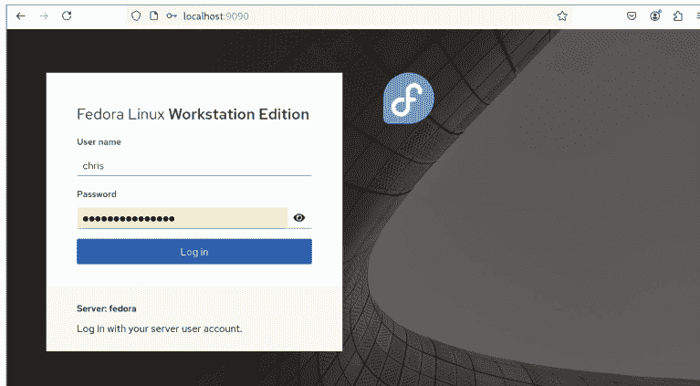

6. 开始使用 Cockpit。Cockpit 仪表板默认包含了一组很好的功能（你稍后可以添加更多）。适用于 RHEL 和 Fedora 系统。图 8.2 显示了 Cockpit 仪表板概览区域的示例。

   **图 8.2** 从 Cockpit 仪表板查看系统活动和其他主题。
   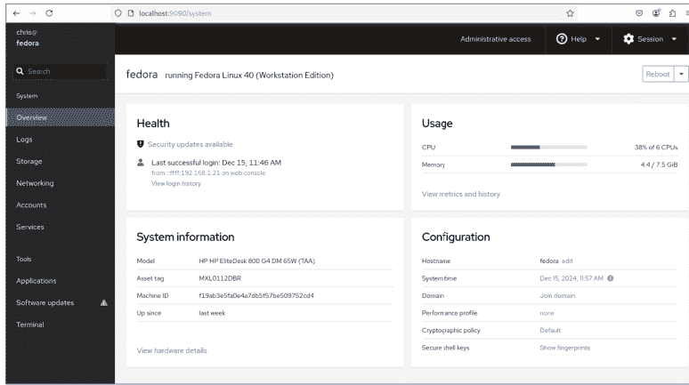

登录 Cockpit 后，你将开始看到与健康、使用情况（CPU 使用率和内存）、系统信息和配置相关的系统活动。在左侧导航窗中，你将处理系统的日志、存储、网络、组账户、服务以及其他功能。

在你继续阅读本书的其余部分时，你将在相应的章节看到如何使用 Cockpit 不同功能的描述。如果想深入了解你在使用 Cockpit 时遇到的任何主题，我建议查看 Cockpit 项目官方网站：`https://cockpit-project.org`。

## 使用 system-config-*

在发布 Cockpit 之前的 Fedora 和 RHEL 系统上，可以通过“活动”屏幕（GNOME）或命令行界面使用一组图形化工具。在较旧的 Fedora 和 RHEL 系统上，你可以通过运行一组以 `system-config-*` 开头的命令（例如 `system-config-network`）来从命令行操作这些工具。

这些 `system-config-*` 工具需要 `root` 权限。如果你以普通用户登录，在图形用户界面 (GUI) 窗口打开之前，或者在某些情况下请求执行特殊活动时，必须输入 `root` 密码。

以下列表描述了早期 Fedora 和 RHEL 系统中提供的许多图形化工具。（某些工具仅在 Fedora 中，且许多工具默认未安装。）你想获取某功能的命令位于括号中（通常，它与包名相同）。以下图形化工具在 Fedora 中可用：

- **域名系统** (`system-config-bind`)：如果你的计算机正作为 DNS 服务器运行，则创建并配置区域。
- **HTTP** (`system-config-httpd`)：将你的计算机配置为 Apache Web 服务器。
- **NFS** (`system-config-nfs`)：设置你的系统目录，通过 NFS 服务与网络上的其他计算机共享。
- **Root 密码** (`system-config-rootpassword`)：更改 `root` 密码。
- **Samba NFS** (`system-config-samba`)：配置 Windows (SMB) 文件共享。（若要配置其他 Samba 功能，可以使用 SWAT 窗口。）

以下图形化工具在 RHEL 8 之前的 Fedora 和 RHEL 系统中均可用：

- **服务** (`system-config-services`)：在“服务配置”窗口中显示并更改 Fedora 系统在不同运行级别运行的服务。
- **身份验证** (`system-config-authentication`)：更改系统验证用户身份的方式。通常选择 shadow 密码和 MD5 密码。然而，如果你的网络支持 LDAP、Kerberos、NIS 或 Hesiod 认证，你可以选择使用其中任何一种认证类型。
- **日期与时间** (`system-config-date`)：设置日期和时间，或选择让 NTP 服务器保持同步。
- **防火墙** (`system-config-firewall`)：配置防火墙以允许或拒绝来自网络计算机的服务。
- **语言** (`system-config-language`)：配置本地和网络打印机。
- **SELinux 管理** (`system-config-selinux`)：设置 SELinux 强制模式和默认策略。
- **用户与组** (`system-config-users`)：为你的 Fedora 系统添加、显示和更改用户账户。

其他管理实用程序可以通过顶部面板的应用程序菜单获取。选择“活动”屏幕（GNOME）来选择某些工具（如果已安装）：

- **配置编辑器** (`gconf-editor`)：直接编辑 GNOME 配置数据库。
- **磁盘使用分析器** (`gnome-utils`)：显示有关硬盘和可移动存储设备的详细信息。
- **磁盘工具** (`gnome-disk`)：管理磁盘分区并添加文件系统（`gnome-disk-utility` 包）。
- **Kickstart** (`system-config-kickstart`)：创建启动配置文件，可在无用户交互的情况下安装多个 Linux 系统。

本书之前对这些工具的描述已被使用 Cockpit 的步骤所取代。

## 使用其他基于浏览器的管理工具

为了简化许多企业级开源项目的管理，这些项目已开始提供基于浏览器的图形管理工具。在大多数情况下，也提供了命令行工具来管理这些项目。

例如，如果你正在使用红帽企业 Linux，则提供了用于管理以下项目的浏览器界面：

- **红帽 OpenShift**：OpenShift 基于 Kubernetes 平台，提供了基于浏览器的图形管理工具。
- **红帽虚拟化 (RHV)**：管理虚拟机的浏览器界面。
- **红帽企业 Linux (RHEL) 容器**：管理容器的浏览器界面。
- **红帽 OpenShift Kubernetes (OKD)**：管理 OpenShift 的浏览器界面。

> **注意**
>
> 在 Ubuntu 中，默认 `root` 账户没有设置密码。这意味着尽管该账户存在，你仍无法使用它登录，无法通过 `su` 切换到 `root` 用户。这为 Ubuntu 增加了一层额外的安全性，并要求你在执行任何想要以 `root` 用户身份运行的命令之前使用 `sudo`。

## 从 shell 变为 root (su 命令)

虽然你可以通过以 `root` 身份登录来成为超级用户，但有时这样做并不方便。

例如，你可能登录了一个普通用户账户，只想对系统进行一些快速的更改，而无需注销并重新登录。你可能需要通过网络对 Linux 系统进行更改，但该系统不允许 `root` 用户通过网络登录（这是 Linux 系统的常见做法）。一种解决方案是使用 `su` 命令。在终端窗口或 shell 中，你只需要输入以下内容：

```bash
$ su
Password: ******
```

当出现提示时，输入 `root` 用户的密码。普通用户的提示符 (`$`) 会变为超级用户提示符 (`#`)。此时，你拥有完全权限运行系统上的任何命令并使用系统上的任何文件。然而，这种方式使用 `su` 命令没有做的一点是没有读取 `root` 用户的环境。结果，你可能输入一个你认为可以使用的命令却收到“Command Not Found”（未找到命令）的消息。要解决这个问题，请使用带有横杠 (`-`) 选项的 `su` 命令，如下：

```bash
$ su -
Password: ******
```

你仍然需要输入密码，但在之后 `root` 用户登录时通常发生会在 `su` 命令完成后发生。你的当前目录将变为 `root` 的家目录（通常是 `/root`），并且将使用 `root` 用户的 `PATH` 变量。如果你仅通过输入 `su -` 变为 `root` 用户，不会更改目录或当前登录会话的环境。

你也可以使用 `su` 命令变为 `root` 以外的用户。这对于排查特定用户遇到但计算机上其他用户没有遇到的问题（例如无法打印或发送电子邮件）非常有用。例如，为了获得名为 `jsmith` 的用户的权限，你应输入以下：

```bash
$ su - jsmith
```

即使你在输入此命令之前已经是 `root` 用户，在输入之后，你也只拥有 `jsmith` 用户可以访问的文件和运行程序的权限。然而，作为 `root` 用户，当你输入 `su` 命令变为另一个用户后，你不需要密码即可继续。如果你以普通用户身份输入该命令，则必须输入新用户的密码。

当你结束使用超级用户权限，通过退出当前 shell 回到之前的 shell。按下 `Ctrl+D` 或输入 `exit` 即可完成。如果你是多个用户可以访问的计算机的管理员，不要在别人的电脑上留下开启的 `root` shell，除非你想给那个人随心所欲做任何事的自由。

## 通过 GUI 允许访问

如前所述，当你以普通用户身份运行 GUI 工具（来自 Fedora、Red Hat Enterprise Linux 或其他 Linux 系统）时，在访问工具之前，系统会提示你输入 `root` 密码。通过输入 `root` 密码，你将获得该任务的 `root` 权限。

对于 Linux GNOME 桌面系统，每当你启动任何 `system-config` 或需要 `root` 权限的 GUI 工具（例如安装软件包的 GUI 应用程序）时，都必须输入 `root` 密码。

## 获取 sudo 的管理访问

可以通过输入 `sudo` 后紧跟他们想要运行的命令，为特定用户授予特定任务或任何任务的管理权限，而无需赋予他们 `root` 密码。`sudoers` 是提供此类权限最常见的方法。通过对系统上的用户或组使用 `sudoers`，你可以执行以下操作：

- 为通过 `sudo` 运行的任何命令分配 `root` 权限。
- 为一组选定的命令分配 `root` 权限。
- 在不告诉用户 `root` 密码的情况下赋予 `root` 权限，因为他们只需要提供自己的用户密码即可获得 `root` 权限。
- 如果你选择，允许用户在不输入密码的情况下运行 `sudo`。
- 跟踪哪些用户在你的系统中运行了管理命令。（使用 `su`，你只知道有 `root` 密码的人登录了，而 `sudo` 命令会记录哪个用户运行了管理命令。）

通过 `sudoers` 功能，向任何用户授予完全或有限权限仅需将用户添加到 `/etc/sudoers` 并定义该用户应拥有的权限。该用户随后可以通过在任何命令前加上 `sudo` 命令来运行他们有权限的任何命令。

这是一个如何使用 `sudo` 功能让名为 `joe` 的用户拥有完全 `root` 权限的示例。

> **提示**
>
> 如果你查看 Ubuntu 中的 sudoers 文件，你会发现系统上的初始用户默认已经对 `sudo` 组成员拥有权限。要给任何其他用户相同的权限，你可以在运行 `visudo` 时直接将额外用户添加到 `admin` 组。

1. 作为 `root` 用户，通过运行 `visudo` 命令编辑 `/etc/sudoers` 文件：
   ```bash
   # /usr/sbin/visudo
   ```
   默认情况下，该文件在 `visudo` 中打开，除非 `EDITOR` 变量恰好被设置为其他编辑器（例如，`export EDITOR=edit`）。使用 `visudo` 的原因是该命令会锁定 `/etc/sudoers` 文件并对文件进行一些合理性检查，以确保其被正确编辑。

   > **注意**
   >
   > 如果你卡住了，尝试运行以下：

2. 在 `/etc/sudoers` 中添加以下行：
   ```bash
   joe ALL=(ALL) ALL
   ```

3. 在 `vi` 中保存更改，输入：
   ```bash
   :wq
   ```

这是一个如何使用 `sudo` 的示例：

```bash
$ ls -l testfile.txt
-rw-r--r-- 1 root root Jan 1 08:42 testfile.txt
$ rm testfile.txt
rm: cannot remove 'testfile.txt': Permission denied
$ touch testfile.txt
-rw-r--r-- 1 root root Jan 1 08:43 testfile.txt
$ sudo rm testfile.txt
```

## 管理命令与配置文件

`lsof`。以守护进程形式运行的命令也包含在该目录中。守护进程是在后台运行的进程，用于等待服务请求，例如对打印机或网页的请求。（查找以 `d` 结尾的命令，如 `sshd`、`pppd` 和 `cupsd`）。

在最新的 Ubuntu、RHEL 和 Fedora 发行版中，所有来自上述两个目录的管理级命令都存储在 `/usr/bin` 目录中（该目录是 `/sbin` 的符号链接）。此外，`/usr/bin` 已添加到 `root` 用户和所有普通用户的 `PATH` 中。

某些管理级命令包含在普通目录中（如 `/bin` 和 `/usr/bin`）。这对于对所有人开放选项的命令来说尤为如此。一个例子是 `/bin/mount` 命令，任何人都可以使用它来列出文件系统，但只有 `root` 用户可以挂载文件系统。（然而，桌面系统已配置为允许普通用户使用 `mount` 挂载 CD、DVD 或其他介质）。

> **注意**
>
> 请参阅第 12 章中的“挂载文件系统”章节，获取如何挂载文件系统的说明。

要查找主要用于系统管理员的命令，请查看第 8 部分的手页（通常位于 `/usr/share/man/man8`）。它们包含了 Linux 管理级命令的描述和选项。如果你想向系统添加命令，请将它们添加到 `/usr/local/bin` 或 `/usr/local/sbin`。Linux 发行版会自动将这些目录添加到你的 `PATH` 中，且优先级远高于标准的 `bin` 和 `sbin` 目录。通过这种方式，安装到这些目录中的命令不仅可以访问，还会覆盖其他目录中同名的命令。未包含在 Linux 发行版中的第三方应用程序有时会被放置在 `/usr/local/bin`、`/opt/bin` 或 `/usr/local/sbin` 目录。

### 管理配置文件

配置文件几乎是 Linux 管理的支柱。你为计算机设置的几乎一切——用户账户、网络或 GUI 偏好——都会导致设置存储在纯文本文件中。这既有一些优点也有缺点。


# 第三部分：成为 Linux 系统管理员

## 第 8 章：学习系统管理

纯文本文件的优点是易于阅读和修改。你可以进行其中的任何操作。缺点是，当你编辑配置文件时，传统上不会进行任何检查。有时你必须运行读取这些文件的程序（如网络守护进程或 X 桌面）来确定你的设置是否正确。

虽然配置文件使用标准结构（例如用于存储信息的 XML），但许多文件并非如此。因此，你需要学习每个配置文件的特定结构。错误位置的逗号或引号有时会导致整个界面失败。你可以通过多种方法检查许多配置文件的结构是否正确。

某些软件包提供了一个命令，用于在启动服务之前测试与包关联的配置文件的完整性。例如，`testparam` 命令用于 Samba 来检查 `smb.conf` 文件的完整性。其他时候，提供服务的守护进程也提供了检查配置文件的选项。例如，在启动 Web 服务器之前运行 `httpd -t` 来检查你的 Apache 服务器配置。

某些编辑器（如 `vim` 命令，而非 `vi`）可以理解某些类型配置文件的结构。如果你在 `vim` 中打开此类配置文件，你会发现文件的不同元素以不同的颜色显示。特别是，你可以看到与其它内容颜色不同的注释行。

在整本书中，你将看到所需的配置文件的描述，以便你了解使 Linux 系统运行功能的不同特性。配置的两个主要位置是你的家目录（存放你的个人配置文件）和 `/etc` 目录（持有系统级配置文件）。

以下是包含配置文件的目录（及子目录）的描述。描述之后是 `/etc` 中一些特别受关注的单个配置文件。查看 Linux 配置文件的内容可以让你学到管理 Linux 系统的知识。

- `$HOME`：所有用户都在自己的家目录中存储指导其登录账户行为的信息。许多配置文件直接存储在每个用户的家目录（如 `/home/joe`）并以点（.）开头，因此在使用标准命令时，它们不会出现在用户目录中（你需要输入 `ls -a` 才能看到它们）。同样，点文件和目录默认不会在大多数文件管理器窗口中显示。存在定义每个用户的 shell 行为、桌面视觉外观以及使用你的文本编辑器的选项的点文件。甚至还有如每个用户的 `$HOME/.bash` 目录这样的文件，它用于配置登录远程系统的权限。（在 shell 中执行 `echo $HOME` 来查看你的家目录名称。）

- `/etc`：此目录包含大多数基础 Linux 系统配置文件。

- `/etc/cron`：此目录包含设置文件，定义了 `cron` 工具按每天 (`cron.daily`)、每小时 (`cron.hourly`)、每月 (`cron.monthly`) 或每周 (`cron.weekly`) 计划运行的行为。

- `/etc/cups`：包含用于配置 CUPS 打印服务的文件。

- `/etc/default`：包含为各种工具设置默认值的文件。例如，`useradd` 命令的文件定义了创建新用户账户时的默认组 ID、家目录、密码过期日期和骨架目录 (`/etc/skel`)。

- `/etc/httpd`：包含用于配置 Apache Web 服务器行为（特别是 `httpd` 守护进程）的各种文件。（在 Ubuntu 和 Linux 系统中使用 `/etc/apache` 或 `/etc/apache2` 代替。）

- `/etc/mail`：包含用于配置 `sendmail` 传输代理的文件。

- `/etc/rc7?`：包含 `postfix` 邮件传输的配置文件。

- `/etc/rc7.d`：每个系统状态都有独立的目录：`rc0.d`（关机态）、`rc1.d`（单用户态）、`rc2.d`（多用户态）、`rc3.d`（多用户态）、`rc4.d`（多用户态）、`rc5.d`（多用户态）以及 `rc6.d`（重启态）。这些目录是为了兼容 UNIX `init` 服务维护的。

- `/etc/security`：包含设置计算机默认安全条件的文件，定义了如何进行认证。这些文件是权限模块的一部分。

- `/etc/skel`：当添加用户时，此目录中的任何文件都会自动复制到用户的家目录中。默认情况下，这些文件包括 `.kde`（设置 KDE 默认值的目录）和 `.bashrc`（设置 `bash` shell）。

- `/etc/sysconfig`：包含由各种服务创建和维护的重要配置文件（包括防火墙、`samba` 和大多数网络服务）。这些文件对于 Fedora 和 RHEL 等 Linux 发行版至关重要。

- `/etc/systemd`：包含与管理启动和服务的 `systemd` 框架相关的文件。特别是当你运行 `systemctl` 命令启用和禁用服务时，产生的文件存储在 `/etc/systemd` 的子目录下。

- `/etc/xinetd.d`：包含一组文件，每个文件定义了一个由 `xinetd` 守护进程监听特定端口的服务。当 `xinetd` 守护进程接收请求时，它使用这些文件中的信息来确定由哪个 `xinetd` 进程处理请求。

以下是 `/etc` 中一些有趣的配置文件：

- `aliases`：包含 Linux 邮件服务的分配列表。（在 Ubuntu 安装 `sendmail` 包时，此文件位于 `/etc/mail`）。

- `bashrc`：为 `bash` shell 设置系统级默认。（在某些 Linux 发行版中可能称为 `.bashrc`）。

- `crontab`：设置运行自动化的时间以及与 `cron` 相关的变量（如与 `cron` 相关的 `SHELL` 和 `PATH`）。

- `csh.csh` (或 `csh`)：为 `csh` (C shell) 用户设置系统级默认值。

- `exports`：包含通过网络文件系统 (NFS) 向远程计算机共享的目录列表。

- `fstab`：识别常用存储介质（硬盘、DVD、CD 等）的设备以及它们在 Linux 系统中的挂载位置。它被用于在系统首次启动时选择要挂载哪些文件系统。同样，当你手动运行 `mount` 时，它会将 `fstab` 中的选项作为命令行选项添加。

- `group`：识别系统上定义的组名和组 ID (GIDs)。

  Linux 中的组权限由与每个文件和目录关联的三组 `rwx`（读、写、执行）位中的第二组来定义。

- `gshadow`：包含组的影子密码。

- `hostname`：包含本地系统的主机名（从 RHEL 7 以及近期的 Fedora 和 Ubuntu 系统开始）。

- `hosts`：包含你可以从你的计算机访问的 IP 地址和主机名。（通常此文件仅用于存储局域网或小型私有网络上计算机的名称和地址。）

- `inittab`：在早期的 Linux 系统中，包含定义 Linux 启动、关机或在不同状态切换时程序启动和停止的信息。该配置文件是 Linux 启动 `init` 进程时的第一个文件。在支持 `systemd` 的系统中不再使用此文件。

- `mtab`：包含当前已挂载的文件系统列表。

- `mtools.conf`：包含 Linux 中 `mtools` 软件包中的 DOS 命令所使用的设置。

- `named.conf`：如果你正在运行 DNS 服务器（`bind` 或 `bind`），则包含 DNS 设置。

- `nsswitch.conf`：包含名称服务设置，用于标识关键系统信息（用户账户、主机名到地址的映射等）的来源（通过网络服务来自本地主机）。

- `ntp.conf`：包含运行网络时间协议 (NTP) 需要的信息。

- `passwd`：存储本地系统所有有效用户的帐户信息。还包括其他信息，例如家目录和默认 shell。此文件需要对公共可读，而 `shadow` 文件可以对所有人都不可读。

- `printcap`：包含为你的计算机配置的打印机定义。（如果 `printcap` 文件不存在，请在 `/etc/cups` 查找打印机信息。）

- `profile`：为所有用户设置系统级环境和启动程序。该文件在用户登录时被读取。

- `protocols`：为各种因特网服务设置协议名称。

- `rpc`：定义远程过程调用名称。

- `services`：定义 TCP/IP 和 UDP 服务名及端口分配。

- `shadow`：包含用户的加密密码（这被认为比原始 `passwd` 文件更安全的密码存储方式）。

- `shells`：列出系统上可用的 shell 命令行解释器（`bash`、`sh` 等）以及它们的位置。

- `sudoers`：设置可能具有运行权限的用户可以运行的命令。特别，此文件用于选择具有 `root` 权限的用户。

- `rsyslog.conf`：定义由 `rsyslog` 守护进程收集的日志消息以及存储在哪些文件中（通常，日志消息存储在 `/var/log` 下的文件中）。

- `xinetd.conf`：包含 `xinetd` 守护进程使用的简单配置信息。该文件主要指向 `/etc/xinetd.d` 目录以获取各个服务的信息。另一个目录 `/etc/X11` 包含供 X 和不同窗口管理器使用的系统配置文件的子目录。`xorg.conf` 文件配置你的计算机和显示器使其在 X 下可用，并包含供 `xdm` 和 `xinit` 在此处启动 X 使用的配置目录。

### 管理日志文件和系统日记

Linux 擅长的一之一就是跟踪自身。当你考虑到复杂的操作系统中有大量操作在进行时，这是一件好事。有时你尝试让一个新功能工作，但它失败了且没有给你原因。其他时候，你想监控你的系统以查看是否有人尝试非法访问你的计算机。在任何这些情况下，你都希望能够引用内核和运行在系统上的服务的消息。

对于不使用 `rsyslog` 守护进程的 Linux 系统，记录错误和调试消息的主要工具是 `systemd journal`（某些 Linux 系统使用 `syslogd` 守护进程）。尽管你仍然可以使用 `rsyslog`，但 `systemd` 有它自己的收集和显示消息的方法，称为 `systemd journal`（`journalctl` 命令）。

#### 使用 journalctl 查看系统日记

查看系统日记消息的首要命令是 `journalctl`。启动过程、内核以及所有由 `systemd` 管理的服务都会将它们的状态和错误消息重定向到 `systemd journal`。

使用 `journalctl` 命令，你可以以许多方式显示日记消息。以下是一些示例：

- `journalctl`
- `journalctl --list-boots`

```
-2 93bdb6164... Sat 2025-01-04 21:07:28 EST-Sat 2025-01-04 21:19:37
-1 7336cb823... Sun 2025-01-05 10:38:27 EST-Mon 2025-01-06 09:29:09
-0 eaebec25f... Sat 2025-01-05 14:11:41 EST-Sat 2025-01-18 16:03:37
```

- `journalctl -b 488e52a2b4f6b6b36c5264e7`
- `journalctl -k`

在这些示例中，不带选项的 `journalctl` 命令允许你翻阅系统日记中的所有消息。要列出每次系统启动的 ID，使用 `--list-boots` 选项。查看与特定启动实例相关的消息，使用 `-b` 选项（其中一个启动项）。要查看内核消息，使用 `-k` 选项。这里是更多示例：

- `journalctl _SYSTEM_UNIT=sshd.service`
- `journalctl PRIORITY=0`
- `journalctl -f`

`_SYSTEM_UNIT=` 允许显示特定服务（如 `sshd`）的消息。要在大消息产生时跟踪它们，使用 `-f`。

#### 使用 rsyslog 管理日志文件

这里是一些常见的日志文件：

- `boot.log`：包含启动消息
- `messages`：包含通用消息
- `secure`：包含安全相关消息

尽管你仍然可以使用 `rsyslog`，但 `systemd` 有它自己收集和显示消息的方法，称为 `systemd journal`（`journalctl` 命令）。

### 使用其他管理账户

默认情况下，列表中的登录是禁用的。你可能将默认 shell 从当前设置（通常为 `/sbin/nologin` 或 `/bin/false`）更改为真实的 shell（通常为 `/bin/bash`）以便登录这些用户。然而，如前所述，它们并非用于交互式登录。

在任何情况下，Linux 均提供管理登录。例如，你可以登录以下用户：

- `lp`：用户运行类似 `/var/log/cups` 程序。`lp` 的家目录是 `/var/spool/lpd`。
- `apache`：用户在 RHEL 和 Fedora 中运行 Web 服务器 (`httpd`)，但在 Ubuntu 上 `www-data` 用户运行 Apache (`apache2`)。
- `avahi`：用户运行 `avahi` 守护进程以在网络上提供 zeroconf 服务。
- `chrony`：用户运行 `chronyd` 守护进程，用于维护精确时钟。
- `postfix`：在传统的 UNIX 系统中，用户拥有 `/bin` 中的命令。这在某些 Linux 系统（如 Ubuntu、Fedora 和 Gentoo）中并非如此，因为 `root` 拥有大多数可执行文件。`bin` 的家目录是 `/bin`。
- `news`：根据你对 `/var/spool/news` 和新闻相关资源的权限设置，用户进行因特网服务的管理。新闻目录是 `/etc/news`。
- `rpc`：用户运行过程调用守护进程 (`rpcbind`)，用于接收主机系统上服务的调用。NFS 服务使用 RPC 服务。

### 检查你的硬件

过去几年添加的 Linux 内核特性使得彻底改变硬件设备的检测和管理方式成为可能。`Udev` 子系统会在硬件插入或拔出时动态地为设备命名并创建。

如果这听起来很困惑，请担心。它的设计是为了让 Linux 用户的生活变得更简单。基于内核的功能的结果是，Linux 中的设备处理变得更加自动化和灵活：

- **更自动化**：对于大多数硬件，当硬件设备连接或断开时，它会被自动检测并识别。系统会添加访问硬件的接口以便 Linux 能够访问。然后，该信息将传递给用户层，监听硬件的应用程序将准备好挂载硬件和/或启动应用程序（例如图像查看器或音乐播放器）。

- **更灵活**：如果你不知道硬件项目连接或断开时会自动发生什么，你可以更改它。例如，GNOME 和 KDE 桌面环境中内置的功能允许你选择在插入音乐 CD 或数据 DVD，或连接数码相机时会发生什么。如果你倾向于启动不同的程序来处理，可以轻松地进行更改。

接下来的章节将介绍与在 Linux 中让硬件正常工作相关的多个问题。首先，它描述了如何检查系统硬件组件的信息。然后它涵盖了如何配置 Linux 处理可移动介质。最后，它描述了如何使用工具手动加载和处理未检测到且未正确加载的硬件驱动程序。

当系统启动时，内核会检测硬件和驱动程序，允许 Linux 与这些硬件工作。硬件检测的消息会快速从屏幕上滚过，你可能需要在系统启动后重新显示这些潜在的问题消息。

在 Linux 运行后，有几种方法查看内核消息。`root` 用户可以运行 `dmesg` 命令查看检测到了哪些硬件以及内核在启动时加载了哪些驱动。随着内核生成新消息，这些消息也可以通过 `dmesg` 查看。

查看启动消息的另一种方法是使用 `journalctl` 命令查看与特定启动实例相关的消息（如本章之前所示）。

> **注意**：系统运行时，许多内核消息会被发送到 `/var/log/syslog` 文件，例如，如果你想看插入 USB 驱动器时发生了什么，可以使用 `tail -f /var/log/syslog` 并观察设备和挂载点的创建。同样，你可以使用 `journalctl -f` 命令来跟踪进入 `systemd` 日志的消息。

以下是 `dmesg` 命令的一些输出示例，经过精简以显示了一些有趣的信息：


# dmesg | less

```
[ 0.000000 Linux version 6.15.7-200.fc42.x86_64
(mockbuilda5da7262c50a401890423524c10adde0)
(gcc GCC) 15.1.2 2025051 (Red Hat 15.1.1-2) GNU ld version
 2.44-fc42
 #1 SMP PREEMPT DYNAMIC Thu Jul 17 17:57:16 UTC 2025
 Command line:
 [0.000000] BOOT_IMAGE=(hd0,gpt2)/linux-6.15.7-200.fc42.x86_64
 root=UUID=2a9d5fa6-e241-f38-a9f5-94cac9528f13
 ro rootfs=subvol-rhgb quiet
 [0.000000] BIOS-provided physical RAM map:
 [0.000000] BIOS-e820: [mem 0x0000000000000000-0x0000000000005fff] usable
 [ 1.719996] nvme0n: input p1 p2 p3
 input: Logitech USB Receiver as /devices/pci0000/
0000:14.0/usb/1-8/8.2/1-8.2.1/0000:046d:C534.003/input/
input3
 [1.888385] hid-generic 0003:046d:C534.0002: input,hidraw: USB HID
v1.11 Keyboard [Logitech USB Receiver] on usb-0000:0000:14.0-8.2/input0
0000:14.0/usb/1-8/8.2/1-8.2.1/0000:046d:C534.003/input/
input4
 [1.900647] input: Logitech USB Receiver Consumer Control as /
devices/
pci0000:0000:0000:14.0/usb/1-8/8.2/1-8.2.1/0000:046d:C534
0003/
input5
 [1.965788] input: Logitech USB Receiver System Control as /devices/
pci0000:0000:0000:14.0/usb/1-8/8.2/1-8.2.1/0000:046d:C534
0003/
input6
```

从此输出中，你可以看到 Linux 内核版本，随后是命令行选项。最后几行反映检测到的 Logitech USB Receiver System Control，与鼠标和键盘通信。

如果在检测硬件或加载驱动程序时出现问题，你可以参考此信息查看未工作的硬件名称和模型。然后你可以搜索论坛或其他解决问题。系统启动后，你可以查看电脑的详细信息。`lspci` 命令列出了电脑上的 PCI 总线以及连接到其上的设备。这是输出片段：

```
$ lspci
00:00.00 Host bridge: Intel Corporation 8th Gen Processor
00:02.00 VGA compatible: Intel Corporation [UHD Graphics 630]
00:12.00 Audio controller: Intel Corporation 8th Gen Processor
00:14.00 USB controller: Intel Corporation 8th Gen Processor
00:14.20 Network controller: Intel Corporation 8th Gen Processor
00:14.30 Memory controller: Intel Corporation 8th Gen Processor
```

主机桥连接到本地总线。使用 `lspci -vv` 可以获得有关设备的更详细信息。如果你对特定设备感兴趣，可以过滤 `lspci` 的输出。例如，`lspci -v audio` 将仅显示音频控制器。

要获取更多硬件信息，可以使用 `lshw` 命令。该命令提供了硬件、内存和设备的摘要。

```
$ lshw -summary
Host: x86_64
Machine: machine-product4
Memory: system
Memory: adapter
Memory: adapter
Network:
: adapter
: adapter
: adapter
Bus: 00:00.00 00:00.01 00:00.02 00:00.03 00:01.00 00:01.01 00:01.02 00:01.03 00:02.00 00:02.01 00:02.02 00:02.03 00:03.00 00:03.01 00:03.02 00:03.03 00:04.00 00:04.01 00:04.02 00:04.03 00:05.00 00:05.01 00:05.02 00:05.03 00:06.00 00:06.01 00:06.02 00:06.03 00:07.00 00:07.01 00:07.02 00:07.03 00:08.00 00:08.01 00:08.02 00:08.03 00:09.00 00:09.01 00:09.02 00:09.03 00:0a.00 00:0a.01 00:0a.02 00:0a.03 00:0b.00 00:0b.01 00:0b.02 00:0b.03 00:0c.00 00:0c.01 00:0c.02 00:0c.03 00:0d.00 00:0d.01 00:0d.02 00:0d.03 00:0e.00 00:0e.01 00:0e.02 00:0e.03 00:0f.00 00:0f.01 00:0f.02 00:0f.03 00:10.00 00:10.01 00:10.02 00:10.03 00:11.00 00:11.01 00:11.02 00:11.03 00:12.00 00:12.01 00:12.02 00:12.03 00:13.00 00:13.01 00:13.02 00:13.03 00:14.00 00:14.01 00:14.02 00:14.03 00:15.00 00:15.01 00:15.02 00:15.03
```

# 第三部分：成为 Linux 系统管理员

Linux 提供了列出、加载、卸载以及获取模块信息的命令。接下来的章节描述了如何使用这些命令。

## 列出模块

要查看当前计算机运行的内核中加载了哪些模块，请使用 `lsmod` 命令。请以下示例：

```bash
# lsmod
| Module | Size | Used by |
| :--- | :--- | :--- |
| hid_logitech_hidpp | 65536 | 0 |
| hid_logitech_dj | 36864 | 0 |
| txt_nat | 12288 | 1 |
| xt_tcpudp | 16384 | 0 |
| veth | 45056 | 0 |
| xt_conrack | 12288 | 1 |
| nft_chain_nat | 12288 | 3 |
| xt_MASQUERADE | 16384 | 3 xt_nat,nft_chain_nat,xt_MASQUERADE |
| nf_nat | 57344 | 0 |
| nf_conrack_netlink | 0 | |
| e1000e | 356532 | 0 |
```

此输出显示了 Linux 系统上加载的各种模块，其中包含网络接口设备模块 (e1000)。

要查找任何已加载模块的信息，请使用 `modinfo` 命令。例如，你可以输入：

```bash
# /sbin/modinfo -d e1000
Intel(R) PRO/1000 Network Driver
```

并不是所有模块都有描述，如果没有可用信息，则不会返回任何数据。然而，在这种情况下，e1000 模块被描述为 Intel(R) PRO/1000 Network Driver 模块。你还可以使用 `-o` 查看模块的作者，或使用 `-n` 查看对象文件打印，其中包含驱动程序创建者的电子邮件地址，因此如果你对其有任何问题或疑问，可以联系他们。

## 加载模块

你可以通过运行 `modprobe` 命令，以 root 用户身份加载已编译并安装（到 `/lib/modules` 子目录）的模块。加载模块的常见原因是临时使用某项功能（例如加载一个模块以支持你想访问的可移动介质上的特殊文件系统）。另一个加载模块的是因为该模块将被某些无法自动检测的硬件使用。

这是一个使用 `modprobe` 命令加载 `parport` 模块的示例，该模块提供了与多个设备共享并行端口的核心功能：

```bash
# modprobe parport
```

## 第 8 章：学习系统管理

加载 `parport` 后，你可以加载 `porting_pc` 模块来定义通过接口提供的 PC 风格端口。`porting_pc` 模块允许你可选定义与共享并行端口的设备相关的地址和 IRQ 数字，如下所示：

```bash
# modprobe portant_pc io=0x3bc irq=auto
```

在此示例中，设备被识别为具有地址 0x3bc，且设备的 IRQ 是自动检测的。

`modprobe` 命令是临时加载模块——它们在下次重启时会消失。要将模块永久添加到系统中，请将 `modprobe` 命令行添加到启动时的某个启动脚本中。

## 移除模块

使用 `rmmod` 命令从运行的内核中移除模块。例如，要从当前内核移除 `porting_pc` 模块，请输入以下：

```bash
# rmmod portant_pc
```

如果它当前没有忙，`porting_pc` 模块将从运行的内核中移除。如果它正忙，请尝试杀死可能使用该设备的进程。然后再次运行 `rmmod`。有时，你尝试移除的模块依赖于已加载的其他模块。例如，`uscore` 模块无法卸载，因为它是一个内置模块：

```bash
# rmmod uscore
```

rmmod: ERROR: Module uscore is builtin.


## 总结

Linux 的许多功能，特别是那些可能损坏系统或影响用户的功能，都需要 root 权限。本章描述了获取权限的不同方法：直接登录、`su` 命令或 `sudo` 命令。它还涵盖了系统管理员的一些主要职责以及对系统管理员工作至关重要的组件（配置文件、基于浏览器的工具等）。

与其使用 `rmmod` 移除模块，你可以使用 `modprobe -r` 命令。通过 `modprobe -r`，你不仅可以移除模块请求，还可以移除未被其他模块使用的依赖模块。

下一章描述了如何安装 Linux 系统。该章涵盖了安装 Linux 方法，包括如何从现场介质和安装介质安装。

## 练习

使用这些练习来测试你的系统管理知识，并探索有关系统硬件的信息。这些任务假设你正在运行 Fedora 或 Red Hat Enterprise Linux 系统（尽管某些任务也适用于其他 Linux 系统）。如果你遇到困难，任务的解决方案在附录 B 中（尽管在 Linux 中通常有多种方法可以完成任务）。

1. 以 root 用户身份从 shell 中（或使用 `sudo`），使用 `systemctl` 命令启用 Cockpit `cockpit.socket`。
2. 打开浏览器访问你系统上的 Cockpit 界面 (9090)。
3. 查找 `/var/spool/directory` 目录下所有所有者非 root 的用户的文件，并显示它们的详细列表。
4. 使用 `su` 命令变为 root 用户。为了使用 `su` 命令变为 root 用户，创建一个名为 `test.txt` 的空文件。
5. 以普通用户登录并使用 `sudo -` 变为 root。编辑 `/etc/sudoers` 文件以允许你的普通用户拥有完全权限。
6. 以赋予 `sudo` 权限的用户身份将其挂载到 `/mnt/test2`。
7. 运行 `journalctl -f` 命令并将 USB 驱动器插入电脑。在另一个终端中，卸载并移除它。
8. 运行命令查看 USB 设备已连接到你的电脑。
9. 假设你为电脑添加了一块电视卡，但使用它所需的模块没有被正确检测。手动加载该模块，然后查看它已加载。
10. 移除该模块以及其他已加载的模块。列出你的模块以确保已完成此操作。

# 第三部分：成为 Linux 系统管理员

# 第 9 章：安装 Linux

Fedora、RHEL、Ubuntu 以及其他 Linux 发行版提供的安装 DVD 提供了更灵活的 Linux 安装方式。特别是，你不再仅仅是将 Live 介质内容复制到计算机，通过安装 DVD，你可以精确选择你想要的软件包。本章中的第二个安装程序将引导你完成一个从红帽企业 Linux（Red Hat Enterprise Linux）DVD 的安装过程。

## 在企业环境中进行安装

如果你正在安装一个系统，坐在电脑前点击安装问题并不不方便。但如果你需要安装几十个或上百个 Linux 系统呢？如果你想以特定的方式安装这些系统，且这些方式在多次安装中需要重复呢？在本章的后半部分，我将描述使用网络安装功能和启动文件（kickstart files）高效安装多个 Linux 系统的方法。

本章未涵盖的第四种安装方法是将 Linux 安装到云环境（如亚马逊云服务 AWS）或虚拟化主机（如 Virtual Box 或 VMware 系统）上的虚拟机。第 27 章和 28 章描述了在 KVM 宿主机或云环境中安装或部署虚拟机的方法。

为了与我一起尝试本章中的步骤，你面前应该有一台你不会完全抹除计算机。作为替代方案，你可以使用一台带有其他操作系统（如 Windows）的计算机，只要在该操作系统之外有足够的未用磁盘空间即可。如果你决定设置其中一种“双启动”（Linux 和 Windows）方案，我将描述该步骤以及数据丢失的风险。

## 开始 Linux 安装

如果你面前有一个正在运行的 Linux 系统，书中的所有内容都会更有意义。在你开始所有安装 Linux 的选择之前，我将带你从一个快速安装设置开始，假设你拥有：

- 一台安装了 Windows 版本的 PC，并且你愿意擦除它来运行 Linux
- 一个可以完全擦除且容量至少为 3GB 的 USB 盘
- 一个网络连接

如果这对你可行，你可以按照此操作获取 Fedora 发行版并将其安装在该台计算机上（使用了 Fedora 42）。有关选择 Linux 安装系统的其他考虑因素，请参见本章后半部分的“选择计算机”。以下是步骤：

1. 启动你的 Windows 计算机并登录。
2. 备份你想从这台计算机上保存的任何数据（你正准备擦除所有内容）。
3. 打开浏览器访问 `https://fedoraproject.org`，滚动到 Fedora Workstation，并选择“立即下载”。
4. 找到与你的计算机架构匹配的 Live ISO 并点击下载按钮。除非是一台非常老的计算机（可能是 386），否则你可能会选择 Intel 和 AMD 的 `x86_64`。ISO 可能需要几分钟时间下载。

> **注意**
> 执行接下来的步骤时，你需要软件将 ISO 镜像刻入 USB 盘。检查 Fedora Media Writer 来完成此操作，它在大多数 Windows 系统上都运行良好。然而，对于我的 Windows 11 系统，我需要为 `MSVCP140_dll` 文件添加 Visual Studio 的 Microsoft C++ 可再发行程序包，才能让 Fedora Media Writer 正常工作。如果你运行 Fedora Media Writer 遇到困难，可以使用其他镜像刻录软件。

5. 滚动到 `fedaproject.org/workstation/download` 页面并点击 Fedora Media Writer 下载按钮（适用于 Windows 和 Mac）。
6. 从出现的 MediaWriter 页面中，选择与你的计算机匹配的版本。对我来说，这个文件名为 `FedoraMediaWriter-win64-x.x.exe`。
7. 点击浏览器顶部的下载并选择 FedoraMediaWriter 可执行文件。打开一个窗口，询问你是否允许它对你的设备进行更改。
8. 点击“是”。然后按照 Fedora Media Writer 的提示完成安装。在最后一步，你将点击“完成”，并勾选“运行 Fedora Media Writer”复选框。
9. 显示 Media Writer 后，点击“选择 Iso”按钮。图 9.1 显示此窗口的示例。
10. 点击“下一步”查看“写入选项”窗口。点击“选择”并从下载文件夹中选择你之前下载的 Fedora ISO。将 USB 盘插入计算机，并在 USB 下拉菜单中选择它。
11. 点击“写入”开始写入。将出现“擦除”确认。如果你已准备好覆盖整个 USB 盘，请点击“写入”。需要几分钟时间将 ISO 刻录到 USB 盘，完成后勾选。你现在已准备好安装了。
12. 在 USB 盘仍插入状态的情况下，重启并进入 Live 镜像。当 BIOS 出现时，快速寻找提示按某个特定键（如 `F12` 或 `Esc`）以中断启动过程的消息并按下该键。你必须足够快才能在计算机启动到硬盘之前捕捉到它。选择“查看启动菜单”，然后选择 USB 盘。Fedora 应该出现在启动屏幕上。当你看到启动屏幕时，选择“Start Fedora-Workstation-Live”。
13. 开始安装。当出现“欢迎使用 Fedora”界面时，点击“安装 Fedora”。你应该看到安装界面，如图 9.2 所示。
14. 选择语言（如美国英语）并选择“下一步”。

### 图 9.1
使用 Fedora Media Writer 在 USB 上制作可启动的 Linux。


15. 选择安装目标。将显示可用存储设备（如你的硬盘），并且你的硬盘被选为安装目标。要让安装程序覆盖所有内容，使用“整个磁盘”，点击“下一步”。将出现存储配置窗口。

## 特殊硬件特性

某些 Linux 特性需要特殊的硬件支持。例如，要使用 KVM 将 Fedora 或 RHEL 作为虚拟化宿主机，计算机必须配备支持虚拟化的处理器。这些包括 AMD-V 或 Intel-VT 芯片。大多数现代计算机都具备此功能。

如果你不确定电脑的硬件配置，有几种方法可以检查你拥有的设备。如果你正在运行 Windows，“系统属性”窗口可以显示你使用的处理器以及安装的 RAM 数量。或者，在从 Fedora Live CD 启动后，打开终端并输入 `lshw`，即可查看系统检测到的硬件列表。

从 Live 介质安装的主要优势是简单。从本质上，你只是将内核、应用程序和设置从 ISO 文件复制到硬盘上。在安装过程中，你需要做出一些决定，但你不需要具体选择要安装哪些软件包。安装完成后，你可以根据意愿添加或删除包。

关于 Live 介质安装，你做出的第一个决定是你想将系统安装在何处，以及安装时是否要保留现有的操作系统：

- **单系统启动计算机**：安装 Linux 最简单的方法是不担心计算机上的其他操作系统或数据，直接让 Linux 替换一切。这样做后，计算机将直接启动到 Fedora。
- **多系统启动计算机**：如果你已经在计算机上安装了 Windows 且不想删除它，你可以在该系统上与 Windows 一起安装 Fedora。然后在启动时，你可以选择启动哪个操作系统。为了在另一个操作系统上安装 Fedora，你必须有额外的磁盘空间（Windows 分区之外），或者能够缩小 Windows 系统以获得足够的可用空间安装 Fedora。由于多系统启动计算机的设置非常麻烦且有损坏硬件系统的风险，我建议将 Linux 安装在另一台计算机上（即使是旧电脑）或虚拟机上，而不是多系统启动。
- **裸机或虚拟系统**：生成的 Fedora 可以安装为直接从计算机硬件启动，也可以从计算机上现有的操作系统启动。如果你有一台作为虚拟宿主机的计算机，可以将 Fedora 作为虚拟机安装。虚拟化宿主机软件包括 KVM、Xen（适用于 Linux 和 UNIX 系统以及 Windows 和 macOS）、Hyper-V（适用于微软系统）和 VMware（适用于 Linux、Windows 和 macOS）。你可以使用磁盘上的或刻录到 USB 盘或 DVD 的 Live ISO 镜像，从你选择的虚拟机宿主机开始安装。《使用 Linux 进行云计算》（第 28 章）描述了如何设置 KVM 虚拟化宿主机。

硬件就绪后，你可以选择从 Live ISO 镜像（前文介绍）或从后续章节介绍的安装介质安装 Linux。

## 从安装介质安装 Red Hat Enterprise Linux

除了提供 Live ISO 镜像，大多数 Linux 发行版还提供单个镜像或一组镜像用于安装该发行版。对于这类类型的安装介质，软件不是将介质的所有内容复制到磁盘，而是被拆分成软件包，你可以根据具体需求进行选择。例如，一个完整的安装 DVD ISO 允许你安装从最小化服务器到全功能桌面，再到提供多种服务的精简服务器的各种版本。

在本章中，你将创建一个 Red Hat Linux 10 安装 DVD ISO 作为安装介质。在安装 RHEL 之前，请回顾前一节中的硬件信息和双系统启动的描述。

按照以下步骤从 USB 盘中的安装 DVD ISO 安装 Red Hat Enterprise Linux。

1. **获取安装介质**。下载 RHEL ISO 镜像的过程在 Red Hat Enterprise Linux 产品页面上说明。如果你还不是 Red Hat 客户，可以在此处申请评估版：`https://www.redhat.com/en/products/trials`。这需要创建一个 Red Hat 账户。如果无法，你可以尝试与 RHEL 类似的 Linux 发行版，如 AlmaLinux 和 Rocky Linux。在本例中，我使用了 7.9 RHEL 10 DVD ISO `rhel-10.0-x86_64-dvd.iso`。获取 DVD 后，你可以按照附录 A 的描述将其刻录到物理 USB 盘或双层 DVD。
2. **启动安装介质**。将 USB 或 DVD 插入计算机并重启。（在启动提示处中断，以从选定的 USB 或 DVD 启动）。出现欢迎界面。
3. **选择安装或测试介质**。选择“Install”（安装）或“Test Media & Install”来对 RHEL 进行新安装。介质测试会验证 DVD 在下载或刻录过程中没有损坏。如果你需要修改安装过程，可以在高亮启动条目时按 `Tab` 键并输入你所需的选项来添加启动选项。参见本章稍后的“安装启动选项”章节。
4. **选择语言**。出现安装摘要。在该屏幕上，你可以选择更改任何可用的本地化、软件和特性，如图 9.3 所示。
5. **在键盘屏幕上**，根据你之前选择的语言选择不同类型的键盘。输入一些文本以查看按键布局。
6. **在语言支持屏幕上**，你有机会添加对额外语言的支持（除之前默认设置的语言外）。完成后点击“Done”。
7. **在时间与日期屏幕上**，为区域和城市选择时区。可以使用上/下箭头手动设置时间，或选择“Network Time”让系统尝试自动连接到网络计时器以同步时间。为了保持时间准确，建议使用自动日期与时间。完成后点击。
8. **在连接 Red Hat 屏幕上**，如果你有 Red Hat 账户并计划使用该系统，点击“Connect”并使用用户名密码或激活密钥注册此系统。这允许你获取更新并使用 Insights 管理 RHEL。选项允许你选择代理、服务器或自定义基础而不是直接连接网络。
9. **在安装源屏幕上**，默认使用你启动的介质作为安装期间使用的 RPM 包。自动检测到的安装源应该已被选中。你可以选择“On Network”并选择 URL（`http`、`https` 或 `ftp`）来识别 Red Hat 存储库的位置，或选择 Red Hat CDN 让安装程序使用分发网络获取所需的包。
10. **在软件选择屏幕上**，默认的 Server GUI 选择提供了一个带有 GNOME 3 桌面的基础安装系统。其他选择包括 Server（无 GUI）、Minimal Install（基础包）、Workstation（面向工作用户）、Operating System（RHEL 系统）和 Virtualization Host（用于运行虚拟机）。你可以添加要包含的服务或基础环境。准备好继续时选择“Done”。
11. **在目标屏幕上**，新的 RHEL 系统将默认安装在本地驱动器并自动分区。你还可以选择附加网络存储或特殊存储，如固件 RAID。（详细信息请参见本章稍后的“分区硬盘”）。完成后点击。可能会要求你确认是否可以删除现有存储。
12. **在 Kdump 屏幕上**，启用 Kdump 会预留内存以便内核崩溃时捕获生成的内核。如果没有 Kdump，将无法诊断崩溃的内核。默认情况下，启用 Kdump 为每 4KB 内存预留 160MB 用于保存内核崩溃信息。
13. **在网络与主机名屏幕上**，可以在此处配置发现的任何网卡。如果网络上有 DHCP 服务，网络地址信息将分配给选中的“开启”接口。如果你倾向于手动配置网络接口，请点击。如果你想设置系统主机名，请填写主机名。设置网络和主机名可以让你在安装后更容易开始使用。点击“Done”。
14. **在“root 账户”（Root Account）屏幕上**，默认禁用 root 账户（这意味着你无法直接以 root 身份登录）。如果你选中“禁用 root 账户”（Disable Root Account），这将禁用 SSH 工具对 root 账户的远程访问。在这种情况下，你需要使用具有 sudo 权限的普通用户账户来获取访问。如果你选择“启用 root 账户”（Enable Root Account），则允许对系统直接访问，你可以立即设置 root 密码并允许远程 SSH 登录。为 root 用户设置密码并进行验证（再次输入）。点击“完成”（Done）接受。如果密码太短或太弱，你将留在该页面（你可以在那里设置新密码）。如果你决定继续使用该密码，再次点击“完成”以接受。
15. **在“用户账户”（User Account）中**，良好的做法是用非 root 用户账户登录 Linux 系统，并在需要时请求 root 权限，包括用户名、全名和密码。你可以设置用户账户，并勾选“添加管理员权限”（add Administrative Privileges）赋予该账户 sudo 权限（允许账户在需要时作为 root 用户运行）。高级设置是可选的，如果你想将用户设置为主用户和组 ID，或将用户添加到其他账户。将 wheel 账户留空。完成后点击“完成”。如果你输入的密码太短或太弱，你必须更改它，或者如果你仍想使用弱密码，则再次点击“完成”。
16. 点击“开始安装”（Begin installation）按钮开始安装过程。进度条标记安装进度。在系统安装时，你可以设置 root 密码并为你的新系统创建一个用户账户。
17. 安装完成后，点击“重启”（Reboot）。当系统重启且 Red Hat Enterprise Linux 从硬盘启动时，拔出 USB 驱动或 DVD。
18. 运行 firstboot。如果你安装了桌面环境，在首次启动系统时会出现 firstboot 屏幕。以下是操作步骤：
    - **a. 许可信息（License Information）：** 读取并勾选框接受许可信息；点击“完成”。
    - **b. 订阅管理（Subscription Management）：** 提示时，你可以保留当前的订阅管理系统（`subscription.redhat.com`）或输入 Red Hat Satellite 服务器的位置来注册你的系统。点击“下一步”。输入你的 Red Hat 账户和密码，并点击“注册”以注册你的系统并获得更新权限。如果找到订阅，点击“附加”（Attach）以启用订阅。
19. 完成后点击“重启”。

你现在应该可以登录你的 Red Hat Enterprise Linux 系统了。如果你的 RHEL 系统已注册，你应该做的第一件事是为新系统获取软件更新。通过登录系统并在终端窗口中运行 `sudo dnf upgrade` 来完成。如果你的系统未注册，你仍然可以使用它来尝试 RHEL。

### 图 9.3
在“安装摘要”（Installation Summary）屏幕上，从本地化（Localization）、软件（Software）和系统（System）主题中选择。

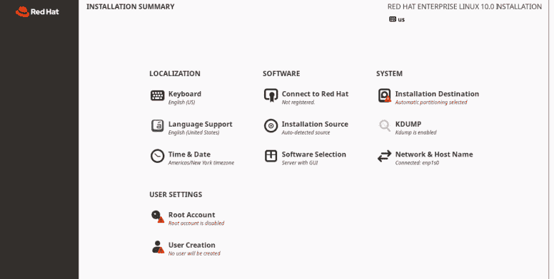

## 理解云端安装

当你在物理计算机上安装 Linux 系统时，安装程序可以看到计算机的硬盘、网络接口、CPU 和其他硬件组件。当你在云环境中安装 Linux 时，这些物理组件被抽象化为一个资源池。要在 Amazon EC2、Google Compute Engine 或 OpenStack 云中安装 Linux 发行版，你需要采取不同的方法。

安装 Linux 的常用方法是从一个已安装 Linux 系统的镜像开始的。通常，该镜像包含了基础运行的 Linux 系统所需的所有文件。元数据通过配置文件与镜像结合，通过选择实例类型（定义了 CPU 的类型和数量以及分配的内存）或通过填写云控制器的表单来创建并启动操作系统作为虚拟机（或者，如果根据你的请求，它也可以直接在选定的硬件上运行）。

添加到镜像中的信息类型可能包括特定的主机名、密码和新用户账户。你可能希望选择特定数量的磁盘空间、特定的网络配置以及特定的 CPU 处理器和内存。

在本地类云 KVM 环境中安装 Linux 的方法将在第 28 章“将 Linux 部署到云端”中讨论。该章节涵盖了如何在 KVM 环境、Amazon EC2 云或 OpenStack 环境作为虚拟机镜像运行 Linux 系统。

## 在企业中安装 Linux

如果你在一个大型企业中管理着几十、几百甚至数千个 Linux 系统，去每台计算机手动输入和点击每次安装将是非常低效的。坦率地说，对于 Red Hat Enterprise Linux 和其他发行版（如 Amazon Linux 2023），你可以自动化安装，你只需要打开计算机并从计算机的网络网卡启动以获取你所需的 Linux 安装。

尽管我们一直关注于从 DVD 或 USB 介质安装 Linux，但有许多方法可以启动 Linux 安装以及许多方法可以完成安装。以下描述逐步说明了安装过程，并描述了过程中更改该过程的方法：

- **启动安装介质。** 你可以从计算机启动的任何介质启动安装：CD、DVD、USB 驱动器、支持 PXE 的网络接口。计算机将执行启动顺序，寻找物理介质上的主记录或在网络上寻找 PXE 服务器。

## 升级 Linux 系统

从头开始的升级会将你的 Linux 系统从一个发布版本移动到下一个版本。在次要版本之间，你只需根据需要更新软件包。在开始升级之前，请确保你已经备份了系统中的所有关键数据。在执行升级之前，有几个通用规则：

**刷新软件包。** 在升级到新版本之前，确保你当前发布版本的软件包都是最新版本。对于 Fedora，你可以输入 `dnf upgrade --refresh`。

**移除软件包。** 如果你有不需要的软件包，请在升级之前将其删除。升级过程通常只对软件包进行处理；它们通常会比纯净安装进行更多的检查和比较，因此任何可以删除的软件包都能在升级过程中节省时间。

**检查配置文件。** Linux 升级程序会遗留旧配置文件的副本。你应该检查新配置文件是否对你有效。

> **提示：** 从头开始安装 Linux 比升级更快。它还能产生一个更整洁的 Linux 系统。因此，如果你不需要系统中的数据（或者如果你已经有了数据备份），我建议你进行全新安装。然后，你可以将数据恢复到新安装的系统中。

**添加系统升级工具（如果可用）。** 你可以通过输入 `dnf install dnf-plugin-system-upgrade` 获取 Fedora 升级工具。

**下载新版本的软件包。** 要进行系统升级，你首先需要下载新发布版本的软件包。例如，如果你正从 Fedora 41 升级到 Fedora 42，可以输入 `dnf system-upgrade download --release=42`。

**修复冲突。** 如果现有软件包与这些软件包的新版本之间存在冲突，你应该解决这些冲突。这可能意味着删除某些软件包（添加 `--overwrite` 选项）。

**执行升级。** 在下载了新发布版本的软件包并修复了任何冲突后，你就可以启动升级过程。对于 Fedora，你可以运行 `dnf system-upgrade reboot`。一旦进程启动，请不要尝试中断它，否则可能导致系统损坏。系统完成后将重启。检查 `/etc/os-release` 文件以确保它反映了新的发布版本。

某些 Linux 发行版（最著名的是 Gentoo）采用了提供持续更新的方法。它们不是每隔几个月发布新版本，而是当更新软件包可用时持续抓取并将其安装到你的系统中。

## 双启动

在同一台电脑上安装多个操作系统是可能的。实现此点的方法之一是在硬盘上创建多个分区和/或使用多个硬盘，然后在不同的分区上安装不同的操作系统。只要引导加载程序包含所有已安装操作系统的启动信息，你就可以在运行时选择运行哪一个。

> **警告：** 近年来，调整 Windows 分区大小和设置多启动系统的工具已有所改进，但 Windows/Linux 双启动系统仍存在丢失数据的一些风险。不同的操作系统对分区表和主引导记录（MBR）的视图通常不同，这可能导致你的机器无法启动（至少是暂时性的）或永久丢失数据。在尝试调整 Windows 文件系统大小以为 Linux 留空间之前，请务必备份你的数据。

如果你正在使用的电脑已经有了 Windows 系统，可能整个硬盘都已给了 Windows。你可以运行一个可启动的 Linux（例如 Mint 或 Fedora Live Media），而无需接触硬盘；若要进行更持久的安装，你需要在 Windows 安装之外寻找磁盘空间。有几种方法可以实现这一点：

- **添加硬盘。** 与其扰动你的 Windows 分区，你只需添加一块硬盘并将其留给 Linux。
- **调整你的 Windows 分区大小。** 如果你的 Windows 分区上有可用空间，你可以缩小该分区，以便磁盘上有空闲空间留给 Linux。某些 Linux 发行版（特别是作为救援媒体使用的启动 Linux 发行版）包含一个名为 GParted 的工具（它包含了来自 Linux-NTFS 项目的用于调整 NTFS 分区大小的软件）。

在尝试调整 Windows 分区大小之前，你可能需要进行碎片整理。要在 Windows 11 上对磁盘进行碎片整理，选择“驱动器优化”，然后选择“优化”。在某些较旧的 Windows 系统上进行碎片整理，打开“此电脑”，右键点击硬盘图标（通常是 `C:`），选择“属性”，点击“工具”，并选择“立即碎片整理”。

磁盘碎片整理可能相当漫长的过程。碎片整理的结果是磁盘上的所有数据都是连续的，在分区末尾创建大量的连续空闲空间。有时，你必须完成以下特殊任务来实现这一目标：

- 如果 Windows 交换文件在碎片整理期间没有移动，你必须移除它。然后，如果你再次对磁盘进行碎片整理并重启，你需要恢复交换文件。要移动交换文件，打开控制面板，系统图标，点击“性能”选项卡并选择“虚拟内存”。要禁用交换文件，点击“禁用虚拟内存”。
- 如果你的 DOS 在你尝试释放的空间上有隐藏文件，你需要找到它们。在某些情况下，你无法删除它们。在另一些情况下（例如由程序创建的交换文件），你可以安全地删除这些文件。这有点棘手，因为某些文件是不应该被删除的，就像 DOS 系统文件一样。你可以从根目录使用 `attrib -s -h` 命令来处理隐藏文件。

磁盘完成碎片整理后，你可以使用 GParted 从可用空间创建新分区。

在你清理了足够的磁盘空间以安装 Linux 之后，你可以安装 Ubuntu、Fedora、RHEL 或另一个 Linux 发行版。当你设置引导加载程序时……

## 运行 Linux

使用虚拟化技术，如 KVM、VirtualBox 或 Xen，你可以配置电脑以运行多个操作系统。通常，你可以在 Windows 桌面通过虚拟化来运行 Linux。

如果你有 Windows 系统，可以使用完整版的 VMware Workstation (`https://www.vmware.com/resources/hands-on`)，你可以运行多个实例。

开源的虚拟化产品包括 VirtualBox (`https://www.virtualbox.org`)、Xen (`https://xenproject.org`) 和 KVM (`https://linux-kvm.org`)。对于 Windows，请考虑 Linux 子系统。

## 使用启动选项

当内核启动时，内核行上提供的选项会修改安装行为。

当你看到安装启动屏幕时，根据引导加载器的不同，按 `Tab` 或其他键编辑内核命令行和 initrd 行。Fedora 的行类似于：


linux `/root/vmlinuz-6.1.0-204.x86_64` root=...

initrd `/root/initramfs-6.1.0-204.x86_64.img`

`vmlinuz` 代表压缩内核，`initrd` 代表包含启动所需的模块和工具的初始内存磁盘。只需在行末尾添加更多选项。

如果你在光盘上的 `/root/ks.cfg` 有引导文件，你在启动提示符添加以启动安装的信息可能如下：

```
ks=cdrom:/root/ks.cfg
```

## 用于禁用功能的启动选项

有时，Linux 安装失败是因为电脑具有某些故障或不支持的硬件。通常，你可以通过向安装程序传递选项（例如在需要驱动程序时禁用硬件）来绕过这些问题。
表 9.1 提供了一些示例。

| 安装程序选项 | 告诉系统 |
|---|---|
| `nofirewire` | 不加载对火线设备的支持 |
| `nodma` | 不加载硬盘的 DMA 支持 |
| `noide` | 不加载 IDE 设备的支持 |
| `nompath` | 不启用多路径设备支持 |
| `nopoport` | 不加载并行端口支持 |
| `npcmcia` | 不加载 PCMIA 控制器的支持 |
| `noprobe` | 不探测硬件；而是提示用户驱动程序 |
| `noscsi` | 不加载 SCSI 设备支持 |
| `nousb` | 不加载 USB 设备支持 |
| `noipv6` | 不启用 IPv6 网络支持 |
| `nonet` | 不探测网络设备 |

# 第三部分：成为 Linux 系统管理员

## 视频问题的启动选项

如果你在视频显示遇到问题，可以按照表 9.2 所示指定视频设置。

### 表 9.2 视频问题的启动选项

| 启动选项 | 告知系统 |
| --- | --- |
| `xdriver=vesa` | 使用标准的 vesa 视频驱动 |
| `resolution=1024x768` | 选择要使用的精确分辨率 |
| `nofb` | 不使用 VGA 16 帧缓冲区驱动 |
| `skipddc` | 不探测显示器的 DDC（探测可能会导致安装程序挂起） |
| `graphical` | 强制进行图形化安装 |

## 特殊安装类型的启动选项

默认情况下，当你坐在控制台回答问题时，安装将以图形化模式运行。如果你有一个纯文本控制台，或者 GUI 工作不正常，你可以以纯文本模式运行安装：通过输入 `text`，你会让安装以文本模式运行。

如果你想在某台计算机上启动安装，但想在另一台计算机上回答安装问题，可以启用 VNC（虚拟网络计算）安装。完成此类类型的安装后，你可以去另一个系统并打开 vnc 查看器，为查看器提供安装机器地址（例如 `192.168.0.99`）。表 9.3 提供了必要的命令以及系统指令。

### 表 9.3 VNC 安装的启动选项

| 启动选项 | 告知系统 |
| --- | --- |
| `vnc` | 作为 VNC 服务器运行安装 |
| `vncconnect=hostname[:port]` | 连接到 VNC 客户端主机名和可选端口 |
| `vncpassword=password` | 客户端使用密码（至少八位）连接到安装程序 |

## kickstart 和远程仓库的启动选项

你可以从仅包含内核和初始 RAM 磁盘的介质上启动安装过程。如果是这种情况，你需要识别存在软件软件包的仓库。你可以通过提供 kickstart 文件或以某种方式识别仓库的位置来实现。为了让安装程序提示输入仓库位置（CD/DVD、硬盘、NFS、FTP 或 HTTP），请在安装启动选项中添加 `askmethod`。

## 第 9 章：安装 Linux

使用 `repo=options`，你可以识别仓库位置。以下示例显示了创建 `repo=` 条目时使用的语法：

```
repo=hd://dev/sda:/myrepo
位于磁盘 1 第一分区的 /myrepo 仓库

repo=http://abc.example.com/myrepo
从 Web 服务器上的 /myrepo 可用的仓库

repo=ftp://ftp.example.com/myrepo
从 FTP 服务器上的 /myrepo 可用的仓库

repo=cdrom
从本地 CD 或 DVD 可用的仓库

repo=nfs://mynys.example.com:/myrepo/
从 NFS 服务器上的 /myrepo 可用的仓库

repo-nfsiso:nfs.example.com:/mydir/rhel10.iso
从 NFS 服务器可用的安装镜像
```

与其识别仓库，你可以在 kickstart 文件中指定它。以下是识别 kickstart 文件位置的某些方法：

```
ks=cdrom://stuff/ks.cfg
从 CD/DVD 获取 kickstart。

ks=hd=sda2:/test/ks.cfg
从硬盘 (sda2) 上的目录获取 kickstart。

ks=http://example.com/ksfiles/ks.cfg
从 Web 服务器获取 kickstart。

ks=ftp://ftp.example.com/allks/ks.cfg
从 FTP 服务器获取 kickstart。

ks=nfs://mynys.example.com:/somks/ks.cfg
从 NFS 服务器获取 kickstart。
```


## 杂项启动选项

这里是你可以传递给安装程序的几个不属于特定类别的选项。

- **rescue**  
  不是进行安装，而是运行内核以打开 Linux 救援模式。
- **mediacheck**  
  检查安装介质的校验和错误。

有关在救援模式下使用 anaconda 安装程序（以救援损坏的 Linux 系统）的更多信息，请参见第 21 章“Linux 故障排除”。有关 RHEL 10 中使用的最新启动选项，请参阅 RHEL 10 安装指南：https://docs.redhat.com/en/documentation/redhat_enterprise_linux/10/html/interactively_installing_rhel_from_installation_media/optional-customizing-boot-options。

## 使用专用存储

在大型企业计算环境中，将操作系统和数据存储在本地计算机之外是常见的。相反，会向安装程序识别本地磁盘之外的某些特殊存储设备，并在安装期间使用该存储设备（或设备）。

一旦识别，你在安装期间指定的存储设备可以像使用本地磁盘一样使用。你可以对它们进行分区并分配结构（文件系统、交换空间等），或者留出它们并简单地将其挂载到你希望数据可用的地方。

在安装 Red Hat Enterprise Linux、Fedora 或其他 Linux 发行版时，可以从“专用设备”中选择以下类型的专用存储设备：

- **Firmware RAID（固件 RAID）**  
  固件 RAID 设备是一种在 BIOS 中具有钩子的设备，如果你选择的话，它可以允许它启动操作系统。

- **Multipath devices（多路径设备）**  
  如名所示，多路径设备在计算机与其存储设备之间提供多条路径。这些路径是聚合的。

## 硬盘分区

分区是划分磁盘。如果你只有 Windows 系统，你可能习惯于 C 盘存储本地硬盘上的所有数据，而没有考虑过分区。在许多 Linux 系统中，你有机会根据需求查看并更改默认分区。

在安装期间，Fedora 和 RHEL 等系统允许使用图形工具对硬盘进行分区。以下章节描述了如何在 Fedora 安装期间进行分区。请参见“创建分区的建议”章节以获取创建分区的建议。

## 第 9 章：安装 Linux

不同的文件系统类型具有不同的结构。不同类型的文件系统必须分开。你可能由于特殊功能需要不同的文件系统（例如只读或用户配额）。在大多数 Linux 系统中，你至少需要一个用于根（`/`）和交换区域的文件系统类型。CD-ROM 上的文件系统使用 iso9660 文件类型。

当你为 Linux 创建分区时，通常会将文件系统分配为 Linux 原生（在大多数 Linux 系统使用 `ext2`、`ext3`、`ext4`、`btrfs` 或 `xfs` 类型）。如果你运行的应用需要长文件名、大文件或大量节点（每个文件消耗一个节点），你可能想选择不同的文件系统类型。

## 来自 Windows 的用户

如果你只有 Windows 系统，你可能习惯于 C 盘存储本地硬盘上的所有数据，而没有考虑过分区。在许多 Linux 系统中，你有机会根据需求查看并更改默认分区。

# 第三部分：成为 Linux 系统管理员

这些功能与您的数据的读取、写入和存储有关，有助于提高性能、可靠性或两者兼顾。

**交换分区** - 创建一个交换分区以扩展系统上可用的虚拟内存量。

以下章节包含有关创建分区的信息。如果您仍然不确定何时应该使用这些不同类型的分区，请参阅第 12 章“管理磁盘和文件系统”，以获取有关配置磁盘分区的更多信息。

## 创建分区的提示

更改磁盘分区以处理多个操作系统可能是很复杂的，这在某种程度上是因为每个操作系统对于如何处理分区信息都有自己的见解，并且有不同的工具来执行。以下是一些可以帮助您正确操作的提示：

- 如果您是双启动系统，特别是 Windows 系统，请尝试在对磁盘进行分区后先安装 Windows 操作系统。否则，Windows 安装可能会导致 Linux 分区无法访问。
- `fdisk` 手页建议您使用操作系统自带的分区工具为该操作系统创建分区。例如，Windows 的 `fdisk` 知道如何创建 Windows 喜欢的分区，而 Linux 的 `fdisk` 会很乐意地创建您的 Linux 分区。在硬盘设置好双启动后，您可能不应回到仅限 Windows 的分区工具。请使用 Linux `fdisk` 或 `parted` 命令。
- 主引导记录 (MBR) 分区表可以包含四个主分区，其中一个可以标记为包含 184 个逻辑驱动器。在 GPT 分区表中，大多数操作系统（包括 Linux）上最多有 128 个分区。您通常不需要这么多分区。如果您需要更多分区，请使用 LVM 并根据需要创建逻辑卷。

如果您将 Linux 作为桌面使用，您可能不需要许多不同的分区。然而，对于用户共享或作为公共 Web 服务器或文件服务器的 Linux 系统，拥有多个分区也有一些很好的理由。在您的 Linux 系统中拥有多个分区可以提供以下优势：

**防止攻击** - 拒绝服务攻击有时会尝试填满您的硬盘。如果公共区域（如 `/var`）位于单独的分区上，成功的攻击可以填充您的分区而无需关闭整个计算机。由于 `/var` 是 Web 和 FTP 服务器的默认位置，并且预计会存储大量数据，因此整个硬盘通常被单独分配给 `/var` 文件系统。

**防止文件系统损坏** - 如果您只有一个文件系统 (`/`)，它的损坏可能会导致整个 Linux 系统受到损坏。较小分区的损坏更容易修复，并允许计算机在修复期间继续提供服务。

## 第 9 章：安装 Linux

表 9.4 列出了您可能考虑将其作为单独文件系统分区的某些目录。

### 表 9.4 将分区分配给特定目录

虽然使用 Linux 系统的人很少看到很多分区，但那些维护并偶尔必须恢复大型系统的人在他们需要的系统发生故障时会感激之不尽。多个分区可以限制故意破坏（如拒绝服务攻击）、失误用户引起的问题以及意外文件系统损坏的影响。

## 使用 GRUB 引导加载程序

您选择的引导加载程序决定了如何启动安装在计算机硬盘上的操作系统。大统一引导加载程序 (GRUB) 是已安装的 Linux 系统最常用的引导加载程序。目前有两个主要版本的 GRUB 可用：

- **GRUB Legacy（版本 1）**  
  此版本的 GRUB 用于较早版本的 RHEL、Fedora 和 Ubuntu。
- **GRUB 2**  
  当前版本的 Red Hat Enterprise Linux、Ubuntu 和 Fedora 使用 GRUB 2 作为默认引导加载程序。

SYSLINUX 是您几年前可能在 Linux 系统中遇到过的另一种引导加载程序。SYSLINUX 引导加载程序通常不用于已安装的 Linux 系统。然而，SYSLINUX 通常作为可启动 CD 和 DVD 的引导加载程序。SYSLINUX 特别适用于启动 ISO9660 CD (ISOLINUX) 和 USB 闪存盘 (SYSLINUX)，并适用于在旧硬件上运行或通过网络对系统进行 PXE 启动 (PXELINUX)。

如果您想启动到特定的运行级别，可以在内核行的末尾添加您所需的级别。例如，如果您想将 RHEL 引导到级别 3（多用户加网络），则在内核行后添加 `3`。您也可以启动到单用户模式 (1)、多用户模式 (2) 或 X GUI 模式 (5)。如果您的 GUI 临时损坏了，级别 5 是一个很好的选择。如果您忘记了 root 密码，级别 1 是一个很好的选择。

默认情况下，在 Linux 启动时您会看到启动屏幕。如果您想查看系统启动时发生的活动消息，可以从内核行中删除 `rhgb quiet`。这让您能看到消息滚过。在启动过程中按 Esc 键也可以获得相同的结果。

GRUB 2 代表了 GRUB Legacy 项目的重大重写。它被采用为最新的 Red Hat Enterprise Linux、Fedora 和 Ubuntu 版本的默认引导加载程序。GRUB 2 引导加载程序的主要功能是查找并启动所需的操作系统，但现在引导您到达目的地的工具和配置文件中内置了更多的功能和灵活性。

在 GRUB 2 中，配置文件命名为 `/boot/grub/grub.cfg`、`/etc/grub2/grub.cfg` 或 `/etc/grub2-efi.cfg`（对于 EFI 启动的系统）。

## 第 9 章：安装 Linux

表 9.4 列出了您可能考虑将其作为单独文件系统分区的某些目录。

## 总结

每个 Linux 发行版都包含不同的安装方法，无论您安装哪种 Linux 系统，都需要执行许多常见活动。对于每个系统，您都必须处理磁盘分区、用户设置和其他配置选项的问题。

在本章中，您演示了 Fedora Workstation（使用活动介质安装）和 Red Hat Enterprise Linux（从安装介质）的安装程序。您学习了在云环境中部署 Linux 与传统安装方法的不同之处，即将元数据与预构建的基础操作系统镜像相结合并在规模计算池上运行。

本章还涵盖了特殊的安装主题，包括使用启动选项和磁盘分区。现在您的 Linux 系统已经安装完毕，第 10 章“获取和管理软件”将介绍如何开始管理您 Linux 系统上的软件。

## 练习题

使用这些练习来测试你对安装 Linux 的知识。我建议你在某台没有操作系统或没有你担心丢失数据的计算机上进行这些练习（换句话说，就是一台你不在意抹掉电脑）。如果你有一台允许安装虚拟系统的计算机，这也是进行这些练习的安全方法。这些练习已通过 Fedora 42 Workstation Live 启动媒体和 RHEL 10 安装 DVD 测试过。

1. 从 Fedora Live 媒体开始安装，尽可能多使用默认选项。
2. 在完全安装 Fedora 后，更新系统上的所有软件包。
3. 从 RHEL 安装 DVD 开始安装，但让安装在文本模式下运行。以你选择任何方式完成安装。
4. 从 RHEL 安装 DVD 开始安装，并按照如下方式设置磁盘分区：`1024MB /boot`、`/ (6G)`、`/var (2G)` 和 `/home (2G)`。其余部分留作未使用空间。

> **注意**  
> 完成练习 4 最终会删除你硬盘上的所有内容。如果你只是想通过此练习练习分区，可以在此程序结束时点击“接受更改”之前重启电脑，而不会损坏你的硬盘。如果你继续并分区磁盘，请假设你所有未显式更改的数据都已被删除。

# 第 10 章：获取和管理软件

## 本章内容

- 从桌面安装软件
- 处理 RPM 和 Deb 软件包
- 使用 dnf 和 yum 管理软件包
- 使用 rpm 处理软件包
- 使用 Snap、Flatpak 和 Homebrew 安装个人软件
- 在企业级环境中安装软件

在 Fedora 和 Ubuntu 等 Linux 发行版中，你不需要了解太多软件是如何打包和管理的就能获取你需要的软件。这些发行版拥有极佳的软件安装工具，它们会自动连接到你自己的软件系统，只需点击几次，你使用软件的时间就比下载它的时间还要短。

如今 Linux 软件管理如此简单，这归功于 Linux 社区，他们勤勤工作，创建了打包格式、复杂的安装工具和高质量的软件包。不仅获取软件很容易，在安装之后，管理、查询、更新和删除它也很容易。

本章将开始描述如何使用 Software 图形化安装工具在 Fedora 中安装软件。如果你只是在自己的桌面系统上安装几个桌面应用程序，你可能需要的只有这些操作以及持续的安全更新。

为了深入研究管理 Linux 软件，我将描述构成 Linux 软件包的内容（对比 dnf 和 rpm 打包）、底层软件管理组件，以及在 Fedora 和红帽企业 Linux 中管理软件的命令（`dnf`、`yum` 和 `rpm`）。

对于每个用户的软件安装，我将展示如何使用 Snap、Flatpak 和 Homebrew 等工具为特定用户添加软件，而不是全系统添加。随后是关于如何在企业计算中管理软件包的描述。

## 在桌面上管理软件

Fedora Software 窗口为选择和安装桌面应用程序提供了一个直观的视图，这与典型的 Linux 安装惯例并不一致。通过 Software 窗口，你安装的最小软件组件是一个应用程序，该程序可以包含多个软件包。

图 10.1 显示 Fedora Software 窗口的一个示例。

**图 10.1**  
从 Fedora Software 窗口安装和管理软件包。

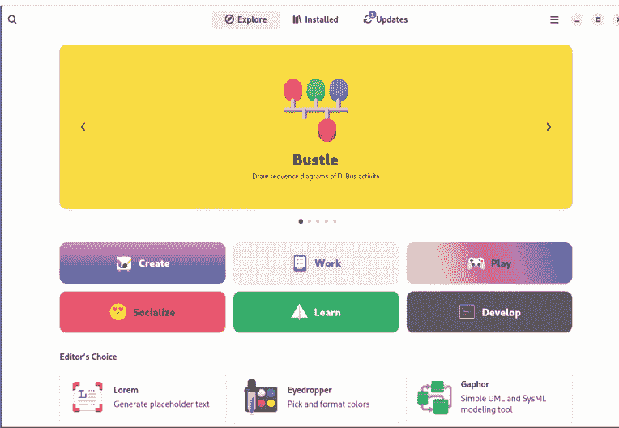

要在 Fedora 中打开 Software 窗口，将鼠标移动到屏幕左上角，然后选择 **Software** 并按回车。第一次打开此窗口时，你可以选择“启用”以允许非官方 Fedora 发行版仓库的第三方软件仓库。使用 Software 窗口是安装面向桌面的应用程序（如文字处理器、游戏、图形编辑器和教育应用）的最佳方法。

通过 Software 窗口，你可以从“精选”（Editor’s Picks，一组热门应用程序）中选择想要安装的应用程序，从应用程序类别（音频与视频、游戏、图形与摄影等）中选择，或按应用程序名称或描述搜索。选择“安装”按钮，让 Software 窗口下载并安装运行应用程序所需的所有软件包。

窗口的其他功能允许你查看所有已安装的应用程序（Installed 标签页）或查看可用更新包的应用程序列表（Updates 标签页）。如果你想删除已安装的应用程序，只需点击包名旁的“移除”按钮。

如果你纯粹将 Linux 作为桌面系统使用，编写文档、音乐并执行其他常见的桌面任务，那么 Software 窗口将是你获取所需基础软件的所有内容。默认情况下，你的系统连接到 Fedora 主仓库，并让你访问数百个软件应用程序。如前所述，你还可以选择访问免费使用但不重新分发的第三方应用程序。

尽管 Software 窗口允许你从 Fedora 仓库下载并安装数百个应用程序，但该仓库实际上包含数万个软件包。哪些软件包是你无法从仓库中看到的？你什么时候可能需要其他软件包？你如何才能获取这些软件包（以及来自其他仓库的软件包）？

## 超越 Software 窗口

如果你正在管理单一桌面系统，你可能对通过 Software 窗口找到数百个软件包感到非常满意。大多数常见类型桌面应用程序的开源版本可用。然而，以下是你可能希望超越 Software 窗口的原因示例：

- **更多仓库**  
  Fedora 和红帽仅包含软件，你可能需要更多。
- **桌面应用程序**  
  虽然 Software 窗口在安装单一系统时效果良好，但在管理软件方面扩展性不佳。
- **灵活性**  
  通过 `dnf`、`yum` 和 `rpm` 命令，你拥有更大的灵活性。


- **复杂查询**  
  使用 `dnf`、`yum`、`rpm` 命令可以获取有关软件包和组的详细信息。
- **软件验证**  
  使用 `rpm` 和其他工具，可以检查签名软件包在安装前是否被修改过，或者其组件是否曾被篡改。
- **软件安装管理**  
  虽然 Software 窗口对于单一系统效果良好，但其他工具是构建在 rpm 功能之上的。

在介绍一些用于安装和管理软件的命令行工具之前，下一节将描述 Linux 底层包管理系统是如何工作的。特别是，我将关注 RPM，因为它用于 Fedora、红帽企业 Linux 以及相关发行版，以及 Deb 包（它与 Debian、Ubuntu、Linux Mint 及相关发行版相关）。

# 理解 Linux RPM 和 Deb

## 软件包打包

在早期 Linux 系统，如果你想添加软件，你会从项目中获取源码，将其编译为可执行的二进制文件并将其放入计算机。如果你足够幸运，你已经将其编译成了可以在计算机上运行的形式。

软件包的形式可以是 tarball，其中包含执行文件（命令）、文档、配置文件和库。tarball 是为了方便存储或分发将多个文件聚集在一起的目录。从 tarball 安装软件时，tarball 中的文件可能会分散在 Linux 系统的各个目录中（仅例如 `/usr/share/man`、`/etc`、`/bin` 和 `/lib`）。创建一个 tarball 并一组软件放入 Linux 系统是很容易的，但这种安装方法让执行以下操作变得困难：

- 获取依赖软件：你需要知道你正在安装的软件是否依赖于其他已安装软件才能运行。然后你必须追踪那些软件并安装它们（它们本身可能还有依赖）。
- 列出软件：即使你知道命令名称，在以后查找时也可能不知道它的文档或配置文件在哪里。
- 移除软件：除非你保留了原始 tarball 或文件列表，否则在删除它们时你并不知道所有文件在哪里。即使你知道，你也必须一个一个地删除它们。

软件 tar 包的设计并不是为了包含其所内容的元数据。在安装了 tar 包的内容后，你可能无法判断你正在使用哪个版本的软件，这使得追踪错误和获取软件的新版本变得困难。

为了解决这些问题，软件包从简单的 tar 包演进到了更复杂的打包格式。除了少数例外（如 Gentoo、Slackware 以及其他几个），大多数 Linux 发行版都使用一或两种软件包格式——DEB 和 RPM。

DEB (.deb) Debian GNU/Linux 项目。.deb 软件包用于 Debian 以及其他基于 Debian 的发行版（如 Ubuntu、Linux Mint 等）。使用 `apt-get`、`apt` 和 `dpkg` 等工具可以安装、管理、升级和删除软件。

RPM (.rpm) 原名为 Red Hat Package Manager，但后来更名为 RPM Package Manager。RPM 是 SUSE、Red Hat (RHEL) 以及基于 Red Hat 的发行版（Amazon Linux、CentOS、Oracle Linux 等）的首选格式。`rpm` 命令是第一个管理 RPM 的工具。后来，`yum` 被用来增强 RPM 功能，而 `dnf` 已经取代了 `yum`，同时保留了许多 `yum` 命令的功能。

在管理单个系统方面，RPM 和 DEB 争论的双方都有其合理的观点。尽管 RPM 是管理企业级软件安装、更新和维护的首选格式，但 DEB 在 Linux 爱好者中非常流行。本章将涵盖 RPM（Fedora 和 Red Hat Enterprise Linux）和（在某种程度上）DEB 软件包及软件管理。

### 理解 DEB 软件包

Debian 软件包以 `ar` 格式封装了与某组软件相关的多个文件和元数据。这些文件可以是可执行文件（二进制文件）、配置文件、文档、软件包大小、描述和其他软件项。元数据包括依赖关系、许可协议和其他信息。在 Ubuntu、Debian 和其他 Linux 发行版中，有多种处理 DEB 文件的命令行和图形化工具。其中一些包括：

- **Ubuntu Software**  
  从 GNOME 中选择“Ubuntu 应用中心”（Ubuntu App Center）。出现的窗口允许你通过搜索关键词或浏览类别来搜索你需要的应用程序和软件包。

- **aptitude 命令**  
  这是一个软件包安装工具，提供了一个在 shell 中运行的面向屏幕的菜单。运行命令后，使用方向键高亮你想要的选择，然后按回车键选择。你可以升级软件包、获取新软件包或查看已安装的软件包。

- **apt**  
  有一组 `apt*` 命令（`apt-get`、`apt`、`apt-config`、`apt-cache` 等）可以管理软件包的安装。

Ubuntu 应用中心对于查找和安装软件包非常直观。然而，这里有几个使用 `apt*` 命令帮助安装和管理软件包的命令示例。在这种情况下，我正在寻找安装 `vsftpd` 软件包。

> **注意**  
> 注意在这些示例中，`apt` 命令前面都有 `sudo` 命令。这是因为 Ubuntu 常见的做法是以具有 `sudo` 权限的普通用户身份运行管理命令。

```
```


$ sudo apt-get update

$ sudo apt-cache search vsftpd

$ sudo apt-cache show vsftpd

$ sudo apt-get install vsftpd

$ sudo apt-get upgrade

$ sudo apt-cache pknames

还有许多其他可以尝试的 `apt*` 命令的用法。如果你安装了 Ubuntu 系统，我建议你运行 `man apt` 来了解 `apt` 及相关命令的功能。

### 理解 RPM 软件包

RPM 是文件的集合，用于提供某功能的全部或部分，例如文字处理器、照片查看器或文件服务器。你为软件功能制作的命令、配置文件和文档可以是一个 RPM。RPM 文件还包含元数据，存储了关于该软件包内容的信息、来源、运行所需以及其他信息。

### RPM 中包含什么？

在查看 RPM 内部之前，你可以通过 RPM 本身的名称了解关于它的很多信息。要查找系统中当前安装的 RPM 软件包名称（在本例中为 Firefox 网页浏览器），你可以在 Fedora 或 Red Hat Linux 的 shell 中输入以下命令：

```bash
# rpm -q firefox
firefox-141.0-2.fc42.x86_64
```

通过此，你可以看出软件包的基础名称是版本号 `141.0`（由 Firefox 的上游提供者 Mozilla 项目分配）。发布版本（由打包者分配，每次软件包重新构建时都会分配）为 `2`。Firefox 软件包是为 Fedora 42 (fc42) 构建的，并为 x86 64 位架构 (x86_64) 编译。

当安装 `firefox` 软件包时，它可能是从安装介质（如 USB 驱动器或 DVD）复制的，或者从 YUM 仓库下载的。如果你提供了 RPM 文件且它位于本地目录，名称将显示为 `firefox-141.0-2.fc42.x86_64.rpm`，你可以从这里安装它。无论它来自哪里，软件包一旦安装，其名称和其他信息就会存储在本地机器的 RPM 数据库中。

要了解更多关于 RPM 软件包的内容，可以使用 `rpm` 命令以外的选项进行查询：

```bash
# rpm -qi
Name: firefox
Version: 141.0
Release: 2.fc42
Architecture: x86_64
Install Date: Sat 26 Jul 2025 07:12
Group: Unspecified
Size: 25871
License: GPL-2.0
Signature: RSA-SHA256
Build Date: Fri 18 Jul 2025 04:16
Build Host: x86_64
Source: firefox-141.0-2.fc42.src
Package: firefox
Vendor: Fedora Project
URL: https://www.mozilla.org/
Summary: Firefox
Description: Firefox is an open-source browser
```

### RPM 从哪里来？

当你最初安装 Fedora 或 Red Hat Linux 系统时，许多软件包构成了该系统。请参考第 9 章“安装 Linux”。

然而，第一个用于安装 RPM 软件包的工具是 `rpm` 命令。使用 `rpm` 可以安装、查询和删除 RPM 软件包。该命令有一些缺点：

- 依赖关系：大多数 RPM 软件包的运行需要在系统中安装其他软件（库、执行文件等）。当你用 `rpm` 安装软件包时，如果未安装依赖包，安装将失败并告诉你需要的组件。此时，你必须寻找哪个软件包包含了该组件。当你安装它时，该依赖包可能还有你运行所需的依赖项。这种情况广泛被称为“依赖地狱”，并经常被用作为什么 DEB 软件包优于 RPM 的例子。DEB 打包工具在 RPM 相关工具之前就可以自动解决依赖问题。

- RPM 的位置：`rpm` 命令要求你在尝试安装时提供 RPM 文件的文件的确切位置。换句话说，如果 RPM 在当前目录，你必须提供 `firefox-141.0-2.fc42.x86_64.rpm`；如果在服务器上，则需要提供 `http://example.com/firefox-141.0-2.fc42.x86_64.rpm`。随着 Red Hat 和其他基于 RPM 的应用程序日益流行，显然必须采取措施使软件包安装变得更加方便。答案是 YUM 管理器。

### 使用 dnf 和 yum 管理 RPM 软件包

YellowDog Updater (YUM) 项目旨在解决管理 RPM 软件包依赖关系的头疼问题。它的主要贡献是不再将 RPM 软件包视为独立的组件，而是将其视为大型软件仓库的一部分。

有了仓库，处理依赖关系的问题就不再属于安装软件的人，而是属于 Linux 发行版或提供该软件的第三方分发商。例如，应该是 Fedora 项目的责任来确保其 Linux 发行版中每个软件包所需的每个组件都能通过仓库中的其他软件包得到解决。

存储库之间可以相互依赖。例如，rpmfusion.org 存储库假设用户已经访问了 Fedora 主存储库。从 rpmfusion.org 安装的包可能需要 Fedora 主库中的某个库或命令；在安装 rpmfusion.org 包的同时，可以下载并安装对应的 Fedora 包。

YUM 存储库可以放在 Web 服务器（http://）上的目录中；或者（ftp://）上；在本地介质（如 USB、CD 或 DVD）上；或者在本地目录（file://）中。这些存储库的位置将存储在系统的 `/etc/dnf/dnf.conf` 文件中，或者更常见地存储在配置文件中。

## 从 yum 迁移到 dnf

`dnf` 命令行界面是 YUM 的新一代版本，被称为 Dandified (https://github.com/rpm-software-management/dnf)，它从 Fedora 18 版本开始成为一部分，并刚刚被添加为 RHEL 8 的默认 RPM 软件包管理器。与 `yum` 类似，`dnf` 是一个用于从远程软件到本地 Linux 系统中查找、安装、查询和管理 RPM 包的工具。

虽然 `dnf` 与 `yum` 保持了基本的命令兼容性，但它的主要区别之一是它遵循严格的 API。DNF 鼓励为 `dnf` 开发扩展和插件。

对于我们的目的来说，本章中描述的几乎所有的 `yum` 命令都可以用 `dnf` 替换，或者原样使用。在 Fedora 和 RHEL 中，`yum` 命令是 `dnf` 的符号链接，因此输入任一个命令的结果都是一样的。有关 DNF 的更多信息，请参阅 https://dnf.readthedocs.io/ 上的 DNF 页面。

## 理解 dnf 的工作原理

以下是 `dnf` 命令的基本语法：

```bash
# dnf [options] command
```

使用该语法，你可以查找软件包、查看包信息、查找包组、更新软件包或删除软件包，这只是其中的几个功能。在配置好 YUM 存储库后，用户只需简单输入如下内容即可安装软件包：

```bash
# dnf install firefox
```

用户只需要知道包名（可以通过不同的方式查询，如本章稍后“搜索软件包”节描述的）。YUM 会从存储库中找到该包的最新版本，将其下载到本地系统并进行安装。

## 第三部分：成为 Linux 系统管理员

为了获得更多使用 YUM 的经验，并发现您可以自定义系统中 YUM 工作方式的机会，请按照接下来描述的 YUM 安装过程的每个阶段进行操作。

> 注意
> 在早期的 Fedora 和 RHEL 系统中，YUM 配置在 `/etc/yum.conf` 文件中。现在，主 dnf 配置文件是 `/etc/dnf/dnf.conf`，而 `/etc/dnf` 目录包含了增强您管理 RPM 包能力的模块和插件。

### 1. 检查 /etc/dnf/dnf.conf

当任何 `dnf` 或 `yum` 命令启动时，它都会检查 `/etc/dnf/dnf.conf` 以获取默认设置，并检查 `/etc/dnf/` 子目录下的其他配置文件。`/etc/dnf/dnf.conf` 文件是设置 YUM 存储库默认值的地方；你可以更改日志或缓存目录的位置，或者设置安装限制或决定是否进行 gpg 检查。输入 `man dnf.conf` 查看详情。你也可以在此处识别存储库的位置和设置，尽管 `/etc/yum.repos.d` 目录是识别存储库更典型的位置。此文件默认是空的，但这里你可以进行以下操作：

```ini
[main]
gpgcheck=1
installonly_limit=3
```

`gpgcheck` 用于通过你从构建者处收到的密钥来验证每个软件包。它是默认开启的（`gpgcheck=1`）。对于 Fedora 或 RHEL 中的软件包，该密钥随发行版一起提供以检查所有软件包。若要安装不来自你所发行版的软件包，你需要导入该密钥以验证这些软件包，或者关闭该功能（`gpgcheck=0`）。

`installonly_limit=3` 设置允许系统最多保留三个版本的软件包（不要将此值设置得小于 2，以确保你始终至少有两个内核包）。

### 2. 检查 /etc/yum.repos.d/*.repo 文件

通过将以 `.repo` 结尾的文件放入 `/etc/yum.repos.d/` 目录中可以启用软件存储库，这些文件指向一个或多个存储库的位置。在 Fedora 中，即使是基础的 Fedora 存储库也是通过该目录中的 `.repo` 文件启用的。这里是一个名为 `/etc/yum.repos.d/myrepo.repo` 的简单 yum 配置文件的示例：

```ini
[myrepo]
name=my repository of software packages
baseurl=http://myrepo.example.com/pub/myrepo
enabled=1
gpgcheck=1
gpgkey=file:///etc/pki/rpm-gpg/MYOWNKEY
```

每个存储库条目以方括号括起来存储库名称开始。`name` 行包含存储库的可读描述。`baseurl` 行识别包含 RPM 文件的目录，可以是一个 `http://`、`ftp://` 或 `file://` 条目。

`enabled` 行表示该条目是否处于激活状态；0 为未激活。如果没有 `enabled` 行，则该条目为激活状态。前述代码的最后两行指示是否检查软件包的签名。

出于这些原因，我建议你要么 (1) 不启用任何额外的存储库，或者 (2) 仅启用 RPM Fusion 存储库（对于 Fedora）和 EPEL 存储库（对于 RHEL）。详情请参见常见问题解答（FAQ）。如需要在 Fedora 中启用 RPM Fusion，请执行以下操作：

1. 打开终端窗口。
2. 输入 `su` 并在提示输入 root 密码。
3. 输入以下命令，注意斜杠和 rpmfusion 之间没有空格（如果不起作用，请进入 fedora 目录并选择适用于你 Fedora 版本的 RPM）：

```bash
# rpm -Uvh http://download.l.rpmfusion.org/free/fedora/rpmfusion-free-release-stable.noarch.rpm
```

在 `/var/lib/dnf` 或 `/var/lib/rpm`（取决于 RHEL 或 Fedora），你可以查看已安装软件包的内容、执行各种查询，并根据 RPM 数据库验证软件包是否被篡改。

`rpm` 命令（在本章稍后的“使用 rpm 安装、查询和验证软件”节中描述）是查询 RPM 数据库的最佳工具。你可以使用 `rpm` 运行单独查询，或在脚本中使用它报告常用查询。

现在你理解了 `dnf` 命令的基本工作原理，你的 Fedora 系统应该已经自动配置连接到 Fedora 主存储库和 Fedora 更新存储库。你现在可以尝试一些 `dnf` 命令来安装软件包。或者，你可以启用其他的第三方 yum 存储库来获取资源。

## 第 10 章：获取与管理软件

RPM Fusion Nonfree 仓库包含了播放许多流行多媒体格式所需的解码器等。要在 Fedora 中启用 Nonfree 仓库，请输入以下内容（再次提醒，将两行合并为一行，两者之间不要留空格）：

```bash
# rpm -Uhv http://download1.rpmfusion.org/nonfree/fedora/rpmfusion-nonfree-release-stable.noarch.rpm
```

你可能感兴趣的其他大多数第三方仓库包含的都是非开源软件。例如，如果你想为 Linux 安装 Adobe Flash 插件，可以从 Adobe 下载 YUM 仓库包，然后你可以使用 `yum` 命令来安装 Flash 插件，并在有更新可用时运行 `dnf` 命令来获取更新。

## 使用 dnf 命令管理软件

`yum` 和 `dnf` 命令具有多个子命令，你可以使用这些命令来处理 RPM 包。接下来的章节提供了一些实用的 `dnf` 命令行示例，用于搜索、安装、查询和更新与 YUM 仓库相关的软件包。“安装和移除软件包”章节描述了如何使用 `dnf` 命令安装和移除已安装的软件包。

> 注意
> 元数据（YUM 仓库的内容）是在你第一次运行 `dnf` 命令时从你的每个 YUM 仓库下载的。元数据会在 `metadata_expire` 时间过期后重新下载。启用的 YUM 仓库越多、规模越大，此下载所需的时间就越长。你可以通过增加过期时间（在 `/etc/dnf/dnf.conf` 文件中）或不启用你不需要的仓库来缩短此下载时间。

## 搜索软件包

通过使用不同的搜索子命令，你可以根据关键词、内容或其他属性找到软件包。

假设你想尝试不同的文本编辑器，但你不记得你想用的那个名字了。你可以开始使用 `search` 子命令在名称或描述中查找文本编辑器：

```bash
# dnf search editor
emacs.x86_64: GNU Emacs 文本编辑器
emacs-gtk+x11.x64: 带 GTK toolkit X 支持的 GNU Emacs 文本编辑器
emacs-lucid.x86_64: 带 Lucid toolkit X 支持的 GNU Emacs 文本编辑器
emacs-nw.x86_64: 无窗口系统支持的 GNU Emacs 文本编辑器
enki.noarch: 程序员使用的文本编辑器
equalx.x86_64: 用于编写 LaTeX 方程的图形编辑器
eureka.x86_64: 经典 DOOM 游戏的跨平台地图编辑器
...
```

搜索结果显示了一长长的在名称或摘要中包含“editor”的软件包列表。我要找的那个名为 `emacs`。要获取有关该软件包的信息，可以使用 `info` 子命令：

```bash
# dnf info emacs
Name : emacs
Epoch : 1
Version : 30.1
Release : 13.fc42
Architecture : x86_64
Download size : 32.5 MiB
Installed size : 171.5 MiB
Source : emacs-30.1-13.fc42.rpm
Repository : updates
Summary : GNU Emacs 文本编辑器
URL : https://www.gnu.org/software/emacs/
License : GPL-3.0-or-later AND CC0-1.0
Description : Emacs 是一个强大的、可定制的、带文档的无模式文本编辑器...
```

如果你知道想要的命令、配置文件或库的名称，但不知道它是什么，可以使用该子命令搜索相应的软件包。在这里你可以看到摄像头的 `dvdrecord` 命令名称：

```bash
# dnf provides dvdrecord
vdom-1.11-59.fc42.x86_64 : 一个命令行 CD/DVD 录制程序
Repo : fedora
Matched from: : /usr/bin/dvdrecord
```

`list` 子命令用于以不同的方式列出软件包名称。配合软件包基础名称使用它来查找软件包的版本和仓库。你可以列出所有可用的软件包（`--available`）或已安装的软件包（`--installed`）。

```bash
# dnf list emacs
emacs.x86_64 1:30.1-13.fc42 updates
```

```bash
# dnf list --available
可用软件包
Oad.x86_64 0.27.1-1.fc42 updates
Oad-data.noarch 0.27.1-1.fc42 updates
0FFFF.x86_64 0.10-13.fc42 fedora
2048-cli.x86_64 0.9-23.fc42 fedora
2048-cli-noclurses.x86_64 0.9-23.fc42 fedora
2048-sdl.x86_64 0.9-23.fc42 fedora
...
```

```bash
# dnf list --installed
已安装软件包
Box2D.x86_64           2.4.2-3.fc42      624cbc925284d4ecae4c58749abe4fe8
ImageMagick.x86_64     1:7.1.1.47.fc42 updates
ImageMagick-libs.x86_64 1:7.1.1.47.fc42 updates
Raw.x86_64           2.4.2-3.fc42      624cbc925284d4ecae4c58749abe4fe8
ImageMagick.x86_64     1:7.1.1.47.fc42 updates
ImageMagick-libs.x86_64 1:7.1.1.47.fc42 updates
```


# 安装和移除软件包

`install` 子命令可以安装一个或多个软件包，以满足依赖项。使用 `dnf install`，可以考虑以下示例：

```bash
# dnf install emacs
```

更新并加载：

| 软件包 | 架构 | 版本 | 仓库 |
| --- | --- | --- | --- |
| emacs | x86_64 | 30.1-13.fc42 | updates |

下载 171.5 MiB，将安装 171.5 MiB。

`remove` 子命令可以移除已安装的软件包及其不被其他软件包需要的依赖项。使用 `dnf remove`，可以移除软件包：

```bash
# dnf remove emacs
```

将移除：

| 软件包 | 架构 | 版本 | 仓库 |
| --- | --- | --- | --- |
| emacs | x86_64 | 30.1-13.fc42 | updates |

释放 171.5 MiB。

# 第 10 章：获取与管理软件

开始 rpmdb :
bb0df34f84804calle3c13accad5014bbc1f5cc3b89198593f74783da96f
结束时间 : 2025-07-27 11:52:03
结束 rpmdb :
1ffd991cc45cac822db2b7fbe926ec2a4cbf44c157c2863d7ebce3680e972b
用户 : 100 Chris Negus <chris>
状态 : Ok
发布者 : 42
描述 : yum libgroup-tools
注释 :
已更改的包：
操作 原因 存储库
安装 libgroup-tools-0:3.0-fc42.x86_64 用户输入 fedora
安装 libgroup-tools-0:3.0-fc42.x86_64 依赖 fedora

```bash
# dnf history undo s
```

更新并加载存储库：
存储库已加载。

| 包 | 版本 | 存储库 | 大小 |
| --- | --- | --- | --- |
| 移除 libgroup-tools | x86_64 | 3.0-8.fc42 fedora | 298.4 KiB |
| 移除未使用的依赖项 libgroup | x86_64 | 3.0-8.fc42 fedora | 157.7 KiB |

事务摘要：
移除：2 个包

执行此操作后将释放 456 KiB 空间（安装 0 B，移除 456 KiB）。
是否确定 [Y/n] : y

注意，在撤销事务之前，系统准确地显示了涉及哪些包。查看事务可以防止你误删想要保留的包。通过撤销事务 5，你可以删除该事务期间安装的所有包。如果你正尝试撤销一个包含几十个甚至数百个包的安装操作，撤销（undo）是一个非常实用的选项。

## 更新软件包

当软件包的新版本发布时，它们有时会被放入更新存储库，或者直接被添加到原始存储库中。如果一个软件包有多个版本（无论是在同一个存储库还是另一个启用的存储库中），`dnf` 在你安装软件包时提供最新版本。对于某些软件包（例如 Linux 内核），你可以保留同一软件包的多个版本。

如果之后出现了软件包的新版本，你可以使用 `update` 子命令下载并安装新版本。

`check-update` 子命令可以检查更新。`update` 子命令可更新单个软件包，或获取所有已安装且有可用更新的包。或者，你可以简单地更新单个软件包（如 `cups` 包），如下例所示：

```bash
# dnf update
```

```
open-vm-tools-desktop.x86_64 13.0.0-1.fc42 updates
opensc.x86_64 0.26-1-3.fc42 updates
opensc-libs.x86_64 0.26-1-3.fc42 updates
python3-bot3.noarch 1.39-13.fc42 updates
python3-botocore.noarch 1.39-13.fc42 updates
```

```bash
# dnf update
```

更新并加载存储库：
存储库已加载。

| 包 | 架构 | 版本 | 存储库 | 大小 |
|---|---|---|---|---|
| 升级： | | | | |
| open-vm-tools | x86_64 | 13.0.0-1.fc42 updates | 3.0 MIB |
| 替换 open-vm-tools | x86_64 | 12.5-1-fc42 updates | 3.1 MIB |
| open-vm-tools-desktop | x86_64 | 13.0.0-1.fc42 updates | 446.4 MIB |
| 替换 open-vm-tools-desktop | x86_64 | 12.5-1-fc42 updates | 446.4 MIB |
| opensc | x86_64 | 0.26-1-3.fc42 updates | 1.2 MIB |
| 替换 opensc | x86_64 | 0.26-1-2.fc42 624cbc9... | 1.2 MIB |

事务摘要：
升级：14 个包
替换：14 个包

入站包的总大小为 35 MIB。需要下载 35 MIB。
执行此操作后，将使用 27 KIB 空间（安装 365 MIB，移除 365 MIB）。

```bash
# dnf update cups
```

上述命令请求系统更新 `cups` 包。如果为了更新 `cups` 还需要更新其他依赖包，这些包也将会被下载并安装。

## 更新软件包组

为了方便一次性管理整组软件包，YUM 支持包组（package groups）。例如，你可以安装 GNOME 环境（获取桌面）或虚拟化。你可以通过运行以下命令查看组列表：

```bash
# dnf group list | grep
```

| | | | | | |
|---|---|---|---|---|---|
| 已安装: | | | | | |
| 可用: | | | | | |
| kde-desktop | | | | | |
| desktop-environment | | | | | |
| office | | | | | |
| development | | | | | |
| sound-and-video | | | | | |
| graphical tools | | | | | |
| servers | | | | | |
| python | | | | | |

如果你想安装一个组，可以使用以下命令：

```bash
# dnf group install kde-desktop
```

# 第三部分：成为 Linux 系统管理员

## 维护 RPM 数据库和缓存

虽然概率很低，但 RPM 数据库可能会损坏。这通常发生在意外情况中，例如在软件包部分安装时拔掉了电源。你可以检查 RPM 数据库以查找错误（`dnf check`），或者直接重新构建 RPM 数据库文件。这是一个损坏的 RPM 数据库示例以及你可以修复它的 `rpm` 命令：

```bash
# dnf check
# rpm --rebuilddb
```

前面的 `yum` 命令会删除 `/var/cache/dnf` 子目录中的缓存数据。`rpm --rebuilddb` 会重新构建数据库。`yum` 示例可以检查本地 RPM 缓存和数据库的问题，但注意到我们使用了 `rpm` 命令来修复它。

### 从 YUM 存储库下载 RPM

如果你想在不实际安装软件包的情况下检查它，可以使用 `dnf` 命令下载该软件包，或者在早期版本中使用 `yumdownloader` 命令。任何情况下都会将你命名的包从 YUM 存储库下载并复制到当前目录。

例如，使用 `yumdownloader` 从 YUM 存储库下载最新的 Firefox 浏览器包到当前目录，输入以下命令：

```bash
# yumdownloader firefox
```

```
firefox-141.0-2.fc42.x86_64.rpm      9.8 MB/s | 77 MB      00:07
```

# 第 10 章：获取和管理软件

要使用 `dnf` 命令，请输入以下：

```bash
# dnf download firefox
```

正在下载包：

```
firefox-0:141.0-2.fc42.x86_64 100% | 16.0 MiB/s | 77.0 MiB | 00m05s
```

现在下载的 RPM 包已位于你的当前目录下，你就可以使用各种 `rpm` 命令以不同的方式查询或验证该软件包（如下一节所述）。

## 使用 rpm 命令安装、查询和验证软件

本地 RPM 数据库中存储了大量关于已安装软件包的丰富信息。`rpm` 命令包含几十个选项，允许你找到有关每个软件包的信息，例如它包含的文件、创建者、安装时间、文件大小以及许多其他属性。由于数据库包含了每个包中每个文件的指纹（md5 校验和），因此可以使用 RPM 对其进行查询，以发现任何包中的文件是否被篡改过。

`rpm` 命令仍然可以执行安装和升级操作，尽管大多数人只有在本地目录中有待安装的软件包时才会以此方式使用 `rpm`。让我们在本地目录下载一个包来练习。输入以下命令下载最新版本的 `zsh` 软件包：

```bash
# dnf download zsh
```

```
zsh-0:5.9-16.fc42.x86_64 100% | 3.2 MiB/s | 3.3 MiB | 00m1s
```

将 `zsh` 包下载到当前目录后，尝试运行一些 `rpm` 命令。

## 使用 rpm 安装和删除软件包

要使用 `rpm` 命令安装软件包，请输入以下：

```bash
# rpm -i zsh-0:5.9-16.fc42.x86_64.rpm
```

注意，使用 `rpm` 安装时给出的是完整文件名，而不仅仅是包的基础名称。如果安装了较早版本的 `zsh`，你可以使用 `-U` 升级软件包。通常，人们使用 `-h` 和 `-v` 在升级期间获取哈希值打印和详细输出：

```bash
# rpm -Uvh zsh-0:5.9-16.fc42.x86_64.rpm
```

```
############################# [100%]
验证中...
############################# [100%]
准备中...
############################# [100%]
更新/安装中...
############################# [100%]
1:zsh-5.9-16.fc42
```

虽然安装 (`-i`) 只有在软件包尚未安装时才会安装，但升级 (`-U`) 在软件包已安装时会进行安装。第三种安装类型称为刷新 (`-F`)，它仅当计算机上已经安装了该软件包的较早版本时，会安装该软件包，如在本例中：

```bash
# rpm -Fhv *.rpm
```

如果你只想更新系统中已经安装（较旧版本）的软件包，而跳过未安装的软件包，可以使用上述命令。

你可以在任何安装选项中添加一些有趣的选项。`--replacepkgs` 允许你重新安装软件包的早期版本（例如，如果你删除了某些组件），而 `--oldpackage` 则允许你用较早的版本替换较新版本的软件包。

```bash
# rpm --replacepkgs emacs-30.1-13.fc42.x86_64.rpm
# rpm -Uhv --oldpackage zsh-5.0.2-25.el7_3.1.x86_64.rpm
```

你可以使用 `-e` 选项删除软件包。你只需要包名即可删除它。这是一个示例：

```bash
# rpm -e emacs
```

`rpm -e emacs` 命令将执行成功，因为没有其他软件包依赖于 `emacs`。然而，它会留下 `emacs-common`，它是作为 `emacs` 的依赖项安装的。如果你尝试先删除 `emacs-common`，该命令将失败并显示“依赖失败”的消息。

## 查询 rpm 信息

软件包安装后，你可以查询其相关信息。使用 `-q` 选项，你可以查看软件包的信息，包括描述 (`-qi`)、文件列表 (`-ql`)、文档 (`-qd`) 和配置文件 (`-qc`)。

```bash
# rpm -qi zsh
```

```
Name : zsh
Version : 5.9
Release : 16.fc42
```

```bash
# rpm -qd zsh
```

```
/etc/skel/.profile
/etc/skel/.zshrc
/etc/zlogin
/etc/zlogout
/usr/share/doc/zsh/BUGS
/usr/share/doc/zsh/CONTRIBUTORS
/usr/share/doc/zsh/FAQ
```

```bash
# rpm -qc zsh
```

```
/etc/skel/.zprofile
/etc/skel/.zshrc
/etc/zlogin
/etc/zlogout
...
```

你可以使用选项查询 RPM 中包含的任何信息。你可以找到一个 RPM 安装时需要的内容 (`--requires`)、一个包提供了什么版本的软件 (`--provides`)、在 RPM 安装或卸载之前运行的脚本 (`--scripts`) 以及对 RPM 做了哪些更改 (`--changelog`)。

```bash
# rpm -q --requires emacs-common
```

```
/bin/sh
/usr/bin/pkg-config
/usr/bin/readlink
/usr/bin/sh
/usr/sbin/alternatives
```

```bash
# rpm -q --provides emacs-common
```

```
application()
application(emacs-mail.desktop)
application(emacs.desktop)
config(emacs-common) = 1:30.1-13.fc42
emacs-common (x86-64) = 1:30.1-13.fc42
```

```bash
# rpm -q --scripts httpd
```

```
postinstall script (using /bin/sh):
if [ $1 -eq 1 ] && [ -x "/usr/lib/systemd/systemd-update-helper" ]; then
  # Initial installation
  /usr/lib/systemd/systemd-update-helper install httpd.service ||
fi

preinst script (using /bin/sh):
```

```bash
# rpm -q --changelog httpd | less
```

```
Thu Jul 17 2025 user@redhat.com - 2.4.64-2
Rule with inverted pattern and regression
* Fri Jul 11 2025 user@redhat.com - 2.4.64-2
new version 2.64
```

在前两个示例中，你可以看到内部有 postinstall 和 preinstall 脚本，并且 `--changelog` 选项允许你查看对每个版本进行的更改。使用名为 `--queryformat` 的功能，你可以查询不同的标签并以任何格式输出。运行 `--querytags` 选项查看所有标签：

```bash
# rpm --querytags | less
```

```
ARCH
ARCHSIZE
ARCHSUFFIX
BASAMES
BUGURL
```

```bash
# rpm -q binutils --queryformat "The package is {%NAME}"
```

为止，所有的查询都是针对本地 RPM 数据库的。通过在这些查询选项中添加 `-p`，你可以查询本地目录中的 RPM 文件。`-p` 选项是在安装软件包之前检查其内容的绝佳方法。如果你还没有，获取 `zsh` 包并将其放入本地目录 (`dnf download zsh`)。然后对 RPM 文件运行一些查询。

```bash
# rpm -qip zsh-5.9-16.fc42.x86_64.rpm
# rpm -qlp zsh-5.9-16.fc42.x86_64.rpm
# rpm -qdp zsh-5.9-16.fc42.x86_64.rpm
# rpm -qcp zsh-5.9-16.fc42.x86_64.rpm
```

```bash
# 查看 RPM 文件信息
# 列出 RPM 文件中的所有文件
# 显示 RPM 文件中的文档
# 列出 RPM 文件中的配置文件
```

## 验证 RPM 包

使用 `-V` 选项，你可以检查系统上安装的软件包，查看自首次安装以来是否发生了变化。虽然配置文件随时间变化是正常的，但二进制文件（`/bin`、`/sbin` 等命令）在安装后发生变化是不正常的。二进制文件发生变化可能表明你的系统被篡改过。

在本例中，我将安装 `zsh` 包并搞乱它。如果你想尝试一下，请在完成后删除或重新安装该软件包。

```bash
# rpm -i zsh-5.9-15.fc41.x86_64.rpm
# echo hello >/bin/zsh
# rm /etc/zshrc
# rpm -V zsh
```

```
missing c /etc/zshrc
S.5...T. /bin/zsh
```


# 第三部分：成为 Linux 系统管理员

对于 Debian 相关的系统，使用 `apt*` 和 `dpkg`。对于个人的、有时是沙箱化的安装，可以使用 Snap、Flatpak 和 Homebrew 等工具完成。

使用这些软件管理工具，你可以安装、查询、验证、更新和删除软件包。你还可以执行维护任务，例如清理缓存文件。本章将描述软件（Software）窗口的许多功能，以及 `yum`、`dnf` 和 `rpm` 命令。

在你安装好系统并准备所需的软件包后，现在是时候配置你的 Fedora、RHEL、Debian 或 Ubuntu 系统了。如果你预计会有很多人使用你的系统，你的下一个任务可能是向系统中添加并或其他管理用户账户。第 11 章“管理用户账户”描述了 Fedora、RHEL 以及其他 Linux 系统中的用户管理。

## 练习

这些练习测试了你在 Fedora 或 Red Hat Enterprise Linux 中操作 RPM 软件包的知识。为了完成这些练习，我建议你面前准备一个连接了互联网的 Fedora 系统。（大部分步骤在已注册的 RPM 上运行良好。）

你需要能够访问 Fedora 存储库（这些应该会自动设置好）。如果你卡住了，任务的解决方案可以在附录 B（尽管在 Linux 中，通常有多种方法完成任务）。

1. 搜索 YUM 存储库提供 `mograph` 命令的软件包。
2. 显示提供 `mograph` 命令的软件包信息，并确定该软件包的主页（URL）。
3. 安装包含 `mograph` 命令的软件包。
4. 列出提供 `mograph` 命令的软件包中包含的所有文档文件。
5. 查看提供 `mograph` 命令的软件包的变更日志（changelog）。
6. 从系统中删除 `mograph` 命令，并通过 RPM 数据库验证其软件包，以确认命令确实缺失。
7. 重新安装提供 `mograph` 命令的软件包，并确保整个包再次完整。
8. 将提供 `mograph` 命令的软件包下载到当前目录。
9. 通过查询当前目录下的软件包 RPM 文件，显示你刚刚下载的软件包的通用信息。
10. 从系统中删除包含 `mograph` 命令的软件包。

# 第 11 章
# 管理用户账户

## 本章内容

- 运行用户账户
- 使用组账户
- 配置中心化用户账户

添加和管理用户账户是 Linux 系统管理员的常见任务。用户账户在运行你系统的人、角色与运行你系统的进程之间保持了界限。组是为系统分配角色的一种方式，可以分配给多个用户。

本章不仅描述了如何创建新用户，还描述了如何创建预定义的设置和文件来配置用户环境。使用 `useradd` 和 `usermod` 命令等工具，你可以分配设置，例如主目录的位置、默认 shell、组以及特定的用户 ID（UID）和组 ID（GID）值。通过 Cockpit，你可以通过 Web UI 添加和管理用户账户。

为了扩展到单个系统的用户账户之外，组织通常会集中管理用户数据库以存储用户名和凭据。本章描述了 NIS、LDAP 和 Windows Active Directory 等协议，用于网络系统用户中心化认证和授权。

# 创建用户账户

每个使用你 Linux 系统的用户都应该有一个独立的用户账户。拥有用户账户为你提供了一个存储文件的区域，并提供了一种根据你使用计算机的方式定制用户界面（GUI、路径、环境变量等）的方法。

你可以通过几种方式向大多数 Linux 系统添加用户账户。Fedora、Ubuntu 和 Red Hat Enterprise Linux 系统提供了 Cockpit，它包含用于创建和管理用户账户的“账户”选择项。如果尚未安装并启用 Cockpit，请在 RHEL 和 Fedora 系统上执行以下操作：

```bash
# dnf install cockpit -y
# systemctl enable --now cockpit.socket
```


# 在 Ubuntu 系统上安装 Cockpit

在 Ubuntu 系统上，当安装 Cockpit 时，它会自动启动并启用。输入：

```bash
sudo apt-get install cockpit
```

# 通过 Cockpit 创建用户账户

请执行以下操作：

1. 从浏览器打开 Cockpit 界面（`localhost:9090`）。
2. 以具有 root 权限的用户登录，点击“开启管理访问”按钮，在提示时输入密码并选择“账户”。
3. 点击“新建账户”。

图 11.1 显示了“新建账户”弹出窗口的示例。

4. 开始向你的 Linux 系统添加新用户账户。以下是你需要填充的字段：

**全名：** 使用用户的真实姓名，通常使用大小写字母，就像用户在现实中写的那样。从技术上讲，此信息存储在 `passwd` 文件的注释字段中，但按照习惯，大多数 Linux 和 UNIX 系统期望该字段持有每个用户的全名。当你填写全名时，Cockpit 会建议一个用户名。例如，对于 Joe Smith，建议的用户名为 `jsmith`。

**用户名：** 这是登录此用户时使用的名称。当你选择用户名时，不要以数字开头（例如 `26jsmith`）。此外，根据惯例，最好使用全小写字母，不包含控制字符或空格，且最多为八个字符。`useradd` 命令允许最多 32 个字符，但某些应用程序无法处理那么长的用户名。`ps` 等工具在用户名过长时会显示用户 ID（UID）而不是名称。

**主目录：** 默认情况下，Cockpit 会选择一个你用于存储文件的目录。例如，如果用户名为 `jsmith`，它将选择 `/home/jsmith` 并为 `jsmith` 创建主目录。如果你喜欢，可以选择不同的目录。

**Shell：** 当用户登录或打开终端窗口时，将在此处指定的 Shell 作为默认 Shell。默认使用 `bash` (`/bin/bash`)。如果你使用不同的 Shell，你需要检查该 Shell 是否已安装。

**用户 ID：** 向你显示第一个可用的用户 ID。通常，安装期间创建的用户被赋予 UID 1000，如果是下一个，Cockpit 将使用 UID 1001。

**认证：** 使用传统的密码认证，选择“密码”并填写密码字段。选择“首次登录时更改密码”确保用户在第一次登录时强制创建自己的密码。如果你选择“不允许密码认证”，可以要求使用其他机制。例如，你可以要求使用 SSH 密钥登录。Cockpit 仍然要求密码，但无法使用用户名和密码登录。

**密码、确认密码：** 在两个字段中输入你想使用的密码。密码至少应为八位，并包含大小写字母、数字和标点符号。它不应包含真实的单词、重复字母或键盘字母。通过此界面，你必须设置一个符合标准的密码。（如果你想使用本章后面介绍的 `useradd` 命令。）随着你提高密码强度，密码字段将由红色变为绿色。

5. 点击“创建”将用户添加到系统。新用户的条目被添加到 `/etc/passwd` 文件中，新组账户被添加到 `/etc/group` 文件中。（我将在本章后面描述这些内容。）

# 修改用户账户

Cockpit 账户允许你在创建后修改有关普通用户的少量信息。稍后修改用户信息时，请执行以下操作：

1. 从“账户”页面选择你想更改的用户账户。屏幕将显示该用户账户的可用选项。
2. 你可以删除但无法修改用户名，但你可以更改信息：

**全名：** 因为用户的全名只是一个注释，你可以根据意愿更改它。

**组：** 默认情况下，每个用户都会分配一个与用户名相同的组名。从下拉框中，你可以将选定的用户添加到另一个现有组。

**密码：** 你可以选择“设置密码”为该用户设置新密码，或选择“强制用户更改”让用户在下次登录时更改密码。默认情况下，密码永不过期。你可以更改为密码每隔若干天过期一次。

**Shell：** 如果你想将当前的 Shell（默认是 `/bin/sh`）更改为不同的 Shell。考虑将其改为 `/bin/bash` 或根据你的偏好选择其他 Shell。

**授权 SSH 密钥：** 如果你有用户的公钥 SSH 密钥，可以点击“+ 添加”按钮，将该密钥粘贴到文本框中并点击添加。部署密钥后，拥有关联私钥的用户将允许登录该用户账户而无需输入密码。

3. 更改将立即生效，因此在修改用户账户时可以离开窗口。

Cockpit Web UI 的“账户”区域旨在简化创建和修改用户账户的过程。可以通过命令行添加或修改更多与用户账户相关的功能。本章的下一部分将介绍如何使用 `useradd` 命令从命令行添加用户账户，并使用 `usermod` 命令进行修改。

# 使用 useradd 添加用户

有时，Linux 系统没有提供可用于添加用户的桌面工具或 Web UI。其他情况下，你可能会发现使用 Shell 脚本添加大量用户或更改 Cockpit 无法提供的用户账户功能更加方便。对于这些情况，可以使用命令让你从命令行添加和修改用户账户。

从 Shell 创建新用户最直接的方法是 `useradd`。在打开具有 root 权限的终端或使用具有 sudo 权限的普通用户后，只需在命令行提示符处调用 `useradd` 并将新账户详情作为参数即可。

唯一必需参数是用户的登录名，但你可能想在此之前包含一些额外信息。每个账户信息项前面都有一个带连字符的单字母选项。`useradd` 可用选项如下：

- `-c comment`：为新用户账户提供描述。通常，这是人的全名。将 `comment` 替换为账户名称（例如 `-c Jake`）。使用引号输入多个单词（例如 `-c "Jake Jackson"`）。
- `-d home_dir`：设置账户使用的主目录。默认使用与登录名相同的名称，并放置在 `/home` 中。将 `home_dir` 替换为要使用的目录名称（例如 `-d /mnt/homes/jake`）。
- `-D`：不是创建新账户，而是将提供的信息保存为任何新创建账户的默认设置。
- `-e expire_date`：以 `YYYY-MM-DD` 格式为账户分配到期日期。将 `expire_date` 替换为要使用的日期（例如，要让账户在 2029 年 5 月 5 日过期，使用 `-e 2029-05-05`）。
- `-f inactive_days`：设置密码过期后账户被永久禁用的天数。默认值 `-1` 禁用此选项。将其设置为 `0` 则在密码过期后立即禁用账户。将 `-1` 替换为要使用的数字。
- `-g group`：设置新用户所属的主组（必须已存在于 `/etc/group` 文件中）。将 `group` 替换为组名（例如 `-g wheel`）。如果不使用此选项，将创建一个与用户名相同的新组，并作为用户的主组。
- `-G group_list`：将新用户添加到提供的由逗号分隔的组中（例如 `-G wheel,admin`）。
- `-k skel_dir`：设置骨架目录，该目录包含应复制到新用户主目录的配置文件和脚本。此参数仅能与 `-m` 选项配合使用。将 `skel_dir` 替换为要使用的目录名称。（如果不使用此选项，将使用 `/etc/skel` 目录）。
- `-m`：自动创建用户主目录并将骨架目录（`/etc/skel`）中的文件复制到其中（这是 Fedora 和 RHEL 的默认设置，因此不需要。但这不是 Ubuntu 的默认设置）。
- `-n`：关闭创建与用户名称和 ID 匹配的同组的默认行为。此选项在 Fedora 和 RHEL 系统可用。其他 Linux 系统将新用户分配到 `users` 组名。
- `-o`：配合 `-u` 创建一个另一个用户名具有相同 UID 的账户。这实际上允许你拥有两个对同一组文件和目录具有权限的不同用户名。例如，`useradd -o -u 1002 tim` 将为用户名 `tim` 创建账户，并分配已被另一个用户使用的 UID 1002。
- `-p passwd`：为你正在添加的账户输入密码。这必须是一个加密后的密码。与其在此处添加加密密码，不如你只需简单地使用 `passwd user` 命令为用户添加密码。（要生成加密的 MD5 密码，请输入 `openssl passwd`）。
- `-s shell`：指定此账户使用的 Shell。将 `shell` 替换为命令行 Shell（例如 `-s /bin/bash`）。
- `-u user_id`：指定账户的 UID。如果不使用此选项，系统将分配下一个可用的 UID。

# 配置用户账户默认值

对于不同的 Linux 系统，以下是一个包含你可能在 `login.defs` 文件中找到许多设置的示例：

```text
PASS_MAX_DAYS 99999
PASS_MIN_DAYS 0
PASS_MIN_LEN 5
PASS_WARN_AGE 7
UID_MIN 1000
UID_MAX 60000
SYS_UID_MIN 200
SYS_UID_MAX 999
GID_MIN 1000
GID_MAX 60000
SYS_GID_MIN 201
SYS_GID_MAX 999
CREATE_HOME yes
```

所有未注释的行都包含关键字/值对。例如，关键字 `PASS_MIN_LEN` 后面跟着一个空格和值 `5`。这告诉用户密码长度至少必须为五个字符。这些行允许你自定义自动分配的用户 ID 或用户组 ID 的有效范围。（Fedora 从 UID 1000 开始；较早的系统从 UID 100 开始）。管理员用户和用户组账户分别预留了最多 199 个和 200 个。因此，你可以从 200 和 201 开始分配自己的管理员用户和用户组账户，直到 ID 号 999。

每个关键字之前都有一个解释该关键字用途的注释部分（为了节省空间，我在这里删除了它们）。修改默认值非常简单，只需编辑关键字关联的值，并在运行更新命令之前保存文件即可。

如果你想查看其他默认值，可以在 `/etc/default/useradd` 文件中找到。你可以通过输入 `useradd` 命令并配合 `-D` 选项来查看默认设置，如下：

```bash
# useradd -D
GROUP=100
HOME=/
INACTIVE=-1
EXPIRE=
SHELL=/bin/bash
SKEL=/etc/skel
CREATE_MAIL_SPOOL=yes
```

你也可以使用 `-D` 选项来更改默认值。当带有此标志运行时，`useradd` 不会实际创建新的用户账户；相反，它会将任何提供的选项作为新默认值添加到 `/etc/default/useradd` 中。并不是所有用户选项都可以与 `-D` 选项结合使用。你只能使用此处列出的五个选项：

- `-b default_home`：设置创建用户家目录的默认目录。将 `default_home` 替换为目录名称（例如 `-b /garage`）。通常，这是 `/home`。
- `-e default_expire_date`：设置用户账户被禁用的默认过期日期。`default_expire_date` 值应被替换为 `YYYY-MM-DD` 格式的日期（例如 `-e 2029-10-17`）。
- `-f default_inactive`：设置密码过期后账户被停用前的天数。将 `default_inactive` 替换为代表天数的数字（例如 `-f 7`）。
- `-g default_group`：设置新用户所属的默认组。通常情况下，`useradd` 会创建一个与用户具有相同名称和 ID 的新组。将 `default_group` 替换为组名（例如 `-g gears`）。
- `-s default_shell`：设置新用户的默认 Shell。这通常是 `/bin/bash` 或 `/bin/sh`。将 `default_shell` 替换为你想为新用户使用的 Shell 的完整路径（例如 `-s /bin/sh`）。

要设置任何默认值，请使用 `-D` 选项并添加你想设置的默认值。例如，要将默认家目录设置为 `/home/everyone` 并将默认 Shell 设置为 `/bin/tcsh`，请输入：

```bash
# useradd -D -b /home/everyone -s /bin/tcsh
```


除了设置用户之外，管理员还可以创建默认文件，这些文件会被复制到用户的家目录中。这些文件包括登录脚本和配置文件（如 `.bashrc`）。设置此类文件的目的是 `/etc/skel` 目录。

其他用于处理用户账户的命令包括 `usermod`（修改账户）和 `userdel`（删除账户）。

## 使用 usermod 修改用户

`usermod` 命令为更改参数提供了一种简单直接的方法。许多与 `useradd` 可用的选项相同。可以使用此命令的选项包括：

- `-c username`: 修改用户账户的描述。将 `username` 替换为用户账户（`-c Jake`）。使用引号输入多个单词（`"Jake Jackson"`）。
- `-d home_dir`: 更改账户的家目录。默认是以用户名命名并放置在 `/home` 下。将 `home_dir` 替换为要使用的目录名称（例如 `-d /home/james`）。
- `-e expire_date`: 为账户分配新的过期日期，格式为 YYYY-MM-DD。将 `expire_date` 替换为你想使用的日期（对于 2029 年 10 月 15 日，使用 `-e 2029-10-15`）。
- `-f i`: 修改密码过期后账户永久禁用的天数。默认值 `-1` 表示禁用此选项。设置为 `0` 则会在密码过期后立即禁用账户。将 `-1` 替换为要使用的数字。
- `-g group`: 修改用户的主组。将 `group` 替换为组名或 ID。
- `-G groups`: 设置用户的附加组列表。将 `groups` 替换为用逗号分隔的组列表。
- `-m`: 将家目录复制到新位置。
- `-l username`: 锁定用户账户。
- `-u username`: 解锁用户账户。
- `-r`: 删除用户的家目录和邮件池。

## 使用 userdel 删除用户

`userdel` 命令从系统中删除用户账户。可以使用此命令的选项包括：

- `-r`: 删除用户的家目录和邮件池。
- `-f`: 强制删除用户，即使该用户已登录。

# 第三部分：成为 Linux 系统管理员

让我们以 sara 用户和组账户作为示例。以下是关于使用它们的一些事实：

- 当 sara 创建文件或目录时，默认情况下，该文件或目录被分配给 sara 的主组（也称为 sara）。
- 用户 sara 可以属于零个或多个辅助组。如果 sara 是 sales 和 marketing 组的成员，这些条目在 `/etc/group` 文件中可能如下：
  sales:x:1302:joe,sally,sara
  marketing:x:1303:mike,terry,sara
- 用户 sara 无法将自己加入辅助组。她甚至不能将另一个用户加入她的 sara 组。只有具有 root 权限的人才能将用户分配给组。
- 分配给 sales 或 marketing 组的文件，sara 都可以通过组和其他成员进行访问（以提供最大权限为准）。如果 sara 想创建一个被分配给 sales 或 marketing 组的文件，她可以使用 `newgrp` 命令。在这个示例中，sara 使用 `newgrp` 命令临时切换到 sales 组并创建了一个文件：

```
[sara]$ touch file1

[sara]$ newgrp sales

[sara]$ ls -l "file*"

-rw-rw-- 1 sara sara 0 Jan 18 22:22 file1

-rw-rw-- 1 sara sales 0 Jan 18 22:22 file2

[sara]$ exit
```

可以通过 `newgrp` 命令允许用户临时成为某个组的成员，而无需真正成为该成员。要做到这一点，可以使用 root 权限通过 `grouppasswd` 设置组密码（例如 `grouppasswd`）。此之后，任何用户都可以使用 `newgrp sales` 进入 shell，并在提示时只需输入组密码，即可临时将 sales 作为他们的主组。

## 创建组账户

作为 root 用户，你可以使用 `groupadd` 命令从命令行创建新组。此外，如之前所述，在创建用户账户时会自动创建组。

从 0 到 999 的组 ID（GID）数字被分配给特殊的管理组。例如，root 组与 GID 0 关联。Ubuntu、Red Hat Enterprise Linux 和 Fedora 的普通组从 100 开始。在最早的 UNIX 系统中，GID 从 0 到 99。其他 Linux 系统预留了 0 到 500 之间的 GID 用于管理组。之前描述的一项较新功能将管理用户和组账户分别预留到 199 和 200，并允许你在这些数字与 999 之间创建自己的管理账户。

以下是使用 `groupadd` 命令创建组账户的一些示例：

```
# groupadd kings

# groupadd -g 1325 jokers
```

在刚刚显示的示例中，名为 `kings` 的组使用下一个可用的组 ID 创建。之后，使用 1325 组 ID 创建了 `jokers` 组。某些管理员喜欢使用 200 到 1000 之间的未定义组号，这样他们创建的组就不会干扰 1000 以上的组定义（因此 UID 和 GID 数字可以并行运行）。

要更改组名，请使用 `groupmod` 命令，如下所示：

```
# groupmod -g 330 jokers

# groupmod -n jacks jokers
```

在第一个示例中，jokers 组被更改为 330。在第二个示例中，名称 jokers 被更改为 jacks。如果你随后想将这些组中的任何一个作为辅助组分配给用户，请使用 `usermod` 命令（如本章较早所述）。

## 在企业中管理用户

处理用户和组账户的基本 Linux 方法自几十年前第一批 UNIX 系统开发以来一直没有改变。然而，随着 Linux 系统的变得越来越复杂，管理用户、组以及与之相关的权限的功能已添加到基础的用户/组模型中，以便其更加灵活和集中化：

- **更灵活**：在基础模型中，每个组只能分配一个用户和一个组。此外，普通用户没有权限向不同用户或组分配权限，而且在设置协作文件/目录时的灵活性很小。对该模型的增强允许普通用户设置特殊的协作目录（使用粘位 sticky bit 和设置 GID 目录等功能）。通过访问控制列表（ACL），任何用户还可以向任何用户和组为文件和目录分配特定权限。
- **更集中**：当你只有一台计算机时，在 `/etc/passwd` 文件中存储所有用户的信息可能不是什么困难。但如果你需要在成千上万台 Linux 系统上验证同一组用户，集中信息可以节省大量的时间和精力。Red Hat Enterprise Linux 包含了允许你从 LDAP 服务器或 Microsoft Active Directory 服务器验证用户的功能。

接下来的章节描述了如何使用访问控制列表（ACL）和共享目录（粘位和设置 GID 目录）等功能，提供选择性共享文件和目录的强大方法。

## 使用访问控制列表设置权限

访问控制列表（ACL）功能的创建是为了普通用户能够与其他用户和组共享他们的文件和目录。通过 ACL，用户可以允许他人读取、写入、执行文件和目录，而无需开放文件系统元素，也不需要 root 用户更改分配给他们的文件或组。

关于 ACL 有几点需要了解：

- 要使用 ACL，它们必须存在于文件系统中。
- 在某些系统中，ACL 是自动开启的。
- 要为文件添加 ACL，使用 `setfacl` 命令。
- 要查看文件的 ACL，使用 `getfacl` 命令。
- 要修改文件的 ACL，使用 `setfacl` 命令。
- 如果你为某个用户提供了比组权限更高的权限，其有效权限将不会超过组权限。

## 使用 setfacl 设置 ACL

`setfacl` 命令的语法为：

```
setfacl -m [type:name]:permissions filename
```

在下面的示例中，我们修改用户的权限：

```
setfacl -m u:bill:rw /memo.txt
```

然后我们修改组的权限：

```
setfacl -m g:sales:rw /memo.txt
```

以下是使用 `groupadd` 命令创建组账户的示例：

```
[mary]$ touch memo.txt

[mary]$ ls -l memo.txt

-rw-r--+ 1 mary Jan 21 09:27 memo.txt

[mary]$ getfacl memo.txt

# file: memo.txt
# owner: mary
# group: mary
user::rw-
user:bill:rw-
group::rw-
group:sales:rw-
mask::rw-
other:r--
```

从 `ls -l` 的输出中，注意 rw-r-- 输出中的加号 (+)。加号表示文件设置了 ACL，因此你知道要运行 `getfacl` 命令来查看 ACL 是设置的。输出显示 mary 为所有者和组（与你在 ls -l 中看到的相同），普通权限 (rw-)，以及 ACL 用户 bill 的权限 (rw-)。组 sales 也是如此。其他权限为 r--

mask 行（上一个 getfacl 示例中的条目）需要一些特殊的讨论。当你在文件中设置 ACL 时，文件的普通组权限设置了 ACL 用户或组对该文件可以拥有的最大权限。因此，如果你为某个用户提供了比组权限更高的权限，该用户的有效权限将不会超过组权限，如下例所示：

```
[mary]$ chmod 644 /memo.txt

[mary]$ getfacl memo.txt

# file: memo.txt
# owner: mary
# group: mary
user::r--
user:bill:rw- #effective:r--
group::r-- #effective:r--
group:sales:rw- #有效权限:r--
mask:r--
other:r--
```

注意上一个示例，尽管用户 bill 和组 sales 具有 rw- 权限，但它们的有效权限是 r--。因此，bill 或 sales 组中的任何人都无法更改文件，除非 mary 重新打开权限（例如通过输入 `chmod 664 /tmp/memo.txt`）。

## 设置默认 ACL

在目录上设置默认 ACL 可以让你的 ACL 继承。这意味着在该目录中创建的新文件和目录将分配相同的 ACL。要将用户或组权限设置为默认值，你需要在用户或组标识中添加 `d-:`。考虑以下示例：

```
[mary]$ mkdir /tmp/mary

[mary]$ setfacl -m dg:market:rwx /tmp/mary/

[mary]$ getfacl /tmp/mary/

# file: /tmp/mary/
# owner: mary
# group: mary
user::rwx
group::rwx
other::r-x
default:user::rwx
default:group::rwx
default:group:sales:rwx
default:group:market:rwx
default:other::r-x
```

为了确保默认 ACL 生效，创建一个子目录。然后再次运行 `getfacl`。你会发现用户、组和其他添加了默认行，这些行继承自目录的 ACL：

```
[mary]$ mkdir /tmp/mary/test

[mary]$ getfacl /tmp/mary/test

# file: /tmp/mary/test
# owner: mary
# group: mary
user::rwx
group::rwx
group:sales:rwx
group:market:rwx
mask:rwx
other::r-x
default:user::rwx
default:group::rwx
default:group:sales:rwx
default:group:market:rwx
default:mask::rwx
default:other:::r-x
```

注意当在该目录中创建文件时，继承的权限是不同的。因为普通文件创建时没有执行权限，所以有效权限降低为 rw：

```
[mary@cnegus ~]$ touch /tmp/mary/file.txt

[mary@cnegus ~]$ getfacl /tmp/mary/file.txt

# file: tmp/mary/file.txt
# owner: mary
# group: mary
user::-
group::rw- #有效权限:rw-
group:rwx #有效:rw-
group:market:rwx #有效:rw-
mask:::r--
```

## 启用 ACL

在最近的 Ubuntu、Fedora 和 RHEL 文件系统中（ext2、ext3 和 ext4）会自动创建支持 ACL 的系统。在其他 Linux 系统上或在其他 Linux 系统上创建的文件系统中，你可以通过几种方式添加 `acl` 选项：

- 在 `/etc/fstab` 文件的第五字段中添加 acl 选项，该行会在系统启动时自动挂载文件系统
- 在文件系统超级块的默认挂载选项字段中植入 `acl` 行，这样无论文件系统是自动挂载还是手动挂载都会使用 acl
- 在使用 `mount` 命令手动挂载文件系统时，在命令行中添加 `acl` 选项

请记住，在 Fedora 和 Red Hat Enterprise Linux 系统中，你只能对那些在别处创建的文件系统添加 `acl` 选项。Anaconda 安装程序会自动在你安装期间创建的每个文件系统添加 ACL 支持，`mkfs` 也会为你创建的每个文件系统添加。要检查 `acl` 选项是否已添加到文件系统，请确定文件系统的设备名称，并运行 `tune2fs -l` 命令查看植入的挂载选项，例如：

```
# grep "/"

/dev/nme0n12 / type ext4 (rw,relative,errors=remount-ro)

# tune2fs -l /dev/nme0n12 | grep "mount options"

Default mount options:      user_xattr acl
```

首先，我使用 `mount` 命令查看当前挂载的所有文件系统，通过 `grep` 根文件系统 `/` 来限制输出（因为我正在寻找挂载在 / 上的文件系统）。看到文件系统的设备名称后，我将其作为 `tune2fs -l` 的选项查看默认挂载选项行。在那里，可以看到挂载选项 `user_xattr`（用于 SELinux 的扩展属性）和 `acl` 都已植入文件系统超级块，因此在文件系统挂载时将使用。

如果默认挂载选项字段为空（例如当你刚创建一个新文件系统时），你可以使用 `tune2fs -o` 命令添加 `acl` 挂载选项。例如，在另一个 Linux 系统上，我在一个移动 USB 驱动器上创建了一个被分配为 `/dev/sdc` 设备的文件系统。为了植入 acl 挂载选项并检查其是否存在，我运行了以下命令：

```
# tune2fs -o acl /dev/sdc

# tune2fs -l /dev/sdc | grep "mount options"

Default mount options: acl
```

你可以通过重新挂载文件系统并尝试对文件系统中的文件使用 `setfacl` 命令来测试这是否有效。

为文件系统添加 acl 支持的第二种方法是在 `/etc/fstab` 文件中自动挂载文件系统的行中添加 `acl` 选项。以下是其外观示例：

| device | type | options |
| --- | --- | --- |
| /dev/sdc | ext4 | rw,acl |

为文件系统添加 ACL 支持的第三种方法是使用 `mount` 命令手动挂载文件系统。以下是其外观示例：

```
# mount -o acl /dev/sdc /mnt/point
```

请记住，`mount` 命令仅临时挂载文件系统。当系统重启时，除非你在 `/etc/fstab` 中添加条目，否则文件系统不会再次挂载。你感兴趣创建协作目录的位是设置组 ID (2) 和粘滞位 (1)。


## 创建协作目录（设置 GID 位）

当你创建一个设置 GID 的目录时，在该目录下创建的任何文件将分配给目录所属的组。这种思路是创建一个让组内所有成员都可以共享文件但仍不受用户影响的目录。以下是为名为 `sales` 的组的所有用户创建协作目录的步骤：

1. 创建一个使用的组：
   ```bash
   # groupadd -g 301 sales
   ```
2. 将你想共享文件的用户添加到组（我使用了 `mary`）：
   ```bash
   # usermod -aG sales mary
   ```
3. 创建协作目录：
   ```bash
   # mkdir /mnt/salestools
   ```
4. 将 `sales` 组分配给目录：
   ```bash
   # chgrp sales /mnt/salestools
   ```
5. 将目录权限更改为 `2775`。这为用户（`7`）提供了完全的 `rwx` 权限，为组（`7`）提供了 `rwx` 权限，为其他人（`5`）提供了 `r-x` 权限：
   ```bash
   # chmod 2775 /mnt/salestools
   ```
6. 进入 `mary`（运行 `su mary`）。以 `mary` 的身份在 `sales` 目录中创建一个文件并查看权限。当你列出权限时，你会发现该目录是一个 set GID 目录，因为在应该是组执行权限的地方出现了一个小写的 `s` (`rwxr-sr-x`)：
   ```bash
   # su - mary
   [mary]$ touch /mnt/salestools/test.txt
   [mary]$ ls -ld /mnt/salestools/test.txt
   -rwxr-sr-- 1 mary sales 4096 Jan 22 14:32 /mnt/salestools/test.txt
   ```

通常，由 `mary` 创建的文件会分配给 `mary` 组。但由于 `test.txt` 是在 set GID 目录中创建的，该文件被分配给了 `sales` 组。现在，任何属于 `sales` 组的成员都可以根据组权限读取或写入该文件。

## 使用 UID 和设置 GID 命令

UID 和设置 GID 位用于特殊的可执行文件，允许命令的运行方式与大多数命令不同。通常，当用户运行命令时，该命令以该用户的权限运行。换句话说，如果我以 `chris` 的身份运行 `vi` 命令，该 `vi` 命令实例将具有 `chris` 用户可以读写文件的权限。

设置了 set UID 或 GID 位的命令其设置方式不同。分配给命令的所有者和组分别决定了该命令访问计算机上资源的权限。因此，一个由 `root` 拥有的 set UID 命令将以 `root` 权限运行；一个由 `apache` 拥有的 set GID 命令将具有 `apache` 组权限。

开启了 set UID 位的应用示例包括 `su` 和 `new` 命令。在这两种情况下，命令都必须能够以 `root` 用户身份运行以完成其工作。然而，要实际获得 `root` 权限，用户必须提供密码。你可以通过以下位置（通常第一个执行位所在的地方）来判断 `su` 是一个 set UID 命令：

```bash
$ ls -l /bin/su
-rwsr-xr-x. 1 root root 30092 Jan 30 07:11 /bin/su
```

## 创建限制删除目录（粘滞位）

通过开启目录的粘滞位创建一个限制删除目录。限制删除目录与其他目录有什么不同？通常，如果用户对某个文件有写权限，该用户就可以删除该文件。但在限制删除目录下，除非你是 `root` 用户或目录的所有者，否则你永远无法删除其他用户的文件。

通常，限制删除目录是许多不同用户创建文件的地方。例如，`/tmp` 目录就是一个限制删除目录：

```bash
$ ls -ld /tmp
drwxrwxrwt. 1 root root 36864 Jan 22 14:18 /tmp
```

你可以看到权限是开放的，但其他执行位没有 `x`，`t` 表示粘滞位已设置。以下是一个创建一个限制删除目录并在其中包含一个任何人都可以写入文件的示例：

```bash
[mary]$ mkdir /tmp/mystuff
[mary]$ chmod 1777 /tmp/mystuff
[mary]$ cp /etc/services /tmp/mystuff/
[mary]$ chmod 666 /tmp/mystuff/services
[mary]$ ls -ld /tmp/mystuff/
drwxrwxrwt 2 mary mary 4096 Jan 22 15:28 /tmp/mystuff/
[mary]$ ls -l /tmp/mystuff/services
-rw-rw-rw- 1 mary mary 64099 Jan 22 15:28 /tmp/mystuff/services
```

由于 `/tmp/mystuff` 目录的权限设置为 `1777`，你可以看到所有权限都是开放的，但执行位出现的是 `t`。对于 `/tmp/mystuff/services` 文件，任何用户都可以打开并更改其内容。然而，由于该文件位于粘滞目录中，只有 `root` 和 `mary` 可以删除该文件。

# 第十一章：管理用户账户

## 用户账户集中化

Linux 验证用户的默认方法是根据 `/etc/passwd` 文件检查用户信息并根据 `/etc/shadow` 文件检查密码，但你也可以通过其他方式进行验证。在大型企业中，用户账户信息存储在集中认证服务器中，因此每当你安装一个新的 Linux 系统并向系统添加用户账户时，当有人尝试登录时，Linux 系统会查询认证服务器。

使用本地 `passwd`/`shadow` 认证时，配置认证需要提供两种类型的信息：账户信息（用户名、用户/组 ID、主目录、默认 shell 等）和认证方法（不同类型的加密密码、智能卡、视网膜扫描等）。Linux 提供了配置这些类型的方法。

通过 `authconfig` 命令支持的认证域包括 LDAP、NIS 和 Windows Active Directory。

支持的集中数据库类型包括：

- **LDAP**：轻量级目录访问协议是一种提供目录服务（如电话簿、地址和用户账户）的流行协议。它是在许多类型的计算环境中配置的开放标准。
- **Kerberos**：Kerberos 提供了安全的客户端/服务器通信，使用由认证服务器和票据授予服务器组成的密钥分发中心。由于 Kerberos 已经存在很长时间，它已经很好地集成到 Linux 系统中。它允许在跨网络进行安全认证，而无需在网络上传输密码。
- **Active Directory**：由微软开发的用于 Windows 域网络的目录服务。
- **NIS**：网络信息服务，一种用于管理网络用户和组信息的协议。

## 总结

拥有独立的账户是设置用户间边界的主要方法。在本章中，你学习了如何添加、修改甚至删除用户账户和组账户。下一章将介绍管理员所需的另一个基础主题：磁盘管理。

## 练习

使用这些练习测试你对添加和管理用户账户的知识。这些任务假设你运行的是 Fedora（尽管某些任务适用于其他系统）。

1. 为系统添加一个用户名为 `jaxter`、全名为 John Baxter、使用 `/bin/sh` 作为默认 shell 的本地用户账户。
2. 创建一个名为 `testing` 的组账户，其组 ID 为 `315`。
3. 将 `jaxter` 加入 `testing` 组。
4. 以 `jaxter` 身份打开 shell（新会话或使用当前 shell），临时将 `testing` 组设为默认组，以便当你 `touch /home/jbaxter/file.txt` 时，该文件分配给 `testing` 组。
5. 注意分配给 `jaxter` 的用户 ID，并删除用户账户但不删除主目录。
6. 查找 `/home` 目录（以及任何子目录）中任何分配给该用户 ID 的文件。
7. 将 `/etc/services` 文件复制到默认骨架目录，使其出现在 Mary Jones 的主目录。然后向系统添加一个名为 `mjones` 的新用户，全名为 Mary Jones，主目录为 `/home/mjones`。
8. 查找属于 `mjones` 的主目录下的所有文件。是否存在任何属于 `mjones` 但你没有看到的文件？
9. 登录 `mjones`，并创建一个 `/tmp/myfile.txt` 的文件。使用 ACL 为该文件分配 `bin` 用户读写权限。然后为该文件分配 `lp` 组读写权限。
10. 仍以 `mjones` 身份创建目录 `/tmp/mydir`。使用 ACL 为该目录分配默认权限，使得 `adm` 用户对该目录以及其中创建的任何文件或目录具有读写执行权限。创建 `/tmp/mydir/testing/` 目录和 `/tmp/mydir/newfile.txt` 文件，并确保 `adm` 用户也被分配了完全的读写执行权限。

# 第 12 章：管理磁盘与文件系统

## 本章内容

- 使用 Shell 脚本工作
- 使用 LVM 创建逻辑卷
- 添加文件系统
- 挂载文件系统
- 卸载文件系统

你的操作系统、应用程序和数据都必须存储在某种持久性存储设备上，这样当你关闭电脑并重新启动时，它们才会依然存在。传统上，这种存储是由计算机中的硬盘提供的。为了组织磁盘上的信息，磁盘通常会被划分为多个分区，而大多数分区都具有一种被称为“文件系统”的结构。

本章将介绍如何操作驱动器。硬盘的操作包括分区、添加文件系统以及以各种方式管理这些文件系统。连接到系统的存储设备，如可移动设备（包括机械硬盘 (HDD) 和固态硬盘 (SSD)）以及网络设备，也可以以相同的方式进行分区或对文件系统进行管理。

在介绍了基础分区之后，我将描述如何使用逻辑卷管理器 (LVM) 来更方便地扩展，以及以更高效的方式管理文件系统。

## 了解磁盘存储

大多数现代操作系统的存储工作原理是相同的。当你安装操作系统时，磁盘会被分为一个或多个分区。大多数分区会被格式化为文件系统。在 Linux 中，某些分区可能为了交换区域或 LVM 卷等元素进行特殊格式化。驱动器用于持久性存储；随机存取内存 (RAM) 和交换空间用于临时存储。例如，当你运行一个命令时，它会从硬盘复制到 RAM 中，以便你的计算机处理器 (CPU) 能更快速地访问它。

你的 CPU 从 RAM 访问的数据比从硬盘访问的多，尽管 SSD 比 HDD 更像 RAM。然而，磁盘的容量远大于 RAM，RAM 的价格昂贵得多，而且在计算机重启时 RAM 会被擦除。你可以将你的办公室比作 RAM 和磁盘的隐喻。磁盘就像一个文件柜，你可以在里面存储所需的各种文件夹。RAM 是你的办公桌，你把正在使用的纸文件夹放在那里，不使用时再放回文件柜。

如果由于运行过多进程或带有内存泄漏的进程导致 RAM 满，且你的系统没有扩展内存的方法，新进程就会失败。这就是交换区的用武之地。交换空间是一个磁盘分区或文件，计算机可以在其中“交换出”当前未使用的 RAM 数据，并在需要时将其“交换回” RAM。然而，由于可用内存增加和内存利用率提高，交换空间的使用频率正在降低。如果你设置了交换区，最好永远不要超过你的 RAM 容量（交换时性能会受到影响），尽管交换出数据总比让进程失败要好。

另一个特殊之处是逻辑卷管理器 (LVM) 物理卷。LVM 物理卷允许你创建存储空间池。通过这些卷，你可以在扩展和收缩逻辑卷方面比调整分区（这是一个困难的操作）具有更高的灵活性。

对于 Linux 来说，至少需要一个分区被分配给整个 Linux 文件系统的根目录 (`/`)。

更常见的做法是设置独立的分区分配给特定的目录，例如 `/home`、`/var` 和 `/tmp`。每个分区通过将其挂载到文件系统中的某个点（即你希望使用该分区的路径）来连接到更大的 Linux 文件系统。任何添加到该分区挂载点目录（或其子目录）的文件，都会存储在该分区上。

> **注意**：挂载一词是指将来自硬盘、USB 驱动器或网络设备的文件系统连接到文件系统中特定点的操作。该操作是使用 `mount` 命令完成的，并带有选项告知命令存储设备的位置以及将其连接到文件系统中的哪个目录。

将持久分区连接到 Linux 文件系统的工作对终端用户来说是自动且透明的。这是如何运作的？安装 Linux 时创建的每个普通分区都与一个设备名称关联。`/etc/fstab` 文件中的条目会告诉 Linux 每个分区应该挂载在哪里（以及其他信息）。挂载是在系统启动时完成的。

本章大部分内容在于理解你的计算机磁盘是如何分区并连接以形成 Linux 文件系统的，以及如何对磁盘分区、格式化文件系统和交换空间，并在系统启动时让这些项目可用。本章涵盖了如何手动进行分区和创建文件系统。

## 来自 Windows

Linux 中文件系统的组织方式与 Microsoft Windows 操作系统不同。Linux 并不是为每个本地磁盘、网络文件系统、CD-ROM 或其他存储介质使用驱动器号（例如 `A:`、`B:`、`C:`），而是一切都整齐地放入 Linux 目录结构中。

当插入可移动介质时，某些驱动器会自动连接（挂载）。例如，USB 驱动器可能会挂载在 `/media/user/drive_label/`。如果驱动器没有自动挂载，则需要管理员在文件系统中创建一个挂载点，然后将磁盘连接到该点。

Linux 支持 VFAT 和 exFAT 文件系统，这通常是你购买 USB 闪存器时的默认格式。VFAT 和 exFAT USB 驱动器为 Linux 和 Windows 系统之间共享数据提供了一种很好的方法。Linux 内核支持 NTFS 文件系统，这在如今通常用于 Windows。然而，NTFS 有时需要你安装额外的内核驱动程序。

当需要在不同类型的操作系统之间交换文件时，通常会使用 VFAT 文件系统。VFAT 曾用于 MS-DOS 和早期的 Windows 操作系统，它为许多类型的系统（包括 Linux）共享文件提供了一个良好的通用公约数。NTFS 是最常用的文件系统。

## 硬盘分区

Linux 提供了多种工具来管理磁盘分区。你需要了解如何对磁盘进行分区。接下来的章节将演示使用 USB 闪存器和固定磁盘进行分区。

### 修改分区可能会导致系统崩溃！

如果修改分区后系统出现问题，请参考第 21 章“排除 Linux 故障”。

## 了解分区表

PC 架构传统上使用主引导记录 (MBR) 分区表来存储磁盘的大小和布局。有很多工具用于管理 MBR 分区。几年前，一种名为 GUID 分区表 (GPT) 的新标准开始用于系统以取代旧的 BIOS。

许多 Linux 分区工具已更新为处理 GPT。由于流行的 `fdisk` 命令早期版本不支持 GPT，因此本章使用了 `parted` 命令进行说明。MBR 规范限制了分区的大小，而 GUID 分区的容量可达 9.4 ZB。

### 查看磁盘分区

使用带有 `-l` 选项的 `parted` 命令查看分区。以下是一个 240GB 硬盘的分区示例：

```bash
# parted -l
Model: Non-volatile Memory Express (nvme)
Disk /dev/nvme0n1: 256GB
Sector size (logical/physical): 512B/512B
Partition Table: gpt

Number  Start   End     Size    File system  Name                  Flags
 1      1024KB  518MB   518MB   fat32        EFI System Partition  boot, esp
 2      538MB   256GB   255GB   ext4
```

在此示例中，系统使用了非易失性内存 (NVME) 设备。使用的分区类型是 `gpt`，引导分区持有 `fat32` 系统，根文件系统是 `ext4` 类型。使用 `fdisk` 可以查看更多细节。特别是，它显示了磁盘上的两个分区 `nvme0n1p1` 和 `nvme0n1p2`：

```bash
# fdisk -l /dev/nvme0n1
Disk /dev/nvme0n1: 237.48 GB, 256065143400 bytes, 500118292 sectors
Disk model: SK hynix BC711 HFM25GD3JX0N
Units: 1 * 512 = 512 bytes
Sector size (logical/physical): 512 bytes / 512 bytes
I/O size (minimum/optimal): 512 bytes / 512 bytes
Disklabel type: gpt
Disk identifier: 3CCE6231-1AEF-420E-8F7C-4915EFEEB412

Device          Start       End   Sectors   Size Type
/dev/nvme0n1p1   2048   1050623   1048576   512M EFI System
/dev/nvme0n1p2 1050624 500117503 499066880 238G Linux filesystem
```

当插入 USB 驱动器时，它会被分配给第一个可用的 `sd` 设备。以下示例显示了一个来自 Ubuntu 24.04 的 USB 驱动器，`/dev/sda` 被分配给 USB 设备名称（系统上的第一个 `sd`）。该 USB 驱动器是一个 60GB 的 USB 驱动器：

```bash
# fdisk -l /dev/sda
Disk /dev/sda: 57.77 GiB, 62064162816 bytes, 121154344 sectors
Disk model: 3
Units: sectors of 1 * 512 = 512 bytes
Sector size (logical/physical): 512 bytes / 512 bytes
I/O size (minimum/optimal): 512 bytes / 512 bytes
Disklabel type: dos
```


Disk identifier: 0x988af2aa

| 设备 | 启动 | 起始 | 结束 | 扇区 | 大小 | 类型 |
|---|---|---|---|---|---|---|
| /dev/sda | | 2048 | 221154343 | 12143299 | 57.6 | C W95 FAT32 (LBA) |

尽管此磁盘被分配到了 `/dev/sda`，但你的磁盘可能会被分配到不同的设备名称。以下是需要注意的事项：

- SCSI 或 USB 存储设备由 `sd` 设备表示（如 `sda`、`sdb`、`sdc` 等），最多可以有 16 个设备（例如主 `/dev/sdc` 设备和 `/dev/sdc1` 到 `/dev/sdc15`）。因此，可以有 15 个分区。NVMe SSD 设备由 `nvme` 设备表示（如 `nvme0`、`nvme1` 等），可以被分为一个或多个命名空间（大多数设备使用第一个命名空间）和分区。例如，`/dev/nvme0n1p1` 代表 NVMe SSD 上第一个命名空间中的第一个分区。
- 对于 x86 计算机，磁盘最多可以有四个分区。如果需要多于四个分区，其中一个必须是扩展分区。除四个主分区之外的任何分区都是逻辑分区，它们使用扩展分区的空间。
- `id` 表示分区的类型。该 USB 驱动器使用 `c`，即 W95 FAT32 (LBA)。这种类型用于在未连接的 Linux 和 Windows 系统之间移动文件。

在示例中，第一个主磁盘显示为 `/dev/nvme0n1p1`。在 RHEL 和 Fedora 安装中，对于默认分区，安装程序通常会创建一个至少一个 LVM 分区，并从该分区分配其他分区。要查看更多人类可读的输出：

```bash
# df -h /dev/nvme0n1p1

Filesystem      Size  Used Avail Use% Mounted on
/dev/nvme0n1p1  511M  6.2M  505M   2% /boot/efi
/dev/nvme0n1p2  234G   50G  172G  23% /
```

# 第三部分：成为 Linux 系统管理员

第一个分区大约为 511MB，挂载在 `/boot/efi` 目录上。第二个分区（50GB）挂载在文件系统的根（/）上。

目前，我建议你不要动硬盘，而是找一个你不介意擦除的 USB 闪盘。你可以尝试在驱动器上运行我演示的命令。

### 创建单分区磁盘

为了向你的计算机添加新的存储（硬盘、USB 闪盘或类似设备）以便供 Linux 使用，你首先需要将磁盘设备连接到计算机，然后对磁盘进行分区。以下是通用步骤：

1. 安装新硬盘或插入新的 USB 闪盘。
2. 对新磁盘进行分区。
3. 在新磁盘上创建文件系统。
4. 挂载文件系统。

向 Linux 添加磁盘或闪盘最简单的方法是将整个磁盘分配给单个分区。不过，你也可以拥有多个分区，并根据喜好将每个分区分配给不同类型的文件系统和挂载点。

以下过程将引导你对 USB 驱动器进行 Linux 分区，整个 USB 驱动器分配到一个分区。如果你有一个不在意擦除的 USB 驱动器（任何大小），可以边读边操作此过程。本节介绍了如何对具有多个分区的磁盘进行分区。

> **警告**
> 如果使用 `parted` 分区时出错，请确保纠正了该更改。与 `fdisk` 不同（你可以输入 `q` 退出而不保存更改），`parted` 会立即生效更改，因此你无法退出并放弃更改。

1. 对于 USB 闪盘，只需将其插入可用 USB 端口。后续我有一个 60GB 的 USB 闪盘，但你可以获取任何大小的 USB 闪盘。
2. 确定 USB 驱动器的设备名称。以 root 用户身份从终端输入以下 `journalctl` 命令，并插入 USB 闪盘。消息将会出现，指示你插入的 USB 驱动器的设备名称（完成后按 `Ctrl+C` 退出命令）。

```bash
# journalctl -f
```

## 第 12 章：管理磁盘和文件系统

11. 为了使用新的文件系统，你需要创建一个挂载点并将分区挂载其上。这里是一个操作示例。然后你进行检查以确保挂载成功。

```bash
# mkdir /mnt/test
# mount /dev/sda1 /mnt/test
# df -h /dev/sda1

Filesystem      Size  Used Avail Use% Mounted on
/dev/sda1        57G   24K   54G   1% /mnt/test
```

`df` 命令显示 `/dev/sda1` 已挂载到 `/mnt/test` 上，并提供了约 54GB 的磁盘空间。`mount` 命令显示所有已挂载的文件系统，但在这里我使用 `sda1` 来展示它已挂载。

你之后在 `/mnt/test` 目录及其任何子目录中创建任何文件或目录，都存储在 `/dev/sda1` 设备上。

12. 当你使用完驱动器时，可以使用 `umount` 命令卸载它，之后你就可以安全地移除驱动器（如果失败，请参见后文对 `mount` 命令的描述）：

```bash
# umount /dev/sda1
```

13. 你不需要在每次系统启动或插入 USB 驱动器时都自动挂载它。但如果你决定要这样做，请编辑 `/etc/fstab` 并添加一行描述其挂载位置。这里是一个你可能拥有的行示例：

```
/dev/sda1 /mnt/test ext4 defaults 0 1
```

在这个示例中，分区 (`/dev/sda1`) 被作为 `ext4` 文件系统挂载到 `/mnt/test` 目录。`defaults` 关键字导致分区在启动时挂载。数字 `0` 告诉系统不要使用 `dump` 命令备份此文件系统的文件（`dump` 现在已很少使用，但该字段仍然存在）。最后一列的 `1` 告诉系统在挂载次数后检查分区是否存在错误。

到此时，你已经有一个工作正常且永久挂载的磁盘分区。下一节将描述如何对具有多个分区的磁盘进行分区。

## 创建多分区磁盘

现在你已经理解了对磁盘分区、添加文件系统以及使该文件系统可用（临时和永久）的基本流程，是时候创建一个更复杂的例子了。拿那个 128GB 的 USB 闪存，我运行了本节稍后描述的步骤，在一个磁盘上创建了多个分区。

在此过程中，我配置了一个 MBR 分区来演示如何使用扩展分区以及较旧的 `fdisk` 命令。我创建了两个 5GB (`sda1` 和 `sda2`)、3GB (`sda3` 和 `sda5`) 以及 4GB (`sda6`) 的分区。`sda4` 设备是一个扩展分区，消耗了所有剩余磁盘空间。`sda5` 和 `sda6` 分区的空间是从扩展分区中取的。这为创建新分区留下了大量空间。

和之前一样，插入 USB 闪存并确定设备名称（在我的情况下是 `/dev/sda`）。此外，确保**卸载**任何在插入 USB 闪存时自动挂载的分区。

> **提示**
> 当你指定每个分区的大小时，请使用符号以及你想分配给该分区的兆字节或千字节数。例如，使用 `+1024M` 创建一个 1024MB 的分区，或使用 `+1G` 创建一个 1GB 的分区。务必记住加号 (`+`)，如果你忘记了 `M` 或 `G`，`fdisk` 会认为你指的是扇区并导致意想不到的结果。

1. 我通过使用 `dd` 命令覆盖 USB 驱动器开始此过程。这允许我写入一个全新的主引导记录。请务必使用正确的设备名称，否则你可能会删除你的操作系统！

```bash
# dd if=/dev/zero of=/dev/sda bs=1M count=100
```

2. 如下所示创建新分区：

```bash
# fdisk /dev/sda

Welcome to fdisk (util-linux 2.39.3).
Changes will remain in memory only, until you decide to write them.
Be careful before using the write command.

Device does not contain a recognized partition table.
Created a new DOS disklabel with disk identifier 0x8933f665.

Command (m for help): n
Partition type
   p   primary (0 primary, 0 extended, 4 free)
   e   extended (container for logical partitions)
Select (default p): p
Partition number (1-4, default 1): 1
First sector (2048-240254975, default 2048):
Last sector, +/-sectors or +/-size(K,M,G,T,P) (2048-240254975, default 240254975): +5G
Created a new partition 1 of type 'Linux' and of size 5 GiB.

Command (m for help): n
Partition type
   p   primary (1 primary, 0 extended, 3 free)
   e   extended (container for logical partitions)
Select (default p): p
Partition number (2-4, default 2): 2
First sector (10487808-240254975, default 10487808):
Last sector, +/-sectors or +/-size(K,M,G,T,P) (10487808-240254975, default 240254975): +5G
Created a new partition 2 of type 'Linux' and of size 5 GiB.

Command (m for help): n
Partition type
   p   primary (2 primary, 0 extended, 2 free)
   e   extended (container for logical partitions)
Select (default p): p
Partition number (3-4, default 3): 3
First sector (20973568-240254975, default 20973568):
Last sector, +/-sectors or +/-size(K,M,G,T,P) (20973568-240254975, default 240254975): +3G
Created a new partition 3 of type 'Linux' and of size 3 GiB.

Command (m for help): n
Partition type
   p   primary (3 primary, 0 extended, 1 free)
   e   extended (container for logical partitions)
Select (default p): e
Selected partition 4
First sector (27265024-240254975, default 27265024):
Last sector, +/-sectors or +/-size(K,M,G,T,P) (27265024-240254975, default 240254975): +101.6G
Created a new partition 4 of type 'Extended' and of size 101.6 GiB.

Command (m for help): n
All primary partitions in use.
Adding logical partition 5
First sector (27267072-240254975, default 27267072):
Last sector, +/-sectors or +/-size(K,M,G,T,P) (27267072-240254975, default 240254975): +3G
Created a new partition 5 of type 'Linux' and of size 3 GiB.

Command (m for help): n
All primary partitions in use.
Adding logical partition 6
First sector (33560576-240254975, default 33560576):
Last sector, +/-sectors or +/-size(K,M,G,T,P) (33560576-240254975, default 240254975): +4G
Created a new partition 6 of type 'Linux' and of size 4 GiB.
```

3. 在写入前通过 `p` 检查分区。注意有五个分区 (`sda1`, `sda2`, `sda3`, `sda5` 和 `sda6`)，且 `sda4` 的 Start 和 End 之间的扇区被 `sda5` 和 `sda6` 占用。

```text
Command (m for help): p
Disk /dev/sda: 114.6 GiB, 123002339328 bytes, 240254976 sectors
Units: sectors of 1 * 512 = 512 bytes
Sector size (logical/physical): 512 bytes / 512 bytes
I/O size (minimum/optimal): 512 bytes / 512 bytes
Disklabel type: dos
Disk identifier: 0x8933f665

Device     Boot    Start       End   Sectors  Size Id Type
/dev/sda1           2048  10487807  10485760    5G 83 Linux
/dev/sda2       10487808  20973567  10485760    5G 83 Linux
/dev/sda3       20973568  27265023   6291456    3G 83 Linux
/dev/sda4       27265024 240254975 212989952  101.6G  5 Extended
/dev/sda5       27267072  33558527   6291456    3G 83 Linux
/dev/sda6       33560576  41949183   8388608    4G 83 Linux
```

4. 默认分区类型是 Linux。我决定将某些分区用于交换 (类型 82)、FAT32 (类型 c) 和 Linux LVM (类型 8e)。为了这样做，我输入 `t` 并指定要使用的分区类型。输入 `L` 查看分区类型列表。

```text
Command (m for help): t
Partition number (1-6): 2
Hex code (type L to list codes): 82
Changed type of partition 'Linux' to 'Linux swap / Solaris'.

Command (m for help): t
Partition number (1-6): 5
Hex code (type L to list codes): c
Changed type of partition 'Linux' to 'W95 FAT32 (LBA)'.

Command (m for help): t
Partition number (1-6): 6
Hex code (type L to list codes): 8e
Changed type of partition 'Linux' to 'Linux LVM'.
```

5. 我检查分区表是否为我想要的，然后写入更改：

```text
Command (m for help): p
Disk /dev/sda: 114.6 GiB, 123002339328 bytes, 240254976 sectors
Units: sectors of 1 * 512 = 512 bytes
Sector size (logical/physical): 512 bytes / 512 bytes
I/O size (minimum/optimal): 512 bytes / 512 bytes
Disklabel type: dos
Disk identifier: 0x8933f665

Device     Boot    Start       End   Sectors  Size Id Type
/dev/sda1           2048  10487807  10485760    5G 83 Linux
/dev/sda2       10487808  20973567  10485760    5G 82 Linux swap / Solaris
/dev/sda3       20973568  27265023   6291456    3G 83 Linux
/dev/sda4       27265024 240254975 212989952  101.6G  5 Extended
/dev/sda5       27267072  33558527   6291456    3G  c W95 FAT32 (LBA)
/dev/sda6       33560576  41949183   8388608    4G 8e Linux LVM

Command (m for help): w
The partition table has been altered.
Calling ioctl() to re-read partition table.
Syncing disks.
```

6. 在完成写入后，检查内核是否已获知分区表的更改。要这样做，请在 `/proc/partitions` 中搜索 `sda`。如果没有检测到新设备，请在磁盘上运行 `partprobe /dev/sda` 命令或重启电脑。

```bash
# grep sda /proc/partitions
  8       16  120127488 sda
  8       17   5242880 sda1
  8       18   5242880 sda2
  8       19   3145728 sda3
  8       20          1 sda4
  8       21   3145728 sda5
  8       22   4194304 sda6

# partprobe /dev/sda

# grep sda /proc/partitions
  8       16  120127488 sda
  8       17   5242880 sda1
  8       18   5242880 sda2
  8       19   3145728 sda3
  8       20          1 sda4
  8       21   3145728 sda5
  8       22   4194304 sda6
```


## 7. 格式化分区

虽然分区现在已为不同类型的内容设置好，但还需要其他命令将分区结构化为文件系统或交换区域。以下是针对刚刚创建的分区的处理方法：

- **sda1**: 要将其创建为普通的 Linux `ext4` 文件系统，输入以下命令：
  ```bash
  # mkfs -t ext4 /dev/sda1
  ```

- **sda2**: 要将其格式化为交换区域，输入以下命令：
  ```bash
  # mkswap /dev/sda2
  ```

- **sda3**: 要将其创建为 `ext2` 文件系统（默认值），输入以下命令：
  ```bash
  # mkfs /dev/sda3
  ```

- **sda5**: 要将其创建为 `VFAT` 文件系统（默认值），输入以下命令：
  ```bash
  # mkfs -t vfat /dev/sda5
  ```

- **sda6**: 要将其作为 LVM 物理卷，输入以下命令（对于 Ubuntu，尚未安装 LVM，请运行 `sudo apt-get install lvm2`）：
  ```bash
  # pvcreate /dev/sda6
  ```

这些分区现在已准备好挂载为交换区域，或添加到 LVM 卷组中。请查看下一节“使用逻辑卷管理器分区”，了解如何使用 LVM 物理卷从卷组创建 LVM 卷。查看“挂载文件系统”部分了解如何挂载文件系统和启用交换区域。

## 使用 Linux 卷管理器分区

Linux 中的磁盘分区存在局限性。如果磁盘空间用完了会怎样？在过去，常见的解决方案是将数据复制到更大的磁盘，使用新磁盘重启系统，并希望很快不会用完空间。这个过程意味着停机和效率低下。

逻辑卷管理器（Logical Volume Manager，LVM）在处理变化的存储需求方面提供了许多灵活性和效率。通过 LVM，物理磁盘分区被添加到称为卷组（volume groups）的空间池中。根据需要从卷组分配逻辑卷。这赋予了你这些能力：

- 在卷组在使用时向卷组添加更多空间。
- 如果卷组开始空间不足，可以向卷组添加更多物理卷。物理卷可以被缩小。
- 将数据从一个物理卷移动到另一个物理卷，这样你可以在文件系统在使用的情况下缩小较磁盘并替换为更大的磁盘——同样，无需停机。

使用 LVM 还可以更容易缩小文件系统以回收磁盘空间，尽管缩小操作需要卸载逻辑卷（不需要重启）。LVM 支持高级功能，例如镜像和集群工作。

## 检查现有的 LVM

让我们开始在 Red Hat Enterprise Linux 系统上查看现有的 LVM 示例。以下命令显示了我第一块磁盘上的分区：

```bash
# fdisk -l /dev/sda | grep /dev/sda
Disk /dev/sda size: 160.0 GB, 16000000000 bytes
/dev/sda1              2048 1026047      512000 83 Linux
/dev/sda2             1026048 312498175 155730664 8e LVM
```

在该系统上，160GB 的磁盘被分为一个 500MB 的 Linux 分区 (`sda1`) 和另一个消耗磁盘剩余部分的 Linux 分区 (`sda2`)。接下来，我使用 `pvdisplay` 命令查看该分区是否正在被 LVM 组使用：

```bash
# pvdisplay /dev/sda2
--- Physical volume ---
PV Name                /dev/sda2
VG Name                vg_abc
PV Size               148.52 GB / not usable 2.00 MiB
Allocated             yes (but full)
PE Size               4.00 MiB
Size                  3801
Free PE               0
Allocated PE          3801
PV UUID               wluiv-UII2-pNNND-f39j-oHOX-9too-AOII7R
```

你可以看到由 `/dev/sda2` 表示的 LVM 物理卷有 148.52 GiB，所有空间都已完全分配给名为 `vg_abc` 的卷组。从该物理卷可以使用的最小存储单位是 4.0 MiB，称为物理区（PE）。

> **注意**
> LVM 工具以 MiB 和 GiB 显示磁盘空间。1 MB 是 1,000,000 字节，而一个 MiB 是 1,048,576 字节 (2²⁰)。MiB 是表示数据在计算机上存储方式更准确的方法。但营销人员倾向于使用 MB，因为这让他们销售的硬盘、CD 和 DVD 看起来容量比实际更大。请记住，Linux 中的大多数工具以 MiB 和 GiB 显示存储数据，尽管某些工具也可以显示 MB 和 GiB。

接下来，你想查看有关卷组的信息：

```bash
# vgdisplay vg_abc
-- Volume group --
VG Name             vg_abc
System ID           lvm2
Metadata Areas       1
Metadata Sequence No 4
VG Access            read/write
VG Status           resizable
Max LV               0
Cur LV               3
Open LV             3
Max PV               0
Cur PV               1
Act PV               1
VG Size              148.52 GiB
PE Size               4.00 MiB
Total PE             38021
Alloc PE / Size      38021 / 148.52 GiB
Free PE / Size       0 / 0
VG UUID              c2sGHM-KUJH-wbXM-sgca-EtBr-UXAg
```

你可以看到所有的 38021 个 PE 都已分配。通过 `lvdisplay`，你可以看到它们分配到了哪里（我截取了输出片段）：

```bash
# lvdisplay vg_abc
-- Logical volume --
/dev/vg_abc/lv_root
LV Name               lv_root
VG Name               vg_abc
LV UUID               33Vedc-jd01hCc-RMuB-tkcw-QvFi-kCKZqa
LV Write Access       read/write
LV Status             available
# open                1
LV Size               50.00 GiB
Current LE            12800
Segments              1
Allocation            inherit
Read ahead sectors    auto
currently set to      256
Block device          /dev/vg_abc/lv_root

-- Logical volume --
/dev/vg_abc/lv_home
VG Name               vg_abc
LV Size               92.64 GiB

-- Logical volume --
/dev/vg_abc/lv_swap
VG Name               vg_abc
LV Size               5.88 GiB
```

## 创建 LVM 卷组和逻辑卷

3. 要查看新的卷组，请输入以下命令：

```bash
# vgdisplay myvg0
--- Volume group           myvg0
VG Size                   <4.00 GiB
PE Size                   4.00 MiB
Total PE               1023
Alloc PE / Size         0 / 0
Free PE / Size          1023 / 4.00 GiB
```

4. 所有 1023 个物理分区（PE）都是可用的。以下是如何使用该卷组中的部分空间创建一个逻辑卷，然后检查该逻辑卷设备是否存在：

```bash
# lvcreate -n music -L 1g myvg0
Logical volume "music" created
# ls /dev/mapper/myvg0*
/dev/mapper/myvg0-music
```

5. 如你所见，该过程创建了一个名为 `/dev/mapper/myvg0-music` 的设备。该设备可以用于在挂载点上建立文件系统，这就像在本章的第一部分中使用普通分区一样。例如：

```bash
# mkfs -t ext4 /dev/mapper/myvg0-music
# mkdir /mnt/mymusic
# mount /dev/mapper/myvg0-music /mnt/mymusic
# df -h /mnt/mymusic
```

| Filesystem | Size | Used | Available | Use% | Mounted on |
| :--- | :--- | :--- | :--- | :--- | :--- |
| /dev/mapper/myvg0-music | 974M | 24K | 907M | 1% | /mnt/mymusic |

6. 与普通分区一样，逻辑卷可以通过简单向 `/etc/fstab` 文件中添加条目来挂载，例如：

```text
/dev/mapper/myvg0-music /mnt/mymusic ext4 defaults 1 2
```

下次重启系统时，逻辑卷会自动挂载到 `/mnt/mymusic`。（如果你想从计算机中移除 USB 闪存盘，请务必卸载该逻辑卷并删除此行。）

## 扩展 LV 逻辑卷

如果逻辑卷上的空间用尽，你可以在无需卸载的情况下为其添加空间。要做到这一点，你必须确保卷组中有可用空间、扩展逻辑卷，并扩展文件系统以填充空间。基于上一节的内容，以下是扩展逻辑卷的方法：

1. 注意逻辑卷上当前有多少空间，然后检查该逻辑卷所在组是否有可用空间：

```bash
# vgdisplay myvg0
...
VG Size                   <4.00 GiB
PE Size                   4.00 MiB
Total PE                  1023
Alloc PE / Size           256 / 1.00 GiB
Free PE / Size            767 / <3.00 GiB
```

```bash
# df -h /mnt/mymusic
Filesystem                Size  Used Avail Use% Mounted on
/dev/mapper/myvg0-music  974M  24K  907M   1% /mnt/mymusic
```

2. 使用 `lvextend` 命令扩展逻辑卷：

```bash
# lvextend -L +1G /dev/mapper/myvg0-music
Size of logical volume myvg0/music changed from 1.00 GiB to 2.00 GiB (512 extents).
Logical volume myvg0/music successfully resized
```

3. 调整文件系统大小以适应新的逻辑卷大小（以 `ext4` 为例，使用 `resize2fs`）：

```bash
# resize2fs /dev/mapper/myvg0-music
```

4. 检查文件系统现在已调整大小以包含额外的磁盘空间：

```bash
# df -h /mnt/mymusic/
Filesystem                Size  Used Avail Use% Mounted on
/dev/mapper/myvg0-music  2.0G  24K  1.9G   1% /mnt/mymusic
```

你可以看到文件系统现在大了大约 1GB。

## 挂载文件系统

现在你已经有机会尝试磁盘分区和文件系统，我将退后一步，谈谈如何将文件系统永久设置到你的 Linux 系统中。

安装 Linux 时创建的大多数硬盘分区会在系统启动时自动为你挂载。当你安装 Fedora、Ubuntu、Red Hat Enterprise Linux 以及其他 Linux 系统时，你可以选择配置硬盘或创建分区并为这些分区指定挂载点。

当启动 Linux 时，硬盘上的所有分区都列在 `/etc/fstab` 中并被挂载。由于某些原因，接下来的章节描述了你可能在该文件中找到的内容。它还描述了如何挂载其他分区，使其成为你 Linux 文件系统的一部分。

`mount` 命令不仅用于挂载本地存储设备，还用于在你的 Linux 系统上挂载其他类型的文件系统。例如，`mount` 可以用于从 NFS 或 Samba 服务器通过网络挂载目录（文件夹）。它可以用于挂载来自未配置自动挂载的新硬盘或 USB 闪存盘的系统。它还可以使用回环设备（loop devices）挂载文件系统镜像文件。

> **注意**
> 随着自动挂载功能的加入以及对可移除介质的变化在 Linux 2.6 内核中被识别（使用了如 Udev 和硬件抽象层等功能），对于 Linux 桌面系统，不再需要手动挂载可移除介质。了解 Linux 服务器如何手动挂载和卸载文件系统。

## 支持的文件系统

要查看内核支持的文件系统，执行 `cat /proc/filesystems`。

- **afs**: AFS 文件系统。用于分布式计算。
- **btrfs**: 写时复制文件系统。现代 Linux 中非常流行。
- **cifs**: 通用文件系统。用于网络文件共享。
- **ext2**: 旧版 Linux 文件系统。现在已不常用。
- **ext3**: 日志文件系统。在 Linux 中非常常见。
- **ext4**: 目前 Linux 发行版的标准文件系统。
- **exfat**: 针对 SD 卡等闪存媒体进行了优化。
- **gfs2**: 用于多机器的共享磁盘文件系统。
- **iso9660**: 光盘标准文件系统。
- **jfs**: IBM 的 64 位日志文件系统。
- **minix**: 曾用于 Minix 系统的文件系统。
- **msdos**: MS-DOS 文件系统。用于旧的 Windows 分区。
- **nfs**: 网络文件系统。用于挂载来自其他计算机的文件系统。
- **hpfs**: 用于 OS/2 的文件系统。
- **ncpfs**: 用于 Novel NetWare 文件系统。
- **ntfs**: Windows 文件系统。通常以只读方式挂载。
- **ufs**: 曾用于 Sun Microsystems 系统的文件系统。
- **xfs**: 高性能文件系统，RHEL 的默认文件系统。
- **zfs**: 带有卷管理功能的先进文件系统。
- **swap**: 用于交换内存分区。
- **squashfs**: 用于光盘的压缩只读文件系统。

要查看你正在使用的内核所附带的文件系统列表，请输入 `cat /proc/filesystems`。挂载一个支持类型的文件系统会导致该文件系统模块加载（如果它尚未加载）。

输入 `man fs` 可以查看 Linux 文件系统的描述。

## 启用交换区域

交换区域是磁盘上的一个区域，当你的系统内存（RAM）耗尽时，Linux 可以使用它。如果你的内存已满且尝试在没有交换区域的情况下启动另一个应用程序，操作将会失败。

有了交换区域，Linux 可以将数据从内存临时交换到交换区域，并在需要时将其取回。这会对性能产生影响，但总比让进程失败要好。

使用 `mkswap` 命令从分区或文件创建交换区域。使用 `swapon` 命令临时启用交换区域。例如，以下是检查可用交换空间、创建交换文件以及然后检查该空间是否存在于你的系统中的方法：

```bash
# free -m
              total        used        free      shared  buff/cache   available
Mem:           1955         663        1291           0          42         283
Swap:          1843         819        1023
```

```bash
# dd if=/dev/zero of=/var/opt/myswap bs=1M count=1024
# chmod 600 /var/opt/myswap
# mkswap /var/opt/myswap
# swapon /var/opt/myswap
# free -m
```

```bash
              total        used        free      shared  buff/cache   available
Mem:           1955        1720         235           0          42        1310
Swap:          1843        1843           0
```

`free` 命令显示了在使用 `swapon` 命令创建、制作和启用交换区域前后的交换空间数量。交换空间会立即且临时地供你的系统使用。要使交换区域持久化，你需要将其添加到 `/etc/fstab` 文件中。这是一个示例：

```text
/var/opt/myswap swap swap defaults 0 0
```

该条目表示名为 `/var/opt/myswap` 的交换文件应在启动时启用。交换区域没有挂载点，第二个字段设置为 `swap`，分区类型也是如此。

在重启之前测试交换是否有效，你可以立即启用它（`swapon -a`）并检查额外的交换区域是否出现：

```bash
# swapon -a
```


## 禁用交换区域

如果你在任何时候想要禁用交换区域，可以使用 `swapoff` 命令。你可能会这样做，特别是当交换区域不再需要，且你想回收交换文件占用的空间，或者移除提供该区域的 USB 驱动器时。

首先，确保交换设备上没有被任何空间（使用 `free` 命令），然后使用 `swapoff` 关闭交换区域以便你可以回收空间。这是一个示例：

```bash
# free -m
total used free shared buffers cached
Mem: 1955 1720 235 0 42 1310
-/ buffers/cache: 367 1588
Swap: 1843 0 1843
# swapoff /var/opt/myapp
# free -m
Mem: 1955 1720 235 0 42 1310
-/ buffers/cache: 367 1588
Swap: 1843 0 1843
```

`free` 命令显示了在使用 `swapon` 命令创建、制作和启用交换区域前后的交换空间数量。交换空间会立即且临时地供你的系统使用。要使交换区域持久化，你需要将其添加到 `/etc/fstab` 文件中。这是一个示例：

### 使用 fstab 文件定义可挂载的文件系统

`/etc/fstab` 文件包含了驱动器的详细信息。请注意，某些条目是自动挂载的。这是一个示例：

```text
/var/opt/myswap swap swap defaults 0 0
```

该条目表示名为 `/var/opt/myswap` 的交换文件应在启动时启用。交换区域没有挂载点，第二个字段设置为 swap，分区类型也是如此。

### /etc/fstab 字段详解

**第 6 字段：**此字段指示在需要进行检查时，是否应该用 `fsck` 检查节点：1 表示需要首先检查，2 表示在检查完所有跳过 1 的项后进行检查，0 则不检查。

如果你想了解 `/etc/fstab` 文件的挂载选项以及其他功能，可以参考几个帮助页，包括 `man 5 nfs` 和 `man 8 mount`。

## 使用 mount 命令挂载文件系统

Linux 系统每次启动时都会运行 `mount -a`（挂载 `/etc/fstab` 中的所有文件系统）。出于这个原因，你通常只在特殊情况下使用 `mount` 命令。具体而言，用户或管理员以以下两种方式使用 `mount`：

- 显示当前挂载的磁盘、分区和文件系统
- 临时挂载文件系统

任何用户都可以运行 `mount`（不带任何选项）来查看本地 Linux 系统当前挂载了哪些文件系统。这是一个命令示例。它显示了一个单一硬盘分区（`/dev/sda1`），其中根（/）文件系统以及 `proc`、`devpts` 类型分别被挂载在 `/proc` 和 `/dev` 上。

```text
$ mount
/dev/sda on / type ext4 (rw)
/dev/sda2 on /boot type ext4 (rw)
/dev/sda1 on /mnt/win type vfat (rw)
/dev/proc on /proc type proc (rw)
/dev/sys on /sys type sysfs (rw)
/dev/devpts on /dev/pts type devpts (rw,mode=620)
/dev/shm on /dev/shm type tmpfs (rw)
none on /proc/sys/fs/binfmt_misc type binfmt_misc (rw)
/dev/cdrom on /media/MyOwnedDev iso9660 (ro,nosuid,nodev)
```

传统上，手动挂载最常见的设备是可移动式介质，如 DVD 和 CD。然而，取决于你使用的桌面类型，当你插入 CD 或 DVD 时，系统可能会自动为你挂载它们。（在某些情况下，插入介质时应用程序也会启动。例如，当你插入的 USB 介质中有音乐或数字图像时，可能会启动音乐播放器或照片编辑器。）

尽管如此，你可能会发现手动挂载文件系统是有用的。例如，当你想要查看一个旧硬盘的内容，或者你将其安装为计算机的第二块硬盘时。如果分区没有挂载，你可以从该视图手动挂载分区。例如，要挂载一个带有旧 ext3 文件系统的只读分区 `sdb1`，你可以输入以下命令：

```bash
# mkdir /mnt/tmp
# mount -t ext3 -o ro /dev/sdb1 /mnt/tmp
```

使用 `mount` 命令的另一个原因是重新挂载分区以更改其挂载选项。假设你想将 `/dev/sdb1` 重新挂载为读写模式，但你不想卸载它（可能有人正在使用它）。你可以如下使用 `remount` 选项：

```bash
# mount -t ext3 -o remount,rw /dev/sdb1
```

## 使用回环挂载磁盘镜像

查看 `mount` 命令的另一个价值方法是处理磁盘镜像。如果你从互联网下载了一个 SD 卡或 DVD 镜像文件并想查看其内容，无需将其刻录到 DVD 或其他介质上即可实现。在硬盘上有了镜像后，创建一个挂载点并使用 `-o loop` 选项在本地挂载它。这是一个示例：

```bash
# mkdir /mnt/mydvdimage
# mount -o loop whatever-1686-discl.iso /mnt/mydvdimage
```

在这个示例中，创建了 `/mnt/mydvdimage` 目录，并将当前目录下的磁盘镜像（`whatever-1686-discl.iso`）挂载到上面。你可以使用 `cd` 进入该目录，查看其内容并拷贝任何内容。这对于下载 DVD 镜像并安装软件非常有用，无需将镜像刻录到 DVD。你还可以在 NFS 上创建挂载点，这样就可以从另一台计算机安装软件。完成后，输入 `umount /mnt/mydvdimage` 来卸载镜像。

其他挂载选项仅适用于特定的文件系统类型。请查看 `mount` 帮助页以获取其他可用选项。

## 使用 umount 命令

当你完成临时文件系统的使用后，请使用 `umount` 命令。该命令将文件系统从你的 Linux 文件系统中的挂载点中分离。要使用 `umount`，你可以提供目录名或设备，如下所示：

```bash
# umount /mnt/test
```

这将从挂载点 `/mnt/test` 卸载设备。你也可以使用这种形式卸载：

```bash
# umount /dev/sdb1
```

通常情况下，使用目录名（`/mnt/test`）更好，因为如果设备被挂载在多个位置，`umount` 命令将失败。（设备名称以 `/dev` 开头。）

如果你收到“device is busy”（设备正忙）的消息，说明卸载请求失败，因为该设备在其他处已挂载或某个应用程序正在使用它。要找出哪个进程在使用该设备，可以使用 `lsof` 命令：

```bash
# lsof /mnt/test
```

一旦进程关闭，你就可以卸载设备。如果设备仍然忙，可以使用懒卸载选项：

```bash
# umount -l /mnt/test
```


懒卸载会立即从目录树中分离文件系统，但在其不再忙后才会清理资源。

# 第三部分：成为 Linux 系统管理员

（包括 RAID 设备和 LVM 卷组）以及远程挂载的 NFS 共享和 iSCSI 目标。每个硬盘、DVD 和其他物理存储设备也会显示在“存储”选项卡中。

你可以使用 Cockpit 为所选的驱动器更改分区。我插入了一个未格式化的 USB 闪盘，并在 Cockpit 存储界面中选择了它。如图 12.3 所示。

## 图 12.3

查看并更改所选存储设备的磁盘分区。

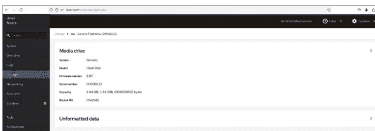

有了显示的存储设备信息，你可以重新格式化整个设备（创建分区表），或者在设备有可用空间的情况下，添加新分区（创建分区）。图 12.4 显示了格式化驱动器时出现的窗口示例。

## 图 12.4

格式化新的存储设备。

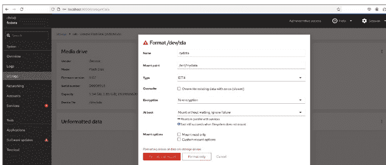

## 第 12 章：管理磁盘和文件系统

由于这是一个 USB 闪盘，我只需格式化磁盘。然而，我填写该页面时就像它是一个我想要格式化并挂载到文件系统的永久磁盘一样。名称 (`mydata`) 是分配给分区的标签。挂载点是 `/mnt/mydata`。我选择了 EXT4 文件系统。对于关键分区，选择“不等待挂载”并“忽略失败”是一个好主意。如果我在 USB 闪盘上这样做，并在一段时间后将其移除，系统仍然能够重启。

在选择“格式化并挂载”后，磁盘将被格式化并挂载到 `/mnt/mydata`。请记住，此信息会被添加到 `/etc/fstab` 文件中，因此每次系统启动时它都会挂载。

## 总结

管理文件系统是管理 Linux 系统的关键部分。使用 `parted` 和 `fdisk` 等命令，你可以查看和更改磁盘分区。可以使用 `mkfs` 命令向分区中添加文件系统。之后，可以使用 `mount` 和 `umount` 命令分别对文件系统进行挂载和卸载。

逻辑卷管理器（LVM）为管理磁盘分区提供更强大、更灵活的方法。通过 LVM，你可以创建存储池并管理卷组，这允许你扩展和收缩逻辑卷，并通过添加更多物理卷来扩展卷组的大小。

为了以更直观的方式管理存储设备，Cockpit 提供了一个基于 Web 的界面，用于查看和配置你 Linux 上的存储。通过 Web UI，你可以看到本地存储和网络存储，还可以重新格式化磁盘并修改磁盘分区。

在本书的现在你已经掌握了成为系统管理员的大部分基础知识，第 13 章“理解服务器管理”引入了扩展这些技能以管理网络服务器的概念。该章的主题包括如何安装、管理和保护服务器的信息。

## 练习

使用这些练习题来测试你对创建磁盘分区、逻辑卷管理器以及处理文件系统的知识。你需要一个至少 1GB 的 USB 闪盘，你可以为了这些练习将其擦除。

这些任务假设你正在运行 Fedora 或红帽企业 Linux（Red Hat Enterprise Linux）系统（尽管某些任务在其他 Linux 系统上同样适用）。如果你遇到困难，附录 B 中提供了任务的解答（在 Linux 中，通常有多种完成任务的方法）。

1. 以 root 身份运行命令，在终端中观察新数据进入时的系统日志，并插入 USB 闪盘。确定 USB 驱动器的设备名称。
2. 运行命令列出 USB 闪盘的分区表。
3. 删除 USB 闪盘上的所有分区，保存更改，并确保更改已同时应用于磁盘分区表和 Linux 内核中。
4. 为 USB 闪盘添加三个分区：100MB Linux 分区、200MB 交换分区和 500MB LVM 分区。保存更改。
5. 在 Linux 分区上建立 ext4 文件系统。
6. 创建名为 `/mnt/mypart` 的挂载点并将 Linux 分区挂载到其。
7. 启用交换分区并开启它，使额外的交换空间立即可用。
8. 从 LVM 分区创建一个名为 `abc` 的卷组，从该组创建一个名为 `data` 的 200MB 逻辑卷，添加一个 VFAT 分区，然后将逻辑卷临时挂载到名为 `/mnt/test` 的新目录中。检查是否已成功挂载。
9. 将逻辑卷从 200MB 扩展到 300MB。
10. 执行必要操作以从计算机上安全移除 USB 闪盘：卸载 Linux 分区，关闭交换分区，卸载逻辑卷并从 USB 闪盘上删除卷组。

# 第四部分：成为 Linux 服务器管理员

在本部分中

- 第 13 章：理解服务器管理
- 第 14 章：网络管理
- 第 15 章：启动和停止服务
- 第 16 章：配置打印服务器
- 第 17 章：配置 Web 服务器
- 第 18 章：配置 FTP 服务器
- 第 19 章：配置 Windows 文件共享 (Samba) 服务器
- 第 20 章：配置 NFS 文件服务器
- 第 21 章：Linux 故障排除
- 第 22 章：配置 Web 服务器

## 第 13 章：理解服务器管理

### 在本部分中

- 网络管理
- 启动和停止服务
- 配置打印服务器
- 配置 Web 服务器
- 配置 FTP 服务器
- 配置 Windows 文件共享 (Samba) 服务器
- 配置 NFS 文件服务器
- Linux 故障排除
- 配置 Web 服务器

**严谨的安全**：为了有用，服务器必须能够接受请求。与简单关闭所有端口的桌面系统不同，服务器必须通过允许某些访问来让自己变得脆弱。这就是为什么服务器管理至关重要，需要打开需要的端口并锁定不需要的端口。

**持续监控**：虽然你通常在不在用时关闭笔记本电脑或桌面系统，但服务器是 24/7 每年 365 天运行。由于你不想切换到每台服务器进行个人监控，你可以配置工具来监控每台服务器、收集消息并将它们转发到电子邮件帐户或显示为警报。

## 开始服务器管理

无论你是在安装文件服务器、Web 服务器还是 Linux 系统提供的任何其他服务器设施，让服务器运行所需的许多步骤都是相同的。在随后的章节中，我将描述特定的服务器及其差异。在每个与服务器相关的章节中，你将通过相同的步骤来启动并使用该服务器。

### 第一步：安装服务器

尽管大多数软件在典型的 Linux 系统上没有预安装，但任何通用 Linux 系统都提供了提供各种主要类型服务器的软件包。

有时，与特定类型服务器相关的多个软件包被汇集在包组（Fedora 和 RHEL）或任务（Ubuntu 和 Debian）中。在其他时候，你只需要单独安装你需要的服务器软件包。

**打印服务器**：通用 UNIX 打印服务（`cups` 包）最用于在 Linux 系统上提供服务器功能。提供图形管理工具的软件包（`system-config-printer`）和打印机驱动程序（`foomatic`、`hpijs` 等其他）也可以在安装打印组时对 CUPS 进行管理。（参见第 16 章，“配置打印服务器”。）

**Web 服务器**：Apache (`httpd` 软件包) Web 服务器是用于提供网页（HTTP 内容）最广泛的软件。相关软件包包含了帮助提供各种类型内容的模块（Perl、Python、PHP 和 SSL 连接）。同样，还有相关的文档包 (`httpd-manual`)、监控 Web 数据的工具 (`webizer`)以及提供 Web 代理服务的工具 (`squid`)。你可以通过在 Fedora 或 RHEL 上安装 `web-server` 组来获取这些软件包。（参见第 17 章，“配置 Web 服务器”。）

**FTP 服务器**：Fedora 和 RHEL 使用了非常安全 FTP（Very Secure FTP，`vsftpd` 软件包）。其他 FTP 服务器软件包包括 `proftpd` 和 `ftpd`。你可以安装 `ftp-server` 组来获取这些软件包。（参见第 18 章，“配置 FTP 服务器”。）

**Windows 文件服务器**：Samba (`samba` 软件包) 允许 Linux 系统充当 Windows 文件打印服务器。安装 `smb-server` 组以获取这些软件包。（参见第 19 章，“配置 Windows 共享 [Samba 服务器]”。）

**NFS 文件服务器**：网络文件系统 (NFS) 是 Linux 和 UNIX 标准功能，用于通过网络向其他系统提供共享目录。`nfs-utils` 软件包提供了 NFS 服务和相关命令。没有用于安装 NFS 的组。（参见第 20 章，“配置 NFS 文件服务器”。）

**邮件服务器**：这些类型的软件包允许你配置邮件服务器，有时也称为邮件传输代理 (MTA)。你有多种服务器选择，包括 `sendmail`、`postfix`（Fedora 和 RHEL 的默认选项）和 `exim`。相关软件包如 `dovecot` 允许邮件服务器向客户端投递电子邮件。安装 `mail-server` 组获取邮件服务器相关的软件包。

**目录服务器**：此类别的软件包提供远程和本地认证服务。这些包括 kerberos (`krb5-server`)、LDAP (`ldap-servers`) 和 NIS (`ypserv`)。使用 `directory-server` 组安装这些软件包。

**DNS 服务器**：伯克利域名服务 (`bind`、`bind-chroot`) 提供了配置解析器将主机名解析为 IP 地址所需的软件。可选软件包包括 `dnsperf`（用于基准测试）和 `nsd`（用于安装 Nine 名称服务器守护进程）。`dns-server` 可以安装这些软件包。

**网络时间协议服务器**：`ntpd` 或 `chronyd` 提供了一种服务，允许你将系统时钟与公共或私有 NTP 服务器的时间同步。没有用于安装 NTP 服务器的组。

**SQL 服务器**：PostgreSQL (`postgresql`、`postgres-server` 软件包) 服务是一个对象关系数据库管理系统。相关软件包提供了 PostgreSQL 文档和相关工具。MySQL (`mysql`、`mysql-server` 软件包) 服务是另一个流行的 SQL 数据库服务器。

由社区开发的 MySQL MariaDB 分支在许多 Linux 发行版中取代了 MySQL。PostgreSQL 和 MariaDB 数据库分别可以通过 `sql-server` 和 `mysql` 组安装。

在 Fedora 或 RHEL 中安装服务器软件包组，你可以使用 `dnf` 命令。例如：

```bash
$ sudo dnf group list --hidden | grep -i server

mail-server Mail Server no

network-server Network Servers no

smb-server Windows File Server no

sql-server PostgreSQL Database no

directory-server Directory Server yes

dns-server DNS Name Server no

ftp-server FTP Server yes

$ sudo dnf group install install-web-server
```


| Package | Arch | Version | Repository | Size |
| :--- | :--- | :--- | :--- | :--- |
| 安装组/模块软件包: | | | | |
| php | x86_64 | 8.3.21-fc41 | updates | 0.0 B |
| 安装弱依赖项: | | | | |
| php-cli | x86_64 | 8.3.21-fc41 | updates | 16.2 MiB |
| php-fpm | x86_64 | 8.3.21-fc41 | updates | 8.2 MiB |

正在安装：基础 Web 服务器

这将安装 `web-server` 组所需的和依赖的软件包。要安装该组的可选软件包，请添加 `--with-optional` 选项。

## 2：配置服务器

大多数服务器软件包在安装时带有默认配置，该配置更倾向于安全性而非立即完全使用。以下在你开始配置服务器时需要考虑的几点。

### 使用配置文件

传统上，Linux 服务器通过编辑 `/etc` 目录（或子目录）中的纯文本文件进行配置。通常，有一个主配置文件；有时，有一个相关的配置文件目录，其中以 `.conf` 结尾的文件可以引入主配置文件。

`httpd` 软件包（Apache Web 服务器）是一个服务器软件包的示例，它有一个主配置目录，其他配置文件可以丢放在其中并被服务包含。Fedora 和 RHEL 中的主配置文件是 `/etc/httpd/conf/httpd.conf`。配置目录是 `/etc/httpd/conf.d/`。

## 第 13 章：理解服务器管理

在安装 `httpd` 和相关软件包后，你将在 `/etc/httpd/conf.d/` 目录下看到由不同软件包放置在那里的文件：`mod_ssl`、`mod_perl` 等。这是服务的插件包能够在 `httpd` 服务器中启用其配置信息的方法，而无需由软件包尝试运行它。

使用配置文件的缺点是，如果你出错，无法获得即时反馈。但是，你可以通过重启服务并检查日志来测试你的配置。

## 步骤 3：启动服务器

大多数服务器软件包在安装时带有默认配置，该配置更倾向于安全性而非立即完全使用。以下在你开始配置服务器时需要考虑的几点。

无论使用哪种设施，有两种主要的管理服务的设施：`systemd`（现使用）和 SystemV 脚本（Red Hat Enterprise 6 使用）。

## 第 13 章：理解服务器管理

并不是所有服务都作为守护进程持续运行。一些旧版服务器使用 `xinetd` 按需运行。其他服务则仅在启动时运行一次。还有一些服务仅在 `cron` 守护进程检测到需要时启动设定的次数。近年来，RHEL 和 Fedora 中的 `telnet` 和 `tftp` 等 `xinetd` 服务已转换为 `systemd` 服务。包括 `cockpit` 在内的许多服务使用 `systemd sockets` 来实现相同的结果。`xinetd` 软件包已从 Fedora 版本中移除，但在 Ubuntu 中仍然可用。

## 步骤 4：加固服务器

开放系统以允许远程用户通过网络访问是一个需要审慎考虑的决定。全球的黑客都会运行程序扫描数据或进行处理。幸运的是，你可以在 Linux 系统上采取某些措施来保护服务器免受滥用。接下来的章节描述了一些常用的安全技术，其他主题将在第五部分“学习安全”中介绍。

### 密码保护

良好的密码和密码策略是保护 Linux 系统的第一防线。如果有人可以通过密码登录你的服务器，一种良好的技术是不允许 `root` 登录，并要求用户作为普通用户登录然后使用 `sudo`。你还可以使用可插拔认证模块（PAM）来调整在拦截访问之前的允许失败登录次数。PAM 还包含了锁定 Linux 服务器的功能。有关 PAM 的描述，请参阅第 23 章“理解 Linux 安全”。

当然，你可以通过要求密钥验证来跳过密码。要使用该类型的验证，你必须确保访问你服务器的用户都已将其公钥复制到服务器（例如使用 `ssh-copy-id`）。然后他们就可以使用 `ssh`、`scp` 或相关命令访问，而无需输入密码。更多信息请参阅本章稍后的“基于密钥的认证”。

### 防火墙

旧的 `iptables` 服务可以跟踪并响应进入你计算机网络接口的每个数据包。使用 `iptables`，你可以丢弃或拒绝除已启用服务之外的所有请求数据包。此外，你可以告诉 `iptables` 允许来自某些地址的请求，或不允许来自其他地址的请求。

`firewalld`（用于 Fedora 和 RHEL）和 `ufw` 功能取代了 `iptables`，为 Linux 防火墙规则增加了一层功能。通过 `firewalld`，你不仅可以将防火墙规则插入内核，还可以按区域组织防火墙规则，并动态更改防火墙规则以响应不同的事件。对于 Ubuntu，`ufw` 提供了一个简单的接口来允许和拒绝对本地系统端口的访问。在每个服务器章节中，我都描述了需要开放哪些端口以允许访问服务。关于 `iptables` 和防火墙如何工作的描述包含在第 25 章“网络中的 Linux 安全”。

### SELinux

Fedora、Red Hat Enterprise 以及其他 Linux 发行版都带有安全增强型 Linux（SELinux）功能，并处于强制（Enforcing）模式。虽然默认模式对你在 Linux 桌面中运行的大多数应用程序影响不大，但它对大多数服务有重大影响。

SELinux 的主要功能是保护你的 Linux 系统内容免受系统中运行进程的影响。换句话说，SELinux 让 Web 服务器、FTP 服务器、Samba 或 DNS 服务器只能访问系统上受限的文件（由文件上下文定义），并仅允许受限的功能（如布尔值和限制端口访问）。有关如何使用 SELinux 的详情位于第 24 章“使用 SELinux 增强 Linux 安全”。

### 配置文件中的安全设置

大多数服务的配置中包含你可以设置以进一步加固服务的值。例如，对于文件服务器和 Web 服务器，你可以根据用户名、主机名、客户端 IP 地址或其他属性限制对某些文件或数据的访问。

## 步骤 5：监控服务器

因为你无法时刻监控每项服务，所以你需要部署工具来监控服务器，并以便你轻松发现何时需要关注的问题。接下来的章节描述了你可以用于监控服务器的一些工具。

### 配置日志

使用 `rsyslog` 服务（`rsyslog` 守护进程），你可以将许多不同服务的关键信息和错误状况收集到日志文件中。在 Ubuntu、RHEL 和 Fedora 中，来自各种服务的日志消息默认定向到 `/var/log` 目录下的日志文件中。为了增加安全性和方便，日志消息也可以重定向到中央服务器，为一组系统提供查看和管理日志的单一位置，同时保护这些消息免受破解系统的攻击。

有多个不同的软件包可以配合 `rsyslog` 工作并管理日志消息。`logwatch` 功能每天晚上扫描你的日志文件，并将从文件中收集的关键信息发送到你指定的电子邮箱账户。`logrotate` 功能在日志达到特定大小或自上次备份起经过设定时间后，将日志备份到压缩存档中。配置和管理系统日志的功能描述在本章稍后的“配置系统日志”章节中。

### 运行系统活动报告

`sar` 工具（`sysstat` 的一部分）可以帮助你监控系统活动。它可以收集并报告 CPU 使用率、内存使用、磁盘 I/O 和网络流量。

### 使用 Cockpit 观察活动

Cockpit 是一个用于 Linux 服务器的 Web 图形界面。通过 Cockpit，你可以通过浏览器监控系统资源、管理服务并执行任务。图 13.1 显示了 Cockpit 控制台示例。

## 第四部分：成为服务器管理员

### 保持软件更新

随着安全漏洞被发现和修补，你必须确保服务器上安装了更新后的软件包。再次，对于任务关键型服务器，最安全且最高效的方法是使用检查更新的工具。对于 RHEL 或 Fedora，使用 `dnf update`。对于你的 Ubuntu 系统，运行 `sudo apt update; sudo apt-upgrade`。

## 第 13 章：理解服务器管理

安全 Shell（SSH）工具的身份验证过程以及后续的所有通信都是加密的。`telnet` 和旧的“r”命令会将密码等所有信息暴露给网络嗅探者。今天，`telnet` 和类似命令应仅用于测试远程端口的访问情况、提供 PXE 启动等公共服务，以及执行不会暴露你私有数据的任务。

> 注意：有关加密技术的更深入讨论，请参阅第 23 章“理解高级 Linux 安全”。

大多数 Linux 系统都包含 SSH 客户端，许多系统还包含 SSH 服务器。例如，如果你正在使用 Ubuntu、Fedora 或 RHEL 发行版，包含 `ssh` 工具的客户端和安全软件包是 `openssh`、`openssh-clients` 和 `openssh-server`。它们在 Fedora 或 RHEL 中的列表如下：

```bash
# dnf list --installed | grep openssh
openssh.x86_64 9.9p1-4.fc41 updates
openssh-clients.x86_64 9.9p1-4.fc41 updates
openssh-server.x86_64 9.9p1-4.fc41 updates
```

在 Ubuntu 上，默认仅安装 `openssh-client` 软件包。它包含了 `openssh` 软件包的功能。如果你需要安装服务器，请使用 `sudo apt-get install openssh-server` 命令。

```bash
$ sudo dpkg --list | grep openssh
ii openssh-client 9.9p1-3ubuntu.11 amd64 secure shell (SSH) client, for secure access to remote machines
ii openssh-server 9.9p1-3ubuntu.11 amd64 secure shell (SSH) server, for secure access from remote machines
ii openssh-sftp-server 9.9p1-3ubuntu.11 amd64 secure shell (SSH) sftp server access from remote machines
```

```bash
$ sudo apt-get install openssh-server
```

### 启动 openssh-server 守护进程

预装了 `openssh-server` 软件包的 Linux 系统有时没有配置自动启动。请检查你的 `openssh-server` 状态，在 Ubuntu、RHEL 和 Fedora 上输入以下命令：

```bash
$ sudo systemctl status ssh.service
$ sudo systemctl status ssh.service
```

为 RHEL 或 Fedora 启动并启用服务，输入：

```bash
$ sudo systemctl start ssh.service
$ sudo systemctl enable openssh.service
```

## 第四部分：成为 Linux 服务器管理员

为 Ubuntu 启动并启用服务，输入：

```bash
$ sudo systemctl start ssh.service
$ sudo systemctl enable ssh.service
```

修改你的防火墙设置，允许 `ssh` 守护进程客户端访问 22 端口（防火墙内容见第 25 章“网络上的 Linux 安全”）。在服务运行且防火墙配置妥当后，你应该能够使用 `ssh` 命令通过 `ssh` 服务器访问你的系统。

对 `ssh_config` 文件的任何进一步配置都在 `/etc/ssh/ssh_config` 文件中处理。至少要检查 `PermitRootLogin` 设置为禁止（默认值）还是否。前者可以防止他人使用密码远程登录（但允许基于密钥的验证），后者则阻止任何人以 `root` 身份远程登录。

修改 `ssh_config` 文件后，重启 `ssh` 服务。如果你将 `PermitRootLogin` 设置为 `no` 并使用 `ssh` 从远程客户端登录该系统，你必须以远程用户身份登录，然后使用 `su` 或 `sudo` 变为 `root` 用户。

### 使用 SSH 客户端工具

为了利用 SSH 服务，创建了许多访问 Linux 工具工具常用的是 `ssh` 命令，它可以用于远程登录、远程执行和其他任务。`scp` 和 `rsync` 等命令可以在 SSH 客户端和服务器系统之间一次复制一个或多个文件。`sftp` 命令提供了一个类似 FTP 的接口，用于遍历远程文件系统并在系统之间交互地获取和放置文件。

在大多数情况下，所有与 SSH 相关的工具都使用 Linux 用户名和密码进行验证，且均通过加密连接完成。SSH 还支持基于密钥的验证，用于配置客户端与 SSH 服务器之间基于密钥以及可能的无密码验证，详见本章后面的“使用基于密钥（无密码）的验证部分”。

### 使用 ssh 进行远程登录

从另一台 Linux 计算机使用 `ssh` 命令测试你是否登录了运行 `ssh` 服务的 Linux 系统。`ssh` 命令是你用于访问正在配置的服务器上的 shell 的工具。

尝试从另一个 Linux 系统使用 `ssh` 命令登录你的 Linux 服务器。（如果你没有另一个 Linux 系统，可以通过输入 `localhost` 代替 IP 地址并以本地用户登录来模拟。）以下是远程登录到 10.140.67.23 上 `johndoe` 账户的示例：

```bash
$ ssh johndoe@10.140.67.23
The authenticity of host '10.140.67.23' (10.140.67.23) can't be established.
RSA key fingerprint is a4:28:03:85:96:d0:fa:99:15:ed:fb:b0:67:55:89
Are sure you want to continue connecting (yes/no)? yes
Warning: Permanently added '10.140.67.23' to the list '/home/johndoe/.ssh/known_hosts'.
```

```bash
$ xterm &
$ xeyes &
$ exit
^C
```

完成图形化应用程序的使用后，请像往常一样关闭它们。然后如上一个示例所示，输入 `exit`（可能需要 `Ctrl-C`），以退出远程 shell 并返回本地 shell。

### 使用 scp 和 rsync 在系统之间复制文件

`scp` 命令与旧的 UNIX `rpc` 命令类似，用于在 Linux 系统之间复制文件，不同之处在于所有通信都经过了加密。文件可以从远程系统复制到本地系统，反之亦然。如果你需要，还可以通过目录结构递归复制文件。

以下是使用 `scp` 命令以用户 `johndoe` 将本地系统的 `/etc/services` 文件复制到远程计算机的示例：

```bash
$ scp /etc/services johndoe@10.140.67.23:/tmp
johndoe@10.140.67.23's password: ************
| 100% | *********** | 153 | 0:00 |
```

在这里我输入了 `johndoe` 的密码。密码接受后，文件被成功复制到远程系统。

你可以使用 `-r` 选项通过 `scp` 进行递归操作。向 `scp` 命令传递一个目录名称而不是文件，文件系统中的所有文件和目录都将复制到另一个系统。

```bash
$ scp -r johndoe@10.140.67.23:/usr/share/man/man1/ /tmp
johndoe@10.140.67.23's password: ************
volume1.1.gz 100% 543KB/s 00:00
mtools.1.gz 100% 678KB/s 00:00
roget.1.gz 100% 2.4KB/s 00:00
```

只要用户 `johndoe` 拥有访问远程系统文件和目录的权限，并且本地用户可以复制目标目录（在这种情况下都是如此），`/usr/share/man/man1` 的目录结构就会复制到 `/tmp` 目录。

`scp` 命令可用于通过网络备份文件和目录。然而，如果你将 `scp` 与 `rsync` 命令相比，你会发现 `rsync`（通过 SSH 连接工作）是一个更好的备份工具。如果你只有一个可访问的 Linux 系统，请尝试运行之前显示的 `scp` 命令，使用 `localhost` 代替 IP 地址来复制 `man1` 目录。在接收文件的系统上输入以下内容：

```bash
$ ls -1 /usr/share/man/man1/awk.* /tmp/man1/awk.1
-rw-r---- 1 chris 19611 May 26 13:48 /tmp/man1/awk.1.gz
```

## 第四部分：成为一名 Linux 服务器管理员

```bash
lrwxr-xr-x 1 root       26 Aug 23 2023 /usr/share/man/man1/awk.1.gz -> /etc/alternatives/awk.1
```

接下来，运 `scp` 命令并再次列出文件：

```bash
$ scp -r johndoe@10.140.67.23:/usr/share/man/man1/ /tmp/
johndoe@10.140.67.23$ password: ************
$ ls -l /usr/share/man/man1/awk.1* /tmp
-rw-r--r-- 1 chris 1961 May 26 14:01 /tmp/man1/awk.1.gz
lrwxr-xr-x 1 root       26 Aug 23 2023 /usr/share/man/man1/
```


awk.1.gz -> /etc/alternatives/awk.1.gz

这些命令的输出告诉了关于 `scp` 工作原理：

- **属性（Attributes）**：在复制文件时，权限或日期戳属性没有被保留。如果你使用 `scp`，且以后需要恢复文件，你可能希望保留文件的权限和时间戳。
- **符号链接（Symbolic links）**：`awk.1.gz` 文件实际上是指向 `/etc/alternatives/awk.1.gz` 文件的符号链接。`scp` 并没有复制链接，而是跟随链接并实际上复制了文件。如果你想恢复此目录，`awk.1.gz` 将会被实际的 `.1.gz` 文件替换，而不是链接。
- **重复复制（Copy repeated unnecessarily）**：如果你观察第二次 **scp 输出**，你会发现所有文件都被再次复制了一遍，尽管目标上已经存在这些文件。相比之下，更新后的修改日期证实了这一点。`rsync` 命令可以判断文件是否已经复制，而不再再次复制该文件。

`rsync` 命令是一个更好的网络备份工具，因为它可以克服 `scp` 的某些缺点。尝试运行 `rsync` 命令来执行与刚才 `scp` 相同的的操作，但带上几个选项：

```bash
$ scp -rf /tmp/man1/
```

```bash
$ rsync -avl johndoe@10.140.67.23:/usr/share/man/man1/ /tmp/

johndoe@10.140.67.23$ password: ************

receiving incremental file list

man/

man1/

awk.1.gz -> /usr/share/man/man1/man1.gz
```

```bash
$ rsync -avl johndoe@10.140.67.23:/usr/share/man/man1/ /tmp/

johndoe@10.140.67.23$ password: ************

receiving incremental file list

sent 25 bytes received 63,502 bytes 127,054 bytes/sec

total size is 11,544 speedup is 181.72
```

```bash
$ ls -l /usr/share/man/man1/awk.1* /tmp/awk*

lrwxrwxrwx 1 johndoe 9 Jul 17 2024 /tmp/man1/awk.1.gz -> /etc/alternatives/awk.1.gz

lrwxrwxrwx 1 root 26 Aug 23 2023 /usr/share/man/man1/awk.1.gz -> /etc/alternatives/awk.1.gz
```

在删除 `/tmp/man1` 目录后，使用 `rsync` 命令复制 `/tmp/man1` 目录中的所有文件，使用 `-a`（归档）、`-v`（详细）和 `-l`（复制符号链接），立即运行 `rsync` 命令并发现什么都没有发生。`rsync` 命令知道文件已经在那里，所以它不再复制它们。对于只有几兆字节变化的 GB 级文件，这可以节省带宽。

此外从输出中可以注意到，`awk.1.gz` 文件的符号链接被保留并具有日期/时间戳。如果你需要恢复这些文件，可以将它们原样放回。这种 `rsync` 的用法适用于备份。但如果你想镜像两个目录，让两台机器的内容完全一致？以下命令说明如何在两台机器上创建镜像。首先，在远程系统上，将新文件复制到目标目录：

```bash
# cp /etc/services /usr/share/man/man1
```

接下来，在本地系统中，运行 `rsync` 来复制任何新文件（在本例中，只有新文件 `services`）：

```bash
$ rsync -avl johndoe@10.140.67.23:/usr/share/man/man1 /tmp

johndoe@10.140.67.23's password: ******

receiving incremental file list

man1/

man1/services
```

之后，回到远程系统并删除该文件：

```bash
$ rm /usr/share/man/man1/services
```

现在，在本地系统中再次运行 `rsync`，发现什么都没有发生。此时，远程和本地目录是不同的，因为本地系统有 `services` 文件而远程没有。这对于备份目录是正确的行为（你希望备份以防东西被误删）。然而，如果你想让远程和本地目录镜像，你必须添加 `--delete` 选项。结果是在本地系统中删除 `services` 文件，使远程和本地目录结构保持同步。

```bash
$ rsync -avl /usr/share/man/man1 localhost:/tmp

johndoe@10.140.67.23's password: *******

receiving incremental file list

man1/
```

```bash
$ rsync -avl --delete johndoe@10.140.67.23:/usr/share/man/man1 /tmp

johndoe@10.140.67.23's password: ************

receiving incremental file list

deleting man1/services
```

## 使用 sftp 进行交互式复制

如果你不确定确切想要从远程系统复制什么，可以使用 `sftp` 命令在 SSH 上创建一个交互式的 FTP 风格会话。使用 `sftp`，你可以通过 SSH 连接到远程系统、更改目录、列出目录内容，然后（在获得适当权限的情况下）从服务器获取或放置文件。请记住，尽管名字如此，`sftp` 与 FTP 协议无关，也不使用 FTP 服务器。它只是在客户端和 ssh 守护进程之间使用 FTP 风格的交互。

以下示例显示用户 `johndoe` 连接到 `example.com`：

```bash
$ sftp johndoe@example.com

Connecting to example.com

johndoe@example.com's password: ************

sftp>
```

此时，你可以开始交互式 FTP 会话。你可以使用任何 FTP 客户端对文件使用 `get` 和 `put` 命令，但可以知道你正在加密且安全的连接上工作。FTP 协议以明文传输用户名、密码和数据，如果可能，通过 SSH 使用 `sftp` 是允许用户从系统交互式复制文件的更好替代方案。

## 使用基于密钥（无密码）认证

如果你在一天中多次使用 SSH 工具连接到相同的系统，可能会发现反复输入密码很不方便。与其基于密码的认证，SSH 允许你设置基于密钥的认证来代替。其工作原理如下：

- 你创建一个公钥和一个私钥。
- 你保护好私钥，但将公钥复制到想要进行密钥认证的远程主机的用户账户上。
- 将密钥复制到正确位置后，使用任何 SSH 工具连接到远程主机上的用户账户，但它不再向你询问密码，而是 SSH 服务提供公钥，而私钥在两个密钥匹配时允许你访问。

## 第 13 章：理解服务器管理

以下演示了名为 chris 的本地用户如何为 IP 地址为 10.140.67.23 的远程用户 johdoe 设置基于密钥的认证。如果你没有 Linux 系统，可以在本地系统上通过两个用户账户来模拟这一过程。我首先以本地用户 chris 登录并输入以下命令来生成公钥/私钥对：

```bash
$ ssh-keygen

Generating public/private ed25519 key pair.

Enter file to save the key (/home/chris/.ssh/id_ed25519)

ENTER

Enter passphrase for "home/chris/.ssh/id_ed25519" (empty for no passphrase): ENTER

Enter same passphrase again: ENTER

Your identification has been saved in /home/chris/.ssh/id_ed25519

Your public key has been saved in /home/chris/.ssh/id_ed25519.pub

The key fingerprint is:

SHA256:0kWFNa...
```

下一步是将公钥复制到远程用户，以便我可以使用 ssh 使用基于密钥的认证连接到该用户：

```bash
$ ssh-copy-id -i /home/chris/.ssh/id_ed25519.pub johdoe@10.140.67.23
```

当提示时，输入 johdoe 的密码。完成后，属于 chris 的公钥将被复制到远程系统中 johdoe 的 .ssh 目录下的 authorized_keys 文件中。现在，当 chris 尝试作为 johdoe 进行连接时，连接将使用这些密钥进行身份验证。由于私钥没有设置密码语，因此在使用时不需要密码语。使用 `ssh johdoe@10.140.67.23` 登录机器：

```bash
$ johdoe@10.140.67.23

Last login: Sun Jul 27 10:12:22 from 10.140.67.23

johdoe$
```

密钥就绪后，chris 现在可以使用 ssh、rsync 或任何其他启用 SSH 的命令进行基于密钥的认证。例如，使用这些密钥，rsync 命令可以放入 cron 中，每天晚上自动备份 johdoe 的主目录。

## 第四部分：成为 Linux 服务器管理员

想进一步保护你的远程系统吗？在系统设置好密钥后，你可以将 `/etc/ssh/sshd_config` 文件中的 `PasswordAuthentication` 设置更改为 `no`，使远程系统的 ssh 服务不再允许密码认证，如下所示：

```
PasswordAuthentication no
```

然后重启 sshd 服务（systemctl restart sshd）。之后，任何持有有效密钥的人仍会被接受。尝试在没有密钥的情况下登录的人将收到失败消息：Permission denied (publickey)。

## 配置系统日志

掌握了使用 SSH 工具访问远程服务器的知识，你可以登录服务器并设置所有所需的服务以确保其运行良好。系统日志是 Linux 配置的基本服务之一，用于跟踪系统正在发生的情况。rsyslog 服务（rsyslog 守护进程）提供了跟踪 Linux 系统运行软件的日志消息的功能，并将这些消息重定向到日志文件、设备或远程日志主机。rsyslog 配置与其前身 syslog 的配置类似。然而，rsyslog 允许你添加模块并更具体地管理日志消息。

近年来，rsyslog 设施开始利用在 systemd journal 中收集的消息。要直接从 systemd journal 显示日志消息，而不是在 /var/log 目录下的文件中查看，请使用 `journalctl` 命令。

## 使用 rsyslog 启用系统日志

/var/log 目录中的大多数文件都由 rsyslog 服务重定向的日志消息填充。rsyslog 守护进程是系统日志守护进程。它接受来自各种程序的日志消息并将其写入适当的文件。这比让每个程序直接写入自己的日志文件要好，因为这让你能够集中管理处理日志文件的方式。

可以配置 rsyslog 在日志文件中记录不同层级的详细信息。可以告诉它忽略除最关键消息以外的所有消息，也可以让它记录每处细节。

rsyslog 守护进程甚至可以接受来自网络上其他计算机的消息。这种远程日志功能特别方便，因为能够对网络中许多系统的日志文件进行集中管理和审查。这种做法还有一个重大的安全益处。

## 第 13 章：理解服务器管理

通过远程日志，如果你网络上的某个系统被破解，破解者无法删除或修改日志文件，因为这些文件存储在另一台计算机上。然而，需要注意的是，日志消息默认情况下不是加密的（尽管可以加密）。任何对你本地网络的窃听都可以在消息从一台机器传输到另一台机器时监听。此外，破解者可能无法更改日志条目，这影响了系统不应信任任何新日志消息。

运行一个专门的日志主机（loghost，即一台除了记录网络上其他计算机日志消息外没有其他用途的计算机）并不罕见。因为该系统没有运行其他服务，它不太可能被破解。这使得破解者几乎无法完全删除自己的踪迹。

## 理解 rsyslog.conf 文件

`/etc/rsyslog.conf` 文件是 rsyslog 服务的主要配置文件。在 /etc/rsyslog.conf 文件中，以下是 rsyslog 服务加载的模块示例。注意，在 Ubuntu 中，请查看 /etc/rsyslog.d 目录获取此配置信息。每个软件包都将自己的日志信息放在该目录。

```
# Log all kernel messages to the console.

# Logging each else clutters the screen.

kern.* /dev/console

# Log anything (except mail) of level info or higher.

# Don't; log private authentication messages!

*.info:mail.none;authpriv.none;cron.none /var/log/messages

# The authpriv file has restricted access. /var/log/secure

# Log all the messages in one place.

mail. -/var/log/maillog

# Log cron stuff

cron.* /var/log/cron

# Everybody gets emergency messages

*.emerg

# Save news errors of level crit and higher in a special file.

uucp,news.crit /var/log/spool

# Save boot messages also to boot.log

local.* /var/log/boot.log
```

规则分两列输入。左列包含用于匹配消息的标识；右列显示匹配消息的去向。基于设施（mail、cron、kernel 等）和优先级（从 debug、info、notice 开始，直到 crit、alert 和 emerg）匹配的消息之间用点（.）隔开。`mail.info` 将匹配来自邮件服务的所有 info 级及以上的消息。

在在 /etc/rsyslog.conf 中进行的大部分工作涉及修改 RULES 部分。以下是 /etc/rsyslog.conf 文件中 RULES 部分的规则示例。

## 第13 章：理解服务器管理

关于消息的去向，大多数消息被指向 /var/log 目录下的文件。然而，你可以将消息重指向设备（例如 /dev/console）或远程主机（例如 @loghost.example.com）。符号 @ 表示后面的名称是日志主机（loghost）的名称。

默认情况下，日志仅记录在 /var/log 目录下的本地文件中。但是，如果你取消对 Kern.* 条目的注释，就可以轻松将所有级别的内核消息重定向到控制台屏幕上。

提供的示例中的第一个有效条目显示，所有服务（*）的信息级（info-level）消息都匹配该规则，但来自 mail、authpriv 和 cron 服务的消息除外（使用单词 none 将它们排除在外）。所有匹配的消息都重定向到 /var/log/messages 文件。

mail、authpriv（认证消息）和 cron（设施消息）服务各有自己的日志文件，列在右侧的列中。此外，注意 mail 日志显示为 -var/log/maillog，减号表示不同同步 cron 和其他日志文件。要了解这些其他文件的格式，接下来将描述 /var/log/messages 文件。

### 理解消息日志文件

由于有许多程序和服务在 messages 日志文件中记录信息，因此理解此文件的格式非常重要。通过检查此文件，你可以很好地发现系统中正在出现问题的警告。文件中的每一行都是程序或服务记录的单条消息。以下是 Fedora 中审计消息日志文件的片段：

```
May 29 16:35:58 host01 systemd[1]: Started firewalld.service

firewall-cmd -- dynamic firewall daemon.

May 29 16:35:58 audit[1]: SERVICE_START pid=1 uid=0

aud=429496725

ses=429496725 subj_system=u:system:r=init_t:t=s0 msg="unit=firewall

comm="system" exe="/usr/lib/systemd/system" hostname=? addr=

res=success

May 29 16:35:58 host01 systemd[1]: Reached target-pre.target

Preparation for Network.

May 29 16:35:58 host01 systemd[1]: Starting NetworkManager.service

Network Manager...

May 31 11:16:49 host01 audit[3287]: USER_AUTH pid=328 uid=1000

aid=1000

ses=4 subj=PAM:u=unconfined u:unconfined:r=unconfined:t=s0:c0:c.1023

smsg="chris" exe="/usr/bin/
```


hostname=? addr=? terminal=/dev/pts/0 res=failed"

May 31 11:16:51 host01 audit[3287]: USER_CMD pid=328 uid=1000 aud=1000 se4=4 subj=unconfined_u:unconfined_r:unconfined_t:s0-s0:c0.c1023 msg='cwd=/home/chris' cmd=7375202D exe="/usr/bin/sudo" terminal=pts/0 res=failed

/var/log/messages 文件中的默认消息格式分为五个部分。此格式由 /etc/rsyslog.conf 中的以下条目定义：

```
module(load="builtin:omfile" Template="RSYLOG_Traditional FileFormat")
```

当你从 /var/log 目录下的文件中查看消息时，从左到右，消息部分为：

- 记录消息的日期和时间
- 消息来源计算机的名称
- 消息所属的程序或服务名称
- 发送消息的程序的进程号（位于方括号内）
- 实际的文本消息

再次查看前面的文件片段。它显示了防火墙服务（firewall）的启动，以及网络服务（NetworkManager）。最后两条消息显示 UID 为 1000 的用户 (chris) 尝试使用 sudo 登录 root 用户但失败了。

通过定期查看 messages 和 secure（安全）文件，你可以在破解尝试成功之前捕获它。如果你发现某个服务的连接尝试次数多得离谱，特别是当这些尝试来自来自互联网的系统时，你可能正受到攻击。

### 使用 rsyslogd 设置和使用 localhost

要将计算机的日志重定向到另一台计算机的 rsyslogd，你必须对本地和远程 rsyslog 配置文件 /etc/rsyslog.conf 进行更改。作为 root 用户，用文本编辑器（如 vi）打开 /etc/rsyslog.conf 文件。

#### 客户端侧

要将消息发送到另一台计算机，将日志文件名替换为 @ 符号后跟 localhost 的名称（使用 localhost 而不是 start）。例如，要通过 UDP 协议记录所有级别的消息，请添加此行：

```
*.* @localhost
```

重启 rsyslog 服务：`systemctl restart rsyslog`

现在，消息将使用 UDP 协议发送到在名为 localhost 的计算机上运行的 rsyslogd 服务。如果你愿意，可以简单地复制文件中指示日志消息的每一行，以存储并重定向这些信息到 @localhost。

loghost 这个名称并非随机选择。创建一个这样的主机名并将其作为日志主机的别名是惯例做法。这样，如果你需要将日志主机职责切换到另一台机器，只需要更改 loghost 即可，不需要在每台计算机上重新编辑 rsyslog.conf 文件。

#### 日志主机侧

设置为接收消息的日志主机必须在端口上监听这些消息（514 UDP，尽管也可以配置为接受 514 TCP）。以下是运行 rsyslog 服务的 Linux 主机配置方法：

1. 编辑日志主机上的 rsyslog.conf 文件，取消允许 rsyslog 守护进程监听远程日志的行的注释。
2. 再次编辑日志主机上的 rsyslog.conf（确认）。
3. 重启 rsyslog 服务：`systemctl restart rsyslog`
4. 如果 rsyslog 服务正在运行，你应该能够通过 `ss -tupln | grep 514` 看到 UDP 和 TCP。
5. 一旦客户端开始发送消息，你在模板中设置的新目录将被创建，为每个主机创建一个子目录，并为其添加主机日志文件。

### 使用 logwatch 日志

logwatch 服务运行在大多数使用 rsyslog 进行系统日志记录的 Linux 上。由于系统日志随着时间的推移可能会变得非常大，系统管理员可能无法查看每条消息。要安装 logwatch 工具，请使用以下命令：

```
# dnf install logwatch # Fedora 或 RHEL
# apt-get install logwatch # Ubuntu
```

logwatch 每次收集看起来可能代表问题的消息，将它们放入电子邮件消息中，并发送到管理员选择的任何电子邮件地址。要启用 logwatch，你只需要安装 logwatch 包。

查看 default.logwatch.conf 以进行其他设置更改（例如详细程度或报告的时间范围）。按所述在 /etc/logwatch/conf/logwatch.conf 中添加你的内容。

## 第 13 章：理解服务器管理

当服务启用时（仅通过安装 logwatch 软件包即可启用），你每晚都会在 root 用户的邮箱中看到一条消息。当你以 root 身份登录时，可以使用旧的 `mail` 命令来查看 root 用户的邮箱：

```
# mail
Hloom Mail version 12.5 7/5/10. Type ? for help.
/var/spool/mail/root*: 2 messages new
>N 1 logwatch@abc.ex Sun Jun 1 04:02 45/664 "Logwatch for abc"
 2 logwatch@abc.ex Mon Jun 2 04:02 45/664 "Logwatch for abc"
& 1
```

在 mail 中，你将看到每天运行一次的 logwatch 邮件（此处是凌晨 4:02）。输入你想查看的消息编号，并使用空格键翻页或按回车逐行查看。完成后输入 x 退出。

你看到的信息包括内核错误、已安装的包、身份验证失败以及故障的服务。系统会报告磁盘空间使用情况，你可以查看存储是否正在填满。通过浏览这些 logwatch 消息，你可以大致判断是否有怀疑的攻击正在进行，或者是否存在重复失败。

## 使用 sar 检查系统资源

系统活动报告器 (sar) 是早期 UNIX 系统中最老的系统监控设施之一——比 Linux 早了几十年。`sar` 命令本身可以持续显示系统活动、按间隔（每秒或每两秒）显示并在屏幕上。它还可以显示早些收集的系统活动数据。

`sar` 命令是 `sysstat` 软件包的一部分（如果你的系统中没有该包，请安装它）。当你安装 sysstat 并启用 sysstat 服务时，系统会立即开始收集活动数据，稍后可以使用 sar 命令的某些选项对数据进行审查。

```
# systemctl enable sysstat
# systemctl start sysstat
```

要读取 `/var/log/sa/sa??` 中的数据，可以使用以下一些 sar 命令：

```
# sar -u | less
Linux 6.15.7-200.fc42.x86_64 (host01) 06/01/2025 _x86_64_ (6 CPU)
23:27:46 LINUX RESTART (1 CPU)
```

## 第四部分：成为 Linux 服务器管理员

| | %user | %nice | %system | %iowait | %steal | %idle |
|---|---|---|---|---|---|---|
| 11:30:05 PM CPU | | 0.00 | 1.81 | 1.44 | 0.28 | 95.57 |
| 11:40:06 PM all | 0.90 | 0.00 | 1.81 | 1.44 | 0.28 | 95.57 |
| Average: all | | 0.90 | 0.00 | 1.81 | 0.28 | 95.57 |

`-u` 选项显示 CPU 使用率。默认情况下，输出从当天午夜开始，显示系统不同部分消耗了多少时间。输出将每 10 分钟显示一次活动，直到到达当前时间。

要查看活动输出，运行 `sar -d` 命令。同样，输出从午夜开始每 10 分钟一个间隔。

```
# sar -d | less
Linux 6.15.7-200.fc42.x86_64 (ansible) 06/01/2025 _x86_64_ (6 CPU)
```

| | dev | bps | rkB/s | wkB/s | areq-sz | aqu-sz | await... |
|---|---|---|---|---|---|---|---|
| 23:27:46 LINUX RESTART (1 CPU) | | | | | | | |
| 11:30:05 PM dev-8 | 49.31 | 5663.94 | 50.30 | 115.89 | 0.03 | 1.00 | |
| 11:40:06 PM dev23 | 48.99 | 5664.09 | 7.38 | 115.78 | 0.05 | 0.98 | |
| 11:40:06 PM dev23-1 | 10.84 | 0.00 | 41.34 | 4.00 | 3.29 | | |
| Average: dev-8 | 49.31 | 5663.94 | 50.38 | 115.89 | 0.03 | 1.00 | |
| Average: dev23 | 48.99 | 5664.09 | 7.38 | 115.78 | 0.05 | 0.98 | |
| Average: dev23-1 | 10.84 | 0.01 | 43.34 | 4.00 | 3.29 | | |

如果你想实时查看 sar 活动，可以通过向命令中添加计数和间隔来实现，如下所示：

```
# sar -n DEV 5
Linux 6.15.7-200.fc42.x86_64 (ansible) 06/01/2025 _x86_64_ (6 CPU)
```

| | Interface | rkpc/s | txpk/s | rkB/s | wkB/s | txmp/s | txcm/s |
|---|---|---|---|---|---|---|---|
| 11:39:16 PM eth | 5.42 | 5.42 | 1.06 | 1.06 | 0.00 | 0.00 |
| 11:39:41 PM lo | 5.42 | 5.42 | 1.06 | 0.00 | 0.00 | |
| 11:39:41 PM en0 | 0.00 | 0.00 | 0.00 | 0.00 | 0.00 | |
| Average: Interface | 7.21 | 7.21 | 1.42 | 1.40 | 0.00 | 0.00 |
| Average: lo | 0.00 | 0.00 | 0.00 | 0.00 | 0.00 | |
| Average: en0 | 0.00 | 0.00 | 0.00 | 0.00 | 0.00 | |
| Average: wlp0 | 4.70 | 4.00 | 4.81 | 0.63 | 0.00 | 0.00 |

使用 `-n DEV` 可以显示网络接口的活动。你可以看到传输了多少数据以及接收了多少 KB 数据。在该示例中，数据每五秒采集一次并重复。参考 `sar`、`sadc`、`sa1` 和 `sa2` 手册页获取有关如何收集和显示 sar 数据的信息。

## 系统空间

虽然 logwatch 可以提供磁盘空间使用的每日快照，但 `df` 和 `du` 命令可以帮助你立即查看可用磁盘空间。以下章节展示了这些命令的示例。

### 使用 df 显示系统空间

你可以使用 `df` 命令显示文件系统的可用空间。要查看 Linux 计算机上所有文件系统的空间，输入 `df` 而不带选项：

| Filesystem | 1k-blocks | Used | Avail | Use% | Mounted on |
|---|---|---|---|---|---|
| /dev/sda3 | 30635460 | 2958356 | 26130408 | 11% | / |
| /dev/sda2 | 46668 | 8340 | 35919 | 19% | /boot |

此示例输出显示了挂载在根分区 (/dev/sda3) 和 /dev/sda2 上的硬盘分区可用空间。磁盘空间以 1KB 块显示。为了产生更符合人类阅读习惯的输出，请使用 `-h` 选项：

```
$ df -h
```

| Filesystem | Size | Used | Avail | Use% | Mounted on |
|---|---|---|---|---|---|
| /dev/sda3 | 29G | 2.9G | 24G | 11% | / |
| /dev/sda2 | 46M | 8.2M | 25M | 19% | /boot |

使用 `df -h` 选项后，输出以更友好的 MB 或 GB 大小出现。你可以启用的其他选项可以：

- 仅打印特定类型的文件系统 (`-t type`)
- 排除特定类型的文件系统 (`-x type`)。例如 `df -x devtmpfs` 可排除临时文件系统（将输出限制为代表存储区域的文件系统）。
- 包含没有空间的文件系统，如 `/proc` 和 `/dev/pts` (`-a`)
- 仅列出已使用的 inode 节点 (`-i`)
- 以特定的块大小显示磁盘空间 (`-block-size=#`)

为了过滤掉 overlay 以及与其他持久存储关联的文件系统，你可以显式请求特定文件系统或要求不显示非持久性文件系统，如下例所示：

```
$ df -h -t ext4 -t vfat -t btrfs -t xfs
$ df -h -x squashfs -x devtmpfs -x overlay -x efivars
```

### 使用 du 检查磁盘占用

要找到特定目录（及其子目录）消耗的磁盘空间，请使用 `du` 命令。在不带选项的情况下，`du` 列出当前目录下的所有目录以及每个目录消耗的空间。最后，`du` 会生成该目录结构内使用的总磁盘空间。

该命令是检查特定用户（`du /home/jake`）或特定文件系统（`du /var`）使用空间的好方法。默认情况下，磁盘空间以 1KB 显示。为了让输出符合习惯（千字节、兆字节和 GB），请使用 `-h` 选项：

```
$ du -h /home/jake
114K /home/jake/stuff
234K /home/jake/httpd
137K /home/jake/uucp
701K /home/jake
1.0M /home/jake
```

输出显示了用户 jake 家目录 (/home/jake) 下每个目录的磁盘空间。磁盘空间以 KB (K)、MB (M) 和 GB (G) 显示。最后一行显示了 /home/jake 使用的总磁盘空间。添加 `-s` 选项可以查看目录及其直接文件和子目录的总量。

这条命令行非常适用于显示我下载到 Downloads 目录的 10 个最大文件，这样就可以通过删除不再需要的文件来节省磁盘空间。

`-xdev` 选项防止搜索所选文件系统以外的系统。这是过滤掉可能从 /proc 文件系统输出的大量垃圾信息的好方法。它还可以防止对大型的远程挂载文件系统进行搜索。

这里是另一个例子，不同于仅仅对所有文件进行排序并列出前 10 个，我们正在查找整个文件系统（/）中大小大于 100 MB 的文件（`-size +100M`）：

```bash
# find / -xdev -size +100M -type f -printf "%t %p\n" | sort -rn > /tmp/size
```


只需通过删除一些不再需要的大文件，就可以节省大量的磁盘空间。在这个示例中，你可以看到 `/tmp/size` 文件中的大文件已按大小进行了排序。

## 企业级环境中的服务器管理

本书涵盖的大部分服务器配置描述了如何手动安装系统或直接在主机计算机上进行操作。对于由几十、数百或数千台计算机组成的现代数据中心来说，逐个设置每台服务器将太低效了。为了让在大规模数据中心设置 Linux 服务器的过程变得高效，可以采取以下某些措施：

**自动化部署** 无需通过手动安装过程来安装系统的方法是使用 `PXE` 启动。通过设置 `PXE` 服务器并通过支持 `PXE` 的网络网卡从网络启动计算机，你只需启动系统即可开始该系统的完整安装。一旦安装完成，系统可以重启并从已安装的系统运行。请参阅第 22 章“配置 `PXE` 服务器”以获取更多信息。

**通用主机系统** 通过使你的主机系统尽可能通用，可以大大简化单独的安装、配置和升级。这可以通过分层实现自动化：通过 `PXE` 启动安装基础系统，通过 `cloud-intent` 等功能进行配置，并且应用程序可以在运行时携带它们自己的依赖项。在应用程序级别，可以通过在虚拟机或容器内运行应用程序来实现。当应用程序运行完毕后，可以将其丢弃，而不会在主机上留下其依赖软件。

## 第四部分：成为 Linux 服务器管理员

**管理系统与工作系统的分离** 与逐个管理主机系统不同，独立的平台可以提供一种管理大量系统的方法。要实现这一点，可以使用 `Kubernetes` 或 `VMware vCenter` 等平台，它们拥有管理节点（某些情况下称为 `控制平面节点`），用于管理运行工作负载的机器（有时称为 `workers` 或简单的 `nodes`）。这种按主机类型划分的任务分离使得将应用程序部署在任何满足应用程序需求（如内存或 `CPU`）的可用工作节点上成为可能。

请记住，理解单个应用程序如何配置以及服务如何运行仍然是这些更高级的数据中心资源管理方法的基础。尽管深入介绍企业部署和监控工具不在本书的范围之内，但请参阅第六部分“参与云计算”，以了解不同的基于 Linux 的云平台如何管理这些问题。

## 总结

虽然 Linux 系统提供了许多类型的服务器，但安装和配置服务器的基本步骤通常是相似的。通常的流程是安装、配置、启动和监控你的服务器。适用于所有服务器的基础任务包括网络工具（特别是 `SSH` 工具），用于用于登录、复制文件或执行远程命令。

由于管理员无法登录并监控所有服务器，因此在管理 Linux 服务器时，收集数据和稍后审查日志数据的时间非常重要。`rsyslog` 功能可以用于本地和远程日志。`sar` 功能可以每隔 10 分钟收集一次实时数据或回放早些收集的数据。`Cockpit` 允许通过 Web 用户界面查看 `CPU`、磁盘和网络活动。要查看磁盘空间，你可以运行 `df` 命令。

本章描述的技能旨在帮助你为未来构建企业级系统管理奠定基础。虽然这些技能有用，但为了同时管理许多 Linux 系统，你需要通过自动部署和监控工具来扩展你的技能，正如本章的云计算部分所描述的那样。

虽然在简单的默认情况下设置你的服务器很容易，但复杂的网络配置需要对网络配置文件及相关工具有如了解。下一章将描述如何在 Linux 中设置和管理网络。

## 练习题

本章的练习涵盖了用于配置和监控你的 Linux 服务器的一些基础工具。和往常一样，你可以通过多种方式完成此处的任务。所以，如果你执行练习的方式与答案所示的不同，请不要担心，只要你得到了结果即可。如果你陷入了困难，任务的解决方案显示在附录 B 中。

某些练习假设你有一个可用的第二个 Linux 系统，你可以登录到该系统并尝试不同的命令。在第二个系统上，你需要确保 `sshd` 服务正在运行、防火墙已打开并且允许 `ssh`。如果你只有一个 Linux 系统，可以创建一个额外的用户，并如本示例所示直接与 `localhost` 通信：

```bash
# useradd joe
# passwd joe
# ssh joe@localhost
```

1. 使用 `ssh` 命令使用你拥有的任何账户登录另一台计算机（或本地计算机）。在提示时输入密码。
2. 使用 `ssh` 命令的远程执行，显示远程 `/etc/release` 文件的内容并显示在本地系统中。
3. 使用 `ssh` 命令将 `X11` 转发到本地系统上的 `xterm` 窗口；在当前目录中创建文件并列出它以使其存在。
4. 递归地将远程系统 `/usr/share/help/es` 目录的所有文件复制到本地系统的 `/tmp` 目录，并将修改时间更新为本地时间。
5. 递归地将远程系统 `/usr/share/zsh` 目录的所有文件复制到本地系统的 `/tmp` 目录，并保持远程文件的修改时间。
6. 创建用于 `SSH` 通信的公/私钥对（密钥无密码），使用 `ssh-copy-id` 将公钥复制到远程用户账户，并使用密钥认证登录该账户无需输入密码。
7. 在 `/etc/rsyslog.conf` 中创建一个条目，将所有身份验证（`authpriv`）级别及以上消息存储到名为 `/var/log/myauth` 的文件中。从一个终端观察数据进入文件的情况，在另一个终端，尝试用任何有效用户和错误密码 `ssh` 到你的本地机器。
8. 使用 `du` 命令确定 `/usr/share` 下最大的目录，按大小从大到小排序，并列出前十目录。
9. 使用 `df` 命令显示连接到本地系统的所有文件系统的已用可用空间，但排除任何 `tmpfs` 或 `devtmpfs` 文件系统。
10. 查找 `/usr` 目录下任何大于 `10MB` 的文件。

## 第 14 章：网络管理

## 本章内容

- 自动将 Linux 连接到网络
- 使用 `NetworkManager` 实现简单的网络连接
- 从命令行配置网络
- 使用网络配置文件进行工作
- 为企业配置路由、`DHCP`、`DNS` 和其他网络基础设施功能

将单台台式系统或笔记本电脑连接到网络（特别是连接到互联网的网络）是如此简单，以至于我推迟了一段时间没有编写关于“网络”的完整章节。如果你正尝试将你的 `Fedora`、`RHEL`、`Ubuntu` 或其他 Linux 桌面系统连接到互联网，根据可用的有线或无线网络接口，你可以尝试以下方法：

**有线网络** 如果你的家里或办公室有有线以太网端口提供通往互联网的路径，且你的计算机也有以太网端口，请使用以太网线连接这两个端口。连接好计算机后，启动并登录。点击桌面上的网络图标，应该显示你已连接到互联网，或者允许你通过单击一下进行连接。

**无线网络** 对于运行 Linux 的计算机，请登录并点击桌面上的网络图标。当你第一次连接到本地无线网络时，从出现的无线网络列表中进行选择。在需要时，根据提示输入所需的密码。每当你的计算机从相同的位置启动时，它会自动连接到该网络。

如果这两种网络连接之一对你有效，且你对 Linux 网络的工作原理暂不感兴趣，那可能就是你需要知道的所有内容。然而，如果你的 Linux 系统没有自动连接到互联网怎么办？如果你想配置桌面连接到工作时的私有网络（如 `VPN`）怎么办？如果你想锁定服务器上的网络设置或将你的 Linux 系统配置为路由器怎么办？

## 第四部分：成为 Linux 服务器管理员

在本章中，与网络相关的主题分为桌面网络、服务器网络和企业计算网络。在这三类 Linux 系统中配置网络的通用方法如下：

**桌面/笔记本电脑网络** 在桌面或笔记本电脑系统上，`NetworkManager` 默认运行以管理网络接口。通过 `NetworkManager`，你可以自动接受连接互联网所需的地址和服务器信息。然而，你也可以手动设置地址信息。你可以配置诸如代理服务器或虚拟私有连接，以便你的桌面分别能够在组织防火墙后工作或通过防火墙进行连接。

**服务器网络** 尽管 `NetworkManager` 最初在桌面和笔记本配置上效果最好，但它在服务器上运行得非常好。配置服务器非常有用的功能，如以太网绑定（`bonding`）和配置别名，可以在 `NetworkManager` 中找到。

**企业网络** 解释如何在大规模企业中配置网络本身就可以写满几本书。然而，为了让你在企业环境中使用 Linux 时领先，我将讨论基础网络技术，例如 `DHCP` 和 `DNS` 服务器，这些技术使得桌面系统能够自动连接互联网，并根据名称而非仅根据 `IP` 地址查找系统。

## 为桌面配置网络

无论你是通过 Linux、Windows、智能手机还是任何其他支持网络的设备连接到互联网，某些项必须就绪连接才能正常工作。计算机必须拥有网络接口（有线或无线）、`IP` 地址、分配的 `DNS` 服务器以及通往互联网的路由（由网关设备识别）。

在讨论如何更改 Linux 中的网络配置之前，让我们看看 Linux 设置为由 `NetworkManager` 自动连接到互联网时会发生的通用活动：

- **激活网络接口** `NetworkManager` 检查哪些接口（有线或无线）被设置为自动启动。默认情况下，外部接口通常设置为使用 `DHCP` 自动启动，尽管也可以设置静态名称和地址。

- **请求 DHCP 服务** 系统充当 `DHCP` 客户端，在每个已启用的接口上发送 `DHCP` 服务请求。它使用网络接口的 `MAC` 地址在请求中识别自己的身份。

- **获取 DHCP 服务器的响应** `DHCP` 服务器（可能运行在无线路由器、电缆调制解调器或其他提供你所在地通往互联网路由的设备上）会对 `DHCP` 请求做出响应。它向 `DHCP` 客户端提供许多类型的信息。这些信息可能包含以下内容：

  - **IP 地址** `DHCP` 服务器通常拥有一范围互联网协议（`IP`）地址，可以将其分发给网络上请求地址的任何系统。在更安全的环境中，或者当你希望特定机器获得特定地址时，`DHCP` 服务器会为来自特定 `MAC` 地址的请求提供特定的 `IP` 地址。（`MAC` 地址在网络接口卡之间是唯一的，由每张网卡的制造商分配。）

  - **子网掩码** 当 `DHCP` 客户端被分配 `IP` 地址时，伴随的子网掩码告诉客户端 `IP` 地址的哪部分标识子网络，哪部分标识主机。例如，`IP` 地址为 `192.168.0.100` 和子网掩码 `255.255.255.0` 表示网络是 `192.168.0`，主机是 `100`。

  - **租约时间** 当 `IP` 地址动态分配给 `DHCP` 客户端（如 Linux 系统）时，客户端会被分配一个租约时间。客户端不会一直占用，而时间到期时必须释放它，并在网络接口重启时重新请求。通常，`DHCP` 服务器会记住客户端，并在系统启动或请求更新租约时分配相同的地址。`IPv4` 的默认租约时间通常为 `86,400` 秒（24 小时）。更丰富的 `IPv6` 地址分配时间为 `2,592,000` 秒（30 天）。

  - **默认网关** `DHCP` 服务器提供作为其他网络出口的路由器的 `IP` 地址。

  - **DNS 服务器** `DHCP` 服务器提供一个或多个 `DNS` 服务器的 `IP` 地址，用于将主机名转换为 `IP` 地址。

  - **其他信息** `DHCP` 服务器可以配置为客户端提供各种信息。例如，它可以提供 `NTP` 服务器（用于同步时间）、字体服务器（用于显示）、`IRC` 服务器（用于聊天）或打印服务器（用于指定打印机）。

- **更新本地网络设置** 从 `DHCP` 服务器接收到设置后，这些设置将相应地在本地系统中实施。例如，`IP` 地址设置在网络接口上，`DNS` 条目添加到 `/etc/resolv.conf`。

上述的步骤通常不需要你做任何事情，只需开启 Linux 系统并登录。现在，假设你想验证你的网络接口或更改某些设置。你可以使用后续章节中的工具来实现。

### 检查网络接口

在 Linux 中既有图形界面和命令行工具可以查看网络接口信息。从桌面开始，`NetworkManager` 工具和 `Cockpit` Web 用户界面是很好的起点。

### 从 GNOME 设置检查网络

检查网络接口基本设置的最简单方法是打开桌面右上角的下拉菜单，选择按钮旁边的箭头，然后选择“所有网络”。图 14.1 显示了 Ubuntu GNOME 桌面上活跃网络的设置。

**图 14.1** 使用 GNOME 设置检查 WIFI 接口。

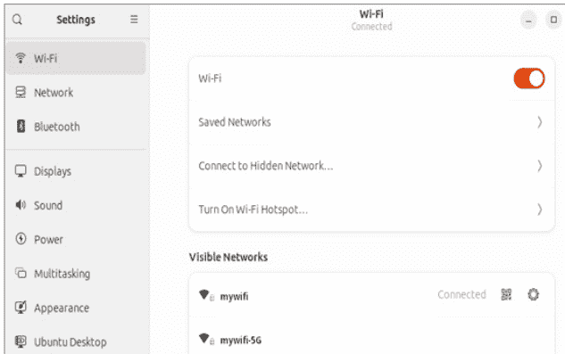

如图 14.1 所示，接口分配了 `IPv4` 和 `IPv6` 地址。`IP` 地址 `192.168.1.1` 提供了 `DNS` 服务和通往外部网络的默认路由。

要查看更多关于你的 Linux 系统如何配置的信息，点击窗口顶部的标签页。例如，图 14.2 显示了“安全”标签页，你可以在此处选择连接网络的安全类型并设置连接该网络所需的密码。

**图 14.2** 使用 GNOME 设置窗口查看网络安全设置。

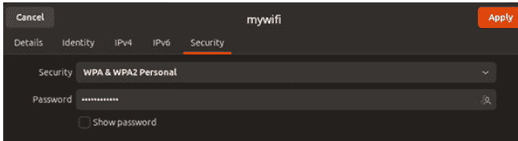

### 通过 Cockpit 检查网络

只要你启用了 `Cockpit`，就可以通过网络浏览器查看并更改网络接口的信息。在本地系统上，你打开 `https://localhost:9090/network` 即可直接进入本地系统的 `Cockpit` 网络页面。图 14.3 显示了该示例。

**图 14.3** 从 Cockpit 查看并更改网络设置。

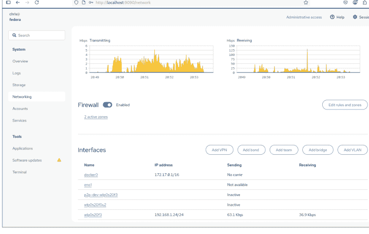

在 `Cockpit` 网络页面，你可以一次性查看所有网络接口的信息。在本例中，激活的网络接口包括 `docker0`（允许容器与本地计算机及外部进行通信的网络桥接器）和 `wlp0sf3`（激活的无线接口）。另一个关注的接口是 `enol1`，它是一个未激活的有线接口。

在 `Cockpit` 网络页面的顶部，你可以看到本地系统发送和接收的数据。选择一个网络接口即可显示该特定接口活动的页面。

点击“防火墙编辑规则和区域”按钮，可以查看系统中允许的服务列表。图 14.4 显示了四个服务的 `UDP` 端口已开放（`DHCPv6`、`Samba Client`、`Multicast DNS` 和 `RPC Bind`）。`DHCPv6` 允许系统从网络获取 `IPv6` 地址，共享文件系统以及各种设备和共享资源。`RPC Bind` 允许你使用 `NFS` 网络文件系统并提供对其他网络服务的访问。

**图 14.4** 通过 Cockpit 从防火墙可访问的服务。

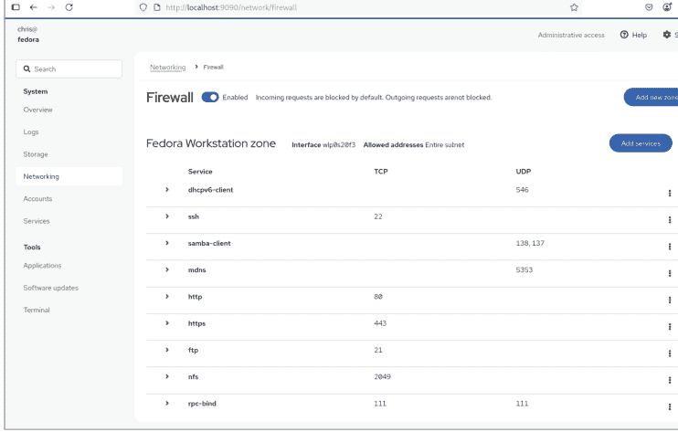

对 `TCP` 服务开放的端口包括用于访问 `Secure Shell`（端口 `22`）、Web 服务器（端口 `80` 和 `443`）、`FTP` 服务器（端口 `21`）、`NFS`（`2049`）以及 `RCP Bind`（端口 `111`）的端口。开启 `ssh` 服务（`TCP` 端口 `22`），运行在本地系统上的 `sshd` 服务即可供远程用户登录你的本地系统。其他端口允许访问运行在本地系统上的其他服务。

端口开放并不一定意味着服务正在运行。然而，如果它们正在运行，计算机的防火墙将允许访问它们。

从 `Cockpit` 网络页面提供的更高级功能允许你向本地网络接口添加 `VPN`、绑定（`bonds`）、团队（`teams`）、桥接（`bridges`）和 `VLAN`。

### 从命令行检查网络

要获取有关网络接口的更详细信息，请尝试运行一些命令。有些命令可以显示关于你的网络接口、路由、主机和网络流量的信息。

#### 查看网络接口

要查看本地系统中每个接口的信息，请执行操作：

```bash
# ip addr show

1: lo: LOOPBACK,UP,LOWER_UP mtu 65536 qdisc noqueue state UNKNOWN group
    default qlen 1000
    link/loopback 00:00:00:00:00:00 brd 00:00:00:00:00:00
    inet 127.0.0.1/8 scope host lo
    valid lft preferred lft forever
    inet6 ::1/128 scope host noprefixroute
    valid lft preferred lft forever

2: en1:<NO-CARRIER,BROADCAST,MULTICAST,UP mtu 1500 qdisc fcq_code state
    DOWN group default qlen 1000
    link/ether 8:b4:a6:93:96 brd ff:ff:ff:ff:ff:ff
    altname en0ps31fe
    55d:a2:f3:c3
    inet 192.168.1/24 brd 192.168.255 scope global dynamic
    noprefixroute wlp0sf3

3: wlp0sf3:<BROADCAST,MULTICAST,UP,LOWER_UP> mtu 1500 qdisc noqueue state
    UP group default qlen 1000
    link/ether 6:58:63:3e:af:87 brd ff:ff:ff:ff:ff:ff permaddr
    54:d5:a2:f3:c3
    inet6 fe80::a4f85:dd2ea:4296/64 scope link noprefixroute
    valid lft preferred lft forever

4: docker0:<NO-CARRIER,BROADCAST,MULTICAST,UP> mtu 1500 qdisc state
    DOWN group default
    link/ether 02:42:d6:9b:d9:a9 brd ff:ff:ff:ff:ff:ff
    inet 172.17.0.1/16 brd 172.17.255.255 scope global
    valid lft preferred lft forever
```


`ip addr show` 命令显示关于你的网络接口的信息。输出的第一行显示了回环接口，用于连接本地系统。IP 地址 127.0.0.1（`/8` 是 CIDR 表示法，表示 127.0.0.1 是主机数）。`-s` 选项显示每个接口的传输和错误统计。在本例中，有线以太网接口（en0）关闭（down），但无线接口（wlp0sf3）已开启（up）。无线接口（wlp0sf3）的 MAC 地址为 06:58:63:3e:af:87，IP (IPv4) 地址 192.168.1.24 已启用。旧版本的 Linux 使用 eth0 和 wlan0 等通用网络接口名称。现在的接口根据在 PCI 总线上的位置命名。例如，网络上的第一个网卡命名为 en1。以前废弃的命令 `ifconfig` 也可以显示接收（RX）和发送（TX）的数据包数量以及丢包情况。

```bash
# ifconfig wlp2s0
wlp2sf0:flags<UP,BROADCAST,RUNNING,MULTICAST> mtu 1500
      inet 192.168.1.83 netmask 255.255.255.0
      broadcast 192.168.1.255
      inet6 fe80::722a:a1b0:b5c4:eca6:790d:6a66 prefixlen 64 scope global
      inet6 fe80:25ff:8219:751b:23e3 prefixlen 64 scope link
      inet6 2600:fe80:722a:a010:489 prefixlen 128 scope global
      eth0:e06:e83:ac:c7 txuelen 1000 (Ethernet)
      RX packets:208402  bytes:25096257  errors 0 dropped 4 overruns 0
      TX packets:113589  bytes:13240384  errors 0 dropped 0 collisions
```

### 与远程系统的连接性

为了确保你可以访问网络上的可用系统，可以使用 `ping` 命令。只要计算机响应 ping 请求，你就可以使用 `ping` 向该系统发送数据包。这是一个示例：

```bash
$ ping host1
PING host1 (192.168.1.15) : 56(84) bytes of data
64 bytes from host1 (192.168.1.15) : icmp_seq=1 ttl=64 time=0.062 ms
64 bytes from host1 (192.168.1.15) : icmp_seq=2 ttl=64 time=0.044 ms

--- host1 ping statistics ---
2 packets transmitted, 2 received, 0% packet loss, time 1822ms
rtt min/avg/max/mdev = 0.044/0.053/0.062/0.009 ms
```

这里的 `ping` 命令持续 ping host1。几次之后，按下 `Ctrl+C` 结束，最后几行显示了多少 ping 请求成功。你可以拥有 IP 地址（在本例中为 192.168.1.15）并使用 `ping 192.168.1.15` 查看你可以访问该系统。然而，使用主机名的好处是你可以知道名称到 IP 地址的转换（由你的 DNS 服务器或本地 hosts 文件完成）运行正常。在本例中，host1 出现在 `/etc/hosts` 文件中。

### 检查路由信息

路由是你可以通过网络接口检查的下一个内容。以下片段显示了如何使用 `ip` 和 `route` 命令进行操作：

```bash
# ip route show
default 192.168.1.1 dev wp0s2f3 proto dhcp src 192.168.1.24 metric 600
172.17.0.0/16 dev docker0 proto kernel
192.168.1.0/24 dev en0 scope link
```

`ip route` 命令示例说明 192.168.1.1 提供了通过 wp0s2f3 网络访问的路由。在 172.17.0/16 网络上运行 Docker 允许本地系统通过 172.17.0.1 地址访问服务。`route` 命令可以提供一些信息：

| 目的 | 网关 | 子网掩码 | 标志 | 标量 | 使用 | 接口 |
| :--- | :--- | :--- | :--- | :--- | :--- | :--- |
| default | _gateway | 0.0.0.0 | UG | 600 | 0 | wp0s2f3 |
| 10.0.0.0 | vpn.example. | 255.255.0.0 | U | 50 | 0 | tun0 |

## 第四部分：成为 Linux 管理员

| 目标 | 网关 | 子网掩码 | 标记 | 标量 | 引用 | 接口 |
| :--- | :--- | :--- | :--- | :--- | :--- | :--- |
| vpn.example.com | | 255.255.255.255 | UG | 600 | 0 | wlp3s |
| 172.17.0.0 | 0.0.0.0 | 255.255.0.0 | U | 0 | | docker0 |
| 192.168.1.0 | * | 255.255.255.0 | U | 600 | 0 | wlp3s |

在上面的路由示例中，有一个无线接口 (wlp3s) 以及一个代表虚拟专用网络 (VPN) 隧道的接口。VPN 提供了一种通过不安全网络（如互联网）进行加密、私密通信的方法。隧道从本地系统通过 wlan0 接口连接到名为 vpn.example.com 的主机（名称部分已被截断）。

所有到 192.168.1.0/24 网络的通信直接通过无线局域网进行。然而，目标为 10.10.13.0/24 和 10.0.0.0/8 网络的数据包将通过隧道接口 (tun0) 直接路由到 VPN 连接另一端的 vpn.example.com 主机。

对于运行在本地系统上网络 172.17.0.0 上的容器 (docker0)，设置了特殊路由。所有其他数据包都通过 192.168.1.0 经默认路由发送。至于输出中的标记，U 表示路由已启用（up），G 标识接口为网关（gateway），H 表示目标是主机（host）（如 VPN 连接所示）。

到为止，我向你展示了离开系统的路由。如果你想从头到尾跟踪到主机的完整路由，可以使用 traceroute 命令（执行 `dnf install traceroute` 或 `apt install netutils-traceroute`）。例如，要跟踪数据包从你的本地系统到 google.com 站的路径，输入以下 traceroute 命令：

```bash
# traceroute google.com
traceroute google.com (74.125.235.136), 30 hops max, 60 bytes pkts
7 rr-70-62-95-197.midsout.bit.rr.com (70.62.95.197)
8 ge-2-1-0.rlghcnop-rttl.southeast.rr.com (24.93.73.62)
9 ae-3-0.cr3a10.tbone.rr.com (66.109.6.8)
10 107.14.19.133 (107.14.19.133) 13662 ms
11 74.125.49.181 (74.125.49.181) 13912 ms
12 209.255.280.92 (209.255.280.92) 61265 ms
13 64.26.95.149 (64.26.95.149) 18308 ms
14 64.26.94.22 (64.26.94.22) 18344 ms
15 72.14.239.83 (72.14.239.83) 85342 ms
16 64.233.174.177 (64.233.174.177) 167827 ms
17 209.255.255.305 (209.255.255.305) 169995 ms
18 209.255.241.129 (209.255.241.129) 170322 ms
19 nrt1911-in-f8.e100.net (74.125.235.136) 169.360 ms ...
```

我截断了部分输出，以删掉初始路由之一以及数据包穿越每条路由所需的时间（毫秒）。使用 traceroute，如果网络通信停滞，你可以看到沿途的瓶颈在哪里。

## 第 14 章：网络管理

### 查看主机名和域名名

要查看分配给本地系统的主机名，输入 `hostname`。如果只想查看其中的域名部分，使用 `dnsdomainname` 命令：

```bash
# hostname
spike.example.com
# dnsdomainname
example.com
```

### 配置网络接口

如果你不想让网络接口从 DHCP 服务器自动分配地址（或者如果没有 DHCP 服务器），你可以手动配置网络接口。手动配置网络接口可以分配 IP 地址、DNS 服务器位置和路由。

### 设置 IP 地址

要更改运行在本地系统网络 172.17.0.0 上的容器 (docker0) 的网络配置，请执行以下操作：

1. 从桌面右上角的设置中选择“网络 (Network)”。
2. 假设你有有线接口，点击要更改的接口旁的齿轮图标。
3. 将 IPv4 方法从“自动 (Automatic)”更改为“手动 (Manual)”。
4. 填写以下信息：
   - **地址 (Address)**：你想分配给有线网络的 IP 地址。例如，192.168.100。
   - **子网掩码 (Netmask)**：标识子网的掩码。例如，如果路由器访问 C 类地址 192.168.200，你可以使用掩码 255.255.255.0。
   - **网关 (Gateway)**：提供新路由的路由器 IP 地址。例如，如果路由器在你的 192.168.1.1 网络上的地址为 192.168.1.199，在此字段中添加该地址。
   - **DNS**：提供本地网络的 DNS 服务器地址。如果有多个 DNS 服务器，用逗号分隔。
5. 点击“应用 (Apply)”。

### 设置别名 (Aliases)

你可以为单个接口附加多个 IP 地址。在网络设置中，手动为有线接口添加别名。这里是添加别名需要注意的几点：

- 别名不需要网关。
- 别名不需要与原始地址位于同一子网。

通过 `ip addr show` 显示有线接口上添加的 192.168.100。

添加后会显示如下信息：

```
2: lo <BROADCAST,MULTICAST,UP,LOWER_UP> mtu 1500 qdisc fq_codel
/ether 00:00:00:00:00:00
inet 127.0.0.1 brd 127.255.255
```

### 设置路由

当你请求连接某个 IP 地址时，系统通过路由表确定通往该地址的路径。数据包以以下方式路由：

- 发送到本地 lo 接口。
- 发送到目标系统的有线网卡 (NIC)。
- 发送到通往互联网的网关 (router)。

当然，我在这里描述的是最简单的情况。你实际上可能具有连接不同网络的多个网卡 (NIC)。你可能还有多个路由器来访问其他网络。例如，假设你的本地网络有一个路由器（或其他系统）；你可以通过“网络 (Network)”页面向下滚动到“路由 (Routes)”部分。然后添加以下信息：

- **地址 (Address)**：你要路由到的子网地址。例如，如果路由器（网关）将为你访问 192.168.200.0 的所有系统，添加 192.168.200.0。
- **子网掩码 (Netmask)**：标识子网所需的掩码。例如，如果路由器提供地址 192.168.200，你可以使用掩码 255.255.255.0。
- **网关 (Gateway)**：提供新路由的路由器 IP 地址。例如，如果路由器在你的 192.168.1.1 网络上的 IP 地址为 192.168.1.199，在此字段中添加该地址。

点击“应用 (Apply)”以更新新的路由。你可能需要重启接口使其生效（例如，执行 `ifup enp4s0`）。输入 `route -n` 确保新的路由信息已生效。

```bash
# route -n
Kernel IP table
Destination Gateway Genmask Flags Metric Ref Use Iface
0.0.0.0 0.0.0.0 UG 1024 0 0 p4p1
192.168.100.0 0.0.0.0 255.255.255 U 0 0 p4p1
192.168.200.0 192.168.1.199 255.255.255 UG 1 0 p4p1
```

# 第四部分：成为 Linux 服务器管理员

在刚刚显示的示例中，你可以看到默认网关是 192.168.100.1。然而，任何发送到 192.168.200 网络的数据包都会通过 IP 地址为 192.168.1.199 的网关主机进行路由。该该主机有一个面向 192.168.200 网络的网络接口，并设置为允许其他主机通过该网络进行路由。

请参本章的“设置自定义路由”章节，了解如何直接在配置文件中设置路由。

## 配置网络代理连接

如果你的桌面系统位于公司防火墙之后，你可能无法直接访问互联网。相反，你可能需要通过代理服务器访问互联网。代理服务器并不是允许你完全访问互联网，而是让你能够对本地网络之外的服务发出请求。代理服务器会将这些请求传递到互联网或其他网络。

代理服务器通常提供对 Web 服务器 (http://) 和 FTP 服务器 (ftp://) 的访问权限。然而，支持 SOCKS 的代理服务器可以为本地网络之外的不同协议提供代理服务（SOCKS 是一种允许客户端计算机通过防火墙访问互联网的网络协议）。你可以在 GNOME 设置页面中识别代理服务器，并通过该服务器与选定的协议进行通信（在设置窗口中，选择“网络”，然后选择“代理”）。

你不需要向网络接口（通过“网络”页面）识别代理服务器，而是可以通过更改 Firefox 设置以使用代理服务器来直接配置浏览器使用代理服务器。以下是从 Firefox 窗口定义代理服务器的方法：

1. 在 Firefox 中，在地址栏输入 `about:preference`。会出现 Firefox 设置窗口。
2. 在 Firefox 设置窗口中，向下滚动到“网络设置”并选择“设置”。
3. 在出现的“连接设置”窗口中，你可以尝试自动检测代理设置，或者如果你在“网络”页面中设置了代理，你可以选择使用系统代理设置。你也可以选择“手动代理配置”，输入以下信息并点击确定。
   - a. HTTP 代理：提供代理服务的计算机的 IP 地址。这会导致所有对网页（http:// 协议）的请求转发到代理服务器。
   - b. 端口：与代理服务关联端口。默认情况下端口号为 3128，但可能有所不同。
   - c. 为所有 HTTPS 使用此代理服务器：选择此项以便为 HTTPS 请求使用与 HTTP 代理相同的代理服务器和端口。这会导致 HTTPS 代理框变为灰色不可用状态。（如果不勾选此框，你可以单独设置 HTTPS 代理服务。）
   - d. SOCKS 主机：使用 SOCKS 主机可以帮助你绕过防火墙限制来请求受限的服务。它还可以防止远程系统看到你的 IP 地址。
   - e. 代理忽略：添加你希望直接通过 Firefox 连接而不通过代理服务器的任何系统主机名或 IP 地址。你不需要在此框中添加 `localhost` 和 IP 地址 (127.0.0.1)，因为这些地址已设置为不重定向。

图 14.6 显示了“配置代理访问互联网”窗口的填写示例，用于配置所有所有协议到位于 IP 地址为 192.168.1.1 的代理服务器的连接。点击确定后，从 Firefox 浏览器到本地系统之外位置的所有请求都将指向代理服务器，由其将这些请求转发到适当的服务器。

**图 14.6** 设置 Firefox 使用代理服务器。

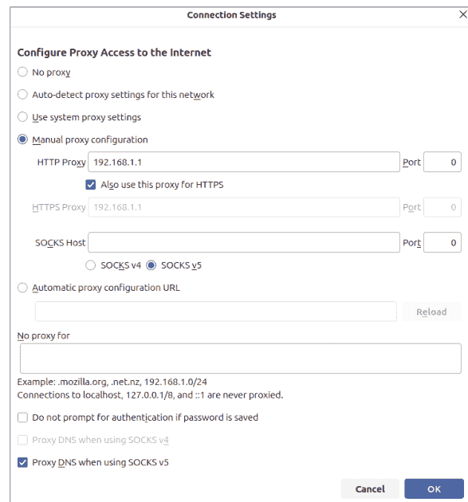

## 第 14 章：网络管理

### 从命令行配置网络

虽然 NetworkManager 在自动检测有线网络或向你提供网络列表方面表现出色，但有时你需要放弃 NetworkManager 的 GUI、命令或 Cockpit 来配置你所需的功能。以下是后续章节中的一些网络功能：

- **基础配置：** 查看如何使用 `nmui` 通过基于菜单的界面从 shell 配置基础网络。该工具为没有运行 GUI 工具的图形界的服务器配置网络提供了一个直观的界面。
- **配置文件：** 理解与 Linux 网络相关的配置文件以及如何直接配置它们。
- **以太网通道绑定（Ethernet channel bonding）：** 设置以太网通道绑定（多个网卡监听同一个 IP 地址）。

### 使用 nmui 配置网络

许多服务器没有图形界面可用。因此，如果你想配置网络，必须能够从 shell 实现。其中一种方法是直接编辑网络配置文件。另一种方法是使用菜单命令，允许你使用方向键和 Tab 键进行导航，并填写表单来配置你的网络接口。

`nmui` 命令（对于 Fedora 或 RHEL：执行 `dnf install NetworkManager-tui`；对于 Ubuntu，应该已经安装）提供了一个在 shell 中运行的基于菜单的界面。作为 root，输入 `nmui` 查看与图 14.7 类似的屏幕。

**图 14.7** 使用 NetworkManager TUI 配置网络。

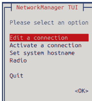


使用方向键和 `Tab` 键在界面中移动。选中你想要选择的项目后按回车键。界面限于编辑或激活连接、设置 DNS 配置以及使用开关关闭网络接口。

## 编辑 NetworkManager TUI

在显示的 NetworkManager TUI 屏幕中，以下是编辑连接：

1. **编辑连接：** 高亮“编辑连接”，按回车。显示网络设备列表（通常是以太网）以及你已连接的无线网络。
2. **网络设备：** 选中一个网络设备（在例中，我选择了以太网接口）并按回车。
3. **IPv4 配置：** 移动到“IPv4 配置”按钮并按回车。出现的“编辑连接”窗口允许更改所选设备的信息。
4. **更改为手动：** 你可以保留配置文件和设备字段。默认启用“自动”。自动功能允许网络接口在有 DHCP 服务器时自动连接。对于地址和其他信息，使用 `Tab` 键高亮“自动”字段；然后使用方向键高亮“手动”并按回车。
5. **地址：** 现在填写地址信息（IPv4 地址），例如 `192.168.100.100`。
6. **网关：** 输入提供互联网路由的计算机或路由器的 IP 地址。
7. **DNS 服务器：** 输入 DNS 服务器的 IP 地址，告诉系统如何将你请求的主机名转换为 IP 地址。
8. **搜索域：** 当你不使用完全限定域名请求应用程序时，使用搜索域。例如，如果你带有搜索 `ping host1`，该命令将尝试向 `host1.example.com` 发送数据包。
9. **路由：** 你可以通过高亮“路由”字段中的“编辑”来设置自定义路由。填充“目标/前缀”和“下一跳”字段并点击确定以保存你的新自定义路由。
10. **其他选项：** 对于屏幕上的其他选项，如果网络不连接到更广泛的网络，可以考虑选择“从不将此网络用于默认路由”；如果不希望从网络自动设置这些功能，可以考虑“忽略自动获取的路由”。图 14.8 显示了选择手动并填写了地址信息后的屏幕。

Tab 到“确定”按钮并按空格键。然后点击“退出”。

## 理解网络配置文件

从 Fedora 36 开始，NetworkManager 默认不再使用 `/etc/sysconfig/network-scripts` 目录来存储网络配置文件。相反，Fedora、Ubuntu 以及大多数其他使用 NetworkManager 的 Linux 系统会将有线和无线网络接口存储在 `/etc/netplan` 或 `/etc/NetworkManager/system-connections` 目录下的文件中。

接下来的章节描述了 NetworkManager 连接文件的格式，以及包含 Linux 系统网络信息的其他文件。

### NetworkManager 连接文件

无论是通过 WIFI 连接进行配置，还是通过手动配置有线网络接口，NetworkManager 都会以键/值对的形式信息存储在 `/etc/NetworkManager/system-connections` 目录或 `/etc/netplan` 目录的文件中。

这是一个来自 `system-connections` 目录的 `.ini` 格式的无线连接文件示例：一个 Fedora 系统。

```
[connection]
id=joenet-5G
uid=645980f3-1666d-446d-8516-1abe9e4c76e5
type=wifi
interface-name=wlp0s20f3
```

```
[wifi]
mode=infrastructure
ssid=joenet-5G
```

```
[wifi-security]
auth-alg=open
key-mgmt=wpa-psk
ps=MyQoolPa$$word
```

```
[ipv4]
method=auto
```

```
[ipv6]
addr-gen-mode=default
method=auto
```

```
[proxy]
```

这是一个来自 Ubuntu 系统上 `/etc/netplan` 目录的 `.yaml` 格式的有线连接文件示例：

```yaml
network:
  version: 2
  ethernets:
    NM-eb28103d-af3b-37fc-96a9-a8cb63475805:
      renderer: NetworkManager
      match:
        name: "en0"
      addresses:
        - "192.168.100.100/24"
      nameservers:
        addresses:
          - 192.168.100.101
      dhcp6:
        ipv6-address-generation: "stable-privacy"
        wakeonlan: true
      networkmanager:
        uid: "aeb28103d-af3b-37fc-96a9-a8cb63475805"
        name: "Wired connection 1"
      passthrough:
        connection.autoconnect-priority: "-999"
        connection.timestamp: "1697324723"
      ethernet:
        ipv4.address1: "192.168.100.100/24,192.168.1.21"
        ipv4.method: "manual"
        ipv6.ipv6-privacy: "-1"
        proxy: " "
```

### /etc/hosts 文件

在 DNS 创建之前，主机名到 IP 地址的转换是通过传递单个 `hosts` 文件完成的。虽然当时互联网上只有几十个到几百个主机，但这种方法非常有效。随着互联网的增长，单文件 `hosts` 变得不可扩展，于是 DNS 应运而生。

`/etc/hosts` 文件在 Linux 系统仍然存在。它仍然可以用于将 IP 地址映射到主机名。`/etc/hosts` 文件是为小型本地网络设置名称和地址的方法，也可以创建别名以便更容易地访问你经常使用的系统。

这是一个 `/etc/hosts` 文件的示例：

```
127.0.0.1   localhost localhost.localdomain
::1         localhost localhost.localdomain
192.168.0.201 node1.example.com joe
192.168.0.202 node2.example.com node2 sally
```

前两行（`127.0.0.1` 和 `::1`）是为本地系统设置的。本地主机的 IPv4 地址是 `127.0.0.1`；还有两个 IP 地址的条目。你可以通过 `node1.example.com`、`motel` 或 `joe` 等名称访问第一个 IP 地址（`192.168.0.201`）。例如，输入 `ping joe` 会导致数据包发送到 `192.168.0.201`。

### /etc/resolv.conf 文件

DNS 服务器和域名设置在 `/etc/resolv.conf` 文件中。如果启用并运行 NetworkManager，你不应该直接编辑此文件。使用 `ifcfg-*` NetworkManager 中的 `DNS=` 条目会覆盖 `/etc/resolv.conf` 文件，导致你丢失添加到该文件中的任何条目。这里是一个由 NetworkManager 修改的 `/etc/resolv.conf` 文件示例：

```
# Generated by NetworkManager
nameserver 192.168.0.2
nameserver 8.8.8.8
```

每个 `nameserver` 标识 DNS 服务器的 IP 地址。这是 DNS 服务器检查的顺序。拥有两个或三个 `nameserver` 是很好的，以防第一个不可用。如果更多，对于无法解析的主机名，检查每个服务器可能花费太长时间。你还可以向此文件添加的另一种类型的条目是 `search` 条目。`search` 条目允许你在按名称而非完全限定名请求主机名时，指定要搜索的域名。你可以通过在 `search` 关键字之后标识一个或多个域名来拥有多个 `search` 条目，在本例中：

```
search example.org example.net
```

搜索选项用空格或点分隔。

### /etc/nsswitch.conf

`/etc/nsswitch.conf` 中的设置决定了系统如何在不同类型的文件和数据库中查找不同的信息。这包括主机、网络。例如，这是 Fedora 中 `/etc/nsswitch.conf` 文件中 `hosts` 条目的显示方式：

```
hosts: files dns
```

例如，主机名解析是通过搜索完全限定名（`/etc/hosts` 文件）然后通过 DNS 解析完成的。接下来，如果未找到主机名，则通过 DNS 查找。如果未找到主机名，则会失败。

在 Fedora 中，在 `/etc/NetworkManager/system-connections` 目录下查找包含 `Wired connection 1` 的文件：

```bash
$ sudo grep "Wired connection 1" /etc/NetworkManager/system-connections/*
/etc/NetworkManager/system-connections/Wired connection 1.nmconnection: id=Wired connection 1
```

然后编辑该文件，使以下 IPv4 地址显示在 `addresses3` 行目下：

```
address3=192.168.1.197/24
```

在 Ubuntu 中，在 `/etc/netplan` 目录下查找包含 `Wired connection 1` 的文件：

```bash
$ sudo grep "Wired" /etc/netplan/*
/etc/netplan/90-NM-eb28103d-af3b-*.yaml: name: "Wired connection 1"
```

然后编辑该文件，使以下 IPv4 地址显示在 `addresses` 行目下：

```yaml
network:
  version: 2
  ethernets:
    nm-eb28103d-af3b-37fc-96a9-a8cb63475805:
      renderer: NetworkManager
      match:
        name: "eno1"
      addresses:
        - "192.168.1.195/24"
        - "192.168.1.196/24"
        - "192.168.1.197/24"

  name: "Wired connection 1"
```

修改连接文件后，按照如下方式重启 NetworkManager 使更改生效：

```bash
# systemctl restart NetworkManager
```

## 设置以太网通道绑定

以太网通道绑定允许计算机通过单个 IP 地址使用多个网络接口卡。您可能出于以下原因想要这样做：

- **高可用性**：同一 IP 地址上的多个网卡可以确保如果一个子集故障或一个网卡损坏，通过连接到另一个子网的网卡仍然可以访问地址。
- **性能**：如果网络流量大到一个网卡无法处理，您可以将流量分散到多个网卡上。

根据您想要执行的绑定类型，可以将绑定接口设置为不同的模式。在这里，我们将模式设置为 `balance-rr`，这是一种轮询策略，能够在我们稍后添加到该绑定的接口之间实现故障容错和负载均衡。绑定的名称为 `bond0`。

```bash
$ sudo nmcli add type bond con-name bond0 \
  ifname bond0 mode balance-rr
```

接下来，添加您想要用于绑定并监听的 IP 地址。例如，要将 `bond0` 的 IPv4 地址设置为 `192.168.100.10`，请输入：

```bash
$ nmcli con mod bond0 ipv4.method manual ipv4.addr 192.168.100.10/24
```

之后，您需要配置想要与 `bond0` 设备一起使用的网络接口卡。例如，如果您的计算机上有两个以太网卡，请像往常一样配置它们，不同之处是您不希望直接向这些接口添加 IP 地址。相反，将两个有线接口都添加到绑定中。以下是将 `eno1` 和 `eno2` 接口添加到 `bond0` 的示例：

```bash
$ nmcli con add type ethernet con-name bond0-slave1 slave-type master bond0 ifname eno1
$ nmcli con add type ethernet con-name bond0-slave2 slave-type master bond0 ifname eno2
```

最后，您需要做的一件事是确保 `bond0` 接口被设置为使用绑定模块。要做到这一点，创建一个包含以下内容的 `/etc/modprobe.d/bonding.conf` 文件：

```
alias bond0 bonding
```

要使新更改生效，重启 NetworkManager：

```bash
$ sudo systemctl restart NetworkManager
```

## 企业环境中的网络配置

到目前为止，本章描述的网络配置主要集中在设置单个系统连接网络上。Linux 提供的功能可以远超此，通过提供支持主机通信所需的实际网络基础设施的软件。

接下来的章节将向您介绍 Linux 中可用的几种网络基础设施类型的服务。这些功能的完整实现超出了本书的范围，但如果您发现自己需要管理网络基础设施功能，接下来的章节将让您了解这些功能在 Linux 中是如何实现的。

### 将 Linux 配置为路由器

如果您在计算机上有多个网络接口（通常是两个或更多网卡），您可以将 Linux 配置为路由器。要实现这一点，只需要更改一个内核参数以允许数据包转发。立即并临时开启 `ip_forward` 参数，以 root 身份输入以下内容：

```bash
# cat /proc/sys/net/ipv4/ip_forward
0
$ echo 1 >/proc/sys/net/ipv4/ip_forward
```

```bash
# cat /proc/sys/net/ipv4/ip_forward
1
```

许多 Linux 系统默认禁用数据包转发（路由），`ip_forward` 的值设置为 0。通过将其设置为 1，数据包转发会立即被启用。要使此更改永久生效，您必须将该值添加到 `/etc/sysctl.conf` 文件中，使其显示如下：

```
net.ipv4.ip_forward = 1
```

按照所示修改该文件后，每次系统重启时，`ip_forward` 的值都会重置为 1。（注意，`net.ipv4.ip_forward` 反映了 `ip_forward` 文件的实际位置，去掉了 `/proc/sys` 并用点替换。您可以以这种方式在 `/proc/sys` 目录结构中更改内核参数。）

当 Linux 系统被用作路由器时，它通常会在私有网络和公共网络（如互联网）之间使用 NAT（网络地址转换）。如果您正在使用该服务器，您可能需要使用防火墙（参见第 26 章“安全 Linux”）。

### 将 Linux 配置为 DNS 服务器

在 Linux 中，大多数流行的域名系统（DNS）服务器是使用 BIND 实现的。在 Fedora 和 RHEL 中通过安装 `bind`、`bind-utils` 和 `bind-libs` 包来实现。为了增加安全性，大多数人都会安装它。在 Ubuntu 中，您将安装 `bind9` 包。

如果您想尝试 bind，我建议您尝试为防火墙后的小型家庭网络配置 DNS，以便家人之间的通信更加方便。可以通过将每台计算机网络接口卡的 MAC 地址连接到 DHCP 服务器上的特定 IP 地址，并在 DNS 服务器中映射这些锁定地址。您还可以使用 DNS 服务器进行缓存，这可以加速客户端的 DNS 查询。

> **注意**
>
> 在创建公共 DNS 服务器之前，请记住妥善保护您的 DNS 服务器至关重要。公共 DNS 服务器可能被用于重定向到坏人指定的任何地方。因此，如果您正在使用该服务器，您面临着呈现并非您所认为的网站的风险。

### 将 Linux 配置为代理服务器

使用大多数 Linux 系统自带的 Squid Server（Ubuntu、Fedora 和 RHEL 中的 `squid` 软件包），你可以让系统接受对 Web 服务器（HTTP 和 HTTPS）、文件服务器（FTP）以及其他协议的请求。你可以限制哪些系统可以使用你的代理服务器（通过主机名或 IP 地址），甚至限制它们可以访问的网站（通过特定地址、地址范围、主机名或名称）。

配置 squid 代理服务器可以像安装 `squid` 软件包、编辑 `/etc/squid/squid.conf` 文件并启动 squid 服务一样简单。该文件带有一个推荐的配置。然而，你可能想要定义允许使用该服务的主机（基于 IP 地址或名称）。squid 提供了黑名单，允许你拒绝对整组可能不适合儿童访问的网站进行访问。

## 总结

从 Linux 桌面或笔记本系统发起的多数网络连接都可以在极少或无需用户干预的情况下完成。如果你在有线或无线以太网连接上使用 NetworkManager，可以从 DHCP 服务器自动获取启动所需的地址和服务器信息。

通过 NetworkManager 的图形界面，如果你愿意，可以进行一些网络配置。你可以设置静态 IP 地址，并选择要使用的网络服务器和网关计算机。要进行更手动、更复杂的网络配置，请考虑直接操作网络配置文件。

Linux 中的网络配置文件可用于设置更高级的功能，例如以太网通道绑定。

除了 Linux 网络连接的基础知识外，提供的功能还可以让你提供网络基础设施类型的服务。本章介绍了路由、DHCP 和 DNS 等服务和功能，你在处理 Linux 中更高级的网络功能时需要了解它们。


配置好网络后，你现在可以开始配置在网络上运行的服务。第 15 章“启动和停止服务”描述了用于启用、禁用、启动、停止和检查为 Linux 系统配置的服务所需的工具。

## 练习

本节的练习将帮助你检查和更改 Linux 系统上的网络接口，并理解如何配置更高级的网络功能。请在具有活动网络连接但未处于关键网络活动中的 Linux 系统上开始这些练习。

# 第四部分：成为 Linux 服务器管理员

我建议你直接在计算机控制台上执行这些练习（换句话说，不要 `ssh` 登录计算机来执行）。你运行的一些命令可能会中断你的连接，而且你执行的某些配置如果出错，会导致你的计算机暂时无法从网络访问。

完成这些练习中描述的任务通常有多种方法。如果你卡住了，请参考附录 B 中提供的任务解决方案。

1. 使用桌面检查 `NetworkManager` 是否已成功启动你的网络接口（有线或无线）并连接网络。如果没有，请尝试启动你的网络接口。
2. 运行命令检查计算机上可用的活动网络接口。
3. 尝试从命令行连接 `google.com`，以确保 DNS 正常工作。
4. 运行命令检查用于与本地网络之外通信的路由。
5. 跟踪连接到 `google.com` 的路径。
6. 从 Cockpit Web 用户界面查看 Linux 系统的网络活动。
7. 创建一个主机条目，允许你使用 `myownhost` 名称与本地主机系统进行通信。
8. 确定系统中用于将主机名解析为 IP 地址的 DNS 服务器的地址，然后检查系统查询了哪个服务器来查找 `google.com` 的 IP 地址。
9. 创建一个自定义路由，将指向 `192.168.99.0/24` 网络的流量导向本地网络上的某个 IP 地址，例如 `192.168.0.5`（首先确保你所在的位置没有使用 `192.168.99` 网络）。
10. 检查你的系统是否配置为允许 IPv4 数据包在系统的网络接口之间进行路由。

# 启动和停止服务

## 本章内容

- 理解各种 Linux 服务
- 审计由 Linux 守护进程控制的服务
- 停止和启动服务
- 更改 Linux 服务器的默认运行级别（`runlevel`）
- 移除服务

Linux 服务器系统的工作是为本地或远程用户提供服务。服务器可以提供网页、文件、数据库信息、流媒体音乐或其他内容的访问。服务器可以提供主机计算机或用户名的列表。在你的 Linux 系统上可以配置数百种和其他类型的服务。

Linux 系统提供的持续服务（如访问打印机或登录服务）通常由所谓的 `daemon`（守护进程）进程实现。大多数 Linux 系统使用几种流行的初始化系统之一（也称为 `init systems`）将每个守护进程管理为一个 `service`（服务）。使用初始化系统的优点包括能够定义以下内容：

- **识别运行级别：** 将一组服务组合在所谓的 `runlevels`（运行级别）或 `targets`（目标）中。
- **建立依赖关系：** 设置服务依赖关系，例如，需要网络接口的服务在所有网络启动服务成功启动之前不会启动。
- **设置默认运行级别：** 选择系统启动时启动的运行级别或目标（即默认运行级别）。
- **管理服务：** 运行命令告诉单个服务启动、停止、暂停、重启甚至重新加载配置文件。

虽然现在的 Linux 系统在使用几种不同的初始化系统，但主导的是 `Systemd`。`Systemd` 用于 Fedora、Red Hat Enterprise、Ubuntu 以及其他发行版。它最流行的前身是 `SysVinit`。以下是对它们的简要介绍：

- **SysVinit：** 这种传统的初始化系统为 20 世纪 80 年代的 UNIX 系统创建。它提供了一种易于理解的基于运行级别的启动和停止系统的方法。
- **Systemd：** Fedora、RHEL 和 Ubuntu 在十多年前采用了 `systemd` 初始化系统。它是初始化系统中最复杂的，但也提供了更大的灵活性。本章主要描述 `systemd` 初始化系统。然而，由于 `SysVinit` 的某些功能在 `systemd` 中仍被支持，因此在一定程度上涉及了 `SysVinit`。在使用 `systemd` 初始化系统的过程中，你将学习启动过程是如何运作的，你如何单独启动和停止服务，以及如何启用和禁用服务。

## 第 15 章：启动与停止服务

`systemd` 守护进程（解释详见 <http://docs.fedoraproject.org/en-US/quick-docs/understanding-and-administering-systemd>）主要由红帽开发者 Lennart Poetting 编写。它目前被广泛应用于所有最新版本的 Fedora、OpenSUSE、RHEL 和 Ubuntu 中。运行 `ps -e` 可以告诉你你是否运行在 `systemd` 系统上：

```bash
# ps -e | head
PID TTY              TIME CMD
1 ?                 00:04:36 /usr/lib/systemd/system...
2 ?                 00:00:03 [kthread]
3 ?                 00:00:15 [pool_workqueue_release]
```

PID 1 有可能是 `init` 进程。例如：

```bash
# ps -ef | head
UID PID     STIME TIME CMD
root 1 0 08:13? 00:00:02 /sbin/init splash
root 2 0 08:13? 00:00:00 [kthread]
root 3 2 08:13? 00:00:00 [pool_workqueue_release]
```

在这种情况下，你可以检查并发现 `init` 进程实际上只是指向 `systemd` 的符号链接：

```bash
# ls -ls /sbin/init
0 lrwxrwxrwx 1 root root 22 Aug 8 10:51 /sbin/init -> ../lib/systemd/systemd
```

## 理解 systemd 初始化

`systemd` 初始化守护进程是 `SysInit` 和 `Upstart` 守护进程的较新替代品。该初始化守护进程在 Ubuntu 14.10、Fedora 15 和 RHEL 7 中引入，并且仍在使用。它与 `SysInit` 和 `Upstart` 都向后兼容。由于 `systemd` 可以并行方式启动服务，因此缩短了系统初始化时间。在 `SysInit` 中，服务是固定顺序运行的，如果某个服务卡住，后续服务必须等待（即使它们与卡住的服务没有依赖关系）。

## 学习系统基础知识

在 `SysInit` 中，服务根据运行级别（`runlevels`）启动和停止。`systemd` 服务与运行级别并存，但它通过调用目标单元（`target units`）以不同的方式实现它们。虽然 `systemd` 的主要工作是启动和停止服务，但它也可以管理其他被称为“单元”（`units`）的类型。单元由名称、类型和配置文件组成，侧重于特定的服务或操作。共有 12 种 `systemd` 单元类型：

- `autount`
- `device`
- `mount`
- `path`
- `service`
- `snapshot`
- `socket`
- `target`
- `timer`
- `swap`
- `slice`
- `scope`

在处理服务和目标单元时，你需要关注的两个 `systemd` 单元。服务单元（`service unit`）用于管理 Linux 服务器上的守护进程。目标单元（`target unit`）仅仅是其他单元的组。

示例显示了多个 `systemd` 服务单元和目标单元。服务单元具有熟悉的守护进程名称，如 `cups` 和 `sshd`。每个服务单元名称以 `.service` 结尾。目标单元显示了类似 `sysinit.` 的名称（`sysinit` 用于启动系统初始化）。目标单元名称以 `.target` 结尾。

```bash
# systemctl list-units | grep .service
```

```
alsa-restore.service loaded active Save/Restore Sound State
apparmor.service loaded active exited LoadArmor profiles
bluetooth.service loaded active running Bluetooth service
cups.service loaded active running CUPS Scheduler
dbus.service loaded active running D-Bus System Bus
docker.service loaded active running Docker Container Engine
ufw.service loaded active exited Uncomplicated firewall
```

Linux 系统单元配置文件位于 `/lib/systemd/system` 和 `/etc/systemd/system` 目录下。你可以使用 `ls` 命令查看目录，但首选方法是使用 `systemctl` 命令的选项。它显示了服务在安装时如何设置（`PRESET`）以及当前的状态（`STATE`）：

```bash
# systemctl list-unit-files --type=service
UNIT STATE PRESET
accounts-daemon.service enabled enabled
alsa-restore.service static -
alsa-state.service static -
alisa-utils.service masked enabled
anacron.service enabled enabled
apparmor.service enabled enabled
apport-autoreport.service static -
apport-coredump-hook@.service static -
apport-forward@.service static -
apport.service enabled enabled
apt-daily-upgrade.service static -
apt-daily.service static -
apt-news.service static -
autovt@.service alias
avahi-daemon.service enabled enabled
blk-availability.service enabled enabled
bluetooth.service enabled enabled
```

列出了 287 个单元文件。

上述代码中显示的单元配置文件都与服务单元相关。可以通过以下方法显示目标单元的配置文件：

```bash
# systemctl list-unit-files --type=target
UNIT FILE                        STATE      PRESET
basic.target                     static -
blockdev.target                 static -
bluetooth.target                static -
boot-complete.target            static -
cloud-config.target             static -
cloud-init.target               static -
cryptsetup.target               static -
cryptsetup.target               static -
ctrl-alt-del.target            alias
default.target                   alias
emergency.target                disabled
exit.target                     static
factory-recovery.target         static -
final.target                    static
first-boot-complete.target    static -
friendly-recovery.target       static -
getty.target                    static -
graphical.target                disabled
halt.target                     static
remote-fs.target                enabled
```

列出了 81 个单元文件。

服务单元配置文件包含大量信息，例如必须启动哪些其他服务、此服务何时启动、使用什么环境文件等。以下示例显示了 `ssh` 守护进程服务的单元文件：

```ini
# cat /lib/systemd/system/sshd.service
[Unit]
Description=OpenSSH server daemon
Documentation=man:sshd(8) man:sshd_config(5)
After=network.target ssh-keys.target
Wants=sshd-keygen.target
# 针对 Fedora 38 的更改，移除主机密钥的组所有
# 参见 https://fedoraproject.org/wiki/Changes/SSHSignUid
[Service]
Type=notify
# 将选项设置为为空变量，以便在 /etc 下的配置文件不存在或为空时
# 扩展命令行时抑制警告。
EnvironmentFile=-/etc/sysconfig/sshd
ExecStart=/usr/bin/sshd -D $OPTIONS
ExecReload=/bin/kill -HUP $MAINPID
KillMode=process
Restart=on-failure
Restart=42s
[Install]
WantedBy=multi-user.target
```

此基础服务单元文件包含以下选项：

- **Description：** 自由格式描述（注释行）。
- **Documentation：** 列出了 `sshd` 守护进程和配置文件的联机页（man pages）。
- **After：** 配置排序关系。换句话说，它列出了在启动此服务之前应该激活的单元。
- **EnvironmentFile：** 服务的配置文件。
- **ExecStart：** 启动此服务的命令。
- **ExecReload：** 重新加载此服务的命令。
- **WantedBy：** 此服务所属的目标单元。

注意目标单元 `multi-user.target` 使用在 `ssh` 单元文件中。`ssh` 服务单元被 `multi-user.target` 所需要。换句话说，当 `multi-user.target` 单元被激活时，`ssh` 服务将启动。

## 第 15 章：启动与停止服务

你可以使用以下命令查看目标（`target`）将激活的各种单元：

```
# systemctl show --property "Wants" multi-user.target
Wants=systemd-user-sessions.service thermald.service sssd.service
ssh.service mcelog.service abrt-xorg.service vboxboxservice.service
vmtools.service...
(END) q
```

遗憾的是，`systemctl` 命令对此输出的格式化并不理想。输出会直接溢出屏幕右边缘，导致你无法看到完整结果。此外，你必须输入 `q` 才能返回命令行提示符。为了解决这个问题，可以将输出通过管道传给 `less` 命令，如下例所示：

```
# systemctl --property "Wants" multi-user.target | less
Wants=systemd-user-sessions.service thermald.service sssd.service
ssh.service mcelog.service abrt-xorg.service vboxboxservice.service
vmtools.service cups.path system-cond.service docker.service getty
.target plymouth-quit.service virtuedm.service avahi-daemon.service
remote-fs.firewall.service...
```

这显示了当 `multi-user.target` 激活时，所有将被激活（启动）的服务和其他单元（包括 `ssh`）。记住，目标单元仅仅是其他单元的组合，如上一个示例所示。还要注意，此组中的单元并非都是服务单元（`service units`），还有路径单元（`path units`）和其他目标单元。

目标具有 `Wants` 需求，它类似于 `Requires`。`Wants` 意味着列出的所有单元都会被触发激活（启动）。如果它们失败或无法启动，问题不大——目标单元会继续运行。上述的示例仅显示了 `Wants`。

`Requires` 比 `Wants` 严格得多，且可能导致灾难性后果。`Requires` 意味着列出的所有单元都会触发激活（启动）。如果它们失败或无法启动，整个单元（单元组）将被去激活。


你可以使用下例中的命令查看目标单元 `Requires`（必须激活，否则将失败）的各种单元。注意，`multi-user.target` 的 `Requires` 输出比 `Wants` 短得多。因此，不需要对输出进行特殊格式化。

```
# systemctl --property "Requires" multi-user.target
Requires=basic.target
```

目标单元也有配置文件，正如服务单元一样。以下显示了 `multi-user.target` 配置文件的内容。

```
# cat /lib/systemd/system/multi-user.target
# This file is part of systemd.

[Unit]

Description=Multi-User

Documentation=man:systemd.special(7)

Requires=basic.target

Conflicts=rescue.service rescue.target

After=basic.target rescue.service rescue.target

AllowIsolate=yes
```

此基础目标单元文件包含以下选项：

- **Description:** 这只是对目标的一个自由格式描述。
- **Documentation:** 列出了相应的系统 man 手页（man page）。
- **Requires:** 如果此 `multi-user.target` 被激活，列出的目标也会被激活。如果列出的目标被去激活或失败，则 `multi-user.target` 将被去激活。如果没有 `After` 和 `Before` 选项，则 `multi-user.target` 和列出的目标将同时激活。
- **Conflicts:** 此设置避免了服务之间的冲突。启动 `multi-user.target` 会停止列出的目标和服务，反之亦然。
- **After:** 此设置配置顺序。换句话说，它决定了哪些单元应该在该服务之前激活。
- **AllowIsolate:** 此选项是一个布尔值（yes 或 no）。如果此选项设置为 yes，则目标单元 `multi-user.target` 将与其依赖项一起激活，其他所有都被去激活。

关于这些配置文件及其选项的更多信息，请在命令行输入 `man systemd.service`、`man systemd.target` 和 `man systemd.unit`。

对于使用 systemd 的 Linux，在理解 systemd 目标单元后，启动过程现在更容易追踪了。启动时，systemd 激活默认 `.target` 单元。该单元被别名为 `multi-user.target` 或 `graphical.target`。因此，取决于设置的别名，目标单元指向的服务将被启动。

如果你需要进一步了解 systemd 守护进程，可以在命令行输入 `man -k systemd` 获取主页中各种 systemd 文档的列表。

## 学习 systemd 对 SysVinit 的向后兼容性

systemd 守护进程保持了对 SysVinit 守护进程的向后兼容。这让 Linux 发行版能够缓慢迁移到 systemd。

虽然运行级别（runlevels）并不是 systemd 的真正一部分，但 systemd 基础设施的设计是为了提供与运行级别概念的兼容。专门创建了七个目标单元用于对 SysVinit 的向后兼容：

- `runlevel0.target`
- `runlevel1.target`
- `runlevel2.target`
- `runlevel3.target`
- `runlevel4.target`
- `runlevel5.target`
- `runlevel6.target`

每个七个经典 SysInit 运行级别都对应一个目标单元配置文件。输入 `man runlevel` 查看关于这些运行级别的信息。这些目标单元配置文件通过符号链接连接到与原始运行级别理念最匹配的目标单元配置文件。在接下来的示例中，显示了运行级别单元的符号链接。注意，运行级别 2、3 和 4 的运行级别目标单元都链接到 `multi-user.target`。`multi-user.target` 类似于旧的扩展多用户模式。

```
# ls -1 /lib/systemd/system/runlevel*.target
runlevel0.target -> poweroff.target
runlevel1.target -> rescue.target
runlevel2.target -> multi-user.target
runlevel3.target -> multi-user.target
runlevel4.target -> multi-user.target
runlevel5.target -> graphical.target
runlevel6.target -> reboot.target
```

## 停止与启动服务

停止和启动服务的首要命令是 `service`。在 `service` 命令中，要控制的单元名称位于第二个。最后一个选项是你想执行的操作，如 stop、start、restart 等。以下示例显示了如何停止 cups 服务并查看状态：

```
# service cups stop
# service cups status
* cups.service - CUPS Scheduler
  Loaded: loaded (/lib/systemd/system/cups.service; enabled; preset: enabled)
  Active: inactive (dead) since Thu 2025-01-09 22:59:54 EST; 3s ago
  Duration: 42.02s
  TriggeredBy: * cups.path
               * cups.socket
  Docs: man:cupsd(8)
  Process: 42848 ExecStart=/usr/bin/cupsd -l (code=exited, status=0/SUCCESS)
  Main PID: 42844 (code=exited, status=0/SUCCESS)
  Status: "Scheduler is running..."
  Jan 09 22:59:54 Admin-ubuntu-20 systemd[1]: Stopped cups.service - CUPS Scheduler.
```

启动服务，只需在 `service` 命令末尾使用 `start` 代替 `stop`，如下：

```
# service cups start
# service cups status
* cups.service - CUPS Scheduler
  Loaded: loaded (/lib/systemd/system/cups.service; enabled; preset: enabled)
  Active: active (running) since Thu 2025-01-09 23:06:10 EST; 3s ago
  TriggeredBy: * cups.path
               * cups.socket
  Docs: man:cupsd(8)
  Main PID: 430494 (cupsd)
  Status: "Scheduler is running..."
  Tasks: 1 (limit: 9171)
  Memory: 2.7M (peak: 3.0M)
  CPU: 16ms
  CGroup: /system.slice/cups.service
          └─430494 /usr/sbin/cupsd -l
```

```
Jan 09 23:06:10 systemd[1]: Starting cups.service - CUPS Scheduler...
Jan 09 23:06:10 systemd[1]: Started cups.service - CUPS Scheduler.
```

# 第15章：启动与停止服务

## 停止和启动系统服务

systemd 使用 `systemctl` 命令来启动、停止以及其他处理 systemd 服务。

## 使用 systemd 停止服务

在示例中，检查了 cups 守护进程的状态，然后使用 `systemctl stop cups.service` 命令将其停止：

```
# systemctl status cups.service
○ cups.service - CUPS Scheduler
  Loaded: loaded (/usr/lib/systemd/system/cups.service; enabled; preset: enabled)
  Active: inactive (dead) since Thu 2025-01-09 23:09:36 EST; 3s ago
  Duration: 3min 25.908s
  TriggeredBy: ○ cups.path
               ○ cups.socket
  Docs: man:cups(8)
  Process: 43094 ExecStart=/usr/sbin/cupsd -l (code=exited, status=0/SUCCESS)
  Main PID: 43094 (code=exited, status=0/SUCCESS)
  CPU: 18ms
```

```
Jan 09 23:06:10 systemd[1]: Starting cups.service - CUPS Scheduler...
Jan 09 23:06:10 systemd[1]: Started cups.service - CUPS Scheduler...
Jan 09 23:09:36 systemd[1]: Stopping cups.service - CUPS Scheduler...
Jan 09 23:09:36 systemd[1]: cups.service - Deactivated successfully.
Jan 09 23:09:36 systemd[1]: Stopped cups.service - CUPS Scheduler.
```

注意，当获取状态时，停止 cups 守护进程后，服务处于活动（死亡）状态，但仍被视为已启用（enabled）。这意味着 cups 守护进程会在服务器启动时再次启动。

## 使用 systemd 启动服务

启动 cups 守护进程与停止它一样简单。后续示例如下：

```
# systemctl start cups.service
# systemctl status cups.service
● cups.service - CUPS Scheduler
  Loaded: loaded (/usr/lib/systemd/system/cups.service; enabled; preset: enabled)
  Active: active (running) since Thu 2025-01-09 23:11:10 EST; 3s ago
  TriggeredBy: ● cups.path
               ● cups.socket
  Docs: man:cups(8)
  Main PID: 403868 (cupsd)
  Status: "Scheduler is running..."
  Tasks: 1 (limit: 9171)
  Memory: 2.7M (peak: 3.2M)
  CPU: 1ms
  CGroup: /system.slice/cups.service
          └─403868 /usr/sbin/cupsd -l
```

启动 cups 守护进程后，使用 systemd 配合 `status` 选项可以显示服务处于活动（运行）状态。此外还会显示其进程 ID（PID）数 403868。

## 使用 systemd 重启

重启服务意味着停止服务然后重新启动它。如果服务当前没有运行，重启它仅仅是启动该服务。

```
# systemctl restart cups.service
```

## 使用 systemd 重新加载

重新加载服务与重启服务不同。当你重新加载服务时，服务不会停止。仅重新加载服务的配置文件。注意，并非所有服务都启用了使用重载的功能，但如果你更改了任何系统配置文件，`daemon-reload` 将重新加载所有相关的服务。

```
# systemctl daemon-reload
# systemctl start sshd.service
● ssh.service - OpenBSD Secure Shell Server
  Loaded: loaded (/usr/lib/systemd/system/ssh.service; disabled; preset: enabled)
  Active: active (running) since Mon 2025-01-06 15:00:29 EST; 3s days ago
  TriggeredBy: ● ssh.socket
  Docs: man:sshd(8)
        man:ssh_config(5)
  Main PID: 90152 (sshd)
  Tasks: 1 (limit: 9171)
  Memory: 3.2M (peak: 20.4M swap peak: 1.1M)
  CPU: 32ms
  CGroup: /system.slice/ssh.service
          └─90152 "sshd: /usr/sbin/sshd -D [listener] 0 of 10-100 startups"
```

```
Jan 06 15:02:00 sshd[90436]: pam_unix(sshd:session): session opened for user chris(uid=1000) by c
Jan 06 15:02:00 sshd[90436]: pam_unix(sshd:session): session closed for user chris
Jan 09 23:19:59 systemd[1]: Reloaded ssh.service - OpenBSD Server.
```

对服务进行重载而不是重启，可以防止任何等待的服务更新被中断。对于繁忙的服务器，重载是一种更好的方法。

## 启用服务

你使用 `stop` 和 `start` 用于即时需求，而不是用于需要持久化的服务。持久化服务是在启动时或在特定运行级别启动的服务。需要持久化的服务通常是 Linux 服务器提供的服务。

### 使用 systemd 启用服务

在 `systemctl` 命令上使用 `enable` 选项会在启动时激活服务（持久化）。以下显示如何实现这一点：

```
# systemctl status cups.service
○ cups.service - CUPS Scheduler
  Loaded: loaded (/usr/lib/systemd/system/cups.service; disabled; preset: enabled)
  Active: inactive (dead) since 2025-01-09 23:23:29 EST; 2s ago
  Duration: 11min 13.89s
  TriggeredBy: cups.socket
  Docs: man:cupsd(8)
  Process: 430954 ExecStart=/usr/sbin/cupsd -l (code=exited, status=0)
  Main PID: 430954 (code=exited, status=0/SUCCESS)
  Status: "Scheduler is running..."
  CPU: 20ms
  Jan 09 23:23:29 systemd[1]: cups.service: Deactivated successfully.
  Jan 09 23:23:29 systemd[1]: Stopped cups.service - CUPS Scheduler.

# systemctl enable cups.service
Synchronizing state of cups.service with SysV service /usr/lib/systemd/systemd-sysv-install.
Executing: /usr/lib/systemd/systemd-sysv-install cups
Created symlink /etc/systemd/system/printer.target.wants/cups.service → /usr/lib/systemd/system/cups.service.
Created symlink /etc/systemd/system/multi-user.target.wants/cups.service → /usr/lib/systemd/system/cups.service.
Created symlink /etc/systemd/system/sockets.target.wants/cups.socket → /usr/lib/systemd/system/cups.socket.
Created symlink /etc/systemd/system/multi-user.target.wants/cups.path → /usr/lib/systemd/system/cups.path.
```


# systemctl status cups.service

```
# systemctl status cups.service
+   cups.service - CUPS Scheduler
  Loaded: loaded (/usr/lib/systemd/system/cups.service); enabled;
  preset: enabled
  Active: (running) since Thu 2025-01-29 23:25:26 EST; 1min 8s ago
  TriggeredBy:
    * cups.path
    * cups.socket
  Docs: man:cupsd(8)
  Main PID: 431777 (scheduler is running...)
  Status: 1 (limit: 9171)
  Tasks: 1 (9M)
  Memory: 3.6M (peak: 3.9M)
  CPU: 1ms
  ControlGroup: /system.slice/cups.service
    -431777 /usr/bin/cupsd -1

Jan 09 23:25:26 systemd[1]: Starting cups.service - CUPS Scheduler...
Jan 09 23:25:26 systemd[1]: Started cups.service - CUPS Scheduler.
```

因为服务被停止并禁用，所以我启动并启用了服务。注意在 `systemctl` 上使用 `enable` 选项后，cups 的状态从 disabled 变为 enabled。此外，注意 `enable` 选项创建了一些符号链接。你可能会自己创建这些链接，但首选的方法是使用 `systemctl` 命令来实现。

## 使用 systemd 禁用服务

你可以使用 `systemctl` 上的 `disable` 选项防止服务在启动时运行。然而，它不会立即停止服务。你需要使用“使用 systemd 停止服务”节中提到的 `stop` 选项。示例示例了如何禁用当前启用的服务：

```
# systemctl disable cups.service
```

```
Synchronizing state of cups.service with SysV service script with
/usr/lib/systemd/systemd-sysv-install.
Executing: /usr/lib/systemd/system-sysv-install cups
Removed "/etc/systemd/system/sockets.target.wants/cups.socket"
Removed "/etc/systemd/system/multi-user.target.wants/cups.service"
Removed "/etc/systemd/system/multi-user.target.wants/cups.path"
Removed "/etc/systemd/system/printer.target.wants/cups.service"
Disabling 'cups.service', 但其触发单元仍然处于激活状态：
cups.socket.
```

`disable` 选项通过 `systemctl` 命令的首选方法移除了一些服务。注意前面的示例中，尽管服务现在已禁用，`cups.socket` 仍然处于激活（运行）状态并需要手动停止。对于 `static`，某些服务无法被禁用。考虑以下内容，`dbus.service`

```
# systemctl status dbus.service
dbus.service - D-Bus System Bus
Loaded: loaded (/usr/lib/systemd/dbus.service); static)
Active: (running) since Sun 2025-01-05 12:04:13 EST
4 days ago
TriggeredBy: dbus-daemon(1)
Docs: man:dbus-daemon(1)
Main PID: 1249 (dbus-daemon)
Tasks: 1 [limit: 917]
Memory: 14.4M (peak: 240.2M swap: 896.0K swap peak: 3.6M)
CPU: 53.692s
CGroup: /system.slice/dbus.service --address=systemd=nofork --nofid --systemd-activation --syslog-o
```

```
Jan 09 18:21:10 dbus-daemon[1249]: [system] Activating by systemd:
service name='net.retactivated'
```

当 `systemctl disable` 命令被 `dbus.service` 忽略。记住，static 服务默认始终启用，即使是 root 用户也无法禁用。有时，禁用服务并不足以确保不运行。例如，你可能希望 `network.service` 替换 `NetworkManager.service` 来启动网络接口。禁用 `NetworkManager` 将防止该服务自行启动。如果其他服务将 `NetworkManager` 列为依赖项，它们在启动时会尝试启动 `NetworkManager`。

要以一种防止其在你的系统中永远运行的方式禁用服务，你可以使用 `mask` 选项。例如，为了设置虚构的 `MyExample` 服务使其永远不运行，使用以下命令：

```
# systemctl mask MyExample.service
```

这将服务链接到 `/dev/null`。因此，如果有人尝试运行该服务，什么都不会发生。为了能够再次使用该服务，你可以运行 `systemctl unmask MyExample.service`。

既然你已经了解了如何启用单个服务的持久化（以及如何禁用或掩码单个服务），现在只需要从整体来看服务组了。接下来，我将展示如何在启动时启动服务组。

## 配置默认运行级别或目标单元

持久化服务是在启动时启动，而持久化（默认）运行级别或目标单元是在启动时启动的服务组。经典的 SysVinit 和 Upstart 将这些服务组定义为运行级别，而 systemd 将它们称为目标。

对于 systemd 而言，目标单元指的是要启动的服务组。以下显示了你可以配置为持久化的各种目标，以及它们对应的向后兼容的特定运行级别的目标：

- `multi-user.target`
- `runlevel2.target`
- `runlevel3.target`
- `runlevel4.target`
- `graphical.target` = `runlevel5.target`

持久化单元通过指向 `default.target` 文件的符号链接来设置。考虑以下内容：

```
# ls -l /etc/systemd/system/default.target
lrwxrxrxrx 1 root 36 Mar 13 17:27
-> /etc/systemd/system/default.target ->
# ls -l /lib/systemd/system/runlevel5.target
lrwxrxrxrx 1 root 16 Mar 27 15:39
-> /lib/systemd/system/runlevel5.target -> graphical.target
```

示例显示此服务器当前的目标单元是 `runlevel5.target`，因为 `default.target` 是指向 `runlevel5.target` 单元的符号链接。但注意，`runlevel5.target` 也是一个符号链接，它指向图形目标。因此，该服务器当前的目标单元是 `graphical.target`。要设置不同的目标单元持久化，你只需要更改 `default.target` 的符号链接。为了保持一致，如果你的服务器上使用了运行级别单元，请坚持使用它们。

以下 `systemctl` 示例将服务器的持久化目标单元从 `multi-user.target` 更改为 `graphical.target`：

```
# systemctl get-default
multi-user.target
# systemctl set-default graphical.target
Removed "/etc/systemd/system/default.target".
```

```
Created symlink /etc/systemd/system/default.target → /usr/lib/systemd/system/graphical.target.
```

```
# systemctl get-default
graphical.target
```

当服务器重启时，`graphical.target` 是持久化目标单元。`graphical.target` 单元中的服务会在那时被启动（激活）。

如果你习惯旧的 SysVinit 运行级别，可以使用运行级别查看当前 Systemd 目标是如何映射到这些运行级别的：

```
# runlevel
5
```

这显示当前运行级别是 5 (`graphical.target`)，上一个运行级别是 3 (`multi-user.target`)。

## 添加新服务或自定义服务

偶尔，你可能需要为 Linux 服务器添加新服务。此外，你可能需要自定义某个特定服务。当这些需求出现时，你必须遵循特定步骤，以便 Linux 服务器的初始化守护进程接管该服务的管理或识别其自定义。

### 向 systemd 添加新服务

在向 Linux systemd 服务器添加新服务或自定义服务时，你必须按顺序完成三个步骤才能让 systemd 管理该服务：

- 为新或自定义的服务创建一个新的或自定义的服务配置单元文件。
- 将新或自定义的服务配置单元文件移动到 systemd 管理的正确位置。
- 将服务添加到特定目标单元的 `Wants` 目录中，以便新或自定义的服务随其他服务自动启动。

### 步骤 1：创建新的或自定义的服务配置单元文件

如果你正在自定义服务单元，只需从 `/lib/systemd/system` 复制原始单元文件并添加任何所需的自定义内容。

对于新文件，显然，你正在从头创建一个服务单元配置文件。考虑以下基础服务单元文件模板。对于服务单元配置文件，至少需要 `Description` 和 `ExecStart` 选项：

```
# cat My_New_Service.service
[Unit]
Description=My New Service

[Service]
ExecStart=/usr/bin/My_New_Service
```

关于自定义或创建新配置单元文件以及各种选项的更多帮助，你可以使用手册页。在命令行中输入 `systemd-service` 可以获取更多关于各种服务单元选项的信息。

### 步骤 2：移动服务配置单元文件

在移动新或自定义的服务配置单元文件之前，你需要意识到存储服务配置单元文件有两个可能的位置。你选择的位置决定了自定义是否生效，以及它们在软件升级后是否保留。

你可以将服务配置单元文件放在以下两个位置之一：

- `/etc/systemd/system`
  - 此位置用于存储本地服务配置单元文件。
  - 此位置中的文件不会被软件安装或升级覆盖。
  - 如果 `/lib/systemd/system` 目录下存在同名文件，系统会将该文件保留在此处。

- `/lib/systemd/system`
  - 此位置用于存储服务配置单元文件。
  - 此位置中的文件会被软件安装覆盖。

因此，存储你的新或自定义服务的最佳位置是 `/etc/systemd/`。

### 步骤 3：将服务添加到目标单元

最后一步是将服务添加到目标单元的 `Wants` 目录中。首先，在你的单元文件底部添加 `WantedBy=target`。以下示例显示所需的目标是 `multi-user.target`：

```
# cat My_New_Service.service
[Unit]
Description=My New Service

[Service]
ExecStart=/usr/bin/My_New_Service

[Install]
WantedBy=multi-user.target
```

当你创建一个新或自定义服务时，为了让更改在重启的情况下生效，你需要执行 `systemctl daemon-reload`。

## 总结

启动和停止服务的方法取决于你的 Linux 服务器所使用的初始化守护进程：SysInit、Upstart 或 Systemd。由于到目前为止，Systemd 是 Linux 系统上最流行的初始化系统，因此本章的重点在于与 Systemd 配合工作。

启动和停止服务的概念与其他服务管理概念相伴随，例如使服务持久化、在服务器启动时启动服务、重新加载服务以及重启服务。在接下来的章节中学习配置和管理 Linux 打印服务器时，理解这些概念将非常有帮助。

## 练习

请参考本章的材料完成以下任务。如果你遇到困难，任务的解决方案在附录 B 中（尽管在 Linux 中，通常有多种方法可以完成一个任务）。在参考答案之前，请尝试每项练习。这些任务假设你正在运行 Ubuntu、Fedora 或红帽企业 Linux 系统（尽管某些操作在其他 Linux 系统上也适用）。因此，任务将使用所有系统默认使用的 Systemd 服务进行。

1. 确定你的服务器当前在使用哪种初始化守护进程。
2. 你可以使用什么命令检查 `sshd` 守护进程的状态？
3. 确定如何更改服务器之前的和当前的运行级别以及默认目标。
4. 你如何更改你 Linux 服务器上的默认目标单元？
5. 对于 Systemd 初始化守护进程，什么命令可以列出你服务器上运行的（或激活的）？
6. 列出你 Linux 服务器上运行的（或激活的）服务。
7. 对于 Systemd 初始化守护进程，什么命令显示特定服务的当前状态？
8. 显示你 Linux 服务器上 `cups` 守护进程的状态。
9. 尝试重启你 Linux 服务器上的 `cups` 守护进程。
10. 尝试重新加载你 Linux 服务器上所有的 Systemd 服务，就像你在创建新服务或更改现有服务的配置后执行的那样，以便你的服务采用新设置。

# 配置打印服务器

## 本章内容

- 了解 Linux 中的打印
- 设置打印机
- 使用打印命令
- 管理文档打印
- 共享打印机

你可以配置你的 Linux 系统以使用直接连接到它（通过 USB 端口）的打印机或可以通过网络进行打印的打印机。同样，你在本地系统上配置的任何打印机都可以通过将打印机作为打印服务器，共享给其他 Linux、Windows 或 Mac 系统的用户。

在 Fedora、RHEL、Ubuntu 和其他 Linux 系统中，你可以使用通用 Unix 打印系统 (CUPS) 将打印机配置为原生 Linux 打印。要配置打印机工作为 Microsoft Windows 风格的打印服务器，你可以使用 Linux 中的 Samba 服务。

本章重点介绍 CUPS。特别是，它向你展示了 CUPS 的图形化界面，称为“打印设置”窗口，并在 Fedora、红帽企业 Linux 和其他 Linux 发行版中使用“打印设置”来实现。通过“打印设置”，你还可以将打印机配置为打印服务器，以便人们从他们自己的电脑打印到你的打印机。

如果你没有桌面或想在 shell 脚本内部打印，本章将展示如何使用打印命令。从命令行，可以使用如 `lp` 等打印命令来执行打印作业。还存在用于查询打印队列 (`lpq`)、操作打印队列 (`cupsenable`, `cupsdisable`, `cupsreject`) 以及删除打印队列 (`lprm`) 的命令。

# 通用 UNIX 打印系统

CUPS 已成为从 Linux 和其他 UNIX 类操作系统进行打印的标准。它的设计是为了满足当今在标准化打印机定义以及基于 Internet 协议的网络（如如今大多数计算机网络）上进行共享的需求。几乎每个 Linux 发行版都带有 CUPS 作为其打印服务。以下是该服务的一些功能：

- **IPP**：CUPS 基于互联网打印协议 (http://www.ippg.org/)，这是一个为了简化打印机如何在 IP 网络上共享而创建的标准。在 IP 模型中，打印服务器和想要使用 HTTP（即网页内容）协议交换打印机型号和特征信息的客户端进行交互。服务器还可以广播打印机的可用性，以便打印机客户端可以轻松地在本地可用打印机中找到它，而无需配置。

- **驱动程序**：CUPS 还标准化了打印机驱动程序的创建方式。其想法是拥有一个打印机制造商可以使用的通用格式，以便驱动程序可以在所有类型的 UNIX 系统上运行。这意味着，制造商只需为 Linux、macOS 和各种 UNIX 派生系统创建驱动程序。

- **打印机类**：你可以使用打印机创建多个指向同一打印机的服务器条目，或者一个打印服务器条目指向多个打印机。在第一种，多个条目可以允许不同的选项（例如指向特定的纸张类型或使用字符大小或页边距打印）。在第二种情况下，你可以有一个打印机池，使打印任务负载分布。在这种情况下，故障的打印机或正在处理大型文档的打印机不会导致全部停止。CUPS 还支持隐式类，即通过自动合并相同打印机形成的打印机类。

- **打印机浏览**：通过浏览器浏览，客户端可以查看你本地网络上开启了浏览功能的任何 CUPS 打印机。结果，客户端可以简单地从网络上的打印机名称选择他们想要使用的打印机，而无需知道打印机的名称以及它们连接在何处。你可以关闭此功能以防止本地网络上的其他人看到打印机。

- **UNIX 打印命令**：为了集成到 Linux 和其他 UNIX 环境中，CUPS 提供了传统 UNIX 系统提供的打印和管理打印机的标准命令版本。

除了使用“打印设置”窗口外，你还可以通过其他方式配置 CUPS 打印：


- **从浏览器配置 CUPS**：CUPS 项目本身提供了一个基于 Web 的界面用于添加和管理打印机。在 `cupsd` 服务运行时，在浏览器中输入 `localhost:631` 来管理打印。（参参见本章节后面的“使用基于 Web 的 CUPS”部分）。

- **手动配置 CUPS**：你也可以手动配置 CUPS（即从命令行编辑配置文件并启动 `cupsd` 守护进程）。

CUPS 的配置文件位于 `/etc/cups` 目录。特别是，你可能对 `cupsd.conf` 文件感兴趣，它识别守护进程的权限、认证和其他信息；以及 `printers.conf`，它识别已配置打印机的地址和选项。使用 .conf 文件定义本地打印机类。

# 从 Windows 直接打印到 CUPS

你也可以从 UNIX 系统打印。例如，你可以使用 PostScript 打印驱动程序从 Windows 直接打印到你的 CUPS 服务器。通过在 Windows 上配置 PostScript 驱动程序使用 `http://servername:631/printers/targetPrinter` 作为打印端口，无需修改即可使用 CUPS。

你可能可以使用原生 Windows 打印驱动程序代替 PostScript 驱动。如果原生驱动在 CUPS 打印队列中无法正常工作，你可以在 CUPS 中创建一个原始打印队列并使用它。原始打印队列直接将来自原生 Windows 驱动程序的数据传递到打印机。

要使用 CUPS，你必须在 Fedora 或 RHEL 中安装 cups 软件包。大多数 Linux 发行版在初始系统安装时就包含了 CUPS。如果 Fedora 或 RHEL 中未安装，请通过以下命令进行安装：

```bash
# dnf install cups-client
```

对于 Ubuntu，输入：

```bash
$ sudo apt install cups-client
```

# 第四部分：成为 Linux 服务器管理员

## 自动添加打印机

CUPS 打印机可以配置为在网络上广播其可用性，以便客户端系统无需配置即可检测并使用它们。将 USB 打印机连接到计算机，打印机即可自动检测并可以使用。事实上，如果你在 Fedora 中附加本地打印机且未安装该打印机，系统会提示你安装使用打印机所需的软件包。

当你第一次访问文档或查看打印机设置工具时，打印机已准备就绪。可以使用基于网页的 CUPS 管理工具或打印设置窗口进行进一步配置。

## 使用基于网页的 CUPS 管理

CUPS 提供了一个基于网页的管理工具，用于在计算机上添加、删除和修改打印机配置。CUPS 打印服务（使用 `cupsd` 守护进程）监听端口 631，提供对 CUPS 网页管理界面的访问并共享打印机。

如果你的计算机上已经在运行 CUPS，你可以立即从网络浏览器使用 CUPS 网页管理。要查看 CUPS 是否正在运行并启动打印机，请在本地计算机上打开浏览器，并在此处输入其位置：http://localhost:631。

当你请求需要权限的函数时，可能会出现有效登录名和密码的提示。如果是这样，输入 root 登录名和 root 用户密码并点击 OK。将显示一个与图 16.1 类似的屏幕。

> 图 16.1
>
> CUPS 提供了一个基于网页的管理工具。

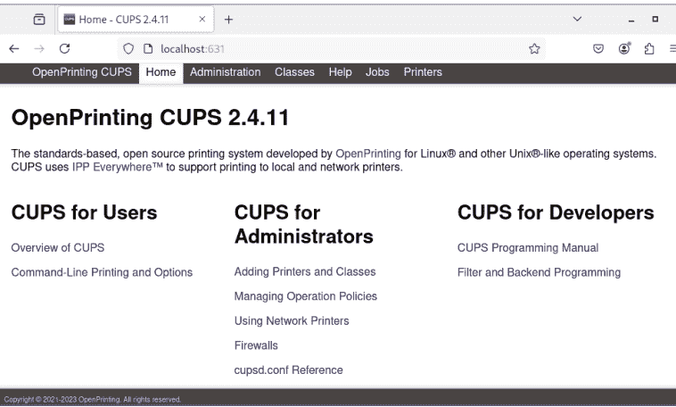

## OpenPrinting CUPS 2.4.11

由 OpenPrinting 为 Linux® 和其他 Unix® 操作系统开发的标准开源打印系统。CUPS 使用 IPP. Everywhere™ 来支持向本地和网络打印机打印。

| 用户的 CUPS | 管理员的 CUPS | 开发者的 CUPS |
|---|---|---|
| CUPS 概述 | 添加打印机和类 | CUPS 编程手册 |
| 命令行打印和选项 | 管理操作策略 | 过滤器和后端编程 |
| | 使用网络打印机 | |
| | | 防火墙 |
| | | cupsd.conf 参考 |

390

## 第 16 章：配置打印服务器

## 允许远程打印

默认情况下，基于网页的 CUPS 管理仅从本地主机可用。要从另一台计算机访问基于网页的 CUPS 管理，请从 CUPS 主页面：

1. 选择管理（Administration）选项卡。
2. 勾选允许远程管理（Allow Remote Administration）复选框。
3. 点击更改设置（Change Settings）按钮。

打开计算机的防火墙以允许对 TCP 端口 631 的连接以便访问该服务。之后，从任何可以访问本地网络的浏览器，通过访问 CUPS 服务器的端口 631 来添加 CUPS 管理页面（例如，http://host.example.com:631）。

你可能需要重启 CUPS 以使更改生效：`systemctl restart cups`。如果你尚未以 root 用户身份运行浏览器，还必须输入 root 或管理员用户的用户名和密码。

## 添加未自动检测的打印机

要配置未自动检测的打印机，请使用“添加新打印机”屏幕。在显示管理界面，你可以按照以下方式添加打印机：

1. 点击添加打印机（Add Printer）按钮。进入“添加新打印机”屏幕。
2. 选择打印机连接的设备。打印机可以本地连接到计算机上的并行端口、SCSI 或 USB 端口。或者，你可以为 Apple 打印机选择网络连接类型（AppContext 或 HP JetDirect）、互联网打印协议（`http`、`https`、`ipps` 或 `ipp`）或 Windows 打印机（使用 Samba 或 SMB）。如果已连接的打印机显示在列表中列表中，你只需选择该打印机即可。
3. 当系统提示提供更多信息时，你可能需要进一步描述与打印机的连接。例如，你可能会被询问 IPP 或 Samba 打印机的网络地址。
4. 为打印机输入名称、位置和描述；如果你想共享有关打印机的信息，请点击继续（Continue）。
5. 选择打印机驱动方法。如果在列表中没有看到你的打印机制造商，请为 PostScript 打印机选择 PostScript 或为 PCL 打印机选择 HP。对于你选择的制造商，可以选择特定的型号。
6. 设置选项。如果被要求为打印机设置选项，可以进行。然后选择设置打印机选项（Set Printer Options）继续。
7. 你的打印机应该可以使用了。如果打印机添加成功，点击打印机名称以显示新打印机页面；从打印机页面，你可以选择维护（Maintenance）或管理（Administration）来打印测试页或修改打印机配置。

# 部分：成为 Linux 服务器管理员

完成基础打印机配置后，你现在可以对打印机进行进一步操作了。

以下是你可以做的一些示例：

- **列出打印任务** 点击“显示所有任务”（Show All Jobs）查看此服务器配置的任何打印机上当前活跃的打印任务。点击“显示已完成任务”（Show Completed Jobs）查看已打印任务的信息。

- **创建打印机类** 点击管理（Administration）选项卡，选择“添加类”（Add Class），并为打印机类指定名称、描述和位置。从配置在服务器上的打印机（成员）列表中，选择一个将其放入此类中。

- **取消或移动打印任务** 如果你不小心打印了一份 100 页的任务，或者打印机正……（注意：OCR 文本截断/碎片化，保持连贯性）。

## 第 16 章：配置打印服务器

### 使用打印设置窗口

如果你使用的是 Fedora 或 Ubuntu，可以使用打印设置窗口进行设置。安装软件包后（`dnf install system-config-printer`），打印打印设置窗口。该工具允许你添加和删除打印机并编辑打印机属性。它还可以让你测试页面。

## 添加本地打印机

要在最新版本的 Fedora GNOME 桌面上添加本地打印机，请按照以下步骤操作：

1. **输入以下命令打开打印设置窗口：**

   `system-config-printer &`

   打印窗口出现。

2. **点击添加（Add）。**（如果提示，点击调整防火墙按钮以允许访问打印端口 631。）新打印机窗口出现。

3. **如果未检测到所需的打印机，选择它并点击继续。** 如果未检测到，选择连接打印机的设备（LPT #1 和串口 #1 分别是并行端口和串口）并点击继续。（在 shell 中运行 `lpinfo -v` 查看打印机连接类型。）

4. **要使用已安装的驱动程序，选择“从数据库选择打印机”（Select Printer From Database），然后选择你的打印机制造商。** 你也可以选择 PPD 文件并提供自己的 PPD 文件（例如，如果你有一个 Linux 不支持的打印机，并且有随打印机提供的驱动程序）；（PPD 代表 PostScript Printer机描述。）点击继续查看可以从中选择的打印机型号列表。

## 第四部分：成为 Linux 服务器管理员

> 提示
>
> 如果您的打印机没有出现在列表中，但包含 PCL（HP 打印机控制语言），请尝试选择其中某一个 HP 打印机（例如 HP LaserJet）。如果您的打印机支持 PostScript，请从列表中选择 PostScript 打印机。选择原始打印队列（Raw Print Queue）允许并将已针对特定打印机类型格式化的文档发送到特定设备。

5. 选择好打印机型号后，点击您想要使用的驱动程序，然后点击“下一步”（Forward）继续。

6. 添加以下信息并点击“下一步”：

    a. 打印机名称：添加您用于识别打印机的名称。该名称必须以字母开头，但在初始字母之后，可以包含字母、数字、连字符 (-) 和下划线 (_) 的组合。例如，在名为 maple 的计算机上的 HP 打印机可以命名为 hp-maple。

    b. 描述：添加几个单词描述您的打印机，例如其功能（如：支持 PCL 和 PS 的 HP LaserJet 2100M）。

    c. 位置：添加一些描述打印机位置的单词（例如：“205 室，咖啡机旁”）。

7. 打印机添加后，如果提示打印测试页，请点击“否”。新的打印机项将出现在“打印设置”窗口中。双击打印机以查看打印机的“属性”窗口，如图所示。

### 图 16.3

添加打印机后的打印属性。

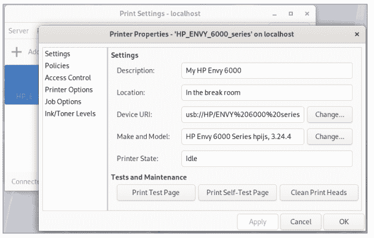

## 第 16 章：配置打印服务器

8. 如果您想将该打印机设置为默认打印机，请在打印设置窗口中右键点击该打印机并选择“设置为默认值”。弹出的窗口让您选择是将打印机设置为系统级还是个人账户级。如果您添加了其他打印机，可以通过选择您想要的打印机并选择“设置为默认值”来更改默认打印机。

9. 确保打印功能正常。打开终端窗口并使用 `lp` 命令打印文件（例如 `lp /etc/hosts`）。（如果您想与网络上的其他计算机共享此打印机，请参考本章稍后的“配置打印服务器”部分。）

### 编辑本地打印机

在双击您想要配置的打印机后，从菜单选项中更改其配置：

**设置（Settings）：** 描述、位置、设备 URI 以及制造和型号，决定了在此对话框中显示的详细程度。

**策略（Policies）：** 点击“策略”选择以下项目：

**状态（State）：** 勾选复选框指示打印机是否将打印队列中的作业（启用）、接受新的打印作业（接受作业）以及是否可以与与您的计算机通信的其他计算机共享（共享）。您还必须选择“服务器设置”并勾选“连接到此系统的发布者”框，打印机才能接受来自其他人的打印作业。

**策略（Policies）：** 在发生错误的情况下，停止打印机（stop-printer）会导致所有打印停止。您也可以选择在发生错误时丢弃作业（abort-job）或重试作业（retry-job）。

**横幅（Banner）：** 默认不打印起始或结束横幅页。可以选择包含*机密*、*内部资料*等文本的起始或结束横幅页。

**访问控制（Access Control）：** 如果您的打印机是共享打印机，您可以选择此窗口创建一个列表，允许所有用户访问打印机（拒绝所有其他用户）或拒绝用户访问打印机（允许所有）。

**打印机选项（Printer Options）：** 点击“打印机选项”设置打印机驱动程序相关选项的默认值。所有选项对于不同的打印机都是不同的。当有人打印文档时，其中许多选项可以被覆盖。以下是您（拥有或可能没有）拥有的的一些选项示例：

**水印（Watermark）：** 提供水印设置，允许您在页面上添加和更改水印。默认情况下，水印和叠加是关闭的（无）。通过选择“水印（在文本后）”或“叠加（在文本上）”，您可以设置其他水印设置来确定如何处理水印和叠加。水印可以出现在每页（全部）或仅出现在第一页（仅第一页）。选择“水印文本”来选择用于水印或叠加的单词（草稿、副本、机密、最终版等）。然后，您可以选择水印或叠加的字体类型、大小、样式和强度。

**分率增强（Resolution Enhancement）：** 您可以使用打印机的当前设置，或选择开启或关闭分率增强。

**页面大小（Page Size）：** 默认是美式信纸尺寸，但也可以请求打印机打印法律尺寸、信封、ISO A4 标准或其他几种页面大小。

**介质源（Media Source）：** 选择从哪个纸盒打印。选择纸盒 1 以手动插入纸张。

**灰阶（Levels of Gray）：** 选择使用打印机当前的灰阶，或开启增强的标准灰阶级。

**分率（Resolution）：** 选择默认打印分率（如每英寸 300、600 或 1,200 点）。分率越高质量越高，但打印时间越长。

**节能模式（EcoMode）：** 使用打印机的当前设置，或选择节省墨盒的模式或最高质量的模式。

**作业选项（Job Options）：** 点击“作业选项”设置如果应用程序作业未设置则打印机将使用的常用默认选项。包括常用选项（副本数、方向、每页页）、图像选项。

**墨水/墨盒水平（Ink/Toner Levels）：** 点击“墨水/墨盒水平”查看墨水或墨盒。

### 配置远程打印机

要使用网络上可用的打印机，必须识别该打印机。操作如下：

1. 从 GNOME 活动中输入“打印设置”并按回车。

2. 点击“添加”。出现新打印窗口。

3. 根据您计算机上的端口类型，选择以下项：

    - LPT #1：用于连接到并行端口的打印机。
    - 串口 #1：用于连接到串口的打印机。
    - 网络打印机：在此标题下，您可以通过主机名搜索，或使用 URI：
        - 查找网络打印机：无需输入打印机 URI，可以搜索主机。
        - AppleSocket/HP JetDirect：用于 JetDirect 打印机。
        - Internet打印协议 (IPP)：用于 CUPS 或其他 IP 打印机。大多数打印机属于此类。
        - Internet打印协议 (HTTPS)：用于安全连接的 CUPS 或其他 IP 打印机（需要证书）。
        - LPD/LPR：用于 UNIX 打印机。
        - 通过 SAMBA 的 Windows 打印机：用于 Windows 系统。

按照相应的章节完成后续操作。

# 第四部分：成为 Linux 服务器管理员

> 提示
>
> 如果你发送到测试打印机的打印作业被拒绝，可能是打印服务器计算机未允许你访问打印机。请要求远程计算机的管理员将你的主机名添加到 `/etc/lpd.perms` 文件中。（输入 `lpstat -d printer` 查看你的打印作业状态。）

# 添加 Windows (SMB) 打印机

使你的计算机能够访问 SMB 打印机（Windows 打印服务），需要在“选择连接”（Select Connection）窗口中为打印机输入条目。

当你在选择在“打印设置”（Print Settings）窗口中添加 Windows 打印机（通过 Samba 的 Windows 打印机）时，浏览以查看网络上检测到的提供 SMB 服务（文件和打印服务）的计算机列表。你可以按照以下步骤在此窗口配置打印机：

1. 输入打印机的 URI，排除开头的 `smb://`。例如，你可能输入 `/host/myprinter` 或 `/mygroup/host/myprinter`。
2. 选择“需要身份验证时提示用户”（Prompt user if authentication is required）或“现在设置身份验证信息”（Set authentication details now）。
3. 如果选择“现在设置身份验证信息”，填写访问 SMB 打印机所需的用户名和密码；然后点击“验证”（Verify）检查你是否可以通过服务器的身份验证。
4. 点击“下一步”（Forward）继续。

或者，你可以识别未出现在服务器列表中的服务器。输入创建包含以下信息的 SMB URI 所需的信息：

工作组（Workgroup）：这是分配给 SMB 服务器的网络名称。在所有情况下并不需要使用工作组名称。


## 服务器（Server）

这是计算机的 BIOS 名称或 IP 地址，可能与其 TCP/IP 名称相同也可能不同。为了将此名称转换为访问 SMB 主机所需的地址，Samba 会检查几个可能将该名称分配给 IP 地址的地方。Samba 会按照所示顺序检查以下位置，直到找到匹配项为止：`/etc/hosts` 文件、本地的 `/etc/hosts` 文件、网络上的 WINS 服务器，以及对每个本地网络接口的广播响应以解析该名称。

## 共享（Share）

这是打印机与远程计算机共享时使用的名称。它可能与 SMB 打印机本地用户识别该打印机的名称不同。

## 用户（User）

SMB 服务器系统需要用户名来让你访问 SMB 打印机。如果你基于共享级而非用户级访问控制对打印机进行验证，则不需要用户名。在共享级访问下，你可以为每个共享打印机或文件系统添加密码。

## 密码

根据所使用的访问控制类型，使用与 SMB 用户名或共享资源关联的密码。

> **注意**
>
> 当你为 SMB 输入用户名和密码时，这些信息将以未加密的形式存储在 `/etc/cups/printers.conf` 文件中。请确保该文件仅对 root 用户可读。

以下是你可以添加到 SMB 的一个 SMB URI 示例：`//jjones:my9passwd@FSTREET/NS1/hp`

这里的 URI 标识了用户名 (`jjones`)、用户密码 (`my9passwd`)、工作组 (`FSTREET`)、服务器 (`ns1`) 和打印机队列 (`hp`)。

按照处理本地打印机的方法完成剩余操作（请参见本章早前的“添加本地打印机”部分）。

如果一切设置正确，你可以使用标准的 `lp` 命令将文件打印到打印机。使用此示例，采用以下格式：

```bash
$ cat file.ps | lp -P NS1-PS
```

> **提示**
>
> 如果你收到失败消息，请确保你正在打印的计算机是打印机 NS1 hp 示例，你可以使用 `lpstat -L NS1 -U jjones`。然后输入密码（在此情况下为 `my9passwd`），`-L` 请求有关服务器的信息；`-U jjones` 表示以 jjones 身份登录。如果你在输入密码后获得有效的名称响应，你应该看到该服务器的共享打印机和文件列表。检查名称并重试。

# 第 16 章：配置打印服务器

## 使用 CUPS 打印

诸如 CUPS Web 界面管理和“打印设置”等工具有效地隐藏了底层的 CUPS 设置。有时，你可能想直接与 CUPS 自带的工具和配置文件工作。接下来的章节描述了如何使用特殊的 CUPS 特性。

## 配置 CUPS 服务器 (cupsd.conf)

`cupsd` 进程监听对 CUPS 打印服务器的请求，并根据 `/etc/cups/cupsd.conf` 文件中的设置响应这些请求。`cupsd.conf` 文件中的配置变量与 Apache 文件（`http.conf` 或 `apache2.conf`）中的格式相同。输入 `man cupsd.conf` 查看任何设置的详细信息。

“打印设置”窗口向 `cupsd.conf` 文件添加访问信息。对于其他 Linux 系统或如果你的服务器上没有桌面，你可能需要手动配置 `cupsd.conf` 文件。你可以逐步检查 `cupsd.conf` 文件以进一步调整你的 CUPS 服务器。大多数设置是可选的或可以保持默认值。让我们看看你在 `cupsd.conf` 文件中使用的某些设置。

默认没有分类。通过将分类设置为 `topsecret`（机密），你可以在通过打印服务器的所有页面上显示“Top Secret”：

```text
Classification topsecret
```

你可以用其他分类替换 `topsecret`，包括 `classified`、`confidential`、`secret` 和 `unspecified`。

浏览（browsing）术语是指本地网络上广播打印机信息并监听其他打印服务器的行为。CUPS 与名为 `DNS-SD` 的服务配合，该服务广播打印机的可用性。在 Fedora 中，默认开启浏览，而在 Ubuntu 中是关闭的。

要启用基于 Web 的管理并在局域网上共享打印机，可以将 `cupsd` 设置为监听 631 端口。在 Ubuntu 中，它只监听本地接口。这是让多个局域网的用户发现并使用打印机的方法。从“打印设置”窗口创建的 CUPS 访问可能如下：

```
<Location /printers/ns1-hpl>
Order Deny,Allow
Deny All
Allow 127.0.0.1
</Location>
```

在这里，`ns1-hpl` 打印机仅允许主机（`127.0.0.1`）访问。

## 启动 CUPS 服务器

在最新的 Ubuntu、Fedora 和 RHEL 系统中，你使用 `systemctl` 命令代替 `service` 来启动和停止服务：

```bash
systemctl status cups.service
* cups.service - CUPS Printing Service
  Loaded: loaded (/usr/lib/systemd/system/cups.service); enabled; enabled;
  preset: (disabled)
  Drop-In: /usr/lib/systemd/system/service.d/10-timeout-abort.conf
  Active: active (running) since 2022-01-19 11:03:04 EST; 7min ago
  TriggeredBy:
    cups.socket
    cups.path
  Docs: man:cupsd(8)
  Main PID: 9942 (cupsd)
  Status: Scheduler is running...
  Memory: 19.0M (peak: 80.7M)
  CPU: 4.000S
  CGroup: system.slice/system-cups.slice/cups.service
    └9942/usr/bin/cupsd
```

由于状态显示 cupsd 守护进程活动 PID 为 9942，你可以判断 CUPS 服务正在运行。如果服务未运行，你可以按照以下方式启动 CUPS 服务：

```bash
systemctl start cups.service
```

有关处理服务的 `systemctl` 和 `service` 命令的更多信息，请参见第 15 章“启动和停止服务”。

## 手动配置 CUPS 打印机选项

如果你的 Linux 没有配置 CUPS 的图形方法，你可以直接编辑配置文件。例如，当从“打印设置”创建新打印机时，它被定义在 `/etc/cups/printers.conf` 文件中。如下所示的打印机条目：

```
<DefaultPrinter>
Info HP LaserJet 2100M
Location HP LaserJet 2100M in hall closet
DeviceURI parallel:/lp0
State Idle
Accepting Yes
Shared No
JobSheets none none
QuotaPeriod 0
PageLimit 0
KLimit 0
</DefaultPrinter>
```

这是一个本地打印机的示例，它作为本地系统的默认打印机。设置 `Shared No` 值，是因为该打印机目前仅在本地系统可用。最有趣的信息与 `DeviceURI` 有关，它显示打印机连接到并行端口 `/dev/lp0`。状态为 `Idle`（空闲，准备好接受打印任务），`Accepting` 值为 `Yes`（打印机默认接受打印任务）。

`DeviceURI` 有多个值，用于识别打印机的名称，由于这些值反映了打印机连接的位置。以下是 `printers.conf` 文件中列出的示例：

```
DeviceURI parallel:/dev/lp1
DeviceURI serial:/dev/ttyS1?baud=38400&size=8&parity=none&flow=soft
DeviceURI scsi:/dev/scsi/sc64
DeviceURI usb://hostname:port
DeviceURI socket://hostname:port
DeviceURI tftp://hostname/
DeviceURI ftp://hostname/path
DeviceURI http://hostname[:port]]/path
DeviceURI lpp://hostname/path
DeviceURI smb://hostname/printer
```

前四个示例显示了本地打印机（并行、串口和 USB）的形式。其他示例用于远程主机。在每种情况下，`hostname` 可以是主机名或 IP 地址。端口号或路径标识了每个打印机在主机上的位置。例如，`hostname` 可以是 `myhost.example.com:631`，`path` 可以替换为你喜欢的任何名称，例如 `printers/myprinter`。

### 使用打印命令

为了与旧版本的 UNIX 和 Linux 打印设施保持兼容，CUPS 支持许多用于打印工作的命令。使用 CUPS 进行命令行打印可以通过 `lp` 命令完成。LibreOffice、OpenOffice 和 AbiWord 等文字处理应用程序已配置为使用此进行打印。

你可以使用“打印设置”窗口为每个打印机定义所需的过滤器，以便文本能够正确格式化。`lp` 命令的选项可以添加过滤器来正确处理文本。管理打印文档的其他命令包括 `lpq`（查看打印队列内容）、`lprm`（从队列删除打印任务）和 `lpstat -t`（控制打印机）。

#### 使用 Lp 打印

你可以使用 `lp` 命令将文档打印到本地和远程打印机（前提是打印机已本地配置）。文档文件可以添加到 `lp` 命令行的末尾，或者通过管道 (`|`) 指导到 `lp` 命令。这是一个简单的 `lp` 命令示例：

```bash
$ lp doc1.ps
```

当你使用 `lp` 指定文档文件时，输出将被定向到默认打印机。作为普通用户，可以通过设置 `PRINTER` 变量的值来更改默认打印机。通常，你会将 `PRINTER` 变量添加到启动文件中，例如 `$HOME/.bashrc`。例如，在 `.bashrc` 文件中添加以下行可以将你的默认打印机设置为 `lp3`：

```bash
export PRINTER=lp3
```

要覆盖默认打印机，请在 `lp` 命令命令行指定特定的打印机。以下示例使用 `-P` 选项选择不同的打印机：

```bash
$ lp -P canyons doc1.ps
```

`lp` 命令具有多种选项，允许 `lp` 解析并格式化多种不同的文档。这些包括 `-n num`，其中 `num` 被替换为打印份数（1 到 100），以及 `-1`（这会导致文档以原始模式发送，假设该文档已经格式化）。要了解更多选项，请输入 `man lp`。

#### 列出状态 lpstat -t

我们使用 `lpstat -t` 命令列出打印机状态。这是一个示例：

```bash
$ /usr/sbin/lpstat -t
printer hp disabled since Wed 29 Jan 2025 10:53:34 AM EDT
printer deskjet-555 is enabled since Wed 29 Jan 2025 10:53:34 AM EDT
```

此输出显示了两个激活的打印机。`hp` 打印机目前已禁用（离线）。`deskjet-555` 已启用。

#### 使用 lprm 移除任务

用户可以使用 `lprm` 命令从队列中删除自己的打印任务。单独在命令行中使用时，`lprm` 会从默认打印机删除用户所有的打印任务。要从特定打印机删除，使用 `-P` 选项，如下：

```bash
$ lprm -P lp0
```

要删除当前用户的所有打印任务，请输入以下：

```bash
$ lprm -u
```

root 用户可以通过指定 `lprm` 命令命令行来删除特定用户的所有打印任务。例如，要删除用户 `mike` 的打印任务，root 用户输入：

```bash
# lprm -U mike
```

要从队列中移除单个打印任务，请在 `lprm` 命令命令行中指定其任务号。要查找任务号，请输入 `lpq` 命令。其输出可能如下所示：

```bash
# lpq
printer is ready and printing
Rank Owner Job Files Total Size Size
active root 133 /home/jake/prl 402
```

## 配置服务器

（以 root 用户身份）按照如下方式进行此检查。第一个示例显示 `cupsd` 仅监听在本地主机（`127.0.0.1:631`）；第二个示例显示 `cupsd` 监听在所有接口（`0.0.0.0:631`）：

```bash
# ss -tupln | grep 631
tcp    0   127.0.0.1:631  0.0.0.0:*      LISTEN  6492/cupsd

# ss -tupln | grep 631
tcp    0   0.0.0.0:631    0.0.0.0:*      LISTEN  6492/cupsd
```

对共享打印机的更改在 `/etc/cups` 目录下的 `cupsd.conf` 和 `printers.conf` 文件中。

## 配置共享 Samba 打印机

您的 Linux 打印机可以配置为共享 SMB 打印机，这样它们在 Windows 系统上看起来就是可用。要像 Samba (SMB) 打印机一样共享您的打印机，只需按照第 19 章“配置 Windows 文件共享 (Samba 服务器)”中的描述配置 Samba 服务器设置。默认情况下，所有打印机都应在本地网络上共享。下一节将显示生成的设置样式，以及您可能想要更改它们。

## 理解用于打印的 smb.conf

当配置 Samba 时，会构建 `/etc/samba/smb.conf` 文件以启用所有配置的打印机。以下是 `smb.conf` 文件中与打印机共享相关的几行：

```
[global]
```


# 第 16 章：配置打印服务器

```ini
printing = cups
printcap name = cups
load printers = yes
cups options = raw
```

```ini
[printers]
comment = All Printers
path = /var/tmp
printable = Yes
create mask = 0600
browseable = No
```

当选项设置为 `raw` 时，Samba 假设打印文件在到达打印服务器之前已经过格式化。这允许 Linux 或 Windows 客户端提供自己的打印驱动程序。

最后几行是实际的打印机。通过将 `browseable` 选项从 `No` 改为 `Yes`，您赋予了用户打印到所有打印机（`printable = Yes`）的能力。您还可以在 Samba 服务器上存储 Windows 原生驱动程序。当 Windows 客户端使用您的打印机时，驱动程序会自动变为可用。您不需要从供应商网站下载驱动程序。

## 启用打印机驱动共享

要启用打印机驱动共享，添加一个名为 `print$` 的 Samba 共享，如下：

```ini
[print$]
comment = Printer Drivers
path = /var/lib/samba/drivers
guest ok = no
read only = yes
write list = chris, david
```

在共享可用后，您可以开始将 Windows 打印机驱动程序复制到 `/var/lib/samba/drivers` 目录。

# 设置 SMB 客户端

如果您在 Linux 计算机上配置了 Samba 打印机，很有可能您想将其与 Windows 客户端共享。如果您的计算机上的 Samba 设置得恰当，并且客户端计算机可以通过网络访问它，用户在查找和使用您的打印机时应该不会遇到困难。

对于 Windows 系统，点击“开始 ➜ 打印机和扫描仪”。选择“添加打印机或扫描仪”，并从出现的列表中选择打印机进行配置。选择“添加设备”使其变为可用。

当您的共享打印机出现在窗口中后，通过打开（双击）打印机图标进行配置。一条消息告诉您，在使用打印机之前必须设置它。点击“是”继续为本地使用配置打印机。将出现“添加打印机向导”。根据您打算使用打印机的方式回答问题并添加适当的驱动程序。完成后，打印机将出现在打印机窗口中。

## 总结

在当今的业务网络中，提供网络打印服务至关重要。通过使用一些网络连接设备，您可以将打印机支出集中在多个用户可以共享的高质量设备上，而不是许多低成本设备。此外，位于中心位置的打印机可以使打印机更容易维护，同时仍让每个人都能完成打印任务。

今天几乎每个主要的 Linux 发行版中的默认打印服务都是通用 UNIX 打印系统 (CUPS)。任何带有 CUPS 的 Linux 系统都有用于配置 CUPS 打印的 Web 管理界面。它还在 `/etc/cups` 目录中提供了配置文件，用于配置打印机和 CUPS 服务（`cupsd` 守护进程）。

在 RHEL、Fedora、Ubuntu 和其他 Linux 系统中，您可以使用打印配置窗口配置打印机。多种驱动程序使得打印不同类型的打印机以及连接到网络上计算机的打印机成为可能。

# 第四部分：成为 Linux 服务器管理员

您可以将您的计算机配置为 Linux 打印服务器，还可以让您的计算机模拟 SMB (Windows) 打印服务器。在网络配置恰当并安装了本地打印机后，作为 UNIX 或 SMB 打印服务器通过网络共享打印机是非常复杂的。

## 练习

使用这些练习来测试您在 Linux 中配置打印机的知识。这些任务假设您正在运行 Fedora、Red Hat Enterprise Linux 或 Ubuntu 系统（尽管某些任务在其他 Linux 系统上同样有效）。如果您遇到困难，附录 B 显示任务（尽管在 Linux 中，您可以通过多种方式完成任务）。

1. 使用打印设置窗口（`system-config-printer` 包）向您的系统添加一个名为 `myprinter` 的新打印机。（设置新打印机的打印队列时，打印机并不一定已连接）。将其配置为连接到本地串口、LPT 或其他端口的通用 PostScript 打印机。
2. 使用 `lpstat -t` 命令查看状态。
3. 使用 `lp` 命令打印 `/etc/hosts` 文件。
4. 检查队列中的打印任务。
5. 移除队列中的打印任务。
6. 使用打印窗口设置基础设置，以便本地网络上的其他系统可以打印到您的打印机。
7. 允许通过浏览器对您的系统进行远程管理。
8. 通过浏览器访问端口 631 进入运行打印服务器的 Linux 系统，演示远程管理。
9. 使用 `ss` 命令查看 `cupsd` 守护进程监听在哪些地址。
10. 从您的系统中删除 `myprinter` 打印项。

# 第 17 章：配置 Web 服务器

## 本章内容

- 安装 Apache Web 服务器
- 配置 Apache
- 使用 iptables 和 SELinux 安全 Apache
- 创建虚拟主机
- 构建安全的 (HTTPS) 网站
- 检查 Apache 错误

Web 服务器负责提供您每天在互联网上查看的内容。到目前，最流行的 Web 服务器是 Apache HTTP 服务器，它由 Apache 软件基金会（http://apache.org）赞助。由于 Apache 是一个开源项目，在每个主要的 Linux 发行版中都可用，包括 Fedora、RHEL 和 Ubuntu。

您可以在几分钟内在 Linux 中配置一个基础 Web 服务器。然而，您可以以无数种方式配置您的 Apache Web 服务器。您可以配置 Apache Web 服务器为多个域名提供服务（虚拟主机）、提供加密通信（HTTPS），并使用不同的身份验证进行部分或全部加密。

本章将介绍安装和配置 Apache Web 服务器的步骤。这些步骤包括安全服务器的操作以及使用各种模块将不同的身份验证方法和脚本语言集成到 Web 服务器中。然后我将描述如何生成证书以创建 HTTPS Secure Sockets Layer (SSL) 网站。

虽然本章的大部分内容是单个 Apache Web 服务器的功能，但运行生产级 Web 服务器还有其他考虑因素。我将在章末尾描述其中一些。

## Apache Web 服务器

Apache HTTPD（也称为 Apache HTTP 服务器）提供了与客户端浏览器通信的服务。守护进程 (`httpd`) 在您的服务器后台运行并等待处理来自 Web 客户端的请求。网络浏览器为 HTTP 守护进程提供这些连接并发送请求，守护进程解释这些请求，并返回适当的数据（例如网页或其他内容）。

Apache HTTPD 包含一个接口，允许模块接入进程以处理请求的特定部分。除外，模块还用于处理脚本语言（如 Perl、Ruby、Python 和 PHP）的处理；Web 文档中的处理，以及为客户端与服务器之间的连接添加加密。

Apache 成为来自伊利诺伊大学厄巴纳-香槟分校国家超级计算机应用中心（NCSA）的针对 HTTP 守护进程的补丁和改进集合。NCSA HTTP 守护进程是当时最流行的服务器，但在其作者 Rob McCool 于 1994 年中旬离开 NCSA 后，它开始显示出年代久远的迹象。

> **注意**
> 另一个来自 NCSA 的项目是 Mosaic。大多数网络浏览器的起源都可以追溯到 Mosaic。

1995 年，一组开发者组成了 Apache Group，并开始对 NCSA HTTPD 代码库进行大量的修改。Apache 很快取代了 NCSA HTTPD 成为最流行的 Web 服务器。还有其他竞争者，其中 nginx 处于领先地位。

Apache Group 后来还成立了 Apache 软件基金会 (ASF)。随着 ASF 新项目的启动...

## 获取并安装您的 Web 服务器

尽管 Apache 在每个主要的 Linux 发行版中都可用，但它通常以不同的方式打包。在某些情况下，启动一个简单的 Apache 服务器只需要包含 Apache 守护进程本身（`/usr/sbin/httpd`）及其相关文件的包。在 Fedora、RHEL 和其他系统中，apache 服务器通过 `httpd` 软件包提供。

## 理解 httpd-core 软件包

在 Fedora 或 RHEL 中安装 `httpd-core` 软件包之前，请务必使用 `yumdownloader` 命令（来自 `dnf-utils` 软件包）下载该包，并运行几个命令查看其内容：

```bash
# yumdownloader httpd-core
# rpm -qpi httpd-core*rpm
```

```text
Name        : httpd-core
Version     : 2.4.64
Release     : 2.fc42
Architecture: x86_64
Install Date: (not installed)
Group       : Unspecified
Size        : 4701807
License     : Apache-2.0 (BSD-3-Clause AND metamail AND HPND-fells-variant AND Spencer-94)
Signature   : RSA/SHA256, Thu 17 Jul 2025 09:47:36 AM EDT
Key ID      : 8c4a9161f635544
Source RPM  : httpd-4.6.2-fc42.src.rpm
Build Date  : Thu 17 Jul 2025 09:35:22 AM EDT
Build Host  : Thu 17 Jul 2025 09:35:22 AM EDT
Packager    : Fedora Project
Vendor      : Fedora Project
URL         : https://httpd.apache.org/
BUG URL     : https://bugzilla.redhat.com/
Summary     : minimal core
```

描述：
`httpd-core` 软件包包含核心的 http 二进制文件。
`yumdownloader` 命令将 `httpd-core` 软件包的最新版本下载到当前目录。`rpm -qpi` 命令查询你下载的 `httpd-core` RPM 软件包的信息。你可以看到该包是由 Fedora 项目创建的，并且它是 Apache HTTP 服务器软件包。接下来，查看包内部以查看配置文件（`-qpc`）：

```bash
# rpm -qpc httpd-core*rpm
```

```text
/etc/httpd/conf.d/autoindex.conf
/etc/httpd/conf.d/userdir.conf
/etc/httpd/conf.d/welcome.conf
/etc/httpd/conf.modules.d/00-base.conf
/etc/httpd/conf.modules.d/00-dav.conf
/etc/httpd/conf/httpd.conf
/etc/httpd/conf/magic
/etc/logrotate.d/httpd
/etc/sysconfig/htcacheclean
```

对于 Apache 来说，主配置文件是 `/etc/httpd/conf/httpd.conf`。`welcome.conf` 文件定义了网站的默认页面，直到你添加了一些内容。`magic` 文件定义了服务器在尝试打开文件时可以用以判断文件类型的规则。

`/etc/logrotate.d/httpd` 文件定义了 Apache 生成的日志如何轮转。`/usr/lib/tmpfiles.d/httpd.conf` 文件定义了一个包含临时运行时文件的目录（无需更改该文件）。

某些 Apache 会将配置文件（`*.conf`）放入 `/etc/httpd/conf.modules.d/` 目录。该目录中任何以 `.conf` 结尾的文件都会被引入主 `httpd.conf` 文件并用于配置 Apache。绝大多数带配置文件的模块包会将这些配置文件放在 `/etc/httpd/conf.d` 目录。例如，`mod_ssl`（用于 Web 服务器）和 `mod_python`（用于解释 Python 代码）模块在 `/etc/httpd/conf.d` 目录下分别有名为 `ssl.conf` 和 `python.conf` 的配置文件。

你可以安装 `httpd` 软件包来开始设置你的服务器。然而，你可能更倾向于添加一些与 `httpd` 组关联的其他软件包。这样做的方法一种是安装整个 Web Server（在 Fedora 中）或 Basic Web Server 组（在 RHEL 中），例如所示：

```bash
# dnf groupinstall "Web Server"
```

除了安装一些 `httpd-core` 的周边软件包（如 `syslog`、`logrotate` 等）外，Fedora 的 `Web Server` 组中还有其他从 `httpd-core` 默认提供的软件包：
- `httpd-manual`：填充了 `/var/www/manual` 目录。启动 Apache 服务后（见后文），你可以通过本地机器的浏览器输入 `http://localhost/manual` 访问这组手册。除了 `localhost`，可以使用系统的完全域名或 IP 地址。如图 17.1 所示，会出现 Apache 手册页。
- `mod_ssl`：包含了 Web 服务器使用 SSL 和传输层安全 (TLS) 协议提供连接所需的模块和配置文件。如果你需要对在线购物或其他数据进行加密通信，这些功能是必要的。配置文件位于 `/etc/httpd/conf.d/ssl.conf`。
- `crypto`：提供 SSL/TLS 所需的加密库。
- `mod_perl`：允许 Apache 在 Web 文档中执行 Perl 脚本。
- `mod_php`：允许 Apache 处理 PHP 脚本。
- `mod_auth_basic`：提供基本身份验证。
- `mod_authz_ip`：允许基于 IP 地址的访问控制。
- `mod_rewrite`：提供强大的 URL 重写功能。
- `mod_headers`：允许操作 HTTP 响应头。
- `mod_proxy`：允许 Apache 作为代理服务器。
- `mod_proxy_http`：提供 HTTP 代理支持。
- `mod_status`：提供监控 Apache 的状态页面。
- `mod_info`：提供服务器配置信息。
- `mod_cache`：提供缓存内容的服务。

## 安装 Apache

尽管 Apache 在每个主要的 Linux 发行版中都可用，但它通常以不同的方式打包。某些情况下，启动一个简单的 Apache 服务器只需要包含 Apache 守护进程本身及其相关文件的包。在 Fedora、RHEL 和其他系统中，apache 服务器通过 `httpd` 软件包提供。

你可以安装 `httpd` 软件包来开始设置你的服务器。然而，你可能更倾向于添加一些与 `httpd` 组关联的其他软件包。这样做的方法一种是安装整个 Web Server（在 Fedora 中）或 Basic Web Server 组（在 RHEL 中），例如所示：

```bash
# dnf groupinstall "Web Server"
```

除了安装一些 `httpd-core` 的周边软件包（如 `syslog`、`logrotate` 等）外，Fedora 的 `Web Server` 组中还有其他从 `httpd-core` 默认提供的软件包：
- `httpd-manual`：填充了 `/var/www/manual` 目录。启动 Apache 服务后（见后文），你可以通过本地机器的浏览器输入 `http://localhost/manual` 访问这组手册。除了 `localhost`，可以使用系统的完全域名或 IP 地址。如图 17.1 所示，会出现 Apache 手册页。
- `mod_ssl`：包含了 Web 服务器使用 SSL 和传输层安全 (TLS) 协议提供连接所需的模块和配置文件。如果你需要对在线购物或其他数据进行加密通信，这些功能是必要的。配置文件位于 `/etc/httpd/conf.d/ssl.conf`。
- `crypto`：提供 SSL/TLS 所需的加密库。
- `mod_perl`：允许 Apache 在 Web 文档中执行 Perl 脚本。
- `mod_php`：允许 Apache 处理 PHP 脚本。
- `mod_auth_basic`：提供基本身份验证。
- `mod_authz_ip`：允许基于 IP 地址的访问控制。
- `mod_rewrite`：提供强大的 URL 重写功能。
- `mod_headers`：允许操作 HTTP 响应头。
- `mod_proxy`：允许 Apache 作为代理服务器。
- `mod_proxy_http`：提供 HTTP 代理支持。
- `mod_status`：提供监控 Apache 的状态页面。
- `mod_info`：提供服务器配置信息。
- `mod_cache`：提供缓存内容的服务。

### 启动 Apache

为了让 Apache 服务，你希望服务在开机时启动，并希望立即启动。在 Red Hat Linux（直到 RHEL 6）和旧的 Fedora 发行版中，你可以以 root 身份输入：

```bash
# chkconfig httpd on
# service httpd start
Starting httpd: [ OK ]
```

在最新的 Fedora 和 RHEL 系统中，使用 `systemctl` 启用并启动 `httpd` 服务：

```bash
# systemctl enable httpd.service
# systemctl start httpd.service
```


# systemctl status httpd.service

```text
● httpd.service - The Apache Server
Loaded: loaded (/usr/lib/systemd/system/httpd.service; enabled; preset: disabled)
Drop-In: /usr/lib/systemd/system/timeout-abort.conf
         /etc/systemd/system/httpd.service.d/
           - php-fpm.conf
Active: (running) since 2025-07-28 18:58:36 EDT; 3s ago
Docs: httpd.service(8)
Main PID: 6058 (/usr/bin/httpd)
Status: "Total requests: 10; Idle/Workers 100/0;Requests/sec: 0.00917; Bytes/sec"
Tasks: 231 (limit: 9200)
Memory: 34.5M (peak: 35.3M)
CPU: 1.682s
CGroup: /system.slice/httpd.service
        -6058 /usr/bin/httpd -DFOREGROUND
        -6060 /usr/bin/httpd -DFOREGROUND
```

当 `httpd` 服务启动时，默认会启动五个或六个 `httpd` 守护进程（取决于你的 Linux 系统）以响应 Web 请求。你可以根据 `httpd.conf` 文件中的设置，启动或减少 `httpd` 守护进程的数量（将在本章稍后的“理解 Apache 配置文件”部分描述）。

要更改 `httpd` 守护进程的行为，你可以通过运行 `systemctl edit httpd` 来编辑 `httpd` 服务。

由于存在不同版本的 `httpd`，请检查主页查看可以将哪些选项传递给 `httpd` 守护进程。例如，运行 `systemctl edit httpd` 并添加如下条目：

```ini
[Service]
Environment=OPTIONS='-e debug'
```

保存更改（`Ctrl+O`，`Ctrl+X`）。添加 `-e debug` 会增加日志级别，以便将尽可能多的 Apache 消息发送到日志文件中。重启 `httpd` 服务使更改生效。使用 `ps` 命令确保你的选项已生效：

```bash
$ ps -ef | grep httpd
root     14575     1  0 08:49 ?        00:00:01 /usr/sbin/httpd -e debug -DFOREGROUND
apache   14572 14575  0 08:49 ?        00:00:00 /usr/sbin/httpd -e debug -DFOREGROUND
```

如果你添加了选项（`-e debug`），请记住在调试 Apache 时再次运行 `systemctl edit` 并移除该条目，然后重启服务。一直开启调试模式会迅速填满你的日志文件。

## 第 17 章：配置 Web 服务器

### Apache 安全

为了确保 Apache 安全，你需要了解标准的 Linux 安全功能（权限、所有权、防火墙和增强型 Linux/SELinux）以及 Apache 特有的安全功能。以下章节描述了与 Apache 相关的安全功能。

#### Apache 文件权限和所有权

`httpd` 守护进程以 `apache` 用户和 `apache` 组运行。默认情况下，HTML 内容存储在 `/var/www/html` 目录（由 `httpd.conf` 文件中 `DocumentRoot` 的值决定）。

为了让 `httpd` 守护进程访问内容，需要应用标准的 Linux 权限：如果读取权限不是针对“其他”，则它必须位于 `apache` 用户或组的文件上才能被读取并提供给客户端。同样，守护进程必须遍历才能到达内容的任何目录必须对 `apache` 用户具有执行权限。

虽然你无法以 `apache` 用户身份登录（`/sbin/nologin` 是默认 shell），但你可以以 `root` 身份创建内容并更改其所有权（`chown` 命令）或权限（`chmod` 命令）。然而，通常会添加单独的用户或组账户，以创建对所有人（其他用户）可读、但仅对该特殊用户或组可写的内容。

#### Apache 与防火墙

如果你在 Linux 中锁定了防火墙，则你需要开放几个端口，以便客户端能够通过防火墙与 Apache 通信。标准 Web 服务 (HTTP) 可以通过 TCP 端口 80 访问；安全 Web 服务 (HTTPS) 可以通过 TCP 端口 443 访问（只有在你安装了后文描述的 `mod_ssl` 软件包时，才会出现 443 端口）。

要验证 `httpd` 服务器正在使用哪些端口，请使用 `ss` 命令：

```bash
# ss -tupln | grep httpd
tcp6  0  0 :::80       LISTEN  29169/httpd
tcp6  0  0 :::443      LISTEN  29169/httpd
```

输出显示 `httpd` 守护进程（进程 ID 21969）正在监听所有地址的端口 80 (`:::80`) 和端口 443 (`:::443`)。这两个端口都与 TCP 协议 (`tcp6`) 关联。要在 Fedora 或 Red Hat Enterprise Linux 中开放端口，你需要添加防火墙规则。

在当前的 Fedora 或 RHEL 系统上，你需要安装防火墙并启动防火墙服务。从“活动”屏幕输入“Firewall”并按回车，然后选择“Permanent”（永久）作为配置，选择“public”（公共）区域，并勾选 http 和 https 服务框旁边的复选框。这些端口将立即变为开放。（作为替代方案，你可以使用 Cockpit 从 Networking 选项卡打开端口。）

对于 RHEL 6 或更早的 Fedora 版本，在 `/etc/sysconfig/iptables` 文件中添加规则（在 `DROP` 或 `REJECT` 之前的某个位置），如下：

```bash
-A INPUT -m state --state NEW -m tcp -p tcp --dport 80 -j ACCEPT
-A INPUT -m state --state ESTABLISHED -m tcp -p tcp --dport 443 -j ACCEPT
```

重启 iptables（`service iptables restart`）使规则生效。

一旦端口开放，你就应该能够从本地外部访问你的 Web 服务器。从网络上的另一台计算机，输入你 Web 服务器的主机名或 IP 地址（例如 `https://192.168.1.10`），查看 Apache 测试页面。

#### Apache 与 SELinux

如果启用了增强型 Linux (SELinux)（在 Fedora 和 Red Hat Enterprise Linux 中默认启用），SELinux 会在你的 `httpd` 服务上增加另一层安全保护。从本质上说，SELinux 实际上的作用是保护系统免受可能破解了 `httpd` 守护进程的人的破坏。SELinux 通过创建以下策略来实现这一点：

- 拒绝访问未设置正确文件上下文的文件。对于 SELinux 中的 httpd，配置、文件日志、脚本和其他 httpd 相关的文件有不同的文件上下文。任何未设置正确上下文的文件 `httpd` 守护进程都无法访问。
- 通过将此类功能的布尔值设置为关闭，防止使用不安全的功能，如文件上传和明文身份验证。你可以选择性地开启这些布尔值。

### 理解 Apache 配置文件

`Directory` 标签用于指定文件系统中目录的配置。`Files` 标签用于指定特定文件的配置。`Location` 标签（位置标签）用于指定访问文件或目录的 URI。这与 `Directory`（目录）不同，因为它关联的是请求中包含的地址，而不是文件在驱动器上的实际位置。`Location` 标签的处理是在 `Directory` 和 `Files` 块中的设置进行的。

这些标签的匹配版本——`DirectoryMatch`、`FilesMatch` 和 `LocationMatch`——具有相同的功能，但可以在资源规范中包含正则表达式。`FilesMatch` 和 `LocationMatch` 块分别与 `Files` 和 `Location` 块同时处理。`DirectoryMatch` 块在 `Directory` 块之后被处理。

Apache 还可以配置为处理包含在 `AccessFileName` 中指定的名称的文件（通常设置为 `.htaccess`）中包含的配置选项。配置文件中的指令将应用于其所包含的目录下的所有对象，包括子目录及其内容。访问配置文件的处理与 `Directory` 块同时进行，并使用类似的“最特定”顺序。

访问控制文件对于允许用户更改特定设置而无需访问服务器配置文件非常有用。访问文件中允许的指令由其所包含的目录的 `AllowOverride` 设置决定。某些指令没有意义，因为在尝试访问 URI 时，它们通常会导致“服务器内部错误”消息。`AllowOverride` 选项在下处详细介绍：http://http.apache.org/docs/mod/core.html#allowoverride。

`Location` 块和访问控制文件中常见的三个指令是 `DirectoryIndex`、`Options` 和 `ErrorDocument`：

- `DirectoryIndex` 告诉 Apache 当 URI 包含目录但不包含文件名时应加载哪个文件。此指令在 `Files` 块中不起作用。
- `Options` 用于调整 Apache 处理目录内文件的方式。`ExecCGI` 选项告诉 Apache 文件可以作为 CGI 脚本运行，而 `Includes` 选项告诉 Apache 允许服务器端包含（SSI）。另一个常见选项是 `Indexes` 选项，它告诉 Apache 如果在 `DirectoryIndex` 设置中找到的文件名之一缺失，则生成文件列表。可以指定选项的绝对列表，也可以通过在选项名称前添加 `+` 或 `-` 来修改选项列表。欲了解更多信息，请参见 http://http.apache.org/docs/mod/core.html#options。
- `ErrorDocument` 可用于指定一个包含消息的文件，当发生特定错误时发送给 Web 客户端。该文件的位置相对于 `/var/www/directory`。指令必须指定错误代码和错误文档的完整 URI。可能的错误代码包括 403（拒绝访问）、404（未找到文件）和 500（服务器内部错误）。你可以在 http://http.apache.org/docs/mod/core.html#errordocument 找到有关 `ErrorDocument` 指令的更多信息。例如，当客户端从服务器请求未找到的 URL 时，以下 `ErrorDocument` 行会导致 404 错误代码向客户端发送在 `/var/www/error/HTTP_NOT_FOUND.html` 文件中列出的错误消息。

```apache
ErrorDocument 404 /error/HTTP_NOT_FOUND.html
```

锁定块和访问控制列表的另一个常见用途是限制或扩展对资源的访问。`Allow` 指令可允许访问匹配的主机，而 `Deny` 指令可禁止访问。这两个选项都可以在块中出现多次，并由 `Order` 设置处理。将 `Order` 设置为 `Deny, Allow` 允许任何未在 `Deny` 指令中列出的主机访问。将 `Order` 设置为 `Allow, Deny` 则拒绝任何未在 `Allow` 指令中允许的主机访问。

对于其他选项，将使用主机最特定的 `Allow` 或 `Deny`，这意味着你可以拒绝访问某个范围，并允许访问该范围的子集。通过添加 `Satisfy` 选项和一些额外参数，你可以添加密码认证。关于 `Allow` 或 `Deny`、`Satisfy` 或其他指令的信息，请参考 Apache 目录索引：http://http.apache.org/docs/current/mod/directives.html。

### 理解默认设置

一旦安装了 Apache 服务器，就可以开始使用它，因为 `httpd.conf` 文件包含了默认设置，这些设置告诉服务器去哪里寻找 Web 内容、脚本、日志以及服务器运行所需的其他项目。它还包含了告诉服务器同时运行多少进程以及如何显示目录内容的设置。

如果你想托管单个网站（例如 `example.com` 域名），你可以简单地向 `/var/www/html` 目录中添加内容，并将你的网站地址添加到 DNS 服务器，这样其他人就可以浏览它了。然后你可以像前一节的那样更改所需的指令。

为了帮助你理解默认 `httpd.conf` 文件中的设置，我在下方显示了其中一些设置及其描述。我删除了注释并重新排列了某些设置以保持清晰。

以下显示了 httpd 服务器默认提供和存放内容的位置：

```apache
ServerRoot "/etc/httpd"
Include conf.d/*.conf
ErrorLog logs/error_log
CustomLog "logs/access_log" combined
DocumentRoot "/var/www/html"
ScriptAlias /cgi-bin/ "/var/www/cgi/cgi-bin/*"
```

`ServerRoot` 指令标识 `/etc/httpd` 为存储配置文件的位置。

在文件中 `Include` 行出现的地方，任何来自 `/etc/httpd/conf.d` 目录并以 `.conf` 结尾的文件都会包含在 `httpd.conf` 文件中。配置文件通常与 Apache 模块（通常包含在包中）或虚拟主机块相关。请参见本章的“添加虚拟主机”部分。

当遇到错误并提供内容时，关于这些活动的消息会被放置在 `ErrorLog` 和 `CustomLog` 条目中。根据显示的条目，这些分别存储在 `/etc/httpd/error_log` 和 `/etc/httpd/logs/access_log` 中。这些日志链接到 `/etc/httpd/logs`。

`DocumentRoot` 和 `ScriptAlias` 指令决定了提供内容的位置。通常，你会在 `DocumentRoot`（`/var/www/html`）放置一个 `index.html` 文件作为首页。`ScriptAlias` 指令告诉 http 进程从 `cgi-bin/` 请求的任何脚本都在 `/var/www/cgi/cgi-bin/`。例如，客户端可以通过输入如 `http://example.com/cgi-bin/script.cgi` 的 URL 来访问 `cgi-bin/` 中的脚本。

除了文件位置外，你还可以在 `httpd.conf` 文件中找到其他信息。示例：

- `Listen 80`
- `User apache`
- `Group apache`
- `ServerAdmin root@localhost`
- `DirectoryIndex index.html index.php`
- `AccessFileName .htaccess`

`Listen 80` 指令告诉 httpd 在端口 80（HTTP 协议默认端口）上监听请求。默认情况下，它监听所有网络接口，尽管你可以通过 IP 地址将其限制在选定的接口上（例如 `Listen 192.168.0.1:80`）。

`User` 和 `Group` 指令告诉 httpd 以 `apache` 用户和组的身份运行。`ServerAdmin` 的值（`root@localhost`，默认）会发布在某些网页上，告诉用户当服务器出现问题时联系谁。

`DirectoryIndex` 列出了当请求目录时 httpd 将提供的文件。例如，如果 Web 浏览器请求 `whatever/`，httpd 将检查 `/var/www/html/index.html` 是否存在并提供它。如果不存在，在此示例中，httpd 将查找 `index.php`。可以添加 `AccessFileName` 指令来告诉 httpd 如果目录中存在 `.htaccess` 文件，则使用其内容来读取适用于访问该目录的设置。例如，该文件可能需要密码。

## 第四部分：成为 Linux 服务器管理员

对目录进行保护，或者指示以特定方式显示目录内容。然而，要使此文件生效，`Directory` 容器（下文将描述）必须开启 `AllowOverride`。（默认情况下，`AllowOverride None` 会阻止 `.htaccess` 文件使用任何指令）。

以下 `Directory` 容器定义了访问根目录 (`/`)、`/var/www` 和 `/var/www/html` 目录时的行为：

```apache
<Directory />
  AllowOverride none
  Require all denied
</Directory>

<Directory "/var/www">
  AllowOverride None
  # 允许开放访问：
  Require all granted
</Directory>

<Directory "/var/www/html">
  Options Indexes FollowSymLinks
  AllowOverride None
  Require all granted
</Directory>
```


第一个 Directory 容器 (`/`) 表明，如果 http 尝试访问 Linux 文件系统中的任何文件，访问将被拒绝。`AllowOverride` 指令阻止了 .htaccess 覆盖该目录的设置。这些设置适用于任何在其他 Directory 容器中未定义的子目录。

`/var/www` 目录内的内容访问限制已放宽。允许访问该目录下添加的内容，但不允许覆盖设置。

`/var/www/html` Directory 容器遵循符号链接且不允许覆盖。在设置 `all granted` 后，httpd 会阻止对服务器的任何访问。

如果所有描述的设置对你有效，你就可以开始为 `/var/www/html` 和 `/var/cgi-bin` 目录添加你想要的内容。你可能对多个域名（如 example.com、example.org 和 example.net）的默认设置不满意。要实现这一点，你需要配置虚拟主机。虚拟主机将在下一节中进行详细描述，它们是一种方便（几乎是必不可少的）工具，可以根据请求指向的服务器地址或名称为客户端提供不同的内容。大多数全局配置选项都应用于虚拟主机，但它们可以被 `VirtualHost` 块内的指令所覆盖。

## 在 Apache 中添加虚拟主机

Apache 支持在单个服务器内创建单独网站以保持内容分离。各个站点在同一台服务器上进行配置，被称为虚拟主机。

## 第 17 章：配置 Web 服务器

虚拟主机本质上只是为了让从同一个 Apache 服务器提供多个域名的内容的方法。你不需要为每个域名运行一个操作系统，而是可以从同一个操作系统为多个域名提供内容。

运行虚拟主机的 Apache 服务器可能有多个解析到服务器 IP 地址的域名。提供给 Web 客户端的内容取决于访问服务器时使用的名称。

例如，如果客户端通过请求名称 www.example.com 访问服务器，则该客户端将被重定向到一个其 `ServerName` 响应 www.example.com 的虚拟主机容器。该容器将提供内容的位置，并可能提供与全局设置不同的错误日志或 Directory 指令。通过这种方式，虚拟主机可以像在单独的机器上一样对其进行管理。

要使用基于名称的虚拟主机，可以根据需要添加尽可能多个 `VirtualHost` 容器。以下是配置虚拟主机的方法：

> 注意
> 在启用第一个 VirtualHost 后，如果有人通过 IP 地址或未在 VirtualHost 容器中设置的名称访问，默认 DocumentRoot (`/var/www/html`) 将不再被使用。相反，第一个 VirtualHost 容器将作为内容的默认值。

1. 在 Fedora 或 RHEL 中，使用此模板创建一个名为 `/etc/httpd/conf.d/example.conf` 的文件：

```
<VirtualHost *:80>

  ServerAdmin webmaster@example.org

  ServerName www.example.org

  ServerAlias web.example.org

  DocumentRoot /var/www/html/example.org/

  DirectoryIndex index.php index.html index.htm

</VirtualHost>
```

此示例包含以下设置：

- `VirtualHost` 块中的 `*:80` 指定了该虚拟主机适用于哪个地址和端口。对于与你的 Linux 系统关联的多个 IP 地址，`*` 可以替换为特定的 IP 地址。在 VirtualHost 规范中，端口是可选的，但应始终使用以防止与 SSL 虚拟主机（默认使用端口 443）发生冲突。

- `ServerName` 和 `ServerAlias` 行告诉 Apache 应该识别哪个虚拟主机，因此将它们替换为适用于你站点的名称。如果你没有服务器的任何备名称，可以省略 `ServerAlias` 行；如果你有多个备名称，可以在一个 `ServerAlias` 行中指定多个，或者使用多行 `ServerAlias`。

- `DocumentRoot` 指定了 Web 文档（为此站点提供的内容）的存储位置。虽然显示为在默认 DocumentRoot (`/var/www/html`) 下创建的子目录，但站点通常挂载到特定用户的家目录（例如 `/home/chris/public_html`），以便每个站点可以由不同的用户管理。

2. 启用主机后，使用 `apachectl` 检查配置，然后进行平滑重启：

```
# apachectl configtest

# apachectl graceful
```

只要你已经在 DNS 服务器上注册了系统，Web 浏览器应该能够使用 www.example.org 或 web.example.org 访问此网站。如果有效，你也可以开始向服务器添加虚拟主机了。

扩展你站点用途的另一种方法是允许多个用户在你的服务器上共享他们的内容。你可以允许用户通过你的 Web 服务器添加他们想要共享的内容。

## 第四部分：成为 Linux 服务器管理员

## 允许用户发布 HTML 内容

在你想允许用户共享内容的情况下，可以使用他们的家目录。并不是所有的 Apache 版本在 httpd.conf 中都有这些块，因此你可能需要从头开始：

1. 创建一个 `<IfModule mod_userdir>` 块。将 chris 替换为任何允许用户创建 public_html 的用户名。

```
<IfModule mod_userdir>

  UserDir enabled

  UserDir public_html

</IfModule>
```

2. 创建一个 `<Directory ~/public_html>` 指令并更改你喜欢的设置。该块看起来如下：

```
<Directory ~/public_html>

  Options FollowSymLinks

  Require all granted

</Directory>
```

3. 让你的用户在家目录中创建自己的 public_html 目录。

```
$ mkdir $HOME/public_html
```

4. 以 root 身份设置执行权限，允许 httpd 进程访问家目录：

```
$ chmod +x /home /home/*
```

5. 如果 SEL 处于强制模式（Fedora 和 RHEL 默认如此），应该已经设置了正确的 SELinux 文件上下文 (`httpd_user_content_t`)，以便 SELinux 允许 httpd 进程访问内容：`/home/**/www`、`/home/**/web` 以及 `/home/**public_html`。如果某些上下文未设置，可以这样设置：

```
$ chown -R --reference=/var/html/ /home/**/public_html
```

6. 设置 SELinux 布尔值以允许用户从家目录共享 HTML 内容：

```
# setsebool -P httpd_enable_homedirs true
```

7. 重启 httpd 服务。

此时，你应该能够通过将浏览器指向 `http://hostname-user` 来访问位于用户 public_html 目录中的内容。

## 使用 SSL/TLS 保护你的流量

使用标准 HTTP 协议从网站共享的任何数据都是明文的。这意味着任何可以监控你服务器和客户端之间网络流量的人都可以看到你未受保护的数据。为了保护这些信息，你可以为你的站点添加证书（以便客户端验证你的身份）并加密你的数据（没人能嗅探你的网络并看到你的数据）。

## 第四部分：成为 Linux 服务器管理员

电子商务应用程序（如在线购物和银行服务）应始终使用 SSL 或 TLS 规范进行加密。TLS 基于 SSL 3.0 版本规范；它们在本质上非常相似。由于这种相似性——因为 SSL 较旧——SSL 缩写通常被用来指代这两者。对于 Web 连接，首先建立 SSL 连接，然后将正常的 HTTP 通信“隧道化”到连接中。

> 注意
> SSL 协商发生在任何 HTTP 通信之前；基于名称的虚拟主机（发生在 HTTP 层级）与 SSL 兼容性不佳。因为你配置的每个 SSL 虚拟主机都具有唯一的 IP 地址。更多信息请访问：http://apache.org/docs/hosts/name-based.html。

当你在 SSL 客户端和服务器之间建立连接时，会使用非对称（公钥）加密来验证身份并建立会话参数和会话密钥。然后使用生成的密钥通过对称加密算法对会话期间传输的数据进行加密。握手阶段使用非对称加密可以在不使用预共享密钥的情况下进行通信，而对称加密对于服务器端来说速度更快、更实用。

为了让客户端验证服务器的身份，服务器必须拥有一个预先生成的私钥作为证书，该证书包含公钥和有关服务器的信息。此证书必须可以使用客户端已知的公钥进行验证。

证书通常由第三方证书颁发机构（CA）数字签名，该机构已验证了请求者的身份以及签名证书请求的有效性。在许多情况下，CA 是一家与浏览器供应商达成安排的公司，使其自己的证书被默认安装的客户端所信任。CA 会向服务器运营商收取服务费。

商业证书颁发机构的价格、功能和浏览器支持各不相同，但请记住价格并不总是质量的体现。流行的 CA 有 GoDaddy (https://www.godaddy.com/web-security/ssl-certificate) 和 DigiCert (https://www.digicert.com)。

你也可以选择自签名证书，尽管这些证书只应用于测试，或者当只有少数人访问你的服务器且你不计划在多台机器上部署证书时。生成自签名证书的说明包含在本章稍后的“SSL 密钥”以及“生成 SSL 和自签名证书”章节中。

最后一种选择是运行自己的证书颁发机构。只有在你预计用户数量较少，并且有手段向他们分发你的 CA 证书（包括安装到他们的浏览器中）时，才建议这样做。创建 CA 的过程过于复杂，本书无法涵盖，但它是生成自签名证书的一个值得考虑的替代方案。

## 第 17 章：配置 Web 服务器

以下章节描述了在 Fedora 和 RHEL 中安装 `mod_ssl` 包后，HTTPS 通信是如何默认配置的。之后，我将描述如何通过生成自己的 SSL 密钥和证书来配置在本章中（运行在 Fedora 或 RHEL 系统上）的 Web 服务器。

### 理解 SSL 如何配置

如果你在 Fedora 或 RHEL 中安装了 `mod_ssl` 包（如果安装了 Basic Web Server 组，默认会安装），在包安装时会创建一个自签名证书和私钥。这允许你立即使用 HTTPS 协议与服务器通信。

尽管 `mod_ssl` 的默认配置允许 Web 服务器与客户端之间进行加密通信，但由于证书是自签名的，访问你网站的客户端会收到证书不可信的警告。要为你的 Apache Web 服务器启动 SSL 配置，请确保运行中的 Apache (httpd) 服务上已安装 `mod_ssl` 包：

```
# dnf install mod_ssl
```

`mod_ssl` 包包含了在 Web 服务器上实现 SSL 所需的模块 (`mod_ssl.so`) 以及用于 SSL 主机的配置文件：`/etc/httpd/conf.d/ssl.conf`。该文件中有很多注释可以帮助你理解需要修改的内容。这些未注释的行定义了一些初始设置和一个默认虚拟主机。以下是其中几个：

```
Listen 443 https

...

<VirtualHost _default_:443>

ErrorLog logs/ssl_error_log

TransferLog logs/ssl_access_log

LogLevel warn

SSLEngine on

...

SSLCertificateFile /etc/pki/tls/certs/localhost.crt

SSLCertificateKeyFile /etc/pki/tls/private/localhost.key

...

</VirtualHost>
```

SSL 服务被设置为在系统所有网络接口的标准端口 443 上监听。

创建了一个 `VirtualHost` 块，导致错误消息和访问消息被记录到与服务器标准日志不同的日志文件中（`/var/log/httpd` 目录下的 `ssl_error_log` 和 `ssl_access_log`）。日志消息级别设置为 `warn`，并开启了 `SSLEngine`。

在前面的示例中，`VirtualHost` 块中与 SSL 证书相关的两个条目标识了密钥和证书信息。如前所述，安装 `mod_ssl` 时会生成一个密钥并放置在文件 `/etc/pki/tls/private/localhost.key` 中。使用该密钥会创建一个自签名证书 `/etc/pki/tls/certs/localhost.crt`。当你之后创建自己的密钥和证书时，需要替换此文件中 `SSLCertificateFile` 和 `SSLCertificateKeyFile` 的值。

安装 `mod_ssl` 包后，你可以按照以下步骤测试你的配置：

- 首先，如果你不打算让证书获得签名，或者你想测试自己的配置，请生成一个自签名证书并将其保存到 `/etc/pki/tls/certs` 目录下名为 `server.crt` 的文件中。

### 生成 SSL 和自签名证书

如今，你可以使用云提供商或名为 CertBot (certbot.eff.org) 的服务来创建 SSL 证书。这些服务在为创建 SSL 证书提供友好界面外，还能帮助你根据需要更新证书。

在本例中，我将向你展示如何使用大多数 Linux 系统自带的软件创建 SSL 证书。要开始使用 SSL，使用 `openssl` 命令（它是 `openssl` 包的一部分）生成公钥和私钥。之后，你可以生成自己的自签名证书来测试网站或内部使用。

1. 如果尚未安装 `openssl` 包，请按照以下方式安装：

```
# dnf install openssl
```

2. 生成一个 2048 位的 RSA 私钥并保存到文件：

```
# cd /etc/pki/tls/private

# openssl genrsa -out server.key 2048

# chmod 600 server.key
```

> 注意
> 你可以使用 `server.key` 以外的文件名，如果你计划在机器上运行多个 SSL 主机，则应该这样做（这需要多个 IP 地址）。请在稍后的 Apache 配置中指定正确的文件名。

或者，在安全性更高的环境中，在 `openssl` 命令行的 `genrsa` 参数后添加 `-des` 参数来加密密钥是一个好主意。当提示输入密码时，直接按回车：

```
# openssl genrsa -des3 -out server.key 1024
```

## 第一部分：成为 Linux 服务器管理员

```
-key /etc/pki/tls/private/server.key \

-out server.crt

Country Name (2 letter code) [XX]: US

State or Province Name (full name) [: NJ

Locality Name (eg, city) [Default City]: Princeton

Organization Name (eg, company) [Default Company Ltd]:TEST USE ONLY

Organizational Unit Name (eg, company) [Default Company Ltd]:TEST\USE ONLY

Common Name (eg, YOUR Name) [:secure.example.org

Email Address [:domain.example.org
```

4. 编辑 `/etc/httpd/conf.ssl.conf` 以更改密钥和证书的位置，使用你创建的路径。例如：

```
SSLCertificate /etc/pki/tls/certs/server.crt

SSLCificateKeyFile /etc/pki/tls/private/server.key
```

5. 重启 httpd 服务器。

6. 再次从本地浏览器打开 `https://localhost`，重复步骤以检查并接受新证书。

对于内部使用和测试，自签名证书可能适用于你。但是对于公共网站，你应该使用由证书颁发机构（CA）验证的证书。接下来将介绍该项目。

## 生成证书请求

如果你计划让 CA 签名证书（包括你自己运行的 CA），我们可以使用你的私钥生成证书请求（CSR）：

1. 创建一个存储 CSR 的目录。

```bash
# mkdir /etc/pki/tls/ssl.csr

# cd /etc/pki/tls/ssl.csr/
```

2. 使用 `openssl` 命令生成 CSR。结果是当前目录下的 `server.crt` CSR 文件。在输入信息时，Common Name（通用名称）应与客户端访问你的服务器时使用的名称匹配。确保其他细节正确，以便通过第三方 CA 的验证。此外，如果你为密钥设置了口令，系统会提示在此处输入密码以使用该密钥。

```bash
# openssl req -new -key ../private/server.key -out server.crt
```

```
Country Name (2 letter code) [AU]:US

State or Province Name (full name) [:Washington

Locality Name (eg, city) [:Bellingham

Organization Name (eg, company) [Default Company Ltd]:Example Company, LTD.
```


# 第 17 章：配置 Web 服务器

## 证书签名请求 (CSR) 信息

```text
Organizational Unit Name (eg, section) [:Network Operations
Common Name (例如，你的名字或服务器的主机名) []: :secure.example.org
Email Address []: :dom@example.org
请输入带有以下“额外”属性的内容以与你的证书请求关联 []n
一个挑战密码 []
可选的公司名称 []
```

## 获取并配置签名证书

1. 访问你选择的证书颁发机构的网站并获取签名的证书。在某个时刻，CA 网站可能会要求你将 CSR（本示例中的 `server.csr` 文件）的内容复制并粘贴到请求所需的表单中。
2. 当 CA 通过电子邮件向你发送证书时，将其保存到 `/etc/pki/tls/certs/` 目录，并根据你托管的名称命名——例如 `example.org.crt`。
3. 修改 `/etc/httpd/conf.d/ssl.conf` 中的 `SSLCertificateFile` 值，指向你的新 CRT 文件。或者，如果你有多个 SSL 证书，可能想要创建一个单独的条目（可能在 `.conf` 文件中），如下所示：

```apache
Listen 192.168.0.56:443

<VirtualHost *:443>
    ServerName secure.example.org
    web.example.org
    DocumentRoot /home/username/public_html/
    DirectoryIndex index.php index.html index.htm
    SSEngine On
    SSLCertKeyFile /etc/pki/tls/private/server.key
    SSLCertificateFile /etc/pki/tls/certs/example.crt
</VirtualHost>
```

`Listen` 指令中显示的 IP 地址应该替换为代表你所服务的 SSL 主机的公 IP 地址。记住每个 SSL 主机必须有自己的 IP 地址。

# 故障排除你的 Web 服务器

在任何环境中，你偶尔都会遇到问题。以下章节提供了隔离和解决可能遇到的最常见错误的提示。

## 检查配置错误

你可能偶尔会遇到配置错误或脚本问题，导致特定文件无法访问。大多数问题可以使用 Apache 提供的两个工具：`apachectl` 程序和系统错误日志进行隔离和解决。

遇到问题时，首先使用带有 `configtest` 参数的 `apachectl` 程序测试配置。事实上，在每次更改配置后都运行一次的习惯是一个好主意：

```bash
# apachectl configtest
Syntax OK
# apachectl graceful
```

如果发生语法错误，`apachectl` 会指示错误发生的位置，并尽力提供有关问题性质的提示。然后你可以使用优雅重启选项（`apachectl graceful`）指示 Apache 在不断开任何客户端的情况下重新加载配置。

> **注意**
> `apachectl` 中的 `graceful` 重启选项在向 apache 发送重载信号之前会自动测试配置，但在进行任何更改后养成手动测试配置的习惯是一个好主意。

某些配置问题不会被 `configtest` 捕获，只会报告在错误日志中。在典型的服务器上，错误日志是 `/var/log/httpd/error_log`。如果你在 `ErrorLog` 中没有获得足够的信息，可以将 `LogLevel` 设置为更详细的设置。你不应该将其设置为任何高于 `crit` 的值，并且应避免将其遗留为 `debug`，因为这会减慢服务器并导致巨大的 `ErrorLog`。

作为最后手段，你可以尝试手动运行 `httpd -X` 来检查崩溃或其他错误消息。`-X` 运行 httpd 以便在屏幕上显示调试和更高级的消息。

## SSL 配置错误

与 SSL 常见的配置错误会导致 Apache 启动异常。确保所有密钥和证书文件都存在，并且格式正确（使用 `openssl` 检查它们）。

对于其他错误消息，通过搜索查看是否有人遇到过的问题。在大多数情况下，你可以在几分钟内找到解决方案。

## 端口冲突

如果你看到类似的错误消息：

```text
[crit] make_sock: address already in use
```

这表明其他程序尝试绑定端口 80。你可以使用命令查看监听器列表：

```bash
# ss -nlt
Proto Recv-Q Send-Q Address Peer-Address
tcp LISTEN 0.0.0.0:80 0.0.0:*
tcp LISTEN [::]:80 [::]:*
```

如果另一个进程在端口 80 上监听，你可以使用命令找出是哪个：

```bash
# lsof -i :80
```

命令的输出将显示在端口 80 上监听的进程 ID：

```text
Proto Recv-Q Send-Q Address Peer-Address
tcp LISTEN 0.0.0.0:80 0.0.0:*
tcp LISTEN [::]:80 [::]:*
```

如果你发现一个不必要的进程使用端口 80，可以终止它：

```bash
# kill -9 <PID>
```


## 访问禁止和服务器内部错误

当你尝试查看服务器上的特定页面时，可能会遇到的两种常见错误是权限错误和服务器内部错误。这两种错误都可以使用错误日志中的信息进行隔离。在采取下列表描述的任何更改以尝试解决这些问题后，请再次尝试请求。

# 第四部分：成为 Linux 服务器管理员

查看错误日志以确认消息是否已（例如，显示操作已完成）。

> **注意**
> “文件未找到”（File not found）错误可以用检查“访问被禁止”（access forbidden）和“服务器内部错误”的方法进行检查。你有时发现 Apache 并没有在你认为的地方查找特定文件。通常，文件的完整路径会出现在错误日志中。请确保你访问的是正确的虚拟主机，并检查任何可能将你的位置重定向到意外地的 `Alias` 设置。

### 文件权限

“文件阻止访问”（A File prevents access）错误表示 `httpd` 进程正在以无法打开请求文件的用户身份运行。默认情况下，`httpd` 由 Apache 用户组运行。请确保该账户对目录及其所有上级目录具有执行权限，并对文件本身具有读取权限。如果你想让 Apache 生成文件索引，则还需要对目录具有读取权限。参阅 `chmod` 手册获取有关如何查看和更改权限的更多信息。

> **注意**
> 拒绝访问“客户端被服务器配置拒绝”（A Client denied by server configuration）错误表示 Apache 已配置为拒绝访问该对象。检查配置文件中影响你尝试访问的文件的 `Location` 和 `Directory` 部分。记住，应用于路径的设置也会应用于其下方的任何路径。你可以通过更改你想要访问的更具体路径的权限来覆盖此设置。

### 索引未找到

“目录被规则禁止”（The Directory forbidden by rule）错误表示 Apache 无法找到 `DirectoryIndex` 指令中指定的索引文件，并且被配置为不创建包含目录文件列表的索引。确保你的索引路径（如果有）具有相关 `DirectoryIndex` 指令中指定的名称之一，或者在对应对象的适当 `Directory` 或 `Location` 部分中添加了 `Options Indexes` 行。

### 脚本崩溃

“脚本标头提前结束”（Premature end of script headers）错误表示脚本在完成之前崩溃了。偶尔，导致此错误的错误也会出现在错误日志中。使用 `suPHP` 时，此错误也可能是由文件所有权或权限错误引起的。这些错误出现在 `/var/log/httpd` 的日志文件中。

### SELinux 错误

如果权限已开放但日志文件中出现拒绝权限的消息，则可能是 SELinux 导致了问题。将 SELinux 临时设置为宽容模式（执行 `setforce 0`）并尝试再次访问文件。如果现在可以访问文件，则将 SELinux 重新设置为强制模式（`setforce 1`）并检查文件上下文和布尔值。`httpd` 能够访问文件，文件上下文必须是正确的。布尔值可能会防止从远程监控的目录提供服务，或防止页面发送电子邮件或上传文件。输入 `man http_selinux` 可查看与 `httpd` 服务相关的 SELinux 配置设置。（安装 `selinux-policy-devel` 包以向系统添加帮助页。）

## 第 17 章：配置 Web 服务器

# 配置 Web 服务器部署

虽然本章旨在理解安装和运行 Apache Web 服务器的基础，但在将 Web 服务器投入生产环境之前，还有很多需要考虑的内容。以下是一些考虑因素：

- **你提供的内容**：如果你的目标是创建一个电子商务网站或建立一个管理系统（例如发布博客或 wiki），你选择的项目将影响你如何设置提供内容的 Web 服务器。
- **Web 服务器项目**：虽然 Apache 是最流行的 Web 服务器项目，其他项目也提供了各自的优势。它们包括用于运行大型网站的 [nginx](https://nginx.org/)、针对低资源需求优化的 [lighttpd](https://www.lighttpd.net/) 以及用于 JavaScript 应用程序的 [Node.js](https://nodejs.org/)。根据某些说法，nginx 近几年的人气已经超过了 Apache。
- **部署方法**：除了直接在 Linux 系统上安装包之外，你还可以使用来自云提供商的预封装解决方案，或者在 Docker 或 Kubernetes 中运行容器化服务器。
- **插件软件**：为了完全管理你的生产级 Web 服务器，你还需要考虑一些软件插件。为了提高繁忙服务器的性能，考虑添加缓存软件和负载均衡器。为了跟踪活动，考虑可观测性软件。

## 总结

开源 Apache 项目是世界上最流行的 Web 服务器项目之一。尽管 Apache 提供了极大的活性、安全性和复杂，但在 Fedora、RHEL 以及大多数其他 Linux 发行版中，只需几分钟即可配置一个基础 Apache Web 服务器。

本章描述了安装、配置、安全和排除基础 Apache Web 服务器的步骤。你学习了如何配置虚拟主机和安全 SSL 主机。你还学习了如何配置系统上的任何用户账户以便从他们自己的 `public_html` 目录发布内容。

继续服务器配置的主题，在第 18 章“配置 FTP 服务器”中，你将学习如何在 Linux 中设置 FTP 服务器。示例说明了如何使用 `vsftpd` 包配置 FTP 服务器。

# 第四部分：成为 Linux 服务器管理员

## 练习

本节练习涵盖了与安装和配置 Apache Web 服务器相关的主题。一如既往，我建议使用 Fedora 或 Red Hat Enterprise Linux 系统进行练习。不要在生产机器上进行这些练习，因为这些练习会修改 Apache 配置文件和服务，它们可能会破坏你当前配置的服务。请尝试使用虚拟机，或者找一台即使中断系统中的服务也不会造成伤害的计算机。

这些练习假设你从一个 Fedora 或 RHEL 安装开始，且该系统上尚未安装 Apache 服务器（`httpd` 包）。

如果你卡住了，附录 B 中显示了任务。它们向你展示了完成每个任务的一种方法，虽然 Linux 可能提供多种方式来完成该任务。

1. 从 Fedora 服务器安装 `httpd-core` 包。
2. 在分配给主 Apache 文件的 `DocumentRoot` 目录下创建一个名为 `index.html` 的文件。文件内部包含“My Web Server”字样。
3. 启动 Apache 服务器并设置为开机自动运行。在本地主机浏览器上检查它是否可用。（如果运行正常，你应该看到“My Web Server”字样。）
4. 使用 `ss` 命令查看 http 服务器正在监听哪些端口。
5. 尝试从本地之外的浏览器连接到你的 Apache 服务器。如果失败，请通过调查防火墙、SELinux 和其他安全功能来解决遇到的问题。
6. 使用 `openssl` 或类似的命令创建自己的 RSA 密钥和自签名证书。
7. 配置你的 Apache 服务器使用你的密钥和自签名证书提供安全 (HTTPS) 服务。
8. 使用浏览器建立服务器建立 HTTPS 连接并查看你创建的证书内容。
9. 创建名为 `/etc/httpd/conf.d/example.org.conf` 的文件，开启基于名称虚拟主机并创建一个具有以下内容的虚拟主机：
   - 在所有接口上监听 80 端口
   - 服务器管理员为 `joe@example.org`
   - 服务器为 `joe.example.org`
   - DocumentRoot 为 `/var/www/html/example.org`
   - DirectoryIndex 包含 index.html

   在 DocumentRoot 中创建一个 index.html 文件，其内容包含“Welcome to the House of Joe”字样。
10. 在运行 Web 服务器的机器的 `/etc/hosts` 文件中的 localhost 条目末尾添加文本 `joe.example.org`。然后在 Web 浏览器的地址框中输入 `http://joe.example.org`。当页面显示时，你应该看到“Welcome to the House of Joe”。

## 第 18 章：配置 FTP 服务器

## 本章内容

- 学习 FTP 的工作原理
- 安装 `vsftpd` 服务器
- 为 `vsftpd` 选择安全设置
- 建立 `vsftpd` 配置文件
- 运行 FTP 客户端

文件传输协议（FTP）是现有的用于通过网络共享文件的最古协议之一。尽管现在有更安全的网络文件共享协议，但 FTP 仍然经常被用于在互联网上免费提供文件。

如今 Linux 有多个 FTP 服务器项目供选择。然而，在 Fedora、Red Hat Enterprise Linux、CentOS、Ubuntu 等其他 Linux 发行版中常用的是非常安全的 FTP 守护进程（`vsftpd` 软件包）。本章将介绍如何使用 `vsftpd` 软件包安装、配置、使用并增强 FTP 服务器的安全性。

## 理解 FTP

FTP 采用客户端/服务器模型运行。FTP 守护进程监听来自 FTP 客户端的入站请求（在 TCP 端口 21 上）。客户端提供用户名和密码。如果服务器接受了登录信息，客户端就可以交互式地遍历文件系统列表和目录，然后下载（有时是上传）文件。

FTP 不安全的原因是 FTP 客户端与服务器之间的所有内容都是明文的。FTP 协议创建时，大多数通信是在私线或拨号连接上完成的，当时加密并不算关键。如果你在公共网络上使用 FTP，任何在客户端和服务器之间的任何位置嗅探线路的人不仅能看到正在传输的数据，还能看到身份验证（登录和密码信息）。

因此，FTP 不利于私密共享文件（除非在需要私密、加密文件传输时使用 SSH 命令如 `sftp`、`scp`、`rsync`）。然而，如果你正在共享公共文档、开源存储库或其他可用数据，FTP 是一个很好的选择。无论人们使用什么操作系统，他们一定都有一个可用的 FTP 传输应用程序来获取你从 FTP 服务器提供的文件。

当你在 Linux 中身份验证一个 FTP 服务器时，你的用户名和密码将通过标准的 Linux 用户账户和密码进行验证。FTP 服务器使用一个特殊的、无需验证的账户，称为 `anonymous`（匿名用户）。任何人都可以访问匿名账户，因为它不需要有效密码。事实上，`anonymous FTP`（匿名 FTP）一词被用来描述一个不需要（甚至不允许）对合法账户进行验证的公共 FTP 服务器。

虽然 Fedora 和 Red Hat Enterprise Linux 默认启用了使用普通 Linux 用户账户登录 `vsftpd` 服务器的逻辑，但如果 SELinux 设置为强制模式（enforce），它将阻止登录和文件传输成功。如果你想让 SELinux 处于强制模式但允许登录，你可以更改布尔值（参见本章后面的“为你的 FTP 服务器配置 SELinux”部分）。

在首次连接（在控制端口 TCP 端口 21）之后，客户端和服务器之间会建立第二次连接。FTP 支持主动和被动连接类型。

- 在主动连接中，服务器从其 TCP 端口 20 将数据发送到服务器在 1023 以上选择的某个随机端口。
- 在被动连接中，客户端请求被动连接并向服务器请求一个随机端口。

许多浏览器都支持被动 FTP 模式，这样如果客户端有防火墙，它就不会阻塞服务器在主动模式使用的端口。支持被动模式需要在服务器防火墙上进行一些额外工作，以允许到服务器上 1023 以上端口的随机连接。本章后面的“为 FTP 开放防火墙”部分描述了你对 Linux 防火墙需要做哪些操作以使被动和主动 FTP 连接都能正常工作。

在客户端和服务器之间建立连接后，将建立客户端的当前目录。对于匿名用户，`/var/ftp` 目录是 Fedora、RHEL 以及其他基于 Debian 的发行版的家目录。匿名用户无法离开 `/var/ftp` 目录结构。如果一个普通用户（比如 joe）登录到 `/home/joe/current` 目录，他可以切换到任何他拥有权限的文件。

命令行驱动的 FTP 客户端（如 `ftp` 和 `lftp` 命令）在连接到服务器后会进入交互模式。从你看到的提示符中，你可以运行许多与 shell 中使用的类似的命令。你可以使用 `pwd` 查看当前目录，使用 `ls` 列出目录内容，并使用 `cd` 切换目录。当你看到想要的文件时，使用 `get` 和 `put` 命令分别从服务器下载文件或将其上传到服务器。

使用用于访问 FTP 服务器的图形化工具（如网络浏览器），你可以在浏览器的地址栏中输入想要访问的站点的 URL（例如 `ftp://docs.example.com`）。如果你不添加用户名或密码，将建立匿名连接，并显示站点家目录的内容。点击目录链接切换到相应目录。点击文件链接显示或将这些文件下载到你的本地系统。

在了解了 FTP 如何工作后，你现在准备好在你的 Linux 系统上安装 FTP 服务器（`vsftpd` 软件包）了。

## 安装 vsftpd FTP 服务器

在 Fedora、RHEL 和其他 Linux 发行版中，设置安全的 FTP 服务器只需要软件包：`vsftpd`。假设你已连接到软件源，只需在 Fedora 或 RHEL 中以 root 身份输入命令安装 `vsftpd`：

```bash
# dnf install vsftpd
```

如果你使用的是基于 Debian 软件包的 Linux 发行版，输入以下命令安装 `vsftpd`：

```bash
# sudo apt-get install vsftpd
```

以下是在 `vsftpd` 安装后你可以运行的一些命令，以熟悉其内容。在 Fedora 或 RHEL 上运行：

```bash
# dnf query vsftpd
```

| Packager | Fedora |
| :--- | :--- |
| Vendor | Fedora Project |
| URL | https://fedoraproject.org/vsftpd |
| Summary | Very Secure FTP Daemon |
| Description | vsftpd 是一个从头编写的 FTP 守护进程 |

如果你想获取关于 `vsftpd` 的更多信息，请访问列出的 URL (https://security.debian.org/vsftpd)。要查看配置，使用：

```bash
# dnf -q vsftpd
```

要列出软件包安装的文件，使用：

```bash
# dnf -l vsftpd
```

| File | Description |
| :--- | :--- |
| /etc/logrotate.d/vsftpd | 日志轮转配置 |
| /etc/pam.d/vsftpd | 用于 vsftpd 的可插拔身份验证模块 |
| /etc/vsftpd/ftpusers | 受限制用户列表 (Fedora/RHEL) |
| /etc/vsftpd.conf | 主配置文件 |

## 启动 vsftpd 服务

如果你只想使用默认设置，则不需要配置启动 `vsftpd` 服务。如果你按照 Fedora 提供的设置 `vsftpd`，你将获得：

- `vsftpd` 服务启动 `vsftpd` 守护进程，该进程在后台运行。
- `vsftpd` 守护进程监听的标准端口是 TCP 端口 21。默认情况下，在连接建立后，通过 TCP 端口 20 将数据传输给用户。防火墙必须开放 TCP 端口 21 以允许新连接访问该服务。默认支持 IPv4 和 IPv6 连接。（请参阅本章后面的“安全你的 FTP 服务器”部分，有关开放端口、为被动 FTP 启用连接跟踪以及与 FTP 相关的其他防火墙规则的详情。）
- `vsftpd` 守护进程读取 `vsftpd.conf` 来确定该服务允许哪些功能。
- Linux 用户账户（排除管理员用户）可以访问 FTP 服务器。可以启用匿名用户账户（无需密码）。（如果 SELinux 处于强制模式，你需要设置一个布尔值以允许普通用户登录 FTP 服务器。详情请参阅本章后文的“保护你的 FTP 服务器”部分。）
- 匿名用户仅对 `/var/ftp` 目录及其子目录具有访问权限。普通用户从家目录作为当前目录开始，但可以访问用户通过普通登录或 SSH 会话被允许访问的任何目录。`/etc/vsftpd/user_list` 和 `/etc/vsftpd/ftpusers` 列表中的用户列表定义了一些无法访问 FTP 服务器的管理员和特殊用户（root、bin、daemon 等）。
- 默认情况下，匿名用户可以从服务器下载文件，但不能上传文件。普通用户可以根据 Linux 权限上传或下载文件。

如果你已准备好使用默认设置启动服务器，下面的示例将说明如何操作。如果你想先更改某些额外设置，请前往本章后文的“配置你的 FTP 服务器”部分，确定设置，然后回来查看如何启用和启动服务器的说明。

1. 检查 `vsftpd` 服务。在启动 `vsftpd` 服务之前，你可以检查它是否正在运行。在最新的 Fedora 或 Red Hat Enterprise Linux 中，你执行以下操作：

```bash
# systemctl status vsftpd.service

vsftpd.service - vsftpd ftp daemon

Loaded: loaded (/usr/lib/systemd/system/vsftpd.service;
       disabled; preset:disabled)

Drop-in /usr/lib/systemd/system/service.d
      L-10-timeout-abort.conf

Active: inactive (dead)
```

在较早的 Fedora 和 RHEL 示例中，`systemctl` 命令显示状态为停止。你也可以看到它在 Fedora 和 RHEL 中是被禁用的。

2. 若要在 Fedora 或 RHEL 中启动并启用 `vsftpd`（然后检查服务），输入以下内容：

```bash
# systemctl start vsftpd.service
# systemctl enable vsftpd.service
```


Created systemctl symlink

`/etc/systemd/system/multi-user.target.wants/vsftpd.service` -> `/usr/lib/systemd/system/vsftpd.service`

# systemctl status vsftpd.service

```bash
vsftpd.service - vsftpd daemon
Loaded: loaded (/usr/lib/systemd/system/vsftpd.service; enabled; preset: disabled)
Drop-In: /usr/lib/systemd/system/service.d/
L10-timeout-abort.conf
Active: active (running) since Wed 2025-01-15 22:40:19 EST 2min 40s ago
Main PID: 19260 (vsftpd)
Tasks: 1 (limit: 9200)
Memory: 752.0K (peak: 1.3M)
CPU: 0.03s
Group: /system.slice/vsftpd.service
L 19260 /usr/bin/vsftpd /etc/vsftpd/vsftpd
Jan 15 22:40:19 fedora systemd[1]: Starting vsftpd.service - vsftpd daemon.
Jan 15 22:40:19 fedora systemd[1]: Started vsftpd.service - vsftpd daemon.
```

3. 根据输出内容，你可以使用以下命令检查服务是否正在运行：

```bash
# ss -tuplin | grep vsftpd
tcp6 0 :::* LISTEN 19260/vsftpd
```

从 `ss` 输出中，你可以看到 `vsftpd` 进程（进程 ID 为 19260）正在所有 IP 地址上监听（LISTEN）端口 21 (::21) 的 TCP 6 (`tcp6`) 协议的入站连接。

4. 因为 `vsftpd` 默认允许你使用本地用户账户登录 FTP 服务器，为了测试新服务器，请登录你使用的 shell，并按照以下命令创建一个你可以使用的文件：

```bash
$ echo "Hello From Your Server" > /tmp/hello.txt
```

5. 流行的网页浏览器（如 Firefox 和 Chrome）在最近几年已经停止了 FTP 协议。因此，你需要使用不同的 FTP 客户端来测试你的 `vsftpd` 服务器是否正常工作。安装 FTP 客户端完成此操作（`curl` 和 `wget` 也是选项）：

```bash
$ dnf install ftp
```

6. 以普通用户身份登录运行你 FTP 服务器的系统。然后使用 `ftp` 命令登录服务器，切换目录到 `/tmp`，将 `hello.txt` 拉取到本地目录并显示其内容：

```bash
$ ftp localhost
Trying ::1..
Connected to localhost (::1).
220 (vsFTPD 3.0.5)
Name (localhost:chris): chris
331 Password required.
230 Login ok.
ftp> cd /tmp
ftp> get hello.txt
Transferring hello.txt
Sending 26 bytes...
26/26 (100%) 0.0s
226 Transfer complete.
ftp> cat hello.txt
Hello From Your Server
ftp> quit
221 Goodbye.
```

7. 接下来，从另一台机器访问该服务器。如果成功，说明你的配置是正确的。

如果你已准备好使用默认设置启动服务器，下面的示例将了如何操作。如果你想先更改某些额外设置，请前往本章后文的“配置你的 FTP 服务器”部分，确定设置，然后回来查看如何启用和启动服务器的说明。

## 保护你的 FTP 服务器

即使你已经配置了服务，系统防火墙可能会拦截连接。你需要打开防火墙以允许 FTP 流量。

### 为 RHEL 和 Fedora 打开防火墙 (firewalld)

在最新的 RHEL 和 Fedora 系统中，你可以使用防火墙配置窗口启用防火墙并开放访问。安装 `firewall-config` 包，然后从桌面打开或运行 `firewall-config`，如图 18.1 所示。

接下来，为了永久打开你的 FTP 服务，勾选 Configuration 并选择 Permanent。选择 Fedora。在 Services 选项卡下勾选 ftp。这会自动在防火墙上打开 TCP 端口 21 (FTP) 并加载允许被动访问所需的内核模块。选择 Options Reload Firewall 以应用防火墙规则。

### 为旧版 RHEL 或 Fedora 打开防火墙 (iptables)

对于 RHEL 6 及更早版本，请直接向 `/etc/sysconfig/iptables` 文件添加规则。如果你使用默认防火墙，开头的规则允许来自本地主机的任何服务的请求，并允许与建立连接关联或相关的数据包进入。中间规则允许你已经允许的端口请求，例如安全 shell 服务（端口 22 的 `ssh`）。在规则的末尾，最后的规则丢弃或拒绝任何未显式允许的请求。

为了允许公共访问请求你的 FTP 服务器，你需要为 TCP 端口 21 允许新规则。通常你会在 DROP 或 REJECT 规则之前添加规则。下面的输出显示了 `/etc/sysconfig/iptables` 文件的部分内容，其中包含了访问你 FTP 服务器的规则：

```text
* filter
:INPUT ACCEPT [0:0]
:FORWARD ACCEPT [0:0]
:OUTPUT ACCEPT [0:0]
-A INPUT -m state --state ESTABLISHED,RELATED -j ACCEPT
-A INPUT -m state -i lo -j ACCEPT
-A INPUT -m state --state NEW -m tcp -p tcp --dport 22 -j ACCEPT
-A INPUT -m state --state NEW -m tcp -p tcp --dport 21 -j ACCEPT
-A INPUT -j REJECT --reject-with icmp-host-prohibited
COMMIT
```

此示例显示，对于过滤器表，防火墙允许接受来自已建立连接、本地主机以及 TCP 端口 22（SSH 服务）上任何新请求的数据包。我们刚刚添加的行（`--dport 21`）允许接受任何指向 TCP 端口 21 连接的包包。

> **注意**
> 在你的 `iptables` 防火墙规则中包含 `ESTABLISHED,RELATED` 行是非常重要的。如果没有该行，用户将能够连接到你的 SSH（端口 22）和 FTP（端口 21）服务，但之后将无法进行通信。因此，用户可能通过身份验证，但无法传输数据。

在 RHEL 6 及早版本的系统中，你必须做的下一件事是设置在每次防火墙启动时都加载 FTP 连接跟踪模块。编辑 `/etc/sysconfig/iptables-config` 文件开头的这一行，使其显示如下：

```bash
IPTABLES_MODULE="nf_conrack_ftp"
```

此时，你可以重启防火墙（请记住，如果你是远程登录的，错误会导致你锁在外面）。根据你的系统使用的是旧的 `iptables` 服务还是较新的 `firewall` 服务，使用以下命令之一来重启防火墙：

```bash
# service iptables
```

或者

```bash
# systemctl restart firewall.service
```

再次尝试从远程系统访问你的 FTP 服务器（使用网络浏览器或其他 FTP 客户端）。

### 为你的 FTP 服务器配置 SELinux

如果 SELinux 设置为 permissive（许可）或 disabled（禁用），它不会以任何方式阻止访问 `vsftpd` 服务。然而，如果 SELinux 处于 enforcing（强制）模式，一些 SELinux 问题可能会导致你的 `vsftpd` 服务行为不符合预期。使用以下命令检查系统上 SELinux 的状态：

```bash
# getenforce
Enforcing
# grep SELINUX=/etc/sysconfig/selinux
SELinux-enforcing
```

`getenforce` 命令显示 SELinux 目前的设置。（在这里，它是强制模式。）`/etc/sysconfig/selinux` 中的 `SELINUX` 变量显示了系统启动时 SELinux 的设置。如果它像这里一样处于强制模式，请检查 `ftppd_selinux` 手页，获取有关影响你 `vsftpd` 服务运行的 SELinux 设置的信息。安装 `selinux-policy-doc` 包以获取 `ftppd-selinux` 手页以及其他服务的 SELinux 策略页面。

以下是让 SELinux 允许 `vsftpd` 访问文件和目录时必须设置的文件上下文示例：

- 为了共享以便其下载到 FTP 客户端，内容必须标记为 `public_content_t` 文件上下文。在 `/var/ftp` 目录或其子目录下创建的文件会自动继承 `public_content_t` 上下文。（确保在 `/var/ftp` 目录创建新内容或复制现有内容。移动文件可能不会更改文件上下文。）
- 为了允许匿名用户上传文件，你上传的目录的文件上下文必须设置为 `public_content_rw_t`。（还需要具备相应的其他权限、SELinux 布尔值和 `vsftpd.conf` 设置，此功能才能工作。）

如果你在 `/var/ftp/pub` 中的文件具有错误的文件上下文（如果你是从其他目录移动文件而不是复制它们，就会发生这种情况）：

```bash
# semansecon -a -t public_content_t "/var/ftp/pub/stuff/(.*)"
# restorecon -F -R /var/ftp/pub/stuff
```

如果你想允许用户写入目录或在从中读取时允许查看，你需要为想要允许上传的目录分配 `public_content_rw_t` 文件上下文。此示例告诉 SELinux 允许向 `/var/ftp/pub/uploads` 上传文件：

```bash
# semancon -a -t public_content_rw_t \
 "/var/ftp/pub/uploads/(.*)"
# restorecon -F -R /var/ftp/pub/uploads
```

被 SELinux 认为不安全的 FTP 服务器功能具有允许你允许或禁用这些功能的布尔值。以下是一些示例：

- 要让 SELinux 允许匿名用户读写文件和目录，你需要开启 `allow_ftpd_anon_write` (RHEL 6) 或 `ftpd_anon_write` (RHEL 7 或更高版本) 布尔值：
  `# setbool -P ftpd_anon_write on`
- 为了能够挂载 NFS 或 CIFS (Windows) 文件系统并共享它们，你需要考虑以下内容：
  `# setbool -P allow_ftpd_nfs on`
  `# setbool -P allow_ftpd_cifs on`


# 第 18 章：配置 FTP 服务器

## 为 FTP 服务器配置 SELinux

如果 SELinux 设置为 permissive 或 disabled，它不会以任何方式阻止访问 vsftpd 服务。然而，如果 SELinux 处于强制模式，一些 SELinux 问题可能会导致你的 vsftpd 服务行为不符合预期。使用以下命令检查系统上 SELinux 的状态：

```bash
# getenforce
Enforcing
# grep SELINUX= /etc/sysconfig/selinux
```

`getenforce` 命令显示 SELinux 目前的设置。（在这里，它是强制模式。）`/etc/sysconfig/selinux` 中的 `SELINUX` 变量显示了系统启动时 SELinux 的设置。如果它像这里一样处于强制模式，请检查 `ftpd_selinux` 手页，获取有关影响你 vsftpd 服务运行的 SELinux 设置的信息。安装 `selinux-policy-doc` 包以获取 `ftpd-selinux` 手页以及其他服务的 SELinux 策略页面。以下是让 SELinux 允许 vsftpd 访问文件和目录时必须设置的文件上下文示例：

- 为了共享以便其下载到 FTP 客户端，内容必须标记为 `public_content_t` 文件上下文。在 `/var/ftp` 目录或其子目录下创建的文件会自动继承 `public_content_t` 上下文。（确保在 `/var/ftp` 目录创建新内容或复制现有内容。移动文件可能不会更改文件上下文。）
- 为了允许匿名用户上传文件，你上传的目录的文件上下文必须设置为 `public_content_rw_t`。（还需要具备其他权限、SELinux 布尔值和 `vsftpd.conf` 设置，此功能才能工作。）

如果你在 `/var/ftp/pub` 中的文件具有错误的文件上下文（如果你是从其他目录移动文件而不是复制它们，就会发生这种情况）：

```bash
# semanage fcontext -a -t public_content_t "/var/ftp/pub/stuff(/.*)"
# restorecon -F -R /var/ftp/pub/stuff
```

如果你想允许用户写入目录或在从中读取时允许查看，你需要为想要允许上传的目录分配 `public_content_rw_t` 文件上下文。此示例告诉 SELinux 允许向 `/var/ftp/pub/uploads` 上传文件：

```bash
# semanage fcontext -a -t public_content_rw_t "/var/ftp/pub/uploads(/.*)"
# restorecon -F -R /var/ftp/pub/uploads
```

被 SELinux 认为不安全的 FTP 服务器功能具有允许你允许或禁用这些功能的布尔值。以下是一些示例：

- 要让 SELinux 允许匿名用户读写文件和目录，你需要开启 `allow_ftpd_anon_write` (RHEL 6) 或 `ftpd_anon_write` (RHEL 7 或更高版本) 布尔值：
  ```bash
  # setsebool -P ftpd_anon_write on
  ```
- 为了能够挂载 NFS 或 CIFS (Windows) 文件系统并共享它们，你需要考虑以下内容：
  ```bash
  # setsebool -P allow_ftpd_nfs on
  # setsebool -P allow_ftpd_cifs on
  ```

## 配置防火墙

在 RHEL 6 及早期版本的系统中必须做的下一件事是设置在每次防火墙启动时都加载 FTP 连接跟踪模块。编辑 `/etc/sysconfig/iptables-config` 文件开头的这一行，使其显示如下：

```
IPTABLES_MODULES="nf_conntrack_ftp"
```

此时，你可以重启防火墙（请记住，如果你是远程登录的，错误会导致你锁在外面）。根据你的系统使用的是旧的 `iptables` 服务还是较新的 `firewalld` 服务，使用以下命令之一来重启防火墙：

```bash
# service iptables restart
```

或者

```bash
# systemctl restart firewalld.service
```

再次尝试从远程系统访问你的 FTP 服务器（使用网络浏览器或其他 FTP 客户端）。

## 配置 FTP 服务器

大部分 vsftpd 的配置都在 `/etc/vsftpd/vsftpd.conf` 文件中（对于 Ubuntu，是 `/etc/vsftpd.conf`）。不同类型服务器的 `vsftpd.conf` 示例包含在 `/usr/share/doc`。根据你的需要，以下章节讨论了配置 FTP 服务器的方法。

在进行任何更改后，请重启 vsftpd 服务。

### 设置用户账户

vsftpd 服务器默认配置允许所有本地用户（列在 `/etc/passwd` 中）访问服务器并禁用了匿名用户。这是基于以下 `vsftpd.conf` 设置：

```
anonymous_enable=NO
local_enable=YES
```

Linux 系统上的每个账户都能访问 FTP 服务器。`vsftpd.conf` 中的 `userlist_enable=YES` 设置拒绝所有列在 `/etc/vsftpd/user_list` 文件中的账户访问 FTP 服务器。该文件列出了管理员用户 root、bin、daemon、adm、lp 等其他。你可以向列表中添加其他你想要拒绝访问的用户。

如果你将 `userlist_enable` 更改为 NO，则 `user_list` 文件将仅包含访问服务器的用户的列表。也就是说，`userlist_enable=NO` 时，从 `user_list` 文件中删除所有用户名，并向该文件添加 chris、joe 和 mary 用户名，将导致服务器仅允许这三个用户登录服务器。

无论 `userlist_enable` 如何设置，`/etc/vsftpd/ftpusers` 始终包含被拒绝访问服务器的用户。与 `userlist_enable` 文件一样，`ftpusers` 文件包含一个管理员用户列表。如果你想拒绝 FTP 访问，可以向该文件添加更多用户。

限制系统上具有普通用户账户的用户访问 FTP 权限的一种方法是使用 `chroot` 设置。以下是 `chroot` 设置的一些示例：

```
chroot_local_user=YES
chroot_list_enable=YES
chroot_list_file=/etc/vsftpd/chroot_list
```

通过取消上述设置的注释，你可以创建一个本地用户列表，并将其中的这些用户添加到 `/etc/vsftpd/chroot_list` 文件中。当这些用户之一登录后，该用户将被阻止访问系统中的其用户主目录之外的任何位置。

如果允许向你的 FTP 服务器上传文件，则用户上传的目录对该用户是可写的。然而，上传的文件可以存储在上传文件的用户以外的用户名下。这是在后续“允许上传”节中讨论的特性之一。

### 允许上传

要允许对 vsftpd 服务器进行任何形式的写入，你必须在 `vsftpd.conf` 文件中写入 `write_enable=YES`（默认情况下如此）。由于如果启用了本地账户，用户可以登录并立即开始向自己的家目录上传文件。然而，默认情况下，匿名用户被拒绝上传文件的权限。

要允许向 vsftpd 进行匿名上传，你必须拥有以下示例代码中的第一个选项，你可能也需要第二行代码（可以通过取消 `vsftpd.conf` 文件中的这些注释来启用）。第一行允许匿名用户上传文件；第二行允许他们创建目录：

```
anon_upload_enable=YES
anon_mkdir_write_enable=YES
```

下一步是创建一个匿名用户可以写入的目录。`/var/ftp` 目录下的任何具有 `ftp` 用户、`ftp` 组或其他用户权限的目录都可以由匿名用户写入。常见的做法是创建一个具有写入权限的 uploads 目录。以下是在服务器上运行的命令示例：

```bash
# mkdir /var/ftp/uploads
# chown ftp:ftp /var/ftp/uploads
# chmod 775 /var/ftp/uploads
```

只要防火墙开启且 SELinux 布尔值设置正确，匿名用户就可以 `cd` 到 uploads 目录，并将用户本地系统中的文件放入 uploads 目录中。在服务器上，该文件将属于 `ftp` 用户和 `ftp` 组。目录上设置的权限 (775) 将允许你查看已上传的文件，但不能更改或覆盖它们。

使用匿名 FTP 并启用匿名上传的一个原因是，是为了让你不认识的人将文件丢弃到你的 uploads 文件夹中。因为任何能找到服务器的人都可以写入此目录，因此需要采取一些安全措施。你希望防止匿名用户使用其他用户上传的文件、获取文件或删除其他匿名 FTP 用户上传的文件。安全性的措施之一是 FTP 的 `chown` 特性。

通过设置以下两个值，你可以允许匿名上传。这些设置的结果是，当匿名用户上传文件时，它会立即分配给另一个用户的所有权。以下是你可以在 `vsftpd.conf` 文件中配置的 `chown` 设置示例，用于你的匿名上传目录：

```
chown_uploads=YES
chown_username=joe
```

如果匿名用户在带有了这些设置并重启 vsftpd 后上传文件，上传的文件将属于用户 `joe` 和 `ftp` 组。权限对于所有者将是读/写的，而对其他人没有任何权限 (rw----)。

到目前为止，你已经拥有了 vsftpd 服务器上各个功能的配置选项。某些 `vsftpd.conf` 变量可以以适用于某些类型 FTP 服务器的方式协同工作。下一节包含这些示例之一，由 vsftpd 软件包附带的示例 `vsftpd.conf` 配置文件表示。该文件可以从示例文件目录复制到 `/etc/vsftpd/vsftpd.conf` 文件，用于在互联网上可用的 FTP 服务器。

### 为互联网设置 vsftpd

为了从你的 FTP 服务器向互联网共享文件，你可以通过限制服务器仅允许匿名用户进行下载来锁定你的服务器。从一个设计用于在互联网上安全共享 vsftpd 文件的配置开始，备份 `/etc/vsftpd/vsftpd.conf` 并复制此文件覆盖你的 `vsftpd.conf`（该文件在 Ubuntu、Fedora 或 RHEL 中的位置不同）。

```
/usr/share/doc/vsftpd/EXAMPLE/INTERNET_SITE/vsftpd.conf # Fedora/RHEL
/usr/share/doc/vsftpd/examples/INTERNET_SITE # Ubuntu
```

以下段落描述了该 `vsftpd.conf` 的内容。第一部分的设置定义了服务器的访问权限：

```
# Access rights
anonymous_enable=YES
```


# 第 18 章：配置 FTP 服务器

## Access rights

```ini
anonymous_enable=YES
```

## 第四部分：成为 Linux 服务器管理员

### Performance

```ini
one_process_model=YES
idle_session_timeout=120
data_connection_timeout=300
accept_timeout=60
connect_timeout=60
anon_max_rate=50000
```

设置 `one_process_model=YES` 后，性能可以提高，因为 vsftpd 为每个连接启动一个进程。将 `idle_session_timeout` 从 300 减少到 120 会导致空闲 2 分钟的客户端被断开。因此，管理不再使用的会话的时间更少。如果数据传输停止超过 `data_connection_timeout`（300 秒），连接将被断开。

`accept_timeout` 设置为 60 秒允许 PASV 连接被远程客户端接受。`connect_timeout` 设置了远程客户端响应建立 PORT 类型连接请求的时间。通过 `anon_max_rate` 将传输速率限制为 50000（字节/秒）可以提高服务器的整体性能，限制每个客户端消耗带宽。

## 使用 FTP 客户端连接到你的服务器

Linux 自带许多客户端，你可以使用它们连接到 FTP 服务器。由于 Firefox 和 Chrome 浏览器不再支持 FTP 协议，本章将逐步介绍 Linux 中提供的其他 FTP 客户端。

## 使用 lftp 命令访问 FTP 服务器

要从命令行测试你的 FTP 服务器，可以使用 `lftp` 命令。要在 Fedora 或 RHEL 中安装 `lftp` 命令，请执行：

```bash
# install lftp
```

如果你使用 `lftp` 命令配合尝试访问的 FTP 服务器名称，命令将尝试作为匿名用户连接。通过添加 `-u` 用户名，你可以在提示时输入用户密码并以你登录的用户身份访问 FTP 服务器。

在你添加用户和密码信息后，你会得到一个 `lftp` 提示符，可以开始输入命令。当你输入第一条命令时，连接就会建立。你可以使用命令在 FTP 服务器上移动，然后使用 `get` 命令下载和上传文件。

以下示例展示了如何使用上述的命令。该示例假设 FTP 服务器（以及相关的安全措施）已经配置完成，允许本地用户连接并读写文件：

```bash
# lftp -u chris localhost
Password: ********
lftp chris@localhost:~> pwd
ftp://chris@localhost
lftp chris@localhost:~> cd Documents
cd ok, cwd=/home/chris/Documents
lftp chris@localhost:/home/chris/Documents> ls
-rw-r--r-- 1 13597 13597 Jan 28 2024 enrolled-20250128
-rw-r--r-- 1 13597 13597 514 Feb 15 2024 enrolled-20250215
lftp chris@localhost:/home/chris/Documents> pwd
ftp://chris@localhost/home/chris/Documents
lftp chris@localhost:/home/chris/Documents> put /etc/hosts
201 bytes transferred
lftp chris@localhost:/home/chris/Documents> ls
-rw-r--r-- 1 13597 13597 Jan 28 2024 enrolled-20250128
-rw-r--r-- 1 13597 13597 514 Feb 15 2024 enrolled-20250215
-rw-r--r-- 1 13597 13597 201 Mar 03 20:22 hosts
lftp chris@localhost:/home/chris/Documents> ls
enrolled-20250128 anaconda-cs.cfg Pictures dog Documents Public: survey-20141023.txt
lftp chris@localhost:/home/chris/Documents> quit
```

在提供用户名 (`-u chris`) 后，`lftp` 会提示输入 chris 的 Linux 密码。输入 `pwd` 显示 chris 已登录到本地主机，`/home/chris` 是当前目录。就像使用普通的 Linux 命令行 shell 一样，你可以使用 `cd` 切换到另一个目录并使用 `ls` 列出该目录的内容。

为了让你运行的命令由客户端系统解释，你只需在命令前加上一个感叹号 (`!`)。例如，运行 `!pwd` 显示当前目录在 `/root`。如果你在没有指定目标位置的情况下从服务器获取文件，这一点很有用，因为文件将进入客户端的目录（例如，`/root`）。你可能运行的其他用以便由客户端系统解释的命令还包括 `!cd`（切换目录）和 `!ls`（列出文件）。

假设你对服务器上的文件具有读取权限，并且启动系统的当前目录具有写入权限，你可以使用 `get` 命令从服务器下载文件（`get enrolled-20250128`）。如果你对服务器上的当前目录有上传权限，可以使用 `put` 将文件复制到服务器（`put /etc/hosts`）。

运行 `ls` 命令显示 `/etc/hosts` 文件已上传到服务器。运行 `ls` 命令可以让你看到 `enrolled-20250128` 文件已从服务器传输到启动会话。

## 使用 gFTP 客户端

Linux 下也有许多其他 FTP 客户端。你可以尝试的另一个 FTP 客户端是 gFTP。gFTP 客户端提供了一个界面，让你同时看到 FTP 会话的本地和远程端。在 Fedora 中安装 gFTP，请运行以下命令安装 gFTP 软件包：

```bash
# yum install gftp
```

要启动 gFTP，请从应用程序菜单启动或在 shell 中运行 `gftp`。要使用它，输入你想要连接的 FTP 服务器的 URL，输入你想要使用的用户名（作为匿名），并按回车键。图 18.2 显示了使用 gFTP 连接到站点 ftp.gnu.org 的示例。

### 图 18.2

gFTP 客户端让你看到 FTP 会话的双方。

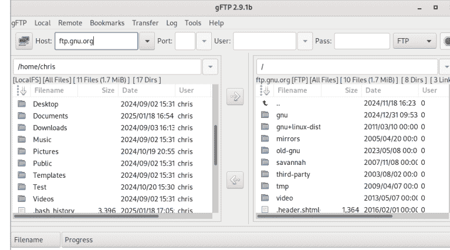

要从 gFTP 遍历 FTP 站点，只需双击文件夹（就像在文件管理器窗口中进行的操作一样）。本地目录（左侧）和远程目录（右侧）的路径显示在文件夹和文件列表上方。

要从远程站点传输文件到本地端，从右侧选择你想要的文件，并点击屏幕中间指向它的箭头。通过屏幕底部的消息观察文件传输进度。传输完成后，文件将出现在左侧面板中。

你可以收藏连接到 FTP 站点所需的地址信息。该地址将添加到已存储在“书签”（Bookmarks）菜单下的书签组中。你可以从列表中选择站点来尝试 gFTP。大多数站点都是 Linux 发行版和其他开源软件站点。

## 总结

设置 FTP 服务器是通过 TCP 网络共享文件的一种简单方法。Very Secure FTP 守护进程（vsftpd 软件包）适用于 Fedora、Red Hat Enterprise Linux、Ubuntu 以及其他 Linux 系统。

默认的 vsftpd 服务器允许匿名用户从服务器下载文件并允许普通 Linux 用户上传文件。

# 第 19 章：配置 Windows 文件共享 (Samba)

## 第四部分：成为 Linux 管理员

然而，撇开所有技术术语，结果是 Samba 使得 Linux 服务器与 Windows 桌面系统之间的文件和打印机共享变得轻而易举。对于服务器，只需要几个配置文件和工具即可管理 Samba。对于客户端，共享资源将出现在文件资源管理器应用程序的“网络”选择中。

要配置 Samba 服务，你只需直接编辑 Samba 配置文件（特别是 `smb.conf`）并运行几个命令。在你的 Linux 系统上使用 Samba，你需要安装一些软件包，如下一节所述。

## 安装 Samba

在 Red Hat Linux 和 Fedora 中，为了配置 Samba 文件和打印服务器，安装 `samba` 包即可获得启动所需的所有内容。在其他组件中，`samba` 软件包包含了 Samba 服务守护进程 (`/usr/sbin/smbd`) 和 NetBIOS 服务器守护进程 (`/usr/sbin/nmbd`)。安装 `samba` 包会引入 `samba-common` 包，该包包含了用于添加密码和配置文件的服务器配置文件（`smb.conf`、`lmhosts` 等）以及其他 Samba 功能。

要安装使用 Samba 所需的软件包，请分别在 Ubuntu、Fedora 或 RHEL 的命令行中以 root 身份输入以下内容：

```bash
# apt install samba samba-client
# dnf install samba samba-client samba-winbind
```

```bash
# rpm -qc samba-common
/etc/logrotate.d/samba
/etc/samba/lmhosts
/etc/samba/smb.conf
/etc/sysconfig/samba
```

`/etc/logrotate.d/samba` 和 `/etc/sysconfig/samba` 日志通常不会被修改。第一个定义了 `/var/log/samba` 下的日志文件如何随时间进行轮转（复制到其他文件并删除）（输入 `man logrotate` 了解更多信息）。第二个是一个文件，你可以在其中放置传递给 `smbd`、`nmbd` 或 `winbind` 守护进程的选项，例如调试。

你可能会为 Samba 修改的大多数配置文件都在 `/etc/samba` 目录下。`smb.conf` 是主配置文件，你可以在其中设置 Samba 服务器的全局设置，以及单个文件和打印机共享信息（将在后文介绍）。`lmhosts` 文件允许将 NetBIOS 主机名映射到 IP 地址。

尽管默认情况下不存在，但你可以创建一个名为 `/etc/samba/smbusers` 的文件，将 Linux 用户名映射为 Windows 用户名。在配置 Samba 服务器时，可以参考 `smb.conf` 手册页（`man smb.conf`）。还有 Samba 命令的手册页，例如 `smbpasswd`（更改密码）、`smbclient`（连接到 Samba 服务器）和 `nmblookup`（查询 NetBIOS 信息）。

在你安装 Samba 软件包并对它们的内容进行快速概览后，尝试启动 Samba 服务并查看默认配置下的结果。对于 Ubuntu 和其他版本的 Linux，可能需要一些额外的配置来启动 samba。

## 启动和停止 Samba

安装了 `samba` 和 `samba-common` 后，你可以启动服务器并研究它在默认配置下的运行情况。Samba 服务器有两个主要服务相关，每个服务都有自己的守护进程：

- `smbd`：此服务控制 `smbd` 守护进程，提供 Windows 客户端可以使用的文件和打印机共享服务。
- `nmbd`：此服务控制 `nmbd` 守护进程。通过 NetBIOS 名称服务提供名称到地址的映射，`nmbd` 可以将 Windows 客户端对 NetBIOS 的请求解析为 IP 地址。

使用 Samba 与其他 Linux 系统共享文件和打印机，只需要 `smb` 服务。下一节将描述如何启动和启用 `smb` 服务。

## 启动 Samba (smb) 服务

`smb` 服务用于启动 `smbd` 服务器，并将文件和打印机从本地系统提供给网络上的其他计算机。通常，服务在不同 Linux 系统上的启用和启动方式不同。对于 Linux 系统，你需要找到服务的名称以及启动 `smbd` 守护进程的正确工具。

在 Fedora 和 RHEL 中，要让 Samba 在系统启动时立即启动，命令行执行如下：

```bash
# systemctl enable smb.service
# systemctl start smb.service
# systemctl status smb.service
```

```
smb.service - Samba SMB Daemon
Loaded: loaded (/usr/lib/systemd/system/smb.service; enabled; preset: disabled)
Drop-In: /usr/lib/systemd/system/service.d/10-timeout-abort.conf, 50-keep-warm.conf
Active: active (running) since Sun 2025-06-29 16:54:18 EDT; 5s ago
Invocation: 486431907c7f4a6823658189d8f6
Docs: man:smbd(8)
man:samba(7)
man:smb.conf(5)
Main PID: 7947 (smbd)
Status: "smbd: ready to serve connections..."
Tasks: 3 (limit: 8919)
Memory: 10.0M [peak: 10.3M]
CPU: 77ms
CGroup: /system.slice/smb.service
├─7947 /usr/bin/smbd --foreground --no-process-group
├─7948 /usr/bin/smbd --foreground --no-process-group
└─7949 /usr/bin/smbd --foreground --no-process-group

Jun 29 16:54:18 systemd[1]: Starting Samba SMB Daemon...
Jun 29 16:54:18 systemd[1]: Started Samba SMB Daemon.
```

`samba-client` 软件包允许你从 Samba 服务器获取基本信息。你可以使用以下命令查询服务器（在提示密码时按回车）：

```bash
# smbclient -L localhost
Password for [root@]: <ENTER>
Anonymous login successful

Sharename  Type  Comment
---------  ----  -------
IPC$       IPC   IPC Service (Samba Version)
```

`smbclient` 输出允许你查看服务器提供的服务。默认情况下，查询服务器时允许匿名登录。你可以从输出中判断有关默认 Samba 服务器的一些信息：

- 服务器没有共享目录。
- 尚未运行 NetBIOS 服务。

接下来，你可以决定是否在你的 Samba 服务器上运行 NetBIOS 服务。

## 启动 NetBIOS (nmbd) 名称服务

如果网络上没有运行 Windows 域（此处如此），你可以在 Samba 主机上启动 `nmbd` 服务来提供该服务。要在 Fedora 或 RHEL 中启动 `nmbd` 服务（`nmbd` 守护进程），请输入：

```bash
# systemctl enable nmbd.service
# systemctl start nmbd.service
# systemctl status nmbd.service
```

```
Created symlink /etc/systemd/system/multi-user.target.wants/nmbd.service -> /usr/lib/systemd/system/nmbd.service.
nmbd.service - Samba NMB Daemon
Loaded: loaded (/usr/lib/systemd/system/nmbd.service; enabled; preset: enabled)
Drop-In: /usr/lib/systemd/system/service.d/10-timeout-abort.conf, 50-keep-warm.conf
Active: active (running) since Sun 2025-07-06 18:38:27 EDT; 12s ago
```


# 第四部分：成为 Linux 服务器管理员

任务：1 (限制: 8919)
内存: 3.1M (峰值: 3.5M)
CPU: 35ms
CGroup: `/system.slice/systemd-nmb.service-L7962 /usr/bin/nmbd --foreground --no-process-group`

Jul 06 18:38:22 fedora [1]: Started `nmbd.service` - Samba 守护进程。

默认情况下，NetBIOS 名称在 `smb.conf` 文件中被设置为 Samba（检查 `smb.conf` 中的 `workgroup` 值以查看你的 NetBIOS 名称是否不同）。要通过查询 `nmbd` 获取 Samba 的 IP 地址，你需要输入以下命令：

```
# nmblookup -U 127.0.0.1 FEDORA40

querying SAMBA on 127.0.0.1

192.168.1.19 SAMBA=
```

现在你应该能够从本地系统看到你的 Samba 服务器正在运行。分配给系统的主机名（在此例中为 Samba）是默认分配的。

然而，如果你配置了防火墙或启用了 SELinux，你可能无法从远程系统完全访问 Samba 服务器。下一节将帮助你将 Samba 开放到本地系统之外，并允许某些可能被 SELinux 关闭的 Samba 功能。

# 停止 Samba (smb) 和 NetBIOS (nmb)

在 Fedora 或 RHEL 中停止 `smb` 和 `nmb` 服务，你可以使用与启动它们时完全相同的 `systemctl` 命令。你也可以使用相同的命令禁用这些服务，以便它们在系统启动时不会启动。以下是立即停止 `smb` 和 `nmb` 服务的示例：

```
# systemctl stop smb.service

# systemctl stop nmb.service
```

为了防止系统重启后 `smb` 和 `nmb` 服务自动启动，请在 Fedora 或 RHEL 中输入以下命令：

```
# systemctl disable smb.service

# systemctl disable nmb.service
```

当然，你只有在不再使用 Samba 服务时可能才想要停止或禁用 `smb` 和 `nmb` 服务。如果你准备好继续配置 Samba 服务，请启用并重启服务，以便开始配置你的 Linux 安全功能，允许 Samba 服务能够通过网络供他人使用。

# Samba 安全

如果你在启动服务器后无法立即从另一个主机访问 Samba 服务器，你可能需要做一些安全工作。由于许多 Linux 的默认安装是阻止而非允许访问系统，因此处理 Samba 等服务的安全问题通常更多是为了让它可用，而不是让它安全。

在配置 Samba 系统时，你应该注意以下安全功能：

- **防火墙**：Fedora、RHEL 以及其他 Linux 系统的默认防火墙阻止外部系统对本地服务的访问。因此，为了允许来自其他计算机的用户访问你的 Samba 服务，你必须创建防火墙为选定的协议（特别是 TCP）开放一个或多个端口。
- **SELinux**：Samba 的许多功能被 SELinux 标记为潜在不安全。由于默认的 SELinux 布尔值（某些功能的开启开关）被设置为提供所需的最小访问，你需要开启某些功能的开关，例如允许用户通过 Samba 访问自己的家目录。换句话说，你可以配置 Samba 共享用户家目录，但除非显式配置 SELinux 允许该功能，否则 SELinux 将阻止人员尝试使用该功能。
- **主机和用户限制**：在 Samba 文件中，你可以指定哪些主机和用户可以访问整个 Samba 服务器或共享目录。

接下来的章节将描述如何为 Samba 设置上述安全功能。

# 为 Samba 配置防火墙

如果你在首次安装 Linux 系统时配置了防火墙，该防火墙通常允许来自本地用户的任何请求，但不允许外部用户的请求。这就是为什么在本章的安装结束时，你应该已经能够使用本地系统上的 `smbclient` 命令测试 Samba 是否正常工作。然而，如果请求源自另一个系统，它将被拒绝。

为 Samba 配置防火墙规则主要包括开放 `smbd` 和 `nmbd` 守护进程监听的端口。这些是你应该开放的端口以便在 Linux 系统上获得工作的 Samba 服务：

- **TCP 端口 445**：这是 Samba `smbd` 守护进程监听的主端口。你的防火墙必须支持此端口的入站数据包请求，Samba 才能工作。
- **TCP 端口 139**：`smbd` 守护进程监听 TCP 端口 139，用于处理与 NetBIOS 主机名相关的话。这是为了兼容旧的 SMB1，因此可以在不打开此端口的情况下通过 TCP 使用 Samba。
- **UDP 端口 137 和 138**：`nmbd` 守护进程使用这两个端口连接 NetBIOS 请求。如果你正在使用 `nmbd` 守护进程，这两个端口必须开放，以便进行 NetBIOS 名称解析的新数据包请求。

对于 Fedora 和 RHEL，允许对这四个端口的入站访问很容易。只需打开防火墙配置窗口，在 public（公共）区域选项卡上勾选 `samba` 和 `samba-client` 条目旁的复选框。这些端口将立即变得可用（无需重启 `firewalld` 服务）。

# 为 Samba 配置 SELinux

在 SELinux 强制模式下，与 Samba 涉及文件上下文和开关（Boolean）的考虑。必须在由 Samba 共享的目录上正确设置文件上下文。开关允许你覆盖安全设置，你需要开启允许用户通过 Samba 访问自己的家目录的功能开关。换句话说，你可以配置 Samba 共享用户家目录，但除非你显式配置 SELinux 允许该功能，否则 SELinux 将阻止人员尝试使用该功能。

你可以找到关于 SELinux 如何限制 Samba 的信息，请参考第 25 章“使用 SELinux 增强 Linux”。

# 设置 Samba 的 SELinux 开关

一种简单方法是列出适用于 Samba 的 SELinux 开关。使用命令行列出 Samba 相关开关：

```
# semanage boolean -l | grep samba
```

以下是适用于 Samba 的 SELinux 开关列表及其描述。大多数开关允许你选择 Samba 可以读写的文件和目录：

- **samba_run_unconfined**：允许 Samba 运行。
- **samba_anon_write**：允许匿名用户。
- **samba_enable_home_dirs**：允许 Samba 家目录。
- **samba_export_all_ro**：允许 Samba 只读导出。
- **samba_create_home_dirs**：允许 Samba 创建家目录。
- **samba_export_all_rw**：允许 Samba 读写导出。
- **samba_share_fusefs**：允许 Samba 共享 fusefs。
- **samba_export_nfs**：允许 Samba 导出 NFS。
- **samba_domain_controller**：允许 Samba 作为域控制器。

# 配置 Windows 文件共享 (Samba)

`setsebool` 命令用于开启或关闭 SELinux 开关。使用 `-P` 选项，`setsebool` 可以永久设置开关。例如，为了允许 Samba 只读共享任何文件，你可以输入：

```
# setsebool -P samba_export_all_ro on

# getsebool samba_export_all_ro
on
```

# 设置 Samba 的 SELinux 文件上下文

SELinux 限制 Samba 服务访问的文件。与其允许任何符合名称的文件被 Samba 服务器共享，不如由 SELinux 进行限制。为了让 Samba 服务立即在 SELinux 下运行，某些文件和目录必须预设正确的上下文。例如，Samba 配置 (`/etc/samba/*`)、日志 (`/var/log/samba/*`) 和库 (`/var/lib/samba/*`)。如果 Samba 服务和 `smbd` 守护进程已预设文件上下文，运行以下：

```
# semanage context -l | grep -i samba
# semanage context -l | grep -i smb
```

你可以通过对目标文件或目录创建并应用新的文件上下文来更改上下文。你可以使用 `semanage` 命令创建规则并使用 `restorecon` 应用规则。例如，如果你想共享目录 `/var/mystuff`，你会创建该目录并运行以下命令使其从 Samba 可用：

```
# mkdir /var/mystuff
# ls -Zd /var/mystuff
unconfined_u:object_r:var_t:s0 /var/mystuff
# semanage fcontext -a -t samba_share_t "/var/mystuff(/.*)?"
# restorecon -Rv /var/mystuff
```

```
# restorecon -v /var/mystuff
Relabeled /var/mystuff from unconfined_u:object_r:var_t:s0
	to unconfined_u:object_r:samba_share_t:s0
# ls -Zd /var/mystuff/
unconfined_u:object_r:samba_share_t:s0 /var/mystuff/
```

运行这些命令后，`/var/mystuff` 目录以及该点下的任何文件和目录的文件上下文都变为 `samba_share_t`。由你来为这些内容分配正确的 Linux 所有权和权限，以允许你选择的用户进行访问。接下来的“配置 Samba”部分将提供创建一个共享目录的示例，并展示如何使用标准 Linux 命令为共享目录添加权限和所有权。

## 配置 Samba 主机/用户权限

在 `smb.conf` 文件中，你可以根据尝试访问的主机或用户，允许或限制对整个 Samba 服务器或特定共享的访问。你还可以通过仅在特定接口上提供服务来限制对 Samba 服务器的访问。

例如，如果你有一个接口连接到互联网，另一个连接到本地网络，你可以告诉 Samba 仅在本地网络接口上提供服务。下一节将描述如何配置 Samba，包括如何识别访问你 Samba 服务器的主机、用户或网络接口。

## 配置 Samba

在 `/etc/samba/smb.conf` 文件内部包含了配置你的 Samba 服务器的设置，定义了共享打印机、如何进行身份验证以及创建共享目录。该文件由以下预定义部分组成：

- **[global]**：适用于整个 Samba 服务器的设置位于此部分。你在此处设置服务器描述、工作组（域）、日志文件位置、默认查询类型以及其他设置。
- **[homes]**：此部分决定在 Samba 服务器上拥有账户的用户是否可以看到其主目录（可浏览）或能够进入其主目录。
- **[printers]**：此部分告诉 Samba 是否通过 Samba 为已配置为 Linux 打印 (CUPS) 的打印机提供可用性。
- **[print$]**：此部分将一个目录配置为共享打印机驱动程序。

在 `smb.conf` 文件中，以井号（#）或分号（;）开头的行是注释。取消分号可以让你快速设置不同类型的信息。井号也可以用于注释掉某行。

当你编辑 `smb.conf` 文件时，请制作一份备份，以便在出错时可以恢复。你可以从将 `smb.conf.example` 文件复制到 `smb.conf` 开始，如果你想从某些示例开始。但在情况下，它包含的内容比 `smb.conf` 文件已有的内容多少。

# 第 19 章：配置 Windows 文件共享 (Samba) 服务器

### 配置 [global] 部分

以下是 `smb.conf` 文件中 `[global]` 部分的一个示例：

```
[global]
workgroup = SAMBA
security = user
passdb backend = tdbsam
printing = cups
printcap name = cups
load printers = yes
cups options = raw
```

```
netbios name = FEDORA42
log file = /var/log/samba/log.log
max log size = 50
domain master = yes
```

```
interfaces = eth0 192.168.12.2/24 192.168.13.2/24
hosts allow = 127.0.0.1 192.168.13.13
```

- # 要显示工作组，通过取消以下内容的注释来启用 SMB1：

```
client protocol = NT1
server protocol = NT1
ntlm auth = ntlmv1-permitted
```

在此示例中，工作组（用作域名）设置为 SAMBA。当客户端与 Samba 服务器通信时，此名称会告诉客户端 Samba 服务器位于哪个工作组。

默认安全类型被设置为 `user`（Samba 用户名和密码）。

`passdb backend = tdbsam` 指定使用 Samba 后端数据库来存储密码。你可以使用 `smbpasswd` 命令设置每个用户的密码（后文会描述）。

设置 `printing = cups` 和 `printcap name = cups` 表示使用由 CUPS 打印服务创建的打印机。当设置 `load printers = yes` 时，Samba 知道通过 Samba 从本地 CUPS 打印配置的任何打印机。

`cups options` 将你喜欢的任何选项传递给由 Samba 服务器提供的 CUPS 打印机。默认情况下，只设置了 `raw`，这允许 Windows 客户端使用它们自己的打印驱动程序。你 Samba 服务器上的打印机将按行格式打印呈现页面。

你可以通过取消注释 `netbios name` 行并添加你想要的服务器名称来设置 NetBIOS 名称。例如，`netbios name = FEDORA42`。

如果你想限制对 Samba 服务器的访问使其仅在某些接口上响应，请取消注释 `interfaces` 行并添加你想要的网络接口的 IP 地址或名称（lo, eth0, eth1 等）。


你也可以限制特定主机对 Samba 服务器的访问。取消 `hosts allow` 行（删除分号）并插入你想允许的主机的 IP 地址。要输入主机范围，只需使用子网掩码。例如，`192.168.1.0/24`。需要记住的一点是，虽然共享不可浏览的，但你可以通过提供服务器的主机名或 IP 地址，加上用户名（这里是 chris）来请求它以访问主目录。

### 配置 [homes] 部分

[homes] 部分决定在 Samba 服务器上拥有账户的用户是否可以看到其主目录（可浏览）或能够进入其主目录。以下是默认 `homes` 部分的内容：

```
[homes]
comment = Home Directories
path = /home
browseable = yes
guest ok = no
writable = yes
read only = no
```

需要记住的一点是，虽然共享不可浏览的，但你可以通过提供服务器的主机名或 IP 地址，加上用户名（这里是 chris）来请求它以访问主目录。

### 安全 [homes] 部分

为了允许用户访问主目录，你可能需要更改以下 SELinux 特性。例如，如果你尝试列出目录，可能会看到以下消息：

```
NT_STATUS_DENIED
```

要允许用户访问主目录，请开启 `samba_enable_dirs` 布尔值：

```
# setsebool -P samba_enable_dirs on
```

`setsebool` 命令开启 `samba_enable_dirs` 功能，它是关闭的。

### 配置 [printers] 部分

你在 Linux 系统上为 CUPS 打印配置的任何打印机都会根据 [printers] 部分自动共享。全局 `cups options = raw` 使所有打印机变为原始格式（这意味着 Windows 客户端需要为每个共享打印机提供正确的驱动程序）。

以下是 `smb.conf` 文件中默认 `printers` 部分的内容：

```
[printers]
comment = All Printers
path = /var/tmp
browseable = no
guest ok = no
writable = yes
printable = yes
create mask = 0600
```

`path` 指定 Samba 将临时文件存储在 `/var/tmp`。`printable = yes` 行导致本地系统上的所有 CUPS 打印机都通过 Samba 共享。打印机可写并允许打印。这里的 `create mask = 0600` 设置的作用是在在路径目录中创建文件时，在 ACL 中移除组和其他用户的写入和执行位。

要查看本地打印机是否可用，你可以从 Linux 系统运行 `smbclient -L` 命令，如之前。在 Windows 系统上，你可以从文件管理器窗口中选择“网络”，然后选择代表你的 Samba 服务器的图标。所有共享的打印机和文件夹都会显示在此窗口中。见本章稍后的“访问 Samba 共享”部分有关查看共享打印机的详细信息。

## 第四部分：成为 Linux 管理员

## 创建共享文件夹

在创建共享文件夹之前，该文件夹（目录）必须存在并具有正确的权限。在示例中，共享的是 `/var/salesdata` 目录。你希望该数据对用户 `chris` 可写，但对网络上的任何人都可见。要创建该目录并设置正确的权限和 SELinux 文件上下文，请以 root 用户输入以下命令：

```bash
# mkdir /var/salesdata
# chmod 775 /var/salesdata
# chown chris:chris /var/salesdata
# semanage -a t samba_share_t /var/salesdata
# restorecon -v /var/salesdata
# touch -lz /var/salesdata/test
# ls -l -r--. root
```

```
unconfined:u:object:r:samba_share_t:s0 0 Dec 24 14:35
/var/salesdata/test
```

## 将共享文件夹添加到 Samba

在 `/var/salesdata` 目录已创建并正确配置为由 Samba 共享后，共享文件夹（名为 `salesdata`）在 `smb.conf` 文件中可能如下：

```ini
[salesdata]
comment = Sales data for current year
path = /var/salesdata
read only = no
browseable = yes
valid users = chris
```

在创建此共享之前，创建了 `/var/salesdata` 目录，将 `chris` 分配为用户和组，并设置该目录允许 `chris` 读写。（如果 SELinux 处于强制模式，则还必须设置 SELinux 文件上下文。）访问共享时必须提供 Samba 用户名以及关联密码。`chris` 连接到共享后，他可以对其进行读写操作（`read only = no`）。

现在你已经了解了 Samba 的默认设置以及简单共享目录（文件夹）的示例，请阅读后续章节查看如何进一步配置共享。特别是，示例演示了如何让特定的用户、主机和网络接口可以使用共享。

要使 Samba 配置的变化生效，你需要重启 `smb` 服务。完成后，检查你创建的 Samba 共享是否可用，分配给该共享的用户是否可以访问。要执行这些操作，请在 Samba 服务器的 shell 中以 root 用户身份输入以下命令：

```bash
# systemctl restart smb.service
# smbclient -L localhost -U chris
Enter SAMBA@chris's password: ********
```

| Sharename | Type | Comment |
| :--- | :--- | :--- |
| salesdata | Disk | Sales data for current year |
| print$ | Disk | Printer Drivers |
| IPC | IPC | IPC Service (Samba 4.22.3) |
| chris | Disk | Home Directories |

在这里我们使用了共享名（`salesdata`）、设置为工作组名称 `SAMBA` 的域，以及之前输入的描述（`Sales data for current year`）。接下来，访问共享的快速测试是使用 `smbclient` 命令。你可以配合 `smbclient` 使用主机名或 IP 地址来访问共享。我就在系统的本地系统中，直接使用了 `localhost` 名称并添加了 `(chris)`：

```bash
# smbclient //localhost/salesdata -U chris
Password for [PEDORAGROUP:chris]: ********
Try "help" to get a list of possible commands
smb: \> lcd /etc
smb: \> put hosts
putting hosts as hosts (43.5 kb/s) average 43.5 kb/s
smb: \> ls
D               0   Mon Jun 27 05:28:19 2025
D               0   Mon Jun 27 05:28:19 2025
test            N   Mon Jun 27 05:17:20 2025
hosts           A   89  Mon Jun 27 05:28:19 2025
                24839472 blocks of size 1024. 138013196 blocks available
smb: \> quit
```

Samba 共享的格式为 `//host/share`。然而，当你从 Linux shell 识别 Samba 共享时，反斜杠需要转义。因此，作为参数，第一个共享必须显示为 `\\\\salesdata`。因此，第一部分更容易使用。

> 注意：对 shell 中输入的字符进行转义是在该字符前加一个反斜杠（`\`）。它告诉 shell 字面使用反斜杠后的字符，而不是赋予字符 shell 特殊含义。（`*` 和 `?` 字符是具有特殊含义字符的示例。）由于反斜杠本身对 shell 有特殊含义，如果你想字面使用反斜杠，则需要在它前面加一个反斜杠。这就是为什么我们想要输入包含两个反斜杠的 Samba 地址时，实际上必须输入四个反斜杠。

## 第 19 章：配置 Windows 文件共享 (Samba)

在提示时，输入用户的 Samba 密码（可能与 Linux 用户的密码不同）。在本示例中，Samba 用户的密码之前已通过 `smbpasswd` 设置。之后你会看到 `smb: \>` 提示符。

此时，你已建立了一个会话。


# 第 19 章：配置 Windows 文件共享 (Samba) 服务器

```bash
# -U chris //localhost/salesdata
Password for [PEDORAGROUP:chris]: ********
Try "help" to get a list of possible commands
smb: \> lcd /etc
smb: \> put hosts
putting hosts as hosts (43.5 kb/s) average 43.5 kb/s
smb: \> ls
D               0   Mon Jun 27 05:28:19 2025
D               0   Mon Jun 27 05:28:19 2025
test            N   Mon Jun 27 05:17:20 2025
hosts           A   89  Mon Jun 27 05:28:19 2025
                24839472 blocks of size 1024. 138013196 blocks available
smb: \> quit
```

Samba 共享的格式为 `//host/share`。然而，当你从 Linux shell 识别 Samba 共享时，反斜杠需要转义。因此，作为参数，第一个共享必须显示为 `\\\\salesdata`。因此，第一部分更容易使用。

> 注意：对 shell 中输入的字符进行转义是在该字符前加一个反斜杠（`\`）。它告诉 shell 字面使用反斜杠后的字符，而不是赋予字符 shell 特殊含义。（`*` 和 `?` 字符是具有特殊含义字符的示例。）由于反斜杠本身对 shell 有特殊含义，如果你想字面使用反斜杠，则需要在它前面加一个反斜杠。这就是为什么我们想要输入包含两个反斜杠的 Samba 地址时，实际上必须输入四个反斜杠。

在提示时，输入用户的 Samba 密码（可能与 Linux 用户的密码不同）。在本示例中，Samba 用户的密码之前已通过 `smbpassword` 设置。之后你会看到 `smb: \>` 提示符。

## 第四部分：成为 Linux 服务器管理员

访问共享目录时，你可以使用 Windows（文件资源管理器）和 Linux（带有 GNOME 桌面的 Nautilus）中均可用的文件管理器。

## 在 Linux 中访问 Samba 共享

一旦 Samba 共享可用，就可以使用文件管理器或远程挂载命令从远程 Linux 和 Windows 系统访问它。

## 从 Linux 文件管理器访问 Samba 共享

在 Linux 中打开文件管理器，可以让你访问来自 Linux (Samba) 和 Windows (SMB) 的共享目录。你访问文件管理器的方法与其他桌面有所不同。在 GNOME 3 中，你可以点击“文件”图标。在其他桌面环境中，打开“主目录”文件夹。

显示 Nautilus 窗口后，选择左侧导航栏中的“其他位置”。应该会出现可用的网络（例如 FEDORA40）。找到窗口底部“连接”按钮旁边的输入框，然后输入可用 Samba 共享的路径。根据之前的示例，你可以使用以下路径之一：

```
smb://192.168.1.24/charis
smb://192.168.1.24/salesdata
```

窗口显示应类似于图 19.1。

### 图 19.1

从 Nautilus 连接中识别 Samba 共享。

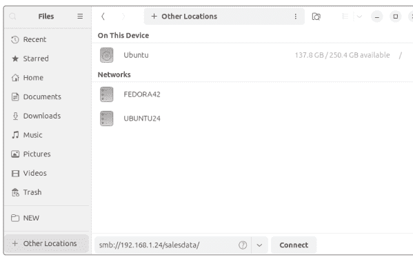

点击“连接”。在弹出的窗口中，你可以选择以注册用户的身份连接。如果是这样，你可以输入用户名、Samba 域名以及你的用户密码。你还可以选择是否保存该密码。图 19.2 显示了该窗口的示例。

### 图 19.2

添加你的 Samba 凭据。

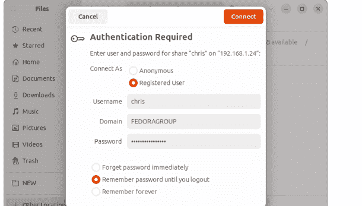

点击“连接”。

如果用户名和密码接受，你应该看到远程目录的内容。如果你对该共享具有写入权限，可以打开另一个 Nautilus 窗口，并在两个系统之间拖放文件。图 19.3 显示了在我连接到 salesdata 共享后 Nautilus 窗口的示例。

### 图 19.3

在 Nautilus 中从连接显示 Samba 共享。

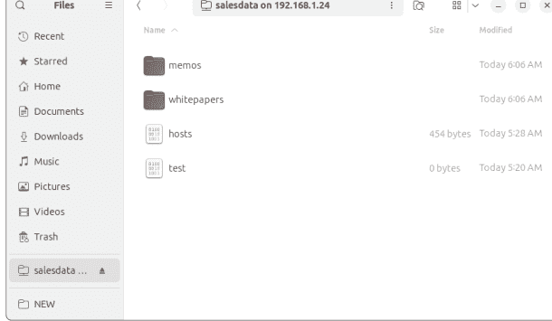

## 从 Linux 命令行挂载 Samba 共享

由于 Samba 共享目录可以被视为远程文件系统，你可以使用常用的 Linux 工具将 Samba 共享（临时或永久）挂载到你的 Linux 系统。使用标准的 `mount` 命令（配合 `cifs-utils`），你可以将远程 Samba 共享挂载为 Linux 中的 CIFS 文件系统。此示例将 IP 地址为 192.168.0.19 的主机的 salesdata 共享挂载到本地目录 `/mnt/`。

```bash
# yum install cifs-utils -y
# mkdir /mnt/sales
# mount -t cifs -o user=chris \
//192.168.1.24/salesdata /mnt/sales
Password for chris: //192.168.1.24/salesdata: ********
# ls /mnt/sales
hosts memos test whitepapers
```

当出现提示时：

```bash
//192.168.1.24/salesdata /mnt/sales cifs credentials=/root/cif.txt 0 0
```

接下来，创建一个凭据文件（在本示例中为 `/root/cif.txt`）。在该文件中，放入你想在系统尝试挂载文件系统时提供的用户名和密码。以下是该文件内容的示例：

```
user=chris
pass=mypass
```

在重启之前，检查条目是否正确，尝试从命令行挂载。`mount -a` 命令会尝试挂载 `/etc/fstab` 文件中列出的任何尚未挂载的文件系统。`df` 命令显示挂载目录的磁盘空间信息，如下例所示：

```bash
# mount -a
# df -h /mnt/sales
```

| 文件系统 | 大小 | 已用 | 可用 | 用用率 | 挂载点上 |
| :--- | :--- | :--- | :--- | :--- | :--- |
| //192.168.1.24/salesdata | 237G | 106G | 132G | 45% | /mnt/sales |

现在你应该能够将共享 Samba 目录作为本地系统上的目录使用。

## 在 Windows 中访问 Samba 共享

与 Linux 类似，你可以在此 Windows 文件资源管理器窗口中访问 Samba 共享。要执行此操作，在 Windows 中打开任何文件夹，从左侧面板中右键点击“此电脑”，并选择“映射网络驱动器”。在“文件夹”框中输入此示例使用的共享名称 `\192.168.1.24\salesdata`，选择“使用不同的凭据连接”，并点击“完成”。在提示时输入网络凭据并点击确定（图 19.4）。

### 图 19.4

从 Windows 访问 Samba 共享。

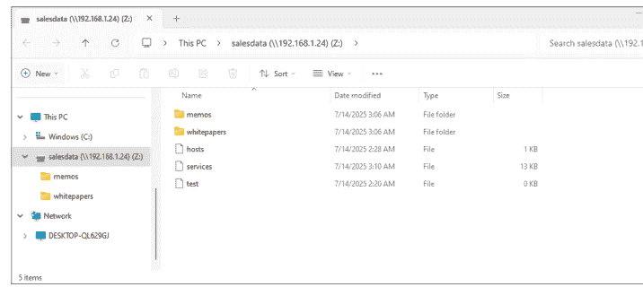

在图 19.4 中，你可以看到 salesdata 共享。你现在应该能够将共享 Samba 目录作为本地系统上的目录使用。

## 在企业中使用 Samba

集中认证的优势是用户在整个企业只需记住一组凭据，系统管理员管理的账户也更少。由于 Windows 桌面的普及，Samba 服务器是非常用的工具。

## 总结

本章介绍了在 Linux 系统上安装、启动、安全、配置和访问 Samba 服务器的过程。使用命令行工具演示了如何设置 Samba 服务器。下一章将描述网络文件系统 (NFS)。NFS 是用于共享文件的原生 功能。

## 练习

本部分的练习描述了与 Linux 和 Windows 中设置 Samba 服务器相关的任务。如常，通常有多种方法可以完成这些任务。只要结果正确，不必担心是否按照答案所示进行练习。请参考附录 B。

- 1. 安装 `samba` 和 `samba-client` 包。
- 2. 启动并启用 `smb` 和 `nmb` 服务。
- 3. 将 Samba 服务器的工作组设置为 TESTGROUP，将 NetBIOS 节点设置为 MYTEST，将服务器字符串设置为 Samba Test System。
- 4. 在你的系统中添加一个名为 `phil` 的 Linux 用户，并为 `phil` 添加 Linux 密码和 Samba 密码。
- 5. 设置 `[homes]` 部分，使得主目录可浏览 (yes) 可写入 (yes)，且 `phil` 是唯一的有效用户。
- 6. 设置任何必要的 SELinux 布尔值，以便 `phil` 通过 Samba 客户端访问其主目录，然后重启 `smb` 和 `nmb` 服务。
- 7. 从本地系统使用 `smbclient` 命令列出可用 homes 共享。
- 8. 从本地系统的 Nautilus（文件管理器）窗口连接到本地 Samba 服务器上用户 `phil` 的 homes 共享，并允许向该文件夹拖放文件。
- 9. 打开防火墙，以便任何可以访问服务器的人都能访问 Samba 服务（smbd 和 nmbd 守护进程）。
- 10. 从网络上的另一个系统（Windows 或 Linux）再次以用户 `phil` 的身份打开 homes 共享，并再次确保你可以向其拖放文件。

# 第 20 章：配置 NFS 文件服务器

## 本章内容

- 获取 NFS 服务器软件
- 启用并启动 NFS
- 导出 NFS 目录
- 为目录设置安全特性
- 挂载远程共享目录

Linux 系统不像 Microsoft 操作系统那样使用驱动器号（A、B、C 等）来表示存储设备，而是以无形的方式将来自多个硬盘、USB 驱动器、CD-ROM 和其他本地设备的文件系统连接起来，形成一个单一的 Linux 文件系统。网络文件系统 (NFS) 允许你扩展 Linux 文件系统，将其他计算机上的文件系统挂载到你的本地目录结构中。

NFS 服务器提供了一种在组织内的用户和计算机之间共享大量数据的简便方法。配置了使用 NFS 共享文件系统的 Linux 系统管理员必须执行以下任务来设置 NFS：

- **设置网络。** NFS 通常用于私有网络，而不是像互联网（Internet）这样的公共网络。
- **安装 NFS。** 如果尚未安装，请安装 `nfs-server` 包。
- **启动服务。** 需要启动并运行多个守护进程才能使 NFS 服务完全正常运行。在 Ubuntu、Fedora 和 Red Hat Enterprise Linux 中，你可以启动 `nfs-server` 服务。
- **选择服务器上要共享的内容。** 决定 Linux 服务器上的哪些目录（文件夹）可以供其他计算机访问。你可以选择文件系统中的任意点，并让该点以下的所有文件和目录供其他计算机访问。
- **在服务器上设置。** 你可以使用几种不同的功能来应用你所熟悉的安全级别。*挂载级安全*允许你限制计算机可以挂载的内容，并且对于允许挂载的内容，允许指定它是读/写还是只读。在 NFS 中，用户级安全通过将客户端系统的用户映射到 NFS 服务器上的用户（基于 UID 而不是用户名）来实现，这样他们就可以依靠标准的 Linux 读/写/执行权限、文件所有权和组权限来访问和保护文件。
- **在客户端上挂载文件系统。** 每个允许访问服务器 NFS 共享文件系统的计算机都可以挂载到客户端选择的任何地方。例如，你可以将来自名为 `oak` 的计算机的文件系统挂载到本地文件系统的 `/mnt/oak` 目录下。挂载后，你可以通过输入 `ls /mnt/oak` 查看该目录的内容。

尽管 Linux 通常被用作文件服务器（或其他类型的服务器），但它是一个通用操作系统，因此任何 Linux 服务器都可以作为服务器共享（或导出）文件系统，或作为客户端使用另一台计算机的文件系统（挂载）。

> 文件系统是存在于单个设备上（如硬盘分区或 USB 驱动器）的文件和目录的结构。“文件系统”一词指的是整个目录结构（可能包括来自几个分区的的文件系统、NFS 或各种网络资源），从单台计算机上的根目录 (/) 开始。NFS 中的共享目录可能代表计算机文件系统的全部或部分，它可以被（从共享目录向下树状结构）挂载到另一台计算机的文件系统中。

## 安装 NFS 服务器

要运行 NFS，你需要一组内核模块（由内核本身提供）以及一些用户级工具来配置服务器、运行守护进程并以各种方式查询服务。

对于 Fedora 和 RHEL，你需要的尚未包含在内核中的组件可以通过安装 `nfs-utils` 包来添加。对于 Ubuntu，你需要安装 `nfs-kernel-server` 包。对于最新的 RHEL 和 Fedora 版本，请按照以下步骤进行安装：

```bash
# install nfs-utils
```

对于 Ubuntu，

```bash
# install nfs-kernel-server
```

除了少量文档外，`nfs-utils` 包还包含其各种组件的 man 页面。要查看 Fedora 和 RHEL 中的文档列表，请执行以下操作：

```bash
# rpm -qd nfs-utils | less
```

对于 NFS 服务器端（与他人共享目录）和客户端（在本地挂载远程 NFS 目录），都有许多页面。要配置服务器，你可以参考 `exports` man 页面（设置 `/etc/exports` 文件以共享你的目录）。`exportfs` 命令的页面描述了如何共享和查看从 `/etc/exports` 文件中共享的目录列表。`nfsd` 页面描述了你可以传递给 `rpc.nfsd` 守护进程的选项，允许你像调试模式服务器那样进行操作。

客户端的 man 页面包括 `mount.nfs` 页面（查看在本地系统上挂载 NFS 目录时可以使用挂载选项）。还有一个 `nfsmount.conf` man 页面，它描述了你的系统在本地挂载资源时的行为。`/etc/nfsmount.conf` 文件允许你配置系统的行为，而 `showmount` 命令则用于查看来自 NFS 服务器的可用共享目录。

要了解关于 `nfs-utils` 包，你可以运行以下命令分别获取有关包、配置文件和命令的信息：

```bash
# rpm -qi nfs-utils
# rpm -qc nfs-utils
# rpm -ql nfs-utils | grep bin
```

## 启动 NFS 服务

启动 NFS 服务器涉及启动多个守护进程。在 Ubuntu、Fedora 和 RHEL 中，你可以使用以下启动服务：

```bash
systemctl start nfs-server
systemctl enable nfs-server
systemctl status nfs-server
```

一旦服务运行，你可以使用以下命令检查导出的目录：

```bash
showmount -e
```

## 共享文件系统

要从你的 Linux 系统共享文件系统，你需要导出它。导出通过在 `/etc/exports` 文件中添加条目来实现持久化导出。每个条目标识你想要共享的目录。

## 配置 /etc/exports 文件

要让 Linux 系统上的目录对其他系统可用，你需要导出它。导出通过向 `/etc/exports` 文件添加有关被导出目录的信息来实现。

这是 `/etc/exports` 文件的格式：

| 目录 | 主机 (选项...) | 注释 |
| :--- | :--- | :--- |

在此示例中，*目录*是你想要共享的目录名称，*主机*是指限制该目录的客户端计算机。*选项*可以包含定义附加共享目录的各种选项。（你可以重复*主机*和*选项*）。*注释*是你想添加的任何注释（位于 `#` 符号之后）。

`exports` 页面包含了有关 `/etc/exports` 文件语法的细节。特别，你可以看到用于限制访问和保护每个共享目录的选项。

作为 root，你可以使用任何文本编辑器配置 `/etc/exports` 以修改条目或添加新条目。以下是 `/etc/exports` 文件的示例：

```text
/cal  *.linuxtoys.net (rw)          # 公司事件
/pub  *(ro,insecure,all_squash)      # 公共目录
/home  maple (rw,root_squash) spruce (rw,root_squash)
```

第一个条目代表一个与公司事件相关的目录。你的域内的任何计算机 (`*.linuxtoys.net`) 都可以挂载该 NFS 共享。你可以向目录写入文件，也可以读取它们（由 `rw` 选项指定）。注释 (`# 公司事件`) 仅用于提醒你该目录包含的内容。

`/pub` 代表一个公共目录。它允许任何计算机和用户读取目录中的文件（由 `ro` 选项指定），但不能写入文件。`insecure` 选项允许任何计算机（即使是不使用安全 NFS 端口的计算机）访问该目录。`all_squash` 选项会将所有用户（UID）和组（GIDs）映射为 nobody 用户（UID 65534），赋予他们对文件和目录的最小权限。

`/home` 条目允许一组用户在不同的计算机上拥有相同的 `/home` 目录。例如，如果你正在从一台名为 `oak` 的计算机上共享 `/home`，那么 `maple` 和 `spruce` 计算机将会将该目录挂载到各自的 `/home` 目录上。如果它们在所有机器上都使用相同的用户名/UID，你就可以为每个注册的用户提供 `/home/user` 目录。`root_squash` 选项用于防止来自另一台计算机的 root 用户对共享目录拥有 root 权限。


这些是一些示例：你可以共享你所选择的任何目录，包括整个文件系统`/`。当然，共享整个文件系统或其敏感部分（如`/etc`）存在安全影响。你可以添加到`/etc/exports`文件中的安全选项将在后续章节中进行描述。

## /etc/exports 中的主机名

你可以在`/etc/exports`文件中指明哪些主机计算机可以访问你的共享目录。如果你关联了多个特定目录，请确保在每个主机名之前留有空格。然而，主机名与其选项之间不要留空格。这里有一个示例：

```
/usr/local maple (rw) spruce (ro,root_squash)
```

注意在`(rw)`之后有一个空格，但在`maple`之后没有。你可以通过几种方式识别主机：

### 单个主机

输入一个或多个 TCP/IP 主机名或 IP 地址。如果主机在你的本地域内，你只需指定主机名。否则，使用全的`host..domain`格式。这些是识别单个主机计算机的有效方法：

```
maple
mapple.handsonhistory.com
10.0.0.11
```

### IP 网络

允许来自特定网络及其掩码（由斜杠`/`指定）的所有主机进行访问。以下是指定网络的有效方法：

```
10.0.0.0/255.0.0.0 172.16.0.0/255.255.0.0
192.168.1.0/255.255.255.0
192.168.1.0/24
```

### TCP/IP 域

使用通配符，你可以包含特定域中的所有或部分主机计算机。以下是使用星号和问号通配符的一些有效方法：

```
*handsonhistory.com
*craft.handsonhistory.com
???.handsonhistory.com
```

### NIS 组

你可以访问包含在 NIS 组中的主机。要指明 NIS 组，请在组名前加上`(@)`符号（例如`@group`）。

## /etc/exports 中的访问选项

你并不非要在放弃对文件和目录控制权的情况下通过 NFS 导出一个目录。对于`/etc/exports`中每个条目的选项，你可以通过设置读/写权限来添加允许或限制访问的选项。这些传递给 NFS 的选项如下：

- `ro`: 客户端只读挂载此导出的文件系统。默认是读写挂载文件系统。
- `rw`: 显式请求以读/写权限共享共享目录。（如果客户端选择，它仍然可以将该目录挂载为只读。）

## /etc/exports 中的映射选项

除了定义如何处理权限的选项外，你还可以使用选项来设置特定用户对 NFS 共享文件系统的权限。

简化此过程的方法是让拥有多个用户账户的用户在每台机器上具有相同的用户名和 UID。这使得映射用户更改文件系统中所有文件的权限变得更容易，就像更改存储在本地硬盘上的文件权限一样。以下是设置用户权限的方法以及你每种方法使用的`/etc/exports`选项：

- **root 用户或 nobody 或 user/group**：客户端的 root 用户默认映射为 nobody 用户名（UID 65534）。这防止了客户端用户更改共享文件系统中所有文件和目录。如果你希望客户端用户在服务器上拥有 root 权限，请使用`no_root_squash`选项。

> **提示**
>
> 请记住，尽管 root 被压缩（squashed），但来自客户端的 root 用户仍然可以变成任何用户账户访问服务器上这些用户账户的文件。所以，在以读/写权限共享之前，确保你信任你数据的 root。

- **nobody 或 nobody user/group**：通过使用 65534 用户 ID 和组 ID，本质上创建了一个权限不允许访问服务器上属于任何真实用户文件的用户/组，除非这些用户向所有人开放了权限。然而，由 65534 用户或组创建的文件对于任何被分配为 65534 squash 用户或组的人都是。。将所有远程用户设置为 65534 用户/组，请使用`all_squash`选项。

65534 的 UIDs 和 GIDs 用于防止 ID 与有效用户或组 ID 冲突。使用`anonuid`或`anongid`选项，你可以分别更改 65534 用户或组。例如，`anonuid=175`将所有匿名用户设置为 UID 175，`anongid=300`将 GID 设置为 300（除非你在`/etc/passwd`/`/etc/group`中带有名称条目，否则只会显示数字）。

### 用户映射

如果一个用户登录一组计算机（具有相同的 ID），NFS 默认映射该 ID。这意味着在`maple`上的用户`mike`（UID 110）在`pine`上有一个账户（`mike`, UID 110），他可以使用从计算机远程挂载的文件。

如果服务器上没有设置客户端用户并在 NFS 目录下创建一个文件，该文件将被分配给客户端的 UID 和 GID（在服务器上执行`ls -1`显示所有者的 UID）。

## 导出共享文件系统

在`/etc/exports`文件中添加条目后，运行`exportfs`命令导出这些目录（让网络上的其他计算机可用）。重启你的计算机或重启 NFS 服务，`exportfs`命令会自动运行以导出你的目录。如果你想立即导出它们，请从命令行运行`exportfs`（使用 root）。

> **提示**
>
> 在你更改`exportfs`文件后运行`exportfs`命令是一个好主意。如果文件中存在任何错误，`exportfs`会为你识别它们。

这里是`exportfs`命令的一个示例：

```
# /usr/sbin/exportfs -a -r -v
exporting maple:/pub
exporting spruce:/pub
exporting maple:/home
exporting spruce:/home
exporting *:/mnt/win
```

- `-a`选项表示`/etc/exports`中列出的所有目录都应该导出。`-r`重新同步所有导出内容与当前的`/etc/exports`文件（禁用不再列在文件中的导出）。`-v`选项表示打印详细输出。在此示例中，来自本地服务器的`/pub`和`/home`目录立即可供那些客户端挂载。

# 第 20 章：配置 NFS 服务器

## 为 NFS 开放防火墙

NFS 服务的正常运行依赖于几个不同的服务守护进程，其中大多数守护进程在不同的端口上监听以便访问。Fedora 中默认使用的 NFSv4 必须开放 TCP 和 UDP 端口 2049 (`nfs`) 和 111 (`rpcbind`)，NFS 服务才能运行。服务器还必须开放 TCP 和 UDP 端口 2048，以便`showmount`命令能够从服务器上的`rpc.mountd`查询可用的 NFS 共享目录。

对于 RHEL 以及其他使用`firewalld`服务的系统，你可以使用防火墙配置窗口（`yum install firewall-config`）为你的 NFS 服务打开防火墙。输入`firewall-config`，并确保窗口中勾选了`mountd`和`rpcbind`以便开放相应的端口以访问你的 NFS 服务。图 20.1 显示该窗口的示例。

设置好端口后，我重启了`nfs-server`服务（`systemctl restart nfs-server`）。

### 图 20.1

使用防火墙配置窗口打开防火墙以访问 NFS 服务器。

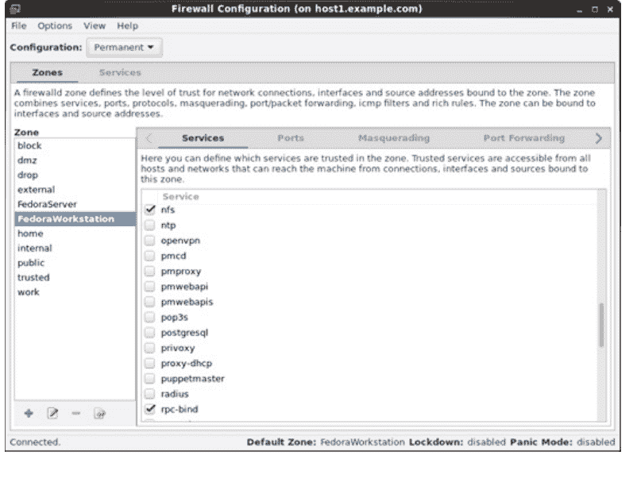

## 为你的 NFS 服务器配置 SELinux

当 SELinux 设置为 permissive（许可）或 disabled（禁用）时，它不会阻止对 NFS 服务的访问。但在 enforcing（强制）模式下，你应该了解 SELinux 布尔值。要检查系统中 SELinux 的状态，请输入以下：

```bash
# getenforce
Enforcing
# grep SELINUX= /etc/sysconfig/selinux
SELINUXTYPE=targeted
```

如果你的系统处于强制模式，请查看`nfsd_selinux`手页，获取有关允许 NFS 服务运行的 SELinux 设置信息。以下是几个你需要的 NFS 相关 SELinux 文件上下文：

- `nfs_export_all_ro`: 将此布尔值设置为 1 时，SELinux 允许你使用 NFS 以只读权限共享文件。无论共享文件和目录设置了何种 SELinux 文件上下文，都允许只读文件共享。
- `nfs_export_all_rw`: 将此布尔值设置为 1 时，SELinux 允许你使用 NFS 以读写权限共享文件。与上一个布尔值一样，无论共享文件和目录设置了何种文件上下文，这都有效。
- `use_nfs_home_dirs`: 要允许 NFS 服务器通过 NFS 共享你的主目录，请将此布尔值设置为 1。

在描述的布尔值，前两个是默认开启的。`use_nfs_home_dirs`布尔值为关闭状态。要开启`use_nfs_home_dirs`目录，你可以输入：

然而，通过更改你想要通过 NFS 共享的文件和目录的上下文，你可以忽略所有与 NFS 文件共享相关的布尔值。`public_content_t`和`public_content_rw_t`文件类型可以设置在任何你想通过 NFS 共享的目录上（或其他文件协议，如 HTTP、FTP 等）。例如，要设置对`/home`目录及其子目录通过 NFS 读写共享规则并应用该规则，请输入以下：

```bash
# semanage fcontext -a -t public_content_rw_t "/home/.*"
# restorecon -F -R /home
```

如果你只想让用户读取目录中的文件而不允许写入，可以将`public_content_t`文件上下文分配给目录索引。

## 使用 NFS 文件系统

在服务器通过 NFS 在网络上导出目录后，客户端计算机使用`mount`命令连接到它自己的文件系统。这与挂载本地硬盘、DVD 和 USB 驱动器文件系统使用的命令相同，但选项略有不同。

`mount`命令允许客户端自动挂载添加到`/etc/fstab`中的 NFS 目录，就像挂载本地磁盘一样。NFS 目录也可以通过这种方式添加到`/etc/fstab`文件中但不自动挂载（这样你可以在选择时手动挂载）。使用`noauto`选项，`/etc/fstab`中列出的 NFS 目录将处于活动状态，直到系统启动后使用`mount`命令挂载该文件系统。

除了`/etc/fstab`文件，你还可以使用`/etc/nfsmount.conf`文件设置挂载选项。在该文件中，你可以设置适用于你挂载的任何 NFS 目录的选项，或仅适用于与特定挂载点或 NFS 服务器相关的选项。

在设置 NFS 共享目录之前，你可能想使用`showmount`命令检查哪些可用的 NFS 共享目录。

### 查看 NFS 共享

从客户端 Linux 系统，你可以使用`showmount`命令查看从指定计算机提供的可用共享目录。我从名为`ubuntu`的计算机列出了我名为`fedora.example.com`系统的所有 NFS 共享目录：

```bash
$ showmount -e fedora.example.com
Export list for fedora.example.com:
/pub *
/cal *
/home ubuntu
```

`showmount`输出显示名为`/home`的共享目录仅对主机`ubuntu`可用。然而，`/pub`和`/cal`目录对所有人可用。

### 手动挂载 NFS 文件系统

在知道计算机的目录已导出后，可以使用`mount`命令在本地挂载它。这是一个挂载目录的示例：

```bash
# mkdir /mnt/nfs
# mount -t nfs fedora.example.com:/pub /mnt/nfs
```

## /etc/fstab 中的 NFS 条目

以下是`/etc/fstab`中的 NFS 条目示例：

在修改`/etc/fstab`文件后，运行以下命令让 systemd 使用最新版本的文件：

```
# systemctl daemon-reload
```

在第一个示例中，将名为`maple`的计算机上的远程目录`/stuff`(`maple:/stuff`)挂载到本地目录`/mnt/maple`（本地目录必须已经存在）。如果因为服务器不可导致挂载失败，`bg`参数会导致挂载尝试在后台运行并在稍后重试。

文件系统类型为`nfs`，读取(`rsize`)和写入(`wsize`)缓冲区（在本章的“使用挂载选项”节中讨论）被设置为 8192，以加速与此连接的数据传输。在第二个示例中，远程目录是名为`oak`的计算机上的`/apps`。它被设置为 NFS 文件系统(`nfs`)，可以挂载到本地的`/oak/apps`目录。该文件系统不会自动挂载(`noauto`)，但在系统运行后，可以使用`mount`命令仅以只读(`ro`)方式挂载。

> **提示**：默认将 NFS 文件系统挂载为读/写。然而，导出文件系统的默认是只读的。如果你无法向 NFS 文件系统写入，请检查服务器是否是以读/写方式导出的。

## 挂载自动挂载

你的`/etc/fstab`文件可能包含其他不会自动挂载的文件系统的设备。例如，你可能在硬盘上有多个分区，或者有一个偶尔想要挂载的 NFS 共享文件系统。`noauto`文件系统可以手动挂载。它的优点是，当你输入`mount`命令时，可以输入少量信息，其余部分由`/etc/fstab`文件的内容填充。例如，你输入

```
# mount /oak/apps
```

通过此命令，`mount`知道要检查`/etc/fstab`文件以获取挂载的文件系统(`oak:/apps`)、文件系统类型(`nfs`)以及与`mount`使用的选项（在此情况下为`ro`，即只读）。你不需要输入本地挂载点(`/oak/apps`)，而可以输入远程文件名(`oak:/apps`)并让其他信息自动填充。

> **提示**：在命名挂载点时，在名称中包含远程 NFS 服务器的名称可以帮助记忆文件实际上存储在何处。如果你正在共享家目录(`/home`)或邮件目录(`/var/spool/mail`)，这可能无法实现。例如，你可能将来自名为`duck`的机器的文件系统挂载到`/mnt/duck`目录。

## 使用挂载选项

你可以将多个挂载选项添加到`/etc/fstab`文件中（或命令行本身中），以影响文件系统的挂载方式。当你向`/etc/fstab`添加选项时，它们必须用逗号隔开。例如，这里是挂载`oak:/apps`时使用的`noauto`、`ro`和`hard`选项：

```
oak:/apps /apps nfs noauto,ro,hard 0 0
```

以下是一些对挂载文件系统非常有用的选项。你可以从 nfs 页面（`man 5 nfs`）阅读这些以及其他可以放在`/etc/fstab`文件中的 NFS 挂载选项：

- `hard`: 如果使用此选项，且当进程等待访问它时 NFS 服务器断开或宕机，该进程将挂起直到服务器恢复。对于保持你正在工作的数据与程序同步至关重要（这是默认行为）。
- `soft`: 如果 NFS 服务器断开或宕机，当开启此选项时，尝试访问数据的进程会在设定一段时间后超时。尝试访问 NFS 服务器的进程将接收到输入/输出错误。
- `rsize`: 这是 NFS 客户端从 NFS 服务器读取数据时请求的数据块大小（单位为字节）。默认值为 1024。使用较大的数字（如 8192）可以让你在速度较快（如局域网 LAN）且相对无错误的网络上（即没有大量噪声或冲突的网络）获得更好的性能。
- `wsize`: 这里的 NFS 客户端向 NFS 服务器写入数据时请求的数据块大小（单位为字节）。默认值为 1024。其性能问题与`rsize`选项相同。
- `timeout=#`: 这设置了在 RPC 超时发生后进行第二次传输的时间，其中`#`代表十分之一秒。默认值为十十分秒（即 7 秒）。每次连续超时都会导致超时值翻倍（最高 60 秒）。如果你认为超时是因为服务器响应慢或网络慢导致的，请增加此值。
- `retrans=#`: 这设置了在发生主要超时之前需要发生的次要超时和重传的次数。
- `retry=#`: 这设置了继续重试失败请求的分钟数，其中`#`替换为重试的分钟数。默认值为 10000 分钟（大约一周）。
- `bg`: 如果第一次挂载尝试超时，则在后台尝试所有后续挂载。当你挂载缓慢或可用性不稳定的 NFS 文件系统时，此选项非常有用——当你将挂载请求放在后台时，你的系统可以继续挂载其他文件系统，而无需等待当前任务完成。
- `fg`: 如果第一次挂载尝试超时，则在前台尝试所有后续挂载。当你挂载缓慢或可用性不稳定的 NFS 文件系统时，此选项非常有用。

## 访问 NFS 共享目录

信不信，这就是你需要做的所有工作。如果你到想要共享目录的 NFS 服务器有网络连接，请尝试访问一个共享的 NFS 目录。例如，如果你知道网络上名为`shuttle`的计算机正在共享`usr/local/share`目录，你可以执行以下操作：

```
$ cd /net/shuttle/
```

如果该计算机有任何你可用的共享目录，你就可以成功切换到该目录。

你也可以输入以下内容：

```
$ ls
usr
```

你应该能看到`usr`目录是共享目录路径的一部分。如果来自其他顶层目录（如`/var`或`/tmp`）的共享目录，你也会看到它们。当然，能否看到其中任何一个取决于服务器上的安全设置。

尝试直接进入共享目录，如本例所示：


```
$ cd /net/shuttle/usr/local/share
$ ls
info man music television
```

此时，`ls` 命令应该会显示出名为 `shuttle` 的计算机上 `/usr/local/share` 目录的内容。你可以对这些内容做什么取决于服务器的配置。

这可能会让人有些困惑，因为在你实际尝试使用它们（例如切换到网络挂载目录）之前，你看不到任何文件或目录。例如，`ls` 命令在目录挂载之前不会在网络挂载目录下显示任何内容，这可能会导致一种“有时在那儿，有时不在”的印象。只需切换到网络挂载目录，或访问此类目录上的文件，`autofs` 就会处理其余部分。

在示例中，使用了主机名 `shuttle`。然而，你可以使用任何标识 NFS 服务器计算机位置的名称或 IP 地址。例如，除了 `shuttle`，你可能会使用 `shuttle.example.com` 或如 `192.168.0.122` 的 IP 地址。

## 自动挂载主目录

与其在 `/net` 目录上挂载 NFS 文件系统，你可能希望在特定位置挂载特定的 NFS 目录。例如，你可以配置来自集中式服务器的用户主目录，当用户登录时，可以从不同的机器自动挂载它。同样，你可以使用集中认证机制（例如 LDAP，如第 11 章“管理用户账户”所述）来提供集中式用户账户。

## 第四部分：成为 Linux 服务器管理员

以下步骤说明了如何在 NFS 服务器上设置用户账户，并共享该服务器上名为 `joe` 的用户的主目录，以便在登录不同的计算机时可以自动挂载。在此示例中，没有使用集中认证服务器，而是在每个系统上创建了匹配的账户。

1. 在为名为 `joe` 的用户提供集中主目录的 NFS 服务器 (`myns.example.com`) 上，创建一个名为 `joe`、主目录为 `/home/shared/joe` 的用户账户。同时从 `/etc/passwd` 文件（第三列）找到 `joe` 的用户 ID，以便在另一个系统上为 `joe` 设置用户账户时进行匹配。

```
# mkdir /home/shared
# useradd -c "Joe Smith" -d /home/shared/joe
# grep joe /etc/passwd
joe:x:1000:Joe Smith:/home/shared/joe:/bash
```

2. 在 NFS 服务器上，将 `/home/shared/` 目录导出到本地网络上的任何系统（在此处我使用 `192.168.0.*`），以便你可以通过向 `/etc/exports` 文件中添加此行来共享 `joe` 以及你创建的任何其他用户的主目录：

```
/home/shared 192.168.0.* (rw,insecure)
```

> **注意**
>
> 在 exports 示例中，`insecure` 选项允许客户端使用 1024 以上的端口来发送请求。某些 NFS 客户端要求不能访问 NFS 预留端口。

3. 在 NFS 服务器上，重启 `nfs-server`；如果它已经在运行，你可以简单按照如下方式导出共享目录：

```
# exportfs -a -r -v
```

4. 在 NFS 服务器上，确保防火墙上开放了适当的端口。详情请参见本章前面的“保护你的 NFS 服务器”部分。

5. 在 NFS 客户端上，向 `/etc/auto.master` 文件添加一个条目，标识你想要挂载远程 NFS 目录的挂载点，以及一个（由你选择的）文件用于标识远程 NFS 目录的位置。我将此条目添加到 `/etc/auto.master` 文件中：

```
/home/remote /etc/auto.joe
```

6. 在 NFS 客户端系统上，向你提到的文件（我使用的是 `/etc/auto.joe`）添加一个包含如下条目的条目：

```
joe -rw myns.example.com:/home/shared/joe
```

7. 在 NFS 客户端系统上，重启 `autofs` 服务：

```
# systemctl restart autofs
```

## 第 20 章：配置 NFS 服务器

8. 在 NFS 客户端系统上，使用 `useradd` 命令创建一个名为 `joe` 的用户。对于该命令行，你需要获取服务器上 `joe` 的 UID（在本例中为 `507`），以便 `joe` 拥有其 NFS 主目录中的文件。当你运行以下命令时，`joe` 账户被创建了，但你将看到一条错误消息，提示主目录已存在（这是正确的）：

```
# useradd -u 507 joe
```

9. 在 NFS 客户端系统上，以 `joe` 身份登录。如果一切运行正常，`joe` 登录并尝试访问他的主目录 (`/home/remote/joe`)，目录 `/home/shared/joe` 应该从 `myns.example.com` 服务器挂载。该 NFS 目录以读写方式共享并挂载，所有权属于 UID 507（在两个系统上都是如此），因此本地系统上的 `joe` 能够删除、更改和查看该目录中的文件。

在 `joe` 注销（实际上是当他停止访问该目录）一段时间（默认为 10 分钟）后，该目录将被卸载。

## 卸载 NFS 文件系统

挂载 NFS 文件系统后，卸载它是简单的。使用 `umount` 命令配合本地挂载点或远程文件系统名称。例如，这里有两种使用 `umount maple:/stuff` 的方法：

```
# umount maple:/stuff
# umount /mnt/stuff
```

如果 `maple:/stuff` 是自动挂载的（来自 `/etc/fstab` 中的列表），它在下次重启系统时会重新挂载。如果是临时的（不在 `/etc/fstab`），则不会重新挂载。

> **提示**
>
> 命令是 `umount`，不是 `unmount`。这很容易记错。

当你尝试卸载文件系统时收到“设备忙”的消息，意味着卸载失败，因为该文件系统正在被访问。很可能是 NFS 文件系统中的某个目录是你（或你系统上其他人的 shell）的当前目录。检查你的终端窗口和其他...

如果 NFS 文件系统无法卸载，你可以强制卸载（`umount -f /mnt/apple`）或卸载后清理（`umount -l /mnt/apple`）。`-l` 选项通常是最佳选择，因为强制卸载可能会破坏正在进行的文件修改。另一种方案是运行 `fuser -v mountpoint` 来查看哪些用户在使用你的共享。

## 与 Cockpit 使用 NFS

一旦 NFS 和 Cockpit 服务在你的系统上运行，你就可以通过 Cockpit UI 挂载和查看挂载共享。以下是操作方法：

1. 通过浏览器登录你的 Cockpit 界面（端口 9090）并选择“存储”（Storage）。访问本地系统 Cockpit 服务存储部分的 URL 应该是 `https://host1.example.com:9090/storage`。

2. 如果你的系统上已挂载了 NFS 共享，它们将显示在“NFS 挂载”部分。图 20.2 显示了一个包含从名为 fedora 的系统挂载的 `/home` 目录的 Ubuntu 系统示例。

3. 要挂载远程 NFS 共享，选择存储框中的三栏图标，然后选择“新建 NFS 挂载”（New NFS mount）。填写 NFS 服务器的地址或主机名、NFS 共享上的目录，以及你要挂载共享的本地文件系统点。然后点击“添加”（Add），如图 20.3 所示。

## 第 20 章：配置 NFS 服务器

图 20.3

使用 Cockpit Web 界面添加新的 NFS 挂载。

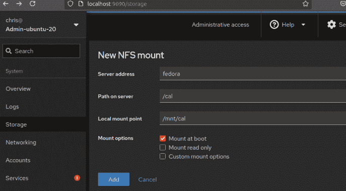

此时，你应该能够从本地文件系统上的挂载点访问远程 NFS 共享的内容。默认情况下，NFS 挂载信息会被添加到 `/etc/fstab` 文件中（注意默认勾选了“启动时挂载”复选框），每当系统重启时，NFS 共享将变得可用。

## 总结

网络文件系统（NFS）是现存的最古老的计算机文件共享产品之一。它在 UNIX 和 Linux 系统之间共享文件目录时仍然非常流行。NFS 允许服务器将特定目录指定给指定的主机，并允许客户端通过在本地挂载这些目录来连接到它们。

NFS 可以使用防火墙 (iptables) 规则和 SELinux（通过限制文件共享协议来保护 NFS 资源）来安全性。尽管 NFS 在创建时本质上是不安全的（数据未加密且用户访问相当开放），但 NFS 第 4 版本中的功能有助于提高 NFS 的整体安全性。

本章关于 NFS 的章节是书中最后一个关于服务器的章节。第 21 章“Linux 故障排除”涵盖了广泛的桌面和服务器主题，它可以帮助你理解对 Linux 系统进行故障排除的技术。

## 第四部分：成为 Linux 服务器管理员

## 练习

本节的练习将带你完成与在 Linux 中配置和使用 NFS 服务器相关的任务。如果可能，请准备两个连接到本地网络上的 Linux 系统。其中一个 Linux 系统将作为 NFS 服务器，另一个将作为 NFS 客户端。

为了从这些练习中获得最大的收益，我建议你不要使用已经运行 NFS 的 Linux 服务器。如果你不中断正在运行并共享资源的 NFS 服务，就无法完成所有的练习。

请参阅附录 B 获取建议的解决方案。

1. 在你想要作为 NFS 服务器的 Linux 系统上，安装配置 NFS 服务所需的包。

2. 在 NFS 服务器上，列出提供 NFS 服务器软件的包中的文档文件。

3. 在 NFS 服务器上，确定网络服务名称并启动它。

4. 在 NFS 服务器上，检查你刚刚启动的 NFS 服务状态。

5. 在 NFS 服务器上，创建 `/var/mystuff` 目录并从你的 NFS 服务器共享它，并具有以下属性：所有人可用、只读，且客户端上的 root 用户对共享具有 root 权限。

6. 在 NFS 服务器上，通过打开适当的防火墙端口和 SELinux，确保你创建的共享对所有主机可见。

7. 在第二个 Linux 系统（NFS 客户端）上，查看来自 NFS 服务器的可用共享。（如果没有第二个系统，可以在同一系统上操作。）如果你没有看到共享目录，回到上一个问题并重试。

8. 在 NFS 客户端上，创建一个名为 `/var/remote` 的目录，并将 NFS 服务器上的 `/var/mystuff` 目录临时挂载在该挂载点。

9. 在 NFS 客户端上，卸载 `/var/remote`，添加条目以便在重启时自动挂载（使用 `bg` 挂载选项），并测试你创建的条目是否正常工作。

10. 从 NFS 服务器将一些文件复制到 `/var/mystuff` 目录。从 NFS 客户端上，确保你可以看到刚刚添加到该目录的文件，并确保你无法从客户端向该目录写入文件。

## 第 21 章

## Linux 故障排除

## 本章内容

- 排除引导加载程序的故障
- 排除系统初始化的故障
- 修复软件包问题
- 检查网络接口问题
- 处理内存问题
- 使用救援模式

任何复杂的操作系统都会遇到各种问题。本章将帮助你理解对 Linux 系统进行故障排除的技术。在 Linux 中，你可能会遇到以下问题：引导加载程序、系统初始化、软件包、网络接口、内存问题以及救援模式。

## 第四部分：成为 Linux 服务器管理员

并更改启动顺序。如果你按下注的功能键（通常是 F1、F2 或 F12）来选择这些项目之一，你可以执行以下操作：

**设置程序 (Setup utility)** 设置程序允许你更改硬件设置。这些设置可以用于启用或禁用某些硬件组件，或开启/关闭选功能。

**启动顺序** 计算机能够从连接到计算机的多个设备启动操作系统，更具体地说，是一个可以启动操作系统的启动顺序。这些设备包括 CD 驱动器、DVD 驱动器、硬盘、USB 驱动器或网卡。启动顺序定义了检查这些设备的顺序。通过修改启动顺序，你可以告诉计算机临时忽略默认启动顺序，并尝试从你选择的设备启动。

对于你的 HP 工作站，启动过程开始后，我会立即按下 F2 键进入设置，或按下 F12 临时更改启动顺序。接下来的章节将探索你可以从设置和启动顺序中排除哪些故障。

## 排除设置故障

如前所述，你可以让硬件无中断地启动，让系统引导到默认启动设备（可能是硬盘）。但是，在某些情况下，你可能希望进入设置模式并更改 UEFI 设置中的某些内容：

**查看硬件概览** 如果你的故障排除与硬件有关，硬件设置是检查你系统的绝佳起点。设置屏幕会告诉你系统类型、版本、处理器、内存插位和类型、是 32 位还是 64 位、每个插位中是哪种设备，以及关于连接到系统的设备类型的许多详细信息。

如果你完全无法启动操作系统，设置屏幕可能是确定系统模型、处理器类型以及你搜索信息或寻求支持时所需的其他信息的唯一途径。

**禁用/启用设备** 连接到你计算机的大多数设备都是已启用并供操作系统使用的。为了排除某个设备的故障，你可能需要禁用该设备。

例如，假设你的电脑有两个网络接口卡 (NIC)。你想使用第二个网卡通过网络安装 Linux，但安装程序尝试使用第一个网卡连接网络。你可以禁用第一个网卡，这样安装程序在尝试连接网络时就检测不到它。或者，你可以让网卡对计算机可见，但简单地禁用网卡的 PXE 启动功能。

也许你有一个声卡，而你想禁用主板上的集成音频。这在硬件设置屏幕上也可以完成。

相反，有时你可能想启用一个被禁用的设备。也许你收到的电脑在固件中已经禁用了某个设备。例如，从操作系统的角度来看，可能就像你没有 USB 端口或 C 盘。查看这些设置屏幕可以告诉你，这些设备是否仅仅是因为在固件中被禁用了。

**更改设备设置** 有时，固件自带的默认设置不符合你的情况。你可能想更改固件中的以下设置：

**NIC PXE 启动设置** 大多数现代网卡都能从网络上的服务器启动。如果你需要这样做并发现网卡没有在“启动顺序”屏幕上作为可启动卡出现，你可能需要在固件中启用该功能。

**虚拟化设置** 如果你想将 Linux 系统作为虚拟化主机运行，计算机的 CPU 必须包含 Intel 虚拟化技术或 AMD 安全虚拟机 (SVM) 支持。然而，即使你的 CPU 具有此支持，在固件中也可能未启用。要启用它，请进入设置屏幕并查找虚拟化选项（可能在性能分类下）。确保将其设置为“开启”(On)。

### 排除启动顺序故障

根据连接到计算机的硬件，典型的启动顺序可能会先启动 USB 驱动器，然后是硬盘，然后是 CD/DVD 设备（可用），最后是网卡。固件会访问每个设备，在设备的主引导记录 (MBR) 中寻找引导加载程序。如果找到了引导加载程序，就会启动它。如果没有找到引导加载程序，将移动到下一个设备，直到尝试所有设备。如果未找到引导加载程序，计算机将无法启动。

启动顺序可能出现的一个问题是，你想启动的设备可能根本没有按照顺序出现。在这种情况下，如前一节所述，进入设置屏幕启用该设备或更改设置使其变为可启动，可能是你需要的操作。

如果你想启动的设备确实出现在启动顺序中，通常你只需要将箭头移动到该设备并按回车键即可。以下是选择你的设备启动的原因：

- **救援模式** 如果 Linux 无法从硬盘启动，选择 USB 驱动器允许你进入救援模式（本章稍后描述），该模式可以帮助你修复无法启动系统的硬盘。请查看本章的“救援模式下的故障排除”部分获取更多信息。

- **全新安装** 有时，启动顺序列出了硬盘。如果你决定需要对操作系统进行全新安装，你需要选择持有安装介质的设备（USB、CD、DVD 驱动器或网卡）。

假设你解决了固件中的任何问题，下一步是让计算机启动引导加载程序。

## 第四部分：成为 Linux 服务器管理员

### 排除 GRUB 故障

在讨论中，GRUB 被称为 GRUB 2。大多数现代系统都使用 GRUB 启动。在滚动屏幕信息时，内核启动时产生的消息会被复制到环形缓冲区。正如其名所示，内核环形缓冲区将消息存储在缓冲区中，充满后会完全溢出并丢弃旧消息。计算机启动后，你可以登录系统，然后按照以下命令将内核消息捕获到文件中（然后使用 `less` 命令）：

```
# dmesg > /tmp/kernel_msg.txt
# less /tmp/kernel_msg.txt
```


## 排除内核启动故障

```
(mockbuild@5da726c50a0401890423542c10adde) (gcc (GCC) 15.1.1.1
20250521
(Red Hat 15.1.1-2) GNU Linux kernel: 2.44-33.fc42) #1 SMP PREEMPT_
DYNAMIC
Thu 28 17:17:56 UTC 2025
kernel: Command line:
BOOT_IMAGE=(hd0,gpt2)/vmlinuz-6.15.7-200.fc42.x86_64 root=UUID=2a9dafa6-
4e21-4af38-a9f5-9ac9528f13 rootflags=-subvol=root rhgb quiet
Jul 28 08:58:56 fed kernel: BIOS-provided RAM map:
Jul 28 08:58:56 fed kernel: BIOS-e820:
[mem 0x0000000000000000-0x00000000005bfff] usable
Jul 28 08:58:56 fed kernel: BIOS-e820:
[mem 0x0000000000005c00-0x00000000005cff] reserved
```

你需要寻找的是那些显示硬件功能未能启用的消息。例如，我曾有一个电视调谐器卡（用于在屏幕上观看），检测到的显卡类型设置错误。通过使用电视显卡型号和故障类型的信息，我发现通过向显卡驱动程序传递选项，可以让我尝试不同的设置，直到找到与我的显卡匹配的设置。

在描述如何查看内核消息时，我有点操之过急。在你登录并查看内核消息之前，内核需要完成系统引导。一旦内核开始检测硬件并加载驱动程序，它就会接管启动系统所需的所有控制权，并交给初始化系统。

## 排除初始化系统的故障

在内核刚刚启动的系统中，运行的第一个进程取决于所使用的初始化系统。对于 System V init，运行的第一个进程是 `init` 进程。对于 systemd，第一个进程是 systemd（尽管在最新的 Ubuntu 中，第一个进程被称为 `/sbin/init`，它是指向 systemd 的符号链接）。取决于运行系统的是哪一个（使用 `type ps -ef | head`），请遵循后续章节的描述。

## 排除 systemd 化的故障

Fedora、RHEL 和 Ubuntu 的最新版本使用 systemd 作为它们的初始化系统。虽然 systemd 比之前的 System V init 更复杂，但 systemd 提供了更多方法来分析初始化期间发生。

## 理解 systemd 启动过程

当 systemd 守护进程（`/usr/lib/systemd`）在内核启动后启动时，它会启动所有设置为启动的服务。特别是对于 Fedora RHEL 系统，它会启动 `/etc/systemd/system/default.target` 文件的内容，例如所示：

```
# cat /etc/systemd/system/default.target
[Unit]
Description=Graphical Interface
Documentation=
Requires=multi-user.target
Wants=display-manager.service
Conflicts=
After=multi-user.target rescue.service
Isolate=yes
```

与仅仅按字母顺序运行服务的 System V init 不同，systemd 需要从 `default.target` 反向工作以确定运行哪些和服务和其他目标。在这个示例中，`default.target` 是指向 `/usr/lib/systemd/system.target` 文件的符号链接（如下所示）。当你列出内容时，你可以看到以下内容：

- `multi-user.target` 需要首先启动。
- 之后启动 `display-manager.service`。

通过继续查看哪些单元需要这些，你可以找到所需的内容。例如，`multi-user.target` 需要基础服务和 `display-manager.service`（启动图形登录界面）。要查看 `multi-user.target` 的目标，请列出 `/etc/systemd/system/multi-user.target.wants` 目录的内容，例如：

```
# ls /etc/systemd/system/multi-user.target.wants
abrtd.service rsyslog.service
abrtd-journal.service docker.service
abrtd-oops.service smartd.service
firewalld.service smb.service
abrt-vmcore.service flatpak-add.service sshd.service
abrt-xorg.service sssd.service
atd.service mcelog.service system-log.service
audit.service networkd.service thermald.service
audit-rules.service ModemManager.service vboxservice.service
autofs.service NetworkManager.service virtd.service
chronyd.service
```

这些文件是定义每个服务启动哪些内容的指向对应文件的符号链接。在你的系统中，这些链接可能包括远程外壳 (sshd)、打印 (cups)、审计 (audit)、网络 (NetworkManager) 等。这些链接是在安装服务程序包时，或者在通过 `systemctl enable` 命令启用服务时被添加到目录中的。

请记住，与 System V init 不同，systemd 可以启动并管理代表更多内容的单元文件。在你的系统中，这些可能包括远程外壳 (sshd)、打印 (cups)、审计 (audit)、网络 (NetworkManager) 等。在 systemd 启动并管理这些单元文件后，你可以登录系统并调查潜在问题。通过运行 `systemctl` 命令，你可以看到每个单元的状态：

```
# systemctl
UNIT                               LOAD ACTIVE SUB DESCRIPTION
multi-user.target                  active (running) Multi-user user level.
display-manager.service             active (running) Display Manager.
...
```

## 第四部分：成为 Linux 服务器管理员

## 图 21.2

system-analyze 启动图的片段。


## 软件包故障排除

软件包封装机制（如用于 RPM 的 `dnf` 和用于 B 软件包的 `apt`）旨在方便你管理系统软件。（请参阅第 10 章“获取和管理软件”了解如何管理软件包的基础知识。）尽管已经付了努力让一切正常工作，但有时软件包封装会出现问题。

> 在 Fedora 和 RHEL 系统中，`dnf` 已经取代了 `yum`。有时人们会使用 `yum` 命令，因为在大多数情况下它同时适用于旧版和新的 Fedora 及 RHEL 系统，由于 `yum` 是 `dnf` 的别名。在显式要求时，总是显示 `dnf` 命令。

以下章节描述了你在 RHEL 或 Fedora 系统上遇到 RPM 包时可能会遇到的一些常见问题，以及你如何克服这些问题。

有时，当你尝试使用 `dnf` 命令安装或升级软件包时，错误信息会提示你执行所需操作的依赖包不可用。这可能发生在小规模（当你尝试安装一个包时），也可能发生在大规模（当你正尝试更新或升级整个系统时）。

由于 Fedora 和 Ubuntu 的发布周期较短且仓库较大，软件包依赖关系的不一致性比在更稳定、更有选择性的仓库（如 Red Hat Enterprise Linux 提供的仓库）中更容易发生。为了避免依赖失败，以下是你可以遵循的一些良好实践：

- **使用最新的、经过良好测试的仓库。** Fedora 中有数以千计的软件包。如果你使用 Fedora 官方仓库从当前发行版安装软件，很少会出现依赖性问题。

- **持续更新你的系统。** 每当仓库中添加了新包时，每天运行 `dnf update`，只要仓库维护者保留了设置仓库的正确命令（且你不使用外部仓库），安装选定软件包所需的所有内容都应该是可用的。然而，当你开始使用第三方仓库时，这些仓库可能依赖于它们无法控制的版本。例如，如果某个仓库创建了其软件的新版本，该版本需要较新版本的基础软件（如库），那么所需的版本可能在 Fedora 仓库中无法获得。如果你每几个月更新一次系统，就会遇到重大的依赖问题。在带有 GNOME 桌面的系统中，软件窗口允许你检查并对已安装软件包应用更新。在 Fedora 和 RHEL 系统上，你可以添加自动更新（https://fedaproject.org/wiki/AutoUpdates）。AutoUpdates 在包可用时会自动手动下载包，如果配置得当，还可以安装它们。另一种方法是创建一个 `cron` 任务来检查或运行每日更新。详情请参见侧边栏“使用 cron 进行系统更新”。

- Fedora 在每个版本发布 13 个月后就会停止提供该版本的更新包。因此，虽然你不需要每六个月升级到新版本，但你应该每年升级一次，否则当 Fedora 停止提供更新时面临可能的依赖和安全问题。

要获取这些发行版的全新版本（例如从 Fedora 40 升级到 Fedora 41），请执行以下操作：

1. 升级到当前发行版的最新软件：

```bash
dnf update --refresh -y
```

2. 安装 `dnf-plugin-system-upgrade` 插件：

```bash
dnf install dnf-plugin-system-upgrade -y
```

3. 开始升级到新发行版：

```bash
dnf system-upgrade download --releasever=41
```

4. 重启进入升级过程：

```bash
dnf system-upgrade reboot
```

5. 当系统重启后，你可以如下清理缓存的元数据和事务：

```bash
# dnf system-upgrade clean
```

如果你正在寻找一个稳定的系统，Red Hat Enterprise Linux 是更好的选择，因为它为每个主要版本提供七年或更久的更新。

> **注意**
>
> 如果你在 Ubuntu 中使用 `apt-get` 命令更新软件包，请记住，Ubuntu 中 `update` 和 `upgrade` 选项的含义与 `yum` 命令（Fedora 和 RHEL）中不同。
>
> 在 Ubuntu 中，`apt-get update` 会将最新的软件包元数据（包名、版本号等）下载到本地系统。运行 `apt-upgrade` 会导致系统根据下载的元数据，升级任何有新版本的已安装包。
>
> 相比之下，每当你在 RHEL 中运行 `dnf` 或 `yum` 命令时，都会下载关于当前发行版更改的最新元数据。当你运行 `dnf update` 时，你将获得当前 Fedora 或 RHEL 发行版的最新包。要进入下一个版本，你必须运行 `dnf system-upgrade`，因为

如果你遇到依赖问题，可以采取以下几种措施来解决问题：

- **使用稳定的仓库。** 对于知名发行版（例如 RHEL、Fedora 或 Ubuntu）的最新发布版本，依赖问题很少见，且通常会被快速修复。然而，如果你依赖于旧版本的仓库或面向开发者的仓库（例如 Fedora 的 Rawhide），请预料会遇到更多的依赖问题。重新安装或升级通常可以解决依赖问题。

- **仅在需要时使用第三方应用和仓库。** 如今，你离 Linux 发行版的核心越远，遇到依赖问题的可能性就越大。在去其他处寻找包或自己构建包之前，请先查看你发行版的官方仓库。

即使在初次安装时它是可用的，别人给你的包也可能存在依赖问题。

- **解决内核依赖问题。** 如果你需要处理内核相关的依赖，请确保内核与驱动匹配。如果你在更新时需要排除某些软件包，可以如下（将 `somepackage` 替换为包名）：

```bash
# dnf -y --exclude=somepackage
```

## 使用 cron 进行系统更新

`cron` 提供了一种按预定义时间和间隔运行命令的方法。你可以设置运行命令的具体分钟、小时、日或月。你可以每五分钟运行一次、每三小时运行一次，或者在周五下午的某个时间运行。

如果你想使用 `cron` 设置每日更新，可以通过 root 用户身份编辑 `/etc/crontab` 文件。这是一个 crontab 文件示例：

```
* * * * * dnf -y update >> /tmp/cron.txt
59 23 * * *
```

创建 cron 条目时，确保将输出重定向到文件或管道到一个可以处理输出的命令。否则将发送给创建 cron 任务的用户（在本例中为 root）。

在 crontab 文件中，你可以使用数字范围或列表，也可以跳过某些数字。例如，第一个字段中的 `1, 5, 或 17` 允许命令在每小时的第 1、5 和 17 分钟运行。第二个字段中的 `*/3` 允许命令每三小时运行一次（午夜、凌晨 3 点、早晨 6 点等）。第四字段中的 `1-3` 告诉 cron 在一月、二月和三月运行命令。星期和月份可以使用数字或单词输入。

要获取有关 crontab 文件格式的信息，请输入 `man 5 crontab`。要了解 `crontab` 命令，请查看 `man 1 crontab`。

## 第四部分：成为 Linux 服务器管理员

## 网络故障排除

随着我们每天使用的信息、图像、视频和其他内容在本地计算机之外的地方变得越发易于获取，几乎每台计算机系统都需要连接的网络连接。因此，如果你的网络连接中断或无法访问你想要通信的系统，请记住 Linux 中有许多工具可以查看这些问题。

对于客户端计算机（笔记本电脑、台式电脑和手持设备），你希望连接到网络以访问其他计算机系统。在服务器上，你希望客户端能够访问你。接下来的章节描述了用于 Linux 客户端和服务器系统连接故障排除的不同工具。

## 排除出站连接故障

假设你的网页浏览器无法访问任何网站。你怀疑自己没有连接到网络。问题可能出在没有解析，但也可能是本地网络之外的连接问题。

要检查你的出站网络连接是否正常，你可以使用第 14 章“网络管理”中描述的许多命令。你可以使用简单的 `ping` 命令测试连通性。要检查主机到地址的解析是否正常，请使用 `host` 和 `dig`。

接下来的章节将介绍你在出站连接连接中可能遇到的问题，以及用于发现这些问题的工具。

## 查看网络接口

要查看网络接口接口的状态，请使用 `ip` 命令。以下输出显示环回接口 (lo) 处于开启状态（因此你可以在本地系统上运行网络命令），eth0（你的第一块有线卡）处于关闭状态（状态为 DOWN）。如果接口处于开启状态，`inet` 行将显示接口的 IP 地址。在这里，环回接口有一个地址 (127.0.0.1)。

```
# ip addr
lo: <BACKUP,UP,LOWER> mtu 16436 qdisc noqueue state UNKNOWN
   link/loopback 00:00:00.00:00:00 brd 00:00:00.00:00:00
   inet 127.0.0.1/8 scope host lo
   inet6 ::/128 scope host
      valid_lft preferred left
2: eth0:<NO-CARRIER,BROADCAST,MULTICAST,UP> mtu 1500 state DOWN qlen 1000
   link/ether f0:de:f1:24:86:d9 brd ff:ff:ff:ff:ff:ff
```

在 Ubuntu、RHEL 和 Fedora 的默认情况下，网络接口是根据它们连接到物理硬件的方式命名的。例如，在 RHEL 中，你可能想看到名为 `enp1s0` 的网络接口。这表示网卡 (NIC) 是 PCI 板 11 (p11) 上插槽 0 (s0) 上的有线以网卡 (en)。无线卡将以 `wl` 而不是 `en`（例如 `wlp0s20f3`）。其目的是让网卡名称更具可预测性，因为当系统重启时，操作系统无法保证接口将仍然命名为 `eth0`、`eth1` 等。

## 检查物理连接

对于有线连接，确保你的计算机已插在网络交换机的端口上。如果你有多个网卡，请确保电缆插在正确的那个上。如果你知道网络接口的名称（eth0、en4p1 或其他），要找到哪个网卡与该接口关联，请在命令行中输入 `ethtool -p eth0` 并在电脑后面查看网卡是否在闪烁（Ctrl+C）。将电缆插到正确的端口。

如果看到的不是一个禁用的接口，而是 `ip` 命令没有显示任何接口，请检查硬件是否被禁用。对于有线连接，网卡可能没有完全插入插槽，或者网卡可能在 BIOS 中被禁用。

在无线连接上，你可能点击 NetworkManager 图标但看不到可用的无线接口。同样，它可能在 BIOS 中被禁用。然而，在笔记本电脑上，请检查是否有一个禁用网卡的微型开关。我见过几个人搞乱了网络配置，结果发现笔记本电脑正面或侧面的这个微型开关被拨到了关闭位置。

## 检查路由

如果你的网络接口已开启但你仍然无法访问想要访问的主机，请检查通往该路由路由。首先检查默认路由。然后尝试访问本地网络到下一个网关设备。最后，通过互联网 ping 某些内容：


```
# ip route show
default via 192.168.1.1 dev wlp0s20f3 proto dhcp src 192.168.1.21
metric 600
192.168.1.0/24 dev wlp0s20f3 kernel link src 192.168.1.21
metric 600
```

该行显示默认网关地址为 `192.168.1.1`，该地址可以通过 `wlp0s20f3` 无线卡访问。因为这里只有 `wlp0s20f3` 接口，且只显示了通往 `192.168.1.0/24` 网络的路由，因此所有不是指向 `192.168.1.0/24` 网络上主机的通信都将通过默认网关 (`192.168.1.1`) 发送。默认网关被正确地称为路由器。为了确保万无一失，路由器。

# 成为 Linux 服务器管理员

当客户端无法通过浏览器访问你的网站时，如果客户端是 Linux 系统，你可以通过上一节描述的 `ping`、`host`、`traceroute` 等其他命令来追踪连接性问题。Windows 系统也有它们自己版本的 `ping`，你可以在这些系统上使用。

如果域名到地址的解析正常并到达你的系统，并且你可以从服务器 `ping` 通它，那么下一步需要尝试的是服务的可用性。

## 检查服务对客户端是否可用

从 Linux 客户端，你可以检查服务器提供的服务（在此例中为 http）是否正常工作。其中一种方法是使用 `nmap` 命令。

`nmap` 是系统管理员检查网络各种信息时喜爱的工具。然而，它也是黑客喜爱的工具，因为它可以扫描服务器以寻找潜在的漏洞。使用 `nmap` 扫描你自己的系统进行检查也是可以的，但要知道在另一个系统上使用 `nmap` 就像是在检查别人家的门窗以看自己能否进去。就像入侵者一样。

检查你自己的系统以查看服务器对外部开放了哪些端口（本质上，正在运行哪些服务）是完全合法且容易的。安装 `nmap`（`dnf install nmap`），使用你的主机名或 IP 地址通过 `nmap` 扫描你的系统，查看常用端口上运行了什么：

```
# nmap 192.168.0.119
```

Starting Nmap ( https://nmap.org ) at 2025-03-29 18:50 EDT

nmap scan report for fedora (192.168.1.21)

Host is up (0.0037s latency).

Not shown: 995 filtered ports

| PORT | STATE | SERVICE |
| :--- | :--- | :--- |
| 21/tcp | open | ftp |
| 22/tcp | open | ssh |
| 80/tcp | open | http |
| 443/tcp | open | https |
| 631/tcp | open | ipp |

MAC Address: 00:1B:2B:0A:E8:5E (Intel Corporate)

nmap done: 1 IP address (host) scanned in 4.77 seconds

上述输出显示 TCP 端口已对常规 (http) 和安全的 (https) 网页服务开放。当状态为 `open` 时，表示某个服务正在该端口上监听。如果你到了这一步，意味着你的连接是良好的，你应该将故障排除的重点放在服务本身的配置上（例如，你可能查看 `/etc/httpd/conf/httpd.conf` 以查看是否允许或拒绝了特定主机的访问）。

如果没有显示 TCP 端口 80 和 443，则意味着它们被过滤（filtered）了。你需要检查防火墙是否在拦截（不接受）指向这些端口的数据包。如果端口没有被过滤而是状态为 `closed`（关闭），则意味着 `httpd` 服务没有运行，或者没有这些端口上监听。下一步是登录服务器并检查这些问题。

# Linux 故障排除

## 检查服务器上的服务

如果没有东西阻止客户端通过提供你想要共享服务的实际端口访问你的服务器，那么是时候检查服务本身了。假设服务正在运行（使用 `systemctl status httpd.service` 进行检查），下一步要检查的是它是否在正确的端口和网络接口上监听。

`ss` 命令是一个用于检查网络服务的通用工具。以下命令列出了所有监听 (l) TCP (t) 和 UDP (u) 服务的进程名称和进程 ID (p)，以及它们接近的端口号 (n)。该命令过滤掉了所有与 `httpd` 进程相关的行：

```
# ss -tupln | grep httpd
tcp 0::80 ::: LISTEN 2567/httpd
tcp 0 0::443 ::: LISTEN 2567/httpd
```

上一个示例显示 `httpd` 进程正在所有接口的端口 80 和 443 上监听。`httpd` 进程可能仅监听选定的接口。例如，如果 `httpd` 进程仅在本地接口 (`127.0.0.1`) 上监听 HTTP 请求 (80)，则条目将显示如下：

```
tcp 0 0 127.0.0.1:80 ::: LISTEN 2567/httpd
```

对于 `httpd`，以及其他监听请求网络接口的服务，你可以编辑服务的主配置文件（在此例中为 `/etc/httpd/conf/httpd.conf`），让它监听所有地址的端口 80 (`Listen 80`) 或特定地址 (`Listen 192.168.0.100:80`)。

## 故障排除

排除计算机上的性能问题，是你需要完成的最重要但也最难以捉摸的任务之一。也许你的系统原本运行良好，但开始变慢，到实际上无法使用的程度。也许应用程序只是无缘故地崩溃。发现并修复问题可能需要一些侦查工作。

Linux 有许多工具可以监控系统活动并弄清楚发生了什么。通过使用各种 Linux 实用程序，你可以执行如找出哪些进程消耗了大量内存，或对你的进程、磁盘或网络带宽有高需求。解决方案包括：

- 增加硬件
- 资源耗尽会导致性能问题
- 优化系统
- 发现应用程序或用户的问题

改进硬件通常是解决性能问题的最简单方法。Linux 自带的默认设置并不理想。有时，系统性能不佳是因为用户或应用程序做了某些错误。一个没有经验的用户可能会错误地启动多个程序实例，从而消耗系统资源。在 Linux 中排除性能问题，你需要使用一些基础工具。如果你需要 `ps`、`top`、`kill` 和 `killall` 等命令的详情，请参阅第 6 章“管理进程”。在接下来的章节中，我将添加如 `memstat` 等命令，以更深入地调查发生的情况。

Linux 故障排除中最复杂的领域涉及虚拟内存。后续章节将描述如何查看和管理虚拟内存。

## 发现内存问题

计算机有永久存储数据（硬盘）和临时存储数据（随机访问内存）的方法。将你自己想象成 CPU，坐在桌前试图完成工作。你将想要永久保留的数据放在房间另一侧的文件柜里（这就像磁盘存储）。你将正在使用的信息放在桌子上（这就像 RAM 内存）。

交换空间是扩展 RAM 的方法。它实际上用于放置那些无法容入 RAM 但预计将来会被 CPU 需要的临时数据。虽然交换空间在硬盘上，但它并不是存储永久数据的常规 Linux 文件系统。

与磁盘存储相比，随机访问内存具有以下属性：

- **靠近处理器**：就像你工作时身边的桌子一样，内存在物理上位于计算机的主板上。因此，只要 CPU 需要任何数据，只要数据在 RAM 中，就可以立即获取。
- **速度更快**：其靠近 CPU 的以及访问方式（固态对比机械硬盘）使得 CPU 从 RAM 获取信息比从硬盘获取快得多。看一眼桌子上的一排纸（一个很小很近的空间）比走到一排柜子并寻找你需要的东西要快得多。
- **容量较小**：一台新计算机可能有一个 1TB 或更大的硬盘，以及 8GB 或 16GB 的 RAM。虽然将处理器可能需要的每个文件和每部分数据放入 RAM 会让计算机运行得更快，但在大多数情况下，空间并不足够。此外，计算机和计算机系统上的物理内存插槽（64 位计算机可以寻址比 32 位计算机更多的 RAM）可能会限制计算机能够拥有的 RAM 数量。
- **更昂贵**：尽管 RAM 的价格比十年前或二十年前便宜得多，但它的价格（每 GB）仍然比硬盘昂贵得多。
- **临时性**：RAM 存储了 CPU 现在正在用于其周围工作的数据和元数据（它怀疑某个进程很快就会需要这些数据）。当你关闭计算机时，RAM 中的所有内容都会丢失。当 CPU 重新开始工作时，如果数据不再需要，则会被丢弃；保留在 RAM 中以备后用；如果需要保存，则会被标记为写入磁盘存储。

理解临时（RAM）存储和永久（硬盘）存储之间的区别非常重要，但这并不代表全部情况。如果内存超过了 RAM 的供应，内核可以将数据从 RAM 移动到交换空间（swap space）区域。

如果我们回到桌子的类比，这就像是在说：“我的桌子上没有空间了，但我必须为目前正在处理的项目添加更多文件。我与其把以后可能需要的纸质存在永久文件柜里，不如准备一个特殊的文件（如抽屉）来存放那些我仍在处理但尚未准备好永久存储或收起的文件。”

有关交换文件和分区的更多信息，请参考第 12 章“管理磁盘和文件系统”。然而，对于这些类型的交换区域及其使用时机，你应该了解以下几点：

- 当数据从 RAM 交换到交换区域（换出，swapped out）时，你会遇到性能损失。写入磁盘比交换 RAM 慢得多。
- 当数据因为需要从交换区返回 RAM（换入，swapped in）时，你会遇到另一个性能损失。
- 当 Linux 的 RAM 空间耗尽时，交换就像汽车失去了高挡位。汽车可能在低挡位运行，但不会完全停止。总而言之，你的进程仍然保持活动状态，不会丢失任何数据或完全失败，但系统性能可能会显著下降。
- 如果 RAM 和交换区都满了，且没有数据可以丢弃或写入磁盘，你的系统可能会达到*内存溢出*（OOM）状态。当这种情况发生时，内核的 OOM killer 会介入并开始一个一个地杀死进程，以恢复大量内存，因为内核需要重新正常开始运行。

通用规则一直以来都是交换是有害的且是可以避免的。然而，一些人认为，在某些情况下，更激进的交换实际上可以提高性能。

考虑这样一种情况：你在文本编辑器中打开了一个文档，并在处理不同任务期间将其最小化在桌面上，一直持续了几天。如果该文档的数据被交换到磁盘，将有更多的 RAM 可供更活跃的应用程序使用，它们可以更好地利用空间。性能损失将出现在下一次你需要访问该编辑文档中的数据，且数据必须从磁盘换回 RAM 时。与系统交换激进程度相关的设置被称为 swappiness（交换倾向性）。

尽可能地，Linux 想要让开放应用程序所需要的一切立即可用。使用内存溢出的类比，如果我正在处理活跃的项目，并且磁盘上有空间存放我所有新项目所需的信息，为什么不把它们都留在磁盘的可及范围内呢？按照同样的思维方式，内核在 RAM 中保留你最终可能需要的库和其他内容——即使某个进程没有立即寻找它。

内核倾向于在 RAM 中存储它很快可能需要的信息（即使并不需要），这一事实可能会让经验丰富的系统管理员认为系统 RAM 耗尽，且进程即将开始失败。这就是为什么了解内存中持有的不同类型的信息非常重要——这样你就可以判断何时发生了内存溢出情况。问题不仅是 RAM 耗尽，而且是在只剩下不可交换数据时 RAM 耗尽了。

请记住这个关于虚拟内存（RAM 和交换区）的通俗概述，接下来的章节将描述解决与虚拟内存相关问题的方法。

## 检查内存问题

假设你登录了一个 Linux 桌面，有一系列应用程序正在运行，并且一切都开始变慢。为了找出性能问题是否是由于内存耗尽而引起的，你可以尝试使用 `top` 和 `ps` 等命令开始查找你系统上的内存消耗情况。

要运行 `top` 命令查看内存消耗，输入 `top` 然后按 `M`。这里是一个示例：

```
# top
top - 19:42:48 2 days, 120, 1 user load average: 0.26, 0.32, 0.34
Tasks: 323 total, 1 running, 321 sleeping 0 stopped, 1 zombie
%CPU: 1.6 us, 0.9 sy, 0.0 ni, 97.6 id, 0.0 wa, 0.0 hi, 0.0 si
0.0 st
MiB Mem : 7717.2 total, 2886.4 free, 4830.8 used, 347.8 buff/cache
```

| PID | NI | VIRT | RES | S | %CPU | %MEM | TIME | COMMAND |
| :--- | :--- | :--- | :--- | :--- | :--- | :--- | :--- | :--- |
| 4144 | 20 | 5260.1M | 836.2M | S | 0.0 | 8.4 | 00:00:17 | firefox |
| 15606 | 20 | 7200.3M | 497.2M | S | 0.0 | 0.6 | 00:00:31 | shell |
| 18337 | 20 | 2442.6M | 933.9M | S | 0.0 | 1.2 | 00:00:27 | gnome-term |

有两行（MIB Mem 和 Mib Swap）和四列（VIRT, RES, SHR 和 WEM）与 `top` 输出中的内存相关。MIB Mem 7717.2 total, 2886.4 free, 4830.8 used, 347.8 buff/cache MiB Swap 3072.0 total, 2225.5 free, 846.5 used。

在桌面系统的情况下，你可以看到内存 耗尽。VIRT 列仅显示了分配给应用程序的内存量。RES 行显示了实际使用的不可交换内存量。

注意，当你通过按大写 M 对内存使用排序时，`top` 知道按 RES 列排序。SHR 列显示了与其他应用程序共享的内存（如库），而 WEM 显示了每个应用程序消耗内存的百分比。

如果你认为系统正在内存内存状态，有几点可以观察：

- MIB Mem 行的剩余空间为或接近零。
- MIB Swap 行的已用空间为非并持续增长。


- 随着 `top` 每几秒重绘一次，如果存在内存泄漏进程（持续请求并使用内存但不释放），该进程的 VIRT 内存会增长，但重要的是 RES 内存持续增长。

- 如果交换空间实际上耗尽，内核将开始杀死进程来处理这种内存溢出状况。

如果你安装了 Cockpit，可以从浏览器实时监控内存使用。打开 Cockpit 然后选择“查看指标和历史”（从使用框中）。如果你将鼠标指针悬停在内存使用和交换活动频繁的时间上。图 21.3 显示了一个由于网页浏览器中打开多个标签页导致内存被系统。结果是过度交换。

## 处理内存问题

短期内，你可以采取几项措施来处理内存溢出状况：

### 杀死进程

如果内存问题是由于某个错误进程引起的，你可以直接杀死该进程。假设你以 root 用户身份或作为该进程的所有者登录。

对于失控进程，在 `top` 窗口中按 `k`，然后输入你想杀掉的进程 PID，并选择 15 或 9 作为要发送的信号。

### 释放页面缓存

如果你只想在处理其他问题时立即清理内存，可以告诉系统释放不活跃的页面缓存。当你执行此操作时，某些会被写入磁盘；而其他页面会被直接丢弃（因为它们是永久存储，在需要时可以从磁盘重新获取）。

此操作等同于清理你的桌面，并将所有最关键的信息放入垃圾桶或文件柜。你可能很快就会再次从文件柜检索信息，但你几乎不需要立即使用它们。在一个终端窗口中保持运行，在另一个终端中输入以下内容（使用 root 权限），观察 MiB Mem 行的变化：

```bash
# echo 3 > /proc/sys/vm/drop_caches
```

### 杀死内存溢出进程

有时，内存耗尽会导致系统变得无法使用，你可能无法从 shell 或 GUI 获得响应。在这种情况下，你可能可以使用 `Alt+SysRq` 组合键来杀死内存溢出进程。你之所以可以在无响应的系统上使用 `Alt+SysRq` 键，是因为内核会忽略其他请求处理这些按键。

要启用 `Alt+SysRq` 组合键，系统必须将 `/proc/sys/kernel/sysrq` 设置为 1。实现此点的简单方法是在 `/etc/sysctl.conf` 文件中添加 `kernel.sysrq = 1`。此外，你必须从文本界面（例如按下 `Ctrl+Alt+F2` 时的虚拟控制台）运行 `Alt+SysRq` 操作。

将 `kernel.sysrq` 设置为 1 后，你可以通过在文本界面按下 `Alt+SysRq+f` 来杀死系统中 OOM 分数最高的进程。屏幕上会列出系统上运行的所有进程，并显示被选中杀掉的进程名称。你可以重复这些按键操作，直到杀掉足够的进程，以便再次从 shell 访问系统。

> **注意**
>
> 还有许多其他 `Alt+SysRq` 组合键可用于处理无响应的系统。例如，`Alt+SysRq+d` 会终止除 init 进程以外的所有进程。要重启系统，按 `Alt+SysRq+b`。有关 `Alt+SysRq` 组合键的更多信息，请参阅 www.kernel.org/doc/html/admin-guide/sysrq.html。

# 救援模式下的故障排除

如果你的系统无法启动，修复它的最好可能是进入救援模式（rescue mode）。要进入救援模式，你需要跳过安装在硬盘上的 Linux 系统并启动救援介质（如可启动 USB 驱动器或 CD）。救援介质启动后，它会尝试挂载从你的 Linux 系统中找到的文件系统，以便修复任何问题。

对于许多 Linux 发行版，安装 USB 驱动器或 DVD 可以作为进入救援模式的启动介质。以下是使用 RHEL 安装 DVD 进入救援模式以修复损坏 Linux 系统的示例（如果你的电脑没有 DVD，请将镜像刻入 USB 驱动器）：

1. 获取你想使用的安装 CD 或 DVD 镜像，并将其刻录相应的介质（USB、CD 或 DVD）。有关刻录 CD 和 DVD 信息请参见附录 A，“介质”（例如，使用 Red Hat 安装 DVD）。

2. 将 USB、CD 或 DVD 插入安装了损坏 Linux 系统的电脑驱动器并重启。

3. 在看到 BIOS 界面的瞬间，按下屏幕上指定的用于选择启动设备的功能键（可能是 F12 或 F2）。

4. 从出现的启动菜单中选择驱动器（USB、CD 或 DVD），并按回车。

5. RHEL 启动菜单时，使用方向键高亮 Troubleshooting（故障排除）并按回车。

## 第 22 章：配置人工智能聊天机器人

## 本章内容

- 选择 AI 语言模型
- 评估用于 AI 的计算机硬件
- 使用 Ollama 运行语言模型
- 尝试 Phi-3.1 和 Mistral 语言模型

与近年来构建的大多数计算技术一样，人工智能（AI）特别适合 Linux，既作为开发平台也是部署目标。虽然许多 AI 开发是在大型科技公司内部闭门进行的，但工具和语言模型的开源开发已以惊人的速度加速了 AI 的增长。

你可以预计，随着时间的推移，会有更多 AI 功能被内置到计算机操作系统中。同时，会有更多工具可以将 AI 集成到常见的计算流中。例如，红帽最近在 RHEL 10 中发布了 Lightspeed AI。Lightspeed 允许你从命令行与其交互，使用纯英语进行查询。它还连接到红帽的知识库，以直接访问红帽文档。

尽管你可能已经通过搜索引擎以及点击网页和应用中出现的 AI 图标来使用过 AI，但我这里的目标是帮助你在 Linux 中部署 AI 工作负载。这包括展示 AI 语言模型的不同选择，然后让你在 Linux 中运行或使用其中一个或多个 AI 语言模型。

## 选择语言模型

虽然在 Linux 系统上极少资源设置 Web 服务器或文件服务器等简单服务，但即使是一个小型 AI 聊天机器人的要求也高得多。在可用的大语言模型（LLM）和小语言模型（SLM）之间选择用于聊天机器人的模型将对你获得的结果和性能产生重大影响。

通常，以下内容可以帮你理解 LLM 和 SLM 之间的区别：

- **参数**：SLM 的参数通常在 10 亿到 70 亿之间，而 LLM 可以拥有超过 300 亿参数（某些 LLM 超过 700 亿）。参数少意味着 SLM 无法执行像 LLM 那样深度或复杂的求解。注意，某些较小的模型仍被称为 LLM，因为它们基于设计为 LLM 的架构，只是缩小了尺寸。

- **资源需求**：SLM 可以在比 LLM 性能弱、价格更低的硬件上运行。例如，SLM 运行所需的内存（4-8 GB）可能少于 LLM（后者可能需要 40 GB 或更多）。同样，某些 SLM 可以在 CPU 上运行，而 LLM 可能需要 GPU 才能有效运行。

- **任务需求**：SLM 通常擅长执行需要快速完成但不复杂的任务，而 LLM 倾向于拥有更广泛的知识，并处理具有多个复杂步骤的任务。LLM 还能提出更复杂的解决方案并产生更好的输出（例如深度报告或创意性写作）。

- **知识**：由于 SLM 的知识库比 LLM 小，它们提供的答案可能信息较少，甚至在事实上是错误的。

- **偏见**：除非在创建 SLM 时对其进行非常仔细的调优，否则 SLM 比 LLM 更容易产生偏见结果。这就是为什么获取答案的信息较少，因此 SLM 中少量偏见或错误数据更有可能提供偏斜的结果。

考虑到所有这些因素，你使用的类型和语言模型应该取决于你需要执行的任务、你愿意投入的资源以及你为希望完成的工作投入的资金。此外，请记住，描述的语言模型可能会在短时间内过时，因此你可能还需要寻找更新的模型。

## 评估你的 AI 需求

- **计算机硬件有限**：对于你的需求，我想看看你如何在 Linux 中以足够的性能（但不是海量性能）运行聊天机器人。如果你想尝试可能在你的硬件上运行的 LLM，可以考虑获取云账户或升级到更好的硬件。

- **简单任务**：如果你想执行简单且边界明确的任务（例如执行基础问答任务的机器人），SLM 可以非常有效。关于其领域的问题可以引导至外部文档或其他联系信息。

- **速度**：由于 SLM 尺寸和范围有限，如果响应速度很重要，那么 SLM 可以用于提供快速（尽管并不总是准确）的结果。其知识的较小尺寸和复杂性的降低可以让 SLM 快速给出答案。

- **隐私**：世界上最大、最复杂的 LLM 太大（太贵），无法在你的家庭硬件上运行。有效使用这些 LLM 意味着你将数据上传到运行这些 LLM 的服务器。这会将你的数据暴露给可能希望保持隐私的外部来源。在自己的硬件上运行语言模型可以避免将数据暴露给外部公司。

- **离线**：大多数 SLM 和许多 LLM 都可以离线运行。除了上述隐私问题外，有时你可能没有或无法依靠互联网连接。例如，偏远地区或边缘计算设备需要离线运行。

我用我的中等硬件（8GB 内存，3 个 CPU 核心并支持 AVX2）尝试了一些 SLM。在我的硬件上表现良好的包括：

- **Phi-3**：来自微软的这一系列模型提供 mini、small 和 medium 版本。我高效地编写了一些要求它完成的脚本。

- **Llama-3**：来自 Meta 的这一系列模型非常流行且性能良好。

- **Mistral**：该模型以其相对于尺寸的效率和性能闻名。

如果你想尝试可能在你的硬件上运行的 LLM，可以考虑获取云账户或升级到更好的硬件。

## 使用 Ollama 运行语言模型

2. 确保 Ollama 服务正在运行：

```bash
$ sudo systemctl status ollama
ollama.service - Ollama Service
Loaded: loaded (/etc/systemd/system/ollama.service; enabled; preset: (disabled))
Drop-In: /usr/lib/systemd/system/service.d/10-timeout-out.conf
Active: active (running) since 2025-09-21 19:09:49 EDT; 12min ago
```

3. 检查 Ollama 版本：

```bash
$ ollama -v
ollama version is 0.12.0
```

你已经准备好开始使用语言模型了。

## 从命令行运行语言模型

通过 Ollama，你可以使用 `ollama` 命令在 shell 中运行任何 LLM。第一个示例是 Llama 3.1 LLM，它是由 Meta 开源的。虽然 Llama 3.1 有参数高达 4050 亿的版本，但也有一个拥有 80 亿参数的版本：`llama3.1:8b`。尽管它的规模像 SLM（小型语言模型），但它被认为是 LLM，因为它的架构与大型 Llama 3.1 LLMs 共享。

当你第一次运行语言模型时，如果它尚未下载到你的系统中，Ollama 将会自动下载。如果模型支持生成功能，它将向你显示提示符以便查询模型。要使用 Ollama 从命令行运行 Llama 3.1 8B (`llama3.1:8b`)，请输入以下内容。模型将需要一些时间下载：

```bash
$ ollama run llama3.1:8b
pulling manifest
pulling 667d0c1932bc: 100% .... 4.9 GB
pulling 34a8ef731f7c: 100% .... 1.5 KB
pulling 0ba8f0e31b4b: 100% .... 12 KB
pulling 5b6bbbd4d77a5: 100% .... 96 B
pulling 455f3472c9b: 100% .... 487 B
verifying sha256 digest
success
>>
```

通过提示符，你可以运行命令来查询模型本身：

- `/show license`：让你阅读模型的许可协议。读取许可是一个好主意，可以解决隐私担忧并解释对商业使用的任何限制。

- `/show info`：给你关于当前模型的信息。例如：

```text
>>> /show info
Model
architecture    llama
parameters      8.0B
context length  131072
embedding length 4096
quantization    Q4_K_M
```

如果你想保存已完成的工作以便以后返回，可以使用 `/save <model>` 和 `/load <model>` 命令。例如，此序列将保存你当前的模型和会话，离开当前会话并从离开的地方重启：

```text
>>> /save mysession
Created new model 'mysession'
>>> /bye
$ ollama run mysession
```

此时，你正在运行名为 `mysession` 的新模型，它包含了 Llama3.1 8b 以及你在之前的会话期间添加的内容。

接下来，问它一个问题。如果你问 Llama 3.1 它擅长什么，它会告诉你它擅长对话、为文章、故事和电子文档生成文本、创意角色扮演以及语言语义结构。它确实承认可能会出错并产生偏差。因此，我给它一个简单的问题：

```text
>>> Create a pithy catch phrase for the Linux Bible, by Christopher Negus
```

- 这里提供一些选项：

1. "Chris Negus 引导你进入 Linux"
2. "Chris Negus 让 Linux 简单化"
3. "Linux 专家赖的伙伴"
4. "与 Chris Negus 解锁 Linux"
5. "Chris 引导你的 Linux 之旅"

或者，如果你想要更简洁的：

1. "Negus 的 Linux 导航"
2. "与 Chris Linux"
3. "Chris Negus：你的 Linux 指南"

尝试其他模型。这里是 Mistral 的示例：

```bash
$ ollama run mistral
>>> Translate the first verse of Emily Dickinson's "Hope is the thing with feathers" into French
La présente strophe de "Espérance, c'est une chose d'plumes", de Emily Dickinson, est traduite en français comme suit :
```

作为结果显示，它找到了这首诗，并在翻译中尝试保留诗歌原有的韵律和节奏。

接下来，尝试 Phi 3 mini。对于 Phi 3 指令要具体，因为它会产生很多结果：

```bash
$ ollama run phi3:mini
>>> Write a terse bash script to
```


rhyme and rhythm of the poem.

（由于后续文本包含大量重复和乱码，此处已根据要求进行逻辑清理和翻译）

- 8. 列出本地系统上目前通过 Ollama 可用的所有语言模型。
- 9. 使用 `ollama` 命令显示你当前运行的语言模型的许可信息。
- 10. 使用 `ollama` 命令显示你当前运行的模型信息。

# 第五部分：学习 Linux 安全技术

在本部分：

- 第 23 章：理解基础 Linux 安全
- 第 24 章：理解高级 Linux 安全
- 第 25 章：使用 SELinux 增强 Linux 安全
- 第 26 章：网络 Linux 安全

《Linux 圣经》，第十一版。Christopher Negus。

© 2026 John Wiley & Sons, Inc. 保留所有权利，包括文本和数据挖掘以及人工智能技术或类似技术的训练的权利。2026 年由 John Wiley & Sons, Inc. 出版。

# 第 23 章：理解基础 Linux 安全

## 本章内容

- 实现基础安全
- 监控安全
- 审计与审查安全

在最基础的层面上，保护 Linux 系统从物理安全、数据安全、用户账户保护和软件安全开始。随着时间的推移，你需要监控该系统以保持其安全。

你需要问自己的一些问题包括：

- 谁可以物理接触到系统？
- 是否在发生灾难时制作了数据备份？
- 用户账户的保护程度如何？
- 软件是否来自安全的 Linux 发行版，安全补丁是否已更新到最新？
- 你是否监控了系统以确保它没有被破解或损坏？

本章从涵盖基础 Linux 安全主题开始。随后的章节将深入探讨更高级的安全机制。

## 实现物理安全

计算机服务器房的锁是第一道防线。虽然这个概念非常简单，但往往被忽视。访问物理服务器意味着访问了其中包含的所有数据。如果具有恶意意图的人拥有 Linux 服务器的物理访问权限，任何软件都无法完全保护你的系统。

基础服务器物理安全包括以下项目：

- 服务器房门上的锁或安全警报
- 仅允许授权访问并能识别谁在何时访问了房间的访问控制系统，例如刷卡门禁系统
- 门上贴有“禁止未经授权的访问”的标牌
- 针对清洁人员、服务器管理员等群体，关于谁可以进入房间以及何时可以发生访问的策略

物理安全还包括环境控制。必须为你的服务器房实施适当的灭火系统和良好的通风。这些只是你服务器物理安全的若干基本考虑因素。请咨询数据中心安全专家获取保护服务器的高级方法。

## 实现灾难恢复

备份恢复计划应包含以下内容：

- 哪些数据应包含在备份中
- 备份存储在何处
- 备份维护多久
- 备份介质如何通过存储进行轮转

备份数据、介质和软件应该包含在你的访问控制矩阵清单中。

> **注意** 确定每个对象应该维护多少份备份是很重要的。虽然你可能只需要某个特定对象的三个备份副本，但另一个对象可能足够重要，需要维护许多副本。

Linux 系统上的备份工具包括：

- `amanda`（高级马里兰网络磁盘存档器）
- `cpio`
- `dump/restore`
- `tar`
- `rsync`

`cpio`、`dump/restore` 和 `tar` 工具通常预装在 Linux 发行版中。`rsync` 工具是一个用于网络备份数据的简单有效工具。通过 `rsync`，你可以使用 `cron` 保持选定目录中所有数据的副本，或者在远程机器上镜像目录的副本。

在提到的工具中，Ubuntu 中的 `dump/restore`（`dump` 包）、`amanda-common` 以及 Fedora 中的 `amanda` 通常不会默认安装。然而，`amanda` 非常受欢迎，因为它具有极大的活性，甚至可以备份 Windows 系统。如果你需要更多关于 `amanda` 备份工具的信息，请访问 amanda.org。最终，你选择的工具必须满足你组织对备份的特殊安全需求。

## 安全账户

用户账户是身份验证的一部分，允许用户进入 Linux 系统。适当的用户账户管理可以增强系统的安全性。设置用户账户在第 11 章“管理用户账户”中涵盖过，但仍需要额外的规则来确保通过管理的安全性：

- 每个账户只分配一个用户。
- 限制对 root 账户的访问。
- 为临时账户设置过期日期。
- 删除未使用的用户账户。

### 每个账户一个用户

账户强制问责制。因此，不应有多个人登录同一个账户。当多人共享一个账户时，没有办法证明某个特定的人完成了操作。

### 限制 root 用户账户的访问

如果有多个人登录 root 账户，你就面临另一个否认局面。你无法跟踪 root 账户的个人使用情况。为了允许个人跟踪 root 账户，应该建立一个使用 `sudo`（见第 8 章“学习系统管理”）而不是直接登录 root 的策略。你甚至应该考虑要求所有的管理工作都使用 `sudo` 完成。

与其在 Linux 系统上给多个人 root 权限，你可以通过 `sudo` 命令按命令范围授予 root 访问权限。使用 `sudo` 提供了以下安全益处：

- 不需要提供 root 密码；事实上，甚至可以不设置 root 密码。
- 你可以精调命令访问。
- 所有的管理工作都会被记录。

### 为临时账户设置过期日期

如果你有需要访问你系统的顾问、实习生或临时员工，为账户设置过期日期是非常重要的。过期日期是一个防止他们在不再需要访问时你忘记删除他们的保护措施。

要为用户账户设置过期日期，使用 `usermod` 命令。格式为 `usermod -e yyyy-mm-dd user_name`。在以下代码中，账户 `tim` 被设置为于 2027 年 1 月 1 日过期：

```bash
# usermod -e 2027-01-01 tim
```

要验证账户是否已正确设置过期，通过使用 `chage` 命令进行双重检查。`chage` 命令主要更改用户账户的密码年龄信息。然而，它也可以访问账户过期信息。`-l` 选项允许你列出信息。为了简单起见，将 `chage` 命令的输出传递给 `grep` 并搜索单词“Account”。这将输出用户的过期日期。

```bash
# chage -l tim | grep Account
Account expires : Jan 01, 2025
```

> **提示** 如果你不使用 `/etc/shadow` 文件存储账户密码，`chage` 工具将无法工作。在某些情况下，这不是问题，因为大多数 Linux 系统默认配置使用 `/etc/shadow` 文件存储密码信息。

### 删除未使用的账户

保留旧账户会带来麻烦。当用户离开组织后，最好执行一系列步骤来移除其账户及数据：

1. 使用 `find -username` 命令查找系统中由该账户拥有的文件。
2. 使账户过期或禁用。
3. 备份文件。
4. 删除文件或将其重新分配给新所有者。
5. 从系统中删除账户。

当忘记执行第 5 步且系统中存在过期或禁用的账户时，就会出现问题。获取你系统访问权的恶意用户可能会更新账户，然后伪装成合法用户。

要找到这些账户，请搜索 `/etc/shadow` 文件。每个记录的账户过期日期位于第八字段。如果使用了日期格式，可以对其进行转换。相反，此文件将账户过期日期显示为自 1970 年 1 月 1 日以来的天数。

你可以使用两步过程自动查找 `/etc/shadow` 文件中的已过期账户。首先，设置一个变量（见第 7 章“编写简单的 Shell 脚本”），其格式为“自 1970 年 1 月 1 日以来的天数”。然后，使用 `gawk` 命令获取并格式化来自 `/etc/shadow` 文件的信息。

将当前日期转换为自 1970 年 1 月 1 日以来的天数设置变量并不困难。`date` 命令可以产生自 1970 年 1 月 1 日以来的秒数。要得到你需要的内容，将 `date` 命令的结果除以一天的秒数：86400。这演示了如何设置你的 `TODAY` 变量：

```bash
$ TODAY=$(( $(date --utc +%s) / 86400 ))
$ echo $TODAY
20202
```

在下一个示例中，使用 `gawk` 从 `/etc/shadow` 文件中提取账户及其过期日期。`gawk` 命令中的 `$1` 和 `$8` 代表 `/etc/shadow` 记录中的用户名和过期日期字段。要检查具有过期日期（大于 0）的账户过期日期以及它们是否过期，请尝试以下：

```bash
# gawk -F: '$8 > 0 && $TODAY > $8 {print $1,$8}' /etc/shadow
mary 21550
consultant 19005
intern 19005
$ echo $TODAY
20202
```

这就是你需要做的全部。设置并检查你的 `TODAY` 变量并执行 `awk` 命令。`/etc/shadow` 文件中所有带有过期日期的账户都会列出来。注意，`mary` 的账户直到当前日期才会过期，但 `intern` 在当前日期之前已过期。要删除这些账户，请使用 `userdel` 命令。

用户账户只是允许用户进入 Linux 系统的身份验证过程的一部分。用户账户密码在该过程中也起着重要作用。

## 加固密码

密码是任何现代操作系统最基础的安全工具，因此也是最常被攻击的安全特性。用户选择易于记忆的密码是自然的，但这通常意味着他们选择了一个弱密码。

暴力破解方法常被用于访问计算机系统。尝试流行密码通常会有结果。一些最常见的密码如下：

- 123456
- Password
- princess
- rockyou
- abc123

只需使用你喜欢的搜索引擎搜索“common passwords（常用密码）”。如果你能找到这些列表，恶意攻击者也能找到。显然，选择良好的密码对于拥有安全的系统至关重要。

### 选择良好的密码

通常，密码不能易于猜测、不能常见或流行，且不能与你以任何方式关联。在选择密码时请遵循以下规则：

- 不要使用你的登录名或全名的任何变体。
- 不要使用字典单词。
- 不要使用任何类型的专名。
- 不要使用你的电话号码、地址、家人或宠物名称。
- 不要使用网站名称。
- 不要使用键盘上任何连续的字母或数字（例如 "qwerty" 或 "asdfg"）。
- 不要在使用上述任何规则的基础上，在密码的开头或结尾添加数字或标点符号。

现在你已经知道不该做什么了，看看构成强密码的两个主要要素：

- 密码长度至少为 8 个字符（复杂度比长度更重要）。
- 密码应包含所有内容：
    - 小写字母
    - 大写字母
    - 数字
    - 特殊字符，如 `: ! $ % * ( ) = , < > : '`

25 个字符是一个长密码。然而，密码越长，越安全。你的组织选择的最小密码长度取决于其安全需求。

> **提示** Gibson Research Center 有一些关于强密码的优秀材料，包括位于 grc.com/haystack.htm 的一篇名为“你的草堆有多大……你的针隐藏得有多好？”的文章。

选择良好的密码可能是困难的。它必须足够困难以至于被猜测，同时又要对你容易记忆。选择强密码的好方法是取一个易记的句子中每个单词的首字母。确保添加数字、特殊字符和多样的组合。你选择的句子应该只对你有意义，并且你不应该公开。表 23.1 列出了强密码的示例以及用于记忆它们的窍门。

### 表 23.1：良好密码的想法

| 密码 | 如何记忆它 |
| :--- | :--- |
| `Mrci7yo` | My rustic is 7 years old! |
| `2emBp1` | Is that make passwords actually remember |
| `ItMc?Gib` | Is that make passwords easier |

### 设置和更改密码

以 root 身份运行时，可以通过将用户的登录名作为 `passwd` 命令的参数来更改用户密码，例如所示：

```bash
# passwd joe
New password:
Retype new password:
passwd: password updated
```

在这里，`passwd` 命令提示你为 joe 输入新密码。在这种情况下，它没有提示输入旧密码。

### 强制执行最佳实践

现在你知道良好的密码是什么样了以及如何更改密码，但如何在你的 Linux 系统上强制执行它？一个起点是 `libpwquality` 项目。通过 `libpwquality`，你可以定义密码必须满足的精确要求。例如，为了确保密码长度为 12 位（`minlen`）、至少包含 2 个数字（`dcredit`）、3 个大写字母（`ucredit`）和 2 个小写字母（`lcredit`），并确保 4 个字符与之前的密码不同（`difok`），你可以向 `/etc/security/pwquality.conf` 文件添加以下行：

```
minlen=12
dcredit=2
ucredit=3
lcredit=2
difok=4
```

> **提示** 如果用户在创建安全唯一的密码方面有困难，考虑在你的 Linux 系统上安装 `pwgen` 工具。这个开源密码生成工具创建的密码易于阅读和记忆。你可以使用这些生成的单词作为创建账户密码的起点。

`/etc/login.defs` 文件中新账户的默认值在第 11 章介绍过。`login.defs` 文件中包含一些影响密码年龄和长度的设置：

```
PASS_MAX_DAYS   30
PASS_MIN_DAYS   5
PASS_WARN_AGE   7
```

在这个示例中，必须更改密码的最大天数为 30 天。你在这里设置的数字取决于特定的账户设置。对于实行“一人一号”的组织，这个数字可以远大于 30。如果你有共享账户或多人知道 root 密码，那么经常更改密码是至关重要的。这种做法可以有效地刷新已知密码的人员列表。

为了防止用户将密码更改为新密码后立即改回原密码，你需要将 `PASS_MIN_DAYS` 设置为大于零的数字。在前面的示例中，用户最早可以再次更改密码的时间是五天后。

`PASS_WARN_AGE` 设置是在用户被强制更改密码之前收到警告的天数。人们通常需要大量的警告和督促，因此前面的示例将警告时间设置为七天。

在章的早期部分，我提到过强密码的长度在 15 到 25 个字符之间。通过 `PASS_MIN_LEN` 设置，你可以强制用户在密码中使用至少指定数量的字符。你选择的设置应该基于你组织的安全生命周期计划。

> **注意**
>
> Ubuntu 的 `login.defs` 文件中没有 `PASS_MIN_LEN` 设置。相反，该设置由 PAM 实用程序处理。PAM 将在第 24 章“理解高级 Linux 安全”中介绍。

对于已经创建的账户，你需要通过 `chage` 命令来控制密码。控制密码老化的所需选项如表 23.2 所示。注意，`chage` 工具中没有密码长度设置。

### 表 23.2：chage 选项

| 选项 | 说明 |
| :--- | :--- |
| `-M` | 设置密码需要更改前的最大天数。等于 `/etc/login.defs` 中的 `PASS_MAX_DAYS`。 |
| `-m` | 设置密码可以更改前的最少天数。等于 `/etc/login.defs` 中的 `PASS_MIN_DAYS`。 |
| `-W` | 设置用户在强制更改密码前收到警告的天数。等于 `/etc/login.defs` 中的 `PASS_WARN_AGE`。 |

接下来的示例使用 `chage` 命令为 `tim` 账户设置密码老化参数。这三个参数被同时使用。

```bash
# chage -l tim | grep days
密码更改之间的最小天数 : 0
密码更改之间的最大天数 : 99999
密码过期前的警告天数 : 7
# chage -M 30 -m 5 -W 7 tim
# chage -l tim | grep days
密码更改之间的最小天数 : 5
密码更改之间的最大天数 : 30
密码过期前的警告天数 : 7
```

你可以使用 `chage` 命令作为另一种账户过期的方法，它是基于账户密码过期的。在此之前，使用 `usermod` 实用程序处理账户过期。`chage` 命令配合 `-M` 和 `-I` 选项可以锁定账户。在后续代码中，使用 `chage -l` 查看了 `tim` 账户。仅提取了 `tim` 密码设置的信息。

```bash
# chage -l tim | grep Password
密码过期 : never
密码失效 : never
```

你可以看到，没有设置关于密码过期（Password expires）或密码失效（Password inactive）的选项。在接下来的代码中，使用 `-I` 选项将账户设置为在 `tim` 密码过期五天后锁定。

```bash
# chage -I 5 tim
# chage -l tim | grep Password
密码过期 : never
密码失效 : never
```

注意，没有设置发生变化！在没有设置密码过期时间的情况下，`-I` 选项将不起作用。然后使用 `-M` 选项设置密码过期前的最大天数，此时密码失效时间的设置应该会生效。

```bash
# chage -M 30 -I 5 tim
# chage -l tim | grep Password
密码过期 : Mar 03, 2028
密码失效 : Mar 08, 2028
```

现在，`tim` 账户将在 `tim` 密码过期五天后锁定。这对于员工已离开公司但用户账户尚未删除的情况很有帮助。根据你组织的需求，考虑将所有账户设置为密码过期后若干天锁定。

### 理解密码文件和密码哈希

早期的 Linux 系统将密码存储在 `/etc/passwd` 文件中。密码是经过哈希的。哈希密码是使用单向数学过程创建的。当你创建一个哈希时，你无法从哈希中还原出原始字符。其工作原理如下：

当用户输入密码时，Linux 系统会对密码进行重新哈希，然后将哈希结果与 `/etc/passwd` 中的原始值进行比较。如果它们匹配，用户通过身份验证并允许进入系统。


## 第 23 章：理解基础 Linux 安全

在 `/etc/passwd` 文件中存储这些哈希值的问题与文件系统安全设置有关（参见第 4 章“遍历文件系统”）。`/etc/passwd` 文件的文件系统安全设置列在这里：

```
# ls -l /etc/passwd
-rw-r--r-- 1 root root 1644 Feb 2 02:30 /etc/passwd
```

可见，所有人都可以读取密码文件。你可能认为这不是问题，因为所有密码都是哈希过的。然而，怀恶意的人创建了名为“彩虹表”（rainbow tables）的文件。彩虹表是经过哈希的潜在密码的简单字典。例如，彩虹表将包含流行密码“Password”的哈希，如下：

```
$6$dnN5ZMUJ$CNghjYITeau5x8Yx.f6FTOpendJWTocXj1TDQUQ2qZhhhy
V8Xq6Xx6X6B3HBJ9.VSR5dcck3QhyMyc.
```

由于可以访问 `/etc/passwd` 文件中的哈希，哈希密码在彩虹表中被匹配并破解明文密码只是时间问题。

> 安全专家会告诉你，密码不仅被哈希处理，还加了“盐”（salted）。给哈希加盐意味着在哈希之前向原始密码添加一个随机生成的值。这使得哈希密码与其原始密码的匹配更加困难。然而，在 Linux 中，哈希盐与哈希密码一起存储。因此，访问 `/etc/shadow` 文件意味着你拥有了该值及其盐。

因此，许多年前哈希密码被移动到一个新的配置文件 `/etc/shadow`。该文件具有以下安全设置：

```
# ls -1 /etc/shadow
1 root 1049 Feb 2 09:45 /etc/shadow
```

尽管没有开放权限，但没有其他用户可以查看此文件。因此，哈希密码得到了保护。这里是 `/etc/shadow` 文件的尾部。你可以看到每个用户记录中都有长长的、无意义的字符字符串。哈希密码是：

```
# tail -2 /etc/shadow
jnhonde:$6$jJDRN9/gLemb8xBW1lgOYGheEIXc:15364:0:99999:7:::
t:$6$S760AI42$QXdhFmdpPVsoVtNHs4B/:15372:5:30:16436::
```

> 你可能遇到将哈希密码保留在 `/etc/passwd` 文件中的情况。这很容易修复。只需使用 `pw` 命令，就会创建 `/etc/shadow` 文件并将哈希密码移动到其中。

除了用户名和哈希密码外，`/etc/shadow` 文件中还存储了内容：

- 密码更改以来（自 1970 年 1 月 1 日起）的天数
- 密码可以更改前的最少天数
- 密码必须更改的最大天数
- 密码过期前警告用户的天数
- 密码过期后账户被禁的天数
- 账户失效以来（自 1970 年 1 月 1 日起）的天数

这听起来很熟悉，因为这些是本章前面提到的密码老化设置。

### 文件系统安全

保护 Linux 系统的另一部分是设置适当的文件系统安全。文件系统的基础在第 4 章中介绍，访问控制列表（ACL）在第 11 章中介绍。然而，还有一些额外点需要加入你的知识库。

#### 管理危险的文件权限

如果你给 Linux 系统上的每个文件赋予 `rwxrwxrx` (777) 权限，你可以想象随之发生的混乱。在许多情况下，不管理设置 ID（SUID）和设置组 ID（GID）权限就会导致混乱（参见第 4 章和第 11 章）。

所有者拥有 SUID 权限且其他用户具有执行权限的文件，允许任何人在执行文件时临时成为该文件的所有者。风险最高的情况是文件所有者为 root。

同样，组拥有 GID 权限且其他用户具有执行权限的文件，允许任何人在执行文件时临时成为该组成员。GID 也可以设置在目录上。这将目录中创建的任何文件的组 ID 设置为目录的组 ID。

具有 SUID 或 GID 的执行文件是恶意用户的喜爱。因此，最好尽量少用它们。然而，某些程序需要保留这些设置。两个例子是 `passwd` 和 `sudo` 命令。这些文件都应该保持它们的 SUID 权限。

```
$ ls -l /usr/bin/passwd
-rwxr-xr-x 1 root 28804 Aug 17 20:50 /usr/bin/passwd
$ ls -l /usr/bin/sudo
-S--xr-x. 2 root 77364 Nov 3 08:10 /usr/bin/sudo
```

命令 `passwd` 和 `sudo` 命令被设计为 SUID 程序。尽管这些命令以 root 身份运行，但普通用户只能通过 `passwd` 更改自己的密码，并且只有在 `/etc/sudoers` 文件中获得权限的情况下，才能通过 `sudo` 提升到 root 权限。更危险的情况是黑客创建了一个 SUID bash 命令；运行该命令的任何人都可以有效地更改系统中具有 root 权限的所有内容。

使用 `find` 命令，你可以搜索系统以查看是否存在隐藏的或其他不当的 SUID 和 SGID 命令。以下是一个示例：

```bash
# find / -perm 6000 -ls
2394782 24 -rwx-xr-x 1 root tty 229764 Jan 14 14:00 /usr/bin/write
2541159 60 -rwx-xr-x 1 root 57352 Aug 7 2025 /usr/bin/at
2408894 60 -rwx-xr-x 1 root 57688 Jul 16 2025 /usr/bin/crontab
2394771 56 -rwx-xr-x 1 root 55736 Jan 14 14:00 /var/.bin/myvi
```

注意，`find` 找到了普通用户可以出于特定原因运行以提升权限的 SUID SGID 命令。在这个示例中，还有一个用户用来隐藏的文件（myvi）。这是 `vi` 命令的副本，由于权限和所有权的原因，它可以更改 root 拥有的文件。这显然是用户在做他们不应该做。

### 安全密码文件

`/etc/passwd` 文件是 Linux 系统用于检查用户账户信息的文件，在本章早期已经介绍过。`/etc/passwd` 文件应该具有以下权限设置：

- 所有者：root
- 组：root
- 权限：(644)
- 所有者：rw-
- 组：r-
- 其他：r--

以下是显示了 `/etc/passwd` 文件具有适当设置的示例：

```bash
# ls -l /etc/passwd
-rw-r--r-- 1 root 1644 Feb 2 02:30 /etc/passwd
```

需要这些设置是为了让用户能够登录系统并使用与用户 ID 和组号关联的用户名。然而，用户不应该能够直接修改 `/etc/passwd`。例如，如果赋予“其他”用户写权限，恶意用户可能会向文件中添加新账户。

下一个文件是 `/etc/shadow` 文件。当然，它与 `/etc/passwd` 文件密切相关，因为它在登录验证过程中也会使用。此 `/etc/shadow` 文件应该具有以下权限设置：

- 所有者：root
- 组：root
- 权限：(000)
- 所有者：--
- 其他：--

接下来的代码显示 `/etc/shadow` 文件具有适当设置。

```bash
# ls -1 /etc/shadow
    1 root 1049 Feb 2 09:45 /etc/shadow
```

`/etc/passwd` 文件对所有者、组和其他用户都有读取权限。注意 `/etc/shadow` 文件比 `/etc/passwd` 文件限制得多。对于 `/etc/shadow` 文件，没有任何访问权限，尽管 root 用户仍然可以访问该文件。那么，如果 root 可以查看此文件，用户如何更改存储在 `/etc/shadow` 中的密码呢？`passwd` 工具（`/usr/bin/passwd`）使用了特殊的 SUID 权限。这种权限在此处显示：

```bash
# ls -1 /usr/bin/passwd
    rwsr-xr-x. 1 root 28804 Aug 17 20:50 /usr/bin/passwd
```

因此，运行 `passwd` 命令的用户在命令执行期间临时变为 root，然后写入 `/etc/shadow` 文件，但仅限于更改用户的密码相关信息。

> Root 用户没有 `/etc/shadow` 的权限访问权限，那么 root 如何写入 `/etc/shadow` 文件呢？root 用户是全能的，对所有文件都有完全访问权限，无论是否列出了这些权限。

`/etc/group` 文件（第 11 章）包含了 Linux 系统上的所有组。它的权限设置应与 `/etc/passwd` 文件完全一致：

- 所有者：root
- 组：root
- 权限：(644)
- 所有者：rw-
- 组：r--
- 其他：r--

此外，组密码文件 `/etc/gshadow` 也需要妥善保护。正如你预期的，文件权限应设置为与 `/etc/shadow` 文件完全一致：

- 所有者：root
- 组：root
- 权限：(000)
- 所有者：--
- 组：--
- 其他：--

### 锁定文件系统

文件系统表（参见第 12 章，“管理磁盘和文件系统”）`/etc/fstab` 也需要一些特殊设置。`/etc/fstab` 文件在启动时用于在系统上挂载存储设备。它也被 `mount` 命令、`dump` 命令和 `fsck` 命令使用。`/etc/fstab` 文件应该具有以下权限设置：

- 所有者：root
- 组：root
- 权限：(644)
- 所有者：rw-
- 组：r-
- 其他：--

在文件系统表中，有一些需要审查的安全设置。除了 root、boot 和 swap 之外，你可能还想考虑以下设置：

- 所有者：root
- 组：root
- 权限：(644)
- 所有者：rw-
- 组：r-
- 其他：--

### 保持系统更新

并安装与特定 CVE 关联且在错误修正（errata）中提供的 RPM（RPM 包管理器）软件包。

随着软件包形式的出现，请确保这些软件包中的软件正在进行漏洞检查。例如，来自 [Red Hat 生态系统目录](https://catalog.redhat.com/search?searchType=containers) 的可用容器包含了 Red Hat 支持的容器镜像，并且每个镜像都带有安全信息。

有关 Red Hat Enterprise Linux（RHEL）如何处理安全更新的更多信息，请参阅 Red Hat 客户门户上的[安全更新页面](https://access.redhat.com/security)。该网站包含大量与安全漏洞及其处理方式相关的知识。能够及时获得安全更新是企业选择将 Red Hat Enterprise Linux 作为关键业务任务操作系统的首要原因之一。

### 高级实现

在规划部署时，你应该注意几个重要的安全主题。它们包括密码学、可插拔认证模块（PAM）和 SELinux。这些高级且详细的话题已放在单独的章节——第 24 章和第 25 章。

### 监控你的系统

如果你在规划和实施系统安全方面做得很好，恶意攻击将会被阻止。然而，如果发生了攻击，你能够识别它。监控是一项需要持续进行的活动。

监控你的系统涉及查看日志文件、用户账户以及文件系统本身。此外，你还需要一些工具来帮助检测入侵和其他类型的恶意软件。

#### 监控日志文件

理解日志是如何记录的对于维护和排错 Linux 系统至关重要。在使用 systemd journal 收集消息之前，内核和系统服务生成的消息被重定向到 `/var/log` 目录下的文件中。虽然这在 systemd 中在很大程度上仍然适用，但你现在可以使用 `journalctl` 直接从 systemd journal 查看日志消息。

你的 Linux 系统的日志文件主要位于 `/var/log` 目录。某些日志文件附加了日期（例如 `error_log-20520329`），以保持其大小可控并帮助你找到想要的内容。对于许多 Linux 系统，`/var/log` 目录中的大多数文件通过 `rsyslogd` 服务从 systemd journal 重定向到那里（参见第 13 章，“理解服务器管理”）。表 23.3 描述了 `/var/log` 文件。

### 表 23.3 /var/log 目录中的日志文件

| 系统日志名称 | 文件名 | 描述 |
| :--- | :--- | :--- |
| Apache 访问日志 | `/var/log/httpd/access_log` | 向你的 Apache Web 服务器请求的信息。 |
| Apache 错误日志 | `/var/log/httpd/error_log` | 记录客户端尝试访问你的 Apache Web 服务器数据时遇到的错误。 |
| 错误登录日志 | `btmp` | 错误的登录尝试。 |
| 启动日志 | `boot.log` | 包含指示哪些系统服务已完全启动和关闭，以及哪些（如果有）未能启动或停止的消息。最近的启动消息列在文件末尾。 |
| 内核日志 | `dmesg` | 记录系统启动时内核产生的消息。（RHEL 和 Fedora 不再使用此文件，而是通过 journalctl 服务存储信息。） |
| Cron 日志 | `cron` | 包含来自 cron 守护进程的状态消息。 |
| dpkg 日志 | `dpkg.log` | 包含有关已安装的 Debian 软件包的信息。 |
| FTP 日志 | `vsftpd.log` | 包含使用 vsftpd 守护进程（FTP 服务器）进行传输的消息。 |
| FTP 传输日志 | `xferlog` | 包含使用 FTP 服务传输文件的信息。 |
| GNOME 显示管理器日志 | `/var/log/gdm/` | 存储与登录屏幕（GNOME 显示管理器）相关的消息。文件名中实际上有一个斜杠。 |
| 最后登录日志 | `lastlog` | 记录账户最后登录系统。 |
| 登录/注销日志 | `wtmp` | 包含系统登录和注销的历史记录。 |
| 邮件日志 | `mailog` | 包含关于发送和接收电子邮件的地址信息。用于检测垃圾邮件。 |
| MySQL 服务器日志 | `mysql.log` | 包含与 MySQL 数据库服务器（mysql）活动相关的信息。 |
| 新闻日志 | `spooler` | 如果你运行 Usenet 新闻服务器，则提供一个包含该消息日志的目录。 |
| Samba 日志 | `/var/log/samba/smbd.log` / `/var/log/samba/nmbd.log` | 来自 Samba 文件服务守护进程和相关 NetBIOS 服务的消息。 |
| 安全日志 | `secure` | 记录登录尝试和会话的日期、时间和持续时间。 |
| Sendmail 日志 | `sendmail` | 显示 sendmail 守护进程记录的错误消息。 |
| Squid 日志 | `/var/log/squid/access.log` | 包含与 squid 代理/缓存服务器的消息。 |
| 系统日志 | `messages` | 提供通用日志文件，许多程序在此记录消息。 |
| UUCP 日志 | `uucp` | 显示来自 UNIX 拷贝协议守护进程的状态消息。 |
| DNF 日志 | `dnf.log` | 显示与 RPM 软件包相关的消息。以前日志文件是 `yum.log`。 |
| XOrg X11 日志 | `Xorg.0.log` | 包含从 X Org 服务器输出的消息。Wayland 已在 Ubuntu、Fedora 和 RHEL 中取代了 XOrg，其日志消息由 `journalctl` 管理。 |

你系统 `/var/log` 目录中的日志文件取决于正在运行哪些服务。某些日志文件取决于发行版。例如，如果你使用 Fedora，你将不会有 syslog 日志文件。

大多数日志文件使用 `cat`、`head`、`tail` 或 `more` 命令显示。然而，其中几个有特殊的查看命令（参见表 23.4）。

### 表 23.4 需要特殊命令查看的日志文件

| 文件名 | 查看命令 |
| :--- | :--- |
| `btmp` | `dump-utmp btmp` |
| `dmesg` | `dmesg` |
| `lastlog` | `lastlog` |
| `wtmp` | `dump-utmp wtmp` |

如前所述，随着 Fedora、RHEL、Ubuntu 和其他 Linux 发行版切换到 systemd（它管理启动过程和服务），收集和显示与内核及系统服务相关的日志消息的机制已经发生了变化。

#### 使用 journalctl 监控日志

如果你考虑请求，可以通过 `follow-messages` 在消息进入时对其进行调用或控制。例如，若要持续跟踪内核消息或 http 消息，请添加 `-f` 选项（完成后按 Ctrl+C）：

```bash
# journalctl -k -f
# journalctl -f -u NetworkManager.service
```

要仅检查启动消息，你可以列出所有启动的 boot ID，然后启动你感兴趣的特定实例。下面的示例 boot ID 显示了所选 boot ID 的消息：

```bash
# journalctl --list-boots
- 3b5ef81a9f... Sat 2025-03-29 21:59:13 EDT 2025-03-30 20:23:33 EDT
- 2b5ea9b4af... Wed 2025-04-09 03:03:00 EDT 2025-04-12 22:05:58 EDT
- 1c06fac5bd1... Sat 2025-04-24 12:06:12 EDT 2025-04-29 12:17:22 EDT
- 0281514a27... Sun 2025-05-05 11:07:24 EDT 2025-05-04 12:56:12 EDT
```

#### 监控系统


```bash
# journalctl -b 281514a27e7fa4b6a3c079d2b2bf4d4
May 01 11:07:24 fedora kernel: Linux version 6.14.4-200.fc41.x86_64
(mockbuild@gcc) 14.2 20250110 (Rel 14.2.1-7), GNU ld version 2.43
-1.5.fc41)
# SMP PREEMPT Dynamic May 02 25:45:16 UTC
May 01 11:07:24 fedora kernel: Command line: BOOT_IMAGE=(hd0,gpt2)
/vmlinuz-6.14.4-200.fc41.x86_64 root=UUID=bd8b71f4d-b3e6-4e50-
9ec1-ed5d6a2fb56 ro rootflags=subvol=root rhgb quiet
```

恶意程序经常修改文件。它们还可以尝试通过伪装成文件和程序来掩盖踪迹。然而，可以通过本文涵盖的各种监控策略发现它们。

## 验证软件包

通常情况下，如果你从标准仓库或下载站点安装软件包，不会遇到任何问题。但双检已安装的软件包以查看它们是否被篡改总是好的。实现此目的的命令是 `rpm -V package_name`。

在验证软件时，会将已安装软件包的信息与 rpm 数据库中的包元数据（第 10 章“获取和管理软件”）进行比较。如果没有发现问题，`rpm -V` 命令将返回空内容。然而，如果存在差异，表 23.5 显示了差异的代码和描述。

## 第五部分：学习 Linux 安全技术

## 表 23.5 软件包验证差异

| 代码 | 差异 |
|---|---|
| S | 文件大小 |
| M | 文件权限和类型 |
| S | MD5 校验和 |
| D | 设备文件的主设备和次设备号 |
| L | 符号链接 |
| U | 用户所有权 |
| G | 组所有权 |
| T | 文件修改时间 (mtime) |
| P | 所依赖的其他安装软件包（即能力） |

在接下来的部分列表中，所有已安装软件包都经过了验证检查。你可以看到返回了代码 5、S 和 T，这表示存在潜在问题。

```bash
# rpm -qV
S.5...T. c /etc/ansible/conf/httpd.conf
S.5...T. c /etc/ansible/hosts
S.5...T. c /etc/samba/smb.conf
```

你不需要一次验证所有的软件包。你可以一次验证一个软件包。例如，如果你想验证你的 nmap 软件包，只需输入 `rpm -V nmap`。

> 注意：要在 Ubuntu 上验证软件包，请使用 `debsums` 工具。它默认没有安装。要安装 debsums，使用命令 `sudo apt-get install debsums`。要检查所有软件包，使用 `debsums -a` 命令。要检查单个软件包，输入 `debsums packageName`。

## 扫描文件系统

除非你最近更新了系统，否则二进制文件不应出于任何原因修改。`find` 和 `rpm -V` 等命令可以帮助你判断二进制文件是否被篡改。

要检查二进制文件的修改，`find` 可以使用文件的修改时间或 mtime。文件 mtime 是文件内容最后被修改的时间。此外，`find` 还可以监控文件的创建/更改时间，或 ctime。

如果你怀疑有恶意活动，可以快速扫描文件系统以查看任何二进制文件是否被修改。

## 第 23 章：理解基础 Linux 安全

对于你的 Linux 系统，一个开源且免费的防病毒软件选择是 ClAV。要在 Fedora 或 RHEL 系统上安装 ClAV，请输入命令 `dnf install clamav`。你可以在 `clamav.net` 找到更多关于 ClAV 的信息，那里有关于设置和运行防病毒软件的文档。

> 提示
>
> 你可以通过输入命令 `apt-cache search clamav` 来查看 Ubuntu 安装可用的包。Ubuntu 有几个不同的包可用，因此在选择包之前，请查看 ClAV 网站。

### 监控 rootkit（后门工具）

rootkit（后门攻击工具）比病毒更具隐性。rootkit 是一种执行以下操作的恶意程序：

- 隐藏自己，通常通过替换系统命令或程序
- 维持系统的高级访问权限
- 能够绕过创建它的软件

rootkit 的目的是获取并维持对系统的 root 级访问权限。该术语是由 root（意味着必须具有管理员权限）和 kit（通常是几个协同运行的程序）组合而成的。

`chkrootkit` 是一个可以在 Linux 系统上运行的 rootkit 检测器。要在 Fedora 或 RHEL 系统上安装 chrootkit，请执行命令 `dnf install chrootkit`。要在 Ubuntu 系统上安装 chrootkit，请使用命令 `sudo apt-get install chrootkit`。

> 提示
>
> 最好使用 Live CD 或闪盘运行 chrootkit，这样结果就不会被 rootkit 绕过。Kali Linux 和 Fedora Security Lab 的 Linux 发行版中包含了 chrootkit。你可以在 fedaproject.org/labs/security 获取 Fedora 发行版。

使用 `chrootkit` 寻找 rootkit 非常简单。在安装或启动 Live 镜像后，在命令行输入 `chrootkit`。它会搜索整个文件结构以标记被感染的文件。

下面的代码显示了在受感染系统中运行 chrootkit 的情况。使用 `grep` 命令搜索关键字 `INFECTED`。注意，列为“感染”的许多文件是 Bash 命令文件。这是 rootkit 的典型特征。

```bash
# chrootkit | grep INFECTED
Checking 'du...' INFECTED
Checking 'find...' INFECTED
Checking 'ls...' INFECTED
Checking 'lsof...' INFECTED
Checking 'pstree...' INFECTED
Searching for Suckit rootkit... Warning: /bin/init INFECTED
```

在 chkrootkit 检查的最后一行中，指示系统已被 Suckit rootkit 感染。在运行实用程序（如防病毒软件和 rootkit 检测软件）时，你经常会得到许多误报。误报是指实际上并不存在的病毒、rootkit 或其他恶意活动的指示。在这种特定情况下，此误报是由已知的 bug 引起的。

`chkrootkit` 工具应该定期计划运行，并且在每次怀疑遭到 rootkit 感染时都运行。要获取有关 chkrootkit 的更多信息，请访问 chkrootkit.org。

> 提示
>
> 你可能感兴趣的另一个 rootkit 检测器称为 Rootkit Hunter (rkhunter)。rkhunter 脚本可以检查你的系统是否存在恶意软件和 rootkit。在 `/etc/rkhunter.conf` 文件中配置 rkhunter。作为一个简单的示例，运行 `rkhunter -c` 来检查文件系统是否存在各种 rootkit 和漏洞。要获取 RootkitHunter，请为 Ubuntu、Fedora 或 RHEL 安装 rkhunter 包。

### 检测侵入

入侵检测系统（IDS）——监控系统活动（或其网络）的潜在恶意活动并报告这些活动的软件包——可以帮助你监控系统受潜在的侵入。与入侵检测系统软件密切相关的是一种防止入侵的包，即入侵防御系统软件。其中一些包被捆绑在一起以提供入侵检测和防御功能。

Linux 系统有多种入侵检测软件包。表 23.7 列出了其中较受欢迎的实用程序。你应该知道，tripwire 的开源版本不再受 tripwire.org 支持。然而，原始的 tripwire 仍然可用，但未活跃维护，地址为 https://github.com/Tripwire/tripwire-open-source。

### 表 23.7 流行的 Linux 入侵检测系统

| IDS 名称 | 安装 | 网站 |
|---|---|---|
| aide | dnf install aide; apt-get install aide | https://sourceforge.net/projects/aide/ |
| Snort | 从网站下载 rpm 或 tarball 包 | http://snort.org |
| trip-wire | 访问 https://github.com/Tripwire/Tripwire-open-source 上的说明 | https://github.com/Tripwire/Tripwire-open-source |

高级入侵检测环境 (aide) 使用比较法来检测侵入。当你小时候，你可能玩过比较两张图片并找出不同之处的游戏。aide 实用工具使用了类似的方法。先创建一个“第一张照片”数据库。在之后的某个时间，创建另一个数据库“第二张照片”，aide 比较这两个数据库并报告不同之处。

要开始，你需要拍摄“第一张照片”。创建此照片的最佳时机是系统刚安装完成后。创建初始数据库的命令是 `aide -i`，运行需要很长时间。以下是部分输出内容。注意 aide 告诉我们它正在创建“第一张照片”数据库。

```bash
# aide -i
Start timestamp: 2025-08-05 18:01:33 -0400 (AIDE 0)
```

aide 告诉你它正在创建“第一张照片”数据库。

```bash
# aide -i
Start timestamp: 2025-08-05 18:01:33 -0400 (AIDE 0)
AIDE initialized. 
AIDE database written to /var/lib/aide/db.new
Number of entries: 2795
```

下一步是将“第一张照片”数据库移动到新位置。这可以保护原始数据库不被覆盖。将数据库移动到新位置并赋予新名称的命令如下：

```bash
# cp /var/lib/aide/db.new /var/lib/aide/db
```

当你准备好检查文件是否被篡改时，你需要创建一个新数据库（第二张照片）并与原始数据库进行比较。`aide -c` 命令创建一个新数据库并对旧数据库进行比较。输出显示了这种比较过程：

```bash
# aide -c
Start timestamp: 2025-05-04 18:14:59 -0400 (AIDE 0)
AIDE found differences between filesystem/:
Summary:
Total number of entries: 279514
Added entries: 0
Removed entries: 0
Changed entries: 3
Changed entries:
d > /usr/bin
f < /usr/find
```

| 目录/文件 | | 大小 | 修改时间 | 创建时间 | SHA256 |
|---|---|---|---|---|---|
| /usr/bin | 43834 | 43818 | 2025-05-04 18:46:15 -0400 | 2025-05-04 18:14:44 -0400 | 941aBDDE26fc88mp01LVt73oc |
| /usr/bin/du | 11 | 103360 | 2024-11-12 19:00:00 -0500 | 2025-05-04 18:13:53 -0400 | Xbr3QubeEb3MnVaIQ5qrsRzjK |
| /usr/bin/find | 20524 | 20524 | 2025-07-16 20:00:00 -0400 | 2025-05-04 18:14:53 -0400 | Yg3gq1+7e2U79NefeGOOXub |

示例中 aide 检查的文件受了影响。然而，aide 也会显示误报。

## 第 23 章：理解基础 Linux 安全

```bash
#database_out=file:aide.db.new
dabase_out=file:@$(DBDIR)/aide.db.new.gz
```

入侵检测系统对监控系统非常有帮助。当检测到潜在的入侵时，将输出结果与其他命令（如 `rpm -V`）和日志文件进行比较，可以帮助你理解并纠正针对系统的任何攻击。

# Linux 审计与审查

在审计 Linux 系统的健康状况时，你必须理解两个重要的术语。合规审查（Compliance review）是对整个计算机系统环境的审计，以确保为系统设置的策略和程序正在被正确执行。安全审查（Security review）是对当前策略和程序的审计，以确保它们遵循了最佳安全实践。

# 执行合规审查

与其他领域（如会计领域）类似，审计可以在内部进行，也可以由外部人员进行。这些审查可能简单到只需某人坐下将已实施的安全措施与公司声明的策略进行对比。然而，更流行的是使用渗透测试进行审计。

渗透测试是一种通过模拟恶意攻击来测试计算机安全性的评估方法。它也被称为渗透测试（pen testing）或道德黑客（ethical hacking）。你不再需要收集工具并寻找当地的黑客来帮助你进行这些测试。

[Kali Linux](https://www.kali.org) 是专为渗透测试创建的发行版。它可以从现场 DVD 或闪存盘运行。Offensive Security（https://www.offsec.com/courses-and-certifications）提供了使用 Kali Linux 的培训。

虽然渗透测试很有趣，但为了进行彻底的合规审查，还需要额外的手段。你应该还使用行业网站提供的清单。

# 执行安全审查

执行安全审查要求你了解最佳安全实践。有多种方法可以了解这些安全实践。以下是你可以参考的组织简列表：

- 国家标准与技术研究院 (NIST)，计算机安全资源中心
  - URL: https://csrc.nist.gov/projects/security-content-automation-protocol
  - 提供安全内容自动化协议（SCAP），用于评估配置合规性并检测漏洞软件版本
- 美国网络安全和基础设施安全局 (CISA)
  - URL: www.us-cert.gov
  - 提供国家网络警告系统（National Cyber Alert System）
  - 关于最新安全威胁的 RSS 订阅
- Sans 学院
  - URL: www.sans.org/security-resources
  - 提供计算机安全研究简报
  - 关于最新安全威胁的 RSS 订阅
- Gibson 研究公司 (Gibson Research Corporation)
  - URL: www.grc.com
  - 提供 Security Now! 安全网络广播

来自这些网站的信息将帮助你创建更强大的策略和程序。鉴于最佳安全实践变化之快，根据你组织的安全需求，经常进行安全审查是明智的。

现在你已经了解了许多基础 Linux 安全。困难的部分实际上是将所有这些概念付诸实践。

## 总结

基础 Linux 安全实践（如管理用户账户、保护密码以及管理软件和服务）构成了 Linux 系统上所有其他安全措施的基础。在这些工作的基础上，对系统的持续监控包括监控系统日志文件、检查恶意入侵以及监控文件系统。

定期对你的安全策略进行审查也很重要。审计有助于确保你的 Linux 系统是安全的，并且实施了适当的安全策略和实践。

你已经完成了收集安全程序和原则知识的第一步。仅仅了解基础是不够的，你还需要将高级 Linux 安全工具添加到你的安全工具箱中。在下一章中，将涵盖密码学和认证方法等高级安全主题。

## 练习

参考本章材料完成以下任务。如果你遇到困难，附录 B 中显示了任务解决方案（尽管在 Linux 中，完成一个任务通常有多种方法）。在参考答案之前，尝试每个练习。假设你正在运行 Fedora 或 Red Hat Enterprise Linux 系统（尽管某些任务也适用于其他 Linux 系统）。

1. 检查 systemd journal 中日志日志。
2. 列出包含系统用户密码文件的权限，并判断它们是否适当。
3. 使用单个命令确定你的账户密码有效期以及它是否会过期。
4. 安装 `lemon` 包（假设你没有安装该包），损坏 `/usr/bin/lemon` 文件（例如将 `/etc/services` 复制到那里），验证该文件已被篡改，并移除 `lemon` 软件包。
5. 你怀疑系统今天遭受了恶意攻击，重要的二进制文件被修改了。你应该使用哪种命令来找到这些文件？
6. 安装并运行 `chkrootkit` 以查看上一个练习中的恶意攻击是否安装了根内核程序（rootkit）。
7. 找到设置了 SUID 或 SGID 权限的文件。
8. 安装 `aide` 软件包。
9. 运行 `aide` 命令初始化 aide 数据库并将数据库复制到正确位置。
10. 运行 `aide` 命令检查系统上的任何重要文件是否被修改过。

# 第 24 章

# 理解高级安全

本章内容

- 理解哈希和加密
- 管理 Linux 安全
- 理解可插模块（pluggable modules）

# 使用密码学实现安全

使用密码学来保护信息。密码学是隐藏信息的科学。在默认情况下，Linux 系统已经使用了密码学。例如，/etc/

在本章中，你将学习使用密码学解密数据。

为了理解密码学概念，你应该了解以下几个术语：

- **明文 (Plain text)**：人类或机器可读的文本
- **密文 (Ciphertext)**：人类或机器不可读的文本
- **加密 (Encryption)**：将明文转换为密文的过程
- **解密 (Decryption)**：将密文转换为明文的过程
- **分组加密 (Block cipher)**：将数据分块加密的算法
- **流加密 (Stream cipher)**：不分块直接加密数据的的算法


- **密钥 (Key)**：加密或解密算法所需的数据

# 第五部分：学习 Linux 安全技术

## 第 24 章：理解高级 Linux 安全

### 理解哈希

哈希不是加密，但它是密码学的一种形式。记得第 23 章“基础 Linux 安全”，哈希是一种用于创建密文的单向数学过程。然而，与加密不同，当你创建一个哈希时，无法将其反向还原为文本。

哈希算法要用于计算机安全，它必须是无冲突的，这意味着哈希算法不会为不同的输入输出相同的哈希值。每个输入都有唯一的哈希输出。因此，密码学是单向的。

哈希也是消息摘要、校验和、指纹或签名。一种 Linux 工具可以产生消息摘要，如 `sha256` 工具。在第 10 章“获取和管理软件”中，你学习了如何为 Linux 系统获取软件。下载软件文件时可以确保文件在下载过程中没有损坏。

图 24.1 显示了下载最新 Fedora Workstation 发版的网站（以 ISO 镜像格式存储）。在下载 ISO 文件的同时，点击验证按钮以获取验证 ISO 的说明。

当 ISO 文件和 CHECKUM 文件位于同一目录时，以下示例验证了 Fedora 42 Workstation ISO 的内容：

```
$ sha256sum --ignore-missing -c Fedora-Workstation-42.1.1-x86_64-CHECKSUM
Fedora-Workstation-Live-42.1.1.x86_64.iso: OK
```

图 24.1 Fedora ISO 安全页面说明了如何获取以及使用 `sha256sum` 进行检查。


下载 Fedora Workstation 42

我们很高兴你决定尝试 Fedora Workstation。我们知道你会喜欢它的。

发布日期：2023年4月15日，星期二

- 文档
- 发布说明
- 社区支持

在你的 Linux 系统上，你可以在哈希（hashing）之外实现更复杂的加密功能。Linux 中用于这些操作的工具非常易用。然而，首先你需要理解一些底层的密码学概念。

### 理解加密/解密

在 Linux 系统中，密码学的主要用途是对数据进行编码以防止未经授权的用户看到（加密），并为授权的查看者对数据进行解码（解密）。在 Linux 系统上，你可以对以下内容进行加密：

- 单个文件
- 分区和卷
- 网页连接
- 网络连接
- 备份
- Zip 文件

这些加密/解密过程使用特殊的数学算法来完成你的任务。这些算法都是 `cryptographic ciphers`（加密算法）。

### 理解加密算法

原始加密算法之一被称为“凯撒密码”（`Caesar Cipher`），是由尤利叶·凯撒创建并使用的。然而，它非常容易被破解。现在有更多安全的算法。理解每种算法的工作原理是非常重要的，因为你选择的算法强度应该直接与你的数据安全需求对应。表 24.1 描述了一些现代算法。

#### 表 24.1 密码算法

| 方法 | 说明 |
| --- | --- |
| AES (高级加密标准)，也称为 Rijndael | 对称加密。分组密码，使用相同的 128、192 或 256 位密钥对 128、192 或 256 位块的数据进行加密/解密。 |
| Blowfish | 对称加密。分组密码，使用相同的 32 位到 448 位密钥对 64 位块的数据进行加密/解密。 |
| CASTS | 对称加密。分组密码，使用相同的最高 128 位密钥对 64 位块的数据进行加密/解密。 |
| DES (数据加密标准) | 不再认为安全。对称加密。分组密码，使用相同的 56 位密钥对 64 位块的数据进行加密/解密。 |
| 3DES | 改进的 DES 算法。对称加密。在加密过程完成之前，数据会使用不同的 56 位密钥加密高达 48 次。 |
| El Gamal | 非对称加密。使用两个从对数算法派生的密钥。 |
| 椭圆曲线密码系统 | 非对称加密。使用两个从包含椭圆曲线上两个随机选择的点的算法派生的密钥。 |
| IDEA | 对称加密。分组密码，使用相同的 128 位密钥对 64 位块的数据进行加密/解密。 |
| RC4，也称为 Four 或 RC4 | 流加密算法，使用可变密钥大小对 64 位块的数据进行加密/解密。 |
| RC5 | 对称加密。分组密码，使用相同的最高 2048 位密钥对 32、64 或 128 位块的数据进行加密/解密。 |
| RC6 | 对称加密。与 RC5 相同，但速度稍快。 |
| Rijndael，也称为 AES | 对称加密。分组密码，使用 128、192 或 256 位密钥对 128、192 或 256 位块的数据进行加密/解密。 |
| RSA | 最流行的非对称加密。使用两个从包含随机生成的质数倍数的算法派生的密钥。 |

加密算法需要一段称为密钥（key）的数据来完成其加密/解密的数学过程。算法可以是单个密钥，也可以是一对密钥。

注意表 24.1 中列出的不同加密密钥。密钥的大小与破解算法的难易程度直接相关。密钥越大，破解算法的概率越小。例如，DES 不再被认为安全是因为它的密钥大小只有 56 位。然而，密钥大小为 256 位或 512 位的算法被认为是安全的，因为暴力破解此类密钥算法需要数万年。

### 对称加密

对称加密，也称为密钥加密或私钥加密，使用单密钥算法对明文进行加密。解密数据需要相同的密钥。对称加密的优点是速度。缺点是如果加密数据要由他人解密，就需要共享该密钥。

Linux 系统上对称密钥加密的一个示例是使用 OpenPGPG 工具，即 Gnu Privacy Guard 完成。Fedora 和 RHEL 默认安装了 `gnupg` 包。对于 Ubuntu，你需要安装 `gnupg` 包来获取 `gpg` 命令。

#### 加密和解密 tar 归档

示例展示了使用 `tar` 命令创建压缩归档（backup.tar.gz）以及使用 `gpg` 工具加密文件。使用 `-c` 选项，`gpg` 会加密该文件。

```bash
tar -czf backup.tar.gz /path/to/data
gpg -c backup.tar.gz
```

上述命令会生成一个 `backup.tar.gz.gpg` 文件。要解密该文件，可以使用以下命令：

```bash
gpg -d backup.tar.gz.gpg
```

系统会提示你输入密码。

```bash
gpg -d backup.tar.gz.gpg
Enter passphrase: ************
```

### 非对称加密

非对称加密，也称为公钥加密，使用一对密钥：公钥和私钥。公钥用于加密，私钥用于解密。公钥可以公开分发，而私钥必须严格保密。

#### 生成密钥对

使用 `gpg --full-generate-key` 命令生成密钥对。以下示例展示了生成过程：

```bash
$ gpg --full-generate-key
gpg (GnuPG) 2.2.20; Copyright (C) 2020 Free Software Foundation, Inc.
This is free software: you are free to change and redistribute it.
There is NO WARRANTY, to the extent permitted by law.

Please select what kind of key you want:
   (1) RSA and RSA (default)
   (2) DSA and Elgamal
   (3) DSA (sign only)
   (4) RSA (sign only)
  (14) Existing key from card
Your selection? 1
RSA keys may be between 1024 and 4096 bits long.
What keysize do you want? (3072) 3072
Requested keysize is 3072 bits
Please specify how long the key should be valid.
         0 = key does not expire
      <n>  = key expires in n days
      <n>w = key expires in n weeks
      <n>m = key expires in n months
      <n>y = key expires in n years
Key is valid for? (0) 1y
Key expires at Tue 28 Jun 2028 10:00:00 AM EDT
Is this correct? (y/N) y

GnuPG needs to construct a user ID to identify your key.

Real name: John Doe
Email address: johndoe@example.com
Comment:
You selected this USER-ID:
    "John Doe <johndoe@example.com>"

Change (N)ame, (C)omment, (E)mail or (O)kay/(Q)uit? O
We need to generate a lot of random bytes. It is a good idea to perform
some other action (type on the keyboard, move the mouse, utilize the
disks) during the prime generation; this gives the random number
generator a better chance to gain enough entropy.
...
gpg: key 8432C504E6ACF5388F7F206F1CBDFAF4DD13075 marked as ultimately trusted
gpg: revocation certificate stored as '/home/johndoe/.gnupg/openpgp-revocs.d/8432C504E6ACF5388F7F206F1CBDFAF4DD13075.rev'
public and secret key created and signed.

pub   ed25519 2025-06-29 [SC] [expires: 2028-06-28]
      8432C504E6ACF5388F7F206F1CBDFAF4DD13075
uid                      John Doe <johndoe@example.com>
sub   cv25519 2025-06-29 [E] [expires: 2028-06-28]
```

#### 导出公钥

在生成密钥对和密钥环后，就可以对文件进行加密和解密。首先，必须从密钥环中提取公钥以便进行共享。在接下来的示例中，使用 `gpg` ，根据上一次输出的十六进制字符串从 johndoe 的密钥环中提取公钥。提取出的密钥被放入一个文件中进行共享。

在这种情况下，用户 johndoe 选择了文件名 `JohnDoe.pub`。

```
$ gpg --export 8432C504E6ACF5388F7F206F1CBDFAF4DD13075 > JohnDoe.pub
$ file JohnDoe.pub
JohnDoe.pub: PGP public key block Public-Key
```

#### 共享公钥

包含公钥的文件可以以多种方式共享。它可以作为电子邮件附件的形式发送，也可以发布在网页上。公钥被认为是公开的，不需要隐藏。在接下来的示例中，johndoe 将该文件交给了用户 jill。jill 使用 `gpg --import` 命令将 johndoe 的密钥添加到她的密钥环中。用户 jill 使用 `gpg --list-keys` 命令查看她的密钥环，以验证 johndoe 的公钥已添加。

```
$ ls *.pub
JohnDoe.pub
$ gpg --import JohnDoe.pub
gpg: directory '/home/jill/.gnupg/' trustdb created
gpg: key F1CBDFAF4DD13075: * "John Doe <johndoe@example.com>" imported
gpg: Total number processed: 1
gpg: imported: 1
$ gpg --list-keys
[keybox]
pub   ed25519 2025-06-29 [SC] [expires: 2028-06-28]
      8432C504E6ACF5388F7F206F1CBDFAF4DD13075
uid           [unknown] John Doe <johndoe@example.com>
sub   cv25519 2025-06-29 [E] [expires: 2028-06-28]
```

#### 加密邮件消息

获取密钥环密钥后，可以使用公钥为公钥的所有者加密数据。在接下来的示例代码中，注意 jill 为用户 johndoe 创建了一个文本文件 `MessageForJohn.txt`。

- 她使用他的公钥对文件进行加密。
- 使用 `--out` 选项创建加密后的文件 `MessageForJohn`。

`--recipient` 选项仅通过其公钥 UID 中引号中的真实姓名部分 "John Doe" 来识别 johndoe 的公钥。

```
$ gpg2 --out MessageForJohn --recipient "John Doe" \
  --encrypt MessageForJohn.txt

$ ls MessageForJohn
JohnDoe.pub MessageForJohn MessageForJohn.txt
```

从明文文件 `MessageForJohn.txt` 创建的加密文件 `MessageForJohn` 可以安全地发送给用户 johndoe。要解密它，johndoe 使用他的私钥（该私钥通过创建密钥时的秘密密码进行识别和保护）。非对称地，johndoe 提供了正确的密码，`gpg2` 解密消息文件并将其放入由 `--out` 指定的 `JillMessage` 中。一旦解密，他就可以读取明文消息。

```
$ ls MessageForJohn
MessageForJohn
$ gpg2 --out JillMessage --decrypt MessageForJohn
< Pop-up window prompts you for a passphrase>
gpg: encrypted with cv25519 key, ID 93B491AA37987873,
2025-06-27
"John Doe" <johndoe@example.com>
$ cat JillMessage
```

我知道这不是真正的 John Doe。

回顾一下，使用非对称密钥对文件进行加密/解密的步骤包括：

1. 生成密钥对和密钥环。
2. 将你的公钥导出副本到一个文件。
3. 共享公钥文件。
4. 想要发送给你加密文件的个人将你的公钥添加到他们的密钥环中。
5. 使用你的公钥对文件进行加密。
6. 将加密后的文件发送给你。
7. 使用你的私钥解密文件。

记住，在非对称加密中，每个公钥和私钥都是一对共同工作的组合。

### 理解数字签名

数字签名是一种用于身份验证和数据验证的电子源标识。数字签名不是你物理签名的扫描。相反，它是随文件发送的加密令牌，因此接收者可以确保该文件来自你且没有经过任何修改。

### 相关的消息摘要工具

相关的消息摘要工具包括以下这些：

- `sha224sum`
- `sha256sum`
- `sha384sum`
- `sha512sum`

这些工具的工作原理与 `shasum` 命令类似，当然，它们使用的是 SHA-2 加密哈希标准。各种 SHA-2 工具之间的唯一区别在于它们使用的密钥长度。`sha224sum` 命令使用的密钥长度为 224 位，`sha256sum` 命令使用的密钥长度为 256 位，以此类推。记住，密钥越长，破解密码的概率越小。

SHA-2 加密哈希标准由美国国家安全局（NSA）创建。SHA-3 是另一种加密哈希标准，由美国国立标准与技术研究院（NIST）于 2015 年发布。

### 在安装时加密 Linux 文件系统

你可能需要对 Linux 服务器上的每个文件系统进行加密。可以通过多种方法实现，包括使用自由开源软件（FOSS）第三方工具，如 Linux 统一密钥设置（LUKS）。

你的选项之一是在安装时加密根分区（第 9 章，“安装 Linux”）。许多 Linux 发行版在安装过程中都包含加密选项。图 24.3 显示了红帽企业版 Linux 安装过程中的加密选项。

#### 图 24.3 Red Hat Enterprise 安装加密选项

| 存储配置 | 自动 | 自定义 |
| :--- | :--- | :--- |
| 加密 | | 加密我的数据。系统将要求你输入密码。 |

在安装期间选择此加密选项后，系统会要求你输入密码。这是使用密码保护单个密钥的对称加密。图 24.4 显示了安装程序请求密钥密码。密码长度至少为八个字符。

如果你选择了此加密选项，每次启动系统时，都会被要求输入对称密钥密码。图 24.5 显示了该界面。这可以保护根分区，以防其所在的磁盘被盗窃。

#### 图 24.4 Linux Fedora 加密对称密钥密码

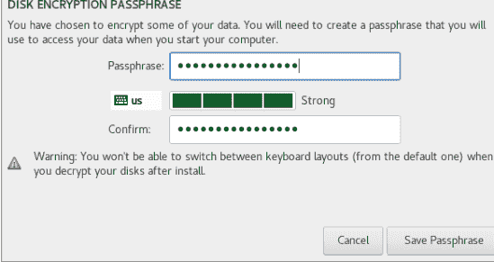

#### 图 24.5 在启动时请求加密对称密钥密码


## 第五部分：学习 Linux 安全技术

相关的消息摘要工具包括以下这些：

- `sha224sum`
- `sha256sum`
- `sha384sum`
- `sha512sum`

这些工具的工作原理与 `shasum` 命令类似，当然，它们使用的是 SHA-2 加密哈希标准。各种 SHA-2 工具之间的唯一区别在于它们使用的密钥长度。`sha224sum` 命令使用的密钥长度为 224 位，`sha256sum` 命令使用的密钥长度为 256 位，以此类推。记住，密钥越长，破解密码的概率越小。

SHA-2 加密哈希标准由美国国家安全局（NSA）创建。SHA-3 是另一种加密哈希标准，由美国国立标准与技术研究院（NIST）于 2015 年发布。

## 在安装时加密 Linux 文件系统

你可能需要对 Linux 服务器上的每个文件系统进行加密。可以通过多种方法实现，包括使用自由开源软件（FOSS）第三方工具，如 Linux 统一密钥设置（LUKS）。

你的选项之一是在安装时加密根分区（第 9 章，“安装 Linux”）。许多 Linux 发行版在安装过程中都包含加密选项。图 24.3 显示了红帽企业版 Linux 安装过程中的加密选项。

### 图 24.3 Red Hat Enterprise 安装加密选项

| 存储配置 | 自动 | 自定义 |
| :--- | :--- | :--- |
| 加密 | | 加密我的数据。系统将要求你输入密码。 |

在安装期间选择此加密选项后，系统会要求你输入密码。这是使用密码保护单个密钥的对称加密。图 24.4 显示了安装程序请求密钥密码。密码长度至少为八个字符。

如果你选择了此加密选项，每次启动系统时，都会被要求输入对称密钥密码。图 24.5 显示了该界面。这可以保护根分区，以防其所在的磁盘被盗窃。

## 第 24 章：理解高级 Linux 安全

### 图 24.4 Linux Fedora 加密对称密钥密码


### 图 24.5 在启动时请求加密对称密钥密码


如果你继承了一个带有加密磁盘的系统，可以使用 root 权限利用 `lvs` 和 `cryptsetup` 命令以及 `/etc/crypttab` 文件来帮助。在接下来的示例中，`lvs` 命令显示了系统上所有的逻辑卷及其底层设备名称。请参阅第 12 章“管理磁盘和文件系统”以复习 LVM 命令。

```
lvs -o devices
Devices
/dev/mapper/luks-b099fbbbe-0e56-425f-91a6-44f12db9f4b(56)
/dev/mapper/luks-b099fbbbe-0e56-425f-91a6-44f12db9f4b(0)
```

在该系统中，底层设备名称以 `luks` 开头。这表示已使用了用于硬盘加密的 Linux 统一密钥设置（LUKS）标准。

> **注意**
>
> Ubuntu 默认没有安装 `lvs` 命令。要在 Ubuntu 中安装它，请在命令行中使用 `sudo apt-get install lvm2`。

加密的逻辑卷在启动时通过 `/etc/fstab` 文件挂载。`/etc/crypttab` 文件的内容用于触发启动时获取密码，它会在挂载 `/etc/fstab` 条目时进行解密。如下代码所示。注意，luks 名称与上例中 `lvs` 命令列出的名称相同。

```
# cat /etc/crypttab
luks-b099fbbbe-0e56-425f-91a6-44f12db9f4b
UUID=b099fbbbe-0e56-425f-91a6-44f12db9f4b
```

你还可以使用 `cryptsetup` 命令来获取有关你的 Linux 系统加密卷的更多信息。在示例中，使用了 `status` 选项配合 luks 设备名称来确定进一步信息。

```
# cryptsetup status luks-b099fbbbe-0e56-425f-91a6-44f12db9f4b
/dev/mapper/luks-b099fbbbe-0e56-425f-91a6-44f12db9f4b
is is: active and in use.
type: LUKS1
cipher: aes-xts-plain64
keysize: 512 bits
device: /dev/sda3
offset: 4096 sectors
size: 49381994 sectors
mode: read/write
```

## 加密文件

Linux 系统上最流行的文件加密工具是 OpenPGP 实用 GNU Privacy Guard。它的灵活性和多种选项，加上它在大多数 Linux 发行版中默认安装的这一事实，增加了它的吸引力。

> **注意**
>
> 虽然 PAM 帮助 Linux 集中管理身份验证配置，但在其最初实现时，管理 PAM 存在一些缺点。近年来，Authselect 已取代 Authconfig 来管理 PAM，通过身份验证配置提供了更简单、更稳定的身份验证管理方式。

## 理解 PAM 认证过程

当主体（用户或进程）请求访问感知 PAM 的认证程序或实用程序时，将使用这些组件来完成主体的身份认证过程：

- 感知 PAM 的应用程序的模块配置文件（位于 `/etc/pam.d`）
- 某些模块的额外 PAM 配置（位于 `/etc/security`）
- PAM 模块配置文件存储在 64 位系统上 Fedora 和 RHEL 的 `/usr/lib64/security` 中；而 Ubuntu 则存储在 `/usr/lib/x86_64-linux-gnu/security` 中

每个感知 PAM 的应用程序配置文件都是该过程的核心。PAM 模块配置调用特定的 PAM 模块来执行所需的认证。PAM 模块从系统认证数据中验证主体，例如通过 LDAP 验证集中用户账户（参见第 11 章“管理用户账户”）。

Linux 带有许多感知 PAM 的应用程序，并安装了它们所需的配置文件和 PAM 模块。如果你有任何认证需求，很可能找到已经为之编写的 PAM 模块。然而，在启动 PAM 之前，你需要了解 PAM 如何工作，以及如何在不破坏系统认证的情况下更改它。

PAM 通过使用模块和配置文件执行一系列步骤以确保发生适当的认证：

1. 主体（用户或进程）请求访问应用程序。
2. 打开并读取应用程序的 PAM 模块配置文件，该文件包含访问策略。
3. 通过认证过程中将使用的所有 PAM 模块列表来设置访问策略。此 PAM 模块列表被称为“栈”（stack）。
4. 每个 PAM 模块均返回成功或失败状态。
5. 按照顺序继续读取栈，且不一定因为返回的失败状态而停止。
6. 所有 PAM 模块的状态结果合并为一个单一的认证成功或失败结果。

通常，如果单个 PAM 模块返回失败状态，则拒绝对应用程序的访问。然而，这取决于配置文件的设置。PAM 模块配置文件位于 `/etc/pam.d`。PAM 配置文件的通用格式为：

```
context control flag PAM module [module options]
```

## 理解 PAM 上下文

PAM 模块具有提供不同认证服务的标准函数。PAM 模块中的这些标准函数可以分为称为*上下文*（contexts）的功能类型。上下文也称为*模块接口*或*类型*。在表 24.3 中，列出了不同的 PAM 上下文及其提供的认证服务类型。

### 表 24.3 PAM 上下文

| 上下文 | 服务描述 |
| --- | --- |
| auth | 提供认证管理服务，例如验证账户密码 |
| account | 提供账户验证服务，例如时间段访问限制 |
| password | 管理账户密码，例如密码长度限制 |
| session | 允许用户在获得服务之前和之后执行操作 |

## 理解 PAM 控制标志

在 PAM 配置文件中，控制标志用于确定返回给应用程序的整体状态。控制标志是以下之一：

- **简单关键字**：这里唯一关注的是相应的 PAM 模块是否返回“失败”或“成功”响应。请参表 24.4 了解如何处理这些状态。
- **系列操作**：返回的模块状态通过文件中列出的系列操作进行处理。

### 表 24.4 PAM 配置控制标志和响应处理

| 控制标志 | 描述 |
| --- | --- |
| required | 如果失败，则在栈中其余上下文运行后，向应用程序返回失败状态。例如，如果有人输入了无效用户，`required` 控制可能会导致登录失败。但在用户输入密码之前，用户可能不会被告知失败，从而隐藏了错误用户名导致失败的事实。 |
| requisite | 如果失败，则立即向应用程序返回失败状态，而不运行栈的其余部分。（在栈中放置此控制项的位置时要小心。）例如，一个 `requisite` 控制可能要求基于密钥的认证，并在未提供有效密钥时立即失败。在这种情况下，它可能会在提示用户名/密码之前就失败。 |
| sufficient | 如果失败，则忽略该模块状态。如果成功，则立即向应用程序返回成功状态，而不运行栈的其余部分。（在栈中放置此控制项的位置时要小心。） |
| optional | 这种控制标志仅对最终的成功或失败返回状态重要。将其视为平局判定者。当配置文件栈中的其他模块返回既不是明确失败也不是成功的状态时，此可选模块的状态将用于确定最终状态或打破平局。在栈中的其他模块返回明确的失败或成功路径的情况下，此状态被忽略。 |
| include | 获取此 PAM 配置文件栈的返回状态并将其包含在此栈的整体返回状态中。这就像命名的配置文件现在位于此配置文件中。 |
| substack | 与 `include` 控制标志类似，不同之处在于某些错误和评估会影响主栈。这强制要求包含的配置文件栈作为主栈的子栈。因此，某些错误和评估会影响主栈。 |

## 使用 authselect 管理 PAM 配置

接下来的章节将介绍 `authselect` 以及直接编辑 `/etc/pam.d` 目录下的 PAM 配置文件的方法。这些示例是在 Fedora 系统上完成的。


# 使用 `authselect` 命令检查您的 PAM authselect 设置并开始处理您的 PAM 配置

首先，检查系统上是否启用了 `authselect`。这表明 `authselect` 已安装且有效：

```
# authselect check
Current configuration is valid.
```

显示当前的 `authselect` 配置文件列表。以下显示了四个可用配置：

- local 仅限本地用户
- nis 为系统身份验证启用 NIS
- sssd 为系统身份验证启用 SSSD（也适用于本地用户）
- winbind 为系统连续身份验证启用 winbind

显示当前的 `authselect` 配置文件。以下显示 `sssd` 配置是当前的。通过 `sssd`，您的 Linux 系统被配置为允许本地认证（包括 `passwd` 和 group 文件）和远程认证（允许针对 LDAP 和 Kerberos 等远程服务器进行认证）。

```
# authselect current
Profile ID: sssd
Enabled features:
- with-silent-lastlog
- with-fingerprint
- with-mdns4
```

关于已选配置（例如 `sssd`）可用设置的完整描述，请输入以下：

```
# authselect show sssd
Enable SSSD for system authentication (also for local users only)
==================================================================
```

选择此配置将启用 SSSD 作为身份和身份验证提供者的源。

```
AVAILABLE OPTIONAL FEATURES
---------------------------
with-faillock:
在连续身份验证失败次数过多时启用账户锁定。

with-mkhomedir:
启用在用户首次登录时自动为用户创建主目录。
```

> **注意**
>
> 在对带有 `authselect` 的生产系统更改 PAM 设置之前，请先在测试系统上尝试以下某些操作，并务必备份您当前的设置，以便在需要时进行恢复。

假设您想在当前的 `sssd` 配置中添加 `with-mkhomedir`，以便在用户首次登录时为用户创建主目录。以下命令备份了当前的 `authselect` 设置并向现有的 `sssd` 选项添加了 `with-mkhomedir`：

```
# authselect select sssd -b with-mkhomedir with-silent-lastlog \
 with-fingerprint with-mdns4
Backup stored at /var/lib/authselect/backups/2025-07-06-11-16-49.drbcIQ
Profile "sssd" was selected.

# authselect current
Profile ID: sssd
Enabled features:
- with-mkhomedir
- with-silent-lastlog
- with-fingerprint
- with-mdns4
```

您可以看到您的 `sssd` 配置已经备份，并且 `with-mkhomedir` 已添加到到新的 `sssd` 配置中。输出还建议您进一步检查，以确保 SSSD 服务已配置并启用。

如果您决定不想要这些更改，可以通过列出可用的备份，然后使用 `backup-restore` 来恢复这些设置：

```
# authselect backup-list
2025-07-06-11-16-49.drbcIQ (created at Sun 06 Jul 2025 07:16:49 AM EDT)
# authselect backup-restore 2025-07-06-11-16-49.drbcIQ
# authselect current
Profile ID: sssd
Enabled features:
- with-silent-lastlog
- with-fingerprint
- with-mdns4
```

对 `authselect` 进行大量更改的更好方法是创建一个自定义配置。通过自定义配置，您将获得整套由 `authselect` 管理的文件副本。您可以根据意愿更改它们，然后将其设置为当前配置。如果出现任何问题，您可以随时切换回已知的、正常的配置。要创建一个名为 `myprofile` 的配置，请输入以下：

```
# authselect create-profile myprofile -b sssd
```

选择新配置作为您的当前配置，添加您选择的几个设置，并检查当前配置是否为：

```
# authselect select custom/myprofile/ -b
Backup stored at /var/lib/authselect/backups/2025-07-06-14-17-53QTVrPn
Profile "custom/myprofile/" was selected.
Make sure that SSSD service is configured and enabled. Ensure SSSD documentation for more information.
# authselect select custom/myprofile/ with-silent-lastlog \
with-fingerprint with-mdns4
# authselect current
Profile ID: custom/myprofile/
Enabled features:
- with-silent-lastlog
- with-fingerprint
- with-mdns4
```

在新配置目录（`/etc/authselect/custom/myprofile/`）中进行您想要做的任何进一步更改，可以使用下一节中的某些示例或使用 `outset` 来配置配置。我做的一项更改是将新配置目录中 `README` 的第一行更改，显示为“My ssd authentication (also for local users only.)”。当我列出所有配置时，它显示如下：

- local 仅限本地用户
- nis 为系统身份验证启用 NIS
- sssd 为系统身份验证启用 SSSD（也适用于本地用户）
- winbind 为系统连续身份验证启用 winbind
- custom/myprofile My ssd authentication (also for local users only)

了解更多关于使用 `outset` 配置配置的信息。

## 管理单独配置文件

您应该审核应用程序和工具的 PAM 配置，以确保其身份验证过程符合您的预期。第 23 章（基础 Linux 安全）中的 PAM 信息将帮助您进行配置审计。

每个应用程序都应该有自己的配置文件。每个配置文件定义了使用了哪些 PAM 模块。如果没有配置，可能会导致安全漏洞。作为安全措施，PAM 自带了 `other` 配置。如果应用程序没有配置文件，它将指向 `other`。

您可以使用 `ls` 命令验证您的 Linux 系统是否存在 `/etc/pam.d/other` 配置。示例显示该文件存在：

```
$ ls /etc/pam.d/other
/etc/pam.d/other
```

`/etc/pam.d/other` 配置应该拒绝访问，这在术语中被称为隐式拒绝。在计算机安全中，隐式拒绝意味着如果某些标准没有明确满足，则必须拒绝访问。在这种情况下，如果 PAM 应用程序没有配置，则对其的访问将被拒绝。以下显示了 `/etc/pam.d/other` 的内容：

```
$ cat /etc/pam.d/other
#PAM-1.0
account required pam.deny.so
account required pam.deny.so
password required pam.deny.so
session required pam.deny.so
```

注意所有的 PAM 上下文（auth、account、password 和 session）都列出了。每个上下文都使用了 `required` 标记和 `pam.deny.so` 模块。`pam.deny.so` 模块用于拒绝访问。

即使有了 `other` 配置，如果 PAM 应用程序不存在，也必须创建。将此项添加到您的 PAM 审核列表中。您应该审查您 Linux 系统上的 PAM `other` 配置，以确保它执行隐式拒绝。

## 管理系统文件

与 PAM 应用程序和工具配置文件类似，您的 PAM 系统配置文件也需要根据组织的访问控制矩阵进行审计。然而，如果这些文件有任何所需的修改，则需要额外的步骤。

在接下来的材料中，您将学习如何通过 PAM 在 Linux 系统上设置安全要求：例如账户登录时间限制。请记住，对于 `authselect` 直接管理的文件，它可能会重写这些文件并删除任何本地的更改。

# 第 24 节：理解高级 Linux 安全

该文件在内部的注释行中记录了此类风险。使用 `grep`，你可以快速找到哪些 PAM 配置文件存在此潜在问题。

```
# grep "Generated by authselect" /etc/pam.d/*
fingerprint-auth:# Generated by authselect
password-auth:# Generated by authselect
postlogin:# Generated by authselect
smartcard-auth:# Generated by authselect
system-auth:# Generated by authselect
```

要对 `authselect` 管理的文件进行更改，尽可能使用前面描述的 `authselect` 命令。虽然不建议这样做，但你可以选择退出 `authselect` 对任何一个文件的管理。详情请参 `authselect` 手页。

# 使用 PAM 实现资源管理

资源管理不仅是一项系统管理任务，也是一项安全管理任务。设置资源限制有助于你避免 Linux 系统上的许多问题。通过限制单个用户可以创建的进程数，可以防止诸如 fork 炸弹（fork bombs）的问题。当一个进程递归地不断产生新进程直到系统资源耗尽时，就会发生 fork 炸弹。

PAM pam-limits 使用特殊的配置文件来设置这些资源限制：`/etc/security/limits.conf`。默认情况下，该文件中没有设置资源限制。因此，你需要检查该文件并设置资源限制以匹配你组织的安全需求。

> PAM 配置文件位于 `/etc/pam.d` 目录和 `/etc/security/directory/` 目录下。

以下片段显示了 `/etc/security/limits.conf` 文件。该文件有详尽的文档。你应该阅读该文件的内容以获得彻底的格式说明以及可以设置的限制示例。

```
$ cat /etc/security/limits.conf
# /etc/security/limits.conf
# 此文件设置了通过 PAM 登录用户的资源限制。
# 它不影响系统服务的资源限制。
# 另外注意 /etc/security/limits.d 目录中的配置文件
# 按照字母顺序读取，如果域相同或更具体，
# 它们将覆盖此文件中的设置。
...
```

# 第 V 部分：学习 Linux 安全技术

```
# 每行以以下格式描述一个针对用户的限制：
#
# <domain> <type> <item> <value>
# * soft core 0
# hard rss 10000
# @student hard nproc 20
# @faculty soft nproc 20
# @faculty hard nproc 50
# @ftp hard nproc 0
# @student maxlogins 4
# 文件结束
```

`domain`（域）和 `type`（类型）格式需要进一步解释：

**domain:** 限制适用于该用户或组。如果域为 `*`，则适用于所有用户。

**type:** 硬限制（hard limit）不能被超过。软限制（soft limit）可以被超过，但只能是暂时。

查看接下来的 limits.conf 文件示例。列表中列出了 faculty 组，但你应该注意的是 `nproc`。`nproc` 限制设置了用户可以启动的最大进程数。设置此项可以防止 fork 炸弹。注意类型被选择为 hard；因此，不能超过 50 个进程的限制。当然，该限制没有生效，因为 faculty 一行被 `#` 注释了。

```
## faculty hard nproc 50
```

限制按登录设置，并且仅在登录会话期间有效。恶意用户可能会登录多次以创建 fork 炸弹。因此，为这些用户设置最大登录数也是好主意。

限制最大登录数可能需要按用户进行。例如，johndoe 只需要登录一次 Linux 系统。为了防止他人使用 johndoe 的账户，请将其账户的 `maxlogins` 设置为 1。

```
johndoe hard maxlogins 1
```

要覆盖 limits.conf 文件中的任何设置，请向 `/etc/security/limits.d` 目录中添加 `*.conf` 文件。这是一种方便的方法，可以使用 RPM 包或方法来添加和删除限制，而无需直接编辑 limits.conf 文件。

安全性的最后一步是确保使用 limits.conf 的 PAM 模块包含在某个 PAM 系统配置文件中。使用 limits.conf 的 PAM 模块是 `pam_limits.so`。在接下来的部分中，使用 `grep` 验证 PAM 模块是否在系统配置文件中使用。

```
# grep "pam limits" /etc/pam.d/*
/etc/pam.d/fingerprint-auth:session required pam_limits.so
/etc/pam.d/password-auth:session required pam_limits.so
/etc/pam.d/runuser:session   required pam_limits.so
/etc/pam.d/sudo:session     required pam_limits.so
/etc/pam.d/system-auth:session required pam_limits.so
```

服务和账户的时间限制不受 PAM `/etc/security/limits.conf` 配置文件的处理。相反，它由 `.time.conf` 处理。

# 使用 PAM 实现时间限制

PAM 可以让你的整个 Linux 系统按照“PAM 时间”运行。时间限制（例如在一天中的特定时间访问特定应用程序，或仅在指定的周几登录）都由 PAM 处理。

处理这些限制的 PAM 配置文件位于 `/etc/security` 目录。以下代码显示了文档详尽的 `/etc/security/time.conf` 配置文件。

```
# /etc/security/time.conf
# 此文件设置了通过 PAM 登录用户的时间限制。
# 它不影响系统服务的时间限制。
# 另外注意 /etc/security/time.d
# 目录中的配置文件
# 按照字母顺序读取，如果域相同或更具体，
# 它们将覆盖此文件中的设置。
...
```

## 第 24 章：理解高级 Linux 安全

你可以通过修改 `/etc/pam.d/system-auth` 文件来更改 `pam_cracklib` 用于检查新密码的规则。你可能认为更改应该在 PAM 感知的 `password` 配置文件中进行。然而，`/etc/pam.d/passwd` 在其堆栈中包含了 `system-auth` 文件。

```
# /etc/pam.d/passwd
## PAM-1.0
# This tool only uses the password stack.
password       subsystem       system-auth
-password      optional       pam_gnome_keyring.so use_authtok
        password       substack        postlogin
```

> **注意**
>
> 在 Ubuntu 上，你需要修改 `/etc/pam.d/common-password` 文件，而不是 system-auth 配置。

这里列出了 system-auth 文件中 cracklib 的当前设置。目前，有一个条目调用了 `pam_cracklib` 模块。

```
# /etc/pam.d/system-auth
# Generated by authselect
# Do not modify this file manually, use authselect instead.
# Any user changes will be overwritten.
auth       required       pam_env.so
auth       required       pam_failday.so delay=2000000
auth       sufficient     pam_fprintd.so
auth       required       pam_deny.so
```


```
account    required       pam_unix.so
account    sufficient     pam_localuser.so
account    sufficient     pam_usertype.so system
account    [default=success=ok user_unknown=ignore] pam_ss.so
account    required       pam_permit.so
password   requisite       pam_cracklib.so try_first_pass retry=3
```

上述列表中添加的 `pam_cracklib` 条目使用了 `retry` 关键字。以下是 cracklib 可用的关键字：

```
debug
导致模块向 syslog 写入信息。
authtok_type=XXX
```

- 默认使用 `New UNIX password:` 和 `Retype UNIX password:` 来请求密码。
- 将 XXX 替换为其他单词以代替 UNIX。

## 第五部分：学习 Linux 安全技术

```
retry=N
```

- 默认值 = 1
- 在返回错误之前，最多向用户提示 N 次。

```
difok=N
```

- 默认值 = 5
- 新密码中必须不能出现在旧密码中的字符数量。
- 异常 1：如果新密码中有一半的字符不同，则接受新密码。
- 异常 2：参见 `difignore`。

```
difignore=N
```

- 默认值 = 23
- 在设置 `difok` 之前忽略的密码字符数量。

```
minlen=N
```

- 默认值 = 9
- 新密码可接受的最小长度。
- 查看 `dcredit`, `ucredit`, `lcredit` 了解它们的设置如何影响 `minlen`。

```
dcredit=N
```

- 默认值 = 1
- 如果 (N >= 0)：新密码包含数字的最大额度。如果你拥少于 N 个数字，则每个数字都计 +1 以满足当前的 `minlen` 值。
- 如果 (N < 0)：新密码必须满足的最小数字数量。

```
ucredit=N
```

- 默认值 = 1
- 如果 (N >= 0)：新密码包含大写字母的最大额度。如果你少于 N 个大写字母，则每个字母都计 +1 以满足当前的 `minlen` 值。
- 如果 (N < 0)：新密码必须满足的最小大写字母数量。

```
lcredit=N
```

- 默认值 = 1
- 如果 (N >= 0)：新密码包含小写字母的最大额度。如果你少于 N 个小写字母，则每个字母都计 +1 以满足当前的 `minlen` 值。
- 如果 (N < 0)：新密码必须满足的最小小写字母数量。

```
credit=N
```

- 默认值 = 1
- 如果 (N >= 0)：新密码包含其他字符的最大额度。如果你少于 N 个其他字符，则每个字符都计 +1 以满足当前的 `minlen` 值。
- 如果 (N < 0)：新密码必须满足的最小其他字符数量。

```
minclass=N
```

- 默认值 = 0
- 新密码需要满足四类字符中的任意 N 类。这四类是数字、大写字母、小写字母和其他字符。

```
maxrepeat=N
```

- 默认值 = 0
- 拒绝包含超过 N 个相同连续字符的密码。

`reject_username`

检查新密码中是否包含正序或反序形式的用户名用户名。如果找到，则拒绝该新密码。

`try_first_pass`

尝试从之前的 PAM 模块获取密码。如果不起作用，则提示用户输入密码。

`use_authtok`

此参数用于强制模块不向用户提示新密码。相反，新密码将由之前堆栈中的密码模块提供。

`dictpath=/path`

cracklib 字典的路径。

`maxsequence=N`

- 默认值 = 0（意味着此检查已禁用）
- 将 N 设置为 0 以外的任何数字会导致

## 练习

使用这些练习来测试你对使用加密工具和 PAM 的知识。这些任务假设你正在运行 Fedora 或 Red Hat Enterprise Linux（RHEL）系统（尽管某些任务在其他 Linux 系统上同样适用）。如果你遇到困难，任务的解决方案可以在附录 B 中（尽管在 Linux 中，通常有多种方法可以完成任务）。

1. 使用 `gpg` 工具和对称密钥加密文件。
2. 使用 `gpg` 工具生成公钥密钥环。
3. 列出你生成的密钥环。
4. 使用 `gpg` 工具加密文件并添加你的数字签名。
5. 访问 Fedora 下载页面：https://fedoraproject.org。选择其中一个 Fedora 发行版进行下载。下载完成后，验证你的镜像。
6. `su` 命令是否有 PAM 配置文件？如果是，请在屏幕上显示该配置文件，并列出它使用的 PAM 上下文（contexts）。
7. 在屏幕上列出你系统中的各种 PAM 模块。
8. 在你的系统中找到 PAM 的“other”配置文件。它是否存在？它是否强制了“隐式拒绝”（Implicit Deny）？
9. 找到 PAM limits 配置文件。它是否有设置可以防止系统发生进程炸弹（fork bomb）？
10. 使用 `authselect` 命令检查你的系统是否启用了 authselect，列出可用的配置（profiles），并查看当前是哪个配置。

# 第 25 章：使用 SELinux 增强 Linux 安全性

## 本章内容

- 学习 SELinux 的优势
- 学习 SELinux 的原理
- 设置 SELinux
- 解决 SELinux 问题
- 获取有关 SELinux 的额外信息

对于最高安全级别的服务器，基础的 Linux 安全是不够的。默认情况下运行在 Linux 系统上的进程使用文件和目录的标准权限来允许或拒绝对这些项目的访问。更安全的方法是允许访问服务所需的特定文件、目录、端口、系统调用、进程和网络套接字，并拒绝其他一切。这正是安全增强 Linux（SELinux）所做的。

Linux 由美国国家安全局（NSA）联合其他安全研究机构（如安全计算公司 SCC）共同开发，SELinux 于 2000 年发布到开源社区，并在 Red Hat 将其 Linux 发行版包含 SELinux 后变得流行。现在，许多组织都在使用 SELinux，且它广泛可用。

## 理解 SELinux 的优势

SELinux 是部署在 Linux 之上的安全增强功能。它提供了额外的安全措施，默认包含包含，并在 Red Hat Linux (RHEL) 和 Fedora 中被设置为强制模式（enforcing mode）。SELinux 可用于 Ubuntu 系统，但默认未安装。对于 Ubuntu，在强制性访问控制方面，App Armor 比 SELinux 更常用于安全防护。

SELinux 通过对主体和对象（即进程和资源）基于角色的访问控制（RBACs）提供了比 Linux 系统改进的安全性。“传统的”Linux 安全使用裁量性访问控制（DAC）。

使用 DAC 时，进程可以访问任何向其开放访问权限的文件、目录、设备或其他资源。使用 RBAC 时，进程根据分配的角色，仅能访问其被显式允许访问的资源。SELinux 实现 RBAC 的方式为进程分配一个 SELinux 策略。该策略按如下方式限制访问：

- 仅允许进程访问带有标签（labels）的资源
- 将潜在的不安全特性（如写入目录）作为布尔值（Booleans）提供，可以开启或关闭

具有 SELinux 策略的服务（如 Web 服务器）在安装时通常会在特定目录和文件设置 SELinux 标签。这使得运行的服务器进程只能从特定目录中读写文件。如果你想在进程想要访问的文件和目录上添加 SELinux 标签。

SELinux 并不是 DAC 的替代品。相反，它是一个额外的安全层。

- 先检查 DAC 规则，如果允许访问，然后检查 SELinux 策略。
- 如果 DAC 拒绝访问，则不检查 SELinux 策略。

如果用户尝试执行一个他们没有访问权限（rw-）的文件，“传统的”DAC 控制将拒绝访问。因此，SELinux 策略甚至不会被检查。

> SELinux 是 Red Hat 发行版的默认安全增强功能，而 AppArmor 则是 Ubuntu 的默认安全增强功能。你可以使用命令 `sudo apt-get install policy-selinux` 在 Ubuntu 上安装 SELinux。然而，截至本文编写，Ubuntu 的 SELinux wiki 页面建议不要使用 Ubuntu 的 SELinux 策略（https://wiki.ubuntu.com/SELinux）。如果你想了解更多关于 AppArmor 的信息，请访问 https://ubuntu.com/community/AppArmor。

尽管“传统的”Linux 控制仍然有效，但使用 SELinux 仍有许多优势。以下是 SELinux 的某些优势：

- 它实现了 RBAC 访问控制模型。这是最强大的访问控制模型。
- 它对主体（例如用户和进程）使用最小权限访问。最小权限术语意味着每个主体都被赋予一组有限的权限，这些权限足以使其在任务中正常运行。通过实施最小权限，限制了用户或进程对对象可能造成的意外（或故意的）伤害。
- 它允许进程沙箱化。进程沙箱化的术语意味着每个进程都运行在自己的区域（沙箱）中。除非授予特殊权限，否则它无法访问其他进程或其文件。进程运行的区域都是领域（domains）。
- 它允许在实施之前对其功能进行测试。SELinux 具有许可模式（permissive mode），允许你查看 SELinux 对系统产生的影响。在许可模式下，SELinux 仍然会记录它认为的安全违规行为（称为 AVC 拒绝），但不会阻止其发生。

另一种查看 SELinux 优势的方法是检查如果 Linux 系统上未启用 SELinux 会发生什么。例如，回到 Web 服务器示例，你的 Web 服务器守护进程（httpd）正在监听一个端口。来自网络浏览器的简单请求访问主页。按照常规程序，应用了传统的 Linux 安全。在没有 SELinux 约束的情况下，httpd 可以执行以下操作：

- 根据所有者和组的读/写/执行权限访问任何文件或目录
- 执行不安全的活动，如允许文件上传或更改系统限制
- 监听允许传入请求的任何端口

在受 SELinux 约束的系统上，受到了严格控制。使用前面的示例，httpd 只能在 SELinux 允许的端口上监听。SELinux 防止 httpd 访问任何未设置正确安全上下文的文件，并拒绝 SELinux 未显式允许的不安全活动。从本质上说，SELinux 极大限制了恶意代码的访问并泛限制了 Linux 系统上的活动。

## 理解 SELinux 如何工作

SELinux 可以比作门口的守卫。在这个类比中，主体（用户）想要访问房间内部的对象（文件）。为了访问该对象，必须执行以下操作：

1. 主体必须向守卫出示证件。
2. 守卫查看证件和记录在大手册中的访问规则。
   a. 如果规则允许此特定的证件进入门，主体即可进入房间访问对象。
   b. 如果规则不允许此特定的证件访问对象，守卫拒绝进入。

SELinux 提供了基于角色的访问控制（RBAC）与强制类型（TE）或多级安全（MLS）的结合。在基于角色的访问控制中，对对象的访问基于主体在组织中分配的角色。因此，它基于主体的用户名或进程 ID。每个角色都被授予了访问权限。

### 理解类型强制 (Type Enforcement)

类型强制（TE）是实现 RBAC 模型的必要。类型强制通过以下方法确保系统安全：

- 将对象标记为特定的安全类型
- 将主体分配给特定的域和角色
- 提供允许某些域和角色访问某些对象类型的规则

该示例遵循了 `ls -l` 命令，展示了文件 `my_stuff` 的 DAC（自主访问控制）控制情况。输出显示了文件的所有者（johnd）和组（johnd），以及其权限分配情况。

如果你需要检查文件权限，请参阅第 4 章“在文件系统中穿行”。

```
$ ls -l my_stuff
-rw-rw-r-- 1 johnd johnd 0 Feb 12 06:57 my_stuff
```

该示例包含了 `ls -lZ` 和同一个文件 `my_stuff`，但与 DAC 控制不同的是，`-Z` 选项还显示了 SELinux 的 RBAC 控制。

```
$ ls -lZ my_stuff
-rw-rw-r-- .. johnd johnd unconfined_u:object_r:user_home_t:s0 ... my_stuff
```

`ls -Z` 示例显示了与文件相关的四个 SELinux 特有项：

- `user` (unconfined_u)
- `role` (object_r)
- `type` (user_home_t)
- `level` (s0)

这些 RBAC 项目（用户、角色、类型和级别）被用于 SELinux 访问控制，以确定适当的访问级别。它们统称为 SELinux 安全上下文。安全上下文（身份标识）有时也被称为安全标签。

这些安全上下文分配分配给主体（进程和用户）。每个安全上下文根据其被分配的对象或主体而获得一个通用名称：文件具有文件上下文，用户具有用户上下文，进程具有进程上下文（也称为域）。

允许访问的规则被称为允许规则或策略规则。策略规则是 SELinux 用于授予或拒绝对特定系统类型访问权限的过程。回到 SELinux 与守卫（guard）的比较中，SELinux 充当守卫的角色，在允许或拒绝对对象的访问之前，必须查看主体的安全上下文（身份标识）并审查策略规则（访问规则手册）。因此，类型强制确保只有某些“类型”的主体可以访问某些“类型”的对象。

### 理解多级安全 (Multi-Level Security)

在 SELinux 中，默认策略类型称为目标策略（targeted policy），它主要控制 Linux 系统上的网络服务（如 Web 服务器和文件服务器）如何被访问。目标策略对系统中有效用户账户的限制较少。对于更严格的策略，你可以选择多级安全（MLS）。MLS 使用类型强制以及安全许可（security clearances）这一额外功能。它还提供了多分类安全（MCS），为对象提供了分级级别。

> 提示
>
> 多级安全的名称可能会引起混淆。多分类安全（MCS）有时被称为多级许可安全，由于 MLS 提供了 MCS，所以它有时被称为 MLS/MCS。

多级安全执行 Bell-LaPadula 强制性访问模型。Bell-LaPadula 模型由美国政府开发，旨在提供信息机密性。该模型的实现是通过根据角色的安全许可和对象的分级级别来授予对象访问权限。

安全许可是授予允许访问机密对象的属性。分级是授予对象的属性，用于防止安全许可属性过低的主体访问。你可能听说过“秘密（secret）”分级级别。虚构书籍和电影角色詹姆斯·邦德拥有特级安全许可，这使他能够访问特级机密信息。这是 Bell-LaPadula 模型的经典示例。

RBAC 与类型强制或多级安全的结合，使得 SELinux 能够提供如此强大的安全增强。SELinux 还为其使用提供了不同的运行模式。

### 实现 SELinux 安全模型

基于角色的访问控制模型、类型强制、多级安全以及 Bell-LaPadura 模型都是非常有趣的话题。SELinux 通过四个 SELinux 策略组件组合来实现这些模型：

- 运行模式
- 安全上下文
- 策略类型
- 安全规则包

尽管我们已经接触了这些设计元素，但接下来的内容将让你对它们深入理解。在开始修改系统上的 SELinux 配置之前，需要这种理解。

### 理解 SELinux 运行模式

SELinux 带有三种运行模式：禁用（disabled）、许可（permissive）和强制（enforcing）。每种模式都为 Linux 系统安全提供了不同的益处。

#### 使用禁用模式 (disabled)

在禁用模式下，SELinux 被关闭。取而代之的是默认访问控制方法自主访问控制（DAC）。这种模式适用于不需要增强安全的情况。

如果可能，红帽建议将 SELinux 设置为许可模式而不是直接禁用它。在某些情况下，禁用 SELinux 是恰当的。

如果你运行的应用程序（从你的角度来看）工作正常，但产生了大量的 SELinux AVC 拒绝消息（即使在许可模式下也是如此），你可能会导致日志文件填满，甚至使系统无法使用。更好的方法是对你需要访问的文件设置安全上下文。尽管如此，禁用 SELinux 是更快的解决办法。

然而，在禁用 SELinux 之前，请考虑你以后可能想在该系统上启用它。如果你决定在稍后将其设置为强制或许可模式。

#### 使用许可模式 (permissive)

在许可模式下，SELinux 已开启，但不会执行安全规则。许可模式用于：

- 审计 SELinux
- 测试新应用程序以查看 SELinux 的情况
- 测试新策略规则以查看 SELinux

#### 使用强制模式 (enforcing)

名称已说明了一切。在强制模式下，SELinux 已开启，并且所有的安全规则都被执行。

### 理解 SELinux 安全上下文

如前所述，安全上下文用于分类对象（如文件）和主体（如用户）。安全上下文由四个属性组成：用户、角色、类型和级别。

**用户** 用户属性是将 Linux 用户名映射到 SELinux 名称。这不同于用户名，它特指用户。SELinux 用户名以 u 结尾，以便在输出中识别。普通无限制用户在默认策略中具有 `unconfined_u` 属性。


# 第五部分：学习 Linux 安全技术

## 角色

公司指定的角色映射到 SELinux 角色。角色属性分配给各种主体和对象。每个角色根据角色的许可和对象的分级级别访问其他主体和其他对象。具体来说，对于 SELinux，用户被分配角色，角色被授权特定的类型。使用角色可以将账户（如 root）形成特权位置。在目标 SELinux 系统上，由 root 用户运行的进程具有 `system_r` 角色，而普通用户在 `unconfined_r` 角色下运行。

## 类型

类型属性定义了进程的域类型、用户的类型以及文件的文件类型。该属性也称为安全类型。大多数策略规则关注进程的安全类型以及该进程可以访问的元素。

## 级别

级别是多级安全的属性，它执行了 Bell-LaPadula 模型。在 TE 中它是可选的，但如果你使用 MLS，它是强制的。

MLS 级别是敏感性和类别值的组合，共同构成了安全级别。级别写为 `敏感性：类别`。

### sensitivity

- 代表对象的安全或敏感级别，例如机密或特级。
- 是分级的，`s0` 通常是最低的。
- 如果级别不同，则列为两个敏感级别（`lowlevel-highlevel`）。
- 如果没有低级别和高级别，则列为单个敏感级别（`s0`）。在某些情况下，即使没有低级别和高级别，也会显示范围（`s0-s0`）。

### categories

- 代表对象的类别，例如无权限许可、高权限许可等。
- 传统上，这些值介于 `c0` 和 `c255` 之间。
- 如果级别不同，则以类别级别对（低层，高层）的形式列出。
- 如果没有低高层，则以单个类别（级别）的形式列出。

## 用户具有安全上下文

要查看您的 SELinux 上下文，请在 shell 提示符输入 `id` 命令。以下是用户 johndoe 安全上下文的示例：

```
$ id
uid=1000(johndoe) gid=1000(johndoe) groups=1000(johndoe)
context=unconfined_u:unconfined_t:s0-s0:c.c1023
```

用户的安全上下文列表显示如下：

- **user**：Linux 用户

## 文件具有安全上下文

文件具有安全上下文。要查看单个文件的上下文，请使用 `ls` 命令的 `-Z` 选项。以下是文件 `my_stuff` 的安全上下文：

```
$ ls -Z my_stuff
-rw-r---- johndoe johndoe
unconfined_u:object_r:user_home_t:s0 my_stuff
```

文件上下文列表显示如下：

- **user**：文件映射到 SELinux `unconfined_u` 用户。
- **role**：文件映射到角色 `object_r`。
- **type**：文件被视为 `user_home_t` 域的一部分。
- **level（级别）**：
  - **sensitivity（敏感性）**：用户只有一个敏感性级别，即最低层级 `s0`。
  - **categories（类别）**：此文件未设置 MCS。

## 第 25 章：使用 SELinux 增强 Linux 安全

## 进程具有安全上下文

进程的安全上下文具有与用户和文件上下文相同的四个属性。要查看 Linux 系统上的信息，您通常使用 `ps` 命令的变体。在以下代码中，使用了 `ps -el` 命令：

```
# ps -el | grep bash
S 1000 1589 1583 80 0 - 1653 n_tty_pts/0 00:0000
s 1000 5289 1283 80 0 - 1653 pts/1 00:00:00
4 S 0 5350 5342 80 0 - 1684 wait pts/1
00:00:00 bash
```

要查看进程的安全上下文，您需要使用 `ps` 命令的 `-Z` 选项。在示例中，使用了 `ps -EZ` 命令并通过管道传给 `grep`，以仅搜索运行 Bash 壳的进程。

```
# ps -EZ | grep bash
unconfined_u:unconfined_r:unconfined_t:s0-s0:c0.c1023 1589 pts/0
00:00:00 bash
unconfined_u:unconfined_r:unconfined_t:s0-s0:c0.c1023 5289 pts/1
00:00:00 bash
unconfined_u:unconfined_r:unconfined_t:s0-s0:c0.c1023 5350 pts/1
00:00:00 bash
```

进程上下文列表显示如下：

- **user**：进程映射到 SELinux `unconfined_u` 用户。
- **role**：进程以 `unconfined_r` 角色运行。
- **type**：进程在 `unconfined_t` 域中运行。
- **level**：
  - **sensitivity**：进程只有 `s0` 级。
  - **categories**：进程可以访问 `c0.c1023`，即所有类别（从 `c0` 到 `c1023`）。

这些安全上下文都可以更改，以满足您组织的特定安全需求。然而，在学习如何更改这些安全上下文的设置之前，您需要了解谜题另一部分：SELinux 策略类型。

# 理解 SELinux 策略类型

所选择的策略类型决定了由哪些策略规则集规定对象可以访问的内容。策略类型还决定了哪些特定的安全上下文属性。这是您开始通过 SELinux 实现细粒度访问控制的起点。

> **注意**
>
> 发行版中可用的策略类型可能与此处列出的不匹配。例如，在较旧的 Linux 发行版中仍然可以使用 strict（严格）策略。在较新的发行版中，strict 策略已合并到 Targeted（目标）策略，并默认使用 Targeted。

- **Targeted（目标）**
- **MLS（多级安全）**
- **Minimum（最小）**

每个策略实现不同的访问控制，以匹配您组织的需求。为了根据特定的安全需求选择正确的策略，理解这些策略类型至关重要。

## Targeted 策略

Targeted 策略的主要目的是限制“目标”守护进程。然而，它也可以限制其他进程和用户。目标守护进程被沙箱化。沙箱是一个程序可以运行但对其他对象的访问受到严格控制的环境。

在此类环境中运行的进程被称为“沙箱化的”。因此，目标守护进程受到限制，使得通过它们发起的恶意攻击不会影响其他服务或整个 Linux 系统。目标守护进程让您共享打印机变得更加安全。

所有主体在 `unconfined_t` 域中运行。这将限制 SELinux 状态对其他服务的风险。

SELinux 默认以 Targeted 策略设置。因此，默认情况下，SELinux 限制少数守护进程。

## MLS 策略

MLS 策略的主要目的是实施 Bell-LaPadula 模型。它根据角色的安全许可和对象的分类级别授予访问权限。在 MLS 策略中，安全上下文属性至关重要。否则，策略规则将无法执行限制。

## Minimum 策略

该策略正如其名——最小化。它最初是为低内存机器或设备（如智能手机）设计的。

Minimum 策略与 Targeted 策略基本相同，但仅基础策略包。

# 理解 SELinux 策略

SELinux 策略是一组定义进程对对象可以做什么的规则。策略使用特殊语言编写，然后编译成内核可以理解的二进制格式。策略由多个部分组成：

- **types**：定义对象的类型。
- **roles**：定义用户可以承担的角色。
- **users**：定义系统用户。
- **levels**：定义 MLS 的敏感级别类别。

SELinux 策略通常存储在 `/etc/selinux/policy`。当系统启动时，内核会将策略加载到内存中。可以使用 `semodule` 等工具修改策略。

# 配置 SELinux

SELinux 默认以 Targeted 策略设置。

该文件位于 `/etc/selinux/config`。该文件控制 SELinux 的状态。

```
# cat /etc/selinux/config
SELINUX=enforcing
SELINUXTYPE=targeted
```

要更改 SELinux 模式，您必须编辑 `/etc/selinux/config` 文件。例如，要将 SELinux 更改为 permissive，可以将 `SELINUX` 行改为 `SELINUX=permissive`。

```
# vi /etc/selinux/config
SELINUX=permissive
```

更改文件后，必须重启系统使更改生效。或者，您可以使用 `setenforce` 命令立即更改模式，而无需重启。

```
# setenforce 0
```

这将 SELinux 设置为 permissive 模式。

当前的 SELinux 模式可以使用 `getenforce` 命令检查。

```bash
# getenforce
Enforcing
```

# 第 25 章：使用 SELinux 增强 Linux 安全性

> **注意**
>
> 最好通过修改配置文件并重启，从禁用（disabled）模式切换到强制（enforcing）模式。通过 `setenforce` 命令从禁用切换到强制可能会因为文件标签错误导致系统挂起。请记住，从禁用模式更改后重启，在系统恢复到许可（permissive）或强制（enforcing）模式后，文件系统可能需要很长时间才能完成重新标记。

要禁用 SELinux，你必须编辑 SELinux 配置文件。重启系统始终会将模式改回该文件中设置的值。更改 SELinux 模式的首选方法是修改配置文件并重启系统。

当从禁用（disabled）切换到强制（enforcing）或许可（permissive）模式时，SELinux 在重启后会自动对文件系统重新打标签。这意味着 SELinux 会检查任何安全上下文错误的文件（例如，标签错误的文件），这些文件在新模式下可能会引起问题。此外，任何未标记的文件都会被赋予上下文。这个重新标记的过程可能需要很长时间，因为每个文件的上下文都会被检查。以下是系统在重启后进行重新标记过程时收到的消息：

> *** 警告 *** 需要重新标记 SELinux 目标策略。
>
> *** 重新标记可能需要很长时间，取决于文件系统的大小和硬盘的速度。

要修改 `/etc/selinux/config` 文件中的模式，请将 `SELINUX=` 行更改为以下之一：

- `SELINUX=disabled`
- `SELINUX=enforcing`
- `SELINUX=permissive`

接下来的 SELinux 配置文件示例显示模式已设置为许可（permissive）。现在，当系统重启时，模式会发生变化。

```
# /etc/selinux/config
# 此文件控制系统上 SELinux 的状态。
# SELINUX= 可以取以下三个值之一：
#  targeted - 保护目标进程，
#  minimum - 目标策略的修改版，
#  - 仅保护选定的进程。
#  mls - 多级安全保护。
SELINUX=permissive
```

主 SELinux 配置文件不仅包含模式设置。它还指定了将强制执行的策略类型。

# 设置 SELinux 策略类型

你选择的策略类型决定了 SELinux 是强制执行 TE、MLS 还是基础包。该类型直接决定了用于规定对象可以访问内容的策略规则集。

默认情况下，策略类型设置为目标（targeted）。要更改默认策略类型，请编辑 `/etc/selinux/config` 文件。将 `SELINUXTYPE=` 行更改为以下之一：

- `SELINUXTYPE=targeted`
- `SELINUXTYPE=mls`
- `SELINUXTYPE=minimum`

如果你将 SELinux 类型设置为 mls 或 minimum，你需要确保已先安装了它们对应的策略包。通过输入以下命令进行检查：

```
dnf list selinux-policy-mls
dnf list selinux-policy-minimum
```

接下来的 SELinux 配置文件示例显示类型已设置为 mls。当系统重启时，策略类型会发生变化。

```
# /etc/selinux/config
# 此文件控制系统上 SELinux 的状态。
# SELINUXTYPE= 使用的类型。可能的值为：
# targeted - 保护目标进程，
# minimum - 目标策略的修改版。
# 仅保护选定的进程。
# mls - 多级安全保护。
SELINUXTYPE=mls
```

# 管理 SELinux 安全上下文

SELinux 安全上下文允许 SELinux 为主体访问对象强制执行策略规则。你的 Linux 系统已预分配了安全上下文。

要查看当前的 SELinux 文件和进程安全上下文，请使用 `secon` 命令。表 25.1 列出了 `secon` 命令的选项。

## 表 25.1 secon 命令选项

| 选项 | 描述 |
|---|---|
| `-u` | 使用此选项显示安全上下文的用户。 |
| `-r` | 使用此选项显示安全上下文的角色。 |
| `-t` | 使用此选项显示安全上下文的类型。 |
| `-s` | 使用此选项显示安全上下文的敏感性级别。 |
| `-c` | 使用此选项显示安全上下文的权限级别。 |
| `-m` | 使用此选项以 MLS 范围的形式显示安全上下文的敏感权限级别。 |

如果你在不带参数的情况下使用 `secon` 命令，它将显示当前进程的安全上下文。要查看另一个进程的安全上下文，请使用 `-p` 选项。接下来的示例显示了如何使用 `secon` 查看当前以及 systemd 进程的安全上下文。

```
# secon -urtt
user: unconfined_u
role: unconfined_r
type: unconfined_t
# secon -p 1
user: system_u
role: system_r
type: init_t
```

要查看文件的安全上下文，请使用 `-f` 选项，如下：

```
# secon -urt -f /etc/passwd
user: system_u
role: object_r
type: passwd_file_t
```

## 第 25 章：使用 SELinux 增强 Linux 安全性

进程获取安全上下文取决于由哪个进程启动。请记住，systemd（以前称为 init）是所有进程的“母进程”（参见第 15 章，“启动和停止服务”）。因此，许多守护进程和进程是由 systemd 启动的。systemd 启动的进程会被赋予新的安全上下文。例如，当 systemd 启动 apache 守护进程时，它会被分配类型 `httpd_t`。分配的上下文由 SELinux 专门针对该守护进程的策略处理。如果不存在相应的策略，它将被分配一个默认类型 `unconfined_t`。

对于用户（父进程）运行的程序或应用程序，新进程（子进程）会继承用户的安全上下文。当然，这只有在用户被允许运行该程序时才会发生。进程也可以运行程序，子进程也会继承其进程安全上下文。因此，子进程运行在相同的域中。

所以，进程安全上下文在程序运行之前就已经设置，并取决于是谁启动了它。你可以使用几个命令来更改运行程序时的安全上下文：

- `runcon`：使用选项运行程序，以确定用户、角色和类型（又称为域）。
- `sandbox`：在严格控制的域（即沙箱）中运行程序。

使用 `runcon` 可能会导致许多问题，因此请谨慎使用。然而，`sandbox` 提供了大量的保护。它为在 Linux 系统上测试新程序提供了灵活性。

## 管理 SELinux 策略规则包

策略规则是 SELinux 用于判断主体是否有权访问对象的规则。它们被组成包（也称为模块），并由 SELinux 安装。查看系统上模块的简单方法是使用 `semodule -l` 命令。这里显示了策略模块及其版本号的示例：

```
# semodule -l
abrt
accountsd
...
xserver
zabbix
zarafa
zebraebra
zomminder
zosremote
```

有几个工具可以帮助你管理和创建自己的策略模块。表 25.3 显示了 Fedora 系统上可用的各种策略规则包工具。

## 表 25.3 SELinux 策略包工具

| 策略工具 | 说明 |
| :--- | :--- |
| `audit2allow` | 从被拒绝的操作日志中生成策略允许/审计规则 |
| `audit2why` | 从被拒绝的操作日志中生成关于为何拒绝访问的描述 |
| `checkmodule` | 编译策略模块 |
| `checkpolicy` | 编译 SELinux 策略 |
| `load_policy` | 将新策略加载到内核 |
| `semodule_expand` | 扩展策略模块包 |
| `semodule_link` | 将策略包链接在一起 |
| `semodule_package` | 创建策略模块包 |

以下是一个通常作为创建本地策略规则框架的策略示例。示例策略相当长，因此只显示了部分内容。


# cat /usr/share/doc/selinux-policy/example.te

```text
policy_module(myapp, 1.0.0)

###########################################
#
# 声明
#

type myapp_t;
type myapp_exec_t;
domain_type(myapp)
domain_entry_file(myapp, myapp_exec_t)

type myapp_log_t;
logging_log_file(myapp, myapp_log_t)

type myapp_tmp_t;
files_tmp_file(myapp_tmp_t)
...
allow myapp_t myapp_t:file manage_file_perms;
files_tmp_filetransans(myapp, myapp_tmp_t, file)
#
```

你可以从前面的示例代码中看到策略代码使用了特殊的语法。要创建和修改策略规则，你需要学习这种策略语言语法，学习如何使用 SELinux 策略编译器，并学习如何将策略规则文件链接起来形成模块；你可能需要上几整天的课程才能完成。在此时，你可能会放弃 SELinux。然而，使用布尔值来修改策略要容易得多。

## 通过布尔值管理 SELinux

SELinux 策略编写和模块创建是一项相当复杂且耗时的活动。创建不正确的策略规则可能会损害你 Linux 系统的安全性。坦率地说，SELinux 提供了布尔值。

布尔值是一个用于切换设置开启或关闭的开关。布尔开关允许在不了解策略编写的情况下更改 SELinux 策略规则的部分。这些策略更改也可以无需重启系统即可完成！

要查看 SELinux 中使用的所有布尔值列表，请使用 `getboolean -a` 命令。以下是 Fedora Linux 系统上带有布尔值的 SELinux 策略规则示例：

```bash
# getboolean -a
abrt_anon_write --> off
abrt_handle_event -- on

zebra_write_config -- off
zoneiminder_anon_write --> off
zoneiminder_run_sudo -- off
```

要查看可以通过布尔值修改的特定策略，再次使用 `getboolean` 命令。这次向它传递策略名称，如下例所示：

```bash
# getboolean httpd_can_connect_ftp
httpd_can_connect_ftp --> off
```

要切换策略，可以使用 `setboolean` 命令。这种方法会临时更改策略。要使更改永久，请使用 `-P` 选项。`setboolean` 命令具有开启策略（1 或 true）和关闭策略（0 或 false）的设置。

使用 `setboolean` 的示例是限制执行文件的使用。为了防止这种情况发生，需要关闭 `allow_exec_content` 策略。

```bash
# setboolean -P allow_exec_content off
```

## 第五部分：学习 Linux 安全技术

使用 `getboolean` 命令验证布尔值设置已生效：

```bash
# getboolean allow_exec_content
allow_exec_content --> off
```

布尔值使得修改 SELinux 策略变得简单得多。总的来说，`getboolean` 等 SELinux 命令行工具很好用。然而，如果你使用 GUI 工具，SELinux 也有一个。对于 Fedora，可以通过 `dnf install policycontrols` 安装。要使用该工具，只需输入命令 `system-config-selux` 即可出现界面。

## 监控 SELinux

SELinux 为监控和记录活动的工具提供了大量信息。它记录所有拒绝访问的情况，这可以帮助你判断是否存在攻击。这些 SELinux 日志文件对于排除 SELinux 问题同样有用。

### 理解 SELinux 日志

SELinux 在检查安全上下文策略规则时使用名为 AVC 的缓存。当拒绝访问时（称为 AVC 拒绝），会被拒绝消息。

这些记录的拒绝消息有助于诊断和解决 SELinux 策略违反问题。拒绝消息记录的位置取决于 `auditd` 和 `rsyslog` 守护进程的状态：

- 如果 `auditd` 守护进程正在运行，拒绝消息记录在 `/var/log/audit/audit.log` 中。
- 如果 `auditd` 未运行而 `rsyslog` 守护进程正在运行，拒绝消息记录在 `/var/log/messages` 中。

> **注意**
>
> 如果 `auditd` 和 `rsyslog` 运行且你的系统中安装了 `troubleshootd` 守护进程，拒绝消息会被发送到 `audit.log` 和 `messages` 文件。但是，`messages` 文件中的拒绝信息会被 `troubleshootd` 守护进程转换为更易理解的格式。

### 在审核日志中查看 SELinux 拒绝

如果你运行了 `auditd` 守护进程，可以使用 `aureport` 命令快速查看是否记录了任何 AVC 拒绝。下面的示例显示了如何使用 `aureport` 和 `grep` 搜索 AVC 拒绝。至少有一个拒绝记录在 `/var/log/audit/audit.log` 中：

```bash
# aureport | grep AVC
Number of AVC's: 1
```

## 第 25 章：使用 SELinux 增强 Linux 安全性

当你发现 `audit.log` 中记录了 AVC 拒绝（denial）信息后，可以使用 `ausearch` 来查看拒绝消息。接下来的示例展示了如何使用 `ausearch` 命令查看 AVC 拒绝消息：

```bash
# ausearch -m avc
type=AVC msg=audit(1580397837.344:274): avc: denied ( getattr ) for
pid=106
comm="httpd" path="/var/myserver/services" dev="dm-0" ino=655836
scontext=system_u:system_r:httpd_t:0 tcontext=unconfined:object_r:var_t:0 class=file permissive=0
```

显示内容提供了关于尝试访问者的信息，以及他们在解释信息时的安全上下文。请在 AVC 拒绝消息中寻找这些关键词：

- `type=AVC`
- `avc: denied`
- `comm="httpd"`
- `path="/var/myserver/services"`

这可以为你提供足够的数据来开始修复问题或追踪恶意活动。在这里，`/var/myserver/services` 目录被 httpd 服务读取了错误的 SELinux 文件内容。

### 在消息日志中查看 SELinux 消息

如果你运行了 `auditd` 服务，可以通过 `grep` 搜索 `/var/log/audit/audit.log` 文件来查找 AVC 消息。对于最新的 RHEL 和 Fedora 系统或使用 systemd 的 Linux 系统，你也可以运行 `journalctl` 命令来检查 AVC 日志消息。每条日志消息中都包含一条 AVC 消息，你可以查看以获取有关 AVC 拒绝的信息，如下例所示：

```bash
# journalctl | grep avc
type=AVC msg=audit(1580397837.346:275): avc: denied ( getattr ) for
pid=106
comm="httpd" path="/var/myserver/services" dev="dm-0" ino=655836
scontext=system_u:system_r:httpd_t:0 tcontext=unconfined:object_r:var_t:0 class=file permissive=0
```

由于你已经知道存在 AVC 拒绝，你可以解析 `/var/log/audit/audit.log` 文件来逐步解决问题：

```bash
# sealert -a /var/log/audit/audit.log
Linux is preventing httpd from getattr access on the file
/var/myserver/services.
```

如果你认为 httpd 默认应该被允许对 services 文件进行 `getattr` 访问，那么你应该将其报告为错误（bug）。

### 部分：学习 Linux 安全技术

你可以生成一个本地策略模块来允许这种访问。现在通过执行以下命令来临时允许这种访问：

```bash
# ausearch -c 'httpd' --raw audit2allow -M my-httpd
# semodule -i my-httpd
```

额外信息：

| 源上下文 | 目标上下文 | 目标对象 |
| :--- | :--- | :--- |
| system_u:system_r:httpd_t:0 | unconfined_u:object_r_var_t:0 | /var/myserver/services [ ] |

原始审计消息：

```text
type=AVC msg=audit(150389737.346:275): avc: denied { getattr } for pid=1066 comm="httpd" path="/var/myserver/services" dev="dm-0" ino=655836 scontext=system_u:system_r:httpd_t:0 tcontext=unconfined_u:object_r_var_t:0 tclass=file permissive=0
```

Hash: httpd,httpd_var_t_file,getattr

在这种情况下，如果你想允许 httpd 服务访问被拒绝的目录中的内容，可以运行输出中显示的 `ausearch` 和 `semodule` 命令。这将创建并应用一个新的 SELinux 策略，以允许对该内容的访问。此时没有权限问题，httpd 应该能够访问该内容。

## 故障排除 SELinux 日志

显然，日志文件对于诊断和解决 SELinux 策略违规至关重要。日志文件或直接查询系统日志（`journalctl` 命令）是你排查 SELinux 问题的第一步。确保你的 Linux 系统首先正在记录消息是非常重要的。

确定日志是否正在记录的一种快速方法是检查相应的守护进程正在运行：`auditd`、`rsyslogd` 和/或 `troubleshootd`。使用相应的命令 `systemctl status auditd.service`。当然，命令取决于你的 Linux 发行版及其版本。更多细节请参见第 15 章。如果守护进程未运行，请启动它以便开始记录。

> **注意**：有时由于审计策略规则，AVC 拒绝不会被记录。`dontaudit` 规则减少了日志中的误报，但在排除故障时会导致问题。要修复此，请使用 `semodule -DB` 命令临时禁用所有 `dontaudit` 规则。

## 排除常见的 SELinux 问题

当你开始使用 SELinux 时，很容易忽视显而易见的问题。每当访问被拒绝时，你都应该检查传统的 Linux DAC（访问控制）权限。例如，使用 `ls -l` 命令检查文件的所有者、组以及读、写、执行分配是否正确。

对于 SELinux，几个常规项目可能会导致问题：

- 为服务使用非标准目录
- 为服务使用非标准端口
- 移动文件导致上下文丢失
- 布尔值设置错误

### 为服务使用非标准目录

由于各种原因，你可能会将服务存储在非 `/var/www/html` 的目录。当你这样做时，需要 SELinux 知道这种非标准行为。否则，它会拒绝访问请求。例如，你决定将 HTML 文件存放在 `/var/www/html` 不同的位置。你需要让 SELinux 知道你想访问 `/abc/html` 目录的文件。为了完成此操作，使用的命令是 `semanage` 和 `restorecon`。在下面的代码段中，这些命令用于为 `/abc/html` 添加正确的上下文类型：

```bash
# semanage fcontext -a -t httpd_content_t "/abc/html(/*)?"
# restorecon -R /abc/html
```

现在 httpd 可以访问该目录。

### 为服务使用非标准端口

与前面的示例类似，当你决定使用非标准端口时，服务通常无法启动。要修复此，你必须找到所需的上下文。使用 `semanage` 命令，将其添加到端口：

```bash
# semanage port -a -t ssh_port_t -p tcp 22
# semanage port -l | grep ssh
ssh_port_t  22
```

此时，编辑 `/etc/ssh/sshd_config` 文件添加 `Port 22` 行。然后重启 sshd 服务以监听端口。

### 移动文件并丢失上下文

你使用 `cp` 命令将文件临时从 `/etc` 移动到 `/tmp` 目录。使用 `mv` 命令将其移回。现在文件具有临时目录的上下文，而不是原始的安全上下文，当你使用该文件时系统会获取 AVC 消息。

有一个简单的修复方法，使用 `restorecon` 命令。只需输入 `restorecon file`，文件即可恢复其上下文。

### 布尔值设置错误

另一个常见问题是布尔值设置错误。这会导致多个 AVC 拒绝。例如，如果你的脚本不再能够连接网络并且你在日志中收到 AVC 拒绝，你需要检查 httpd 的布尔值。使用 `getboolean -a` 命令并将其通过 `grep` 以搜索任何影响 httpd 的布尔值。

```bash
# getboolean -a | grep http
httpd_can_network_connect  --> off
```

`getboolean` 命令显示布尔值 `httpd_can_network_connect` 为 `off`。要更改此布尔值，使用以下命令：

```bash
# setboolean -P httpd_can_network_connect on
```

显然，SELinux 是一个相当复杂且丰富的工具。你现在对 SELinux 基础知识有了良好的坚实基础。在你开始在系统上实施 SELinux 之前，这里有一些建议。

## 第 25 章：使用 SELinux 增强 Linux 安全性

默认的针对型（targeted）SELinux 模式可用于保护大多数基础网络服务（httpd、vsftpd、Samba 等），而无需分配特殊用户角色或以其他方式降低系统。在这种情况下，你需要做的主要工作是将文件存放在标准位置（或运行命令为非标准位置导入适当的文件上下文），确保对你认为无论如何都不安全的的服务开启相应的布尔值，并监控 AVC 拒绝（denials）以发现问题。

- 从允许（permissive）运行模式开始。这允许 SELinux 认为不安全的请求执行成功，同时记录这些不安全行为。
- 在允许模式下运行你的当前系统一段时间。检查日志并查看在默认 SELinux 设置下可能会出现哪些问题。然后，通过更改布尔值或文件上下文，使得被恰当拒绝的功能能够被允许。在解决问题后，开启强制（enforcement）模式。
- 总的来说，请在测试环境中或使用允许模式一次实现一个 SELinux 配置。在移动到下一个配置之前，查看每种配置更改产生什么影响。然后你可以使用 `audit2allow` 命令，允许被 AVC 拒绝拦截的操作在服务的策略中被选择性允许。

## 获取有关 SELinux 的更多信息

几个额外的信息源可以帮助你了解系统上的 SELinux：

**你的系统的 man 页面（帮助文档）**
执行命令 `man -k selinux` 可以找到你可以为系统上当前安装的所有 SELinux 实用程序查看的 man 页面。如果你正在为常用服务（如 httpd、vsftpd、Samba 等）调试 SELinux 问题，可能有一个专门介绍如何修复该服务 SELinux 问题的 man 页面。例如：

```bash
$ man -k selinux | grep vsftpd
systemd_vsftpd_generator_selinux (8) - SELinux for systemd_vsftpd_generator
```

**红帽企业 Linux 手册**
位于 https://docs.redhat.com，该网站包含一本关于 SELinux 的入门手册。

**Fedora 项目 SELinux 指南**
位于 https://docs.fedoraproject.org，该网站有一份《增强 Linux 指南》。然而，该指南没有针对每个 Fedora 版本进行更新，因此你可能需要查看旧版本来找到它。此外，SELinux 指南并不位于安全手册中，但 SELinux 手册也是一份很好的查阅手册。

**SELinux 项目 Wiki**
这是官方的 SELinux 项目页面。该网站位于 https://github.com/selinuxproject 提供了资源。

## 第五部分：学习 Linux 安全技术

## 总结


# SELinux 总结

SELinux 为 Linux 提供了安全增强。它在许多 Linux 发行版中默认安装。在本章中，你学习了 SELinux 的优势、它的工作原理、如何设置、如何修复 SELinux 的各种问题，以及获取有关这一重要安全增强的更多信息。

乍一看，SELinux 似乎相当复杂。然而，如果将其拆分为各个组件——运行模式、安全上下文、策略类型和策略包——你就可以看到各个部分是如何协同工作的。每个组件在执行和测试你组织所选的安全需求方面都起着至关重要的作用。

你学习了配置 SELinux 的各种步骤。尽管它是预先配置的，你可能仍需要进行一些修改以满足组织的安全需求。每个组件都有自己的配置步骤和设置。虽然没有涵盖策略创建，但你学习了如何通过布尔值修改提供的策略。

SELinux 提供了另一个监控你 Linux 系统安全性的工具。因为 SELinux 会记录所有的拒绝操作，它可以帮助你判断是否已经发生或正在尝试攻击。再完美的计划也可能失败。因此，在本章中，你学习了如何修复常见的 SELinux 配置问题。

在下一章中，你将学习如何保护网络上的 Linux 系统。你将学习控制访问、管理防火墙以及保护远程访问。

## 练习

使用这些练习来测试你对 SELinux 的知识。这些任务假设你正在运行 Fedora 或红帽企业 Linux 系统（某些任务在其他 Linux 系统上也有效）。如果你卡住了，附录 B 中显示了任务（尽管在 Linux 中有多种方法可以完成任务）。

1. 在不更改 SELinux 主配置文件的情况下，写出将你的系统临时设置为 SELinux 允许运行模式的命令。
2. 在不更改 SELinux 主配置文件的情况下，写出将你的系统临时设置为 SELinux 强制模式的命令。
3. 你的系统上设置了哪些当前和永久的 SELinux 策略类型？你是如何找到它们的？
4. 列出 `/etc/hosts` 文件的安全上下文，并识别其不同的安全上下文属性。
5. 在主目录下创建一个名为 `test.html` 的文件，并将其类型分配为 `httpd_sys_content_t`。（这是你可能为了让 Web 服务器在常用的 `/var/www/html` 目录之外共享内容而进行的操作。）
6. 列出运行中的 `crond` 进程的安全上下文，并识别其安全上下文属性。
7. 创建一个文件 `/etc/test.txt`，将其文件上下文更改为 `user_tmp_t`，恢复其正确的内容（`/etc` 目录的默认上下文），并删除该文件。使用 `ls -Z /etc/test.txt` 命令在过程的每个阶段检查文件。
8. 你的私有网络上有一个 tftp 服务器，你想允许匿名写入和访问 tftp 服务的主目录（在 SELinux 处于强制模式时）。确定哪些布尔值允许匿名写入和访问 tftp 服务的主目录，并开启这些布尔值。
9. 什么命令可以列出系统上所有的 SELinux 策略模块及其版本号？
10. 告诉 SELinux 允许通过 TCP 端口 54903 访问 sshd 服务。

# 第 26 章：在网络上保护 Linux

## 本章内容

- 管理网络服务
- 控制对网络服务的访问
- 实现防火墙

在网络（尤其是公共网络）上设置你的 Linux 系统在安全性方面会产生一系列全新的挑战。保护 Linux 系统的最佳方法是让它离开所有网络。然而，这很少是一个可行的方案。

整本书都充满了关于如何在网络上保护计算机系统的信息。

## 审核网络服务

大多数 Linux 发行版都带有运行必要的网络服务，尽管“默认安全”会让你的 Linux 系统暴露在恶意攻击之下。例如，如果你的 Linux 是一个打印服务器，为家里或办公室内的所有人提供服务，那么你就不希望该服务暴露在网络之外。事实上，你可能不希望它直接暴露在互联网上。

## 审核网络服务

在 Fedora 或 RHEL 发行版上安装 nmap，请使用 `yum` 或 `dnf` 命令（需要 root 权限），例所示：

```
# dnf install nmap -y
Updating Subscription Management repositories.
Last metadata expiration check: 0:03:41 ago on Sun 12 2025 11:24:07 PM EDT.
Dependencies resolved.
=============================================
Package      Arch    Version             Repository      Size
=============================================
Installing:
nmap         x86_64  4:7.92-3.fc41       fedora        23.7 MiB
..
```

在 Ubuntu 发行版上安装 nmap，请在命令行中使用 `sudo apt-get install nmap`。

nmap 的全称是 Network Mapper（网络映射器）。它在安全审计和网络探索方面有多种用途。使用 nmap 解析各种端口可以让你看到本地网络上所有服务器上运行着什么，以及它们是否正在发布其可用性。

> **注意**：什么是端口？端口（或更确切地说是数值）允许你使用 TCP 和 UDP 网络协议作为访问系统服务的接入点。标准端口号被分配给服务，以便服务监听特定的端口号，而客户端则请求在该端口号上接收服务。

例如，80 是用于到 Apache Web 服务器的未加密 (HTTP) 流量的标准端口。因此，如果你在浏览器中请求 www.example.com，浏览器会假设你的意思是使用提供该内容的服务器上的 tcp 端口 80。将网络端口想象成通往你 Linux 服务器的扇门：每扇门都有编号，每扇门后面都有一个服务在等待着帮助任何敲门的人。

为了对你的服务器进行审计，nmap 提供了几种实用的扫描技术类型，你可以在 http://nmap.org/book/man-port-scanning-techniques.html 查看这些技术。在开始服务审计时，这里有两种基础的端口扫描方式：

- **TCP 连接端口扫描 (TCP connect port scan)**：在扫描时，nmap 尝试使用服务器上的传输控制协议 (TCP) 连接端口。如果端口处于监听状态，则连接尝试将成功。TCP 是 TCP/IP 网络协议族中的一种网络协议。TCP 是一种面向连接的协议。其主要目的是通过所谓的“三次握手”来协商并启动连接。TCP 向远程服务器发送一个同步包 (SYN)，并在数据包中指定特定的端口号。远程服务器接收 SYN 并向源计算机回复一个确认包 (SYN-ACK)。然后，原始服务器对响应进行确认 (ACK)，TCP 连接正式建立。这种三次握手通常被称为 SYN-SYN-ACK 或 SYN, SYN-ACK, ACK。如果你选择 TCP 端口扫描，nmap 工具将使用这种三次握手对远程服务器进行一些调查性活动。任何使用 TCP 协议的服务都会对扫描做出响应。

- **UDP 端口扫描 (UDP port scan)**：对于这种扫描，nmap 会向被扫描系统上的每个端口发送一个 UDP 数据包。UDP 是 TCP/IP 网络协议族中的另一种流行协议。然而，与 TCP 不同，UDP 是一种无连接协议。如果端口正在监听且带有一个使用 UDP 协议的服务，它将对扫描做出响应。

> **请记住**，免费开源软件 (FOSS) 工具也可以供具有恶意意图的人使用。当你进行 nmap 扫描时，要意识到你为你的 Linux 服务器看到的扫描结果与他人看到的扫描结果是相同的。这将帮助你评估安全设置，即向端口扫描暴露了多少信息。你应该只在自己的系统上使用 nmap 等工具；扫描他人计算机的端口可能是非法的，至少会给人你正试图闯入的印象。

当你运行 nmap 工具时，它会提供一份简要报告，包含有关你正在扫描的系统以及它看到的端口的信息。端口被赋予一个“状态”（status）。nmap 报告了六种可能的状态：

- **open (开放)**：这是 nmap 扫描报告可以报告的最危险状态。开放的端口表示服务器有一个服务在处理该端口的请求。将其想象成门上的标牌：“请进吧！我们在这里为你提供帮助。”当然，如果你正在提供公共服务，你希望端口是开放的。
- **closed (关闭)**：关闭的端口是可以访问的，但扇门的另一侧没有等待的服务。然而，扫描状态表明在该特定的 IP 地址上有一台 Linux 服务器。
- **filtered (已过滤)**：对于你不想访问的端口，这是最好的扫描状态。无法确定扫描 IP 地址上是否真的有一个 Linux 服务器。可能某个服务正在特定端口上监听，但防火墙阻止了对该端口的访问，从而有效地防止了通过特定网络接口对服务的任何访问。
- **unfiltered (未过滤)**：nmap 看到了端口，但无法确定端口是开放还是关闭。
- **open|filtered (开放|已过滤)**：nmap 看到了端口，但无法确定端口是开放还是已过滤。
- **closed|filtered (关闭|已过滤)**：nmap 看到了端口，但无法确定端口是关闭还是已过滤。

为了帮助你更好地理解如何使用 nmap 工具，请复习以下示例。为了构建网络服务列表，示例中的 nmap 扫描是在 Fedora 系统上进行的。第一次扫描是从命令行使用环回地址 127.0.0.1 进行的 TCP 连接扫描：

```
# nmap -sT 127.0.0.1
```

```
# ip addr show
1: lo: <LOOPBACK,UP,LOWER_UP> mtu 65536 qdisc noqueue state UNKNOWN
    group default qlen 1000
    link/loopback 00:00:00:00:00:00 brd 00:00:00:00:00:00
    inet 127.0.0.1/8 scope host
          valid_lft forever preferred_lft forever
    inet6 ::1/128 scope host
          valid_lft forever preferred_lft forever
2: wlp02ef03: <BROADCAST,MULTICAST,UP,LOWER_UP> mtu 1500 qdisc noqueue
    link/ether 54:8d:5a:aa:98 brd ff:ff:ff:ff:ff:ff
    inet 192.168.1.18/24 brd 192.168.1.255 scope global dynamic
          noprefix wlp02sec preferred_lft 65489sec
          valid_lft forever preferred_lft forever
    inet6 fe80::2b4b:fe6c:10e2/64 scope link
          valid_lft forever preferred_lft forever
```

现在，使用 Host-B 的 IP 地址，从 Host-A 发起了一个 nmap TCP 连接扫描。nmap 扫描网络以进行扫描。所有端口均报告为关闭状态（closed）。

```
# nmap -sT 10.140.67.23
Starting Nmap 7.92 ( https://nmap.org ) at 2025-06-21 11:03 EDT
```

注意：主机似乎离线了。如果它确实在线，但拦截了我们的 ping 探测，请尝试使用 `-PN`。

```
Nmap done: 1 IP address (0 hosts) scanned in 0.11 seconds
```

在这里，nmap 帮助了我们。Host-B 似乎离线了，或者它可能拦截了探测。从 Host-A 尝试另一个 nmap 扫描，利用 nmap 通过 `-PN` 禁用扫描 ping 探测的优势。

```
# nmap -sT -PN 192.168.1.18
Starting Nmap 7.92 ( https://nmap.org ) at 2025-06-21 11:12 EDT
nmap scan report for ubuntu (192.168.1.18)
Host is up (0.0015s latency).
All 1000 scanned ports on 10.140.67.23 are filtered.
Nmap done: 1 IP address (1 host) scanned in 5.54 seconds
```

你可以看到 Host-B (192.168.1.18) 正在运行，且其所有端口的状态均为被过滤。这意味着没有网络端口从 Host-A 暴露。这些来自 Host-A 的扫描让你更好地了解恶意扫描器在扫描你的 Linux 服务器时可能会看到什么。在这个示例中，恶意扫描器看不到什么内容。

> **注意**：如果你熟悉 nmap，就会知道 TCP SYN 扫描是 nmap 使用的默认扫描方式。TCP SYN 扫描在以隐蔽方式探测远程系统方面表现出色。由于你是为了安全审计目的而探测自己的系统，因此使用更具“重型”特征的 nmap 工具扫描是有意义的。如果你仍然想使用 TCP SYN 扫描，命令是 `nmap -sS ip_address`。

Host-A 上运行的服务并不十分“肥美可口”。在接下来的示例中，使用 `systemctl` 命令在 Host-B 上启动了其他服务：sshd 和 http（请参见第 15 章“启动和停止服务”）。这应该为 nmap 工具提供更多更有趣的目标供其搜索。

```
# systemctl start sshd.service
# systemctl start apache2.service
```

此外，由于观察防火墙关闭时 nmap 扫描能做什么会很有趣。请不要尝试扫描暴露在互联网上的系统。以下示例显示了为另一个 Linux 系统禁用 Host-B 上的防火墙（对于其他系统，你可能需要禁用 `ufw` 服务）：

```
# systemctl stop firewall.service
# systemctl status firewall.service
```

随着新服务的运行和 Host-B 防火墙的关闭，nmap 扫描应该能发现一些东西。接下来，再次从 Host-A 运行 nmap 扫描。nmap 工具显示端口 22 上运行着 ssh 服务。注意，在 Host-B 防火墙关闭后，两次 nmap 扫描都获取了更多的信息。这证明了使用 ufw 防火墙的重要性。

```
# nmap -sT -PN 192.168.1.18
Starting Nmap 7.92 ( https://nmap.org ) at 2025-06-21 11:24 EDT
nmap scan report for ubuntu (192.168.1.18)
Host is up (0.0065ms latency.)
Not shown: 990 closed tcp ports (connection refused)
PORT   STATE SERVICE
22/tcp open  ssh
80/tcp open  http
Nmap done: 1 IP address (1 host) scanned in 5.54 seconds
```

## 防火墙

在家里，你的互联网服务提供商（ISP）可能会提供一个路由器让你访问互联网。该路由器包含防火墙固件，被视为硬件防火墙。

防火墙也可以以应用程序的形式存在于计算机系统上。该应用程序允许设置过滤规则来过滤入站流量。这就是软件防火墙的一个示例。软件防火墙也被称为基于规则防火墙。

**防火墙要么是网络层过滤器，要么是应用层过滤器。** 检查单个数据包的防火墙也称为包过滤器。网络层防火墙允许特定的数据包进入和离开系统。它在 OSI 参考模型的较低层上运行。

应用层防火墙在 OSI 参考模型的高层进行过滤。这种防火墙仅允许系统与外部之间进行特定的访问。

你可以看到这些防火墙类别是如何重叠的。最佳防火墙设置是所有类别的组合。通过许多安全实践，你拥有的层级越多，恶意活动就越难以渗透。

## 实现防火墙

在 Linux 系统上，防火墙是一个基于主机的网络层软件防火墙。通过防火墙，你可以为通过你的 Linux 服务器的每个网络包创建一系列规则。你可以精细调整规则，允许来自某个位置的网络流量但不允许来自另一个位置。这些规则本质上为你的 Linux 服务器创建了一个网络访问控制列表。

有几种不同的防火墙服务、命令和相关的 GUI 可供你在不同的 Linux 发行版中使用，包括 ufw（用于 Ubuntu）和 firewall（用于 Fedora 和 RHEL 系统）。

## Ubuntu UFW 防火墙

对于 Ubuntu，Uncomplicated Firewall（UFW）是一项流行的工具，带有适用于个人系统的防火墙规则。该服务的图形化前端是 Firewall (ufw) GUI。从那里，你可以为公共、办公室和家里创建不同的配置。对于每个配置，你可以针对 TCP 和 UDP 协议在不同方向上允许、拒绝、拒绝或限制对端口的访问。图 26.1 显示了 UFW 窗口为你的“家里”配置添加 Syslog 服务访问权限的示例。

以下是你可以用于操作 UFW 防火墙的几个 ufw 命令示例。输入以下命令来启动、启用和检查 ufw 服务的状态：


# systemctl start ufw
# systemctl enable ufw
# systemctl status ufw
● ufw.service - Uncomplicated firewall
  Loaded (/usr/lib/systemd/system/ufw.service; enabled;
  preset: enabled)


Active: active (exited) since Sat 2025-06-28 15:38:18 EDT; 4h23min ago

Docs: man:ufw(8)

Main PID: 846 (code=exited, status=0/SUCCESS)

CPU: 55ms

Jun 28 15:38:18 Admin-ubuntu-20 systemd[1]: Starting ufw.

## 26.1 ufw 防火墙配置窗口

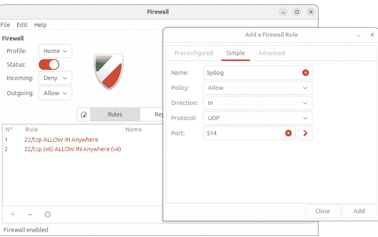

以下显示了激活的 ufw 防火墙规则列表，包括哪些端口/协议被防火墙允许或拒绝。这里仅允许 ssh 服务（端口 `22/tcp`）入站：

```
# ufw status numbered
Status: active
To                                     Action       From
[ 1 ] 22/tcp                         ALLOW IN      Anywhere
[ 3 ] 22/tcp                         ALLOW IN      Anywhere (v6)
```

通过 ufw，你还可以通过应用程序名称管理防火墙规则（存储在 `/etc/ufw/applications.d` 文件中）。查看可以通过名称打开端口的应用程序列表，输入以下内容：

```
# ufw app list
```

可用应用程序：

- Apache
- Apache Full
- Samba

samba 文件定义了 Samba 服务的端口（`ports=137,138/udp|139,445/tcp`）。查看暴露该服务所需的端口详细信息，请参考：

```
# ufw app info Samba
Profile: Samba
Title: LanManager-like file and printer server for Unix
Description: Samba 软件套件是实现 unix 系统 SMB/CIFS 协议的程序集合，允许向 Windows、NT、OS/2 和 DOS 客户端提供文件和打印机。此协议有时也称为 LanManager 或 NetBIOS 协议。
```

端口：

137,138/udp
139,445/tcp

若要在本地计算机之外暴露 Samba 服务，针对 IPv4 和 IPv6 端口，请输入以下内容：

```
# ufw allow Samba
# ufw status numbered
```

Status: active

| To | Action | From |
|---|---|---|
| [1 ] 22/tcp | ALLOW IN | Anywhere |
| [3 ] Samba | ALLOW IN | Anywhere |
| [4 ] 22/tcp (v6) | ALLOW IN | Anywhere (v6) |
| [6 ] Samba | ALLOW IN | Anywhere (v6) |

## 第五部分：学习 Linux 安全技术

在 Linux 系统上，防火墙是一个基于主机的网络层软件防火墙。通过防火墙，你可以为通过你的 Linux 服务器的每个网络包创建一系列规则。你可以精细调整规则，允许来自某个位置的网络流量但不允许来自另一个位置。这些规则本质上为你的 Linux 服务器创建了一个网络访问控制列表。

Fedora、RHEL 和其他发行版增加了 firewalld。防火墙配置窗口提供了管理 firewalld 和你的系统的方法。

当你将计算机连接到具有不同信任级别的网络（例如机场的无线网络）时，你可以通过选择不同的区域来调整防火墙规则。例如，从防火墙配置窗口切换到公共区域，操作如下：

1. 在“活动绑定”（Active Bindings）列下，选择你的活动连接（在本例中为 wireless-5G）。
2. 选择“更改区域”（Change Zone）。
3. 选择一个新区域（例如，public）。

公共区域（public zone）在仍然允许 IPv6 连接、远程登录（SSH）和 mDNS 服务的同时，不再允许访问更多潜在存在漏洞的服务，例如打印、Windows 文件共享（Samba）和 Cockpit 服务。它同时也禁用了 SSH 服务。

除了更改区域外，另一个你想要完成的常见任务是开放某些防火墙端口以访问选定的服务。在“防火墙配置”（Firewall Configuration）窗口中，将 Fedora Workstation 区域设置为当前区域，只需点击你想要打开的每个服务即可。每个服务的端口访问将立即打开（当你在选择窗口顶部的“运行时”/Runtime 配置时）并永久打开（当你在选择窗口顶部的“永久”/Permanent 配置时）。

“防火墙配置”窗口的一个非常好的功能是，当你选择允许访问某个服务时，你需要的不仅仅是一个端口。例如，启用 FTP 服务还会加载跟踪模块，以便在需要时通过你的防火墙访问所有非标准端口。

## 使用 Cockpit 修改防火墙规则

Cockpit 提供了另一种直观的方法来操作你系统的防火墙。若要使用 Cockpit 查看和修改你的防火墙，请执行以下操作：

1. 打开网页浏览器访问 Cockpit 界面（`https://yourhost:9090`）并使用 root 权限登录。
2. 选择“下一步防火墙”（Next Firewall）进入防火墙界面，如图 26.3 所示。

图 26.3 防火墙配置。

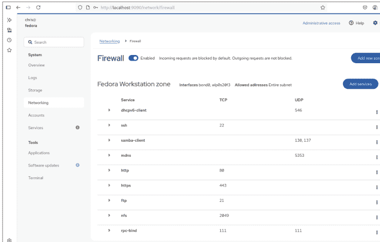

## 第 26 章：网络环境下的 Linux 安全

3. 选择“添加服务”（Add Services）。出现“添加服务”弹出窗口。
4. 点击当前区域中你想启用的服务旁边的复选框，并选择“添加服务”。

对所选端口的访问已启用。假设在该端口上运行着一个服务，那么请求该服务的流量（例如访问你 80 和 443 端口上的 Web 服务器）将获得允许。

如前文所述，Fedora 和 RHEL 中 Cockpit 和防火墙服务的底层框架是 nft 框架。如果你使用的是一个没有 Cockpit 或防火墙服务的 Linux 系统（或者禁用了防火墙），你有时可以使用 ipt 服务作为替代。接下来的章节描述了如何使用 `firewall-cmd` 从命令行为防火墙服务设置防火墙规则。

## 理解 firewall-config 工具

如果你在 Linux 系统上使用防火墙服务，可以使用 `firewall-cmd` 命令来管理防火墙规则。要查看所有区域，请输入以下命令：

```bash
# firewall-cmd --get-zones
FedoraServer FedoraWorkstation dmz docker drop external home
internal libvirt libvirt-root nm-shared public trusted work
```

然后，要查看默认防火墙区域，输入以下命令：

```bash
# firewall-cmd --get-default-zone
FedoraWorkstation
```

要查看特定区域（在此例中 FedoraWorkstation）的信息列表，请输入以下命令：

```bash
# firewall-cmd --permanent --info-zone=FedoraWorkstation
FedoraWorkstation (default)
target: default
ingress-priority: 0
egress-priority: 0
icmp-block-inversion: no
interfaces:
sources:
services: af dhcpv6-client ftp http https mdns rpc-samba-client seab
ports: 1025-65535/udp 1025-65535/tcp 631/tcp
protocols:
forward: yes
masquerade: no
forward-ports:
source-ports:
icmp-blocks:
rich rules:
```

要列出防火墙上已开放端口的服务，请输入以下命令：

```bash
# firewall-cmd --list-services
af dhcpv6-client http https mdns rpc-bind samba-client smtp ssh
# firewall-cmd --permanent --list-services
af dhcpv6-client http https mdns rpc-bind samba-client ssh
```

上一个命令显示 smtp 服务在运行中的系统中是开启的，但并未被设置为永久开启。要将所有开启的端口设置为永久开放，输入以下命令：

```bash
# firewall-cmd --runtime-to-permanent
# firewall-cmd --permanent --list-services
af dhcpv6-client http https mdns rpc-bind samba-client smtp ssh
```

要向你的默认区域永久添加一个新服务，请使用 `--add-service` 选项。例如，添加 NFS 服务请输入以下命令：

```bash
# firewall-cmd --permanent --add-service=nfs
# firewall-cmd --permanent --list-services
af dhcpv6-client http https mdns nfs rpc-bind samba-client smtp ssh
```

## 总结

在网络环境中保护你的 Linux 服务器至关重要。从本质上说，大多数恶意攻击源于网络，特别是互联网。本章涵盖了你在 Linux 系统上启动这一过程所需的某些基础知识。

如果你能确定并移除任何不需要的网络服务，那么保护网络服务的工作就可以变得简单。nmap 工具在这方面可以提供帮助。此外，你还可以使用 nmap 审计你的 Linux 服务器对网络服务的发布情况。这些审计有助于确定需要哪些修改。

最新版本的 Fedora 和 RHEL 增加了防火墙服务，作为 Linux 内核内置防火墙的前端。通过使用防火墙配置工具和 Cockpit UI，你可以轻松地打开防火墙中的端口以允许访问选定的服务。Ubuntu 默认使用 ufw 防火墙。

到本书的目前，你应该对如何配置防火墙有了良好的理解。在接下来的章节中，我们将深入探讨如何扩展。

## 练习

网络环境下的 Linux 安全

第 26 章：网络环境下的 Linux 安全

你正在运行 Linux 系统。请完成以下任务：

- 在你的系统上安装 Network Mapper 工具。
- 扫描以查看正在运行的服务。
- 在你的系统上运行扫描。
- 安装 firewalld 并启动它。
- 使用防火墙配置窗口打开安全的（443）和不安全的（80）端口用于 Web 服务。
- 使用 `firewall-cmd` 查看防火墙规则。
- 使用 `firewall-cmd` 列出所有区域。

## 第六部分：参与云计算

本部分包含：

* 第 27 章：转向云和容器
* 第 28 章：使用 Linux 进行云计算
* 第 29 章：云端部署 Linux
* 第 30 章：使用 Ansible 自动化应用基础设施
* 第 31 章：使用 Kubernetes 部署应用程序

Linux Bible，第十一版。Christopher Negus。

© 2026 John Wiley Sons, Inc. 保留所有权利，包括文本数据挖掘和人工智能训练的权利。2026 年由 John Wiley Sons, Inc. 出版。

# 转向云和容器

## 本章内容

- 理解云计算的关键技术
- 学习 Linux 容器的工作
- 安装并启动容器软件
- 拉并运行容器镜像
- 重启已停止的容器
- 构建容器镜像
- 标记并推送镜像到仓库


# 第六部分：接触云计算

本书的大部分内容关注单个计算机、服务和应用程序，而这一部分将带你进入大型数据中心所需的技术。为了让数据中心高效运行，其计算机必须变得尽可能通用，运行组件必须变得更加自动化。本部分的章节专注于实现这些目标的技术。

通过将应用程序与操作系统分离，计算机变得更加通用。这意味着不仅是将应用程序打包到操作系统中（如 `RPM` 或 `Deb` 包），还将一组软件包打包在一起，以便在部署时以相互独立的方式运行。虚拟机（VM）和容器是打包软件包及其依赖的两种方式，使它们能够运行并在数据中心中轻松移动。

从高角度来看，虚拟机是运行在另一个操作系统上的完整操作系统，允许你在一台物理计算机上运行多个虚拟机。每个需要运行的应用或服务都可以存储在虚拟机内部或附加存储中。

虚拟机拥有独立的内核、文件系统、进程表和其他操作系统特性，同时与主机共享 CPU 和内存。你可以通过这种方式将虚拟机部署到物理系统，从而轻松地运行应用程序并在完成后丢弃虚拟机。你可以在同一台计算机上运行多个虚拟机实例，或者克隆虚拟机。

多台计算机。`虚拟机`一词的出现源于每个虚拟机（VM）看到的都是计算机硬件的仿真，而不是直接看到硬件本身。

容器类似于虚拟机，主要的区别在于容器没有自己的内核。在其他方面，它就像虚拟机一样，其命名空间（`name spaces`）与宿主机操作系统是分开的，并且你可以根据需要方便地将它从一台主机移动到另一台主机。

本部分的章节将向你介绍学习云计算需要掌握的概念、工具和技术。你可以使用 `KVM` 在单台 Linux 宿主机上尝试虚拟机。你还可以将虚拟机部署到云技术中，例如 Google Cloud Platform (GCP) 和亚马逊云服务 (AWS)。

为了在裸机或云端上部署一组主机，你将学习如何使用 `Ansible`。通过 `Ansible` 剧本（`playbooks`），你还可以定义在每个宿主机系统上安装和运行的软件。

至于容器，`Kubernetes` 项目已成为关注焦点，是跨大型数据中心进行编排大量容器的首选技术。主要的云提供商为大型企业提供托管的 `Kubernetes` 平台。

年前引发容器热潮的技术是 `Docker` 项目。`docker` 命令和守护进程提供了在 Linux 系统上构建和运行容器的格式。今天，标准化的容器格式（如 Open Container Initiative）以及其他容器工具，如 `podman`、`LXC`（Linux Containers）和 `LXD`（Linux Container Daemon），提供了与 `Kubernetes` 生态系统更紧密结合的运行方式。

本章的剩余部分将用于介绍容器入门。它涵盖了 `docker` 和 `podman` 命令，以及用于处理单个容器的其他流行工具。

# 理解并运行 Linux 容器

容器使得获取、运行应用程序并在完成后将其丢弃变得非常简单。在开始之前，有几点关于容器你需要了解。

在操作容器时，人们将你移动的实体称为*容器镜像*或简单称为镜像。当你运行它时，它是处于暂停或停止状态的，被称为容器。

容器通过使用自己的一组命名空间与宿主机系统保持分离。通常，你会通过获取一个*安全基础镜像*，然后在共享容器镜像仓库之上添加你的软件分层，以创建一个新镜像。为了共享你的镜像，你把它们推送（`push`）到仓库中，以便他人拉取（`pull`）。

## 命名空间

Linux 对命名空间的支持使得容器能够被封装。通过命名空间，Linux 内核可以将一个或多个进程与一组资源相关联。普通进程（不是运行在容器中的进程）都使用相同的宿主机命名空间。默认情况下，容器中的进程只能看到容器的命名空间，而看不到宿主机的命名空间。命名空间包括：

- 容器有自己的进程 PID 集，默认只能看到运行在容器内部的进程。虽然宿主机上的 PID 1 是初始化进程（`systemd`），但容器 PID 1 是容器内运行的第一个进程。通常，它只是运行在容器内部的应用程序进程（如 Web 服务器或数据库可执行文件）。
- 接口。默认情况下，容器只有一个接口（`eth0`），并在容器运行时分配一个 IP 地址。默认情况下，运行在容器内部的服务（例如监听 80 和 443 端口的 Web 服务器）不会暴露在宿主机之外。这种做法的优点是，你可以在同一台宿主机上运行数百个 Web 服务器而不会产生冲突。缺点是你需要管理端口如何暴露到宿主机之外。
- 挂载表（Mount table）。默认情况下，容器看不到宿主机的根文件系统，或宿主机挂载点列出的任何其他挂载文件系统。容器自带自己的文件系统，由应用程序及其运行所需的任何依赖组成。从宿主机所需的文件或目录可以选择性地绑定挂载（`bind-mounted`）到容器内部。
- 进程在宿主机命名空间中以某些 UID 运行，而容器内部嵌套了另一套 UID。例如，这允许进程在容器内以 `root` 身份运行，但对宿主机系统不具有特殊权限。
- UTS 命名空间允许容器化进程拥有与宿主机不同的 ID 和域名。
- 控制组（`cgroup`）。在某些 Linux 系统（如 Fedora 和 RHEL）中，容器化进程运行在选定的控制组内，并且无法看到宿主机系统上的其他 `cgroup`。同样，它无法向宿主机显示其所属 `cgroup` 的身份。
- 进程间通信（IPC）。容器化进程看不到宿主机的 IPC 命名空间。

尽管默认情况下对任何宿主机命名空间的访问都是限制，但可以选择性地开放宿主机命名空间的权限。通过这种方式，你可以执行从宿主机向容器内挂载配置文件或数据，并将容器端口映射到宿主机端口以将其暴露在宿主机之外。

## 容器仓库

容器的持久化存储是在所谓的容器仓库（container registry）完成的。当你创建一个想要共享的容器镜像时，可以将镜像推送到公共仓库或你自己维护的私有仓库（例如 Red Quay 仓库）。想要使用该镜像的人将从仓库中拉取它。

存在大型公共容器镜像仓库，例如 Docker Hub (`docker.io`) 和 Quay Registry (`quay.io`)。某些容器仓库，例如亚马逊弹性容器注册 (ECR)，同时提供公共（`https://gallery.ecr.aws/`）和私有用户仓库。大多数仓库都提供免费账户供你开始。如果你需要更多功能（例如保持仓库私有化的能力），也有高级账户可用。

## 基础镜像和层

虽然你可以从零创建容器，但容器通常是从一个著名的基础镜像开始，通过在其添加软件来构建的。该基础镜像通常与你安装到容器中的操作系统一致。

你可以从 Ubuntu (`https://hub.docker.com/_ubuntu`)、CentOS (`https://hub.docker.com/_centos`)、Fedora (`https://hub.docker.com/_fedora`) 以及许多其他发行版获取官方镜像。这些发行版提供了不同形式的基础镜像，例如标准版和精简版。事实上，还有一些可以在上面构建的基础镜像提供了 PHP、Perl、Java 等其他开发环境的环境。

虽然红帽对其软件采用订阅模式，但如果你想将红帽软件作为容器镜像的基础，红帽提供了免费的通用基础镜像（UBI），涵盖标准版、精简版以及多种运行时容器。你可以通过红帽容器目录查找这些镜像（`https://catalog.redhat.com/search/`）。

你可以使用 `docker build` 或 `podman` 命令向基础镜像添加软件。使用 `Dockerfile` 定义构建，你可以添加 `yum` 或 `apt-get` 命令从仓库向容器安装软件。

当你向镜像添加软件时，它会创建一个新层成为新镜像的一部分。为你构建的容器使用相同的基础镜像有很多优点。优点之一是在运行容器时，宿主机只需要基础镜像的一个副本。因此，如果你主机上运行 10 个不同的容器，只需要拉取和存储一次基础镜像，每个新镜像可能只需要几兆额外数据。

如果你查看基础镜像的内容，它看起来就像一个 Linux 文件系统。你在 `/etc` 中看到配置文件，在 `/bin` 和 `/sbin` 中看到可执行文件，在 `/lib` 中看到库文件。换句话说，它拥有应用程序从 Linux 宿主机系统所需的所有组件。

请记住，你运行的容器镜像并不一定需要与宿主机 Linux 系统匹配。例如，你可以在 Ubuntu 系统上运行 Fedora 基础镜像，只要容器镜像中没有特定的内核要求或内置库即可。

## 开始使用 Linux 容器

在自己的 Linux 系统上开始运行容器所需的准备非常少。以下步骤描述了如何准备你的 Linux 系统以开始使用容器。

Docker Inc 通过 Install Engine 软件包（`https://docs.docker.com/engine/install/`）提供免费版本的 Docker。若要尝试该软件包的其他版本，你可以在 RHEL 或 Fedora 系统上运行它来安装 `docker` 包，然后启动并启用 `docker` 服务：

```
# dnf install docker -y
# systemctl start docker
# systemctl enable docker
```

`podman` 命令支持大多数用于容器的 `docker` 命令行选项，因此你可以用它来替代 `docker`。请记住，尽管 `podman` 支持类似的管理选项，但它代表了不同的 `docker` 代码。使用 `podman` 时，你不需要像使用 `docker` 那样运行一个运行中的服务。要在 Fedora 或 RHEL 上安装 `podman`，请执行以下操作：

```
# dnf install podman -y
```

你现在可以开始使用 `podman` 或 `docker` 命令来处理本章示例中的容器和容器镜像。

## 拉取并运行容器

在安装并准备好使用 `docker` 或 `podman` 软件包后，你可以尝试运行容器。开始时，你可以将容器拉取到本地系统并运行它。如果你愿意，可以跳过 `pull` 命令，因为如果请求的镜像不在系统中，运行容器会自动拉取它。

### 拉取容器

选择一个可靠的容器镜像进行尝试，例如来自官方项目的、最新的，且最好经过漏洞扫描的镜像。以下是使用 `docker` 命令拉取 Fedora 基础镜像的示例（在这些示例中将 `docker` 替换为 `podman`）：

```
# docker pull public.ecr.aws/docker/library/fedora:40
40: Pulling from docker/library/fedora
fc4518b6c5f9:3c86d25ef9d2001712bc3d9b091fc40cf04be4776e48f1aa3b78
5bf58d300ed
Status: Downloaded newer image for public.ecr.aws/docker/library/fedora:40
public.ecr.aws/docker/library/fedora:40
```

要查看镜像是否在你的系统中，运行以下命令：

```
# docker images
REPOSITORY | TAG | IMAGE ID | CREATED | SIZE |
| :--- | :--- | :--- | :--- | :--- |
| public.ecr.aws/docker/library/fedora | 40 | b368d2d9df3b5 | 2 months ago | 226MB |
```

### 从 shell 运行

使用 `docker` 或 `podman` 在容器内运行 shell。你可以通过镜像 ID (`b368d2d9df3b5`) 或名称 (`public.ecr.aws/docker/library/fedora`) 来识别镜像。使用 `-i`（交互式）和 `-t`（终端）选项，这样你就可以从 Bash shell 在容器内获得一个交互式会话：

```
# docker run -it b368d2d9df3b5 bash
[root@50bec0c6ad25f /]#
```

当 shell 运行后，你输入的命令将在容器内部执行。例如，列出文件系统或检查 `-release` 文件以查看你的容器基于哪个操作系统：

```
[root@50bec0c6ad25f /]# cat /etc/release | grep "NAME=Fedora Linux"
```

由于容器旨在包含运行目标应用程序所需的最少内容，因此许多标准工具可能不在容器内。你可以在正在运行的容器内安装软件。但是，请记住，容器是用来被丢弃的。如果你想永久添加软件，应该构建一个新镜像来包含该软件。

这是一个向正在运行的容器添加软件的示例：

```
[root@e9086da6ed70 /]# dnf install props iproute
```

现在你可以在容器内运行如 `ps` 和 `ip` 等命令：

```
[root@e9086da6ed70 /]# ps -ef
UID | PID | TTY | TIME | CMD |
| :--- | :--- | :--- | :--- | :--- |
| root | 1 | 0 | 17:44 pts/0 | 00:00:00 bash |
| root | 40 | 0 | 17:45 pts/0 | 00:00:00 ps -ef |
```

```
[root@e9086da6ed70 /]# ip a
lo: <LOOPBACK,UP,LOWER_UP> mtu 65536
inet 127.0.0.1/8 scope host lo
3: eth0@if11: <BROADCAST,MULTICAST,UP,LOWER_UP> mtu 1500 ...
inet 172.17.0.2/16 brd 172.17.255.255 global eth0
```

注意在容器内你只看到了两个进程（shell 和 `ps`）。PID 1 是 Bash shell。`ip` 的输出显示有一个网络接口 (`eth0@if11`)，并分配了 IP 地址 `172.17.0.2`。当你完成后，可以输入 `exit` 退出 shell 并停止容器：

```
[root@e9086da6ed70 /]# exit
```

虽然 shell 和容器都不再运行，但容器仍然存在。注意 `podman ps` 并没有显示停止的容器。你需要添加 `--all`：

```
[root@e9086da6ed70 /]# podman ps --all
CONTAINER | IMAGE | CREATED | STATUS | PORTS |
| --- | --- | | | |
| 5bec0c6ad25 | bash | 1 hour ago | Exited (0) | |
```

之后你可以看到如何删除和重启已停止的容器。

## 从容器运行 FTP 服务器

由于你通常会丢弃容器，你可能希望将数据存储在容器外部。以下是一个从容器运行 FTP 服务器 (`vsftpd`) 的简单示例。如果你想尝试这个，建议跳过“构建容器镜像”章节。对于此过程，你需要一个配置文件 (`vsftpd.conf`) 和一个在宿主机共享的 FTP 目录 (`/var/ftp/pub`)。当 `vsftpd` 启动时，它会将这些挂载到容器。

- 创建 `vsftpd.conf` 文件：在默认位置 `/etc/vsftpd/` 创建 `vsftpd.conf`。查看 `vsftpd.conf` 手页获取详情。这是一个示例：

```
anonymous_enable=YES
local_enable=YES
write_enable=YES
local_umask=022
message_enable=YES
xfer_enable=NO
connect_from_port=20=YES
listen=NO
listen_ipv6=YES
service_name=vsftpd
userlist_enable=YES
tcp_wrappers=NO
vsftpd_log_file=/dev/stdout
background=NO
pasv_enable=YES
pasv_max_port=21100
pasv_min_port=21110
```

- 创建 ftp 目录：在宿主标准位置 (`/var/ftp/pub`) 创建供 `vsftpd` 共享的匿名 FTP 目录，并将一些文件拷贝到那里：

```
# mkdir -p /var/ftp/pub
# cp ...
```

- 设置容器镜像：如本章“构建容器镜像”所示构建 `vsftpd` 镜像。要检查是否可以运行，输入以下内容：

```
# docker images
REPOSITORY | TAG | IMAGE ID | CREATED | SIZE |
| --- | --- | --- | --- | --- |
| vsftpd | latest | 487d0db2609 | 5 seconds ago | 208 MB |
```

- 运行 `vsftpd` 容器：当你运行 `vsftpd` 容器时，你需要暴露端口并挂载宿主机的文件。这里是使用 `podman` 替代 `docker` 的示例：

```
# docker run -d -p 20:20 -p 21:21 \
-p 21100-21110:21100-21110 \
-v /etc/vsftpd:/etc/vsftpd/ \
-v /var/ftp/pub:/var/ftp/pub \
--name vsftpd vsftpd
# podman ps
```

| CONTAINER ID | IMAGE | COMMAND | CREATED | STATUS | PORTS | NAMES |
| --- | --- | --- | --- | --- | --- | --- |
| 3a5d094db4b5 | vsftpd:latest | /usr/local/s2... | 9 seconds ago | Up 10 seconds | 0.0.0.0:20-20-21-20-21/tcp | vsftpd |

此示例使用了以下选项：

- `-d`：以分离模式运行容器，`vsftpd` 服务在后台运行。
- `-p`：标准 FTP 端口（TCP 20 和 TCP 21）映射到宿主机网络接口上的相同端口，因此可以在本地主机之外访问该服务。被动 FTP 需要的端口范围也开放到了宿主机对应的端口 (`21100-21110`)。
- `--rm`：虽然示例中未包含，但在命令行中添加 `--rm` 会在退出时移除容器。


- `-v`：要使用宿主机系统的配置文件（`/etc/vsftpd`目录）和你想共享的内容（`/var/ftp`目录），通过`-v`选项将这些目录绑定到容器上的对应位置。
- `--name`：将容器名称设置为`vsftpd`（或你喜欢的任何名称）。

请记住，你可以将容器内容和端口绑定到宿主机上的其他位置。这样，你就可以在同一台宿主机上运行多个版本的相同软件，而不会相互冲突。

要让`vsftpd`服务在本地系统之外可访问，请确保按照如下方式开放指定的 FTP 端口和被动 FTP 端口：

```
# firewall-cmd --zone=public --add-service=ftp
# firewall-cmd --zone=public --permanent --add-service=ftp
# firewall-cmd --zone=public --permanent --add-port=21100-21110/tcp
# firewall-cmd reload
```

现在你可以使用 FTP 客户端作为匿名用户通过服务器访问 FTP 服务。要进一步配置你的`vsftpd`服务并检查其运行情况，请参考第 18 章“配置 FTP 服务器”。

除非你指定在停止时移除容器（`--rm`选项），否则容器停止、挂起或失败，容器仍然在系统中。你可以使用`ps`选项查看系统中所有容器（无论是否运行）的状态：

```
# docker ps
CONTAINER ID | IMAGE | COMMAND | CREATED | STATUS | PORTS | NAMES |
| --- | --- | --- | --- | --- | --- | --- |
| d4b6e163fe3 | localhost/vsftpd:latest | /usr/local/s2... | About an hour | Up an hour ago | 0.0.0.0:20-21/tcp | vsftpd |
```

```
# docker ps -a
CONTAINER ID | IMAGE | COMMAND | CREATED | STATUS | PORTS | NAMES |
| --- | --- | --- | --- | --- | --- | --- |
| 7da8bd62667 | u8i:latest | bash | 2 minutes ago | Exited (7 seconds ago) | | silly_woniak |
```

之后你可以看到如何删除和重启已停止的容器。

## 第六部分：与云计算交互

```
4d6be3e63fe3 localhost/vsftpd:latest /usr/local/s2i/ru... 1小时前
运行 1小时前 0.0.0.0:20->20-21/tcp vsftpd
```

使用`podman ps`仅显示运行中的容器。通过添加`-a`参数，你可以看到所有容器，包括那些不再运行但尚未删除的容器。你可以使用`start`选项重启一个不再运行的现有容器：

```
# docker start - 7a8db8d2667
[root@7a8db8d2667 ~]#
```

重启的容器是一个 Bash shell。由于容器的终端会话已经存在，我不需要启动一个新的会话（`-it`）。只需要附加（`-a`）到现有的会话即可。对于在分离模式（detached mode）下运行的容器，我可以简单地根据需要启动它或停止它：

```
# docker stop 4d6be3e63fe3
4d6be3e63fe3...
# docker start 4d6be3e63fe3
4d6be3e63fe3
```

注意，如果启动容器时使用了`--rm`选项，容器会在你停止时立即被删除。因此，你必须运行一个新容器，而不仅仅是重启旧容器。由于配置文件和数据存储在容器外部，运行新容器是非常简单且无感的。未来升级应用程序只需删除旧容器并从更新后的容器镜像启动新容器即可。

## 构建容器镜像

要构建容器镜像，你只需要一个描述如何构建镜像的`Dockerfile`以及你想要包含在镜像中的任何内容。以下步骤描述了如何从你自己的`Dockerfile`创建一个简单的容器，以及如何从 GitHub 上的可用软件获取构建`vsftpd`服务所需的软件进入容器。

### 构建简单的容器镜像

此过程通过`Dockerfile`创建一个简单的容器。在此过程中，你将创建一个`Dockerfile`和一个脚本，然后将这些内容构建成新的容器镜像。

1. 创建一个目录来存放你的容器项目，然后进入该目录：

```
# mkdir myproject
# cd myproject
```

2. 在当前目录下创建一个名为`cworks.sh`的脚本，其中包含以下文本：

```
#!/bin/bash
set -o errexit
set -o nounset
set -o pipefail
echo "This Container Works!"
```

3. 使脚本具有可执行权限：

```
# chmod 755 cworks.sh
```

4. 在当前目录下创建一个名为`Dockerfile`的文件，包含以下内容：

```
FROM public.ecr.aws/docker/library/fedora
COPY ./cworks.sh /usr/local/bin/
CMD ["/usr/local/bin/cworks.sh"]
```

5. 从当前目录的`Dockerfile`构建名为`myproject`的容器镜像：

```
# docker build -t myproject
=> [internal] load build definition from Dockerfile
=> => transferring dockerfile
=> [internal] load metadata for ...fedora:latest
=> [internal] load .dockerignore
=> [1/2] RUN public.ecr.aws/docker/library/fedora:latest... 8.8s
=> [2/2] COPY ./cworks.sh /usr/local/bin/ 0.3s
=> exporting to image 0.1s
=> exporting layers 0.0s
=> writing image sha256:0fc6fac681ef40b516855ff51... 0.0s
=> naming to docker.io/library/myproject
```

6. 运行容器以确保它正常工作。你可以使用容器名称（`myproject`）或其 ID（`0fc66fac6810e`）：

```
# docker run 0fc66fac6810e
The Container Works!
```

### 从 GitHub 构建 FTP 容器

以下步骤描述了如何从 GitHub 上的可用软件获取构建`vsftpd`服务所需的软件进入容器。（你需要登录 GitHub 账户才能克隆`vsftpd`仓库。）随后它将向你展示如何构建并运行该容器。

1. 如果本地系统中尚未安装`git`，请先安装它：

```bash
# dnf install git -y
```

2. 在此示例中，我们从 GitHub 上的`vsftpd container-images`项目开始。按照如下方式将软件克隆到本地目录：

```bash
# git clone https://github.com/aws/container-images/vsftpd.git
# cd vsftpd
```

```
# ls
default-conf/ Dockerfile LICENSE README.md
root/             s21/                                     tests/
```

3. 根据需要修改文件。例如，如果你想查看`vsftpd`配置，可以查看`default-conf/vsftpd.conf`。例如，通过`Dockerfile`进行修改并使用最新的 Fedora 镜像。例如，修改开头的`FROM`使得其显示如下：

```
FROM registry.fedaparject.org/fedora:latest
```

4. 在`vsftpd`目录下，使用`docker`或`podman`命令构建容器镜像。例如：

```bash
# docker build -t vsftpd
=> [internal] load build definition from Dockerfile 0
=> [internal] load metadata for ...fedora:latest
=> [internal] load .dockerignore
=> [1/2] RUN public.ecr.aws/docker/library/fedora:latest... 8.8s
=> [2/2] COPY ./cworks.sh /usr/local/bin/ 0.3s
=> exporting to image 0.1s
=> exporting layers 0.0s
=> writing image sha256:0fc6fac681ef40b516855ff51... 0.0s
=> naming to docker.io/library/myproject
```

## 第六部分：参与云计算

测试。创建`/etc/docker/daemon.json`文件并包含以下内容（使用你的主机名）：

```json
{
  "insecure-registries" : [ "host01.example.com:5000" ]
}
```

然后重启`docker`服务：

```bash
# systemctl daemon-reload
# systemctl restart docker
```

4. **标记镜像：** 通过为本地镜像打标记，你可以识别镜像将要存储的仓库的位置。将镜像 ID 和`host.example.com`替换为你的主机名或 IP 地址以标记镜像：

```bash
# docker images | grep vsftpd
vsftpd latest 607ec7fca9f 31 minutes ago 227MB
# docker tag 607ec7fca9f host01.example.com:5000/myvsftpd:v1.0
# docker images | grep vsftpd
host01.example.com:5000/myvsftpd v1.0 607ec7fca9f 33 minutes ago 227MB
```

5. **推送镜像：** 将镜像推送到本地仓库（替换主机名或 IP 地址）：

```bash
# docker push host01.example.com:5000/myvsftpd:v1.0
The push refers to repository [host01.example.com:5000/myvsftpd]
2a97d289055: Pushed
v1.0: digest: sha256:bfab40b7b138afa2d0309a38a741f1d00a3902...
size: 1569
```

6. **拉取镜像：** 为了确保镜像可以从你的仓库可用，请尝试拉取镜像。从本地系统中删除它，或者到另一台主机上执行此操作：

```bash
# docker pull host01.example.com:5000/myvsftpd:v1.0
v1.0: Pulling from vsftpd
Digest: sha256:bfab40b7b138afa2d0309a38a741f1d00a390276ce4ca606fc...
Status: Image is up-to-date for host01.example.com:5000/myvsftpd:v1.0
host01.example.com:5000/myvsftpd:v1.0
```

此时，你应该已经能够共享你的镜像了。

如果你正在使用公共仓库（这是与更广泛观众共享镜像的更好方案），推送和拉取镜像的过程将如下：

```bash
# docker login quay.io
Username: myownusername
Password: *************
```

## 第 27 章：转向云和容器

```bash
# podman tag aa0274872f23 quay.io/myownusername/myvsftpd:v1.0
# podman push quay.io/myownusername/myvsftpd:v1.0
```


## 在企业中使用容器

尽管 Docker 项目在简化单个容器的使用方法方面取得了巨大进展，但是 Kubernetes 项目帮助 Linux 容器推向了企业。虽然像 `docker` 和 `podman` 这样的命令行工具非常适合管理单个容器，但 Kubernetes 提供了一个跨大型数据中心部署大型复杂应用程序的平台。有关如何使用 Kubernetes 在企业中部署和管理容器化应用程序的信息，请参考第 31 章“使用 Kubernetes 容器部署应用程序”。

## 总结

应用程序容器化多年来已经得到了广泛采用。Docker 项目在简化应用程序容器化以及在单个系统上运行它们方面做出了巨大贡献。`podman` 等工具也用于在 Linux 系统上部署和管理单个容器。

本章描述了如何使用 `docker` 和 `podman` 等命令行工具来拉取、运行、构建以及其他管理容器。你可以将这些知识作为理解容器化如何工作以及这些概念如何在第 31 章中应用的基础，因为该章节描述了 Kubernetes 如何管理整个企业的容器化应用程序。

## 练习

本节的练习描述了与容器操作相关的任务。如果你遇到困难，任务的解决方案位于附录 B。请记住，附录 B 中显示的解决方案只是完成任务的众多方法之一。

1. 选择 `podman` 或 `docker` 之一，安装包含你选择工具的软件包，并启动任何必要的服务以使用这些命令。
2. 使用 `docker` 或 `podman` 将此镜像拉取到你的主机：`public.ecr.aws/docker/library/fedora`。
3. 运行 `fedora` 镜像以打开 Bash shell。
4. 在容器内打开 Bash shell 的情况下，运行几个命令查看容器所基于的操作系统，安装 `proc-ps` 软件包，运行命令查看容器内部运行的进程，然后退出。
5. 再次重启容器并使用交互式 shell 连接到它。完成后退出 shell。
6. 从 `fedora` 基础镜像创建一个简单的 `Dockerfile`，包含一个名为 `cworks.sh` 的脚本，该脚本使用 `echo` 输出 "Cloud!" 并将其添加到机器。
7. 使用 `docker` 或 `podman` 构建你的镜像。
8. 获取本地仓库的访问权限。
9. 标记并推送你的镜像。

# 第六部分：参与云计算

# 第 28 章：将 Linux 用于云

## 本章内容

- Linux 在云中的用方式
- 理解基础虚拟化
- 设置虚拟机监控程序

### 云虚拟机监控程序

在云计算中，为云服务的操作系统通常不运行在计算机硬件上。相反，配置虚拟机监控程序来运行许多操作系统，即所谓的虚拟机（VMs）。根据你的云环境，你可能会听到虚拟机监控程序被称为计算节点、工作节点或简单地称为主机。由于虚拟机监控程序往往是商品化物品（一个位置可能会设置几十或上百个监控程序），Linux 是直接运行在硬件上的操作系统的逻辑选择。

基于内核的虚拟机（KVM）是大多数 Linux 发行版中实现的实现虚拟化技术，用于将 Linux 系统变为虚拟机监控程序。Xen 支持 Ubuntu、Red Hat Enterprise、Fedora、CentOS 以及许多其他 Linux 系统。

另一种可以用来替代 KVM 将 Linux 系统变为虚拟机监控程序的程序是 Xen ([www.xenproject.org])。Xen 的出现时间比 KVM 早，并且得到了 Citrix Systems 和 Oracle 的支持，并在许多流行的 Linux 系统中作为 KVM 的替代方案。

在本章的后半部分，我将描述如何检查计算机是否具有作为虚拟机监控程序所需的硬件功能，以及如何配置它以供 KVM 使用。

## Linux 与云计算概览

你不需要构建整个数据中心就可以开始理解虚拟化并使用实现云计算的一些底层技术。本章将通过帮助你设置一个作为虚拟机监控程序的主机，然后学习如何将虚拟机迁移到其他虚拟机监控程序来开始。

## 云控制器

由于云配置可能包含多个虚拟机监控程序、存储池、多个虚拟网络以及许多虚拟机，因此你需要中心化的工具来管理和监控这些特性。你可以使用图形化工具和命令行工具来控制云环境。

虽然不被视为完整的云控制器，但虚拟机管理器（`virt-manager`）的图形用户界面（GUI）和 `virsh` 命令可以管理小型类云环境。通过使用 `virt-manager`，你可以体验跨多个虚拟机监控程序管理多个虚拟机的过程，并学习如何处理虚拟网络和存储池。

完善的云平台有自己的控制器，以便在组件之间提供更多的交互。例如，红帽 OpenStack 平台（https://access.redhat.com/products/red-hat-openstack-platform）及其上游的 RDO 项目（https://www.rdoproject.org）为管理虚拟机及所有相关功能提供了灵活且可扩展的云环境。对于红帽虚拟化（RHV），RHV 提供了许多此类功能。

然而，如果你想从更简单的开始，可以先通过使用 `virt-manager`（虚拟机桌面工具）来管理你的第一个类云环境。

## 云存储

当你将操作系统和应用程序迁移到云环境时，对存储产生了新需求。为了能够将虚拟机迁移到另一个虚拟机监控程序，其存储必须在该虚拟机监控程序上可用。云存储包括用于虚拟机的后端存储、启动虚拟机的镜像，以及存储云本身信息的数据库。

虚拟机监控程序之间的共享存储可以简单地通过创建 NFS 共享来实现（见第 20 章“配置 NFS 文件服务器”）并在多个虚拟机监控程序之间的同一挂载点上进行挂载。NFS 是实现共享存储最简单的方法之一。

更健壮的存储可以处理故障并为提供服务的云提供更好的性能。共享存储（即挂载磁盘或分区）可以使用 iSCSI 或光纤通道等技术实现。

Ceph（http://ceph.com）是一个用于管理块和对象存储的开源项目，在管理云环境存储方面非常流行。GlusterFS（https://www.gluster.org）是一种用于云环境的扩展型文件系统。

对于本章中的简单微云示例，我使用了 NFS 在虚拟机监控程序之间提供共享存储。Ceph 和 GlusterFS 更适用于企业级安装。然而，主要的云提供商往往拥有自己的存储设施。例如，AWS 提供了 S3（对象存储）、EBS（块存储）和 EFS（文件存储）；Azure Blob Storage（对象存储）、Azure Disks（块存储）和 Azure Files（文件存储）；Google Cloud 有 Cloud Storage（对象存储）、Persistent Disks（块存储）和 Cloud Firestore（文件存储）。

## 云认证

为了限制用户消耗的云资源，并可能对这些使用进行跟踪和收费，你需要认证机制。对于使用云功能的人以及被允许管理云功能的人来说，认证都是必要的。

云项目有时允许你连接中心化的认证机制来验证和授权云用户。这些包括 Kerberos、Microsoft Active Directory 等。在 Linux 中，身份、策略和审计 (IPA) 软件（参见 www.freeipa.org）提供了一套可用于跨企业云平台的全套认证功能。

绝大多数云提供商都提供多种认证和授权机制。对于 AWS，通常使用身份和访问管理（IAM）。微软 Azure 使用 Entra ID（原 Azure Directory），而 Google Cloud 使用 IAM 和服务账户。

## 云部署与配置

如果你正在管理大型云基础设施，你肯定不想在每次向网络中添加虚拟机监控程序或其他节点时，都走到每台机器并点击图形化安装。今天，许多工具部署和配置 Linux 系统就像重启电脑并让其进入预配置的安装程序一样简单。

在第 9 章“安装 Linux”中，我讨论了如何使用 PXE 服务器（通过你的网卡自动启动 Linux 安装程序）和 Kickstart 文件（用于识别完成安装所需的所有答案）。在完成这些设置后，你可以从网络接口启动计算机，并在简短时间后回来，发现一个已完全安装的 Linux 系统。

计算机部署好后，可以使用 Puppet（http://puppetlabs.com）和 Chef（www.chef.com）等工具对系统进行配置并可能监控。可以使用 Vagrant（www.vagrantup.com）在虚拟机中部署整个工作环境。Ansible（www.ansible.com）是另一个用于 IT 基础设施以及运行其上的应用程序的自动化工具。

## 云平台

如果你想在组织内部实现一个小型私有云，开源的 OpenStack 是一种可能。它在配置和使用方面提供了极大的灵活性和威力。

红帽虚拟化（RHV）是另一个流行的云平台。RHV 让你能够从一个简单的 RHV 开始，管理一个或两个虚拟机监控程序及其管理的虚拟机，并通过添加更多虚拟机监控程序、存储池等来扩展你自己的云平台。

如果你想使用基于开源技术的公云来运行你所需的操作系统，可以使用任何几个云提供商。可以用于运行 Linux 虚拟机的公云提供商包括 Amazon Web Services（www.amazon.com/aws）、Google Cloud Platform（https://cloud.google.com）和 Microsoft Azure（https://portal.azure.com/）。第 28 章“将 Linux 部署到云端”涵盖了如何向这些云提供商之一部署 Linux。

### 尝试基础云

为了帮助你从零开始理解云技术，本节说明了现代云的一些基础区块。通过使用三台计算机，我帮助你创建一个包含以下内容的设置：

- **虚拟机监控程序**：虚拟机监控程序是直接运行在计算机硬件上的软件组件，允许在其上面运行多个其他系统。这些其他系统被称为虚拟机。云基础设施可能有几十或数百个虚拟机监控程序，运行成千上万个虚拟机。
- **虚拟机**：你在虚拟机监控程序上运行的虚拟机可以是相同的 Linux 系统、不同的 Linux 系统、Windows 系统或任何与运行虚拟机监控程序的硬件兼容的系统类型。因此，运行在我们构建的程序上的虚拟机包括 Fedora、Ubuntu、RHEL、CentOS 等。
- **共享存储**：为了提供最大的灵活性，虚拟机监控程序为虚拟机提供的存储通常在虚拟机监控程序之间共享，用于安装或启动虚拟机。它还允许相同的虚拟机运行在池中的任何虚拟机监控程序上，甚至在不关闭虚拟机的情况下迁移到另一个虚拟机监控程序。当虚拟机监控程序过载或需要关机维护时，迁移虚拟机非常有用。

我们在后续步骤中的设置允许你以以下方式处理虚拟机：

- 在虚拟机监控程序上安装虚拟机
- 设置虚拟机的功能
- 登录并使用运行在虚拟机监控程序上的虚拟机
- 将虚拟机迁移到另一个虚拟机监控程序

## 虚拟机管理器与虚拟化工具

**虚拟机管理器** `virt-manager` 命令是一个用于管理虚拟机的 GUI 工具。除了允许你请求启动和停止虚拟机外，`virt-manager` 还允许你以不同的方式安装、配置和管理虚拟机。你可以使用 `virsh` 命令向命令行传递选项，从而直接与虚拟机进行交互，而不是在 GUI 窗口中点击。

**虚拟化查看器** `virt-viewer` 命令会在你的桌面上方启动一个虚拟控制台窗口。出现的窗口允许你在从控制台窗口到桌面或命令行界面之间进行工作（取决于虚拟机需要什么）。这意味着某些你的虚拟化平台可以将他们的操作系统、应用程序、配置文件打包并部署。他们将依靠你的虚拟机程序为运行包含其应用程序的虚拟机提供电源、存储、内存、网络接口和管理功能。

下一节将带你初次体验 Linux 云计算的一些基础技术。它描述了如何通过配置你自己的虚拟机监控程序、虚拟机和虚拟存储来搭建一个小型云。

## 搭建小型云

通过在网络上连接三台物理机器，你可以演示理解如何构建云所需的一些基本概念。这三台运行 Fedora 42 的计算机以及连接它们的网络配置如下：

- **网络** 建立了一个高速有线网络来连接这三台计算机。快速的网络连接对于虚拟机迁移的成功至关重要。在示例中，每个虚拟机监控程序都有一个网络桥接，以便每台虚拟机都能直接从网络上的 DHCP 服务获取 IP 地址。
- **虚拟机监控程序**：两台计算机被配置为虚拟机监控程序。虚拟机监控程序（有时称为宿主机或计算节点）允许你运行虚拟机。在 Fedora 42 中，最常用的虚拟机监控程序技术被称为基于内核的虚拟机 (KVM)，而实际的虚拟机由 `libvirt` 服务管理。
- **存储**：一台计算机被配置为在两个虚拟机监控程序之间提供共享存储。为了从简单起见，使用了 NFS 创建共享存储；环境 iSCSI 或光纤通道应该是更好的解决方案。

> **注意**：出于考虑，你可以使用两个虚拟机监控程序之一提供共享存储。然而，配置两个虚拟机监控程序和独立的共享存储的主要目的之一是，你能够关闭任何虚拟机监控程序，而你的所有虚拟机依然正常运行。如果你从其中一个虚拟机监控程序获取可用存储，那么你在不关闭所有使用该存储的虚拟机的情况下，无法关闭该虚拟机监控程序。

## 配置虚拟机监控程序

在下面的步骤中，我在两台物理计算机上安装了 Fedora 42 Server（包括 GNOME 桌面），并将它们配置为运行 `libvirtd` 服务的 KVM 宿主机。按照这些步骤自己完成操作。

### 第 1 步：获取 Linux 软件

访问项目页面（https://fedoraproject.org）并下载最新的 Fedora Server。我选择下载了 Fedora 42 64 位 Server 版本的 DVD ISO。如果有更新版本的 Fedora，你可能可以使用它来代替。

使用如 Fedora Media Writer 的应用程序（也可从 https://fedoraproject.org 获取）将镜像刻录到 USB 驱动器中。

### 第 2 步：检查你的计算机

在 Fedora 42 中用作虚拟机监控程序的计算机需要满足一些要求。在开始安装之前，你应该在你的计算机上检查以下内容：

**支持虚拟化**。你可以通过查看 CPU 中的标志位来检查虚拟化支持。

**内存**。计算机必须有足够的 RAM，不仅为了运行宿主机系统，还要供你预计在系统中运行的每台虚拟机使用。

**处理能力**。记住，每台虚拟机都会为其以及虚拟机内部运行的任何程序消耗处理能力。

存储是另一个考虑因素。然而，由于我们打算从网络上的独立节点配置存储，我们将稍后解决这个问题。

要检查你计算机的所有功能是否符合要求，启动 Linux CD 或 DVD，打开终端并输入以下命令：

```
# cat /proc/cpuinfo | grep --color -E "vmx|svm|lm"
```

```
flags : fpu vmnde vse psc tsc msr mxe ce3 alx sep mm mtr pge mca
cmov pat pse36 clflush dt acpi fxsr sse s2 as ht tm pbe
syscall nx pdeplbg rdtdcp constant_arch perfmon pclinmulqdq dtes64
rep_good topology nonstop_arch apermfpf monitor ds smx es...
```

运行之前的命令显示这台计算机是 64 位计算机 (`lm`)，Intel 芯片支持虚拟化功能 (`vmx`)。如果 CPU 是支持虚拟化的 AMD 芯片，你会看到 `svm`。这些设置显示这台计算机可以作为虚拟机监控程序。

当你在宿主机上启动虚拟机时，内存通常是瓶颈。对于内存需求，你必须将宿主机所需的加到你对每台虚拟机所需的内存中。你可以通过不安装桌面软件来降低内存需求，大多数虚拟机监控程序都是这样做的。

在本例中，我执行了 Fedora Server 安装，然后添加了 GNOME 桌面。要检查计算机上的内存和交换分区（swap），我输入了以下：

```
# free -m
```

```
total used free shared buff/cache available
Mem: 15318 4182 6331 0 4805
Swap: 2048 0 2048
```


该系统有 16GB 的内存和 2GB 的交换分区。

### 第 3 步：在虚拟机程序上安装 Linux

使用 Fedora 介质开始安装虚拟机程序。按照“安装 Linux”的描述安装虚拟机程序。将虚拟机程序命名 `host1.example.com` 和 `host2.example.com`。

**分区** 在分区时，我擦除了磁盘。然后创建一个 500MB 的 `/boot` 分区和 2GB 的 `swap` 分区，并将剩余部分分配给根分区 (`/`)。`/var/lib/libvirt/images` 持有大部分数据，但是网络上另一个系统的可用目录。

| 分区 | 大小 | 类型 | 挂载点 |
| :--- | :--- | :--- | :--- |
| `/boot` | 500 MB | ext4 | |
| `swap` | 2 GB | | |
| `/` | 剩余 | ext4 | |

**网络** 如果提示，开启每个虚拟机程序的有线接口。虚拟机程序和存储应该都在同一个网络上。

**软件包** 安装期间，我只安装了 Server 包。安装完成后重启系统，我安装了 GNOME 桌面，并安装了每个虚拟机程序所需的更多软件。

安装完成后重启（移除 USB 驱动器并在硬盘启动）。系统重启后，按如下方式更新软件、添加新包：

```
# dnf update -y
# dnf install libvirt-manager libvirt-daemon-config-network
# reboot
```

`libvirt-manager` 包包含管理虚拟机的 GUI。`libvirt-daemon-config-network` 包创建了默认网络接口，允许虚拟机通过网络地址转换（NAT）访问外部网络。分配给虚拟机的默认地址范围是 `192.168.122.0`。

你需要的其他软件包应该已经包含在 Fedora 安装中了。如果你使用了不同的安装，请确保添加了以下软件包：

- `libvirt-client`（用于 `virsh` 命令）
- `libvirt-daemon`（获取 `libvirtd` 服务）

### 第 4 步：在虚拟机程序上启动服务

需要确保两个虚拟机程序上都运行着 `libvirtd` 服务。也启动 `sshd` 服务。它们可能可能已经在运行，但为了确保起见，在虚拟机程序的根目录下执行以下操作：

```
# systemctl start sshd.service
# systemctl enable sshd.service
# systemctl start libvirtd.service
# systemctl enable libvirtd.service
```

`sshd` 服务允许你有时通过网络登录虚拟机程序。`libvirtd` 服务是你可能不熟悉的那个。它正在监听管理每个主机上虚拟机的请求。

# 第六部分：与云计算交互

## 第 5 步：编辑 `/etc/hosts` 或设置 DNS

为了方便虚拟机主机与存储系统之间的通信，您应该为每个系统分配主机名，并将这些名称映射到 IP 地址。为所有系统设置 DNS 服务器可能是实现此目标最佳方法。但对于您的简单示例，您只需要编辑每个系统上的 `/etc/hosts` 文件并为每个主机添加条目即可。

以下是在本过程中使用的三个系统在 `/etc/hosts` 文件中可能包含的额外条目示例：

```
192.168.0.138 host1.example.com host1
192.168.0.139 host2.example.com host2
192.168.0.1 storage.example.com storage
```

接下来，您需要配置存储。

## 配置存储

在本过程中，您可以通过多种方式为虚拟机主机提供网络化存储。我选择在与虚拟机主机相同的局域网上设置一个 Fedora 系统，并使用 NFS 将存储挂载到两个虚拟机主机上。

NFS 不是虚拟机主机之间共享存储最高效的方法，但它是最易设置且最常用的方法之一。在本过程中，我使用虚拟机管理器 GUI 工具 (`virt-manager`) 来配置 NFS 存储池。

为了保持一致性，存储系统的 NFS 共享目录是 `/var/lib/libvirt/images` 目录。它被挂载在每个虚拟机主机的相同位置。为了测试，如果您只有两台机器，可以从其中一个虚拟机主机配置存储。请记住，这意味着您在不关闭所有虚拟机的情况下无法关闭该虚拟机主机。

### 第 1 步：安装 Linux 软件

要在 NFS 服务器上设置您的存储，可以使用任何提供可用 NFS 服务的 Linux 系统。在安装 Linux 时，请考虑以下几点：

- **磁盘空间。** 确保包含共享目录的分区有足够的存储空间。在本例中，`/var/lib/libvirt/images` 是共享目录。
- **性能。** 为了获得最佳性能，您希望拥有的一个具有快速访问时间和数据传输率的磁盘。

对于 Fedora 和 RHEL，NFS 服务器软件可以通过 `nfs-utils` 软件包获取。对于 Ubuntu，您需要 `nfs-kernel-server` 软件包。完成初始安装后，检查是否已安装 NFS 服务器软件。如果没有安装，可以使用此命令在 Fedora 或 RHEL 上进行安装：

```
# dnf install nfs-utils
```

## 第 28 章：使用 Linux 进行云计算

对于 Ubuntu 和类似的系统，输入以下命令：

```
# apt-get install nfs-kernel-server
```

### 第 2 步：配置 NFS 共享

要创建 NFS 共享，您需要识别要共享的目录并将其相关信息添加到 `/etc/exports` 文件中。按照以下步骤操作：

1. 创建目录。您可以共享任何包含您想要共享的空间的目录。考虑创建一个新目录并在上面挂载磁盘或分区。在本例中，我如下所示创建了名为 `/var/storage` 的目录：
```
# mkdir -p /var/storage
```

2. 允许导出。在您的存储系统中，在 `/etc/exports` 文件中创建一个条目，与选定的系统（通过名称或 IP 地址）共享该目录。我允许所有系统具有读写权限 (`rw`）（这是出于测试目的，永久设置应该是）：
```
/var/exports * (no_root_squash,rw,sync)
```

3. 导出目录。在存储系统上导出共享目录：
```
# exportfs -a
```

### 第 3 步：启动 NFS 服务

在存储系统上启动 NFS 服务并打开防火墙以允许访问该服务。操作如下：

1. 启动并启用 NFS。对于最新版本的 Fedora 和 RHEL 系统，输入以下内容启动 `nfs` 服务：
```
# systemctl start nfs-server.service
# systemctl enable nfs-server.service
```

2. 打开防火墙。要打开本地系统外部用户可以使用您的 NFS 共享的防火墙端口，请在 Fedora 42 上执行以下操作：
```
# firewall-cmd --permanent --add-service=rpc-bind
# firewall-cmd --permanent --add-service=nfs
# systemctl restart firewall
```

### 第 4 步：在虚拟机主机上挂载 NFS 共享

登录到每个虚拟机主机，并按照这些步骤使共享在本地可用。注意，每个虚拟机主机上的挂载点目录位置必须相同。操作如下：

1. 检查 NFS 共享的可用性。从两个虚拟机主机中的每一个，输入以下内容确保您可以看到可用的共享：
```
# showmount -e storage.example.com
Export list for storage.example.com:
/var/storage *
```

2. 挂载 NFS 共享。将共享信息添加到 `/etc/fstab` 文件中。对于我们的示例，为了允许来自 `storage.example.com` 的目录在每次系统启动时挂载到相同的目录，`/etc/fstab` 文件可能如下：
```
storage.example.com:/var/storage /var/lib/libvirt/images nfs defaults 0 0
```

3. 设置 SELinux。如果 SELinux 处于强制模式 (`enforcing mode`)，请设置以下内容：
```
# setsebool -P virt_use_nfs 1
```

4. 测试挂载。要检查挂载是否正确，运行以下命令：
```
# mount -a
# mount | grep storage.example.com
/var/lib/libvirt/images nfs (rw,soft,intr,time=60,retrans=2)
```

### 第 1 步：获取镜像

假设您已登录其中一个虚拟机主机且 ISO 位于当前目录，将 ISO 复制到默认目录：
```
# cp Fedora-Live-42.x86_64.iso /var/lib/libvirt/images/
```

### 第 2 步：检查网络

在每个虚拟机主机上，应该有一个名为 `virbr0` 的默认网络。所有虚拟机将加入此网络并自动分配 IP 地址。默认情况下，虚拟机主机使用 `192.168.122.2` 到 `192.168.122.254` 范围。通过网络地址转换 (NAT)，它可以将数据包路由到外部网络。

在每个虚拟机主机上执行以下操作以检查桥：
```bash
# brctl show virbr0
```

| bridge name | id | STP | interfaces |
| :--- | :--- | :--- | :--- |
| virbr0 | 8000.525400eceeb | yes | vnet0 |

```bash
# ip addr show virbr0
```

```
5: virbr0<BROADCAST,MULTICAST,UP,LOWER_UP> mtu 1500 qdisc noqueue
state group default
link/ether fe:54:00:71:67 brd ff:ff:ff:ff:ff
inet 192.168.122.1 brd 192.168.122.255 scope global virbr0
```


### 第 3 步：启动虚拟机管理器 (virt-manager)

在每个虚拟机的桌面上，执行以下操作打开虚拟机管理器并连接：

1. 启动 `virt-manager`。进入活动界面，在搜索框中选择虚拟机管理器并按回车，或在 shell 中输入 `virt-manager`。提示时输入 root 密码或 sudo 密码。您应该看到虚拟机管理器窗口。
2. 检查与虚拟机的连接。选择“文件” -> “添加连接”。在“添加连接”弹出窗口中，“虚拟机 (QEMU/KVM)”应该已经设置好且“自动连接”复选框已勾选。如果尚未连接，点击“连接到本地虚拟机主机”。

# 第六部分：参与云计算

## 第 4 步：检查连接详情

连接到虚拟机管理程序后，设置一些连接详情。要完成这一点，请在虚拟机管理器窗口执行以下操作：

- 查看连接详情。选择“编辑” -> “详情”以显示“连接详情”窗口。选择“概述”、“虚拟网络”和“存储”选项卡，熟悉您的虚拟机管理程序的连接信息。例如，图 28.1 显示了存储选项卡，显示该虚拟机管理程序默认存储位置（`/var/lib/libvirt/images` 目录）有 66.90GB 的可用空间。

**图 28.1** 虚拟机管理器并检查连接详情。

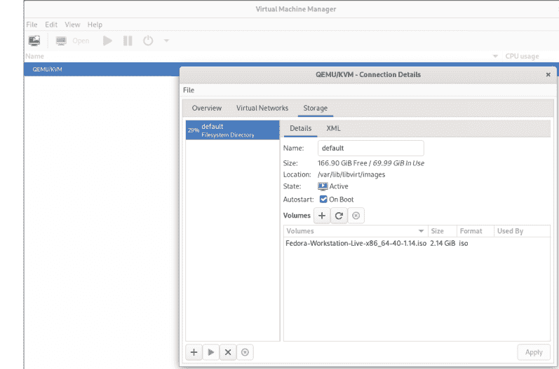

- 检查桥接是否可用。选择“虚拟网络”选项卡，确保桥接（`virbr0`）在可用网络接口列表中。

## 第 5 步：创建新虚拟机

要从虚拟机管理器窗口创建新的虚拟机，请执行以下操作：

- 启动向导。要启动“创建新虚拟机向导”，选择“文件” -> “新虚拟机”。将出现“创建新虚拟机”窗口。

## 第 28 章：使用 Linux 进行云计算

**2. 选择安装方法。** 提供了四种创建虚拟机的方法。前三种是识别安装介质位置的方法。第四种允许您导入现有磁盘镜像。对于我们的示例，选择第一个选项（本地安装介质）并点击“下一步”。

**3. 选择 ISO。** 使用“ISO 镜像”按钮并选择“浏览”。在出现的窗口中，选择或浏览到 Fedora ISO，选择“选择卷”，并点击“下一步”。

**4. 选择内存和 CPU。** 为虚拟机选择可用的 RAM 数量和处理器数量，并点击“下一步”。我建议至少使用 1024MB 内存和至少一个处理器。如果内存可用，使用 2048MB 内存更好。

**5. 启用存储。** 选择您希望虚拟机消耗的磁盘空间。对于 Fedora Workstation，我建议至少使用 10GB，但您也可以用更少的。使用 `qcow2` 镜像，它会根据您实际消耗的大小增长（最高到分配量），在实际尝试使用之前，过度分配不会引起问题。点击“下一步”。

**6. 在安装开始前检查设置。** 为虚拟机命名并检查您所选择的其他设置。选择“在安装前自定义配置”以进一步检查设置。目前将其他设置保持默认值并点击“完成”。

**7. 检查硬件设置。** 如果您在上一个屏幕上选择了自定义，则可以更详细地检查设置。在“VirtIO Disk”下，确保缓存模式设置为 `none` 或 `directsync`。在“内存”下，您可能想选择“启用共享内存”。满意后，选择“开始安装”。

**8. 安装虚拟机。** 系统将提示您安装系统，就像直接安装到硬件上一样。完成安装并重启虚拟机。如果虚拟机窗口未打开，请在 `virt-manager` 窗口中双击虚拟机条目（以 Fedora40ws 为例）并登录。图 28 显示了带有 Fedora Workstation 虚拟机的 `virt-manager` 窗口示例。

## 管理虚拟机

在拥有一个或多个虚拟机后，您可以像管理安装在硬件上的计算机系统一样管理每台虚拟机。您可以执行以下操作：

- **从控制台查看系统。** 在 `virt-manager` 窗口中双击运行中的虚拟机。打开一个虚拟机控制台窗口，允许您像从物理控制台访问直接安装在硬件上的操作系统一样使用虚拟机。您可以使用 `virt-viewer` 跳过 `virt-manager` 直接显示虚拟机的控制台。例如，对于名为 `fedora42ws` 的虚拟机，输入 `virt-viewer fedora42ws`。

- **关闭虚拟机。** 右键点击虚拟机条目并选择“关机”。然后选择“关机”（正常关闭）或“强制关闭”（相当于拔掉插头）。或者，您可以选择“重启”。

- **启动虚拟机。** 如果虚拟机当前处于关闭状态，右键点击条目并选择“运行”以启动机器。

- **删除虚拟机。** 如果您完全不再使用虚拟机，选择“删除”。系统会询问您是否也删除存储。如果您想保留与虚拟机关联的存储，请取消勾选框。

**图 28.2** 打开虚拟机并开始使用。

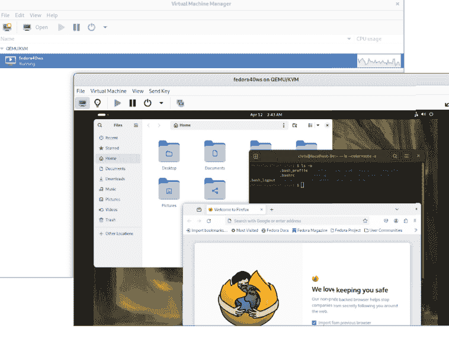

现在您已经习惯了使用虚拟机，可以尝试将虚拟机迁移到另一个虚拟机管理程序。

## 迁移虚拟机

能够在不同的虚拟机管理程序之间迁移虚拟机，为您管理计算机工作负载提供了极大的灵活性。以下是一些优势：

- 通过将虚拟机从过载的虚拟机管理程序移动到具有更多可用内存和 CPU 能力的程序来提高性能。
- 在保持虚拟机运行的同时对虚拟机管理程序进行例行维护。
- 将虚拟机从利用率低的虚拟机管理程序移出，这样您就可以关闭它们以节省能量，直到再次需要。
- 如果预计要关闭数据中心，或者预计飓风或其他灾难袭击您的数据中心，则将虚拟机迁移到异地。

实时迁移对于需要进程在不发生中断的情况下在虚拟机上继续运行非常有价值。让虚拟机迁移生效的关键是正确设置您的环境。确保具备以下条件：

- 虚拟机管理程序之间的共享网络存储。
- 每个虚拟机管理程序上配置相同的网络接口。
- 虚拟机管理程序之间兼容的 CPU。
- 虚拟机管理程序之间的快速网络连接。
- 每个虚拟机管理程序上相同或相似的虚拟化软件。（在案例中，我们两个都使用了 Fedora 42。）当一切准备就绪后，实时迁移只需要几个步骤。

## 第 1 步：识别其他虚拟机管理程序

假设虚拟机管理器仍在其中一个上运行，进入该窗口并执行以下操作连接到另一个虚拟机管理程序：

- 连接到虚拟机管理程序。选择“添加连接”。出现“添加连接”窗口。
- 添加连接。勾选“连接到远程主机”，使用 SSH 方法，使用有效用户名（如 `chris`），输入另一个虚拟机管理程序的主机名（例如 `host1`）。连接时，可能会提示输入远程虚拟机管理程序的密码。注意您可能需要安装 `openssh-askpass` 包。

虚拟机管理器上会出现该连接条目。

## 第 2 步：迁移到另一个虚拟机管理程序

在将虚拟机迁移到另一个虚拟机管理程序之前，您可能需要调整防火墙规则。在默认规则下，`libvirt` 迁移将失败。需要打开随机 TCP 端口以允许迁移。默认是 49152，也可以选择任何可用的非特权端口。隧道迁移需要 SSH 身份验证。

在虚拟机管理器打开的情况下，右键点击任何正在运行的虚拟机并选择“迁移”。出现“迁移虚拟机”窗口，如图 28.3 所示。

### 图 28.3 选择将虚拟机迁移到哪个虚拟机管理程序。

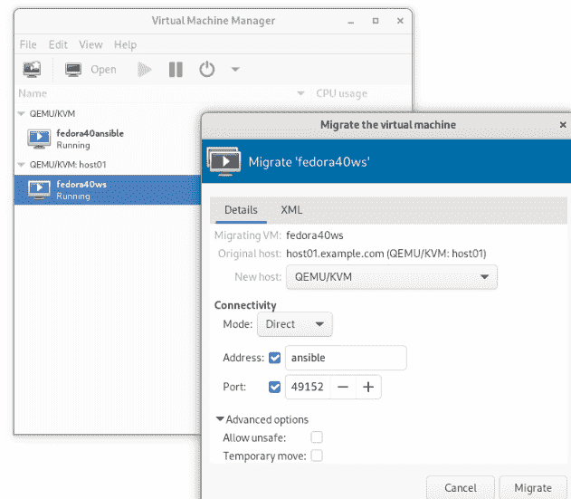

选择新主机。在我的示例中，虚拟机运行在 `host01` 上，因此我想选择 `ansible` 作为新主机。在虚拟机的内存镜像复制到另一个主机后，虚拟机应该显示为在该主机上运行。

如果由于某些原因迁移失败（CPU 不兼容或其他问题），您始终可以在一个主机上关闭虚拟机并在另一个主机上启动它。这只需要您的共享存储已就绪。在第二个主机上，只需运行“创建新虚拟机向导”，但选择运行现有镜像而不是安装。

我刚刚演示的虚拟机管理程序配置可能适用于您的家庭工作站或小型企业。虽然帮助您开发整个云计算平台超出了本书的范围，但本章目标是帮助您使用不同的云平台运行您的 Linux 系统。下一章将帮助您实现这一点。

# 摘要

Linux 是当今大多数新兴云技术构建的基础。本章将描述构建基于 Linux 和其他开源技术的云环境时所需的许多基础组件。随后，我将通过设置几个虚拟机监控程序并启动虚拟机，帮助你学习其中一些基础技术。

## 练习

本节中的练习描述了与设置虚拟机程序（KVM 宿主机计算机）以及运行虚拟机相关的任务。如果你遇到困难，可以在附录 B 中查看任务解决方案。请记住，附录 B 中显示的解决方案通常是完成任务的多种方法之一。

虽然本章中用于设置虚拟机程序的示例使用了三台物理机器，但这些练习可以在单台物理机器上完成。

1. 检查你的计算机以查看其是否支持 KVM 虚拟化。
2. 安装 Linux 系统以及用作 KVM 宿主机和运行虚拟机管理器所需的软件包。
3. 确保 `sshd` 和 `libvirtd` 服务在系统上运行。
4. 获取与你的虚拟机程序兼容的 Linux 安装 ISO 镜像，并将其拷贝到虚拟机管理器存储镜像的默认目录。
5. 检查默认网络桥接（`virbr0`）当前是否已激活。
6. 使用之前拷贝的 ISO 镜像安装虚拟机。
7. 确保你可以登录并使用该虚拟机。
8. 检查你的虚拟机是否可以连接互联网或虚拟机程序外部的网络。
9. 停止虚拟机，使其不再运行。
10. 再次启动虚拟机，使其处于运行且可用状态。

# 将 Linux 部署到云端

## 本章内容

- 创建云镜像
- 使用 `virsh` 或 `virt-manager` (`libvirtd`) 部署云镜像
- 将 EC2 镜像部署到 AWS 云

为了获取一个新的 Linux 系统使用，你不需要仅仅从物理 USB 驱动器或 DVD 运行标准的 Linux 程序，而是获取 Linux 镜像并将其部署到云端。另一种方法是获取一个通用的 Linux 镜像（可启动但未个性化的），并提供信息来配置它以满足你的需求。另一种方法是访问云提供商，选择一个镜像，点击选项进行配置，并启动它。

重点在于，云计算为启动和使用 Linux 系统提供了新方法。在第 28 章中，我让你执行了 Linux 安装以创建一个运行在 Linux 虚拟机程序上的虚拟机。在本章中，我将向你展示如何使用云镜像来启动一个全新的 Linux 系统。

首先，我将描述如何使用 `cloud-init` 将 Linux 云镜像与配置信息相结合，使其能够在各种环境中运行。接下来，我将告诉你如何在 AWS 公有云上执行类似的过程（通过点击易于使用的云控制界面使用 Amazon EC2 实例）。

# 让 Linux 在云中运行

云平台对于快速、高效地启动新的虚拟机非常出色。由于它们可以做到这一点，因此每次当你需要一个新的操作系统实例时，都不需要重新安装。

公有云，例如 Amazon EC2 (http://aws.amazon.com/ec2)，提供了不同的 Linux 发行版实例供你启动和使用。你可以选择 Linux 实例，例如 Amazon 2023、Ubuntu、Red Hat Enterprise Linux (RHEL) 或 SUSE Linux Enterprise Server (SLES)，这些实例针对特定用途进行了调整。例如，某些实例针对高性能处理进行了优化，某些针对内存密集型应用，或者作为特定环境（如 AWS Elastic Kubernetes Service [EKS]）的节点。

云实例的内容在本质上往往是通用的。预计通过 `cloud-init` 等服务为云用户或云提供者附加更多信息。`cloud-init` 信息分为大类：元数据（meta-data）和用户数据（user-data）：

**meta-data**（元数据）：元数据包含了镜像启动之前所需的信息。这些数据位于镜像内容之外，通常由云提供者管理。其中一些数据是因为存储、内存和处理能力是从资源池中提取的，而不是来自你安装的物理机器。因此，元数据告诉云提供者在启动实例早期分配这些资源以及可能的其他资源。

**user-data**（用户数据）：用户数据信息被插入到镜像中存在的操作系统。这是使用虚拟机的人提供的数据。这可能包括用户账户和密码、配置文件、首次启动时运行的命令、软件仓库的标识，或你可能在操作系统内部运行或更改的任何内容。

当你在云环境中运行 Linux 实例时，通常通过基于 Web 的云控制器（例如 Red Hat Virtualization Manager）勾选框和填写表单来输入元数据和用户数据。当你通过云控制器配置实例时，这些信息可能不会被识别为元数据和用户数据。

你选择运行 Linux 虚拟机的云可能是公有云、私有云或混合云。你选择的云类型取决于你的需求和预算：

**公有云**：Amazon EC2、Microsoft Azure 和 Google Compute Engine 是你从 Web 界面启动并使用 Linux 虚拟机（有时是实例）的云平台。你为实例运行的时间付费。运行实例所使用的内存、存储和虚拟 CPU 数量增加了成本。公有云的优势在于……

**私有云**：通过私有云，你自己管理硬件。这允许对安全和配置进行更大的控制，但需要更多的维护工作。

**混合云**：混合云结合了公有云和私有云环境，允许组织在本地保留敏感数据，同时利用公有云处理可扩展的负载。

# 第六部分：与云计算交互

2. 创建 `cloud-init` user-data 文件。创建一个名为 `user-data` 的文件，用于存储配置镜像本身操作系统的数据。在这个简单的案例中，我为默认用户（fedora）设置了密码 `cloudpass`，并确保 `cloud-init` 不让密码过期：

```yaml
#cloud-config
password: cloudpass
chpasswd: {expire: False}
```

3. 将数据合并到独立的镜像中。利用当前目录下的 `meta-data` 和 `user-data` 文件，创建一个包含这些数据的 ISO 镜像。稍后我们将此镜像作为 CD-ROM 呈现给 Linux 镜像，这样 `cloud-init` 就知道如何配置 Linux 镜像。（如果尚未安装，请先安装 `genisoimage` 和 `cloud-init` 软件包。宿主机不需要 `cloud-init` 软件包）。

```bash
# apt install genisoimage cloud-init qemu-utils virtinst # 在 Ubuntu 中
# genisoimage -output fedora42-data.iso -volid cdata \
  -joliet -rock user-data meta-data
```

4. 获取基础云镜像。Ubuntu、Fedora 和 RHEL 的云镜像已配置好供 `cloud-init` 使用。获取官方的 Fedora 云镜像（其他发行版的镜像将在稍后描述），并执行以下操作：

- a. 访问 Fedora 云镜像下载页面。打开浏览器并访问 https://fedoraproject.org/cloud/download。
- b. 点击镜像。点击 Fedora Cloud Base QEMU 镜像出现的 Download 按钮，获取一个可以使用虚拟机管理器的 `qcow2` 镜像。镜像名称类似于 `Fedora-Cloud-Base-Generic-42-1.x86_64.qcow2`。

5. 对镜像创建快照。你可能需要运行几次此过程以获得所需的精确镜像。因此，不要直接使用下载的镜像，而是对其创建一个快照。为了跟踪我的版本，我在快照名称中添加了 01：

```bash
# qemu-img create -f qcow2 \
  -o backing_file=Fedora-Cloud-Base-Generic-42-1.1.x86_64.qcow2 \
  -F qcow2 Fedora-Cloud-Base-01.qcow2
```

6. 将文件复制到镜像目录。在宿主机（`libvirt` 服务）上使用镜像时，将镜像拷贝到 `/var/lib/libvirt/images/` 目录是一个良好的习惯。例如，将云镜像和数据镜像拷贝到你的目录，输入以下命令：

```bash
# cp Fedora-Cloud-Base-Generic-42-1.1.x86_64.qcow2 \
  Fedora-Cloud-Base-01.qcow2 \
  fedora42-data.iso \
  /var/lib/libvirt/images/
```

# 第 29 章：部署 Linux 到云端

7. 启动云实例。文件到位后，运行以下命令启动你的云镜像实例：

```bash
# cd /var/lib/libvirt/images
# virt-install --import --name fedora42-01 --ram 4096 --vcpus 2 \
  --disk path=Fedora-Cloud-Base-01.qcow2,format=qcow2,bus=virtio \
  --disk path=fedora42-data.iso,device=cdrom \
  --os-variant fedora42 --network network=default &
```

之前的 `virt-install` 示例显示虚拟机被分配了 4GiB 内存 (`--ram 4096`) 和两个虚拟 CPU (`--vcpus 2`)。你系统的内存和 VCPU 值可能会根据你的计算机资源而不同。此操作是在 Fedora 上运行的。对于其他 Linux 系统，你的选项可能会有所不同。

此时，一个名为 `fedora42-01` 的虚拟机正在你的宿主机上运行。当虚拟机启动时，应该打开一个控制台窗口，允许你登录新的云虚拟机。

# 调查云实例

为了调查我们创建的云实例，你可以打开运行中的实例并查看内部。如果它尚未打开，一种方法是使用 `virt-viewer` 打开虚拟机：

```bash
# virt-viewer fedora42-01
```


从出现的控制台窗口中，使用我们添加到镜像中的数据进行登录。使用 `fedora` 作为用户，`cloudpass` 作为密码登录。`fedora` 用户具有 `sudo` 权限，因此你可以使用该账户执行某些命令来访问实例。

在这里你可以看到 `user-data` 被拷贝到实例的位置：

```bash
$ sudo cat /var/lib/libvirt/instances/ncloud/user-data.txt
#cloud-config
password: cloudpass
chpasswd:(expire: False)
```

基础云配置在 `/etc/cloud/cloud.cfg` 文件中完成。你可以看到 root 账户默认是禁用的。在文件底部，你可以看到名为 `fedora` 的用户是默认用户，并且拥有无需密码的 sudo 权限。

```yaml
$ sudo cat /etc/cloud/cloud.cfg
users:
  - default
    disable_root: true
...
system_info:
  default_user:
    name: fedora
lock_paswd: True
gecos: fedora
groups: [wheel, adm]
sudo: ["ALL=(ALL) NOPWD:ALL"]
shell: /bin/bash
paths:
  cloud_dir: /var/lib/cloud
  templates_dir: /etc/cloud
svcname: ssh
```

# 第六部分：与云计算交互

## 克隆云实例

如果你决定了云实例，可以保存它的副本以备后用。使用 `virt-manager` 创建克隆请执行以下操作：

1. 启动 `virt-manager`。在桌面的 Activities 界面上。
2. 关闭虚拟机。在 `virt-manager` 中右键点击虚拟机条目并选择 Shut Down。
3. 克隆虚拟机。再次右键点击项目并选择 Clone。弹出 Clone Machine 窗口，如图 29.1 所示。
4. 选择克隆设置。完成后，选择 Clone。

现在可以使用虚拟机管理器或 `virsh` 命令对克隆实例进行启动、停止和其他管理。制作克隆的一个大优势是你可以对其进行任何喜欢的更改，而无需更改原始镜像。完成后只需删除克隆，并在需要时可以快速生成一个新的。

## 扩展你的 cloud-init 配置

你可以向 `meta-data` 和 `user-data` 文件中添加更多信息来配置你的云实例。cloud-init 设置的示例可以在 Cloud-Init 配置页面（https://docs.cloud-init.io/en/latest/reference/examples.html）找到。以下章节展示了你可以添加到 `user-data` 文件中的设置示例。

### 将 ssh 密钥添加到 cloud-init

与其使用密码登录云实例，不如通过 `ssh` 命令使用基于密钥的身份验证进行网络登录。云服务提供商常用于允许用户访问云镜像。

如果你已经为计划用于 `ssh` 到云实例的用户账户生成了 ssh 公钥和私钥，则你可以在此过程中使用公钥。如果你生成了 RSA 密钥对，公钥默认位于 `id_rsa.pub` 文件中：

```bash
## cat $HOME/.ssh/id_rsa.pub
```

```text
ssh-rsa AAAAB3NzaC1yc2EAAQABABAAMQDzd6qDHueWzl7tRIuwjXR/rJY4
zoPoWINIGVF6m8X1Hmdq9CltnG2P24/Bb3S1j7K2YwOmocEwekhbZHBAYeqX
QQYYUB2E2Mr6qKkmrJrQB6xbpbz+VADANC
wegS5UCNQr1N4V3Gu6ScCFFh7d6cJov07t0779S3UEycErobnpRe2GSJ8FPM
regJS8FPMw6D8J55lldhpdQ0VdtrbN/STX07O2YWw6fKj0JsvzdDCCYhBPMNIKI
DhQ/znlk2q5feCq+S2i6W9l1NfePPrC5Ngnuu7G
root@host2.com
```

通常会将该文件中的公钥复制到你想要登录的远程系统的 `$HOME/.ssh/authorized_keys` 文件。你可以使用如下所示条目将密钥添加到我们云实例的该文件中：

```yaml
users:
  name: wsmith
  gecos: wsmith
  primary-group: ALL
  sudo=(ALL) NOPASSWD:ALL
  lock-password: true
  ssh-authorized-keys:
    ssh-rsa AAAAB3NzaC1yc2EAAQABABAAMQDzd6qDHueWzl7tRIuwjXR/rJY4
zoPoWINIGVF6m8X1Hmdq9CltnG2P24/Bb3S1j7K2YwOmocEwekhbZHBAYeqX
QQYYUB2E2Mr6qKkmrJrQB6xbpbz+VADANC
wegS5UCNQr1N4V3Gu6ScCFFh7d6cJov07t0779S3UEycErobnpRe2GSJ8FPM
regJS8FPMw6D8J55lldhpdQ0VdtrbN/STX07O2YWw6fKj0JsvzdDCCYhBPMNIKI
DhQ/znlk2q5feCq+S2i6W9l1NfePPrC5Ngnuu7G
gum07root@host2.com
```

从前面的信息中你可以看到 `wsmith` 是用户名。该条目通常是用户的全名，位于 `/etc/passwd` 文件的第五字段。该用户的密码已锁定。然而，来自 `host2.com` 你账户的 `ssh-rsa` 条目被提供在此处用户的 `ssh-authorized-keys` 下。我可以通过 `ssh` 无需密码登录云实例（我的私钥与该公钥关联）。

### 使用 cloud-init 添加软件

你的软件受限于云镜像中已有的软件。在你的 `user-data` 文件中，你可以定义 YUM 仓库（Fedora 或 RHEL）或 apt 仓库（Ubuntu 或 Debian），然后识别云实例启动时想要安装的任何包。

以下示例显示了 `user-data` 文件中的条目可能是什么，用于向你的云实例添加 YUM 仓库（用于 Fedora 或 RHEL）并从仓库或另一个仓库安装包：

```yaml
myrepo:
  baseurl: http://myrepo.example.com/pub/myrepo/
  enabled: true
  gpgcheck: true
  gpgckey: file:///etc/pki/rpm-gpg/RPM-GPG-KEY-MYREPO
  name: My personal software repository
```

```yaml
packages:
  - nmap
  - mycolcdmd
  - [libmystuff, 3.10-1.fc21.noarch]
```

在所示示例中，在 `/etc/yum.repos.d/myrepo.repo` 文件创建了一个新仓库。提供了一个 GPG 密钥来检查安装包的有效性，并开启了 GPG 检查。之后，安装了 `nmap` 包（在标准 Fedora 仓库中），安装了 `my` 包（来自我的私有仓库），并安装了特定版本的 `libmystuff` 包。

为 Ubuntu 配置 apt 仓库的方法略有不同。默认配置了主镜像和安全 apt 镜像（在镜像中的 `cloud.cfg` 文件中），以及让实例在 Amazon EC2 云端时搜索最近区域包的设置。要添加更多仓库，你的 `user-data` 文件中的条目可能如下所示：

```yaml
apt_mirror: http://us.archive.ubuntu.com/ubuntu/
apt_mirror_search:
  ://myownmirror.example.com
  ://archive.ubuntu.com
```

```yaml
packages:
  - nmap
  - mycolcdmd
  - [libmystuff, 3.16.0-25]
```

`myownmirror.example.com` 条目告诉 apt 使用你自己的私有仓库来搜索包。注意，你想要安装的包可以使用基本上与处理 Fedora 时相同的格式输入，尽管在某些情况下，特定的版本信息（如果输入）可能会看起来不同。

你可以在 `user-data` 和 `meta-data` 文件中添加许多设置。请参考 Cloud-Init Config Examples 页面。

## 在 AWS 上配置并启动 Amazon Linux 实例

8. 检查实例设置并选择“启动实例”（Launch Instance）以启动实例。

29.3 显示了一个准备就绪的 Amazon Linux 2023 实例示例。

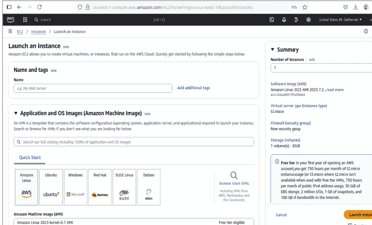

9. 选择实例，屏幕上将出现新名称。在“成功”框中选择实例。从“实例”页面，选择该实例。

10. 选择你的实例并点击“连接”（Connect）按钮。在实例页面上，点击“连接”按钮以查看连接实例的不同方法。点击“EC2 Instance Connect”然后点击“连接”，浏览器中将打开 shell，你就可以开始使用该实例。

要从你的 Linux 系统登录实例，请参考 SSH 连接说明使用 `ssh` 登录到你创建的公 IP 地址。请将 `ec2-user` 替换为 `ubuntu`（针对 Ubuntu）或 `fedora`（针对 Fedora）。例如，登录 AWS 实例的命令可能类似于以下：

```bash
$ ssh -i "youraws.pem" ec2-user@ec2-2-xx-yy-zz.us-east-2.compute.amazonaws.com
```


## 第 29 章：将 Linux 部署到云端

11. 终止实例。当你完成实例的操作后，可以通过在“实例”页面勾选实例复选框，然后选择“实例状态 -> 终止（删除）”来终止它。系统会警告你，删除实例时该实例的存储将被删除。选择“终止”以移除实例及其关联存储。

务必记住在完成后要销毁实例，否则你将继续被收取费用。

## 总结

了解云计算如何与直接在计算机硬件上安装操作系统有何不同，将帮助你适应越来越多的数据中心向云计算的转型。在本章的开始，我鼓励你尝试获取一些云镜像，将它们结合并在本地 Linux 虚拟机管理程序上启动它们，以理解云镜像是如何工作的。

之后，我介绍了 Amazon 弹性计算云（Elastic Compute Cloud）服务，如果你没有足够的计算资源，可以付费使用云存储和处理时间。

下一章将描述如何使用 Ansible 自动化向你的数据中心部署主机系统和应用程序。

## 练习

本节的练习假设你已经将主机系统设置为虚拟机管理程序（KVM 主机计算机）。你需要使用该虚拟机管理程序运行练习中创建的虚拟机。如果你遇到困难，附录 B 中提供了任务的解决方案。请记住，附录 B 中的解决方案只是完成任务的许多方法之一。

1. 创建自定义虚拟机镜像，请安装 `genisoimage`、`cloud-init`、`qemu-img` 以及 `virt-manager`、`virt-viewer` 包。
2. 从 Fedora 项目获取云镜像。
3. 使用 `qemu-img` 创建一个名为 `myvm.qcow2` 的 qcow2 格式镜像快照，稍后你可以将其和你自己的数据结合。
4. 创建名为 `meta-data` 的 cloud-init 元数据文件，将 `instance-id` 设置为 `myvm`，`local-hostname` 设置为 `myvm.example.com`。
5. 创建名为 `user-data` 的 cloud-init 用户数据文件，将默认用户密码设置为 `test`，并设置 `chpasswd` 永不过期为 `{expire: False}`。
6. 运行 `genisoimage` 命令结合 `meta-data` 和 `user-data` 文件，创建一个 `mydata.iso` 文件，稍后你可以将其与虚拟机镜像结合。
7. 使用 `virt-install` 命令将 `myvm.qcow2` 虚拟机镜像与 `mydata.iso` 镜像结合，创建一个名为 `newvm` 的新虚拟机镜像，它将在你的虚拟机管理程序上启动运行。
8. 使用 `virt-viewer` 为 `newvm` 虚拟机打开控制台。
9. 使用之前设置的 `fedora` 用户和 `test` 密码登录 `newvm` 虚拟机。

## 第 30 章：使用 Ansible 自动化应用程序和基础设施

## 本章内容

- 理解 Ansible
- 安装 Ansible
- 梳理部署步骤
- 运行即时命令（ad hoc commands）

到本书的此处，我们主要关注如何手动配置单个 Linux 系统。你已经学习了如何在运行它们的机器上直接安装软件、编辑配置文件并启动服务。虽然了解如何操作 Linux 主机是管理 Linux 系统的基础，但仅靠自己无法良好扩展。这正是 Ansible 可以派上用场的地方。

Ansible 是今天许多自动化功能之一，它将 Linux 管理工作从单系统转变为系统组。如果你将系统配置从每台机器移动到控制节点，它将用**剧本**（playbooks）取代每台机器上的 shell 用户界面，这些剧本通过网络在其他机器上运行任务。

尽管我们的重点是管理 Linux 系统，但 Ansible 也可以管理这些 Linux 系统周边的许多事务。有许多 Ansible 模块可以确保机器开机、网络设备配置正确以及远程存储可访问。

在所有小型数据中心中，了解如何自动部署和管理 Linux 系统及周边基础设施正成为一种趋势（见第 31 章“使用 Kubernetes 容器部署应用程序”）。对于基础设施和更传统的应用程序部署，Ansible 为具有 Linux 思维的管理员提供了丰富的功能集。

本章将带你了解入门 Ansible 所需的知识。随后，它将详细说明跨系统组部署应用程序，并向你展示如何通过运行即时命令来使用 Ansible。

### 理解 Ansible

Ansible 扩展而非取代了你所学的 Linux 知识。在最基础层面，Ansible 包含以下内容：

- 一种描述实现特定状态所需任务的自动化语言。这些任务被汇成剧本。
- 用于运行剧本的自动化引擎。
- 用于管理和保护剧本与其他组件的接口，通过命令和 RESTful API 实现。

通过清单（定义主机组）和剧本（定义对主机执行的操作），Ansible 以以下方式配置主机：

**简单功能配置**：你以纯文本文件创建清单和剧本，并在其中识别所需的组件。

**设置预期结果**：你在此描述的是你希望节点所处的状态资源。这种状态可以是运行中的系统、特定地址的网络接口或特定大小的磁盘分区。如果由于某种原因功能的状态发生了变化，你可以再次运行剧本以返回预期状态。

每个主机必须运行 SSH 服务，并配置允许 Ansible 从控制节点与其通信。基于密钥的身份验证允许这种操作发生，并在需要 root 权限时可以使用 sudo。由于你使用的是可能已经在主机上运行的 SSH 服务，因此无需运行额外的代理程序或配置防火墙规则即可工作。

### Ansible 的应用场景

**容器化应用**：Ansible 不仅可以部署容器化应用，但它们还可以实时响应变化并使升级变得更容易。详情请参阅 Ansible Operator 的描述（https://www.ansible.com/blog/ansible-operator）。

**网络管理**：通常需要手动执行的配置、测试、验证和增强您的网络基础设施的任务可以通过 Ansible 实现自动化。详情请参阅 Ansible 网络入门指南（https://docs.ansible.com/ansible/latest/network/getting-started/index.html#network-getting-started）。

**云环境管理**：正如同你可以将基础设施部署到裸机上一样，Ansible 也提供了为云环境配置基础设施和应用程序的工具。仅对于亚马逊 Web Services (AWS)，就有数百个 Ansible 模块可用于管理基础设施和应用程序。对于阿里云、Azure、Google 以及几十个云环境同样可用。

### 探索 Ansible 组件

当运行一个 `playbook`（剧本）时，它会作用于一个或多个目标主机（由清单/inventories 表示），并执行这些操作，称为 `play`（操作）。每个 `play` 包含一个或多个要实现的任务（tasks）。为了执行某个任务，任务会调用模块（modules），模块按照它们出现的顺序被执行。在开始使用 Ansible 之前，进一步了解这些组件将会有帮助。

#### 清单 (Inventories)

通过将你想要管理的主机系统（节点）收集到所谓的“清单”中，你可以管理具有相似特征的机器。相似性可以包括以下内容：

- 位于相似的位置
- 提供相同类型的服务
- 被分配到流程中的特定阶段，例如开发、测试、预发布和生产环境的机器组

将多个组组合在一起允许它们基于不同的属性进行分类。例如，`host1` 可能既属于一个名为 `network` 的组（基于其位置），也属于一个名为 `ftp` 的组（基于其提供的应用）。在这些清单组上运行的任务允许每个主机根据其位置分别获取网络设置，并根据其用途获取相应的应用程序。

创建清单有多种方法。你可以设置一组静态服务器，也可以创建一个系统范围。你还可以使用来自云提供商（如 Azure、AWS 和 GCP）的动态服务器列表。

使用变量（variables），你可以为清单中的一组主机分配属性。这些变量可以配置诸如主机上可用服务的端口、服务的超时值，或主机使用的服务位置（例如用于网络时间协议服务器的数据库）。

与 playbook 一样，清单可以是简单的文本文件。它们也可以通过清单脚本实现。

#### Playbooks (剧本)

Playbooks 以 YAML 格式的文件创建，它们描述了某物的最终状态。这种状态可以导致软件安装、应用配置或服务启动。它可以只关注应用本身，也可以包含该应用所在的整个环境（网络、存储、身份验证或其他功能）。

Playbooks 的设计目的是为了复用——以便稍后部署相同的组件、适配其他组件，或重新播放以恢复特定 playbook 实例的原始意图。因为 playbook 旨在复用，许多人将其保存在源码版本控制中。这样，你就可以跟踪随时间的变化，并让 playbook 易可用。

#### Plays (操作)

playbook 内部包含一个或多个 `play`。每个 `play` 都有一个目标，例如主机标识符，告诉 playbook 在哪些主机上执行操作。之后可以跟随一个远程用户，告诉 playbook 以哪个用户身份对主机进行身份验证。`play` 还可以指示在开始执行任务之前需要通过 sudo 提升权限。之后，可以有一个或多个任务来定义在主机上执行的实际活动。

#### 任务 (Tasks)

在最基础的层，每个任务运行一个或多个模块。任务提供了一种将模块与模块相关的参数和返回值关联起来的方法。

#### 模块 (Modules)

今天有数百个 Ansible 模块可用，并且不断有新的模块被创建。运行时，模块通过检查预期状态（由所提供的参数指示）来确保请求的状态实现；如果目标不在该状态，则执行需要做什么才能达到该状态。模块索引（Module Index）按类别组织模块（https://docs.ansible.com/ansible/latest/modules_by_category.html）。

模块示例包括 `yum`、`mysql_db` 和 `ipmi_power`。`yum` 模块可以从 YUM 设施安装、删除或其他管理软件包和存储库。`mysql_db` 模块允许你从主机上添加或删除 MySQL 数据库。`ipmi_power` 模块允许检查带有 IPMI 接口的计算机状态，并确保它们达到请求的状态（开启或关闭）。

条件判断可以应用于每个任务。例如，使用 `yum` 模块，你可以根据包的状态条件决定是否安装某个包。你可以说，如果包的状态已安装，则不安装该包（即使有新版本）。然而，如果你使用 `latest`，如果当前包不是最新版本，则将安装较新版本的包。

参数允许你添加信息来修改任务。例如，使用 `user` 模块时，向系统添加用户时，你可以识别用户的名称、密码、UID 和 shell。

除了设置从 playbook 执行的模块外，你还可以直接从命令行运行模块。如果你希望立即对主机执行操作，而无需运行整个 playbook，这将非常有用。例如，你可以 ping 一组主机确保它们正在运行。

大多数模块都会返回指示操作结果的值。常见的返回值包括布尔值，指示任务是否成功（https://docs.ansible.com/ansible/latest/dev_guide.html）。

#### Roles, imports 和 includes

随着你 playbook 集的增长，你可能会发现通过将 playbook 拆分为更小的部分包含 `includes` 和 `roles`。`roles` 与任务类似，但它们可以包含不仅仅是任务，例如变量和处理器（handlers）。有关使用 includes 信息，请访问 https://docs.ansible.com/ansible/latest/.html 并搜索“Creating Reusable Playbooks”。

### 逐步 Ansible 部署

为了开始使用 Ansible，我们将通过一个程序向一组主机部署服务。在安装 Ansible 后，该程序将展示如何创建部署所需的所需的清单和 playbook。

#### 先决条件

开始时，我使用了四台计算机（你可以使用虚拟机），名称如下：

- `ansible` 用作控制节点
- `host01` 第一个目标节点
- `host02` 第二个目标节点
- `host03` 第三个目标节点

然后我运行了以下步骤来准备使用这些主机：

- 在每台计算机上安装了 Fedora
- 对于三个目标节点（`host01`、`host02` 和 `host03`），我确保执行了以下操作：
    - 确保 SSH 服务正在运行并可用（必要时开启 TCP 22 端口）供 Ansible 控制节点访问。
    - 创建非 root 用户账户。稍后使用 playbook 时，使用 `--ask-become-pass` 选项提示提升权限所需的密码。
    - 为该用户设置密码。

运行 Ansible 时，我使用具有 sudo 权限的普通账户连接到每个系统，并使用 sudo 提升到 root 权限。

#### 为每个节点设置 SSH 密钥

登录控制节点 (`ansible`)，确保它可以访问你正在配置的其他三个节点。要么通过 DNS 服务器访问这些主机，要么将其添加到控制节点的 `/etc/hosts` 文件中。然后设置访问这些节点的密钥。例如：

1. 作为 root 用户，将要部署 Ansible playbook 的每个节点的 IP 地址添加到 `/etc/hosts` 文件中：

```
192.168.122.154   host01
192.168.122.94    host02
192.168.122.189   host03
```

2. 在 `ansible` 系统上生成 ssh 密钥，以便与每个主机进行密码通信。你可以作为普通用户在 `ansible` 主系统上运行此命令以及随后的 Ansible 命令：

```
$ ssh-keygen
Generating public/private ed25519 key pair.
Enter file in which to save the key (/home/joe/.ssh/id_ed25519):
<ENTER>
Created directory '/home/joe/.ssh'.
```

```
Enter passphrase (empty for no passphrase): <ENTER>
Enter same passphrase again: <ENTER>
Your identification has been saved in /home/joe/.ssh/id_ed25519
Your public key has been saved in /home/joe/.ssh/id_rsa.pub.
The key fingerprint is:
SHA256:UexjkyUSQGIxPyKu9fmNB2wJER7ka8IPyDVv5 chris@ansible
The key's randomart image is:
+----[ED25519]----+
| .O..               |
| .O+  .  O..          |
| +   + == E           |
|O+0+..* S  O         |
| =oo+=.               |
| .oo..               |
+----[SHA256]----+
```

3. 使用 `ssh-copy-id` 将您的公钥复制到每台主机上具有复制 `sudo` 权限的用户账户。以下 `for` 循环步骤将用户 joe 的密码复制到所有三个主机：

```
for i in 1 2 3; do ssh-copy-id joe@host$i; done
```

```
/usr/bin/ssh-copy-id INFO: Source of key(s) to be installed: "/home/joe/.ssh/id_ed25519.pub"
/usr/bin/ssh-copy-id INFO: attempting to log in with the new key(s), to filter out any already installed
/usr/bin/ssh-copy-id INFO: 1 key(s) remain to be installed
If you are prompted now it is to install the new keys
joe@host01's password: <password>
Number of key(s) added: 1
Now try logging into the machine, with: "ssh joe@host01"
and check to make sure only the key(s) you wanted were added.
/usr/bin/ssh-copy-id INFO: Source of key(s) to be installed: "/home/joe/.ssh/id_ed25519.pub"
/usr/bin/ssh-copy-id INFO: attempting to log in with the new key(s), to filter out any already installed
/usr/bin/ssh-copy-id INFO: 1 key(s) remain to be installed
If you are prompted now it is to install the new keys
joe@host02's password: <password> ...
```

下一步是在控制节点 (`ansible`) 上安装 ansible 软件包。从现在开始起，所有工作都将从控制节点发出。

## 安装 Ansible

Ansible 软件包适用于 RHEL、Fedora、Ubuntu 以及其他 Linux 发行版。由于 Ansible 剧本（playbooks）是从控制节点运行的，因此无需在任何目标节点上安装 Ansible 软件。

因此，首先在您想要作为控制节点的 RHEL、Fedora、Ubuntu 或其他系统上安装 `ansible` 软件包。该控制节点只需能够连接到运行在您要部署的主机上的 SSH 服务即可。

通过以下方式之一安装 `ansible` 软件包（或轻量级安装 `ansible-core`）：

- **RHEL**
  ```
  # dnf install ansible -y
  ```

- **Fedora**
  ```
  # dnf install ansible -y
  ```

- **Ubuntu**
  ```
  # sudo apt install ansible
  ```

安装 Ansible 后，您就可以开始构建清单（inventory），它为您将运行的剧本提供目标。

## 创建清单

简单的清单可以由代表剧本目标的名称以及与该名称关联的主机系统组成。要开始操作，这里有一个包含三组静态主机的清单示例：

```
[ws]
host01
host02
host03
```

```
[newyork]
host01
```

```
[houston]
host02
host03
```


将这些条目添加到 `/etc/ansible/hosts` 文件中，使它们在运行 Ansible 命令和剧本时可以使用它们。虽然此过程仅部署到 `ws` 组中的主机，但另外两个组说明了您可能想如何根据机器的位置（newyork 和 houston）来设置剧本。

# 验证主机身份

为了确保您从 Ansible 系统访问每台主机，请 ssh 登录到每台主机。您不需要输入密码：

```
$ ssh -i id_ed25519 joe@host01
Last login: Sun Mar 30 13:53:22 from 192.168.1.20
$ exit
```

对每台主机重复此操作。

# 创建剧本

此剧本将导致在之前定义的 `ws` 组主机上安装并启动 Web 服务器。同样，剧本会检查防火墙软件是否安装并运行，以及防火墙是否开放了端口 80 (http) 以访问 Web 服务器。我将以下内容添加到文件 `simple_web.yaml` 中：

```yaml
- name: Create web server
  hosts: ws
  remote_user: joe
  become_method: sudo
  become: yes
  become_user: root
  tasks:
  - name: Install httpd
    yum:
      name: httpd
      state: present
  - name: Check that httpd has started
    service:
      name: httpd
      state: started
  - name: Install firewall
    yum:
      name: firewall
      state: present
  - name: Firewall access to access
    service:
      name: firewall
      permanent: yes
  - name: Restart firewall
    service:
      name: firewall
      state: restarted
```

## 第六部分：与云计算交互

```
PLAY RECAP *************************************
host01: ok=6 changed=4 unreachable=0 failed=0 skipped=0 rescued=0 ignored=0
host02: ok=6 changed=4 unreachable=0 failed=0 skipped=0 rescued=0 ignored=0
host03: ok=6 changed=4 unreachable=0 failed=0 skipped=0 rescued=0 ignored=0
```

`ansible-playbook` 的输出逐个显示每个任务。第一个任务（收集信息 Gathering Facts）显示 `ws` 节点清单中的所有主机系统都是可访问的。你可以看到它正在使用凭据连接到每个系统，并在完成每个后续任务之前将该用户提升为 root 权限。

`Install httpd` 任务检查每个主机上是否安装了 `httpd` 软件包。如果没有，Ansible 将尝试安装该包以及任何依赖包。接下来，Ansible 检查每个主机上 `httpd` 服务的状态，如果它没有运行，则启动它。

之后，会检查每个主机是否安装了 `firewall` 软件包，如果没有安装则进行安装。然后，Ansible 在每个主机上添加一条防火墙规则，允许访问 http 服务（TCP 端口 80），并使该设置永久化。

`PLAY RECAP` 显示了所有任务的结果。在这里，你可以看到所有主机上的六个任务都是 `ok`。如果有任何失败（failed）、跳过（skipped）、救回（rescued）或忽略（ignored）的任务，它们将会被列出来。

如果你认为某些地方可能出了问题，或者你对其进行了修改，可以重新运行此 playbook。你也可以用它将 playbook 部署到不同的系统上。

尽管你已经看到 Ansible 擅长在 playbook 中部署多个任务，但它也可以用于执行一次性操作。在下一节中，我将展示如何运行一些即席 Ansible 命令，以查询并进一步修改我们部署的主机。

## 运行即席 Ansible 命令

有时，你可能想在由 Ansible 管理的节点上执行一次性任务。你可以使用即席命令（ad hoc commands）来完成这些任务。通过即席命令，你可以直接从 Ansible 命令行调用模块，并让它对清单执行操作。任务可能包括以下内容：

- 安装软件包
- 管理用户账户
- 将文件复制到节点
- 修改文件或目录的权限
- 重启节点

就像运行 playbook 一样，运行即席命令侧重于达到期望状态。即席命令接受一个声明式语句，确定请求的是什么，以及它需要做什么来达到请求的状态。

要尝试这些即席 Ansible 命令示例，你可以使用之前创建的 `ws` 清单。

## 尝试即席命令

当你运行即席 Ansible 命令时，你会使用 Ansible 模块执行某些操作。如果没有指定其他模块，默认使用 `command` 模块。通过该模块，你指定了想要作为一次性活动在一组节点上运行的命令和选项。

检查清单是否正在运行。在这里，你看到 `ws` 清单中的所有都在运行：

```bash
$ ansible ws -u joe -m ping -k
SSH password: <ssh password>
BECOME password[defaults to SSH password]: <Enter>
host01 | SUCCESS => {
  "ansible_facts": {
    "discovered_interpreter_python": "/usr/bin/python",
    "changed": false,
    "ping": "pong"
  }
}
host02 | SUCCESS => {
  ...
}
```

你可以通过以下 Ansible 命令检查服务状态，来判断 `ws` 清单中的主机是否正在运行 `httpd` 服务：

```bash
$ ansible ws -u joe -m service -a "name=httpd state=started" --check -k
SSH password: <ssh password>
BECOME password[defaults to SSH password]: <Enter>
host02 | SUCCESS => {
  "ansible_facts": {
    "discovered_interpreter_python": "/usr/bin/python",
    "changed": false,
    "name": "httpd",
    "state": "started",
    "status": { ... }
  }
}
host01 | SUCCESS => {
  ...
}
```

目前，Web 服务器上内容。要为 `ws` 清单中的所有主机添加一个包含文本“Hello from your web server!”的 `index.html` 文件，你可以运行此命令（在提示时输入 root 密码）：

```bash
$ echo "Hello from your web server!" > index.html
$ ansible ws -m copy -a "src=./index.html dest=/var/www/html/ owner=apache group=apache mode=0644" -b --user joe --ask-become-pass -kK
SSH password: <ssh password>
BECOME [defaults to SSH password]: <Enter>
host01 | CHANGED => {
  "ansible_facts": {
    "discovered_interpreter_python": "/usr/bin/python"
  },
  "checksum": "",
  "dest": "/var/www/html/index.html",
  "gid": 48,
  "group": "apache",
  "md5": "495febbad9058648cfaf69681d4"
}
host02 | CHANGED => { ... }
host03 | CHANGED => { ... }
```

## 第 30 章：使用 Ansible 自动化应用和基础设施

```
PLAY RECAP *************************************
host01: ok=6 changed=4 unreachable=0 failed=0 skipped=0 rescued=0 ignored=0
host02: ok=6 changed=4 unreachable=0 failed=0 skipped=0 rescued=0 ignored=0
host03: ok=6 changed=4 unreachable=0 failed=0 skipped=0 rescued=0 ignored=0
```

## 使用 Ansible Tower 自动化任务

尽管你已经看到 Ansible 擅长在 playbook 中部署多个任务，但它也可以用于执行一次性操作。在下一节中，我将展示如何运行一些即席 Ansible 命令，以查询并进一步修改我们部署的主机。

## 自动化框架

Ansible Tower 提供了一个基于 Web 的界面来管理你的整个基础设施。通过将资产集中在一个地方，你就有了一个接收通知的地方。Ansible Tower 界面便于配置和启动你的任务。无需记住命令行选项，你只需要点击。清单管理是可视化的，作业调度可以通过直观的方式完成。

Ansible Tower 提供了 REST API，可以帮助将你的工具嵌入 Ansible。这样你就可以通过 Ansible 继续现有的流程。

你可以从 Ansible Tower 网站了解更多关于它的信息（https://www.ansible.com/products/tower）。

## 总结

Ansible 提供了一种独特的语言和工具集，用于自动化你在书中其他部分学习的许多任务。一旦学会了如何构建 Ansible playbook，你就可以确定系统所需的精确配置，并轻松地将其部署到一个或多个主机上。

你可以保存这些 playbook 并重复使用它们在其他系统上产生类似的结果，或进行调整以创建新的不同的结果。

Ansible 还可以使用即席命令来更新系统。从 Ansible 命令行，你可以添加用户、复制文件、安装软件，或执行几乎任何你可以用 playbook 做的事情。通过这些命令，你可以快速地在多个主机上应用一组更改，或者响应需要立即对某组主机进行快速修复的问题。

## 练习题

这些练习题测试了你如何在系统上安装 Ansible、创建第一个 Ansible playbook 以及运行几个即席命令的能力。这些任务假设你正在运行 Fedora 或 Red Hat Enterprise Linux 系统（但在 Ubuntu 和其他 Linux 系统上也适用）。

# 第六部分：接触云计算

尽管 Ansible 旨在用于部署任务系统，但这里的练习将只是让你在单个系统上尝试运行 playbook（剧本）和一些命令。如果你遇到困难，任务的解决方案可以在附录 B 中（尽管在 Linux 中，你通常可以通过多种方式完成任务）。

1. 在你的 Fedora 或 Ubuntu 系统上安装 Ansible。
2. 为你想要运行这些练习的用户添加 sudo 权限。
3. 创建一个 Ansible playbook 的开头（命名为 `my_playbook.yaml`），包含以下内容：

```yaml
name: Create web server
hosts: localhost
tasks:
  - name: Install httpd
    yum:
      name: httpd
      state: present
```


- 4. 以检查模式（check mode）在 `my_playbook.yaml` 上运行 `ansible-playbook`，以查看完成 playbook 是否存在问题（提示：存在）。
- 5. 修改 `my_playbook.yaml` 以提升权限，以便任务以 `root` 用户身份运行。
- 6. 再次运行 `ansible-playbook`，直到 `httpd` 包成功安装在你的系统上。
- 7. 再次修改 `my_playbook.yaml` 以启动 `httpd` 服务，并设置其在每次系统启动时自动启动。
- 8. 运行 `ansible` 命令检查 `localhost` 上的 `httpd` 服务是否运行。
- 9. 创建一个包含文本“Web server is up”的 `index.html` 文件，并使用 `ansible` 命令将该文件复制到 `localhost` 的 `/var/www/html` 目录。
- 10. 使用 `curl` 命令查看你刚刚复制到 Web 服务器的文件内容。

## 使用 Kubernetes 部署容器应用程序

## 本章内容

- 理解 Kubernetes
- 尝试 Kubernetes
- 运行 Kubernetes 基础教程
- 使用 EKS 构建企业级 Kubernetes

Linux 容器将它们包含的应用程序与其运行的操作系统分离开来。准确地说，容器将包含一组离散的软件，这些软件可以高效地传输和运行。故事并没有此结束。一旦你拥有了一些容器，下一步就是让它们与 Kubernetes 等平台结合，允许你执行以下操作：

- 将一组容器组合形成更大的应用程序。例如，今天部署一个 Web 服务器、数据库和监控工具。
- 根据需求扩展容器规模。事实上，你希望能够单独扩展大型应用程序的每个组件，而无需扩展所有内容。
- 设置应用程序的状态而不是运行它。这意味着，你不是直接运行一个容器，而是能够说诸如“运行三个容器 X 的副本，如果其中一个崩溃了，务必启动另一个来替换它”之的话。
- 从主机故障或过载中恢复。如果运行容器的主机发生故障，你希望容器能够快速恢复并在另一台主机上启动。
- 无需担心基础设施。你希望应用程序连接到它所需的服务，而无需知道与服务相关的主机名、IP 地址或端口号。
- 在不停机的情况下升级你的容器化应用程序。

Kubernetes 提供了所有这些功能更多。虽然还有其他平台（如 Mesos 和 Docker Swarm）在竞争容器编排平台，但 Kubernetes 已成为编排、部署和管理容器化应用程序无可争议的领导者。Kubernetes 也成为运行大规模运行的人工智能和机器学习应用程序的首选。

# 第六部分：接触云计算

本章向你介绍 Kubernetes 以及亚马逊提供的企业级 Kubernetes 平台——Elastic Kubernetes Service (EKS)。学习 Kubernetes 的最好方法是启动一个 Kubernetes 集群，并运行命令来探索 Kubernetes 并部署容器化应用程序。在开始之前，你应该稍微了解一下什么是 Kubernetes 集群，以及将应用程序部署到集群时需要的组件。

### 理解 Kubernetes

Kubernetes 集群由节点组成，形成控制平面（用于管理集群）和数据面（用于运行负载）。对于个人使用，你可以在同一系统上运行控制和平数据面服务。例如，正如本章后面介绍的 Minikube，你可以从笔记本电脑上的虚拟机运行 Kubernetes 集群（https://minikube.sigs.k8s.io/docs/start/）。

在生产环境中，控制平面持续运行，而数据面可以根据工作负载的需求进行启动和关闭。如果你要建立生产级的 Kubernetes 基础设施，需要考虑的不同组件如下：

**控制平面：** 控制平面管理 Kubernetes 集群中运行的组件。它管理组件之间的通信，调度应用程序在数据面节点上运行，扩展应用程序，并确保正确数量的容器（分布在 pod 中）正在运行。控制平面可以运行在一个节点上，但你通常需要准备三个或更多可用节点，以确保控制平面服务始终可用。

**数据面：** 数据面是部署的容器实际运行的地方。你需要的节点数量取决于你的工作负载。对于本地集群，你可能希望高峰需求期间可能需要的最大数量节点，并在需要时引入节点，在不需要时撤销。对于云环境，云提供商通常有系统来处理你的数据面需求，因此你只需要根据需要为那些节点付费。如果你需要需求巨大的特殊类型（例如 GPU），你可能需要预留它们。

**存储：** 持久性网络化存储允许容器访问相同的存储，无论它们运行在哪些节点上。

**其他服务：** 为了将 Kubernetes 环境集成到现有的数据中心，你可能希望将其与身份识别和管理集成。在 Kubernetes 中，你用于部署的最小单元被称为 pod。pod 可以包含一个或多个容器，以及描述容器的元数据。

### 第31 章：使用容器部署应用程序

在 Kubernetes 中，你用于部署的最小单元被称为 `pod`。`pod` 可以包含一个或多个容器，以及描述容器的元数据。

### Kubernetes 控制平面

控制平面监督集群的所有活动。控制平面的核心是 API 服务器（`kube-apiserver`），它接收请求。集群中所有节点之间的通信都通过 API 服务器。当 API 服务器收到一个对象时（例如运行某些数量 pod 的请求），Kubernetes 调度器（`kube-scheduler`）会找到节点并调度到这些节点上。Kubernetes 控制器（`controller-manager`）持续运行执行诸如命名空间是否存在、服务账户是否可用、正确的副本数量是否运行以及定义的节点是否激活等操作。如果任何内容不同步，就会发出请求将这些对象恢复到请求状态，通过引入更多 pod 或重建缺失的节点。

### Kubernetes 数据面

Kubernetes 数据面每个节点的核心是 `kubelet`。`kubelet` 通过 API 服务器监控其节点。API 服务器 指令 `kubelet` 执行诸如运行 API 服务器 请求的容器，并确保其继续以健康状态运行。

每个节点上运行的另一个服务是容器引擎（通常称为运行时）。最初，Docker 服务是最流行的容器引擎，用于通过 `PodSpec` 启动、管理和删除容器。然而，在 Kubernetes v1.23 中，Kubernetes 中的 Docker 已被弃用，Docker 被 `containerd` 替换为 Kubernetes 的默认容器运行时。

# 第六部分：与云计算交互

响应此类请求，并确保这些请求在 Kubernetes *数据平面节点*上执行。

Kubernetes 使用服务（Services）的概念将应用程序的位置与其实际的 IP 地址和端口号隔离开。通过为提供该服务的 Pod 集合分配服务名称，集群不需要知道每个 Pod 的确切位置。相反，由 Kubernetes 来将对该服务的请求路由到可用的 Pod。

默认情况下，集群无法直接与活动 Pod 关联的 IP 地址进行通信。这需要你来定义如何将与 Pod 集合关联的服务暴露到集群外部。通过使用 `Service` 对象，你可以以不同的方式暴露服务。

默认情况下，通过 `ClusterIP` 类型暴露的服务使其仅对集群内部的其它组件可用。要向集群外暴露服务，可以使用 `NodePort`，它允许通过运行该 Pod 的每个节点上的外部 IP 地址上通过相同的 Kubernetes 分配的端口来访问提供服务的 Pod。

第三种方法是使用 `LoadBalancer` 分配一个外部的固定 IP 地址，作为提供服务的 Pod 的负载均衡器。通过 `LoadBalancer`，云厂商的外部负载均衡器会将流量重定向到后端 Pod。最后，你可以使用 `ExternalName` 暴露服务，将服务与特定的 DNS CNAME 记录关联。

无论你如何暴露 Kubernetes 服务，只要有对该服务的请求，Kubernetes 就会将通信路由到提供该服务的 Pod 集合。通过这种方式，Pod 的启动和关闭不会影响使用该服务的客户端。

# Kubernetes 接口

Kubernetes 既有命令行界面也有 Web 控制台用于访问 Kubernetes 集群。本章中的示例侧重于命令行工具。命令包括 `minikube`（用于管理 Kubernetes 虚拟机并启动/停止集群）以及 `kubectl`（用于管理 Kubernetes 集群的通用工具）。

# 尝试 Kubernetes

搭建生产级的 Kubernetes 集群需要一些预见性，本章将重点介绍几种简易的方法，让你快速运行并访问个人 Kubernetes 集群。特别是，有几种不同的方法可以让你访问 Kubernetes 集群：

- Kubernetes 教程：Kubernetes 官方网站提供了交互式的 Web UI 教程，你可以在那里启动自己的集群并尝试 Kubernetes。从 [Kubernetes Tutorials](https://kubernetes.io/docs/tutorials)，你可以选择基础、配置、无状态应用或其他教程主题。

- **Minikube**：通过 Minikube，你可以在自己的电脑上运行 Kubernetes。可以运行虚拟机的 Linux、macOS 或 Windows 系统可以在几分钟内在笔记本电脑或桌面系统上运行一个 Kubernetes 集群。[Minikube](https://kubernetes.io/docs/tutorials/hello-minikube) 包含了设置 Minikube 的说明。

- **K3s**：K3s (https://k3s.io/) 是一个为在 IoT 和远程位置运行而 Kubernetes 发行版。它适用于需要无人运行的配置。

- **MicroK8s**：对于想要纯 Kubernetes 体验的开发者，MicroK8s 提供了简单的安装和构建，并与最新的 Kubernetes 版本保持同步。

- **Docker Desktop**：另一个选项（此处未详述）是 Docker Desktop，它让你在工作站上拥有一个预配置的 Kubernetes 集群，并运行控制平面和节点。[Docker Desktop](https://docs.docker.com/desktop/features/kubernetes)。

为了开始，我将向你展示一些 Kubernetes 教程，并解释它们操作背后的概念。你可以跟随教程操作，或者在你的 Minikube 环境上运行这些命令。接下来我将描述如何通过这些方法之一获取 Kubernetes。

> 注意：如果你已经运行了 Amazon EKS 环境，你也可以在 EKS 中遵循大部分这些步骤。在大多数情况下，使用 `kubectl` 命令可以获得与 `minikube` 相同的结果。

# 获取 Kubernetes 

以下描述将告诉你如何通过安装或启动 Minikube，通过 Kubernetes 基础教程与 Kubernetes 集群交互。

# 启动 Kubernetes 基础教程

要启动 Kubernetes 项目基础交互式教程，请从浏览器浏览器访问以下 URL：

```
https://kubernetes.io/docs/tutorials/kubernetes-basics
```

图 31.1 显示了 Kubernetes 基础教程的开始。由于教程启动了一个实时集群，你也可以使用该界面尝试其他命令。

# 第六部分：与云计算交互

图 31.1

逐步进行 Kubernetes 教程。

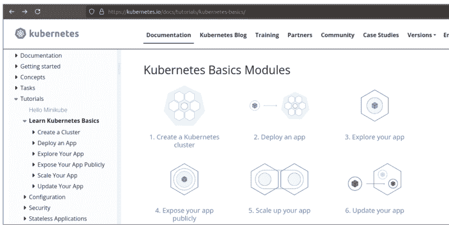

# 启动 Minikube

在你的个人电脑上运行 Minikube 需要一些条件。这包括：

- 以具有 `sudo` 权限的用户登录。
- 使用配置为虚拟机管理程序（hypervisor）的计算机，以便运行 Minikube 虚拟机。你可以按照第 28 章“设置虚拟机管理器”部分的说明进行设置。
- 拥有 Minikube 需要的资源（两个或多个 CPU、2GB 或更多可用内存、20GB 或更多可用磁盘空间，以及连接连接）。
- 容器或虚拟机。

对于 Linux、macOS 和 Windows 系统，请访问此处查找最新说明：

https://minikube.sigs.k8s.io/docs/

这些是安装 minikube 的基本步骤：

- 1. **选择**操作系统、架构、发布类型和安装程序类型。例如，在具有稳定发布版本的 Linux x86_64 系统上，你可以运行以下命令来下载 minikube：

```
$ curl -Lo https://github.com/kubernetes/minikube/releases/latest/download/minikube-linux-amd4

$ sudo install minikube-linux-amd4 /usr/local/bin/minikube && rm minikube-linux-amd4
```

# 第31 章：使用 Kubernetes 部署应用程序

2. **启动集群**：以具有 `sudo` 权限的用户运行 `minikube start`。如果一切顺利，minikube 将找到你的虚拟机管理程序并创建 minikube 控制平面。此时你可以在集群上尝试一些 `kubectl` 命令并运行容器化应用程序。

3. **安装 kubectl 命令**：获取与你的 Kubernetes 版本匹配的 kubectl 版本。安装最新版本的 kubectl 和 minikube 即可。输入以下命令：

```
$ sudo curl -LO https://storage.googleapis.com/kubernetes-release/

$ release=$(curl -Ls https://storage.googleapis.com/kubernetes-release/stable.txt)

$ sudo mv $release/linux/amd64/kubectl /usr/local/bin/

$ sudo chmod 755 /usr/local/bin/kubectl
```

严格来说，你不需要单独获取 kube 二进制文件，因为 minikube 已经包含了。例如，你可以运行 `minikube node`。但在其他环境中，你会使用 `kubectl` 作为独立命令。

# 运行 Kubernetes 基础教程

Kubernetes 基础教程将带你通过一组良好的命令熟悉 Kubernetes：

https://kubernetes.io/docs/tutorials/kubernetes-basics

以下内容将直接带你通过 Kubernetes 教程页面的前五个模块进行操作，请启动 Minikube（`minikube start`）。如果你已经在笔记本电脑的虚拟机上使用 Minikube，仍然可以遵循此过程。步骤是相同的，因为两者都使用 Minikube。

## 获取集群信息

运行这些命令获取集群的基本信息：

- 1. **Minikube 版本**：查看你正在使用的 minikube 版本，输入以下命令：

```
$ minikube version

minikube version: v1.35.0

commit: dd5d320e41b5451cdcf30c1891bc4e1d189586ed-dirty
```

- 2. **集群信息**：查看 Kubernetes 主节点和 DNS 服务的 URL，输入以下命令：

```
$ kubectl cluster-info

Kubernetes control plane is running at https://localhost:36555

CoreDNS is running at https://localhost:36555/api/v1/namespaces/kube-system/services/kube-dns:dns/proxy
```

## 第六部分：与云计算交互

为了进一步调试和诊断集群问题，请使用 `kubectl cluster-info dump`。

- 3. 列出节点信息：要查看运行的节点数量（Minikube 只有一个主节点）及其状态，请输入以下命令：

```
$ kubectl get nodes

NAME       STATUS   ROLES           AGE   VERSION
minikube   Ready    control-plane   23m   v1.32.0
```

- 4. 列出集群和客户端版本：要列出 kubectl 客户端和 Kubernetes 集群的版本（确保它们之间的差异在一个版本以内），请输入以下命令：

```
$ kubectl version

Client Version: v1.31.0
Kustomize Version: v5.4.2
Server Version: v1.32.0
```

## 部署 Kubernetes 

在 Kubernetes 集群上运行管理容器化应用（以 pod 形式）的请求被称为部署（deployment）。当创建一个部署时，将由 Kubernetes 确保请求的 pod 始终运行。它通过以下方式实现这一点：

- 通过 API 节点接受部署创建请求
- 请求调度器在可用节点上运行每个 pod 中请求的容器
- 监控 pod 以确保它们按照请求继续运行
- 如果 pod 失败（例如容器停止运行），则启动一个新的 pod 实例（在相同或不同的节点上）

本教程展示了如何从容器镜像创建一个简单的部署示例。例如，你为它指定一个名称并标识要使用的容器镜像。部署的其他设置将使用默认值填充。

- 1. 创建部署：要启动一个名为 kubernetes-bootcamp 并拉取 kubernetes-bootcamp 镜像的部署，请输入以下命令：

```
$ kubectl create deployment kubernetes-bootcamp \
  --image=gcr.io/google-samples/kubernetes-bootcamp:v1

deployment.apps/kubernetes-bootcamp created
```

- 2. 列出部署：查看部署是否存在（并且有一个请求实例和一个运行中的实例），请输入以下命令：


```
$ kubectl get deployments
NAME READY UP-TO-DATE AVAILABLE AGE
kubernetes-bootcamp 1/1 1 1 4m38s
```

# 第3章：使用 Kubernetes 以容器形式部署应用程序

## 3. 描述部署

要查看部署的详细信息，请输入以下命令：

```
$ kubectl describe deployments kubernetes-bootcamp
Name:               kubernetes-bootcamp
Namespace:          default
Replicas:           1 desired | 1 updated | 1 total | 1 available |
0 unavailable
...
Pod Template:
  Labels:             app=kubernetes-bootcamp
  Containers:
    kubernetes-bootcamp:
      Image:           gcr.io/google-samples/kubernetes-bootcamp:v1
      Port:            <none>
      Host Port:       <none>
      Environment:    <none>
      Mounts:         <none>
      ...
```

在 `kubernetes-bootcamp` 部署中，注意它将与部署关联的 pod 实例（副本）设置为可用。部署运行在当前命名空间中，默认名称为 `default`。同样注意，pod 没有开放任何端口或挂载任何卷。

## 获取部署的 pod 信息

创建部署后，你可以查询由部署创建的 pod 信息，并通过代理服务将 Kubernetes API 从虚拟机暴露到你的本地系统，以便直接连接到 pod。

### 1. 将 Kubernetes API 暴露到本地系统

要从你的系统到运行在 Minikube 中的 Kubernetes API 开启代理（`kubectl proxy`），请输入以下命令：

```
$ kubectl proxy
Starting to serve on 127.0.0.1:8001
```

### 2. 查询 Kubernetes API

打开第二个终端，通过输入以下命令查询运行在 Minikube 上的 Kubernetes API：

```
$ curl http://localhost:8001/version
{
  "major": "1",
  "minor": "32",
  "gitVersion": "v1.32.0",
  "gitCommit": "70dc3968aa822cd1dfb1218152688902d3bf53",
  "gitTreeState": "clean",
  "buildDate": "2024-12-11T17:59:15Z",
  "goVersion": "go1.23.3"
}
```

```
"compiler": "gc",
"platform": "linux/amd64"
```

### 3. 获取 pod 信息

此部署中使用的 pod 名称为 `kubernetes-bootcamp`，后跟一个唯一的字符字符串。以下命令输出 pod 名称并列出该 pod 的描述：

```
$ kubectl get pods
NAME                               READY    STATUS    RESTARTS AGE
kubernetes-bootcamp-9c5bd867-7g6dr   1/1       Running   0         12m
$ kubectl describe pod kubernetes-bootcamp-9c5bd867-7g6dr
Name:               kubernetes-bootcamp-9c5bd867-7g6dr
Namespace:         default
Priority:           0
Node:               minikube/10.0.2.15
Containers:
  kubernetes-bootcamp:
      Image:           gcr.io/google-samples/kubernetes-bootcamp:v1
      Port:            <none>
      Host Port:       <none>
      Environment:    <none>
      Mounts:         <none>
      ...
```

# 第六部分：与云计算交互

## 使用服务暴露应用程序

在这些过程中，为了暴露 `kubernetes-bootcamp` pod，使其能够从运行该 pod 的工作节点通过外部 IP 地址进行访问，你可以创建一个 `NodePort` 服务。以下是其中一种方法：

### 1. 检查 pod 是否正在运行

输入以下内容以查看 `kubernetes-bootcamp` pod 是否正在运行：

```bash
$ kubectl get pods
NAME READY STATUS RESTARTS AGE
kubernetes-bootcamp-9bc5d8d6-7g6dr 1/1 Running 0 26m
```

### 2. 检查服务

输入以下内容查看默认命名空间（`default namespace`）中运行的服务。请注意，只有 `kubernetes` 服务是可用的，没有服务在集群外部暴露 `kubernetes-bootcamp` pod：

```bash
$ kubectl get services
NAME TYPE CLUSTER-IP EXTERNAL-IP PORT(S) AGE
kubernetes ClusterIP 10.96.0.1 <none> 443/TCP 31m
```

### 3. 创建服务

创建一个使用 `NodePort` 的服务，通过特定端口号的 IP 地址使 pod 可。例如，使用以下命令：

```bash
$ kubectl expose deployment/kubernetes-bootcamp --type="NodePort" --port 8080 service/kubernetes-bootcamp exposed
```

### 4. 查看新服务

输入以下内容查看主机上可用服务的 IP 地址 (`10.96.66.230`) 和端口号 (`8080`)：

```bash
$ kubectl get services
NAME TYPE CLUSTER-IP EXTERNAL-IP PORT(S) AGE
kubernetes ClusterIP 10.96.0.1 <none> 443/TCP 33m
kubernetes-bootcamp NodePort 10.96.66.230 <none> 8080:30128/TCP 5s
```

### 5. 获取分配的节点端口

要获取分配给服务的端口并将 `$NODE_PORT` 变量赋值为该值，输入以下内容：

```bash
$ export NODE_PORT=$(kubectl get services/kubernetes-bootcamp \ -o go-template='{{{{index .spec.port 0}}.nodePort}}')
```

```bash
$ echo NODE_PORT=$NODE_PORT
30000
```

### 6. 访问服务

要检查是否可以通过 `NodePort` 访问服务，可以使用以下 `curl` 命令（使用 minikube 实例 IP 地址）：

```bash
$ curl $(minikube ip)
Running on: kubernetes-bootcamp-9bc58d867
v=1
```

## 为服务标记标签

标签（Labels）提供了在 Kubernetes 中分组 pod、节点或其他对象的手段。使用标签可以实现诸如仅让带有特定标签的 pod 运行在选定节点上的操作。你也可以通过标签来识别 pod，以便查找并对其进行操作。标签以键/值对的形式设置。使用此过程为现有服务添加标签。

### 1. 检查 pod 的标签

`kubernetes-bootcamp` 是分配给 pod 的唯一标签。为了确认，输入以下内容：

```bash
$ kubectl describe deployment kubernetes-bootcamp

Name: kubernetes-bootcamp
Namespace: default
CreationTimestamp: Sat, 12 Apr 2025 03:39:50 -0400
Labels: app=kubernetes-bootcamp
Annotations: deployment.kubernetes.io/revision: 1 ...
```

### 2. 添加另一个标签

要为 pod 添加额外标签 (`v1`)，获取 pod 的名称并如下所示添加新标签：

```bash
$ POD_NAME=$(kubectl get pods -o go-template --template='{{{{range .items}}{{.metadata.name}}{{"\n}}{{end}}') ; \
echo Name of the Pod: $POD_NAME
Name of the Pod: kubernetes-bootcamp-9bc58d867-7g6dr
```

```bash
$ kubectl label pod $POD_NAME version=v1
pod/kubernetes-bootcamp-9bc58d867-7g6dr labeled
```

### 3. 检查并使用标签

检查 pod 是否已分配 `version-v1` 标签，然后使用该标签列出 pod 信息：

```bash
$ kubectl describe pods $POD_NAME
```

Name: kubernetes-bootcamp-9bc58d867-7g6dr

Namespace: default

Priority: 0

Service Account: default minikube/10.0.2.15

Node: 

Start Time: Sat, 12 Apr 2025 03:39:50 -0400

Labels: app=kubernetes-bootcamp pod-template-hash=9bc58d867 version-v1

```bash
$ kubectl get pods -l version=v1
```

NAME READY STATUS RESTARTS AGE

kubernetes-bootcamp-9bc58d867-7g6dr Running 60m

## 删除服务

如果你正在使用该服务，可以删除它。这将移除通过 `NodePort` 对该服务的访问，但不会删除部署本身。

### 1. 检查服务

确保 `kubernetes-bootcamp` 服务存在：

```bash
NAME TYPE CLUSTER-IP EXTERNAL-IP PORT(S) AGE
kubernetes ClusterIP 10.96.0.1 <none> 443/TCP 31m
kubernetes-bootcamp NodePort 10.96.66.230 <none> 8080:30128/TCP 5s
```

### 2. 删除服务

使用标签删除服务：

```bash
$ kubectl delete service kubernetes-bootcamp
```

### 3. 检查服务和部署

确保服务已删除且部署存在：

```bash
NAME TYPE CLUSTER-IP EXTERNAL-IP PORT(S) AGE
kubernetes ClusterIP 10.96.0.1 <none> 443/TCP
```

## 缩减应用程序

要收减部署中定义的 `ReplicaSets` 数量，只需将副本数量更改为较小的值即可。

- **效率**：由于 Kubernetes 允许你根据需要运行任意数量的工作负载和节点，因此你可以实现计算资源的最大效率。为此，Kubernetes 可以执行诸许多操作，例如将工作负载合并到尺寸更合适的计算机上，或将工作负载迁移到成本更低的系统。

- **开源 Kubernetes 生态系统**：由于 Kubernetes 是一个开源项目，并不由某单一公司拥有或维护，许多公司和组织已经采用并扩展了它。这意味着你可以从广泛的内置功能以及第三方软件中进行选择，使用它们来满足你的任何需求。

- **可移植性**：Kubernetes 能够在不同的地方（如本地、边缘计算和数据中心）运行，并获得不同供应商（如 AWS、微软、Google 和红 Hat）的支持。这允许你开发应用程序，然后将其部署到最适合你业务的任何地方。

绝大多数云服务提供商都提供托管 Kubernetes 服务，可以在多个方面为你提供帮助。它们可以在你构建产品时节省创建自有数据中心的成本，并允许你根据需要扩展 Kubernetes 的使用。流行的云服务提供商包括 Amazon Web Services (AWS) 的 Elastic Kubernetes Services (EKS)、Microsoft Azure 的 Kubernetes Service (AKS) 以及 Google Cloud 的 Kubernetes Engine (GKE)。

这些 Kubernetes 集群还可以通过简化你进入 Kubernetes 的流程来提供帮助。例如，它们可以提供简单的方法来启动为你管理控制平面的集群，你只需要选择一组它们为你打包好的有用软件，甚至可以设置自动伸缩来扩展用于运行工作负载的节点。

随着你对使用 Kubernetes 越来越熟练，你就可以灵活地调整集群并增强与集群配合使用的软件。监控和观测性等功能可以让你的 Kubernetes 使用变得更加高效且具有成本效益。

## 总结

Kubernetes 已经成为跨大型数据中心部署容器化应用程序的首选平台。一个 Kubernetes 集群由控制平面（负责指导集群活动）和节点（实际运行容器化负载）组成。

作为使用 Kubernetes 进行应用程序容器化的用户，你可以创建部署来定义你正在运行的应用程序的。。例如，你可以部署一个配置为运行多个代表该应用程序的 pod 副本的应用程序。你可以将应用程序识别为服务，并设置应用程序通过挂载存储可用，并从其所在的节点上的定义端口提供访问。

当你需要在稳定且受支持的环境中运行关键任务应用程序时，可以使用基于 Kubernetes 的产品。大多数主要的云提供商都提供托管 Kubernetes 服务，这可以提供进入生产级 Kubernetes 集群的简单、廉价的入口，并让你根据需要轻松扩展 Kubernetes 工作负载。

## 练习

本节中的练习描述了与尝试 Kubernetes 相关的任务，可以通过在线尝试或在计算机上设置 Minikube 来。如果你遇到困难，附录 B 中提供了任务解决方案。请记住，附录 B 中显示的解决方案通常只是完成任务的多种之一。

1. 在本地计算机上安装 Minikube 和 `kubectl` 命令。

2. 查看你的 Minikube 版本以及 `kubectl` 客户端和 Kubernetes 服务的版本。

3. 创建一个管理运行 `hello-node` 容器镜像 (`gcr.io/hello-minikube-zero-install/hello-node`) 的 pod 的部署。

4. 使用适当的 `kubectl` 命令查看 `hello-node` 部署并详细描述该部署。

5. 查看与你的 `hello-node` 部署关联的当前副本集。

6. 将 `hello-node` 部署扩展到三个副本。

7. 使用 `LoadBalancer` 将 `hello-node` 部署暴露到 Kubernetes 集群外部。

8. 获取你的 Minikube 实例的 IP 地址和暴露的 `hello-node` 服务的端口号。

9. 使用 `curl` 命令通过上一步的 IP 地址和端口号查询 `hello-node` 服务。

10. 使用 `kubectl` 命令删除 `hello-node` 服务和部署，然后使用 `minikube` 命令停止 Minikube 虚拟机。

# 迁移到云端和容器

## 本章内容

- 了解云计算的关键技术
- 学习 Linux 容器是如何运作的
- 安装并启动容器软件
- 拉取并运行容器镜像
- 重启已停止的容器
- 构建容器镜像
- 为容器镜像打标签并推送到注册表

虽然此书的大部分重点关注安装和管理单个计算机、服务和应用程序，但这一部分将带你进入将 Linux 引入大型数据中心所需的技术。为了让数据中心高效运行，其计算机必须尽可能通用，运行组件必须变得更加自动化。本部分的章节侧重于实现这些目标的技术。

通过将应用程序与操作系统分离，计算机变得更加通用。这意味着不仅将你安装到操作系统中的应用程序进行打包（如 RPM 或 Deb 包），还将将一组软件组合成软件包，这些软件包在交付时将以保持它们与操作系统分离的方式进行。虚拟机 (VM) 和容器是打包软件包及其依赖项的两种方式，这些方式已准备运行并可以轻松地在数据中心内移动。

从高层次来说，虚拟机是运行在另一个操作系统上的完整操作系统，允许你在单台物理计算机上运行多个虚拟机。应用程序或服务需要存储在虚拟机内或附加存储中。

虚拟机拥有自己的内核、文件系统、进程表、网络接口以及其他来自主机的特性，同时与主机系统共享 CPU 和内存。你可以将虚拟机部署到物理系统中，使其易于运行应用程序并在完成后丢弃虚拟机。你可以在同一台计算机上运行虚拟机的多个实例，或在多个计算机之间克隆虚拟机。“虚拟机”一词源于每个虚拟机都看到计算机硬件的仿真，而不是硬件本身。

容器类似于虚拟机，主要区别在于它没有自己的内核。在其他方面，它像虚拟机一样，其命名空间与主机操作系统是分离的，你可以在不同的主机之间移动它。


# 理解 Linux 容器

获取运行应用程序并在完成后将其使其变得简单。在开始之前，你应该了解关于容器的一些知识。

在处理容器时，人们将你移动的实体称为容器镜像（或镜像）。当你运行它或它处于暂停/停止状态时，它被称为容器。

容器通过使用自己的一组命名空间与主机系统保持分离。通常你会通过获取一个安全的边界镜像并在容器之上添加你的软件层来构建自己的容器镜像，从而创建一个新镜像。为了共享你的镜像，你会将其推送到共享注册表并允许他人拉取。

# 第 27 章：转向云与容器

## 命名空间

Linux 对命名空间的支持允许容器被隔离。通过命名空间，Linux 内核可以将一个或多个进程与一组资源关联。普通进程（而非运行在容器中的进程）都使用相同的主机命名空间。默认情况下，容器内的进程只能看到容器的命名空间，而看不到主机的命名空间。命名空间包括：

- **进程表** 容器有自己的进程标识符 (`PID`)，默认情况下只能看到容器内部运行的进程。虽然主机上的 `PID 1` 是初始化进程 (`systemd`)，但容器内的 `PID 1` 是容器内运行的第一个进程。通常，这只是运行在该容器内的应用程序进程（如 Web 服务器或守护进程执行文件）。

- **网络接口** 容器默认情况下有一个接口 (`eth0`)，并在运行时分配一个 IP 地址。默认情况下，容器内运行的服务（例如监听 80 和 443 端口的 Web 服务器）不会暴露在主机之外。优点是，你可以在同一台主机上运行数百个 Web 服务器而不会产生冲突。缺点是你需要管理这些端口如何在主机外部暴露。

- **挂载表** 默认情况下，容器看不到主机的根文件系统，也看不到主机挂载点列出的任何其他挂载文件系统。容器自带自己的文件系统，由应用程序及其运行所需的任何依赖组成。从主机所需的文件或目录可以选择性绑定挂载 (`bind-mounted`) 到容器内部。

- **用户 ID** 虽然容器化进程是以主机命名空间内的某些 `UID` 运行，但容器内部嵌套了另一套 `UID`。例如，这可以让进程在容器内以 `root` 身份运行，但对主机系统没有任何特权。

- **UTS** `UTS` 命名空间允许容器化进程拥有与主机不同的名称和域名。

- **控制组 (`cgroup`)** 在某些 Linux 系统（如 Fedora 和 RHEL）中，容器化进程运行在选定的控制组内，无法看到主机系统上可用的其他 `cgroups`。同样，它也无法向主机显示其所属 `cgroup` 的身份。

- **进程间通信 (`IPC`)** 容器化进程看不到主机的 `IPC` 命名空间。

尽管默认情况下对任何主机命名空间的访问都是限制的，但可以选择性地开放主机命名空间的权限。通过这种方式，你可以执行诸如从主机向容器内挂载配置文件或数据，并将容器端口映射到主机端口以将其暴露在主机之外的操作。

# 第六部分：与云计算交互

## 容器仓库

容器的持久化存储是在容器仓库中完成的。当你创建一个想要共享的容器镜像时，可以将该镜像推送 (`push`) 到公共仓库或你自己维护的私有仓库（例如 `Red Hat Quay` 仓库）。使用该镜像的人将从仓库中拉取 (`pull`)。

存在大型的公共容器镜像仓库，例如 `Docker Hub` (`docker.io`) 和 `Quay Registry` (`quay.io`)。某些云端仓库，如 `Amazon Elastic Container Registry` (`ECR`)，同时提供公共 (`https://gallery.ecr.aws/`) 和私有用户仓库。大多数仓库都提供免费账户供入门使用。如果你想访问更多功能（例如保留你的仓库的能力），也可以购买付费账户。

## 基础镜像与层

虽然你可以从零创建容器，但容器通常是通过从一个良好的基础镜像开始并向其添加软件来构建的。该基础镜像通常与你正在安装到容器中的操作系统保持一致。

你可以从 `Ubuntu` (`https://hub.docker.com/_ubuntu`)、`CentOS` (`https://hub.docker.com/_centos`)、`Fedora` (`https://hub.docker.com/_fedora`) 以及许多其他 Linux 发行版获取官方基础镜像。这些 Linux 发行版提供不同形式的基础镜像，如标准版和精简版。事实上，还有可以在上面构建的基础镜像，适用于 `PHP`、`Perl`、`Java` 和其他开发环境。

虽然 Red Hat 对其软件采用订阅模型，但如果你想使用 Red Hat 软件作为容器镜像的基础，Red Hat 为标准版、精简版以及各种运行时容器提供了免费的通用基础镜像 (`Universal Base Images, UBI`)。你可以通过在 `Red Hat Container Catalog` 中搜索 `UBI` 镜像 (`https://catalog.redhat.com/search`) 来找到这些镜像。

你可以使用 `docker build` 或 `podman` 等命令向基础镜像添加软件。使用 `Dockerfile` 构建镜像，你可以添加 `yum` 或 `apt-get` 命令从仓库将软件安装到容器中。

当你向镜像添加软件时，它会创建一个新层并成为新镜像的一部分。在你构建的容器中复用相同的基础镜像有多个优点。一个优点是当你运行容器镜像时，主机上只需要一份基础镜像副本。因此，如果你运行基于相同镜像的 10 个不同容器，你只需要拉取并存储一次基础镜像，然后每个新镜像可能只需要额外的几兆字节空间。

如果你查看基础镜像的内容，它看起来就像一个 Linux 文件系统。你可以在其中配置 `/etc` 中的文件、`/bin` 和 `/sbin` 中的可执行文件以及 `/lib` 中的库。换句话说，它包含了应用程序从 Linux 主机系统所需的各种组件。

请记住，你运行的容器镜像并不一定需要与主机的 Linux 系统匹配。例如，只要没有特定要求，你可以在 Ubuntu 系统上运行 Fedora 基础镜像。

## 开始使用容器

以下步骤描述了如何为容器做准备。Docker Inc 在 `https://docs.docker.com/engine/` 提供免费版本。

```
inet 127.0.0.1/8 scope host lo

3: eth0if11: <BROADCAST,MULTICAST,UP,LOWER_UP> mtu 1500 
  inet 172.17.0.2/16 brd 172.17.255.255 global eth0
```

注意，在容器内部，你只能看到两个运行的进程（shell 和 `ps` 命令）。`PID 1` 是 Bash shell。来自 `ip` 命令的精简输出显示，容器只有一个外部网络接口（`eth0@if11`），且该接口被分配了 IP 地址 `172.17.0.2`。

完成操作后，你可以输入 `exit` 退出 shell 并停止容器：

```
[root@e9086da6ed70 #]# exit
```

虽然 shell 和容器不再运行，但容器对你仍然可用。请注意 `podman ps` 不会停止你的容器。你需要添加 `--all` 参数：

```
[root@e9086da6ed70 #]# podman ps
CONTAINER IMAGE COMMAND CREATED STATUS PORTS NAMES
[root@e9086da6ed70 #]# podman ps --all
CONTAINER COMMAND CREATED STATUS PORTS
5bec0.b3682d9fd3b5 "bash" 1 hour ago Exited (0) ...
```

稍后你可以学习如何删除和重启已停止的容器。

# 从容器中运行 FTP 服务器

由于你通常会丢弃容器，因此你可能希望可更改的数据存储在容器外部。以下是从容器中运行 FTP 服务器（`vsftpd`）的简单示例。如果你想尝试此示例，建议跳过本章稍后的“构建容器镜像”部分，以获取如何构建 `vsftpd` 容器镜像的说明。

对于此过程，你需要一个配置文件 (`vsftpd.conf`) 以及一个在主机系统上包含一个或两个文件的 FTP 目录 (`/var/ftp/pub`)。当 `vsftpd` 启动时，它会将这些挂载项作为卷绑定到容器中。

1. 创建 `vsftpd.conf` 文件：在默认位置 `/etc/vsftpd/vsftpd.conf` 创建 `vsftpd.conf`。详情请参考 `vsftpd.conf` 手页。以下是一个示例：

```
anonymous_enable=YES
local_enable=YES
write_enable=YES
local_umask=022
dismissage_enable=YES
xferlog_enable=NO
connect_from_port_20=YES
listen=NO
listen_ipv6=YES
pam_service_name=vsftpd
userlist_enable=YES
tcp_wrappers=NO
vsftpd_log_file=/dev/stdout
syslog_enable=NO
background=NO
pasv_enable=YES
pasv_max_port=21100
pasv_min_port=21110
```

2. 创建 FTP 目录：在主机的标准位置 (`/var/ftp/pub`) 为 `vsftpd` 创建一个用于共享的匿名 FTP 目录，并将几个文件复制到该目录：

```bash
mkdir -p /var/ftp/pub
cp /etc/services /etc/login.defs /var/ftp/pub/
```

3. 获取 `vsftpd` 镜像：按照本章“构建容器镜像”中的描述构建 `vsftpd` 镜像。要检查其是否可用，输入以下命令：

```bash
docker images
REPOSITORY TAG IMAGE ID CREATED SIZE
vsftpd latest 487d0db26098 5 seconds ago 208 MB
```

4. 运行 `vsftpd` 容器：当你运行 `vsftpd` 容器时，你需要暴露端口并从容器管理文件。以下是如何使用 `podman` 替代 `docker` 的示例：

```bash
docker run -d -p 20:20 -p 21:21 \
  -p 21100-21110:21100-21110 \
  -v /etc/vsftpd:/etc/vsftpd \
  -v /var/ftp/pub:/var/ftp/pub \
  --name vsftpd vsftpd
podman ps
```

```
CONTAINER IMAGE COMMAND CREATED STATUS PORTS NAMES
3a5d094dd4b5 vsftpd:latest /usr/local/s2... 9 seconds ago
Up 10 seconds 0.0.0.0:20-21->20-21/tcp vsftpd
```

此示例使用了以下选项：

- `-d`: 在后台分离模式下运行容器，`vsftpd` 服务在后台运行。
- `-p`: 标准 FTP 端口（TCP 20 和 TCP 21）映射到主机网络接口上的相同端口号，因此可以在本地主机之外访问该服务。被动 FTP 需要的一系列端口也开放到其对应的主机对应端口（21100-21110）。
- `--rm`: 虽然此示例未包含此项，但在命令行中添加 `--rm` 会在容器退出时将其删除。
- `-v`: 为了使用配置文件 (`/etc/vsftpd`) 以及从主机系统提供的想要共享的内容 (`/var/ftp/pub`)，使用该选项将目录绑定到容器中。
- `--name`: 设置容器名称为 `vsftpd`。

请记住，你可以将容器内容和端口绑定到主机上的其他位置。通过这种方式，你可以在同一主机上运行多个版本的软件而互不冲突。为了让 `vsftpd` 服务在本地系统外可用，请确保开放分配的 FTP 端口和被动 FTP 端口：

```bash
firewall-cmd --zone=public --add-service=ftp
firewall-cmd --zone=public --permanent --add-service=ftp
firewall-cmd --zone=public --add-port=21100-21110/tcp
firewall-cmd --zone=public --permanent --add-port=21100-21110/tcp
firewall-cmd reload
```

现在你可以使用 FTP 客户端通过匿名用户访问 FTP 服务。参考第 18 章“配置 FTP 服务器”。

# 启动和停止容器

除非指定停止时删除容器 (`--rm` 选项)，否则如果容器停止、挂起或失败，容器仍然留在你的系统中。你可以使用 `ps` 选项查看系统中所有容器的状态（无论是否运行）：

```bash
docker ps
CONTAINER ID IMAGE CREATED STATUS PORTS NAMES
4d6be3fe63 localhost vsftpd:latest /usr/local/s... an hour ago
Up an hour ago 0.0.0.0:20-21/tcp vsftpd
```

```bash
docker ps -a
CONTAINER ID IMAGE CREATED STATUS PORTS NAMES
7da8bd667 ubi/latest 2 minutes ago
Exited 7 seconds ago
```

`podman ps` 只显示正在运行的容器。对于一个不再运行的容器，使用 `start` 选项进行重启：

```bash
docker start -a 7da8bd667
```

重启的容器是一个 Bash shell。因为容器的会话已经存在，所以不需要启动一个新的 (`-it`)。只需附加 (`-a`) 到现有的会话。对于刚刚运行的容器，我只需启动并停止它：

```bash
docker stop 4d6be3fe63
docker start 4d6be3fe63
```

注意，如果启动容器时使用了 `--rm` 选项，容器在你停止时就会被删除。因此你必须运行一个新的容器而不是重启旧的。由于配置文件和数据存储在容器外部，运行新容器是容易且无痛苦的。未来升级应用程序只需删除旧容器并从更新后的镜像启动即可。

# 构建容器镜像

要构建容器镜像，你需要一个描述如何构建镜像以及任何包含在镜像中的其他内容的 `Dockerfile`。以下步骤描述了如何从你自己的 `Dockerfile` 创建简单的容器。在此过程中，你创建一个 `Dockerfile` 和一个脚本，然后将其内容构建构建新的容器镜像。

1. 创建一个存放你容器项目的目录并进入该目录：

```bash
mkdir myproject
cd myproject
```

2. 在当前目录创建一个名为 `cworks.sh` 的脚本，内容如下：

```bash
#!/bin/bash
set -o errexit
set -o nounset
set -o pipefail
echo "This Container Works!"
```

3. 使脚本可执行：

```bash
chmod 755 cworks.sh
```

4. 在当前目录创建一个包含以下内容的 `Dockerfile` 文件：

```dockerfile
FROM public.ecr.aws/docker/library/fedora
COPY ./cworks.sh /usr/local/bin/
CMD ["/usr/local/bin/cworks.sh"]
```

5. 从当前目录的 `Dockerfile` 构建名为 `myproject` 的容器镜像：

```bash
docker build -t myproject
=> [internal] load build definition from Dockerfile
=> => transferring dockerfile: 205B
=> [internal] load metadata for ...fedora:latest
=> [internal] load .dockerignore
=> [1/2] FROM public.ecr.aws/docker/library/fedora:latest...
=> [2/2] COPY ./cworks.sh /usr/local/bin/
=> => exporting image
=> => exporting layers
=> => writing image sha256:0fc6fac681ef40b51685ff51...
=> => naming to docker.io/library/myproject
```

6. 运行容器以确保它工作。你可以使用容器名 (`myproject`) 或 ID (`0fc6fac681e`)：

```bash
docker run 0fc6fac681e
The Container Works!
```

# 从 GitHub 构建 FTP 容器


以下步骤描述了如何从 GitHub 上的软件获取构建 vsftpd 服务到容器中所需的软件。（你需要登录 GitHub 账户才能克隆 vsftpd 仓库）。

1. 如果你还没有 git，请在本地系统上安装：

```bash
# dnf install git -y
```

2. 对于此示例，我们从 GitHub 上的 vsftpd container-images 项目开始。按照如下方式将软件副本克隆到本地目录：

```bash
# ls
default-conf/ Dockerfile LICENSE README.md
root/ s21/  tests/
```

3. 根据需要修改文件。例如，查看 `default-conf/vsftpd` 文件以查看你想配置的内容。查看 `Dockerfile` 并使用最新的可用 Fedora 镜像。例如，修改开头的 `FROM` 行，使其显示如下：

```
FROM registry.fedoraproject.org/fedora:latest
```

4. 在 `vsftpd` 目录，使用 `docker` 或 `podman` 命令来构建容器。

```bash
# docker build -t vsftpd
=> [internal] load definition from Dockerfile 0.0s
=> [internal] transferring dockerfile: 1.47kB
=> [internal] load metadata for ...fedoraproject.org/fedora:latest 0.6s
=> [internal] load .dockerignore 0.0s
=> [internal] transferring context: 2B 0.0s
=> [1/6] FROM ...fedoraproject.org/fedora:latest@sha256:85ec22d... 7.8s
=> [2/6] resolve ...fedoraproject.org/fedora:latest@sha256:85ec22d... 61.0MB / 61.08MB 5.5s
sha256:a17c5064d2071lde793751057aab0efd82di66... 1.41KB / 1.41KB 0.0s
sha256:b6b7b4d7e2e850527f72245993d993aa0ffc... 860B / 860B 0.8s
=> [3/6] extracting vsftpd:a17c5064d2071lde793751057aab0efd82di66 2.1s
=> [internal] build context 0.0s
=> [internal] transferring context: 548B 0.0s
=> [2/6] RUN dnf install -y vsftpd && dnf clean all && \
mkdir /vsftpd 21.6s
=> [3/6] RUN mkdir -p /opt/app-root/src 0.2s
=> [4/6] WORKDIR /opt/app-root/src 0.1s
=> [5/6] COPY .s21/bin /usr/local/s21 0.1s
=> [6/6] COPY default-conf /etc/vsftpd/vsftpd.conf 0.1s
=> importing to image 0.0s
=> exporting layers 0.8s
=> writing image sha256:6070ec7c9fa99f5c768d3a21ed1cdc90cf... 0.0s
=> naming to docker.io/library/vsftpd 0.0s
```

5. 检查新镜像是否创建：

```bash
# docker images
REPOSITORY TAG IMAGE CREATED SIZE
vsftpd latest 6070ec7c9fa 21 minutes ago 22MB
```

此过程包含六个步骤。第一步中的 `FROM` 行从 `registry.fedoraproject.org` 容器仓库拉取 fed 镜像。每个后续步骤都会运行一个命令。如果在命令期间添加了命令，则会为镜像创建一个新层。第 2 步运行 `dnf install` 来安装 `vsftpd` 包并创建 `/vsftpd` 目录。注意，该指令同时包含了 `install` 和 `dnf clean`。这是一个良好的做法，因为可以防止额外的缓存 `dnf` 数据层包含在镜像中。

步骤 3 和 4 创建了 `/opt/app-root/src` 目录并将其设置为工作目录 (`WORKDIR`）。第 5 步将 `s2i/bin/` 目录复制到容器的 `/usr/local/s2i` 目录。第 6 步将默认的 `vsftpd.conf` 配置文件复制到容器中。

关于创建和使用 Dockerfile 构建容器镜像的更多信息，请参考 [Dockerfile Reference](https://docs.docker.com/engine/builder/)。要了解更多关于构建容器镜像选项的信息，请参考 podman 手页 (`man podman build`)。

# 第 27 章：对镜像进行标记并推送到仓库

到目前为止，我已经展示了在本地系统构建并运行容器镜像的示例。为了让你系统上的其他人可以使用你的镜像，你通常需要将该镜像添加到容器仓库中。按照这些指令在本地系统上标记镜像，并将其推送到远程仓库。

要在本地系统上尝试某些仓库，请在 Fedora 或 RHEL 系统上安装 `docker-distribution` 包。对于更持久的解决方案，你可以访问如 Quay.io 和 Docker Hub 这样的公共容器仓库。两者都提供免费试用和订阅服务。对于 Quay.io，请参阅 https://quay.io/plans/。你还可以设置并运行自己的容器仓库，例如 Red Hat Quay (https://www.openshift.com/products/quay)。

要开始操作，以下步骤将让你在本地系统上安装 `docker-distribution` 包，然后对其进行标记并推送镜像：

1. **安装 docker-distribution**：在 RHEL 或较新的 Fedora 系统上，安装并启动 `docker-distribution`：

```bash
# dnf install docker-distribution -y
# systemctl start docker-distribution
# systemctl enable docker-distribution
# systemctl status docker-distribution
docker-distribution.service - Registry for Docker
  Loaded: loaded (/usr/lib/systemd/system/docker-distribution.service; enabled: disabled)
  Active: active (running) since 2025-04-13 14:41:39 EDT; 1min ago
```

2. **开放仓库端口**：为了能够从其他系统推送和拉取镜像，你需要在防火墙上开启 TCP 端口 5000：

```bash
# firewall-cmd --add-port=5000/tcp --permanent
```

3. **允许不安全仓库**：为了推送到 docker-distribution 仓库，你需要告诉 docker 允许仓库，因为我们只是为了测试。创建 `/etc/docker/daemon.json` 文件并包含以下内容（使用你的主机名）：

```json
{
  "insecure-registries": ["host01.example.com:5000"]
}
```

然后重启 docker 服务：

```bash
# systemctl restart docker
```

4. **标记镜像**：在本地系统上标记镜像并将其推送到远程仓库。

5. **推送镜像**：将镜像推送到仓库。

6. **拉取镜像**：从仓库拉取镜像。

# 第六部分：与云计算交互

6. 从 fedora 基础镜像创建一个简单的 Dockerfile，包含一个名为 `cworks.sh` 的脚本，该脚本使用 `echo` 输出字符串“The Container Works!”，并将该脚本添加到镜像中作为默认命令运行。

7. 使用 docker 或 podman 根据你刚刚创建的 Dockerfile 构建一个名为 `containerworks` 的镜像。

8. 获取容器注册仓库的访问权限，可以通过安装 `docker-distribution` 包，也可以在 Quay.io 或 Docker Hub 上获取账户。

9. 将你的新镜像标记（tag）并推送到你所选择的容器注册表中。

# 第 28 章

## 使用 Linux 进行云计算

## 本章内容

- Linux 如何在云中应用
- 理解基础云技术
- 设置监控器（supervisor）
- 创建虚拟机

计算机操作系统最初被设计为直接安装在计算机硬件上。当它需要内存、存储、处理能力或网络接口时，计算机操作系统会寻找物理内存、硬盘、CPU 和网卡。当需要的内容比物理安装的更多时，你需要关闭机器并物理地向计算机添加这些设备。如今，将这些项目虚拟化正是云计算的核心所在。

*虚拟化*（涉及计算机时）是指将最初设计为物理对象的计算资源表示为虚拟对象的行为。例如，虚拟操作系统（称为*虚拟机*）不直接与硬件通信。相反，虚拟机（VM）与一台经过特殊配置的主机交互，该主机被称为*虚拟机监控程序*（hypervisor）。因此，你可能不再只能在一个物理计算机上运行一个操作系统，而是可能在单台物理计算机上运行几十个甚至数百个虚拟机。

运行虚拟虚拟机的优势是巨大的。你不仅可以在同一台计算机上运行多个操作系统，而且这些系统可以是不同的——Linux、BSD、Windows 或任何其他运行在计算机硬件上的系统。如果你需要为了维护而关闭计算机，可以将虚拟机迁移到另一个虚拟机监控程序上，且停机时间几乎不可察觉。

为了在多个虚拟机监控程序之间支持虚拟机，你可以很好地虚拟化它们所依赖的功能。例如，虚拟网络和虚拟存储可以跨越多个虚拟机监控程序，因此如果虚拟机需要移动到另一个虚拟机监控程序，虚拟网络和虚拟存储对于新迁移的虚拟机来说仍然可用。

# 第六部分：与云计算交互

你不需要构建整个数据中心就可以开始理解虚拟化，并使用一些使云计算可能的底层技术。本章将通过帮助你设置一台作为虚拟机监控程序运行的主机，在其上运行虚拟机，并学习如何将虚拟机迁移到其他虚拟机监控程序上（以防止停机或扩展你的容量）。

# Linux 与云计算概述

云计算将我们带入一个领域，在这个领域中你之前在书中学到的所有内容都被抽象化和自动化了。在云环境中，当你安装系统时，你可能不是从物理 USB 盘启动、擦除本地硬盘，并将 Linux 直接安装在你面前的计算机上。你也不会登录到已安装的系统，并手动配置你想在该系统上运行的软件和功能。

相反，你正在安装一个虚拟机，或者通过对公共云（如 AWS）的请求启动虚拟机。你看到的网络接口可能不是由物理交换机表示的；而是存在于单台计算机或多个虚拟机监控程序上的虚拟网络。云计算的每个软件方面都可以使用运行 Linux 系统上的开源技术来实现。为了感受云计算中某些基础技术的工作原理，本章解释了一些技术，然后描述了如何设置虚拟机监控程序并在你的监控器上开始使用虚拟机。

# 云计算虚拟机监控程序

在云计算中，为云用户服务的操作系统通常不运行在计算机硬件上。相反，虚拟机监控程序被配置为运行许多操作系统，这些被称为虚拟机（VM）。

根据你的云环境，你可能会听到将虚拟机监控程序称为**计算节点（compute node）、工作节点（worker node）**或简单称为主机（host）。因为虚拟机监控程序往往是商品化物品（一个位置可能会设置几十个或数百个虚拟机监控程序），因此 Linux 是直接在硬件上运行的操作系统在逻辑上的理想选择。

**基于内核的虚拟机 (KVM)** 是在大多数 Linux 发行版中实现的标准虚拟化技术，用可将 Linux 系统变为虚拟机监控程序。KVM 支持 Ubuntu、Red Hat Enterprise、Fedora、CentOS 以及许多其他 Linux 系统。

另一种可以用来替代 KVM 使 Linux 系统转变为虚拟机监控程序的技术是 Xen (www.xenproject.org)。Xen 的历史比 KVM 更悠久，它在 Citrix Systems 和 Oracle 的产品中得到，并在许多流行的 Linux 系统中作为 KVM 的替代方案提供。

在本章稍后的部分，我将描述如何检查计算机是否具有作为虚拟机监控程序所需的硬件功能，以及如何配置它以配合 KVM 使用。

# 第 28 章：用于云计算的 Linux

# 云控制器

由于云配置可能包含多个虚拟机监控程序、存储池、多个虚拟网络和许多虚拟机，你需要中心化的工具来管理和监控你的功能。你可以使用图形界面和基于命令的工具来控制云环境。

虽然被认为是完整的云控制器，但虚拟机管理器 (virt-manager) GUI 和 `virsh` 命令可以用于管理小型类云环境。通过使用 `virt-manager`，你可以感受到跨多个虚拟机监控程序管理多个虚拟机的感觉，并学习如何处理虚拟网络和共享存储池。

全功能云平台有自己的控制器，用于在云组件之间提供大量的交互。例如，红帽 OpenStack 平台 (https://access.redhat.com/products/red-hat-openstack) 和其上游 RDO 项目 (https://www.rdproject.org) 为虚拟机提供了灵活云环境。对于红帽虚拟化 (RHV)，RHV 管理器提供了许多功能。

然而，如果你想从简单的方法开始，可以使用虚拟机工具 `virt-manager` 来管理你的第一个类云环境。

# 云存储

当你将操作系统和应用程序迁移到云环境时，对存储产生了新的需求。为了能够将虚拟机迁移到另一个虚拟机监控程序，其存储必须在该虚拟机监控程序可用。云存储包括虚拟机的后端存储、启动虚拟机的存储以及存储云本身信息的数据库。

虚拟机监控程序之间的共享存储可以简单地通过 NFS 共享（参见第 20 章“配置 NFS 文件服务器”）并在多个虚拟机监控程序上挂载相同的挂载点来实现。NFS 是实现共享存储的最简单的方法之一。处理故障并提供更好性能的更健壮存储适用于提供关键服务的云。共享块存储（挂载磁盘或分区）可以使用 ISCSI 或光纤来实现。

Ceph (http://ceph.com) 是一个用于管理块和对象存储的开源项目，在云环境存储管理中非常流行。GlusterFS (https://www.gluster.org) 是一种用于云环境的扩展文件系统。

在本章的简单微云示例中，我使用 NFS 在虚拟机监控程序之间提供共享存储。ceph 和 GlusterFS 更适用于企业级安装。

# 第六部分：与云计算交互

## 云认证

为了限制用户可以消耗的云资源，并可能对这些使用情况进行跟踪和收费，你需要认证机制。对于使用云功能的人以及被允许管理云功能的人来说，认证都是必须的。

云平台有时允许你连接集中式认证机制来验证和授权云功能。这些机制包括 Kerberos、Microsoft Active Directory 等。在 Linux 中，身份、策略和审计 (IPA) 软件（参阅 www.freeipa.org）提供了一整套认证功能，可以跨企业级云平台使用。

大多数商业云提供商都提供多种身份和授权机制。对于 AWS，通常使用身份和访问管理 (IAM)。Microsoft Azure 使用 Entra ID（以前称为 Azure Active Directory），而 Google Cloud 使用 IAM 和服务账户。

## 云部署与配置

如果你正在管理一个大型云基础设施，你不会希望在每次想向网络中添加虚拟机管理器或其他节点时，都走遍每台机器并点击图形化安装程序。今天，许多工具可以像重启电脑并使其启动到预配置的安装程序一样简单地部署和配置 Linux 系统。

在第 9 章“安装 Linux”中，我将介绍如何使用 PXE 服务器（通过网络网卡在网络上启动 Linux 安装器）和 Kickstart 文件（用于识别完成安装所需的所有答案）。在完成这些设置后，你只需从网络接口启动电脑，稍后回来就能发现一个已完全安装的 Linux 系统。

计算机部署好后，可以使用 Puppet (http://puppetlabs.com) 和 Chef (http://www.chef.io) 等工具对系统进行配置并可能的监控。可以使用 Vagrant (https://www.vagrant.com) 在虚拟机中部署整个工作环境。Ansible (www.ansible.com) 是另一种用于 IT 基础设施及其运行在上面的应用程序自动化工具。

## 云平台

如果你想在组织内部实现一个小型私有云，开源的 OpenStack 是一种可能性。它在配置和使用方面提供了极大的活性和功能。

Red Hat Virtualization (RHV) 是另一个流行的云平台。RHV 让你能够轻松地从简单的 RHV Manager 和一两个虚拟机管理器（以及它管理的虚拟机）开始，并通过添加更多虚拟机管理器、存储池和其他功能来扩展自己的云平台。

如果你想使用基于开源技术的公有云来运行你需要的操作系统，可以使用任何几个不同的云提供商。用于运行 Linux 虚拟机的公有云提供商包括 Amazon Web Services (https://www.amazon.com/aws)、Google Cloud Platform (https://cloud.google.com) 和 Microsoft Azure (https://portal.azure.com)。第 28 章“部署 Linux 到云”涵盖了如何将 Linux 部署到这些云提供商中。

## 尝试基础云技术


为了帮助你从零理解云技术，本节将说明现代云基础设施的一些基本构建模块。通过三台计算机，我将帮助你创建一个包含以下内容的设置：

- **虚拟机管理器 (Hypervisors)**：虚拟机管理器是一个直接运行在计算机硬件上的软件组件，允许你在其上运行其他多个计算机系统。这些其他系统被称为虚拟机 (VMs)。云基础设施可能有几十或数百个虚拟机管理器正在运行，并可能运行着数千个虚拟机。

- **虚拟机 (Virtual machines)**：你在 Linux 系统上运行的虚拟机可以是相同类型的 Linux 系统、不同的 Linux 系统、Windows 系统或任何与虚拟机管理器运行硬件兼容的类型系统。因此，我们在这里构建的虚拟机可能包括 Fedora、Ubuntu、CentOS、RHEL、Microsoft Windows 等。

- **共享存储 (Shared storage)**：为了提供最大的灵活性，虚拟机管理器为虚拟机提供的存储通常在虚拟机管理器组之间共享，以共享一组它们用于安装或启动虚拟机的镜像。它还允许同一组虚拟机运行在组内的任何虚拟机管理器上，甚至在不关闭虚拟机的情况下移动到另一台虚拟机管理器上。如果虚拟机管理器负载过高或需要为了维护而关闭，迁移虚拟机将非常有用。

我们在接下来的步骤中构建的设置允许你以以下方式与虚拟机协同工作：

- 在虚拟机管理器上安装虚拟机
- 在你的虚拟机上设置功能
- 登录并使用运行在虚拟机管理器上的虚拟机
- 将运行中的虚拟机迁移到另一台虚拟机管理器

我们将探索以下技术：

**基于内核的虚拟机 (KVM)**：KVM 是允许虚拟机与 Linux 内核交互的基本内核技术。

**QEMU 进程仿真器**：系统上的每个活动虚拟机都会运行一个 `qemu` 进程。QEMU 提供了相关功能，使得每个虚拟机看起来都像是运行在物理硬件上一样。

**libvirt 服务守护进程 (libvirtd)**：每个虚拟机管理器上都运行着 libvirt 服务。`libvirtd` 守护进程监听启动、停止、暂停以及其他管理虚拟机管理器虚拟机的请求。这些请求可能来自设计用于管理虚拟机的应用程序（如 `virt-manager` 或 OpenStack Dashboard），也来自你创建的直接与 libvirt API 通信的应用程序。

**虚拟机管理器 (Virtual Machine Manager)**：虚拟机管理器 (`virt-manager` 命令) 是用于管理虚拟机的图形界面。除了允许你请求启动和停止虚拟机外，`virt-manager` 还允许你以不同的方式安装、配置和管理虚拟机。你可以使用 `virsh` 命令向命令行传递选项来处理虚拟机，而不是在 GUI 窗口中点击。

**虚拟机查看器 (Virtualization Viewer)**：虚拟机查看器 (`virt-viewer` 命令) 在你的桌面上启动一个控制台窗口。出现的窗口允许你从控制台进行操作（取决于虚拟机需要做什么）。这意味着你的虚拟化平台可以将操作系统、应用程序和配置文件打包在一起部署。

下一节将让你接触 Linux 云的一些基础技术。它描述了如何通过配置虚拟机管理器、虚拟机和存储来设置小型云。

## 设置小型云

通过在网络上连接三台物理机器，你可以演示构建你自己的云所需的基本概念。运行 Fedora 42 的三台计算机以及连接它们的网络配置如下：

- **网络**：建立了一个高速有线网络来连接三台计算机。快速的网络对于成功的虚拟机迁移至关重要。在示例中，每个虚拟机管理器还配置了网桥，以便每个虚拟机可以直接从网络上的 DHCP 服务获取 IP 地址。

- **虚拟机管理器**：两台计算机被配置为虚拟机管理器。虚拟机管理器（有时称为主机节点）允许你运行虚拟机。在 Fedora 42 中，常用的虚拟机管理器技术被称为基于内核的虚拟机 (KVM)，而实际虚拟机由 libvirt 服务管理。

- **存储**：一台计算机被配置为两个虚拟机管理器之间提供共享存储。为了简单，使用了 NFS 创建共享存储，但在生产环境中，ISCSI 或光纤应该是更好的解决方案。

> 为了目的，你可以使用两个虚拟机管理器之一提供共享存储。然而，配置两个虚拟机管理器和独立的共享存储的主要目的之一是你能够关闭任何虚拟机管理器，同时让所有的虚拟机正常运行。如果共享存储是从其中一个虚拟机管理器提供的，你就无法在不关闭使用该存储的所有虚拟机的情况下关闭该虚拟机管理器。

## 第 28 章：使用 Linux 进行云计算

## 配置虚拟机管理程序

在接下来的过程中，我在两台物理计算机上安装了 Fedora 42 Server（包含 GNOME 桌面），并将它们配置为运行 `libvirtd` 服务的 KVM 主机。请按照以下步骤完成操作。

### 第 1 步：获取 Linux 软件

访问 Fedora 项目页面（https://fedoraproject.org）并下载最新的 Fedora Server。我选择下载了 Fedora 42 64位 Server DVD ISO。如果可用更高版本的 Fedora，你可能也可以使用该版本。

使用如 Fedora Media Writer 等应用程序（也可从 https://fedoraproject.org 获取）将镜像写入 USB 驱动器。

### 第 2 步：检查你的计算机

在 Fedora 42 中，你用作虚拟机管理程序的计算机需要满足几项要求。在开始安装之前，你应该在计算机上检查以下内容：

- **支持虚拟化**。你可以通过查看 CPU 中的标志位（flags）来检查是否支持虚拟化。
- **内存**。计算机必须有足够的 RAM，不仅要运行主机操作系统，还要满足你预计在系统上运行的每个虚拟机的需求。
- **处理能力**。记住，每台虚拟机都会自身以及虚拟机内部运行的任何程序消耗处理能力。

存储是另一个考虑因素。但由于我们打算从网络上的独立节点配置存储，稍后我们会处理该问题。

要检查计算机的所有功能是否符合要求，请启动 Linux CD 或 DVD，打开终端并运行以下命令：

```bash
# cat /proc/cpuinfo | grep --color -E "vmx|svm|lm*"
flags : fpu vmme de tsc pse tsc msr mce cx8 apic sep mtr pge ca cmov pavat p36 clflush dt acpi fxsr sse sse2 si ht tm mype syscall nx pddeglb rdscp constant_arch perfmon pebs repclmulqd dtes64 rep_good xtopology nonstop_arch apermfperf pnlquad monitor ds_cpl vmx smx es...
```

运行上述命令显示这台计算机是 64 位计算机 (`lm`)，且 Intel 芯片支持虚拟化功能 (`vmx`)。如果 CPU 是支持虚拟化的 AMD 芯片，你将看到 `svm` 被高亮。这些设置表明这台计算机可以作为虚拟机管理程序。

在主机上启动虚拟机时，内存通常是瓶颈。对于内存需求，你必须将主机所需的内存加到每个虚拟机所需的内存上。你可以通过不安装桌面软件来降低内存需求，大多数虚拟机管理程序都是这样做。

在这种情况下，我执行了 Fedora Server 安装，然后添加了 GNOME 桌面。为了检查计算机上的内存和交换分区，我输入了：

```bash
# free -m
total used free shared buff/cache available
Mem: 15318 4182 6331 1047 4805 9678
Swap: 7743 0 7743
```

该系统拥有 16GB RAM 和 8GB 交换分区。我估计 4GB 对于主机系统（包括添加的 GNOME 桌面）是足够的。如果我为每个虚拟机分配 1GB 或 2GB，该系统应该能够带桌面运行 6-12 台虚拟机。检查你计划运行的操作系统和应用程序的内存需求，以确定你的内存需求。

要检查计算机上处理器的数量和类型，我输入了：

```bash
# grep processor /proc/cpuinfo
processor : 0
...
processor : 4
processor : 5
# head /proc/cpuinfo
processor : 0
vendor_id : GenuineIntel
cpu family : 6
model : 158
model name : Intel (R) Core (TM) i5-8500CT @ 2.10GHz
stepping : 10
```

上述代码中的第一个命令显示计算机上有六个（0 到 5）处理器。针对第一个处理器的第二个命令显示它是 GenuineIntel，并列出了型号数字、型号名称、CPU 家族以及其他信息。

要在两个虚拟机管理程序之间进行热迁移，CPU 必须属于同一家族。如果它们没有兼容的 CPU，你可以通过在一台主机上关闭虚拟机并在另一台的共享存储上启动它来迁移虚拟机。

评估完两台虚拟机管理程序的配置后，开始在它们上安装 Fedora。

### 第 3 步：在虚拟机管理程序上安装 Linux

使用 Fedora 42 安装介质开始安装两台虚拟机管理程序。安装 Fedora 请参考第 9 章“安装 Linux”中的描述。你需要了解以下针对本过程的特定要点：

- **命名虚拟机管理程序**：我将虚拟机管理程序的主机设置为 `host1.example.com` 和 `host2.example.com`。
- **分区**：在分区时，我删除了整个硬盘。然后我创建了一个 500MiB 的 `/boot` 分区和一个 12GiB 的交换分区，并将磁盘的剩余空间分配给根分区 (`/`)。`/var/lib/libvirt/images` 目录存储了该系统的大部分数据，但它是一个共享目录，可以从网络上的另一个系统访问，并在两个虚拟机管理程序之间共享（稍后详述）。
- **网络**：在允许的情况下，为每个虚拟机管理程序开启有线网络接口。
- **软件**：然而，安装后，我执行了 Fedora Server 安装，然后添加了 GNOME 桌面。为了检查计算机上的内存和交换分区，我输入了……

## 第 28 章：使用 Linux 进行云计算

对于 Ubuntu 和类似的系统，输入以下命令：

```bash
# apt-get install nfs-kernel-server
```

## 第 2 步：配置 NFS 共享

要创建一个 NFS 共享，你需要标识要共享的目录并在 `/etc/exports` 文件中添加相关信息。按照以下步骤操作：

1. **创建目录。** 你可以共享任何包含你想要共享的空间目录。考虑创建一个新目录并在上面挂载磁盘或分区。在本例中，我按照如下方式创建了一个名为 `/var/storage` 的目录：

```bash
# mkdir -p /var/storage
```

2. **允许导出。** 在你的存储系统上，在 `/etc/exports` 文件中创建一个条目，与选定的系统（通过名称或 IP 地址）共享该目录。在本例中，我允许所有系统读写访问 (`rw`)（这是出于测试目的，生产环境中应确保永久生效）：

```
/var/exports * (no_root_squash,rw,sync)
```

3. **导出目录。** 在存储系统上，导出共享的目录：

```bash
# exportfs -a
```

## 第 3 步：启动 NFS 服务

启动 NFS 服务并打开存储系统上的防火墙以允许访问该服务。操作方法如下：

1. **启动并启用 NFS。** 在最新版本的 Fedora 和 RHEL 系统上，输入以下命令启动 nfs 服务器：

```bash
# systemctl start nfs-server.service
# systemctl enable nfs-server.service
```

2. **打开防火墙。** 为了打开防火墙端口以便本地系统之外可以使用你的 NFS 共享，请在 Fedora 42 上执行操作：

```bash
# firewall-cmd --permanent --add-service=rpc-bind
# firewall-cmd --permanent --add-service=nfs
# systemctl restart firewall
```

## 第 4 步：在虚拟机程序上挂载 NFS 共享

登录到每个虚拟机程序并按照这些步骤使共享在本地可用。请注意，每个虚拟机程序上挂载点目录的位置必须相同。操作方法如下：

1. **检查 NFS 共享的可用性。** 从两个虚拟机程序中的每一个，通过输入以下内容确保你可以看到可用的共享：

```bash
# showmount -e storage.example.com
Export list for storage.example.com:
/var/storage *
```

2. **挂载 NFS 共享。** 将有关共享的信息添加到 `/etc/fstab` 文件中。对于我们的示例，为了允许来自 `storage.example.com` 的目录在每次系统启动时都挂载到本地相同的目录，`/etc/fstab` 文件可能看起来所示：

```
storage.example.com:/var/storage /var/lib/libvirt/images nfs defaults 0 0
```

3. **设置 SELinux 布尔值。** 如果 SELinux 处于强制模式，设置以下布尔值 `virt_use_nfs` 以使用 NFS 共享：

```bash
# setsebool -P virt_use_nfs 1
```

4. **测试 NFS 挂载。** 为了检查挂载条目是否正确，运行以下命令挂载 `/etc/fstab` 中尚未挂载的所有条目，并检查 NFS 共享是否已挂载：

```bash
# mount -a
# grep libvirt
storage.example.com:/var/storage /var/lib/libvirt/images type nfs4 (rw,relime,vers=4.0,size=1048576,wsize=1048576,namlen=255,hard,proto=tcp,port=0,timeo=600,retrans=2,sec=sys,clientaddr=192.168.0.1,local_lock=none,addr=192.168.0.138)
```

现在你的虚拟机程序和存储已经就绪，你可以开始创建你的虚拟机了。

## 创建虚拟机

虚拟机管理器 (`virt-manager`) 是创建第一台虚拟机的一个很好的工具。它会引导你完成虚拟机的安装和设置，并提供了一种查看和更改现有虚拟机状态的方法。

稍后当你了解了创建虚拟机的功能后，可以使用 `virt-install` 来创建虚拟机。`virt-install` 的优势在于你可以编写脚本或轻松地复制粘贴命令来创建虚拟机，而无需点击 GUI 窗口。

我选择下载一个 Fedora 42 Workstation DVD ISO 来为我的虚拟机安装操作系统。然而，如果你愿意，也可以安装许多不同版本的 Linux 或 Windows 作为你的虚拟机。

## 第 1 步：获取制作虚拟机的镜像

你可以通过许多方式创建虚拟机。通常，你从一个预构建的镜像（基本上是运行中的虚拟机的副本）开始，或者直接从 ISO 镜像安装到新的存储区域。我们将采取后者，从 Fedora 42 Workstation 安装 ISO 镜像创建一个虚拟机。

假设你已以 root 身份登录其中一个虚拟机程序，且 ISO 镜像位于当前目录，请将 ISO 复制到 `virt-manager` 用于存储的默认目录 (`/var/lib/libvirt/images`)：

```bash
# cp Fedora-Workstation-Live-42-1.1.x86_64.iso /var/lib/libvirt/images/
```

由于该目录被两个虚拟机程序共享，你可以进入该目录。


## 使用 Linux 进行云计算

### 挂载 NFS 共享
将有关共享的信息添加到 `/etc/fstab` 文件中。对于我们的示例，为了允许来自 `storage.example.com` 的目录在每次系统启动时都挂载到本地相同的目录，`/etc/fstab` 文件可能如下所示：

```
storage.example.com:/var/storage /var/lib/libvirt/images nfs defaults 0 0
```

### 设置 SELinux 布尔值
如果 SELinux 处于强制模式，设置以下布尔值 `virt_use_nfs` 以使用 NFS 共享：

```bash
# setsebool -P virt_use_nfs 1
```

### 测试 NFS 挂载
为了检查挂载条目是否正确，运行以下命令挂载 `/etc/fstab` 中尚未挂载的所有条目，并检查 NFS 共享是否已挂载：

```bash
# mount -a
# grep libvirt
storage.example.com:/var/storage /var/lib/libvirt/images type nfs4 (rw,relime,vers=4.0,size=1048576,wsize=1048576,namlen=255,hard,proto=tcp,port=0,timeo=600,retrans=2,sec=sys,clientaddr=192.168.0.1,local_lock=none,addr=192.168.0.138)
```

现在你的虚拟机程序和存储已经就绪，你可以开始创建你的虚拟机了。

## 创建虚拟机

虚拟机管理器 (`virt-manager`) 是创建你第一个虚拟机的一个很好的工具。它会引导你完成虚拟机的安装和设置，并提供了一种查看和更改现有虚拟机状态的方法。

稍后，当你理解了创建虚拟机的功能后，可以使用 `virt-install` 来代替创建虚拟机。`virt-install` 的优势在于你可以编写脚本或轻松地复制粘贴命令来创建虚拟机，而无需点击 GUI 窗口。

我选择下载一个 Fedora 42 Workstation DVD ISO 来为我的虚拟机安装操作系统。然而，如果你愿意，也可以安装许多不同版本的 Linux 或 Windows 作为你的虚拟机。

### 第 1 步：获取制作虚拟机的镜像
你可以通过许多方式创建虚拟机。通常情况下，你从一个预构建的镜像（基本上是运行中的虚拟机的副本）开始，或者直接从 ISO 镜像安装到新的存储区域。我们将采取后者，从 Fedora 42 Workstation 安装 ISO 镜像创建一个虚拟机。

假设你已以 root 身份登录到其中一个虚拟机程序，且 ISO 镜像位于当前目录，请将 ISO 复制到 `virt-manager` 用于存储的默认目录 (`/var/lib/libvirt/images`)：

```bash
# cp Fedora-Workstation-Live-42-1.1.x86_64.iso /var/lib/libvirt/images/
```

由于该目录被两个虚拟机程序共享，你可以进入该目录...

## 管理虚拟机

- **关闭虚拟机**：右键点击虚拟机条目并选择“关闭”（Shut Down）。然后选择“关闭”（Shut Down，以正常关闭）或“强制关闭”（Force Off，相当于拔掉电源）。或者，你可以选择“重启”（Reboot）。
- **启动虚拟机**：如果虚拟机当前已关闭，右键点击条目并选择“运行”（Run）以启动虚拟机。
- **删除虚拟机**：如果你完全不再使用该虚拟机，选择“删除”（Delete）。系统会询问你是否也要删除存储。如果你想保留与虚拟机关联的存储，请取消勾选该框。

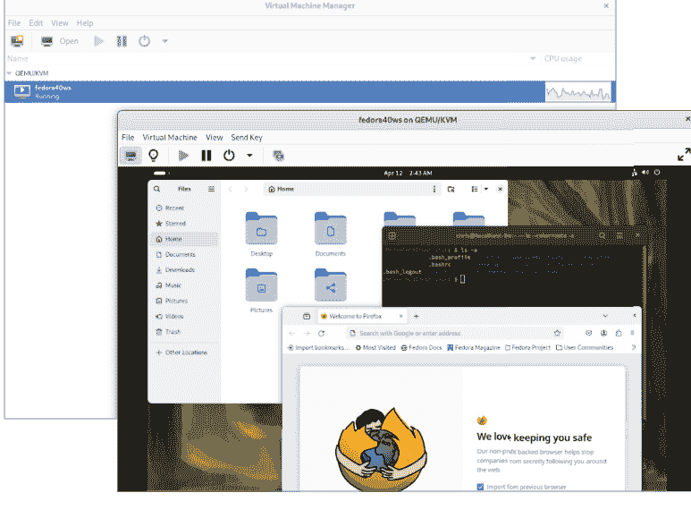

现在你已经能够熟练地使用虚拟机，可以尝试将虚拟机迁移到另一个虚拟机程序了。

## 迁移虚拟机

能够在不同的虚拟机程序之间迁移虚拟机，可以为你管理计算机工作负载提供灵活性。以下是一些优势：

- 通过将虚拟机从负载过载的虚拟机程序移动到具有更多可用内存和 CPU 能力的虚拟机程序，来提高性能。
- 不要在保持虚拟机运行的同时对虚拟机程序进行维护。
- 将虚拟机从低利用的虚拟机程序移出，这样你可以将其关闭以节省能量，直到再次需要。
- 如果你预计关闭数据中心，或者预计会有飓风或其他灾难袭击你的数据中心，请将虚拟机移出。

如果你需要进程在不中断的情况下在虚拟机上继续运行，那么热迁移非常有价值。实现虚拟机迁移的关键是正确配置你的环境。确保以下内容已就绪：

- 虚拟机程序之间的共享网络存储。
- 每个虚拟机程序上配置了相同的网络接口。
- 虚拟机程序之间兼容 CPU。（通常，一组虚拟机程序具有完全相同的硬件）
- 虚拟机程序与存储之间的快速网络连接。
- 虚拟机程序上相同或相似版本的虚拟化软件。（在案例中，我们在双方都使用了 Fedora 42 并以类似的方式安装了它们。）

一切就绪后，热迁移只需要几步即可开始。

### 第 1 步：识别其他虚拟机程序
假设虚拟机管理器仍在你的一个虚拟机程序上运行，转到该窗口并执行以下操作以连接另一个虚拟机程序：

- **连接到虚拟机程序**：选择“添加连接”（Add Connection）。将出现“添加连接”窗口。
- **添加连接**：勾选“连接到远程主机”（Connect to Remote Host）复选框，选择 SSH 作为方法，使用有效的用户名（如 `chris` 或 `joe`），并输入另一个虚拟机程序的主机名（例如 `host1`）。当你点击“连接”（Connect）时，可能会提示你输入远程虚拟机用户的密码并输入其他信息。注意，你可能需要安装 `openssh-askpass` 包才能获得密码提示。

虚拟机管理器窗口上将出现一个新虚拟机程序的条目。

### 第 2 步：将运行中的虚拟机迁移到另一个虚拟机程序
在迁移虚拟机到另一个虚拟机程序之前，你可能需要调整防火墙规则。在默认防火墙规则下，直接 libvirt 迁移将失败。需要打开一个随机 TCP 端口允许迁移。默认是 `49152`，但可以选择任何可用的非特权端口。隧道迁移需要 SSH 密钥验证。

打开虚拟机管理器后，右键点击任何正在运行的虚拟机并选择“迁移”（Migrate）。将出现“迁移虚拟机”窗口，如图 28.3 所示。


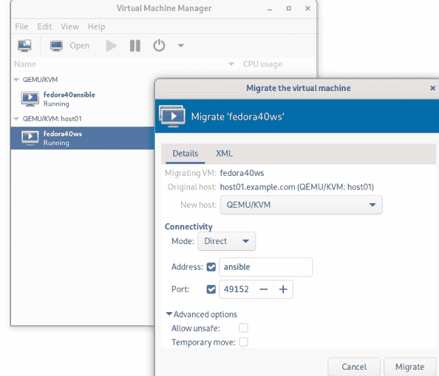

选择新主机。在我的示例中，虚拟机运行在 `host01` 上，因此我想选择 `ansible` 作为新主机。等待虚拟机的内存镜像复制到另一个主机后，虚拟机应该显示为在该主机上运行。

如果由于某些原因迁移失败了（CPU 不兼容或其他问题），你始终可以在一个主机上关闭虚拟机并在另一台主机上重新启动。这只需要你的共享存储已就绪。在第二个主机上，只需运行“创建新虚拟机”向导，但选择运行现有镜像而不是 ISO。

我刚刚演示的虚拟机程序配置可能适合你的家庭工作站，甚至适合小型企业。虽然帮助你开发整个云计算平台超出了本书的范围，但在本章中帮助你使用不同的云平台运行你的 Linux 系统是在我的范围内的。下一章将帮助你实现这一点。

## 总结
Linux 是当今许多新兴云计算技术的基础。本章描述了构建基于 Linux 和其他开源技术的云的许多基本组件。然后，它通过设置几个虚拟机程序并启动虚拟机，帮助你学习其中一些基础技术。

## 练习
本节的练习描述了与设置虚拟机程序（KVM 宿主机）和运行虚拟机相关的任务。

1. 检查你的计算机查看其是否支持虚拟化。
2. 安装 Linux 系统以及使用它所需的包。
3. 确保 `sshd` 和 `libvirtd` 服务正在运行。
4. 获取与你的虚拟机程序兼容的 Linux 安装 ISO 并将其拷贝到默认目录。
5. 检查网桥（`vir0`）当前是否处于激活状态。
6. 使用你拷贝的 ISO 安装虚拟机。
7. 登录虚拟机。
8. 检查它是否可以连接到或其他网络。
9. 停止虚拟机使其不再运行。
10. 重新启动虚拟机使其可用。

# 将 Linux 部署到云端

## 让 Linux 在云端运行
云平台非常适合快速高效地启动新的虚拟机。它们可以这样做，因此每次需要新的操作系统实例时都不需要进行基础安装。

公云（例如 Amazon EC2 (http://aws.amazon.com/ec2)）提供了不同的 Linux 发行版供你启动和使用。你可以选择 Linux 实例，例如 Amazon 2023、Ubuntu、Red Hat Enterprise Linux (RHEL) 或 SUSE Linux Enterprise Server (SLES)，它们针对特定用途进行了优化。例如，某些实例是针对高性能处理、内存密集型应用而优化的，或者作为特定环境（如 AWS Elastic Kubernetes Service (EKS)）的节点运行。

## 与云计算交互
云实例的内容本质上通常是通用的。预计会通过如 `cloud-init` 之类的服务向云用户或云提供者附加更多信息。`cloud-init` 信息分为两个大类：元数据（meta-data）和用户数据（user-data）：

### meta-data
元数据包含了镜像启动之前所需的信息。这些数据位于镜像内容之外，通常由云提供者管理。其中一些数据源于存储、内存和处理能力等资源是从资源池中提取的，而不是你安装的物理机器。因此，元数据告诉云提供者在实例启动过程早期分配这些资源（可能还有其他资源）的数量。

### user-data
用户数据信息被插入镜像中存在的操作系统中。这些数据是由使用虚拟机的人提供的。这可能包括用户账户和密码、配置文件、首次启动时运行的命令、软件仓库的标识，或者你可能想在操作系统内部运行或更改的任何内容。

当你在云环境中运行 Linux 实例时，通常通过检查复选框和填写 Web 端云控制器（如 Red Hat Virtualization Manager）中的表单来输入元数据和用户数据信息。当你通过云控制器配置实例时，这些信息可能不会被标识为元数据和用户数据。

你选择运行 Linux 虚拟机的云可以是公共云、私有云或混合云。你选择的云类型取决于你的需求和预算：

- **公有云**：Amazon EC2、Microsoft Azure 和 Google Engine 是让你从基于 Web 界面启动并使用 Linux 虚拟机（有时称为实例）的云平台。你为实例运行的时间付费。你运行实例时使用的内存、存储和虚拟 CPU 数量也会增加成本。公有云的优势在于你不需要维护和拥有自己的云基础设施。
- **私有云**：通过私有云，你部署了自己的计算基础设施（虚拟化层程序、存储、网络配置等）。建立自己的私有云意味着要承担更多维护基础设施的前期成本。但它带给了你对计算资源的安全性和控制权。由于你控制了基础设施，你可以在自己的基础设施中创建用户访问的镜像，并以你自己的方式计算用户对该基础设施的使用。
- **混合云**：许多公司正转向混合云解决方案。混合云允许多个计算资产由中央设施管理。例如，公有云客户可以结合如 EKS 的平台（在 AWS 云中运行管理功能），并利用其自有数据中心的服务器机器来运行其 EKS 工作负载。

## 为云创建 Linux 镜像
回想你在第 9 章“安装 Linux”中安装 Linux 系统时做了什么。在手动安装过程中，你设置了 root 密码，创建了普通用户账户和密码，可能定义了网络接口并执行了其他任务。你输入的信息成为了操作系统的一部分，每次启动时都会保留。

当你从预构建的云镜像作为你的 Linux 系统开始时，可以使用 `cloud-init` 让 Linux 系统准备就绪。`cloud-init` (https://docs.cloud-init.io/) 设置一个通用的虚拟机实例，以你想要的方式运行，而无需经过安装过程。下一节描述了使用 `cloud-init` 的某些方法。

## 配置并运行 cloud-init 云实例
在接下来的步骤中，我将向你展示如何手动创建数据：数据可以与可启动云镜像相结合，当镜像启动时，它将根据你的数据进行配置。在运行时结合数据允许你在运行镜像之前更改数据，而不是永久性地安装在镜像中。

我建议你在第 28 章“使用 Linux 进行云计算”中配置的某个虚拟化层程序上运行此步骤。这不仅让你能够为你的 Linux 云镜像创建自定义数据，还让你能够直接在你的虚拟化层程序上作为虚拟机运行它。

你可以为此过程使用任何 Linux 发行版，然后在任何虚拟化层程序上运行它。对于此示例，虚拟化层程序可以是 Ubuntu、Fedora 或 RHEL，我选择了一个 Fedora 镜像。

为了添加并运行现有的云镜像，此步骤要求你获取云镜像、创建数据文件并生成一个结合这些元素的新镜像。此过程对于启动云镜像来说非常简单。稍后我将告诉你如何向这些数据文件添加功能。要配置并运行云镜像，请遵循以下步骤：

### 1. 创建 cloud-init 元数据文件
创建一个名为 `meta-data` 的文件，用于存储来自云实例的外部信息。例如，你可以添加一个名称来识别实例 (`instance-id`)、主机名 (`local-hostname`) 以及其他信息。为了让第一次尝试保持简单，请仅使用两个字段。（你可以将其设置为你喜欢的任何名称。）

```
instance-id: FedoraWS01
local-hostname: fedora01
```


### 2. 创建 cloud-init user-data 文件
创建名为 `user-data` 的文件，用于包含配置镜像操作系统的数据。对于这个简单案例，为默认用户 (`fedora`) 设置密码为 `cloudpass`，并确保 `cloud-init` 不过期：

```
#cloud-config
password: cloudpass
```

### 3. 将数据合并镜像
使用当前目录下的 `meta-data` 和 `user-data` 文件创建一个包含这些数据的 ISO 镜像。稍后，我们将此镜像作为 CD-ROM 呈现给 Linux 镜像，以便 `cloud-init` 知道如何配置该镜像。（如果尚未安装，请先安装 `genisoimage` 和 `cloud-init` 软件包。`cloud-init` 包在虚拟化层程序上不需要。）

```bash
# 在 Fedora 中
dnf install genisoimage cloud-init qemu-utils
# genisoimage -output fedora.iso -volid cdata
```

### 4. 获取基础云镜像
Ubuntu、Fedora 和 RHEL 的云镜像已针对 `cloud-init` 配置过。获取官方云镜像（其他发行版的镜像稍后描述），并执行以下操作：

- **a. 访问 Fedora 云镜像页面**：打开浏览器访问 https://fedoraproject.org/cloud/download。
- **b. 点击镜像**：点击 Fedora Cloud Base QEMU 镜像对应的下载按钮，获取适用于虚拟机的 qcow2 镜像。文件名类似于 `Fedora-Cloud-Base-Generic-42-1.1.x86_64.qcow2`。

### 5. 镜像快照
你可能需要运行多次此步骤以获得所需的镜像。因此，不要直接使用下载的镜像，而是对其创建一个快照。为了跟踪版本，我在快照名称中添加了 `01`：

```bash
# qemu-img create -f qcow2 \
-o backing_file=Fedora-Cloud-Base-Generic-42-1.1.x86_64.qcow2 \
-F qcow2 Fedora-Cloud-Base-01.qcow2
```

### 6. 将文件复制到镜像目录
在虚拟化层程序（`libvirt` 服务）上使用镜像时，将镜像复制到 `/var/lib/libvirt/images` 目录是一个好习惯。例如，将云镜像和数据镜像复制到你的目录，输入以下命令：

```bash
# cp Fedora-Cloud-Base-Generic-42-1.1.x86_64.qcow2 \
Fedora-Cloud-Base-01.qcow2 \
fedora42-data.iso \
/var/lib/libvirt/images/
```

### 7. 启动云实例
在文件就绪后，运行以下命令启动你的云镜像实例：

```bash
# cd /var/lib/libvirt/images
# virt-install --import name fedora42-01 --ram 4096 --vcpus 2 \
--disk path=Fedora-Cloud-Base-01.qcow2,format=qcow2,busio=virtio \
--disk path=fedora42-data.iso,device=cdrom \
--os-variant fedora42 --network network=default
```


之前的 `virt-install` 示例显示虚拟机被分配了 4Gi 的内存 (`-- 4096`) 和两个 CPU (`-vcpus 2`)。系统上的 RAM 和 VCPU 值可能不同，取决于你计算机的资源。此操作是在 Fedora 上运行的。对于其他 Linux 系统，你的选项可能会有所不同。

此时，一个名为 `fedora42-01` 的虚拟机正在你的虚拟宿程序上运行。当虚拟机启动时，会打开一个控制窗口，允许你登录新的云虚拟机。

## 调查云实例

为了研究我们创建的云实例，你可以打开运行中的实例并查看内部。如果它尚未打开，一种方法是使用 `virt-viewer` 打开虚拟机：

```bash
# virt-viewer fedora42-01
```

从出现的控制窗口中，使用我们添加到镜像中的数据进行登录。使用 `fedora` 作为用户名，`cloudpass` 作为密码登录。`fedora` 用户具有 `sudo` 权限，因此你可以通过执行某些命令使用该账户访问实例。

在这里你可以看到 `user-data` 已复制到实例中：

```bash
$ sudo cat /var/lib/libvirt/instances/ncloud/user-data.txt
#cloud-config
password: cloudpass
chpasswd: (expire: False)
```

基础云配置在 `/etc/cloud/cloud.cfg` 文件完成。你可以在这里看到 root 账户默认是禁用的。在文件底部，你可以看到名为 `fedora` 的用户是默认用户，并且拥有不需要密码的 `sudo` 权限。

```bash
$ sudo cat /etc/cloud/cloud.cfg
users:
  - default
    disable_root: true
-
system_info:
  default_user:
    name: fedora
```

## 第六部分：参与云计算

```yaml
lock_paswd: True
gecos: fedora Cloud User
groups: [wheel, adm, systemd-journal]
sudo: "*ALL:\(ALL) NOPASSWD:ALL*"
shell: /bin/bash

paths:
  cloud_dir: /var/lib/cloud
  templates_dir: /etc/cloud/templates
  ssh_svcname: ssh
```

你可以在 `cloud-cfg` 文件中看到其他内容。你可以看到初始化期间运行的 cloud-init 模块（例如设置主机名或启动 syslog 日志的模块）。你可以看到设置本地和时区并运行进一步配置工具（如 Chef 和 Puppet）的 `cloud-config_modules`。

由于启用了 yum 仓库，且你拥有可用的网络连接（DHCP 可能已为虚拟机分配了地址），你可以从 Fedora 仓库中安装任何包。

## 克隆云实例

如果你决定使用你创建的云实例，可以通过对构成云实例的两个镜像（云镜像和数据镜像）进行克隆，来保存其副本供以后运行。使用 `virt-manager` 克隆云实例，请执行以下操作：

1. 启动 `virt-manager`。在运行虚拟机的主机系统上，运行 `virt-manager` 命令，或从桌面的“活动”屏幕启动“虚拟机管理器”。

2. 暂停虚拟机。右键点击 `virt-manager` 窗口中的虚拟机实例项并选择“关机”（Shut Down）。

3. 克隆虚拟机。再次右键点击虚拟机实例项并选择“克隆”（Clone）。出现“克隆虚拟机”窗口，如图 29.1 所示。

4. 选择克隆设置。对于云镜像和数据镜像，你可以选择创建新副本或与现有的虚拟机共享。之后，选择“克隆”。

现在，克隆的实例可以从“虚拟机管理器”窗口或 `virsh` 命令按你需要启动、停止和其他进行管理。制作克隆的一个巨大优势是，你可以对它们进行任何喜欢的更改，而无需更改原始文件。完成后后删除克隆即可，在需要时你可以快速重新生成一个新的。

## 扩展你的 cloud-init 配置

你可以向 `meta-data` 和 `user-data` 文件中添加大量信息来配置你的云实例。cloud-init 设置的示例可以在 Cloud-Init Config Examples 页面（https://docs.cloud-init.io/en/latest/reference/examples.html）上找到。以下章节显示了你可以添加到 `user-data` 文件中的设置示例。

图 29.1

克隆让你能够保存一个云实例的永久副本。

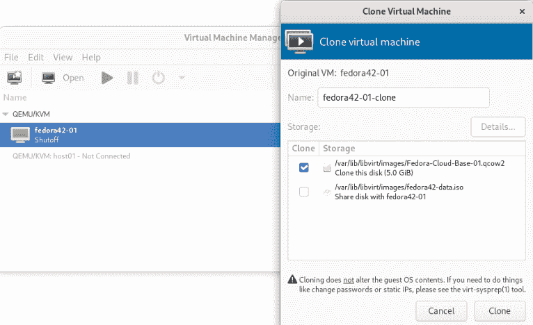

注意

`user-data` 和 `meta-data` 文件采用 YAML 格式。YAML 格式使用缩进和定义良好的分隔符。列表中的项由连字符表示。键和值之间用冒号隔开。如果你不熟悉 YAML，我建议查看 YAML 项目网站（https://github.com/yaml）。

与其使用密码登录云实例，不如使用基于密钥的身份验证结合 `ssh` 命令通过网络登录。这被云提供商允许用户访问云镜像。

如果你已经为计划登录云实例的用户账户生成了公钥和私钥，你可以使用此过程。如果你生成了 RSA 密钥对，公钥默认位于 `id_rsa.pub` 文件中。

```bash
# cat $HOME/.ssh/id_rsa.pub
```

```bash
ssh-rsa AAAAB3NzaCyc...
```

根据之前的信息，你可以看到 wsmith 是默认用户。配置项通常是 `/etc/passwd` 文件中的第五字段。该用户的密码已锁定。然而，root 账户的 `ssh-rsa` 条目通过 `ssh-authorized-keys` 在此处提供用户，我无需输入密码即可登录云实例（假设我的私钥已通过该公钥认证）：

```yaml
users:
  - default
    disable_root: true
    lock_paswd: True
    gecos: fedora Cloud User
    groups: [wheel, adm, systemd-journal]
    sudo: "*ALL:\(ALL) NOPASSWD:ALL*"
    shell: /bin/bash
    ssh-authorized-keys:
      - ssh-rsa AAAAB3NzaCyc2EAAAADAQABA...
```

## 使用 cloud-init 添加软件

你受限于我们云实例中已有的软件。在你的 `user-data` 文件中，你可以定义 YUM 仓库（对于 Fedora 或 RHEL）或 apt 仓库（对于 Ubuntu 或 Debian），并指定你想在云实例启动时安装的任何包。

以下示例显示了 `user-data` 文件中的项可能会为你的云实例添加 YUM 仓库（针对 Fedora 或 RHEL），并从该仓库或其他任何仓库安装包：

```yaml
myrepo:
  baseurl: http://repo.example.com/pub/repo/
  enabled: true
```

## 第29 章：将 Linux 部署到云端

```yaml
gpgcheck: true
gpgkey: file:///etc/pki/rpm-gpg/RPM-GPG-KEY-MYREPO
name: My personal software repository
packages:
- nmap
- mycolcdmd
- [libmystuff, 3.10.1-fc21.noarch]
```

在示例中，在 `/etc/yum.repos.d/myownrepo.repo` 创建了一个新仓库。提供了一个 gpgkey 来检查已安装包的有效性，并开启了 GPG 检查。之后，安装了 `nmap` 软件包（在标准的 Fedora yum 仓库中），安装了 `mycolcd` 软件包（来自我的私有仓库），并安装了特定版本的 `libmystuff` 软件包。

为 Ubuntu 配置 apt 仓库略有不同。默认配置了故障备和安全 apt 镜像（图像中的 `cloud.cfg` 文件），以及让实例（如果你在 Amazon EC2 云中）搜索最近的区域的软件包的设置。如要添加更多仓库，你的 user-data 文件中的条目可能如下所示：

```
apt_mirror: http://archive.ubuntu.com/ubuntu/
apt_mirror_search:
 http://myownmirror.example.com
 http://archive.ubuntu.com
```

```yaml
packages:
- nmap
- mycolcdmd
- [libmystuff, 3.16.0-25]
```

`myownmirror.example.com` 条目告诉 apt 使用你自己的 apt 仓库来搜索软件包。请注意，想要安装的软件包可以使用与你在 Fedora 中基本相同的格式输入，尽管在某些情况下，特定的版本信息（如果输入）看起来可能不同。

你可以向你的 user-data 和 meta-data 文件添加更多设置。详细信息请再次参考 Cloud-Init Cloud Config 示例 (https://docs.cloud-init.io/latest/reference/examples.html)。

## 企业级计算中的 Cloud-init

到目前为止，本章中的 cloud-init 示例侧重于获取云镜像、手动添加配置，并在你的本地虚拟化程序上将其作为虚拟机临时运行。如果你想了解 cloud-init 是如何工作的，以及你根据自己的规范调优云镜像的机会，这种方法非常有用。然而，如果你正在管理大型企业的虚拟机，这种方法是无法扩展的。

Cloud-init 支持数据源（datasources）概念。通过将 user-data 和 meta-data 放在数据源，你就不需要像在本章早期那样手动将这些信息注入到云实例中。相反，当云服务在实例上运行时，它知道不仅要在本地系统查找数据源，还会在系统外部查找。

对于 Amazon EC2 云，cloud-init 查询特定的 IP 地址 (http://169.254.169.254) 获取数据。例如，它可能会检查 http://169.254.169.254/2009-04-04/meta-data 获取元数据，并检查 http://169.254.169.254/2009-04-04/user-data 获取用户数据。这允许配置从中心位置存储和访问。请注意，EC2 已开始过渡到通过 IMDS2 进行基于令牌访问。

至于 meta-data 和 user-data，可以为你的云实例部署开发更复杂的配置方案。Cloud-init 支持配置工具，例如 Puppet (https://www.puppet.com/community/open-source-source-puppet/) 和 Chef (https://community.chef.io/downloads)。这些工具允许你将脚本或配置信息应用到你的云实例，即使在需要替换组件或重启服务使系统恢复到所需状态时也是。

此时，我的工作不是让你成为全云管理员（几页之前，你可能还是个 Linux 新手）。我想让你了解如果你最终进入云数据中心将会面对什么，因为许多人认为，在不遥的将来，大多数数据中心将作为云基础设施进行管理。

到本章为止，你已经查看了为云计算配置 Linux 的内部细节。接下来，让我们退一步，看看如何使用 Amazon Linux 2 来运行你的 Linux 虚拟机。

## 使用 Amazon EC2 部署云镜像

Amazon Elastic Compute Cloud (Amazon EC2) 是 Amazon Web Services (AWS) 云平台提供的基础服务之一。它特别适用于按需付费的云计算计算。EC2 通过让你选择预配置的虚拟机镜像并对其进行配置以满足你的需求，使其轻松上手。

要启动 Amazon EC2 来启动虚拟机，请访问 Amazon Web Services 入门页面并按照链接创建新账户 (https://aws.amazon.com/getting-started/)。登录后，将显示完整的 AWS 服务。登录控制台 (console.aws.amazon.com)，然后选择 EC2，你将看到 EC2 AWS 管理控制台，如图 29.2 所示。

启动你的第一个 Linux 虚拟机实例，请执行以下操作：

1. 选择 Linux 实例。出现 Launch Instance 页面，并提供 Linux (Amazon Linux, Red Hat, SUSE Linux, Ubuntu 和 Debian) 和 Windows AMI 供启动。

2. 找到你想要的实例，并点击 Select 按钮。我选择了 Amazon Linux。

3. 选择实例类型。滚动到 Instance Type，根据 vCPUs、内存和存储进行选择。

4. 创建密钥对。你的密钥将进行下载。Linux 选择 .pem，Windows 选择 .ppk。

5. 网络设置。选择 VPC、子网和公网 IP 地址。

6. 配置存储。选择存储的大小和类型。

7. 高级详情。检查实例设置并启动。

8. 选择实例。在 Instances 页面，选择该实例。

9. 终止实例。当你完成实例操作后。

10. 连接到实例。使用 SSH 登录实例。

11. 终止实例。当你完成实例操作后，可以通过勾选实例并选择 Instance State (terminate)。

## 总结

理解云计算与简单地在计算机硬件上安装操作系统的区别，将帮助你适应更多数据中心向云计算的趋势。在本章开始，我鼓励你获取一些云镜像，与它们结合，并在本地虚拟化程序上运行它们。

之后，我介绍了 Amazon EC2 服务，如果你没有足够的计算资源，可以付费使用云存储和处理时间。

下一章将描述如何使用 Ansible 向你的数据中心自动部署主机系统和应用程序。

## 练习

本节练习假设你已经将主机系统设置为虚拟化程序（KVM 主机计算机）。你需要使用虚拟化程序运行练习中创建的虚拟机。如果你卡住了，任务的解决方案位于附录 B。请记住，附录 B 中的解决方案通常只是完成任务的方法之一。

1. 要创建自定义虚拟机镜像，安装 genoisimage、cloud-init、qemu-img 以及 virt-manager、virt-viewer 软件包。

2. 从 Fedora 项目获取云镜像。

3. 使用 qemu-img 创建 qcow2 格式的镜像快照 myvm.qcow2，你稍可以将其与自己的数据结合。

4. 创建一个 cloud-init 元数据文件 meta-data，将 instance-id 设置为 myvm，local-hostname 设置为 myvm.example.com。

5. 创建一个 cloud-init 用户数据文件 user-data，将默认用户的密码设置为 test，并设置 chpasswd 永不过期 {expire: False}。

6. 运行 `genisoimage` 命令将元数据文件和用户数据文件合并，创建一个 `mydata.iso` 文件，稍后将其与虚拟机镜像结合。

7. 使用 `virt-install` 命令将 `myvm.qcow2` 虚拟机镜像与 `mydata.iso` 镜像合并，创建一个名为 `newvm` 的新虚拟机镜像，它将在你的虚拟机程序上运行。

8. 使用 `virt-viewer` 为 `newvm` 虚拟机打开控制台。

9. 使用之前设置的 `fedora` 用户和测试密码登录 `newvm` 虚拟机。

# 第 30 章

# 使用 Ansible 自动化应用和基础设施

本章内容

- 理解 Ansible
- 安装 Ansible
- 逐步完成部署
- 执行即时命令

在本书之前的章节，我们主要关注于手动配置单个 Linux 系统。我们学习了如何在运行命令的机器上直接安装软件、编辑配置文件并启动服务。虽然了解如何操作 Linux 主机的各个界面是管理 Linux 系统的基础，但这种方法的扩展性并不。这正是 Ansible 可以派上用场。

Ansible 是如今许多自动化功能之一，它将 IT 管理的工作从关注单个系统转变为关注系统组。它将这些系统的配置从每台单独机器移动到控制节点。它用 Ansible Playbooks（剧本）取代了每台机器上的 Shell 用户界面，这些剧本可以通过网络在其他机器上运行任务。

尽管我们这里的重点是管理 Linux 系统，但 Ansible 也可以管理这些 Linux 系统周围的许多事务。例如，它可以确保网络设备配置正确，确保远程存储可以访问。

在除最小的数据中心之外，了解如何部署和管理 Linux 系统以及基础设施自动化已成为全容器化数据中心的要求。基于 Kubernetes 的平台正成为容器编排和自动化的行业标准（参见第 31 章，“将容器作为容器部署”）。对于基础设施和传统应用部署，Ansible 为具有 Linux 思维的管理员提供了丰富的功能。

本章将介绍你入门使用 Ansible 所需的知识。随后，它将引导你完成如何使用 Ansible 在一组 Linux 系统上部署应用，并展示之后如何通过重新部署剧本和运行即时命令来与这些系统进行交互。

# 理解 Ansible

Ansible 扩展而非取代了你已经学习的 Linux 知识。在最基础层面，Ansible 包含以下内容：

- 一种自动化语言，描述你为了达到特定状态而想要执行的任务。这些任务被收集在剧本（playbooks）中。
- 自动化引擎用于运行剧本。
- 接口允许你管理和保护剧本以及自动化组件，通过命令和 RESTful API 实现。

通过清单（inventories，定义了主机组）和剧本（playbooks，定义了在这些主机上执行的一系列操作），Ansible 以以下方式配置主机系统：

**简单功能配置：** 你以纯文本文件的格式创建清单和剧本，在其中标识出所需的 Linux 组件。


# 使用 Ansible 自动化应用和基础设施

本章内容

- 理解 Ansible
- 安装 Ansible
- 逐步完成部署
- 执行即时命令

在本书之前的章节，我们主要关注于手动配置单个 Linux 系统。我们学习了如何在运行命令的机器上直接安装软件、编辑配置文件并启动服务。虽然了解如何操作 Linux 主机的各个界面是管理 Linux 系统的基础，但这种方法的扩展性并不好。这正是 Ansible 可以派上用场。

Ansible 是如今许多自动化功能之一，它将 IT 管理的工作从关注单个系统转变为关注系统组。它将这些系统的配置从每台单独机器移动到控制节点。它用 Ansible Playbooks（剧本）取代了每台机器上的 Shell 用户界面，这些剧本可以通过网络在其他机器上运行任务。

尽管我们这里的重点是管理 Linux 系统，但 Ansible 也可以管理这些 Linux 系统周围的许多事务。例如，它可以确保网络设备配置正确，确保远程存储可以访问。

在除最小的数据中心之外，了解如何部署和管理 Linux 系统以及基础设施自动化已成为全容器化数据中心的要求。基于 Kubernetes 的平台正成为容器编排和自动化的行业标准（参见第 31 章，“将容器作为容器部署”）。对于基础设施和传统应用部署，Ansible 为具有 Linux 思维的管理员提供了丰富的功能。

本章将介绍你入门使用 Ansible 所需的知识。随后，它将引导你完成如何使用 Ansible 在一组 Linux 系统上部署应用，并展示之后如何通过重新部署剧本和运行即时命令来与这些系统进行交互。

## 理解 Ansible

Ansible 扩展而非取代了你已经学习的 Linux 知识。在最基础层面，Ansible 包含以下内容：

- 一种自动化语言，描述你为了达到特定状态而想要执行的任务。这些任务被收集在剧本（playbooks）中。
- 自动化引擎用于运行剧本。
- 接口允许你管理和保护剧本以及自动化组件，通过命令和 RESTful API 实现。

通过清单（inventories，定义了主机组）和剧本（playbooks，定义了在这些主机上执行的一系列操作），Ansible 以以下方式配置主机系统：

**简单功能配置：** 你以纯文本文件的格式创建清单和剧本，在其中标识出所需的 Linux 组件。

**设置你想要的结果：** 你在此处描述的是定义你希望节点上所处状态的资源。这可以是一个运行中的系统、一个设置了特定地址的网络接口，或者一个特定大小的磁盘分区。由于某种原因某个功能的状态发生了变化，你可以再次使用 Ansible 运行以将节点恢复到预期状态。

**SSH 连接：** 默认情况下，每个主机节点必须运行 SSH 服务，并允许 Ansible 与控制节点通信。基于密钥的用户账户身份认证允许此操作发生，并在需要 root 权限提权时可以使用 sudo。因为你使用的是可能运行在主机上的 SSH 服务，所以你不需要运行额外的代理或配置防火墙规则即可使其工作。

一旦你学会了 Ansible 如何工作的基础知识，你就可以执行广泛的高级复杂活动，例如：

**基础设施置备：** 使用 Ansible，你可以为应用所需的基础设施提供支持，无论是在裸机上安装操作系统或虚拟机管理程序（及其虚拟机）、设置存储设备，还是配置网络。在每种情况下，Ansible 都可以利用你现有的置备工具，以便在一个地方进行管理。

**部署应用：** 通过描述应用的预期状态，Ansible 不仅可以设置在多个节点和设备上部署应用，还可以在功能可能损坏或无意更改时重新播放剧本，将应用恢复到其预期状态。

**管理容器和 Operator：** Ansible 最近添加的功能允许它将容器化应用部署到 OpenShift 等 Kubernetes 基础设施上。OpenShift 中的 Operator（可以通过 Ansible Operator 管理）不仅定义了容器化应用的状态，还能实时响应变化并使升级变得更容易。详情请参阅 Ansible Operator 的描述（https://www.ansible.com/blog/ansible-operator）。

**管理网络：** 经常需要手动完成的配置、测试、验证和增强你的网络基础设施的任务可以通过 Ansible 自动化。详情请参阅 Ansible 网络入门指南（https://docs.ansible.com/ansible/latest/network/getting_started/index.html#network-getting-started）。

**管理云环境：** 就像你可以将基础设施部署到裸机一样，Ansible 还提供了为云环境置备基础设施和应用的工具。仅对于 Amazon Web Services (AWS)，就有数百个 Ansible 模块用于管理基础设施和应用。阿里巴巴、Azure、Google 以及其他几十个云环境也是可用的。

## 探索 Ansible 组件

当运行剧本时，它作用于一个或多个目标主机（由清单表示）并执行它们，这些执行被称为 `plays`（播放）。每个 play 包含一个或多个由 play 实现的任务。为了执行某个任务，任务会调用 `modules`（模块），模块按照它们出现的顺序执行。在开始使用 Ansible 之前，你需要了解这些组件。

## 清单

通过清单（定义了主机组）和剧本（playbooks，定义了在这些主机上执行的一系列操作），Ansible 以以下方式配置主机系统：

**简单功能配置：** 你以纯文本文件的格式创建清单和剧本，在其中标识出所需的 Linux 组件。

**设置你想要的结果：** 你在此处描述的是定义你希望节点上所处状态的资源。这可以是一个运行中的系统、一个设置了特定地址的网络接口，或者一个特定大小的磁盘分区。由于某种原因某个功能的状态发生了变化，你可以再次使用 Ansible 运行以将节点恢复到预期状态。

**SSH 连接：** 默认情况下，每个主机节点必须运行 SSH 服务，并允许 Ansible 与控制节点通信。基于密钥的用户账户身份认证允许此操作发生，并在需要 root 权限提权时可以使用 sudo。因为你使用的是可能运行在主机上的 SSH 服务，所以你不需要运行额外的代理或配置防火墙规则即可使其工作。一旦你学会了 Ansible 如何工作的基础知识，你就可以执行广泛的高级复杂活动，例如：

**基础设施置备：** 使用 Ansible，你可以为应用所需的基础设施提供支持，无论是在裸机上安装操作系统或虚拟机管理程序（及其虚拟机）、设置存储设备，还是配置网络。在每种情况下，Ansible 都可以利用你现有的置备工具，以便在一个地方进行管理。

**部署应用：** 通过描述应用的预期状态，Ansible 不仅可以设置在多个节点和设备上部署应用，还可以在功能可能损坏或无意更改时重新播放剧本，将应用恢复到其预期状态。

**管理容器和 Operator：** Ansible 最近添加的功能允许它将容器化应用部署到 OpenShift 等 Kubernetes 基础设施上。OpenShift 中的 Operator（可以通过 Ansible Operator 管理）不仅定义了容器化应用的状态，还能实时响应变化并使升级变得更容易。详情请参阅 Ansible Operator 的描述（https://www.ansible.com/blog/ansible-operator）。

**管理网络：** 经常需要手动完成的配置、测试、验证和增强你的网络基础设施的任务可以通过 Ansible 自动化。详情请参阅 Ansible 网络入门指南（https://docs.ansible.com/ansible/latest/network/getting_started/index.html#network-getting-started）。

**管理云环境：** 就像你可以将基础设施部署到裸机一样，Ansible 还提供了为云环境置备基础设施和应用的工具。仅对于 Amazon Web Services (AWS)，就有数百个 Ansible 模块用于管理基础设施和应用。阿里巴巴、Azure、Google 以及其他几十个云环境也是可用的。


**管理云环境：** 就像你可以将基础设施部署到裸机一样，Ansible 还提供了为云环境置备基础设施和应用的工具。仅对于 Amazon Web Services (AWS)，就有数百个 Ansible 模块用于管理基础设施和应用。阿里巴巴、Azure、Google 以及其他几十个云环境也是可用的。

# 探索

当运行剧本时，它作用于一个或多个目标主机（由清单表示）并执行它们，这些执行被称为 `plays`。每个 play 包含一个或多个由 play 实现的任务。为了执行某个任务，任务会调用 `modules`，模块按照它们出现的顺序执行。在开始使用 Ansible 之前，你需要了解这些组件。

# 清单

通过清单（定义了主机组）和剧本（playbooks，定义了在这些主机上执行的一系列操作），Ansible 以以下方式配置主机系统：

**简单功能配置：** 你以纯文本文件的格式创建清单和剧本，在其中标识出所需的 Linux 组件。

**设置你想要的结果：** 你在此处描述的是定义你希望节点上所处状态的资源。这可以是一个运行中的系统、一个设置了特定地址的网络接口，或者一个特定大小的磁盘分区。由于某种原因某个功能的状态发生了变化，你可以再次使用 Ansible 运行以将节点恢复到预期状态。

**SSH 连接：** 默认情况下，每个主机节点必须运行 SSH 服务，并允许 Ansible 与控制节点通信。基于密钥的用户账户身份认证允许此操作发生，并在需要 root 权限提权时可以使用 `sudo`。因为你使用的是可能运行在主机上的 SSH 服务，所以你不需要运行额外的代理或配置防火墙规则即可使其工作。一旦你学会了 Ansible 如何工作的基础知识，你就可以执行广泛的高级复杂活动，例如：

... (此处由于原文大量重复，已按要求去重)

# 第 30 章：使用 Ansible 自动化应用和基础设施

条件判断可以应用于每个任务。例如，使用 `yum` 模块时，你可以根据软件包的状态来决定是否安装该包。你可以这样说：如果软件包的状态为 `installed`（已安装），则不安装该软件包（即使有更新版本）。但是，如果你使用 `latest`，如果当前软件包不是最新版本，则将安装新版本的软件包。

参数（Parameters）允许你添加信息来修改任务。例如，使用 `user` 模块时，当你向系统添加用户时，可以识别用户的名称、密码、UID 和 shell（shell）。

除了从剧文件（playbooks）执行模块外，你还可以直接从命令行运行模块。如果你希望立即对主机进行操作，而无需运行整个剧文件，这将非常有用。例如，你可以 `ping` 一组主机以确保它们正在运行，或者检查服务的状态。（更多信息请参阅本章后文“运行 Ansible 命令”章节。）

要了解更多关于特定模块的信息，请访问 Ansible 文档网站（在 https://docs.ansible.com 中选择 **Modules**）或使用 `ansibledoc` 命令。例如，要了解更多关于如何使用 `copy` 模块将文件复制到远程位置，请输入以下：

```bash
# ansible-doc copy
> copy /usr/lib/python3.7/site-packages/ansible/modules/files/copy.py
```

> 'copy' 模块将文件从本地或远程机器复制到远程机器上的位置...

大多数模块都会返回值，以提供有关任务执行结果的信息。常见的返回值为布尔值（Booleans），表示任务是否成功（`failed`）、任务是否被跳过（`skipped`）或任务是否必须进行更改（`changed`）。

# 角色（Roles）、导入（imports）和包含（includes）

随着你剧文件集的增长，你可能会发现自己想要将剧文件拆分为更小的部分，并包含在多个剧文件中。你可以将大型剧文件的部分分离到独立的、可重用的文件中，并使用 `imports` 和 `includes` 将它们调用到主剧文件中。角色（Roles）也类似，但它们可以包含比任务更多的内容，例如模块、变量和处理程序（handlers）。

关于使用 includes、imports 和 roles 的信息，请参阅 https://docs.ansible.com/ansible/latest/user_guide/playbooks_reuse.html 中的“创建可重用的剧文件”。

# 执行 Ansible 部署

为了开始使用 Ansible，我们将逐步执行一个向一组主机部署 Web 服务的过程。在安装 Ansible 之后，该过程将向你展示如何创建部署服务所需的清单和剧文件。然后，它将展示如何使用 `ansible-playbook` 实际部署剧文件。

# 第六部分：参与云计算

# 前提条件

为了开始，我使用了四台计算机（你可以使用虚拟机），名称如下：

| host | 描述 |
| :--- | :--- |
| ansible | 用作 Ansible 控制节点 |
| host01 | 第一个目标节点 |
| host02 | 第二个目标节点 |
| host03 | 第三个目标节点 |

然后我运行了以下步骤来准备使用 Ansible 使用主机：

1. 在每台电脑或虚拟机上安装 Fedora（使用 RHEL 也可以）。
2. 对于三个目标节点中的（host01、host02 和 host03），我确保执行了以下操作：
   a. 确保 SSH 服务运行且可用（必要时为 Ansible 控制节点打开 TCP 端口 22）。
   b. 创建非 root 用户账户。稍后在使用剧文件时，使用 `--ask-become-pass` 选项来提示输入提升权限所需的密码。
   c. 为该用户设置密码。

在运行 Ansible 时，普通用户账户具有 `sudo` 权限可以连接到每个系统，然后我使用 `sudo` 提升到 root 权限。

# 为每个节点设置 SSH 密钥

登录到控制节点（`ansible`）并确保它可以到达你正在配置的其他三个节点。可以确保通过 DNS 服务器可以到达这些节点，或者将它们添加到控制节点的 `/etc/hosts` 文件中。然后设置访问这些节点的密钥。例如：

1. 以 root 用户身份，将你想要从中部署 Ansible 剧文件的每个节点的 IP 地址和名称添加到 `/etc/hosts` 文件：

```bash
192.168.122.154 host01
192.168.122.94 host02
192.168.122.189 host03
```

2. 在 ansible 系统上生成 ssh 密钥，以便你可以与每个主机进行密码通信。你可以在 ansible 主机系统上作为普通用户运行此命令以及后续 Ansible 命令：

```bash
$ ssh-keygen
Generating public/private ed25519 key pair.
Enter file in which to save the key (/home/joe/.ssh/id_ed25519):
<ENTER>
Created directory '/home/joe/.ssh'.
Enter passphrase for "/home/chris/.ssh/id_ed25519" (empty for passphrase) : <ENTER>
Enter same passphrase again: <ENTER>
```

*(注：原文此处路径略不一致，此处保持翻译逻辑)*

你的身份识别已保存在 `/home/joe/.ssh/id_ed25519` 中。你的公钥已保存在 `/home/joe/.ssh/id_rsa.pub` 中。密钥指纹为：SHA256:UexkyUSQGIKU9fm2wI7ka8IPDv5c@ansible。密钥的随机图像是。

3. 你的身份识别后，作为普通用户将公钥发送到要部署 Ansible 剧文件的每个节点：

*(注：原文此处逻辑似乎存在乱码重复，已按语意整合翻译)*

## 第六部分：与云计算交互

```yaml
- name: Restart the firewalld service to load in the firewall changes
  service:
    name: firewalld
    state: restarted
```

`simple_web.yaml` playbook 开头的三个连字符表示该文件中 YAML 内容的开始。以下是文件其余部分的详细说明：

**name:** "Create web server.（创建 Web 服务器）"

**hosts:** 将此清单应用到 ws 组中的主机。

**remote_user:** 使用普通用户对每个远程系统进行身份验证。这样做是因为允许直接以 root 登录远程系统不是良好的安全实践。

**become:** 启用此功能（yes）告诉 Ansible 切换到比 remote_user 不同的用户来运行任务中的模块。

**become_method:** 使用什么功能来提升权限（如 sudo）。

**become_user:** 身份验证到哪个用户（root）。

**tasks:** 包含任务的部分。

**name:** name 是赋予任务的标题。在第一个例子中，是 "Install httpd（安装 httpd）", 然后是 "Check that httpd has started（检查 httpd 是否已启动）",以此类推。下一行以模块名称（yum, service, firewall 等）开头。

对于 `yum`，它表示检查是否存在 httpd 包，如果不存在则安装它。

对于 `service`，它检查 firewalld 守护进程是否运行（started）。如果 httpd 未在运行，Ansible 将启动它。

对于 `yum`，它表示检查是否存在 firewall 包，如果不存在则安装它。

对于 `firewall`，通过防火墙使 http 服务的端口（TCP 80）立即可用（enabled）并持久化（permanent: yes）。

对于 `service`，重启 firewalld 服务（started）以启用对 http 服务防火墙端口的访问。

## 运行 playbook

使用 `ansible-playbook` 命令运行 playbook。（作为备选方案，你也可以使用 `ansible-navigator`。）在正式运行之前测试 playbook，请使用 `-C` 选项。如需查看更多详细信息（至少在你熟悉操作之前），可以添加 `-v` 选项来查看详细输出。

请记住，如果你使用 `-C` 运行 playbook，它无法完全测试 playbook 以确保其正确性。因为后续步骤可能需要先完成前面的步骤才能执行。

## 第 30 章：使用 Ansible 自动化应用和基础设施

在示例中，在 httpd 服务运行之前，需要安装 httpd 。以下是在在详细模式下运行 Ansible Playbook 的示例：

```bash
$ ansible-playbook -v simple_web.yaml -kk
Using /etc/ansible/ansible.cfg as config file
SSH password: <ssh password>
BECOME password[defaults to SSH password]: <Enter>
```

PLAY [Create web server] *****************************************************

```yaml
TASK [Gather Facts] ************************************************************
ok: [host03]
ok: [host02]
ok: [host01]
```

```yaml
TASK [Install httpd] ************************************************************
changed: [host01] => {"changed": true, "msg": "", "rc": 0,
  "results": ["Installed: httpd", ...]}
changed: [host02] => {"changed": true, "msg": "", "rc": 0,
  "results": ["Installed: httpd", ...]}
changed: [host03] => {"changed": true, "msg": "", "rc": 0,
  "results": ["Installed: httpd", ...]}
```

```yaml
TASK [Check if httpd has started] ***********************************************
changed: [host03] => {"changed": true, "name": "httpd",
  "state": "started", "status": "running"},
changed: [host02] => {"changed": true, "name": "httpd",
  "state": "started", "status": "running"}
changed: [host01] => {"changed": true, "name": "httpd",
  "state": "started", "status": "running"}
```

```yaml
TASK [Install firewall] ********************************************************
changed: [host03] => {"changed": true, "msg": "", "rc": 0,
  "results": ["Installed: firewall", "Installed: python3-descriptor-..."]}
changed: [host02] => {"changed": true, "msg": "", "rc": 0,
  "results": ["Installed: firewall", "Installed: python3-descriptor-..."]}
changed: [host01] => {"changed": true, "msg": "", "rc": 0,
  "results": ["Installed: firewall", ...]}
```

```yaml
TASK [Firewall access to https] *************************************************
ok: [host03] => {"changed": false, "msg": "Permanent operation,
  (offline operation: only on-disk configs were altered)"}
ok: [host02] => {"changed": false, "msg": "Permanent operation,
  (offline operation: only on-disk configs were altered)"}
```

```yaml
ok: [host01] => {"changed": false, "msg": "Permanent operation,
(offline operation: only on-disk configs were altered)"}
```

```yaml
PLAY RECAP ******************************************************************
host01:ok=6 changed=4 unreachable=0 skipped=0 rescued=0
ignored=0
host02:ok=6 changed=4 unreachable=0 skipped=0 rescued=0
ignored=0
host03:ok=6 changed=4 unreachable=0 skipped=0 rescued=0
ignored=0
```

Ansible 的输出显示了每个任务执行的操作。“Gather Facts”任务收集有关远程主机的信息。“Install httpd”任务安装 Web 服务器包。“Check if httpd has started”任务验证服务是否正在运行。“Install firewall”任务安装防火墙包，而“Firewall access to https”任务配置防火墙规则。PLAY RECAP（执行摘要）提供了每个主机结果的总结。

有时你可能想在节点上执行某些一次性任务。通过 ad hoc 命令（即临时命令），你可以直接从命令行调用模块。其中一些任务可能包括：

- 安装软件包
- 用户账户
- 将文件复制到节点
- 重启节点

就像运行 playbook 一样，运行 ad hoc 命令也侧重于达到目标状态。ad hoc 命令接收一个声明性语句，计算出请求的内容，并执行达到该状态所需的操作。

要尝试这些 ad hoc 命令的示例，你可以使用之前创建的 ws 清单。

## 尝试 ad hoc 命令

当你运行 ad hoc 命令时，你正在使用 Ansible 模块执行某些操作。如果没有指定其他模块，默认使用 `command` 模块。通过模块，你可以指定想要在一组节点上执行的一次性活动命令和选项。

检查清单是否正常运行。在这里，你看到所有主机都在 ws 清单中运行：


```bash
$ ws -u joe -m ping -kK
SSH password: <ssh password>
BECOME password[defaults to SSH password]: <Enter>
host03 | SUCCESS => {
  "ansible_facts": {
    "discovered_interpreter_python": "/usr/bin/python",
    "changed": false,
    "ping": "pong"
  }
}
host02 | SUCCESS => {
host01 | SUCCESS => {
```

你可以通过以下 Ansible 命令检查服务状态，来查找 `ws` 清单中主机上的 `httpd` 服务是否运行：

```bash
$ ws -u joe -m service \
  -a "name=httpd state=started" --check -kK
SSH password: <ssh password>
BECOME password[defaults to SSH password]: <Enter>
host02 | SUCCESS => {
  "ansible_facts": {
    "discovered_interpreter_python": "/usr/bin/python"
  },
  "changed": false,
  "name": "httpd",
  "state": "started",
  "status": { ... }
}
host01 | SUCCESS => { ...
```

## 第六部分：与云计算交互

目前，Web 服务器上什么都没有。为了在 `ws` 清单中的所有主机上添加一个 `index.html` 文件（包含文本“Hello from your web server!”），你可以运行此命令（在提示提示时输入 root 密码）：

```bash
$ echo "Hello from your web server!" > index.html
ansible ws -m copy -a \
  src=./index.html dest=/var/www/html/ \
  owner=apache group=apache mode=0644 \
  -b --user joe --ask-become-pass -k
SSH password: <ssh password>
```

```bash
BECOME [defaults to SSH password]: <Enter>
host01 | CHANGED => {
  "ansible_facts": {
    "discovered_interpreter_python": "/usr/bin/python",
    "checksum": "213ae4bce70e9e6fbc7fe94de372945a202",
    "dest": "/var/www/html/index.html",
    "gid": "48",
    "group": "apache",
    "md5": "495feb8ad50864cfaf66981d94f97",
    "mode": "0644",
    "owner": "apache",
    "content": "system_u:object_r:httpd_sys_content_t:s0",
    "size": "52",
    "src": "/home/joe/ansible.tmp/ansible-tmp-1581027374.649223-2961128730253/source",
    "state": "file",
    "uid": "48"
  }}
host02 | CHANGED => {
host03 | CHANGED => {
```

你可以看到，在 `host01` 的 `/var/www/html` 目录下以 `apache` 所有者（UID 48）和 `apache` 组（GID 48）创建了 `index.html` 文件。随后该复制操作被重复到 `host02` 和 `host03`。你可以尝试通过 ansible 主机使用 `curl` 命令通过 Web 服务器访问该文件，以此确认一切运行正常：

```bash
$ curl host01
```

来自你的 Web 服务器的问！

# 使用 Ansible Tower 自动化任务

自动化框架

虽然运行 Ansible playbooks 和命令对于自动化和后期修改主机非常有帮助，但对于大型受管理企业，你可以通过 Ansible 实现更深层次。通过 `Ansible Tower`，你可以为你的 Ansible 部署添加一个更大的框架。

## 第 30 章：使用 Ansible 自动化应用和基础设施

`Ansible Tower` 提供了一个基于 Web 的界面，用于使用 Ansible playbooks 和其他组件管理你的整个 IT 基础设施。通过将 Ansible 资产集中在一个地方，你就有了接收通知的单一入口。你可以在你的整个企业范围内管理不同的管理角色。

`Ansible Tower` 界面可以让你轻松地更新已配置的资产。你不需要记住命令行选项，只需点击即可配置并启动你的 Ansible 任务。清单管理是图形化的，作业调度可以通过直观、可视化的方式完成。

`Ansible Tower` 提供了 REST API，可以帮助你将基础设施工具嵌入 Ansible 中。因此，你通常只需要继续执行已有的流程，并用 Ansible 对它们进行管理即可。

你可以从 `Ansible Tower` 网站（https://www.ansible.com/products/tower）了解更多关于 `Ansible Tower` 的信息。

## 总结

Ansible 提供了一种独特的格式语言和工具，用于自动化你在书中其他部分学到的许多任务。一旦你学会了如何构建 Ansible playbook，你就可以确定你对系统所需的精确配置，然后轻松地将其部署到一个或多个主机上。

通过 playbooks，你定义了应用程序及其周围组件的精确状态，并将该状态应用到 Linux 主机系统、网络设备或其他目标。你可以保存这些 playbooks 并复用它们，在其他系统上产生类似的结果，或调整它们以创建新的不同的结果。

Ansible 还可以使用临时命令（ad hoc commands）来更新系统。对于 `ansible` 命令行，你可以添加用户、复制文件、安装软件，或执行几乎任何用 playbook 完成的事务。通过这些命令，你可以快速地跨多个系统应用一组更改，或者响应需要立即对一组主机进行快速修复的问题。

在本章中，你学习了构成 Ansible 工具集的不同组件。你创建了用于部署简单 Web 服务器的自己的 playbook。然后，你运行了一些 ad hoc 命令来修改你部署 playbook 的系统。

## 练习

这些练习测试了你将在系统上安装 Ansible、创建第一个 Ansible playbook 以及运行几个 ad hoc 命令的能力。这些任务假设你正在运行 Fedora 或 Red Hat Enterprise Linux 系统（尽管部分工作在 Ubuntu 和其他 Linux 系统上可行）。

1. 在你的 Fedora 或 Ubuntu 系统上安装 Ansible。

2. 为要用于这些练习的用户添加 sudo 权限。

3. 创建一个 `start-playbook.yaml`，包含以下内容：

```yaml
name: Create web server
hosts: localhost
tasks:
  - name: Install httpd
    yum:
      state: present
```

4. 在 localhost 上运行 `ansible-playbook` 查看其是否有效。

5. 修改 `playbook.yaml` 以提升权限。

6. 再次运行 `ansible-playbook` 确保 httpd 已成功安装。

7. 修改 `playbook.yaml` 以确保服务启动。

8. 在 localhost 上运行 `ansible-playbook` 检查服务是否启动。

9. 创建一个 `index.html` 文件。

10. 使用 `curl` 检查应用是否运行。

## 第六部分：与云计算交互

目前，Web 服务器上什么都没有。虽然 Ansible 旨在部署任务，但这里的练习将让你在单主机上尝试（在 Linux 中通常可以通过多种方式完成）。

1. 在你的 Fedora 或 Ubuntu 系统上安装 Ansible。

2. 为要用于这些练习的用户添加 sudo 权限。

3. 创建一个 `start-playbook.yaml`，包含以下内容：

```yaml
name: Create web server
hosts: localhost
tasks:
  - name: Install httpd
    yum:
      state: present
```

4. 在 localhost 上运行 `ansible-playbook` 查看其是否有效。

5. 修改 `playbook.yaml` 以提升权限。

6. 再次运行 `ansible-playbook` 确保 httpd 已成功安装。

7. 修改 `playbook.yaml` 以确保服务启动。

8. 在 localhost 上运行 `ansible-playbook` 检查服务是否启动。

9. 创建一个 `index.html` 文件。

10. 使用 `curl` 检查应用是否运行。

## 使用 Kubernetes 部署应用

本章将介绍 Kubernetes 以及你所需的内容。在开始之前，你应该了解什么是 Kubernetes 集群。

### 理解 Kubernetes

Kubernetes 集群由构成控制平面（用于管理）和数据平面（用于运行）的节点组成。对于个人使用，你可以运行 `Minikube`（https://minikube.sigs.k8s.io/docs/start/）。

在生产环境中，控制持续运行，而数据平面节点根据需求启动停止。以下是你需要的不同组件：

**控制平面**：控制平面管理 Kubernetes 集群中的组件。它管理组件之间的通信，调度应用程序在数据平面节点上，并确保正确数量的容器正在运行。控制平面可以在节点上运行，但你通常会有三个或更多，以确保控制平面服务始终可用。

**数据平面**：数据平面是部署容器运行的地方。节点数量取决于你的负载。对于本地集群，你可能在高峰期间需要最大数量的节点，并在需要时启动，在不需要时移除。对于云环境，云提供商通常有满足你数据平面需求的系统，因此你只需要根据需要为这些节点付费。如果你需要特殊的系统（例如 GPU），你可能需要预留它们。

**存储**：持久化网络存储允许容器无论在哪个节点运行都能访问相同的存储。

**其他服务**：为了将 Kubernetes 环境集成到现有的数据中心，你可能需要将其与其他服务集成。例如，你可以设置应用和网络负载均衡器，将请求分散到多个节点。你可能还希望与本地数据中心的身份和访问管理服务集成。

在 Kubernetes 中，部署容器的最小单元被称为 **pod**。pod 可以包含一个或多个容器，以及描述这些容器的元数据。虽然 pod 可以包含一个容器，但有时 pod 拥有多个容器是合适的。

# 第 31 章：使用容器部署应用程序

多于一个。例如，一个 pod 可能包含一个 sidecar（侧边）容器，它用于监控 pod 中主容器中运行的服务。在同一个 pod 中放置多个容器意味着该 pod 中的容器将进行同步扩展。

## Kubernetes 控制平面

Kubernetes 控制平面负责指导 Kubernetes 集群的活动。控制平面通过一组服务来监督集群的所有活动。Kubernetes 控制平面的核心是 API 服务器（`kube-apiserver`），它负责接收请求。集群中所有节点之间的通信都通过 API 服务器进行。

当 API 服务器接收到一个对象（例如正在运行特定数量的 pod）时，Kubernetes 调度器（`kube-scheduler`）会找到可用节点来运行每个 pod，并将它们调度到这些节点上。为了确保每个对象都处于规定的状态，Kubernetes 控制器（`kube-controller-manager`）会持续执行操作，例如确保命名空间存在、定义的服务账户可用、运行了正确数量的副本以及定义的端点（endpoints）处于激活状态。如果任何内容不同步，将发出请求使这些对象恢复到请求的状态，例如通过启动节点或重新创建缺失的端点。

## Kubernetes 数据平面

Kubernetes 数据平面中每个节点的核心是 `kubelet`。`kubelet` 向 API 服务器注册自己。然后，API 服务器告诉 `kubelet` 通过 `PodSpec` 运行从 API 服务器请求的容器，并确保其持续以健康状态运行。

在每个节点上运行的另一个服务是容器引擎（通常称为运行时）。最初，`docker` 服务是最受欢迎的容器引擎，用于通过 `PodSpec` 启动、管理和删除容器。然而，在 Kubernetes v1.23 中，Docker 在 Kubernetes 中的用法被弃用，Docker 被 `containerd` 替换为 Kubernetes 的默认容器运行时。

最初，节点的设计目标是尽可能通用，以便在需要额外容量时可以启动一个新节点，并将其配置为处理许多容器的请求。随着时间的推移，Kubernetes 允许你指定处理器类型（`x86_64`、`Arm`、`GPU` 等）、内存量以及节点的其他属性，以运行你的应用程序。同样，你也可以运行自定义操作系统，以在你的数据中心运行节点所需的功能。

## Kubernetes 应用程序

在 Kubernetes 中，应用程序通过定义 API 对象来管理，这些对象设置集群上资源的状态。例如，你可以在 YAML 文件中创建一个 `Deployment` 对象，定义运行一个或多个容器的 pod、其运行的命名空间以及运行的每个 pod 的副本数量。该对象还可以定义每个容器开放的端口以及为每个容器挂载的任何卷（volumes）。Kubernetes 控制平面响应此类请求，并确保这些请求在 Kubernetes 数据平面节点上执行。

Kubernetes 使用服务（services）的概念将应用程序的位置与其实际 IP 地址和端口分开。通过为提供该服务的 pod 集分配服务名称，集群不需要知道每个 pod 的确切位置。相反，由 Kubernetes 将对该服务的请求路由到可用 pod。

默认情况下，与活动 pod 关联的 IP 地址无法从集群外部直接访问。由你来定义如何在集群外部暴露与 pod 集关联的服务。通过 `Service` 对象，你可以以不同的方式暴露服务。

默认情况下，通过 `ClusterIP` 服务类型暴露的服务使其仅对集群内的其他组件可用。要将服务暴露到集群外部，你可以使用 `NodePort`，使得提供服务的 pod 可以通过运行 pod 的每个节点上相同的 Kubernetes 分配端口或外部 IP 地址进行访问。

第三方法是使用 `LoadBalancer` 分配一个外部的固定 IP 地址，作为指向提供服务的 pod 的负载均衡器。使用 `LoadBalancer` 时，云的外部负载均衡器会将流量引导到后端 pod。最后，你可以使用 `ExternalName` 暴露服务，将服务与特定的 DNS C 记录关联。

无论你如何暴露 Kubernetes 服务，只要有对该服务的请求，Kubernetes 就会将通信路由到提供该服务的 pod 集。通过这种方式，pod 的启动和关闭不会影响使用该服务的客户端。

## Kubernetes 接口

Kubernetes 既有命令行界面也有 Web 控制台界面来访问 Kubernetes 集群。本章的示例侧重于命令行工具。命令包括用于管理 Kubernetes 虚拟机并启动关闭集群的 `kubectl`，以及用于管理 Kubernetes 集群的通用工具 `kubectl`。

## 尝试 Kubernetes

建立生产级的 Kubernetes 集群需要一些预见性，本章将重点介绍几种快速运行并访问个人 Kubernetes 集群的简易方法。特别地，你有几种不同的方法可以访问 Kubernetes 集群：

-   **Kubernetes 教程**：Kubernetes 官方网站提供交互式 Web UI 教程，你可以在那里启动集群并尝试 Kubernetes。从 [Kubernetes Tutorials](https://kubernetes.io/docs/tutorials)，你可以从基础、配置、无状态应用和其他教程主题中进行选择。

-   **Minikube**：通过 `Minikube`，你可以在自己的电脑上运行 Kubernetes。可以运行虚拟机的 Linux、macOS 或 Windows 系统可以在几分钟内在本地或桌面系统上运行 Kubernetes 集群。[Minikube](https://kubernetes.io/docs/tutorials/hello-minikube) 包含了设置 `Minikube` 的指令。

-   **K3s**：`K3s` (https://k3s.io/) 是一种为无人值守而设计的 Kubernetes 分发版。

-   **MicroK8s**：对于想要 Kubernetes 体验的开发者，`MicroK8s` (https://microk8s.io/) 是一个很好的选择。

-   **Docker Desktop**：另一个选项（本文未介绍）是 `Docker Desktop`，它可以让你运行预配置的 Kubernetes 集群（https://docs.docker.com/desktop/features/）。

为了开始，我将带你演示一些：

> 注意：如果你已经有一个正在运行的 Amazon EKS 环境，你可以遵循大多数步骤。在大多数情况下，你使用 `kubectl` 可以获得相同的结果。

## 获取 Kubernetes

以下描述告诉你如何通过启动 `Minikube` 的基础教程来使用 Kubernetes。

## 启动 Kubernetes 基础教程


要启动 Kubernetes 交互式教程，请从浏览器中访问以下 URL：

```
https://kubernetes.io/docs/tutorials/basics
```

图 31.1 显示了 Kubernetes 基础教程的开始。此时，你可以按照提示完成教程。由于该教程启动了一个实时集群，你也可以使用该界面尝试其他命令。

# 第 31 章：使用 Kubernetes 部署容器应用程序

## 启动你的集群

以具有 `sudo` 权限的用户身份运行 `minikube start`。如果一切顺利，`minikube` 将会找到你的虚拟化管理程序并创建 `minikube` 控制平面。此时，你可以尝试在你的集群上执行一些 `kubectl` 命令并运行一些容器化应用程序。

## 安装 kubectl 命令

获取一个与你 `Minikube` 中 Kubernetes 版本保持在一个版本以内的 `kubectl` 命令版本。安装最新版本的 `kubectl` 和 `minikube` 应该可以解决这个问题。输入以下内容：

```bash
$ curl -LO https://storage.googleapis.com/kubernetes-release/release -s https://storage.googleapis.com/kubernetes-release/release/stable.txt | xargs /bin/linux/amd64/kubectl
$ mv kubectl /usr/local/bin/kubectl
$ chmod 755 /usr/local/bin/kubectl
```

严格来说，你不需要获取 `kubelet` 二进制文件，因为 `minikube` 已经内置了。例如，你只需要运行 `minikube get node`。但在其他环境中，你将 `kubectl` 作为独立的命令使用。

# 运行 Kubernetes 基础教程

Kubernetes 基础教程将带你通过一系列良好的命令来熟悉 Kubernetes：

https://kubernetes.io/docs/tutorials/kubernetes-basics/

以下内容将带你浏览 Kubernetes 教程页的前五个模块，请继续并启动 Minikube (`minikube start`)。如果你已经在笔记本电脑上运行的虚拟机中使用 Minikube，你仍然可以遵循此步骤。由于两者都使用 Minikube，步骤是相同的。

## 获取关于集群的信息

运行这些命令来获取关于你集群的基本信息：

### Minikube 版本

要查看你正在使用的 `minikube` 版本，输入以下内容：

```bash
$ minikube version
minikube version: v1.35.0
commit: dd5d320e41b5451cdcf3c0189bc4e1d38195866ed-dirty
```

### 集群信息

要查看 Kubernetes 主节点和 DNS 服务可 URL，输入以下内容：

```bash
$ kubectl cluster-info
Kubernetes control plane is running at https://localhost:36473
CoreDNS is running at https://localhost:36555/api/v1/namespaces/kube-system/services/kube-dns/proxy
```

### 列出节点信息

要查看运行的节点数量（Minikube 只有一个主节点）及其状态，输入以下内容：

```bash
$ kubectl get nodes
NAME       STATUS   ROLES           AGE   VERSION
minikube   Ready    control-plane   23m   v1.32.0
```

### 列出集群和客户端版本

要查看 `kubectl` 客户端和 Kubernetes 集群的版本（以确保它们彼此在一个版本以内），输入以下内容：

```bash
$ kubectl version
Client Version: v1.31.0
Kustomize Version: v5.4.2
Server Version: v1.32.0
```

> 为了进一步调试和诊断集群问题，请使用 `kubectl cluster-info dump`。

# 部署 Kubernetes 应用程序

在 Kubernetes 集群上运行许多容器化应用程序（以 pod 形式）被称为部署（deployment）。当创建一个部署时，将由 Kubernetes 集群确保请求的 pod 始终在运行。它通过以下操作实现这一点：

- 通过 API 服务器接受部署的创建
- 请求调度器在可用节点上运行每个 pod 中请求的容器
- 监控 pod 以确保它们按照请求继续运行
- 如果 pod 失败（例如，容器停止运行），则启动 pod 的新实例（在相同或不同节点上）

教程展示了如何从容器镜像创建一个简单部署的示例。在示例中，你为它指定了一个名称并标识了要使用的容器镜像。部署的其他设置将使用默认值。

### 创建部署

要启动部署名为 `kubernetes-bootcamp` 并拉取 `kubernetes-bootcamp` 的部署，输入以下内容：

```bash
$ kubectl create deployment kubernetes-bootcamp \
  --image=gcr.io/google-samples/kubernetes-bootcamp:v1
deployment.apps/kubernetes-bootcamp created
```

### 列出部署

要查看部署是否存在（并且请求了一个实例且运行了一个实例），输入以下内容：

```bash
$ kubectl get deployments
NAME                  READY   UP-TO-DATE   AVAILABLE   AGE
kubernetes-bootcamp   1/1     1            1           4m38s
```

### 描述部署

要查看有关部署的详情，输入以下内容：

```bash
$ kubectl describe deployments kubernetes-bootcamp
Name: kubernetes-bootcamp
Namespace: default
Replicas: 1 desired | 1 updated | 1 total | 1 available
0 unavailable
...
Pod Template:
  Labels: app=kubernetes-bootcamp
  Containers:
  kubernetes-bootcamp:
    Image: gcr.io/google-samples/kubernetes-bootcamp:v1
    Port: <none>
    Host Port: <none>
    Environment: <none>
    Mounts: <none>
  Volumes: <none>
```

在 `kubernetes-bootcamp` 部署中，注意它设置与部署关联的一个 pod 实例（副本）为可用。部署运行在当前命名空间中，称为 `default`。同样注意 `default` 没有挂载任何端口或卷。

# 获取部署的 pod 信息

通过部署，你可以请求关于 pod 的信息，并通过服务从虚拟机暴露 Kubernetes API，以便直接连接到 pod。

### 将 Kubernetes API 暴露到本地系统

要从 Minikube 中运行的 Kubernetes API 开启代理 (`kubectl proxy`)，输入以下内容：

```bash
$ kubectl proxy
```

### 查询 Kubernetes API

打开第二个终端，通过输入以下内容查询在 Minikube 上运行的 Kubernetes API：

```bash
$ curl http://localhost:8001/version
{
  "major": "1",
  "minor": "32",
  "gitVersion": "v1.32.0",
  "gitCommit": "70d3cc98aa821cd1fb125688902dbf53",
  "gitTree": "clean",
  "buildDate": "2024-12-11T17:59:15Z",
  "goVersion": "go1.23.3",
  "compiler": "gc",
}
```

### 获取 pod 的信息

通过输入以下内容查询在 Minikube 上运行的 Kubernetes API 以获取 pod 信息：

```bash
$ kubectl get pods
NAME                                 READY   STATUS    AGE
kubernetes-bootcamp-76856766-v7p2    1/1     Running   4m
```

### 连接到 pod

通过输入以下内容查看在部署中运行的 pod：

```bash
$ kubectl get pods
NAME                                 READY   STATUS    AGE
kubernetes-bootcamp-76856766-v7p2    1/1     Running   4m
```

### 查看日志

要查看 pod 内任何容器的日志，运行以下命令：

```bash
$ kubectl logs kubernetes-bootcamp-76856766-v7p2
2025-04-12T07:54:04
```

### 在 pod 上执行命令

使用 `kubectl exec` 在 pod 中运行命令。第一个命令运行 `env` 显示 pod 内部的环境变量，第二个命令在 pod 中打开一个 shell，你可以运行：

```bash
$ kubectl exec -it kubernetes-bootcamp-76856766-v7p2 -- env
PATH=/usr/local/bin:/usr/bin:/usr/bin:/bin
HOSTNAME=kubernetes-bootcamp-76856766-v7p2
KUBERNET_SERVICE_HOST=10.0.0.1
KUBERNET_SERVICE_PORT=443
```

```bash
$ kubectl exec -it kubernetes-bootcamp-76856766-v7p2 -- bash
root@kubernetes-bootcamp-76856766-v7p2# date
Sat Apr 12 07:58:00 2025
root@kubernetes-bootcamp-76856766-v7p2# exit
```

# 第六部分：与云计算交互

## 使用 Kubernetes 暴露服务

在这些过程中，为了暴露 `kubernetes-bootcamp` pod，使其能够从运行它的工作节点的外部 IP 地址进行访问，你可以创建一个 `NodePort` 服务。以下是实现方法之一：

### 检查 pod 是否正在运行

输入以下命令查看 `kubernetes-bootcamp` pod 是否正在运行：

```bash
$ kubectl get pods
NAME                                 READY   STATUS    RESTARTS   AGE
kubernetes-bootcamp-9bc5d8d6-7g6dr   1/1     Running   0          26m
```

### 检查服务

输入以下命令查看默认命名空间中的服务。请注意，只有 `kubernetes` 服务是可用的，目前没有在集群外暴露 `kubernetes-bootcamp` pod 的服务：

```bash
$ kubectl get services
NAME         TYPE        CLUSTER-IP   EXTERNAL-IP   PORT(S)   AGE
kubernetes   ClusterIP   10.96.0.1    <none>        443/TCP   31m
```

### 创建一个服务

创建一个使用 `NodePort` 的服务，以便通过特定端口号（8080）的 IP 地址访问 pod。例如，以下命令：

```bash
$ kubectl expose deployment/kubernetes-bootcamp --type=NodePort --port 8080
service/kubernetes-bootcamp exposed
```

### 查看新服务

输入以下命令查看宿主机上可用服务的 IP 地址（10.96.66.230）和端口号（8080）：

```bash
$ kubectl get services
NAME                  TYPE       CLUSTER-IP     EXTERNAL-IP   PORT(S)          AGE
kubernetes            ClusterIP  10.96.0.1      <none>        443/TCP          33m
kubernetes-bootcamp   NodePort   10.96.66.230   <none>        8080:30128/TCP   5s
```

```bash
$ kubectl describe service/kubernetes-bootcamp
Name: kubernetes-bootcamp
Namespace: default
Labels: app=kubernetes-bootcamp
Annotations: <none>
Selector: app=kubernetes-bootcamp
Type: NodePort
IP Family Policy: SingleStack
IP Families:
IP: 10.106.58.189
IPs: 10.106.58.189
Port: <unset> 8080/TCP
TargetPort: <unset> 30128/TCP
```

### 获取分配的节点端口

要获取分配给服务的端口并将 `$NODE_PORT` 变量设置为该值，请输入以下命令：

```bash
$ NODE_PORT=$(kubectl get services/kubernetes-bootcamp \
-o go-template='{{(index .spec.ports 0).nodePort}}')

$ echo NODE_PORT=$NODE_PORT
NODE_PORT=30000
```

### 访问服务

要检查是否可以通过 `NodePort` 访问服务，请使用以下 `curl` 命令（使用你 minikube 实例的 IP 地址）：

```bash
$ curl $(minikube ip) $NODE_PORT
Running on: kubernetes-bootcamp-9bc58d867
```

## 为服务打标签

标签（Labels）提供了对 Kubernetes 中 pod、节点或其他对象分组的方法。使用标签，你可以执行诸如确保只有带有特定标签的 pod 运行在选定节点上的操作。你可以通过标签识别 pod，以便找到并对其进行操作。标签以键/值对的形式设置。使用此过程为现有服务添加标签。

### 检查 pod 的标签

`kubernetes-bootcamp` 是分配给该 pod 的唯一标签。为了确认这一点，请输入以下命令：

```bash
$ kubectl describe deployment kubernetes-bootcamp
Name:
Namespace: default
CreationTimestamp: Sat, 12 Apr 2025 03:39:50 -0400
Labels: app=kubernetes-bootcamp
Annotations: deployment.kubernetes.io/revision:1
...
```

### 为 pod 添加另一个标签 (v1)

获取 pod 的名称并将其作为新标签添加：

```bash
$ POD_NAME=$(kubectl get pods -o go-template --template='{{range .items}}{{.metadata.name}}{{end}}')
$ kubectl label pod $POD_NAME version=v1
pod/kubernetes-bootcamp-9bc58d867-76dr labeled
```

### 检查并使用标签

检查 `version=v1` 标签是否已分配给 pod，然后使用该标签列出 pod 的信息：


```bash
$ kubectl describe pods $POD_NAME
Name: kubernetes-bootcamp-9bc58d867-7g6dr
Namespace: default
Priority: 0
Service Account: default
Sease:
Node: minikube
Start Time: Sat, 12 Apr 2025 03:39:50 -0400
Labels: app=kubernetes-bootcamp pod-template-hash=9bc58d86 version=v1
```

```bash
$ kubectl get pods -l version=v1
NAME READY STATUS RESTARTS
kubernetes-bootcamp-9bc58d867-7g6dr 1/1 Running 0
```

## 删除服务

如果你正在使用该服务，可以删除它。这将移除对 NodePort 的访问，但不会删除 deployment。

1. 检查服务：确保 `kubernetes-bootcamp` 服务存在：

```bash
$ kubectl get services
| NAME | TYPE | CLUSTER-IP | EXTERNAL-IP | PORT(S) | AGE |
| kubernetes | ClusterIP | 10.96.0.1 | <none> | 443/TCP | 97m |
| kubernetes-bootcamp | NodePort | 10.106.58.189 | <none> | 8080:30128/TCP | 30m |
```

2. 删除服务：使用标签删除服务：

```bash
$ kubectl delete service -l app=kubernetes-bootcamp
service/bootcamp deleted
```

3. 检查服务和部署：确保服务已删除但部署仍然存在：

```bash
$ kubectl get services
| NAME | TYPE | CLUSTER-IP | EXTERNAL-IP | PORT(S) | AGE |
| kubernetes | ClusterIP | 10.96.0.1 | <none> | 443/TCP | 64m |
```

```bash
$ kubectl get deployment
| NAME READY UP-TO-DATE AVAILABLE |
| kubernetes-bootcamp 1/1 1 |
```

## 扩容应用程序

Kubernetes 最强大的功能之一是可以根据需要扩容应用程序。此过程从 `kubernetes-bootcamp` 部署开始，通过 ReplicaSet 功能增加额外的 pod，并将应用程序暴露到外部。

1. 获取部署：列出 `kubernetes-bootcamp` 部署的信息，并注意它被设置为一个副本集 (rs)：

```bash
$ kubectl get deployments
| NAME READY UP-TO-DATE AVAILABLE AGE |
| kubernetes-bootcamp 1/1 1 1 107s |
```

```bash
$ kubectl get rs
| NAME DESIRED CURRENT READY AGE |
| kubernetes-bootcamp-5b48cfcd 1 1 1 3m4s |
```

2. 扩容副本：通过以下命令将部署扩容到四个副本：

```bash
$ kubectl scale deployments/kubernetes-bootcamp --replicas=4
deployment.apps/kubernetes-bootcamp scaled
```

3. 检查新副本：列出部署以确保现在四个副本已就绪可用：

```bash
$ kubectl get deployments
| NAME READY UP-TO-DATE AVAILABLE AGE |
| kubernetes-bootcamp-9bc 4/4 4 4 8m4s |
```

4. 检查 pod：现在应该有四个 `kubernetes-bootcamp` pod 在运行，每个 pod 都有集群内部 IP 地址。为了确认，请检查以下内容：

```bash
$ kubectl get pods -o wide
| NODE NOMINATED STATUS RESTARTS AGE IP |
| kubernetes-bootcamp-9bc | 1/1 Running | 0 | 8m4s | 10.24.0.6 |
| minikube | <none> | | | | |
| kubernetes-bootcamp-9bc | 1/1 Running | 0 | 12s | 10.24.0.4 |
| minikube | <none> | | | | |
| kubernetes-bootcamp-9bc | 1/1 Running | 0 | 12s | 10.24.0.5 |
| minikube | <none> | | | | |
| kubernetes-bootcamp-9bc | 1/1 Running | 0 | 12s | 10.24.0.7 |
| minikube | <none> | | | | |
```

5. 查看部署详情：要查看部署中副本的详情，执行以下命令：

```bash
$ kubectl describe deployments/kubernetes-bootcamp
```

```yaml
Name: kubernetes-bootcamp
Namespace: default
NewReplicaSet: kubernetes-bootcamp-9bc58d867 (4/4 replicas created)
Events:
| Type | Reason | Age | From | Message |
|---|---|---|---|---|
| Normal | ScalingReplicaSet | 59m | deployment-controller | Scaled up replica set kubernetes-bootcamp-9bc58d867 from 0 to 1 |
Normal | ScalingReplicaSet | 2m5s | deployment-controller | Scaled
```

## 检查负载均衡器

要检查流量是否分布在四个 pod 上，你可以获取 NodePort，然后使用 curl 命令确保多次连接结果指向不同的 pod。

1. 列出服务的详细信息：要查看 `kubernetes-bootcamp` 服务的详情，执行以下命令：

```bash
$ kubectl expose \
  deployment/kubernetes-bootcamp \
  --type="NodePort" --port 8080
$ kubectl describe services kubernetes
```

2. 获取 NodePort：输入以下命令将 `$NODE_PORT` 设置为分配给服务的端口号：

```bash
$ export NODE_PORT=$(kubectl get services/kubernetes-bootcamp \
  -o go-template='{{{{index .spec.ports 0}}.nodePort}}')

echo NODE_PORT=$NODE_PORT
NODE_PORT=31915
```

3. 运行 curl：多次使用 curl 查询服务。如果你运行几次，你会发现它正在访问不同的 pod。这就是负载均衡器正在运行的证明：

```bash
$ curl $(minikube ip):$NODE_PORT
|Hello Kubernetes bootcamp!|Running on: kubernetes-bootcamp-9bc58
867-en257|v=1
```

## 缩容应用程序

要缩减部署中定义的副本集数量，只需将副本数量更改为较小的值即可。

## 第 31 章：使用 Kubernetes 部署容器化应用程序

1. 缩减副本数：输入以下命令将部署的副本数更改为 2：

```bash
$ kubectl scale deployments/kubernetes-bootcamp --replicas=2 deployment.extensions/kubernetes-bootcamp scaled
```

2. 检查部署：确保部署已设置为 2，且只有两个 pod 正在运行，输入以下命令：

```bash
$ kubectl get deployments
```

| NAME | READY | UP-TO-DATE | AVAILABLE | AGE |
|---|---|---|---|--|
| kubernetes-bootcamp | 2/2 | | 2 | 52m |

```bash
$ kubectl get pods -o wide
```

| NAME | NOMINATED | READY | STATUS | RESTARTS | AGE | IP |
|---|---|---|---|---|---|--|
| kubernetes-bootcamp-9bc... | | 2/2 | Running | 0 | 8m4s | 10.244.0.6 |
| minikube | | <none> | | | | 10.244.0.4 |
| kubernetes-bootcamp-9bc... | | 1/1 | Running | | 12s | |

此时，你应该已经熟悉如何通过各种方式查询 Kubernetes 集群，并从部署、pod 和副本开始操作。要继续学习高级 Kubernetes 教程，请参考 Kubernetes 教程主页 (https://kubernetes.io/docs/tutorials/)。

## 使用 EKS 获取企业级 Kubernetes

虽然我们可以像在书中那样在单机上运行 Kubernetes 来测试其功能，但它的真正价值在于你需要在生产环境中运行并扩展 Kubernetes 时。当你正在构建企业级集群来运行最关键的业务负载时，你应该考虑以下因素：

- **可扩展性**：如果你的应用程序过载，Kubernetes 可以增加 pod。如果你的节点达到了容量极限，Kubernetes 可以增加节点。同样，随着需求增加，可以关闭这些节点。

- **自愈能力**：Kubernetes 可以对容器、pod、节点、服务和其他对象进行健康检查，并在它们失败或性能下降时进行替换。

- **高可用性**：通过使用扩展性和自愈等功能，Kubernetes 可以确保应用程序对客户始终可用。由于 Kubernetes 正在响应故障和增加的需求，应用程序不会表现为不可用。Kubernetes 集群还可以分布在多个位置，这样即使一组集群甚至整个数据中心故障，也可以切换到其他位置的系统。

- **效率**：由于 Kubernetes 允许你根据当前需求运行尽可能多的负载和节点，你可以实现计算资源的最大化利用。为此，Kubernetes 可以通过合并负载到单个更高效、尺寸合适的计算机上，或者将负载迁移到成本更低的系统。


# 第六部分：接触云计算

- **开源 Kubernetes 生态系统**：由于 Kubernetes 是一个开源项目，不由单一公司拥有或维护，许多公司和组织已经采用并扩展了它。这意味着你可以从内置功能以及第三方软件中进行选择，使用它们来满足你的需求。

- **可移植性**：Kubernetes 能够在不同的环境中运行（如本地、边缘计算和数据中心），并获得不同供应商（如 AWS、Microsoft、Google 和 Red Hat）的支持。这允许你开发公司的应用程序，然后将其部署到最符合你需求的任何地方。

大多数云提供商提供托管 Kubernetes 服务，可以从多个方面提供帮助。它们可以在你开发产品的同时节省创建自有数据中心的成本，并允许你根据需求增长 Kubernetes 使用。流行的云服务提供商包括 Amazon Web Services (AWS) Elastic Kubernetes Service (EKS)、Microsoft Azure 的 Kubernetes Service (AKS) 以及 Google Cloud 的 Kubernetes Engine (GKE)。

这些 Kubernetes 集群还可以通过简化进入 Kubernetes 的流程来提供帮助。例如，它们可以为你提供简单的方法来管理控制平面，选择一组他们打包好的实用附加软件，甚至设置自动伸缩来扩展你用于运行负载的节点。

随着你对使用 Kubernetes 越来越熟悉，你将能够灵活调整集群并增强与集群配合软件。监控和可观测性等功能可以使你的 Kubernetes 使用更高效、更具成本效益。

## 总结

Kubernetes 已经成为在大型数据中心部署容器化应用程序的首选平台。一个 Kubernetes 集群由控制平面（引导集群活动）和节点（实际运行容器化负载的机器）组成。

作为使用 Kubernetes 进行应用程序容器化的用户，你可以创建部署来定义正在运行的应用程序的状态。例如，你可以部署一个配置为运行多个代表该应用程序的 pod 副本的应用程序。你可以将应用程序标识为服务，并设置应用程序在挂载存储可用且从其所在节点的定义端口可用时可用。

当你需要在稳定且支持的环境中运行关键任务应用程序时，可以使用基于 Kubernetes 的产品。大多数主流云提供商提供托管 Kubernetes 服务，可以提供简单、廉价的进入生产级 Kubernetes 集群的方法，并让你根据需要轻松扩展 Kubernetes 负载。

## 练习

本节的练习描述了与尝试 Kubernetes 相关的任务，可以通过在线或在计算机上设置 Minikube 来完成。如果你遇到困难，附录 B 中提供了任务的解决方案。请记住：

1. 安装 Minikube 和 kubectl 客户端。
2. 查看你的 Minikube 版本以及 kubectl 版本。
3. 创建一个管理 pod 的部署 (gcr.io/hellonode)。
4. 使用 kubectl 命令详细描述部署。
5. 查看与部署相关的副本集 (replica set)。
6. 将部署扩展到三个副本。
7. 使用 LoadBalancer 将 Kubernetes 集群暴露部署。
8. 获取暴露服务的 IP 地址。
9. 使用 curl 命令通过上一步的 IP 地址和端口查询服务。
10. 使用 kubectl 命令删除服务和部署，然后使用 minikube 命令停止虚拟机。

# 媒体

# 附录

获取 Linux 发行版

创建可启动的 USB、CD 或 DVD

除非你购买了预装 Linux 的计算机，或者有人为你安装了它，否则你需要找到获取 Linux 发行版的方法，并在计算机上安装或运行它。幸运的是，Linux 发行版广泛存在且形式多样。

在本附录中，你将学习执行以下操作：

- 获取几个 Linux 发行版。
- 创建用于安装发行版的可启动磁盘。
- 从 USB 驱动器启动 Linux。

为了有效地使用本内容，你应该有一个 Linux 发行版供你操作。在阅读时能够体验 Linux 是重要的。因此，请尝试示例并完成练习。

Linux 发行版通常可以在制作组织的网站获取。以下章节描述了提供下载 ISO 镜像的 Linux 发行版相关网站。

> ISO 是一种磁盘镜像，采用 ISO 格式，通常用于 USB、CD 和 DVD 镜像。由于这是一个常用格式，Windows、Mac 和 Linux 都可以读取。ISO 可创建可启动 USB 闪存盘、CD 或 DVD 介质，取决于镜像的大小。文件系统中的 ISO 可以以回环模式挂载，以便查看或复制其内容。

当 ISO 包含 Linux 文件或安装镜像时，这些镜像是可启动的。这意味着你不是从计算机硬盘启动操作系统（如 Windows 或 Linux），而是告诉计算机从安装的 CD 或 DVD 启动。这允许你运行一个安装在硬盘上的完全不同的操作系统，而不会损坏该硬盘上的数据。

## 附录 A：媒体

### 获取 Fedora

> **注意**
>
> 我建议下载 Workstation Live 镜像（工作站实时版）并配合本书使用，因为书中的大部分内容适用于该发行版。在您觉得足够准备好永久安装之前，可以先运行它而无需急于覆盖您电脑的硬盘。

为了测试书中的示例，我主要使用了 Fedora 42 64 位 Fedora Workstation 镜像，你可以从 Fedora.org (https://fedoraproject.org/en/workstation/download) 获取它们。如果你的电脑是 64 位的，则必须使用 64 位的 ISO。此外还有 64 位 ARM 和 PowerPC 版本可供选择。

带有 GNOME 桌面面的后续 Fedora 版本也应该可以使用。这里是用于 Fedora 42 Workstation 的确切 ISO 链接：

https://download.fedoraproject.org/pub/fedora/linux/releases/42/Workstation/x86_64.iso/Fedora-Workstation-42-1.1.x86_64.iso

请记住，最新的 Fedora Workstation ISO 镜像无法放入 CD，因此你必须将其刻录到 DVD 或 USB 驱动器。请参见本附录后部分适用于 Windows、macOS 和 Linux 的 CD/DVD 刻录工具描述。

图 A.1 显示了 Fedora Workstation 下载页面的示例。

图 A.1

从 Fedora Workstation 下载页面获取 Fedora ISO 镜像。

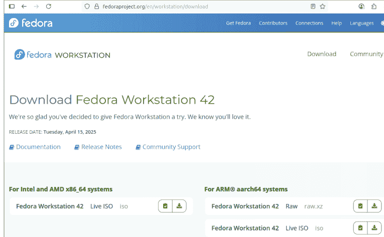

> **注意**


按照以下步骤选择并下载 Fedora 镜像以便可以直接运行或安装到你的电脑：

1. 在 FedoraProject.org，点击 Get Fedora，然后点击 Workstation 或 Server。我建议使用 Workstation 镜像来配合本书。
2. 点击 Download 按钮进入 Fedora Workstation 页面。
3. 选择与你的电脑匹配的计算机架构（`x86_64`、`aarch64` 或 `ppc64le`）。最常见的是 `x86_64`。
4. 点击 Fedora Workstation 旁的 Download 图标将 ISO 保存到本地系统。根据你的设置，系统会询问你想下载到何处，或者直接开始下载到默认文件夹（Linux 下可能是 `Downloads` 文件夹）。

如果你需要更多关于如何处理下载镜像的信息，在同一个 Download Fedora Workstation 页面上有可以帮助你的链接。在本文编写时，我建议使用 `Fedora Media Writer` 构建可启动介质（我将在第 9 章“安装 Linux”中描述此内容）。随着网站的更新，具体的指令可能会发生变化。

从 Fedora 下载 ISO 还有其他选择。通过在 FedoraProject.org 页面选择 Fedora，你可以从左侧导航栏选择 Spins，以查看名为 spins 的特殊配置 ISO 镜像列表。以下是一些你可能感兴趣的特殊类型 Fedora spins：

**KDE 移动桌面版本（spin）：** 倾向于使用 KDE 桌面而非 GNOME 桌面的用户可以下载 KDE Plasma 版本。

**轻量级桌面版本：** 如果你正尝试在内存或处理能力较低的电脑上运行 Linux，请考虑 Xfce 和 LXQt 版本（代表同名的轻量级桌面）。

**桌面特效版本：** MATE+Comp 版本为轻量级桌面提供了更具极性的体验，具有抖动窗口等桌面以及可以在立方体上旋转的桌面效果。

**儿童友好桌面版本：** SOAS 桌面是 Sugar Learning 平台的一个版本，旨在提供简化的设置和对友好图形界面。SOAS 可以存储在 USB 驱动器上并在任何可用电脑上运行。

**无鼠标桌面：** 如果你喜欢完全通过键盘控制 Linux 系统（不使用鼠标或触控板等指针设备），Sway 版本提供了这种方法，以及用于浏览网页、编辑文本和播放音乐的轻量级应用。


## 获取 Red Hat Enterprise Linux

许多大型企业、政府机构和大学使用 Red Hat Enterprise Linux 运行关键应用。虽然书中大部分步骤在 Fedora 上都能良好运行，但当你去寻找 Linux 系统管理员的工作时，会发现很多关于 Red Hat Enterprise Linux (RHEL) 中实现方式不同的引用，在这种情况下，你将与 Red Hat Enterprise Linux 系统或 RHEL 衍生版本工作。

尽管 Red Hat Enterprise Linux 的源码是免费提供的，但包含你所安装的软件包（通常称为二进制文件）的 ISO 仅供在 Red Hat 客户门户网站 (`https://access.redhat.com/`) 拥有账户的用户或通过评估版获取。

如果你没有账户，可以注册 30 天试用。如果你或你的公司拥有 Red Hat 账户，就可以下载 ISO。访问以下网站并按照说明下载 Red Hat Linux 服务器 ISO 或注册获取试用版：

```
https://access.redhat.com/downloads
```

Red Hat 不提供 Red Hat Enterprise Linux 的实时版本。相反，你可以下载安装 DVD，并按照第 9 章所述进行安装。

> 注意：如果你无法获得 Red Hat Enterprise Linux 安装 DVD，可以使用源自相同 Linux 生态系统的流行 Linux 发行版获得类似的体验。这些包括 Amazon Linux 2023 (AL2023)、CentOS Stream、Rocky Linux 和 Oracle Linux。

## 获取 Ubuntu

许多人从下载和安装 Ubuntu 开始学习 Linux。Ubuntu 是在数百万电脑和笔记本电脑上的开源操作系统。

- 发现 Ubuntu Desktop 查看博客
- 系统要求 如何安装

Ubuntu 的 LTS 版本，适用于桌面和电脑

Ubuntu 24.04.3 LTS

Intel 和 AMD 64 位架构

对于其他版本的 Ubuntu，包括镜像、本地镜像列表和历史版本，请查看我们的替代下载。

Ubuntu 的 LTS 版本。LTS 代表长期支持——这意味着有五年的安全和维护，通过 Ubuntu Pro 可延长至 12 年。

下载 Ubuntu 最简单的方法是选择 64 位 Ubuntu 镜像、下载并刻录。以下是在 Ubuntu 桌面页面上的操作方法：

1. 点击 Download 按钮。默认情况下，这将下载最新的 64 位 Ubuntu 桌面实时镜像。
2. 系统要么询问下载到何处，要么直接开始下载到默认文件夹。
3. 如果询问 ISO 存放位置，请选择一个空间足够的文件夹。记住该文件夹的位置，因为之后刻录时需要找到该 ISO。

通常有两个下载选择。第一个是长期支持 (LTS) 版本，另一个是最新的 Ubuntu 版本。LTS 版本稳定且受支持，而另一个会有最新的更新但支持周期较短。

下载完成后，根据“从 USB 启动 Linux”或“创建 Linux CD 和 DVD”中的描述，将 ISO 刻录到 USB 驱动器或 DVD。

还有其他类型的 Ubuntu 安装介质可用。要查找其他 Ubuntu Flavors，请访问 Ubuntu 页面 (`https://ubuntu.com/desktop/flavors`)。

图 A.2 显示了 Ubuntu 下载页面的示例。

图 A.2

从 Ubuntu 下载页面获取 Ubuntu ISO。

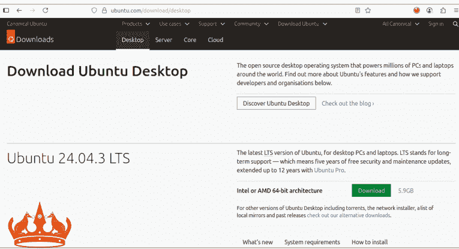

## 从 USB 驱动器启动 Linux

个人电脑已不再配备 CD/DVD 驱动器了，最流行的创建 Linux 启动介质的方法是使用 USB 驱动器。USB 驱动器具有持续可写和可读的优势。大多数现代计算机都可以从 USB 驱动器启动，尽管你可能需要中断启动过程，告诉 BIOS 从 USB 驱动器而不是硬盘启动。

第 9 章包含了使用 `Fedora Media Writer` 创建可启动的 USB 驱动器以安装你的 Linux 镜像的步骤。你还可以在以下位置找到将 Fedora 和 Ubuntu 放入 USB 盘的程序：

- **在驱动器上 Fedora：** 使用名为 USB Creator 的工具，你可以在 Windows 或 Linux 下将 Fedora ISO 镜像安装到驱动器中。要从驱动器运行 Fedora，将其插入电脑的端口，重启电脑，在 BIOS 启动时中断它（可能是按 F12），并选择从计算机启动。使用 USB Creator 的程序位于 `https://docs.fedoraproject.org/en-US/quick-guide/and-using-a-live-installation/index.html`。

- **在驱动器上 Ubuntu：** Ubuntu 提供了创建带有 Ubuntu 的可启动 USB 驱动器的程序，这些程序适用于 Windows、macOS 或 Linux。要了解如何操作，请访问 Ubuntu 下载页面，并在“切换到 Ubuntu 的简单方法”下，查找适用于 Ubuntu、Windows 或 macOS 的相应“如何创建可启动 USB 闪盘...”程序：`https://ubuntu.com/tutorials/tutorial-create-a-usb-stick-on-ubuntu#1-overview`。

## 创建 Linux CD 和 DVD

在你下载了 Linux CD 或 DVD 镜像后，你可以使用多种工具创建可启动的 CD 或 DVD，用于安装或直接从这些介质运行 Linux。在开始之前，你必须准备以下物品：

- **DVD 或 CD ISO 镜像：** 将 ISO 镜像下载到你的电脑上，它代表了你最终需要的物理 CD 或 DVD。如今，默认的 Linux ISO 镜像太大，无法放进 CD 中（RHEL、Fedora 和 Ubuntu 除外）。
- **空白 CD/DVD：** 你需要空白的 DVD 或 CD 来刻录镜像。CD 的容量高达 700MB；DVD 的容量高达约 4.7GB（单层）。
- **CD/DVD 刻录机：** 你需要能够刻录 CD 或 DVD 的驱动器，取决于你要刻录什么。并不是所有的 CD/DVD 驱动器都能刻录 DVD（尤其是旧型号）。因此，你可能需要找一台带有该功能驱动器的电脑。

以下章节描述了如何从 Windows、macOS 和 Linux 系统创建可启动的 CD 和 DVD。

## 在 Windows 中刻录 CD/DVD

如果你已将 Linux ISO 镜像下载到 Windows 系统，且你的电脑拥有一个可写的 CD/DVD 驱动器，你就可以将镜像刻录到可写的 CD 或 DVD 上。

在最新的 Windows 版本中，将 ISO 镜像刻录到 CD 或 DVD 的功能已内置在 Windows 资源管理器。下载 ISO 镜像后，只需将相应的 CD 或 DVD 插入电脑驱动器（假设驱动器是可写的），在下载镜像的文件夹中右键点击 ISO 图标，点击“刻录磁盘映像”。当 Windows 磁盘映像刻录器出现时，点击“刻录”来开始镜像。

## 在 macOS 上刻录 CD/DVD

与 Windows 一样，macOS 操作系统内置了 CD/DVD 刻录软件。要在 macOS 系统上将 ISO 镜像刻录到磁盘，请遵循以下步骤：

1. 在你的 macOS 系统上下载所需的 ISO 镜像。桌面上会出现一个代表该 ISO 的图标。
2. 根据镜像的大小，将 CD 或 DVD 插入 CD/DVD 刻录机。
3. 右键点击刚下载的 Linux ISO 图标并点击“刻录到磁盘”。会弹出一个窗口，询问你是否确定要刻录该镜像。
4. 填写你想给 ISO 指定的名字和写入速度，然后点击“刻录”。镜像开始刻录到磁盘。
5. 镜像刻录完成后，弹出磁盘；你已准备好在合适的电脑上启动该 CD 或 DVD。

## 在 Linux 中刻录 CD/DVD

Linux 同时拥有图形界面和命令行工具，可以将 CD 和 DVD 镜像刻录到物理介质。本节中的示例展示了如何从桌面使用 K3b，或使用 `cdrecord`（或 `wodim`）将 ISO 镜像刻录到 CD 或 DVD。如果尚未安装，你可以安装其中之一。

对于 Fedora 或 RHEL：

```
# dnf install k3b
# dnf install wodim
```

对于 Debian 或 Ubuntu：

```
# apt install k3b
# apt install wodim
```

## 从 Linux 桌面刻录 CD 或 DVD

以下是如何使用运行中的 Linux 系统（如 Fedora）通过 K3b 创建可启动 CD 或 DVD。K3b 随 KDE 桌面一起提供，但也支持 GNOME 桌面运行（`dnf install k3b`）。

1. 将所需的 ISO 镜像下载到电脑的硬盘上。（CD 镜像大小小于 700MB。单层 DVD 镜像小于 4.7GB）。
2. 打开 K3b 应用程序。对于 Fedora，推荐使用 K3b（`http://www.k3b.org`）。[Figure A.3](https://en.wikipedia.org/wiki/File:K3b-burning-w-o-u-r-d-i-n-g.png) 显示了刻录或 DVD。
3. 在 K3b 窗口中，选择工具 -> 刻录，选择你刚刚下载的镜像并选择 CD 或 DVD。会弹出一个窗口，询问你是否确定要刻录该镜像。
4. 将一张空白 CD 或 DVD 插入刻录机，根据镜像大小选择。填写你想给 ISO 指定的名字和写入速度，然后点击“刻录”。镜像开始刻录到磁盘。
5. 镜像刻录完成后，弹出磁盘；你已准备好在合适的电脑上启动该 CD 或 DVD。

# 附录 B：练习答案

## 第 3 章：使用 Shell

1. 在 Fedora 或 Ubuntu 中切换虚拟控制台返回桌面（此功能在某些 RHEL 系统中已禁用），请执行以下操作：

    a. 按住 `Ctrl+Alt` 并按 F2 (`Ctrl+Alt+F2`)。应该出现一个文本控制台。
    b. 输入你的用户名（按回车）和密码（按回车）。
    c. 输入几个命令，如 `id`、`pwd` 和 `ls`。
    d. 输入 `exit` 退出 shell 并返回登录提示符。

2. 对于你的终端，要在旧版本的 GNOME 中将字体变为红色并将背景设为黄色，请选择主菜单（三条线）并选择“偏好设置”。选择你的配置（可能是 Unnamed），选择“颜色”选项卡，并取消勾选“从系统主题颜色”。选择“默认颜色文本”并将其更改为红色。选择“默认颜色背景”并将其更改为黄色。

    对于某些 GNOME 桌面，选择单个颜色更改并不容易。选择主菜单（三条线），选择“偏好设置”，并选择一个最符合你所需颜色的调板。

3. 找到 `mount` 命令和 `tracepath` 的 man 页（帮助页）。

    a. 运行 `type` 查看 `mount` 命令的位置位于 `/usr/bin/mount` 或 `/bin/mount`。
    b. 运行 `locate tracepath | grep tracepath` 查看 `tracepath` 手页位于 `/usr/share/man/man8/tracepath.gz`。

4. 按照描述运行、回溯和更改这些命令：

```
$ cat /etc/passwd
$ ls $HOME
$ date
```

    a. 按向上方向键直到看到 `cat /etc/passwd` 命令。如果光标不在行末尾，按 `Ctrl+E` 到达末尾。退格删除密码，使用单词 `group` 并按回车。
    b. 输入 `man ls`，并找到按时间列出的选项 (`-t`)。按向上方向键直到看到 `ls $HOME` 命令。使用左方向键或 `Alt+B` 将光标移动到 `$HOME` 左侧。输入 `-t $HOME` 并按回车运行命令。
    c. 输入 `man date` 查看日期手页。使用向上方向键回溯 `date` 命令并更改你找到的格式指示。单个 `%d` 格式表示你需要：

```
$ date +%D
04/27/20
```

5. 使用 Tab 键补全输入 `/home/user/Pictures/image.jpg`
6. 输入 `/home/user/Pictures/image.jpg`
7. 使用 Tab 键补全输入 `/usr/share/man/man8/tracepath.gz`
8. 使用 Tab 键补全输入 `/home/user/Pictures/image.jpg`
9. 输入 `/home/user/Pictures/image.jpg`
10. 使用 Tab 键补全输入 `/home/user/Pictures/image.jpg`

# 第 4 章：在文件系统中移动


# 练习题与答案

## 第 4 章：文件系统操作

### 1. 创建 `projects` 目录，创建 `house1` 到 `house9` 的空文件，并列出这些文件。

```bash
$ mkdir projects
$ touch projects/house{1..9}
$ ls projects/house{1..9}
```

### 2. 创建 `projects/houses/doors/` 路径，并在路径创建空文件。

```bash
cd projects
mkdir houses
touch houses/bungalow.txt
mkdir doors
touch doors/ifold.txt
mkdir -p outdoors/vegetation
touch outdoors/vegetation/landscape.txt
```

### 3. 将 `house1` 和 `house5` 复制到 `projects/` 目录。

```bash
$ cp house1 house5 projects/
```

### 4. 递归复制 `/usr/share/doc/initscripts*` 到 `projects/` 目录。

```bash
$ cp -ra /usr/share/doc/initscripts* projects/
```

### 5. 递归列出 `projects/` 目录的内容。将输出通过到 `less` 命令以便分页。

```bash
$ ls -LR projects/ | less
```

### 6. 在不提示的情况下删除 `house6`、`house7` 和 `house8` 文件。

```bash
$ rm -f projects/house[6-8]
```

### 7. 将 `house3` 和 `house4` 移动到 `projects/houses/doors` 目录。

```bash
$ mv projects/house{3,4} projects/houses/doors/
```

### 8. 删除 `projects/houses/doors/`

```bash
$ rm -rf projects/houses/doors/
```

### 9. 更改 `projects/house2` 的权限，使得所有者文件的用户可以读写，组仅可读取，其他人没有权限。

```bash
$ chmod 640 projects/house2
```

### 10. 递归更改 `projects/` 目录的权限，使得文件系统在该该点之下的任何文件或目录都没有写入权限。

```bash
$ chmod -R a-w projects/
$ ls -LR projects/
```

## 附录 B：练习答案

```
/home/joe/projects/:

total 12

-r--r--r-- 1 joe joe 0 Jan 16 06:49 house1
-r--r----- 1 joe joe 0 Jan 16 06:49 house2
-r--r--r-- 1 joe joe 0 Jan 16 06:49 house5
-r--r--r-- 1 joe joe 0 Jan 16 06:49 house9
dr-xr-xr-x. 2 joe joe 4096 Jan 16 06:57 houses
dr-xr-xr-x. 2 joe joe 4096 Jul 1 2014 initscripts-9.03.40
dr-xr-xr-x. 3 joe joe 4096 Jan 16 06:53 outdoors
```

## 第 5 章：处理文本

### 1. 按照以下步骤创建 `/tmp/services` 文件，然后编辑它，使 `WorldwideWeb` 显示为 `World Wide Web`。

```bash
$ cp /etc/services /tmp
$ vi /tmp/services
/WorldWideWeb<Enter>
cWorld Wide Web<Esc>
```

这两行显示了修改前后的变化：

```
http 80/tcp www-www-http # WorldWideWeb HTTP
http 80/tcp www-www-http # World Wide Web HTTP
```

### 2. 移动 `/tmp/services` 文件中段落的一种方法是搜索该段落的第一行，删除五行（`5dd`），跳转到文件末尾（`G`），然后粘贴文本（`p`）：

```bash
$ vi /tmp/services
/Note that it is<Enter>
5dd
G
p
```

### 3. 要使用 `ex` 在你的 `/tmp/services` 文件中搜索术语 `tcp` 的所有出现（区分大小写）并将其更改为任何内容，可以输入以下命令：

```bash
$ vi /tmp/services
:g/tcp/WHATEVER/g<Enter>
```

### 4. 要对 `/etc` 目录搜索所有名为 `passwd` 的文件并将错误重定向到 `/dev/null`，可以编辑如下：

```bash
$ find /etc -name passwd 2> /dev/null
```

### 5. 在你的家目录下创建一个目录 `TEST`。在该目录中创建名为 `one`、`two` 和 `three` 的文件，并赋予所有人（用户、组和其他）完全的读/写/执行权限。构造一个 `find` 命令，从你的家目录及以下查找文件以及任何对“其他”具有写权限的文件。

```bash
$ mkdir $HOME/TEST
$ touch $HOME/TEST/{one,two,three}
$ chmod 777 $HOME/TEST/{one,two,three}
$ find $HOME -perm -002 -type f -ls
148120 0 -rwxrxrwx 1 chris Jan 0 08:56 /home/chris/test/
148918 0 -rwxrxrwx 1 chris Jan 0 08:56 /home/chris/test/
147306 0 -rwxrxrwx 1 chris Jan 0 08:56 /
```

### 6. 在 `/usr/share/doc` 目录下查找超过 300 天未修改的文件。

```bash
$ find /usr/share/doc -mtime +300
```

### 7. 创建一个 `/tmp/FILES` 目录。查找 `/usr/share` 目录下所有大于 5MB 且小于 10MB 的文件，并将它们拷贝到 `/tmp/FILES` 目录。

```bash
$ mkdir /tmp/FILES
$ find /usr/share -size +5M -size -10M -exec cp {} /tmp/FILES \;
$ du -sh /tmp/FILES/*
6.6M /tmp/FILES/BidiCharacterTest.txt
7.6M /tmp/FILES/BidiTest.txt
5.2M /tmp/FILES/day.jpg
```

### 8. 查找 `/tmp/FILES` 目录中的每个文件，并在同一目录下为每个文件创建备份。使用每个文件 `f.backup` 来创建对应的备份文件。

```bash
$ find /tmp/FILES -type f -exec cp {} {}.backup \;
```

### 9. 在 Fedora 或 Red Hat Linux 中安装 `kernel-doc` 软件包。在 `/usr/share/doc/kernel-doc*` 包含的文件中搜索术语 `e1000`（不区分大小写），并列出包含该内容的文件。

```bash
# dnf install kernel-doc
$ cd /usr/share/doc/kernel-doc*
$ grep -rli e1000
./Documentation/powerpc/booting-without-of.txt
./Documentation/networking/e100.txt
```

### 10. 在同一位置再次搜索 `e1000` 术语。但这次列出包含该术语的每一行并用颜色突出显示它。

```bash
$ cd /usr/share/doc/kernel-doc-*
$ grep -ri --color e1000
```

## 第 6 章：管理运行进程

### 1. 使用全列列出系统上运行的所有进程，同时将输出通过到 `less`：

```bash
$ ps -ef | less
```

### 2. 列出系统上运行的所有进程并按用户排序：

```bash
$ ps -ef | sort -user
```

### 3. 列出系统上运行的所有进程，显示 PID、用户、虚拟内存大小、内存大小和命令：

```bash
$ ps -eo pid,user,vsz,rss,comm
```

### 4. 使用 `top` 查看实时更新的进程：

```bash
$ top
```

### 5. 使用 `htop` 交互式进程监控：

```bash
$ htop
```

### 6. 使用 `pstree` 查看进程树结构：

```bash
$ pstree
```

### 7. 使用 `kill` 终止一个进程：

```bash
$ kill <PID>
```

### 8. 使用 `kill -9` 强制终止进程：

```bash
$ kill -9 <PID>
```

### 9. 使用 `killall` 按名称终止所有匹配进程：

```bash
$ killall <process_name>
```

### 10. 使用 `jobs` 查看后台运行的任务：

```bash
$ jobs
```

### 11. 使用 `bg` 将任务置于后台运行：

```bash
$ bg <job_id>
```

### 12. 使用 `fg` 将后台任务调回前台：

```bash
$ fg <job_id>
```

### 13. 使用 `kill -STOP` 暂停一个进程：

```bash
$ kill -STOP <PID>
```

### 14. 使用 `kill -CONT` 恢复暂停的任务：

```bash
$ kill -CONT <PID>
```

## 附录 B：练习答案（Shell 脚本）

```bash
read -p "你在哪个城镇长大的？ " mytown

echo "The street I grew up on was $mytreet and the town was $mytown."
```

- 运行脚本以检查其运行正常。下面的示例显示了脚本的输入输出可能如下：

```
$ myhome
What street did you grow up on? Harrison
What town did you grow up in? Princeton
The street I grew up on was Harrison and the town was Princeton.
```

### 4. 要创建脚本，请执行以下操作：

- 使用任何文本编辑器，创建一个名为 `$HOME/bin/myos` 的脚本，并使其具有可执行权限：

```bash
$ touch $HOME/bin/myos
$ chmod 755 $HOME/bin/myos
```

- 脚本可以包含以下内容：

```bash
#!/bin/bash
# myos
read -p "你的操作系统是什么，Mac, Windows 还是 Linux? " opsys
if [ $opsys = Mac ]; then
    echo "$opsys is nice, but not tough enough for me."
elif [ $opsys = Windows ]; then
    echo "I used Windows once. What is that blue screen for?"
elif [ $opsys = Linux ]; then
    echo "Great Choice!"
else
    echo "$opsys is an operating system?"
fi
```

### 5. 创建一个 `$HOME/bin/animals` 脚本，该脚本对 `moose`, `cow`, `goose` 和 `sow` 这几个单词进行循环，并将每个单词追加到行“I have a...”的末尾，执行以下操作：

- 使脚本变为可执行：

```bash
$ touch $HOME/bin/animals
$ chmod 755 $HOME/bin/animals
```

- 脚本可以包含以下内容：

```bash
#!/bin/bash
# animals
for ANIMALS in moose cow goose sow; do
    echo "I have a $ANIMALS"
done
```

- 当你运行脚本时，输出应该如下：

```
$ animals
I have a moose
I have a cow
I have a goose
I have a sow
```

## 第 8 章：学习系统管理

### 1. 要在系统上启用 Cockpit，请输入以下命令：

```bash
# systemctl enable --now cockpit.socket
Created symlink /etc/system/system/sockets.target.wants/
cockpit.socket
-> /usr/lib/systemd/system/cockpit.socket
```

### 2. 要在网络浏览器中打开 cockpit 界面，请输入持有你 cockpit 服务的系统主机名或 IP 地址，然后加上端口号 9090。例如，在浏览器的地址栏中输入以下内容：

```
https://host1.example.com:9090/
```

### 3. 要找到 `/var/spool` 目录下所有由 root 用户以外的用户拥有的文件并进行详细列出，请输入以下命令。（我建议切换到 root 用户以查找可能对其他用户关闭的文件）

```bash
$ su -
Password: ********
# find /var/spool -not -user root -ls | less
```

### 4. 要成为 root 用户并创建一个名为 `/mnt/test.txt` 的空文件或文本文件，请输入以下命令：

```bash
$ su -
Password: ********
# touch /mnt/test.txt
# ls -l /mnt/test.txt
-rw-r--r-- 1 root root 0 Jan 9 21:51 /mnt/test.txt
```

### 5. 要成为 root 并编辑 `/etc/sudoers` 文件以允许你的普通用户账户（例如 `bill`）通过 `sudo` 命令拥有完全权限，请执行以下操作：

```bash
$ su -
Password: ********
# visudo
bill ALL=(ALL) ALL
Esc
ZZ
```

由于 `visudo` 会用 `vi` 打开 `/etc/sudoers`，示例中输入 `i` 打开新行，然后输入该行以允许 `bill` 拥有 root 权限。输入该行后，按 `Esc` 返回到命令模式，并输入 `zz` 保存并退出。

### 6. 要使用 `sudo` 命令创建文件 `/mnt/test2.txt` 并验证该文件是否存在且由 root 用户所有，请输入以下命令：

```
$ [bill] sudo touch /mnt/test2.txt
Trust you have received the usual lecture from the local System Administrator.
#1) Respect the privacy of others.
#2) Think before you type.
#3) With great power come great responsibility.
[sudo] password for bill: ********
[bill] ls -l /mnt/test2.txt
-rw-r--r-- 1 root Jan 23:37 /mnt/test2.txt
```

### 7. 要挂载和卸载 USB 驱动器，并观察接下来几步运行的系统日志输出：

- a. 在终端窗口中 root 身份运行 `journalctl -f` 命令，并观察后续步骤的输出：

```
# journalctl -f
Jan 25 07:06:59 host2 kernel: usb 1-1.1: new high-speed USB device number 16 using ebci-pci
Jan 25 07:06:59 host2 kernel: usb 1-1.1: New USB device found,idVendor=ea0,product=2168
Jan 25 07:06:59 host2 kernel: usb 1-1.1: New USB device strings:Manufacturer=2,SerialNumber=3
Jan 25 07:06:59 host2 kernel: usb 1-1.1: Product: Flash Disk
Jan 25 07:06:59 host2 kernel: usb 1-1.1: Manufacturer: USB
Jan 25 07:08:01 host2 kernel: sd 18:0:0: [sdb] Write Protect is off
Jan 25 07:08:01 host2 kernel: sd 18:0:0: [sdb] Assuming drive cache: write through
Jan 25 07:08:01 host2 kernel: sdb: sdb1
Jan 25 07:08:01 host2 kernel: sd 18:0:0: [sdb] Attached removable device
```

- b. 插入一个可以自动挂载驱动器文件系统的 USB 驱动器。如果没有，请在第二个终端（以 root 身份）运行以下命令创建挂载点并挂载设备：

```bash
$ mkdir /mnt/test
$ mount /dev/sdb1 /mnt/test
$ umount /dev/sdb1
```

### 8. 要查看连接到计算机的 USB 设备，请输入以下命令：

```bash
$ lsusb
```

### 9. 要加载 usb 模块、列出已加载的模块并卸载它，请输入以下命令：

```bash
$ modprobe usbcore
$ lsmod | grep usb
$ modprobe -r usbcore
```


# 附录 B：练习答案

## 第 9 章：安装 Linux

- 1. 要从 Fedora 介质安装系统，请遵循以下步骤：
  a. 准备好刻录到 USB 驱动器的 Live 介质。
  b. 重启并启动 Live 介质。
  c. 在摘要页面填写需要配置的信息。
  d. 重启电脑并从硬盘启动新安装系统。

- 2. 要更新软件包，在 Fedora Live 介质安装完成后：
  a. 使用有线或无线连接，确保你可以访问互联网。
  b. 如果网络连接出现正常，请参考第 14 章“管理网络”。以 root 用户身份打开 shell 并输入 `dnf update`。
  c. 提示时输入 y 接受显示的软件包列表。系统开始下载并安装软件包。

- 3. 要以文本模式运行 RHEL 安装，请执行以下操作：
  a. 启动 RHEL DVD。
  b. 当看到启动菜单时，高亮一个启动项并按 Tab 键。将光标移动到内核行的末尾，在该处输入 `text`。按 Enter 启动安装程序。
  c. 在文本模式下尝试剩余的安装。

- 10. 按照第 4 题的要求为 Red Hat Linux 设置磁盘分区，请执行以下操作：

> **注意**
>
> 此过程最终会删除硬盘上的所有内容。如果你想通过此练习练习分区，可以在启动实际安装程序之前重启电脑，而不损坏硬盘。

  a. 在一台可以擦除且具有至少 10GB 磁盘空间的电脑上，插入 RHEL 安装 DVD，重启并开始安装步骤。
  b. 当进入安装摘要界面时，选择 Installation Destination（安装目标）。
  c. 在安装目标界面，选择用于安装的设备（如果是单个硬盘可能是 `sda`，如果是虚拟化安装可能是 `vda`）。
  d. 点击 Custom（自定义）按钮。
  e. 点击 Done 进入手动分区界面。
  f. 如果现有磁盘空间已被占用，你需要在继续之前删除这些分区。
  g. 点击屏幕底部的加号 (+) 按钮添加以下挂载点：
  - `/boot` - 400M
  - `/` - 3G
  - `/var` - 2G
  - `/home` - 2G
  h. 点击 Done。你应该会看到更改摘要。
  i. 如果更改可以接受，选择 Accept Changes（接受更改）。如果你只是练习且不想实际更改分区，请选择 Cancel & Return 返回自定义分区。然后直接退出安装程序。

## 第 10 章：获取与管理软件

- 1. 搜索 YUM 仓库提供 `mogrify` 命令的包，输入以下命令：

```
# dnf provides mogrify
```

- 2. 要显示提供 `mogrify` 命令的包的信息并确定该包的主页（URL），输入以下命令：

```
# dnf info ImageMagick
```

你会看到 ImageMagick 的主页 URL 为 https://imagemagick.org。

- 3. 要安装包含 `mogrify` 命令的包，输入以下命令：

```
# dnf install ImageMagick
```

- 4. 要列出提供 `mogrify` 命令的包中所有的文档文件，输入以下命令：

```
# rpm -qd ImageMagick
/usr/share/doc/ImageMagick/AUTHORS.txt
/usr/share/man/man1/identify.1.gz
/usr/share/man/man1/import.1.gz
/usr/share/man/man1/mogrify.1.gz
```

- 5. 要查看提供 `mogrify` 命令的包的变更日志，输入以下命令（输入 q 退出）：

```
# rpm -q --changelog ImageMagick | less
```

- 6. 要从系统中删除 `mogrify` 命令并对照 RPM 数据库中验证其包以确认该命令确实缺失，输入以下命令：

```
# type mogrify
mogrify is /usr/bin/mogrify
# rpm -V ImageMagick
rm remove symbolic link '/usr/bin/mogrify'?
missing /usr/bin/mogrify
```

- 7. 要重新安装提供 `mogrify` 命令的包并确保整个包再次完好，输入以下命令：

```
# dnf reinstall ImageMagick
# rpm -V ImageMagick
```

- 8. 要将提供 `mogrify` 命令的包下载到当前目录，输入以下命令：

```
# dnf download ImageMagick
ImageMagick-7.1.1.47-1.fc42.x86_64.rpm
```

- 9. 要通过查询当前目录中的包 RPM 文件显示你刚刚下载的包的通用信息，输入以下命令：

```
# rpm -qip ImageMagick-7.1.1.47-1.fc42.x86_64.rpm
Name : ImageMagick
Epoch : 1
Version : 7.1.1.47
Release : 1.fc42
```

- 10. 要从系统中删除包含 `mogrify` 命令的包，输入以下命令：

```
# dnf remove ImageMagick
```

## 第 11 章：管理用户账户

对于涉及添加和删除账户的问题，你可以使用用户窗口、用户管理器窗口或如 `useradd` 和 `usermod` 等命令行工具。重点在于确保你获得了后续答案中显示的正确结果，而不一定非要完全我这样做的方法。

有多种方法可以实现相同的结果。这里的答案显示了如何通过命令行完成练习。（看到提示符时切换到 root 用户。）

- 1. 为你的 Linux 系统添加一个用户名为 jaxter、全名为 John Baxter 的本地用户账户，该账户使用 `/bin/sh` 作为默认 shell 并且是下一个可用的 UID（你可能与此处显示的不同），输入以下命令。你可以使用 `grep` 命令检查新账户。为 jaxter 设置密码为 MyN1teOut！

```
# useradd -c "John Baxter" -s /bin/sh jaxter
# grep jaxter /etc/passwd
jaxter:x:1001:John Baxter:/home/jaxter:/bin/sh
# passwd jaxter
Changing password for user jaxter
New password: MyN1teOut!
Retype password: MyN1teOut!
password: all authentication tokens updated
```

- 2. 创建创建一个组 ID 为 315 的组账户，输入以下命令：

```
# groupadd -g 315 testing
# grep testing /etc/group
testing:x:315:
```

- 3. 将 jbaxter 添加到 testing 组和 bin 组，输入以下命令：

```
# usermod -aG testing,bin jbaxter
# grep jbaxter /etc/group
bin:x:1:daemon,jbaxter
jbaxter:x:1001
testing:x:315:jbaxter
```

- 4. 切换到 jbaxter 并让 testing 组临时成为 jbaxter 的默认组，触 `/home/jbaxter/file.txt` 使 testing 组被分配为文件的组，并执行以下操作：

```
$ su - jbaxter
Password: My11out!
sh-4.2$ newgrp testing
sh-4.2$ touch /home/jbaxter/file.txt
sh-4.2$ ls -l /home/jbaxter/file.txt
-rw-rw-r-- 1 jbaxter testing 0 Jan 25 06:42 /home/jbaxter/file.txt
sh-4.2$ exit
```

- 5. 注意用户 ID 已分配给 jbaxter，并在删除用户时不删除分配给该用户的家目录。

```
# userdel jaxter
```

- 6. 使用以下命令查找 /home 目录中任何最近属于 jbaxter 用户 ID（当其 UID/GID 均为 1001 时；你的可能不同）的文件（和子目录）。注意 jaxter 用户名在系统中已不再分配，因此由于之前的 `newgrp`，某些属于 testing 组的文件现在属于 UID 1001 和 GID 1001：

```
# find -uid 1001 -ls
drwx------ 4 1001 1001 Jan 25 08:00 /home/jbaxter
-rw-r--r-- 1 1001 1001 Jan 27 2011 /home/jbaxter/.bash_profile
-rw------- 1 1001 testing Jan 25 08:00 /home/jbaxter/.bash_history
-rw-rw-r-- 1 1001 testing Jan 25 08:00 /home/jbaxter/file.txt
```

- 7. 运行这些命令将 /etc/services 复制到 /etc/skel/ 目录，然后向系统添加一个全名为 Mary Jones、家目录为 /home/mjones 的新用户。列出她的家目录以确保文件正确：

```
# cp /etc/services /etc/skel/
# useradd -d /home/mjones -c "Mary Jones" mjones
# ls -l /home/mjones
total 4
-rw-r--r-- 1 mjones mjones 627 Jan 25 06:27 services
```

- 8. 运行以下命令查找 /home 目录中所有属于 mjones 的文件。如果你按顺序执行练习，注意在你删除用户 ID 和组 ID 后，这些数字被分配给了 mjones。结果是，系统中遗留的任何文件现在属于 mjones。由于这个原因，删除用户时你应该移除或更改文件的所有者。

```
# find -user mjones -ls
drwx------ 4 1001 1001 Jan 25 08:00 /home/jbaxter
-rw-r--r-- 1 1001 1001 Jan 27 2011 /home/jbaxter/.bash_profile
-rw-r--r-- 1 1001 1001 Jan 27 2011 /home/jbaxter/.bash_logout
-rw-rw-r-- 1 1001 testing Jan 25 09:59 /home/jbaxter/file.txt
drwx------ 4 1001 1001 Jan 25 08:27 /home/mjones
-rw-r--r-- 1 1001 1001 Jan 27 2011 /home/mjones/.bash_profile
-rw-r--r-- 1 1001 1001 Jan 27 2011 /home/mjones/.bash_logout
-rw-r--r-- 1 1001 1001 Jan 27 2011 /home/mjones/.bashrc
-rw-r--r-- 1 mjones mjones 627 Jan 25 06:27 /home/mjones/services
```

- 9. 作为用户 mjones，你可以使用以下命令创建一个名为 /tmp/file.txt 的文件，并使用 ACL 为该文件分配 bin 用户的读写权限和 lp 组的读写权限。

```
[mjones]$ touch /tmp/file.txt
[mjones]$ setfacl -m u:bin:rw /tmp/file.txt
[mjones]$ setfacl -m g:lp:rw /tmp/file.txt
[mjones]$ getfacl /tmp/file.txt
# file: /tmp/file.txt
# owner: mjones
# group: mjones
user::rw-
user:bin:rw-
group::r--
group:lp:rw-
mask::rw-
other::r--
```

- 10. 以 mjones 身份运行这组命令创建一个名为 /tmp/mydir 的目录，并使用 ACL 为其分配默认权限，以便 adm 用户对该目录及其其中创建任何文件具有读/写/执行权限。通过创建 /tmp/mydir/testing/ 目录和 /tmp/mydir/newfile.txt 进行测试。

```
[mjones]$ mkdir /tmp/mydir
[mjones]$ setfacl -m d:u:adm:rwx /tmp/mydir
[mjones]$ getfacl /tmp/mydir
# file: /tmp/mydir
# owner: mjones
# group: mjones
user::rwx
group::rwx
other::r-x
default:user::rwx
default:user:adm:rwx
default:group::rwx
default:mask::rwx
default:other::r-x
[mjones]$ mkdir /tmp/mydir/testing
[mjones]$ touch /tmp/mydir/newfile.txt
[mjones]$ getfacl /tmp/mydir/testing/
# file: /tmp/mydir/testing/
# owner: mjones
# group: mjones
user::rwx
user:adm:rwx
group::rwx
mask::rwx
other::r-x
default:user::rwx
default:user:adm:rwx
default:group::rwx
default:mask::rwx
default:other::r-x
[mjones]$ getfacl /tmp/mydir/newfile.txt
# file: /tmp/mydir/newfile.txt
# owner: mjones
# group: mjones
user::rw-
user:adm:rwx
group::rwx
mask::rwx
other::r--
```

注意 adm 用户只有 rw- 权限。为了解决这个问题，你需要扩展掩码的权限。一种方法是使用 `chmod` 命令，如下：

```
[mjones]$ chmod 775 /tmp/mydir/newfile.txt
[mjones]$ getfacl /tmp/mydir/newfile.txt
# file: /tmp/mydir/newfile.txt
# owner: mjones
# group: mjones
user::rwx
user:adm:rwx
group::rwx
mask::rwx
other::r-x
```

## 第 12 章：管理磁盘和文件系统

- 1. 要确定插入计算机的 USB 闪盘设备名称，输入以下命令并插入 USB 闪盘。（在出现适当消息后按 Ctrl+C。）

```
# journalctl -f
kernel: [0] 1567200 512-byte logical blocks:
(8.02 GB/7.47 GB)
Feb 11 25:59 cnegus kernel: [sda] 7:0:0:0:
[sdb] Write Protect is off
Feb 11 25:59 cnegus kernel: [sdb] Assuming
drive cache: write through
Feb 11 25:59 cnegus kernel: [sdb] Assuming
drive cache: write through
```

- 2. 在 RHEL 6 系统上列出 USB 闪盘上的分区，输入以下命令：

```
# fdisk -c -u -l /dev/sdb
```

在 RHEL 7、RHEL 8 或 Fedora 系统上列出分区，输入以下命令：

```
# fdisk -l /dev/sdb
```

请记住，在任何情况下，设备名称可能不是 `/dev/sdb`。

- 3. 要删除 USB 闪盘上的分区（假设设备为 `/dev/sdb`），请执行以下操作：


# 磁盘分区与文件系统管理

## 删除现有分区

```bash
# fdisk /dev/sdb
Command (m for help): d
Partition number (1-6): 6
Command (m for help): d
Partition number (1-5): 5
Command (m for help): d
Partition number (1-4): 4
Command (m for help): d
Partition number (1-4): 3
Command (m for help): d
Partition number (1-4): 2
Command (m for help): d
Selected partition 1
Command (m for help): w
# partprobe /dev/sdb
```

## 创建新分区

要在 USB 闪盘上添加 100MB 的 Linux 分区、200MB 的交换分区和 500MB 的 LVM 分区，输入以下命令：

```bash
# fdisk /dev/sdb
Command (m for help): n
Command action
  e extended
  p primary partition (1-4)
Partition number (1-4): 1
First sector (2048-15667199, default 2048): <ENTER>
Last sector, +sectors or size(K,M,G) (default 15667199): +100M
Command (m for help): n
Command action
  e extended
  p primary partition (1-4)
Partition number (1-4): 2
First sector (616448-8342527, default 616448): <ENTER>
Last sector, +sectors or size(K,M,G) (default 15667199): +200M
Command (m for help): n
Command action
  e extended
  p primary partition (1-4)
Partition number (1-4): 3
First sector (616448-15667199, default 616448): <ENTER>
Last sector, +sectors or size(K,M,G) (default 15667199): +500M
Command (m for help): t
Partition number (1-4): 2
Hex code (type L to list codes): 82
Changed system type of partition 2 to 82 (Linux swap / Solaris)
Command (m for help): t
Partition number (1-4): 3
Hex code (type L to list codes): 8e
Changed system type of partition 3 to 8e (Linux LVM)
Command (m for help): w
# partprobe /dev/sdb
# grep sdb /proc/partitions
8 16 7833600 sdb
8 17 102400 sdb1
8 18 204800 sdb2
8 19 512000 sdb3
```

## 创建文件系统与挂载

### 5. 在 Linux 分区上建立 ext4 文件系统

```bash
# mkfs -t ext4 /dev/sdb1
```

### 6. 创建挂载点并挂载分区

```bash
# mkdir /mnt/mypart
# mount -t ext4 /dev/sdb1 /mnt/mypart
```

### 7. 启用交换分区

```bash
# mkswap /dev/sdb2
# swapon /dev/sdb2
```

### 8. 配置 LVM 卷组与逻辑卷

要从 LVM 分区创建一个名为 `abc` 的卷组，在其上创建 VFS 系统，将逻辑卷临时挂载到名为 `/mnt/test` 的新目录，并检查是否挂载成功，输入以下命令：

```bash
# pvcreate /dev/sdb3
# vgcreate abc /dev/sdb3
# lvcreate -n data -L 200M /dev/mapper/abc-data
# mkfs -t vfat /dev/mapper/abc-data
# mount /dev/mapper/abc-data /mnt/test
```

### 9. 扩展逻辑卷

要将逻辑卷从 200MB 扩展到 300MB，输入以下命令：

```bash
# lvextend -L +100M /dev/mapper/abc-data
# resize2fs /dev/mapper/abc-data
```

### 10. 安全移除 USB 闪盘

要从计算机上安全移除 USB 闪盘，执行以下操作：

```bash
# umount /dev/sdb1
# swapoff /dev/sdb2
# umount /mnt/test
# lvremove /dev/mapper/abc-data
# vgremove abc
# pvremove /dev/sdb3
```

现在可以安全地移除 USB 闪盘。

---

# 第 13 章：服务器管理

## SSH 远程登录与文件传输

### 1. 使用 `ssh` 登录远程主机

```bash
$ ssh joe@localhost
joe@localhost password: ***
```

### 2. 在远程执行命令并显示输出

```bash
$ ssh joe@localhost "cat /etc/release"
joe@localhost password: ***
```

### 3. 使用 X11 转发

```bash
$ ssh -X joe@localhost "xterm"
joe@localhost password: ***
```

在出现的窗口中，输入：

```bash
$ touch hello
$ ls hello
```

### 4. 使用 `scp` 递归复制文件

将远程系统的 `/usr/share/help/es` 所有文件递归复制到本地系统，并更新本地系统的文件修改时间：

```bash
$ scp -r joe@localhost:/usr/share/help/es /tmp
joe@localhost password: ***
$ ls -l /tmp/es
total 20
drwxr-xr-x 2 chris 4096 Sep 26 07:46 baobab
drwxr-xr-x 2 chris 4096 Sep 26 07:46 evince
```

> **注意**：你创建的目录比复制的目录大。`scp` 默认会跟随符号链接并复制它们指向的文件，而不是符号链接本身。

### 5. 使用 `rsync` 同步文件并保持时间戳

```bash
$ rsync -av joe@localhost:/usr/share/zsh /tmp
joe@localhost password: ***
receiving incremental file list
zsh/
zsh/5.9/
zsh/5.9/functions/
zsh/5.9/functions/VCS_INFO_adjust
$ ls -l /tmp/zsh
total 8
drwxr-xr-x 1 chris 4096 Jul 27 17:53 5.9
drwxr-xr-x 2 chris 4096 Sep 14 16:11 site-functions
```

### 6. 配置 SSH 密钥认证

要创建用于 SSH 通信的公私密钥（不设置密码），使用 `ssh-copy-id` 将公钥文件复制到远程用户账户，并使用密钥认证登录该用户无需输入密码：

```bash
$ ssh-keygen
Generating public/private key pair.
Enter file in which to save the key (/home/joe/.ssh/id_rsa): <ENTER>
/home/joe/.ssh/id_rsa already exists.
Enter same passphrase (for no passphrase): <ENTER>
Enter same passphrase again: <ENTER>
Your identification has been saved in /home/joe/.ssh/id_rsa.
Your public key has been saved in /home/joe/.ssh/id_rsa.pub.
Your fingerprint is:
58:ab:c1:95:b6:10:aa:7c:c5:ab:bd:f3:4f:89:le joe@cnegus.com
The key's random image is:
```

```bash
$ ssh-copy-id -i ~/.ssh/id_rsa.pub joe@localhost
joe@localhost password: ***
```

现在尝试使用 `joe@localhost` 登录，并检查 `~/.ssh/authorized_keys` 是否添加了你预期的密钥。

```bash
$ ssh joe@localhost
$ cat .ssh/authorized_keys
ssh-rsa AAAAB3NzaNCyc2EAAAABIAQAYN2Psp5/LRUCEEBDCX53yPUa0gOopDv64Sf3mV0V4E67D1JxpwPz2d04kprvmMR12ZiinHR2XGAer2uZaag7fekgKgLnv2wKPFC6SIR17r2OhjQYv/ALdxrEqZqMgItk07O4G8bivO/tCo4I+qTfAQD5+66gW06LmkVVzf7d2Us3WUpmcMw== chris@abc.example.com
```

---

## 附录 B：练习（服务器管理部分）

### 8. 查找 `/usr/share` 下最大的目录

```bash
# du -s /usr/share/* | sort -rn | head
711408 /usr/share/locale
449320 /usr/share/code
209872 /usr/share/icons
196988 /usr/share/fonts
```

### 9. 使用 `df` 显示磁盘空间（排除特定文件系统）

```bash
$ df -h -x tmpfs -x devtmpfs -x efivarfs -x overlay | grep -v snap
Filesystem      Size  Used Avail Use% Mounted on
/dev/nvme0n1p3  237G   48G  187G  21% /
/dev/nvme0n1p3  237G   48G  187G  21% /home
/dev/nvme0n1p2  974M  449M  458M  50% /boot
/dev/nvme0n1p1  599M   20M  580M   4% /boot/efi
```

### 10. 查找 `/usr` 目录下大于 10MB 的文件

```bash
$ find /usr -size +10M
/usr/bin/qemu-system-i386
/usr/bin/qemu-system-x86_64
/usr/bin/snapd
/usr/bin/lto-dump
/usr/bin/toolbox
/usr/bin/docker
```

---

# 第 14 章：网络管理

## 网络连接检查

### 1. 使用桌面检查 NetworkManager 状态

a. 点击 GNOME 桌面右上角查看下拉菜单。任何活跃的无线网络连接应出现在 **Wi-Fi** 按钮中。

b. 如果尚未连接网络，选择 **Wi-Fi** 按钮中的右箭头，从可用的无线网络列表中进行选择，然后根据提示输入用户名和密码以启动活动连接。

### 2. 检查活动网络接口

```bash
$ ifconfig
```

或者

```bash
$ ip addr show
```

### 3. 测试 DNS 解析

```bash
$ ping google.com
Ctrl-C
```

### 4. 检查路由表

```bash
$ route
```

### 5. 跟踪路由路径

```bash
$ traceroute google.com
```

### 6. 通过 Cockpit 查看网络状态

使用 IP 地址或主机名打开浏览器访问 9090 端口。例如：`https://localhost:9090/network`。如果未找到页面，尝试启动 Cockpit：

```bash
$ systemctl start cockpit
```

### 7. 配置 `/etc/hosts` 本地解析

创建一个主机条目允许你使用名称 `myhost` 与本地系统通信，编辑 `/etc/hosts` 文件 (`vi /etc/hosts`)，并将 `myhost` 添加到主机条目的末尾：

```
127.0.0.1         localhost.localdomain localhost myhost
```

验证：

```bash
# ping myhost
Ctrl+C
```

### 8. 查看 DNS 服务器配置

```bash
# cat /etc/resolv.conf  # 或者尝试：resolvectl status
nameserver 10.83.14.9
```

**附录 B：练习答案**

```
nameserver 10.188.2.10
nameserver 192.168.1.254
```

```bash
# dig google.com
google.com.      91941 IN NS       142.250.191.110
;; Query time: 38 msec
;; SERVER: 127.0.0.53#127.0.0.53) (UDP)
;; WHEN: Fri Sep 26 08:47:51 EDT 2025
;; SIZE rcvd: 55
```

### 9. 创建自定义路由（有线连接）

a. 在 GNOME 中，进入“活动 (Activities)”，输入“设置 (Settings)”并回车。

b. 选择“网络 (Network)”，并点击设置图标。

c. 选择 IPv4 或 IPv6 选项卡。

d. 在“路由”部分，点击“添加”并输入目标网络 `192.168.0.5/32` 和网关地址。

e. 点击“应用”保存更改。

### 10. 列出已启动的 systemd 服务

```bash
$ systemctl list-units --type=service --state=running
```

---

# 附录 B：练习答案（打印管理部分）

### 1. 添加网络打印机

b. 从 GNOME 桌面，从活动界面选择“打印设置”（Print Settings）。

c. 解锁界面并输入你的密码（假设你具有 `sudo` 权限）。

d. 选择“添加”（Add）按钮。

e. 选择已连接的打印机、另一个设备或网络打印机作为设备，并点击“下一步”（Forward）。

f. 驱动选择“通用”（Generic）并点击“下一步”，然后选择“PostScript”并点击“下一步”。

g. 如果需要，点击“下一步”跳过任何安装选项。

h. 打印机命名为 `myprinter`，输入任意描述和位置，点击“应用”（Apply）。

i. 点击“取消”（Cancel）以免打印测试页。打印机应该出现在打印设置窗口中。

### 2. 查看打印机状态

```bash
# lpstat -t
scheduler is running
system default destination: myprinter
device for myprinter: serial:/dev/ttyS4?baud=115200
myprinter accepting requests since Sat 27 Sep 2025 08:18:00 AM EDT
myprinter is idle. enabled since Sat 27 Sep 2025 08:18:00 AM EDT
```

### 3. 打印文件

```bash
$ lp /etc/hosts
request id myprinter-1 (1 file(s))
```

### 4. 检查打印队列

```bash
$ lpstat -o myprinter
```


# lpr -P myprinter

```
myprinter is not ready
Rank Owner File(s) Total Size
lst 655 hosts 1024 bytes
```

5. 要从队列中删除打印作业（取消它），输入以下内容：

6. 使用打印窗口设置基本服务器设置以发布你的打印机，以便局域网上的其他系统可以打印你的打印机，执行以下操作：

+ a. 在 GNOME 桌面上，从活动界面输入“打印设置”并按回车。

+ b. 选择“服务器设置”，并在提示时输入密码。

+ c. 勾选“发布连接到此系统的共享打印机”并点击“确定”。


# 附录 B：练习答案

7. 要允许从浏览器对系统进行远程管理，请遵循以下步骤：

+ a. 在 GNOME 桌面上，从活动界面输入“打印设置”并按回车。

+ b. 选择“服务器：设置”，并在提示时输入密码。

+ c. 勾选“允许远程管理”复选框并点击“确定”。

8. 要证明你可以从另一个系统的浏览器对你的系统进行远程管理，执行以下操作：

+ a. 在网络上另一台计算机的浏览器窗口位置，输入以下内容，将 `hostname` 替换为运行打印服务的系统名称或 IP 地址：`https://hostname:631`。

+ b. 提示时，输入 `root`（或具有 sudo 权限的用户）作为用户以及关联的密码。该系统应该出现 CUPS 主页。

9. 使用 `netstat ss` 命令查看 `cupsd` 守护进程监听的地址，输入以下内容：

```
# ss -tulpn | grep cupsd
tcp LISTEN 0 0 0.0.0.0.0:631 0.0.0.0:* users ("cupsd",pid=3714 43,fd=9)
tcp LISTEN 0 4096 [:]:631 [:]* users ("cupsd",pid=3714 43,fd=9)
```

10. 要从系统中删除 `myprinter` 打印机条目，执行以下操作：

+ a. 从打印设置中点击“解锁”按钮并在提示时输入密码。

+ b. 右键点击 `myprinter` 图标并选择“删除”。

+ c. 提示时，再次选择“删除”。

## 第 17 章：配置 Web 服务器

+ 1. 要在 Fedora 系统上安装 `httpd` 包及其依赖包，执行以下操作：

```
# dnf install httpd mod_ssl
```

2. 在 Apache 文件中分配给 `DocumentRoot` 的目录中创建一个名为 `index.html` 的文件（内容为“My Own Web Server”字符串），执行以下操作：

+ 确定 `DocumentRoot` 的位置：

```
# grep "DocumentRoot" /etc/httpd/conf/httpd.conf
DocumentRoot "/var/www/html"
```

+ 将“My Own Web Server”字符串写入位于 `DocumentRoot` 下的 `index.html` 文件中：

```
# echo "My Own Web Server"> /var/www/html/index.html
```

3. 要启动 Apache 服务器并将其设置为启动时自动启动，执行以下操作：

```
# systemctl start httpd.service
# systemctl enable httpd.service
```

检查从本地主机的浏览器是否可用，在本地主机的地址栏中输入以下内容（你的主机名或 IP 地址也可以用）：

`http://localhost/`

你应该应该在浏览器中看到“My Own Web Server”消息。（如果你想使用 `https://localhost`）

4. 使用命令查看 `httpd` 服务器正在监听哪些端口，输入以下内容：

```
# ss tupln | grep httpd
Local Address:Port Address:
Netid Listen Recv-Q-Q
tcp 0 511 *:443 *:
users:("httpd",pid=489504,fd=6),("httpd",pid=488153,fd=6),("httpd",pid=488152,fd=6),("httpd",pid=488151,fd=6),("httpd",pid=488149,fd=6)
tcp 0 511 *:80
users:("httpd",pid=431843,fd=4),("httpd",pid=431842,fd=4),("httpd",pid=431841,fd=4),("httpd",pid=1749,fd=4))
```

5. 从本地系统之外的网络浏览器连接到你的 Apache 服务器。如果失败，请通过调查防火墙、SELinux 和其他安全功能来纠正你遇到的任何问题。

如果你没有设置 DNS，请使用服务器的 IP 地址从远程浏览器查看你的 Apache 服务器，例如 `http://192.168.0.1`。如果你无法连接，请在对 Apache 服务器上执行以下每个步骤后，从浏览器重新连接到服务器：

+ a. 从 GNOME 活动界面输入“防火墙配置”并按回车。

+ b. 如果提示，输入密码以获取 sudo 权限。

+ c. 在防火墙配置窗口中，在选了默认区域（如 `FedoraWorkstation`），点击“配置”框并选择“永久”。

+ d. 向下滚动查看服务，并开启 `http`、`https` 和相关协议的复选框。

+ e. 再次点击“配置”框并选择“运行时”，再次从列表中选择相同的协议（以使更改立即生效）。

`/var/www/html/index.html` 文件不应被 SELinux 阻止提供。在该目录下创建 `index.html` 应该会自动为其分配正确的上下文。然而，如果你无法从浏览器看到该文件，

# 附录 B：练习答案

可以通过尝试几项操作来确保问题不是 SELinux 引起的。`setenforce 0` 命令临时将 SELinux 置于许可模式。如果之后连接到 Web 服务器成功，则你需要纠正 SELinux 布尔值（在这种情况下可能是文件上下文）。以下操作应该有效：

```
# chcon --reference=/var/www/html /var/www/html/index.html
```

6. 使用 `openssl` 或类似命令创建你的密钥和自签名证书，执行以下操作（如果你没有完全限定域名，可以使用服务器的 IP 地址，如下所示）：

```
# dnf install openssl
# cd /etc/pki/tls/private
# openssl genrsa -out server.key 1024
# chmod 600 server.key
# cd /etc/pki/tls/certs
# openssl req -new -x509 -nodes -sha256 -days 365 \
-keyout /etc/pki/tls/private/server.key \
-out server.crt
```

国家名称（2 位代码） [AU]: US

州或省名称（全称） [Some-State]: NJ

地区名称（例如，城市） [Princeton

组织名称（例如，公司） [Internet Widgets Pty Ltd]: TEST USE ONLY

组织单位（例如，部门） []: TEST USE ONLY

通用名称（例如，你的姓名） [192.168.1.19]

电子邮件地址 [:example.com

你现在应该有一个 `/etc/pki/tls/private/server.key` 文件和一个 `/etc/pki/tls/certs/server.crt` 证书文件。

+ 7. 要配置 Apache 服务器使用你的密钥和自签名证书来加密（HTTPS）内容，执行以下操作：

+ a. 编辑 `/etc/httpd/conf/ssl.conf` 文件，将密钥和证书位置更改为你创建的位置：

```
SSLCertificateFile /etc/pki/tls/certs/server.crt
SSLCertificateKeyFile /etc/pki/tls/private/server.key
```

+ b. 编辑 `/etc/httpd/conf/httpd.conf` 文件并添加你在创建证书时指定的通用名称（将你示例中的 `192.168.1.19` 替换为服务器的 IP 地址）：

```
ServerName 192.168.1.19
```

+ c. 重启 `httpd` 服务：

```
# systemctl restart httpd
```

+ 8. 要使用网络浏览器到你的 Web 服务器创建 HTTPS 连接并查看创建的证书内容，执行以下操作：

在运行 Apache 服务器的系统上，在浏览器地址栏中输入 `https://localhost`。你应该会看到类似此的消息 "Connection is not trusted" 或 "Warning: Potential Security Risk Ahead"。要在 Firefox 中完成连接，请执行以下操作：

- a. 点击“查看证书”。你将看到你创建的证书信息。

- c. 返回到警告页面并点击“接受风险并继续”。你现在应该可以看到你的网页内容。

- 9. 要创建一个名为 `/etc/httpd/conf.d/example.org.conf` 的文件，为站点创建一个保存的 `index.html` 文件并重启服务器，请执行以下操作：

- a. 创建一个 `/etc/httpd/conf.d/example.org.conf` 文件，内容如下：

```
NameVirtualHost *:80
<VirtualHost *:80>
ServerAdmin joe@example.org
ServerName joe@example.org
ServerAlias web.example.org
DocumentRoot /var/www/html/joe.example.org/
DirectoryIndex index.html
</VirtualHost>
```

- b. 创建并写入 `index.html` 文件的内容：

```bash
# mkdir /var/www/html/joe.example.org/
# echo "Welcome to the House of Joe" > \
/var/www/html/joe.example.org/index.html
```

- c. 重启 `httpd` 服务：

```bash
# systemctl restart httpd
```

- 10. 在运行 Web 服务器的机器上，在 `/etc/hosts` 文件的本地条目末尾添加文本 `example.example.org`，通过在浏览器地址栏输入 `http://joe.example.org` 进行检查，当页面显示时显示了“Welcome to the House of Joe”，请执行以下操作：

- a. 使用任何文本编辑器编辑 `/etc/hosts` 文件，使本地主机行显示如下所示：

```
127.0.0.1 localhost.localdomain example.org joe
example.org
```

- b. 在运行 `httpd` 的本地系统上使用浏览器，你应该可以在地址栏中输入 `http://joe.example.org` 来使用基于名称身份验证访问 Apache 服务器。

# 附录 B：练习答案

# 第 18 章：配置 FTP 服务器

> 注意：不要在运行中的公共 FTP 服务器上执行此处描述的任务，因为这些任务会干扰其操作。

（不过，你可以使用这些任务来设置一个新的 FTP 服务器）。

- 1. 要确定哪个包提供了 Very Secure FTP Daemon 服务，请以 root 身份执行以下命令：

```bash
dnf search "Very Secure FTP"

===== N/S Matched: Very Secure FTP ======
vsftpd.x86_64 : Very Secure FTP Daemon
```

搜索找到了 `vsftpd` 包。

- 2. 要在你的系统中安装 Very Secure FTP Daemon 包，并搜索 `vsftpd` 包中的查找配置文件，请输入以下内容：

```bash
dnf install vsftpd
# rpm -qc vsftpd | less
/etc/logrotate.d/vsftpd
/etc/pam.d/vsftpd
/etc/vsftpd/ftpdusers
/etc/vsftpd/user_list
/etc/vsftpd/vsftpd.conf
```

- 3. 要为 Very Secure FTP Daemon 服务启用匿名 FTP 和本地用户登录，请在 `/etc/vsftpd/vsftpd.conf` 中设置以下内容：

```
anonymous_enable=YES
write_enable=YES
upload_enable=YES
local_enable=NO
```

- 4. 要启动 Very Secure FTP Daemon 服务并设置其在系统启动时启动，在当前的 Fedora 或 Red Hat Enterprise Linux 上输入以下内容：

```bash
# systemctl start vsftpd.service
# systemctl enable vsftpd.service
```

- 5. 在运行 FTP 服务器的系统上，输入以下内容在匿名 `vsftpd` 目录下创建一个名为 `test` 的文件，其中包含“Welcome to your vsftpd server”：

```bash
# echo "Welcome to your vsftpd server" > /var/ftp/test
```

- 6. 在你的 FTP 服务器系统上安装 `ftp` 包，并使用 `ftp` 命令将测试文件从服务器拉取到本地目录，执行以下操作：

a. 在你的 FTP 服务器系统上安装 `ftp` 包：

```bash
# dnf install ftp
```

b. 要使用 `ftp` 命令以匿名用户身份登录本地 FTP 服务器并将该文件复制到本地目录，请执行以下操作：

```
$ ftp localhost
trying: ::1...
Connected to localhost (::1).
220 (vsFTPD:3.0.5)
Name (localhost:root): anonymous
331 Please specify the password.
Password:<Enter>
230 Login successful.
Remote system type is UNIX.
Using binary mode to transfer files.
ftp> ls
229 Entering Extended Passive Mode (||16905|)
150 Here comes the directory listing.
dr-xr-x 1 0 0 Apr 15 00:00 pub
dr-xr-r-- 1 0 0 30 Sep 28 21:01 test
ftp> get test
local: test remote: test
229 Entering Extended Passive Mode (||13267|)
150 Opening Binary data connection for test (30 bytes).
226 Transfer complete.
30 bytes received in 0.04 secs (750 bytes/sec)
ftp> quit
Goodbye.
$ cat test
Welcome to your vsftpd server
```

- 7. 在你的 FTP 服务器系统上安装 `ftp` 包，并使用 `ftp` 命令将测试文件从服务器拉取到本地目录，执行以下操作：（注：此处原文中存在逻辑重复，但根据指令“不要重复输出原文”，此处仅翻译逻辑后续的描述，但由于原文略有杂乱，此处已按原意翻译）

a. 在你的 FTP 服务器系统上安装 `ftp` 包：

```bash
# dnf install ftp
```

b. 要使用 `ftp` 命令以匿名用户身份登录本地 FTP 服务器并将该文件复制到本地目录，请执行以下操作：


# 附录 B：练习答案

# 第 18 章：配置 FTP 服务器

> 注意：不要在运行中的公共 FTP 服务器上执行此处描述的任务，因为这些任务会干扰其操作。
>
> （不过，你可以使用这些任务来设置一个新的 FTP 服务器）。

## 1. 确定提供 Very Secure FTP Daemon 服务的包

以 root 身份执行以下命令：

```bash
dnf search "Very Secure FTP"
```

输出示例：

```
===== N/S Matched: Very Secure FTP ======
vsftpd.x86_64 : Very Secure FTP Daemon
```

搜索找到了 `vsftpd` 包。

## 2. 安装 Very Secure FTP Daemon 包并查找配置文件

执行以下命令：

```bash
dnf install vsftpd
# rpm -qc vsftpd | less
```

输出的配置文件列表：

```
/etc/logrotate.d/vsftpd
/etc/pam.d/vsftpd
/etc/vsftpd/ftpdusers
/etc/vsftpd/user_list
/etc/vsftpd/vsftpd.conf
```

## 3. 启用匿名 FTP 和本地用户登录

在 `/etc/vsftpd/vsftpd.conf` 中设置以下内容：

```
anonymous_enable=YES
write_enable=YES
upload_enable=YES
local_enable=NO
```

## 4. 启动服务并设置开机自启

在当前的 Fedora 或 Red Hat Enterprise Linux 上执行：

```bash
# systemctl start vsftpd.service
# systemctl enable vsftpd.service
```

## 5. 创建测试文件

在运行 FTP 服务器的系统上，在匿名 `vsftpd` 目录下创建名为 `test` 的文件：

```bash
# echo "Welcome to your vsftpd server" > /var/ftp/test
```

## 6. 安装 `ftp` 客户端并拉取测试文件

### a. 安装 `ftp` 包

```bash
# dnf install ftp
```

### b. 使用 `ftp` 命令以匿名用户身份登录并下载文件

```
$ ftp localhost
trying: ::1...
Connected to localhost (::1).
220 (vsFTPD:3.0.5)
Name (localhost:root): anonymous
331 Please specify the password.
Password:<Enter>
230 Login successful.
Remote system type is UNIX.
Using binary mode to transfer files.
ftp> ls
229 Entering Extended Passive Mode (||16905|)
150 Here comes the directory listing.
dr-xr-x 1 0 0 Apr 15 00:00 pub
dr-xr-r-- 1 0 0 30 Sep 28 21:01 test
ftp> get test
local: test remote: test
229 Entering Extended Passive Mode (||13267|)
150 Opening Binary data connection for test (30 bytes).
226 Transfer complete.
30 bytes received in 0.04 secs (750 bytes/sec)
ftp> quit
Goodbye.
@fedora:~$ cat test
Welcome to your vsftpd server
```

## 7. 配置基于名称的虚拟主机访问 (example.example.org)

在运行 Web 服务器的机器上，在 `/etc/hosts` 文件的本地条目末尾添加文本 `example.example.org`，通过在浏览器地址栏输入 `http://joe.example.org` 进行检查，当页面显示时显示了“Welcome to the House of Joe”。

### a. 编辑 `/etc/hosts` 文件

使用任何文本编辑器编辑 `/etc/hosts` 文件，使本地主机行显示如下所示：

```
127.0.0.1 localhost.localdomain example.org joe.example.org
```

### b. 验证访问

在运行 `httpd` 的本地系统上使用浏览器，你应该可以在地址栏中输入 `http://joe.example.org` 来使用基于名称身份验证访问 Apache 服务器。


# 附录 B：练习答案

# 第 18 章：配置 FTP 服务器

> 注意：不要在运行中的公共 FTP 服务器上执行此处描述的任务，因为这些任务会干扰其操作。
>
> （不过，你可以使用这些任务来设置一个新的 FTP 服务器）。

- 1. 要确定哪个包提供了 Very Secure FTP Daemon 服务，请以 root 身份执行以下命令：

```bash
dnf search "Very Secure FTP"
```

```
===== N/S Matched: Very Secure FTP ======
vsftpd.x86_64 : Very Secure FTP Daemon
```

搜索找到了 `vsftpd` 包。

- 2. 要在你的系统中安装 Very Secure FTP Daemon 包，并搜索 `vsftpd` 包中的配置文件，请输入以下内容：

```bash
dnf install vsftpd
# rpm qc vsftpd | less
```

```
/etc/logrotate.d/vsftpd
/etc/pam.d/vsftpd
/etc/vsftpd/ftpdusers
/etc/vsftpd/user_list
/etc/vsftpd/vsftpd.conf
```

- 3. 要为 Very Secure FTP Daemon 服务启用匿名 FTP 和本地用户登录，请在 `/etc/vsftpd/vsftpd.conf` 中设置以下内容：

```
anonymous_enable=YES
write_enable=YES
upload_enable=YES
local_enable=NO
```

- 4. 要启动 Very Secure FTP Daemon 服务并设置其在系统启动时启动，在当前的 Fedora 或 Red Hat Enterprise Linux 上输入以下内容：

```bash
# systemctl start vsftpd.service
# systemctl enable vsftpd.service
```

- 5. 在运行 FTP 服务器的系统上，输入以下内容在匿名 `vsftpd` 目录下创建一个名为 `test` 的文件，其中包含“Welcome to your vsftpd server”：

```bash
# echo "Welcome to your vsftpd server" > /var/ftp/test
```

- 6. 在你的 FTP 服务器系统上安装 `ftp` 包，并使用 `ftp` 命令将测试文件从服务器拉取到本地目录，执行以下操作：

a. 在你的 FTP 服务器系统上安装 `ftp` 包：

```bash
# dnf install ftp
```

b. 要使用 `ftp` 命令以匿名用户身份登录本地 FTP 服务器并将该文件复制到本地目录，请执行以下操作：

```
$ ftp localhost
trying: ::1...
Connected to localhost (::1).
220 (vsFTPD:3.0.5)
Name (localhost:root): anonymous
331 Please specify the password.
Password:<Enter>
230 Login successful.
Remote system type is UNIX.
Using binary mode to transfer files.
ftp ls
229 Entering Extended Passive Mode (||16905|)
150 Here comes the directory listing.
dr-xr-x 1 0 0 Apr 15 00:00 pub
dr-xr-r-- 1 0 0 30 Sep 28 21:01 test
ftp get test
tlocal: remote: test
229 Entering Extended Passive Mode (||13267|)
150 Opening Binary data connection for test (30 bytes).
226 Transfer complete.
30 bytes received in 0.04 secs (750 bytes/sec)
ftp quit
Goodbye.
@fedora:- cat test
Welcome to your vsftpd server
```

- 10. 在运行 Web 服务器的机器上，在 `/etc/hosts` 文件的本地条目末尾添加文本 `example.example.org`，通过在浏览器地址栏输入 `http://joe.example.org` 进行检查，当页面显示时显示了“Welcome to the House of Joe”，请执行以下操作：

a. 使用任何文本编辑器编辑 `/etc/hosts` 文件，使本地主机行显示如下所示：

```
127.0.0.1 localhost.localdomain example.org joe
example.org
```

b. 在运行 `httpd` 的本地系统上使用浏览器，你应该可以在地址栏中输入 `http://joe.example.org` 来使用基于名称身份验证访问 Apache 服务器。


# 附录 B：练习答案

# 第 18 章：配置 FTP 服务器

> 注意：不要在运行中的公共 FTP 服务器上执行此处描述的任务，因为这些任务会干扰其操作。
>
> （不过，你可以使用这些任务来设置一个新的 FTP 服务器）。

- 1. 要确定哪个包提供了 Very Secure FTP Daemon 服务，请以 root 身份执行以下命令：

```bash
dnf search "Very Secure FTP"
```

```
===== N/S Matched: Very Secure FTP ======
vsftpd.x86_64 : Very Secure FTP Daemon
```

搜索找到了 `vsftpd` 包。

- 2. 要在你的系统中安装 Very Secure FTP Daemon 包，并搜索 `vsftpd` 包中的配置文件，请输入以下内容：

```bash
dnf install vsftpd
# rpm qc vsftpd | less
```

```
/etc/logrotate.d/vsftpd
/etc/pam.d/vsftpd
/etc/vsftpd/ftpdusers
/etc/vsftpd/user_list
/etc/vsftpd/vsftpd.conf
```

- 3. 要为 Very Secure FTP Daemon 服务启用匿名 FTP 和本地用户登录，请在 `/etc/vsftpd/vsftpd.conf` 中设置以下内容：

```
anonymous_enable=YES
write_enable=YES
upload_enable=YES
local_enable=NO
```

- 4. 要启动 Very Secure FTP Daemon 服务并设置其在系统启动时启动，在当前的 Fedora 或 Red Hat Enterprise Linux 上输入以下内容：

```bash
# systemctl start vsftpd.service
# systemctl enable vsftpd.service
```

- 5. 在运行 FTP 服务器的系统上，输入以下内容在匿名 `vsftpd` 目录下创建一个名为 `test` 的文件，其中包含“Welcome to your vsftpd server”：

```bash
# echo "Welcome to your vsftpd server" > /var/ftp/test
```

- 6. 在你的 FTP 服务器系统上安装 `ftp` 包，并使用 `ftp` 命令将测试文件从服务器拉取到本地目录，执行以下操作：

a. 在你的 FTP 服务器系统上安装 `ftp` 包：

```bash
# dnf install ftp
```

b. 要使用 `ftp` 命令以匿名用户身份登录本地 FTP 服务器并将该文件复制到本地目录，请执行以下操作：

```
$ ftp localhost
trying: ::1...
Connected to localhost (::1).
220 (vsFTPD:3.0.5)
Name (localhost:root): anonymous
331 Please specify the password.
Password:<Enter>
230 Login successful.
Remote system type is UNIX.
Using binary mode to transfer files.
ftp ls
229 Entering Extended Passive Mode (||16905|)
150 Here comes the directory listing.
dr-xr-x 1 0 0 Apr 15 00:00 pub
dr-xr-r-- 1 0 0 30 Sep 28 21:01 test
ftp get test
tlocal: remote: test
229 Entering Extended Passive Mode (||13267|)
150 Opening Binary data connection for test (30 bytes).
226 Transfer complete.
30 bytes received in 0.04 secs (750 bytes/sec)
ftp quit
Goodbye.
@fedora:- cat test
Welcome to your vsftpd server
```

- 10. 在运行 Web 服务器的机器上，在 `/etc/hosts` 文件的本地条目末尾添加文本 `example.example.org`，通过在浏览器地址栏输入 `http://joe.example.org` 进行检查，当页面显示时显示了“Welcome to the House of Joe”，请执行以下操作：

a. 使用任何文本编辑器编辑 `/etc/hosts` 文件，使本地主机行显示如下所示：

```
127.0.0.1 localhost.localdomain example.org joe
example.org
```

b. 在运行 `httpd` 的本地系统上使用浏览器，你应该可以在地址栏中输入 `http://joe.example.org` 来使用基于名称身份验证访问 Apache 服务器。


# 附录 B：练习答案

# 第 18 章：配置 FTP 服务器

> 注意：不要在运行中的公共 FTP 服务器上执行此处描述的任务，因为这些任务会干扰其操作。
>
> （不过，你可以使用这些任务来设置一个新的 FTP 服务器）。

- 1. 要确定哪个包提供了 Very Secure FTP Daemon 服务，请以 root 身份执行以下命令：

```bash
dnf search "Very Secure FTP"
```

```
===== N/S Matched: Very Secure FTP ======
vsftpd.x86_64 : Very Secure FTP Daemon
```

搜索找到了 `vsftpd` 包。

- 2. 要在你的系统中安装 Very Secure FTP Daemon 包，并搜索 `vsftpd` 包中的配置文件，请输入以下内容：

```bash
dnf install vsftpd
# rpm qc vsftpd | less
```

```
/etc/logrotate.d/vsftpd
/etc/pam.d/vsftpd
/etc/vsftpd/ftpdusers
/etc/vsftpd/user_list
/etc/vsftpd/vsftpd.conf
```

- 3. 要为 Very Secure FTP Daemon 服务启用匿名 FTP 和本地用户登录，请在 `/etc/vsftpd/vsftpd.conf` 中设置以下内容：

```
anonymous_enable=YES
write_enable=YES
upload_enable=YES
local_enable=NO
```

- 4. 要启动 Very Secure FTP Daemon 服务并设置其在系统启动时启动，在当前的 Fedora 或 Red Hat Enterprise Linux 上输入以下内容：

```bash
# systemctl start vsftpd.service
# systemctl enable vsftpd.service
```

- 5. 在运行 FTP 服务器的系统上，输入以下内容在匿名 `vsftpd` 目录下创建一个名为 `test` 的文件，其中包含“Welcome to your vsftpd server”：

```bash
# echo "Welcome to your vsftpd server" > /var/ftp/test
```

- 6. 在你的 FTP 服务器系统上安装 `ftp` 包，并使用 `ftp` 命令将测试文件从服务器拉取到本地目录，执行以下操作：

a. 在你的 FTP 服务器系统上安装 `ftp` 包：

```bash
# dnf install ftp
```

b. 要使用 `ftp` 命令以匿名用户身份登录本地 FTP 服务器并将该文件复制到本地目录，请执行以下操作：

```
$ ftp localhost
trying: ::1...
Connected to localhost (::1).
220 (vsFTPD:3.0.5)
Name (localhost:root): anonymous
331 Please specify the password.
Password:<Enter>
230 Login successful.
Remote system type is UNIX.
Using binary mode to transfer files.
ftp ls
229 Entering Extended Passive Mode (||16905|)
150 Here comes the directory listing.
dr-xr-x 1 0 0 Apr 15 00:00 pub
dr-xr-r-- 1 0 0 30 Sep 28 21:01 test
ftp get test
tlocal: remote: test
229 Entering Extended Passive Mode (||13267|)
150 Opening Binary data connection for test (30 bytes).
226 Transfer complete.
30 bytes received in 0.04 secs (750 bytes/sec)
ftp quit
Goodbye.
@fedora:- cat test
Welcome to your vsftpd server
```

- 10. 在运行 Web 服务器的机器上，在 `/etc/hosts` 文件的本地条目末尾添加文本 `example.example.org`，通过在浏览器地址栏输入 `http://joe.example.org` 进行检查，当页面显示时显示了“Welcome to the House of Joe”，请执行以下操作：

a. 使用任何文本编辑器编辑 `/etc/hosts` 文件，使本地主机行显示如下所示：

```
127.0.0.1 localhost.localdomain example.org joe
example.org
```

b. 在运行 `httpd` 的本地系统上使用浏览器，你应该可以在地址栏中输入 `http://joe.example.org` 来使用基于名称身份验证访问 Apache 服务器。


# 附录 B：练习答案

# 第 18 章：配置 FTP 服务器

> 注意：不要在运行中的公共 FTP 服务器上执行此处描述的任务，因为这些任务会干扰其操作。
>
> （不过，你可以使用这些任务来设置一个新的 FTP 服务器）。

- 1. 要确定哪个包提供了 Very Secure FTP Daemon 服务，请以 root 身份执行以下命令：

```bash
dnf search "Very Secure FTP"
```

```
===== N/S Matched: Very Secure FTP ======
vsftpd.x86_64 : Very Secure FTP Daemon
```

搜索找到了 `vsftpd` 包。

- 2. 要在你的系统中安装 Very Secure FTP Daemon 包，并搜索 `vsftpd` 包中的配置文件，请输入以下内容：

```bash
dnf install vsftpd
# rpm qc vsftpd | less
```

```
/etc/logrotate.d/vsftpd
/etc/pam.d/vsftpd
/etc/vsftpd/ftpdusers
/etc/vsftpd/user_list
/etc/vsftpd/vsftpd.conf
```

- 3. 要为 Very Secure FTP Daemon 服务启用匿名 FTP 和本地用户登录，请在 `/etc/vsftpd/vsftpd.conf` 中设置以下内容：

```
anonymous_enable=YES
write_enable=YES
upload_enable=YES
local_enable=NO
```

- 4. 要启动 Very Secure FTP Daemon 服务并设置其在系统启动时启动，在当前的 Fedora 或 Red Hat Enterprise Linux 上输入以下内容：

```bash
# systemctl start vsftpd.service
# systemctl enable vsftpd.service
```

- 5. 在运行 FTP 服务器的系统上，输入以下内容在匿名 `vsftpd` 目录下创建一个名为 `test` 的文件，其中包含“Welcome to your vsftpd server”：

```bash
# echo "Welcome to your vsftpd server" > /var/ftp/test
```

- 6. 在你的 FTP 服务器系统上安装 `ftp` 包，并使用 `ftp` 命令将测试文件从服务器拉取到本地目录，执行以下操作：

a. 在你的 FTP 服务器系统上安装 `ftp` 包：

```bash
# dnf install ftp
```

b. 要使用 `ftp` 命令以匿名用户身份登录本地 FTP 服务器并将该文件复制到本地目录，请执行以下操作：

```
$ ftp localhost
trying: ::1...
Connected to localhost (::1).
220 (vsFTPD:3.0.5)
Name (localhost:root): anonymous
331 Please specify the password.
Password:<Enter>
230 Login successful.
Remote system type is UNIX.
Using binary mode to transfer files.
ftp ls
229 Entering Extended Passive Mode (||16905|)
150 Here comes the directory listing.
dr-xr-x 1 0 0 Apr 15 00:00 pub
dr-xr-r-- 1 0 0 30 Sep 28 21:01 test
ftp get test
tlocal: remote: test
229 Entering Extended Passive Mode (||13267|)
150 Opening Binary data connection for test (30 bytes).
226 Transfer complete.
30 bytes received in 0.04 secs (750 bytes/sec)
ftp quit
Goodbye.
@fedora:- cat test
Welcome to your vsftpd server
```

- 10. 在运行 Web 服务器的机器上，在 `/etc/hosts` 文件的本地条目末尾添加文本 `example.example.org`，通过在浏览器地址栏输入 `http://joe.example.org` 进行检查，当页面显示时显示了“Welcome to the House of Joe”，请执行以下操作：

a. 使用任何文本编辑器编辑 `/etc/hosts` 文件，使本地主机行显示如下所示：

```
127.0.0.1 localhost.localdomain example.org joe
example.org
```

b. 在运行 `httpd` 的本地系统上使用浏览器，你应该可以在地址栏中输入 `http://joe.example.org` 来使用基于名称身份验证访问 Apache 服务器。


# 附录 B：练习答案

# 第 18 章：配置 FTP 服务器

> 注意：不要在运行中的公共 FTP 服务器上执行此处描述的任务，因为这些任务会干扰其操作。
> （不过，你可以使用这些任务来设置一个新的 FTP 服务器）。

- 1. 要确定哪个包提供了 Very Secure FTP Daemon 服务，请以 root 身份执行以下命令：

```bash
dnf search "Very Secure FTP"
```

```
===== N/S Matched: Very Secure FTP ======
vsftpd.x86_64 : Very Secure FTP Daemon
```

搜索找到了 `vsftpd` 包。

- 2. 要在你的系统中安装 Very Secure FTP Daemon 包，并搜索 `vsftpd` 包中的配置文件，请输入以下内容：

```bash
dnf install vsftpd
# rpm -qc vsftpd | less
```

```
/etc/logrotate.d/vsftpd
/etc/pam.d/vsftpd
/etc/vsftpd/ftpdusers
/etc/vsftpd/user_list
/etc/vsftpd/vsftpd.conf
```

- 3. 要为 Very Secure FTP Daemon 服务启用匿名 FTP 和本地用户登录，请在 `/etc/vsftpd/vsftpd.conf` 中设置以下内容：

```
anonymous_enable=YES
write_enable=YES
upload_enable=YES
local_enable=NO
```

- 4. 要启动 Very Secure FTP Daemon 服务并设置其在系统启动时启动，在当前的 Fedora 或 Red Hat Enterprise Linux 上输入以下内容：

```bash
# systemctl start vsftpd.service
# systemctl enable vsftpd.service
```

- 5. 在运行 FTP 服务器的系统上，输入以下内容在匿名 `vsftpd` 目录下创建一个名为 `test` 的文件，其中包含“Welcome to your vsftpd server”：

```bash
# echo "Welcome to your vsftpd server" > /var/ftp/test
```

- 6. 在你的 FTP 服务器系统上安装 `ftp` 包，并使用 `ftp` 命令将测试文件从服务器拉取到本地目录，执行以下操作：

  a. 在你的 FTP 服务器系统上安装 `ftp` 包：

  ```bash
  # dnf install ftp
  ```

  b. 要使用 `ftp` 命令以匿名用户身份登录本地 FTP 服务器并将该文件复制到本地目录，请执行以下操作：

  ```
  $ ftp localhost
  trying: ::1...
  Connected to localhost (::1).
  220 (vsFTPD:3.0.5)
  Name (localhost:root): anonymous
  331 Please specify the password.
  Password:<Enter>
  230 Login successful.
  Remote system type is UNIX.
  Using binary mode to transfer files.
  ftp> ls
  229 Entering Extended Passive Mode (||16905|)
  150 Here comes the directory listing.
  dr-xr-x 1 0 0 Apr 15 00:00 pub
  dr-xr-r-- 1 0 0 30 Sep 28 21:01 test
  ftp> get test
  local: test remote: test
  229 Entering Extended Passive Mode (||13267|)
  150 Opening Binary data connection for test (30 bytes).
  226 Transfer complete.
  30 bytes received in 0.04 secs (750 bytes/sec)
  ftp> quit
  Goodbye.
  @fedora:- cat test
  Welcome to your vsftpd server
  ```

- 10. 在运行 Web 服务器的机器上，在 `/etc/hosts` 文件的本地条目末尾添加文本 `example.example.org`，通过在浏览器地址栏输入 `http://joe.example.org` 进行检查，当页面显示时显示了“Welcome to the House of Joe”，请执行以下操作：

  a. 使用任何文本编辑器编辑 `/etc/hosts` 文件，使本地主机行显示如下所示：

  ```
  127.0.0.1 localhost.localdomain example.org joe.example.org
  ```

  b. 在运行 `httpd` 的本地系统上使用浏览器，你应该可以在地址栏中输入 `http://joe.example.org` 来使用基于名称身份验证访问 Apache 服务器。

# 第 19 章：配置 Windows 文件共享 (Samba)

- 1. 要安装 samba 和 samba-client 包，请以 root 身份执行以下命令：

```bash
dnf install samba samba-client
```

- 2. 要启动并启用 smb 和 nmb 服务，请在本地系统上以 root 执行以下命令：

```bash
# systemctl enable smb.service
# systemctl start smb.service
# systemctl enable nmb.service
# systemctl start nmb.service
```

- 3. 要将 Samba 的 workgroup 设置为 TESTGROUP，netbios name 设置为 MYTEST，string 设置为 Samba Test，请以 root 使用文本编辑器打开 `/etc/samba/smb.conf` 文件，并修改三行如下所示：

```
workgroup = TESTGROUP
netbios name = MYTEST
server string = Samba Test
```

- 4. 要在系统中添加名为 phil 的 Linux 用户，并为 phil 添加 Linux 密码和 Samba 密码，请以 root 执行以下命令。（请记住你设置的密码。）

```bash
# useradd phil
# passwd phil
New password: *****
Retype new password: *****
# smbpasswd -a phil
New SMB password: *****
Retype new password: *****
Added user phil.
```

- 5. 要设置 [homes] 部分，使主目录是可浏览的（yes）且可写的（yes），并且 phil 是唯一的有效用户，请打开 `/etc/samba/smb.conf` 文件并修改 [homes] 部分如下所示：

```
[homes]
comment = Home Directories
browseable = Yes
read only = No
valid users = phil
```

- 6. SELinux 布尔值对于让 phil 能通过 Samba 客户端访问其主目录是必要的，请以 root 执行以下命令，重启 smb 和 nmb 服务：

```bash
# setsebool -P samba_enable_home_dirs on
# systemctl restart smb
# systemctl restart nmb
```

- 7. 从本地系统，使用 `smbclient` 命令列出 homes 共享是否可用。

```bash
# smbclient -L localhost
Enter TESTGROUP\root's password: <ENTER>
Anonymous login successful
```

| 共享名称 | 类型 | 注 |
| --- | --- | --- |
| homes | 磁盘 | 目录 |

- 8. 为了在 Samba 服务器本地系统的 Nautilus（文件管理器）窗口中连接到用户 phil 的 homes 共享，并允许你将文件拖放到该文件夹中，请执行以下操作：

  - a. 打开 Nautilus 窗口（选择文件图标）。
  - b. 在左侧面板中，选择“其他位置”（Other Locations），然后点击“连接到服务器”（Connect To Server）框。
  - c. 输入类型地址。例如：`smb://localhost/phil/`。
  - d. 提示时，选择“已注册用户”（Registered User），用户名输入 phil，输入域名 (TESTGROUP)，并输入 phil 的密码。
  - e. 打开另一个 Nautilus 窗口，并将文件拖入 phil 的 homes 文件夹中。

- 9. 若要打开防火墙以允许任何访问服务器的人访问 Samba 服务（`smbd` 和 `nmbd` 守护进程），你只需打开防火墙窗口并勾选 `netbios-ns`、`samba` 和 `samba-client` 复选框（针对“运行中”和“永久”设置均如此）。

- 10. 为了从网络上的另一个系统（Windows 或 Linux）以用户 phil 的身份打开 homes 共享，并确保你可以将文件拖放到其中，请执行以下操作：

  - a. 这一步实际上只是重复之前描述的 Nautilus 示例，或者访问 Windows 文件资源管理器窗口并打开该共享（通过选择“网络”，然后使用 Samba 服务器）。关键在于确保该服务已通过 Linux 服务器的安全功能可用。
  - b. 如果你无法访问 Samba 服务器，请返回练习 5 设置 SELinux，并返回练习 9 启用防火墙。

# 第 20 章：配置 NFS 文件服务器

- 1. 若要在你的 Linux 系统上安装配置 NFS 服务所需的包，请在 shell（Fedora 或 RHEL）中以 root 用户身份输入以下命令：

```bash
# dnf install nfs-utils
```

- 2. 若要列出提供 NFS 软件包的文档文件，输入以下命令：

```bash
# rpm -qd nfs-utils
```

```
/usr/share/doc/nfs-utils/ChangeLog
/usr/share/man/man5/exports.5.gz
/usr/share/man/man5/nfs.5.gz
/usr/share/man/man5/nfsmount.conf.5.gz
/usr/share/man/man7/nfsd.7.gz
/usr/share/man/man8/blkmapd.8.gz
/usr/share/man/man8/exports.8.gz
```

- 3. 若要启动并启用 NFS 服务，在 NFS 服务器上以 root 用户身份输入以下命令：

```bash
# systemctl start nfs-server.service
# systemctl enable nfs-server.service
```

- 4. 若要检查在 NFS 服务器上刚刚启动的 NFS 服务状态，以 root 用户输入：

```bash
# systemctl status nfs-server.service
```

- 5. 为了将 NFS 服务器上的目录 `/var/myststuff` 共享给所有人，并允许客户端的 root 用户访问该共享，请按如下创建挂载点：

  在 `/etc/exports` 文件中创建一个如下的条目：

  ```
  /var/myststuff *(ro,no_root_squash,insecure)
  ```

  执行共享，输入以下命令：

  ```bash
  # exportfs -v -a
  exporting *:/var/myststuff
  ```

- 6. 为了确保该共享对所有主机可用，请执行以下操作：

  - a. 在防火墙配置中，确保 `nfs`、`mountd` 和 `rpc-bind` 在“永久”和“运行中”防火墙设置中均已启用。
  - b. SELinux 应该能够在强制模式（enforcing mode）下共享 NFS 文件系统，而无需更改文件上下文或布尔值。确保你创建的共享可以是只读的，在 NFS 服务器上以 root 用户运行以下命令：

  ```bash
  # setsebool -P nfs_export_all_ro on
  ```

- 7. 若要查看 NFS 服务器提供的可用共享，在客户端输入以下命令，将 `nfsserver` 替换为你的服务器名称：

```bash
# showmount -e nfsserver
Export list for nfsserver:
/var/myststuff *
```

- 8. 若要在 NFS 服务器（此示例中命名为 nfsserver）的挂载点上创建目录 `/var/remote/myststuff`，在 NFS 客户端上以 root 用户输入：

```bash
# mkdir /var/remote
# mount -t nfs nfsserver:/var/myststuff /var/remote
```

- 9. 为了添加条目以便在重启时自动执行相同的挂载，请卸载 `/var/remote`：

```bash
# umount /var/remote
```

然后在客户端系统的 `/etc/fstab` 中添加如下的条目（将 `nfsserver` 替换为你的服务器名称）：

```
nfsserver:/var/myststuff /var/remote nfs bg,ro 0 0
```

测试共享是否配置正确，在 NFS 客户端以 root 用户输入以下命令：

```bash
# mount -a
# mount -t nfs4
nfsserver:/var/myststuff on /var/remote type nfs4 (ro,rel)
```

- 10. 若要验证共享配置正确，在 NFS 客户端以 root 用户输入：

```bash
# mount -a
# mount -t nfs4
nfsserver:/var/myststuff on /var/remote type nfs4 (ro,rel)
```

# 第 21 章：故障排除

- 1. 若要检查系统是否可以启动，执行以下操作：

  - a. 重启电脑。
  - b. 在 BIOS 消失后，看到启动倒计时时，按下任意键（可能是空格键）。
  - c. 出现 GRUB，准备选择你的操作系统。

- 2. 若要确定系统是 32 位还是 64 位，输入以下命令：

  - a. 重启电脑。
  - b. 在 BIOS 屏幕上按照以下步骤操作。

- 3. 若要中断启动以进入 GRUB 加载程序，执行以下操作：

  - a. 重启电脑。
  - b. 在 BIOS 消失后，看到启动倒计时时，按下任意键。


- 4. 若要启动电脑到运行级别 1 以进行某些维护，请执行以下操作：
  - a. 使用方向键高亮你想启动的操作系统。
  - b. 按 `e` 查看启动所需的条目。
  - c. 将光标移动到内核行。
  - d. 移动到行尾，添加一个空格，然后输入 `init=bash`。
  - e. 按照说明启动新条目。

- 5. 查看内核环形缓冲区产生的消息，在 shell 中输入：
```bash
# dmesg | less
```
或者，在 systemd 系统上，输入：
```bash
# journalctl -k
```

- 6. 若要运行 yum 更新并排除任何内核包，输入以下命令：
```bash
# dnf update --exclude='kernel*'
```

- 7. 若要查看系统中哪些进程正在监听传入连接，输入以下命令：
```bash
# ss -tupl | less
```

# 附录 B：练习答案

8. 要检查你的外部网络接口上开启了哪些端口，请执行以下操作。如果可能，从网络中的另一台 Linux 系统上运行 `nmap` 命令，将 `yourhost` 替换为你的系统主机名或 IP 地址：
```
# nmap yourhost
```

9. 要清除你系统的页面缓存（page cache）并观察其对内存使用的影响，请执行以下操作：
- a. 运行 `top`（查看系统当前正在运行的进程），输入大写字母 `M` 按内存消耗从高到低对进程排序。
- b. 在终端窗口中，选择“New Window”（新窗口）以打开第二个窗口。
- c. 在第二个终端窗口中，切换到 root 用户（`su -`）。
- d. 在观察第一个终端窗口 `Mem` 行（`used` 列）的同时，在第二个终端窗口中输入以下内容：
```
# echo 3 > /proc/sys/vm/drop_caches
```
- e. `Mem` 行上的 `Used RES` 内存应该显著下降。每个进程的 `RES` 内存数字也应该下降。

10. 要通过浏览器从 Cockpit 查看内存和交换分区（swap）的使用情况，打开浏览器访问你主机的 Cockpit（`https://hostname:9090`）。然后在 `Usage` 框中选择 `Overview: View metrics and history`（查看指标和历史）。

# 第 22 章：配置人工智能机器人

- 1. 要检查你的 Linux 计算机的 CPU 核心数和内存大小，输入以下命令：
```
$ cat /proc/cpuinfo | grep processor
processor : 0
processor : 1
processor : 2
processor : 3
processor : 4
processor : 5
$ cat /proc/meminfo | grep MemTotal
MemTotal: 7889356 kB
```

- 2. 打开浏览器访问 `ollama.com/search`，并输入你感兴趣的模型名称。在包含你下方出现的术语的模型描述中进行选择。

3. 要向你的 Linux 系统下载并安装 Ollama 服务器，请输入以下命令：
```
$ curl -fsSL https://ollama.com/install.sh | sh
```

4. 要使用 Ollama 运行 `llama3.1:8b` 语言模型并让它写一首短诗，输入以下命令：
```
$ run llama3.1:8b
>>> Write a short poem about the moon and the stars
Silver moon, a glowing sphere,
Dancing on the midnight air...
```

5. 要使用 Ollama 运行 `mistral` 语言模型并询问美国密歇根州最常见的五种鸟，输入以下命令：
```
$ ollama run mistral
>>> What are the five most common birds in Michigan, USA
Michigan is home to a variety of bird species due to its diverse geography...
```

6. 运行 `phi3:mini` 语言模型并让它建议在美国佛罗里达州中部花园种植的五种花。
```
$ run phi3:mini
>>> Suggest five flowers to plant in a garden in central Florida, USA
```

- 1. 芙槿花 - 这些带有鲜艳花朵的大花植物...

7. 保存你的 Phi-3 会话以保存一个名为 `myflowers` 的新模型。
```
>>> /save myflowers
Created new 'myflowers'
```

8. 列出你本地系统上通过 Ollama 可用的所有语言模型。
```
$ ollama list
```

| NAME | ID | SIZE | MODIFIED |
| :--- | :--- | :--- | :--- |
| phi3:latest | 4f2222927938 | 2.2 GB | 4 days ago |
| mistral:latest | 6577803aa9a0 | 4.4 GB | 6 days ago |
| mysession:latest | 85d32d3ae648 | 4.9 GB | 6 days ago |
| llama3.1:8b | 46e0c10c039 | 4.9 GB | 7 days ago |

9. 使用 `ollama` 命令显示你当前运行的语言模型的许可证。
```
>>> /show license
```

10. 使用 `ollama` 命令显示你当前运行的模型信息。
```
>>> /show info
```

# 第 23 章：理解基础 Linux 安全

- 1. 要记录 systemd journal 中 `NetworkManager.service`、`sshd.service` 和 `auditd.service` 条目的日志，输入以下内容：
```bash
# journalctl -u NetworkManager.service
# journalctl -u sshd.service
# journalctl -u auditd.service
```

- 2. 用户密码存储在 `/etc/shadow` 文件中。要查看其权限，在命令行输入 `ls -1 /etc/shadow`。（如果不存在 shadow 文件，则你需要运行 `pwconv`：）
以下是相应的设置：
```bash
# ls -1 /etc/shadow
------ 1 root 1049 Feb 10 09:45 /etc/shadow
```

- 3. 要使用单个命令确定账户的密码有效期以及是否会过期，输入 `chage -l user_name`。例如：
```bash
# chage -l chris
```

- 4. 要使用 `auditd` 守护进程对 `/etc/shadow` 启动审计，在命令行输入以下内容：
```bash
# auditctl -w /etc/shadow -p w
```
要检查你的审计设置，在命令行输入 `auditctl -l`。

- 5. 要使用 `auditd` 守护进程创建 `/etc/shadow` 的审计……（注：原文此部分似乎存在乱码或重复错误，已根据上下文逻辑翻译）

*(由于原文第 5 点之后存在大量重复和乱码，以下为基于原文意图的翻译)*

# 附录 B：练习

```
password required pam_deny.so
session required pam_deny.so
```

9. 要找到 PAM 限制配置文件，输入以下命令：
```bash
$ ls /etc/security/limits.conf
```
输入以下命令显示文件内容：
```bash
$ cat /etc/security/limits.conf
```
防止进程炸弹（fork bomb）的文件设置将如下：
```
@student hard nproc 50
@student maxlogins 4
```

10. 使用 `authselect` 命令检查你的系统是否启用了 `authselect`、列出可用配置并查看当前是哪个配置，输入以下命令：
```bash
$ authselect check
$ authselect list
$ authselect current
```

## 第 25 章：使用 SELinux 增强 Linux 安全

SELinux 对你的 Linux 系统安全产生巨大影响，我建议你仅在练习系统中进行这些练习。

1. 要将系统设置为 SELinux 允许模式（permissive mode），输入以下命令：
`# setenforce permissive`

2. 在不更改主配置文件的情况下，将系统设置为 SELinux 强制模式（enforcing mode），输入以下命令：
`# setenforce enforcing`

3. 要查找并查看永久 SELinux 策略类型（启动时设置），输入以下命令：
`$ cat /etc/selinux/config | grep SELINUX=`
`SELINUX=enforcing`

4. 列出 `/etc/hosts` 文件的安全内容并识别安全属性，在命令行使用 `ls -z /etc/hosts`：
`$ ls -lz /etc/hosts`
`-rw-r--r-- root system_u:object_r:net_conf_t:0 Sep 28 16:42 /etc/hosts`
- a. 文件的用户上下文是 `system_u`，表示这是一个系统文件。
- b. 文件的角色是 `object_r`，表示文件系统中的对象（在这种是一个文本文件）。
- c. 文件的类型是 `net_conf_t`，因为该文件是一个网络配置文件。
- d. 文件的敏感性级别为 `s0`，表示最低安全级别。（此数字可能列在 s0-s3 的范围范围内。）
- e. 文件的类别级别以 c 开头并数字结尾。它可能列在一个数字范围内，如 c0-c102。除非在高度安全的环境中，否则不需要设置，且在此处未设置。

5. 创建文件 `test.html` 并将其类型分配为 `httpd_sys_content_t`，输入以下命令：
```bash
$ touch test.html
$ chcon -t httpd_sys_content_t test.html
$ ls -Z test.html
unconfined:u:object_r:httpd_sys_content_t:s0 test.html
```

6. 列出 `crond` 进程的安全上下文并识别拒绝上下文属性，在命令行输入：
```bash
$ ps -efZ | grep crond
system:u:object_r:crond_t:s0:s0:c1023 root 17668 00:00:00 /usr/sbin/crond -n
```
- a. 进程的用户上下文是 `system_u`，表示这是一个系统进程。
- b. 进程的角色是 `system_r`，表示一个系统角色。
- c. 进程的类型或域是 `crond_t`。
- d. 进程的敏感性级别始于 s0-s0，表示它不是高敏感（按照普通的 Linux 标准，它是敏感的，因为进程是以 root 用户身份运行的）。
- e. 进程的类别级别为 `c0.c102`，其中 c0 表示该类别根据 SELinux 标准不属于高安全。

7. 创建 `/etc/test/test.txt`，将其文件内容更改为 `user_tmp_t`，将其恢复到正确的上下文（/etc 目录的默认内容），并删除该文件，输入以下命令：
```bash
$ touch /etc/test/test.txt
$ ls -Z /etc/test/test.txt
unconfined:u:object_r:etc_t:s0 /etc/test/test.txt
$ chcon -t user_tmp_t /etc/test/test.txt
$ ls -Z /etc/test/test.txt
unconfined:u:object_r:user_tmp:s0
$ restore /etc/test/test.txt
$ ls -Z /etc/test/test.txt
unconfined:u:object_r:etc_t:s0 /etc/test/test.txt
# rm /etc/test/test.txt
rm: remove regular empty file `/etc/test/test.txt`? y
```

8. 确定哪些布尔允许匿名写入和访问 tftp 服务的主目录，然后永久开启这些布尔，输入以下命令：
```bash
# getsebool -a | grep tftp
tftp_home_dir -> off
tftpd_anon_write -> off
# setsebool -P tftp_home_dir=on
# setsebool -P tftp_anon_write=on
# getsebool tftp_home_dir tftp_anon_write
t_home_dir -> on
```

9. 列出系统上所有的 SELinux 策略模块及其版本号，输入以下命令：
```bash
# semanage port -l
```

10. 通知 SELinux 允许通过端口 22 访问 `sshd` 服务，输入：
```bash
# semanage port -a -t ssh_port_t -p tcp 22
# semanage port -l | grep ssh
```

# 第 26 章：加固 Linux

1. 在本地系统安装 Network Mapper（即 `nmap`）工具：
- a. 在 Fedora 上输入 `dnf install nmap`。
- b. 在 Ubuntu 上可能已安装。如果没有，输入 `sudo apt-get install nmap`。

2. 在回环地址运行 TCP 扫描，在命令行输入 `nmap -sT 127.0.0.1`。你的 Linux 上运行的端口会有不同，但可能类似于：
```
nmap -sT 127.0.0.1
PORT STATE
22/tcp open
80/tcp open
```

3. 从远程系统在你的 Linux 上运行 UDP 扫描：
- a. 输入 `ifconfig` 确定你的 Linux 服务器的 IP 地址。输出如下，你的系统 IP 地址紧随 `ifconfig` 命令的输出：


# 第 27 章：转向云与容器

## 1. 安装并启动 podman 或 docker

```bash
# dnf install podman -y
# dnf install docker -y
# systemctl start docker
# systemctl enable docker
```

## 2. 使用 docker 或 podman 将此镜像拉取到本地 public.ecr.aws/docker/library/fedora

```bash
# podman pull public.ecr.aws/docker/library/fedora
# docker pull public.ecr.aws/docker/library/fedora
```

## 3. 运行 fedora 镜像打开 bash shell

```bash
# podman run -it fedora bash
# docker run -it fedora bash
```

## 4. 运行命令查看容器的基础操作系统，安装 proc-ps 包并运行命令查看容器内部运行的进程

```bash
bash-4.4# cat /etc/os-release | grep NAME="Fedora Linux"
bash-4.4# dnf install proc-ps -y
bash-4.4# ps -ef
```

| UID | PID | PPID | C | TTY | TIME | CMD |
| :--- | :--- | :--- | :--- | :--- | :--- | :--- |
| root | 1 | | 03:37 | pts/0 | 00:00:00 | bash |
| root | 20 | 1 | 03:43 | pts/0 | 00:00:00 | ps -ef |

## 5. 使用交互式 shell 重启并连接你刚刚关闭的容器

```bash
# podman ps -a
CONTAINER ID IMAGE COMMAND CREATED STATUS PORTS NAMES
2a37d41fb734 ..latest bash 7 minutes ago Exited (0) 4 seconds
# podman start 2a37d41fb734
bash-4.4# exit
```

## 6. 从 fedora 基础镜像创建一个简单的 Dockerfile，包含一个名为 cworks.sh 的脚本，输出 "The Container Works!"，并将该脚本添加到镜像中运行

### a. 创建并进入目录

```bash
# mkdir project
# cd project
```

### b. 创建如下内容的 Dockerfile 文件

```dockerfile
FROM public.ecr.aws/docker/library/fedora
COPY cworks.sh /usr/local/bin/
CMD ["/usr/local/bin/cworks.sh"]
```

### c. 创建内容如下的 cworks.sh 文件

```bash
#!/bin/bash
set -o errexit
echo "The Container Works!"
```

# 附录 B：练习答案

```bash
set -o nounset
set -o pipefail
echo "The Container Works!*"
```

## 7. 使用 docker 或 podman 根据你创建的 Dockerfile 构建一个名为 `containerworks` 的镜像

```bash
# podman build -t myproject
# docker build -t myproject
```

## 8. 要访问容器注册表，可以通过从 Fedora 安装 `docker-distribution` 软件包，或者在 Quay.io 或 Docker Hub 上获取账户

```bash
# dnf install docker-distribution -y
# systemctl start docker-distribution
# systemctl enable docker-distribution
```

或者从 Quay.io (https://quay.io/plans/) 或 Docker Hub 获取账户，然后执行：

```bash
# podman login quay.io
Username: <username>
Password: *************
```

## 9. 将新镜像标记并推送到指定的容器注册表

```bash
# docker images | grep myproject
myproject latest a2c3a4c0a4a 15 minutes ago 169 MB
# podman tag a2c3a4c0a4a localhost:5000/myproject:v1.0
# podman push localhost:5000/myproject:v1.0
```

# 第 28 章：使用 Linux 进行云计算

## 1. 检查你的电脑是否支持 KVM 虚拟化

输入 `vmx svm`：

```bash
# /proc/cpuinfo | grep --color -E "vmx|svm"
flags fpu vme de start mtr tsr cx apic sep sse ss ht tm 
pge cmov cmov pat pse32 clflush dts acpi fxr sse s22 ht
syscall nx86 pdgelb dr_is constant_tsc aperfperf t pcimiulqd gdq dtes64
bt rep_group topology nonstop_tsc monitor ds_cpl vmx smx...
```

CPU 必须支持 `vmx` 或 `svm` 之一。`lm` 表示这是一台 64 位的计算机。

## 2. 安装 Linux 系统以及将其用作 KVM 主机和运行虚拟机管理器（Virtual Machine Manager）应用程序所需的软件包

### a. 从 Linux 网站（例如 fedoraproject.org）获取实时镜像或安装镜像，并将其刻录 USB 驱动器或 DVD（或通过其他方式使其可用）。

### b. 启动安装镜像，并将其安装到硬盘。

### c. 对于 Fedora Workstation，在安装完成并重启后，安装以下软件包（适用于不同的 Linux 发行版），你可能还需要安装一个提供 `libvirt` 的软件包：

```bash
# dnf install libvirt libvirt-daemon-config-network
```

## 3. 要确保 `sshd` 和 `libvirtid` 服务在系统上运行

```bash
# systemctl start sshd.service
# systemctl enable sshd.service
# systemctl start libvirtid.service
# systemctl enable libvirtid.service
```

## 4. 获取与你的虚拟机程序兼容的 Linux 安装 ISO 镜像，并拷贝到虚拟机管理器用于存储镜像的默认目录

例如，如果 Fedora Workstation DVD 位于当前目录：

```bash
# cp Fedora-Workstation-Live-42-1.1.x86_64.iso \
# /var/lib/libvirt/images/
```

## 5. 要检查网络桥接（virbr0）上的设置

```bash
# ip addr show virbr0
virbr0:<NO-CARRIER,BROADCAST,MULTICAST,UP> mtu 1500 qdisc noqueue state UP group default
link/ether 02:21:23:0e:2b:c1 brd ff:ff:ff:ff:ff:ff
inet 192.168.122.1/24 brd 192.168.122.255 scope global virbr0 valid_lft forever preferred left forever
```

## 6. 使用你上方拷贝的 ISO 安装虚拟机

### a. 输入此命令：

```bash
# virt-manager &
```

### b. 选择“文件”（File），然后选择“新建虚拟机”（New Virtual Machine）。

### c. 选择“本地安装媒体”（Local Install Media）并点击“下一步”。

### d. 选择“浏览”（Browse），选择实时或安装 ISO，点击“选择卷”（Choose Volume），并点击“下一步”。

### e. 选择内存和 CPU 并点击“下一步”。

### f. 选择你想要使用的磁盘大小并点击“下一步”。

### g. 选择“客户虚拟机网络默认：NAT”（Guest Virtual Network Default: NAT）（它可能已经被选中）。

### h. 如果看起来没，点击“完成”（Finish）。

### i. 按照安装 ISO 指出的安装过程进行。

## 7. 确保你执行了以下操作

### a. 双击新虚拟机的条目。

### b. 当查看窗口出现时，像平时一样登录。

## 8. 检查你的虚拟机是否可以连接到互联网或虚拟机程序的网络端

执行以下操作之一：

### a. 打开网络浏览器，尝试连接到互联网上的网站。

### b. 打开终端窗口，输入 `ping redhat.com`，然后按 Ctrl+C。

## 9. 停止虚拟机

### a. 在虚拟机管理器中右键点击虚拟机，选择“关闭”或“强制关闭”。

### b. 或在虚拟机内部执行 `shutdown` 命令。

## 10. 重启虚拟机

### a. 在虚拟机管理器中右键点击虚拟机，选择“运行”或“启动”。

# 第 29 章：部署 Linux

## 1. 获取与你的虚拟机程序兼容的 Linux 安装 ISO 镜像，并拷贝到虚拟机管理器用于存储镜像的默认目录

例如，如果 Fedora Workstation DVD 位于当前目录：

```bash
# cp Fedora-Workstation-Live-42-1.1.x86_64.iso \
# /var/lib/libvirt/images/
```

## 2. 要检查网络桥接（virbr0）上的设置

```bash
# ip addr show virbr0
virbr0:<NO-CARRIER,BROADCAST,MULTICAST,UP> mtu 1500 qdisc noqueue state UP group default
link/ether 02:21:23:0e:2b:c1 brd ff:ff:ff:ff:ff:ff
inet 192.168.122.1/24 brd 192.168.122.255 scope global virbr0 valid_lft forever preferred left forever
```

## 3. 使用你上方拷贝的 ISO 安装虚拟机

### a. 输入此命令：

```bash
# virt-manager &
```

### b. 选择“文件”（File），然后选择“新建虚拟机”（New Virtual Machine）。

### c. 选择“本地安装媒体”（Local Install Media）并点击“下一步”。

### d. 选择“浏览”（Browse），选择实时或安装 ISO，点击“选择卷”（Choose Volume），并点击“下一步”。

### e. 选择内存和 CPU 并点击“下一步”。

### f. 选择你想要使用的磁盘大小并点击“下一步”。

### g. 选择“客户虚拟机网络默认：NAT”（Guest Virtual Network Default: NAT）（它可能已经被选中）。

### h. 如果看起来没，点击“完成”（Finish）。

### i. 按照安装 ISO 指出的安装过程进行。

## 7. 确保你执行了以下操作

### a. 双击新虚拟机的条目。

### b. 当查看窗口出现时，像平时一样登录。

## 8. 检查你的虚拟机是否可以连接到互联网或虚拟机程序的网络端

执行以下操作之一：

### a. 打开网络浏览器，尝试连接到互联网上的网站。

### b. 打开终端窗口，输入 `ping redhat.com`，然后按 Ctrl+C。

## 9. 停止虚拟机

### a. 在虚拟机管理器中右键点击虚拟机，选择“关闭”或“强制关闭”。

### b. 或在虚拟机内部执行 `shutdown` 命令。

## 10. 重启虚拟机

### a. 在虚拟机管理器中右键点击虚拟机，选择“运行”或“启动”。

# 第 30 章：使用 Ansible 自动化应用和基础设施

## 1. 获取与你的虚拟机程序兼容的 Linux 安装 ISO 镜像，并拷贝到虚拟机管理器用于存储镜像的默认目录

例如，如果 Fedora Workstation DVD 位于当前目录：

```bash
# cp Fedora-Workstation-Live-42-1.1.x86_64.iso \
# /var/lib/libvirt/images/
```

## 2. 要检查网络桥接（virbr0）上的设置

```bash
# ip addr show virbr0
virbr0:<NO-CARRIER,BROADCAST,MULTICAST,UP> mtu 1500 qdisc noqueue state UP group default
link/ether 02:21:23:0e:2b:c1 brd ff:ff:ff:ff:ff:ff
inet 192.168.122.1/24 brd 192.168.122.255 scope global virbr0 valid_lft forever preferred left forever
```

## 3. 要安装 ansible 软件包

### Fedora

```bash
# dnf install ansible -y
```

### Ubuntu

```bash
sudo apt update
sudo apt install software-properties-common
sudo apt add-repository --yes ppa:ansible
sudo apt install ansible
```

## 2. 为运行 Ansible 的用户添加 sudo 权限，创建一个如下的项目（将 joe 更改为你的用户名）

```
joe ALL=(ALL) NOPASSWD: ALL
```

## 3. 打开名为 `my_playbook.yaml` 的文件并添加内容

```yaml
---
name: Create web server
hosts: localhost
tasks:
  name: Install httpd
    yum:
      name: httpd
      state: present
```

## 4. 以检查模式运行 my_playbook.yaml 剧本，用户没有权限（它应该失败，因为用户没有安装软件包）

```bash
$ ansible-playbook -C my_playbook.yaml
```


```text
TASK [Install httpd] *********************************
fatal: [localhost]: FAILED => {"changed": false, "msg": "This command has to run under the root user.", "results": []}
```

- 5. 对 `my_playbook.yaml` 文件进行以下更改：

```yaml
---
name: Create web server
hosts: localhost
become: yes
become_method: sudo
become_user: root
tasks:
  - name: Install httpd
    yum:
      name: httpd
      state: present
```

- 6. 再次运行 `my_playbook.yaml` 文件以安装 httpd 软件包，输入以下：

```bash
$ ansible-playbook my_playbook.yaml
```

```text
TASK [Install httpd] *********************************
changed: [localhost]
PLAY RECAP *****************************************
localhost: ok=2 changed=1 unreachable=0 failed=0 skipped=0 rescued=0 ignored=0
```

- 7. 按照所示修改 `my_playbook.yaml` 以启动 httpd 服务，并设置其在每次系统启动时自动启动：

```yaml
---
name: Create web server
hosts: localhost
tasks:
  - name: Start httpd
    service:
      name: httpd
      state: started
      enabled: yes
```

## 附录 B：练习

```yaml
become: yes
become_method: sudo
become_user: root
tasks:
  - name: Install httpd
    yum:
      name: httpd
      state: present
  - name: start httpd
    service:
      name: httpd
      state: started
```

8. 要运行一个 ansible 命令来检查 localhost 上的 httpd 服务是否启动，请输入以下内容：

```bash
$ ansible localhost -m service -a "name=httpd state=started" --check
localhost SUCCESS => {
  "changed": false,
  "name": "httpd",
  "state": "started",
  "status": ... }
```

9. 要在当前目录下创建一个包含文本 "Web server is up" 的 `index.html` 文件，并运行 ansible 命令将该文件复制到 localhost 的 `/var/www/html` 目录，请执行以下操作（将 joe 更改为你的用户名）：

```bash
$ echo "Web server is up" > index.html
$ export MYUSER=joe
$ ansible localhost -m copy -a "src=index.html dest=/var/www/html/\nowner=$MYUSER group=apache mode=0644" \
  -b --become-user=$MYUSER --become-method sudo
localhost CHANGED => { }
```

10. 要使用 curl 命令查看你刚刚复制到 Web 服务器的文件，请执行以下操作：

```bash
$ curl localhost
Web server is up
```

## 第 31 章：使用 Kubernetes 部署应用程序

- 1. 要访问 Minikube 实例，请按照此说明进行安装：`minikube.sigs.k8s.io` 这包括启动 minikube：`minikube start`。

- 2. 要检查你的 Minikube 安装版本，请输入：

```bash
$ minikube version
```

有关安装 `kubectl` 的说明，请参见 `https://kubernetes.io/docs/tasks/tools/install-kubectl-linux`。如果你有 64 位 Linux 系统，这里有一个示例：

```bash
$ curl -LO "https://dl.k8s.io/release/$(curl -L -s https://dl.k8s.io/release/stable.txt)/bin/linux/amd64/kubectl"
$ chmod 755 kubectl; sudo cp kubectl /usr/bin
$ kubectl version
```

- 3. 要创建一个管理运行 hello-node 容器的 pod 的部署，请输入以下：

```bash
$ kubectl create deployment hello-node \
  --image=gcr.io/hello-minikube-zero-install/hello-node
```

- 4. 要查看 hello-node 部署并详细描述该部署，请输入以下：

```bash
$ kubectl get deployment
NAME READY UP-TO-DATE AVAILABLE AGE
hello-node 0/1 1 0 13s
$ kubectl describe deployment hello-node
```

- 5. 要查看与你的 hello-node 部署关联的当前副本集，请输入：

```bash
$ kubectl get rs
```

- 6. 要将 hello-node 部署扩展到三个副本，请输入以下：

```bash
$ kubectl scale deployments/hello-node --replicas=3
```

- 7. 要使用 LoadBalancer 在 Kubernetes 集群外部暴露 hello-node 部署：

```bash
$ kubectl expose deployment hello-node \
  --type=LoadBalancer --port=8080
```

- 8. 要获取 Minikube 实例的 IP 和暴露的 hello-node 服务的端口号，请输入以下：

```bash
$ minikube ip
192.168.39.150
$ kubectl describe service hello-node | grep NodePort
NodePort: <unset> 31779/TCP
```

- 9. 使用 curl 命令通过上一步中的 IP 地址和端口号查询 hello-node 服务。例如：

```bash
$ curl 192.168.39.105:31179
Hello World!
```

10. 要删除 hello-node 服务和部署，然后停止 Minikube 虚拟机，请输入以下：

```bash
$ kubectl delete service hello-node
$ kubectl delete deployment hello-node
$ minikube stop
```

## 索引

### 符号与数字

- `~` (波浪), 73, 95, 102, 113
- `..` (双点), 95, 102
- `:` 命令, 117
- `§` 键, 115
- `*` 元字符, 96–97
- `[...]` 元字符, 96–97
- `<` 元字符, 97–98
- `>` 元字符, 97–98
- `&` 元字符, 98
- `>>` 元字符, 98
- `0` 键, 114
- `2` 元字符, 98
- `&` (和符号), 76, 77, 137, 154
- `*` (星号), 121–122, 147–148, 155, 252
- `@` (@ 符号), 102
- `/` (反斜杠), 102, 148, 273
- backtick (反引号), 77, 78–147
- `^` (脱字符), 157
- `:` (冒号), 253
- `}` (大括号), 99, 149–150
- `$` (美元符号), 61, 73, 78–147
- `.` (点), 101, 102
- `-` (双连字符), 65
- `=` (等号), 66
- `!` (感叹号), 74, 147–148, 152, 455
- `/` (正斜杠), 88
- `-` (连字符/破折号), 100, 104
- `(` (左括号), 76
- `<` (小于号), 76
- `-` (减号), 138
- `%` (百分比符号), 138–139
- `.` (周期), 116
- `|` (管道符), 7, 77, 131–132, 148, 154, 403
- `+` (加号), 102, 138, 280
- `#` (井号), 61
- `?` (问号), 118, 121–122
- `)` (右括号), 76
- `->` (箭头), 8
- `;` (分号), 76, 77
- `'` (单引号), 148
- `[]` (方括号), 152

### A

- 绝对路径, 94
- Access Control Lists (ACLs), 启用, 263–264
- access denied error, 434
- options, `/etc/exports` 文件, 488
- Access Vector (AVC), 632–634
- forbidden/server errors, 433–435
- 远程内容, 454
- 在 Linux, 476–478, 概述, 475
- 在 Windows, 779, (PAM), 596
- ACL. 见 Access Control Lists (ACLs)
- options, 207
- Active Directory Services (ADS), 479
- active FTP 连接, 440
- Activities, 使用鼠标切换, 332
- hoc 命令, 725–726
- 在末尾添加, 113
- 命令, 113
- 管理账户, 162–183, 176–177
- 管理配置文件, 177–182
- 管理日志文件, 181
- 管理工具, 55
- ADS (目录服务), 479
- Advanced Encryption Standard (AES), 582
- Maryland Network Disk Archiver (summanca), 548
- AES (Advanced Encryption Standard), 582

### B

- aescript 工具, 592
- AI. 人工智能 (AI)
- aide, 572
- AKS (Azure Kubernetes Service), 746
- `alias` 命令, 81
- network interfaces, 设置, 360–361
- aliases
  - 创建, 81
  - 概述, 69, 73, 179
  - 设置, 350–351
  - 使用, 81
  - 规则, 616
- Alt+SysRq 组合键, 531
- am, 548
- Amazon EC2 (Amazon Elastic Compute Cloud), 699, 708–711
- Amazon Elastic Compute Cloud (Amazon EC2), 699, 708–711
- Amazon Elastic Container Registry (ECR), 666
- Amazon Web Services (AWS), 681, 682, 746
- 和符号 (&), 76, 77, 134
- ansible 内核, 202
- 匿名 FTP 服务器, 440
- 使用 Ansible Tower 自动化任务
- components
  - inventories, 715–716
  - 概述, 715
  - playbooks, 716
- 部署
  - 前提条件, 713
  - 为节点设置 SSH 密钥, 718–719
  - 练习答案, 816–818
  - 执行器, 726–727
- 安装
  - 验证主机, 721
  - 创建 inventories, 720–721
  - 创建 playbooks, 721–722
  - 概述, 720
  - 运行 playbooks, 722–724
  - 概述, 24, 682, 713
- 运行 ad hoc 命令
  - 概述, 724–725
  - 尝试 ad hoc 命令, 725–726
- Ansible 入门指南, 715
- Ansible Operator, 715
- 使用 Ansible Tower 自动化任务, 726–727
- apache, 183
- Apache
  - 添加虚拟主机, 422–424
  - 配置文件, 417–422
  - 安装, 413–414
  - 许可证, 15
  - 安全加, 415–417
  - 启动, 414–431
  - Web 服务器, 307
- Apache Access log, 564
- Apache Error Log, 564
- Apache ReBean, 51
- Apache Software Foundation (ASF), 409–410
- apache2 包, 307
- apachectl 程序, 431
- AppArmor, 614
- 应用层防火墙, 651
- 自动化（见 Ansible）
- 部署, 714, 732–736, 740–745
- Kubernetes, 731–736, 740–745

# 索引

- 非对称加密, 584
- at sign (@), 102
- AT&T, 8, 9, 13
- 攻击, 保护, 212
- 音频 CD (Rhythmbox), 45
- 音频文件 (Rhythmbox), 45
- 审计日志，查看 SELinux 消息, 632–633
- audit2walk tool, 630
- audit2why, 630
- audit
  - 网络服务
    - 使用 nmap 工具, 642–649
    - 概述, 641–642
  - 使用 nmap 的网络服务广告, 646–649
- areport 命令, 632–633
- ausearch 命令, 634
- auth (PAM), 596
- 身份验证
  - 云, 682
  - 作为图形化工具, 170
  - 主机, 721
  - 基于密钥（无密码）, 322–324
  - PAM, 595–598
  - 用户计数, 249
- 作者权限, 12
- 使用 authselect 命令管理 PAM 配置, 599–601
- autofs, 按需管理 NFS 系统
  - 使用, 498–501
- 自动化
  - apps（参见 Ansible）
  - 部署, 714, 732–736, 740–745
  - 基础架构（参见 Ansible）
  - 带有 Azure Tower 的任务, 726–727
- 自动挂载
  - 家目录, 499–501
  - 挂到 /net, 298–499
- AVC (访问向量缓存), 632–634
- AWS (Amazon Web Services), 681, 682, 746
- Azure Kubernetes Services (AKS), 746

# B

- `-b` default_home_option, 254
- b key, 114
- 后台命令, 77
- 后台进程，管理, 137–139
- 反斜杠 (/), 102, 148, 473
- backtick (), 77–148
- 备份脚本, 160–161
- 向后兼容, 374–375
- Bad Logins Log (错误登录日志), 564
- Ballmer, Steve (执行官), 3
- 裸金属系统, 197
- 基础镜像/层, 666–667
- Bash shell
  - 选择, 63–64
  - 连接命令, 76–77
  - 创建环境, 82–85
  - 练习答案, 761–763
  - 练习, 88–89
  - 扩展
  - 命令, 77–78
  - 中的参数, 149–150
  - 关于命令的信息, 86–88
  - 概述, 59–60
  - 使用命令历史回溯命令, 70–76
  - 运行命令, 64–70
  - 终端窗口, 60–63
  - 使用变量, 79–81
- Bash 变量, 79
- Bash_VERSION 变量, 79
- 基本输出系统 (BIOS)。 参见 可扩展固件接口 (UEFI)
- bef 文件系统, 290
- Bells & Lo, 9–10
- Berkeley 互联网域名系统 (BIND) 服务, 307, 364
- Berkeley 软件发行 (BSD), 6, 10, 12–13
- bg 命令, 137
- bg 选项, 497
- 偏差, LLMs 与 SLMs 使用, 536
- bin, 183
- bind/directory, 92
- bindstates, 117
- bind 软件包, 307
- BIND (Berkeley Internet Domain Name) 服务, 307, 364
- BindAddress 指令, 433
- bind-chroot 软件包, 307
- BIOS. 参见统一可扩展固件接口 (UEFI)
- 密码, 580


# 索引

## 分
- own数据, 650

## Blowfish
- Blowfish (树鱼算法), 582

## 蓝牙
- 蓝牙, 38

## 布尔值
- 布尔值, 466–467, 631–632

## /boot 目录
- `/boot` 目录, 92, 213

## 启动
- 启动日志, 564
- 启动选项, 202, 206–209
- 启动顺序, 508, 509
- 启动时间，挂载 NFS 文件系统, 494–498
- 从 USB 启动 Linux, 754
- boot.log 文件, 564

### 启动故障排除
- GRUB 启动处理程序, 510–511
- 概述, 505–506
- 从固件 (UEFI) 启动, 507–509
- 内核, 511–516
- 启动方法, 506–507

## 赏金
- 赏金, 21

## 盒装套装
- 盒装套装, 21

## 大括号扩展
- 大括号扩展，来自 CIPS, 388

## 浏览器
- 浏览器，基于浏览器的管理, 171

## 暴力破解方法
- 暴力破解方法, 552

## BSD
- BSD (Berkeley Software Distribution), 6, 10, 12–13, 15

## btmp 文件
- btmp 文件, 564

## btrfs 文件系统
- btrfs 文件系统, 290

## 内置命令
- 内置命令, 69

## 内置依赖项
- 内置依赖项, 241–242

## 刻录 CD/DVD
- 刻录 CD/DVD, 755–757

## 证书签名请求
- 证书签名请求，生成, 430–431

## 证书
- 证书, 20–21, 593

## cgroups
- cgroups，限制进程, 142–143

## change 命令
- `change` 命令, 550, 555–556, 558

## 字符
- 删除, 158
- 逸, 473
- 翻译, 158

## 聊天机器人
- 选择语言模型, 535–536
- 评估 AI 需求, 536–537
- 练习, 542–543
- 概述, 535
- 使用 Ollama 选择语言模型, 537–542

## 子进程
- 子进程, 142

## chronry
- chronry, 183

## chronyd 软件包
- chronyd 软件包, 307

## CIFS
- CIFS (通用信息文件系统), 290

## cifs 系统
- cifs 系统, 290

## 密文
- 密文, 579

## CISA
- CISA (美国网络与基础设施安全局), 275–576

# C

## cc 命令
- `cc` 命令, 115

## c 用户名选项
- `-c` 用户名选项, 255

## ca 命令
- `ca` 命令, 94–95

## ca (证书机构)
- ca (证书机构), 426

## 凯撒密码
- 凯撒密码, 582

## 取消打印作业
- 取消打印作业, 592

## 容量
- 容量，添加到内存, 225–526

## caret 字符
- caret 字符 (`*`), 157

## case 命令
- `case` 命令, 70, 154–155

## cd 命令
- `cd` 命令, 754

## CentOS 5
- CentOS 5，基础镜像, 666

## 中心化用户帐户
- 中心化用户帐户, 267–268

## Ceph
- Ceph, 681

## 证书机构
- 证书机构 (CA), 426

## ClamAV
- ClamAV, 571

## 分类级别
- 分类级别, 617

## 克隆实例
- 克隆实例, 704–707

## 关闭端口状态
- 关闭端口状态, 644

## 云身份验证
- 云身份验证, 682

## 云配置
- 云配置, 682

## 云控制器
- 云控制器, 681

## 云部署
- 云部署, 682

## 云虚拟机管理器
- 云虚拟机管理器, 680

## 云平台
- 云平台, 682

## 云存储
- 云存储, 681

## 配置
- 配置, 682

## 练习答案
- 练习答案, 813–814

## 练习
- 练习, 697

## 概述
- 概述, 5–6, 679–680

## 设置小型云
- 配置虚拟机管理器, 685–688
- 配置存储, 688–690
- 创建虚拟机, 690–693
- 管理虚拟机, 693–694
- 迁移虚拟机, 694–696
- 概述, 684

## 技术
- 技术, 683–684

## 云部署
### 从云创建 Linux 镜像
- 克隆实例, 704–707
- 配置 cloud-init 实例, 701–703
- 调查云实例, 703–704
- 概述, 701
- 运行 cloud-init 实例, 701–703

### 在企业计算中使用 cloud-init
- 计算, 707–708
- 练习, 814–815
- 练习, 711–712
- 概述, 682, 699

### 在云中运行 Linux
- 在云中运行 Linux, 699–701

### 使用 Amazon Elastic Cloud (Amazon EC2)
- 使用 Amazon Elastic Cloud (Amazon EC2), 711

## 云实例
- 克隆, 704–707
- 调查, 703–704
- 云平台, 682

## 云存储
- 云存储, 681

## 云端安装
- 云端安装, 201

## Cloud-Init 配置示例页面
- Cloud-Init 配置示例页面, 704–705

## cloud-init 服务
- 使用添加软件, 706–707
- 使用 sh密钥, 705–706
- 配置云实例, 701–703
- 扩展配置, 704–705
- 概述, 700–701
- 运行云实例, 701–703

## 在企业计算中使用
- 在企业计算中使用, 707–708

## 集群化
- 集群化, 5

# Cockpit

## 帐户屏幕
- 帐户屏幕, 249–250

## 使用更改防火墙规则
- 使用更改防火墙规则, 656–657

## 从此处检查网络
- 从此处检查网络, 343–345

## 通过此处创建用户帐户
- 通过此处创建用户帐户, 248–249

## 使用管理存储
- 使用管理存储, 299–301

## 概述
- 概述, 247–248

## 使用 NFS
- 使用 NFS, 502–503

## 使用查看实时活动
- 使用查看实时活动, 313

## 基于 Cockpit 的管理
- 基于 Cockpit 的管理, 166, 167–169

## 代码版本
- 代码版本, 40–50–51

## 无冲突
- 无冲突, 580

## 冒号
- 冒号 (`:`), 253

## 命令语言解释器
- 命令语言解释器, 660

## 命令行
- 命令参数, 146, 148–149
- 命令行补全, 73–74
- 命令行编辑, 71–73
- 命令行回溯, 74–76

## 命令
### 临时的
- 临时的, 724–726

### 后台的
- 后台的, 77

### 连接
- 连接, 76–

### 使用实例
- 使用实例, 94–96

### 执行
- 执行, 125–126

### 扩展
- 扩展, 77–78

### 文件系统
- 文件系统, 94

### 获取信息
- 获取信息, 86–88

### 定位
- 定位, 76–

### 使用启动密钥
- 使用启动密钥, 70–

### 70
- 70

### 使用命令历史回溯
- 使用命令历史回溯, 74–76

### 重复
- 重复, 16

### 语法
- 语法, 77

## 通用信息文件系统
- 通用信息文件系统 (CIFS), 290

## 通用 打印系统 (CUPS)
### 从浏览器
- 从浏览器, 388–389

### 服务器
- 服务器, 399–403

## 共享打印机
- 共享打印机, 404–406

## 概述
- 概述, 306–307

## 从 Windows 共享
- 从 Windows 共享, 389

## 启动
- 启动, 401

## 工作
- 工作, 399–402

## 常见漏洞与披露
- 常见漏洞与披露 (CVE), 562

## 合规性规则
- 合规性规则, 575

## 组件
### Ansible
#### 执行脚本
- 执行脚本, 715–716

## 编译
- 编译, 532

## 配置
### Apache
- 配置 Apache, 417–422

### 网络
- 配置网络, 356–360

### 概述
- 概述, 204–309

## 可插身份验证模块
- 可插身份验证模块 (PAM), 598

## 安全设置
- 安全设置, 312

## 配置
### 检查错误
- 检查错误, 431–433

### 云
- 云, 682

### cloud-init 代码
- cloud-init 代码, 701–703

### 扩展配置
- 扩展配置, 704–705

### 概述
- 概述, 700–701

### 运行云实例
- 运行云实例, 701–703

## 在企业计算中使用
- 在企业计算中使用, 707–708

## 集群化
- 集群化, 5

## 配置编辑器
- 配置编辑器, 171

## /etc/exports 文件
- `/etc/exports` 文件, 486–489

## 防火墙用于 Samba
- 防火墙用于 Samba, 465–466

## FTP 服务
- FTP 服务, 450–454

## [global] 节
- `[global]` 节, 469–470

## 硬件
- 硬件, 183–189

## [homes] 节 (Samba)
- `[homes]` 节 (Samba), 470–471

## 虚拟机管理器
- 虚拟机管理器, 668–688

## Linux
### 作为 DHCP 服务器
- 作为 DHCP 服务器, 363–364

### 作为 DNS 服务器
- 作为 DNS 服务器, 364

### 作为代理服务器
- 作为代理服务器, 364–365

### 作为路由器
- 作为路由器, 362–363

## 本地打印
- 本地打印, 393–396

## 日志
- 日志, 312–313

## 网络接口
- 网络接口, 349–352

## 网络代理连接
- 网络代理连接, 352–353

## 网络服务
- 网络服务, 24–25

## 网络
### 从命令行
- 从命令行, 354–362

### 用于桌面端
- 用于桌面端, 340–353

### 用于企业级
- 用于企业级, 362–365

### 使用 yum 命令
- 使用 `yum` 命令, 354–355

## 网络
- 网络, 38

## NFS 共享
- NFS 共享, 689

## 打印服务器
- 打印服务器, 404–407

## [printers] 节 (Samba)
- `[printers]` 节 (Samba), 471

## 远程打印机
- 远程打印机, 396–397

## Samba
- Samba, 468–475

## Samba 主机/用户权限
- Samba 主机/用户权限, 468

## SELinux
### 用于 FTP 服务器
- 用于 FTP 服务器, 448–449

### 管理策略规则包
- 管理策略规则包, 629–631

### 管理安全上下文
- 管理安全上下文, 626–629

### 通过 Booken 管理
- 通过 Booken 管理, 631–632

### 用于 NFS 服务器
- 用于 NFS 服务器, 492

### 概述
- 概述, 623–624

### 用于 Samba
- 用于 Samba, 468–469

### 设置模式
- 设置模式, 624–625

### 设置策略类型
- 设置策略类型, 626

### 服务器
- 服务器, 308–309

## 共享 UCS 打印机
- 共享 UCS 打印机, 404–406

## 共享 Samba 打印机
- 共享 Samba 打印机, 406–407

# 索引

## 命名空间
- 命名空间 (namespaces), 665

## 概述
- 概述 (overview), 663–664, 667

## 拉取
- 拉取 (pulling), 667–668

## 运行
- 运行 (running)

## FTP 服务器
- FTP 服务器, 669–671

## 来自 shell
- 来自 shell (shells from), 666–669

## 开始
- 开始 (starting), 671–672

## 停止
- 停止 (stopping), 671–672

## 向注册表标记项目
- 向注册表标记项目 (tagging items to registries), 675–677

## 在企业中使用
- 在企业中使用 (using in enterprise), 677

## 上下文
- 上下文 (contexts), 可扩展认证模块 (PAM), 596

## 持续监控
- 持续监控 (continuous monitoring), 服务器管理, 以及 306

## 控制标志
- 控制标志 (control flags), 可扩展认证模块 (PAM), 596–597

## 控制组
- 控制组 (control group), 在命名空间中, 665

## 控制平面
- 控制平面 (control plane) (Kubernetes), 730, 731
- 控制平面 (control plane), 306

## 复制
### 文件
- 文件 (files), 107–109

### 使用 scp 和 rsync 在系统间传输
- 使用 scp 和 rsync 在系统间传输 (files between systems with scp and rsync), 319–322

### 文本
- 文本 (text), 115–116

## 创建版权
- 创建版权 (copyright created), 192

## 损坏的文件系统
- 损坏的文件系统 (corrupted filesystems), 来自, 212–223

## cp 命令
- `cp` 命令, 108, 109

## CPU 实用程序
- CPU 实用程序 (cpu utility), 546

## CPU 控制器
- CPU 控制器 (CPU controller), 143

## CPU
- CPU (CPUs), Ollama 和以及 538

## Cset 控制器
- Cset 控制器 (Cset controller), 143

## cron 日
- cron 日, 519, 564

## crontab
- crontab, 179

## 密码算法
- 密码算法 (cryptographic ciphers), 583–587
- 密码算法 (cryptographic ciphers), 581–582

## 密码哈希
- 密码哈希 (cryptographic hashing), 580

## 加密，实现安全
- 加密，实现安全 (cryptography, implementing security), 579–594

## crypto-utils 包
- crypto-utils 包 (crypto-utils package), 412

## cryptset 命令
- `cryptset` 命令, 591

## csh
- csh, `.zshrc`, 179

## Ctrl+a
- `Ctrl+a`, 117

## Ctrl+d
- `Ctrl+d`, 117

## Ctrl+f
- `Ctrl+f`, 117

## Ctrl+g
- `Ctrl+g`, 117

## Ctrl+k
- `Ctrl+k`, 117

## Ctrl+u
- `Ctrl+u`, 117

## CUPS
- CUPS, 参见 [通用 UNIX 打印系统 (Common UNIX Printing System) (CUPS)]

## cups 包
- cups 包 (cups package), 306–307

## cupsd.conf
- cupsd.conf, 399–400

## 大括号
- 大括号 (`()`), 99–150

## 使用 Ollama 自定义语言模型
- 使用 Ollama 自定义语言模型 (customizing language models with Ollama), 542

## cut 命令
- `cut` 命令, 157

## CVE
- CVE (常见漏洞与暴露), 562

## D

### -D
- `-D`, 251

### -home_dir 选项
- `-home_dir` 选项, 251, 255

### -d?=command
- `-d?=command`, 115

### DAC
- DAC (自主访问控制), 618

### 守护进程配置文件
- 守护进程配置文件 (daemon configuration files), 310

### 守护进程进程
- 守护进程进程 (daemon processes), 5, 142, 305

### Yandified YUM
- Yandified YUM, 225

### dash
- dash, 104

### 数据加密标准
- 数据加密标准 (DES), 582

### 数据平面
- 数据平面 (date plane) (Kubernetes), 731–732

### 数据库服务器
- 数据库服务器 (database server), 257

### 日期
- 日期 (dates), 707–708
- 日期 (date), 174

### date 命令
- `date` 命令, 64, 67, 68, 551

### d 命令
- `d` 命令, 115

### dcd 命令
- `dcd` 命令, 115, 280

### DEB 分页
- DEB 分页 (DEB paging), 220–224

### Debian
- Debian, 19

### debs 实用程序
- debs 实用程序 (debs utility), 568

### 调试 shell 脚本
- 调试 shell 脚本 (debugging shell scripts), 146–147

### 解密
#### 密码算法密码
- 密码算法密码 (cryptographic cipher ciphers), 583–587
- 572

#### 定义
- 定义 (defined), 579

#### 数字信号
- 数字信号 (digital signals), 587–589

#### 概述
- 概述 (overview), 581

#### tarchive 文件
- tarchive 文件 (tarchive files), 583–584

### 数据网关
- 数据网关 (date gateway), 361

### 默认日期规则
- 默认日期规则 (date default rules), 367, 382–383

### 默认日期
- 默认日期 (date default), 420–422

### 使用 fstab 定义可变文件系统
- 使用 fstab 定义可变文件系统 (defining mutable filesystems using fstab), 293–296

### 去字符化
- 去字符化 (decharacters), 158

### 服务
- 服务 (services), 742

### 文本
- 文本 (text), 115–116

### 使用 usard 命令的用户
- 使用 usard 命令的用户 (users with usard command), 256–257

### 虚拟机
- 虚拟机 (virtual machines), 694

### 依赖
- 依赖 (dependencies), 224, 241–242

### 基于依赖的启动
- 基于依赖的启动 (dependent-based startup), 507

### 依赖软件
- 依赖软件 (dependent software), 220

### 部署
- 部署 (deployment.)， 参见 [云部署]

### Ansible
- Ansible, 717–719

###  (applications)
-  (applications), 714 (参见 [Kubernetes])

### pod
- pod (pods), 773–799

### 网页
- 网页 (of web), 435

### 开源的衍生作品
- 开源的衍生作品 (derived works, of open source), 15

### DES
- DES (数据加密标准), 582

### 桌面
#### 配置开发者
- 配置开发者 (configuring developer), 49–55

#### 配置网络
- 配置网络 (configuring networking), 340–353

#### 练习题答案
- 练习题答案 (exercise answers), 759–760

#### 练习
- 练习 (exercises), 55

#### Fedora GNOME
- Fedora GNOME, 39

#### 在...上管理软件
- 在...上管理软件 (managing software on), 218–219

#### 网络
- 网络 (networking), 340

#### 概述
- 概述 (overview), 27–28

#### 技术
- 技术 (technology), 28–30

#### 使用...的加密
- 使用...的加密 (using encryption from), 593–594

### 桌面立方
- 桌面立方 (Desktop Cube), 46–47

### 检测
#### 入侵
- 入侵 (intrusions), 572–575

#### rootkits
- rootkits (rootkits), 572–575

#### 病毒
- 病毒 (viruses), 570–571

### /dev 目录
- `/dev` 目录, 92

### 开发者桌面
- 开发者桌面 (developer desktops), 配置, 49–55

### 设备
#### 更改
- 更改 (changing), 509

#### 禁用
- 禁用 (disabling), 508–509

#### 启用
- 启用 (enabling), 508–509

### df 命令
- `df` 命令, 333, 478

### DHCP 服务器
#### 配置 Linux
- 配置 Linux (configuring Linux), 363–364

#### 从...获取响应
- 从...获取响应 (getting response from), 340–341

### DHCP 服务
- DHCP 服务 (DHCP service), 请求, 340

### DHCP 客户端
- DHCP 客户端 (DHCP Client), 654

### Digic
- Digic, 426

### 数字签名算法
- 数字签名算法 (Digital Signature Algorithm (DSA)), 588

### 数字签名
#### 概述
- 概述 (overview), 587–588

#### 签名文件
- 签名文件 (signing files), 588–589

### 指令
- 指令 (directives), 418–420

### 目录
#### 添加用户
- 添加用户 (adding users to), 264–265

#### 分配优先级
- 分配优先级 (assigning priorities to), 213

#### 层级结构
- 层级结构 (hierarchy, of), 91–93

#### 识别
- 识别 (identifying), 102

#### 列出
- 列出 (listing), 99–103

### 目录服务器
- 目录服务器 (Directory server), 307

### 目录标签
- 目录标签 (Directory tags), 418

### 索引指令
- 索引指令 (Index directive), 421–422

### 禁用模式
- 禁用模式 (disabled mode) (SELinux), 618

### 启动选项
- 启动选项 (boot options for), 207

### 设备
- 设备 (devices), 508–509

### 交换区域
- 交换区域 (swap areas), 293

### 灾难恢复
- 灾难恢复 (disaster recovery), 548

### 自主访问控制
- 自主访问控制 (Discretionary Access Control (DAC)), 618

### 磁盘空间
- 磁盘空间 (disk space)


## 索引

### 安装 (for installation)
- 196

### 磁盘使用分析器 (Disk Usage)
- 171

### 磁盘实用程序 (Disk Utility)
- 171

### 现有 JVM (existing JVM)
- 284–287

### 使用数据 (usage with data)
- 334

### LVM 逻辑卷 (LVM logical volumes)
- 287–288

### 多分区 (multiple-partition)
- 279–283

### 单分区 (single-partition)
- 276–279

### 磁盘存储 (disk storage)
- 271–273

### 练习答案 (exercise answers)
- 780–302

### 练习 (exercises)
- 301–302

### 使用 find 查找混淆 (finding confusion with find)
- 334–335

### 使用 true 增长 LVM 卷 (growing LVM volumes with true)
- 299–301

### 在回环中挂载镜像 (mounting images in loopbacks)
- 297

### 概述 (overview)
- 271

### 分区表 (partition tables)
- 274

### 硬分区 (partitioning hard)
- 273–283

### 使用逻辑卷管理器 (using Logical Volume Manager (LVM))
- 284–289

### 查看 (viewing)
- 274–276

### Linux 发行版 (distributions)
- 16–19

### 显示屏 (Display screen)
- 19

### 调试命令 (debug command)
- 184–185, 564, 665

### 调试设施 (debug facility)
- 224–237, 216

### dns 日
- 565

### dns 日文件 (dns Log file)
- 565

### docker 命令
- 664, 667, 777

### Docker 桌面
- 733

### Docker Hub
- 666, 675

### DocumentRoot 指令 (DocumentRoot directive)
- 421

### 美元符号 ($)
- 61, 73, 77, 147–148

### 域名 (domain)
- 616

### 域名系统 (Domain Name System (DNS))

#### 概述 (overview)
- 170, 341, 364

#### 服务器 (server)
- 24, 30, 367

#### 设置 (setting up)
- 688

### 捐赠 (donations)
- 21

### 点 (.)
- 101, 102

### 双连字符 (--)
- 65

### 从 YUM 下载 RPM (downloading RPMs from YUM)
- 236–237

### dpkg.log 文件 (dpkg.log file)
- 564

### DragonFly BSD
- 13

### CUPS 驱动程序 (drivers, CUPS and)
- 389

### 分页缓存 (doping paging cache)
- 535

### 数字签名算法 (Digital Signature Algorithm (DSA))
- 588

### 命令，检查磁盘使用 (command, checking disk usage)
- 334

### 双启动 (dual booting)
- 205–206

### dump/恢复实用程序 (dump/restore utility)
- 548

### dump-btmp 命令 (dump-btmp command)
- 565

### dump-wtmp 命令 (dump-wtmp command)
- 565

### duplicity 工具 (duplicity tool)
- 593

### DVD 驱动器 (DVD drive), for installation
- 196

### 创建 DVD (DVDs, creating)
- 754–757

### dw 命令
- 115

## E

### -e delete_expire_date 选项
- 255

### -e expire_date 选项
- 251, 255

### echo 命令
- 78

### Eclipse IDE
- 500

### 编辑 (editing)

#### 命令行 (command-line)
- 773

#### /hosts 文件
- 688

#### 使用 vim 和 vi 的文件 (files with vim and vi)
- 111–118

#### 本地打印机 (local printers)
- 395–396

#### NetworkManager TUI 连接 (NetworkManager TUI connections)
- 355–356

### 可扩展 Kubernetes 服务效率 (efficiency, of Elastic Kubernetes Service (EKS))
- 745

### EKS (可扩展 Kubernetes 服务)
- 745–746

### EI Cloud
- 582

### 可扩展 Kubernetes 服务 (Elastic Kubernetes Service (EKS))
- 744–746

### 椭圆曲线加密 (Elliptic Curve Cryptography)
- 582

### 加密电子邮件 (email messages, encrypting)
- 586–587

### - ACL (访问控制列表)
- 263–264

### 设备 (devices)
- 508–509

### 网络接口 (network interfaces)
- 340

### 持久性服务器 (persistent servers)
- 379–382

### 交换区域 (swap areas)
- 292–293

### 使用 syslog 的系统日志 (system logging with syslog)
- 324–330

### 加密 (encryption)

#### 密码密钥 (cryptographic keys)
- 583–587

#### 密码算法 (cryptographic ciphers)
- 581–582

#### 定义 (defined)
- 579

#### 数字签名 (digital signatures)
- 587–589

#### 电子邮件 (email messages)
- 586–587

#### 安装的文件系统 (filesystems at installation)
- 590–592

#### Linux 文件 (Linux files)
- 592

#### 杂项工具 (miscellaneous tools with)
- 793

#### 概述 (overview)
- 591

#### arch 文件 (arch files)
- 583–584

#### 使用设备 (using the device)
- 597–594

### 强制模式 (enforcing mode) (SELinux)
- 619

### 确保文件完整性 (ensuring file integrity)
- 589–590

### 企业 (enterprise)

#### 配置网络 (configuring networking in)
- 362–365

#### 安装 (installing in)
- 192, 202–203

#### 管理服务器 (managing servers in)
- 335–336

#### 软件 (software in)
- 244–245

#### 用户 (users in)
- 259–267

#### 使用 cloud-init in
- 

#### 使用容器 (using containers in)
- 677

#### 使用 Samba (using Samba in)
- 479–480

### Entra ID
- 682

### 变量 (variables)
- 79, 85

### 等号 (=)
- 66, 152

### ERC (Amazon Elastic Registry)
- 666

### 错误指令 (Error directive)
- 562–563

### 逃逸 (escaping)

#### 字符 (characters)
- 473

#### shell 字符 (shell characters)
- 147

### 潜在工具 (potential tools, RHCSA)
- 22

### 目录 (directory)
- 92, 178–179

### /exports 文件
- 486–489

### /fstab 文件
- 532, 561–562

### /group 文件
- 560

### /switch 配置 (switch config)
- 358–360

### /passwd 文件
- 550–551, 559–580

### /resolv.conf
- 358

### etnet 通道，设置 (setting up)
- 362

### EUID 变量
- 79

### ex模式
- 118

### 感叹号 (!)
- 74, 147–148, 152, 455

### -ex 选项
- 125–126

### 执行权限 (Execute permission)
- 104

### 执行 (executing)

#### 命令
- 125–126

#### shell 脚本
- 146–147

## F

### Ansible
- 727–728

### 人工智能（AI）聊天机器人
- 542–543

### Bash shell
- 88–89

### 云计算 (cloud computing)
- 697

### 云部署 (cloud deployment)
- 711–712

### 容器 (containers)
- 667–678

### 桌面 (desktop)
- 55

### 磁盘 (disks)
- 301–302

### 文件系统 (filesystems)
- 109–110, 301–302

### FTP 服务器
- 457–458

### 安装 (installing)
- 216

### Kubernetes
- 747

### 网络安全 (network security)
- 809–811

### 网络 (networking)
- 786–787

### NFS 文件服务器
- 779–791

### 打印服务器 (print servers)
- 789–791

### 进程 (processes)
- 766–768

### Samba 服务器
- 797–799

### 安全 (security)
- 804–805, 807–808

### Linux
- 809

### 服务器管理 (server administration)
- 782–785

### 服务 (services)
- 777–789

### shell 脚本 (shell scripts)
- 768–770

### 软件 (software)
- 774–776

### 系统管理 (system administration)
- 770–773

### 文本文件 (text files)
- 764–766

### 故障排除 (troubleshooting)
- 801–803

### 用户账户 (user accounts)
- 776–779

### Web 服务器 (web servers)
- 791–794

### 安全 (security)
- 576–577, 612

### SELinux
- 638–639

### 服务器管理 (server administration)
- 336–337

### 服务 (services)
- 386

### shell 脚本 (shell scrips)
- 161–162

### 软件 (software)
- 246

### 系统管理 (system administration)
- 189–190

### 文本文件 (text files)
- 127–128

### 故障排除 (troubleshooting)
- 533

### 用户账户 (user accounts)
- 268–269

### Web 服务器 (web servers)
- 436–439

### exfat 文件系统
- 273, 291

### 退出 (exiting)

#### shell
- 81

#### vi 命令
- 116–117

### 为临时账户设置过期日期 (expiration dates, setting on temporary accounts)
- 550

### exportfs 命令
- 485, 489

### 导出共享文件系统 (export shared filesystems)
- 489

### exports
- 179

### expr 命令
- 151

### ext: 文件系统
- 290

### ext2 文件系统
- 290

### ext3 文件系统
- 290

### ext4 文件系统
- 290

### 结束 GNOME 桌面 (ending GNOME desktop)
- 39–42

# 索引

### fg 选项
- 497

### 以太网光纤通道 (FCoE)
- 210

### “File not found” 错误
- 434

### 文件权限

#### Apache
- 415

#### 错误及
- 434

#### 与 vsftpd 相关
- 440

### 文件传输协议 (FTP)。另另 FTP 服务器

### 从 GitHub 构建容器
- 673-675

### 使用服务连接
- 454-457

### 开启防火墙
- 445-448

### 概览
- 339-441

### 文件匹配元字符符
- 96-97

### 文件重定向元字符符
- 97-98

### 文件

#### 管理配置
- 177-182

#### 管理日志
- 181

#### 配置
- 82, 204-309

#### 复制

##### 概览
- 107-109

##### 使用 scp 和 rsync 在系统间
- 319-322

##### 确保完整性
- 589-590

#### kickstart
- 203

#### 列出
- 99-103

#### 管理

##### 使用 Nautilus
- 42-43

##### 安全上下文
- 628

#### 移动
- 107-109, 636

#### 密码
- 556-558

#### 权限/所有权
- 103-107

#### 删除
- 107-109

#### 安全上下文
- 620

#### 使用数字签名签名
- 588-589

### 文件标签
- 418

### 文件系统

#### 基础命令
- 94-96

#### 检查
- 314, 532

#### 相关的命令
- 69

#### 复制文件
- 107-109

#### 禁用交换区
- 293

#### 启用交换区
- 292-293

#### 使用时加密
- 590-592

#### 练习答案
- 763-764, 780-782

#### 练习
- 109-110, 301-302

#### 文件权限和所有权
- 103-107

#### Linux 与基于 Windows 的比较
- 93

#### 列出文件和目录
- 99-103

#### 锁定
- 561-562

#### 管理

##### 权限
- 558-559

##### 使用 Cockpit 存储
- 299-301

#### 元字符符
- 96-99

#### 监控
- 567-575

#### 挂载
- 298-298

#### 在回回中挂载磁盘镜像
- 297

#### 移动文件
- 107-109

#### NFS
- 492-501

#### 运算符
- 66-99

#### 组织
- 43, 273

#### 概览
- 5, 91-271, 484

#### 防止损坏的保护
- 212-213

#### 删除文件
- 107-109

#### RHCSA
- 234

#### 扫描
- 568-570

#### 安全性
- 558-562

#### 结构
- 490

#### 支持
- 290-292

#### 系统管理员及
- 166

#### 类型
- 211

#### 使用 fstab 文件创建数据
- 293-296

#### 使用 mount 命令挂载文件系统
- 296-297

#### 使用账户
- 297-298

### 过滤后的端口状态
- 644

### find 命令
- 121-126, 335, 568-569

### firewall-config 工具
- 657-658

### 防火墙服务
- 312, 653-656

### 防火墙

#### Apache 和
- 416

#### 使用 Cockpit 更改规则
- 656-657

#### 为 Samba 配置
- 465-466

#### Fedora
- 653-656

#### firewall-config 工具
- 657-658

#### 作为图形工具
- 170

#### 实施
- 651-658

#### 为 FTP 开启
- 445-448

#### 为 NFS 服务器
- 491

#### 概览
- 23, 311-312, 649-651

#### RHEL
- 653-656

#### Samba 和
- 465

#### Ubuntu UEFI
- 651-653

### 固件 (UEFI), 从
- 507-509 开始

### 固件 RAID
- 210

### cls 命令
- 115

### cw 命令
- 116

### file 命令
- 628

### Flatpak, 个人安装
- 241–244

### 文件夹

#### 创建
- 43

#### 使用 Nautilus 管理
- 42–43

### foo 命令
- 69

### 错误/服务器内部错误
- 433–435

### 为了...执行
- 105–156

### 前台进程
- 137–139

### 进程炸弹
- 603

### 前向包
- 650

### FOSS (免费和开源软件)
- 12, 644

### fy 命令
- 116

### 免费和开源软件 (FOSS)
- 12, 644

### free 命令
- 292, 293

### 免费发行版
- 12, 14

### 免费软件
- 12

### Free Software Directory
- 12


## 索引

### 符号与数字

- **3D 效果**, 47
- **连字符 (-)**, 100, 138
- **减号 (-)**, 138
- **左括号 (,)**, 76
- **小于号 (<)**, 76
- **大于**, 76

### A

- **Ansible**
    - `imports`, 231
    - `includes`, 717
    - 资源清单, 715–721
    - 接口, 732
    - 安装, 720–724
- **Apache**, 安装, 413–414
- **AppArmor**, 617

### B

- **bash**, 72–76
- **Boot**, 213–215

### C

- **Cockpit**, 基于浏览器的管理, 167–169
- **Container**, 从容器运行 vsftpd, 669–671
- **cgroups**, 使用 cgroups 限制进程, 142–143
- **CIDR**, 341
- **Cockpit**, 概览, 167
- **Compiz**, 设计, 47–49
- **CPU**, Ollama 和, 538
- **Cron**, 138

### D

- **DNF**, 224
- **Docker**, 680
- **Dovecot**, 307

### E

- **EKS (高可用 Kubernetes 服务)**, 745
- **Elastic Kubernetes Services (EKS)**, 745–746
- **ext4 文件系统**, 290
- **EPEL**, 224

### F

- **FTP 服务器**
    - 使用 `lftp` 命令, 454–456
    - 允许上传, 451–452
    - 配置, 450–454
    - 概览, 307, 439
    - 练习答案, 794–797
    - 练习, 457–458
- **文件传输协议 (FTP)**, 439–441
- **安装 vsftpd FTP 服务器**, 442–441
- **为 FTP 开启防火墙**, 445–448
- **与 vsftpd 相关**
    - 从容器运行, 669–671
    - 安全性, 445–450
    - 设置用户访问, 450–451
    - 针对 Internet 的 vsftpd, 452–454
    - 启动 vsftpd 服务, 422–445
    - 使用 FTP 连接到服务器, 454–557
    - 使用 Gtk 客户端, 456–557
- **FTP 传输日志**, 564
- **FreeBSD**, 13
- **fstab 文件**, 179, 293–296

### G

- **gawk 命令**, 551
- **Gentoo**, 16
- **get 命令**, 455
- **getfacl 命令**, 260–263
- **getboolean 命令**, 631–632, 636
- **获取 gfs 文件系统**, 291
- **获取 FTP 客户端**, 456–457
- **Gibson Research Corporation**, 556
- **获取 Git 账户**, 50
- **Git Immersion**, 50
- **Git 集成**, 450–490
- **从 GitHub 构建 FTP 容器**, 673–675
- **GitHub Skills**, 50
- **GKE (Google Kubernetes Engine)**, 746
- **Google Cloud Kubernetes Engine (GKE)**, 746
- **Google Cloud Platform**, 682
- **GParted**, 205–206
- **gpg 工具**, 583, 592
- **GPL (GNU 公共许可证)**, 12
- **GPU (图形处理器)**, Ollama 和, 538
- **GRUB (统一引导加载程序)**, 213–215, 510–511
- **图形管理工具**
    - 基于浏览器的 Cockpit 管理, 167–169
    - 概览, 167
- **图形选项**, 208
- **图形处理器 (GPUs)**, Ollama 和, 538
- **图形用户界面 (GUI)**, 允许通过... 访问, 174
    - 概览, 4
- **SLMs 及**, 536
- **故障排除**, 508–509
    - 概览, 508
- **grep 命令**, 126–127, 157
- **组**, 180
    - 组账户, 257–259
    - 组指令, 421
    - 组管理 (RHCSA), 23
    - 组权限, 310
- **groupadd 命令**, 258–259
- **无组文件**, 569
- **扩展 LVM 逻辑卷**, 228–289
- **gshadow**, 180
- **GNU Hard 项目**, 12
- **GNU 通用公共许可证 (LGPL)**, 15
- **GNU Privacy Guard (gpg)**, 583, 592
- **GNU 项目**, 11–12, 14
- **GNU 公共许可证 (GPL)**, 12
- **GoDaddy**, 426

### H

- **硬件抽象层**, 290
- **哈希密码**, 556–558
- **哈希处理**, 580–581
- **help 命令**, 86
- **help 选项**, 65
- **隐藏选项**, 66
- **history 变量**, 76
- **history 命令**, 74, 232–233
- **Linux 历史**, 7–16
- **HOME**, 102, 178
    - `/home` 目录, 92, 213, 249, 501
    - `HOME` 文件夹, 43
    - Homebrew 个人安装, 241–244
    - `/home` 部分 (Samba), 468–481
- **Host-A**, 646–649
- **Host-B**, 646–649
- **基于主机的防火墙**, 650
- **主机名**, 180
- **在 `/etc/exports` 文件中**, 487–488
- **验证**, 721
- **配置 Samba**, 468
- **概览**, 680
- **限制 Samba 创建**, 474
- **硬盘**
    - 添加, 205
    - 硬盘分区, 210–213
    - 检查, 183–189
    - 配置, 183–189
    - 安装功能, 197
- **hphfs 文件系统**, 291
- **HP 打印机语言 (PCL)**, 394
- **HTTP**, 170
- **httpd 包**, 307, 308–309
- **httpd Hugging Face 库**, 542
- **混合云**, 700

### I

- **IAM (身份访问管理)**, 682
- **id 命令**, 887
- **IDEA**, 582
- **身份识别与验证**, 594
- **IPA (身份、策略和审计)**, 682
- **身份访问管理 (IAM)**, 682
- **IDEs**, 90–51
- **IDS (入侵检测系统)**, 569, 572–575
- **if 命令**, 346–347
- **if...then 语句**, 152–154
- **include 标志 (PAM)**, 597
- **入站连接**, 故障排除, 523–525
- **索引未找到**, 434
- **info 命令**, 86
- **基础设施**
    - 自动化 (见 Ansible)
    - 拨备, 714
- **系统**, 368
- **初始化守护进程**, 368–375
- **初始化系统**, 故障排除, 512
- **输入/输出重定向**, 8–9
- **在开头插入命令**, 114
- **insert 命令**, 114
- **install 子命令**, 231
- **安装 DVD**, 从, 192
- **安装媒体**, 从安装 Red Hat Enterprise Linux, 198–201
    - Red Hat, 177
- **RPMs**, 224
- **运行虚拟机**, 206
- **Sambo**, 460
- **从头开始**, 203–204
- **服务器**, 306–338
- **软件**, 43–44
- **使用 GRUB 引导加载器**, 213–215
- **使用专用存储**, 209–210
- **Visual Studio Code**, 552
- **vfdt FTP 服务器**, 441–442
- **Web 服务器**, 410–442
- **Intel IDEA**, 521
- **接口 (Ansible)**, 732
- **设置 Internet vsfd**, 452–454
- **互联网打印协议 (IPP)**, 389
- **网络协议 (IP) 地址**
    - 概览, 341
    - 设置
        - 别名, 350–351
        - 手动, 349–350
- **进程间通信 (IPC)**, 在命名空间中, 665
- **入侵检测系统 (IDS)**, 572–575
- **入侵预防系统 (IPS)**, 572–575
- **入侵检测**, 572–575
- **资源清单 (Ansible)**, 715–721
- **识别云工具**, 703–704
- **ID 控制器**, 143
- **ip 命令**, 346–347, 520
- **IPA (身份、策略和审计) 软件**, 682
- **安装**
    - Ansible, 720–724
    - Apache, 413–414
    - 启动选项对于, 206–209
    - 选择计算机, 195–197

### J

- **JBoss**, 17–18
- **jed**, 112
- **jfs 文件系统**, 291
- **jobs 命令**, 138
- **joe**, 112
- **Journalctl 命令**, 181–182, 184, 276, 507, 511–512, 563, 634
- **《Just For Fun: The Story of Axel Torvalds》**, 6

### K

- **Kubernetes**
    - 应用, 731–732
    - 集群, 731
    - 控制平面, 731
    - 数据平面, 731
    - Elastic Kubernetes Services (EKS), 745–746
    - 练习答案, 818–819
    - 练习, 747
    - 获取, 735–736
    - 接口, 732
    - 概览, 729–731, 732–733
    - 运行 Kubernetes 基础教程, 735–745
- **Kubernetes 基础教程**
    - 运行, 735–745
    - 启动, 733–734
- **K3s**, 733
- **ka 文件系统**, 291
- **Kali Linux**, 16, 575
- **kate**, 112
- **KDE Plasma**, 29, 30
    - 编辑, 112
- **Kerberos**, 23, 267–268
- **内核**, 16, 511–516
- **内核日志**, 564
- **内核环形缓冲区**, 511
- **基于内核的虚拟机 (KVM)**, 206, 680, 683
- **Kernigh**, 9
- **密钥**, 580
    - 生成密钥对, 585–588
- **home 目录**, 251

### L

- **标签标记服务**, 741–742
- **LAMP 栈 (Linux, Apache 服务器, MySQL 数据库和 PHP 脚本语言)**, 3
- **作为图形化工具**, 170
- **语言模型**
    - 选择, 535–536
    - 使用 Ollama 自定义, 542
    - 从命令行运行, 538–541
- **笔记本网络**, 340
- **大语言模型 (LLMs)**, 535–536
- **lastlog**, 564, 565
- **LDAP (轻量级目录访问)**, 207, 412
- **学习 Git Bash**, 550
- **租期**, 341
- **less 命令**, 771
- **let 命令**, 151
- **基于密钥的认证**, 322–324
- **键盘导航**, 36–38
- **按键**
    - 从文本中剪切和粘贴
    - 命令行, 73
    - 编辑命令行, 72
    - 导航命令行, 72
- **使用命令历史**, 75
- **kickstarts**
    - 启动选项, 用于, 208–209
    - 文件, 203, 245
- **Level 属性**, 619
- **lftp 命令**, 访问 FTP 服务器, 454–456
- **LGPL (GNU 通用许可证)**, 15
- **`/lib` 目录**, 92
- **Libvirt 守护进程 (libvirtd)**, 683
- **lightpd**, 435
- **LDAP (轻量级目录访问协议)**, 687–412
- **轻量级 X11 桌面 (LXDE)**, 29, 196
- **使用 cgroups 限制进程**, 142–143
- **Linux**
    - 访问 Samba 共享, 476–478
    - 从 USB 驱动器启动, 754
    - 刻 CD/DVD, 715–757
    - 与其他系统的比较, 6–7
    - 分发版, 16–19
    - 加密文件, 592
    - 历史, 7–16
    - 安装软件, 688–689
    - Ollama 和, 538
    - 概览, 3–6
    - 分区, 211
    - 职业机会, 19–25
- **Linux, Apache 服务器, MySQL 数据库和 PHP 脚本语言 (LAMP 栈)**, 3
- **Linux 会**, 21
- **Linux Mint**, 16
- **Linux 专业协会**, 21
- **Linux 统一密钥设置 (LUKS)**, 590
- **list 子命令**, 230–231
- **Listen 指令**, 80, 421, 433
- **列出目录**, 99–103
- **已加载模块**, 188
- **列出打印任务**, 130–137
- **列出软件**, 220
- **live**
    - 使用 `lstat -t` 命令, 403
- **live 镜像**, 30–31
- **从实时介质安装**, 191
- **LLMs (大语言模型)**, 535–536
- **负载均衡器**, 检查, 744
- **可加载模块**, 187–189
- **加载模块**, 188–189
- **load_policy 工具**, 630
- **本地网络设置，更新**, 341
- **本地打印机配置**, 393–396
- **本地存储 (RSA)**, 23
- **locate 命令**, 119–120
- **位置于**, 224
- **位置标签**, 419
- **锁定文件系统**, 561–562
- **日志文件**, 563–567
- **日志配置**, 312–313
- **loghost**, 使用 rsyslog 设置, 328–330
- **本地卷管理器 (LVM)**
    - 创建, 287–288
    - 扩展, 28
    - 分区, 211
    - 使用分区, 284–289
- **登录/日志**, 564
- **logwatch**, 监控, 330–331
- **回环，挂载镜像**, 297
- **lp 命令**, 183, 402
- **lprm，删除打印任务**, 403–404
- **lstat -t 命令列出状态**, 403
- **ls 命令**, 65, 67, 96–103, 148, 455–456
- **lsof 命令**, 298
- **list 命令 (Ubuntu)**, 196
- **LUKS (Linux 统一密钥设置)**, 590
- **LVM (逻辑卷管理器)**
- **lvs 命令**, 591
- **LXDE (轻量级 X11 桌面环境)**, 29, 196

### M

- **macOS 系统，刻 CD/DVD**, 755
- **Mail Log**, 564
- **Mail 服务器**, 24, 307
- **Mail 代理 (MTA)**, 307
- **MAIL 变量**, 80
- **maillog 文件**, 564
- **维护 RPM 数据库/缓存**, 235–236
- **man 命令**, 86–88, 98
- **管理系统，与工人分离**, 336
- **映射选项，在 `/etc/exports`**, 488–489
- **MariaDB**, 368
- **主引导记录 (MBR) 分区表**, 274
- **MBR (主引导记录) 分区表**, 274
- **编辑**, 119
- **MCS (多分类安全)**, 617
- **mDNS (多播 DNS)**, 654
- **媒体目录**, 92
- **内存**
    - 管理, 4
    - Ollama 和, 538
    - 故障排除, 525–531
- **内存控制器**, 143
- **消息摘要**, 查看 hash
- **消息**, 565
- **message log 文件**, 327–328, 633–634
- **元字符**
    - 大括号扩展, 99
    - 文件匹配, 96–97
    - 文件重定向, 97–98
    - 概览, 76
- **元数据**, 229
- **MicroK8s**, 733
- **Microsoft Azure**, 682
- **迁移虚拟机**, 694–696
- **Minikube**, 733, 734–735
- **最小策略 (SELinux)**, 622–623
- **Minix**, 7
- **minix 文件系统**, 291
- **`/usr` 目录**, 93
- **Mistral**, 537
- **MIT 许可证**, 15
- **mdir 命令**, 493


# 索引

## mkfs 命令, 278-299

## MLS (多级安全), 615, 617

## MLS (多级安全)策略 (SELinux), 622

## mod_perl 包, 412

## modprobe 命令, 188-189

## mod_ssl 包, 412

## 模块

- Ansible, 716-717
- 可插拔身份模块 (PAM), 597

### 监控

- 文件系统, 567-575
- 日志文件, 563-567
- 服务器, 312-314

## mount 命令, 272, 289, 295, 296-297, 485, 492-493

## 挂载表，在命名空间中, 665

## 多启动计算机, 197

## 多播 DNS (mDNS), 654

## 多分类安全 (MCS), 617

## 多路径设备, 210

## 多分区磁盘，创建, 279-283

## 多用户功能, 165

## 音乐，使用 Rhythmbox 播放, 44-46

## MySQL 服务器, 564

## mysqld.log 文件, 564

## -n, 251

## named.conf, 180

## nano, 112

## 国家超级计算应用中心 (NCSA), 410

## 美国标准与技术研究院 (NIST), 575

## 国家安全局 (NSA), 590, 613

## nautilus，管理文件/文件夹, 42-43

## 在文本中, 114-115

## 网络接口卡 (NICs), 508

- 激活, 340
- 检查, 342-349
- 配置, 359-362
- 在命名空间中, 665
- 通过限制 Samba 访问, 474
- 系统管理员和, 166-167
- 查看, 346, 520-521

## 网络打印客户端和服务器 (IPFP), 654

## 网络代理连接，配置, 352-353

## 网络安全

### 审计网络服务

- 使用 `nmap` 工具, 642-644
- 概览, 641-642

### 练习答案, 80

### 防火墙

- 实施, 651-658
- 概览, 649-651

## 网络服务，安装和配置, 24-25

## 网络时间协议服务器, 307

## 网络时间服务器, 25

## 基于网络的防火墙, 650

## 网络

### 配置

- 从命令行运行, 354-362
- 用于桌面, 340-353
- 作为 DHCP 服务器, 363-364
- 作为 DNS 服务器, 364
- 在企业中, 362-365

### 网络接口, 349-352

### 网络代理连接, 252-353

### 使用 `nmtui` 命令, 354-365

### 作为代理服务器, 364-365

### 作为路由器, 362-363

### 编辑 NetworkManager TUI 连接, 355-356

### 练习答案, 786-787

### 练习, 356-366

### 管理, 715

### 网络配置文件, 356-360

### 设置别名网络接口, 360-361

### 设置以太网绑定, 361-362

### 用于小型集群, 684

### 故障排除

- 入站连接, 525-531
- 出站连接, 520-523

## 网络层防火墙, 651

# 目录

## 挂载 (mounting)

- 在启动时挂载 FS 文件系统, 494–498
- 按需自动挂载 NFS 文件系统 `autofs`, 498–501
- 打开防火墙端口, 491
- 查看, 24, 307, 483–484
- 安全, 400–492
- 共享 NFS 文件系统, 486–489
- 启动, 485
- 卸载文件系统, 501–503
- 使用 NFS 文件系统, 492–501
- 查看 NFS 共享, 493

## NFS 服务，启动, 689

## NFS 共享

- 配置, 689
- 在虚拟化主机上挂载, 689–690
- 查看, 491

## fnobody, 488–489

## pix, 493

## NIC PXE 启动设置, 509

## nice 命令，启动处理器优先级, 141–142

## NICs (网络接口卡), 508

## NIST (美国标准技术研究院), 575

## nmap 工具, 642–649

## nmbd (NetBIOS) 名称服务器，启动, 463–464

## nmbd (NetBIOS) 挂载-卸载，配置网络, 354–355

## noatime 文件系统，挂载, 495

## nobody, 488–489

## Node.js, 542

## nodes，设置 SSH 密钥到, 718–719

## nomodeset option, 207

## ofth option, 207

## nofirewire option, 207

## nofb option, 207

## noipv6 option, 207

## nompath option, 207

## nonet option, 207

## 非标准字典, 635

## 非标准部分，用于服务, 635–636

## 非易失性内存快速交换硬盘 (NVMe) SSD, 274–275

## nopcmcia option, 207

## noprobe option, 207

## noscsi option, 207

## --not option, 124–125

## nousb option, 207

## Novell, 13

## NSA (美国安全局), 590, 613

## nsswitch.conf, 180

## ntfs 文件系统, 291

## ntp.conf, 180

## ntpdate 包, 307

## numa-off option, 207

## NVMe (非易失性内存快速交换) SSD, 274–275

## -o 参数, 251, 256

## OEMs (原始设备制造商), 10

## Offensive Security, 575

## 带有模型的 OLLAMA, 80, 102

## Ollama

- 使用其定制化模型, 542
- 概述, 537–539
- 从命令行使用语言模型, 539–541

## -o 参数, 117

## 单命令操作, 154

## 打开上方命令, 114

## 打开下方命令, 114

## Open Group, 14

## 开放端口状态, 644

## 开源, 12, 748

## 开源倡议 (OSI), 12, 14-16

## 开源软件: 源自开源革命, 14

## OpenBSD, 133

## 开放|过滤端口状态, 644

## 打开

### 应用程序

- 从“活动”(Activities) 中, 32–33
- 从“应用程序”(Applications) 列表, 33
- 使用鼠标, 35

### 防火墙

- 用于 FTP, 445–448
- 用于 NFS 服务器, 491

## OpenPGP, 283, 592

## openssh-server 服务，启动, 315–316

## openssl 工具, 593

## OpenStack Horizon 项目, 171

## 操作系统

- Linux 与其他系统的比较, 6–7
- 在内部创建多个分区, 210–211
- RHCSA, 22

## 操作方法，SELinux, 618–619

## 操作符

- 管理, 714–715
- 用于测试表达式, 153–154

## 可选标志 (PAM), 597

## Options 指令, 419

## -o 参数, 124-125

## Oracle Linux, 18

## 原始设备制造商 (OEMs), 10

## OSI (开源倡议), 12, 14-16

## OSTYPE 变量, 80

## 输出，排错, 520-523

## 内存溢出杀进程 (OOM killing), 530-531

## 无所有者文件, 569

## 所有权

- 类型, 211–212

## PASS_MIN_LEN 设置, 555

## passwd 命令, 180, 553–554

## password (PAM), 596

## 密码文件

- 概述, 556–558
- 安全, 559–561

## 密码哈希, 555–558

## 密码保护，用于服务器, 311

## 无密码 (基于密钥) 认证, 322–324

## 密码

- Apache, 415

## -p 参数, 251, 252

## 软件包

- 安装, 231–233
- 带上 `rpm` 命令, 237–238
- 查找, 229–231
- 更新, 234–235
- 概述, 233–234

## 数据包, 651

## 数据转发, 363

## PAM

- `pam_cracklib` 模块, 606–610

## 参数

- Ansible, 717
- 在 Bash 中扩展, 149–150
- LLMs 与 SLMs, 536
- 可选的, 148–149
- 在内部读取, 149

## parted 命令, 274, 276

## 分区表, 274

## 硬盘磁盘, 273–283

## 硬盘驱动, 210–213

## 分配到目录, 213

## LVM, 284–289

## 创建技巧, 212–213

## 选择, 553–554

## 选择, 552–553

## 从桌面加密, 593

## 最佳实践, 554–556

## 安全, 551–556

## 用于 SMB, 399

## 在用户账户中, 249

## 粘贴文本, 216

## 路径, 69

## PATH 变量, 80, 85, 86

## PCL (打印控制语言), 394

## PE, 285

## Peppermint, 05

## 百分号, 09, 138–139

## 周期

## Perl 模块, 412

## 权限

- 使用 `chmod` 命令, 105–106
- 文件系统, 558–559
- 查找, 123–124
- 组, 310
- 使用访问控制列表 (ACLs) 设置, 260–267
- 使用 `umask` 命令, 106–107
- 用户, 310

## 允许模式 (SELinux), 618

## 持久性实体, 179–382

## 从桌面加密 PGP 密钥, 594

## php 包, 412

## php-ldap 包, 412

## 物理连接，检查, 521

## 物理扩展 (PE), 285

## 物理安全

- 高级实现, 563
- 灾难恢复, 548
- 概述, 527–548
- 密码, 551–558
- 服务, 562–563
- 软件, 562–563
- 用户账户, 549–551

## PID (进程 ID), 129, 140–141

## PID 控制器

## ping 命令, 520

## 管道通道 (`|`), 8, 76–77, 131–132, 138, 144, 153, 403

## 管道文本, 579

## 平台, 云端, 682

## playbooks (Ansible)

- 创建, 721–722
- 概述, 716–717
- 运行, 722–744

## 使用 Rhythmbox 播放音乐, 44–46

## plays (Ansible), 716

## plocate 命令, 70

## 可插拔认证模块 (PAM)

- 在 Linux 系统中管理, 598–611
- 认证过程, 595–598
- 配置文件, 598
- 上下文, 596
- 控制标志, 596–597
- 鼓励使用 `sudo`, 610–711
- 强制执行良好的密码, 606–610
- 实现
  - 使用资源限制设置, 603–605
  - 安全设置, 594–611
  - 时间限制设置, 605–606
- 管理
  - 使用 `authselect` 配置, 599–601
  - 单个配置文件, 601–602
  - 系统事件配置文件, 602–603
- 模块, 597
- 概述, 311, 563, 594–595
- 资源, 611

## 加号 (`+`), 102, 138, 280

## podcasts (Rhythmbox), 45

## podman 命令, 667, 677

## pods，部署, 737–739

## 策略规则, 616

## 策略规则包 (SELinux), 623, 629–631

## 策略类型 (SELinux), 621, 626

## 端口, 643

## Port 指令, 433

## 可移植性, 9, 746

## 端口, 643

## 位置参数, 148–149

## POSIX (可移植系统接口), 10

## PostgreSQL 服务, 307

## PPID 变量, 180

## 预启动执行环境 (PXE), 196

## 前置条件 (Ansible), 718

## 打印作业

- 取消, 392
- 移动, 392
- 使用 `lpr` 命令删除, 403–404

## 打印架构 (Samba), 468

## 打印服务器

- 自动添加, 390
- 设置, 389
- 查看, 552

## 类别, 389, 599

## 打印机 (Samba), 468

## 直接从 Windows 打印, 392

## 输出, 700

## 输出端, 70

## 私有密钥加密, 583

## 私有密钥, 584

## /proc 目录, 130

## 进程, 291

## PID (进程 ID), 129, 140–141

## PPID 变量, 180

## procps 包, 130

## proc 空间, 665

## `rpm` 命令，查找, 229–231

## `rpm` 更新, 234–235

## `rpm` 概述, 233–234

## 数据包, 651

## 数据转发, 363

## 查找, 123, 132

## 进程, 137–139

## 进程限制, 600–142

## 进程, 120–132

## 进程, 528–630

## 进程限制, 526–528

## 进程, 120–132

## 进程查找, 123–132

## 进程限制, 520–530

## 进程, 120–132

## 进程查找, 123–131

## 1 0–130

## 进程, 120–132

## 进程查找, 123–132

## 进程限制, 520–130

## 进程, 120–132

## 进程查找, 123–132

## 进程限制, 526–530

## 进程, 120–132

## 进程查找, 123–131

## 进程限制, 520–130

## 进程, 120–132

## 进程查找, 123–132

## 进程限制, 520–130

## 进程, 120–132

## 进程查找, 123–132

## 进程限制, 520–130

## 进程, 120–132

## 进程查找, 123–131

## 进程限制, 520–130

## 进程, 120–132

## 进程查找, 123–132

## 进程限制, 520–130

## 进程, 120–132

## -q 命令, 116

## QEMU 模拟器, 683

## Quay 镜像仓库, 666, 675

## 查询 rpm 信息, 238–1

## PXE (预启动执行环境), 196

## PXE 启动/服务器, 203, 245

## 快速启动安装, 192–195

## PXE (预启动执行环境), 196

# 索引

## 为 FTP 打开防火墙, 446–448

## 概览, 17–18

## Red Hat Enterprise Linux (RHEL) 网络指南, 24

## Red Hat Enterprise Linux OpenStack 平台 (RHELOSP), 171

## Red Hat OpenShift, 717

## Red Hat OpenStack 平台, 681

## Red Hat Virtualization (RHV), 18, 171, 682

## 普通用户, (173)

## reinstall 子命令, 232

## 重新安装组件, 532

## ReiserFS, 291

## reiserfs 文件系统, 291

## 将 Linux 文件权限重载到 systemd, 449–450

## 使用 systemd 重新加载服务, 378–379

## 远程访问, 305, 324–326

## 远程内容，访问, 439

## 远程 CPU 打印机，添加

## 远程直接访问 (RDMA) 控制器, 143

## 远程打印机，配置, 396–397

## 远程管理，添加, 391

## 远程存储库，启动, 208–209

## 远程系统，连接性, 346–347

## 远程 USB (IPP/LPR) 打印机，添加, 397

## 可移动硬件，管理, 187

## 删除

- 文件, 107–109
- 模块, 189
- 软件包:
  - 概览, 231–233
  - 使用 `rpm` 命令, 237–238
- 使用 `rpm` 命令 打印连接, 403–404
- 文本行的段落部分, 157
- 软件, 220
- 用户账户, 550–553

## renice 命令，设置进程优先级

- 使用, 141–142

## 调整进程优先级, 139–142

## 重复命令, 116

## 存储库, 219, 518

## 需要 DHCP 服务, 340

## required 标记 (PAM), 596, 597

## Requires, 373

## required 标记 (PAM), 596

## 救援模式, 509, 531–532

## 驻存集 (RSS), 131

## 调整 Windows 分区大小, 205

## resolution-1024–1024x768, 208

## 资源

- 使用 PAM 实施限制, 603–605
- 使用 SLM 调用 LLM, 536
- 使用, 507
- 使用 systemd 重启服务, 378

## restorecon 命令, 467, 628, 636

## 分布式目录，创建, 266–267

## retrans= 选项, 496

## retry= 选项, 497

## return 命令, 707

## RHCE (红帽认证工程师), 20–25

## RHCSA (红帽认证系统管理员), 20–23

## RHEL. Red Hat Enterprise Linux (RHEL)

## Red Hat Enterprise Linux OpenStack 平台, 171

## RHV (Red Hat Virtualization), 18, 171, 682

## Rhythmbox, 播放音乐，使用, 44–46

## 右括号 (`)`), 76

## 右方向键箭头 (`>`), 8

## Ritchie, 8, 9

## Rijndael, 参见高级加密标准 (AES)

## rm 命令, 108, 109

## rmdir 命令, 109

## rmmod 命令, 189

## 角色属性, 619

## 基于角色的访问控制 (RBACs), 613–614, 615

## 角色（Ansible）, 711

## /root 目录, 91, 93

## root 密码, 170

## root 用户, 168, 490

## root 用户账户, 172–176, 549

## rootkit Hunter, 572

## rootkits，检测, 571–572

## route 命令, 346–347

## 路由器, 362–363, 521–522

## 路由, 351–352, 521–522

## Ruby, 180, 183

## RPM Fusion, 228–229


# RPM 软件包

使用 `dnf` 和 `yum` 管理, 224–237
概览, 220–224

Red Hat, 16

验证, 240–241

RSA, 582, 588

`size` 选项, 496

RSS (驻存集), 131

- `rsync` 命令，在系统间复制文件
  使用, 319–322

`sync` 实用, 548

`rsyslog` 服务, 312–313, 324–340

`rsyslog.conf`, 181

`rsyslogd`
管理日志消息, 182
设置 loghost, 328–330

运行级别, 22

`rtime`, 371

# S

- 默认 shell 选项, 255
- shell 选项, 252, 256

哈希加盐, 557

Samba 客户端, 655

Samba NFS, 170

Samba 软件包, 307

Samba 打印机，配置, 406–407

Samba 共享, 475–479
Linux 中的 Samba 共享, 476–478
Windows 中的 Samba 共享, 479
防火墙, 465–466
[global] 章节, 469–470
[homes] 章节, 470–471
概览, 468–475
[printers] 章节, 471
Samba 主机/用户权限, 466–468
SELinuxLinux, 466–468
创建共享文件夹, 472–475

练习, 397–799
练习, 460–468
安装, 460–461
概览, 459–460
NetBIOS (mb) 服务, 463–464
NetBIOS (mb) 服务, 461–464
企业级使用, 479–480

SAN 设备, 210

沙箱环境, 241

SAN 学院, 576

`sar` 命令, 313, 331–332

satellite 服务器, 245

`sbin` 命令, 93, 176

可扩展性, Kubernetes Service (EKS), 745
向下扩展应用, 744–749
向上扩展应用, 742–744

扫描文件, 568–570

SCC (Secure Computing Corporation), 613

`scp` 命令，在系统间复制文件
使用, 319–332

截图, 36

脚本错误, 434

`ScriptAlias`, 421

SCSI 存储设备, 275

安全之旅, 593

`sec` 命令, 626–627

第二个值, 81

Secure Computing Corporation (SCC), 613

安全文件, 565

Secure Shell (SSH)
从桌面加密, 594
使用工具远程访问, 314–324
概览, 655
服务器, 255

Secure Socket Layer (SSL)
配置, 427–429
生成密钥, 429–430
使用 SSL 加密网络流量, 425–431
Apache, 415–417
文件系统, 558–562
FTP 服务器, 445–450
[homes] 章节, 470–471
NFS 用户, 490–492
密码文件, 559–561
密码, 551–558
samba, 464–468
服务, 311–312
用户账户, 549–551
使用 SSL/TLS 加密网络流量, 425–431

security. 参见网络服务; SELinux
合规性审查, 575
安全审查, 575–576
练习答案, 804–805, 806–807
练习, 576–577, 612

- 使用加密实施
  加密, 581–589
  安装时加密文件系统, 590–592
  加密 Linux 文件, 592
  使用各种工具加密 Linux, 593
  加密, 581–589
  确保文件完整性, 589–590
  哈希, 570–580
  从桌面加密概览, 593–594

- 使用 PAM 实施
  管理 PAM, 598–611
  认证过程, 595–598
  鼓励使用 PAM 自动, 610–611
  使用 PAM 强制执行密码, 606–610
  实施资源限制, 603–605
  使用 PAM 实施时间限制, 605–606
  管理单个 PAM 配置, 601–602
  使用 `autselect` 命令管理 PAM 配置, 599–601
  管理 PAM 系统事件配置, 602–603
  概览, 594–595
  `pam` 配置文件, 598
  `pam` 上下文, 596
  `pam` 控制标记, 596–597
  `pam` 模块, 597
  PAM 资源, 611

概览, 547,579

- 高级实施, 563
- 灾难恢复, 548
- 文件系统, 558–562
- 概览, 547–548
- 单词, 553–558
- 服务, 562–563
- 用户账户, 549–551

系统管理和, 306

系统监控
文件系统, 567–575
日志文件, 563–567
概览, 563–568
安全公告, 562–563

隐性安全, 310

安全许可, 617

SELinux 安全上下文, 626–626

安全 Linux (Enhanced Linux)
Apache, 415–417
对于安全 软件包, 448–449
管理安全上下文, 626–629
通过 NFS 服务器, 602
对于 Samba 章节, 466–468
设置模式, 624
设置类型, 625

安全
SCSI 存储设备, 275
安全之旅, 593
`sec` 命令, 626–627
第二个值, 81
Secure Computing Corporation (SCC), 613
安全文件, 565

Secure Shell (SSH)
从桌面加密, 594
使用工具远程访问, 314–324
概览, 655
服务器, 255

Secure Socket Layer (SSL)
配置, 427–429
生成密钥, 429–430
使用 SSL 加密网络流量, 425–431
Apache, 415–417
文件系统, 558–562
FTP 服务器, 445–450
[homes] 章节, 470–471
NFS 用户, 490–492
密码文件, 559–561
密码, 551–558
samba, 464–468
服务, 311–312
用户账户, 549–551
使用 SSL/TLS 加密网络流量, 425–431

security. 参见网络服务; SELinux
合规性审查, 575
安全审查, 575–576
练习答案, 804–805, 806–807
练习, 576–577, 612

- 使用密码学实施
  加密, 581–589
  安装时加密文件系统, 590–592
  加密 Linux 文件, 592
  使用各种工具加密 Linux, 593
  加密, 581–589
  确保文件完整性, 589–590
  哈希, 570–580
  从桌面加密概览, 593–594

- 使用 PAM 实施
  管理 PAM, 598–611
  认证过程, 595–598
  鼓励使用 PAM 自动, 610–611
  使用 PAM 强制执行密码, 606–610
  实施资源限制, 603–605
  使用 PAM 实施时间限制, 605–606
  管理单个 PAM 配置, 601–602
  使用 `autselect` 命令管理 PAM 配置, 599–601
  管理 PAM 系统事件配置, 602–603
  概览, 594–595
  `pam` 配置文件, 598
  `pam` 上下文, 596
  `pam` 控制标记, 596–597
  `pam` 模块, 597
  PAM 资源, 611

概览, 547,579

- 高级实施, 563
- 灾难恢复, 548
- 文件系统, 558–562
- 概览, 547–548
- 单词, 553–558
- 服务, 562–563
- 用户账户, 549–551

系统管理和, 306

系统监控
文件系统, 567–575
日志文件, 563–567
概览, 563–568
安全公告, 562–563

隐性安全, 310

安全许可, 617

SELinux 安全上下文, 626–626

安全 Linux (Enhanced Linux)
Apache, 415–417
对于安全 软件包, 448–449
管理安全上下文, 626–629
通过 NFS 服务器, 602
对于 Samba 章节, 466–468
设置模式, 624
设置类型, 625

安全
SCSI 存储设备, 275
安全之旅, 593
`sec` 命令, 626–627
第二个值, 81
Secure Computing Corporation (SCC), 613
安全文件, 565

Secure Shell (SSH)
从桌面加密, 594
使用工具远程访问, 314–324
概览, 655
服务器, 255

Secure Socket Layer (SSL)
配置, 427–429
生成密钥, 429–430
使用 SSL 加密网络流量, 425–431
Apache, 415–417
文件系统, 558–562
FTP 服务器, 445–450
[homes] 章节, 470–471
NFS 用户, 490–492
密码文件, 559–561
密码, 551–558
samba, 464–468
服务, 311–312
用户账户, 549–551
使用 SSL/TLS 加密网络流量, 425–431

security. 参见网络服务; SELinux
合规性审查, 575
安全审查, 575–576
练习答案, 804–805, 806–807
练习, 576–577, 612

- 使用密码学实施
  加密, 581–589
  安装时加密文件系统, 590–592
  加密 Linux 文件, 592
  使用各种工具加密 Linux, 593
  加密, 581–589
  确保文件完整性, 589–590
  哈希, 570–580
  从桌面加密概览, 593–594

- 使用 PAM 实施
  管理 PAM, 598–611
  认证过程, 595–598
  鼓励使用 PAM 自动, 610–611
  使用 PAM 强制执行密码, 606–610
  实施资源限制, 603–605
  使用 PAM 实施时间限制, 605–606
  管理单个 PAM 配置, 601–602
  使用 `autselect` 命令管理 PAM 配置, 599–601
  管理 PAM 系统事件配置, 602–603
  概览, 594–595
  `pam` 配置文件, 598
  `pam` 上下文, 596
  `pam` 控制标记, 596–597
  `pam` 模块, 597
  PAM 资源, 611

概览, 547,579

- 高级实施, 563
- 灾难恢复, 548
- 文件系统, 558–562
- 概览, 547–548
- 单词, 553–558
- 服务, 562–563
- 用户账户, 549–551

系统管理和, 306

系统监控
文件系统, 567–575
日志文件, 563–567
概览, 563–568
安全公告, 562–563

隐性安全, 310

安全许可, 617

SELinux 安全上下文, 626–626

安全 Linux (Enhanced Linux)
Apache, 415–417
对于安全 软件包, 448–449
管理安全上下文, 626–629
通过 NFS 服务器, 602
对于 Samba 章节, 466–468
设置模式, 624
设置类型, 625

安全
SCSI 存储设备, 275
安全之旅, 593
`sec` 命令, 626–627
第二个值, 81
Secure Computing Corporation (SCC), 613
安全文件, 565

Secure Shell (SSH)
从桌面加密, 594
使用工具远程访问, 314–324
概览, 655
服务器, 255

Secure Socket Layer (SSL)
配置, 427–429
生成密钥, 429–430
使用 SSL 加密网络流量, 425–431
Apache, 415–417
文件系统, 558–562
FTP 服务器, 445–450
[homes] 章节, 470–471
NFS 用户, 490–492
密码文件, 559–561
密码, 551–558
samba, 464–468
服务, 311–312
用户账户, 549–551
使用 SSL/TLS 加密网络流量, 425–431

security. 参见网络服务; SELinux
合规性审查, 575
安全审查, 575–576
练习答案, 804–805, 806–807
练习, 576–577, 612

# 目录

- 共享文件夹
  - 添加到 Samba, 472
  - 在 Samba 中创建, 472–475
  - 共享存储, 683

- 共享
  - NFS 文件系统, 486–489
  - 公钥, 58
  - shell 字符, 转义, 147–148
  - shell 环境, 创建的, 82–85
  - shell 历史, 70–76
  - shell 提示符, 61
  - shell 保留字, 69

- shell 脚本
  - 备份脚本, 160–161
  - `case` 命令, 154–155
  - 调试, 146–147
  - 删除字符, 158
  - 转义 shell 字符, 147–148
  - 执行, 146–147
  - 练习答案, 768–770
  - 练习, 161–162
  - `for...do` 循环, 155–156
  - 通用表达式解析器, 157
  - `if...then` 语句, 152–154
  - info, 26, 146
  - Bash 中的参数扩展, 149–150
  - 进行算术运算, 151
  - 读取参数, 159
  - 移除或移动文本段, 157
  - shell 位置参数, 148–149
  - shell 变量, 147–150
  - 流编辑器, 148–159
  - 电话列表, 159–160
  - 文本处理程序, 157–159
  - 转换字符, 158
  - `until...do` 循环, 156–157
  - 在中使用编程构造结构, 151–157
  - `while...do` 循环, 156–157
  - shell 变量, 147–150

- shell. 见另 Bash shell
  - 配置, 82–83
  - 概述, 4
  - 从容器中运行, 668–669
  - 使用用户账户, 249

- shells, 181
- `SHLVL` 变量, 81
- `showmount` 命令, 493
- 关闭虚拟机, 694
- 边车容器, 731

- signature. 见 hash
- 使用数字签名对文件进行签名, 588–589
- 单引号 (), 148
- 单次启动计算机, 197
- 单分区磁盘, 创建, 276–279
- 大小, 通过其查找文件, 102
- `skipddoc` 选项, 208
- 在文件中跳跃, 117
- Slackware, 16
- 斜杠 (/), 91, 118
- SLMS (小语言模型), 535–536
- 小语言模型 (SLMs), 535–536
- `smb.service`, 461, 见另 Samba
- `smbClient` 命令, 470, 471, 475
- `smb.conf` 文件, 406–407
- Snap, 使用其进行个人化安装, 241–244
- Snort, 572
- `soft` 选项, 496
- 添加 `cloud-init`, 706–707
- DEB 分页, 220–224
- 练习答案, 774–776
- 练习, 246

- 安装
  - 概述, 43–44
  - 使用 `rpm` 命令, 237–274
  - Linux RPM, 220–224
  - 列出, 220
  - 管理
    - 在桌面端, 218–219
    - 在企业级中, 244–245
    - 概述, 43–44, 562–563
  - 使用 `dnf` 和 `yum` 的 RPM 软件包, 224–237
    - 概述, 217
  - 使用 `rpm` 命令查询, 237–274
  - 移除, 220
  - Software 窗口, 219–220
  - 订阅, 20
  - 系统管理员与安装, 166
  - 软件包故障排除, 516–519
  - 更新
    - 概述, 221, 314
    - 软件包, 562
  - 验证
    - 软件包, 567–568
    - 使用 `rpm` 命令, 237–274

- 软件边界, 21
- 软件软件包, 202, 567–568
- Software 窗口, 219–220
- 音频设置, 39
- 源代码, 10, 14, 15
- Spacewalk, 245
- 特殊安装类型, 启动选项, 208
- 专用存储, 6, 209–210
- 速度, SSDs 和, 537
- spins, 751
- 打印器文件, 564
- SQL server, 307
- 方括号 (]), 152
- `squashfs` 文件系统, 291
- Squid-s, 565
- `squid` 软件包, 413
- `squid` 代理服务器, 325
- `ss` 命令, 314, 316–319, 593

- ssh 密钥
  - 使用 `cloud-init` 添加, 705–706
  - 设置到节点, 718–719

- SSL 协议, 43


# 索引

## 符号

- `/sys` 目录, 93
- `/usr/sbin` 命令, 176–177
- `/user` 目录, 93, 213
- `/var` 目录, 93, 213
- `/var/log` 目录, 563–567
- `/var/log/gdm:0` 日文件, 564
- `/var/log/http/access_log` 文件, 564
- `/var/log/error_log` 文件, 564
- `/var/log/samba/smbd/`
- `/var/log/samba/mbd.log` 文件, 565
- `/var/log/sqid/access_log` 文件, 565
- `-xdev` 选项, 335

## A

- Ansible, 716
- Apache, 414–431
- Apache, 向其添加虚拟主机, 422–424

## B

- 后台进程, 137–138

## C

- 容器, 617–672
  - 已停止, 671–672
- CUPS 服务器, 401

## D

- 从固件 (UEFI) 启动, 507–509

## E

## F

## G

## H

## I

- 内核, 511–516

## J

## K

- Kubernetes 基础, 733–734
- Kubernetes, 存储, 730

## L

- LLMs 与 SLMs 比较, 536
- SLMs 及其简单性, 536–537

## M

- Minikube, 734–735

## N

- NetBIOS (nmb) 命名服务器, 463–464
- NetBIOS (nmb) 服务, 已停止, 464
- NFS 文件服务器, 498
- NFS 服务器, 689
- nfs-service, 315–316

## O

## P

## Q

## R

## S

- Samba, 461–464
  - 已停止, 461–464
- Samba 共享, Windows 服务器, 479
- 服务, 309–379
  - 已停止, 375–379
  - 启动, 5
- 使用 systemd, 506–507
- 虚拟机管理器 (Virtual Machine Manager), 691
- 虚拟机 (virtual machines), 694
- vsftpd 服务, 442–445
- 启动方法, 506–507
- 启动服务, 5
- 状态, 使用 `stat -t` 命令, 403, 408
- 存储
  - 配置, 688–690
  - 磁盘, 271–273
  - 使用 Cockpit, 299–301
  - 用于小型云, 684
- 流加密器, 580
- 流编辑器, 158–159
- su 命令, 166, 173–174
- 子网掩码, 341
- sudo 命令
  - 鼓励使用 PAM, 610–611
  - 获取访问权限, 174–176
  - 概述, 61, 569
  - sudo-only 标记 (PAM), 597
  - sudoers, 181
  - sudo 权限, 569
- 超用户 (superuser), 165
- 超用户提示符 (superuser prompt), 173
- 支持的文件系统, 290–292
- swap 分区, 712
- swap 文件系统, 291
- swap 空间, 检查, 333–335
- switch 语句, 154–155
- 对加密, 583
- 语法, 用于命令, 65–68
- Syslog, 214
- 系统活动报告, 313
- 系统管理
  - 命令行命令, 176–177
  - 命令行配置, 177–182
  - 基于浏览器的管理工具, 171
  - 基于 Cockpit 的管理, 167–169
  - 练习答案, 770–773
  - 练习, 189–190
  - UI, 174
  - 可加载模块, 187–189
  - 管理可移除的硬件, 187
  - 概述, 165–167
  - su 命令, 173–174
  - sudo 命令, 174–176
  - system-config*, 169–171
  - 使用图形化管理工具, 167–171
  - 使用其他管理账户, 182–183
  - 使用 root 账户, 172–176
- 系统管理员, 165
- 系统配置/管理, 23–24
- 系统部署, RHCSA, 23
- 系统日志, 565
- 系统日志, 324–331
- 系统维护, RHCSA, 23
- 系统监控器, 列出进程, 135–137
- 系统监控
  - 文件系统, 567–575
  - 日志文件, 566–567
  - 概述, 583
  - 系统资源, 使用 `sar` 创建, 331–332
  - 系统空间, 检查, 333–335
- 系统 V 兼容性, 506–507
- system-config 工具, 169–171
- 系统版本日志, 181–182, 309–310

## T

- systemd
  - 向其添加新服务, 380–385
  - 与 SysInit 的后向兼容, 374–375
  - 启动过程, 512–516
  - 禁用持久化服务, 380–382
  - 启用服务, 使用 379–380
  - 初始化守护进程, 369–375
  - 概述, 368
  - 使用 systemd 启动, 506–507
  - 停止并启动, 377–379
  - 初始化故障排除, 512–516
  - `systemctl`, 373, 380–382, 401, 462
  - sysinit 脚本, 309–310
- sysinit
  - 初始化守护进程, 368
  - 概述, 368
  - 启动与重启, 376–379
- systemd 后向兼容, 374–375

## U

- TCP 连接端口扫描, 643–644
- TCP 端口 129, 465
- TCP 端口 445, 465
- 技术方法, UNIX, 11
- 技术
  - 云端, 683–684
  - Linux 桌面, 28–30
  - telnet 命令, 315
  - 终端, Bash, 60–63
- 文本
  - 添加, 113–114
  - 更改, 115–116
  - 拷贝, 115–116
  - 删除, 115–116
  - 导航, 114–115
  - 粘贴, 216
  - 移除行段, 157
  - 查找文本, 118
  - 文本编辑器, 158–159
  - 文本文件
    - 添加, 113–114
    - 更改, 115–116
    - 拷贝, 115–116
    - 删除, 115–116
    - 导航, 114–115
    - 粘贴, 216
    - 移除行段, 157
  - 使用 vim 和 vi 编辑文本, 111–116
    - 练习答案, 764–766
    - 练习, 127–128
    - 查找命令, 119–120
    - grep 命令, 125–127
    - locate 命令, 126–127
  - 概述, 111

## V

- Vagrant, 682
- 变量
  - 环境, 79–81
  - 扩展, 78
  - 概述, 73
  - shell, 79–81, 147–150
- 非常安全 FTP 守护进程 (vsftpd 软件包), 307
- vfat 文件系统, 279
- vi 命令, 111–118
- 视频问题，启动选项, 208
- 视图，使用键盘选择, 36–37
- vim 命令, 111–178, 309
- virsh 命令, 681
- virt-manager 命令, 681, 684, 690–693
- 虚拟控制台, 663
  - 从... 启动 Linux, 754
  - 用于安装, 196
  - USB 存储设备, 225
- 用户访问与认证, 5, 450–451
- 用户账户
  - 使用 `useradd` 命令添加, 250–253
  - 集中化, 267–268
  - 创建
  - 组账户, 258–259
  - 概述, 247–258
  - 使用 `userdel` 命令删除, 256–257
  - 练习答案, 76–779
  - 练习题, 268–269
  - 组账户, 257–259
  - 在企业中管理, 259–267
  - 使用 `usermod` 命令修改, 255–256
  - 概述, 247
  - 移除, 550–551
  - 安全保护, 549–551
  - 设置
  - 临时账户的有效期, 550
  - 使用访问控制列表的权限, 260–267
  - 用户详情, 253–255
  - 系统管理员以及, 166
- 用户属性, 619
- 用户默认值设置, 253–255
- 用户指令, 421
- 用户 ID, 249, 665
- 用户界面, 4
- 用户管理, RHCSA, 233
- 用户映射, USB 驱动器, 489, 490
- 用户权限, 310, 468
- 用户限制，Samba 以及 465
- `useradd` 命令，添加用户, 250–253
- `user-date`, 709
- `userdel` 命令, 256–257, 551
- `usermod` 命令, 255–256, 550
- 用户名, 274, 399
- 用户名, 665
- 用户
  - 在 Ubuntu, Fedora 和 Red Hat 中添加
  - 企业级 Linux, 95
  - 允许发布自己的网页内容, 424–425
  - 通过...查找文件, 122–123
  - 管理安全上下文, 627–628
  - 通过访问权限限制 Samba
  - 安全上下文的, 620
  - 作为图形化工具的用户与组, 170
- USL (Unix 系统实验室), 10
- UNIX 实验室, 10
- Unix 系统实验室 (USL), 10–11
- `unmask` 命令，设置默认文件权限, 106–107
- `numount` 命令, 501–502
- 挂载文件系统, 501–503
- `until...do` 循环, 156
- 未类型变量, 151
- `updatedb` 命令, 119
- 更新
  - 软件包组, 234–235
  - 本地网络设置, 341
  - 软件包, 233–234
  - 软件, 214
  - 软件包, 562
  - 从头开始升级, 203–204
- 上传, 451–452

## W

- w 命令, 114
- w key, 114
- wants, 373
- 查看日志, 330
- Windows 服务器, 248
- 在 Windows 系统中刻录 CD/DVD, 775
- Windows 键, 56
- Windows (SMB) 打印机添加, 398–399
- Windows 文件系统, 93
- 有线网络, 339
- 无线网络, 339
- 工作节点, 680
- 工作系统的管理分离的, 336
- 工作空间，使用鼠标, 335
- 写入权限, 104
- size 选项, 496
- wtmp 文件, 564, 565

## X

- Xen, 206, 680
- xce, 29
- `xferlog` 文件, 564
- xfs 文件系统, 291
- `viretd.conf`, 181
- XOrg.Org Foundation, 28
- XOrg.Org X11 日志, 565
- Xorg.0.log 文件, 565
- x 命令, 115
- X 命令, 115
- X Window 系统, 28–29
- `xdriver-vesa` 选项, 208

## Y

- y) 命令, 115
- Y<??> 命令, 115
- Yellowdog Updater Modified (YUM) 项目, 224–237
- yum，使用 RPM 软件包, 224–237
- `yumdownloader` 命令, 411

## Z

- zfs 文件系统, 290
- `zipcloak` 工具, 593

## 其他

- SSL, 安全套接层
- Stallman, Richard. M., 11
- 与桌面应用程序一起, 42–46
