# Linux 圣经2008：启动 Ubuntu、Fedora、KNOPPIX、Debian、OpenSUSE 及其他 11 个发行版 [附 CD-ROM 与 DVD-ROM]

> 一如既往，本书献我的妻子 Sheree。

# 关于作者

Chris Negus 编写或合著了数十本关于 Linux 的书籍，包括《Linux Bible》（所有版本）、《Red Hat Linux Bible》、《Linux Troubleshooting Bible》、《Linux Toys》和《Linux Toys II》。在 2007 年之前，他在 AT&T 工作了八年，参与了90 年代开发的 UnixWare 项目。在不写 Linux 的时候，Chris 喜欢踢足球和和家人共处。

Emmett Dulaney 是 Anderson University 的助理教授，编写了多本关于操作系统、网络和认证的书籍，也是 CertCities 多本杂志的专栏作家。

# 制作致谢

版权编辑

Jenny Watson

副总裁兼执行编辑

Joseph B. Wikert

开发编辑

Sara Shlaer

项目协调员、封面

Lynsey Stanford

技术编辑

Emmett Dulaney

媒体助理经理

Laura Atkinson

文字编辑

Josh Frank

编辑经理

Mary Beth Wakefield

媒体质量控制

Kit Malone

排字

Kate Kaminski, Happenstance Type-Rama

副总裁兼主编

Richard Swadle

校对

Kathryn Duggan

索引员

Johnna VanHoose Dinse

# 致谢

我感谢所有为自由和开源软件社区做出贡献的人。任何 Linux 发行版的骨架是由制作发行版的组织以及数千名投入 Linux 的时间和代码的人组成的。因此，感谢大家！

在《Linux Bible 2008 版》中，Emmett Daney 完成了大部分工作。他对本书多个关键章节的彻底编辑使我们能够按时上市。我想感谢之前几个版本的贡献者。Wayne Tucker 编写并更新了 Debian、LAMP 服务器和邮件服务器章节。Bill von Hagen 更新了 SUSE、Yellow Dog 和 Ubuntu 章节。Jaldhar Vyas 更新了 Linspin 章节。感谢 Wiley 的同事们帮助我在非常有挑战性的进度内完成项目。Jenny Watson 在组织人员方面表现出色。Sarah Shlaer 了一如既往的坚定支持。

# 内容速览

- 安装指南 ............................................................................ 293

xxvi

- 配置共享的 CUPS 打印机 ................................... 707

- 配置共享的 Samba 打印机 ................................................ 709

# xxix

# 目录

## 第27章：运行文件服务器 ............................................................................................................................................................................................ 713

- 设置 NFS 文件服务器 ........................................................................................................................................................................................... 714

  - 获取 NFS ................................................................................................................................................................................................................. . . . . . . . 716

  - 分享 NFS 文件系统 ................................................................................................................................................................................. . . . . . . . . . 716

    - 配置 `/etc/exports` 文件 ............................................................................................................................................................................................ 717

    - 导出共享文件系统 ................................................................................................................................................................................................. 720

    - 启动 `nfs` 守护进程 .................................................................................................................................................................................................................................................... . . . 720

  - 使用 NFS 文件系统 .................................................................................................................................................................................................................... . . . . . . . . 721

    - 手动挂载 NFS 文件系统 ................................................................................................................................................................................................................... . . . . 721

    - 按需自动挂载 NFS 文件系统 .................................................................................................................................................................................... 723

  - 卸载 NFS 文件系统 .................................................................................................................................................................................................................................... 726


# 使用 NFS 的其他酷炫操作 727

# 设置 Samba 文件服务器 728

## 获取并安装 Samba 729

## 使用 SWAT 配置 Samba 730

### 开启 SWAT 服务 730

### 使用 SWAT 启动 731

### 在 SWAT 中创建全局 Samba 设置 732

### 在 SWAT 中配置共享目录 737

### 使用 SWAT 检查 Samba 设置 739

## 使用 Samba 文件和命令 739

### 编辑 smb.conf 文件 739

### 添加 Samba 用户 740

### 启动 Samba 服务 741

### 测试你的 Samba 权限 741

### 检查共享目录状态 742

### 使用 Samba 共享目录 742

#### 通过 Nautilus 使用 Samba 742


### 在 Linux 中挂载 Samba 目录 743

### 故障排除你的 Samba 服务器 743

#### 基础网络就绪了吗？ 743

#### Samba 服务正在运行吗？ 744

#### 防火墙开启了吗？ 744

#### 用户密码有效吗？ 745

### 总结 745

# 第部分：在 Linux 中编程

## 第28章：编程环境与接口 749

### 理解编程环境 749

### 使用 Linux 编程环境 750

#### Linux 开发环境 751

#### 进程模型 752

#### CPU 与内存保护 753

# 目录

### 安全模型 754

### 抢式多任务 755

### 设计上的多用户支持 756

### 进程间通信 757

### 模块化哲学 757

### 图形化编程环境 759

### Eclipse: 通用工具平台 759

### KDev: KDE 的 IDE 761

### Code Crusader 762


# 目录

## 命令行编程环境 ............................................ 764
## Linux 编程接口 ................................................................... 765
## 创建命令行接口 ........................................................ 763
## 使用 ncurses 创建文本模式用户界面 ................................... 766
## 使用 S-Lang 创建文本模式用户界面 ....................................... 769
## 创建图形界面 ................................................................ 771
## 应用程序接口 ...................................................... 773
## 总结 ....................................................................................................... 777

## 第 29 章：编程工具与实用程序 ............................................ 779
### 丰富的工具箱 ..................................................................... 779
### 使用 GCC 编译器 ........................................................................ 780
### 编译多个源文件 ................................................... 782
### GCC 命令行选项 ................................................................... 784
### 使用 make 自动化构建 ................................................................... 786
### 库实用程序 .......................................................................................... 788
### nm 命令 ............................................................................................... 789
### ar 命令 ................................................................... 790
### lld 命令 ................................................................................... 791
### ldconfig 命令 ........................................................................ 792
### 环境变量与配置文件 ............................... 792
### 源代码控制 ............................................................................ 793
### 使用 RCS 进行源代码控制 ......................................................... 793
### 检查文件的检入与检出 ................................................................... 794
### 对存储库文件进行修改 ................................................ 795
### 额外的命令行选项 ................................................... 795
### 使用 CVS 进行源代码控制 ............................................................ 796
### 使用 GNU 调试器调试 ............................................................ 800
### 启动 GDB ..................................................................................... 801
### 在调试器中检查代码 ................................................ 803
### 检查数据 ................................................................................ 804
### 设置断点 ........................................................................ 806
### 源码操作 ......................................................... 807
### 总结 ....................................................................................................... 808

xxxi

# 目录

附录 A：媒体 . . . . . . . . . . . . . . . . . . . . . . . . . . 809

附录 B：进入 Linux 社区 . . . . . . . . . . . . . . . . . . . . . . . . 819

索引 . . . . . . . . . . . . . . . . . . . . . . . . . . . . . . 825

## 引言

将随书附的 DVD 或 CD 插入电脑。在五分钟内，你就能尝试带有全套桌面应用程序的 Linux。在一个小时内，你就可以在电脑上安装一个功能完整的 Linux 桌面或服务器系统。如果你像我们大多数人被“Linux 病毒”侵入过一样，你将永远不再回头。

《Linux 经》2008 版旨在让你开眼界，了解 Linux 是什么、它来自哪里以及它将走向何方。但最重要的是，这本书是为了将 Linux 交给你并帮助你入门。因为 Linux 是言论自由和选择自由的操作系统，《Linux 经》为你在选择时提供了可能。

随附的 DVD 和 CD 中包含 16 个不同的 Linux 发行版，它们可以免费安装、尝试和保留。你将学习这些发行版之间的相似与不同之处，本书将引导你完成安装和设置 Linux 系统的基础工作：

- 桌面电脑 —— 拥有全套办公、音乐、游戏和其他应用程序供使用。
- 服务器电脑 —— 使用世界上最优秀的一些服务器软件，你可以将电脑配置为 Web 服务器、文件服务器、邮件服务器或打印服务器。
- 工作站 —— 你可以利用数以千计的开源编程工具来开发你自己的软件应用程序。

你手中的这些 Linux 系统不包含试用版或其他软件。相反，它们的特点是拥有世界级开发项目创建的软件，这些团队构建了支持专业业务、家庭桌面和互联网服务提供商的软件。换句话说，这些确实是来自开发人员的一流软件，他们承诺产出可以按照你选择的方式来使用的软件。

随附 DVD 和 CD 提供的 Linux 发行版中有几个是 Live CD（现场版），让你可以在不安装的情况下尝试 Linux。其中一些 Live CD 还包含允许将这些 CD 的内容安装到硬盘的功能。例如，你可以尝试 Gentoo、Ubuntu 和 Mandriva，然后从这些 Live CD 的桌面将这些发行版永久安装到硬盘中。

与其他关于 Linux 的书籍不同，本书没有将你束于某一个 Linux 发行版。本书教你 Linux 图形界面、Shell 命令和基础系统管理的要点。独立的章节介绍了目前大多数发行版中的许多 Linux 项目（KDE 和 GNOME 桌面、Apache Web 服务器、Samba 和打印机共享等），无论你选择哪种 Linux，都会引导你设置和使用这些功能。

# 理解 Linux 的神秘


为了消除你对“免费”软件不可能那么好的恐惧，本书将引导你通过开源软件开发奇特而迂折的路径，正是这条路径导致了 Linux 现象。它还详细介绍了今天支持 Linux 和开源运动的主要公司和组织。

在这一过程中，你将学习如何成为开源和自由软件社区的一部分，这些社区的明星以一个名字（如 Linux）或几个字母缩写（如 rms）闻名。你会发现数量惊重的开源项目、论坛和邮件列表在今天蓬勃发展（并且一直在寻找更多人加入）。

# 本书的结构

学习 Linux 组成部分的基础知识，你就能使用各种设备和电脑。本书的组织方式让你能够从 Linux 的最开始开始，但仍成长到可以使用某些强大的服务器和编程功能的程度（如果你感兴趣的话）。

第一部分假设有人在你面前设置好了 Linux 系统。在第 1 章“开始使用 Linux”之后，你将学习如何基础操作：

- 使用 Shell（第 2 章）
- 使用你的图形桌面（第 3 章）

第二部分，你将学习如何：

- 基础基础管理（第 4 章）
- 连接互联网（第 5 章）
- 安全你的 Linux 系统（第 6 章）

如果你还没有安装 Linux，本书将为你提供巨大的帮助：随附的 DVD 和 CD 包含了你可以尝试的各种 Linux 发行版。第三部分（第 7 章至 19 章）描述了每一个发行版以及如何运行或安装它们。

第四部分，你将学习在 Linux 中开启一些有趣且实用的功能，以便：

- 播放音乐和视频（第 20 章）
- 编写文档和处理图形（第 21 章）
- 使用 Web 浏览器和电子邮件客户端（第 22 章）
- 玩游戏（第 23 章）

## 引言

Linux 创建了强大的服务器，在第五部分中，你将学习到：

- 在 Linux 中使用 Apache、MySQL 和 PHP 搭建 Web 服务器（第 24 章）
- 运行邮件服务器（第 25 章）
- 使用 CUPS 打印服务器共享打印机（第 26 章）
- 使用 Samba 或 NFS 文件服务器共享文件（第 27 章）

如果你是为了编程环境而接触 Linux，那么第六部分提供了描述以下内容的章节：

- 编程环境和接口（第 28 章）
- 编程工具和实用程序（第 29 章）

此外，附录 A 告诉你 DVD 和 CD 中的内容、如何从 DVD 和 CD 安装，以及如何使用随书软件刻录额外的安装 CD。附录 B 帮助你“接入”Linux 社区。

# 你将从书中获得什么

当你读完这本书时，你将对 Linux 的主要功能以及如何使用它们有良好的理解。如果你决定深入研究 Red Hat Linux 发行版，《Fedora 8 and Enterprise Linux Bible》(Wiley, 2007) 是一个很好的下一步，其内容包含了如何设置许多不同类型的 Linux 服务器。

如果你更偏向技术方向，《Linux Troubleshooting Bible》(Wiley, 2004) 是学习安全和故障排除 Linux 系统更高级技能的好方法。或者，《Linux Toolbox for Fedora, Ubuntu, or SUSE》(Wiley, 2007) 可以为你提供超过 1000 个 Linux 命令，帮助你成为 Linux 进阶用户。

如果你在寻找一些乐趣，可以尝试用旧 PC 和免费软件尝试一下《Linux II》(Wiley, 2005) 中的一些项目。

# 本书中使用的命令

在本书中，特殊的字体表示代码和命令。命令和代码以等宽字体显示：

这是代码的样子。

如果示例同时包含输入和输出，仍然会使用等宽字体，但输入将以**粗体**形式呈现以区分两者。这里有一个示例：

```
$ ftp ftp.handsonhistory.com
Name (home:jake): jake
Password: *****
```

## 引言

以下项目用于引起你对特别重要点的注意。

**NOTE**：注释提供了你需要特别关注的额外信息。

**TIP**：提示显示了执行特定任务的特殊方法。

**CAUTION**：警告提醒你在执行操作时要特别小心，否则可能会导致你的计算机硬件或软件损坏。

**CROSS-REF**：交叉引用引导你找到当前章节之外的关于某主题的进一步信息。

**COMING FROM WINDOWS**：“来自 Windows”条目提供了提示，帮助你将系统知识转移到 Linux 世界。

“光 CD 上”和“光 DVD 上”项目指向与书中附带相关的特性。

至于正文中的样式：

- 我们在引入新术语和重要词汇时使用*斜体*进行突出显示。
- 我们像这样显示键盘按键：`Ctrl+A`。

我们在正文中显示文件名、URL 和代码的方式：`persistence.properties`。

# 第一部分

# Linux 初步阶段

| 本部分内容 |
| --- |
| 第 1 章 从 Linux 开始 |
| 第 2 章 从 Shell 运行命令 |
| 第 3 章进入桌面 |

## 第 1 章

## 从 Linux 开始

在短短几年内，Linux 已经从被视为一种特殊的操作系统变成了主流。预编译和配置好的 Linux 系统无需任何技术知识即可安装。Linux 版本运行在各种设备上，从 PC 到手持设备（参见 `www.linuxdevices.com`）到游戏机（如 PlayStation 3）。简而言之，Linux 已经成为一个几乎可以在任何地方由任何人运行的系统。

在桌面计算机和服务器计算机上，Linux 已经成为跨各种业务应用程序的强大操作系统。今天，大型企业可以使用来自 Red Hat, Inc. 和 Novell 等公司的 Linux 发行版部署数千个系统。小型企业可以组合他们所需的办公和互联网服务，以降低成本。

免费和开源软件（FOSS）开发模型缓解了共享、自由和开放性，现在正处于超越其他操作系统（如传统的 Linux 服务器和工作站）质量的轨道上。曾经 Linux 的弱点组件，例如易用的桌面和个人生产力应用程序，已经飞速改进。在安全性、易用性、连接性和网络服务领域，Linux 一直改进并超越竞争对手。

Microsoft 和 Oracle 等计算机行业巨头已经注意到了 Linux。Microsoft 与 Novell、Insight 和 Xanders 等 Linux 公司签署了结构性协议，建立合作伙伴关系，主要保护这些公司免受 Microsoft 诉讼的威胁。Oracle 开始生产自己的名为 Unbreakable Linux 的 Linux 系统，试图阻止客户流向 Red Hat Enterprise。

这意味着什么？围绕着这个大头们似乎无法摆脱的操作系统，兴奋之潮日益高涨。对于像你这样希望随心所欲使用计算机软件的人来说，这意味着未来广阔的前景。

| 本章内容 |
| --- |
| 理解 Linux |
| 使用 Linux |
| Linux 的神话、传说和 FUD（恐惧怀疑） |

# 第一部分 Linux 初步阶段

让这本书帮助你首次观察那些让 Linux 成为这一现象级的发行版、应用程序、服务和社区。

## 迈出你的第一步

在你手中，有 16 种 Linux 发行版（在 CD 和 DVD 上）、数千个应用程序以及如何让它们在你自己的计算机上运行起来的描述。目前，这一全球性现象仅仅是一个重启。

Linux Book 2008 带你进入免费和开源软件的世界，通过一些转折，在“Linux”旗帜下帮助你：

- 理解 Linux 是什么，它是如何产生的以及它是如何封装的。
- 在各种 Linux 发行版中选择一个适合你自己的（书中的 CD 和 DVD 上有）。
- 尝试将 Linux 作为桌面计算机、服务器或程序员工作站。
- 成为开源软件爱好者。

Linux Book 2008 带你进入免费和开源软件的世界，通过一些转折，在“Linux”旗帜下帮助你：

- 管理你的桌面、图标。
- 听音乐和看视频。
- 使用电子表格和其他办公应用程序
- 玩游戏

由于许多 Linux 发行版还包含了（事实上，Linux 一直如此），你还将学习：

- 作为防火墙、路由器连接互联网
- 运行 Web 服务器（使用 Apache、MySQL 和 PHP）
- 运行邮件服务器（使用 Exim 或其他邮件代理）
- 运行打印服务器（使用 CUPS）
- 运行文件服务器（使用 Samba）

### 引言

本书引导你通过开始 Linux 的基础，涵盖上述提到的功能以及更多功能：

**理解 Linux**：你需要了解 Linux 源自哪里，它是如何开发的，以及最终是如何封装的。本章描述了 Linux 的 Unix 遗产、开源开发努力以及封装和制作 Linux 的组织和个人。

**尝试 Linux**：过去，尝试 Linux 的障碍是将其安装在运行 Windows 的计算机上。通过像 KNOPIX（以及书中的其他系统）这样的可启动 Linux 系统，你可以从 DVD、CD 或软盘启动功能完整的 Linux，而不会干扰你计算机的内容。


## 安装 Linux
你可以将功能完整的 Linux 系统永久安装在你的 PC 硬盘上。所需的磁盘空间从极简安装的不足 100 MB 到全功能桌面、服务器和编程功能的 6 GB 不等。第三部分“选择和安装 Linux”章节描述了如何安装几种发行版。

## 使用 Linux
在你开始使用之前，你不知道 Linux 是否可以替换你当前的桌面系统。本书帮助你尝试 `OpenOffice.org` 来编写文档、创建电子表格。它描述了用于播放音乐和视频的 `Rhythbox` 和 `mplayer`，涵盖了 Web 浏览（例如 `Firefox`、`Seamonkey` 和 `Conqueror`）和管理电子邮件（如 `Evolution` 和 `Thunderbird`）的一些最佳工具。

## 配置 Linux
`Linux` 作为桌面系统运行良好，也可以配置为路由器、防火墙和各种服务器。虽然有很多许多管理 Linux 的图形化工具，但 Linux 管理员必须通过编辑配置文件和运行命令来配置 Linux。第二部分“运行演示”包含了 Linux 管理的基本信息，第五部分“运行服务器”讨论了设置各种类型的服务器。

### 现在就开始
既然你已经阅读了几页内容，如果你迫不及待地开始，请将随附的 DVD 或 CD 插入 PC 上相应的驱动器中并重启。当你看到启动屏幕时，按 `Enter` 回车键。当 DVD 或 CD 启动后，将分别发生以下情况：

- `KNOOPPIX` 开始启动。一个功能完整的 `KNOOPPIX` 桌面系统将直接从 DVD 启动。在 Linux 系统中，你可以完成对现代桌面计算系统的预期所有操作：编写文档、播放音乐、通过互联网通信、处理图像等。如果你在启动 Windows 时通过有线以太网连接到互联网，那么当 `KNOOPPIX` 启动时它很可能会自动连接。

- `Damn Small Linux` (`DSL`) 开始启动。这个小而惊人的面向桌面的 Linux 系统直接从随附书籍的 CD 启动。`DSL` 除了具有扩展性和适应性外，还可以运行在从低端 PC 到强大的工作站硬件的所有设备上，而且小到可以放入一张微 CD（大小约为 50MB）。

现在你已经看到了 Linux 可以变成什么样的某些示例，请继续阅读以了解 Linux 是什么以及它源于何。

### 了解 Linux
不了解 Linux 的人有时表现得好像它是一个运行在 Microsoft Windows 上的程序。当我告诉他们 Linux 是一个像 Windows 一样的操作系统，他们可以删除（或从不购买）Windows 时，我有时会得到惊讶的反应：“PC 可以在没有任何微软产品的情况下运行吗？”

关于 Linux 的下一个问题是：“Linux 如何能是免费的？”完整的答案要长一些（并在后续介绍），简短的答案是：“因为编写代码的人授权其免费分发。”但是，请记住，与“free”一词相关的关键问题是“自由”（freedom），意味着你可以对代码进行重新构建、重用、重新配置以及你想做的任何操作。唯一的责任是，如果你更改了软件，请将其传递下去，让其他人从你的工作中受益。

`Linux` 是一个完整的操作系统，它是强大且稳定的 `Unix` 操作系统的免费克隆。用 Linux 启动计算机，Linux 将负责你 PC 的运行并管理电脑的以下方面：

- 处理器 —— 因为 Linux 可以同时运行来自许多不同用户的许多进程（即使在同一机器上有多个 CPU），所以 Linux 需要能够管理这些进程。`Linux` 调度器为运行的任务设置优先级，并管理哪些进程运行在哪些 CPU 上（如果存在多个处理器）。调度器可以针对不同类型的 Linux 系统进行不同的调优。如果调整得当，最重要的进程将获得处理器的最快响应。例如，桌面系统上的 Linux 调度器对移动桌面窗口等任务的优先级高于对后台文件传输的优先级。

- 内存 —— Linux 试图将具有最迫切需求的进程留在 `RAM` 中，同时管理超出可用内存的进程进行交换（swap）。交换空间（`Swap space`）是硬盘上的一个定义区域，用于处理运行进程和数据的溢出。当 `RAM` 满时，进程会被放置在交换空间中。当交换空间满时（这是你不希望发生的情况），新进程将启动。

- 设备 —— Linux 支持数千种硬件设备，但仅在活动内核中使用一小部分驱动程序来保持内核的敏捷。使用加载模块（load modules），内核可以根据需要添加其他硬件的支持。模块可以根据硬件的添加和移除按需加载和卸载。（详细描述的内核是 Linux 操作系统的核心。）

- 文件系统 —— 文件系统提供了文件在硬盘、CD、DVD、软磁盘或其他介质上存储的结构。Linux 了解不同的文件系统类型（如 `ext3` 和 `reiserfs`，或 Windows 系统的 `vFAT` 和 `NTFS`）以及如何管理它们。

- 安全 —— 与 Unix 不同，Linux 从底层开始构建，允许多个用户同时访问系统。为了保护用户资源，每个文件、目录和应用程序都被分配了一组读、写和执行权限，定义了谁可以访问它们。在标准的 Linux 系统中，`root` 用户拥有整个系统，某些特殊登录具有控制特定服务的权限（例如用于 Web 服务的 `Apache`），用户可以单独或按组分配权限。最近的功能如 `Security Enhanced Linux` 和 `AppArmor` 允许在计算环境中进行更稳健的调优和保护。

我所描述的是主要由所谓的“内核”管理的组件。事实上，内核（由 Linus Torvalds 创建并持续维护）是 Linux 命名的来源。内核是你启动计算机时启动的软件，它与你使用的程序建立接口，以便与你的计算机硬件进行有效且简单的通信。

管理命令和来自自由开源软件项目的应用程序等组件使用内核来构建一个完整的操作系统。特别是 `GNU` 项目贡献了许多标准 UNIX 组件的实现，这些组件现在存在于 Linux 中。`Apache`、`KDE`、`GNOME` 以及 Linux 中的其他主要开源项目（将在稍后进行讨论）也为 Linux 的成功做出了贡献。

- 图形用户界面 (`GUIs`) —— 由图形框架（通常是 `X Window 系统`）、窗口管理器、面板、图标和菜单组成。`GUI` 让你能够通过键盘和鼠标组合来使用 Linux，而不仅仅是输入命令（像过去那样）。

## 第一部分 Linux 初步
- 管理实用 —— 包括数百（也许数千）个命令和图形窗口，用于执行诸如添加用户、管理磁盘、监控网络、安装软件以及泛的安全和管理你的计算机的任务。

- 应用程序 —— 尽管没有 Linux 发行版包含所有的程序，但 Linux 提供了数千个游戏、办公效率工具、Web 浏览器、聊天窗口、多媒体播放器和其他应用程序。

- 编程工具 —— 包括创建应用程序的编程工具和实现特殊功能的库。

- 服务器功能 —— 允许你的 Linux 计算机向其他计算机提供服务。换，虽然 Linux 包含了查看网页的浏览器，它可以设置网页给他人。流行的服务器功能包括邮件、数据库、打印机、文件、`DNS` 和 `DHCP` 服务器。

- 受 `GNU` 许可证 (`GPL`) 或类似许可覆盖 —— 允许整个操作系统自由分发，前提是遵循关于后续软件代码制作的指南（参见 `www.gnu.org/licenses/gpl.html`）。

- 基于 `Unix` 类系统 —— 创建了几乎所有 Unix 系统用户级组件的克隆。这些和其他工具是为 Unix 或其他 Unix 类系统构建的。

## 探索 Linux 历史
有些 历史始于 Linus Torvalds 在 1991 年 8 月 25 日发布在 `comp.os.minix` 新闻组的消息：

所有使用 nix 的大家好：

我正在为 `386`(`486`) `AT` 兼容机编写一个（免费）操作系统（只是爱好，不会像 kn 那样大而专业）。这从四月就开始酝酿，现在正准备就绪。我想听听大家对 nix 中喜欢和不喜欢之处的反馈，因为我的系统在某些方面与其相似（出于实用原因，文件系统的物理布局也是如此）等……任何建议都欢迎，但不保证我一定会实现它们 :-)

Linux (`torvalds@kruuna.helsinki.fi`)

### 开始 Linux
PS. 是的——它不包含任何 unix 代码，并且拥有多线程文件系统。它不是“可证明的”[sic]（使用了 `386` 任务切换等），而且可能永远不会支持 `AT` 硬盘以外的任何东西，因为我手里只有这些：-(。

转载自 Linux International 网站 (`www.li.org/linuxhistory.php`)

`Minix` 是一种类 UNIX 操作系统，运行在 20 世纪 90 年代初的 PC 上。与 `Minix` 一样，它也是 UNIX 操作系统的克隆版本。

如果想深入了解关于 Linux 是如何创建的，可以读读 Linus Torvalds 写的《趣玩 Linux：一个意外革命者的故事》（For Fun: The Story of an Accidental Revolutionary，2001年，HarperCollins 出版）。

要真正领会一个免费操作系统是如何模仿 AT&T 贝尔实验室的专有系统进行建模的，理解 UNIX 诞生的文化以及让 UNIX 的精髓得以复制的一系列事件将会有帮助。

### 来自贝尔实验室自由流动的 UNIX 文化


# UNIX 的起源

从一开始开始，UNIX 操作系统就是在社区环境中创建和培养的。它的创建并非由市场需求驱动，而是出于克服程序生产障碍的愿望。拥有 UNIX 商权的 AT&T 最终将 UNIX 变成了一种商业产品，但到那时，许多 UNIX 的概念（甚至大部分早期的代码）已经进入了公共领域。

如果你未满 30 岁，可能不记得 AT&T 曾是“唯一的”电话公司。直到 20 世纪 80 年代初，AT&T 并不怎么考虑竞争，如果你在美国想要一个程序，你就得找 AT&T。它拥有资助研究项目的奢侈。此类项目的圣地是位于新泽西州默里希尔的贝尔实验室。

在 1969 年一个名为 `Multics` 项目失败后，贝尔实验室的员工 Ken Thompson 和 Dennis Ritchie 开始自己创建一种能为软件开发提供更好环境的操作系统。当时，大多数程序是写在打孔卡片上的，必须分批输入到大型机中。在 1980 年的一场名为《UNIX 分时系统的演进》的演讲中，Dennis 提到了激发 UNIX 的精神：

“我们想要保留的只是一个良好的编程环境，一个可以形成团谊的系统。我们从经验中，远程访问、时间共享机器这种社区计算的精髓，不仅仅是在终端而不是键打字机上输入程序，而是鼓励紧密的交流。”

UNIX 设计的简单性和强大开始打破阻碍发展的屏障。UNIX 的基础由几个关键元素奠定：

- The UNIX 文件系统 —— 通过创建允许多级子目录的结构（对于今天的桌面用户来说，这看起来就像是文件夹里的文件夹），UNIX 可以以直观的方式组织文件和目录。此外，通过将磁盘、磁带和其他设备表示为单独的文件设备（你也可以像访问目录项一样访问它们），访问磁盘、磁带和其他设备的复杂方法被大大简化了。

- **输入/输出重定向** —— 早期的 UNIX 系统还包括输入重定向和管道。通过命令行，UNIX 可以使用右箭头键 (`>`) 将命令的输出重定向到文件。后来增加了管道的概念，可以将一个命令的输出重定向到另一个命令的输入。例如，命令行：

```
$ cat file1 file2 | sort | pr | lpr
```

该命令行将 file1 和 file2 合并 (`cat`)，使用 `sort` 对这些文件中的行进行字母排序，使用 `pr` 进行打印前的分页，并将输出重定向到计算机的默认打印机 (`lpr`)。这种重定向输入输出的方法让开发者能够创建自己的专用工具，并可以将这些工具与现有工具组合。这种模块化使得许多不同的人能够许多大量代码成为可能。

- **可移植性** —— 早期简化 UNIX 体验的大部分工作使其具有极强的移植性，可以运行在不同的计算机上。通过设备驱动程序（由文件系统中的文件表示），UNIX 可以为应用程序提供一种接口，使得程序无需了解底层硬件的细节。若要迁移到另一个系统，开发者只需更改驱动程序。应用程序不需要为了不同的硬件而更改！

然而，为了让可移植性的概念变为现实，需要一种高级编程语言来实现软件。为此，Brian Kernighan 和 Dennis Ritchie 创建了 C 语言。1973 年，UNIX 用 C 语言进行了重写。今天，C 语言仍然是创建 UNIX（以及 Linux）操作系统的主要语言。

正如 Ritchie 在他 1980 年的演讲中所说：

“今天，唯一用汇编语言编写的 UNIX 程序只有汇编器本身，几乎所有的实用程序都是用 C 语言写的，大多数应用程序虽然有很多是用 Fortran 和 Algol 68 编写的。似乎可以确定，UNIX 的成功取决于其软件的可读性、可修改性和可移植性，而这些又源于它们在高级语言中的表达。”

如果你是一个 Linux 爱好者，并且对 Linux 早期的哪些特征幸存下来感兴趣，那么很有趣的内容是 Dennis Ritchie 的本 UNIX 程序员手册（日期为 1971 年 11 月 3 日）。你可以在 Dennis Ritchie 的网站上找到它：`http://www.bell-labs.com/cs/who/dmr/1stEdman.html`。这种文档的形式直到今天仍然是记录 UNIX 和 Linux 操作系统命令和编程工具的主要格式。

## 从 Linux 开始

当你阅读早期文档时，显而易见的是，这个过程是自由流动的、缺乏自我的，并致力于让 UNIX 高质量。

### 商业化的 UNIX

在 1984 年 AT&T 拆分之前（当时被分为 AT&T 和七家“小贝尔”公司），AT&T 被禁止销售计算机。由于 AT&T 对电话系统的垄断，UNIX 源代码以名义费用许可给大学。当时没有 AT&T 提供的不需要自己编译的 UNIX 操作系统。

### BSD 到来

1975 年，UNIX V6 成为在贝尔实验室之外广泛使用的第一个版本。通过这些早期的 UNIX 源代码，加利福尼亚大学伯克利分校创建了第一个 UNIX 主要变体；它被命名为伯克利软件发行版 (`BSD`)。

在过去的十年里，BSD 和贝尔版本的 UNIX 向了不同的方向发展。BSD 继续早期贝尔实验室标志性的自由流动、共享代码的方式，而 AT&T 则开始推动 UNIX 商业化。

### UNIX 实验室与商业化

UNIX 实验室被认为一颗找不到家园或盈利方式的宝石。它在贝尔实验室和 AT&T 的其他区域之间移动，名称更改了多次。它可能最常被其从 AT&T 拆分后的最后一个名称所记住：UNIX Systems Laboratories (`USL`)。

来自 USL 的源代码（其遗产现在部分由 Santa Cruz Operation (`SCO`) 拥有）被用作 SCO 对主要 Linux 供应商（如 IBM 和 Red Hat, Inc.）不断开展的诉讼的基础。因如此，USL 对 Linux 成功所做出的努力有时不受尊重。

你必须记住，在 20 世纪 80 年代，许多计算机公司担心拆分后的 AT&T 会控制计算机行业构成更大的威胁。

# 第一部分 Linux 的起步

位于华盛顿州雷德蒙德的初创公司。为了平息 IBM、英特、DEC 以及其他计算机公司的恐惧，UNIX 实验室做出了以下承诺，以确保公平的竞争环境：

- **仅提供源代码** — AT&T 不再生产自己的 UNIX 版本，而是继续仅销售源代码并向所有被许可者提供代码。每家公司随后都会将 UNIX 移植到自己的设备上。直到 1992 年，该实验室与 Novell 成立合资企业（称为 Univel）并最终卖给 Novell，才直接从该源代码生产了商业盒装版 UNIX（称为 `UnixWare`）。

- **公开的提约** — 为了为其原始设备制造商（OEM）创建一个公平和社区化的环境，AT&T 开始标准化不同的 UNIX 端口需要具备的功能，以便继续被称为 UNIX。可移植操作系统接口（`POSIX`）标准和 AT&T UNIX V 接口定义（`SVID`）供应商可以利用它们创建 UNIX 系统。这些完成的文档为 Linux 的创建提供了地图。


> 在早期的一个电子新闻群组中，Linus Torvalds 请求一份 POSIX 标准的副本（最好是线上的）。我认为 AT&T 的没有人预料到他们真的能够在不使用其任何源代码的情况下，通过这些接口编写出他们自己的 UNIX 克隆版本。

- **技术路线** — 再次，直到 USL 的最后时刻，关于 UNIX 方向的大多数决策都是基于技术考虑的。管理层是通过技术职级晋升的，据我所知，从未提到过要编写软件来破坏其他公司的软件，或以其他方式限制 USL 合作伙伴的成功。

当 UNIX 最终开始聘用营销专家并为最终用户创建桌面 UNIX 产品时，微软 Windows 已经稳固地占据了桌面市场。此外，由于 UNIX 的方向一直是面向大型计算系统的源代码许可，USL 在产品定价上面临着困难。例如，对于它包含在 UNIX 中的某些软件，USL 本身必须支付基于 100,000 美元而非 2,000 美元 PC 的计算机许可费。再加上 UnixWare 没有提供任何应用程序，你就能明白为什么他们的努力失败了。

当时，其他计算机公司正在成功地管理 UNIX 系统。SCO 发现了一个利基市场，主要向小型办公室销售运行在终端上的 PC 版 UNIX。太阳微系统公司（Sun Microsystems）正在销售大量的 UNIX 工作站（最初基于 S4 的 BSD），供程序员和高端技术应用（如股票交易）使用。

其他商业 UNIX 也于 20 世纪 80 年代出现。这种对 UNIX 的新所有权开始对开源贡献的精神产生影响。一系列诉讼被提起，以保护 UNIX 源代码和商标。1984 年，正是这种受限的 UNIX 催生了一个最终通向 Linux 道路的组织：自由软件基金会。

## 从 Linux 开始

### 迈向自由

1984 年，Richard M. Stallman 启动了 GNU 项目（`www.gnu.org`），其名称是“GNU's Not UNIX”（GNU 不是 UNIX）这一短语的递归缩写。作为自由软件基金会（FSF）的一个项目，GNU 旨在成为一个可以自由分发的 Unix 操作系统系统的记录。GNU 项目页面（`www.gnu.org/gnu/thenugproject.html`）通过 Stallman 自己的话讲述了该项目是如何起源的。


虽然重写数百万行代码对于一个或两个人来说可能是一项艰巨的任务，但将努力分散到几十或几百名程序员身上使该项目成为可能。事实证明，不仅可以通过新代码获得相同的结果，在某些情况下，代码比原始的 UNIX 版本更好。因为每个人都能看到为项目产生的代码，编写得糟糕的代码可以随着时间的推移得到修正或替换。

如果你熟悉 UNIX，可以尝试在自由软件目录（`http://directory.fsf.org/`）中为你最喜爱的 UNIX 命令搜索超过 3,400 个 GNU 软件包。你很有可能在那儿找到它，以及许多其他作为插件提供的软件项目。

随着时间的推移，自由软件在很大程度上被开源软件所取代。为了兼顾这两个阵营，一些人使用“自由和开源软件”（FOSS）这一术语。然而，FOSS 的一个基本原则是，虽然你可以随心所欲使用软件，但你有责任将你对代码的改进提供给他人。无论如何，社区中的每个人都能从你的工作中获益，就像你从他人的作品中获益一样。

为了清晰地定义应该如何处理开源软件，GNU 软件项目创建了 GNU 公共许可证（你可以在书中阅读 GPL 的全文）。虽然许多其他软件许可涵盖了保护自由软件略有不同的方法，但 GPL 也许是最为人知的——而且它涵盖了 Linux 内核本身。GNU 公共许可证的基本功能包括：

- **作者权利** — 原始作者保留其对软件的权利。
- **自由分发** — 人可以在自己的软件中使用 GNU 软件，并根据意愿对其进行更改和重新分发。但是，必须在分发时包含源代码（或使其易于获取）。
- **维护版权** — 如果你重新打印并销售该软件，必须保持软件的原始 GNU 协议，这意味着软件的所有未来接收者都有机会更改源代码，就像你这样做一样。

GNU 软件不提供任何保证。如果出现问题，软件的原始开发者没有义务解决问题。然而，有许多大小不等的组织为该软件提供支持包。

# Linux 的起步

尽管成功生产了许多 UNIX 工具，但 GNU 项目本身未能出一个关键部分：内核。他们通过 Hurd 项目（`//www.gnu.org/software/hurd/`）构建内核的尝试是失败的。

## BSD 失去了一些动力

那个有机会击败 Linux 成为领先开源软件的项目是老牌 BSD 项目。在 20 世纪 80 年代后期，加州大学伯克利分区的 BSD 开发者意识到他们已经重写了十年前收到的 UNIX 代码。1989 年，加州大学伯克利分区将其作为 Net/1 发布，随后（1991 年）作为 Net/2 发布。就在 Berkeley 完善一个不受代码限制的 UNIX 类操作系统时，AT&T 在 1992 年对他们提起了诉讼。

在这里重要的是，BSD 开发者完全重写了来自 AT&T 的版权保护代码。版权是 AT&T 保护 UNIX 代码的主要手段。某些人认为，如果 AT&T 对这些代码拥有专利，今天可能还没有 Linux（或任何 UNIX 克隆）操作系统。

诉讼发生在 1994 年 Novel 从 AT&T 手中购买了 Unix实验室。但在那个关键时期，由于对代码合法性存在足够的恐惧和怀疑，导致 BSD 在新兴社区中获得的动力流失了。许多人开始寻找另一个开源替代方案。对于一个来自芬兰、正在开发自己内核的大学生来说，时机已经成熟。


今天，BSD 版本由三个项目提供：FreeBSD、NetBSD 和 OpenBSD。人们通常认为 FreeBSD 最易于使用，NetBSD 适用于最先进的硬件平台，而 OpenBSD 最精良。注重安全的人倾向于 BSD 而非 Linux。

## Linux 构建了缺失的部分

Linux Torvalds 于 1991 年开始开发 Linux，当时他是芬兰赫尔辛基大学的一学生。他想创建一个 UNIX 类内核，以便他可以使用他在学校使用的类型操作系统。当时，Linux 使用的是 Minix，但他想超越 Minix 标准允许的范围。

正如所述，Linux 在 1991 年 8 月 25 日向 comp.os.min 新闻组宣布了 Linux 内核的第一个版本，Linux 估测第一个版本直到那年的月中旬才发布。

尽管 Torvalds 声称 Linux 是为 386 处理器编写的，并且可能不可移植，但其他人坚持并鼓励（并在 Linux 早期版本中贡献）更具移植性的方法。10 月 5 日，Linux 0.02 发布，大部分原始汇编代码已用 C 语言重写，这使得移植到其他机器成为可能。

## 从 Linux 开始

Linux 内核是完成 GPL 协议下整个类类 Unix 操作系统所需要的最后——也是最重要的一块代码。因此，当人们开始共同制作发行版时，流行起来的是 Linux 这个名字，而不是 GNU。然而，像 Debian 这样的发行版自称为 GNU/Linux 发行版。（在 Linux 操作系统的标题或副标题中不包含 GNU，也让 GNU 项目的某些成员感到非常困扰。参见 `www.gnu.org`。）

在接下来的几年里，商业性和非商业性的 Linux 发行版开始出现。MCC Intern Linux（`www.iblio.org/pub/historic-linux/distributions/MCC/`）于 1992 年 2 月在英国发布。Slackware（见第 14 章）于 1993 年 4 月发布，是最古老的 Linux 发行版之一。

今天，Linux 可以描述为一种结合了 SVID、POSIX 和 BSD 兼容性的开源类 Unix 操作系统。Linux 继续旨在符合 POSIX 标准以及 UNIX 商标新所有者 Open Group 组织（`www.unix-systems.org`）所设定的标准。

非营利组织开源开发实验室（Open Source Development Labs）在与自由标准小组（`www.linux-foundation.org`）会面后更名为 Linux 基金（Linux Foundation），它选举 Linus Torvalds，并管理 Linux 开发工作的方向。其赞助商名单是商业供应商的人才云集，包括 IBM、Red Hat、SUSE (Novel)、VA Software、HP、Dell、Computer Associates、Intel、Cisco Systems 等。Linux 基金的主要章程是通过为 Linux 提供法律保护和软件开发标准，来保护并加速 Linux 的增长。

尽管大部分精力集中在企业级计算上，但桌面领域也在持续巨大的改进。KDE 和 GNOME 桌面环境不断为普通用户改进 Linux 体验。目前正在进行大量工作，提供开源版本中尚未提供的桌面组件关键功能，包括多媒体软件和办公生产力应用。

Linux 继续维护 Linux 内核。

> 要获取更详细的 Linux 历史，我建议使用 LWN.Net，它有一份从 1998 年至今的详细 Linux 时间线。例如，2006 年的时间线可以在 `http://lwn.net/Articles/Timeline2006` 获取。另一个很好的资源是《开源：来自开源革命的声音》（Open Source: Voices from the Open Source Revolution，O'Reilly 出版）。第一版（1999 年出版）可以在线找到（`www.oreilly.com/catalog/opensource/book/toc.html`）。

## Linux 的伟大之处

利用在 UNIX 和 GNU 项目上完成的工作来帮助 Linux 运行起来。开源社区的共享文化以及对广泛互联网通信工具的采纳，帮助 Linux 快速度过了婴儿期和青少年，成为一个成熟的操作系统。

共享代码的简单承诺可能是整个开源软件运动（特别是 Linux）增长最强有力的贡献因素。这种承诺鼓励了那些愿意以各种方式回馈社区的人。Linus 愿意在 Linux 内核中合并他人的代码，这对 Linux 的成功也至关重要。

以下章节刻画了 Linux 以及支持它的社区。

### Linux 的特性

如果你没有用过 Linux，你应该预期会有一些地方与与其他操作系统有所不同。以下是你可能会发现的 Linux 特性列表：

- 无需频繁重启 —— 运行时间（Uptime）被视为一种自豪（记住，Linux 和其他 UNIX 系统通常作为服务器，它们被预期并确实 24/7（365天）持续运行）。在初始安装后，你可以安装或删除大部分软件，无需重启电脑。
- 启动/停止服务而不中断它们 —— 你可以启动和停止单个服务（如 Web、文件和电子邮件服务），而完全不会中断其他用户的工作或计算机的功能。换句话说，你不应该每有人打个喷嚏就要重启电脑（安装新内核是你需要重启的唯一理由）。
- 可移植软件 —— 你可以轻松地将 Linux 变为 UNIX 或系统，并仍然使用相同的软件。大多数开源软件项目都是为了运行在任何类 Unix 系统上创建的，如果你需要，也可以在 Windows 上运行。如果它没有在你想要的地方运行，很可能你或你雇佣的人可以将其移植到你想要的计算机上。（移植是指修改应用程序或驱动程序，使其能够在不同的计算机架构或操作系统上运行）。


进入`/path/to/xxx`目录，找到`xxx.json`。

在表达式`cvar = avar + bvar`中，加法运算符（`+`）将`avar`与`bvar`相加，得到它们的和`cvar`

在`List.of(arg0, arg1, arg2)`中，`List`接口的工厂方法`of()`接受一系列的元素，返回包含它们的只读列表。

之后我们这样调用`cmd`命令：`cmd arg0 arg1 arg2`。

```
if (condVar > someVal) {console.log("xxx")}
```


通过将学校的软件集中在有限的服务器上，`K12LTSP` 可以提供安全性（只需监控几台服务器）和便利性（无需为了升级或增强软件而重新安装数百台 Windows 机器）。每台客户端机器负责控制显示器、鼠标和键盘，而用户的所有应用程序和文件都存储在服务器上并从服务器运行。

`K12LTSP` 发版包含许多经过实战的开源应用程序，包括 `GNOME` 和 `KDE` 桌面、`Evolution` 邮件、`Firefox` 浏览器、`OpenOffice` 办公套件以及 `GNU` 图像处理程序（`GIMP`）图像编辑工具。它还添加了 `Guardian`（开源 Web 内容过滤）和教育软件（如 `Gcompris`）。Linux 中不可用的应用程序可以用类似的 Linux 应用程序代替，或者通过 Web 浏览器运行。

美国俄勒冈州的许多学校已采用 `K12LTSP`；其中包括林纳斯的子女在在俄勒冈州波特兰就读的那些学校。`K12LTSP` 的采用也已在佐治亚州亚特兰大以及美国其他许多城市开始。

### 小企业中的 Linux

通常情况下，小企业可以将服务整合到一台或两台 Linux 服务器上。它可以使用 `OpenOffice`、`GIMP` 和 `Firefox` 浏览器等成熟的开源应用程序满足其基本的办公计算需求。但小企业可以完全运行在开源软件上吗？

当 Jim Massey 创办他的 Coast Grocery 业务时（`www.coastgrocery.com`）时（密西西比墨西哥岸的居民可以在那里订购食品送货），他决定这样做。在某种程度上，他只是想看看自己是否可以完全依赖开源软件。但他认为，不购买商业软件可以节省至少 10,000 美元的成本，这可以让他的小企业更快实现盈利。

为了允许客户订购食品，Jim 选择了名为 `osCommerce` 的开源电子商务软件（`www.woocommerce.com`）。`osCommerce` 使用 `PHP` Web 脚本语言构建并使用 `MySQL` 数据库。Jim 在带有 `Apache` 服务器的 Linux 系统上运行该软件。

在业务的另一端，Jim 完全依赖 Linux 系统。他使用 `OpenOffice Writer` 处理文档，使用 `GIMP` 和 `Inkscape` 设计标志和其他艺术作品，并使用 `GnuCash` 进行会计。网页浏览则使用 `Firefox`。到目前为止，还没有购买任何商业软件。

以下是 Jim 从他的全开源业务中获得的优势：

- 社区支持 —— 围绕 `osCommerce` 和 `Fedora` 的社区非常有帮助。凭借活跃的论坛和 24 小时 IRC 通道，获取这些项目的帮助比任何专有软件都更容易，参与者通常非常有见解，而且往往包含软件开发人员本身。
- 长期安全性 —— Jim 反驳了传统观念，认为将业务押在专有软件上比依赖开源更安全。如果一家软件公司倒闭，小企业也可能随之倒闭。但对于开源，你拥有代码，因此可以在需要时付钱让人更新或修复代码。
- 更容易改进 —— 通过自己编写一些 `PHP` 程序，Jim 在添加功能方面具有很大的灵活性。在某些情况下，他可以获取代码并进行修改以适应他的需求。为了创建一个特殊的购物列表功能，他发现从头编写代码是最简单的。在使用软件的过程中，当他发现可以利用的漏洞时，会将修复代码提交回项目。
- 无兼容性问题 —— 在需要向他人提供信息的情况下，兼容性不是问题。当他制作名片、门牌或打印材料时，他将艺术作品保存为 `PDF` 或 `SVG` 格式发送给商业打印机。普通文档可以导出为 `Word`、`Excel` 或其他常见格式。

对于许多快速起步的企业，在很多情况下，开源软件可以同时提供所需的成本节省和灵活性，帮助企业在初创期生存下来。随后，它可以帮助这些企业蓬勃发展，因为随着业务增长，开源解决方案通常可以轻松扩展。

### 企业级 Linux

在开源软件上构建公司计算机基础设施，代表了对其将提供公司所需的可靠性、安全性和功能的巨大信心。这就是为什么大多数转向开源基础设施的大型公司选择来自 Linux 供应商的产品，例如 `Red Hat, Inc.`（红帽企业级 Linux）和 `Novell, Inc.`（`SUSE` 企业级 Linux）。

红帽开源产品内置了如 `Red Hat Server`、全局文件系统 (`GFS`) 和集群套件 (`Cluster Suite`) 等功能。目录服务器可以扩展到处理数百万个身份，代表跨越数千机器和用户的用户配置文件、访问控制和策略。使用 `GFS` 和 `Cluster Suite`，企业可以将其整个存储基础设施作为一个公共池，最大限度地减少数据重复并简化备份、系统恢复以及添加存储和服务器。

将基础设施迁移到 Linux 的公司，如 `Apeket`（瑞典政府经营的药店），将超过 900 家公司迁移到运行在 `Intel` 服务器上的红帽企业级 Linux (`RHEL`)。迁移到 `RHEL` 的政府包括芝加哥市和伊利诺伊州布鲁明顿等城市。你可以在红帽的成功案例页面（`www.redhat.com/solutions/info/casestudies`）上阅读其他迁移到 `RHEL` 的组织。

### Linux 的神话、传说与 FUD

Linux 的流行导致了对它可能引发的各种事情的泛滥（有时是很奇怪的）推测；反之，几乎近乎狂热地宣称 Linux 将如何解决世界上的所有问题。我将尽尽所能（尽管我承认对 Linux 有偏见）呈现事实，以应对关于 Linux 的信念，并反击由那些希望 Linux 成功的利益相关者散布的一些不切实际的恐惧、不确定性和怀疑（FUD）。

### 你能停止担心病毒吗？

嗯，你可以（也应该）担心任何连接到互联网的计算机的安全性。然而，目前你可能可能从感染的电子邮件或不可信的网站获得病毒，与 Microsoft Windows 系统相比，Linux 系统自带的电子邮件客户端和 Web 浏览器更容易感染病毒。

支持这一说点的最常引用的警告来自美国计算机应急响应小组 (`CERT`) 的一份关于 `Internet Explorer` 漏洞的报告（`www.kb.cert/vuls/id/71378`）。

`IE`/域安全模型、`HTML` 对象模型、`MIME` 类型定义和 `ActiveX` 等技术存在许多重大漏洞。通过不同的 Web 浏览器可以减少这些漏洞，特别是在浏览不可信网站时。然而，这种决定可能会降低需要 `IE` 特有功能的网站的功能。

> `US-CERT` 漏洞说明 `Vu#71378`

虽然该说明还建议跟踪 Microsoft 的补丁以降低风险，但似乎真正的解决方案是禁用活动脚本和 `ActiveX`，使用纯文本电子邮件，并且不要使用 `Internet Explorer` 访问信任的网站。换句话之，使用不包含微软产品中功能的浏览器。

这一公告显然引发了 Mozilla 网站的热潮，以下载 `Firefox` 浏览器和相关的电子邮件客户端（在本书第 22 章描述）。这些软件的版本运行在 Windows、Mac OS 以及 Linux 上。许多人认为像 `Firefox` 这样的浏览器本质上更安全，因为它们不允许可能在你不知情的情况下自动下载意外软件的 Web 功能。

对被劫持并以数万计用作僵尸网络的计算机进行研究显示，很大比例是 Microsoft Windows 系统。这些统计数据令人担忧的是，这些系统中的许多已经升级了 Microsoft 服务包 2 (`SP2`) 或其他补丁，而这些补丁本应该是防止此类感染的。一种被称为 `SpamThru` 的木马（导致僵尸网络发出数成万封垃圾邮件）

## Linux 初步

感染了高比例的已升级到 `SP2` 的 Windows 系统（参见 `www.secureworks.com/analysis/spam-stats`）。

当然，无论你使用哪种浏览器或电子邮件客户端，你都需要遵循良好的安全规范（例如不打开附件或不下载你不信任的文件）。此外，随着开源浏览器和电子邮件客户端（如来自 `Mozilla.org` 的软件）变得越来越流行，通过这些应用程序进行感染的可能匹配数量将会增加，这使得病毒感染变得更具诱惑力。（目前，大多数病毒和蠕虫都是专门为了攻击微软软件而创建的。）

## 你会因为 Linux 被起诉吗？

已经存在针对 Linux 提供者的资金充足的诉讼。对 Linux 提起诉讼的人主要针对大公司，例如 `IBM`、`Novell` 和 `Red Hat, Inc.`。林纳·托瓦尔斯（Linux Torvalds）是极少数被列入诉讼的个人。对个人的大多数威胁是来自专有软件公司的模糊、泛化的声明，他们声称侵犯了其财产，但没有说明具体的侵权行为是什么。

在过去的一年里，Linux 系统最活跃的用户大多来自微软（以及碰巧由前微软员工创立的公司）。在此之前，`SCO Group, Inc.` 花了数年对主要的 Linux 参与者提起诉讼。这两项计划似乎更多是为了制造恐慌，而非现实。

## 微软 VS Linux

在撰写本文时，微软侵犯了其拥有的与桌面相关的 235 项专利。它没有告诉我们的是哪些功能侵犯了微软专利以及侵权者的身份。以下是对微软未公开内容的一些推测：

- **恐惧是意图**——微软的策略是让个人和公司为他们使用 Linux 向微软付费，而实际上并没有告诉他们付钱买的是什么。Linux 社区表示，他们会替换任何被证明侵犯了他人财产的代码。但如果微软不说明是什么财产，问题就无法得到纠正，对诉讼的恐惧也可以一直存在。


- **专利过多**——与计算机系统相关的专利字面上多达数千。其中许多专利由 IBM 等公司持有，但也由一些开源提供者（如 Red Hat, Inc.）持有。在法庭上打开这个“潘多拉魔盒”对微软和对任何人来说都意义重大。

很少有个人因为与 Linux 的关联而被起诉。然而，围绕谁可能被起诉的言论水平大幅提高。在微软和 Novell 的联盟中（详情请参见第 10 章），两家公司同意不因知识产权违规而起诉对方的客户。然而，微软律师 Brad Smith 对开源开发人员如何避免被微软起诉有如下见解：

## 从 Linux 开始

我认为，微软今天对开源社区的两个开发者群体做出了两项重要的承诺或保证。第一个承诺是，我们不会针对个人、非商业的开源开发者主张我们的专利权。这些人是谁？他们是正在创建代码、贡献代码的人，他们没有获得代码报酬，他们通常在晚上或家里工作。他们不是作为工作的一部分创建代码，而是以个人非商业的方式行事。该承诺不适用于雇佣他们的任何人，因为他们并不是在履行职务期间采取行动。但它给了人们一个来自微软的新承诺。

该领域的另一个事情也是一个给开发者的承诺，即那些获得报酬创建 OpenUSE.org 代码的开发者，Novell 获取这些代码并将其整合到其发行版中，这受我们之间专利合作协议的保护，因为在 Novell 确保我们的专利权得到适当尊重之后，这使我们能够应对个人的需求和利益。

www.microsoft.com/presspress/exec/steve/2006/12-Novell11_interop.msp

根据微软提供的声明，个人开源开发者的实际法律责任仍然不清楚。这是因为微软还没有针对 Linux 提出任何具体的专利主张。话虽如此，我不是律师，我对该主题的观点不应被视为法律建议。然而，如果你想听律师对开源软件合法性的意见，请参考 Groklaw 网站（www.groklaw.net）。同样，这里来自软件自由法律中心 Eben Moglen 的报告：

> 我和我的团队从程序员的声明中获得安慰，只要他们不拿报酬。我们代表自由和开源开发者。如果微软或任何其他人试图在我们的客户创建软件并获得报酬时利用他们，那么那些人就会后悔了。我们保护我们的客户。

http://news.com.com/2061-10795_3-6132156.html

在 Steve Ballmer 建议有些人希望 Red Hat 和其他人为使用其专利付费几天后，一家名为 IP Innovation LLC 的公司对 Red Hat 和 Novell 提起了专利诉讼。IP Innovation 是 Acacia 的子公司，Acacia 最近宣布 Jonathan Taugh 和 Brad Brunell 是 SCO Group 深受推崇的高管，后者曾担任知识产权许可总经理。在此处查看该故事：www.groklaw.net/article.php?story=20071102050441441。

## SCO 诉讼

几年前获得媒体最多关注的 Linux 诉讼是涉及 Santa Cruz Operation (SCO) 的诉讼。SCO 是 Univel 从 AT&T Labs 传递给 UNIX System Laboratories 的 UNIX 源代码的所有者（很多人并不知道）。

### 第一步

SCO 是 Univel 从 AT&T Labs 传递给 UNIX System Laboratories 的 UNIX 源代码的所有者（很多人并不知道）。

SCO 是 Univel 从 AT&T Labs 传递给 UNIX System Laboratories 的 UNIX 源代码的所有者（很多人并不知道）。

SCO 是 Univel 从 AT&T Labs 传递给 UNIX System Laboratories 的 UNIX 源代码的所有者（很多人并不知道）。

SCO 是 Univel 从 AT&T Labs 传递给 UNIX System Laboratories 的 UNIX 源代码的所有者（很多人并不知道）。

在微软与诺新（Novell）的联盟中，两家公司庞大的专利组合已成为自由和开源社区关注的主要问题。人们担心，这些专利（换句话说，是代码所代表的思想而非代码本身）可能被用于对今天免费分发的每一份开源软件征收“税”。

为了解决专利问题，最近发布的通用公共许可许可证 3 版（GPLv3）包含一项限制，限制交付受 GPL 保护软件的人员对那些使用或分发此类软件的人员行使他们的权利。自由软件基金会（http://gplv3.fsf.org）希望这将从根本上解决限制 GPL 代码自由再分发的专利问题。

在专利战的另一方面，自由信息基础设施基金会（www.ffii.org）是一个“致力于通过消除竞争障碍，在信息技术领域建立自由市场”的团体。FFII 维护着一个优秀的 FAQ 页面，用于解答有关软件产品以及它们如何威胁创新的问题：

www.ffii.org/Frequently_Asked_Questions_about_software_patents

## 其他可能引发诉讼的问题

围绕音频和视频格式的法律问题特别具有争议。在红帽 Linux 8 中，由于与音乐和电影格式相关的许可问题，红帽删除了对 MP3 和视频播放器的支持。红帽当时的建议自己下载并安装播放器供个人使用。红帽不想分发这些播放器，因为拥有某些音频和视频编码器的专利要求红帽为分发这些播放器支付许可费（见 www.redhat.com/advice/speaks_80mm.html）。

为了解决在 Linux 中运行专有解码器的问题，Fedora、Ubuntu 等 Linux 发行版正在提供工具，连接用户到可以找到 Linux解码器的网站。有关获取合法软件以播放专有音乐、视频和其他媒体内容的信息，请参见第 8 章。

## Linux 真的能运行从手持设备到超级计算机的所有程序吗？

Linux 极具扩展性，可以运行从手持设备到超级计算机的一切。Linux 2.6 内核中的功能特别旨在让内核更容易移植到嵌入式 Linux 系统，以及大型多处理器企业级服务器。Linux 甚至提供了一个运行在索尼 PlayStation 3 游戏机上的 Linux 发行版。

## 微软会击败 Linux 吗？

如前所述，微软已将其针对使用 Linux 的恐惧、不确定和怀疑（FUD）辞令转向针对除诺新的 SUSE 以外的任何系统的 FUD。任何未与微软达成协议在使用 Linux 中尚未命名的微软产权的 Linux 用户或开发者，用微软总裁史蒂夫·鲍尔（Steve Ballmer）的话说，都是“未披露的资产负债表债务”。

## 第一部分 Linux 初步

1998 年，微软泄露了一系列备录，被称为“万圣节文档”（www.catb.org/~esr/halloween/）。这些备录的突然发布迫使微软承认它们的真实性。这些文件加剧了对微软 Linux 意图的敌意和怀疑。从这个角度，你可以将最近诺新和微软的专利新闻视为一种恐惧、不确定和怀疑（FUD）。截至 2007 年 9 月，尚未指出任何具体的侵权行为。

对于 Linux 社区的许多人来说，微软声称要起诉 Linux 开发者以及不向微软支付费用（针对微软未参与创建的代码）的客户，被视为勒索。结果是开源项目分裂为支持诺新/微软交易或反对该交易。然而，如果你仔细观察，战线已经清晰划定。

美国司法部声称，微软将“拥抱、扩展和消灭”作为其处理其视为威胁的公司的政策（http://en.wikipedia.org/wiki/Embrace_extend_and_extinguish）。通过拥抱 SUSE Linux，微软分裂了 Linux 社区。它宣布了扩展 SUSE Linux 以更好地与 Windows 集成的计划。你只能猜测当微软与诺新的五年协议到期会发生什么，以及有多少开源社区成员不愿与诺新合作。

但对 Linux 来说，并非全是惨淡。主要的 Linux 供应商如红帽公司（Red Hat, Inc.）和自由软件基金会已经为此战斗准备了多年。在写作时，看起来他们手里有几张王牌：

- GPLv3——截至2007 年底，GPLv3 的最终文本已发布。大多数自由开源软件社区（包括 Linux 内核开发者）都根据 GPL 对其软件进行许可。

- 开放创新网络——在红帽、IBM、诺新、飞利、索尼和日立（www.openinnovation.com）等赞助商的支持下，开放创新网络作为一个收集专利以保护开源软件的组织得以成立。然而，这些专利并不是用作特许费收入，而是作为防御任何试图寻求开源软件专利权的人的手段。这似乎是一场军备竞赛，希望没有任何国家会攻击另一个，因为双方都有应对冲突损害的弹药。

- 开源社区——到目前为止，开源社区仅仅是在请求诺新放弃与微软协议中的部分内容。像 Samba 这样的项目已经公开反对该协议，但到目前为止还没有项目采取行动。然而，一些人认为，考虑到与微软的联盟似乎纯粹是为了诺新以外的任何人工作，许多开源项目将不愿与诺新合作。

很难想象在没有上游项目帮助的情况下，主要的 Linux 发行版将如何生存。

## 从 Linux 开始

所以，关于微软是否会击败 Linux 的底线是一场正在酝酿的战斗，但目前尚无定论。然而，看起来开源社区已准备好保护自己的权利和价值观。

## 使用 Linux 你会孤军奋吗？


如果你是 Linux 新手并担心支持问题，几家公司提供了良好支持的 Linux 版本，例如红帽（`Red Hat, Inc.`）和 Ubuntu（`Canonical Global Services`）。如前所述，互联网上还有许多站点提供论坛、邮件列表和其他在你遇到困难时获得帮助的地方。

## Linux 仅适用于极客吗？

如果你想探索 Linux 系统的所有潜力，成为极客并无害。然而，通过一个良好的 Linux 发行版，过去在易用性和功能方面的巨大改进已经让你能够像在 Mac 或 Windows 上一样做事情。棒的地方在于，如果你想深入研究，机会是有的而且免费免费。

从使用 `KDE` 或 `GNOME` 桌面的 Linux 系统开始。简单的菜单让你选择文字处理器、`Web` 浏览器和数十种应用程序。在大多数情况下，只需使用窗口、菜单和表单就能很好。

通过提供图形化管理工具（如配置网络或连接）的 Linux 发行版，可以引导你完成大多数所需的任务。`Red Hat Enterprise Linux` 和 `Mandriva` 是提供简化管理的 Linux 发行版示例。凭借对 Linux `shell`（见第2章）的 Basic了解，你应该能够解决任何问题。

## 第一部分 Linux 入门

`Linux`（让你无需自行编译）、提供保障性支持、用于跟踪你计算机上的硬件和软件的工具，以及访问公司知识库的权限。

红帽公司的 `Fedora` 项目包含了许多许多相同的软件，并且也以二进制形式提供，但对该软件或其未来的更新不提供任何保证。小型办公室或个人用户可能愿意承担 `Fedora` 的风险（`Fedora` 本身就是一个优秀的操作系统），但运行关键任务应用程序的大型公司可能会花几美元钱购买 `RHEL`。

- `捐赠（Donations）` —— 许多开源项目接受个人或使用其项目代码的开源公司的捐赠。令人惊叹的是，许多开源项目仅由一或两名开发者支持，并完全依靠捐赠运行。
- `赏金（Bounties）` —— 软件赏金是开源软件公司赚钱的一种极具魅力的方式。假设你正在使用 `XYZ` 软件包，并且迫切需要一个新功能。通过向项目本身或其他开发者支付赏金，你可以让你的需求排在队列的最顶端。你付费的软件将继续受其开源许可的保护，但你将获得所需的功能，而且成本可能只有从零开始构建项目的一分之一。
- `套装、马克杯和 T 恤（Boxed sets, mugs, and T-shirts）` —— 许多开源项目拥有在线商店，你可以在那里购买套装（有些人喜欢光盘和纸质文档）以及各种马克杯、`T` 恤、鼠标垫和其他物品。如果你真的热爱一个项目，天在，买件 `T` 恤吧！

这并不是一份完整的清单，因为每天都会发明更有创意的方式来支持那些创建开源软件的人。记住，许多人是因为自己需要或想要某种开源软件才成为其维护者的贡献者。他们免费提供的贡献他们从其他同样工作的人那里获得的回报。

## Linux 发行版之间有多大区别？

虽然不同的 Linux 系统会添加不同的标志，选择不同的软件组件，并有不同的安装和配置 Linux 的方法，但大多数使用 Linux 的人都能轻松从一个 Linux 切换到另一个。这有几个原因：

- `Linux 标准基础 (Linux Standard Base)` —— 有一项名为 `Linux Standard Base` (`linux.org`) 的努力，大多数 Linux 系统都遵循该标准。`Linux Standard Base` 规范（可在该网站获取）的主要目标之一是确保为一个 Linux 系统编写的应用程序可以在其他系统上运行。为此，`LSB` 将定义需要哪些库、软件软件包可以如何格式化、必须可用的命令和工具，以及在某种程度上文件系统应该如何安排。换句话说，你可以放心地在经过 `LSB` 认证的 Linux 系统上，许多 Linux 组件都位于相同的位置。
- `开源项目 (Open source projects)` —— 许多 Linux 发行版包含相同的开源项目。例如，`Apache` `Web` 服务器最基础的命令和配置文件、示例文件/打印服务器以及 `sendmail` 服务器，无论你使用 `Red Hat`、`Debian` 还是许多其他 Linux 系统，它们将都是相同的。尽管它们可以改变你的桌面背景、颜色和其他元素，但导航 `KDE` 或 `GNOME` 桌面的操作方法是保持不变的，无论你使用哪种 Linux。
- `Shell 是一个（A shell is a）`——尽管你可以给它穿上漂亮的外衣，一旦你在 Linux 中打开命令行解释器（如 `bash` 或 `sh`），大多数丰富的 UNIX 用户都会发现于任何 Linux 系统上操作都非常方便。出于这个原因，我建议如果你正在使用 Linux，请花些时间尝试 `shell`（如第 2 章所述）。此外，第 24-27 章侧重于设置服务器的命令行和配置文件接口，因为学习这些配置方法将使你的技能在不同的 Linux 系统之间具有最大的移植性。

然而，这些 Linux 发行版区分自己的方式在于它们使用的安装程序、包管理工具和系统管理工具。此外，红帽赞助的发行版将包含其赞助商为了满足其商业需求开发的新功能。例如，红帽做了许多对企业环境非常有用的工作，如虚拟化、全局文件系统和软件分发工具。

## Linux 的吉祥物真的是企鹅吗？

图 1-1 显示了林斯·托瓦尔斯（`Linux Torvalds`）批准为 Linux 官方吉祥物的企鹅标志。它的名字叫 `Tux`。此标志可以自由地使用，你可以在所有 Linux 网站、杂志和其他地方随处看到它（例如，我在我的书《`Linux Toys 2`》和 `Linuxtoys.net` 网站上使用了它）。

图 1-1

`Tux` 是一只温和令人愉的企鹅，是 Linux 的官方吉祥物。


`Tux` 由 `Larry Ewing` 创建。你可以从 Linux 在线标志和吉祥物 (`www.linux.org/info/logos.html`) 获取更多关于 `Tux` 的信息。如果你想看林斯对企鹅吉祥物的看法，请参考“为什么 Linux 选择企鹅”页面 (`www.linux.org/info/penguin.html`)。

## Linux 入门之旅

虽然我花了一些时间介绍 Linux 的历史以及 Linux 的作用，但 Linux 的主要目标之一是确保为一个 Linux 系统编写的应用程序可以在其他系统上运行。为此，`LSB` 将定义需要哪些库、软件软件包可以如何格式化、必须可用的命令和工具……

一旦你在 Linux 中打开命令行解释器（如 `bash` 或 `sh`），大多数丰富的 UNIX 用户都会发现于任何 Linux 系统上操作都非常方便。出于这个原因，我建议如果你正在使用 Linux，请花些时间尝试 `shell`（如第 2 章所述）。此外，第 24-27 章侧重于设置服务器的命令行和配置文件接口，因为学习这些配置方法将使你的技能在不同的 Linux 系统之间具有最大的移植性。

然而，这些 Linux 发行版区分自己的方式在于它们使用的安装程序、包管理工具和系统管理工具。此外，红帽赞助的发行版将包含其赞助商为了满足其商业需求开发的新功能。例如，红帽做了许多对企业环境非常有用的工作，如虚拟化、全局文件系统和软件分发工具。


红帽公司的 Fedora 项目包含了许多相同的软件，并且也以二进制形式提供，但对该软件或其未来的更新不提供任何保证。小型办公室或个人用户可能愿意承担 Fedora 的风险（Fedora 本身就是一个优秀的操作系统），但运行关键任务应用程序的大型公司可能会花几美元钱购买 RHEL。

- **捐赠（Donations）** —— 许多开源项目接受个人或使用其项目代码的开源公司的捐赠。令人惊叹的是，许多开源项目仅由一或两名开发者支持，并完全依靠捐赠运行。
- **赏金（Bounties）** —— 软件赏金是开源软件公司赚钱的一种极具魅力的方式。假设你正在使用 XYZ 软件包，并且迫切需要一个新功能。通过向项目本身或其他开发者支付赏金，你可以让你的需求排在队列的最顶端。你付费的软件将继续受其开源许可的保护，但你将获得所需的功能，而且成本可能只有从零开始构建项目的一分之一。
- **套装、马克杯和 T 恤（Boxed sets, mugs, and T-shirts）** —— 许多开源项目拥有在线商店，你可以在那里购买套装（有些人喜欢光盘和纸质文档）以及各种马克杯、T 恤、鼠标垫和其他物品。如果你真的热爱一个项目，天在，买件 T 恤吧！

## Linux 发行版之间有多大区别？

虽然不同的 Linux 系统会添加不同的标志，选择不同的软件组件，并有不同的安装和配置 Linux 的方法，但大多数使用 Linux 的人都能轻松从一个 Linux 切换到另一个。这有几个原因：

- **Linux 标准基础 (Linux Standard Base)** —— 有一项名为 Linux 标准基础 (`linux.org`) 的努力，大多数 Linux 系统都遵循该标准。Linux 标准基础规范（可在该网站获取）的主要目标之一是确保为一个 Linux 系统编写的应用程序可以在其他系统上运行。为此，LSB 将定义需要哪些库、软件软件包可以如何格式化、必须可用的命令和工具，以及在某种程度上文件系统应该如何安排。换句话说，你可以放心地在经过 LSB 认证的 Linux 系统上，许多 Linux 组件都位于相同的位置。
- **开源项目 (Open source projects)** —— 许多 Linux 发行版包含相同的开源项目。例如，Apache Web 服务器最基础的命令和配置文件、示例文件/打印服务器以及 sendmail 服务器，无论你使用 Red Hat、Debian 还是许多其他 Linux 系统，它们将都是相同的。尽管它们可以改变你的桌面背景、颜色和其他元素，但导航 KDE 或 GNOME 桌面的操作方法是保持不变的，无论你使用哪种 Linux。
- **Shell 是一个（A shell is a）**—— 尽管你可以给它穿上漂亮的外衣，一旦你在 Linux 中打开命令行解释器（如 `bash` 或 `sh`），大多数丰富的 UNIX 用户都会发现于任何 Linux 系统上操作都非常方便。出于这个原因，我建议如果你正在使用 Linux，请花些时间尝试 shell（如第 2 章所述）。此外，第 24-27 章侧重于设置服务器的命令行和配置文件接口，因为学习这些配置方法将使你的技能在不同的 Linux 系统之间具有最大的移植性。

然而，这些 Linux 发行版区分自己的方式在于它们使用的安装程序、包管理工具和系统管理工具。此外，红帽赞助的发行版将包含其赞助商为了满足其商业需求开发的新功能。例如，红帽做了许多对企业环境非常有用的工作，如虚拟化、全局文件系统和软件分发工具。

## Linux 的吉祥物真的是企鹅吗？

图 1-1 显示了林斯·托瓦尔斯（Linux Torvalds）批准为 Linux 官方吉祥物的企鹅标志。它的名字叫 Tux。此标志可以自由地使用，你可以在所有 Linux 网站、杂志和其他地方随处看到它（例如，我在我的书《Linux Toys 2》和 Linuxtoys.net 网站上使用了它）。

图 1-1

Tux 是一只温和令人愉的企鹅，是 Linux 的官方吉祥物。


Tux 由 Larry Ewing 创建。你可以从 Linux 在线标志和吉祥物 (`www.linux.org/info/logos.html`) 获取更多关于 Tux 的信息。如果你想看林斯对企鹅吉祥物的看法，请参考“为什么 Linux 选择企鹅”页面 (`www.linux.org/info/penguin.html`)。

## Linux 入门之旅

虽然我花了一些时间介绍 Linux 的历史以及 Linux 的作用，但 Linux 的主要目标之一是确保为一个 Linux 系统编写的应用程序可以在其他系统上运行。为此，LSB 将定义需要哪些库、软件软件包可以如何格式化、必须可用的命令和工具……

（注：由于原文存在大量重复，此处译文已进行去重处理。）

## 第 2 章

## 从 Shell 执行命令

在 Linux 图标和窗口接管计算机屏幕之前，你通过输入命令来与大多数计算机进行交互。在 Linux 衍生的 UNIX 系统上，用于解释和管理命令的程序被称为 `shell`（外壳）。

无论你使用哪种 Linux 发行版，你总是可以依靠一项始终可用的功能：`shell`。它提供了一种创建可执行脚本文件、运行程序、处理文件系统、编译计算机代码以及管理计算机的方法。虽然 `shell` 没有任何现代图形用户界面 (`GUI`) 那么直观，但大多数 Linux 专家认为 `shell` 比 `GUI` 强大得多。`shell` 已经存在很长时间，并且已经内置了许多高级功能。

Linux `shell` 被称为 `bash`，全称为 "Bourne Again Shell"（再次的 Bourne 外壳）。这个名字源于 `bash` 与第一个 UNIX 兼容：Bourne `shell`（以其创建者命名，并用 `sh` 命令表示）。虽然 `bash` 包含在大多数发行版中并被视为标准配置，但其他 `shell` 也是可用的。其他流行的 `shell` 包括在 BSD 用户中流行的 C `shell` (`csh`)，以及在 UNIX V 用户中流行的 Korn `shell` (`ksh`)。Linux 还有 `tsh` `shell`（一种 C `shell` 的类似物）和 `ash` `shell`（另一种 Bourne `shell` 的类似物）。本章介绍几种不同的 `shell`。

> 很有可能你正在使用的 Linux 发行版默认安装了多个 `shell` 供你使用。

学习如何使用 `shell` 的主要原因如下：

- 你将学会如何在任何 Linux 或其他 UNIX 类系统中运行。例如，我可以登录到我的红帽企业 Linux、`MySQL` 服务器、我的可启动软盘路由器/防火墙，或者我妻子的 iMac 上，并从 `shell` 探索和使用任何计算机系统。
- 特定的 `shell` 功能允许你在命令与 Linux 文件系统之间收集数据输入并定向数据输出。为了节省输入时间，你可以从 `shell` 历史记录中查找、编辑和重复命令。许多高级用户几乎不触碰图形界面，大部分工作都在 `shell` 中完成。
- 你可以将命令汇到一个文件中，以便快速执行那些难以反复尝试的复杂操作：循环、检查和 case 语句。存储在文件中并运行的由命令组成的程序被称为 `shell` 脚本。大多数 Linux 系统管理员使用 `shell` 脚本来自动化任务，如备份数据、监控日志文件或检查系统健康。

`shell` 是一个命令语言解释器。如果你使用微软操作系统，你会发现在 Linux 中使用 `shell` 与在 DOS 或 CMD 接口中运行命令的解释器相似，但要强大得多。你可以愉快地从图形桌面界面使用 Linux，但随着你对 Linux 的深入，你将来某个需要使用 `shell` 来追踪问题或管理某些功能。

如何使用 `shell` 起初并不显而易见，但在正确的帮助下，你可以快速学习许多重要的 `shell` 功能。本章是你学习如何从 `shell` 操作 Linux 系统命令、进程和文件系统的指南。它描述了 `shell` 环境并帮助你根据需求进行定制。它还解释了如何使用以及在文件系统中进行移动。

## 本章内容

- 理解 Linux `shell`
- 使用 Linux `shell`
- 操作 Linux 文件系统
- 在 Linux 中使用 `vi` 编辑器

### 启动 Shell

在 Linux 中有几种方法可以进入 `shell` 界面。最常用的三种是 `shell` 提示符、终端窗口（Terminal 窗口）和虚拟终端。它们将在接下来的章节中讨论。

### 使用 shell 提示符

如果你的 Linux 系统没有图形用户界面（或者界面目前无法工作），你在登录后可能会看到 `shell` 提示符。从 `shell` 输入命令可能是你使用 Linux 系统的主要手段。

普通用户的默认提示符只是一个美元符号：

```
$
```

`root` 用户的默认提示符是一个井号符号（也称为 hash mark）：

```
#
```

在 Linux 系统中，`$` 和 `#` 提示符由你的用户名、系统名和当前目录名显示。例如，在名为 `pine` 的计算机上，当前目录为 `/tmp`，用户 `jake` 的登录提示符将显示为：

```
jake@pine tmp$
```


你可以更改提示符，以显示你喜欢的任何字符——你可以使用当前目录、本地计算机名或任何字符字符串作为你的提示符。例如，要配置你的提示符，请参本章的“设置你的提示符”部分。

虽然 shell 提供了大量功能，但通过输入几个命令开始是很简单的。尝试在本节剩余部分的某些命令，以熟悉你的 shell 环境。

在接下来的示例中，美元符号 (`$`) 和井号符号 (`#`) 表示提示符。`$` 表示任何用户都可以运行该命令，而 `#` 通常意味着你应该以 root 用户身份运行命令——管理工具需要 root 权限才能运行。提示符后面跟着你输入的命令（然后你按下 Enter 或 Return 键，取决于你的键盘）。随后的行显示命令产生的输出。

### 使用终端窗口

通过桌面 GUI，你可以打开终端模拟器（有时称为 Terminal）来启动 shell。大多数 Linux 发行版都让你轻松地从 GUI 获取 shell。以下是为 Linux 桌面启动终端窗口的两种常用方法：

- 右键点击桌面。在弹出的菜单中，寻找 Shells、New Terminal、Terminal Window、Xterm 或某些类似项目并选择它。在 Fedora 中，右键点击桌面并点击“Open Terminal”（打开终端）。
- 点击面板菜单。大多数 Linux 桌面在屏幕底部都有一个面板，你可以在那里启动应用程序。例如，在某些系统中，你可以选择“应用程序 -> 终端”。在 GNOME 桌面，你可以选择“系统 -> 终端”。

在所有情况下，如果没有 GUI，你应该能够通过命令来运行终端窗口。不同的终端模拟器是可用的。对于支持 GUI 的 Linux 系统，以下项可能是默认项：

- `xterm` —— X Window 系统的常用终端模拟器。（事实上，X Window 系统没有包含 `xterm`。）它没有提供菜单或特殊功能。
- `gnome-terminal` —— 带有 GNOME 的默认终端模拟器窗口。它比 `xterm` 消耗更多资源，具有剪贴、打开新标签页和设置终端偏好的有用菜单。
- `console` —— 带有桌面环境的控制台模拟器。通过 `console`，你可以显示多语言编码和不同颜色的文本。

在终端窗口内运行命令的区别取决于你运行的终端类型。终端窗口之间的区别在于支持的功能——输出可以滚动多少、你是否可以更改字体和大小，以及终端窗口是否支持透明。

### 使用虚拟终端

大多数包含桌面界面的 Linux 系统会在计算机上运行多个虚拟终端。在你使用的图形界面之外可能有多个 shell 会话。

切换虚拟终端就像在 GUI 上切换工作空间一样。按下 `Ctrl+Alt+F1`（或 `F2`、`F3`、`F4` 等到 `F6`，Fedora 及其他 Linux 系统）显示六个虚拟终端之一。之后的工作空间是 GUI 所在地，因此如果有六个虚拟终端，你可以通过 `Ctrl+Alt+F7` 返回 GUI。（对于四个虚拟终端的系统，通过 `Ctrl+Alt+F5` 返回。）

### 选择你的 Shell

在大多数 Linux 系统中，你的默认 shell 是 `bash`。要找到你当前的 shell 是什么，输入以下命令：

```
echo $SHELL
/bin/bash
```

在这个示例中，它是 `bash`。还有许多其他 shell，你可以只需从当前 shell 输入新 shell 的命令（`ksh`, `tcsh`, `csh`, `bash` 等）来激活不同的 shell。例如，要临时切换到 C shell，输入以下命令：

```
$ csh
```

> 大多数 Linux 系统都包含本节描述的所有 shell。然而，某些较小的 Linux 发行版可能只包含两个 shell。检查特定 shell 是否可最好方法是输入命令并查看 shell 是否启动。

你可能想选择不同的 shell 来使用：

- 你习惯使用 UNIX V 系统（通常默认为 `ksh`）或基于 Sun Microsystems 和伯克利 UNIX 的分发行版（通常默认为 `csh`），并且你更习惯使用这些环境中的默认 shell。
- 你可能运行某些为特定 shell 环境创建的 shell 脚本，你需要运行创建这些脚本时所使用的 shell 才能测试或使用这些脚本。
- 你可能认为某个 shell 的功能比另一个更合用。例如，一个 Linux 用户组的成员更倾向于 `ksh` 而不是 `bash`，因为他不喜欢别名（`aliases`）总是以那种方式设置。

大多数 Linux 用户对某一个或另一个 shell 有自己的偏好，当你知道如何使用其中一个时，可以通过偶尔查阅该 shell 的 man 页面（例如，输入 `bash`）来快速学习其他任何一个。大多数人使用 `bash` 仅仅是因为他们没有使用不同 shell 的特定理由。在第 4 章中，你将学习如何为用户分配不同的 shell。接下来的章节将介绍 Linux 提供的几种最常用的 shell。

### 使用 bash（以及早期的 csh）Shell

如前所述，`bash` 的名字是 Bourne Again 的缩写，承认了 `bash` 源于 Steve Bourne 在 AT&T 实验室创建的 Bourne shell (`sh`)，自由软件基金会的 Brian Fox 在 GNU 项目的赞助下创建了 `bash`。后来由凯斯西西储留大学的 Chet Ramey 接手开发。

`Bash` 包含了最初为早期 UNIX 系统中的 `sh` 和 `csh` shell 开发的功能，以及一些额外的功能。可以预计 `bash` 是你正在使用的 Linux 系统的默认 shell，但某些特殊的 Linux 系统（例如运行在嵌入式设备上或从软磁盘运行的系统）除外，它们可能需要一个内存更少、功能更少的 shell。本章中的大多数示例都是基于 `bash` shell。


> `bash` 值得了解，不仅是因为它是大多数安装中的默认 shell，还因为在大多数 Linux 认证考试中都会考到它。

`Bash` 可以在各种兼容模式下运行，使其行为类似于不同的 shell。例如，它可以运行并表现得像 Bourne shell (`bash+`) 或符合 POSIX 标准的 shell（输入 `bash --posix`），这使其能够读取特定这些 shell 的配置文件并直接运行这些 shell 的初始化 shell 脚本，从而增加成功的几率。

书中包含的所有 Linux 发行版都使用 `bash` 作为默认 shell，但某些可启动的 Linux 发行版使用的是 shell indent 除外。

### 使用 tcsh（以及早期的 csh）Shell

`tcsh` shell 是 C shell (`csh`) 的开源版本。`tcsh` shell 由 Bill Joy 创建，并作为大多数伯克利 UNIX 系统（如 Sun Microsystems 的）的默认 shell。该 shell 包含了来自 TENEX 和 TOPS-20 操作系统（20 世纪 70 年用于 PDP-11）的功能，这些功能负责了 `tcsh` 中的 T。

原始 `csh` shell 的许多功能（如命令行编辑和历史记录机制）也包含在 `tcsh` 以及其他 shell 中。虽然你可以在大多数 Linux 系统上同时运行 `csh` 和 `tcsh`，但它们实际上指向同一个可执行文件。换句话说，启动 `csh` 实际上是在 `csh` 兼容模式下运行 `tcsh` shell。

### 使用 ash

`ash` shell 是伯克利 Unix shell 的轻量级版本。它不包含 `sh` 的许多基本功能，并且缺少一些命令历史记录等功能。Kenneth Almquist 创建了 `ash` shell。

`ash` shell 是适用于系统资源较少的嵌入系统的良好 shell。`ash` shell 的大小大约是 `bash` 的七分之一（约 100K，而 `bash` 为 712K）。然而，由于如今内存价格便宜，许多嵌入式和小型可启动 Linux 系统都有足够的空间包含完整的 `bash`。

### 使用 ksh

`ksh` shell 由 David Korn 在 AT&T Bell 实验室创建，是 `sh` shell 的继承者。它成为 Unix V 系统的默认且最常用的 shell。`ksh` 的开源版本最初作为 `pdksh` 包的一部分在许多基于 rpm 的系统（如 Fedora 和 Red Hat Linux）中可用。但现在，David Korn 已经将原始 `ksh` shell 作为开源发布，因此你可以在大多数 Linux 系统中将其作为 `ksh` 软件包的一部分来查找它（参见 www.kornshell1.com）。

### 使用 zsh

`zsh` shell 是另一个 `sh` shell 的克隆。它是符合 POSIX 标准的（像 `bash` 一样），但包含一些不同的功能，例如拼写检查和不同的命令编辑方法。最早的 Mac OS X 系统使用 `zsh` 作为默认，尽管现在使用的是 `bash`。

### 探索 shell

一旦你在 Linux 中访问了 shell，就可以从输入一些简单命令开始。本章稍后的“在 Linux 中使用 Shell”部分提供了有关选项、参数和环境变量的更多详细信息。目前，以下章节将帮助你稍微熟悉 shell。


## 从 Shell 运行命令

> 注意：如果你不喜欢你的默认 shell，只需输入你想要临时尝试的 shell 名称即可。要永久更改 shell，请使用 `usermod` 命令。例如，要为用户 `chris` 更改 `csh` shell，请从 shell 中输入以下 root 用户：

```bash
sudo usermod -s /bin/csh chris
```

### 检查你的登录会话

当你登录 Linux 系统时，Linux 将你视为具有特定的身份，其中包括你的用户名。

列表（在本例中为 158 千字节）。如当前目录 (`.`) 和父目录 (`..`) —— 即当前目录上级目录 —— 用每个条目开头的字母 `d` 标记为目录（目录以 `d` 开头，每个文件以 `-` 开头）。

文件名和目录名显示在第 7 列。在本例中，目录 (`.`) 代表 `/home/chris`，两个点 (`..`) 代表 `/home` —— `/chris` 的父目录。此示例中的大多数文件都是以点（`.`）开头的文件，用于显示 GUI 属性（`kde` 目录）或 shell 属性（`.bash`）。列表中唯一的非点开头的文件是名为 `letter` 的文件。第 3 列显示目录或文件的所有者 `/home` 目录由 `root` 所有，其他所有内容由用户 `chris` 所有，他在 `sales` 组中（第 4 列）。

除了 `d -` 之外，每行的第 1 列包含该文件或目录的权限。（权限和配置文件的说明将在本章稍后部分介绍）。列表中的其他信息包括指向该项的链接数（第 2 列）、每个文件的大小（字节，第 5 列）以及每个文件最后修改的日期和时间（第 6 列）。

> 注意：目录的字符数（这些示例中为 4096 字节）反映了关于目录的文件信息的大小。对于包含大量文件的目录，这个大小可能会超过 4096 字节，但这并不反映该目录中包含的文件的大小。

> 注意：日期时间的格式可能有所不同。例如，显示 5 月 12 日时，根据发行版的不同，可以是 `2008-05-12`。

## 检查系统活动

Linux 不仅仅是一个多用户操作系统，还是一个多任务系统。多任务意味着许多程序可以同时运行。运行中的程序实例称为进程。Linux 提供了列出进程、监控系统使用以及在必要时停止（杀死）进程的工具。

运行进程最常用的程序是 `ps` 命令。使用它来查看哪些程序正在运行、它们正在使用的资源以及是谁在运行它们。这里是 `ps` 命令的示例：

```
$ ps au PID CPU %MEM VSZ TTY STAT START TIME COMMAND
root 2146 0.0 8 1908 1100 tty0 S 14:50 0:00 login --james
jake 2147 0.0 0.7 1020 tty0 S 14:50 0:00 -bash
jake 2310 0.0 0.7 2592 912 tty0 R 18:22 0:00 ps au
```

在本示例中，`-a` 选项允许显示与你当前终端相关的所有用户的进程，`-u` 选项要求显示用户名以及其他信息，如进程启动时间、内存和 CPU 使用情况。终端（terminal）的概念从旧的时代（那时人们完全通过字符终端工作）到现在的终端通常代表单人在一个屏幕前。现在，你可以通过打开多个窗口在同一个屏幕上拥有多个“终端”。

在这个 shell 会话中，没有发生太大的变化。第一个进程显示名为 Jake 的用户登录到了登录进程（由 `root` 用户控制）。下一个进程显示 Jake 正在使用 `bash` shell 并运行了 `ps au` 命令。终端设备 `t0` 正在用于登录会话。`STAT` 列代表处理器的状态，`R` 表示正在运行的进程，`S` 表示睡眠进程。

> 注意：`STAT` 列下可能会出现多个值。例如，加号 (`+)` 表示该进程与前台操作关联。

`USER` 列显示启动进程的用户名。每个进程由一个唯一 ID 表示，称为进程 ID (`PID`)。如果你需要运行失控的进程，可以使用 `pid`。`CPU` 和 `MEM` 分别显示进程消耗处理器和随机访问存储器的百分比。`VSZ`（虚拟大小）显示镜像的大小（千字节），`RSS`（驻存集大小）显示程序在内存中的大小。`START` 显示进程开始运行的时间，`TIME` 显示其累计使用时间。（许多进程消耗的 CPU 时间非常少，未使用一整秒 CPU 时间的进程显示为 `0:00`。）

运行在计算机上的许多进程并不与终端相关。正常的 Linux 系统有许多进程在后台运行。后台进程执行诸如记录活动或监听来自网络的数据等任务。它们通常在 Linux 启动时启动，并持续运行直到关机。要翻页查看你 Linux 系统上运行的所有进程，在 `ps aux` 后面添加管道 (`|`) 和 `less` 命令，如下所示：

```
$ ps aux | less
```

管道（键盘上反斜杠字符的上方）允许你将一个命令的输出重定向到下一个命令的输入。在本示例中，`ps` 命令的输出（进程列表）被重定向到 `less` 命令，让你翻页查看这些信息。使用空格键翻页，输入 `q` 结束列表。你还可以使用方向键一次移动一行输出。

## 退出 Shell

当你完成工作需要退出 shell 时，请输入 `exit` 或按 `Ctrl+D`。

你已经看到了一些可以帮助你熟悉 Linux 系统的命令。还有成百上千其他命令可以运行。你可以在 `/bin` 和 `/usr/bin` 中找到它们。

## 在 Linux 中使用 Shell

当你在 shell 中输入命令时，可以包含改变命令工作方式的字符。- 大多数命令都有一个或多个选项（options），这些通常由单个字母组成，前面有一个横杠。你可以在单个横杠后组合多个选项，例如 `ls -la` 列出当前目录的内容。`-l` 请求详细（长）列表，`-a` 请求显示以点 (`.`) 开头的文件。当单个选项由单词组成时，它前面通常有一个双横杠 (`--`)。你可以使用许多命令的帮助选项来查看它们，例如 `hostname --help`。

- 许多命令在选项之后或命令行末尾接受参数（arguments）。参数是额外信息，例如文件名，可以被命令使用。例如 `cat /etc/passwd` 在屏幕上显示 `/etc/passwd` 文件的内容。在这种情况下，`cat /etc/passwd` 就是参数。

- shell 本身通过环境变量存储用户会话有用的信息。环境变量示例包括 `$SHELL`（识别你正在使用的 shell）、 `$PS1`（定义你的提示符）和 `$MAIL`（识别信箱位置）。更多信息请参阅本章的“使用环境变量”章节。你可以随时检查你的环境变量。输入 `env` 列出环境变量。或者你可以输入 `echo $VALUE`，其中 `VALUE` 替换为你想要列出的特定环境变量名称。

## 第一部分 Linux 入门

除非你特意切换到其他 shell，否则 `bash` shell 是你在大多数 Linux 系统中使用的 shell。`bash` shell 包含了其他 shell 中可用的大多数强大功能。虽然本章的描述会带你逐步 `bash` shell 的许多功能，但你可以通过输入 `man bash` 来学习更多关于 `bash` shell 的知识。侧边栏“使用 shell 获取帮助”向你展示了学习使用 shell 的其他方法。

## 定位命令

如果你知道要运行的命令所在的目录，运行它的的一种方法是输入该命令的完整路径或绝对路径。例如，你可以通过输入以下命令运行 `/bin` 目录下的命令：

```
$ /bin/date
```

当然，这可能并不方便，特别是当命令位于路径名长的目录时。更好的方法是将命令存储在已知目录中，并将这些目录添加到你 shell 的 `PATH` 环境变量中。该路径由一系列目录组成，系统会按顺序检查这些目录以查找命令。要查看当前路径，请输入以下内容：

```
$ echo $PATH
/bin:/usr:/usr/local/bin:/usr/X11:/usr/X1R6/bin:/home/chris
```

结果显示了普通 Linux 用户的默认路径。路径中的目录之间用冒号分隔。大多数 Linux 用户命令存储在 `/bin`、`/usr/bin` 或 `/usr/local/bin` 目录中。虽然图形化命令（用于 GUI 的命令）包含在 `/usr/bin` 中，但有一些特殊的 X 命令位于 `/usr/bin/X11` 和 `/usr/X11R6/bin` 目录中。最后显示的是用户家目录下的 `bin` 目录。

> 如果你想添加自己的命令或 shell 脚本，请将它们放在家目录下的 `bin` 目录中（例如对于名为 `chris` 的用户，路径为 `/home/chris/bin`）。在某些 Linux 系统中，该目录会自动添加到你的路径中，但在其他 Linux 系统中，你可能需要创建该目录或将其将其添加到 `PATH` 中。只要你将命令添加到 `bin` 并赋予其执行权限（在本文章的“理解文件权限”节中描述），你就可以通过简单在提示符后输入命令名称来立即开始使用该命令。


与其他操作系统不同，Linux 默认不会检查当前目录是否存在可执行文件。它会立即开始搜索路径，只有当当前目录中的可执行文件位于 `PATH` 变量中或你提供了它们的绝对地址时，才会运行。

如果你是 root 用户，包含管理命令的目录通常在你的路径中。这些目录包括 `/sbin` 和 `/usr/sbin`。你可能需要带 `-l` 或 `-login` 选项启动 shell，以便 `/sbin` 和 `/usr/sbin` 添加到你的 `PATH` 中。

## 从 shell 运行命令

### 使用 shell 获取帮助

当你开始使用 shell 时，可能会感到无所畏。你看到的只是一个提示符。你如何知道哪些命令可用，它们使用哪些选项，或者如何使用高级功能？幸运的是，有很多帮助可用。以下你可以查看的一些地方，以补充你在本章中所学的知识：

- 检查 PATH——输入 `echo $PATH`。你将看到一个包含可直接使用的命令的目录列表。列出这些目录的内容将显示大多数标准的 Linux 命令。
- 使用 help 命令——某些命令内置在 shell 中，因此它们不在目录中。`help` 命令列出了这些命令并显示每个命令可用的选项。输入 `help | less` 来逐页查看列表。对于特定的内置命令，输入 `help command`，将 *command* 替换为你感兴趣的名称。`help` 命令在 bash shell 中有效。
- 使用 --help——许多命令包含 `--help` 选项，你可以用它获取有关命令如何使用的信息。例如，输入 `date --help | less`。输出不仅显示了选项，还显示了你可以配合命令的时间格式。
- 使用 man 命令——要了解更多关于特定命令，输入 `man command`。（将 *command* 替换为你想要的名称。）屏幕上会出现该命令及其选项的描述。
- 使用 info 命令——`info` 命令是另一个从 shell 显示命令信息的工具。`info` 命令可以在层次化的节点树之间移动，以找到有关命令和其他项目的信息。并不是所有命令在 info 数据库中都有信息，但有时可以找到比 man 页面更详细的信息。

路径目录的顺序很重要。目录从左到右进行检查。在这个例子中，如果 `/bin` 和 `/usr/bin` 目录中都存在名为 foo 的命令，则将执行 `/bin` 中的那一个。要运行另一个 foo 命令，你要么输入命令的完整路径，要么更改你的 `PATH` 变量。（更改你的 PATH 并向其添加目录将在本文章稍后描述。）

你运行的所有命令并不都位于你的 `PATH` 变量中。有些是内置在 shell 中的。其他的可以通过创建别名（aliases）来覆盖，别名可以定义你想要命令运行的任何命令和选项。还有方法可以定义由存储的一系列命令组成的函数（function）。以下是 shell 检查你所输入内容的顺序：

1. **别名 (Aliases)**——由 `alias` 命令设置的名称，代表特定的命令和一组选项。（`输入 alias 查看设置了哪些别名。`）通常，别名允许你为长而复杂的命令定义一个短名称。
2. **Shell 保留字 (Shell reserved word)**——shell 留作特殊用途的词。其中许多是你编程中使用的词——例如 do、while、case 和 else。
3. **函数 (Function)**——在 shell 内部一起执行的一系列命令。
4. **内置命令 (Built-in command)**——内置在 shell 中的命令。由于这种原因，文件系统中没有该命令的表示。你使用的许多命令都是内置的，例如 `cd`（切换目录）、`echo`（输出文本到屏幕）、`exit`（退出 shell）、`fg`（将后台运行的命令调至前台）、`history`（查看历史记录）、`pwd`（列出工作目录）、`set`（设置选项）和 `type`（显示命令位置）。
5. **文件系统命令 (File system command)**——存储并从文件系统执行的命令。这些是由 `PATH` 变量的值指示的命令。

要查找命令从何而来，你可以使用 `type` 命令。（如果你使用的是非 bash 的 shell，请使用 `which` 命令。）例如，要查找 bash 命令的位置，使用以下：

```
$ type bash
bash /bin/bash
```

尝试使用这些词配合 type 命令：which、case 和 return。如果命令位于多个位置，你可以添加 `-a` 选项来打印命令的所有已知位置。

> 有时你运行命令会收到错误信息。在这种情况下，检查命令拼写是否正确以及它是否位于你的 `PATH` 变量中。在第二种情况下，命令可能在 `PATH` 变量中，但可能不可执行。为命令添加权限将在本文章稍后描述。

## 运行命令

在输入了长或复杂的命令行后，发现自己写错了是很恼的。幸运的是，shell 功能允许你回溯之前的命令行、编辑这些行或完成部分输入的命令行。

shell 历史记录是你输入过的命令列表。在 bash shell 中通过 `history` 命令，你可以查看之前的命令。然后，通过各种 shell 功能，你可以从列表中回溯单个命令行并按需要进行修改。

本节的其余部分描述了如何进行命令行编辑、如何完成命令部分以及如何回溯和处理你的历史列表。

## 命令行编辑

如果你在命令行上输入了错误的内容，bash shell 会确保你不需要删除整行并重新开始。同样，你可以调回之前的命令行并修改其中的元素来创建一个新命令。

默认情况下，bash shell 使用基于 emacs 文本编辑器的命令行编辑。（如果你感兴趣，可以输入 `emacs` 来阅读它）。如果你熟悉 emacs，可能已经知道这里描述的大部分按键了。

如果你倾向于使用 vi 命令来编辑 shell 命令行，可以轻松实现这一目标。将此行：

```
set -o vi
```

添加到你家目录下的 `.bashrc` 文件中。下次打开 shell 时，你就可以使用 vi 命令（如本章后面教程中描述的）来编辑你的命令行。

要进行编辑，你可以组合使用控制键、元键（meta keys）和方向键。例如，Ctrl+F 表示按住 Ctrl 并输入 f。Alt+F 表示按住 Alt 并输入 f。（你的键盘可能使用 Meta 键或 Esc 键代替 Alt 键。在 Windows 键盘上，你可以使用 Windows 键。）

尝试一下编辑，输入以下内容：

```
$ ls /usr/bin | sort -f | less
```

此命令列出 `/usr/bin` 目录的内容，按字母顺序（不区分大小写）对内容进行排序，并通过管道输出。`less` 命令显示输出的第一页，此后你可以一次一行（按回车键）或一次一页（按空格键）查看其余输出（完成后输入 q 退出）。现在，假设你想it将 `/usr/bin` 改为 `/bin`。你可以使用以下步骤更改命令：

1. 按方向键调回该行。
2. 按 Ctrl+A。这会将光标移动到命令行的开头。
3. 按 Ctrl+F 或方向键（→）。重复几次，将光标置于在第一个斜杠（/）下方。
4. 按 Ctrl+D。输入此命令四次，以从行中删除 `/usr`。
5. 按回车键。这将执行该命令行。

在编辑行时，你可以在任何时间点输入普通字符来更改命令行中的相应字符。字符会出现在光标所在的位置。你可以使用右（→）和左（←）方向键让光标在命令行的两端之间移动。你还可以按上（↑）和下（↓）方向键在历史列表中逐条浏览之前的命令，以选择一个命令行进行编辑。（详情请参见关于命令调回讨论，了解如何从历史列表中调回命令。）

有很多按键可以让你来编辑你的命令行。表 2-1 列出了你可以用于在命令行中移动的按键。

| 按键 | 全称 | 含义 |
|---|---|---|
| Ctrl+F | Character forward | 向前移动一个字符。 |
| Ctrl+B | Character backward | 向后移动一个字符。 |
| Alt+F | Word forward | 向前移动一个单词。 |
| Alt+B | Word backward | 向后移动一个单词。 |
| Ctrl+A | Beginning of line | 跳到当前行的开头。 |
| Ctrl+E | End of line | 跳到行的末尾。 |
| Ctrl+L | Clear screen | 清屏并将当前行置于屏幕顶部。 |

表 2-2 中的按键可用于编辑命令行。

| 按键 | 全称 | 含义 |
|---|---|---|
| Ctrl+D | Delete current | 删除当前字符。 |
| Backspace | Delete previous | 删除上一个字符。 |
| Ctrl+T | Transpose character | 交换当前字符和上一个字符的位置。 |
| Alt+T | Transpose words | 交换当前单词和上一个单词的位置。 |
| Alt+U | Uppercase word | 将当前单词大写。 |
| Alt+L | Lowercase word | 将当前单词改为小写。 |


| `Alt+C` | Capitalize word | 将当前单词的首字母大大写。 |

| `Ctrl+V` | Insert special character | 添加特殊字符。例如，要添加 Tab 字符，按 `Ctrl+V+Tab`。 |

使用表 2-3 中的按键在命令行上剪切和粘贴文本。

### 表 2-3
### 命令行中剪切和粘贴文本的按键

| 按键 | 全称 | 含义 |
|---|---|---|
| `Ctrl-K` | Cut end of line | 剪切到行尾的文本。 |
| `Ctrl-U` | Cut beginning of line | 剪切到行头的文本。 |
| `Ctrl-W` | Cut previous word | 剪切光标前面的单词。 |
| `Alt-D` | Cut next word | 剪切光标后面的单词。 |
| `Ctrl-Y` | Paste recent text | 粘贴最近的文本。 |
| `Alt-Y` | Paste recent text | 回溯到之前剪切的文本并粘贴。 |
| `Ctrl-C` | Delete whole line | 删除整行。 |

## 命令行补全

为了节省击键次数，`bash` shell 提供了几种不同的方法来补全部分输入的值。要尝试补全一个值，输入前几个字符，然后按 Tab。以下你可以补全的一些值：

- **环境变量**——如果文本以美元符号（`$`）开头，shell 将用环境中的环境变量补全文本。
- **用户名**——如果文本以波浪号（`~`）开头，shell 将用用户名补全文本。
- **命令、别名或函数**——如果文本以点（`.`）开头，shell 将用命令、别名或函数补全文本。
- **主机名**——如果文本以井号（`#`）开头，shell 将用主机名补全文本。

尝试一下编辑，输入以下内容：

```
$ ls /usr/bin | sort -f | less
```

此命令列出 `/usr/bin` 目录的内容，按字母顺序（不区分大小写）对内容进行排序，并通过管道输出。`less` 命令显示输出的第一页，此后你可以一次一行（按回车键）或一次一页（按空格键）查看其余输出（完成后输入 `q` 退出）。现在，假设你想将 `/usr/bin` 改为 `/bin`。你可以使用以下步骤更改命令：

1. 按方向键调回该行。
2. 按 `Ctrl+A`。这会将光标移动到命令行的开头。
3. 按 `Ctrl+F` 或方向键（→）。重复几次，将光标置于在第一个斜杠（`/`）下方。
4. 按 `Ctrl+D`。输入此命令四次，以从行中删除 `/usr`。
5. 按回车键。这将执行该命令行。

当你编辑行时，在任何点都可以输入普通字符来更改命令行中的相应字符。字符会出现在光标所在的位置。你可以使用右（→）和左（←）方向键让光标在命令行的两端之间移动。你还可以按上（↑）和下（↓）方向键在历史列表中逐条浏览之前的命令，以选择一个命令行进行编辑。（详情请参见关于命令调回讨论，了解如何从历史列表中调回命令。）

有很多按键可以让你来编辑你的命令行。表 2-1 列出了你可以用于在命令行中移动的按键。

| 按键 | 全称 | 含义 |
|---|---|---|
| `Ctrl+F` | Character forward | 向前移动一个字符。 |
| `Ctrl+B` | Character backward | 向后移动一个字符。 |
| `Alt+F` | Word forward | 向前移动一个单词。 |
| `Alt+B` | Word backward | 向后移动一个单词。 |
| `Ctrl+A` | Beginning of line | 跳到当前行的开头。 |
| `Ctrl+E` | End of line | 跳到行的末尾。 |
| `Ctrl+L` | Clear screen | 清屏并将当前行置于屏幕顶部。 |

表 2-2 中的按键可用于编辑命令行。

| 按键 | 全称 | 含义 |
|---|---|---|
| `Ctrl+D` | Delete current | 删除当前字符。 |
| `Backspace` | Delete previous | 删除上一个字符。 |
| `Ctrl+T` | Transpose character | 交换当前字符和上一个字符的位置。 |
| `Alt+T` | Transpose words | 交换当前单词和上一个单词的位置。 |
| `Alt+U` | Uppercase word | 将当前单词大写。 |
| `Alt+L` | Lowercase word | 将当前单词改为小写。 |
| `Alt+C` | Capitalize word | 将当前单词的首字母大写。 |
| `Ctrl+V` | Insert special character | 添加特殊字符。例如，要添加 Tab 字符，按 `Ctrl+V+Tab`。 |


| `Alt+C` | Capitalize word | 将当前单词的首字母大写。 |

| `Ctrl+V` | Insert special character | 添加特殊字符。例如，要添加 Tab 字符，按 `Ctrl+V+Tab`。 |

## 命令调回

另一种处理历史列表的方法是使用 `fc` 命令。输入 `fc` 后跟其历史行号，该命令行将在文本编辑器中打开。进行你需要的更改。当你退出编辑器时，命令就会运行。你也可以提供一个行范围（例如，`fc 100 105`）。

历史列表存储在你家目录下的 `.bash_history` 文件中。默认为你存储 1000 条历史命令。

而不是立即运行命令行，你可以调回历史列表中的某一行并进行编辑。你可以使用以下按键或组合键来实现，如表 2-4 所示。

### 表 2-4

### 使用命令历史的按键

| 按键 | 功能名称 | 描述 |
|---|---|---|
| 方向键 (`↑` 和 `↓`) | Step (逐进) | 按向上和向下方向键逐条浏览历史列表中的命令行，直到到达你需要的那一个。（`Ctrl+P` 和 `Ctrl+N` 分别执行相同的功能。） |
| `Ctrl+R` | 反向增量搜索 | 按这些按键后，你输入搜索字符串进行反向搜索。当你输入字符串时，会出现一个匹配的命令行，你可以运行或编辑它。 |
| `Ctrl+S` | 正向增量搜索 | 与前面的功能相同但用于正向搜索 |
| `Alt+P` | 反向搜索 | 按这些按键后，你输入一个字符串进行反向搜索。输入字符串并按回车键查看包含该字符串的最近命令行 |
| `Alt+N` | 正向搜索 | 与前面的功能相同但用于正向搜索 |

## 第一部分 Linux 入门

有些用户通过将 `HISTFILE` 设置为 `/dev/null` 或简单地留空 `HISTSIZE` 来禁用 root 用户的历史功能。这可以防止 root 用户的活动信息可能被利用。如果你是具有 root 权限的管理员用户，由于某些原因，你可能也不会考虑在退出时清空你的文件。

## 连接与扩展命令

shell 的一个真正强大的功能是将命令的输入和输出重定向到其他命令和文件之间。为了允许命令串联，shell 使用了元字符。如前所述，元字符是一种输入的字符，它对 shell 具有特殊含义，用于连接命令或请求扩展。

## 管道命令

管道 (`|`) 将一个命令的输出连接到另一个命令的输入。这让你能够先对某些数据执行命令操作，然后让下一个命令处理结果。这里有一个管道到以下内容的命令行示例：

```
$ cat /etc/password | sort | less
```

该命令列出 `/etc/password` 文件的内容并将其输出重定向到 `sort` 命令。`sort` 命令对 `/etc/password` 文件每行开头的用户名进行字母顺序排序，并将输出重定向到 `less` 命令（分页输出）。

管道极好地说明了 UNIX（Linux 的前身）是如何作为一种由构建块组成的操作系统而被创建的。UNIX 的标准做法是以不同的方式连接工具来完成任务。例如，在图形化文字处理器出现之前，用户创建了包含宏以指示格式的纯文本文件。为了看到文档的实际显示效果，他们会使用如下命令：

```
$ gunzip /usr/share/man/1/grep.1.gz | nroff -man | less
```

在这个示例中，grep 手页（`grep.1`）的内容被重定向到 `gzip` 命令进行解压。`gzip` 的输出被管道到 `less` 命令，以使用手动宏 (`-man`) 格式化手页。随后，输出被管道到 `less` 命令以显示输出。由于显示的文件是纯文本，你可以在显示之前用文本替换任意数量的选项。你可以对内容排序，更改或删除某些内容，或者从其他文档引入文本。关键在于，你并不需要在一个程序中实现所有这些功能，而是通过管道和重定向多个命令的输入输出来获得结果。

## 顺序命令

有时你希望运行一组序列命令，让其中一个命令在下一个命令开始之前完成。你可以通过在同一行上输入多个命令并用分号 (`;`) 分隔它们来实现。

```
$ date ; troff -me verylargedocument | lpr ; date
```

## 从 Shell 运行命令

在这个示例中，我正在格式化一个巨大的文档，并想知道需要多久。第一个命令（`date`）显示了格式化开始之前的日期时间。`troff` 命令格式化文档并将其管道到打印机。格式化完成后，再次打印日期时间（这样我就知道 `troff` 命令完成花了多久）。

另一个可以添加到长命令行末尾的有用命令是 `mail` 命令。你可以向命令行末尾添加 `mail -s "Finished the long command" chris@example.com`。然后，在命令处理完成后，一封邮件会发送给你选择的用户。

### 后台命令

某些命令需要一段时间才能完成。有时你可能不想让 shell 阻塞等待命令执行。在这种情况下，你可以使用取符符号 (`&`) 让命令在后台运行。

文本格式化命令（如之前描述的 `nroff` 和 `troff`）是经常在后台运行以格式化大型文档的命令示例。你可能还想创建自己的 shell 脚本并在后台持续运行，以检查特定事件的发生，例如磁盘填充或特定用户登录。

这是一个在后台运行的命令示例：

```
$ soff -me verylargocument | lpr &
```

管理后台和前景进程的其他方法将在本章后面的“管理后台和前景进程”部分进行描述。

## 扩展命令

通过命令替换，你可以让 shell 解析命令的输出，而不是命令本身。通过这种方式，你可以让一个命令的标准输出成为另一个命令的参数。命令替换的两种形式是 `$(command)` 和 ``command``（反引号，不是单引号）。

在这种情况下，命令可以包含选项、元字符和参数。这里有一个使用命令替换的示例：

```
$ find /home | grep $(command)
```

在这个示例中，命令替换是在命令运行之前完成的。首先，`find` 从 `/home` 开始，并打印文件系统中该点下的所有文件和目录。输出被管道到 `grep` 命令，该命令过滤掉除匹配字符串以外的所有文件。最后，命令会逐一个打开所有文件名。如果你知道一个文件的名称但不知道位置，这个特定的示例非常有用。只要字符串不常见，你就能找到每一个实例。

### 扩展算术表达式

有时你可能想将算术结果传递给命令。你可以使用两种形式来扩展算术表达式并将其传递给 shell：`$(expression)` 和 `$expression`。

```
$ echo "I am $[expression]"
```

shell 先解释算术表达式，然后将信息传递给命令。`echo` 命令显示带有插入算术结果的文本。这里是另一种形式的示例：

```
$ echo "There are $(ls | wc) files in this directory."
```

这列出了当前目录的内容并运行单词计数（`wc`）来统计数量。

### 环境变量

有时你可能想将算术结果传递给命令。你可以使用两种形式来扩展算术表达式并将其传递给 shell：`$(expression)` 和 `$expression`。

```
$ echo "I am $[expression]"
```

shell 先解释算术表达式，然后将信息传递给命令。`echo` 命令显示带有插入算术结果的文本。这里是另一种形式的示例：

```
$ echo "There are $(ls | wc) files in this directory."
```

这列出了当前目录的内容并运行单词计数（`wc`）来统计数量。

### 环境变量

环境变量是存储信息的变量，可以使用美元符号 (`$`) 进行扩展。环境变量是存储信息的变量，可以使用美元符号 (`$`) 进行扩展。环境变量是存储信息的变量，可以使用美元符号 (`$`) 进行扩展。环境变量是存储信息的变量，可以使用美元符号 (`$`) 进行扩展。环境变量是存储信息的变量，可以使用美元符号 (`$`) 进行扩展。环境变量是存储信息的变量，可以使用美元符号 (`$`) 进行扩展。环境变量是存储信息的变量，可以使用美元符号 (`$`) 进行扩展。环境变量是存储信息的变量，可以使用美元符号 (`$`) 进行扩展。环境变量是存储信息的变量，可以使用美元符号 (`$`) 进行扩展。环境变量是存储信息的变量，可以使用美元符号 (`$`) 进行扩展。环境变量是存储信息的变量，可以使用美元符号 (`$`) 进行扩展。以下是变量信息如下：

```
BASH13 /bin/bash
```

环境变量是存储信息的变量，可以使用美元符号 (`$`) 进行扩展。环境变量是存储信息的变量，可以使用美元符号 (`$`) 进行扩展。环境变量是存储信息的变量，可以使用美元符号 (`$`) 进行扩展。环境变量是存储信息的变量，可以使用美元符号 (`$`) 进行扩展。环境变量是存储信息的变量，可以使用美元符号 (`$`) 进行扩展。以下是变量信息如下：

```
BASH13 /bin/bash
```


## 创建你的 shell

你可以调整你的 shell 以使其更高效。提示符可以提供你每次按键的信息。你可以设置别名以满足你的需求。提示符在 shell 中提供：

## 配置你的 shell

几个配置文件支持你的 shell 行为。有些是针对每个用户的。表 2-5 显示了：

## 从 Shell 运行命令

| 文件 | 描述 |
| --- | --- |
| `/etc/profile` | 为每个用户设置设置。在你登录时执行。 |
| `/etc/bashrc` | 为每个用户设置设置。在登录时以及每次打开新的 bash shell 时执行。 |
| `~/.bash_profile` | 用户的特定信息。仅在用户登录时执行一次。 |
| `~/.bashrc` | 用户的特定信息。在登录时以及每次打开新的 bash shell 时执行。 |
| `~/.bashlogout` | 在用户注销（最后一个 shell）时执行。默认情况下，它会清除你的。 |

要更改 `/etc/profile` 或 `/etc/bashrc` 文件，你必须是 root 用户。用户可以更改家目录下的 `$HOME/.bash_profile`、`$HOME/.bashrc` 和 `$HOME/.bashlogout` 文件。

以下章节提供了关于可以添加到 `.bashrc` 配置文件的建议。大多数情况下，你将这些值添加到家目录的 `.bashrc` 中。但是，如果你在管理系统，你可能希望将这些值作为你所有 Linux 系统用户的默认值。

## 设置你的提示符

提示符由一组字符组成，提示符准备好接受命令时每次出现。`PS1` 环境变量设置了提示符的内容以及你大多数时间与其交互的方式。如果 shell 需要额外的输入，它会使用 `PS2`、`PS3` 和 `PS4` 的值。

当你的 Linux 系统安装时，通常提示符被设置为包含大于美元或井号。例如，在 Fedora 或红帽企业 Linux 中，你的提示符被设置为包含以下信息：你的用户名、主机名以及当前工作目录的基名称。这些信息被括号着，并在后面跟着美元符号（普通用户）或井号（root 用户）。这里有一个提示符的示例：

```
[chris@myhost]$
```

如果你更改了目录，bin 名称将变为新目录的名字。同样，如果你登录不同的用户或不同的主机，这些信息也会发生改变。

你可以使用几个特殊字符（通过在各种字母前添加反斜杠表示）在你的提示符（prompt）中包含不同的信息。这些信息包括你的终端编号、日期和时间，以及其他信息。表 2-6 提供了一些示例（你可以在 bash man 页面中找到更多内容）。

### 表 2-6 向 bash 提示符添加信息的字符

| 特殊字符 | 描述 |
| --- | --- |
| `\!` | 显示当前命令历史的编号。这包含了为你的用户名存储的所有之前的命令。 |
| `\#` | 显示当前命令的命令编号。这仅包含活动 shell 的命令。 |
| `\$` | 显示用户提示符 `$` 或 root 提示符 `#`，取决于你是哪种用户。 |
| `\W` | 仅显示工作目录的基名称。例如，如果你的工作目录是 `/var/mail/`，该值将简单显示为 mail |
| `\[` | 位于序列非打印字符之前。这可以用于向提示符中添加终端控制序列，用于更改颜色、添加闪烁效果或使字符加粗。（你的终端决定具体的序列） |
| `\]` | 位于序列非打印字符之后。 |
| `\\` | 显示反斜杠。 |
| `\d` | 显示当前日期的星期名称、月份和日期。例如：Jan 23。 |
| `\h` | 显示运行 shell 的计算机的主机名。 |
| `\n` | 引起换行。 |
| `\nnn` | 显示与替换 nnn 的八进制数相关的字符。 |
| `\s` | 显示当前的 shell 名称。对于 bash shell，该值为 bash。 |
| `\t` | 打印当前的小时、分钟和秒（例如，10:14:39）。 |
| `\u` | 打印你的用户名。 |
| `\w` | 显示工作目录的完整路径。 |

> 如果你通过在 shell 中输入命令来临时设置提示符，你应该将 `PS1` 的值放在引号中。例如，你可以输入 `export PS1="[\t \w\$"` 来设置一个看起来像这样的提示符：[20:26:32 /var/spool]。

要使对提示符的更改永久生效，请将 `PS1` 的值添加到你家目录下的 `.bashrc` 文件中（假设你正在使用 bash shell）。该文件中可能已经有一个 `PS1` 值，你可以对其进行修改。请参考 Bash Prompt HOWTO (`www.tld.org/HOWTO/Bash-Prompt-HOWTO`) 获取有关更改颜色、命令以及 shell 提示符其他功能的信息。

## 添加环境变量

你可能考虑向你的 `.bashrc` 文件中添加几个环境变量。这些可以帮助你更高效、有效地与 shell 工作：

- `TMOUT`: 设置 shell 在 bash 自动退出之前可以空闲的时间。该值是 shell 未接收到输入的秒数。这可以是一个安全功能，以防你在保持登录状态时离开座位。为了在工作时时不被注销，你可能想将该值设置为类似 `TMOUT=1800`（允许 30 分钟的空闲时间）。你可以使用任何终端在几秒后关闭当前 shell——例如 `TMOUT=30`。
- `PATH`: 如前所述，`PATH` 变量设置了搜索你所用命令的目录。如果你使用了不在 `PATH` 中的命令目录，可以永久地添加它们。要此操作，请向你的 `.bashrc` 文件中添加 `PATH` 变量。例如，要添加一个名为 `/get/bin` 的目录，请输入以下内容：

```bash
PATH=$PATH:/getstuff/bin : export PATH
```

此示例通过将你的目录添加到新 `PATH` (`$PATH`) 中来读取所有当前路径，添加 `/getstuff/bin` 目录，并导出新的 `PATH`。

有些人通过添加一个简单标识为点（.) 的目录来将当前目录添加到他们的 `PATH` 中，如下所示：

```bash
PATH=$:$PATH : export PATH
```

这使你能够在评估路径中的任何其他命令之前，在当前目录中运行命令（如果人们在使用 DOS，他们可能想要这样做）。然而，这种做法的安全风险是，你可能处于一个包含你并不打算从该目录运行的命令的目录中。例如，恶意人员可以在某个目录中放置一个 `ls` 命令，该命令不是列出你的目录内容，而是做一些邪恶的事情。由于由于，非常不建议将点添加到你的路径中。
- `WHEVER`: 你可以创建自己的环境变量为你的工作提供快捷方式。选择任何未被使用的名称并给它分配一个值。例如，如果你在 `/work/time/files/info/memos` 目录下处理大量文件工作，你可以创建以下变量：

```bash
M=/work/time/files/info/memos : export M
```

你可以通过输入 `cd $M` 使其成为当前目录。你可以通过输入 `$M/hotdog` 从该目录运行名为 hotdog 的程序。你可以通过输入 `vi $M/bun` 从那里编辑名为 bun 的文件。

## 第一部分 Linux 初步

### 添加别名 (Aliases)

设置别名比设置环境变量可以节省更多的输入量。通过别名，你可以让一个字符串执行整条命令行。你可以使用 `alias` 命令添加和列出别名。以下是在 bash shell 中使用 `alias` 的示例：

```bash
alias p='pwd; ls -CF'
alias rm='rm -i *'
```

在第一个示例中，字母 `p` 被赋值为运行 `pwd` 命令，然后运行 `ls -CF` 以以列的形式打印当前工作目录及其内容。第二个示例在带有 `-i` 选项的情况下运行 `rm` 命令，然后你只需要输入 `rm` 即可。（这是一个为 root 用户自动设置的别名，这样你不仅仅是删除文件，还会被提示逐个删除。这防止了你因误输入类似 `rm *` 而自动删除目录中的文件）

当你处于 shell 中时，可以通过输入 `alias` 命令检查别名是否设置。如果你想删除一个别名，输入 `unalias`。（记住，如果别名设置在配置文件中，它将在打开另一个 shell 时被设置。）

### 使用环境变量

每个活跃的 shell 都存储了它需要使用的信息，这些被称为环境变量。环境变量可以存储诸如配置文件的位置、邮箱和路径目录等内容。你还可以存储 shell 提示符的值、历史列表的大小以及操作系统的类型。

要查看当前分配给你 shell 的环境变量，输入 `declare` 命令。（它可能会填充超过一个屏幕，所以请继续输入）

```bash
$ USER
```


此命令打印 `USER` 的值。

## Shell 变量

当你启动 shell 时，很多环境变量已经设置好了。表 2-7 显示了一些变量。

### 这里的 shell 的命令

#### 常用环境变量

| 变量 | 描述 |
| --- | --- |
| `BASH` | 包含 `bash` 的完整路径。 |
| `BASH_VERSION` | 代表 `bash` 当前版本的数字。 |
| `EUID` | 当前用户的有效用户 ID。 |
| `FCEDIT` | 如果设置，则由 `fc` 命令用于编辑历史的编辑器。如果没有设置，则使用 `vi`。 |
| `HISTFILE` | 历史文件的位置。通常位于 `$HOME/.bash_history`。 |
| `HISTSIZE` | 的历史条目数量。达到此数字后，旧命令将被丢弃。默认值为 1000。 |
| `HISTCMD` | 返回历史中当前命令的编号。 |
| `HOME` | 你的家目录。是你每次登录时的工作目录。 |
| `HOSTTYPE` | 描述运行 Linux 系统的架构的值。对于 Intel 兼容的 PC，值为 `i386`、`i486`、`i586`、`i686` 或类似 `i386-linux`。对于 AMD 64 位机器，值为 `x86_64`。 |
| `MAIL` | 你的邮箱文件的位置。该文件通常是 `/var/spool/` 中的用户名。 |
| `OLPWD` | 你切换之前的目录。 |
| `OTYPE` | 标识当前操作系统的名称。对于 Fedora Linux，`OTYPE` 值为 `linux-gnu`，取决于你使用的 shell 类型。（`Bash` 也可以运行在其他操作系统上。） |
| `PATH` | 查找你所用命令的冒号分隔的目录列表。对于普通用户的默认值为 `/bin:/usr:/usr/local/bin:/usr/bin/X11:/usr/X11bin`。如果你运行的命令不在 `PATH` 中，你需要输入完整路径或相对路径。 |
| `PID` | 启动当前 shell 的命令的进程 ID（例如父进程）。 |
| `PROMPT_COMMAND` | 可以设置为每次显示提示符之前运行的命令名称。设置 `PROMPT_COMMAND=date` 会在提示符出现之前设置当前日期/时间。 |
| `PS1` | 设置你的 shell 提示符的值。有很多项目可以读取到你的提示符中（日期、时间、用户名、主机等）。有时命令需要额外的提示符，可以通过 `PS2`、`PS3` 等变量进行设置。 |

## 第一部分 Linux 入门

| 变量 | 说明 |
| --- | --- |
| `PWD` | 这是被赋值为当前目录的目录。每当你使用 `cd` 命令更改目录时，此值都会发生变化。 |
| `RANDOM` | 访问此变量会生成一个随机数。数字在 0 到 99999 之间。 |
| `SECONDS` | 自 shell 启动以来的秒数。 |
| `SHLVL` | 当前 shell 会话相关的 shell 层数。当你登录 shell 时，`SHLVL` 为 1。每当你启动一个新的 `bash` 命令时（例如，使用 `su` 变成新用户，或直接输入 `bash`），此数字就会加 1。 |
| `TMOUT` | 可以设置为一个数字，代表 shell 在没有接收到输入的情况下可以空闲的秒数。达到该秒数后，shell 将退出。这是一个安全功能，降低了无人看管 shell 被未经授权的人访问的概率。（这必须在登录 shell 中设置才能导致 shell 注销用户）。 |
| `UID` | 分配给你的用户名的用户 ID。用户 ID 数字存储在 `/etc/passwd` 文件中。 |

## 设置你自己的环境变量

环境变量提供了一种方便的方法，用于存储你在 shell 中经常使用的某些信息。你可以创建任何需要的变量（避开那些已经使用的变量），这样你就可以在运行 shell 时读取这些变量的值。（`bash` man 页面列出了已经使用的变量。）

要临时设置一个环境变量，你只需要输入变量名并将其赋值给你即可。这里有一个示例：

```bash
$ AB=/usr/log/contagious/ringbearer/grind ; export AB
```

此示例将一个长目录路径赋值给 `AB` 变量。`export AB` 命令将该值导出到 shell，以便它可以传播到你可能使用的其他 shell。设置 `AB` 后，你可以通过输入以下命令进入该目录：

```bash
$ cd $AB
```

在这种情况下设置环境变量存在的问题是，当你退出设置该变量的 shell 时，该设置就会丢失。要永久设置变量，请如本节描述的那样，将变量设置添加到 bash 配置文件中。

> 将设置添加到 bash 配置文件的另一种方法是创建一个包含这些设置的可执行脚本文件。当你不想一直都使用这些设置，但偶尔需要使用它们时，这种方法非常有用。它们只在脚本文件运行后的会话期间存在。

## 从 shell 运行命令

如果你想在环境变量的输出结果旁边紧跟其他文本，可以使用大括号将变量括起来。这可以防止变量名被误解。例如，如果你想为前面显示的 `AB` 变量添加一个命令名，可以输入以下内容：

```bash
echo \$(AB)/adventure
/usr/dog/contagious/ringbearer/grind/adventure
```

记住，你必须导出变量，它才能被其他 shell 命令捕获。你必须将 `export` 行添加到 shell 配置文件中，以便它在下次登录时生效。`export` 命令非常灵活。你不需要在设置后运行 `export` 命令，可以一步性完成，如下所示：

```bash
export XYZ=/home/xyz/bin
```

你可以覆盖任何环境变量的值。这可以通过简单输入新值来实现临时修改，或者你可以将新的 `export` 行添加到你的 `$HOME/.bashrc` 文件中。一个非常有用的更新项是 `PATH`：

```bash
export PATH=$PATH:/home/xyz/bin
```

在这个示例中，`/home/xyz/bin` 目录被添加到 `PATH` 中，如果你想从一个通常不在 `PATH` 中的目录中运行一系列命令，而无需每次都输入完整或相对路径，这是一个实用的技巧。

如果你决定不再需要设置某个变量，可以使用 `unset` 命令将其删除。例如，你可以输入 `unset XYZ`，这会导致 `XYZ` 无值。（记住从从 `$HOME/.bashrc` 文件中移除 `export`——如果你添加了它的话——否则在下次打开 shell 时它又会回来。）

## 管理后台和前台进程

如果你通过哑终端（一个只允许文本输入且不支持 GUI 的显示器）在网络上使用 Linux，shell 可能是你拥有的全部。你可能处于一个图形环境中，在那里你可以同时运行许多程序，因此你可以根据需要在它们之间切换。这个 shell 看起来非常有限。

虽然 `bash` shell 不包含用于运行程序的 GUI，但它确实允许你将活动程序在后台和前台之间移动。通过这种方式，你可以运行很多事情，同时选择性地处理当前想要处理的程序。

有几种方法可以将活动程序放入后台。之前提到的一种方法是在命令行末尾添加 `ampersand` (`&`)。另一种方法是使用 `at` 命令以不与 shell 连接的方式运行命令。

要停止正在运行的命令并将其放入后台，按 `Ctrl+Z`。命令停止后，你可以将其带回前台运行（`fg` 命令）或在后台开始运行（`bg` 命令）。请记住，任何在后台运行的命令都可能在你随后从该 shell 运行命令期间产生输出。例如，如果在 `vi` 会话期间从后台命令输出了输出，只需按 `Ctrl+L` 重新绘制屏幕以消除输出。

为了避免产生输出，你应该让任何在后台运行的进程将其输出重定向到文件或空设备（`null`）。

### 后台进程

如果你有希望在继续操作 shell 时运行的程序，可以将程序放入后台。要在运行程序时将其放入后台，请在命令行末尾输入 `ampersand` (`&`)，如下：

```bash
$ find /usr /tmp/allfiles &
```


此命令查找你 Linux 系统上的所有文件（从 `/usr` 开始），打印这些文件名，并将它们放在文件 `/tmp/allfiles` 中。`ampersand` (`&`) 在后台运行命令行。要检查你正在后台运行哪些命令，使用 `jobs` 命令，如下：

- [1] Stopped (tty output) `vi /tmp/myfile`
- [2] Running `find /usr -print /tmp/allfiles &`
- [3] Running `nroff -man /usr/man2* >tmp/man2 &`
- [4] Running `nroff -man /usr/man3* >tmp/man3 &`
- [5]+ Stopped `nroff -man /usr/man4* >tmp/man4 &`

在这种情况下设置环境变量存在的问题是，当你退出设置变量的 shell 时，该设置就会丢失。要永久设置变量，如本节所述，将变量设置添加到 bash 配置文件。

> 将设置添加到 bash 配置文件的另一种方法是创建一个包含这些设置的可执行脚本文件。当你不想一直都使用这些设置，但偶尔需要它们时，这种方法非常有用。它们只在脚本文件运行后的会话期间存在。

# 第一部分 Linux 入门

## 从 shell 运行命令

如果你想在环境变量的输出结果旁边紧跟其他文本，可以使用大括号将变量括起来。这可以防止变量名被误解。例如，如果你想为前面显示的 `AB` 变量添加一个命令名，可以输入以下内容：

```bash
echo $(AB)/adventure
/usr/dog/contagious/ringbearer/grind/adventure
```

记住，你必须导出变量，它才能被其他 shell 命令捕获。你必须将 `export` 行添加到 shell 配置文件中，以便它在下次登录时生效。`export` 命令非常灵活。你不需要在设置后运行 `export` 命令，可以一步性完成，如下所示：

```bash
export XYZ=/home/xyz/bin
```

你可以覆盖任何环境变量的值。这可以通过简单输入新值来实现临时修改，或者你可以将新的 `export` 行添加到你的 `$HOME/.bashrc` 文件中。一个非常有用的更新项是 `PATH`：

```bash
export PATH=$PATH:/home/xyz/bin
```

在这个示例中，`/home/xyz/bin` 目录被添加到 `PATH` 中，如果你想从一个通常不在 `PATH` 中的目录中运行一系列命令，而无需每次都输入完整或相对路径，这是一个实用的技巧。

如果你决定不再需要设置某个变量，可以使用 `unset` 命令将其删除。例如，你可以输入 `unset XYZ`，这会导致 `XYZ` 无值。（记住从 `$HOME/.bashrc` 文件中移除 `export`——如果你添加了它的话——否则在下次打开 shell 时它又会回来。）

## 管理后台和前台进程

如果你通过哑终端（一个只允许文本输入且不支持 GUI 的显示器）在网络上使用 Linux，shell 可能是你拥有的全部。你可能处于一个图形环境中，在那里你可以同时运行许多程序，因此你可以根据需要在它们之间切换。这个 shell 看起来非常有限。

虽然 `bash` shell 不包含用于运行程序的 GUI，但它确实允许你将活动程序在后台和前台之间移动。通过这种方式，你可以运行很多事情，同时选择性地处理当前想要处理的程序。有几种方法可以将活动程序放入后台。之前提到的一种方法是在命令行末尾添加 `ampersand` (`&`)。另一种方法是使用 `at` 命令以不与 shell 连接的方式运行命令。

要停止正在运行的命令并将其放入后台，按 `Ctrl+Z`。命令停止后，你可以将其带回前台运行（`fg` 命令）或在后台开始运行（`bg` 命令）。请记住，任何在后台运行的命令都可能在你随后从该 shell 运行命令期间产生输出。例如，如果在 `vi` 会话期间从后台命令输出了输出，只需按 `Ctrl+L` 重新绘制屏幕以消除输出。

为了避免产生输出，你应该让任何在后台运行的进程将其输出重定向到文件或空设备（`null`）。

### 停止后台进程

如果你有希望在继续操作 shell 时运行的程序，可以将程序放入后台。要在运行程序时将其放入后台，请在命令行末尾输入 `ampersand` (`&`)，如下：

```bash
$ find /usr /tmp/allfiles &
```


此命令查找你 Linux 系统上的所有文件（从 `/usr` 开始），打印这些文件名，并将它们放在文件 `/tmp/allfiles` 中。`ampersand` (`&`) 在后台运行命令行。要检查你正在后台运行哪些命令，使用 `jobs` 命令，如下：

- [1] Stopped (tty output) `vi /tmp/myfile`
- [2] Running `find /usr -print /tmp/allfiles &`
- [3] Running `nroff -man /usr/man2* >tmp/man2 &`
- [4] Running `nroff -man /usr/man3* >tmp/man3 &`
- [5]+ Stopped `nroff -man /usr/man4* >tmp/man4 &`

在这种情况下设置环境变量存在的问题是，当你退出设置变量的 shell 时，该设置就会丢失。要永久设置变量，如本节所述，将变量设置添加到 bash 配置文件。

## 文件系统操作

Linux 文件系统是存储计算机上所有信息的结构。文件以分级目录的形式组织。每个目录可以包含文件，也可以包含其他目录。

图 2-1 展示了 Linux 文件系统如何作为层次结构组织。为了演示目录是如何连接的，图中显示了一个 `/home` 目录，该目录包含了三个用户的子目录：`chris`、`mary` 和 `tom`。在 `chris` 目录下有子目录：`briefs`、`memos` 和

## 第一部分 Linux 入门

- 若要引用 `chris/memos` 目录下一个名为 `inventory` 的文件，你可以输入完整路径 `/home/chris/memos/inventory`。如果你当前目录是 `/home/chris/memos`，你可以直接用 `inventory` 来引用该文件。

图 2-1

Linux 文件系统组织为层次化的目录结构。

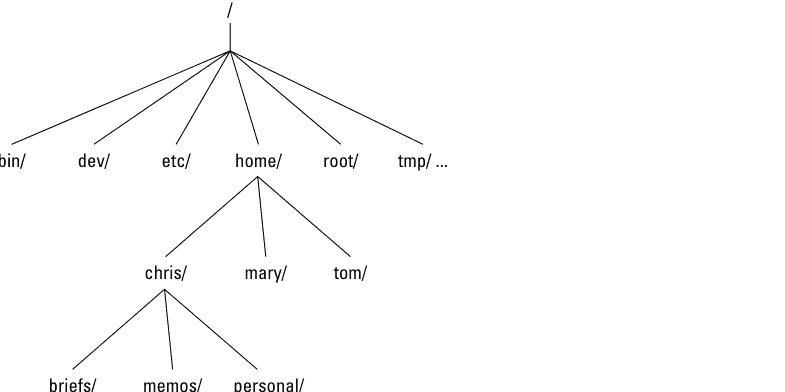

你可能感兴趣的一些 Linux 目录包括：

- `/bin` — 包含常用的 Linux 用户命令，如 `ls`、`sort`、`date` 和 `chmod`。
- `/boot` — 包含可引导内核和引导程序配置文件 (`GRUB`)。
- `/dev` — 包含代表系统设备访问点的文件。这些包括终端设备 (`tty*`)、软磁盘 (`fd*`)、硬盘 (`hd*`)、内存 (`ram*`) 和光驱驱 (`CD-ROM`, `cd*`)。用户通常通过设备文件直接访问这些设备。
- `/etc` — 包含管理文件。
- `/home` — 包含分配给每个拥有登录账户的用户目录（`root` 除外）。
- `/media` — 提供挂载和自动挂载设备的标准位置，例如远程文件系统和可移动介质（目录名为 `cdrecord`、`floppy` 等）。
- `/mnt` — 在被标准的 `/media` 目录取代之前，它是许多设备的常用挂载点。某些可引导的 Linux 系统仍使用此目录挂载硬盘分区和远程文件系统。
- `/proc` — 包含有关系统资源的信息。

### 在 Shell 中运行命令

- `root` — 代表 `root` 用户的主目录。出于安全考虑，`root` 的主目录并不位于 `/home` 下。
- `/sbin` — 包含管理命令和守护进程。
- `/sys` — 一个类似于 `/proc` 的文件系统，在 Linux 2.6 内核中引入，旨在包含用于获取硬件状态并反映内核看到的系统设备树的文件。它的许多许多都继承自 `/proc`。
- `/tmp` — 包含应用程序使用的临时文件。
- `/usr` — 包含用户文档、游戏、图形文件 (`X11`)、库 (`lib`) 以及各种其他用户和管理命令及文件。
- `/var` — 包含各种应用程序使用的数据目录。特别是，你会将作为 FTP 服务器 (`/var/ftp`) 或 Web 服务器 (`/var/www`) 共享的文件放在这里。它还包含所有系统日志文件 (`/var/log`) 和 `/var/spool` 中的池化文件（如邮件、`cups` 和新闻）。

DOS 或 Windows 操作系统中的文件系统与 Linux 的文件结构不同，正如侧边栏“Linux 文件系统与 Windows 文件系统”所解释的那样。

### Linux 文件系统与 Windows 文件系统的对比

尽管在许多方面相似，但 Linux 文件系统与 MS-DOS 和 Windows 操作系统使用的文件系统之间存在显著差异。以下是几点：

- 在 MS-DOS 和 Windows 文件系统中，驱动器器代表不同的存储设备（例如 A: 是软磁盘 C: 是硬盘）。在 Linux 中，所有存储设备都属于文件系统层次结构。因此，整个 `/usr` 可能在单独的硬盘上，或者 `/mnt/rem/` 是另一台计算机的文件系统，这对用户来说是不可见的。
- Linux 使用斜杠 `/` 而不是反斜杠 `\` 来分隔目录名。因此，MS 系统中的 `C:\chris` 在 Linux 系统中是 `/home/chris`。
- DOS 中的文件名始终有后缀名（例如文件的 `.txt` 或处理文件的 `.doc`）。虽然在 Linux 中你有时也可以使用这些后缀，但三个字符的后缀在 Linux 中没有强制性含义。它们对于识别文件类型很有用。许多 Linux 应用和桌面环境使用文件后缀来确定文件内容。但在 Linux 中，`.com`、`.exe` 和 `.bat` 等 DOS 命令扩展名并不意味着它是可执行文件（权限位使 Linux 文件变为可执行）。
- Linux 系统中的每个文件和目录都有与其相关的权限和所有权。微软系统之间的安全性各异。由于 DOS 和 Windows 最初是单用户系统，在设计时这些系统并未内置文件所有权功能。后来的发行版本添加了文件和文件夹属性等功能来解决这个问题。

### 创建文件和目录

作为 Linux 用户，你保存和处理的大多数文件可能都在你的主目录下。表 2-8 显示了创建和使用文件及目录的命令。

| 命令 | 结果 |
| --- | --- |
| `cd` | 切换到另一个目录。 |
| `pwd` | 打印当前（或所在）工作目录的名称。 |
| `mkdir` | 创建一个目录。 |
| `chmod` | 更改文件或目录的权限。 |
| `ls` | 列出目录的内容。 |

以下步骤将引导你在主目录下创建目录并移动目录，并提到了设置适当的文件权限：

1. 回到你的主目录。要执行此操作，只需输入 `cd`。（有关引用你主目录的其他方法，请参见侧边栏“识别目录”）
2. 为了确保你在主目录下，输入 `pwd`。当我执行此操作时，我得到以下响应（你的响应将反映你的主目录）：

```
$pwd

/home/chris
```

3. 在你的主目录下创建一个名为 `test` 的新目录，如下：

```
$ mkdir test
```

### 在 Shell 中运行命令

以下是几个使用大括号进行模式匹配的示例：

```
$ ls [abw]*

apple banana watermelon

$ ls [agw*[ne]

apple grape watermelon
```

在第一个示例中，任何以 a、b 或 w 开头的文件都会被匹配。在第二个示例中，任何以 a、g 或 w 开头且以 n 或 e 结尾的文件都会被匹配。你还可以在括号内包含范围。例如：

```
$ ls [a-g]*

apple banana grape grapefruit
```

在这里，任何从 a 到 g 字母开头的文件都会被匹配。

### 使用文件重定向元字符

命令从标准输入接收数据并将其输出到标准输出。通过管道（之前描述过），你可以将一个命令的标准输出重定向到另一个命令的标准输入。对于文件，你可以使用 `<` 和 `>` 在文件和命令之间重定向数据。以下是文件重定向字符：

- `<` 将文件内容输入到命令。在大多数情况下，这是命令的默认操作，该字符的使用是可选的；使用更多 bigfile。
- `>` 将命令的输出输出到文件，如果文件已存在则覆盖它。
- `>>` 将命令的输出输出到文件，将输出添加到现有文件的末尾。

以下是一些信息在文件之间重定向的命令示例：

```
$ mail root < ~/.bashrc

$ man chmod col -b > /tmp/chmod

$ echo I finished the project on $(date) >> ~/projects
```


在第一个示例中，家目录下的 `.bashrc` 文件被作为邮件发送给用户 `root`。第二个命令格式化了 `chmod` 页面（使用 `man` 命令），删除了多余的空格（`col -b`），并将输出到文件 `/tmp/chmod`（如果 `/tmp/chmod` 文件存在，则将其删除）。最后一个命令将以下文本添加到用户的项目文件中：

I finished the project on Sat Jan 27 13:46:49 PST 2008

### 理解文件权限

在使用 Linux 一段时间后，你几乎肯定会遇到“Permission denied”（拒绝访问）的消息。Linux 中与文件和目录相关的权限旨在防止用户访问其他人的私有文件并保护重要的系统文件。

## 第一部分 Linux 入门

分配给每个文件的 9 位权限定义了你和其他对该文件的访问权限。普通文件的权限位显示为 `-rwxrwxrwx`。

> 注意：对于普通文件，九位权限指示符前面有一个连字符。除了连字符，你还可能会看到 `d`（目录）、`l`（软链接）或 `c`（字符设备）。

这 9 位权限中，前三位适用于所有者权限，中间三位适用于分配给文件的组，后三位适用于所有其他。`r` 代表读，`x` 代表执行。如果是字母而不是连字符，则意味着相关的读、写或执行权限被关闭。

文件和目录有不同类型，它们的读、写和执行权限具有不同的含义。表 2 解释了你可以对每种类型的操作。

## 设置读、写和执行权限

| 权限 | 文件 | 目录 |
|---|---|---|
| 读 (Read) | 查看文件内容 | 查看目录包含什么 |
| 写 (Write) | 修改文件内容、重命名或删除它 | 向目录添加文件或子目录 |
| 执行 (Execute) | 将文件作为程序运行 | 遍历目录或从目录执行程序 |

你可以使用 `ls -ld` 命令查看任何文件或目录的权限。命名文件或目录显示如下：

```
$ ls -ld test

-rw-r--r-- 1 sales Jan 18 22:13 test

drwxr-xr-x 2 sales Jan 24 13:47 test
```

第一行显示 `test` 对所有者有读写权限。所有人都有读权限，这意味着他们可以查看文件但不能更改内容或将其删除。第二行显示目录（由字母 `d` 标识）。所有者拥有读、写和执行权限，而组和其他用户只有读执行权限。结果，所有者可以添加、更改或删除目录中的文件，而其他人只能读取列出目录的内容。

如果你有一个文件，可以使用 `chmod` 命令随意更改它的权限。在这种方法中，每个权限（读、写、执行）被分配一个数字——`u=4`，`w=2`，`x=1`——你使用总和来建立权限。例如，为了让自己完全开放权限，将第一个数字设置为 `7` (`4+2+1`)，然后将第二个和第三个数字设置为 `4` (`4+0+0`)，赋予组和其他读权限，因此最终数字是 `744`。任何权限组合都可以从 `0`（无权限）到 `7`。

### 在 Shell 中运行命令

以下是几个使用大括号进行模式匹配的示例：

```
$ ls [abw]*

apple banana watermelon

$ ls [agw*[ne]

apple grape watermelon
```

在第一个示例中，任何以 `a`、`b` 或 `w` 开头的文件都会被匹配。在第二个示例中，任何以 `a`、`g` 或 `w` 开头且以 `n` 或 `e` 结尾的文件都会被匹配。你还可以在括号内包含范围。例如：

```
$ ls [a-g]*

apple banana grape grapefruit
```

在这里，任何从 `a` 到 `g` 字母开头的文件都会被匹配。

### 使用文件重定向元字符

命令从标准输入接收数据并将其输出到标准输出。通过管道（之前描述过），你可以将一个命令的标准输出重到另一个命令的标准输入。对于文件，你可以使用 `<` 和 `>` 在文件和命令之间重定向数据。以下是文件重定向字符：

- `<` 将文件内容输入到命令。在大多数情况下，这是命令的默认操作，该字符的使用是可选的；使用更多 `bigfile`。
- `>` 将命令的输出输出到文件，如果文件已存在则覆盖它。
- `>>` 将命令的输出输出到文件，将输出添加到现有文件的末尾。

以下是一些信息在文件之间重定向的命令示例：

```
$ mail root < ~/.bashrc

$ man chmod col -b > /tmp/chmod

$ echo I finished the project on $(date) >> ~/projects
```

在第一个示例中，家目录下的 `.bashrc` 文件被作为邮件发送给用户 `root`。第二个命令格式化了 `chmod` 页面（使用 `man` 命令），删除了多余的空格（`col -b`），并将输出到文件 `/tmp/chmod`（如果 `/tmp/chmod` 文件存在，则将其删除）。最后一个命令将以下文本添加到用户的项目文件中：

I finished the project on Sat Jan 27 13:46:49 PST 2008

## 移动、复制和删除文件

移动、复制和删除文件的命令非常直接。要更改文件的位置，使用 `mv` 命令。要将文件从一个位置复制到另一个，使用 `cp` 命令。要删除文件，使用 `rm` 命令。以下是一些示例：

```
$ mv abc def

$ mv abc def

$ cp abc def

$ cp abc ~

$ rm abc

$ rm *
```


> 注意：对于 root 用户，`mv`、`cp` 和 `rm` 命令被别名为带有 `-i` 选项运行。这会产生一个提示要求你确认每次移动、复制和删除，一次一个文件，这样做是为了防止 root 用户不小心弄乱大量文件。

## 使用 vi 文本编辑器

在使用 Linux 一段时间而不使用文本编辑器几乎是不可能的。这是因为 Linux 的大多数配置文件都是纯文本文件，你将来可能需要手动修改它们。

如果你使用 GUI，可以运行 `gedit`，它对于编辑文本来说相当直观。还有一个从 shell 运行的简单文本编辑器叫 `nano`。然而，大多数 Linux shell 用户会使用 `vi` 或 `emacs` 来编辑文件。`vi` 或 `emacs` 相比图形化编辑器的优势在于你可以在任何 shell、字符终端或基于字符的连接中使用它。

网络（例如使用 `telnet` 或 `ssh`）——不需要图形界面（GUI）。它们还包含大量功能，因此你可以通过它们不断成长。

本节提供了 `vi` 文本编辑器的简要教程，你可以用它从任何 shell 手动编辑配置文件。（如果 `vi` 不符合你的需求，请使用侧边栏的“探索其他文本编辑器”获取其他选项。）

`vi` 编辑器起初很难学习，但一旦你学会了它，就不再需要使用鼠标或功能键——你只需使用键盘就可以在文件中快速、高效地进行编辑和移动。

## 探索其他文本编辑器

Linux 有几十种文本编辑器可以使用。以下是你的 Linux 发行版中可能包含的几个，如果你觉得 `vi` 太费劲，可以尝试它们。

| 编辑器 | 描述 |
| :--- | :--- |
| `nano` | 一种流行的、精的文本编辑器，用于许多可启动的 Linux 和其他空间有限的 Linux 环境。例如，`nano` 通常用于在 Linux 安装过程中编辑文本文件。 |
| `gedit` | 在图形界面中运行的 GNOME 文本编辑器。 |
| `jed` | 这种面向屏幕的编辑器是为程序员设计的。通过颜色区分，`jed`可以高亮你创建的代码，让你轻松阅读代码和语法错误。使用 Alt 键选择菜单来操作你的文本。 |
| `joe` | `joe` 编辑器类似于许多 PC 编辑器。使用控制 键和方向键移动。按 Ctrl+C 保存（不保存）或按 Ctrl+X 保存并退出——这种编辑器位于 kdebase 软件包中。它有许多功能，例如针对不同类型编程语言的高亮以及管理自动换行的控制。 |
| `kedit` | KDE 桌面自带的基于图形界面的文本编辑器。 |
| `mcedit` 使用功能键帮助你移动以及保存、复制、移动和删除文本。像 `jed` 和 `joe` 一样，`mcedit` 是面向屏幕的。 |
| `nedit` | 一出色的程序员编辑器。你需要安装可选的 `nedit` 包来获取此编辑器。 |

如果你使用 `ssh` 登录网络上的其他 Linux 计算机，可以使用任何编辑器来编辑文件。基于图形界面的编辑器出现在你的屏幕上。在没有图形界面的情况下，你需要一个运行在 shell 中的文本编辑器，例如 `vi`、`jed` 或 `joe`。

### 开始使用 vi

通常情况下，你启动 `vi` 是为了打开一个特定的文件。例如，要打开名为 `/tmp/test` 的文件，输入以下命令：

```
$ vi /tmp/test
```

如果这是一个新文件，你将看到类似的内容：

```
~
~
*/tmp/test* [New File]
```


顶部的框代表你的光标以及你正在编辑的内容（这里你只是打开了一个新文件）。中间是波浪号（~），因为文件中还没有文本。现在是令人生畏的部分了：这里没有提示、菜单或图标来告诉你该做什么。此外，你不能直接打字。如果你这样做，计算机可能会向你发出哔声。有些人抱怨 Linux 不够友好。

你首先需要了解不同的操作模式：命令模式（command）和输入模式（input）。`vi` 编辑器以命令模式启动。在文件中添加或更改文本之前，你必须输入一个命令（一个或两个字母加一个选项）来告诉它你想做什么。大小写很重要，所以请务必按照示例所示使用大和小写！要进入输入模式，输入 `insert`。要开始，输入以下命令之一：

- `a` 添加命令。之后，你可以输入从光标右侧开始的文本。
- `i` 插入命令。之后，你可以输入从光标左侧开始的文本。

> 提示：当你处于插入模式时，屏幕底部会显示 `INSERT --`。

输入几个单词然后按回车。重复 `a` 次，直到你有几行文本。当你完成输入时，按 `Esc` 返回到命令模式。现在你有了一个包含一些文本的文件，尝试使用以下按键或字母在其中移动：

- 方向键在文件中逐个字符地移动光标上、下、左、右。要向左和右移动，你也可以使用 `Backspace` 和空格键。如果你更喜欢在键盘上使用手指，可以使用 `h`（左）、`l`（右）、`j`（下）或 `k`（上）来移动光标。
- `w` 将光标移动到下一个单词的开头。
- `b` 将光标移动到上一个单词的开头。
- `0`（零）将光标移动到当前行的开头。
- `S` 将光标移动到当前行的末尾。
- `H` 将光标移动到屏幕的左上角（屏幕上的第一行）。
- `M` 将光标移动到屏幕中间行的第一个字符。
- `L` 将光标移动到屏幕的左下角（屏幕上的最后一行）。

你还需要了解的另一个编辑命令是如何删除文本。这里是几个删除命令：

- `x` 删除光标下的字符。
- `X` 删除光标直接左侧字符。
- `dw` 删除从当前字符到当前单词末尾的内容。
- `ds` 删除从当前字符到当前行末尾的内容。
- `d0` 删除从上一个字符到当前行开头的内容。

总结使用：

- `ZZ` 保存并退出。
- `:w` 保存文件。
- `:q` 不保存并退出。
- `:wq` 保存并退出。
- `:q!` 不保存强制退出。

### 在 Shell 中运行命令

本质上是在命令行模式（ex mode）下运行。以下是一些用于搜索和更改文本的命令示例。（我选择了 Local 和 Remote 词进行搜索，但你可以使用任何合适的词。）

- `g:/Local` — 搜索单词 Local 并打印文件中出现该单词的每一行。（如果输出内容超过一屏，输出将通过重定向交给 `more` 命令处理）。
- `s:/Local//Remote` — 在当前行中将单词 Local 替换为 Remote。
- `g:/Local/s//Remote` — 将文件每行中第一次出现的单词 Local 替换为 Remote。
- `g:/Local/s//Remote/g` — 将整个文件中所有出现的单词 Local 替换为 Remote。
- `g:/Local/s//Remote/gp` — 将整个文件中所有出现的单词 Local 替换为 Remote，然后打印每一行以便你查看更改（如果输出超过一页，则通过管道传递给 `more`）。

# 在命令中使用数字

你可以通过在 `vi` 命令前加上数字来使命令重复指定的次数。这是一种一次性处理多个行、多个单词或字符的方便方法。以下是一些示例：

- `3dw` — 删除接下来的三个单词。
- `5cl` — 更改接下来的五个字母（即删除这些字母并进入输入模式）。
- `12j` — 移动 12 行。

在大多数命令前加上数字会重复这些命令。到此时，你应该相当熟练地使用 `vi` 命令了。一旦你开始使用 `vi`，你可能会发现其他文本编辑器的效率没有那么。

> 注意 当你在许多 Linux 系统中调用 `vi` 时，你实际上是在调用 `vim` 文本编辑器，它在 `vi` 兼容模式下运行。进行大量编程的人可能更喜欢 `vim`，因为它能用不同的颜色显示不同层级的代码。`Vim` 还有其他有用功能，例如可以在打开文档时，让光标停留在上次退出该文件时所在的位置。

## 总结

在 Linux 中通过 shell 命令行工作可能没有使用图形界面（GUI）那么简单，但它提供了许多强大且灵活的功能。本章解释了如何在 Linux shell 中导航，并提供了运行命令的示例，包括从历史列表中回溯命令、补全命令以及组合命令。

本章描述了如何使用 shell 环境变量来存储和找回重要信息。它还教你如何修改 shell 配置文件以适应你的需求。最后，本章将向你展示如何使用 Linux 文件系统创建文件和目录、使用权限、处理文件（移动、复制和删除），以及如何从 shell 使用 `vi` 命令编辑文本文件。

## 第 3 章

# 进入桌面

在过去的几年里，Linux 可用的图形用户界面（GUI）已经变得像 Apple Mac 或 Microsoft Windows 系统一样易用。有了这些改进，即使是新手用户也可以开始使用 Linux，而不需要专家在旁指导。

## 本章内容

要上手 Linux 桌面环境，你不需要理解 X 系统的底层框架、窗口管理器、小组件等等。这就是为什么我将开始解释如何使用两个最流行的桌面环境：KDE（K 桌面环境）和 GNOME。之后，如果你想深入研究，我将通过讨论如何选择在 Linux 中运行的基于 X 的窗口管理器，告诉你如何组合出你自己的桌面。

- 了解你的桌面
- 使用 K 桌面
- 使用 GNOME 桌面环境
- 配置你自己的桌面
- 尝试桌面视觉效果 AGLLX

## 了解你的桌面

当你安装 Fedora、SUSE、Mandriva 和 Ubuntu 等发行版时，你可以选择一个桌面环境。Gentoo 和 Debian/Linux 等发行版则允许你自行获取任何你想要的桌面环境（而不会立即提示你选择）。在安装期间获得选择桌面的机会时，你的选择通常包括以下一个或多个：

- KDE桌面环境 (`www.kde.org`) — 除了你预期在完整桌面环境中找到的所有功能（窗口管理器、工具栏、面板、菜单、快捷键绑定、图标等）外，KDE 还有许多花哨功能。

Linux 第一步第一部分

用于图形、多媒体、办公生产力、游戏管理等许多用途的应用程序已经集成并能与 KDE 流畅运行，KDE 是 SUSE、KNOPPIX 以及其他多种 Linux 发行的默认桌面环境。

- GNOME 桌面环境 (`www.gnome.org`) — GNOME 是一个更精的桌面环境。它包含比 KDE 更少的功能集，并在低内存系统中运行得更快。有些人人将 GNOME 视为一种面向业务的桌面。它是 Red Hat 赞助系统（如 Fedora 和 RHEL）、Ubuntu 等的默认桌面。

事实是，X 应用程序在所有描述的桌面环境中运行（前提如前所述，你的 Linux 发行版包含了适当的库）。因此，你可以根据最适合你的性能、定制工具和控制来选择 Linux 桌面。本章描述了这三类桌面环境。

## 启动桌面

因为在 Linux 中启动桌面的方式完全可以配置，所以不同的发行版提供了不同的启动桌面的方法。一旦安装了 Linux 发行版，它可能直接启动到桌面、提供图形登录，或提供基于文本的登录。可启动的 Linux 系统（无需安装）通常直接启动到桌面。

# 启动到桌面

某些可启动的 Linux 系统直接启动到桌面而不需要登录，这样你可以立即开始使用 Linux。KNOPPIX 是一个直接启动到桌面的发行版示例。该系统通常从 CD 直接启动到桌面（在 KNOPPIX 的情况下使用特定的用户名）。要进行系统管理，你需要切换到管理员账户（使用 `su` 或 `sudo` 命令）。

# 进入桌面

# 启动图形登录

大多数桌面 Linux 系统安装在硬盘上后启动到图形登录界面。虽然 X 显示管理器 (`xdm`) 是随 X 窗口自带的基础显示管理器，但 KDE 和 GNOME 都有各自的图形显示管理器（分别为 `kdm` 和 `gdm`）。因此你可能会看到与 KDE 或 GNOME 相关的登录界面，取决于哪个是你 Linux 系统的默认设置。

- 当 Linux 启动时，它进入所谓的运行级别（run level）或系统状态。设置为运行级别 5 的系统启动到图形提示。设置为运行级别 3 的系统启动到文本提示。运行级别通过 `/etc/init` 中的 `initdefault` 行设置为 3 到 5 之间。除非你知道自己在做什么，否则不要使用其他数字。使用 0 或 6，因为这些数字分别用于关机重启系统。

由于图形登录界面被设计为可配置，你通常会发现发行版在登录界面上有自己的或其他图形元素。例如，图 3-1 显示了由 `kdm` 图形显示管理器显示的登录面板。

图 3-1

简单的 KDE 显示管理器 (`kdm`) 登录界面包含时钟、登录名列表和一些菜单选项。

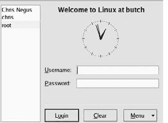

对于 Fedora Linux，默认登录界面基于 GNOME 显示管理器 (`gdm`)。要开始一个会话，你只需要输入登录名（用户名）和密码即可启动你的桌面环境。你选择的桌面环境——KDE 或 GNOME——已经准备好供你使用。虽然系统定义了一个桌面环境，但你通常可以在那些提供 KDE 和 GNOME 的 Linux 系统上切换桌面环境。

要结束会话，你可以选择注销。图 3-2 显示了用于结束会话或更改计算机状态的图形菜单。

## 第一部分 Linux 入门步骤

图 3-2

Fedora 中的会话菜单

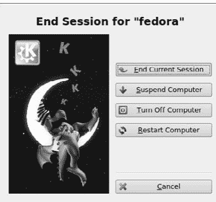

X 显示管理器可以让你完成许多不仅仅进入桌面的工作。虽然不同的图形登录界面提供不同的选项，但以下是你可能会遇到的一些：

- **会话/选项（Session/Options）** — 在登录屏幕上寻找“会话”或“选项”按钮。从那里，你可以选择使用 GNOME、KDE 或安全终端（Failsafe Terminal）环境启动登录会话。（安全终端只是打开了一个终端窗口，可能你可以在不启动桌面环境的情况下对系统进行快速修复。）
- **语言（Language）** 配置为启动多种语言的 Linux 系统可能会让你选择一种语言（默认语言之外）来进入系统。对于这项工作，你必须已经安装了所选语言的支持。
- **重启或关机（Reboot or Shutdown）** 如果你只是想关闭或重启计算机，则不需要登录。大多数图形登录界面都提供从头开始重启或关机的选项。

如果你不喜欢图形登录界面的外观，或者只是想对它的工作方式拥有更大的控制权，有许多方法可以配置和保护图形登录界面。登录后，你可以使用以下工具（以 root 用户身份）来配置登录界面：

- **KDE 登录管理器** — 从 KDE 控制中心，你可以使用登录管理器修改你的 KDE 显示（从 KDE 控制中心，选择系统管理 -> 登录管理器）。你可以更改日志、背景、颜色方案以及与登录界面外观和感受相关的特征。
- **GNOME 登录管理器** — GNOME 登录管理器 (`gdm`) 自带一个登录窗口偏好实用程序（从桌面，以 root 用户身份运行 `gdmsetup` 命令）。在登录窗口偏好中，你可以选择“本地”选项卡并为登录管理器选择一个完全不同的主题。在“安全”选项卡上，你可能会发现所有到 X 服务器的 TCP 连接都被禁止了。不要更改此选择，因为除了显示管理器处理的进程外，不应允许其他进程连接到登录服务器。

用户名和密码通过后，为你的用户账户配置的桌面环境将启动。用户可以根据自己的喜好修改桌面环境（甚至可以更改使用的整个桌面环境）。

# 启动到文本提示

而不是带有图片和颜色的漂亮图形界面，你可能会看到像这样的登录提示：

- - 欢迎来到 XYZ Linux
yourcomputer login:

这是 UNIX 和其他 Linux 系统现在启动时在屏幕上显示的方式，即对于安装为服务器的系统典型的登录提示，或者由于某些原因被配置为不启动 X 显示。运行级别 3（Run level 3）会在多服务器模式下启动纯文本登录提示。

仅仅有文本提示并不意味着你就可以启动桌面环境。许多专家启动到文本提示是因为他们想跳过图形登录界面或偶尔使用一次 GUI。然而，如果你的计算机上安装了 X 和必要的桌面组件，你通常可以在登录后通过输入命令启动桌面：


```
$ startx
```


默认桌面环境将启动，你应该准备就绪了。接下来的操作取决于你拥有的是 KDE、GNOME 还是某种自制环境。

> 在大多数情况下，你在安装期间为视频显卡和显示器设置的 GUI 配置会让你进入运行正常的桌面环境。如果由于某些原因在启动桌面时屏幕不可用，你需要进行一些额外的配置。本章后面的“配置你自己的桌面”描述了一些你可以用来让桌面正常工作的工具。


# KDE 桌面环境

创建 KDE 的目的是为 UNIX（现在是 Linux）工作站提供一个高质量的桌面环境。KDE 集成了用于管理文件、窗口、多桌面和应用程序的工具。如果你会使用鼠标，你就可以学习导航 KDE 桌面。

## Linux 入门步骤

缺乏集成、标准的桌面环境曾阻碍了 Linux 和其他 UNIX 系统在桌面端的被认可。虽然单个应用程序运行良好，但你大多数无法在应用程序之间拖放文件或其他项目。同样，你无法打开一个文件并期望机器启动正确的应用程序来处理它，或者将你的窗口从一个登录会话保存到下一个。有了 KDE，你可以做所有事情，甚至更多。例如，你可以：

- 从文件夹窗口（Conqueror）将文档拖放到垃圾桶图标（删除它），或从 OpenOffice.org Writer 图标（打开进行编辑）。
- 右键点击图像文件（JPEG、PNG 等），“打开方式”菜单允许你选择使用图像查看器（KView）、编辑器（The GIMP）、幻灯片查看器（QuickShow）或其他应用程序打开文件。

为了未来提供更多应用程序，KDE 为开发者提供了一个平台来创建共享信息以及处理不同数据类型的程序。使用 KDE 能做的事情每天都在。

KDE 是 Mandriva、KOPPIX 以及其他 Linux 系统的默认桌面环境。SUSE、openSUSE 和 Red Hat 都使用它。

## 使用桌面

要导航桌面，你可以使用鼠标或组合键。桌面的响应取决于你点击哪个按钮以及鼠标指针的位置。表 3-1 描述了将鼠标放在不同位置时点击每个鼠标按钮的结果。（你可以从“窗口行为”面板更改这些行为中的任何一个。从 KDE 菜单选择“控制中心”，然后选择“窗口行为”。）

点击桌面图标以打开它。双击标题栏会导致窗口遮盖（window-shade）操作，窗口会向上或向下滚动进入标题栏。

## 进入桌面

## 表 3-2 组合键

| 组合键组合 | 结果 | 说明 |
|---|---|---|
| Ctrl+Tab | 在虚拟桌面之间切换 | 要从一个虚拟桌面切换到下一个，按住 Ctrl 键并按 Tab 键，直到看到您想要设置为当前的桌面。然后释放 Ctrl 键进行选择。 |
| Alt+Tab | 在窗口之间切换 | 要要在当前桌面运行的每个窗口之间切换，按住 Alt 键并按 Tab 键，直到看到您想要的窗口。释放 Alt 键进行选择。 |
| Alt+F2 | 打开运行命令框 | 在桌面上打开一个允许您输入并运行命令的框；按住 Alt 键并按 F2。然后，在框中输入命令并按 Enter 键运行。您也可以在此框中输入 URL 来查看网页。 |
| Alt+F4 | 关闭当前窗口 | 按 Alt+F4 关闭当前窗口。 |
| Ctrl+Alt+Esc | 关闭其他窗口 | 要关闭桌面上打开的窗口，按 Ctrl+Alt+Esc。当指针出现骷髅交叉标志时，将指针移动到您想要关闭的窗口上并点击左鼠标键将其关闭（对于没有边框或菜单的窗口这是一个很好的技巧）。 |
| Ctrl+F1, F2, F3, 或 F4 键 | 切换虚拟桌面 | 通过按住 Ctrl 键并按下以下键之一 F1、F2、F3 或 F4 直接进入虚拟桌面。这些操作将分别带您直接进入桌面一、二、三、四；如果您配置了许多桌面，最多可以对八个桌面操作。 |
| Alt+F3 | 打开窗口操作菜单 | 按 Alt+F3 打开活动窗口的操作菜单。当菜单出现时，使用方向键选择操作（移动、调整大小、最小化、最大化等），然后按 Enter 键进行选择。 |

## 使用 Konquerer 文件管理器管理文件

Konquerer 文件管理器有助于帮助将 KDE 环境从一个普通的 X 窗口管理器提升为可以与 Apple 计算或微软的 GUI 竞争的集成桌面。Konquerer 中的功能可以与那些用户友型桌面系统相媲。图 3-4 显示了 KNOPPIX 中 Konquerer 文件管理器窗口的示例。

图 3-4

Konquerer 提供了一个用于管理文件的就绪工具。

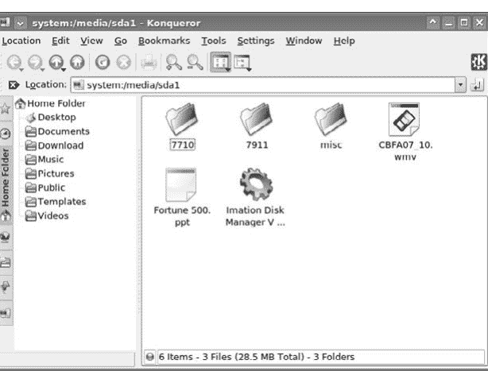

Konquerer 对于文件管理器的优点包括：

- **网络桌面** — 如果您的计算机连接到互联网或局域网，Konquerer 内置的功能允许您创建指向网络文件（使用 FTP）和网页（使用 HTTP）的链接并在 Konquerer 窗口中打开它们。这些链接可以以文件图标的形式出现在 Konquerer 窗口或桌面上。Konquerer 还支持 WebDAV，可以配置为允许对远程文件夹进行本地读写访问（如果您正在维护 Web 服务器，这是一个极佳的工具）。
- **浏览器界面** — Konquerer 界面在选择文件、目录和 Web 内容方面与 Firefox、Internet Explorer 等其他网络浏览器类似。由于 Konquerer 是基于浏览模型的，单击一次即可打开文件、网络资源链接或应用程序。您也可以通过在位置框中输入 Web 样式的地址来打开内容。Konquerer 使用的渲染引擎 KKHTML 也用于 Safari（适用于 Apple Mac OS X 系统的流行网络浏览器）。

## 进入桌面

Konquer 默认支持包含 Java 和 JavaScript 内容的网页。要检查是否启用了 Java 和 JavaScript 支持，选择 Settings -> Configure Konquer。在设置窗口中，点击 Java & JavaScript 并选择该选项卡。要启用 Java，点击 Enable Java globally 并点击 Apply。对 JavaScript 标签重复此操作。

- **文件类型和 MIME 类型** — 如果您希望由特定应用程序启动特定类型的文件，可以配置该文件。KDE 已经定义了几种 MIME 类型，以便特定的文件和数据类型可以自动检测并在正确的应用程序中打开。适用于音频、图像、视频以及各种其他内容。

当然，您也可以使用 Konquer 执行许多标准文件管理器功能。例如，您可以使用选择、移动、复制、粘贴和删除等功能来操作文件；在目录中搜索文件；创建新项目（文件夹、链接等，仅不一）；查看已打开的文件和网站历史；以及创建书签。

## 处理文件

由于 Konquer 中处理文件的大多数方式都是直观的（按意图的），表 3–3 提供了如何进行基本文件操作的简要说明。

### 表 3-3 在 Konquer 中处理文件

### 任务 | 动作 |
|---|---|
| 打开文件 | 左点击文件。如果可能，它将直接在 Konquer 窗口中打开，或者在该文件类型的默认应用程序中打开。您也可以通过左点击它们打开目录、应用程序和链接。 |
| 使用特定应用程序打开文件 | 右点击数据文件，在弹出菜单中选择 Open With，然后选择一个可用应用程序来打开文件。列出的应用程序是设置给该文件的程序。选择 Other 来选择不同的应用程序。 |
| 删除文件 | 右点击文件并选择 Delete。系统会询问您是否要删除。点击 Yes 永久删除。 |
| 复制文件 | 右点击文件并选择 Copy。这会将文件复制到剪贴板。 |

### 表 3-3 在 Konquer 中处理文件（继续）

### 任务 | 动作 |
|---|---|
| 粘贴文件 | 右点击（在文件夹区域）并选择 Paste。复制的文件将粘贴到当前文件夹中。 |
| 链接文件 | 将文件拖动到另一个文件夹。当菜单出现时，点击 Link。链接文件让您无需创建副本即可访问文件。 |
| 移动文件 | 当原始文件和目标文件夹都在桌面上时，点击并按住左鼠标键移动文件，将其拖放到文件夹并释放鼠标。从菜单中点击 Move。 |

还有几种用于查看 Konquer 中文件和文件夹的功能：

- **查看文件信息**: 将指针悬停在文件上，会在页脚显示文件名、大小和类型等信息。 |
- **查看隐藏文件**: 选择 Show Hidden Files 可以看到以点 (.)开头的文件。点文件用于配置，通常不在日常工作中查看。 |
- **查看文件系统树**: 选择 Tree 提供文件夹的树形视图，显示当前文件夹以上的文件夹。您可以点击树中的文件夹直接跳转到该处。 |
- **更改图标**: 选择 Icon Size，然后选择 Large、Medium 或 Small 来设置窗口中显示的图标大小。您也可以选择 Default 返回到默认图标大小（中），除非您通过 Configure Konquer 窗口更改了默认。 |

## 搜索文件

如果您正在寻找特定的文件或文件夹，可以使用 Konquerer Find 功能。要打开 Find 窗口搜索文件，请打开本地文件夹（例如 `/home/chris`）并选择 Tools

## 进入桌面

点击“查找”（Find），在您的 Konqueror 窗口中会出现查找框。您也可以通过在终端窗口中输入 `kfind` 来启动 kfind 窗口。

图 3-5 显示了 Konqueror 中的 kfind 窗口。

图 3-5

通过 kfind 窗口搜索文件和文件夹。

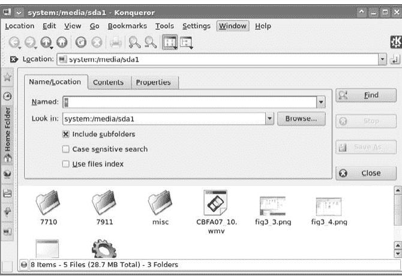

输入要搜索的文件名称（在“命名”Named 文本框中）以及要搜索的文件夹（包括所有子文件夹，在“查找位置”Look in 文本框中）。点击“查找”（Find）按钮。您可以在搜索时使用元字符。例如，搜索 `*, r*` 来查找所有以 .rmp 结尾的文件，或者搜索 `z*` 来查找所有以 z 开头并以 .doc 结尾的文件。您还可以选择区分大小写，或点击“帮助”（Help）按钮获取更多有关搜索的信息。

要限制搜索范围，您可以点击“日期范围”（Date range）并输入一个日期范围（在之间）、今天之前的几个月（在过去的 x 个月内）或今天之前的天数（在过去的几天内）。选择“高级”（Advanced）选项卡可以将搜索限制为特定类型的文件（类型 Type）、包含您输入的文本的文件（包含文本 Containing Text）或特定大小的文件（以 KB 为单位的大小）。

## 创建新文件和文件夹

在使用 Konqueror 窗口时，您可以创建各种文件。选择“编辑”（Edit）->“新建”（Create New），然后选择“文件夹”（Folder 以创建一个新文件夹）或“文件或设备”（File or Device）子菜单中的几种不同类型之一。根据您使用的 Konqueror 版本，您可能可以创建以下所有文件类型：

- **HTML 文件** — 打开对话框，允许您输入要创建的 HTML 文件名称。
- **应用程序链接** — 打开一个窗口，允许您输入应用程序的名称。点击“权限”（Permissions）选项卡以过过设置文件权限（如果想将文件作为程序运行，则必须勾选 Exec）；点击“执行”（Execute）选项卡并输入要运行的程序名称（在“类型窗口” Type Window字段字段）。如果是基于文本的命令，请勾选“在终端运行”（Run in）复选框。勾选“以不同用户运行”并添加名称。点击应用程序以分配给处理特定 MIME 类型的文件。点击确定。
- **位置链接 (URL)** — 选择此菜单项将打开一个对话框，允许您链接到 Web 地址。输入一个代表名称，并输入该站点的 URL 名称（Web 地址）。请确保使用 http://、ftp:// 或其他前缀。）
- **文本文件** — 打开对话框，允许您创建一个文本格式的文档并将其放入 Konqueror 窗口中。输入要创建的文档名称并点击确定。

在“设备”（Device）子菜单下，您可以进行以下选择：

- **CD-ROM 设备** — 打开对话框，允许您输入新的 CD-ROM 设备名称。点击“设备”（Device）选项卡并输入设备名称（例如 `/mnt/cdrom`）以及文件系统类型（您可以使用 iso9660 作为标准 CD-ROM 文件系统，用于 Linux 的 ext2，或用于 DOS 的 msdos）。当图标出现时，您可以打开它来挂载 CD-ROM 并显示其内容。
- **CDWRITER 设备** — 从弹出的窗口中，输入您的设备名称
- **DVD-ROM 设备** — 打开对话框，允许您输入新的 CD-ROM 或 DVD-ROM 设备名称。点击“设备”（Device）选项卡并输入设备名称（例如 `/dev/cdrom`）、挂载点（例如 `/mnt/cdrom`）以及文件系统类型（您可以使用 iso9660 作为标准 CD-ROM 文件系统，用于 Linux 的 ext2，或用于 DOS 的 msdos）。当图标出现时，您可以打开它来挂载 CD-ROM 或 DVD-ROM 并显示其内容。
- **相机设备** — 在打开的对话框中，识别提供给数码相机设备名称。
- **软磁盘设备** — 打开对话框，您在其中输入新的软磁盘名称。点击“设备”（Device）选项卡并输入设备名称（例如 `/dev/fd0`）以及文件系统类型（您可以使用自动检测内容，用于 Linux 的 ext2 和用于 DOS 的 msdos）。当图标出现时，打开它来挂载软盘并显示其内容。
- **硬盘设备** — 打开对话框，允许您输入新的硬盘或硬盘分区名称。点击“设备”（Device）选项卡并输入设备名称（例如 `/dev/hda1`）、挂载点（例如 `/mnt/win`）以及文件系统类型（您可以使用自动检测内容，用于 Linux 的 ext2 或 ext3，或用于 Windows 文件系统的 vfat）。当图标出现时，您可以打开它来挂载文件系统并显示其内容。

创建 MIME 类型和应用程序将在本章稍后部分介绍。

## 使用其他浏览器功能

由于 Konquer 既像 Web 浏览器又像文件管理器，因此它包含了许多其他浏览器功能。例如，“书签”（bookmarks）功能允许您保留访问过的网站的书签列表。点击“书签”，将出现您已书签网站的下拉菜单。从列表中选择以返回某个网站。有几种方法可以添加和更改书签列表：

- **添加书签** — 要将当前显示的页面地址添加到书签列表，点击“书签”并“添加书签”。
- **编辑书签** — 要更改您的书签列表，点击“书签”并“编辑书签”。
- **新建文件夹** — 要创建一个新文件夹，点击“书签”并“新建文件夹”。
- **搜索书签** — 要搜索您的书签，点击“书签”并“搜索书签”。

## 配置 Konqueror 

您可以通过点击“设置”（Settings）更改 Konqueror 的行为：

 ** **文件关联** — 选择为每种文件类型启动程序。
- **外观** — 更改字体和颜色。
- **Java 和 JavaScript** — 启用或禁用网页中的 JavaScript 内容。
- **广告拦截过滤器** — 点击此处创建过滤 列表。
- **字体** — 选择默认使用的各种字体。
- **网络快捷方式** — 显示您用于访问不同网站的关键词列表。
- **侧边栏** — 修改访问过的网站列表的行为。
- **Cookies** — 选择在 Konqueror 中启用哪些 Cookie。
- **缓存** — 指明硬盘上可以使用多少空间来存储访问过的网站。
- **代理** — 配置代理 Konqueror 通过代理服务器访问互联网。
- **样式表** — 选择使用默认样式表、用户定义的样式表或自定义样式表。

## 进入桌面

- **加密 (Crypto)** — 显示可以被征服者（Conqueror）浏览器接受的安全性证书列表。默认情况下，它接受安全套接层协议（SSL）版本 2 和 3 证书，同时也支持 TLS（如果服务器支持的话）。你还可以选择在进入或离开网站时接收通知。

- **浏览器识别** — 设置 Conqueror 在访问网站时如何标识自己。默认情况下，Conqueror 告诉网站它是 Mozilla Web 浏览器。你可以选择让 Conqueror 在特定网站上显示为不同的 浏览器。当网站因为你没有特定类型的浏览器而拒绝你的访问时，你有时需要这样做（尽管 Conqueror 完全有能力显示内容）。

- **插件** — 显示 Conqueror 将搜索插件的目录列表。Conqueror 还可以扫描你的电脑，寻找安装在其他位置的插件。

- **性能** — 显示用于改进 Conqueror 性能的配置设置。你可以在 KDE 启动后预加载实例，或最小化内存占用。

## 管理窗口

如果你在桌面上几个图标并同时打开了多个窗口，整理这些项目可以让管理桌面变得简单得多。KDE 通过维护你可以操作的窗口以及保持窗口和图标有序的快捷方式来提供帮助。

## 使用任务栏

当你打开一个窗口时，屏幕任务栏中会出现一个代表该窗口的按钮。以下是如何通过任务栏管理窗口的方法：

- **切换 (Toggle)** — 左键点击任务栏中的任何运行任务，可以在打开窗口和最小化窗口之间切换。

- **位置 (Position)** — 你可以选择让选定的窗口位于其他窗口之上或之下，或者全屏显示。右键点击任务栏中的运行任务并选择“高级”。然后选择“置顶”、“置底”或“全屏”。

- **移动 (Move)** — 将窗口从当前桌面移动到任何虚拟桌面顶部。右键点击任务栏中的任何任务，选择“到桌面”，然后选择任何桌面编号。窗口将移动到该桌面。

无论你处于哪个虚拟桌面，所有运行中的窗口都会显示在任务栏中。如果同一类型的多个窗口显示为单个任务，你可以右键点击该任务；然后选择“全部到桌面”，将所有相关窗口移动到桌面。

## 第一部分 Linux 初步

### 使用 Konqueror 创建图片库

Konqueror 有一个非常棒的功能可以让你快速创建一个图片库。该功能获取一个图片目录，为每张图片创建缩略图，并生成一个 HTML（网页）页面。HTML 页面包含你选择的标题、在页面上的所有图片缩略图以及指向大图片的链接。以下是操作方法：

1. 将你想放入图片库的图片添加到任何文件夹（例如 `/home/chris/Pictures`）。在开始之前，确保它们已按照你的喜调整了尺寸、旋转和裁剪。（尝试在终端输入 `gimp` 使用 GIMP 处理你的图片。）
2. 在 Konqueror 中打开文件夹（例如，在位置框中输入 `/home/chris/Pictures`）。
3. 点击“创建图片库”，出现“创建图片库”窗口。
4. 在“页面标题”框中输入图片的标题。你还可以选择图片库的其他属性，例如行数、显示在页面上的图片信息（名称、大小和尺寸）以及颜色。
5. 点击“确定”。

Konqueror 会生成缩略图并将它们添加到 `thumbs` 目录。图片库本身会打开并保存到 `images.html` 文件中。（选择“按钮”以不同的名称保存图片库。你还可以在选定深度的递归子文件夹中创建图片库。）你现在可以把此目录的所有内容创建到 Web 服务器并在互联网上发布你的照片。以下是 Konqueror 图片库的示例。

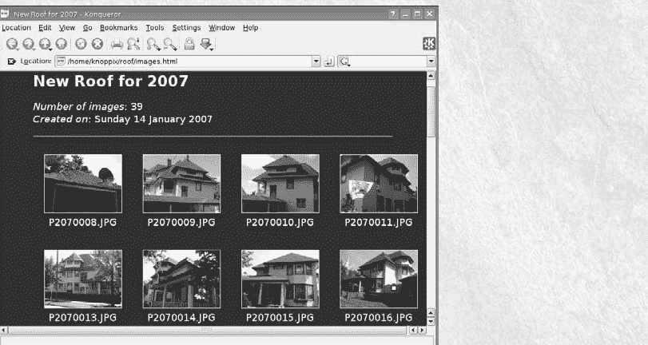

## 进入桌面

### 整理桌面

如果你的窗口散落在桌面到处，有几种方法可以让你的桌面看起来更整洁：

- **整理窗口 (Unclutter windows)** — 右键点击桌面，选择“窗口”。所有显示在桌面上的窗口将沿屏幕左侧对齐（或与其他窗口对齐）。
- **叠放窗口 (Cascade windows)** — 右键点击桌面，选择菜单中的“叠放窗口”。窗口将对齐，从左上角开始缩进。

如果你发现图标散落在桌面到处，可以从桌面菜单整理它们。右键点击桌面，选择“图标排序”。在出现的菜单中，按名称、大小、类型或日期排序。你还可以选择垂直或水平对齐所有图标。

## 移动窗口

将窗口从一个位置移动到另一个位置的最简单方法是将光标放在窗口标题栏，按住鼠标键将窗口拖到新位置，然后松开鼠标键放置。另一种方法是点击窗口菜单（标题栏左上角），选择“移动”，移动鼠标以重新定位窗口，然后再次点击放置。


> 如果你发现图标散落在桌面到处，可以从桌面菜单整理它们。右键点击桌面，选择“图标排序”。在出现的菜单中，按名称、大小、类型或日期排序。你还可以选择垂直或水平对齐所有图标。

## 调整窗口大小

将从一个位置移动到另一个位置的最简单方法是将光标放在窗口标题栏，按住鼠标键将窗口拖到新位置，然后松开鼠标键放置。另一种方法是点击窗口菜单（标题栏左上角），选择“移动”，移动鼠标以重新定位窗口，然后再次点击放置。


## 进入桌面

点击想要主题旁边的 $(+)$ 号，然后选择你想要配置的特定项目。以下章节描述了你可以配置的一些功能。

### 将窗口固定在顶部或底部

将从一个位置移动到另一个位置的最简单方法是将光标放在窗口标题栏，按住鼠标键将窗口拖到新位置，然后松开鼠标键放置。另一种方法是点击窗口菜单（标题栏左上角），选择“移动”，移动鼠标以重新定位窗口，然后再次点击放置。

## Linux 初步

### 使用虚拟桌面

将从一个位置移动到另一个位置的最简单方法是将光标放在窗口标题栏，按住鼠标键将窗口拖到新位置，然后松开鼠标键放置。另一种方法是点击窗口菜单（标题栏左上角），选择“移动”，移动鼠标以重新定位窗口，然后再次点击放置。

### 配置桌面

将从一个位置移动到另一个位置的最简单方法是将光标放在窗口标题栏，按住鼠标键将窗口拖到新位置，然后松开鼠标键放置。另一种方法是点击窗口菜单（标题栏左上角），选择“移动”，移动鼠标以重新定位窗口，然后再次点击放置。

### 更改显示

你可以更改桌面的很多视觉感受。在“外观与主题”主题下（选择加号），你可以更改背景、颜色、图标、启动反馈、面板、屏幕保护程序、主题管理器和窗口装饰。

以下是你可能想要更改的功能：

- **背景 (Background)** — 在控制中心的“外观与主题”标题下，选择“背景”。默认情况下，所有桌面使用相同的背景。要为每个桌面设置不同的背景，勾选“设置桌面”框，选择四个桌面中的任意一个，然后选择当前桌面所需的背景。对于每个桌面，选择“图片”、“幻灯片”或“无图片”。对于“图片”，你可以从下拉菜单选择几种背景，也可以浏览文件系统查找图片。要制作幻灯片，点击“幻灯片”并选择“设置”（选择你的照片并定义它们的切换方式）。

点击“应用”应用你的选择。

- **屏幕保护程序 (Screen Saver)** — 在“外观与主题”标题下，选择“屏幕保护程序”。在出现的窗口中，从屏幕保护程序列表中选择。KNOTPIX 只包含空白的屏幕保护程序。然而，Fedora 带有约 160 个屏幕保护程序。我最喜欢“幻灯片”，你可以为屏幕保护程序设置图片幻灯片。点击“设置”导入图片目录或设置屏幕保护程序的行为。在设置中，选择空闲几分钟后启动屏幕保护程序。你还可以选择“需要密码”，以便在屏幕保护程序启动后访问桌面前输入密码。

- **字体 (Fonts)** — 你可以为出现在桌面上的不同位置分配字体。在“外观与主题”标题下，选择“字体”。选择一种字体类别（普通、等宽、工具栏、菜单、窗口标题、任务栏或桌面字体）。然后点击“选择”复选框，从“选择列表”中选择分配给该类别的字体。如果字体可用，示例文本框将显示文本示例。

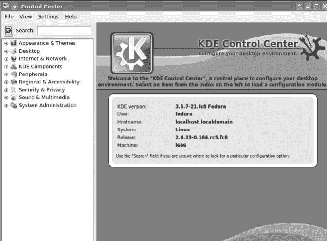

## 第一部分 Linux 入门

要使用 100 dpi 字体，你需要在 `/etc/X11/xorg.conf` 文件中添加 100 dpi 字体的条目。完成更改后，你需要重启 X 服务器才能生效。

此外，你还可以更改所选字体的显示方式（磅值）和字符集（以选择 ISO 标准字符集）。点击“应用”保存更改。

- **颜色** — 在“外观与主题”（Appearance & Themes）标题下，选择“颜色”。该窗口允许你更改桌面上所选项目的颜色。可以从“颜色方案”列表中选择任何一种完整的配色方案。或者从“小部件”颜色框中选择一个来更改特定项目。你可以更改的项目包括文本、背景、链接、按钮和标题栏。

### 更改面板属性
对于大多数人来说，面板是他们选择活动桌面和运行应用程序的地方。你可以通过“配置面板”窗口更改面板行为。右键点击面板上的任何空白处，并选择“配置面板”。你可以在“设置”窗口中更改这些功能：

- **布局** — 通过点击面板位置框中的“顶部”、“左侧”、“底部”或“右侧”来更改面板的位置。“面板样式”选择允许你将面板尺寸从“中”更改为“极小”、“小”或“大”。
- **隐藏** — 某些选项允许你自动隐藏面板或隐藏按钮。在“隐藏模式”标题下，选择是在点击面板隐藏按钮时隐藏面板，还是在光标不在面板区域几秒钟后自动隐藏它。你还可以选择显示或不显示隐藏按钮。通过滑块可以选择面板和按钮隐藏的延迟和速度。
- **菜单** — 与 GNOME 菜单不同，在 KDE 中，你能够从图形用户界面（GUI）操作主菜单。点击“编辑 K 菜单”。KDE 菜单编辑器允许你从菜单中剪切、复制、粘贴、删除和修改子菜单以及应用程序。
- **外观** — 你可以更改面板的背景（透明度或背景图像）或背景颜色（使用颜色或图案）。还可以更改在将鼠标悬停在桌面项目上时是否显示工具提示。
- **任务** — 任务栏的外观和行为。从“操作”框中，可以选择点击任务栏上每个鼠标按键时发生的动作。你还可以选择窗口在任务栏上的排序和显示方式。

# 添加应用程序启动器和 MIME 类型
你能够快速访问你最常用的应用程序。实现此点的最佳方法之一是在面板或桌面上添加图标，通过单击即可启动所需的应用程序。将应用程序添加到面板和桌面的步骤将在后续章节中描述。

### 将应用程序添加到面板

你可以轻松地将任何 KDE 应用程序添加到 KDE 面板中。方法如下：

1. 右键点击面板上的空白区域。
2. 选择“将应用程序添加到面板”。
3. 选择一个的类别之一。
4. 选择该类别中的任何应用程序（或选择“将此菜单添加到整个应用程序菜单”）。

代表应用程序的图标会立即出现在面板上。（如果面板看起来有些拥挤，你可能想要移除不需要的应用程序。）

如果你以后决定不再在面板上使用此应用程序，右键点击图标边缘并点击“移除”按钮。如果想将其移动到面板上的不同位置，右键点击它，点击“移动”，将其移动到面板上你想要的位置，然后再次点击即可。

# 将应用程序添加到桌面

要将应用程序添加到桌面，请使用桌面菜单。方法如下：

1. 右键点击桌面的空白区域。
2. 从菜单中选择“新建应用程序快捷”。
3. 在弹出的属性窗口中，点击“常规”选项卡，将“应用程序快捷”替换为你希望在桌面上显示的应用程序名称。在同一选项卡上，点击齿轮图标并从列表中选择一个来代表你的应用程序。
4. 点击“应用程序”选项卡，添加应用程序的描述和注释。在“命令”框中，输入你想运行的命令或浏览文件系统（点击“浏览”按钮）来找到要运行的命令。
5. 点击“确定”，新启动器的图标将出现在面上。

如果你以后决定不再在桌面上使用此应用程序，右键点击图标并点击“删除”或“移动到垃圾箱”。

## GNOME 桌面

GNOME（读作 gah-nome）提供了安装 Fedora、Ubuntu 或其他 Linux 系统时默认提供的桌面环境。该桌面环境提供了位于 X 窗口系统框架与窗口管理器提供的视觉效果之间的软件。GNOME 是一个稳定可靠的桌面环境，具有一些酷炫的功能。

GNOME 2.18 随最新版本的 Fedora 发布。GNOME 的改进包括 3D 效果的进展（参见本章后面的“带有 AIGLX 的 3D 效果”）、改进的可用性功能以及用于电源管理和笔记的应用。

## 第一部分 Linux 入门

在线桌面（Online Desktop）是 Fedora 的新功能，旨在提供一个基础界面，作为仅运行在线应用程序（如 Facebook、Gmail 等）的平台。更多信息请参阅本章后面的“配置 GNOME 在线桌面”部分。

> 注意

如果你使用的是 GNOME 桌面，你应该熟悉以下组件：

- Metacity（窗口管理器） — Fedora 和 RHEL 中 GNOME 的默认窗口管理器是 Metacity。Metacity 配置选项允许你选择桌面上使用的主题、窗口边框和控件。
- Nautilus（文件管理器/图形外壳） — 当你打开一个文件夹时（例如，双击桌面上的图标），Nautilus 窗口就会打开。Nautilus 显示所选文件夹的内容。Nautilus 还可以显示其他类型的内容（使用 SMB）。
- GNOME 桌面（注：此处原文应为 GNOME panels，译文误为 GNOME 桌面，此处根据上下文理解为面板）
- GNOME 面板（应用程序/任务器）— 这些面板位于屏幕顶部和底部，旨在方便你启动应用程序、管理运行中的应用程序以及处理多个桌面。顶部面板包含菜单（应用程序、位置和桌面）、桌面启动器（Evolution 邮件和 OpenOffice 应用程序）、切换器（用于管理四个虚拟桌面）以及时钟。底部面板包含列表和切换器。桌面区域 — 你使用的窗口和图标排列在桌面区域，该区域支持应用程序之间的拖放、桌面菜单（右键点击）以及启动应用程序的图标。计算机图标将光驱驱动器、软磁盘、文件系统和共享网络资源整合在一起。

如果你使用过旧版本的 GNOME，可能会发现最新版本中的一些新增：

- Totem 中的 XSPF 播放列表 — Totem 视频音频播放器现在支持标准的 XSPF 播放列表（www.xspf.org）。Totem 的改进允许其与网站交互。
- 屏幕预览 — 支持在全屏模式下使用 Nautilus 光刻。
- 直接刻录 DVD — 使用 Nautilus 光刻可以直接刻录 DVD，无需先创建 ISO 镜像。
- 从任务栏拖拽 — 将应用程序拖到切换器表示的工作区。
- Nautilus 文本或按钮浏览 — 在 Nautilus 中保存或打开文件/文件夹时，一个新的切换允许你选择通过点击按钮或通过完整路径名称进行浏览。

GNOME 还包含一组“偏好”，允许你配置桌面的各个方面。你可以更改背景、颜色、字体、快捷键以及与桌面外观和行为相关的功能。图 3-7 显示了首次登录时 GNOME 桌面环境的状态，并添加了一些窗口。

### 图 3-7

GNOME 桌面环境

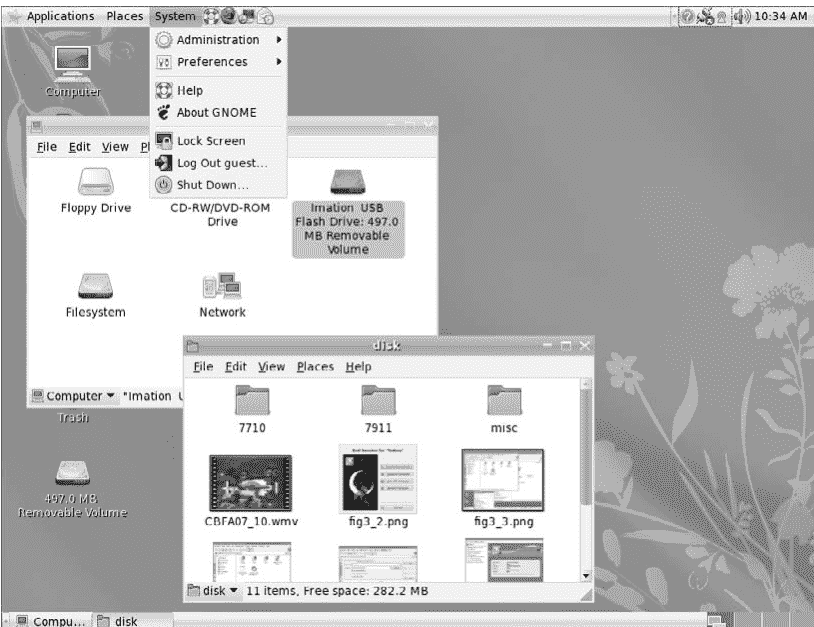

图 3-7 所示的桌面适用于 Fedora。后续章节提供了使用 GNOME 桌面的详细信息。

## 第一部分 Linux 步骤

要在 Fedora 中使用 3D 效果，最佳解决方案是使用 Compiz 窗口管理器，本文将在稍后部分对其进行描述。

Metacity 能够做的事情不多（除非是为了高效地完成工作）。为 Metacity 分配新主题以及更改颜色和窗口装饰是通过 GNOME 偏好设置完成（将在稍后描述）。目前存在一些 Metacity 主题，但预计未来还会增加。

你可能感兴趣的 Metacity 基本功能是键盘快捷键和工作空间切换器。表 3-4 显示了在 Metacity 窗口管理器中导航的快捷键。

| 操作 | 组合键 |
| --- | --- |
| 窗口焦点 | 向前循环，带有弹出图标 | Alt+Tab |
| 向后循环，带有弹出图标 | Alt+Shift+Tab |
| 向前循环，不带弹出图标 | Alt+Esc |
| 向后循环，不带弹出图标 | Alt+Shift+Esc |
| 面板焦点 | 在面板间向正循环 | Alt+Ctrl+Tab |
| 在面板间向后循环 | Alt+Ctrl+Shift+Tab |
| 工作空间焦点 | 向右移动 | Ctrl+Alt+right arrow |
| 向左移动 | Ctrl+Alt+left arrow |
| 移动到上方工作空间 | Ctrl+Alt+up arrow |
| 移动到下方工作空间 | Ctrl+Alt+down arrow |
| 最小化/最大化所有窗口 | Ctrl+Alt+D |
| 显示窗口菜单 | Alt+Spacebar |
| 关闭菜单 | Esc |

另一个感兴趣的 Metacity 特性是工作空间切换器。GNOME 面板上的工作空间切换器会出现四个虚拟工作空间。你可以通过工作空间切换器执行以下操作：

- **选择当前工作空间** — 切换器会出现四个虚拟工作空间。点击四个工作空间中的任何一个使其成为当前工作空间。
- **移动到其他工作空间** — 点击任何工作空间（每个工作空间由一个小矩形表示），将其拖放到另一个工作空间。同样，你可以从窗口列表中拖动一个应用程序，将其移动到另一个工作空间。

# 进入桌面

- **添加更多工作空间** — 右键点击工作空间切换器并选择“偏好”。你可以添加工作空间（最多 32 个）。
- **命名工作空间** — 右键点击工作空间切换器并选择“偏好”。点击“工作空间”，将工作空间的名称更改为你选择的任何名称。

你可以使用 `gconf-editor` 窗口（通过终端）查看并更改 Metacity 控制和设置信息。如窗口所示，不建议更改偏好，可能时应通过 GNOME 偏好设置更改桌面。然而，gconf-editor 是查看每个 Metacity 特性描述的好方法。

在 gconf-editor 窗口中，选择 `apps metacity`，然后从 `general`、`global_keybindings`、`keybindings_commands`、`window_keybindings` 和 `workspace_names` 中选择。点击每一项查看其值以及键的短和详细描述。

## 使用 GNOME 面板

GNOME 面板位于 GNOME 桌面的顶部和底部。通过这些面板，你可以启动应用程序（通过按钮或菜单）、查看哪些程序正在运行并监控系统运行情况。还有许多更改顶部和底部面板的方法——例如添加应用程序或显示器，或者更改面板的位置或行为。

在面板上的任何空白处点击右键以查看面板菜单。图 3-8 显示了顶部的面板菜单。

图 3-8
GNOME 面板菜单

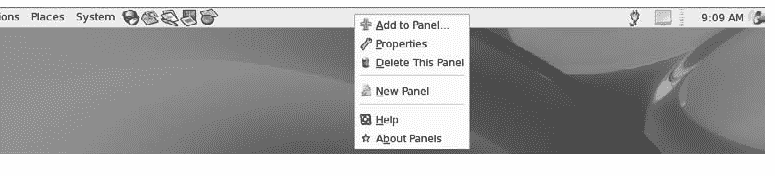

在 GNOME 面板菜单中，你可以选择多种功能，包括：

- **添加到面板** — 添加小组件、菜单、启动器、抽屉或按钮。
- **属性** — 更改面板的位置、大小和背景属性。
- **删除此面板** — 删除当前面板。
- **新建面板** — 在你的桌面上添加不同样式和位置的面板。

## Linux 初步

你也可以对面板上的项目操作。例如，你可以：

- **移动项目** — 要移动面板上的项目，请右键点击它，选择“移动”，然后将其拖动到新位置。
- **调整项目大小** — 某些元素（如窗口列表）可以通过点击边缘并拖动到新尺寸来调整大小。
- **使用窗口列表** — 运行在桌面上的任务显示在窗口列表区域。点击任务可以最小化或最大化它。

接下来的章节描述了你可以对 GNOME 面板进行的一些操作。

# 使用应用程序、位置和系统菜单

应用程序菜单显示了你从桌面将使用的多数应用程序和系统工具。“位置”菜单允许你选择去的地方，例如桌面文件夹、主目录、可移动介质或网络位置。“系统”菜单允许你更改偏好和系统设置，并获取有关 GNOME 的其他信息。

点击面板上的“应用程序”，你会看到你选择的应用程序和系统工具分类。点击你想启动的应用程序。要从菜单中添加项目以便其从面板启动，请将想要的项目拖到面板上。你可以手动将项目添加到 GNOME 菜单中。

要添加到主菜单，请在 `/usr/share/applications` 目录下创建一个 `.desktop` 文件。最简单的方法是复制一个现有的 desktop 文件。


# [Desktop Entry]

`Encoding`=`UTF-8`

`Name`=`My Player`

`Comment`=`Play Videos`

`Exec`=`player`

`Icon`=`sound-audio`

`StartupNotify`=`true`

`Terminal`=`false`

`Categories`=`GNOME;Audio;`


# 进入桌面

从前面的示例可以看出，My Player 带有 sound-audio 图标。鼠标指针悬停在菜单上时会出现这些字。命令是。

# 添加小组件

有许多小型应用程序称为小组件，可以运行在 GNOME 面板上。这些应用程序可以显示你可能经常查看的信息或提供娱乐。要查看可用的小组件并将其添加到面板，请执行以下步骤：

1. 在面板的空白处点击右键以显示菜单。
2. 选择“添加到”。出现添加面板窗口。
3. 从几十个小组件中选择，包括时钟、字典查询、股票指数和天气报告。你选择的小组件将出现在面板上，供你使用。

将小组件放在面板上便于访问。

小组件安装后，在面板上点击右键以查看可用选项。例如，选择股票指数的“偏好”，你可以添加或删除想要监控的股票。如果你不喜欢小组件的位置，右键点击它，点击“移动”，移动鼠标直到小组件位于你想要的位置（甚至是另一个面板），然后点击设置其位置。

如果你想从面板删除小组件，请右键点击它，然后点击“从面板删除”。代表小组件的图标将消失。如果你发现面板空间不足，可以按照下一节所述，在屏幕的其他部分添加新面板。

# 添加另一个面板

你的 GNOME 桌面上有多个面板。你可以添加贯穿整个底部、顶部或侧面的面板。要添加面板，请执行以下操作：

1. 在面板的空白处点击右键以显示面板菜单。
2. 选择“新建面板”。新面板出现在屏幕侧面。
3. 在新面板的空白处点击右键并选择“属性”。
4. 在面板属性中，从“方向”框选择你想要的面板的位置（顶部、底部、左侧或右侧）。

## 第一部分 Linux 入门

在添加面板后，你可以像对默认面板那样向其添加应用组件（applets）或应用程序启动器。要移除面板，请右键点击它并选择“删除此面板”（Delete This Panel）。

## 添加应用程序启动器

面板上的图标代表网络浏览器和若干办公效率应用程序。你也可以添加自己的图标来从面板启动应用程序。要向面板添加新的应用程序启动器，请执行以下操作：

- 1. 在面板的空白处点击右键。
- 2. 从菜单中选择“添加到面板应用程序启动器”（Add to Panel Application Launcher）。“应用程序”和“系统”菜单中的所有应用程序类别都会出现。
- 3. 选择你所需的应用程序类别旁的箭头，然后选择“添加”。面板上会出现一个代表该应用程序的图标。

要启动刚刚添加的应用程序，只需点击该图标。
如果你想启动某个不在菜单中的程序，可以按照以下方法创建启动器：

- 1. 在面板的空白处点击右键。
- 2. 选择“添加到面板自定义应用程序启动器”（Add to Panel Custom Application Launcher）。将出现“创建启动器”窗口。
- 3. 为要添加的应用程序提供以下信息：
  类型——选择“应用程序”（启动常规 GUI 应用程序）或“终端中的应用程序”。如果该应用程序是基于字符的或 curses 应用程序，请使用“终端中的应用程序”（使用 curses 库的应用程序在终端窗口中运行，但离屏鼠标和键盘控制）。
  名称——标识应用程序的名称（当鼠标悬停在图标上时，此名称出现在工具提示中）。
  命令——应用程序启动时运行的行。使用完整路径名以及任何所需的选项。
  注释——描述应用程序的注释。当你以后将鼠标移动到启动器上时，也会显示。
- 4. 点击图标框。或者，你可以浏览 Linux 系统以选择图标。
- 5. 点击“确定”。

> 用于表示你的应用程序的图标包含在 `/usr/share/pixmaps` 目录中。这些图标为 `.png` 或 `.xpm` 格式。如果你要使用的目录中没有所需的图标，可以创建自己的图标（使用两种格式之一）并将其分配给该应用程序。

应用程序现在应该出现在面板中了。点击它即可启动应用程序。

## 添加抽屉（Drawer）

抽屉是一个图标，点击它可以显示代表菜单、应用组件和启动器的其他图标；它的行为就像面板一样。本质上，任何你可以添加到面板的项都可以添加到抽屉中。通过向你的 GNOME 面板添加抽屉，你可以包含多个应用组件和抽屉，而它们总共只占用一个图标的空间。点击抽屉以显示应用组件和启动器，就像它们是从面板上的抽屉图标中拉出来一样。

要向你的面板添加抽屉，请右键点击面板并选择“添加到面板抽屉”（Add to Panel Drawer）。面板上会出现一个抽屉。右键点击它，向其中添加你想要在面板中使用的应用组件或启动器。点击图标收起抽屉。

图 3-10 显示了面板的一部分，其中有一个已打开的抽屉，包含 xeyes（一个眼睛会跟随你的鼠标指针在桌面上移动的应用组件）、一个运行 GIMP 的图标以及一个启动终端窗口的图标。

图 3-10
在你的 GNOME 面板上的抽屉上添加启动器或应用组件。

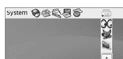

## 修改面板属性

你可以更改的面板属性限于方向、尺寸、隐藏策略和背景。要打开适用于特定面板的属性窗口，请右键点击面板上的空白处并选择“属性”（Properties）。出现的面板属性窗口包含以下：

- 方向 —— 通过点击新位置将面板移动到屏幕的不同位置。
- 尺寸 —— 通过选择高度（默认为 48 像素）来选择面板尺寸。
- 扩展 —— 选择此复选框使面板填充整个侧边，或取消勾选使面板宽度仅与其包含的应用组件一样宽。
- 自动隐藏 —— 选择面板是否自动隐藏（仅当鼠标指针进入该区域时出现）。
- 显示/隐藏按钮 —— 选择隐藏/取消按钮（带有 pixmap 箭头的按钮）是否出现在面板边缘。
- 隐藏按钮上的箭头 —— 如果你选择了“隐藏按钮”，可以选择在这些按钮上带有箭头。
- 背景 —— 从“背景”选项卡，你可以为面板背景分配颜色、分配 pixmap 图像，或保持默认值（基于当前主题）。如果你想为背景选择图像，请勾选“背景图像”复选框，然后选择图像，例如来自 `/usr/share/backgrounds/tiles` 或其他目录的图片。

提示 我通常开启“自动隐藏”功能并关闭“隐藏按钮”。使用自动隐藏可以给你提供更多的桌面工作空间。当你移动鼠标到面板所在的边缘时，面板会弹出——所以你不需要隐藏按钮。

## Nautilus 文件管理器

曾经，文件管理器的作用无非是让你运行应用程序、创建数据文件和打开文件夹。如今，随着用户所需的信息扩展到本地系统之外，文件管理器也被预期显示网页、访问 FTP 站点并播放多媒体内容。Nautilus 文件管理器（GNOME 默认文件管理器）这种文件管理器的例子。

当你打开 Nautilus 文件窗口（例如，通过打开主图标或桌面上的另一个文件夹）时，你会看到你正在查看的位置名称（例如文件夹名称）以及该位置包含的内容（文件、文件夹和应用程序）。图 3-11 是文件管理器窗口显示客用户主目录的示例。

图 3-11

Nautilus 文件管理器允许你在文件系统中移动、打开目录、启动应用程序并打开 Samba 文件夹。

| 文件 | 编辑 | 视图 | 路径 | 帮助 |
| :--- | :--- | :--- | :--- | :--- |
| 桌面 | 文档 | 下载 | | |
| 音乐 | 图片 | tmp | | |
| 视频 | | | guest 7 个项目. 剩余空间: | | |

## 进入桌面

从 GNOME 2-16 开始，默认的 Nautilus 窗口已大大简化，显示更少的控件，并为文件和目录图标留出更多空间。双击在新窗口中打开该文件夹。选择窗口左下角的文件夹名称以查看当前文件夹上方的文件系统层次结构。GNOME 会记住你上次打开该文件夹时使用的尺寸、位置和其他设置，并在下次打开时恢复到该状态。

要查看更多控件，请右键点击文件夹并选择“浏览文件夹”（Browse Folder）打开。Nautilus 窗口工具栏上的图标允许你在目录和网站访问之间前进和后退。要向上移动目录结构，点击向上箭头。如果你倾向于输入你想要的文件夹而不是点击图标，可以切换基于按钮和文本的位置栏（点击纸张和铅笔图标设置位置按钮以更改视图）。

要刷新文件夹，点击“重新加载”（Reload）按钮。“主页”按钮带你回到主页，“计算机”按钮让你看到与 Windows 系统中“我的电脑”图标相同类型的信息（CD、软盘驱动器、硬盘系统和网络文件夹）。

Nautilus 中的图标通常指示特定文件包含的数据类型。每个文件的扩展名可以决定使用哪个应用程序来处理文件，或者你可以右键点击图标以用特定的应用程序或查看器打开它。

以下是 Nautilus 的一些有趣的特性：

- 侧边栏 —— 从之前描述的浏览文件夹，查看“视图”（View）让侧边栏出现在屏幕左侧列。从侧边栏，你可以点击下拉菜单，代表你可以同时选择的不同类型信息。
- 例如，“树形”标签显示目录结构的树形，以便你轻松遍历目录。“注释”标签允许你添加注释，这些注释会随当前目录或网页。“历史”标签显示你访问过的目录历史，允许你选择这些项目以返回它们所代表的站点。还有一个“图标”标签，允许在文件或文件夹上拖放图标以指示有关文件或文件夹的情况（代表草稿、紧急、警告和多媒体的图标）。
- Windows 文件和打印机共享 —— 如果你的计算机连接到 Windows 计算机共享文件和打印机的局域网，你可以从 Nautilus 查看这些资源。在“打开位置”框中输入 `smb:`（通过“文件 -> 打开位置”进入）来查看可用的工作组。点击工作组以查看该工作组中共享文件和打印机的计算机。图 3-12 显示了 Nautilus 显示代表名为 street 的工作组中 Windows 计算机图标的示例 (`smb://street`)。

## Linux 入门步骤

### 图 3-12
在 Nautilus 中显示共享的 Windows 文件和打印机服务器 (SMB)。

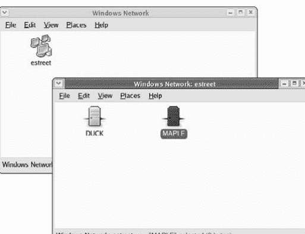

- ■ MIME 类型和文件类型 —— 为了处理 Nautilus 窗口中可能遇到的不同类型的内容，你可以根据 MIME 类型和文件类型设置应用程序的响应方式。在显示文件夹时，右键点击你想要分配应用程序的文件。点击“用其他程序打开（Open With an Application）”或“用查看器打开（Open With a Viewer）”。如果该文件类型未分配应用程序或查看器，点击“关联（Associate）”可以选择应用程序。在“添加文件类型”窗口中，你可以根据代表文件的文件扩展名和 MIME 类型添加应用程序。
- ■ 拖放 —— 你可以在 Nautilus 窗口内、Nautilus 窗口与桌面之间、或者多个 Nautilus 窗口之间使用拖放功能。随着其他符合 GNOME 标准的应用程序出现，预计它们也将支持拖放功能。

如果你想了解有关 Nautilus 文件管理器的更多信息，请访问 GNOME 网站 (`www.gnome.org/nautilus`)。

# 使用 AGLX 实现 3D 效果

近年来，几个不同的计划在为 Linux 构建 3D 桌面效果方面取得了进展。openSUSE 使用 Xgl 项目 (`http://en.opensuse.org/Xgl`)，而 Fedora 则拥有 AGLX (`http://fedaproject.org/wiki/RenderingProject/aiglx`)。

加速间接 GLx 项目 (`AGLX`) 的目标是日常桌面系统添加 3D 效果。这是通过使用 Mesa (`www.mesa3d.org`) 开源 OpenGL 实现来实现 OpenGL (`http://opengl.org`) 加速效果实现的。

# 进入桌面

目前，AGLX 支持有限的显卡 set，且仅实现了几个 3D 效果，但它为正在开发中的视觉效果提供了一些见解。

由于 AGLX 需要直接渲染基础设施 (`DRI`)，不支持该功能的显卡无法使用。例如，目前不支持 NVIDIA 显卡，你可以预计很快就会添加 NVIDIA 支持。已知与 AGLX 不兼容的显卡还包括 ATI Rage 128 和 64、Matrox G200 到 G550 以及 3D Vofoo 1 和 2。

如果你的显卡已正确检测并配置，你可能只需开启“桌面效果（Desktop Effects）”功能即可看到目前已实现的效果。要开启桌面效果，选择“系统偏好设置 → 桌面效果”。当桌面效果弹出窗口出现时，选择“启用效果（Enable Effects）”，这将将执行以下操作：

- 停止窗口管理器并启动 Compiz 窗口管理器。
- 启用“移动时窗口抖动（Windows Wob When Moved）”效果。开启后，当你抓住窗口标题栏移动它时，窗口会在移动时产生抖动。桌面上的菜单和其他项目也会抖动。
- 启用“立方体上的空间（Spaces on a Cube）”。将窗口从桌面向左拖动，桌面将像立方体一样旋转，你的每个桌面工作空间将作为立方体的一个面。将窗口释放到你想去的工作空间。你也可以点击底部面板上的“工作空间切换器”插件来旋转立方体以显示工作空间。

使用 `Alt+Tab` 组合键在不同的运行窗口之间切换也会产生其他很棒的效果。当你按下 `Alt+Tab` 时，每个窗口的缩略图会跨屏幕，它所代表的窗口会被高亮。

图 3-1 显示了按下 `Alt+Tab` 时的 Compiz 桌面示例，几个 GIMP 窗口（包含图片）的缩略图从右向左滚动。中间高亮的缩略图代表当前选中的。

如果你厌倦了抖动的窗口和旋转的立方体，可以轻松关闭 AGLX 3D 效果并返回 Metacity 作为窗口管理器。只需进入“系统偏好设置 → 桌面效果”，并切换“启用桌面效果”按钮即可关闭。

如果你有支持的显卡，但发现无法开启桌面效果，请检查你的 X Server 是否正常启动。特别地要确保你的 `/etc/X11/xorg.conf` 文件配置正确。确保在 Module 部分加载了 DRI 和 GLX。此外，确保文件中任何位置的 extensions 部分（通常在文件末尾）出现如下内容：

```
Section "extensions"
  Option "Composite"
EndSection
```

## 第一部分 Linux 入门步骤

图 3-13

在启用 AGLX 桌面效果的情况下，通过 `Alt+Tab` 在活动窗口的缩略图之间切换。

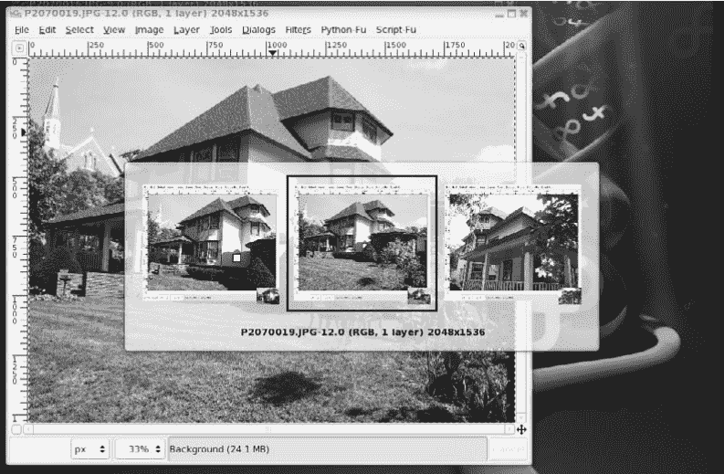

另一个选项是在 `/etc/X11/xorg.conf` 文件的 Device 部分添加以下行：

```
Option XAANOffscreenPixmaps
```

`XAANOffscreenPixmaps` 选项将提高性能。检查你的 `/var/log/Xorg.log` 文件以确保 DRI 和 AGLX 功能已正确启动。文件中的信息也可以帮助你调试其他问题。

## 修改 GNOME 偏好

有许多方法可以更改你的 GNOME 桌面的行为、外观和感受。大多数 GNOME 偏好都可以通过偏好菜单中的选择（选择“系统偏好设置”）进行修改。

与 Fedora 早期的 GNOME 版本不同，窗口管理器 (`Metacity`)、文件管理器 (`Nautilus`) 和桌面本身偏好之间的界限已经模糊。所有功能的偏好都可以从偏好菜单中获得。

# 进入桌面

以下项目列出了你可能想要设置的偏好：

- **辅助功能（Accessibility）** —— 如果你在操作鼠标或键盘上有困难，键盘辅助偏好 (`AccessX`) 窗口让你适应鼠标和键盘设置
- **桌面背景（Desktop Background）** —— 从桌面背景偏好中，你可以选择颜色或图像作为壁纸。如果你选择使用颜色（选择“无壁纸”），点击颜色框，从调色板中选择一种颜色并点击确定。要使用图像壁纸，打开包含该图像的文件夹，将其拖入桌面背景面板。你可以从 `/usr/share/nautilus/patterns` 和 `/usr/share/backgrounds/tiles` 目录选择各种图像。然后选择平铺、居中、比例或填充屏幕。
- **屏保（Screensaver）** —— 从屏幕保护程序窗口选择几十种屏保。选择随机从你喜欢的从中选择，或从列表中选择一个一直使用。接下来，选择屏幕等待多久启动屏幕保护程序（默认为 10 分钟）。你还可以选择在屏幕保护程序运行时锁定屏幕，这样返回桌面时需要密码。
- **主题（Theme）** —— 如果你喜欢，为桌面元素选择主题。桌面主题不仅影响背景，还会影响按钮和菜单的样式。Fedora 发行版中窗口管理器 (`Metacity`) 仅提供几个主题，但你可以从 `themes.freshheat.net` 获取更多主题。

点击主题详情（Theme Details），然后点击控件选项卡来选择桌面使用的控件类型。点击窗口边框选项卡，选择更改窗口标题栏和边框的不同主题。点击图标选项卡，选择代表桌面项目的不同图标。当你点击或拖动主题名称时，主题会立即更改。

## 退出 GNOME

当你完成工作时，可以注销当前会话或完全关闭计算机。要从 GNOME 退出，请执行以下操作：

1. 点击面板上的系统按钮。
2. 从菜单中选择注销（Log Out）。弹出一个窗口询问你是否要注销。某些版本还会询问你是想关机还是重启计算机。

## Linux 初步

+   3. 从弹出菜单中选择“确定”。这将注销并返回到图形界面或你的 shell 登录提示符。（如果选择“关机”，系统将关闭；如果选择“重启”，系统将重启。）
+   4. 选择“确定”以完成退出 GNOME。

如果你无法找到“注销”按钮（例如，你的你的面板崩溃了），还有另外两种方法。根据你启动桌面的方式，尝试以下其中一种：

+   - 如果你是在 shell 登录时通过输入 `startx` 启动的，请按 `Ctrl+Backspace` 结束你的 GNOME 会话。或者，你也可以按 `Ctrl+Alt+F1` 返回到 shell 登录界面。然后按 `Ctrl+C` 杀死桌面。
+   - 如果你是从图形登录界面启动桌面的，请先打开终端（右键点击桌面并选择“新建终端”）。在终端中，使用 `ps x | grep gnome-session` 来确定左列显示的进程数 (`PID`)。然后执行 `kill -9 PID`，将 `PID` 替换为实际的 PID 数字。你应该能看到图形登录界面。

虽然这些不是退出桌面的最优雅方式，但它们是有效的。你应该能够重新登录并重启桌面。

# 配置 GNOME 在线桌面

GNOME Online Desktop 项目 (`http://live.gnome.org/onlinedesktop/`) 代表了处理桌面计算的新方法。它承认人们的物品（数字图像、视频等）和活动（搜索、博客、电子邮件、即时消息、新闻馈送等）正在从本地磁盘移动到互联网。

GNOME Online Desktop 的第一个实验版本于 2007 年底随 Fedora 8 发行。然而，由于它是 GNOME 项目的一部分，你可以预期在此后的每一个 Linux 发行版中看到它。

GNOME Online Desktop 项目的核心是一个被称为 Blackboard（黑板，(`http://live.gnome.org/Billboard`) 的侧边栏。通过 Blackboard，它可以整合账户和菜单，以连接到你的手机服务（如 Flickr）、零售账户（如 Amazon）、电影租赁（如 Netflix）等。它还会跟踪你使用的文件和应用程序。

驱动你个人在线桌面的设置本身也是在线的。GNOME 账户可以存储关于你的桌面应用程序的信息。Mugshot (`www.mugshot.org`) 账户允许你建立与在线朋友和活动的连接。当你登录在线桌面时，这些信息会下载到你的桌面。这使得在线桌面概念可以脱离单台计算机，以便你将来某天可以从任何连接互联网的计算机上使用你的整个桌面设置。

118

# 进入桌面

要在 Fedora 8 中开始使用在线桌面，请从登录界面选择“Session: Online Desktop”。然后登录 Fedora。在 GNOME.org 和 Mugshot.org 创建用户账户。然后配置你的 Mugshot 账户，以连接你在 Amazon.com、Flickr.com、Netflix.com 等热门网站的账户。

从你的在线桌面侧边栏，登录你的 Mugshot 账户。你的在线桌面侧边栏将填充已配置的在线账户、热门应用程序、朋友账户链接以及其他项目。图 3-14 显示了 Fedora 8 Linux 中在线桌面的示例。

### 图 3-14

使用 Online Desktop 和 Mugshot 连接在线服务和朋友。

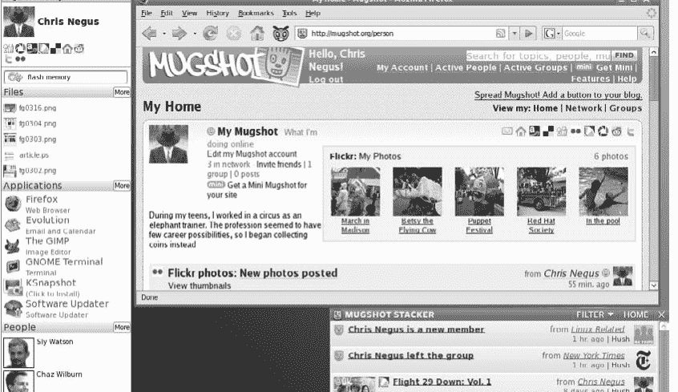

侧边栏中的几个图标代表了已配置的在线服务。搜索框允许你从不同的搜索引擎中进行选择。你最近打开的热门应用程序和文件出现在侧边栏上。你还可以搜索 Google 以及你邀请的朋友。

Mugshot 显示了配置许多在线桌面功能的网站。你可以在 Mugshot 网站上看到与你在线桌面中显示相同的信息。底部面板中的 Mugshot 图标显示了你和你其他 Mugshot 朋友的活动状态。

由于 Online Desktop 仍在开发中，预计在你读到本文时，将会有许多新功能和服务可用。特别是，人们正致力于整合在线应用程序，以便你能够通过处理 Web 应用程序来使用你的文档、电子表格和其他重要信息。

# 配置你自己的桌面

如今，现代桌面计算机系统的设计初衷是为了直接“喂给”你操作系统。为了易用之名，某些桌面环境花费了大量资源在花哨的面板、复杂的中心控制和繁忙的入口上。简而言之，它们可能会变得臃肿。

许多对技术感兴趣的人想要一个精简的桌面——或者至少选择拥有自己的特色。他们不想等待窗口重绘以弹出菜单。Linux 允许你忽略完整的桌面环境并进行以下配置：

+   **X——窗口系统为 Linux 和许多 UNIX 系统提供了框架。** 如果你自己配置 X，你可以选择视频驱动程序、显示器设置、配置以及让显示正常工作所需的其他功能。
+   **窗口管理器（Window manager）——有种窗口管理器可以在 Linux 系统上运行 X。** 窗口管理器为操作裸的 X 窗口添加边框和按钮。它们为图形、菜单和窗口添加颜色和背景。窗口管理器还定义了你如何使用键盘和鼠标组合来操作你的桌面。

如果不需要桌面（桌面可能会显示为乱码或直接崩溃），你需要直接配置 X。如果你想对其进行调优以获得比默认更高的分辨率或颜色，你也可以选择配置 X。

本章后续将介绍：检查用于调优 X 的工具，特别是与 X 交互。

### 配置 X

在 2004 年之前，大多数 Linux 发行版使用 XFree8 项目 (`www.xfree8.org`)。对于 Xorg 服务器，文件是 `/etc/X11/xorg.conf`。

> > 注意在 Free86 中，配置文件格式基本相同为 `/etc/X11/X86Config`

# 进入桌面

> > 注意要确定安装了哪个 X 服务器，输入 `man X` 和 `man Free86`。

你可能有一个非常基础的 X 配置并想要对其进行调优。如果你能够成功启动桌面，且鼠标、键盘和屏幕运行正常，你可能什么都不需要做。

然而，如果你无法启动桌面或想调整某些功能（如屏幕分辨率或颜色），后续章节将提供一些操作建议。

### 创建有效的配置文件

如果桌面立即崩溃或显示乱码文本：

+   1. 如果 Linux 启动到命令行提示符，请进入下一步。然而如果它尝试自动启动 X，你可能会看到无法阅读的屏幕。在这种情况下，按这些键：`Ctrl+Backspace`。这将杀死你的 X 服务器并让你返回命令行提示符。如果 X 尝试重启（并且仍然混乱），按 `Ctrl+Alt+F2`。进入命令行提示符后，以 root 身份登录并输入 `init 3`。这将让你进入非图形状态。
2. 要让 X 识别你的视频硬件并创建一个新的配置文件，输入：


### Xorg - configure

文件 `xorg.conf.new` 将出现在你的主目录下。要测试这个新配置是否有效，请按照步骤启动 X 服务器：

```
X -xf86config /root/xorg.conf.new
```

一个中间带有 X 的灰色背景会出现。移动鼠标到 X 光标处。如果成功，你就有了一个可以 `xorg.conf` 文件。

4. 按 `Ctrl+Alt+Backspace` 退出 X 服务器。
5. 将新的配置文件复制到下次 X 启动时读取的地方。

```
cp /root/xorg.conf.new /etc/X11/xorg.conf
```

## 第一部分 Linux 入门步骤

### 获取新的 X 驱动程序

Linux 中可用的视频驱动程序适用于你今天可以购买的大多数显卡。然而，为了从显卡中获得某些高级功能（如 3D 加速），你可能需要直接从视频制造商处获取有驱动程序。特别是，你可能需要获取 NVIDIA 和 ATI 的驱动程序。

要为 NVIDIA 显卡或芯片组获取新驱动，请访问 NVIDIA 网站 (`www.nvidia.com`) 并选择“Download drivers”（下载驱动）。点击 Linux 和 FreeBSD 驱动链接。在出现的页面中，你可以从那里下载新驱动并获取安装说明。

对于 ATI 显卡和芯片组，请访问 `www.ati.com` 并选择“Drivers & Software”（驱动与软件）。点击 Linux 驱动和相关安装说明的链接。

对于许多流行的 Linux 发行版，已经针对你正在运行的特定内核打包了 NVIDIA 和 ATI 驱动。然而，由于这些驱动程序不是开源的，你通常需要使用第三方软件仓库来让它们工作。

### 调整 X 配置文件

当你开始使用 `xorg.conf` 文件时，它看起来可能有点复杂。然而，很可能你只需要更改其中的几个关键元素。作为 root 用户，用任何文本编辑器打开 `/etc/X11/xorg.conf` 文件。这里是你可以寻找的内容：

- 鼠标 (Mouse) —— 寻找带有 `Mouse0` 或 `Mouse` 标识的 `InputDevice` 部分。对于简单的双键 PS2 鼠标，该部分可能如下：

```
Section "InputDevice"
    Identifier "Mouse0"
    Driver "mouse"
    Option "Protocol" "PS/2"
    Option "Device" "/dev/psaux"
EndSection
```

如果你无法使用鼠标的某些功能（例如中轮），你可能可以通过一个类似于下面的内容的条目让它工作：

```
Section "InputDevice"
    Identifier "Mouse0"
    Driver "mouse"
    Option "Protocol" "IMPS/2"
    Option "Device" "/dev/psaux"
    Option "ZAxisMapping" "4 5"
EndSection
```

不要更改鼠标标识符，但你可以更改协议并添加 `ZAxisMapping` 行来启用你的鼠标轮。尝试重启 X 并在网页等页面上测试你的鼠标轮，看看是否可以用它上下滚动。

你的鼠标可能以不同的方式连接（例如总线鼠标或串口鼠标），并可能有不同的按钮需要启用。配置鼠标的工具取决于特定的发行版。尝试使用 `mouseconfig`、`mouseadmin` 或 `system-config` 从命令行重新配置你的鼠标。

- 显示视器 (Monitor) —— 显示视器定义了显示器的属性。如果你不确定显示器的具体型号，会有通用设置。不建议在不检查显示器技术规格的情况下更改水平同步 (`Horizontal Sync`) 和垂直刷新 (`Vertical Refresh`) 频率率，否则你可能会损坏显示器。这里是一个适用于许多 LCD 面板的条目示例。

| "Monitor" | "Monitor0" |
| :--- | :--- |
| VendorName | "Monitor Vendor" |
| ModelName | "LCD Panel 1024x768" |
| HorizSync | 31.5 - 48.5 |
| VertRefresh | 40.0 - 70.0 |

这是一个适用于许多 CRT 显示器的通用 CRT 显示器条目：

| "Monitor" | "Monitor0" |
| :--- | :--- |
| VendorName | "Monitor Vendor" |
| ModelName | "Generic Monitor, 1280x1024 @ 74 Hz" |
| HorizSync | 31.5 - 79.0 |
| VertRefresh | 50.0 - 90.0 |

如果可用可以直接选择显示视器型号的工具，那是最好的方法。对于 Red Hat 系统，你可以运行 `system-config-xfree86` 来更改显示视器设置。

- 视频设备 (Video device) —— `Device` 部分是用于识别与视频设备一起使用的驱动程序及其任何选项的地方。检查此部分非常重要。早期的 Xorg 通常在检测驱动程序方面做得很好。如果你想切换到另一个驱动程序，可以在这里进行。这里是我为我的系统添加了 NVIDIA 视频驱动后的 `Device` 部分示例（设备名称为 `nv`）：

| "Device" | "Card0" |
| :--- | :--- |
| Driver | "nv" |
| VendorName | "nVidia Corporation" |
| BoardName | "Unknown Board" |
| BusID | "PCI::1:0:0" |
| EndSection

- 屏幕分辨率 (Screen resolution) —— 你可能想要添加的主要信息是屏幕分辨率和色彩深度。安装在你的电脑上的每个显卡都会关联一个屏幕分辨率。`Screen` 定义了默认色彩深度（如 8、16 或 24 位）和模式（如 1024 × 768、800 × 600 或 640 × 480）。将 `DefaultDepth` 设置为代表系统色彩深度的位数，然后添加一个 `Mode` 模式来设置屏幕分辨率。

要了解更多关于如何在 `xorg.conf` 文件中设置选项的信息，请输入 `man xorg.conf`。如果你的 X 服务是 XFree86，请输入 `man XF86Config`。

### 选择窗口管理器

完全集成的桌面环境对于更改窗口管理器变得有些不友好。但是，如果你喜欢的话，可以完全跳过 KDE 或 GNOME，简单地使用 X 和你选择的窗口管理器启动桌面。如果以 Slackware 作为描述如何更改窗口管理器的参考，该概念在其他系统上也是一样的。通常情况下，如果 Linux 中没有运行桌面环境，你可以通过输入以下命令启动它：

```
$ start
```

此命令启动你的桌面环境或窗口管理器，取决于以下两项之一：

- `/etc/X11/xinitrc` 如果用户没有特别请求桌面或窗口管理器，默认设置将来自此文件。`xinitrc` 文件是系统范围级的配置文件。
- `$HOME/.xinitrc` 供个人用户设置他们自己的启动项。结果是，该文件的内容将覆盖任何系统级设置。如果你创建了自己的 `.xinitrc` 文件，它的最后一行应该是 `exec windowmanager`，其中 `windowmanager` 是你的窗口管理器的名称；例如：

```
exec /usr/bin
```


Slackware 有七种不同的窗口管理器供你选择，这使其成为尝试几个的好地方。它还包含一个名为 `wmconfig` 的工具，可以让你在系统范围内更改窗口管理器（在 `/etc/X11/xinitrc` 文件中）。要使用该工具，root 用户只需在 Slackware 系统的任何 shell 中运行 `wmconfig` 即可。图 3-15 显示了该界面的示例。

在 Slack 中，你可以使用 `wmconfig` 命令更改窗口管理器。从该界面选择你想要尝试的窗口管理器（前提是你没有通过创建自己的 `.xinitrc` 文件进行覆盖）。以下是你的选择：

- Xfce (`www.xfce.org`) - xfce 窗口管理器设计为轻量且快速。
- Blackbox (`www.blackboxwm.org`) - 另一个轻量级窗口管理器，力求减少依赖以便在许多环境中运行。它提供了许多设置颜色和样式的功能。
- Fluxbox (`http://fluxbox.org`) - 基于 Blackbox (`v0.6`)，Fluxbox 增加了许多功能，如窗口标签（你可以将多个窗口合并显示为单个窗口上的多个标签）。它还包含一个图标栏和一些实用功能（例如使用鼠标轮切换工作空间）。
- Window Maker (`www.windowmaker.org`)—Window Maker 是 NEXTSTEP 图形界面的克隆。Window Maker 是一个非常吸引人的窗口管理器，支持主题、各种窗口装饰和丰富的功能以及插件（称为 applets）。
- FVWM (`www.fwm.org`) —— 这个窗口管理器支持国际化、窗口提示和改进字体功能（包括各种方向的文字）。
- FVWM-95 (`http://fwm95.sourceforge.net`) —— 一个看起来和感觉像 Windows 95 的 FVWM 版本。
- Twm (Tabbed Window Manager) —— 虽然不再维护，但仍人在需要极简桌面时仍使用 twm。在点击 twm 左键之前，屏幕上没有任何打开关闭窗口的菜单。

Linux 还有其他窗口管理器可用。要查看更多，请访问 WM 网站 (`www.wm.org`)。

一旦系统默认了窗口管理器，用户可以设置自己的窗口管理器。以下序列描述了如何操作。

## 选择你的个人窗口管理器

只需在你主目录下的 `.xinitrc` 文件中添加你想要使用的窗口管理器的 `exec` 行，即可启动它。这里是启动 Window Maker 管理器的 `.xinitrc` 内容示例：

```
exec /usr/bin/wmaker
```

确保该文件是可执行的（`chmod 755 $HOME/.xinitrc`）。Window Maker 窗口管理器将在你下次启动时运行。其他窗口管理器包括 Blackbox (`/usr/X11R/bin/blackbox`)、Fluxbox (`/usr/X11R/bin/fluxbox`)、FVWM (`/usr/X11R/bin/fvwm`)、FVWM-95 (`/usr/X11R/bin/fwm95`) 以及 twm (`/usr/X11R/bin/twm`)。

## 获取更多信息

如果你在配置 X 时遇到服务器崩溃或显示异常，你的显卡可能不支持或需要特殊配置。以下是你可以检查以获取更多信息的地点：

- X.Org (`www.x.org`) —— 关于适用于 Fedora 的 X 服务器最新信息可以在 X.Org 网站获取。X.Org 是许多 Linux 发行版最近替换 FreeX8 的免费 X 版本。
- X 文档 —— 不同类型显卡的 README 文件随 X.Org 服务器一起交付。访问 X 文目录 (`/usr/X11R/lib/x11/doc`) 获取适用于你使用的显卡类型（或更具体说是视频芯片组）的 README 文件。许多有用信息也可以在 `xorg.conf` 手册中（输入 `man xorg.conf`）找到。

## 摘要

在 Linux 中运行的完整桌面环境可以与任何操作系统的桌面系统相媲美。KDE 和 GNOME 是目前 Linux 上最流行的桌面环境。对于那些想要更简洁、更轻量化桌面环境的人来说，Linux 也有许多简单的窗口管理器（如 Blackbox、FVWM、twm、FluxBox 等）可供选择。

KDE 桌面以大量的集成应用程序（办公生产力工具、游戏、多媒体和其他应用程序）而闻名。GNOME 则被誉为一种更基础、更面向业务的桌面环境。像 Slackware 和 Gentoo 这样的大多数 Linux 发行版提供的 GNOME 和 KDE 桌面，与其说它们从这些桌面项目交付时的原始状态没有太大变化。其他 Linux 系统（如 Fedora）则在 GNOME 和 KDE 桌面之上赋予了它们自己的外观和感受。

虽然最新的 Windows 系统无法在旧机器上运行，但你可以使用诸如 Slackware 这样高效的 Linux 系统，添加一个轻量级窗口管理器，并在这些机器上让你的桌面系统获得相当不错的性能。

# 第二部分

# 运行演示

| 本部分内容 |
| :--- |
| 第 4 章 学习基础管理 |
| 第 5 章接入互联网 |
| 第 6 章 保护 Linux |

## 第 4 章

### 学习基础管理

Linux 与其他基于 UNIX 的系统一样，旨在供多个人同时使用。多用户功能允许许多人在单台 Linux 系统上拥有账户，并确保他们的数据安全免受他人干扰。多任务处理功能允许许多人同时在计算机上运行程序，且每个人可以运行多个一个程序。复杂的网络协议和应用程序使得 Linux 系统将其功能扩展到全球范围的网络用户和计算机成为可能。负责管理所有这些内容的人被称为系统管理员。

即使你是使用 Linux 系统的唯一用户，系统管理仍然被设定为与其他管理分开。要执行大多数管理任务，你需要以 root 用户（也称为超级用户）身份登录，或者临时获得 root 权限。root 以外的其他用户无法更改、在某些情况下甚至看不到 Linux 系统的某些配置信息。特别是存储密码等安全功能受到了保护，免受普通用户查看。

由于 Linux 系统管理是一个非常庞大的课题，本章将侧重于 Linux 系统管理的通用原则。特别是，它研究了你在为个人桌面或小型局域网（LAN）管理 Linux 系统时需要的一些基础工具。除了基础之外，本章还将教你如何与文件系统工作，以及监控你的 Linux 系统的设置和性能。

### 本章内容

- 进行图形化管理
- 使用 root 登录
- 理解管理命令、配置文件和日志文件
- 创建用户账户
- 配置硬件
- 管理文件系统和磁盘空间
- 监控系统性能

### 图形化管理工具

许多 Linux 系统都带有了用于管理 Linux 的简化图形化工具。如果你是普通用户，这些工具通常允许你完成管理系统所需的所有操作，而无需编辑配置文件或运行 shell 命令。

让我们查看一些可以在大多数 Linux 系统使用的基于 Web 的管理工具。

## 使用基于 Web 的管理

许多开源项目提供了基于 Web 的管理工具，以让这些项目对普通用户更加易用。使用这些工具只需要一个 Web 浏览器（如 Firefox）、服务的端口号以及 root 密码。Samba 和 CUPS 等项目自带了自己的管理工具。Webmin 是一个通用的工具，可以从你的 Web 浏览器管理各种 Linux 系统。

基于 Web 的管理工具的优势在于，你可以在熟悉的界面（使用 Web 浏览器）中进行操作，并且可以远程访问它们。

> 某些 Linux 发行版自带它们的一套图形化管理工具（如 SUSE 的 Yaast 或 Red Hat 的 system-config 工具）。对于发行版自身的工具与其启动和停止服务的工具集成得更好的项目，你通常应该使用那些工具，而不是基于 Web 的界面。

### 提供 Web 管理的开源项目

主要的开源项目提供了用于配置这些项目的 Web 界面。无论你使用哪种 Linux，你都可以使用 Web 浏览器来配置以下项目：

- Samba —— 为了在你的局域网内与 Microsoft Windows 系统进行文件和打印机共享，可以使用任何 Web 浏览器使用 Samba SWAT 基于 Web 的管理工具。安装并运行 SWAT 后，你可以在地址栏中输入以下 URL，通过你的 Web 浏览器访问你的 Samba 服务器配置：

```
http://localhost:901
```

> 如果你收到“连接不稳定（Unstable to Connect）”，说明 Samba 未安装或未运行。

Samba 项目还提供了其他管理 Samba 的图形化工具。你可以在 `http://samba.org/samba/GUI` 查看它们。关于这些工具的描述，请参阅第 26 章和第 27 章。

### 学习基础管理

- CUPS —— 通用 UNIX 打印服务（CUPS）有自己的 Web 管理工具。安装并配置 CUPS 后，你通常可以在 Web 浏览器的地址栏中输入以下 URL 来使用 CUPS Web 管理：

```
http://localhost:631
```


你使用 `CUPS` 管理工具管理打印机、类以及各种管理任务。`CUPS` 在第 26 章中描述。

`Samba` 和其他工具包含在许多 Linux 发行版中。其他提供基于 Web 管理的项目（可能包含包含包含你的发行版中）包括 `SquirrelMail`（一个 Web 界面）和 `Mailman`（邮件列表设施）。

由于许多管理界面以明文发送数据，因此它们最适合在本地系统上使用。但由于它们是基于 Web 的，你也可以从局域网或其他网络使用这些界面。然而，如果你计划将这些管理界面扩展到不可信的网络，你应该考虑对你的通信进行加密。

## Webmin 管理工具

`Webmin` 工具（`www.webmin.com`）提供了管理 Linux 和 UNIX 的功能。虽然 `Webmin` 并非所有 Linux 系统都自带的，但 `Webmin` 项目已将 `Webmin` 移植到了 70 多种操作系统。支持的 Linux 发行版包括 `SUSE`、`Red Hat (RHEL)`、`Debian`、`Ubuntu`、`Gentoo`、`Slack`、`Mandriva`、`Yellow Dog` 等（完整列表见 `webmin.com/support.html`）。

一旦从 `Webmin.com` 获取并安装 `Webmin`，你就可以从浏览器使用它。要启动 `Webmin` 界面，在浏览器中输入：

```
http://localhost:10000
```


以 root 用户登录后，将显示 Webmin 主页面，如图 4-1 所示。

## 不同版本的图形化管理

有些人担心离开熟悉的 Windows 系统环境来到 Linux 后，将通过命令行完成一切。为了获得更广泛的受众，商业 Linux 发行版如 Red Hat 和 SUSE 创建了自己的工具集，为新用户提供方便的入口。后续章节将介绍 Red Hat 的 `system-config` 和 SUSE 的 `Yaast`。

## 第二部分 运行演示

图 4-1

Webmin 提供了一个管理 Linux 的 Web 界面。

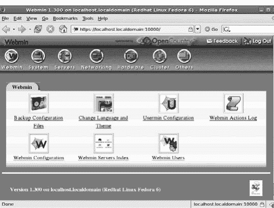

### 红帽配置工具

一套随 Fedora 和 Red Hat Linux 系统自带的图形化工具可以从系统菜单的“管理”子菜单或从命令行启动。大多数从命令行启动的 Fedora 和 RHEL 工具以 `system-config` 字符串开头（例如 `system-config-network`）。

> 注意：在 Fedora Core 和之前的 Red Hat 版本中，GUI 管理工具都以 `redhat` 开头，例如 `redhat-config-network` 和 `redhat-logviewer`。从 Fedora Core 2 开始，这些名称改为 `system-`，导致了 `system-config-network` 等名称。

管理任务需要 root 权限；如果你以普通用户登录，在 GUI 应用程序打开之前必须输入 root 密码。在通过密码后，在此会话期间，大多数配置工具打开将不再要求你输入密码。注意面板右上角的黄色徽章，表示你拥有 root 权限。点击徽章可以弹出一个窗口，允许你移除权限。当你使用 GUI 窗口时，权限消失。

以下列表描述了许多用于管理 Fedora 或 Red Hat Linux 系统的图形化工具。从系统菜单的“管理”子菜单启动这些窗口。获取该功能所需的包名称显示在括号中。

### 基础管理学习

下方选项的可用性取决于您已安装的功能。

- *服务器设置* (Server Settings) — 从此子菜单访问以下服务器配置窗口：
    * 域名系统 (`system-config-bind`) — 如果您的计算机作为 DNS 服务器运行，则创建并配置区域。
    * HTTP (`system-config-httpd`) — 将您的计算机配置为 Apache Web 服务器。
    * NFS (`system-config-nfs`) — 设置系统中的目录，通过 NFS 服务与网络上的其他计算机共享。
    * Samba NFS (`system-config-nfs`) — 配置 Windows (SMB) 文件共享。（如需配置其他 Samba 功能，可以使用 SWAT 窗口）。
    * 服务 (`system-config-services`) — 在服务配置窗口中显示并更改在您的 Fedora 上不同运行级别下运行的服务。

- *身份验证* (Authentication)(`auth-config-gtk`) — 更改用户在系统上进行身份验证的方式。通常选择影子密码（Shadow Passwords）和 MD5 密码（MD5 Passwords）。如果您的网络支持 LDAP、Kerberos、SMB、NIS 或 Het 认证，您可以选择使用其中任何一种认证类型。
- *引导加载程序* (Bootloader) — 如果您的计算机上有多个操作系统，或者在 Linux 中有多个可启动的内核，请使用启动配置屏幕选择默认启动哪一个。例如，您可能在同一块硬盘上安装了 Fedora Linux、SUSE 和 Windows XP。如果没有显式选择，您可以选择哪一个自动启动（在指定的秒数后）。
- *日期与时间* (Date & Time)(`system-config-date`) — 设置日期和时间，使 NTP 服务器保持同步。
- *显示* (Display)(`system-config-display`) — 更改您的 Y 桌面设置，包括显示器的色彩深度和分辨率。您还可以选择显卡和显示器的设置。
- *防火墙* (Firewall)(`system-config-firewall`) — 配置防火墙以允许或拒绝服务访问网络。
- *硬件浏览器* (Hardware Browser)(`hwbrowser`) — 查看您计算机硬件的信息。
- *键盘* (Keyboard)(`system-config-keyboard`) — 根据语言选择正在使用的键盘类型。
- *语言* (Language)(`system-config-language`) — 选择系统使用的默认语言。
- *逻辑卷管理* (Logical Volume Management)(`system-config-lvm`) — 管理您的 LVM 分区。
- *登录屏幕* (Login Screen)(`gdm`) — 控制登录界面的出现方式和行为。

# 第二部分 开始运行

- *网络* (Network)(`system-config-network`) — 管理您当前的网络接口并添加接口。
- *打印* (Printing)(`system-config-printer`) — 配置本地和网络打印机。
- *Root * (Root Password)(`system-config-rootpassword`) — 更改 root 。
- *SELinux 管理* (SELinux Management)(`system-config-selinux`) — 设置 SELinux 强制模式和默认策略。
- *SELinux 故障排除器* (SELinux Troubleshooter)(`setroubleshoot-server`) — 监控和诊断 SELinux AVC 拒绝。
- *声卡检测* (Soundcard Detection)(`system-config-soundcard`) — 尝试检测并配置您的声卡。
- *系统日志* (System Log)(`gnome-utils`) — 查看日志文件并在其中搜索关键词。
- *用户与组* (Users & Groups)(`system-config-users`) — 为您的系统添加、显示和更改用户及账户。

可以通过顶部面板的“应用程序”菜单获取其他管理工具。“添加/删除软件”选项允许您从网络上可用的任何启用 `yum` 的软件库中选择软件。对于其他管理工具，选择“系统工具”子菜单查看以下内容：

- *配置编辑器* (Configuration Editor)(`conf-editor`) — 直接编辑 GNOME 配置数据库。
- *磁盘使用分析器* (Disk Usage Analyzer)(`gnome-utils`) — 显示有关硬盘和可移动存储设备的详细信息。
- *Kickstart* (Kickstart)(`system-config-kickstart`) — 创建 kickstart 配置文件，可用于无需用户交互即可安装多个 Fedora 系统。
- *软件更新器* (Software Updater)(`puret`) — 运行包更新程序 (`pup`) 以获取所有系统包的更新。

适用于 Fedora 或 RHEL 的其他应用程序可能也包含出现在“系统工具”子菜单中的管理工具。

## SUSE YaST 工具

YaST 管理界面是 SUSE Linux 最强大的功能之一。从 SUSE 桌面，通过选择主菜单中的“系统 (System)”来使用 YaST 控制中心。图 4-2 显示了 YaST 控制中心的示例。

YaST 的“硬件”部分具有实用的工具，让您能够探测硬件。例如，选择“我的系统上的硬件信息”让我能够看到 YaST 检测到通过设备 `/dev/cdrom` 可用的 CD-ROM 驱动器，以及它支持 CD-R、CD-RW 和 DVD 媒体。我还可以获取有关 CPU、PCI 设备、声卡和各种存储媒体的详细信息。

136

## 图 4-2

使用 YaST 控制中心管理 SUSE 系统。

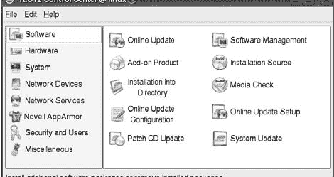

安装额外的软件包或删除已安装软件包

YaST 提供了配置和设置网络设备的接口，以及在这些设备上运行的各种服务。此外，您可以使用 YaST 将计算机配置为文件共享（Samba 和 NFS）、电子邮件（`sendmail`）以及各种网络服务的客户端。

SUSE Enterprise Server 带有更广泛的配置工具，专门针对服务器设置设计，包括配置邮件服务器、VPN 隧道的工具。

## 使用 root

每个 Linux 系统在启动时都至少有一个用户（`root`），并可能有多个普通用户。

> 提示 将 Linux 中的 root 用户类比为 Windows 中的管理员用户。

在安装 Linux 时，会为 root 设置密码。您必须记住并保护此密码——登录 root 时需要它。其他系统（如 KNOPPIX）启动时没有 root 密码，因此您可能在首次启动时通过终端输入以下命令添加：

```
## passwd root
```

更改 root 的密码。

新密码：*****


重新输入新密码：*****

root 用户的主目录通常是 `/root`。root 用户账户和其他相关信息位于 `/etc/passwd` 文件。该文件中的条目如下：

```
root:x:0:0:root:/bin/bash
```

默认情况下，Ubuntu root 账户是禁用的。这意味着尽管账户存在，您无法使用它登录或通过 `su` 变为 root 用户。这为 Ubuntu 增加了额外的安全级别，并要求在执行每个 root 级命令之前使用 `sudo`。

## 从 Shell 变为 root (`su` 命令)

虽然您可以通过登录 root 变成超级用户，但有时这并不方便。例如，您可能登录了普通用户账户，只是想对系统进行快速管理更改，而无需注销并重新登录。或者您可能需要通过网络登录对 Linux 系统进行更改，但发现系统不允许 root 用户从网络登录。

解决方案是使用 `su` 命令。从任何终端窗口或 shell 中，您只需输入以下内容：

```
$ su
密码：*******
#
```

## 学习基础管理

当系统提示你时，输入 root 用户的密码。普通用户的提示符 `$` 将变为超级用户提示符。此时，你拥有完全权限来运行任何命令并使用系统上的任何文件。然而，通过这种方式使用 `su` 命令无法做到的是进入 root 用户的环境。因此，你可能会输入一个你认为存在的命令，却收到“未找到命令”（Command Not Found）的消息。要解决这个问题，请使用带有 `(-)` 选项的 `su` 命令，如下：

```
$ su -
Password: ******
```

你仍然需要输入密码，但在完成 `su` 命令后，通常 root 用户登录时发生的一切都会随之发生。你的当前目录将变为 root 的家目录 (`/root`)，并且将使用 root 的 `PATH` 变量等设置。如果你通过输入 `su` 而不是 `su -` 来变成 root，将不会更改目录或登录会话的环境。

> 虽然 Ubuntu 强烈建议不要成为 root，但如果你使用 `su -l root` 命令并提供密码，也可以这样做。

你还可以使用 `su` 命令切换到 root 以外的用户。这对于排查特定用户遇到的问题很有用。例如，要获得名为 `jsmith` 的用户的权限，你输入：

```
$ su - jsmith
```


即使你在输入此命令之前是 root 用户，在之后，你也只拥有打开 `jsmith` 可以打开的文件和运行可用程序的权限。然而，作为 root 用户，在你输入 `su` 命令变成另一个用户后，不需要密码即可继续。如果你以普通用户身份输入该命令，则必须输入新用户的密码。

## 允许受限的管理访问

如所述，当你以普通用户身份运行 GUI 工具（来自 Fedora、SUSE 或其他 Linux 系统）时，在访问工具之前系统会提示你输入 root 密码。通过输入 root 密码，你获得了该任务的 root 权限。在 Fedora 中，在你输入密码后，顶部面板会出现一个徽章图标，表示该桌面会话中其他 GUI 工具仍具有 root 权限可运行。

特定用户也可以为特定任务授予管理权限，而无需获得 root 密码。例如，系统管理员可以将用户添加到特定的组（如 `modern`、`disk`、`users`、`cdrom`、`ftp`、`mail` 或 `www`），然后开放组权限以使用这些服务。或者，管理员可以将用户添加到 `wheel` 组，并在 `/etc/sudoers` 文件中添加条目，允许该用户使用 `sudo` 命令以 root 身份运行单个命令。（本章稍后将对 `sudo` 进行描述。）

> 注意 `wheel` 组并非所有发行版中都存在。在 Ubuntu 中，`wheel` 不会自动创建。

正在使用高安全环境的 Linux 发行版添加的新功能是安全增强 Linux (`SELinux`)。通过 `SELinux`，不再使用全能的 root 用户账户，而是定义多个规则来保护文件和服务。这样一来，如果有人破解了你的 Web 服务器，他无法自动访问你的邮件服务器、密码或计算机上运行的其他服务。

## 探索管理命令、配置文件和日志文件

无论你使用哪种 Linux 发行版，都可以在系统的相同位置找到许多命令、配置文件和日志文件。以下章节提供了关于寻找这些重要元素的提示。

如果 Linux 的 GUI 工具足够好，你为什么还需要了解管理文件呢？其一，当 GUI 随 Linux 版本变化时，许多底层配置文件是相同的。因此，如果你通过它们学习，就可以处理几乎任何 Linux 系统。此外，如果某个功能出现故障或者你需要执行 GUI 不支持的操作，当你寻求帮助时，Linux 专家几乎总是告诉你如何直接更改配置。

## 管理命令

许多管理命令仅供 root 用户使用。当你以 root 身份登录（或从 shell 使用 `su -` 进入 root）时，你的 `PATH` 变量被设置为包含某些包含 root 用户命令的目录。这些包括：

- `/sbin`—包含修改磁盘分区（如 `fdisk`）、检查文件系统（`fsck`）和更改系统状态（`init`）的命令。
- `/usr/sbin`—包含管理用户账户（如 `useradd`）和为自动挂载文件系统添加挂载点（`automount`）的命令。守护进程运行的命令也包含在此目录中，例如以 `d` 结尾的命令，如 `sshd`、`popd` 和 `cupsd`。

许多管理命令包含在普通用户目录中，如 `/bin` 和 `/usr/bin`。这对于某些对所有人都提供选项的命令也是如此。一个例子是 `/bin/mount` 命令，任何人都可以使用它列出已挂载的文件系统，但只有 root 可以挂载文件系统。（然而，某些桌面被配置为允许普通用户通过向 `/etc/fstab` 文件中添加关键字来使用 `mount` 挂载 CD、DVD 或其他可移动媒体。）

> 注意查看本章稍后的“挂载文件系统”章节以获取如何挂载文件系统的说明。

要查找主要为系统管理员设计的命令，请查看第 8 部分手册页（位于 `/usr/share/man/man8`）。它们包含了绝大多数 Linux 管理命令的描述和选项。

某些第三方应用程序会将不在你 `PATH` 中的目录添加到命令。例如，某个应用程序可能会将命令放在 `/usr/local/bin`、`/opt/bin` 或 `/usr/local/sbin`。某些 Linux 发行版会自动将这些目录添加到 `PATH`，通常在你的 `bin` 和 `sbin` 目录之前。这样，安装到目录中的命令不仅可以访问，还可以覆盖同名命令。

## 管理配置文件

配置文件是 Linux 管理的另一个支柱。你为特定计算机设置的所有内容——用户账户、网络地址或 GUI 偏好——都存储在纯文本文件中。这既有优点也有缺点。

纯文本文件的优点是易读和易。任何文本编辑器都可以。缺点是，当你编辑文件时，不会进行错误检查。你必须运行读取这些文件的程序（如守护进程或 X 桌面）来确定你的设置是否正确。配置文件的结构没有标准，因此你需要学习每种格式。错误位置的注释或引号有时会导致整个界面失败。

> 注意 某些软件包提供了一个命令来测试与你启动的软件包相关的配置文件的完整性。例如，Samba 使用 `test` 命令来检查 `smb.conf` 文件的完整性。在其他情况下，守护进程提供了一个检查文件的选项。例如，在启动 Web 服务器之前，运行 `http -t` 来检查你的 Apache 服务器配置。

在整本书中，你将找到设置使 Linux 运行的不同功能所需的配置文件的描述。配置文件的两个主要位置是你的家目录（存放个人配置文件）和存放系统级配置文件的 `/etc` 目录。

以下是包含配置文件的目录（和子目录）的描述。（关于 `/etc` 中某些感兴趣的特定配置文件，请参考表 4-1。）查看 Linux 文件的内容可以让你学会很多管理 Linux 系统的知识。

- `$HOME`—所有用户都在其家目录中存储信息以控制登录账户的行为。`$HOME` 中的大多数配置文件以点（`.`）开头，因此当你使用 `ls` 命令时，它们不会显示在用户的目录中（你需要

## 第二部分 运行系统

使用 `ls -a` 查看这些文件。存在一些点文件（dot files），它们定义了每个用户的 shell 行为、桌面外观外观以及在使用文本编辑器时使用的选项。甚至还有如 `.ssh/` 和 `.hosts` 这样的文件，用于配置每个用户的网络权限。（要查看您的主目录名称，请在 shell 中输入 `echo HOME`。）

- `/etc` — 该目录包含大多数基础 Linux 系统配置文件。
表 4-1 显示了一些感兴趣的 `/etc` 配置文件。

- `/etc/cron` — 此目录包含的文件定义了 `cron` 工具如何按每天（`cron.daily`）、每小时（`cron.hourly`）、每月（`cron.monthly`）或每周（`cron.weekly`）计划运行应用程序。

- `/etc/default` — 包含为各种实用程序设置默认值的文件。例如，`user` 命令的文件定义了默认组 ID、主目录、密码过期日期以及创建新用户账户时使用的骨架目录（`/etc/skel`）。

- `/etc/httpd` — 包含多种用于配置 Apache Web 服务器（特别是 `httpd` 守护进程）行为的文件。在某些 Linux 系统上，使用 `/apache` 代替。

- `/etc/init.d` — 包含 System V 类型运行级别脚本的属性。这些脚本通常从 `/etc/rc` 目录链接，以便每个服务都与一个特定运行级别启动或停止的脚本相关联。`?` 被运行级别数字（0 到 6）替换。Slackware 将脚本放在 `/etc/rc.d` 目录中。

- `/etc/mail` — 包含配置您的 `sendmail` 服务的文件。

- `/etc/pccmia` — 包含允许您为计算机配备各种 PCMCIA 卡的配置文件。PCMCIA 插槽是笔记本电脑上的开口，允许您将类似信用卡大小的卡连接到计算机。您可以将设备作为模块和外部 CD-ROM 挂载。

- `/etc/postfix` — 包含 `postfix` 邮件传输代理的配置文件。

- `/etc/ppp` — 包含多个配置文件，用于设置点对点协议 (`PPP`)，以便您的计算机拨接上网。

- `/etc/rc.d?` — 每个有效的系统状态都有一个独立的 `rc.d` 目录：`rc0`（关机状态）、`rc1`（单用户状态）、`rc2`（多用户状态）、`rc3`（多用户+网络）、`rc4`（用户定义状态）、`rc5`（多用户+网络）、`rc6`（重启状态）。某些 Linux（如 Slackware）将大多数启动脚本直接放在 `/etc/rc.d` 中，不带运行级别数字。

- `/etc/security` — 包含为您的计算机设置各种默认安全条件的文件。这些文件是 `pam`（可插模块模块）包的一部分。

- `/etc/skel` — 当用户被添加到系统时，此目录中的任何文件都会自动复制到用户的主目录。默认情况下，大多数这些文件是 `.kde`（用于设置 KDE 桌面默认值的目录）和 `.bashrc`（用于为 bash shell 设置默认值）。

- `/etc/sysconfig` — 包含由服务（包括 `iptables`、`samba` 和大多数网络服务）创建并维护的重要系统配置文件。这些文件对于使用 GUI 管理工具的 Linux 发行版至关重要，但在其他 Linux 系统上完全不使用。

- `/etc/xinetd.d` — 包含一组文件，每个文件定义了 `xinetd` 守护进程监听特定端口的网络服务。当 `xinetd` 守护进程接收到服务请求时，它使用这些文件中的信息来确定启动哪些守护进程来处理请求。

## 表 4-1
### 有关的 /etc 配置文件

| 文件 | 描述 |
| --- | --- |
| aliases | 可以包含 Linux 邮件服务器使用的分发列表。（此文件可能位于 /etc/mail。）） |
| bashrc | 为 bash shell 用户设置系统级默认值。（在某些 Linux 发行版上这可能被命名为 bash.bashrc。） |
| crontab | 设置运行自动化任务的环境和时间。 |
| csh.cshrc (或 cshrc) | 为 csh (C shell) 用户设置系统级默认值。 |
| exports | 包含本地目录列表，这些目录可以通过网络文件系统 (NFS) 由远程计算机共享。 |
| fstab | 识别常用存储媒体（硬盘、软盘、CD-ROM 等）的设备以及它们在 Linux 系统中的挂载位置。这用于 `mount` 命令在系统启动时选择挂载哪些文件系统。 |
| group | 识别系统上定义的组名和组 ID (GIDs)。Linux 中的组权限由与每个文件和目录关联的三个 `rwx`（读、写、执行）位中的第二个位定义。 |
| gshadow | 设置在 TCP/IP 网络（如互联网）上搜索域名（例如，redhat.com）的位置。默认情况下，会搜索本地 `hosts` 文件和任何名称服务器 `resolve.conf`。 |
| hosts | 包含从您的计算机可以访问的 IP 地址和主机名。（通常此文件用于存储局域网或私有网络上的计算机名称。） |
| hosts.allow | 列出允许本地计算机使用某些 TCP/IP 服务的主机。 |
| hosts.deny | 列出不允许从本地计算机使用某些 TCP/IP 服务的主机（尽管如果你创建了它将会被使用，但它默认不存在）。 |

## 第二部分 运行系统

### 表 4-1（续）
| 文件 | 描述 |
| --- | --- |
| inittab | 设置运行级别脚本。（由 GRUB 使用）。 |
| lilo.conf | 设置运行级别脚本。（由 lilo 使用）。 |
| modules.conf | 包含模块信息。 |
| mtab | 列出当前挂载的文件系统。 |
| tools.conf | 由工具使用的信息。 |
| named.conf | 设置 DNS 配置。 |
| ntp.conf | 包含关于 NTP 的信息。 |
| passwd | 设置账户信息。（shadow 文件包含加密密码）。 |
| printcap | 定义打印机。（图形终端已使此失效；使用 /etc/cups）。 |
| profile | 设置系统级环境。 |
| protocols | 定义协议数字。 |
| resolv.conf | 指定 DNS 服务器。（某些系统使用它解析主机名）。 |
| rpc | 定义远程调用服务。 |
| services | 定义 TCP/IP 服务。 |
| shadow | 用户的加密密码。（此文件供 root 读取）。 |
| shells | 列出命令行解释器（bash, csh 等）。 |
| sudoers | 设置允许 root 运行的命令。 |

## 管理学习

### 表 4-1（续）
| 文件 | 描述 |
| --- | --- |
| syslog.conf | 定义由 syslog 收集的消息。（消息通常存储在 /var/log）。 |
| termcap | 设置字符终端定义。（图形终端已使此失效；使用 /usr/share/terminfo）。 |
| xinetd.conf | 包含 xinetd 守护进程使用的信息。（某些系统使用 inetd；检查 /etc/xinetd）。 |

> `/etc/X11` 中的某些文件和目录位于 `/usr/X11R`。

## 管理日志文件

Linux 擅长之一就是跟踪自身。考虑到复杂的操作系统中发生了什么，这是一件好事。有时你尝试让一个新功能工作但它失败了，没有给你逻辑原因。有时你想监控系统以查看是否有人尝试非法访问你的计算机。在任何情况下，你都可以使用日志文件帮助追踪问题。

Linux 用于记录错误和调试消息的主要工具是 `syslog` 和 `klog` 守护进程。通用系统日志由 `syslog` 完成。特定内核活动的日志由 `klog` 完成。日志根据 `/etc/syslog.conf` 文件中的信息进行。消息通常记录在 `/var/log` 中的文件中。以下是一些常见的日志文件：

- boot.log — 包含服务启动时的启动消息。
- messages — 包含关于系统的许多一般性消息。
- secure — 包含与安全相关的消息，例如日志活动。
- XFree86.0.log 或 X.0.log — 取决于你使用的 X 服务器，包含关于显卡、鼠标和显示器配置的消息。

如果你正在使用 Fedora Linux 系统，系统日志查看器（System Log Viewer）工具是查看系统日志文件的良好方法。从“系统”（System）菜单中选择“系统日志”（Administration System Log）。你不仅可以查看启动、内核、邮件、安全和其他系统日志，还可以使用查看面板选择特定日期的日志消息。

## 使用 sudo 以及其他管理级登录

你很少听说在 Linux 中使用除 root 以外的管理级登录账户。在 UNIX 系统中，拥有多个允许执行管理任务的登录账户是一项相当常见的做法，可以将管理任务分配给多个用户。例如，坐在打印机附近的人可以拥有 `lp` 权限，以便在打印机故障时将打印作业移动到另一台打印机。

无论如何，Linux 都提供了管理级登录账户，因此你可能想要了解它们。以下是一些示例：

- **User**：可以控制某些打印功能。一个独立的 `lp` 管理员允许超级用户以外的人员执行此类操作或删除 `lp` 日志文件。`lp` 的主目录是 `/var/spool/lpd`。
- **mail**：可以处理管理电子邮件功能。Linux 系统中的 `mail` 组有权限使用 `/var/spool/mail` 中的邮件文件（该目录也是邮件用户的主目录）。
- **uucp**——用户拥有各种 `uucp` 命令（曾被用作拨号串口通信的方法），以及 `/var/log/uucp` 中的日志文件、`/var/spool` 中的暂存文件、`/usr/sbin` 中的管理命令（如 `u`、`uuico`、`uuconv` 和 `uuxqt`）以及 `/usr/bin` 中的用户命令（`uucp`、`cu`、`uname`、`ustat` 和 `uux`）。主目录是 `/var/uucp`。
- **bin**——传统的 UNIX 系统中拥有 `/bin` 中的许多命令。在 Linux 系统（如 Red Hat 和 Gentoo）中情况并非如此，因为 root 拥有大多数可执行文件。`bin` 的主目录是 `/bin`。
- **news**——取决于你如何设置 `/var/spool/news` 和其他相关资源的权限，用户可以执行互联网服务的管理。`news` 的主目录是 `/etc/news`。

默认情况下，上述列表中的管理级登录账户都是禁用的。这取决于你如何将 shell 从当前设置（通常为 `/sbin/login` 或 `/bin/false`）更改为真实的 shell（通常为 `/bin/bash`）来使用它们。

获取任何 root 用户完全或限制 root 权限的一种方法是设置 `sudo`set，这仅涉及将用户添加到 `/etc/sudoers` 并定义你希望用户拥有的权限。然后用户就可以运行任何命令，或者通过在命令前加上 `sudo` 命令获得使用该命令的权限。

以下是如何使用 `sudo` 功能为任何添加到 `wheel` 组的用户提供完全 root 权限的示例：

1. 作为 root 用户，运行 `visudo` 命令编辑 `/etc/sudoers` 文件：
```


## `/usr/sbin/visudo`

默认情况下，该文件会在 `vi` 中打开，除非你的 `EDITOR` 变量被设置为 `visudo` 接受的某些编辑器（例如，`export EDITOR=edit`）。使用 `visudo` 的原因是该命令会锁定 `/etc/sudoers` 文件并对文件进行一些完整性检查，以确保其编辑正确。

如果你在这里卡住了，请参考第 2 章中的 `vi` 教程获取有关使用 `vi` 编辑器的信息。

### 2. 取消以下行的注释，允许 `wheel` 组的用户在计算机上拥有完全 root 权限：

```
%wheel    ALL=(ALL)    ALL
```

如果你查看 Ubuntu 中的 `sudoers` 文件，你会发现该权限默认存在于 `admin` 组成员中。

此行使得 `wheel` 组的用户在执行管理命令时提供密码（他们自己的密码，而不是 root 密码）。要允许 `wheel` 组的用户在不使用密码的情况下拥有权限，请取消以下行的注释：

```
%wheel    ALL=(ALL)    NOPASSWD: ALL
```

### 3. 保存更改到 `/etc/sudoers` 文件（在 `vi` 中，按 `Esc`，然后输入 `ZZ`）。

### 4. 仍然作为 root 用户，用任何文本编辑器打开 `/etc/sudoers` 文件，并添加 `wheel` 行以及任何你希望拥有 root 权限的用户。例如，如果你将 `mary` 和 `jane` 用户添加到 `wheel` 组，该行将所示：

```
wheel:x:10:root,mary,jane
```

现在 `mary` 和 `jane` 可以运行 `sudo` 命令来执行通常限制为 root 用户的命令或部分命令。以下是用户 `jake` 已分配 `sudo` 权限的会话示例：

```
[jake]$ sudo umount /mnt/win
```

我们相信你已经接受了本地系统管理员的例行教导。这些内容通常归结为以下两点：

1) 尊重他人的隐私。
2) 在输入之前先思考。

`Password`：*********

## 第二部分 运行演示

```
[jane]$ umount /mnt/win

mount: only root can mount /dev/sda /mnt/win

[jane]$ sudo umount /mnt/win

[jane]$
```

在此会话中，用户运行 `sudo` 命令来卸载 `/mnt/win` 文件系统（使用该命令）。他收到一个警告并被要求提供密码（这是 `jane` 的密码，而不是 root 密码）。

即使在 `jane` 提供了密码后，她仍必须使用 `sudo` 命令运行管理命令（挂载失败了，但 `sudo` 成功了）。注意，在第二次 `sudo` 时没有提示她输入密码。这是因为在成功输入密码后，她可以输入任何 `sudo` 命令。

## 管理你的 Linux 系统

每个使用 Linux 系统的人都应该有一个独立的账户。拥有用户账户可以安全地存储文件，并根据 GUI、路径等等定制他们使用电脑的方式。

你可以通过多种方式向大多数 Linux 系统中添加用户账户——例如 Fedora 使用 `systemconfig-users` 工具，而 SUSE 提供了 YaST。本章介绍了如何从命令行添加用户账户。

## 使用 `useradd` 添加用户

从 shell 创建新用户的最直接的方法是 `useradd` 命令。打开具有 root 权限的终端，在提示符处调用 `useradd` 并传入新账户参数。

唯一的强制参数是用户的登录名，但你可能想在此之前包含一些额外信息。每个账户信息项由一个带有连字符的单字母选项引导。表 4-2 列出了 `useradd` 可用的选项。

### 表 4-2 `useradd` 命令选项

| 选项 | 描述 |
|---|---|
| `-c comment` | 为新账户提供描述。通常是人的全名。将 `comment` 替换为用户名 (`-c jake`)。 |
| `-c "comment here"` | |
| `-home_dir` | 设置新账户的主目录。默认将其命名为与登录名相同。将 `home_dir` 替换为要使用的目录（例如，`-d /mnt/homes/jake`）。 |
| `-D` | 不创建新账户，而是将提供的信息保存为任何创建的新账户的默认设置。 |
| `-expire_date` | 以 `MM/DD/YYYY` 格式为账户分配过期日期。将 `expire_date` 替换为你想使用的日期 (`-e 05/06/2008`)。 |
| `-f -1` | 设置密码过期后账户永久禁用的天数。默认值 `-1` 禁用此选项。将其设置为 `0` 则在密码过期后立即禁用账户。将 `-1` 替换为使用的数字。 |
| `-g group` | 设置新用户所属的主组（在 `/etc/group` 文件中列出）。将 `group` 替换为组名 (`-g wheel`)。 |

### 表 4-2（续）

| 选项 | 说明 |
| --- | --- |
| `-G grouplist` | 将新用户添加到提供的逗号分隔的组列表中（`-G wheel,sales,tech,lunch`）。 |
| `-k skel_dir` | 设置骨架目录，该目录包含初始配置文件和登录脚本，这些文件将被复制到新用户的家目录中。此参数仅能与 `-m` 选项配合使用。将 `skel_dir` 替换为要使用的目录名称。如果不使用此选项，则将使用 `/etc/skel` 目录。 |
| `-m` | 自动创建用户家目录，并将骨架目录（`/etc/skel`）中的文件复制到该目录。 |
| `-M` | 不创建用户家目录，即使默认行为被设置为创建。 |
| `-n` | 关闭创建与新用户名称和用户 ID 匹配的同名组的默认行为。这在 Red Hat Linux 系统上可用。其他 Linux 系统将将新用户分配到名为 `users` 的组。 |
| `-o` | 与 `-uid` 使用，创建一个与另一个用户名相同 UID 的用户账户（实际上允许你拥有两个对同一组文件和目录具有权限的不同用户名）。 |
| `-p passwd` | 为你正在添加的账户输入密码。这必须是一个加密密码。与其在此处添加加密密码，你可以在稍后直接使用 `passwd` 命令为用户添加密码。 |
| `-s shell` | 指定此账户使用的 shell。将 `shell` 替换为命令 shell（`-bash`）。 |
| `-u user_id` | 指定账户的用户 ID（`-u 474`）。如果不使用 `-u` 选项，则默认行为是自动分配下一个可用数字。将 `user_id` 替换为 ID 数字（`-u`）。 |

让我们为登录名为 `mary` 的新用户 Mary Smith 创建一个账户。首先，以 root 身份登录，然后输入以下内容：

```
## useradd -c "Mary Smith" mary
```

当你选择用户名时，不要以数字开头（例如，`26smith`）。此外，最好使用全小写字母，不包含控制字符或空格，且最大长度为 8 个字符。`useradd` 命令允许长达 32 个字符，但某些应用程序无法处理那么长的用户名。如果名称太长，`ps` 等工具将显示 UID 而不是名称。使用 `Jsmith` 和 `smith` 可能会导致不区分大小写的程序（如 `sendmail`）产生混淆。

## 学习基础管理

接下来，使用 `passwd` 命令为 `mary` 设置初始密码。系统会提示你输入两次密码：

```bash
## passwd

Changing password for user mary.

New password: ***********

Retype new password: ***********
```

示例中的星号代表你输入的密码。在输入密码时实际上不会显示任何内容。请记住，以 root 用户身份运行 `passwd` 允许你添加普通用户无法自行添加的短密码或空密码。

在为 `mary` 创建账户时，`useradd` 命令执行了以下多项操作：

- 读取 `/etc/login.defs` 文件以获取创建账户时使用的默认值。
- 检查命令行参数以查找要覆盖的默认值。
- 根据默认值和命令行参数，在 `/etc/passwd` 和 `/etc/shadow` 文件中创建新用户条目。
- 在 `/etc/group` 文件中创建任何新组条目。（Fedora 使用新用户的名称创建组；Gentoo 将用户添加到 `users` 组；SUSE 则将用户添加到为新用户设置的所有组，如 `dialout`、`audio`、`video` 以及其他服务。）
- 根据用户名称，在 `/home` 目录下创建一个家目录。
- 将 `/etc/skel` 目录内的任何文件复制到新家目录中。这通常包括登录和应用程序启动脚本。

上述示例仅使用了少数可用的 `useradd` 选项。大多数设置都分配了默认值。如果你愿意，这里有一个使用了更多选项的示例：

```bash
useradd -g users -G wheel,apache -s /bin/tcsh -c "Mary Smith" mary
```


在这种情况下，使用 `useradd` 使主组属于 `users` (`-g`)，将用户添加到 `wheel` 和 `apache` 组，并将 `tcsh` 分配为她的主 shell (`-s`)。默认会在用户命名的路径下创建一个家目录（`/home/mary`）。该命令行会导致 `/etc/passwd` 文件中添加类似于下面的行：

```
mary:x:502:100:Mary Smith:/home/mary:/bin/tcsh
```

`/etc/passwd` 文件中的每行都代表一个用户账户记录。每个字段与下一个字段通过冒号（`:`）字符分隔。字段在序列中的位置决定了它的含义。如你所见，登录名在第一个。密码字段包含 `x`，因为我们正在使用 `shadow` 密码文件来存储加密密码数据。`useradd` 选择的用户 ID 是 `502`。

主组 ID 为 `100`，对应于 `/etc/group` 文件中的 `users` 组。注释字段被正确设置为 `Mary Smith`，家目录被自动分配为 `/home/mary`，命令 shell 被分配为 `/bin/bash`，完全按照 `useradd` 选项中指定的那样。

通过省略许多选项（正如我在第一个 `useradd` 示例中做的那样），在大多数情况下都会分配默认值。例如，通过不使用 `-g users`，则分配了默认值。通过不使用 `-g users` 或 `-s`，则分配了默认值。

## 第二部分 运行演示

## 第二部分 操作演示

| TABLE 4-3 (续) |
| 选项 | 描述 |
| --- | --- |
| `-f default_inactive` | 设置密码过期后账户被禁用前的天数。将 `default_inactive` 替换为代表天数的数字 (`-f7`)。 |
| `-g default_group` | 设置新用户所属的默认组。通常情况下，`useradd` 会创建一个与用户名称和 ID 相同的新组。将 `default_group` 替换为要使用的组名 (`-g bears`)。 |
| `-s default_shell` | 为新用户设置默认 shell。通常是 `/bin/bash`。将 `default_shell` 替换为你想要为新用户使用的 shell 完整路径 (`-s /bin/ash`)。 |

要设置任何默认值，请先给出一个 `-o` 选项，然后添加你想要设置的默认值。例如，要将默认家目录位置设置为 `/home/everyone` 并并将默认 shell 设置为 `/bin/tcsch`，请输入以下命令：

```
useradd -D -b /home/everyone -s /bin/tcsch
```

除了设置用户默认值外，管理员还可以创建默认文件，这些文件会被复制到每个用户的家目录中备用。这些文件可以登录脚本和 shell 配置文件（如 `.bashrc`）。其他用于处理用户的实用命令包括 `usermod`（修改现有账户的设置）和 `userdel`（删除现有用户账户）。

## 使用 usermod 修改用户

`usermod` 命令提供了一种更改账户参数的简单直接的方法。它包含的许多选项与 `useradd` 中的选项相似。表 4-4 列出了可以使用此命令的选项。

| TABLE 4-4 |
| 选项 | 描述 |
| --- | --- |
| `-c username` | 更改与用户账户关联的描述。将 `username` 替换为账户名 (`-c jake`)。使用引号输入多个单词 (`-c 'Jake jackson'`)。 |
| `-d home_dir` | 更改账户的家目录。默认使用与登录名相同的名称并放置在 `/home` 中。将 `home_dir` 替换为要使用的目录（例如，`-d /mnt/homes/jake`）。 |

| TABLE 4-4 (续) |
| 选项 | 描述 |
| --- | --- |
| `-e expire_date` | 为账户分配 `MM/DD/YYYY` 格式的新过期日期。将 `expire_date` 替换为你想要使用的日期 (`-e 05/06/2008`)。 |
| `-f -1` | 更改密码过期后账户被永久禁用的天数。默认值 `-1` 表示禁用此选项。将其设置为 `0` 则在密码过期后立即禁用账户。将 `-I` 替换为要使用的数字。 |
| `-g group` | 更改用户所属的主组（如 `/etc/group` 文件中列出的）。将 `group` 替换为组名 (`-g wheel`)。 |
| `-G grouplist` | 将用户添加到提供的由逗号分隔的组列表中 (`-G wheel,sales,tech,lunch`)。 |
| `-l login_name` | 更改账户名称。 |
| `-m` | 仅在在使用 `-d` 时可用，这会将用户家目录的内容复制到新目录。 |
| `-o` | 仅配合 `-u` 使用，用于移除 UID 必须唯一的限制。 |
| `-s shell` | 为此账户指定不同的命令 shell。将 `shell` 替换为命令 (`-s bash`)。 |
| `-u user_id` | 更改账户的用户 ID。将 `user_id` 替换为 ID 数字 (`-u 474`)。 |

例如，要将名为 `chris` 的用户的 shell 更改为 `csh`，请在 shell 中以 `root` 身份输入：

```
usermod -s /bin/csh chris
```

## 使用 userdel 删除用户

正如 `usermod` 用于修改用户设置、`useradd` 用于创建用户一样，`userdel` 用于移除用户。以下命令将移除 `chris`：

```
userdel -r chris
```

该工具唯一的可用选项是 `-r`，它不仅用于删除用户，还删除其家目录：

```
userdel -r chris
```


## 配置硬件

在完美的世界里，安装并启动 Linux 后，你所有的硬件都将被检测到并可供访问。尽管许多 Linux 系统正在快速向理想状态靠拢，但有时你必须采取特殊步骤才能让计算机硬件正常工作。此外，随着可插拔 USB 和 FireWire 设备（CD、DVD、闪存驱动器、数字相机和移动硬盘）的增长，让 Linux 执行以下操作至关重要：

- 高效管理来插拔的硬件。
- 以不同的方式查看同一件硬件（例如，能够将打印机视为传真机、扫描仪和存储设备，同时也是打印机）。

如果你使用的是带有 2.6 内核的 Linux 系统（如大多数主流 Linux 系统的最新版本），新内核功能使得彻底改变硬件设备的检测和管理成为可能。内核中或与之相关的特性有 `Udev`（在硬件来插拔时动态重命名和创建设备）、`Hotplug` 和 `HAL`（将硬件更改的信息传递给用户空间）。然后，如 `fstab-sync` 和 `gnome-volume-manager` 等功能被用于响应硬件变化（例如，挂载设备或启动应用程序读取设备）。

如果这这一切听起来很困惑，不要担心。它实际上的设计是为了让你作为 Linux 用户的生活变得简单得多。2.6 内核内置的功能使得 Linux 的设备处理：

- **更加自动化**
- **更加灵活** —— 如果你不喜欢硬件连接或断开时自动发生的情况，可以更改它。例如，GNOME 和 KDE 桌面内置的功能允许你选择插入 CD 或 DVD 或连接数字相机时发生什么。

本节涵盖了与让硬件正常工作相关的多个问题。首先，它描述了如何配置 Linux 处理移动介质。然后告诉你如何使用工具为未正确检测和加载的硬件加载驱动。

### 管理移动硬件

如 SUSE、RHEL、Fedora 等支持 KDE 和 GNOME 桌面环境的 Linux 系统包含了简单的图形工具，用于配置当你连接移动设备时发生什么。因此，当运行 KDE 或 GNOME 桌面时，你插入设备或插入 CD 或 DVD，可能会弹出一个窗口来处理。

尽管不同的桌面环境共享许多机制（`Udev` 和 `Hotplug`）来检测和命名移动硬件，但它们提供了不同的工具来配置使用方式。`Udev`（使用 `udev` 守护进程）在硬件添加和删除时在 `/dev` 目录中创建删除设备。硬件抽象层（`HAL`）为发现和配置硬件提供了整体平台。然而，对于桌面系统用户感兴趣的设置可以使用易于使用的工具进行配置。

### GNOME 桌面上的移动介质

GNOME 桌面提供了“移动驱动器和偏好”窗口来定义当你连接设备或向计算机插入移动介质时发生什么。本节的描述基于 GNOME 2.16。

从 GNOME 桌面，选择 `System -> Preferences -> Removable Drives` 来查看你的系统如何配置移动硬件和介质。图 4-3 显示了一个示例

图 4-3

在 GNOME 中更改移动硬件和介质设置。

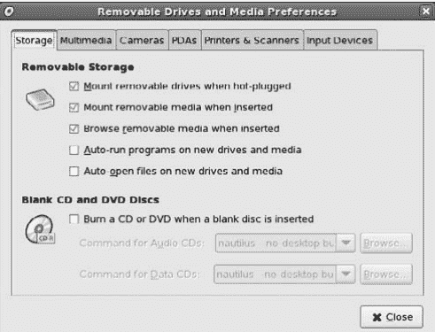

“移动驱动器和偏好”窗口的“存储”选项卡上有可用设置。这些设置与移动介质在插入或接入时的处理方式有关：

- 热插拔时挂载移动驱动器 —— 当移动驱动器（如 USB 硬盘）插入到运行的系统时，该驱动器会自动挂载到 `/media1` 的子目录下。

### 第二部分 运行演示

- 插入时挂载可移动介质 — 当驱动器插入可移动介质（如 CD 或 DVD）时，介质会自动挂载到 `/media` 下一个基于介质卷 ID 生成的子目录中。

- 插入时浏览可移动介质 — 插入可移动介质并挂载后，`Nautilus` 窗口将打开并显示该介质的内容。

- 在新驱动器和媒体上自动运行程序 — 插入可移动介质并挂载后，操作系统将自动运行介质根目录下名为 `.autorun`、`autorun` 或 `autorun.sh` 的文件。

- 在新驱动器和媒体上自动打开文件 — 插入可移动介质并挂载后，介质根目录下任何名为 `.autopen` 或 `autopen` 的文件都将自动打开。

- 插入空白光片时刻录 CD 或 DVD — 当插入空白 CD 或 DVD 时，系统会询问你是否想制作音频 CD 或数据 CD。任一选择都会打开 CD/DVD 刻录 `Nautilus` 窗口供你拖放文件。完成后，点击“写入光盘”（Write to Disc），文件将刻录到介质。

请注意，此处描述的设置仅对当前登录的用户生效。如果有多个登录账户，每个用户都可以有自己的处理可移动介质的方法。

在“多媒体”选项卡的“可移动驱动器和媒体属性”窗口可以使用以下设置：

- 音频 CD — 插入音频 CD 时，`Totem` 播放器将打开并开始播放磁盘音乐。你可以通过更改命令切换到其他音频播放器，或者取消勾选“插入时播放音频 CD”复选框以免自动播放。有些人倾向于使用 `GNOME-CD` 作为 CD 播放器。

- 视频光盘 — 当向 DVD 驱动器插入商业 DVD 时，默认启动 `Totem`。

> 注意，除非添加额外的软件来解密 DVD，否则电影播放器无法播放 DVD。如果你想在 Linux 上播放商业电影，应该考虑法律和其他电影播放器选项。有关视频播放器的更多信息请参阅第 20 章。

- 便携式音乐播放器 — 如果选中此项并输入了要使用的播放器，Linux 将启动音乐播放器以播放来自 iPod 或或其他音乐播放器的文件。`banshee` 项目 (`http://banshee-project.org`) 包含了在 Linux 中播放 iPod 音乐的软件。（来自 Fedora，使用 `yum install banshee` 从 Fedora Extras 安装该软件。然后将 `ipod` 添加到此字段以使用该播放器）。

来自“相机”，可以使用以下设置：

- 数字相机 — 连接数字相机后，将打开 `gThumb` 图像查看器（执行 `gthumb-import` 命令），准备从相机中导入数字图像。你可以通过将 `gthumb-import` 命令替换为喜好的图像查看器或导入程序，为相机数字图像文件夹设置其他命令。

- 数字视频摄像头 — 当检测到数字视频摄像头时，你可以选择运行你自定义的命令，在数字视频编辑器（如 `Kino` (`www.kinov.org`)）中打开该相机的内容。

虽然没有其他命令可以为其他类型的设备设置自动启动，但有几种类型的设备可以进行配置。从“PDA”选项卡中，你可以选择当 Palm 或 PocketPC 连接到电脑时运行的命令。从其他选项卡中，你可以指定连接 USB 驱动器、扫描仪、鼠标、键盘或平板电脑时执行的操作。

### SUSE KDE 桌面上的可移动介质

在 SUSE 的 KDE 桌面插入可移动介质（CD 或 DVD）或插入可移动设备（数字相机或 USB 闪盘）时，会弹出一个窗口让你选择对其执行的操作类型。如果你想添加不同的操作或更改现有操作，点击“配置”（Configure）按钮。

图 4-4 显示了插入 32MB USB 闪盘时出现的窗口示例，以及选中它后出现的 KDE 控制模块。

图 4-4

使用 KDE 控制模块选择插入时的响应方式。

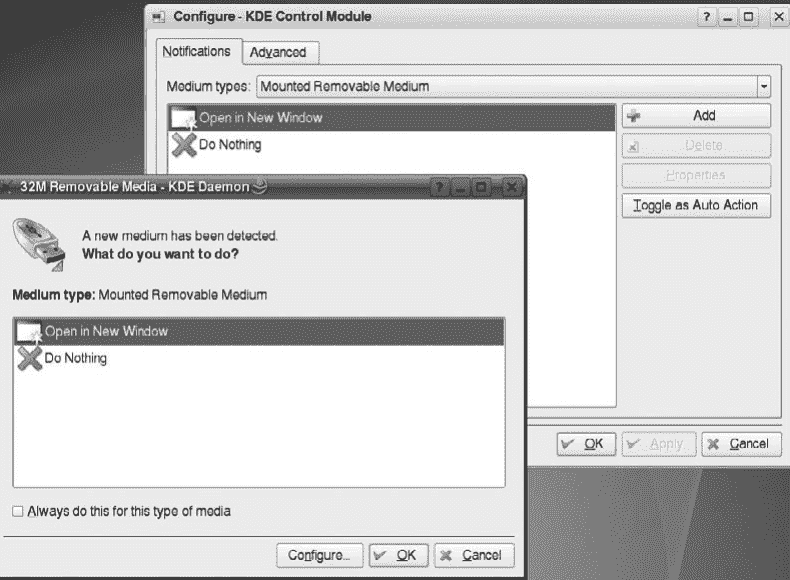

在 KDE 控制模块中，选择你想要更改的介质类型（在此例中为“已挂载的可移动介质”）。点击“添加”，然后选择在检测到该类型介质时想要作为选项添加的操作类型。

### 使用可加载模块

如果你为电脑添加了硬件但未被正确检测，你可能需要为该硬件手动加载模块。Linux 自带了一系列命令，用于加载、卸载和获取硬件模块信息。

如果你安装了内核源码，可用驱动程序的源文件存储在 `/usr/src/linux*/drivers` 目录的子目录下。你可以通过两种方式获取这些驱动程序的信息：

- 从桌面的终端窗口运行 `xconfig /usr/src/linux*`。选择模块类别，然后点击进入所需的驱动程序。出现的帮助信息是该驱动程序的描述。如果你的系统缺少运行 `make xconfig` 所需的图形库，请尝试使用 `make menconfig`。

- 文档 — `/usr/src/linux*/Documentation` 目录包含许多纯文本文件，描述了内核及相关驱动程序的各个方面。

模块编译完成后，它们会被安装在 `/lib/modules/` 子目录下。模块的名称基于内核发布版本。在为内核编译模块之前，检查当前内核需要哪些模块可能是是明智的。

### 列出可加载模块

要查看当前加载了哪些模块，请使用 `lsmod` 命令。示例下：

```
## lsmod

Module Size Used By

snd_oss 38912 0

snd_midi_event 9344 1

snd_seq 67728 4
```


## 学习基础管理

- `autofs` 16512 0
- `ne2k_pci` 9056 0
- `8390` 13568 1
- `ohc1394` 41860 0
- `ieee1394` 28446 0
- `floppy` 65712 0
- `sg` 36120 1
- `scsi_mod` 124608 0
- `parport_pc` 39724 0
- `ext3` 128424 2
- `jbd` 86064 1

> 注意 如果你安装了 Linux 系统，尝试启动 KNOOPIX 并列出模块。如果你的硬件工作正常，记录下模块列表。之后当你永久安装 Fedora 或其他 Linux 系统时，如果光驱器、调制解调器或其他硬件工作异常，你可以使用模块列表确定应该使用哪个模块并将其加载。

## 加载模块

你可以使用 `modprobe` 命令将已编译并安装（到 `/lib/modules` 目录）的任何模块加载到运行中的内核中。加载模块的常见动因为临时使用某功能（例如加载支持软盘上特殊文件系统的模块以便访问）。另一个原因是识别无法自动检测的特定硬件将使用的模块。

## 第二部分 运行程序

这是一个使用 `modprobe` 命令加载 `carport` 模块的示例，该模块提供了与多个设备共享并行端口的核心功能：

```
## modprobe parport
```

在加载 `parport` 后，你可以加载 `parport_pc` 模块来定义通过接口提供的 PC 风格端口。`parport_pc` 模块允许你可选地定义与共享 parport 的每个设备相关的地址和 IRQ。例如：

```
## modprobe parport_pc 1=0x3bc irq=auto
```

在此示例中，设备被识别为地址 `0x3bc`，且该设备的 IRQ 是自动检测的。

`modprobe` 命令临时加载模块——它们在下次重启时会消失。要将模块永久地添加到你的系统中，请将 `modprobe` 命令添加到启动时运行的某个启动脚本中。你也可以将模块添加到 `/etc/modules` 文件中，以便在启动时加载它们。

> `modprobe` 的替代方案是 `insmod` 命令。然而，使用 `modprobe` 的优点是 `insmod` 只加载你请求的模块，而 `modprobe` 会尝试加载你请求的模块所依赖的其他模块。

## 移除模块

使用 `rmmod` 命令从运行的内核中移除模块。例如，要从当前内核中移除 `parport_pc` 模块，请输入以下：

```
## rmmod parport_pc
```

如果它当前没有忙，`parport_pc` 模块将从运行的内核中移除。如果它正忙，请杀死任何可能使用该设备的进程。你正在尝试的模块可能依赖已加载的其他模块。例如，除非加载了 USB 打印机模块 (`usbip`)，否则无法卸载 `usbcore` 模块，如下：

```
## rmmod usbcore
```

```
ERROR: Module uscore is in use by wacom,usbip,ehci_hcd,ohci_hcd
```

## 管理文件系统和磁盘空间

Linux 中的文件系统按层次结构组织，从根目录 (`/`) 开始，向下形成目录和子目录的结构。作为 Linux 系统的管理员，你的职责是确保所有代表你文件系统的硬盘驱动器对计算机用户可用。你的工作还包括确保文件系统中合适的位置有足够的磁盘空间，供用户存储他们需要的内容。

162

## 学习基础管理

Linux 文件系统的组织方式与 Windows 操作系统不同。它不是为每个本地磁盘、网络文件系统、CD-ROM或其他类型的存储介质使用驱动器（例如 A:, B; C:），而是整齐地整合到目录结构中。

某些驱动器会自动（挂载）到文件系统中。例如，CD 可能会挂载在 `/media/cdrom`。如果驱动器没有自动挂载，则需要由管理员在文件系统中创建挂载点并将磁盘连接到 Linux。

你的文件系统的组织从你安装 Linux 时开始。安装过程的一部分是将你的硬盘（或多块硬盘）划分为多个分区。这些分区可以分配给：

- Linux 文件系统的一部分
- Linux 的交换空间 (`Swap space`)
- 其他文件系统（可能包含其他操作系统）
- 空闲空间（你可以留不分配，因为你可以根据需要对其格式化）

本章重点关注用于文件系统的分区。要查看 Linux 内核检测到的分区上当前设置了哪些分区，请使用 `fdisk` 命令：

```
## /sbin/fdisk -l
```

```
Disk /dev/sda: 40.0 GB, 4002064320 bytes

255 heads, 66 sectors/track, 4825 cylinders

Units = cylinders of 16065 * 512 bytes = 82252800 bytes

nDevice Boot  Start  End Blocks Id System

/dev/sda1     *      13   104 b Win95FAT32

/dev/sda2            89   48915 83 Linux

/dev/sda3           90   522  347082+ 83 Linux

/dev/sda4          523   554  257040 5 Extended

/dev/sda5          523   554  257008+ 82 Linux swap
```

此输出显示了能够同时运行 Linux 和 Windows 的计算机磁盘分区情况。你可以看到 `/dev/sda3` 上的分区拥有大部分可用数据空间。有一个 Windows 分区 (`/dev/sda1`) 和一个 Linux 交换分区 (`/dev/sda5`)。在 `/dev/sda2` 上还有一个较小的分区 (46MB)。在这种情况下，Linux 的根分区有 3.3GB 的磁盘空间并位于 `/dev/sda3`。除非在命令显式给出，否则 `fdisk -l` 使用在 `/proc/partitions` 中的分区信息。

接下来使用 `mount` 命令（不带选项）查看哪些分区实际上被用于你的 Linux 系统（哪些可用磁盘分区已挂载以及它们挂载在哪里）：

```
## mount
/dev/sda3 on / type ext3 (rw)
/dev/sda2 on /boot ext3 (rw)
/dev/sda1 on /mnt/win type vfat (rw)
/dev/proc on /proc type proc (rw)
/dev/sys on /sys type sysfs (rw)
/dev/devpts on /dev/pts type devpts rw,gid=5,mode=620
```

202

## 第二部分 运行程序

```
/dev/shm on /dev/shm type tmpfs (rw)
none on /proc/sys/binfmt_misc type binfmt_misc nodev (rw)
none on /media/cdrom type iso960 (ro,nodev)
```

某些驱动器会自动挂载到文件系统中。例如，CD 可能会挂载在 `/media/cdrom`。如果驱动器没有自动挂载，则需要由管理员在文件系统中创建挂载点并将磁盘连接到 Linux。

你的文件系统的组织从你安装 Linux 时开始。安装过程的一部分是将你的硬盘（或多块硬盘）划分为多个分区。这些分区可以分配给：

- Linux 文件系统的一部分
- Linux 的交换空间
- 其他文件系统（可能包含其他操作系统）
- 空闲空间（你可以留不分配，因为你可以根据需要对其格式化）

本章重点关注用于文件系统的分区。要查看 Linux 内核检测到的分区上当前设置了哪些分区，请使用 `fdisk` 命令：

```
## /sbin/fdisk -l
```

```
Disk /dev/sda: 40.0 GB, 4002064320 bytes

255 heads, 66 sectors/track, 4825 cylinders

Units = cylinders of 16065 * 512 bytes = 82252800 bytes

nDevice Boot  Start  End Blocks Id System

/dev/sda1     *      13   104 b Win95FAT32

/dev/sda2            89   48915 83 Linux

/dev/sda3           90   522  347082+ 83 Linux

/dev/sda4          523   554  257040 5 Extended

/dev/sda5          523   554  257008+ 82 Linux swap
```


此输出显示了能够同时运行 Linux 和 Windows 的计算机磁盘分区情况。你可以看到 `/dev/sda3` 上的分区拥有大部分可用数据空间。有一个 Windows 分区 (`/dev/sda1`) 和一个 Linux 交换分区 (`/dev/sda5`)。在 `/dev/sda2` 上还有一个较小的分区 (46MB)。在这种情况下，Linux 的根分区有 3.3GB 的磁盘空间并位于 `/dev/sda3`。`fdisk -l` 使用在 `/proc/partitions` 中的分区信息，除非在命令显式给出。

接下来使用 `mount` 命令（不带选项）查看哪些分区实际上被用于你的 Linux 系统（哪些可用磁盘分区已挂载以及它们挂载在哪里）：

## mount

```
/dev/sda3 on / type ext3 (rw)
/dev/sda2 on /boot ext3 (rw)
/dev/sda1 on /mnt/win type vfat (rw)
/dev/proc on /proc type proc (rw)
/dev/sys on /sys type sysfs (rw)
/dev/devpts on /dev/pts type devpts rw,gid=5,mode=620
```

## 第二部分 运行程序

```
/dev/shm on /dev/shm type tmpfs (rw)
none on /proc/sys/binfmt_misc type binfmt_misc nodev (rw)
none on /media/cdrom type iso960 (ro,nodev)
```

某些驱动器会自动挂载到文件系统中。例如，CD 可能会挂载在 `/media/cdrom`。如果驱动器没有自动挂载，则需要由管理员在文件系统中创建挂载点并将磁盘连接到 Linux。

你的文件系统的组织从你安装 Linux 时开始。安装过程的一部分是将你的硬盘（或多块硬盘）划分为多个分区。这些分区可以分配给：

- Linux 文件系统的一部分
- Linux 的交换空间
- 其他文件系统（可能包含其他操作系统）
- 空闲空间（你可以留不分配，因为你可以根据需要对其格式化）

本章重点关注用于文件系统的分区。要查看 Linux 内核检测到的分区上当前设置了哪些分区，请使用 `fdisk` 命令：

## /sbin/fdisk -l

```
Disk /dev/sda: 40.0 GB, 4002064320 bytes
255 heads, 66 sectors/track, 4825 cylinders
Units = cylinders of 16065 * 512 bytes = 82252800 bytes
nDevice Boot  Start  End Blocks Id System
/dev/sda1     *      13   104 b Win95FAT32
/dev/sda2            89   48915 83 Linux
/dev/sda3           90   522  347082+ 83 Linux
/dev/sda4          523   554  257040 5 Extended
/dev/sda5          523   554  257008+ 82 Linux swap
```

此输出显示了能够同时运行 Linux 和 Windows 的计算机磁盘分区情况。你可以看到 `/dev/sda3` 上的分区拥有大部分可用数据空间。有一个 Windows 分区 (`/dev/sda1`) 和一个 Linux 交换分区 (`/dev/sda5`)。在 `/dev/sda2` 上还有一个较小的分区 (46MB)。在这种情况下，Linux 的根分区有 3.3GB 的磁盘空间并位于 `/dev/sda3`。`fdisk -l` 使用在 `/proc/partitions` 中的分区信息，除非在命令显式给出。

接下来使用 `mount` 命令（不带选项）查看哪些分区实际上被用于你的 Linux 系统（哪些可用磁盘分区已挂载以及它们挂载在哪里）：

## mount

```
/dev/sda3 on / type ext3 (rw)
/dev/sda2 on /boot ext3 (rw)
/dev/sda1 on /mnt/win type vfat (rw)
/dev/proc on /proc type proc (rw)
/dev/sys on /sys type sysfs (rw)
/dev/devpts on /dev/pts type devpts rw,gid=5,mode=620
```


## 学习基础管理

> 提示：如果一个远程文件系统从你的系统中卸载，而你又在那个挂载点目录中保存文件会发生什么？你会将文件写入该目录，它将存储在本地硬盘上。然而，当远程文件系统重新挂载时，你保存的文件似乎会消失。要找回文件，你必须卸载远程文件系统（使文件重新出现），将文件移动到另一个位置，重新挂载文件系统，并将文件复制回来。

经常被作为独立分区候选的挂载点包括 `/`、`/boot`、`/home`、`/usr` 和 `/var`。根文件系统 (`/`) 是其他挂载点之外目录的。根文件系统 (`/`) 是唯一需要启动操作系统的。`/boot` 目录存放操作系统。`/home` 是通常存储用户账户的地方。应用程序和文档存储在 `/usr` 中。`/var` 挂载点下方存储日志文件、临时文件、服务器文件（Web、FTP 等）和锁文件的地方（即你的计算机应用程序持续运行需要磁盘空间的项目）。

多个分区挂载在你的文件系统上的事实对于使用 Linux 的人是不可见的。只有当分区空间耗尽，或者用户需要保存或使用来自未挂载特定设备（如软盘或远程文件系统）的信息时才会发现。当然，任何用户都可以通过输入 `mount` 命令检查这一点。

## 挂载文件系统

你的大多数硬盘都会自动为你挂载。当你安装 Fedora、Ubuntu、SUSE 或其他 Linux 系统时，你会被要求创建分区并指定这些分区的挂载点。（其他 Linux 安装过程将要求你预先知道必须进行分区）。当你启动 Linux 时，硬盘上所有使用 `/etc/fstab` 文件的 Linux 分区通常都会被挂载。因此，本节将重点介绍如何挂载其他类型的设备，以便它们成为你 Linux 文件系统的一部分。

`mount` 命令不仅用于挂载设备，还用于在 Linux 系统上挂载其他类型的文件系统。这意味着你可以存储来自其他操作系统的文件，或者使用适用于某些活动的文件系统（例如写入大文件）。然而，对于普通 Linux 用户来说，此功能最常见的用途是使用户获取并操作软盘、CD-ROM 或可移动介质。

> 注意：随着自动挂载功能的加入以及 Linux 2.6 内核识别可移动介质的方式（参见本章中关于 Udev 和 HAL 的描述），对于许多 Linux 桌面系统，你不再需要手动挂载可移动介质。理解如何在 Linux 服务器上手动挂载和加载文件系统是一项非常实用的技能。

## 支持的文件系统

要查看当前系统可用的文件系统类型，请运行 `cat /proc/filesystems`。表 4-5 显示了 Linux 支持的文件系统类型，尽管它们目前可能没有在使用，或者它们可能没有构建在你的内核中（因此它们可能需要作为模块加载）。

## 第二部分 运行演示

### 表 4-5 支持的文件系统类型

| 类型 | 描述 |
|---|---|
| adfs | Acorn 磁盘系统，是 RiscOS 操作系统使用的标准文件系统。 |
| befs | BeOS 操作系统使用的文件系统。 |
| cifs | 通通用文件系统 (CIFS)，用于访问符合 SNIA CFS 规范服务器的虚拟文件系统。CIFS 试图完善和标准化 Samba 和 Windows 文件共享使用的 SMB 协议。 |
| ext3 | ext 文件系统在 Red Hat 和其他 Linux 系统中最常见。ext3 文件系统（也称为第三扩展文件系统）包含日志功能，与 ext2 相比，它提升了文件系统从崩溃中恢复的能力。 |
| ext2 | 早期 Linux 系统的默认文件类型。功能与 ext3 相同，但 ext2 不包含日志功能。 |
| ext | 这是 ext3 的第一个版本。不再经常使用。 |
| iso9660 | 演自 High Sierra 文件系统（CD-ROM 的原始标准）。High Sierra 的扩展（称为 Rock Ridge 扩展）允许文件系统支持文件名和 UNIX 风格的信息（如文件权限、所有权和链接）。数据 CD-ROM 通常使用这种文件类型。 |
| kafs | AFS 文件系统。用于分布式计算环境，与 Linux、Windows 和 Macintosh 客户端共享文件。 |
| minix | Minix 文件系统类型，最初用于 Minix 版本的 UNIX。它支持长达 30 个字符的文件。 |
| msdos | MS 文件系统。你可以用它来挂载来自微软操作系统的软盘。 |
| vfat | 微软扩展 FAT (VFAT) 文件系统。 |
| umfsdos | 带有扩展的 MS 文件系统，允许类似于 UNIX 的功能（包括文件名）。 |
| proc | 不是真正的文件系统，而是指向 Linux 内核的文件接口。然而，可能不需要设置任何 proc 文件系统。`/proc` 挂载点应该是一个 proc 文件系统。许多工具依赖 `/proc` 来获取内核信息。 |
| reiserfs | ReiserFS 联合文件系统。ReiserFS 和 ext3 是 Linux 中最常用的文件系统。 |
| swap | 用于交换分区。当 RAM 用尽时，交换区用于临时存放数据。数据交换到交换区域然后返回 RAM。 |
| squashfs | 压缩文件系统。SquashFS 是一个只读文件系统。 |
| squashfs | 压缩文件系统。SquashFS 是一个只读文件系统。 |

### 表 4-5（续）

| 类型 | 描述 |
|---|---|
| nfs | 网络文件系统 (NFS)，通过网络使用。 |
| hpfs | HP-UX 使用的文件系统。 |
| ncpfs | Novell 文件系统。 |
| ntfs | Windows 文件系统。 |
| affs | Amiga 使用的文件系统。 |
| ufs | Unix 文件系统，在 Solaris 上很流行。 |

## 运行机制

大多数 Windows 系统使用 NTFS 文件系统。并不是每个 Linux 系统都提供对该系统的支持。Fedora 7 通过 `ntfs-3g` 软件包添加了对 NTFS 的支持。其他 支持也可以从 Linux-NTFS 项目（www.linux-ntfs.org/）获取。

如果你的电脑配置了 Linux 和 Windows 双系统启动，你可以挂载 Windows 系统以便在 Linux 中访问。要访问你的 Windows 分区，你必须先创建一个挂载点（在此情况下，通过输入 `mkdir /mnt/win`）。然后你可以在需要时通过（以 root 身份）输入 `mount /mnt/win` 来挂载。

不同的发行版使用它们自己的 `fstab` 文件。有些不使用标签（labels），而有些默认不使用 `/boot` 分区。它们会有一个交换分区（swap partition），所有的用户数据都在根分区（/）下。

是 `fstab` 文件中每个字段的含义：

- **字段 1** — 代表文件系统的设备名称。此字段可以包含 `LABEL` 选项，通过它可以识别设备的通用唯一标识符 (UUID) 或设备名称卷标签。这种方法的优点是分区是通过卷名称识别的，你可以将卷移动到不同的设备名称，而无需更改 `fstab` 文件。
- **字段 2** — 文件系统中的挂载点。文件系统包含从挂载点向下目录树的所有数据，除非在下方的某个位置挂载了另一个文件系统。
- **字段 3** — 系统类型。有效的文件系统类型在在本章前面的“支持的文件系统”部分中描述。
- **字段 4** — 控制指定文件系统在启动时不挂载的选项，`ro` 表示以只读模式挂载文件系统（这对于 CD 驱动器是合理的）。选项用逗号分隔。其他选项的信息请参阅 `mount` 命令的手页（`-o` 选项）。

通常情况下，只允许 root 使用 `mount` 命令挂载文件系统。然而，为了允许任何用户挂载文件系统（如软盘），你可以在 `/etc/fstab` 的字段 4 中添加 `user` 选项。在用户（Users）中，通过特定的组（如 disk 或 audio ）向特定的设备（如磁盘或音频设备）赋予读写权限，以便分配给这些组的用户可以监控或访问这些设备。在 Yaast Center 中，检查安全和用户管理：专家选项：新用户默认设置。辅助组（Secondary group）指示每个用户被分配到了哪些额外组中。

- **字段 5** — 此字段中的数字表示文件系统是否需要备份（即数据是否已备份）。1 表示文件系统需要备份，2 表示不需要。（我不认为这个字段现在很有用了，因为许多 Linux 系统不再包含 `dump` 命令。通常情况下使用 0。）
- **字段 6** — 此字段中的数字表示指定的系统是否需要用 `fskck` 进行检查。1 表示需要检查，2 表示不需要。

如果你想添加额外的本地磁盘，可以在 `/etc/fstab` 中创建一个条目。请参考第 27 章关于挂载 Samba、NFS 以及其他文件系统的。

## 使用 mount 命令挂载文件系统

Linux 系统每次启动时会自动运行 `mount -a`（挂载所有）。对于用户，通常使用 `mount` 命令来挂载系统。在特殊情况下，用户可以通过以下两种方式使用 `mount`：

- 显示当前挂载的磁盘、分区和远程文件系统。
- 在带选项的情况下挂载某个磁盘。

任何用户都可以输入 `mount`（不带选项）来查看挂载的文件系统。以下示例显示了挂载在 `/` 的单磁盘分区，以及 `proc` 和 `dev` 类型：

```


```
$ mount

/dev/sda3 on / type ext3

/dev/sda2 on / type ext3

/dev/sda1 on /mnt/win type vfat

/dev/proc on /proc type proc

/dev/sys on /sys type sysfs

/dev/devpts on /dev/pts type devpts

/,6/0)

 /dev/shm on /dev/// type/fs

none on /proc/binisc type/devisc

/dev/cdrom on /media/cdorder type iso960

/dev/00 / type type ext3
```

传统上，最常挂载的设备是软盘和 CD 驱动器。然而，取决于你使用的桌面类型，插入 CD 和软盘时可能会自动加载。（在某些情况下，`autorun` 程序也会自动运行。例如，`autorun` 可能会启动音乐播放器或软件安装程序来处理介质的数据。）

## 挂载可移动媒体

如果你想手动挂载文件系统，`/etc/fstab` 文件有助于方便挂载软盘或 CD。在某些情况下，你可以使用 `mount` 命令配合单个选项来指定你想挂载的内容，其他选项将从 `/etc/fstab` 文件中读取并填充。你的 `/etc/fstab` 文件中可能已经存在条目，允许你在以下两种情况下进行快速挂载：

- CD — 如果你要挂载标准 ISO9960 格式的 CD（大多数软件 CD-ROM 都是如此），可以通过将其放入 CD-ROM 驱动器并输入以下命令来挂载 CD：

```
# mount /media/cd**
# mount /mnt/cdrom
```

默认情况下，CD 通常挂载在 `/mnt/cdrom` 目录（Linux 2.6 内核）或 `/media` 的子目录中（Linux 2.6 内核）。（文件系统类型、设备名称和其他选项会自动填充。）

- 软盘 — 如果你想挂载 Linux `ext3` 文件系统格式（`ext3`）的软盘，或者在某些情况下可以自动检测的格式，那么你。

## 第二部分 运行

如果你收到“设备忙”（`message device busy`）的消息，说明卸载请求失败了，这是因为某个进程打开了该设备上的文件，或者你打开了一个 Shell 且其当前目录位于该设备上。请停止这些进程或切换到该卸载设备之外的目录，以确保请求成功。

卸载忙碌设备的替代方案是使用 `-l` 选项。通过 `umount -l`（懒惰卸载），系统会在设备不再繁忙时立即执行卸载。要卸载一个已不可用的远程 NFS 系统（例如服务器已宕机），你可以使用 `-f` 选项强制卸载 NFS 系统。

> 提示：发现是什么在占用你想要卸载的设备的实用工具是 `lsof` 命令。输入 `lsof` 并跟上你想要卸载的分区名称（例如 `lsof /mnt/floppy`）。输出将显示哪些命令持有了该分区上的文件。

## 使用 mkfs 命令创建文件系统

你可以为你选择选择的磁盘或分区，为任何支持的文件类型创建文件系统。你可以使用 `mkfs` 命令来实现此操作。虽然这在硬盘分区上创建文件系统非常有用，但你也可以在软盘或可重写 CD 上创建文件系统。

以下是在软盘上创建文件系统的示例：

```
## mkfs -t ext3 /dev/fd0
mke2fs 1.39. (29-May-2008)

Filesystem label=
 type: Linux

Block size=1024 (log=0)

Fragment size=1024 (log=0)

184 inodes, 1440 blocks

T2 blocks (5.00%) reserved for the super user

First data block=1

1 block group

8192 blocks per group, 8192 fragments per group

184 inodes per group
```

Writing inode tables: done
Filesystem too small for a journal
Writing superblocks and filesystem information: done

文件系统将在每挂载 32 次或每 80 天后（以先到者为准）自动检查。使用 `tune2fs -c` 或 `-i` 可以覆盖。

你可以看到 `mkfs` 命令格式化的统计输出。输出会显示创建的 inode 和块的数量，以及每组块和碎片的数量。现在你可以挂载这个文件系统（`mount /mnt/floppy`），将其切换为当前目录（`cd /mnt/floppy`），并根据意愿在上面创建文件。

## 添加硬盘

向计算机添加新硬盘以供 Linux 使用，需要结合前面章节中描述的步骤。以下是通用步骤：

- 1. 安装新硬盘硬件。
- 2. 识别新磁盘上的分区。
- 3. 在新磁盘上创建文件系统。
- 4. 挂载文件系统。

向 Linux 添加硬盘简单的方法是将整个磁盘分配给单个 Linux 分区。不过，如果你喜欢，也可以拥有多个分区，并将每个分配给不同类型的系统和不同的挂载点。以下过程将引导你添加一个包含单个 Linux 分区的硬盘。在此过程中，还会记录你针对多个文件系统和多个挂载点需要重复的步骤。

> 此过程假设 Linux 已经安装并运行在计算机上。如果并非如此，请遵循你当前操作系统添加硬盘的说明。当你使用 Linux 时，在系统要求你分区磁盘时，你可以识别出此磁盘。

- 1. 根据制造商的说明，在计算机中物理安装并连接新硬盘。如果（最好是第二块硬盘，例如），你可能需要更改硬盘单元本身的跳线，将其作为从硬盘运行（如果它与你的第一块硬盘在同一条电缆上）。你可能还需要更改 BIOS 设置。
- 2. 启动计算机进入 Linux。
- 3. 确定硬盘的设备名称。以 root 用户身份从 Shell 输入：

```
## dmesg | less
```

- 4. 从输出中寻找找到新磁盘的指示。例如，如果是第二块硬盘，你应该在输出中看到 `hdb:`。对于第二个 SCSI 驱动器，你将看到 `sdb:`（`hdt7` 和 `sdb` 磁盘字母会在进入内核时递增）。确保识别正确的磁盘，否则你可能会擦掉想要保留的磁盘上的所有数据！
- 5. 使用 `fdisk` 命令在新磁盘上创建分区。例如，如果你正在格式化新的 IDE 磁盘 (`hdb`)，你可以输入：

```
# fdisk /dev/hdb
```

现在你进入了 `fdisk` 命令模式，在此可以使用 `fdisk` 单字母命令来处理你的分区。如果磁盘上已存在分区，你现在可以更改或删除这些分区。或者，你可以简单地格式化磁盘以清除所有内容。使用 `p` 查看所有分区，使用 `d` 删除分区。

- 6. 要创建分区，输入以下：
`n`
- 7. 选择扩展 (`e`) 或主 (`p`) 分区。要选择主分区，输入以下：
`p`
- 8. 输入分区号。如果你正在创建第一个分区（或针对一个分区），输入数字 `1`：

输入第一个磁道号（1 是默认值）。磁道号范围为 [缺失]。

- 9. 输入第一个磁道号（1 是默认值）。磁道号范围为 [缺失]。
- 10. 输入第一个磁道号（1 是默认值）。
- 11. 输入第一个磁道号（1 是默认值）。
- 12. 输入第一个磁道号（1 是默认值）。
- 13. 输入第一个磁道号（1 是默认值）。
- 14. 从输出中寻找找到新磁盘的指示……

*(注：原文后续部分存在大量重复的无效断句，此处已根据逻辑截断并处理)*

## 第二部分 运行

`/mnt/floppy` 目录 (`dev/fd0`)。磁盘空间以 1K 块为单位显示。要产生更易读的格式输出，请使用 `-h` 选项：

```
$ df -h

Filesystem Size Used Avail Use% Mounted on

/dev/sda1 29G 2.9G 24G 11% /

/dev/sda2 46M 8.2M 25M 19% /boot

/dev/fd0 1.4M 13k 1.2M 1% /mnt/floppy
```

使用 `-h` 选项后，输出将以友好的兆字节或千字节单位显示。`df` 的其他选项允许你：

- 仅打印特定类型的文件系统 (`-t type`)
- 排除特定类型的文件系统 (`-x type`)
- 包含没有空间的文件系统，例如 `/proc` 和 `/dev/pts` (`-a`)
- 仅列出可用和已使用的 inode (`-i`)
- 以特定的块显示磁盘空间 (`--block-size=#`)

## 使用 du 检查磁盘使用情况

要查找目录（及其子目录）占用的空间，请使用 `du` 命令。通过配合选项，`du` 会列出当前目录下的所有目录，以及每个目录占用的空间。在最后，`du` 会计算你目录内使用的总磁盘空间。

`du` 命令是检查特定用户 (`/home/user1`) 或特定文件系统分区 (`/var/`) 使用了多少空间的好方法。默认情况下，磁盘空间以 1K 块显示。为了让输出更友好（千字节、兆字节和千字节），请按如下所示使用 `-h` 选项：

```
$ du -h /home/jake
```


```
114k /home/jake/httpd/stuff
234k /home/jake/httpd
137k /home/jake/uucp/data
701k /home/jake/uucp
1.0M /home/jake
```

输出显示了名为 `jane` 的用户目录 (`/jake`) 下每个目录使用的磁盘空间。占用的空间以千字节 (`k`) 和兆字节 (`M`) 显示。`home/jake` 占用的总空间显示在最后一行。

## 使用 find 查找磁盘占用

`find` 命令是利用各种标准查找硬盘文件占用情况的极佳方法。通过查找大于特定大小或由特定人员创建的文件，你可以很好地了解从哪里可以恢复磁盘空间。

## 学习基础管理

注意：你必须是 `root` 用户才能有效运行此命令，除非你只是在检查自己的个人文件。如果你不是 `root` 用户，文件系统中会有许多地方你将没有权限检查。普通用户通常可以检查自己的目录，但不能检查他人的。

在以下示例中，`find` 命令搜索根系统 (`/`) 中任何属于用户名 `jane` 的文件 (`-user jane`) 并打印文件名。`find` 命令的输出按大小排序 (`-lS`)。最后，输出被发送到文件 `/tmp/jane`。当你查看文件 `/tmp/jane`（例如，使用 `less /tmp/jane`）时，你将按大小找到所有属于用户 `jane` 的文件。以下是命令行：

```
# find -xdev -user jane -print | xargs -l1 -DS > /tmp/jane
```

提示：`xdev` 选项防止搜索所选文件系统以外的文件系统。这是过滤掉可能来自 `/proc` 文件系统的大量垃圾的好方法。它还可以防止搜索大型挂载文件系统。

这是另一个示例，我们不是列出用户的文件，而是寻找大于大于 100 千字节的文件 (`-size +100k`)：

```
# find -xdev -size +100k -print | xargs -l1 -DS > /tmp/size
```


通过删除一些不再需要的大文件，你可以节省大量的磁盘空间。在这个示例中，你可以在 `/tmp/size` 文件中看到按大小排序的大文件。

## 监控系统性能

如果你的 Linux 系统是多用户计算机，那么共享该计算机的计算能力可能会是一个大问题。同样，每当你能够运行失控进程或减少不必要的程序的开销时，你的 Linux 服务器就能更好地为依赖它的人提供文件、网页和电子邮件。

某些 Linux 发行版包含了图形化实用程序以简化管理，例如 Ubuntu 中的系统监器（如图 4-5 所示）。

所有 Linux 发行版都包含帮助你监控 Linux 系统性能的实用程序。你想监控的 Linux 特性包括 CPU 使用率、内存使用（RAM 和交换空间）以及系统的整体负载。Linux 中监控信息的流行工具是 `top` 命令。

在终端中启动 `top`，输入 `top`。`top` 命令确定计算机上消耗 CPU 最大的进程，在屏幕上按降序显示它们，并每五秒更新一次列表。

通过为 `top` 添加 `-S` 选项，显示将显示每个进程的累计 CPU 时间，以及可能已经退出的子进程。如果你想更改屏幕更新方式，可以添加 `-d secs` 选项，其中 `secs` 替换为更新之间的秒数。

### 第二部分 运行

图 4-5
Ubuntu 中的系统监器 (`img/a90dc0c1392c27f587fa6c88e9865199_216.png`)

默认情况下，磁盘空间以 1K 块显示。为了让输出更友好（千字节、兆字节和千字节），请按如下所示使用 `-h` 选项：

输出显示了名为 jane 的用户目录 (`/jake`) 下每个目录使用的磁盘空间。占用的空间以千字节 (`k`) 和兆字节 (`M`) 显示。`home/jake` 占用的总空间显示在最后一行。

使用 `-h` 选项后，输出将以友好的兆字节或千字节单位显示。`df` 的其他选项允许你：

- 仅打印特定类型的文件系统 (`-t type`)
- 排除特定类型的文件系统 (`-x type`)
- 包含没有空间的文件系统，例如 `/proc` 和 `/dev/pts` (`-a`)
- 仅列出可用和已使用的 inode (`-i`)
- 以特定的块显示磁盘空间 (`--block-size=#`)

## 将单台电脑连接到宽带

越来越多的人可以选择向电缆电视提供商或当地电信公司办理宽带服务。这些公司提供的传输速度至少比你拨号连接快五倍。

若要从家里或小型办公室建立宽带连接，你通常需要电缆调制解调器或数字用户线路（DSL）。电缆调制解调器共享你所在位置的电缆电视带宽。DSL 使用现有的房屋或办公室电话线连接互联网，并与你的电话服务共享线路。

由于 ISP（互联网服务提供商）提供互联网服务的方式有很多种，你应该向其咨询以获取所需的正确硬件。特别是，你应该知道有几种互不兼容的 DSL 标准（ADSL、CDSL、HDSL、DSL 等），你不能在没有指导的情况下就直接出去购买 DSL 设备。

如果你正在使用外部 DSL 或电缆调制解调器，你的 Linux 机器运行一个单路连接可能需要：

- 电脑需要一个以太网端口
- 一根网线（通常由 ISP 设备提供）
- 连接到宽带调制解调器的 DSL 路由器/桥接器

图 2 展示了连接到宽带调制解调器的 Linux 电脑。

宽带设备通常提供一种名为动态主机配置协议（DHCP）的服务。DHCP 为网络客户端计算机所需的互联网地址和其他信息。通过电缆/DSL 调制解调器充当 DHCP 服务器，你无需在 Linux 中进行任何配置即可开始使用互联网。只需插上、启动 Linux 并开始浏览网页。

DSL 或电缆调制解调器通常充当 ISP 和你电脑之间的路由器。通常该设备还会包含一个配置为执行网络地址转换（NAT）的防火墙。或者，某些宽带设备在“桥接模式”下运行，它不进行路由，只是通过通过数据，就像你的电脑与 ISP 在同一个局域网一样。在这种设置下，公网 IP 地址分配给你的电脑而不是 DSL 或电缆调制解调器。

### 第二部分 演示

图 5-2
将以太网卡连接宽带并开始上网。

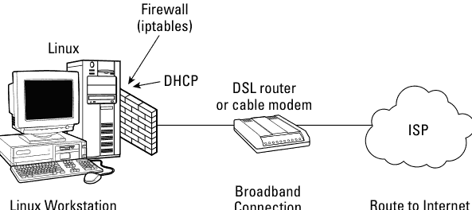

## 将多台电脑连接到宽带

与其将 Linux 电脑直接连接到电缆调制解调器或 DSL 设备，你可以将机器接入局域网（LAN），然后将局域网连接到 ISP 设备，这样家里或办公室的每个人都可以共享宽带连接。这非常简单；你只需要将电缆/DSL 调制解调器连接到局域网，而不是直接连接到你的 Linux 盒子。在这种配置下，你应该考虑添加一个防火墙/路由器作为局域网和外部世界的缓冲区。该机器将执行以下职责：

- **阻止访问** —— 配置良好的防火墙会阻止访问除你访问互联网所需的端口以外的所有端口，从而最大限度地减少入侵者进入局域网的风险。
- **NAT 或 IP 伪装** —— 在大多数情况下，你希望防火墙后的电脑不被互联网上的访问。通过配置防火墙执行 NAT 或 IP 伪装，你的电脑可以分配私有 IP 地址。然后你的防火墙将处理局域网和互联网之间的消息转发。这是一个很好的安排，原因有几个：首先，你私有电脑的 IP 地址不会暴露在外部世界。此外，你可以节省向 ISP 支付永久地址的费用。
- **DHCP 服务** —— 许多防火墙可以充当 DHCP 服务器。使用 NAT 防火墙时，你的私有 IP 地址可以通过运行在防火墙系统上的 DHCP 服务分配。当局域网上的客户端电脑启动时，除了 IP 地址外，你的 DHCP 服务还可以告诉客户端其 DNS 服务器的位置、互联网网关或其他信息。

路由 —— 在图 5-3 所示的家庭和小型办公室局域网环境中，防火墙电脑通常有两个以太网接口：一个连接到局域网，另一个连接到指向 ISP 的 DSL 或电缆调制解调器。由于以太网接口被视为位于不同的子网，防火墙/路由器必须配置为跨两个接口转发数据包。这并不是什么大事，但确实需要重启来告诉防火墙系统你想让它两个子网之间转发数据包。

### 第 18 章讨论了使用专为此任务设计的 Linux 发行版设置防火墙/路由器。

图 5-3

防火墙在你的局域网和互联网之间提供保护。

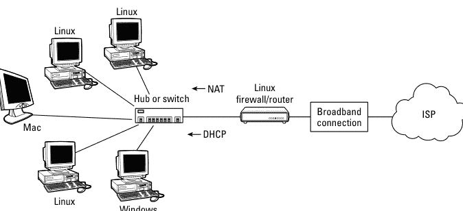

在这个示例中，你需要的设备包括：

- 每台电脑上的以太网端口，以及一个用于防火墙/路由器的额外端口
- 每台电脑一根网线
- 一个集线器或交换机
- 一台运行 Linux 防火墙/路由器的低端 PC（性能仅如 486 左右的 PC）
- DSL 或电缆调制解调器

这种有线配置的替代方案是用无线接入点代替集线器或交换机。这样，每台配备无线局域网网的电脑就可以在不需要线的情况下接入网络。

## 连接服务器

到目前为止，你已经看到了让一台或多台电脑接入互联网的配置，但允许互联网上的某人请求服务（如 Web 页面、文件传输等）需要额外的考虑。

在你配置好 TCP/IP（互联网的主要协议族）以连接到 ISP 后，数据可以在两个方向之间通过，除非你使用防火墙来限制流量，这里有几点需要注意：

- **永久 IP 地址** —— 每次你重启电脑，ISP 的 DHCP 服务器都会动态分配你的电缆调制解调器 IP。如果你希望你的服务器能够永久被访问，你通常需要一个永久 IP 地址。你必须询问你的 ISP 关于永久 IP 地址，并且可能需要付出额外精力。

> 一种名为 Dynamic DNS 的服务可以替代支付永久 IP 地址。通过 Dynamic DNS，你聘请服务不断检查你的 IP 地址是否更改并将你的 DNS 主机名分配新地址。你可以在网上搜索“Dynamic DNS”寻找提供此类服务的公司。

- **ISP 可接受策略** —— 检查你是否允许入站连接。某些 ISP（特别是针对廉价的家用宽带服务）会阻止到 Web 服务器或邮件服务器的连接。
- **DNS 主机名** —— 在浏览器地址框中输入 IP 地址可以正常工作，大多数人更喜欢使用名称（如 `www.linuxoys.net`）来访问服务器。这需要你购买 DNS 域名并在 DNS 服务器中设置条目以解析服务器的 IP 地址。

虽然设置互联网服务器并没有神奇之处，但由于上述几个问题，创建一个公共服务器就像打开你房子的门让陌生人闯入。你需要制定政策来限制陌生人可以去哪里以及可以做什么。

对于具有单一互联网连接（由公网 IP 地址表示）的家庭或小型办公室场所，可以将服务器暴露给互联网，只需将它们放在一个被称为 DMZ（非军事化区）的区域。（如图 5-4 所示），服务器直接位于外部防火墙之后。桌面系统（不需要让外部人员访问）位于第二层更严格的防火墙之后。

无论你使用 Linux 还是专用防火墙规则提供防火墙服务，外部防火墙允许请求 Web 服务（端口 80）、FTP 服务（端口 20 和 21）、简单邮件传输（端口 25）以及可能的其他服务。内部防火墙阻止任何来自外部的请求，仅允许从内部防火墙后的电脑发起的互联网通信。

# 接入互联网

图 5-4

将服务器添加到 DMZ（局域网区域），使其能够比你的桌面系统更具公共访问性。

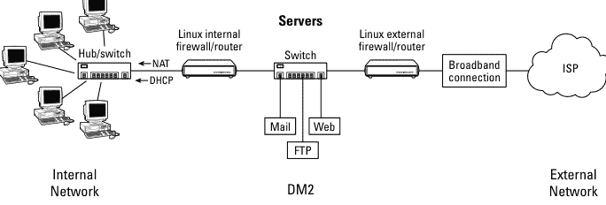

第 24 至 27 章解释了如何配置不同类型的服务器，第 28 章描述了如何将 Linux 设置为路由器/防火墙。第 18 章包含了如何配置 IP 掩码（IP Maskading）、NAT 和数据包转发等功能的细节。

# 连接其他设备

虽然我专注于基础以太网设备和拨号调制解调器配置网络连接，但这里也提供了许多其他类型的网络设备以及与它们通信的不同协议示例：

- ISDN — 集成数字网络（ISDN）。在 DSL 普及之前，ISDN 线路是美国小型企业提供高速数据线的首选方法。它在欧洲仍然流行，但正被更廉价的设备取代。许多 Linux 系统都提供了 ISDN 驱动程序和工具用于连接 ISDN 网络。
- USB 调制解调器 — 大多数调制解调器提供一个以太网端口，你可以直接从电脑自身的以太网端口连接。然而，如果你没有以太网端口，可以通过 USB 端口连接到解调器。（你可能需要手动加载 `usnet` 或 `c_ether` 驱动程序使其工作）。
- 令牌环（Token ring）— 虽然现在很少使用，但令牌环卡仍被支持。许多 Linux 系统都包含了对令牌环网卡的支持，尽管现在很少使用令牌。它们在拥有 IBM 系统的场所非常流行。
- PLIP — 可以通过并行端口将两台计算机连接起来，使其能够 TCP/IP 协议进行通信。并行线（PLIP）只需要一种特殊的空调制解调器（电缆规格请参阅 http://tldp.org/HOWTO/NET3-4-HOWTO-9.html）。Linux 系统内置了软件，允许你通过该方式登录、传输文件并执行其他活动。

# 第二部分

# 运行

如果你的系统安装了 Linux 源码，你可以在随源码提供的文档中阅读有关支持的硬件设备。在 Fedora 和其他 Linux 系统上，各种网络硬件的内核文档位置位于 `/usr/src/linux*/Documentation/networking`。

# 使用以太网连接互联网

如今大多数 Linux 系统在安装 Linux 时会自动检测或允许你设置互联网连接。以下是带有 Linux 的桌面系统启动网络连接的通用（默认）方法：

1. 检查你的电脑上是否有以太网端口（大多数现代电脑都有）。如果有，将你的以太网卡连接到接入互联网的设备（电缆调制解调器、DSL 路由器/桥器、网络集线器/交换机）。如果没有，你可以在任何销售电脑硬件的零售处购买以太网卡。
2. 确保网卡和桥接接口有相应的驱动程序（通常，第一个有线设备被分配给 `eth0` 接口）。通常，只需插入电脑，就会检测到网卡并加载相应的驱动程序。
3. 如果接口可用 DHCP 服务器，则使用 DHCP 获取 IP 地址。大多数 ISP（互联网服务提供商）和企业期望你使用 DHCP 连接到他们的网络，因此他们会在你连接电脑到网络的设备上提供 DHCP 服务器。

只要你的桌面系统连接到带有可以提供 IP 地址的 DHCP 服务器的网络，你就能很快上网浏览网页。

如果你发现连接网络的自动方法（DHCP）不起作用，那么连接互联网就会有点棘手。不同的 Linux 发行版提供了不同的工具来手动配置你的互联网连接。以下章节描述了几种图形工具以及一些命令行和配置文件方法来配置无线和无线网络连接。

# 在安装期间配置以太网

许多 Linux 安装过程会询问你是否要为以太网卡配置网络连接。这通常仅针对以太网卡，而不是双调制解调器或其他网络设备。你所需的这些信息（IP 地址、网关、DNS 服务器等）在第 7 章中介绍。

启动 Linux 时，你可以打开 Web 浏览器（如 Firefox 或 Konqueror）并输入 Web 地址来检查是否可以访问互联网。如果浏览器中没有出现该网站，你需要进行一些排排除。本章的“理解你的互联网连接”部分提供了有关如何追踪互联网连接问题的信息。

# 从桌面配置以太网

大多数主流 Linux 发行版都提供了配置网络接口的图形工具。这些工具会引导你输入需要的信息，并启动网络接口（如果你选择的话）开始浏览网页。

以下是不同 Linux 发行版中配置网络接口的工具列表。其中一些是图形工具，另一些是基于菜单的：

- Red 以太网/Fedora Linux — 网络配置窗口允许你使用以太网、ISDN、调制解调器、令牌环、无线和 xDSL 硬件配置网络连接。从系统菜单中选择管理网络或通过输入 `system-config-network` 启动网络配置窗口，并在提示时输入 root 密码。（在旧版本的 Red Hat Linux 中，命令是 `redhat-config-network`。）
- SUSE Linux — 随 SUSE 提供的 YaST 控制中心具有配置网络的功能。从面板上的系统菜单中选择“管理员设置 (YaST)”，然后选择“网络设备”。YaST 控制中心允许你配置 DSL、ISDN、调制解调器或网卡接口到网络。选择“网卡”来配置你的有线以太网接口。
- Gentle（温和）Linux —  root 用户从 shell 选择网卡配置，输入 `ifup eth0` 启动 `eth0`。网卡配置界面允许你选择从 DHCP 获取信息或使用静态地址。
- Ubuntu Linux — 从桌面选择管理网络。在提示时输入管理员密码。从网络设置中选择你想配置的接口并选择“属性”。会出现类似于图 5-5 的对话框。

图 5-5 在 Ubuntu 中配置接口

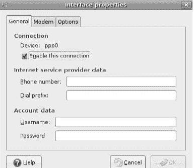

## 第二部分 运行

- KNOPPIX — 选择面板上的企鹅图标，选择网络/互联网。选择网卡配置项来配置你的网络。选择网络类型（ADSL、GPRS、ISDN、调制解调器）。

# 在 Fedora 中使用网络配置 GUI

配置以太网接口的图形工具示例是 Fedora 和 Red Hat Linux 带的网络配置 GUI。如果你在安装 Fedora 时没有配置 LAN 连接，可以随时使用网络配置窗口进行。IP 地址和主机名将在启动时从 DHCP 服务器动态分配。

> 计算机可以拥有多个 IP 地址，因为它可以有多个接口。每个网络接口都需要一个 IP 地址才能连接网络（即使该地址是临时分配的）。如果你有两个网卡（`eth0` 和 `eth1`），每个都需要自己的 IP 地址。地址 `127.0.0.1` 代表本地回环，以便本地计算机的用户可以访问回环服务。

以下是操作步骤：

1. 从红色菜单选择“桌面 -> 设置 -> 网络”，或者作为 root 用户从终端选择 `system-config-network`。（如果提示，输入 root 密码。）网络配置窗口出现。
2. 点击“设备”选项卡。出现网络接口列表。
3. 双击 `eth0` 接口（代表你的第一个以太网卡）。出现标题为“以太网设备”的弹出窗口（见图 5-6），允许你配置 `eth0` 接口。
4. 选择你的偏好：
   计算机启动时激活设备 — 勾选此处使 eth0 在启动时启动。
   允许所有用户启用禁用设备 — 勾选允许非 root 用户禁用网络接口。
   为此接口启用 IPv6 配置 — 如果连接到 IPv6 网络，勾选此处。（大多数是 IPv4）。
5. 你必须选择从其他计算机获取 IP 地址或手动输入地址：
   自动分配 IP 地址设置 — 如果网络上有 DHCP 或 BOOTP 服务器，请选择此框以从其获取计算机的 IP 地址、网络掩码和网关。如果局域网内超过几台计算机，建议使用 DHCP。可选，你可以设置自己的主机名，该名称可以是一个名称（如 jukebox）或完全限定域名（如 jukebox.linuxtoys.net）。

# 图 5-6

在 Fedora 中配置和激活以太网设备。

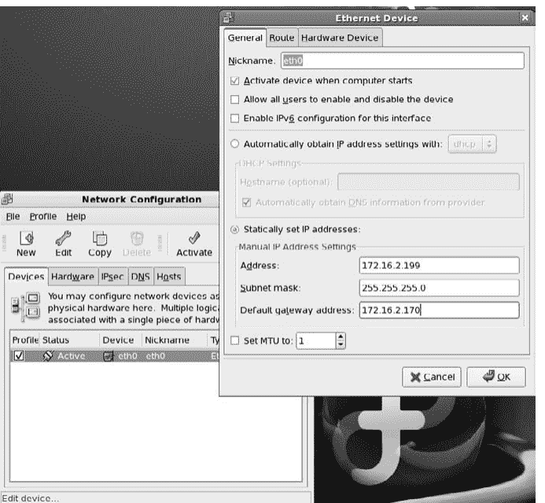

静态 IP 地址 — 如果你的局域网（LAN）上没有 DHCP 或启动服务器，请选择此选项并按照以下步骤静态添加必要的 IP 地址信息：

- 在 Address（地址）框中输入计算机的 IP 地址。此数字在你的网络中必须是唯一的。对于私有局域网，可以使用私有 IP 地址。
- 在 Subnet Mask（子网掩码）框中输入掩码。子网掩码标识 IP 地址中代表网络的部分。
- 如果连接到局域网的计算机或路由器提供了访问互联网或其他网络的路由功能，请在 Default Gateway（默认网关）框中输入计算机的 IP 地址。（第 18 章描述了如何使用 NAT 或 IP 伪装，以及如何将 Linux 作为路由器。）

# 执行

- 6. 点击以太网设备中的 OK 以保存配置并关闭窗口。
- 7. 点击 File Save 以保存你输入的信息。
- 8. 在 Network Configuration（网络配置）窗口中点击 Activate（激活）以启动你的局域网连接。

# 识别其他计算机（主机和 DNS）

每当你使用名称来标识计算机时（例如浏览网页或使用电子邮件地址时），都必须将计算机名翻译为 IP 地址。为了将名称解析为 IP 地址，Linux 会通过搜索顺序（通常基于 `/etc/resol.conf`、`nsswitch.conf` 和 `host.conf` 中的三个文件内容）。默认情况下，它会检查本地主机名（存储在 `/etc/hosts` 文件中）、通过 NIS 可用的主机以及通过 DNS 可用的主机名。

同样，对于 RHEL 和 Fedora 系统，你可以使用 Network Configuration 窗口添加：

- Hostnames（主机名） — 你可能需要通过此来识别局域网上未在 DNS 服务器上配置的主机。
- DNS 搜索路径 — 通过向搜索中添加名称（例如 linxtoys.net），你可以访问其主机名（例如 jukebox），并让 Linux 搜索你添加到搜索路径的域以找到你正在寻找的主机（例如 jukebox.linxtoys.net）。
- DNS 服务器 — DNS 服务器可以解析其提供服务的域的地址，并联系其他 DNS 服务器以获取所有 DNS 域的地址。

> 如果你正在配置 DNS 服务器，可以使用该服务器集中存储你局域网的名称和 IP 地址。这可以避免在每次向局域网中添加或更改计算机时，都要更新每台计算机的 `/etc/hosts` 文件。

在 Fedora 中添加主机名、IP 地址、搜索路径和 DNS 服务器，请执行以下操作：

- 1. 点击 Network Configuration。在终端窗口中作为 root 用户输入 `system-config-network`，或者从顶部面板点击 System Administration Network。出现 Network Configuration 窗口。
- 2. 点击 Hosts 选项卡。将出现 IP 地址、主机名和别名的列表。
- 3. 点击 New。出现 Add/Edit Hosts Entry（添加/编辑主机条目）窗口。
- 4. 输入 IP 地址、主机名以及可选的主机别名。
- 5. 点击 OK。
- 6. 重复此过程，直到添加完局域网中所有无法通过 DNS 访问的计算机。
- 7. 点击 DNS 选项卡。

# 连接互联网

- 8. 输入作为主 DNS 和备 DNS 服务器的计算机 IP 地址。（你可以从 ISP 获取这些 IP 地址，或者如果你创建了自己的 DNS 服务器，可以输入该服务器的 IP 地址。）
- 9. 在 DNS Search Path（DNS 搜索路径）框中输入要搜索主机名的域名称（可能是你本地域的名称）。
- 10. 点击 File -> To save 以保存更改。
- 11. 点击 File -> Quit 退出。

现在，当你使用 `ftp`、`ssh` 或其他 TCP/IP 工具时，你可以使用本地计算机上标识的、存在于搜索路径域中或从公共互联网 DNS 服务器解析的任何主机名。（严格来说，你并不需要设置 `/etc/hosts` 文件。你可以使用 IP 地址作为 TCP/IP 命令的参数。但使用名称处理起来更容易。）

# 在 Ubuntu 中使用网络设置 GUI

在 Ubuntu Linux 中，Network Settings 窗口允许你配置连接。假设你的计算机安装了以太网卡，你可以按照下面的步骤创建到互联网或其他 TCP/IP 网络的连接。

- 1. 选择 Network Settings。点击 System -> Administration -> Networking。出现 Settings 窗口。
- 2. 在屏幕上选择你要配置的接口的 Ethernet 连接并点击 Properties（属性）。第一块以太网卡将被识别为 `eth0`（如果存在其他以太网卡，它们将被识别为 `eth1`、`eth2` 等）。出现 Interface Properties 窗口，如图 5-7 所示。

图 5-7 包含配置为 DHCP 的 Ethernet 连接示例，从网络获取启动所需的信息（IP 地址、子网掩码等）。Enable connection（启用连接）复选框表示 eth0 连接在启动时自动启动。

如果电缆调制解调器、DSL 设备或其他网络服务器提供 DHCP 服务，那么图 5-7 中的示例可能是你唯一需要做的。然而，如果没有可用的 DHCP 服务，或者你只想手动设置连接信息，请继续下一步。

- 3. 如果你想配置以太网连接，请从 Interface Properties 弹出窗口中选择以下内容：
- Configuration — 选择 Static IP address（静态 IP 地址）以便手动设置你的地址信息，而不是自动获取。
- IP address — 在 IP address 框中输入你使用的以太网卡地址。第一块以太网卡将被识别为 eth0（如果存在其他以太网卡，它们将被识别为 eth1、eth2 等）。
- Subnet mask — 在 Subnet Mask 框中输入掩码。掩码标识 IP 地址中代表网络的部分。
- Gateway address — 输入连接到局域网并提供互联网或其他网络路由功能的计算机或路由器的 IP 地址。（参见第 18 章使用 NAT 或 IP 伪装。）
- 填写所有信息后点击 OK。从 General 选项卡可以添加主机名。从 Hosts 选项卡可以添加。从 DNS 选项卡可以添加。

# 理解你的互联网连接

如果你的以太网接口无法工作，有方法可以检查发生了什么，适用于许多 Linux 发行版。使用以下步骤：

1. 打开一个 shell（如果你使用的是图形界面，请打开终端窗口）。
2. 启动后输入以下命令以验证 Linux 是否找到了网卡：

```


`dmesg | grep eth`

```
dmesg 命令列出了 Linux 在启动时输出的所有信息。grep eth 只打印包含 eth 的行。这里有几个例子：
```

`eth0: Via II at 0xee0100, 00:0d:61:25:d4:17, IRQ 185.`

`eth0: MII PHY found at address 1, status 0x786d advertising`

`eth0: link up, 100Mbps, full-duplex, 45e1`

`eth0: no IPv6 routers present`

第一条信息出现在我的桌面电脑上，带有 Via 以太网控制器。它显示了一个 IRQ 为 185 的卡，端口地址为 `0xee0100`，以太网硬件地址（MAC 地址）为 `00:0d:61:25:d4:17`。其他行表示链路为 100Mbps 双工。在这种情况下，未启用 IPv6 路由。

> 注意 如果没有 eth 接口，但你确定有一个支持的以太网卡，输入 `lspci -v | grep -i eth` 来查看以太网卡是否在 PCI 总线上被检测到。对于前面的示例，显示如下：

```
00:12.0 Ethernet controller: VIA Technologies, Inc.
VT6102 [Rhine II] (rev 74)
```

如果它没有显示，请检查你的以太网卡是否正确插入了插槽中。

### 3. 要查看哪些网络接口正在运行，请输入以下命令：

```
$ /sbin/ifconfig -a
eth0 Link encap:Ethernet HWaddr 00:0d:61:25:d4:17
```

## 第二部分 运行演示

```
inet addr:10.0.0.5 bcast:10.0.0.255 Mask:255.255.255
UP BROAD RUNNING MULTICAST MTU:1500 Metric:1
RX packets:326100 errors:0 dropped:0 overflows:frame:0
TX packets:215931 errors:0 dropped:0 overflows:carrier:0
collisions:59919 txuelement: 1000
RX:16837815 (160.5 Mb) TX packets:40853243 (38.9 Mb)
Link encap:loopback
inet addr:127.0.0.1 Mask:255.0.0.0
UP LOOPBACK RUNNING MTU:16436 Metric:1
RX packets:37435 errors:0 dropped:0 overflows:frame:0
TX packets:37435 errors:0 dropped:0 overflows:carrier:0
collisions:0 txuelement: 0
RX bytes:2353172 (2.2 Mb) TX bytes:23531722 (2.2 Mb)
```

输出显示了一个回环接口 (`lo`) 和一个以太网接口 (`eth0`)。以太网接口 (`eth0`) 被分配了 IP 地址 `10.0.0.5`。在这个示例中，`eth0` 的 IP 地址为 `10.0.0.5`。再次注意，MAC 地址（以太网卡的唯一地址）被命名为 Hwaddr (`00:06:21:25:04:17`)。

- 4. 局与 局域网（LAN）上的另一台计算机通信。可以使用 `ping` 命令向另一台计算机发送数据包并请求返回数据包。你可以提供主机名（but）或 IP 地址（`10.0.0.10`）。例如，若要 ping 网络上名为 `but` 的计算机，请输出以下命令：

```bash
ping but
```

如果计算机可以访问，输出将类似于所示：

```
PING but (10.0.0.10): 56(84) data bytes
64 bytes from but (10.0.0.10): icmp_seq=1 ttl=255 time=0.351 ms
64 bytes from but (10.0.0.10): icmp_seq=2 ttl=255 time=0.445 ms
64 bytes from but (10.0.0.10): icmp_seq=3 ttl=255 time=0.409 ms
64 bytes from but (10.0.0.10): icmp_seq=4 ttl=255 time=0.457 ms
64 bytes from but (10.0.0.10): icmp_seq=5 ttl=255 time=0.401 ms
64 bytes from but (10.0.0.10): icmp_seq=6 ttl=255 time=0.405 ms
64 bytes from but (10.0.0.10): icmp_seq=7 ttl=255 time=0.443 ms
64 bytes from but (10.0.0.10): icmp_seq=8 ttl=255 time=0.384 ms
64 bytes from but (10.0.0.10): icmp_seq=9 ttl=255 time=0.365 ms
64 bytes from but (10.0.0.10): icmp_seq=10 ttl=255 time=0.367 ms

---
statistics
10 packets transmitted, 10 packets received, 0% packet loss, time 901ms
rtt min/avg/max/dev=0.351/0.402/0.457/0.042 ms
```


每当发送和接收数据包时，都会打印一行输出。它显示了发送的数据量以及接收每个包所需的时间。在此期间观察，然后按 `Ctrl+C` 停止 `ping`。你将看到传输、接收和丢失数据包的统计信息。

如果输出没有显示已接收数据包，说明与另一台计算机没有连接。请在你的 `/etc/hosts` 文件中验证想要访问的计算机的名称和地址，或者确保你的 DNS 服务器可以访问。接下来，确认你尝试访问的其他计算机的名称和 IP 地址是否正确（IP 地址是最关键的）。

- 5. 如果你能够通过 `ping` 访问局域网上的某个 IP 地址，但无法通过主机名 `ping` 主机，你可能没有与 DNS 服务器通信。使用 DNS 服务器的 IP 地址重复 `ping` 命令，查看它是否正常以及你是否能够与其通信。

## 使用拨号连接连接

许多需要连接互联网的人士甚至小企业仍在使用调制调器和电话线上网。调制调器连接到计算机上的串口（`COM1`、`COM2` 等），然后连接到电话插座。你的计算机拨号接入服务提供商的调制调器，或与互联网建立连接。

### 设置拨号 PPP

`PPP` 用于在串口线上创建 IP 连接。通常情况下，串口连接是通过调制调器建立的；然而，它也可以通过串口线（调制调器线）或数字线路（包括 `ISDN` 和 `DSL`）。

尽管一方必须拨出而另一方必须接收 `PPP` 连接，但在连接建立后，信息是双向流动的。为了清晰起见，我将拨号的计算机称为客户端，将接收的计算机称为服务器。

为了简化配置 `PPP`（以及其他网络接口）的过程，大多数 Linux 都包含了用于拨号的图形化工具。Fedora 和 RHEL 提供的两种工具：

- 网络配置窗口——用于配置以太网卡的相同工具也可配置调制调器。在 Fedora 和 RHEL 系统的 GNOME 面板中，选择 管理 -> 网络。当窗口出现时，选择新设备对话框，即可配置并测试调制调器的拨号连接。
- KDE PPP (`KPPP`) 窗口——从 KDE 桌面选择 `KPPP`，或从终端窗口运行 `kppp` 命令。在 `KPPP` 窗口中，你可以设置并启动 `PPP` 拨号连接。

在开始上述任何一个程序之前，请将您的调制解调器物理连接到电脑，接通电源，并将其连接到电话线。如果您有内置调制解调器，您可能会在电脑背面看到一个电话端口，您需要连接到。如果没有检测到调制解调器，您可以重启电脑或运行 `wsdialconf create`（在本章稍后的部分描述）来进行检测。

## 使用 Internet 配置向导创建拨号连接

如果您正在使用 Fedora 或 RHEL 系统，可以使用“Internet 配置向导”来设置拨号网络。操作步骤如下：

- 选择“系统管理”->“网络”。当窗口出现时，选择“新建”。（如果提示，请输入 root 密码）。会出现一个“新设备”（New Device）窗口（见图 5-8）。

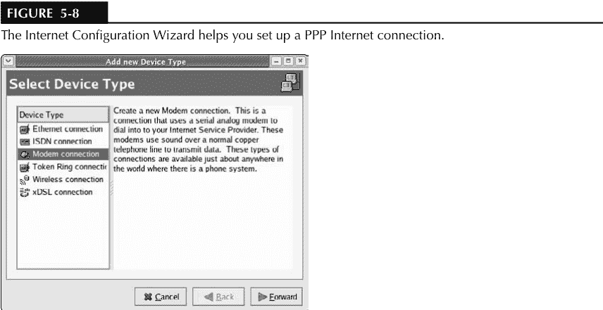

- 选择“调制解调器连接”并点击“下一步”。向导会搜索调制解调器，然后出现“选择调制解调器”窗口。

- 选择以下调制解调器属性：

    - 调制解调器设备 — Modem Device — 如果调制解调器连接到第一个串口 (`COM1`)，您可以选择 `/dev/ttyS0`；对于第二个串口 (`COM2`)，选择 `/dev/ttyS1`。（按照惯例，设备通常链接到 `/dev/modem`。输入 `ls -l /dev/modem` 查看它是否链接到 `/dev/ttyS0`、`/dev/ttyS1` 或其他设备。）
    - 波特率 — Baud Rate — 这是电脑与调制解调器通信的速率（通常远高于调制解调器通过电话线通信的速度）。默认为每秒 15200 位，这对于拨号连接来说足够了。

### 第二部分 运行

- 流控制 — 检查调制解调器文档以查看其是否支持硬件流控制 (`CRCTS`)。不支持，请选择软件流控制 (`XON/XOFF`)。流控制可以防止发送超过调制解调器处理能力的数据。
- 调制音量 — 默认关闭是因为噪音可能会很扰人，但如果您在设置调制解调器时选择“中等”，那么在无法建立连接时，声音可以让您感知连接在哪里停止了。在一切正常工作后您可以将其关闭。
- 使用快速拨号 — Use Touch Dialing — 在某些情况下请勾选此复选框。如果您的电话系统不支持按键拨号，可以将其关闭。

4. 点击“下一步”。出现“选择提供者”窗口。输入以下提供者信息：

    - 互联网提供商 — Internet Provider — 如果您使用的是“互联网提供商”窗口所示任何国家的互联网服务，请选择该国家名称旁的等号。如果您的互联网服务出现在国家列表中，请选择它。信息将自动调用。否则，您需要手动填写对话框的开头。
    - 电话号码 — Phone Number — 您想要拨入的 ISP 电话号码。（提供可选的前缀，以防您需要拨打 9 或其他数字来获取外线。）
    - 提供者名称 — Provider Name — 互联网服务提供商的名称。如果只有一个 ISP，建议您使用 `ppp` 提供者名称。
    - 用户名 — Login Name — 由 ISP 分配给您的用户名。ISP 可能会将此用户名称为登录 ID 或类似的名称。
    - 密码 — Password — 与用户名相关的密码。

5. 点击“下一步”，出现“IP 设置”窗口。对于拨号连接，您通常会选择“自动设置 IP 地址”。然而，如果 ISP 分配了静态 IP 地址，您可以勾选“静态设置 IP 地址”复选框，然后在相应的字段中输入您的 IP 地址、子网掩码和默认网关地址。点击“下一步”继续。

6. 出现“创建拨号连接”窗口，显示您输入的信息。如果所有信息看起来正确，点击“应用”（否则，点击“上一步”按钮修正信息并点击“下一步”返回此窗口）。

7. 点击“应用”后，出现“网络配置”窗口，理想情况下窗口中会出现调制解调器类型的 `PPP` 连接。（如果没有出现，请选择“系统设置”）

8. 选择拨号条（使其高亮），并选择“文件 -> 保存”来保存您的配置。

现在选择 `PPP` 设备名称并点击“激活”按钮。互联网拨号器启动并拨打您的 ISP。如果您开启了声音，应该能听到调制解调器拨号的声音。如果一切运行正常，您的用户名和密码将被接受并建立 `PPP` 连接。

## 接入互联网

尝试打开 Firefox 或另一个网络浏览器，查看是否可以访问互联网上的网站。如果第一次没有成功，请不要气馁。有些项目需要检查以使您的拨号 `PPP` 连接正常工作。请跳转到“检查您的 `PPP` 连接”部分。

## 启动您的 PPP 连接

您的拨号连接现在已配置完成，但尚未设置为自动连接。启动连接的一种方法是将其设置为从桌面面板手动启动。操作如下：

从 GNOME 桌面：

- 1. 右键点击面板，选择“添加到面板”->“调制解调器灯”，然后选择“添加”。面板上会出现一个“调制解调器灯”。
- 2. 从面板选择该新图标。系统会询问您是否要与调制解调器建立连接。
- 3. 选择“连接”开始连接。

从 KDE 桌面：

- 1. 右键点击面板，然后选择“将应用程序添加到面板”->“Internet KPPP”。
- 2. 从面板选择新图标（如果提示，输入 root 密码）。出现一个 `KPSS` 窗口。
- 3. 选择拨号接口。

## 按需拨号连接

在不需要手动启动拨号连接时，可以设置拨号连接自动启动。

## 运行显示

对于 Fedora 和 Fedora 系统，这里是可以添加到配置文件（可能是 `/etc/sysconfig/network-scripts/ifcfg-pp0`）的设置示例：

```


`ONBOOT=yes`

`DEMAND=yes`

`IDLETIMEOUT=600`

`RETRYTIMEOUT=30`

```
ONBOOT=yes
DEMAND=yes
IDLETIMEOUT=600
RETRYTIMEOUT=30
```

`ONBOOT=yes` 设置会启动进程（因为 `DEMAND` 设置为 `yes`）。此外由于 `DEMAND=yes`，拨号尝试可能会多次使用拨号连接。设置 `IDLETIMEOUT` 为 `600`，连接在没有流量的情况下 600 秒（10 分钟）后断开。设置 `RETRYTIMEOUT` 为 `30`，断开的连接将在 30 秒后重试（除非空闲超时断开）。您可以根据需要更改超时值。

因为建立拨号连接需要一些时间，拨号期间可能会失败。特别是 DNS 请求可能需要 30 秒，这可能不足以建立拨号连接。如果每个客户端有三个 DNS 服务器，那么总时间就是 90 秒。结果是，连接在请求失败之前可能运行。

## 检查您的 PPP 连接

为了调试您的 PPP 连接或简单了解其工作原理，可以按照后续章节中的操作。它们将帮助您理解信息存储在哪里以及如何使用工具跟踪这些信息。

## 检查调制解调器是否被检测到

您的调制解调器可能不支持 Linux。如果是这样，PPP 连接的失败可能是因为根本没有检测到调制解调器。以 root 身份执行以下命令扫描串口：

```
$ wdialconf /etc/wdial.new
```

`wdialconf` 命令构建配置文件（在本例中为 `/etc/wdial.conf` 文件），供拨号命令 (`wdial`) 使用。（只有当使用 `wdial` 进行拨号时才需要此测试文件。）它的第一个动作是扫描电脑上的串口并报告发现的位置。如果它告诉您没有检测到调制解调器，可能是您的调制解调器连接不正常，或者没有支持该调制解调器的驱动程序。

如果未检测到调制解调器，您应该确定其是否支持 Linux。您可以通过查找调制解调器使用的是什么类型的芯片来实现。这比查找调制解调器的制造商更为重要，因为同一制造商可以使用不同公司的芯片。（这主要适用于内置调制解调器，大多数外部串口调制解调器许多 USB 调制解调器都支持 Linux。）

# 连接互联网

在确定了所使用的芯片组后，请检查 Linmodems.org 网站（`www.linmodems.org`）。在该网站上搜索你调制解调器的芯片组。在很多情况下，该网站可以告诉你调制解调器是否有可用的驱动程序。

`scanModem` 是一个用于确定你拥有何种类型的 Winmodem 以及如何让其运行的棒工具。如果你可以通过另一台机器访问互联网，可以从这里下载 `scanModem`：

```
http://linmodems.technion.ac.il/packages/scanModem.gz
```

由于你可能还没有连接互联网，请设方法将 `scanModem.gz` 扫描到运行 Linux 系统的（可能将其拷贝到优 盘或光盘中）。在终端中以 root 用户身份输入以下命令（假设该文件位于当前目录）：

```
# gunzip scanModem.gz
# chmod 755 scanModem
# ./scanModem
```

结果是一个 `Modem` 目录，其中包含描述你的调制解调器以及你可以对其进行配置的操作的文件。

> 注意：如果你是一个拥有 Winmodem 的 Linux 新手，并且对 linmodems.org 网站仍然感到困惑，你可以考虑使用串口或 USB 调制解调器。为了让你的 Winmodem 工作，你可能需要下载、编译并加载调制解调器驱动程序。特别是某些旧的 Winmodem，驱动程序并未全部更新到最新的内核。从旧电脑上买一个廉价的串口调制解调器（20美元）可以节省数小时可能导致失败的沮败。

# 通过无线连接互联网

设置无线连接可能是 Linux 中最具挑战性的功能之一。尽管许多无线设备的开源驱动程序有所改进，但连接到运行 Linux 的电脑并非即插即用。

无线卡制造商通常不会提供其设备的规范以允许开源开发者创建 Linux 驱动程序。大多数供应商为 Microsoft Windows 系统生产仅二进制驱动程序。由于这种现状，出现了以下驱动程序来帮助 Linux 用户：

- `ndiswrapper` (`http://ndiswrapper.sourceforge.net`) — 该项目允许你在 Linux 中使用为运行 Windows 创建的驱动程序。
- `madwifi` (`http://madwifi.org`) — 支持来自 Ather (`www.ather.com`) 无线芯片组的驱动程序。
- `Intel PRO/Wireless for Linux` (`http://ipw210.sourceforge.net`) — 有多个无线驱动项目支持 Intel PRO/Wireless 硬件的驱动程序。

# 第二部分 开始表演

在某些情况下，你可能只是想让笔记本电脑内置的无线服务接口工作。要检查支持的 Linux 无线卡列表，请参考：`http://rfswitch.sourceforge.net/?page=laptop_matrix`。

由于许多无线网卡需要无线固件才能工作，许多主流 Linux 发行版未包含安装这些卡驱动程序的软件。例如，如果你使用 Fedora，可以从第三方 `rpm.livna.org` 网站获取 `ndiswrapper` 和 `madwif` RPM 包。然后，在 `ndiswrapper` 的情况下，你需要从制造商处安装你的网卡固件。

一旦安装并激活了无线卡的正确驱动程序，不同的 Linux 版本中都有不同的工具可以配置你的无线卡。以下是示例：

- **Fedora 中的无线** - 在 Fedora 中，使用 Network Manager 配置你的无线卡（进入 root，输入 `service NetworkManager` 开启）。然后从面板中出现的图标配置你的无线连接。
- **KNOPPIX 中的无线** - 在 KNOPPIX 中，尝试 WiFiManager。从 KDE 菜单中找到 KNOPPIX/Network/Internet-WiFiManager。

有关配置无线设备的信息，请参考 Linux 无线域网资源页面：

`http://hpl.hp.com/personal/Jean_Tourilhes/Linux/Wireless.html`

如果你发现无法让你的特定无线卡的驱动程序工作，请使用以下命令之一确定你使用的卡类型：

```
# dmesg grep -i wireless
# lspci -vv grep -i wireless
```


然后使用某些工具（如 Google）搜索你的无线卡的名称和模型，以及“Linux”或你正在使用的 Linux 发行版。有人尝试过使其在 Linux 中运行，并可能已经在网上分享了他们的经验。

## 总结

不同的 Linux 发行版中有许多不同的工具用于配置网络连接。Fedora 和企业 Linux 系统使用图形网络配置。SUSE 使用其 YaST 管理 GUI 界面配置网络设备。对于拨号网络，KDE 桌面不会自动启动（在很多情况下如此），本章解释了如何使用这些网络配置工具进行手动配置。

通过将你的计算机加入公共网络（如互联网），你向可能的入侵者开放了它。下一章将描述你如何保护计算机免受未经授权访问的方法。

# 第 6 章 加固 Linux

自从互联网络黎明以来，一些用户一直试图入侵其他用户的系统。随着互联网的增长和宽带互联网接入的普及，问题变得更加严重。运行不安全配置的家庭计算机可以被用作强大的邮件中继，为盗版数据流量提供存储，允许用户的个人信息泄露，或发生任何其他此类恐怖。

曾经几何，网络攻击需要攻击者付出一些努力和技能。此外，自动化工具甚至即使是最初级用户也能上手，并在令人警觉的情况下入侵网络连接的系统。

你为什么要关心安全？根据互联网安全中心（http://www.sans.org），运行不安全配置的计算机可以被用作强大的邮件中继，为盗版数据流量提供存储，允许用户的个人信息泄露，或发生任何其他此类恐怖。

## 保护 Linux

**使用受信任的软件。** 虽然开源软件无法提供绝对保证，但通过使用成熟的 Linux 发行版（如 Fedora、Debian 或 SUSE），你有更有可能规避被篡改的软件。对于你获取软件包或更新的软件存储库，也同样需要进行审查。使用有效的 GPG 公钥可以帮助确保你安装的软件来自合法的供应商。此外，在 Linux 应用程序中打开收到的数据文件之前，请务必确认其数据来源。如果你下载了发行版的 ISO 镜像，请使用其创建者提供的 MD5 或 SHA1 校验和来检查其完整性。

**获取软件更新。** 随着软件包中不断被发现漏洞和错误（bug），每个主要的 Linux 发行版（包括 Debian、SUSE、Gentoo 和 Red Hat）都提供了获取和安装这些更新的工具。务必获取这些更新，特别是当你将 Linux 作为服务器使用时。这些工具包括 `apt`、`yum` 等。

**使用安全应用程序。** 在软件有效且运行的情况下，某些应用程序比其他程序能提供更好的防攻击或入侵保护。例如，如果你想通过互联网登录，安全 Shell `ssh` 被认为比登录 telnet 服务（后者会通过明文密码）更安全。此外，某些在暴露到互联网上时被认为是不安全的服务（如 Samba 和 NFS）可以通过 VPN 隧道（如 IPSec 或 GRE）在互联网上更安全地使用。

**使用限制性防火墙。** 防火墙的主要工作是接受来自你允许的网络的请求，并拒绝你不想要的请求（主要是基于端口号的）。桌面系统应该拒绝对一组受控端口的请求。有关如何使用 `iptables` 设置防火墙的信息，请参阅第 18 章。

**仅启用你需要的服务。** 在 Linux 中提供服务（如 Web、文件或邮件服务）时，守护进程会在特定的端口号上监听。禁用你不需要的服务。事实上，甚至不要安装你不需要的服务器软件。

**限制服务的访问。** 你可以通过仅允许来自特定主机、域或网络接口的访问，来限制对所需服务的访问。例如，服务可以在配置文件中或使用 TCP/IP 包装器（在本章后文描述）来限制访问。

> 注意
在后台快速运行处理服务的程序（如 daemon）被称为守护进程。通常，守护进程在系统启动时自动启动，并一直运行到系统关闭。守护进程也可以根据 `systemd` 按需启动，`systemd` 是一种监听大量端口并启动请求进程的特殊守护进程。

**检查你的系统。** Linux 提供了许多用于检查系统安全的工具。安装 Linux 后，你可以使用 `nmap` 检查对其端口的访问情况，或使用 `Ethereal` 监控网络流量。你还可以添加流行的安全工具（如 `Nessus`），以获得更完整的系统安全视图。书中附带 CD 和 DVD 安全工具将在本章中描述。

- 监控你的系统。你可以记录 Linux 系统上几乎每种活动。系统日志文件（使用 `syslog` 和 `klog` 文件）可以配置为跟踪你选择的任意多或少的系统活动。如 `watchdog` 等工具提供了简单的方法来处理转发到管理员电子邮件帐户的潜在问题消息。日志功能将在本章后文描述。

- 使用 SELinux。SELinux 是一项极其丰富（且复杂）的机制，用于管理 Linux 系统几乎每个方面的访问。它解决了 Linux 和 UNIX 系统中“如果我获得了 root 权限，我就拥有一切”的问题，适用于高度安全的环境。Red Hat 系统提供了一组实用的 SELinux 策略，这些策略在 Fedora 中默认开启。其他 Linux 发行版也在开发并包含 SELinux 实现。图 6-1 显示了 Fedora 8 自带的 SELinux 管理工具示例（选择 Applications ➙ System Tools ➙ SELinux Administration ➙ Management），而图 6-2 显示了 SELinux 故障排除器（选择 Applications ➙ System Tools ➙ SELinux Troubleshooter）。

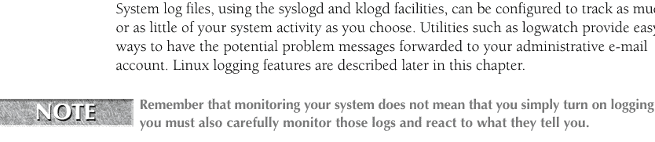

图 6-1
Fedora 中利用了 SELinux 工具程序。

| SELinux Administration | | |
| :--- | :--- |
| File Help | |
| Select: | + Properties Delete |
| Status | |
| File labeling | Filter |
| User Mapping | SELinux User | MC Prefix | MCS Level | MCS Range | SELinux Roles |
| SELinux User | root | sysadmin | s0 | s0:s0:c1023 | system_sysadmin,staff_r |
| Transaction | staff_u | s0 | s0:s0:r1023 | staff_r |
| Network Port | sysadmin_u | s0 | s0:s0:r1023 | selinux_r |
| Policy Module | system_u | s0 | s0:s0:c1023 | system_r |
| unconfined_u | unconfined_u | s0 | system_unconfined_r |
| user_u | user | s0 | system_user_r |
| xguest_u | xguest_u | s0 | xguest_r |

图 6-2
SELinux 故障排除器将识别关注区域。

# Linux 安全防护

资源。特别是，你可以订阅接收每周一次的 Linux 安全新闻快报。

- [LinuxSecurity](www.linuxsecurity.com) —— 该网站包含许多与 Linux 安全相关的文章文章和专题。它还跟踪了十多个 Linux 发行版的安全公告。

# 使用安全的 Linux

确保并保持 Linux 系统的安全不仅意味着对如何设置系统做出明智决策，还意味着你今后如何使用它。无论你是将 Linux 系统作为桌面还是服务器系统，与密码、使用安全应用程序以及监控日志文件的良好安全实践始终很重要。

设置防火墙（如第 18 节所示）对于 Linux 系统至关重要。你还应该应用于 Linux 的一些安全措施。本节描述了一些关于使用密码、通过查看日志文件跟踪系统活动以及使用 Secure Shell `ssh` 应用程序与其他系统通信的安全实践。

## 使用密码保护

密码是任何现代操作系统最基础的安全工具，因此也是最常受攻击的安全特性。选择一个容易记住的密码是自然而然，但这通常意味着选择了一个也很容易被猜到的密码。破解者知道，在任何拥有少数几个用户的系统中，至少有一个用户可能拥有一个易猜的密码。

通过使用“暴力破解”方法尝试登录系统上的每个账户，并对这些每个账户尝试最常见的密码，一个执着的破解者有很大机会得逞。记住，破解者会自动化这种攻击，因此成千上万次的登录尝试并非不可能。选择良好的密码是拥有安全系统的第一也是最重要的一步。

以下是选择密码时要避免的一些事项：

- 不要使用你的登录名或全名的任何变体。即使你改变了大小写、在前面添加数字或标点符号，或者倒过来写，这仍然是一个易猜的密码。
- 不要使用字典单词，即使你向其中添加了数字或标点符号。
- 不要使用任何类型的专有名词。
- 不要使用键盘上任何连续的字母或数字行（例如 "qwerty" 或 "asdf"）。

## 选择良好的密码

选择强密码的好方法是从一个易记句子中提取每个单词的首字母。通过添加数字、标点符号和变化的大小写，可以让密码变得更好。你选择的句子应该只对你有意义，并且不应该是公开的（在个人网页上选择句子是一个坏主意）。表 6-1 列出了强密码的示例以及记忆它们的技巧。

### 表 6-1

| 密码 | 如何记忆 |
| --- | --- |
| Mrci7yo! | My rusty car is 7 years old! |
| 2emBpI1b | 2 elephants make BAD pets, 1 better |
| ItMc?Gib | My MC cost-? Give it back |

这些密码看起来像乱码，但实际上非常容易记忆。如你所见，我可以对密码中代表大写字母的单词进行强调。你使用 `passwd` 命令设置密码。在命令 shell 中输入密码，它将允许你更改密码。首先，它会提示你输入旧密码。为了防止“肩后窥视”和他人获取你的密码，密码在你输入时不会显示出来。

几个发行版包含了随机密码生成器，可以使用它们来生成安全的密码。例如，图 6-3 显示了 Ubuntu “用户和组”工具中的密码生成器。

假设你正确输入了密码，`passwd` 命令将提示你输入新密码。当你输入新密码时，`passwd` 命令会对比 `cracklib` 来检查密码，以判断它是好密码还是坏密码。如果用户使用的密码不是好密码，非 root 用户将被要求尝试另一个密码。

root 是唯一允许更改密码的用户。一旦密码被 `cracklib` 接受，`passwd` 命令会要求你输入新密码以确保没有输入错误（当你看不见输入的内容时，错误很难检测）。运行时，可以通过提供该用户的登录名作为 `passwd` 命令的参数来更改用户的密码。例如：

```bash
```


# passwd for user joe

Changing password: ******

New UNIX password: ******

Retype UNIX password: ******

`passwd`: all authentication tokens updated successfully.

## Linux 安全防护

图 6-3

生成随机密码

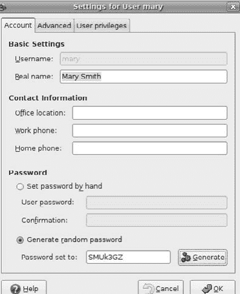

`passwd`命令提示你两次为`joe`输入新密码。在这种情况下，它没有提示你输入他的旧密码。这允许`root`在用户忘记密码时重置用户密码（这是一个非常频繁发生的事件）。

## 使用影子文件

在 UNIX 的早期版本中，所有用户账户和密码信息都存储在一个所有用户都可以读取的文件中（尽管只有`root`可以向其写入）。这通常不是问题，因为密码信息是加密的。密码使用陷门算法（`trapdoor algorithm`）加密，这意味着未加密的密码可以加密成杂乱的字符字符串，但该字符串无法翻译回未加密的密码。换句话说，陷门意味着加密是单向的，因此加密密码无法还原为未加密的密码。换句话说，系统通过将你输入的密码与存储在影子文件中加密字符串进行比较来检查密码，仅在两者匹配时才授予访问。

## 破解加密密码

密码文件可以被系统上的任何人读取这是一个问题。幸运的是，Linux 和所有现代系统都支持影子文件（`shadow file`）。影子文件名为`shadow`，且只有`root`可读。它包含加密密码，因此密码可以从密码文件中移除。

## 检查影子文件

密码文件名为`password`，位于`/etc`中。影子文件名为`shadow`，也位于`/etc`。如果你的`/etc/shadow`文件丢失，那么你的 Linux 系统可能将密码信息存储在`/etc/passwd`中。通过`less`命令显示文件来验证这一点

```bash
$ /etc/passwd
```

显示的内容类似于以下：

```
root:Dksuke79FQ:0:0:root:/bin/bash
bin:x:1:1:bin:/bin
mary:KRpUp2OzmyTA:5:100:Mary Smith:/home/mary:/bin/bash
joe:OsxrZvnQas1:5:100:John Johnson:/home/joe:/bin/bash
jane:ptNoliYEJWX:5:102:Jane Anderson:/home/jane:/bin/bash
bob:Jy2VY77O6KZw:5:100:Bob Reynolds:/home/bob:/bin/bash
```

每行代表一个账户，用冒号分隔。从左到右字段为登录名、加密密码、用户 ID、描述、主目录和默认 shell。查看第一行，看到它是`root`账户，加密密码为`Dksuke79FQ`。

所有这些值对于`root`账户来说都是很正常的，但看到那个加密密码应该引起你的警觉。它证实了你的系统没有使用影子文件。此时，你应该立即使用`pwconv`命令转换密码文件，使其使用`/etc/shadow`来存储密码信息。只需以`root`身份登录即可

## 安全 Linux 安全

或使用命令替换以及在指定的`pwconv`命令。它不会输出任何消息，但当你的 shell 提示符返回时，你应该拥有一个`/etc/shadow`文件，并且你的`/etc/passwd`文件现在看起来应该像这样：

```
root:x:0:0:root:/root:/bin/bash
bin:x:1:1::/bin
demon:x:2:2::daemon:/sbin
```

```
mary:x:500:100:Mary Smith:/home/mary:/bin/bash
joe:x:501:100:Joe Johnson:/home/joe:/bin/bash
jane:x:502:100:Jane Anderson:/home/jane:/bin/bash
bob:x:503:103:Bob Reynolds:/home/bob:/bin/bash
```


加密后的密码被替换为 `x`。它已移动到 `/etc/shadow`。

还有一个身份验证实用程序（Fedora 和 RHEL 系统可用），你可以用它管理密码和其他系统身份验证信息。它还具有允许你处理 MD5 密码、LDAP 身份验证或 Kerberos 5 身份验证的功能。选择 *Authentication*，并逐步操作屏幕进行使用。

为了处理组，你可以使用 `greppasswd` 命令将 `/etc/groups` 中的密码转换为 `/etc/gshadow` 中的影子密码。如果你更改了密码或组（你无法登录账户），可以分别使用 `pwconv` 和 `greppasswd` 命令进行反转换。

所以，现在你正在使用影子密码文件并选择良好的密码。你已经在安全系统方面迈出了伟大的一步。你现在可能已经注意到安全不仅仅是一次性工作。它是一个持续的过程，与其说是程序，不如说是策略。继续阅读以了解更多。

# 使用日志文件

如果你像第 18 章那样使用了良好的防火墙实践，你将准备好缓解并防止大多数黑客攻击。如果你的防火墙未能阻止入侵，你必须能够在攻击发生时识别出来。理解 Linux 中记录重要事件的各种（许多）日志对于这一目标至关重要。你的 Linux 系统日志文件可以在 `/var/log` 目录下找到。

大多数 Linux 系统使用日志查看工具，由桌面环境（如 GNOME）提供，或者是你可以从终端执行的命令。基于 GNOME 的桌面通常包含一个系统日志查看器（`gnome-system-log` 命令），你可以它从 GUI 查看和搜索系统日志文件。要在 Fedora 中从顶部打开系统日志查看器，请选择应用程序 系统工具 系统日志。文件 6-4 显示了系统日志查看器窗口的示例。

## 第二部分 演示

图 6-4
在系统日志查看器中显示日志文件。

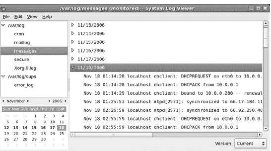

要查看特定日志，选择左列中的日志名称。从左下角的日历中选择日期以查看特定日的日志消息。

表 6-2 包含了系统日志查看器中显示的日志列表，以及 `/var/log` 目录下可能让你感兴趣的其他文件。（按 `Ctrl+O` 打开未出现且 root 可见的日志文件。此外，某些 Linux 系统使用不同的文件或目录名称（例如，在某些 Linux 系统上，`/etc/httpd` 是 `/etc/apache`）。

由于这些日志存储在纯文本文件中，你可以使用任何文本编辑器（如 `vi` 或 `edit`）或分页命令（如 `less` 命令）来查看它们。

### 表 6-2 /var/log 目录中的日志文件

| 系统日志名称 | 文件名 | 说明 |
|---|---|---|
| 启动日志 | boot.log | 包含指示哪些服务成功启动和关闭，以及（如果有）哪些启动或停止失败的消息。最近的启动消息列在文件末尾。 |
| Cron 日志 | cron | 包含来自 cron 的消息，cron 是一个定期运行计划任务（如备份和日志轮转）的守护进程。 |
| 内核启动日志 | dmesg | 内核在系统启动时打印的消息。 |

# 安全 Linux

| 系统日志名称 | 文件名 | 说明 |
| --- | --- | --- |
| FTP 日志 | xferlog | 包含使用 FTP 服务传输的文件的信息。 |
| Apache 访问日志 | httpd/access_log | 记录对你的 Apache Web 服务器请求信息的日志。 |
| Apache 错误日志 | httpd/error_log | 记录客户端尝试访问你的 Apache Web 服务器上的数据时遇到的错误。 |
| 邮件日志 | maillog | 包含发送和接收电子邮件的地址信息。有助于检测垃圾邮件。 |
| MySQL 服务器日志 | mysqld.log | 包括与 MySQL 数据库服务器 (`mysqld`) 活动相关的信息。 |
| 新闻日志 | spooler | 如果你运行新闻服务器，则该目录包含新闻服务器的日志。 |
| RPM 包 | rpmpgs | 包含安装在你的系统上的 RPM 包列表。（对于不是 RPM 打包的系统，寻找 debian-installer 或 packages 目录以找到已安装包列表。） |
| 安全日志 | secure | 记录登录尝试和会话的日期时间和持续时间。 |
| 系统日志 | messages | 通用日志。 |
| 更新日志 | messages | 记录与系统更新和更改相关的消息。 |
| X11 日志 | xorg.log | 来自 X 窗口系统的消息。 |
| Samba 日志 | samba.log | 与 Samba 文件共享相关的消息。 |
| Squid 日志 | squid.log | 来自 代理服务器的消息。 |
| 邮件日志 | mail.log | 来自邮件传输代理的消息。 |

# 运行演示

# syslog 的作用

`/var/log` 中的大多数文件由 `syslog` 服务维护。`syslog` 守护进程接受来自各种程序的消息并将其写入相应的日志文件。可以配置 `syslog` 记录不同详细程度。`syslog` 守护进程甚至可以接受网络上其他计算机的消息。这特别方便，因为它允许你集中管理和查看许多系统的日志文件。

如果你的网络被破解，黑客无法修改日志记录，因为这些记录存储在另一台计算机上。重要的是，这些消息默认是不加密的。任何接入你本地网络的人都可以在消息从一台机器传递到另一台机器时监听。运行一个专门的日志记录器并不常见，用于记录网络上其他计算机的消息。由于该系统不运行其他服务，它不太会被破解。这使得黑客几乎无法擦除痕迹，但并不意味着在黑客进入网络中的机器后，所有的日志记录都是准确的。

# 使用 syslog 将日志重定向到日志主机

要将你的计算机日志文件重定向到另一台计算机的 `syslogd`，你必须对本地 `syslog` 配置文件 `/etc/syslog.conf` 进行更改。使用 `su` 命令变为 root，然后用文本编辑器（如 `vi`）加载 `/etc/syslog.conf` 文件。你应该看到类似的内容：

```
# 将所有内核消息到控制台。

# 记录其他许多内容会乱屏幕。

#kern.* /dev/console

# 记录除邮件以外的 info 级或以上的任何。

# 不要记录私有的身份验证消息！

# 通用日志。

:info:mail:none,authpriv:none;cron:none /var/log/messages

# authpriv 文件有访问限制。

:authpriv.* /var/log/secure

# 将所有日志消息放在一起。

mail.* /var/log/mailog

# 记录 cron 事务

cron.* /var/log/cron

# 所有人接收紧急消息

#emerg *
```

# 安全防护 Linux

```
local7.* /var/log/boot.log

@

@ INN

@

news=-crit /var/log/news/news.crit

news=-err /var/log/news/news.err

news.notice /var/log/news/news.notice
```


以 `#` 字符开头的行是注释。其他行包含列信息。左侧字段是一个用分号分隔的列表（空格无效），包含消息和优先级。右侧字段是应将这些消息写入的日志文件。

要将消息发送到另一台计算机（`localhost`）而不是文件，可以将日志文件名替换为 `@` 字符，后跟 `localhost` 的名称。例如，为了重定向正常发送到 `messages`、`secure` 和 `mail` 日志文件的输出，请对上述文件进行以下更改：

- 记录级别为 `info` 或更高的任何内容（邮件除外）。
- 记录记录私有的身份验证消息！
- `*.info:mail:none:news:none:authpriv:cron:none@localhost`
- `authpriv` 文件具有受限访问。
  `authpriv.* @localhost`
- 在一个地方记录所有的邮件消息。
  `mail.* @localhost`

消息将发送到名为 `localhost` 的计算机上的 `syslog` 守护进程。这个名称并不是随机的。自定义一个主机名并命名为作为 `localhost` 的实际系统是常见的做法。这样，如果你以后需要将 `localhost` 切换到不同的机器，只需要更改 `localhost` 别名；而不需要在每台计算机上重新编辑 `syslog.conf` 文件。

在 `localhost` 侧，该机器必须运行带有 `-r` 选项的 `syslog`，以监听网络上来自其他机器的日志消息。在 Fedora 系统中，需要在 `/etc/config/syslog` 文件的 `SYSLOG_OPTIONS` 变量中添加 `r` 选项并重启 `syslog` 服务（`service syslog restart`）。`localhost` 还必须有一个可供 `syslog` 使用的 UDP 端口 `514`（`/etc/services` 文件），因此你可能需要添加一条防火墙规则来允许该端口。

# 理解消息日志文件

由于有许多程序和服务会将信息写入 `messages` 日志文件，因此理解此文件的格式至关重要。通过检查此文件，你可以对系统中正在出现的问题获得早期警告。文件中的每一行都是某些程序或服务记录的单条消息。以下是实际 `messages` 日志文件的片段：

```
Feb 25 11:04:32 network: Bringing up loopback interface: succeeded

Feb 25 11:04:35 network: Bringing up interface eth0: succeeded

Feb 25 13:01:14 system: vsftpd(pam_unix)[10565]: authentication failure;

logname= uid=0 tty= ruser= rhost=10.0.0.5 user=chris

Feb 25 14:42:24 system: session opened for

user root by root(uid=500)
```

# 第二部分：实际操作

当你知道要看什么时，这其实非常简单。每条消息被分为五个主要部分。从左到右，它们是：

- 记录消息的日期和时间
- 消息来源计算机名称
- 消息所属的程序或服务名称
- 发送消息的程序的进程号（括号内）
- 实际文本消息

再次查看预填的片段。在前两行中，你可以看到网络重启了。下一行显示用户 `chris` 尝试在地址为 `10.0.0.5` 的系统上获取 FTP 服务器但失败了（尝试了错误的密码且身份验证失败）。最后一行显示 `chris` 使用 `ssh` 命令启动了 `root`。

通过偶尔查看 `messages` 和 `secure` 文件，有可能在破解尝试成功之前捕获它。如果你发现某个特定服务有大量的连接尝试，特别是当这些尝试来自互联网上的系统时，你可能正遭受着攻击。

# 使用 Secure Shell 工具

Secure Shell (`ssh`) 工具允许你在远程计算机和你的 Linux 系统之间进行基础通信（远程登录、远程复制、远程执行等）。由于服务器和 `ssh` 守护进程之间的通信是加密的，诸如 `ssh`、`scp` 和 `sftp` 等工具从生上就比类似的旧版 UNIX 工具（如 `rcp` 和 `login`）更安全。

大多数 Linux 系统都包含 Secure Shell 客户端，也包括 `ssh` 服务器。如果你正在使用 Fedora 或 Red Hat Linux 发行版，例如，以下客户端和服务包包含：`openssh`、`openssh-clients` 和 `openssh-server`。

# 启动 ssh 服务

已安装 `ssh` 服务的 Linux 系统通常配置为自动启动。在 Fedora 和 RHEL 系统中，`ssh` 守护进程从 `/etc/init.d/` 启动脚本启动。要确保服务在 Fedora 以及其他基于 RPM 的系统中设置为自动启动，请输入以下命令（作为 `root`）：

```
chkconfig --list
sshd 0:off 1:off 2:on 3:on 4:on 5:on
```

显示 `sshd` 服务被设置为在状态 2、3、4 和 5（正常启动状态）下运行，并在其他状态下设置为关闭。如果 `ssh` 服务已关闭，你可以通过输入以下命令为默认状态开启 `ssh` 服务：

```
chkconfig sshd on
```

其他 Linux 发行版可能仅通过 `/etc/rc.d` 目录下名为 `rc.sshd` 的文件条目启动 `ssh` 守护进程。在任何情况下，你都可以通过以下命令查看 `sshd` 是否运行：

```
ps ax | grep sshd
```

如果 `ssh` 守护进程已运行，说明之前的配置可能已生效。如果防火墙允许通过 22 端口，那么你就可以通过以下命令连接到系统：

```
ssh localhost
```

在 `localhost` 侧，如果你运行了 `ssh` 服务，你可以使用以下命令：

```
ssh localhost
```

在 `/etc/ssh/sshd_config` 中，要查看 `messages` 日志文件，你可以使用：

```
cat /var/log/messages
```

如果你想以不同的用户登录，可以使用以下格式：

```
ssh user@localhost
```

# 无需密码使用 ssh、scp 和 sftp

对于你经常访问的机器（特别是局域网防火墙后的机器），将它们设置为无需密码即可登录通常非常有帮助。以下过程展示了如何进行操作。

# 加固 Linux

这些步骤将指导你设置从一台机器到另一台机器的免密身份验证。
在本例中，本地用户是名为 `host1` 的计算机上的 `chester`。远程用户也是名为 `host2` 的计算机上的 `chester`。

- 1. 登录到本地计算机（在本例中，我以 `chester` 身份登录到 `host1`）。

> 注意：仅在在你的本地工作站上作为本地用户运行步骤 2。除非丢失了 `ssh` 密钥，否则不要再次运行。配置后续的远程服务器时，请跳到步骤 3。

- 2. 输入以下内容生成 `ssh` key：

```
$ ssh-keygen -t dsa
Generating public/private dsa key pair.
Enter file in which to save the key
/home/chester/.ssh/id_rsa: <Enter>
Enter (empty for no passphrase): <Enter>
Enter same passphrase again: <Enter>
Your identification has been saved in /home/chester/.ssh/id_rsa.pub.
Your public key has been saved in /home/chester/.ssh/id_rsa.pub.
b3:c0:2f:63:a5:65:70:b7:b4:f0:2a:c14:24:47:69 chester1
```

如上所示，按回车键接受存储密钥的文件名。然后按两次回车键创建一个空白密码短（如果你使用密码短，系统将提示你输入该密码短，在没有它的情况下将无法登录）。

- 3. 你必须通过关闭主目录、`.ssh` 目录和身份验证文件的权限来确保身份验证密钥的安全性：

```
$ chmod w $HOME
$ chmod 700 $HOME/.ssh
$ chmod -rwx $HOME/.ssh/*
```

- 4. 输入以下内容将密钥复制到远程服务器（将 `chester` 替换为远程用户名，将 `host2` 替换为远程主机名）：

```
$ cd ~/ssh
$ scp id_rsa.pub chester@host2:/tmp
chester@host2's password: ********
```

- 5. 输入以下内容将 `ssh` key 添加到远程用户的授权密钥中（代码将会在单行显示，不会换行）：

```
$ ssh chester@host2 'cat /tmp/id_rsa.pub >> /home/chester/.ssh/authorized_keys'
```


# 第二部分：演示

在之前的两个步骤中，你会被要求输入密码。这是正常的。

为了让 `sshd` 守护接受你创建的 `authorized_keys` 文件，你的主目录和文件本身必须具有安全的权限。为了加固该文件和目录，请输入以下：

```
$ ssh chester@host2 chmod w $HOME/.ssh
```

```
$ ssh chester@host2 chmod 600 $HOME/.ssh/authorized_keys
```

- 6. 输入以下命令删除临时目录下的密钥：

```
$ ssh chester@host2 rm /tmp/id_dsa.pub
```

在上一步操作中，你不应该被要求输入密码或密码短。

需要注意的是，一旦此配置生效，无论你的本地计算机的 IP 地址更改多少次，它都将有效。IP 地址与这种身份验证形式无关。

# 加固 Linux 服务器

将你的 Linux 系统作为公网络上的服务器开放会在安全方面带来一系列挑战。你的计算机不再仅仅是关闭几乎所有的入站请求，而是被期望通过对支持的服务（如 Web、FTP 或邮件服务）提供信息或简单运行可以执行的脚本来响应请求。

整本书籍都满了如何加固服务器的信息。许多在互联网服务器上运行的企业会指派全职管理员来监控服务器的安全。因此，请将本节视为某些需要注意的攻击类型的概述，以及加固 Linux 服务器的一些工具。

# 使用 TCP Wrappers 控制服务访问

完全禁用不使用的服务是可以的，但你真正需要的服务呢？如何选择并拒绝访问这些服务的？集成 TCP wrapper 支持的 Linux 系统通过 `/etc/hosts.allow` 和 `/etc/hosts.deny` 文件决定何时为 `rsh`、`rnet`、`finger` 和 `talk` 等服务授予或拒绝连接。

大多数实现 TCP wrappers 的 Linux 系统针对一组由名为“Internet super server”的单一监听进程监控的服务。对于 Fedora 和 RHEL 系统，该服务器是 `xinetd` 守护进程，而在其他系统（如 Debian）中使用的是 `inetd` 守护进程。

# 加固 Linux

当服务器进程请求依赖 TCP wrappers 的服务时，会扫描 `hosts.allow` 和 `hosts.deny` 文件，并检查是否有与连接机器 IP 地址匹配的条目。这些检查在连接尝试发生时进行：

- 如果地址列在 `hosts.allow` 文件中，则允许连接且不检查 `hosts.deny`。
- 如果地址在 `hosts.deny` 中，则连接被拒绝。
- 如果地址在两个文件中都不存在，则允许连接。

请记住 `hosts` 被评估的顺序很重要。例如，你无法访问 `hosts.deny` 文件中一个已经在 `hosts.allow` 文件中获得访问权限的主机。

没有必要（甚至不可能）列出所有可能连接到你计算机的每一个地址。`hosts.allow` 和 `hosts.deny` 文件允许你指定地址的子集和组。你甚至可以使用关键字 `KEYWORD` 来指定所有可能的地址。你还可以限制这些文件中的条目，使其仅适用于特定的网络服务。查看典型的 `hosts.allow` 和 `hosts.deny` 密钥对示例：

```
/etc/hosts.allow
```

```
/etc/hosts.deny
```

在 `hosts.allow` 和 `hosts.deny` 文件中，系统会扫描并检查是否有与连接机器 IP 地址匹配的条目。这些检查在连接尝试发生时进行（此处原文译文逻辑略乱，已根据技术语境重新梳顺）。

以下是 `/etc/hosts.allow`：

```
# hosts.allow 描述了允许使用 INET 服务的主机

- 以点 (.) 结尾的字符串。如果主机名的最后部分匹配指定的模式，则匹配。例如，.t..

- 以点 (.) 结尾的字符串。如果数字字段匹配指定的字符串，则匹配。例如，131.155

- 以 @ 符号开头的字符串被视为网络。如果它是指定网络的成员，则匹配。

- 格式为 n.n.n.n/m 的表达式被解释为网络/掩码。如果地址与掩码的位运算结果相等，则匹配。例如，网络/掩码模式 131.155.72.0/255.255.254.0 匹配 131.155.72.0 到 131.155.73 之间的范围。
```

以下是 `/etc/hosts.deny`：

```
# hosts.deny 描述了拒绝使用 INET 服务的主机

- ALL
```


# Linux 安全防护

如果点唱机通过 `CUPS-lpd` 协议连接到你的机器怎么办？在这种情况下，它不匹配 `hosts.allow` 中的任何规则；唯一引用 `lpd` 守护进程的行并没有指向 `199.170.179` 子网或 `linuxtoys.net` 域名。`xinetd` 继续根据 `hosts.deny` 文件运行。条目 `ALL:` 匹配成功，因此 `tcp` 拒绝了连接。

`ALL` 通配符也曾用于 `hosts.allow` 文件。在这种情况下，如果你正在告诉 `xinetd` 允许任何主机连接到 Linux 机器上的 `FTP` 服务。这对于运行一个可以在互联网上访问的匿名 `FTP` 服务器是恰当的。如果没有运行匿名 `FTP` 站点，可能不应该使用 `ALL` 标志。

一个良好的经验法是：让 `hosts.allow` 和 `hosts.deny` 尽可能具有限制性，然后仅开启你真正的服务。此外，只向那些真正需要访问的系统授予权限。使用 `ALL` 标志为特定服务授予通用访问可能比输入长长的子网或域名列表要简单，但花几分钟进行妥善的安全设置比在被入侵后花费许多小时进行恢复要得多。

提示 对于使用 `xinetd` 服务的系统，你可以使用 `/etc/xinetd.conf` 文件中的各种选项进一步限制对服务的访问，甚至可以将某些服务的访问限制在一天中的特定时间。阅读 `xinetd` 的手册页（在命令行提示符输入 `man xinetd`）以了解更多选项。

# 理解攻击技术

对计算系统的攻击形式多种多样，取决于攻击者的目标和资源。某些攻击者可能具有破坏性，而另一些人会渗透你的机器并利用资源用于他们自己的邪恶目的。还有一些人针对你的数据以获取财务收益或进行勒索。攻击主要分为三大类：

- 拒绝服务 (`DOS`) —— 最容易操作的攻击是拒绝服务攻击。此类攻击的主要目的是通过用无关数据淹没远程站点来干扰其活动。`DOS` 攻击可以简单地每秒向 Web 网站发送数千次请求。这类攻击易于操作也易于防御。一旦你掌握了攻击的来源，只需给攻击者的 `ISP` 打个简单的电话就能解决问题。
- 分布式拒绝服务 (`DDOS`) —— 更高级的 `DOS` 攻击被称为分布式拒绝服务。`DDOS` 攻击难停止得多。在这种攻击形式中，攻击者控制了数百或数千台受保护的 Internet 连接计算机。攻击者指挥这些计算机共同向单个 Internet 主机发送无关数据流。结果是一个攻击者的力量被放大了数千倍。攻击不再像普通 `DOS` 那样从一个方向传来，而是同时从数千个方向发来。防御 `DDOS` 攻击的最佳方法是联系你的 `ISP`，看它是否可以在其边界路由器处过滤流量。

# 操纵局面

很多人用“我的机器上没什么别人想要的东西”作为借口来避免考虑安全。这种论点的问题在于，攻击者有很多理由使用你的机器。攻击者可以将你的机器变成一个代理，用于后来的 `DDOS` 攻击。曾多次，执法部门出现在一个不知所措的计算机用户家门口，询问源自他们计算机的问题。通过忽视安全，所有者使自己暴露在风险之中。

- 侵入攻击 —— 为了移除目标机器的资源，攻击者必须首先寻找一个可以利用的漏洞。在没有密码或加密密钥等信息的情况下，他们必须扫描目标机器以查看提供了哪些服务。也许其中一个服务的安全性很低，攻击者可以使用某些已知的漏洞以任何方式对其得逞。

一个名为 `nmap` 的工具通常被认为是扫描主机服务的最佳方法（注意 `nmap` 是一个既可以用于善也可以用于恶工具）。一旦攻击者获得了目标上运行的可用服务列表，他就需要找到一种尝试让这些服务之一让他获得系统的特权访问。通常，这是通过一个名为 `exploit` 的程序实现的。

`DoS` 攻击是破坏性的，而侵入攻击的伤害最大。原因多种，但结果总是一样的。一个不不之之客现在正住在你的机器上，并以你无法控制的方式使用它。

# 防御拒绝服务攻击

如前所述，拒绝服务攻击试图使你的计算机崩溃或至少将其性能降低到不可用的水平。有多种拒绝服务攻击手段。大多数试图过载你的系统资源，例如可用的磁盘空间或 Internet 连接。接下来的章节将讨论一些常见的攻击和防御。

# 邮件轰炸 (Mailbombing)

邮件轰炸是指向特定用户或系统发送大量电子邮件，导致计算机磁盘变满。有几种方法可以保护自己免受邮件轰炸的影响。你可以使用 `Procmail` 电子邮件过滤工具，或者如果你使用 `sendmail` 作为邮件传输代理，可以配置你的 `sendmail` 守护进程。

# 使用 Procmail 拦截邮件

`Procmail` 电子邮件过滤工具默认安装于 Fedora、RHEL 和许多其他 Linux 系统，与 `sendmail` 电子邮件守护进程紧密集成；因此，它可以被用于选择性地拦截或过滤特定类型的电子邮件。你可以在 Procmail 网站了解更多信息：www.procmail.org。

# 加固 Linux

要为你的用户账户启用 `Procmail`，请在主目录下创建一个 `.procmailrc` 文件：
该文件的模式应为 `0600`（仅你可读，其他人不可读）。输入以下内容，将 `evmailer` 替换为邮件轰炸你的实际邮箱地址：

```
@ Delete mail from evil
```

`Procmail` 电子邮件过滤工具在 Fedora、RHEL 和许多其他 Linux 系统中默认安装，与 `sendmail` 电子邮件守护进程紧密集成；因此，它可以被用于选择性地拦截或过滤特定类型的电子邮件。你可以在 Procmail 网站了解更多信息：www.procmail.org。

# Linux 安全防护

封装一个 `ICMP` 请求并将回显包发送到你的计算机。你的计算机随后会打印一条消息，显示远程系统已开机，并告诉你是响应 `ping` 花了多长时间。

粉碎攻击（Smashing attack）利用畸畸的 `ICMP` 请求将你的计算机淹没在网络流量中。攻击者通过从一个不知情的第三方处反射 `ping` 请求来实现这一点，导致响应包被复制几十次甚至上百次。一个拥有快速连接和大量计算机的组织被用作中继。`ping` 的目标地址设置为单个主机的整个子网。返回地址被伪造为你的机器地址（实际发送者）。当 `ICMP` 数据包到达你的中继网络时，该子网上的每个主机都会对 `ping` 做出响应。此外，它们会响应给你的计算机而不是实际发送者。如果中继网络有数百台计算机，你的连接可能会迅速被淹没。

最好的办法是联系被用中继的组织并告知其滥用行为。通常，他们只需要重新配置其路由器即可阻止未来的任何攻击。如果该组织不配合，你可以通过在路由器上拦截 `ICMP` 协议来尽度地减少攻击影响。如果你能说服你的 `ISP` 在你的网络处拦截 `ICMP` 数据包，将更有帮助。（注意，关于拦截 `ICMP` 的是否是一个好主意存在一些争议，因为 `ICMP` 服务对于各种管理目的可能有用。）

# 防止分布式拒绝服务攻击 (DDOS)

`DDOS` 攻击极难发起且极其难以停止。`DDoS` 攻击始于渗透数百甚至数千台安全性薄弱的机器。这些机器可以根据攻击者的意愿被引导攻击单个主机。

随着 `DSL` 和电缆调制调器的出现，数百万人正在以几乎没有速度限制的速度访问互联网。在获取在线的权利时，许多人忽视了最基本的安全。由于绝大多数人运行 Microsoft 操作系统，他们往往很快就会受到虫和病毒的攻击。机器被入侵后，蠕虫或病毒通常会在受害者机器上安装一个程序，该程序会静静地连接家并宣布它现在已准备好听命于主。

根据主者的意愿，受感染的机器现在可以被用来向选定的主机发送集中的垃圾数据流。与其他数千台受感染机器的配合，一个脚本小子（script kiddie）现在就有能力让互联网上的几乎任何网站瘫痪。

检测 `DDOS` 与检测 `DOS` 攻击类似。可能出现以下一种或多个迹象：

- 数据链路饱和
- 在非峰值期间链路饱和度没有降低
- 数百甚至数千个并发网络连接
- 系统性能极慢

# 第二部分：实操演示

要确定你的链路是否饱和，对外部主机进行 `ping` 操作可以说明很多问题。比平时高得得多的延迟是一个显而易见的迹象。正常的 `ping` 延迟（即从远程主机响应 `ping` 的时间）如下：

```
ping www.example.com

PING www.example.com (192.0.34.166) from 102.0.0.11: 56(84) bytes of data

64 bytes from 192.0.34.166: icmp_seq=1 ttl=64 time=40.1 ms
```


64 bytes from 192.0.34.166: icmp_seq=2 ttl=64 time=42.5 ms

64 bytes from 192.0.34.166: icmp_seq=3 ttl=64 time=39.5 ms

64 bytes from 192.0.34.166: icmp_seq=4 ttl=64 time=38.4 ms

64 bytes from 192.0.34.166: icmp_seq=5 ttl=39.0 ms

---

www.example.com ping statistics

5 packets transmitted, 5 received, 0% loss, time 200ms

rtt avg/max/mdev = 38.472/42.584/1.432 ms

在前面的示例中，ping 往返的平均时间约为 30 秒。对饱和链路进行 ping 如下：

```
ping www.example.com

PING www.example.com (192.0.34.166) from 102.0.0.11: 56(84) bytes of data

64 bytes from 192.0.34.166: icmp_seq=1 ttl=64 time=1522 ms

64 bytes from 192.0.34.166: icmp_seq=2 ttl=64 time=1218 ms

64 bytes from 192.0.34.166: icmp_seq=3 ttl=64 time=1290 ms

64 bytes from 192.0.34.166: icmp_seq=4 ttl=64 time=1288 ms

64 bytes from 192.0.34.166: icmp_seq=5 ttl=64 time=1241 ms

---

www.example.com ping statistics

5 packets transmitted, 5 received, 0% loss, time 5032ms

rtt avg/max/mdev = 1218/1522/1218 ms
```

在前面的示例中，ping 往返的平均时间大约是 30 秒（注：原文此处为30秒，与数据200ms不符，此处按逻辑翻译）。对饱和链路进行 ping 如下：

（上文已略）

# 安全 Linux

## 表 6-4

| 状态 | 描述 |
| :--- | :--- |
| ESTABLISHED | 套接已建立连接。 |
| SYN_SENT | 套接正主动尝试建立连接。 |
| SYN_RECV | 收到网络连接请求。 |
| FIN_WAIT1 | 套接已关闭并正在停止。 |
| FIN_WAIT2 | 套接正在等待远程端关闭。 |
| TIME_WAIT | 套接在关闭后等待处理网络中的数据包。 |
| CLOSED | 套接未被使用。 |
| CLOSE_WAIT | 远程端已关闭，等待套接关闭。 |
| LAST_ACK | 远程端已关闭，套接已关闭，等待确认。 |
| LISTEN | 套接正在等待中。 |
| CLOSING | 连接双方均关闭，但并非所有数据都已发送。 |
| UNKNOWN | 套接状态未知。 |

在 DOS 攻击中，每个连接的外部地址通常是相同的。在这种情况下，一种简单的方法是在 [www.arin.net/whois/](http://www.arin.net/whois/) 的搜索表单中输入 IP 地址以便提醒你的 ISP（服务服务商）。

在 DDoS 攻击中，每个连接的外部地址可能不同。在这种情况下，追踪所有的违规者是不可能的，因为会有成千上万的攻击者。最好的防御方法是联系你的 ISP，询问它是否可以在你的边界路由器上过滤流量。

## 防御入侵攻击

黑客拥有各种工具和技术来帮助他们入侵你的计算机。入侵攻击侧重于利用你安全性的漏洞，这样黑客就可以获得比从外部获取更多的系统控制权（并可能造成破坏）。本节讨论了最常见的入侵方法以及保护你系统的可用工具。虽然示例针对特定的 Fedora 或 Red Hat Linux 系统，但这些工具和技术通常适用于任何 Linux 或 UNIX 类操作系统。

## 评估对网络服务的访问

Linux 系统及其类 UNIX 节点提供了许多网络服务，随之而来的是许多黑客攻击的途径。你应该了解这些服务以及如何限制对它们的访问。

## 第二部分 运行演示

我指的网络服务是指什么？基本上，我指的是计算机执行的任何需要使用一组预定义的规则通过网络发送和接收信息的任务。路由电子邮件是一项网络服务。提供 Web 页面也是如此。你的 Linux 机器具有提供数千服务的潜力。其中许多服务列在 `/etc/services` 文件中。
查看该文件的片段：

```
# /etc/services:

# service-name    port/protocol      [aliases ...]  [# comment]

chargen           19/tcp            ttyst source

chargen           19/udp            ttyst source

ftp-data          20/tcp

ftp-data          20/udp

# 21 注册给 ftp，但也被 fsp 使用

ftp               21/tcp

ftp               21/udp            fsp fspd

ssh               22/tcp            # SSH远程登录协议

ssh               22/udp            # SSH 远程登录协议

telnet            23/tcp

telnet            23/udp

# 24 - 私有邮件系统

smtp              25/tcp            mail
```

在注释行之后，你会注意到三列信息。左侧列包含每个服务的名称。中间列定义了该服务使用的端口号和协议类型。右侧字段包含该服务的别名或别名列表。

例如，检查文件片段中的最后条目。它描述了 SMTP（简单邮件传输协议）服务，这是用于在互联网上传电子邮件的服务。中间列包含文本 `25/tcp`，它告诉你就 SMTP 协议使用端口 25 并使用传输控制协议 (TCP) 作为其协议。

端口到底是什么？它是一个为特定网络服务预留的唯一数字。它将网络连接正确地路由到处理该服务的程序。例如，当电子邮件从其他计算机发送到你的 Linux 机器时，远程系统必须首先与你的系统建立网络连接。你的计算机接收连接请求并进行检查，将其标记为端口 25，并知道该连接应该由处理电子邮件的程序（恰好是 sendmail）处理。

我提到过 SMTP 使用 TCP。有些使用 UDP 数据报协议。你真正需要了解 TCP 和 UDP（出于这些安全讨论的目的）是，它们提供了通过网络连接发送信息的不同封装方式。TCP 连接提供了错误检测和丢失数据的重传。UDP 不检查数据是否完完整送达；它是发送非关键信息的快速方法。

## 禁用网络服务

虽然你的 Linux 系统上可能有数百个服务（在 `/etc/services` 中列出了官方端口号）可能可用并受到攻击，但实际上只有几十个被安装，且其中默认只有寥少数是开启。在 Fedora 和 RHEL 系统中，大多数网络服务通过 `xinetd` 进程启动或通过 `/etc/init.d` 目录下的启动脚本启动。其他 Linux 系统使用 `inetd` 代替 `xinetd`。

`xinetd` 和 `inetd` 是监听大量网络端口的守护进程。当连接到特定端口号时，`xinetd` 或 `inetd` 会自动启动该端口的相应程序并处理连接。

对于 `xinetd`，配置文件 `/etc/xinetd.conf` 用于为 `xinetd` 服务提供默认设置。`/etc/xinetd.d` 目录包含文件，这些文件告诉 `xinetd` 监听什么以及启动哪些程序（守护进程，反之，仅使用 `/etc/inetd.conf` 文件）。`/etc/inetd.d` 中的每个文件都包含单个服务的配置信息，该服务通常以其配置的服务命名。例如，要启用 rsync，请编辑 `/etc/xinetd.d` 目录中的 rsync 服务并寻找类似下面的部分：

```
service rsync

disable = yes

socket_type = stream

wait = no

user = root

server = /usr/bin/rsync

service_args = --daemon

log_on_failure = ++USERID
```


注意，此示例的第一行标识该服务为 `rsync`。这与 `/etc/services` 文件中列的服务名称完全匹配，导致该服务监听 TCP 和 UDP 端口 `873`。你可以看到该服务默认是禁用（`disable = yes`）。要启用 `rsync` 服务，请将该行改为 `disable = no`。因此，上一个示例中的行将如下：

```
disable = no
```


如果你的机器是 `FTP` 服务器，开启 `rsync` 服务是一个很不错的选择。它允许人们使用 `rsync` 客户端（包含校验和算法）从你的服务器下载文件。有了该功能，用户可以重启中断的下载，而无需从头开始。

由于大多数服务默认都是禁用的，你的计算机的安全性取决于你如何设置。你可以通过确保在 `/etc/xinetd.d` 中设置 `disabled = yes` 来双检不安全的服务，例如 `login` 和 `rsh`（它们包含 Fedora 和 RHEL 系统的 `rsh-server` 包中），也是禁用的。

# 保护 Linux

## 使用证书和加密保护 Web 服务器

之前的章节已经告诉过你如何锁定 Linux 系统的“门”以阻止黑客的访问。然而，即使有最好的死锁，如果你在车道道上被抢劫且钥匙被盗，它也是毫无用处的。同样地，如果你在互联网上以不受保护的方式传输密码和其他关键数据，最顶尖的计算机安全措施也将无为乌有。

聪明的黑客可以使用名为协议分析器或网络嗅探器的工具来窥视在网络中传输的数据，并提取出密码、信用卡数据和其他“肥肉”信息。黑客通过入侵同一网络中受保护不当的系统并运行软件，或者通过获得对同一网络的物理访问并接入自己的设备来实现这一点。

你可以通过使用加密来对抗这种盗窃行为。今天有两种主要的加密类型：对称加密和公钥加密。

### 对称加密

对称加密（也称为私钥加密）使用单一密钥来对消息进行加密和解密。由于安全密钥交换的复杂性，这种方法对于保护将被第三方使用的数据通常是不足够的。对称加密通常用于加密自己的数据。

对称加密的一个经典用途是个人密码库。任何使用互联网时间较长的人都积累了许多访问网站和资源的用户名和密码。个人密码库允许你以加密的形式存储这些访问信息。最终结果是，你只需要记住一个密码就可以锁定所有的访问信息。

### 出口加密技术

在描述如何使用各种加密工具时，我需要提醒你注意美国政府的一项不寻政策。多年来，美国将加密技术视为军火。因此，想要出口加密技术必须从商务部获得许可证。这不仅适用于在美国境内开发的加密软件，还适用于从其他国家获得并重新出口到另一个国家（即使是回到获取该软件的同一个国家）的软件。

因此，如果你在你的 Linux 系统上安装了加密技术并将其运到我们国家，你是否违反了联邦法律？此外，如果你将加密软件通过电子邮件发送另一个国家的朋友，或者让他/她从你的服务器下载，你就违反了法律。

2000 年 1 月，美国与加密软件相关的出口法律得到了大幅放宽。然而，美国商务部的出口管理局通常要求在加密产品出口之前对其进行审查。美国也不允许将加密技术出口到被归类为支持恐怖主义的国家。

### 运行机制

直到最近，美国政府一直采用一种名为 `DES`（数据加密标准）的对称加密算法来保护重要信息。由于没有直接的方法可以破解 `DES` 加密的数据，若要在没有密码的情况下解密 `DES` 加密的数据，你必须使用无法想象的计算力来尝试猜测密码。这被称为*暴力破解*（`brute force`）解密方法。

随着计算能力的近指数级增长，`DES` 算法不得不退休。取而代之的是，在长期而有趣的搜索后，美国政府采用了 `Rijndael` 算法，并将其命名为 `AES`（高级加密标准）。尽管 `AES` 算法也会受到暴力破解攻击，但破解该算法需要多得多的计算力。

关于 `AES` 的更多信息，包括该算法的命令行实现，你可以访问：`http://aescrypt.sourceforge.net/`。

### 公钥加密

公钥加密不受密钥分发问题的困，这就是它是互联网通信的首选加密方法。这种方法使用两个密钥：一个加密消息，另一个用于解密消息。用于加密消息的密钥是公钥，因为它是所有人可见的；用于解密消息的密钥是私钥，它是被隐藏的。

想象你想使用公钥加密发送一条安全消息。我们需要：

1. 我必须有一对公私钥。根据情况，我可以自己生成密钥（使用特殊软件），也可以从密钥机构获取密钥。
2. 你想向我发送一条消息，所以你首先查找我的公钥（或更准确地说，是你正在使用的软件来查找）。
3. 你用公钥加密消息。此时，消息只能通过私钥解密（公钥无法用于解密消息）。
4. 我接收消息并使用我的私钥对其进行解密。

### 安全套层 `SSL`

公钥加密的一个经典实现是使用安全套层（`SSL`）通信。这项技术让你能够安全地向在线商家传输信用卡信息。`SSL` 加密会话的元素如下：

- 支持 `SSL` 的 Web 浏览器（`Mozilla`、`Internet Explorer`、`Opera`、`Konquerer` 等）
- 支持 `SSL` 的 Web 服务器（`Apache`）
- `SSL` 证书

要启动 `SSL` 会话，Web 浏览器首先连接到端口 `443` 的 Web 服务器，该端口也称为 `HTTPS`（安全超文本传输协议）。在两台机器之间建立套接连接后，会发生以下情况：

1. 服务器向浏览器发送其 `SSL` 证书。
2. 浏览器通过 `SSL` 证书验证服务器的身份。
3. 服务器生成一个对称密钥。
4. 浏览器使用 `SSL` 证书加密该对称密钥。
5. 服务器将加密后的密钥发送给服务器。
6. 服务器使用其公 `SSL` 证书对应的私钥解密对称密钥。

现在，浏览器和服务器可以基于对对称密钥的共同知识来加密和解密流量。

### 加密证书

公钥加密的一个经典实现是使用安全套层（`SSL`）通信。这项技术让你能够安全地向在线商家传输信用卡信息。`SSL` 加密会话的元素如下：

- 支持 `SSL` 的 Web 浏览器（`Mozilla`、`Internet Explorer`、`Opera`、`Konquerer` 等）
- 支持 `SSL` 的 Web 服务器（`Apache`）
- `SSL` 证书

## 加固 Linux

### 使用第三方证书颁发机构

在现实世界中，我知道你是谁，因为我认得你的脸、声音和举止。在互联网上，我无法看到这些东西，必须依赖受信任的第三方为你的身份背书。为了确保证书不可篡改，证书在颁发时由受信任的第三方签名，并在终端用户访问其安全网站时每次进行验证。以下是受信任的第三方证书颁发机构：

- `GlobalSign` — `https://www.globalsign.net/`
- `GeoTrust` — `https://www.geotrust.com/`
- `Verisign` — `https://www.verisign.com/`
- `RapidSSL` — `https://www.freessl.com/`
- `Thawte` — `www.thawte.com/`
- `EnTrust` — `www://www.entrust.com/`
- `ipcsCA` — `www://www.ipsca.com/`
- `COMODO Group` — `www.comodogroup.com/`

> 由于证书业务的流动性，当你阅读这些内容时，某些公司可能已经不再经营，而另一些公司可能刚刚出现。要获取最新的证书颁发机构列表，请在 `Firefox` 浏览器中选择“编辑：选项”。在弹出的“选项”窗口中，选择“高级：管理证书”。在出现的证书管理器中，参考“机构”选项卡以查看你接收过证书的证书颁发机构。

这些证书颁发机构中的每一个都在全球每个浏览器中嵌入了一段加密代码。这段加密代码允许 Web 网站确定 `SSL` 证书是否真实。如果没有这种验证，黑客将很容易生成自己的证书，欺骗人们向信誉良好的来源提供敏感信息。

未经过验证的证书被称为自签名证书。如果你遇到未通过受信任第三方识别真实性的网站，你的 Web 浏览器将显示与图 6-5 所示的消息。

#### 图 6-5

当网站未经过身份验证时，弹出窗口会提醒你。

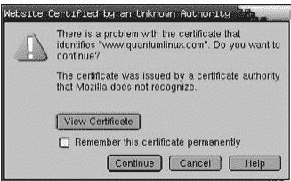

### 第二部分 运行演示

这并不意味着你正在遇到任何非法、不道德或会导致肥胖的内容。许多网站选择使用自签名证书，并不是因为它们想欺骗你，而是因为可能没有理由验证证书的真实所有者，而且它们不想支付验证证书的费用。使用自签名证书的一些原因包括：

- Web 网站不接受任何输入。在这种情况下，作为终端用户的你不需要担心。没有人在试图窃取你的信息，因为你没有提供任何信息。大多数情况下，这只是为了确保从服务器到你的 Web 传输的安全。传输本身的数据可能并不敏感，但作为一个良好的网民，该网站允许你加密证书以防止三方嗅探流量。
- Web 网站面向小众客户。如果你运行的客户群非常有限的 网站（例如应用程序服务提供商），你可以直接告诉用户没有证书颁发机构。他们可以浏览证书信息并通过电话或面对面进行验证。
- 测试。如果你只是在测试一个新的 Web 或基于 Web 的应用程序，为 `SSL` 证书付钱是没有意义的。在准备好上线之前，请使用自签名证书。

### 创建证书请求

要在 Fedora Linux 系统上创建第三方 `SSL` 证书，你必须首先从证书请求（`CSR`）开始。要创建 `CSR`，请在你的 Web 服务器上执行以下操作：

```bash
```


# `cd /etc/httpd/conf`

# `make createq`

`umask 77`

`/usr/bin/openssl genrsa -des3 1024 > /etc/httpd/conf/ssl.key/server.key`

现在你会被要求输入密码来保护你的私钥。此密码至少要有八个字符，且不应该是字典单词，也不应包含数字或标点。你输入的字符将不会显示在屏幕上，以防止有人窥视你的密码。

输入短语：

输入验证的密码：

验证 - 输入短语：

证书生成过程现在开始。

此时，是时候开始向证书添加一些标识信息了，第三方稍后将验证这些信息。在此之前，你必须解锁刚刚创建的私钥。因此，请输入你之前为短语设置的密码。然后按照提示输入信息。这里显示了添加证书信息的会话示例：

```text
Enter pass phrase for /etc/httpd/conf/ssl.key/server.key:

你将被要求输入将并到证书请求中的信息

你即将输入的内容被称为区分名称或 DN。

有很多字段，但你可以留空某些字段

某些字段将有一个默认值，

如果你输入 ' '，该字段将留空。

Country Name（两个字母代码） [GB]

State or Province Name（全名） [Yorkshire]: Connecticut

Locality Name（例如，城市） [Newbury]: Mystic

Organization Name [例如，公司有限公司]: Acme Marina, Inc.

Organizational Unit Name（例如） []: InfoTech

Common Name（例如，你的名称或服务器主机名）： www.accmarina.com

Email Address webmaster@accmarina.com
```

要完成此过程，系统将询问你是否想为证书添加任何额外属性。除非你有理由提供更多信息，否则在以下任何提示中，直接按回车键即可留空。

```text
请输入随证书请求一起发送的“额外”属性

挑战密码 []:

可选的公司名称 []
```

## 获取你的 CSR 签名

一旦创建了 CSR，你需要将其发送到颁发机构进行验证。此过程的第一步是选择一个颁发机构。每个颁发机构都有不同的优惠、价格和产品。检查本章之前“使用第三方证书颁发机构”中列出的颁发机构，以确定哪一个最适合你。以下是颁发机构不同的之处：

- 信誉和稳定性
- 价格
- 浏览器认可
- 质保
- 支持
- 证书签名

在你选择了证书后，你必须通过所有的验证步骤。每个颁发机构都有验证身份和证书信息的不同方法。某些要求

将此证书复制并粘贴到名为 `server.crt` 的空文件中，该文件必须位于 `/etc/httpd/conf/ssl.crt` 目录下，然后重启您的 Web 服务器：

```
# service httpd restart
```

假设您的 Web 网站之前运行正常，现在您可以通过在 Web 地址后添加 `s` 来以安全的方式查看它。如果您之前是通过 `www.acmemarina.com` 访问 Web 网站，现在可以通过访问 `https://www.acmemarina.com` 以安全的方式查看。

## 创建自签名证书

生成和运行自签名 SSL 证书比拥有签名的证书要简单得多。要在 Fedora 系统上生成自签名 SSL 证书，请执行以下操作：

- 1. 删除当前存在的密钥和证书：

```bash
# cd /etc/httpd/conf
# rm ssl.key/server.key ssl.crt/server.crt
```

- 2. 创建您自己的服务器密钥：

```bash
# make genkey
```

- 3. 输入以下命令创建自签名证书：

```bash
# make testcert
umask 077
/usr/bin/openssl req -new -key /etc/httpd/conf/ssl.key/server.key -x509 -days 365 -out /etc/httpd/conf/ssl.key/server.crt
```

现在，是时候向证书中添加一些标识信息了。在在此此之前，您必须解锁您刚刚创建的密钥。输入您之前输入的密码来解锁。然后按照此步骤操作：

您将被要求输入将包含在证书请求中的信息。
您将输入的内容被称为区分名称（Distinguished Name，简称 DN）。
字段有很多，但您可以留一些空白。某些字段将有一个默认值。
如果您输入 '.'，该字段将留空。

## 第二部分 演示

国家名称（2位代码）[GB]: US
州或省份名称（全称）[Berkshire]: Ohio
地区名称（例如，城市）[Newbury]: Cincinnati
组织名称（例如，公司）[My Company Ltd]: Industrial Press, Inc.
组织单元名称（例如，部门）[: IT
通用名称（例如，您的名称或您的服务器的主机名） [:]: www.industrialpress.com
电子邮件地址 []: webmaster@industrialpress.com

此示例中的生成过程将所有文件都于正确的位置。您将需要重启 Web 服务器，并在 URL 中使用 `https` 代替 `http`。不要忘记您将收到浏览器的证书验证消息，您可以安全地忽略它。

## 重启您的 Web 服务器

到此时，您可能已经注意到 Web 服务器每次启动时都要求您输入证书密码。这是为了防止有人入侵您的服务器并窃取您的私钥。这种情况是应该，您可以放心地知道您的私钥是一团乱码。破解者将无法利用它。如果没有这种保护，破解者可以获取您的私钥并轻易伪装成您，在所有情况下看起来都是合法的。

如果您无法忍受每次 Web 服务器启动都要输入密码，并且愿意接受增加的风险，可以移除私钥密码加密。只需执行以下操作：

```bash
# cd /etc/httpd/conf/ssl.key
# /usr/bin/openssl rsa -in server.key -out server.key
```

## 排除证书故障

如果您在 SSL 证书方面遇到问题，以下提示应该会有帮助：

- 每个 IP 地址只允许一个证书。如果您想在服务器上添加多个启用 SSL 的 Web 网站，必须将另一个 IP 地址绑定到网络接口。
- 确保 `/etc/httpd/conf/ssl.*` 目录及其内容的权限掩码为 (`rw----`)。
- 确保您没有在 Web 服务器上阻塞端口 `443`。所有的 https 请求都通过端口 `443` 进来。如果您阻塞了它，将无法获得安全页面。
- 证书有效期仅一年。过期后，您必须向您的证书颁发机构更新证书。每个证书颁发机构执行此操作的方法不同；请检查机构网站获取更多详细信息。
- 确保您已安装 `mod_ssl` 软件包。如果没有安装，您将无法提供任何启用 SSL 的流量。

## 使用 Linux Live 安全工具

如果您怀疑您的计算机或网络被利用，Linux 提供了多种安全工具，您可以使用它们扫描病毒、进行取证分析或监控入侵者的活动。学习和使用许多此类工具的最佳方法是使用专门为安全构建的专用、可启动的 Linux 发行版。

## 安全 Live CD 的优势

使用 live CD 或 DVD 检查系统安全性的巨大优势在于，它将您用于检查的工具与系统本身分离开。换句话说，用于发现已安装系统中问题的工具本身可能已被破坏，而使用包含受信软件的 live CD 是对可能受感染系统进行测试的良好方法。

尽管您付出了巨大努力（良好的密码、防火墙、检查日志文件等），如果您仍然认为入侵者可能已经控制了您的系统，您可以使用 live CD 进行检查。安全 CD（如 Rescue CD、INSERT 和 BackTrack，均包含在此 CD 或 DVD 中）是检查和修复您系统的极佳工具。


## 使用 INSERT 检查 rootkit

如果入侵者可能获取了您系统的控制权，可以使用 live CD 进行检查。一种被称为 rootkit 的软件，它可能会被入侵者用来：

字体 在您的系统中执行操作
- 隐藏他们的活动

rootkit 可以采用不同的方法进行隐藏。通常，rootkit 可能会替换系统命令。

`chroot` 命令是检查已知 rootkit 的良好工具，它还可以检查文件系统是否被感染。例如：

- 1. 将随书的 CD 插入驱动器并重启。
- 2. 从启动提示符输入 insert 并按回车。INSERT 应该启动到桌面。

## 运行

- 3. 为了检查安装在硬盘上的 Linux，您需要挂载分区。使用屏幕右下角的挂载组件，点击组件上的箭头浏览可用存储媒体。如果 Linux 安装在硬盘第一个分区上，选择 hda1。点击按钮挂载该分区。
- 4. 通过右键点击桌面并选择超级用户打开终端窗口。
- 5. 运行 `chroot` 命令并将输出保存到文件。例如，运行以下命令检查挂载的 `/mnt/hdal` 并输出保存到文件 `chkroot-output.txt`。

```bash


# `chkroot -r /mnt/hdal > /tmp/chkroot-output.txt`

- 6. 命令完成后，翻阅输出。例如：

```bash
# less /tmp/chkroot-output.txt
```


## 总结

保护您的 Linux 系统是一项您从一开始就开始并在在使用 Linux 系统时持续做的事情。通过实施良好的安全实践（如本章开头的安全检查清单所示），您从长远来看有更大的机会阻止入侵者。

展望未来，你可以通过使用加密网络应用程序（如 `ssh`）、监控日志文件以及遵循良好的密码技术来帮助保持 Linux 系统的安全。如果你的 Linux 系统被用作服务器，你还需要特别注意缩小服务器的访问范围并保护数据。为此，你可以使用诸如 TCP 封装（限制谁可以使用你的服务器）和证书（确保与 Web 服务器通信的两端都经过身份验证）等工具。

## 第三部分

## 选择与安装 Linux 发行版

| 本部分内容 |
| :--- |
| 第 7 章 安装 Linux |
| 第 8 章 运行 Fedora 和 Red Hat Enterprise Linux |
| 第 9 章 运行 Debian GNU/Linux |
| 第 10 章 运行 SUSE 和 openSUSE Linux |
| 第 11 章 运行 KNOPPIX |
| 第 12 章 运行 Yellow Dog Linux |
| 第 13 章 运行 Gentoo Linux |
| 第 14 章 运行 Slackware Linux |
| 第 15 章 运行 Linspire 和 Freespire |
| 第 16 章 运行 Mandriva |
| 第 17 章 运行 Ubuntu Linux |
| 第 18 章 运行 Linux 防火墙/路由器 |
| 第 19 章 运行可启动 Linux 发行版 |

## 第 7 章

## 安装 Linux

如果还没有人为你安装并配置好 Linux 系统，本章将帮助你入门，这样你就可以尝试书中其余部分描述的 Linux 特性。随着 Linux CD 和 DVD 近期的改进，获取一个可以运行的 Linux 系统比以往任何时候都更快速、更稳固。

如果你是第一次使用 Linux 的用户，我建议你：

- 尝试可启动的 Linux — 本书的 CD 和 DVD 包含了几个可启动的 Linux 系统。可启动 Linux 的优势在于，你可以在不触碰电脑硬盘内容的情况下尝试 Linux。特别是 KNOPPIX 是一个功能全 Linux 系统，可以让你对 Linux 的工作原理有良好的感受。使用 DVD 或 CD，你可以像附录 A 描述的那样尝试不同的实时 CD（live CDs）。这些实时 CD 中的一些还包含了将 Linux 安装到硬盘硬盘的功能，尽管它们的运行速度通常比已安装的系统慢，并且在重启后不会保留你的更改，但它们是入门 Linux 的良好工具。
- 安装桌面系统 — 选择一种 Linux 发行版并将其安装在电脑的硬盘上。将 Linux 永久安装到硬盘上可以让你在添加和删除软件、访问和保存数据到硬盘以及更永久地自定义系统方面具有更大的灵活性。将 Linux 安装为桌面可以让你使用一些实用的应用程序，并对 Linux 处理更复杂的服务器有所感受。

本章为你提供了关于如何选择 Linux 发行版的概述，然后描述了在安装大多数 Linux 发行版时常见的问题和主题。附录 A 描述了书中 CD DVD 包含了哪些 Linux 发行版，以及如何以实时方式运行它们或使用它们来永久安装 Linux。本书该部分的其他每一章都致力于理解和安装特定的 Linux 发行版。

| 本章内容 |
| :--- |
| 选择 Linux 发行版 |
| 获取 Linux 发行版 |
| 理解安装中的问题 |

在安装好 Linux 之后，你将想要了解如何为你的 Linux 系统获取和管理软件。这些是贯穿本书的重要主题，但本章描述了用于入门的主要包格式和工具。

### 选择 Linux 发行版

如今有几十种流行的发行版供选择。有些是通用发行版，你可以将其用作桌面、服务器或工作站系统；另一些是专为企业或计算机爱好者设计的。本书的意图之一是帮助你选择一个（或多个）最适合你的版本。

使用随书附带 DVD，你可以直接启动到 KNOPPIX（或使用其他 CD 尝试 Linux），或运行安装程序（在你的硬盘上安装 Fedora、Ubuntu、Gentoo 或 Slackware）。因为书中包含的 Fedora 发行版是完整的发行版，因此你可以安装全系列的桌面界面和应用程序、编程工具以及服务器功能。在你尝试过 KNOPPIX 并准备好在硬盘上安装 Linux 后，我建议你选择 Fedora。

使用随书的 CD，你可以直接启动到 Damn Linux（或其他较小的可启动 Linux 发行版）、Debian 或 Gentoo（通过你的磁盘对这些发行版进行网络安装）。Debian 和 Damn Linux 是两种发行版，可以配置在较旧、性能较低，或有 CD 驱动器但没有 DVD 驱动器的电脑上运行。本书还提供了如何将 Debian 配置为邮件和 Web 服务器的描述（第 24 和第 25 章）。

#### 工作中的 Linux

我认识很多熟悉 Linux 的人，无论是在正式场合还是在工作中，我想分享一下关于不同 Linux 发行版在美国使用情况的总体印象。我认识的大多数顾问表示小型办公室服务器以前使用 Red Hat Linux，但现在已转向 Fedora、CentOS（基于 Red Hat Enterprise Linux 软件构建）、Ubuntu 或 Debian GNU/Linux。Mandriva Linux（以前名为 Mandelin）在想要获得友好 Linux 桌面的人中很受欢迎，但 Fedora 也非常有名。更偏向技术性的人喜欢玩玩 Gentoo（高度可调优）或 Slackware（以更基础的形式）。

Novell 和 微软在 2006 年底的协议承诺让某些源码支持者放弃 SUSE。这是否会导致企业领域从 SUSE 迁移呢？

#### 安装 Linux

对于过渡到 Macintosh 硬件的人来说，Yellow Dog 可以安装在 PowerPC 上（Yellow Dog 最初基于 Red Hat）。至于可启动的 Linux，我认识的每个人都认为它们非常适合尝试。对于可启动的 DVD，KNOPPIX 是一个不错的选择，Ubuntu 也是。对于可启动的微型 CD 尺寸，Damn Linux 可以胜，SLAX 或 BackTrack 也是如此。

这本书让你接触多种 Linux 发行版。它让你能够通过实际操作来看到每个发行版的优缺点。

#### 其他发行版

似乎每隔五分钟就有一个新发行版，我真的时候该停止写这本书了。为了将 Linux 发行版的描述保持在合理范围内（并有空间描述如何使用 Linux），书中没有介绍有趣的 Linux 发行版。

书中包含的重要发行版有 TurboLinux、Xandros 和 CentOS。TurboLinux (`www.turbolux.com`) 是亚太国家流行的发行版。Xandros (`www.xandros.com`) 设计用于在 Windows 环境中良好运行，是一个广受认可的桌面系统。CentOS 在以前使用 Red Hat Linux 的顾问中非常流行。CentOS 是 Red Hat Enterprise Linux 源码的重新构建。因此，对于需要从 Fedora 获取定期更新的服务器，可以使用它（基于 Fedora 的技术）。

### 获取你自己的 Linux 发行版

通过在书中包装几个 Linux 发行版，我希望为你节省自己获取 Linux 的麻烦。如果你有 DVD 驱动器，也许你可以利用这个机会至少了解一下 KNOPPIX，它会有更好的讨论。如果你有 CD 驱动器，也许可以从随书附带的 CD 直接启动到 Damn Small Linux，

如果由于某种原因无法使用 CD 或 DVD 上的软件，你可能想要获取自己的 Linux 发行版来配合书中发行版的使用。你可能想要获取自己的 Linux 发行版的原因包括：

- 没有 DVD 驱动器 — 你电脑需要一个可启动的 DVD 驱动器才能使用随书 DVD 上的 Linux 发行版。
- 后期的发行版 —— 你可能想要比书中提供的某个特定发行版更更新的版本。
- 完整的发行版 —— 因为 CD 和 DVD 空间有限，且某些发行版需要订阅或其他费用，你可能想要获取一个你自己的、更完整的发行版来工作。

在今天，获取 Linux 的方法数不应完缺。

### 寻找其他 Linux 发行版

你可以访问每个发行版的官方网站（例如通过 `http://fedaproject.org` 或 `http://slack.com/`）来获取 Linux 软件。这些网站通常允许你下载其发行版的完整副本，并提供购买光盘版的机会。

然而，如果你想获取现有的 Linux 发行版中更完整的版本，可以访问专门传播 Linux 发行版信息的网站。使用这些网站连接到论坛，并下载关于许多 Linux 发行版的文档。以下是一些示例：

- DistroWatch (`www.distrowatch.com`) —— 我寻找 Linux 发行版的第一个地方是 DistroWatch.com。点击“主要发行版”（Major Distributions）链接阅读有关 Linux 发行版的介绍（大部分都包含在书中）。链接将带你下载发行版、网站、主页以及每个发行版的其他站点。
- Linux Help (`www.linuxhelp.net`) —— 从该站页面选择 ISO 镜像，你可以找到许多流行 Linux 发行版的 ISO 镜像下载链接。

如果你不想自己下载并刻录 CD，有很多地方愿意向你出售 Linux CD 或 DVD。发行版的售价通常只比介质和运费高一点点。如果你非常喜欢某个特定的 Linux 发行版，直接从制作该版本的组织购买是一个好主意。这可以确保该发行版在未来的健康发展。

Wiley 出版社的《Fedora 和红帽企业 Linux 经》（Red Hat Enterprise Linux Bible）等书籍也是获取 Linux 发行版的好方法。当你手里只有一张 CD 作为起点时，寻找最新的文档可能是困难的。标准的 Linux 文档（如 HOWTO 和 `man` 页面）通常与软件版本脱节。因此，我个人建议初次用户购买一本书和对应的发行版（例如这本书，或者《Fedora and Red Hat Enterprise Linux Bible》）。

### 了解你的需求

到目前为止，获取 Linux 最常见的方式是通过 CD，而 DVD 正成为一种日益受欢迎的替代方案。另一种方法是从一个包含安装引导镜像的软盘或 CD 开始，在安装 Linux 的过程中从网络获取你所需的 Linux 部分。

### 安装 Linux

刻录到 CD 上的镜像通常存储在互联网上，被称为软件源（software repositories）。你可以在这里下载。

### 升级或从头安装

如果你已经在计算机上安装了某个想要安装的 Linux 版本，许多 Linux 发行版都提供了升级选项。这允许你升级所有软件包，例如从该发行版的第 1 版本升级到第 2 版本。在执行升级之前，有几条通用规则：

- 升级完成后，操作系统可能会无法启动。因此，在对操作系统进行任何更改之前，备份任何关键数据和配置文件（位于 `/etc` 目录）始终是一个明智的主意。
- 移除多余软件包 —— 如果有你不需要的软件包，请在升级之前删除它们。升级通常只会升级你系统中已存在的包。与纯净安装相比，升级通常会进行更多的检查和比较，因此在过程中任何一个软件包都可能为你节省一些时间。
- 检查配置文件 —— Linux 升级过程会遗留旧的配置文件。你应该检查新的配置文件是否对你仍然有效。

> 提示：从头安装比升级更快。它还能获得一个更干净的系统。如果你可以选择备份数据，或者在不需要时直接擦除，那么重新安装新系统通常是最佳选择。

某些发行版（最著名的是 Gentoo）采用了持续更新的方法。它们不是每几个月发布一个新版本，而是当更新包可用时直接获取并将其安装到你的系统中。

### 与 Windows 双启动或仅使用 Linux？

在同一台计算机上拥有多个可启动的操作系统是可能的（使用硬盘上的多个分区和/或多个硬盘）。设置启动多个操作系统需要经过仔细考虑，并且它蕴含着某些风险。

> 警告：尽管近年来调整 Windows 分区大小和设置多启动系统的技术有所改进，但 Windows/Linux 双启动系统仍存在严重的数据丢失风险。不同的操作系统对分区表和主引导记录（MBR）有不同的视图，这可能导致你的机器无法启动（至少是暂时）或永久丢失数据。在尝试缩小 Windows（NTFS 或 FAT）系统为 Linux 腾出空间之前，务必备份你的数据。如果有选择，请将 Linux 安装在其中一个硬盘或独立的磁盘上。

如果你正在使用的计算机已经有了 Windows 系统，很有可能整个磁盘都分配给了 Windows。虽然你可以在不触碰硬盘的情况下运行可启动的 Linux（如 KNOPPIX 或 Damn Small Linux），但要进行更持久的安装，你需要在 Windows 安装区域之外寻找磁盘空间。有几种方法可以实现：

- 添加硬盘 —— 与其改动 Windows 分区，你只需添加一个硬盘并将其分配给 Linux。
- 调整 Windows 分区大小 —— 如果你的 Windows 分区上有可用空空间，你可以缩小该分区，以便在磁盘上留出可用空间分配给 Linux。可以使用商业工具，如 Symantec 的 Partition Magic (`www.symantec.com`) 或 Acronis 的 Disk Director (`www.acronis.com`) 来调整你的磁盘分区大小并设置一个可用的引导管理器。某些 Linux 发行版（特别是作为救援光盘使用的可启动 Linux）包含一个名为 QParted 的工具，它是 Partition Magic 的开源克隆版本（包含了来自 Linux-NTFS 项目用于调整 Windows 分区大小的软件）。

QParted 的替代方案是 GParted，它包含在本书的介质中。

在尝试调整 Windows 分区大小之前，你可能需要对其进行碎片整理。为了在 Windows 系统上对磁盘进行碎片整理，使磁盘上的所有空间有序，请打开“我的电脑”，右键点击你的硬盘图标，点击“属性”，选择“工具”，然后选择“立即立即整理”。

磁盘碎片整理可能是一个相当长时间的过程。碎片整理的结果是磁盘上的所有数据都是连续的，在分区末尾创建一个大块空闲空间。在某些情况下，你必须执行以下特殊任务来实现此目标：

- 如果 Windows 交换文件（swap file）在碎片整理期间未移动，则需要移动它。在 Windows 系统上对磁盘进行碎片整理以使所有空间在磁盘上排列，打开“我的电脑”，右键点击硬盘图标，点击“属性”，选择“工具”，并选择“立即整理”。禁用交换文件。
- 如果 Windows 交换文件在碎片整理期间未移动，则需要删除它。在某些情况下，某些文件应该删除。为了调整 Windows 分区，你可以使用来自 Linux-NTFS 项目的软件来处理文件。一旦磁盘完成碎片整理，你可以使用上述的商业工具（如 Partition Magic 或 Acronis Disk Director）来调整磁盘分区并为 Linux 腾出空间。QParted 是一个开源方案。启动 KNPIX 或其他 Linux 发行版（特别是救援光盘），运行 QParted。在 QParted 窗口中选择你想要调整大小的磁盘。通过选项配置打开一个你可以使用 `ntfsresize` 工具调整 NTFS 分区的窗口。

在你清理出足够安装 Linux 的磁盘空间后（参见有关你正在安装的 Linux 发行版的章节），可以选择你的 Linux 发行版并进行安装。在安装期间设置引导程序时，你将能够识别 Windows、Linux 以及其他可启动的分区。

### 使用安装选项

有时 Linux 安装会因为计算机具有不支持的硬件而失败。有时你可以通过在启动时传递选项来解决这些问题。虽然某些选项是特定发行版的，但另一些适用于 Linux 内核的选项。第 11 章列出了许多适用于 PIX 和其他 Linux 系统的启动选项。

### 硬盘分区

计算机硬盘为数据文件、应用程序和操作系统提供了永久存储区域。分区是将磁盘划分为可以独立工作的逻辑区域。在 Windows 中，你通常有一个占用整个磁盘的分区。但对于 Linux，有几个原因你可能想要有多个分区：

- 多个操作系统 —— 如果你在已有 Windows 系统的 PC 上安装 Linux，你可能希望在计算机上保留两个操作系统。从实际角度考虑，每个操作系统必须存在于单独的分区。当计算机启动时，你可以选择运行哪个系统。
- 多个分区 —— 为了防止操作系统耗尽磁盘空间，人们经常为 Linux 文件系统的不同区域分配单独分区。例如，如果 `/home` 和 `/var` 分配了分区，那么一个填满 `/home` 分区的用户将阻止守护进程继续向 `/var/log` 目录写入日志文件。多个分区也更容易进行某些类型的备份（例如镜像备份）。`/home` 的镜像会比根文件系统的镜像备份快得多。
- 不同的文件类型 —— 不同的文件系统具有不同的结构。不同类型的文件必须位于自己的分区上。在大多数 Linux 系统中，你至少需要一个文件系统（通常是 ext3 或 reifs）和一个交换区。光盘上的文件使用 iso960 文件系统。

来自 Windows 的用户：如果你以前只使用过 Windows 操作系统，你可能一直将硬盘分配为 C 盘，而从未考虑过分区。在许多 Linux 系统中，你有机会根据自己对系统的需求来查看并更改默认分区。

在安装过程中，SUSE 和 Fedora 等系统允许你使用图形化工具（分别为 YaST 和 DiskDroid）对硬盘进行分区。接下来的章节将描述如何使用 DiskDroid（在安装期间）或 `fdisk`。请参考“创建分区的提示”章节以获取创建磁盘分区的建议。

#### 在安装期间使用 DiskDroid 进行分区

在安装过程中，Fedora 让你有机会机会使用一个名为 DiskDroid 的工具来更改硬盘的分区方式（实际上，“Disk Druid”这个名称似乎正在消失，但分区操作保持不变）。Disk Druid 分为两个部分：顶部显示每块硬盘的通用信息，底部显示每个分区的详细信息。图 7-1 显示了 Disk Druid 的示例。

图 7-1 在 Fedora 安装的磁盘设置窗口对磁盘进行分区。

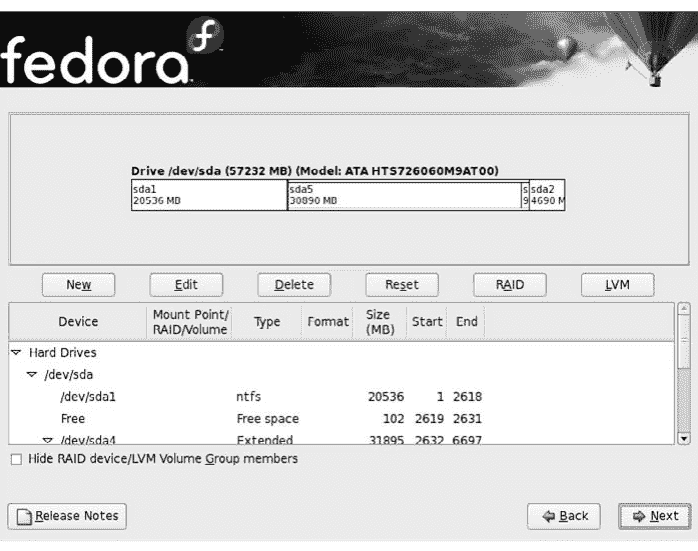

对于每个硬盘分区，你可以看到以下内容：

- **设备（Device）** — 设备名称是 `/dev` 目录下代表硬分区的名称。每个磁盘分区都以两个字母开头：`sd` 用于 IDE 或 SCSI 磁盘，`ed` 用于 ESDI 磁盘，或 `xd` 用于 XT 磁盘。后面的字母代表磁盘编号（1 是 a，2 是 b，3 是 c，以此此类推）。例如，要引用整块硬盘，请使用设备名称 `/dev/sda`。要引用该磁盘上的特定分区，请添加分区号（1, 2, 3 等）。例如，`/dev/sda1` 代表计算机上第一块硬盘上的分区。
- **挂载点/卷/卷（Mount Point/Volume）** — 分区连接到 Linux 系统的目录（如果已连接）。在继续之前，你必须将根分区（`/`）分配给原生 Linux 分区。如果你使用 RAID 或 LVM，这里会显示 RAID 设备名称。
- **类型（Type）** — 安装在分区上的文件系统类型。在许多情况下，文件系统将是 Linux (ext3)、Windows FAT (vat) 或 Linux swap（交换）。然而，你可以使用之前的 Linux 文件系统 (ext2)、物理卷 (LVM) 或软件 RAID。图 7-1 中所示设备 `/dev/sda` 的 `NTFS` 分区意味着 Windows 安装在该 particular分区上，并可以作为 Windows 和 Linux 的双启动计算机使用。
- **格式（Format）** — 表示安装过程是否应该格式化硬盘分区。标记了勾选的分区将被擦除！因此，在多启动系统中，请确保你的 Windows 分区和其他包含你不想丢失的数据的分区未被勾选！
- **大小 (Size (MB))** — 为分区分配的磁盘空间（兆字节）。如果选择分区组以填充现有空间，此数字可能远大于请求量。
- **起始/结束（Start/End）** — 代表分区在硬盘上的起始和结束扇区。

在顶部区域，你可以看到连接到计算机的每块硬盘。首先显示驱动器名称，接着是磁盘型号。总磁盘空间、已用空间和可用空间以兆字节为单位显示。

#### 分区的原因

关于划分硬盘有不同的观点。以下是一些常见问题：

- **你想安装另一个操作系统吗？** 如果你想在计算机上同时运行 Windows 和 Linux，你至少需要一个 Windows (Win95 FAT16, VFAT 或 NTFS)、一个 Linux (Linux ext3) 和一个 Linux swap 交换分区。
- **它是多用户系统吗？** 如果是你个人使用该系统，可能不需要很多分区。分区操作系统的原因之一是防止整个系统同时耗尽磁盘空间。这也可以为个人在其主目录中可以使用的内容设定边界（尽管磁盘配额对此也有效）。
- **你有多个硬盘吗？** 每块硬盘至少需要一个分区。如果你的系统有两块硬盘，你可以将一个分配给 `/`，另一个分配给 `/home`（如果你有大量用户）或 `/var`（如果计算机是存储大量大量数据的服务器）。

#### 删除、添加和编辑分区

在添加分区之前，硬盘上需要有一些空闲空间。如果你硬盘上的所有空间目前都分配给了一个分区（这在 DOS 或 Windows 中通常如此），你必须在在另一个分区上占用空间之前删除或调整分区大小。“如何与 Windows 或 Linux 进行双启动？”讨论了如何在不丢失现有单分区系统信息的情况下添加分区。

在删除分区之前，请确保已备份任何你想保留的数据。删除分区后，其所有数据都将消失。

Disk Droid 比 `fdisk` 实用工具不灵活，但更直观。DiskDroid 允许你删除、添加和编辑分区。

如果创建多个分区，请确保在正确的位置有足够的空间完成安装。例如，大多数 Linux 软件安装在 `/usr` 目录（及其子目录）中，而……

#### 使用 fdisk 进行分区

每个 Linux 系统都提供了 `fdisk` 工具，用于在 Linux 中创建和处理磁盘分区。它与 Disk Druid 等图形化分区工具的功能相同，尽管在 Fedora 安装期间不再可用。

> 提示：在 Fedora 和其他具有虚拟终端的 Linux 安装过程中，你可以切换到 shell（按 Ctrl+Alt+F2）并以 root 用户身份使用 `fdisk` 对磁盘进行分区。

以下步骤通过命令行执行：

> 注意：请记住，任何分区命令都可能轻易擦除磁盘或使其无法访问。在使用任何工具更改分区之前，请务必备份关键数据！对你所做的更改要非常小心。准备一个应急启动盘也是个好主意。

`fdisk` 命令是许多不同操作系统上可用的命令（尽管在每个系统上的外观和行为都不同）。在 Linux 中，`fdisk` 是一个基于菜单的命令。要使用 `fdisk` 列出所有分区，请输入以下内容（作为 root 用户）：
```


```
$ fdisk -l

Disk /dev/sda: 40.0 GB, 40200664320 bytes

255 heads, 63 sectors * 4865 cylinders

Units = cylinders of 16065 * 512 = 8225280 blocks

Device Boot Start End Blocks Id System

/dev/sda * 1 104391 83 Linux

/dev/sda2 14 4833 38716650 83 Linux

/dev/sda3 4834 4865 257040 82 swap
```

要查看每个分区位于你当前的系统上，请输入以下内容：

```
$ df -h

Filesystem Size Used Avail% Mounted on

/dev/sda2 37G 5.4G 30G 16% /

/dev/sda1 99M 8.6M 61M 10%/boot

none 61M 0 61M %/dev/shm
```

从 `df` 的输出中，你可以看到 Linux 系统的根目录 (`/`) 位于 `/dev/sda2` 分区，而 `/dev/sda1` 分区用于 `/boot`。

> 在使用 `fdisk` 更改你的分区之前，我强烈建议运行 `df -h` 命令来查看你的分区目前是如何定义的。这将降低更改或删除错误分区的风险。

要使用 `fdisk` 更改你的分区，你需要识别你正在进行分区的硬盘。例如，第一块 IDE 硬盘被识别为 `/dev/sda`。因此，要对你的第一个 IDE 硬盘进行分区，你可以从（作为 root 用户）开始输入：

```
$ fdisk /dev/sda
```


对于不同的硬盘或编号，可以将 `/dev/sda` 替换为你想要操作的设备名称。请表 7-1 以获取某些选择。

## 表 7-1
### 磁盘设备名称

| 设备 | 描述 |
| :--- | :--- |
| `/dev/sda` | 用于第一块 IDE 或 SCSI 硬盘；其他磁盘使用 `sdb`、`sdc` 等 |
| `/dev/rd/c0d` | 用于 RAID 设备 |
| `/dev/ida/c0d` | 同样用于 RAID 设备 |

268

# 安装 Linux

在启动 `fdisk` 后，按 `m` 查看选项。以下是你可以使用 `fdisk` 执行的操作：

- **删除分区**——输入 `d` 和一个分区号，然后按回车键。例如，`/dev/sda2` 将是分区号 2。（在更改生效之前，删除不会生效——你可以退回到那一步操作。）
- **创建分区**——如果你有空闲空间，可以添加新分区。输入 `n` 表示逻辑分区（5 或以上）或输入 `p` 表示主分区（1–4）；并从可用范围选择一个分区号。然后从可用磁道数中选择第一个磁道数。（`fdisk -l` 的输出将通过 Start 和 End 列显示正在使用哪些磁道。）
- **下一步**，输入将结束的磁道数（或特定的兆字节或字节数，例如，`+50M` 或 `+1024K`）。你创建了一个 ext3 Linux 分区。再次强调，在做出更改之前，这不是永久的。
- **显示分区表**——输入 `T` 选择文件系统类型。输入你想更改的分区号。以十六进制代码输入你想要使用的对应文件系统类型。（此时输入 `L` 可以查看文件系统类型和代码列表）对于 Linux 文件系统，使用数字 83；对于 Linux 交换分区（swap），使用 82；对于 FAT32 文件系统，使用字母 `b`。
- **显示分区表**——在整个过程中，可以随时（在屏幕上）显示当前状态的分区表。
- **退出或保存**——在做出更改之前，再次显示分区表并确保它是你所预期的。如果你不想对分区进行任何更改，输入 `Q` 退出而不保存。你的分区表不会发生任何变化。

如果你的更改是正确的，输入 `W` 写入分区表。系统会警告你更改分区是非常危险的，你必须确认该更改。

菜单式 `fdisk` 命令的替代方案是 `sfdisk`，它是一种命令导向的分区工具。使用 `sfdisk`，使用完整命令来列出或更改分区，而不是通过一系列提示（如使用 `fdisk` 那样）。详情请参见 `sfdisk` 映射。Linux 专家更倾向于使用 `sfdisk`，因为它可以与其他命令结合来更改和输出分区信息。

# 创建分区的技巧

更改分区以处理多个操作系统可能非常复杂，部分原因在于每个操作系统对于如何处理分区信息都有自己的见解，并且有不同的工具来进行。这里是一些可以帮助你正确操作的提示：

- 如果你正在创建一个双启动系统，特别是 Windows XP，请先安装 Windows 操作系统。否则，Windows 安装可能会导致 Linux 分区无法访问。Windows 选择 VFAT 而不是 NTFS 文件系统也将让你的 Windows 和 Linux 系统之间的文件共享变得更加简单和可靠。
- `fdisk` 手帮助页可以提供更多信息。`fdisk` 手帮助可以提供关于如何分区的技巧。

269

## 表 7-2 分配分区的目录

| 设备 | 解释 |
| :--- | :--- |
| `/dev/sda` | 有时为了 BIOS 访问多个硬盘，使用分区。100MB |
| `/boot` | 分区让 Linux 操作系统可以访问。202 |

# 选择和安装 Linux 发行版

- 支持自动解压启动镜像。
- 支持从网络下载启动镜像。

有关 GRUB 如何运行的更多信息，请输入 `man grub` 或 `info grub`。`info` 命令包含更多关于 GRUB 的细节。

# 使用 GRUB 启动

当你安装 Linux 时，通常会让你配置启动计算机（带有一个或多个操作系统）所需的信息，将其设置为默认引导加载程序。配置好 GRUB 后，启动计算机时，看到的第一个界面是 BIOS 在顶部加载 GRUB 屏幕，并在下方列出可启动的分区。执行以下操作之一：

- 默认 — 如果你什么都不做，默认操作系统将在几秒后自动启动。（超时时间由 `grub.conf` 文件中的 `timeout` 值设置，单位为秒）。
- 选择操作系统 — 使用向上和向下方向键选择屏幕上显示的任何标题，这些标题代表你可以启动的操作系统。然后按 Enter 键启动该操作系统。
- 编辑过程 — 如果你想更改启动过程中使用的任何选项，请使用方向键高亮你想要的操作系统并输入 `e` 进行选择。按照接下来的步骤更改你的启动选项。

如果你想更改启动选项以便在每次启动计算机时都生效，请参见“永久更改启动选项”部分。更改这些选项涉及编辑 `/boot/grub/grub.conf` 文件。

# 临时更改启动选项

在 GRUB 屏幕上，你可以选择为当前启动系统更改或添加选项。首先，选择（使用方向键）操作系统并输入 `e`（如前所述）。你将看到一个类似于图 7-2 所示的屏幕。

在 GRUB 编辑屏幕的示例中，有三行识别你所选操作系统的过程。第一行（以 `root` 开头）显示 GRUB 加载器项位于第一块硬盘的第七个分区 `(hd0,6)`。GRUB 将硬盘表示为 `hd_`，无论它是 SCSI、IDE 还是其他类型的磁盘。你只需要从零开始计数驱动器和分区编号。

示例的第二行（以 `kernel` 开头）识别了启动镜像 (`/boot/vmlinuz-2.6.20-1.3104.fc7`) 和若干选项。这些选项标识分区最初被加载为 `ro`（只读），以及根文件系统在标签为 `root=/123` 的分区上的位置。第三行（以 `initrd` 开头）标识了初始 RAM 磁盘的位置，它包含了启动过程中所需的最小文件和目录。

272

# 安装 Linux

图 7-2

从 GRUB 启动屏幕，你可以选择更改启动选项。

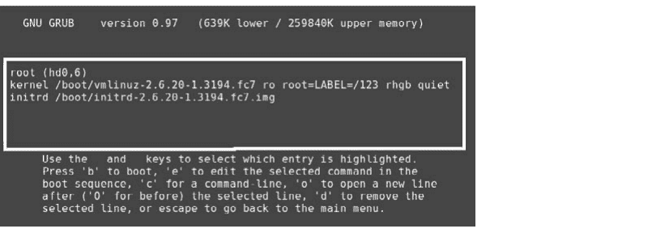

如果你打算更改启动过程中的任何行，你可能会更改第二行以添加或删除启动选项。以下是操作方法：

1. 将光标置于内核行上并输入 `e`。
2. 在启动镜像的名称后添加或删除选项。你可以使用极简的 bash 命令行编辑功能来编辑该行。你甚至可以使用补全功能（输入文件名的一部分并按 Tab 键完成）。以下是你可能想要添加或删除的几个选项：
   - `* 引导到 shell` — 如果你忘记了 root 密码或启动过程挂起，可以通过在启动行中添加 `init=/bin/sh` 直接引导到 shell。（文件系统以只读方式挂载，因此你可以拷贝文件。你需要使用读写权限编辑文件系统以更改文件。）
3. 选择运行行 — 如果你想启动到特定级别，可以添加 `linux` 单词，后跟你想要的运行级别。例如，要让 Fedora 启动到级别 3（多任务模式），在行尾添加 `linux 3`。你也可以启动到单用户模式 (1)、多用户模式 (2) 或 GUI 模式 (5)。如果 GUI 损坏，级别 3 是很好的选择。
4. 按 Enter 返回编辑屏幕。

输入 `b` 使用新选项启动计算机。下次启动计算机时，选项将不会保存。要永久保存这些选项，请参见下一节。

# 永久更改启动选项

你可以通过更改 GRUB 配置文件来更改每次启动计算机时生效的选项。在 Fedora 和其他 Linux 系统，GRUB 配置位于 `/boot/grub/grub.conf`。

273

# 第三部分 选择和安装 Linux 发行版

在安装 Linux 时会创建 `/boot/grub/grub.conf` 文件。这是一个 Fedora 的文件示例：


# grub.conf 由 anaconda 生成

# 注意：修改此文件后

# 不需要重新运行 grub

# 警告：你有一个 `/boot` 分区。这意味着

# 所有内核和 initrd 路径都是相对于 `/boot/`，例如

# `root (hd0,6)`

# `kernel/vmlinuz-version root=/dev/sda7`

# `initrd/initrd-version.img`

`#boot=/dev/sda`

`timeout=10`

`splashimage=(hd0,6)/grub/splashpm.gz`

`title Fedora (2.6.20-1.3104.fc7)`

`root (hd0,6)`

`kernel vmlinuz-2.6.20-1.3104.fc7 root=LABEL=/123 quiet`

`initrd/2.6.20-1.3104.fc7.img`

`title Windows XP`

`root (hd0,0)`

`chainloader +1`

`default=0` 行表示默认启动第一个分区。`timeout=10` 导致 GRUB 在启动默认分区之前暂停 10 秒（如果你想编辑启动行，请按 `e`，或者按方向键选择不同的操作系统启动）。

`splashimage` 位于第一块硬盘的第七个分区 `(hd0,6)`，即启动分区（在此情况下为 `/dev/sda7`）。GRUB 加载 `splash.xpm` 作为屏幕上的图像 (`/boot/grub/splash.xpm`)。它是启动屏幕的背景。GRUB 使用以下符号表示分区：`(hd0,0)`。第一个数字表示磁盘，第二个是该磁盘上的分区。因此，`(hd0,1)` 是第一硬盘上的第二个分区 (1)。

示例中的两个分区是 Fedora 和 Windows XP。每个分区的标题行后面跟着在启动屏幕上显示的名称。

对于 Fedora Linux 系统，`root` 行指示第一块硬盘上启动分区的位置。因此，要找到可启动的内核 (`vmlinuz-2.6.20-1.3104.fc7`) 和加载的 initrd RAM 磁盘镜像 (`initrd-2.6.20-1.3104.fc7.img`)，GRUB 在 `hd0,6` 的根目录（由 `/dev/sda7` 表示）中查找并最终挂载为 (`/boot`)。内核行上的其他选项将分区设置为只读 (`ro`)，并将根文件系统设置为 `LABEL=/123`。

274

## 安装 Linux

对于 Windows XP 分区，`root` 行指示 GRUB 不应尝试挂载该分区。在这种情况下，Windows XP 位于第一个分区 `(hd0,0)` 或 `/dev/sda1`。与其挂载分区并向新系统传递选项，`chainloader +1` 将操作系统的启动控制交给另一个引导加载器。`+1` 表示使用分区的第一个扇区作为引导程序。

微软操作系统要求使用 `chainloader` 从 GRUB 启动，因为 GRUB 不 Windows Windows 提供原生支持。

如果你对 `grub.conf` 做了任何更改，不需要加载这些更改。GRUB 在你重启计算机时会自动获取这些更改。如果你习惯使用 LILO 引导加载器，起初可能会感到困惑，LILO 需要你运行相应的命令才能生效。

## 添加新的 GRUB 启动镜像

你可能为包含不同功能的内核准备不同的启动镜像。以下是修改 `grub.conf` 文件的过程。

1. 将新镜像从创建它的目录（如 `/usr/src/linux-2.6.20-1/arch/i86/boot`）拷贝到 `/boot` 目录。使用反映其内容的名称命名，如 `bz-2.6.20-1`。例如：
2. 向 `/boot/grub/grub.conf` 文件中添加几行，以便镜像在每次被选择时都能启动。例如：
3. 重启计算机。
4. 当 GRUB 启动屏幕出现时，将光标移动到代表内核的标题上并按 Enter。

```
@ cp /usr/src/linux-2.6.20-1/arch/i86/bzimage/boot/bz 2.6.20-1
```

> `title Fedora (My own IPv6 build)`
> `root (hd0,1)`
> `kernel /bz-2.6.20-1 root=/dev/sda7`
> `initrd/initrd-2.6.20-1.img`

这种方法（与用新启动镜像覆盖旧镜像相比）的优势是，如果内核启动失败，你总是可以回去并重启旧内核。当你认为新内核工作正常时，可以使用它替换旧内核，或者可能将新内核设置为默认启动定义。

## 使用 LILO 启动计算机

LILO 代表 Linux Loader。与其他引导加载程序一样，LILO 是一个可以列出安装在计算机上的操作系统的程序，以便你选择启动系统。它也

## 第三部分 选择和安装 Linux 发行版

LILO 允许你提供特殊选项，以修改操作系统的启动方式。在 Slackware 和某些其他 Linux 系统中，使用 LILO 代替 GRUB 作为默认引导程序。

如果你的电脑上使用了 LILO，它被安装在主引导记录（MBR）或根分区的第一个扇区。主引导记录由计算机的 BIOS 直接读取。通常，如果 LILO 是你电脑上唯一的引导程序，它会被安装在主引导记录中。如果主引导记录中已经有另一个引导程序，请将 LILO 放在根分区中。

如果你是 Linux 新手且不熟悉引导程序，强烈建议你学习并使用 GRUB 而不是 LILO。发行版对 LILO 的支持和包含已经减少，转而支持 GRUB。

## 使用 LILO

当你的电脑在主引导记录中安装了 Fedora 版本的 LILO 时启动，会出现一个图形化的 Fedora 界面，显示电脑上可启动的分区。使用键盘上的向上和向下箭头选择你想要的分区并按 Enter 键。否则，你在安装时设置的默认分区将在几秒后启动。

如果你想在启动时添加特殊选项，请按 `Ctrl+X`。你会看到一个如下所示的文本启动提示：

```
boot:
```

LILO 会暂停几秒钟，然后从默认启动分区加载第一个镜像。要再次查看可启动的分区，快速按 `Tab` 键。你可能会看到类似下面的内容：

```
LILO boot:
linux linux-up dos
boot:
```

此示例显示你的电脑上有三个可启动的分区，分别称为 `linux` 和 `dos`。前两个名称指的是可以启动 Linux 分区的两个不同启动镜像。第三个指的是一个可启动的 DOS 分区（推测为 Windows 操作系统）。如果你在几秒后输入任何内容，将加载第一个可启动分区。或者你可以使用另一个分区的名称来启动该分区。

如果你有多个启动镜像，按下 `Shift` 键，LILO 会询问你想要启动哪个镜像。可用的启动镜像和其他选项定义在 `/etc/lilo.conf` 文件中。

## 设置 `/etc/lilo.conf` 文件

`/etc/lilo.conf` 文件是 LILO 获取其查找和启动引导分区及镜像所需信息的地方。通过向 `/etc/lilo.conf` 文件中添加选项，你可以更改启动过程的行为。以下是 `/etc/lilo.conf` 文件内容的示例：

```
prompt
timeout=50
default=linux
boot=/dev/hda
map=/map
install=/boot/boot.b
message=/boot/message
linear
image=/boot/vmlinux-18.1.2798.fc6
initrd=/boot/initrd-2.6.18-1.2798.fc6.img
read-only
root=/dev/hda6
append="root=LABEL-*"
other=/dev/hda1
optional
label=dos
```


使用 `prompt` 时，系统启动时会出现启动提示，不需要你按任何键。`timeout` 在此情况下为 50 十分之一秒（5 秒），定义了在启动引导镜像之前等待键盘输入的时间。`boot` 行指示引导分区托管在 `/dev/hda`（第一个 IDE 硬盘）上。

> 注意：对于发行版，“hda" 可能是 "sda"。如果你使用 LILO，很有可能你正在使用较旧的 Linux 实现，示例中显示的以及讨论中使用的 hda 就是这个。

`map` 行指示了默认 map 文件（`/boot/map`）的位置。map 文件包含引导内核的名称和位置。`install` 行指示使用 `/boot/boot.b` 文件作为引导扇区。`message` 行告诉 LILO 在启动时显示 `/boot/message` 文件的内容（其中包含图形化的 Fedora 界面）。该行携带了要生成的线性扇区地址（而不是分区/磁头/柱面地址）。

在示例文件中，有两个引导分区。第一个（`image=/vmlinux-2.6.18-2798,fc6`）显示了一个标记为 `linux` 的镜像。该镜像的根文件系统（`/`）位于 `/dev/hda6` 上。`read-only` 表示文件系统首先被以只读方式挂载，尽管在进行文件检查后它可能会被以读/写方式挂载。`initrd` 行指示了用于启动系统的初始 RAM 磁盘的位置。

第二个引导分区（在本示例中由 "`other`" 指出）位于 `/dev/hda1` 分区上。由于这是一个 Windows XP 系统，它被标记为 DOS 文件系统。表格指示包含该分区的设备。

此文件中列出了其他镜像，你可以通过安装新镜像并更改 `lilo.conf` 自己添加另一个启动镜像（例如在后续讨论中通过重新配置内核生成的镜像）。

在配置完成后，你必须运行 `lilo` 命令使更改生效。你可能拥有具有不同特的内核启动镜像。以下是修改 `lilo.conf` 文件的步骤：

- 1. 将新镜像从创建它的的目录（如 `/usr/src/kernels/2.6.18-1.2798.fc6/arch/i386/boot/`）复制到 `/boot` 目录。将文件命名为反映内容的名称，例如 `zimage-2.6.18-1.2798.fc6`。
- 在 `/etc/lilo.conf` 文件中添加几行，以便在选择该镜像时可以在启动时启动它。例如：

```
image=/boot/zImage-2.6.18-12798.fc6

label=new
```
- 以 root 用户身份输入 `lilo -t` 命令以测试更改无误。
输入 `lilo` 命令（不带任何选项）以安装更改。

要从此新镜像启动，请从图形化启动界面选择 `new`，或者在 `lilo` 提示符处输入 `new` 并回车。如果 5 秒太快，请增加 `timeout` 值（例如 100 代表 5 秒）。

你可以在 `/etc/lilo.conf` 文件使用的选项分为全局选项、每镜像选项和内核选项。关于 LILO 有大量文档可用。欲了解此处此处描述的选项或其他选项的更多详细信息，你可以查看 `lilo.conf` 手页（输入 `man lilo.conf`）或 `/usr/share/doc/` 中的任何文档。

对于内核镜像，有一些特定的选项可以使用。这些选项允许你处理无法自动检测的硬盘，或提供关于根系统如何挂载的信息。是一些内核特定的选项：

- `append`—向此选项添加一组字母和数字以传递给内核。特别是，这些可以是当某些方面无法自动检测时需要的参数。例如：`append="hd=64,32,202"`
- `ramdisk`—添加你想使用的 RAM 磁盘大小，以覆盖内核内置的 RAM 磁盘大小。
- `read-only`—以只读方式挂载根系统。它通常在磁盘检查后以读/写方式重新挂载。
- `read-write`—以读/写方式挂载根系统。

# 更改你的引导程序

如果你没有使用 GRUB 引导程序，或者你尝试 LILO 后想回到 GRUB，在支持引导程序的 Linux 发行版上切换引导程序并不困难。将引导程序从 GRUB 切换到 LILO 需要：

- 1. 按照“使用 LILO 启动电脑”章节配置 `/etc/lilo.conf` 文件。
- 2. 以 root 用户身份从终端窗口输入以下：

```
# lilo
```

写入新的主引导记录，包括 `/etc/lilo.conf` 中的项。
- 3. 重启电脑。你应该看到 LILO 启动界面。

# 第三部分

## 选择和安装 Linux 发行版

要将引导加载程序从 LILO 更改为 GRUB，请执行以下操作：

- 按照“使用 GRUB 启动计算机”章节所述配置 `/boot/grub/grub.conf` 文件。
- 你需要知道想要安装 GRUB 的设备。例如，若要在第一块磁盘的主引导记录上安装 GRUB，请在终端窗口以 root 用户身份输入以下：

```bash
# grub-install /dev/hda
```


新的主记录将被写入并使用 GRUB 引导加载程序启动。

- 重启你的计算机。你应该看到 GRUB 启动界面。

如果由于某些原因重启时没有看到 GRUB 启动界面，请使用救援 CD 重启计算机并修复问题。当救援 CD 挂载包含 `/boot/grub/grub.conf` 文件的文件系统后，使用 `chroot` 命令切换到该系统的根目录。修正 `grub.conf` 文件并再次运行 `grub-install`。

## 配置网络

如果你将计算机连接到可用 DHCP 服务器的以太网局域网（LAN），你可能不需要进行任何操作即可在局域网中自动启动并连接互联网。然而，如果局域网上没有 DHCP 服务器且你必须手动配置 TCP/IP 连接，以下是在 Linux 安装过程中可能会提示你的信息：

- IP 地址 — 如果设置了 IP 地址，这是一个由四部分组成点分隔的数字，代表网络中的你的计算机。关于 IP 地址的形成以及如何选择，需要几句话才能解释清楚（完整描述见第 5 章）。IP 地址的示例为 192.168.0.1。

- 子网掩码 — 掩码用于确定 IP 地址的哪部分代表网络，哪部分代表特定的主机。C 类网络的子网掩码示例为 255.255.255.0。如果你将此掩码应用于 IP 地址 192.168.0.1，则网络地址将是 192.168.0，主机地址是 1。因为 0 和 255 不能分配给特定的主机，因此该本地局域网留下了 1 到 254 之间的有效主机号。

- 设置主机名 — 这是在域内识别你计算机的名称。例如，如果你的计算机在 handhistory.com 域中命名为 "baskets"，那么你的全名可能是 baskets.handhistory.com。你可以自己（手动）设置域名，或者如果该信息是由 DHCP 服务器分配的，则由其自动分配（通过 DHCP 自动）。

- 网关 — 这是作为局域网外部网关的计算机的 IP 数字。这通常代表在你的局域网和互联网之间路由数据包的主机或路由器。

- 主 DNS — 这是将你请求的计算机名称转换为 IP 地址的主机 IP 地址。被称为域名系统（DNS）服务器。你可能还有备用和三备名称服务器，以防主服务器无法访问。（大多数 ISP 会为你提供两个 DNS 服务器地址。）

## 配置其他管理功能

取决于你安装哪种 Linux，会有其他类型要求你输入的信息。这些可能涉及以下内容：

- 大多数 Linux 发行版使用 `iptables` 配置防火墙。较旧的 Linux 系统使用 `ipchains`。当你配置默认防火墙时，通常会选择系统上的哪些端口对外部连接开放（尽管防火墙还可以配置执行许多其他功能）。`iptables` 详见第 18 章。

- 虽然 Linux 不支持某些 Linux 发行版（如 Fedora），但桌面环境（如 KDE）提供了对许多语言的支持。几乎所有的 Linux 发行版都会为你配置特定语言的键盘。

- Root 密码和额外用户 每一个使用密码的 Linux 系统在安装 Linux 时都至少有一个 root 用户的密码。某些发行版还要求你至少添加一个额外的非 root 用户。

除了上述内容，每个发行版在你拥有功能完全的 Linux 系统之前，都需要一些初始配置。有关 Linux 基础管理任务的信息，请参阅第 4 章。

## 从 Linux Bible CD 或 DVD 安装

掌握了本章学到的知识后，你已经准备好选择一个要安装的 Linux 发行版。请阅读本书第二部分其他章节中关于 Linux 发行版的描述。每个章节都包含一个“在 DVD 上”或“在 CD 上”图标框，它会告诉你描述的发行版是否在 CD 或 DVD 上，如果不在，你可以从哪里获取。

如果你需要更多关于 CD 或 DVD 的信息，附录 A 描述了这些光片的内容。它会告诉你从这两张光片中哪些 Linux 发行版可以运行运行（live），或者可以将 Linux 永久安装到你的硬盘上。

## 总结

虽然每个 Linux 发行版包含不同的安装方法，但无论你安装哪种 Linux 系统，都有许多需要执行的共同活动。对于每一个 Linux 系统，你都需要处理磁盘分区、网络配置和引导加载程序的问题。

《Linux Bible 2008 版》包含一张 DVD 和一张 CD，带有几种你可以安装的不同的 Linux 系统。如果你愿意，也可以自己下载并刻录自己的 CD 或 DVD 来安装 Linux。如果你选择自刻录 CD，本章将帮助你找到可以下载的 Linux 发行版，并描述你可以用来验证其内容的工具。

## 深入了解特性

对于为什么 Red Hat Linux 以及 Red Hat, Inc. 的其他发行版如此流行，存在许多观点。以下章节描述了 Red Hat Linux 发行版的某些特性，这些特性被广泛认为是其成功的关键，并增加了 Fedora 和 Red Hat Enterprise（企业版）发行版的受欢迎。

## Red Hat 安装程序 (Anaconda)

当许多 Linux 发行版仍让你苦苦于通过命令行来安装发行版时，Red Hat 创建了自己的安装程序 Anaconda。Anaconda 包含了用于安装 Linux 的图形界面和文本界面程序，是持续交付的最老的图形化安装程序之一。当你安装 Fedora 或 Red Hat Enterprise Linux 时，你将拥有以下功能：

除了易用之外，Anaconda 还内置了许多功能，可以轻松管理多个 RHEL 或 Fedora 系统的安装。例如，这些强大的功能已内置在 Anaconda 安装程序中：

- 网络安装 — 启动后，实际 Fedora 或 RHEL 发行版可以位于通过 Web 服务器 (`http`)、FTP 服务器 (`ftp`) 或 UNIX 文件服务器 (`NFS`) 访问的网络服务器上。
- Kickstart 安装 — 看到并点击单个系统的安装答案并不难，但如果你正在进行几十次或上百次安装（特别是在类似的计算机上），自动化该任务可以节省大量时间。Anaconda 支持 kickstart，你可以使用预配置的 kickstart 文件来回答所有问题，这样就可以启动安装并让它从头运行到。
- 升级 — 在已安装现有 Fedora 系统的情况下，Anaconda 允许你轻松升级到更高版本的 Fedora。许多用于备份和日志的优秀功能已内置在该过程中。在升级期间，Anaconda 会考虑任何依赖问题，以确保升级后的包具有这些包所需的所有库和配置文件。

Anaconda 最近的重大增强是随着 Fedora 的最新发布而来的。特别是，Anaconda 现在整合了 `yum` 用于收集、下载和安装软件包。在初始安装期间，你可以添加启用 `yum` 的 Fedora 仓库以从这些仓库中进行安装。你将在本章末尾找到使用 Anaconda 安装程序安装 Fedora 的详细说明。

## RPM 包管理

所有 Red Hat 和 Fedora 发行版都使用 RPM（包管理）来存储和维护软件。Fedora 和 RHEL 包含一组用于安装、升级和查询包的工具。正式来说，RPM 包维护在数据库中，因此你可以列出包的内容，甚至检查它们是否被篡改。

使用 RPM 还可以轻松地为 Fedora 系统安装和维护附加软件。不知道如何处理 tar 包（tarballs）和编译自己的软件的用户现在只需只需安装 RPM 来获取他们想要的功能。对于 Linux 发行版（如 SUSE 和 Mandrake），已经有了许多第三方软件管理工具来进一步自动化和简化对 Red Hat 系统的处理。`yum` (www.duke.edu/projects/yum) 和 `apt4rpm` (http://apt4rpm.sourceforge.net) 等工具可更新选定的软件。

如前，`yum` 是 Fedora 和 RHEL 安装包的基础。出于几个原因，`yum` 通常优于 `rpm` 命令：首先，它可以从网络仓库安装。其次，它可以找到并安装你请求的包所需的依赖项。最后，它受到青睐是因为它有相关的工具用于搜索和管理仓库。`yum` 还可以用于从本地介质安装软件，并且与 RPM 不同，它可以自动解决依赖关系。

## 硬件检测

早期的 Linux 系统要求软件了解大量关于硬件的信息以及硬件工作所需的驱动程序。硬件检测功能由 Red Hat 创建，用于自动检测和配置许多计算机硬件。

硬件检测在初始 Red Hat 安装期间运行，以检测你的系统硬件。每当你启动 Fedora 或 RHEL 系统时，它都会运行，这样如果你添加或删除了硬件并重启系统，它可以尝试确定硬件是什么，并提供根据实际情况移除驱动程序的机会。

## 运行 Fedora 和 Red Hat Enterprise Linux

注意：可启动 Linux 发行版的硬件检测是基于 Red Hat, Inc. 的硬件库的。虽然 Fedora 和 RHEL 中的硬件检测非常好，但如果你不需要硬件检测，可以通过禁用它来在重启时节省大量时间。

## 桌面外观与感觉

为了让其 Linux 系统的桌面增加一种一致性，Red Hat 创建了一套对于 GNOME 和 KDE 几乎完全相同的视觉效果。特别是，KDE 和 GNOME 桌面默认设置了统一的主题（背景、图标、标志和其他元素）。随着 Fedora 8 的发布，在线桌面（Online Desktop）现在被包含在内——目标是提供一个适用于从 Web 直接运行应用程序和在线存储信息的桌面。这使得桌面可以拥有像 Facebook、Gmail 以及其他应用程序这样的窗口。图 8-1 显示了在线桌面的示例。

### 8-1
Fedora 包含了在线桌面。

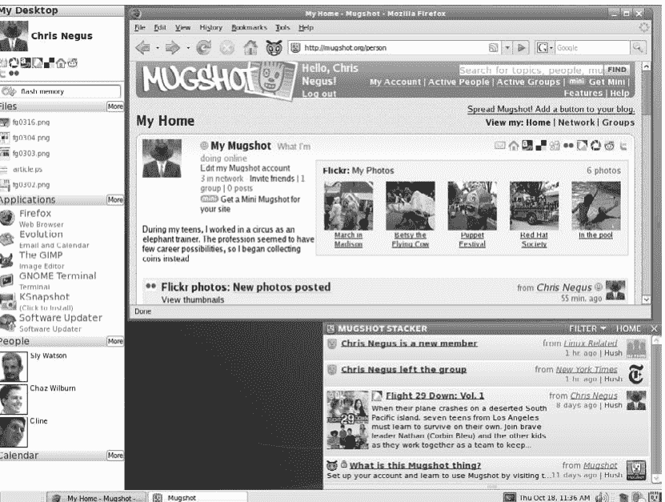

默认情况下，在线桌面启动时会打开 Firefox 浏览器。它还包含了屏幕左侧的侧边栏——你经常在线运行的应用程序的面板。

## 系统配置工具

Red Hat 创建了一系列简化的图形化工具，用于配置和管理 Red Hat 系统中的许多基本管理功能。使用这些工具，你可以添加打印机、配置网络、添加用户、设置声卡、调整显卡等。

Red 的图形化配置工具（在第 4 章中描述）可以从系统或应用程序菜单启动也可以从命令行启动。几个版本之前，这些配置工具的名称从 `redhat-config` 更改为 `system-config`。例如，在 Fedora 中配置网络的工具现在被称为 `system-config-network`（而不是 `redhat-config`）。

## 向 Fedora 前进

在原始的 Red Hat Linux 中，你可以免费（在家庭或小企业中运行）拥有与大规模部署完全相同的 Linux 系统。只需几美元，你就可以为该系统添加 Red Hat 支持，这包含了官方的安全补丁和未来的升级路径。

今天，有了 Red Hat 提供的免费 (Fedora) 和基于订阅的 (RHEL) Linux，如果你更有冒险精神，一些同样的优势仍然适用。Red Hat Linux 是一个如此成功的操作系统，许多在开发和部署 Red Hat Linux 获得技能的人聚集起来，在 Red Hat, Inc. 退出的领域支持 Fedora。以下章节探讨了这些支持工作。

## 社区支持 的增长

尽管对 Fedora 项目的未来和方向存在一些困惑，新的倡议和网站出现以支持 Fedora。Fedora 项目的两个新资产是 FedoraProject.org（正在转向官方 Fedora 项目站点）和 FedoraForum.org（已被认可为官方终端用户论坛）。

FedoraProject.org 是关于计划、目标和倡议的官方信息网站。如果你想参与与 Fedora 相关的项目，如大使、营销、Live CD 或文档编写，FedoraProject.org 是追求这些兴趣的焦点。

FedoraForum.org 新闻、画廊以及（正如你所料的）用于分享 Fedora 问题和信息的论坛。截至本文写作，这些论坛已有约百万条帖子，而安装论坛本身就有超过 10 万条帖子。

## 运行 Fedora 和红帽企业 Linux

非官方 FAQ (www.fedorafaq.org) 已经成为获取关于 Fedora 最常见、最烦人的问题的绝佳资源。这个 FAQ 是学习如何获取所有所需内容（MP3 播放器、即时通讯、视频播放器、访问你的 Windows NTFS 文件系统等）的好去处。

总而言之，可用软件总总量以及软件仓库更高的稳定性（我将在下文中讨论它们）意味着，使用 Fedora 可以获得比在红帽上可能更好的总体体验。

## 论坛和邮件列表

自从 Fedora 诞生以来，许多个人和组织都聚集起来支持 Fedora 的发展。如果你想加入 Fedora 社区，我建议从 Fedora 项目 自己的邮件列表开始。你可以从红帽邮件列表页面（http://redhat.com/mailman/listinfo）选择你感兴趣的 Fedora 邮件列表。从 Fedora-list 或 Fedora-announce 邮件列表开始。

网络上还有许多 Fedora 资源，附录 B 包含了其中许多资源的列表。

## Fedora 成长

大多数关注 Linux 的人都会认同，Fedora 拥有一个强大且可行的 Linux 系统，而不仅仅是红帽企业 Linux 的发行版。该项目持续增长和繁荣，Fedora 8 是这一伟大系列中的最新化身。Fedora 8-2 显示了一个标准的桌面。

Fedora 在为红帽企业 Linux 奠定基础的同时，还添加了一些强大的功能以与其他 Linux 系统区分开来。以下是一些例子：

- Anaconda — 如前所述，用于 Fedora 和 RHEL 使用的 Anaconda 安装器在 Fedora 的最后两个版本中经过了重大重构。一段时间以来，Anaconda 已经能够从本地介质（CD/DVD）或通过网络（HTTP、NFS 或 FTP）安装 Fedora，但它以前只能从仓库安装包。

Anaconda 还被用作 Fedora LiveCD 项目（原 Kadisch）的核心。你可以运行典型的 Anaconda 安装，生成一个现场 CD 或 DVD 镜像，该镜像可以从介质直接运行。

- 虚拟化 — 在单台计算机上运行多个操作系统的能力只是虚拟化带给 Linux 的承诺的开始。在今天的服务器计算模型中，甚至整台服务器都专门运行某个特定的应用程序，该程序可能与特定的操作系统绑定。结果是，如果不是高需求应用，整台计算机可能无法被充分利用。

红帽对 Fedora 8 中包含的 Xen 虚拟化软件 (www.xource.com) 投入了一些强力的开发支持。启动、停止以及其他管理多个虚拟机操作系统的工具都包含在随 Fedora 8 提供的 Xen 版本中。

- AIGLX 桌面视觉特效 — 加速间接 GLX (aIGLX) 项目是 Fedora 社区与 X.Org 窗口服务器项目之间的协作努力。使用支持 DRI 和 GLX 的显卡（有关支持显卡的信息请参阅 http://fedaproject.org/wiki/RenderingProject/aiglx），你可以看到一些令人震惊的桌面特效。

290

## 运行 Fedora 和红帽企业 Linux

如果 Fedora 是这样一个很棒的产品，你可能会奇怪为什么有人想要为红帽企业 Linux 付费。使用 RHEL 而不是 Fedora 的主要原因是你的关键系统背后的支持承诺。你可能还需要对于 Fedora 中提供的关键修复程序和安全补丁获得更长时间的承诺支持期。

我认识的许多人，尤其是那些喜欢尝试最新酷炫功能的人，将 Fedora 用于他们的个人桌面和服务器系统。他们不在意每六个月左右升级一次，并且可以接受某种程度的不稳定性。如果你有类似的审美，Fedora 可能是你非常的 Linux 发行版。

## 安装 Fedora

由红帽赞助的 Linux 操作系统 Fedora 包含在本书 DVD 中。本章的其余部分将引导你完成安装。

在你的计算机上安装 Fedora 之前，请确保你的硬件支持它。你还应该选择一种安装 Fedora 的方法。这些主题将在后续章节中讨论。

## 选择计算机硬件

选择你的计算机硬件可能并不是一种选择。你可能有一台闲置的旧 PC 想要尝试 Fedora。或者你可能拥有一台非常强大的工作站，有一些额外的磁盘空间以便在单独的分区或整个硬盘上尝试 Fedora。要成功安装 Fedora 的 PC 版本（随带 DVD 的版本），计算机必须具备以下条件：

- 处理器 — 奔腾级 PC 文本模式至少需要 200 MHz，图形模式需要 400 MHz 的 Pentium II。
- RAM — 你至少需要 64MB 的 RAM 来安装 Fedora。如果你在图形模式下运行，你至少需要 192MB。图形模式的推荐 RAM 为 256MB。
- DVD 或 CD — 你需要从 DVD 或 CD 启动安装过程（后者需要你获取如 http://fedaproject.org/wiki/ 所示的 Fedora CD）。
- 硬盘 — 你需要从 DVD 或 CD 启动安装过程（后者需要你获取如 http://fedaproject.org/wiki/ 所示的 Fedora CD）。
- 键盘和显示器 — 在安装期间至少需要键盘和显示器。

## 图 8-2

Fedora 包含了 GNOME 和 KDE 桌面，以及许多游戏。

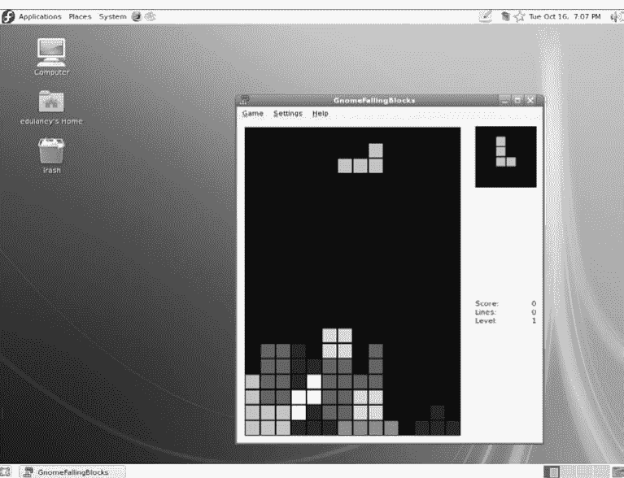

通过虚拟化，你拥有了运行多个实例的机会包括一个整个操作系统、一个应用程序和一组数据的机会。这些实例（称为虚拟机）可以是 Linux、Windows 或任何运行在计算机硬件上的其他操作系统。虚拟机之间独立运行，并保持相互安全。当对某个虚拟机的需求减少或增加时，可以将其移动到不同的硬件上以充分利用可用硬件。

红帽对 Fedora 8 中包含的 Xen 虚拟化软件 (www.xource.com) 投入了一些强力的开发支持。启动、停止以及其他管理多个虚拟机操作系统的工具都包含在随 Fedora 8 提供的 Xen 版本中。

- AIGLX 桌面视觉特效 — 加速间接 GLX (aIGLX) 项目是 Fedora 社区与 X.Org 窗口服务器项目之间的协作努力。使用支持 DRI 和 GLX 的显卡（有关支持显卡的信息请参阅 http://fedaproject.org/wiki/RenderingProject/aiglx），你可以看到一些令人震惊的桌面特效。

290

## 运行 Fedora 和红帽企业 Linux

如果 Fedora 是这样一个很棒的产品，你可能会奇怪为什么有人想要为红帽企业 Linux 付费。使用 RHEL 而不是 Fedora 的主要原因是你的关键系统背后的支持承诺。你可能还需要对于 Fedora 中提供的关键修复程序和安全补丁获得更长时间的承诺支持期。

我认识的许多人，尤其是那些喜欢尝试最新酷炫功能的人，将 Fedora 用于他们的个人桌面和服务器系统。他们不在意每六个月左右升级一次，并且可以接受某种程度的不稳定性。如果你有类似的审美，Fedora 可能是你非常的 Linux 发行版。

## 安装 Fedora

由红帽赞助的 Linux 操作系统 Fedora 包含在本书 DVD 中。本章的其余部分将引导你完成安装。

在你的计算机上安装 Fedora 之前，请确保你的硬件支持它。你还应该选择一种安装 Fedora 的方法。这些主题将在后续章节中讨论。

## 选择计算机硬件

选择你的计算机硬件可能并不是一种选择。你可能有一台闲置的旧 PC 想要尝试 Fedora。或者你可能拥有一台非常强大的工作站，有一些额外的磁盘空间以便在单独的分区或整个硬盘上尝试 Fedora。要成功安装 Fedora 的 PC 版本（随带 DVD 的版本），计算机必须具备以下条件：

- 处理器 — 奔腾级 PC 文本模式至少需要 200 MHz，图形模式需要 400 MHz 的 Pentium II。
- RAM — 你至少需要 64MB 的 RAM 来安装 Fedora。如果你在图形模式下运行，你至少需要 192MB。图形模式的推荐 RAM 为 256MB。
- DVD 或 CD — 你需要从 DVD 或 CD 启动安装过程（后者者需要你获取如 http://fedaproject.org/wiki/ 所示的 Fedora CD）。
- 硬盘 — 能够通过网络（使用 HTTP, NFS 或 FTP）安装...但它以前只能从仓库安装包。
- 键盘和显示器 — 在安装期间至少需要键盘和显示器。

## 第三部分 选择并安装 Linux 发行版

## 图 8-2

Fedora 包含了 GNOME 和 KDE 桌面，以及许多游戏。


# 运行 Fedora 和 Red Hat Enterprise Linux

## 在多台计算机上安装

如果您要在多台配置相似的计算机上安装 Fedora，可以使用 Kickstart 安装来节省时间。它允许您为 Fedora 在安装过程中提出的各种问题创建一套预设的答案。关于 Kickstart 的更多信息，可以访问：http://fedoraproject.org/wiki/AnacondaKickstart。

## 安装指南

Fedora 8 安装指南提供多种语言版本。您可以下载安装指南的 tarball 压缩包，或直接参考此地址：

```


http://docs.fedoraproject.org/install-guide/


## 选择安装或升级

您是正在进行全新安装还是升级？如果您正在将 Fedora 系统升级到最新版本，安装过程将尽可能保持您的数据文件和配置完好无。这种类型的安装耗时比全新安装长。全新安装会简单地擦除 Linux 分区（或整个硬盘）上的所有数据。

如果您正在将现有的 Fedora 系统升级到此版本，应考虑先从旧的 Fedora 中移除任何不需要的包。升级过程中检查的包越少，升级速度就越快（占用空间也越少）。

> 您可以从之前的系统升级到 Fedora 8。然而，距离当前版本越远，出错的概率就越大。您无法从 Red Hat Enterprise Linux 系统升级到 Fedora，反之亦然。

要进行升级，您必须至少安装了 Fedora 2 内核。升级时，您所有的配置文件都将被修改，并保存为文件名`.rpm`（例如，文件被保存为 `hosts.rpmsave`）。这些文件的备份以及其他升级信息将写入 `/tmp/upgrade.log`。升级会安装新内核、任何更改的软件包以及任何已安装包依赖的包。您的数据文件和配置信息应保持完好。通过点击“自定义”（Customize）框，您可以选择要升级的包。

如果您正在安装一个包含 Windows 操作系统的双启动系统，请先安装 Windows 系统，然后再安装 Fedora。因为 Windows 系统会覆盖主引导记录（MBR），导致 Fedora 分区无法访问。

如果在安装 Windows 或 Fedora 时，您发现启动屏幕上不再显示操作系统，请不要慌，也不要立即重新安装。您可以通过使用 Fedora 启动盘启动，然后使用 `grub-install` 或 `lilo` 重新安装正确的 MBR 来解决此问题。如果您不习惯在紧急模式下操作，请寻求专家帮助。

Red Hat 在 www.redhat.com/docs/manual/linux/RHL-9-Manual/install-guide-ch-x86-dual-boot.html 提供了如何配置双启动系统的说明。

# 第三部分 选择并安装 Linux 发行版

## 开始安装

一旦您根据需求选择了正确的安装类型，就可以开始安装程序了。在程序的大部分过程中，您都可以点击“返回”（Back）来更改之前屏幕的设置。然而，一旦收到警告提示软件包即将写入硬盘，就无法回退了。您所配置的项在 Fedora 安装后将发生变化。

> 来自自 WINDOWS 的提示：您的整个硬盘可能都启动到了 Windows 95、98、2000、ME、NT 或 Vista 操作系统，您可能希望在 Fedora 安装后保留这些信息的副本。有某些安装选项允许您保留分区，且在不破坏现有 DOS 分区的情况下不占用其空间。如果您愿意，可以尝试使用 GParted 工具调整分区大小。您可以通过启动随本书附带的 DVD 中的 LIVE 发行版来运行 `qParted`。请注意，如果使用不当，`qparted`（或任何分区工具）可能会擦除或从您的硬盘插入数据。

准备好安装了吗？（您是否备份了任何想要保留的数据？）好的，请执行以下操作：

- **1. 将 DVD 插入 DVD 驱动器。** 如果不从 DVD 启动，请按照本章前面的介绍获取安装 CD 组；并通过插入第一张 CD 来继续此过程。
- **2. 重启您的计算机。** 如果看到 Fedora 安装界面，请继续下一步。

如果您没有看到安装界面，可能是您的 DVD 或 CD-ROM 驱动器没有被启动。不过，您可能可以让驱动器变为可启动。方法如下：重启计算机。立即，如果您看到提示您如何进入设置的消息（例如通过按下 F1、F2 或 Del 键），进入设置并寻找如“启动选项”（Boot Options）或“从...启动”（Boot From）之类的选项。如果值为 `A: First`，请将其更改为 `CD-ROM First, then C:` 或类似的设置。保存更改并尝试重新安装。

- **3. 启动安装。** 在启动提示符处，按下 **linux** 并回车以图形模式启动安装。如果您的计算机无法进入图形模式（16 位，800 x 600 分辨率，帧），请参考“选择不同模式”侧边栏。启动屏幕是菜单驱动的。如果您想更改菜单选择的任何启动选项，高亮该选择并按下 Tab 键。然后您可以在按下 Enter 继续之前删除或添加选项。例如，要从不同的介质（如通过网络）安装，请添加 **asmethod** 启动选项。更多启动选项请参见“选择不同模式”。
- **4. 介质检查。** 如果要求您检查安装介质，请按回车。如果 DVD 损坏，此步骤可以避免深层安装后才失败的麻烦。一旦 DVD 检查完毕，跳过并点击“继续”。
- **5. 继续。** 当欢迎界面出现时，点击“发行说明”（Release Notes）查看此版本的信息。准备好继续后点击“下一步”。

- **6. 选择安装语言。** 使用方向键移动到您所需的语言，然后选择“下一步”。（之后您可以添加更多语言。）
- **7. 选择键盘。** 某些布局启用死键（默认启用）。死键允许您使用带有标记的字符（如变音符号）。
- **8. 选择安装类型。** 选择“安装 Fedora”进行全新安装或“升级现有安装”升级您的 Fedora 版本。
- **9. 选择分区策略。** 关于如何划分磁盘，您有以下选择：

  - 删除分区并创建默认布局 —— 这将擦除所选硬盘的内容。
  - 删除 Linux 分区并创建默认布局 —— 这将擦除所有 Linux 分区，但保留 Windows 分区。
  - 使用所选驱动器的空闲空间并创建默认布局 —— 这仅当硬盘上有未分配的空间时有效。
  - 创建自定义布局 —— 这允许您创建自己的分区。

> 除了安装到硬盘，您还可以通过选择高级配置并输入 IP 地址和 SCSI 启动器名称选择 SCSI 启动器作为存储设备。一旦识别，您就可以使用该设备安装 Fedora。

如果您有多个硬盘，可以选择哪些硬盘用于您的 Fedora 安装。如果您想配置用于安装的 SCSI 设备，请选择“高级配置”。勾选“检查并修改分区”查看 Linux 如何选择划分磁盘。点击“下一步”继续。

10. 检查并修改分区布局。如果您选择检查或自定义分区，将看到一个显示当前分区布局的分区工具。您可以更改选择的任何分区，只要您至少有一个包含整个安装内容的根 (/) 分区和一个交换分区。还建议设置一个较小的 /swap 分区。

交换分区通常设置为计算机内存大小的两倍（例如，128MB 内存可以使用 256MB 交换空间）。当活动进程填满系统内存时，Linux 会使用交换空间。此时，一个不活跃的进程会被移动到交换空间，而另一个命中的进程将重新启动（回到内存）。例如，在繁忙的系统中，当您重新打开一个很长时间以前最小化的窗口时，可能会感觉到延迟。

# 第三部分：选择和安装 Linux 发行版

## 选择不同的安装模式

尽管大多数计算机都允许你以默认模式（图形界面）安装 Fedora，但在某些情况下你的显卡可能不支持该模式。此外，由于安装过程会检测大多数计算机硬件，有时你的硬盘、以太网网卡或其他关键硬件无法被检测到，这可能需要你在启动时输入特殊信息。

以下是在安装启动提示符处可以键入的命令列表，用于启动 Fedora 安装过程。你通常只在默认模式失败时（例如，屏幕出现乱码或安装在某处失败）才使用这些模式。如需查看其他建议的模式列表，请参阅 `/share/doc/anaconda/command-line.txt` 文件或按 F2 键其中某些类型的简短描述。

| 命令 | 描述 |
|---|---|
| text | 以文本模式运行安装。如果安装似乎没有识别你的显卡，请执行此操作。 |
| lowres | 以 640 x480 分辨率运行，适用于不支持帧（framebuffer）的显卡。 |
| nofb | 关闭帧。 |
| noprobe | 安装不会探测以确定你的硬件；你必须加载安装可能需要的任何特殊驱动程序。通常情况下，安装会自动探测以确定你计算机上拥有的硬件。 |
| mediache | 在安装前检查你的 DVD 或 CD。由于介质检查是在正常安装过程的下一步进行的，这仅用于在非安装系统的计算机上测试介质。 |
| rescue | 从 CD 启动，挂载你的硬盘，并允许你访问有用的工具来纠正阻止 Linux 系统运行的问题。（这不属于真正的安装模式。） |
| expert | 跳过提示，以便你可以选择鼠标、显存和其他本应由系统自动为你选择的值。如果你认为安装过程没有自动探测你的硬件，则请使用此项。 |
| askmethod | 安装过程将询问安装在何处（CD、NFS 镜像、FTP、HTTP 或硬盘）。 |
| updates | 安装更新磁盘。 |

你可以向启动命令中添加其他选项，以识别未被检测到的特定硬件。例如，要指定硬盘的柱面数、头部和扇区数（如果你认为启动过程没有正确检测到这些值），你可以如下将信息传递给内核：`linux hd=72,32,64`。在这个示例中，内核告知硬盘有 72 个柱面、32 个头部和 64 个扇区。你可以在硬盘随附的文档（或硬盘序列号附近的标签上）找到这些信息。

你还可以向安装提示符添加其他选项，以指示安装启动提示符开始安装。这些许多选项在第 11 章中都有描述。

# 运行 Fedora 和红帽企业 Linux

你需要足够的交换空间（swap space）的原因是当 RAM 和交换空间满时，在某些东西关闭之前没有其他进程可以启动。结论是：增加 RAM 以获得更好的性能；如果进程启动失败，请增加交换空间。Fedora 项目建议至少 32MB，最大 2GB 的交换空间。

点击“下一步”（并选择“确定”以接受任何更改）继续。

- 1. 配置引导加载程序。如果你选择了自定义安装，你就有机会配置引导加载程序。系统将显示所有启动分区和默认引导加载程序选项。默认情况下，安装使用 GRUB 引导加载程序，将引导安装在计算机的主引导记录（MBR）中，并选择 Fedora 作为你的启动操作系统。

> 如果你保留 GRUB 加载器（第 7 章中描述），你有添加 GRUB 密码的选项。密码可以保护你的系统免受没有密码的人向内核发送可能危险选项的影响。这不需要与你登录使用的密码相同。

系统启动时，每个启动分区的名称将显示在引导加载屏幕上。通过点击分区并选择“编辑”来更改分区名称。要更改引导加载程序的位置，点击“高级引导加载程序选项”并继续下一步。如果你不想安装引导加载程序（因为你不想更改当前的引导加载程序），点击“更改引导加载程序”并选择“不安装加载程序”。如果默认设置可以，跳过下一步。

- 2. 配置高级引导加载程序。如果你选择了配置高级启动选项，现在可以选择存储引导加载程序的位置。选择以下项之一：

  - 主引导记录 (MBR) — 这是 GRUB 的首选位置。它让 GRUB 控制硬盘上安装的所有操作系统的启动过程。
  - 启动分区第一个扇区 — 如果你的计算机正在使用另一个引导加载程序，则你在 Linux 分区（第一个扇区）上安装了 GRUB。这允许你的其他引导加载程序引用你的 GRUB 引导加载程序来启动 Fedora。

如果你有多个启动分区，“更改驱动器顺序”按钮是一个实用功能。如果你想更改硬盘的启动顺序，请选择此项。如果你有 SCSI 和 IDE 设备的组合，这允许你指示主引导记录应放在 SCSI 驱动器上。

你可以选择添加内核参数（如果你的计算机无法检测硬件，可能需要这些参数）。如果某个硬件检测不当并阻止了你的计算机启动，你可以添加内核参数来禁用它（例如，添加 `nousb`、`nosci`、`noscia` 或 `noaqp`）。你可以使用线性模式（这种模式曾是从磁盘上的分区启动时强制要求的的）。

# 第三部分：选择和安装 Linux 发行版

## 13. 配置网络。此部分仅适用于局域网。如果你使用拨号上网，请跳过此项。

网络地址通过两种基本方式分配给计算机：静态（手动输入）或动态（由 DHCP 服务器提供）。每个网卡都会显示网络设备。你的第一个以太网接口是 eth0，第二个是 eth1，依此类推。通过选择网卡并点击“编辑”为每个网卡重复设置。

第 5 章讨论了 IP 地址、子网掩码以及设置局域网所需的信息。

在“编辑接口”对话框中，为 IPv4 和 IPv6 添加以下内容：

- IPv4 支持 — 这是最常用的 TCP/IP 版本。大多数情况下应启用。
- 动态 IP 配置 (DHCP) — 对于 IPv4，如果你的 IP 地址从 DHCP 服务器自动分配，此处会出现勾选框。勾选 DHCP 后，你无需在此页面设置 IPv4 地址。取消勾选以设置你自己的地址。
- IPv6 支持 — 这是即将推出的 TCP/IP 标准，具有更长的地址和一些内置的安全功能。你可以启用它而不会与 IPv4 冲突。
- 自动邻居发现 — 这使得不同的机器可以通过自动配置交换消息。使用此功能，计算机可以找到有关路由和其他附近主机的信息。
- 动态 IP 配置 (DHCP6) — 对于 IPv6，如果你的 IP 地址从 DHCP 服务器自动分配，此处会出现勾选框。取消勾选以设置你自己的地址。

IPv4 和 IPv6 手动配置 — 如果没有使用 DHCP 获取 Fedora 的 IP 地址，你可以输入 IPv4 或 IPv6 地址。在大多数情况下，IPv4 地址就是你所需要的。如果你设置自己的 IP 地址，这是一个用点分隔的四部分数字，用于向网络标识你的计算机。私有 IP 地址的示例是 192.168.0.1（关于 IP 地址如何形成以及如何选择的完整描述请参见第 5 章。）

在每个 IP 地址的第二部分，输入子网掩码。子网掩码用于确定 IP 地址的哪部分代表网络，哪部分代表特定的主机计算机。C 类网络的子网掩码示例是 255.255.255.0。

# 运行 Fedora 和 Red Hat Enterprise Linux

点击确定。在主界面上添加以下信息：

- 启动激活（Activate on boot）——指示你是否希望在启动时启动网络（如果你有局域网，通常需要开启）。
- 设置主机名（Set the hostname）——在域内识别你的计算机的名称。例如，如果你的计算机名为“baskets in the handsonhistory.com”域，你可以手动设置域名，也可以让其自动分配；如果该信息是由 DHCP 服务器分配的（通过 DHCP 自动分配）。
- 网关（Gateway）——局域网外网络网关的计算机 IP 号。这通常代表在你的局域网和互联网之间进行路由的主机或路由器。
- 首选 DNS（Primary DNS）——将计算机名称转换为 IP 地址的主机 IP 地址。它被称为域名系统（DNS）服务器。如果无法访问第一个服务器，你还可以有一个备用服务器。（大多数互联网服务提供商都会为您提供两个 DNS 地址。）

点击下一步继续。

14. 选择时区。选择时间。可以在地图上点击，也可以从下拉框中选择。在点击地图上您的所在位置之前，请先点击地图上代表您所在大陆的区域。选择特定的城市。您可以点击“系统时钟使用 UTC”让计算机使用协调世界时（也称为格林威治标准时间）。如果安装了多个操作系统，您可能想要勾选此框，因为某些操作系统期望 BIOS 设置为本地时间。

15. 设置 root 密码。root 密码提供了对你的 Fedora 系统的完全控制权。如果没有它，且你添加了用户，你将无法访问你的系统。输入密码，然后在“确认”框中再次输入。（记住 root 用户的密码并保持保密！切不要丢失它！）点击下一步继续。

> 如果您在计算机上启用增强型 Linux (SELinux)，您计算机的安全结构将发生变化。root 用户可能不再拥有完全控制权。相反，可能会有策略阻止任何用户拥有完全控制权。

16. 安装类别（Install Classes）。对于新安装，安装程序会自动选择一组基础软件进行安装。除了这些，你还可以选择以下一组或多个软件组，称为“任务”。对于每一个这些安装任务，你都有机会安装一组包或对该组进行自定义。

- 办公与生产力（Office and Productivity）——安装适用于家庭或办公室个人电脑或笔记本电脑的软件。这包括 GNOME 桌面（或 KDE）以及各种桌面相关工具（文字处理器、互联网工具等）。不会安装服务器工具、软件开发工具和许多系统管理工具。

# 第三部分选择和安装 Linux 发行版

- 软件开发（Software Development）——与办公与生产力安装类似，但增加了系统管理和软件开发工具。（不安装服务器软件。）
- Web 服务器（Web Server）——安装 Linux 服务器所需的软件包（特别是 Apache Web 服务器和打印服务器）。它默认不包含许多其他服务器（FTP；DHCP；邮件；DNS、FTP、SQL 或服务器）。默认安装还包含 GUI（GNOME 弹出）。

与 Fedora 版本不同，此版本不提供“全部”（Everything）类型或“最小”（Minimal）安装类型。选择你想要的类别，你可以选择“现在自定义”（见第 19 步）查看要安装的包（基于类别和包组）。如果你想从精简安装开始构建，取消主要类别可以获得一个相当不错的精简版本。

- 添加存储库（Add repositories）。Fedora 8 的一个新功能允许你选择 Fedora 之外的存储库，在初始 Fedora 安装期间从其中选择包。使用此功能，你可以使用互联网连接。选择“附加软件存储库”建立互联网连接并连接到“添加存储库”弹出窗口。

例如，要使用 RPM livna 存储库安装许多媒体应用和视频驱动程序，你可以输入 livna 作为存储库名称并将 http://rpm.livna.org/fedora/8/i386 作为存储库 URL。点击“添加存储库”按钮将该存储库中的包添加到你的安装中。

- 现在自定义（Customize Now）。在选择了要安装的任务（或任务）后选择“现在自定义”按钮。这让你看到每个任务中的哪些类别以及类别中的哪些包被选中安装。它还允许你添加或删除包选择。注意，来自多个存储库的包可能出现在同一个类别中。屏幕左侧显示软件类别，右侧显示包组。

- 选择可选包。选择一个类别以查看它包含哪些哪些组。选择一个组并点击“可选包”，查看该组中有哪些可选包并被选中安装。类别包括：

- 桌面环境（Desktop Environments）——默认选择 GNOME 桌面环境。KDE 和 XFCE 是其他可用的桌面环境。（GNOME 和 KDE 在第 3 章中描述）。
- 应用（Applications）——此类类别包含办公应用、游戏、音频和视频播放器、互联网工具和其他应用程序包。
- 开发（Development）——此类类别的包包含了通用和专业的软件开发工具。

# 运行 Fedora 和 Red Hat Enterprise Linux

- 服务器（Servers）——此类类别中的包用于 Web、邮件、FTP、数据库以及各种其他网络服务器类型。
- 系统（System）——包含基础系统管理工具、许多常用程序以及对基础系统功能的支持（如 X Window 系统、Java 和旧版软件支持）。
- 语言（Languages）——此类类别包含包含多语言支持的包。

在你选择了所需的包后，选择下一步继续。安装程序将花费时间检查包之间的依赖关系。

20. 决定安装。你现在仍然退出，磁盘将不会发生更改。点击下一步继续（若要在不更改的情况下退出，请弹出 DVD 并重启）。将创建文件系统并安装包。这通常需要 20 到 60 分钟，但在旧计算机上可能需要更长时间。

21. 完成安装。当你看到“恭喜”屏幕时，你会看到指向 Fedora 信息的链接，弹出 DVD 并点击退出。

22. 你的计算机重启。如果安装了 GRUB，图形启动界面将显示启动分区。按向上或向下箭头选择要启动的分区，然后按回车。如果 Linux 是默认分区，你只需等待片刻它会自动启动。

# 运行 Fedora Setup Agent

安装后首次启动 Fedora 时，Fedora Setup Agent 将运行以配置计算机的一些初始设置。

如果你已配置 Fedora 到图形界面，则 Fedora Setup Agent 将自动运行。要从文本登录启动，请以 root 登录并临时切换到状态 5（输入 `init 5`）。登录图形界面。从终端窗口输入

```
/usr/sbin/firstboot
```

显示欢迎屏幕。从这里开始，通过屏幕阅读（并同意）许可、配置防火墙、配置 SELinux、设置日期时间、创建普通用户并配置你的声卡。点击“完成”按钮你就可以登录 Fedora 了。

# 第 9 章

# 运行 Debian GNU/Linux

Debian GNU/Linux 是 Debian 项目的产物。Debian 项目由 Ian Murdock 于 1993 年创立，是一个由个人组成的协会，他们为了一个共同目标而创建一个自由、连贯且完整的操作系统。

本书附带的光盘中包含了一个单一的 Debian GNU/Linux 安装 CD 镜像。你可以按照本章的描述，直接从光盘安装 Debian。此安装适用于设置 Web 服务器（LAMP 服务器）和邮件服务器（分别参见第 24 节和第 25 章）。

Ian Murdock 现在与 Sun 公司有关，并继续作为 Debian 以及整个操作系统领域一位直言不讳的远见者。他经常为一篇博客博客博客博客，你可以在 http://ianmurdockock.com/ 找到。

Debian 项目的原则定义在《Debian 社会契约》中。该契约是对自由软件社区的承诺，基本内容如下：

- *Debian 系统内的所有软件都将保持自由，正如《Debian 自由软件指南》(DFSG) 所定义的那样。*
- 项目将通过按照 DFSG 为 Debian 系统开发的任何软件提供相应的许可、开发尽可能最好的系统，以及与集成到 Debian GNU/Linux 中的任何程序的原始开发者共享改进和修复，来向自由软件社区做出贡献。
- 将不会向用户隐藏问题，任何针对 Debian 组件的错误报告都将通过 Debian 错误跟踪系统 (BTS) 及时公布。

| 本章内容 |
| :--- |
| 深入 Debian 内部 |
| 安装 Debian |
| 管理你的 Debian 系统 |

# 第三部分 选择并安装 Linux 发行版

- “Debian 项目将关注其用户的需求和自由软件原则。”

- 将为不符合 DFSG 标准的程序提供支持，因为某些用户可能依赖这些程序来有效利用系统。当这些程序随 Debian 系统提供时，错误跟踪和支持系统将始终包含处理这些程序的机制。

Debian 对自由软件发行和开放的承诺使其在技术社区赢得了巨大的追随者。比任何其他 Linux 系统，Debian 被用作其他 Linux 发行的基础，包括 KOTPI、Ubuntu、Damn Small Linux 等许多系统。

尽管缺乏大型企业赞助、正式的企业倡议或官方认证和培训计划，Debian 仍然取得了成功。Debian 爱好者会告诉你，它是最稳定、最可靠的 Linux 系统。它经过了彻底测试，直到 Debian 领导层认为软件异常稳定才会发布新版本。

# 深入 Debian GNU/Linux 内部

与现代操作系统一样，Debian GNU/Linux 中的软件程序被封装成包以便于分发和管理。Debian GNU/Linux 使用的包格式和管理由 Debian 项目创建，可以说是是同类型中最为复杂的。此外，对打包策略和质量控制措施的严格遵守确保了兼容性并帮助平滑升级。Debian 是所有组件（内核除外）都可以在重启系统的情况下升级的操作系统之一。

# Debian 包

Debian 软件包有两种形式：二进制包和源码。二进制包包含可以由包管理工具直接提取到系统中的文件。源码包包含源代码和 Debian 构建工具用于创建二进制包的构建指令。

除了程序及其相关数据文件外，Debian 包还包含控制数据，使包管理工具能够支持高级功能：

- 一个主控制文件包含版本和包关系数据。可以将版本与已安装的相同包的版本进行比较，以确定是否需要升级。相互关系数据告诉包管理工具哪些包必须或不能与包同时安装。

> 注意：包关系字段包括 Depends（依赖）、Conflicts（冲突）、Replaces（替换）、Provides（提供）、Recommends（推荐）、Suggests（建议）和 Enhances（增强）。控制文件字段的完整列表请参见 http://debian.org/doc/debian-policy/ch-controlfields.html。

# 运行 Debian GNU/Linux

- 可选的 `preinst、postinst、prerm` 和 `postrm` 文件可以指导包管理工具在包安装或删除之前或执行函数。例如，大多数包含守护进程（如 Apache HTTPD）的包包含一个 `postinst` 脚本，在安装后自动启动守护进程。

- 配置文件可以将包中的特定文件指定为配置文件，这些文件在升级期间不会被自动覆盖。默认情况下，/etc/ 目录下的所有文件都是配置文件。

还存在两种特殊的包类型：元包（meta）和虚拟包（virtual）。元包是标准的二进制包，不包含任何文件，但依赖于许多包。安装元包会自动安装所有依赖于它们的包。它们可以作为安装一组相关包的方便方法。

虚拟包实际上并不以文件形式存在，但在包关系字段中可以引用。它们最用于一个包满足特定需求的情况。具有该需求的包可以在它们的 `Depends` 字段中引用虚拟包，而满足该依赖的包在它们的 `Provides` 字段中引用它。

由于大多数提供虚拟包的程序是互斥的，它们还将虚拟包包含在它们的 `Conflicts` 字段中，以防止安装冲突包。一个例子是 `mail-transport-agent` 虚拟包，它被 需要。

# 包管理工具

也许 Debian 中最有趣且广为人知的部分是 APT（高级软件包工具）。APT 通过 `apt-get` 维护可用包和包状态的数据库。

## Debian 版本

从术语上讲，发行版是特定软件包版本的集合。每隔一段时间，发行版会被发布并成为一个版本。在实践中，当指代达到“稳定”（stable）里程碑的 Debian 发行版时，这两个术语经常通用。

Debian 发行版拥有代号（最近的包括 potato、woody，以及以电影《玩具总总动员》中的人物命名），用于标识它们在 Debian 服务器上的存档目录。当某个特定的发行版本处于活动状态时，它将通过三个活动版本之一进行引用，每个引用指向其中一个活动版本。标签——unstable（不稳定）、testing（测试）和stable（稳定）——标识了发布版本在周期中的状态。在编写时，当前的稳定版本是 Etch，测试版本是 Lenny。不稳定版本之所以特殊，是因为它被命名为 Sid（以那个弄坏了所有玩具的男孩命名）。

新软件包和软件包的新版本被上传到 Debian 存档，并导入到不稳定的发行版中。该发行版始终包含每个软件包的最新版本，这意味着它不太会导致意外行为。

一旦一个软件包在不稳定区域放置了几天，且测试显示其没有出现任何重大漏洞，它就会被导入测试发行版中。测试发行版保持对更改开放（就像不稳定区域一样），直到它准备好作为下一个稳定发行版进行发布。当测试处于冻结（frozen）状态时，只有修复重大漏洞所需的更改会被导入。

在冻结的测试发行版中修复了发布关键漏洞后，发布管理器宣布发布准备就绪，并替换稳定发行版。之前的稳定版本将过时（但在 Debian 存档中仍会保留一段时间），新的测试发行版将根据测试冻结期间进入不稳定区域软件包的更改而创建，该过程重新开始。

## 获取 Debian 帮助

Debian 项目拥有一套的资源，支持那些使用、管理和为 Debian 系统开发软件的人员。学习 Debian 的起点可以是 Debian 支持页面（www.debian.org/support）。以下是你可以从这里连接的某些资源：

- [文档](www.debian.org/doc) —— 从此页面，你可以找到指向 Debian 特有文档和通用 Linux 文档的链接。有关特定的 Debian 信息，请参考发布说明（Release Notes）、安装指南、Debian GNU/Linux FAQ 以及各种用户、管理员和编程手册。通用 Linux 信息包括手册、HOWTOs 和 FAQs。
- [邮件列表](www.debian.org/MailingLists) —— 此页面描述了访问（以及在 Debian 邮件列表上的行为）的方法。200 多个 Debian 邮件列表的完整列表可以通过 `http://lists.debian.org/completeindex.html` 获取。
- [错误跟踪](www.debian.org/Bugs) —— 如果你有兴趣跟踪 Debian 的错误跟踪系统，支持页面上的链接可以带你进入错误跟踪系统。如果你在使用任何 Debian 软件时遇到问题，可以搜索错误报告，如果你的错误尚未被报告，可以提交一个错误报告。
- [帮助](www.debian.org) —— 该网站提供了有关 Debian 的各种信息连接。特别是，你可以从该网站找到 Debian 论坛，有数以千计的帖子。Debian 用户论坛（http://forums.debian.net）是另一个你可以阅读关于 Debian 帖子的地方。

如果你有兴趣成为 Debian 开发者，请从 Debian (www.debian.org/devel) 开始！该网站充当你进入 Debian 开发社区的指南。世界各地都有 Debian 开发者。Debian 开发者最集中的地区是欧洲和美国，你可以你可以从 `www.debian.org/devel/developers.loc` 的 Debian 开发者位置地图看到。

## 安装 Debian GNU/Linux

本书附的 Debian CD 镜像包含了 Debian 系统中最常用的软件包。在安装基础系统并建立互联网连接后，可以从互联网下载并安装额外的软件包。有关如何在 CD 或 DVD 上获取 Debian 软件包的信息，请参见 `www.debian.org/distrib/`。

## 硬件要求与安装规划

运行 Debian，你至少需要一个 486 处理器和 32MB 内存。对于服务器或图形工作站（运行 Windows 系统），你应该计划至少拥有 128MB 内存和 Pentium 类处理器。

精简软件包集需要 250MB 磁盘空间，正常安装桌面应用程序可能需要几个 GB。还需要额外的空间来存储你想保留在系统中的任何数据文件。

Linux 支持支持大多数 ISA 和 PCI 网卡，尽管 ISA 模型通常不会被安装程序自动检测到。基于 RealTek 8139 芯片组的廉价卡在大多数 PC 经销商处都能找到，对于低需求应用运行良好。Intel PRO/100 和 PRO/1000 适配器在 Linux 中受支持，并在高需求应用中运行良好，基于 `tulip` 芯片组的卡和 3Com 网卡也是如此。

## 运行 Debian GNU/Linux

许多较新的系统包含了制造商在 Linux 下不支持的软件调制调器。如果你需要拨号连接访问互联网，请查看第 5 章并在开始安装之前查看 http://tldp.org/HOWTO/Modem-HOWTO-2.html。

许多其他设备，如音频和视频采集卡，也可以在 Linux 下使用。有关硬件兼容性的更多信息，请查看 http://tldp.org/HOWTO/Hardware-HOWTO/ 硬件兼容性 HOWTO。

## 工作站

许多较新的系统包含了制造商在 Linux 下不支持的软件调制调器。如果你需要拨号连接访问互联网，请查看第 5 章并在开始安装过程之前查看 http://tldp.org/HOWTO/Modem-HOWTO-2.html。

许多其他设备，如音频和视频采集卡，也可以在 Linux 下使用。有关硬件兼容性的更多信息，请查看 http://tldp.org/HOWTO/Hardware-HOWTO/ 硬件兼容性 HOWTO。

精简软件包集需要 250MB 磁盘空间，正常安装桌面应用程序可能需要几个 GB。还需要额外的空间来存储任何数据文件。

## 服务器

大多数 ISA 和 PCI 网卡受 Linux 支持，尽管 ISA 模型通常不会被安装程序自动检测到。基于 RealTek 8139 芯片组的廉价卡在大多数 PC 经销商处都能找到，对于低需求应用运行良好。Intel PRO/100 和 PRO/1000 适配器在 Linux 中受支持并在高需求应用中运行良好，基于 `tulip` 芯片组的卡和 3Com 网卡也是如此。

许多较新的系统包含了制造商在 Linux 下不支持的软件调制调器。如果你需要拨号连接访问互联网，请查看第 5 章并在安装过程之前查看 http://tldp.org/HOWTO/Modem-HOWTO-2.html。

许多其他设备，如音频和视频采集卡，也可以在 Linux 下使用。有关硬件兼容性的更多信息，请查看 http://tldp.org/HOWTO/Hardware-HOWTO/ 硬件兼容性 HOWTO。

## 运行安装程序

1. 启动本书附带的 CD，并在启动提示符处输入 `debian` 以启动 Debian 安装程序。

2. 安装程序启动完成后，你将看到组成安装过程的系列菜单。使用方向键在菜单之间导航，并选择你的语言、区域和键盘映射。

3. 配置网络连接。如果系统中没有检测到网卡，将跳过此步。

如果检测到网卡，安装程序将尝试使用 DHCP 协议自动检测网络。这涉及计算机向 DHCP 服务器请求配置详情。许多网络和宽带路由器都支持此项。

如果 DHCP 配置失败，你将面临四个选项：

- 重试（retry）——如果你怀疑由于临时问题阻止了计算机与 DHCP 服务器的通信，请选择此选项。
- 使用主机名重试（retry with hostname）——如果你的网络提供商要求输入 DHCP 主机名，请选择此选项。
- 手动配置（manual configuration）——如果你有互联网连接所需的静态 IP 地址信息，请选择此选项。
- 不配置（do not configure at this）——如果你没有互联网连接、在使用拨号连接或需要使用 PPPoE 的宽带连接，请选择此选项。对于后两种情况，你将在安装第 2 阶段注明的地方建立连接。

有关 IP 地址、子网掩码与其他设置网络连接相关的材料，请参阅第 5 章。

# 运行 Debian GNU/Linux

5. 你将被要求为 Debian 配置磁盘分区。如果你尚未进行此操作，请阅读第 7 章以获取更多关于分区的信息。

如果你的驱动器上已经有了分区且有剩余空间，你可以选择使用这些空间来安装你的 Debian 系统。另一个选项是擦除整个磁盘并将所有空间用于 Debian。这两个选项中的任何一个都会引导你完成引导式分区，该部分在本节中会有介绍。

第三种选项是手动编辑分区，这允许你对分区设置进行更精确的控制，但在没有或至少阅读第 7 章的情况下，你不应该尝试此操作。

引导式分区部分提供了三种方案。每个选项都包含适当的交换空间（swap space），但对你的情况有不同的优势。你必须从之前的列表中选择一个，更多信息请参阅“选择分区方案”。

> 在安装小磁盘（尺寸小于几 GB）时，你应该使用 ext2 文件系统而不是 ext3。ext3 的日志功能需要为磁盘分区留留一个分区用于存放日志，但该功能在小文件系统上的用处有限。你可以通过进入分区属性来更改文件系统类型。要执行此操作，使用方向键高亮分区并按回车键。

> 下一步将修改你的硬盘内容。在继续之前，请仔细检查你的分区设置。

- 6. 选择好分区配置后，选择“完成分区并更改磁盘”。这是你取消可能对磁盘上可能有的其他操作系统造成损坏的更改的最后机会，在继续之前请检查屏幕！

- 7. 从列表中选择你的时区。

- 8. 基础系统为 root（超级用户）账户包含一个空密码，这意味着你想在这里设置一个密码。请选择一个你记得但别人无法轻易猜到的密码。

- 9. 添加一个非管理账户，你可以在服务器上执行日常任务时使用该账户。输入你的姓名、你的用户名（此用户名不应包含任何空格或除连字符以外的标点符号，不能以数字开头，且通常全为小写字母）以及此账户的密码。如果你有更多用户需要添加，可以以后按照第 4 章所述进行进行。

安装程序将分区写入磁盘并创建必要的文件系统。在准备好并挂载后，Debian 基础系统将从 CD 中提取并安装到目标分区。

# 第三部分 选择并安装 Linux 发行版

# 选择分区方案

引导式分区功能允许你选择三个模板之一来使用你的分区。请根据这些指南选择适合你的模板。

- **所有文件在一个分区中** —— 为文件创建一个单一的 Linux 分区。这是最容易管理的选项，因为你不需要担心平衡各个分区的大小。这可能是危险的，因为用户有能力填满整个磁盘，这可能会给操作系统带来问题。除非你准备好仔细监控磁盘空间，否则不要使用此选项。
- **桌面计算机** —— 为操作系统提供自己的空间，并为家目录（home）提供自己的空间。此选项在单分区的便利性和多用户系统速度的之间取得了很好的折中。然而，`/tmp/` 仍然是操作系统的一部分，这意味着对于习惯于使用它的人来说，它仍然相当容易。
- **多用户系统** —— 为根文件系统、`/usr/`、`/var/`、`/tmp/` 和 `/home/` 创建分区。当你将此系统作为服务器使用时，请选择此选项。对于不仅由你、亲戚和密朋友使用的系统，这可能也是一个很好的选择。折中的是，尽管其他分区有大量空间，你可能会在某个分区上耗尽空间，这意味着你需要仔细计划。

在某些情况下，你可能需要调整由多用户分区方案选择的分区，以便将更多空间留到你可能需要的地方：

- 如果你计划编译大量大型软件包，你需要在 `/usr/` 分区留出大量空间。
- **活动服务器**（Web 服务器和邮件服务器）可能在 `/var/` 中需要额外的空间存放日志文件。邮件也使用此空间作为邮件队列，默认邮件系统也将入站邮件存储在此（在这些情况下，你可能还想考虑将 `/var/mail/` 设置为单独分区）。
- **浏览器**（如 Mozilla）使用 `/tmp/` 存储下载过程的文件。此文件系统必须能够容纳你想要通过那里下载的任何大文件，以及同时存在的任何其他文件。

注意，在分区方案中，`/home/` 分区通常会获得大磁盘上的大部分空间。这通常使得它在你想要增大其他分区时时成为一个“借用”空间的好地方。然而，由于 parton（Debian 安装程序使用的分区工具）已经映射了分区，你实际上需要在增加其他分区的大小后删除 `/home/` 并重新添加它。如果 `/home/` 和你正在增大的分区之间还有其他分区，你也需要删除它们，并按适当顺序重新添加。

# 运行 Debian GNU/Linux

10. 如果在第 1 阶段没有配置网络连接，你将获得配置到互联网服务提供商的拨号 PPP 连接的机会。这是通过 `ppconfig` 程序完成的，该程序在本文章的“拨号 PPP 连接”部分有更详细的解释。请记住，在完成此步骤后系统将尝试拨号。

如果你正在使用需要 PPPoE 的宽带连接，按 Alt+F2，以 root 身份登录并运行 `ppconfig`。如果你无法连接到，仍然可以完成系统安装。由于此书中提供的 Debian CD 是网络镜像，CD 本身仅提供安装 Debian 软件。你需要网络连接或其他 Debian CD 来安装，例如完整的桌面系统或第 24 和 25 章中描述的 LAMP 和邮件服务器。

Debian GNU/Linux 安装现在完成。取决于你选择的软件类别，你可能有一个功能完整的桌面系统，以及各种网络服务器软件包（Web 服务器、FTP 服务器等）。重启开始使用你新的 Debian 系统。图 9-1 显示了带有 GNOME 桌面的 Debian 系统示例。

# 第三部分 选择和安装 Linux 发行版

# 图 9-1

默认的 Debian 桌面包含浏览器、音乐播放器和其他流行的应用程序。

# 管理你的 Debian 系统

在运行 Debian GNU/Linux 时，可能会遇到的一些基础任务包括安装、配置和删除，以及处理可能遇到的某些特殊情况。

所有这些操作都需要你以超级用户（root）身份登录。如果你刚刚完成系统安装，可以在登录提示符处登录 root。

# 配置网络连接

Debian 包含一组用于管理大多数类型网络接口的工具，包括以太网、PPP、无线甚至 ATM。你可能会发现在系统安装后需要更改网络设置。

314

# IP 网络：以太网和无线网络

在 Debian 系统上，标准网络连接在 `/etc/network/interfaces` 文件中配置。如果你配置了网卡以自动获取 IP 地址，该文件看起来如下所示：

```


# 此文件描述了系统中可用的网络接口以及如何激活它们。更多信息请查阅 `interfaces(5)`。

## 回环网络接口

```
auto lo
iface lo inet loopback
```

## 主网络接口

```
auto eth0
iface eth0 inet dhcp
```

> 注意：除非你绝对确定自己在做什么，否则不要修改回环条目。

在某些情况下（例如系统作为服务器运行时），你希望用固定 IP 地址配置网络接口。要这样做，请编辑 `/etc/network/interfaces` 并替换 `iface eth0 inet dhcp` 行。使用以下块作为模板，并将参数替换为适用于网络的正确设置：

```
iface eth0 inet static
address 192.168.1.220
netmask 255.255.255.0
gateway 192.168.1.1
```

> 注意：你可以从你的 ISP 或网络管理员处获取 IP 设置。

无线接口也可以使用 `interfaces` 文件进行配置，但需要安装 `wireless-tools`。使用 `dpkg` 或 `apt-get` 安装 `wireless-tools` 软件包。为你的无线网络接口条目添加必要的参数。此示例显示了将接入点（管理模式）设置为 ESSID Home，且运行在接口 `eth1` 上的无线网络设置：

```
iface eth0 inet dhcp
wireless_essid Home
wireless_mode Managed
wireless_channel 11
```

> 注意：如果你的无线网络使用加密，你需要指定 `wireless_key` 参数。你可以在 `iwconfig` 的手册页和 `/usr/share/doc/wireless-tools/README.Debian` 中找到无线选项的列表。

## 拨号 PPP 连接

拨号连接可以使用 `pppconfig` 工具进行管理。只需运行 `pppconfig`，你就会获得一个菜单，可以在菜单中创建、修改和删除拨号连接。如果你还没有创建连接，将从菜单中选择该选项。否则，你可以编辑现有的连接。

`pppconfig` 工具在创建连接过程中会询问你一些问题。首先选择“Create a connection”（创建连接），然后按照提示输入以下信息：

1. **Provider name** — 输入你喜欢的任何名称来标识此连接。对于指向 ISP 的拨号条目，你可以简单地将 *provider* 留为 Provider name。
2. **DNS server configuration** — 在此处，你可以根据需要将连接配置到静态 DNS 服务器。除非你的服务提供商在提供连接的信息中包含了 DNS 服务器，否则这可能不是必要的。如果你不确定，请选择 Dynamic DNS（动态 DNS）并在需要时以后更改。
3. **Authentication method** — 这是你的电脑用于识别拨号连接的方法。PAP 是最常用的协议，某些系统支持 CHAP。如果拨号服务器使用用户名和密码文本提示，则应使用 CHAP。如果你不确定，请选择 PAP。
4. **User name and password** — 输入由拨号用户识别的用户名和密码。
5. **Speed** — 这是你的电脑和调制调器之间通信的速度。在大多数情况下，这应该设置为 15200。
6. **Dialing method** — 如果你的电话系统需要脉冲拨号，你可以在此处配置。
7. **Phone number** — 输入拨号拨号服务器所需的号码，包括你可能需要的任何额外代码。例如，如果你必须拨号 9 来接入外部线路，使用 `9,*`。逗号告诉你的调制调器在继续拨号过程之前暂停。你也可以输入用于电话呼叫功能的相应数字。
8. **Modem configuration method** — 在此处，你可以让 `pconfig` 自动寻找调制调器所在的端口。如果没有找到调制调器，你将有机会输入调制调器的路径。关于此处输入的更多信息，可以在本章节后面的“Identifying and Configuring Your Modem”。通过菜单保存设置，然后进入 `pppconfig` 工具。使用 `pon` 命令拨连接，将 *peer* 替换为你分配给连接的名称，或留空。

### 查找与安装软件包

在寻找要安装的新软件包时，你可能并不总是确定想要哪一个。由 APT 维护的软件包数据库包含了软件包描述和其他字段，这些字段可以使用 `apt-cache` 工具进行搜索：

```
$ apt-cache search tetris
bsgames--一组经典的文本类 Unix 游戏集
ptris--一个双人网络控制台俄罗斯方块克隆版
stack--一组类似于 Tetris Attack 的益智游戏集
```

在搜索时指定多个关键词可以防止 `apt-cache` 列出不包含你所指定的所有关键词的软件包。这使你能够进行非常具体的搜索，例如“文字处理器”。

你可以使用此工具查找存储库中特定软件包的信息：

```
$ apt-cache show pytris
Package: pytris
Priority: optional
Section: games
Installed-Size: 101
Maintainer: Radovan Garavik
Architecture: i386
Version: 0.96
Depends: python (>=2.1), libc6 (>=2.2.4-4)
Filename: pool/main/p/pytris/pytris_0.96_i386.deb
Size: 16304
MD5sum: 70ebad6f58a901a95eb37ff36fc57
Description: 一个双人网络控制台俄罗斯方块克隆版，用 pytris 编写，
类似于 xtet24。
```

要查看系统中已安装的特定软件包的信息，请使用 `dpkg`，这将在后后的章节中讨论。

一旦你知道了想要安装的软件包的名称，请使用 `install` 方法来下载它以及它依赖的软件包。例如，`ssh` 软件包对于远程访问系统非常有用，它可能是你想要安装的首批程序之一：

```
$ apt-get install ssh
```

执行此命令时，APT 会检索并安装 `ssh` 软件包。如果需要额外的软件包，APT 会显示这些软件包的列表。如果你选择继续，APT 将下载并安装这些软件包以及请求的软件包。

> 注意：在安装支持通过 `debconf` 进行自动配置的软件包时，系统会提示你回答相应的配置问题。虽然 Debian 软件包开发者已尽尽努力确保这些问题的默认选项在大多数情况下都能工作，但最好彻底阅读这些问题，以确保默认选项适用于你的情况。

### 移除软件包

APT 也可以用于从系统中移除软件包。与 `dpkg` 不同（后者只移除你告诉它移除的软件包），`apt-get` 会移除任何依赖于你正在移除的软件包的软件包。最好结合 `-s` 选项使用，以模拟如果实际执行操作会发生什么：

```bash
# apt-get -s remove python2.3
Reading Lists... Done
Building Dependency Tree... Done
以下软件包将被移除：
bittornado python python2.3-dev
0 个已升级，0 个已安装，4 个待移除，0 个未升级。
Rem pytris (0.96 Debian:testing)
Rem pythm (2.3.4-1 Debian:testing)
Rem python2.3-dev (2.3.4-5 Debian:testing)
Rem python2.3 (2.3.4-5 Debian:testing)
```

在这个示例中，有几个其他软件包依赖于 `python2.3` 软件包并且也需要移除。要继续移除 `python2.3` 以及所有依赖于它的软件包，请运行不带 `-s` 标志的命令。

### 升级你的系统

当新版本的软件包可用时，你可以指示 APT 下载并安装它们，自动替换旧版本。这简单只需要更新你的软件包列表，然后执行一个简单的命令即可：

```bash
# apt-get upgrade
```


APT 将开始下载必要的软件包，然后开始安装和配置它们。如有必要，你可以在下载过程中通过按下 `Ctrl+C` 取消升级。如果你在安装或配置步骤中止了操作，APT 也可能能够恢复，但一旦过程开始，最好还是让它在不受中断的情况下运行。

> 注意：在升级到更高版本的发行版时，请使用 `dist-upgrade` 而不是 `upgrade`。这改变了 APT 在决定采取哪些操作时使用的规则，使其能够预期依赖关系的变化并妥善处理它们。

## 使用 dpkg 进行软件包管理

如前所述，`dpkg` 工具是 Debian 中的核心软件包管理工具。系统中的大多数软件包管理工具（包括 APT）都使用 `dpkg` 执行中间层工作，而 `dpkg` 反又使用 `dpkg-deb` 和 `dpkg-query` 来处理许多低级函数。在大多数情况下，你会使用 APT 或 `aptitude` 进行软件包管理，而在少数情况下会使用 `dpkg`。

与 `dpkg` 相关的命令太多，无法在本章中全部列出，但最常用的命令将在下面的章节中解释。在大多数情况下，都有短命令和长命令来执行相同的功能。取决于哪一个更容易让你记忆。

### 安装和移除软件包

可以使用 `dpkg` 通过 `-i` `--install` 选项指向包含软件包的 `.deb` 文件路径来安装软件包。该路径必须作为文件系统路径可用（不支持 HTTP、FTP 等其他方法），并且可以指定多个软件包：

```bash
# dpkg --install /home/wayne/lsof_4.71-1_i386.deb
```

通过 `dpkg` 移除软件包也同样简单，通过 `-r` `--remove` 命令完成。当需要移除配置文件时，可以使用 `-P` `--purge` 命令。

```bash
# dpkg --remove lsof
```

### 查询软件包数据库

你经常需要获取已安装软件包的信息。要列出已安装的软件包，使用 `-l`：

```bash
$ dpkg -l
```

要查看哪个软件包包含特定文件，使用 `-S`：

```bash
$ dpkg -S /bin/ls
```

要列出属于某个软件包的所有文件，使用 `-L`：

```bash
$ dpkg -L lsof
```

### 选择和安装发行版

要查看特定软件包的信息，使用 `-s`：

```bash
$ dpkg -s lsof
```

可以使用 `-L` 查看软件包中的文件列表：

```bash
$ dpkg -L lsof
```

### 检查软件包

在安装之前，可以使用 `-I` `-c` 命令检查软件包中的文件列表。

要查看关于特定软件包的详细信息，使用 `-s`：

```bash
$ dpkg -s lsof
```

要查看哪个软件包包含特定文件，使用 `-S`：

```bash
$ dpkg -S /bin/ls
```

要列出属于某个软件包的所有文件，使用 `-L`：

```bash
$ dpkg -L lsof
```

### 安装软件包集（任务）

某些软件包集由于太大，实际上上无法通过软件包进行管理，因此创建了“任务”（Tasks）作为替代方案。任务使用 `tasksel` 工具安装和移除。当不带任何参数运行时，`tasksel` 会显示一个菜单，你可以从中选择要安装或移除的任务。

- 查看已知任务列表运行 `tasksel --list-tasks`。
- 列出由任务安装的软件包运行 `tasksel --task-packages <任务名称>`。

> 注意：当移除任务时，无论是手动安装还是作为任务部分的所有程序都会被移除。

一个流行的任务示例是桌面任务。桌面任务安装完整的桌面环境，基于 GNOME、KDE 和 XFACE 环境。注意，此任务下载需要长时间，并且需要几个 GB 的磁盘空间。要启动桌面任务，请运行：

```bash
# tasksel install desktop
```

### 替代方案、分流和状态覆盖

在有多个已安装程序提供特定功能的情况下，软件包维护者可以选择利用 Debian 替代方案（Alternatives）。系统管理在你运行特定命令时执行哪个程序。例如，`ed`、`nano` 和 `nvi` 都提供文本编辑器。系统维护的替代方案保证了无论安装了哪种组合，都可以通过通用编辑器命令访问文本编辑器。

系统管理员可以通过 `update-alternatives` 命令指定替代方案数据库中引用的程序：

```bash
# update-alternatives --config editor
```

这些是提供“编辑器”的替代方案。

| 选择 | 替代方案 |
| :--- | :--- |
| 1 | /bin/ed |
| 2 | /bin/nano |
| 3 | /usr/bin/nvi |

按回车键保留默认值 [*]，或输入选择编号：2

你可以使用 `update-alternatives` 配合 `--all` 命令来一次逐一配置数据库中的每一项。你可以通过输入以下命令找到更多详情：`man-update-alternatives`。

> 所有的默认设置都处于自动模式，这意味着系统会自动从可用候选者中选择一个合适的程序。安装新的候选者通常会导致相应替代方案的自动更新。手动配置替代方案将禁用自动模式，防止系统在系统管理员预先不知的情况下更改这些set。

Debian 软件包管理工具还提供了一种重命名包中文件的机制，以及对文件进行所有权和权限设置进行排序的机制。与使用 `mv`、`chmod` 或 `chown` 手动进行这些更改不同，通过 Debian 工具进行的更改在软件包升级和重新安装时依然有效。

例如，如果你想在不修改礼性包的情况下替换 `/usr/bin/users`，你可以将其重定向到 `/usr/bin/users.distrib`。

```bash
# dpkg divert --local rename --add /usr/bin/users
Adding local diversion of /usr/bin/users to /usr/bin/users.distrib
```

移除重定向将返回原始文件名：

```bash
# dpkg divert --remove /usr/bin/users
Removing local diversion of /usr/bin/users to /usr/bin/users.distrib
```

当你想要禁用对程序的访问或想要设置 set-UID 时，状态覆盖（Stat overrides）非常有用。要禁用对 `wall` 程序的访问，输入以下命令：

```bash
# dpkg-statoverride --add root root 0000 /usr/bin/wall
```

这会将 `/usr/bin/wall` 的所有者和组设置为 root，并赋予该文件所有权限。

> 你可以在第 2 章的“理解文件权限”章节中找到关于文件权限的更多信息。

与 `dpkg-divert` 不同，`dpkg-statoverride` 不会跟踪原始文件。因此，移除覆盖不会恢复旧权限。在移除覆盖后，你需要手动设置权限或重新安装包含该文件的软件包：

```bash
$ dpkg-statoverride --remove /usr/bin/wall
$ apt get --reinstall bsdutils
Reading Package Lists... Done
Building Dependency Tree... Done
0 upgraded, 0 newly installed, 1 installed, 0 to remove and 0 not upgraded.
Need to get 0B/62.5KB of archives.
After unpacking additional disk space will be used.
Do you want to continue? [Y/n]
(Reading database ... 16542 files and directories currently installed)
Preparing to replace bsdutils 1.2.12-10 (using ...bsdutils%1%3a2-10_15b.deb)
Unpacking bsdutils ...
Setting up bsdutils (2.12-10)
```

### 使用 debconf 管理软件包配置

所有支持通过 `debconf` 进行配置管理的软件包在安装时都会进行配置。如果你稍后想更改配置选项，可以使用 `dpkg-reconfigure` 命令。例如，你可以使用以下命令更改 `ssh` 的配置选项：

```bash
$ dpkg-reconfigure ssh
```

# 第三部分 选择与安装 Linux 发行版

这些是提供“编辑器”的替代方案。


软件包维护者会为每个配置参数分配一个优先级。这允许 `debconf` 为特定优先级之下的设置选择默认值。默认情况下，你将被提示回答中等优先级、高优先级或关键优先级的问题；低优先级的问题将由自动回答。你可以通过重新配置 `debconf` 软件包来更改此：

```
$ dpkg-reconfigure debconf
```


> 注意：维护多个系统的高级用户可能想要创建一个交付到每台计算机（或多组计算机）的配置设置数据库，以减少重复步骤的数量。这一过程在 `debconf` 和 `debconf.conf` 的帮助页中会有详细记录。

## 总结

Debian GNU/Linux 的可靠性，结合其可用的大量软件包，使得 Debian 成为工作站和服务器的极佳选择。精心执行的发布以及无需重启即可升级大多数软件的能力，进一步增强了其作为服务器操作系统的适用性。

APT 是一个用于安装、删除和升级软件包的工具。本章探讨了如何使用 `apt-get` 和 `apt-cache` 工具进行软件包管理。本章还涵盖了使用 `tasksel` 工具安装软件包集（任务），以及使用 `dpkg-reconfigure` 工具管理软件包配置。

# 第 10 章 运行 SUSE 和 openSUSE Linux

在过去的几年里，SUSE 一直是欧洲最受欢迎的 Linux 发行版。自从美国网络公司 Novell, Inc. 于 2003 年 11 月购买 SUSE 以来，SUSE 一直定位自己挑战 Red Hat，成为全球大型企业计算环境的主导性 Linux 发行版。

与 Fedora 和 Red Hat Enterprise Linux 一样，SUSE 对于那些倾向于通过图形桌面而非命令行工作的人来说，是一个极佳的第一个 Linux 选择。同样，Novell 的 Linux 产品面向企业计算，你在家庭 Linux 系统上使用 SUSE 获得的技能在商业环境中非常有用。

SUSE 拥有一个流畅的安装程序，可以引导你完成安装，并提供直观的管理工具，这些工具被整合在一个名为 YaST 的设施之下。SUSE 及其母公司 Novell 提供系列 Linux 产品和支持计划，范围从 openSUSE 免费版本扩展到企业级支持。

SUSE 及其母公司 Novell 提供系列 Linux 产品和支持计划，范围从 openSUSE 免费版本扩展到企业级支持。SUSE 和 openSUSE 是 SUSE 是受支持的 Linux 发行版。与 Fedora 和 RHEL 不同，openSUSE 和 SUSE Enterprise 在 SUSE 包含某些开源软件。

## 本章内容

- 理解 SUSE
- SUSE 包含的内容
- 获取 SUSE 支持
- 安装 openSUSE

随书提供的 DVD 包含了 openSUSE 10.3。

# 第三部分 选择与安装 Linux 发行版

本章描述了使 USE 脱颖而出的特性和方法。它还解释了如何安装书中 openSUSE 10.3。

在本文编写时，openSUSE 10.3 已发布。openSUSE 和 SUSE 10.2 具有 KDE 3.5.5、GNOME 2.16、Firefox 2.0 和 Apache 2.2.3。

> 随着 USE 和 openSUSE 的分离，Novell 的 Linux 产品名称在过去一年发生了显著变化。最显著的是，之前的 Professional Linux 现在被称为 SUSE Enterprise

## 理解 SUSE 和 openSUSE

如果你正在寻找一个可以信赖其稳定性和支持的 Linux 系统，SUSE 提供了令人印象深刻、稳定的 Linux 产品，并由公司（Novell, Inc.）提供支持。SUSE 的产品范围从个人桌面系统到企业服务器。

## 与敌人合作：SUSE/微软协议

2006 年 11 月，Novell 宣布其已与微软达成协议，以进一步加强与微软产品的合作和互操作性。该协议包括针对专利诉讼的免责，这在开源社区中引起了相当大的关注和争议。事实上，Novell 承认并否认看到证据表明 Linux 中使用了微软的知识产权（IP），但自从 SCO 对 Linux 发起一系列可疑的诉讼以来，专利责任免责已成为 Linux 领域的一个重要部分。

撇开妄论，这一点很重要，至少因为它是微软的一个声明，表明 Linux 对他们的客户很重要并且是一个可行的操作系统。开源社区的许多成员担心 Novell 将其 IP 植入 GNU/Linux 代码库，为未来针对非合作伙伴的诉讼铺路（主要是 Novell，尽管 Linux 公司 Xandros 和 Linspire 也签署了类似的协议）。

# 运行 SUSE 和 openSUSE Linux

SUSE 起于 1992 年作为 Slackware 的德国版本，最初包含 40 张软盘，并于 1994 年首次以 CD 形式发布（SUSE Linux 1.0）。SUSE 由 Hubert Mantel、Burch Steinbild、Roland Dyroff 和 Thomas Fehr 创立，其目标是作为一个独立于 Slackware 的发行版，以增强安装和管理领域的软件能力。

尽管 SUSE 凭借 Linux 发行版取得了成功并赢得了尊重，但它并未实现盈利。Novell 对 SUSE 出的 2.1 亿美元收购报价被视为对 SUSE 以及整个 Linux 领域的一件好事。当时 SUSE 资金短缺，而 Novell 则在寻找方法重新恢复其在企业和网络计算领域的增长型公司地位。

在 20 世纪 80 年代和 90 年代，Novell 是全球最大的计算机网络公司。在互联网普及之前，Novell 服务器和 IP/SPX 协议是局域网（LAN）连接 PC 最流行的方式。国际培训、支持和销售团队将 Novell 产品带到了全球各地的企业和机构。

尽管在网络市场拥有巨大优势，但微软 Windows 的文件和打印机共享功能，以及进入 TCP/IP 市场的较晚，导致 Novell 在 20 世纪 90 年代失去了市场主导地位。尽管其 Novell 产品包含了目录服务和网络资源管理的卓越功能，但 Novell 缺乏端到端的计算解决方案。SUSE 在客户端方面依赖 Windows，且缺乏高端服务器产品。

Novell 在 20 世纪 90 年代初与 UNIX 操作系统的关联为 Linux 历史留下了一段有趣的脚注。Novell 从 AT&T 购买了 UNIX System V 源码，并试图将其产生的 Unix 产品（一种针对 x86 处理器的 UNIX 桌面产品）成为微软在桌面端日益增长的地位的竞争对手。这种努力显得不从心，在 20 世纪 90 年代中期，Novell 将 UNIX 商标交给了 Open Group，并将 UNIX 代码卖给了 SCO（尽管 Novell 从未向其转让完整权利）。

Novell 对 SUSE 的收购标志着其第二次重大尝试，即填补其产品线的空白，引入一种类 UNIX 的桌面和服务器产品。从早期回报来看，Novell 在 Linux 方面做得似乎比在 UNIX 上更好。

## SUSE 包含什么

与 Gentoo 和 Slackware 等面向更具技术性用户的发行版不同，你可以通过选择桌面上选择菜单来配置和启动 SUSE Linux 的主要功能。新的 Linux 用户会发现 SUSE 在日常使用和基础管理方面非常舒适。

与红帽企业 Linux（Red Hat Enterprise Linux）一样，SUSE 的设计旨在使其比大多数面向 Linux 爱好者的发行版具有更具凝聚力的外观和感受。换句话说，你不需要组装大量的 SUSE 组件才能让它运行起来。尽管 SUSE 的最终目标是企业计算，但它作为家庭桌面系统也运行良好。

让我们探索一下 openSUSE 和 SUSE Linux 能为你提供什么。

# 第三部分 选择和安装 Linux 发行版

## 使用 YaST 进行安装和配置

可以配置一组模块，使用 SUSE 系统来配置配置过程设施。因为 Linux 中需要的许多功能也用于配置运行中的系统（网络、安全和其他功能），因此 YaST 兼顾了安装程序和管理工具的双重职责。

YaST（Setup Tool 的缩写）最初是作为开源提供的专有代码。然而，为了让 YaST 在主要计算客户中获得更广泛的认可，Novell 在 2004 年根据 GNU 许可发布了 YaST。

YaST 让你需要安装的内容变得一目了然。硬件检测在你的眼面前完成。你可以通过图形化界面设置分区（无需记住 `fdisk` 命令）。GRUB 引导加载器的设置由你完成，并提供自行禁用它的选项。

YaST 的优点之一是，你可以安装 Linux 而无需逐个通过每个功能。如果鼠标、键盘、安装模式和其他信息看起来正常，你可以点击“接受”并继续。或者你也可以更改任何这些设置（见本章稍后的“安装 openSUSE”章节）。

由于 YaST 同时提供图形化（QT）和基于文本（ncurses）的界面，你可以从桌面或 shell 将 YaST 作为配置工具。要从桌面启动 YaST，选择 YaST。图 10-1 显示了 YaST 图形版本工具的样式。

启动 YaST 工具实际上涉及运行 `/sbin/yast2` 命令。当你运行 `/sbin/yast2` 时，YaST 默认以图形模式启动。另一种方法是从终端运行 `/sbin/yast`，它将以文本模式启动。图 10-2 显示了从终端启动时 YaST 的样子。

YaST 提供了许多直观的工具来配置你的系统，并经过预先配置，以便你从一组默认设置开始。YaST 在配置硬件、查找分区方面做得很好，新用户通常可以接受这些设置。以下是 YaST 为你做的一些示例：

- **检测硬件** —— 你不需要检查 `/etc` 配置文件或 `lspci`、`hwinfo` 来查看硬件的驱动程序，或你的硬件在 SUSE 中是如何被配置的。从“硬件”部分，你可以选择代表光驱驱动器、显卡、打印机、摇杆、声卡和鼠标的项目，以查看你的完整列表。
- **管理系统配置** —— 像红帽 Linux 一样，SUSE 将用于启动时配置服务的大部分信息存储在 `/etc/sysconfig` 目录。这些文件中的信息格式为 `VARIABLE="VALUE"`。

### 图 10-1
使用 YaST 工具配置常用的 Linux 功能。


### 图 10-2
在文本模式下使用箭头和 Tab 键导航 YaST。


# 运行 SUSE 和 openSUSE Linux

远程计算机（前提是你对该计算机有网络访问）。远程软件包可能在 Web 服务器 (`http://`) 或 FTP 服务器 (`ftp://`) 上可用。以下是一个使用 `rpm` 命令从 FTP 服务器安装软件包的示例：

```


# 安装 RPM 包

```
# rpm -iv ftp://linuxxtoys.net/pub/suse/10.2/abc.i586.rpm
```

在此示例中，`-i`选项表示安装软件包，`-v`选项在安装软件包时提供详细输出。该虚拟软件包(`abc.i586.rpm`)是从FTP存储库安装的。如果存在依赖关系或访问问题，`rpm`会通知你并失败。否则，将安装软件包。（通常使用`-U`选项代替`-i`选项来安装RPM包——如果软件包已安装，则`-U`执行成功；或者使用`-U`软件包。）

## 查询 RPM 数据库

RPM工具最强大的功能之一是你可以找到有关已安装软件包的许多信息。查询选项`-q`允许你以各种方式列出包名称、描述和内容。以下是几个示例：

```
# rpm -qa xmms
```

```
# rpm -q1 xmms | less
```

```
# rpm -q1 xmms | less
```

第一个示例(`-qa`)搜索当前安装的软件包的own。在第二个示例中，`-q1`列出`xmms`软件包中的所有文件，并将输出通过到`less`命令进行分页查看。最后，`-q1`显示有关`xmms`软件包的描述和其他信息。

## 验证已安装的软件包

使用`rpm`验证RPM包的内容。`-V`选项允许你检查软件包中的任何一个文件是否被篡改。以下是一个示例：

```
# rpm -V aaa_base

...S..T `/etc/initab`

S.S....T `/etc/profile.d/alias.ash`
```


`-V` 检查 `aaa_base` 软件包（包含一些基本的系统配置文件）的任何内容是否被修改。输出显示 `initab` 和 `alias.ash` 文件已从原始文件被修改。`5` 表示文件的 md5sum 不同，而 `T` 表示文件时间戳不同。在 `alias.ash` 文件上，`S` 显示文件大小不同。

`rpm` 命令还有许多其他选项。要了解它们的更多信息，请从任何 shell 输入 `man rpm` 或 `rpm --help`。

# 自动化软件更新

从 7.1 版本开始，SUSE Linux 包含一个自动更新引擎。YaST Online Update (YOU) 工具内置在 YaST set 中，提供了一种简单的方法，通过从网络上的软件存储库下载并安装来获取 SUSE 或 openSUSE 的更新、安全补丁和错误修复。你也可以使用 `kdesu` 命令从命令行执行 YOU。

在 YaST 中选择“Online Update”（在线更新）。YaST 使用在 YaST 安装源模块中定义的软件安装源，使你只需点击一下即可开始检索软件更新。它向你展示一个补丁列表，你可以从中进行选择。安全补丁显示为红色，所有推荐的补丁都已选中，可选补丁将显示（未选中）。你可以轻松地看到所有可用补丁并阅读它们的描述，以确定你是否需要它们。

在你选择了所需的更新并点击确定之后，你可以观察每个补丁和更新软件包的下载和安装的。将安全相关的补丁和其他补丁分开，并能够在开始下载之前直接在 YaST 窗口中阅读每个软件和补丁，这些功能使得 YaST Online Update 成为一个强大且易用的更新机制。

# 使用 zypper 管理软件

虽然 `rpm` 命令非常适合管理简单应用程序，但 SUSE 需要一种能够与在线存储库良好工作，并处理依赖包和更新问题的工具。最近添加的 `zypper` 工具正是这样一种工具。

`zypper` 工具与 Fedora 和 Red Hat 系统使用的 `yum` 工具类似。通过 `zypper` 你不仅可以安装软件包，还可以从在线 SUSE 存储库搜索、下载和查询软件包。`zypper` 工具还设计支持多种不同的后端，包括 Novell Rug（Red Carpet 更新器）、ZENworks 软件管理器以及你自己的存储库。

# 获取 SUSE 和 openSUSE 的支持

SUSE 拥有卓越的支持数据库和全职支持人员。你可以免费搜索网站上的许多文章并查看常见问题解答 (FAQs)。同时也提供付费支持选项。

openSUSE Wiki (`http://en.opensuse.org`) 是获取 openSUSE 答案的地方。要尝试该网站上的搜索引擎，只需在搜索框中输入你的术语。查看新闻和活动框以获取有关 openSUSE 的最新消息。为了获得更互动性的体验，选择“Communicate”（交流）链接以访问邮件列表、在线论坛、IRC 聊天以及连接你到 openSUSE 社区的其他工具。你也可以访问 Planets (`http://planetsussuse.org`)，你可以在那里阅读 openSUSE 社区成员的博客。如果你真的遇到困难了，请尝试 openSUSE 支持数据库 (`http://opensuse.org/SDB-Soft`)。

# 运行 SUSE 和 openSUSE

随着 openSUSE 和 SUSE Linux 的拆分，SUSE 的许多资源也随之划分。例如，许多通用的 SUSE 资源被指向了 Novell。如果你对商业版 SUSE Linux 产品感兴趣，应该从 Novell Enterprise Linux 网站 (`www.novell.com`) 开始。

在编写时，openSUSE 10.3 有两种形式可用——KDE 或 GNOME。我们包含了随书的 KDE CD。如果你想下载完整的 openSUSE 10.3，请访问 `opensuse.org` 的下载链接。

# 安装 openSUSE

本说明解释了如何在硬盘上安装 openSUSE。

有时功能，如电源管理 (`ACPI` 或 `APM`) 或针对硬盘或可移动媒体的 DMA。对于这些情况，你可以通过选择 `ACPI Disabled`（禁用 ACPI）或 `Safe Settings`（同时禁用 ACPI 和 DMA）来尝试启动。

openSUSE 10.3 安装提供 DVD 和 CD 版本。DVD 版本需要 2.5GB 磁盘空间，而 CD 版本需要 700MB 磁盘空间。

# 开始之前

在安装 openSUSE 之前，你应该备份所有数据。

# 第三部分 选择和安装发行版

# 开始安装

以下是安装 openSUSE 的步骤：

1. 将安装 DVD 插入驱动器。出现安装启动界面。
2. 安装类型。使用类型并按回车。
3. 交换空间。选择创建分区还是交换文件。交换分区是默认选项，我们推荐。对于单个硬盘，交换分区将默认为 `sda1`。系统将重启并打开 YaST。（如果你的硬盘已有交换分区，安装程序将跳过此步骤。）
4. 许可。阅读 Nov 软件许可协议。如果你同意，选择是并点击下一步。（如果选择否，将结束过程。）提示你安装一种模式。
5. 安装模式。在这里你可以选择运行新安装还是从旧版本升级。升级现有的 openSUSE Linux 安装比清洁（全新）安装花费更多时间。如果你下载并刻录了 openSUSE 10.3 附加产品，可以选择“Include Add-On Products From Separate”选项。
6. 网络设置。提示你设置网络连接，以便在需要时从远程存储库获取文件。在提示时，选择使用的网络连接类型（DHCP 或静态地址）。

# 运行 SUSE 和 openSUSE Linux

**7. 在线存储库。** 显示 SUSE 的在线存储库列表。主 OSS 存储库和非开源存储库均可下载。

**8. 钟和时区。** 选择你所在的地理区域和时区。如果时间错误，点击“更改”，输入你的新日期和/或时间，然后点击“应用”。注意，其他操作系统可能不期望硬件时钟（BIOS 中）被设置为 UTC（协调世界时）。如果你进行双系统启动，你可能想要考虑此本地时间，以免与其他操作系统冲突。Linux 兼容这两种模式。点击“下一步”继续。你将被要求选择一个桌面环境。

# 安装设置

当你选择“概述”或“专家”选项卡时，会显示安装设置。检查这些选项卡上的设置。以下步骤描述了“专家”选项卡上的选项，它提供了比“概述”选项卡更详细的信息：

- **9. 系统。** 选择“系统”来探测你的计算机硬件。你可以获得计算机上每个硬件项目的类型和模型详情。你可以将此信息保存到硬盘（如果有可用分区）或软磁盘中。点击“详情”查看任何所选项目的更多信息。如果由于某些原因在安装完成后硬件未正确配置，你可能会发现这些信息有用。它将提供你在网上搜索或在 Linux 论坛上提问所需的信息。

- **10. 键盘布局。** 确保与你正在使用的键盘相关的语言/国家被正确识别。

- **11. 分区。** 分区非常重要，特别是如果你想保护硬盘上的任何数据。如果你的磁盘已经分区，openSUSE 会建议一种分区方案。如果你的磁盘已经分区，openSUSE 会尝试使用该方案（选择“按原样接受建议”并点击“下一步”）或选择创建自定义分区设置。

分区选择允许你使用一个与 Disk Druid 非常相似的分区界面。请参阅第 7 章中关于分区的描述以获取有关硬盘分区的信息。如果你计划使用 Partition Magic 等工具管理分区，你应该将你的 Linux 分区分配为 `ext3` 文件类型（如果你是专家并想使用 `Ctrl+Alt+F2` 命令获取 shell 环境，运行 `fdisk`，然后按 `Ctrl+Alt+F7` 返回图形化安装程序）。

- **12. 软件。** 选择“软件”查看硬盘上可安装的软件包列表。openSUSE 安装提供了各种软件组，包括图形化软件、文字处理和文档制作软件、软件开发应用程序等。

# 第三部分：选择和安装 Linux 发行版

选择查看每个组中的特定软件包。图 10-3 显示了与 openSUSE 基础系统相关的预选软件包。勾选标记表示将安装软件包。如果你想自定义标准安装，最好浏览此列表以查看你将获得什么内容。如果你更改了任何选择，点击“勾选（Check）”按钮以确保所有其他软件包依赖的安装的包都已选中。

## 图 10-3

使用 YaST 软件模块安装额外软件。

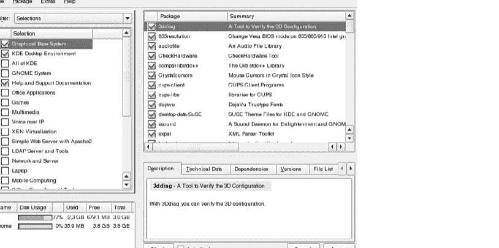

安装期间用于添加、删除和查找软件包的 YaST 软件包模块与在运行的 openSUSE 系统上使用的是同一个。无论在哪种情况下，你都可以找到你感兴趣的软件包信息。选中软件包后，点击屏幕右下角的选项卡查看其描述、技术数据（大小、包、依赖关系等）。

- **13. 启动。** 选择“启动”查看添加到你的启动加载程序（默认是 GRUB，你也可以使用 LILO 启动加载程序）的信息。启动加载程序包含启动 Linux 所需的信息：启动加载程序的位置、默认启动操作系统和其他信息。
- **14. 时区。** 选择“时区”更改系统对你所在时区的默认设置。
- **15. 语言。** 选择要使用的默认语言。（如果你喜欢，稍后可以添加其他语言的支持。）

# 运行 SUSE 和 openSUSE

- **16. 默认运行级别。** 通常情况下，你会使用默认的 (5) 启动到带有图形登录界面的完整多用户、网络化桌面系统。另一个常见的默认是 3，它提供基于文本的登录界面，但在其他方面相同。（如果你选择 3，之后可以通过输入 `startx` 命令来启动 GUI。）

- **17. 开始安装。** 如果所有设置看起来都没问题，点击“接受”开始安装过程。记住，这是你最后退出的机会！当确认对话框出现时，点击“返回”回到安装程序，这样你可以修改或取消安装过程，或者选择“安装”进入安装。

如果你点击“是”，openSUSE 将格式化你的硬盘并安装选定的软件包。安装完成后，openSUSE 会提示一些最终配置信息以完成安装。

# 配置设置

在基础软件安装完成后，YaST 安装程序会提示你提供额外信息：

- **18. Root 密码。** 输入 root 密码（两次）。输入最多八个字符。DES 是用于保护密码的默认加密类型（你可以选择“专家选项”来选择 MD5 或 Blowfish 代替）。请参阅第 6 章关于选择良好密码的建议。

- **19. 主机名和域名。** 输入你想要用于网络的名称。输入该互联网的名称。
- **20. 网络配置。** YaST 探测你的网络、ISDN 适配器或调制解调器，并建议默认配置。你可以点击屏幕上的标题来配置连接到你的网络设备。如果你想使用 DHCP，请参阅第 5 章关于网络连接的信息。自动配置允许你通过防火墙并禁用通过 SSH 的远程访问。你可以通过点击这些项目来更改设置。

完成后，点击“下一步”。

- **21. 在线更新。** YaST 测试你在上一步中定义的网络接口，并下载最新版本。如果你想跳过此步骤，可以选择“稍后配置”。这实际上不会安装任何更新，但会注册可用更新的位置。完成后，点击“下一步”。此步骤允许你更新你的系统。

# 第三部分：选择和安装 Linux 发行版

- **22. 用户身份验证方法。** 通常情况下你会使用单机模式。但在企业环境中，你可能会使用 NIS（Unix 系统用于共享文件的常用设施）或 LDAP（用于共享地址簿和其他信息的目录服务），取决于你公司支持。Samba 允许你使用 Windows 文件打印共享功能。

- **23. 新用户账户。** 根据提示为计算机添加至少一个用户账户。现在你只设置了 root 账户。将账户用于电子邮件、网页浏览或其他常见任务被认为是不良习惯。你应该为管理用途添加用户账户。添加你的全名；短登录名以及保护该账户的密码。

如果你希望在重启时自动登录此用户，请勾选“自动登录”框。否则，请取消勾选，以便每次启动系统时都看到登录提示。你还可以勾选“接收邮件”框，以确保发送给系统 root 用户的任何邮件你创建的用户也能接收副本。

- **24. 硬件配置。** openSUSE 安装程序显示系统中检测到的所有硬件列表。你可以利用此配置系统的其他设备，或验证现有硬件的配置。你可以选择屏幕上的标题来配置你的显卡、打印机、声卡或电视卡。

> 注意 如果你重新配置了图形硬件，应根据提示测试显示。如果设置不起作用，选择 `Ctrl+Alt+Backspace` 退出并尝试再次配置。

当你完成测试或更新系统硬件，或者如果你只是想使用 openSUSE 的默认硬件设置时，点击“下一步”。设置将写入硬盘。显示安装完成界面。它显示当前版本 openSUSE 的说明。点击“下一步”继续。

- **25. 完成。** 完成后，你可以选择克隆系统进行自动保存，以保存系统配置记录，如果你计划安装其他 SUSE 10.3 系统。准备好后点击“完成”。系统将启动你在安装期间选择的图形界面，并准备好让你登录。

# 开始使用 openSUSE

如果你在之前的安装过程中创建了用户账户，并在创建该账户时选了“自动登录”，那么 openSUSE 应该会自动以该用户的身份登录并向你展示 KDE 桌面。（如果你看到的是图形登录界面，请以该用户身份登录。）以下是一些帮助你开始使用 openSUSE 的要点：

- 桌面应用程序——默认的 openSUSE 被配置为桌面，包含了一系列易于访问的桌面应用程序。在桌面上，尝试点击 Office 图标打开 OpenOffice 来处理文档、电子表格、演示文稿、绘图、网页或其他类型的内容。从桌面上的 openSUSE 图标可以从几十个应用程序中选择并尝试。
- 我的电脑——桌面上的“计算机”图标允许你移除媒体和挂载的分区，并让你你能够在 Konquerer 窗口中访问“桌面”、“文档”和“public_html”文件夹。
- 重新配置你的计算机——通过从 openSUSE 菜单选择“应用程序-系统-管理员设置”进入 YaST 管理工具。你可以从出现的 YaST 控制中心重新配置你的系统硬件和软件。

如果你想配置桌面（更改背景、屏幕保护程序或主题），请像使用任何现代 KDE 桌面一样使用 KDE 控制中心。你可以从 openSUSE 菜单启动控制中心（选择“我的收藏-配置桌面”）。

## 总结

Red Hat Linux 之后，SUSE 通常被认为是企业级 Linux 系统的最佳选择。它的图形化安装和管理工具（通过名为 YaST 的工具实现）使其区别于其他面向技术用户的 Linux 发行版。

自从 SUSE 在 2003 年被 Novell 收购以来，SUSE Linux 已成为一个更大的、适用于企业级产品线的一部分。现有 SUSE Linux 盒装版。提供多个不同等级的支持服务。凭借 Novell 全球销售和培训机构，SUSE Linux 具备了成为世界上最受欢迎的商业 Linux 系统的条件。将 SUSE 发布给开源社区的 openSUSE 项目确保了最新、最强大的功能可用或正处于 SUSE 的开发流程中。

由于在 YaST 安装程序和管理界面上投入了大量工作，即使是毫无经验的用户也能在一个小时内在新安装的 SUSE 或 openSUSE 系统上运行。之后，你就可以开始使用 SUSE 桌面上的各种桌面和个人生产力应用程序了。

# 第11 章

# 运行 KNOPPIX

计算机的操作系统通常驻留在硬盘上——但并非必须如此。当计算机启动时，它通常会首先检查驱动器中是否有 CD、软盘或 DVD，并尝试从那里启动（取决于 BIOS 设置）。因此，既然有高达 700MB (CD) 或 8.4GB (双层 DVD) 的存储介质，为什么不使用它们来启动整个操作系统呢？

那么，像 KNOPPIX 这样的 Linux 发行版（也称为现场 CD）究竟是如何启动的。在 KNOPPIX 的情况下，一张 CD 包含多达 2GB 的压缩软件供你运行，这些软件会实时解压。启动后，你就可以尝试功能完整的 Linux 系统的所有功能，而无需触碰硬盘的内容。

KNOPPIX 包含在随书提供的 DVD 中。事实上，它是默认选项。将 DVD 插入电脑的 DVD 驱动器，你将看到启动屏幕。进入 KNOPPIX 应该会自动启动，你可以像本章描述的那样开始使用它。

如果你从未用过 Linux，KNOPPIX 给了你一个非常安全的方式来尝试。如果你有 Linux 经验，KNOPPIX 可以作为一种工具随身携带 Linux 到到处、排除计算机故障或检查计算机是否能运行 Linux。在任何情况下，你都可以利用这一章简要了解你可以通过 KNOPPIX 使用的一些很棒 Linux 功能。

## KNOPPIX 特性

KNOPPIX 的功能非常多，以至于很难找到起点。本文写作时 KNOPPIX 的最新官方版本（KNOPPIX 5.1.1）具有 X.Org.7.1、OpenOffice 2.1.0、KDE 3.5.5、GIMP 2.2.11、Linux


内核 2.6.19，以及许多多媒体应用程序。更多信息可以在 KNOPPIX 主页（`www.knoppix.com`）上找到。

KNOPPIX 最新版本最实用的功能之一是你可以轻松地创建自己的 KNOPPIX 磁盘。可用选项非常多，尽管如此，书中仍有足够的空间涵盖它们。有关如何创建你版本的 KNOPPIX 的更多信息，请参见 `www.knoppix.net`。

来自 Windows：KNOPPIX 支持 NTFS 文件系统，因此你可以在安装了 Windows XP 的计算机上使用 KNOPPIX，并访问硬盘上的功能。这是使用 Linux 应用程序尝试来自 Windows 的文档、音乐、电影或其他内容（在永久更改之前）的好方法。在 GNOME 2.2 中新支持的 NTFS 透明访问。

# 第三部分：选择和安装 Linux 发行版

## KNOPPIX

如果你从未用过 Linux，KNOPPIX 给了你一个非常安全的方式来尝试。如果你有 Linux 经验，KNOPPIX 可以作为一种工具随身携带 Linux 到到处、排除计算机故障或检查计算机是否能运行 Linux。在任何情况下，你都可以利用这一章简要了解你可以通过 KNOPPIX 使用的一些很棒 Linux 功能。

## KNOPPIX 特性

KNOPPIX 的功能非常多，以至于很难找到起点。本文写作时 KNOPPIX 的最新官方版本（KNOPPIX 5.1.1）具有 X.Org.7.1、OpenOffice 2.1.0、KDE 3.5.5、GIMP 2.2.11、Linux

内核 2.6.19，以及许多多媒体应用程序。更多信息可以在 KNOPPIX 主页（`www.knoppix.com`）上找到。

KNOPPIX 最新版本最实用的功能之一是你可以轻松地创建自己的 KNOPPIX 磁盘。可用选项非常多，尽管如此，书中仍有足够的空间涵盖它们。有关如何创建你版本的 KNOPPIX 的更多信息，请参见 `www.knoppix.net`。

来自 Windows：KNOPPIX 支持 NTFS 文件系统，因此你可以在安装了 Windows XP 的计算机上使用 KNOPPIX，并访问硬盘上的功能。这是使用 Linux 应用程序尝试来自 Windows 的文档、音乐、电影或其他内容（在永久更改之前）的好方法。在 GNOME 2.2 中新支持的 NTFS 透明访问。

## 理解 KNOPPIX

如果你从未用过 Linux，KNOPPIX 给了你一个非常安全的方式来尝试。如果你有 Linux 经验，KNOPPIX 可以作为一种工具随身携带 Linux 到到处、排除计算机故障或检查计算机是否能运行 Linux。在任何情况下，你都可以利用这一章简要了解你可以通过 KNOPPIX 使用的一些很棒 Linux 功能。

## KNOPPIX 新闻

由于在 YaST 安装程序和管理界面上投入了大量工作，即使是毫无经验的用户也能在一个小时内在新安装的 SUSE 或 openSUSE 系统上运行。之后，你就可以开始使用 SUSE 桌面上的各种桌面和个人生产力应用程序。

## 内部

计算机的操作系统通常驻留在硬盘上——但并非如此。当计算机启动时，它通常会首先检查驱动器中是否有 CD、软盘或 DVD，并尝试从那里启动（取决于 BIOS 设置）。因此，既然有高达 700MB (CD) 或 8.4GB (双层 DVD) 的存储介质，为什么不使用它们来启动整个操作系统呢？

那么，像 KNOPPIX 这样的 Linux 发行版（也称为现场 CD）究竟是如何启动的。在 KNOPPIX 的情况下，一张 CD 包含多达 2GB 的压缩软件供你运行，这些软件会实时解压。启动后，你就可以尝试功能完整的 Linux 系统的所有功能，而无需触碰硬盘的内容。

KNOPPIX 包含在随书提供的 DVD 中。事实上，它是默认选项。将 DVD 插入电脑的 DVD 驱动器，你将看到启动屏幕。进入 KNOPPIX 应该会自动启动，你可以像本章描述的那样开始使用它。

## 运行 KNOPPIX

KNOPPIX 的功能非常多，以至于很难找到起点。本文写作时 KNOPPIX 的最新官方版本（KNOPPIX 5.1.1）具有 X.Org.7.1、OpenOffice 2.1.0、KDE 3.5.5、GIMP 2.2.11、Linux

内核 2.6.19，以及许多多媒体应用程序。更多信息可以在 KNOPPIX 主页（`www.knoppix.com`）上找到。

KNOPPIX 最新版本最实用的功能之一是你可以轻松地创建自己的 KNOPPIX 磁盘。可用选项非常多，尽管如此，书中仍有足够的空间涵盖它们。有关如何创建你版本的 KNOPPIX 的更多信息，请参见 `www.knoppix.net`。

来自 Windows：KNOPPIX 支持 NTFS 文件系统，因此你可以在安装了 Windows XP 的计算机上使用 KNOPPIX，并访问硬盘上的功能。这是使用 Linux 应用程序尝试来自 Windows 的文档、音乐、电影或其他内容（在永久更改之前）的好方法。在 GNOME 2.2 中新支持的 NTFS 透明访问。

如果你从未用过 Linux，KNOPPIX 给了你一个非常安全的方式来尝试。如果你有 Linux 经验，KNOPPIX 可以作为一种工具随身携带 Linux 到到处、排除计算机故障或检查计算机是否能运行 Linux。在任何情况下，你都可以利用这一章简要了解你可以通过 KNOPPIX 使用的一些很棒 Linux 功能。

# 第三部分 选择和安装 Linux 发行版

KNOPIX 基于 Debian Linux，因此 Debian 用户在功能选择和组织方面会感到非常自如。KNOPIX 软件包也采用 `deb` 包格式，因此你可以使用 `apt`、`dpkg` 以及相关工具来列出并管理软件包。KNOPIX 附带了一个用于处理软件包的图形化工具 KPackage。

有关使用 `apt` 和 `dpkg` 工具管理 Debian 的信息，请参阅第 9 章。如果你不安装任何新软件，这些工具提供了一种搜索、列出甚至升级 KNOPIX 中运行的软件软件包的极佳方法。

# KNOPIX 的酷之处

上述介绍的功能在许多不同的 Linux 发行版中都很常见。KNOPIX 之所以与，之处在于，你通常可以在几分钟内就启动并使用这些功能——而无需分区磁盘、安装软件或进行任何配置。仅仅为了尝试 Linux，或者将其用于某些特殊的、快速的任务（例如播放或显示来自计算机硬盘的音乐、文档或电子表格），KNOPIX 都非常棒了。

然而，某些功能是 KNOPIX 特有的（与你从硬盘运行的 Linux 系统相比）。它的许多特殊功能是为了帮助你解决与“你并非在永久性环境中工作”相关的问题。特别是，KNOPIX 包含以下内容：

- **卓越的硬件检测**——正确检测和配置硬件的能力是其最佳功能之一。在启动过程中，KNOPIX 会找到大多数常见的 PC 硬件组件并加载相应的模块以便可以使用它们。它使用 Red Hat 的 `libudev` set 来识别硬件、加载适当模块并创建设备文件。

对于无法检测的硬件，你可以添加许多启动选项来识别（或跳过）选定的设备。其中某些特别棘手的问题与显卡以及在笔记本电脑上运行（见表 11-1 至 11-3）。

- **自动桌面启动**——KNOPIX 并不是直接跳转到命令行，而是尽力启动 KDE 桌面环境。在此过程中，它添加了一些漂亮的功能，例如桌面图标，允许你访问计算机的硬盘分区。

- **配置工具**——某些硬件无法被完美检测，或者需要额外的设置。你可以通过点击像一只被压扁企鹅的桌面图标，访问 KNOPIX 特有的配置工具，来配置你的打印机、电视、显卡、声卡、网络连接和其他功能。

- **保存设置**——你不需要每次重启都丢失为 KNOPIX 设置的配置。点击配置菜单将你的配置——包括你的个人桌面配置、桌面上的文件、网络设置和图形设置 (X)——保存到软磁盘、硬盘或 USB 闪存盘。

- **持久性桌面**——你可以使用配置图标在硬盘或其他介质上创建一个持久的 KNOPIX 目录，你可以从中保存和恢复桌面设置信息以及你在会话之间使用的任何数据。（设置持久性桌面的细节请参见本章稍后的“创建持久家目录”部分。）

- **添加交换空间 (swap)**——如果你在安装了 Linux 的计算机上使用 KNOPIX，它会自动使用已设置的交换分区。在 DOS 和 Windows 系统上，如果你在可用的 DOS 分区上有空间，KNOPIX 允许你创建一个交换区域。（`mkdoswapfile` 命令用于此目的。）

- **与 Windows 文件协作**——KNOPIX 包含了 Microsoft Windows NTFS 文件系统的驱动程序。如果你从安装了 Windows 的 PC 启动 KNOPIX，这些驱动程序允许你从硬盘读取和写入文件。（从 KNOPIX 向 NTFS 分区写入数据仍被视为实验性，因此如果分区包含关键数据，请考虑以只读模式使用 NTFS 分区。）

例如，假设在一台通过启动 Windows XP 设置的计算机上，硬盘里有你的整个收藏、从数码相机下载的照片和个人网页。你转而启动 KNOPIX（注意此时 Windows 完全没有运行）。突然，你的硬盘只是一个存放许多文件的地方。现在你可以使用 KNOPIX 附带的应用程序打开硬盘上的文件，以播放音乐、处理图像以及显示或更改页面。

证明 KNOPIX 受推崇程度的证据，就是有多少其他可启动的 Linux 发行版是基于它开发的。KNOPPIX 项目提供了一个 `KNOPIX-customize` 包，让任何人都能制作自己的自定义 KNOPIX。还有专门的 KNOPIX 派生版可用于修复故障计算机、播放各种多媒体内容或运行特定的应用程序。


有关如何将可启动的 Linux 用作防火墙/路由器的信息，请参阅第 18 章；许多其他可启动 Linux 发行版的描述请参阅第 19 章。

# 面对 KNOPIX 的挑战

对于大多数人来说，KNOPIX 是一个特殊用途的 Linux 系统。它是尝试 Linux 或访问未按你喜好配置的计算机工具。然而，KNOPIX 有一些挑战是你应该记住的：

- **重启清空**——除非你将数据保存到其他介质上（正如我在本章后文中描述的那样），否则重启时整个 KNOPIX 系统都会消失。这意味着桌面上的文件、安装的软件、系统配置以及你在会话期间做的任何事情都会消失。

- **内存限制**——KNOPIX 设计为从 RAM 运行，这意味着你受限于可用内存的量。

我必须承认，这里描述的挑战与其说是对 KNOPIX 如何工作的解释，不如说是 KNOPIX 的问题。对于一些仍然记得 DOS 的人来说，从单张光盘运行完整的桌面和服务器操作系统的想法是一个非常棒的概念。

# 探索 KNOOPPIX 的用途

由于 KNOOPPIX 可以做的事情太多了，很难只选出几个用途来重点介绍。请考虑以下可能性：

- 你自己的便携式操作系统 —— 你不需要携带笔记本电脑或整台 PC 就能确保你拥有所需的软件。相反，你可以使用任何可用的 PC（某些的硬件除外），并通过单光 CD 启动你的整个计算环境。通过自定义自己的 KNOOPPIX，你还可以添加自己的数据，并按需选择应用程序。
- 管理任何 PC 上数据的工具 —— 你可以跳过任何计算机上的操作系统和其他软件，使用你 KNOOPPIX 上的应用程序来管理那台电脑上的数据。

当然，这些概念并不是 KNOOPPIX 所有的，因为从概念上讲，从 DOS 时代起你就可以使用任何其他软盘（或任何可启动的 Linux）实现同样的事情。区别在于 KNOOPPIX 执行这些工作非常出色。它让你能够接管一台计算机，不仅仅是通过一张可以运行少数程序的微型救援光盘，而是通过一个功能全的服务器和管理工具包操作系统。考虑到这些，以下是人们使用 KNOOPPIX 的一些方式：

- 展示 Linux —— 如果你必须花一小时进行安装才能表达你的观点，那么演示可能会持续很长时间。有了 KNOOPPIX，从你告诉朋友 Linux 到你在 PC 上运行起一个完整的系统，可能只需要 5 分钟。在这个过程中，你不需要担心计算机上的任何问题，因为你不需要触碰你的硬盘。
- 测试计算机是否支持 Linux —— 与其在安装到一半时查看你的 PC 是否能够运行 Linux，不如你可以启动 KNOOPPIX。如果它运行正常，你可以检查加载了哪些驱动程序来处理你的硬件（在 shell 中输入 `ismod`），然后继续在硬盘上安装任何 Linux 实例。
- 救援计算机或网络 —— KNOOPPIX 包含了许多用于在 Linux 和 Windows 系统上跟踪和修复问题的工具。还有一个 KNOOPPIX 版本，其中包含了更多（几十种工具，用于救援受损的系统和跟踪网络问题（参见 `www.linux-std.org`）。
- 接管故障的服务器 —— 如果 Web 服务器、文件服务器或防火墙发生崩溃或其他故障，你可能可以使用 KNOOPPIX 在修复问题期间，从 KNOOPPIX 启动时安全地提供数据服务。
- 随你想做任何事 —— 对于我们这些已经使用 Linux 的人来说，去某个地方必须在没有你所需工具的计算机上工作或做演示是一件痛苦的事。通过带来整个操作系统、你所有的软件工具，有时还有你的数据（通过自定义 CD、单独软盘、优 盘或下载的文件），无论你去往哪里，你的计算环境都可以是相同的。

现在你已经对用 KNOOPPIX 做什么有了一些了解，让我们开始开始吧。

# 启动 KNOOPPIX

在大多数情况下，启动 KNOOPPIX 非常简单。手里拿着 KNOOPPIX，你只需要一台符合最低配置要求的 PC。

# 准备计算机

如果你已准备好启动 KNOOPPIX，我建议采取以下措施：

- 重启权限 —— KNOOPPIX 将接管 PC 的运行，因此你需要确保目前没有人正在使用这台计算机或依赖于它进行重启。请确保它可以通过网络访问（可以在运行中的 Windows 或 Linux 系统上使用如 Qemu 或 VMware 等虚拟化工具来运行 KNOOPPIX。如要运行 KNOOPPIX，你需要一台具有足够可用 RAM 的计算机。否则，你将获得糟糕的性能。）
- 互联网连接（可选） —— 如果你的计算机有以太网卡并连接互联网，你可以立即开始使用 KNOOPPIX 浏览网页并利用它的通信工具。KNOOPPIX 将尝试检测 DHCP 服务器（以获取 IP 地址和其他信息）并自动配置以使用互联网或其他可用网络。如果你需要拨号连接，KNOOPPIX 包含了用于配置拨号调制解调器的 Kppp。

运行 KNOOPPIX 的系统要求比你运行大多数 Linux 系统的要求低得多。根据 Klaus Knupper 的说法，你需要：

- CPU —— Intel 兼容的 i486 或更高。
- RAM —— 20MB（文本模式）、82MB（带 KDE 的图形模式）或 128MB（运行大多数办公应用程序）。
- 可启动驱动器（使用 DVD 驱动器使用 DVD 或使用 CD 驱动器启动 CD） —— KNOOPPIX 能够从 IDE/ATAPI、USB 或 SCSI 驱动器启动（只要你的计算机可以从这些设备启动）。否则，你可以创建一个启动软盘来开始启动 KNOOPPIX 的过程（后文将描述）。如果你有 DVD 驱动器，你可以直接从随附的 CD 启动 KNOOPPIX。
- 显卡 —— 必须兼容 SVGA。
- 鼠标 —— 支持任何标准串口鼠标、PS/2 鼠标或兼容 IMPS/2 的 USB 鼠标。

# 启动 KNOOPPIX

如果你面前有一台符合要求的 PC，可以按照以下步骤开始：

1. 将你的 KNOPPIX DVD 或 CD 插入到适当的驱动器中。
2. 重启计算机。几秒片刻后，你将看到启动屏幕。

虽然 Linux Bible 2008 版 DVD 和普通 KNOOPPIX CD 的启动屏幕看起来不同，但你可以以相同的方式继续启动过程。

如果一切顺利，你应该看到 KNOOPPIX 桌面，并可以进入“使用 KNOOPPIX”部分。如果 KNOOPPIX 没有正常启动，或者你想在启动之前对其进行调整，请继续后续章节。具体来说，你可能需要查看表所示。

# 解决启动问题

通过了解启动过程，在大多数情况下，你能够克服安装 KNOOPPIX 时遇到的任何问题。以下是你需要的一些：

- **启动顺序** —— 计算机 BIOS 有寻找可启动操作系统的特定顺序。典型的顺序是软盘、CD 和硬盘。如果你的计算机跳过了 KNOOPPIX 软盘并从硬盘启动，请确保 BIOS 中的启动顺序设置为从 CD 或 DVD 启动。要更改 BIOS，重启计算机并在启动硬件时进入设置（通常是按下 F1、F2）。
- **启动选项** —— 与其让自动配置，你可以在提示符处添加选项。不同的 Linux 有不同的选项。如果你在安装不同的发行版时遇到问题，可以尝试这些。

# 第三部分：选择并安装 Linux 发行版

你想要的方式。表 11-1 显示了你想要特定功能的选项。

| 选项 | 功能 |
|---|---|
| knnoppix lang | 选择特定的语言/键盘。替换 ?? 为以下之一：cn, da, es, fr, it, nl, pl, sk, tr, tw, or us. |
| knnoppix desktop | 与其使用 KDE 桌面，替换 ?? 为以下窗口管理器：fluxbox, icewm, lars, twm, or xfce. |
| knnoppix blind | 启动盲终端（不运行 X）。 |
| knnoppix brittle=type,port,table | 为盲设备添加使用的参数。 |
| knnoppix wheelmouse | 对于轮鼠标，启用 IMPS/2 协议。 |
| knnoppix nowelman | 对于普通的 PS/2 鼠标，强制 PS/2 协议。 |
| knnoppix keyboard=us | 分配不同的键盘驱动。 |
| knnoppix dma | 为所有 IDE 驱动器开启 DMA 加速。 |
| knnoppix gmt | 使用格林尼治标准时间 (GMT)。你可以使用 gmt 来获得相同的结果。 |
| knnoppix tz=country/city | 根据国家和城市指定特定的时区。 |
| knnoppix noject | 在 KNOOPPIX 停止后不要弹出 CD。 |
| knnoppix noprompt | 在 KNOOPPIX 停止后不要提示移除 CD。 |

如果硬件配置不当或配置错误，你可以让 KNOOPPIX 跳过该硬件。表 11-2 包含了跳过或关闭各种功能的选项。

| 选项 | 结果 |
|---|---|
| knnoppix ataptic | 不对 IDE CD-ROM 进行 SCSI 模拟。 |
| knnoppix noagp | 不检测 AGP 显卡。 |
| knnoppix noapic | 禁用高级可中断控制器 (APIC)。（这可以解决 SMP 计算机上的某些问题。） |

# 表 11-2（续）

| 选项 | 结果 |
|---|---|
| knoppix acpi=off | 禁用高级配置和电源接口 (ACPI)。 |
| knoppix noapm | 不支持高级电源管理 (APM)。（如果 acpi 正常工作，apm 将默认关闭。一次只能激活其中一个。） |
| knoppix noaudio | 不支持音频。 |
| knoppix nodchcp | 不要尝试通过 DHCP 启动网络连接。 |
| knoppix fstab | 不读取 fstab 文件以查找要挂载或检查的文件系统。 |
| knoppix firewire | 不检测火线线（Firewire）设备。 |
| knoppix popcmcia | 不检测 PCMCIA 卡槽。 |
| knoppix nosci | 不检测 SCSI 设备。 |
| knoppix noswas | 不检测交换分区。 |
| knoppix nousb | 不检测 USB 设备。 |
| knoppix nousb2 | 禁用 USB 2.0 扩展。 |
| knoppix pnbios=off | 不在 BIOS 中初始化插即用 (PnP)。 |
| knoppix failsafe | 几乎不进行硬件检测 |

表 11-3 列出了如果你在显卡上遇到问题时可能有所帮助的选项。如果你在笔记本电脑上使用 X 时遇到问题，其中几个选项将特别别有用。

# 表 11-3 修复视频问题的启动选项

| 选项 | 结果 |
|---|---|
| knoppix screen=?? | 选择 X 分辨率。将 ?? 替换为 640 x 480、800 x 600、1024 x 768、1280 x 1024 或你的显卡支持的任何其他分辨率。 |
| knoppix xvrefresh=60 | 将 X 的垂直刷新率设置为 60 Hz（或显示器手册中指定的其他值）。 |
| knoppix xrefresh=80 | 将 X 的水平刷新率设置为 80 Hz（或显示器手册中指定的其他值）。 |
| knoppix xserver=?? | 将 ?? 替换为 XFree86 或 XF86_SVGA。 |
| knoppix module=?? | 为你的显卡选择特定的特定驱动程序。将 ?? 替换为以下之一：ati, fbdev, 1810, mga, na, radeon, savage, s3radeon, svga 或 1810。 |
| knoppix 2 | 运行级别 2，仅限文本模式。 |

# 第三部分 选择和安装 Linux 发行版

| 表 11-3（续） |
|---|
| knoppix vga=normal | 无帧缓冲模式，但可以使用 X。 |
| knoppix fb1280x1024 | 使用固定缓冲区图形 (1)。 |
| knoppix fb1024x768 | 使用固定缓冲区图形 (2)。 |
| knoppix fb800x600 | 使用固定缓冲区图形 (3)。 |

# 自定义 KNOPPIX

有几个启动选项用于告诉 KNOPPIX 自定义的主目录或硬盘或软盘上的信息。请参阅本章节后面的“保存你的 KNOPPIX 配置”部分，了解如何保存自定义的 KNOPPIX 配置并告诉 KNOPPIX 何 KNOPPIX 创建的自定义信息，大多数其他 Linux 发行版都不会使用这些选项。

表 11-4 列出了你可以使用的选项，用于识别自定义数据的位置，或告诉 KNOPPIX 以性能更好的方式运行。其中一些选项在后续章节中有详细描述。

| 表 11-4 |
|---|
| knoppix myconf=/dev/???? | 告诉 KNOPPIX 从特定分区运行 knoppix.sh 脚本。例如，将 ???? 替换为 hda1（IDE 硬盘上的第一个分区）或 sda1（USB 闪盘或 SCSI 硬盘上的第一个分区）。 |
| knoppix myconf=scan | 搜索可用的 knoppix.sh 脚本。home=/mnt/????filename.img 识别在 KNOPPIX 会话期间应挂载并作为 /home 目录镜像文件的位置。例如，使用文件 /mnt/hda1/knoppix.img 获取第一个 IDE 硬盘第一个分区的顶级目录。 |
| knoppix home-scan | 搜索可用的主镜像。 |
| knoppix mem=???? | 为 KNOPPIX 提供指定数量的内存（例如128M）。 |
| knoppix toram | 将 CD 内容拷贝到 RAM 并在那里运行。（对于现场 CD，你至少需要 1GB 的 RAM 供 toram 使用。） |

# 表 11-4（续）

| 选项 | 结果 |
|---|---|
| knoppix tohd=/dev/???? | 将 CD 内容拷贝到硬盘分区并从那里运行。将 ???? 替换为设备名称，如 hda1 或 sda1。该分区必须是 ext2 或 VFAT 格式才能使用此功能。 |
| knoppix fromhd | 查找在硬盘上运行的 KNOPPIX，而不是。 |
| knoppix fromhd=/dev/???? | 查找在硬盘上运行的 KNOPPIX。将 ???? 替换为设备名称，如 hda1 或 sda1。 |
| knoppix fromhd=/dev/???? | 查找在硬盘上运行的 KNOPPIX。将 ???? 替换为设备名称，如 hda1 或 sda1。 |
| knoppix fromhd=/dev/???? | 查找在硬盘上运行的 KNOPPIX。将 ???? 替换为设备名称，如 hda1 或 sda1。 |

# 特殊功能与解决方法

# 运行 KNOPPIX 11

- **KNPIX 配置** — 点击 KDE 面板上的挤压小企鹅图标，可以查看 KNOXPIX 特有的配置工具菜单。在这里，你可以调整你的电视卡、配置打印机、建立网络连接并启动一些服务器。我将在本章的后半部分详细介绍其中一些主题——特别是如何在这个原本虚无缥缈的操作系统中跨会话保存数据和配置信息。

- 启动游戏、播放器和其他程序 — 从 KDE 菜单，你可以像在任何其他桌面操作系统一样启动应用程序。

此时，运行 KNOPPIX 就与任何其他带有 KDE 桌面的 Linux 系统一样，但有一个主要的例外。默认情况下，你无法保存任何个人数据。解决这个问题的办法并不多，特别是如果你打算经常使用 KNOPPIX 的话。请参考本章后半部分关于持久化桌面和打开磁盘的章节。

# 接入网络

如果你有一块以太网卡并连接到带有 DHCP 服务器的网络，KNOPPIX 系统应该启动并立即提供该网络的访问（如果该网络提供此类连接，则可能访问互联网）。如果不是，KNOPPIX 提供了几种工具来配置你的网络连接：

- **拨号调制解调器** — 从挤压小企鹅选择 Network/Internet /dev/modem connection setup。这些菜单可以帮助你使用串口调制解调器、USB 调制解调器、IRDA 手机/PDA 或蓝牙手机创建连接到互联网或其他 TCP/IP 网络的拨号连接。

- **ADSL 路由器** — 从挤压小企鹅选择 Network/Internet ADSL/PPPOE configuration。它将帮助你连接你的宽带 ADSL 路由器以访问互联网。

- **GPRS 连接** — 从挤压小企鹅选择 Network/Internet GPRS/UMTS connection，以通过你的手机运营商建立连接。

- **网卡** — 从挤压小企鹅选择 Network/Internet Network card configuration，以配置你的以太网卡（假设你不想使用 DHCP 获取网络地址）。

- **ISDN** — 从挤压小企鹅选择 Network/Internet ISDN，使用 ISDN 连接到网络。

- **无线网卡** — 从挤压小企鹅选择 Network/Internet Wave，使用无线以太网卡连接网络。如果你的网卡没有 Linux 驱动但你有一个信任的 Windows 驱动，你也可以选择 ndisdriver configuration。

除了这里提供的接口外，你还可以使用 `dialconf` 命令按照第 5 章描述的方法创建你的拨号连接。

# 第三部分：选择和安装 Linux 发行版

# 在 KNOPPIX 中安装软件

尽管 KNOPPIX 包含了广泛的软件应用程序，但可能你想要使用某些未包含的软件包。要在从 DVD 运行 KNOPPIX 时安装软件，可以使用 Synaptic。

要启动 Synaptic，点击 KNOPPIX 面板上的挤压小企鹅并选择 Utilities > Manage Software in KNOPPIX。Synaptic 窗口将打开，显示已安装软件包的列表。以下是安装软件包的步骤：

- **重新加载列表。** 要查看哪些软件包供你安装，请点击 Reload 按钮。Synaptic 会在 KNOPPIX 的在线仓库中搜索可用软件包并将其加载到 Synaptic 窗口中。新的软件包类别和软件包将会出现。

- **选择软件包。** 在左侧选择一个类别，并从中选择任何你需要的软件包。下方窗格会显示该软件包的描述。图 11-1 显示了选中 bezflag 软件包的 Synaptic 示例。

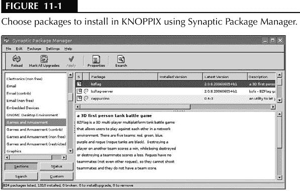

使用 Synaptic 软件包管理器在 KNOPPIX 中安装的软件包。

- **3. 标记软件包进行安装。** 选中你想显示的软件包，选择 Mark for installation。如果需要对现有软件包进行更改或需要额外的软件包，弹出窗口会提示。点击 Mark 继续。

- **4. 应用更改。** 在选完所有需要的软件包后，选择 Apply。如果弹出窗口中提到的更改没有问题，再次选择 Apply。Synaptic 开始下载并安装所选软件包。

请记住，软件是安装在运行在 RAM 中的 KNOPPIX 中的。因此，下次重启时，软件将会消失，除非你选择了保留数据（例如，在安装你需要的软件之前先创建一个持久化桌面）。

# 在 KNOPPIX 中保存文件

当你使用 KNOPPIX 重启电脑时，你不仅会丢失 KNOPPIX 本身，还会丢失在此期间创建的任何数据和配置信息。这是因为默认情况下，KNOPPIX 从你的系统 RAM 和非易失性 CD 或 DVD 运行。

## 运行 KNOPPIX

- 3. 选择您想要用于持久化桌面的分区并点击“确定”。系统会询问您是否要以加密格式保存 home 目录。
- 4. 选择“否”，以便将该目录设为非加密（如果您选择“是”，则将需要指定一个长密码，以便在启动时访问持久化的 home 目录）。系统会要求您输入 home 目录的大小。
- 5. 输入分配给 home 目录的兆字节（MB）数并点击“确定”。请确保该分区上有足够的空间。（稍后挂载该分区时，您可以输入 `df -h` 查看其可用空间。）此时，分区或镜像文件将应该创建完成。

当我运行此程序在 `hda5` 分区上创建一个 100MB 的镜像时，它创建了文件 `/mnt/hda5/knoppix.img`，该文件有 97MB 的可用空间。要了解如何使用该目录，请参阅本章的“稍后重启 KNOPPIX”章节。

## 保留您的 KNOPPIX 配置

在您投入大量工作，为您的 KNOPPIX 配置好桌面、打印机、网络、磁盘和其他偏好设置后，如果在重启时丢失所有内容将太遗憾了。KNOPPIX 提供了一种方法，让您可以保存配置信息并在下次会话中恢复它。保存的信息可以存储在软盘或其他任何下次重启 KNOPPIX 时可以访问的介质上（例如您的硬盘）。步骤如下：

- 1. 从面板上完成的企鹅图标，点击“配置”（Configuration）->“保存 KNOPPIX 配置”（Save KNOPPIX configuration）。
- 2. 选择要保存的配置文件。您可以选择保存个人配置（`/home/knoppix.kde` 和 `.mozilla` 目录）、桌面上的文件、您的网络配置、X 配置以及其他系统配置文件（`/etc` 等）。
- 3. 选择将您的配置文件保存到软盘或任何可写的可用磁盘。选择软盘可以使配置具有便携性，而使用硬盘则可以使配置在同一台机器上轻松复用。
- 4. 如果要保存到软盘，请插入软盘并点击“确定”。数据将保存到软盘中。

此操作的结果是在软盘上创建了 `knoppix.sh` 和 `configs.tbz` 文件。`knoppix.tbz` 文件包含了来自 `/home` 和 `/etc` 目录的所有保存配置。`knoppix.sh` 是一个脚本，告诉 KNOPPIX 在启动时安装这些文件。下次您运行 KNOPPIX 时，可以使用下一节介绍的方法使用配置文件。

> 创建了自己自定义 KNOPPIX 启动盘的用户只需将他们的 `knoppix.sh` 和 `config.tbz` 文件添加到 CD 的根目录，这样 KNOPPIX 就会直接启动到他们的个性化配置，而无需额外的软盘或其他介质。

## 选择并安装 Linux 发行版

## 重启 KNOPPIX

您可以随时通过插入 KNOPPIX CD 或 DVD 并重启电脑来启动 KNOPPIX。如果您想利用设置的持久化桌面或保存的配置信息，您需要在 KNOPPIX 启动提示符中添加一些选项。如下：

- 1. 将 KNOPPIX CD 或 DVD 插入电脑并重启。您应该能看到 KNOPPIX 启动提示符。
- 2. 在 KNOPPIX 启动前按下 F3，以查看是否需要额外的选项。
- 3. 如果您有软盘启动磁盘（或在早期过程中创建的其他可移动介质），请现在插入该磁盘。
- 4. 在启动提示符处，输入以下命令行之一，这些是加载您的配置文件的不同方式：


## KNOPPIX 启动参数示例

`boot: knoppix floppyconfig`

`boot: knoppix myconfig=/dev/hda1`

`boot: knoppix myconfig=/dev/sda`

`boot: knoppix myconfig=scan`

这些 KNOPPIX 启动命令分别从软盘获取配置信息、在第一个 IDE 驱动器分区（`/dev/hda1`）上查找信息、在第一个 SCSI 分区（`/dev/sda`）上查找，或扫描所有可用驱动器以查找信息。要启动到持久化桌面（假设您之前已设置），您可以改为输入：

```
boot: knoppix home=/dev/hda1/knoppix.img
boot: knoppix home=/dev/sda/knoppix.img
boot: knoppix home=scan
```

之前的启动命令分别将 `home` 目录（`/home/knoppix`）分配给 `/dev/hda1/knoppix.img` 文件、`/dev/sda/knoppix.img` 文件，或通过扫描所有可用目录分配给镜像文件。您还可以结合上述两个命令中的每一项来读取您的配置文件并分配持久化桌面，如下所示：

```
boot: knoppix floppyconfig home=/dev/hda1/knoppix.img
```


现在您已准备好从上次中断的地方继续会话，并且可以使用相同的配置和数据。

## 总结

KNOPPIX 提供了许多人认为是目前最好的可启动 Linux 发行版。它为您提供了一个几乎可以在任何您找到它的地方完全配置好的桌面系统。除了桌面功能外，KNOPPIX 还包含了使用 Linux 许多服务器、编程和故障排除功能所需的软件。尽管 KNOPPIX 作为可启动系统在 RAM 中运行，但默认情况下有方法可以配置它以跨启动会话保存数据和配置信息。

### 第 12 章 运行 Yellow Dog Linux

Yellow Dog Linux 是针对 PowerPC 的卓越发行版之一。Soft Solutions 致力于为各种 Apple 产品开发 Yellow Dog Linux，这减少了硬件不兼容的问题。

由于大多数 Linux 发行版集中在 x86 平台，而 Yellow Dog 专注于 PowerPC，以满足那些 PowerPC 用户的需求。

## 本章内容

- 深入了解 Yellow Dog Linux
- 安装 Yellow Dog Linux

本章旨在向您介绍 Yellow Dog Linux 以及如何使用它。

Yellow Dog Linux 是由 Soft Solutions 提供的，针对 PowerPC 架构。要获得有关 CD 的 Yellow Dog 镜像站列表（`www.tersoft.com/resources/ftp_mirrors.html`），请查看附录 A。Yellow Dog Linux 并不包含在 CD 中。您可以从 Soft Solutions（`www.tersoft.com/store/`）购买 Yellow Dog Linux，或者从镜像站下载（对于镜像站列表，见 `www.tersoft.com/resources/ftp_mirrors.html`）。

### 理解 Yellow Dog Linux

它是 Apple 授权 OEM 增值零售商，获得许可可在 Apple 硬件上安装 Linux，从而保留 Apple 的硬件保修。

最新的 Apple 使用 Intel 处理器形式的 x86 芯片。Yellow Dog 将无法在这些系统上运行，因为这不是 Soft 的使命。更多信息请参阅“迈向 Yellow Dog”章节。

## 第三部分 选择并安装 Linux 发行版

另一个说明是，Soft Solutions 致力于为各种 Apple 产品开发 Yellow Dog Linux，这减少了硬件不兼容的问题。

Mac OS X 以 Aqua 界面被认为是市场上最先进的图形界面之一。尽管 Apple 平台提供了复杂的界面，用户可能会质疑在 Apple 硬件上安装 Linux，但对于 PowerPC 架构安装 Linux 有许多理由：

- 应用成本 —— 商业应用程序的成本高于其开源替代品。例如，Mac OS X 平台上的最新文字处理器花费数百美元，而开源替代品通常是免费的。Linux 的可用软件超过了 Mac OS X 上的可用软件。虽然一些流行的源码程序在 Mac OS X 上可用，但它们可能需要移植，而不是重新编译。移植应用程序是一个更复杂的过程，通常需要操作系统的专业知识。移植超出了本书的范围。
- 延长硬件寿命 —— Linux 以低要求而闻名。您可以在尚不支持最新 Mac OS X 版本的机器上运行 Yellow Dog Linux。
- 一致性 —— Linux 广泛部署，特别是在后台功能方面。通过使用 Yellow Dog Linux（简称 YDL），您可以在生产环境中混合 PowerPC 和硬件，实现应用程序和操作系统的一致性，减少支持两个操作系统的成本。由于 Linux 是开源且广泛提供的，您还减少了对单一操作系统的依赖。
- 安全性 —— Yellow Dog Linux 有数千程序员的支持，他们可以不断为软件开发补丁和更新，而不是依赖商业实体发布补丁（或自己动手）。

目前有多个版本的 Yellow Dog Linux 可用，涵盖了当前和旧的 PowerPC 硬件：

- `Yellow Dog Linux 5.0.2` — 此版本支持 Power Architecture Cell 处理器、基于 cell 的系统（如 Sony PlayStation 3）、Mercury Computer 系统，以及使用 G3、IBM W970、G4 和 G3 PowerPC 处理器的 IBM 和 Apple 系统。
- `Yellow Dog Linux 4.1` — Yellow Dog Linux 的一个更新增强版，它提供了对最新 PowerPC Mac Mini 和 G5 系统中所有专用硬件的全支持，并对 G3 和 G4 系统提供持续支持。
- `Yellow Dog Linux 3.0.1` — Yellow Dog Linux 的最后一个版本（2004年10月1日），支持米色 G3 硬件（66 MHz）以及之前的 Old World Macs。此版本还支持 Yellow Dog Linux 4.0 支持的大部分相同硬件。
- `Y-HPC` — 一种基于 64 位 Linux Fedora Core 5.0 的 Yellow Dog 变体。该版本用于高性能计算，侧重于为 Xserver G5 或集群节点提供高性能支持。

## 持续使用 Yellow Dog

尽管 Apple 已将其产品线从 PowerPC 转移到 x86（标准 PC）架构，但 Terra Soft Solutions 仍在为 Power Architecture 开发 Yellow Dog Linux。虽然 Terra Soft 仍然是 Apple 的顶顶级增值合作伙伴，但它也开始在其他制造商的硬件上预装 Linux 系统。

简单来说，Yellow Dog 的使命是支持最新的 Power Architecture 系统（如 Sony Playstation 3，以及来自 IBM 和 Mercury Computer 等供应商的基于 cell 和高端 PowerPC 的系统），并为像我这样的 1000 到 2000 万拥有基于 PowerPC 的 Mac 但希望利用这些系统 Power 能力的用户提供专注于 PowerPC 的 Linux。

对于高端服务器，Terra Soft Solutions 在 IBM BladeCenter 42U 机架和 Mercury Computer XR90 64 位扩展 ATX 1U 和 4U 服务器上提供其 Y-HPC 操作系统。在这些机器上使用 Y-HPC 带有 Y-image 集群管理软件套件，你可以集中管理基于 Power 的 Y-HPC 服务器。

在工作站方面，Terra Soft 是 Sony Playstation 3 的首选 Linux 供应商。在与 Sony 密切合作以确保完全支持和互操作性后，Terra Soft 于 2006 年 11 月底为 PS3 交付 Yellow Dog Linux 5.0。同样，Terra Soft 还与 Genesis USA (`www.genesispp.com`) 合作销售预装 Yellow Dog Linux 的 Open Desktop 工作站。Open Desktop 工作站采用微 ATX 规格，配备千兆和 10/100 以太网端口、AGP 插槽、低配置 PCI 插槽以及多个 FireWire USB 端口。

## 第三部分 选择和安装 Linux 发行版

底，你可以预期 Yellow Dog Linux 继续在服务器和桌面系统上支持 Power Architecture。因此，喜爱 PowerPC 的 Apple 用户可以通过迁移到 Yellow Dog Linux 系统找到继续使用硬件的方法，此外由于 Power Architecture 对多媒体硬件的支持，以及 Yellow Dog 包含了播放各种音频视频内容的软件，这种组合为当今标准的 Linux 桌面系统增添了光彩。

## 深入了解 Yellow Dog

Yellow Dog Linux 提供了一个基于 Fedora 和 RPM 的发行版，与大多数可用开源具有高度兼容性。通过将 Yellow Dog 发行版基于广泛部署使用的 x86 发行版（即 Red Hat 的 Fedora），Terra Soft Solutions 能够为你的用户群提供非常统一、用户友好的体验。本节将介绍 Yellow Dog 发行版的一些亮点。

本章重点关注 2007 年 6 月发布的 Yellow Dog 5.0.2，它是本文期间免费获取的最新 Yellow Dog Linux 版本。

Yellow Dog 5.0.2 提供了四张软件光盘，包含以下部分应用程序：

- 2.6.22 Linux 内内核
- 窗口系统服务器 (`X.Org 1.0.1`)
- KDE 3.5.5 桌面（与 GNOME 统一，以便从任一桌面环境轻松访问程序）
- GNOME 2.14.1 桌面（再次与 KDE 统一，以便从任一桌面环境轻松访问程序）
- OpenOffice 2.0.2（生产力工具包，包括电子表格、绘图程序、演示文稿软件以及功能全与 Microsoft Word 兼容的处理器）
- 超过 1,300 个其他应用程序包，从编程工具到网络浏览器不等。

Yellow Dog CD 中包含的广泛应用程序足以让即使是最精通电脑的人也大有未得；但互联网上有更多选择，所以你应该能找到适合你需求的应用程序。

Fedora 是以前无处不在的 Red Hat Linux 发行版的社区支持版本。作为 Fedora 的衍生品，Yellow Dog Linux 可以在 Mac 平台上携带 Fedora 特性的优势，包括：

- Red Hat 包管理器 (`RPM`) 软件 — 从 Fedora 项目的软件包开始，有助于 Yellow Dog 避免某些 Linux 发行版遭受的兼容性问题。用户还可以依靠著名的 RPM 打包工具来添加、删除和管理软件。

## 运行 Yellow Dog Linux

- Anaconda 安装程序 — Yellow Dog 利用经过充分测试的 Anaconda 安装程序进行轻松安装。
- Red Hat 包管理器 (`RPM`) 软件 — 从 Fedora 项目的软件包开始，有助于 Yellow Dog 避免某些 Linux 发行版遭受的兼容性问题。用户还可以依靠著名的 RPM 打包工具来添加、删除和管理软件。

## 硬件支持

Linux 操作系统的硬件支持在过去是一个大问题，但随着 Linux 流行性的增长，许多设备制造商已提供驱动程序的访问权限，或者在某些情况下为 Linux 创建了驱动程序。对于 x86 上的全新硬件这仍然是一个问题，但在 PowerPC 平台上，影响被减轻了，因为所有硬件通常都是按照 Apple 标准创建的。

Yellow Dog 的伟大之处之一是，当你深入研究时会发现 x86 群体面临的一些硬件兼容性问题（带有 Winmods、大量的硬件配置选项等）减少或消除了。通过授权 Apple 增值服务商 Terra Solutions，你可以确保正在使用的硬件将获得支持。YDL 5.0 和 4 之间存在一些明显的硬件支持差异，而功能全 3.0.1 版本涵盖了 5.x 不支持的所有硬件。

除了在你自己的 Apple 硬件上安装 Yellow Dog，你还可以从 Terra Soft Solutions 购买预装 Yellow Dog 的 Apple 硬件。

Soft Solutions 开发了经过 Yellow Dog Linux 测试的硬件配置列表 (`http://yellowdoglinux.com/support/hardware/breakdown/index.php`)。Yellow Dog 列表包括：

- Power Mac G3 (Yosemite Blue and White 300–450 MHz G3)
- Power Mac G4 (Power Mac G4 PCI 350–400 MHz G4 及以上)
- Power Mac G5 (1.6 GHz G5 及以上)
- Mac Mini
- iMac (Rev. A,B 233 MHz G3), eMac G4 以及 iMac G5
- PowerBook (Lombard 333–400 MHz G3, Pismo 400–500 MHz FW3, Titanium 400 MHz–1 GHz G4, Powerbook 12’ 867 MHz–1.33 GHz, 以及 Powerbook 15–17’ 1.0–15 GHz G4)

# 运行黄狗狗 Linux

- iBook (300–366 MHz G3— 800 MHz 1.2 GHz G4)
- HPC (Xserver 集群节点 1.33 MHz G4, 单/双 1.33 GHz G4, 集群节点 2.0 GHz G5 以及单/双 2.0 GHz G5)

Yellow Dog 5.0 应该运行在 2006 年 1 月之前发布的任何基于 PPC 的 Mac 系统上，但旧世界的 Old World ROM 或米色 G3 及早期的硬件（如 8500s、7200s 和 Performa PowerPC）除。YDL 3.0.1 支持这些较旧硬件以及 Yellow Dog 4.1 目前支持的大部分硬件（无疑是 Apple 在 2003 年 9 月——即 3.0.1 发布时——之前制造的任何硬件）。Yellow Dog 3.0 支持并测试的硬件包括：

- Power Mac 4400–9600
- Power Mac G3 型号和蓝白 G3 型号
- Yellow Dog 4.0 和 4.1 支持的大多数硬件

如果你有官方不支持的较旧硬件，你仍然应该可以使用 Yellow Dog 4.1，但你将在不受支持的配置下运行，因此买者自负。Terra Solutions 放弃了许多旧硬件配置的支持，以便专注于最可能出现的配置。此外，尝试支持过时的计算机架构（这在 Old World ROM 系统上尤为棘手）对于商业性活动来说没有多少回报。

# 规划你的安装

在 PowerPC 和基于 cell 的系统上安装 Linux 比在 x86 系统上安装稍微复杂一点，因为由于启动加载程序的差异以及对系统中特定分区的相关要求。具体来说，考虑到现代 Macintosh 计算机使用的文件系统类型，在已安装某些版本的 Mac OS 上对现有系统进行分区可能非常困难。本节不讨论分区。

> 在启动任何你想保留在外部介质（CD、硬盘等）上的数据之前，请确保已备份。如果你在单独的磁盘上安装 Yellow Dog，这是一项预防性措施，以防系统覆盖了对你重要的数据（或不小心选择了错误的磁盘）。在任何情况下，分区磁盘的标准机制（在本节中描述）都需要你格式化磁盘，擦除你所有的现有数据。如果你想在不丢失数据的情况下分区现有磁盘，我建议使用 ProSoft 的 Drive Genius 软件，正如其名一样。

备份重要数据后，下一步是确定你是要多启动 Mac OS 还是将 Yellow Dog Linux 作为独立产品安装。你必须决定使用两个硬盘还是分区（即逻辑上划分）单个硬盘来同时存放 Linux 和 Mac OS。

# 第三部分选择和安装 Linux 发行版

> 注意 如果你选择多启动，Yellow Dog 安装程序提供调整现有卷大小以为 Yellow Dog 留空间的选项。在尝试此类操作之前，你应该始终进行备份。更多信息请参考 Yellow Dog 文档。

# 在硬盘上安装 Mac OS X 和 Yellow Dog Linux

如果你选择一个硬盘存放 Mac OS 和 Yellow Dog Linux，你需要先加载 Mac OS（X 或 9），然后为 Yellow Dog Linux 创建第一个分区。请按以下步骤操作：

1. 在插入 Mac OS X CD-ROM 的情况下，按住 C 键从 Mac OS X CD 启动。
2. 从安装菜单中选择“打开磁盘工具”（Open Disk Utility）。
3. 选择你的硬盘并点击右侧的分区。
4. 选择你想要的分区数量。（如果你正在安装 Mac OS X 和 Yellow Dog Linux，两个分区是一个很好的选择；如果你想安装 Mac OS 9 或更早版本以及 Mac OS X，可以选择所需的分区数量。）
5. 选择第一个未使用的灰色分区（它应该是顶部的）。
6. 在“格式”（Format）菜单中，为你的 Yellow Dog 分区选择“空闲空间”（Free Space）。注意，如果你想使用默认值，可以通过输入所需的大小或使用滑块来更改分区大小。你也可以根据喜意为分区命名。

> 注意 确保创建一个足够大的分区以供你的 Linux 安装。某些类型安装（将在在本章稍后部分讨论）的默认大小为：个人桌面 (2GB)、工作站 (2.5GB)、服务器 (1GB) 和全部 (6GB)。

这些是估计尺寸，你将需要为其他作为个人文件的应用程序等预留更多空间。

7. 选择第二个灰色分区，并将其保持默认设置（Mac OS 扩展格式）作为你的 OS X 分区。你可以根据喜意命名并根据需要调整大小。
8. 点击“分区”（Partition）按钮，然后退出分区工具。

恢复正常进行你的 Mac OS X 安装。

# 运行 Yellow Dog Linux

自定义（Custom）——如果你可以配置所需的分区和软件包（所有内容！），此方式提供了最大的灵活性。如果你希望对安装过程有更多控制权，这是你的选择。如果你想体验一套大型应用程序，可以选择此项而不是逐个安装应用程序。如果该系统将作为用于外部服务的服务器，你可以选择更特定的软件包，以提供更高水平的安全性。

本章将使用“自定义”安装类型。

- 8. 决定如何对硬盘进行分区。你有两个选择：

- 选项 1：自动分区 — 如果你选择此方法，点击“下一步”，你将看到三个选项：

- 移除此系统上的 Linux 分区 — 删除所有 Linux 分区并仅替换之前识别出的 Linux 分区。
- 移除此系统上的所有分区 — 仅在新世界（New World）系统或单硬盘 Yellow Dog 安装此此。如果你在多硬盘启动系统上使用此选项，它将删除所有分区，包括任何 Mac OS 或 OS X 分区。如果你在旧世界（Old World）系统上使用此选项，无论安装类型如何，它都会破坏安装并要求重新格式化和重新加载 Mac OS。
- 保留所有分区并使用空闲空间 — 这是大多数情况下你想要使用的选项，因为它不会更改你的 Mac OS 或 OS 安装，且仅使用已识别的空间（按创建的）。如果你使用“自动分区”，则选择此选项。你还可以选择“查看（并修改）”创建的分区，这将允许你双检安装程序创建的分区，并在需要时对其进行更改。

- 选项 2：使用 Disk Druid 手动分区 — 这是一个更高级的选项，允许你根据喜好创建分区。以下是创建新分区的顺序：

- a. 在你想安装 Yellow Dog Linux 的地方创建一个新分区。
- b. 选择创建一个新分区。你必须创建三个分区。首先，选择文件系统类型✎ Apple Bootstrap。不需要挂载点。它应为 1MB 且为固定大小。此分区用于引导，应是第一个分区。其次，选择文件系统类型✎ Swap。不需要挂载点。它至少应为 256MB（256MB 通常足够了，尽管有人说这应该设置为物理内存的两倍。然而，这不会降低系统性能，而且它不需要是安全的）且为固定大小。这是 Linux 在内存满溢时用于进程的交换空间。第三，通过选择 `/` 作为挂载点来创建根分区。这是文件系统挂载的地方。根分区对于你的其他文件系统至关重要，因为它们将从这里挂载。通常你希望根分区占用硬盘的剩余部分，除非你正在创建更多分区。附加分区是可选的。

# 第三部分 选择和安装 Linux 发行版

在大多数多启动系统上，你希望选择“自动分区”。然后选择“保留所有分区并使用空闲空间”选项并勾选“查看（如有需要修改）创建的分区”复选框，以确保你使用的是硬盘的正确部分。

# 提示

9. 使用 DHCP 识别你的网络设置。你的网络配置用于 LAN（局域网）连接，例如当你使用路由器或 DSL 连接以及本地、内部网络时。因为你需要提前知道这些设置，请确保在开始之前检查它们。

# 交叉引用

请参阅第 5 章关于 IP 地址、子网掩码以及设置 LAN 所需其他信息的描述。

# 注意

如果你在此处没有提示输入网络配置信息，安装程序可能无法识别你的网卡。这极罕见，但在旧款 Mac 上可能会发生。如果是这样，请联系 Yellow Dog 支持帮助解决此问题。

选择 `eth`（你的第一个网络适配卡）并点击编辑。你将拥有以下选项：

- 配置 DHCP — 如果 LAN 中存在 DHCP 服务器（例如 Linksys 或 D-Link 路由器），允许你自动从 LAN 获取位 DHCP 地址。如果你选择此选项，则不需要在此部分填写任何其他内容。
- 启动时激活 — Enable在启动期间开启你的网络连接。在大多数情况下，如果你使用 LAN，你会选择此选项。
- IP 地址 — 一个四字节数字，用于唯一标识你的计算机地址。你的系统在 LAN 或 WAN（广域网）连接上将有一个唯一的 IP。
- 子网掩码 — 识别 IP 地址中的主机和网络部分。默认情况下，类 A 网络为 255.0.0.0，类 B 为 255.255.255.0，类 C 为 255.255.255.0（如果没有设置子网掩码的话）。

点击确定，如果你没有使用 DHCP，请通过选择“主机名：手动”来设置你的主机名。这可以是任何你想代表你计算机的名称。如果这是一个服务器，选择你公司的命名规范。如果你希望由 DHCP 设置你的主机名，请选择“通过 DHCP 自动”无线按钮。

如果你选择了 DHCP，最后几个选项将呈灰色。如果你选择手动配置网络选项，请输入以下：

- 网关 IP 地址 — 你之间作为网关或路由器的地址。
- 主、次、三级 DNS — 你的系统用于地址转换（将主机名转换为 IP 地址）的服务器。

# 运行 Dog Linux

10. 配置防火墙。防火墙作为你的计算机和请求访问服务的计算机之间的枢纽。如果你连接到互联网或其他网络，你应该启用防火墙。
此部分有两个选择：

- 无防火墙 — 不要选择此选项，因为它不会对服务请求进行检查。如果你的系统目前没有提供服务，以后可以更改。
- 启用防火墙 — 优选选择。它为可能攻击系统的恶意实体提供了安全保障。在此级别允许默认服务有：

- 远程登录 (SSH) — 一种替换脆弱 telnet 协议的加密协议。通过 SSH，你可以交互式地登录系统，并安全地交互式（SFTP）或非交互式（SCP）传输文件。

当取消 SSH 时，你可以在输出连接中使用这些工具。它仅控制来自外部的请求。如果你需要远程访问系统，可以选择此项，但出于安全考虑，最好不要勾选。
- Web 服务器 (HTTP HTTPS)— 允许你的系统提供普通 (HTTP) 网页或加密 (HTTPS) 网页。除非你需要 Web 服务器，否则建议不要勾选此项。
- 文件传输 (FTP)— 允许用户交互式登录你的系统并传输文件。该协议未加密，大多数用户不需要。如果你必须允许文件传输，SFTP（SSH 提供）是更优的方法。
- 邮件服务器 (SMTP) — 允许你的系统接受邮件请求或邮件中继请求。即使你不勾选此项，仍然发送接收邮件；它允许你的机器作为邮件服务器。如果你安装并不当配置了 SMTP，你的系统可能会变成垃圾邮件中继，因此经验丰富的用户会勾选此项。

这些设置以后可以使用 `iptables` 重新配置。更多信息请参阅 iptables 页面。

在此屏幕上，你还指定了要在你的系统中激活 SELinux（安全增强 Linux）。这些访问控制策略提供了一个更丰富、强大的环境，用于定义用户和应用程序对各种系统资源的访问权限。

11. 如果你需要额外的语言支持，请在此选择。你的默认语言（在选择安装语言时选择）应该已经被选中。点击“下一步”继续。

# 第三部分 选择并安装 Linux 发行版

12. 选择您所在的时区或您希望服务器服务器使用的时区。如果您的硬件使用 UTC（协调世界时）或 GMT（格林尼治标准时间），请勾选底部的复选框。点击“下一步”继续。

13. 设置您的 root 密码。此密码是通往王国的钥匙；通过 root 账户，用户可以执行任何操作，包括破坏整个文件系统。您必须设置一个强密码（不要使用任何个人身份信息，如身份证号、电话号码、宠物名字、家庭成员生日等）。输入两次密码（以确保输入正确），然后按回车键。

> 良好的 root 密码或其他任何账户密码的重要性不应被忽视。这对您的系统安全至关重要。有关选择良好密码的更多信息，请参见第 6 章和[更好的密码实践指南](http://securityFocus.com/Infocus/1537)。

14. 选择您想在系统上安装的不同软件包。选择“全部”（Everything，包含所有软件包）或“最小”（Minimal，仅包含运行系统所需的基础程序）。选择软件包组允许您查看每个组中包含的各个软件包（您可以从此列表中选择或取消选择以获得更细粒度的控制）。注意默认选择 KDE；如果您倾向于使用 GNOME 或想同时使用两者，请勾选 GNOME。完成后，点击“下一步”。

15. 您已到达安装阶段。系统将警告您系统将开始安装磁盘。您可以从任何界面退回到系统，因此如果您犯了错误或不确定是否安装，只需重新启动。

如果您已准备好确认系统配置，请点击“下一步”。您的系统开始将软件写入硬盘。取决于系统速度和您决定加载的软件数量，这可能需要 10 分钟到一小时或更长时间。系统将向您显示加载所需的 CD 列表。请确保您已准备好这些 CD 以供加载到系统。每张 CD 完成后，系统将提示您插入另一张 CD，直到安装完成。

16. 安装完成后，将出现“恭喜！”屏幕。在您准备就绪时重启。

17. 系统重启并进行系统初始化。之后，将出现欢迎界面。

18. 初始设置在此开始。点击“下一步”继续。

19. 许可协议将出现在文本框中。阅读它，如果您不同意条款，点击“否”，进程将停止。如果您同意条款，请点击“是”。

20. 设置系统的日期和时间。如果您想使用网络时间协议（NTP）将您的系统时间与远程网络系统同步，以最大程度确保日期准确，请勾选“启用网络时间协议”框，然后选择提供的两个 NTP 服务器之一。

21. 根据您的喜好设置显示分辨率和色彩深度。（您可以在安装后在系统中更改设置。）

# 运行 Yellow Dog Linux

22. 创建您的非 root 日用户账户。输入用户名（您登录时使用的名称）和用户全名（用于管理目的），然后输入密码文本。如果需要用于网络登录，也可以进行配置（如果需要，您的系统管理员可以提供此类信息）。

23. 不要使用 root 账户进行日常活动。如果您意外用错误的命令损坏了系统，这将非常危险；但也意味着您可能在以 root 身份浏览网页或在不考虑的情况下以 root 身份安装软件，这可能会引入恶意软件。所有非管理目的和与系统的常规交互均请使用非 root 账户。

24. 配置您的声音。如果一切看起来配置恰当，尝试播放测试声音。弹出的窗口询问您是否听到了声音。请相应回答。如果您有多个声音设备（如 USB 音频设备），您可能需要选择多个设备并测试每个关联设备。完成后，在准备好继续时点击“下一步”。

25. 如果您有任何用于安装软件的额外 CD，请插入 CD-ROM 驱动器并选择它们（您插入的 CD 将显示在列表中）。点击“下一步”继续。

此时，您正在安装和配置您的系统，并且已进入图形界面，并会提示输入用户名和密码。

# 重启您的 Linux Mac

如果您遵循本章的说明创建了一个可以启动 Mac OS X 也可以启动 Yellow Dog Linux 的系统，您将在系统的启动过程中看到一个新步骤。当您重启系统时，您将在屏幕右上角看到一个较小的文本菜单，允许您指定想要启动的系统。您的选项有：

- 启动 Yellow Dog Linux
- 启动 Mac OS X
- 从 CD-ROM 驱动器启动

如果您没有指定这三个选项之一，您的系统将在 10 秒后自动启动到 Yellow Dog Linux。

# 更新 Yellow Dog Linux

Yellow Dog 包含了 Yellow Dog Updated, modified (`yum`)，该工具也随 Fedora、Mandriva 和其他 Linux 发行版一起发布。它是一个允许您将系统软件包更新到最新可用版本的实用。由于所有操作系统频繁发布新的安全漏洞，定期更新您的系统软件包是非常关重要的。

更新软件包还可以让您获得正在使用的应用程序的最新功能。表 12-1 显示了 `yum` 可用的某些最常用选项（将 `package` 替换为您的软件包名称）。

表 12-1 使用 Yum 处理软件包

| 选项 |  |
| :--- | :--- |
| yum list | 显示所有可用更新。 |
| yum list installed | 显示已安装的软件包。 |
| yum list updates | 显示所有可用更新。 |
| yum install | 安装软件包。 |
| yum update | 更新软件包。 |
| yum remove | 软件包。 |
| yum info | 提供有关的详细信息 |

# 在 Linux 上运行 Mac 应用

Mac-on-Linux 是一个有趣的项目，让 Mac 用户能够拥有 Linux 的优点。通过该软件，您可以将 Linux 作为您的操作系统。由于没有模拟，Mac-on-Linux 运行非常快且强大，但仅支持 PowerPC 系统。有关 Mac-on-Linux 提供的内容及其使用方法的更多信息，请访问 maclinux.org。

# 支持选项

如果您在使用或安装 Yellow Dog Linux 过程中遇到问题，可以通过多种方式获得支持。Linux 社区非常有支持性，提供了许多网页来帮助新手。如果您遇到硬件问题，请尝试以下方案：

- **Yellow Dog 社区论坛** —— 由 Yellow Dog 爱好者运行另一个免费支持选项。地址为 `http://yellowdog-board.com/`。
- **Yellow Dog 邮件列表** —— 如果通过上述网站无法解答，可以订阅 Yellow Dog 邮件列表进行提问。使用方法见 `http://lists.terrasoftolutions.com/mailman/listinfo`。
- **Yellow Dog 用户频道** —— 如果您熟悉 IRC（网络聊天），可以使用 freenode.net 的 `#yellowdog` 获取社区驱动的交互式支持。
- **Yellow Dog 官方支持** —— 如果无法从之前的来源或 terrasoftolutions.com/installation/ 找到所需信息，可以通过 Terra Soft Solutions 购买。如果您通过 Terra Soft 购买了带有60 天支持的 Yellow Dog Linux，可以通过 terrasoftolutions.com/support/ 联系公司。

如果您在安装后需要支持，可以使用来自 Linux 社区的其他通用支持选项。这些选项包括使用搜索引擎搜索问题，并访问如下社区驱动的 网站：

- **Linux 文档项目** (`http://tldp.org/`) —— 关于 Linux 操作系统使用指南的顶级网站。

Apple 从 PowerPC 架构转向 x86 架构使得 Linux 对于现有的 PowerPC 系统来说变得更具吸引力。尽管 Mac OS X 本身是基于免费版本的 Linux (BSD)，但在您的 PPC Mac 上上运行 Linux 是确保您能够在 PowerPC Macintosh 硬件上运行最新、最强大的开源软件的最简单方法。Terra Soft Solutions 也已经开始在新的 Power 架构系统上提供 Linux（最值得注意的是 Sony PlayStation 3）。Terra Soft 还为各种高性能机架式计算机提供 Linux，并继续支持 Macintosh 系统和其他 PPC 工作站的 Linux，重点关注强力的多媒体支持和高质量的图形效果。

## 第 13 章

# 运行 Gentoo Linux

Gentoo 以 Gentoo 企鹅命名，据说这种企鹅被认为是所有企鹅物种中水中游泳最快的。Gentoo Linux 向 Linux 的吉祥物（一只名为 Tux 的企鹅）致敬，并体现了该发行版提供工具来创建快速高效操作系统的目标。（发音时，使用类似于单词 gentoo 中的 g 发音。）

本章描述了你为什么可能想使用 Gentoo、Gentoo 社区的情况如何，以及如何获取和安装 Gentoo Linux。

| 本章内容 |
| :--- |
| 理解 Gentoo |
| Gentoo 包含 |
| 安装 Gentoo |

随书附带的 DVD 中包含 Gentoo live/install 启动光盘（CD）。你可以像附录 A 中描述的那样使用这张 Gentoo CD。Gentoo live/install CD 镜像允许你运行一个稳固的、基础的桌面系统。你需要连接或或某些包含所需 Gentoo 软件包的介质（CD、DVD 或硬盘）来为你的 Gentoo 安装获取额外的包。

# 理解 Gentoo

性能和效率是创建 Gentoo Linux 发行版的关键目标。对开源软件精神（以及深受吸引的人）的奉献对 Gentoo 快速且惊人的增长至关重要。

# 第三部分：选择和安装 Linux 发行版

在存在的多年里，Gentoo 已从只有一个维护者（其创始人 Daniel Robbins）增长到拥有 250 多名活跃开发者。Robbins 已经转向其他领域；Gentoo 仍然拥有所有 Linux 发行版中是最强大的社区之一。Gentoo 用户似乎贡献得非常随意，以至于他们觉得付给 Gentoo 的已经得到了回报。

Portage 软件发行管理系统是区分 Gentoo 与其他 Linux 发行版的关键技术。基于 BSD Ports 系统，Portage 可以从源代码构建整个 Gentoo 发行版，并管理和更新这些软件。

# Gentoo 的开源精神

尽管 Gentoo 未来某日可能会产生商业发行版，但 Gentoo 项目致力于开源软件的目标，同时允许使用该软件的人盈利。这些目标在 Gentoo 中得到体现（而在其他发行版中没有）的方式包括：

- **将 bug 传递给上游** —— 开源项目中的软件 bug 在组合实际 Linux 发行版时通常会被暴露出来。当发行版存在 bug 时，良好的做法是将修复程序传递给上游，即维护原始软件的项目。

不将修复程序传递给上游可能会让某个 Linux 发行版相对于没有修复程序的其他发行版具有优势。在很多案例中，某些发行版的修复程序未进入上游项目。相反，Gentoo 以与开源社区共享 bug 而闻名。

- **透明的开发过程** —— 不仅开源软件对所有人可用，构建这些软件的工具也是免费分发的。Gentoo 用户可以确切看到他们的软件包含什么，以及构建该软件所做的的所有决定。对于正在构建自己的 Gentoo 的用户来说，更改任何已创建的构建也是一个简单的过程。

- **创建 Gentoo 的选择** —— 你可以从代码页构建自己的 Gentoo Linux，也可以从 Gentoo 项目预构建的二进制包开始。在 Gentoo 的哲学中，自由意味着用户创建他们想要的 Linux。因此，如果用户不想对如何构建他们的包做决定，他们可以直接从 Gentoo 项目获取现成的包。

- **非营利组织** —— 当 Gentoo 致力于社区而非受限于股东时，开源爱好者会为自由贡献以改进该发行版而感到更好。Gentoo 是一个非营利组织。

这种开源精神也帮助 Gentoo 获得了一个异常活跃且乐于交流的社区。

# Gentoo 社区

Gentoo 的开放精神渗透在它的社区中。该社区的规模和活动通过其论坛（`http://forums.gentoo.org`）得到最好的反映，那里每天有数百（有时是数千）条新帖子。如果 Gentoo 有什么是你无法通过 Google 找到，请尝试搜索 Gentoo 论坛。

要了解论坛的活跃程度，请查看板块统计（`http://forums.gentoo.org/statistics.php`）。你可以看到论坛中每天有多少条帖子、主题和用户。你还可以查看并访问论坛中最高活跃的话题。

许多 Gentoo 爱好者似乎生活在论坛上。虽然大多数帖子紧紧围绕 Linux，但当有人询问关于上帝的存在或下一步该做什么时，似乎没有人会眨一下眼。有时，论坛散发着浓的咖啡馆味道。

从常见问题解答（FAQ）开始总是没有坏处的。不过，我想我想先从“安装 Gentoo”论坛开始（你可能会在那里找到答案）。

尽管你可以使用 Gentoo 创建极其高效、精细调优的 Linux 桌面或服务器，但该发行版在商业或教育机构中尚未被广泛接受。这可能出于几个原因：

- **稳定性** —— 为了保持最新 Linux 软件的最前沿，Gentoo 牺牲了大多数企业所需的稳定性水平。

> 那些在个人电脑上使用 Gentoo 的人告诉我们，当他们进行咨询时，会使用 Debian 或 Fedora 作为小型 Web、文件或打印服务器，而对于较大的安装则使用 Red Hat Enterprise（红帽企业版）或 SUSE Linux。

- **支持** —— Gentoo 不提供官方支持包；如果出现问题，没有官方帮助可用（尽管论坛可能非常有帮助）。

- **培训** —— 如果你正在设置许多机器，使用这些机器的人将需要培训。与 Red Hat 或 SUSE Linux 不同，你无法从 Gentoo 开发人员处获得官方培训。

到目前为止，上述因素阻止了 Gentoo 在企业计算领域取得任何重大进展。然而，作为一种学习工具和个人 Linux 发行版，Gentoo 是无比拟的。

## Gentoo 包含什么

没有两个 Gentoo 系统是完全相同的，因为你可以只选择并构建你想要的 Linux 部分。在 2007 年底，该项目已有超过 10,000 个软件包可用，且列表在不断增长。

与 Red Hat Enterprise Linux 和 SUSE Linux 等发行版不同，Gentoo 倾向于不向项目强加自己的风格。移植到 Gentoo 系统的每个软件包都让用户获得按单个项目设计意图提供的开源软件包。例如，KDE 桌面看起来就像从 KDE 项目交付的 KDE 桌面；没有可以修改的“Gentoo 风格”菜单或图形化管理工具。

Gentoo 对管理和构建源码的关注对 Gentoo 帮助极极大。值得注意的是，它提供了常见的 x86 (PC) 版本；还针对 HP Alpha、AMD64、HPPA、i64、PowerPC、PowerPC64 和 SPARC 64 计算机架构提供了封装好的 Gentoo 版本。可用但不受支持的架构包括 ARM、MIPS 和 s390。Gentoo 还为每个架构内的不同处理器提供了经过优化的 Linux 内核。尽管如此，某些工作仍在进行中，因此目前你可能使用 x86 平台运行 Gentoo 以获得最佳体验。

探索 Gentoo 时，从获取你所需要的工具开始，比谈论你最终得到什么更为合适。如果你构建一个针对你的硬件调优的 Gentoo，并且只包含你需要的软件，你的系统看起来将不像任何其他 Gentoo 系统。

# 第三部分 选择和安装 Linux 发行版

## 使用 Portage 管理软件

Gentoo 的核心是 Portage 软件管理系统。基于 FreeBSD Ports 系统，Portage 允许你对选择的精确软件进行静态检查、下载、配置、构建和安装。

使用 Portage 系统可以让你对 Linux 是如何创建的产生深刻见解。正如 Daniel Robbins 所说，“我们在推进 Gentoo 开发进展的同时，也在记录如何构建 Linux 系统。”

我们鼓励开发软件的人士不仅将他们的软件贡献给 Gentoo 项目，还分发他们用于构建该软件的脚本。Portage 工具和构建脚本从源码层面开启了 Linux 技术的大。

Portage 管理系统的关键组件包括 `emerge` 命令和软件包构建脚本（包含在 `/usr/portage` 目录中）。你可以使用这些工具从头构建整个 Gentoo 发行版，也可以依赖一些预编译的二进制文件来节省一些编译时间。在大多数情况下，你不需要修改任何配置文件即可获得一个可靠的 Gentoo 安装。

有关如何在 Gentoo 中使用 `emerge` 命令的示例，请参阅本章的“使用 emerge 获取软件”章节。

## 寻找软件包

Gentoo 安装过程的一部分包括在 `/usr/portage` 目录中安装 Portage 目录树。你可以浏览该目录以查看可用的软件包。如前所述，有数千个软件包可用。

大多数软件包属于以下几大类：

- **app** —— 应用程序软件包，例如编辑器、防病毒软件、行政管理工具、无障碍工具、CD 刻录应用以及许多其他软件包。
- **dev** —— 各种开发工具。
- **games** —— 数十种棋盘、街机、第一人称射击、益智和策略游戏，以及游戏服务器。
- **media** —— 各种音频、视频和其他媒体工具。
- **net** —— 通信、服务器、防火墙和其他网络工具。
- **sys** —— 系统配置工具。
- **www** —— Web 通信服务器和相关软件包。
- **x11** —— 用于 X Window System 图形界面的杂项工具，以及相关的的主题和窗口管理器。

只需遍历 `/usr/portage` 目录结构即可查看你可以安装的软件包、有关每个软件包如何构建的信息以及可用的补丁。

## Gentoo 新特性

由于 Gentoo 的重点在于提供制作你想要的 Linux 的基础设施，最近添加到 Gentoo 的许多特性导致了对新计算机架构的支持以及安装 Gentoo 系统的工具。Gentoo 在 2006 年和 2007 年提供了两个主要版本。

2006年2月发布的 Gentoo 2006.0 版本配备了一个新的 live CD，它将完整的 GN 桌面环境与 Gentoo 安装程序结合。安装程序可以将 CD 桌面系统永久安装到硬盘中。在对多个硬件架构的支持方面，PPC64 团队产生了优化的阶段（stages）。

2006年8月发布的 Gentoo 2006.1 版本改进了对 SPARC、HPPA 等的支持。2007年5月发布的 Gentoo 2007.0 版本包含了一些经过优化的功能。2007年底发布的 Gentoo 2007.1 版本也带来了更新。

## 安装 Gentoo

安装 Gentoo 的传统方法是从 live CD。然而，对于许多用户来说，还有其他方法。如果你是 Gentoo 新手，可能更倾向于以下方法之一：

- **Live CD** —— 使用 live CD 安装桌面系统。它带有 Gentoo 安装程序。
- **Minimal CD** —— 想要最小化安装并在稍后安装更多软件的用户。
- **Universal CD** —— 想要更完整、包含更多软件的安装的用户。

Gentoo 文档资源页面（`www.gentoo.org/doc/en/index.xml`）上的链接。
选择“安装相关资源”以获取与安装直接相关的指南。

# 从 Live CD 开始安装 Gentoo

以下是使用本节描述的 live CD 步骤安装 Gentoo 的最低计算机配置：

- 1.5GB 硬盘空间
- 256MB 内存
- 建议使用 686 处理器（或更高版本）
- 256MB 交换空间

按照如下方式从随书 DVD 启动 Gentoo live CD：

1. 插入随书附的 DVD。然后重启电脑并选择启动 DVD 中包含的 Gentoo live CD 镜像。当看到登录提示时，以 root 身份登录，无需密码。在启动界面按 F1 可以获取可用内核列表，如图 13-1 所示。

图 13-1
Gentoo 启动界面

2. 启动图形安装程序。从桌面图标开始，你可以选择启动图形界面或文本安装。然后选择标准安装或无网络安装。如果可能，我建议启动图形化 (GTK) 安装。

3. 点击“下一步”（Forward）。从欢迎界面继续。

4. 配置网络。在此页面上配置连接并点击“下一步”。该页面还包含一个杂项（Misc）选项卡，你可以在其中启动安全守护进程 (`sshd`) 并查看已加载的模块。你可以选择分区界面。

5. 分区你的硬盘。选择要在哪个驱动器上安装 Gentoo。然后选择以下任一：

- 选择未分配空间 — 选择磁盘的灰色部分并添加分区
- 选择推荐布局 — Gentoo 将为你的磁盘推荐一种分区布局。

创建一个至少 1GB 的交换分区，并可能需要至少 3GB 或 4GB 的根目录 (`/`)。也建议创建一个 100MB 的 boot 分区。如果你有额外空间，请将其分配给根分区。如果需要更多空间，可以删除分区，但请确保备份你需要的任何数据。

6. 共享你的 NFS 连接。如果另一台机器包含 /usr 分目录，你可以连接到它。点击“下一步”后会出现 Stage 界面。

7. 选择安装类型。如果你想从 Live CD 进行快速安装（这不需要网络连接），请选择 Stage 3、GRP Install 和 Dynamic。作为替代，你可以使用其他 stage 文件。点击“下一步”进入 Portage 树界面。

8. 选择分区树。点击“下一步”使用 live CD 中的分区树。否则，你需要选择 Portage 树的位置。你将看到 conf 界面。

9. 修改 make.conf。如果你愿意，可以更改 FLAGS、CFLAGS 以及用于安装的其他设置。选择“下一步”进入内核界面。

10. 选择内核。选择 livedcd-kernel 作为已安装 Gentoo 系统的内核。进入引导加载程序界面，点击“下一步”。

11. 选择你的引导加载程序。选择 Grub 作为你的引导程序。在大多数情况下，你可能希望将其安装在要启动的硬盘的主引导记录 (MBR) 中。（对于多启动系统，你可能希望将引导程序安装到不同的分区，稍后更新主引导记录以指向所有分区。）点击“下一步”查看时区。

12. 选择你的时区。从屏幕上地图或列表中选择你的时区。点击“下一步”进入网络界面。

13. 配置网络。在 Interface 框中配置你的网络接口（通常为 eth0）。然后选择 DHCP 或 Static（手动添加 IP 地址和其他信息）以及主机名。如果你需要通过代理服务器连接互联网，也可以在此界面输入代理服务器的位置。点击保存按钮保存接口设置。点击“下一步”进入守护进程（Daemons）页面。

14. 选择 Logger 和 Cron。除非另有原因，否则使用默认的 Cron 和系统日志守护进程。点击“下一步”进入额外软件包（Extras Packages）界面。

15. 选择软件包。选择你系统中需要的软件包。选择 GRP 软件包以使用预构建的二进制文件。这会加快安装过程。点击“下一步”查看服务（Services）界面。

16. 选择服务。开启启动启动的服务。点击“下一步”进入其他设置界面。

17. 选择设置。选择与显示管理器、键盘布局以及你感兴趣的其他设置。你还可以选择将 BIOS 钟设置为 UTC 时间。点击下一步继续进入用户界面。

18. 分配 root 密码。输入你的 root 密码并选择。选择“添加用户”（Add User）以为普通用户添加账户。点击“下一步”查看检查界面。

19. 检查选项。仔细检查你选择的安装选项。点击保存以供将来安装。这是你在擦除磁盘并安装软件包之前的最后机会！选择“安装”（Install）来格式化硬盘并安装 Gentoo。安装过程需要很长时间才能完成。事实上，它可能花费非常长的时间！

20. 完成安装。看到“安装完成”（Install Complete）消息后。

21. 退出并重启。选择“退出”（out），然后重启。

此时，你可以使用 `emerge` 命令添加软件包。稍后请参见“获取 Gentoo”。

7. 分区你的硬盘。分区你的硬盘以准备恢复你的 Gentoo 安装。你可以使用 `fdisk` 工具创建一个 64MB 的 boot 卷（ext2 文件系统）、一个大小是内存两倍的交换分区以及大型根目录 (`/`) 分区（ReiserFS 文件系统）。启动 `fdisk` 后跟上第一个硬盘的名称（例如对于第一个 IDE 或 SCSI 磁盘分别为 `/dev/hda` 或 `/dev/sda`）。然后输入 `h` 显示命令列表。（有关分区的信息请参见第 7 章）


# fdisk /dev/hda

```
```

重新分区磁盘会破坏硬盘上的数据。在开始此程序之前备份任何数据值。确保不要删除或更改任何包含你想保留的数据的分区。

# 运行 Gentoo Linux

## 8. 创建文件系统
要在你的磁盘分区上创建适当的文件系统，请使用 `mk2fs` 和 `mkswap` 命令。例如，对于一个 IDE 硬盘，其第一个分区为根分区 (`/dev/hda1`)，第二个分区为交换分区 (`/dev/hda2`)，第三个分区为根 (`/`) 分区 (`/dev/hda3`)，你可以输入以下内容：

```bash
# mk2fs /dev/hda1
# mkswap /dev/hda2
# mkreiserfs /dev/hda3
```

## 9. 开启交换分区
使用 `swap` 命令开启你的交换分区。对于我们的示例（`hda2` 为交换分区），输入：

```bash
# swapon /dev/hda2
```

## 10. 挂载根 (/) 分区
你需要临时挂载根 (`/`) 分区以开始将 Gentoo 安装到其中。在例示例中（根文件系统位于 `/dev/hda3`），输入：

```bash
# mount /dev/hda3 /mnt/gentoo
```

## 11. 挂载 /boot 分区
挂载 `boot` 分区以便将启动文件安装到该分区：

```bash
# mkdir /mnt/gentoo/boot
# mount /dev/hda1 /mnt/gentoo/boot
```

## 12. 获取 stage 1 压缩包
假设你已经有了极简版 Gentoo 安装光盘，你需要下载 stage 1 压缩包。找到一个镜像站点（前文已描述过）。然后在你的硬盘上创建一个目录，并使用如 `wget` 等工具拷贝并下载该压缩包。这里是一个示例：

```bash
# mkdir /mnt/gentoo/tmp2
# cd /mnt/gentoo/tmp2
# wget -c http://gentoo.osu1.org/releases/x86/2007.0/stages/stage1-x86-2007.0.tar.bz2
```

如果你使用的是通用 CD，则那里已经有了 stage 1 压缩包。你无需加载它，而是直接跳到下一步，并从 `/mnt/cdrom/stages/stage1.tar.bz2` 提取压缩包即可。

> 此处显示的多行 `wget` 命令应该全部写在一行。（第一行末尾的斜杠 `/` 与下一行开头的单词 `stages` 之间没有空格。）如果下载在中途停止，你可以在相同目录下再次运行相同的命令来重启。

## 13. 提取 stage 1 压缩包
使用以下命令：

```bash
# cd /mnt/gentoo
# tar -xvpjf /mnt/gentoo/tmp2/stage1-*.tar.bz2
```

## 第三部分 选择并安装 Linux 发行版

一旦你解压了 stage 压缩包，就可以将其删除。

### 14. 选择镜像站点
使用 `mirrorselect` 命令搜索 Gentoo 镜像站点，你可以从这些站点高效地下载安装系统所需的文件。运行以下命令选择一个高效的镜像并将其添加到你的 `make.conf` 文件中（测试 150 多个服务器的下载速度可能需要一些时间）：

```bash
# mirrorselect -s4 -o | grep GENTOO_MIRRORS >> /mnt/gentoo/etc/make.conf
```

> 如果你在后续步骤中运行 `emerge` 命令时，看到提示文件从任何下载站点均未找到，你可能需要向 `make.conf` 文件中添加其他镜像站点。

### 15. 挂载文件系统
按照如下方式挂载 `/proc` 文件系统：

```bash
# mount -t proc /mnt/gentoo/proc
```

### 16. 更改根目录
使用 `chroot` 命令将 `/mnt/gentoo` 更改为你的根目录，首先拷贝 `resolve.conf` 文件以便可以使用：

```bash
# cp /etc/resolve.conf /mnt/gentoo/etc/resolve.conf
# chroot /mnt/gentoo /bin/bash
```

### 17. 更新 Portage 树
输入以下命令将最新的包信息安装到你的 `/usr/portage` 目录：

```bash
# emerge -sync
```

### 18. 更新环境
按照如下方式读取环境变量：

```bash
# env-update /etc/profile
```

### 19. 修改 make.conf 文件
使用 `nano` 文本修改用于构建 Gentoo 系统的 `make.conf` 文件，因为这是此时可用的文本编辑器。使用 `nano` 的 `-w` 选项使配置行不换行。（需更多选项，请输入 `nano -help`。）

```bash
# nano -w /etc/make.conf
```

如果你不知道需要修改什么，请参考 `/etc/make.conf.example` 文件以获取在继续之前可能想要更改的设置信息。如果你不知道电脑是什么种处理器，请输入 `cat /proc/cpuinfo`。

### 20. 引导 Gentoo
按照如下方式运行 `bootstrap.sh` 来引导 Gentoo：

```bash
# cd /usr/portage/ ; scripts/bootstrap.sh
```

### 21. 安装 Gentoo
在运行下一个命令之前，请理解完成过程可能需要非常长的时间。对于旧电脑和缓慢的互联网连接，完成安装可能需要几小时到几天不等。如果你可以接受，请运行以下 `emerge` 命令来安装 Gentoo：

```bash
# emerge -e
```

### 22. 设置时区
使用以下命令（此处为示例命令）：

```bash
# emerge -sf /usr/share/zoneinfo
```

### 23. 创建文件系统表
这里是 `fstab` 的示例：

| 挂载点 | 类型 | 选项 | 检查 |
| :--- | :--- | :--- | :--- |
| `/dev/hda1` | ext2 | auto | 1 |
| `/dev/hda2` | swap | none | 0 |
| `/dev/hda3` | reiser | auto | 1 |
| `/proc` | proc | defaults | 0 |
| `/dev/shm` | tmpfs | defaults | 0 |

### 24. 编译内核
要么安装预编译内核要么自己编译。要编译内核，你需要 `kernel-sources` 包：

```bash
# emerge kernel-sources
```

接下来，使用以下命令获取 `genkernel` 包并配置内核：

```bash
# emerge genkernel
# genkernel -menuconfig
```

在做出任何更改后，选择 Exit 并选择 Yes 保存。此时，`genkernel` 会制作你的内核。这需要一些时间。

`genkernel` 完成后，注意内核和启动加载器的名称（输入 `/boot` 查看）。

### 25. 添加 coldpug
输入以下内容启用 `coldpug`（自动检测并配置硬件）：

```bash
# emerge coldpug
# rc-update add coldpug boot
```

### 26. 配置系统服务
安装你的系统服务——日志、`cron` 服务、热插拔和 `reisers` 服务，并设置域名。然后按照如下方式开启这些服务：

```bash
# emerge syslog-ng
# rc-update add syslog-ng default
# emerge vixie-cron
# rc-update add vixie-cron default
# emerge hotplug
# rc-update add hotplug default
# emerge reisersprogs
```

### 27. 添加驱动支持
你的电脑可能需要特定的内核模块。例如，如果你有特殊的以太网适配器或特殊的显卡，使用 `emerge` 命令安装内核模块。你可能不需要其中任何一个。这里是一些示例：

```bash
# emerge nvidia-kernel
# emerge nvidia-audio
# emerge e1000
# emerge ati-drivers
```


这些 `emerge` 命令行仅在你拥有内核驱动相关的特殊硬件时使用。这些命令分别加载用于加速的 Nvidia 显卡、Nvidia 主板音频、Intel e1000 千兆以太网卡以及 Radeon/FireGL 加速显卡的驱动。

## 28. 添加用户和机器信息
为 `root` 用户添加密码、你选择的普通账户名称（示例为 `chris`）、机器名称和域名。如果你喜欢，还可以编辑 `/etc/hosts` 和 `/etc/rc.conf` 文件来添加 IP 地址和主机名，或更改基础启动脚本。

```bash
## passwd
# useradd chris -m -G users,wheel,audio -s /bin/bash
```

## 运行 Gentoo Linux

```bash
# passwd chris
# echo mychname > /etc/hostname
# echo mydomain.com > /etc/dnsdomainname
# nano -w /etc/hosts
# nano -w /etc/rc.conf
```

### 29. 设置网络
编辑 `net` 文件，然后运行 `rc-update` 将 `eth0` 接口设置为默认。（如果 `eth0="dhcp"`，取消该行的注释以便网络使用 DHCP 自动启动。）

```bash
# nano -w /etc/conf.d/net
# rc-update add net.eth0 default
```

### 30. 添加内核模块
添加任何你需要在启动时额外加载的额外内核模块。通常只有当某些硬件未被检测到且所需的模块没有自动加载时，才需要这样做。根据你正在使用的内核，编辑 `kernel-2.4` 或 `kernel-2.6` 文件。

```bash
# nano -w /etc/modules.autoload.d/kernel-$(uname -r)
```

你可以使用 `uname -a` 查看你的内核版本。

### 31. 配置引导程序
你需要安装一个引导程序（此示例中为 `grub`）并对其进行配置。该示例对你的设置做了以下假设。你需要将以下任何信息替换为你特定设置的内容：

- Gentoo 安装在你的文件硬盘上（路径为 `/dev/hda`）。
- 你在 `/dev/hda1` 上有一个独立的 `/boot` 分区。
- 你在 `/boot` 目录下的 `initrd` 文件是 `initramfs-genkernel-x86-2.6.18-gentoo-r2`。
- 你在 `/boot` 目录下的内核文件是 `kernel-genkernel-x86-2.6.18-gentoo-r2`。

如果你的设置与上述任何某项不同，你需要调整后续步骤。要配置 `grub`，通过 `emerge` 安装，运行 `grub` 命令，并创建如下的 `grub.conf` 文件：

```bash
# emerge grub
# grub
grub> root (hd0,0)
grub> setup (hd0)
grub> quit
```

当你创建 `grub.conf` 文件时，需要执行以下操作：

```bash
# cd /boot/grub
# cp grub.conf.sample grub.conf
# nano -w /boot/grub/grub.conf
```

## 第三部分 选择并安装 Linux 发行版

```bash
default 0
timeout 15
splash=(hd0,0)/grub/splash.xpm.gz
title=Gentoo Linux
root (hd0,0)
kernel /kernel-genkernel-x86-2.6.18-gentoo-r2 root=/dev/hda0
initrd /initrd-genkernel-x86-2.6.18-gentoo-r2
```

### 32. 重启
通过运行 `unmount` 卸载分区并按如下方式退出根分区并重启：

```bash
# exit; cd / \
# umount /mnt/gentoo/proc /mnt/gentoo
# reboot
```

移除安装盘，并允许计算机从硬盘启动。片刻之后，你将看到 GRUB 启动界面。选择 Gentoo Linux（按回车键）。

> 注意：从现在起，你将从硬盘启动并直接在操作系统中工作。如果你看到错误信息（例如缺少内核驱动程序），我建议访问 http://forums.gentoo.com 并搜索导致问题的驱动程序。很有可能其他人遇到过相同的问题，并能为你提供解决方案。

### 33. 安装桌面
对于我们大多数人来说，仅通过命令行操作并不好玩。以下命令安装一组基础桌面软件包，包括 X 窗口系统 (`xfree`)、KDE 桌面 (`kde`)、Mozilla 浏览器 (`mozilla`) 和 Openoffice 办公套件 (`openoffice-bin`)。（通过网络安装这些需要很长时间）。

```bash
# emerge xorg-x11
```

此时此，你可以添加一个简单的窗口管理器，例如 `enlightenment`。你可以添加 KDE 桌面 (`emerge kde`) 或 GNOME 桌面，但我警告你，通过网络完成这些安装将花费非常、非常长的时间。Gentoo 快速安装指南显示，安装 GNOME (`emerge -vp gnome`) 几乎需要九小时才能完成，而完整的 KDE 安装 (`emerge -vp kde-meta`) 则需要超过 19 小时。

这里是安装 `enlightenment` 窗口管理器的示例：

```bash
# emerge enlightenment
```

之后，你应该选择一些桌面应用程序进行安装。例如，这里是安装 Firefox 浏览器和 Abiword 文字处理器的方法：

```bash
# emerge mozilla-firefox abiword
```

### 34. 配置 X 服务器
现在桌面软件已经安装，你需要配置 X 窗口系统以与你的显卡和显示器正常工作。运行以下命令配置你的显卡和显示器：

```bash
# Xorg -configure
```

之前的命令创建了一个示例配置文件：`/root/xorg.conf.new`。运行以下命令测试该配置文件：

```bash
# X -config /root/xorg.conf.new
```

如果你看到一个灰色屏幕，鼠标光标由 X 表示且可以移动，说明配置文件基本工作正常。要退出 X，请按 Ctrl+Backspace。将文件复制到其永久位置：

```bash
# cp /root/xorg.conf.new /root/xorg.conf
```


## 第三部分：选择与安装 Linux 发行版

在内部运行。大多数图形化安装程序和 GUI 工具可以协助正在进行的实际配置，但通常会限制你可以使用的功能。如果出现问题，通过图形界面进行调试可能会非常困难。Slack 安装器是基于菜单的，非常灵活且相当直观。

- **臃肿 (bloat)** —— 总之，图形界面消耗的资源比其命令行版本更多。GUI 需要发行介质占用更多空间，更多的硬盘空间和内存。在性能不足或不支持的显卡上，GUI 可能无法良好运行或根本无法运行。Slackware 主要依赖 Linux 命令、文本配置文件和简单的菜单驱动管理工具。

- **更适合低端电脑** —— Slack 是我推荐在低端机器上运行的第一个发行版。一个特殊的 ZipSlack 发行版（www.slack.com/zipslack）可以从 100MB 的 Zip 文件或软磁盘安装。ZipSlack 可以安装在只有 4MB 内存的 386 PC 上。即使使用最新的 Slackware 发行版，如果你想要 GUI，安装过程也会让你选择小巧、高效的窗口管理器。网络浏览器、邮件客户端和其他图形化工具。

- **稳定且安全** —— 虽然 Linux 发行版默认提供最新的内核、glibc 和 Linux 的其他关键组件，但 Slackware 提供更稳定、经过充分测试的版本。在 Slackware 12.0 中，默认内核是 2.6.21，而较后的内核可以在 `extra/testing` 目录中找到。随着安全问题的出现，新软件包将会发布，并发布相关公告（www.slackware.com/security）。

- **按原意提供软件包** —— Slackware 不会将其包含的软件修改为统一的风格。Apache Web 服务器、KDE 桌面或 Samba 文件/打印机共享的工作基本上与这些项目交付时完全一样。因此，你从使用这些项目获得的知识将很容易地迁移到 Linux 系统上的相同项目。

Slackware 并没有提供统一的外观，而是赋予你最大的控制权。它允许你选择的桌面环境或窗口管理器决定桌面呈现。你可以使用这些环境自带的菜单或偏好窗口随心所欲地更改桌面。Slackware 包含了完整的 KDE 桌面环境。你可以选择更轻量、更高效的窗口管理器，例如 XFCE、fwwm 或 twm。

KDE 桌面环境从 Slackware 12.0 开始开发，但仍留在发行版之外。Slackware 的创始人/维护者 Patrick Volkering 提到，是为了跟进 Gnome 开发的变化以及一些不符合 Slackware 目标的功能（例如包含 PAM 和替换系统软件包，如 X11）。Volkering 暗，如果你想在自己的 Slackware 安装中添加一些 KDE，可以访问 http://slack.net。

对于系统管理，Slackware 提供了一些基于 ncurses 文本窗口库的工具。Ncurses 允许应用程序在字符终端上提供一个面向屏幕的界面，因此你可以从任何 shell 使用菜单、进行导航，有时甚至使用鼠标来配置某些基本功能（不需要基于 X 的 GUI）。

# 运行 Slack Linux

最近添加的 Slackware 软件包管理工具（如 `slackpkg` 命令）使得添加、删除和升级软件包的任务变得简单得多。关于 `slackpkg` 的信息请访问 http://slackpkg.sourceforge.net。还有创建自定义 Slackware 软件包的工具（例如 `slacktrack`）。按照 Slackware 的真正传统，Slackware 软件包非常简单：基本上是一个带有安装脚本的文件 tar 包。

任何你在其他 Linux 发行版中能做的事情，你也可以在 Slackware 中完成。可能只需要多花一点精力就能实现。

注意：Slackware 附带了一组良好的库，可以处理大多数 Linux 应用程序的依赖。然而，对于视频、音频某些其他类型的应用程序，你可能会发现自己自己在到处寻找库。

# Slackware 社区特征

与许多其他成功的 Linux 发行版一样，Slackware 由一个意志坚定的个人创立，他创建了适合他自己的 Linux 系统。Slackware 用户通常是非常认同他的人。

# Slackware 创始人

Patrick Volkding 在 1993 年创建了 Slackware，作为一个供他和他的朋友使用的 Linux 发行版。他很乐意回答了我关于 Slackware 的一些问题，我想在这里把他的答案分享给你们。

Patrick 最初使用一个名为 SLS 的 Linux 发行版（以制作公司 Soft Landing Linux 命名）。

- **问：你为什么不向 SLS 贡献，而是自己自己的发行版？**
**答：** 我尝试过。到 1993 年 4 月，我收集了一份巨大的 SLS Bug 列表，以及大部分 Bug 的修复。许多人尝试告诉 Peter McDonald（SLS 的作者/维护者），但 SLS 中的 Bug（很多是显而易见的）似乎从未被修复。当然，我从我修补过的 SLS 版本开始，，并没有计划尝试发布一个持久的发行版。我只要把它放到网上，SLS 就会修复问题，可能就此了。SLS 是一个很棒的发行版，对于从那里开始的所有想法没有得到足够的认可。遗憾的是，正当 Peter 忙于编写内核模块时，SLS 在网上停留了几个月的 Bug 且没有获得任何更新。

在 McDonald 建议 Slackware 侵犯了他的版权后，Patrick 决定迈出一步将 Slackware 从 SLS 中分离出来（尽管 SLS 代码上的唯一许可写着“自由分发；不要限制”）。

- **问：那么你做了什么？**
**答：** 我向 Peter 承诺我会为 Slackware 写一个新的安装程序，而不是使用修改过的 SLS 版本，并且新的安装程序将会上线。

## 第三部分：选择与安装 Linux 发行版

- **问：Slackware 从一开始就如此成功让你意外吗？**
**答：** 绝对是。我当时比其他发行版更了解它，但我并没有预料到那种脱离潮。

- **问：什么样的人会被 Slack 吸引？**
**答：** 它似乎吸引了想要用老式方法（使用编辑器）配置的用户。

- **问：你如何描述 Slackware 的开发过程？**
**答：** 我的大部分工作是试图弄清楚 Linux 的走向，以便我可以做出（我希望）选择。并没有真正的核心团队（这通过绕过任何官方开发层级中通常发生的时间浪费来简化了开发流程）。但我从给我发送建议或请求的人那里获得了大量帮助，导致了系统任何部分的升级或修复。

跟进 Slackware 开发问题的最佳方法是阅读日志（从 Slackware 软件包获取）。Slackware 爱好者按照“准备好了就发布”的时间表，正如 Slackware FAQ 所述：“随着即将发布的版本的构建，它们将被上传到 -current 树。如果 current 不存在，可能意味着我们刚刚发布了新版本的 Slackware。”

# Slackware 用户

从主观角度来看，我的 Slack 朋友倾向于技术导向，但不是那些可能被 Gentoo 吸引的极端超频和折腾爱好者。他们喜欢 Slack 是因为它的运行是如此简单高效，足以让他们有时间摸鱼（slack）。Slackware 用户通常认为自己是失败者，尽管他们都聚在局域网活动和网吧。他们喜欢 Slackware 最纯粹、最少商业的方法。对于他们的个人桌面、游戏机或小型办公室服务器，他们认为不需要图形化

你在获取 Red Hat Enterprise Linux 或 SUSE Linux 系统时会获得的工具。他们对命令和 man 页（man pages）非常熟悉。

我经常听用户说 Slackware 比其他 Linux 发行版更容易使用。对于那些拥有 UNIX 或 BSD 背景的人来说，这很可能是事实的。你不需要等待图形化工具弹出，所有内容都包含在 man 页中。

> 注意：man 页是记录命令、文件格式、系统调用以及 UNIX 或 Linux 系统中大多数其他组件的传统文档手段。man 页的历史可以追溯到第一代 UNIX 系统。你可以从任何 shell 中使用 `man` 命令（后跟组件名称）来阅读 man 页。如需了解 man 页本身是如何运作的，请输入 `man man`。

## Slackware 常用网站

Slackware 首页（www.slackware.com）是寻找有关 Slackware 信息的良好起点。通过该网站可以使用两个主要的邮件列表和一个 IRC 频道，还有指向下载站点的链接、部分文档以及 Slackware 商店（store.slackware.com）。

Slackware 网站还提供了一本名为《Slackware 精要》的在线书籍（www.slackbook.org/）和四份常见问题解答（www.slackware.com/faq/）。Slackware 网站上没有所谓的“新闻”可读，因此跟进项目进展的最佳方法是阅读变更日志（www.slackware.com/changelog/）。

有关本章中描述的 Slackware 版本（Slackware 12.0）的信息，请参考发布公告（www.slackware.com/announce/12.0.php）。有关发布版更改的详细信息，请参考软件包变更列表（www.slackware.com/announce/12.0.php）。

在 Slackware 网站之外，涌出了许多新网站来提供有关 Slackware 的信息。提出关于 Slackware 问题的一个好地方是 http://linuxquestions.org（点击链接：论坛 Forums、Linux 发行版、Slackware）。Linux Packages 网站（参见 www.linuxpackages.net）提供了关于 Slackware 不同方面的信息。

## 使用 Slackware 的挑战

Slackware 背后没有商业组织支持，也没有官方支持，因此，如果你的 Slackware 系统出现问题，你需要自己解决问题。然而，Slackware 项目在 www.slackware.com/support/ 维护了一份提供技术支持的第三方组织列表。

尽管从功能上讲 Slackware 可以用于任何计算环境，但在你觉得安装的电脑背后需要一家公司支持的地方（例如大型企业），那么转向 Red Hat 或 SUSE 系统会更好。

## 第三部分 选择并安装 Linux 发行版

官方软件包管理工具的缺失曾给 Slack 用户带来另一个挑战。虽然 Slack 的打包工具相比于从 tar 包（tarballs）安装有了巨大的改进，但这些工具尚未达到与那些基于 RPM（Red Hat, SUSE, Mende 等）或基于 Deb（Debian, Ubuntu, KNOPPIX 等）的发行版中提供的工具同样的精细程度。

当添加到 Slack 的软件包需要一个 Slack 发行版中不标准的库时，开发者通常会将所需的库构建到软件包中。如果软件运行失败，你可能会发现缺少库，这表明了几点：

- 查看软件包的 README 文件以获取关于其所需库的描述。
- 使用 `ldd` 命令确定命令所需的库（例如，输入 `ldd /bin/cat` 会显示 cat 命令需要的库）。
- 在网络上搜索术语“Slack”和该库的名称。


作为一个对 UNIX 和 Linux 熟悉的人，我发现 Slack 自带的文本工具非常有帮助且易于使用。如果你是从 Windows 环境过来的，可能会发现缺乏基于 GUI 的工具和端到端的设置程序而感到困惑。

由于 Slack 没有大型支持组织的支持，它尚未进入企业领域取得进展。大多数商业应用程序都是专门为 Red Hat Enterprise Linux 或（在较小程度上）为 SUSE 发行版创建的，并且无法在 Slack 上即插即用，这一事实使得 Slack 在企业环境中难以推销。

## 将 Slack 作为开发平台

Slack 长期以来一直是开发开源软件的首选平台。它包含大量的库和几乎你开发应用程序可能需要的每种工具。针对 Slack 开发者还有一些特殊的衍生项目，例如用于嵌入式 Linux 的 Slack（www.armedslack.org）。

由于 Slack 是一个干净、基础的 Linux 系统，在 Slack 中运行的程序在大多数其他 Linux 系统上运行。换句话说，你会被鼓励使用许多 Slack 钩子（hooks），这些钩子可以防止软件跨广泛的 Linux、UNIX 和 BSD 系统迁移。

Slack 可以为技术人员提供高效的开发环境，因为该发行版没有后台进程的开销，并且不会干扰你的工作。

如果你对构建和提交软件包感兴趣，在 Linux Packages 网站（www.linuxpackages.net）上有关于如何操作的一些良好描述。在网站首页查找构建和提交软件包的链接。

Slack 可以从几个不同的来源免费获取。它在低端电脑上安装和运行良好。一些 Linux 或 UNIX 知识将很有用，特别是当出现问题时。

## 获取 Slack

Slack 12.0 包含单张 DVD（约 7GB）或六张 CD：三张安装 CD 和三张源码 CD。第一张 CD 可用于安装。

## Slack 12.0 的新功能

Slack 12.0 随单张 DVD（约 7GB）或六张 CD 带来：三张安装 CD 和三张源码 CD。第一张 CD 可用于安装。

在 Slack 12.0 中的新功能：

随着 Slack 12.0 增加了一些你可能感兴趣的应用程序：
- X11 2.0 —— 窗口系统。
- SeaMonkey 1.2 —— 包含了 Web 浏览器、邮件客户端、IRC 聊天、新闻组客户端和 HTML 客户端。

# 运行 Slack Linux

3. 从启动提示符处，输入 `slack` 并按回车键开始默认启动过程。如果你使用的是 Slackware CD 而不是本书的 DVD，直接按回车键即可。

如果 Slackware 安装程序正常启动，系统会提示你输入键盘映射。


如果你的 Slackware 介质无法启动，请参考 Slackware CD 上的 `BOOTING.TXT` 文件，获取有关可以尝试解决问题的信息。（如果你完全无法访问 CD，可以从任何 Slackware 镜像站点获取此文件。）

- 4. 如果你使用的是美国键盘映射，按回车键；如果使用其他语言/国家的键盘映射，输入 `1` 并按回车，然后选择你想要的语言/国家。出现 Slackware 登录提示符。

- 5. 输入 `root` 并按回车。出现一个 shell。

- 6. 分区你的硬盘。第 7 章解释了如何对硬盘进行分区。Slackware 没有像 Druid 这样的图形化分区工具，因此你必须使用 `fdisk` 或 `cfdisk` 命令对硬盘进行分区（详情请再次参考第 7 章或 Slackware-HOWTO）。

要安装 Slack，你至少需要一个交换分区（大小相当于 RAM，最大为 500MB）和一个 Linux 分区（如 `ext3`）。你至少应该有 500MB 的硬盘空间，完整安装 Slackware 12.0 建议准备 3GB 的磁盘空间。

- 7. 进入设置模式。输入以下命令进入设置模式：
```


# setup

出现 Slack Linux Setup 界面，包含以下选项：

`HELP` 读取 Slackware Setup帮助文件

`KEYMAP` 如果你使用的不是美国键盘，则重新映射你的键盘映射

`ADDSW` 设置你的交换分区(s)

`TARGET` 设置你的目标分区

`SOURCE` 选择源媒体

`SELECT` 选择要安装的软件类别

`INSTALL` 已安装软件

`CONFIGURE` 重新配置你的 Linux 系统

`EXIT` 退出 Slackware Linux Setup

输入选项名称中的字母（或使用方向键）高亮你想要的选项，然后按回车键。后续步骤描述了配置 Slack 所需的选项。

- 8. 选择 `ADDSW`。出现 Swap Space Detected 将列出你可用的交换分区。选择你想要的一个（通常只有一个）并选择 `Yes` 将其安装为你的交换分区。（如果你没有交换分区，请退出设置并运行 `fdisk` 创建一个。）

## 第三部分 选择和安装 Linux 发行版

交换分区将检查坏块、进行格式化并激活。选择 `OK` 继续。出现 Select Linux Partition 菜单。

- 9. 选择根分区。在显示的 Linux 分区中，高亮你想用作根 (`/`) 分区并选择 `Select`。`/` 分区是 Linux 和你所有数据默认存放的地方。（以后可以添加其他分区）

选择快速格式化（Format）或包含坏块检查的慢速格式化（Check）。或者也可以选择 `No` 不格式化该分区。

> 注意：通常情况下你会覆盖你的 `/` 分区，尽管你可能会保留另一个分区的数据。我经常维护一个独立的分区，并将其挂载到文件系统的 `/mnt/data` 等位置。通过这种技术，我可以保留数据并安装新的操作系统。

为根文件系统选择文件系统类型。如今，大多数人选择 `ext3` 或 `refs` 作为他们的 Linux 根分区。这两种文件系统都支持日志功能，因此如果系统未正常关闭（例如有人拔掉了电源线），它们可以快速恢复。

选择 Inode 密度：4096（默认值，大多数情况下都可以）、2048 或 1024 字节（较小的数字允许文件系统拥有更多 inode，如果你有许多小文件（如在服务器上），这将非常有用）。

- 10. 选择其他分区。如果你创建了其他分区，也可以为它们分配文件系统类型并进行格式化。识别其他分区在文件系统中的连接位置（再次查阅第 7 章获取有关你可能想将分区挂载到 Linux 文件系统位置的信息）。

- 11. 选择你的源媒体。大多数情况下选择 `1`，即 Slack 是从 CD 安装的。你也可以从硬盘上的分区、NFS 文件系统或挂载的目录安装 Slack。

你可以为你的 Slack CD 运行 Setup，或者告诉它使用某个特定的设备（如果你有多个驱动器并想告诉它使用哪一个）。

- 12. 选择你想安装的各种软件包集并按 `OK`。通用软件包系列包括：
- Base Linux 系统（操作系统的核心和基础实用工具）
- 不需要 X 的各种应用程序（非图形化命令）
- 程序开发（C, C++, Lisp, Perl 等）
- GNU Em（一个文本编辑器）
- FAQ 列表、HOWTO 文档
- Linux 内内核
- 用于 X 的 Qt 和 K Desktop Environment
- KDE 的国际支持

## 运行 Slackware Linux

- 系统库（X、KDE 等所需要）
- 网络（TCP/IP, UUCP, 邮件，新闻等）
- TeX 排版
- Tcl/Tk 脚本语言
- X Window
- X 应用程序
- 游戏

如果你想在屏幕上显示图形，可以使用 framebuffer 控制台。

- 13. 选择你想安装的方式。完成后，如果你想在屏幕上显示图形，可以使用 framebuffer 控制台。

- 14. 选择内核。在提示时，添加你想要使用的参数。

- 15. 制作启动盘。

- 16. 配置调制调器。

- 17. 启用热插子系统。

- 18. 安装 LILO。

- 19. 配置鼠标。

- 20. 配置网络。

- 21. 选择启动服务。

## 运行 Slack Linux

22. 配置控制台字体。你可以尝试一些自定义屏幕字体。如果你发现了一个特别喜欢的字体，可以选择使用它而不是默认字体。

23. 设置硬件时钟。你计算机上的时钟可以设置为本地时间或 UTC 时间（格林尼治标准时间）。大多数情况下，你需要将其设置为本地时间，特别是当你安装了双系统操作系统时（有关 Linux 如何跟踪时间的信息，请参阅：http://tldp.org/HOWTO/Clock-2.html）。

24. 选择时区。从列表中选择你的时区。

25. 选择默认窗口管理器。选项包括 KDE 和 XFCE 桌面环境，或任何较小的窗口管理器，例如 Blackbox、Fluxbox、fwm2（类似于 Windows 系统的选择）以及 TWM（对大多数人来说是很轻量级）。如果你只从第一张 Slack CD 安装，那么 KDE 不在你的选项中，因为它是从第二张安装 CD 安装的。

26. 设置 root 密码。在提示时设置 root 密码。
此时，你可以返回 Slack Linux 安装菜单。

27. 选择 `EXIT` 退出设置界面。安装 CD 应该弹出。

28. 按 `Ctrl+Alt+Delete` 重启你的计算机。

## 开始使用 Slack

首次启动 Slack 时，会显示 LILO 启动菜单。它应该包含你的 Linux 分区的列表，可能还包含一个 Windows 分区（如果你的计算机上有的话）。

在启动提示符处按 Enter 键启动 Slack。看到登录提示符时，以 root 用户身份登录。你将进入 Linux 命令行提示符；如果你不知道那，请参阅第 2 章。

以下是你开始使用 Slack 时可能想做的几件事：

- 获取邮件 — 在命令行提示符处输入 `mail`。root 用户应该有几条消息

- 其他用户 — 因为你不应该日常使用 Linux 时使用 root 用户账户，你应该添加一个普通用户账户并为其设置密码。以下是添加名为 robby 的用户的方法：

```


```
# useradd -m robby
```
```
# passwd robby
```
Changing password for robby
New password: ********
Re-enter new password: ********

# 第三部分 选择并安装 Linux 发行版

务必在使用 `useradd` 时使用 `-m` 选项（自动创建新用户的目录），否则你将必须手动为该用户创建主目录。

- 启动桌面 — 如果你安装了 X 以及窗口管理器或整个桌面环境（`KDE` 或 `XFCE`），你可以通过输入以下命令启动它：

```
# startx
```

如果 X 和你的桌面没有正常启动（屏幕可能不可读或 X 可能会直接崩溃），按 `Ctrl+Alt-Backspace` 退出 X 并返回 shell。解决 X 问题的说明、选择不同的窗口管理器以及配置 X 的说明包含在第 3 章的“配置你自己的桌面”章节中。

- 配置音频 — 当你首次启动 Slack 时，`ALSA` 音频应该已经设置好，但音量是静音的。要配置 `ALSA` 并检查你的声卡是否准备就绪，请以 root 用户运行 `alsound` 命令。它会搜索已安装的声音，并在找到它后，加载使用声卡所需的任何模块、增大音量并测试声卡。

一旦配置好音频，使用 `alsixer` 命令调整你声卡的音量级别。

- 添加模块 — 如果你的计算机任何硬件没有被正确检测和配置，你可以在 `Slackware` 运行后添加所需的模块。

> 如果你的计算机某些硬件没有被正确检测，且你不知道其工作需要什么模块，请尝试启动 `KNOOPPIX`（来自随书附带的 DVD）。如果硬件在 `KNOOPPIX` 中可以工作，运行 `lsmod` 命令查看加载了哪些模块。从该列表中，你应该能够按照描述的那样添加必要的模块。

- 配置打印机 — 因为 `Slackware` 现在包含了用于打印的 `CUPS`（取代了 `LPrint`），你可以使用任何 Web 浏览器配置打印机。开始添加和配置打印机的最佳方法是在任何 Web 浏览器的地址框中输入以下内容：

```
http://localhost:631/admin
```

在提示时输入 root 用户名和 root 密码。选择“Add printer”按钮开始将你的打印机添加到通过 `Slackware` 系统运行 `CUPS` 打印服务器。

- 配置网络 — 如果你在安装时没有配置以太网卡，你现在可以了。输入以下命令：

```
# netconfig
```


该菜单允许你使用与安装时相同的界面配置网络接口。

- 安装额外的软件包 — `slackpkg` 命令是下载和安装 Slack 软件的首选工具。你可以从 http://slackpkg.sourceforge.net 下载 slackpkg 软件包。一旦有了 slackpkg 软件包，输入 `installpkg slackpkg*` 进行安装。安装 slackpkg 后，编辑 `/etc/slackpkg/mirrors` 文件，并取消一个你将用于获取软件包的仓库的注释。

你现在准备好开始 slackpkg 了。首先，输入 `slackpkg update` 获取你的 Slack 系统的可用更新。然后你可以通过输入 `slackpkg install packagen` 来安装你需要的包，其中 `packagen` 是你想安装的包名。

> 注意：Slack 软件包的一个来源是 LinuxPackages.net。同样，你也可以从任何开源项目（例如 sourceforge.net）安装被标识为为 Slack 创建或仅仅是 tar 包的软件包。

## 总结

Slack 是最古老的活跃 Linux 发行版。十年来，它一直由 Patrick Volkerding 运营，并保持着稳定性和安全的目标。Slack 拥有一个忠实的追随者，但该项目并不适合在企业环境中广泛部署。Slack 是一个非常适合在旧电脑上学习 Linux 的发行版，因为它是

## 第三部分 选择并安装 Linux 发行版

此前曾使用过 PC 进行安装、配置和使用。虽然这确实是一个值得赞的目标，但该产品的大部分报道都是源于它与微软公司的紧张关系。

与微软之间公众争议的焦点主要在于“Linus”这个名字。在几次法律诉讼中，微软声称 Linux 的名称侵犯了其自称为商标的 Windows 术语。Lineways 以及许多其他人则认为，“windows”一词在微软使用该术语之前已经是通用名称。

微软试图让美国法院保护 Windows 商标，最初并未成功，但在芬兰、瑞典、比利时、荷兰和卢森堡等国家，微软能够获得针对 Linus 的禁令。由于这些裁决以及相关的巨额罚款威胁，Linus 表示如果不更改名称，它无法解决这一局面。

裁决支持了微软关于 Linus 侵犯 Windows 商标的观点，并认为 Linus 不允许国家的公民访问 Windows 网站或访问带有 Linus 名称的产品。要阻止某个国家的居民访问特定网站被证明非常困难，Linus 必须做出一些巨大的改变，最显著的是更改名称。

微软仍在寻求禁令或简易判决，并很快发现其 Windows 商标在法院面临挑战。为了避免昂贵的法律斗争，据据据 2000 万美元和其他物品（包括某些技术）来解决此案。Linsphere 接受了，争议就此结束。

2006 年初，Linsphere 公司宣布了 Freespace 项目的启动。Freespace 不是一个公司产品，而是将通过互联网通信的开放开发者和用户社区按照成熟的 Linux 风格进行开发。除了将 Linsphere 的用户群从核心消费者和 Windows 转换者扩大到更有经验（或至少是更有冒险精神）的用户，Freespace 还作为 Linsphere 未来版本的测试平台。

本书包含的 DVD 中带有 Freespace 2.0 CD 的 ISO 镜像。您还可以按照附录 A 中的指令将 Freespace ISO 复制并刻录到 CD-ROM 作为引导 CD，或者在本章描述的安装中使用。网页 http://wiki.freesphere.org/index/Download_Freesphere 了获取副本的替代方法。

Linsphere 是一种商业产品，未包含在书中介质中。您可以直接从 www.linsphere.com 购买 Linsphere，或者从 http://media.linsphere.com/cnr_linspherelive/ 下载其引导 CD。您需要运行 bittorrent 客户端下载 CD。（在 Fedora 中，您可以使用 yumm bittorrent-gui 安装 bittorrent。）

Linsphere 和 Freespace 的安装程序大部分相同，将在本章后面介绍。

## 哪个版本适合你？

Lin불어 和 Freespire 都构建在 Debian/Ubuntu Linux、`KDE` 桌面和 `OpenOffice.org` 办公套件的坚实基础上。通过最近的发布，这些发行版已转向采用 Ubuntu 7.04（其自身的 Debian 衍生）作为基础。与其他许多 Linux 发行版不同，两者都带有一用于 MP3 等多媒体格式的许可解码器、驱动程序和其他专有软件。尽管供应商为所有 Linux 版本提供此类内容，但将它们整合在一起并遵守所有法律细节会令人头疼，大多数发行版倾向于让个人自行解决。对于习惯了播放视频片段或添加新硬件即可“即插即用”的典型 PC 用户来说，这有些麻烦。Linux 用户也发现这是桌面 Linux 采用的一个严重障碍。Lin불어 和 Freespire 为您解决了这些烦恼。

所有版本的 Fre불어 和 Lin불어 都可以访问 Click-N-Run (`CNR`)。`CNR` 是一种易用的软件交付机制，拥有超过 20,000 个可用应用程序。Lin불어 和 Lin불어 在内容和目标上有所不同，每个包含几个变体。以下是各个版本的要概述：

- Lin불어 6.0 — 这是由 Lin불어, Inc 及其合作伙伴支持的商业产品。数字版价格为 49.95 美元。Lin불어 还预装在许多供应商的 PC 上。请访问 www.lin불어.com/featured_partner/featured_partner.php 查看列表。

Lin불어是新用户的良好选择。它包含了教程，可以帮助一步步执行常见任务，如连接无线网络。还可以通过电子邮件和用户间论坛获得技术支持。除了您预期在 `KDE` 桌面中看到的众许多开源软件（`OpenOffice.org` 办公套件、`Konqueror` Web 浏览器、`GAIM` 消息传递等），Lin불어 还增加了专有功能，包括播放 MP3 音乐和其他多媒体格式的能力。

> 大多数 DVD 文件采用加密格式，在 Linux 下通常无法合法播放，但 Lin불어 用户可以从 `CNR` 仓库以 49.95 美元购买许可版 DVD 播放器。

- Lin불어 五-0 CNR 版 — 该版本包含核心 Lin불어 五-0 操作系统和一年的 `CNR`黄金级服务订阅。作为基础级服务，黄金级让您可以轻松地安装和删除数千个软件包。它还允许您按组或“过道”（aisles）组织下载内容，这在您想在多台计算机上复制一组喜爱的程序时非常方便。过道还可以与其他 `CNR` 用户共享。黄金级用户在 Linphere 上还可获得优先权和折扣。

## 第三部分 选择并安装一个 Linux 发行版

**Freespace 2.0** —— 如前所述，这是可行的。以下是 `CNR` 工具的一些功能：

- 登录/注销 — 使用此按钮配置您的 `CNR` 登录信息。要使用 `CNR` 仓库，您需要一个有效的用户账户。

- 配置 — 此选项允许指定在安装新应用程序时 `CNR` 查找文件的位置。如果没有自己的存储库，请保持此设置不变。只有当您想要安装 `CNR` 仓库中没有的软件包（作为网络管理员为本地网络用户提供的应用程序）时，此设置才有意义。对于大多数用户来说，这并不是真正的卖点，但购买 Lin불어 的真正回报来自于访问 `CNR`。

- 安装/更新选中 — 在从源位置（本地文件、光盘或网络上的 `CNR` 仓库）选择要安装的软件包后，可以启动安装过程。仓库中的项目可以通过点击旁边的绿色图标进行安装，而不是使用 `CNR` 的安装按钮。

仓库大部分软件是免费的。当然也有商业应用程序，您在安装它们之前必须先购买。您还可以选择一个应用程序并使用更新功能检查软件的新版本。黄金级用户在更新可用时会自动收到通知。

- 运行！在您安装应用程序后，可以使用此选项立即运行程序。您也可以从启动菜单或桌面快捷方式运行程序。

- 暂停 — 您可以暂停下载在线安装文件。这使得处理大型安装文件或使用共享网络连接时变得更加容易。

# 第三部分：选择和安装 Linux 发行版

- 添加到桌面 — 除了启动菜单图标外，为您的任何应用程序创建一个桌面快捷方式。
- 卸载已选 — 当您对选定的应用程序选择卸载选项时，将自动删除所有的程序文件、图标和文件夹。

`CNR` 是从仓库获取软件的优秀工具，而 Click-Run 是 `CNR` 的版本，可从任何位置安装应用程序。它允许您指定本地或远程仓库，然后安装产品。

如果您选择下载选项，`CNR Express` 会存储应用程序的本地副本供以后使用，让您可以在需要时安装、删除和重新安装，而无需重新下载安装包。安装完成后，应用程序将等待您通过浏览到 K 中的安装目录来使用它。


`CNR` 仓库中提供的非常实用的专有应用程序之一是 `Win4Lin`，它可以让许多 Win32 应用程序在 Linspire 系统上运行。

# 其他安装选项

虽然 Click-Run 应用程序是管理 Linspire 安装软件的最快方法，但它可能无法满足所有用户的需求。考虑到这一点，有几种管理 Linspire 安装软件的选项：

- 可以使用 `DEB` 包来手动安装软件。打开终端窗口并运行命令 `dpkg -i filename.deb`。

有关使用 `dpkg` 安装工具的更多信息，请查阅相关的 Debian 常见问题解答：http://debian.org/doc/FAQ/ch-pkgtools.en.html。

- 如果您使用安装包转换器（如 `Alien`，www.kitten.net/alien/），可以使用 `RPM` 包。只有在您没有其他方便选项的情况下才采用此方法。包转换并不是百分之百可靠，使用转换后的包可能会出现意外后果。

- 如所述，可以使用 `apt-get` 通过网络安装 `DEB` 包。

请参阅第 9 章，关于 Debian 的 `apt-get` 工具和软件管理工具的详细说明。

没有 `DEB` 或 `RPM` 格式的软件可以通过安装脚本 (`.sh`) 或通过从 tar 包（tarball）中编译源码来安装。tar 包是使用特殊工具（命名为 `tar`）创建并使用另一个工具（`gzip`）压缩的文件归档。源码分发通常被封装为 gzipped tar 包。从源码编译允许您在需要时采用“旧方法”，并对解包后的软件进行细粒度的控制。此功能使 Linspire 成为一个运行各种软件的灵活平台。

424

# Linspire 和 Freespace 支持

Linspire 提供的支持程度并不特别广泛，特别是与 Linux 项目社区相比。然而，在支持网站上找到信息非常容易，如果您有任何问题或需要帮助使用 Linspire 或大多数 Click-N-Run 应用程序，可以联系用户，他们会为您提供帮助（尽管大多数应用程序是非官方的）。

许多在线 Linspire 支持选项可以通过点击面板中的帮助中心图标（看起来像救救生衣）获得。出现的菜单不仅连接到官方 Linspire 在线支持和社区论坛，还让您查看 Linspire 软件的 HowTo 教程和演示。

Freespace 没有付费支持选项，也没有 Linspire 自带的音频助手。Freedom 社区成员通过互联网互相帮助。您也可以通过帮助中心图标访问 Freespace 支持选项。（在 Freespace 中，帮助中心图标位于启动菜单，而不是面板上。）

# 论坛和信息

如果您遇到任何问题，或只是想询问 Linspire 的一些问题，可以从检查网络浏览器访问 http://support.linspire.com/support.jsp 或 http://freespace.org/support.jsp，您可以访问用户论坛、常见问题解答（FAQs）以及（如果您有产品登录）个性化支持。

虽然常见问题解答和个性化支持有时非常有用，但从用户论坛中获得最大的收益。大多数论坛允许注册用户发帖，也有特定的区域。这些论坛是用户和产品开发者经常的地方，是获取未来产品信息以及就 Linspire 如何满足您的需求提供反馈的优质资源。

Freespace 有它自己的论坛：http://forum.freespace.org/。

# 音频助手

如果没有一个带有一点产品宣传色彩的产品介绍，良好的软件还算什么呢？Linspire 通过音频助手提供了这两者。这个 Linspire 操作系统的动画之旅在您完成初始安装后运行。助手将引导您熟悉 Click-N-Run、配置桌面以及更多内容。

> 注意：您可以在 http://media-linspire.com/howto/kiosk.swf 查看音频助手的在线版本。

您应该安装 Linspire 并跳过音频助手教程，不必担心。可以通过点击桌面左下角（工具栏）中的救生衣图标来重新启动教程。

# 第三部分

# 选择和安装 Linux 发行版

# 安装 Linspire 或 Freespace

如果您提前做好计划，Linspire 或 Freespace 的安装是最直观的操作系统安装之一。这包括 Apple、微软以及其他 Linux 发行版。由于其实验性性质，Freespace 有时可能显得有些粗糙，但对于非用户来说仍然容易操作。在接下来的章节中，我将引导您安装 Linspire 2.0，这对于非用户来说仍然容易操作。（注：原文中此处存在大量重复内容，已按要求去重）。

# 第三部分 选择和安装 Linux 发行版

## 图 15-2
Freespire 启动屏幕

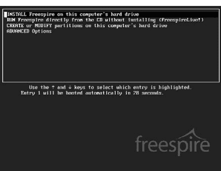

## 图 15-3
选择安装方法

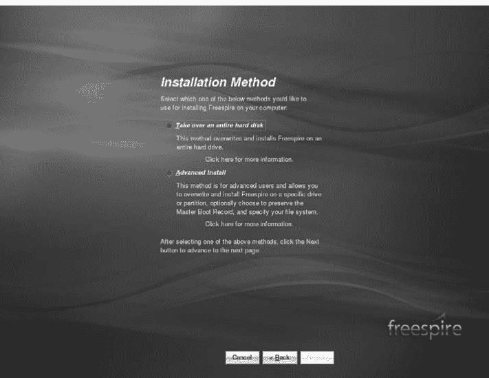

428

# 运行 Linspire 和 Freespace

## 图 15-4
选择计算机名称、用户名和密码。

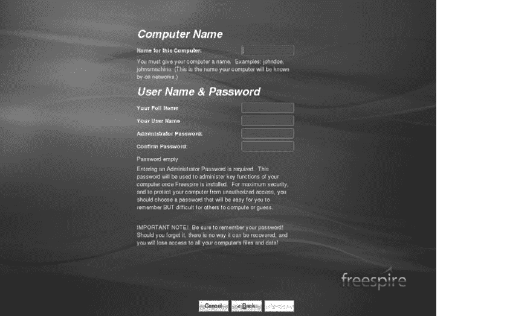

> 提示：大多数发行版（包括 Linspire）遵循 UNIX 传统，即设置一个管理员或 root 账户来处理特权任务，例如安装和更新软件，其他普通用户不应执行这些任务。Freespire；root 账户被锁定，在此屏幕中创建的用户账户被指定为管理员账户，拥有通过 `sudo` 命令临时获得管理权限的权力。（查看 `sudo` 的手册页以了解其工作原理。）安装后，您可以创建其他不具备 sudo 权限的账户，或者将您的 root 账户恢复到自定义位置。

- 4. 系统要求您确认计算机名称、账户信息以及您选择的安装方法。如果您对选择满意，请点击“下一步”。
- 5. 警告窗口要求您务必确定目标驱动器/分区上的所有数据都将丢失。您有“是的，我确定”和“让我进行更改”两个选项。选择“是的，我确定”，您将进入下一步。选择“让我进行更改”，您将返回安装类型屏幕。

> 提示：在第 5 步之前及之后任何时候，您都可以使用“后退”按钮来查看/或更改您之前的配置决策。

429

- 6. 下一个屏幕显示安装过程的进度。滚动的消息会填满空间，几分钟后您将看到以下消息：

Freespire 安装完成
按 OK 重启计算机。

点击 OK。

- 7. 出现最后一条消息，指示您取出 CD 并按任意键。您的 CD 托盘打开了。取出 CD 并按任意键。您的安装完成了。

- 8. 当 Freespace 启动时，您可以指定想要采取的启动路径。启动选项均为引导选项，您的启动屏幕（称为 Linux Loader 或 LILO）上有四个启动选项：Freespace、Redetect、Diagnostics 和 Advanced Menu（高级菜单）。

- Freespace 是默认选项，如果您选择它或只需等待 Freespace 加载，它将进入 Freespace。除非您自上次启动 Freespace 以来安装了硬件，或者您遇到了某些启动问题，否则请始终选择默认选项来启动 Freespace。
- Redetect 如果您自上次安装以来添加了新项目，它将识别硬件。这大致等同于大多数 Windows 用户享有的即插即用功能。
- Diagnostics 是在遇到某些系统问题（如硬件故障或配置不当）时使用的选项。系统会运行一系列应用程序，并显示检测和诊断结果。此屏幕可能非常令人令畏且难以理解。Advanced Menu 让您可以在不进行任何硬件检测的情况下启动系统，如果检测过程导致外设设备挂起，这可能会很有用。

选择 Freespace（或视情况选择 Linspace），操作系统即刻完成加载。

设置窗口（见图 15-5）提供了一个设置系统时间的按钮以及一个允许您设置或更改管理员密码的设置对话框。您可以找到并设置硬件支持的桌面（显示）分辨率，并调用 Freespace 用户管理器，通过它您可以创建新用户、为他们分配权限并根据需要删除他们。您还有一次机会重命名您的 PC。在启动期间使用计算机名称和管理员密码，因此在这里没有更改它们的理由，但如果您喜欢也可以这样做。

安装好 Freespace 后，除了少数特殊的 Freespace 应用程序（主要与播放多媒体内容和获取帮助有关），Freespace 的行为类似于 KDE 桌面系统，因此您可以根据第 3 章的描述学习如何在使用 Freespace 桌面进行操作。

430

## 图 15-5
设置窗口

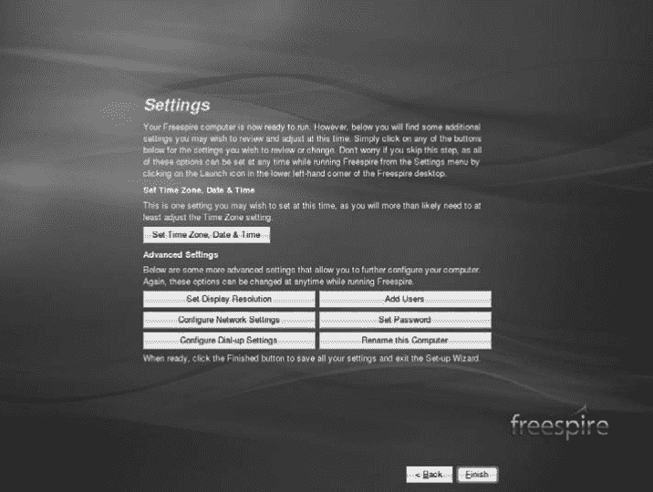

# 加固 Linspire 和 Freespire

当您安装 Linspire，或者使用实时光盘 选项运行 Linspire 时，您将获得创建用户账户的选择。如果您跳过此步，您将以 root 或超级用户账户运行系统。您运行的每个程序也将具有 root 账户的权限。

正如第 4 章所学到的，root 账户对整个 Linux 系统拥有完全权力。应该节节使用，仅用于真正需要的任务。以 root 身份运行 Web 浏览器或即时消息客户端等常用程序会增加 Linux 安全风险，因为您本质上是给了任何可以利用您的整个系统密钥的人打开大门。Linspire 可能允许了那些来自非 Linux 系统的用户这样做，他们习惯用管理员身份运行一切。但话又回来，那些用户的 PC 通常充满了病毒和间谍软件。不要让同样的事情发生在您的 Linux 系统上；创建一个用户账户，仅在绝对必要时才使用 root。Freespace 安装程序在这方面表现良好，因为它强制您创建一个用户账户。在您确实需要以 root 执行任务时，可以使用 `sudo`。

这并不是加固您的 Linux 或 Freespire 系统的唯一方法，但采取这些简单的步骤对保持系统安全非常有帮助。问题在于，`sudo` 的配置文件 `/etc/sudoers` 包含这样一行：


```
%admins ALL=(ALL) NOPWD: ALL
```

这意味着 `admins` 组中的任何用户都可以无需输入密码运行 `sudo`，这非常方便，但允许任何可以利用管理员权限的黑客完全访问系统。解决方法是使用您喜欢的编辑器打开 `/etc/sudoers`，并将代码改为：

```
%admins ALL=(ALL) ALL
```


当您第一次运行 `sudo` 时，会被要求输入密码。在之后的 15 分钟内将不再要求，这应该足够完成任何需要以 root 执行的任务。如果您想更改超时值，也可以配置此值。更多细节请参见 `sudo` 手册并访问 http://wiki.freespace.org/index.php/Making_Admin_Accounts_More_Secure。

# Lsphere

Linux 可能让资深 Linux 社区感到兴奋，但它是面向用户的桌面 Linux 系统的正面范例。L 对于新用户来说是最易访问的 Linux 版本。只要有支持的硬件计算机，任何人都可以安装 Linux 并在几小时内开始使用新应用程序、网页浏览和电子邮件。

Freespace 提供了更多的实验空间，同时保持在普通用户的舒适范围内。用户对未来方向的发言权，以及可以选择包含哪些专利和免费软件的混合，使其对各种自定义用途具有吸引力。

Click-N-Run (CNR) 应用程序将安装便利性提升到了新的高度，使 Linspire 和 Freespire 成为桌面版 Linux 能够成功的有希望的证明。章节末的安装演示表明，这种易用性也有一些权衡。

虽然 Linspire 和 Freespire 确实支持广泛的 Windows 和 Linux 应用程序，但如果不超出这些发行版提供的图形化工具，在它们上运行某些更流行的 Windows 游戏和应用程序仍然很困难。

## 第 16 章

## 运行 Mandriva

在成为 Mandriva Linux 之前，Mandrakelinux 是作为 Red Hat Linux (1998) 的分支创建的。它最初与 Red Hat Linux 的关系非常紧密，以至于 Mandrakelinux 安装程序甚至显示我们正在安装 Red Hat。早期，Mandrakelinux 变成了一个独立的发行版，主要关注易于使用的桌面发行版。当人们谈论对于 Linux 新手最易安装和使用的发行版时，通常会将它与 LinuxSphere 一起提到。

从 2005 年初，在 MandrakeSoft（Mandrakelinux 的母公司）于 2005 年 2 月与 Conectiva Linux 合并后，Mandrakelinux 从破产边缘转变为现在的 Mandriva。Conectiva Linux 是一家总部位于南美的 Linux 公司，其目标与 Mandriva 相似。

Mandriva live CD（Mand Mand One）包含在本书随附的 DVD 中。这是一个面向桌面的 live CD，也可以作为安装程序使用，将 live CD 的内容安装到您的硬盘中。

| 本章内容 |
| :--- |
| 探索 Mandriva |
| Mandriva 社区 |
| 安装 Mandriva |

### Mandriva 特性

与社区驱动的 Linux 发行版不同，Mandriva 是一家销售 Linux 产品的公司。通过 Mandriva Club (http://club.mandriva.com) 提供类似社区的活动，它提供更多的是客户支持类型的功能，而不是 Linux 开发中心。

### 第三部分 选择和安装 Linux 发行版

在与 Connectiva 的合并中，Mandriva 在 2005 年 6 月还收购了桌面级 Lycoris Linux 发行版。因此，产品在过去几年中发生了显著变化。（预计在尘埃落定之前，变化还将持续。）的 Mandriva 产品分为企业版和个人版。Mandriva 为这两个类别提供其所包含的支持和服务。

在企业端，产品重点是企业桌面和服务器，以及一些特殊的防火墙和集群工具。为了支持这些产品，Mandriva 提供了多种咨询、支持和培训选项。对于初始系列，Mandriva 的范围从初级桌面产品到面向家庭和小型办公室服务器的产品。然而，在收购后的一段时间内，Mandriva 提供过 Lycoris 桌面产品。相关技术已整合到 Mandriva 产品中。

在编写时，Mandriva Linux 的当前版本是 Mandriva 2008。面向业务的产品版本号遵循不同的方案，最新的业务服务器产品称为 Mandriva Linux Corporate Server 4.0。

以下是您可以免费下载的 Mandriva 版本简览：

- Mandriva One — Mandriva Linux 的 live CD，包含了一套功能丰富的桌面应用程序。除了提供完整的 OpenOffice 生产力套件外，Mandriva 还包含了图形（GIMP 和 F-Spot）、互联网（Firefox、Evolution 和 GAIM）以及多媒体（Totem 电影播放器、Sound Juicer 和 Tvtime 电视查看器）。Mandriva 包含在随附的 DVD 中。
- Mandriva Linux Free — 面向高级用户的四张免费软件光盘。Mandriva Linux Free 有 i586 和 x86-64 两个版本均可免费下载。
- Mandriva Spring — 专为个人使用设计，考虑到入门级桌面用户。该包包含基础生产力软件，如 OpenOffice、Kdeprintfax 以及计划/财务软件。还包含了请求电子邮件、FTP 和 Web 浏览的工具。还安装了几个多媒体组件，音频和视频播放、图像编辑以及作为 CD 录制。


Mandriva Linux 2007 Spring 是 Mandriva 推荐给想要从 Linux 切换到 Windows 的新手的产品。通过增加观看 DVD 电影（LinDVD）、Windows 游戏（Transgaming）和 3D 桌面效果（drak3D）的商业软件，Mandriva 让从 Windows 到 Linux 的过渡变得相当容易。

以下是 Mandriva 产品列表：

- Corporate Desktop — 提供 x86 和 x86-64 版本，适用于企业桌面。它提供期五年的产品维护，并带有统一支持，其特点是在两个工作日内通过 Web 响应。您在开源企业桌面系统中预期的许多功能都包含在：OpenOffice 生产力套件、Evolution 电子邮件/群组、Totem 电影播放器和 Kopete 即时消息。增值软件包括运行 Windows 应用程序的 CrossOver Office 以及（可选的）Vware 虚拟化软件。
- Mandriva Linux Clustering — 包含用于部署集群系统的软件，适用于各种建模、模拟和其他需要高性能集群的应用。该版本提供 x86 和 x86-64 版本。
- Mandriva Pulse — 一种用于监控和管理 Mandriva 和 Windows 网络的解决方案。它是一个简化远程管理的开源产品。
- Mandriva Corporate Server — 与流行的服务器软件（Apache、MySQL、Samba 等）一起，面向业务的 Mandriva 产品带有广泛的产品支持。Corporate Server 和 Premium Corporate Server 产品都提供 24/7 Web 支持，其中高级包提供更快的响应时间和和其他选项。提供期一年、三年和五年的维护合同。

如果需要，您可以启动 DrakX 安装过程并连接到各种网络服务器以访问安装文件。这些包括 NFS、HTTP、SBM、SSH、Web 代理和 FTP 服务器。

- Kickstart 安装 — 在客户呼叫中心、学校计算机实验室和大型办公室等环境中，您可能会发现自己需要在短时间内安装和配置大量计算机。Kickstart 安装使用答案文件。

## 运行 Mandriva 16

### 探索 Mandriva

### Mandriva 社区

### 安装 Mandriva

### Mandriva 特性

# 运行 Mandriva

以自动化安装过程。Mandriva 的安装程序允许您在执行 kickstart 安装时创建软盘。Mandriva 允许您制作半交互式或完全自动化的设置软盘。

- 升级 — DraK 安装程序支持升级路径，可将旧安装版本更新到最新发布版本。

您可以在本章包含的逐步教程中尝试 DraKx 安装程序。

# 使用 RPMData 进行 RPM 包管理

在您的 Linux 安装中添加和删除软件不应是一项耗费时间的任务。RPMDrake 为管理已安装的软件提供了一个直观的图形化界面。您可以轻易地查看已安装了哪些内容，并根据需要删除软件包。要打开 RPMDrake，选择“应用程序 -> 系统 -> 安装、删除和更新软件”。图 16-1 显示 RPMDrake 窗口的示例。

图 16-1
在 RPMData 软件管理窗口中添加、删除和更新 Mandriva 软件。

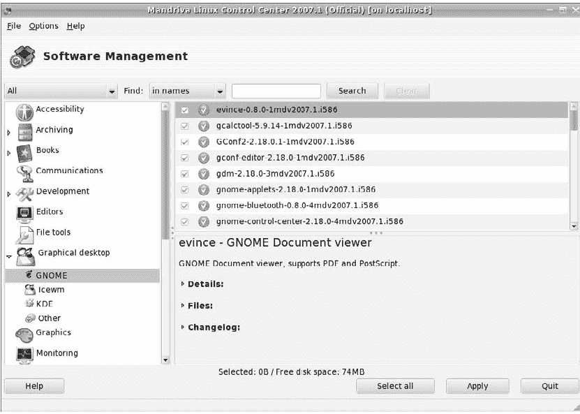

在使用 RPMDrake 时，您应该了解以下内容：

- 您可以通过调用“定义源”功能来配置源列表。这允许您指定可安装软件包的位置，这些位置可以是本地网络位置、CD-ROM 介质或安装包的 HTTP/FTP 存档。您可以刷新“镜像列表”选项以确保您准备好访问最新的安全和系统更新。
- 使用“Mandriva 更新”按钮是维护系统最简单的方法，因为它在您启动更新时会自动为您的系统下载并安装更新。
- 安装软件包时需要 root 密码。RPMDrake 会根据需要提示您输入密码。
- RPMDrake 提供了改进的升级支持。您可以使用它扫描软件更新、下载这些更新，并将它们提供可安装软件包列表中供用户选择。

RPMDrake 支持搜索功能，允许您使用各种准则在配置的源中搜索所需的软件。您可以按包名搜索，也可以根据描述进行搜索。无论哪种方式，一旦您找到了需要的包，只需选择目标包并使用“安装/删除”按钮即可开始。

但如果您想删除软件呢？这个过程也非常简单：在“应用程序”选项卡下找到您想要删除的包。选中它，并点击“安装/删除”按钮。该包及其依赖的任何包将从系统中删除。（您也可以选择不删除依赖包。）

# Mandriva Linux 控制中心

Mandriva Linux 控制中心 (MLCC)，也称为 DrakConf，提供了一种直观且易于使用的各种系统资源方法。您可以使用此工具添加新硬件、配置已安装的应用程序或删除应用程序（通过调用 RPMDrake），并更改现有硬件的配置。

要打开 MLCC，选择“应用程序 ⚙️ 配置计算机”。图 16-2 显示了 Mandriva Linux 控制中心的示例。

您还可以使用控制中心来调整默认系统安全级别、更改显示选项、安排事件、管理用户账户，甚至更改系统时间/日期设置。MLCC 使用多个安装和配置向导来帮助您运行。例如，一个用于 Apache Web 服务器设置的向导可以让您的 HTTP 服务器在几分钟内上线。在 Mandriva Linux 中，MLCC 的一些关键改进和功能是：

- 可从任何网络进行安全的远程系统配置
- 无需重启系统即可自动检测热插设备
- 大图标，易于查看，且与其调用的功能密切相关

图 16-2

Mandriva Linux 控制中心是一个用于系统管理的工具。

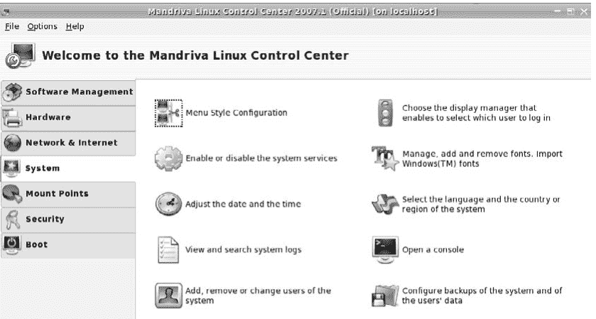

# Mandriva 社区

与许多 Linux 发行版一样，Mandriva Linux 发展出了某种“双重人格”。Mandriva 分发带有许多实用工具、应用程序和支持的 Mandriva Linux 增值版本。核心 Mandriva 开发工作提供了一个不受支持但同样实用的 Mandriva 核心构建版本。通过这个被称为 Mandriva Free 的“免费”副本，您将获得操作系统和基本工具，但无法访问 Mandriva Club 或商业附加组件（DVD 播放器、多媒体插件）等。Mandriva 代表了一个精简版的 Mandriva Linux 现场光盘。

Mandriva Club 允许拥有付费会员的人访问早期版本、全套可下载的一键式应用程序，并使用其仅限俱乐部会员的 Bit Torrent 系统访问论坛、支持以及当前发布版本的下载。它还让您访问无法自由分发的商业软件（如 Flash 插件和 NVIDIA 驱动程序）。为了让

对于来自 Apple 和 Microsoft GUI 操作系统的人来说，这些附加功能作为桌面系统是极其用的。

# Mandriva Club 上的 RPM 仓库

Mandriva 网站 (http://club.mandriva.com) 拥有海量的软件集合，这些软件经过了针对 Mandriva 使用的测试，成员可以直接访问。（非会员可以查看可用软件包，但在未提供有效的 Mandriva Club 会员身份的情况下无法访问文件。）搜索工具以及按类别、创建日期、产品名称、维护组织/用户和分发者分类的各种预编译列表是该网站的功能。

要镜像托管 Mandriva 的镜像站点，请参考 club.mandriva.com。

## 第三部分 选择和安装 Linux 发行版

此安装不需要特殊的硬盘配置。如前文所述，此安装假设已经存在一个使用 NTFS 文件系统的 Microsoft Windows 操作系统。你将在现有分区上“腾出空间”并安装 Mandriva。除了安装启动盘（正如你在这里执行的那样），你还可以利用如 FTP 和 NFS 等安装选项，这些选项在本章中进行了简要概述，并在第 7 章中进行了详细介绍。

> 注意：不要在任务关键系统上尝试首次安装。调整 NTFS 分区可能会导致意外后果。请备份任何你可以な丢弃的信息，特别是当你按照以下说明调整调整现有分区时。

## 使用 DrakX 安装程序安装 Mandriva

从 Mandriva One Live CD 启动 Mandriva 安装的第一步是启动该 Live 系统。一旦 CD 运行，通过点击 Live CD 桌面上的“Live Install”（Live 安装）图标来开始安装过程。

- 1. 在开始此步骤之前，从你的电脑硬盘中备份任何重要数据。
- 2. 插入随书的 DVD 并重启电脑。你将看到启动屏幕。
- 3. 输入 `mandriva` 并按回车。Mandriva One Live CD 启动，并提示你选择语言。
- 4. 选择你的国家并点击“下一步”。系统提示你输入国家名称。
- 5. 选择你的国家名称并点击“下一步”。系统提示你接受条款。
- 6. 阅读条款。选择接受并点击“下一步”。系统提示你选择键盘布局。
- 7. 选择你的键盘布局并点击“下一步”。系统提示你选择时区。
- 8. 根据你的国家、州和城市选择你所在的时区。系统提示你设置时间。
- 9. 选择是否将电脑的硬件时钟设置为本地时间或 UTC 时间。作为替代，你可以选择由 NTP 服务器设置时间（你也可以选择服务器）。点击“下一步”继续。系统提示你是否要启用 3D 桌面效果。
- 10. 选择不使用 3D 桌面效果或使用 Xgl-desktop 效果。（你的显卡需要支持硬件加速才能使用 3D 桌面效果，包括抖动效果和桌面在立方体上旋转）。点击“下一步”继续。

此时，Mandriva One 将继续启动到桌面，如图 16-3 所示。特别注意屏幕左侧的“Live Install”图标。

- 11. 打开桌面上的“Live Install”图标。Mandriva Live 安装向导启动。点击“下一步”继续。系统提示你如何对磁盘进行分区。

## 图 16-3

从 Mandriva One 桌面上的图标启动 Mandriva One 安装。

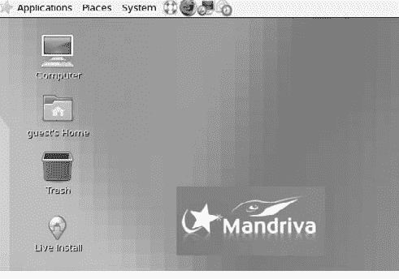

- 12. 下一个屏幕开始 Mandriva 安装的磁盘分区部分。（关于所需分区大小和类型的通用指南包含在第 7 章中。）选择以下方法之一配置你的硬盘：
- **使用现有分区** —— 使用任何可用的 Linux 分区安装 Mandriva。
- **擦除整个磁盘** —— 擦除现有硬盘为安装做准备。对于希望从完全干净系统开始的关键服务器，或者磁盘上没有你需要的数据来说，这是一个极佳的。
- **自定义** —— 这里是魔法发生的地方：你可以创建自定义卷、调整卷大小，并可以随心所欲地折腾你的硬盘。

选择“自定义”选项将打开一个窗口，显示所有现有的硬盘和配置的分区。如果你的系统只有一个位于 NTFS 分区上的现有 Windows 安装，那么可见的将只有带有蓝色标记的 Windows 分区。

一旦点击你想要用于 Mandriva 安装的分区，磁盘配置窗口的左侧部分就会出现一个新选项。通过点击“Resize”（调整大小）按钮，你可以更改 NTFS 分区的大小（在限制范围内）。

如果有机会，尝试一下。点击“Resize”按钮，会出现一个新窗口。它有一个默认滑块到最右侧的滑块。当你将指示器向左滑动时，显示的对应值会变小。这个数字反映了在你完成调整大小操作后 NTFS 分区的大小（单位为 MB）。例如，如果你有一个 30GB 的 NTFS 分区，并想为创建一个原生 Linux 分区腾出 10GB 的空间，只需将指示器从 30000MB 的最大值滑动到 20000MB，你就释放了所需的 10000MB。

## 第三部分 选择和安装 Linux 发行版

你能创建的空间取决于磁盘的大小、存储的数据量以及分区是否经过碎片整理。要确定你可以调整分区的程度，请将滑块完全向左移动。这将显示 Windows 分区可以缩减到的最小大小。

当你选择了所需的大小后，点击“下一步”按钮。系统会显示一个警告，确保你在执行分区大小调整之前备份了任何你依赖的信息。如果你准备好提交，请点击“确定”。

如果你在分区上有重要信息且没有备份，那么折腾分区和卷是愚蠢的。调整大小是一个相当可预测的过程，但这个过程并不是完美的，你最终可能会得到一个 Mandriva 安装和一个巨大的无用分区。

如果一切顺利，你现在已经有了一个格式化的分区。调整大小是一个相当可预测的过程，但这个过程并不是完美的，你可能会得到一个 Mandriva 安装和一个巨大的无用分区。

如果一切顺利，你现在已经有了一个格式化的分区。调整大小是一个相当可预测的过程，但这个过程并不是完美的，你可能会得到一个 Mandriva 安装和一个巨大的无用分区。

- 13. 在正常安装中，你有机会选择要安装的软件包。由于此过程是从 Live CD 安装的，操作系统只是被复制到你的硬盘上。
- 14. 选择引导程序设备（通常为 `/dev/sda`）。有关 GRUB 和 LILO 的信息请参见第 7 章。
- 15. 显示当前的引导条目。你可以编辑这些条目。如果你的电脑上有多个操作系统，你可以添加任何新条目，以便从引导程序中选择这些系统。
- 16. 点击“完成”并选择。

在你第一次安装系统后，你有机会为该安装配置设置。你可以配置以下：

- 网络与 Internet 配置 —— 配置你的以太网、无线或其他互联网连接。
- Root 密码 —— 为 root 用户输入密码（输入两次）。
- 添加用户 —— 为普通用户账户输入真实姓名、登录名和密码（输入两次）。
- Mandriva 账户 —— 你可以创建一个 Mandriva 在线账户。通过此账户，你可以利用 Mandriva 提供的各种服务，例如安全更新和升级。

## 总结

虽然 Mandriva 可能不像其他 Linux 发行版那样广为人知，但它是对桌面用户最易上手的版本之一。对于那些希望其 Linux 安装与没有未使用分区进行 Linux 安装的 Windows 安装共存的用户来说，它特别有用。

本章探讨了 Mandriva 的一些定义特性，包括安装程序（它包含了破坏性调整现有 Windows 分区的能力）、RPM 包管理（RPMDrake）以及系统配置工具。

此外，为了让你能够将 Linux 安装在 100% 的 Windows 分区上，Mandriva 安装程序可以检测你的硬件并提供简化或非常细的软件包选择选项。RPM 包管理允许你从一致且易于使用的图形界面安装、卸载和更新软件。

如果你需要添加或排除硬件故障，Mandriva 提供了图形化配置工具（HardDrake）以便在安装后更容易操作，并在安装期间使用 DrakX。如果你加入 Mandriva Club，将有很多支持和应用程序下载。

## 第17 章

## 运行 Ubuntu Linux

Ubuntu Linux (www.ubuntu.com) 自2004 年底首次发布以来，人气经历了飞速增长。得益于不断扩张的核心开发者网络，以及来自日益庞大的支持者和用户的贡献，Ubuntu 已经成为世界上领先的 Linux 发行版之一。

“Ubuntu”是一个非洲词汇，意为“对他人的仁”。该项目追求其名称背后的含义：

- 免费提供发行版；事实上，该项目会免费向你邮寄许多已购买的 CD（http://shipit-ubuntu.com）。
- 为多种语言提供支持。
- 提供让残障人士可以使用的功能。

Ubuntu 基于 Debian/Linux，但提供了比 Debian 更具针对性的目标。Ubuntu 的主要目标是提供一个经过测试的、易于使用的且具有定期发布计划（每六个月一次）的 Linux 发行版；为这些版本提供长期的支持和更新；并将这款易于使用的桌面 Linux 包含在一张安装光盘中。Ubuntu 在互联网上提供自己的免费软件存储库，提供了按照传统的、许可导向的 Debian 方式组织的海软件。这些软件包可以使用 `apt-get`、`aptitude` 和 `synaptic` 软件管理工具进行安装。

本章描述了 Ubuntu 的一些主要特性。它还介绍了如何在你的计算机上安装它，或者运行 Ubuntu 的 Live CD 版本。

| 本章内容 |
|---|---|
| Ubuntu 强势 Linux 世界 |
| Ubuntu 面临的挑战 |
| 安装 Ubuntu |
| 使用 Ubuntu |

### Ubuntu 概述

尽管 Ubuntu 内部主要是 Debian 发行版，但 Ubuntu 对国际化和通用易用性的关注、定期的发布计划以及简化的安装过程，使其与 Debian 有所不同。

南非商人、互联网企业家以及长期支持者 Mark Shuttle 通过他的组织 Canonical Limited (www.canonical.com) 赞助 Ubuntu Linux。一些最优秀、最聪明的开源开发者都在 Canonical 团队中负责生产 Ubuntu。该组织对免费发行和快速开发的承诺为 Ubuntu 吸引了庞大活跃的用户社区。

### Ubuntu 版本

进入 2008 年，Ubuntu 项目已经发布了七个版本，这些版本基本上遵循 Ubuntu 偏好的每六个月一次的发布周期。每个版本都有源自发布月份和年份的版本号，并以一种森林动物命名（森林可能与 Ubuntu 故乡南非的森林不同）：

- Warty Warthog（疣野猪）—— 2004 年 10 月发布，Ubuntu 版本号 4.10。
- Hoary Hedgehog（灰脸刺猬）—— 2005 年 4 月发布，Ubuntu 版本号 5.04。
- Breezy Badger（清风松鼠）—— 2005 年 10 月发布，Ubuntu 版本号 5.10。
- Dapper Drake（花纹野鸭）—— 2006 年 6 月发布，Ubuntu 版本号 6.06。
- Feisty Fawn（活泼小鹿）—— 2007 年 4 月发布，Ubuntu 版本号 7.04。
- Gubby Gopher（憨土鼠）—— 2007 年 10 月发布，Ubuntu 版本号 7.10。

> **注意：** 除了定期发布外，Ubuntu 还为需要高可用性特的用户提供了 LTS（长期支持）版本。LTS 为桌面版本提供三年的支持，为服务器版本提供五年的支持。

如果你是 Linux 新手，Ubuntu 是为为你量身设计的。标准的 Ubuntu 安装程序为大多数安装提供了一组极佳的默认设置。然而，Ubuntu 在你安装时也提供了包含许多自定义选择的其他选项。如果你正在从 Debian（或其他 Debian 派生版，如 KNOPPIX）迁移，你会发现与 Ubuntu 协作非常容易。你使用与 Debian 相同的方法在 Ubuntu 中安装、删除软件包并管理服务。

从 Dapper Release 开始，Ubuntu 项目每个版本都提供三张不同的 CD 或单张 DVD。CD 如下：

- 桌面 CD —— 直接启动到 Ubuntu，你可以在那里尝试 Ubuntu（不会更改现有系统中的任何内容），或将 Ubuntu 安装到硬盘。这等同于许多发行版提供的 Live CD，不同之处在于如果你决定这样做，它提供了一种永久安装 Ubuntu Linux 的简便方法。
- 服务器安装 CD —— 允许你安装各种服务器配置，从基础服务器到标准的 LAMP (Linux/Apache/MySQL/Perl) Web 服务器。
- 备用桌面 CD —— 允许通过比桌面 CD 图形界面更复杂的方式（使用逻辑卷管理）从命令行安装 Ubuntu 桌面系统。它还支持想要自定义并交付基于 Ubuntu 系统的 OEM 公司，并提供了自定义的服务器安装机制。它不包含 Live CD。

开始使用 Ubuntu 很容易，因为桌面安装 CD 启动后是一个功能完整的桌面系统。Ubuntu 安装 CD 在检测硬件、设置你的显卡（鼠标、键盘和显卡）以及启动到 GNOME 桌面方面做得非常好，且不会更改你现有系统中的任何内容。它桌上有一个图标，允许你在通过六个简单的配置屏幕（本章稍后讨论）后，将 Ubuntu 安装到你的系统中。

接下来的章节将描述 Ubuntu 7.10 (Gutsy Gibbon) 中的桌面和服务器特性。

### Ubuntu 安装程序

Ubuntu 安装程序帮助 Ubuntu 成为一个极其受欢迎的发行版，展示了 Ubuntu 从发布之初对易用性的承诺。Ubuntu 的安装过程在检测硬件和系统配置信息方面做得非常出色。Ubuntu 安装 CD 仅需少量信息即可安装你的软件包组；Ubuntu CD 具有更传统的、基于文本的安装程序，这对于任何 Debian 类系统的用户来说应该是熟悉的，并且是为他们设计的。

# 运行 Ubuntu Linux 17

图 17-1

使用 Ubuntu 的辅助技术和更简单的设备管理

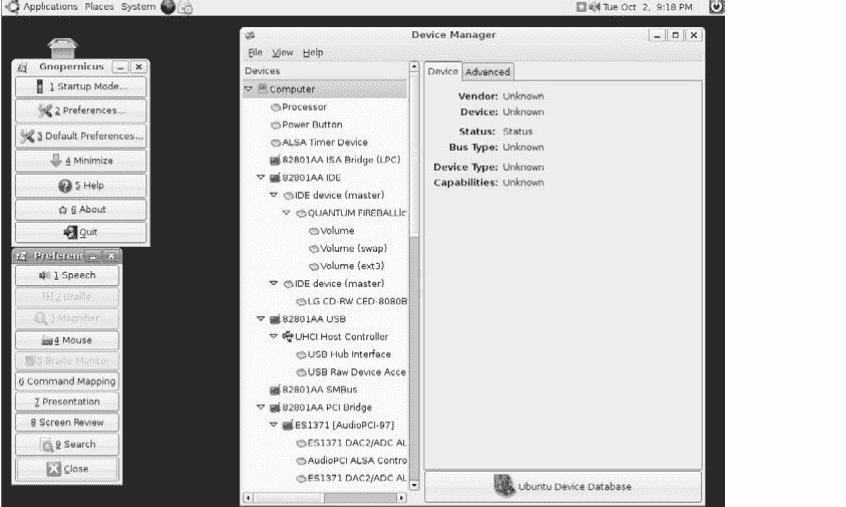

默认服务器安装支持在 32 位 PC 上使用高达 4GB 的内存，并为 GFS 和 OCFS2 集群文件系统提供了内核支持。虽然 GFS 和 OCFS2 仍然是新的文件系统，它们可能尚未准备好在您的生产系统中使用，但您可以在 Ubuntu 中尝试它们。

要将 Ubuntu 作为轻客户端使用，Ubuntu 服务器中包含了 Linux 终端服务器项目（Linux Terminal Server Project）。你可以阅读 [Ubuntu 轻量客户端 HOWTO](https://help.ubuntu.com/community/ThinClientClientHOWTO) 来了解如何使用 LTS。

默认服务器安装占用约 400MB 的磁盘空间，尽管这是一个非常精简的系统。除了基础系统包和核心实用程序，你还获得了用于管理网络连接和文件系统的软件，但没有其他了。幸运的是，如果你拥有应用管理工具（如 `apt-get`），那么你想要添加到服务器的任何开源软件只需在连接互联网的情况下运行 `apt-get` 即可。

许多人安装的最常见的服务器类型是 LAMP 服务器系统，它使用 Linux 支持 Apache Web 服务器并提供 MySQL 数据库。它还支持 Perl 语言，许多应用程序都是用这种语言编写的。Ubuntu 服务器安装

# 第三部分 选择和安装 Linux 发行版

CD 为此类服务器提供了一个单独的安装程序，突显了 Ubuntu 对用户需求的关注（以及敏感性），无论他们是坐在桌面电脑系统前，还是成群坐在某处的机房集群中。

# Ubuntu 衍生版 (Spin-Offs)

由于没有没有任何软件 CD 能满足所有人的需求，已经从 Ubuntu 创建了一些衍生项目。以下是与 Ubuntu Linux 相关的伙伴项目：

- Kubuntu (www.kubuntu.org) —— 该项目将最新版本的 KDE 桌面与每个 Ubuntu 版本相结合。KDE 替换了 Ubuntu 默认使用的 GNOME 桌面。
- Xubuntu (www.xubuntu.org) —— 该项目将 Ubuntu 的强大和易用性与轻量级的 Xfce 桌面相结合，提供了一个对设置和图形资源要求较低的全功能 Ubuntu 系统。Ubuntu 在较旧或性能较弱的系统上运行良好，是笔记本电脑的理想选择。
- Ubuntu (www.ubuntu.org) —— 该项目专注于生产适用于教室的 Ubuntu 版本。Ubuntu 面向于教育（如 KDE 教育软件）以及用于创建廉价集群的软件（如 Linux 终端服务器项目）。结果，Ubuntu 可以在工作时以极低的成本填充整个计算机实验室，作为教育工作站。

Ubuntu 致力于帮助不同文化背景的人，支持许多不同的语言和键盘类型，有 Ubuntu 社区支持全球用户。这里有 Ubuntu 中国 (www.ubuntu.org.cn)、Ubuntu 德国 (www.ubuntu-forum.de)、Ubuntu 瑞典 (www.ubuntulinux.se)、Ubuntu 印度尼西亚 (www.ubuntulinux.id)、Ubuntu 葡萄牙 (www.ubuntu-pt.org) 以及其他国际 Ubuntu 。

# Ubuntu 面临的挑战

尽管 Ubuntu 崛起，但它不可免会遭受一些成长痛苦。Ubuntu 面临的一些挑战包括：

- 与 Debian 平稳共处 —— 作为一个受 Debian 启发的发行版，Ubuntu 最初非常依赖 Debian，并继续使用 Debian Linux 中被强调的许多许可、稳定性和特性。Debian 社区的一些成员最初认为 Ubuntu 劫持了 Debian 项目的努力。然而，由于 Ubuntu 的成功既是为了它自己，也是为了 Debian 社区的技术卓越和承诺，Ubuntu 将其修复和增强回馈给 Debian 社区，以及支持单个开源包的开发者。这两个发行版需要共同努力，以改进这两个发行版以及整个 GNU/Linux。
- **快速的发布周期** —— Ubuntu 设置了六个月一次的发布周期。在免费 Linux 发行版中，只有 Fedora 保持接近六个月的发布周期。Debian 显然以不急于发布新版本而闻名——Debian 最慢的版本是 Ubuntu 的最初灵感之一。已经发生了一些延迟——例如，Ubuntu 6.06 版本原计划于 2006 年 4 月发布 (6.04)，但故意推迟以带来重大改进。Ubuntu 6.10 版本基本上是准时的，随后的发布也是如此，但六个月一次的发布计划仍然是一个激进的目标。
- **商业模式** —— 虽然 Ubuntu 项目提供了带有 Ubuntu 标志的衬衫、帽子、泰迪熊和其他你可以购买的产品 (https://shop.canonical.com/)，但捐赠显然不足以支持长期开发工作。该项目已明确表示，Canonical 公司以及全球许多其他供应商为 Ubuntu 版本提供商业支持，但这很少成功。只有不断增加的家庭、中小型和企业级 Ubuntu 用户才能告诉，Ubuntu 在不采用像 Fedora/Red Hat、openSUSE 以及 FreeSoft/Linux Spinner 那样的免费/付费社区模式的情况下是否能够取得成功。
- **自由与责任** —— 以自由和平等为指导明针的尝试有时会因为缺乏控制而遭受损失。受哲学启发的开发变得更加流行。

# 安装 Ubuntu

将 Ubuntu 安装到硬盘需要计算机至少具有 64MB 内存（Ubuntu 服务器）以及 256MB 内存（Ubuntu 桌面版）。对于磁盘空间，安装桌面系统至少需要 4GB 空间，最小化服务器需要 500MB 空间。对于最小化服务器，你需要能够在命令行工作（不安装 GUI）。

# 选择和安装 Linux 发行版

Ubuntu 7.10 桌面安装 CD 镜像包含在随书 DVD 中。要从 DVD 安装，不要按照下面的描述的方法进行，而是执行以下操作：启动 DVD，在启动提示符处输入 ubuntu，并在 Ubuntu 桌面启动后，打开安装图标并按照说明进行操作。

如果你在已安装 Windows 系统的桌面电脑上设置 Ubuntu 进行双启动，你可以在安装过程中调整 Windows 分区。然而，确保在 Windows 分区之外存在空磁盘空间更容易。参考第 7 章关于调整硬盘分区为 Linux 安装留空间的信息。当然，在此时你应该备份任何数据文件。

下面的步骤描述了如何启动和安装 Ubuntu：

- 插入 Ubuntu 桌面安装 CD 并重启计算机。你应该看到 Ubuntu 的启动界面，如图 17-2 所示。（如果你的系统没有从 CD 启动或没有看到 Ubuntu 启动屏幕，请确保你的计算机如第 7 章所述可以从 CD 启动。）

图 17-2

Ubuntu 桌面安装 CD 启动界面

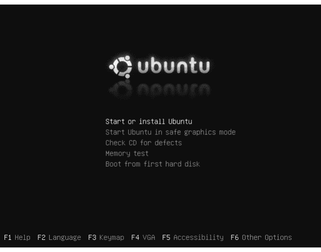

2. Ubuntu 桌面安装 CD 的启动界面提供了多种不同的选项，用于启动您的系统、测试安装 CD 或您的系统内存等。
它还提供了许多特殊菜单和屏幕，你可以查看这些内容来激活在安装过程中遇到特殊需求时可能对你有帮助的功能。
以下是你可以按的功能键列表以及每个按的结果或屏幕的描述：

- 帮助 (F1) — 列出启动界面上可用的选项。
- 语言 (F2) — 允许你设置 Ubuntu 和 Ubuntu 安装程序使用的语言。
- 键位映射 (F3) — 允许你指定 Ubuntu 和 Ubuntu 安装程序使用的键盘类型。
- VGA (F4) — 允许你指定正在启动或安装 Ubuntu 的系统的显卡能力和屏幕分辨率。
- 辅助功能 (F5) — 允许在 Ubuntu 安装程序中激活各种辅助功能相关的选项，包括屏幕放大器、屏幕键盘、各种提示的音频朗读等。
- 其他选项 (F6) — 允许你修改用于启动 Ubuntu 的内核命令行，这可以让你禁用某些硬件系统（如电源控制）、开启更详细的调试信息等。

3. 若要在不修改这些选项任何内容的情况下继续，只需按 Enter 键启动 Ubuntu 并启动默认桌面，如图 17-3 所示。

4. 一旦 Ubuntu 桌面显示，你就可以在不对硬盘进行任何更改的情况下尝试运行 Ubuntu Linux，或者将 Ubuntu 安装到你的系统中。要在你的计算机系统上安装 Ubuntu，请双击“安装”图标开始安装过程。

## 图 17-3
Ubuntu 桌面和图形化安装程序的图标

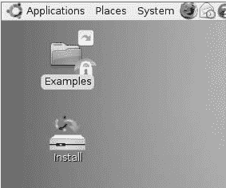

## 第三部分 选择和安装 Linux 发行版

5. 选择你想为 Ubuntu 使用的语言（默认是英语）。点击“向前”接受所选值并进入下一个屏幕。你会被要求输入所在地。

6. 选择你的所在地。你的所在地将完善语言（句话说，美国英语可能与加拿大英语不同），并将用于设置运行时间。如果时间与你的所在地不符，可以点击“设置时间”显示出一个对话框，允许你正确指定本地时间。点击“向前”接受所选值并进入下一个屏幕。你会被要求输入键盘布局。

7. 选择你的键盘类型。点击“向前”接受所选值并进入下一个屏幕。

8. 提供有关你想在该系统上创建的用户账户的信息。你的账户将具有管理权限，因此你应该在该系统中创建你自己的账户。输入你的全名（例如，John Smith）、你将用于登录的用户名（例如，jsmith）、新用户的密码以及这台计算机的名称（任意均可）。点击“向前”接受所选值并进入下一个屏幕。
你会被要求开始初始化硬盘。

> 注意：更改或删除磁盘分区可能会导致数据丢失。在选择分区方法之前，请务必仔细考虑你的选项。

9. 为你的硬盘分区选择以下选项之一。（有关磁盘分区的信息，请参阅第 7 章）

- 擦除整个磁盘 — 这将擦除你的整个硬盘，然后自动重新分区。如果你准备删除硬盘上的所有数据，请选择此方法。Ubuntu 安装程序将使用常用的 Linux 文件系统进行重新分区。
- 使用最大空空间 — 这允许你在已安装其他操作系统的系统上安装 Ubuntu，只要你的磁盘（或磁盘）上有足够的未分配空间。第 7 章解释了如何对现有系统进行重新分区以便在此处腾出空间。
- 手动编辑分区 — 这允许你手动创建自己的磁盘分区。如果你想保留现有分区不被擦除，或者你需要单独的分区来存放用户数据 (/home) 或服务器数据 (/var)，或者为硬盘特定区域使用特定的文件系统，这是最佳选择。手动分区被认为是一项高级技能。

如果你选择手动编辑分区表，请继续到下一步。否则，直接跳到第 11 步。

10. 在手动分区阶段，你可以图形化地选择或调整磁盘上分区的大小，并指定关于如何在安装 Ubuntu 的系统上使用这些分区的各种信息。你必须定义至少两个分区。其中一个分区用作交换空间（swap），这是 Linux 系统用于管理虚拟内存的特殊格式。第二个分区用于存放你的 Ubuntu Linux 安装的顶层目录，即根目录，并挂载为 / 你的 Ubuntu 系统。

在初始分区对话框中，你选择想要创建分区的空磁盘空间并点击“新建”，这将显示一个对话框，允许你通过拖动边界来图形化地调整分区大小。在这个对话框中，你还指定了要在分区上使用的文件系统类型，以及它是主分区还是扩展分区。单个磁盘驱动器上只能四个主分区——若要在单个磁盘驱动器上创建四个以上的分区，则四个分区中的一个必须定义为扩展分区，然后在其中定义其他（逻辑）分区。

11. 分割磁盘后，点击“向前”进入第二个对话框，在其中定义主分区和逻辑分区应该挂载在 Ubuntu 系统上的位置。

## 运行 Ubuntu

12. 当你完成后，确认屏幕将总结你所选择的安装选项。要开始安装，点击“安装”。你可以点击“返回”回到之前的屏幕并更改你选择的值，或点击“取消”中止安装且不更改系统上的任何内容。如果你选择“向前”，安装程序将开始安装。当过程完成后，安装程序会插入 CD，提醒你从系统中移除它，并要求你按 Enter 重启系统。

13. 安装完成后，桌面安装程序会显示“安装完成”对话框。当你看到这个对话框时，可以点击“使用 CD”继续从 CD 尝试 Ubuntu，或点击“重启”重启你的系统并直接从硬盘启动 Ubuntu。

当你启动系统时，Ubuntu 在启动时会显示启动界面和进度对话框，随后是登录界面。恭喜——你正在运行 Ubuntu！

Ubuntu 系统会自动运行一个名为“更新管理器”的图形应用程序，用于通知何时可用系统更新，并检索和安装这些更新。如果你的系统有可用更新，更新管理器会显示此类消息，并在顶部面板右侧提供一个图标，你可以点击该图标来安装这些更新并保持系统为最新。你需要提供密码来执行此操作（或任何其他管理操作）。你也可以随时通过选择“系统 ➔ 更新管理器”菜单项手动检查更新。

## 开始使用 Ubuntu

在表面上，Ubuntu 的外观与其他使用 GNOME 的 Linux 桌面系统并没有太大区别。在底层，管理软件包的工具与你预期 Debian 系统的一样。许多差异是细微的，都是为了让终端用户使用 Linux 变得更容易。

使用你在安装期间输入的用户名和密码登录。图 17-4 显示了一个使用替代 Ubuntu 背景的 Ubuntu 桌面示例。

# 运行 Ubuntu Linux

## 尝试桌面

使用最新的 GNOME 界面，菜单位于顶部面板。默认情况下，你并不会像默认的 Fedora 安装那样有许多应用程序供选择，这是意料之中的，因为 Ubuntu 是通过一张而非多张光盘提供的。然而，Ubuntu 提供的桌面应用程序选择是非常好的。

- 应用程序（Applications）菜单提供了以下类别的软件：

- 辅助（Accessories）——从此菜单中，可以选择 GNOME 项目的一些基础桌面工具。选择归档管理器（Archive Manager）启动 File Roller，它提供了一个简单的 GUI 界面，用于以各种存档和压缩类型备份个人文件。文本编辑器（Text Editor）提供了一个非常好用的文本编辑器（这样你就不需要使用不直观的 vi 来编辑纯文本文档）。要进入 shell，可以从此菜单启动终端（Terminal）应用程序。其他辅助包括计算器（Calculator）、字符映射（Character Map，用于映射特殊键盘字符）和字典（Dictionary）。
- 游戏（Games）——在游戏菜单下，你有约 17 款 GNOME 游戏。其中某些与你在 Windows 桌面面上看到的游戏相似（例如：扫雷、空中接接牌和纸牌接龙）。还有类似俄罗斯方块的游戏（Gometri）和棋盘游戏（麻将）。你不会获得任何高性能的开源游戏（如 Tux Racer）或网络游戏（如 BFG 网络坦克大战），但你可以轻松地使用 Synaptic 软件包管理器（Synaptic Package Manager）来安装它们。
- 图形（Graphics）——Ubuntu 安装包含了 GIMP 软件处理程序。它还包含了用于管理数字照片集合的 F-Spot 照片管理器，以及 Github 查看器。为了从扫描仪导入图像，Ubuntu 包含了 XScan 扫描应用程序。这里没有包含任何文档查看器，例如 Evince（可以查看 PostScript 和 PDF 文件）以及更传统的 Adobe Acrobat 查看器，可以使用 Synergy 安装。
- 网络（Internet）——可以从 Evolution 标准的开源互联网客户端。Skype 允许你直接从 Ubuntu 系统拨打 VoIP 电话。Evolution（一个资源密集型但功能全邮件客户端和个人信息管理器）；Firefox 是 Ubuntu 的 Web 浏览器，Pidgin（以前称为 GAIM）用于即时消息。此菜单还包括一个终端服务器客户端，如果你需要连接到 Microsoft Windows 服务器（万你仍然需要访问 Microsoft Windows 系统）。
- 办公（Office）——Ubuntu 包含全套 OpenOffice 办公效率应用程序。选择包括 OpenOffice Calc（电子表格）、Draw（绘图和流程图）、Impress（演示文稿）、Math（公式和方程）和 Writer（文字处理）。OpenOffice 允许你创建和访问数据库。
- 音频与视频（Sound & Video）——Ubuntu 提供了一个电影播放器、Sound Juicer CD 播放器和刻录、用于在线音频的 Rhythmbox 音乐播放器、Serpent CD 播放器以及 Sound Recorder 音频录应用程序。与任何商业 Linux 发行版一样，Ubuntu 并没有内置播放 MP3 音乐所需的软件，但你可以轻松地从 Ubuntu 仓库添加这些功能。

Ubuntu（以及其他 GNOME 桌面）自带的电影播放器是 Totem。播放商业 DVD 还需要额外的非开源代码。Xine 和 MPlayer 等播放器需要无法自由分发的解码器，Ubuntu 默认不包含，但可以添加到 Ubuntu 仓库。

- 位置（Places）菜单跟踪你想去的地方，让你能够连接并查看（如果你愿意，连接到）最近打开的文档。还有一个选项可以在你的系统中搜索文件。
- 系统（System）菜单提供了更改桌面偏好设置和执行系统任务的选择。
- 管理（Administration）菜单是你去选择语言、设置打印机、管理磁盘以及添加用户或组的地方。

## 添加更多软件

虽然人类设法从单张 Ubuntu 光盘安装 2GB 的应用程序，但它仍然只有 2GB。相比之下，其他包含多张光盘的组合实现方案可以安装高达 7GB 的软件。要向 Ubuntu 添加更多软件，可以使用常用的 Debian 软件包工具（apt-get, aptitude 和 dpkg）。你也可以使用 Synaptic 软件包管理器来添加和删除软件包，它提供了一个友好的图形界面、一个方便的搜索函数来帮助你找到软件包，以及相比命令行操作的许多其他易用性改进。

要打开 Synaptic 软件包窗口，选择系统 ✎ 管理 ✎ Synaptic 软件包管理器。图 17-5 显示了 Synaptic 软件包管理器。

使用 Synaptic 软件包管理器，你可以通过选择列中的“未安装”（Not Installed）项来安装更多软件，然后在左侧选择你想要安装的软件包。选中一个或多个软件包后，选择“应用”（Apply），你选择的软件包将从互联网仓库下载并安装。

由于 Ubuntu 的交付方式如下：

- Universe 软件包：存储在 Ubuntu 仓库中的软件包包含了尚未稳定到可以被正式纳入该项目的软件。尽管这些软件由 Ubuntu 社区针对 Ubuntu 库进行构建，并且在大多数情况下运行良好，但它们没有支持或安全修复的保证。

**图 17-5** Synaptic 软件包管理器显示并安装 Ubuntu 软件。

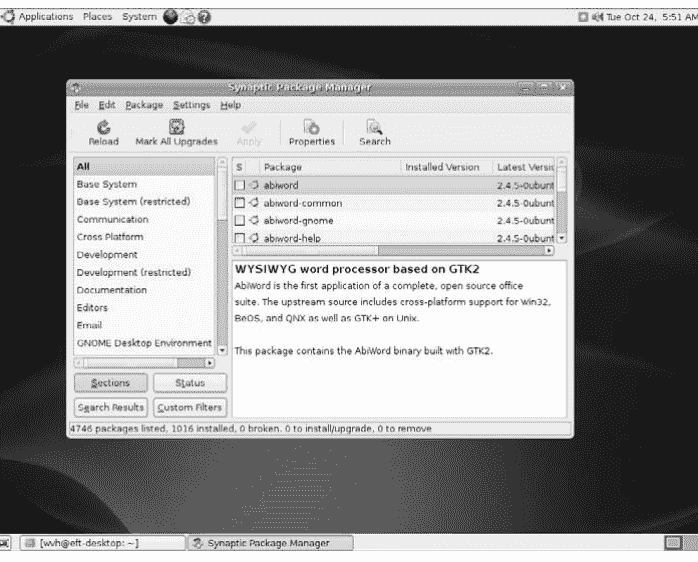

- Multiverse —— Multiverse 仓库中的软件包包含非免费软件。这意味着软件许可可能不符合 Ubuntu 的要求，或者该软件可能会遇到专利问题，或者只需要二进制版本。鼓励用户在使用这些仓库的软件之前，自行研究许可和其他法律问题。

按照以下步骤将 Universe 和 Multiverse 仓库添加到 Synaptic 软件包管理器中，这样你就可以使用它们来获取额外的 Ubuntu 软件，这些软件可能仅仅不足以成为 Ubuntu 版本的一部分：

1. 从 Synaptic 软件包管理器主窗口，选择设置（Settings）-> 仓库（Repositories）。软件源窗口出现，显示了你系统中激活的软件仓库，如图 17-6 所示。
2. 选择社区维护的开源软件（Universe）或受版权或法律限制的软件（Multiverse）仓库，以便你探索或安装它们的软件。

图 17-6 添加仓库以获取官方之外的软件。

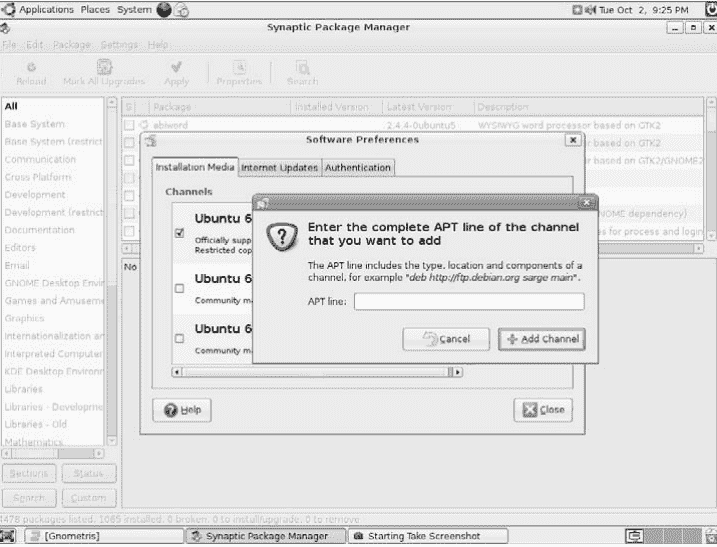

3. 点击关闭（Close）关闭此对话框并返回 Synaptic。可能会看到一个确认对话框，提示仓库信息已更改。点击“确定”（OK）。
4. 选择你刚刚添加到 Ubuntu 列表中的。来自添加仓库的软件现在出现在你的列表中。

此时，你可以安装列表中的任何软件包。但请记住，Universe 和 Multiverse 仓库中的软件不受 Ubuntu 支持，它们不会收到官方补丁或安全更新。

# 第三部分 选择和安装 Linux 发行版

对于刚开始使用 Ubuntu 的人，Ubuntu 论坛有很多非常有资源。我推荐以下内容：

- 常见问题解答 (FAQs)、教程 (HowTo)、技巧 (Tips & Tricks)

http://ubuntuforums.org/forumdisplay.php?f=100

该论坛列出了许多人在安装 Ubuntu 后会遵循的常用步骤，例如为显卡或多媒体软件添加支持。

- 初学者交流区 (Absolute Beginner Talk)

http://ubuntuforums.org/forumdisplay.php?f=73

此论坛中的帖子可以帮助你理解 Linux 的本质，以及 Ubuntu 是否符合你的需求。你可以在这里提问任何基础问题。

- Ubuntu 咖啡馆 (Ubuntu Café)

http://ubuntuforums.org/forumdisplay.php?f=11

为了感受 Ubuntu 社区的精神，你可以查看 Ubuntu 咖啡馆论坛，了解大家在想什么。

Ubuntu 社区还有一个 wiki (https://wiki.ubuntu.com)，它不断为使用 Ubuntu 的人员积累有用内容。目前，该 wiki 包含了 Ubuntu 文档、社区信息、多语言支持、活动等更多区域。此外，还有针对每个 Ubuntu 版本的特定区域。

## 总结

Ubuntu 目前是 Linux 发行版中的新星。Ubuntu 起于 Debian（它是最受推崇但对初学者来说具有挑战性的发行版之一），简化了打包和安装。它展示了对频繁发布设计良好且受支持的版本的承诺。今天，Ubuntu 远不仅仅是 Debian 的衍生版本，它有自己的社区、倡导者以及完善的开发和维护小组。

通过单张 CD，用户可以安装一组实用的桌面软件或精简的服务器系统。Ubuntu 的图形化安装程序通过将图形化安装程序与可以直接从 CD 运行的现场发行（live distribution）相结合，极大简化了安装过程。测试和安装 Linux 变得比以往任何时候都容易。

随着 Ubuntu 流行度的增长，还出现了一个活跃的开发者和用户社区。要参与到 Ubuntu，一个很好的起点是社区论坛和 Ubuntu wiki。

## 第 18 章

# 运行 Linux 防火墙/路由器

互联网是一个潜在的敌地，因此你需要能够保护自己的计算机免受来自互联网的攻击。

对于面向互联网的计算机，安全性的一个基本要素是防火墙。防火墙可以保护你的计算机或私有网络不受外部入侵者的侵害。在本地网络和互联网之间的路径上放置防火墙，可以让你拥有巨大的权力和活性来管理网络流量。你可以根据进入或离开网络的数据包的来源、去向以及它们请求执行的操作，对每一个数据包做出反应。

Linux 常被用作防火墙。事实上，几个 Linux 发行版被配置为专门作为防火墙运行（运行在如软盘一样小的介质上）。由于防火墙工具也可用于保护个人桌面系统，几个 Linux 发行版包含了适用于桌面环境的图形化防火墙管理工具。从实际上，几乎任何 Linux 发行版都可以用作专用防火墙，或者简单地配置使用防火墙功能来保护自己免受意外的外部访问。

在本章中，你将探索今天几乎每个 Linux 系统中都用于创建防火墙的功能（使用 `iptables` 特性），并发现如何在 Fedora 和 Mandriva Linux 中使用图形化防火墙工具。为了理解大量的防火墙功能如何放入非常小的空间内，你将查看如何使用 Coyote Linux 软盘防火墙发行版（随书附带）。

## 本章内容

- 理解防火墙
- 使用防火墙保护桌面
- 使用 `iptables` 管理防火墙软盘
- 制作一个 Coyote Linux 可启动防火墙软盘
- 获取其他可启动防火墙

随书附带的 CD 包含了使用 Coyote Linux 创建可启动软盘防火墙所需的内容。随书附带的每个 Linux 发行版都包含了 `iptables` 防火墙功能。

# 第三部分 选择和安装 Linux 发行版

# 理解防火墙

防火墙是指根据定义的安全策略限制对计算机或网络访问的硬件或软件工具。在本章的语境下，防火墙指的是一种软件，它检查来自互联网的每一个网络数据包，以决定是应该被允许、完全拒绝、忽略还是修改。每个最近的 Linux 系统都提供了可用防火墙功能，因为它们被构建在 Linux 内核中名为 `iptables` 的设施中。但 Linux 中的防火墙用法可能有所不同，取决于你对 Linux 做些什么：

- 桌面系统 —— 仅用于运行应用程序和 Web 的 Linux 系统可以使用其防火墙拦截所有（或几乎所有）入站的服务请求。通过这样做，进入桌面系统的唯一数据是对其自身发起的请求的响应。当该桌面作为公司防火墙时，可以放宽防火墙规则，允许在该防火墙之后发生各种类型的文件和打印机共享。
- 服务器系统 —— 在 Linux 服务器上，防火墙可用于拦截除提供该服务器提供的特定服务以外的所有入站端口。它还可以用于拦截来自已知特别滥用的地址的任何请求，或允许已知为友好的客户使用更多服务。
- 路由器系统 —— Linux 常被用作专用防火墙，在私有网络和公共网络（如互联网）之间提供缓冲。在这种场景下使用 Linux，你可以充分利用 `iptables` 中的全系列防火墙功能。任何尝试穿过防火墙的数据包都可以经过过滤，然后允许通过、丢弃或以某种方式重定向。防火墙可以隐藏（伪装 masquerade）通过防火墙使用互联网的私有计算机的身份。

防火墙不需要图形界面（事实上，专用防火墙通常没有 X，尽管它们经常提供 Web 内容）。事实上，家庭或小型办公室环境中的防火墙可能运行在 486 计算机上。它的占用空间可以小到甚至不需要硬盘——只需要一张包含（或包含）必要配置信息的可启动软盘或 CD 即可。

防火墙是使用特殊用途 Linux 发行版的一个绝佳例子（在本章后面你将看到如何构建和运行自己的发行版，它可以放在软盘上）。Linux 发行版通常：

- 经过调整，主要包含作为防火墙所需的组件。
- 包含用于轻松配置防火墙设置的脚本。
- 不包含 X，你需要使用命令行或网络上另一机器的 Web 浏览器，允许发行版适应更小的空间。
- 包含其他用于诊断网络问题或以某种方式服务本地网络的工具。

然而，对于普通桌面用户，Linux 提供了图形化工具来建立基础安全的防火墙，而无需用户理解 `iptables` 的语法。让我们检查其中的一些工具。

# 使用防火墙保护桌面

如果你使用 Linux 系统，简化的 GUI 防火墙工具是保护计算机的好方法。至少，你可以使用防火墙显式允许他人使用你计算机上的选择服务，同时拦截对其他服务的请求。

Mandriva、Fedora 和红帽企业 Linux (RHEL) 自带的工具提供了几种配置 GUI 工具的方法。在安装 Fedora 或 RHEL 期间，anaconda 安装程序提供了一个选择你的防护防火墙的界面。Mandriva 通过其控制中心提供了防火墙。

# 在 Fedora 中启动你的防火墙

在首次启动时，在安装 Fedora 或 RHEL 系统后，防火墙配置屏幕允许你建立基础防火墙。一旦 Fedora 安装完成，你可以使用防火墙配置窗口（选择系统防火墙），如图 18-1 所示。

> 图 18-1n在防火墙配置窗口中更改你的 Fedora 防火墙设置。

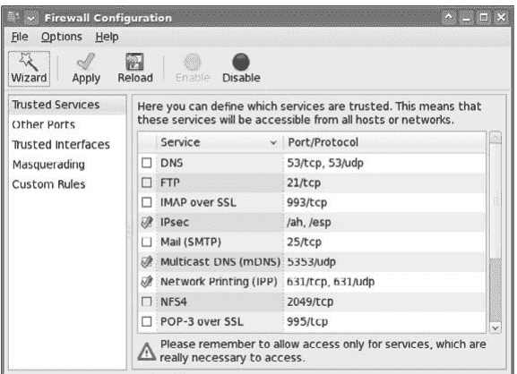

## 第三部分 选择和安装 Linux 发行版

Fedora 防火墙配置界面处理了普通桌面用户防火墙所需的所有内容。以下是你可以使用该页面上的设置进行的操作：

- 禁用防火墙 —— 虽然通常不建议使用此选项，但如果用户直接连接到路由器，或者觉得网络连接没有威胁，他们会选择“禁用防火墙”。这允许所有端口的连接请求。对已配置服务的请求将被允许，而对其他服务的请求将被忽略。防火墙将不加分问地通过这些请求。
- 启用防火墙 —— 选择“启用”选项，系统将为你设置一套基础的 iptables 规则，而你无需了解 iptables 的工作原理。一旦启用防火墙，你可以使用“服务”列中的项，选择允许特定的服务访问你的 Linux 系统。
- 选择受信任的服务 —— 如果你从你的系统提供服务，请勾选想要允许的服务旁边的复选框。通过选择相应的复选框，你可以允许你的系统访问列出的服务器类型。
- 打开其他端口 —— 要访问其他端口（代表特定服务），点击“其他端口”标题旁边的箭头。点击“添加”，然后输入端口名称（如 imap）或数字（如 143）并选择协议（TCP 或 UDP）。

> 只有当你的电脑是邮件服务器时，才打开 IMAP 和 POP3 端口。如果你只是在电脑上下载和读取邮件，可以在不打开这些端口的情况下从 IMAP 或 POP3 服务器正常获取邮件。

在保存防火墙规则后，你可以检查 `/etc/sysconfig/iptables` 文件以查看你从防火墙配置窗口创建的规则。这些规则通过 `/etc/init.d/iptables` 脚本加载到内核（该脚本被设置为启动 Fedora 时自动运行）。请参阅“使用 iptables 使用防火墙”部分了解有关如何手动操作防火墙的详情。

> 我喜欢检查几个服务，以查看防火墙配置界面创建的规则。稍后，如果我想在电脑上添加其他服务，只需复制上面的某行，并将服务编号或名称更改我想要允许的项即可。服务编号和名称包含在 `/etc/services` 文件中。桌面系统可能想要使用的一种常用服务是 Windows 文件和打印机共享（在 Linux 中使用 Samba）。要使用 Samba 共享文件，你可能需要在防火墙中打开端口 137、138 和 139。（将 Samba 开放给本地受信任的网络，切勿开放给互联网）。

## 在 Mandriva 中配置防火墙

Mandriva 在安装 Mandriva 之后提供了一种配置防火墙的方法：

- 从顶部面板，选择“系统 ⚙ 管理 ❖ 配置你的电脑”。系统会提示你输入 root 密码。
- 输入 root 密码并点击确定。出现 Mandriva Linux 控制中心。
- 3. 选择“安全” -> “设置个人防火墙”。窗口中将出现防火墙服务。
- 4. 选择你希望从桌面系统提供的特定服务，并点击确定。

显示的默认设置可能适用于许多桌面系统，因为它们不允许任何入站的服务请求。如果开启了 SSH、FTP 和回显（Echo），某人可以通过网络登录你的系统（使用适当的登录名和密码），获取你通过自己的 FTP 服务提供的文件，并 ping 你的电脑以查看它是否在网络上正常运行。当然，打开防火墙以允许 SSH 和 FTP 服务的前提是你已经已经开启了这些服务并按照你的意图进行了配置。

你可以通过此窗口中的复选框开启的其他服务包括 Web 服务器、域名系统服务器（DNS）和 CUPS 服务器（用于打印）。如果你的系统被配置为邮件服务器，你可以选择邮件服务器，以及可选的 IMAP 服务器（以允许用户获取其电子邮件消息）。

如果你想添加其他项，点击“高级”按钮。Mandriva 工具添加端口时使用的语法与 Fedora 不同。你需要用斜杠将端口号和协议分开（例如，使用 `123/udp/123/tcp` 为这两个协议打开网络时间协议）。通过用逗号分隔端口来打开端口范围（例如，使用 `137:139/tcp 137:139/udp` 允许你的电脑进行 Windows 文件和打印机共享）。使用空格或逗号分隔多个条目。

- 5. 点击确定以接受你的设置。系统会询问你是否想使用交互式防火墙。
- 6. 使用交互式防火墙，当有人尝试访问你在页面上选择的任何服务时，你将收到警告。例如，当有人使用端口扫描器时（推测是试图寻找你系统上的漏洞端口），你也会收到警告。当有人尝试访问你共享的服务（如 SSH、FTP、CUPS 或回显服务）时，你也会收到提醒。点击确定继续。
- 7. 选择启用防火墙的以太网接口并点击确定继续。

Mandriva 使用一个名为 Shorewall 的工具来设置和管理其 iptables 规则。不要在 `/etc/sysconfig/iptables` 中查找刚刚做的更改，而是查看 `/etc/shorewall` 目录下的规则（rules）、policy和接口（interfaces）文件。你可以通过重启 Shorewall 服务（作为 root 用户，从终端窗口）让这些规则立即生效：

```bash


`service shorewall restart`

当 Shorewall 重启时，请查看显示的任何消息。输出可以提供有关你设置的规则任何问题的信息。定期检查 `/var/log/messages` 文件，查看是否有人尝试入侵你的任何端口。

## 第三部分 选择和安装 Linux 发行版

要了解更多关于 Shorewall 如何工作配置防火墙的信息，请参阅 Shorewall 网站 (`www.shorewall.net`)。你可以使用 `iptables` 命令查看当前防火墙 (`iptables -L`) 或临时清空防火墙 (`iptables -F`)。然而，你通过 `iptables` 所做的其他更改在下次重启后将失效，因为 Shorewall 将接管。

## 使用 iptables 使用防火墙

理解 `iptables` 将帮助你处理你的任何防火墙。之前的防火墙功能 —— `ipchains` 和 `ipadm` 已不再包含在 Linux 内核中。除非你使用旧内核 Linux，否则 `iptables` 是你配置的主要工具。

配置 `iptables` 的命令并不直观。使用 `iptables` 命令，逐个向运行的内核添加规则。当你有一组喜欢的规则时，使用 `iptables-save` 将规则保存到文件中。当你准备好再次使用它们时，使用 `iptables-restore` 进行恢复。

大多数 Linux 系统提供某种界面来管理和自动加载防火墙，但很少有能提供你可能需要的全部功能。因此，如果你要超出简单的打开或关闭端口访问，你需要学会手动进行配置。只需调整 `iptables` 就能帮助你从一个 Linux 系统过渡到另一个，无论特定的发行版在其之上什么样的界面。

## 从 iptables 开始

如果你面前运行着 `iptables`，你可以立即通过多种方式感受防火墙是如何工作的。然而，为了不仅仅是列出当前防火墙规则，我建议你在下一节描述的通过光盘启动的 Linux 系统上尝试该程序。启动 KNOPPIX 是尝试该程序的极佳方法，不会造成任何损害（重启后一切都会消失）。否则，请继续阅读。

## 设置规则

学习以下步骤将帮助你理解 `iptables` 规则的语法以及你可以用它们设置的信息类型。此过程应在一个你控制的电脑上从头到尾运行。在设置防火墙规则的过程中，你将临时切断与该机器的所有通信，不要在必须保持网络连接的机器上尝试。

此示例说明了电脑上具有两个以太网接口的情况（专用防火墙的典型配置）。定义为 `eth0` 的接口连接到互联网，定义为 `eth1` 的接口连接到受防火墙保护的私有网络。推测这些私有电脑是一群需要通过防火墙浏览互联网的桌面电脑。

### 运行 Linux 防火墙/路由器 18

`iptables` 允许你设置表规则，以处理进入计算机的互联网协议 (IP) 数据包。如果你在 `iptables` 命令行中没有指定，则过滤表（filtering table）就是你默认使用的表（`-t filter`）。你还可以配置其他的防火墙表，如 NAT（`-t nat`）和 mangle 表（`-t mangle`）。NAT 和 mangle 表的特殊用途将在将在后文中解释。本示例中使用的是过滤表。

对于进入和离开防火墙的数据包，其处理规则被定义在被称为“链”（chains）的上下文中。`filter` 表可用的链包括 `INPUT`（防火墙接收的数据包）、`FORWARD`（需要通过防火墙进行路由的数据包）和 `OUTPUT`（在本地防火墙本身上创建的数据包）。过滤操作是根据你设置的规则在这些链上执行的。

当数据包到达防火墙时，它会按照顺序遍历链中的规则，直到找到匹配的规则为止。例如，匹配可能取决于数据包的来源或去向。一旦匹配成功，链将跳转到相应的动作（也称为目标 `target`），该动作定义了数据包应该被接受、丢弃还是执行其他某些操作。


设置防火墙是一项严肃的工作。配置不当的防火可能会拒绝请求、将数据包转发到错误的地方，甚至导致你的计算机完全无法从网络访问。如果你正在赖于网络访问的计算机上按照以下步骤操作，请务必非常小心。

1. 从终端（Terminal）变为 root 用户：
```
$ su -
Password: *************
#
```
2. 输入以下命令查看系统上设置了哪些过滤防火墙规则：
```
# iptables -L
Chain INPUT (policy ACCEPT)
Target prot opt source destination
Chain FORWARD (policy ACCEPT)
Target prot opt source destination
Chain OUTPUT (policy ACCEPT)
Target prot opt source destination
```
示例输出显示该 Linux 系统没有设置任何过滤规则，这意味着所有数据包默认被接受（policy ACCEPT）。如果你设置了一组复杂的防火墙规则，可能考虑使用另一台机器来尝试操作。

3. 这三条命令更改了计算机数据包过滤的默认行为：
```
# iptables -P INPUT DROP
# iptables -P OUTPUT DROP
# iptables -P FORWARD DROP
```

### 第三部分 选择并安装 Linux 发行版

在本文示例中，默认行为被更改，使得所有进入你的网络接口（`INPUT`）、离开你的网络接口（`OUTPUT`）或请求通过这些接口（`FORWARD`）的数据包都会被丢弃。此时，任何数据包都不应进入或离开任何网络接口。你可以运行 `iptables -L` 查看所有策略都已从 ACCEPT 更改为 DROP。如果这让你感到担心，请不要。你可以再次运行命令，将 DROP 更改为 ACCEPT，让你的防火墙再次开放。同样，重启将让你恢复到原始状态。

4. 此步骤配置了你的防火墙如何接受或拒绝 ICMP 数据包。ICMP（互联网控制消息协议）用于报告错误和控制到你服务器的连接。你的服务器会收到来自想要查询你状态的计算机的 ICMP 包，就像机器目前处于活动状态一样。

在示例中接受的 ICMP 请求数据包对应 ICMP 类型 8 和 11。类型 8 服务允许你的计算机接受回显消息（echo messages），使得你可以 ping 你的计算机以检查是否可用。类型 11 服务与传输过程中存活时间（TTL）超过的数据包有关，当你收到时间超时（Time Exceeded）消息时，该消息会返回给你。你需要接受 11 消息，以便使用 `traceroute` 命令找到通往目标主机的损坏路由。
```
# iptables -A INPUT -p ICMP -i eth0 -s 0/0 --icmp-type 8 -j ACCEPT
# iptables -A INPUT -p ICMP -i eth0 -s 0/0 --icmp-type 11 -j ACCEPT
```
这两行定义了 ICMP 数据包的规则，这些包可以从你的以太网接口（`eth0`）的任何源（`-s 0/0`）进入计算机。第一行允许接受类型 8 服务，第二行允许接受类型 11 服务。

5. 以下是命令示例，用于定义允许进入和离开计算机的来自受防火墙保护的本地或私有局域网（LAN）的数据：
```
# iptables -A INPUT -p ALL -i lo -s 127.0.0.1 -j ACCEPT
# iptables -A INPUT -p ALL -i lo -s 10.0.0.1 -j ACCEPT
# iptables -A INPUT -p ALL -i lo -s 323.45.67.89 -j ACCEPT
# iptables -A INPUT -p ALL -i eth1 -s 10.0.0.0/24 -j ACCEPT
# iptables -A INPUT -p ALL -i eth1 -d 10.0.0.255 -j ACCEPT
```
这些命令的结果是，从本地主机发送的所有数据包都被接受，无论数据包源是本地主机本身（`-s 127.0.0.1`）、本地局域网接口（`-s 10.0.0.1`）还是互联网（`-s 323.45.67.89`）。

## 设置 Linux 作为路由器

要将你的 Linux 机器变为路由器，你需要启用 IP 转发。默认情况下，Linux 内核不会将数据包从一个接口转发到另一个接口。要启用 IP 转发，你需要修改 `sysctl.conf` 文件。

1. 使用文本编辑器打开 `/etc/sysctl.conf` 文件。
2. 找到 `net.ipv4.ip_forward=1` 这一行。
3. 删除开头的 `#` 号以取消注释。
4. 保存并关闭文件。
5. 运行以下命令应用更改：
```
$ sysctl -p
```
现在已启用 IP 转发，你的 Linux 机器可以在接口之间路由数据包。然而，你需要配置 `iptables` 规则来允许这种流量。

### 为路由配置 iptables

以下命令将允许流量通过你的路由器：
```bash
```


在这些规则中，`eth1` 是连接到局域网的接口，`eth0` 是连接到互联网的接口。第一条规则允许与现有连接相关的连接包通过。第二条规则允许从局域网发起的已建立连接包通过。

```bash
# iptables -A FORWARD -i eth1 -m state --state EST,RELATED -j ACCEPT
# iptables -A FORWARD -o eth1 -m state --state EST -j ACCEPT
```

### 网络地址转换 (NAT)

由于你的局域网使用私有 IP 地址，你需要使用 NAT 在这些地址进入互联网时将它们转换为你的公 IP 地址。

```bash
# iptables -t nat -A POSTROUTING -o eth0 -j MASQUERADE
```

该命令将离开 `eth0` 接口的所有数据包源地址替换为路由器的公 IP 地址。这使得局域网内的设备可以访问互联网。

### 防火墙规则总结

到目前为止，我们已经：
1. 在内核中启用了 IP 转发。
2. 默认丢弃入站和出站流量。
3. 允许用于 ping 和 traceroute 的 ICMP 流量。
4. 允许来自局域网的流量。
5. 配置了路由规则。
6. 设置了用于访问的 NAT。

现在，你的 Linux 机器正作为一个基础路由器和防火墙运行。你可以添加更具体的规则来进一步保护你的网络。

# 第三部分 选择和安装 Linux 发行版

此时，你可以再次运行 `iptables -L` 来查看你新的一组规则。如果你从局域网（LAN）连接到该计算机（正如我之前演示的一些选项所示），你可以尝试从局域网 ping 该计算机。你也可以尝试配置服务并从网络接口访问它们。

完成此步骤后，你的新防火墙规则已构建到 Linux 内核中，但不存在于任何配置文件。除非保存这些规则，否则它们在下次重启电脑时将会消失。本节将讨论如何保存防火墙设置，以便永久使用它们。

# 保存防火墙设置

如果你在当前内核中有一组良好的规则，可以使用 `iptables-save` 命令保存这些规则，以便以后使用 `iptables-restore` 命令重新加载它们。以下是使用 `iptables-save` 命令的示例：

```bash
# iptables-save > /root/iptables
```

在此示例中，当前的防火墙规则存储在 `/root/iptables` 文件中（你暂时可以将其放在任何地方）。这些规则可以复制到某些 Linux 系统能够自动加载它们的位置。对于 Fedora 系统，将此文件复制到 `/etc/sysconfig/iptables`，规则将在计算机重启时自动安装。如果它们没有自动加载，你可以使用以下命令恢复它们：

```bash
# iptables-restore < /root/iptables
```

之前保存的规则现在已恢复到当前运行的内核中。

> 请记住，如果你使用的是可启动的 Linux，你需要确保 iptables 规则文件位于一个重启时不会消失的位置（例如 USB 驱动器上的目录或硬盘分区）。

# 检查你的防火墙

现在你的防火墙已经配置完成，你应该检查它对外部世界是否是可以的——在我们的示例中，通过 `eth0` 访问互联网，通过 `eth1` 访问本地局域网——正如你希望的那样。`nmap` 是检查网络接口上可用服务的流行工具。

虽然 `nmap` 是检查自己计算机或私有局域网接口的优秀工具，但不应使用它来检查不属于你的计算机可用服务。在别人的计算机上使用 `nmap` 就像检查别人家里所有的门窗以看能否进入。这被认为是一种侵入性行为。请仅使用 `nmap` 来确保你的“门窗”是安全的。

以下是一个使用 `nmap` 扫描你配置的防火墙系统上的大量端口的示例，以查看防火墙的两个网络接口（`eth0` 和 `eth1`）上有哪些服务。为了有效地执行此，你需要从本地防火墙之外的计算机上运行 `nmap` 命令。这就是为什么你不想看到防火墙内部发生了什么；你想看到外部世界对你防火墙的视角。

在防火墙计算机上，通过运行 `ifconfig eth0` 获取 `eth0` 外部接口的第一个 IP 地址。在本示例中，该 IP 地址是 `123.45.67.89`。（记住，这不是真实的 IP 地址；使用它是为了防止你使用 `nmap` 扫描互联网上的真实计算机。）

然后，从互联网上的另一台 Linux 机器上输入以下内容：

```
# nmap 123.45.67.89
Starting nmap 4.11 ( http://www.insecure.org/nmap/ ) at 2007-11-16 14:56 CDT

Interesting ports on 123.45.67.89.

( 1653 ports scanned but not shown below are in state: closed)

PORT STATE SERVICE

21/tcp open ftp

22/tcp open ssh

53/tcp open domain

80/tcp open http

113/tcp open auth

4000/tcp open remoteyming

MAC Address: 00:00:61:22:03:11 (Giga-Byte Technology Co.)

Nmap run completed -- 1 IP address (1 host) scanned in 72.951 seconds
```

输出显示扫描了 1653 个端口且已关闭（拒绝访问），6 个端口是开放的。未过滤的 TCP 端口 21、22、53、80、113 和 4000（这些是你稍后设置防火墙时开放的）。示例中显示的七个服务目前都有服务器正在运行并在开放的端口上监听。

你可能无法访问互联网上的 Linux 机器来测试计算机之外的情况。如果你在局域网中有另一台计算机，尝试从那台计算机上运行 `nmap`。如果你只有 Windows 机器，你也可以随时运行可启动的 Linux 并从那里尝试使用 `nmap`。

# 使用 iptables 进行 DNAT 或 IP 伪装

你可以使用网络地址转换（SNAT）或 IP 伪装（MASQUERADE）允许具有私有 IP 地址的计算机通过你的防火墙访问。如果连接具有静态 IP 地址，选择 SNAT；如果 IP 地址是动态分配的，请使用 MASQUERADE。

当你创建 MASQUERADE 或 SNAT 路由时，它会被添加到 NAT 表和 POSTROUTING 链中。对于 MASQUERADE，你必须提供接口名称（如 `eth0`、`ppp0` 或 `slip0`）以识别通往互联网或其他外部网络的路由。对于 SNAT，你还必须识别接口的实际 IP 地址。

以下示例显示到互联网的连接是通过第一块以太卡（`eth0`）提供的。这是一个 MASQUERADE 规则的示例：

```bash
# iptables -t nat -A POSTROUTING -o eth0 -j MASQUERADE
```

这是一个 SNAT 规则的示例：

```bash
# iptables -t nat -A POSTROUTING -o eth0 -j SNAT --to-source 12.12.12.12
```

如果你有多个通往互联网的路由地址，可以添加多个源地址（例如，`--to-source 12.12.12.1-12.12.12.254`）。虽然 MASQUERADE 使用了一些额外的开销，但如果你通过拨号连接互联网且每次连接 IP 地址都会发生变化，你可能需要用它代替 SNAT。

确保内核中已启用 IP 转发；在大多数 Linux 系统上默认是关闭的。要临时启用，请使用：

```bash
echo 1 > /proc/sys/net/ipv4/ip_forward
```

要永久启用，请将以下内容添加到 `/etc/sysctl.conf`：

```
net.ipv4.ip_forward = 1
```

然后运行：

```bash
sysctl -p
```


# 第三部分 选择和安装 Linux 发行版

## 获取 iptables 脚本

与其手动输入所有的防火墙规则，互联网上有很多可用脚本（基于 GPL 许可），你可以根据自己的需求对其进行修改。在这些脚本的开头部分，你可以添加 IP 地址、端口号以及其他特定于你防火墙设置的其他信息。

一组展示了如何使用 iptables 的优秀脚本源自 iptables 教程的作者 Oskar Andreasson。你可以在 http://iptables-tutorial.frozentux.net/scripts/ 找到这些脚本。其中，`rc.firewall.txt` 是一个非常适合逐步学习的文件。

## 了解更多关于 iptables 的信息

到为止，你已经了解了 iptables的功能概述并对它的作用有了基本的理解。创建复杂的防火墙需要更深入 iptables 知识。我建议从这里开始，会有很多人尝试破解，这需要更丰富的知识。请参考以下内容：

- iptables 教程 (http://iptables-tutorial.frozentux.net) —— 这份由 Oskar Andreasson 编写的教程是衡量其他 iptables 信息的标准。
- filter 项目 (www.netfilter.org) —— 获取关于 iptables 开发、补丁、安全问题、邮件列表和新闻的最新信息。
- LinuxGuru (www.linuxguruz.com/iptables) —— 该网站提供了丰富的 iptables 常见问题解答、脚本、聊天室、HOWTO、教程、工具、安全网站和邮件列表的链接。

## 制作一个 Coyote Linux 启动软盘防火墙

仅需一张 1.4MB 的磁盘，你就能拥有一个可以很好保护你的局域网免受互联网意外访问的防火墙。通过光驱（CD），你实际上可以添加数百种工具来管理你的防火墙并保持网络顺畅运行。

现在有许多可启动的 Linux 发版。本章的其余部分将引导你完成 Coyote Linux (www.coyelinux.com) 的设置，并描述其他你可能感兴趣的发行版。

> 注意：这里将 Coyote Linux 描述为实用的 Linux 系统可以多小的演示。如果你愿意，甚至可以从 CD (http://rzero.com/coyote/bootcd.html) 使用 Coyote Linux。然而，如果你计划用于防火墙的电脑带有光驱，请考虑使用功能更丰富、更及新的防火墙发行版，例如 Devil Linux (www.devil-linux.com)。

## 创建 Coyote Linux 防火墙

通过一个简单简单的脚本，Coyote Linux 让你能够创建一个可以放在软盘上的启动 Linux 防火墙。当你安装并启动 Coyote Linux 时，可以从局域网内的另一台电脑上管理它。你可以使用 Web 界面或通过 `ssh` 登录并在 Linux shell 中管理 Coyote Linux。

对于对于如此狭小的空间来说，Coyote Linux 包含了一系列令人惊叹的功能。启动你创建的 Coyote Linux 启动软盘后，你将获得一个可以执行以下操作防火墙：

- 在局域网和互联网之间路由数据包。
- 为以太网局域网（TCP 或 PPPoE）或拨号（PPP）网络连接提供网络接口。
- 创建 iptables 支持的防火墙规则。（它从几条基本规则开始，但你可以添加自己的规则，包括 IP 伪装和 NAT、端口转发、透明代理或许多其他 iptables 功能）
- 启用 DHCP 让 Linux 充当 DHCP 服务器，为局域网内的计算机提供 IP 地址和其他信息。
- 记录活动。除了创建防火墙上的活动日志外，还可以设置 Coyote 将这些日志传递到局域网内的另一台电脑。
- 监控网络活动。Coyote Linux 中有几个基础管理工具可以检查你的网络状态。这些工具包括 `traceroute` 和 `nslookup`。
- 远程登录 (`ssh`) 并绕过 shell。Coyote Linux 中的 `ssh` 守护允许你从局域网内的另一台电脑登录。`busybox` 实用 (www.busybox.net/) 提供了一组很好的基础 shell 工具。
- 打开 Coyote Linux 的 Web 界面。从局域网内的任何 Web 浏览器，你都可以通过输入 IP 地址和端口 8180 来打开 Coyote Linux Web 管理界面（例如，http://192.168.0.1:8180）。

下一节将展示如何创建一个 Coyote Linux 启动软盘防火墙/路由器。一旦 Coyote Linux 防火墙运行，你可以从局域网内的另一台电脑上通过 Web 浏览器或 shell (`SSH`) 连接到该电脑来更改防火墙设置。如果你熟悉 shell 和防火墙功能（在本章前面描述的内容），那么许多诸如路由、按需拨号和使用 DHCP 服务器等操作都可以这个小小的发行版完成。

> 注意：更多信息请参考 Vortech Consulting, LLC 的网站 (www.vortech.net)，该机构创建了 Coyote Linux 项目。像许多支持开源软件的公司一样，它也提供了与其开源项目相关的商业产品。如果你需要更高级的产品和支持，可以考虑购买其企业和小型办公防火墙产品。

## 构建 Coyote Linux 软盘

为了在你的 Coyote 防火墙软盘中获得你想要的内容，你需要自己构建它。这涉及以下步骤：

- **创建软盘** —— 你需要一台带有软盘驱动器的电脑，向其写入原始数据。该机器应该运行 Linux（如果你还没有安装 Linux，使用 `KNOPPIX` 效果会很好）。
- **运行软盘** —— 为此，你需要一台可以从软盘启动并具有两个网络接口的电脑。这台电脑性能可以低到是一台废弃的 486 机器。在示例中，防火墙电脑将有一个拨号调制调器用于连接互联网，以及一个以太网卡用于连接局域网。在你的 Coyote 防火墙软盘中获得你想要的内容，你需要自己构建它。这涉及以下步骤：

- **创建软盘** —— 你需要一台带有软盘驱动器的电脑，向其写入原始数据。该机器应该运行 Linux（如果你还没有安装 Linux，使用 `KNOPPIX` 效果会很好）。
- **运行软盘** —— 为此，你需要一台可以从软盘启动并具有两个网络接口的电脑。这台电脑性能可以低到是一台废弃的 486 机器。在示例中，防火墙电脑将有一个拨号调制调器用于连接互联网，以及一个以太网卡用于连接局域网。

在运行创建软盘的程序之前，你需要知道以太网卡的 Linux 驱动名称。如果可能，最好使用宽带或其他以太网接口连接互联网，因为拨号调制调器需要额外的配置，提供的连接较慢，并且让你一直保持连接。本节旨在说明如何使用极简硬件使用 Linux。图 18-2 显示了你创建的防火墙配置示例。

要创建一个 Linux 防火墙，请遵循以下步骤：

- 1. 在一台带有光驱和软盘驱动器的电脑上，将书中附带的 Coyote 目录复制到电脑硬盘上。然后打开终端窗口（或其他 shell）并切换到该目录。（Coyote 在 CD 中的位置参见附录 A。）
- 2. 输入以下命令解压并提取 Coyote Linux 文件：

```bash
tar xvfz coyote*tar.gz
```

- 3. 进入刚创建的 `coyote` 目录并启动 `makefloppy.sh` 批脚本构建 Coyote Linux 软盘，如下：

```
@ cd coyote
@ ./makefloppy.sh
Coyote 软盘构建脚本 v2.9

请选择创建的软盘所需的容量：

1) 1.4MB（最安全可靠但可能缺少某些选项所需的空间）

2) 1.68MB（可靠性且有额外空间）——推荐

3) 1.72MB（最大空间可能在所有系统或所有软盘上有效）
```


- 4. 选择你的软盘容量。我使用了 3 (1.72MB)，运行良好。对于旧的软盘驱动器，你可能需要使用较低的容量，这将包含较少的功能。

选择：3
请选择系统使用的互联网连接类型。
1) 标准以太网连接
2) 基于以太网的 PPP 连接
3) PPP 拨号连接

输入：3

# 第三部分 选择和安装 Linux 发行版

5. 本示例在此使用了 PPP 拨号连接，因此请输入 3。

输入选择：3

默认情况下，Coyote 对本地网络接口使用以下设置：
IP 地址：`192.168.0.1`
子网掩码：`255.255.255.0`
广播地址：`192.168.0.255`
网络：`192.168.0.0`

> 如果你通过宽带（DSL、电缆调制调器或其他以太网）连接到互联网，通常在这里应该选择 1。如果你的 ISP 告诉你你拥有的是 PPPoE 连接，请选择 2。配置以太网连接实际上比配置拨号更简单。你不需要定义拨号器，通常只需选择通过 DHCP 连接互联网，并在提示时输入主机名即可。

- 6. 你可以通过输入 N 来直接接受默认 IP 地址（以及相关的子网掩码、广播地址和网络数字）。如果你正在为你的局域网（LAN）创建一组新地址，这是一组供你使用的常用 IP 地址（`192.168.0.1`, `192.168.0.2` 等）。如果该 IP 地址与你当前的网络号冲突，或者该组 IP 地址正被用于连接互联网的接口，请考虑更改 IP 地址。

你想更改这些设置吗？[Y/N]: N
选项配置
按需拨号 (Demand Dial)：
仅在需要时启动链路，即当有需求流量存在时。

- 7. 现在设置你的拨号功能（如本示例所示，使用拨号接入互联网）。第一个问题是是否允许按需拨号。如果你希望每当有人尝试打开该接口的连接时都启动互联网连接（例如浏览网页或从本地系统或局域网内任何通过路由上网的计算机发送电子邮件），请输入 y：

你想启用按需拨号选项吗 [y/n]: y

- 8. 输入空闲秒数（连接上无数据传输时），之后将断开互联网连接。默认值为 180（三分钟）。我将其更改了 600（10 分钟）。

输入空闲断开的秒数 [180]: 600

- 9. 若要使用特定的 IP 地址（来自 ISP）连接互联网，请输入 y 然后按要求添加 IP 地址。但在大多数情况下，你只需在此输入 n 让 ISP 分配 IP 地址即可。

# 运行 Linux 防火墙/路由器

你的 ISP 是否分配了静态 IP 地址？[y/n]: n
设置动态 PPP 地址
设置本地 PPP 接口 IP 地址。不应与 `192.168.0.1` 相同，但在同一子网内。

- 10. 你需要初始 IP 地址来启动 PPP 接口。如所述，你应该使用与你的局域网在同一网络的 IP 地址。

按回车键 [`192.168.0.3`]: `192.168.0.3`

- 11. 接下来的几个问题与设置你的连接有关。当调制调器连接时，该设备是串口（COM1 为 `ttyS0`，COM2 为 `tty1`，以此此类推）。速度是指计算机与调制调器通信的速度（检查调制调器手册，115200 即可）。ATZ 是初始化调制调器的正常脚本（检查你是否需要其他内容）。输入代表你 ISP 的名称（不要有空格）。输入拨号号码以获取互联网连接。最后，输入 ISP 提供的互联网账户用户名和密码。

输入调制调器的文本名称 (`ttyS0`, 等)[`ttyS0`]: `ttyS0`
输入 `ttyS0` 的速度 (115200, 57600, 等)[115200]: 115200
输入调制调器初始化字符串 (~ATZ): `ATZ`
输入 ISP 名称（无空格）[`isp`]: `at`
输入拨号号码：`5551212`
输入用户名：`jsmith`
输入密码：`tkkn05f`

- 12. 输入 n 以在登录时不以明文传输密码。如果我们的 ISP 要求 CHAP 或 PAP 验证，你可能需要将其更改为 y。

如果启用，你的密码将以明文形式通过线路发送。只有在验证了一切后仍然无法连接到你的 ISP 时，才在此处选 yes。
更改登录？[y/n]: n

- 13. 因为此防火墙将为局域网上的其他计算机提供 IP 地址，因此它需要作为 DHCP 服务器启用 (y)。当你列出它分配给这些计算机的地址范围。如果你计划在局域网中部署 100 台或更少的计算机，示例中的地址范围适用于你：

你想启用 DHCP 服务器吗 [y/n]: y
输入 DHCP 范围起始 IP [`192.168.0.100`]: `192.168.0.100`
输入 DHCP 范围结束 IP [`192.168.0.200`]: `192.168.0.200`

- 14. DMZ 是一种进一步从外部保护你的本地局域网的方法，如果...

# 第三部分 选择和安装 Linux 发行版

如果你不知道什么是 DMZ，请为你的本地局域网设置非军事化区（DMZ）。DMZ 是一种进一步从外部保护你的本地局域网的方法，如果你不知道什么是 DMZ，请为你的本地局域网设置非军事化区。

因为此防火墙将为局域网上的其他计算机提供 IP 地址，它需要作为 DHCP 服务器启用 (y)。当你列出它分配给这些计算机的地址范围。如果你计划在局域网中部署 100 台或更少的计算机，示例中的地址范围适用于你：

- 15. DMZ 是一种进一步从外部保护你的本地局域网的方法，如果你不知道什么是 DMZ，请为你的本地局域网设置非军事化区。

- 16. 如果在局域网中部署 100 台或更少的计算机，示例中的地址范围适用于你：

- 17. DMZ 是一种进一步从外部保护你的本地局域网的方法，如果你不知道什么是 DMZ，请为你的本地局域网设置非军事化区。

- 18. 如果在局域网中部署 100 台或更少的计算机，示例中的地址范围适用于你：

- 19. DMZ 是一种进一步从外部保护你的本地局域网的方法，如果你不知道什么是 DMZ，请为你的本地局域网设置非军事化区。

- 20. 软盘创建后，会询问你是否想创建另一个软盘。如果你想创建另一张软盘，请插入另一张软盘进行创建。否则，只需输入 n 即可：

> 你想创建此磁盘的副本吗 [y/n]: n

现在你准备好尝试你的 Coyote 软盘防火墙了。

# 运行 Coyote Linux 软盘防火墙

要启动防火墙，只需将软盘插入你的防火墙电脑并重启。防火墙将按照你配置的运行启动。防火墙的控制台没有直接的 shell 接口；它已经运行起来。事实上，你甚至不需要在防火墙上连接显示器，因为你在任何地方都看不到登录提示。对防火墙的所有管理工作都应该通过你的局域网（LAN）完成。

如果你按照描述对其进行了配置，那么你的防火墙现在已经：

- 使用 DHCP 为局域网上的计算机提供地址
- 只要你的局域网或防火墙本身尝试访问互联网，立即从防火墙到 ISP 拨号连接
- 允许从局域网到互联网的流量
- 从你的局域网为你提供登录 (`ssh`) 和 Web 管理服务

如果防火墙的行为不符合你的预期，请进入下一节进行进一步调。

# 管理 Coyote Linux 软盘防火墙

防火墙运行后，你几乎肯定想要对其进行进一步管理。有几种方法可以访问运行中的防火墙，以便通过 Web 界面或远程登录更改其配置。然而，在使用远程登录之前，你必须更改系统（root 用户）密码，这只能通过 Web 界面完成。

# 使用 Web 界面

Coyote Linux Web 管理器可以在局域网上的任何浏览器上运行，以查看和更改你的防火墙配置。可以通过机器的端口 8180 访问。要访问你在上一个示例中配置的站点，请在浏览器的地址栏中输入以下内容：`http://192.168.0.1:8180`。

你想做的第一件事是点击主菜单中的“System Password”（系统密码）按钮，并为 root 用户添加密码。图 18-3 显示了在前节中设置的拨号上网的互联网配置。

# 使用远程登录

防火墙已配置为运行 `ssh` 守护进程，允许你通过局域网使用 `ssh` 命令登录，并从 shell 访问你的 Coyote Linux 防火墙。在示例中，你输入：
```


```
$ ssh -l root 192.168.0.1 ********root@192.168.0.1's password: ********
```


# 运行 Linux 防火墙/路由器

图 18-3

通过 Web 浏览器管理 Coyote Linux。

| Coyote Linux | Web Administrator v2.1 |
|---|---|
| **Main Menu (主菜单)** | **欢迎使用 Coyote Linux Web 管理器** |
| Diet (拨号) | |
| Hangup (挂断) | |
| LAN Configuration (局域网配置) | |
| Internet Configuration (互联网配置) | |
| DHCP Configuration (DHCP 配置) | |
| Administrative Clicks (管理点击) | |
| Optional Configuration (可选配置) | |
| Port Forwarding (端口转发) | |
| Firewall Configuration (防火墙配置) | |
| System Password (系统密码) | |
| QoS Configuration (QoS 配置) | |
| Configuration (配置) | |
| Read The SysLog (读取系统日志) | |

| | PPP Internet Connection -all (PPP Internet连接-全部) | Username login (用户名登录) |
|---|---|---|
| * Keep connection up all the time (始终连接) | Normal chap/pap authentication (正常 chap/pap 认证) | |
| * Use on-demand connection (按需连接) | Login during chat (在聊天期间登录) | |
| Idle timeout (none) (空闲超时) | | |
| Model Device R50 (设备型号 R50) | Password ***** (密码) | |
| Port Speed 115200 (端口速度) | DNS Server 123.45.67.89 (DNS 服务器) | |
| Model Init Stride ATZ (初始化指令 ATZ) | DNS Server 123.45.67.89 | |
| Phone Number 5551212 (电话号码) | Domain Name example.com (域名) | |
| * ISP assigned static address (ISP 分配静态地址) | Dynamic IP (set local IP for dialout) (动态 IP 为拨号设置本地 IP) | |
| ISP Static IP (ISP  IP) | Local Remote IP 192.168.0.3 (本地远程 IP) | |
| | Submit (提交) | Reset (重置) |

输入密码（你刚刚通过 Web 界面添加的密码），你将进入以下配置菜单：

Coyote Linux Gateway - Configuration Menu (Coyote Linux 网关 - 配置菜单)
1) Main configuration file (主配置文件) 2) Change system password (更改系统密码)
3) Edit rc.local script file (编辑 rc.local 脚本文件) 4) Custom firewall rules file (自定义防火墙规则文件)
5) Edit firewall configuration (编辑防火墙配置) 6) Edit port forward configuration (编辑端口转发配置)
c) Show routing configuration (显示路由配置)
f) Reload firewall (重载防火墙)
r) Reboot system (重启系统)
w) Write configuration to disk (将配置写入磁盘)
d) Dial PPP connection (拨号 PPP 连接) h) Hangup PPP connection (挂断 PPP 连接)
q) Exit Menu (退出菜单) 1) Logout (注销)

Selection:

你想更改的配置项字母。完成后输入 `q`，即可回到普通的 Linux shell。此时，你可以像往常一样使用 Coyote Linux（一个来自 shell 的受限 Linux 系统）。（如果你想返回菜单界面，请输入 `menu`）。

如前所述，第一次打开 Coyote Linux 的浏览器界面时，你会更改 root 密码。对于基本的管理任务，你可以偶尔读取系统日志并备份你的配置更改（这些是在内存中进行的），以便它们被复制回软盘。

# 第三部分：选择和安装 Linux 发行版

> 注意
> 要从 Windows 机器使用 `ssh` 获取你的防火墙，或访问任何其他 Linux 系统，许多人使用 `putty` 工具。你可以从其开发主页 `http://chiark.greenend.org/~sgtatham/putty/` 获取 `putty`。

# 使用其他防火墙发行版

本书选择 Coyote Linux 是为了说明一个虽小但非常有用的 Linux 发行版可以是什么。它还使用了 `iptables` 功能，一旦学会了如何使用它，它在所有最近 Linux 发行版中可用。

然而，今天还有许多其他可启动防火墙：如果你需要更多功能，强烈建议你检查这些发行版。

- Devil-Linux (`www.dev1linux.com`) 是另一个非常棒的可启动防火墙，正在被活跃开发。除了常见的防火墙功能（如 `iptables` 和 `syslog` 日志），Devil-Linux 还支持包括网卡和 SCSI 设备在内的许多硬件。你可以从软盘或 USB 驱动器的 live CD 配置防火墙设置。
- Sentry Firewall (`www.sentryfirewall.com`) 是另一个基于 live CD 的防火墙。Sentry Firewall 利用其 CD 上充足的空间为管理和监控你的网络提供额外工具。你可以使用 VPN 创建专用网络连接，使用 `net-snmp` 管理 SNMP 服务，并设置各种服务器（Apache, sendmail, bind）。
- IP Cop Firewall (`http://ipcop.org`) 是基于 `netfilter` 的状态检测防火墙发行版。它有许多插件可用，且开发持续进行中。在写作时，最新版本为 1.4.16。

有关可用的防火墙/路由器发行版列表，请查看 DistroWatch.com 网站：`www.distrowatch.com/dwres.php?resource=firewalls`。

## 第 19 章

## 运行可启动 Linux 发行版

虽然 KNOPPIX 可能是最著名的可启动 Linux 发行版，但它绝不是唯一的。在过去的几年里，可启动的 Linux 系统已经从简单的 shell 命令救援软盘演变为功能完的桌面、服务器和安全系统。

创建可启动 Linux 系统的工具最近有了很大改进。由于开源软件可以进行组合和重新发行，个人开始创建自定义的启动盘，其中包含他们自己的音乐、演示文或电影，以及个人软件工具箱。

本章介绍了一些流行且有趣的可启动 Linux 发行版。它还探索了如何自定义其中一些可启动 Linux 系统以满足你的需求。

| 本章内容 |
| :--- |
| 探索可启动 Linux 系统 |
| 选择可启动 Linux 发行版 |
| 启动救援发行版 |
| 启动多媒体发行版 |
| 启动微型桌面发行版 |
| 自定义可启动 Linux |

> 如果你已经这样做了，我建议你尝试本书附带并在第 11 章中描述的 KNOPPIX 发行版。它将通过描述 KNOPPIX 如何工作、如何使用启动选项启动它以及跨重启保存更改的方法，帮助你对可启动 Linux 系统有一个良好的直观了解。你也可以查看附录 A，获取书中附带 CD 和 DVD 中其他可启动 Linux 发行版的列表。

## 可启动 Linux 发行版概述

现在我们有几十种，可能很快就会数百种可启动 Linux 发行版（有时称为 live CD）。通过在可移动介质（CD、DVD、软盘甚至 USB 驱动器）中填充精选的开源软件组合，可启动 Linux 让你完全跳过硬盘（如果你愿意的话），并在几分钟内在几乎任何计算机上运行特殊的 Linux 发行版。

可启动 Linux 发行版可以为你提供一些神奇的机会。在可移动介质上，你可以携带：

- 你最喜欢的操作系统
- 介质能容纳的所有你喜欢的应用程序
- 介质能容纳的所有音乐、视频、文档和其他数据
- 一套完全自定义的功能和配置设置

换句话说，如果你愿意构建自己的自定义可启动发行版，可启动 Linux 发行版的概念可以随你的意愿进行扩展。你的可启动名片（微型 CD）或 CD 可以携带你拥有的所有应用程序，因此你可以随时随地通过方便的 PC 使用它们。但它还可以存放你的演示文、文档、邮件服务器设置、地址录、喜欢的背景和屏幕保护程序、个人照片以及你想要的任何类型的数据。

大多数可启动 Linux 系统基于通常安装在硬盘上的成熟 Linux 发行版。例如，KNOPPIX 基于 Debian，是极小 Linux (DSL)。SLAX 基于 Slackware。System Rescue CD 基于 Gentoo。因此，例如，如果你想选择一个可启动 Linux 来定制化为个人桌面或服务器，你必须选择一个你熟悉的 Linux 系统。

与其说它所属的发行版，你更有可能选择某个特定的可启动 Linux 系统是因为它包含一套专门的工具（例如安全工具箱），或者它是为了提供特定功能而构建的（例如播放多媒体）。例如，BackTrack 网络安全套件包含的工具专注于网络的安全、检测和恢复。BackTrack 的菜单组织是根据其提供的安全工具组织的。包含的组件包括用于播放电影、音乐和图像的。

## 选择可启动 Linux

无论你是选择可启动 Linux 来执行特殊工作（安全、多媒体播放、游戏等），还是为了获得你所熟悉的 Linux 的可启动版本，书中都包含了几个你可以尝试的可启动 Linux 发行版。关于这些以及其他可启动 Linux 发行版的描述，我建议你访问以下网站：

- Knoppix Customizations — Knoppix 定制页面 (`www.knoppix.net/wiki/Knoppix_Customizations`) 列出了略于 100 个基于 KNOPPIX 的发行版。
- Linuxlinks.com — 该网站有一个微型发行版列表，其中许多都是可启动 Linux 系统。包含此列表的页面是 `www.linuxlinks.com/Distributions/Mini_Distributions/`。

## 运行可启动 Linux 发行版

- DistroWatch.com 维护基于 CD 的 Linux 发行版和 live Linux CD (`http://distrowatch.com/dwres.php?resource=cd`)。它的网站还包含数百发行版的信息和链接。

如果你在运行任何可启动发行版时遇到困难，尝试在启动提示符中添加选项。因为许多发行版基于 KNOPPIX，请参考第 11 章描述的 KNOPPIX 启动选项（也称为作弊代码），帮助你的 Linux 发行版以你想要的方式启动。可以在 `www.knopix.net/wiki/Cheat_Codes` 查看这些代码。

本书附带了几个可启动 Linux 发行版，你可以在附录 A 中找到它们。你可以通过你提到的网站的链接获取发行版（经常更新）的最新版本。

> 注意：绝大多数可启动 Linux 发行版是由个人创建的，应该被视为具有实验性。质量差异很大，有时控制并不像商级 Linux 系统（如 Red Hat Linux 或 SUSE）那样严格。你可以通过实际操作来限制你的风险。

大多数可启动 Linux 发行版是由个人创建的，应该被视为具有实验性。质量差异很大，有时控制并不像商业 Linux 系统（如 Red Hat Linux 或 SUSE）那样严格。你可以通过实际操作来限制你的风险。

## 安全与救援

大多数可启动 Linux 系统基于通常安装在硬盘上的成熟 Linux 发行版。例如，KNOPPIX 基于 Debian，是极小 Linux (DSL)。SLAX 基于 Slackware。System Rescue CD 基于 Gentoo。因此，例如，如果你想选择一个可启动 Linux 来定制化为个人桌面或服务器，你必须选择一个你熟悉的 Linux 系统。

## 管理防火墙

快速启动防火墙或评估运行中的防火墙正在发生的情况。`block` 脚本可以扫描所有入站 TCP 流量，刷新你的防火墙规则，并由 `watchdog` 监控防火墙日志。`fireaster` 和 `firepay` 提供了其他启动防火墙的方法。

# 运行可启动 Linux 发行版

BackTrack 提供了图形界面（GUI）和命令行安全工具的良好结合。BackTrack 菜单（如图 19-1 所示）将这些工具组织在一起。这让你可以在一个地方查找所有相似的工具。当你为菜单选择一个命令时，该命令会在帮助 (`-h`) 参数下运行，你可以看到它是如何工作的。输入命令并添加你需要的选项由你决定。

## 图 19-1

BackTrack 组织了图形和命令行安全工具。

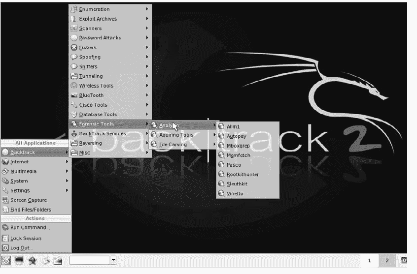

BackTrack CD 包含在随书附的 DVD 中。有关运行 BackTrack 的信息请参见附录 A。

## SystemRescueCd

SystemRescueCd (`www.sysrescd.org`) 确实擅长恢复崩溃的系统。该发行版包含的工具包括专门用于恢复和保存数据的工具，例如：

- 磁盘分区工具 — 你可以使用 `parted` 和 `gparted` 等工具检查、添加、删除、移动和调整磁盘分区的大小。
- 逻辑卷管理工具 — 用于使用 LVM 创建的文件系统。
- **安全工具**：使用 `chkrootit`（用于检查黑客安装的允许访问你系统的软件）等工具检查系统中的数据是否被破坏，以及 `clamav` 和 `clam`（用于现有和入站的病毒）。使用 `nmap`（用于扫描开放端口的网络扫描器）和 `nc`（用于检查与远程主机连接的 Netcat 工具）来检查网络安全。
- **备份工具**：如你所预期的，该发行版包含了用于归数据的标准的 Linux 工具（`tar`、`cpio`、`dump`、`rar` 等）和压缩数据（如 `bzip2`、`gzip` 和 `compress`）。同样，它包含了通过网络拷贝数据的标准工具（`scp`、`sftp`、`ftp` 等）。

由于 SystemRescueCd 不包含图形界面，它可以包含高达 100MB 的磁盘空间命令。然而，某些工具（例如 `midnight (nc)` 命令行管理器）通过 `ncurses` 库从普通的 Linux Shell 提供类似 GUI 的界面。


SystemRescueCd 镜像包含在随附的 CD 中。有关运行 SystemRescueCd 的信息请参见附录 A。

## KNOPIXX 安全工具发行版

Knoppix-STD 在窗口管理器上非常轻量化，而在诊断工具上则非常重量级。该发行版包含了数百种工具，可用于修复和评估网络安全（`http://s-t-d.org/`）。

Knoppix-STD 没有使用 GNOME 桌面，而是使用 Fluxbox 窗口。它可以在配置较低的机器上运行，但在任何至少拥有 64MB RAM 的 Pentium 类机器上，你都能获得一个可用的 GUI。有了至少 64MB 的 RAM，你可以从 RAM 运行整个发行版（输入 `knoppix --tk` 完全从 RAM 启动）。在 RAM 中运行 Knoppix-STD，系统运行速度更快，你的 CD 或 DVD 驱动器可以用于其他用途。

访问工具页面（`http://s-t-d.org/tools.html`）以了解更多关于该项目的特性。或访问下载页面（`http://s-t-d.org/download.html`）下载并亲自尝试。

## 内部安全救援工具包

INSERT (Inside Security Rescue Toolkit) 是另一个 KNOPIXX 衍生版，它包含了 Damm Linux 的功能以及自身的灾难恢复和网络分析系统。它包含了一组更紧凑的工具，可以放入名片中（约 50MB）。可以在 `www.freshmeat.net/projects/INSERT/` 查看。第 6 章展示了如何使用 INSERT 检查 rootkit。


INSERT 包含在随附的 CD 中。有关使用 INSERT 的信息请参见附录 A。

## 运行可启动发行版

Fluxbox 管理器提供了一些用于 CPU、网络流量、内存和交换空间使用以及电池（如果你使用的是笔记本电脑）的嵌入式系统监视器。另一个应用程序显示 Matrix 屏幕保护（双击启动终端）。`mount` 让你能看到电脑上的 CD、软磁盘和硬盘分区。点击那个苹果图标上的钥匙图标（它会变成绿色），你就可以双击它打开该设备或分区。

右键点击桌面显示一个菜单，你可以在少数图形工具中选择对你的计算机和网络进行故障排除，这些工具将从 shell 运行。图 19-2 显示了 INSERT 桌面。

## 图 19-2

使用 INSERT 排除计算机和网络的故障。

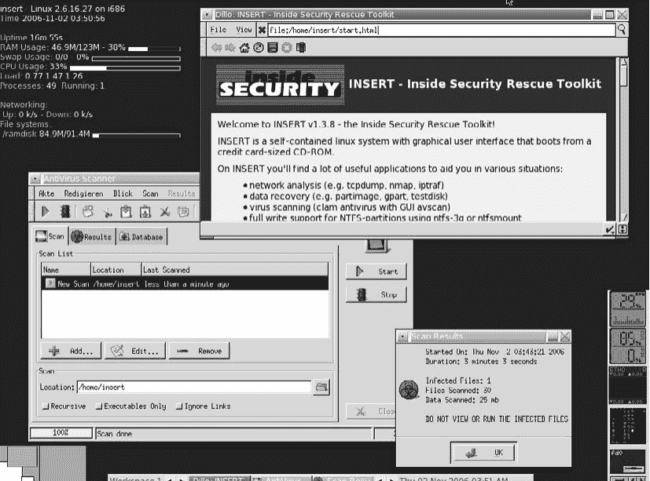

可以在 Inside Security 网站的应用列表（`www.inside-security.de/applicationlist.html`）了解 INSERT 包含的内容。

## 选择并安装 Linux 发行版

## 演示可启动项

想要推广业务或软件项目的个人和组织可以创建自定义的刻录 CD，以包含自己的内容或展示产品。软件开发者可以放心他们想要展示的项目将能够运行，因为它可以适配整个操作系统。一个想要展示其宗旨的组织可以展示任何内容。

# 第三部分 选择和安装 Linux 发行版

如果你在 Linux 中操作得自如，你可以在使用 MobiX 期间切换到不同的虚拟终端。按 `Ctrl+Alt+F2` 查看音频混音器，或按 `Ctrl+Alt+F3` 进入 Linux 终端。然后按 `Ctrl+Alt+F4` 返回主屏幕（MPlayer）。从菜单中选择“切换到 MobiX”，你可以选择运行你的音频播放器、幻灯片或电视查看器（如果你安装了电视，则可以选择后者）。

如果你觉得 MobiX 非常酷炫，那么你一定会非常喜欢 eMobiX 项目。通过 eMobiX，你可以将一个微型 MobiX 发行版和你的视频放在 CD 或 DVD 上，这样你的视频内容就自带了 bowtie 播放器！（详情见 `http://movix.sourceforge.net/Docs/eMobiX`。）

- MobiX 和 eMobiX 在我们的《Linux Toys II》中都有介绍，该项目主要致力于制作自己的 bowtie 电影。

# GeeXBox

GeeXBox (`...www.geexbox.org`) 是另一个多媒体播放器发行版。从 GeeXBox 启动后出现的界面中，你可以使用光标选择想要的内容的位置。像 MobiX 一样，你可以播放各种音频和视频内容。它还能增强你的网络，因此你可以从它获取音频和视频内容。

由于 GeeXBox 非常小（仅需几 MB），它可以放入微型 CD、可启动的存储卡，甚至是一个 U 盘中（前提是你的电脑可以从这些设备启动）。它没有图形界面；你使用键盘从菜单中选择内容和简单的控制选项。

使用方向键在 GeeXBox 备选项（打开、控制、选项、帮助和退出）之间移动。按 Enter 键进行选择。你可以从硬盘、音乐播放列表、图像目录或包含视频的可拆卸介质（DVD、VCD/XCD 或音频 CD）打开文件。按 M 显示或隐藏菜单，并用 P 暂停。

# KnoppMyth

我包含 KnoMyth (`http://freshmeat.net/projects/knoppmyth`) 是因为它代表了对创建可启动发行版的新兴趣。MyTV 是一套相当复杂的软件，用于配置娱乐中心，可以包括个人视频录制器（带有下载的本地电视节目表，用于管理录制和播放）、音乐播放器、天气中心以及获取新闻和其他信息的工具。

KnoppMyth 是一个基于 KNOPPIX 的 CD 发行版，旨在帮助简化 MyTV 的安装和运行。启动 KnoppMyth，回答几个问题，MyTV 就会安装在你的硬盘上。

KnoppMyth 还包含另一个很棒的功能：MyTV 前端。在局域网（LAN）的电脑上配置好 MyTV 后，你可以使用 KnoppMyth 启动 MyTV 前端。这样，你就可以从本地网络上的任何电视上使用你的 MyTV 娱乐中心。

# 运行可启动的 Linux 发行版

Dyne:dyolic GNU/Linux 启动 CD (`www.dynebolic.org`) 在单个可启动操作系统上提供了全系列的多媒体制作工具。该发行版为想要创建和处理各种数字媒体的工匠设计：音频、视频、数字图像、HTML 等。

Dyne:dyolic 包含工具有 Muse、TerminatorX、GDam、SoundTracker 和 PD（用于混音和音频）。视频编辑器包括 Kino、Cinerelera 和 LIVES。对于 3D 建模，有 Blender。对于图像处理，有 Dyne:dyolic GIMP。包含用于创建网页的 Bluefish。

# 微型桌面

一张名片形状的小 CD 可以放入你的钱包。一个 U 盘可以挂在你的钥匙扣上。有一些可启动的 Linux 发行版可以让你启动一个可以上网、浏览、播放音乐以及接收电子邮件、即时消息、文档和工作的桌面。它们可以在移动介质约 50MB 的空间内完成所有这些操作。

> CD 名片实际上是切成数据片形状的普通 CD。根据你选择的某一个，它可以存储 40MB 到 52MB 的数据。微型 CD 可以存储约 180MB 的数据。你可以从许多销售普通 CD 的地方批量购买这些 CD，并可以在任何 CD 光驱中使用它们。（不过，最好使用那些已知会导致微型 CD 插入槽松动并损坏 CD 光驱的设备）。

如今许多 Linux 系统都是基于 KNOPPIX 或可启动名片项目 (`http://www.lnx-bc.com/`) 的。一些 Linux 用户从 lnx-bc.com 项目制作了自己的可启动启动名片项目，并将其分发以代表他们的团体。许多容量大于名片大小 CD 的媒体可启动 Linux 发行版都基于 KNOPPIX。

微型桌面发行版的两个例子是 Damn Small Linux 和 Puppy。

# Damn Small Linux

如果你想要一个可以放入钱包的发行版，Damn Small Linux (DSL) 是你的最佳选择之一。Damn Small 是基于 KNOPPIX 的发行版之一，安装在启动卡上（约 48MB）。

Damn Small Linux 包含在随附的 CD 中。KNOPPIX 的描述见附录 A。

通过 KNOPPIX，你将拥有 KNOPPIX 提供的许多功能：卓越的硬件检测以及启动到具有网络连接的桌面（前提是你有带有 DHCP 的以太网连接）。然而，许多 Damn Small 特有的功能是为了在小型介质（微型 CD）中获得一个可用的桌面系统和低内存需求。Damn Small 包含的许多功能可以让你在约 50MB 的介质内完成所有操作。

Damn Small 是在 50MB 的介质下运行许多功能。图 19-3 显示了 DSL 的示例。

# 第三部分 选择和安装 Linux 发行版

# Damn Small 桌面

图 19-3 

Damn Small 在 50MB 内运行许多功能。Damn Small 的默认桌面非常简单。这里是你第一次启动 Damn Small 时想要做的几件事：

- **增强你的桌面**——右键点击查看 Damn Small 菜单，并选择 Desktop。如果你想更改样式（颜色和窗口框），可以使用 Configuration 更改桌面行为。

- **获取网络连接**——如果在启动时没有自动连接互联网，从 Damn Small 菜单中选择 System Setup。然后你可以配置以太网卡、DSL 拨号调制器或无线卡。

- **使用 Firefox 和 Dillo 浏览器浏览 Damn Small**。选择 Apps-> Browsers，然后选择 Firefox 或 Dillo。Dillo 很小且运行快，可以在任何 窗口管理器上运行。

- **配置并读取电子邮件**——Sylhed 电子邮件客户端非常紧凑且运行快速。选择 Apps->Sylphed 打开它。你可以在几分钟内设置并读写电子邮件。

- **尝试其他选项**——右键点击菜单查看感兴趣的应用程序。要查看这些应用程序的描述，请访问 `http://dammsmallinux.org/applications.html`。

- **获取其他应用程序**——点击桌面上的图标查看你可以选择的应用程序分类。如果你连接了互联网，可以查看每个分类中的应用程序列表进行下载。

> 你可以获取其他的 DSL 文件，让你下载其他应用程序。访问 dammsmallinux.org 并选择软件包链接到仓库。

Damn Small 最近添加了一些自定义功能。你下载的所有内容、桌面设置和配置信息都可以跨重启保存。通过创建想要保存的软件包列表，这些文件和软件包可以保存到位于硬盘或任何移动介质上的备份文件中。下次重启时，你可以告诉 Damn Small 备份文件的位置，所有设置将导入你的 Linux 会话。

关于 Damn Linux 的更多信息可以访问项目 FAQ 页面：`www.dammsmallinux.org/faq.html`。

# Puppy Linux

另一个轻量级启动竞争者是 Puppy Linux (`~puppylinux.com/`)。Puppy ISO 镜像约为 7MB。因此，例如，你可以在 128MB 的闪盘上安装并构建 Puppy Linux，并留出 50 多兆的空间用于数据。

## 第三部分 选择和安装 Linux 发行版

- **加载到内存**——当你加载 Puppy Linux 时，它将在 RAM 中运行。因此，只要你的机器至少有 128MB 可用内存，就能获得极佳的性能。内存中运行 Puppy Linux 可以释放你的 CD/DVD 驱动器。这样你可以插入 CD 或 DVD 并运行它，而不会干扰 Puppy Linux 系统。
- **未设置防火墙规则**——由于 Puppy Linux 使用 Linux 2.6 内核，内置了 `iptables` 防火墙。然而，默认没有设置防火墙规则。因此，如果你考虑扩展 Puppy Linux 以提供更多服务（Web 服务器、邮件服务器等），请记住它是为桌面系统设计的，而不是为了保护你的服务而构建的。

Puppy Linux 包含了各类别的桌面应用程序。在文字处理方面，你有大量的选择。你可以使用 GPlayer 播放音乐，使用 Gx 播放视频。SeaMonkey 互联网应用程序套件（源于此前 Mozilla 应用套件的代码）用于浏览、邮件、新闻和 HTML 编辑。对于互联网客户端应用程序，你有 GAIM（即时消息）、Gftp（FTP 连接）以及远程登录和远程执行工具（secure shell 和 tether）。

Puppy Linux 自带的其他生产力工具包括 intercal（ical 日历）、电子表格（Gnumeric）、联系人（Gab 和 SeaMonkey 地址簿）、财务管理器（Xfinans）和个人信息（DiWiki）。这些应用程序大部分是轻量级但实用的工具。

Puppy Linux 对于可启动 Linux 来说仍然是一个新成员，但它似乎拥有良好的粉丝群、活跃的论坛和开发工具。配置网络和检测设备的工具在 KNOPPIX 衍生版（如目前存在的 Damn Linux）中似乎运行得更好。但随着 Puppy Linux 的发展，这些领域也将改进。

## 特殊用途启动盘

随着人们开始学习和尝试自定义 Puppy Linux 发行版，我相信会有更多特殊用途的发行版出现。EMoViX² 发行版（MoViX 项目的一部分）就是一个专门针对特定功能的发行版（在这种情况下，是用于播放你自己封装的视频内容）。

以下是一些示例：

- **游戏发行版**——GamesKNOPPIX 发行版（`http://games-knoppix.unix-ag.uni-kl.de`）正在开发中，将包含一个专注于游戏的集合。

请参阅第 23 章以获取有关现有许多开源游戏的描述。

- **Windows 应用发行版**——Slax 项目（`www.slax.org`）基于 Slackware，提供了一些特殊用途启动 Linux 的良好范例。

包括 WINE、DOSBox 和 QEMU 软件，以及易于使用的 KDE 界面，SLAX Killbill 提供了一个特殊的 Linux 系统，专门设计用于在可启动 Linux 中运行 Windows 。图 19-4 显示了在 WINE 下运行 Windows WINAMP 应用程序的 SLAX Killbill 桌面示例。

## 图 19-4

在可启动的 SLAX Killbill 发行版中尝试 Windows 。

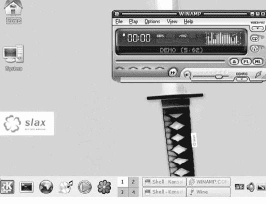

**在 CD-ROM 上**——虽然书中附带的光质未包含 SLAX Killbill CD 镜像，但 SLAX Popcorn 版是一个可以放入 128MB USB 优存盘的口袋操作系统。它包含一个基础桌面界面以及一些实用的 Linux 应用程序和桌面生产力工具。有关使用 SLAX Popcorn 版的信息，请参阅附录 A。

使用上述功能，许多 Windows 应用可以原生运行，无需任何修改。该发行版提供了一种尝试不同类型的 Windows 兼容仿真软件的好方法，看看你是否可以把应用程序迁移到 Linux。

- **防火墙发行版**——防火墙是可启动 Linux 发行版的一个非常好的应用。使用几乎任何 PC 和 CD（甚至是软磁盘）Linux 发行版，你可以保护你的局域网免受入侵者侵害，并为多台计算机提供互联网路由。流行的防火墙发行版包括 Devil-Linux（`www.devil-linux.org`）和 Sentry Firewall CD（`www.sentryfirewall.com`）。防火墙/路由器发行版在第 18 章中介绍。

还有适用于教育和视障人士的可启动 Linux 发行版。有适用于作为服务器运行或集中集群管理的可启动 Linux 发行版。酷的地方在于，如果没有完全适合你使用的特定启动 Linux，你可以从现有的启动 Linux 开始并进行自定义。

## 自定义可启动的 Linux

Live CD（现场盘）是从硬盘运行的 Linux 系统，两者之间没有多少显著差异。它是为了从只读介质运行而定制的，通常（默认情况下）不会在跨重启时保存信息，并且需要在每次启动时能够检测并配置硬件。许多发行版都创建了绕过这些局限的方法，允许你自定义 CD 并在重启后保存你的自定义。

如果你打算创建自己的自定义 CD，或者只是为了配合现有的 Live CD 保存你自己的套集，可以通过以下几种方法实现：

- **自定义数据**——包括 KNOPPIX 和 Damn Small Linux 在内的 Live CD 发行版可以通过两种方式保存你的设置、数据文件甚至安装的应用程序。一种方法是将所有更改保存到任何可用可写介质上的单个归档文件中（硬盘、优存盘等），然后……。

- **重制（Remastering）**——然而，有一个链接可以开始：.............................,,,,,,,,,,, to is a remastering。

- **全新安装（Fresh install）**——然而，有一个链接可以开始：.,,,,,,,,,, to is a remastering。

508.

## 运行启动 Linux 发行版

- **Live CD 项目**——有几个专注于构建 Live CD 的项目。有关于流行 Linux 的信息链接：

- **KNOPPIX**——要重制 KNOPPIX CD，你应该在 Linux (ext2, ext3, xfs) 文件系统上至少有 3GB 的磁盘空间，或者至少有 1GB 的可用内存（内存和交换空间）。

- **Damn Small Linux (DSL)**——这是我最常用于自定义自己的发行版的 Linux 发行版。

- **Puppy Linux**——项目使用的。

- **Gentoo**——Gentoo 发行版提供了构建可能精调的 Live CD 的工具。

## 第三部分 选择与安装 Linux 发行版

- FedoraLiveCD —— 最初始于 Kadisci 项目，该项目可以帮助你获取一个可以随身携带的自定义 Fedora 启动光。你可以在此处查看：

`http://fedoraproject.org/wiki/FedoraLiveCD`

- LiveCD Project — LiveCD 项目 (`http://livecd.berlio.de`) 是一项旨在从 Linux 发行版创建启动 CD 的特定计划。由于该工具仅在 Mandrelux 和 PLlinuxOS 上运行，如果你想制作一个兼容这两种发行版之一的启动 CD，这个项目是一个很好的起点。目前已经有十多个通过 LiveCD 项目创建的启动 CD 发行版。

在我提到的这些项目中，我建议你在初次尝试重制（remastering）时，从 KNOPPIX 或 Damn Linux 开始。因为有许多人正在这些或其他基于 Debian/KNOPPIX 的发行版，因此有成熟的流程和论坛可以帮助你克服遇到的任何困难。

## 总结

过去几年中，出现了几十种可启动的 Linux 发行版。这些发行版包含的数据从可启动 Linux 上的 4MB 到可启动 DVD 上的数 GB 不等。在不需要接触硬盘的情况下，这些发行版就可以提供全功能的系统，并为桌面系统、多媒体播放器、救援系统或其他类型的系统量身定制。

许多可启动的 Linux 是基于 KNOPPIX（第 1 章中描述），因此它们具有非常精细的硬件检测和强大的连接性。如果你想尝试微型可启动 Linux 发行版，可以尝试 Small 或 Puppy Linux（第 1 章中描述）。对于可以放入软盘的 Linux 发行版，你可以创建自己的可启动 Linux 发行版，并通过 CD、DVD 或 USB 驱动器（也称为 U 盘）携带。

## 第四部分 运行应用程序

| 章 | 主题 |
| :--- | :--- |
| 第20 章 | 播放音乐和视频 |
| 第21 章 | 处理文字与图像 |
| 第22 章 | 邮件与网页浏览 |
| 第23 章 | 在 Linux 上玩游戏 |

## 第 20 章 播放音乐和视频

计算机上最受欢迎且最有趣的活动之一就是播放音频和视频。随着多媒体播放器以及存储和管理内容工具的改进，Linux 已经成为存储、播放和管理音乐及视频文件的优秀平台。在本章中，你将学习使用 Linux 可用的音频、数字成像和其他多媒体工具。我们将研究 Linux 支持的媒体格式，以及如何通过使用正确的应用程序充分利用其价值。

Linux 是 MPEG、AVI、OGG、QuickTime 和 RealMedia 等广泛使用格式的优秀平台。各种格式都有多种播放器，本章将讨论每种播放器，帮助你确定哪一个符合你的兴趣和需求。由于许多持有多媒体内容的设备（CD、DVD、数码相机等）是移动的，Linux 最近自动处理可移动介质的功能极大提升了桌面体验。

某些 Linux 发行版比其他发行版更适合多媒体。Freedom 就是一个例子，它预加载并支持 Flash、Java、MP3 和 Windows 媒体文件。这可以为你节省大量追踪许可问题和解决问题的时间。你可以在 Linux-Run 服务 (`www.cnr.com`) 找到未包含在安装中的功能，例如 DVD 支持。Ubuntu 用户也可以使用 Linux-Run 获取免费和商业软件。

## 播放数字媒体与遵守法律

关于终端用户对数字媒体合法可以做什么的辩论现在是一个热点话题。在制作 CD、DVD 和其他媒体副本方面，你到底可以做什么？遗憾的是，并没有一个完美的答案。这些问题直接或间接地影响着每一个计算机用户。

你如何使用存在计算机上的音频、视频和其他媒体日益受到国家和国际法律的限制。曾几何你基本上忽视这个问题，但在个人计算机用户被公司和行业团体起诉的时代，需要谨慎。

## 版权保护

数字媒体政策新世界中最大的因素是《数字千年版权法》(DMCA)。该法律为实施几项有关版权保护的国际条约建立了一个框架。

虽然 DMCA 为内容提供者保护其材料提供了一些手段（例如让搜索引擎删除有关非法发布版权信息的内容），但有时也会出现手段被滥用的情况。似乎，某些版权所有者更愿意使用 DMCA 来限制 DMCA 之前版权法下允许的“权利”。版权法规定：

- 用户可以出于学术目的或评论对任何受版权的作品制作副本。这包括广泛的用途，从学生或教师为了研究复制材料，到对已出版材料进行讽刺创作。但如果一个学生为了多媒体演示文稿制作了一些 DVD 材料的副本呢？学生对 DVD 上的材料拥有公平使用访问权，但 DMCA 使学生破解 DVD 加密以允许其复制材料的行为变得不合法。

> 注意：公平使用规则是一种特权，允许版权所有者以外的人在未经所有者同意的情况下，以合理且有限的方式使用受版权材料。

- 用户可以出售他们拥有的受版权作品。只要你没有为自己保留副本，或者在没有版权所有者许可的情况下出售作品副本，你就可以出售书籍、DVD、CD 和其他材料。一些支持交易受版权材料的人声称，DMCA 侵犯了他们“分享”他们“拥有”内容的能力。事实上，根据现行的版权法，他们并不“拥有”受版权材料，也绝对没有重新分发内容的权利，除非他们是以允许的方式进行转售。

- 版权将在未来的某个时间过期并进入公领域。基本上，这一点与第一点提出的相同！你的 DVD 电影（最终）会进入公领域，但为了自由复制内容，你可能会再次绕过 DVD 固有的保护，通过这样做，你就触犯了 DMCA。

重要的是，DMCA 在如何定义许多非法行为方面是模糊的。什么是“保护方案”？有些人认为它几乎可以是任何东西。许多专家担心，DMCA 可能被用来限制书籍等非公领域版权作品的使用，因为该法律在定义其所有者时非常模糊。

当法院试图在任何情况下澄清法律界限时，问题在于，通常起诉以保护其版权的实体是大型企业或团体，而被告是小公司或个人用户。法律诉讼耗资昂贵，而 DMCA 的宽泛范围基本上阻止了“小人物”进行自我辩护。

# 第四部分 运行

很少有音频 CD 带有任何形式的保护，特别是那些音响发烧友已经拥有的 CD。如果你为了个人使用而对拥有的材料进行符合合理使用（fair-use）的复制，你可能不需要担心任何问题。如果你决定在公共论坛（例如点对点网络）传输受版权保护的作品，你就是在冒险。美国录音制品协会（RIAA）和美国电影协会（MPAA）已成功起诉了用户——其中包括非法分发内容的儿童。

> 注意
> 一个允许共享、混混和重复使用的项目是知识共享许可协议（Creative Commons Project）。在编写本文时，该项目已成立五年，发布了超过 25,000 个项目。你可以在 `http://creativecommons.org` 找到更多信息。

两个网站是 Jamendo (`www.jamendo.com/en/`) 和 Magnature (`www.magnature.com`)。这两个库都提供音乐的免费访问。Jamendo 专注于音乐的免费分发，以帮助音乐家扩大受众。Magnature 通过将他们的音乐许可给那些希望在商业活动（如电影、广告、网站等）中使用它的人来帮助音乐家，同时允许音乐家保留自己的权利。

## 探索解码器

如果你想播放视频或音频文件，你需要安装相应的编解码器并供你的媒体播放器使用。编解码器是一种基于软件的编码/解码器，用于使用现有的数字音频/视频数据并解码内容。其他的则使用压缩技术在保持输出质量的同时减小数据文件的大小。

如果你遇到一个已知是正常且可播放的媒体文件但却无法播放它，你可能需要识别并安装正确的解码器。这通常涉及安装正确的播放程序，例如用于 Linux 的 DivX 5.0.5，它使用 MPEG4 解码器进行视频和音频播放。

有许多解码器可用，因此获取你需要的通常不是问题。解码器技术的进步不断提高编码内容的质量，同时减小文件大小。幸运的是，广泛传播的视频和音频文件（例如来自新闻网站）正在使用几种常用的解码器。

虽然有一些常用的标准，但目前也存在着许多专有的解码器。这真的像是一场战斗，每个供应商/开发者都试图生产优越的产品，并获得随之而来的市场份额。对于最终用户来说，这意味着你可能需要花时间寻找各种播放工具来处理多种视频和音频格式。

另一个争论是：数字媒体能达到模拟格式的质量吗？这似乎已经不是大问题了，因为 DVD 具有高质量数字视频的潜力，而 MPEG 解码器在数字保真度方面已经取得了巨大的进步。数字媒体文件的质量非常高，并且不断提高。以下是反映音频和视频编解码器改进的一些技术：

- Ogg Vorbis— 这种解码器被开发为一种免费的工具——不需要任何专利或许可。Ogg 是解码器中的“数据容器”部分，而 Vorbis 是音频压缩方案。其他可以与 Ogg 一起使用的压缩方案还包括 Ogg FLAC（用于以无损格式归档音频）和 Ogg Speech（专门用于处理语音编码）。

- **Real Networks** — Real 开发了一系列音频和视频编解码器，具有惊人的流媒体传输能力。该协议没有被任何 Real 公司广泛支持。Helix 项目为 Linux 制作了一个播放器，能够播放 Real 编码的文件。

- **WMA** — Windows Media Audio 用于创建高质量数字音频。WMA 被认为无损解码器，这意味着音频不会因为反复的压缩-解压缩循环而损失质量。在它的其他功能中，它是首批广泛支持数字环绕声的解码器之一。

- **WMV** — 出奇的是，Windows Media Video 用于视频的编码和解码。这也是一种高质量的编码器，产生的视频在相同质量水平下仅为 MPEG-4 编码视频的一半。

- **DivX** — 这种视频解码器彻底改变了数字视频。使用这种解码器时可以用较小的文件存储极高质量的视频。DivX（Digital Video Express）基于 MPEG-4 标准，可以产生 640 x 480 的视频，其大小约为源 DVD 材料的 15%。

这些解码器中的一些是数字权利管理（DRM）方案的不可或缺的一部分。WMA、WMV 和 DivX 具有支持 DRM 的元素。DRM 基本上是专有保护。

“DRM”一词适用于一系列技术，它们使用基于服务器的激活、加密和其他元素来控制查看哪些内容，以及在访问后对内容可以做什么。虽然对于试图防止其内容不受制地数字盗版的音视频分销商来说这非常有吸引，但对于消费者来说，这可能是一个真正的障碍。

许多 DRM 解决方案需要专有的软件和硬件才能处理受保护的内容。一个典型的例子是最近制作的 DRM 保护音频 CD，特别是在欧洲。这些磁盘某些无法在立式 CD 播放器上播放，某些只能在支持 CD 本身 应用 应用电脑上播放，并且（特别令人沮丧的是）完全无法在电脑上播放。在几乎所有情况下，DRM 解决方案都不支持 Linux。大多数仅支持 Windows，少数支持 Windows 和 Mac OS。

为了说明清楚，虽然讨论的解码器不包含内置 DRM 功能，但某些解码器专门设计为与 DRM 解决方案集成而设计。换句话说，理论上所有这些都可以用于在 Linux 系统上播放编码内容。如果内容受 DRM 保护，可能很难播放。

## 播放音乐和视频

（注意：本节的 OCR 文本似乎包含跨页的碎片化句子和重复短语。根据提供的输入，以下是重构的流程。）

数字媒体文件的质量非常高，并且不断提高。以下是反映音频和视频编解码器改进的一些技术：

- Ogg Vorbis
- **Real Networks**
- **WMA**
- **WMV**
- **DivX**

这些解码器中的一些是数字权利管理（DRM）方案的不可或缺的一部分。WMA、WMV 和 DivX 具有支持 DRM 的元素。DRM 基本上是专有保护。

“DRM”一词适用于一系列技术，它们使用基于服务器的激活、加密和其他元素来控制查看哪些内容，以及在访问后对内容可以做什么。虽然对于试图防止其内容不受制地数字盗版的音视频分销商来说这非常有吸引力，但对于消费者来说，这可能是一个真正的障碍。

# 选择 CD 播放器

GNOME CD 播放器 (`gnome-cd`) 是许多 GNOME 桌面系统的默认 CD 播放器。它具有标准按钮，并允许你从 CD 数据库（如 `freedb.org`）自动获取信息。（如果你的 CD 不在数据库中，你可以手动输入曲目信息。）

Linux 发行版附带多种 CD 播放器，你也可以下载并安装。以下是你在 Linux 上使用 CD 的其他选择：

- Rhythmbox (`rhythmbox`) — 使用适用于 GNOME 的 Rhythmbox 管理和播放软件来导入并管理你的 CD 收藏集。它在音频后端使用 Gstreamer，并使用 Ogg Vorbis 音频格式进行处理。此外，它还允许你为音乐库创建播放列表，Rhythmbox 具有具有网络广播电台的功能。在最近的发布中，Rhythmbox 添加了免费音乐，允许你播放来自 Jamendo (`www.jamendo.com/en/`) 和 Magnature (`www.magnature.com`) 的免费音乐，并可能购买 CD 或将音乐用于商业项目。

- Kscd (`kcd`) — KCD 播放器随 KDE 桌面一起。要使用它，必须安装多媒体包。从 KDE 桌面的主菜单中，选择多媒体 > Kcd（或在终端窗口中输入 `kcd`）。像 `gnome-cd` 一样，该播放器允许你从 CD 数据库获取标题、曲目和艺术家信息。然而，Kcd 允许你向 CD 数据库提交信息（如果找不到你的 CD）。

- Grip (`grip`) — 虽然 Grip 被用作 CD 读取器，但它也可以播放 CD。选择多媒体 > Grip（或在终端窗口中输入 `grip`）。它包含了收集数据并提交到 CD 数据库的工具。它还包含了用于复制（刻录）CD 曲目并将其转换为不同格式（编码）的工具。当然，必须安装 `grip` 程序包才能使用此命令。

- Amarok (`amarok`) — 带有 Amarok，你有一个良好的图形界面，可以通过移动鼠标周围元素来管理音乐。Amarok 使用 SQLite（或其他数据库）存储你的音乐。它还支持播放列表和在线广播电台的流媒体播放。

- X 多媒体系统 (`xmms`) — XMMS 播放器播放多种音频格式，但可以直接从 CD 播放。

如果你尝试这些播放器但你的 CD-ROM 驱动器无法工作，请查看侧边栏“排除你的 CD-ROM 故障”获取更多信息。

# 使用 gnome-cd 播放 CD

与大多数图形播放器一样，`gnome-cd` 播放器的控件看起来你在物理 CD 播放器上看到的类似。如果你正在使用 GNOME 桌面，从主菜单选择声音和视频 >，或者从终端窗口输入：

```
```


# 排除你的 CD-ROM 故障

如果你无法在 CD-ROM 驱动器上播放 CD，这里有一些你可以检查以解决问题的事：

- 验证你的声卡已安装并正常工作。
- 验证在启动 Linux 时检测到了 CD-ROM 驱动器。如果你的 CD-ROM 驱动器是 IDE 驱动器，输入 `dmesg | grep ^hd`。你应该看到关于你的 CD-ROM 的信息，如下：`hdc: CD-ROM CDU071, ATAPI CDROM drive` 或 `hdc: ATAPI 14X CD-rom drive, 128KB Cache`。
- 如果没有看到 CD-ROM 驱动器的迹象，请检查连接到 CD-ROM 的电源和电缆是否连接。确保硬件工作正常，你也可以启动 Windows（如果已安装且你正在运行双系统机器）并尝试访问 CD。
- 尝试插入一张软件 CD-ROM。如果你正在运行 GNOME 或 KDE 桌面，应该会出现一个桌面图标表示 CD 已自动挂载。如果没有图标出现，进入终端窗口，以 root 用户身份输入 `mount /dev/cdrom`。然后切换到 `/media/cdrom` 或 `/dev/media` 目录并使用命令 `cd /media/cdrom` 列出内容。这将告诉你 CD-ROM 是否可以访问。
- 如果你让 CD-ROM 工作了，但在作为非 root 用户尝试播放音乐时出现“CD device: Permission denied”（权限拒绝）消息，问题可能是 `/dev/cdrom`（通常是指向实际硬件设备的链接）除 root 之外任何人都不可读。输入 `ls -l /dev/cdrom` 查看设备链接到什么。然后，例如如果 CD 设备是 `/dev/hdc`，以 root 用户身份输入 `chmod 644 /dev/hdc` 以允许所有用户读取你的 CD-ROM 并允许 root 用户对其写入。注意：如果其他人使用你的电脑，他们将能够读取你放入的任何 CD。

如果你的电脑连接到互联网，对于大多数 CD，你将看到标题和艺术家信息。即使是冷门的艺术家（通常）也出现在免费在线数据库中。如果信息不可用，你可以自己输入。

添加 CD 及其曲目信息的界面非常好。点击“打开曲目编辑器”（Open Track Editor）。你可以添加 CD 的艺术家和标题信息。然后你可以选择每条曲目输入曲目名称。要添加艺术家名称和磁盘标题，点击相应的文本框并输入该信息。图 20-1 显示了 CD 播放器和 CDDB 曲目编辑器。

## 第四部分 运行

图 20-1

使用 `gnome-cd` 播放 CD 并存储艺术家和曲目信息。


```
$ gnome-cd &
```


# 排除你的 CD-ROM 故障

如果你无法在 CD-ROM 驱动器上播放 CD，这里有一些你可以检查以解决问题的事：

- 验证你的声卡已安装并正常工作。
- 验证在启动 Linux 时检测到了 CD-ROM 驱动器。如果你的 CD-ROM 驱动器是 IDE 驱动器，输入 `dmesg | grep ^hd`。你应该看到关于你的 CD-ROM 的信息，如下：`hdc: CD-ROM CDU071, ATAPI CDROM drive or hdc. ATAPI 14X CD-rom drive, 128KB Cache.`
- 如果没有看到 CD-ROM 驱动器的迹象，请检查连接到 CD-ROM 的电源和电缆是否连接。确保硬件工作正常，你也可以启动 Windows（如果已安装且你正在运行双系统机器）并尝试访问 CD。
- 尝试插入一张软件 CD-ROM。如果你正在运行 GNOME 或 KDE 桌面，应该会出现一个桌面图标表示 CD 已自动挂载。如果没有图标出现，进入终端窗口，以 root 用户身份输入 `mount /dev/cdrom`。然后切换到 `/media/cdrom` 或 `/dev/media` 目录并使用命令 `cd /media/cdrom` 列出内容。这将告诉你 CD-ROM 是否可以访问。
- 如果你让 CD-ROM 工作了，但在作为非 root 用户尝试播放音乐时出现“CD device: Permission denied”（权限拒绝）消息，问题可能是 `/dev/cdrom`（通常是指向实际硬件设备的链接）除 root 之外任何人都不可读。输入 `ls -l /dev/cdrom` 查看设备链接到什么。然后，例如如果 CD 设备是 `/dev/hdc`，以 root 用户身份输入 `chmod 644 /dev/hdc` 以允许所有用户读取你的 CD-ROM 并允许 root 用户对其写入。注意：如果其他人使用你的电脑，他们将能够读取你放入的任何 CD。

如果你的电脑连接到互联网，对于大多数 CD，你将看到标题和艺术家信息。即使是冷门的艺术家（通常）也出现在免费在线数据库中。如果信息不可用，你可以自己输入。

添加 CD 及其曲目信息的界面非常好。点击“打开曲目编辑器”（Open Track Editor）。你可以添加 CD 的艺术家和标题信息。然后你可以选择每条曲目输入曲目名称。要添加艺术家名称和磁盘标题，点击相应的文本框并输入该信息。图 20-1 显示了 CD 播放器和 CDDB 曲目编辑器。

# 第四部分 运行应用程序

FIGURE 20-1

使用 gnome-cd 播放 CD 并存储艺术家和曲目信息。


## 播放音乐和视频

通过选择 Sound & Video Audio Player 或在终端窗口中输入 `xmms` 来启动 XMMS 音频播放器。图 20-5 显示了带有均衡器（左侧）和播放列表编辑器（右侧）的 XMMS 音频播放器。

### 20-5

从 XMMS 播放列表播放 MP3和其他音频文件。

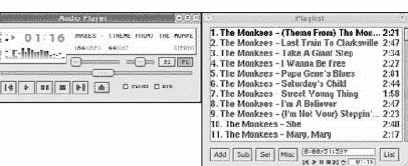

如，你可以播放多种音频格式。支持的格式包括：

- MP3（需添加插件）
- Ogg Vorbis
- WAV
- AU
- CD 音频
- CIN 电影

如果 XMMS 无法找到配置好的音频设备，它会将输出重定向到 Disk Writer 插件。这会导致你播放的文件以 WAV 格式被写入硬盘。

你可以从 www.xmms.org 获取更多音频插件。XMMS 音频播放器可以按以下方式使用：

1. 通过从 CD 刻录歌曲、从网络复制到可访问目录的文件，或在 CD-ROM 驱动器中插入音乐 CD 来获取音乐文件。（XMMS 期望从 `/dev/cdrom` 访问 CD）。
2. 从应用程序中选择 Sound & Video Audio Player。多媒体系统播放器出现。
3. 点击 Effect 按钮。出现 Loads 窗口。
4. 如果你插入了 CD，`/mnt/cdrom` 的内容将出现在 Files 格中。选择你想要添加到播放列表的文件，并点击 Add Selected Files 或点击 Add Files in Directory 按钮以添加当前目录中的所有歌曲。要添加系统中的音频文件，请浏览你的文件和目录，并点击按钮添加你需要的音频文件。选择 Close。

## 运行应用程序

5. 点击控制台上的 Play List（标记为 PL 的小按钮）。出现 Playlist Editor 窗口。

6. 双击音乐文件，它将开始播放。

7. 在选中并播放文件时，你可以执行以下操作：

- 控制播放 — 控制播放的按钮就是你预期在独立 CD 播放器上看到的按钮。从左到右，这些按钮允许你跳转到上一曲、暂停、停止、跳转到下一曲以及退出 CD。退出按钮会打开一个窗口，允许你加载下一个文件。
- 调整声音 — 使用左侧滑块调整音量。使用右侧滑块更改左右平衡。
- 显示时间 — 点击时间区域的按钮在已用时间和剩余时间之间进行切换。
- 查看信息 — 点击屏幕左上角的按钮查看 XMMS 菜单。选择 View File Info。你通常可以找到关于文件的大量信息：标题、艺术家、专辑、注释和流。对于 Ogg Vorbis 文件，你可以看到关于文件本身的特定信息，如格式、比特率、采样率、帧、文件大小等。你可以更改或添加标签信息并点击 Save 保留它。

8. 当你正在播放音乐时，点击 Stop 按钮停止当前歌曲。然后点击显示器右上角的 X 关闭窗口。

XMMS 音频播放器的特殊功能允许你使用图形均衡器调整频率，并使用播放列表编辑器收集和播放歌曲。点击播放器上平衡条旁边标记为 EQ 的按钮打开均衡器。

## 使用均衡器

均衡器使用滑块对播放的不同频率设置不同的水平。左侧的条形调整低频，右侧的条形调整高频。点击 EQ 按钮打开均衡器。你可以使用均衡器执行以下任务：

- 如果你有一首特定歌曲的设置，可以将其保存为 Preset（预设）。按照你的喜好设置每个频率并点击 Preset 按钮。选择 Save ⇩ Preset。为预设输入名称并点击 OK。
- 要重新加载你之前创建的预设，点击预设并选择 ↺ Preset。选择你想要的预设并点击 OK。

均衡器中心/顶部的小窗口显示了由你的设置形成的声波。你可以调整左侧的 Preamp 滑块以增强该范围内的不同水平。

## 播放音乐和视频

## 使用播放列表编辑器

播放列表编辑器允许你组合一个想要播放的音频文件列表。你可以从列表中添加和删除文件，将它们保存到文件中，并在以后再次使用。点击 XMMS 窗口中的 PL 按钮打开播放列表编辑器。

播放列表编辑器允许你：

- 向播放列表添加文件 — 点击 Add 按钮。出现 Load Files 窗口。从左列选择包含音频文件的目录（将它们全部保存在一个地方很有用）。然后从右列选择一个文件并点击 Add Selected Files 或 Add All Files in the Directory。点击 OK。选中的文件（文件）将添加到播放列表中。你也可以通过从 Nautilus 管理器将音乐文件拖到播放列表窗口来添加。
- 从播放列表中选择 — 要选择播放列表中的文件，使用主 XMMS 窗口中的上一个和下一个按钮。选中的文件会被高亮。点击 Play 按钮播放。或者，你可以双击播放列表中的任何文件开始播放。
- 从播放列表中删除 — 要从播放列表中删除文件，选择你想删除的文件（使用下一个和上一个按钮），右键点击播放列表窗口并删除播放列表。
- 从播放列表保存 — 要保存播放列表，选择一个名称并点击 OK。
- 从播放列表加载 — 要加载播放列表，选择 Load 按钮。出现 Load Files 窗口。选择你想加载的播放列表并点击 OK。

## 使用 MIDI

MIDI（乐器数字接口）文件由合成器和其他设备创建它们通常比其他音频文件小，因为它们不存储完整的歌曲，而是包含关于音符、节奏和指法的信息。你可以将 MIDI 文件视为电子乐谱。MIDI 播放器重现音符，听起来像各种乐器。

互联网上有许多网站可以下载 MIDI 文件。例如 MIDI Music 网站 (www.ifmidi.com)，它包含了按艺术家组织的 The Beatles、Led Zeppelin、Nirvana 等人的歌曲。大多数 MIDI 音乐都非常简单，但你可以玩玩其中的乐趣。

包含 KDE 桌面的 Linux 发行版（如 Fedora）通常带有 kmid MIDI 播放器。Kmid 为 MIDI 音乐提供了 GUI 界面，包括实时显示卡拉歌词的功能。要在 Fedora 中启动 kmid，选择 Sound & Video KMid（或在终端窗口中输入 `kmid`）。

## 执行音频文件转换和压缩

有许多不同的格式用于存储和压缩语音和音乐文件。由于音乐文件很大，它们通常存储在压缩格式中。虽然 MP3 是首选压缩格式，但 Ogg Vorbis 正迅速成为开源社区压缩音乐的喜爱。Ogg Vorbis 的额外优点是不像 MP3 那样受专利限制。

用于转换和压缩音频文件的 Linux 工具包括：

- SoX (eXChange)—一种用于在多种格式之间转换音频文件的通用工具。
- `oggenc` — 专门将音乐文件转换为 Ogg 格式的工具。

## 使用 SoX 转换音频文件

如果你有一个格式的音频文件，但希望将其变成另一种格式，Linux 提供了转换工具。SoX 实用程序可以转换表 20-1 中列出的任何音频格式。

> 输入 `soc -h` 查看支持的音频类型，以及支持的选项和效果。

# 表格20-1

# SoX 工具支持的音频格式

| 文件扩展名或别名 | 描述 | 文件扩展名或别名 | 描述 |
| --- | --- | --- | --- |
| .8svx | 8SVX Amiga 乐器描述格式。 | .aiff | Apple II/Igs 和 SCI AIFF 文件。可能需要单独的归档工具处理这些文件。 |
| .au, .snd | Sun Microsystems AU 音频文件。这曾是一种流行的格式。.snd 扩展具有歧义性，因为它也用于 NEXT 格式和无头部的 Mac/PC 格式。 | .avr | Audio Visual Research 格式，用于 Mac。 |
| .cdr | 用于刻录光光盘的 CD-R 文件。 | .cvs | 连续可变斜率增量调制，用于语音信箱和其他压缩领域。 |
| .dat | 文本数据文件，包含音频数据的文本表示。 | .gsm | 有损语音压缩 (GSM 0.10)，用于缩小语音信箱和类似应用中的音频数据。 |
| .hcom | Macintosh HCOM 文件。 | .maud | Amiga 格式，用于生成 8 位线性、16 位 A-law 和 u-law 的单声道或立体声音效。 |
| .ogg | Ogg Vorbis 压缩音频，最适合压缩音乐和音频流媒体传输。 | .ossdsp | 用于打开 `/dev/dsp` 的伪文件，并将其配置为使用提供给 SoX 的类型。用于播放或录制。 |
| Psion 记录格式，比 WVE 格式较新。注意 .prc 扩展也用于 Palm 手持设备程序的程序。 | .sf | IRCAM 音频文件，由 CSound 软件包和 -MixView 采样编辑器使用。 |
| .sph | 来自 NIST（美国国立标准研究院）的语音音频 SPHERE（语音头部资源）格式。 | .smp | Turtle Beach 的 SampleVersion 文件，用于与不同的 MIDI 采样器通信。 |

# 第四部分 运行应用程序

| 表格20-1（续） |
| 文件扩展名或别名 | 描述 | 文件扩展名或别名 | 描述 |
|---|---|---|---||
| .sunau | 伪文件，用于打开 `/dev/audio` 文件并设置为使用传递给 Sox 的数据类型。 | .txw | 来自 Yamaha 采样键盘的 Yamaha TX-16W。 |
| .vms | 用于为语音信箱和类似应用压缩音频。 | .voc | Sound Blazer VOC 文件。 |
| .wav | Microsoft RIFF 文件。这是 Windows 原生声音格式。 | .wve | Psion 掌上电脑使用的 8 位和 8 kHz 音频文件。 |
| .raw | 原始文件（不包含头部信息，因此必须指定采样率、大小和样式）。 | .ub, .sb, .uw, .sw, .ul, .al, .lu, .la, .sl | 带有设置字符的原始文件，如无符号字节；by 是符号字节；uw 是无符号字；sw 是符号字；；ul 是无符号的。 |

如果你不确定音频文件的格式，可以在文件名后添加 `.auto` 扩展名。这将强制 Sox 猜测文件中包含什么种音频格式。`.auto` 扩展名只能用于输入文件。如果 Sox 能够识别输入文件的内容，它将将其转换为你请求的输出文件的声音类型。

在最基础的情况下，你可以如下所示将一种文件格式（如 WAV 文件）转换为另一种格式（如 AU 文件）：

- `$ Sox file.wav file.au`

要查看 Sox 正在执行的操作，请使用 `-V` 选项。例如：

你可以在 Sox 转换过程中应用音效。以下示例显示了如何使用 `-r` 选项）将采样率从 10,000 kHz 更改为 5,000 kHz：

- `$ Sox file.wav file.au -r 5000`

5. 使用 `cdrecord -v dev=/devcdrom` 将音乐轨道写入 CD。例如：
```bash


# `cdrecord -v dev=/devcdrom -audio *.wav`

`cdrecord` 选项告诉该命令在位于 `/dev/cdrom` 的可写设备上创建音频 CD (`-audio`)。`cdrecord` 命令会写入当前目录下所有的 `*.wav` 文件。`-v` 选项提供详细输出。
如果想更改轨道的顺序，可以按照想要的顺序输入它们的名字（而不是 `*.wav`）。如果 CD 刻录机支持更高速度，可以使用 `speed` 选项将写入速度翻倍 (`speed=2`) 或增加四倍 (`speed=4`)。
创建好音乐 CD 后，在侧面标上 CD 目录。现在可以在任何标准的 CD 播放器上播放了。

## 使用 Grip 刻录 CD

对于 GNOME 用户，Grip 窗口提供了一种更图形化的方法将音乐从 CD 复制到硬盘，这样就可以直接从磁盘播放歌曲，或将其刻录到空白 CD 中。除了刻录音乐外，还可以在从 CD 提取时对每首歌进行压缩。
可以通过选择 Sound & Video Grip（或在终端窗口中输入 `Grip`）从红帽系统进行刻录。图 20-6 显示了 Grip 窗口的一个示例。
图 20-6 从 Grip 窗口刻录并播放歌曲。


## 第四部分 运行应用程序

使用 grip 从 CD 刻录音频轨道，请按照以下步骤操作：
1. 打开 Grip 窗口，将音乐 CD 插入 CD 驱动器。如果你连接了互联网且该 CD 在 CD 数据库中，标题、艺术家和轨道信息将出现在窗口中。
2. 点击你想要刻录的每个轨道（即复制到硬盘）。轨道的 `Rip` 列将出现一个勾标记。
3. 点击页面顶部的 `Config` 选项卡，并选择 `Encode`。
4. 你可以通过点击并选择编码器来选择用于压缩音乐的编码类型（默认情况下，`ogg` 使用 Ogg Vorbis 压缩文件，假设你的 Linux 发行版已安装 Ogg Vorbis）。
5. 点击页面顶部的 `Rip` 选项卡。
- `Rip+Encode`：这会刻录选定的歌曲并（如果你在第 4 步保留了默认的 ogg 压缩）以 Ogg Vorbis 格式压缩它们。在以这种格式刻录后，需要 Ogg Vorbis 播放器来播放歌曲（Linux 有许多 Ogg Vorbis 播放器）。
- `Rip only`：以 WAV 格式刻录选定的歌曲。可以使用标准的 CD 播放器播放这些歌曲。（当我尝试这样做时，同一首歌的 WAV 文件比 Ogg Vorbis 文件大 12 倍）。
歌曲以你选择的格式复制到硬盘。默认情况下，文件被复制到 `$HOME/ogg` 的子目录下（例如 `/home/jake/jake`）。子目录以艺术家和 CD 命名。例如，如果用户 jane 正在刻录艺术家 Mumbo 的歌曲《High Life》，包含刻录歌曲的目录将是 `/home/jane/mumbo/high_life`。每首歌文件都命名命名（例如 `fly_fly.wav`）。
现在可以使用播放器播放任何文件，或使用 `cdrecord` 将文件复制到 CD。由于文件名是歌曲名，它们出现的顺序与在 CD 上的顺序不同，如果想按原始顺序将它们刻回可写 CD 中，可能需要在 `cdrecord` 命令行上输入每个文件名。例如：
```bash
# cdrecord -v dev/dev/cdrom-audio fly_fly.wav \
big_new_about_time.wav
```
Grip 窗口也可用于播放 CD。使用显示器底部的按钮进行播放或暂停、跳进或后退、停止和弹出 CD。切换轨道显示可以缩小显示尺寸，使其在桌面上占用更少的空间。点击 `toggle editor` 查看并更改标题、艺术家和轨道信息。

## 使用 cdlabel 创建 CD 标签

`cdlabel` 命令可用于创建 CD 盒的内托和封页。你收集有关 CD 的信息，`cdlabel` 会生成 PostScript 输出文件，将其发送到打印机。`cdlabel` 软件包还带有图形（位于 `/usr/share/cdlabelgen/` 中），可以将其整合到标签中。
这是一个 `cdlabel` 命令的示例，它可以生成 PostScript 格式的 CD 标签文件（可以全部写在一行或使用反斜杠将其分成多行）：
```bash
$ cdlabelgen -c "Grudge Gone" -s "Yep HipHop" \
-I If You NeedMeSocks CityAnd Copper$Fly Fly \
Fly$Best Man Spins$What A HeadacheStayin Put Feelin$Dreams Go \
Blue$Mildest Schemes" -o yep.ps
```
在此示例中，CD 标题由 `-c "Grudge Gone"` 指定，艺术家由 `-s "Yep HipHop"` 选项指定。轨道输入 `-i` 选项之后，每行之间用 `%` 隔开。输出文件通过 `-o` 选项发送到文件 `yep.ps`。查看并打印结果，请这样使用 `evince` 命令：
```bash
$ evince yep.ps
```
结果如图 20-7 所示。


## 运行应用程序

桌面上的窗口中应出现一个视频屏幕。点击窗口可以查看统计列表。右键点击查看屏幕上的设置（Setup）菜单。
你可以通过电视菜单屏幕显示执行以下几项操作：
- 配置输入 — 更改视频源，选择电视标准（美国默认为 NTSC），并更改输入的分辨率。
- 设置图像 — 调整亮度、对比度、颜色和色调。
- 调整视频处理 — 控制尝试的帧率、配置去隔行器或添加输入过滤器。
- 调整输出 — 控制宽高比（例如针对 16:9 输出）、应用消光遮罩或叠加屏幕上掩罩。

## 使用 Ekiga 进行视频会议

Ekiga 窗口允许你通过视频、音频和打字消息在网络上与他人通信。由于 Ekiga 支持 H323 协议（多媒体通信标准），可以用它与其他流行的视频会议客户端通信，如 Microsoft NetMeeting、Cu-Seeme 和 Intel VideoPhone。
> Ekiga 不支持 NetMeeting 的共享白板功能，仅支持视频会议。
为了能够发送视频，需要一个 Linux 支持的摄像头（Webcam）——有几十种型号供选择。以下章节将介绍如何设置你的摄像头并使用 Ekiga 进行视频会议。
> Ekiga 以前被称为 GnomeMeeting。这两个名称在任何特定的 Linux 平台上都可能出现。

## 获取支持的摄像头

由于对电视采集卡的支持，摄像头支持通过 Video4Linux 接口提供。如果想查看你的摄像头是否受支持，请检查 `/usr/src/linux-*/Documentation` 目录。多端口摄像头在 `video4linux` 子目录中有描述；然而，大多数支持的摄像头都列在 `usb` 目录。
> 在经过研究后，我购买了罗技 QuickCam Pro 3000。该摄像头的驱动是为飞利 USB摄像头制作的，但也适用于罗技、三星、Creative 和 Askey。使用这些摄像头需要的 pwc 驱动大多数流行的 Linux 发行版可用。

## 播放音乐和视频

支持的 USB 摄像头应该会自动检测，因此当你插入它们时，会自动加载所需的模块。只需启动 Ekiga（执行 `ekiga` 命令），就应该能在 Linux 桌面上看到摄像头的视频。
你可以通过输入以下内容来检查摄像头是否工作正常：
```bash
## lsmod
pwc 43392 1
videodev 5120 2 [pwc]
usbsc 59072 1 [audio pwc usb-uhci]
```


`lsmod` 的输出显示 `pwc` 驱动已随 `videodev` 和 `usbsc` 模块加载。

# 为 Ekiga 开放防火墙

你需要在防火墙中开放多个端口以使用 Ekiga。特别是你需要打开 TCP 端口 `1720` 和 TCP 端口范围 `30000` 到 `30010`。对于 UDP 端口，你必须打开端口 `5000` 到 `5007` 以及 `5010`。你可以使用的精确 `iptables` 示例确保这些端口包含在 Ekiga FAQ (`www.ekiga.org/faq`) 中。

# 运行 Ekiga

在发行版中启动 Ekiga，选择“应用程序 > 互联网 > Ekiga Softphone”。从终端窗口启动 Ekiga，输入 `ekiga &`。如果尚未安装，你可以在 GNOME 桌面启动时获取适用于 Linux 发行版的包，允许你输入以下信息：

- 个人数据 — 你的姓名、电子邮件地址、备注和位置。你还可以选择是否希望列入 Ekiga IL 目录。
- 连接类型 — 指明你的互联网连接速度（56K 调制解调器、ISDN、DSL/缆、TI/LAN 或自定义）。

一旦输入数据，Ekiga 窗口就会打开。

图 20-8 显示了右侧通话的 Ekiga 窗口。选择“工具 > 通话历史”打开该日志。它显示了会话期间拨打的历史。要打开地址录，从 Ekiga 窗口左侧选择地址录图标。向该窗口添加朋友，然后选择你想联系的用户或服务器并点击“拨打”。

使用视频窗口下方的标签页来调整音频电平和及视频外观。“历史”标签页显示了你的活动日志。

## 第四部分 运行应用程序

图 20-8

连接到 ILS 服务器使用 Ekiga 进行视频会议。


# 观看电影和视频

支持的 USB 摄像头应该会自动检测，因此当你插入它们时，会自动加载所需的模块。只需启动 Ekiga（执行 `ekiga` 命令），你就应该能在 Linux 桌面面上看到摄像头的视频。

# xine 技巧

让视频和音频正常工作有时是一件棘手的事情。如果你在让 `xine` 正常运行（或无法运行）方面遇到困难，这里有一些技巧：

- `xine` 无法启动 — `xine` 运行需要一个支持 `xvid` 的 X 驱动程序。如果你的显卡在 X 中不支持 `xvid`，`xine` 在尝试打开默认 X 驱动程序时会立即关闭。如果你遇到这种情况，请尝试如下所示使用 X11 视频驱动启动 `xine`（速度较慢，但应该可以工作）：

- `xine` 播放卡顿 — 如果从硬盘播放文件时出现卡顿，你可以检查几项设置：32 位 IO 和 DMA，这些功能如果你的硬盘支持，通常会提高硬盘性能。以下是检查方法：

不当的磁盘设置可能会导致你的硬盘数据被损坏。请自行承担操作风险的风险。此步骤适用于 IDE 硬盘（不支持 SCSI！）。此外，如果你按照本文方法更改了 DMA 或 I/O 设置，请确保你已有最新的备份，并且硬盘上没有正在进行的活动。

1. 测试硬盘读取速度。要测试 IDE 驱动器 (`/dev/hda`)，输入：

```
# hdparm -t /dev/hda

Timing buffered disk reads: 64 MB in

19.31 seconds = 3.31 MB/sec
```

2. 以 root 用户身份查看当前的 DMA 和 I/O 设置，请输入：

```bash
# hdparm -c -d /dev/hda

/dev/hda:

I/O support = 0 (default 16-bit)

using_dma = 0 (off)
```

3. 该结果显示 32 位 I/O 和 DMA 是关闭的。要开启它们，请输入：

```bash
# hdparm -c 1 -d 1 /dev/hda

/dev/hda:

I/O support = 1 (32-bit)

using_dma = 1 (on)
```

4. 开启两个设置后，再次测试磁盘：

```bash
# hdparm -t /dev/hda

Timing buffered disk reads: 64 MB in

2.2 seconds = 28.83 MB/sec
```

## 第四部分 运行

在此示例中，在更改所述参数后，64MB 的缓冲磁盘读取从 19.31 秒缩短到了 2.2 秒。现在的播放效果会好很多。

- `xine` 无法播放媒体 — 像“no input”或“plug-in”这样的信息意味着你正尝试播放的文件不受支持，或者它需要额外的插件（如 DVD 的情况）。如果信息是“codec may be a proper version”，则该文件可能是某个受支持格式的专有版本。例如，我有一个 QuickTime 视频文件需要 SV3 解码器（在 Linux 下不支持），尽管其他 QuickTime 文件可以正常播放。

# 使用 Helix Player 和 RealPlayer 10

互联网上提供了大量的 RealMedia 和 RealAudio 格式内容。你可以看到并听到流行音乐家和漫画人物的视频片段；观看会议、新闻报道、音乐会等直播活动；并在离开城市时收听你喜爱的广播电台。

要播放 RealMedia 和 RealAudio 内容，正如你可能猜到的，你需要 RealPlayer。RealNetworks (`www.real.com`) 是互联网流媒体领域的领导者。超过 5000 万用户在 RealNetworks 及其网站注册，每天下载超过 175,000 个文件。这还不全是好消息。好消息是 RealPlayer 可以在 Linux 上运行。

Linux 版 RealPlayer 10可以通过 `www.download.com`、`www.tucows.com` 和 `www.real.com/linux/` 的 Linux 区域获取。此播放器不受 RealNetworks 直接支持。此外，RealNetworks 已以 Helix Player 的名称开放了 RealPlayer 的源码。Fedora 8（包含在书中 DVD 中）包含一个你可以尝试的 Helix Player 版本。

配置 RealPlayer 的说明以 HTML 格式提供，因此可以在 Mozilla 或其他网络浏览器中阅读。如果需要任何补丁或解决方法，可以通过查询 RealNetworks 知识库中的“Linux”来找到。安装 RealPlayer 时，会询问你是否将其配置为 Netscape 插件使用（我建议这样做，以便你可以在 Mozilla Firefox 中播放 Real 内容）。之后，当你在浏览器中打开任何 Real 内容时，RealPlayer 会打开处理。或者，你也可以通过在桌面终端输入以下命令启动 RealPlayer：

```
$ realplayer &
```


进入`/path/to/xxx`目录，找到`xxx.json`。

RealNetworks 对其内容采用了订阅模式（注册并支付月费）。为了查看可用内容并决定是否值得订阅，我建议从 RealGuide (`www.realguide.com`) 开始，它包含一些你可以尝试的片段。

# 使用 gtkam 和 gPhoto 使用数字相机

通过 `gikam` 窗口，你可以下载并处理来自数字相机的图像。`gikam` 窗口是 `gPhoto` 的前端，`gPhoto` 在 Linux 下支持数十种数字相机。`gikam` 窗口通过将支持的相机连接到计算机的串口或 USB 端口来工作。你可以查看相机图像的缩略图、全尺寸图像，以及你从相机选择下载到硬盘的图像。

如果你有一个将图像保存到软盘的相机，只需将磁盘插入驱动器，磁盘内容应会自动在你的桌面上打开。此外，如果你的相机将图像保存到 SD 或 CF 卡，你可以使用 USB 读器并在 `gikam` 中查看这些文件。

访问 `gPhoto` 网站 (`www.gphoto.org/proj/libgphoto/support.php`) 获取支持的相机以及与 `gPhoto` 相关的其他主题。如果包括实验性设备和测试中的相机，有超过 900 台支持的相机。相机添加非常频繁，如果你没有看到相机列表，请检查状态页面。

# 使用 gtkam 下载数字照片

以下步骤描述了如何从你的数字相机下载图像。

1. 使用数字相机自带的数据线，将相机连接到计算机的 USB 或 COM 端口（我用 USB 端口运气更好）。
2. 将相机设置为“发送和接收”模式。
3. 从桌面主菜单中，选择图形（Graphics） -> 数字相机工具（Digital Camera Tool）。`gikam` 窗口出现。
4. 选择相机（Camera） -> 添加相机（Add Camera）。出现选择相机（Select Camera）窗口。
5. 点击型号（Model）框旁边的向下箭头。
6. 选择你的相机并点击检测（Detect）。
7. 为了从数字相机下载图像，选择你的相机，它将在 `gikam` 窗口中显示。
8. 选择你感兴趣的图像并点击保存（Save）。
9. 选择你想删除的图像并点击删除（Delete）。

# 将相机作为存储设备

某些数字相机可以让你像使用存储设备一样使用它们。

> 注意：对于 Linux 系统，请访问 `www.qbik.com/devices/`。

## 可作为 USB 存储设备的相机

| 品牌 | 型号 |
| :--- | :--- |
| 卡西 | QV-2400, QV-2x00, QV-3000, QV-4000, QV-8000 |
| 富士 | FinePix 1300, 1400, 2300, 2400, 2800, 4200, 4700, 4900, 6800, A101, A201, S1 Pro |
| 惠普 | PhotoSmart 315, 381, 618, C912 |
| 康尼 | KD200Z, KD400Z, Revio KD300Z |
| 京瓷 | Finecam s3 |
| 徕卡 | Diglux 4.3 |
| 胶西达 | Dimage 5, 2500, 885, 575, 995 |
| 尼康 | CoolPix 2500 |
| 奥林巴斯 | Brio Zoom D-15, C-100, C-2002, C-2040, C-220Z, C-2Z, C-3020Z, C-3040Z, C-4040Zoom, C-700, C-860L, D-510, D-520Z, E-10, E-20 |
| 宾达 | El2800, Optio 330 和 Optio XL |
| 索尼 | DSC-F05, DSC-F05V, DSC-F07, DSC-P1, DSC-P20, DSC-P5, DSC-P71, DSC-S30, DSC-S70, DSC-S75, DSC-S85, MVC-CD300, 和 MVC-FD92 |
| 威达 | Vivicam 3550 |
| 雅西 | Finecam s3 |

将你的数字相机作为存储设备使用：

1. 使用数字相机自带的数据线将相机连接到计算机的 USB 端口，并打开相机使其准备好接收和接收数据。
2. 启动你的计算机。

## 播放音乐和视频

4. 以 root 用户身份打开 `/etc/fstab`，检查是否为你的数码相机创建了条目。如果电脑上没有其他 SCSI 设备，相机可能被识别为 `/dev/sda` 设备。该条目看起来可能如下所示：

```
/dev/sda    /mnt/camera auto defaults,user,noauto 0 0
```

如果没有出现此类条目，请手动创建它。创建挂载点目录（作为 root 用户执行 `mkdir /mnt/camera`）。

4. 作为 root 用户，输入命令来挂载相机：`mount /mnt/camera`

5. 像从 shell 或文件管理器打开任何其他目录一样，打开 `/mnt/camera` 目录。像处理硬盘上的文件一样对文件进行复制、删除、移动和重命名。

6. 完成后，请卸载相机（在终端中以 root 用户身份）：

```bash
# umount /mnt/camera
```


> **注意：** 如果你在未卸载文件系统的情况下直接拔掉相机，可能会损坏相机上的文件。

你可以按照此步骤在 Linux 中使用其他 USB 存储设备（光驱、优盘等）。使用不同的挂载目录（如 `/mnt/keychain`）并检查 USB 存储设备分配了哪个 SCSI 设备。

要检查 Linux 是否能看到你的 USB 存储设备，请检查 `/var/log/dmesg` 或运行 `usbview` 命令。任一种方法都能告诉你设备是否被 Linux 正确检测。

## 总结

上手并运行数字媒体需要一些操作，但一旦设置好，你就可以播放今天大多数音频和视频内容。本章将带你完成设置和排除声卡故障的步骤，并解释如何通过声卡播放音乐。

每个桌面发行版都提供一种或多种从文件或 CD 播放音乐的方法。流行的播放器包括 `XMMS` 和 `Rhythbox`。刻录和录制 CD 的工具包括 `Grip` 以及 `cddav` 和 `cdrecord` 等命令行工具。

本章分别在 `vtime` 和 `Ekika` 章节中涵盖了通过电视卡和摄像头播放视频。最后，本章描述了 `xray` 播放器如何播放多种视频格式，并探索了使用 `gtikam` 窗口从数码相机下载图像。如果你的电脑有 CD 刻录机，可以使用本章中的描述创建自己的音乐 CD 和 CD 标签。

## 第 21 章

## 处理文字和图像

计算机非常适合收集和记录音乐、玩游戏以及与远方进行通信。虽然这些功能很受欢迎且令人兴奋，但自个人电脑早期以来，有一个工具一直被认为是不可或缺的：文档创建应用。从极简单的纯文本编辑器到功能丰富的群协作系统，你很难找到一台没有这种基本功能的 PC。这类软件如此重要，以至于微软每年通过为 Windows 操作系统销售生产力工具赚取数十亿美元。

Linux 用户在大多数层面上与任何其他 PC 用户没有区别。他们需要写信件、制作演示文稿、写书以及在电子表格中分类信息。对于 Linux 用户来说，目前还没有 Microsoft Office 的版本是现实的，但有很多强大的工具可供选择。

`OpenOffice` 是一个强大的开源套件，可以下载使用，也可以作为许多 Linux Microsystems `StarOffice` 生产力套件的一部分。`OpenOffice` 包含一个文字处理器、电子表格程序、演示管理器和其他生产力工具。在大多数情况下，`OpenOffice` 可以作为 Microsoft Office 的无缝替换。

Linux 的第一个文档和图形工具大多是基于旧的、文本的工具构建的。最近，增加了更复杂的编写、页面格式化和集成图形的工具。尽管这些历史久远，但许多旧的出版工具（如 `Groff` 和 `LaTeX`）仍被技术社区的人使用。

| 本章内容 |
| --- |
| 使用 OpenOffice.org |
| 使用 KOffice |
| 使用 AbiWord |
| 将文档从 Windows 迁移到 Linux |
| 使用 Groff 和 LaTeX 创建文档 |
| 创建 DocBook 文档 |
| 使用 Linux 打印 |
| 使用 ghostscript 和 Acrobat 显示文档 |
| 处理图形 |
| 使用 SANE 驱动的扫描仪 |

## 第四部分 应用程序

本章检查了 Linux 基于文本和基于 GUI 的文档准备软件，并讨论了打印和显示文档的工具，以及处理图像的软件。

如果你使用过 Microsoft Office，将在 `OpenOffice` 中发现许多熟悉的功能。本章将展示如何在 Linux 上使用 `OpenOffice` 套件的各种应用程序。

### 使用 OpenOffice.org

`OpenOffice` 是一个强大的开源套件，可以下载使用，也可以作为许多 Linux Microsystems `StarOffice` 生产力套件的一部分。`OpenOffice` 包含一个文字处理器、电子表格程序、演示管理器和其他生产力工具。在大多数情况下，`OpenOffice` 可以作为 Microsoft Office 的无缝替换。

Linux 的第一个文档和图形工具大多是基于旧的、文本的工具构建的。最近，增加了更复杂的编写、页面格式化和集成图形的工具。尽管这些历史久远，但许多旧的出版工具（如 `Groff` 和 `LaTeX`）仍被技术社区的人使用。

### 使用 KOffice

`KOffice` 是另一套 Linux 办公应用程序，主要为 KDE 环境开发。它包含一个文字处理器（`KWord`）、一个电子表格（`KCalc`）和一个演示工具（`Kp`）。

### 使用 AbiWord

`AbiWord` 是一个轻量且快速的文字处理器。它对于不需要 `OpenOffice` 等完整功能的用户来说非常理想。

### 将文档从 Windows 迁移到 Linux

从 Windows 迁移文档到 Linux 可能由于格式差异而变得困难。但有很多工具可以处理转换。

### 使用 Groff 和 LaTeX 创建文档

`Groff` 和 `LaTeX` 是用于创建高质量文档的强大标记系统，广泛应用于技术和学术出版。

### 创建 DocBook 文档

`DocBook` 是一个用于编写技术文档的基于 XML 的系统。它允许你编写一次内容并生成各种格式。

### 使用 Linux 打印

Linux 提供了几种打印方式，包括 `CUPS`（通用 打印系统）。

### 使用 ghostscript 和 Acrobat 显示文档

`Ghostscript` 用于解释 PostScript 文件，而 `Acrobat` 是查看 PDF 文档的行业标准。

### 处理图形

Linux 有许多强大的图像编辑工具，如 `GIMP` 和 `Inkscape`。

### 使用 SANE 驱动的扫描仪

`SANE`（Scanner Access Easy）是允许 Linux 程序与扫描仪通信的框架。

# 第四部分 运行应用程序

## 图 21-1

在 `OpenOffice.org` 中处理 Microsoft Word 文档。


## 文字处理器

如果你的发行版不包含 `OpenOffice.org` 站点，或者你只是想尝试其他内容，你还有其他选择：

- `StarOffice`—`StarOffice` 办公套件包含了用于文字处理、电子表格、演示文稿、电子邮件、新闻、聊天和图形的应用程序。它是为在 Linux 上运行设计的，但也可以在其他环境中运行。它可以导入和导出多种 Microsoft 文件格式。`StarOffice` 由太阳微型系统公司（Sun Microsystems）拥有，并作为商业产品销售。
- `AbiWord`—`AbiWord` 处理器（`abiword` 命令）是免费软件，是 AbiSource 项目（www.abisource.com）制作的首个应用程序。除了处理其自有格式（`.abw` 和 `.zabb`）的文件外，`AbiWord` 还可以导入 Microsoft Word 以及其他几种格式的文件。

## 处理文字和图像

- `KOffice` — `KOffice` 包包含一组为 KDE 桌面设计的办公效率操作（你必须拥有 KDE 桌面环境）。该非商业软件包括一个文字处理器（`KWord`）、电子表格（`KSpread`）、演示创建器（`KPresenter`）和绘图程序（`KChart`）。这些应用程序可以独立运行，也可以在 `KOffice` 工作空间内运行。

## StarOffice

来自太阳微型系统公司（www.sun.com/staroffice）的 `StarOffice` 套件是一个可以在 Linux、UNIX 和 Windows 操作系统运行的产品。与 `OpenOffice` 类似，`StarOffice` 包含许多使其与 `OpenOffice` 应用程序兼容的功能。特别是它包含了导入 Microsoft Word 和 Excel 文件的功能。

`StarOffice` 可能是 Linux 上最完整的办公套件。它包括：

- `Writer` — `StarOffice` 的文字处理应用程序。它可以从各种格式导入文档，特别是 Word 文档。
- `Calc` — `StarOffice` 的电子表格程序。你可以从 Microsoft Excel 和其他流行程序导入电子表格。
- `Impress` — 使用此应用程序创建演示文稿。
- `Draw` — 一种矢量绘图程序，包含创建 3D 对象和使用纹理的能力。
- `Base` — 管理你的数据源。你可以访问多种数据库接口。

`StarOffice` 中的其他工具允许你创建业务图形、编辑位图图像以及编辑数学公式。

你可以从 www.sun.com/staroffice 下载 Linux 版 `StarOffice 8`，或从 `StarOffice` 网站购买盒装版。虽然 `StarOffice` 曾经免费下载，但目前家庭用户下载该软件的价格为 69.95 美元，如果通过零售店购买则为 99.95 美元。（你也可以获得批量折扣）。有一个试用版本，如果你觉得足够喜欢并决定购买，可以启用它（使用许可密钥）。

在免费获得 `OpenOffice` 软件的情况下为 `StarOffice` 付费的原因之一是你可以通过 `StarOffice` 获得许多额外功能。这些额外功能包括拼写检查、剪贴检查、更多的文件转换器（尽管转换 Microsoft 格式最好的）、数据库模块和技术支持。

> Office 是由太阳微型系统公司赞助的开源项目。太阳公司对创建 ProjectOffice 所使用的共享代码进行赞助，并将 `OpenOffice` 与其他模块相结合生成 `StarOffice` 套件。这与 Mozilla（一种开源 Web 浏览器）以及基于 Mozilla 源码构建的商业产品 Netscape 非常相似。

## 使用 AbiWord

`AbiWord` 处理器是来自 AbiSource 项目（www.abisource.com）的一个非常棒的免费文字处理器。如果你是从零开始创建文档，`AbiWord` 包含了许多你创建高质量文档所需的函数。

通过 `AbiWord`，你可以选择文档文件内容的类型，并选择以下格式读取文件：

- `AbiWord (.abw)`
- `GZipped AbiWord (.zw)`
- `富文本格式 (.rtf)`
- `Microsoft Word (.doc)`
- `UTF8 (.utf8)`
- `文本 (.txt)`

此外，`AbiWord` 导入和导出 ODE `DocBook` 和 `OpenOffice.org` 文件。

`AbiWord` 并不能完美地导入所有这些文件类型。最新版本的 Word 样式、表格、图形和其他功能无法完美转换。如果你想在 `AbiWord` 中处理 Word 文档，请作为 `AbiWord` 打开它，修正任何字体问题，并在 `AbiWord` 文档格式中解决问题。`AbiWord` 在过去的几个版本中有了巨大的改进，但如果你需要与使用 Word 的人交换文件，可能仍然遇到问题。（如果你想保留 Word 格式的文件，你会发现 `OpenOffice.org` 和 `StarOffice` 的效果好得多，但并非完美。）

`AbiWord` 是作为一个实用的文字处理器的极佳尝试。最近添加的样式和项目符号功能使其成为一个更有用的处理工具。它与商业产品相比没有竞争力，但它的开发者持续改进它。

如果你没有很多格式需求，或者如果你不知道 Microsoft 文件格式，`AbiWord` 提供了一个相对于 `OpenOffice.org` 等大型应用程序套件的现实替代方案。`AbiWord` 程序很小且执行快速，比 `OpenOffice.org` 需要更少的系统资源（如 RAM）。大小和速度使其使用成为一种享受。

## KOffice

K 环境 KDE 了一个了一个办公套件以及数百个其他程序。`KOffice` 包包含了你在集成办公套件中预期的基本应用程序：文字处理器（`KWord`）、电子表格（`KSpread`）、演示创建器（`KPresenter`）和绘图程序（`KChart`）。

## 文字与图像的处理

- 建议向你发送文档的个人使用某些厂商特定的格式，例如 Adobe PDF 文档格式，这种格式可以完美地保留排版，并且任何安装了 PDF 查看器的人都可以查看，该查看器支持目前广泛使用的几乎所有操作系统。例如，出于安全考虑，发布在 Web 网站上的文档应使用 PDF 格式，而不是 Microsoft Word 格式。
- 对于具有用户可编辑字段、脚本或复杂嵌入信息的表单，请使用 HTML 文档。任何拥有兼容 Web 浏览器的用户都可以与文档进行交互，且 Microsoft Office 应用程序支持将文件保存为此格式。
- 如果你希望在以后（例如几年后）访问你的文档，请考虑使用开放文档格式（ODF）或 ODF Word 编写文档；由于不受专利限制，这将使你从未来更容易访问你的文档。如果你的组织对长期数据存储有任何要求，请使用 ODF。请记住：微软目前不支持所有版本的 Word 文档。此外，Word 最新的文档格式受到专利限制，你可能会在未来失去访问文档的权利，或者需要支付未来要求的任何费用。

在完全放弃 Microsoft Office 进行任何批量转换之前，请确保你需要的文件在你已选择的新办公软件中运行正常，或者你可以在需要时构建替代方案。提前进行测试让你能够进行必要的调整，而不必忍受重要文档无法访问或无法使用的沮败感。

许多组织通过在 Windows 上切换到 `OpenOffice.org` 开始从 Microsoft Office 迁移。通过这种方式，你可以在同一系统上运行 Office 和 `OpenOffice.org`，并逐渐解决任何转换问题。当问题解决后，你就可以迁移到 Linux。在任何迁移工作中，请遵循良好实践，从较小范围开始，以确保任何故障或问题都能得到妥善处理。

# 传统的 Linux 发布工具

使用像 `Groff` 和 `TeX` 这样老派的任务处理器，你可以在编写后获得文档的外观。纯文本宏指示后处理器在编写完成后对文档进行排版以打印。使用如 `OpenOffice.org Word` 和 `StarOffice Writer` 等文字处理器，你可以在编写时对文本标记并看到文档的基本布局。

一些传统的 Linux 准备工具使得它们特别适合某些类型的项目。`TeX` 和 `Groff` 是一对“经典”工具，它们在技术人员中非常受欢迎，是因为：

- 你可以操作纯文本文件。使用 `sed` 和 `grep` 等工具，你可以通过一个命令或脚本更改一个或数百个文档。这使得在公司或产品名称更改时变得更加容易，例如。
- 支持科学计数法。通过 `geq` 命令，你可以创建复杂的方程。`LaTeX` 和 `TeX` 适用于技术符号，某些数学出版物需要 `LaTeX`。
- 编辑可以很方便，因为 Linux 文档是用文本编辑器创建的。通常情况下，从文本编辑器中获得的是比文字处理器更好的效果。

简单的页面布局与 Linux 文档工具非常匹配。例如，一本带有几个流程图和图像的技术书籍可以使用 `Groff` 或 `TeX` 文档工具轻松地制作和维护。信函和备忘录使用这些工具也十分简单。当然，Linux 手册（`mans`）是用基于文本的工具创建的。

此外，Linux 使用 PostScript。尽管人们认为 PostScript 是一种打印语言，但它实际上更是一种编程语言（你可以直接编写 PostScript）。大多数文档处理软件都包含了 PostScript 的打印驱动程序。网络上的某些文档以 PostScript (`.ps`) 格式分发。

传统 Linux 工具的缺点是它们不直观。虽然 `LaTeX` 有一些更简单的方法（本章稍后介绍 `\X` 的描述），但如果你在文本编辑器中创建，你就需要学习在文档中输入哪些宏，以及输入什么格式和命令。

> 多年来，由 AT&T 分发的 UNIX 系统是以 troff/nroff 格式创建的，这些格式运行 `Groff`。所使用的文档为页面和指南材料使用了不同的宏包。通过源码控制系统 (`SCCS`)，AT&T 将成千上万页文档迁移到了不同的 UNIX 系统。

# 在 Groff 中创建文档

你可以使用文本编辑器创建 `Groff` 或 `LaTeX` 文档。大多数发行版都自带文本编辑器。（参见“选择文本编辑器”侧边栏获取更多信息。）以下是在 `Groff` 或 `LaTeX` 中创建文档的通用步骤：

- 使用文本编辑器创建文档。文档将包含标记。
- 使用格式命令格式化文档（例如，使用任何编辑器）。
- 将文档发送到输出设备（打印机或显示器）。文档可能包含特殊内容（`eqn` 命令）、表格（`tbl` 命令）或绘图（`pic` 命令）。

# 文字与图像的处理

如果你习惯了带有 GUI 的文字处理器，可能会发现这些工具初看起来很难用。通常，`Groff` 用于创建 man 页。如果需要制作数学文档，`LaTeX` 是非常有用的。

# 选择文本编辑器

| 文本编辑器 | 命令 | 描述 |
|---|---|---|
| 硬核 UNIX 或 Linux 用户 | `vi` 或 `emacs` | 使用 `vi` 或 `emacs` 编辑文件。这些编辑器已存在很长时间，学习起来很难，但你的手指无需离开键盘。`emacs` 编辑器支持 GUI，尽管它在终端窗口运行。还有 `vi` 和 `emacs` 的 GUI 版本，例如 `Gvim` 和 `Xem` 编辑器。下表显示了可以在图形界面上运行的其他更简单的文本编辑器。 |
| edit | `edit` | GNOME 桌面环境的轻量级文本编辑器。它具有简单的编辑功能（剪切、复制、全选），你可以设置缩进和换行。它包含了拼写检查和 diff 功能。通过终端启动 `edit`。访问 www.org/ 获取更多信息。 |
| 高级编辑器 | `write` | 包含创建、打开和保存文件的菜单栏，以及简单的编辑功能（剪切、复制、撤销和帮助）。其他功能允许你设置缩进、替换文本和全选。此工具带有 KDE 桌面；可以通过应用程序 > 更多应用程序 > 写访问。 |
| 文本编辑器 | `kedit` | KDE 桌面带有一个简单的文本编辑器。功能允许你从文件系统或 URL 打开文件。它还包含了一个方便的工具栏和拼写检查。可以通过应用程序 > 更多应用程序 > 文本编辑器访问。 |
| nedit | `edit` | 一个外观简单但功能强大的 X 文本编辑器。它提供了所有实用的编辑功能、针对多种编程语言的语法高亮模式以及高级宏系统。尽管功能丰富，但对初学者很容易用。 |
| joe | `joe` | 一种比 `vi` 或 `emacs` 得多的文本模式编辑器，能够模拟其他文本编辑器（如 `vi`、`emacs`、`pico` 甚至是深受怀念的 WordStar）。除了搜索替换、方向键移动光标等标准功能外，它提供了宏、代码编辑功能以及轻松移动或格式化大块文本的能力。 |

## 使用 Groff 处理文本

`nroff` 和文本格式化命令是 UNIX 系统用于生成排版质量文档的首批接口。它们不是编辑器，而是你通过它们发送文本的命令，结果则是格式化后的页面。`nroff` 命令产生纯文本，并具有分页、缩进和文本对齐等功能。`troff` 命令产生排版文本，除 nroff 以外的所有功能它都支持字距调整（即调整等宽字体中字符之间的间距使其更美观）。

`groff` 命令是生成 nroff/troff 文档的前端。由于 Linux 页面是用 `groff` 格式化并输出的，因此这里的大多数示例都能帮助你使用 `groff` 创建并打印页面。

人们很少使用 nroff/troff 标记。相反，有一些通用的宏包可以简化 nroff 格式的文档，包括：

- `man`— 这些宏用于创建 Linux 手册页。你可以使用 `groff` 命令的 `-mm` 选项来格式化页面。
- `me`— 这些宏（备忘录宏）被用于生成备忘录、信函和技术白皮书。该包包含了创建目录、插图列表、引用以及其他技术文档风格功能的宏。你可以使用 `groff` 命令的 `-mm` 选项来格式化文档。
- `me`— 这些宏在伯克利 UNIX 系统上广泛用于生成备忘录和技术论文。你使用 `groff` 命令的 `-me` 选项来格式化文档。

`Groff` 宏包存储在 `/share/groff/` 中。man 宏来自 `man`，me 宏来自 `me`，e 宏来自 `e`。每个宏包的命名规范为 `xxx`。在每种，通过在文件开头添加前缀来定义宏包名称。

与其指定特定的宏包，可以使用 `-mandoc` 来选择。当你运行 `groff` 格式化时，你可以在命令行中指定你正在使用的宏包。你也可以通过以下命令对文本进行特殊格式处理：

- `eqn`— 在 `groff` 中生成方程的格式。
- `pic`— 在 `groff` 中创建简单线条图的格式。
- `tbl`— 在 `groff` 中生成表格的格式。

格式化后的 `groff` 文档输出到特定的设备。设备可以是打印机、窗口或（纯文本）外壳。以下是输出格式：

- `ps`— 用于 PostScript 打印机或 PostScript 查看器的输出。
- `lj`— 用于 HP LaserJet 打印机或其他 PCL 兼容打印机的输出。
- `ascii`— 可从终端窗口查看的纯文本。
- `dvi`— TeX dvi 输出，见后文设备。
- `X75`— 75 点/英寸预览。
- `X100`— 100 点/英寸预览。
- `latin`— 使用 ISO Latin 字符集的类打字机输出。

## 使用 Groff 格式化和打印文档

尝试使用系统上的任何手册页格式化并打印 `groff` 文档。你会发现 `/share/man/*` 是压缩过的，因此将其复制到临时目录并解压以尝试 `groff`。

以下命令将手册页复制到 `/tmp` 目录，解压并以纯文本格式化，以便通过屏幕翻页：
```


`$ cp /share/man/man1/chown.1.gz /tmp`

`$ gunzip /tmp/chown.1.gz`

`$ groff -Tascii -man /tmp/chown.1 | less`

在这个示例中，手册页 (`chown.1`) 被复制到 `/tmp` 目录，解压，并使用 `man` 宏 (`-man`) 输出纯文本 (`-Tascii`)。输出被管道到 `less` 以通过屏幕翻页。与其管道到 `less`，你可以将输出重定向到文件 (`> /tmp/chown.txt`)。你也可以通过组合命令来缩短命令。例如：

```
$ gunzip < /share/man/man1/chown.1.gz | groff -Tascii -man > /tmp/chown.1
$ groff -Tlj -man /tmp/chown.1
```

第一个示例创建 Postscript 或 HP LaserJet 输出。将输出定向到文件或打印机。这里是一些示例：

## 使用 Groff 创建手册页

在 HOWTO 和文件出现之前，手册页是 UNIX 和类 UNIX 系统信息的字体。每个命令、文件格式、设备或其他组件要么有自己的手册页，要么与类似的内容分组在一起。创建自己的手册页需要学习一些宏（特别是 `man` 宏）。图 21-3 显示了一个名为 `waycool` 的命令的虚构手册页源码。

### 第四部分 应用程序

### 图 21-3

创建页面需要简单的标记。

```
$ waycool - waycool 命令的 wcoff 文档处理器源码

waycool - "2002年5月12日" "Linux 程序员手册"

$ HOME

waycool -l my cool command

$ SYSTEM

 $waycool [ -V -abc-V ] [

```

| wayman(1) | Linux 程序员手册 | waycool(1) |
| --- | --- | --- |
| 名称 | waycool - 命令 | |
| 语法 | waycool [选项] | |
| 版本 | waycool 版本 | |
| 说明 | waycool 是一个命令。 | |
| 选项 | -a 显示所有选项。<br>-b 显示一个选项。<br>-i 斜体任何引用项目。<br>-v 版本。 | |
| 注释 | 如果你不喜欢这个命令，别担心，忘记它。 | |
| 环境 | waycool 使用环境变量： | |
| DISPLAY | 设置 DISPLAY 变量。 | |
| 文件 | /usr/local/waycool - 包含 waycool 的目录 | |
| 作者 | Chris <chris@linux-foundation.org | |
| 报告错误 | report-bugs@linux-foundation.org. | |
| 版权 | Copyright © 2001 Free Software Foundation, Inc. 本软件在以下条件下为免费软件：无任何保证；作者不对责任或特定用途的适用性负责。 | |
| 致谢 | 由许多基金发布。 | |

# 表 21-1 man 宏

| 宏 | 描述 |
| --- | --- |
| .B | 粗体。 |
| .BI | 粗体，斜体（交替）。 |
| .BR | 粗体，正体（交替）。 |
| .DT | 设置默认制表。 |
| .HP | 开始悬挂缩进。 |
| .L | 斜体。 |
| .IB | 斜体，粗体（交替）。 |
| .IP | 开始悬挂标签。用于选项。长标签使用 .TP。 |

### 第四部分 应用程序

| 表格 21-1（续） |
| 宏 | 描述 |
| :--- | :--- |
| .IR | 斜体，然后正体（交替）。 |
| .LP | 开始段落。 |
| .PD | 设置段落间距。 |
| .PP | 开始段落。 |
| .RB | 正体，然后粗体（交替）。 |
| .RE | 结束相对缩进 (.RS)。 |
| .RI | 正体，然后斜体（交替）。 |
| .RS | 开始相对缩进（从 .RE 到结束的缩进）。 |
| .SB | 小号字体，然后粗体（交替）。 |
| .SM | 小号字体。用于显示全大写单词。 |
| .SH | 节标题。 |
| .SS | .SH 标题下的子标题。 |
| .TH | 标题。在手册页开头使用一次。 |
| .TP | 开始悬挂标签。其余部分在下一行开始，不与标签在同一行。 |

# 使用 Groff 创建信函、备忘录或白皮书

备忘录宏（配合 `groff` 的 `-mm` 选项使用）曾盛用于 UNIX 用户生成技术文档、信函和备忘录。尽管具有各种所见即所得（WYSIWYG）模板的现代文字处理器也有宏，但在紧急情况下，它们仍然是在文本环境中创建排版风格文档的快速方法。

使用 `mm` 宏格式化并打印（到 PostScript 打印机），请使用以下命令：

```
$ groff -mm -Tps -1 letter.mm
```

转换为 PostScript PDF，请使用如下命令：

```
$ groff -mm -Tps letter.mm | ps2pdf - letter.mm
```

以下是使用 `mm` 宏生成信函的简单示例：

```
.WA "Christopher T. Craft"

999 Anyway Way

Anytown, UT 84111 USA

.WE

.IA

John W. Doe
```

# 处理文字与图像

111 Notown Blvd.
Notown, UT 84111
.IE
LO RN "Our telephone conversation"
LO SA "Dear Mr. Doe:"
.LT
关于我们 4 号的电话通话，我致电是为了确认我们即将来于 18 号的预约。我期待讨论合并事宜。我相信这是一个双赢的局面。
FC "Yours Truly."
.SG

使用以下命令格式化文档并将输出保存到文件 `letter.ps`：

```
$ groff -mm -Tps -1 letter.mm > letter.ps
```

如之前，你可以使用如下命令生成 PDF 输出而非 PostScript：

```
$ groff -mm -Tps letter.mm | ps2pdf - letter.pdf
```

输出结果将如图 21-5 所示。

## 图 21-5

使用 `mm` 宏创建一个简单的信函。


如果你收到 `groff` 命令的错误 `letter.mm:15: warning 'let*wa-title!' not defined`，可以安全地忽略它。或者，在第一行的末尾添加一组空双引号。也就是说，将 `letter.mm` 中的行改为：

```
.WA "Christopher T. Craft" ""
```

### 第四部分 应用程序

`mm` 宏经常被用于生成技术备忘录。以下是一个可能放在大型技术备忘录开头的签收页示例：

+   .TL
合并技术规格
.AF "ABC Corporation"
.AU "Christopher Craft"
.AT "President"
.AS
此备忘录详细说明了计划合并的规格。
.AE
.MT "合并描述与行动指令"
根据我们与 XYZ 公司的谈判，我们计划推进合并。本文件包含以下内容：
.BL
.LI
进度和时间表。
.LI
财务报表。
.LI
资产分配。
.LE
.SP
请添加您的任何修改意见，然后在在本页底端指示的批准行上签字。
.FC
.SG
.AV "John W. Doe, XYZ Corporation President"
.AV "Sylvia Q. Public, XYZ Corporation CFO"
.NS
公司全体人员。
.NE

图 21-6 显示了该备忘录的输出。

> 注意：要查看 `mm` 宏的完整列表，请参见 `groff_mm` 页面。此外，几十个定义的字符串允许你设置和召回信息，例如插图、表格、目录信息以及带有不同标题自动打印的文本。

# 添加方程、表格和图片

要解释用于方程、表格和线条图的宏，你必须在运行 `groff` 命令之前从源文件运行单独的命令（`eqn`、`tbl` 和 `pic` 命令）。或者，你可以在 `groff` 命令行添加选项，以便由任何命令自动对文件进行预处理（`-e` 用于 `eqn`，`-t` 用于 `tbl`，`-p` 用于 `pic`）。

# 处理文字与图像

图 21-6

在备忘录中自动添加标题和批准行。


Groff 文档中包含了一些 EQN、TBL 和 PIC 标记示例。第一个是可以由 `eqn` 处理的示例：

```
.EQ

a ~ mark ~ 30

.EN

.sp

.EQ

a sup 2 ~ + ~ b sup 2-lineup = ~ 1000

.EN

.sp

.EQ

x sup 3 + ~ y sup 3 + ~ z sup 3-lineup = ~ 1400

.EN
```


# 使用 LaTeX 处理文本

Tex（发音为 tech）是一系列主要用于生成科学和数学文档的命令。使用 Tex 最常见方法是调用宏包。Tex 最流行的宏包是 LaTeX，它采用更高层的方法对 Tex 文档进行格式化。Tex 和 LaTeX 工具包含在 `texet-latex` 包中。

Tex 解释来自 LaTeX 格式文件（`latex.fmt`）的 LaTeX 宏。默认情况下，在安装 Tex 包时，只有 `latex.fmt` 和 `plain fmt` 文件会被自动构建。你可以与 Tex 使用的其他宏文件包括：

- `amstex`—数学出版物，包括美国数学学会，因为这是他们的官方排版系统。
- `eplain`—包含了用于索引和编译目录的宏。
- `texinfo`—自由软件基金会用于生成软件手册的宏。这些宏的文本输出可以配合 `info` 命令使用。

你可以使用任何文本编辑器创建一个 TeXLaTeX 文件。在创建文本和宏之后，你可以运行 `tex` 命令（或几个其他相关工具之一）来对文件进行格式化。输入文件格式为 `.tex`。输出通常是三个不同的文件：

- `filename.dvi`—设备无关的输出文件，可以由不同类型的输出（如 PostScript）进行转换。
- `filename.log`—包含诊断信息的日志文件。
- `filename.aux`—LaTeX 使用的辅助文件。

可以为特定设备生成 `.dvi` 文件。例如，你可以使用 `dvips` 命令将生成的 `.dvi` 文件输出到你的 Postscript 打印机（`dvips filename.dvi`）。或者你可以使用 `xdv` 命令在 X 中预览 `.dvi` 文件。

## 创建和格式化 LaTeX 文档

由于 LaTeX 是使用 Tex 最常见的方式，本节描述了如何格式化 LaTeX 文档。LaTeX 宏（通常称为命令）以以下一种方式出现在文档中：

- `\string[required]`—反斜杠后跟一个命令字符串。（将 `string` 替换为命令名称）。可选参数包含在大括号 `{}` 中，必需参数包含在方括号 `[]` 中。
- `\?option[required]`—反斜杠后跟一个单个字符（不是字母）命令。（将 `?` 替换为命令字符）。可选参数包含在大括号 `{}` 中，必需参数包含在方括号 `[]` 中。

## 处理文字与图像

每个命令定义了要执行的动作。该动作可以控制页面布局、使用的字体、间距、段落布局或文档上的各种其他操作。以下是 LaTeX 文档可以包含的最少格式内容：

```
\documentclass{name}

\begin{document}

TEXT GOES HERE!

\end{document}
```

将 `name` 替换为你创建的类的名称。文件的文本以及你的格式化命令位于 `begin` 和 `end` 命令之间。

使用 LaTeX 的最佳方法是使用 LyX 编辑器，它为创建 LaTeX 文档提供了图形用户界面（GUI）。它包含了许多你可以使用的模板，而不仅仅是从头创建一个文档。图 21-10 显示了 LyX 编辑器的示例。

图 21-10

使用 LyX 编辑器图形化创建 LaTeX 文档。


## 使用 LyX 时需要的 N 件事

- 1. LyX 带有优秀的文档——请务必使用它！从“帮助 -> 简介”开始，它将给你关于文档的简短介绍。然后通过“教程”学习使用 LyX。
- 2. LyX 是我们所说的“文档处理器”。从设计上来说，它与普通的文字处理器不同——这种方式让编写文档变得更容易。但只有一点点不同，所以不要害怕。文档会让这一切变得清晰明。

如果你想在普通的文本编辑器中使用 LaTeX，你必须熟悉 LaTeX 命令。要获取 LaTeX 命令的完整列表，输入 `info latex` 然后阅读出现的“LaTeX 文档中的命令”。

## 使用 LyX LaTeX 编辑器

使用 `lyx` 命令启动 LyX LaTeX 编辑器。LyX 带有大量的支持文档。点击“帮助”选择教程、用户指南或其他信息。

# 第四部分

# 运行应用程序

要开始你的第一个文档，我建议选择 LyX 提供的模板之一。模板位于 `/usr/share/lyx/templates`。要打开模板，点击“文件 -> 新模板”。将出现可用模板列表。你可以使用这些模板创建信件、幻灯片、文章等。

除了提供剪切、复制和粘贴等编辑功能外，布局（Layout）菜单还允许你执行各种标记功能。对于数学函数，数学（Math）菜单允许你向文档插入公式、平方、根号、指数、求和和积分。完成后，你可以：

- 将文件打印到 PostScript 打印机或输出 PostScript (.ps) 文件。（点击“文件 -> 打印”，选择方法，然后点击确定。）
- 将文件导出为 LaTeX、DVI、PostScript 或 ASCII 文本。（点击“文件 -> 导出”并从文件列表中选择。）

LyX 自称为 WYSIWYG 编辑器——“所见即所得”。因此，你在屏幕上看到的与打印出来的文档看起来并不完全一样。例如，按回车键会在行与行之间出现额外的空白。因为 LyX 支持样式，它允许你创建符合多个标准的文档。以下是你的一些选择：

- 带章节的单面纸。
- 往往较长的双面纸。
- 与报告相同，带有额外的前言和目录。
- 用于制作透明片。
- 包含签名和其他元素。

## 打印文件

无论你是创建 LaTeX 文件、从 LyX 编辑器导出，还是从互联网下载，都有多个可用工具可以对输出进行格式化、打印或显示。

- 要格式化 LaTeX 文件 (`filename.tex`)，运行以下命令：

```
$ latex filename.tex
```
- 要导出 DVI 文件 (`filename.dvi`)，将其发送到你的默认 PostScript 打印机，打印以下命令：

```
$ dvips filename.dvi
```
- 在 X 窗口中显示 DVI 文件，输入以下命令：

```
$ xvi filename.dvi
```
- 将 DVI 文件打印到 PCL 打印机（如 LaserJet），输入以下命令：

```
$ dvicopy filename.dvi

$ dvij filename.dvi
```


`dvij` 命令不支持字体。`dvicopy` 命令转换字体以便 PCL 打印机可以处理它们。

# 转换文档

文档以许多不同的格式提供给你。搜索互联网上的 Linux FTP 站点，你将找到 PostScript、DVI、man、PDF、HTML 和 Tex 格式的文件。表 21-2 列出了常见的文档和图形转换。

## 表 21-2
文档和图形转换工具

| 工具 | 转换 | 目标 |
| :--- | :--- | :--- |
| dos2unix | DOS 文本文件 | UNIX (Linux) 文本文件 |
| fax2ps | TIFF 传真图像 | 压缩 PostScript 格式（该 PostScript 输出针对低速线路打印进行了优化。对于大量黑色或连续调的图形，这种格式效率较低，使用 `tif2ps` 会更有效。） |
| fax2tiff | 真数据（Group 3 或 Group 4） | TIFF 格式（输出为低分辨率或中分辨率 TIFF 格式。） |
| g3pbbm | Group 3 sax 文件（digraf 或 raw） | 位图 |
| gi2tiff | GIF (位) | TIFF 格式 |
| man2html | 手册 | HTML 格式 |
| pal2rgb | TIFF 图像（调板色） | 全色 RGB 图像 |
| pbm2g3 | 位图图像 | 真文件（Group 3） |
| pdf2dsc | PDF 文件 | PostScript 文档 dsc 文件（PostScript 符合 Adobe 文档结构规范。输出允许 Ghostview 等 PostScript 阅读器逐页读取 PDF 文件。） |

# 第四部分 运行应用程序

| 表 21-2 (续) | | |
| :--- | :--- | :--- |
| 工具 | 转换自 | 到 |
| pdf2ps | PDF 文件 | PostScript 文件（2 级） |
| bib2p | Type 1 PostScript 字体（二进制 MS-DOS） | ASCII 可读 |
| pk2bm | TeX 字体文件 | 位图（ASCII 文件） |
| ppm2tiff | PPM 图像 | TIFF 格式 |
| ps2ascii | PostScript 或 PDF 文件 | ASCII 文本 |
| ps2epsi | PostScript 文件 | 封装的 PostScript (EPSI)（某些文字处理和图形程序可以读取 EPSI。输出质量较低。） |
| ps2pdf | PostScript 文件 | 便携文档格式 (PDF) |
| ps2pk | Type 1 PostScript 字体 | TeX 字体 |
| pstext | PostScript 文件 | ASCII 文本（`pstext` 类似于 `ps2ascii`，但能更好地处理字体编码和间距。它不转换 PDF。） |
| ras2tiff | Sun 光栅文件 | TIFF 格式 |
| texi2html | Texinfo 文件 | HTML |
| tiff2bw | RGB 或调色板 TIFF 图像 | 灰度 TIFF 图像 |
| tiff2ps | TIFF 图像 | PostScript |
| unix2dos | UNIX (Linux) 文本文件 | DOS 文本文件 |

通过 GIMP，你还可以利用“另存为”功能将图像保存为多种不同的格式（BMP、JPEG、PNG、TIFF 等）。

## 构建结构化文档

文档项目通常需要生成多种格式输出的文档。例如，描述如何使用某个软件的相同文本可能需要输出为打印手册、HTML 页面和 PostScript 文件。Linux 社区最近采纳的用于创建被称为结构化文档的标准是 SGML 和 XML。用于生成 Linux 文档的特定文档类型定义（DTD）被称为 DocBook。

# 理解 SGML 和 XML

标准通用标记语言 (`SGML`) 的创建是为了提供一种标准的文本标记方法，以便以后以各种格式输出文本。由于 `SGML` 标记使用文本标签完成，因此你可以使用任何纯文本编辑器创建 `SGML` 文档。文档由你的文档正文和识别文本中每种信息类型的标签组成。

## 处理文字与图像

与 Groff 和 TeX 等标记语言不同，`SGML` 标记的目的并不是在创建文档时强制特定的视觉效果。例如，你不会将某段文本设为粗体或斜体，而是将其标识为地址、段落或名称。随后，会将样式表应用于文档，以为标记后的文本分配外观和呈现效果。`HTML` 是 `SGML` 标记的一个示例。

由于 `SGML` 包含许多标签，因此出现了一些其他工具，专门用于基于 `SGML` 生成文档，并更好地关注 `SGML` 的使用方法。特别是，可扩展标记语言 (`XML`) 的创建是为了提供 `SGML` 的一个易于管理的子集，该子集专门为 Web 发布而定制。

因此，在这些对 `SGML` 和 `XML` 的描述中，我只讨论了用于生成结构化文档的框架。特定的文档项目需要为它们需要生成的文档类型创建、并在某种程度上对这些类型执行严格的标记定义。这些定义被称为文档类型定义 (`DTD`)。对于 Linux 本身和其他开源项目的文档，`DocBook` 已成为其使用的 `DTD`。

# 理解 DocBook

`DocBook` 是一种 `DTD`，非常适合生成各种格式的计算机软件文档。它由 OASIS 联盟 (`www.oasis-open.org`) 创建，现在受到许多不同的商业和开源工具的支持。

`DocBook` 的重点是标记内容，而不是指示特定的外观（即字体类型、大小、位置等）。它包含了标记，可以让你自动完成创建索引、插图列表和目录等过程。

`DocBook` 对 Linux 和开源社区非常重要，因为许多开源项目使用它来生成文档。例如，以下是使用 `DocBook` 创建其软件说明的组织列表：

- Linux 文档项目 (`TLDP`)
  `www.tldp.org/LDP/LDP-Author-Guide`

- GNOME 文档项目
  `http://developer.gnome.org/projects/gdp/handbook/gdp-handbook`

- KDE 文档项目
  `www.kde.org/documentation`

- FreeBSD 文档项目
  `www.freebsd.org/docproj/`

# 第四部分 运行应用程序

如果你想为这些文档项目之一做出贡献，请参考每个 way的网站。在所有情况下，它们都会发布作者指南或样式指南，描述正在活跃维护的 `DocBook` 标签。

# 创建 DocBook 文档

你可以在任何文本编辑器中创建文档，使用外观与 `HTML` 标签相似的标签（在小于号和大于号之间的起始标签和结束标签）。某些文字处理程序也允许你创建 `DocBook` 标记。

以下步骤展示了使用纯文本编辑器生成简单 `DocBook` XML 文档，并输出到许多 Linux 系统中可用 HTML 工具的示例。


`DocBook` `DTD` 同时以 `SGML` 和 `XML` 形式可用。在这两者中，`XML` 形式正在被活跃维护。

### 1. 在你的主目录下创建一个工作目录，并进入该目录。例如，你可以从终端窗口输入以下内容：

```
$ mkdir $HOME/doest
$ cd $HOME/doest
```

### 2. 打开一个文本编辑器来装载你的 DocBook 文档。例如，你可以输入：

```
$ gedit cardoc.xml
```

（一个名为 `edit` 的文本编辑器，你可以从 `www.edit.org` 获取，对于处理 `DocBook` 中使用的长标签名也非常有用。）

### 3. 输入你希望在文档中显示的标签和文本。大多数 DocBook 文档类型为 `<book>`（大型、多部分文档）或 `<article>` 类型（单章节文档）。要输出 DocBook 文档，输入以下内容：

```xml
<xml version="1.0" ?>
<article>
<title>选择一辆新车</title>
<header>
<abstract>
在本文中你将学习如何对汽车进行定价、
谈判和购买。
</abstract>
</header>
<section>
<title>入门</title>
<para>
你首先将学会如何弄清楚。
</para>
</section>
<section>
```

```xml
<title>下一步</title><para>在你弄清楚了怎么做之后，就可以开始搜索。</para></section></article>
```

你应该注意到该文档的几点。整个文档被包裹在 `<article>` 标签中。文章标题在 `<title>` 标签中。章节标签 `<section>` 标明了文本的各个章节。这些章节可以在目录中单独处理。

### 4. 保存文件并退出文本编辑器。

### 5. 你可以尝试将刚刚创建的文档转换为不同的格式。例如，为了创建 HTML 输出，你可以更改：

```
$ db2html cardoc.xml
```


结果是一个名为 `cardoc` 的新目录。`db2html` 的结果是样式目录、`t1.html` 文件和 `a.html` 文件。当你运行 `db2html` 程序时，你会看到很多可怕的错误信息。理想情况下，`cardoc.xml` 文档应该引用 DocBook DTD。

为了查看你创建的 HTML 文件，我输入了以下内容：

```
$ epiphany $HOME/dotest/cardoc/t1.html
```

图 21-1 显示了 `db2html` 命令创建输出示例。顺序显示第一页。点击顶部的链接。你看到的第二个页面在右侧。在转换为 HTML 时，`db2html` 命令为每页添加了上一页/下一页按钮。它还将每个章节的标题放在第一页的目录和浏览器标题栏中。

从现在开始，你可以继续添加内容和不同类型的标签。如果你正在为特定的项目编写文档（例如前面提到的 Linux 项目），你应该获取有关它们所需的特定标签和其他样式问题的信息。

# 转换 DocBook 文档

之前的示例展示了如何创建一个简单的 DocBook 文档并将其转换为 HTML 输出。以下工具可以将 DocBook 转换为其他格式：

- `docbook2dvi` — 设备独立文件格式
- `docbook2html` — HTML 格式
- `docbook2man` — Man页格式
- `docbook2pdf` — 可迁移文档格式 (PDF)
- `docbook2ps` — PostScript 格式
- `docbook2rtf` — 丰富文本格式 (RTF)
- `docbook2` — TeX 文本格式
- `docbook2texti` — GNU Texinfo 格式
- `docbook2txt` — 纯文本格式

图 21-11

使用 `db2html` 命令将 DocBook 文件输出为 HTML。


# 在 Linux 中打印文档

在当今大多数 Linux 系统中，这是由通用 UNIX 打印系统 (CUPS) 服务提供的。作为非管理员用户，你对打印机的配置没有太大的控制权。不过，你可以检查哪些打印机可用，检查打印队列（等待打印的文档）的状态，并删除你的任何已队列任务。

有关使用 CUPS 服务配置打印机的信息，请参阅第 26 章。

# 处理文字和图像

## 打印到默认打印机

当系统管理员（或你）为计算机配置打印机时，其中一台打印机被定义为默认打印机。如果你在 Fedora 或其他 Red Hat Linux 发行版中不哪个是默认打印机，请使用 `system-config-printer` 并查找带有标记的打印机。对于其他 Linux 发行版，使用 CUPS Web 界面查看打印机的配置情况。

大多数图形化文字处理器（如 StarOffice Writer 和 OpenOffice Writer）允许你从可用打印机中选择一个。一些从命令行运行的较复杂的 Linux 工具只使用默认打印机。例如，`dvips`（打印 PostScript 文件）和 `groff -1`（打印 tro/roff 文件）会自动将输出发送到默认打印机。

作为普通用户，你可以使用 `PRINTER` 变量覆盖默认打印机。例如，如果你的默认打印机是 `lp0`，而你想经常打印到 `lp1`，可以通过以下方式设置 `PRINTER` 变量来更改默认打印机：

```bash
$ export PRINTER=lp1
```

要使此效果一直生效，你可以将此行添加到你的 shell 配置文件中（如果你使用 `bash` shell，则为 `~/.bashrc`）。


有关使用 shell 的更多信息，请参阅第 2 章。

## 从 Shell 打印

`lpr` 命令用于从 shell 打印文件。你可以使用 `lpr` 查看正在使用哪个 LPRng 或 CUPS 服务。如果你已经有一个格式化好的文件，使用 `lpr` 打印它。例如，如果你有一个 PostScript 输出文件 (`file.ps`) 并想将其打印到 PostScript 打印机，请使用以下命令行：

```bash
$ lpr file.ps
```

如果你想指定特定的打印机（默认打印机之外），添加 `-Pprinter` 选项。例如，打印到 `lp0` 打印机，请输入：

```bash
$ lpr -Plp0 file.ps
```

如果你想打印文档的多个副本，使用 `-n` 选项，其中 `num` 替换为你想要的副本数。例如，打印一个文件的五份，请使用：

```bash
$ lpr -n5 file.ps
```

`lpr` 命令还可以接受标准输出进行打印。例如，你可以通过管道将 `groff` 命令的输出传递给 `lpr`，如下所示：

```bash
$ groff -Tps -man /tmp/chown.1 | lpr -Plp0
```

> 提示：`enscript` 命令（在 `enscript` 包中）是另一个打印纯文本文件的有用工具。它将文件转换为 PostScript 并将其发送到打印机或指定的文件。

## 检查打印队列

要检查已队列打印任务的状态，可以使用 `lpq` 命令。`lpq` 本身会打印默认打印机队列中的任务列表。例如：

```bash
$ lpq
hp is ready and printing
```

| own (Rank) | 所有者 (Owner) | 任务 (Job) | 文件 (Files) | 总大小 (Total Size) |
| :--- | :--- | :--- | :--- | :--- |
| active | root | 3 | hosts | 1024 bytes |
| 1st | root | 7 | (stdin) | 625 bytes |
| 2nd | root | 7 | memol.ps | 12273 bytes |
| 3rd | chuck | 9 | bakes.ps | 10880 bytes |

`lpq` 的输出显示了打印机状态和等待打印的文件。Rank 列出它们在队列中的顺序。Owner 是提交任务的用户。Job 显示任务号。Files 显示文件名或标准输出（如果文件被通过管道传给 `lpr`）。Total Size 显示每个文件的大小。

你可以给 `lpq` 添加选项以打印不同类型的信息。你可以查看任何可用打印机的队列。你还可以添加任务号（以查看特定打印机的状态）或用户名（以查看该用户的所有已队列任务）。

## 删除打印任务

如果你想删除一个打印任务，请使用 `rm` 命令。要删除某个特定任务，请使用任务号。要删除你的所有任务，请使用 `-a` 选项。要删除特定打印机上的所有任务，使用 `-P` 选项。如果你想删除所有打印机上的所有任务，使用 `-a -P` 选项。

如果你想删除已经完成的任务，使用 `-I` 选项。如果你想删除当前正在打印的任务，使用 `-E` 选项。

## 图 21-12

在 Adobe Acrobat Reader 中显示 PDF 文件。


## 处理图形

在整个 Linux 系统中，用于创建和处理图形的工具变得日益丰富且强大。首推 GNU 图像处理程序 (GIMP)。GIMP 允许你组合和创作图像，还可以修饰照片。其他创建图形的工具包括 `ksnapshot`（一个用于截图的程序）和 `kpaint`（用于处理位图）。

## 使用 GIMP 处理图像

GIMP 是一个用于处理照片和图形图像的免费软件。要使用 GIMP 创建图像，你可以导入绘画、照片或 3D 图像，也可以从头创建一个。你可以通过选择系统的 `The GIMP` 或在终端窗口中输入 `gimp&` 来启动 GIMP。

图 21-13 显示了 GIMP 的示例。

在许多方面，GIMP 与 Adobe Photoshop 相似。有些人认为 GIMP 的脚本功能可以与 Adobe Photoshop 中的“操作”（Actions）相媲美甚至更好。然而，GIMP 缺少的一个功能是对 CMYK（青、品、黄、黑）分离的支持。如果 CMYK 对你的图形需求并不关键，你可能会发现 GIMP 在许多方面与 Photoshop 一样强大且灵活。

# 第四部分 运行

图 21-13

GIMP 是一个强大的图形处理工具。


> > 访问 `www.blackfiveservices.co.uk/separate.html` 获取 GIMP 的 CMYK 插件。根据其文档，该插件对 CMYK 仅提供基础支持。尽管如此，它可能足以满足你的需求。

熟悉 GIMP 的简单方法之一是裁剪修剪电脑上已有的图像文件。要裁剪文件，请按照以下步骤操作：

- 1. 启动 GIMP 并打开图像文件。
- 2. 右键点击图像。在弹出的右键菜单中选择 工具 (Tools) > 裁剪和调整大小 (Crop and Resize)。会出现裁剪光标（两个重叠的 L 形），以及裁剪和调整大小的信息。


### 3. 将裁剪光标置于想要裁剪的图像左上角。点击并拖动光标到裁剪区域的右下角。在此过程中，选定区域周围会出现一个选择矩形。

### 4. Release鼠标按钮。选定区域边框的角会出现选择手柄。点击并拖动手柄调整边框大小。

当边框位置正确时，点击信息窗口中的`Crop`按钮。图像将被裁剪到边框大小。

584

如果你犯了错误，从 GIMP 菜单中选择`Edit` ↮ `Undo`，或按下`Ctrl+Z`组合键。

# 获取截图

如果你想展示工作屏幕示例，请使用屏幕截图 (`Screen Capture`) 程序。

要打开截图，可以在大多数 Linux KDE 菜单中选择`图形` > `Ksnapshot`，或者输入`snapshot`。图 21-14 显示了截图程序的示例。（你也可以从之前描述的 GIMP 中截图。）

## 图 21-14

使用屏幕截图捕取你的桌面或选择的窗口。


当屏幕截图首次打开时，它会拍摄整个桌面的快照。要拍摄新快照，选择选择模式（全屏、窗口、或区域）并点击`新建快照 (New Snapshot)`按钮。使用`另存为 (Save As)`按钮将快照保存为位图、MS Windows 图标、PNG、便 pixmap、JPEG、X pixmap、封装 PostScript 或 Windows BMP 格式。点击`打印 (Print)`按钮将快照发送到打印机。

# 使用 KPaint 修改图像

使用`KPaint`窗口（K 自带的一个实用程序），你可以处理并转换多种格式的图像。图 21-15 显示了`KPaint`的示例。

从桌面（在大多数 KDE 桌面上，选择`图形` > `绘画程序`）或从终端窗口`/usr/bin/kpaint`启动`KPaint`。从空白画布开始，或打开一个支持的格式的图像（`文件` > `打开`，浏览文件然后点击确定）。查看`/usr/share/backgrounds`目录以尝试不同的图形。

## 图 21-15

使用`KPaint`编辑位图图像。


你的绘画工具允许你绘制圆形、矩形、直线和其他形状。你可以将文件保存为多种格式，包括 MS Windows PCX 格式、封装 PostScript 图像、MS Windows 图标、JPEG、PNG、NPM、TIFF、X 位图和 X Windows pixmap。

# 使用 SANE 驱动的扫描仪

Linux 的扫描仪软件由一项名为 Scanner Access Easy (`SANE`) 的努力驱动。该计划旨在标准化扫描仪、数字照相机等设备驱动程序的创建方式。

由于`SANE`的架构，可以将扫描驱动程序与应用程序分离。这使得在网络上共享扫描仪变得可能。

# 运行应用程序

Linux 中可用的电子邮件客户端界面各不相同。以下是电子邮件客户端集成到 Linux 的几种不同方式：

- 独立版（Standalone）——如今，大多数电子邮件客户端都是独立的应用程序。主要的独立电子邮件程序是`Mozilla Thunderbird 2` (`www.mozilla.com/en-US/thunderbird/`)，尽管你可以在 Linux 上找到 50 种或更多选择，例如`Sylpheed` (`srauss.jp/en/`)。

- 配合 Web 浏览器——许多流行的 Web 浏览器都集成了电子邮件客户端。通过配置浏览器自带的电子邮件客户端，你就可以通过点击浏览器窗口中的`mailto`链接来启动发送新邮件了。你也可以轻松地从浏览器的工具栏打开电子邮件客户端。

功能丰富的`Mozilla` (`www.mozilla.org`) 可能是 Linux 上配合 Web 浏览器使用的最流行的电子邮件客户端。`Netscape Communicator` (`www.netscape.com`) 是另一个拥有自己邮件客户端的 Web 浏览器（尽管由于许可问题，它已从许多 Linux 发行版中被移除）。大多数用户使用分离的`Thunderbird`处理邮件，使用`Firefox`浏览网页。这些应用程序是从最初的`Mozilla`套件（现在称为`SeaMonkey`）中拆分出来的。

`Opera` Web 浏览器 (`www.opera.com`) 也包含了集成的电子邮件客户端。它可能是 Web 浏览器自带的电子邮件客户端中最优雅的一个。`Opera`免费供个人使用。

- 配合协作软件（groupware）——某些电子邮件客户端与其他效率应用捆绑以集成协作软件应用。Linux 中最流行的是`Evolution`，它作为多个不同 Linux 发行版的默认电子邮件客户端。除了邮件之外，`Evolution`还包含日历、任务列表和联系人目录。一家名为 Xianim 的公司最初生产`Evolution`。`Novell, Inc.` Production了 Xianim，随后将其重命名并重品牌为 Novell Evolution。

- 通过 Shell（命令行）——许多老派的 UNIX 和 Linux 用户倾向于使用不带图形桌面的电子邮件客户端。虽然使用起来并不直观，但基于文本的邮件阅读器运行速度比它们的图形版快得多。这种做法可以追溯到早期的 UNIX 系统（当时没有 GUI）。邮件客户端在高级用户中非常流行，因为它具有有效管理大型邮箱和附件的能力。

每个电子邮件客户端的功能可以帮助你区分它们。虽然大多数电子邮件客户端允许你撰写、发送和管理邮件消息，但你可能还会寻找一些额外功能：

- 过滤器和垃圾邮件捕获——`Thunderbird`以及其他邮件客户端提供智能的过滤器和垃圾邮件检测器。你可以使用过滤器设置规则，将入站邮件分类到不同的文件夹中、删除特定消息或其他响应入站邮件。某些电子邮件客户端还具有自动检测垃圾邮件到达的功能。如果你收到大量邮件，这些将是管理邮件的无价工具。（从你的电子邮件客户端中选择`Tools`菜单，然后查找`Filters`或`Junk Mail`选项。）

- 安全功能 ——像`Thunderbird` (`www.mozilla.com/en-US/thunderbird/`) 这样的电子邮件客户端允许你使用消息加密、数字签名和其他安全功能来保持邮件私密性。

- 排序、标记和显示——再次，如果你同时管理大量邮件消息（有些人会管理数千条消息），回溯你想要的那条消息的能力至关重要。某些客户端允许按日期、发送者、优先级和其他项目进行排序。你可能可以搜索消息内容中的文本，或者选择显示消息的方式（例如不显示附件或显示源代码）。

- 邮件撰写工具——某些邮件编写器允许你在消息中包含 HTML，这使你能够在消息中添加图像、链接、表格、颜色、字体和其他视觉增强。一个警告：邮件列表不喜欢你发送 HTML 格式的消息，因为有些人使用了不识别 HTML 的纯文本阅读器。

- 多账户——许多电子邮件客户端允许你配置由你的邮件阅读器提供服务的电子邮件账户。早期的纯文本电子邮件客户端一次只能指向一个邮箱。

- 性能——某些轻量级电子邮件客户端提供的性能比其他客户端好得多。特别是`Sylpheed`电子邮件客户端（随 Damian Linux 附带）旨在用于消耗极少的内存和处理能力，同时仍提供图形界面。特别是从键盘运行的电子邮件客户端（例如多邮件客户端），其运行速度将比像`Evolution`这样的全功能图形电子邮件客户端快得多。


对于大多数用户和小型企业用户，`Evolution`和独立的`Thunderbird`通常可以在 Linux 桌面中获得，并将带给你与你期望的 Microsoft Windows 邮件客户端（如`Outlook`）相同的体验。如果你正在使用 KDE 桌面，可以使用 KDE 客户端，它包含了`Kmail`（邮件客户端）以及联系人管理器、日历、待办事项列表等。

即使你使用的 Linux 发行版仅包含本节描述的一个或两个电子邮件客户端，你也可以随时添加你感兴趣的客户端。

# 从 Windows 迁移

要了解如何将你的电子邮件客户端从 Windows 迁移到 Linux，你需要了解你当前的电子邮件设置。无论你使用的是`Outlook`、`Outlook Express`还是在 Windows 上运行任何其他电子邮件客户端，你都有一些已知信息：

- 服务器类型——你的邮件服务器是`POP3`还是`IMAP`服务器？如果是`IMAP`服务器，你的消息存储在服务器上。如果是`POP3`服务器，你的消息可能已经下载到了本地。

- 联系人簿——你需要将当前的联系人簿导出为新客户端可以读取的格式。

如果你的当前邮件服务器是 Microsoft Exchange 服务器（2000 或 2003），你需要`Xianian Connector`来让`Evolution`访问该服务器。该连接器现在由 Novell 收购 Xianian 后，并以开源形式可用。

# 开始使用邮件


大多数 Linux 系统都包含一个电子邮件客户端，你可以通过面板选择，或者通过左点击桌面调菜单。在面板或子菜单中寻找信封图标。如果你想要图形化阅读器，可以从以下客户端开始：`Evolution`、`Mozilla Mail`、`Thunderbird` 或 `Kmail`。

在启动电子邮件客户端后，你需要一些信息来使用它。当你启动大多数图形电子邮件客户端时，一个配置界面会提示设置账户。以下是本章描述的客户端设置邮件账户的方法：

- `Evolution`——第一次使用 `Evolution` 时会启动向导。之后，在 `Evolution` 主窗口中选择 `Tools ➔`。然后选择 `Mail Accounts` 并双击要修改的账户。
- `Mozilla Mail`——第一次使用 `Mozilla Mail` 时会启动账户。之后，你可以从 `Mozilla Mail` 窗口点击 `Edit ➔ Account Settings` 来设置或修改账户。
- `Thunderbird`——这是来自 Firefox 和 Mozilla 团队的下一代邮件客户端。目前版本为 1.5，具有更先进的安全性能，你可以考虑 `Thunderbird`。`Thunderbird` 不比 `Mozilla Mail` 和 `Evolution` 好，而且是 Mozilla Firefox 浏览器的理想补充。Firefox 和 `Thunderbird` 可以在多种操作系统运行，包括 Linux、Solaris、Microsoft Windows 和 Mac OS X。
- `KMail`——从 `KMail` 窗口选择 `Settings ➔ Configure KMail`。在出现的 `Configure KMail` 窗口中，选择 `Network` 图标。从那里你可以点击 `Sending` 或 `Receiving` 标签来配置你的收发邮件设置。

基于文本的电子邮件客户端的初始配置将在本章后半部分描述。

# 电子邮件与 Web 浏览

配置电子邮件帐户所需的信息，在本章涵盖的各种图形化电子邮件客户端中大不相同：

- `名称（Name）` — 输入您希望在发出的邮件中显示的名称。
- `电子邮件地址（Email Address）` — 输入您发送邮件的电子邮件地址。如果您想对非发送地址发送的内容进行回复，系统可能还会让您提供不同的回复地址。
- `邮件服务器类型（Mail server type）` — 大多数服务器都是 `POP3` 或 `IMAP` 服务器。（配置这些类型的服务器将在第 2.5 节中讨论。）
- `服务器名称（Server names）` — 输入您用于发送出邮件和接收传入邮件的服务器名称。这些名称可以是完全域名名（如 `mail.linxtoys.net`）或 IP 地址。在很多情况下，入站和出站邮件服务器是同一个。
- `用户名（Username）` — 输入邮件服务器识别您的身份名称。例如，如果您的电子邮件地址是 `chris@linxtoys.net`，那么您在 `mail.linxtoys.net` 服务器上的用户名可能是 `chris`。您的邮件服务器用户名也可能不同，因此请向您的服务器管理员查询。
- `帐户标题（Account title）` — 输入您想为此邮件帐户起的名称，以便日后在邮件和新闻组帐户列表中引用它。
- `身份验证（Authentication）` — 指定接收邮件时使用的身份验证类型（有时发送邮件也需要身份验证）。密码验证是正常的。通常如果您愿意，可以让电子邮件客户端记住您的密码。通常在您第一次获取邮件时，系统会提示您输入密码。

这就是开始收发电子邮件所需的大部分基本信息。然而，您可能希望进一步调整电子邮件客户端在收发邮件时的交互方式。

# 调整电子邮件

完成基础设置后，您就可以准备开始发送和接收电子邮件了。在此之前，您应该考虑一些影响您使用邮件的其他设置：

- `自动检查邮件（Automatically check messages）` — 您可以设置电子邮件客户端每几分钟自动从邮件服务器检查并下载邮件。
- `在服务器上保留邮件（Leave messages on server）` — 如果您在 `POP` 服务器上开启此功能，在将邮件下载到电子邮件客户端后，邮件将保留在服务器上。有些人开启此功能，是因为他们希望在途中查看邮件，但同时又想从桌面电脑或笔记本电脑上下载邮件。
- `证书（Certificates）` — 您的电子邮件客户端可能提供使用证书对出的邮件进行签名的方法。例如，`Evolution` 和 Mozilla 的邮件设置中都有“安全”选项卡，允许您输入证书信息并对邮件进行签名。您还可以选择使用证书进行加密。

请逐一检查邮件帐户设置，因为每个电子邮件客户端的设置略有不同。

# 使用 Thunderbird 阅读邮件

`Thunderbird` 电子邮件客户端程序是一个功能齐全的邮件和新闻组阅读器，通常大多数 Linux 系统自带。

> 过去，您可能运行过集成的 Mozilla 套件，现在称为 Mozilla SeaMonkey。然而，较新版本的 Linux 已用独立的电子邮件和 Web 浏览器程序 `Thunderbird` 和 `Firefox` 分别替换了 SeaMonkey。如果您习惯旧版的 Mozilla 套件，您应该考虑升级到 `Thunderbird`。

`Thunderbird` 包含以下功能：

- 发送、接收和管理电子邮件
- 管理多个邮件和新闻组帐户
- 编写 HTML 邮件消息
- 控制垃圾邮件
- 邮件加密和签名

`Thunderbird` 可以在 Windows 和 Linux 上运行，因此您可以将您的组织转换为 `Thunderbird`，之后再迁移到 Linux。

在 Linux 系统上，`Thunderbird` 或 `Evolution` 将是您的 Linux 发行版的主要电子邮件客户端。您可以从桌面的“Internet”等菜单启动电子邮件应用程序。例如，在 Fedora 中，您从“应用程序”菜单运行电子邮件客户端。Fedora 默认将 `Evolution` 作为主要电子邮件客户端，因此 `Evolution` 在应用程序菜单中简单列为 Email。而 `Thunderbird` 则列为 `Thunderbird`。

当您首次启动 `Thunderbird` 时，应用程序将提议从另一个应用程序导入邮件文件夹，这真的非常方便，特别是当您使用之前描述的 `POP3` 电子邮件服务器时。

首次启动 `Thunderbird` 时，您将看到类似图 22-1 所示窗口。

在图 22-1 中，`Thunderbird` 未检测到其他可从其导入数据的兼容电子邮件应用程序。在您的系统中，可能会看到一个导入邮件的对话框。

接下来，`Thunderbird` 会呈现“新帐户设置（New Account Setup）”对话框，引导您设置电子邮件帐户（您可以创建多个）。图 22-2 显示了此窗口。在大多数情况下，您可能希望从设置电子邮件帐户开始，如下。

图 22-3 显示了您需要输入的身份信息，包括您的电子邮件地址。

图 22-4 显示了您需要输入的服务器信息。在大多数情况下，入站和出站服务器是同一个系统。

## 电子邮件与 Web 浏览 22

### 图 22-1

首次运行 `Thunderbird`


### 图 22-2

新帐户设置


### 图 22-3

身份信息


### 图 22-4

服务器信息


# 第四部分 运行应用程序

用于创建邮件（模板）、你已发送的邮件（已发送）以及你已丢弃的邮件（垃圾邮件箱）。你还可以指定 `Thunderbird` 使用全局收件箱，将来自所有账户的邮件都放在同一个收件箱文件夹中。

- 排序消息 — 消息根据你在显示器右上角选择的文件夹进行排序。点击消息上方主题、发件者或优先级的标题。
- 阅读消息 — 当你选择某条消息时，它会显示在显示器的右下角。点击发件者的电子邮件地址，弹出菜单允许你将该地址添加到地址录、将邮件复制到该地址，或根据消息创建过滤器。
- 过滤邮件 — 当 `Thunderbird` 从邮件服务器获取你的电子邮件时，它会带有你的账户详细信息将其置入收件箱。`Thunderbird` 提供了某些功能可以根据你选择的信息检查每条消息，然后采取操作将其移动到另一个文件夹或更改其优先级。详细信息请参阅本章后后的“过滤和缓存垃圾邮件”部分。
- 搜索消息 — 你可以使用搜索功能检索位于某个文件夹中的消息。在你想要搜索的文件夹中，在“主题”或“包含内容”上输入搜索词。发件人姓名或主题行不包含该词的消息将从消息列表中消失。需更详细的搜索，请选择“编辑搜索消息”。

## 编写和发送电子邮件

要编写电子邮件，你可以从头开始，也可以回复现有的邮件。以下是关于如何创建发送邮件的一些简要说明：

- 新消息 — 要创建新消息，请选择“新建邮件”（或点击工具栏上的“新建”）。
- 回复消息 — 要回复邮件，请点击屏幕右侧的消息，然后选择“回复”（仅回复消息作者）或“回复所有”（回复邮件列出的所有收件人）。


# 转发消息
要转发邮件，请点击屏幕右侧的消息，然后选择“转发”。你还可以转发消息并使其以正文形式显示（作为内联转发消息）或以附件形式显示（作为附件转发消息）。

在每情况下，都会出现一个编写窗口，你在其中编写电子邮件。在编写窗口中编写消息时，可以使用以下功能：

- 地址录 — 通过选择“工具”>“地址录”，从你的个人地址录（或多个不同的目录服务器之一）添加电子邮件地址。点击“联系人”按钮为你的消息选择收件人。
- 附件 — 通过选择“附加文件”并从文件系统中选择文件来添加附件，如文字处理文件、图像或可执行程序。600

邮件与网页浏览

你可以也可以选择“文件”>“附加网页”来选择要附加的网页 URL。）

- 证书 — 通过选择“邮件安全信息”添加证书或查看有关你邮件的安全信息。

当你正在编写消息时，点击“发送”发送消息。如果你愿意，可以通过选择“文件”>“稍后发送”将消息队列以便后发送。（如果你使用拨号上网连接网络且未在线，“稍后发送”非常有用。）


如果你想退出并完成邮件，请选择“文件”>“另存为草稿”，然后点击右上角的“X”关闭窗口。当你准备好处理该消息时，在 Thunderbird 窗口中打开“草稿”文件夹并双击该消息。

## 过滤电子邮件和捕获垃圾邮件

Thunderbird 对传入消息的操作不仅是把它们置于你的收件箱。你可以设置过滤器来检查每条消息，当消息匹配你设置的规则时，Thunderbird 会采取操作。

例如，你的过滤器可以包含一条规则，检查消息的主题、发件人、正文、日期、优先级、收件人或邮件天数是否包含特定单词、名称。如果消息匹配规则，Thunderbird 会采取操作将其移动到另一个文件夹或更改其优先级。详情请参阅本章后后的“过滤和缓存垃圾邮件”部分。

你可以设置规则处理你认为的垃圾邮件。例如，你的规则可以：

- 将来自特定人的邮件移动到不同文件夹。
- 根据你喜好的规则对邮件进行分类。

如果匹配规则，Thunderbird 会标记其为垃圾邮件。

要在 Thunderbird 中设置规则，请点击“工具”>“过滤器”。弹出过滤器窗口。如果你有多个账户，选择你想要过滤的账户。点击“新建”。在规则窗口中，你可以执行：

- 根据你设置的规则让 Thunderbird 采取操作。
- 根据你设置的规则对邮件进行分类。
- 根据你设置的规则将邮件标记为垃圾邮件。
- 根据你设置的规则将邮件移动到另一个文件夹。
- 根据你设置的规则更改其优先级。
- 根据你设置的规则让邮件显示为不同颜色。

601

### 图 22-9
创建过滤器来排序或高亮你的邮件。


Thunderbird 过滤的一个很好的功能是你可以之后应用规则。如果你决定将收件箱中来自某人的所有邮件移动到文件夹，例如，你可以打开过滤器窗口，创建规则，点击“运行”。

对于垃圾邮件，选中邮件后点击工具栏上的“垃圾邮件”按钮。消息会被标记为垃圾邮件。你的选择帮助 Thunderbird 识别哪些是垃圾邮件。点击“工具”>“运行垃圾邮件控制”，Thunderbird 会查找像垃圾邮件的其他邮件。（你可以取消非垃圾邮件的垃圾邮件标记。）然后选择“工具”>“将邮件删除为垃圾邮件”，垃圾邮件将被删除。要打开窗口配置如何处理垃圾邮件，选择“工具”>“垃圾邮件控制”。

## 在 Evolution 中管理邮件

如果你使用的是 Fedora 或 Debian，Evolution 是你可以直接从桌面启动的电子邮件客户端（查看面板上的信封图标）。首次启动 Evolution 并运行启动向导后，会出现 Evolution 窗口，显示你可以执行的不同类型的操作。图 22-10 显示了 Evolution 窗口的示例。

### 图 22-10
Evolution 可以管理你的邮件、预约和任务。


Evolution 是协作软件，结合了多种帮助小组通信和工作的应用程序。Evolution 的功能包括：

- 电子邮件：在一个或多个电子邮件账户上获取、读取、管理、编写和发送的完整功能。
- 联系人：为朋友和同事创建姓名、地址和电话号码等信息。分类功能帮助你记住谁需要生日和周年纪念礼物。
- 日历：在你的个人日历上创建和管理预约。你可以将预约信息电子邮件给他人，并对日历进行关键词搜索。
- 任务：将任务组织到文件夹中。

Evolution 最近添加的功能包括改进的垃圾邮件处理和搜索文件夹（将多个文件夹视为一个文件夹）。

### 接收、撰写和发送电子邮件

Evolution 提供了一套完整的功能，用于发送、接收和管理电子邮件。以下是这些任务的简要介绍：

- 阅读邮件 — 点击左侧列中的“收件箱”（Inbox）。你的消息显示在右侧。邮件头位于右上角；当前消息显示在下方窗格中。双击邮件头可以在单独窗口中显示它。
- 删除邮件 — 在阅读消息后，选择该消息并按 Delete 键。点击“查看”（View） > “隐藏消息”（Hidden Messages）来切换是否可以删除消息。点击“查看”（View） > “清除”（Expunge）可以永久删除发送者文件夹中所有待删除的邮件。
- 发送和接收 — 点击“发送/接收”（Send/Receive）按钮以发送任何队列中的电子邮件，并接收邮件服务器等待的任何电子邮件。如果 Evolution 配置为每几分钟下载一次消息，你可能不需要执行此操作。检查“编辑”（Edit） > “偏好”（Preferences），然后双击你的邮件账户。“接收”（Receiving）选项卡指示是否正在自动检查。
- 撰写邮件 — 点击“新建”（New） > “邮件消息”（Mail Message）。出现一个撰写窗口。输入收件人的电子邮件地址、主题行并填写邮件正文。完成后点击“发送”（Send）。撰写窗口允许你添加附件、更改格式（HTML 或纯文本）并对消息进行签名（如果你已设置了适当的密钥）。
- 使用地址录 — 点击“查看”（View） > “联系人”（Contacts）菜单，查看地址录中人员的姓名、地址和其他联系信息列表。在撰写消息时，点击“收件人”（To）或“抄送”（CC）按钮从地址录中选择地址作为你的收件人。
- 创建文件夹 — 如果你想保留旧邮件，可能希望将它们保存在收件箱之外（这样收件箱就不会混乱）。右键点击“收件箱”并选择“新建文件夹”（New Folder）。你可以选择将新文件夹创建为现有文件夹的子文件夹。输入文件夹名称并点击确定。
- 移动消息 — 创建新文件夹后，你可以轻松地将消息从收件箱移动到另一个文件夹。简单的方法是将每条消息（或一组选定的消息）拖动到新文件夹。
- 搜索消息 — 在邮件面板上方的搜索框中输入关键字，并选择搜索邮件主题、发送者、收件人或消息主体。点击“立即查找”（Find Now）搜索关键字。查看消息后，点击“清除”（Clear）让其他消息重新出现。

## 使用搜索文件夹管理邮件

当消息涉及多个文件夹、日期或发送者时，管理大量邮件可能会变得困难。通过“搜索文件夹”（Search Folders，也称为虚拟文件夹或 vFolders），你可以确定识别标准来对所有邮件文件夹中的消息分组，以便你可以在一个搜索文件夹中处理它们。

> 注意：vFolders 去到哪里哪里了？搜索文件夹曾被称为 vFolders。如果你熟悉旧版本的 Evolution，请注意该名称已更改为搜索文件夹。

以下是创建搜索文件夹的步骤：

1. 在打开 Evolution 读邮件时（点击“收件箱”进入），选择“文件”（File） > “文件夹”（Folder）。出现“创建新文件夹”的弹出框。
2. 选择“搜索文件夹”（Search Folder），输入文件夹名称（例如 FromJohn），并点击确定。出现“新搜索文件夹”弹出框。
3. 点击“添加”（Add）并选择将消息包含在搜索文件夹中的标准。你可以搜索查看发送者、收件人、主题、消息正文或消息的其他部分包含或不包含你在下一个框中输入的字符串。如果你想添加更多筛选标准，请点击“再次”（Again）。
4. 如果你想搜索特定文件夹，在“搜索文件夹源”框中点击“添加”并选择你想要搜索的文件夹。你可以对多个文件夹重复此操作。否则，你可以选择所有本地文件夹、所有活动远程文件夹，或本地和活动远程文件夹。然后点击确定。
5. 确保文件夹栏可见（“查看” > “布局” > “显示侧边栏”）。你刚刚创建的文件夹位于“搜索文件夹”标题下。点击该文件夹查看你从中收集的消息。

此时，你可以处理在搜索文件夹中收集的消息。虽然看起来在你的邮件文件夹中每个消息显示有多个版本，但实际上每个消息都只有一个副本。从搜索文件夹中删除或移动消息实际上会导致它从实际消息所在的原始文件夹中被删除或移动。


> 提示：你也可以通过执行搜索（例如某种查询）来创建搜索文件夹。从“搜索”（Search）菜单中选择“从搜索创建搜索文件夹”（Create Search Folder from Search）并输入你的搜索标准。

## 电子邮件消息

在邮件消息进入收件箱之前，你就可以对其采取操作。点击“消息”（Message） > “创建规则”（Create Rule），并选择要创建的过滤器类型。Evolution 会显示“过滤器”窗口，允许你添加过滤器来处理传入或出的消息。点击“添加”（Add）创建标准和集。

例如，你可以将来自特定发送者、主题、日期或大小的所有消息排序到选定的文件夹中。或者你可以让符合你标准的消息被删除或分配颜色，或播放音频片段。

Evolution 还支持许多常用功能，如打印、保存和以各种方式查看电子邮件消息。Evolution 自带的帮助系统（点击“帮助”按钮）包含良好的手册、常见问题解答（FAQ）以及报告错误的服务。

## 使用 Mozilla Mail 阅读邮件

Mozilla Mail 客户端程序是一个功能全邮件和新闻组阅读器，在许多 Linux 系统上配合 Mozilla 套件运行。通常情况下，Mozilla 套件被认为是一个旧应用程序，分别被电子邮件和浏览器客户端 Thunderbird 和 Firefox 取代。在大多数方面，Mozilla Mail 的工作方式与 Thunderbird 类似。唯一的区别是 Mozilla Mail 因为是一个旧应用程序，不具备 Thunderbird 的所有功能。如果你习惯了 Mozilla 套件（现在称为 SeaMonkey），你应该考虑升级到 Thunderbird。

在过去的一年里，Thunderbird 已经取代了 Mozilla Mail。你可以从 www.mozilla.org/projects/semonkey 下载 SeaMonkey。

## 使用文本编辑器电子邮件

文本邮件客户端可以配置得非常简单。如 `mut`、`mail` 或 `pine` 等邮件客户端通常在用户登录计算机时运行。它们不是通过 POP3 或 IMAP 下载消息，而是简单地打开邮箱（通过用户名）并开始工作。

有很多基于文本的邮件程序用于读取、发送和处理你的邮件。许多此类程序已经存在很长时间，因此功能齐全且经过了调试。作为一个整体，它们并不直观。

> 提示：大多数此类程序使用 `$MAIL` 环境变量作为本地邮箱。通常，该位置是 `/var/spool/mail/user`，其中 `user` 是你的用户名。如果你使用 Thunderbird 但想尝试这些电子邮件客户端，可以设置 `$MAIL` 指向你的 Thunderbird 邮箱。这将允许你使用 Thunderbird 或文本类邮件程序。在你的一个启动文件中添加以下行：

```
export MAIL=$HOME/.thunderbird/default/Mail/accountname/Inbox
```

将 `accountname` 替换为你使用的电子邮件账户名称。如果你使用 Thunderbird 处理邮件，请设置此变量以尝试这些邮件程序。

后续章节描述的邮件阅读器基于文本的并使用整个终端窗口。虽然某些功能不同，但菜单栏显示了可用选项。

### Mutt 阅读阅读器

`mut` 命令是一个基于文本的全屏邮件用户代理，用于读取和发送电子邮件。界面快速高效。输入 `mut` 启动程序。使用方向键向上或向下从列表中选择。按回车查看消息，按 `i` 返回主菜单。

菜单栏指示如何标记消息删除、删除它们、将消息保存到目录以及回复消息。输入 `m` 撰写新消息，它会打开你的默认编辑器。

（例如，输入 `vi`）创建消息。输入 `y` 发送消息。如果你想在手不离开键盘的情况下读邮件，`mutt` 是一个很棒的选择（它甚至可以处理附件！）。

### Pine 阅读器

`pine` 阅读器是另一个全屏邮件阅读器，但它提供的功能比普通的 `pine` 多得多。通过 `pine`，你可以管理多个文件夹、新闻组消息以及电子邮件。作为基于文本的应用程序，`pine` 非常易于使用。它由华华盛顿大学的一个小组为校内学生开发，但已在 UNIX 和 Linux 环境中广泛使用。

输入 `pine` 启动此邮件程序。在显示一段简短的启动消息后，它会邀请你注册成为 `pine` 用户，此时你会看到完整的菜单，可以通过关联的字母或使用上下方向键并按 Enter 键来选择项目：

- HELP - 获取使用 Pine 的帮助
- COMPOSE MESSAGE - 编写并发送消息
- MESSAGE INDEX - 查看当前文件夹中的消息
- FOLDER LIST - 选择一个文件夹进行查看
- ADDRESS BOOK - 更新地址簿
- SETUP - 配置 Pineset
- QUIT - 退出 Pine 程序

要读取电子邮件，选择 `i` 或 `L`。使用命令可以更改视图内容。使用左键（←）和右键（→）在不同的 `pine` 场景之间来后移动。

### 邮件阅读器

`mail` 命令是 UNIX 上第一个邮件阅读器。它是基于文本的，但不是面向屏幕的。输入 `mail`，你将看到信箱中的消息。在邮件列表之后你会得到一个提示——你需要知道下一步做什么。你可以使用 Enter 键逐条查看消息。输入 `?` 查看哪些可用命令。

在 `mail` 模式下，输入 `h` 查看邮件列表。直接输入消息编号即可查看消息。输入 `d#`（替换为消息编号）删除消息。输入 `m` 创建新消息。要回复消息，输入 `#`（替换为消息编号）。

## 选择 Web 浏览器

Linux 中的许多 Web 浏览器都基于 Mozilla 浏览器引擎，称为 Gecko。你的 Linux 发行版可能自带的浏览器包括：

- Mozilla Navigator — 基于首个行业领先的 Netscape 浏览器，Mozilla Navigator 曾是最流行的开源 Web 浏览器。它已被 Firefox 取代。
- Konquer — 作为许多 KDE 桌面环境的默认浏览器提供。Konquer 既是文件管理器也是 Web 浏览器，有助于整合 KDE 桌面的许多功能。

### 第四部分 运行

- Firefox — 被视为 Mozilla 的下一代浏览器，旨在为 Web 浏览提供快速、高效的安全体验。
- Opera — 一种运行在许多小型设备（如手机或基于 Nokia 的平板电脑）上的商业应用程序，该浏览器在 Mac OS X、Microsoft Windows 和 Linux 上免费提供。
- `lynx`, `lynx` 和 `w3m` — 如果你处于文本环境（通过 shell 操作），这些是可以尝试的几种文本类 Web 浏览器。

> 注意：某些流式 Linux 版本（如 Damn Small Linux）包含一个名为 `dillo` (`dillo.org`) 的极轻量 Web 浏览器。尽管它体积很小（二进制仅 350KB）且字体和国际化支持有限，但 `dillo` 是手持设备和 Linux 发行版上显示基础 HTML 的良好选择。另一个小内存浏览器是 `minimo` (`www.mozilla.org/projects/minimo/`)，是 mini-Mozilla 的缩写。

以下章节介绍了 Mozilla、Firefox 以及许多系统自带的一些文本类浏览器。

## 探索 Mozilla 套件

在 20 世纪 90 年代初，Netscape 是流行的 Web 浏览器。当发现 Netscape 领先领先 Microsoft Internet Explorer 时，其源代码以开源形式发布。

Mozilla.org (`www.mozilla.org`) 的形成是为了协调从该代码开发新浏览器。结果就是 Mozilla 浏览器，它现在已适用于许多计算平台，包括许多 Linux 发行版。多平台的可用性非常棒，特别是如果你必须在 Linux 和 Windows 之间切换时——例如在公司使用 Windows 而在家使用 Linux。Mozilla 在许多平台上的外观和操作都是相同的。

如前所述，原始的 Mozilla 实际上是一套互联网通信工具。除了查看 Web 页面，你还可以管理电子邮件、新闻组、IRC 和地址簿，并使用 Mozilla Composer 创建你自己的 Web 页面。

最近，Mozilla 项目的重点已从 Mozilla 浏览器（以及相关的 composer、mail 和 chat）转向开发 Firefox Web 浏览器和 Thunderbird 邮件客户端。大多数 Linux 发行版已将 Firefox 设为其特色浏览器（包括 Fedora），取代了 Mozilla。然而，在大多数方面，Mozilla Web 浏览器的行为与旧版本的 Firefox 相同。过去几年的努力显然放在了 Firefox 上。

> 注意：Slack 保留了 Mozilla，以便项目可以提供 Mozilla Composer。Slack 项目指出，Mozilla Composer 是一个 WYSIWYG HTML 编辑器，仍被许多开源爱好者作为 Microsoft FrontPage 的替代品，用于便于 Web 页面开发。

## 电子邮件与 Web 浏览

除了 Navigator 浏览器外，Mozilla 套件还包含以下功能：


- `Mail and Newsgroups` — 一个用于发送、接收和管理电子邮件以及使用新闻组的全功能程序。（必须安装 Mozilla RPM。）`Mozilla Mail` 大多已被之前介绍过的 `Thunderbird` 应用取代。

- `IRC Chat` — 一个互联网中聊天 (`IRC`) 窗口，称为 `ChatZilla`，用于参与在线打字。

- `Composer` — 用于创建 Web 页面的 WYSIWYG HTML 编辑器。

- `Address Book` — 用于管理联系信息的工具。

# 运行应用程序

**高级** — 设置偏好以微调您的 Web 浏览体验。这包括设置辅助功能选项以及 `Firefox` 是否自动下载更新。以下是一些您可能感兴趣的偏好：

- **语言** — 针对可以以多种语言显示的 Web 页面，设置您希望显示的语言。例如，您可以选择英语（美国）、英语、法语和德语。`Firefox` 会尝试按顺序用这些语言显示 Web 页面，直到匹配成功为止。您可以在此标签页上设置其他高级功能。

- **软件安装** — 选择允许或不允许 Web 内容尝试在您的计算机上安装软件（如更新）。

# 添加插件

Web 页面提供的主要内容类型是 `HTML`，Web 浏览器还可以显示或呈现许多其他内容类型。浏览器遇到的大多数额外数据都由插件处理。

> 帮助 `Firefox` 显示内容的应用程序（如插件）以前被称为辅助程序（Helper Apps）。如果您是从 Mozilla 站点迁移，这些应用程序现在被称为扩展（`extensions`）或插件（`plug-ins`）（这两个名称均可使用）。


插件是自包含的程序，允许数据在 `Mozilla` 窗口内播放。

当您打开 Web 页面并遇到特定类型的数据时，浏览器会根据以下标准评估数据，然后启动相应的插件。

- **后缀名** — 如果浏览器正在读取具有特定扩展名的文件（例如应用程序的 `.exe` 或压缩 `zip` 文件的 `.gz`），它可以使用后缀名来定义文件内容。当文件扩展名与特定插件的后缀匹配时，将使用该插件来播放或显示数据。

- **MIME 类型** — 由于数据可能以流的形式出现或没有后缀，浏览器可以使用附加在数据上的多用途互联网邮件扩展（`MIME`）类型来确定使用哪种插件。

以下是来自 `Mozilla.org` 适用于 `Firefox` 的一些受欢迎的一些扩展：

- **下载工具 (FlashGot)** — 如果您喜欢从浏览器下载文件组，`FlashGot` 是一个非常实用的工具。安装 `FlashGot` 后，您可以选择下载单个文件、通过 Web 页面上的高亮识别的文件或从当前 Web 页面链接的所有文件。还有一个“构建画廊”（Build Gallery）功能，允许您识别一个范围内的文件名并一次下载。

安装 `FlashGot` 后，您可以通过选择工具 ➜ `FlashGot` 然后从菜单中选择功能在 `Firefox` 中访问。在 `Fedora` 中，`FlashGot` 将请求传递给 `kGet` 以完成下载。您可以获取其他下载工具来替代 `kGet`。

# 电子邮件与 Web 浏览

- 选择性拦截广告 (`Adblock`) — 使用 `Adblock`，您可以选择性地防止在您访问的 Web 页面上显示广告。安装 `Adblock` 后，`Firefox` 右下角会出现 `Adblock` 按钮。点击该按钮可查看包含当前页面上您想要拦截项目的窗口。右键点击图像并选择 `Adblock` 图像以选择要拦截哪些内容。使用星号拦截特定站点的所有内容（例如 `example.com/*`）。从 `Firefox` 打开 `Adblock` 选项（工具 ⚙ `Adblock` ⚙️ 选项）进行编辑或删除已拦截的站点。

- 关注天气 (`ForecastFox`) — 在 `Firefox` 中只需点击一下即可获取任何地区的最新天气。安装 `ForecastFox` 后，弹出的窗口让您配置 `ForecastFox` 选项。在 `Find Code` 选择您想要关注的天气地区。保存选项后，`Firefox` 右下角会出现一个天气图标。将鼠标悬停在上面即可查看当前天气状况。双击图标可显示您城市的详细天气报告等。

- 检查网络速度 (`Bandwidth Tester`) — `Bandwidth Tester` 可以让您了解通过互联网连接下载的速度有多快。测试器会根据您指示的连接类型下载五个文件，并告诉您下载速度。

遵循您下载的插件的安装说明。如果插件是 `RPM` 文件格式，且您使用的是基于 `RPM` 的 Linux 发行版，请像安装其他软件包一样安装它（使用 `rpm -U package` 命令）。如果插件未附说明，在没有其他指示的情况下，将插件文件（`.so` 文件）复制系统插件目录（如 `/usr/lib/firefox*/plugins/`）或您的个人插件目录（可能是 `$HOME/mozilla/firefox/plugins/`）。当重启 `Firefox` 时，插件会自动从这些位置加载。

安装扩展后，您需要重启 `Firefox` 扩展才能生效。在某些情况下，更改扩展选项也需要您重启 `Firefox`。

如果您想卸载扩展、更改其选项或获取更多扩展，请从 `Firefox` 选择工具 ⚙️ 扩展。该窗口将向您显示已扩展列表并允许您进行更改。点击“获取更多扩展”进入 `Mozilla` 的 `Firefox` 扩展页面。

# 更改 Firefox 主题

有多种主题可以更改 `Firefox` 窗口的外观和感受。从 `Mozilla` 更新站点 (`http://addons.mozilla.org`)，选择 `Firefox`。当您为 `Firefox` 下载主题时，它就是一个 `Firefox` 主题，在下载时，它会提供点击“使用主题”按钮来安装主题的选项。

稍后更改主题或获取更多主题，请选择工具 🧩 主题。在安装新主题并将其选为当前主题后，您需要重启 `Firefox` 才能生效。

# Mozilla 插件

许多插件适用于大多数 Linux 版本。要查看与浏览器相关的插件列表，输入 `about:plugins`。访问 `https://addons.mozilla.org/plugins/` 下载流行的插件，并在 `plugindoc.mozdev.org/linux.html` 查看不常用的插件。一些插件包括：

- Adobe Acrobat 插件 (`www.adobe.com/support/downloads`) — 使用 Adobe 文档格式 (`PDF`) 显示文件。

- DjLib 插件 (`djource.org`) — 使用 `DjVu` 技术显示图像。此插件来自 `AT&T`。

- RealPlayer (`www.real.com/linux`) — 播放音频视频内容。`Real Networks` 及其源码项目最近将 `RealVideo 10` 解码器提供给 社区。

- Adobe Flash 插件 (`www.adobe.com`) — 显示多媒体矢量图形和动画。此插件并非来自 Adobe 公司。`Flash Player` 适用于 `Mozilla`，但 `Shockwave` 插件尚未适用于 Linux。

- CrossOver 插件 (`codewe.com`) — Linux 插件不支持某些媒体内容和流行插件。`QuickTime` 电影、`Shockwave Director` 多媒体内容以及各种微软电影、文件和数据格式无法在 `Firefox` 中播放。使用为基于 `x86` 处理器的 Linux 构建的 `WINE` 软件，`CodeWeavers` 创建了 `CrossOver` 插件虽然不再作为独立产品提供（您必须购买 39.95 美元的 `Crossover Office`），但 `CrossOver` 插件允许您播放某些在 Linux 中无法的内容。（从 `www.codeavers.com/site/products/download_trial` 下载 `Crossrossover Linux`。）

安装 `CrossOver` 插件后，您将看到一个良好的插件设置窗口，可以在其中选择 `QuickTime 6.5`、`Windows Media Player`、`Shockwave 8.5`、`Flash`、`iTunes` 和 `Lotus Notes` 的插件，以及 `Microsoft Word`、`Excel` 和 `PowerPoint` 查看器。

# 安全 Firefox

安全一直是人们切换到 `Firefox` 的有力原因之一。通过禁止在 `Firefox` 中播放最不安全的内容，并在显示潜在危险或烦人的内容之前向您发出警告，`Firefox` 已成为许多人的 Web 浏览器。

# 电子邮件与网页浏览

对于具有安全意识的人来说，这里是 `Firefox` 帮助让你的 Web 浏览更安全的几种方法：

- ActiveX — 由于 `ActiveX` 存在重大安全漏洞，`Firefox` 将根本不会运行 `ActiveX` 内容。如果你必须运行 `ActiveX`，目前有一个正在开发中的插件可为 `ActiveX` 提供受控的支持。你可以在 `Mozilla ActiveX Project` (`www.owl.ie/~jocka/mozilla/activex.htm`) 关注该项目的进展。


进入`/path/to/xxx`目录，找到`xxx.json`。

在表达式`cvar = avar + bvar`中，加法运算符（`+`）将`avar`与`bvar`相加，得到它们的和`cvar`

在`List.of(arg0, arg1, arg2)`中，`List`接口的工厂方法`of()`接受一系列的元素，返回包含它们的只读列表。

之后我们这样调用`cmd`命令：`cmd arg0 arg1 arg2`。

```
if (condVar > someVal) {console.log("xxx")}
```


你可以使用 Firefox 首选项窗口阻止弹出窗口出现。操作方法如下：

1. 点击编辑首选项（Edit Preferences）。窗口将会出现。
2. 点击“内容（Content）”类别下的“弹出窗口（Popup Windows）”。

正如首选项窗口提到的，阻止所有弹出窗口可能会导致某些网站无法正常。点击“允许站点（Allowed Sites）”按钮，允许你选择的某些网站显示弹出窗口。

# 电子邮件与网页浏览

## 使用标签页浏览

如果你在几个网页之间来回切换，可以使用标签页浏览功能同时在浏览器窗口中保留多个页面。你只需通过选择“文件 > 新标签页（File New Tab）”或按下 `Ctrl+T` 来打开一个新的标签页进行浏览。你可以通过右键点击链接并选择“在新标签页中打开（Open in New Tab）”，将任何链接在新的标签页中打开。

你也可以从网页或位置框自定义标签页浏览的工作方式。方法如下：

- 点击编辑（Edit） > 首选项（Preferences）。首选项窗口将打开。
- 点击“标签页（Tabs）”选项卡。
- 点击你所需的标签相关选项。

Firefox 页面顶部会出现每个标签页页面对应的标签。若要关闭标签页、创建新标签页、书签一组标签页或重新加载标签页，请右键点击其中一个标签页，并在下拉菜单中选择你想要的功能。

在标签页中打开链接最简单的方法之一是在 HTML 页面上右键点击链接。选择“在新标签页中打开”选项。

## 使用 DOM 检查器

如果你正在调试你创建的网页，文档对象模型（DOM）检查器对于检查页面结构和动态更新你正在遍历的 DOM 非常有用。要打开 DOM 检查器，在 Firefox 窗口中点击工具（Tools） > DOM 检查器（DOM Inspector）。

在 DOM 检查器窗口中，输入你想要检查的网页的 URL。代表头（head）、体（body）、表格（tables）、字体（fonts）等的节点出现在左列。每个节点的值出现在右列。点击节点名称，下方页面上的选定区域将被高亮，节点值出现在右侧。你也可以使用 DOM 检查器来检查窗口。

## 调整网页大小

有一个很方便的快捷键可以让你快速调整 Firefox 中网页上的文字大小。按住 `Ctrl` 键并按加号（`+`）或减号（`-`）键。在大多数情况下，页面会变大或变小。那个字体小得离谱的页面突然变得了。

你可以用 Firefox 做的事情比本章涵盖的要得多。如果你对 Firefox 功能有疑问，或者只是想挖掘一些关于 Firefox 的酷东西，我建议查看 MozillaZine 论坛以获取 Firefox 支持：

```
http://forums.mozillazine.org/viewforum.php?f=38
```

该页面有一个指向“杂项 Firefox 技巧（Miscellaneous Firefox Tips）”的固定链接和一个常见问题解答（FAQ）帖子。

## 使用基于文本的网络浏览器

如果你成为一名 Linux 管理员或高级用户，随着时间的推移，你不可避免地发现自己在一个没有可用桌面 GUI 的远程登录计算机上工作。在那种状态下的某个时刻，你会想要检查一个 HTML 文件或网页。为了解决这个问题，许多 Linux 发行版包含了几个基于文本的浏览器。

通过基于文本的浏览器，你可以从 shell 访问来自 Web、本地文件系统或你远程登录的计算机的任何可用 HTML 文件。如果你只想看一眼网页的内容，无需启动 GUI 或阅读数页 HTML 标记。除了调用网页、在这些页面中移动以及跟踪跳转到其他页面的链接外，某些浏览器甚至可以在终端（Terminal）窗口中显示图形！

使用哪种浏览器取决于你的更习惯。可用浏览器包括：

- `links` 你可以打开文件或 URL，并从打开的页面遍历链接。你可以打开文件或 URL，并从打开的页面遍历链接。使用搜索（`/string`）和返回（`?string`）在页面中查找字符串。使用方向键前进和后退。按下回车键进入当前链接。使用右键和左键前进和后退。
- `lynx` `lynx` 浏览器有一组帮助文件（按下 `?` 键）。使用空格键通过 `lynx` 移动页面。虽然 `lynx` 显示包含框架的页面，但它无法显示预期的位置。使用方向键选择显示的链接（右箭头）、返回之前的文档（左箭头）、选择上一个链接（向上箭头）以及下一个链接（向下箭头）。
- `w3m` `w3m` 是这些浏览器中最功能复杂的。它具有良好的字体选择并很好处理框架；色彩的使用使其容易使用。`links` 允许你使用鼠标剪切和粘贴文本。
- `w3m` 该浏览器可以显示包含文本、链接、框架和表格的 HTML 页面。它尝试显示图像（尽管它不稳定）。`w3m` 提供了英文和日语帮助文件（按下 `H` 键）。你可以使用 `w3m` 浏览 HTML 文档（例如 `w3m -T text/html`）。使用向上和向下键翻页。按下回车键进入链接。按下 `B` 返回上一个链接。分别使用 `/`（斜杠）和 `?`（问号）键搜索并返回文本。

你可以通过输入文件名启动任何这些基于文本的网络浏览器，或者如果你连接了网络，可以使用 Web 地址作为命令名称的选项。例如，要在终端窗口或其他 shell 界面读取 `w3m` 文档（HTML 格式），输入以下内容：

```
$ w3m /usr/share/doc/w3m*/MANUAL.html
```

显示 W3M 手册的 HTML 版本。你可以给 `w3m` 一个网页的 URL，例如：

```
$ w3m www.handsonhistory.com
```

页面打开后，你就可以查看页面并移动到其中包含的链接。从使用方向键移动和选择链接开始。使用 Page Up 和 Page Down 键翻页。

### 总结

许多高质量的应用程序可以满足你在 Linux 中对网络浏览器和电子邮件客户端的需求。大多数网络浏览器基于 Mozilla gecko 引擎（该引擎最初来自 Netscape Navigator）。Firefox 已经成为主要的 Linux 网页浏览器。图形化和基于文本的电子邮件客户端包括 Evolution、Mozilla Mail 和 KMail。Thunderbird 已成为取代 Mozilla Mail 的下一代电子邮件客户端。

# 第 23 章 在 Linux 上游戏

Linux 上可以运行的游戏实际上多以百计。免费分发的游戏包括卡牌游戏、棋盘游戏、策略游戏和第一人称射击游戏（FPS）。近年来，可以在 Linux 上运行的商业游戏列表也在稳步增长。

如今，许多原生 Linux 游戏都具备网络功能。你可以在互联网上与他人对战坦克（BZFlag）、创建文明（Freeciv）或进行标准棋盘游戏（gnunchess）的对决。在大多数情况下，客户端（玩游戏侧）和游戏服务器（管理数十或数百名玩家侧）都会在 Linux 上原生运行。

本章概述了 Linux 游戏的现状。它描述了专门为在 Linux 上运行而创建的游戏，并解释了如何寻找可以在 Linux 上运行的商业游戏（无论是具有 Linux 版本，还是通过 Windows 兼容性层运行 Windows 版本，例如 Cedege）。

| 本章内容 |
| :--- |
| 在 Linux 中游戏 |
| 玩开源游戏 |
| 运行商业 Linux 游戏 |
| 在 Linux 中玩 Windows 游戏 |

## Linux 游戏概览

Linux 是运行计算机游戏、可能更特别是开发计算机游戏的绝佳平台。休闲游戏并不缺少有趣可供尝试的选择。硬核玩家在 Linux 方面面临的挑战相对较少。以下是你接触 Linux 游戏时面临的一些机遇和挑战：

- **游戏选择丰富** — 如果你只是喜欢通过玩玩纸牌牌或射击小行星来消遣时间，可以从桌面的“游戏”（Games）菜单开始：GNOME 和 KDE 桌面自带的游戏比默认 Windows 桌面系统多得多。我将在本章后半部分提供一份热门桌面游戏列表。如果你的 Linux 系统没有这些游戏，你完全可以获取它们。

## 运行应用程序

- **3D 加速** — 如果你是一个更严肃的玩家，你几乎肯定想要一张提供硬件加速的显卡。DRI 项目提供了某些显卡的开源驱动驱动程序。来自 NVIDIA 和 ATI 的显卡通常只有闭源二进制驱动程序。对于像 PenguinPlanetRacer、BZFlag 等建议硬件加速的趣味开源游戏，如果你拥有了这些支持的显卡和驱动程序，它们的运行效果会好得多。
- **商业游戏** — 最新的商业计算机游戏并非全都在 Linux 上运行。为 Linux 提供的盒装商业游戏如《Unreal Tournament 2003》和《2004》，以及约 50 款移植到 Linux 运行的一线商业游戏。使用来自 Transgaming.com 的 Cedex 软件，你可以运行数百种商业游戏。如果你在 Cedege 中看到正在运行的游戏，请访问 Transgaming.org 游戏数据库（http://transgaming.org/gamesdb）。本章将更深入介绍商业 Linux 游戏。
- **游戏服务器** — 许多没有 Linux 客户端的商业计算机游戏都有相关的 Linux 游戏。Linux 是托管局域网派对或使用互联网游戏服务器的优秀操作系统。


## Linux 开发
在 Linux 系统上开发计算机游戏可以使用最先进的工具和应用程序接口（API）。如果你感兴趣开发自己的游戏并在 Linux 上运行，请查看 OpenGL (`http://opengl.org`) 和 Simple Multimedia 层 (`www.libbsd.org`) 项目。Blender (`www.blender.org`) 是一个用于动画、3D 建模、后期制作和渲染的开源项目，现已用于商业游戏和电影动画。


> Blender 项目的一个非赛季项目是 GameBlender (`www.gameblender.org`)，Game Blender 致力于开发和分享使用 Blender 进行游戏开发的技术。

虽然用于开发开源游戏的可用工具非常棒，但本书的首要目标是让你尽快开始使用 Linux。为此，我想告诉你是如何获取已经在 Linux 上运行良好的良好的游戏，以及如何让那些为其他平台（特别是 Windows 和某些经典游戏机）设计的游戏在 Linux 上运行。

## 基础 Linux 游戏信息

若要运行 Linux 自带的基础 Windows 游戏，你不需要了解太多东西。以下章节描述了关于 Linux 游戏的基础信息。

## 从何处获取 Linux 游戏信息

许多网站提供了适用于 Linux 的最新游戏信息，以及一些下载网站。如果你在寻找关于 Linux 游戏的信息，可以从你发行发行版的主页（例如 `www.redhat.com`）或你的桌面环境主页（例如 `www.kde.org` 或 `www.gnome.com`）开始，或者简单地在任何搜索引擎中搜索“Linux Games”或你喜欢的游戏标题加上“Linux”。以下是几个可以入门的站点：

- `Gaming Technologies (www.transgaming.com)` — 该公司的使命是将其他平台的游戏引入到 Linux。它是 Cedeqa（原名为 Wine）的提供者，这是一个强大的工具，可以让你在 Linux 上玩数百种 PC 游戏。
- `Linux Game Tome (http://happyppenguin.org)` — 特色一个在 Linux 上运行的游戏描述和评论数据库。你可以对此处列出的游戏进行关键词搜索。这里也有获取这些游戏的网站以及其他网站的链接。
- `Linuxgames.com (http://linuxgames.com)` — 这个网站可以让你对 Linux 游戏的现状有非常好的见解。那里有 HOWTO（教程）和常见问题解答（FAQ）。
- `Gaming Technologies (www.transgaming.com)` — 该公司的使命是将其他平台的游戏引入到 Linux。它是 Cedeqa（原名为 Wine）的提供者，这是一个强大的工具，可以让你在 Linux 上玩数百种 PC 游戏。
- `Linux Game Tome (http://happyppenguin.org)` — 特色一个在 Linux 上运行的游戏描述和评论数据库。你可以对此处列出的游戏进行关键词搜索。这里也有获取这些游戏的网站以及其他网站的链接。
- `Linuxgames.com (http://linuxgames.com)` — 这个网站可以让你对 Linux 游戏的现状有非常好的见解。那里有 HOWTO（教程）和常见问题解答（FAQ）。
- `idsoftware (www.idsoftware.com)` — 许多著名的游戏都是 id Software 开发的。
- `linuxpublishing.com (www.linuxpublishing.com)` — 该网站提供了移植到 Linux 的游戏信息。
- `Loki (http://www.loki.com)` — Loki 提供 Linux 游戏。
- `wikipedia.org/wiki/Linux_games` — 这个维基百科页面提供了 Linux 游戏列表。
- `Wikipedia (en.wikipedia.org)` — 维基百科是许多主题的巨大资源，包括游戏。
- `icculus.org (http://icculus.org/lgfaq)` — 该站点包含关于 Linux 游戏的常见问题。

## 为游戏选择显卡

由于 3D 游戏对视频硬件有极高要求，选择良好的显卡并进行正确配置是确保良好游戏体验的关键。对于高级玩家，你需要超越基础 64 位显卡所能提供的范围。

## 闭源显卡驱动

大多数严肃的 Linux 玩家拥有 NVIDIA 或 ATI 显卡，这就是关于 Linux 游戏的简短答案。虽然 NVIDIA 和 ATI 显卡提供了开源驱动，但这些驱动不支持 3D 硬件加速。虽然对于大多数桌面应用程序这足够了，但对于游戏，你需要从以下位置获取它们的二进制驱动程序：

- `NVIDIA`: 要获取在 Linux 上运行的 NVIDIA 驱动，请访问 Unix 驱动页面 (`www.nvidia.com/object/unix.html`)。
- `ATI`: 要查找 ATI 显卡的 Linux 驱动，请访问 ATI 支持知识库 `http://support.ati.com/` 并点击 Knowledgegebase 标签。

### 在 Linux 上游戏

当你决定使用仅二进制的驱动程序时，请确保你不仅知道你正在使用的显卡型号，还知道 X Server 的名称和版本。（XFree86 曾是最流行的服务器，但许多主流的 Linux 发行版已不再使用 X.Org。）生成的视频模块可能特定于你正在运行的 Linux 内核。因此，如果你升级了内核，可能需要重新安装视频驱动程序。

> `rpm-livna.org` 大地简化了为 Fedora 和其他 Red Hat 系统安装 ATI 和 NVIDIA 驱动的过程。请参考 Livlun Switch 页面 (`http://rpm.livna.org/`) 学习如何安装包含你所需的 ATI 或 NVIDIA 驱动的包。

> 如果你加载了仅二进制的驱动，会被所谓的“污染内核”（至少在 kernel.org 中如此），因为缺少源代码，很难调试与驱动相关的问题。此外，仅二进制驱动的更新频率没有内核那么高。虽然许多人（包括我自己）在特殊情况下会使用仅二进制驱动，但它们确实有你应该注意的缺点。

### 开源视频驱动

如果你想使用开源驱动进行 3D 加速游戏，并且你是使用 Cede 或在 Linux 中原生运行游戏，请寻找支持 OpenGL 的显卡。DRI 项目是其中一个创建 OpenGL 实现的项目。关于 DRI 项目的信息可以在他们的网站上 (`http://dri.freedesktop.org/wiki/`) 找到。

- ATI Technologies — 你不需要使用仅二进制驱动即可为某些 ATI 显卡获取 3D 加速。支持 DRI 的 ATI Technologies 芯片组包括 Mach64 (`Rage Pro`)、`Radeon 70X (R100)`、`Radeon 2/8500 (R200)` 以及 Rage 128 (`Standard, Pro, Mobility`)。基于这些芯片组的卡包括 All-in-Wonder 128、`Rage Fury`、`Rage Magnum`、`Xpent 97`、`Xpert 128` 和 `Xpert 2000`。
- 3dxs — 如果你能在 eBay 上找到二手（3dx 已倒闭），有几款支持 DRI 的 3dx 卡。Voodoo (`3, 4 和 5`) 以及 Banshee 芯片组拥有驱动。Voodoo 5 支持 16 和 24 位深。3dxs 不支持跨卡交织（两个或多个 3D 处理器并行工作以获得更高的帧率）。
- 3Dlabs — 包含 3Dlabs MX/Gamma 芯片的显卡在 Linux 中支持支持 DRI。
- Intel — 不支持的 Intel 视频芯片组包括 i810 (`e2, e2 和 -cd100`)、`i815` 和 `i815`。
- Matrox — 支持 DRI 的 Matrox 芯片组包括 G200、`G400`、`G450` 和 `G550`。使用这些芯片的卡包括 Millennium G450、Millennium G400、Millennium G200 和 Mystique G200。

### 运行应用程序

要确定 DRI 是否在当前显卡上运行，请输入以下命令：

```
$ glxinfo | grep rendering
direct rendering: Yes
```

示例显示已启用直接渲染。如果不支持，输出将显示 No 而不是 Direct。虽然 DRI 可能很重要，但许多游戏实现了 OpenGL 渲染，这是 NVIDIA 和 ATI 显卡都支持的功能。要为支持的卡启用渲染，请向你的 `/etc/X11/xorg.conf` 文件添加以下行：

```
Load "render"
```

## 运行开源 Linux 游戏


大多数面向桌面的 Linux 发行版都带有一些游戏。大多数桌面 Linux 发行版提供的 GNOME 和 KDE 环境（在第 3 章描述）各有一套关联的游戏。

# GNOME 游戏

GNOME 桌面自带了十多个基础游戏。如果你只是想找个游戏打发时间，某个 GNOME 游戏可能就很不错。GNOME 包含一些老牌纸牌游戏和许多看起来像 Windows 系统上能看到的游戏。如果你担心离开 Windows 后会丢失你喜爱的桌面游戏（如纸牌牌、接龙和扫雷），不要担心。你可以在 GNOME 游戏中找到其中的很多个。

Ubuntu、Fedora 和其他 Linux 系统的默认安装包含了 `gnome-games` 包。表 23-1 列出了 `gnome-games` 包中包含的游戏。更多详情请参阅 GNOME 网站 (`http://live.gnome.org/Games/`)。

| 游戏名称 | 说明 |
| :--- | :--- |
| AisleRiot Solitaire | 你可以从 28 种不同的纸牌游戏中进行选择。 |
| Ataxx | 翻转圆圈以消耗能量片的棋盘游戏。 |
| Blackjack | 纸牌游戏，你的目标是比庄更接近 21 点（但不超过）。 |
| Five or More | 彩色线游戏 (`glines`) 的克隆版。 |
| Four-In-A-Row | 掉球以达成四连线。 |
| FreeCell Solitaire | 一种流行的纸牌游戏。 |
| GnomeFallingBlocks / Gometris | GNOME 版本的俄罗斯块类游戏。 |
| Iagno | 棋子翻转游戏，类似于对陆棋。 |
| Klotski | 移动棋子让其中一个逃脱。 |
| Mahjong | 经典的亚洲棋牌。 |
| Mines | 扫雷。点击安全区域并避开炸弹。 |
| Nibbles | 在屏幕上控制蠕虫移动并避开墙壁。 |
| Robots | Gnobots 的后期版本，包含可移动的堆体。 |
| Same GNOME | 消除球簇以获得高分。 |
| Sodoku | 日式逻辑谜题，用数字代替字母填充。 |
| Tali | 骰子游戏。掷骰子以填充类别。 |
| Tetrax | GNOME 项目中 Tetrax 的克隆版。移动方块使每行的数字对齐。 |

# KDE 游戏

KDE 桌面环境提供了许多游戏。（在 Fedora、Ubuntu 和其他包含 KDE 的 Linux 版本中，这些游戏在 `kdegames` 包中。）表 23-2 包含了 KDE 游戏列表。你的 Linux 发行版可能包含不同的游戏集。

| 游戏名称 | 说明 |
| :--- | :--- |
| Arcade Games |  |
| BlackBox |  |
| Bounce |  |
| Foulish |  |
| Flickety |  |
| Kolf |  |
| Metris |  |
| Space |  |
| Part IV |  |
| Table Games |  |
| Backgammon |  |
| Battleship |  |
| Chess |  |
| Doku |  |
| Freecell |  |
| Genga |  |
| Mahjong |  |
| Mineseper |  |
| Solitaire |  |
| Sudoku |  |
| Tetris |  |
| X-Tac |  |

*(注：由于原文中 KDE 表格存在大量重复条目，此处已保留其结构并完成对应翻译。)*

# Fedora 中的游戏

与许多 Linux 发行版一样，Fedora 提供了丰富的游戏。表 23-3 列出了 Fedora 中包含的一些游戏。

| 游戏名称 | 说明 |
| :--- | :--- |
| Beneath a Steel Sky (`beneath-a-steel-sky`) | 一种流行的科幻冒险游戏。 |
| Black |  |
| BZFlag | 3D 多人战斗游戏。 |
| Celestia | OpenGL 实时空间模拟。（在“其他”菜单菜单下可用。） |
| Flight Gear | 飞行模拟器。 |
| FooBilliard | OpenGL 台球游戏。 |
| Freeciv | Freeciv 多人策略游戏。 |
| Freedom (`freedom`) | Doom 游戏的数据文件。（请配合 `proom` 包使用，该包提供了 Doom 引擎的开源移植。） |
| Freedroid (`freedroid`) | C64 游戏 Paror 的克隆版。 |
| Freedroid RPG (`freedroidpg`) | 以 Xmas 为主角的角色扮演游戏。 |
| GL-117 (`gl-117`) | 动作飞行模拟器。 |
| Chess (`gnchess`) | GNU 象棋程序。配合 `chessboard` 包提供图形化象棋游戏。 |
| Lacewing (`lacewing`) | 拥有不同飞船的星际游戏。 |
| Lincity (`lincity-ng`) | 模拟城市。 |
| LMables (`lmables`) | 用弹子创建形状的 Atomix 克隆版。 |
| Maelstrom (`Maelstrom`) | 空间战斗游戏。 |
| Nexuis (`nexuis`) | 竞技为导向的第一人射击游戏（多人）。 |
| Overgod | 另一种类星际游戏。 |
| Powermanga (`powermanga`) | 2D 街机射击游戏。 |
| PPRacer (`ppracer`) | 以 Tux 为主角的 3D 赛车游戏。 |

# 第四部分 运行应用程序

| 表 23-3（续） |  |
| 游戏 | 描述 |
|---|---|
| Rogue | 经典冒险游戏的图形化版本。 |
| Scorched Earth (`scorched3d`) | 基于经典 DOS 游戏 Scorched Earth 的游戏。 |
| Sirius (`sirius`) | GNOME 版本的黑棋（Othello）。 |
| Starfighter (`starfighter`) | Starfighter 项目，一款太空街机游戏。（通过输入命令 `/usr/games/starfighter` 获取。） |
| SuperTux (`supertext`) | 与《超级马里兄弟》类似的跳跃类游戏。 |
| TORCS (`torcs`) | 开源赛车模拟器。 |
| The Ur-Quan Masters (`uqmn`) | 经典游戏《星球控制》的一部分。 |
| Vega Strike (`vegastrike`) | 太空飞行 (3D OpenGL)。 |
| Virus Killer (`viruskiller`) | 病毒入侵你电脑的疯狂射击游戏。 |
| Worminator (`worminator`) | 多关卡射击游戏。 |
| Chess (`xboard`) | X 系统的图形化棋盘。 |
| X Pilot (`xpilot-ng`) | 多人在线太空街机游戏（也提供 `xpilot-ng-server`）。 |

以下章节介绍了 Fedora 自带的或可以从 `http://fedaproject.org/wiki/Games` 下载的两个更有趣的游戏：`Freeciv` 和 PlanetPenguin Racer (`ppracer`)。

# Freeciv

`Freeciv` 是 Atari 热门《文明》系列游戏的免费克隆版。通过 `Freeciv`

> 注意：几年前，Loki Games 创建了一个适用于 Linux 的商业版本（《文明：权力崛起》，在本章中有所描述）。

`Freeciv` 的常用版本包含客户端软件（用于游戏）和服务端软件（用于连接玩家）。你可以连接到服务器并尝试自己玩（或通过网络连接在互联网上与最多 14 名玩家对战）。要安装 `Freeciv`，请查看 `www.freeciv.org` 网站上的下载页面。选择你的语言，开始下载、安装并享受其中。

你可以通过在终端窗口输入以下命令来启动 `Freeciv`：

```bash
$ civ &
```

图 23-1 显示了启动 `Freeciv` 时出现的窗口。

## 图 23-1

玩 `Freeciv` 构建文明并与他人竞争。


> 注意：`Freeciv` 无法启动是因为你可能以 root 身份登录。你必须以普通用户登录才能运行 `civ` 命令。

如果你愿意，可以在与网络上的其他人对战之前自己玩几次来熟悉游戏。按照以下步骤开始你的第一次 `Freeciv` 练习游戏：

- 1. 选择“开始新游戏”（除了启动客户端外，此操作还会启动 `civserver`，如果你愿意，允许它可以连接到你的游戏）。会被要求选择人数、技能水平和其他游戏选项。
- 2. 选择 2 与电脑玩，或者如果你想加入则选择其他数字；然后点击“开始”。客户端上会出现一个“你想成为哪个国家？”的窗口，如图 23-2 所示。


- 3. 选择一个国家，命名领导者，选择你的性别，选择城市样式，然后点击“确定”。此时，你应该准备好开始玩 Freeciv 了。

## 图 23-2

选择一个国家以开始 Freeciv。


# 开始使用 Freeciv

在开始游戏之前，先查看 Freeciv 窗口：

- 点击“帮助”按钮可以获取许多不同主题的主题信息，这些信息对你的游戏非常有帮助。（你可以在 Freeciv 中找到更多帮助。）
- 世界（默认情况下）为 80 × 50 个格，一次显示 11 × 8 个格。
- 激活格包含活动单位的图标（与方格的地形交替闪烁）。
- 某些格包含特殊资源。按住鼠标按钮可以查看该格包含的特殊资源信息。（对于双键鼠标，按住 Ctrl 键并点击右鼠标键。）尝试几次以感受周围的地形。操作还会识别地形上的任何单位以及该单位的统计数据。
- 要查看 11 × 8 视图之外的内容，请点击地图外的滚动条。起初，你尚未探索的世界部分是黑色的。随着单位的增加，靠近它们的区域将变得可见。（按 `C` 返回地图的活动部分。）
- 概览图位于 Freeciv 的左上角。随着世界变得越来越文明，这提供了一个了解全局情况的好方法。右键点击概览图上的点可以使你的视口中心位于该点。
- 你可以使用菜单栏上的按钮来玩游戏。“游戏”菜单允许你更改设置和选项、查看玩家数据、查看消息并清除日志。“王国”菜单允许你更改税率、寻找城市并发动革命。“视图”菜单允许你在地图上放置网格或使视图居中。“指令”菜单允许你选择要建造的项目和要采取的行动。“报告”菜单允许你显示与城市、军事、贸易相关的报告。
- 概览图下方显示经济摘要。包括人口、当前年份和国库资金。
- 概览下方的十图标代表资金如何分配给奢侈品（娱乐者）、科学（研究人员）和税收（税务局员）。基本上，这些代表了你的资源投入改进城市这些属性的比例。
- 当你完成回合的所有移动时，点击“回合”。在旁边，灯泡图标表示你的研究进度（每个回合增加）。太阳图标会由于污染而变亮，以警告全球变暖。符号表示你以专制政体开始。最后一个图标告诉你回合还剩多少时间。
- 单位框显示当前单位的信息。你开始时有两个殖民者。

# 构建你的文明

现在你已经熟悉了界面，可以开始构建你的文明了。要开始，你需要将殖民者移动到未开发的区域建立建立城市。

- 使用“指令”菜单将殖民者移动到合适的位置。
- 当殖民者到达位置后，点击“城市”按钮建立城市。
- 为你的城市命名并选择其领导者。
- 随着城市增长，你需要生产房屋、食物来源和矿井等建筑。使用“指令”菜单为你的城市和单位分配任务。
- 注意你的人口和食物供应，以确保城市的发展。

# 探索你的世界

探索地图对于发现资源和其他文明至关重要。

- 使用探险单位穿越地图。
- 当你发现新资源时，可以在附近建立城市。
- 如果遇到另一个文明，你可以选择进行外交、贸易或宣战。
- 使用概览图跟踪你已经探索了哪里。

这些操作让你熟悉了 Freeciv 的一些动作。要学习玩游戏的基本策略，请选择 Help（帮助）⇆ Help Playing（帮助教程）。

# 星球企鹅赛车手 (TuxRacer)

在 PlanetPenguin Racer 中，你将引导企鹅 Tux（Linux 的吉祥物）尽可能快地沿着布满雪的山坡滑下。PlanetPenguin Racer（`pracer` 命令）是 TuxRacer 的开源（GPL）版本，它曾是免费软件，但后来被 Sunfire Studios 改为了商业游戏。

为了在 PlanetPenguin Racer 中进阶，你需要在规定时间内完成课程，同时克服出现的任何障碍（收集鲱鱼或争夺旗帜）。你可以向上移动以尝试不同的课程并获得更高级别的奖杯。图 23-3 显示了 PlanetPenguin Racer 的截图。

图 23-3

操控企鹅 Tux 沿山而下。


# 第四部分

# 运行应用程序

## 商业 Linux 游戏

当 Loki Software, Inc. 在几年前倒闭时，Linux 商业游戏的格局发生了变化。Loki 制作了热门游戏的 Linux 版本，包括《神界之域 II》和《文明：权力之召唤》等，许多人希望这能帮助 Linux 成为首选游戏平台。从那以后，再没有其他公司站出来将大量畅销游戏移植到 Linux 上。今天，原生运行的商业游戏由 id Software 的几款热门游戏（将在下一节中描述）以及几家为 Linux 提供游戏目的的游戏公司领衔。

部分 Loki 游戏可以在网上购买。它们仅需原价的一小部分，但如果它们无法运行，你只能自认倒，因为 Loki Software 不再支持它们了。如果你想在某个特定的 Linux 游戏完全消失之前感受一下，Loki Games Demo 仍然可用（我将在本章的后半部分介绍如何找到 Loki 游戏）。

尽管 Linux 游戏状态在过去几年里有所改善，但 Linux 仍然是一个新兴游戏平台。Linux 拥有一些支持高级游戏的技术，但技术和开发者的支持尚未真正结合。大多数游戏玩家仍然保留一个 Windows 分区以支持他们的游戏习惯。

根据顶级游戏开发人员的，技术和经济两方面的重大障碍阻碍了 Linux 游戏的开发。特别是 Linux 市场规模较小，意味着克服某些技术问题的动力并不特别强。然而，这些限制并不是不可逾越的。你将在本章后面看到，即使是硬核游戏也能成功使用 Linux。

## 在 Linux 上开始使用商业游戏

你玩游戏的程度取决于你对它有多认真。如果你只是想玩几个游戏打发时间，我已经描述了许多随 Linux 自带的游戏。如果你想玩更强大的游戏，可以从以下选项中选择：

- **针对 Microsoft Windows (6.0)** —— 许多为 Windows 操作系统创建的热门游戏都将通过 Cedega 在 Linux 上运行。要查看你喜爱的游戏是否可以运行，请参考 http://transgaming.org 上的 TransGaming 数据库。务必检查 www.linuxgaming.com 以查看是否有针对你考虑的特定游戏的相关 HOWTO。许多游戏涵盖在内，包括《半条命》(Half-Life) 和《竞技竞技场》(Unreal Tournament)。
- **id Software 及其他公司的游戏** —— 某些热门游戏有 Linux 版本。最注意的是，id software 提供了 Linux 版的《毁灭战士》(Doom) 和《重返狼斯坦堡垒》(Return to Castle Wolfenstein)。当你无法从已倒闭的 Loki Software, Inc. 直接购买游戏时，可以去 Loki 的在线销售商网站 www.lokigames.com/orders/resellers.php。例如，Amazon.com（列出的销售商之一）显示了包括《神界之域 II：灵魂夺夺者》和《异域 II》在内的的作品。

## 玩商业游戏

为了在 Linux 中运行商业游戏，你应该从像 The Game Tome (www.happpenguin.org) 或 Linux Gamers' FAQ (http://icculus.org/lgfaq) 等网站开始，它们提供了关于运行商业游戏的信息并帮助它们运行。在大多数情况下，你需要：

- 购买游戏的合法副本。
- 访问一个描述如何安装游戏、获取补丁以及解决与在 Linux 中玩游戏相关的任何问题的网站。

以下是几款在 Linux 中运行良好的商业游戏示例：

- **Duke 3D 原子狂版 (3D Realms)** —— 杜克·纽肯回到地球，在《纽肯》系列的第三章中面对外星人并清理洛杉矶。访问 3D Realms 获取有关《Duke 3D 原子狂版》的信息 (www.3realms.com/duke3d)。访问 icculus.org 网站 (http://icculus.org/duke3d/) 获取运行它的技巧。
- **Unreal Tournament 2003 (Epic Games)** —— 未来的多玩家死亡决斗，战士们用武器互相战斗。包含 Linux 安装程序。访问 Epic Games (www.epicgames.com) 或 Unreal Tournament 网站 (www.unrealtnament.com) 获取官方信息。访问 icculus.org 网站获取在 Linux 中安装的技巧 (www.icculus.org/lgfaq#ut2k3_install)。
- **Unreal Tournament 2004 (Epic Games)** —— 为 2003 版本增加了新地图、角色、车辆和游戏模式。

接下来的章节将描述 id Software 的 Linux 游戏、使用 Cedega 的 Windows 游戏，以及现在可以从其他渠道获取的已倒闭 Loki Games 游戏。

# id Software 游戏


在 Linux 上原生运行的最受欢迎游戏中，包括《毁灭战士 II》(Quake II)、《毁灭战士 III 竞技场》(Quake III Arena) 和 id Software 的《重返狼斯坦堡垒》。你可以购买这些游戏的 Linux 版本或下载每个游戏的演示版。

# Quake III Arena

Quake III Arena 是一款第一人称射击类游戏，你可以选择多种武器（闪电枪、散弹枪等）并穿过具有详细 3D 表面的场景。它有死亡决斗和夺旗赛。单机模式允许你通过高水平 AI 对手进阶。该游戏版本可以选择难度，从相当容易到完全不可能。

Linux 版 Quake III Arena 演示从 id Software 网站提供（点击 `www.idsoftware.com/games/quake3-gold/` 链接）。由于演示是以大型脚本的形式存在的，要保存可以在浏览器中右键点击链接并选择“另存为”。图 23-4 显示了《毁灭战士 III 竞技场》的截图。

图 23-4

毁灭战士 III 竞技场是一款在 Linux 上运行的热门第一人称射击游戏。


# Return to Castle Wolfenstein

在《重返狼斯坦堡垒》中，你与盟军作战摧毁第三帝国，该游戏结合了世界大战和纳粹科学家创造的生物。它基于 Quake III 引擎，提供了单机和团队模式。

如果你购买了 Linux 版《重返狼斯坦堡垒》，你实际上获得的是带有额外安装程序的 Windows 版本。如果你已经有了 Windows 版本，可以下载 Linux 安装程序并按照某些指令进行。我从 `www.idsoftware.com` 下载了名为 `wolf-linux-1.31_x86_run` 的安装程序。`/usr/local/wolfenstein/` 中的 `INSTALL` 文件描述了你需要从 Windows 光盘拷贝哪些文件。

注意你需要 NVIDIA 显卡来运行《重返狼斯坦堡垒》。

图 23-5 是在 Linux 上运行的《重返狼斯坦堡垒》的截图。


# 第四部分 运行应用程序

为了让游戏在 Linux 中运行，Cedex 特别需要开发许多现代游戏所需的 Microsoft DirectX 特性。此外，还有与 CD 密钥以及 Windows 操作系统钩子相关的问题必须解决（例如需要 Microsoft Desktop）。Cedex 订阅具有价值，部分原因在于它让你对你希望 TransGaming 开发的哪些游戏进行投票。

TransGaming 支持的游戏完整列表可以在 [TransGaming 网站](http://www.transgaming.org/games-db/) 上找到。你可以按类别或字母顺序进行浏览：星号（*）标记由 TransGaming 官方支持的游戏。在每个游戏描述页面上，都有指向相关 Wiki 节点的链接（如果存在），它会为你提供有关该游戏在 Cedex 下如何运行的详细信息以及使其运行得更好的提示。

取决于你所使用的发行版，你可能需要从 `kernel.org` 获取原生内核，并在使用 Cedex 运行游戏之前在你的系统上启动。TransGaming 为 Cedex GUI（通常称为 Point2Play）添加了几个新功能。该 GUI 提供了一个图形窗口，用于在你的计算机上安装、配置和测试 Cedex。此应用程序还允许你安装和组织游戏，以便你可以通过图形界面启动它们。图 23-6 显示了 TransGaming Cedex 窗口示例。

## 图 23-6

在 Linux 中启动游戏的 Cedex 窗口。


在新的 Cedex GUI 窗口中，包含了一种外观以及用于单独配置每个游戏在 Cedex 下运行方式的工具。（如果游戏无法从 GUI 运行，请尝试从终端窗口启动它）。

要获取 Cedex 的二进制副本（已编译好可运行的版本），你需要订阅 TransGaming。有关如何成为“TransGamer”的详细信息，请点击 [TransGaming 首页](http://www.transgaming.com) 上的“Sign Up Today”链接。目前的福利包括：

- 下载最新版本的 Cedex
- 访问 Cedex 支持论坛
- 能够对你希望 TransGaming 下一个支持哪些游戏进行投票
- 订阅 Cedex 时事通讯

# 在 Linux 上游戏

Cedega 曾被称为 WineX。如果你想构建自己的 WineX/Cedega 软件包，WineX 的源代码可能在不久后可用。要检查可用性，请尝试 SourceForge.net 上的 WineX 项目站点 (`sourceforge.net/projects/winex`)。

# Loki Software 游戏演示版

为了让人们了解其游戏，Loki Software Inc. 提供了一个演示程序，让你从十多个游戏中选择下载并尝试。你仍然可以免费找到它的某些游戏。例如，最近在 Amazon.com 上搜索 Loki 发现了 16 款不同的 Loki 游戏（包括此处描述的），许多售价为 9.99 美元。

> 警告：如果你尝试下载以下章节中的任何演示程序，请确保你有足够的磁盘空间。这些演示程序之一通常需要几兆字节的磁盘空间。

Loki 演示页面（`http://www.lokigames.com/products/demos.php3`）仍然提供了 FTP 站点的链接，你可以从那里下载 Demo Launcher。你想要保存的文件是 `loki_demos-full-1.0e-x86.run`。将其保存到目录（例如 `/tmp/loki`）并执行以下操作：

1. 切换到下载演示程序的目录。例如：

```
# cd /tmp/loki
```

注意：你可能需要 root 权限来安装这些游戏。然而，Demo Launcher 默认尝试写入的路径只有 root 用户可见。

2. 作为 root 用户，运行以下命令（如果程序已更新，名称可能会不同）：

```
# sh loki_demos-full-1.0e.x86.run
```

3. 如果你以前没有用过 Demo Launcher，屏幕会弹出一个窗口让你识别用于安装 Install Tool 的路径。如果显示的是默认位置，点击“Begin Install”。

4. 假设写入安装目录没有问题，你应该会看到“Install Complete”消息。点击“Exit”。

5. 显示卸载工具。如果存放卸载工具的路径没问题，点击“Begin Install”。出现“Install Complete”消息。点击“Exit”。

6. 下一个窗口允许你设置安装演示包的位置。如果路径没问题，点击“Begin Install”。

7. 框显示了不同的可用演示游戏。当你将光标移动到每个游戏上时，会显示该游戏所需的磁盘空间。选择你想要的游戏，然后点击“Continue”。

8. 窗口显示每个下载的进度。你可能需要点击“Update”按钮来完成更新，然后点击“Finish”完成。

9. 演示程序现在应该准备好启动了。点击“Play”或从终端窗口输入 `loki_demos` 来启动该程序。

10. 选择开始游戏，你就可以开始了了。

后续章节描述了一些可能仍然可选的游戏。再次提醒，这些游戏可能不会存在多久。

# 文明：权力崛起

你可以通过《文明：权力崛起》（Civilization: Call to Power, CCP）构建在线文明。与之前的版本和热门衍生（如本章之前描述的 Freeciv）一样，《文明：权力崛起》Linux 版让你能够探索世界、建造城市并管理你的帝国。Loki Games 提供的最后一个版本包含了多人网络竞争以及扩展功能，让你将城市扩展到外太空和海底。

如果你喜欢它，你将会喜欢《文明：权力崛起》。它的图形效果非常丰富。


# 第四部分 运行应用程序

# 第五部分

# 运行服务器

| 本部分内容 |
| :--- |
| 第 24 章 运行 Linux、Apache、MySQL 和 PHP (LAMP) 服务器 |
| 第 25 章 运行邮件服务器 |
| 第 26 章 运行打印服务器 |
| 第 27 章 运行文件服务器 |

## 第 24 章

## 运行 Linux、Apache、MySQL 和 PHP (LAMP) 服务器

随着宽带互联网连接的日益普及以及人们对运行个人网站和 Web 日志（博客）的强烈需求，越来越多的人正在他们的家庭互联网连接上搭建 Web 应用程序服务器。Web 应用程序在商业环境中正变得越来越受欢迎，因为 Web 应用程序减少了工作站上需要维护的程序数量。


Web 应用程序的一种类型被称为 `LAMP` 服务器，因为它将来自多个开源项目的 `Linux`、`Apache`、`MySQL` 和 `PHP` 组合组合在一起，为其他现成的可用应用程序提供了一个快速、可靠且经济的平台。

本章将帮助你安装和配置你的 `LAMP` 服务器。它将从介绍各种组件开始，引导你完成安装和配置，最后以安装示例 Web 应用程序结束。

本章中的示例基于运行 `Debian GNU/Linux` 的系统，但从概念上说，考虑到其他 Linux 系统使用不同的方法安装软件以及启动/停止服务，在其他发行版上也应该可行。然而，关于如何设置 `LAMP` 配置文件的描述只需稍微修改即可适用于多个 Linux 发行版。你可以在第 9 章中找到关于 `Debian` 的更多信息。

## 本章内容

- `LAMP` 服务器的组件
- 设置你的 `LAMP` 服务器
- 运行你的 `LAMP` 服务器
- 故障排除
- 使用 `SSL/TLS` 安全你的 Web 流量

## `LAMP` 服务器的组件

到这里你可能已经熟悉 `Linux` 了，因此本节重点关注其他三个组件——`Apache`、`MySQL` 和 `PHP`，以及它们在 `LAMP` 系统内部的功能。

### `Apache`

在 `LAMP` 服务器中，`Apache HTTPD`（也称为 `Apache HTTP` 服务器）提供了客户端浏览器通信的服务。该守护进程在服务器后台运行，等待客户端的请求。Web 浏览器连接到 `HTTP` 守护进程并发送请求，守护进程解释请求并选择适当的数据。`Apache HTTPD` 包含一个接口，允许模块连接到进程以处理请求的特定部分。此外，还有模块用于处理 Web 文档上 `Perl` 或 `PHP` 等脚本语言的处理，并为客户端与服务器之间的连接添加加密。

`Apache` 起于伊利诺伊大学厄巴纳-香槟分校国家超级计算机应用中心（`NCSA`）开发的 `HTTP` 守护进程的补丁和改进集合。`NCSA HTTP` 守护进程是当时最流行的 `HTTP` 服务器，但在其作者 `Rob MySQL` 在 1994 年中旬离开 `NCSA` 后，它开始显示出老态。

> `NCSA` 的另一个项目是 `Mosaic`。现代 Web 浏览器的起源可以追溯到 `Mosaic`。

1995 年，一组开发者组成了 `Apache` 小组，对 `NCSA HTTP` 代码库进行了大量的修改。`Apache` 取代了 `NCSA HTTPD` 成为最流行的 Web 服务器，并在这一地位一直保持到今天。

`Apache` 小组成立了 `Apache` 软件基金会 (`ASF`)，以促进 `Apache` 和其他自由软件的开发。随着 `ASE` 新项目的启动，`Apache` 服务器被称为 `Apache HTTP`，尽管这两者仍被交叉使用。目前的 `ASF` 项目包括 `Jakarta`（开源 Java 解决方案）、`MyFaces`（一个 Web 应用程序框架）和 `SpamAssassin`（一个电子邮件过滤程序）。

### `MySQL`

`MySQL` 是一个开源 `DBMS`（数据库管理系统），因其速度、稳定性和功能在 Web 管理员中广受欢迎。`MySQL` 由一个处理数据存储和访问的服务器和一个处理与服务器交互及管理服务器的客户端组成。还包含了客户端库，可以被 `PHP` 等第三方程序使用以连接服务器。

在 `LAMP` 服务器中，`MySQL` 用于存储与正在使用的 Web 应用程序适当的数据。常见用途包括用户名和密码等数据、日志条目和数据文件。

> 如果你不确定数据库是如何工作的，请参考本章中的侧边栏“`MySQL` 数据库的结构”。

`MySQL` 最初由 `TcX`（瑞典）的 `Michael (Monty) Widenius` 开发。1994 年，`TCX` 需要一个用于 Web 应用程序的后端数据库，并决定使用支持 `SQL` 的数据库，`SQL` 是与数据库交互的标准且广泛认可的语言。

`TCX` 调查了当时提供的免费数据库以及一些商业数据库，但找不到一个既能支持它所需的功能又能同时处理其大型数据库的系统。由于它已经具有编写数据库程序的经验，`TCX` 决定获得其想要结果的最佳方法是开发一个支持 `SQL` 的新系统。

1995 年，`TCX` 在互联网上发布了 `MySQL` 的源代码。当时 `MySQL` 并不是开源程序（由于其许可证中的某些限制），但它仍然开始被广泛使用。`MySQL` 后来在 GNU 通用公共许可证 (`GPL`) 下发布。

### `PHP`

`PHP` 是一种专门为 Web 脚本开发的编程语言。它被许多开发者青睐，因为它被设计为嵌入 HTML 文档中，使得在单个文件中管理 Web 内容和脚本变得简单。

`PHP` 起于 `Rasmus Lerdorf` 开发的一组 `Perl` 脚本 `PHP/FI`（个人主页/表单解释器）。随着时间的推移，更多的功能被实现，`Rasmus` 用 `C` 语言重写了 `PHP/FI`。

## 运行 `Linux`、`Apache`、`MySQL` 和 `PHP` (`LAMP`) 服务器

`TCX` 调查了当时提供的免费数据库以及一些商业数据库，但找不到一个既能支持它所需的功能又能同时处理其大型数据库的系统。由于它已经具有编写数据库程序的经验，`TCX` 决定获得其想要结果的最佳方法是开发一个支持 `SQL` 的新系统。

1995 年，`TCX` 在互联网上发布了 `MySQL` 的源代码。当时 `MySQL` 并不是开源程序（由于其许可证中的某些限制），但它仍然开始被广泛使用。`MySQL` 后来在 GNU 通用公共许可证 (`GPL`) 下发布。

### `PHP`

`PHP` 是一种是一种专门为 Web 脚本开发的编程语言。它被许多开发者青睐，因为它被设计为嵌入 HTML 文档中，使得在单个文件中管理 Web 内容和脚本变得简单。

`PHP` 起于 `Rasmus Lerdorf` 开发的一组 `Perl` 脚本 `PHP/FI`（个人主页/表单解释器）。随着时间的推移，更多的功能被实现，`Rasmus` 用 `C` 语言重写了 `PHP/FI`。

## 设置你的 `LAMP` 服务器

### `Apache`

在 `LAMP` 服务器中，`Apache HTTPD`（也称为 `Apache HTTP` 服务器）提供了客户端浏览器通信的服务。该守护进程在服务器后台运行，等待客户端的请求。Web 浏览器连接到 `HTTP` 守护进程并发送请求，守护进程解释请求并选择适当的数据。`Apache HTTPD` 包含一个接口，允许模块连接到进程以处理请求的特定部分。此外，还有模块用于处理 Web 文档上 `Perl` 或 `PHP` 等脚本语言的处理，并为客户端与服务器之间的连接添加加密。

`Apache` 起于伊利诺伊大学厄巴纳-香槟分校国家超级计算机应用中心（`NCSA`）开发的 `HTTP` 守护进程的补丁和改进集合。`NCSA HTTP` 守护进程是当时最流行的 `HTTP` 服务器，但在其作者 `Rob MySQL` 在 1994 年中旬离开 `NCSA` 后，它开始显示出老态。

> `NCSA` 的另一个项目是 `Mosaic`。现代 Web 浏览器的起源可以追溯到 `Mosaic`。

1995 年，一组开发者组成了 `Apache` 小组，对 `NCSA HTTP` 代码库进行了大量的修改。`Apache` 取代了 `NCSA HTTPD` 成为最流行的 Web 服务器，并在这一地位一直保持到今天。

`Apache` 小组成立了 `Apache` 软件基金会 (`ASF`)，以促进 `Apache` 和其他自由软件的开发。随着 `ASE` 新项目的启动，`Apache` 服务器被称为 `Apache HTTP`，尽管这两者仍被交叉使用。目前的 `ASF` 项目包括 `Jakarta`（开源 Java 解决方案）、`MyFaces`（一个 Web 应用程序框架）和 `SpamAssassin`（一个电子邮件过滤程序）。

`MySQL` 是一个开源 `DBMS`（数据库管理系统），因其速度、稳定性和功能在 Web 管理员中广受欢迎。`MySQL` 由一个处理数据存储和访问的服务器和一个处理与服务器交互及管理服务器的客户端组成。还包含了客户端库，可以被 `PHP` 等第三方程序使用以连接服务器。

在 `LAMP` 服务器中，`MySQL` 用于存储与正在使用的 Web 应用程序适当的数据。常见用途包括用户名和密码等数据、日志条目和数据文件。

> 如果你不确定数据库是如何工作的，请参考本章中的侧边栏“`MySQL` 数据库的结构”。

`MySQL` 最初由 `TcX`（瑞典）的 `Michael (Monty) Widenius` 开发。1994 年，`TCX` 需要一个用于 Web 应用程序的后端数据库，并决定使用支持 `SQL` 的数据库，`SQL` 是与数据库交互的标准且广泛认可的语言。


TCX 调查了当时提供的免费数据库以及一些商业数据库，但找不到一个既能支持它所需的功能又能同时处理其大型数据库的系统。由于它已经具有编写数据库程序的经验，TCX 决定获得其想要结果的最佳方法是开发一个支持 SQL 的新系统。

1995 年，TCX 在互联网上发布了 MySQL 的源代码。当时 MySQL 并不是开源程序（由于其许可证中的某些限制），但它仍然开始被广泛使用。MySQL 后来在 GNU 通用公共许可证 (`GPL`) 下发布。

## PHP

PHP 是一种专门为 Web 脚本开发的编程语言。它被许多开发者青睐，因为它被设计为嵌入 HTML 文档中，使得在单个文件中管理 Web 内容和脚本变得简单。

PHP 起于 Rasmus Lerdorf 开发的一组 Perl 脚本 `PHP/FI`（个人主页/表单解释器）。随着时间的推移，更多的功能被实现，Rasmus 用 C 语言重写了 `PHP/FI`。

## 运行你的 LAMP 服务器

### Apache

在 LAMP 服务器中，Apache HTTPD（也称为 Apache HTTP 服务器）提供了客户端浏览器通信的服务。该守护进程在服务器后台运行，等待客户端的请求。Web 浏览器连接到 HTTP 守护进程并发送请求，守护进程解释请求并选择适当的数据。Apache HTTPD 包含一个接口，允许模块连接到进程以处理请求的特定部分。此外，还有模块用于处理 Web 文档上 Perl 或 PHP 等脚本语言的处理，并为客户端与服务器之间的连接添加加密。

Apache 起于伊利诺伊大学厄巴纳-香槟分校国家超级计算机应用中心（NCSA）开发的 HTTP 守护进程的补丁和改进集合。NCSA HTTP 守护进程是当时最流行的 HTTP 服务器，但在其作者 Rob MySQL 在 1994 年中旬离开 NCSA 后，它开始显示出老态。

> NCSA 的另一个项目是 Mosaic。现代 Web 浏览器的起源可以追溯到 Mosaic。

1995 年，一组开发者组成了 Apache 小组，对 NCSA HTTP 代码库进行了大量的修改。Apache 取代了 NCSA HTTPD 成为最流行的 Web 服务器，并在这一地位一直保持到今天。

Apache 小组成立了 Apache 软件基金会 (`ASF`)，以促进 Apache 和其他自由软件的开发。随着 ASE 新项目的启动，Apache 服务器被称为 Apache HTTP，尽管这两者仍被交叉使用。目前的 ASF 项目包括 Jakarta（开源 Java 解决方案）、MyFaces（一个 Web 应用程序框架）和 SpamAssassin（一个电子邮件过滤程序）。

MySQL 是一个开源 DBMS（数据库管理系统），因其速度、稳定性和功能在 Web 管理员中广受欢迎。MySQL 由一个处理数据存储和访问的服务器和一个处理与服务器交互及管理服务器的客户端组成。还包含了客户端库，可以被 PHP 等第三方程序使用以连接服务器。

在 LAMP 服务器中，MySQL 用于存储与正在使用的 Web 应用程序适当的数据。常见用途包括用户名和密码等数据、日志条目和数据文件。

> 如果你不确定数据库是如何工作的，请参考本章中的侧边栏“MySQL 数据库的结构”。

MySQL 最初由 TcX（瑞典）的 Michael (Monty) Widenius 开发。1994 年，TCX 需要一个用于 Web 应用程序的后端数据库，并决定使用支持 SQL 的数据库，SQL 是与数据库交互的标准且广泛认可的语言。

TCX 调查了当时提供的免费数据库以及一些商业数据库，但找不到一个既能支持它所需的功能又能同时处理其大型数据库的系统。由于它已经具有编写数据库程序的经验，TCX 决定获得其想要结果的最佳方法是开发一个支持 SQL 的新系统。

1995 年，TCX 在互联网上发布了 MySQL 的源代码。当时 MySQL 并不是开源程序（由于其许可证中的某些限制），但它仍然开始被广泛使用。MySQL 后来在 GNU 通用公共许可证 (`GPL`) 下发布。

## 故障排除

### 使用 SSL/TLS 安全你的 Web 流量

## 运行 Linux、Apache、MySQL 和 PHP (LAMP) 服务器

注意：正如 Apache 的编号和版本有时会让人困惑一样，类似的想法也可以在 5.x 和 4.4.x 版本中表达（PHP 6 正在开发中）。尽管 PHP 5 已经发布了一段时间，但 PHP 组承诺在整个 2008 年期间将为 PHP 4 发布安全及与安全相关的更新。

到此时，Apache 应该已经准备好处理 HTTP 请求，并完成文件处理。要测试它，请创建一个名为 `/var/www/info.php` 的文件，其中包含对 `phpinfo()` 函数的调用：

```
# cat /var/www/info.php
<?php
phpinfo();
?>
^D
# chmod 644 /var/www/info.php
```

`^D` 意味着你应该在键盘上按下 Ctrl+D。这告诉你已到达输入的末尾。现在通过访问 http://localhost/info.php 打开你的页面。你将看到关于你的 Apache 和 PHP 安装的完整信息页，如图 24-1 所示。

## 图 24-1

PHP 信息页


如果提示你下载文件而不是信息页，请检查相应的 PHP 安装部分（本章节的前面部分）以验证所有步骤是否已成功完成。

在完成所有测试并运行正常后，你应该删除 `info.php` 文件，以免被潜在的攻击者收集有关你系统的详细信息：

```
# rm -f /var/www/info.php
```

## 安装 MySQL

MySQL 数据库系统分为三个主要包：服务器、客户端和客户端库。服务器包含在 `mysql-server` 包中，并且需要另外两个才能运行。APT 知晓这一点，这意味着在安装 `mysql-server` 时，这些包将被自动安装：

```
# apt-get install mysql-server
```

> 在安装 `mysql-server` 包之前，请确保已按照第 9 章所述配置了主机名设置。否则可能会导致导致安装失败的错误。

`mysql-server` 包中的安装脚本会向你提供几条提示，并询问你是否要在彻底删除 `mysql-server` 包时删除数据库。“否”是最安全的选项，因为减少了意外丢失数据的概率。你还会被问及是否希望 MySQL 服务器启动时启动。你应该说“是”：

MySQL 内部数据库的访问由存储在 MySQL 数据库中的账户信息管理。与 Unix 系统不同，超级用户账户是 `root`。默认安装没有为此账户设置密码，并创建了一个匿名账户和一个测试数据库——除非你需要它们，否则应该将它们删除：

```
# mysql -u root mysql
Welcome to the MySQL monitor. Commands end with ; or \.
Your connection is to server version: 4.0.24 Debian-10-log0
Type 'help' or 'h' for help. Type '\c' to clear the buffer.
mysql> UPDATE user SET PASSWORD='newpassword'
-> WHERE User='root';
Query OK, 2 rows affected (0.00 sec)
Rows matched: 2 Changed: 2 Warnings: 0
mysql> DELETE FROM user WHERE User = '';
Query OK, 2 rows affected (0.00 sec)
mysql> FLUSH PRIVILEGES;
Query OK, 0 rows affected (0.00 sec)
mysql> DROP DATABASE;
Query OK, 0 rows affected (0.00 sec)
mysql> \q
Bye
```

如示例所示，`UPDATE` 命令更改了 MySQL root 账户的密码（将 `newpassword` 替换为你想使用的密码），`DELETE` 命令删除了匿名用户，`FLUSH` 命令告诉 MySQL 服务器从数据库中重新加载用户账户列表。最后，`DROP` 命令删除了测试数据库。

## MySQL 数据库的结构

对于不熟悉数据库系统结构的人，这里有一个简要介绍：

- 数据库是数据库系统中的基本组织单元。大多数数据库系统（包括 MySQL）设计为支持从单个服务器运行多个数据库。这允许为不同的用户或不同的功能创建独立的数据库。


- 表格位于数据库内部。表格与电子表格非常相似，有行有列。列定义了每个条目可以或必须具有的数据类型，而每个条目都以行的形式存在。数据库可以包含多个表，允许你在单个数据库中拥有许多不同的数据集。


## 运行你的 LAMP 服务器

当 LAMP 服务器的组件安装并运行后，你就可以准备好配置 Apache 并尝试使用了。在本示例中，Apache 被设置为通过虚拟虚拟主机功能为你自己的域名提供内容，之后你将看到如何安装 Coppermost Photo Gallery 程序，该程序能够让你在你的 LAMP 服务器上创建一个在线相册。

## 编辑你的 Apache 配置文件

Apache HTTP 的配置文件极其灵活，这意味着你可以配置服务器以你想要的任何方式进行行为。这种灵活性是以大量配置选项带来的复杂性增加为代价的。

# 运行 Linux、Apache、MySQL 和 PHP (LAMP) 服务器 24

Apache 也可以配置为处理包含在 `AccessFile` 指令指定的文件名（通常设置为 `.htaccess`）中的配置选项。访问配置文件中的指令将应用于其所包含的目录中的所有对象，包括子目录及其内容。访问配置文件的处理方式与 `Directory` 块相同，并使用类似的“最特定优先”顺序。

访问控制文件对于允许用户在不具备服务器配置权限的情况下更改特定设置非常有用。在访问配置文件中允许的配置指令取决于其所所在目录的 `AllowOverride` 设置。某些指令根本完全没有意义，并且在尝试访问 URI 时通常会导致“服务器错误”消息。`AllowOverride` 选项在 [Apache 官网](http://http.apache.org/docs/mod/core.html#allowoverride) 中有详细介绍。

在 `location` 块和访问控制文件中起作用三个指令是 `DirectoryIndex`、`Options` 和 `ErrorDocument`：

- `DirectoryIndex` 告诉当 URI 包含目录但不包含文件名时加载哪个文件。该指令在 `Files` 块中不起作用。
- `Options` 用于调整 Apache 处理 URI 内部文件的方式。`ExecCGI` 选项允许 Apache 解析可以作为 CGI 脚本运行的文件，`Includes` 选项允许 Apache 解析服务器端脚本 (SSI)。同样常用的还有 `Indexes` 选项，它告诉当 `Directory` 设置中找到的文件之一缺失时，让 Apache 生成文件列表。可以指定一个对象的绝对列表，也可以通过在选项名称前添加或删除 `-` 来修改选项列表。请参见 [Apache 官网](http://http.apache.org/docs/mod/core.html#options)。
- `ErrorDocument` 文档用于指定在发生错误时发送哪个文件。该指令必须为错误文档指定错误代码和完整 URI。可能的错误代码包括 `403`（未找到文件）、`500`（服务器内部错误）。你可以在 [Apache 官网](http://http.apache.org/docs/mod/core.html#errordocument) 找到有关 `ErrorDocument` 指令的更多信息。

`location` 块和访问控制文件的另一个常见用途是限制对资源的访问。`Allow` 指令可用于允许对匹配主机的访问，而 `Deny` 指令可用于禁止此类访问。这两个指令在一个块中可以出现多次，并由 `order` 设置进行处理。将 `Deny` 设置为 `Allow` 允许访问任何未列在 `Deny` 指令中的主机。设置为 `Allow` 则拒绝访问任何未包含在 `Allow` 指令中的主机。

与其他选项一样，对于主机，会使用**最特定的** `Allow` 或 `Deny` 选项，这意味着你可以拒绝某个范围的访问，并允许访问该范围的子集。通过添加 `Satisfy` 选项和一些参数，你可以添加密码认证。有关访问控制的更多信息，请参见 [Apache 官网](http://http.apache.org/docs/mod/mod_access.html)。

`Location` 块（广义上）可以包含在 `VirtualHost` 块中（将在下一节中更详细地描述），它们是根据指向的服务器地址或名称调整服务器行为的方便（几乎是必需的）工具。大多数全局配置选项都应用于虚拟主机，但可以被 `VirtualHost` 块内的指令所覆盖。

# 向 Apache 中添加虚拟主机

Apache 支持在单个服务器内创建多个独立的网站以保持内容分离。单个网站以虚拟主机的形式进行配置，当只使用单个网站时这也很有用。以下是配置虚拟主机的方法：

使用此模板创建一个名为 `/etc/apache/conf/vhosts.conf` 的文件：

```
NameVirtualHost *:80
<VirtualHost *:80>
  ServerName www.example.org
  ServerAlias web.example.org
  DocumentRoot /home/username/public_html/
  User username
  Group groupname
  DirectoryIndex index.html index.htm
</VirtualHost>
```


`NameVirtualHost` 行告诉 Apache 根据 HTTP 客户端提供的主机名来确定由哪个虚拟主机提供文档。`*:80` 指定要求指向任何 IP 地址的 80 端口的请求都按此方式引导。

同样，`VirtualHost` 块中的 `*:80` 指定指明它适用于哪个地址和哪个虚拟主机。对于 `NameVirtualHost` 和 `VirtualHost` 指定，该选项都是可选的，但应始终使用以防止与 SSL 虚拟主机冲突。

`ServerName` 和 `ServerAlias` 行告诉 Apache 应该识别哪个虚拟主机，请将它们替换为适用于您网站的名称。如果您没有服务器的备用名称，可以保留 `ServerAlias` 行；如果您有多个备用名称，可以在每个 `ServerAlias` 行中指定多个，或使用多个 `ServerAliases`。

`DocumentRoot` 行指定了该网站文档的存储位置。如果你计划每个用户拥有多个站点，你将需要相应地修改此行。将 `username` 替换为管理该网站的帐户名称。例如，每个站点都需要由不同的用户账户管理。

`User` 和 `Group` 行用于 `suexec` 确定以何种账户运行脚本。`groupname` 参数应改为 `username` 的主组。在现代安装中，这与 `username` 相同。如果您不使用 `suexec`，则必须省略这两行。

完成后，使用 `apachectl` 检查配置，然后执行平滑重启：

```
# apachectl configtest
Syntax OK
# apachectl graceful
```

> 除非你已经创建了它，否则你将收到关于 `public_html` 不存在的警告。请作为网站所有者使用 `mkdir ~/public_html` 来创建它。

# 运行 Linux、Apache、MySQL 和 PHP (LAMP) 服务器 24

可以通过重复 `VirtualHost` 块并重复配置测试 `configtest` 和加载 `graceful` 步骤添加额外的虚拟主机。

> 你可能想将各个虚拟主机放在文件中以便方便。然而，你应该小心将你的主主机放在读取其他文件之前，因为对于不匹配任何配置的主机请求会显示错误消息（在商业网络托管环境中）。

## 用户内容与 userid 设置

在无法为想要提供 Web 空间的用户设置虚拟主机的情况下，你可以使用 Apache 的 `mod_userdir`。启用此模块后（默认启用），每个用户主目录下的 `public_html` 目录都可以通过 `http://servername/~username/` 访问。例如，`www.example.com` 的用户 `wtucker` 显示 `/home/wtucker/public_html`。该内容可以通过 `http://www.example.com/~wtucker` 访问。

## 运行服务器

输入 `help:` 或 `'\h'` 获取帮助。输入 `'\c'` 清除缓冲区。

```
mysql> CREATE DATABASE cpg;
Query OK, 1 row affected (0.00 sec)

mysql> GRANT ALL PRIVILEGES ON cpg.* TO 'cpg'@'localhost' IDENTIFIED BY 'password';
Query OK, 0 rows affected (0.00 sec)

mysql> \q
Bye
```

+ 3. 以将使用 CPG 安装的用户登录，并从互联网下载最新版本：

```
$ mkdir -p /public_html
$ cd /public_html
$ wget http://dl.doursource.net/source/copperine/cpg.4.10.zip
--19:30:46- http://dl.doursource.net/source/copperine/cpg.4.10.zip
   => cpg.4.10.zip
Resolving dl.doursource.net... 64.74.207.41, 66.35.250.225...
Connecting to dl.doursource.net(64.74.207.41):80... connected.
HTTP request received, awaiting response... 200 OK
Length: 3,214,893 [application/zip]
100[%] 2,924,274 58.02K/s ETA 00:00
cpg.4.10.zip
```

+ 4. 解压压缩包：

```
$ unzip cpg.4.10.zip
Archive: cpg.4.10.zip
inflating: cpg1410/addfav.php
inflating: cpg1410/xp_publish.php
[...]
inflating: cpg1410/zipdownload.php
```

+ 5. 重命名刚解压的包目录，并设置权限以便文件从 PHP 上传：

```
$ mv cpg1410 photos
$ cd photos
$ chmod 777 include
$ find albums -type d | xargs chmod 777
```

+ 6. 在任何可以通过网络运行你的 LAMP 服务器的机器上打开 Web 浏览器，并打开 copperine 目录下的 `install.php` 脚本。

* 如果你在主主机的用户目录下安装 CPG，URL 为 `http://servername/~username/username/photos/install.php`。
* 如果你通过虚拟主机安装 CPG，URL 为 `http://virtualhostname/photos/install.php`。

# 运行 Linux, Apache, MySQL, 和 PHP (LAMP) 服务器

## 配置 CPG

2. 通过填妥以下字段并选择 Let’s Go（立即开始）来配置 CPG 以配合你的安装工作：

- 用户名和密码 — 你将用于管理 CPG 的管理员登录名和密码。
- 电子邮件地址 — 管理员（你）的电子邮件。
- MySQL 数据库名称 — 在第 2 步中创建的数据库名称。（在示例中，你使用了 `cpg`）。
- MySQL 用户名和密码 — 你在第 2 步中创建的访问数据库的用户和密码。（在示例中，我使用了 `cpg` 和 `mypassword`）。
- MySQL 表前缀 — CPG 使用的表前缀。（使用 `cpg133_` 即可）。

8. 现在正在安装 CPG。此时，你可以点击 Let’s Continue（继续）继续查看默认的 CPG 照片相库。你可以使用此 CPG Web 界面创建相库并上传照片。图 24-2 显示了一个示例相库。

图 24-2

示例 Coppermine 照片相库


# 第五部分 运行服务器

虽然完整描述 Coppermine Photo Gallery 的数十种功能超出了本示例的范围，但如果你想继续设置一个运行的相库，这里有一些建议。首先，访问你创建的相库首页 `http://server/user/photos` 并使用你创建的管理员用户名和密码登录。然后执行以下操作。

- 添加专辑 — 点击按钮，然后点击 New（新建）。为专辑输入名称并选择 Apply modifications（应用修改）。然后按照指示选择 Continue（继续）。
- 上传文件 — 点击页面顶部的 Upload（上传）链接。在上传文件页面，添加想要安装的图片的完整文件名路径（文件上传）或 Web 地址（URI/URL 上传）。然后点击 Continue（继续）。如果上传成功，再次点击 Continue。

此时，你可以为刚刚上传的每张图片添加信息。选择每个图片将进入的专辑、文件标题和描述，然后选择 Continue（继续）。在你为所有上传的图片添加信息后，点击 Continue 返回主照片相库。你可以按专辑、随机或日期查看你的图片。

如果你在公共服务器上安装 Coppermine，你可以将该服务器的 Web 地址给你的朋友和家人，然后查看他们的相库。你可以进行很多操作来定制化你的 Coppermine Photo Gallery。你可以开始查看 Configuration（配置）页面上的设置（点击 Config 链接进入）。点击 Users（用户）或 Groups（组）来创建具有权限的用户或组账户。

## 故障排除

在任何环境中，你可能偶尔遇到问题。本节包含了隔离和解决大多数常见错误的提示。

如果你想继续设置一个运行的相库，这里有一些建议。首先，访问你创建的相库首页 `http://server/user/photos` 并使用你创建的管理员用户名和密码登录。然后执行以下操作。

### 配置错误


某些配置问题通过了 `apachectl` 执行的语法测试，但会导致 HTTP 守护进程在重新加载后立即失败。如果发生这种情况，使用 `tail` 命令检查 Apache 的错误日志。在 Debian 上，错误日志位于 `/var/log/apache`。在其他系统中，可以通过查看配置中的 `ErrorLog` 指令找到位置。

你遇到的错误信息看起来像这样：

```
[crit] (98)Address in use: could not bind to port 80
```

此错误表示有其他内容绑定到了 80 端口（除非你有另一个 Web 服务器，否则这并不常见），或者另一个 Apache 进程已经在运行（`apachectl` 通常会捕获这一点），或者你告诉 Apache 在多个地方绑定了相同的 IP 地址和端口组合。

你可以使用 `netstat` 命令查看处于 `LISTEN` 状态的 TCP 端口程序列表（包括 Apache）：

```
# netstat -ntlp
Active connections (only servers)
Proto Local Address Foreign Address State PID/Program name
tcp 0.0.0.0:0 0.0.0:* LISTEN 2105/apache
```

输出（为了适应显示已缩短）表明进程 ID 为 2105 的 `apache` 进程正在监听（`LISTEN` 状态）来自任何 IP 地址（通过 `0.0.0.0`）在 80 端口（标准 HTTP 端口）的连接。如果有不同的进程在监听 80 端口，它会显示在这里。你可以使用 `kill` 命令终止该进程，或者如果它不是 `apache`（或 `httpd`），你应该查明它为什么在运行。

如果你看到其他进程在监听 80 端口，可能是因为你不小心地告诉 Apache 在多个地方绑定了相同的 IP 地址和端口组合。有三个配置指令可以用于此：

- `BindAddress` — 允许你指定在单个 IP 地址上监听，或者你可以使用通配符指定所有 IP 地址。你不应该在配置文件中包含多于一个 `BindAddress` 语句。

# 第五部分

## 运行服务器

- `Port`（端口）：指定要监听的 TCP 端口，但它不允许你指定 IP 地址。端口在配置中通常不会使用一次。

- `Listen`（监听）：允许你指定要绑定的 IP 地址和端口。IP 地址可以以通配符的形式存在，你可以在配置文件中有多个 `Listen` 语句。

通常情况下，只使用这些指令中的一个以避免混淆是一个好习惯。`Listen` 是灵活的，因此可能是你最需要使用的指令。使用 `Listen` 时的一个常见错误是在所有 IP 地址上指定一个端口 (`*:80`)，同时在特定 IP 地址上也指定了该端口 (`1.2.3.4:80`)，这会导致 `make_sock` 报错。

与 SSL 相关的配置错误（在本章中将讨论）通常会导致 Apache 无法启动。请确保所有的密钥和证书文件都存在，并且格式正确（如本章所示，可以使用 `openssl` 检查它们）。

对于其他错误消息，尝试进行 Web 搜索，看看是否有人遇到过该问题。在大多数情况下，你可以在几几钟内找到解决方案。

如果你在 `ErrorLog` 中获得的信息不足，请尝试使用 `logLevel` 指令配置它以记录更多信息。这些选项按详细程度从高到低排序：`emerg`、`alert`、`crit`、`error`、`warn`、`notice`、`info` 和 `debug`。仅选择其中一个。任何重要性至少等于 `LogLevel` 的消息都会记录在 `ErrorLog` 中。在典型的服务器上，此值被设置为 `warn`。你不应该将其设置为比 `crit` 更低的级别，并且应该避免将其设置为 `debug`，因为这会减慢服务器速度并导致 `ErrorLog` 变得非常大。

因此，你也可以尝试手动运行 `apache` 来检查崩溃或其他错误消息：

```bash
# /usr/sbin/apache -d /etc/apache -F ; echo $?
```

`d` 标志告诉 `apache` 去哪里寻找它的配置文件，`-F` 标志告诉它在前台运行运行。分号将此命令与 `echo` 命令隔开，后者会显示 `apache` 运行后的返回码 (`$?`)。如果 `apache` 在此步骤崩溃，你可以使用 `gdb` 等工具追溯问题。

## 访问禁止和服务器内部错误

当你尝试查看服务器上的特定页面时，可能会遇到的常见错误类型是权限错误和服务器内部错误。这两类错误通常可以使用错误日志中的信息进行隔离。在对下列表中的任何更改以尝试解决这些问题后，请重新请求并查看错误日志，确认消息是否发生了变化（例如，显示操作成功完成）。

### 运行 Linux、Apache、MySQL 和 PHP (LAMP) 服务器 24

注意，“文件未找到”（File not found）错误可以用与访问禁止和服务器内部错误相同的方法检查。你有时发现 Apache 并没有在你认为的地方寻找某个特定文件。通常，文件的完整路径会显示在错误日志中。确保你访问的是正确的虚拟主机，并检查任何可能将你重定向到意外位置的 `Alias` 设置。

- 文件权限 —— “文件权限阻止访问”（File permissions prevent access）错误表明 `apache` 进程以无法打开请求文件的用户身份运行。请确保你的账户对该目录及其上方的每个目录具有权限，并且对文件本身具有读取权限。如果你希望 Apache 生成文件索引，对目录的读取权限也是必要的。请参阅 `chmod` 的手册页获取如何查看和更改权限的信息。

注意：对于编译后的二进制文件（如用 C 或 C++ 编写的文件），不需要读取权限，但除非需要保持程序内容的秘密，否则可以安全添加。

- 拒绝访问 —— “由服务器配置拒绝客户端”（Client denied by server configuration）错误表明 Apache 被配置为拒绝访问。检查配置文件中的 `<Location>` 和 `<Directory>` 节，这些部分可能会影响你尝试访问的文件。记住，应用于路径的设置也会应用于该路径下的任何路径。你可以通过仅更改你想要访问的更特定路径的权限来覆盖这些设置。

- 未找到索引 —— “规则禁止目录索引”（Directory index forbidden by rule）错误表明 Apache 无法在 `Directory index` 中指定的名称找到索引文件，并且被配置为不创建包含目录文件列表的索引。确保你正在使用你的索引，如果是，请确保它是相关 `DirectoryIndex` 指令指定的名称之一，或者为该对象的相应 `<Directory>` 或 `<Location>` 部分添加一条 `Options` 行。

- 脚本崩溃 —— “脚本头部提前结束”（Premature end of script headers）错误表明脚本在完成之前就崩溃了。有时，导致此问题的错误也会出现在错误日志中。当你使用 `suexec` 或 `suPHP` 时，此错误也可能由文件所有权或权限错误引起。这些错误记录在 `/var/log/apache/suex.log` 或 `/var/log/apache/suphp.log` 中。

## 使用 SSL/TLS 保护 Web 流量

你想为你的服务器添加安全性，包括你的证书。你的数据很重要，你通过网络或互联网将其传递给其他人的也同样重要。网络本身无法保护你的通信。本节将研究你可以帮助保护通信的方法。

在线购物和银行等等电子商务应用程序通常使用安全套接层（SSL）或传输层安全（TLS）规范进行加密。TLS 基于 SSL 规范的 3.0 版本，因此它们的本质非常相似。由于这种相似性——因为 SSL 较旧——SSL 缩写常被用来泛指各种。对于 Web 连接，首先建立 SSL 连接，然后通过“隧道”传输普通的 HTTP 通信。

由于 SSL 握手发生在任何 HTTP 通信之前，基于名称的虚拟主机（发生在 HTTP 层）在 SSL 环境下不起作用。因此，你配置的每个 SSL 虚拟主机都必须有一个 IP 地址。

在 SSL 和 SSL 服务器之间的连接期间，使用非对称（公钥）加密来验证身份并建立会话参数和会话密钥。然后使用 DES 或 RC4 等对称加密算法配合协商的密钥对会话期间传输的数据进行加密。在握手期间使用非对称加密允许在不使用预共享密钥的情况下安全通信，而对称加密对于会话数据的使用更快、更实用。

为了让客户端验证服务器的身份，服务器必须有一个预先生成的私钥，以及包含公钥和服务器信息的证书。该证书必须可以使用客户端已知的公钥进行验证。

证书由第三方证书颁发机构（CA）数字签名，该 CA 已验证了请求者的身份以及签名证书请求的有效性。在大多数情况下，CA 是一家与 Web 浏览器供应商达成安排的公司，使其自己的证书默认安装并被客户端程序信任。CA 会向服务器运营商收取服务费用。

商业证书颁发机构在价格、功能和支持方面存在差异，但记住价格并不代表质量。一些流行的 CA 可以提供 InstantSSL (`www.instantssl.com`)、`Thawte` (`www.thawte.com`) 和 Verisign (`www.verisign.com`)。


你也可以选择自签名证书的选项，尽管这些应该仅用于测试，或者只有少数人访问你的服务器且你不计划在多台机器上部署证书。生成自签名证书的说明包含在以下节。

最后一个选项是运行自己的证书颁发机构。这实际上只在你预期用户较少且有手段将你的 CA 证书分发给他们（包括协助他们在浏览器中安装）时可行。创建 CA 的过程过于复杂无法在书中介绍，但它是生成自签名证书的值得尝试的替代方案。你可以在 `http://org/howto/openssl/ca/` 找到指南。

以下步骤描述了如何在本章配置的、运行在 Debian GNU/Linux 系统上的 LAMP 服务器生成并使用 SSL 密钥。有关 SSL 密钥的通用讨论以及针对 Fedora 和其他 Red Linux 系统的特定步骤，请参阅第 6 章。

# 运行 Linux、Apache、MySQL 和 PHP (LAMP) 服务器

## 生成您的密钥

要开始设置 SSL，请使用 OpenSSL 软件包中的 `openssl` 命令来生成您的公钥和私钥：

1. 使用 APT 验证是否安装了 OpenSSL。如果不存在，APT 将自动下载并安装：

```bash
apt-get install openssl
```

2. 生成一个 1024 位的 RSA 私钥并将其保存到文件中：

```bash
# mkdir /etc/apache/ssl.key/
# cd /etc/apache/ssl.key/
# openssl genrsa -out server.key 1024
# chmod 600 server.key
```

> 你可以使用除 `server.key` 以外的文件名，如果你计划在机器上运行多个 SSL（这需要多个 IP 地址），则应该这样做。只需确保在稍后配置 Apache 配置时指定正确的文件名即可。

在安全性较高的环境中，通过在 `openssl genrsa` 命令行中添加 `-des3` 参数对密钥进行加密是一个好主意：

```bash
openssl genrsa -des3 out server.key
```

3. 系统会要求你输入密码短语，每次启动 Apache 时都需要它。

4. 如果你计划让证书由 CA（包括你运行的 CA）签名，请生成公钥和证书签名请求 (CSR)：

```bash
# mkdir ../ssl.csr/
# cd ../ssl.csr/
# openssl req -new -key ../ssl.key/server.key -out server.csr
Country Name (2 letter code) [AU]:US
State or Province Name (full name) [Some-State]:Washington
Locality Name (eg, city) [:Bellingham
Organization Name (eg, company) [Internet Widgets Pty Ltd]:Example Company, LTD.
Organizational Unit Name (eg, section) []:Network
Operations
Common Name (eg, YOUR name) [:secure.example.org
```

## 第 V 部分 运行服务器

Email Address [:dom@example.org

请输入以下“额外”属性

将随您的证书请求一起发送

挑战密码 []

可选的公司名称 []

通用名称（Common Name）应匹配客户端访问您的服务器时使用的名称。如果你计划让第三方 CA 签名 CSR，请确保其他细节无误。

5. 使用第三方 CA 时，将 CSR 提交给它，然后将证书放入 `/etc/apache/ssl/server.crt`（或根据需要的其他文件）。

6. 如果你还没有证书，或者想测试配置，请生成一个自签名证书并将其保存为名为 `server.crt` 文件。

```bash
# mkdir ../ssl/crt/
# cd ../ssl/crt/
openssl req new -x509 -days 365 -keyout server.key -nodes server.key -out server.crt
Country Name (2 letter code) [AU]:
State or Province (full name) [Some-State]:
Locality Name (eg, city) []:
Organization Name (eg, company) [Internet Widgits Pty]
L:TEST USE ONLY
Organizational Unit Name (eg, section) [:TEST USE ONLY
Common Name (eg, YOUR name) [:secure.example.org
Email Address [:dom@example.org
```

## 配置 Apache 支持 SSL/TLS

生成密钥后，你需要安装 `mod_ssl` 模块，该模块为 Apache 添加 SSL/TLS 支持，然后在适当的配置指令中对其配置。如下：

1. 可以通过安装 `mod_ssl` 软件包向 Apache 添加 SSL 和 TLS：

```bash
# apt-get install apache2-mod-ssl
# apache2modconf enable mod_ssl
Replacing config file /etc/apache/modules.conf with new version
```

2. 向你的 Apache 配置文件添加启用 SSL 的虚拟主机。以之前的虚拟主机为例，你的配置看起来像这样：

```apache
Listen *:443
<VirtualHost *:443>
ServerName secure.example.org
DocumentRoot /home/username/public_html/
User username
Group groupname
DirectoryIndex index.php index.html
SSLEngine On
SSLCertificateFile /etc/apache/ssl/server.key
SSLCertificateFile /etc/apache/ssl/crt/server.crt
SSLCACificateFile /etc/apache/ssl.crt/ca.crt
</VirtualHost>
```

此示例在 VirtualHost 声明中使用通配符 `*` 作为 IP 地址，这防止你在 IP 地址更改时必须修改配置文件，但也防止你拥有多个 SSL 主机。如果你需要支持多个 SSL 虚拟主机，请将 `*` 替换为分配给主机的特定 IP 地址。

> 注意参见本章节前面的“故障排除”以获取有关 `Listen` 指令的更多信息。

CA 会提供一个证书文件放入 `ca.crt`，有时还会提供一个单独的文件，你需要使用 `SSLCertificateChainfile` 引用它。`mod_ssl` 软件包包含了 `/etc/apache/ssl.crt/ca-bundle.crt`，它包含大多数已知证书机构的证书，只要包含了适当的 CA 证书就可以引用它。运行服务器时：

3. 测试配置：

```bash
# apachectl configtest
```

4. 重启 Apache 以应用更改：

```bash
# service apache2 restart
```

## 关于系统及使用的软件

本章描述的邮件服务器配置是基于 Exim 邮件传输代理（MTA）。通过 Exim，还添加了其他几个组件用于管理服务器以及检查邮件内容中的垃圾邮件和病毒：

- [Exim](http://www.exim.org/) —— 一个由 Philip Hazel 在剑桥大学编写并设计的 MTA，并来自世界许多人士的贡献。本章所涉及的版本包含了来自 Tom Kister 的 [Exim-ACL 补丁（ican-acl](http://duncanthrax.net/exican-acl/)）。该补丁允许在 Exim 内部进行内容扫描。由于该补丁已集成到 Exim 中，在本章的范围内，其功能被视为 Exim 的一部分。

## 准备你的系统

在开始本章涵盖的邮件服务器配置之前，你需要一些物品，首先是合适的硬件。个人邮件服务器可以轻松运行在奔腾级别的计算机上，尽管在扫描传入邮件时你可能会注意到偶尔的变慢。磁盘空间需求主要取决于你想存储多少邮件，因此请为操作系统留出几个 GB 的空间（这将为你留出足够的额外空间以备万一），外加你想存储的邮件量。

# 第五部分 运行服务器

在开始这些示例之前，操作系统应该只安装基础软件包。有关安装的通用性信息请见第 9 章。虽然本章描述的软件即使在你没有运行 Debian 时也可以工作，但安装方法则不然。如果你没有空闲的系统作为专用邮件服务器，可以将其作为你的工作站，尽管这显然仅建议个人使用。


在开始使用邮件软件之前，还应该正确配置你的网络设置。具体要求取决于邮件投递到你服务器的方法：

- `Direct delivery`是大多数传统邮件服务器使用的方法。`DNS`记录告诉远程服务器，投递到你域名的邮件都应该通过`SMTP`发送到你的服务器。
- 也可以使用`MRA`（邮件获取代理，如`Fetchmail`）从邮件主机获取邮件。当你在共享域名下有一个邮箱，但又想在自己的服务器上访问这些邮件时，可以使用此选项。如果你既有自己的域名又在共享域名下有邮箱，也可以通过直接投递来实现。

> `Fetchmail`的配置在本文章的“配置邮件客户端”部分中进行了解释。

# 为直接投递配置 DNS

为了使直接投递正常工作，`SMTP`服务器（`TCP`端口`25`）必须通过`DNS`中的名称可供外部访问。该名称将以`A`（地址）记录的形式存在。`A`记录允许`DNS`解析器进程确定与特定名称关联的`IP`地址，并被互联网上大多数常用协议使用。一个典型的`DNS A`记录如下：

```
bgserver.example.org      IN      A      10.0.12.16
```

第一个参数`bgserver.example.org`是标签（label），第二个参数是类（`IN`代表`Internet`，即大多数`DNS`记录所在的地方）。`A`表示类型，最后一个参数是与其关联的`IP`地址。

一旦你有了`A`记录，你就可以使用`MX`（邮件交换器，`Mail Exchanger`）记录将邮件投递到你的服务器。`A`记录和`MX`记录不需要属于同一个域名，这提供了更大的灵活性。这里有一个`MX`记录示例：

```
widgets.test.               IN      MX      0 bgserver.example.org.
```

此`MX`记录表示，任何`address@widgets.test`的邮件都通过服务器`bgserver.example.org`发送。`0`表示该`MX`记录的数字优先级。当一个特定标签存在多个`MX`记录时，会先尝试优先级最低的`MX`。如果遇到临时错误，将尝试下一个优先级的邮件服务器，以此此类推，直到列表耗尽。此时，发送服务器将定期重试，直到消息超时（通常为五天）。如果存在多个相同优先级的`MX`记录，它们将按随机顺序尝试。

在不存在`MX`记录的情况下，大多数邮件服务器也会回退（fallback）到该标签`A`记录中列出的`IP`地址。然而，依赖这些记录被认为是不良实践。

在情况下，由于你的`IP`地址会发生，建立`A`记录可能会很复杂。显然，这不适用于商业用途，但对于个人使用，有一个相当可靠的变通方案。这是通过可用的动态`DNS`服务实现的（通常是免费）：http://dmz.org/Computers/Software/Internet/Servers/Address_Management/Dynamic_DNS_Services/。其中最流行的两个是：

- [ZoneEdit](http://www.zonedit.com)——由`ez-update`软件包支持
- [No-IP](https://no-ip.com)——由`no-ip`软件包支持

`ez-update`软件包支持上述两个，以及许多其他。查看软件包描述（`apt-cache show ez-ipupdate`）获取更多信息。

这些服务中的大多数将免费为你提供一个共享域名下的主机名，并可以以合理的费用为你的域名提供类似的服务。

# 配置从邮件主机获取邮件

从邮件主机获取邮件的配置要求相当有限。你的服务器应该准备好接收发往`localhost`的邮件，并且通常应该有一个其唯一的名称。如果发送到你其中一个邮箱的邮件被拒绝，服务器需要一个有效的主机名以便在发送`DSN`（投递状态通知）时识别自己。

# 安装和配置邮件软件

一旦你完成了准备工作，就可以开始安装软件了。软件的安装和配置被分为两个部分。第一部分涵盖`Exim`和`Courier`。第二部分涵盖`ClamAV`和`SpamAssassin`以及配置`Exim`使用它们。

# 安装 Exim 和 Courier

安装和配置`Exim`和`Courier`非常简单，取决于`Debian`自带软件包的质量。可能，如果你用的是一个新系统，它已经安装了一个版本的`Exim`。你会希望使用一个包含扫描功能的特定`Exim`版本。以下是安装步骤：

1. 首先安装此特定软件包：

```
# apt-get install exim-daemon-heavy
```

2. 你需要更改默认的几个配置选项。运行以下命令：

```
# dpkg-reconfigure --priority=medium exim4-config
```

你会遇到很多问题。以下是回答方式：

- 将配置分成小文件：是
- 通用类型：如果你需要通过互联网提供商的服务器发送所有出站邮件，选择“smarthost; via SMTP or fetchmail”；否则选择“Internet site”，邮件通过`SMTP`直接发送和接收。
- 邮件名称：在此处输入你的邮件服务器名称。
- `IP`地址：留空此框（如果已经是空的则保持为空），以便`Exim`监听所有本地`IP`地址。
- 接收邮件的目标地：输入你的服务器将接收的任何域名。务必用冒号分隔，而不是逗号或空格。
- 转发的域名：输入你的机器将转发的任何域名，意味着它可以接收来自这些域的邮件并转发。在大多数情况下，你不需要在这里输入任何内容。
- 转发的机器：输入你希望服务器接收的任何机器的`IP`地址范围。另一种（更安全的）选项是留空，并要求客户端使用`SMTP`验证进行身份验证。`SMTP`验证最好在加密连接上进行，因此该过程在本章的安全章节中进行了描述。
- 将`DNS`查询减少到最少：否

3. 此配置使用`Maildrop`进行本地邮件投递。`Maildrop`可以将投递到`Courier`预期的`Maildir`格式文件夹，并还可以处理基础排序和过滤（如“配置邮件客户端”部分所述）。该软件包默认未安装，因此按以下方式安装：

```
# apt-get install maildrop
```

# 运行邮件服务器

4. 为系统中已存在的每个用户创建`Maildrop`邮件目录。此步骤必须为系统中已存在的每个用户执行，并且必须以用户身份运行，因为该命令会导致`Maildrop`无法写入文件夹：

```
$ mailirdrop.maildrop $HOME/Maildir
$ mailirdrop.maildrop -f Trash $HOME/Maildir
```

5. 在`/etc/skel`下创建`maildrop`目录。`/etc/skel`的内容将被复制到设置完成后创建的每个新账户的家目录中：

```
@ mailirdrop.maildrop /etc/skel/Maildir
@ mailirdrop.maildrop -f Trash /etc/skel/Maildir
```

6. 配置`Maildrop`将邮件投递到`Maildir`文件夹，而不是存储在`/var/spool/mail`中的邮箱箱文件。使用你偏好的文本编辑器编辑`/etc/maildropprc`，并在文件末尾添加此行：

```
DEFAULT="$HOME/Maildir/"
```

7. 需要配置`Exim`使用`Maildrop`投递消息。使用你偏好的文本编辑器编辑`/etc/exim4/update-exim4.conf`，并在文件末尾添加以下行：

```
dc_localdelivery='maildrop_pipe'
```

8. 告诉`Exim`加载最新的配置更改：

```
# invoke-rc.d exim4 reload
```

9. 安装`Courier IMAP`和`Courier POP`：

```
# apt-get install courier-imap courier-pop
```

当被询问安装程序是否应该为`Web`端管理创建目录时，选择“no”。

你的系统现在应该能够接收消息了。你应该能够能够使用`Thunderbird`或`Evolution`等邮件客户端连接到你的服务器。这是一个测试邮件投递的好时机，即使你计划以后按照下一节的指示启用病毒和垃圾邮件过滤器。关于配置邮件客户端连接到你的服务器的更多信息，可以在本章稍后的“配置邮件客户端”部分找到。

# 安装 ClamAV 和 SpamAssassin

安装和配置病毒和垃圾邮件过滤机制比安装`Exim`和`Courier`更复杂，但只要你仔细按照步骤操作，应该仍然顺利进行。请记住，这将为系统增加很多复杂性，因此先运行`Exim`邮件服务器是一个好主意，这样如果系统没有按预期运行，你就不会有很多需要检查的内容。


> 从 Debian 3.1 版本（又名 "Sarge"）开始的 ClamAV 使用旧版本的扫描引擎。由于更新后的引擎不太可能进入你很快根据 Debian 升级策略选择的任何更新中，一组 Debian 开发者创建了一组特殊的 ClamAV 软件包，设计用于易于安装。有关如何使用这些软件包代替标准版本的更多信息，请参阅 http://volatile.debian.net/。你可以选择从开始就此操作，或者向你的 APT 配置添加相应的 URI 并进行升级。无论哪种情况，本节中详细的配置过程都是相同的。你还可以使用 `clam-freshclam`、`clam-data` 包添加数据库程序。

以下是安装 ClamAV 和 SpamAssassin 以及配置 Exim 使用它们进行扫描的方法：

### 1. 安装 ClamAV 和 SpamAssassin 软件包：

```
# apt-get install clamav-daemon clamav-testfiles \
spamassassin spamc
```

你将被问许多关于如何配置 ClamAV 的问题。以下是回答方法：

- * 病毒更新方法 — 这是 `freshclam`（ClamAV 的一部分）将用于下载更新病毒数据库的方法。推荐选项是将 `freshclam` 作为守护进程运行。
- * 本地数据库站点 — 这是 `freshclam` 获取病毒更新的站点。站点的第二部分是两个字母的国家代码。如果你的国家不可用，请选择你的国家或附近国家的代码。
- * HTTP 代理信息 — 除非你要求使用代理服务器访问 Web 服务器，否则不要输入任何内容。如果你的连接适用于运行邮件服务器，你可能不需要使用代理服务器。
- * 更新后通知 clam — 在此处选择“yes”。

### 2. 将 `clamav` 用户添加到 `Debian-exim` 组并重启 ClamAV 守护进程。这允许 ClamAV 守护进程读取 Exim 邮件队列中的文件：

```
# passwd -a clamav Debian-exim
# invoke-rc.d clamav-daemon restart
```

### 3. 将 SpamAssassin 使用的报告模板替换为更易于放入消息头部的模板。使用文本编辑器在 `/etc/spamassassin/local.cf` 的末尾添加这些行：

```
clear_report_template
report _YESNO_, score=$SCORE_, required=_REQD_, summary=
report _SUMMARY_
```

### 4. 配置 SpamAssassin 后台守护进程自动运行而不尝试为用户创建偏好文件。更改 `/etc/default/spamassassin` 中的以下选项：

```
ENABLED=1
OPTIONS="--max-children 5"
```

### 5. 启动 SpamAssassin 守护进程

```
# invoke-rc.d spamassassin start
```

### 6. 创建包含在 Exam ACL（访问控制列表）中用于扫描消息数据的条目。使用文本编辑器创建文件 `/etc/exim4/update-exim4.conf`：（注意：OCR 文本似乎跳转了，根据上下文是在配置 ACL）

# V 运行服务器

### 7. 告诉 Exim 使用哪种病毒扫描器以及如何连接 SpamAssassin。使用文本编辑器创建文件 `/etc/exim4/conf.d/main/`：

```
av_scanner = clamav:/var/run/clamav/clamd.ctl
spamd_address = 127.0.0.1
CHECK_DATA_ACL_FILE = /etc/data
```

### 8. 告诉 Exim 加载配置：

```
# invoke-rc.d exim4 reload
```

现在通过你的服务器传输的所有消息都应该由 ClamAV 检查病毒。此外，小于 80 字节的消息也将由 SpamAssassin 检查。这是一个再次测试配置的好时机。你可能遇到的问题的解决方法可以在下一节。

# 测试与故障排除

本节包含一些通用故障排除提示，以及关于常见错误及其如何修复的特定信息。

## 检查日志

Exim 的所有日志信息都写入三个文件，可以在 `/var/log/exim4` 中找到。第一个文件 `mainlog` 包含所有事件的日志条目，包括邮件投递等正常事件。第二个 `rejectlog` 包含拒绝的消息条目。第三个 `paniclog` 包含配置或其他错误的信息，除非发生严重问题，否则通常为空。这些文件中的每个条目都以时间戳开始。

Courier IMAP 和 POP 守护进程的日志信息保存在 `/var/log/mail.log` 中。正常条目包括 LOGIN 和 LOGOUT 消息。DISCONNECTED 消息通常表示连接在正常注销之前断开。

## 运行邮件服务器

### 表 25-1

| 符号 | 说明 | 解释 |
| --- | --- | --- |
| <= | 消息到达 | 这些条目显示进入 Exim 的消息，通常通过 SMTP 或本地 IPC。 |
| => | 消息投递 | 这些条目显示消息的投递，无论是发送到本地邮箱箱还是使用 SMTP 或其他传输协议发送到远程主机。 |
| - | 额外的接收地址 | 这些条目显示已投递给其他接收者的消息的额外地址投递（已通过 => 条目记录）。 |
| ** | 投递失败 | 这些条目显示永久性投递错误。如邮件队列之类的错误已从队列中移除，在大多数情况下已生成并向原始消息发送者发送了 DSN（投递状态通知）。 |
| == | 投递延迟 | 这些条目显示临时性投递问题。系统将继续尝试发送这些消息，直到投递成功或由于超时导致永久性失败。 |

> `tail` 工具用于观察日志中的新条目。`-f` 选项指示 `tail` 监控新条目并在其写入日志时显示在屏幕上。例如：`tail -f /var/log/exim4/mainlog`。

# 常见错误（及修复方法）

你在服务器上会遇到两类问题：被 Exim 拒绝或未拒绝的消息，以及连接 Courier 时的日志失败。

## 被 Exim 拒绝的消息

当消息被 Exim 拒绝时，首先检查的是 `mainlog` 和 `reject` 文件。以下是一些常见错误及其修复建议：

- 拒绝中继 — 下述错误表明，发送消息的客户端未被 Exim 识别为客户端，且接收者域名不在本地或中继域名列表中。

```bash
H=sample.client [10.0.12.16] F=<sender@example.org> rejected RCPT <rcpt@remotesite.example.org>: relay not permitted
```

# 第五部分 运行服务器

如果客户端 IP 地址可能会频繁更改，或者属于受信任的 IP 地址范围，你可以通过运行以下命令来添加它们：

```bash
# dpkg-reconfigure --priority=medium exim4-config
```

相同的命令也可以用于将接收者域名作为本地或中继域名添加。

> 警告：除非你信任所有从这些地址连接的用户，否则请勿添加 IP 范围。同样，除非你知道域名的所有者并已安排为他们中继邮件，否则不要将域名添加为中继域名。执行上述任何错误操作都可能导致你的服务器变成一个中继，被垃圾邮件发送者利用来攻击其他站点。

如果客户端 IP 地址可能会频繁更改且不属于受信任范围，你应该配置客户端使用其本地邮件服务器，或者在 Exim 中配置 SMTP 认证。关于启用 SMTP 认证的更多信息，可以参阅 `/usr/share/doc/exim4-base/README.SMTP-AUTH` 和 `/etc/exim4/conf.d/auth/30_exim4-config_examples`。

> 注意：`30_exim4-config_examples` 中的 Courier 认证示例可以被启用，允许 Exim 使用该功能进行认证，从而消除设置其他机制的需求。然而，为了使其生效，你需要将 `Debian-exim` 用户添加到守护进程组（`gpasswd -a Debian-exim daemon`）并重启 Exim。

- ClamAV 配置 — 下述错误表明 ClamAV 守护进程无法读取临时消息文件：

```
1E9PDq-0003Lo-BY malware acl condition: clamd: ClamAV returned /var/spool/exim4/scan/1E9PDq-0003Lo-BY: Access denied. ERROR
```

确保你已经添加了 `Debian-exim` 组并重启了 ClamAV，如安装章节所示。

- ClamAV 不可用 — 此错误通常表示 ClamAV 守护进程未运行：


```
1E9PGL-0003MX-38 malware acl condition: clamd: unable to connect to UNIX socket /var/run/clamav/clamd.ctl (No such file or directory)
```

使用 `invoke-rc.d clam-daemon start` 启动它。你也可以使用 `clamscan` 程序测试守护进程，如下：

# 运行邮件服务器

# `clamdscan /usr/share/clamav-testfiles/clam.exe`

`/usr/share/clamav-testfiles/clam.exe`: ClamAV-Test-File FOUND

-------

SCAN SUMMARY

-------

Infected files: 1

Time: 0.001 sec (0m 0s)

## 未被 Exim 投递的消息

在某些情况下，消息会被服务器接受但无法投递。这些错误中的某些被视为临时失败，在重试计时器超时之前不会产生退信邮件。你最可能看到的错误在邮件日志中看起来像如下所示：

```
1EPU-0003JN-OY == user@example.org R=local_user T=maildrop_pipe defer (0):
Child process of maildrop_pipe returned 75 (could mean temporary
error) from command: /usr/bin/maildrop
```

此错误表示 Exim 尝试将消息传递给 Maildrop，而 Maildrop 返回了错误代码。最可能的原因是 Maildir 目录故障。（注：原文此处重复多次，翻译已按要求处理）。

无需输入密码即可运行 Fetchmail，`ssl` 选项告诉 Fetchmail 使用 SSL/TLS 连接到服务器。

> 你的 `.fetchmailrc` 文件不应被其他人读取，如果是这样，Fetchmail 通常会报错。请设置权限仅允许你读取它，运行 `chmod 0600 $HOME/.fetchmailrc`。

运行 Fetchmail 仅需输入：

```bash
$ fetchmail
```

如果你想让 Fetchmail 在后台运行，可以使用 `--daemon`（或 `-d`）标志并配合参数，告诉它每隔多久（秒）轮询一次服务器：

```bash
$ fetchmail --daemon 300
```

要让 Fetchmail 在系统启动时自动启动，请将此内容添加到 crontab 中：

```
@reboot /usr/bin/fetchmail --daemon 300
```

> 以这种方式运行运行时，Fetchmail 无法提示密码，这意味着你必须将密码存储在 `.fetchmailrc` 中才能使其工作。

如果你之前没有配置过 crontab，设置它的就像输入以下三个命令一样简单：

```bash
$ cat mycron
@reboot /usr/bin/fetchmail --daemon 300
<Ctrl+D>
$ cron mycron
```

## 配置基于 Web 的邮件

如果你正在运行 IMAP 服务器，可以通过安装 SquirrelMail (`http://squirrelmail.org/`) 来提供基于 Web 的访问，该软件也位于 `squirrelmail` 包中。开始将你的系统配置为 LAMP 服务器（参见第 24 章），然后安装并配置相应的软件包。

## 使用 SSL/TLS 保护通信

由于邮件客户端与服务器之间的通信通常包含密码等敏感信息，通常希望启用 SSL/TLS 加密。以下是在 Exim 和 Courier 中启用 SSL/TLS 的方法：

- 1. 安装支持 SSL/TLS 的 Courier 守护进程：

```bash
# apt-get install courier-imap-ssl courier-pop-ssl
```

# 第 V 部分 运行服务器

- 2. 第三方 CA 证书由 `ca-certificates` 包提供。它将在配置中被引用，因此请安装它：

```bash
# apt-get install ca-certificates
```

Debconf 会询问你是否默认信任 CA 证书。在大多数情况下，你想选择 Yes。

- 3. 如果你将使用来自尚未识别的 CA 的证书（这通常只在你运行自己的 CA 时），请将 CA 公钥证书放在 `/etc/ssl/certs/` 下单独的文件中并更新证书数据库：

```bash
# update-ca-certificates
```

- 4. 按照第 24 章所述生成私钥和证书请求。这些文件的最佳位置是 `/etc/ssl/private/`。这是一个示例：

```bash
# /etc/exim4
# openssl genrsa -out mail.key 1024
# chmod 640 mail.key
# openssl req -new -key mail.key -out mail.csr
# chown root:Debian:exim mail.key
```

- 5. 获取你的 CSR（证书签名请求）签名并将证书放置在 `/etc/mail/private.crt`。或者，使用自签名证书，执行以下操作：

```bash
# /etc/exim4
# openssl req -new -x509 -nodes -sha \
-days 365 -key mail.key -out mail.crt
# chmod 640 mail.key
# chown root:Debian:exim mail.key
```

> 注意：如果你的证书没有经过 CA 签名，某些服务器将拒绝发送消息。

- 6. 将私钥和证书合并成单个文件：

```bash
# /etc/exim4
# openssl genrsa -out mail.key 1024
# chmod 640 mail.key
# openssl req -new -key mail.key -out mail.csr
# chown root:Debian:exim mail.key
```

- 7. 通过以下方式在网络上启用 SSL/TLS：

```markdown
| 特性 | 说明 |
| :--- | :--- |
| SSL/TLS | 已启用安全通信 |
| 私钥 | /etc/ssl/private/mail.key |
| 证书 | /etc/ssl/certs/mail.crt |
```

- 8. 告诉 Linux 在哪里寻找证书：

```bash
| 9


```

- 9. 重启服务：

```bash
# service exim restart
```

## 总结

由于邮件客户端与服务器之间的通信通常包含密码等敏感信息，通常希望启用 SSL/TLS 加密。以下是在 Exim 和 Courier 中启用 SSL/TLS 的方法：

- 1. 安装支持 SSL/TLS 的 Courier 守护进程：

```bash
# apt-get install courier-imap-ssl courier-pop-ssl
```

# 运行打印服务器

运行 CUPS 服务的计算机上的浏览器（请参阅本章后文“使用基于 Web 的 CUPS 管理”章节）。KDE 桌面带有一个用于管理 CUPS 服务器特性的工具。要启动 KDE CUPS 服务器配置窗口，请在终端中输入 `/usr/bin/cupsconf`。

- **手动配置 CUPS** —— 你可以手动配置 CUPS（即编辑配置文件并启动 `cupsd` 守护进程）。CUPS 的配置文件包含在 `/etc/cups/` 目录中。特别是，你可能对 `cupsd.conf` 文件感兴趣，它标识了打印机守护进程和打印机的权限、身份验证和其他信息；以及 `printers.conf` 文件，它标识了已配置打印机的地址和选项。使用 `.conf` 文件来定义本地打印机类（printer classes）。


你也可以从非 UNIX 系统向 CUPS 打印。例如，你可以使用 PostScript 打印机驱动程序直接从 Windows XP 打印到你的 CUPS 服务器。通过为 XP 电脑配置 PostScript 驱动程序并使用 `http://servername:631/printers/target` 作为其打印端口，你可以在不修改的情况下使用 CUPS。

要使用 CUPS，你需要先安装它。大多数 Linux 发行版都允许你在初始系统安装期间选择添加 CUPS，或者简单地默认默认添加。如果你在安装 Linux 发行版时没有添加 CUPS，请检查你的原始安装介质（DVD 或 CD），查看现在是否可以免费安装。Fedora、Slackware、SUSE 以及许多其他 Linux 发行版在安装集的第一张 CD 或 DVD 上带有 CUPS。

# 设置打印机


虽然通常最好使用专门为你的发行版构建的管理工具，但许多 Linux 系统直接使用自带 CUPS 软件包的工具。本节将探索如何使用每个 Linux 发行版都带的 CUPS Web 管理工具，然后检查了 `system-config-printer` 打印机配置系统，它随 Fedora 和 Red Hat Enterprise Linux 系统让你能够设置打印机。

# 使用基于 Web 的 CUPS 管理

CUPS 提供了了自己的基于 Web 的管理工具，用于在计算机上添加、删除和修改打印机配置。CUPS 打印服务（使用 `cupsd` 守护进程）监听端口 631，以提供对 CUPS Web 管理界面的访问。

如果 CUPS 已经在你的计算机上运行，你可以立即通过 Web 浏览器使用 CUPS Web 管理。要查看 CUPS 是否正在运行并设置打印机，请在本地计算机上打开 Web 浏览器并在地址栏中输入以下内容：

```
http://localhost:631/admin
```

可能会出现有效用户名和密码的提示。如果是，输入 root 用户名和 root 密码，然后点击 OK。将出现与图 26-1 显示类似的屏幕。

## 第五部分 服务器

图 26-1

CUPS 提供了一个基于 Web 的管理工具。


默认情况下，CUPS 管理仅从本地主机可用。要从另一台计算机访问基于 Web 的 CUPS 管理，你必须更改 `/etc/cups/cupsd.conf` 文件中的 `/admin` 部分。正如该文件的文本建议的，你应该限制从 Web 访问 CUPS 管理。以下示例包含一条 `Allow` 行，允许来自 IP 地址为 10.0.0.5 的主机的访问。（你还必须更改 `Listen 127.0.0.1:631` 行以监听本地主机之外，稍后会描述。）

```
<Location /admin>
AuthType Basic
MathClass System
Order Deny, Allow
Deny From All
Allow From 127.0.0.1
Allow From 10.0.0.5
</Location>
```

从地址为 10.0.0.5 的计算机，你需要输入以下内容（用 CUPS 服务器的名称或 IP 地址替换 localhost）：

```
http://localhost:631/admin
```

在出现提示时，输入 root 用户名和密码。

现在，显示了管理屏幕，设置打印机的方法：

1. 点击 Add Printer（添加打印机）按钮。出现“添加新打印机”屏幕。
2. 为打印机输入名称（Name）、位置（Location）和描述（Description），并点击 Continue（继续）。
3. 选择打印机连接的设备。打印机可以本地连接到计算机上的并行口、SCSI 或 USB 端口。或者，你可以为 Apple 打印机选择网络连接类型（appSocket/JetDirect）、互联网打印协议（http 或 ipp）或 Windows 协议（使用 SAMBA 或 SMB）。
4. 如果提示更多信息，你可能需要进一步描述到打印机的连接。例如，你可能需要为串口输入波特率（baud rate）和校验位（parity），或者可能需要 IPP 或 Samba 打印机的网络地址。
5. 选择打印机驱动程序的名称（如果你不知道列出的打印机制造商，为 PostScript 打印机选择 PostScript，或为 PCL 打印机选择 HP）。对于该打印机，你可以选择特定的型号。
6. 如果打印机添加成功，下一页将显示指向该打印机描述的链接。

当打印机添加成功后，下一页将显示指向该打印机描述的链接。

## 第五部分 运行服务器

### 在 Fedora 中添加本地打印机

要在 Fedora 中添加本地打印机，请按照以下步骤操作：

- 1. 从桌面菜单选择“系统管理 打印”（Fedora 8 为“系统打印”），或在终端窗口中以 root 用户输入以下命令：

```
# system-config-printer &
```

出现“打印机配置”窗口，如图 26-3 所示。

- 2. 点击“新建打印机”。出现“新建打印机”窗口。
- 3. 添加以下信息：
  - 名称 — 添加您想要用于标识打印机的名称。名称必须以字母开头，但在初始字母之后，可以包含字母、数字、连字符 `-` 和下划线 `_` 的组合。例如，名为某电脑上的 HP 打印机可以名为 hp-maplen。
  - 描述 — 添加几个描述打印机的词，例如其功能（支持 PCL 和 PS 的 HP LaserJet 2100M）。
  - 位置 — 添加一些描述打印机位置的词汇（例如，“在 205 室，咖啡机下方”）。
- 4. 点击“下一步”。出现“选择连接”窗口。

FIGURE 26-3

使用“打印机配置”窗口添加本地或远程连接的打印机。


### 运行打印服务器

5. 如果检测到您想要配置的打印机，只需选择它。如果没有检测到，请选择打印机连接的设备（LPT #1 和串口 #1 分别是第一个并行端口和串串口）并点击“下一步”。有关远程打印机的信息请参阅下一个步骤。
- 6. 从数据库中选择打印驱动程序（并选择制造商），或选择“提供 PPD 文件”（并选择驱动程序）。点击“下一步”选择用于您的打印机的特定驱动程序（您可能会有多个选择）。


如果您有一台在 Windows 中可以工作但在 Linux 中无法工作的打印机，请参考随打印机一起安装的磁盘（可能是 CD 光盘）。提供 PPD 文件，然后在磁盘上查找 PPD 文件以为 Linux 选择驱动程序。
- 7. 在“型号”框中点击您的打印机型号，并为您的打印机选择驱动程序。


如果打印机未出现在列表中，但支持 P（HP 打印机控制语言），请选择 HP 打印机之一（如 HP LaserJet）。如果您的打印机支持 PostScript，请从列表中选择 Postscript。选择“原始打印队列”允许您发送已针对该打印机类型格式化的文档。
- 8. 点击“打印机”、“驱动程序或“PPD”按钮。在很多情况下，您将看到来自 Linux 打印数据库的关于您的打印机如何配置以及如何进一步调整的信息。点击“下一步”继续。
- 9. 如果信息看起来正确，点击“应用”为您的打印机创建条目。

打印机条目将出现在主“打印机配置”窗口中。如果您想让该打印机成为默认打印机，点击“设为默认打印机”按钮。添加其他打印机时，可以通过选择您想要的打印机并点击“设为默认”来更改默认打印机。
- 10. 此时打印应该可以工作了。为了确保，从左列选择您刚刚添加的打印机。然后点击“打印测试页”。（如果您想与网络上的其他计算机共享打印机，请参阅本章的“配置打印服务器”部分。）

### 在 Fedora 中编辑本地打印机

选择好您想要配置的打印机后，从以下选项卡中更改其配置：

- 设置 — 较早创建的描述、位置、设备 URI 和型号信息将显示在此选项卡上。除了添加的原始选项外，以下内容说明了如何更改其他选项：
- 状态 — 勾选复选框指示打印机是否将打印队列中的作业（启用）、是否接受新的打印作业（接受作业）或是否可以与与您的计算机通信的其他计算机共享（共享）。
- 设为默认打印机 — 选择此选项卡将打印机选为默认打印机。
- 策略 — 点击“策略”选项卡。从此选项卡中，您可以设置以下项目：
  - 横幅 — 在作业的开始或结束添加横幅页。对于许多人共享的打印机来说，这是一个良好的做法。横幅页帮助您分类谁获得了哪个打印作业。标准横幅页显示打印作业 ID、文件 ID、请求打印作业的用户以及与之相关的任何计费信息。
  - 策略 — 如果发生错误，“停止打印机”（stop-printer）选择将捕获所有发送到该打印机的打印任务。在发生错误情况时，您还可以选择丢弃作业（abort-job）或重试作业（retry-job）。
  - 访问控制 — 如果您的打印机是共享打印机，您可以选择此选项卡创建一个列表，允许用户访问打印机（拒绝所有其他）或拒绝用户访问打印机（允许所有其他）。
- 打印机选项 — 点击“打印机选项”设置打印机驱动程序相关选项的默认值。不同打印机的可用选项不同。这些选项中的许多可以覆盖：
  - 水印 — 在作业的开始或结束添加横幅页。对于许多人共享的打印机来说，这是一个良好的做法。横幅页帮助您分类谁获得了哪个打印作业。标准横幅页显示打印作业 ID、文件 ID、请求打印作业的用户以及与之相关的任何计费信息。
  - 策略 — 如果发生错误，“停止打印机”（stop-printer）选择将捕获所有发送到该打印机的打印任务。在发生错误情况时，您还可以选择丢弃作业（abort-job）或重试作业（retry-job）。


- 访问控制 — 如果您的打印机是共享打印机，您可以选择此选项卡创建一个列表允许用户访问打印机（拒绝所有其他）或拒绝用户访问打印机（允许所有其他）。

- 打印机选项 — 点击“打印机选项”设置打印机驱动程序相关选项的默认值。不同打印机的可用选项不同。这些选项中的许多可以覆盖：

  - 水印 — 在作业的开始或结束添加横幅页。对于许多人共享的打印机来说，这是一个良好的做法。横幅页帮助您分类谁获得了哪个打印作业。标准横幅页显示打印作业 ID、文件 ID、请求打印作业的用户以及与之相关的任何计费信息。

  - 策略 — 如果发生错误，`stop-printer`选择将捕获所有发送到该打印机的打印任务。在发生错误情况时，您还可以选择丢弃作业（`abort-job`）或重试作业（`retry-job`）。

  - 访问控制 — 如果您的打印机是共享打印机，您可以选择此选项卡创建一个列表允许用户访问打印机（拒绝所有其他）或拒绝用户访问打印机（允许所有其他）。

## 在 Fedora 中配置远程打印机

要使用网络上的可用打印机，您必须在 Linux 系统中识别打印机。支持的远程打印机包括网络 CUPS (`IPP`)、网络 UNIX (`LPD`)、网络 Windows (`SMB`) 以及 JetDirect。（当然，CUPS 和 UNIX 服务器也可以从 Linux 系统运行。）

在每种情况下，您都需要从 Linux 系统到连接这些打印机的服务器建立网络连接。使用远程打印机需要在远程服务器上进行设置。请参考本章的“配置打印服务器”部分了解如何操作。

使用配置窗口配置每种远程打印机类型：

- 1. 从桌面菜单选择“系统管理 -> 打印”（Fedora 8 为“系统打印”）。

- 2. 点击“新建打印机”。出现“新建打印机”窗口。

- 3. 添加打印机名称、描述和位置（如前所述），并点击“下一步”。出现“选择连接”窗口。

- 4. 根据您的计算机上的端口类型，选择以下之一：

  - `LPT #1` — 连接到并行端口的打印机。

  - 串口 `#1` — 连接到串口的打印机。

  - AppleSocket/IP JetDirect — 用于 JetDirect 打印机。

  - 打印协议 (`IPP`) — 用于 CUPS 或其他 IPP 打印机。

  - `LPD/LPR` 主或打印机 — 用于 UNIX 打印机。

  - 通过 SAMBA 的 Windows 打印机 — 用于 Windows 系统打印机。

根据相应的后续章节继续执行步骤。

### 添加远程 CUPS 打印机

如果您是从打印机配置窗口选择添加 CUPS (`IPP`) 打印机，您需要在窗口中添加以下信息：

- 主机名 — 连接打印机的主机可以是 IP 地址或 TCP/IP 主机名。（TCP/IP 名称可以通过您的 `/etc/hosts` 文件或 DNS 名称服务器访问。）

- 打印机名称 — 远程 CUPS 打印服务器上的打印机名称。CUPS 支持远程打印机实例，这允许每台打印机拥有多组选项。远程 CUPS 打印机是这样配置的，你可以选择打印机的特定路径，例如 `/hp/300dpi` 或 `/hp/1200dpi`。斜杠用于分隔打印队列名称与打印机实例。

后续步骤请参考添加本地打印机的方法（请参见本章较前的“在 Fedora 中添加本地打印机”章节）。

## 添加远程 UNIX 打印机

如果你选择从打印机配置窗口添加 UNIX 打印机 (`LPD/LPR`)，你必须在出现的窗口中添加以下信息：

- 主机名 — 连接到（或通过其他方式访问）打印机的计算机主机。这是该计算机的 IP 地址或 TCP/IP 名称（TCP/IP 名称可以通过你的 `/etc/hosts` 文件或通过 DNS 名称服务器访问）。

- 打印机名称 — 远程 UNIX 计算机上的打印机名称。

后续步骤请参考添加本地打印机的方法（参见本章较前的“在 Fedora 中添加本地打印机”章节）。

> 提示 如果你发送到打印机的作业被拒绝，可能是远程服务器未允许访问该打印机。请要求远程计算机管理员将你的主机名添加到 `/etc/lpd.perms` 文件中。（输入 `lq -Pprinter` 查看你的打印作业状态。）

## 添加 Windows (SMB) 打印机

使你的计算机能够访问 SMB 打印机（Windows 打印服务），需要在“选择连接”窗口中为打印机添加条目。

当你选择在打印机配置窗口添加 Windows 打印机（通过 SAMBA 的 Windows 打印机）时，你将看到网络上检测到的提供 SMB 服务（文件和打印服务）的计算机列表。此时，你可以这样配置打印机：

- 选择服务器或工作组（点击名称旁边的箭头使其向下指）。

- 从显示的可用打印机列表中选择打印机。

- 填写用户名和密码以访问 SMB 打印机。点击“验证 (Verify)”检查你是否可以对服务器进行身份验证。

- 点击“下一步 (Forward)”继续。

或者，你可以识别未出现在列表中的服务器。输入创建 SMB URI 所需的信息，其中包含以下内容：

- 工作组 — 分配给 SMB 服务器的工作组名称。在所有情况下并非都需要使用工作组名称。

## 运行打印服务器

- 服务器 — 计算机的 NetBIOS 名称或 IP 地址，其可能与 TCP/IP 名称相同相同。为了将此名称转换为访问 SMB 主机所需的地址，Samba 会检查多个该名称可能被分配给 IP 地址的地方。Samba 将按照所示顺序检查以下位置，直到找到匹配项：本地 `/etc/hosts` 文件、本地 `/etc/smhosts` 文件、网络上的 WINS 服务器，以及对本地网络接口广播的响应（以解析名称）。

- 共享 — 打印机与远程计算机共享的名称。这可能与 SMB 打印机的本地用户所知的打印机名称不同。

- 用户 — SMB 服务器系统需要用户名来授权 SMB 打印机。如果你是基于共享级访问而非用户级访问来验证打印机，则不需要用户名。在共享级访问下，你可以为每个共享打印机或系统级添加密码。

- 密码 — 与 SMB 服务器或共享资源关联的密码，取决于所使用的访问控制类型。

> 注意 当你输入 SMB 用户和密码时，这些信息将以未加密的形式存储在 `/etc/cups/printers.conf` 文件中。请确保该文件对 root 用户可读。

以下是一个你可以添加到 `SMB://` 框中的 SMB URI 示例：

```
jjones:my9passwd@FSTREET/NS1/hp
```

此处显示的 URI 标识了用户名 (`jjones`)、用户密码 (`my9passwd`)、工作组 (`FSTREET`)、服务器 (`NS1`) 和打印机队列名称 (`hp`)。

完成剩余步骤，参考添加本地打印机的方法（参见本章中的“在 Fedora 中添加本地打印机”章节）。

如果一切设置得当，你可以使用标准的 `pr` 命令将文件打印到打印机。使用此示例，采用以下命令进行打印：

```
$ cat file1.ps | lp -P NS1-PS
```

> 提示 如果你收到失败信息，请确保你打印的目标计算机是可访问的。对于之前的 NS1-PS 打印机示例，你可以输入 `client -L NS1 -U jJones`。输入密码（在此例中 `my9passwd`）。如果你输入密码后获得正面响应，你应该看到来自服务器的共享打印机和文件列表。检查名称并尝试重新打印。

## 使用 CUPS 打印

CUPS Web 端管理工具和 Fedora 打印机配置窗口通常有效地隐藏了许多操作，但当你想要直接操作随 CUPS 提供的工具和配置文件时，就需要它们了。以下章节描述了如何使用某些特殊的 CUPS 特性。

## 配置 CUPS 服务器 (`cupsd.conf`)

`cupsd` 守护进程会监听对你的 CUPS 打印服务器的请求，并根据 `/etc/cups/cupsd.conf` 文件中的设置响应这些请求。`cupsd.conf` 文件中的配置变量与 Apache 配置文件 (`httpd.conf`) 采用相同的格式。

Red Hat 的打印机配置向窗口添加了访问信息。（注：原文 OCR 文本在此处有大量重复，已根据逻辑内容进行清理）。

# 第五部分 运行服务器

在 CentOS Linux 中，你使用 `rc-update` 命令来让 CUPS 服务在每次重启时启动，并运行 `cupsd` 开发脚本来立即启动它。例如，以 root 用户身份输入以下内容：

```
# rc-update add cupsd default
# /etc/init.d/cupsd start
```

大多数 Linux 系统都有类似的启动 CUPS 启动的方法。你可能需要自行尝试以查看在你正在使用的发行版中 CUPS 如何启动的。

# 手动配置 CUPS 打印机选项

如果你的 Linux 发行版没有配置 CUPS 的图形化界面，你可以直接编辑配置文件。例如，当从打印机配置创建一个新打印机时，它被定义在 `/etc/printers.conf` 文件中。这里是一个打印机条目的示例：


```
<Printer hp>
<DefaultPrinter printer>
Info HP LaserJet 2100M
Location HP LaserJet 2100M in hall closet
DeviceURI parallel:/dev/lp0
State Idle
Accepting Yes
Shared Yes
JobSheets none none
QuotaPeriod 0
PageLimit 0
KLimit 0
</Printer>
```

这是一个作为本地系统默认打印机的本地打印机示例。最有趣的关系与 `DeviceURI` 相关，它显示打印机连接到并行 `/dev/lp0`。状态为 `Idle`（准备好接受打印作业），`Accepting` 值为 `Yes`（打印机默认接受作业）。

`DeviceURI` 有几种方法识别打印机的设备名称，反映了打印机连接的位置。以下是 `printers.conf` 中列出的示例：

```
DeviceURI serial:/dev/ttyUSB
DeviceURI serial:/dev/ttyUSB2-baud=38400+size=8+parity=none+flow=soft
DeviceURI scsi:/dev/scsid10
DeviceURI socket://hostname:port
DeviceURI tftp://hostname/path
DeviceURI ftp://hostname/path
DeviceURI http://hostname[:port]/path
DeviceURI ipp://hostname/path
DeviceURI smb://hostname/printer
```

前三个示例显示了本地打印机的格式（并行、串口和 scsi）。在每情况下，`hostname` 可以是主机名或 IP 地址。端口号或路径标识了每个打印机在主机上的位置。

如果你因为 CUPS 不支持特定的打印机驱动而无法打印，你可以设置打印机以原始模式（raw mode）接受作业。如果你从安装了正确打印机驱动程序的 Windows 客户端打印，这种方法效果良好。要在 CUPS 中启用原始打印，请在 Linux 中取消 `/etc/cups/mime.types` 文件中以下行的注释：

```
application/octet-stream
```

并取消 `/etc/cups/mime.conv` 文件中以下行的注释：

```
application/octet-stream application/vnd.cups - 0
```

之后，你可以使用打印命令的 `-raw` 将文件作为原始数据打印到你的打印机。

# 使用打印命令

为了保持与旧版 UNIX 和 Linux 打印设施向后兼容，CUPS 支持许多具有正常打印功能的旧命令。大多数命令行打印通过 `lpr` 命令完成。像 StarOffice、OpenOffice 和 AbiWord 等文字处理程序已配置为使用此设施进行打印。

你可以使用打印机配置窗口为每个打印机定义过滤器，以便文本可以被正确格式化。`lpr` 命令的选项可以添加过滤器来正确处理文本。其他管理打印文档的命令包括 `l1pq`（查看打印队列内容）、`l1pr`（从队列中删除打印作业）和 `l1pc`（控制打印机）。

## 使用 lpr 打印

你可以使用 `lpr` 命令将文档打印到本地和远程打印机。文档文件可以添加到 `lpr` 命令行的末尾，或通过管道 (`|`) 重定向到 `lpr` 命令。这是一个简单的 `lpr` 命令示例：

```
$ lpr doc.1ps
```

当你使用 `lpr` 指定文档文件时，输出被定向到默认打印机。作为普通用户，你可以通过设置 `PRINTER` 变量的值来更改默认打印机。通常，你将 `PRINTER` 变量添加到你的启动文件之一，例如 `$HOME/.bashrc`。例如，在 `.bashrc` 文件中添加以下行，可以将你的默认打印机设置为 `lp3`：

```
export PRINTER=lp3
```

要覆盖默认打印机，请在 `lpr` 命令上指定特定的打印机。以下示例使用 `-P` 选项选择不同的打印机：

```
$ lpr -P canyonps doc.ps
```

`lpr` 命令有多种选项，允许 `lpr` 解释和格式化不同类型的文档。这些包括 `# num`，其中 `num` 被替换为打印份数（从 1 到 100），以及 `-1`（导致文档以原始模式发送，文档已经格式化）。要了解更多关于 `lpr` 的选项，请输入 `man lpr`。

## 使用 lpc 列出打印机状态

使用 `lpc` 命令列出你的打印机状态。这是一个示例：

```
$ lpc status
hp: printer is on device 'parallel' speed -1
queuing is enabled
printing is disabled
no entries
daemon present
deskjet_5550: printer is on device '/dev/null' speed -1
queuing is enabled
printing is disabled
no entries
daemon present
```

此输出显示了两个活跃的打印机。第一个 (`hp`) 连接到你的并行端口。第二个 (`deskjet_5550`) 连接到 `/dev/null`。`hp` 打印机目前处于禁用状态（离线），尽管队列已启用。

## 使用 lprm 删除打印作业

用户可以使用 `lprm` 命令从队列中删除自己的打印作业。单独在命令行使用时，`lprm` 会删除默认打印机的所有作业。要从特定打印机删除，使用 `-P` 选项，如下：

```
$ lprm -P 10
```

要删除当前用户的所有作业，请输入：

```
$ lprm -
```

`root` 用户可以通过在命令行上指定特定用户来删除该用户的打印作业。例如，要删除名为 `mike` 的用户，`root` 用户输入：

```
$ lprm mike
```

要删除单个作业，在 `lpr` 命令上指定其作业号。要查找作业号，请输入 `lpq` 命令。该命令的输出如下：

```
$ lpq
printer is ready and printing
Rank Owner Files Total Time
active root 133 /home/j/pr1 467
root 197 /home/jake/mydoc 23948
```

输出显示队列中有两个待打印作业。在 Job 列下，你可以看到与每个文档关联的作业号。要删除第一个作业，输入以下内容：

```
# lprm 133
```

# 配置打印服务器

你已经配置了打印机，以便你和电脑上的其他用户可以向它打印。现在你想与家里、学校或办公室的人共享打印机。基本上，这意味着将打印机配置为打印服务器。

在你的 Linux 系统上配置的打印机可以以不同的方式与网络上的其他用户共享。你的电脑不仅作为 Linux 打印服务器（通过配置 CUPS），还可以作为 SMB 打印服务器监听客户端计算机。在本地打印机连接到你的 Linux 系统且你的电脑连接到本地网络后，由于共享打印机的计算机之间存在 TCP/IP 网络连接，你只需授予所有主机、单个主机或远程主机访问你的打印机打印服务的权限。

要在 `/etc/cups/cupsd.conf` 文件中手动配置打印机条目以接受来自所有计算机的打印作业，请添加 `Allow from All` 行。之前的 `cupsd.conf` 条目示例展示了新条目看起来的样子：

```
<Location /printers/ns1-hp1>
Order Deny,Allow
Deny From All
Allow From 127.0.0.1
AuthType None
Allow from All
</Location>
```

## 运行服务器

与其使用“允许所有”（`Allow from All`），您可以允许特定的网络（例如 `10.0.0.0/255.255.255.0`）、网络接口（允许来自 `@IF(eth0)`）或单个 IP 地址（允许来自 `10.0.0.1`）。

在 Fedora 系统上，最好使用“打印机配置”窗口将打印机设置为共享打印机。操作步骤如下：

1. 从桌面菜单中选择系统管理 打印（Fedora 8 中为 System Printing）。将出现打印机配置窗口。
2. 点击您想要共享的打印机名称。（如果尚未配置打印机，请参考本章的“设置打印机”章节），使复选框中出现标记。
3. 选择“设置”选项卡上的复选框
4. 如果您想限制特定用户对打印机的访问，请选择“访问控制”选项卡并选择以下选项之一：
   - 允许除这些用户的所有打印（Allow Printing for Everyone Except These Users）—— 选中此项后，所有用户都允许访问打印机。通过在用户框中输入用户名并点击“添加”，可以排除这些用户。


- 拒绝除这些用户的所有打印（Deny Printing for Everyone Except These Users）—— 选中此项后，所有用户都被排除在打印之外。在用户框中输入用户名并点击“添加”，仅允许您输入的这些名称访问打印机。

您可以按照“设置打印机”节中的描述，配置其他计算机使用您的打印机。如果尝试从另一台计算机上打印但没有成功，以下是一些故障排除提示：

- 打开您的防火墙。如果您使用了限制严格的防火墙，它可能不允许打印。您必须启用对端口 `513`（UDP 和 TCP）以及可能的端口 `631` 的访问，以允许在您的计算机上进行打印。有关配置防火墙的信息请参见第 17 章。
- 启用 LPD 风格打印。某些应用程序可能需要 LPD 风格打印服务才能在共享打印机上打印。要在 CUPS 服务器上启用 LPD 风格打印，必须运行 `cups-lpd` 服务。包含 CUPS 的 Linux 发行版也包含 `cups-lpd`。在 Fedora 和其他 Red Hat 系统中，以 root 身份输入 `httpconfig cups-lpd`。然后重启 inet 守护进程（`service xinetd`）。
- 检查名称和地址。确保您在另一台计算机上配置时，正确启用了计算机的名称和打印队列。尝试使用 IP 地址而不是主机名。（如果有效，则表明存在 DNS 解析问题。）运行 `ethereal` 等工具允许您查看事务在何处失败。

对共享打印机的访问更改在 `/etc/cups/cupsd.conf` 文件中进行。

# 配置共享 Samba 打印机

您的打印机可以配置为共享 SMB 打印机。要将打印机共享为类似于 Samba (SMB) 打印机，只需按照第 27 章描述配置基础 Samba 服务器即可。默认情况下，您的所有打印机应在本地网络上共享。下一节将显示结果的外以及您可能想要更改的地方。

# 理解用于打印的 smb.conf

当配置 Samba 时，会构建 `/etc/samba/smb.conf` 文件以启用所有已配置打印机的共享。以下是 `smb.conf` 文件中与打印相关的几行：

```
printcap name = /etc/printcap
load printers = yes
printing = cups
encrypt passwords = yes
smb passwd file = /etc/samba/smpasswd
unix password sync = Yes
[printers]
  comment = All Printers
  path = /var/spool/samba
  browseable = yes
  writeable = no
  printable = yes
```

这些示例显示了从 Fedora Samba 服务器配置配置 Samba 的结果。这些行显示已加载来自 `/etc/printcap` 的打印机并正在使用 CUPS 服务。密码加密已开启，`/etc/samba/smbpasswd` 文件存储了加密后的密码。由于启用了密码同步，每个用户的 Samba 密码都会与用户的本地 UNIX 密码同步。

最后几行是实际的打印机定义。最后一行显示用户可以打印到所有打印机（`printable = yes`）。

# 设置 SMB 客户端

很有可能您正在您的 Linux 计算机上配置 Samba 打印机，并希望将其与 Windows 客户端共享。如果您的计算机上的 Samba 设置恰当，且客户端计算机可以通过网络连接，查找和使用您的打印机应该非常简单。

客户端查找共享 Samba 打印机的第一个地方是“网络邻域”（Network Neighborhood，或 Windows 2000 中的“我的位置”）。从 Windows 9 桌面开始，双击“网络邻域”图标。（从 Windows 2000 或 XP 开始，双击“我的位置”图标。）在 Windows Vista 中，打开“网络”。您的主机计算机名称（NetBIOS 名称，可能是您的 TCP/IP 名称）会出现在屏幕上或屏幕上的工作组文件夹中。打开代表您的计算机的图标。显示您的共享打印机和文件夹的窗口。

如果您的计算机图标没有出现在“网络邻域”或“我的网络位置”中，请尝试使用搜索窗口。从 Windows XP 开始，选择“开始” -> “搜索计算机或人员” -> “网络上的计算机”。在“计算机名称”框中输入您的计算机名称并点击“搜索”。在搜索窗口结果面板中双击您的计算机。将出现一个显示来自计算机共享打印机和文件夹的窗口（见图 26-4）。

## 图 26-4

您可以搜索您的计算机的打印机。


## 运行服务器

在选择提供的文件服务器时，请记住“少即是多”。如果你的客户端和服务器都支持多文件访问能力（例如 NFS 和 SMB），请选择一个让任务变得更简单的服务器。在许多情况下，无论客户端和服务器使用什么操作系统，它们都支持 NFS。你很少需要启用本章中讨论的多个一个服务。


## 设置 NFS 文件服务器

Linux 像微软操作系统那样将存储表示为驱动器（A、B、C 等），而是将来自多个硬盘、软磁盘、CD-ROM 和其他本地设备的文件系统连接起来，形成一个单一的文件系统。网络文件系统 (`NFS`) 功能允许你以相同的方式扩展文件系统，以连接到其他计算机。`NFS` 文件服务器为组织内的用户和计算机之间共享大量数据提供了一种方便的方法。配置为使用 `NFS` 共享其文件系统的系统管理员必须执行以下任务来设置 `NFS`：

1. 设置网络。如果局域网（LAN）或网络链路已经连接了你想要使用的计算机，那么你已经拥有了所需的网络。
2. 选择在服务器上共享的内容。决定你的 `NFS` 服务器上的哪些文件系统可供其他计算机使用。你可以选择文件系统中的任何点并使所有文件和目录均可访问。
3. 在服务器上设置安全。你可以使用不同的安全功能来适应你熟悉的安全级别。导出级安全允许你限制可以挂载的计算机，并指定其是以读/写还是只读方式挂载。通过用户级安全，你可以将客户端系统映射到 `NFS` 服务器，这样它们就可以依靠标准的 Linux 读/写/执行权限、所有权和组权限来访问和保护文件。支持增强 Linux 安全 (`SELinux`) 的 Linux 系统提供了限制 `NFS` 和目录的其他方法。
4. 挂载文件系统。每个可以访问服务器共享文件系统的客户端都可以在选择的任何地方进行挂载。例如，你可以将某个计算机的文件系统挂载到本地文件系统中的 `/mnt/nfs` 目录。挂载后，你可以通过输入 `ls /mnt/nfs` 查看该目录的内容。然后你可以在 `/mnt/nfs` 挂载点下方使用 `cd` 命令查看其包含的文件和目录。

图 27-1 展示了一个使用 `NFS` 共享（导出）文件系统的 Linux 文件服务器，以及一个挂载该文件系统以供本地用户使用的客户端。

### 图 27-1：NFS 使所选文件系统对其他计算机可用。

| `/etc/exports` 文件 | `mount oak:/apps/bin/oak/apps` |
| :--- | :--- |
| `/apps/bin pine(rw), maple(rw), spruce(rw)` | |


OAK / PINE /apps/bin/apps/ file1 file2 file3

在这个示例中，一台名为 `oak` 的计算机通过向 `/etc/exports` 文件中添加条目，将其 `/apps/bin` 目录供网络上的客户端（`pine`、`maple` 和 `spruce`）使用。客户端计算机（`pine`）看到该资源可用，并将其挂载到本地文件系统的挂载点 `/oak/apps` 处，之后，`/apps/bin` 中的任何文件、目录或子目录供 `pine` 上的用户使用（在权限适当的情况下）。

尽管 Linux 通常被用作服务器（或其他类型的服务器），但它是一个通用操作系统；任何 Linux 系统都可以作为服务器共享文件系统（导出），或作为客户端挂载另一台计算机的文件系统（挂载）。这与 NetWare 等专用文件服务器形成对比，NetWare 只能与客户端计算机（如 Windows 工作站）共享文件，而永远不会作为客户端运行。

> 文件系统通常是存在于单个设备（如硬盘或 CD-ROM）上的文件和目录结构。Linux 文件系统是指从单台计算机上的根目录 (`/`) 开始的目录结构（可能包括来自几块磁盘的文件系统或 `NFS` 资源）。`NFS` 中的共享目录可以代表计算机文件系统的全部或部分，它可以附加（从共享目录向下到整个目录树）到另一台计算机的文件系统中。

## 获取 NFS

虽然每个 Linux 系统都支持 `NFS` 客户端和服务器功能，但 `NFS` 并不总是默认安装的。你需要为不同的 Linux 系统准备不同的软件包包。以下是一些示例：

- Fedora 和其他 Red Hat Linux 系统 —— 你需要安装 `nfs-utils` 包来将 Fedora 作为 `NFS` 服务器。还有一个图形化的 `NFS` 配置工具，需要你安装 `system-config-nfs` 包。`NFS` 客户端功能包含在基础环境中。要启动 `nfs` 服务，输入以下命令：
```
service nfs start
chconfig nfs on
```
- Debian —— 作为 `NFS` 客户端，需要 `nfs-common` 和 `portmap` 包；作为 `NFS` 服务器，则必须添加 `nfs-kernel-server` 包。以下 `apt-get` 命令行（如果你连接了互联网）会安装所有所有包。然后，在你将文件系统导出到 `/etc/exports` 文件（如后文所述）之后，你可以所示启动 `nfs-common` 和 `nfs-kernel-server` 脚本：
```bash
apt-get install nfs-common nfs-kernel-server
```
- Gentoo —— 对于 Gentoo，你需要安装 `nfs-utils` 包来将 Gentoo 作为 `NFS` 服务器。还有一个图形化的 `NFS` 配置工具，需要你安装 `system-config-nfs` 包。`NFS` 客户端功能包含在基础环境中。要启动 `nfs` 服务，输入以下命令：
```
service nfs start
chconfig nfs on
```
- Ubuntu —— 在 Ubuntu 中，你需要安装 `nfs-kernel-server` 包来将 Ubuntu 作为 `NFS` 服务器。还有一个图形化的 `NFS` 配置工具，需要你安装 `system-config-nfs` 包。`NFS` 客户端功能包含在基础环境中。要启动 `nfs` 服务，输入以下命令：
```bash
systemctl start nfs
```


## 运行服务器

在选择提供的文件服务器时，请记住“少即是多”。如果你的客户端和服务器都支持多文件访问能力（例如 NFS 和 SMB），请选择一个让任务变得更简单的服务器。在许多情况下，无论客户端和服务器使用什么操作系统，它们都支持 NFS。你很少需要启用本章中讨论的多个一个服务。


## 设置 NFS 文件服务器

Linux 不像微软操作系统那样存储表示为驱动器（A、B、C 等），而是将来自多个硬盘、软磁盘、CD-ROM 和其他本地设备的文件系统连接起来，形成一个单一的文件系统。网络文件系统 (`NFS`) 功能允许你以相同的方式扩展文件系统，以连接到其他计算机。`NFS` 文件服务器为组织内的用户和计算机之间共享大量数据提供了一种方便的方法。配置为使用 `NFS` 共享其文件系统的系统管理员必须执行以下任务来设置 `NFS`：

1. 设置网络。如果局域网（LAN）或网络链路已经连接了你想要使用的计算机，那么你已经拥有了所需的网络。
2. 选择在服务器上共享的内容。决定你的 `NFS` 服务器上的哪些文件系统可供其他计算机使用。你可以选择文件系统中的任何点并使所有文件和目录均可访问。
3. 在服务器上设置安全。你可以使用不同的安全功能来适应你熟悉的安全级别。导出级安全允许你限制可以挂载的计算机，并指定其是以读/写还是只读方式挂载。通过用户级安全，你可以将客户端系统映射到 `NFS` 服务器，这样它们就可以依靠标准的 Linux 读/写/执行权限、所有权和组权限来访问和保护文件。支持增强 Linux 安全 (`SELinux`) 的 Linux 系统提供了限制 `NFS` 和目录的其他方法。
4. 挂载文件系统。每个可以访问服务器共享文件系统的客户端都可以在选择的任何地方进行挂载。例如，你可以将某个计算机的文件系统挂载到本地文件系统中的 `/mnt/nfs` 目录。挂载后，你可以通过输入 `ls /mnt/nfs` 查看该目录的内容。然后你可以在 `/mnt/nfs` 挂载点下方使用 `cd` 命令查看其包含的文件和目录。

图 27-1 展示了一个使用 `NFS` 共享（导出）文件系统的 Linux 文件服务器，以及一个挂载该文件系统以供本地用户使用的客户端。

### 图 27-1：NFS 使所选文件系统对其他计算机可用。

| /etc/exports 文件 | mount oak:/apps/bin/oak/apps |
| :--- | :--- |
| /apps/bin pine(rw), maple(rw), spruce(rw) | |


OAK / PINE /apps/bin/apps/ file1 file2 file3

在这个示例中，一台名为 `oak` 的计算机通过向 `/etc/exports` 文件中添加条目，将其 `/apps/bin` 目录供网络上的客户端（`pine`、`maple` 和 `spruce`）使用。客户端计算机（`pine`）看到该资源可用，并将其挂载到本地文件系统的挂载点 `/oak/apps` 处，之后，`/apps/bin` 中的任何文件、目录或子目录供 `pine` 上的用户使用（在权限适当的情况下）。

尽管 Linux 通常被用作服务器（或其他类型的服务器），但它是一个通用操作系统；任何 Linux 系统都可以作为服务器共享文件系统（导出），或作为客户端挂载另一台计算机的文件系统（挂载）。这与 NetWare 等专用文件服务器形成对比，NetWare 只能与客户端计算机（如 Windows 工作站）共享文件，而永远不会作为客户端运行。

> 文件系统通常是存在于单个设备（如硬盘或 CD-ROM）上的文件和目录结构。Linux 文件系统是指从单台计算机上的根目录 (`/`) 开始的目录结构（可能包括来自几块磁盘的文件系统或 `NFS` 资源）。`NFS` 中的共享目录可以代表计算机文件系统的全部或部分，它可以附加（从共享目录向下到整个目录树）到另一台计算机的文件系统中。

## 获取 NFS

虽然每个 Linux 系统都支持 `NFS` 客户端和服务器功能，但 `NFS` 并不总是默认安装的。你需要为不同的 Linux 系统准备不同的软件包包。以下是一些示例：

- Fedora 和其他 Red Hat Linux 系统 —— 你需要安装 `nfs-utils` 包来将 Fedora 作为 `NFS` 服务器。还有一个图形化的 `NFS` 配置工具，需要你安装 `system-config-nfs` 包。`NFS` 客户端功能包含在基础环境中。要启动 `nfs` 服务，输入以下命令：
```
service nfs start
chconfig nfs on
```
- Debian —— 作为 `NFS` 客户端，需要 `nfs-common` 和 `portmap` 包；作为 `NFS` 服务器，则必须添加 `nfs-kernel-server` 包。以下 `apt-get` 命令行（如果你连接了互联网）会安装所有所有包。然后，在你将文件系统导出到 `/etc/exports` 文件（如后文所述）之后，你可以所示启动 `nfs-common` 和 `nfs-kernel-server` 脚本：
```bash
apt-get install nfs-common nfs-kernel-server
```
- Gentoo —— 对于 Gentoo，你需要安装 `nfs-utils` 包来将 Gentoo 作为 `NFS` 服务器。还有一个图形化的 `NFS` 配置工具，需要你安装 `system-config-nfs` 包。`NFS` 客户端功能包含在基础环境中。要启动 `nfs` 服务，输入以下命令：
```
service nfs start
chconfig nfs on
```
- Ubuntu —— 在 Ubuntu 中，你需要安装 `nfs-kernel-server` 包来将 Ubuntu 作为 `NFS` 服务器。还有一个图形化的 `NFS` 配置工具，需要你安装 `system-config-nfs` 包。`NFS` 客户端功能包含在基础环境中。要启动 `nfs` 服务，输入以下命令：
```bash
systemctl start nfs
```

它的部分内容（例如 `/etc`）。在你的 `/etc/exports` 文件中可以添加的安全选项将在后续随后的章节中进行描述。

## /etc/exports 中的主机名

你可以在 `/etc/exports` 文件中指定哪些主机计算机可以访问你的共享目录。如果你想将多个主机名或 IP 地址与特定的共享目录关联，请确保在每个主机名之前有一个空格。然而，主机名与其选项之间没有空格。例如：
```
/usr/local maple(rw) spruce(ro,root_squash)
```
注意，`(rw)` 之后有一个空格，但在 `maple` 之后没有。以下是识别主机的几种方法：

- 单个主机：输入一个或多个 TCP/IP 主机名或 IP 地址。如果主机在你的本地域内，你可以直接指定主机名。否则，使用完整的 `host.domain` 格式。这些是识别单个主机计算机的有效方法：
```
maple
map.handsonhistory.com
10.0.0.11
```
- IP 网络：通过指定网络号及其子网掩码（用斜杠 `/` 隔开），允许来自特定网络地址的所有主机访问。以下是设计网络号的有效方法：
```
10.0.0.0/255.255.0.0
172.16.0.0/255.255.0.0
192.168.18.0/255.255.255.0
```
- TCP/IP 域：使用通配符，你可以包含特定域的所有或部分主机计算机。以下是星号和问号通配符的某些有效用法：
```
*.handsonhistory.com
*craft.handsonhistory.com
???.handsonhistory.com
```


第一个示例匹配 `handsonhistory.com` 域中的所有主机。第二个示例匹配 `handsonhistory.com` 域中以 `craft` 结尾的 `woodcraft`、`basketcraft` 或任何其他主机名。最后一个示例匹配该域中任何三个字母的主机名。

使用星号（`*`）不会匹配子域名。例如，`*.handsonhistory.com` 不会使主机名 `mallard.duck.handsonhistory.com` 包含在内。

- NIS 组：你可以允许包含 NIS 组中的主机访问。要指定 NIS 组，请在组名前加上 `(@)` 符号（例如 `@group`）。

## 运行文件服务器

### `/etc/exports` 中的访问选项

当你将目录导出到 NFS 时，并不非交出你的文件和目录。在 `/etc/exports` 中每个条目的选项部分，你可以通过设置读/写权限来添加允许或限制访问的选项。这些传递给 NFS 的选项如下：

- `ro`：客户端可以只读模式挂载此导出的文件。默认将文件系统挂载为读/写。
- `rw`：显式请求以读/写权限共享目录。（如果客户端选择，它仍然可以只读挂载该目录。）

### `/etc/exports` 中的用户映射选项

除了定义如何处理权限的选项外，你还可以使用选项设置特定用户在 NFS 文件系统上的权限。

简化此过程的一种方法是为每个拥有多个用户的客户端在每台机器上分配相同的用户名和 UID。这使得映射用户变得更容易，使他们在硬盘上存储的文件在挂载的文件系统上具有相同的权限。如果该方法不方便，可以通过许多其他方法映射 UID。以下是设置权限的方法以及每种方法使用的 `/etc/exports` 选项：

- `root`：`root` 用户通常被映射为 `nfsnobody` 用户（UID 65534）。这防止了客户端的 `root` 用户更改共享文件系统中的文件和目录。如果你希望客户端的 `root` 用户在服务器上拥有权限，请使用 `no_root_squash` 选项。

> 提示：除了 `root` 外，可能还有你想压缩（squash）的其他管理员。建议如下如下压缩 UID 0-99：`squash_uids=0-99`。

- `nfsnobody` 用户/组：使用 `nfsnobody` 用户名和组名，你创建一个用户/组，其权限不允许访问服务器上属于任何真实用户的文件，除非这些用户设置了所有人可用权限。然而，由 `nfsnobody` 用户或组创建的文件将分配给任何使用 `nfsnobody` 用户或组的人。要将所有用户设置为 `nfsnobody` 用户/组，请使用 `all_squash` 选项。

`nfsnobody` 用户被分配 UID 和 GID 为 65534，以防止该 ID 运行有效的用户或组 ID。使用 `anuid` 或 `anongid` 选项，你可以将用户更改为 UID 173，`anuid=anongid=300` 将 GID 设为 300。（列出权限时仅显示数字，除非为新用户和 GID 在 `/etc/password` 和 `/etc/group` 中带有名称的条目。）

- 用户映射：如果用户拥有一组计算机的登录账户（并具有相同的 ID），NFS 默认会映射该 ID。如果 `apple` 上的该用户名（UID 110）在 `pine` 上有一个账户（`mike`, UID 110），他可以在任何一台计算机上从另一一台计算机使用他远程挂载的文件。

## 第五部分 运行服务器

如果服务器上未设置客户端用户在挂载的 NFS 目录上创建文件，该文件将被分配给远程客户端的 UID 和 GID。在服务器上执行 `ls -1` 会显示所有者的 UID。使用 `map_static` 选项标识包含用户映射的文件。

> 提示：`exports` 手页描述了 `map_static` 选项，它允许你创建一个包含新映射的文件，以便将客户端 ID 重新映射为服务器上的不同 ID。

## 导出共享文件系统

在 `/etc/exports` 文件中添加条目后，运行 `exports` 命令来导出这些目录（供网络上的其他计算机可用）。重启计算机或重启 NFS 服务，`exports` 命令将自动运行以导出你的目录。如果你想立即导出，请在命令行中运行 `exports`（以 `root` 身份）。

> 提示：在更改 `exports` 文件后运行 `exports` 命令是一个好习惯。如果文件中存在任何错误，`exports` 会为你识别出来。

以下是 `exports` 命令的示例：

```
# /usr/sbin/exports -a -v

exporting maple:/pub

exporting spruce:/pub

exporting maple:/home

exporting spruce:/home
```

# 第五部分 运行

如果挂载失败，请确保服务器上的 NFS 系统正在运行，并且服务器的防火墙规则没有拒绝对该服务的访问。在服务器上，输入 `ps ax | grep nfsd` 查看 `nfs` 进程列表。如果你没有看到列表，请尝试按照上一节的描述启动 NFS 守护进程。要查看防火墙规则，输入 `iptables -L`（防火墙的描述请参见第 18 章）。默认情况下，`nfs` 守护进程在端口 2049 上监听 NFS 请求。你的防火墙必须接受端口 2049 (`nfs`) 和 111 (`rpc`) 的 `udp` 请求。

要确保挂载已发生，输入 `mount`。此命令列出所有磁盘和 NFS 文件系统。以下是 `mount` 命令及其输出示例（不包含与本次讨论无关的文件系统）：

```
## mount
/dev/sda3 type ext3 (rw)

...

...

maple:/tmp /mnt/nfile type nfs (rw,addr=10.0.0.11)
```

`mount` 命令的输出显示了已挂载的分区、特殊文件系统和 NFS 文件系统。第一行输出显示了硬盘 (`/dev/sda3`)，具有读写权限 (`rw`)，文件类型为 `ext3`（标准 Linux 文件系统类型）。刚刚挂载的 NFS 文件系统是来自 `maple` 的 `/tmp` 目录 (`maple:/tmp`)。它被挂载在 `/mnt/apple`，类型为 `nfs`。该文件系统以读写 (`rw`) 方式挂载，挂载 IP 地址为 10.0.0.11 (`addr=10.0.0.11`)。

这是一个使用 NFS 的简单示例。挂载是临时的，重启电脑时不会重新挂载。你还可以为 NFS 挂载添加选项：

- `-a`—挂载 `/etc/fstab` 中的所有文件系统（标记为 `noauto` 的除外）。
- `f`—这会在主线（`/etc/fstab`）上执行（伪装）挂载文件系统的动作。配合 `-v` 选项使用时，`f` 有助于在 `mount` 实际执行之前查看它将做什么。
- `F`—配合 `-a` 使用时，你告诉 `mount` 为 `/etc/fstab` 文件中列出的每个待挂载文件系统派生一个新的 `mount` 实例。对于 NFS 共享目录，使用此选项的优点是，如果 NFS 文件系统无法立即可用，其他文件系统也可以被挂载。如果挂载顺序很重要，则不应此选项（例如，如果你需要挂载 `/mnt/pcs/arctic`）。
- `r`—以只读方式挂载文件系统。
- `w`—以读写方式挂载文件系统。（要使此项生效，共享文件系统必须已以读写权限导出。）

下一节将描述如何使挂载变为持久化（使用 `/etc/fstab` 文件）以及如何为 NFS 挂载选择各种选项。

# 自动挂载 NFS 文件系统

要设置在启动 Linux 系统时自动挂载 NFS 文件系统，你需要在 `/etc/fstab` 文件中添加 NFS 文件系统的条目。该文件包含有关你系统中所有类型已挂载（且可挂载）的设备的文件系统的信息。

将 NFS 文件系统添加到本地系统的格式如下：

```
host:directory mountpoint nfs options 0 0
```


第一项 (`host:directory`) 识别 NFS 服务器和共享目录。`mountpoint` 是挂载 NFS 目录的本地挂载点。其后是文件类型 (`nfs`)。任何挂载选项将以逗号分隔的列表形式出现在后面。（最后两个零配置系统不转储文件系统内容，且不在文件系统上运行 `fsck`）。

以下是 `/etc/fstab` 中 NFS 条目的示例：

| `maple:/tmp` `/mnt/maple` `nfs` `rsize=8192` `0` `0` |
| `oak:/apps` `/oak/apps` `nfs` `noauto,ro` `0` `0` |

在第一个示例中，来自名为 `maple` 的计算机的远程目录 `/tmp` (`maple:/tmp`) 被挂载到本地目录 `/mnt/maple`（本地目录必须已经存在）。文件类型为 `nfs`，读 (`rsize`) 和写 (`write`) 缓冲区大小（在本章稍后的“挂载选项”部分将讨论）被设置为 `8192`，以加速跨连接的数据传输。在第二个示例中，远程目录是名为 `oak` 的计算机上的 `/oak/apps`。该文件系统未被设置配置为可在本地 `/oak/apps` 挂载的 NFS 文件系统 (`nfs`)。然而，该文件系统没有自动挂载 (`noauto`)，在系统运行时，可以使用 `mount` 命令以只读 (`ro`) 方式挂载。

> 默认将 NFS 文件系统以读/写方式挂载。然而，导出文件系统的默认值是只读的。如果你无法向 NFS 文件系统写入，请检查它是否是从服务器上以读写权限导出的。

你的 `/etc/fstab` 文件可能还包含其他未自动挂载的文件系统的设备。例如，你可能在硬盘上有多个磁盘分区，或者有一个你可能只想偶尔挂载的 NFS 共享文件系统。`noauto` 文件系统可以手动挂载。这样做的好处是，当你输入 `mount` 命令时，只需要输入较少的信息，其余由 `/etc/fstab` 文件的内容填充。例如，你可以输入：

## 挂载文件系统

```
# mount /oak/apps
```

通过此命令，`mount` 知道 `/etc/fstab` 文件中的类型 (`nfs`) 和选项。第五部分 运行

> 默认将 NFS 文件系统以读/写方式挂载。然而，导出文件系统的默认值是只读的。如果你无法向 NFS 文件系统写入，请检查它是否是从服务器上以读写权限导出的。

### 使用挂载选项

你可以向 `/etc/fstab` 文件（或 `mount` 命令）中添加多个选项来影响文件系统的挂载方式。当你向 `/etc/fstab` 添加选项时，必须用逗号分隔。例如，这里使用了 `noauto,ro` 和 `hard` 选项：

```
oak:/apps /oak/apps nfs noauto,ro,hard 0 0
```

以下是挂载 NFS 有用的选项：

- `hard`—如果使用此选项且 NFS 服务器在进程访问时断开或故障，进程将挂起直到服务器恢复。这对于你的工作至关重要非常有帮助。（这是默认行为）
- `soft`—如果 NFS 服务器断开或故障，尝试从服务器访问数据的进程将在一段时间后超时。尝试访问服务器的进程将接收到一个输入/输出错误。
- `rsize`—从 NFS 服务器一次读取的字节数。默认值是 `1024`。在快速（如局域网）且相对无错误的网络上使用较大的数值（`8192`）可以获得更好的性能。
- `wsize`—向 NFS 服务器一次写入的字节数。默认值是 `1024`。性能问题与 `rsize` 选项相同。
- `time=#`—设置进行第二次传输之前的超时时间，其中 `#` 代表以十秒为单位的数字。默认值为秒。每次连续超时会导致该值翻倍（最高到 `60` 秒）。如果你认为超时是因为服务器响应慢或网络慢导致的，请增加此值。
- `retrans=#`—设置在发生主要超时之前需要发生的次要超时和重传次数。
- `retry=#`—设置重试失败挂载请求的次数，其中 `#` 被替换为重试的分钟数。默认值为 `10000` 分钟（大约一周）。
- `bg`—如果第一次挂载尝试超时，则后台尝试所有后续挂载。如果你正在挂载缓慢或间歇可用的文件系统，此选项非常有价值。

### 运行文件服务器

> 注意：如果缺少嵌套挂载点，系统会发生超时以允许嵌套挂载点的加载。例如，如果你将 `/usr/trip` 和 `/usr/trip/extra` 挂载为 NFS 系统，当 `/usr/trip/extra` 尝试挂载时 `/usr/trip` 尚未挂载，则 `/usr/trip/extra` 将超时。如果你足够好，`/usr/trip` 会出现，并且 `/usr/trip/extra` 在下次重试时挂载。

- 如果第一次挂载尝试超时，后续的挂载将在前台进行。这是默认行为。如果在继续操作之前必须确保成功（例如，你正在挂载 `/usr`），请使用此选项。

任何不需要值的选项都可能追加在该选项后面以抵消其效果。例如，`nobj` 表示挂载不应在后台进行。

### 使用 autofs 按需挂载 NFS 文件系统

最近对自动检测和挂载可移动设备的改进意味着，你只需要在设备被检测、挂载并显示后插入或接入设备即可。然而，为了让 NFS 文件系统的检测和挂载过程变得更加自动化，你仍然需要使用如 `autofs`（自动挂载文件系统的缩写）之类的工具。

当有人尝试使用文件系统时，`autofs` 将监控网络文件系统。配置并启用 `autofs` 后，你可以使用任何 NFS 共享目录进行挂载。使用 `autofs` 需要你安装 `autofs`。（对于 Fedora，你可以输入 `install autofs`，或者对于 Debian 输入 `apt-get install autofofs` 从网络安装该包）

在启用 `autofs` 后，如果你知道主机名和另一台主机计算机共享的目录，只需切换（`cd`）到 `autofs` 挂载目录（默认认为 `/net`）。这会导致共享资源被自动挂载并供你访问。

以下步骤解释了如何调整 `autofs` ：

- 在终端窗口中以 `root` 用户身份打开 `/etc/auto.master` 文件，并查找以下行：

```
/net      - hosts
```

这使得 `/net` 目录作为你想要在网络上访问的 NFS 共享目录的挂载点。（如果该行开头有注释字符，请将其删除）。

- 以 `root` 用户身份输入以下命令启动 `autofs` 服务：

```
/etc/init.d/autofs start
```

- 在 Fedora 系统上，设置 `autofs` 服务在每次启动系统时重启：

```
chkconfig autofofs on
```

# 第五部分 运行服务器

信不信由，这就是你需要做的一切了。如果你到你想要共享目录的 NFS 服务器有网络连接，请尝试访问共享的 NFS 目录。例如，如果你知道网络上名为 `shuttle` 的计算机正在共享 `/usr/local/share` 目录，你可以执行以下操作：

```
$ cd /net/shuttle
```

如果该计算机有任何供你使用的共享目录，你就可以成功切换到该目录。

你也可以输入以下内容：

```bash
$ ls
usr
```

你应该能看到 `usr` 目录是共享目录路径的一部分。如果有来自其他顶层目录（如 `/var` 或 `/tmp`）的共享目录，你也将也会看到它们。当然，能否看到其中任何目录取决于服务器上的安全设置。

尝试直接进入共享目录。例如：

```bash
$ cd /net/shuttle/usr/local/share
$ ls
info man music television
```

此时，`ls` 命令应该会显示名为 `shuttle` 的计算机上 `/usr/local/share` 目录的内容。你可以用这些内容做什么取决于服务器如何配置其进行共享。

这可能会让人有些困惑，因为在你实际尝试使用它们（例如切换到网络挂载的目录）之前，你将看不到任何文件或目录。例如，`ls` 命令在网络挂载目录被挂载之前，不会在其中显示任何内容，这可能导致一种“有时在那儿，有时又不在”的错觉。只需切换到网络挂载的目录，或访问此类目录上的文件；`autofs` 就会处理其余工作。

# 卸载 NFS 文件系统

在 NFS 文件系统挂载后，卸载操作就很简单。你使用 `umount` 命令配合本地挂载点或远程文件名。例如，这里有两种方法从本地目录 `/nmt/map` 挂载 `/tmp`：

```bash
$ umount maple:/tmp
$ umount /nmt/map
```


这两种形式均行有效。如果 `maple:/tmp` 是自动挂载的（来自 `/etc/fstab` 中的列表），则该目录将在下次启动 Linux 时被重新挂载。如果它是临时挂载（或在 `/etc/fstab` 中列为 `noauto`），则它不会在启动时重新挂载。

# 运行文件服务器

命令是 `umount`，不是 `unmount`。这很容易出错。

如果你在尝试卸载文件系统时收到“device is busy”的消息，意味着卸载失败，因为该文件系统正在被访问。最可能是 NFS 文件系统中的某个目录是你 shell 的当前目录（或你系统中其他人的 shell）。另一种可能性是某个命令持有着 NFS 文件系统中的一个打开文件（例如文本编辑器）。检查你的终端窗口和其他 shell，如果你在其中，请 `cd` 出来，或者直接关闭终端窗口。

如果 NFS 文件系统无法卸载，你可以强制卸载（`umount -f /mnt/maple`）或稍后卸载并清理（`umount -l /mnt/maple`）。`-l` 通常是更好的选择，因为强制卸载可能会干扰正在的文件修改。

# 使用 NFS 的其他事情

你可以共享目录以方便用户从不同的 Linux 计算机工作。一些实用的共享目录示例：

- `/var/sp/mail` 通过从邮件服务器共享此目录并挂载到网络上的其他计算机上，你可以让用户从任何计算机访问邮件。这避免了用户将消息下载到当前计算机或登录服务器获取邮件的麻烦。每个用户只有一个邮箱，无论从何处访问。
- `/home` —— 这与共享邮件的概念类似，允许用户从任何 NFS 客户端访问他们的主目录。再次，你会将 `/home` 挂载到每个客户端相同的挂载点上。当用户登录或访问所有 NFS 客户端。

> 在文件和打印共享中，SMB 有时被称为 CIF（通用互联网文件系统），它是基于 SMB 的网络文件系统定义，NetBIOS 是原始 SMB 通信协议。

- `/project` — 管理员可以通过挂载 `/var/log` 来跟踪多个计算机的日志。
- `/var/log` — 管理员可以通过挂载 `/var/log` 来跟踪多个计算机的日志。

# 安装 Samba 文件服务器

Samba 软件包包含各种守护进程、管理工具、用户工具和配置文件。要进行基本的 Samba 配置，请从 Samba 配置窗口开始，它提供了一个配置服务器和设置共享目录的图形界面。你进行的大部分配置都会出现在 `/etc/samba/smb.conf` 文件中。如果你需要访问 Samba 配置窗口未提供的功能，可以手动编辑 `/etc/samba/smb.conf` 或使用 SWAT（一种 Web 界面）配置 Samba。守护进程由 `smbd`（SMB 守护进程）和 `nmbd`（NetBIOS 名称服务器）组成。`smbd` 守护进程处理添加到 Linux 系统中的文件共享和打印服务，供 Windows 客户端使用。Samba 包支持以下客户端：

* Windows 9x
* Windows NT
* Windows ME
* Windows 2000
* Windows XP
* Windows Vista
* Windows for Workgroups
* MS Client 3.0 for DOS
* OS/2
* Dave for Macintosh 计算机
* Mac OS X
* Linux 版 Samba

> 注意：Mac OS X Server 自带了 Samba，因此你可以将 Macintosh 系统作为服务器。然而，本章讨论的是如何将 Linux 系统作为服务器。随后你可以拥有 Macintosh、Windows 或 Linux 客户端计算机。此外，Mac OS X 同时为 Samba 提供了客户端和服务器软件。

至于 Samba 的管理工具，你有几个外壳（shell）命令可以使用：`testparm` 和 `testprns`，你可以用它们检查配置文件；`smbstatus`，它可以告诉你当前哪些计算机正连接到你的共享资源；以及 `nlookup` 命令，你可以用它来查询计算机。

Samba 使用 NetBIOS 与 SMB 客户端共享资源，底层网络必须配置为 TCP/IP。其他 SMB 主机使用 TCP/IP、NetBEUI 和 IPX/SPX 传输数据，而 Linux 版 Samba 仅支持 TCP/IP。消息由带有 TCP/IP 的主机计算机承载，然后由 NetBIOS 处理。

# 获取和安装 Samba

你可以根据你的 Linux 发行版通过不同的方式获取 Samba。以下是几个示例：

- Debian — 要在 Debian 中使用 Samba，你必须使用 `apt-get` 安装 `samba` 和 `smclient` 包。然后通过运行 `/etc/init.d` 目录下的相应脚本启动 Samba 服务。

```bash
# apt-get install samba-common smclient swat
# /etc/init.d/samba start
# /etc/init.d/smb-client start
```

- Gentoo — 使用 Gentoo，你需要在内核中配置 `net-fs` 支持以使用 Samba 服务器功能。安装 `net-fs` 包（`emerge net-fs`）应该可以所需的包。要启动服务，运行 `rc-update` 并立即启动服务：

```bash
# emerge samba
# rc-update add default
# /etc/init.d/samba start
```

- Fedora 和 Red Hat Linux 系统 — 在 Fedora 中使用，你需要安装 `samba`、`samba-client`、`samba-common` 包，以及可选的 `system-config-samba` 和 `samba-swat` 包。然后你可以如下所示通过 `service` 和 `chconfig` 命令启动 Samba：

```bash
# service smb start
# chconfig smb on
```

在大多数使用 Samba 的 Linux 系统上，命令和配置文件都是相同的。Samba 项目本身带有一个基于 Web 的界面，用于管理 Samba，称为 Samba Web 管理工具 (SWAT)。对于第一次设置 Samba 的人来说，SWAT 是让其运行起来的一种良好方法。

# 第五部分 运行

> 注意：如果你的 Linux 安装中没有提供 Samba 的文档，请查阅 Samba 项目主页（www.samba.org）上的文档。此外，检查 SWAT 自带的详细帮助信息。

# 使用 SWAT 配置 Samba

除了提供丰富的 Samba 选项外，SWAT 还带有一个优秀的功能。如果你需要从另一台计算机管理 Samba，可以配置 SWAT 远程访问，并通过要求管理员登录和密码来确保安全。

# 开启 SWAT 服务

在使用 SWAT 之前，你必须进行一些配置。要做的第一件事是开启 SWAT 服务，不同的 Linux 发行版操作方法不同。

以下是在 Fedora 和其他 Red Hat 系统设置 SWAT 的方法：

1. 在终端窗口中以 root 用户身份输入以下命令开启 SWAT 服务：
   `# chkconfig swat on`
2. 通过重启 `xinetd` 启动脚本使服务更改生效：

像 Debian、Slackware 和 Gentoo 等 Linux 发行版通过 `inetd` 超服务器守护进程开启 SWAT 服务。安装 SWAT 后，你只需删除 `/etc/inetd.conf` 文件中 `swat` 行开头的注释字符（以 root 用户身份，使用任何文本编辑器）并重启守护进程。以下是 Debian 中 `swat` 行的示例：

```
swat stream tcp nowait,400 root /usr/sbin/tcpd /usr/sbin/swat
```

激活 SWAT 服务后，重启 `inetd` 守护进程使其重新读取 `inetd.conf` 文件。在 Debian 中，以 root 用户身份输入以下命令即可：

```bash
# /etc/init.d/inetd restart
```

`init.d` 脚本和服务是 Linux 中通常启动 SWAT 服务的两种方式。如果你使用的是 Fedora 或 Debian 以外的 Linux 发行版，请查看 `/etc/inetd.conf` 文件或 `/etc/xinetd.d` 目录（Fedora 中自动使用），查找你的 SWAT 服务的位置。

当你完成此步骤后，一个守护进程将在你的网络接口上监听连接到你 SWAT 服务的请求。你现在可以使用下一节描述的 SWAT 程序来配置 Samba。

# 从 SWAT 开始

你可以通过在本地浏览器输入以下 URL 来运行 SWAT 程序。

```
http://localhost:901/
```


当浏览器提示你时，输入 root 用户名和密码。出现 SWAT 窗口（见图 27-2）。

图 27-2

从你的浏览器中使用 SWAT 管理你的 Samba 配置。


欢迎使用 SWAT！

请通过上方按钮选择一个配置操作

# Samba 文档

- 守护进程
  - `smbd` - SMB 守护进程
  - `nmbd` - NetBIOS 守护进程
  - `winbind` - winbind 守护进程
- 
  - `samba.conf` - 主配置文件
  - `hosts` - NetBIOS hosts

> TIP 在使用 SWAT 之前，为你的 `samba.conf` 文件创建一个备份。要允许 localhost 以外的计算机访问服务，请修改 `only_from = 127.0.0.1` 行自 `/etc/xinetd.d/swat` 并重启服务。

- 以下章节解释了如何使用 `samba.conf`。

# 第五部分 运行

> 注意：每次使用 GUI 创建更改时，请为 `/etc/samba/smb.conf` 创建备份。

# 在 SWAT 中创建全局设置

一组全局设置影响文件和打印方式。这些设置出现在 `/etc/samba/smb.conf` 的 `[global]` 标题下。查看并编辑全局属性，点击 GLOBALS 按钮。

有七种类型的选项：基础、安全、日志、打印、浏览和 wins。

> 注意每个选项对应 `smb.conf` 中的参数。你可以参考该页面获取更多信息。

## Base Options

以下选项涉及基本信息：

- Workgroup — Samba 组的名称。默认值为 WORKGROUP。
- Realm — 如果你使用 Kerberos 认证，此值指示要使用的 Kerberos realm。即提供服务的的主机名。
- NetBIOS name — 分配给此 Samba 服务器的名称。你可以使用与 DNS 主机名相同的名称，或者留空，将自动使用 DNS 主机名。默认填充了你的 DNS 主机名。
- NetBIOS alias — 允许设置与 TCP/IP 名称不同的计算机引用方式（别名）。
- Server string — 标识服务器的字符串。此名称出现在注释框等地方。默认为 Samba 和版本号。
- Interfaces — 允许设置多个网络接口并让 Samba 浏览不同的子网络。此字段的格式为 IP 地址/子网掩码。或者，识别网络接口（例如电脑网卡的 eth0）。例如，一个 C 类网络地址可能显示为：

```
192.168.24.11/255.255.255.0
```


# Security Options

在安全设置中，第一个（Security）是最重要的设置。用于访问共享文件系统和打印机的安全类型。（要查看此处描述的某些字段，你需要检查高级视图。）

- `Security` — 设置密码和用户信息从客户端计算机传输到 Samba 服务器。正如前面提到的，正确设置此值非常重要。Samba

# 运行文件服务器

`2.0` 及更高版本的安全设置值（`security=user`）与早期的 Samba 版本（`security=share`）不同。如果你是从旧版本的 Samba 迁移过来的且客户端无法访问你的服务器，那么此设置是一个很好的切入点。以下是你的选项：

- `user` — 用于在 Windows 95/98/2000/NT/XP 客户端之间共享文件和打印机的最常用的安全类型。这是当前版本中 Samba 的默认设置。如果你正在进行大量的文件共享（而不是作为打印服务器使用的 Samba 服务器），则适用于此设置。它要求用户在服务器之前提供用户名/密码。让此方法生效的最简单方法是为每个使用 Samba 服务器的客户端使用 Linux 用户账户，因此基本上通过 Samba 为该用户账户提供的文件权限，与该用户直接登录 Linux 所获得的权限相同。
- `share` — 安全设置中的 `share` 值仅适用于打印或提供更具公开性的文件访问（访客共享）。客户端访问服务器不需要提供有效的用户名和密码。然而，用户通常只有访客级别的权限来访问和更改文件。更多信息请参阅本章中的“分配访客账户”详情。
- `server` — 从客户端的角度来看，这与 `user` 相同，客户端仍然必须提供有效的用户名/密码组合才能使用 Samba 服务器。区别在于服务器端。使用 `server` 安全设置时，用户名/密码会被发送到另一个 SMB 服务器进行验证。如果失败，Samba 将尝试使用 `user` 安全设置验证客户端。
- `domain` — 从客户端的角度来看，这与 `user` 安全设置相同。仅当 Samba 服务器已添加到 Windows NT 域（使用 `smbpasswd` 命令）时才使用此设置。当客户端在此模式下尝试连接到 Samba 服务器时，其用户名和密码会被发送到 NT 主域或备份域控制器。其实现方式与 Windows NT 服务器执行的方式相同。必须设置有效的 Linux 用户账户。
- `Encrypt passwords` — 控制是否可以与客户端协商加密密码。默认开启（Yes）。对于域安全（domain），此值必须为 Yes。较新版本的 Windows（NT 4.0 SP3 或更高版本）以及 Windows 98 和 Windows 2000 期望开启加密密码。
- `Updated encrypted` — 允许使用明文密码登录的用户在登录时自动将其密码更新为加密密码。此选项默认关闭。当你希望使用明文密码的安装让所有人更新为加密密码认证时，请开启它。它可以节省直接从服务器运行 `smbpasswd` 命令的麻烦。每次更新后，都可以关闭此功能。当此选项开启时，`Encrypt passwords` 应设置为 No。
- `Obey PAM restrictions` — 如果你想使用 PAM 进行账户和会话管理，请开启（Yes）。即使激活了，如果可插认证模块（Pluggable Authentication Modules）的加密密码功能开启（`encrypt passwords = yes`），也不会使用 PAM。（PAM 代表可插认证模块，用于主机计算机和用户。）
- `PAM password change` — 指示为 Samba 使用 PAM 密码更改控制标志。如果是 (Yes)，SMB 客户端将使用 PAM 而不是 `Password Program` 值列出的程序来更改 SMB 密码。
- `Passwd program` — 指定使用哪个密码程序来更改 Linux 用户密码。默认使用 `/usr/bin/passwd`，并插入当前用户名 (`$u`)。
- `Passwd chat` — 设置 Samba 守护进程 (`smbd`) 与 Linux 密码程序（默认是 `/usr/bin/passwd`）之间在 `smbd` 尝试同步 SMB 密码与 Linux 用户时的交互对话内容。
- `UNIX password sync` — 开启此项 (Yes) 后，当更改 SMB 服务器时，Samba 会用用户的更新 Linux 密码。为了实现这一点，SMB 以 root 用户身份运行 `passwd` 命令。这是默认设置。
- `Guest account` — 指定访客账户的用户名。当服务指定为 `Guest OK` 时，此处输入的名称将用于访问该服务。该账户通常是 `nobody` 用户。

> 提示 确保访客账户是一个有效用户（默认的 `nobody` 应该已经设置好了）。使用无效用户作为访客账户会导致列出共享资源的 IPC 连接失败。
- `Username map` — 标识包含访客用户名到 Samba 服务器映射的文件。默认，该文件为 `/etc/samba/users`。
- `Hosts allow` — 包含一个或多个允许使用你计算机 Samba 服务的主机列表。默认，任何计算机都可以连接到 Samba 服务器（当然，它们仍然需要提供有效的用户名和密码）。通常，你使用此选项允许来自特定计算机（如 `10.0.0.1`）或计算机网络（如 `10.0.0`）的连接，而这些是被 `Hosts deny` 选项排除的。
- `Hosts deny` — 包含一个或多个不允许使用你计算机 Samba 服务的主机列表。你可以相当严格地使用此选项，并添加你想使用 Samba 服务器的主机和网络。默认情况下不拒绝任何主机。

# 日志选项

以下选项定义了你的 Samba 服务器上如何进行日志记录：

- `Log level` — 设置记录 Samba 活动时使用的调试级别。将级别从默认值 (`0`) 提高以记录更多的 Samba 活动。
- `Log file` — 定义 Samba 日志文件的位置。默认，文件位于 `/var/log/samba`（带有 `nmbd.log`, `smbd.log`）。
- `Max log size` — 设置日志消耗的最大空间（单位为千字节）。默认值为 `0`。

# 分配访客账户

Samba 总是分配系统上有效用户的权限层级。如果未设置访客账户值，Samba 将通过一套复杂的规则来确定使用哪个账户。这就是为什么如果你想提供更具体的访问，建议使用 `user` 安全。

# 性能选项

`Socket Options` 选项允许你向 Samba 用于通信的协议传递选项。以下是默认的选项：`TCP_NODAY`、`SO_RCBUF=8192` 和 `SO_SNDBUF=8192`。第一个选项禁用了 Nagle 算法，该算法用于管理 TCP/IP 包的传输。另外两个选项将套字接收缓冲区和发送缓冲区的最大设置为 `8192`。设置这些选项是为了提高性能（据报告，不设置这些选项的速度快 10 倍）。通常情况下，你不更改这些选项。

# 打印选项

打印选项用于定义如何呈现打印机状态。对于大多数 Linux 系统，`printing` 值被设置为 `cups`。你可以将其他类型操作系统的打印样式（例如 UNIX V (`sysv`)、AIX (`aix`)、HP UNIX (`hpux`) 和伯明 Unix (`bsd`)）映射到一个名称。许多 UNIX 系统提供的 LPr (`lpring`) 也包含在内。其他打印选项允许你重新定义基本打印命令（`lpq`、`lprn` 等）和打印文件（作为 `printcap` 文件的路径）。

# 浏览选项

浏览列表是网络上供 SMB 服务使用的计算机列表。客户端使用此列表查找位于局域网内的计算机以及可能位于其他网络的所有工作组中的计算机。

在 Samba 中，浏览是通过本节后面描述的选项配置的，并由 `nmbd` 守护进程实现。如果你在单局域网内的工作组中使用 Samba，你可能不需要担心浏览选项。然而，如果你在多个物理子网之间使用 Samba 提供服务，你可能考虑将 Samba 配置为域浏览器。以下是一些需要考虑的点：

- Samba 可以配置为主浏览器（master browser），这允许它从本地浏览收集计算机列表以形成广域网服务器列表。（主浏览器跟踪 Samba 网络上的共享目录和打印机，并在必要时广播这些资源的信息。）

## 第五部分 运行服务器

- 如果 Samba 作为主域主浏览器（domain master browser），Samba 应该使用 WINS 服务器来帮助客户端解析此列表中的名称。
- Samba 可以作为一个 WINS 服务器，尽管它也可以依赖其他类型的操作系统来提供该服务。
- 每个工作组（workgroup）应该仅有一个主域主浏览器。不要在与 NT 域同名的工作组中使用 Samba 作为该组的域主。

如果您在一个混合了 Samba 和 Windows NT 服务器的环境中工作，请使用 NT 服务器作为您的 WINS 服务器。如果 Samba 是您唯一的服务器，请选择单个 Samba 服务器（`nmbd` 进程）来提供 WINS 服务。

> WINS 服务器基本上是 NetBIOS 的主服务器。它提供的服务与 DNS 服务器对 TCP/IP 域名名提供的服务相同。WINS 服务器对于允许计算机跨越多个子网进行 SMB 通信特别有用，而在这些情况下，信息不会跨越子网边界进行广播。

若要配置 Samba 中的浏览功能，您必须正确命名工作组（在本节前面的部分已描述）。以下是与 SMB 浏览相关的全局选项：

- `OS level` — 设置一个值来控制您的 Samba 服务器（`nmbd` 进程）是否成为工作组的本地主。提高此设置会增加 Samba 服务器在本地区域控制工作组浏览器列表的概率。
- 如果值为 `0`，可能会选中 Windows 机器。设置为 `60` 可确保选择 Samba 服务器 而非 NT 服务器。默认值为 `20`。
- `Preferred master` — 如果您希望强制选择主浏览器并让 Samba 服务器有更好的机会被选中，请将此项设置为 Yes。（将 Domain Master 设置为 yes 并配合此项可以确保 Samba 服务器被选中。）默认情况下，这会导致 Samba 在承担责任之前尝试检测当前的主浏览器。
- `Local master` — 如果您希望 Samba 服务器成为本地主，请将此项设置为 Yes（这并不是保证，但提供了一个机会）。如果您不希望您的 Samba 服务器被选为本地主，请将该值设置为 No。Local Master 默认设置为 Auto（自动）。
- `Domain master` — 如果您希望 Samba 服务器（`nmbd` 进程）识别为其工作组的域主浏览器，请将此项设置为 Yes。这将允许分配给该工作组的客户端使用来自子网外的 SMB 共享文件和打印机。默认设置为 No。

> 如果浏览功能无法工作，请检查日志文件（`/var/log/samba/log.nmbd`）。要获取更多细节，请将调试信息增加到 `2` 或 `3`（在本节前面的部分描述）并重启 Samba。日志可以告诉您的 Samba 服务器是否是主浏览器，如果是，哪些计算机在它的列表中。

## 运行文件服务器

### WINS 选项

如果您希望特定的 WINS 服务器为 SMB 客户端使用的 NetBIOS 名称提供名称到地址的转换，请使用 WINS 选项：

- `WINS server` — 如果网络上有一个您希望用于解析工作组 NetBIOS 名称的 WINS 服务器，在此处输入该服务器的 IP 地址。再次，如果您的工作组扩展到本地子网之外，可能希望使用 WINS 服务器。
- `WINS support` — 如果您希望 Samba 服务器作为 WINS 服务器，请将此值设置为 Yes。（默认是 No）。再次，如果工作组中的所有计算机都在同一个子网上，则不需要。您的网络上应仅有一计算机被分配为 Samba 服务器。

除了此处描述的值，您还可以点击“Advanced View”（高级视图）按钮访问更多选项。填写完所有字段后，点击屏幕上的“Commit Changes”（提交更改），将更改写入 `/etc/samba/smb.conf`。

## 使用 SWAT 配置的共享目录

要让您的共享目录对其他人可用，请向 SWAT 窗口中添加条目。要使用 SWAT 设置共享目录，请执行以下操作：

在此过程中，您可能会看到一个或多个安全警告，信息提示您可能有人查看您发送到 SWAT 的数据。如果您在本地主机或私有局域网上工作，风险是极小的。

1. 从 SWAT 主窗口开始，点击 SHARES 按钮。
2. 在 Create Share 框中输入您想要共享的目录名称，然后点击 Create Share。
3. 添加任何这些选项：
   - `Comment` — 描述共享目录的几个字（可选）。
   - `Path` — 您正在共享的目录路径名。
   - `invalid users` — 允许您列出不允许登录 Samba 服务的用户列表。除了直接从 `/etc/passwd` 文件识别用户名外，还可以通过 Linux 组或 NIS 组识别无效用户，分别在名称前添加 `+` 或 `&`。在名称前加 `@` 符号让 Samba 首先检查您的 NIS 网络组或 Linux 组中的该名称。
   - `valid users` — 添加名称以识别可以访问 Samba 服务的 Linux 用户账户。与 `invalid users` 类似，名称前可以加 `+`, `&`, 或 `@` 字符。
   - `admin users` — 允许您识别对特定共享具有管理权限的用户。这仅在 `security = share` 类型下可用。
   - `Read list` — 添加您希望仅授予共享只读访问权限的用户（即使该共享具有读写访问权限）。这在 `security = share` 且仅安全时可用。
   - `Write list` — 添加您希望授予共享写入访问权限的用户。
   - `Guest account` — 如果 `security = share`，在此处定义访客帐户。
   - `Read only` — 如果您希望共享为只读，请将此项设置为 Yes。
   - `Guest ok` — 将此项设置为 Yes 以允许无密码访客访问。
   - `Available` — 将此项设置为 Yes 表示共享可用。
   - `Browseable` — 将此项设置为 Yes 以允许共享在列表中可见。

4. 选择 Commit Changes。

# 第五部分 运行服务器


`obey pay restrictions = yes`

`socket options = TCP_NODELAY SO0_RCVBUF=8192 SO0_SNDBUF=8192`

`username map = /etc/samba/smbusers`

`dns proxy = no`

`[homes]`

`comment = Home Directories`

`browable = no`

`writable = yes`

`valid users = %0664`

`create mode = 0775`

`directory mode = 0775`

`[printers]`

`comment = All Printers`

`path = /var/spool/samba`

`browable = no`

`guest ok = no`

`writable = no`

`printable = yes`

我不会逐行解释这个示例，但这里有一些一些观察结果。在 `[global]` 部分中，组被设置为 STREET，服务器被识别为 Maple 上的 Samba 服务器，并且本地网络 (`192.168.0.`) 上的所有计算机都允许访问 Samba 服务。你必须更改本地网络以匹配你的网络。

定义了从 `/etc/printcap` 文件共享的本地打印机，这些打印机已加载 (`yes`)，并使用了 CUPS 打印服务。

每个尝试使用服务的单独日志文件创建在 `/var/log/samba/%.m.log` 中（其中 `%m` 会自动替换为每个主机名）。日志文件没有限制 (`0`)。

此示例使用了用户级安全 (`security = user`)，这允许用户登录并然后轻松访问 Linux 系统上的打印机和用户的主目录。开启了密码加密 (`encrypt passwords = yes`)，因为大多数 Windows 系统默认开启了密码加密。密码存储在 Linux 系统的 `/etc/samba/smbpasswd` 文件中。

`dns proxy = no` 选项防止 Linux 在 DNS 服务器上查找系统名称（用于 TCP/IP 查找）。

`[homes]` 部分允许每个用户从局域网上的 Windows 系统访问其 Linux 主目录。用户将能够向主目录写入数据。然而，其他用户将无法查看或共享此目录。`[printers]` 部分允许所有用户打印到本地 Linux 系统上配置的任何打印机。

# 添加 Samba 用户

执行用户模式的 Samba 安全，为每个人分配一个 Linux 用户账户，以便从其工作站使用 Linux 文件系统和打印机。（你可以将用户分配给访客账户，但在本示例中，所有用户都有自己的账户。）然后你可能需要：

# 运行文件服务器

为每个用户添加 SMB 密码。例如，以下是如何添加一个 Windows 工作站登录名为 `chuckp` 的用户：

1. 以 `root` 用户身份在终端窗口输入以下命令以添加 Linux 用户账户：

```
useradd -m chuckp
```
2. 按照如下方式为新用户添加 Linux 密码：

```
passwd chuckp
Changing password for user chuckp
New UNIX password: ********
Retype new UNIX password: ********
```
3. 重复之前的步骤，为局域网上所有想要访问你 Linux 系统的 Windows 工作站添加账户。
4. 在 Fedora 系统上输入以下命令创建 Samba 密码文件 (`smbpasswd`)：

```
cat /etc/passwd | /usr/bin/mksmbpassword.sh > /etc/samba/smbpasswd
```
在 Debian 系统中，使用 `/usr/sbin/mksmbpassword` 命令代替 `mksmbpassword.sh`。

5. 按照如下方式为用户添加 SMB 密码：

```
smbpasswd chuckp
New SMB password: ********
Retype new SMB password: ********
```
6. 为每个用户重复此步骤。每个用户都可以登录 Linux 并重复 `smbpasswd` 命令来设置私有密码。

> 在最新版本的 Samba 中，`smb.conf` 文件中提供了选项，可以使 SMB 和 Linux 密码自动同步。请参考本章 SWAT 节中关于 `samba` 程序、`passwd chat` 和 UNIX 同步选项的描述。

# 启动 Samba 服务

当你按照想要运行 Samba 配置时，请按照之前“获取和安装 Samba”部分中的描述重启 Samba 服务器。你现在可以检查网络上的 SMB 客户端，查看它们是否可以访问你的 Samba 服务器。

# 测试 Samba 权限

你可以从 shell 运行多个命令来操作 Samba。其中 `testparam` 命令，你可以用它来检查你设置的访问权限。它列出了设置的全局参数，以及任何共享目录或打印机。

# 运行服务器

# 检查共享目录状态

`smbstatus` 命令允许你查看谁正在使用从 Linux 系统提供的 Samba 共享资源。以下是 `smbstatus` 的输出示例：

```
# smbstatus
Samba version 3.0.24-12.fc7
PID Username Group Machine
25770 chris chris booker (10.0.0.50)
25833 chris chris 10.0.0.50 (10.0.0.50)
Service machine Connected at
IPC$ 25729 booker Sun Apr 22 12:06:29 2007
tymtp 25822 booker Sun Apr 22 12:16:03 2007
tymtp 25833 10.0.0.50 Sun Apr 22 12:25:00 2007
```


`smbstatus` 命令允许你查看谁正在使用从 Linux 系统提供的 Samba 共享资源。以下是 `smbstatus` 的输出示例：

```
PID Username Group Machine
25770 chris chris booker (10.0.0.50)
25833 chris chris 10.0.0.50 (10.0.0.50)

Service machine Connected at
IPC$ 25729 booker Sun Apr 22 12:06:29 2007
tymtp 25822 booker Sun Apr 22 12:16:03 2007
tymtp 25833 10.0.0.50 Sun Apr 22 12:25:00 2007
```

# Samba 服务正在运行？

基本的故障排除检查是查看服务是否正在运行。尝试从你的 Linux 系统上运行 `smclient` 命令，查看一切是否都在运行并按照你的预期进行共享。`smclient` 命令是获取 Samba 服务器信息的强大工具，甚至可以从 Linux 和 Windows 计算机访问共享目录。以 root 或任何有访问 Samba 服务器的用户身份登录时，输入以下内容：

```bash
$ smclient -L localhost
Password: *************
Domain=[ESTREET] OS=[Unix] Server=[Samba 3.0.3-4]

Sharename   Type    Comment
homes       Disk    Home Directories
IPC$        IPC     IPC Service (Samba Server)
ADMIN$     Disk    IPC Service (Samba Server)
hns1         Printer

Domain=[ESTREET] OS=[Unix] Server=[Samba 3.0.8-4]

ServerComment
PINE        Samba Server
MAPLE       Windows XP
NS1         Samba Server

Workgroup  Master
ESTREET     PINE
```

在本示例中，Samba 服务器运行在本地计算机上。共享目录、打印机以及工作组中的服务器都会显示在这里。如果 Samba 服务器没有运行，你将看到“Connection refused”（连接拒绝）的消息，你需要按照本章早前的描述启动 Samba 服务。

# 防火墙打开了吗？

如果 Samba 服务器正在运行，它应该开始在你的局域网（LAN）上广播其可用性。如果你尝试从局域网上的 Windows 或 Linux 客户端访问服务器但得到 `Connection refused` 错误，问题可能是 Linux Samba 服务器上的防火墙拒绝了对 NetBIOS 服务的访问。

第 18 章介绍了防火墙。

如果你有一个安全的局域网，可以输入以下 root 用户来临时刷新防火墙过滤规则：

```bash
# iptables -F
```

# 运行文件服务器

尝试从 Windows 或 Linux 客户端连接 Samba 服务器。如果你发现可以连接到服务器，请重新开启防火墙：

```bash
# /etc/init.d/iptables restart
```

然后你需要在防火墙中开放对端口 `137`、`138` 和 `139` 的访问权限，以便 Samba 服务器能够接受服务连接。（有关修改防火墙的信息，请参见第 18 章。）

# 用户密码正常吗？

以特定用户（从本地主机或其他 Linux 上的 Linux 系统）访问 Samba Samba 目录。你可以使用 `smbclient` 命令执行此。这里是一个示例：

```bash
# smbclient //localhost/tmp -U chris
added interface=10.0.0.1 bcast=10.0.0.255 nmask=255.255.255.0
Password: ******
Domain=[ESTREET] OS=Unix Server=[Samba 2.2.7a]
smb:
```


在本示例中，`smbclient` 以名为 `chris` 的 Samba 用户连接到名为 `tmp` 的目录。如果密码被接受，你应该看到关于服务器的信息和一个 `sm:` 提示符。如果你无法从 Windows 客户端访问共享目录，可能是客户端使用了不正确的用户名和密码。问题的一部分可能是 Windows 客户端没有提供加密密码。

对于某些 Windows 客户端，使用加密密码需要更改机器的 Windows 注册表。更改注册表的一种方法是使用 Windows 的 `edit` 命令。不同 Windows 系统所需的注册表更改位于 `/usr/share/doc/samba-*/Registry` 目录。

> 提示：此处使用的 `smbclient` 命令用于列出服务器信息和测试权限，在连接后，它可以浏览共享目录并复制文件。看到 `sm:` 提示符后，输入 `help` 查看可用命令。该界面类似于任何 ftp 客户端，例如。

如果你的问题在此故障排除中未解决，请参考 Samba 项目自带的文档。在 Fedora 系统上，查看 `/usr/share/doc/samba-*/htmldocs` 中的某些可以从 Web 浏览器查看的优秀文档。特别是参考 `Samba-HOWTO-Collection/diagnosis.html` 文件来帮助故障排除。

## 总结

通过提供集化的文件服务器，组织可以高效地与组织内人员、客户或全球范围内共享信息和应用程序。有不同的技术可以将你的 Linux 计算机变成强大的文件服务器。

网络文件系统 `NFS` 协议最早可用的文件服务器技术之一。它特别适用于在 Linux 和其他 UNIX 系统之间共享文件系统。`NFS` 使用标准的 `mount` 和 `umount` 命令将文件系统连接到客户端计算机的目录结构。

许多 Linux 发行版带有的 Samba 软件包（如果如果没有，也可以轻松安装）包含了在 Windows 和 OS/2 操作系统之间共享文件和打印机的协议和实用程序。它使用了所有 Microsoft Windows 系统自带的 SMB 协议，因此为包含许多 Windows 系统的局域网提供了一种方便资源共享方法。

# 第六部分：在 Linux 中编程

- 本部分
- 第 28 章：编程环境与接口
- 第 29 章：编程工具与实用程序

## 第 28 章：编程环境与接口

你可以以多种方式来细分和选择 Linux 编程环境和接口的选择。例如，有一份已知针对 Linux 或运行在 Linux 上的编译器的编程语言列表，可以将你的 Linux 计算机变成强大的文件服务器。

### Linux 开发环境

Linux 开发环境由内核和核心系统组件提供的服务和能力组成，包括每个 Linux 发行版都附带的预构建函数。这些服务和能力既定义也限制了在 Linux 系统上运行的程序的编写方式。

考虑文件和文件系统。Linux 与其模型所借鉴的 UNIX 系统一样，建立在“一切皆文件”的这一核心范式之上。这是一个强大的比喻，它极地简化了与各种设备进行通信的程序编写工作。你可以使用同一个函数——即 `write()` 系统调用——来向文件写入数据；向打印机发送数据；向应用程序发送按键输入；以及，如果你有这类设备的话，还可以告诉你连接了网的咖啡壶再煮一壶咖啡。

文件比喻之所以有效，是因为 Linux 将所有设备（如调制解调器、显示器、CD-ROM 驱动器、磁盘、键盘、鼠标和打印机）都视为文件。设备驱动程序是内核的一部分，它们位于设备与尝试访问设备的用户及应用程序之间。设备驱动程序将应用程序的 `write()` 调用转换为设备可以理解的格式。

因此，如果一个应用程序使用 `write()` 系统调用向 `ext3` 文件系统上的文件写入数据，`ext3` 驱动程序会将必要的字节写入磁盘上的文件；但如果该应用程序稍后使用 `write()` 系统调用将相同的数据写入打印机，打印机驱动程序会将该数据通过并行端口（或通过网络）传输到打印机，其方式是打印机可以理解和解释的。这就是 Linux 开发环境告知或定义在 Linux 系统上编写程序的一种方式。

那么缓存呢？如果你想使用驱动程序（也称为内核模块），你无法使用 `write()` 对该设备进行任何操作。你没有办法与设备进行通信。这就是 Linux 开发环境限制在 Linux 系统上进行编程的方式。

那么，除了已经讨论的文件范式外，Linux 特征其开发环境的关键特征还有哪些？按顺序排列如下：

- 进程模型
- CPU 和内存保护
- 安全模型
- 抢占式任务处理
- 多用户设计
- 进程间通信
- 模块构建方法

### 进程模型

进程模型是 Linux 创建和管理进程的方式。只要进程拥有必要的权限，它就可以创建（或派生）其他进程，称为子进程。父进程也可以与子进程交换数据。当然，创建子进程的能力并不是 Linux 特有的，但 Linux 实现这一点的特定方式是所有类 UNIX 系统的特征。

当一个进程调用 `fork()` 系统调用时，它会创建自身的一个精确副本。在被 `fork()` 创建后，子进程会调用统称为 `exec()` 的系列函数中的任意，提供要执行的程序以及该程序的任何选项或参数。列表 28-1 用一个简短的 C 语言程序说明了 `fork()/exec()` 过程。

> 实际上，`fork()` 创建的进程是父进程的完全复制。子进程的进程 ID `PID` 是不同的，其父进程 PID `PPID`；父进程持有的任何文件锁在子进程中都会重置，父进程的任何待处理信号也会被清除。


#### 列表 28-1
**简单的 `fork()` 和 `exec()` 序列**

```
/*
 * forkexec.c - 演示简单的 fork/exec 用法
 */
#include <stdio.h>
#include <unistd.h>
#include <sys/types.h>
#include <sys/wait.h>
int main(int argc, char *argv[])
{
    pid_t child;
    int status;
    child = fork();
    if (child == 0) {
        printf("in child\n");
        execcl("/bin/ls", "/bin/ls", NULL);
    } else {
        printf("in parent\n");
        waitpid(child, &status, 0);
    }
    return 0;
}
```

752

### 编程环境与接口

不用担心所有代码的含义。需要理解的关键点是：

- `child = fork()` 语句创建了一个新的（子）进程。
- `if (child == 0)` 和 `else` 语句之间的代码在子进程中执行。特别是，子进程使用 `execcl()` 函数执行 `/bin/ls` 程序，创建了当前目录的目录列表。
- `waitpid()` 语句在父进程中执行，这意味着该进程将等待子进程终止后继续执行。

你可以使用以下命令编译此程序（如果你已经安装了 GCC 编译器）：

```
$ gcc forkexec.c -o forkexec
```

然后这样执行它：

```
$ ./forkexec
in parent
in child
28.out forkexec forkexec.c
```


你的输出可能会略有不同。从这个示例中得到的要点是，Linux 让程序化创建新进程变得非常容易。正因为如此，这是一种常见且强大的编程技术，也是 Linux 编程模型的特征。Linux 在提供让一个程序启动另一个程序的机制方面并不孤单，但 `fork()/exec()` 技术是 Linux（以及基于 Linux 的所有 UNIX 系统）所特有的。

# CPU 和内存保护

在 Linux 系统上编程的另一个基础组件是，操作系统本身，它由 Linux 内核组成，与所有应用程序是隔离的。内核运行在受保护的模式下，即 `ring 0` 模式。如果你想使用驱动程序（也称为内核模块），你无法使用 `write()` 对该设备进行任何操作。你没有办法与设备进行通信。这就是 Linux 开发环境限制在 Linux 系统上进行编程的方式。

那么，除了已经讨论的文件范式外，Linux 特征其开发环境的关键特征还有哪些？按顺序排列如下：

- 进程模型
- CPU 和内存保护
- 安全模型
- 抢占式任务处理
- 多用户设计
- 进程间通信
- 模块构建方法

# Linux 开发环境

Linux 开发环境由内核和核心系统组件提供的服务和能力组成，包括每个 Linux 发行版都附带的预构建函数。这些服务和能力既定义也限制了在 Linux 系统上运行的程序的编写方式。

考虑文件和文件系统。Linux 与其模型所借鉴的 UNIX 系统一样，建立在“一切皆文件”的这一核心范式之上。这是一个强大的比喻，它极地简化了与各种设备进行通信的程序编写工作。你可以使用同一个函数——即 `write()` 系统调用——向文件写入数据；向打印机发送数据；向应用程序发送按键输入；以及，如果你有这类设备的话，还可以告诉你连接了网的咖啡壶再煮一壶咖啡。

文件比喻之所以有效，是因为 Linux 将所有设备（如调制解调器、显示器、CD-ROM 驱动器、磁盘、键盘、鼠标和打印机）都视为文件。设备驱动程序是内核的一部分，它们位于设备与尝试访问设备的用户及应用程序之间。设备驱动程序将应用程序的 `write()` 调用转换为设备可以理解的格式。

因此，如果一个应用程序使用 `write()` 系统调用向 `ext3` 文件系统上的文件写入数据，`ext3` 驱动程序会将必要的字节写入磁盘上的文件；但如果该应用程序稍后使用 `write()` 系统调用将相同的数据写入打印机，打印机驱动程序会将该数据通过并行端口（或通过网络）传输到打印机，其方式是打印机可以理解和解释的。这就是 Linux 开发环境告知或定义在 Linux 系统上编写程序的一种方式。

那么缓存呢？如果你想使用驱动程序（也称为内核模块），你无法使用 `write()` 对该设备进行任何操作。你没有办法与设备进行通信。这就是 Linux 开发环境限制在 Linux 系统上进行编程的方式。

那么，除了已经讨论的文件范式外，Linux 特征其开发环境的关键特征还有哪些？按顺序排列如下：

- 进程模型
- CPU 和内存保护
- 安全模型
- 抢占式任务处理
- 多用户设计
- 进程间通信
- 模块构建方法

# 第六部分：在 Linux 中编程

让我们仔细观察这些每一个特征。

## 进程模型

进程模型是 Linux 创建和管理进程的方式。只要进程拥有必要的权限，它就可以创建（或派生）其他进程，称为子进程。父进程也可以与子进程交换数据。当然，创建子进程的能力并不是 Linux 特有的，但 Linux 实现这一点的特定方式是所有类 UNIX 系统的特征。

当一个进程调用 `fork()` 系统调用时，它会创建自身的一个精确副本。在被 `fork()` 创建后，子进程会调用统称为 `exec()` 的系列函数中的任意，提供要执行的程序以及该程序的任何选项或参数。列表 28-1 用一个简短的 C 语言程序说明了 `fork()/exec()` 过程。

> 实际上，`fork()` 创建的进程是父进程的完全复制。子进程的进程 ID (`PID`) 是不同的，其父进程 PID (`PPID`）；父进程持有的任何文件锁在子进程中都会重置，父进程的任何待处理信号也会被清除。


### 列表 28-1
**简单的 `fork()` 和 `exec()` 序列**

```
/*

 * forkexec.c - 演示简单的 fork/exec 用法

 */

#include <stdio.h>

#include <unistd.h>

#include <sys/types.h>

#include <sys/wait.h>

int main(int argc, char *argv[])

{

    pid_t child;

    int status;

    child = fork();

    if (child == 0) {

        printf("in child\n");

        execcl("/bin/ls", "/bin/ls", NULL);

    } else {

        printf("in parent\n");

        waitpid(child, &status, 0);

    }

    return 0;

}
```

752

## 编程环境与接口

不用担心所有代码的含义。需要理解的关键点是：

- `child = fork()` 语句创建了一个新的（子）进程。
- `if (child == 0)` 和 `else` 语句之间的代码在子进程中执行。特别是，子进程使用 `execcl()` 函数执行 `/bin/ls` 程序，创建了当前目录的目录列表。
- `waitpid()` 语句在父进程中执行，这意味着该进程将等待子进程终止后继续执行。

你可以使用以下命令编译此程序（如果你已经安装了 GCC 编译器）：

```
$ gcc forkexec.c -o forkexec
```

然后这样执行它：

```
$ ./forkexec
in parent
in child
28.out forkexec forkexec.c
```


你的输出可能会略有不同。从这个示例中得到的要点是，Linux 让程序化创建新进程变得非常容易。正因为如此，这是一种常见且强大的编程技术，也是 Linux 编程模型的特征。Linux 在提供让一个程序启动另一个程序的机制方面并不孤单，但 `fork()/exec()` 技术是 Linux（以及基于 Linux 的所有 UNIX 系统）所特有的。

# CPU 和内存保护

在 Linux 系统上编程的另一个基础组件是，操作系统本身，它由 Linux 内核组成，与所有应用程序是隔离的。内核运行在受保护的模式下，即 ring 0 模式。如果你想使用驱动（也称为内核模块），你无法使用 `write()` 对该设备进行任何操作。你没有办法与设备进行通信。这就是 Linux 开发环境限制在 Linux 系统上进行编程的方式。

# 安全模型

正如你之前学到的，所有用户都是平等的。某些用户（如 root）实际上是全能的，可以做任何事情。大多数用户拥有更有限的访问权限。这些特权用户的 ID 和组 ID 控制了他们可以执行的程序和访问的文件。同样的限制也适用于开发环境。例如，如果你写一个程序，你可能无法访问某些功能，如使用 `mmap()` 系统调用锁定内存，除非你的程序以 root 权限运行。

如果你创建程序，默认文件权限由执行程序的用户的 `umask` 或你可能在运行时设置的 `umask` 控制。自然，如果程序没有必要的权限，它无法创建、删除或修改文件或目录。Linux 开发环境还允许程序在运行时通过调用更改 UID 或 GID 的函数来丢弃或增加权限。

# 编程环境与接口

Linux 安全模型对编程的影响是双层面的。首先，影响运行程序和其他普通系统使用的其他元素的相同规则和限制，也会影响创建程序的过程以及这些程序所能做什么。这是 Linux 安全模型本身的逻辑结果。然而，在编程方面，与系统的普通用户相比，你拥有更多的方法，或者说是粒度更精细的方法来与安全子系统进行交互。

Linux 安全模型对程序员的第二个影响是，编写程序为程序员在编写安全程序方面施加了沉重负担。例如，一个电子邮件程序将用户名和密码存储在文本文件中，且该文件是加密的或对任何用户可读（通常被称为“世界可读”的），那么作为一个未能检查用户输入是否存在缓冲区溢出的程序来说，它就是不安全的。

举一个微妙的例子，当面对似乎需要权限的问题时，最初的冲动是以 root 身份运行程序。然而，存在一些开放的用户空间系统可以相同的相同的而不需要 root 权限。例如在运行访问声卡的程序时，ALSA（高级 Linux 音效架构）库为程序员提供了一个丰富的接口，用于发出尖叫和鸣叫声，而无需依赖以 root 身份运行程序。

# 抢占式多任务

表达 Linux 环境下编程抢占式多任务特征最简单的方法可能是：你并不拥有 CPU；它看起来像是你拥有。

准确地说，CPU（实际上是内核一部分的 CPU 调度器）为执行你的程序分配一个时间片（约为 50 毫秒），然后将其抢占它（中断或挂起它），以花费另一个 50 毫秒的时间片执行另一个程序。然后它会抢占第二个程序来执行第三个程序，依此类推，直到调度器回到你的程序（在正常情况下，轮询再次开始）。

程序之间的上下文切换发生得如此迅速，以至于你产生了一种程序一直在运行的错觉。

任务抢占是自动且不可避免的；然而，很少有进程能逃脱抢占。但人们可能没有意识到，进程可以自愿放弃它的 CPU 时间片。也就是说，虽然进程不能请求额外的 CPU 时间，但它可以自愿放弃它。这对开发者意味着，如果某些代码块是非关键的，或者依赖于仍在运行的其他进程的输入，你可以延迟执行这些代码块。实现这一点的函数是 `sched_yield()`。

多任务处理虽然是计算机用户的福音，但给程序员带来了（三个潜在问题：）死锁、活锁和竞态：

- 死锁（Deadlocks）——两个或多个进程无法继续执行，是因为每个进程都在等待其他进程执行某些操作。死锁可以通过多种方式发生。例如，假设一个电子邮件客户端正在与邮件服务器通信，等待服务器发送消息。如果邮件服务器在发送消息之前在等待电子邮件客户端的输入，就会发生死锁。这种死锁有时被称为“致命拥抱”。饥饿死锁（starvation deadlock）发生在一个或多个优先级进程永远无法获得 CPU 时间，因为它们被高优先级进程挤掉了。第三种死锁发生在两个进程试图互相发送数据但无法发送时，因为每个进程的输入缓冲区都在忙于发送它从其他进程读取的任何数据。这种死锁通常被称为竞争。

- **锁（Locks）** —— 活锁（livelock）发生在一个任务或进程（通常是服务器进程）无法完成，因为它在服务器清理队列之前不断创建更多工作供其执行。活锁和死锁的区别在于，死锁进程的队列中有任何工作；它是被阻塞或等待某些事情发生。相反，活锁进程有太多的工作要做并清空它的工作队列。

- **竞态（Race）** —— 当计算取决于两个事件发生的顺序时，就会发生竞态。例如，有两个进程访问同一个文件。第一个向文件写入数据，第二个从文件中读取数据以计算并显示摘要值。如果读取者在写入者完成之前读取了文件，读取者将计算并返回正确的值。如果读取者在写入者完成之前读取了文件，读取者将计算并返回一个错误的摘要值。

在多任务（以及多线程）系统中，死锁、活锁和竞态发生的概率取决于潜在竞争有限数量的进程数量。良好的设计、仔细的分析以及对锁、信号量和其他调解共享资源访问的互斥（mutex）机制的审慎使用，可以防止或减少它们的发生。

# 多服务器设计

Linux 在设计上是多服务器的，这是 Linux 开发模型中的一个元素，对开发者具有深远的影响。例如，程序不能假设它能够访问任何资源，如文件、内存、外设备或 CPU 时间；多个程序可能正在尝试打印或尝试分配它。

同样，编写程序时不能假设同时只有一个程序副本在运行。因此，如果你正在编写一个在 `/tmp` 中创建临时文件的程序，你需要确保 Bubba 的程序副本创建的临时文件与 Mary Beth 的程序实例创建的临时文件是不同的。如果你不这样做，将会有很多笑话（如果不是致命的，至少会引起混乱和冲突）。

另一个常见需求是程序需要处理每个用户的配置。在启动时，程序可能会合理地使用全局默认值，还有许多每个用户的设置（如环境变量），程序需要知道如何适应这些设置。例如，`$MAIL` 环境变量标识了邮件存放的位置，`$VISUAL` 环境变量定义了用户偏好的编辑器（所有 Linux 用户都知道是 vi），当然，`$PRINTER` 环境变量存储了用户的默认打印机。

在 Linux 这样的持久多用户系统中，程序必须始终考虑大多数资源是共享的。同样，假设多个实例同时运行。

# 进程间通信

进程间通信（IPC）允许程序以最小的开销共享数据和资源，并在所有 Linux 系统中广泛使用。对于守护进程生成子进程处理连接，IPC 有三种类型：共享内存、信号量消息队列。

- **共享内存**顾如其名：为多个进程保留的内存区域或段。由于共享内存不会被交换到磁盘，因此它是进程交换数据的一种极快的方式。
- **信号量**——信号量在“抢占式多任务”部分中曾提到，作为控制进程行为的标志。例如，一个进程可以设置信号量表示某个文件正在使用中。在其他进程访问该文件之前，它们会检查信号量的状态，如果标志已设置，则不尝试访问该文件。
- **消息队列**是 FIFO 数据结构，允许进程以结构化、有序的方式交换短消息。

> 消息队列并不总是以 FIFO 数据结构访问。System V 风格的消息队列允许读取者以任意顺序从队列中提取消息。

共享内存、信号量消息队列在 Linux 开发环境中是惯用做法。它们解决了当多个进程需要交换数据或共享资源时，无需解决缓慢磁盘或网络连接的三个不同领域的问题。总之，你并不总是需要 IPC，但当你需要时，它是很有用的。

# 在 Linux 中编程

这条简单的规则意味着程序不应该试图满足所有人的需求：一个文本编辑器不需要具备发送电子邮件的能力，绘图程序也不需要能够作为 Web 浏览器运行。虽然在如今不像以前那么普遍了，但最好的 Linux 程序并不具备所有想象到的功能（也称为“特性” feature）。开发者花费时间完善程序的预期意图，并确保程序能够运行。

第二条规则允许你创建命令链，每条命令都使用上一个命令的输出作为其输入。这种行为的典型用法是管道（pipeline），如下面的人为设计的示例所示：

```
$ /etc/passwd | cut -f 5 -d | tr [:lower:]:[:upper:]] | sort | head -5
```


命令管道的第一部分 `/etc/passwd` 将 `/etc/passwd` 文件的内容写入标准输出。第二部分 `cut -f 5 -d` 使用冒号（`:`）作为字段分隔符，从其标准输入（即 `/etc/passwd`）中切出第五字段（`/etc/passwd` 的第五字段是 `GECOOS` 或用户名）。

第三部分 `tr [:lower:]:[:upper:]]` 将标准输入中的所有小写字符转换为大写字符。下一个元素 `sort` 在将排序后的列表发送到标准输出之前，对其输入的首字母进行字母顺序排序。最后一个组件 `head -5` 仅将其标准输入的前五行显示到标准输出。该管道的输出可能如下所示：

- ADM
- BIN
- DAEMON
- GAMES
- LP

接下来的命令管道应该更有用：它将当前的运行时间（`uptime`）和负载邮件发送给 `root` 用户：

```
$ uptime | mail -s "System Usage" root
```


第三条规则——保持程序的自包含性——与第二条规则有关。其背后的概念是，设计用于命令管道的程序对其输入可能是什么样子不做任何假设，也不对输出进行任何加工。

在第一条命令管道中显示的 `cut` 命令。它对输入进行任意格式化，允许用户指定在某部分数据上进行操作（示例中的第五字段，该字段由冒号分隔），然后直接在标准输出上显示请求的数据。`cut` 不对输出进行任何后处理，允许用户随心所欲地对其进行处理，很可能会使用另一个工具。

# 编程环境与接口

第四条规则更多像是一种哲学观察，因为你无法真正预测你的程序可能被使用的所有方式。事实上，正如 S.C. Johnson 曾指出的，“一个成功的[软件]工具是用来完成作者从未想过的事情的。”

点在于，Linux 工具箱（对于开发者和终端用户而言）充满了工具和实用程序，这些构建块被经常用于创建更大的程序和工具，这些工具共同执行单一程序无法完成或无法高效完成的复杂任务。构建块方法的另一个元素是，它允许以模式打补丁，而不需要用户的积极干预或参与。这种构建哲学是 Linux 开发环境的其他特征，一旦你理解了这一理念，它会让你的生活变得简单得多。它还帮助你站在前人的肩膀上，因为你可以在构建块的基础上构建，而无需创建任何新东西。

## 图形化编程环境

如果你坐在一台 Linux 系统前，那么很有可能：

- 它正在运行某个版本的 X Window 系统。
- 在 Xs 图形界面上运行着终端（或 shell）窗口（终端模拟器）。
- 同时也运行着一个或多个原生图形化程序，例如 Web 浏览器。

Linux 编程环境分为两大类：图形化 IDE 和离散的命令行工具集合。来自主流 Windows 背景的开发者和用户会熟悉 IDE；Windows 世界中的“巨无霸”是微软的 Visual Studio 产品。

本节介绍了一些功能完备的图形化 IDE，它们将开发任务所需的所有组成部分（作为编辑器、编译器、链接器、调试器、类浏览器和项目管理器）收集并合并到一个单一的统一界面中。讨论的示例包括开源 Eclipse 环境、KDE 环境和 Code Crusader 环境。

### Eclipse: 通用工具平台

Eclipse 是一个大型基于 Java 的开发平台。在原理和实践中，Eclipse 是一个通用的 IDE，用于创建各种多样的应用程序，如网站、C、C++ 和 Java 程序，甚至是扩展 Eclipse 本身的插件。Eclipse 完全有能力以惊多种语言处理 Linux 开发的各个方面。图 28-1 显示了屏幕上用 Java 编写的“Hello, World”示例程序的 Eclipse。

# 第六部分 在 Linux 中编程

## 图 28-1

Eclipse IDE


图 28-1 展示了典型 IDE 的项目文件浏览器特征。屏幕左侧的项目视图（project view）让你能一眼看出编程项目的内容。你可以看到主项目文件夹 `HelloWorld` 以及支持 Java 项目所需的一些关联文件，例如 Java 项目的默认包以及一个包含必要的 JRE（Java 运行时环境）文件的文件夹。

屏幕中间的代码编辑器显示了 `HelloWorld.java` 程序的代码。虽然它是黑白文字，但该图形使用颜色进行即时语法高亮。Java 关键字是紫色的，普通注释是绿色；结构是蓝色的，普通代码是黑色的。这些都可以根据喜喜进行自定义。

Eclipse 右侧显示了 IDE 中常见的另一个功能：类浏览器（class browser）。类浏览器允许开发者查看程序的结构，而不仅仅是目录中的文件。

# 编程环境与接口

使用类浏览器导航由数十个类或代码模块组成的程序要容易得多。

屏幕底部显示了各种信息窗口和状态窗口。例如，问题视图（Problems view）显示了编译程序时可能发生的问题。Eclipse 与许多其他 IDE 一样，允许双击问题视图中的错误，直接跳转到相关代码文件中的错误（见图 28-2）。

图 28-2
Eclipse 的问题视图

| Problems Javadoc Declaration Console | 1 error, 0 warnings |
| syntax error, insert=" HelloWorld | line 17 |

Javadoc 视图是 Eclipse Java 开发特有的，它允许你查看 Javadoc 的输出，Javadoc 是一种从特殊格式源代码注释创建文档的工具。声明视图（Declaration view）与类浏览器结合使用，显示方法和数据类型的完整声明。控制台（Console view）显示 Java 程序的实际输出。

虽然 Eclipse 设计用于支持 Java 语言开发，但插件提供了对 C、C++、Perl、Python 等语言的支持。

> 注意 有更多关于 Eclipse 的信息，请访问 www.eclipse.org。

## KDev: KDE 的 IDE

KDev 是另一个基于 GPL 的开源 IDE，最初是为了创建一个与 KDE 和 Qt 框架（基于 KDE 的大型 C++ 应用程序框架）无缝运行的 IDE。然而，多年来 KDev 已演变为一个吸引人的开发环境，支持除 C++ 外的许多语言。今天，KDev 是一个通用 IDE，尽管它在编写基于 Qt 的 C++ 程序时效果最好。图 28-3 显示了 KDev 的代表。

如果你将 KDev 的外观与 Eclipse 的外观进行对比，你会发现它们具有相同类型的组件。在图 28-3 中，类浏览器位于屏幕左侧，项目窗口位于右上角，而 KDev 版本的声明视图显示在右下角。

# Linux 编程

图 28-3

KDEdev IDE


第 124 行第 0 列

底部视图占据了 KDEdev 工具栏和菜单的中心，配备了满足开发人员需求的按钮和菜单项，这就像文字处理器为了编写和格式化文档的任务而定制了按钮和菜单项一样。

> 有更多关于 KDEdev 的信息，包括下载信息，请访问 KDEdev 主页 http://kdedev.kde.org/。语言支持页面（www.kdedev.org/HEAD/doc/html/LangSupportStatus.html）显示了支持的编程语言当前状态。

## Code Crusader（代码征服者）

Code Crusader 是一种广泛可用且支持良好的 C++ IDE，专门针对 Linux 开发者；它不支持 Windows 系统。你可以使用 Code Crusader 编写 Java、FORTRAN、C++，当然还有 C 语言程序。与到为止讨论的 IDE 不同，Code Crusader 不包含内置调试器。相反，Code Crusader 的开发者 New Planet Software 将其调试器应用 Code Medic 单独提供（尽管你可以将两者作为 IDE 捆包购买）。图 28-4 显示了在编辑器窗口中带有列表 28-1 中 forx.c 程序的 Code Crusader。

# 编程环境与接口


如图 28-4 所示，Code Crusader 的界面比之前提到的 IDE 要简单、简洁得多。Crusader 与 Eclipse 和 KDev 等大型 IDE 之间的另一个显著区别是，每个组件（如项目浏览器、类浏览器、编辑器窗口和日志查看器）都在自己的自己的独立窗口中打开，而不是单窗口界面（SDI）的一部分。

多窗口更符合传统的 Linux 和 UNIX 惯例，但来自 Windows 背景的开发者起初可能会觉得 Crusader 的多文档界面（MDI）有点格不习惯。另一方面，倾向于更简洁、更干净界面的程序员可能更喜欢 Crusader，而不是 Eclipse 和 KDevide 过于拥挤的界面。

> 有更多关于 Crusader 的信息，包括下载信息，请访问 Code Crusader 主页 www.newplanetsoftware.com/jcc/。

本节还讨论了许多其他 IDE。其中一些不够成熟或仍处于测试阶段，例如 Quantum HTML 编辑器，或用于 GNOME 的 GLADE 设计器。如果 Eclipse、KDevide 和 Code Crusader 不吸引你，只需在 Freshmeat（http://freshmeat.net/browse/65/ 直接进入 IDE 类别）或 SourceForge（http://sourceforge.net/sourceforge/trove_list.php?cat=65）上快速搜索，即可进入 IDE 类别，那里有许多供你选择。截至本文编写，Freshmeat 的 IDE 类别有 181 条目，SourceForge 的 IDE 类别有 748 条目；每个人都能找到自己的。毕竟这是 Linux，你可以自由选择最吸引你的 IDE。然而，在下一个节中你将了解到，并不是每个人（或每个需求）都需要 GUI IDE。

# 第六部分 Linux 编程

## 命令行编程环境

命令行编程环境或 CLI（命令行界面）与上一节描述的 GUI IDE 形成鲜明对比。它通常会让那些只有 Windows 开发背景且不习惯使用 CLI 的开发者感到震惊。

公平地说，发现自己面对一个命令提示符，没有任何可以双击启动的东西，而且不知道该如何继续操作，这确实是令人畏惧的。尽管如此，虽然 CLI 对初学者来说可能看起来简陋，但在命令行进行编程实际上惊奇地强大，并允许你以许多 IDE 无法比拟的方式混合使用最顶尖的工具。CLI 环境在功能上可以与 GUI 环境匹配，唯一的例外是图形界面。

这种不便（如果算是不便的话）源于 CLI 环境依赖于独立的工具。例如，当你在 X Window 系统中工作时，你可能在一个终端窗口中运行一个或多个文本编辑器，如 `vi`、`pico`、`nano`、`joe` 或 `emacs`。你可能使用另一个终端窗口来编译你的程序，方法是使用 `make` 工具。在另一个窗口中，你可能运行如 `gdb`（GNU 调试器）之类的调试器。如果你不熟悉正在使用的库，你可能会打开网络浏览器来显示某些在线文档，或者可能使用如 `xman` 等程序以图形格式显示手册（页）。

然而，图形化 IDE 优于使用离散工具并不是定论。这取决于哪种模型用起来最舒适，哪种模型让开发者效率最高，以及哪种方法最符合每个开发者的个人工作风格。长期的 UNIX 和 Linux 开发者更习惯并能高效地使用命令行工具工作：使用 `vi` 或 `emacs` 编写和编辑代码，使用 `gcc` 和 `make` 进行编译，使用 `gdb` 和 `kgdb` 进行调试。

无论如何，工具之间的界限并不那么清晰。例如，`emacs` 具有调用编译和调试设施的能力、一个极高的代码编辑界面（例如语法高亮和自动缩进），并且支持其他开发功能。`emacs` 还具有源代码版本控制、符号浏览以及至少三种不同的帮助功能。

也许 GUI 的争论可以归结为：面向 CLI 的环境能够直接访问其所需的工具和实用程序，不会消耗系统资源来绘制吸引人的 GUI、提供方便的仪表盘或控制面板，并让开发者利用图形环境的便利性。

# Linux 编程接口

正如本书开头定义的，编程接口是指完成特定任务所遵循的规则或方法。与编程环境一样，编程接口通常被分为图形或命令行。

图形界面使用 X Window 系统接收并处理用户输入。命令行界面（有时称为文本模式界面 TI）是严格基于文本的，不需要窗口系统即可运行。然而，得益了 X Window 系统，你可以在 X 之上的终端模拟器中执行 CLI 程序。

还有第三种接口：编程接口，或 API。本章其余部分将查看用于创建文本模式用户界面的库，检查当前流行的图形界面，并描述 Linux 程序员使用的最常用 API。

## 编程环境与接口

`ncurses` 为应用程序提供了许多与图形化 X Window 应用程序相似的功能——多窗口、表单、菜单和面板。`ncurses` 窗口可以独立管理，可以包含相同或不同的文本，可以滚动也可以不滚动，并且可以被隐藏。表单（Forms）允许程序员创建易于使用的输入和显示窗口，简化了通常很困难且特定于应用的编码任务。面板（Panels）扩展了 `ncurses` 处理重叠和堆叠窗口的能力。菜单（Menus）提供了菜单功能，同样提供了一种更简单、更通用的编程接口。`ncurses` 库还提供了对鼠标输入的支持。

为了让你了解 `ncurses` 的工作原理以及如何在编写代码中使用它，列表 28-3 显示了在列表 28-2 中引入的 `readkey.c` 程序（现已命名为 `nreadkey.c`），该程序已适配以与 `ncurses` 工作。

# 列表 28-3

使用 ncurses 读取输入和写入输出

```
```


```c
/*
 * readkey.c - 从 stdin 读取字符
 */

#include <stdio.h>
#include <curses.h>

int main(int argc, char *argv[])
{
    int c, i = 0;
    int maxx, maxy;
    int y, x;
    /* 初始化 ncurses */
    initscr();
    /* 画一个漂亮的边框 */
    box(stdscr, ACS_VLINE, ACS_HLINE);
    mvaddstr(stdscr, 1, 1, "INPUT: ");
    refresh();
    /* 读取字符直到遇到换行符 */
    noecho();
    while ((c = getch()) != '\n') {
        i++;
        getyx(stdscr, y, x);
        /* 在右边界处 */
        if (x == 79) {
            mvaddch(y + 1, 1, c);
        } else {
            waddch(stdscr, c);
        }
    }
}
```

# 第六部分 Linux 编程

```
LISTING 28-3 (续)
refresh();
echo();
refresh();
/* 打印字符计数 */
getyx(stdscr, maxy, maxx);
mwprintw(stdscr, maxy - 2, 1, "characters read: %d\n", i);
curs_set(0);
refresh();
/* 观察屏幕的时间 */
sleep(3);
/* 关闭 ncurses */
endwin();
return 0;
```

你首先注意到的第一个点之一是，`nreadkey.c` 的长度大约是 `readkey.c` 的两倍。额外的代码解决了设置屏幕、定位光标位置等需求。要查看这些额外代码是否值得，请使用以下命令编译 `nreadkey.c`：

```
$ gcc nreadkey.c -lcurses -o nreadkey
```

要运行程序，输入 `./nreadkey`。图 28-5 显示了输入与之前为 `readkey.c` 输入的相同文本后的结果。

# 图 28-5
一个基于 curses 的 TUI


## 编程环境与接口

基于 `ncurses` 的程序也可以读取从 `stdin` 管道传输的输入。图 28-6 显示了命令 `cat /etc/passwd | ./nreadkey` 的结果。

# 图 28-6

显示管道到基于 ncurses 程序的输入


正如你在配合 `readkey.c` 程序使用的命令行管道（列表 28-2 所示）中所看到的，输入在第一行末尾被截断，因为 `/etc/passwd` 中的每一行都以换行符结束，而 `readkey.c` 使用换行符来指示输入的结束。

`S-Lang` 由 John Davis 创建，是 `ncurses` 的 TUI 替代方案。除了提供屏幕操作和运行控制例程外，`S-Lang` 还包含一个嵌入的 `S-Lang` 解释器、一个简化部分编程工作的内置（内建）例程大型库，以及各种预定义的数据类型和数据结构。列表 28-4 显示了与列表 28-3 相同的程序，更新为使用 `S-Lang` 代替 `ncurses`。

# 列表 28-4

使用 S-Lang 读取输入和写入输出

```
/*
 * sread.c - 基于 S-Lang 的简单 UI
 */
#include <stdio.h>
#include <string.h>
#include <slang/slang.h>
```

# 第六部分 Linux 编程

```
LISTING 28-3 (续)
int main(int argc, char *argv[]) {
    int i = 0;
    unsigned int ch;
    /*  s-lang */
    slang_get_init_tty(-1);
    slang_init_tty();
    slang_clear();
    /* 画一个边框 */
    slang_draw_box(0, 0);
    slang_messageprint(1, 1, "INPUT: ");
    slang_refresh();
    /* 读取字符直到遇到换行符 */
    while(1) {
        i++;
        ch = slang_get();
        if (ch == 13) break;
        slang_xy(y, x);
        /* 在右边界处 */
        if (x == 79) {
            slang_putch(y + 1, 1, ch);
        } else {
            slang_putch(ch);
        }
    }
    /* 打印字符计数 */
    slang_size(maxy, maxx);
    slang_messageprint(maxy - 2, 1, "characters read: %d\n", i);
    slang_set(0);
    slang_refresh();
    /* 观察屏幕的时间 */
    sleep(3);
    /* 关闭 s-lang */
    slang_exit();
    return 0;
}
```

要编译 `nreadkey.c`，使用以下命令：

```
$ gcc nreadkey.c -lcurses -o nreadkey
```


要运行程序，输入`./nreadkey`。图 28-5 显示了输入与之前为 `readkey.c` 输入的相同文本后的结果。

图 28-5
一个基于 curses 的 TUI


基于 ncurses 的程序也可以读取从 stdin 管道传输的输入。图 28-6 显示了命令 `cat /etc/passwd | ./nreadkey` 的结果。

正如你在配合 `readkey.c` 程序使用的命令行管道（列表 28-2 所示）中所看到的，输入在第一行末尾被截断，因为 `/etc/passwd` 中的每一行都以换行符结束，而 `readkey.c` 使用换行符来指示输入的结束。

> 关于 ncurses 的更多信息（包括下载信息），请访问 ncurses 网页：http://dickey.his.com/ncurses/ncurses.html。

## 使用 S-Lang 创建文本模式接口

S-Lang 由 John Davis 创建，是 ncurses 的 TUI 替代方案。除了提供屏幕操作和运行控制例程外，S-Lang 还包含一个嵌入的 S-Lang 解释器、一个简化部分编程工作的内置（内建）例程大型库，以及各种预定义的数据类型和数据结构。它是 Xlib 调用的一个薄层，使得创建滚动条、文本框等典型的 GUI 元素变得不那么痛苦。它是 X11 标准发行版的一部分。

## 创建图形界面

基于 ncurses 的程序也可以读取从 stdin 管道传输的输入。图 28-6 显示了命令 `cat /etc/passwd | ./nreadkey` 的结果。

> 关于 ncurses 的更多信息（包括下载信息），请访问 ncurses 网页：http://dickey.his.com/ncurses/ncurses.html。

- Athena — Athena 库是 X Window 系统中最早的（可以说是古老的）部件库之一。它是原始 Xlib 调用的一个抽象层，使得创建滚动条、文本框等变得稍微容易。
- 3D Toolkit — 3D Toolkit 是原始 Athena 的 3D 版本，它为 Athena 提供了现代的外观，是对原生 Athena 的视觉上的改进。虽然 3D Toolkit 已不再被广泛使用，但在网上可用：http://directory.fsf.org/graphics/x3d.html
- FLTK — FLTK 读作 "full tick"，是 Fast Light Toolkit 的缩写。FLTK 是适用于 C、Mac OS 和 Microsoft Windows 的 GUI。FLTK 使用 C++ 编写，它使得编写无论在何种平台上运行看起来都相同的 GUI。FLTK 还支持 OpenGL 图形。你可以在网上找到更多关于 FLTK 的信息：www.fltk.org
- Xforms — Xforms 是基于 Xlib 的 GUI 工具库。它不像本节讨论的其他 GUI 工具库那样可配置，但其简单性使得 Xforms 比其他 GUI 工具库更容易使用。它带有一个 GUI 构建器，可以快速方便地让应用程序运行。关于 Xforms 的更多信息可以在网上：http://savannah.nnu.org/xforms/
- OpenGL — OpenGL 是行业标准的 3D 图形工具库。它为 X Window 系统提供了最真实的图形。它通常作为 FreeX8 部分提供。关于 OpenGL 的更多信息可用：www.opengl.org
- Motif — Motif 是 X Window 系统最早的部件或接口工具库之一，结合了接口工具库和窗口管理器。最初仅作为商业产品提供，现在以 OpenMotif 的开源版本形式从 MotifZone 提供：www.openmotif.org

在 Linux 下，程序员有比上面更多的选项来创建 TUI。以下列表按字母顺序描述了上述的一些工具库。在 Linux 中，最流行且广为人知的工具库是 Qt 和 GTK+，它们驱动了 KDE、GNU Object Environment。

> 注意 关于 GTK+ 的更多信息，请访问 GTK+ 网站：www.gtk.org/

尽管 GTK+ 和 Qt 是 Linux 开发中的重器，但还有许多其他工具库、框架和库可以使用。GTK+ 主要是用 C 编写，但对 Perl、C++ 和 Python 等许多语言有绑定。你可以找到 Qt 框架的信息：http://qt.no/

# 编程环境与接口

- Xlib — X library 的缩写，是一个基于 C 语言的底层接口，用于原始 X Window System 协议。如果你想尽可能地接近 X 图形层进行开发，就可以编写基于 Xlib 的程序。事实上，大多数窗口管理器、小部件库和 GUI 工具都是使用 Xlib 编写的。虽然直接使用 Xlib 可以获得最佳性能，但它的代码量非常大。Xlib 是标准 X 发行版不可或缺的。你可以从 Web 上的the_labs/Xlib/Xlib-Manual 获取更多关于 Xlib 的信息。
- Xt — Intrinsics（内部函数）是 Xt Intrinsics 之上的薄层函数和数据结构，它创建了一个面向对象的接口，C 程序可以使用它来创建图形元素。在没有其他部件集的情况下，这些内部函数并不特别有用。与 Xlib 一样，它是 X 发行版的一部分，不单独提供。

# 应用程序编程接口

应用程序编程接口（或 API）为程序员提供了用于构建任务的代码库。API 有许多种，其数量可能与需要解决的编程任务类型一样多。例如，ncurses 库提供了一个可以使用来创建文本模式接口的 API。反之，ncurses 通过使用 terminfo 或 termcap API 以与底层显示设备类型一致的方式执行实际的屏幕更新。

开发者不断需要执行特定类型的编程任务，例如更新数据库、通过网络通信、从声卡获取声音或执行复杂的数学计算。因此，已经存在至少一种数据库 API、socket API、声学 API 或数学 API 可供他们使用以简化这些任务。

> 本节讨论了用于 C 和 C++ 的 API。你也可以在其他编程语言中使用这些库，但你可能需要编写软件来适配这些基于 C 语言的 API。例如，Perl、Python 和 Java 都有调用 C 函数或 API 的方法，但你将需要编写代码来将实际的 C 库适配到你的程序。

API 由三个部分组成：

- 头文件（Header file） — 声明开发者可以在程序使用的接口（函数调用、宏和数据结构）。
- 一个或多个库文件（One or more library files） — 实现头文件中声明的接口，程序在时必须与之链接。
- API 文档（API documentation） — 描述如何使用 API，并通常提供示例代码。文档可能以手册页、文本文件、HTML 文件、GNU TexInfo 文件或这些格式的组合形式提供。

# 第六部分 Linux 编程

表 28-1 描述了许多流行或广泛使用的 API，但此处提供的列表并不完整。

# 表 28-1 常见 Linux API

| API | 类别 | 描述 |
|---|---|---|
| aalib | ASCII 艺术 | AA-lib 是一个将图形输出为 ASCII 艺术的库。有关 AA-lib 能力的惊人演示，请查看 BB Demo 或指向 AA-project 主页的截图链接：http://aa-project.sourceforge.net/index.html |
| arts | 声学 | 模拟实时合成器 (ARTS) 是 KDE 的核心声学系统，设计用于使用小型专用模块创建和产生声音。这些模块可以创建波形、播放样本、过滤数据（以及信号）、执行效果（如延迟、踏板、或合唱），或输出到声卡。 |
| atk | 辅助功能 | GTK 是 GNOME 需要的库。 |
| audiofile | 音频 | audiofile 被音频守护进程使用，是一个处理各种音频文件格式的库。你也可以用它来开发自己的基于音频文件的应用程序。 |
| db-4 | 数据库 | 伯克利数据库 (Berkeley DB) 允许开发者创建带有数据库支持的应用。 |
| expat | XML | Expat 是一个用于解析 XML 的特殊定向 C 库。它被 Python、GNOME、Xit 等其他应用程序使用。 |
| gdbm | 数据库 | GNU 数据库管理器 (GDBM) 是一组数据库程序，工作原理与标准的 UNIX dbm 类似。 |
| gdk-pixbuf | 二维图形 | GdkPixbuf 是一个用于加载、缩放和动画图像的 API。许多 GTK+ 需要 GdkPixbuf。 |
| glib | 通用 | GLib 是 C 语言的通用 API。该库包含了对列表、哈希、内存分配等许多功能的支持。几乎每个 GTK+ 都需要 GLib。 |
| glut | 三维图形 | OpenGL 工具包 (GLUT) 是一个基于 OpenGL 的 3D 图形库。它为创建基于 OpenGL 的图形提供了一个更高层的接口。 |
| gmp | 数学 | GNU 多精度 (GMP) 实现了一个用于任意精度算术的库，例如对符号整数、有理数和浮点数的操作。 |
| gnet | 网络 | GNet 是一个网络例程序的面向对象库。GNet 用 C 编写并基于 GLib，被 gnomeui 和 Pan 使用。 |

# 编程环境与接口

| API | 类别 | 描述 |
| --- | --- | --- |
| imlib | 图形 | ImLib (图像库) 是一个图像加载和渲染 API，旨在简化并加速加载图像和获取 X Window 系统的过程。 |
| libao | 音频 | libao 是一个跨平台音频库，被其他使用音频的库和程序使用，包括 ogg123、GAIM 和 Ogg Vorbis 库。 |
| libart_ | 二维图形 | Libart 是一个高性能二维图形的库。 |
| libexif | 图形 | 可交换文件格式 (EXIF) 是一种广泛使用的格式，被 GNOME 使用。 |
| libade | 图形 | Libade 是一个用于处理文件的库。 |
| lib3tag | 音频 | Lib3tag 是识别 ID3 标签的库。 |
| libee284 | 硬件 | Libee284 是一个与设备通信的库。 |
| libjpeg | 图形 | JPEG 格式用于存储高质量图像。 |
| libmad | 音频 | Libmad 是一个处理音频的库。 |
| libmng | 图形 | 多网络图形 (MNG) 是一种用于的开放标准。 |
| libogg | 音频 | Libogg 是一个读取 ogg 流的库。 |
| libpng | 图形 | 可变网络图形 (PNG) 标准是一种无损图像格式。 |
| libtermcap | 硬件 | Libtermcap 实现了终端的 termcap API。 |

# 第六部分 Linux 编程

表 28-1（续）

| API | 类别 | 描述 |
|---|---|---|
| tiff | 二维图形 | 标签文件格式 (TIFF) 是一种广泛用于存储高分辨率图像的格式。 |
| libungif | 二维图形 | Libungif 提供 GIF 格式图像的 API。 |
| libusb | 硬件 | Libusb 允许用户空间访问 USB 设备。 |
| libvorbis | 音频 | 该库支持通常被称为 Ogg Vorbis 的通用音频解码。它是一种开放、免税的通用音频。 |
| libwmmf | 图形 | Libwmmf 提供解释、显示和将元文件转换为 PNG、JPEG 和 SVG 等标准的 API。 |
| libxml2 | XML | Libxml2 是 GNOME 和 KDE 使用的 XML 解析库。 |
| libxslt | XML | Libxslt 为 libxml2 提供 XSLT 支持。XSL 是一种将 XML 转换为其他格式的语言。 |
| orbit | CORBA | Orbit 是一个高性能的通用对象请求代理 (CORBA) 对象请求代理 (ORB)。ORB 允许程序发送并接收程序的回复，无论这两个程序的位置在哪里。GNOME 使用使用 Orbit。 |
| pango | 文本布局 | Pango 是一个布局和渲染的 API，强调国际化。Pango 形成了 GTK+2.0 文本处理的核心。 |
| pcre | 正则表达式 | Perl 兼容正则表达式 (PCRE) 库实现了与 Perl 5 语法和语义相同的正则表达式模式匹配 API。PCRE 库被许多程序使用。 |
| pilot-link | PalmOS | Pilot-link 实现了一个与 Palm 手持设备和其他遵循 PalmOS 接口设备通信的库：gnome-pilot 和 KPilot 使用 pilot-link。 |
| pop | 通用 | Pop 是一个解析命令行参数的 C 库，深受 getopt() 和 getlong() 函数的影响，但通过允许更强大的参数扩展以及通过配置文件对命令行参数进行别名改进了它们。 |

# 编程环境与接口

### 表格 28-1（续）
| API | 类别 | 说明 |
| :--- | :--- | :--- |
| tlib | 图形 | tlib 提供了一个从 Adobe Type 1 字体生成字符和字符串字形的 API。 |
| taglib | 音频 | Taglib 是用于读取和编辑存储在 ID3v1、 ID3v2 (MP3 文件) 以及 Ogg Vorbis 注释和 ID3 (Ogg Vorbis 文件) 中的元数据的库。 |
| zlib | 数据压缩 | zlib 提供了一个通用的、线程安全的数据压缩库，实现了由 RFC1950、RFC1951 和 RFC1952 定义的数据格式（请访问 www.ietf.org/rfc.html 查找提及的任何 RFC）。 |

如你所见，存在许多不同的 API 来执行各种各样的编程任务。很有可能，当你需要执行某种编程任务时，已经有人为你写好了你可以直接使用的库来完成它。

## 总结

“Linux 编程环境和接口”这一短语是一个简写，掩盖了丰富的特征。

本章既涵盖了图形化编程 IDE，也涵盖了视觉吸引力较低但同样强大的命令行或文本模式编程环境。你还学习了 Linux 和 Linux 系统的一些特性，这些特性定义并塑造了在 Linux 上以及为 Linux 开发的程序。

本章的第二部分介绍了各种编程接口以及完成特定编程任务的方法。你了解到可以创建文本模式或命令行接口，也可以从多种图形界面中选择来构建用户与程序的交互结构。最后，你快速浏览了许多 API，这些 API 使各种操作成为可能，例如处理或创建图像或与数据库进行交互。

# 第 29 章

# 编程工具与实用程序

前一章“编程环境与接口”提供了 Linux 编程的高级视角，重点关注整体开发环境，并引入了赋予 Linux 系统编程独特特征的惯用法。本章将进入更详细的领域，描述典型 Linux 开发系统中发现的一些工具和小工具。

+ 本章内容
- 使用 GCC 编译器
- 使用 make 自动化构建
- 检查库实用程序
- 探索源码控制
- 使用 GDB 进行调试

本章的目标不是在 30 页或更少的内容内把你变成一名开发者，而是简单地探索一些常用的工具，让你至少知道它们是什么以及它们的作用。你将学习如何使用一些程序和实用程序。

# 装备完备的工具箱

无论你倾向于图形化开发环境还是经典的命令行环境，如果你想为 Linux 编写、编译和调试程序，都需要一套良好的工具。好消息是，Linux 有许多编辑器、编译器和调试器可以选择。坏消息是，Linux 有许多编辑器、编译器和调试器可以选择。

编程工具的范围对开发者是有利的，因为他们可以为当前的开发任务选择最佳且最合适的工具。编译器的激增对于需要安装和维护工具的系统管理员以及评估工具的人来说是个个坏消息。过多的选择让挑选正确的工具变成了一个困难的任务。

本章讨论了各类型中最流行的程序和实用程序。在大多数情况下，存在替代方案（有时是多个替代方案），但为了保持讨论简单，我只涵盖一个。（我会尝试提到其他的，以便你熟悉它们的名称。）

# 第六部分 Linux 上的编程

什么构成了一个完备的 Linux 开发工具箱？基础包括一个用于编写代码的编辑器、更多用于将源代码转换为二进制文件的编译器，以及一个用于追踪不可避免的 Bug 的调试器。大多数人都有自己喜爱的编辑器，你很难说服他们使用另一个。大多数编辑器都支持某些编程功能（当然，有些比其他的多）。由于数量太多无法在本文中全部介绍，只需说：你需要一个编辑器。

也许最流行的控制台编辑器是 vi 和 emacs。vi 是一种常见的编辑器，作为商业 UNIX 软件的一部分，因此你实际得到的通常是 vim、edit 或我最喜欢的 nvi（new）的克隆。我更喜欢 nvi，因为它是 BSD 到 Linux 的移植。其他流行的编辑器包括 pico（作为独立程序开发的 Pine 邮件编辑器）、jed、joe 和 nano。如果你更喜欢图形化编辑器，GNOME 中的 edit 和 KDE 中的 kedit 也提供了基础编程支持，基于 Linux 和 UNIX 的程序亦是如此。


第 2 章提供了关于 vi 编辑器的简短教程，以及对其他开源文本编辑器的描述。
提到编译器，GCC 是首选编译器；或者说，如果你愿意的话，它是 GNU 时代的编译器，本章仅讨论 GCC。Linux 还有其他编译器，例如 Intel 的 C 和 C++ 编译器，以及来自 Portland Compiler Group 的非常强大（且昂贵）的。同样，GNU 调试器 G 是本章描述的唯一调试器。

在第 28 章中，你研究了编程接口在简化接口定义的功能方面发挥的作用。用户包含一个或多个实现了其所需功能的库以便与编程库协作；用于创建、交换和操作库的实用程序也占据了完备的编程工具箱。

列举来说，大多数开发者需要一个构建自动化工具，如 make，因为大多数非本质项目都需要某些实用程序以最小的精力和时间处理和重新构建复杂的多个项目。

大型项目的另一个挑战是跟踪源码更改并记录代码何时了、何时、如何更改以及是谁更改的。这项任务是源码控制系统的职责，本章介绍了两个：RCS 和 CVS。

# 使用 GCC 编译器

GNU 编译器集 (GCC) 是 Linux 系统上最主流的编译器（准确地说，是最主流的编译器集合）。它可以编译用 C、C++、Objective-C、Fortran、Java 和 Ada 编写的程序。本章重点关注 C 编译器。

# 编程工具与实用程序

GCC 让程序员对编译过程拥有广泛控制。该过程最多包含四个阶段：预处理、编译、汇编和链接。你可以在这些任何阶段停止过程，以检查编译器在该阶段的输出。GCC 还可以处理各种方言，例如 ANSI C 或传统的 (Kernighan and Ritchie) C。你可以控制生成的二进制文件中调试信息的数量和类型（如果有）。和大多数编译器一样，GCC 会进行优化。

`gcc` 命令调用 C 编译器。要使用它，请提供 C 源文件的文件名并使用 `-o` 选项指定输出文件名。最简单的语法是：

```


`gcc infile.c -o outfile`

如果未指定输出文件名，`gcc` 将输出文件命名为 `a.out`。所有步骤都需要由 `gcc` 程序本身处理，因为 `gcc` 可以将链接等处理任务交给 `ld`（GNU 链接器）。

以下示例使用 `gcc` 从 `hello.c` 创建 `hello` 程序。首先是源码：

```c
/*
* hello.c - 标准 hello 世界程序
*/
#include <stdio.h>
int main(int argc, char *argv[]) {
    printf("Hello, Linux programming world!\n");
    return 0;
}
```

现在，编译并运行你的程序，请遵循以下操作：

```bash
$ gcc hello.c -o hello
```

如果一切顺利，`gcc` 静静地完成工作并返回 shell 提示符。它编译并链接源文件 `hello.c` (`gcc hello.c`)，创建一个名为 `hello` 的二进制文件。

如果你运行该程序，这是你的输出：

```bash
$ ./hello
Hello, Linux programming world!
```

> 注意：在当前目录专门执行 `hello` 程序的命令用 `.` 表示，因为在路径中包含当前目录存在安全风险。是，而不是一个类似于 `/bin:/usr/local/bin::` 的 `$PATH` 环境变量，应该是 `/bin:/usr/local/bin`，这样黑客就不会在你的当前目录下放置一个与你真正想要执行的良性命令同名的危险命令。

# 在 Linux 中编程

使用 `GCC`（以及任何其他编译器），预处理阶段会处理如 `#include <stdio.h>` 等构造以及 `#define` 宏。一旦处理完这些内容，就会开始常规处理。

`GCC` 依赖文件扩展名来确定它是哪种源代码文件——也就是说，使用哪种编程语言编写源代码。表 29-1 列出了最常见的扩展名以及 `GCC` 如何解释它们。

## 表 29-1

| 扩展名 | 类型 |
|---|---|
| `.a`, `.so` | 编译后的库代码 |
| `.c` | C 语言源代码 |
| `.C`, `.cc` | C++ 源代码（也可能使用 `.cpp`, `.cxx`, `.CPP`, `.cp`, 或 `.c++` 作为扩展名） |
| `.i` | 预处理过的 C 源代码 |
| `.ii` | 预处理过的 C++ 源代码 |
| `.m` | Objective-C 源代码 |
| `.o` | 编译后的对象代码 |
| `.S`, `.s` | 汇编语言源代码 |

## 编译多个源文件

复杂的程序由多个源文件组成，在最后一步之前，每个源文件都必须编译为对象代码。为此，请向 `gcc` 传递它需要编译的每个源文件的文件名。`GCC` 的调用可能如下：

```
$ gcc file1.c file2.o file3.c -o progame
```

`gcc` 会创建 `file1.o`、`file2.o` 和 `file3.o` 并将它们链接在一起以创建 `progame`。另一种方法是对每个文件单独单独使用 `gcc -c` 选项，为每个文件创建对象。然后在第二步中，将对象文件链接以创建可执行文件。因此，所示的单个命令变为：

```
$ gcc -c file1.c
$ gcc -c file2.c
$ gcc -c file3.c
$ gcc file1.o file2.o file3.o -o progame
```

这样做的原因之一是避免重新编译没有更改的文件。例如，如果你只更改了 `file3.c` 中的源代码，就不需要重新编译 `file1.c` 和 `file2.c` 来生成程序。在链接并创建可执行文件之前单独编译源文件的另一个原因是为了避免长时间的编译。如果其中一个源代码模块非常长，在单次 `gcc` 调用中编译多个文件可能会花费很长时间：

让我们来看一个从多个源文件创建一个单个二进制可执行文件的示例。示例程序 `newhello` 包含一个 C 源代码文件 `main.c`（见列表 29-1）、一个头文件 `msg.h`（见列表 29-2）以及另一个 C 源文件 `msg.c`。

### 列表 29-1
# newhello 的主程序

```
/*
 * main.c 驱动程序
 */
#include <stdio.h>
#include "msg.h"
int main(int argc, char *argv[])
{
    char msg_hi[] = "HI there, programmer! ";
    char msg_bye[] = "Goodbye, programmer! ";
    printf("%s\n", msg_hi);
    prmsg(msg_bye);
    return 0;
}
```

### 列表 29-2
# newhello 的辅助函数头文件

```
/*
 * msg.h - msg.c 的头文件
 */
#ifndef MSG_H_
#define MSG_H_
void prmsg(char *msg);
#endif /* MSG_H_ */
```

### 列表 29-3
# newhello 的辅助函数定义

```
/*
 * msg.c - msg.h 中声明的函数
 */
#include <stdio.h>
#include "msg.h"
void primsg(char *msg)
{
    printf("%s\n", msg);
}
```


编译这些程序以创建 `newhello` 的命令是：
```
$ gcc msg.c main.c -o newhello
```

`gcc` 命令在当前目录中找到头文件 `msg.h` 并在预处理阶段自动包含该文件。`stdio.h` 文件位于 `gcc` 命令已知的位置，因此也会被包含。你可以通过 `-I` 命令行选项添加目录以搜索此类文件。

若若要单独创建对象文件，你可能使用以下命令：
```
$ gcc -c msg.c
$ gcc -c main.c
```

然后，使用以下命令从对象文件创建 `newhello`：
```
$ gcc msg.o main.o -o newhello
```

当你运行此程序时，输出是：
```
$ ./newhello
Hi there, programmer!
Goodbye, programmer!
```

在创建 `newhello` 二进制文件之前，`gcc` 会为每个源文件创建对象文件。然而，输入这样的长命令会变得繁琐。本章后面的“使用 make 自动化构建”部分将向你如何避免输入长而复杂的命令。

## GCC 命令行选项

`GCC` 接受的命令行选项列表有几页，因此表 29-2 仅描述了最常用的。（输入 `man gcc` 可查看 `GCC` 可用的完整选项列表。）

### 表 29-2

| 选项 | 说明 |
|---|---|
| `-ansi` | 支持 ANSI/ISO C 标准，关闭与标准冲突的 GNU 扩展。 |
| `-c` | 编译但不链接，生成对象文件。 |
| `-Dfoo=bar` | 定义值为 `bar` 的预处理器宏。 |
| `-g` | 包含调试信息。 |
| `-gg` | 包含调试信息。 |
| `-Ldirname` | 将 `dirname` 添加到库路径。 |
| `-lfoo` | 链接 `libfoo`。 |
| `-o` | 指定输出文件名。 |
| `-On` | 指定优化级别 `n`。 |
| `-pedantic` | 遵循 ANSI/ISO 标准。 |
| `-static` | 链接静态库。 |
| `-traditional` | 支持 Kernighan and Ritchie 语法。 |
| `-v` | 显示执行的命令。 |
| `-W` | 启用警告。 |
| `-Wall` | 启用所有警告。 |
| `-werror` | 将警告转换为错误。 |

## 使用 make 自动化构建

该实用是一个控制软件构建和重新构建的工具。`make` 自动化了构建什么软件、如何构建以及何时构建，让程序员专注于编写。本节将让你熟悉 `Makefile` 的外观和布局。

对于所有非简单的项目，`make` 都是必不可少的。首先，由多个源文件组成的项目需要复杂的调用。`make` 通过将这些复杂的命令存储在 `Makefile`（一个包含构建所有命令的文本文件）中来简化这一点。

`make` 对开发者和想要构建的用户来说非常方便。随着对程序的更改（无论是添加新功能还是修复错误），`make` 使得通过简单的短命令重新构建程序成为可能。`make` 对用户也很方便，因为他们不需要阅读解释如何构建程序的极其枯燥、令人厌烦的文档。相反，他们被告知输入 `make`，然后是 `make test` 或 `make install`。

在这种语法中，`target`（目标）通常是指要创建的二进制文件或对象文件。`dependency`（依赖）是创建目标时所需的一个或多个输入文件列表。每个命令都是创建目标所必需的步骤，例如编译器的调用或 shell 命令。除非另有说明，否则 `make` 在当前工作目录中执行其所有工作。

> 注意：命令的第一个字符必须是制表符（tab）；八个空格是不够的。这经常让人们措手不及，如果你首选的编辑器“热心”地将制表符转换成空格，就会出现问题。如果你尝试用空格代替制表符，`make` 会显示 `Missing separator` 错误并停止。

列表 29-4 显示了一个用于构建假设名为 `editor` 的文本编辑器的示例 `Makefile`。

### 示例 Makefile

```make
editor : editor.o screen keyboard.o

gcc -o editor.o screen keyboard.o

editor.o : editor.c

gcc -c editor.c

screen.o : screen.c

gcc -c screen.c

keyboard.o : keyboard.c

gcc -c keyboard.c

clean:

	rm -f *.o core~

realclean : clean

	rm -f editor
```

要编译 `editor`，你只需要在包含频繁 的目录下输入 `make`。这非常简单。

这个示例 `myfile` 有六条规则。第一条规则定义了如何创建名为 `editor` 的目标。每个 `myfile` 中的第一个目标都是默认目标（除非你使用 `.DEFAULT` 目标显式地定义一个，本章未涵盖该内容）。当 `target` 作为参数传递给 `make` 时，`make` 构建的就是这个默认目标。`editor` 有三个依赖：`editor.o`、`screen.o` 和 `keyboard.o`；构建 `editor` 必须存在这三个文件。第一条规则的第二行是 `make` 必须执行以创建 `editor` 的命令：`gcc -o editor.o screen.o keyboard.o`。它从三个对象文件（`editor.o`、`screen.o` 和 `keyboard.o`）构建可执行文件。

接下来的三条规则告诉我们如何构建单个对象文件。每条规则都由一个对象文件目标（`editor.o`、`screen.o`、`keyboard.o`）、一个源代码文件依赖（`editor.c,screen.c,keyboard.c`）以及一个定义如何构建目标的规则组成。

最后一个规则定义了一个没有依赖的 `clean` 目标。当一个目标没有依赖时，每当调用该目标时都会执行其命令。在这种情况下，`clean` 会删除基础的对象文件（`*.o`），以及任何核心文件（`core`）和之前构建的任何备份文件（`*`）。

第六条规则定义了一个 `realclean` 目标。它使用最后一个规则作为它的依赖之一。这导致 `make` 构建 `clean` 目标，然后移除二进制文件。

这就是 `make` 的价值显而易见的地方。通常，如果你尝试使用第二行的命令构建 `editor`，如果依赖项不存在，`gcc` 会发出大声且荒谬的抱怨。相反，`make` 在确定 `editor` 需要这些文件后，首先会验证它们是否存在，如果存在，则执行创建它的命令。

在创建完依赖项后，`make` 回到最后一个规则来创建 `editor` 可执行文件。当然，如果组件 `editor.c`、`screen.c` 或 `keyboard.c` 的依赖不存在，`make` 会报错，因为它缺少命名的目标，在此例中为 `editor.c`、`screen.c` 和 `keyboard.c`（即 `Makefile` 中没有定义创建 `editor.c`、`screen.c` 和 `keyboard.c` 的规则）。

一切都很好，你可能在想，但 `make` 如何知道何时构建或重新构建一个文件呢？答案很简单：如果指定的目标在可以找到的地方不存在，`make` 就会构建或重新构建它。如果目标确实存在，`make` 会比较目标的时间戳与依赖项的时间戳。如果一个或多个依赖项比目标新，`make` 将重新构建目标，假设较新的依赖意味着必须合并到目标的某些代码更改。

## 库工具

编程库可以在多个软件项目之间复用的代码集合。库是软件开发热忱目标的经典例子：代码复用。它们将常用的编程例程和代码收集在一个位置。

例如，标准 C 库包含数百个常用的例程，例如输出函数 `printf()` 和输入函数 `getchar()`，如果每次创建新程序时都重写它们将非常麻烦。除了代码复用和程序员方便之外，库提供了许多经过彻底调试和测试的实用，例如网络编程、图形处理、数据操作和系统调用的例程。

你需要了解用于创建、维护和管理编程库的工具。库有两种类型：静态库和共享：

- 静态库：静态库是特殊格式的文件，包含可重用的、预编译代码的对象文件、模块或成员。它们以特殊格式存储，并附有一个表或映射表，将符号名称链接到定义这些符号的成员。该映射表加速了编译和链接。静态库通常以 `.a` 扩展命名，代表 archive（存档）。

- 共享库：像静态库一样，共享库是包含对象文件或指向其他对象文件指针的文件。它们被称为共享库是因为它们包含的代码在没有编译到程序中。相反，动态链接器/加载器在运行时将共享库代码链接到程序中。

共享库比静态库有几个优点。它们需要的磁盘空间更少，因为共享代码没有编译到二进制文件中，而是运行时从一个位置加载。它们使用的内存更少，因为内核在所有使用它的程序之间共享内存。

其次，共享库稍微更快，因为它们需要加载。最后，共享库简化了维护。

## 编程工具与实用程序

### nm 命令

`nm` 命令列出二进制文件中所有的符号。它用于查看程序进行了哪些函数调用，或查看库是否提供了所需的函数。`nm` 具有以下语法：

```bash
nm [options] file
```


`nm` 列出存储在文件中的符号，文件必须是库或对象文件。`options` 控制 `nm` 的行为。表 29-3 描述了 `nm` 的有用选项。

| 选项 | 描述 |
| --- | --- |
| `-C` | 将符号名称转换为用户级名称。这对于提高 C++ 函数的可读性特别有用。 |
| `-l` | 使用调试信息打印每个符号定义的行号，或者如果符号未定义，则打印重定位条目。 |
| `-s` | 当存档 (a) 符号时使用，打印将符号名称映射到其所在成员的索引。 |
| `-u` | 仅显示未定义的符号，即文件外部定义的符号。 |

这里是 `nm` 的示例，显示 `/usr/lib/libldl.a` 中的符号：

```bash
$ nm /usr/lib/libldl.a | head

dlopopen.o:

00000040 T __dldopen_check

           U __d1_open

           U __dlerror_run

00000040 W dlpopen

00000000 t dlpopen_doit

dclopen.o:

           U __d1_close
```

# ar 命令

`ar` 创建、提取存档。它最常用于创建静态库，静态库是包含一个或多个对象文件的文件。`ar` 还创建并维护一个表，交叉引用名称与定义它们的成员。`ar` 命令具有以下语法：

```bash
ar [dmpqrtx] [options] [member] archive file [...]
```

`ar` 根据 `file [...]` 中的文件创建名为 `archive` 的存档。至少需要 `d`, `m`, `p`, `q`, `r`, `t` 和 `x` 中的其中一个。你通常会使用 `r`。表 29-4 列出了最常用的 `ar` 选项。

## ar 命令行选项

| 选项 | 说明 |
| --- | --- |
| `-c` | 如果归档不存在，抑制通常会发出的警告。 |
| `-q` | 将文件添加到归档末尾，而不检查是否替换。 |
| `-r` | 将文件插入归档，替换任何名称与与之匹配的现有成员。新成员将添加到归档末尾。 |
| `-s` | 创建或更新映射表，将符号链接到其定义的成员中。 |

> 提示：对于使用 `ar` 创建的归档，请参考...

# ldd 命令

虽然 `nm` 可以列出对象文件中定义的符号，但除非你知道哪个库定义了函数，否则它并没有什么帮助。这正是 `ldd` 的工作。它列出程序运行所需的共享库。其语法为：

```
ldd [options] file
```

`ldd` 打印该文件所需的共享库名称。`ldd` 最用的选项之一是 `-d`，它报告任何缺失的函数，以及 `-r`，它报告缺失的函数和缺失的数据对象。例如，以下 `ldd` 报告了邮件客户端 `mut`（你的系统可能安装也未安装）所需的共享库。

```
ldd /usr/bin/mut
libcurses.so.5 => /lib/libncurses.so.5 (0x40021000)
lib1.so.0 => /usr/lib/lib1.so.0 (0x40066000)
libcrypto.so => /lib/libcrypto.so (0x40097000)
libc.so.6 => /lib/libc.so.6 (0x040195000)
libpgm.so.1 => /lib/libpgm.so.1 (0x402c5000)
lib1.so.2 => /lib/lib1.so.2 (0x402c8000)
/lib/ld-linux.so.6 => /lib/ld-linux.so.2 (0x040000000)
libncurses.so.5 => /lib/libncurses.so.5 (0x402ce000)
```

输出在你的系统上可能有所不同。

# ldconfig 命令

`ldconfig` 确定位于 `/usr/lib` 和 `/lib` 的共享库所需的运行时链接，这些库通过命令行上的 `libs` 指定，并存储在 `/etc/ld.so.conf` 中。它与 `ld.so`（动态链接器/加载器）配合工作，创建并维护系统上可用最新版本共享库的链接。其语法如下：

```
ldconfig [options] [libs]
```

不带参数运行 `ldconfig` 仅更新缓存文件 `/etc/ld.so.cache`。`-v` 选项控制 `ldconfig` 的行为，以便在更新缓存时输出详细信息。`-p` 选项表示在不更新 `ld.so` 已知的当前共享库列表的情况下打印列表。你可以在更新缓存时查看 `ldconfig` 正在做什么，使用 `-v` 选项将打印出 `ldconfig` 找到的目录和符号链接的显示。

# 环境变量和配置文件

动态链接器/加载器使用许多环境变量来定制和控制其行为。这些变量包括：

- `LD_LIBRARY_PATH`：此变量包含一个冒号分隔的目录列表，用于在运行时搜索共享库。它与 `PATH` 环境变量类似。
- `LD_PRELOAD`：此变量包含一个由空格分隔的列表，出所有在所有其他库之前加载的用户指定的共享库。它被选择性用于覆盖其他共享库中的函数。

`ld.so` 还使用两个配置文件，其用途与环境变量并行：

- `/etc/ld.so.conf`：包含一个目录列表，链接器/加载器除了标准目录 `/usr/lib` 和 `/lib` 之外，还会这些目录中搜索共享库。
- `/etc/ld.so.cache`：由 `ldconfig` 生成，包含所有共享库的缓存，以提高查找速度。

# 第六部分 Linux 下的编程

使用 `ci -u -r2.1 howdy.c` 命令。同样，`ci -u -r3 howdy.c` 会签入 `howdy.c`，为其分配修订号 3.1，并将只读修订版本 3.1 工作文件存回到你的当前工作目录。

下面的示例创建了 `howdy.c` 的 2.1 版本。在执行此命令之前，请确保你已经某种方式检出（checkout）并修改了 `howdy.c`。

```
$ ci -r2 howdy.c
RCS/howdy.v <- howdy.c
revision: 2.1: previous revision: 1.2
enter log message, terminated with single '.' or end of file:
>> Added something
>>
done
```

此命令等于 `ci -r2.1 howdy.c`。

下一个示例检出 `howdy.c` 的 1.2 版本，而忽略工作目录中存在的更高版本的修订。

```
$ ci -r1.2 howdy.c
RCS/howdy.c.v --> howdy.c
revision 1.2
done
```

方便的命令 `show next` 会将你对版本 1.2 所做的所有更改重定向（显示），并让你从一个已知的源文件重新开始。

```
$ ci -1 -f howdy.c
RCS/howdy.c.v --> howdy.c
revision 2.1 (locked)
done
```

当与 `ci,-f` 使用时，强制 RCS 即使在文件没有变化的情况下也签入文件。

# 使用 CVS 进行源码控制

你可能会注意到 RCS 存在一些缺点，这使得它不适用于大型项目。首先，在没有更复杂的封装脚本来处理目录处理机制的情况下，RCS 在单 ever中心化仓库上的工作效果并不理想。而且，对于一个成员多于几个人的编程团队，你需要一个仓库。

除非你费力使用其他地方的目录，否则 RCS 始终是当前目录。更与 Linux 和其他开源项目相关的是，RCS 完全不适用于分布式开发，因为它不支持网络协议。（也就是说，它无法在互联网上运行。）

此外，RCS 经常受到程序员忘记命令的影响。如果你忘记使用特定选项检出文件，你可能会在以后后悔。即使你是独立工作，也可能发现 CVS 是更好的选择。

并发版本系统（CVS）同时支持中心化仓库和基于网络的访问。它非常适合多个程序员，且一个仓库可以支持多个项目。然而，为了保持讨论简单，本章中的示例仅处理本地访问的仓库。接下来的步骤类似于之前描述的 RCS 过程，但它们稍微复杂一些，并且显然使用了 CVS 概念：

1. 创建一个 CVS 仓库：

```
$ mkdir /space/cvs
$ export CVSROOT=/space/cvs
$ cvs init
```

第一个命令创建一个 `/space/cvs` 目录，在其中建立仓库。第二个命令用该目录定义环境变量 `$CVSROOT`。定义 `$CVSROOT` 使 CVS 变得简单得多。第三个命令初始化仓库，它会创建 CVS 正常工作所需的某些管理目录。

2. 创建一个顶层工作目录，以存储你的各种项目，然后将其切换到该目录：

```
$ mkdir projects
$ cd projects
```

3. 将 CVS 根目录的副本检出到你刚刚创建的目录中：

```
$ cvs -d $CVSROOT co -l
ccvs checkout: Updating
```


`-d` 选项告诉 `cvs` 包含 CVS 仓库的目录名称（`$CVSROOT` 或 `/space/cvs`）；`co` 表示检出（与 RCS 一样）；`-l` 选项代表本地（local），意味着只在当前目录工作，而不是递归遍历子目录；而 `-d` 指定当前目录。

### 4. 创建一个存放项目的目录并将其添加到仓库：

```
$ mkdir newhello

$ cvs add newhello

Directory /space/cvs/newhello added to the repository
```

### 5. 进入新目录，将你的项目文件复制到其中（将 `your_new_hello_code` 替换为你存放新项目实际源文件文件的目录名称），然后将这些文件（任何可能存在的目录）添加到仓库。

```
$ cd newhello

$ cp /your_new_hello_code/* *

$ cvs add * -h

cvs add: scheduling file 'hello.c' for addition
cvs add: scheduling file 'msg.c' for addition
cvs add: scheduling file 'main.c' for addition
cvs add: scheduling file 'showit.c' for addition
cvs add: use 'cvs commit' to add these files permanently
```

### 6. 按建议操作：执行命令 `cvs commit` 以使添加的文件和目录永久化。如果你不想输入日志消息，按 `Esc` 键并输入 `ZZ` 保存并退出。当你看到 vi 会话后，你看到的输出将类似于下面：

```
$ cvs commit

cvs commit: Examining .
RCS file: /space/cvs/hello/hello.c
done
Checking in hello.c:
/space/cvs/newhello/hello.c <-- hello.c
initial revision: 1.1
done
RCS file: /space/cvs/newhello/msg.c
done
Checking in msg.c:
/space/cvs/newhello/msg.c <-- msg.c
initial revision: 1.1
done
RCS file: /space/cvs/newhello/showit.c
done
Checking in showit.c:
/space/cvs/newhello/showit.c <-- showit.c
initial revision: 1.1
done
```
（注：此处示例输出根据 `showit.c` 逻辑补全，原文在此处略有截断或重复，但逻辑一致）

修正后的示例输出如下：

```
$ cvs commit

cvs commit: Examining .
RCS file: /space/cvs/hello/hello.c
done
Checking in hello.c:
/space/cvs/newhello/hello.c <-- hello.c
initial revision: 1.1
done
RCS file: /space/cvs/newhello/msg.c
done
Checking in msg.c:
/space/cvs/newhello/msg.c <-- msg.c
initial revision: 1.1
done
RCS file: /space/cvs/newhello/showit.c
done
Checking in showit.c:
/space/cvs/newhello/showit.c <-- showit.c
initial revision: 1.1
done
```

注意，CVS 允许使用 `ci` 命令来签入文件：`ci -u -r2.1 howdy.c`。同样，`ci -u -r3 howdy.c` 会签入 `howdy.c`，为其分配修订号 3.1，并将只读修订版本 3.1 工作文件存回到你的当前工作目录。

下面的示例创建了 `howdy.c` 的 2.1 版本。在执行此命令之前，请确保你已经某种方式检出（checkout）并修改了 `howdy.c`。

```
$ ci -r2 howdy.c

RCS/howdy.v <- howdy.c
revision: 2.1: previous revision: 1.2
enter log message, terminated with single '.' or end of file:
>> Added something
>>
done
```

此命令等于 `ci -r2.1 howdy.c`。

下一个示例检出 `howdy.c` 的 1.2 版本，而忽略工作目录中存在的更高版本的修订。

```
$ ci -r1.2 howdy.c

RCS/howdy.c.v --> howdy.c
revision 1.2
done
```

方便的命令 `show next` 会将你对版本 1.2 所做的所有更改重定向（显示），并让你从一个已知的源文件重新开始。

```
$ ci -1 -f howdy.c

RCS/howdy.c.v --> howdy.c
revision 2.1 (locked)
done
```

当与 `ci,-f` 使用时，强制 RCS 即使在文件没有变化的情况下也签入文件。

# 使用 CVS 进行源码控制

你可能会注意到 RCS 存在一些缺点，这使得它不适用于大型项目。首先，在没有更复杂的封装脚本来处理目录处理机制的情况下，RCS 在单中心化仓库上的工作效果并不理想。而且，对于一个成员多于几个人的编程团队，你需要一个仓库。

除非你费力使用其他地方的目录，否则 RCS 始终是当前目录。更与 Linux 和其他开源项目相关的是，RCS 完全不适用于分布式开发，因为它不支持网络协议。（也就是说，它无法在互联网上运行。）

此外，RCS 经常受到程序员忘记命令的影响。如果你忘记使用特定选项检出文件，你可能会在以后后悔。即使你是独立工作，也可能发现 CVS 是更好的选择。

并发版本系统（CVS）同时支持中心化仓库和基于网络的访问。它非常适合多个程序员，且一个仓库可以支持多个项目。然而，为了保持讨论简单，本章中的示例仅处理本地访问的仓库。接下来的步骤类似于之前描述的 RCS 过程，但它们稍微复杂一些，并且显然使用了 CVS 概念：

### 1. 创建一个 CVS 仓库：

```
$ mkdir /space/cvs
$ export CVSROOT=/space/cvs
$ cvs init
```

第一个命令创建一个 `/space/cvs` 目录，在其中建立仓库。第二个命令用该目录定义环境变量 `$CVSROOT`。定义 `$CVSROOT` 使 CVS 变得简单得多。第三个命令初始化仓库，它会创建 CVS 正常工作所需的某些管理目录。

### 2. 创建一个顶层工作目录，以存储你的各种项目，然后将其切换到该目录：

```
$ mkdir projects
$ cd projects
```

### 3. 将 CVS 根目录的副本检出到你刚刚创建的目录中：

```
$ cvs -d $CVSROOT co -l
ccvs checkout: Updating
```

`-d` 选项告诉 `cvs` 包含 CVS 仓库的目录名称（`$CVSROOT` 或 `/space/cvs`）；`co` 表示检出（与 RCS 一样）；`-l` 选项代表本地（local），意味着只在当前目录工作，而不是递归遍历子目录；而 `-d` 指定当前目录。

### 4. 创建一个存放项目的目录并将其添加到仓库：

```
$ mkdir newhello
$ cvs add newhello

Directory /space/cvs/newhello added to the repository
```

### 5. 进入新目录，将你的项目文件复制到其中（将 `your_new_hello_code` 替换为你存放新项目实际源文件文件的目录名称），然后将这些文件（任何可能存在的目录）添加到仓库。

```
$ cd newhello
$ cp /your_new_hello_code/* *
$ cvs add * -h

cvs add: scheduling file 'hello.c' for addition
cvs add: scheduling file 'msg.c' for addition
cvs add: scheduling file 'main.c' for addition
cvs add: scheduling file 'showit.c' for addition
cvs add: use 'cvs commit' to add these files permanently
```


- 6. 按建议操作：执行命令 `cvs commit` 以使添加的文件和目录永久化。如果你不想输入日志消息，按 `Esc` 键并输入 `ZZ` 保存并退出。当你看到 vi 会话后，你看到的输出将类似于下面：

```
$ cvs commit

cvs commit: Examining .

RCS file: /space/cvs/hello/hello.c

done

Checking in hello.c:

/space/cvs/newhello/hello.c <-- hello.c

initial revision: 1.1

done

RCS file: /space/cvs/newhello/msg.c

done

Checking in msg.c:

/space/cvs/newhello/msg.c <-- msg.c

initial revision: 1.1

done

RCS file: /space/cvs/newhello/showit.c

done

Checking in showit.c:

/space/cvs/newhello/showit.c <-- showit.c

initial revision: 1.1

done
```
（注：此处示例输出根据 `showit.c` 逻辑补全，原文在此处略有截断或重复，但逻辑一致）

修正后的示例输出如下：
```
$ cvs commit

cvs commit: Examining .

RCS file: /space/cvs/hello/hello.c

done

Checking in hello.c:

/space/cvs/newhello/hello.c <-- hello.c

initial revision: 1.1

done

RCS file: /space/cvs/newhello/msg.c

done

Checking in msg.c:

/space/cvs/newhello/msg.c <-- msg.c

initial revision: 1.1

done

RCS file: /space/cvs/newhello/showit.c

done

Checking in showit.c:

/space/cvs/newhello/showit.c <-- showit.c

initial revision: 1.1

done
```

注意，CVS 允许使用 `ci` 命令来签入文件：`ci -u -r2.1 howdy.c`。同样，`ci -u -r3 howdy.c` 会签入 `howdy.c`，为其分配修订号 3.1，并将只读修订版本 3.1 工作文件存回到你的当前工作目录。

下面的示例创建了 `howdy.c` 的 2.1 版本。在执行此命令之前，请确保你已经某种方式检出（checkout）并修改了 `howdy.c`。
```
$ ci -r2 howdy.c

RCS/howdy.v <- howdy.c

revision: 2.1: previous revision: 1.2

enter log message, terminated with single '.' or end of file:

>> Added something

>>

done
```

此命令等于 `ci -r2.1 howdy.c`。

下一个示例检出 `howdy.c` 的 1.2 版本，而忽略工作目录中存在的更高版本的修订。
```
$ ci -r1.2 howdy.c

RCS/howdy.c.v --> howdy.c

revision 1.2

done
```

方便的命令 `show next` 会将你对版本 1.2 所做的所有更改重定向（显示），并让你从一个已知的源文件重新开始。
```
$ ci -1 -f howdy.c

RCS/howdy.c.v --> howdy.c

revision 2.1 (locked)

done
```

当与 `ci,-f` 使用时，强制 RCS 即使在文件没有变化的情况下也签入文件。

# 使用 CVS 进行源码控制

你可能会注意到 RCS 存在一些缺点，这使得它不适用于大型项目。首先，在没有更复杂的封装脚本来处理目录处理机制的情况下，RCS 在单中心化仓库上的工作效果并不理想。而且，对于一个成员多于几个人的编程团队，你需要一个仓库。

除非你费力使用其他地方的目录，否则 RCS 始终是当前目录。更与 Linux 和其他开源项目相关的是，RCS 完全不适用于分布式开发，因为它不支持网络协议。（也就是说，它无法在互联网上运行。）

此外，RCS 经常受到程序员忘记命令的影响。如果你忘记使用特定选项检出文件，你可能会在以后后悔。即使你是独立工作，也可能发现 CVS 是更好的选择。

并发版本系统（CVS）同时支持中心化仓库和基于网络的访问。它非常适合多个程序员，且一个仓库可以支持多个项目。然而，为了保持讨论简单，本章中的示例仅处理本地访问的仓库。接下来的步骤类似于之前描述的 RCS 过程，但它们稍微复杂一些，并且显然使用了 CVS 概念：

- 1. 创建一个 CVS 仓库：

```
$ mkdir /space/cvs
$ export CVSROOT=/space/cvs
$ cvs init
```

第一个命令创建一个 `/space/cvs` 目录，在其中建立仓库。第二个命令用该目录定义环境变量 `$CVSROOT`。定义 `$CVSROOT` 使 CVS 变得简单得多。第三个命令初始化仓库，它会创建 CVS 正常工作所需的某些管理目录。

- 2. 创建一个顶层工作目录，以存储你的各种项目，然后将其切换到该目录：

```
$ mkdir projects
$ cd projects
```

- 3. 将 CVS 根目录的副本检出到你刚刚创建的目录中：

```
$ cvs -d $CVSROOT co -l
ccvs checkout: Updating
```

`-d` 选项告诉 `cvs` 包含 CVS 仓库的目录名称（`$CVSROOT` 或 `/space/cvs`）；`co` 表示检出（与 RCS 一样）；`-l` 选项代表本地（local），意味着只在当前目录工作，而不是递归遍历子目录；而 `-d` 指定当前目录。

- 4. 创建一个存放项目的目录并将其添加到仓库：

```
$ mkdir newhello
$ cvs add newhello
Directory /space/cvs/newhello added to the repository
```

- 5. 进入新目录，将你的项目文件复制到其中（将 `your_new_hello_code` 替换为你存放新项目实际源文件文件的目录名称），然后将这些文件（任何可能存在的目录）添加到仓库。

```
$ cd newhello
$ cp /your_new_hello_code/* *
$ cvs add * -h
cvs add: scheduling file 'hello.c' for addition
cvs add: scheduling file 'msg.c' for addition
cvs add: scheduling file 'main.c' for addition
cvs add: scheduling file 'showit.c' for addition
cvs add: use 'cvs commit' to add these files permanently
```

- 6. 按建议操作：执行命令 `cvs commit` 以使添加的文件和目录永久化。如果你不想输入日志消息，按 `Esc` 键并输入 `ZZ` 保存并退出。当你看到 vi 会话后，你看到的输出将类似于下面：

```
$ cvs commit

cvs commit: Examining .
RCS file: /space/cvs/hello/hello.c

done

Checking in hello.c:

/space/cvs/newhello/hello.c <-- hello.c

initial revision: 1.1

done

RCS file: /space/cvs/newhello/msg.c

done

Checking in msg.c:

/space/cvs/newhello/msg.c <-- msg.c

initial revision: 1.1

done

RCS file: /space/cvs/newhello/showit.c

done

Checking in showit.c:

/space/cvs/newhello/showit.c <-- showit.c

initial revision: 1.1

done
```
（注：此处示例输出根据 `showit.c` 逻辑补全，原文在此处略有截断或重复，但逻辑一致）

修正后的示例输出如下：
```
$ cvs commit

cvs commit: Examining .


RCS file: `/space/cvs/hello/hello.c`

done

Checking in `hello.c`:

/space/cvs/newhello/hello.c <-- `hello.c`

initial revision: 1.1

done

RCS file: `/space/cvs/newhello/msg.c`

done

Checking in `msg.c`:

/space/cvs/newhello/msg.c <-- `msg.c`

initial revision: 1.1

done

RCS file: `/space/cvs/newhello/showit.c`

done

Checking in `showit.c`:

/space/cvs/newhello/showit.c <-- `showit.c`

initial revision: 1.1

done

注意，CVS 允许使用 `ci` 命令来签入文件：`ci -u -r2.1 howdy.c`。同样，`ci -u -r3 howdy.c` 会签入 `howdy.c`，为其分配修订号 3.1，并将只读修订版本 3.1 工作文件存回到你的当前工作目录。

# 使用 GNU 调试器进行调试

软件存在 bug，有些程序的 bug 比其他程序多。虽然调试过程永远不会是轻松的，但 GNU 调试器 `GDB` 的高级功能可以加载，并让你在消灭 bug 时更高效。调试器以特殊模式运行程序，允许你查看程序的内部工作机制，特别是代码中某一点变量的值。理论是，通过暴露程序的内部工作机制，你可以更容易地确定程序源码中哪里不正确——即 bug 所在的位置。

## 编程工具与实用程序

如果你能在几分钟内追踪并修复一个严重错误，那么学习 `GDB` 的时间和精力就是值得的。`GDB` 可以实现这一点。你使用 `GDB` 完成所需的大部分工作只需要一组非常小的命令。本章的其余部分将探索 `GDB` 的功能，并为你展示足够让你上手的 `GDB` 命令。

有效的调试要求使用 `-g` 选项编译源代码，以创建一个带有扩展符号表的二进制文件。例如，以下命令

```
$ gcc -g file1 file2 -o prog
```

这会导致创建 `prog` 时在其符号表中包含调试符号。如果你愿意，可以使用 `GCC` 的 `-gdb` 选项来生成更多 `GDB` 特有的调试信息。然而，为了最有效地工作，此选项要求你拥有所链接每个库的源代码。虽然这在某些情况下非常有用，但在磁盘空间方面可能代价较高。大多数情况下，使用 `-g` 选项就足够了。

# 开始 GDB

要启动调试会，输入 `gdb program`，将 `program` 替换为你想要调试的程序名称。使用核心文件 `core file` 是可选的，但它会增强 `GDB` 的调试能力。当然，你需要一个程序来尝试 `GDB` 调试，因此列表 29-5 提了一个：`debug.c`。

## 列表 29-5 一个有错误的程序

```
/*
* debugme.c - 一个编写糟糕的用于调试的程序
*/
#include <stdio.h>
#define BIGNUM 5000
#define SZ 100
void index_to_the_moon(int ary[]);
int main(int argc, char *argv[])
{
    int intary[100];
    index_to_the_moon(intary);
    return 0;
}
void index_to_the_moon(int ary[])
{
    int i;
    for (i = 0; i < BIGNUM; ++i)
        ary[i] = i;
}
```

使用命令 `gcc -g debugme.c -o debugme` 编译此程序。然后，使用命令 `./debugme` 执行程序。

```
$ ./debugme
Segmentation fault (core dumped)
$ file core
core: ELF 32-bit LSB core file Intel 80386, version 1 (SYSV), SVR4-style, SVR4-stye, from 'debugme'
```

在大多数系统上，当你执行 `./debugme` 时，它会立即导致段错误 `segmentation fault` 并转储核心，如输出列表所示。

> 注意：`core dump` 指应用程序失败并将存储在内存中的所有应用程序数据复制到当前目录下名为 `core` 的文件中。该文件可以用于调试应用程序的问题。输出文件可能是 `core`，或者带有数字扩展名，例如 `core.12345`（通常是崩溃程序的进程 ID）。

如果你没有看到 `core dump` 信息，请尝试执行 shell 命令 `ulimit -c unlimited`，这允许程序在当前工作目录中产生核心 dump。

程序有一个错误，所以你需要调试它。第一步是启动 `GDB`，使用程序名 `debugme` 和核心文件作为参数：

```
$ gdb debugme core
```

在 `gdb` 初始化后，屏幕应该类似于图 29-1。

## 图 29-1 GDB 的启动屏幕


## 编程工具与实用程序

正如你在图中中部看到的。`GDB` 显示了创建 `core` 文件的可执行文件名称：+ . . 。显然，显示的名称是错误的；应该是 `debugme`。这些异常字符和错误的程序名会让经验丰富的调试人员立即获得线索，即程序收到了信号 11。图中下一行的文本 `Program terminated with signal 11, Segmentation fault` 解释了程序终止的原因。当程序尝试访问不属于它的内存时就会发生段错误。`GDB` 还帮助显示它正在执行的函数 `index_to_the_moon`。

如果你不喜欢许可管理（它们很烦我），可以在启动 `GDB` 时使用 `-q`（或 `-quiet`）选项。另一个的命令行选项是 `-d dirname`，其中 `dirname` 是目录名称，它告诉 `gdb` 寻找源代码（它默认在当前工作目录中查找）。

将程序及其核心 dump 加载到调试器后，在调试器中运行程序。要这样做，你应该在 `GDB` 提示符 `(gdb)` 运行，如示例所示：

```
(gdb) run
Starting program: /home/kwall/code/debugme
Program received SIGSEGV, Segmentation fault.
0x08044833db in index_to_the_moon (ary=0xbffff4b0) at debugme.c:24
  ary[1] = 1;
```

此输出列表显示段错误发生在 `debugme.c` 第 24 行的 `index_to_the_moon` 函数中。注意输出的这一行；`GDB` 显示了发生故障的代码行，并以行号 `24` 开头。它显示了发生故障的内存地址（十六进制格式）：`0xbffff4b0`。

你可以向 `run` 命令传递任何程序通常会发生的参数。`GDB` 还会创建一个运行完整环境。通常，`GDB` 使用 `SHELL` 变量的值创建环境。如果你愿意，可以使用 `GDB` 的 `set` 和 `unset` 命令设置环境。

# 在调试器中检查代码

在 `index_to_the_moon` 函数中发生了什么？你可以执行 `backtrace`（或 `bt`）来生成导致段错误的函数树。`backtrace` 不显示问题是什么，而是错误发生的精确位置。以下是函数跟踪的情况：

```
(gdb) traceback
#0 0x080483db index_to_the_moon(ary=0xffff90) at debugme.c:24
#1 0x0804a6 in main(argc=1,argv=0x63) at debugme.c:15
```

`traceback` 开始导致错误的函数调用链。最近调用的函数——`index_to_the_moon()`——位于十六进制地址 `0x080483db`。从输出可以看到 `index_to_the_moon()` 是 `main()` 函数调用的，在函数内部发生了段错误。顺便说，`traceback` 也显示 `index_to_the_moon()` 是从 `debugme.c` 的第 15 行调用的。


在使用 `GDB` 时，不需要输入完整的命令名。任何唯一的缩写对于 `traceback` 都是有效的。拥有某些错误代码索引是有帮助的。这使用 `list` 命令，其通用形式为 `list [m,n]`，其中 `m` 和 `n` 是你想显示的起始和结束行号。例如：


进入`/path/to/xxx`目录，找到`xxx.json`。

在表达式`cvar = avar + bvar`中，加法运算符（`+`）将`avar`与`bvar`相加，得到它们的和`cvar`

在`List.of(arg0, arg1, arg2)`中，`List`接口的工厂方法`of()`接受一系列的元素，返回包含它们的只读列表。

之后我们这样调用`cmd`命令：`cmd arg0 arg1 arg2`。

```
if (condVar > someVal) {console.log("xxx")}
```

(gdb) list 10,24

```
将显示 10 到 24 行的代码。`list`命令显示包括错误发生行在内的 10 行代码，如下：
```

```
(gdb) list

15      index_to_the_moon(intary);

16

17      exit(EXIT_SUCCESS);

18

19

20      void index_to_the_moon(int ary[])

21

22          int i;

23      for (i = 0; i < BIGNUM; ++i)

24          ary[i] = i;
```

# 检查数据

GDB 的功能之一是能够显示调试程序中任何表达式、变量或数组的类型和值。它可以打印程序编写语言中任何合法表达式的值。命令如所料，是`print`。这里有几个`print`命令及其结果：

```
(gdb) print i

$1 = 724

(gdb) print ary[i]

Cannot access memory at address 0xc00000.
```

这继续了前面的`debugme.c`示例，因为你仍在试图确定为什么崩溃。在这个示例中，程序在计数器变量`i`等于 724 时崩溃（表达式`$1`指 GDB 值历史中的一个条目，内存），崩溃取决于几个变量。这些变量可能包括系统内存位置、进程内存空间（特别是内核栈空间）、系统上的可用内存和其他因素。

第二个命令（`print ary[1]`）的结果清楚程序无法访问指定的内存位置，尽管它可以合法访问前一个。

表达式`$1`是指向 GDB 值历史中一个条目的别名。GDB 为你插入每个产生计算结果的命令创建值历史。每执行一次产生某种输出的命令，别名就会递增。因此，你可以使用别名而不是重试命令来访问这些值。例如，命令`$1-5`产生了以下：

```
(gdb) print 1-5

$2 = 719
```

注意别名增加到了`$2`。如果你以后需要使用值 719，可以使用别名`$2`。值历史每次启动 GDB 都会重置，且这些值在 GDB 外无法访问。

你不限于使用离散值，因为 GDB 可以显示存储在内存任意区域的数据。例如，要打印与数组相关的前10个内存位置，使用以下命令：

```
(gdb) print ary@10

$3 = {0xffffff90, 0x40015580, 0x400115800, 0x0, 0x1, 0x2, 0xc3, 0x4, 0x5}
```

符号`@10`表示打印从`ary`开始的10个值。假设，你想打印数组中从第一个元素开始的五个值。该命令为：

```
(gdb) print ary[1]@5

$4 = {1, 2, 3, 4, 5}
```

为什么要费力打印变量或数组值呢？虽然在这个特定的示例中没有必要，因为你知道故障发生的地方，但通常需要查看程序执行过程中某一点变量的值，以便监控正在发生什么

# 第六部分 Linux 下的编程

变量。在这种情况下，很明显看出`index_to_the_moon`函数是有问题的的，但取决于经验，某些人可能无法看出函数内部的具体问题。

对于数组来说，一个打印数组中值的命令（例如前一个示例中的`print[1]@5`）可以让你一眼确认这些值是否符合你的预期。然而，如果值与你的预期不符，则说明某些代码以你无意图的方式更改了变量。因此，你可以将寻找错误（bug hunting）的精力集中在该特定的代码上。

GDB 还可以使用`what`命令告诉你变量的类型。GDB 的`what`命令与`man -f`命令相当，后者在系统命令的`what`数据库中搜索这些系统命令的简短描述（手册页`what`数据库与 GDB 使用的`what`是完全独立的）。虽然`man`的`what`数据库作用于系统命令，但 GDB 的`what`描述的是程序中使用的变量类型和其他数据结构。

```
(gdb) what i

type = int

(gdb) what ary

type = int *

(gdb) what index_to_the_moon

type = void (int *)
```

当然，如果你已经知道程序中所有变量的类型，这个功能可能看起来没什么用（是是你说得起！）。但当你第一次调试他人的代码，或者必须修复一个几个月没见过源文件的多文件项目时，想法就会发生变化。`what`命令还可以帮助你追踪由于给变量分配不适当的值引起的错误。

# 设置断点

在调试有问题的代码时，在某处停止执行通常是很有用的。也许你想在代码进入已知有问题的区域之前停止执行。在其他情况下，你可以设置断点，以便在执行流的给定点查看某些变量的值。在其他情况下，你可能会发现停止执行以便逐条指令地通过代码是必要的。

GDB 允许你在几种不同类型的代码结构上设置断点，包括行号和函数名，并允许你设置条件断点，即代码只有在满足特定条件下才会停止。要在行号上设置断点，使用以下语法：

```
(gdb) break 11
```

要在代码进入函数时停止执行，使用以下命令：

```
(gdb) break funcname
```

# 编程工具与实用程序

无论哪种，GDB 在执行指定的行号或进入指定的函数之前停止执行。你可以使用`print`显示变量值（例如），或使用`list`检查要执行的代码。如果你有一个多文件项目，并想在当前源文件之外的某行代码或函数中停止执行，你可以使用以下形式：

```
(gdb) break filename:linenumber

(gdb) break filename:funcname
```

条件断点通常更有用。它们允许你在满足特定条件时临时停止执行。设置条件断点的正确语法如下：

```
(gdb) break linenumber if expr

(gdb) break funcname if expr
```

在前述代码中，`expr`可以是任何求值为为真（非零）的表达式。例如，下面的`break`命令会在变量`i`等于 15 时在`debugme`的第 24 行停止执行：

```
(gdb) break 24 if i == 15

Breakpoint 1 at 0x8048cb: file debugme.c, line 24

(gdb) run

Starting program: /home/kall/code/debugme

Breakpoint 1, index_to_mon(arg=0xbfff4b0) at debugme.c:24

ary[i] = 1;
```

> 验证 gdb 看到的`[i]`。在此种情况下，gdb 将第 24 行视为将`ary[i]`赋值为`i`的值，如前面的代码所示。使用 gdb `list`命令可以验证 gdb 使用的行号。

在`i`等于 15 时停止是为了演示条件断点的任意选择。如你所见，gdb 停止在第 24 行。快速的`print`命令确认了它在请求`i`值时停止了：

```
(gdb) print i

$1 = 15
```

在命中断点后恢复执行，输入`continue`。如果你设置了许多断点并忘记了设置了哪些以及哪些被触发了，可以使用`info breakpoints`命令来刷新记忆。

# 源码源码

在多文件项目中定位特定的变量或函数对于 GDB 来说轻而易举，前提是你使用`-d`选项告诉它查找额外的源文件。当并非所有的源代码都位于当前的工作目录或程序的编译目录（即 GCC 在其符号表中生成符号的目录）时，这是一个特别实用的选项。

要指定包含源代码的一个或多个额外目录，使用一个或多个`-d dirname`选项启动 GDB，如此示例所示：

```
$ gdb -d /source/project1 -d /oldsource/project1 -d /home/

ubba/src killerapp
```

要在当前文件中查找特定字符串的下一次出现，使用`search string`命令。使用`reverse-search`查找字符串的上一次出现。例如，如果你想在`debugme.c`中查找单词 "return" 的上一次出现（参见列表 29-5），请使用命令`reverse-search`。GDB 响应并显示：

```
(gdb) reverse-search return

return ret;
```


`search` 和 `reverse-search` 命令对于拥有几十或上百行的大型源文件特别有用。`reverse-search` 命令的一个常见用途是找到变量第一次使用的文件和行号，或者它被定义的地方。`search` 命令同样允许你定位程序符号（变量、宏或函数）使用的每个位置，也许是为了找到意外更改变量的位置或在不该调用函数的地方。

## 总结

本章带你快速浏览了 Linux 程序员使用的一些常用程序和实用程序。你学习了如何使用 `GCC` 编译程序，如何使用 `make` 自动化编译，以及如何使用 `ld`、`nm` 和 `ldconfig` 等程序查找库信息。你还了解了源码系统 `RCS` 和 `CVS`。

# 附录 A 介质

随附的 DVD 和 CD 包含了各种 Linux 系统。

## 在 DVD 上查找 Linux发行版

以下章节描述了随附 DVD 上的九种 Linux 发行版。这九种中的八种可以直接从 DVD 启动，尽管某些设计为现场运行，另一些用于安装到硬盘。

### Fedora Linux

随附的 DVD 包含了通常位于单张 DVD 上的 Fedora 8。这是尝试书中大部分操作的推荐 Linux 发行版。你可以直接从 DVD 安装 Fedora，而无需从 DVD 制作 CD。

### KNOPPIX Linux

随附 DVD 上的 KNOPPIX 5.1.1 现场 CD 版本配置为默认从 DVD 启动。KNOPPIX 是最流行的启动 Linux，并提供了一些独特特性使其与其他启动 Linux 发行版区分开来。

### Slackware 12

随附 DVD 包含了 Slackware 12 发行的第一个 CD 镜像。Slackware 是最古老的存存 Linux 系统，并继续拥有一批忠实的追随者

Linux 爱好者们。要开始将 Slackware 安装到您的硬盘上，请将 DVD 插入电脑的 DVD 驱动器，重启，并在启动提示符中输入以下内容：

```
boot: slack
```

第 14 章将告诉你如何从本书附的 DVD 或官方 Slackware CD 在你的电脑上安装 Slackware。第 3 章描述了如何为 Slackware 配置一个简单的窗口管理器。

### Ubuntu 7.10

Ubuntu 7.10 (Gutsy Gibbon) 的安装程序和现场 CD 包含在随书的 DVD 中。此镜像可用于运行现场系统，然后运行一个最小化桌面系统。在完成基础安装后，可以通过互联网进行进一步的软件安装。

要从随书的 DVD 启动 Ubuntu 现场镜像，请将 DVD 插入电脑的 DVD 驱动器，重启，并在启动提示符中输入以下内容：

```
boot: ubuntu
```

你的电脑将启动旨在作为桌面系统的 Ubuntu 现场版本。桌面上的一个图标允许你将 CD 镜像的内容安装到电脑的硬盘上。启动和安装 Ubuntu 7.10 的步骤见第 17 章。

### Mandriva

Mandriva 2008.0 现场 CD 包含在随书的 DVD 中。此现场 CD 包含一个面向桌面的 Mandriva 发行版，可以现场启动，并用于将 Mandriva 现场 CD 的内容安装到硬盘。

要从 DVD 启动 Mandriva，请将 DVD 插入电脑的 DVD 驱动器，重启，并在启动提示符中输入以下内容：

```
boot: mandriva
```

你可以按照第 16 章描述的方法运行和安装 Mandriva。你也可以参考第 16 章获取有关 Mandriva 其他版本的信息。

### BackTrack 2 Linux 安全套件

BackTrack 2 是一个现场 CD，包含了一组用于测试、修复以及其他加固 Linux 系统、Windows 系统和网络的工具。使用此 CD 主菜单上的 BackTrack 菜单从数十种安全相关的工具中进行选择。第 19 章将讨论 BackTrack。

要从随书的 DVD 启动 BackTrack 现场 CD镜像，请将 DVD 插入电脑的 DVD 驱动器，重启，并在启动提示符中输入以下内容：

```
boot: back
```

### Gentoo 2007.1 Linux

Gentoo 最小安装 CD 镜像包含在随书的 DVD 中。通过 Gentoo CD，你可以安装一个最小化的 Linux 系统，并向其中添加 Gentoo 提供的近 7,000 个软件包中的任何一个。这些软件包可以通过网络连接从本地 CD、DVD 或硬盘获取。（第 13 章描述了安装 Gentoo 安装 CD 的步骤。）同一款最小安装 CD 也包含在随书的 CD 中。将 DVD 插入电脑的 DVD 驱动器，重启，并在启动提示符中输入以下内容：

```
boot: gentoo
```

有关使用 Gentoo 的信息，请参阅第 13 章。该章描述的步骤允许你从二进制包安装桌面系统，或者从头开始构建 Gentoo 操作系统的大部分，专门针对你的电脑硬件，并从互联网下载所需的包。

### Freespire 2.0

Freespire 是一个由 Linsphere, Inc. 赞助（Linsphere 社区桌面 Linux 系统的制造商）赞助的免费的、社区驱动的 Linux 系统。Freespire 2.0 CD 包含在随书的 DVD 中。Freespire 2.0 CD 可以以几种不同的方式运行。你可以将其作为现场 CD 运行，或者启动安装程序将 CD 的内容安装到电脑的硬盘上。Freespire 还允许你在启动提示符处启动已授权的分区，以便在安装 Freespire 之前更改电脑的硬盘分区。

不需要直接从随书的 DVD 启动 Freespire，而是需要刻录单独 CD 中包含的 ISO 镜像。方法如下：

- 1. 将随书的 DVD 插入电脑的 DVD 驱动器。
- 2. 从 DVD 上的 Freespire 文件夹，将 `freespire_2.0.3.iso` 复制到电脑的硬盘上。
- 3. 弹出 DVD，并将一张空白 CD 插入 DVD 驱动器（假设是你的驱动器）以刻录 CD。

此时，请参阅本附录后部分的“创建 Linux CD”章节获取有关将 CD 刻录物理 CD 的信息。

### openSUSE Linux

openSUSE Linux 10.3 安装 CD 允许你通过网络下载的软件将 SUSE 操作系统安装到硬盘。SUSE 由 Novell 开发并支持，Novell 将 SUSE 作为更广泛的企业级 Linux 和 NetWare 软件的一部分提供。openSUSE 是 Novell 赞助、社区支持的 Linux。

要开始将 openSUSE 安装到硬盘，请将 CD 插入电脑的 CD 驱动器，重启，并在启动提示符中输入以下内容：

```
boot: suse
```

要从此 CD 安装 openSUSE，请遵循第 10 章中的安装说明。

## 在 CD 上寻找 Linux 发行版

随书的 CD 提供了各种较小的 CD 和现场 CD。此 CD 中包含的现场/安装 CD 包括 Debian（网络安装）、Gentoo（网络安装）、Damn Small Linux（现场/安装）和 BackTrack（安全 CD）、System Rescue CD、SLAX 以及 Puppy Linux CD。Coyote Linux 包含在一个 tar/gzip 包中，你可以将其复制到硬盘并根据指令构建一个软盘 Linux 发行版。

### Debian GNU/Linux

Debian GNU/Linux 网络安装镜像包含在 CD 中。Debian 提供了许多 Linux 顾问和专家使用的测试版本，这是由于其优秀的软件包和稳定性。Debian 被用于 Web 服务器 (LAMP) 和邮件服务器，分别在第 24 和第 25 章描述。

你可以从随书的 CD 开始 Debian 安装。在完成基础安装后，你需要连接互联网以添加桌面或系统所需的组件。

要将 Debian 安装到硬盘，请将 CD 插入电脑的驱动器，重启，并在启动提示符中输入以下内容：

```
boot: debian
```

安装 Debian 的步骤位于第 9 章。

### Gentoo Minimal 2007 Linux

Gentoo 最小 CD 安装镜像包含在随书的 CD 中。此镜像允许你在不连接互联网的情况下拥有一个工作的最小 Gentoo 系统。

要从随书的 CD 启动 Gentoo 最小 CD 镜像，请将 CD 插入电脑的 DVD 驱动器，重启，并在启动提示符中输入以下内容：

```
boot: gentoo
```

在电脑上安装 Gentoo 的信息，请参阅第 13 章。

### Damn Small Linux

Damn Small Linux 设计为直接从随书的 CD 启动。该发行版说明了具有完整连接功能的某些桌面 Linux 如何适应极小空间。

要运行现场 Linux，请将 CD 插入电脑的 CD 驱动器，重启，并在启动提示符中输入以下内容：

```
boot: ds1
```


有关 Damn Small Linux 的信息请参见第 19 章。

## Inside Security Rescue

Inside Security Rescue Toolkit (`INSERT`) 是一个小型的可启动 Linux 发行版，包含多种用于检查、修复和恢复计算机及网络的工具。`INSERT` 小到适合启动卡或微型 CD。虽然它的许多工具是基于文本的，但 `INSERT` 包含一个简单的图形界面（使用 X 和 Fluxbox 窗口管理器）以及一些图形工具。

要运行 `INSERT`，请将 CD 插入电脑的 CD 驱动器，重启，并在启动提示符中输入以下内容：

```
boot: insert
```

关于 `INSERT` 内容描述请参阅第 19 章。

## System Rescue CD

与 `INSERT` 类似，System Rescue CD 是包含多种用于检查和安装电脑系统的可启动 Linux。它包含了管理和修复文件系统、检查病毒、监控网络以及检查机器是否被破解的工具。镜像可以直接从随书的 CD 启动。

要现场运行 System Rescue，请将 CD 插入电脑的 CD 驱动器，重启，并在启动提示符中输入以下内容：

```
boot: rescuecd
```

有关 System Rescue CD 的更多信息，请参阅第 19 章。

## Coyote Linux

虽然 Coyote Linux 不被认为主流 Linux 发行版，但它是一个可以放在软盘（1.4MB）上的实用 Linux 发行的绝佳示例。你可以将随书 CD 上的 Coyote Linux tar 文件复制到 Linux 系统，根据你的需求配置 Coyote Linux，并将生成的启动镜像复制到软盘。

参阅第 18 章获取有关如何配置和使用 Coyote Linux 作为防火墙的信息。

## SLAX

SLAX Popcorn 可启动 CD 镜像包含随书提供的 CD 中。这个 Live CD 包含一个功能丰富的桌面 Linux 系统。SLAX 在第 19 章中进行了描述。

要运行 SLAX Live，请将 CD 插入电脑的 CD 驱动器，重启，并在启动提示符输入以下内容：

```
boot: slax
```

## Puppy Linux

这个微型 Live CD 包含一个桌面 Linux 系统，可创建文档、播放多媒体内容、访问互联网以及许多其他功能。该发行版包含许多用于配置桌面并在重启后保存配置的功能。Puppy Linux 在第 19 章中进行了描述。

要运行 Puppy Linux，请将 CD 插入电脑的 CD 驱动器，重启，并在启动提示符输入以下内容：

```
boot: puppy
```


```

# 未包含在 DVD 或 CD 中的 Linux 发版

书中介绍的所有 Linux 发行版并未全部包含在 DVD 或 CD 中。某些发行版不鼓励产品的自由再发行，而另一些由于体积太大无法完整包含，因此无法在单个安装 CD 或可启动 CD 上提供。

书中描述的以下发行版不在 DVD 或 CD 上。每个发行版名称旁的链接指向相应的网站，可以在那里了解如何购买或获取它们。

- Yellow Dog Linux (www.terrasoftsolutions.com/store)
- Linsphere (www.linsphere.com/products/linsphere_whatis.php)
- Red Hat Enterprise Linux (www.redhat.com/rhel/)

这些发行版某些在互联网上有可下载的版本。我建议你尝试如 DistroWatch.com (www.distrowatch.com) 这样的 Linux发行版网站，看看其中是否有免费版本可以尝试。

如果你决定下载或其他或其他方式获取 Linux 发行版的 ISO 镜像，下一节将介绍如何将这些镜像刻录到物理 CD。

# 创建 Linux CD

你可以使用多种工具创建可启动 CD，用于从 DVD 或 CD 上的镜像进行安装或运行 Linux。在开始之前，你需要准备以下物品：

- DVD 或 CD ISO 镜像 —— 下载你想要刻录到物理 DVD 的 ISO 镜像（仅限 Freespace，你可以从随书的 DVD 将 CD 镜像拷贝到硬盘）。
- 空白 DVD/CD —— 你需要空白 DVD 或 CD 来刻录镜像。
- CD 刻录机 —— 根据你运行的类型，你需要一个能够刻录 CD 或 DVD 的驱动器。

以下是在运行的 Linux 系统（如 Fedora）中创建 Linux CD 的方法：

1. 将所需的 ISO 镜像下载到电脑硬盘上。（取决于你选择的 CD 镜像大小，你需要 50MB 到 700MB 的硬盘空间。单层 DVD 镜像通常小于 4.7GB）。
2. 打开 CD/DVD 刻录应用程序。对于此操作，推荐 K3b CD/DVD 刻录工具 (www.k3b.org)。在 Fedora 中，选择应用程序菜单并选择 Sound & Video > k3b（或在终端窗口输入 k3b）。出现 K3b - CD Creator 窗口。
3. 在 K3b 窗口，选择 Tools（工具） > Burn CD ISO（刻录 CD 镜像）或 Tools > Burn ISO（刻录 DVD 镜像）。系统会要求你选择一个镜像文件。
4. 浏览到你下载或拷贝到硬盘的镜像并选择它。一旦选中镜像，将出现 Burn Image 窗口，并对镜像进行校验和。通常情况下，你可以将显示的校验和与你选择 CD 的目录下的 md5 文件中的数字进行对比，以确保 CD 没有损坏。图 A-1 显示了准备好刻录 Small Linux 镜像的 Burn Image 窗口。
5. 将空白 CD 插入刻录机驱动器（它可能与 DVD 驱动器合一）。如果弹出 CD/DVD 窗口，你可以直接将其关闭。
6. 检查 Burn Image 窗口中的设置（通常默认设置即可，但如果你遇到某些刻录失败的情况，可能需要降低速度）。你还可以选择 Simulate（模拟）复选框，在实际写入 CD 之前测试刻录。点击 Start（开始）继续。
7. 当 CD 刻录时，将其弹出（或可能会自动弹出）并进行适当标记（如发行版名称、版本号和日期等信息）。

> Fedora 的 Linux 系统可能没有安装 K3b，可以通过终端窗口输入 install k3b 来安装 K3b。


# 图 A-1

使用 K3b 刻录你的安装 CD。


如果你准备好开始安装（或启动）刚刚刻录的 Linux 发行版，请参考第 7 章关于安装 Linux 的通用信息。然后进入对应特定发行版的章节查找其特定的安装程序。

如果你目前没有安装 Linux 或无法使用 K3b，可以使用你拥任何 CD 刻录程序刻录 CD。Gentoo 网站 (www.gentoo.org) 有关于 CD 安装工具以及如何使用它们刻录 CD 的良好概述。

# 附录 B

# 进入 Linux 社区

使用和玩转 Linux 很有趣。与同样热爱 Linux 的其他人建立联系可以让整个体验变得更好。你可以与社区联系的一些方式包括：

- 加入 Linux 用户组 (LUG)
- 为开源项目做贡献
- 在在线 Linux 论坛上提问或回答问题
- 连接 IRC 聊天室

近年来，Linux 和开源社区的活动增长迅速，有很多渠道可以学习和结识其他 Linux 爱好者。本附录包含了多种资源，可以帮助扩展你在 Linux 及其不断发展的社区中的知识和活动。

如果你发现你喜欢 Linux 并希望它在未来发展，有多种方法可以成为 Linux 的倡者。有关 Linux 倡导的信息在本附录之后。

# 通用 Linux 网站

Slashdot.org 可能是大多数 Linux 爱好者关注和参与的网站，还有其他地方可以寻找 Linux 和开源新闻。

- Slashdot (slashdot.org) —— 可能是开源爱好者的顶级新闻网站。人们提交新闻文章链接、书评等。


# 进入 Linux 社区

……以及与技术、科学、政治或其他“极客新闻”相关的采访。然后，每个人都会在上面层层地发表自己的评论。你的书或项目被“斜杠点标记（slash-dotted）”意味着你已经出名了——尽管你被击碎的可能和你被赞誉的可能性一样大。

- [Digg](http://digg.com/linux_unix) — 有人说对于与 Linux 相关的文章，Digg 已经比 Insider 更受欢迎。你可以对你认为最有趣的文章进行投票。
- [Groklow](www.groklow.net) — 寻找有关开源软件法律问题信息的地方。
- [Linux Today](www.linustoday.com) — 该网站收集了软件开发者和 IT 经理特别感兴趣的新闻。
- [LWN](www.lwn.net) — 出版一份涵盖广泛 Linux 主题的周刊性通讯报。
- [Newsforge](www.sourceforge.com) — 自称为“Linux 和开源的在线报纸”。包含许多原创文章，以及指向 Web 上其他地方最新动态的链接。
- [LinuxInsider](www.linuxinsider.com) — 涵盖全球范围内与 Linux 相关的新。
- [Linux at Wikipedia](http://en.wikipedia.org/wiki/Linux) — 包含对 Linux 是什么的精彩论述，并包含了其他指向相关主题、公司和问题的维基百科链接。此外，还对 Linux 历史和关系提供了良好的理解。
- [Linux.com](www.linux.com) — 提供信息、新闻、技巧、文章和参考材料。
- [CertCities.com](http://certcities.com/certs/linux_unix/columns/) — 定期发布关于 Linux 和 UNIX 文章。

如果你对 Linux 有任何疑问，这里有几个可以尝试的网站：

- [Linux Questions](www.linuxquestions.org) — 除了不同 Linux 发行版的论坛外，这里是询问硬件兼容性、安全和网络相关问题的绝佳场所。该网站还有良好的教程，以及对书籍和 Linux 发行版的评测。
- [Google Linux](www.google.com/linux) — 在 Google 搜索网站的范围内搜索 Linux 特定的信息。
- [Linux Forums](www.linuxforums.org) — 包含关于你喜爱的发行版的活跃论坛，也有 IRC 频道。
- [The Documentation Project](www.tldp.org) — 提供广泛的 HOWTO、指南、常见问题解答（FAQs）、man 页面和其他与 Linux 相关的文档。
- [Linux Help](www.linuxhelp.net) — 提供 Linux 内核的论坛、新闻和当前信息。还包含有关 Linux 邮件列表、新闻组和用户组的信息。

[Linux Online](www.linux.org) — 提供与 Linux 发行版、文档、书籍和人员相关的中心信息。

[Linux Kernel Archives](www.kernel.org) — Linux 内核开发的主要网站。你可以获取 Linux 内核的最新稳定版或测试版。学习 Linux 的起点，但我认为你可能想知道它。

# Linux 发行版

每个主要的 Linux 发行版都有一个网站，提供有关如何获取和使用它的信息。如果你还没有发行版，有些网站可以帮助你评估、寻找并获取你感兴趣的 Linux 发行版：

- [Distrowatch](distrowatch.com) — 包含关于数百个 Linux 发行版的信息。该网站提供了一种简单的方法来发现不同的发行版，然后连接到该发行版的主页、下载站点或相关论坛。

- [LWN.net Linux Distributions](lwn.net/Distributions) — 如果你想在一个页面上阅读 400 多个 Linux 发行版的简要描述，这里就是你的去处。

这里是书中涵盖的与 Linux 发行版相关的：

- [Fedora](http://fedaproject.org) — 社区驱动的 Linux，由红帽（Red Hat）支持。查看 Linux (rpm, linora.org) 获取 Fedora 附加软件下载。FedoraForum 是一个流行的 Fedora 网站。

- [Red Hat Enterprise Linux](www.redhat.com) — 查看红帽主网站获取有关商业 Linux 产品的信息。

- [Debian GNU](www.debian.org) — 获取有关 Debian 的新闻、文档、支持和下载信息。Debian 网站 (www.us.debian/News/) 提供 Debian 的最新新闻。

- [Ubuntu](www.ubuntu.com) — 从这个官方 Ubuntu 网站了解 Ubuntu 发行版、社区和相关产品。从 Ubuntu Wiki (https://wiki.ubuntu.com) 可以找到指向文档、HOWTO、社区网站、活动和发布版本的链接。

- [SUSE](www.novell.linux/) — 从该项目网站获取产品和支持信息。Novell 网站提供了有关 Novell 自己的 Linux 产品及其与微软近期联盟的信息。

- [openSUSE](www.opensuse.org) — 获取信息和下载，连接到邮件列表和论坛，并参与社区支持的 SUSE 版本。

- [KNOPPIX](www.knopper.net/knoppix/index.html) — 其创建者页面上的 KNOPPIX 官方页面。


## 倡导 Linux

你有许多方法可以帮助在全球范围内推广 Linux。以下是几个可以帮助你推广 Linux 的网站链接：

- **倡导 Linux** (http://liw.iki.fi/liw/texts/advocating-linux.html) — 讨论了推广 Linux 使用的方法（以及提倡避免使用的某些情况）。
- **25 个理由** (www.info.org/reasons_to_convert.html) — 包含了转换到 Linux 的 25 个理由。
- **Linux 倡导者** (www.thelinuxadvocate.com/) — 该博客讨论了与使用和倡导 Linux 相关的问题。
- **Linux 倡导小组** (www.faqs.org/linux/advocacy) — 该网站提供的 FAQ 描述了 comp.os.linux.advocacy 新闻组。通过该新闻组，你可以与其他对 Linux 感兴趣的人进行交流。小组的章程是“为了讨论 Linux 与其他操作系统相比的优势”。

这本书本身也可以成为 Linux 倡导工作的有用工具。除了了解不同 Linux 发行版以及许多使用 Linux 的主要方法外，你还可以直接从随书附的 CD 和 DVD 中启动几个 Linux 发行版，从而展示 Linux 是如何工作的。

## 索引

## 符号与数字

3D 效果，AIGLX，以及 114–116

## A

AbiWord, 552, 554

administration
- 有限的管理员权限, 139–140
- root 登录, 137–140
- 基于 Web 的工具，132–133
- 管理命令, 140–141
- 管理配置文件, 141–145
- 管理日志文件, 145–146
- Adobe Acrobat Reader, 582–583
- Advanced Editor, 559
- 倡导 Linux, 823

AIGLX (加速间接 GLX)
3D 效果，以及 114–116
Fedora，以及 290

ALSA (高级 Linux 体系架构), 518, 519

Amarok, 520

Apache 软件基金会, 19, 823

API (应用程序编程接口), 750, 773–777

applications, 8
Mac, 381

APT (高级包工具)
- 数据库更新, 318
- 查找, 319–320
- 安装, 319–320
- 移除软件包, 320
- 仓库列表, 318
- 升级系统, 320

ar 命令, 790–791
参数, 45
算术表达式，展开, 56
ash shell, 40
非对称加密, 238

audio
- 声卡，设置, 518–519
- CD 播放器
- Amarok, 520
- gnome-cd, 520–522
- Grip, 520
- KsCD 播放器, 520
- Rhythmbox, 522–524
- X 多媒体系统, 520
- XMMS 多媒体播放器, 524–527

CDs, drecord, 532–533
- 压缩, 531
- 转换, 528–531
- oggenc, 531
- Sox, 528–531

MIDI 播放器, 528

Audio Assistant (Linaries), 425

## B

后台命令, 55
后台进程, 63–65
BackTrack 2
DVD 随书附带, 811
源代码，下载, 818

BackTrack 网络安全套件, 496–497
Base, StarOffice, 555
bash shell, 38–39
别名, 60
配置文件, 57
环境变量, 59
提示符, 58
825

贝尔实验室, 9
纯二进制视频显卡, 626–627
启动加载程序，更改, 279–280
可启动的发行版, 493–494

BackTrack 网络安全套件, 496–497
- 选择, 494–506
- 定制, 508–510
- 演示, 500
- distroWatch.com, 495
- 防火墙发行版, 507
- 游戏, 500

INSERT (内部安全救援工具箱), 498
KNOppix 定制, 494
KNOPIX 安全工具发行版, 498
LinuxLinks.com, 494
multimedia
Dyne, 503
GeeXBox, 502
KnoppMyth, 502
MovIX, 501–502
- 安全/救援, 495–496
- 特殊用途, 506–508
SystemRescueCd, 497–498
微型桌面, 503

Damn Small, 503–505
Puppy Linux, 505–506
可启动的防火墙, 480–490
able Linux, 32–33, 253
启动到桌面, 82
图形界面登录, 83–85
GRUB 和, 271–272
ILO 和, 275–279
永久更改, 273–275
多机, 182–183
单机, 181–182
BSD (伯克利发行版), 11
构建块, 757–759
刻录 CDs, 258–259

## C

Calc
OpenOffice, 550
Coyote Linux, 814
Damn Small, 814
Debian GNU, 200, 813
INSERT (内部救援工具箱), 516
System Rescue CD, 814
Amarok, 520
gnome-cd, 520–522
Grip, 520
KSCD 播放器, 520
Rhythmbox, 520–524
X 多媒体系统, 520
XMMS 多媒体播放器, 524–527
CD-ROMs, 故障, 521
cdrecord, 532–533
刻录，发行版, 258–259
创建, 816
标签, 535–536
提取，Grip, 533–534
游戏, 641–646
Cities.com, 802
CIFS (通用互联网文件系统), 728
ClamAV, 安装, 678–680
CLI (命令行界面), 764
Click-Run, 423–424
Code Crusader, 762–763
codecs, 516–517
命令行
自动补全, 51
剪切/粘贴, 51
环境变量, 45
历史, 53
元字符, 45
导航, 50
选项, 45
召, 52
命令行界面，创建
curses, 766–769
S-Lang, 769–771
文本模式界面, 766–769, 771
命令
管理命令, 140–141
后台, 55
df, 175–176
du, 176
展开, 55–56
文件创建, 68
find, 176–177
stab, 167–168
groff, 560
gv, 581–582
历史, 48
iptables-restore, 476
iptables-save, 476
idconfig, 792
lld, 791
less, 49
定位, 46–48
lpc, 706
lpr, 705–706
liprm, 706–707
ls, 42
mail, 607
mkfs, 172
mount, 163, 169
nm, 789–790
roff, 560
passwd, 151, 210–211
管道符, 54
重运行, 48–54
scp, 219–220
顺序, 54–55
sftp, 219–220
ssh, 219–220
su, 138–139
sudo, 146–148
troff, 560
umount, 171–172
useradd, 149–152
userdel, 155
usermod, 154–156
商业游戏, 638–639
cedega, 641–643
id Software 游戏
Quake III Area, 640
回到 Kali Wolfenstein, 641
loki Software, 763–644
civilization: Call to Power, 642
Heretic, 640
myth: 643
winter, 645

## 索引（继续）

- Redian Linux, 287–288
- SUSE, YaST, 330–332
- Ubuntu, 461–462
- 桌面系统, 253
- 开发环境, 751–752
- 构建块哲学, 757–759
- CPU, 753–754
- IPC (进程间通信), 757

当前目录, 41
- CVS (并发版本系统), 796–808

- 调试，GNU Debugger, 800–808
- 删除用户

## D（继续）

- Damn Small
- CD 随书附带, 814
- 源代码，下载, 818
- DDOS (分布式拒绝服务)攻击, 225, 229–238

- DES (数据加密标准), 238
- 桌面

- Debian GNU
- 替代方案, 323–324
- 错误跟踪, 308
- CD 随书附带, 813
- 拨号 PPP 连接, 316–317
- 变体, 324
- 文档, 307
- 游戏, 626


- 内存，753–754
- 多用户设计，756–757
- 抢占式多任务，755–756
- 进程模型，752–753
- 安全模型，754–755
- 设备，7
- Devil-Linux 防火墙，490
- d 命令，175–176
- DHCP（动态主机配置协议），181
- 拨号上网
  - 连接到互联网，180–181
- Debian GNU，316–317
- Digg，820
- 数码相机
  - gtkam，545
  - 作为存储设备，546–547
- 数字媒体
  - 编解码器，516–517
  - 版权问题，514–516
- 目录，41–43
  - /bin, 66
  - /boot, 66
  - 内容列表，42
  - 创建，文件匹配通元字符，70–71
  - 当前目录，41
  - /dev, 66
  - /etc, 66
  - /home, 66
  - /media, 66
  - /mnt, 66
  - /proc, 66
  - /root, 67
  - /sbin, 67
  - /sys, 67
  - /tmp, 67
  - /usr, 67
  - /var, 41
  -工作目录，41
- 磁盘占用，176–177
- 发行版，30–31
  - 可启动的，493–494
  - 选择，494–506
  - 定制，508–510
    - 演示，500
    - DistroWatch.com，495
    - 防火墙，507
    - 游戏，506
    - Knoppix 定制化，494
    - LinuxLinks.com，494
    - 多媒体，500–503
    - 安全/救援，495–499
    - 特殊用途，506–508
    - 极简桌面，503–507
    - Windows ，506–507
- 刻录到 CD，258–259
- DistroWatch，256
  - 下载，257–258
- 下载，821
- Linux 帮助，256
  - 需求，256–257
  - 在工作发行版中选择，245–255
  - DistroWatch，256, 821
- DivX，517
- DMCA（数字千年版权法案），514
- DNS
  - 识别，190–191
  - 配置，邮件服务器，674–675
- DocBook，575–578
- 文档，Debian，307
- 文档打印
  - 默认打印机，579
  - 从 shell 打印，579–580
- DOS（拒绝服务）攻击，225
  - 邮件列表攻击，226–228
  - 呆鼠攻击，228–229
  - 垃圾邮件转发，228
- 点文件，42
- 下载发行版，257–258
- dpkg
  - 安装软件包，321
  - 软件包文件，322–323
  - 查询数据库，321–322
  - 移除软件包，321
- Draw
  - OpenOffice，550
  - StarOffice，553

# D 索引

- DRI（直接网络基础设施），115
- 驱动程序
  - CUPS，690
  - X，122
- DRM（数字版权管理），517
- DSL（极简 Linux），启动，6
- DSL（数字用户线路），181
  - 命令，176
  - 与 Windows 双系统启动 Linux，261–262
- Linux 版 Duke 3D Atomic Edition，639
- 哑终端，63
- DVD 附书
  - BackTrack 2，811
  - Fedora Linux，810
  - Freesprite，812
  - Gentoo，812
  - 从此安装，281
  - KNOPIXX Linux，810
  - Mandriva，811
  - openSUSE，812
  - Slackware 12，810–811
  - Ubuntu，811

- 标记标记，591
- Mozilla Mail，592, 606
  - 多个账户，591
  - 性能，591
  - 搜索，591
  - 安全，591
  - 服务器，591
  - 设置，593–594
  - 排序，591
  - 垃圾邮件拦截器，590
- 文本阅读器
  - 邮件，607
  - mutt，606–607
  - pine，607
  - Thunderbird，592–599
    - 编写邮件，601–602
    - 过滤器，601–602
    - 收件邮件，599–600
    - 邮件服务器发送，600–601
    - 垃圾邮件，601–602
- Eclipse，759–761
- Edubuntu，454
- Ekiga，538–540

- e-mail
  - 通讯录，从 Windows 导出，592
  - 客户端，589
  - 组软件，590
  - 独立，590
  - Web 浏览器，590
  - 配置，593
  - 显示消息，591
  - Evolution，592–603
    - 编写邮件，604
    - 过滤器，605
    - 收件邮件，604
    - 发送邮件，604
  - 过滤器，590, 605
  - KMail，592
  - 邮件工具，591
- emerge，Gentoo，401–402
- 加密密码破解，212
- 加密，237
- DES（数据加密标准），238
- 环境变量，45，60–732
- 扩展，56
- PATH，46–48
- 方程，Groff，566–569
- 以太网
  - Debian GNU，315
  - 从桌面，187–188
  - 安装期间，186
  - 互联网连接，186
  - Evolution，592，602–603
    - 编写邮件，604
    - 过滤器，605
    - 收件邮件，604
    - 发送邮件，604
- Exim，676–677
- 表达式，算术，56
- 文件系统
  - 创建，mkfs，172
  - 基于 Linux 的，67
  - 挂载，163–164，165–172
  - 组织，163
  - 分区，164
- fdisk 命令，163，267–269
- FLUX，290
- Anaconda，289
- 社区支持，288–289
- 下载，821
- FedoraForum.org，288
- FedoraProject.org，288
- 论坛，289
- 游戏，开源，631–633
- 游戏与，626
- 安装，294–301
- 硬件，292–293
- 方法，292–293
- KDE 和，86
- 本地打印机，695–699
- 邮件列表，289
- 网络配置 GUI，188–190
- NFS 和，716
- 远程打印机，669
- RPM，286
- Samba 和，729
- Setup Agent，301
- 源代码，下载，818
- 非官方 Fedora FAQ，289
- Xen 虚拟化，289
- 文件
  - 拷贝，74
  - 命令，68
  - 文件重定向通元字符，71
  - 通元字符，69
  - 权限与，71–74
  - 删除，74
  - 点文件，462
  - 移动，74
  - 权限，71–74
  - 保存，KNOPPI，359–361
- find 命令，176–177
- Firefox，608–610
  - 配置，616
  - 控制，616–617
  - DOM 检查，619
  - 主页，616
  - Java 支持，618
  - 关键字，616
  - 弹出窗口，618
  - 偏好工具栏，617–618
  - 调整网页大小，619
  - 安全，614–615
- 设置
  - 插件，612–613
  - 偏好，610–612
  - 主题，613
  - 标签页浏览，619
- 防火墙
  - 启动软盘，Coyote Linux，480–490
  - 检查，476–477
  - 配置，Mandriva，470–472
  - 桌面，468
  - Devil-Linux，490
  - 禁用，470
  - NFS，设置，714–728
  - Samba，设置，728–745
  - 防火墙（继续）
    - Ekiga 和，539
    - 启用，470
    - 安装，Fedora，469–470
    - IP 防火墙，490
    - IP 伪装，477–778
    - iptables
      - 模块，478–479
      - 端口转发，479–480
    - 规则，472–476
    - Gentoo，626
    - Linux Game Tome，625
    - Linux Gamers'，66
    - Linuxmax.com，625
    - Linuxgames.com，625
    - Loki Entertainment，625
    - 开源，631–637
    - Slackware，626
    - Ubuntu，626
    - 显卡，仅二进制，626–627
    - 视频驱动，开源，627–628
    - GCC（GNU 编译器），780–782
    - 命令行选项，774–785
    - 源代码文件，多个，782–784
    - GDB（GNU 调试器），800–801
    - 断点，806–808
    - 代码检查，803–804
    - 源代码，807–808
    - 启动，801–803
    - 新功能，389
    - NFS 和，716
    - 开源，384
    - 极简安装，390–391
    - Portage，388
    - 保存牙医，476
    - 透明代理，479
    - 路由器，468
    - Sentry 防火墙，490
    - 可信设备，470
    - 前台进程，63–65
    - FOSS（免费和开源软件），3
    - Free Software Foundation，20，823
    - Freecc，623–632
    - Freesprite，812
    - 论坛，425
    - 安装，427–431
    - 硬件，426–427
    - 简介，420
- 游戏
  - 商业，638–639
  - cedega 游戏，641–643
  - id Software 游戏，640–641
  - Loki Software，643–646
  - TransGaming，641–643
- Debian，626
- Fedora，626
- Samba 和，729
- 安全，208
- 软件包，388
- 源代码，下载，818
- 使用处，386–387
- Gentoo 极简，2007
- ghostscript，581–582
- GIMP，583–585
- GNOME，82，103–104, 823
  - 启动器，110–111
  - 桌面区域，104
  - 抽屉，111
  - DVDs，117–118
  - 游戏，开源，628–629
  - Metacity，104
  - 键盘快捷键，106
  - Nautilus，104, 112–113
    - 按钮浏览，204
    - 拖放，114
    - 文件类型，114
    - MIME 类型，114
  - 侧边栏，113
  - Windows 文件/打印机共享，113
  - 在线桌面，配置，118–120
  - 面板，104, 107–108
  - 添加，109–110
  - 小部件，109
  - 启动器，110–111
  - 应用程序菜单，108
  - 抽屉，111
  - 位置菜单，108
  - 属性，111
  - 系统菜单，108
  - 偏好，116–117
  - 可移动介质，157–159
  - 屏幕保护程序预览，104
  - 任务栏拖动，从 104
  - Totem，XSPF 播放列表，104
  - 工作区，106
- gnome-cd，520–522
- gnome-terminal，38
- GNU（GUs 不是 Unix），13–14
- Google Linux，820
- GPL（GNU 公用许可证），8
- 图形界面管理，133–137
- 图形界面，771–773
- 图形登录，启动到，83–85
- 图形编程环境
  - Code Crusader，762–763
  - Eclipse，759–761
  - KDevelop，761–762
- 图形
  - GIMP，583–585
  - KPoint，585–586
  - 屏幕截图，585
  - Grip，520
  - Groff，557
  - 方程，566–569
  - 文档格式化，561
  - 简介，560–561
  - 信件，564–566
  - 手册页，561–564
  - 备忘录，564–566
  - 图片，566–569
  - 文档打印，561
  - 表格，566–569
  - 白皮书，564–566
  - groff 命令，560
  - Groklaw.net，820
  - 使用 GRUB 启动，271–272
  - gklam，545
  - GUIs（图形用户界面），7, 81, 771–773
  - gv 命令，581–582


# 索引

硬件（续）
- 安装与，259–260
- kudzu, 286–287
- Linspire, 426–427
- 可移动的, 156–160
- Yellow Dog, 370–371
- Helix 播放器, 544
- history 命令, 48
- hosts, 识别, 190–291

Freesprite, 427–431
- 硬件, 426–427
- Gentoo, 389
- live CD, 390, 391–393
- 最小安装, 390–391, 401
- 通用安装, 390–391
- 硬件与，259–260
- Intel Macs 与，259
- kickstart 安装, 285
- Linspire, 427–431
- 硬件, 426–427
- Linux Bible CD, 281
- Mandriva, 442–447
- DrakX, 438–439, 442–447
- 模式, 296
- 网络安装, 285
- openSUSE, 335–340
- 分区, 263–264
- 创建技巧, 269–271
- Disk Druid, 264–267
- Idisk, 267–261
- 从头开始, 261
- Slackware, 410–415
- SUSE, Yast, 330–332
- Ubuntu, 455–460
- 升级, 285
- 升级, 261
- Yellow Dog, 369–370, 373–379
- 硬件, 370–
- 以及在多个硬件驱动器上的 Mac OS 9, 373
- 以及在单个硬件驱动器上的 Mac OS 9, 372
- 以及在单个硬件驱动器上的 Mac OS X, 372
- 规划, 371–373
- 特殊考虑, 733

安装程序
- Anaconda, 285–286
- Debian, 309–314
- Red Hat Enterprise Linux, 285–286

Internet
- 连接到
- 拨号服务, 180–181
- 多台电脑连接宽带, 182–183
- 服务器, 184–185

ibiblio, 822
IBM, 822
- id 命令, 41
- id Software, 625
- Quake III Arena, 640
- Return to Castle Wolfenstein, 641
- IDE (集成开发环境), 749

身份
- id 命令, 41
- 关于信息, 41

图像
- GIMP, 583–585
- KPaint, 585–586
- 屏幕截图, 585
- Impress
- OpenOffice, 551
- StarOffice, 553
- 输入/输出，重定向, 100

INSERT (内部安全救援工具箱)
- 随书 CD, 814
- 源代码，下载, 818

安装
- 启动选项, 263
- 可启动的 Linux, 253
- 与 Click-N-Run, 423–424
- Debian, 硬件, 308–309
- 桌面系统, 253
- 与 Windows 双启动, 261–262
- Fedora, 294–301
- 硬件, 291–292
- 方法, 292–293
- 升级, 293
- 单台电脑连接宽带, 181–182
- 无线, 201–202
- 连接, 193–195

拨号连接
- 检查调制解调器检测, 200–201
- 信息, 195–196
- Internet 配置向导, 197–199
- 启动 PPP 连接, 199–200
- PPP 设置, 196–197
- 以太网连接, 186
- PLIP (并行线路网络协议), 185
- Internet Systems Consortium, 19, 82

入侵攻击, 226
- 访问网络服务, 223–234
- 禁用网络服务, 235–236
- IP 地址, 184
- IP Copofwall, 490
- IP 伪装, 477–478
- IPC (进程间通信), 757
- iptables, 468
- 模块, 478–479
- 端口转发, 479–480
- 规则, 472–476
- 设置，保存, 476
- 透明代理, 479
- iptables-restore 命令, 476
- iptables-save 命令, 476
- ISDN (集成数字网络), 185
- Fedora, 86
- 游戏，开源, 629–630
- 击键, 89
- KNOPIX 与, 86
- Konquer 管理, 87, 90–95
- 浏览器功能, 95
- 拷贝文件, 91
- 删除文件, 91
- 创建文件, 93–95
- 创建文件夹, 93–95
- 图像库, 98
- ldconfig 命令, 792
- ldd 命令, 791
- 法律问题, 24–27
- less 命令, 49
- Letters, Groff, 564–566
- 共享库, 789, 静态, 788
- LILO, 启动, 275–279
- links 浏览器, 608, 620–621
- Linspire Audio Assistant, 425
- 安装, 426–427
- 介绍, 419–420
- link for, 815
- 安全性, 431–432
- 发行版, 30–31
- 特性, 16–17
- 历史, 8–15
- 法律问题, 24–27
- 学校与, 20–21
- 商业与, 21–22
- 病毒与, 23–24
- Wikipedia 上的 Linux, 820
- Linux/DVD, 安装, 281
- Linux Project, 820
- Linux Forums, 820
- Linux Gamers' FAQ, 625
- Linux Help, 820
- Linux Kernel, 821
- Linux Online, 821
- Linux Questions, 820
- Linux Today, 820
- Linux.com, 820
- Linux.com, 625
- 可加载模块, 160–162
- 已列出的, 160–161
- 日志文件, 213–215
- /var/log 目录, 214–245
- 消息, 217–218
- 重定向到 syslog, 与，216–271
- syslogd, 216
- 系统日志查看器, 213–214
- 登录会, 41
- Civilization: Call to Power, 644
- Heretic II, 445
- Myth II: Soulbreaker, 445
- Never Nights, 446
- lpc 命令, 706
- lpr 命令, 705–706
- lrm 命令, 706–707
- LWN.net, 820
- LWN.net Linux Distributions, 821
- lynx 浏览器, 608, 620–621
- ClamAV, 673
- 安装, 678–680
- 客户端, 安装, 684–685
- Courier, 安装, 676–677
- Courier IMAP, 673
- Courier POP, 673
- DNS, 配置, 674–675
- 错误, 681–684
- Exim, 673
- stall, 676–677
- Fetchmail, 684–685
- Mac 应用, 381
- Mac-on-Linux, 381
- mail 命令, 607
- 邮件服务器（续）
- 本地 IPC, 672
-本地 MDAs, 672
- 日志, 680–681
- Maildrop, 673
- 远程 MDAs, 672
- SMTP, 672
- SpamAssassin, 673
- 安装, 678–687
- SSL/TLS, 685–687
- Web 邮件, 685
- 邮件炸弹 (mailbombing)
- procmail, 226–227
- sendmail, 227–228
- make 工具, 786–788
- man pages, Groff, 561–564
- Mandriva
- 社区, 441–442
- 企业级桌面, 436
- DrakX, 438–439, 442–447
- DVD 账户书籍, 811
- 防火墙，配置, 470–472
- 安装, 442–447
- DrakX, 438–439
- 介绍, 435–437
- KDE 与, 86
- Mandriva Club, 441
- Mandriva 企业服务器, 437
- Mandriva 论坛, 442
- Mandriva Linux 集群, 437
- Mandriva Linux Free, 436
- Mandriva Pulse, 437
- Mandriva Spring, 436
- MLCC (Mandriva Linux 控制 Center), 440–441
- RPMrake, 439–440
- 源代码，下载, 818
- 吉祥, 31–32
- Math, OpenOffice, 551
- mcedit 文本, 75
- 媒体。参见数字媒体、多媒体
- 内存, 7
- memos, Groff, 564–566
- 消息日志文件, 217–218
- 元字符, 45
- Microsoft
- 文档转换, 555–557
- Linux 与, 27–29
- SUSE 与, 328
- MIDI 音播放器, 528
- mkids 命令, 172
- MLCC (Mandriva Linux 控制 Center), 440–441
- 调制解调器, 180
- Linmodems, 180
- Winmods, 180
- 模块
- 加载, 161
- , 162
- mount 命令, 163, 169
- 挂载文件系统, 165–172
- Mozilla, 20, 607–609
- Mozilla Mail, 592, 606
- 插件, 614
- Multics, 9
- 多媒体。参见数字媒体
- 多任务处理, 431
- 抢占式, 755–756
- 音乐。参见音频
- 音卡，设置, 518–519
- CD 标签, 535–536
- recordcd, 522–533
- 刻录 CD, Grip, 533–534
- mutt matt 阅读器, 606–607

N
- nano 文本编辑器, 75
- 编辑编辑器, 75, 359
- 网络配置 GUI, Fedora, 与，188–190
- 网络安装, 285
- 网络设置 GUI, Ubuntu, 与，191–193
- 网络，配置, 280–281
- 网络，配置, Debian GNU, 314–315
- Newsforge, 820


# 索引

# NFS

Opera, 608

- 守护进程，启动, 720–721
- Debian 和, 716
- /etc/exports 文件, 717–718
- 访问选项, 719
- 主机名, 719
- 映射选项, 719–720
- Fedora 和, 716
- Gentoo 和, 716
- 挂载
  - aofs, 725–726
  - 自动, 723–725
  - 需需, 725–726
  - 手动, 721–722
- 软件包, 716
- Red Hat 和, 716
- 共享, 714–721
  - 导出共享, 720
- 卸载, 726–727
- OSI (开源倡议), 17–18

# P

- 软件包, Debian, APT, 317–352
- 分区, 164, 265–266
  - 添加, 266–267
  - 创建，提示, 269–271
- Debian, 312
  - 删除, 266–267
- Disk Druid, 264–267
- 编辑, 266–267
- fdisk, 267–269
- re 用于, 265–266
- passwd 命令, 151, 210–221
- 密码, 204, 209
  - 加密，破解, 212
- scp 命令, 220–222
- 选择, 210–211
- sftp 命令, 220–222
- 影子文件, 211–213
- ssh 命令, 220–222

# O

- ODF (开放文档格式), 551
- Ogg Virgo, 516
- 开源游戏
  - Fedora, 631–637
  - GNOME 案例, 628–629
  - KDE 案例, 629–630
- 开源视频驱动程序, 627–628
- OpenOffice.org
  - ，打开, 551
  - Calc, 550
  - Draw, 550
  - Impress, 551
  - Math, 550
  - Writer, 550
- PATH 环境变量, 46–48
- PDF (便携文档格式) 文件, 582–583
- PE 宏, 569
- 权限, 41–43, 204
- 照片, gtikam, 545
- 物理访问, 204
- 图像, Groff, 566–569
- pine 邮件客户端, 607
- 管道命令, 54
- PlanetGen Racer, 637
- PLIP (并行行网络 协议), 185
- 端口转发, 479–480
- 端口号, 234
- 可移植性, 110
- Portage (Gentoo), 388
- PowerPC, 365
- 抢占式多任务, 755–756
- 共享打印服务器
  - CUPS, 707–708
  - Samba, 709–710
- openSUSE
  - DVD 附书, 321
  - 安装, 335–340
  - KDE 和, 386
  - 支持, 334–335

# 索引

- 打印机
  - 选择, 695
  - 本地, Fedora, 695–699
  - 远程
    - CUPS, 699–700
    - Fedora, 699
    - UNIX, 700
  - 设置
    - Red Hat 打印机配置, 694–701
    - 基于 Web 的 CUPS 管理, 691–694
    - Windows (SMB), 700–701
- 打印。另见 CUPS (通用 Unix 打印服务)
  - 默认打印机, 579
  - lpc 命令, 706
  - lpr 命令, 705
  - lprrm 命令, 706–707
  - 打印队列, 580
  - 打印状态, 581
  - 移除打印作业, 580
  - 从 shell, 579
- 私钥加密, 237
- 处理器, 6
- procmail, 邮件炸弹和, 226–227
- 编程接口, 750
- 编程工具, 8
- 代理，透明，iptables, 479
- PS 宏, 569
- 公钥加密, 238
- Puppy Linux
  - CD 账本, 815
  - 源代码，下载, 818
- Real Networks, 517
- RealPlayer, 544
- 录制音乐, cdrecord, 532–533
- Red Hat Linux
  - Anaconda, 285–286
  - 配置工具, 134–136
  - 桌面, 287–288
  - 安装, 285–286
  - 介绍, 283–284
  - KDE 和, 86
  - 链接, 815
  - NFS 和, 716
  - 打印配置, 694–701
  - RPM, 286
  - Samba, 729
  - 可移动式硬件, 156–160
  - 回到 Castle Wolfenstein, 641
  - Richbox, 520
  - 刻录 CD, Grip, 533–534
  - Richie, Dennis, 9
  - root 登录和, 137–170
  - root 用户, 204
  - 路由器，防火墙, 468
  - RPM (RPM 包管理), 286
  - Mandriva, 439–440
  - SUSE, 332–333
  - Samba
    - 配置, SWAT, 730–739
    - Debian 和, 729
    - 目录，挂载, 743
    - Fedora 和, 729
    - Gentoo 和, 729
    - Nautilus, 742
    - 状态, 742
    - smb.conf 文件, 739–740
    - 启动, 741

# Q

- Quake 3 Arena, 640
- RCS (版本控制系统), 793
- 更改仓库文件, 794–795
- 命令行选项, 795–796
- 测试权限, 741
- 故障排除, 743–745
- 用户，添加, 740–741
- SANE Project, 20
- scanimage, 586–587
- sc, SANE, 586–587
- scp 命令, 219–220
- 密码和, 220–222
- 截图, 585
- 安全, 7, 203
- 应用, 205
- CERT.org, 208
- 发行版特定资源, 207–208
- Fedora, 614–615
- 防火墙, 205
- Freire, 431–432
- 普通资源, 208–209
- Gentoo, 208
- Linspire, 431–432
- LinuxSecurity.com, 208
- Live CDs, 247–248
- 密码, 204, 209
- 破解加密, 212
- 选择, 210–211
- 影子文件, 211–213
- 权限, 204
- 物理访问, 204
- Red Hat Enterprise, 207
- root 用户, 204
- SecurityFocus.com, 208
- 服务, 205
- Slackware, 208
- 软件更新, 205
- SUSE, 208
- 系统监控, 206
- 受信任软件, 205
- Ubuntu, 208
- 用户, 204
- SELinux, 安全, 206
- 加固服务器, 236
- sendmail, 邮件炸弹和, 226–227
- Sendmail Consortium, 200
- Sentry Firewall CD, 490
- 序贯命令, 54–55
- 邮件列表, 226–228
- e-mail, 591
- 防火墙, 468
- 互联网连接, 184–185
- 入侵攻击, 226
- SELinux, 236
- TCP wrappers 和, 222–225
- sftp 命令, 219–220
- 密码和, 220–222
- 影子文件, 211–213
- 共享库，
- 共享，N 文件系统, 716–721
- shell
  - ash, 40
  - bash shell, 38–39
  - 配置, 56–60
  - csh, 39–40
  - 环境变量, 60–63
  - 扩展, 44
  - 帮助, 47
  - ksh, 40
  - 登录会话，检查, 41
  - 提示符, 57–59
  - 选择, 38–40
  - shell 历史, 48
  - 启动
    - shell 提示符, 36–37
    - 终端窗口, 37–38
    - 虚拟终端, 38
  - tcsh, 39–40
  - zsh, 40
  - shell 提示符, 36–37

# S

- Slackware
  - 挑战, 407–408
  - 创建者, 405–406
  - 开发程序, 408–409
  - 发行版, 409
  - 游戏, 626
  - 硬件要求, 410
  - 安装, 410–415
  - 介绍, 403–405
  - 新功能, 409–410
  - 启动, 415–417
  - 用户, 406–407
  - web 网站, 408
- Slackware 12
  - DVD 附书, 810–811
  - CD 附书, 815
- SLAX
  - CVS (当前版本), 796–800
  - RCS (版本控制系统), 793
  - RCS (版本控制系统), 793–796
  - SMB (服务器消息块), 728
  - smb.conf 文件, 739–740
  - 伪装, 477–478
  - smfing, 228–229
  - 软件, 205
  - 更新, 205
  - SUSE, 334
- SoundBlaster, 518
- SourceForge, 822
- 源代码，下载, 818
- So, 528–531
- 垃圾邮件, 601–602
- 继发, 228
- Assassin, 安装, 678–688
- ssh 命令, 219–220
- sftp 命令, 219–220
- 启动, 218–219
- SSL (安全套接层), 238–239
- SSL/TLS, 665–669
- CSR (证书服务), 242–243
- 证书, 239–240
- 第三方签名者, 241–242
- 故障排除, 246
- 重启 Web 服务器, 246
- StarOffice, 552
- Base, 553
- Calc, 553
- Draw, 553
- Impress, 553
- Writer, 553
- 静态库, 788
- su 命令, 138–139
- sudo 命令, 146–148
- superuser, 131
- SUSE
  - 配置, YaST, 330–332
  - 安装, YaST, 330–332
  - KDE 和, 386
  - 可移动媒体, 159–160
  - Microsoft, 328
  - RPM, 332–333
  - 安全, 208
  - 支持, 334–335
  - 自动更新, 334
- zipper, 334
- SWAT
  - 全局设置, 732–737
  - 共享目录, 737–739
  - 开启, 73
- 对称加密, 237–238
- syslog, 216
- 重重定向到日志, 216–277
- 系统活动，检查, 43–74
- 系统管理员，定义, 131
- 系统日志查看器, 214–213
- 系统性能，监控, 177–178
- System Rescue CD, 814
- 系统空间，检查, 175–177
- SystemRescueCD, 497–498

# T

- taskbar, KDE, 97
- Taskel, 软件包安装
- TCP wrappers, 服务访问, 222–225
- tcsh shell, 39–40
- TE 宏, 568
- TeX, 557
- 文本邮件客户端, 606–607
- 邮件, 607
- pine, 607
- 文本浏览器, 620–621
- Text Editor, 559
- 文本编辑器
  - 高级编辑器, 559
  - gedit, 75, 559
  - jed, 75
  - joe, 75, 559
  - kate, 75
  - kedit, 75
  - mcedit, 75
  - nano, 75
  - nedit, 759
  - vi, 74–75
  - 键位命令, 76–78
  - 在文件中移动, 78
  - 命令带数字, 79
  - 搜索文本, 78–79
  - 启动, 76–78
- 文本提示符，启动到, 85
- The Linux Game Tome, 625
- Thompson, Ken, 9
- Thunderbird, 592, 594–599
- 编写邮件, 600–601
- 过滤器, 601–602
- 入站邮件, 599–609
- 邮件服务器连接, 599
- 发送邮件, 600–601
- 垃圾邮件, 601–602


# 索引

Unreal Tournament 2004, 639
更新, Yellow Dog, 379–380
升级, 285
Fedora, 293
USB, 数据线, 185

Konqueror, 607
链接, 608
lynx, 608
Mozilla, 607
Opera, 608
基于文本的, 620–621
w3m, 608
摄像头, 538–540
Webmin, 133
白皮书, Groff, 564–566
Wikipedia, 625
windows, 与 windows 双启动, 261–262
windows, Konqueror, 97–100
基于 Windows 的文件系统对比 Linux, 67
Windows 调制解调器 (Winmodems), 180

用户账户, 创建, useradd, 149–152
用户组, 283
useradd 命令, 149–152
userdel 命令, 155
userm 命令, 155–155

+ 用户
默认值, 152–154
删除, 156
安全性, 204
实用工具, 管理用, 180

# V

/var/log 目录, 214–215
环境变量, 45, 60–63
展开, 56
PATH, 46–48
vi 编辑器, 74–75
按键命令, 76–78
在文件中移动, 78
带数字的命令, 79
搜索文本, 78–79

+ 视频
Helix 播放器, 544
RealPlayer, 544
xine, 540–544
视频卡, 仅限二进制, 626–627
视频会议, 538–540
视频驱动程序, 源码, 627–628
虚拟终端, 38
Volkederking, Patrick, 405

无线连接, 201–202
配置, Debian GNU, 315
w3m Web 浏览器, 608, 628–621
WMA (Windows Media Audio), 517
WMV (Windows Media Video), 517

+ 文字处理器
Abi, 552, 554
KOffice, 553
StarOffice, 552
工作目录, 41
Writer
OpenOffice, 550
StarOffice, 553

# X

X
桌面环境, 82
驱动程序, 122

X 多媒体系统, 520
Xen 虚拟化, 289
xine, 540–544
X.Org, 823
sxbane, 587
xterm, 37
Xubuntu, 454

# W

+ Web 浏览器
Firefox, 608

# Y

+ YaST (Yet Another Setup Tool), 330–332
YDL.net, 369
Yellow Dog Linux
Anaconda 安装程序及, 369
安装, 369–370, 373–379
硬件, 370–371
同一块硬盘上的 Mac OS 9 和 Yellow Dog, 372
同一块硬盘上的 Mac OS X 和 Yellow Dog, 372
规划, 371–373
特殊考虑, 373

+ 简介, 365–368
Kudzu, 369
相关链接, 815
RPM 软件及, 368
支持, 381–382
更新, 379–380
yum, 380
yum, Yellow Dog 更新, 380

# Z

+ zsh 壳, 40
zypper, 334


978-0-470-08292-8
978-0-470-08293-5
978-0-470-08291-1

# Negus 懂 Linux。现在你也会了。


978-0-470-23020-6

# 可在 www.wiley.com 购买


# GNU 通用许可证
版本 2, 6 月


b) 随附一份有效期至少三年的书面报价，允许向任何方收取不超过你执行源码分发成本的费用，提供一份完整的机器可读的源代码副本，该副本应根据上述第 1 条和第 2 条的条款，在软件交换常用的介质上进行分发；或，

c) 随附你收到的作为分发源代码报价的许可。这种替代方案仅适用于非商业分发，且仅适用于你根据上述 b 小节以目标代码或可执行形式接收程序并附带此类报价的情况。

“作品的源代码”是指是指对作品进行修改的优选形式。对于可执行作品，“完整源代码”意味着其所包含的所有源代码，加上任何额外的接口定义文件、用于控制编译和安装可执行文件的脚本。然而，作为一个特殊例外，源代码不需要包含通常与运行该可执行文件的操作系统的主要组件（编译器、内核等）一起（以源代码或二进制形式）分发的内容，除非该组件本身随可执行文件一同提供。

如果通过提供从指定地点复制以便分发可执行代码或目标代码，则应允许从与分发相同的地点复制源代码，尽管第三方并不被强制随目标代码一起复制源代码。

- 4. 除非本许可明确规定，否则你不得复制、修改、分许可或分发程序。任何尝试复制、修改、分许可或分发程序的尝试都将自动终止你在本许可下的权利。根据本许可从你处获得副本的人员，只要这些条款仍然符合规定，其许可就不会被终止。

- 5. 你不被接受本许可，因为你没有签署它。没有其他任何内容授予了修改或分发程序或其衍生品的权限。如果你不接受本许可，这些行为将受法律禁止。因此，通过修改或分发程序（或任何基于该程序的作品），你对本许可的接受即视为事实上的，且其所有的条款和条件适用于修改或分发该程序或基于该程序的作品。

- 6. 每当你分发程序（或任何基于该程序的作品），接收者都获得来自原始许可方的许可，允许在相同的条款和条件下复制、修改或分发程序。你不能对接收者使用本许可授予的权利施加任何进一步限制，但第三方施加的限制除外。

- 7. 如果由于专利侵权判决导致你（通过法院命令、协议或其他方式）被施加对本许可条款的争议，你不能将其排除在本许可的条件之外。如果你无法借此满意地履行本许可下的及任何其他义务，则你根本无法分发程序。例如，如果专利权主禁止所有直接或间接通过你处接收副本的人员免许可费地重新分发该程序，那么唯一的方法就是完全停止分发该程序。

如果在任何特定情况下本节的任何部分被发现为无效或不可执行，则该节的其余部分适用于所有或此类情况。

本节的目的并非诱导你侵犯任何其他产权或质疑任何主张的有效性；本节的目的是保护自由软件分发系统的完整性，该系统是通过公共许可实践实现的。许多人依靠该系统的后续应用，对通过该系统分发的广泛软件做出了贡献；作者/捐赠者决定是否愿意通过任何其他系统分发软件，被许可者不能施加这种选择。


本节旨在彻底澄清被认为是本许可其余部分产生的结果：

- 8. 如果程序的分发和/或使用在某些国家受到专利或版权接口的限制，将程序置于本许可下的原始版权所有者可以增加明确的地理限制以排除这些国家，从而仅在此类国家内部或此类国家之间允许分发。在这种情况下，本许可包含了本许可正文所述的限制。

- 9. 自由软件基金可能会随时发布修订和/或新版本的通用公共许可。此类新版本在精神上与当前版本一致，但在细节上可能不同，以解决新的问题或关注。
每个版本都是一个区别的版本。如果程序指定了适用于它的许可版本号或“任何更高版本”，你可以选择遵循该版本或自由软件基金发布的任何更高版本的条款和条件。
如果程序未指定本许可的版本号，你可以选择自由软件基金曾经发布过的任何版本。

- 10. 如果你希望将程序的部分整合到其他条件不同的自由程序中，请写信给作者寻求许可。对于自由软件基金拥有版权的软件，请写信给自由软件基金；我们对此做了一些例外。我们的决定将受两个目标的指导：维护我们自由软件所有衍生品的自由状态，以及促进软件生成的共享和重用。

# 免责声明

- 11. 由于程序是免费许可的，在适用法律规定的范围内，程序不提供任何保证，除非另有书面说明，版权所有者和/或其他其他方按“原样”提供程序，不提供任何形式的保证，无论是明示还是暗示的，包括但不限于对市场性和特定用途适用性的暗示保证。程序质量和性能的全部风险由你承担。如果程序被证明有缺陷，你承担所有必要的维修、修理或纠正的费用。

- 12. 在适用法律要求或书面同意的情况下，任何版权所有者或任何根据本规定修改并分发程序的其他方在任何情况下不对你承担损害责任，包括因使用或无法使用程序而引起的任何一般、特殊、偶然或后果性损害（包括但不限于数据丢失或数据变得不准确导致你或第三方遭受的损失，或程序无法与其他程序配合工作），即使此类所有者或其他方已被告知可能发生此类损害。

条款和条件结束


```
