# Linux 经（2009 版）：启动 Ubuntu、Fedora、KNOPPIX、Debian、OpenSUSE 等


一如既往，我将本书献给我的妻子 Sheree。

## 关于作者

**Chris Negus** 编写或合著了数十关于 Linux 和 UNIX 的书籍，包括《Red Hat Linux Bible》（所有版本）、《Fedora and Red Hat Enterprise Linux Bible》、《Linux Troubleshooting Bible》、《Linux Toys》以及《Linux Toys II》。去年，Chris 为针对高级用户的新 Toolbox 系列合著了四本书：《Fedora Linux Toolbox》、《SUSE Linux Toolbox》、《Ubuntu Linux》和《BSD UNIX Toolbox》。

在八年时间里，Chris 一直开发 UNIX 的 AT&T 组织工作，直到 20 世纪 90 年代初搬往犹他州贡献 Novell 的 UnixWare 项目。在不写关于 Linux 文章时，Chris 喜欢踢足球和和家人待在一起。

## 鸣谢

采购编辑

Jenny Watson

副总裁兼执行出版官

Joseph B. Wikert

开发编辑

Sara Shlaer

封面协调员

Lynsey Stanford

技术编辑

Emmett Dulaney

作曲

Chris Gillespie, Happenstance Type-O-Rama

制作编辑

Liz Britten

校对员

Kathryn Duggan

文字编辑

Nancy Rapoport

索引员

Jack Lewis

编辑经理

Mary Beth Wakefield

媒体开发项目经理

Laura Moss-Hollister

制作经理

Tim Tate

媒体开发副制片人

Shawn Patrick

副总裁兼执行集团出版官

Richard Swadle

封面插图

Joyce Hugghey

封面设计

Michael Trent

## 致谢

我认为任何对自由和开源社区做出过贡献的人，都是你手持的这本书的贡献者。任何 Linux 发行版的骨架由制作发行版的组织、Linux 中包含的主要项目，以及数千名投入时间和代码支持 Linux 的人员组成。因此，感谢你们。

我想感谢在本书中做出贡献的任何人。感谢 Watson 参与了本项目。

最后，感谢我的妻子 Sheree。感谢 Wiley 推进了本项目。

- 第 2 章：Linux 活动与职业 ................................................. 15

## 第三部分：学习系统技能 ................................................................ 205

- 第 12 章：Linux 安全 ....................................................................... 359

## 第四部分：设置 Linux 服务器 .......................................................... 407

引言......................................................................................................................................................................... xxvii

- 成为 Linux 专业人士................................................................................................................ 30

- 使用 KDE 桌面......................................................................................................... 40

- 使用 Dolphin 文件管理器...................................................................... 44

- 使用 AIGLX 的 3D 效果....................................................................................... 67

- 退出 GNOME............................................................................................... 70

- 选择窗口管理器........................................................................................... 77

- 总结......................................................................................................... 80

- 播放数字媒体并遵守法律............................................................... 82

- 在 Linux 中使用音频系统.................................................................................. 86

- 使用 MIDI 音频播放器......................................................................... 96

- 使用 Shell 提示符 238

- 使用虚拟终端 240

### 选择你的 Shell 240

- 使用 `bash`（早期的 `sh`）Shell 241

- 使用 `tsh`（早期的 `csh`）Shell 241

- 使用 `ksh` 242

- 检查你的登录会话 242

- 检查系统活动 245

- 定位命令 248

- 连接和扩展命令 256

### 创建你的 Shell 环境 259

- 使用 Shell 环境变量 263

- 创建文件和目录 270

- 从 `vi` 开始... 279

- 搜索文本 282

- 使用基于 Web 管理 286

- 从 Shell 变为 root (`su` 命令) 292

- 管理命令 294

- 管理日志文件 299

- 使用密码保护 .................................................................................... 365

- 理解 messages 日志文件 ................................................................. 374

- 防御拒绝服务攻击 ........................................................................ 382

- 自定义 Spins、安装集和 Live CDs ................................................................................................................................................................................... 526

- SUSE 发行版包含的内容 ............................................................................ 573

- `RPM` 软件包管理 ................................................................................ 576

- 使用 `zypper` 管理软件 ........................................................................... 578

- 安装 openSUSE .......................................................................................... 579

- 开始安装 ....................................................................................... 580

- 总结 ............................................................................................................ 584

- KNOOPPIX 特性 .......................................................................................... 586

- 探索 KNOOPPIX 内部 ................................................................. 586

- 检查 KNOOPPIX 的挑战 ................................................ 589

- 探索 KNOOPPIX 的用途 ................................................................. 591

- 获取电脑 .......................................................................................... 592

- 修正启动问题 ....................................................................... 593

- 接入网络........................................................................................... 599

- 在 KNOOPPIX 中保存文件............................................................................................... 601

- 重启 KNOOPPIX................................................................................................................ 604

- 第 22 章：运行 Yellow Dog Linux....................................................................................... 607

- 进使用 Yellow Dog...................................................................................... 609

- 安装 Yellow Dog Linux......................................................................................................... 611

- 在 PowerStation 上安装 Yellow Dog Linux.................................................................... 613

- 通过 Mac-on-Linux 运行 Mac ............................................................................... 616

- 总结............................................................................................................................................. 617

- 了解 Gentoo...................................................................................................................... 619

- Gentoo 社区....................................................................................................................... 621

- Gentoo 在何处被使用................................................................................................................ 622

- 使用 Portage 管理软件.................................................................................. 624

- Gentoo 新特性............................................................................................................... 625

- 获取 Gentoo........................................................................................................................... 626

- 从 Minimal CD 开始安装 Gentoo.................................................................. 629

- 总结............................................................................................................................................. 639

- 入门 Slack.............................................................................................................................. 641

- Slackware 创建者........................................................................................................................... 643

- Slackware 常用网站..................................................................................................... 645

- 将 Slack 作为开发平台........................................................................... 646

- 硬件要求 ................................................................................................................................................................. . . . 648

- 制作一个 Coyote Linux 可启动软盘防火墙 ...................................................................................................................... 695

- 总结 ................................................................................................................................... 706

- 特殊用途启动盘 ......................................................................................... 722


- 创建命令行接口 .......................................................................................................... 746

完善的工具箱 ...................................................................................................... 759

- 使用 GCC 编译器 ................................................................................................ 760

- 编译多个源文件 ................................................................................... 762

- GCC 命令行选项 ................................................................................................ 764

- 使用 make 自动化构建 ................................................................................ 766

- 库实用程序 ....................................................................................... 768

- nm 命令 ......................................................................................... 770

- ar 命令 ......................................................................................... 771

- ldd 命令 ....................................................................................... 771

- ldconfig 命令 ................................................................................................ 772

- 环境变量与配置文件 ................................................................... 772

# 引言

将随书附的 DVD 或 CD 插入电脑中。在五分钟内，你就能尝试带有全套桌面应用程序的 Linux。在一个小时内，你就可以在你的计算机上安装一个完整的桌面系统或服务器系统。如果你像我们大多数人一样被“Linux 病毒”所感染，那么你将永远不再回头。

《Linux 圣经》2009版版旨在让你开眼界，了解 Linux 是什么、它来自哪里以及它将走向何方。但最重要的是，这本书是为了将 Linux 交给你并帮助你入门。因为 Linux 是自由言论和选择的操作系统，《Linux 圣经》为你提供了选择适合自己的 Linux 的机会。

随附的 DVD 和 CD 中包含 18 种不同的 Linux 发行版，它们可以免费安装、尝试和保留。学习这些发行版之间的异同之处，本书将引导你完成安装和设置 Linux 系统的基础操作，你的身份可以是：

- **桌面用户** —— 你拥有全套办公、音乐、游戏、图形和其他应用程序可以使用。
- **Linux 系统管理员** —— 学习如何安装软件、使用 shell 命令、配置系统设置并保护你的计算机和网络。
- **Linux 服务器管理员** —— 使用世界上最顶级的一些服务器软件，你可以将你的计算机配置为 Web 服务器、邮件服务器或打印服务器。
- **软件开发人员** —— 你可以利用数千种开源编程工具来开发自己的软件应用程序。

你手中的 Linux 系统现在并不包含任何过时或受限的软件。相反，它们的特色是采用了世界级开发项目创建的软件，这些团队构建了为许多专业企业、学校、家庭桌面和互联网服务提供商提供动软件。换句话说，这些是来自开发人员的一流软件，他们承诺生产出可以按照你选择的方式使用的软件。

随附 DVD 和 CD 提供的绝大多数 Linux 发行版都是启动光盘（live CDs），让你可以在不安装的情况下尝试 Linux 发行版。几乎所有的 live CD 都包含允许你安装内容的功能。例如，你可以作为 live CD 尝试 Fedora、Gentoo、Ubuntu 和 Mandriva，并通过这些 live CD 桌面上的图标将这些发行版永久安装到你的硬盘中。

与其他关于 Linux 的书籍不同，本书不会将你束缚在任何 Linux 发行版上。本书教你 Linux 图形桌面界面、shell 命令和基础系统管理的要要。独立的章节详细介绍了当今许多主要的 Linux 发行版。随后，大多数 Linux 发行版中主要软件项目（KDE 和 gnome 桌面、Apache Web 服务器、Samba 文件和打印机共享等）的描述将引导你设置和使用这些功能，无论你选择哪种 Linux。

## 理解 Linux 的神秘之处

本书的设计旨在激发你对 Linux 可能的想象，然后提供软件和指令让你直接进入 Linux。从那里开始，方法是帮助你通过使用它来学习。

在前两个章节中，你将学习到 Linux 如今的许多令人兴奋的使用方式，以及许多主要参与者如何处于自由和开源软件（FOSS）世界。你将看到人们如何调整 Linux 以运行在手持设备、微笔记本电脑、32 位和 64 位 PC、Mac、大型机和超级计算机上。Linux 真正无处不在！

然而，如果你担心“免费”在某种程度上好得令人难以置信，请直接跳到附录 B 中关于 Linux 的历史部分，那里将引导你了解开源软件开发奇特而曲折的路径，正是这种路径导致了 Linux 现象。

如果你对所学内容感兴趣，第 2 章将告诉你如何成为开源和自由软件社区的一部分，这些社区的明星以一个名字（如 Linux）或一个首字母（如 rms）为人知。你将发现数量惊人的开源项目、论坛和邮件列表在今天蓬勃发展（并且一直在寻找更多参与者）。

## 本书的结构

学习 Linux 组成的基础知识，你将来将能够使用各种设备和计算机。本书的组织方式让你能够从 Linux 的最开始开始，但如果你感兴趣，它也会带你进入可以使用某些强大的服务器和编程功能的切点。

第一部分包含简短章节，旨在让你开眼界，了解你可以用 Linux 做什么，然后快速上手。这些章节描述了：
- 别人在使用什么、如何从 Windows 迁移，以及如何从书中附的 CD 和 DVD 开始 Linux（第 1-2 章）。

在第二部分中，你将从如何使用 Linux 桌面及其应用程序的细节开始。第 3-7 章介绍了：
- KDE、GNOME 和其他桌面界面（第 3 章）
- 播放音乐和视频的工具（第 4 章）
- 使用文字处理、绘图和图像工具进行桌面出版和网络出版，以及用于管理在线内容的 wiki、博客和内容管理系统（第 5 章）
- 用于电子邮件和网络浏览的应用程序（第 6 章）
- 桌面游戏应用（第 7 章）

在第三部分中，你学习如何管理 Linux 系统，包括：
- 安装 Linux 系统（第 8 章）
- 使用 shell（第 9 章）
- 基础管理（第 10 章）
- 连接互联网（第 11 章）
- 安全你的 Linux 安全（第 12 章）

Linux 创建了强大的服务器，在第四部分中你学习：
- 使用 Apache、MySQL 和 PHP 搭建 Web 服务器（第 13 章）
- 使用 CUPS 运行邮件服务器（第 14 章）
- 使用 CUPS 打印服务器共享打印（第 15 章）
- 使用 Samba 或 NFS 文件服务器共享文件（第 16 章）

如果你还没有安装 Linux，本书将帮助你理解不同的 Linux 发行版，然后从附的 DVD 和 CD 安装你需要的系统。第五部分（第 17-28 章）描述了这些每一个发行版以及如何在其中运行或生活。

如果你是为了编程环境来到 Linux，第六部分提供了描述以下内容的章节：
- 编程环境和接口（第 29 章）
- 编程工具和实用程序（第 30 章）

此外，附录告诉你 DVD 和 CD 上的内容，如何从 DVD 或 CD 安装，以及如何使用书中提供的软件刻录额外的安装 CD。附录 B 提供了关于 Linux 的历史和背景信息。

# 引言

如果你更偏向技术领域，《Linux 故障排除圣经》（Wiley, 2004）可以是学习安全和故障排除 Linux 系统等更高级技能的好方法。或者，一本针对 Fedora、Ubuntu、BSD 或 SUSE 的《Linux 工具箱》（Wiley, 2007 和 2008）也可以为你提供超过 1000 条 Linux 命令，帮助你成为 Linux 高级用户。

如果你在寻找一些乐趣，可以尝试使用《Linux Toys II》（Wiley, 2005）中的免费软件，通过一台旧电脑来尝试一些项目。

# 本书使用的约定

在全书中，特殊的排版表示代码和命令。命令和代码使用等宽字体显示：

这是代码看起来的样子。

如果示例同时包含输入和输出，仍然会使用等宽字体，但输入将用**粗体**显示以区分两者。这里有一个示例：

```
$ ftp.handsonhistory.com
Name (name:jake): jake
Password: ********
```

对于正文中的样式：
+ 当我们引入新术语和重要词汇时，我们会使用*斜体*进行强调。
* 我们会显示像 Ctrl+A 这样的键盘按键。
* 我们在正文中像这样显示文件名、URL 和代码：`persistence.properties`。

以下项目用于引起你对特别重要地点的注意。

| NOTE | 注意（NOTE）框提供了你需要特别关注的额外信息。 |
| TIP | 提示（TIP）框显示了执行特定任务的特殊方法。 |
| CAUTION | 警告（CAUTION）框提醒你在执行某个程序时要格外小心，以免对你的计算机硬件或软件造成损坏。 |
| CROSS-REF | 交叉引用（CROSS-REF）框引导你到当前章节之外查找有关某主题的进一步信息。 |
| COMING FROM WINDOWS | 来自 Windows（COMING FROM WINDOW）框帮助你将 Windows 系统的知识转移到 Linux 世界。 |
| ON THE CD-ROM | 光盘和 DVD 图标指出与书中附带媒体相关的特性。 |

# 第一部分

## Linux 入门基础

+ 本部分内容
- 第 1 章：从 Linux 开始
- 第 2 章：Linux 项目、活动与职业

# 第 1 章

## 从 Linux 开始

在短短几年内，Linux 已经从被认为一种特殊的 Linux 系统发展变为主流。预编译和配置好的 Linux 系统可以在无需技术专长的情况下安装，并运行在各种设备上，从 PC 到手持设备（参见 `www.linuxdevices.com`），再到游戏机（如 PlayStation 3）以及超级计算机。简而言之，Linux 已经成为一个任何人都能在任何地方运行的系统。

| 本章内容 |
| 开始使用 Linux |
| 理解 Linux |
| Linux 的特性和优势 |

在桌面和服务器计算机上，Linux 已经成为跨越各种业务应用的一种种强大的操作系统。今天，大型企业可以使用来自 Red Hat, Inc. 和 Novell 等公司的 Linux 发行版来部署系统。小型企业可以组合它们所需的办公和互联网服务，以降低成本。

自由和开源（FOSS）开发模型拥护共享、自由和开放，现在它正处于这样一条轨道上：有望超越传统 Linux 服务器和技术工作站之外的其他操作系统的质量。曾经是 Linux 的弱点部分，例如易于使用的桌面和个人生产力应用，已经以快速速度改进。在安全性、易用性、连接性和网络服务领域，Linux 继续改进并领先于竞争对手。

Microsoft 和 Oracle 等计算机行业巨头已经注意到了 Linux。Microsoft 已与包括 Novell 和 Xandros 在内的 Linux 公司达成协议建立合作伙伴关系，主要保护那些免受 Microsoft 诉讼威胁。Oracle 开始生产自己的名为 Unbreakable Linux 的 Linux 系统，试图阻止客户流向 Red Hat Enterprise Linux。

# 从 Linux 入门基础

这一切意味着什么？围绕着这个大巨头们似乎无法摆脱的操作系统，正形成着一股日益增长的兴奋浪。对于像你这样能够随心所欲使用电脑的人来说，这意味着未来广阔的前景。

本书将帮助你首次接触让这一现象成为 Linux 的发行版、应用程序、和服务社区。

# 迈出第一步

在你手中，有 18 个 Linux 发行版（在 CD 和 DVD 上）、数千个应用程序，以及如何在你自己的计算机上运行它们的描述。目前，全球的 Linux 企鹅仅仅只是一次重启。

《Linux 圣经 2009 版》带你进入自由开源软件的世界，通过一些奇特的转折，这个世界大部分已归于“Linux”的旗下。通过描述和步骤，本书将帮助你：
+ - 理解人们用 Linux 做什么，以及你如何利用 Linux 完成所有计算任务。
+ - 筛选各种 Linux 发行版，选出一个（或多个）适合你的发行版。你将在本书的 CD 和 DVD 上获得几个 Linux 系统。（Linux 的核心也关乎选择！）
+ - 将 Linux 作为桌面计算机、服务器计算机或程序员的工作站进行尝试。
+ - 加入开源软件运动，以及 Linux 随附的许多独立的高质量软件项目。

# Linux 系统中包含什么？

无论你是第一次使用 Linux，还是仅仅为了尝试新的 Linux 发行版，《Linux 圣经 2009 版》都是使用 Linux 和最新开源技术的指南。虽然不同的 Linux 发行版包含的确切软件有所不同，本书描述了最流行的可用软件，用于：
+ - 管理你的桌面（菜单、图标、窗口等）
+ - 听音乐、看视频、存储和整理数字照片
+ 创建、布局并发布纸质或 Web 文档
+ - 浏览网页并发送电子邮件
+ - 玩游戏
+ - 获取其他免费的开源软件包

# 因为 Linux 发行版还包含了让它们作为服务器的特性（事实上这是 Linux 一直以来的优势），你还将学习适用于 Linux 的软件，让你能够：

- 连接互联网或其他网络
- 将 Linux 作为防火墙和路由器来保护和管理你的私有网络
- 运行 Web 服务器（使用 Apache、MySQL 和 PHP）
- 运行邮件服务器（使用 Exim 或其他邮件代理）
- 运行打印服务器（使用 Samba 或 CUPS）
- 运行文件服务器（使用 FTP 或 Samba）
- 使用大型公司（如 Google 和 Amazon.com）的企业级软件

本书将引导你学习这些功能的入门，以及更多内容。读完本书后，你将掌握足够的基础，可以通过大量的帮助文档、常见问题解答（FAQ）和论坛找到更高级问题的答案。

要现在开始使用 Linux，你需要一台带有可启动光盘或 DVD 驱动器的标准 PC。

# 你需要什么

尽管 Linux 在许多低端计算机上运行运行良好（甚至是一些 486 和早期的 Pentium），但如果你完全是 Linux 新手，我建议你从具有一定性能的电脑开始。原因如下：
- 带有完整 GNOME 或 KDE 环境（第 3 章）的全功能 Linux 操作系统在慢速 CPU 和低于推荐的内存设备上性能不佳。这些功能是以处理能力为代价的。如果资源有限，有轻量级的选择。
- 你可以使用精简的图形界面 Linux 安装，它可以安装在小硬盘上（最小 100MB），并在慢速处理器上运行良好。还有 Live CD 发行版，如 Damn Small Linux (DSL)，它可以拷贝到硬盘并在那里运行（在第 28 章中介绍这些小型“可启动盘”）。50MB 的桌面系统在内存较小的旧 Pentium 机器上运行良好。但如果你想在这些系统中添加一些需求更高的应用程序，例如 OpenOffice.org 应用程序，你会发现你需要更多的硬件。

如果你使用的是 400 MHz 的 Pentium II

## 开启 Linux 之门

好消息是，从沃尔玛或其他零售商购买的廉价电脑甚至低于 300 美元。这些系统的性能将优于你手里大多数已经使用了好几年的旧电脑，而且有些系统甚至预装了 Linux。核心要点是：你对 Linux 了解越少，就越应该尝试让硬件符合规范，以获得愉悦的体验。

## 现在就开始

如果你急于开始尝试，请将随书附带的 DVD 或 CD 插入电脑上相应的驱动器并重启。当你看到屏幕时，按下回车键。当 DVD 或 CD 启动时，会发生以下情况：
- - KNOPPIX 开始启动。完整的 KNOPPIX 桌面 Linux 系统将直接从 DVD 启动。从这个 Linux 系统中，你可以完成你对现代桌面计算系统所预期的一切：编写文档、播放音乐、通过互联网通信、处理图像；如果你在启动时有有线以太网连接，它在 KNOPPIX 启动时很可能会自动连接。
- 小巧 Linux (DSL) 开始启动。这个小巧、惊人的面向桌面的 Linux 系统直接从随书附带的 CD 启动。DSL 除了具有扩展性和适应性外，还可以运行在从低端 PC 到强大的工作站硬件的任何设备上，同时体积小到可以放入一张微型 CD（大小仅约 50MB）。

你面前的是一个功能完整的桌面系统，如果你喜欢，可以将其安装到硬盘中永久使用。你可以添加成千上万个适用于 Linux 的软件包。根据你的 Linux 系统，安装额外软件可能只需点击几次。

接下来的章节将向你展示使用 KNOPPIX 和 DSL 可以完成的一些。

## 尝试 KNOPPIX


当 KNOPPIX 启动时，你可以跳过登录界面，直接进入 K 桌面环境 (`KDE`)，该环境加载了免费软件供你尝试。图 1-1 显示了运行多个应用程序的 KNOPPIX `KDE` 桌面示例。

> 如果你在启动 KNOPPIX 时遇到任何问题，请参考第 21 章的启动选项描述，帮助你克服某些问题（例如遇到某些硬件时的花屏或死机）。该章节还描述了其他 KNOPPIX 功能。

以下是 KNOPPIX 桌面的快速浏览：

- 浏览——从底部面板选择 Konqueror 图标进入 `Konqueror` 浏览器/文件管理器。图 1-1 显示的 `Konqueror` 窗口显示了 KNOPPIX 网站的英文版 (`http://knopper.net`)。

## 开始 Linux

图 1-1

KNOPPIX Live CD 或 DVD 包含了 `KDE` 桌面和数百个应用程序。

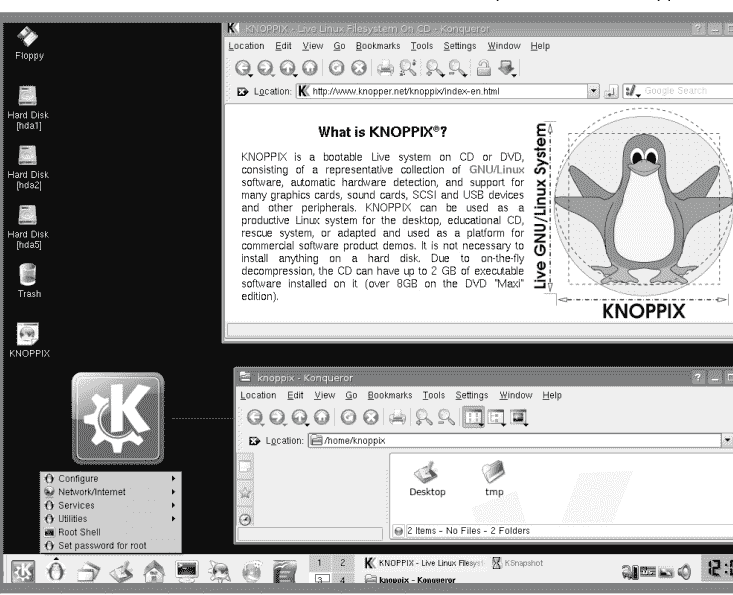

- 管理文件——从底部面板选择 Home 图标。打开一个 Conqueror 窗口显示你的主目录 (`/home/knoppix`)。你通常会将文件和文件夹保存到主目录中。因为你是在作为 live CD 运行 KNOOPPIX，除非显式保存，否则在重启后你创建的任何文件都会丢失。第 21 章描述了如何创建一个持久性桌面，这样你在 KNOPPIX 中创建的文件就可以永久保存。

- 访问磁盘——像 KNOPPIX 这样的 live CD 设计用于在不触碰硬盘内容的情况下运行。如果你硬盘上上有东西想配合 KNOPPIX 使用（如音乐文件或文档），KNOPPIX 让这变得非常简单。

桌面左侧会出现图标，代表你硬盘上的每个分区以及检测到的可移动介质（如 USB 闪盘）。在图 1-1 中，硬盘图标 `hda1`、`hda2` 和 `hda5` 代表你硬盘上的几个分区。

# Linux 入门

从桌面选择“退出”图标，并选择“关机”或“重启”到 `DSL`。注意“备份”框已勾选。勾选该框后，`DSL` 将提供保存文件和设置的选项（前提是你之前已经在控制面板中设置了备份文件的位置）。保存这些信息后，下次你从这台电脑启动 `DSL` 时，就可以使用这些文件和设置。

# 尝试其他 Linux 发行版

除了 KNOPIX 和 `DSL`，还有许多其他 Linux 发行版可以通过本书附的 CD 和 DVD 进行尝试。`Ubuntu` 拥有庞大且活跃的用户群体，并且可以在 DVD 现场运行。如果你想设置一个为企业级发行版准备的 Linux 系统（分别是红帽企业级 Linux 和 SUSE Linux），可以尝试 `Fedora` 或 `openSE`。

`Gentoo` 和 `Slackware` 吸引技术导向型用户。在小型机器上，`Puppy Linux` 或 `BackTrack` 等发行版可能会引起你的兴趣。请参录 A 获取有关书中包含的这些和其他 Linux 系统的信息。

# 理解 Linux

不知道 Linux 是什么的人会问我它是否是一个运行在微软 Windows 上的程序。当我告诉他们 Linux 本身就是一个像 Windows 一样的操作系统，而且他们可以删除（或购买）Windows 时，我会得到惊讶的反应：“PC 可以在没有任何微软产品的情况下运行吗？”答案是肯定的！

关于 Linux 的下一个问题是：“Linux 如何是免费的？”虽然完整的答案将会很长（并在稍后介绍），但简短的答案是“因为编写代码的人许可免费分发”。然而，请记住，与“免费”（free）一词相关的关键问题是“自由”（freedom），意味着你可以自由地对代码进行重新构建、重用、重新配置以及其他任何你喜欢的操作。唯一的主要责任是，如果你更改了软件，请将其传递下去，以便其他人也能从你的工作中获益。

Linux 是一个完整的操作系统，是强大且稳定的 UNIX 系统的免费克隆。使用 Linux 启动你的电脑，Linux 将负责你 PC 的运行并管理你电脑的以下方面：

- **处理器** —— 因为 Linux 可以同时运行多个用户的进程（在同一台机器上具有多个 CPU），所以 Linux 需要管理这些进程。调度器为运行的任务设置优先级，并管理哪些进程运行在哪些 CPU 上（如果存在多个处理器）。调度器可以针对不同类型的 Linux 系统进行不同的调优。如果调优得当，最重要的进程将获得处理器的最快响应。例如，桌面系统上的 Linux 调度器对移动桌面窗口等任务的优先级会高于后台文件传输。

- **内存** —— Linux 尝试将具有最迫切需求的进程保留在 RAM 中，管理超出可用内存的进程如何移动到交换空间。`交换空间（Swap space）`是硬盘上的一个定义区域，用于处理运行进程和数据的溢出。当 RAM 满额时，进程会被放在交换空间中。当交换空间满时（这是你不希望发生的情况），新进程无法无法。

- **设备** —— Linux 支持数千种硬件设备，通过在活动内核中包含一小部分驱动程序来保持内核。使用可加载模块，内核可以根据需要添加对其他硬件的支持模块可以根据需要加载和卸载，硬件也可以添加和删除。（稍后将详细描述内核是 Linux 操作系统的核心。）

- **文件系统** —— 文件系统提供了存储在硬盘、CD、DVD、软磁盘或其他介质上的文件结构。Linux 知不同的文件类型（如 Linux `ext3` 和 `reiserfs` 文件系统，或 Windows 系统的 `VFAT` 和 `NTFS`）以及如何管理它们。

- **安全** —— 与 UNIX 不同，Linux 从底层开始构建，以允许多个用户同时访问系统。为了保护每个用户的资源，每个文件、目录和应用程序都分配了一组读、写和执行权限，定义了谁可以访问它们。在标准的 Linux 系统中，`root` 用户具有访问整个系统的权限，某些登录访问特定的服务（如用于 Web 服务器的 `Apache`），用户可以单独或按组分配。最近的功能如 Enhanced Linux 和 `AppArmor` 允许在高度安全的计算环境中进行更精细的调优和保护。

我所描述的是主要由所谓的 Linux 内核（Linux kernel）管理的组件。事实上，内核（仍然由 Linus Torvalds 维护，他在芬兰作为一名研究生时创建了 Linux 内核）是 Linux 命名的来源。内核是你启动电脑时启动的软件，并与你使用的程序建立接口，以便你有效且简单地与计算机硬件进行通信。

> 请查看附录 B 关于内核和其他自由软件如何创造 Linux 现象的细节。

来自开源软件的管理命令和应用程序等组件与内核协同工作，使 Linux 成为一个完整的操作系统。`GNU` 项目 (`www.gnu.org`) 特别为 UNIX 组件贡献了许多实现，这些实现现在位于 Linux 中。`Apache`、`KDE`、`GNOME` 以及 Linux 中的其他主要开源项目也为 Linux 的成功做出了贡献。（参见第 2 章关于开源项目如何工作以及你可以如何参与其中的解释。）那些其他项目添加了如下内容：

- **图形界面** —— 由 `X Window` 系统的图形框架、窗口管理器、面板、图标和菜单组成，GUI 使你能够通过键盘和鼠标组合使用 Linux，而不仅仅是输入命令（就像过去那样）。

- **管理实用程序** —— 包括数百（可能是数千）个命令和图形窗口，用于执行诸如添加用户、管理磁盘、监控网络、安装软件以及泛的安全和管理你的计算机的任务。

- **应用程序** 虽然没有哪个 Linux 包含了所有的程序，但有数千个游戏、办公效率工具、浏览器、多媒体播放器和其他适用于 Linux 的。

- **编程工具** 包括用于创建应用程序的编程工具和库。

- **服务器功能** —— Enables从你的 Linux 内核向网络提供服务。此外，虽然 Linux 包含了查看网页的浏览器，但它也可以作为提供网页的计算机。流行的服务器功能包括 Web、数据库、打印、文件、DNS 和 DHCP 服务器。

一旦 Linus Torvalds 和他的朋友们有了工作的 Linux 内核，整合出一个完整的源码操作系统就变得可能，因为许多可用的“免费”软件：

- **受 GNU 公共许可证 (GPL) 或类似许可覆盖** —— 这允许整个操作系统被自由分发，前提是关于未来如何提供源码的指南（参见 `http://www.gnu.org/licenses/gpl.html`）。

- **基于 UNIX 类系统** —— 几乎所有其他用户级组件的克隆都已创建。其他实用程序和应用程序也是为 UNIX 或其他 UNIX 类系统构建的。

Linux 已成为开源软件运动最受欢迎的成果之一。但这种共享代码和建立社区的传统在 Linux 出现几年前就已经存在。你可以认为它始于贝尔实验室的一个舒适的思考场所。阅读附录 B 了解更多关于 Linux 的历史。

利用 UNIX 和 GNU 项目的工作帮助了 Linux 的快速建立和运行。开源社区的共享文化以及对各种通信工具的采用，帮助 Linux 快速度过了婴儿和青少年时期，成为一个成熟的操作系统。

# Linux 的伟大之处何在

如果你以前没有用过 Linux，你应该预料会有一些地方与其他操作系统有所不同的之处。以下是一些你可能会觉得很酷的 Linux 特性：

- 无需频繁重启 —— 运行时间（Uptime）被视为一种骄傲（记住，Linux 和其他 UNIX 系统通常用作服务器，预计并保持 24/7/365 全天运行）。在初始安装后，你可以安装或删除大多数软件，而无需重启计算机。

- 在不干扰他人的情况下启动/停止服务 —— 你可以启动和停止单个服务（如 Web、文件和电子邮件服务），而无需重启，甚至不会干扰任何其他用户的工作或计算机的其他功能。换句话说，你不应该每当有人打喷嚏时就得重启电脑。（安装新内核几乎是你重启的唯一理由了）。

- 可移植性软件 —— 你通常可以切换到另一个 Linux、UNIX 或 BSD 系统，并继续使用完全相同的软件！大多数开源项目的设计是为了运行在任何 UNIX 类系统上，如果你需要，它们也可以在 Windows 系统上运行。如果它无法在你想要的地方运行，可以由你来修改，或者将其移植（Port）到你想要的计算机上。（移植指的是修改应用程序或驱动程序，使其能够在不同的计算机架构或操作系统上运行）。

- 可下载的应用 —— 如果你的 Linux 版本没有提供某些应用程序，你可以使用 `apt`、`yum` 和 `yum` 等工具通过命令轻松下载并安装它们。

- 没有隐藏在代码或注册表中的设置 —— 一旦你熟悉了 Linux，你会发现（在计算机上拥有正确权限的情况下）大多数配置都定义在纯文本文件中，且易于查找和修改。近年来，简化的图形界面的加入使得处理配置文件变得更加容易。因为 Linux 基于开放性，没有任何东西对你是隐藏的。对于 GPL 保护的软件，其源代码可供你审阅。

- 成熟的桌面 —— Windows 系统（为你的 Linux 桌面提供框架）的出现时间比 Microsoft Windows 还要早。`KDE` 和 `GNOME` 桌面环境提供的图形界面（窗口、菜单等）与那些系统上的界面相媲美。你也可以自由选择轻量级的窗口管理器。Linux 系统的易用性问题正在快速演进。

- 自由 —— Linux 在其最基本的形式没有公司议程或需要满足的底线。你可以自由选择适合自己的 Linux 发行版，查看运行你系统的代码，添加和删除你喜欢的任何软件，让你的计算机执行你想让做的事。Linux 运行在从超级计算机到细胞以及其之间的一切设备上。许多国家正在重新发现它们的选择自由，并在政府和教育层面进行切换。法国、德国、韩国和印度只是注意到 Linux 的少数国家之一。列表仍在不断增长。

Linux 的某些方面让新用户很难上手。其中一点是 Linux 通常被设置为默认安全，因此你需要适应使用管理员登录（`root`）来进行大多数影响整个计算机系统的更改。虽然这有点不方便，但请相信我，这会让你的计算机比仅仅让它随心所欲更安全。这种模型是围绕真正的多用户系统构建的。你可以为每个使用你 Linux 计算机的人设置登录账户，你（以及其他人）可以根据自己认为合适的方式自定义自己的环境，而不会影响任何人。

出于相同的原因，许多服务默认是关闭的，因此你需要开启它们并进行最少的配置让它们运行起来。对于习惯了 Windows 的人来说，Linux 仅仅因为与 Windows 不同就可能变得困难。但由于你正在阅读这本书，我想你想学习这些差异。

## 总结

开始学习 Linux 就像将随书附的 CD 或 DVD 插入你的电脑并重启一样简单。使用该介质，你可以尝试 18 种不同的 Linux 系统，无论是现场运行（live）还是安装到硬盘中。

Linux 可以作为桌面系统（类似于 Microsoft Windows）；作为 Web、文件或打印服务器；或者作为程序员的工作站。在 Linux 的配置方式以及你在其上安装和运行什么软件方面，你拥有极大的灵活性。

因为你可以随心所欲地使用开源软件——许多 Linux 爱好者已经想出了有趣且创新的方法来使用 Linux 并从中受益。第 2 章描述了你可以用 Linux 做什么，用 Linux 制作什么，以及通过 Linux 变成什么。

# 第 2 章

## Linux 项目、活动与职业

本书的主要目标是引导你了解将 Linux 作为桌面、服务器或程序员工作站的最流行方法。然而，一旦你习惯了使用 Linux，你将开始发现这些用途只是冰山一角。

记住，你可以随心所欲地修改、重建和重用免费开源软件。这意味着你可以组合你喜欢的项目来构建你想要的 Linux 系统。你甚至可以修改它使其运行在不同类型的硬件上。为了这些目标，你可以与其他志同道合的人合作，产生可能你自己无法完成的宏大软件。

所以，在我们全力进入书的“如何操作”部分之前，本章旨在激发你的灵感并让你大开眼界：

- **你可以用 Linux 做什么** —— 凭借免费软件和一台闲置 PC，你可以制作出独立设备，如音乐播放器、游戏机、电话应答机或家庭网络服务器。`NASA` 在它的月球车上使用 Linux 来引导它们的移动。有些人使用 Linux 终端服务器项目从单台服务器驱动数百台旧或廉价的 PC。你能想到什么种项目？

- **你可以如何参与 Linux** —— 对于许多爱好者来说，Linux 不仅仅是他们的计算机。它是他们所信的。

- **你可以通过 Linux 变成什么** —— 仅仅因为 Linux 是“免费”的，并不意味着你不能从它盈利。许多小型企业使用 Linux 来满足需求。如果你对将 Linux 作为职业感兴趣，可以通过培训和认证成为开源革命的参与者。

| 本章内容 |
| :--- |
| 你可以用 Linux 做什么 |
| 你可以用 Linux 制作什么 |
| 你可以通过 Linux 变成什么 |

# 从 Linux 入手

如果 Linux 激发了你的兴趣，有很多方法可以贡献开源项目并倡导使用免费软件。

# 用 Linux 制作东西

开始思考用 Linux 可以制作或做的事情，你只需要看看。Linux 可能已经存在于你的手持设备、个人视频录机，并且几乎肯定运行着你的搜索引擎或网站。

许多人、学校和公司以各种有趣、教育和专业的方式采用了 Linux。有些人将 Linux 精简到核心部分（嵌入式 Linux 内核、shell 和几个驱动程序），并添加了自己的软件。

# 这里的 Linux

当 `NASA` 的火星探测器（`MER`）在火星上移动并传回图像和数据时，Linux 驱动着从高级规划到低级模拟和可视化的过程。`NASA` 选择 Linux 是因为它的图形处理、稳定性以及大量的可用工具。

`NASA` 使用 Linux 开发了序列与可视化程序（`RSVP`）套件来命令 `MER`，然后在 Linux 上测试并部署了该系统。在套件中，序列编辑器（`RoSE`）让 `NASA` 向飞天器发送命令，而 `HyperDrive` 则提供了三维图形用于控制（移动手臂、驱动车辆和控制成像）。

图 2-1 显示了 `NASA` 生成的一张 `MER` 在火星上的计算机图像。

运行在每个 `MER` 上的 Linux 系统是来自 `TimeSys`（`www.timesys.com`）的嵌入式操作系统。`RoSE` 应用（用于传递消息）是用 Java 编写的，而 `HyperDrive` 元素（图像查看器和序列浏览器）是用 C++ 和 C 语言编写的。`NASA`科学家 Frank Hartman 和 Scott Max 在《Linux Journal》上的一篇文章详细描述了 Linux 在 `MER` 项目中使用情况（`www.linuxjournal.com/article/7570`）。

# Linux 项目、活动与职业

# 图 2-1

火星探测漫游者（`MERs`）通过机载 Linux 系统收集数据、发送图像并在火星上移动。


（摄影来源：美国航空航天局）

“精神号”（Spirit）于2004年1月4日登陆火星，“机会号”（Opportunity）于1月25日着陆。在本文写作时，两者在运行多年后仍在工作。如果你对关注火星探测漫游者任务的进展感兴趣，请参考 `NASA` 喷动力实验室的项目网站（`http://marsrovers.jpl.nasa.gov`）。

## 设备中的 Linux

许多商业通信、娱乐和其他种设备内部都运行着 Linux。对于这些特殊设备，Linux 是一个极佳的操作系统，不仅是因为它的成本低廉，还因为它的稳定性和适应性。

Linux 爱好者热爱这些被称为嵌入式 Linux 系统的设备，因为他们通常可以在这些设备上适配或运行不同的 Linux 软件（无论制造商是否本意如此）。然而，越来越多的制造商正通过销售开放设备供其使用来拥抱 Linux 爱好者和硬件黑客。以下是一些例子：

- **手机** — `OpenMoko` (`www.openmoko.com`) 生产大众市场的移动手机，如 `NeoRunner`。与软件一样，`FreeRunner` 的硬件也遵循开放设计。尽管该手机旨在供普通消费者使用，但其软件目前最适合那些想要为手机开发自己软件的人。图 2-2 显示了 Neo `FreeRunner` 的示例。


摩托罗拉（Motorola）、OpenMoko 和 Tranzda Technologies 各提供多款基于 Linux 的手机。内部运行 Linux 的手机包括摩托罗拉 Rok Em30（强调音乐播放）、Tranzda Technologies NewPlus（带有 WiFi、GPS 和摄像头）、Purple Labs Magic 手机（低于 100 美元的手机）以及带有键盘和电子邮件支持的 Gruning B700。

## 第一部分：Linux 快速步

### 图 2-2

修改软件以将 Linux Neo FreeRunner 作为手机、GPS 设备、时钟、游戏器和媒体播放器使用。


- **Sony PlayStation** — 你不仅可以在 PlayStation 上安装和运行 Linux，索尼还鼓励你这样做。2002 年，索尼发布了适用于 PlayStation 2 的 Linux Kit。该工具包包含了日本 Kondura MNU/Linux 的衍生版本（基于 Red Hat Linux）。对于 PlayStation 3，有几个 Linux 发行版已经过修改（移植）以运行在硬件上，包括 Fedora、OpenSUSE、Ubuntu 以及针对 PlayStation 3 的商业级 Yellow Dog Linux 产品。（关于 Yellow Dog Linux 的描述请参阅第 22 章。）

- **个人视频设备 (PVRs)** — 如果你有一个 TiVo PVR 或用于从 Netflix 流媒体视频的顶顶盒，它们已经在你家里运行了 Linux。Netflix PVR 来自 Roku, Inc 公司（www.roku.com），该公司生产了一系列基于 Linux 的媒体播放器。TiVo 多年来一直生产基于 Linux 的 PVR。TiVo Linux 源代码（www.tivo.com/linux）的可用使得 TiVo 成为 Linux 爱好者最喜欢的黑客设备之一。

- **笔记本电脑 (Netbooks)** — 笔记本电脑尺寸的缩小导致了笔记本电脑的出现。这些迷你笔记本电脑被证明是运行 Linux 的极佳设备。凭借低功耗处理器和小屏幕，笔记本电脑与针对紧凑、高效设备调优的 Linux 系统构成了良好的搭档。

Asus Eee 是最流行的笔记本电脑之一。许多 Asus Eee PC 在预装 Xandros Linux 的情况下售出。然而，勤奋的爱好者已经将 Fedora、Ubuntu 和其他 Linux 发行版移植到了 Eee PC。图 2-3 显示了一台运行 Linux 的 Eee PC。

- **个人手持设备** — 如今有一系列内置 Linux 的个人数字助理（PDA）、便携式导航设备（PNA）和便携式媒体播放器（PMP）。Garmin Venu（型号 860、880 和 5000）GPS 导航设备具有 GNOME Mobile Linux 和 GeoClue 定位技术。三星 i70 将数字相机与构建在 Montavia Linux 上的个人媒体播放器相结合。索尼 mylo 网络设备内部是 Qtopia Linux 系统，允许你连接 WiFi 网络、播放 Adobe Flash 视频甚至录制视频。

学习这些以及其他运行 Linux 设备的好地方是 LinuxDevices 网站（www.linux devices.com）。

### 图 2-3

Asus Eee PC 可以运行经过专门调优的 Fedora 或 Linux 系统。

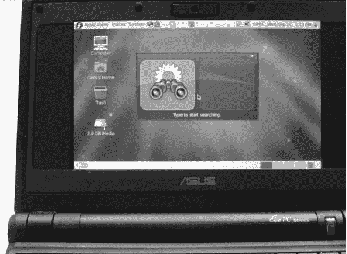

## 开放项目中的 Linux

整个开源项目都致力于特殊用途的 Linux 系统。这些项目可能专注于很好地完成某类活动（如构建多媒体中心），或解决某个问题（如学校电脑预算的削减）。以下是一些带来了你可能感兴趣的开源软件的人的例子：

- **MyTV (www.mytv.org)** — 当涉及到开源个人录制机项目时，MyTV 处于领先地位。

## 开启 Linux 之门

团体和学校在不再支持最新 Microsoft Windows 软件的计算机上使用 Linux。以下是一些可以帮助你寻找 Linux 用户小组（LUG）的地方：

- [Google](www.google.com/linux) — 我通过 Google 搜索“Linux”一词并寻找离我居住地最近的地点，找到了我参与过的两个 LUG。

- [Linux 聚会小组](Linux.meetup.com) — 输入您的邮政编码搜索您所在地区最近的 LUG。

- [Linux 在线](www.linux.org/groups) — 提供了一份大型国际化 Linux 用户小组列表。选择您的国家以查看可用的小组列表。

如果你所在的地区没有 Linux 用户小组，你可以考虑自己启动一个。要获取关于 LUG 是什么的信息以及关于启动小组的建议，请参阅 [Linux 用户小组 HOWTO](www.tldp.org/HOWTO/User-Group-HOWTO.html)。

## 加入 Linux 社区

围绕 Linux 及其相关的开源项目，已经形成了由专业人士和爱好者组成的社区。许多人在邮件列表、论坛、维基和其他其他网络平台上（只要你礼貌询问且不过于烦人）投入了他们的时间、知识和技能。

免费在线论坛层颖而出，用于获取有关 Linux 主题的信息。流行的 Linux 论坛可以在 [www.LinuxQuestions.org](www.LinuxForums.org] 和 [www.LinuxHelp.net] 找到。


大多数 Linux 发行版都有相关的邮件列表和论坛。你可以直接访问 Hat 赞助的 [Fedora Linux](http://fedoraproject.org/)、[Debian](www.debian.com)、[Ubuntu](http://ubuntuforums.org)、[Gentoo](www.gentoo.org) 以及其他官方网站，学习如何参与论坛并为项目做出贡献。

# 支持 Linux 的公司和团体

一些公司和组织对 Linux 和开源软件出了重要贡献。以下是最著名的几个：

- [SourceForge](web.sourceforge.com) — 该组织维护着开源开发网站 Freshnet (freshnet.com) 以及 SourceForge (www.sourceforge.org)。它还维护信息技术网站，如 [Slashdot](slashdot.org)、[NewsForge](www.newsforge.org) 和 [Linux.com](www.linux.com)。

- [IBM](www.ibm.com/linux) — 因为 IBM 在针对 Linux 的诉讼中占据大部分份额，并且在帮助 Linux方面做了很多工作（特别是在企业领域），它在这里值得提及。Gentoo 网站上有许多 Linux 的优质资源，包括一些涵盖业务领域 Linux 的优秀白皮书。

# Linux 项目、活动与职业

- [Ibiblio](www.ibiblio.org) — 包含海量的 Linux 软件和文档存档 (www.ibiblio.org/pub/linux)。

- [软件自由法律中心](www.softwarefreedom.org) — 该组织为现存的大多数自由和开源软件（FOSS）项目提供法律代表。它是维护受 GNU 公共许可保护的软件使用的组织。

- [每个孩子一台电脑项目](www.laptop.org) — OLPC 项目是一个致力于通过向全球贫困儿童提供手笔记本电脑来帮助他们接受教育的组织。截至本文撰写时，全球已有超过 300,000 台 OLXO 笔记本电脑出货，成为 Fedora Linux 系统单一最大的分发商。

# 跟进 Linux

虽然 Slashdot.org 可能是 Linux 爱好者关注并参与的新闻网站，但也有许多其他地方可以寻找 Linux 和开源新闻。

- [Slashdot](slashdot.org) — 可能是开源爱好者的热门新闻网站。人们提交有关技术、科学、政治或其他“需求”的新闻文章、书籍和访谈的链接。每个人都会附上自己的评论。你的项目被“slashdotted”（顶贴）意味着你已经名出茅定了——尽管你可能在受到赞誉的同时也遭到批判。

- [Digg](http://digg.com) — 可能是开源爱好者的另一个新闻网站。人们提交有关新闻文章、书籍和访谈的链接，大家对哪些 Linux 话题最感兴趣进行投票。

- [Linux Online](www.linux.org) — 该网站提供了许多关于 Linux 的文章（up-of-the-minute），这比在 Digg.com 网站上提供了关于 Linux 的最新的（up-of-the-minute）文章。

- [Linux Today](www.linxtoday.com) — 收集有关 Linux 的文章。

- [LWN](www.lwn.net) — 许多 Linux 开发者感兴趣的周报。

- [Linux Insider](www.linuxinsider.com) — 专注于 Linux 的新闻。

- [Linux Wikipedia](https://en.wikipedia.org/wiki/Linux) — 包含了 Linux 的信息。

- [CertCities](http://certcities.com) — 提供有关 Linux 的文章。

- [Linux.com](www.linux.com) — 提供了有关 Linux 的信息。

- [Linux Questions](www.LinuxQuestions.org) — 如果你需要关于 Linux 的帮助。

- [Linux Forums](www.LinuxForums.org) — 包含了关于 Linux 的论坛。

- [Linux Help](www.LinuxHelp.net) — 提供有关 Linux 的信息。

- [Linux Online Groups](www.linux.org/groups) — 提供了一份大型国际化 Linux 用户小组列表。

- [Google](www.google.com/linux) — 我通过 Google 搜索“Linux”一词并寻找离我居住地最近的地点，找到了我参与过的两个 LUG。

- [Linux Meetup Groups](Linux.meetup.com) — 输入您的邮政编码搜索您所在地区最近的 LUG。

- [Linux Online](www.linux.org/groups) — 提供了一份大型国际化 Linux 用户小组列表。选择您的国家以查看可用的小组。

如果你所在的地区没有 Linux 用户小组，你可以考虑启动一个。要获取关于 LUG 是什么的信息以及关于启动小组的建议，请参阅 [Linux 用户小组 HOWTO](www.tldp.org/HOWTO/User-Group-HOWTO.html)。

# 加入 Linux 社区

围绕 Linux 及其相关的开源项目，已经形成了由专业人士和爱好者组成的社区。许多人在邮件列表、论坛、维基和其他其他网络平台上（只要你礼貌询问且不过于烦人）投入了他们的时间、知识和技能。

免费在线论坛层颖而出，用于获取有关 Linux 主题的信息。流行的 Linux 论坛可以在 [www.LinuxQuestions.org](www.LinuxForums.org) 和 [www.LinuxHelp.net] 找到。

大多数 Linux 发行版都有相关的邮件列表和论坛。你可以直接访问 Hat 赞助的 [Fedora Linux](http://fedoraproject.org/)、[Debian](www.debian.com)、[Ubuntu](http://ubuntuforums.org)、[Gentoo](www.gentoo.org) 以及其他官方网站，学习如何参与论坛并为项目做出贡献。

# 探索 Linux发行版

尽管有数百个 Linux 发行版，但你可以安全地关注几个主要的发行版，以良好地了解可用情况。这是大多数 Linux 发行版都源自几个主要的发行版。例如，Ubuntu、KNOPPIX、Damn Small Linux (DSL) 以及其他 Linux 系统基于 Debian/Linux、CentOS、Red Hat Enterprise Linux，而其他的基于 Fedora。

# 第一部分 Linux 入门

请参阅第 17 至 28 章，获取有关现有的大多数主流 Linux 发行版的描述，以及获取和安装它们的程序。如果你尚未选择发行版，这里有一些你可以评估的网站，并能从中找到你感兴趣的 Linux 发行版：

- [Distrowatch](distrowatch.com) — 包含一些不同 Linux 发行版的信息。该网站提供了一种了解不同发行版的方法，并可以直接连接到发行版的主页、下载站点或相关论坛。

- [LWN.net Linux Distributions](https://lwn.net/Distributions) — 如果你想在一个页面上查看 400 多个 Linux 发行版的简要描述，这里就是这里。

以下是书中涵盖的 Linux 发行版关键网站：

- [Fedora](https://fedaproject.org) — 社区驱动，由红帽（Red Hat）支持。访问 Linux (rpm, livna.org) 获取 Fedora 附加软件下载。FedoraForum.org 是一个流行的 Fedora 论坛。

- [Red Hat Enterprise Linux](www.redhat.com) — 访问红帽网站获取商业 Linux 产品信息。

- [Debian/Linux](www.debian.org) — 获取有关 Debian 的新闻、文档、支持和下载信息。尝试 Debian 新闻网站 (www.us.debian.org/) 获取关于 Debian 最新文章。

- [Ubuntu Linux](www.ubuntu.com) — 从此 Ubuntu 网站了解 Ubuntu 发行版、社区及相关产品。从 Ubuntu Wiki (https://wiki.ubuntu.com/) 可以找到文档、教程（HOWTO）、社区站点、活动和发布版本的链接。

- [SUSE](www.novell.com/linux/) — 从该项目的网站获取产品和支持信息。Novell 网站还提供有关 Novell Linux 产品的信息以及其近期与微软合作的细节。

- [KNOPPIX](www.knoppix.net/knoppix/index.html) — 其创建者（Klaus Koppix）网站上的 KNOPPIX 官方页面。可以通过 www.knoppix.net/forum/ 访问活跃的 KNOPPIX 论坛。

- [Yellow Dog](www.terrasolutions.com/products/ydl) — 从这个由 Terra Soft Solutions 赞助的网站，你可以购买 CD 版本的 Yellow Dog Linux，或将其安装在 Mac 上。YDL.net 网站为 Yellow Dog Linux 用户提供额外服务，如个人邮箱和 Web 空间。

- [Gentoo](www.gentoo.org) — 非常活跃的 Gentoo 社区中心。该网站包含大量关于 Gentoo 的信息以及许多可以参与的 IRC 频道。你将找到一套完善且不断增长的文档集来支持你的发行版，以及大量可以尝试的软件包（数以千计）。

- [Slackware](www.slackware.org) — 查看此网站的变更日志以了解 Slack 的最新进展。尝试 LinuxPackages (www.linuxpackages.net) 以获取关于 Slackware 的更广泛的信息。

- [Freespire](www.freespire.org) — 包含有关曾作为 Linux 系统社区支持分支的信息。随着 Xandros 收购 Linspire，Freespire 现在由 Xandros 控制。

- [Mandriva](www.mandrivalux.com) — Mandriva Linux 由 Mandrake Linux 和 Connectiva Linux 合并形成，Mandriva Linux 网站为访问者提供多种 Linux 产品、服务和支持。

# 现实世界中的 Linux

为了展示 Linux 和自由开源软件如今在现实世界中的用法，我提供了一些与学校、小型企业和企业场所 Linux 使用相关的简短示例。

## 学校中的 Linux

成本节省、灵活性和应用枢纽使得 Linux 成为许多学校专有系统的绝佳替代。有一个项目在学校里特别成功：K12 Linux 终端服务器项目 (www.k12ltsp.org)。

K12LTSP 基于 Linux 终端服务器项目 (www.ltsp.org) 和 Fedora (.fedaproject.org)，但专门针对学校环境进行了调优。通过 K12LTSP，你可以将所有应用程序集中在一个或多个服务器上。然后，你可以使用低端 PC（旧的奔腾处理器或瘦客户机）作为工作站。使用价格低于 200 美元的客户端或你手头已有的旧 PC，你只需略高于服务器和一些网络硬件的成本，就能为一个班级甚至整个所学校提供服务。图 2-5 展示了配置 K12LTSP 服务器以管理多个工作站时需要经历的通用步骤。

通过将学校软件集中在有限数量的服务器上，K12LTSP 可以同时提供安全性（只需监控少数服务器）和便利性（无需为了升级或增强软件而重新安装数百台 Windows 机器）。每个客户端机器控制显示器、鼠标和键盘，而用户的所有应用程序和文件都存储并运行在服务器上。

俄根州的许多学校已采用 K12LTSP，其中包括位于波特兰的林纳斯·托瓦尔斯（Linus Torvalds）孩子就读的学校。K12LTSP 的采用也出现在乔治亚州亚特兰大以及美国的许多其他城市。

图 2-5

在服务器上配置 LTSP，然后启动工作站从该服务器进行工作。

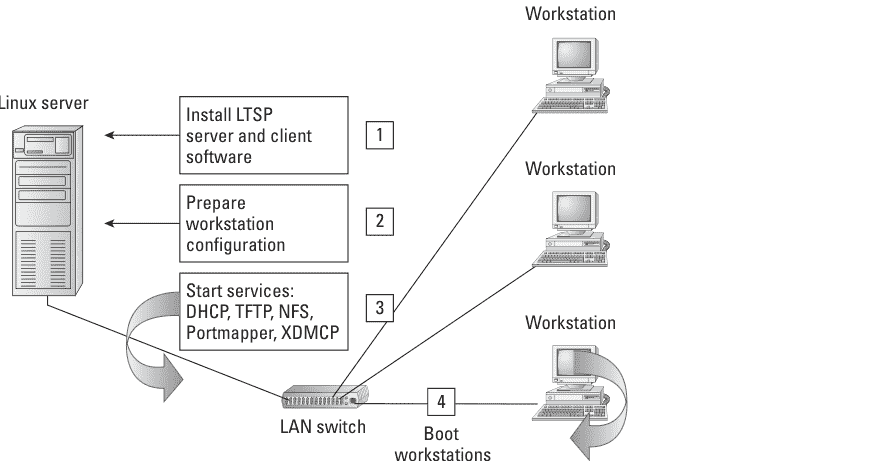

# 小型企业中的 Linux

通常，小型企业可以将其所需的 Web 服务合并到一个或两个 Linux 服务器上。它可以使用 OpenOffice.org 等成熟的开源应用程序满足基础的办公计算需求。

小型企业通常可以将其所需的 Web 服务合并到一个或两个 Linux 服务器上。它可以使用 OpenOffice.org 等成熟的开源应用程序满足基础的办公计算需求。

小型企业通常可以将将其所需的 Web 服务合并到一个或两个 Linux 服务器上。它可以使用 OpenOffice.org 等成熟的开源应用程序满足基础的办公计算需求。


小型企业通常可以将将其所需的 Web 服务合并到一个或两个 Linux 服务器上。它可以使用 OpenOffice.org 等成熟的开源应用程序满足基础的办公计算需求。

小型企业通常可以将将其所需的 Web 服务合并到一个或两个 Linux 服务器上。它可以使用 OpenOffice.org 等成熟的开源应用程序满足基础的办公计算需求。

*(注：原文中存在部分文本重复，翻译时已按要求处理。根据“不要重复输出原文”的原则，此处仅根据翻译逻辑对原文的每个段落进行了完整翻译。)*

# 企业环境中的 Linux

将公司的计算机基础设施构建在开源软件上，代表了对它将提供公司所需的可靠性安全功能的巨大信心。这就是为什么大多数使用开源基础设施的企业都选择了企业级 Linux 供应商的产品，例如 Red Hat, Inc.（红帽企业 Linux）和 Novell,（SUSE Linux Enterprise）。

红帽的开源企业产品中内置了如红帽目录服务器、全局文件系统 `GFS` 和集群存储等功能。目录服务器可以扩展到处理数百万身份，代表了跨数台机器和用户的应用程序用户配置、访问控制和策略。通过使用 `GFS` 和集群存储，企业可以将将其存储基础设施视为公共池，以减少数据重复并简化备份、系统恢复以及存储和服务器的扩展。

## Linux 入门之旅

服务器。迁移到 RHEL 的机构包括美国芝加哥和伊利诺伊州的布鲁明林顿等城市。你可以在红帽的成功案例页面（`www.redhat.com/solutions/info/casestudies`）阅读其他迁移到 RHEL 的组织。

## 成为 Linux 专业人士

从事一项基于人们免费提供的职业可能看起来不是一个明妙的主意。但事实是，如果你拥有完成工作所需的技能，Linux 专业人士有数千份工作。

贡献开源项目是学习 Linux 职业所需技能的最佳之一。当 Ubuntu 项目启动时，它帮助了许多 Debian GNU/Linux 项目的贡献者。当红帽需要招聘 Linux 专业人士时，它通常会在 Fedora 贡献者中寻找。

过去几年里，正式的 Linux 培训和认证机会大幅增加。如果你想为依赖红帽企业级 Linux 的公司工作，可以直接从红帽公司获得培训和认证。红帽提供了从红帽 Linux 基础知识到红帽企业级部署、虚拟化和系统管理的各种课程。你可以针对以下内容进行认证培训：

- 红帽认证技术员 `RHCT` —— 从未使用过 Linux 或其他类 Unix 系统的人可以通过 RHCT 认证将其技能过渡到 Linux。

- 红帽认证工程师 `RHCE` —— 在系统管理领域更高级的 Linux 专业人士通常会参加 RHCE 认证。

- 红帽认证数据中心专家 `RHCDS` —— RHCDS 认证证明了构建任务关键数据中心环境的技能。重点在于使用红帽技术创建可扩展、高可用且易于管理的数据中心。

- 红帽认证安全专家 `RHCS` —— RHCS 程序中强调了针对 SELinux、红帽企业级 Linux 和红帽目录服务器的技能。

- 红帽认证架构师 `RHCA` —— 该证书适用于需要开发部署大型企业环境技能的技术专业人员。

虽然红帽提供了最受欢迎的 Linux 认证之一，但它并不是获取 Linux 认证的唯一途径。Sun Micros 为 Linux 系统管理员提供培训（`www.sun.com/training/`）。CompTIA 提供针对 Linux 发行版的认证。同样，Novell 和 Linux 专业人员学院也提供 Linux 认证。Ubuntu 提供 Ubuntu 专业人员的培训和认证（`www.ubuntu.com/training/certificationcourses`）。

## 总结

尽管大多数人将 Linux 作为桌面、服务器或程序员工作站，但许多人也发现，开源软件提供的自由可以用于许多创造性的方式。本章描述了从 NASA 的火星探测器车到 MythTV 个人视频录制机等各种项目如何调整 Linux 系统和软件以满足其需求。

如果你在阅读这本书时对开源软件的前景感到兴奋，你可能会发现自己想寻找更深入参与的方式。参与方式包括加入 Linux 用户组、为开源项目贡献，以及参与邮件列表或论坛。

随着你对开源软件技能的提高，你可能会发现 Linux 职业的想法很有趣。许多公司提供 Linux 培训和认证。这包括红帽和 Novell 等面向企业级的公司，以及像 CompTIA 和 Linux 专业人员学院等专业的 Linux 培训公司。

# 第二部分

## 运行 Linux 桌面

| 本部分内容 |

| :--- | :--- |

| 第 3 章 | 进入桌面 |

| 第 4 章 | 播放音乐和视频 |

| 第 5 章 | 处理文字和图像 |

| 第 6 章 | 电子邮件和网页浏览 |

| 第 7 章 | 在 Linux 上玩游戏 |

# 第 3 章

## 进入桌面

在过去的几年中，Linux 可用的图形用户界面 `GUI` 已变得像 Apple Mac 或 Microsoft Windows 系统一样易用。随着这些改进，即使是新手电脑也可以开始使用 Linux，而不需要专家在旁指导。

你不需要理解 X 窗口系统、窗口管理器、小组件等的底层框架即可开始使用 Linux 桌面系统。这就是为什么我首先开始解释如何使用两个最流行的桌面环境：`KDE`（K 桌面环境）和 `GNOME`。之后，如果你想更深入研究，我会告诉你你可以通过讨论如何选择在 Linux 中运行的 X 窗口管理器，来组装你自己的桌面。

| 本章内容 |

| :--- |

| 理解你的桌面 |

| 使用 KDE 桌面环境 |

| 使用 GNOME 桌面环境 |

| 配置你自己的桌面 |

| 玩转桌面视觉点缀 AGLX |

### 理解你的桌面

当你安装如 Fedora、SUSE、Mandriva 和 Ubuntu 等 Linux 发行版时，你可以选择桌面环境。Gentoo 和 Debian GNU/Linux 等发行版则提供了去获取任何你想要的桌面环境的选项（而无需安装程序的特别提示）。当你在安装期间获得选择桌面的机会时，你的选择通常包括以下一个或多个项：

- `KDE` 桌面环境 (`www.kde.org`) —— 除了你在完整桌面环境中预期找到的所有功能（窗口管理器、工具栏、面板、快捷键、图标等）外，`KDE` 还有许多华丽的功能。图形、多媒体、办公生产力、游戏、系统管理等许多应用程序已经集成，并与 `KDE` 顺畅运行，它是 SUSE、KNOPPIX 以及其他其他 Linux 发行版的默认桌面环境。

- `GNOME` 桌面环境 (`www.gnome.org`) —— `GNOME` 是一个更精简的桌面环境。它包含比 `KDE` 更少的功能集，并在低内存系统中运行更快。有些人将 `GNOME` 视为一个更面向业务的桌面。它是红帽赞助系统（如 Fedora 和 RHEL）以及 Ubuntu 的默认桌面。

`KDE 4` 桌面基于 `Qt 4`。`GNOME` 基于 `GTK+-2.8`。虽然图形应用程序通常使用 `Qt` 或 `GTK+` 编写，但只要 Linux 发行版包含了相应的库，任何桌面环境都可以运行应用程序。

- X 和窗口管理器 (`X.org` 窗口管理器) —— 你不需要完整的桌面环境即可从 GUI 操作 Linux。使用 Linux 最基本的方法是只需启动 X 窗口服务器和你选择的窗口管理器（有几十种选择）。许多高级用户选择此路线，因为它在设置桌面方面提供了更大的灵活性。像 `Xfce` 和 `Fluxbox` 等窗口管理器在低端、低资源机器上非常好。

事实是，只要 Linux 发行版包含了相应的库（如前所述），任何桌面环境都可以运行 X 程序。因此，你可以根据最适合你的性能、自定义工具和控制来选择 Linux 桌面。本章将介绍这三种类型的桌面环境。

## 启动桌面

由于在 Linux 中启动桌面的方式是完全可配置的，不同的发行版提供了不同的启动方式。一旦安装了 Linux 发行版，它可能会直接启动到桌面、提供图形登录或提供文本登录。可启动的 Linux 系统（完全不需要安装）通常直接启动到桌面。

## 到桌面

某些 Linux 系统无需登录即可启动到桌面，以便你立即开始使用 Linux。KNOPPIX 是一个从 CD 直接启动到 Linux 桌面的示例。该桌面系统以特定的用户名运行（例如 KNOPPIX 发行版中的 `knoppix`）。要执行系统管理，你需要临时切换到管理员账户（使用 `su` 或 `sudo` 命令）。

在任何操作系统上不使用密码都违反了所有基本安全规则。仅在无法访问关键数据的计算机上，临时使用没有密码保护的系统。为了更安全，你可以为 live CD 的主用户账户分配密码，如果你将 live CD 安装到硬盘，则务必分配一个。

## 到图形登录界面

大多数安装在硬盘上的桌面级 Linux 系统启动后都会进入图形登录界面。虽然 X 显示管理器 `xdm` 是 X Window 系统附带的基础显示管理器，但 `KDE` 和 `GNOME` 都有它们自己的图形显示管理器作为登录界面（分别为 `kdm` 和 `gdm`）。因此，取决于你的 Linux 系统默认是哪一个，你可能会看到 `KDE` 或 `GNOME` 的登录界面。像 `gdm` 这样的显示管理器为你提供了登录不同类型桌面环境的机会，这取决于你的系统上安装了什么内容（`GNOME`、`KDE`、`Xfce` 或其他）。

当 Linux 启动时，它会进入所谓的运行级别（run level）或系统状态。通常情况下，设置为在运行级别 5 的系统会启动到图形登录提示符。设置为运行级别 3 的系统则会启动到文本提示符。运行级别由 `/etc/initab` 文件中的 `initdefault` 行设置。你可以根据意愿将 `initdefault` 行的数字在 3 和 5 之间更改。除非你知道自己在做什么，否则不要使用任何其他数字。永远不要使用 0 或 6；这两个数字分别用于关机和重启系统。

由于图形登录界面被设计为可配置的，你经常发现发行版有它们自己的 Logo 或登录界面的其他元素。对于 Fedora Linux，默认的登录界面基于 GNOME 显示管理器 (`gdm`)。要启动会话，你只需输入登录名（用户名）和密码即可启动你的个人桌面环境。

你选择的桌面环境 —— `KDE`、`GNOME`、`Xfce` 或其他 —— 会准备就绪供你使用。系统默认定义了一个桌面环境，但在 Fedora 等提供多个桌面环境的 Linux 系统上，你通常可以更改桌面环境。

图 3-1 显示了 Fedora 中由 `gdm` 显示的基础图形登录面板。

## 3-1

一个简单的 GNOME 显示管理器 (`gdm`) 登录界面

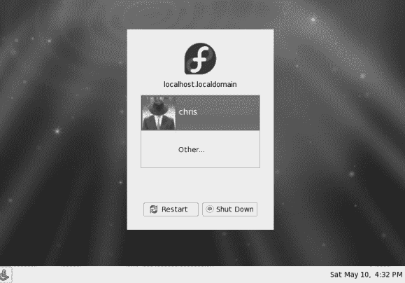

在你的登录和密码被接受后，为你用户账户配置的桌面环境就会启动。用户可以根据喜好修改他们的桌面环境（甚至可以更改整个使用的桌面环境）。

## 到文本提示符

与其看到带有图片和颜色的漂亮图形界面，你可能会看到这样的登录提示符：

```
Welcome to XYZ Linux
yourcomputer login:
```

这是 UNIX 和旧版 Linux 系统在启动时在屏幕上显示的样式。现在，这对于安装作为服务器的系统，或者由于某些原因没有配置启动 X 显示管理器供你登录的系统来说是典型的。运行级别 3 在多用户模式下启动到纯文本登录提示符。

仅仅因为你有文本提示符并不意味着你就可以启动桌面环境。许多 Linux 专家使用文本提示符是因为他们想跳过图形界面或偶尔使用 GUI。某些 Linux 服务器可能甚至没有安装桌面环境。然而，如果电脑上安装了 X 和其他桌面组件，你通常可以在登录后通过输入以下命令启动桌面：

```
$ startx
```

默认桌面环境将启动，你就可以准备就绪了。你将做什么取决于你拥有的是 `KDE`、`GNOME` 还是某种自制的桌面环境。

> 在大多数情况下，你在为显卡和显示器安装程序时设置的 GUI 配置将让你进入一个可以工作的桌面环境。如果由于某些原因在启动桌面时屏幕无法使用，你需要进行一些额外的配置。本章稍后的“配置自己的桌面”部分描述了你可以使用的一些让桌面正常工作的工具。

## KDE 桌面环境

`KDE` 的创建是为了为 UNIX（现在是 Linux）工作站带来高质量的桌面环境。`KDE` 内部成了管理文件、多个桌面和应用程序的工具。如果你会用鼠标，就可以学习导航 `KDE` 桌面。

缺乏集成、标准的桌面环境阻碍了它在桌面上的普及。虽然单个应用程序运行良好，但你大多数无法在应用程序之间拖放文件或其他项目。同样，你无法打开一个文件并期望机器学习使用正确的应用程序来处理，或者将你的窗口从一个登录会话保存到另一个。有了 `KDE`，你可以做所有这些事情以及更多。例如，你可以：

- 将文档从一个文件夹窗口拖到另一个窗口（移动它）或拖到 OpenOffice.Org 写器图标上（打开进行编辑）。

- 右键点击图像文件（`JPEG`, `PNG`）以查看选项。

- 使用菜单管理窗口。

`KDE` 是 Mandriva、KNOPIX 以及多个 Linux 系统的桌面环境。SUSE、OPENSUSE 等也使用 `KDE`。`KDE 4` 标志着桌面领域的重大创新。

## 使用桌面

现可在 Fedora、Ubuntu 等其他主要发行版提供的 Plasma 4 为 `KDE` 提供了新的框架。Plasma 桌面为 `KDE` 赋予了全新的外观和体验。它具有改进的查找和呈现信息的方法，例如 `KRunner` 和 `KickOff`。

Plasma 桌面中的元素被称为 plasmoids。让 plasmoids 与许多桌面系统中的组件不同之处在于，它们可以以各种方式组合并放置在不同的位置。

`KDE` 桌面的一些关键元素包括：

- Conquer — `KDE` 的默认浏览器，也可以作为文件管理器使用。

- Dolphin — `KDE` 的新文件管理器。

- Panel — 面板提供了启动应用程序和管理桌面的快速工具。

图 3 显示了 Fedora 中 `KDE` 的示例。

## 3-3

`KDE` 桌面包含面板、桌面图标等内容。

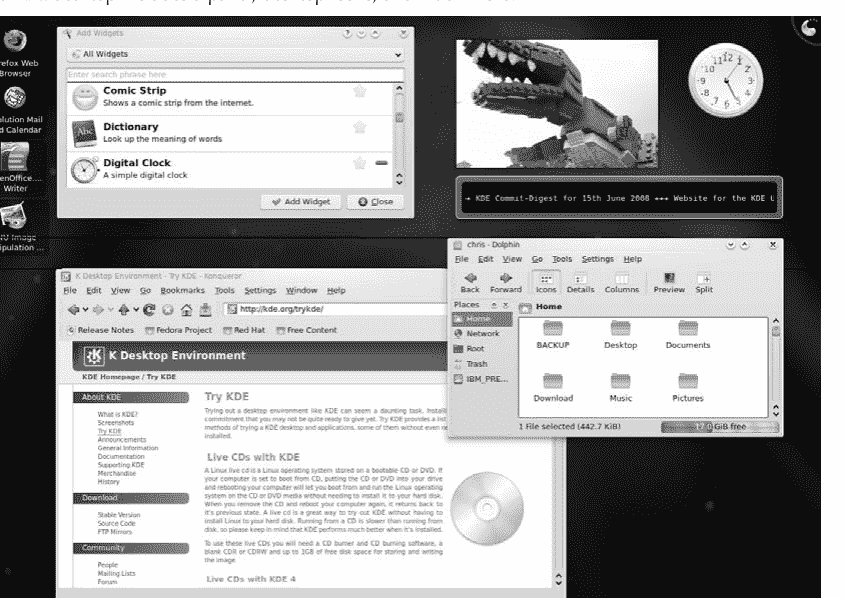

## 运行 Linux 桌面

- 应用程序启动器/菜单 — 此面板打开新的 KickOff 应用程序启动器菜单，帮助你搜索并启动安装在系统上的应用程序。你可以在“收藏”（经常使用的程序）、“应用程序”（应用程序菜单）、“计算机”（位置和存储设备）或“最近使用”之间进行选择。右键点击此按钮并选择“切换经典菜单样式”，即可返回应用程序分类和菜单的经典视图。

- 任务栏 — 显示桌面上正在运行的任务。当前活动窗口的按钮会显示。点击任务可以切换窗口的打开和最小化。

- 桌面面板（Desktop Paper） — 面板上的此框包含你的虚拟桌面，每个桌面都有一个缩略视图。默认情况下为你提供四个虚拟桌面。它们被标记为 1、2、3 和 4。你在虚拟桌面 1 上的 `KDE` 会话。如果桌面上有一个窗口，代表它们的小图标可能会带有桌面编号。你可以通过点击桌面面板中的数字将其切换到四个桌面中的任意一个。

- 迷你应用 — 某些应用程序（如媒体播放器、剪贴板和电池电量）在你关闭相关窗口后仍继续运行。某些应用程序会在面板中保留一个微型应用。通常点击这些应用会恢复它们所代表的窗口。这对于音乐播放器非常方便，如果你不想在播放音乐时占用桌面空间，但又想快速打开播放器切换歌曲。

- 时钟 — 当前时间显示在面板的最右侧。点击查看当前月的日历。点击日历上的箭头键向前或其他切换月份。

导航 `KDE` 桌面，可以使用鼠标或组合键。桌面对你的响应取决于你点击了哪个按钮以及鼠标指针所在的位置。

表 3-1 描述了将鼠标指针放在不同位置时点击每个鼠标按钮的结果。（你可以通过 `KDE` 菜单选择“系统设置”，然后选择“键盘和鼠标”来更改这些或其他行为）。

### 表 3-1：单击鼠标动作

| 指针位置 | 鼠标按钮 | 结果 |

| :--- | :--- | :--- |

| 窗口标题栏或边框（当前窗口活动） | 左键 | 置顶当前窗口 |

| 窗口标题栏或边框（当前窗口活动） | 中键 | 最小化当前窗口 |

| 窗口标题栏或边框（当前窗口活动） | 右键 | 打开操作菜单 |

| 窗口标题栏或边框（当前窗口未活动） | 左键 | 激活当前窗口并将其置顶 |

| 窗口标题栏或边框（当前窗口未活动） | 中键 | 激活当前窗口并将其最小化 |

| 窗口标题栏或边框（当前窗口未活动） | 右键 | 在不改变位置打开操作菜单 |

| 窗口内部（当前窗口未活动） | 左键 | 激活当前窗口，将其置顶并将点击传递给窗口 |

| 窗口内部（当前窗口未活动） | 中键或右键 | 激活当前窗口并将点击传递给窗口 |

| 窗口的任何部分 | 中键（配合 Alt 键） | 在置顶和最小化窗口之间切换 |

| 窗口的任何部分 | 右键（配合 Alt 键） | 调整窗口大小 |

| 在桌面区域 | 左键（按住并拖动） | 选择一组图标 |

| 在桌面区域 | 右键 | 打开系统弹出菜单 |

点击桌面图标以打开它。双击标题栏会触发“窗口遮盖”动作，窗口会向上或向下滚动进入标题栏。

如果你没有鼠标，或者只是喜欢把手放在键盘上，有几个按键序列可用于导航桌面。表 3-2 描述了一些示例。

### 表 3-2：组合键

| 组合键 | 结果 | 方向 |

| :--- | :--- | :--- |

| Alt+Tab | 在窗口间切换 | 要切换当前桌面上运行的每个窗口，请按住 Alt 键并按 Tab 键，直到看到想要的窗口。释放 Alt 键即可选择它 |

| Alt+F2 | 打开运行命令框 | 要要在桌面上打开一个框让你输入并运行命令，请按住 Alt 键并按 F2。接下来，在框中输入命令并按 Enter 键运行。你也可以在此框中输入 URL 来查看网页。 |

| Alt+F4 | 关闭当前窗口 | 要关闭当前窗口，按 Alt+F4。 |

| Ctrl+Alt+Esc | 关闭另一个窗口 | 要从桌面上打开一个窗口，按 Ctrl+Alt+Esc。当指针出现骷髅交叉标志时，移动到你想关闭的窗口上并点击左鼠标键（这是杀死没有边框或菜单的窗口的好用技巧）。 |


| `Ctrl+F1`, `F2`, `F3`, 或 `F4` 键 | 切换虚拟桌面 | 按住 `Ctrl` 键并按下以下键之一：`F1`、`F2`、`F3` 或 `F4`，直接进入特定的虚拟桌面。这些操作将分别带你进入一、二、三、四。如果你配置了许多桌面，最多可以达到八个桌面。 |

| `Alt+F3` | 打开窗口操作菜单 | 要打开活动窗口的操作菜单，按 `Alt+F3`。当菜单出现时，移动方向键选择操作（移动、调整、最大化），然后按 `Enter` |

## 使用 Dolphin 和 Conqueror 管理文件

在 KDE4 中，KDE 提供了两个文件管理器：新的 Dolphin 文件管理器和现有的 Conqueror。Dolphin 是一个精简的文件管理器，现在是你打开文件夹时默认使用的程序。Conqueror 可以处理各种内容，从本地文件和文件夹到远程内容。这两个应用程序将在随后的章节中描述。

> 有关 Dolphin 的信息，请参阅 Dolphin 文件管理器主页 (http://kde.org)。

## 使用 Dolphin 文件管理器

通过向 KDE 引入 Dolphin，KDE 项目现在提供了一种高效管理文件和文件夹的方法。在 Dolphin 中，你对浏览文件系统和处理的文件具有大量的灵活性功能。Dolphin 的功能包括：

- 导航 — 导航栏让你看到相对于主目录或文件系统根目录的当前文件夹。选择“视图 -> 显示完整位置”查看并更改当前文件夹的完整路径。从左列选择文件夹即可进入该文件夹。

- 列出文件和文件夹 — 选择工具栏中的图标以图标形式显示文件和文件夹，并带有文件名、大小、日期或小图标。

- 属性 — 右键点击文件或文件夹并选择“属性”。显示的属性包括文件类型（如文件夹或 Ogg Vorbis 音频）、位置（如 `/home/joe`）、文件大小、修改日期、访问日期和权限。对于文件夹，还有很棒的功能，你可以刷新文件夹使用的磁盘空间或配置与网络上的计算机共享文件夹。支持 Samba 和网络系统 (`NFS`) 文件共享。

- 过滤和搜索 — 从工具栏选择“工具 -> 显示文件栏”。在出现的过滤器框中输入文本字符串以显示包含该字符串的任何文件或名称（例如，`us` 会匹配 Music）。-> 查找文件以打开 `kfind` 窗口来搜索文件（后文描述）。

- 预览 — 通常，文件在 Dolphin 窗口中用通用图标（文本文件、图像文件等）表示。点击工具栏上的“预览”按钮，你可以看到文件中包含的文本或图像的表示，而不是通用图标。

Dolphin 文件管理器，从 KDE 菜单选择“文件管理器”。图 3-4 显示了 Dolphin 文件管理器的示例。

## 处理文件

由于 Dolphin 中处理文件的大多数方法都非常直观（设计初衷如此），表 3-3 简要介绍了如何进行基本的文件操作。

### 表 3-3：在 Dolphin 中处理文件

| 任务 | 操作 |
| --- | --- |
| 打开文件 | 左键点击文件。文件将在为该内容定义的应用程序窗口中打开。例如，Gwenview 中的图像和 KWrite 中的文本文件。你也可以通过左键点击来打开目录和链接。 |
| 使用特定应用程序打开文件 | 右键点击数据文件，在弹出的菜单中选择“打开方式”，然后选择一个可用的应用程序之一来打开文件。列出的应用程序是那些已设为可以打开该文件的程序。选择“其他”以选择不同的应用程序。 |
| 删除文件 | 右键点击文件并选择“移动到回收桶”。系统会询问你是否确定要将文件移动到回收桶。点击“是”即可删除该文件。 |
| 复制文件 | 右键点击文件并选择“复制”。这会将文件复制到你的剪贴板。之后，你可以将其粘贴到另一个文件夹。点击面板上的 Klipper（剪贴板）图标查看已复制的文件列表。 |
| 粘贴文件 | 默认情况下，Klipper 保留最近复制的文件。点击 Klipper 图标并选择“配置 Klipper”来更改 Klipper 保留的文件数量。在文件夹的空白区域右键点击并选择“粘贴”。之前复制的文件将粘贴到当前文件夹中。 |
| 创建链接 | 从一个文件拖到另一个文件。当菜单出现时，点击“在此处链接”（链接允许你在新文件夹中访问文件，而无需创建原始文件的副本。当你打开链接时，指向原始文件的指针会导致文件打开）。 |
| 移动文件 / 复制文件 / 创建文件链接 | 当原始文件夹和目标文件夹都在桌面上时，在想要移动的文件上点击并按住左键，将其拖动到新文件夹的空白区域并释放鼠标。在弹出的菜单中点击“移动”（你也可以使用此菜单创建文件的链接）。 |

Dolphin 窗口中还有若干用于查看文件和文件夹信息的特性：

- **查看快速信息** — 将鼠标指针悬停在文件上，会在窗口脚处显示文件名、大小和类型等信息。

- **查看隐藏文件** — 选择“查看”>“显示隐藏文件”允许你看到以点（`.`）开头的文件。点文件通常用于配置，在你的工作中通常不需要查看。

- **查看文件详情** — 选择“查看”>“视图模式”>“详情”将提供有关当前文件夹内容的详细列表。你可以点击详情视图中的文件夹直接跳转到该文件夹。选择“查看”>“更多信息”可以在视图中为每个文件添加更多信息，如权限、所有者、组和类型。还有列视图和图标视图可用。

要对一组文件进行操作，有几种操作可以执行。选择“编辑”>“全选”可以高亮当前文件夹中的所有文件和文件夹，以便你进行操作。或者，你可以通过点击文件夹区域并拖动指针跨越文件直到它们被高亮来选择一组文件。当文件被高亮时，你可能想要选择“全选”。框内的所有文件将按照之前的描述移动、复制或删除。

## 搜索文件

如果你正在寻找特定的文件或文件夹，请使用 Dolphin 的查找功能。要找到搜索窗口，请打开本地文件夹（例如 `/home/chris`）并选择“工具”>“查找文件”。会出现“文件/文件夹 (`kfind`)”窗口。你也可以通过终端输入 `kfind` 来打开此窗口。

图 3-5 显示了“文件/文件夹”窗口。

从 `kfind` 窗口搜索文件和文件夹。


只需在“名称”文本框中输入你想要搜索的文件名，并在“查找位置”文本框中输入你想要搜索的文件夹（包括所有子文件夹）。然后点击“查找”按钮。你还可以在搜索中使用字符。例如，搜索 `*.rpm` 以找到所有以 `.rpm` 结尾的文件，或搜索 `z*` 以找到所有以 `z` 开头并以 `.doc` 结尾的文件。你还可以选择区分大小写搜索，或点击“帮助”按钮获取更多关于搜索的信息。图 3-5 中的示例显示了搜索 Ogg 音乐文件（以 `.ogg` 结尾）。

为了限制搜索范围，你可以点击“属性”选项卡，然后输入日期范围（之间）、今天之前的几个月（在过去的 `x` 个月内）或今天之前的天数（在过去的 `x` 天内）。你还可以搜索特定大小的文件（文件大小以字节、兆字节或千字节为单位）。选择“内容”选项卡可以将搜索限制为特定类型的文件（文件类型）或包含你输入的文本的文件（包含文本）。

## 创建新文件和文件夹

使用 Dolphin 窗口时，你可以创建多种文件类型。选择“文件”（创建新文件）或在“文件”或“设备”子菜单下选择“文件夹”的几种不同类型之一。取决于你使用的 Dolphin 版本，你可能可以创建以下或全部文件类型：

- **文本文件** — 打开一个对话框，允许你创建一个格式化的文档并将其放置在 Dolphin 窗口中。输入要创建的文档名称并点击“确定”。

- **HTML 文件** — 打开一个对话框，允许你创建一个 HTML 格式的文档并将其放置在 Dolphin 窗口中。

- **位置 (URL)** — 打开一个对话框，允许你创建一个 URL 链接并将其放置在 Dolphin 窗口中。

- **应用程序** — 打开一个对话框，允许你创建一个链接并将其放置在 Dolphin 窗口中。

- **命令行** — 打开一个对话框，允许你创建一个命令行链接并将其放置在 Dolphin 窗口中。

- **权限** — 打开一个对话框，允许你创建一个权限链接并将其放置在 Dolphin 窗口中。

- **用户** — 打开一个对话框，允许你创建一个用户链接并将其放置在 Dolphin 窗口中。

- **标题** — 打开一个对话框，允许你创建一个标题链接并将其放置在 Dolphin 窗口中。

- **执行** — 打开一个对话框，允许你创建一个执行链接并将其放置在 Dolphin 窗口中。

- **其他** — 打开一个对话框，允许你创建一个其他类型的链接并将其放置在 Dolphin 窗口中。

在“文件”子菜单下，选择以下项之一可以创建不同类型的文件：

**光盘文件** — 打开一个对话框，允许你创建一个光盘文件并将其放置在 Dolphin 窗口中。

- **写入器** — 打开一个对话框，允许你创建一个写入器文件并将其放置在 Dolphin 窗口中。

- **DVD-ROM** — 打开一个对话框，允许你创建一个 DVD-ROM 文件并将其放置在 Dolphin 窗口中。

- **相机** — 打开一个对话框，允许你创建一个相机文件。

- **软盘** — 打开一个对话框，允许你创建一个软盘文件并将其放置在 Dolphin 窗口中。

- **硬盘** — 打开一个对话框，允许你创建一个硬盘分区文件。

创建 MIME 类型和应用程序将在本章稍后介绍。

## 使用 Konqueror 浏览器/文件管理器

Dolphin 并非没有文件管理器功能。如果你想在本地和网络内容之间切换，Konqueror 是一个很好的工具。Konqueror 相比早期文件管理器的优势包括：

**网络桌面** — 如果你的计算机连接到互联网或局域网，Konqueror 内置的功能允许你在网络上创建文件（使用 `FTP`）和网页（使用 `HTTP`），并在 Konqueror 窗口中打开它们。这些链接可以以图标的形式出现在 Konqueror 窗口或桌面上。

- **Web 界面** — Konqueror 界面以 Firefox、Internet Explorer 等浏览器的方式处理文件、目录和网络内容。由于 Konqueror 是基于浏览模型的，单击即可打开文件、网络资源链接或应用程序。你还可以在位置框中输入 Web 地址来打开内容。Konqueror 使用的渲染引擎 `KHTML` 也被 Safari（Apple Mac OS X 的浏览器）使用，并支持高级功能，如层叠样式表 (`CSS`) 3。


包含 JavaScript 内容的网页由 Konqueror 运行。要检查 JavaScript 是否开启，请进入“设置”>“配置 Konqueror”。在设置窗口中，点击“Java 与 JavaScript”标签。要启用 Java，勾选“启用全局”并点击“应用”。

- **文件类型和 MIME 类型** — 如果你想让特定类型的文件始终由特定应用程序启动，你可以自己配置。KDE 已经定义了数十 MIME 类型，因此可以自动检测特定的文件和数据类型并用正确的应用程序打开。

## 运行 Linux 桌面

当然，你还可以在 Konqueror 中执行许多标准文件管理器功能。例如，你可以使用选择、剪切、粘贴和搜索目录等功能来操作文件；创建新项目（如文件、文件夹和链接等）；查看你打开的文件和网站的历史记录，并创建书签。这些功能大部分的工作方式与在 Dolphin 中相同（如前文所述）。

## 在 Konqueror 中使用书签功能

由于 Konqueror 作为文件管理器时表现类似于 Web 浏览器，因此它包含了若干浏览器功能。例如，书签功能允许你保留一份访问过的网站书签列表。点击“书签”，就会出现你已书签网站的下拉菜单。从列表中选择一个站点即可。有几种方法可以添加你的书签列表：

## 配置 Konqueror 选项

你可以更改 Konqueror 窗口的许多视觉属性，包括显示菜单栏和工具栏。你可以让 Konqueror 窗口显示以下任何栏目：菜单栏（Menubar）、工具栏（Toolbar）、额外工具栏（Extra Toolbar）、位置栏（Location Toolbar）和书签栏（Bookmark Toolbar）。选择“设置”（Settings），并点击你想显示的栏目，其旁边会显示标记。

你可以通过选择“设置 ⚙ 配置 Konqueror”来修改 Konqueror 的各种选项。Konqueror 窗口将打开，提供以下选项：

- **性能 (Performance)** — 显示用于改进 Konqueror 性能的配置设置。你可以在 KDE 启动后预加载实例，或最小化内存占用。

- **文件管理 (File Management)** — 配置文件提示、预览以及如何处理回收站等功能。

- **预览与元数据 (Previews & Meta-Data)** — Konqueror 文件夹中的图标可以看起来像它所代表的文件内容。例如，如果文件是 JPEG 图像，代表文件的图标可以是该图像的小缩版本。使用“预览”功能，你可以限制所用文件的大小（默认为 1MB），因为许多大文件在屏幕上刷新可能需要太长时间。你还可以选择文件中嵌入的任何缩略图作为图标，或让图标反映使用图像的形状。

- **文件关联 (File Associations)** — 描述为每种文件类型启动的程序。如果你倾向于使用特定的图像查看器、文本编辑器或其他应用程序来处理数据，你应该配置这些应用程序在处理相应数据类型时启动。

- **网络浏览 (Web Browsing)** — 点击“浏览”选择打开一个窗口来配置 Konqueror 的网络浏览器功能。通过启用“表单完成”，Konqueror 可以保存你的数据类型，并在以后其他表单中填充信息。如果你的计算机资源有限，可以通过清除“自动加载图像”缓存或禁用动画来加速页面显示。

- **AdBlock 过滤器 (AdBlock Filters)** — 点击此处创建一个在浏览网页时过滤的 URL 列表。过滤基于帧和图像名称。被过滤的 URL 可以被拦截或用图像替换。你也可以在此处导入和导出过滤器列表。

- **网络快捷键 (Web Shortcuts)** — 显示你可以用于访问不同互联网网站的键快捷键列表。例如，在单词“ask”后跟上搜索字符串，即可搜索 Ask (www.ask.com) 网站。

- **缓存 (Cache)** — 指明硬盘上使用了多少空间来存储你访问过的网站（基于“磁盘缓存”字段中的值）。

- **代理 (Proxy)** — 点击“代理”配置 Konqueror 通过代理服务器访问互联网（默认情况下，Konqueror 尝试直接连接）。你需要输入提供 HTTP 和/或 FTP 代理服务的计算机地址和端口号。或者，你可以让 Konqueror 自动检测代理配置。

- **字体 (Fonts)** — 选择网页上所需的各种字体（默认字体：标准、等宽、衬线、无衬线、草体和花体字体）。衬线字体通常用于正文，而无衬线字体通常用于标题。你还可以设置“最小”和“中等”尺寸。

- **样式表 (Stylesheets)** — 使用默认样式、用户定义样式或自定义样式。样式表设置了应用于网页的字体族、字体大小和颜色。（这不会更改网页的字体请求）。如果你选择了自定义样式，点击“自定义”来定制你的字体和颜色。

- **历史记录侧边栏 (History Sidebar)** — 修改访问过的网站列表（历史记录）的行为。默认情况下，存储最近的 500 个 URL，在 500 天（KNOPPIX）或 90 天（Fedora）后，URL 将从列表中删除。还有一个清除历史记录的按钮。若要在 Konqueror 中查看历史记录列表，请打开左侧面板，然后点击滚动图标。

- **Cookies** — 选择在 Konqueror 中启用哪些 Cookie。

情况下，每当网站尝试创建或修改 Cookie 时，系统都会询问你是否允许。你可以将其更改为接受或拒绝所有 Cookie。你还可以根据主机和域名设置接受或拒绝 Cookie 的策略。

- **加密 (Crypto)** — 显示 Kon 浏览器可以接受的安全证书列表。默认情况下，接受安全套接层 (`SSL`) 版本 2 和 3 证书，同样也接受 `TLS`（如果服务器支持）。你还可以选择在进入或离开网站时接收通知。

- **浏览器识别 (Browser Identification)** — 设置 Konqueror 在访问网站时如何标识自己。默认情况下，Konqueror 告诉网站它是 Mozilla Web 浏览器。你还可以选择在进入或离开网站时接收通知。

- **网络快捷键 (Web Shortcuts)** — 显示你可以用于访问不同互联网网站的键快捷键列表。例如，在单词“ask”后跟上搜索字符串，即可搜索 Ask (www.ask.com) 网站。

## 运行 Linux 桌面

向面板添加 KDE 小部件：

- 1. 在面板上的任意位置点击右键。

- 2. 点击“添加小部件”（Add Widgets）。

- 3. 选择你想添加的小部件并点击“添加小部件”。

代表该小部件的图标将立即出现在面板上。（如果面板看起来有点拥挤，你可能想要移除一些你不使用的小部件，或直接将小部件添加到桌面上。）此时，你可以通过在面板上右键点击小部件并输入新设置来更改与该小部件关联的任何属性。

如果你以后决定不再需要在面板上使用此小部件，请右键点击它并选择“移除”（Remove）。

向桌面添加小部件：

- 1. 在桌面的空白区域点击右键。

- 2. 从菜单中选择“添加小部件”（Add Widgets）。

- 3. 从弹出的列表中选择你想要的小部件，并点击“添加小部件”。

如果你以后决定不再需要在桌面上使用此小部件，请将鼠标悬停在其上方并点击红色的 X将其删除。

## 配置桌面

如果你想更改 KDE 桌面的外观、感受或行为，最好的起点是“系统设置”（System Settings）窗口。系统设置窗口允许你配置由 KDE 的与颜色、字体和屏幕保护程序相关的几十种属性。还有一些选项允许你进行基础的计算机管理，例如更改日期/时间设置和修改显示器。

要打开系统设置窗口，选择 KickOff 菜单按钮（由面板左下角的 Fedora 图标表示）并选择“系统设置”。系统设置窗口将会出现，如图 3-6 所示。

点击你想配置的任何项目，或使用搜索框找到匹配你类型的选项。


从系统设置窗口有多种方法可以更改桌面显示的外观和感受。在“外观与感受”（Look & Feel）主题下，你可以选择更改外观、桌面、通知或窗口行为。

## 图 3-6

通过系统设置窗口在 KDE 中配置你的系统。

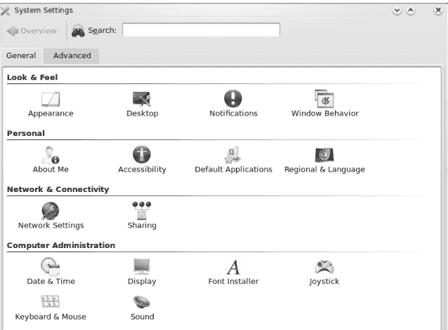

以下是你可能想要更改的一些单独桌面功能：

- **更改屏幕保护程序** —— 在“外观与感受”（Look & Feel）标题下，选择“桌面保护程序”（Desktop Saver）。在弹出的窗口中，默认只有几个保护程序可用。然而，通过安装 `kdeartwork-extras` 软件包，你可以获得更多可选的保护程序。在“自动启动”（Start Automatically）框下，选择在屏幕保护程序启动前处于闲置的分钟数。你还可以点击“需要密码”（Require Password），要求在屏幕保护程序启动后访问显示器之前输入密码。

> 如果你在一个希望桌面保持安全的地方工作，请务必开启“需要密码”功能。这可以防止在当你忘记锁定或关闭计算机时，他人访问你的计算机。如果你有任何正在运行的虚拟终端，请切换到它们并为每个终端输入 `vlock` 进行锁定。（如果可用 `vlock` 软件包，则你需要安装它）

- **更改字体** —— 你可以为桌面上显示的不同位置分配不同的字体。在“外观与感受”（Look & Feel）标题下，选择“外观字体”（Appearance Fonts）。选择其中一个类别（常规、等宽、小型、工具栏、菜单、窗口标题、任务栏和桌面字体）。然后点击“选择”（Choose）框，从“选择列表”（Select List）框中选择你想分配给该类别的字体。如果字体可用，你将在“示例文本”（Sample text）框中看到文本示例。

- **更改颜色** —— 在系统设置的“外观与感受”（Look & Feel）中，弹出的窗口允许你更改桌面上选中项目的颜色。从“颜色方案”（Color Scheme）列表中选择整个颜色方案。或从“颜色”（Colors）选项中选择一个项目来更改特定项目。你可以更改的项目包括背景、链接、按钮和标题栏。

要使用 100 dpi 字体，你需要在 `/etc/X11/xorg.conf` 文件中添加 100 dpi 字体的条目。做出更改后，你需要重启 X 服务器才能生效。


## 更改面板属性

对于大多数人来说，面板是其桌面活动和运行应用程序的地方。你可以从“配置面板”（Configure Panel）窗口更改面板行为。在面板上的任何空白处点击右键，并选择“面板设置”（Panel Settings）。你可以从出现的设置窗口中更改这些功能：

- **大小 (Size)** —— 选择列表允许你将面板尺寸从普通改为微小、小、大或自定义。对于自定义，请选择精确的点大小（48 是默认值）。

- **位置 (Location)** —— 将面板的位置从底部更改顶部、右侧或左侧。

## GNOME 桌面

GNOME（读作 gu-nome）提供了你在安装 Fedora、Ubuntu 或其他 Linux 系统时默认获取的桌面环境。该桌面环境提供了介于你的窗口系统框架与窗口管理器提供的外观和感受之间的软件。GNOME 是一个稳定且可靠的环境，具有一些酷的功能。

截至本文编写时，GNOME 2.24 是最新的可用版本，尽管你正在使用的发行版可能未包含此最新版本。最近的 GNOME 版本包含了 3D 效果（本章稍后的“3D 效果”）、改进的可用性功能以及一个用于网络摄像头的应用程序。

在线桌面（Online Desktop）旨在作为一个运行在线应用程序（如 Facebook、Gmail 等）的平台。更多信息请参阅本章的“配置 GNOME 桌面”章节。


要使用 GNOME 桌面，你应该熟悉以下组件：

- **Metacity (窗口管理器)** —— Ubuntu、Fedora、RHEL 等其他系统中 GNOME 的默认窗口管理器是 `Metacity`。`Metacity` 配置选项允许你控制主题、窗口边界以及桌面上使用的控件。

### 进入桌面

- **Nautilus (文件管理器/图形外壳)** —— 当你打开文件夹（例如双击桌面上的主图标）时，`Nautilus` 窗口打开并显示所选文件夹的内容。`Nautilus` 还可以显示其他类型的内容，例如来自网络上 Windows 计算机的共享文件夹

- **GNOME 面板 (应用程序/任务启动器)** —— 这些面板位于屏幕顶部和底部，旨在方便你管理运行中的应用程序并处理多个桌面。默认情况下，顶部面板包含菜单按钮（应用程序、位置和系统）、桌面应用程序启动器（Evolution 电子邮件和 Firefox 浏览器）、工作区切换器；当有新的软件更新或删除问题时，图标会出现在面板中。底部面板有显示桌面按钮、窗口列表、托盘。

- **桌面区域** —— 你使用的窗口和图标排列在桌面区域，该区域支持应用程序之间的拖放放、桌面菜单（右键点击查看）以及启动应用程序的图标。有一个计算机图标整合了光驱器、软驱器、文件系统和共享网络资源。

## 图 3-7

GNOME 桌面环境

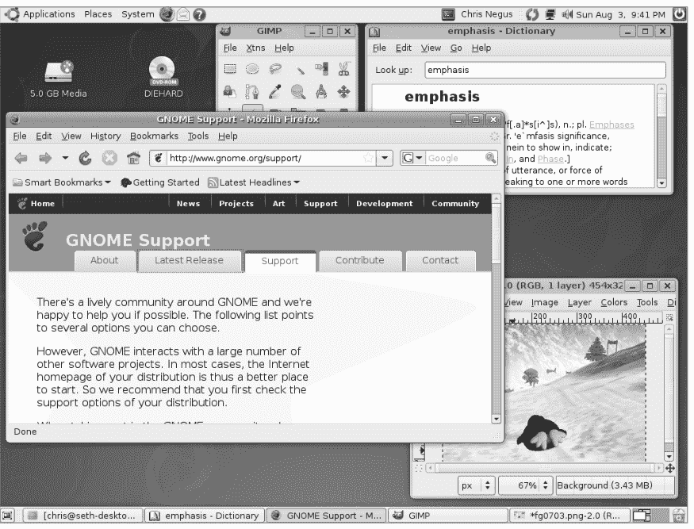

## 使用 Metacity 窗口管理器

`Metacity` 窗口管理器似乎因其简单而被选为 GNOME 的默认窗口管理器。`Metacity` 的创建者将其称为“适合你内心成年人的无聊窗口管理器”——随后将其他窗口管理器比作色彩斑斓、甜腻的麦片，而 `Metacity` 的特征就像家乐麦圈（Cheerios）。

> 注意
>
> 要使用 3D 功能，你的最佳解决方案是使用本章稍后介绍的 `Compiz` 窗口管理器。

`Metacity` 实际上并没有很多可以做的（除了高效地完成工作之外）。为 `Metacity` 分配新主题以及更改颜色和窗口装饰是通过 GNOME 偏好完成的（稍后会描述）。目前存在一些 `Metacity` 主题，但预计其数量还会增加。

你可能感兴趣的 `Metacity` 基本功能是键盘快捷键和工作空间切换器。表 3-4 描述了你可以用于在 `Metacity` 窗口管理器中穿行的快捷键。

表 3-4

| 动作 | 按键组合 |
|---|---|
| 窗口焦点 | 向前循环，带有弹出图标 | Alt-Tab |
| | 向后循环，带有弹出图标 | Alt+Shift-Tab |
| | 向前循环，不带弹出图标 | Alt-Esc |
| | 向后循环，不带弹出图标 | Alt+Shift-Esc |
| 面板焦点 | 在面板间向后循环 | Alt+Ctrl-Tab |
| | 在面板间向后循环 | Alt+Ctrl+Shift-Tab |
| 工作空间焦点 | 移动到右侧工作空间 | Ctrl+Alt+右箭头 |
| | 移动到左侧工作空间 | Ctrl+Alt+左箭头 |
| | 移动到上方工作空间 | Ctrl+Alt+上箭头 |
| | 移动到下方工作空间 | Ctrl+Alt+下箭头 |
| 最小化/最大化所有窗口 | Ctrl+Alt-D |
| 显示窗口菜单 | Ctrl+Alt+空格键 |
| 关闭菜单 | Esc |

另一个感兴趣的 `Metacity` 特性是工作空间切换器。GNOME 面板上的工作空间切换器会出现四个虚拟工作空间。你可以通过工作空间切换器执行以下操作：

- 选择当前工作空间 — 工作空间切换器中会出现四个虚拟工作空间。点击四个虚拟工作空间之一将其设置为当前工作空间。

- 将窗口移动到其他工作空间 — 点击任何窗口（在工作空间中用小矩形表示），将其拖放到另一个工作空间。同样，你也可以从窗口列表中拖动应用程序将其移动到另一个工作空间。

- 添加更多工作空间 — 右点击工作空间切换器并选择“偏好”。你可以添加工作空间（最多 32 个）。

- 命名工作空间 — 右点击工作空间切换器并选择“偏好”。在工作空间面板中点击，将工作空间的名称更改为你选择的任何名称。

## 运行 Linux 桌面

你可以使用 `gconf-editor` 窗口（在终端窗口输入 `gconf-editor`）查看和更改有关 `Metacity` 控制和设置的信息。如窗口所示，这不是更改偏好的推荐方法；只要可能，你应该通过 GNOME 偏好来更改桌面。然而，`gconf-editor` 是查看每个 `Metacity` 特性描述的好方法。

从 `gconf-editor` 窗口中选择 `apps` `metacity`，然后从 `general`、`global_keybindings`、`keybindings_commands`、`window_keybindings` 和 `workspace_names` 中选择。点击每个键查看其值，以及该键的短描述和描述。

## 使用 GNOME 面板

GNOME 面板放置在 GNOME 桌面的顶部和底部。从这些面板，你可以启动应用程序（通过按钮或菜单）、查看哪些程序正在运行，并监控系统的运行情况。有许多方法可以更改顶部和底部面板——例如添加应用程序或监控器，或者更改面板的位置或行为。

右点击任一面板上的任一空白区域以查看面板菜单。图 3-8 显示了顶部的面板菜单。

图 3-8

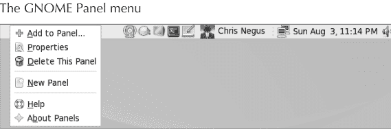

GNOME 面板菜单

从 GNOME 的面板菜单中，你可以选择多种功能，包括：

- 添加到面板 — 添加小组件、菜单、启动器、抽屉或按钮。

- 属性 — 更改面板的位置、大小和背景属性。

- 删除此面板 — 删除当前面板。

- 新面板 — 以不同的样式和位置向你的桌面添加新面板。

你也可以操作面板上的项目。例如，你可以：

- 移动项目 — 要移动面板上的项目，右键点击它，选择“移动”，然后将其拖放到新位置。

### 进入桌面

- 调整项目大小 — 某些元素（如窗口列表）可以通过点击边缘并拖动来调整新大小。

- 使用窗口列表 — 桌面上运行的任务出现在窗口列表区域。点击任务可以最小化或最大化它。

后续章节描述了你可以对 GNOME 面板进行的一些。

## 使用应用程序和系统菜单

点击顶部面板上的“应用程序”，你会看到可以选择的应用程序和系统工具类别。点击你想要启动的应用程序。要从菜单中添加项目以便从面板启动，请将该项目拖放到面板。

你可以向 GNOME 菜单中添加项目。要这样做，右点击菜单并选择“偏好”。你可以向 GNOME 菜单中添加项。要这样做，右点击菜单并选择“偏好”。你可以从菜单中选择。要从菜单中添加一个项以便从面板启动它。

你可以向 GNOME 菜单中添加项目。要这样做，右点击菜单并选择“偏好”。你可以从菜单中选择。要从菜单中添加一个项以便从面板启动它。

## 添加小组件

在面板上运行的某些元素可以可以访问。你可以向面板上添加某些小组件。要向面板上添加小组件，请执行以下步骤：

1. 右点击面板上的任一空白区域以显示面板菜单。

2. 选择“添加到面板”。会出现“添加面板”窗口。

3. 从你想要的小组件中选择，例如，选择“偏好”。

图 3-9


图 3-9

在面板上放置小组件可以方便访问它们。如果你不喜欢小组件的位置，右点击它，选择“移动”，直到它的位置。

## 运行 Linux 桌面

如果你不再希望小组件出现在面板上，右点击它，然后点击“从面板移除”。该图标将消失。如果你发现面板空间不足，可以按照下一节所述，在屏幕的其他部分添加新面板。

## 添加另一个面板

你的桌面上可以有多个面板。你可以添加位于整个底部、顶部或侧边的面板。要添加面板，请执行以下操作：

1. 右点击面板上的任一空白区域以显示面板菜单。

2. 选择“新面板”。屏幕上会出现新面板。

3. 右点击新面板中的任一空白区域并选择“属性”。

4. 在“面板属性”中，从“方向”框选择你想要的面板（顶、底、左、右）。

添加面板后，你可以像以前那样添加小组件或应用程序启动器。要移除面板，右点击它并选择“此面板”。

## 添加应用程序启动器

面板上的图标代表 Web 浏览器和许多应用程序。你也可以从面板添加自己的图标。要向面板添加新的应用程序启动器，请执行以下操作：

1. 右点击面板上的任一空白区域。

2. 从菜单中选择“添加到面板 — 应用程序启动器”。你所有的应用程序类别都会出现。

3. 选择你想要的应用程序类别旁的箭头，然后选择“添加”。代表应用程序的图标出现在面板上。

要启动你刚刚添加的应用程序，只需点击面板上的图标。

如果你想要启动的应用程序不在你的任何菜单中，你可以按照如下构建启动器：

1. 右点击面板上的任一空白区域。

2. 选择“添加到面板 — 自定义应用程序启动器 — 添加”。出现“创建启动器”窗口。

3. 为你想添加的应用程序提供以下信息：

   - 类型 — 选择“应用程序”（启动 GUI 应用程序）或“在终端中运行”。如果应用程序是字符界面或 ncurses 应用程序，请使用“在终端中运行”（使用 ncurses 库编写的应用程序在终端中运行，但提供了面向屏幕的鼠标和键盘控制）。

### 进入桌面

- 名称（Name）——用于标识应用程序的名称（当鼠标悬停在图标上时，此名称出现在提示中）。

- 命令（Command）——应用程序启动时运行的命令行。使用完整路径名以及任何所需的选项。

- 注释（Comment）——描述应用程序的注释。当你的鼠标悬停在启动器上时也会显示此注释。

- 4. 点击图标框（可能显示“无图标”）。选择显示的图标之一并点击“确定”。或者，你也可以浏览文件系统来选择图标。

- 5. 点击“确定”。

应用程序应该出现在面板中。点击它可以启动应用程序。

> 注意 — 用于表示你的应用程序的图标包含在 `/usr/share/pixmaps` 目录中。这些图标为 `.png` 或 `.xpm` 格式。如果你想使用的目录中没有图标，可以创建自己的图标（使用这两种格式之一）并将其添加到应用程序中。

## 添加抽屉（Drawer）

抽屉是一个图标，点击它可以显示代表菜单、应用程序小组件和启动器的图标；它的行为与面板完全相同。本质上讲，你添加到面板的任何项目都可以添加到抽屉中。通过向你的 GNOME 面板添加抽屉，你可以包含多个小组件和启动器，而它们只占用一个图标的空间。点击抽屉可以显示小组件和启动器，就像它们是从面板上的抽屉图标中拉出来的一样。

要向面板添加抽屉，右键点击面板并选择“添加到面板” ⊕ “抽屉”。面板上会出现一个抽屉。右键点击它，并像向面板一样向它添加小组件或启动器。点击图标可以收起抽屉。

图 3-10 显示了面板的一部分，其中有一个打开的抽屉，包含用于启动卷监视器、天气预报和 Tomboy 便签笔记的图标。

向你的 GNOME 面板上的抽屉中添加启动器或小组件。

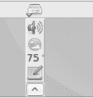

## 修改面板属性

你可以更改的面板属性限于方向、尺寸、隐藏策略和背景。要打开适用于特定面板的“面板属性”窗口，右键点击面板上的空白区域并选择“属性”。出现的“面板属性”窗口包含以下值：

- **方向（Orientation）**：通过点击新位置将面板移动到屏幕的不同位置。

- **尺寸（Size）**：通过选择像素高度来选择面板尺寸（默认为 48 像素）。

- **扩展（Expand）**：勾选此复选框使面板扩展填充整个侧边，或取消勾选使面板仅具有其允许的宽度。

- **自动隐藏（AutoHide）**：选择面板是否自动隐藏（仅当鼠标指针位于中心时出现）。

- **显示隐藏按钮（Show Hide Buttons）**：选择隐藏/取消隐藏的按钮（带有 pixmap 箭头）是否出现在面板边缘。

- **隐藏按钮上的箭头（Arrows on hide buttons）**：如果你选择了“显示隐藏按钮”，你可以选择在这些按钮上显示箭头。

- **背景（Background）**：在“背景”选项卡，你可以为面板背景分配颜色、选择 pixmap 或保持默认值（基于当前系统主题）。如果你想为背景选择图像，请选择“背景图像”框，然后选择一张图像，例如来自 `/usr/share/backgrounds/` 或其他地方的文件。

我通常会开启“自动隐藏”功能并关闭“隐藏按钮”。自动隐藏可以给你更多工作空间。（等等，纠正：自动隐藏可以给你更多工作空间）。当你将鼠标移动到面板所在的边缘时，面板会弹出——所以你不需要隐藏按钮。

## 使用 Nautilus 文件管理器

曾经，文件管理器的功能仅仅是运行应用程序、创建数据文件和打开文件夹。如今，随着用户需求扩展到本地系统之外，文件管理器也被预期显示网页、打开 FTP 站点和多媒体内容。`Nautilus` 文件管理器是 GNOME 的默认文件管理器，它是此类示例。

当你打开 `Nautilus` 文件管理器窗口时（例如通过打开桌面上的“主目录”或其他），你会看到你正在查看的位置名称（例如文件夹名称）以及该位置包含的内容（文件、文件夹和应用程序）。双击文件夹在新窗口中打开该文件夹。选择窗口左下角的文件夹名称可以查看当前文件夹上方的文件层次结构。GNOME 会记住你上次关闭文件夹时使用的任何尺寸、位置和其他设置，并在下次打开时恢复该状态。

要查看更多控制选项，右键点击文件夹并选择“浏览文件夹”以打开它。`Nautilus` 窗口工具栏上的图标允许你在访问过的目录和网站之间前后移动，点击箭头向上移动目录结构。如果你更倾向于输入所需文件夹的路径而不是点击图标，可以切换基于按钮和基于文本的位置栏（点击位置按钮旁边的纸和铅笔图标更改视图）。图 3-11 是文件管理器以模式显示名为 chris 的用户主目录的示例。

# 图 3-11

`Nautilus` 文件管理器允许你在文件系统中移动、打开目录、启动应用程序以及打开 Samba 文件夹。

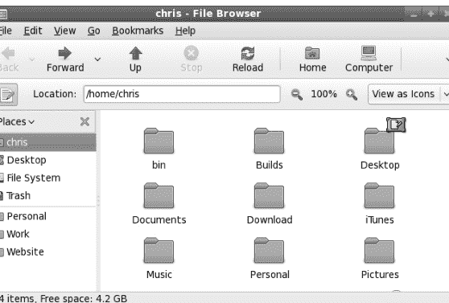

要刷新视图，点击“重载”按钮。“主目录”按钮带你回到主页，“计算机”按钮让你看到文件系统（光驱器、软磁盘、硬盘、网络）。

`Nautilus` 中的图标通常指示文件包含的数据类型。文件的内容或扩展可以决定使用哪个应用程序。

以下是 `Nautilus` 的一些有趣功能：


进入`/path/to/xxx`目录，找到`xxx.json`。

在表达式`cvar = avar + bvar`中，加法运算符（`+`）将`avar`与`bvar`相加，得到它们的和`cvar`

在`List.of(arg0, arg1, arg2)`中，`List`接口的工厂方法`of()`接受一系列的元素，返回包含它们的只读列表。

之后我们这样调用`cmd`命令：`cmd arg0 arg1 arg2`。

```
if (condVar > someVal) {console.log("xxx")}
```


进入`/etc/X11/xinitrc`目录，找到`xxx.json`。

- `/etc/X11/xinitrc` - 如果用户没有特别请求特定的桌面环境和窗口管理器，默认桌面设置将是该文件的内容。`xinitrc`文件是系统级的X配置。不同的Linux系统使用不同的`xinitrc`文件。

- `$HOME/.xinitrc` - `xinitrc`文件用于让个人设置自己的桌面启动信息。你也可以在用户的目录下添加一个`.xinitrc`文件。结果是，其内容将覆盖任何系统级设置。如果你创建了自己的`.xinitrc`文件，它的最后一行应该是`exec windowmanager`，其中`windowmanager`是你窗口管理器的名称；例如：

```bash
exec /usr/bin/blackbox
```

Slackware至少有七种窗口管理器供你选择，使其成为尝试几个的好地方。它还包含一个名为`xwmconfig`的工具，允许你更改窗口管理器系统（在`/etc/X11/init/xinitrc`文件中）。要使用该工具，root用户只需在Slackware系统的任何shell中输入`xwmconfig`即可。

从列表中选择你想要尝试的窗口管理器并点击OK。当你下次运行`startx`时，该窗口管理器将启动（前提是你没有通过创建`.xinitrc`文件覆盖它）。以下是你的选择：

- Xfce (`www.xfce.org`) — Xfce窗口管理器设计得非常轻量且快速。Xfce在廉价PC（如华硕EeePC）上运行Linux时非常受欢迎。图3-15显示了Fedora中Xf桌面的示例。

## 运行 Linux 桌面

图 3-15

Xfce在桌面环境中提供了许多强大的功能。

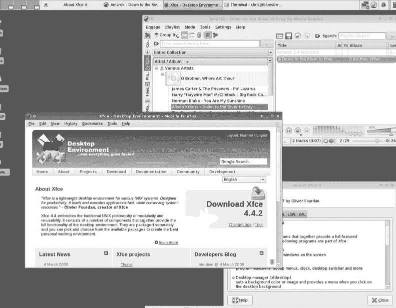

### 关于 Xfce

Xfce是适用于类Unix系统的轻量级桌面环境。其设计目标是速度和效率，同时不牺牲美学或消耗资源。Xfce遵循模块化和简单的哲学。

| 最新动态 | Xfce项目 | 开发者 |
| :--- | :--- | :--- |
| 2006 | | |

进入桌面

- `fwm` (`www.fwm.org`) — 这是一个功能强大的窗口管理器，支持各种主题。

- Blackbox (`http://blackbox.org`) — 这是一个非常受欢迎的窗口管理器，提供了丰富的装饰功能。

- FluxBox (`http://fluxbox.org`) — 基于Blackbox，FluxBox增加了国际化支持。

- Window Maker (`www.windowmaker.info`) — Window Maker是NEXTSTEP图形界面的克隆。

- FVWM-95 (`http://fvwm95.sourceforge.net`) — 这是FVWM的一个版本，看起来感觉像Windows 95。

- Twm (Tabbed Window Manager) — 尽管不再活跃维护，但有些人仍使用这种精简的桌面。

许多其他窗口管理器也适用于Linux。要查看更多信息，请访问Xwm网站 (`http://xwm.org`)。

一旦设置了系统默认窗口管理器，用户可以设置自己的窗口管理器来覆盖该决定。

# 选择你的窗口管理器

只需在你的自己的`.xinitrc`中添加带有你想要使用的窗口管理器名称的`exec`行即可。以下是启动`twm`窗口管理器的`.xinitrc`内容示例：

```bash
exec /usr/bin/twm
```

确保该文件是执行的（`chmod 755 $HOME/.xinitrc`）。窗口管理器将在你启动桌面时启动。其他管理器包括Blackbox (`/usr/X11R6/bin/blackbox`)、FluxBox (`/usr/X11R6/bin/fluxbox`)、FVWM (`/usr/X11R6/bin/fvwm`)、FVWM-95 (`/usr/X11R6/bin/fvwm`)以及`twm` (`/usr/X11R6/bin/twm`)。

## 获取更多信息

如果你尝试配置X后，服务器崩溃或显示异常，你的显卡可能不支持或需要特殊配置。你可以检查以下几个位置获取更多信息：

- XOrg (`www.x.org`) — 关于Fedora自带的X服务器的最新信息可以在XOrg网站获取。XOrg是许多Linux发行版最近用于替换XFree86服务器的X。

- X文档 — 针对不同显卡的README文件随X服务器一起交付。访问X文目录 (`/usr/X11R6/lib/X11/doc`)获取针对你正在使用的显卡（或更具体的视频芯片）类型的特定README文件。许多有用信息也可以在`xorg`手册页中找到（输入`man xorg`）。

## 总结

在Linux中运行的完整桌面环境可以与任何操作系统的桌面系统相媲美。KDE和GNOME是目前Linux上最受欢迎的桌面环境。对于想要更精简、更轻量的桌面环境的人来说，Linux还有多种简单的窗口管理器（Blackbox、Xfce、FVWM、`twm`、FluxBox等）可供使用。

KDE桌面以其大量的集成应用程序集（办公生产力工具、游戏、多媒体和其他应用程序）而闻名。最新的KDE了了一个名为Dolphin的更高效的文件管理器以及桌面插件（plasmoids）。

GNOME以其更基础、面向业务的桌面设计而闻誉。大多数Linux发行版（如Slackware和Gentoo）提供的GNOME和KDE桌面与这些桌面项目交付时的原始状态没有太大改动。其他Linux系统（如Fedora）会在GNOME和KDE桌面之上添加它们自己的视觉风格和体验。

尽管最新的Windows系统无法在许多旧的486和Pentium机器上运行，在本部分中，你可以使用如Slackware这样高效的Linux系统，添加一个轻量级窗口管理器，就能在这些机器上获得相当不错的桌面系统性能。

# 第 4 章

## 播放音乐和视频

计算机上最流行且有趣的活动之一就是播放音频和视频。随着用于存储和管理内容的多媒体播放器的改进，Linux已经成为存储OGG和QuickTime的优秀平台。你将探索配置Linux可用多媒体工具的过程。

在本章中，你将学习使用声音、视频、数字图像和其他多媒体工具。你将探索配置音频视频设备的过程，并检查Linux平台上提供的媒体格式、它们的工作原理，以及如何通过Linux应用程序充分利用它们。

Linux是利用MPEG、AVI、OGG和QuickTime等广泛使用格式的绝佳平台。各种格式有多种可用，本章将讨论其中几种，以帮助你确定哪种（或何组合）适合你的兴趣和/或需求。

> 因为许多持有多媒体内容的设备是可移动的（CD、DVD、数字相机、网络摄像头等），Linux近期自动处理硬件和媒体的特性极大地提升了Linux桌面体验。第3章中管理硬件的部分描述了Udev和HAL等功能，这些功能被用于管理可移动介质。

某些Linux发行版在安装时就比其他版本对多媒体更友好。一个例子是Freespace，它预加载并在安装完成时支持Flash、Java和MP3内容。这可以节省你大量寻找许可问题和解决问题的时间。安装中未包含某些功能（如DVD播放支持）可以在Click-N-Run服务（`www.`）上找到。Ubuntu、Linux Mint以及已停止维护的Linux用户可以使用Click-N-Run获取免费和商业软件。

| 本章内容 |
| :--- |
| 数字媒体的法律问题 |
| 在Linux上存储商业内容 |
| 播放、录制和刻录音乐 |
| 设置电视卡和音声卡 |
| 录制和刻录音乐 |
| 看电视 |
| 视频会议 |
| 看电影和视频 |
| 存储和显示来自数字相机的图像 |

## 播放数字媒体并遵守法律

关于终端用户在数字媒体上可以合法做什么的辩论是目前的热点话题。在复制CD、DVD和其他媒体方面，你到底可以做什么？遗憾的是，并没有一个完美的答案。这直接或间接地影响着每一个计算机用户。

你被允许如何使用计算机上保留的音频、视频和其他媒体，日益受到国家和国际法律的限制。曾几何段时间，你基本上可以忽略这个问题，但在个人计算机用户成功被公司和行业团体起诉的时代，需要一点谨慎。

### 版权保护问题

在数字媒体政策的新世界中，最大的因素是1998年的《数字千年版权法》（DMCA）。该法律表面上建立了一个用于实施几项有关版权保护条约的框架。

DMCA遭到广泛批评，因为它似乎侵犯了美国宪法中的言论自由条款。许多人将计算机代码视为受保护的言论形式。冲突的产生是因为DMCA禁止开发旨在故意绕过内容的应用程序。例如，受俄罗斯软件公司ElmSoft雇用的俄罗斯加密学家Dmitry Skylarov在拉斯维加斯参加一次会议期间被FBI捕，当时他在会议上演示了一个用于解密Adobe EBooks的应用程序。在2002年12月，陪审团裁定Skylarov和ElmSoft无罪，但要点在于，公司将会利用DMCA来起诉那些使用解密内容方法的人。

至少这表明DMCA的牙齿不仅被用于保护合法商业，还被用于追捕研究内容保护方案、加密以及一系列其他技术的学术机构科学家。因为DMCA使传输绕过版权保护方案的技术成为犯罪，许多研究人员已经放弃了价值的研究，而这些研究本可以产生更好（更强且更有用）的保护方案，或揭示现有方案中的明显缺陷。

虽然DMCA为内容提供者提供了合法保护其材料的手段（例如说服搜索引擎删除有关非法发布和受版权保护信息的链接信息），但但也存在这种影响力被滥用的情况。某些版权持有者似乎非常愿意使用DMCA来限制预-DMCA版权法下允许的三种“权利”。版权法规定：

- 用户可以出于学术目的、报告或复制制作任何版权作品的副本。这包括……

## 播放音乐和视频

> 因为许多持有多媒体内容的设备是可移动的（CD、DVD、数字相机、网络摄像头等），Linux近期自动处理硬件和媒体的特性极大地提升了Linux桌面体验。第3章中管理硬件的部分描述了Udev和HAL等功能，这些功能被用于管理可移动介质。

- 用户可以出于学术目的、报告或复制制作任何版权作品的副本。这包括……

- 用户可以出于学术目的、报告或复制制作任何版权作品的副本。这包括……

- 用户可以出于学术目的、报告或复制制作任何版权作品的副本。这包括……

> 因为许多持有多媒体内容的设备是可移动的（CD、DVD、数字相机、网络摄像头等），Linux近期自动处理硬件和媒体的特性极大地提升了Linux桌面体验。第3章中管理硬件的部分描述了Udev和HAL等功能，这些功能被用于管理可移动介质。

- 用户可以出于学术目的、报告或复制制作任何版权作品的副本。这包括……

- 用户可以出于学术目的、报告或复制制作任何版权作品的副本。这包括……

- 用户可以出于学术目的、报告或复制制作任何版权作品的副本。这包括……

## 运行 Linux 桌面

在一个公共论坛（例如点对点网络）上，你是在碰运气。美国唱片工业协会（RIAA）和美国电影协会（MPAA）都已成功定位并起诉了在网上非法分发内容的用户——其中甚至包括儿童。

> 允许合法共享、重混和重新使用的的一种尝试是知识共享项目（Creative Commons Project）。截至写作时，该项目已存在七年，并发布了数千个项目。你可以在`http://creativecommons.org/`找到更多信息。

两个网站正在探索Jamendo (`www.jamendo.com/en/`)和Magnature (`www.magnature.com`)。它们都是提供免费音乐访问的库。Jamendo专注于音乐的免费分发，以帮助音乐家扩大他们的受众。Magnature则通过将其音乐许可给那些想要在商业活动（如电影、网站等）中使用这些音乐的人士来帮助音乐家，同时允许音乐家保留对其音乐的权利。

## 探索解码器

如果你想播放视频或音频文件，需要为媒体播放器安装并准备好相应的解码器。解码器是一种基于软件的编码器-解码器，用于获取现有的音频/视频数据并解码内容。解码器通常使用压缩来减小文件大小，同时保持你的输出质量。

如果你遇到无法正常工作的媒体文件，或者一个可以播放的文件但你无法播放，你可能需要识别并安装正确的解码器。这通常涉及安装适当的播放程序，例如用于Linux的DivX 5.0.5，它使用MPEG4解码器进行视频和音频播放。

有很多解码器，要找到你需要的通常并不困难。解码器技术的进步不断提高编码内容的质量，同时减小体积。幸运的是，大多数广泛分发的视频和音频文件（例如来自新闻网站）都是使用几种常用的解码器创建的。

虽然有很多常用的解码器，但今天也在使用几种专有解码器。这在某种是一种斗战，每个供应商/开发者都试图生产出优越的标准并获得随之而来的市场份额。对于终端用户来说，你可能需要花时间寻找各种播放解码器来处理视频和音频格式。

另一个争论：数字媒体能比得上模拟的质量吗？这在很大程度上是一个已有答案的问题，DVD显示了高质量数字视频的潜力，而MPEG解码器在数字音频保真度方面已取得了巨大进步。数字媒体文件的质量非常高，并且不断改进。反映音频和视频解码器改进的一些关键技术包括：

- Ogg Vorbis — 这种解码器被开发为一种免费的工具——不需要专利或许可。Ogg是该解码器的“数据容器”，而Vorbis是音频压缩方案。其他可以与Ogg一起使用的压缩方案还包括Ogg FLAC（用于以无损格式存档音频）和Ogg Speech（专门用于处理言语编码）。

## 播放音乐和视频

- WMA — Windows Media Audio用于创建高质量数字音频。WMA被认为是一种无损解码器，这意味着音频不会因为反复的压缩-解压缩循环而丢失质量或数据。它的其他优势之一是它是第一个支持数字环绕声的广泛使用的解码器之一。

- WMV — Windows Media Video用于视频的编码和解码，这并不意外。这这也是一种非常高质量的编码器，并据称可以在同等质量下产生体积仅为MPEG-4编码视频的一半的视频。

- DivX — 这种解码器彻底改变了数字视频。使用这种解码器可以用较小的文件存储极高质量的视频。DivX (Digital Video Express)基于MPEG-4标准，可以产生640 × 480的视频，其大小约为源DVD介质的15%。

这些解码器中的一些是数字权利管理（DRM）场景不可缺的一部分。例如，WMA、WMV和DivX保护DRM的元素。DRM基本上是专有复制。

“DRM”术语适用于广泛的技术，使用基于服务器的验证、加密和其他元素来控制谁可以访问内容，以及他们在访问后对内容做什么。虽然对于音频视频分发商来说，这防止其内容的非自愿数字盗版非常有吸引力，但对于消费者来说，这可能是真正的障碍。

许多DRM解决方案需要专有的软件和硬件与受保护的内容配合。一个典型的例子是某些受DRM保护CD的生产，特别是在欧洲。这些光中的某些无法在旧的立式CD播放器上播放，某些只能在支持CD自身DRM应用程序的计算机上播放，而且（特别令人沮丧的是）根本无法在计算机上播放。在绝大多数情况下，DRM解决方案不支持Linux。大多数只支持Windows，少数支持Windows和Mac OS。

为了增加复杂性，虽然刚才讨论的解码器不包含内置DRM功能，但某些解码器专门设计用于与DRM解决方案集成。换句话说，所有这些解码器理论上都可以用于Linux系统上播放编码内容。如果内容受DRM解决方案的保护，那么内容在Linux系统上可播放的可能性非常低。尽管事实如此，或者可能是因为如此，Linus Torvalds排除了在Linux中包含DRM支持的可能。同样，几个开源项目正在开发Linux解决方案。

## 播放音乐

在对数字媒体的挑战和进步有了了解之后，本节将向你展示如何设置Linux安装以进行音频播放。它检查了让硬件运行起来，然后探索了用于音频播放的可用选项。

## 在 Linux 中使用声系统

过去几年，已有几种声系统用于将音频带到你的Linux桌面。虽然声系统大部分在后台工作，但与声系统相关的可能会影响你的使用。以下是你可能会遇到的一些信息：

- Open Sound System (`www.opensound.com`) —— 大多数Linux系统为Linux和其他UNIX系统设计的统一驱动程序和接口的首种声系统。它仍然对Linux可用，但大多数发行版不再分发OSS，因为它是专有的（由4Front Technologies，`4front-tech.com`所有）。对于个人，你仍然可以获取Linux版OSS，大多数Linux用户使用ALSA或PulseAudio。

- ALSA取了OSS在配置声驱动和处理多个声设备方面表现良好。同时也兼容KDE和GNOME桌面系统。最近，主要的Linux发行版已转向PulseAudio作为默认声系统，同时支持ALSA。

- PulseAudio (`www.pulseaudio.org`) —— Ubuntu、Fedora、Mandriva和其他Linux发行版最近将它们的ALSA声系统切换到了PulseAudio。除了为多个音频应用程序控制音量并将音频定向到其他系统的PulseAudio服务器之外，PulseAudio服务器还将许多ALSA应用。

- KDE系统 —— 随着KDE 4，默认KDE系统从模拟实时合成器 (`ARTs`)变为Phonon (`http://phonon.kde.org`)。Phonon整合了控制音频的用户工具，主要目标是为软件开发者提供一个涵盖音频和视频功能的多媒体应用程序接口。

- GNOME声系统 —— GNOME支持光光守护进程 (`ESD`)作为其声服务器。`ESD`使用`Gstreamer.net`框架来处理多媒体内容的实际编码和解码。你可以从Fluendo (`www.fluendo.com`)公司购买与`Gstreamer`框架兼容的合法音频视频解码器。


# 使用 PulseAudio 调整声音

如果你的 Linux 桌面正确集成了 PulseAudio，你应该能够在大多数为 Linux 编写的音频应用程序中使用它。这意味着不能播放很多音频

你可以从桌面启动应用程序，但也可以使用 PulseAudio 控制（PulseAudio Volume Control）分别控制每个应用的音量。

例如，在 Fedora GNOME 桌面上，选择应用程序 ♫ 声音与视频 ♫ PulseAudio 控制。会出现一个与图 4-1 类似的窗口。

## 图 4-1

使用 PulseAudio 控制多个音频播放器的音量。

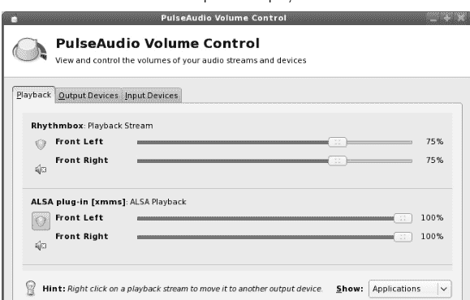

当音频程序启动时，它们会出现在 PulseAudio 控制窗口中。例如在图 4-1，我打开了 Rhythbox 在后台播放音乐（我移动了滑块以降低音量），然后打开了 MMMS 音频播放器播放流课程，它也出现在音量控制。

如果你有多个音频输入和输出设备，可以使用输入设备（Input Devices）和输出设备（Output Devices）标签页单独配置这些设备的音量。在输入或输出设备上点击鼠标右键，可以将其设置为默认音频设备。

让 Linux 应用程序运行所需的插件和设备配置工作大部分应该在安装系统时自动完成。然而，如果你无法使用某些音频程序，请参考 PulseAudio Perfect Setup（www.pulseaudio.org/wiki/PerfectSetup）。它描述了如何配置数十种 GNOME、KDE、OSS、ESOUND、Gstreamer、Flash 以及其他应用程序与 PulseAudio 配合。

如果你使用的是没有安装 PulseAudio 的 Linux 系统，可以使用其他应用程序调整音量。`aumix` 命令是一种使用命令行选项或面向屏幕的菜单调整音量的简便方法。`alsamixer` 命令允许你调整 ALSA 音频设备的音量。

## 设置声卡

要开始你的“环绕声之旅”，你需要在 PC 中有一块声卡。声卡可以是 PCI 扩展卡（甚至是 ISA 卡），也可以集成在你的主板上。你的声卡将有许多用途——从游戏到音频/视频播放。没有声音，多媒体系统完全是不一样的。

幸运的是，大多数 PC 都包含声卡，通常是集成式的。在不包含声卡的罕见情况下（或者稍微常见一点的情况是在 Linux 中不支持），你可以花费几美元添加一张支持的声卡。如果你真的很拮，可以看看 eBay，在那里你可能几乎不花钱就能买到不错的 SoundBlaster 兼容卡（这仍然的标准）。

如果你尝试了书中的步骤但仍然没有工作的声卡，请访问 www.alsa-project.org，高级 Linux 音频架构 (ALSA) 的官网。另一个资源是 ALSA wiki（http://alsa.opensrc.org）。

以下列表总结了流行的 SoundBlaster 系列声卡中包含的基本功能：

- **音频录制和播放** —— 声卡可以将模拟声音转换为 8 位或 16 位数字。为了进行转换，主板以每秒从 5 KHz 到 48 kHz 的波形对声音进行采样，即每秒 5,000 到 48,100 次。采样率越高，音质和输出文件越好。

- **全双工支持** —— 全双工意味着录制和播放同时发生。这对于双向 Internet 通信特别有用，例如 IP 电话（VoIP）或同时录制和播放。

- **输入/输出端口** —— 板板上的不同端口允许你连接其他输入/输出设备。这些端口包括：

  - **线路输入（蓝色）** —— 连接外部 CD 播放器、胶机、合成器、MiniDisc 或或其他设备进行录制或播放。如果你有电视，也可以将电视的线路连接到你声卡的线路。

  - **麦克风（红色）** —— 连接麦克风用于音频录制或通信，或立体声放大器。（在我测试的声卡上，这在混合器工具中标记为耳机。）

  - **摇杆/MIDI（15针接器）** —— 连接摇杆或 MIDI 设备。（某些声卡不再有这些端口，因为它们现在大多数主板上都提供。）

  - **数字输出（橙色）** —— 数字输出连接器可连接数字磁带（DAT）设备或可刻录 CD（CD-R）设备。

  - **后置** —— 可将音频输出传输到扬声器或外部放大器。

  - **内部 CD 音频** —— 此内部端口将声卡连接到计算机的内部 CD-ROM 驱动器（当板安装时，此端口不暴露）。

Linux 中的音频驱动程序来自多个来源。高级 Linux 音频架构 (ALSA) 驱动程序集成在 2.6 内核中。如果 ALSA 不支持你的声卡，你可能会发现旧的 Open Sound System (OSS) 驱动是有用的。你可以从 4Front Technologies (www.opensound.com) 以少量费用获得 OSS 驱动的商业支持，该公司维护着 OSS。

## 注意

在安装单独的驱动发行之前，请检查你当前的驱动程序是否已经有了新的驱动。如果你没有遇到特定的与驱动相关的问题，内核自带的驱动程序总是稳妥之选。

有时，音频程序会要求你识别从哪个设备访问声音。随着 2.6 内核引入了 Udev 特性，某些设备名称与 2.4 内核使用的名称不同。以下是音频设备节点：

- `/dev/audio`, `/dev/audio1` —— 播放音频文件，这些对你可能感兴趣。

- `/dev/cdrom`, `/dev/cdrom1` —— 播放 CD-ROM，表示你的 CD-ROM 驱动器。

- `/dev/dsp`, `/dev/dsp1` —— 数字信号处理，支持设备。

- `/dev/mixer`, `/dev/mixer1` —— 混合器，支持设备。

- `/dev/sequencer`, `/dev/sequencer1` —— 序列生成器。

- `/dev/midi100` —— MIDI 设备。

关于音频的通用信息，请查看 Sound-HOWTO（关于声卡）以及 Sound-Playing-HOWTO（关于不同类型的音频文件）。你可以在 how.org 找到更多 HOWTO。

## 选择音频播放器

Rhythbox 是 GNOME 音乐播放器，允许你从 CD、本地文件系统或网络位置播放音乐。Rhythbox 基于 GStreamer 框架构建，用于播放器、视频编辑器和流媒体。你可以从一个界面播放音乐、导入 CD 并播放网络电台。最近的功能允许播放来自 Magnatune 和 Jamendo 的博客。Rhythbox 插件允许你显示封面、查看歌词或显示音乐视觉效果。

当你第一次运行 Rhythbox 时，考虑通过选择编辑偏好（Preferences）来设置偏好。在 Music 标签页上，你可以告诉 Rhythbox 哪里存储音乐文件，Rhythbox 如何命名文件夹和歌曲，以及以什么格式存储音乐。

设置好偏好后，你将看到主库界面（见图 4-3）。

如果你的发行版不包含 Rhythbox 的 MP3 支持，不要担心——还有希望！在 Fedora 中，你可以使用 Codeina 从 fluendo 下载免费 MP3 解码器。对于 Ubuntu、Freespier 和旧 Linux 发行版，请查看 Click-N-Run 服务（www.cnr.com）。

## 运行桌面

- **KsCD 播放器 (`kscd`)** —— KsCD 播放器随 KDE 提供。要使用它，必须安装 kde-multimedia 包。从桌面主菜单，选择多媒体 KsCD（或在终端输入 `kscd`）。此播放器从 CD 数据库获取信息。

- **Grip (`grip`)** —— 虽然 Grip 主要作为 CD 抓取器，但它可以播放 CD。选择多媒体 Grip（或在终端输入 `grip`）。它包含了从 CD 数据库收集和提交数据的工具。它还包含了复制 CD 的工具。

- **Amarok (`amarok`)** —— 通过移动元素，你发现 Amarok 有一个良好的图形界面。Amarok 使用 SQLite（或其他数据库）存储你的音乐。它还支持播放列表和在线电台播放。

- **X 多媒体系统 (`xmms`)** —— XMMS 播放器可以多种音频格式，也可以直接从 CD 播放。

## 播放音乐和视频

## 图 4-2

定义你存储音乐的位置

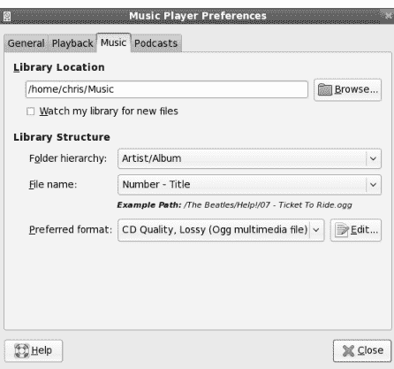

## 图 4-3

使用 Rhythmbox 查看音乐库

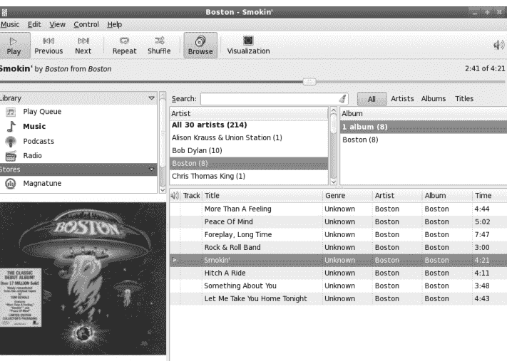

91

Rhythmbox 还可以播放网络广播和播客。在不添加更多解码器的情况下，你可以播放 Ogg Vorbis 直流。还有许多 MP3 格式的流可用。要在 Rhythmbox 中添加网络电台，选择左列中的“广播”（Radio）并点击“新建”（New）图标。在电台的标题（Title）和类型（Genre）中，打开“详情”（Details）标签并输入流的位置（例如 http://knc.org:8000/wnkcmq.ogg.mmu）。

添加播客的方法也一样。在左列选择“播客”（Podcasts），然后点击“新建”（New）。在弹出的窗口中使用播客的 URL（例如 www.geeknewscentral.com/podcast.xml）。要为你的播客添加图像，请为播客下载一张合适的图像，并将其拖放到 Rhythmbox 窗口的左下中心，此时图 4-4 显示 Rhythmbox 正在播放 Geek News Central。

## 图 4-4

Rhythmbox 播放播客源

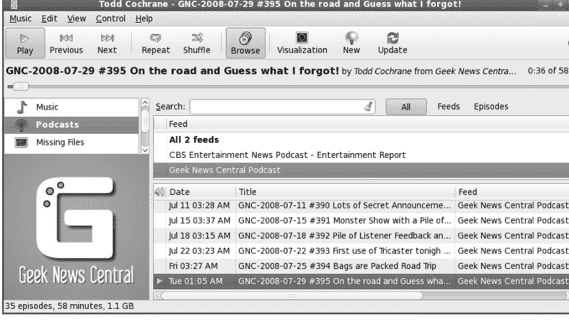

网站 www.di.fm 列出了许多免费的网络电台频道。

## 使用 XMMS 多媒体播放器播放音乐

XMMS（X 多媒体系统）多媒体播放器为播放 MP3、Ogg Vorbis、WAV 和其他音频格式的音乐文件提供了舒适的图形界面。XMMS 还有许多额外功能，包括均衡器、播放列表编辑器以及添加更多音频插件的能力。它最大的特点之一是 XMMS 易于使用。如果你使用熟悉的播放器，那是因为它的风格类似于 Windows  Winamp 程序。

## 播放音乐和视频

要将 XMMS 添加到你的 Fedora 系统，请以 root 用户输入 `install xmms`。这将获得播放器以及一些用于它的漂亮皮肤。要用 XMMS 播放 MP3 音频，你需要添加 MPEG Layer 1/2/3 插件。在 Fedora 中，你可以从 http://rpm.ltvna.org 仓库获取 xmms-mp3 包。

通过选择“音视频音频播放器”或在终端窗口输入 `xmms` 来启动 XMMS 音频播放器。图 4-5 显示了带有关联均衡器（左下）和播放列表编辑器（右侧）的 XMMS 音频播放器。为此图选择的皮肤（右键点击 XMMS 并选择皮肤浏览器）称为 UltraSINE。

## 图 4-5

从 XMMS 播放列表播放 Ogg Vorbis 和其他音频文件。

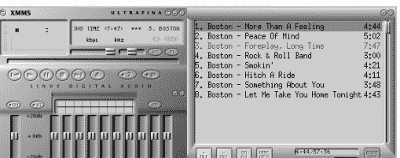

如前所述，你可以播放多种音频格式。支持的格式包括：

- MP3（需添加插件）

- Ogg Vorbis

- AU

- CD 音频

- CIN 电影

> 如果 XMMS 无法找到配置好的声卡，它会将输出重定向到磁盘写入插件。这会导致文件以 WAV 文件的格式写入硬盘。

你可以从 www.xmms.org 获取更多音频插件。XMMS 音频播放器可以使用以下方法使用：

1. 通过从 CD 刻录歌曲或将它们复制到可访问的目录，或者通过在你的 CD-ROM 驱动器中插入音乐 CD 来获取音乐文件。（XMMS 期望可以从 `/dev/cdrom` 访问 CD）。

2. 从应用程序菜单选择“音视频音频播放器”。出现 X 多媒体系统播放器。

## 运行 Linux 桌面

3. 点击“弹出”按钮。出现“加载文件”窗口。

4. 如果你插入了 CD，`/mnt/cdrom` 内容将出现在文件窗格中。选择你想添加到播放列表的文件，点击“添加所选文件”或“添加目录中的所有文件”来添加当前目录中的所有歌曲。要从你的系统添加音频文件，浏览你的文件和目录，并点击相同的按钮添加你想要的音频文件。选择“关闭”。

5. 点击控制台上的“列表”按钮（标记为 PL 的小按钮）。出现“播放列表编辑器”窗口。

6. 双击音乐文件，它将开始播放。

7. 在选中文件并播放时，你可以采取以下操作：

- **控制播放** — 用于控制你预期在独立 CD 播放器上看到的内容的按钮。从左到右，这些按钮让你跳转到上一曲、播放、暂停、停止或跳转到下一曲，并弹出 CD。弹出按钮会打开一个窗口。

- **调整声音** — 使用左侧滑块调整音量。使用右侧滑块更改左右平衡。

- **显示时间** — 点击已用时间区域以切换已用时间和当前时间。

- **查看信息** — 点击屏幕左上角的按钮查看 XMMS 菜单。然后选择“查看信息”。你可以找到关于该文件的许多信息：标题、艺术家、专辑和类型。对于 Ogg 文件，你可以了解到关于该文件的很多信息：标题、艺术家、专辑和类型。

## 运行 Linux 桌面

你可以从 www.xmms.org/skins.php 选择并下载更多 XMMS 皮肤。此外，XMMS 支持 Windows Winamp 皮肤（扩展名为 .wsz 的文件），因此你可以下载这些皮肤为你的音乐播放器设置喜欢的音乐家或动画角色。只需将皮肤拷贝到 `/usr/share/xmms/Skins` 目录即可将其添加到皮肤列表中。

# 使用 MIDI 音频播放器

MIDI（音乐数字乐器接口）文件由合成器和其他电子音乐设备创建。它们通常比其他音频文件小，因为它们不存储完整的声音，而是包含所演奏音符、节奏和预期的信息。你可以将 MIDI 文件视为电子乐谱。MIDI 播放器还原音符，使其听起来像各种 MIDI 乐器。

互联网上有有很多可以下载 MIDI 文件的网站。例如尝试 Inf MIDI 网站 (www.infmidi.com)，它按音频分类了披头士乐队、齐德泽飞林、涅槃等乐队的歌曲。大多数 MIDI 音乐非常简单，但你可以尝试玩玩看。

包含 KDE 桌面的 Linux 发行版（如 Fedora）通常带有 kmid MIDI 播放器。Kmid 为 MIDI 音乐提供了 GUI 界面，并具有实时显示 karaoke 词的能力。要在 Fedora 中启动 kmid，请选择 Sound & Video KMid（或在终端中输入 `kmid &`）。

# 执行音频文件转换和压缩

有许多不同的格式用于存储和压缩语音及音乐文件。由于音乐文件可能很大，它们通常以压缩格式存储。虽然 MP3 是首选的压缩格式，但 Ogg Vorbis 正在成为开源社区压缩音乐的喜爱。Ogg Vorbis 的优点是不像 MP3 那样受到专利的限制。

用于转换和压缩音频文件的 Linux 工具包括：

- **SoX (SoundExchange)** — 一种在各种格式之间转换音频文件的通用工具。

- **`oggenc`** — 专门将音乐文件转换为 Ogg Vorbis 格式的工具。

# 使用 SoX 转换音频文件

如果你有一个格式的声音文件，但想将其转换为另一种格式，Linux 提供了转换工具。SoX 程序可以在表 4-1 中列出的任何音频格式之间进行转换。

> **提示** 输入 `sox -h` 查看支持的音频类型，以及支持的选项和 kmid。

# 表 4-1

# SoX 工具支持的音频格式

| 文件扩展名或伪名 | 描述 | 文件扩展名或伪名 | 描述 |
|---|---|---|---|
| `.8svx` | 8SVX Amiga 乐器格式。 | `.aiff` | Apple II/Ilgs 和 SGI AIFF 文件。可能需要单独的归档程序处理这些文件。 |
| `.au`, `.snd` | Sun Microsystems AU 音频文件。这曾是一种流行格式。（.snd 扩展具有歧义，因为它也用于 Next 格式和 Mac/PC 格式。） | `.avr` | Audio-Visual Research 格式，用于 Mac。 |
| `.cdr` | 用于刻制紧光盘的 CD-R 文件。 | `.cvs` | 连续变斜率调制，用于语音信箱和其他语音压缩。 |


| `.dat` | 文本数据文件，包含声音数据的文本表示。 | `.gsm` | 损损语音压缩 (GSM 0.10)，用于缩小语音信箱及应用程序中的音频数据。 |

| `.hcom` | Macintosh HCOM 文件。 | `.maud` | Amiga 格式，用于产生单声道 8 位、16 位线性、A-law 和 u-law声音。 |

| `.ogg` | Ogg Vorbis 音频，最适合压缩音乐和音频流传输。 | `.ossdsp` | 伪文件，用于打开 `/dev/dsp` 文件并将其配置为使用 SoX 生成的数据类型。用于播放或录制。 |

| `.prc` | Psion 记录应用格式，而非 WAVE 格式。注意 `.prc` 扩展也用于 Palm 手持设备的程序。 | `.sf` | IRCAM 文件，由 CSound 软件包和 MixView 样本编辑器使用。 |

| `.sph` | 来自 NIST（美国标准技术研究院）的语音音频 SPHERE（语音头资源）格式。 | `.smp` | 来自 Turtle Beach 的 SampleVersion 文件，用于与不同的 MIDI 采样器通信。 |

| 表 4-1 | （续） | | |

| 文件扩展名或伪名 | 描述 | 文件扩展名或伪名 | 描述 |

|---|---|---|---|

| `.sunau` | 伪文件，用于打开 `/dev/audio` 文件并设置使用传递给 SoX 的数据类型。 | `.txw` | 来自 Yamaha 键盘的 Yamaha TX-16W。 |

| `.vms` | 用于压缩语音信箱及应用程序音频。 | `.voc` | Sound Blaster VOC 文件。 |

| `.wav` | Microsoft WAFF 文件。这是 Microsoft Windows 原生声音格式。 | `.wve` | 预置掌上电脑的 8 位、a-law 和 8 kHz 音频文件。 |

| `.raw` | 原始文件（不包含头信息、无采样率、大小；必须给出样式）。 | `.ub`, `.sb`, `.uw`, `.sw`, `.ul`, `.a1`, `.lu`, `.la`, `.s1` | 具有设定特征的原始文件。`ub` 是无符号字节；`sb` 是无符号字节；`sw` 是无符号字；`sw` 是有符号字；`ul` 是 ilaw。 |

如果你不确定格式，可以使用以下...

## 运行 Linux 桌面

在 Linux 上，既有图形界面也有命令行工具可以创建音频和数据 CD。`cdrecord` 命令允许你从命令行创建音频和数据 CD，并写入 CD 可刻录（CD-R）和 CD 可重写（CD-RW）驱动器。该命令将在后续章节中讨论。

### 使用 cdrecord 创建音频 CD

你可以使用 `cdrecord` 命令，通过设置文件系统并将文件系统的完整镜像复制到 CD 来创建数据 CD 或音乐 CD。创建音频 CD 包括选择你想要的音频轨道并一次性全部复制到 CD。

本节重点介绍使用 `cdrecord` 创建音频 CD。`cdrecord` 可以使用 `.au`、`wav` 和 `.cdr` 格式的音频文件，并在必要时自动进行转换。如果你有其他格式的音频文件，可以使用 `sox` 命令（在本章前面已介绍）将其转换为支持的格式之一。

创建音频 CD 的一种方法是使用 `cd2wav` 将音乐轨道提取（复制）到目录，然后使用 `cdrecord` 将它们写入 CD。这是一个示例：

> 注意：如果你更倾向于使用图形工具复制 CD 和 DVD，请参考附录 A，该附录介绍了如何使用 K3B CD/DVD 刻录设施制作镜像。该工具也可用于复制音频 CD。

- 1. 创建一个存放音频文件的目录并切换到该目录。（确保该目录可以容纳 660MB 的数据——除非你刻录的歌曲较少）。例如：

```bash
# mkdir /tmp/cd
# cd /tmp/cd
```

- 2. 将音乐 CD 插入你的 CD-ROM 驱动器。（如果桌面上打开了播放器，请将其关闭。）

- 3. 使用 `cdda2wav` 命令提取你想要的音乐轨道。例如：

```bash
# cdda2wav -D /dev/cdrom -B
```

这会从 CD-ROM 驱动器读取所有音乐轨道。`-B` 选项表示将每个轨道输出到单独的文件。默认情况下，`cdda2wav` 命令将文件输出为 WAV 音格式。

而不是提取所有轨道，你可以选择单个轨道或一个轨道范围进行提取。例如，要提取轨道 3 到 5，请添加 `-t3+5` 选项。要提取轨道 9，添加 `-t9+9`。要提取轨道 7 到 CD 的末尾，添加 `-t7`。

> 注意：如果你使用的是低质量 CD 驱动器或不完美的 CD，`cdda2wav` 可能不是最佳的抓取工具。你可以尝试使用 `cdparanoia -B` 将歌曲从 CD 提取到硬盘。

- 4. 当 `cdda2wav` 完成后，将空白 CD 插入你的可写刻驱动器。

- 5. 使用 `cdrecord -v=/dev/cdrom` 将音乐轨道写入 CD。例如：

```bash
# cdrecord -v dev=/dev/cdrom -audio *.wav
```

`cdrecord` 的选项告诉命令在位于 `/dev/cdrom` 的写入设备上创建音频 CD (`-audio`)。`cdrecord` 命令写入当前目录下的 `.wav` 文件。`-v` 选项导致详细输出。

- 6. 如果你想更改轨道的顺序，可以按照你想要写入的顺序输入它们的名称（使用 `*.wav`）。如果你的 CD 刻录机支持更高的速度，你可以使用 `speed` 选项将写入速度翻倍（`speed=2`）或四倍（`speed=4`）。

创建音乐 CD 后，在 CD 的标签面标明内容。它现在已可以在任何标准 CD 播放器上播放。

### 使用 Grip 抓取 CD

`Grip` （rip 包）提供了一种更具图形化的方法将音乐从 CD 复制到硬盘，这样你可以直接从硬盘播放歌曲或将其刻录到空白 CD 上。除了抓取音乐外，你还可以在从 CD 提取时对每首歌进行压缩。

你可以在 Ubuntu、Fedora 和其他 Linux 系统的 GNOME 桌面应用程序菜单中运行 Grip，选择“音频与视频 -> Grip”（或在终端窗口中输入 `grip`）。图 4-6 显示了 Grip 窗口的示例。

图 4-6

从 Grip 抓取并播放歌曲。

| Grip | Rip | 状态 | 关于 |

|---|---|---|---|

| Track | | Length | Rip |

| 01 Emotions | 4:06 | | |

| 02 And You Don't Remember | 4:27 | | |

| 03 Can't Let Go | 4:28 | | |

| 04 Make It Happen | 5:08 | | |

| 05 If It's Over | 4:38 | | |

| 06 You're So Cold | 5:05 | | |

| 07 So Blessed | 4:14 | | |

| 08 To Be Around You | 4:37 | | |

| 09 Till The End Of Time | 5:35 | | |

| 10 The Wind | 4:42 | | |

要使用 `grip` 抓取 CD 中的音频轨道，请执行以下操作：

- 在打开 Grip 窗口的情况下，将音乐 CD 插入你的 CD 驱动器。如果你连接了互联网且该 CD 在 CD 数据库中已知，标题、艺术家和轨道信息将出现在窗口中。

- 点击你想要抓取的每个轨道（即复制到你的硬盘）。会出现一个勾选标记。

- 点击 Rip 按钮开始处理。

- 完成后，文件将位于你选择的音乐文件夹。

### 使用 clabelgen 创建 CD 标签

`clabelgen` 命令可用于创建适应 CD 盒的托卡和封面卡。关于 CD 的信息，`clabelgen` 会生成一个 PostScript 输出文件，你可以将其到打印机。`clabelgen` 包还带有图形 (`/usr/share/clabelgen`)，你可以将其整合到标签中。

这是一个 `clabelgen` 命令的示例，生成 PostScript 格式的 CD 标签文件，将其全部放在同一行，或如所示使用反斜杠将其放在多行：

```bash
$ clabelgen -c "20th Century Collection" \
-s "Jon Negus" \
-i "Heart of Mine%20th Century Man&Swing, Swing, Swing%2I-Mistress%TurnsWinter Solstice" \
-o cover.ps
```

在此示例中，`c "20th Century Collection"` 标识 CD 标题，`s "Jon Negus"` 表示作者。轨道在 `-i` 选项之后，用 `%` 符号分隔。输出文件通过 `-o` 选项发送到 `cover.ps`。查看并打印结果，请这样使用 `evince` 命令：

```bash
$ evince cover.ps
```

此示例的结果如图 4-7 所示。

你可能需要编辑 `cdlabel` 命令以包含 CD 标签的标题和歌曲名称，并重新运行程序几次以获得正确的标签。当你准备好打印标签时，勾选“Print All”（打印全部）。

## 使用电视、视频和数字成像

在 Linux 中让电视卡、网络摄像头和其他视频设备运行仍然是一场冒险。大多数电视卡和网络摄像头的制造商并没有费精力去开发 Linux 驱动程序。因此，大多数为你的 Linux 桌面提供视频功能的驱动程序都是逆向工程的（也就是说，它们是由软件工程师通过观察视频设备发送和接收的内容创建的，而不是使用运行设备的实际代码）。

第一个也是最大的技巧是获取 Linux 支持的电视卡或摄像头。一旦你从该设备获取视频输出（通常可以通过 `/dev/video0` 获取），你就可以尝试几个应用程序开始使用它。

本节将介绍用于观看电视的 `tvtime` 程序和用于视频会议的 Ekiga 程序。

### 使用 vtvme 看电视

`tvtime` 程序（`tvtime` 命令）允许你在桌面上显示视频输出——电视频道。你可以切换频道、调整音量并微调画面。此外，`tvtime` 支持流畅的全屏模式和宽屏显示支持。

后续章节将描述如何选择电视采集卡以及如何使用 `tvtime` 在桌面上观看电视。

### 获取支持的电视卡

Video4Linux (`V4L/V42`) 是 Linux 的视频接口。它支持多种电视采集卡和摄像头，并包含在某些发行版中。如果你的发行版没有 V4L 或 V42，你可以自行安装，尽管这并不是容易实现的。有关获取和安装 V4L 以及适当驱动程序的更多信息，请访问 http://linuxtv.org/v4wiki/index.html。MythTV 项目提供了关于 Linux 电视卡的见解（www.myhtv.org/wiki/index.php/Video_capture_card）。

Video4Linux 设计用于自动检测你的采集卡并加载适当模块来激活它。安装电视硬件（并与你的电视接收器正确连接），启动 Linux，并按照下一节描述运行 `tvtime` 命令。你应该能在窗口中看到视频显示。

如果你的显卡看起来没有正常工作，可以尝试以下几点：

- 检查你的电视卡是否正确插入插槽并被 Linux 检测到，输入：

```
$ /sbin/lspci | grep -i video
```
```
00:09.0 Multimedia video controller: Brooktree Corporation Bt878\ Video Capture (rev 11)
```

这会显示你电脑上所有有效 PCI 卡的列表，并显示任何包含 video 单词的项目。如果你的卡没有出现，可能存在硬件问题。

- 可能是你的卡存在，但没有检测到正确的类型。如果你使用的卡有多个版本，每个版本都需要不同的驱动程序，最可能是检测不当。如果你认为你的卡没有被正确检测，请在 CARDLIST 文件中找到你的显卡。在 `/etc/modprobe.conf` 文件中添加相应的行。例如，要添加 Prolink PV-BT878P 第 9B 版本卡，请向文件中添加以下行：

```
options bttv  card=72
```

原因之一是，当你尝试运行时间或其他视频应用程序时，如果其他人或其他视频程序已打开了驱动程序，你就看不到视频。video-linux 的另一个特性是，系统中第一个打开设备的人将成为所有者。你可能需要打开驱动程序的权限，允许第一个人之外的人员访问 videolinux 驱动。

### 运行 vtime

要启动 vtime 查看器，只需从“Sound & Video Multimedia”菜单中（取决于你的 Linux 发行版）选择“VTime Viewer”，或者在桌面的终端窗口中输入以下内容：

```
$ vtime &
```

桌面的窗口中应该出现一个视频屏幕。点击窗口查看右键列表。右键点击查看“Setup”（设置）菜单。

你可以通过 vtime 屏幕显示执行以下操作：

- 配置输入——更改视频源，选择电视标准（美国默认为 NTSC），并更改输入的分辨率。

- 设置画面——调整亮度、对比度、颜色和色调。

- 调整视频处理——控制尝试的帧率，配置去隔行消除或调整输入过滤器。

- 调整输出——控制宽高比（例如 16:9 输出），应用遮罩（matte）或设置扫描模式（overscan）。

## 运行 Linux 桌面

### 使用 Ekiga 进行视频会议

Ekiga 窗口允许你通过视频、音频和打字消息在网络与他人通信。由于 Ekiga 支持 H323 协议（多媒体通信标准），你可以使用它与其他流行的视频会议客户端进行通信，例如 Microsoft NetMeeting（不包括白板流）、Cu-SeeMe 和 Intel VideoPhone。

为了能够发送视频，你需要一个 Linux 支持的网络摄像头——你有几十个可以选择。接下来的章节将向你展示如何使用你的网络摄像头以及使用 Ekiga 进行视频会议。

- Ekiga 以前被称为 GnomeMeeting。在任何给定的 Linux 平台上都可以使用这两个名称。

### 获取支持的网络摄像头

与电视采集卡的支持一样，支持的网络摄像头通过 video4linux 接口提供。如果你检查 `/usr/src/linux*/Documentation` 查看你的摄像头是否受支持，在 video4linux 子目录下描述了几个并行端口视频摄像头；然而，大多数支持的摄像头位于 usb 设备中。

在进行一些研究后，我购买了一个罗技 QuickCam Pro 3000。该驱动程序是为 Philips USB 摄像头制作的，但它适用于 Logitech、Samsung、Creative Labs 和 Ashley 的摄像头。使用这些摄像头所需的 pwm 驱动在大多数 Linux 发行版中可用。

支持的 USB 摄像头应该会被自动检测，因此当你插入它们时，必要的模块会自动加载。只需启动 Ekiga（运行 `ekiga` 命令），你应该就能在 Linux 桌面上看到来自摄像头的视频。

你可以通过输入以下内容检查网络摄像头是否正常工作：

```
# lsmod
pwc 79588 0
videov 30208 3 pwc,tuner,bttv
compat_ioctl32 59072 2 pwc,bttv
```


`lsmod` 的输出显示驱动已加载并与 `videov` 模块和 `compat_ioctl32` 模块关联。

## 为 Ekiga 打开防火墙

你需要在防火墙中为 Ekiga 打开多种端口。特别是，你需要打开 TCP 端口 1720 和 TCP 端口范围 30000 到 30010。对于 UDP 端口，你必须打开 5000 到 5007 以及 5010 到 5013。用于打开这些端口的 `iptables` 设置示例包含在 Ekiga FAQ (`www.ekiga.org/faq`) 中。

## 运行 Ekiga

在大多数发行版中，启动 Ekiga 请选择“Applications IP Telephony, VoIP and Video Conferencing”。要从终端启动 Ekiga，输入 `ekiga &`。如果尚未安装，在你安装 GNOME 桌面时会获得对应 Linux 发行版的包。首次运行 Ekiga 时，会启动 Ekiga 配置向引导你输入以下信息：

- 个人数据（Personal Data）：你的名、姓、电子邮件地址、备注和位置。你还可以选择你在 Ekiga ILS 目录中的位置。
- 连接类型（Connection Type）：指示你的互联网连接速度（56K 调制解调器、ISDN、DSL/缆、T1/E1 或自定义）。

输入数据后，打开 Ekiga 窗口。

图 4-8 显示了右侧有地址录的 Ekiga。选择 Tools Address Book 打开你的 gnome 地址录。这是你在 GNOME 中用于电子邮件和其他电话信息的同一个地址录。将 ILS 服务器和朋友添加到该窗口中，选择你想联系的用户或服务器并点击“Contact Call”。

使用视频窗口下方的控件调整你的电平和视频外观。“History”选项卡记录了你的活动。

图 4-8

连接到 ILS 服务器与 Ekiga 进行视频会议。

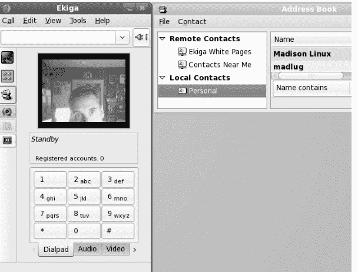

# 第二部分

## 运行 Linux 桌面

## 观看电影和视频

虽然 Linux 有几个相当高质量的视频播放器，但由于法律上的复杂问题，在正式发行版中看到这些播放器是很罕见的。在 Linux 中播放加密 DVD 电影时所产生的问题可能导致了如 MPlayer (`freshmeat.net/mplayer`)、`Ogle` (`www.dtek.chalmers.se/groups/dvd`) 和 `xine` (`http://xine.de/`) 等视频播放器未包含在发行发行中。

然而，根据大多数情况，只要你不下载和使用 DeCCs（用于解密 DVD 电影的软件），就可以使用这些视频播放器播放各种视频内容。以下章节介绍了了一些常用的视频播放器。

## 使用 xine 观看视频

`xine` 播放器是一个播放各种视频和音频格式的优秀应用程序。你可以从 `xine.sourceforge.net` 或与你的 Linux 发行版相关的软件仓库获取 `xine`。对于 Fedora，`xine` 位于 `rpm.livna` 仓库中（`yum install xine`）。对于 Ubuntu，你可以从非仓库获取 `xine`（`sudo apt-get install xine*`）。

你可以通过在终端窗口中输入 `xine&` 来启动 `xine` 播放器。图 4-9 显示了 `xine` 播放器窗口和控件示例。

> 图 4-9
使用 `xine` 播放 DVD、视频 CD、MP3、QuickTime 以及其他视频格式。


## 播放音乐和视频

> 注意
当你尝试安装 `xine` 时，它提示你需要额外的包。如果你的 `xine` 播放器无法启动，请查看本章后面的“Xine 技巧”部分。

`xine` 支持多种音频和视频格式，包括：

- MPEG (1, 2 和 4)
- QuickTime（如果你的 QuickTime 内容无法播放，请查看“Xine 技巧”）
- WMV
- DVDs、CDs 和 VCDs
- Motion JPEG
- MPEG 音频 (MP3)
- AC3 和杜比数字音频
- DTS 音频
- 商业电影（需要 `libdvdcss` 包）
- Ogg Vorbis

`xine` 理解代表音频和视频组合的不同文件格式，包括 `.mpg` (MPEG 程序流)、`.ts` (MPEG 传输流)、`.mpv` (原始 MPEG 音频视频流)、`.avi` (MS AVI 格式) 和 `.asf` (高级系统格式)。虽然 `xine` 可以播放视频 CD 和 DVD，但它无法播放加密 DVD 或 Video-on-CD 混合格式（因为前面提到的解密 DVD 的法律问题）。

## 使用 xine

启动 `wine` 后，在 `xine` 窗口中右键查看控件。播放视频最快的方法是点击以下按钮之一，并按下播放按钮（右箭头或 Play，取决于你使用的皮肤）：

- VCD（用于视频 CD）
- DVD（用于 `/dev/dvd` 中的 DVD）
- CDA（用于 `/dev/cdaudio` 中的音乐 CD）

接下来，你可以使用暂停/恢复、停止、播放、快进、慢放和退出的按钮来操作视频。你还可以使用上一个和下一个按钮来切换到不同的轨道。这些控件与你在物理 CD 或 DVD 播放器上看到的非常相似。

要选择单个文件或放入你自己的文件列表，请使用播放列表功能。

## 使用 Xine 创建播放列表

点击 `xine` 控制窗口左侧的播放列表按钮。会出现一个播放列表编辑器，显示当前播放列表中的文件。你可以添加和删除内容，然后保存列表稍后调用。

`xine` 内容被识别为媒体资源定位符 (`MRLs`)。每个 `MRL` 被识别为文件、DVD 或 VCD。文件位于常规文件路径 (`/path/file`) 或以 `file:`、`fifo/` 或 `stdin::` 为前缀。DVD 和 VCD 分别带有 `dvd` 和 `vcd` 前缀（例如 `vcd://01`）。

表 4-2 显示了 `xine` 播放列表编辑器按钮的功能。

## Xine 技巧

让视频和音频正常工作可能是一项棘手的工作。如果你在让 `xine` 正常工作（或工作）遇到困难，有几个技巧：

- **Xine 无法启动。** 为了获得最佳效果，`xine` 需要一个支持 `xvid` 的 X 驱动程序。如果你的视频卡在 X 中不支持 `xvid`，`xine` 在尝试打开默认 X 驱动程序时会立即关闭。如果发生这种情况，请尝试如下所示使用 X11 视频驱动程序启动 `xine`（速度较慢，但应该可行）：

```
$ xine -VXSHM
```

- **Xine 播放卡顿。** 如果从硬盘播放文件时出现卡顿，你可以检查几项设置：32 位的 I/O 和 DMA，这些功能如果你的硬盘支持，通常会提高硬盘性能。以下是检查方法：

> 注意：不当的磁盘设置可能会导致硬盘上的数据损坏。我们根据你自承担风险的执行此操作。此操作仅适用于 IDE 驱动器（不支持 SCSI）！此外，如果你按照本节所述更改了 DMA 或 I/O 设置，请确保有当前的备份，并且硬盘上没有活动。

1. 测试硬盘读取速度。要测试硬盘的首次读取：
```
$ hdparm -t /dev/hda
```
2. 测试硬盘写入速度：
```
$ hdparm -t /dev/hda
```
3. 测试硬盘读取速度：
```
$ hdparm -t /dev/hda
```
4. 测试硬盘缓存速度：
```
$ hdparm -W /dev/hda
```
5. 测试硬盘区大小：
```
$ hdparm -n /dev/hda
```
6. 测试硬盘读取：
64 MB
19.31 秒
2.2 秒
7. 测试硬盘写入：
64 MB
19.31 秒
2.2 秒
8. 测试硬盘性能：
64 MB
19.31 秒
2.2 秒
9. 测试硬盘性能：
```
$ hdparm -t /dev/hda
```


## 运行 Linux 桌面

当你连接好相机并打开 `gThumb` 窗口后，你可以对相机中的图像进行一些操作：

- **下载图像** — 点击单张图像或编辑“全选”以高亮来自数码相机的所有图像。然后选择“文件”->“导入照片”。在“导入照片”窗口中，你可以选择想要下载图像的目标位置。作为替代方案，你也可以选定的图像下载到 GNOME 桌面的文件夹中。
- **查看幻灯片** — 选择“查看”->“幻灯片”。显示器上将出现全屏幻灯片，图像每隔几秒切换一次。工具栏将帮助你显示有关照片名称、日期和大小的信息（点击“图像信息”），在图像之间前后切换，并进行放大和缩小。
- **处理图像** — 双击图像打开它，并选择“图像”菜单。该菜单提供了一系列工具，用于增强、调整大小、裁剪或转换图像。你还可以调整色彩平衡、色相/饱和度以及亮度对比度。
- **分配类别** — 选中图像后，点击“类别”按钮。弹出窗口允许你将图像分配给某个类别以帮助组织照片。分配可用的类别（如生日、家庭、节日或游戏），或点击“新建”并添加你的类别。

一旦图像下载到计算机硬盘上，你就可以继续使用 `gThumb` 或任何可用的数字图像处理工具（例如 `GIMP`、`KView` 和 `Kuickshow` 等）来处理它们了。

> 如果你的相机将图像保存到 SD 或 CF 卡中，你可以购买一个 USB 读卡器并在 Linux 中查看这些文件。

# 将你的相机作为存储设备

正如我在带有 USB 接口的奥林巴斯相机示例中所提到的，GNOME 卷管理器能够检测到相机已连接，并将其内容挂载为存储设备。挂载数码相机的内容后，你可以通过以下任一方式将相机作为 USB 磁盘存储设备：

- 在文件夹窗口中打开挂载目录，并使用任何文件管理器功能处理图像
- 从 `shell` 切换到挂载目录，并使用命令复制、移动、重命名或删除数字图像

当然，当你将相机挂载为文件系统时，你并不局限于将其用于数字图像。你可以用它存储任何你喜欢的类型的文件，本质上是将相机作为存储设备使用。以下列表是可以作为 USB 存储设备的数码相机的部分摘要：

- Casio — QV-2400UX, QV-2x00, QV-3x00, QV-4000 和 QV-8000
- Fuji — FinePix 1300, 1400Zoom, 2300Zoom, 2400Zoom, 2800Zoom, 4200Z, 4700, 4900Zoom, 6800 Zoom, A101, A201 和 S1 Pro
- HP — PhotoSmart 315, 318xi, 618 和 C912
- Konica — KD200Z, KD400Z 和 Revio KD300Z
- Kyocera — Finecam s3
- Leica — Digital X 4
- Nikon — CoolPix 2500, 885, 5000, 775 和 9995
- Olympus — Brio Zoom D-15, C-100, C-200Z, C-2040, C-2Z, C-3020Z, C-3040Z, C-4040Zoom, C-700, C-700UZ, C-860L, D-510, D-520Z, E-10 和 E-20
- Pentax — El12000, Optio 330 和 Optio 430
- Sony — DSC-F505, DSC-F505V, DSC-F707, DSC-P51, DSC-P20, DSC-P55, DSC-P71, DSC-S30, DSC-S70, DSC-S75, DSC-S85, MVC-CD300 和 MVC-FD92
- Vivitar — Vivicam 3550
- Yashica — Finecam s3

## 总结

启动数字媒体可能需要一些努力，但一旦设置好，你就可以播放今天的大多数音频和视频内容。本章将带你完成设置和排查声卡故障的步骤，并解释如何找到通过该卡播放音乐的软件。

每个桌面 Linux 发行版都带有一种或多种从文件或 CD 播放音乐的方法。流行的音乐播放器包括 `XM` 和 `Ryhythmbox`。用于刻录和录制 CD 的工具包括 `Grip` 以及如 `cddav` 和 `cdrecord` 等命令行程序。

本章分别在 `time` 和 `Ekika` 部分涵盖了从电视卡和网络摄像头播放实时视频。最后，本章描述了如何使用 `wine` 播放器播放各种视频格式，以及使用 `gThumb` 应用从数码相机下载图像。如果你的计算机有 CD 刻录机，可以使用这些描述创建自己的音乐 CD 和 CD 标签。

# 第 5 章：处理文字和图像

编写文档一直是桌面计算机的主角。在桌面出版、布局和出版（包括质版和网页）方面，Linux 系统一直在追赶 Mac 和 Windows。

每个桌面 Linux 发行版都带有一种或多种从文件或 CD 播放音乐的方法。流行的音乐播放器包括 `XM` 和 `Ryhythmbox`。用于刻录和录制 CD 的工具包括 `Grip` 以及如 `cddav` 和 `cdrecord` 等命令行程序。

## 使用 OpenOffice.org 办公套件

`OpenOffice.org` 是一个强大的办公套件，许多 Linux 发行版都包含它。基于 Sun Microsystems 的 StarOffice 效率套，`OpenOffice.org` 包含了文字处理器、电子表格、演示文稿等。在许多情况下，`OpenOffice.org` 可以作为 Microsoft Office 的替代品。

### 使用文字处理器

- **Writer** — 一个文字处理应用程序，可以处理来自 Microsoft Word、StarOffice 以及其他几种格式的文档。`Writer` 还拥有一完整的功能，用于使用模板、处理字体、导航文档（包括图像和效果）以及生成目录。
- **Calc** — 一个电子表格应用程序，允许整合来自 Microsoft Excel、StarOffice、Dbase 以及其他表格格式的数据。
- **Draw** — 一种绘图应用程序，允许你创建、编辑和对齐对象；包含纹理和颜色；具有对象图层。
- **Math** — 一种允许你创建数学公式的计算程序。
- **Impress** — 一个包含各种幻灯片效果的演示文稿。

`OpenOffice.org` 套件支持 `ODF`（或开放文档格式），这是最近标准化的办公文档文件格式。

## 其他进程

- **StarOffice** — StarOffice 生产力套件包含文字处理、电子表格、演示图形、电子邮件、新闻和图表应用程序。
- **AbiWord** — `AbiWord` 处理器是免费软件，是 AbiSource 项目的第一个应用程序。
- **KOffice** — `KOffice` 软件包包含了一套为 KDE 桌面环境设计的办公应用程序。

## 使用 StarOffice

来自 Sun Systems, Inc. 的 `StarOffice` 套件是一个运行在 Linux、UNIX 和 Windows 操作系统上的产品。

## 使用 AbiWord

`AbiWord` 处理器是来自 AbiSource 项目的一个非常好的免费文字处理器。

使用 `AbiWord`，你可以选择文件包含的文档类型，并选择以以下格式读取文件：

- `AbiWord (.abw)`
- `GZipped AbiWord (.zabw)`
- `富文本格式 (.rtf)`
- `Microsoft Word (.doc)`
- `UTF-8 (.utf8)`
- `文本 (.txt)`

## 从 Windows 迁移文档

- 家庭用户通常需要关注对自己文档的访问。
- 在工作中，除了文档随时间的积累外，还有一个更紧迫的问题：其他人会与你分享 Microsoft Office 文档。

使用 Microsoft Office 转换文档允许你将它们保存为另一种格式。例如，Word 允许你将文档文件保存为多种格式，包括：

- `HTML (.html)`
- `富文本格式 (.rtf)`
- `纯文本 (.txt)`
- `Word 文档 (.doc 或 .docx)`

> 注意：Word 2007 文件的默认格式是 `.docx` —— Office XML。

## 转换文档

文档有许多不同的格式。表 5-1 提供了常见文档和图形转换工具列表。

| 工具 | 转换对象 | 到 |
| --- | --- | --- |
| `dos2unix` | DOS 文本文件 | UNIX (Linux) 文本文件 |
| `fax2ps` | TIFF 图像文件 | 压缩 PostScript |
| `pdf2ps` | PDF 文件 | PostScript 文件 |
| `ps2pdf` | PostScript 文件 | 便携文档格式 (PDF) |

# 构建结构化文档

Linux社区广泛采用创建所谓的“结构化文档”的标准是 SGML 和 XML。用于生成文档的特定文档类型定义（DTD）被称为 `DocBook`。

## 理解 SGML 和 XML

标准通用标记语言 `SGML` 的创建是为了提供一种标准的文本标记方法。HTML 是 SGML 标记的一个示例。

可扩展标记语言 `XML` 的创建是为了提供一个 SGML 易于管理的子集。

## 理解 DocBook

`DocBook` 是一种 DTD，非常适合生成各种格式的计算机软件文档。它最初由 OASIS 组织创建。

## 创建 DocBook 文档

你可以使用任何文本编辑器创建文档，使用外观与 HTML 标签相似的标签。

安装 `docbook-utils` 包以获取你所需的 DocBook。

> 注意 `DocBook` DTD 同时以 SGML 和 XML 格式可用。

```
$ mkdir $HOME/doctest
$ cd $HOME/doctest
```


$ `gedit cardoc.xml`

```
- 3. 输入你希望出现在文档中的标签和文本。大多数 DocBook 文档要么是 `<book>` 类型（大型、多部分文档），要么是 `<article>` 类型（单章节文档）。尝试输出一个 DocBook 文档，输入以下内容：
```

```xml
<?xml version="1.0" ?>
<article>
  <title>选择新汽车</title>
  <header>
    <abstract>
      在本文，你将学习如何对汽车进行定价、谈判和购买。
    </abstract>
  </header>
  <section>
    <title>入门</title>
    <para>
      你将学会的第一件事是如何确定你能买得起什么。
    </para>
  </section>
  <section>
    <title>下一步</title>
    <para>
      在你知道自己买得起什么之后，你就可以开始搜索了。
    </para>
  </section>
</article>
```

你应该注意到关于此文档的几点。整个文档被包裹在文章 `<article> </article>` 标签中。文章标题位于 `<title></title>` 标签中。章节 `<section> </section>` 标签指示了具有标题和段落的文本章节。这些章节在目录中可以被单独处理。

- 4. 保存文件并退出文本编辑器。

- 5. 接下来，你可以将刚刚创建的文档转换为几种不同的格式。例如，要创建 HTML 输出，你可以输入：

```
$ `db2html cardoc.xml`
```

结果是一个名为 `cardoc` 的新目录。`db2html` 目录的结果是创建 `stylesheet-images` 目录、一个 `t1.html` 文件和一个 `x8.html` 文件。（运行 `db2html` 程序时，你会看到很多看起来可怕的错误信息。现在你可以忽略它们。理想情况下，你可以忽略它们。DocBook DTD 同时以 SGML 和 XML 格式可用。在这两者中，它是被积极维护的。）

要查看 HTML 文件，输入：
```
$ `firefox cardoc/t1.html`
```


结果是一个名为 `cardoc` 的新目录。`db2html` 目录的结果是创建了一个 `stylesheet-images` 目录、一个 `t1.html` 文件和一个 `x8.html` 文件。（运行 `db2html` 程序时，你会看到很多看起来可怕的错误信息。现在你可以忽略它们。理想情况下，你可以忽略它们。DocBook DTD 同时以 SGML 和 XML 格式可用。在这两者中，它是被积极维护的。）

结果是一个名为 `cardoc` 的新目录。`db2html` 目录的结果是创建了一个 `stylesheet-images` 目录、一个 `t1.html` 文件和一个 `x8.html` 文件。（运行 `db2html` 程序时，你会看到很多看起来可怕的错误信息。现在你可以忽略它们。理想情况下，你可以忽略它们。DocBook DTD 同时以 SGML 和 XML 格式可用。在这两者中，它是被积极维护的。）

结果是一个名为 `cardoc` 的新目录。`db2html` 目录的结果是创建了一个 `stylesheet-images` 目录、一个 `t1.html` 文件和一个 `x8.html` 文件。（运行 `db2html` 程序时，你会看到很多看起来可怕的错误信息。现在你可以忽略它们。理想情况下，你可以忽略它们。DocBook DTD 同时以 SGML 和 XML 格式可用。在这两者中，它是被积极维护的。）

结果是一个名为 `cardoc` 的新目录。`db2html` 目录的结果是创建了一个 `stylesheet-images` 目录、一个 `t1.html` 文件和一个 `x8.html` 文件。（运行 `db2html` 程序时，你会看到很多看起来可怕的错误信息。现在你可以忽略它们。理想情况下，你可以忽略它们。DocBook DTD 同时以 SGML 和 XML 格式可用。在这两者中，它是被积极维护的。）

## 运行 Linux 桌面

### 使用 Scribus 进行页面布局

对于折页、杂志、通讯报、目录等比文字处理器需要更复杂布局的材料，你需要页面布局应用程序。流行的开源页面布局应用程序是 Scribus (`www.scribus.net`)。

Scribus 主要用于制作印刷出版物，你也可以用 Scribus 创建所谓的智能 PDF。通过 Scribus 创建的 PDF 可以包含 JavaScript 等功能，让其他人与你的文本交互。

Scribus 随几个 Linux 发行版一起软件包包含了模板和示例（通常在 `/usr/share/scribus/`）。

安装 Scribus 包后，你可以通过 GNOME 桌面的应用程序 — Office 启动 Scribus。图 5-5 显示了 Scribus 中的折页布局示例。

在你的桌面上运行时，你可以从选择模板开始（选择 File ⊑ New from Template）。先从折页、通讯报、演示文稿或基于文本的布局开始。这里是在使用 Scribus 时可以做的一些事情以上手：

- 编辑文本 — 右键点击文本框并选择 Edit text。在出现的 Story Editor 窗口中更改文本、字号、文本缩放宽度/高度、文本对齐、颜色和其他属性。选择 File ⊑ Update Text Frame 并保存更改。

### 第二部分 运行 Linux 桌面

### 转换 DocBook 文档

上一个示例展示了如何创建简单的 DocBook 文档并将其转换为 HTML。以下工具将 DocBook 转换为：

- `docbook2dvi` — 设备独立文件格式
- `docbook2html` — HTML 格式
- `docbook2man` — 手册格式
- `docbook2pdf` — 便携文档格式 (PDF)
- `docbook2ps` — PostScript 格式
- `docbook2rtf` — 丰富文本格式 (RTF)
- `docbook2tex` — TeX 格式
- `docbook2text` — GNU TexInfo 格式
- `docbook2txt` — 纯文本格式

如果系统中 `docbook-utils` 包没有安装描述的某些命令，请尝试安装 `docbook-utils-pdf` 包。

### 处理文字与图像

- 添加图像 — 右键点击图像框并选择“获取图像”（Get Image）。在你的文件夹中浏览寻找所需的图像。如果图像不合适，右键点击图像并选择“编辑图像”（Edit Image），在 GIMP 中打开图像以调整大小或进行修改。右键点击图像并选择“调整框架”（Adjust Frame）来调整框架大小以适应图像。

- 更改现有框架 — 右键点击任何框架，然后选择“取消锁定”（Select Locked）使框消失。当框架被解锁后，你可以对其进行许多更改。抓取框架的边角或侧边来调整其大小。右键点击它并选择“采样文本”（Sample Text）用文本填充，或者选择“剪切”（Cut）、复制”（Copy）或“删除”（Delete）。用鼠标删除框架将其拖到某处。当你更改框架时，选择“锁定”（Is Locked）以便原地更改框架。

- 更改文档属性 — 选择文件文档设置（File Document Setup）。在弹出的文档设置窗口中，你可以更改页面尺寸和方向，以及页面类型（单面、双面、三折或四折）。同样，你可以调整所有页边距。选择主题（topic）以添加作者、标题和关键词等信息。你还可以更改字体和连字符或添加目录。

- 绘图 — 你可以在 Scribus 布局的任何地方自由绘图。选择“插入手绘线”（铅笔图标）或“插入贝塞尔曲线”（墨水笔图标），然后使用鼠标在页面上画线。你还可以使用工具栏上的按钮绘制框、多边形或线条。右键点击绘制的线条并选择“属性”（Properties）。在属性窗口中，你可以调整绘图的尺寸、线条和颜色。

#### 图 5-5

使用 Scribus 生成高质量的布局。

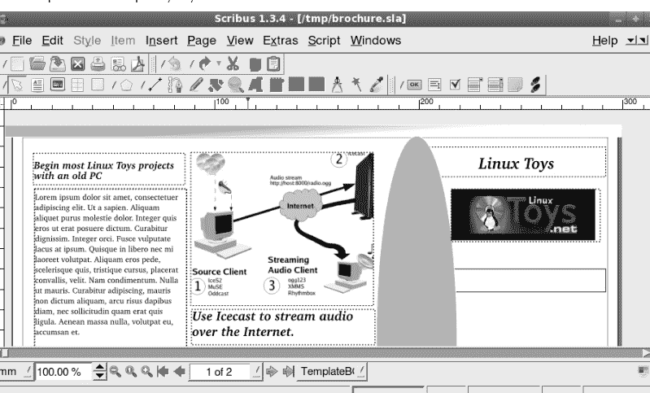

133

### 运行 Linux 桌面

当你创建布局时，可以通过选择文件打印（File Print）来打印。会弹出预检验证器（Preflight Verifier）窗口，其中包含有关打印文档的信息。在页面右上角，你可以将选择从 PostScript 格式更改为多个 PDF 版本之一。然后你可以选择将输出直接发送打印机，或者保存为 PDF 或 PostScript 文件。

### 处理图形

在整个 Linux 系统中，创建和处理图形的工具变得越来越丰富和强大。列表首位的是 GNU 图像处理程序（GIMP）。GIMP 允许你组合和创作图像，还可以对照片进行修饰。处理矢量图形（用几何形状代表图像而非位点），Inkscape 是一款受欢迎的开源应用程序。创建图形的工具包括 `snapshot`（一个用于屏幕截图的程序）和 `kpaint`（用于处理位图图像）。

### 使用 GIMP 处理图像

GIMP 是一个用于处理照片和图形图像的免费软件。要用 GIMP 创建图像，你可以导入绘画、照片或 3D 图像，也可以从零开始。你可以通过选择系统菜单中的“图形 GIMP”来启动 GIMP，或者在终端（Terminal）窗口中输入 `gimp`。

图 5-6 显示了 GIMP 的示例。

在许多方面，GIMP 与 Adobe Photoshop 相似。有些人认为 GIMP 的脚本功能可以比拟甚至优于 Adobe Photoshop 中的“动作”（Actions）。GIMP 缺少的一个功能是原生支持 CMYK（青-品红-黄-黑）分色。如果 CMYK 对你的图形至不重要，你可能会发现 GIMP 在许多方面与 Photoshop 一样强大灵活。

> 访问 `www.blackfervices.co.uk/separate.shtml` 获取适用于 GIMP 的 CMYK 插件。根据其文档，该插件仅对 CMYK 提供基础支持。尽管如此，这可能已经足够你的需求。

打开图像后，你可以从 GIMP 窗口中选择工具来处理该图像。当你选择一个工具时，注意下方的标签页中会出现该工具的选项。图 5-7 显示了 GIMP 工具，以及指示工具用途的标注。

#### 图 5-6

GIMP 是一件功能强大的图形处理工具。

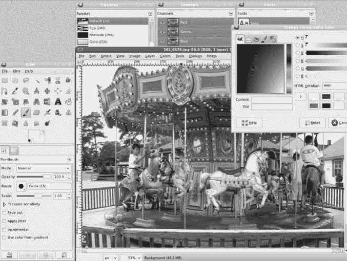

#### 图 5-7

使用 GIMP 窗口选择更改图像的工具。

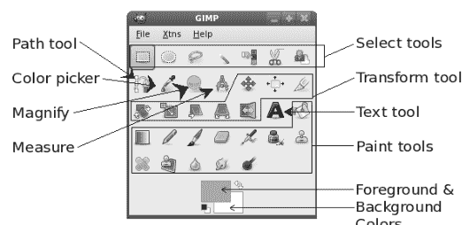

### 运行 Linux 桌面

以下列表描述了图 5-7 显示的工具：

- 路径工具 — 使用路径工具创建特殊类型的矩形、椭圆或自由形状。创建矩形时，让终点回到起点。按住 Ctrl 键并点击起点以闭合框。形状完成后，选择“描边路径”（Stroke Path）用描边或图案线来定义形状。

- 颜色取色器 — 使用取色器从你的图像中选择任何颜色作为前景色或背景色。使用此工具，然后点击并拖动以选择图像的一个区域。该

- 放大镜 — 选择此工具，选择你图像的一个区域。图像的该区域将填充屏幕。或者只需点击放大图像，或按 Ctrl+ 缩小图像。

- 测量工具 — 选中测量工具后，从一个点点击并拖到另一点。状态栏显示距离。

- 选择工具 — 使用这些工具选择图像的区域。图像的该区域将填充屏幕。或者只需点击放大图像，或按 Ctrl+ 缩小图像。

- 文本工具 — 使用文本工具创建特殊类型的矩形、椭圆或自由形状。创建矩形时，让终点回到起点。按住 Ctrl 键并点击起点以闭合框。形状完成后，选择“描边路径”（Stroke Path）用描边或图案线来定义形状。

- 绘制工具 — 使用这些工具添加线条和颜色。油漆桶用当前前景色填充区域。

- 前景和背景颜色 — 两个颜色显示前景色（右侧）和背景色（左下）。点击打开对话框更改任一颜色。

当你需要图形和文字具有最大的灵活性时，矢量图形编辑器可以处理几何元素（如线条、曲线和骨架）而非位点（如你使用图像编辑器时那样）。因此，你的字体和图形边缘通常更清晰，你可以根据喜欢弯曲和塑造这些元素。Inkscape (`www.inkscape.org`) 是一款流行的矢量图形编辑器，适用于大多数 Linux 系统。

通过 Inkscape，你拥有一个功能类似于 Adobe Illustrator 和 CorelDraw 等商业产品的应用程序。Inkscape 创建可缩放矢量（SVG）格式图像 — 这是来自 W3C (`www.w3.org/Graphics/SVG`) 的开放标准。数以千计的 SVG 图形和剪贴素材在公共领域或根据 Creative Commons 许可可用。

如果你正在使用 Fedora 等 Linux 发行版，请安装 `inkscape` 软件包以获取 Inkscape。我建议你也安装 `openclart` 软件包，这将为你的 Inkscape 创建提供数百个剪贴素材素材。安装 `inkscape` 和 `openclart` 软件包后，选择“应用程序 Inkscape 矢量图形编辑器”打开 Inkscape 窗口。图 5-8 显示了 Inkscape 窗口的示例。

#### 图 5-8

Inkscape 允许你处理图形和文字。


137

### 运行 Linux 桌面

你可以从打开 Inkscape 提供的几十个模板之一开始（选择文件 -> 新，并从网络横幅、名片、DVD 封面或其他模板中选择）。打开新窗口后，这里有几种开始使用 Inkscape 的方法：

- **添加文本** — 从左侧工具栏选择文本图标，点击文本并开始打字。输入一些文本后，选择选择图标并点击文本。使用侧边或角部来调整文本大小。再次点击文本并使用箭头旋转或倾斜文本。用鼠标按住文本框并将其拖到你想要放置的地方。选中文本后，选择文本 -> 字体，将弹出的窗口，你可以在其中选择字体族、样式和行间距。

- **添加图形元素** — 从左侧工具栏选择矩形、3D 框体、圆形、星形或漩涡形。将光标移动到你想放置新元素的地方，在处点击并按住鼠标，移动鼠标将元素调整到所需的大小。点击屏幕底部的调色板来更改元素的颜色。

- **添加剪图** — 如果你添加了 `openart` 软件包，就可以从其他地方导入剪图。选择文件 -> 导入并使用 `/usr/share/clipart/opencl` 文件夹。从食物、地理、办公、娱乐、工具和交通等类别的数百张 SVG 剪图中进行选择。一旦图像导入，就可以使用鼠标像处理文本那样对其进行选择和形状调整。

- **组合对象** — 选择几个文本或剪图对象，然后按住 Shift 键并选择其他对象。当组中的所有对象都被选中时，选择对象 -> 组合。你现在可以将所有组合对象作为一个整体一起移动。

- **使用图层** — 选择要添加、删除、提升或降低的图层。

当你创建矢量图形时，可以通过选择文件 -> 打印来打印该图形。在打印窗口中，你可以从渲染选项卡选择矢量格式或位图格式的图像。

### 获取屏幕截图

Linux 系统提供了几种截屏工具。你可以通过选择 GIMP 程序中的文件 -> 获取 -> 屏幕截图来截屏。在 GNOME 桌面上，选择应用程序 -> 附件 -> 截屏幕。对于大多数 KDE 桌面，选择图形 -> KSnapshot。

以 GNOME “取截图”工具为例，会出现一个对话框让你选择捕获桌面还是捕获当前窗口。如果你需要在截图之前设置某些内容（如打开菜单），可以设置几秒的延迟。然后点击“取截图”。图 5-9 显示了在捕获当前桌面图像后的截图示例。

选择一个文件夹存放截图并为图像输入名称。然后点击保存进行保存。

#### 图 5-9
使用“取截图”工具捕获你的桌面或选定窗口图片。

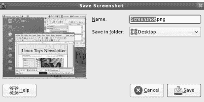

### 查看图像

如果你想浏览图像文件夹并进行一些更改，KDE 和 GNOME 桌面都提供了一些易用的图像查看器。当你从 KDE 桌面打开图像时，会打开 Gwenview 图像查看器。在 GNOME 中，Eye of GNOME 是默认的图像查看器。

如果你正在处理从数字相机下载的图像文件夹，Gwenview 在管理图像的基本方面做得很好。点击预览按钮预览文件夹中图像的缩略图。放大或缩小以清晰地查看每张图像。如果图像是侧向的，你可以向左或向右旋转它。从编辑菜单中，你还可以翻转、调整大小、裁剪或创建当前图像的镜像。图 5-10 显示了 Gwenview 窗口。

在文件夹窗口中双击图像（或右键点击图像并选择“用图像打开”），可以在 Eye of GNOME 中打开该图像。Eye of GNOME 图像查看器不提供像 Gwenview 那样的裁剪和调整大小的功能。如果有必要，你仍然可以旋转并保存更改。编辑属性以查看每张图像的高度、宽度、大小、类型和文件夹信息。在“查看”菜单下，你还可以全屏模式或幻灯片模式查看 Eye of GNOME。

从“查看”菜单中选择“图像集合”（或按 F9 功能键），你可以切换查看当前文件夹中每张图像的缩略图。图 5-11 显示了选择了“图像集合”视图的 Eye GNOME 示例（注意窗口标题栏中的名称变为所选图像的名称）。

#### 图 5-10
在 KDE 中使用 Gwenview 切换查看图像。

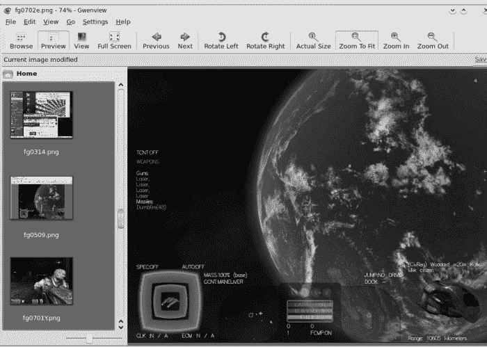

#### 图 5-11
使用 Eye of GNOME 切换查看图像文件夹并进行简单修改。

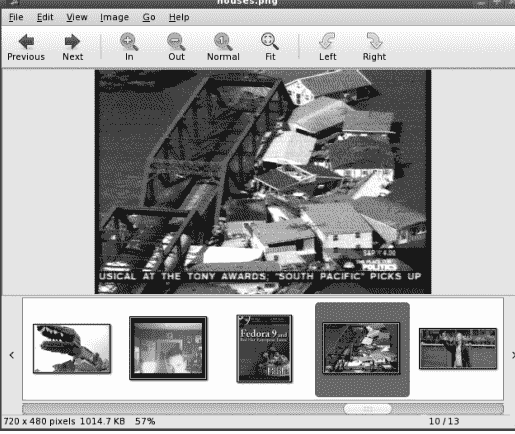

### 显示 PDF 和 PostScript 文档

如果你每次想更改文档内容或格式都向打印机发送文字处理文档，文档出版可能会非常耗纸张。为了节省时间，请使用查看器。

#### 使用 ghostscript 和 ggv
在 Linux 中显示 PostScript 或 PDF 文档，你可以使用 `ghostscript`。它是一个相当简单的界面，让你逐个查看文档。例如，如果安装了 `samba` 软件包，你可以使用：

```
$ ghostscript -DEVICE=x11 /usr/share/doc/samba-*/HOWTO.pdf
```

`ggv` 命令（GNOME Ghostview）是查看 PostScript 文件的另一种方法。使用 `ggv` 打开文件：

```
$ ggv /usr/share/doc/samba-*/bashref.ps
```

### 使用 Adobe Reader

便携文档格式（PDF）提供了一种以打印显示形式存储文档的方法。通过 Adobe Reader，你可以以友好的方式查看 PDF 文件。Adobe Reader 使得在 PDF 文件内移动变得简单。PDF 文件可能包含超链接、目录、图形和各种字体。最新版本允许你填写表单或标记内容。

你可以从 Adobe 网站获取 Linux 版 Adobe Reader。如果你对 PDF 文档有任何特殊的表单或编辑功能，应该使用这个阅读器，而不是 Evince 或 Ghostscript。

安装 Adobe Reader 后，选择应用程序 -> Adobe Reader 启动。你也可以输入以下命令启动程序：

```
$ acoread
```


### 图 5-12
在 Adobe Reader 中显示 PDF 文件。


# 文字与图像的使用

Adobe Reader 拥有许多功能。例如，你可以在文档旁边显示书签列表，并点击书签跳转到特定页面。你还可以显示页面的缩略图，以便快速滚动和选择页面。

通过菜单栏或按钮，你可以对 PDF 文档进行翻页、放大和缩小、跳转到文档的开头或结尾，并显示文档的不同视图（同时还可以显示书签和页缩略图）。如需打印副本，请选择“文件 ✑ 打印”。

其他文档查看程序包括 Evince 和 Khostview（后者是 GhostView 程序的 KDE 版本）。

# 使用 SANE 使用扫描仪

在 Linux 下使用扫描仪的软件正受一项名为 Sane Access Now (`SANE`) 的工作的驱动。这项工作希望标准化扫描仪、数码相机和数字视频摄像机等设备驱动程序的创建方式，并帮助简化使用这些设备的应用程序的接口。`SANE` 现在已包含在多种 Linux 发行版中。

想要将 Linux 作为平台的用户通常对扫描仪的两个问题感兴趣：扫描仪何时被支持，以及有哪些可用应用程序可以使用扫描仪。对于旧的扫描仪，SCSI 扫描仪的兼容性通常比并行扫描仪更好。如今，USB 扫描仪是最受欢迎且支持最好的。

由于持续的开发，新的扫描仪不断被支持。你可以在 `www.sane-project.org/sane-supported-devices.html` 找到支持的扫描仪当前列表，并在 `www.buzzard.me/jonathan/scanners-usb.html` 查看 USB 扫描仪列表。爱普扫描仪在 Linux 下最常被识别。

至于扫描，目前最广泛使用的工具包括：

- `xsane` — 一个基于 `SANE` 扫描仪的 X 图形前端，`xsane` 可以作为 `GIMP` 插件工作，也可以作为一个独立的应用程序（从大多数 KDE 桌面启动，“扫描它”）。它支持 JPG、TIFF、PNG、PostScript 和 PNM 格式的 8 位输出。对于 PNM (ASCII) 和原始格式有实验性的 16 位支持。
- `scanimage` — 使用此命令行接口获取扫描图像。该命令获取扫描图像，然后将数据重定向到标准输出（因此你可以将其发送到文件或通过管道到另一个程序）。它支持与 `xsane` 相同的格式。

除了这些应用程序外，`OpenOffice.org` 也支持 `SANE`。

由于 `SANE` 扫描仪驱动程序的架构，扫描仪驱动程序与扫描仪应用程序分离。这使得跨网络共享扫描仪成为可能。

## Web 发布

文档和图像的最终目的地不必是纸张。在过去的几年里，在 Web 上发布已成为常态。如果你决定控制自己的网站来向世界发布你的思想和图片，Linux 系统包含了许多软件包来帮助你实现这一点。

如果你正在创建 HTML Web 网页，可以使用 `OpenOffice Writer` 或 `SeaMonkey Composer` 等文字处理器构建基础的 HTML 文档。如果你非常忙，甚至可以尝试使用纯文本编辑器并手动编辑 HTML 标记。然而，对于更复杂的网站，还有有很多选择。

以下列表描述了可以用于 Web 发布的开源软件包。这里描述的所有软件包都兼容 Fedora 以及以及其他 Linux 发行版。

> **注意** 服务器是互联网上坏蛋的恒定目标。如果你决定使用下面描述的软件，请务必检查项目网站，以确保你拥有最新的安全补丁和更新。

- Gallery — Gallery 项目 (`http://gallery.menalto.com`) 允许你创建在线相册。Gallery 让你轻松地将照片组织成相集、编辑图像、添加标签，并使用各种主题和颜色展示它们。在 Fedora 中，安装 `gallery2` 软件包。
- Blogging — 流行的 WordPress 网站 (`http://wordpress.com`) 使用其开源 WordPress (`http://wordpress.org`) 为他人提供博客账户。如果你想要自己的博客站点，可以在 WordPress 上注册免费账户。
- 内容管理系统包括 Plone (`http://plone.org`) 和 Zope (`http://zope.org`)。要创建维基，有 MediaWiki 和 Moin Moin。

# 文字与图像的使用

图 5-3 显示


## 总结

Linux 中用于在纸张和 Web 上发布文字和图像的工具可以类似的软件竞争。对于制作文档，你有 `OpenOffice.org Writer`、`AbiWord` 和 StarOffice。要布局页面，有 Scrib。对于矢量图形，可以使用 Inkscape。

在互联网上发布内容的软件也适用于你想到的任何类别。对于博客，你可以创建 WordPress 站点。对于图像库，有 Gallery 软件。内容管理系统包括 Drupal、Plone 和 Zope。创建维基，有 MediaWiki 和 Moin Moin。

# 第 6 章

## 电子邮件与网页浏览

Linux 提供的各种 Web 浏览器和电子邮件客户端在过去几年里取得了巨大的进步。它们的功能可以与最流行的 Windows 客户端媲美。Outlook 邮件客户端和 Internet Explorer 浏览器的安全问题使许多人重新关注 Linux 和用于互联网的开源软件。

本章描述了你可以从书中介绍的 Linux 发行版中获取的一些 Web、电子邮件、聊天和相关工具。如果你从未在 Linux 上使用过互联网，或者已经多年没有用过，你可能会被现有的工具所震惊。

# 本章内容

- 使用 Thunderbird Mail 阅读电子邮件
- 在 Evolution 中管理电子邮件
- 使用文本的电子邮件客户端
- 使用 Firefox 浏览 Web
- 使用 SeaMonkey 浏览
- 使用文本的网页浏览

# 使用电子邮件

任何值得命的 Linux 桌面系统都会有一个或两个应用程序用于发送、接收和管理你的电子邮件。许多用户认为，管理垃圾邮件的卓越工具和通常更好的安全机制使 Linux 成为管理电子邮件的优秀桌面平台。

# 选择电子邮件客户端

电子邮件客户端的选择从像 Windows 电子邮件程序克隆的程序到从 shell 中运行纯文本的程序，

## 运行 Linux 桌面

这与 Linux 提供的电子邮件客户端大不相同，且差异很大。以下是电子邮件客户端集成到 Linux 的几种不同方式：

- 独立式（Standalone）—— 如今，大多数电子邮件客户端都是独立的应用程序。主要的独立电子邮件应用程序是 Mozilla Thunderbird 2 (`www.mozilla.com/en-US/thunderbird/`)，尽管你可以在 Linux 上找到 50 种或更多选择，例如 Sylpheed (`sylphed.raass.org/en/`)。
- 配合浏览器 —— 许多流行的 Web 浏览器都带有集成的电子邮件客户端。通过配置浏览器自带的电子邮件客户端，你就可以通过点击浏览器窗口中的链接来启动新的邮件信息。你可以轻松地从浏览器的工具栏打开电子邮件客户端。功能丰富的 Mozilla SeaMonkey (`www.seamonkey-project.org`) 是 Linux 上流行的带 Web 浏览器的内置邮件客户端。Netscape Communicator (`http://netscape.aol.com`) 是另一个拥有自带电子邮件功能的浏览器（尽管由于许可问题，它已从许多 Linux 发行版中移除），不过，人们仍然在使用 Thunderbird 和用于 Web 浏览器的邮件。Opera (`www.opera.com`) 浏览器也包含一个集成的电子邮件客户端。它允许大多数带 Web 浏览器的电子邮件客户端。Opera 可免费个人使用。
- 配合分组（With grouping）—— 某些电子邮件客户端与其他个人生产力应用程序一起组合形成集成应用程序。在 Linux 中最流行的是 Evolution，它作为默认电子邮件客户端与多个 Linux 发行版捆绑。除了电子邮件之外，Evolution 还包含日历、任务、列表和联系人目录。
- 来自终端（From the shell）—— 许多老牌 Unix 和 Linux 高级用户倾向于使用不带图形桌面的运行电子邮件客户端。虽然使用起来并不总是直观，但基于文本的邮件读取器比图形版本运行快得多。命令可以追溯到最早的 UNIX 系统（当时没有 GUI）。`mut` 电子邮件客户端在高级用户中非常流行，因为它能够高效地管理大型邮箱和附件。

每个电子邮件客户端内部的功能可以帮助你区分它们。虽然大多数电子邮件客户端允许你编写、发送和管理邮件信息，但还有一些你可能需要寻找的功能：

- 过滤器和垃圾邮件拦截器 —— Thunderbird、Evolution 以及其他邮件客户端提供消息过滤过滤器和垃圾邮件检测器。你可以设置规则将入站邮件分类到不同的文件夹、删除某些消息或回复入站邮件。某些电子邮件客户端还具有尝试自动检测垃圾邮件到达的功能。如果你收到大量邮件，这些将是管理邮件的无价工具。
- 安全功能 —— 像 Thunderbird (`www.mozilla.com/en-US/thunderbird/`) 这样的电子邮件客户端允许你使用消息加密、数字签名和其他安全功能来保持邮件隐私。
- 排序、搜索和显示 —— 再次，如果你同时管理大量邮件（些人管理数千条消息），回溯你需要的邮件的能力至关重要。某些客户端允许你按日期、发送者、优先级、主题和其他项目进行排序。你可能可以搜索消息内容的文本，或者显示消息（例如不显示附件或显示源代码）。
- 邮件编写工具 —— 某些客户端允许你在消息中使用 HTML，这允许你向消息中添加图像、链接、表格、颜色、字体和其他增强功能。一个警告：某些邮件服务器不喜欢人们使用不识别 HTML 的纯文本读取器。
- 多账户 —— 许多电子邮件客户端允许你配置多个由你的服务器提供的电子邮件账户。
- 性能 —— 某些电子邮件客户端在没有图形桌面的情况下运行。虽然使用起来并不总是直观，但基于文本的邮件读取器比其图形版本运行快得多。

## 开始使用电子邮件

大多数系统都包含一个电子邮件客户端，你可以通过面板选择，或通过左点击桌面调出菜单。如果你使用图形邮件读取器，可以从查找这些客户端开始：Evolution、SeaMonkey Mail、Thunderbird 或 KMail。

在启动电子邮件客户端后，你需要一些信息来使用它。当你首次启动大多数电子邮件客户端时，某种配置界面要求你设置账户。以下是为本章节介绍的电子邮件客户端设置账户的方法：

- Evolution —— 当每个用户首次使用 Evolution 时，设置向导会启动。在之后，在主 Evolution 窗口中选择“编辑-首选项”。选择“邮件账户”，并双击你想修改的邮件账户或选择“添加”新账户。
- SeaMonkey Mail —— 当你 SeaMonkey 时，账户向导会启动。之后，你可以通过点击 SeaMonkey Mail 窗口中的“邮件与新闻组账户设置”来设置或修改账户。
- Thunderbird —— 这是由使用 Firefox 和 Mozilla (`mozilla.org`) 的人的下一代邮件客户端。现在已是 2.0 版本，并具有更先进的功能，你可能会考虑 Thunderbird。不仅 Thunderbird 比 SeaMonkey Mail 和 Evolution 快，Thunderbird 是 Mozilla Web 浏览器的理想补充。Firefox 和 Thunderbird 运行在多种操作系统上，包括 Linux、Solaris、Microsoft Windows 和 Mac OS。
- Sylpeed —— Sylpeed 电子邮件客户端 (`http://sylpeed.sraoss.jp/en/`) 用于某些微型桌面发行版，例如 Damn Small Linux。Sylpeed 特别快

配置电子邮件账户所需的信息对于本章涵盖的不同图形化电子邮件客户端来说非常相似：

- **名称 (Name)** — 输入您希望在发出的邮件中显示的名称。
- **电子邮件地址 (Email Address)** — 输入您发送邮件的电子邮件地址。
- **邮件服务器类型 (Mail server type)** — 大多数邮件服务器都是 POP3 或 IMAP 类型服务器。
- **服务器 (Servers)** — 输入用于发送出邮件和接收传入邮件的服务器名称。
- **用户名 (Username)** — 输入邮件服务器识别您的名称。
- **账户标题 (Account title)** — 输入您为此邮件账户命名的名称，以便以后在邮件和新组账户列表中引用它。
- **身份验证类型 (Authentication type)** — 指明在接收邮件时使用的身份验证类型。

这就是您开始接收和发送电子邮件所需的大部分基本信息。然而，您可能希望调整电子邮件客户端在收发邮件时的交互交互方式。

## 调整电子邮件

完成基本设置后，您就可以准备开始发送和接收电子邮件了。在此之前，您应该考虑一些可能会影响您使用邮件的其他设置：

- **自动检查消息 (Automatically check messages)** — 您可以设置电子邮件客户端每几分钟自动从邮件服务器检查并下载一次消息。
- **在服务器上保留消息 (Leave messages on server)** — 如果您为 POP 服务器开启此功能，在您将电子邮件消息下载到电子邮件客户端后，邮件将留在服务器上。
- **证书 (Certificates)** — 您的电子邮件客户端可能提供使用证书对发出的消息进行签名的方法。

请逐一检查邮件账户设置，因为每个电子邮件客户端的设置略有不同。

## 使用 Thunderbird 阅读邮件

Thunderbird 电子邮件客户端程序是一个功能齐全的邮件和新闻组阅读器，通常大多数 Linux 系统都自带。

> 在过去，您可能运行集成的 Mozilla 套件应用程序，现在称为 Mozilla SeaMonkey。最新版本的 Linux 已经将 SeaMonkey 替换为独立的电子邮件和网页浏览器应用程序，分别是 Thunderbird 和 Firefox。

Thunderbird 包含以下功能：

- 发送、接收、阅读和管理新闻组
- 管理多个邮件和新闻组账户
- 编写 HTML 电子邮件消息
- 控制垃圾邮件
- 消息加密和签名

在 Linux 系统上，Thunderbird 或 Evolution 将是您的 Linux 发行版的主要电子邮件客户端。您可以从桌面的“互联网”菜单启动电子邮件应用程序。例如，在 Fedora 中，您从“应用程序 ↻ Internet”菜单运行电子邮件客户端。

## 设置电子邮件账户

当您首次启动 Thunderbird 时，应用程序会显示“新账户设置（New Account Setup）”对话框。

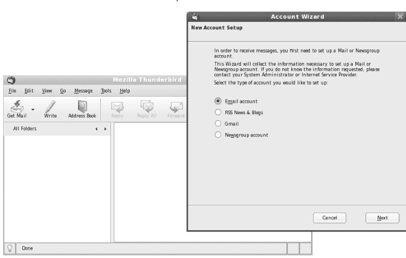

按照以下步骤创建您的电子邮件账户：

1. **创建电子账户 (Create an e-account)。** 开始设置电子邮件账户，选择“电子邮件账户”并点击“下一步”。
2. **识别您的身份 (Identify yourself)。** 输入您想要使用的名称和电子邮件地址，然后点击“下一步”。
3. **输入服务器设置 (Enter server settings)。** 对于您的邮件账户，指定服务器是 POP 还是 IMAP。然后输入服务器名称。
4. **输入账户名称 (Enter an account name)。** 输入用于识别该账户的名称。
5. **完成账户设置 (Finish the account setup)。** 出现“祝喜”界面，允许您检查设置并完成账户。

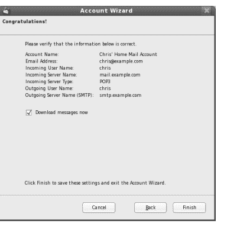

Thunderbird 现在准备好开始接收和发送邮件消息。

## 管理入站邮件

选择左列中的“收件箱（Inbox）”标题。

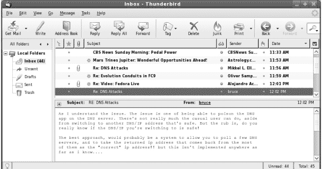

在 Thunderbird 中有多种方法可以存储和管理电子邮件：

- *邮件文件夹* — 邮件消息存储在左列的文件夹中。
- *排序消息* — 消息根据你选择的文件夹在显示器的右上角按日期排序。
- **阅读消息** — 当你选择一条消息时，它会出现在显示器的右下角。
- **过滤邮件** — Thunderbird 提供了一些很好的功能，可以检查每条消息所需的信息，然后对该消息进行操作。
- **搜索消息** — 你可以使用搜索功能检索位于某个邮件文件夹中的消息。

## 编写和发送邮件

- **新消息** — 要创建新消息，请选择“消息（Message）-> 新消息（New Message）”。
- **回复消息** — 要回复邮件，请点击屏幕右侧的消息，然后选择“消息（Message）-> 回复（Reply）”。
- **转发消息** — 要转发邮件，请点击屏幕右侧的消息，然后选择“消息（Message）-> 转发（Forward）”。

## 过滤邮件和拦截垃圾邮件

Thunderbird 对入站邮件可以做更多，而不仅仅是将其放入文件夹。

## 在 Evolution 中管理电子邮件

如果你使用的是 Fedora、Ubuntu 或 Debian，Evolution 是你可以从 GNOME 桌面启动的电子邮件客户端。

Evolution 的功能包括：

- 邮件 — 一套完整的功能，用于在一个或多个电子邮件账户上获取、读取、管理、编写和发送电子邮件。
- 联系人（Contacts）
- 日历（Calendar）
- 备忘录（Memos）
- 任务（Tasks）

## 接收、撰写和发送电子邮件

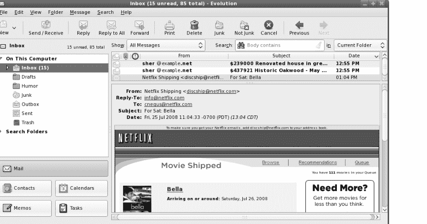

以下是常见电子邮件任务的快速概览：

- **读取电子邮件** —— 点击左栏的“收件箱”。
- **删除电子邮件** —— 在阅读消息后，点击它并按 Delete 键。
- **发送和接收** —— 点击发送/接收按钮。
- **撰写电子邮件** —— 点击新建➔ 撰写。
- **使用地址** —— 点击“联系人”菜单。
- **创建文件夹** —— 右键点击收件箱并选择“新建文件夹”。
- **移动消息** —— 在 Evolution 中，你可以将消息从一个文件夹拖动到另一个文件夹。
- **搜索消息** —— 使用搜索栏通过发送者、主题、日期或关键词查找消息。

## 使用 SeaMonkey Mail 读取电子邮件

SeaMonkey 邮件客户端是一个功能齐全的邮件和新闻组阅读器。

## 电子邮件与网络浏览

有许多基于文本的邮件程序用于读取、发送和处理您的邮件。

> 这些程序中的大多数都使用 `$MAIL` 环境变量的值作为您的本地邮箱路径。通常情况下，该位置是 `/var/spool/mail/user`，其中 user 是您的用户名。

```bash
```


```
export MAIL=$HOME/.thunderbird/*/mail/accountname/Inbox
```


将 `account` 替换为您使用的某个电子邮件帐户的名称。如果您使用 Thunderbird 收发邮件，可以临时设置此变量以尝试您的某些邮件程序。

在后续章节中描述的邮件读取器都是基于文本的，并使用整个终端窗口（或其他 shell 显示器）。尽管某些功能有所不同，但菜单栏会直接在屏幕上显示可用选项。

## Mut 邮件读取器

`mut` 命令是一个基于文本的全屏邮件用户代理，用于读取和发送电子邮件。该界面快速高效。输入 `mut` 发送消息。向上或向下移动可以从列出的消息中删除。按回车键查看消息，输入 `t` 返回主菜单。

菜单栏指示了如何标记消息为待删除、取消删除、将消息保存到目录以及如何回复消息。输入 `m` 撰写新消息，它会打开您的默认编辑器（例如 `vi`）来创建消息。输入 `y` 发送消息。如果您希望在手指离开键盘的情况下读取邮件，`mut` 是一个很棒的选择。（它还能处理附件！）

## Pine 邮件读取器

`pine` 读取器是另一个全屏邮件读取器，但它提供的功能比 `mut` 多得多。通过 `pine`，您可以管理多个邮件文件夹、新闻组消息以及邮件信息。作为基于文本的应用程序，`pine` 非常易于使用。它由华盛顿大学的一个小组为校内学生开发，但已在 UNIX 和 Linux 环境中被广泛使用。

通过输入 `pine` 启动它。在看到一段简短的启动消息邀请您自认为是 pine 用户后，您应该看到以下菜单，您可以通过输入关联字母或使用上下方向键并按回车键来选择项目：

- HELP 获取使用 Pine 的帮助
- COMPOSE 撰写并发送消息
- MESSAGE INDEX 查看当前文件夹中的消息
- FOLDER LIST 选择一个文件夹进行查看
- ADDRESS BOOK 更新地址录
- SETUP 配置 Pine 选项
- QUIT 退出 Pine 程序

## 运行 Linux 桌面

要读取电子邮件，请选择 I 或 L。命令列在屏幕底部，并会根据您正在查看的内容发生变化。使用左（←）和右（→）方向键在 pine 树结构之间向后或向后移动。

## 邮件读取器

`mail` 命令是 UNIX 上的第一个邮件读取器。它是基于文本的，但不是面向屏幕的。输入 `mail`，您将看到邮箱中的消息。消息显示后您会得到一个提示符——您需要知道该做什么。（可以使用回车键逐条查看消息。）输入 `?` 查看哪些可用命令。

在 `mail` 运行期间，输入 `h` 查看邮件主题。只需输入消息编号即可查看该消息。输入 `d#`（将 # 替换为消息编号）来删除消息。要创建新消息，输入 `m` 回复消息，输入 `re #`（将 # 替换为消息编号）。

## 选择网络浏览器

Linux 中的许多网络浏览器都是基于名为 Gecko 的 Mozilla 网络浏览器。Linux 发行版可能自带的网络浏览器包括：

- Firefox —— 这是 Linux 及其他开源软件系统的领先浏览器。Firefox 有适用于 Linux、Mac OS X 和 Windows 的版本。Firefox 也已经进入了 Mac 和 Windows 世界。这个来自 Mozilla 项目的下一代浏览器旨在提供快速、高效且安全的浏览。
- SeaMonkey 网络浏览器 —— 作为 SeaMonkey 套件的一部分提供，该浏览器基于 Mozilla Navigator，它曾是最流行的开源网络浏览器。尽管许多 Linux 系统仍然提供 SeaMonkey 套件，但有些人安装 SeaMonkey 是为了它那易于使用的 HTML 制作器。
- Conqueror —— 作为许多 KDE 桌面环境的默认浏览器提供。Conqueror 既文件管理器也是网络浏览器，融合了 KDE 桌面的许多功能。
- Opera —— 一种运行在许多小型设备（如手机或基于 Linux 的网络平板电脑）上的商业应用程序，并在 Mac OS X、Windows 和 Linux 上免费提供。由于它不是开源的，因此它不会随大多数 Linux 系统一起分发。
- links, lyn 和 lyn —— 如果您处于基于文本的环境（在 shell 中操作），这些是您可以尝试的一些流行的基于文本的浏览器。

> 注意某些精简的 Linux 版本（如 Damn Small Linux）包含一个非常轻量的网络浏览器 dillo (`www.dillo.org`)。尽管它的体积（仅约 350KB 二进制文件）有一些局限性（如功能有限和国际化支持不足），但 dillo 是手持设备和 Linux 发行版上显示基础 HTML 的良好选择。另一个小足的浏览器是 minimo (`www.mozilla.org/projects/minimo/`)，它是 mini-Mozilla 的缩写。

后续章节将描述 SeaMonkey、Firefox 以及许多 Linux 系统自带的一些基于文本浏览器。

## 探索 SeaMonkey 套件

在 20 世纪 90 年代初，Netscape Navigator 是流行的浏览器。当发现 Netscape 正在失去对 Internet Explorer 的领先地位时，形成了 Mozilla 以协调从该代码开发新浏览器。结果就是 Firefox，它包含在许多 Linux 发行版中。在多平台上的可用性非常好，特别是在 Linux 和 Windows 之间切换时。

随着 Mozilla 的重心转向 Firefox 和 Thunderbird（如前所述），它更名为 SeaMonkey。Slackware 保留了 SeaMonkey，以便该项目能够提供许多爱好者使用的 SeaMonkey Composer（HTML 编辑器）。

除了浏览器外，SeaMonkey 套件还包含以下功能：

- 邮件和新闻组 —— 一个用于发送、接收和管理电子邮件以及新闻组的全功能程序。（必须安装 seanmonkey 包。）
- IRC 聊天 —— 一个即时中继聊天 (IRC) 窗口，称为 ChatZilla，用于参与在线文字对话。（必须安装 mozilla-chat 包。）
- Composer —— 一个 Web 页面（HTML）制作器应用程序。
- 地址录 —— 管理名称、地址、电话号码和其他联系信息的功能。这也是 Thunderbird 的一部分。

图 6-7 显示了 SeaMonkey 套件提供的浏览器和 Composer 窗口示例。

图 6-7
SeaMonkey 包含了旧 Mozilla 套件的浏览器、composer 等

### 使用 Firefox

大多数 Linux 发行版默认自带 Firefox。在许多桌面 Linux 发行版中，您可以从顶栏上的图标或应用程序菜单启动 Firefox 网络浏览器。例如，在 Debian 中，选择应用程序 -> 互联网 -> Firefox 网络浏览器。如果在菜单上没看到，您可以只需在终端中输入 `firefox` 来启动 Firefox。

2008 年，Firefox 发布了一个重大新版本：Firefox 3。它包含了一些在易用性、安全性和性能方面的卓越新功能。其中许多功能将在后续章节中进行描述。Firefox 项目页面 (`www.mozilla.com/en-US/firefox/`) 在图 6-8 的 Firefox 3 浏览器中显示。

# 图 6-8

Firefox 是一个开源 Web 浏览器， Firefox 3 提供了数千可自定义的改进。

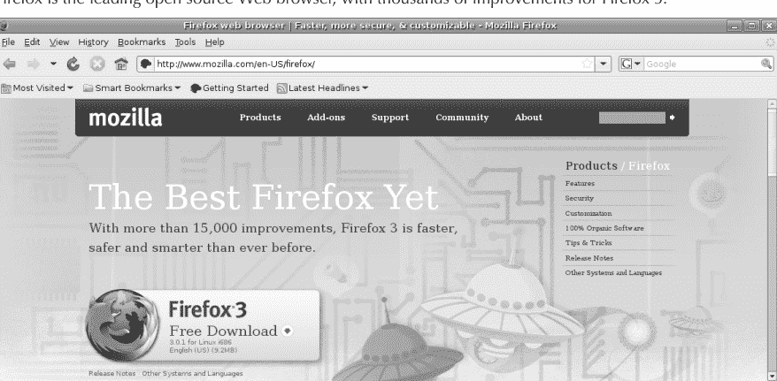

如果你已经使用 Firefox 一段时间，但对 Firefox 3 还不熟悉，那么有很多你可能会感兴趣的新功能。Firefox 3 内部使用了全新的 Gecko 1.9 Web 渲染平台，具有数千改进性能、渲染和稳定性的功能。你应该注意到颜色管理和字体方面的改进。

将你与 Firefox 3 多个新功能的一个改进是位置框。图 6-9 显示了几个位置示例，说明了处理你访问的银行网站的新方法。

# 图 6-9

从位置框进行验证并创建书签。

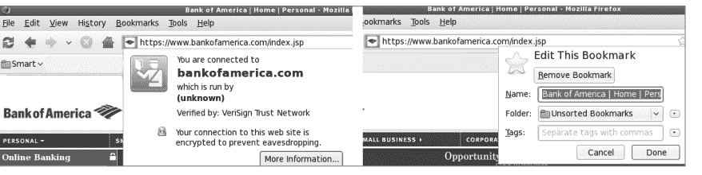

## 第二部分 运行 Linux 桌面

在图 6-9 中，左侧的示例显示了在访问安全站点时点击位置框左侧图标会发生什么。你可以看到 Veris 验证了站点的真实性并且通信经过了加密。右侧的示例显示，通过选择位置框右侧的星号，你可以处理页面的书签信息并修改该信息。位置框中可能其他图标包括各种安全警告，例如针对折叠或危险内容的警告。

Firefox 拥有你 Web 浏览器所需的所有基本功能，加上一些特殊功能。以下章节描述了如何充分利用你的 Firefox Web 浏览器。

如需从 Internet Explorer 迁移到 Firefox 的帮助，请访问 Firefox 网站 `www.mozilla.org/products/firefox/switch.html`。


## 设置 Firefox

有许多方法可以配置 Firefox 使其运行如飞。以下章节描述了在 Firefox 中自定义体验的某些方法。

# 设置 Firefox 偏好

你可以在偏好窗口中设置你的偏好（参见图 6-10）。要打开 Firefox 偏好，请选择编辑偏好。

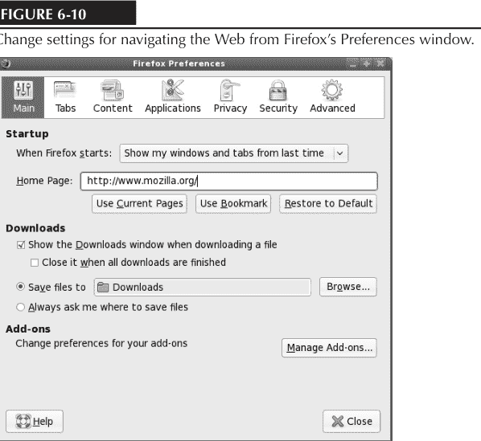

168

## 电子邮件与 Web 浏览


如果你是从 Mozilla 软件套或较早的 Firefox 版本升级，你会发现偏好窗口看起来完全不同。然而，不要绝望；浏览器偏好并没有很大变化。最新的 Firefox 有更简单的窗口布局。

以下是你可能想要更改的一些 Firefox 偏好：

- 主界面 — 选择启动 Firefox 时显示哪些页面。它还允许你选择如何处理下载和插件偏好。
- 标签 —这些选项控制 Firefox 如何使用标签，这是浏览器最实用的功能之一。
- 内容 — 设置偏好以控制 Firefox 应如何处理对不同类型 Web内容的请求。这些选项包括：
  - 弹出窗口 — 选择是否阻止弹出窗口。
  - Java 和 JavaScript — 你可以控制是否启用这些。
  - 图像 — 选择是否自动加载图像。（对于屏幕或低带宽网络连接有用）
  - 字体与 — 选择默认字体类型和大小，以及文本、背景、已访问链接和未访问链接的颜色。
  - 语言 — 对于可以多种语言显示的页面，这设置了你偏好的语言显示顺序。例如，你可以选择英语/美国、英语、法语和德语。Firefox 会尝试按这些语言显示你打开的 Web 页面，直到匹配。你可以在此标签页上设置其他高级功能。
- 应用 — 查看、搜索并更改用于显示浏览过程中可能遇到的不同内容的应用程序。
- 隐私 — 选择如何存储你在位置栏中输入的站点历史。（这些地址出现在 Firefox 侧边栏的记录标签页中。）设置偏好以控制 Firefox 如何处理隐私数据并允许网站获取你的信息。这些偏好包括：
  - Cookies — 你可以选择打开、移动、调整大小和提升窗口的 Web 内容。它可以更改你的图像、状态栏文本或存储在 cookies 中的信息。这些偏好限制了你的操作。
  - 私有数据 — 存储你的浏览和搜索历史、访问过的页面、cookies、密码和已验证会话可以简化你的浏览体验。然而，如果你在别人的机器上工作或由于不想留下浏览记录，你可以可以使用“立即清除”按钮清除这些信息。你也可以选择设置按钮，指示在选择“立即清除”时你想要清除的内容。

169

## 运行 Linux 桌面

**安全** — Firefox 3 中的安全标签页允许你选择在访问的站点是可疑的攻击站点或伪造站点时收到警告。你还可以选择在站点尝试安装插件时收到警告。此标签页上的其他设置允许你选择记住站点的密码。

**高级** — 高级标签页包含你可能不会用到的功能。从“常规”标签页，你可以设置代理连接。从“更新”标签页，你可以自动检查更新。在“加密”标签页，你可以管理 SSL 和 TLS 证书。从“隐私”标签页，你可以了解关于你的信息。

## 扩展与插件

扩展扩展了 Firefox 的功能。有许多扩展可以帮助你。插件是你添加到浏览器中的应用程序，用于播放特定类型的内容。通常这是是因为 Firefox 不包含你想要的功能，或者为了使用不同的应用程序来播放内容。

图 6-11 显示了插件的一个示例：

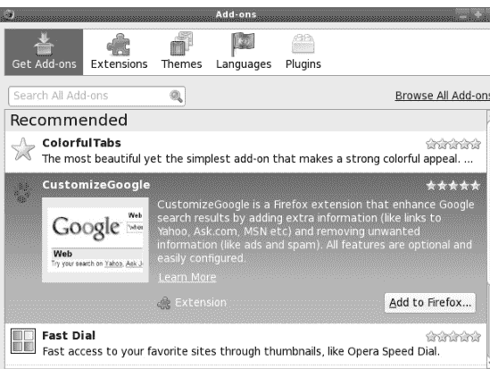

170

# Firefox 插件

任何插件适用于 Linux 版的 Firefox。要查看浏览器中已安装的插件列表，可以在通常输入 URL 的地址框中输入 `addons`。

访问 `//addons.mozilla.org/` 并选择 插件以查看并下载最流行的插件，并查看 `plugindoc.moz.dev/linux.html` 获取其他插件。一些最流行的插件包括：

- Adobe Reader 插件 (`www.adobe.com/support/downloads`) — 显示 Adobe  PDF（便携文档格式）文件，
- DJVlib 插件 (`djvu.sourceforge.net`) — 使用 DJVu 压缩技术显示图像。此插件来自 AT&T。
- Real Player (`www.real.com/linux`) — 播放 Real 音频和视频，Real Networks 和其开源 Helix 项目最近将 RealVideo 解码器提供给了 Linux 社区。

171

## 第二部分 运行 Linux 桌面

继续。

- **Adobe Flash 插件** (`www.adobe.com/downloads`)——Flash 是网页上最流行的视频播放器。某些 Linux 系统预装了开源版本的 Flash，但大多数人认为目前 Adobe 的版本运行效果更好。
- **CrossOver 插件** (`codewavers.com`) ——Linux 插件不支持一些更有趣且流行的插件，例如 QuickTime 电影、ShockwaveDirector 多媒体内容以及各种 Microsoft 电影文件和数据格式，这些无法在 Firefox 中原生播放。CodeWeavers 为基于 x86 处理器的 Wine 软件创建了 CrossOver 插件。虽然该插件已不再作为独立产品提供（你必须花费 39.95 美元购买整个 Crossover 产品），但 CrossOver 插件允许你播放某些在 Linux 中无法使用的内容（从 `www.codewavers.com/site/products/download_trial` 下载演示版并选择 CrossOver Linux）。

在安装 CrossOver 插件后，你将看到一个精美的插件设置界面，它允许你为 QuickTime、Windows Media Player、Shockwave、Flash、iTunes 和 Lotus Notes 安装插件，以及 Microsoft Word、Excel 和 Powerpoint 查看器。（在你阅读这些内容时，可能已经支持这些内容格式的后续版本。）你还可以安装其他多媒体插件，以及用于这些插件的各种字体。

## 更改 Firefox 主题

有多个示例可以更改 Firefox 的外观和感受。从 Firefox 附加组件网站 (`http://addons.mozilla.org`) 选择“主题”。当你下载一个 Firefox 主题时，它会识别出这是一个 Firefox 主题，并在下载时提供通过点击“使用”按钮来安装该主题的选项。

如果以后想更改主题或获取更多主题，请选择“工具” -> “附加组件”，并选择“主题”选项卡。安装新主题后，你需要重启 Firefox 以使新主题生效。

## 保护 Firefox

安全是切换到 Firefox 的主要理由之一。通过禁止在 Firefox 中播放最不安全的内容类型，并在显示潜在危险或烦人的内容之前发出警告，Firefox 已成为注重安全人士的首选浏览器。以下是 Firefox 帮助你的浏览更安全的某些方法。

- **ActiveX** —— 由于在 ActiveX 中发现了严重的安全漏洞，Firefox 不播放 ActiveX 内容。尽管有项目尝试在 Mozilla 中提供 ActiveX 支持，但这些项目中没有正在开发中的。
- **弹出窗口** —— 当你使用 Firefox 浏览时出现你不想要的弹出窗口，消息（默认情况下）会提示：“Firefox 阻止了此网站打开弹出窗口”。通过点击该消息，你有机会允许该网站的所有弹出窗口、仅允许请求的弹出窗口或编辑你的弹出窗口设置。
- **隐私偏好** —— 在 Firefox 的“隐私”窗口中（选择“编辑首选项”，然后点击“隐私”按钮），你可以一键清除浏览器中存储的私有信息。如果你刚刚用不属于你的电脑浏览网页，这个功能特别好用。你可以选择单独清除历史记录、你可能填写过的表单保存的信息、浏览器保存的任何密码、下载历史、Cookie 和缓存文件。作为替代方案，你可以点击“立即清除”一次性清除 Firefox 的所有信息。
- **网页伪造** —— 最新版本的 Firefox 通过在当你遇到被举报为伪造的页面时显示“怀疑为网页伪造”的弹出窗口消息来帮助你阻止此类网站。你可以选择不显示该页面或忽略警告。如果你怀疑某个未显示该消息的页面是伪造的，选择“帮助” -> “报告网页伪造”，尝试将该页面添加到 Google 网页伪造列表中。

## 改进 Firefox 浏览

并不是你用 Firefox 访问的每个网站都能完美运行。有些网站并不遵循标准——使用不佳的字体、难以阅读的颜色，或者要求你使用特定类型的浏览器来查看其内容。为了改善你的浏览体验，你可以为 Firefox 添加一些功能项。

> 如果你在使用 Firefox 时遇到无法解决的问题，我建议你查阅 Mozilla 数据库 (`www.mozilla.org/bugs/`)。该网站是搜索他人发现的 bug 的绝佳场所（许多你可以通过变通方法解决）或提交 bug 报告的好地方。

你是否曾经进入过需要使用特定类型或版本的浏览器，或者颜色导致页面无法使用的网页？Firefox 偏好设置工具栏 PrefBar 允许你伪骗网站让它们认为你正在运行不同的浏览器。它还允许你选择设置来改进难以阅读页面的颜色、字体等。

你可以从 Mozdev.org 网站 (`http://prefbar.mozdev.org`) 安装这个精美的工具栏。点击“安装”，并在 Firefox 重启后。

默认工具栏集为你提供以下功能：

- **颜色 (Colors)** 在默认颜色和网页设置的颜色之间进行切换。
- **图像 (Images)** 在你显示的页面上开启加载或不加载图像的切换。
- **JavaScript** 允许或禁止在 Firefox 中运行 JavaScript 内容。
- **Flash** 允许或拒绝当前页面上所有的嵌入 Flash 内容。
- **清除缓存 (Clear Cache)** 从内存和磁盘中删除所有缓存内容。
- **保存页面 (Save Page)** 将当前页面（可选地包括其图像和其他内容）保存到你的硬盘。
- **真实 UA (Real UA)** 选择你的浏览器如何识别身份（Firefox 当前版本）或以下任何一种：Mozilla 1.0（在 Windows 98 中）、Netscape Navigator 4.7（在 Macintosh 中）、Netscape 6.2（在 Linux 中）、Internet Explorer 5.0（在 Macintosh 中）、Internet Explorer 6.0（在 Windows XP 中）或 Lynx（一种基于文本的 浏览器）。

## 运行 Linux 桌面

当你处理需要 Internet Explorer (IE) 的网站（通常是 Windows 或 Mac OS 上的 IE）时，用户代理 (UA) 设置非常有用。IE 6.0 WinXP 设置足以让 Firefox 登录 Microsoft Exchange 网页邮件服务，该服务通常需要 IE。如果你想在一个以 Windows 为主的的组织中运行 Linux，请安装“偏好设置”工具栏。

点击“自定义”按钮向工具栏添加其他按钮。你可以添加按钮来清除历史记录或位置记录。你甚至可以添加“弹出窗口”按钮来防止页面从 Firefox 中打开弹出窗口。

许多功能会立即生效。其他功能可能需要你重启 Firefox。

## 使用 Firefox 玩出花样

Firefox 内置了一些精妙的功能，可以让你的浏览更加愉快。接下来的章节将探索这些功能中的。

## 阻塞弹出窗口

你可以使用 Firefox 偏好窗口来阻止烦人的弹出窗口。方法如下：

1. 点击“偏好”。出现“偏好”窗口。
2. 点击“内容”类别下的“阻止弹出窗口”。

通过阻塞所有弹出窗口，你可能会导致某些网站无法正常工作。点击“例外”按钮允许在你选择的某些网站显示弹出窗口。

## 使用标签页浏览

如果你在多个网页之间来回切换，可以使用标签页浏览功能同时在浏览器窗口中保留多个页面。你可以通过选择“文件”或按下 `Ctrl+T` 打开新标签页进行浏览。你可以通过右键点击链接并选择“在新标签页中打开链接”，将任何链接在新的标签页中打开。

你还可以从网页或位置框自定义标签页浏览的工作方式。方法如下：

1. 点击“偏好”。出现“偏好”窗口。
2. 点击“标签页”选项卡。
3. 点击你所需的标签页相关选项。

Firefox 面板顶部会出现每个标签页的标签。要关闭标签页、创建新标签页、书签一组标签页或重新加载标签页，请右键点击其中一个标签并从下拉菜单中选择你想要的功能。

在标签页中打开链接最简单的方法之一是在 HTML 页面上的链接上右键点击。选择“在新标签页中打开链接”选项。

## 调整网页文本大小

有一个方便的快捷键可以让你快速调整 Firefox 中网页文本的大小。按住 `Ctrl` 键并按下加 (+) 或减 (-) 键。在大多数情况下，网页上的文本会变大或变小。让字体极小的页面突然变得可读。

使用 Firefox 可以做的事情比本章涵盖的要多。如果你对 Firefox 功能有疑问，或者只想挖掘一些关于 Firefox 的酷东西，我建议查看 Firefox 的 Mozilla 论坛：

```
```


http://forums.mozilla.org/viewforum.php?f=38

该页面有一个指向“杂 Firefox 技巧”的固定链接和一个很好的常见问题解答。

## 使用基于文本的浏览器

如果你成为 Linux 管理员或高级用户，你将不可避免地发现自己正在通过远程登录工作，或者没有可用的桌面 GUI。在这种状态下，你会想要检查 HTML 文件或使用浏览器。为了解决这个问题，Linux 发行版包含了几个基于文本的浏览器。

通过文本浏览器，来自 Web、本地文件系统或远程登录计算机的任何 HTML 文件都可以从你的 shell 中访问。如果你想查看网页内容，无需使用 GUI 或阅读 HTML 标记页面。这还允许你调出网页、在其中移动并跟随链接到其他页面，而浏览器直接在终端中显示图形！

# 第 7 章
# 在 Linux 上游戏

现在所有类型的 PC 游戏都可以在 Linux 上运行。无论你是在寻找一个消时间的单机游戏，还是一个完整的在线 3D 游戏体验，你在 Linux 桌面面上都有几十（甚至数百）种选择。

## 本章内容

- 在 Linux 中游戏
- 玩开源游戏
- 运行商业 Linux 游戏

尽管像 ID Software（Quake）和 Epic Games（Unreal Tournament）等某些公司已经致力于将其游戏移植到 Linux，但另一些公司则使用了第三方开发者（如 RuneSoft）将商业游戏移植到 Linux。独立游戏开发者，例如 Fractional Games（http://fractionalgames.com），现在正在 Linux 上制作高质量的游戏体验。商业在线游戏的 Linux 客户端，例如 EVE Online（www.eve-online.com），也已供大家可用：

### 在 Linux 中运行 Windows 游戏

本章概述了当前 Linux 游戏的现状。它描述了专门为在 Linux 上运行而创建的手游戏，并解释了如何找到可以在 Linux 上运行的商业游戏（无论是具有 Linux 版本，还是通过 Windows 兼容性软件如 Cedex 运行 Windows 版本）。

## 开启 Linux 游戏

如果你有一个正在运行的 Linux 系统并想立即开始游戏，这里有一些建议：

- 检查“游戏”菜单 —— 大多数 Linux 桌面系统都预装了一些游戏。如果你在 Linux 中运行 GNOME 或 KDE 桌面，请从面板中选择“应用程序”下的“游戏”。你可以选择各种街机、卡牌、棋盘、战术和其他游戏，让你忙碌一阵子。（KDE 和 GNOME 游戏将在本章后文中介绍。）
- 为你的 Linux 发行版打包的游戏 —— 许多热门的开源游戏已打包供你的 Linux 发行版运行。在 Fedora 中，打开“添加/删除软件 (PackageKit)”窗口并选择“游戏”，即可获取包含 200 多多个可以下载和玩的游戏列表。在 Ubuntu 中，“添加/删除应用程序”窗口的“游戏”菜单显示了超过 300 游戏供下载和玩。
- 其他源码游戏 —— 如果你想要的开源游戏没有针对你的发行版打包，可以尝试获取该游戏的项目来获取游戏。有一些网站包含游戏列表以及指向每个游戏的链接。Wikipedia 的 Linux 游戏页面（en.wikipedia.org/wiki/linux_gaming）和 The Linux Game Home（http://happypenguin.org/）是很好的去处。
- 商业游戏 —— 最新的商业游戏并非全部都移植到 Linux 运行。Linux 盒商业游戏包括 Unreal Tournament 2003 和 2004，以及约 50 款已移植到 Linux 运行的顶级商业游戏。使用来自 Transgaming.com 的 Cedex 软件，你可以运行数百种商业游戏。要查看你想要的游戏是否已验证可以在 Cedex 中运行，请访问 Transgaming.Org 游戏数据库（http://transgaming.org/gamesdb）。商业 Linux 游戏将在本章详细介绍。

在玩某些要求较高的 3D 游戏之前，你需要检查你的硬件是否能处理这些游戏。某些需要 3D 硬件加速的游戏需要更多的 RAM、更快的处理器以及特定的显卡在 Linux 中运行。在 Linux 中设置游戏机的问题将在本章后面介绍。

以下是 Fedora 以及许多其他 Linux 发行版中可供尝试的游戏列表。我按照从简单到复杂且上瘾的顺序列出了它们：

- Frozen Bubble (www.frozen-bubble.org) —— Frozen Bubble 游戏经常被提到为最上瘾的 Linux 游戏。当泡泡向下移动时，射出冰冻泡泡和彩色泡组。消除三个或更多相同的泡泡直到它们全部消失（或掉下来并冻住你）。该游戏可以多人一起玩。（安装 `frozen-bubble` 包并从游戏菜单选择它。）
- Gweled (http://sebdelestaining.free.fr/gweled) —— 在这个 Bejewled 游戏的克隆中，在板上交换两个宝石三次或以上（垂直或水平）。（安装 `Gweled` 包并从游戏菜单选择 `Gweled`。）
- Warzone 2100 (www.warzone2100.strategyplanet.gamespy.com) —— 这款 1999 年的即时战略游戏于 2004 年开源发布。建立一个基地，你可以在那里设计和建造车辆与武器，建立结构并研究技术以进行一场全球战争。（安装 `warzone2100` 包并从游戏菜单选择 `Warzone2100`。）
- Quake III Arena (ftp.idsoftware.com/idstuff/) —— Quake 系列中的几款第一人称射击游戏可以从 id Software 下载。在 Fedora 中，安装 `quake` 包并选择 `Quake III Arena`。启动应用程序后，你会下载 Quake III 的演示版本。阅读并接受许可条款以下载数据文件并开始玩 Quake III Arena。
- Vega Strike (http://vegrike.sourceforge.net) —— 在这款 3D 动作太空模拟游戏中探索宇宙。接受运输货物的任务、成为赏金猎人或在太空巡逻。在这个 3D 环境中，你可以与调酒师聊天或观看新闻直播以关注宇宙中的事件。（要在 Fedora 中玩此游戏，请安装 `vegasrike` 包并从游戏菜单选择 `Vega Strike`。）

图 7-1 显示了这些游戏的小截图。

| Frozen Bubble | Gweled | Warzone 2100 | Quake III Arena | Vega Strike |
| :--- | :--- | :--- | :--- | :--- |
| (image) | (image) | (image) | (image) | (image) |

## 运行 Linux 桌面

- 游戏服务器
- Linux 开发

## 基础 Linux 游戏信息

许多网站提供可用 Linux 的游戏信息以及下载链接。以下是入门网站列表：

- **TransGaming Technologies** (`www.transgaming.com`) —— 该公司的使命是将其他平台的游戏带到 Linux。它是 Cedex 的提供者，即著名的 Wine，一个强大的工具，允许你在 Linux 系统上运行数百种游戏。
- **The Linux Game Time** (`http://happypenguin.org/`) —— 拥有大量在 Linux 上运行的游戏描述和评论数据库。你可以对该网站列表的游戏进行关键词搜索。也有获取这些游戏的地方。
- **Linuxgames.com** (`http://linuxgames.com`) —— 该网站可以让你对 Linux 游戏现状有很好的了解。这里有指向 HOWTO 和常见问题 (FAQ) 的链接，以及讨论 Linux 游戏的论坛。
- **id Software** (`www.id.com`) —— 访问 id Software 网站获取 Quake 和 Return to Castle Wolfenstein Linux 版本的信息。
- **Linuxgamepublishing.com** (`www.linuxgamepublishing.com`) —— Linuxgame-publishing.com 旨在成为 Linux 游戏的购物门户以及其他平台游戏的移植平台。写作期间，它提供了大约十种游戏。要从该网站购买游戏，你需要创建一个用户账户。

## 在 Linux 上玩游戏

- Loki Entertainment Software (`www.lokigames.com`) — Loki 曾提供过畅销游戏产品，但于 2001 年破产了。其产品包括《文明：权力崛起》、《神话之二：灵魂掠夺者》、《模拟城市 3000》、《铁路大亨 II》以及《雷云战士 III竞技场》。演示启动器（Demo Launcher）仍然可用，可以查看这些游戏的某些版本，有些盒装版以低廉价格出售。Loki 网站还列出了所有游戏的商业零售商列表，这些零售商可能经营或不代理这些游戏。
- Tux Games (`www.tuxgames.com`) — Tux Games 网站专门销售 Linux 游戏。除了提供 Linux 游戏和新闻外，网站还列出了其畅销游戏，并包含了即将发布的游戏公告。
- 维基百科 (`http://en.wikipedia.org/`) — 多年来，维基百科已成为 Linux 商业和开源游戏信息的绝佳资源。从维基百科游戏列表（`http://en.wikipedia.org/wiki/Linux_games`），你可以找到免费游戏、商业 Linux 游戏以及专业开发的 Linux 游戏的链接。
- Linux 游戏 FAQ (`http://icculus.org/lgfaq`) — 包含了大量关于免费和商业 Linux 游戏的信息。它列出了已移植到 Linux 的游戏，告诉哪里可以获取这些游戏，并解答与 Linux 游戏问题相关的查询。关于额外信息的 Linux 游戏列表，请参见 `http://icculus.org/lgfaq/gamelist.php`。

上述网站提供了关于 Linux 游戏的优秀信息，但还没有开源游戏是专门为每一个版本的 Linux 进行打包的。尽管你总是可以将其调整到你特定的发行版中，但最简单的方法可能是从现成运行的游戏开始。以下列表提供了有关在哪里找到针对不同 Linux 发行版打包的游戏的信息：

- Fedora — 近期 Fedora 游戏数量的增加来自 Fedora Games SIG（特殊兴趣小组）。你可以查看 SIG 的活动，以获取其他尚未进入 Fedora 的感兴趣游戏信息：`http://fedoraproject.org/wiki/SIGGames`
- Debian — 游戏资源位于 Debian wiki 上。访问 `http://wiki.debian.org/Game` 中的游戏部分。
- Ubuntu — Ubuntu 社区文档页面提供了有关可用游戏和与 Ubuntu 相关的游戏倡议的良好信息 (`http://help.ubuntu.com/community/`)。
- Gentoo — 访问 `http://gentoo-wiki.com/Games` 中的 Gentoo 游戏列表，选择在 Gentoo 中运行的感兴趣的游戏。
- Slackware — 虽然 GNOME 和 KDE 在 Slackware 中免费运行，但并没有很多资源是针对 Slackware 的。然而，因为 Slackware 包含了大量的库和开发工具，如果你愿意获取所需游戏的源代码并自行构建，许多开源游戏将在 Slackware 中编译并运行。

## 为 Linux 选择游戏硬件

通常情况下，玩游戏需要的比运行 Linux 应用程序更多的内存、更强的处理器以及更多的磁盘空间。一些要求最高的 PC 游戏在至少 1GB 内存和 1GHz 处理器下运行效果最好。然而，显卡通常是最重要的硬件。

由于 3D 游戏对你的视频硬件有极高要求，选择良好的显卡并进行正确配置是确保良好游戏体验的关键。对于高级游戏，你需要超越旧 64 位显卡所能为你提供的范围。

## 仅二进制的显卡驱动

大多数 Linux 玩家拥有 NVIDIA 或 ATI 显卡，因此这是开始严肃 Linux 游戏的捷径。虽然大多数 NVIDIA 和 ATI 显卡都有开源驱动，但那些不支持硬件加速。虽然对于大多数桌面应用程序来说这没问题，但如果你想从以下位置获取这些显卡的仅二进制驱动：

- **NVIDIA** — 要获取在 Linux 中运行的 NVIDIA 驱动，请访问驱动门户页面 (`www.nvidia.com/object/unix/html`)。
- **ATI** — 要寻找 ATI 显卡的 Linux 驱动，请访问 `http://support.ati.com/` 上描述 Linux 驱动的 ATI 支持知识库页面并点击数据库选项卡。

当你去获取仅二进制显卡驱动时，请确保你不仅知道正在使用的显卡，还知道 X server 的名称和版本。（FreeX 曾是最流行的服务器，但 Linux 发行版现在使用 X.Org。）寻找视频驱动可能取决于你运行的 Linux 内核。因此，知道如果你升级内核，可能也需要重新安装显卡驱动。

> 注意：rpm.nova 网站极大地简化了 Fedora 安装 ATI 和 NVIDIA 驱动的过程。参考 Linux Switcher 页面 (`http://rpm.linux.org/`) 学习如何安装包含你所使用的 ATI 或 NVIDIA 驱动的 RPM 包。

> 警告：如果你使用仅二进制驱动，它被称为“内核”。因此，如果你遇到问题，将无法获得支持（至少从内核方面），因为缺乏源代码，很难调试与驱动相关的问题。此外，仅二进制驱动因会引起模糊的问题而闻名，因为它们会与内核代码的变化不同步。同样，某些 Linux 系统的仅二进制驱动更新频率不如内核。虽然包括我在内的许多人在特殊情况下会使用仅二进制驱动，但它们确实有你应当意识到的不可言喻的缺点。

## 开源显卡驱动

如果你想使用开源驱动进行 3D 加速游戏，无论你是否原生使用 OpenGL，请寻找支持它的卡。关于 DRI 的信息可以在 `http://www.freedesktop.org/` 找到。

- **ATI** — 关于 DRI 的信息可以在 `http://www.freedesktop.org/` 找到。
- **Intel** — 关于 DRI 的信息可以在 `http://www.freedesktop.org/` 找到。
- **Matrox** — 关于 DRI 的信息可以在 `http://www.freedesktop.org/` 找到。
- **NVIDIA** — 关于 DRI 的信息可以在 `http://www.freedesktop.org/` 找到。
- **Radeon** — 关于 DRI 的信息可以在 `http://www.freedesktop.org/` 找到。
- **Voodoo** — 关于 DRI 的信息可以在 `http://www.freedesktop.org/` 找到。

如果你想使用开源驱动进行 3D 加速游戏，无论你是否原生使用 OpenGL，请寻找支持它的卡。关于 DRI 信息可以在 `http://www.freedesktop.org/` 找到。

- **S3 Graphics** — 要查找 DRI 是否在当前显卡上工作，请输入

```
$ glxinfo | grep rendering
```

- **S3 Graphics** — 关于 DRI 信息可以在 `http://www.freedesktop.org/` 找到。


直接渲染：是

如果你想使用开源驱动进行 3D 加速游戏，无论你是否原生使用 OpenGL，请寻找支持它的卡。关于 DRI 信息可以在 http://www.freedesktop.org/ 找到。

# 第二部分：运行 Linux 桌面

## GNOME 游戏

GNOME 附带了十多种基础游戏。如果你只是想找个游戏来打发时间，某个 GNOME 游戏可能运行得很好。GNOME 游戏由一些老纸牌游戏和许多看起来你在 Windows 上看到的游戏组成。如果你害怕离开 Windows 后失去娱乐（如纸牌游戏、接接龙和扫雷），请不要担心。你可以在 GNOME 游戏下找到更多。

| 游戏 | 描述 |
|---|---|
| AisleRiot Solitaire | 你可以从 28 种不同的纸牌游戏中选择。 |
| Blackjack | 纸牌游戏，你尝试比庄家更接近 21（但不超过）。 |
| Chess | 可以以 2D 或 3D 模式与电脑对的国际象棋。 |
| Five or More | 彩线游戏 (glines) 的克隆。 |
| Four-In-A-Row | 掉球以赢得连线游戏。 |
| FreeCell Solitaire | 一种流行的接接龙纸牌游戏。 |
| GnomeFallingBlocks / Gometri | GNOME 俄罗斯俄罗斯游戏。 |
| lagno | 磁盘翻转游戏，类似于 revers。 |
| Kloski | 移动碎片以让一个碎片逃脱。 |
| Mahjongg | 经典的亚洲牌类游戏。 |
| Nibbles | 在屏幕上控制蠕虫移动避开墙壁。 |
| Mines | 扫雷。点击安全区域并避开炸弹。 |
| Robots | Gnobots 的后期版本，包含可移动的块。 |
| Same GNOME | 消除球群获得高分。 |
| Sodoku (Sudoku) | 一种日本逻辑谜题，用数字代替单词填充。 |
| Tali | Yahtzee 克隆。掷骰子填充类别。 |
| Tetrave | GNOME 项目中 Tetrave 的克隆。移动块使每边的数字对齐。 |

Ubuntu、Fedora 和其他 Linux 系统的默认安装包含了 `gnome-games` 软件包。表 7 列出了 `gnome-games` 软件包包含的游戏。请访问 GNOME 网站 https://live.gnome.org/GNOMEGames/ 了解更多详情。

## KDE 游戏

KDE 桌面环境提供了许多游戏。（在 Fedora、Ubuntu 以及其他包含 KDE 的 Linux 版本中，这些游戏包含在 `kdegames` 软件包中。）表 7-2 列出了 KDE 游戏的列表。你的 Linux 发行版可能包含一组不同的游戏。

表 7-2 用于 KDE 桌面的游戏
| 游戏 | 描述 |
|---|---|
| 街机游戏 | |
| KAsteroids | 在经典街机游戏中摧毁小行星。 |
| KBounce | 添加墙壁以阻挡弹跳球。 |
| KFoul Eggs | 在这款类俄罗斯块的游戏中挤压鸡蛋。 |
| Klickety | 在这款 Clickomania 的改编版中，点击颜色分组来擦除方块。 |
| Kolf | 玩一轮虚拟高尔夫。 |
| KSirtet | 俄罗斯块克隆版。尝试在方块掉落时填满整行。 |
| KSmileTris | 带有笑脸的俄罗斯块。 |
| SnakeRace | 在迷宫中让你的蛇赛跑。 |
| KSpaceDual | 在环绕行星旋转时向另一艘飞船射击。 |
| 桌游游戏 | |
| Atlantik | 与网络上的其他玩家玩这款类似大富翁的游戏。 |
| KBackgammon | 在线双陆棋。 |
| KBlackBox | 通过发射射线寻找隐藏的球。 |
| Kenolaba | 移动棋子将对手的棋子推出桌面。 |
| Jong | 经典的东方牌类游戏。 |
| KReversi | 翻转棋子以胜过对手。 |
| Shisen-Sho | 类似于麻将的棋子游戏。 |
| Kwin4 | 掉落彩色碎片以获得四连线。 |
| 牌游戏 | |
| KPoker | 视频扑克克隆版。玩五张抽牌，选择保留哪些牌和丢弃哪些牌。 |
| Lieutenant Skat | 玩纸牌游戏 Skat。 |
| Patience | 从九种不同的单人牌游戏中选择。 |

| 表 7-2（续表） |
| 游戏 | 描述 |
| --- | --- |
| 战术与策略 | |
| KAtomic | 移动棋子以创建不同的化学化合物。 |
| Goldrunner | 策略谜题游戏。 |
| Kjumping Cube | 点击方格增加数字并占据相邻方格。 |
| Mineseper | 点击安全区域并避开炸弹。 |
| Color Lines | 移动玻璃球形成五连线并得分。 |
| Konquest | 在这游戏多人游戏中扩张你的星际帝国。 |
| Potato Guy | 构建你自己的土豆人脸。 |
| SameGame | 擦除游戏棋子来得分。 |

KDE 菜单上的游戏从有趣到极具挑战性不等。如果你习惯在 Windows 中玩游戏，KMines 和 Patience 看起来会像老朋友。KAsteroids 和 KPoker 适合无脑游戏类别。如果想让大脑放松一下（它比看起来的要难），可以尝试一下 KSkokoban。

## Fedora 中的游戏

Fedora 提供了丰富的游戏集，这得益于一个非常活跃的游戏特别兴趣小组（http://fedoraproject.org/wiki/SIGs/Games）。表 7-3 列出了 Fedora 仓库中包含的一些游戏。

| 表 7-3 |
| Fedora 的游戏 |
| 游戏 | 描述 |
| --- | --- |
| Beneath a Steel Sky (`beneath-a-steel-sky`) | 20 世纪 90 年代流行的商业科幻冒险游戏，设定在一个令人感的未来城市中。 |
| BSD Games (`games`) | 追溯到 20 世纪 70 年代早期 UNIX 系统的文本纸牌游戏和冒险游戏。 |
| BFlag (`bzflag`) | 3D 多人战斗游戏。 |
| Celestia (`celestia`) | OpenGL 实时空间模拟。（在“其他”菜单下可用。） |

## 在 Linux 上玩游戏

| 游戏 | 描述 |
|---|---|
| Flight Gear (`FlightGear`) | 飞行模拟器游戏。 |
| FooBilliard (`foobilliard`) | OpenGL 台球游戏。 |
| Freeciv (`freeciv`) | Freeciv 多人策略游戏。 |
| Freedom (`freedoom`) | Doom 游戏引擎的数据文件。（配合 `prboom` 软件包使用，它提供了 Doom 引擎的开源移植。） |
| Freedroid (`freedroid`) | C64 游戏 Paradox 的克隆版。 |
| Freedroid RPG (`freedroidpg`) | Tux 为英雄的 Freedroid 主题角色扮演。 |
| GL-117 (`gl-117`) | 动作飞行器。 |
| Chess (`gnuchess`) | GNU 象棋程序。配合 `socalled` 软件包使用以提供图形化象棋游戏。 |
| Lacingwing (`lacewing`) | 操作不同类型飞船的小行星游戏。 |
| Lincity (`lincity-ng`) | 构建模拟城市。 |
| LMarbles (`lmables`) | Atomix 克隆版，你用玻璃球创建图形。 |
| Maelstrom (`Maelstrom`) | 空间战斗游戏。 |
| Nexuiz (`nexuis`) | 以死亡赛为向的第一人称射击（多人）。 |
| Overgod | 另一个类小行星的游戏。 |
| Powermanga (`powermanga`) | 街机 2D 射击游戏。 |
| PPRacer (`ppracer`) | 以 Tux 为主角的 3D 赛车游戏。 |
| Rogue (`rogue`) | 经典冒险游戏的图形版。 |
| Scorched Earth (`scorched3d`) | 基于 Scorched Earth 的游戏。 |
| Sirius (`sirius`) | 项目：Sirius。 |
| Starfighter (`starfighter`) | 空间街机游戏。 |

| 表 7-3（续表） |
| 游戏 | 描述 |
| --- | --- |
| SuperTux (`supertux`) | 类似于玛丽。 |
| TORCS (`torcs`) | TORCS。 |
| Vega Strike (`vegastrike`) | Vega Strike。 |
| Virus Killer (`viruskiller`) | Virus Killer。 |
| Worminator (`worminator`) | Worminator。 |
| Chess (`xboard`) | xboard。 |
| Xilot-ng (`xilot-ng`) | Xilot-ng。 |

下章节描述了两个最有趣的游戏：Freeciv 和 Extreme Racer。

Freeciv 是《文明》的克隆版。通过 Freeciv，你可以创建一个文明。

> NOTE
Freeciv 包含了客户端（玩）和服务器（连接）。如果你的发行版没有提供 Freeciv，请检查 www.freeciv.org。

你可以从终端启动 Freeciv：

```
$ civ &
```


> NOTE
Freeciv 无法启动，你可能是以 root 身份登录的。

你可以自己玩几次游戏，在加入网络之前了解游戏。按照以下步骤开始你的第一个 Freeciv 游戏：

1. 开始新游戏。（启动客户端的同时，此操作还会启动服务器，允许其他人连接到你的游戏。）会被要求选择人数、技能水平和其他游戏选项。
2. 选择 2 与电脑玩，或选择更高的数字；然后点击开始。

在玩之前检查 Freeciv 窗口：

- 点击帮助按钮获取对你有帮助的各种主题信息。（你可以在 Freeciv 网站找到更多）。
- 世界（默认）为 80x50 方格，每次显示 11x8 方格。
- 活跃方格包含活跃单元（与地形交替闪烁）。
- 某些方格包含特殊资源。按住鼠标中间键查看该方格包含的特殊资源信息。（对于双键鼠标，按住 Ctrl 键并点击右键。）尝试几次以熟悉周围的环境。此操作还会识别地形上的任何单元，以及该单元的统计数据。

## 图 7-2

选择一个国家开始 Freeciv。

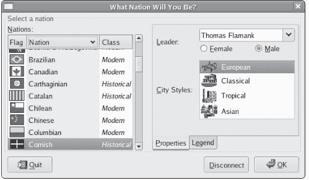

## 运行 Linux 桌面

要查看 11 × 8 区域之外的世界，请点击地图外部的滚动条。起初，你尚未探索的世界部分将是黑色。随着单位的增加，靠近这些单位的区域将可见。（按 `C` 键返回地图的活动部分。）

概览地图位于 Freeciv 窗口的左上角。随着世界变得日益文明，这是一个了解全局情况的好方法。右键点击概览地图上的某一点可以使你的视口对齐该位置。

菜单栏包含你可以玩游戏的按钮。**游戏 (Game)** 菜单允许你更改设置和选项、查看播放速率、查看消息并清除日志。**王国 (Kingdom)** 菜单允许你更改税率、寻找城市并引发革命。**视图 (View)** 菜单允许你在地图上放置网格或将视图居中。**指令 (Orders)** 菜单允许你选择要建造的物品和采取的行动。**报告 (Reports)** 菜单允许你显示与城市、军事、贸易和科学相关的报告，以及其他特殊报告。

概览地图下方显示你文明的经济摘要。信息包括人口、当前年份和国库中的资金。

概览信息下方的十个图标代表了资金在奢侈品（维护者）、科学（研究人员）和税收（收税员）之间的分配情况。从本质上，这些图标代表了你的资源中有多少被用于改进社区的这些属性之一。

当你完成一个回合的移动后，点击**完成 (Done)**。旁边有一个灯泡，指示你研究的进度（每回合都会增加）。太阳最初是晴朗的，但会因污染而变亮，以警告可能发生的全球变暖。政府系统显示你开始时是一个专制政府。最后一个图标告诉你回合剩余多少时间。

**单位 (Unit)** 框显示关于你当前单位的信息。你开始时有两个殖民者（马车单位）和一个探险家（人形图标）。点击殖民者、探险家、城市或其他单位来使用它或了解其信息。

# 建立你的文明

开始建立你的文明。Freeciv 手册提供了以下建议：

- 要更改资金分配，请选择**政府 (Government) ❖ 税率 (Tax Rates)**。移动滑块重新分配分配给奢侈品、科学和税收的资产百分比。尝试开始时增加科学并减少税收。
- 将当前单位更改为殖民者：点击地图上的单位堆，并在出现的菜单中点击其中一个殖民者。
- 点击**指令 (Orders) ❖ 建造 (Build)** 开始建造城市。在提示时，为城市输入名称并点击确定。出现的窗口将显示有关该城市的信息。它开始时有一个快乐的公民，由单个图标表示（随着游戏的进行，将出现更多公民）。

# 在 Linux 上玩游戏

- **食物 (Food)**、**产出 (Prod)** 和**贸易 (Trade)** 行反映了城市的原始生产力统计数据。第一个数字显示产量；第二个数字（括号内）显示超过支持单位所需所需的盈余量。**黄金 (Gold)**、**奢侈品 (Luxury)** 和**科学 (Science)** 行指示城市的贸易产出。**粮仓 (Granaries)** 显示存储了多少食物以及粮仓的大小。污染水平从零开始。
- 点击**关闭 (Close)** 关闭城市窗口。

# 探索你的世界

开始，移动殖民者和探险家：

- 1. 使用数字小键盘，按三次 `G` 键开始探索。你每回合可以移动探险家三次。你开始看到更多世界的内容。
- 2. 当下一个单位（殖民者）开始闪烁时，将其向另一个方向移动一个方格。当你完成了所有想要执行（或游戏允许的所有）的操作后，**回合完成 (Turn Done)** 会高亮。点击**回合完成**开始下一个回合。城市信息将更新。（变化和增长仅仅通过回合反映的时间流逝来实现。）
- 3. 点击城市查看城市窗口。注意城市信息已更新。当你看到食物储存增加时，点击**关闭 (Close)** 城市窗口。
- 4. 继续探索并修建道路。随着探险家的发展，使用数字小键盘将其移动到其他区域。当殖民者开始闪烁时，按 `R` 建造道路。屏幕上会出现一个小小的 `R`，提醒你殖民者正在筑路。点击**回合完成**。

# 使用更多控制和操作

现在你已经对控制和操作有了一些了解，游戏可以向许多不同的方向发展。以下是一些可能发生以及你可以采取的操作：

- 在你完成一个回合后，电脑将开始执行。在执行过程中，它的行动会向你报告。你可以对这些行动做出决策。选择**游戏 (Game) ❖ 选项 (Options)**。**消息选项 (Message Options)** 窗口将会出现，包含来自服务器并呈现给你的各种消息列表。

## 运行 Linux 桌面

**Linux游戏**（id Software 及其他公司）——某些游戏有 Linux 版本可用。最值得注意的是，id Software 提供了 Linux 版本的《毁灭战士》（Doom）和《重返沃尔狼石堡垒》（Return to Castle Wolfenstein）。其他在 Linux 中原生运行的游戏还包括 Atari（www.unrealtournament.com）的《变形竞技场 2004》和《2005》。

通常在不使用 WINE、Cedega 或某种 Windows 仿真器的情况下在 Linux 上运行的商业游戏，通常是带有某种 Linux 安装程序的 Windows 编译版本。

**独立游戏开发者**——目前有几家小公司正在制作游戏。著名的游戏开发者包括 Introversion Software（introversion.co.uk）和 Fictional Games（www.fictionalgames.com）。Introversion 的游戏包括《链路》（Uplink）、《达尔文主义》（Darwinia）和《Defon》。当你看到这里时，Multivia 应该已经可用了。Fictional Games的游戏包括《幽影：序曲》（Penumbra: Overture）和《幽影：黑色》（Penumbra: Black），两者都描绘了 3D 恐怖故事。

已倒产的 Loki Software, Inc. 直接移植到 Linux 的游戏仍然可用。虽然你不能直接从 Loki 购买这些作品，但你可以访问 Loki 的在线销售商之一：www.lokimages.com/orders/resellers.php3。Amazon.com（列出的销售商之一）显示了 36 款作品，包括 Linux 版本的《毁灭战士竞技场 III》、《神话：灵魂燃烧者》和《异教徒 II》。

## 在 Linux 上运行商业游戏

若要让你的商业游戏在 Linux 上运行，你应该从像 The Linux Game Time（www.happyppenguin.org）或 Linux 游戏玩家常见问题解答（http://icculus.org/1gfaq）这样的网站开始，这些网站提供了在 Linux 上运行的商业游戏信息，并帮助它们运行。在大多数情况下，你需要执行以下操作：

- 购买游戏的合法副本。
- 访问一个描述如何安装游戏、获取补丁以及解决与在 Linux 中玩该游戏相关的任何问题的网站。

以下是一些在 Linux 中原生运行的游戏示例：

- Linux 版《大亨坦克 3D 版》（3D Realms）——在《大亨坦克》系列的第三章中，大亨·尼肯姆回到地球并清理了洛杉矶。关于《大亨坦克 3D 原子版》（www.3realms.com/duke3d）的官方信息，请查看 Icculus 网站（http://icculus.org/duke3d）获取有关运行该的提示。
- 《变形竞技场 2003》（Epic Games）——设定在未来的多人死亡对战，战士们用酷炫的武器和装备相互对峙。它包含一个 Linux 安装程序。访问 Epic Games（www.epicgames.com）或《变形竞技场》网站（www.unrealtournament.com）获取官方信息。查看 Icculus 网站（www.icculus.org/1gfaq@ut2k3_install）。
- 《变形竞技场 2004》（Epic Games）——为 2003 年的游戏增加了新的地图、角色、武器和模式。

接下来的章节将介绍来自 id Software 的 Linux 游戏、在 Linux 中使用 Cedega 运行游戏的信息，以及来自已倒产的 Loki Games 但今天仍从其他渠道获取的游戏。

## id Software 游戏

在 Linux 中原生运行的最受欢迎的游戏中，包括 id Software 的《毁灭战士 II》、《毁灭战士竞技场 III》和《重返沃尔狼石堡垒》。你可以购买这些游戏的 Linux 版本，或在购买前下载每款游戏的演示版（demo）。如前文所述，《毁灭战士竞技场 III》的演示版已发布在 Fedora 和其他 Linux 软件仓库中。

> 注意：如果你在 Linux 上运行任何 id Software 游戏时遇到困难，请参考 id Software 提供的 Linux 常见问题解答：http://zerowing.idsoftware.com/linux。

## 毁灭战士竞技场 III

《毁灭战士竞技场》是一款第一称射击类游戏，你可以从多种武器（闪电枪、散弹枪、榴弹发射器等）中选择，并穿过具有高度详细 3D 表面的场景。你可以独自玩，也可以和朋友对战。还有多人死亡对战和夺旗赛。单机模式允许你通过一个由高明 AI 对手组成的锦赛结构。该版本的游戏具有可选的难度，从容易击败到完全不可能。

如果你的 Linux 发行版尚未包含它，可以在 id 网站获取 Linux 版《毁灭战士竞技场》的演示版（点击 www.idsoftware.com/games/quake3-gold/ 处的演示链接，然后寻找 Linux 演示）。由于演示版是大型 脚本的形式，请右键点击该链接并从浏览器中选择“链接另存为”。图 7-4 显示了《毁灭战士竞技场》的截图。

图 7-4
《毁灭战士竞技场》是一款在 Linux 上运行的热门第一称射击游戏。

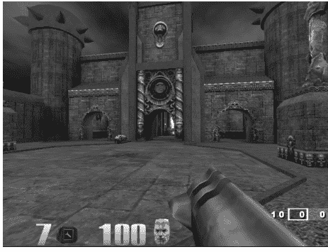

## 重返沃尔狼石堡垒

在《重返沃尔狼石堡垒》中，你与盟军作战以摧毁第三帝国，它融合了第二次世界大战的行动与纳粹科学家召唤的生物。它基于《毁灭战士竞技场》引擎，提供单机模式和基于团队的多模式。

如果你购买了 Linux 版《重返沃尔狼石堡垒》，你实际上获得的是带有额外 Linux 安装程序的 Windows 版本。如果你已经有了 Windows 版本，可以下载 Linux 安装程序并按照某些指令获取。我从 www.idsoftware.com/games/wolfstein/rtctw/index.php?game_section-updates 下载了名为 `wolf-linux-1.31.x86` 的安装程序。Cedega 窗口 `/usr/local/games/` 描述了你需要从 Windows 复制哪些文件。

如果你想要《重返沃尔狼石堡垒》的演示版，请访问 www.idsoftware.com/games/wolfstein/rtctw/index.php。单机和多人演示版均可用。

> 注意：运行《重返沃尔狼石堡垒》需要 NVIDIA 显。

图 7-5 是《重返沃尔狼石堡垒》的截图。

图 7-5
《重返沃尔狼石堡垒》结合了奇异生物与第二次世界大战。


## 使用 TransGaming 和 Cedega 游戏

TransGaming 为 Linux 带来了一些受欢迎的游戏通过与 WINE 开发者合作，TransGaming 正在开发 Cedega，它可以让你运行为 Windows 开发的游戏。虽然 TransGaming 制作了一些针对 Linux 打包的游戏，但在某些情况下它销售订阅服务而非游戏。

## 使用 Linux 游戏

为了让 Windows 在 Linux 上运行，Cedega 专注于许多现代游戏所需的 DirectX 功能。还有与 Windows 系统相关的问题需要解决（例如需要 Active Desktop）。Cedega 订阅具有价值，因为它让你对下次希望看到的内容投票。

TransGaming 支持的完整列表，以及它们的受欢迎程度和运行情况，可以在 TransGaming 网站（www.cedega.com/games/）获取。按类别或字母浏览游戏。星号标记 TransGaming 官方支持的游戏。每个游戏描述页都有相关 Wiki 的链接（如果有），提供了有关游戏在 Cedega 下运行的细节以及运行提示。

根据你的发行版，你可能需要从 Cedega 获取原生内核并在系统上启动。TransGaming 为 Cedega GUI（以前称为 Point2Play）添加了新功能。Cedega GUI 提供了一个在计算机上安装、配置和测试 Cedega 的图形窗口。该应用程序允许你安装并组织游戏，以便图形化启动。图 7-6 显示了 TransGaming Cedega 窗口示例。

Cedega GUI 窗口的功能包括新的外观以及为单独配置 Cedega 下每种游戏的工具。（如果游戏无法从 GUI 运行，请从终端窗口启动它。）以下是一些已知在 Cedega 中运行良好的的游戏：

- 《决战之日：起源》
- 《魔兽世界》
- 《主题》
- 《丝绸之路在线》
- 《半生命 2》
- 《使命召唤 2》

## 注意

图 7-6
使用 Cedega 窗口在 Linux 上运行 Windows 游戏。

## 运行 Linux 桌面

要获取 Cedega 的二进制副本（已编译好即可运行的版本），你需要订阅 TransGaming。有关如何成为“TransGamer”的详情，请点击 TransGaming 首页（www.transgaming.com）上的“立即注册”链接。益处包括：

- 下载最新版本的 Cedega
- 获取 Cedega 支持
- 可以对你希望 TransGaming 下一个支持哪个游戏进行投票
- 订阅 Cedega 时事通讯

Cedega 曾被称为 Wine。如果你想构建自己的 Cedega 软件包，Wine 的源代码可能在不久的将来可用。如需检查可用性，请尝试 SourceForge 网站（sourceforge.net/projects/）。

## Loki Software 游戏

为了让人们了解 Loki Software，Loki Software, Inc. 提供了一项演示程序，你可以从十款游戏中选择一个进行下载和尝试。你仍然可以找到一些它在售的游戏。例如，在 Amazon.com 上搜索 Loki，售价为 19 美元。

**警告**：如果你尝试下载以下章节中的任何演示程序，请确保你有足够的可用磁盘空间。这些演示程序之一通常需要几百兆字节的磁盘空间。Loki Launcher（www.lokigames.com/products/demos.php）提供了 FTP 站点的链接，你可以从那里下载启动器。你想要保存的文件是 `demos-full-1.0.x86`。将其保存到目录（例如 `/tmp/loki`）并执行以下操作：

1. 切换到下载演示程序的目录。例如：
: 安装这些游戏可能不需要 root 权限。但是，启动器尝试默认写入的路径只有 root 可以访问。

2. 作为 root 用户，运行以下命令（如果程序已更新，名称可能会不同）：
```
./demos-full-1.0.x86.run
```

3. 如果你以前没有用过启动器，屏幕会出现一个窗口要求你识别放置安装文件的路径。如果显示的默认位置对你来说可以，点击“开始安装”。

4. 假设写入安装目录没有问题，你应该会看到“安装完成”的消息。点击“退出”。

5. 窗口会显示。如果存放安装文件的路径没有问题，点击“开始安装”。会显示“安装完成”消息。点击“退出”。

6. 下一个窗口允许你设置安装演示包的位置。如果路径没有问题，点击“开始安装”。

7. 框显示了不同的可用游戏。当你将光标移动到每个游戏上时，会显示该游戏所需的磁盘空间。点击你想安装的游戏并点击“继续”。

8. 窗口将显示每个下载的进度。你可能需要点击“更新”来完成更新，然后点击“完成”结束。

9. 演示程序现在应该可以启动了。点击“播放”或从终端窗口运行来启动。

10. 选择游戏，你就可以准备就绪。

以下描述了几个可能仍然提供的游戏。再次强调，这些游戏可能存在不了多久。

## 文明：权力之召 (Civilization: Call to Power)

你可以通过《文明：权力之召》(CCP) 构建文明。与早期的版本和公共衍生版本（如本章前面描述的 *Free*）一样，Linux 版的《文明：权力之召》让你能够探索世界、建造城市并管理你的帝国。Loki Games 提供的版本包含了多人竞技和扩展内容，让你进入太空和海底。

如果你喜欢 *Free*，该游戏通过增强的图形、声音和动画得到了改进。提供英语、法语、意大利语和西班牙语版本。

**注意**：CCP 依赖于 Open Sound 系统进行音频支持。首页（www.opensound.com/ossh.html）列出了支持的声卡，大多是旧设备。如果你没有在列表上的声卡，你可能无法享受音频。

CCP 演示程序带有一个极佳的教程来帮助你入门。如果你从未玩过文明游戏，教程是一个极好的开始。图 7-7 显示了 Linux 版《文明：权力之召》演示程序的一个示例场景。

图 7-7
《文明：权力之召》具有出色的图形和网络对战。


## 神话 II 代：灵魂守护者 (Myth II: Soulbighter)

如果你了解骑士、矮人和城堡，那么 Linux 版的《神话 II：灵魂守护者》可能适合你。在《神话 II》中，你被赋予了一个任务和一些拥有各种技能的部队。从那里，你需要策略以及洒大量虚拟血的渴望来实现你的目标。

《神话 II》由 Bungie Software（最近以《光环》系列闻名的游戏公司）创建，并由 Loki Entertainment Software（www.lokigames.com）移植到 Linux。热门游戏《神话》的 Loki 移植版包含了改进的图形和新场景。提供一个可以在大多数发行版（特别是 Fedora/Red Hat）中运行的演示版本。可以通过之前启动的演示启动器获取。你至少需要 Pentium 133 MHz、32MB RAM、80MB 空间和 100MB 的空闲磁盘空间。你还需要用于多人网络游戏的硬件（网卡或拨号），如果你需要音频，还需要声卡。图 7-8 显示了《神话 II》的屏幕。

## 异教圣 II (Heretic II)

基于 Build 引擎，《异教圣 II》让你踏上一段消除世界上致命魔法瘟疫的道路。作为主角色 Corvus，你探索了地下城、沼泽和城市。Loki 提供的版本包含了用于阻止瘟疫的多人竞技。画面比较粗糙，但游戏非常吸引人。

图 7-8
使用战士、弓箭手和矮人在《神话 II》中战斗。


# 在 Linux 上游戏

## 夜色之王 (Neverwinter Nights)

BioWare 通过极受欢迎的《夜色之王》涉足 Linux 游戏领域。《夜色之王》是一款经典的角色扮演游戏。你可以开发自己的角色并冒险。《夜色之王》获得许可，可以使用地下城规则和材料。

当然，为了使用 Linux 客户端，你必须从 BioWare 购买游戏。你还需要访问来自 Windows 安装的某些文件。重要说明和下载文件位于 http://www.biare.com/downloads/linux/client.html。该网站包含了有关扩展包和更新的附加信息。如果你想在 Linux 系统上的《夜色之王》体验是良好的，我建议仔细阅读说明。除了耐心，你还需要高带宽互联网连接。根据你所拥有的《夜色之王》版本，你可能需要下载高达 1GB 的文件。

## 第三部分
## 学习系统管理技能

| 本部分内容 |
| 第 8 章 安装 Linux |
| 第 9 章从 Shell 运行命令 |
| 第 10 章 学习基础管理 |
| 第 11 章 接入互联网 |
| 第 12 章 Linux 安全 |

## 第 8 章
## 安装 Linux

如果没有人已经为你安装并配置好 Linux 系统，那么这个实时用户环境（live user）将帮助你入门，让你尝试书中后面描述的 Linux 特性。随着 Linux CD 和 DVD 的改进，获取一个可以运行的 Linux 系统比以往任何时候都更快、更可靠。

如果你是 Linux 用户，我建议你：

- **尝试可启动的 Linux** —— 本书的 CD 和 DVD 包含了可启动的 Linux 系统。你可以在不接触电脑硬盘内容的情况下尝试 Linux。特别是 KNOPPIX 是一个功能齐全的 Linux 系统，可以让你对 Linux 的工作原理有良好的了解。使用 CD 或 DVD，你可以尝试附录 A 中描述的不同实时光盘。这些实时光盘中的一些还将 Linux 安装到硬盘的功能。虽然实时光盘的运行速度通常比安装后的系统慢，且在重启后不会保留更改，但它们是入门 Linux 的良好工具。
- **安装桌面 Linux 系统** —— 选择一种 Linux 发行版并将其安装在电脑硬盘上。将 Linux 永久安装到硬盘上让你在添加和删除软件、访问和保存数据到硬盘以及更永久地自定义系统方面具有更大的灵活性。将 Linux 作为桌面系统安装可以让你在处理更复杂的服务器问题之前尝试实用的应用程序并熟悉 Linux。

| 本章内容 |
| 选择 Linux 发行版 |
| 获取 Linux 发行版 |
| 理解安装问题 |

## 第三部分 学习系统管理技能

本章概述了如何选择 Linux 发行版，然后描述了安装大多数 Linux 发行版时常见的问题和主题。附录 A 描述了书中 DVD 和 CD 包含哪些 Linux 发行版，以及如何运行实时系统或使用它们永久安装 Linux。本书该部分的其他章节都专门用于理解和安装特定的 Linux 发行版。

安装 Linux 之后，你将想要了解如何获取和管理 Linux 系统的软件。这些是贯穿本书的重要主题，但本章描述了让你快速上手的主要软件包格式和工具。

## 选择 Linux 发行版

如今有几十种流行的 Linux 发行版。有些是可以用作桌面、服务器、工作站系统的通用发行版；另一些是专为商业或计算机爱好者设计的。本书的意图之一是帮助你选择最适合你的一种（或多种）版本。

使用随书附的 CD，你可以直接启动到 KNOPPIX（或使用其他几个 CD 尝试 Linux），或运行安装程序在你的电脑硬盘上安装 Fedora、Ubuntu、Ubuntu、Slackware、Mandriva、Freeprise 或 openSU。在你尝试过 KNOPPIX 并准备好在硬盘上安装 Linux 后，我建议你选择 Fedora 或 Ubuntu。

使用随书附的 CD，你可以直接启动到 Damn Linux（或几个较小的可启动 Linux 发行版）、Debian 或 Gentle（将这些发行版通过网络安装到你的硬盘上）。Debian 和 Small Linux 是两个可以配置为在较旧、性能较弱的电脑上，或者有 CD 驱器但没有 DVD 驱器的电脑上运行。对于 Debian 和 Ubuntu，本书还提供了将 Debian 设置为邮件和 Web 服务器的描述（第 13 章和第 14 章）。

## 工作中的 Linux

我认识很多懂 Linux 的人，无论是在非正式场合还是工作中，我想分享一下我对不同 Linux 发行版在美国的使用情况的印象。我认识大多数顾问使用小型办公服务器运行 Red Hat，但大多数人已经转向了 Fedora（基于 Red Hat Enterprise 软件构建）、Ubuntu 或 Debian GNU/ Mandriva（原 Mandrakelinux），后者对于想要 Linux 桌面的人来说变得很流行，但 Ubuntu 和 Fedora 也很受欢迎。技术上更倾向于钻研的人倾向于使用 Gentoo（高度可调）或 Slackware（以基础形式）。

Novell 与微软之间的协议促使一些开源项目放弃了 SUSE。然而，这是否会导致企业领域从 SUSE 迁移目前尚无定论。不过，目前对于那些反对这一联盟的人来说，Red Hat Linux 在企业领域提供了最佳选择。

## 安装 Linux

对于使用旧款 Macintosh 硬件过渡到 Linux 的人，Yellow Dog 让你你能够在 PowerPC 上安装，并学习对以后扩展到 Red Hat 系统很有帮助的技能（Yellow Dog 原本基于 Red Hat Linux）。对于可启动的 Linux，我认识的每个人都认为它们是尝试和学习 Linux 的极佳方式。对于包含可以放入整张 CD（或 DVD）软件的可启动 Linux，KNOOPPIX 是一个不错的选择，Ubuntu 也是如此；对于可启动的微型 Linux，Damn Small Linux 效果很好。不过，你也可以尝试随书介质提供的实时光盘：INSERT、Puppy Linux、SlackPop、System Rescue CD 或 BackTrack。

本书向你展示了几个 Linux 发行版。它让你获得了一个优势，即通过亲手操作看到每个发行版的优缺点。你还可以尝试加入不断增长的 Linux 社区，因为强大的社区支持会带来更稳健的发行版，并在你需要时提供帮助（通过论坛和在线频道等方式）。

## 其他发行版

似乎每五分钟就会出现一个新发行版，我真的得在某个时候停止写这本书了。为了让对 Linux 发行版的描述保持在合理范围内（并实际上有空间描述如何使用），书中没有探索有趣的 Linux 发行版。

书中未的重要 Linux 发行版包括 TurboLinux、Xandros 和 CentOS。TurboLinux (www.turbolux.com) 在亚太国家非常流行。Xandros (www.xandros.com) 设计用于在 Windows 环境中良好运行，是一个广受好评的桌面 Linux 系统。CentOS 在使用 Red Hat Linux 的顾问中非常受欢迎。CentOS 是 Red Hat Linux 源代码的重新构建。因此，人们使用它获得比 Fedora 更长的更新周期。然而，由于 CentOS 和 Red Hat Enterprise 基于 Fedora 开发的技术，你可以通过 Fedora 学习如何使用那些发行版。以下章节解释了如何突破本书的限制获取那些和其他发行版。

## 获取你自己的 Linux 发行版

通过在书中封装几个 Linux 发行版，我希望节省你自己获取的麻烦。

## 第三部分 学习系统管理技能

- 无 DVD 驱器 —— 你可能想要比书中更新的发行版本。
- 完整的发行版 —— 因为 CD 空间有限且某些发行版需要订阅或其他费用，你可能想要获取自己的、更完整的。

## 寻找另一个 Linux 发行版

安装 Linux 最常用的介质是包含完成安装所需全部内容的 CD 和 DVD。另一种启动 Linux 安装的方法是使用软盘或 CD 包含安装启动镜像，然后从你使用的网络实时获取 Linux 的部分

# 安装 Linux

刻录在光盘上的镜像通常存储在互联网上被称为“软件仓库”的地方。你可以自己下载镜像并将其刻录到光盘上。或者，软件包通常也会单独包含在目录中。这些独立的软件目录允许你使用一个极简的启动光盘开始安装，并在安装过程中通过网络获取软件包。（本书中推荐的一些安装过程就是这样完成的。）

当你点击指向 Linux 仓库的链接时，你需要寻找的是这些内容：

- 下载目录 — 你通常需要从进入仓库的下载链接开始，逐级向下进入几个目录。寻找描述发行版、架构、发布版本和介质格式的子目录。例如，Fedora 10 Linux 发行版可能命名为 `fedora/10/1386/iso`。其他发行版（如 Ubuntu 和 Debian）拥有可以为你搜索在线仓库的工具，因此你不需要自己寻找镜像目录（作为替代方案，你可以像后文描述的那样获取 Linux Live CD 或通过 Torrent 安装）。
- ISO 镜像 — 你将要刻录到光盘上的镜像通常以 ISO 格式存储。某些仓库包含一个 README 文件来告诉你你需要什么（有些则你自己就清楚）。要安装发行版，你需要一组包含你的 Linux 二进制文件的 ISO 镜像。

> 虽然 ISO 镜像显示为一个文件，但它的作用像是一个文件系统的快照。你可以使用 `loop` 命令将其挂载以查看内部所有文件。例如，创建一个入口点（`mkdir piso`），并以 root 身份运行 mount 命令：`mount -o loop abc.iso piso`。切换到 `piso` 目录即可查看 ISO 镜像内容的文件和目录。当你查看内容时，离开目录并卸载 ISO 镜像（`cd ..; unmount piso`）。

- MD5SUM — 为了验证你是否完全获取了正确的光盘，在下载后寻找名为 MD5SUM 的文件或 ISO 目录中以 `.md5` 结尾的文件。这些文件包含一个或多个 MD5（128位）校验和，代表你想要检查的 ISO 文件。其他发行版提供 SHA1 校验和，即 160 位的校验和。你可以使用这些值来验证每张光盘的内容（如后文所述所示）。

# 下载发行版

你只需点击链接并在提示时将其下载到计算机的某个目录中，即可下载每个 ISO。你可以在 Windows 或 Linux 系统上执行此操作。

如果你在运行 Linux 系统的情况下已知所需镜像的位置，使用 `wget` 命令比在浏览器中点击链接是更好的下载方式。使用 `wget` 的优势是，你可以重启由于某些原因中断的下载。一个下载 KNOOPPIX CD 镜像（从你所在的目录开始）的 wget 命令可能如下：
```


# 下载 ISO 镜像

```
$ wget -c kernel.org/pub/dist/knoppix/KNOOPPIX_V5.1.CD-2007-01-04_EN.iso
```

如果下载在完成前停止，请再次运行命令。`-c` 选项告诉 `wget` 从下载停止的地方开始，这样如果它停止时你已经从 690MB 下载到了 696MB，它只会增加那 6MB。

下载 ISO 镜像的一种“公民”的方法是使用 BitTorrent (http://bitt.com)。BitTorrent 允许你通过从网络上正在下载该文件的多台计算机获取该文件的片段，从而将其下载到你的计算机中。作为回报，你在下载的同时也利用你的上传带宽与他人共享该文件。

在新 Linux 发行版需求量大的时期，BitTorrent 可以是最佳选择。最近的新闻报道将 BitTorrent 描绘为非法活动工具，例如下载受版权保护的（电影、音乐等）。大多数 Linux 发行版仅包含受各种开源许可保护的软件，使用 BitTorrent 分发 Linux 并没有法律问题。访问 http://lintracker.org 查看可以使用 BitTorrent 下载的发行版列表。

如果你使用的是拨号调制解调器，如果无法在 CD 或 DVD 上找到想要的内容，你应该考虑购买 Linux 光盘（或从朋友那里获得）。在快速 DSL 或电缆连接上，你可能可以在几小时内下载整张 700MB 的光盘。在拨号线路上，每张光盘可能需要整一天或更长时间。对于大型多光盘发行版，可用磁盘空间也可能变成问题（尽管由于今天的大硬盘，这不像以前那样是个问题了）。

# 将发行版刻录到 CD

将 CD 镜像复制到计算机后，你可以继续验证其内容并将其刻录到 CD 中。你真正需要的是计算机上有一个 CD 刻录机。

在 Linux 运行期间，你可以使用 `md5` 命令验证每张光盘。

> 如果你使用 Windows 验证 Linux CD 的内容，可以获取 MD5sum 工具 (www.mdsummer.org) 来验证每张光盘。

假设你下载了与每个 CD 镜像关联的 MD5 文件，并将其放在与 CD 镜像相同的目录下，运行 `md5` 命令进行验证。例如，要验证你刚刚通过 `wget` 下载的 KNOPPIX 文件，你可以输入以下内容：

```
$ md5sum KNOPPIX_V5.1.CD-2007-01-04-EN.iso

653ac801d4059598bd388de8171a20d KNOPPIX_V5.1.CD-2007-01-04-EN.iso
```

我之前从下载目录下载的与 CD 镜像相关的 MD5 文件名为 `KNOPPIX_V5.1.CD-2007-01-04-EN.iso`。它包含：

```
653ac801d4059598bd388de8171a20d KNOPPIX_V5.1.CD-2007-01-04-EN.iso
```

# 安装 Linux

如你所见，ISO 镜像的校验和（显示的第一个字符串）与 MD5 文件匹配，这样你就知道下载的镜像来自服务器。如果该项目使用 `shasum` 来验证你的 ISO 镜像，你可以如下进行测试：

```
$ shasum FC-1386-DVD.iso

6722f95b72e518f26baaf5b9f62cc7d4953DVD.iso
```


一旦你验证了 CD 或 DVD 的 `shasum` 或 `md5`，只要你有可靠源，就应该准备好刻录 CD 或 DVD。有了发行版（无论是 CD 或 DVD），使用 `dd` 或 `k3b` 等命令进行刻录。关于从 CD 或 DVD 安装发行版的说明可以在相应章节中找到（第 17-28 章）。在继续之前，某些信息对你安装的每个 Linux 系统都是有用的。

# 探索常见安装主题

在开始安装 Linux 发行版之前，你需要了解一些通用信息。阅读这些信息可能帮助你避免在安装时遇到问题。

# 了解你的硬件

并不是每种 Linux 都能在每台计算机上运行。安装 Linux 时，大多数人使用 Pentium 类 PC。有些 Linux 系统被编译可以在其他硬件（如 Mac PC 或 AMD）上运行。然而，本书提供的发行版仅在 32 位 Pentium 类 PC 上运行。注意，新的 Mac 是基于 Intel 构建的，这些计算机上也可以安装 Linux（参见“在 Intel Mac 上安装 Linux”侧边栏）。

# 在 Intel Mac 上安装 Linux

> 由于基于 Intel 架构的 MacBook 和 Mac mini 非常流行，Linux 项目产生了与 OS X 双启动的程序。大多数程序使用 Apple Boot Camp 软件 (`www.apple.com/macosx/boot`)。

要安装随附的 Fedora Linux，请参考 MacBook (`http://fedoraproject.org/wiki/FedoraOnMachel`)。对于 Ubuntu，请参考 MacBook 页面 (`https://help.ubuntu.com/community/MacBook`)。

# 第三部分学习管理技能

Fedora 项目的最低硬件要求对于大多数 Linux 系统都是很好的指南：

- 处理器 — Fedora 的最新版本建议你至少有一个 Pentium 处理器。对于仅文本安装，200 MHz Pentium 是最低要求，而 GUI 安装的最低要求是 400 MHz Pentium II。

如果你有一个 486（至少 100 MHz），考虑尝试 Damn Small Linux 或 Slackware。问题是许多机器只有软盘，你无法使用随附的 CD 或 DVD。在这种情况下，你可以尝试 SlackSlack (`www.slackware.com/zslack`)，它带有约 30 张软盘或 100MB Zip 磁盘，可以在至少 100MB 磁盘空间的 486 上运行。

- 内存 — 你至少需要 64MB RAM 来安装 Linux 并在文本模式下运行。Slackware 可能可以在8MB RAM 上运行，但 16MB 被认为是最低要求。如果你运行图形模式，可能至少需要 192MB。Fedora 图形模式的推荐内存是 512MB。GNOME 环境通常需要的内存比 KDE 环境少。如果你使用更精简的图形系统（运行带有小型窗口管理器如 Blackbox 的 X 系统），你可能只需要 32MB 就能应付。在这种情况下，你可能尝试 Damn Linux 或 Slackware。

- DVD 或 CD 驱动器 — 你需要能够从 DVD 或 CD 启动安装过程。如果你无法从 DVD 或 CD 启动，有方法从硬盘或使用 PE 安装启动安装。某些发行版（如 Slackware）允许你使用软盘启动。一旦启动了安装，有时从不同的位置检索软件（例如通过网络或从硬盘）。

- 网卡 — 如果你正在安装我们提供的精简版启动的发行版之一，你可能需要安装以太网卡以通过网络获取所需的软件。拨号连接不支持网络安装。你不一定需要连接到互联网即可进行网络安装。有些人下载必要的软件软件包并复制到他们的计算机中，然后将其作为安装服务器。

- 磁盘空间 — 对于普通的桌面安装，你至少应该有 3GB 的磁盘空间，尽管安装所需的范围很大（取决于你选择安装哪些包），范围可以从 600MB（无 GUI 安装的极简服务器）到 7GB（所有安装包）。你仅需 200MB 磁盘空间即可将 Damn Small Linux 安装到磁盘。如果你不确定自己的硬件，有几种方法可以检查你拥有什么。如果你运行 Windows，系统属性窗口可以显示你拥有的处理器以及安装的 RAM 数量。作为替代方案，你可以启动 KNOPPIX 让它检测并向你报告拥有的硬件（查看第 11 章关于在 Linux 中运行 `lspci` 和 `dmseg` 命令以查看计算机信息的说明）。

## 升级或从头开始安装

如果你已经在计算机上安装了想要安装的某个版本的 Linux，许多 Linux 发行版都为你提供了升级选项。这允许你升级所有软件包，例如从发行版的版本 1 升级到 2。在执行升级之前，这里有几个通用规则：

- **备份数据** —— 有可能在你完成升级后，操作系统将无法启动。在对操作系统进行任何更改之前，备份任何关键数据和配置文件（在 `/etc/` 中）始终是一个好主意。
- **移除额外的软件包** —— 如果有你需要的软件包，请在升级之前删除它们。升级过程通常只会升级系统中已存在的软件包。升级过程比纯净安装会有更多的检查和比较，因此任何软件包都可以在升级过程中节省时间。
- **检查配置文件** —— Linux 升级程序通常会留有旧配置文件的副本。你应该检查新配置文件是否对你仍然有效。

> 从头开始安装比升级速度快。它还能获得一个更干净的 Linux 系统。如果你可以选择备份数据，或者在不需要时将其擦除，那么全新安装通常是最佳选择。

Linux 发行版（大多数不是 Gentoo）采取了持续更新的方法。它们不是每几个月发布一个新版本，而是随着更新包的出现持续获取它们并将其安装到你的系统中。

## 与 Windows 双启动还是仅使用 Linux？

在同一台计算机上拥有多个可启动的操作系统是可能的（使用硬盘上的多个分区/多个硬盘）。设置设置多个操作系统的引导需要一些考虑。它也意味着存在风险。

虽然 Windows 分区调整大小和多启动系统的设置在近年来有所改进，但在 Windows/Linux 双启动系统中仍然存在丢失数据的巨大风险。不同的操作系统对分区表和主引导记录（MBR）通常有不同的查看方式，这可能导致你的机器无法启动（至少是暂时无法）或永久丢失数据。在尝试安装 Windows（NTFS 或 FAT）文件系统以为 Linux 留空间之前，请务必备份你的数据。如果有选择，请将 Linux 安装在专用机器上，或至少安装在独立的硬盘上。

如果计算机上已经有了一个 Linux 系统，可能其中一个硬盘被专门用于 Windows。虽然你可以运行可启动的 Linux（如 KNOPPIX 或 Damn Small Linux）而不触碰硬盘，但为了进行更永久的安装，你需要在 Windows 安装之外寻找空间。有几种方法可以实现这一点：

- **添加硬盘** —— 与其折腾 Windows 分区，你只需添加一个硬盘并将其专门用于 Linux。
- **调整 Windows 分区大小** —— 如果你的 Windows 分区上有可用空间，你可以缩小该分区，以便磁盘上有了可用的空闲空间用于 Linux。可以使用 Symantec 的 Partition Magic（`www.symantec.com`）或 Acronis Disk Director（`www.acronis.com`）等商业工具来调整磁盘分区大小并设置引导管理器。某些 Linux 发行版（特别是作为救援光盘使用的可启动 Linux）包含一个名为 QParted 的工具，它是 Partition Magic 的开源克隆（包含了来自 Linux-NTFS 项目的用于调整 NTFS 分区的软件）。

QParted 的替代方案是 GParted，它包含在书籍的介质中。

在你尝试调整 Windows 分区大小之前，你可能需要在 Windows 系统上对磁盘进行碎片整理，以便使磁盘上的所有空间都排列有序。打开“我的电脑”，右键点击你的硬盘（通常是 C:），选择“属性”、“工具”，然后选择“立即碎片整理”。

对磁盘进行碎片可能是一个相当漫的过程。碎片整理的结果是磁盘上的所有数据都是连续的，从而在分区末端创建大量空闲空间。某些情况下，你必须执行以下特殊任务才能实现这一点：

- 如果交换文件在碎片整理期间没有移动，你可以将其删除。在再次对磁盘进行碎片整理并调整大小后，你需要恢复交换文件。要删除交换文件，打开“控制面板”，打开“系统”图标，然后点击“性能”选项卡并选择“虚拟内存”。要禁用交换文件，点击“禁用虚拟内存”。
- 如果你的分区中有隐藏文件位于你正尝试释放的空间上，你需要找到它们。在某些情况下，你将无法删除它们。在其他情况下，作为由程序创建的交换文件，你可以安全地删除这些文件。这有点棘手，因为某些文件作为操作系统系统文件无法被删除。你可以从根目录使用 `attrib -s` 命令来查找隐藏文件。

一旦你的磁盘产生碎片，你可以使用之前描述的任何商业工具（Partition Magic 或 Acronis Disk Director）重新划分硬盘分区以为 Linux 留出空间。开源替代工具是 QParted。

启动 KNOPPIX 或任何其他可启动发行版（救援光盘），并在主菜单中选择“系统工具”来运行 QParted。在 QParted 窗口中，选择你想调整大小的磁盘。然后选择“选项 > 配置”，打开一个窗口，你可以在其中选择 ntfs 工具来调整你的 NTFS 分区。

在你清理了足够的空间以安装 Linux 后（参见正在安装的章节中的磁盘空间要求），你可以选择你的 Linux 发行版并进行安装。在安装过程中设置引导加载程序，你将能够识别 Windows、Linux 以及任何其他可启动分区，以便你可以在启动计算机时选择其中一个启动。

## 安装引导选项

有时 Linux 安装会失败，是因为计算机有硬件不正常。有时你可以通过在启动时传递选项来解决这些问题。虽然这些选项中的某些是特定发行版的，但另一些是可以传递给内核的选项。第 21 章列出了适用于 KNOPPIX 的许多引导选项。

## 硬盘分区

计算机上的硬盘（磁盘）为数据文件、应用程序和操作系统本身提供了永久存储区域。分区是将磁盘划分为可以独立工作的逻辑区域的行为。然而，对于 Linux，有几个原因你可能希望有多个分区：

- **多个操作系统** —— 如果你在有 Windows 操作系统的 PC 上安装 Linux，你可能希望将两个操作系统都放在计算机上。对于所有实际目的，每个操作系统必须存在于单独的分区。当计算机启动时，你可以选择运行哪个系统。
- **操作系统内部多个分区** —— 为了防止操作系统耗尽磁盘空间，人们通常为 Linux 文件系统的不同区域分配分区。例如，如果 `/home` 和 `/var` 分配不同的分区，那么填满 `/home` 分区的贪婪用户将阻止守护进程继续向 `/var/log` 目录写入日志文件。

多个分区也更容易进行备份（例如镜像备份）。例如，`/home` 的镜像备份比根系统（`/`）的镜像备份更快（更有用）。
- **不同的文件类型** —— 不同类型的文件系统具有不同的结构。不同类型的文件系统必须位于自己的分区上。在大多数 Linux 系统中，你至少需要一个 `/`（通常是 ext3 或 reisers）和一个交换区域的文件系统。CD 光盘上的文件系统使用 iso9660 文件系统类型。

## 第三部分 学习系统管理技能

**来自 Windows 用户**：如果你以前只使用过 Windows 操作系统，你可能将整个硬盘都分配给了 C: 盘，并且从未考虑过分区。在许多 Linux 系统中，你有机会根据系统的使用情况来查看并更改默认的分区方案。

在安装过程中，openSUSE 和 Fedora 等系统允许你使用图形分区工具对硬盘进行分区。接下来的章节描述了如何在 Fedora 安装期间对磁盘进行分区，或使用 `fdisk` 对磁盘进行分区。可以参考“创建分区的技巧”章节获取一些创建分区的思路。

## 在 Fedora 安装期间进行分区

在安装期间，Fedora 赋予你更改硬盘分区方式的机会。磁盘设置（Disk Setup）屏幕分为两个部分。顶部行显示每块硬盘的通用信息。底部显示每个分区的详细信息。图 8-1 显示了磁盘设置窗口的示例。

图 8-1

在磁盘设置窗口在 Fedora 安装期间对磁盘进行分区。

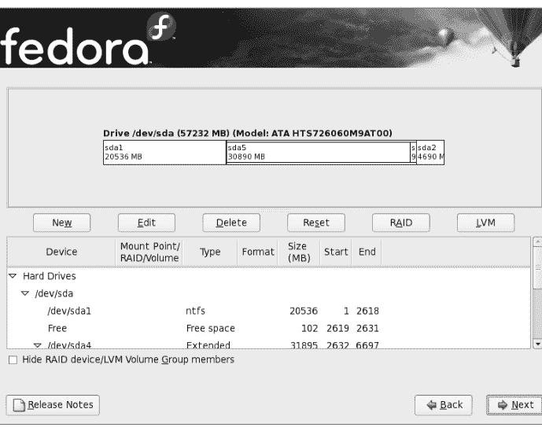

218

## 安装 Linux

对于每个硬盘分区，你可以看到以下内容：

- **设备（Device）** — 设备是代表 `/dev` 目录中 sd 分区的名称。每个磁盘分区设备都以两个字母开头：代表用于 IDE 或 SCSI 磁盘的 sd，用于 ESDI 磁盘的 ed，或用于 XT 磁盘的 rd。之后是一个单字母，代表磁盘编号（disk 1a、disk 2b、disk 3c 等）。因此，要引用整个第一块硬盘，请使用设备名称 `/dev/sda`。要引用该磁盘上的特定分区，请添加分区号（1, 2, 3 等）。例如，`/dev/sda1` 代表计算机上第一块 IDE 硬盘硬盘上的分区。

- **挂载点/读写/卷（Mount Point/Read/Volume）** — 分区连接到 Linux 文件系统的目录（如果你在继续操作之前，必须将根分区 (`/`) 挂载到原生 Linux 分区）。如果你使用 RAID 或 LVM，RAID 设备或 LVM 卷将将在此处。

- **类型（Type）** — 安装在磁盘分区上的文件系统类型。在许多情况下，文件系统将是 Windows (ext3)、Win FAT (vfat) 或 Linux swap。然而，你也可以使用之前的 Linux 文件系统 (ext2)、物理卷 (LVM) 或软件 RAID。图 8-1 中所示设备 `/dev/sda` 的 NTFS 分区意味着这台计算机上安装了 Windows，并且可以作为运行 Windows 和 Linux 的双启动计算机使用。

- **格式（Format）** — 表明安装过程是否应该格式化该硬盘分区。标记了勾选框的分区将被擦除！因此，在多启动系统中，请确保你的 Windows 以及其他包含你不想丢失的数据的分区未被勾选！

- **大小 (MB)(Size (MB))** — 分配给分区的磁盘量（以兆字节为单位）。如果你选择让分区组填充现有空间，此数字可能会比请求的量得多。

- **起始/结束（Start/End）** — 代表分区在硬盘上的起始和结束磁道。

在顶部区域，你可以看到连接到计算机的每块硬盘。首先显示驱动器名称。然后是磁盘的型号名称。总磁盘空间、已用空间和可用空间以兆字节显示。

## 分区的理由

对于划分硬盘存在不同的观点。以下是一些常见问题：

- **你想安装另一个操作系统吗？** 如果你想在计算机上同时运行 Windows 和 Linux，你将至少需要一个 Linux (Win95 FAT16, VFAT 或 NTFS 类型)、一个 Linux (Linux ext3) 和一个 Linux swap。你可能不需要很多分区。

- **这是一个多用户系统吗？** 如果你是你自己使用该系统，分区操作系统的原因之一是防止整个系统同时耗尽磁盘空间。这也有助于限制个人在其主目录可以使用的内容（尽管磁盘配额对于这也很有效）。

219

**你有多个硬盘吗？** 每一块硬盘至少需要一个分区。如果你的系统有两块硬盘，你可能将其中一个分配给 `/`，另一个分配给 `/home`（如果你有用户）或 `/var`（如果该计算机是共享大量数据的服务器）。通过设置独立的 `/home` 分区，你将来可以在未来安装另一个 Linux 系统，而不会干扰到你的目录（以及推测是你的全部或大部分用户数据）。

删除 删除、添加和编辑分区

在添加分区之前，硬盘上必须有一些空闲空间。如果你硬盘上的所有空间目前都分配给了一个分区（这在 DOS 或 Windows 中通常如此），你必须在在另一个分区上占用空间之前删除或调整分区大小。*与 Windows 或 Linux 进行双启动* 章节讨论了如何在单分区系统中不丢失信息的情况下添加分区。

> 在删除分区之前，请确保备份了任何你想保留的数据。当你删除分区时，其所有数据都将消失。

磁盘设置比 `fdisk` 工具不灵活，但更直直观。磁盘设置允许你删除、添加和编辑分区。

> 如果你创建了多个分区，请确保在正确的位置有足够的空间来完成安装。例如，如果 Linux 系统安装在 `/usr` 目录下。

在磁盘设置中删除分区，请遵循以下步骤：

- 选择你想要的分区。
- 点击删除（Delete）。
- 当询问是否确认删除时，点击删除（Delete）。

在磁盘设置中添加分区，请遵循以下步骤：

- 选择新建（New）。
- 弹出一个窗口，让你创建一个新分区。
- 选择你需要的类型。
- 选择要放置分区的磁盘。
- 在 Size (MB) 框中输入分区的大小（以兆字节为单位）。
- 选择以下大小选项之一：
  - 固定大小（Fixed size）：点击此处仅使用指定的兆字节。
  - 空间直到（Full space up to）：如果你想使用剩余空间直到某个兆字节，点击此处并填写数字。
  - 最大允许大小（Maximum allowable size）：如果你想让此分区扩展以填充整个硬盘，点击此处。
- 可选：强制为为主分区（Force to Be a Primary Partition）以确保启动该分区，或选择检查坏块（Check for Bad Blocks）以对分区进行错误检查。
- 点击确定（OK）。

从主磁盘设置编辑，请遵循以下步骤：

- 点击你想要的分区。
- 点击编辑（Edit）按钮。弹出一个窗口，让你编辑分区定义。
- 更改任何属性。
- 点击确定（OK）。

## 安装 Linux


要创建与所示不同的文件系统，请留空空间。使用 `fdisk` 手动对硬盘进行分区，以便在 Linux 中创建和处理磁盘分区。它与磁盘设置等图形分区工具执行相同的工作，尽管它不再作为 Fedora 安装期间的选项提供。

在运行虚拟终端的 Fedora 和其他 Linux 安装期间，切换到 shell（Ctrl+Alt+F2）并使用 `fdisk` 手动对硬盘进行分区。

## 第三部分学习系统管理技能

以下步骤需以 root 用户身份在命令行中执行。

注意

> > 请记住，任何分区命令都可能轻易擦除您的磁盘或使其无法访问。在使用任何工具更改分区之前，请务必备份关键数据！请对您所做的更改要非常小心。准备一个紧急启动盘也是一个好主意。

`fdisk` 命令在许多不同的操作系统中可用（尽管它在每个系统上的外观和行为不同）。在 Linux 中，`fdisk` 是一个基于菜单的命令。使用 `fdisk` 列出所有分区，输入以下内容（作为 root 用户）：

```bash
```


# fdisk -l

`/dev/sda`: 40.0 GB, 4020064320 bytes

255 heads, 63 sectors/track, 4865 cylinders

Units = cylinders of 16065 * 512 = 82252850 blocks

| 设备 | 起 | 止 | 扇区 | Id | 系统 |
|---|---|---|---|---||-|
| `/dev/sda *` | 1 | 13 | 104391 | 83 | Linux |
| `/dev/sda2` | 14 | 4833 | 3876650 | 83 | Linux |
| `/dev/sda3` | 4834 | 4865 | 257040 | 82 | Linux swap |

要查看当前系统中每个分区是如何使用的，请输入以下内容：

```bash
# df -h
```

文件系统 大小 已用 可用 用率% 挂载点

`/dev/sda2` 37G 5.4G 30G 16% /

`/dev/sda1` 99M 8.6M 86M 10% /boot

none 61M 0 61M 0% /dev/shm

从 `df` 的输出中，你可以看到 Linux 系统的根目录（ / ）位于 `/dev/sda2` 分区，`/dev/sda1` 分区用于 `/boot/`。

注意

在使用 `fdisk` 更改您的分区之前，我强烈建议使用 `df -h` 命令查看当前分区是如何定义的。这有助于降低更改或删除错误分区的风险。

要使用 `fdisk` 更改分区，您需要识别您正在对哪个磁盘进行分区。例如，您的第一个 IDE 硬盘被标识为 `/dev/sda`。因此，要对您的第一个 IDE 硬盘进行分区，您可以（作为 root）开始并输入：

```bash
# fdisk /dev/sda
```

对于不同的硬盘类型或数量，会将 `/dev/sda` 替换为您想要操作的设备名称。表 8-1 显示了您的一些选择。

## 安装 Linux

### 8

表 8-1

| 设备 | 说明 |
| --- | --- |
| `/dev/sda` | 用于第一个 IDE 或 SCSI 硬盘；其他磁盘使用 sdb、sdc 等 |
| `/dev/rd/c0d0` | 用于 RAID 设备 |
| `/dev/ida/c0d0` | 同样用于 RAID 设备 |

启动 `fdisk` 后，输入 `m` 查看选项。以下是您可以使用 `fdisk` 执行的操作：

- **删除分区** — 输入 `d` 和分区号，然后按回车。例如，`/dev/sda2` 是您的分区号 2。（在您写入更改之前，删除不会生效——除非您退回到该点）。
- **创建分区** — 如果有空闲空间，可以添加新分区。输入 `n` 创建逻辑分区（5 或以上）或输入 `p` 创建主分区（1–4）；并从可用范围选择分区号。然后从可用选项中选择第一个数字。（之前的 `fdisk -l` 输出显示了在 Start 和 End 列下使用的柱道）。
- 接下来，柱道分区号将将结尾（或输入您需要的特定兆字节或字节数：例如，`+50m` 或 `+1024k`）。您创建了一个 ext3 Linux 分区。再次，在您写入更改之前，这并不是永久的。
- **更改分区类型** — 输入 `T` 选择文件系统类型。输入您想要更改的分区号。使用十六进制代码输入您想要使用的文件系统编号。（此时输入 `L` 查看文件类型和代码列表）。对于 Linux 文件系统，使用 83；对于 Linux swap，使用 82；对于 Windows FAT32 文件系统，使用字母 `b`。
- **显示分区表** — 在此过程中，可以随时输入 `p` 在（屏幕上）显示当前的分区表。
- **退出或保存** — 在写入之前，再次检查分区表并确保它符合您的意愿。如果您不喜欢对分区所做的更改，输入 `q` 退出且不保存。您的分区表不会发生任何变化。
- 如果更改无误，通过输入 `W` 将其写入分区表。系统会警告您更改分区是非常危险的，您必须确认更改。

基于菜单的 `fdisk` 命令的替代方案是 `sfdisk`，它是一个面向命令的分区工具。使用 `sfdisk` 时，您输入完整命令来列出或更改分区，而不是通过一系列提示（如 `fdisk`）。详情请参阅 `sfdisk` 手页。Linux 专家通常更喜欢 `sfdisk`，因为它可以与其他命令结合使用以发挥优势。

## 创建分区的技巧

更改分区可能很。。是一些建议：

- 如果正在创建多启动系统，独立的 `/home` 可以防止用户填满硬盘。
- 通过将 `/tmp` 放在单独的分区来保护磁盘的其他部分，可以确保需要向 `/tmp` 写入临时文件的程序能够完成处理，即使磁盘满了。
- 如果您有 Web 服务器，独立的 `/var` 分区可以防止对这些设施的攻击损坏或填满磁盘。
- 对 `/usr` 使用单独的分区可以让您在安装操作系统后将其设置为只读。这可以防止攻击者替换系统应用程序为引起安全问题的版本。
- 因为用户账户位于 `/home`，独立的 `/home` 可以防止粗心的用户填满整个硬盘。它方便地将用户数据与操作系统分离（便于备份或重装）。

## 为特定目录分配分区

| 目录 | 说明 |
| --- | --- |
| `/boot` | 有时 BIOS 只能访问硬盘的前 1024 个柱道。为了确保您的 `/boot` 目录可被 BIOS 访问，请创建一个单独分区（约 100MB）并确保在 1024 以下。对于较新的磁盘，您可以在安装时选择线性模式。 |
| `/usr` | 此目录包含了 Linux 用户使用的许多应用程序和工具。如果本地网络上有工作站，独立的 `/usr` 分区也有用。使用 NFS，您可以在网络上共享 `/usr`。 |
| `/var` | 在许多 Linux 系统中，您的 FTP/Web 服务器目录默认存储在 `/var` 下。拥有 `/var` 分区可以防止对这些设施的攻击损坏或填满您的磁盘。 |

## 使用 LILO 或 GRUB 引导加载程序

引导加载程序让您选择如何启动安装在计算机硬盘上的启动系统。大多数 Linux 系统都提供使用 GRUB 或 LILO 引导加载程序的机会。后续章节将描述 GRUB 和 LILO 引导加载程序。

## 使用 GRUB 启动你的计算机

在安装了多个操作系统并设置了多个分区后，你的计算机如何知道启动哪个操作系统呢？为了选择和管理启动哪个分区以及如何启动，你需要一个引导加载程序。Fedora 和其他 Linux 系统默认安装的加载程序是通用引导加载程序（GRUB）。

GRUB 是一个 GNU 引导加载程序（www.gnu.org/software/grub），它已经取代了 LILO 成为许多 Linux 系统（包括 Fedora 和 Ubuntu）的默认引导加载程序。GRUB 提供了以下功能：

- 支持多种可执行格式。
- 支持多引导操作系统（如 Fedora、FreeBSD、NetBSD、OpenBSD 以及其他 Linux 系统）。
- 通过链式加载支持非多引导操作系统（如 Windows 95、Windows 98、Windows NT、Windows XP 和 OS/2）。链式加载是从 GRUB 加载另一个引导加载程序（通常是特定于专有系统的）来启动选定的操作系统。
- 支持多种文件系统类型。
- 支持从网络自动解压启动镜像。

有关 GRUB 如何运行的更多信息，请输入 `man grub` 或 `info grub`。`info` 命令包含关于 GRUB 的更多详细信息。

## 使用 GRUB 启动

当你安装 GRUB 时，通常会获得配置启动计算机（带有一个或多个操作系统）所需信息的选项。配置好 GRUB 后，当你启动计算机时，BIOS 加载后你看到的是 GRUB 启动屏幕（它下方列出了分区）；你可以执行以下操作之一：

- **Default（Default）** — 如果你什么都不做，默认操作系统将在几秒后自动启动（超时时间由 `grub.conf` 中的 `timeout` 值设置，单位为秒）。
- **选择操作系统** — 使用上下方向键选择屏幕上显示的任何一个标题，这些标题代表你可以启动的操作系统。按回车键启动该操作系统。
- **编辑启动过程** — 如果你想更改启动过程中使用的任何选项，请使用方向键高亮显示你想要的操作系统，并输入 `e` 选择它。按照接下来的步骤临时更改你的启动选项。

当你想要更改启动选项使其在每次启动计算机时生效时，请参见“永久更改启动选项”部分。更改这些内容涉及编辑 `/boot/grub/grub.conf` 文件。

## 临时更改启动选项

在 GRUB 启动界面，你可以选择为当前启动会话更改或添加启动选项。首先，使用方向键选择操作系统并输入 `e`（如前所述）。你将看到一个类似于图 8-2 所示的图形界面。

图 8-2
从 GRUB 启动界面，你可以选择更改启动选项。

```
GNU GRUB | version 0.97 | (639K lower / 259840K upper memory)

root (hd0,6)

kernel /boot/vmlinuz-2.6.20-1.3194.fc7 root=LABEL=/123 rhgb quiet

initrd /boot/initrd-2.6.20-1.3194.fc7.img
```

使用按键选择高亮的条目。
按 'b' 启动，按 'e' 编辑启动序列中的选定命令，按 'c' 进入命令行，按 'o' 在选定行之后打开新行（'0' 表示在之前），按 'd' 删除该行，或按 escape 键返回主菜单。

GRUB 编辑屏幕中有三行用于标识你所选操作系统的启动过程。第一行（以 *root* 开头）显示 GRUB 引导程序的条目位于第一块硬盘 (hd0,6) 的第七分区。GRUB 将硬盘表示为 hd，无论它是 SCSI、IDE 还是其他磁盘。你只需要从零 (0) 开始计算驱动号和分区号。

代码的第二行（以 kernel 开头）识别启动镜像 (/boot/vmlinuz-2.6.20-1.3104.fc7) 并提供选项。这些选项标识分区为初始加载的 ro（只读）以及在 root=LABEL=/123 所在分区上的文件系统位置。第三行（以 initrd 开头）标识初始 RAM 磁盘的位置，它包含了启动过程中所需的最小文件和目录。

如果你要更改任何与启动过程相关的行，你可能只需要更改在启动镜像名称后添加或删除选项。以下是操作方法：

1. 将光标置于 kernel 行并输入 `e`。
2. 在启动镜像名称之后添加或删除选项。你可以使用最小的 bash 命令行编辑功能来编辑该行。你甚至可以使用命令补全（输入文件名的一部分并按 Tab 键完成）。以下是你可能想要添加或删除的几个选项：
   - 启动 shell — 如果你忘记了 root 密码或启动过程挂起，可以通过在启动行中添加 `init=/bin/sh` 直接启动到 shell。（系统是只读的，你可以将文件拷贝出去。你需要重新挂载文件系统为读写模式）。
   - 选择运行级别 — 如果你想启动到特定的运行级别，在启动行末尾添加运行级别。例如，添加 3（多用户模式）、4（图形模式）或 5（网络模式）。
3. 按回车键返回编辑界面。
4. 按 `b` 启动。

## 永久更改启动选项

想要更改启动选项使其每次启动计算机时都生效，请参见“永久更改启动选项”部分。这些这些涉及编辑 `/boot/grub/grub.conf` 文件。

```
GNU GRUB | version 0.97 | (639K lower / 259840K upper memory)

root (hd0,6)

kernel /boot/vmlinuz-2.6.20-1.3194.fc7 root=LABEL=/123 rhgb quiet

initrd /boot/initrd-2.6.20-1.3194.fc7.img
```

`/boot/grub.conf` 文件包含了 GRUB 的配置。这里是 Linux 示例：

```
title Fedora

kernel /boot/vmlinuz-2.6.20-1.3194.fc7 root=LABEL=/123 rhgb quiet

initrd /boot/initrd-2.6.20-1.3194.fc7.img

title Windows XP

chain (hd0,1)
```

`title` 行指定屏幕上显示的名称。`kernel` 行指定内核的位置和选项。`initrd` 行指定初始 磁盘的位置。`default` 行指定默认启动的条目。`timeout` 行指定 GRUB 在启动默认操作系统之前等待的秒数。

对于 Windows 分区，`root` 行标识 GRUB 不要尝试挂载它。与其挂载分区并向新操作系统传递选项，`chain` 行指示如何将操作控制权交给另一个引导加载程序。对于 Windows 操作系统，我们使用链式加载器从 GRUB 启动它们，因为 GRUB 不提供 Windows 操作系统的原生支持。

如果你对 /boot/grub.conf 文件进行了任何更改，你不需要加载这些更改。GRUB 在你重启计算机时会自动获取这些更改。如果你习惯了 LILO 引导加载程序，这可能会让你感到困惑，因为 LILO 需要重新运行 `lilo` 命令才能生效。

## 添加新的 GRUB 启动镜像

你可能拥有具有不同特征的内核镜像。以下是修改 `grub.conf` 文件的步骤：

- 将新镜像从创建它的目录（例如 `/usr/src/kernels/linux-2.6.20-1/arch/1386/boot`）拷贝到 `/boot` 目录。使用反映其内容的名称命名，例如 bz-2.6.20-1。例如：

```bash
# cp /usr/src/linux-2.6.20-1/arch/1386/boot/bzImage /boot/bz-2.6.20-1
```

2. 向 `/boot/grub/grub.conf` 文件添加几行内容，这样在选择它时，镜像可以在启动时启动。例如：

```
title Fedora (My own IPv6 build)

root (hd0,1)

kernel /bzrd-2.6.20-1 ro=/dev/sda7

initrd /initrd-2.6.20-1.img
```

3. 重启你的电脑。

4. 当 GRUB 界面出现时，将光标移动到代表内核的标题并按回车。

这种方法与将新启动镜像覆盖旧镜像相比，其优势在于：如果内核启动失败，你始终返回并重启内核。当你确信新内核运行正常时，可以使用它来替换旧内核，或者直接将新内核设置为默认启动定义。

### 使用 LILO 启动你的电脑

LILO 代表 Linux Loader（Linux 加载器）。与其他加载器一样，LILO 是一个独立于计算机上安装的操作系统之外的程序，你可以选择启动哪个系统。它还允许你提供特殊选项来修改操作系统的启动方式。在 Slackware 和一些其他 Linux 系统中，LILO 被代替 GRUB 作为默认启动加载器。

如果你的电脑正在使用 LILO，它被安装在主引导记录（MBR）或分区的第一行。主引导记录由计算机的 BIOS 直接读取。通常，如果 LILO 是你电脑上唯一的加载器，请将其安装在主引导记录中。如果主引导记录中已有另一个加载器，请将 LILO 放在根分区。

> 如果你是 Linux 新手且不熟悉启动加载器，强烈建议学习并使用 GRUB 而不是 LILO —— 最近发行版中对 LILO 的包含已减少，转向 GRUB。

## 使用 LILO

当你的电脑使用安装在主引导记录中的 Fedora 版本 LILO 时，会出现一个图形启动界面，显示计算机上可启动的分区。使用键盘上的上下方向键选择你想要的一个并按回车。否则，安装时设置的默认分区将在几秒后启动。

如果你想在启动时添加任何特殊选项，请按 Ctrl+X。你将看到如下所示的文本提示：

```
boot:
```

LILO 会暂停几秒，然后自动从默认可启动分区启动第一个镜像。要再次查看可启动分区，快速按 Tab 键。你可能会看到类似下面的内容：

```
LILO boot:

linux-up-dos

boot:
```

此示例显示你的电脑上有三个可启动分区，分别称为 linux-up 和 dos。前两个指的是可以启动 Linux 的不同启动镜像。第三个指的是一个可启动的 DOS 分区（可能包含 Windows 操作系统）。如果你在几秒后没有输入任何内容，将加载第一个可启动分区。或者你也可以使用另一个分区的名称来启动。

如果你有多个镜像，按 Shift 键，LILO 会询问你想要启动哪个镜像。可用的启动镜像和其他选项定义在 `/etc/lilo.conf` 文件中。

## 设置 etc/lilo.conf 文件

`/etc/lilo.conf` 文件是 LILO 获取查找和启动可启动分区及镜像的地方。通过向 `/etc/lilo.conf` 文件添加选项，你可以更改启动过程的行为。以下是 `/etc/lilo.conf` 文件内容的示例：

```
prompt

timeout=50

default-linux

boot=/dev/hda

map=/boot/map

install=/boot/map.b

message=/boot/message

linear
```

```
image=/boot/vmlinuz-1.8.2798.fc6

label=linux

initrd=/boot/initrd-2.6.18-1.2798.fc6.img

read-only

root=/dev/hda

append="root=dev/LABEL="
```

```
other=/dev/hda

optional

label=dos
```


进入`/path/to/xxx`目录，找到`xxx.json`。

在表达式`cvar = avar + bvar`中，加法运算符（`+`）将`avar`与`bvar`相加，得到它们的和`cvar`

在`List.of(arg0, arg1, arg2)`中，`List`接口的工厂方法`of()`接受一系列的元素，返回包含它们的只读列表。

之后我们这样调用`cmd`命令：`cmd arg0 arg1 arg2`。

```
if (condVar > someVal) {console.log("xxx")}
```

使用 `prompt` 时，系统启动时在不需要按任何键的情况下会出现启动提示符。`timeout` 值（在此例中为 50 十分之一，即 5 秒）定义了在启动默认启动镜像之前等待键盘输入的时间。`boot` 行表示可启动分区在由 `/dev/hda` 表示的硬盘上（第一块 IDE 硬盘）。

## 第三部分 学习系统管理技能

`map` 行指示映射文件（`/boot/map`，默认）的位置。`install` 行指示 `/boot/sbr` 文件被用作新的引导扇。`message` 行告诉 LILO 在启动时显示 `/boot/message` 文件的内容（包含图形化的 Fedora 引导扇）。`linear` 情况下指示要生成的扇区地址（而不是扇区/柱面地址）。

在示例文件中，有两个可启动分区：第一个（image=/boot/mlinuz-2.6.18-2798.fc6）显示了一个标记为 `linux` 的镜像。根文件系统位于分区 `/dev/hda`。`read-only` 表示第一个分区以只读方式挂载，在文件系统检查后可能会以读/写方式挂载。`initrd` 行指示用于启动系统的初始 RAM 镜像的位置。

（注：提供的 OCR 文本在后半部分包含大量重复和乱码，已根据文档的逻辑流进行了清理。）

# 第三部分 学习系统管理技能

- `ramdisk` — 添加你想要使用的 RAM 磁盘的大小，以覆盖内核内置 RAM 磁盘的大小。
- `read-only` — 以只读模式挂载根文件系统。通常在检查磁盘后，会将其重新挂载为读写模式。
- `read-write` — 以读/写模式挂载根文件系统。

## 更改你的引导加载程序

如果你不想使用 GRUB 引导程序，或者你尝试过 LILO 并想切换回 GRUB，那么在支持这两种引导加载程序的 Linux 发行版上切换不同的引导程序并不困难。要将引导程序从 GRUB 切换到 LILO，请执行以下操作：

1. 按照“使用 LILO 启动计算机”中的描述配置 `/etc/lilo.conf` 文件。

2. 以 root 用户身份从终端窗口输入以下内容：

```bash
# lilo
```

写入新的主引导记录（Master Boot Record），包括 `/etc/lilo.conf` 中的项。

3. 重启电脑。你应该看到 LILO 启动界面。

要将引导程序从 LILO 切换到 GRUB，请执行以下操作：

1. 按照“使用 GRUB 启动计算机”章节中的描述配置 `/boot/grub/grub.conf` 文件。

2. 你需要要在哪个设备上安装 GRUB。例如，要在第一个磁盘的主引导记录上安装 GRUB，请以 root 用户身份从终端窗口输入以下内容：

```bash
# grub-install /dev/hda
```

写入新的主引导记录以使用 GRUB 引导程序启动。

3. 重启电脑。你应该看到 GRUB 启动界面。

如果由于某些原因，你在重启时没有看到 GRUB 启动界面，可以使用救援 CD 重启电脑并修复问题。当救援 CD 启动时，挂载包含 `/boot/grub/grub.conf` 文件的文件系统。使用 `chroot` 命令切换到该文件系统的根。修正 `grub.conf` 文件并再次运行 `grub-install`。

## 配置网络

如果你将计算机连接到可用 DHCP 服务器以前太网局域网（LAN），你可能不需要任何操作即可在局域网上自动启动并连接到互联网。然而，如果你的局域网上没有 DHCP 服务器，且你必须手动配置 TCP/IP 连接，这里是安装过程中提示你输入的信息。

- **IP 地址** — 如果你设置了 IP 地址，这就是由点隔的四部分数字，代表你的计算机在网络中。解释 IP 地址如何形成以及如何选择它们需要很多几句话（详细描述请参考第 11 章）。私有 IP 地址的示例是 192.168.0.1。
- **子掩码 (Netmask)** — 子掩码用于确定 IP 地址的哪部分代表网络，哪部分代表特定的主机。C 类网络的子掩码示例为 255.255.255.0。如果你将此子掩码应用于 IP 地址 192.168.0.1，例如网络地址将是 192.168.0，主机地址是 1。因为 0 和 255 不能分配给特定的主机，因此该局域网留下了 1 到 254 之间的主机号可用。
- **启动时激活 (Activate on boot)** — 一些 Linux 安装程序要求你指示是否希望网络在启动时工作（如果你有局域网，可能需要这样做）。
- **设置主机名 (Set the host name)** — 这是在域内标识你的计算机的名称。例如，如果你的计算机在 handsonhistory.com 域内命名为 "baskets"，你可以（手动）设置完整的主名，或者让该信息由 DHCP 服务器分配（通过 DHCP 自动分配）。
- **网关 (Gateway)** — 这是作为局域网外部网关的计算机 IP。这通常代表在局域网和互联网之间路由数据包的主机或路由器。
- **主 DNS (Primary DNS)** — 这是将计算机名称转换为 IP 地址的主机 IP 地址。它被称为域名服务器 (DNS)。你可能还有备用和三级名称服务器，以防第一个无法访问（大多数 ISP 会为你提供两个 DNS 服务器地址）。

## 配置其他管理功能

取决于你使用的 Linux 版本，你会被要求输入其他类型的信息。这些可能涉及：

- **防火墙 (Firewall)** — 如今大多数 Linux 发行版使用 `iptables` 来配置防火墙。旧的 Linux 系统使用 `ipchains`。在配置默认防火墙时，你通常会选择对外部连接开放的端口（尽管防火墙还可以配置执行许多其他功能）。第 27 章描述了 `iptables` 防火墙。
- **语言 (Languages)** — 虽然 Linux 本身不支持许多不同的语言，但某些发行版（如 Fedora）和桌面环境（如 KDE）提供了对多种语言的支持。几乎所有的 Linux 发行版都让你配置特定语言的键盘。
- **Root 密码和额外用户** — 每个使用密码的 Linux 系统都会在安装 Linux 时要求你添加 root 用户的密码。某些发行版还要求你至少添加一个额外的非 root 用户。

除了上述功能外，每个 Linux 系统在拥有功能完备系统之前都需要一些初始配置。

## 总结

虽然每个 Linux 发行版都包含不同的安装方法，但无论你安装哪种系统，都有许多需要进行的共同活动：磁盘分区、网络配置和引导加载程序。《Linux 圣经》2009 版包含一张 DVD 和一张 CD，提供了多个你可以安装的 Linux 系统。如果你愿意，可以下载并刻录自己的 CD 或 DVD 来安装 Linux。

# 第 9 章 从 Shell 命令

在图标和窗口接管屏幕之前，你通过输入命令与大多数计算机交互。在衍生 Linux 的 UNIX 系统中，用于解释命令的程序被称为 shell。

无论你使用哪个 Linux 发行版，你总可以认为 shell 可用。它提供了创建可执行脚本文件、运行程序、处理文件系统、编译代码、操作系统和管理计算机的方法。虽然 shell 没有常见的用户界面 (GUI) 直观，但大多数 Linux 专家认为 shell 比 GUI 更强大，并且它们内置了许多高级功能。

本章的 Linux shell 称为 bash，意为“再次 Bourne”。这个名字源于 bash 兼容最早的 UNIX shell 之一：Bourne shell（以其者 Stephen Bourne 命名，并由 sh 命令表示）。虽然 bash 包含在大多数发行版中并被视为标准，但还有其他 shell 可用。流行的包括 C shell (`csh`，在 BSD 用户中流行）和 Korn shell (`ksh`，在 UNIX System V 用户中流行）。Linux 还有一个 tsch shell（C shell 的类似物）和一个 ash shell（另一种 Bourne shell 的类似物）。本章介绍了几种不同的 shell。

| 本章内容 |
| :--- |
| 理解 Linux shell |
| 使用 Linux shell |
| 与 Linux 文件系统工作 |
| 使用 vi 文本编辑器 |

> > 提示 很有可能你正在使用的 Linux 发行版默认安装了多个 shell 供你使用。

## 学习系统管理技能

学习使用 Linux 或其他类 Unix 系统的主要原因。例如，我可以：

- 你将知道如何进入任何 Linux。我可以登录到我的红帽企业 Linux MySQL 服务器、我的可启动软盘路由器/防火墙，或者我妻的 Mac，并从 shell（终端）探索这些中任何一台计算机。
- 特殊功能允许你在命令与 Linux 文件系统之间收集数据输入并直接输出数据。在保存到输入类型时，你可以从 shell 历史记录中找到、编辑并重复命令。许多高级用户几乎不触碰图形界面，大部分工作都在 shell 中完成。
- 你可以使用编程结构（如条件检查、循环和 case 语句）将命令汇到一个文件中，以快速执行难以反复重输入的复杂操作。从文件运行的命令组成的程序称为 shell 脚本。大多数 Linux 系统管理员都使用 shell 脚本来自动化任务，如备份数据、监控日志文件或检查系统健康状况。

shell 是一个命令语言解释器。如果你使用过微软操作系统，你会发现 Linux 中的 shell 类似于 DOS 或 CMD 命令行界面中运行命令的解释器，但比其强大得多。你可以从图形桌面界面使用 Linux，但随着你对 Linux 的深入，你某个时刻肯定需要使用 shell 来追踪问题或管理某些功能。

如何使用 shell 最初并不显而易见，但在正确的帮助下，你可以快速学习许多最重要的功能。本章是引导你通过 shell 操作 Linux 系统命令、进程和文件系统的指南。它描述了 shell 环境并帮助你根据需求进行定制。它还解释了如何在文件系统中移动和进行操作。

## 启动 shell

在 Linux 中进入 shell 界面有多种方法。最常用的三种是 shell 提示符、终端（Terminal）窗口和虚拟终端。它们将在接下来的章节中讨论。

### 使用 shell 提示符

如果你的 Linux 系统没有图形用户界面（或者该界面目前无法工作），你将在登录后可能会看到一个 shell 提示符。从 shell 输入命令可能是你使用 Linux 系统的主要手段。

普通用户的默认提示符只是一个美元符号：

`$`

root 用户的默认提示符是一个井号（也称为 hash mark）：

`#`

### 从 shell 运行命令

在大多数 Linux 系统中，`$` 和 `#` 提示符之前会有你的用户名、系统名和当前目录名。例如，在名为 pine 的计算机上，用户 jake 的登录提示符（当前目录为 /tmp）显示如下：

```
$jake@pine tmp $
```

你可以更改提示符以显示任何字符——例如，你可以使用当前目录、日期、本地计算机名或任何字符字符串作为你的提示符。要配置你的提示符，请使用本章稍后的“设置提示符”部分。

虽然 shell 提供了极其丰富的功能，但从输入几个命令开始是很容易的。本节剩余显示的某些命令是为了让你熟悉你当前的 shell 环境。

在接后的示例中，美元符号 (`$`) 和井号 (`#`) 符号表示提示符。`$` 表示命令可以由任何用户运行，`#` 通常意味着你应该以 root 用户身份运行命令——许多管理工具需要 root 权限才能允许运行。提示符后面是你输入的命令（然后根据你的键盘按下 Enter 或 Return 键）。随后的行是是命令执行结果产生的输出。

### 使用终端窗口

在 GUI 运行的情况下，你可以打开一个终端模拟器（有时称为 Terminal 窗口）来启动 shell。大多数 Linux 发行版都让你很方便从 GUI 获取 shell。以下是从 Linux 桌面启动终端窗口的两种方法：

- **右键点击桌面。** 寻找 Shells、New Terminal、Terminal Window、Xterm 或其他项目并选择它。
- **点击面板菜单。** 许多 Linux 桌面在屏幕顶部或底部包含一个面板，你可以从那里启动应用程序。例如，在使用 GNOME 桌面的系统中，你可以选择 Applications System 来打开 Terminal 窗口。对于 Mandriva，选择 System Terminals。

在所有情况下，你只需要像在没有 GUI 时一样输入命令。Linux 提供了不同的终端模拟器。以下项之一可能是你 Linux 系统的默认项：

- **xterm** —— 一种用于 X Window系统的常用终端模拟器（事实上，我从未见过任何不包含 xterm 的主流 Linux 发行版的 X Window 系统.）。尽管它没有提供许多或特殊功能，但在大多数支持 GUI 的 Linux 发行版中都可用。
- **gnome-terminal** —— GNOME 自带的默认终端窗口。它消耗的资源比 xterm 多，并且具有实用的菜单用于配置和粘贴、打开新标签页或窗口以及设置终端配置文件。
- **konsole** —— KDE 桌面环境附带的 konsole 终端模拟器。通过 konsole，你可以显示多语言文本编码并在不同颜色中显示。

## 第三部分 学习系统管理技能

在终端窗口中运行命令的差异更多取决于你正在运行的 shell，而不是你使用的终端窗口类型。终端窗口之间的差异更多在于每个窗口支持的功能——例如，可以保存多少可以回滚的输出、你是否可以更改字体类型和大小，以及终端窗口是否具有透明度等功能。

### 使用虚拟终端

大多数具有桌面界面的 Linux 系统会在计算机上启动多个运行终端。虚拟终端是在你正在使用的图形界面之外同时打开多个 shell 会话的一种。

你可以在你使用的图形界面之外，通过虚拟终端同时打开多个 shell 会话。

你可以像在图形界面中切换 那样在虚拟终端之间切换。

> shell 是默认 shell。

### 选择你的 shell

在 Linux 系统中，你的默认 shell 是 bash。要查看当前的登录 shell，输入以下命令：

```
$ echo SHELL
/bin/bash
```

在这个示例中，它是 bash。你可以通过直接输入新 shell 命令（ksh, tcsh, csh, bash 等）从当前 shell 切换到其他。例如，临时切换到 C shell，输入以下命令：

```
$ csh
```


> `shell` 值得了解，不仅是因为它是大多数安装的默认 `shell`，还因为它是大多数考试的内容。

你可能想选择不同的 `shell`，如果：
- 你习惯 Unix 系统（默认 `ksh`）
- 你想运行为 Berkeley Unix 系统创建的脚本（默认 `csh`）
- 你更习惯其他环境。

### 使用 bash（早期 sh）shell

如前，`bash` 的名称是 Brian Fox 在自由基金会的赞助下开发的 Bourne Again Shell 的缩写。后来由德西立大学的 Chet Ramesh 接管。

`Bash` 包含了早期 Unix 系统中 `sh` 和 `ksh` 开发的功能，还包含了 `csh` 功能。它可以以各种模式运行，使其表现像不同的 `shell`。它可以作为 Bourne `shell` (`bash +B`) 或 POSIX 兼容 `shell`（输入 `bash`）运行，例如使其能够读取特定于这些 `shell` 配置文件。

书中包含的所有 Linux 发行版都使用 `bash` 作为默认 `shell`，某些可启动的 Linux 发行版除外使用 `ash`。

### 使用 tcsh（以及早期 csh）shell

`tcsh` 是 C `shell` (`csh`) 的开源版本。`csh` 由 Bill Joy 创建，并被大多数 Berkeley Unix 系统（如 Sun Microsystems 生产的系统）用作默认 `shell`。包含在此 `shell` 中的来自 1970 年代 PDP-11 上的 TENEX 和 TOPS-20 操作系统的功能，是 `tcsh` 中 T 的来源。

原始 `csh` 的许多功能（如命令行编辑和它的历史机制）也包含在 `tcsh` 以及其他 `shell` 中。在大多数 Linux 系统上，你可以运行 `csh` 和 `tcsh`；这两个命令实际上指向同一个可执行文件。换句话说，启动 `bash` 实际上是以 `bash` 兼容模式运行 `tcsh`。

# 使用 ash

`ash` 是 Berkeley UNIX `sh` `shell` 的一个轻量级版本。它不包含 `sh` 的许多基本功能，并且缺少了命令历史记录等功能。Kenneth Almquist 创建了用于 NetBSD 的 `ash`。Debian 系统也提供了 `ash` 的移植版本。

`ash` 是系统资源较少的嵌入式系统的良好 `shell`。`ash` `shell` 的大小约为 `bash` 的七分之一（`bash` 约为 724K，而 `ash` 为 92K）。由于现在内存价格便宜，许多嵌入式和小型可启动 Linux 系统都有足够的空间包含完整的 `bash` `shell`。

# 使用 ksh

`ksh` 由 David Korn 在 AT&T 贝尔实验室创建，是 `sh` `shell` 的继任者。它成为 Unix System V 系统的默认且最常用的 `shell`。`ksh` 的开源版本最初存在许多基于 rpm 的系统中（如 Fedora 和 Red Hat Linux）。现在，David Korn 已经发布了原始的 `ksh`，因此你可以在大多数 Linux 系统中作为 `ksh` 软件包的一部分来查找它（参见 www.kornshell.com）。

# 使用 zsh

`zsh` 是另一个 `sh` `shell` 的克隆。它符合 POSIX 标准（与 `bash` 一样），但包含了一些不同的功能，例如拼写检查和不同的命令编辑方法。第一代 Mac OS X 使用 `zsh` 作为默认 `shell`，尽管现在默认使用的是 `bash`。

# 探索 Shell

一旦你访问了 Linux，你就可以从输入一些简单的命令开始。本章的“在 Linux 中使用 Shell”部分提供了关于选项、参数和环境变量的更多详细信息。目前，接下来的章节将帮助你进行一些尝试。

> 如果你不喜欢默认的 `shell`，只需输入你想临时退出的 `shell` 名称即可。要永久更改你的 `shell`，请使用 `usermod` 命令。例如，要更改名为 `chris` 的用户的 `shell`，请以 `root` 用户身份在 `shell` 中输入以下内容：
`usermod -s /bin/csh chris`

# 检查你的登录会话

当你登录到 Linux 系统时，Linux 将你视为拥有特定的身份，这你的用户名、组名、用户 ID (`uid`) 和组 ID (`gid`)。Linux 还会跟踪你的登录会话：它知道你何时登录的、你空闲了多久以及你在哪里登录的。

要查找有关你身份的信息，请如下所示使用 `id` 命令：

```
$ id

uid=501(chris) gid=105(sales) groups=105(sales),4(adm),7(1p)
```

在这个示例中，用户名是 `chris`，由数字用户 ID (`uid`) 501 表示。`chris` 的主组名为 `sales`，其组 ID (`gid` 4) 为 105。用户 `chris` 还属于其他名为 `adm` (`gid` 4) 和 `1p` (`gid` 7) 的组。这些名称代表了 `chris` 访问计算机资源的权限。（权限将在将在本章稍后的“理解文件权限”部分中描述）。

根据你所使用的发行版，`uid` 数字可能是几千位。

你可以通过该命令查看有关你当前登录会话的信息。在下面的示例中，`-u` 选项表示添加有关空闲时间和进程 ID 的信息，而 `-H` 则要求打印表头：

| NAME | LINE | TIME IDLE PID | COMMENT |
|---|---|---|---|
| chris | tty1 | Jan 13 20:57 | | 2013 |

该命令的输出显示用户 `chris` 登录在 `tty1`（这是计算机的显示器），他的登录会话始于 1 月 13 日 20:57。ID 时间显示 `shell` 打开后没有输入任何命令已持续了多久（目前空闲处于激活状态）。PID 显示用户登录 `shell` 的进程 ID。如果该用户是从网络上的另一台计算机登录的，COMMENT 将显示远程计算机的名称；如果你在使用终端 窗口（例如 .0），则将显示本地 X 显示。

# 检查目录和权限

每个 `shell` 都对应 Linux 文件系统中的一个位置，称为当前目录或工作目录。每个用户都有一个标识为用户家目录的目录。当你登录到 Linux 时，你从你的家目录作为当前目录开始。

当你想要打开或保存文件时，使用当前目录作为参考点。保存文件时只需提供文件名，它将被放在当前目录中。或者，你可以通过文件与当前目录的关系（相对路径）来识别文件，也可以忽略当前目录，通过定位它的完整目录层次结构（绝对路径）来识别文件。文件系统的结构和用法将在本章稍后详细描述。

要查找你的当前目录（当前工作目录）是什么，请输入 `pwd` 命令：

```
$pwd

/usr/bin
```

# 第三部分学习系统管理技能

在示例中，当前/工作目录是 `/usr/bin`。要找到你的家目录名称，请输入 `echo` 命令，后跟 `$HOME` 变量：

```
$ echo $HOME

/home/chris
```

这里的家目录是 `/home/chris`。要返回你的家目录，只需输入目录 (`cd`) 命令。虽然 `cd` 后面接目录名会将当前目录更改为你选择的该目录，但直接输入不带目录名的 `cd` 会带你回到家目录。

```
$ cd
```

与其输入 `$HOME`，你可以使用波浪号 (`~`) 来引用你的家目录。要查看家目录的内容，使用 `ls` 命令。要查看以点开头的隐藏文件，使用 `-a` 选项。要查看更详细的信息，使用 `-l` 选项。例如：

`ls -la ~`

命令的输出可能如下：

```
total 16

drwxr-xr-x 2 chris sales 4096 May 13 20:57 .

drwxr-xr-x 4 root root 4096 May 12 19:00 ..

-rw-r--r-- 1 chris sales 1200 May 13 20:57 .bashrc

-rw-r--r-- 1 chris sales 2500 May 13 20:57 .profile
```

在此输出中，第一列显示权限。`d` 表示目录，而 `-` 表示普通文件。第二列是链接数。第三、四列显示所有者和组。第五列是字节单位的大小。第六到第八列显示最后修改日期时间。最后一列是文件名。

# 从 Shell 运行命令

除了多用户操作系统之外，Linux 还是一个多任务系统。多任务意味着许多程序可以同时运行。运行程序的实例被称为进程。Linux 提供了列出进程、监控系统使用以及需要时停止（杀死）进程的工具。

检查运行进程的最常用工具是 `ps` 命令。它用于查看哪些程序正在运行、它们使用哪些资源以及是谁在运行。这里是 `ps` 命令的一个示例：

```
ps u

USER PID %CPU MEM VSZ RSS TTY STAT TIME COMMAND

jake 2147 0.0 0.7 1836 1020 tty1 S+ 0:00 -0:00 bash

jake 2310 0.0 0.7 2592 912 tty1 R+ 18:22 0:00 ps
```

在这个示例中，`u` 选项显示了用户名，以及其他信息，如进程启动时间以及当前进程的内存和 CPU 使用情况。

## 第三部分学习系统管理技能

这些进程与当前终端 (`tty1`) 相关。终端的概念源于过去，那时人们专门通过字符终端进行工作，因此一个终端通常代表屏幕前的某个人。现在，你可以在一个屏幕上开启多个“终端”，或者在桌面上打开多个虚拟终端或终端窗口。

在此会话中，没有发生太大的变化。第一个进程显示名为 `jake` 的用户在登录后打开了 `bash` `shell`。接下来的进程显示 `jake` 运行了 `ps` 命令。终端设备 `tty1` 正在被用于登录会话。STAT 代表进程的状态，R 表示正在运行的进程，S 表示休眠的进程。

在 STAT 命令下还会出现其他值。例如，加号 (`+`) 表示该进程与前台操作相关。

USER 列显示启动该进程的用户名。每个进程由一个唯一 ID 表示，称为进程 ID (`PID`)。（如果你需要杀死失控的进程或向其发送任何类型的信号，可以使用 PID）。`%CPU` 和 `%MEM` 列分别显示进程消耗的处理器百分比和访问内存百分比。VSZ（虚拟内存）显示进程映像的大小（以 KB 为单位），RSS（驻留集合大小）显示程序在内存中的大小。START 和 TIME 显示累计使用时间。（许多命令消耗的 CPU 时间很少，这体现在未使用超过一秒 CPU 时间的进程显示为 0.00）。

计算机上运行的许多进程并不与终端相关。Linux 系统有许多后台运行的进程。后台系统进程执行任务，如记录系统活动或处理来自网络的数据。它们通常在 Linux 启动时启动，并持续运行直到关闭。要翻页查看系统中运行的所有进程，请在 `ps ux` 后添加管道 (`|`) 和 `less` 命令，如下：

```
$ ps ux | less
```

管道（键盘上的竖线字符）允许你将一个命令的输出重定向到下一个命令的输入。在这个示例中，`ps` 命令的输出（进程列表）被重定向到 `less` 命令，让你能够翻页信息。你还可以使用方向键在终端中移动一行。

## 退出 Shell

完成后，输入 `exit` 或按下 `Ctrl+D` 即可退出 `shell`。

你刚刚看到了一些可以帮助你熟悉 Linux 系统的命令。还有成百上千条命令供你尝试。你会在 `/bin` 和 `/usr/` 目录下找到许多命令，可以使用 `ls` 查看目录列表：输入 `/sbin /bin`，结果将列出 `/bin` 中的命令列表。然后使用 `man` 命令（例如 `man hostname`）查看每个命令的作用。管理命令也位于 `/sbin` 或 `/usr/sbin` 目录。

## 在 Linux 中使用 Shell

当你在 `shell` 中输入命令时，可以包含其他改变或增加命令作用的字符。除了命令本身外，这些是你可以在 `shell` 命令行上输入的一些其他项目：

- **选项 (Options)**：大多数命令都有一个或多个可以添加的选项以更改其行为。选项通常由单个字母组成，前面带有一个破折号。你也可以在一个破折号后组合多个选项。例如，命令 `ls -a` 列出当前目录的内容。`-a` 请求详细的（长）信息列表，而 `-a` 请求显示以点 (.) 开头的文件。当单个选项是一个单词时，前面带有双破折号 (`--`)。例如，你可以在许多命令上使用帮助选项，在命令行中输入 `--help`。

> **注意**：你可以对许多命令使用 `--help` 选项来查看它们支持的选项和参数。例如，`hostname --help`。

- **参数 (Arguments)**：许多命令在输入后或整个命令末尾也接受参数。参数是额外的信息，例如文件名，可以被命令使用。例如，`cat /etc/passwd` 显示 `/etc/passwd` 文件的内容。在这种情况下`/etc/passwd` 就是参数。

- **环境变量 (Environment variables)**：`shell` 将信息存储在所谓的环境变量中，这些信息可能对用户的 `shell` 有用。环境变量的示例包括 `$SHELL`（识别你正在使用的 `shell`）、`$PS1`（定义你的 `shell` 提示符）和 `$MAIL`（识别你的信箱位置）。更多信息请参见本章的“使用环境变量” 节。

> **提示**：你可以随时检查你的环境变量。输入 `declare` 来列出环境变量。或者你可以输入 `echo $VALUE`，其中 `VALUE` 替换为你想要列出的特定环境变量名称。因为在 Linux 中总有方法完成任何事情，你也可以输入 `env` 来获取当前环境变量及其值的简明列表。

- **元字符 (Metacharacters)**：这些是对 `shell` 具有特殊意义的字符。它们可以用于将命令的输出重定向到文件 (`>`)、将输出通过管道传给另一个命令 (`|`) 以及在后台运行命令 (`&`) 等。元字符将在本章稍后部分讨论。

为了节省你的时间，有一些功能可以让你存储想要重用的命令、回溯之前的命令并编辑它们。你创建别名 (`aliases`)，让你能够通过输入一个短命令来运行较长的命令。`shell` 将之前输入的命令存储在历史列表中，你可以显示该列表并从中回溯命令。你将在本章稍后部分看到它是如何工作的。

## 第三部分学习管理技能

除非你特意切换到另一个 `shell`，否则 `bash` `shell` 是你在大多数 Linux 系统中使用的。`bash` `shell` 包含了许多强大的功能。虽然本章的描述涉及了许多 `bash` 特性，但你可以通过输入……了解更多关于使用 `shell` 的知识

## 定位命令

如果你知道要运行的命令所在的目录，运行它的方法之一是输入该命令的完整或绝对路径。例如，你通过输入 `/bin` 运行 `date` 命令：

```
$ /bin/date
```

当然，如果命令位于路径名很长的目录中，这可能会不方便。更好的方法是将这些目录添加到 `shell` 的 `PATH` 变量中。`PATH` 由一组顺序检查的目录列表组成。要查看当前路径，输入以下内容：

```
$ echo $PATH

usr/local:/bin:/usr/bin:/usr/X16/bin:/home/chris/bin
```


结果显示了普通 Linux 用户常用的默认路径。路径列表中的目录由冒号分隔。大多数随 Linux 自带的用户命令存储在 `/bin`、`/usr/bin` 或 `/usr/local/bin` 目录。虽然图形界面命令（用于 GUI）包含在 `/usr/bin` 中，但特殊的 X 命令位于 `/usr/X1/bin` 目录。显示的最后一个目录是用户家目录下的 `bin` 目录。

如果你想添加自己的命令或脚本，请将它们放在家目录下的 bin 目录中（例如名为 chris 的用户的 `/home/chris/bin`）。这在某些 Linux 系统中会自动添加到你的路径，但在其他系统中，你可能需要编辑该目录或将其添加到 `PATH`。因此，只要你为 bin 中的命令赋予执行权限（在“理解文件权限”节中描述），你就可以只需输入命令名称即可运行。要让所有用户都能使用命令，请将其添加到 `/usr/local/bin`。

与其他操作系统不同，Linux 默认不会在搜索路径之前检查当前目录下的可执行文件。它立即开始搜索路径，只有当当前目录的可执行文件位于 `PATH` 中或你提供了绝对地址时才会运行。

如果你是 root 用户，包含管理命令的目录通常在你的路径中。这些目录包括 `/sbin` 和 `/usr/sbin`。

## 在 Shell 中运行命令

### 使用 Shell 获取帮助

当你开始使用 Shell 时，它可能会让你无所从。你会看到一个提示符。你如何知道哪些命令是用的，它们使用哪些选项，或者如何使用高级功能呢？幸运的是，有很多帮助可用。以下是你可以参考的地方，以补充在本章中学习的知识：

- 检查 `PATH` — 输入 `echo $PATH`。查看包含可直接访问命令的目录列表。列出这些目录的内容将显示标准的 Linux 命令。
- 使用 `help` 命令 — 某些命令内置在 Shell 中，因此它们不会出现在目录中。`help` 命令列出所有命令并显示每个命令可用的选项（输入 `help | less` 可以翻阅列表）。如需获取特定命令的帮助，输入 `help command`（将 `command` 替换为你感兴趣的名称）。`help` 命令仅适用于 `bash` shell。
- 使用 `--help` — 许多命令包含 `--help` 选项，你可以用它获取有关命令如何使用的信息。例如，使用 `date --help | less`。输出不仅显示了选项，还显示了你可以配合命令使用的格式时间。
- 使用 `man` 命令 — 要学习特定命令，输入 `man command`（将 `command` 替换为你想要的名称）。屏幕上会显示该命令及其选项的描述。
- 使用 `info` 命令 — `info` 命令是另一个从 Shell 发现命令信息的工具。`info` 命令可以在层次化的节点树之间移动，以找到有关命令和其他项目的信息。并不是所有命令在数据库中都有可用信息，但有时可以在 man 页面上找到更多信息。

路径目录顺序非常重要。目录是从左到右检查的。因此，在这个示例中，如果 `/bin` 和 `/usr/bin` 目录中存在命令 `foo`，则将执行 `/bin` 中的那个。要运行另一个命令，你需要输入命令的完整路径或更改你的 `PATH` 变量。（更改 `PATH` 并向其添加目录将在章稍后部分介绍）。

你运行的所有命令并不都在你的 `PATH` 变量中。某些命令是内置在 Shell 中的。其他命令可以被别名（`aliases`）覆盖，别名可以定义你想要运行的任何命令和选项。还有定义函数的方法，函数由一组存储的命令组成。以下是 Shell 检查你输入的命令的顺序：

1. 别名 `Aliases` — 由 `alias` 命令设置的名称，代表特定的命令和一组选项（输入 `alias` 查看所有别名）。通常，别名允许你为长而复杂的定义定义一个短名称。
2. Shell 保留字 `Shell reserved word` — Shell 留作特殊用途的单词。其中许多是你会在编程类型函数中使用的单词，如 `do`、`while`、`case` 和 `else`。
3. 函数 `Function` — 在当前 Shell 中一起执行的命令集。
4. 内置命令 `Built-in command` — 内置在 Shell 中的命令。因此，文件系统中没有该命令的表示。你使用的一些常用命令都是内置命令，例如 `cd`（切换目录）、`echo`（将文本输出到屏幕）、`fg`（将后台运行的命令带到前台）、`history`（查看以前运行的命令列表）、`pwd`（列出工作目录）、`set`（设置 shell 选项）和 `type`（显示命令的位置）。
5. 文件系统命令 `File system command` — 存储在计算机文件系统中并从中执行的命令（这些是由 `PATH` 变量值指示的命令）。

要查找特定命令的出处，你可以使用 `type` 命令。（如果你使用的是 `bash` 以外的 shell，请使用 `which` 命令）。例如，要查找 `bash` shell 命令的位置，输入以下：

```bash
$ type bash
/bin/bash
```

尝试在 `type` 命令后输入这些单词以查看命令的其他位置：`case` 和 `return`。如果一个命令存在于多个位置，你可以添加 `-a` 选项以打印该命令的所有已知位置。

> 有时你运行一个命令并收到错误消息，提示未找到命令或拒绝运行该命令。在第一种情况下，检查命令拼写是否正确以及它是否位于你的 `PATH` 变量中。在第二种情况下，命令可能在 `PATH` 变量中，但可能无法执行。命令的执行权限将在章稍后部分描述。

## 运行命令

在输入长或复杂的命令行后，发现自己写错了某些令人很恼。幸运的是，Shell 功能允许你回溯之前的命令、编辑那些行或补全部分输入的命令行。

Shell 历史记录（shell history）是你输入的命令列表。在 `bash` shell 中使用 `history` 命令，你可以查看之前的命令。然后，利用各种 Shell 功能，你可以从该列表中回溯单个命令行并修改它们。

本节的其余部分描述了如何进行命令行编辑、如何补全命令行的一部分，以及如何回溯和处理历史列表。

### 命令行编辑

如果你在命令行上输入了错误，`bash` shell 确保你不需要删除整行并重新开始。同样，你可以回溯之前的命令行并更改元素以创建一个新命令。

默认情况下，`bash` shell 使用基于 `emacs` 文本编辑器的命令行编辑。（如果你感兴趣，可以输入 `emacs` 读取它）。如果你熟悉 `emacs`，你可能已经知道这里描述的大多数快捷键了。

提示 如果你喜欢使用 `vi` 来编辑 shell 命令行，可以轻松实现。将以下行添加：

```bash
set -o vi
```

到你目录下的 `.bashrc` 文件中。下次打开 shell 时，你就可以使用 vi 命令（如文所述）。

### 学习系统技能

有很多快捷键可以用于编辑你的命令行。表 9-1 列出了你可以用于在命令行中移动的快捷键。

| 快捷键 | 全称 | 含义 |
| :--- | :--- | :--- |
| Ctrl+F | 字符向前 | 向前移动一个字符 |
| Ctrl+B | 字符向后 | 向后移动一个字符 |
| Alt+F | 单词向前 | 向前移动一个单词 |
| Alt+B | 单词向后 | 向后移动一个单词 |
| Ctrl+A | 行首 | 到行的开头 |
| Ctrl+E | 行尾 | 到行的末尾 |
| Ctrl+L | 清屏 | 清除屏幕并将行留在屏幕顶部 |

表 9-2 中的快捷键可用于编辑。

| 快捷键 | 全称 | 含义 |
| 快捷键 | 全称 | 含义 |
| Ctrl+D | 删除当前 | 删除当前字符 |
| Backspace | 删除上一个 | 删除上一个字符 |
| Ctrl+T | 交换字符 | 交换当前和上一个字符的位置 |
| Alt+T | 交换单词 | 交换当前和上一个单词的位置 |
| Alt+U | 单词大写 | 将当前单词转换为大写 |
| Alt+L | 单词小写 | 将当前单词转换为小写 |
| Alt+C | 单词首大写 | 将单词的首字母大写 |
| Ctrl+V | 插入特殊字符 | 添加特殊字符。例如，要添加制表符，按 Ctrl+V+Tab |

使用表 9-3 中的按键可以在命令行上进行文本的剪切和粘贴。

| 按键 | 全称 | 含义 |
|---|---|---|
| Ctrl+K | 剪切结尾 | 剪切到行尾的文本。 |
| Ctrl+U | 剪切开头 | 剪切到行头的文本。 |
| Ctrl+W | 剪切上一个 | 剪切光标之前的单词。 |
| Alt+D | 剪切单词 | 剪切光标之后的单词。 |
| Ctrl+Y | 粘贴最近文本 | 粘贴最近的文本。 |
| Alt+Y | 粘贴之前的文本 | 回滚到之前的文本并粘贴。 |
| Ctrl+C | 删除整行 | 删除整行。 |

### 命令行补全

为了节省你的按键次数，shell 提供了几种不同的方式来补全部分输入的值。要尝试补全值，输入前几个字符，然后按 Tab 键。以下是你可以输入的一些值：

- **环境变量** — 如果文本以美元符号 `$` 开头，shell 将用当前 shell 中的环境变量补全文本。
- **用户名** — 如果文本以波浪号 `~` 开头，shell 将用用户名补全文本。
- **命令、别名或函数** — 如果文本以普通字符开头，shell 将尝试用命令、别名或函数补全文本。
- **主机名** — 如果文本以 `@` 符号开头，shell 将用 `/etc/hosts` 文件中的主机名补全文本。

> 要从额外的文件中添加主机记录，你可以将 `HOSTFILE` 变量设置为该文件名。该文件的格式必须与 `/etc/hosts` 相同。

这里是命令补全的几个示例。（当你在看到 `<Tab>` 时，意味着按下键盘上的 Tab 键。）输入以下内容：

```
$ echo $<Tab>
$ cd -ro<Tab>
$ fing<Tab>
```

第一个示例导致 `$OS` 扩展了 `$STYPE` 变量。在下一个示例中，`~ro` 扩展为 root 用户的家目录 `~root/`。接下，`flex` 扩展为 `finger` 命令。

当然，有时对于你输入的字符串，可能会有几种可能的补全结果。在这种情况下，你可以在想要补全的地方按下 Esc（通过按 Tab 键）来检查文本可以扩展的可能方式。这将显示如果你检查 `$P` 的可能补全项时会得到的结果。

```
$ echo $<Esc>+
$PATH $PPID $PS1 $PS2 $PS4 $PWD
$ echo $
```

在这种情况下，有六个变量随 `$P` 变化。在显示所有可能性后，原始命令行会返回，供你根据选择完成补全。

### 命令行回溯

在你输入一个命令后，整行都会保存在你的 shell 历史列表中。该列表存储在一个历史文件中，从那里可以回溯任何命令重新运行。如果回溯，你可以像之前的那样修改命令行。

要查看历史列表，请使用 `history` 命令。输入不带选项的命令或后跟一个数字来列出最近的许多命令。例如：

```
$ history 8
382 date
383 ls /usr/bin | sort -a |
384 man sort
385 cd /usr/local/bin
386 man more
387 useradd -m /home/chris -u 101 chris
388 passwd chris
389 history 8
```

列表中的每行命令前面都有一个数字。你可以使用感叹号 `!` 来回溯其中某一个命令。请记住，使用感叹号时，命令是盲目运行的，不会提供确认你所引用的命令的机会。有几种方法可以直接从此列表中运行命令，包括：

- **`!n`** 运行命令号。将 `n` 替换为命令行的数字，即可运行该行。例如，这里是重复上述历史列表中显示为命令号 382 的 `date` 命令的方法：

```
$ ! 382
date
Thu Oct. 29 21:30:06 PDT 2009
```

- **`!!`** — 运行上一个命令。运行上一个命令行。以下是你如何立即运行那个相同的 `date` 命令的：

```
$ !!
date
Thu Oct 29 21:30:39 PDT 2009
```

- **`!?string?`** — 运行包含字符串的命令。这运行最近的一个包含特定字符字符串的命令。例如，你可以通过如下方式搜索该命令行的部分内容来再次运行 `date` 命令：

```
$ !dat?
date
Thu Oct 29 21:32:41 PDT 2009
```

与其立即运行历史命令行，你可以回溯特定的某行并对其进行编辑。你可以使用以下按键或组合来实现，如表 9-4 所示。

表 9-4
| 使用命令历史的按键 | 类型 | 描述 |
|---|---|---|
| 方向键 `↑` 和 `↓` | 步进 | 按向上和向下箭头键遍历历史列表中的每个命令行，直到到达你想要的一个。（`Ctrl+P` 和 `Ctrl+N` 分别执行相同的功能。） |
| Ctrl+R | 反向增量 | 按下这些键后，你输入一个字符串进行搜索。 |
| Ctrl+S | 正向增量 | 与前一个功能相同。 |
| Alt+P | 反向搜索 | 按下这些键后，你输入一个字符串。 |
| Alt+N | 正向搜索 | 与前一个功能相同。 |

处理历史另一种方法是使用 `fc` 命令。输入 `fc` 后跟行号，行将在文本编辑器中打开。当你退出时，命令会运行。例如，`fc 100 105`。

列表存储在家目录下的 `.bash_history` 中。默认存储多 1000 条命令。

> 注意 有人通过将 `HISTFILE` 设置为 `/dev/null` 来禁用历史功能。这防止了用户活动可能被利用。

## 连接和扩展命令

shell 的一个真正强大的功能是可以重定向命令和文件的输入与输出。为了允许命令组合工作，shell 使用了元字符。如前所述，元字符是对 shell 有特殊含义的输入字符。

### 管道命令

管道 `|` 元字符将一个命令的输出连接到另一个命令的输入，让一个命令处理某些数据，然后让下一个命令处理结果。这里有一个使用管道的命令行示例：

```
$ cat /etc/passwd | sort | less
```

该命令列出 `/etc/passwd` 的内容并将其传给 `sort` 命令。`sort` 命令获取 `/etc/passwd` 文件每一行的用户名，按字母顺序排序，并将输出传给 `less` 命令（用于查看输出）。

### 顺序命令

有时，你可能希望运行一组命令，其中一个命令在下一个命令开始之前先完成。你可以通过在同一行命令行上输入多个命令并用分号将其隔开来实现：

```
$ date ; troff me verylargedocument | lpr ; date
```

在这个示例中，我正在格式化一个大文档，并想知道这需要多久。第一个命令 `date` 显示了格式化开始之前的日期和时间。`troff` 命令格式化文档并将输出通过到打印机。格式化完成后，再次打印日期和时间（这样我就知道 `troff` 命令完成花了多久）。

另一个可以添加到长命令行末尾的有用命令是 `mail` 命令。你可以在命令行的末尾添加 `mail -s "finished the long command" chris@example.com`。例如，在命令完成后，会向指定的用户发送一封邮件。

### 后台命令

某些命令需要一段时间才能完成。有时，你可能不想让你的 shell 等待命令完成。在这种情况下，你可以使用符号符号 `&` 让命令在后台运行。

文本格式化（如之前描述的 `n` 和 `troff`）就是经常在后台运行以格式化大文档的命令示例。你可能还想创建自己的在后台运行的 shell 脚本，以持续检查某些事件的发生，例如磁盘满或特定用户登录。

这是一个在后台运行的命令示例：

```
$ troff me verylargedocument | lpr &
```

管理后台和前台进程的其他方法请见本章的“管理后台和前台进程”章节。

### 命令扩展

通过命令替换，你可以让 shell 解释命令的输出而不是由本身解释。通过这种方式，你可以让一个命令的标准输出成为另一个命令的参数。命令替换的两种形式是 `$(command)` 和 `` `command` ``（反引号，不是引号）。

这种情况下的命令可以包含选项、元字符和参数。这里是使用命令替换的示例：

```
$ vi $(find /home | grep xyzzxy)
```


在这个示例中，命令替换在 `vi` 命令运行之前执行。首先，`find` 命令从 `/home` 目录开始，并打印文件系统中该点以下的所有文件和目录。输出被传递给 `grep` 命令，它过滤掉所有文件名中不包含字符串 `xyzzy` 的文件。最后，`vi` 命令打开所有包含 `xyzzy` 的文件名进行编辑（一次打开一个）。

如果你知道一个文件的名称但不知道它的位置，这种特定方法非常有用。由于该字符串不常见，你可以找到并打开文件系统中你选择的某个点下的每一个文件名实例。（换句话说，不要从根文件系统进行 `grep`，否则你会匹配并尝试编辑数千个文件。）

# 扩展算术表达式

有时你可能想将算术表达式传递给命令。你有两种形式可以扩展算术表达式并传递给 shell：`$[expression]` 或 `$(expression)`。这里是一个示例：

```
echo "I am $((2009 - 1957)) years old."
I am 52 years old.
```

shell 首先解释算术表达式（2009 - 1957），然后将信息传递给 `echo` 命令。`echo` 命令显示文本，并插入算术表达式的结果（52）。

这里是另一种形式的示例：

```
echo "There are $(ls | wc -w) files in this directory."
There are 14 files in this directory.
```

这列出了当前目录的内容（`ls`），并运行单词计数命令来统计找到的文件数（`wc -w`）。结果数字（在这种情况下为 14）随句子的其余部分一起输出。

# 扩展环境变量

环境变量存储在 shell 内部的信息，并可以使用元字符 `$` 进行扩展。当你在命令行上扩展环境变量时，将打印变量的值而不是名称本身，如下：

```
ls -l $BASH
root -rwxr-xr-x 1 625516 Dec 5 11:13 /bin/bash
```

将 `$BASH` 作为 `ls -l` 的参数会导致打印出长长的 bash 命令列表。接下来的章节将讨论 shell 环境变量。

# 创建你的 shell 环境

你可以调整你的 shell 来帮助更高效地工作。你的提示符可以在每次按下回键时提供相关信息。你可以设置别名（aliases）来节省击键次数，并根据你的需求永久设置环境变量。为了让每次更改在启动 shell 时生效，请将这些信息添加到你的 shell 配置文件中。

# 配置你的 shell

多个配置文件支持你的 shell 行为。某些文件会在每个用户、每个 shell 执行时运行，另一些则特定于创建配置文件的用户。表 9-5 显示了对 Linux 中使用 shell 的任何人感兴趣的文件。

| 文件 | 描述 |
| :--- | :--- |
| `/etc/profile` | 为每个用户设置环境信息。它在首次登录时执行。该配置提供了它的值，还为邮件箱位置和历史文件集等设置了环境变量。最后，`/etc/profile` 从 `/etc/profile.d` 目录下的配置文件汇总 shell 设置。 |
| `/etc/bashrc` | 为每个运行 shell 的用户、在每次 bash shell 启动时执行。 |
| `~/.bash_profile` | 用于登录 shell。可用于设置环境变量和别名。 |
| `~/.bashrc` | 用于非登录 shell。大多数用户在此处放置自定义配置。 |
| `~/.bashlogout` | 在注销时执行。 |

# 设置你的提示符

提示符由一组在 shell 准备接受命令时每次出现的字符组成。`PS1` 环境变量设置提示符，也是你大部分交互的部分。如果你的 shell 需要额外的输入，则使用 `PS2`、`PS3` 和 `PS4`。

当你的 Linux 系统安装时，通常提示符不仅仅是美元符号或井号。在 Fedora 或 Red Hat Linux 中，你的提示符设置为包含以下信息：用户名、主机名和当前目录的基础名。这些信息被括号包围，并带有美元符号（普通用户）或井号（root 用户）。这是该提示符的一个示例：

```
[chris@myhost bin]$
```

如果你更改目录，bin 名称会改变。同样，如果你登录不同的用户或主机，该信息也会改变。

你可以使用特殊字符（通过向各种字母添加反斜杠指示）在提示符中包含不同的信息。这些可以包括终端号、日期和时间或其他信息。表 9-6 提供了一些示例（可以在 bash 页面找到）。

| 特殊字符 | 描述 |
| :--- | :--- |
| `\!` | 显示命令历史编号。包括为你用户存储的所有命令。 |
| `\#` | 显示当前命令编号。仅包括活动 shell 的命令。 |
| `\$` | 显示用户提示符 ($) 或 root 提示符 (#)，取决于你是哪个用户。 |
| `\W` | 仅当前工作目录的基础名。例如，如果当前工作目录是 /var/pool/mail，此值显示为 mail。 |
| `\[` | 在非打印字符序列之前。这用于在提示符中添加终端控制序列，例如更改颜色、添加闪烁效果或加粗字符。（你的终端决定具体的可用序列。） |
| `\]` | 在非打印字符序列之后。 |
| `\\` | 显示反斜杠。 |

## 在 Shell 中运行命令

| 特殊字符 | 说明 |
|---|---|
| `\d` | 显示当前日期的星期几、月份和日期。例如：Jan 23。 |
| `\h` | 显示运行 shell 的计算机主机名。 |
| `\n` | 产生换行。 |
| `\nnn` | 显示与替换 nnn 的八进制相关的字符。 |
| `\s` | 显示当前的 shell 名称。对于 bash shell，值将是 bash。 |
| `\t` | 打印当前的小时、分钟和秒（例如 10:14:39）。 |
| `\u` | 打印您当前的用户名。 |
| `\w` | 显示当前工作目录的完整路径。 |

如果您通过点击 Shell 来临时设置提示符（prompt），您应该在查询中放入 `PS1` 的值。例如，您可以运行 `export PS1="\w\$"` 来显示如下提示符：`[20:26:32 /var/spool]`。

要永久更改提示符，请将 `PS1` 的值添加到家目录下的 `.bashrc` 文件中（假设您正在使用 bash shell）。您修改的文件中可能已经存在 `PS1` 值。请参阅 [Bash Prompt HOWTO](www.tld.org/HOWTO/Bash-Prompt-HOWTO) 以获取有关更改 bash 提示符的颜色、命令和其他特性的信息。

## 添加环境变量

您可能考虑向您的 `.bashrc` 文件中添加一些环境变量。这些可以帮助您更高效、更有效地与 shell 工作：

- `TIMEOUT` — bash 退出之前 shell 可以空闲多长时间。该值是 shell 未接收到输入的秒数。如果您在工作时离开座位，但仍然登录着 Linux，这可能是一个很好的安全功能。因此，为了防止在工作时被自动登出，您希望将该值设置为类似 `TIMEOUT=1800`（允许 30 分钟空闲时间）。您可以使用任何终端会话在几秒后关闭当前 shell——例如，`TIMEOUT=30`。
- `PATH` — 如前所述`PATH` 变量设置了搜索您所用命令的目录。如果您经常使用不在 `PATH` 中的命令目录，可以永久地添加它们。要执行此操作，请向您的 `.bashrc` 文件添加 `PATH` 变量。例如，添加一个名为 `/getstuff/bin` 的目录，输入以下内容：

```bash
PATH=$PATH:/getstuff/bin : export PATH
```

此示例首先将所有当前路径目录读取到新的 `PATH` (`$PATH`)，添加 `/getstuff/bin` 目录，然后导出新的 `PATH`。

## 第三部分学习系统管理技能

> 注意：某些人通过添加一个仅标识为点（.）的目录将当前目录添加到 `PATH` 中，如下所示：

```
PATH=$.; export PATH
```

这使得您能够在评估路径中的任何其他命令之前，在当前目录中运行命令（如果用户使用 DOS，他们可能习惯于这样做）。然而，这种方法的安全风险是，您可能处于一个包含您并不打算从该目录运行的命令的目录中。例如，恶意人员可以将 `ls` 放在一个目录中，它不会列出您的目录内容，而是做一些邪恶的事情。因此，极不建议这种向路径中添加点点的做法。

- 您可以创建任何环境变量为您的工作提供快捷方式。选择任何未被使用的名称并为其分配一个实用的值。例如，如果您在 `/work/time/files/info/memos` 目录下处理大量文件工作，可以设置以下变量：

```bash
M=/work/time/files/info/memos : export M
```

您可以通过 `cd $M` 更改当前目录。您可以通过输入 `$M/hotdog` 从该目录运行程序 hotdog。您可以通过输入 `vi $M/bun` 编辑那里名为 bun 的文件。

## 添加别名 (Aliases)

设置别名比设置环境变量可以节省更多的输入。通过别名，您可以使用一个字符串来执行整行命令。您可以使用 `aliases` 命令添加和列出别名。以下是在 bash shell 中使用 alias 的一些示例：

```bash
alias p='pwd; ls -CF'
alias rm='rm -i'
```

在第一个示例中，字母 `p` 被赋值为运行 `pwd` 命令，然后运行 `ls -CF` 以列的形式打印当前目录及其内容。第二个示例在您只需输入 `rm` 时运行带 `-i` 的 `rm` 命令。（这是一个通常为 root 用户自动设置的别名。它不仅仅是删除文件，而是在删除每个单独文件时提示您。这可以防止您在误输类似 `rm *` 内容时自动删除目录中的所有文件）

当您在 shell 中时，可以通过输入 `alias` 命令检查是否设置了别名。如果您想删除别名，输入 `unalias`。（记住别名设置在配置文件中，当您打开另一个 shell 时它会再次设置）。

## 使用 Shell 环境变量

每个活动 shell 都会存储其需要使用的信息，这些信息被称为“环境变量”。环境变量可以存储诸如配置文件位置、邮箱和路径目录等内容。它们还可以存储您的 shell 提示符值、历史列表的大小以及操作系统的类型。

要设置分配给您的 shell 的环境变量，请使用 `declare` 命令。它可能会填充多个，所以请使用 `declare`。

## 常用 Shell 变量

| 变量 | 说明 |
|---|---|
| `BASH` | 包含 bash 的名称。 |
| `BASH_VERSION` | 表示 bash 版本的数字。 |
| `EUID` | 有效用户 ID。 |
| `FCEDIT` | `fc` 使用的编辑器。 |
| `HISTFILE` | 历史文件的位置。 |
| `HISTSIZE` | 可以存储的条目数量。 |
| `HISTCMD` | 返回历史记录中的命令数量。 |
| `HOME` | 您的主目录。 |
| `HOSTTYPE` | 描述系统运行架构的值。 |
| `MAIL` | 您的邮箱文件的位置。 |
| `OLPWD` | 切换目录之前的旧目录。 |
| `OSTYPE` | 标识操作系统的名称。 |
| `PATH` | 用于查找您输入的命令的冒号分隔目录列表。 |
| `PPID` | 启动当前 shell 的命令的进程 ID。 |
| `PROMPT_COMMAND` | 可以设置为每次显示 shell 提示符之前运行的命令名称。 |
| `PS1` | 设置您的提示符。 |
| `PWD` | 分配为当前目录的目录。 |
| `RANDOM` | 访问此变量会生成随机数。 |
| `SECONDS` | 自 shell 启动以来秒数。 |
| `SHLVL` | 与当前 shell 会话相关的 shell 层级数。 |

# 在 Shell 中运行命令

| 变量 | 说明 |
| --- | --- |
| `TEOUT` | 可以设置为一个数字，代表 shell 在不接收输入的情况下空闲的秒数。达到该秒数后，shell 将退出。这是一项安全功能，降低了无人看的 shell 被未经授权人员访问的概率。（这必须在登录 shell 中设置才能导致 shell 实际上注销用户。） |
| `UID` | 分配给你的用户名的用户 ID。用户 ID 存储在 `/etc/passwd` 文件中。 |

# 设置自己的环境变量

环境变量提供了一种方便的方法，用于存储你在 shell 中经常使用的少量信息。你可以创建任何需要的变量（避免使用已存在的变量），这样你就可以在 shell 中读取你所用变量的值。（man 页列出了变量

若要临时设置环境变量，你只需输入变量名并将其赋值为一个值即可。这里有一个示例：

```
$ AB=/usr/dog/contagious/ringbearer/grind ; export AB
```

这个示例将一个长目录路径赋值给变量 AB。`export AB` 命令将其导出到 shell，以便它能传播到你可能打开的其他 shell 中。设置 AB 后，你可以通过输入以下命令进入该目录：

```
$ cd $AB
```

以这种方式设置环境变量的问题是，当你退出设置该变量的 shell 时，设置就会丢失。若要永久设置变量，请将变量设置添加到 bash 配置文件中，如本节稍后部分描述的那样。

> 注意：向 bash 配置文件的另一种方法是创建一个包含这些设置的脚本文件。当你不总是使用这些设置，但偶尔需要使用它们时，这种方法非常有用。它们在脚本运行后的整个会话期间内一直有效。

如果你想在环境变量的输出后紧跟其他文本，可以用大括号括起变量。这可以防止变量名被误解。例如，如果你想在前面显示的 AB 变量后添加一个命令名称，你可以输入以下：

```
$ echo $(AB)/adventure
/usr/dog/contagious/ringbearer/grind/adventure
```

记住，你必须导出变量，才能能被其他 shell 命令获取。你必须将 export 添加到 shell 配置文件中，以便在下次登录时生效。

# 第三部分 学习系统管理技能

`export` 命令相当灵活。你不需要在设置变量后单独使用 `export` 命令，而是可以在一步内完成，如下所示：

```
$ export XYZ=/home/xyz/bin
```

你可以覆盖任何环境变量的值。这可以是临时的（只需输入新值即可），或者你也可以将新的 `export` 行添加到你的 `$HOME/.bashrc` 中。一个非常有用的更新变量是：

```
$ export PATH=$PATH:/home/xyz/bin
```

在这个示例中，`/home/xyz/bin` 目录被添加到 PATH 中，这使得你想要从一个通常不在 PATH 中的目录中运行一系列命令时，而不需要每次都输入完整路径或相对路径。

如果你决定不再设置某个变量，可以使用 `unset` 命令来擦除它的值。例如，你可以输入 `unset XYZ`，这将导致 XYZ 不有任何设置值。（如果你之前将 `export` 添加到了 `$HOME/.bashrc`，请记得将其删除——否则下次你打开 shell 时它会回来。）这个功能看起来相当有限。

# 管理后台和前台进程

如果你通过网络或哑终端终端使用 Linux（一个仅允许文本输入且无 GUI 支持的显示器），shell 可能是你拥有的全部。你可能习惯了图形化环境，在那个环境中你可以同时看到活动程序的日志，以便根据需要在它们之间切换。

尽管 bash shell 不包含用于运行许多程序的 GUI，但它确实可以在后台和前台之间移动活动程序。通过这种方式，你可以让很多程序运行，同时有选择性地选择你当前想要操作的程序。

有几种方法可以将活动程序放在后台。之前提到的一种方法是在命令行末尾添加一个安培符号 `&`。另一种方法是使用 `at` 命令在不连接到 shell 的情况下运行命令。

要停止正在运行的命令并将其放入后台，请按 Ctrl+Z。命令停止后，你可以选择将其带回前台运行（`fg` 命令）或让它在后台开始运行（`bg` 命令）。请记住，任何在后台运行的命令都可能在你随后从 shell 运行的命令期间产生输出。例如，如果在 vi 会话期间后台运行的命令出现了输出，只需按 Ctrl+L 重新重绘屏幕以消除输出。

为了避免输出出现，应让任何在后台运行的进程将其输出重定向到文件或 `/dev/null`。

# 运行后台进程

如果你有程序希望在你继续操作 shell 时运行，可以将这些程序放在后台。要将程序放在后台，你可以运行程序，并在命令行末尾使用 `&` 符号，如下：

```
$ /usr > /tmp/allusrfies &
```

这个示例命令查找你 Linux 系统上的所有文件（从 /usr 开始），并在后台打印文件名。要检查哪些命令在后台运行，请使用 `jobs`：

```
$ jobs
```

输出看起来像这样：

```
[1]+ Running                 /usr > /tmp/allusrfies &
```

如果你想将后台作业带到前台，使用 `fg` 命令：

```
$ fg 1
```

如果你想在后台恢复已停止的作业，使用 `bg` 命令：

```
$ bg 1
```


# 使用前台和后台命令

要引用后台作业（取消或将其带到前台），请使用百分号加上作业号。你也可以使用以下符号：

- `+` 指向最近放入后台的命令（前台作业）。
- `%string` 指向以特定字符串开头的任务。字符串必须是唯一的。（也就是说，当后台有两个命令时，输入 `%1` 会导致一个错误消息。）
- `?string` 指向命令中任何位置包含字符串的任务。字符串必须是唯一的，否则匹配将失败。
- `-` 指向在上停止作业之前的上一个作业。

# 在 Shell 中运行命令

## 图形 9-1

Linux 文件系统被组织为分级目录结构。

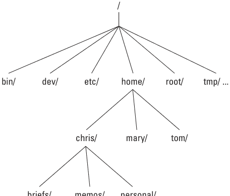

你可能感兴趣的一些 Linux 目录包括以下内容：

- `/bin` — 包含常用的 Linux 用户命令，如 `ls`, `sort`, `date` 和 `chmod`。
- `/boot` — 包含可引导的 Linux 内核和引导加载程序配置文件 `GRUB`。
- `/dev` — 包含代表系统设备访问的文件。这些包括终端设备 (`tty*`)、软磁盘 (`fd*`)、硬盘 (`hd*`)、内存 (`ram*`) 和光光驱器 (`cd*`)。（用户通常通过设备文件直接访问这些设备）。
- `/etc` — 包含管理配置文件。
- `/home` — 包含分配给每个登录账户用户的目录（root 用户除外）。
- `/media` — 为挂载和自动挂载设备提供标准位置，例如远程文件系统和可移动介质（目录名为 recorder、floppy 等）。
- `/mnt` — 在被标准的 `/media` 目录取代之前，它是许多设备的常用挂载点。某些可引导的 Linux 系统仍然仍使用此目录来挂载硬盘和分区文件系统。
- `/proc` — 包含有关系统资源的信息。
- `/root` — 代表 root 用户的主目录。出于考虑，root 的主目录并不位于 `/home` 下。
- `/sbin` — 包含管理命令和守护进程进程。

## 第三部分

# 学习系统管理技能

- `sys` — 一种类似于 `proc` 的文件系统，在 Linux 2.6 内核中引入，旨在包含获取硬件状态的文件，并反映内核所看到的系统设备树。它从 `/proc` 继承了许多功能。
- `tmp` — 包含应用程序使用的文件。
- `usr` — 包含用户文档、游戏、图形文件 (`X11`)、库 (`lib`) 以及各种其他用户和管理命令及文件。
- `var` — 包含各种应用程序使用的数据目录。特别是，你可以在这里放置作为 FTP 服务器 (`/var/ftp`) 或 Web 服务器 (`/var/www`) 分的文件。它还包含日志文件 (`/var/log`) 和池文件 (`/var/spool`，如邮件、cups 和新闻)。

DOS 或 Microsoft Windows 操作系统的文件系统与 Linux 的结构不同，正如“Linux 文件系统与 Windows 文件系统”侧边栏解释的那样。

# Linux 文件系统对比 Windows 文件系统

尽管在许多方面，Linux 文件系统与 MS-DOS 和 Windows 操作系统使用的文件系统存在显著差异。以下是几点：

- 在 MS-DOS 和 Windows 文件系统中，驱动器号代表不同的存储设备（例如 A：软磁盘，C：硬盘）。在 Linux 中，所有存储设备都位于文件系统层次结构中。因此，`/usr` 可能位于单独的硬盘或 `/mnt/rem` 是来自另一台计算机的文件系统，这对于用户来说是不可见的。
- Linux 使用斜杠 `/` 而不是反斜杠 `\` 来分隔目录名。因此，`C:\home\chris` 在 Linux 中是无效的。
- 文件名在 DOS 中也有后缀（例如文本文件的 `.txt`，文字处理文件的 `.doc`）。在 Linux 中你有时可以使用这一点，但识别文件类型时三字符后缀没有强制含义。Linux 应用程序和桌面环境使用文件后缀来定义文件内容。在 Linux 中，DOS 命令扩展如 `.com`、`.exe` 和 `.bat` 并不表示可执行文件（权限位决定了 Linux 文件的可执行性）。

Linux 系统中的每个文件和目录都有相关的权限和所有权。微软系统的安全性各不相同。由于 DOS 和 MS Windows 最初是单用户系统，因此在设计时，这些系统中并没有内置文件所有权功能。随后的版本添加了文件和文件夹属性等功能来解决这个问题。

# 创建文件和目录

作为 Linux 用户，你保存的大多数文件可能都在你的主目录下。表 9-8 显示了创建和使用文件及目录的命令。

## 创建和使用文件的命令

| 命令 | 结果 |
|---|---|
| `cd` | 切换到另一个目录。 |
| `pwd` | 当前（或所在）工作目录的名字。 |
| `mkdir` | 创建目录。 |
| `chmod` | 更改文件或目录的权限。 |
| `ls` | 列出目录的内容。 |

以下步骤将引导你如何在你的主目录下创建目录并移动目录，并提到了设置适当的文件权限：

1. 回到你的主目录。要这样做，只需输入 `cd` 即可。（有关引用你主目录的其他方法，请参见“识别目录”侧边栏）。
2. 为了确保你在主目录下，输入 `pwd`。当我执行此操作时，会得到以下响应（你的响应将反映你的主目录）：
3. 在你的主目录下按照如下操作创建一个新目录 `test`：

```bash
$pwd
/home/chris
```

```bash
$ mkdir ld test
drwxr-xr-x 2 chris sales 1024 Jan 24 12:17 test
```

检查目录的权限：

此列表显示 `test` 是一个目录 (`d`)。`d` 后面跟着权限 (`rwxr-xr-x`)，这些将在稍后的“理解文件权限”部分解释。其余信息表示了所有者 (`chris`) 和组 (`sales`)。

4. 若要更改目录的权限，请使用 `chmod` 命令。例如，要给组组写入权限，你会输入：

```
$ chmod 775 test
```

*注：原文后续部分存在大量重复的命令片段和断句，已根据技术文档逻辑进行整合翻译以确保语义通顺。*

在第一个示例中，任何以 a、b 或 w 开头的文件都会匹配。在第二个示例中，任何以 a、g 或 w 开头且以 n 或 e 结尾的文件都会匹配。你还可以在中括号内包含范围。例如：

```
$ ls [-a-g]*
apple banana grapefruit
```

在这里，任何以 a 到 g 之间的任意字母开头的文件名都会匹配。

## 使用文件重定向元字符

命令从标准输入（stdin）接收数据并将其发送到标准输出（stdout）。使用管道（之前已描述过），你可以将一个命令的标准输出重定向到另一个命令的标准输入。对于文件，你可以使用 `less` (`<`) 和 `greater` (`>`) 将数据重定向到或从文件。以下是文件重定向：

- `<` 将文件内容重定向到命令。在大多数情况下，这是命令期望的默认操作，该命令是可选的；使用 `less file` 等同于 `less bigfile`。
- `>` 将命令的标准输出重定向到文件，并删除现有文件。
- `>` 将标准错误（错误消息）重定向到文件。
- `>>` 将标准输出和标准错误都重定向到文件。
- `>>` 将命令的输出重定向到文件，并将输出添加到现有文件的末尾。

以下是一些信息在文件与之间进行重定向的命令行示例：

```
$ mail root < ~/.bashrc
$ man chmod | col b > /tmp/chmod
$ echo "I finished the project on $(date)" >> ~/projects
```

在第一个示例中，主目录下的 `.bashrc` 内容被发送给计算机的 root 用户的消息。第二个命令格式化了 `chmod` 页面（使用 `man` 命令），删除了多余空格（`col -b`），并将输出发送到文件 `/tmp/chmod`（如果 `/tmp/chmod` 文件存在，则将其删除）。最后一个命令的结果是将文本添加到用户的项目中：

> I finished the project on Jan 24 13:46:49 2009

另一种重定向类型被称为“在此处文档”（here document），它允许你输入可以作为命令标准输入的文本。在此处文档涉及在命令后输入两个小于号（`<<`），然后跟一个单词。在该单词之后的所有输入内容都会被视为用户输入，直到该单词再次出现。这是一个示例：

```
$ mail root cnegus rjones bdecker <<etext
> I want to tell everyone that there will be a 10 am
> meeting in conference room B. Everyone should attend.
> - James
> etetext
```

此示例向 root、cnegus 和 rjones 用户名发送了消息。`<<etext` 和 `etext` 之间的文本包含了消息的内容。文档通常配合文本编辑器用于从脚本创建或添加文件：

```bash
/bin/ed /etc/resolv.conf <<resendit
a
nameserver 100.100.100
```

由 root 用户添加到脚本的行通过 `ed` 文本编辑器将 DNS 服务器的 IP 地址添加到 `/etc/resolv.conf` 文件。

## 理解文件权限

在使用 Linux 一段时间后，你一定会遇到“Permission denied”（拒绝访问）的消息。Linux 中与文件和目录关联的权限旨在防止用户访问他私有文件并保护重要的系统文件。

分配给每个文件的九位定义了你和其他对该文件的权限。普通文件的权限权限显示为 `-rwxrxr-x-`。

> 对于普通文件，权限名前面会出现一个连字符。你还可能会看到 `d`（代表目录）、`l`（代表链接）、`b`（代表字符设备）或 `c`（代表字符设备）。

在这九位中，前三位适用于所有者权限，接三位适用于组权限，最后三位适用于所有人。`r` 代表读（read），`x` 代表执行（execute）。如果用连字符代替字母，则意味着该相关的读、写或执行权限已关闭。

由于文件和目录是不同类型的元素，读、写、执行权限在文件和目录上的含义不同。表 9-9 解释了你对每种权限可以做什么。

## 第三部分学习系统管理技能：`ls -1d` 命令。

| 表 9-9 | 设置读、写和执行权限 | |
| :--- | :--- | :--- |
| 权限 | 文件 | 目录 |
| 读 (Read) | 查看文件内容。 | 查看其包含哪些文件和子目录。 |
| 写 (Write) | 修改文件内容、重命名或删除它。 | 向目录添加文件或子目录。 |
| 执行 (Execute) | 将文件作为程序运行。 | 切换到该目录作为当前目录、遍历目录或从该目录执行程序。 |

你可以通过输入 `ls -1d` 命令查看任何文件或目录的权限。命名的文件或目录显示如示例所示：

```
$ ls -1d ch3 test
-rw-r--r 1 chris sales 4983 Jan 18 22:13 ch3
-drwx-xr-x 2 chris sales 1024 Jan 24 13:47 test
```

第一行显示 `ch3` 文件对所有者和组具有读、写权限。所有其他用户都有读权限，这意味着他们可以查看文件但不能更改其内容或将其删除。第二行显示 `test` 目录（由 `d` 表示）。所有者具有读、写、执行权限，组和其他人具有读执行权限。

你可以通过输入 `ls -1d` 命令查看任何文件或目录的权限。命名的文件或目录显示如示例所示：

```
$ ls -1d ch3 test
-rw-r--r 1 chris sales 4983 Jan 18 22:13 ch3
-drwx-xr-x 2 chris sales 1024 Jan 24 13:47 test
```

第一行显示 `ch3` 文件对所有者和组具有读、写权限。所有其他用户都有读权限，这意味着他们可以查看文件但不能更改其内容或将其删除。第二行显示 `test` 目录（由 `d` 表示）。所有者具有读、写、执行权限，组和其他人具有读执行权限。

## 在 Shell 中运行命令

你也可以使用 `+` 和 `-` 符号开启或关闭权限。这可以针对所有者 (`u`)、组 (`g`)、其他人 (`o`) 以及所有用户 (`a`)。例如，从文件中关闭所有权限：

```
chmod -w file      rw-xrx
chmod -o file      rw--x
chmod -a file      rw-xrx
```

当你创建一个文件时，默认赋予 `rw-r--`。目录默认赋予 `rx-xr`。默认值由 `umask` 决定。使用 `umask` 查看你的 `umask`。例如：

```
$ umask
022
```

`umask` 掩码了文件的 666 权限和目录的 777 权限。022 的 umask 值导致目录权限变为 755 (`rw-xr-x`)。同样的 `umask` 导致文件权限变为 644 (`rw-r--`)。

提示：使用 `chmod` 的 `R` 选项一次更改目录内所有文件和目录的权限。例如，如果你想完全打开 `/tmp/test` 目录下所有文件和目录的权限，你可以使用：

```
$ chmod -R 777 /tmp/test
```

此命令对 `/tmp/test` 目录递归运行 `chmod (-R)`，以及该文件系统中该点下的任何文件或目录。全部设置为 777（完全读、写、执行权限）。你不会在读写文件系统上的重要目录上这样做。但是，你可能会在 CD-ROM 上创建一个完全可以执行的目录结构之前这样做。

注意：`chmod` 的 `R` 选项只有在你完全打开权限或添加执行权限（作为相应的读/写权限）时才有效。这是因为如果你递归关闭执行权限，将失去更改该结构中任何目录的能力。例如，对所有权限关闭执行权限：

```
chmod -R 644 /tmp/test
```

## 移动、复制和删除文件

移动、复制和删除文件的命令非常直观。要更改文件的位置，使用 `mv` 命令。要将文件从一个位置复制到另一个位置，使用 `cp` 命令。要删除文件，使用 `rm` 命令。是一些示例：

```
$ mv abc def
$ mv abc -
$ cp abc def
$ cp abc -
$ rm abc
$ rm *
```

在两个移动 (`mv`) 命令中，第一个是将文件 `abc` 移动到同一目录下的文件 `def`（本质上是重命名），而第二个是将文件 `abc` 移动到你的主目录 (`-`)。复制命令 (`cp`) 将 `abc` 复制到同一目录下的文件 `def`，而第二个复制命令则复制当前目录下的所有文件（以点为开头的文件除外）。

> 对于 root 用户，`mv`、`cp` 和 `rm` 命令被设置了别名以带有 - 参数运行。这将导致提示符，要求你逐个确认每次移动、复制和删除文件，以防止 root 用户误删大批量文件。

`mv` 的另一种替代方案是使用 `-b` 选项。使用 `-b` 时，如果目标位置已存在同名文件，在移动新文件之前会创建一个该文件的备份副本。

## 使用 vi 文本编辑器

在 Linux 中使用一段时间，几乎不可能不需要文本编辑器。这是因为大多数 Linux 配置文件都是纯文本，你几乎肯定会在某个时刻需要手动修改它们。

如果你在使用图形用户界面 (`GUI`)，可以运行 `edit`，这是一个简单的文本编辑器。大多数 Linux 用户会使用 `vi` 或 `emacs` 命令来编辑文本文件。`vi` 或 `emacs` 相比图形编辑器的优势在于，你可以从任何 shell、字符终端或通过网络进行的字符连接（例如使用 `telnet` 或 `ssh`）使用它们——不需要 GUI。它们还包含了大量功能，因此你可以随着它们不断进步。

本节提供了关于 `vi` 文本编辑器的简要教程，你可以用它从任何 shell 手动编辑配置文件。（如果 `vi` 不符合你的需求，请参阅“探索其他文本编辑器”侧边栏获取其他选项。）

这个编辑器起初很难学，但一旦你学会了，就再也不需要使用鼠标或功能键了——只需使用键盘即可在文件内快速高效地编辑和移动。

## 探索其他文本编辑器

Linux 提供了几十种可用的文本编辑器。以下是你的 Linux 发行版中可能包含的几个，如果你觉得 `vi` 太费劲，可以尝试一下。

| 文本编辑器 | 说明 |
|---|---|
| `nano` | 一种流行的、精的文本编辑器，用于许多可启动的 Linux 和其他空间有限的 Linux 环境。例如，`nano` 可以在 Gentoo Linux 安装过程中用于编辑文本文件。 |
| `gedit` | 运行在 GUI 中的 GNOME 文本编辑器。 |
| `jed` | 这种面向屏幕的编辑器是为程序员设计的。`jed` 使用颜色可以高亮你创建的代码，以便你轻松地阅读代码和语法错误。按 Alt 键选择菜单来操作文本。 |
| `joe` | `joe` 编辑器与许多 PC 文本编辑器类似。使用控制 键和方向键移动。按 Ctrl+C 不保存退出，或按 Ctrl+X 保存并退出。 |
| `kate` | 带有基础包的精美编辑器。它有许多花哨，例如针对不同编程语言的高亮显示，以及管理自动换行的控制。 |
| `kedit` | 带有 KDE 桌面面的基于 GUI 的文本编辑器。 |
| `mcedit` | 使用 `mcedit`，功能键可以帮助你导航以及保存、复制、移动和删除文本。像 `jed` 和 `joe` 一样，`mcedit` 是面向屏幕的。 |

如果你使用 `ssh` 登录网络上的其他 Linux 计算机，可以使用任何编辑器编辑文件。基于 GUI 的编辑器会出现在你的屏幕上。在没有 GUI 的情况下，你需要一个运行在 shell 中的的文本编辑器，如 `vi`、`jed` 或 `joe`。

## 开始使用 vi

通常情况下，你启动 `vi` 是为了打开特定的文件。例如，要打开名为 `/tmp/test` 的文件，执行以下命令：

```
$ vi /tmp/test
```

## 第三部分学习系统管理技能

如果这是一个新文件，你应该会看到类似下面的内容：

```
~~

~

~~

"tmp/test" [New File]
```


顶部的框表示你的光标所在的位置。底部的一行让你了解编辑器正在发生什么（这里你只是打开了一个新文件）。在中间有波浪号 (`~`) 作为填充符，因为文件中还没有文本。现在是到了令人生畏的部分：没有提示、菜单或图标来告诉你该做什么。不仅如此，你不能直接开始打字。如果你这样做了，你的电脑可能会对你响叫。有些人抱怨 Linux 不够友好。

你首先需要知道不同的运行模式：命令模式和输入模式。编辑器以命令模式启动。在向文件中添加或更改文本之前，你需要输入一个命令（一个或两个字母以及可选的数字）来告诉 `vi` 你想做什么。大小很重要，请按示例所示使用大写或小写！要进入输入模式，输入一个输入命令。开始时，输入以下任意一个：

- `a` — 命令。之后，你可以在光标右侧输入文本。
- `i` — 插入命令。在其之后，你可以输入文本。

要返回命令模式，按 `Esc` 键。在命令模式下，你可以使用各种命令移动和编辑文本。

- `h` — 光标向左移动一位。
- `l` — 光标向右移动一位。
- `j` — 光标向下移动一行。
- `k` — 光标向上移动一行。
- `w` — 光标移动到下一个单词开头。
- `b` — 光标移动到单词开头。
- `0` — 光标移动到行首。
- `$` — 光标移动到行尾。
- `H` — 光标移动到屏幕顶部。
- `G` — 光标移动到屏幕底部。
- `M` — 光标移动到屏幕中间。

- `x` — 删除光标下的字符。
- `X` — 删除光标前的字符。
- `dw` — 从光标删除到单词结束。
- `d$` — 从光标删除到行尾。
- `d0` — 从光标删除到行首。

- `ZZ` — 保存并退出。
- `:w` — 保存文件但继续编辑。
- `:wq` — 等于 `ZZ`。
- `:q` — 退出文件（仅在没有未保存更改时有效）。
- `:q!` — 退出文件并丢弃更改。

- `u` — 撤销上一次更改。
- `Ctrl+R` — 重做上一次撤销的更改。

- `:command` — 在 `vi` 中运行 shell 命令。例如，`:date` 或 `:jobs`。

# 第三部分 学习系统管理技能

来自 shell 的命令，然后输入 `exit` 返回到 `vi`。（我建议在退出 shell 之前先保存一下，以防你忘记返回 `vi`。）

- `Ctrl+G` — 如果你正在编辑文件，按下这些键会在屏幕底部显示你正在编辑的文件名以及当前所在的行号。它还会显示文件的总行数、你已经阅读了文件的百分比，以及光标所在的列数。这可以帮助你在凌晨 3 点停下来喝完咖啡后，重新找回状态。

## 在文件中移动

除了前面描述的几个移动命令外，还有其他在 `vi` 文件中移动的方法。要尝试这些方法，请打开一个你不会损坏的大文件（尝试查看 `/var/log/` 消息并用 `vi` 打开它）。以下是一些你可以使用的移动命令：

- `Ctrl+F` — 向前翻页，每次一页。
- `Ctrl+B` — 向后翻页，每次一页。
- `Ctrl+D` — 向前翻页半页。
- `Ctrl+U` — 向后翻页半页。
- `G` — 跳到文件的最后一行。
- `IG` — 跳到文件的第一行。（可以使用任何数字跳转到文件中的对应行）

## 搜索文本

要在文件中搜索下一次出现的文本，请使用斜杠 (`/`) 或问号 (`?`) 字符。在斜杠或问号后跟上模式（文本字符串），分别按模式向前或向后搜索。在搜索过程中，你也可以使用元字符。以下是一些示例：

- `/hello` 向前搜索单词 `hello`。
- `?goodbye` 向后搜索单词 `goodbye`。
- `/.foot` 向前搜索包含该单词的行，并且在该行之后的某个地方也包含单词 `foot` 的行。
- `?[p]Print` — 向后搜索 `print` 或 `Print`。记住 Linux 是区分大小写的，因此使用括号可以搜索可能具有不同大小写字母单词。

在你输入搜索术语后，只需输入 `/` 即可向前搜索该术语，或输入 `?` 向后搜索该术语。

该编辑器最初基于 `ex`，它不允许你在全屏模式下工作。然而，它确实允许你运行命令来一次查找并更改一行或多行的文本。

## 从 Shell 运行命令

当你输入冒号 `:` 时，光标会移动到底部，你实际上处于 `ex` 模式。以下是一些搜索和更改文本的示例。（我选择了 `Local` 和 `Remote` 作为搜索词汇，但你可以使用任何合适的单词。）

- `:g/Local` — 搜索单词 `Local` 并打印文件中每个出现该单词的行。（如果输出超过一屏，输出将通过管道传递给命令。）
- `:s/Remote` — 将当前行中的单词 `Local` 替换为 `Remote`。
- `:g/Local/s//Remote` — 将每行中第一个单词 `Local` 替换为 `Remote`。
- `:g/Local/s//Remote/g` — 将整个文件中每个出现的单词 `Local` 替换为单词 `Remote`。
- `:g/Local/s//Remote/gp` — 在整个文件中每个出现的单词 `Local` 替换为单词 `Remote`，然后逐行显示以便查看更改（如果输出超过一个页面，则通过管道传递给更多命令）。

## 在命令中使用数字

你可以通过在大多数命令前加上数字，来让命令重复执行指定的次数。这是一种一次性处理一系列行、单词或字符的方便方法。以下是一些示例：

- `3dw` — 删除下三个单词。
- `5cl` — 更改下五个字母（即删除字母并进入输入模式）。
- `12j` — 向下移动 12 行。

在大多数命令中放置数字只是重复这些命令。到此时，你应该已经相当熟练地使用 `vi` 命令了。一旦开始使用 `vi`，你可能会发现其他编辑器用起来没有那么高效。

> 注意 当你在许多 Linux 系统中调用 `vi` 时，你实际上是在调用 `vim` 编辑器，它在 `vi` 兼容模式下运行。进行大量编程的人可能更喜欢使用 `vim`，因为它用不同的颜色显示不同层级的代码。`vim` 还有其他有用功能，例如打开文档时，光标可以停留在上次退出该文件时所在的位置。

## 总结

在 Linux 的 shell 命令行中工作可能没有使用 GUI 那么简单，但它提供了许多强大且灵活的功能。本章解释了如何在 Linux shell 中穿梭，并提供了运行命令的示例，包括从历史列表中召回命令、补全命令以及合并命令。

本章描述了如何使用 shell 环境变量来存储和召回重要信息。它还教你如何修改 shell 配置文件以定制符合你需求的 shell。最后，本章向你展示了如何使用 Linux 文件系统创建文件和目录、使用权限以及处理文件（移动、复制和删除），以及如何使用 `vi` 命令从 shell 编辑文本文件。

# 第 10 章
## 学习基础管理

Linux 与其他基于 UNIX 的系统一样，旨在供多人同时使用。多用户功能允许许多人在单个 Linux 系统上拥有账户，并确保他们的数据不受他人干扰。多任务功能允许许多人在同一运行许多程序。

# 本章内容

- 执行图形化管理
- 使用 root
- 理解配置文件
- 创建用户账户
- 配置硬件
- 管理文件系统
- 监控性能

由于 Linux 管理是一个巨大的课题，本章侧重于 Linux 的通用原理。特别是，它检查了你管理所需的工具。除了基础知识外，本章还教你如何处理文件系统和监控性能。

## 图形化管理工具

许多 Linux 系统都带有简化的图形化管理工具。如果你是普通用户，这些工具通常允许你无需编辑配置文件或运行 shell 命令即可完成。

让我们查看一些可用的 Web 管理工具。

## 使用 Web 管理

许多开源项目都提供了基于 Web 的工具，以便普通用户访问。使用这些工具只需要一个 Web 浏览器（如 Firefox）、端口号和 root 密码。Samba 和 CU 等项目带有自己的管理工具。Webmin 是一个通过 Web 浏览器管理各种 Linux 系统的通用工具。

基于 Web 管理工具的优势在于你可以从熟悉的界面（你的 Web 浏览器）进行操作，并且可以远程访问。

> 某些 Linux 发行版带有自己的系列图形化管理工具（例如 SUSE 或 Red Hat 的 `system-config` 工具）。你通常应该使用发行版的工具，而不是项目自带的 Web 界面，因为发行版的工具与其功能的集成得更好。

CUPS — 通用 UNIX 打印服务 (`CUPS`) 拥有自己的 Web 管理工具。在安装并配置 `CUPS` 后，你通常可以在 Web 浏览器的地址栏中输入以下 URL 来使用 CUPS Web 管理：
`http://localhost:631`

你使用 CUPS 管理工具来管理打印机和类，并执行各种管理任务。CUPS 在第 15 章中进行了描述。

Samba 和 Mailman 包含在许多 Linux 发行版中。其他提供 Web 管理的项目可能包含或不包含在你的 Linux 发行版中，包括 SquirrelMail（一个 Web邮箱界面）和 Mailman（邮件列表设施）。

由于许多 Web 管理界面以明文发送数据，因此它们最适用于本地系统使用。然而，由于它们是基于 Web 的，你也可以从局域网（LAN）或其他网络使用这些界面。但是如果你计划将这些管理界面暴露给不可信的网络，你应该考虑对通信进行加密（例如，通过 SSH 隧道使用基于 Web 的管理工具）。

## Webmin 管理工具

Webmin 团队 (`www.webmin.com`) 提供更多基于 Web 的 Linux 和 UNIX 管理功能。尽管某些带有自带图形化管理工具的 Linux 系统（如 Fedora 和 RHEL）没有提供 Webmin，但 Webmin 项目已将 Webmin 移植到 70 多种不同的操作系统。支持的 Linux 发行版包括 SUSE、红帽 (`Fedora` 和 `RHEL`)、Debian、Ubuntu、Gentoo、Slackware、Mandriva、Yellow Dog 等（完整列表请参见 `www.webmin.com/support`）。

一旦你从 `Webmin.com` 获取并安装了 Webmin，你就可以通过 Web 浏览器使用 Webmin。要启动 Webmin 界面，在 Web 浏览器的地址栏中输入以下内容：

`http://localhost:10000`

以 root 身份登录后，将显示主 Webmin 页面，如图 10-1 所示。

## 不同发行版的图形化管理

有些人觉得他们离开了了熟悉的 Windows 系统进入 Linux 后，将一直受困于通过命令行完成一切。为了吸引更广泛的受众，商业级 Linux 发行版（如红帽企业 Linux 和 SUSE）创建了自己的系列图形化工具，为新的 Linux 用户提供一个易操作的切入点。以下章节描述了 Fedora 和红帽企业 Linux 的 `system-config` 以及 SUSE 的 YaST 图形管理工具。

## 第三部分学习系统管理技能

图 10-1

Webmin 提供了一个用于管理 Linux 的 Web 浏览器界面。

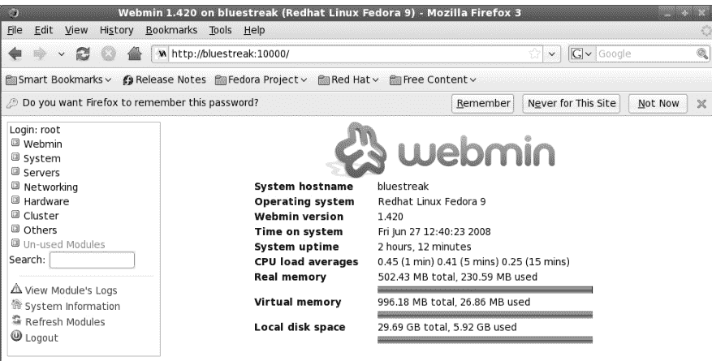

## Fedora/RHEL 配置工具

Fedora 和红帽企业 Linux 系统的图形工具集可以从“系统”菜单下的“管理”子菜单启动或从命令行启动。大多数启动命令行的 Fedora 和 RHEL 工具都以 `system-config` 字符串开头（例如 `system-config-network`）。

这些管理任务需要 root 权限；如果你以普通用户登录，必须在打开的 GUI 窗口中输入 root 密码。输入密码后，大多数系统配置工具将运行，而无需在本次登录会话期间重新输入密码。面板右上角的黄色徽章表示你拥有 root 授权。点击该徽章可以弹出一个窗口，允许你移除授权。否则，当关闭 GUI 窗口时，授权将消失。

以下列表描述了你可以使用的许多用于管理 Fedora 或红帽 Linux 系统的图形工具。这些窗口从“系统”菜单的“管理”子菜单打开。获取该功能必须安装的包名称显示在括号中。

> 注意：列表中描述的选项是否可用取决于你安装了哪些功能。

- 添加/删除软件 (`PackageKit`) — 启动“添加/删除软件”窗口，用于查找、添加和删除与为你系统配置的软件库相关的软件。

- 服务器设置 — 从此子菜单访问以下服务器配置窗口：

  - 域名系统 (`system-config-bind`) — 如果你的计算机正作为 DNS 服务器运行，则创建并配置区域。
  - HTTP (`system-config-httpd`) — 将你的计算机配置为 Apache Web 服务器。
  - NFS (`system-config-nfs`) — 设置你的系统目录，通过 NFS 服务在网络上与其他计算机共享目录。
  - Samba 名称 (`system-config-samba`) — 配置 Windows (SMB) 文件共享。（要配置其他功能，你可以使用 SWAT 窗口）。
  - 服务 (`system-config-services`) — 从“服务配置”窗口显示并更改你的系统在不同层级上运行的服务。
  - 身份验证 (`authconfig-gtk`) — 更改用户在系统上的身份验证方式。通常选择影子密码 (Shadow Passwords) 和 MD5 密码。如果你的系统支持 LDAP、Kerberos、NIS 或 Hesiod 身份验证，你可以选择这些身份验证类型之一。
  - 引导加载程序 — 如果你的计算机上有多个操作系统，或者在 Linux 中有多个内核要启动，你可以使用引导配置屏幕选择启动哪个。例如，你的硬盘上可能同时有 Fedora Linux、SUSE 和 XP。如果没有显式选择其中一个，你会选择哪一个自动启动（在几秒钟）？
  - 日期与时间 (`system-config-date`) — 设置日期和时间，或选择使用 NTP 服务器保持时间同步。
  - 显示 (`system-config-display`) — 更改你的 X 桌面设置，包括显示器的色彩深度和分辨率。
  - 防火墙和 SELinux (`system-config-firewall`) — 配置防火墙以允许或拒绝服务。
  - 键盘 (`system-config-keyboard`) — 选择使用的键盘类型。
  - 语言 (`system-config-language`) — 选择默认语言。
  - 逻辑卷管理 (`system-config-lvm`) — 管理 LVM 分区。
  - 网络 (`system-config-network`) — 管理网络接口。
  - 打印 (`system-config-printer`) — 配置本地和网络打印机。
  - Root 密码 (`system-config-root`) — 修改 root 密码。

第三部分 管理技能

- SELinux 管理 (`system-config-selinux`) — 设置 SELinux 模式和默认策略。
- SELinux 故障排除器 (`setroubleshoot-server`) — 监控 SELinux AVC。
- 声卡检测 (`system-config-soundcard`) — 尝试检测并配置声卡。
- 系统日志 (`gnome-utils`) — 查看并搜索日志文件。
- 用户与组 (`system-config-users`) — 添加、显示和更改用户组帐户。

为 Fedora 或红帽添加的其他应用程序可能包括位于“系统工具”子菜单下的实用程序。查看以下内容：

- 编辑 (`gnome-editor`) — 直接编辑 GNOME 配置数据库。
- 磁盘使用情况 (`gnome-utils`) — 显示有关硬盘和移动存储设备的详细信息。
- 启动引导 (`system-config-kickstart`) — 创建用于无交互安装系统的启动引导配置文件。
- 更新系统 (`PackageKit`) — 打开更新系统窗口以获取所有包的更新。

## SUSE Yaast 工具

YaST 是 SUSE Linux 最强大的特性之一。从 SUSE 桌面，通过选择“计算机”菜单下的 YaST 打开 YaST 控制中心。图 10-2 显示了 YaST 控制中心的示例。

YaST 在其“硬件”部分有一些实用工具，允许你探测计算机硬件。例如，在我的系统中选择“硬件信息”，可以看到光驱器通过设备 `/dev/cdrom` 检测到，并且它支持 CD-R、CD-RW 和 DVD 媒体。我还可以查看有关 CPU、网卡、PCI 设备、声卡以及各种存储媒体的详细信息。

YaST 提供配置和启动网络设备的接口，以及在这些设备上运行各种的服务。此外，你可以使用 YaST 将你的系统配置为文件共享（Samba 和 NFS）、邮件传输代理（`sendmail`）以及各种网络服务的客户端。

SUSE 企业版带有更广泛的配置工具，专门为服务器设置设计，包括用于邮件服务器、VPN 隧道和完整 Samba 3 的工具。虽然其他发行版可能包含专有工具，但 YaST 是独一无二的。

# 图 10-2

使用 YaST 控制中心管理 SUSE 系统。


## 使用 root 登录

每个 Linux 系统都至少包含一个管理用户账户（root 用户），并可能有一个或多个普通用户账户（由你指定的名称或由你的 Linux 发行版指定的名称）。在许多情况下，你以普通用户身份登录，然后变为 root 用户以执行管理任务。

root 用户控制你 Linux 系统的操作。该用户可以打开任何文件或运行任何程序。root 用户还安装软件包并为使用系统的其他人员添加账户。

## 学习系统管理技能

将 Linux 中的 root 用户类比 Windows 中的管理员（Administrator）。

当你首次安装大多数 Linux 系统时，会为 root 用户添加密码。你必须记住并保护这个密码——当你以 root 登录或在以其他用户登录时获取 root 权限，你需要它。其他 Linux 系统（如 KNOPPIX）启动时没有可用的 root 密码，因此你可能在启动时通过从终端或其他 Shell 输入以下内容来添加一个：

```bash
# passwd root
Changing password for root user.
New UNIX password: ********
Retype new password: ********
```

某些可启动的 Linux 发行版赋予了你（普通用户）以 root 身份运行的权限。你只需要请求使用 `sudo` 命令的权限。例如，在终端输入以下内容可以以 root 身份打开 shell：

```bash
$ sudo su -
#
```


你将在本章的稍后部分了解到更多关于 `sudo` 命令的信息。

`root` 的家目录通常是 `/root`。与 `root` 用户账户相关的家目录和其他信息位于 `/etc/passwd` 文件中。以下是 `/etc/passwd` 文件中 `root` 条目的样子：

```bash
root:x:0:0:root:/bin/bash
```

这显示对于名为 `root` 的用户，`UID` 被设置为 `0`（`root` 用户），组 ID 被设置为 `0`（`root` 组），对应的 shell 为 `/bin/bash`。（由于使用 `shadow` 密码文件来存储加密的密码数据，密码字段包含一个 `x`。）你可以通过编辑此文件中的值来更改家目录或 shell。然而，更改这些值的更好方法是使用 `usermod` 命令（参见本章中的“使用 usermod 修改用户”部分）。

默认情况下，Ubuntu 中的 `root` 账户是被禁用的。尽管该账户存在，但你无法登录或使用 `sudo` 变为 `root` 用户。这为 Ubuntu 增加了额外的安全性，并要求你在执行任何想以 `root` 身份执行的命令之前使用 `sudo`。

## 从 Shell 变为 root (sudo 命令)

虽然你可以通过以 `root` 登录来成为超级用户，但这并不方便。例如，你可能登录了一个普通用户账户，只想对系统进行快速的管理性更改，而无需注销并重新登录。或者，你可能需要通过网络登录对 Linux 系统进行更改，但发现系统不允许从网络连接 `root` 用户（这是在安全 shell 出现之前的常见做法）。

### 学习基础管理

解决方案是使用 `su` 命令。从任何终端窗口或 Shell，你只需输入以下内容即可：

```bash
$ su
Password: ********
#
```

当出现提示时，输入 `root` 用户的密码。普通用户的提示符 `$` 变为超级用户提示符 `#`。此时，你拥有完全权限来运行系统上的任何命令并使用任何文件。然而，`su` 命令在这种方式下没有使用 `root` 用户的环境。结果，你可能输入一个你已知可用的命令，却收到“Command Not Found”（未找到命令）的消息。要解决这个问题，请配合连字符选项 `--` 使用 `su` 命令，例如：

```bash
$ su -
Password: ********
#
```

你仍然需要输入密码，但在之后，`root` 用户登录时正常发生的一切都将在 `su` 命令完成后发生。你的当前目录将变为 `root` 的家目录（可能是 `/root`），并且将使用诸如 `root PATH` 变量等内容。如果你只是通过输入 `sudo` 而不是 `su --` 来变为 `root` 用户，你将不会更改当前登录会话的环境。

> 虽然 Ubuntu 极不建议使用 `root` 身份，但如果你使用 `sudo -i root` 命令并提供密码，也可以这样做。

你也可以使用 `su` 命令变为 `root` 以外的其他用户。这对于排查特定用户遇到但计算机上其他用户没有遇到的问题（例如无法打印或发送电子邮件）非常有用。例如，要获得名为 `smith` 的用户的权限，你输入：

```bash
$ su - jsmith
```


如果你之前是 root 用户，之后你将只拥有 smith 可用的打开文件和运行程序的权限。然而，作为 root 用户，在通过 `su` 命令变为另一个用户后，你不需要密码继续。如果你以普通用户身份输入该命令，则必须输入新用户的密码。

当你完成超级用户权限的使用后，返回之前的 shell。通过按 Ctrl+D 或输入 `exit` 来实现。如果你是多个用户可访问的计算机的管理员，不要在别人的电脑上留着 root shell（除非……）。

## 允许限制访问

如前所述，当你以普通用户身份登录时（来自 Fedora、SUSE 或其他 Linux 系统），在访问管理工具之前，会提示你输入 root 密码。在 Ubuntu 的情况下，root 授权对于桌面会话仍然可用。

你也可以赋予特定用户管理权限而无需成为 root。例如，系统管理员可以将用户添加到特定的组（如 modem、disk、cdrom、mail 或 www），然后在 `/etc/sudoers` 文件中添加条目。（参见后文对 sudo 的描述。）

- `wheel` 组在所有发行版中都存在。在 Ubuntu 中，不会自动创建它。

某些发行版提供的一种增加额外安全性的功能是增强型 Linux (`SELinux`)。在 `SELinux` 中，不是一个全能的 root ，而是定义多个角色来保护选定的文件和服务。这样，例如如果有人破解了你的 Web 服务器，他无法访问你的邮件服务器、用户密码或其他在计算机上运行的服务。

## 探索管理命令、配置文件和日志文件

无论使用哪种 Linux 发行版，可以在文件系统的相同位置找到许多命令、配置文件和日志文件。以下章节将提供查找这些元素的一些提示。

> 如果 Linux 的 GUI 工具如此出色，为什么你还需要了解配置文件呢？一方面，GUI 工具在 Linux 版本之间不同，而统一的配置是相同的。因此，如果你学习它们，就可以处理任何 Linux 系统。此外，当你寻求帮助、功能故障或需要执行 GUI 不支持的操作时，Linux 专家几乎都会告诉你直接修改配置文件。

## 管理命令

许多管理命令仅供 root 用户使用。当你以 root 登录（或从 shell 变为 root）时，你的 `$PATH` 变量设置为包含 root 用户命令的一些目录。使用以下：

- `/sbin` ——包含修改分区（如 `fdisk`）、检查文件系统（如 `fsck`）和更改系统状态（如 `init`）的命令。
- `/usr/sbin` —— 包含管理用户账户（如 `us`）和为自动挂载文件系统添加挂载点（如 `automount`）的命令。守护进程运行的命令也在此目录下。（寻找以 d 结尾的命令，如 `sshd`、`pppd` 和 `cupsd`）。

一些管理命令包含在普通用户目录中（例如 `/bin` 和 `/usr/bin`）。对于那些所有人都可以使用某些选项的命令来说，尤其如此。例如 `/bin/mount` 命令，任何人都可以使用它来列出已挂载的文件系统，但只有 root 用户可以使用 mount 挂载文件系统（然而，桌面环境配置通过向 `/etc/fstab` 文件添加关键字，允许普通用户使用 mount 挂载 CD、DVD 或或其他移动介质）。

> 请参考本章的“挂载文件”（Mounting Files）章节获取如何挂载文件系统的说明。

要查找主要供系统管理员使用的命令，请查看第 8 节手册页（位于 `/usr/share/man/man8`）。它们包含了大多数 Linux 管理级命令的描述和选项。

某些第三方应用程序会将管理命令添加到不在你的 `PATH` 中的目录中。例如，应用程序可能会将命令放在 `/usr/local/bin`、`/opt/bin` 或 `/usr/local/sbin` 中。某些 Linux 发行版会自动将这些目录添加到你的 `PATH` 中，通常位于你的标准 `bin` 和 `sbin` 目录之前。无论如何，安装在这些目录中的命令不仅可用，而且会覆盖其他目录中同名的命令。

## 管理配置文件

配置文件是 Linux 管理的另一支柱。你为特定计算机设置的几乎一切——用户账户、网络地址或 GUI 偏好——都存储在纯文本文件中。这有优点也有缺点。

纯文本文件的优点是容易阅读和修改。任何文本编辑器都可以。但缺点是在编辑配置文件运行时没有错误检查。你必须运行读取这些文件的程序（例如守护进程或 X 桌面）来确定你是否正确设置了文件。文件的结构没有标准，因此你需要学习每个单独文件的格式。文件在某些位置的注释或引用对整个界面都可能有用。

> 某些软件包提供了一个命令，在你启动程序之前测试配置文件的完整性。例如，`test-command` 用于 Samba 以检查 `.conf` 文件的完整性。在其他情况下，提供服务的守护进程提供了一个检查配置文件的选项。例如，在启动 Web 服务器之前，运行 `http -t` 来检查你的 Apache 服务器配置。

在本书中，你将找到需要设置以使 Linux 系统运行不同功能的配置文件的描述。配置文件的两个主要位置是你的家目录（存放你的个人配置文件）和 `/etc` 目录（存放系统级配置文件）。

以下是包含有用配置文件的目录（子目录）的描述。（请参考表 10-1 获取 `/etc` 中某些特别感兴趣的单个配置文件。）查看 Linux 配置文件的内容可以让你学会很多管理 Linux系统的知识。

## 学习系统管理技能

- `$HOME` — 所有用户都在家目录中存储信息，引导其登录账户的行为。`$HOME` 中的大多数配置文件以点（`.`）开头，因此当你使用标准 `ls` 命令时，它们不会出现在目录中（你需要输入 `ls -a` 才能看到它们）。同样，点文件和目录默认不会在文件管理器窗口中显示。有的文件定义每个用户的 shell 行为、桌面外观以及你的文本编辑器的选项。甚至还有像 `.ssh/` 和 `.hosts` 这样的文件。（在 shell 中输入 `echo $HOME` 来查看你的家目录名称）。
- `/etc` — 此目录包含所有基础 Linux 系统配置文件。表 10-1 显示了感兴趣的 `/etc` 配置文件。
- `/cron*` — 该组中的目录包含定义 cron 实用程序每日（`cron.daily`）、每小时（`cron.hourly`）、每月（`cron.monthly`）或每周（`cron.weekly`）计划运行应用程序的文件。
- `/etc/cups` — 包含用于配置 CUPS 打印服务的文件。
- `/etc/default` — 包含为各种工具设置默认值的文件。例如，`useradd` 文件定义了在创建新用户账户时使用的默认组号、家目录、密码过期日期、shell 和骨架（`/etc/skel`）。
- `/etc/httpd` — 包含用于配置 Apache Web 服务器行为（特别是 `httpd` 守护进程进程）的变量。在某些 Linux 系统上，使用 `/etc/apache2`。
- `/etc/init.d` — 包含系统运行级别（System-Run-level）脚本的永久副本。这些脚本从 `/etc/rc.d/` 目录链接进来，以便每个服务都与一个在特定运行级别启动或停止的脚本相关联。`#` 被替换为运行级别（0 到 6）。（Slackware 将其运行级别脚本放在 `/etc/rc.d` 目录中）。
- `/etc/mail` — 包含用于配置你的邮件发送服务的文件。
- `/etc/pcmcia` — 包含允许你为用户配置各种 PCMCIA 卡的配置文件。（PCMCIA 插槽是笔记本电脑上的这些开口，让你能够将信用卡大小的卡连接到计算机。你可以连接模块和外部 CD-ROM 等设备）。
- `/etc/postfix` — 包含 postfix 邮件代理的配置文件。
- `/etc/ppp` — 包含几个用于设置点点协议（PPP）的文件，以便你连接到互联网。
- `/etc/rc.d` — 每个有效的系统状态都有一个独立的 rc.d 目录：`rc0.d`（关机状态）、`rc1.d`（单用户）、`rc2.d`（多用户）、`rc3.d`（多用户网络）、`rc4.d`（用户定义状态）、`rc5.d`（多用户、网络）和 `rc6.d`（重启状态）。某些 Linux 发行版（如 Slackware）将大多数启动脚本直接放在 `/etc/rc.d` 而没有级别标记。
- `/etc/security` — 包含设置计算机各种安全配置的文件。这些文件是 pam（可插认证模块）包的一部分。
- `/etc/skel` — 当添加用户时，此目录中的任何文件都会复制到用户的家目录，例如 `.kde`（设置 KDE 默认值）和 `.bashrc`。
- `/etc/sysconfig` — 包含由各种服务（包括 `iptables`、`samba` 和大多数网络服务）创建和维护的重要系统配置文件。对于使用 GUI 工具的 Linux 发行版至关重要。
- `/etc/xinetd.d` — 一组文件，每个文件定义了一个接收特定端口的网络服务。当 `ineted` 守护进程接收请求时，它使用这些文件中的信息来确定由哪个进程处理请求。

## 感的 /etc 配置文件

| 文件 | 描述 |
| :--- | :--- |
| `aliases` | Linux 邮件服务使用的别名列表。（此文件可能位于 `/etc/mail/`） |
| `bashrc` | 为 bash shell 用户设置全局默认。（某些发行版称为 `bash_profile`。） |
| `crontab` | 设置运行自动化任务的环境 环境。 |
| `csh.shrc` (或 `cshrc`) | 为 csh (C shell) 用户设置全局默认。 |
| `exports` | 包含通过网络文件系统 (NFS) 由远程计算机共享的本地目录列表。 |
| `fstab` | 存储介质（硬盘、软盘、光驱等）设备及其在 Linux 系统中的挂载位置。这是使用 `mount` 命令在系统引导时选择要挂载的文件。 |
| `group` | 识别系统定义的组名和组 ID (`GID`)。Linux 中的组权限由关联到每个文件和目录的三组 rwx（读、写、执行）位中的第二组定义。 |
| `gshadow` | 组密码。 |
| `host.conf` | 设置 TCP/IP 网络（如互联网）上搜索域名（例如 redhat.com）的位置。默认情况下，首先搜索本地 hosts 文件，然后是 resolve.conf 中的名称条目。 |
| `hosts` | 包含从你的计算机可以访问的 IP 地址和主机名。（通常此文件仅用于存储局域网或小型私有网络上的计算机名称。） |

## 第三部分学习系统管理技能

| 表格 10-1 (续) |
| 文件 | 描述 |
| --- | --- |
| `hosts.allow` | 列出允许本地计算机使用某些 TCP/IP 服务的宿机。 |
| `hosts.deny` | 列出不允许本地计算机使用某些 TCP/IP 服务的宿机（尽管如果你创建了该文件它会被使用，但它默认并不存在）。 |
| `inittab` | 包含定义 Linux 在启动、关机或进入不同状态时启动哪些程序以及何时启动的信息。这是启动 Linux 最基础的配置文件。 |
| `lilo.conf` | 设置启动计算机的引导加载程序 (`lilo`) 参数。特别是，它列出了你计算机上可启动的分区信息。（如果你的发行版使用 GRUB 引导加载程序，你可能看不到此文件。） |
| `modules.conf` | 包含与你计算机使用的可加载内核模块相关的别名和选项。 |
| `mtab` | 包含当前挂载的系统列表。 |
| `mtools.conf` | 包含 Linux 中 DOS 工具使用的设置。 |
| `named.conf` | 如果你运行 DNS 服务器，则包含 DNS 设置。 |
| `ntp.conf` | 包含运行网络时间协议 (`NTP`) 所需的信息。 |
| `passwd` | 存储系统中所有有效用户的帐户信息。还包括其他信息，如主目录和默认 shell。（很少包含用户密码本身，密码通常存储在 `/etc/shadow` 文件。） |
| `printcap` | 包含你计算机打印机的定义。如果 `printcap` 文件不存在，请在 `/etc/cups` 目录中查找打印机信息。 |
| `profile` | 为所有用户设置系统级环境和启动程序。该文件在用户登录时读取。 |
| `protocols` | 为各种 Internet 服务设置协议号和名称。 |
| `resolv.conf` | 识别用于 TCP/IP 将主机.域名 转换为 IP 地址的 DNS 服务器位置。（当 Web 浏览器或邮件客户端查找互联网站点时，它们会检查此文件中列出的服务器以定位该站点。） |
| `rpc` | 定义远程过程调用和数字。 |
| `services` | 定义 TCP/IP 和 UDP 服务及其端口分配。 |

## 学习基础管理

| 文件 | 描述 |
| --- | --- |
| `shadow` | 包含 `passwd` 文件定义用户的加密密码。（这被认为是比 `passwd` 文件中原始加密密码更安全的存储密码的方法。`passwd` 文件需要所有人可读，而 `shadow` 文件除 root 用户外所有人均不可读。） |
| `shells` | 列出系统中可用的命令行解释器（bash、csh 等）及其位置 |
| `sudoers` | 设置用户可以使用 `sudo` 命令运行的命令，而这些用户在其他情况下可能没有运行这些命令。特别是特别是此文件用于为选定的用户提供 root 权限 |
| `syslog.conf` | 定义 `syslog` 守护进程收集哪些日志消息以及它们存储在哪些文件中。（通常，日志消息存储在 `/var/log` 目录下的文件中。） |
| `termcap` | 列出终端定义，以便基于字符的应用程序知道给定终端支持哪些功能。图形终端和应用程序已使此文件对大多数人来说过时了。（Termcap 是用于存储信息的 BSD Unix；Unix System V 在 `/usr/share/terminfo` 文件中定义。） |
| `xinet.conf` | 包含 `xinet` 守护进程（daemon process）使用的简单配置信息。此文件指向 `/etc/xinet.d` 目录以获取各个服务的信息。（某些系统使用 `inet.conf` 文件和 `inet` 守护进程。） |

另一个目录 `/etc/X11` 包含子目录，每个目录都包含 X 和 Linux 的不同窗口管理器使用的系统级配置。`xorg.conf` 文件（使你的计算机和显示器可以使用 X）以及用于用于 `xdm` 和 `xinit` 启动 X 的配置文件就在这里。

与窗口管理器相关的目录包含用户在你的系统上启动这些窗口管理器时将获得的默认值。在这些目录中可能具有系统级配置文件的窗口管理器有 Twm (`dwm/`) 和 Xfce (`xdg`)。

> 注意：`/etc/X11` 中的某些文件和目录位于 `/usr/X11R` 目录。

## 管理日志文件

Linux 擅长的事情之一就是跟踪这些情况。这是一件好事，但当你操作一个复杂的操作系统时也是。有时你正尝试让一个新功能工作，但它失败了且没有给你最清晰的原因。其他时候，你想监控系统查看是否有人尝试非法访问你的计算机。在任何情况下，你都可以使用日志文件帮助追踪问题。

Linux 用于记录错误和调试消息的主要工具是 `syslog` 和 `klogd` 守护进程。常规系统日志由 `syslog` 完成。日志根据 `/etc/syslog.conf` 文件中的信息进行记录。消息通常被重定向到通常位于 `/var/log` 目录下的日志文件中。以下是一些日志文件：

- `boot.log` — 包含服务启动时的引导。
- `messages` — 包含关于系统的通用信息消息。
- `secure` — 包含安全相关的消息，例如登录活动。
- `XFree86.log` 或 `Xorg.log` — 取决于你使用的 X 服务器，包含关于显卡、鼠标和显示器配置的消息。

如果你使用的是 Fedora 系统，系统查看器（System Viewer）工具是查看日志的好方法。对于其他系统，你可以直接检查文件。

## 使用 sudo 和其他登录

给任何用户提供限制权限的方法是设置 sudo 设施，这简单涉及将用户添加到 `/etc/sudoers` 并定义你想让该用户拥有的权限。用户就可以在命令前加上 `sudo` 来运行任何他有权使用的命令。

这里有一个如何使用 sudo 设施使任何添加到 `wheel` 组的用户具有完全 root 权限的示例。

# 第三部分学习系统管理技能

- 3. 保存对 `/etc/sudoers` 文件的更改（在 vi 中，按 Esc 键，然后输入 ZZ）。
- 4. 仍然以 root 用户身份，使用 `vigr` 命令打开 `/etc/group` 文件，并在 `wheel` 行中添加任何你希望拥有 root 权限的用户。如果你想将用户 mary 和 jane 添加到 wheel 组，该行将显示如下：

```
wheel:x:10:root,mary,jake
```

现在，mary 和 jane 可以运行 `sudo` 命令来执行那些通常限制为 root 用户的命令或部分命令。以下是用户在被分配 sudo 权限后的会话示例：

```
[jake]$ sudo mount /mnt/win
```

我们相信你已经接受了本地系统管理员的常规指导。这通常归结为以下两点：

- #1 尊重他人的隐私。
- #2 在输入之前先思考。

```
Password: ************

[jake]$ sudo umount /mnt/win

mount: only root user can mount /dev/sda1 /mnt/win

[jake]$ sudo mount /mnt/win

[jake]$
```


在此会话中，用户 `jake` 运行 `sudo` 命令来卸载 `/mnt/win` 文件系统（使用 `omit` 命令）。他收到了一个警告并被要求提供密码（这是 `jake` 的密码，而不是 `root` 密码）。

即使 `jane` 提供了密码，他仍然必须使用 `sudo` 命令来以 `root` 身份运行后续的管理命令（挂载失败了，但 `sudo` 执行成功了）。注意，第二次执行时没有提示输入密码，因此他可以在接下来的 5 分钟内输入任意数量的 `sudo` 命令而无需再次输入（你可以通过设置 `/etc/sudoers` 文件中的 `passwd_timeout`，将超时值从 5 分钟更改为你需要的任何长度）。

前面的示例为你放入 `wheel` 组的每一个人都授予了简单的“全有或全无”权限。然而，`/etc/sudoers` 在允许单个用户和用户组使用单个应用程序或程序组方面提供了极大的灵活性。请参考 `sudoers` 和 `sudo` `man` 页面获取有关如何调优你的 `sudoset` 的信息。参考 `pam_wheel` 页面查看 `PAM` 设施是如何影响 `wheel` 组成员的。

# 管理你的 Linux 系统

在安装完 Linux 后，你的系统管理员职责并没有结束。如果有多个人在使用你的 Linux 系统，你作为管理员，必须为每个人提供他们自己的登录账户。你将使用 `add` 和相关命令来添加、修改和删除用户账户。

配置硬件是你的职责清单之一。当你向 Linux 计算机添加硬件时，硬件会被检测并自动配置。在某些情况下，硬件可能没有正确设置，你将使用 `ismod`、`modprobe`、`insmod` 和 `rmod` 等命令来配置正确的模块以使硬件工作。

> 注意：驱动程序是永久构建在内核中的代码，允许应用程序与特定的硬件通信。模块类似于驱动程序，但它是按需加载的。本章稍后的“配置硬件”部分包含了有关使用这些命令配置模块的信息。

管理文件和磁盘空间也是你的责任。你必须跟踪正在消耗的磁盘空间，特别是当你的 Linux 系统被多个用户共享时。在某个时刻，你可能需要添加硬盘，或跟踪是什么占用了你的磁盘空间（使用 `find` 等命令来完成）。

你的职责还包括监控系统性能。你的系统中可能存在一个失控进程，或者你可能正经历性能缓慢。Linux 自带的工具可以帮助确定消耗了多少 CPU 和内存。

这些任务在本章的剩余部分将探讨。

# 创建用户账户

每个使用你 Linux 系统的人都应该有一个单独的用户账户。拥有用户账户可以为每个人提供一个存储文件的区域，并提供一种定制其用户界面（GUI、路径、环境变量等）的方法，以适应他们使用的方式。

你可以通过多种方式向大多数 Linux 系统添加用户——例如，Fedora 和 Red Hat Linux 系统使用 `system-config-users` 工具，SUSE 在 YaST 中提供了用户设置模块。本章描述了如何使用 `useradd` 从命令行添加账户，因为大多数 Linux 系统都包含该命令（在某些情况下，Linux 系统会有名为 `useradder` 的类似命令）。

# 使用 useradd 添加用户

从 shell 创建新用户直接的方法是使用 `useradd` 命令。打开具有 root 权限的终端窗口后，只需在命令行提示符处调用 `useradd` 并将新账户的详情作为参数。

# 第三部分 学习系统管理技能

所需的参数是用户的登录名，但你可能想在此包含一些额外信息。每项账户信息之前都有一个带连字符的单字母选项代码。表 10-2 列出了 `useradd` 可用的选项。

表 10-2

| 选项 | 说明 |
| --- | --- |
| `-c comment` | 为新用户账户提供描述。通常是该人的全名。用 "comment here" 替换为用户账户的注释 (-c Jake)。使用引号输入多个单词 (-c "Jake Jackson")。 |
| `-d home_dir` | 为账户设置主目录。默认值与登录名相同并放置在 `/home` 中。将 `home_dir` 替换为目录名称（例如 |

# 学习基础管理

| 选项 | 说明 |
| --- | --- |
| `-p password` | 为账户输入一个加密的密码。 |
| `-s shell` | 指定账户的 shell。 |
| `-u userid` | 指定账户的数字用户 ID。 |
| `-g group` | 指定账户的主组。 |
| `-G groups` | 指定补充组。 |
| `-c comment` | 为账户提供描述。 |
| `-d home_dir` | 为账户设置主目录。 |

例如，让我们创建一个名为 `mary` 的用户。首先，使用以下命令：

```
useradd -g users -G wheel,apache -s /bin/bash -c "Mary Smith"
```

在这种情况下，`useradd` 被指示将 `users` 作为主组，加入 `wheel` 和 `apache` 组，并将 `bash` 指定为 shell。这产生类似于下面的行：

```
mary:x:502:100:Mary Smith:/home/mary:/bin/bash
```

`/etc/passwd` 文件代表用户账户记录。每个字段由冒号 (`:`) 分隔。你可以看到，名称第一个。字段包含 `x`，因为我们使用 `shadow` 文件存储密码数据。`useradd` 创建的用户 ID 是 502。主组 ID 是 100，对应 `/etc/group` 文件中的 `users` 组。注释字段正确设置为 Mary Smith，主目录自动分配为 `/home/mary`，shell 被分配为 `/bin/bash`，完全按照 `useradd` 选项指定的。

通过省略某些选项（正如我在第一个 `useradd` 示例中所做的那样），大多数情况下分配默认值。例如，如果不使用 `-g users -G wheel,apache`，在 Fedora 中将创建一个 `mary` 组并分配给用户。其他 Linux 系统默认分配组名。同样，排除 `-s /bin/bash` 会导致分配 `/bin/bash` 作为默认 shell。

`/etc/group` 文件包含了你 Linux 系统上不同组以及属于这些组的用户的信息。看一眼 `/etc/group` 文件，你会发现类似的内容：

```
bin:x:1:root,bin,daemon
daemon:x:2:root,bin,daemon
sys:x:3:root,bin,adm
admx:x:4:root,adm,daemon
tty:x:5
disk:x:6:root
lpl:x:7:daemon,lp
mem:x:8
kmem:x:9
wheel:x:10:root.joe.mary
```

```
apache:x:48:mary
nbody:x:99:
users:x:100:
chris:x:500
sheeree:x:501
```

`group` 文件中的每一行包含组名、与其关联的组 ID 以及该组中的用户列表。默认情况下，每个用户都会被添加到所属的组，从 GID 500 开始。注意，`mary` 被添加到了 `wheel` 和 `apache` 组，而不是拥有自己的组。

将 `mary` 添加到 `wheel` 组实际上具有相当意义。通过这种方式，你授予了以 `root` 用户运行 `sudo` 命令的权限（前提是已按照本章早些部分的描述配置了 `sudo`）。

## 设置用户默认值

`useradd` 命令通过读取 `/etc/login.def` 文件来确定新账户的默认值。你可以通过使用标准文本编辑器手动编辑这些默认值，或者在运行 `useradd` 命令时使用 `-o` 选项来修改它们。虽然在不同的 Linux 系统上有所不同，但这里是 `login.def` 文件中可能找到许多设置示例：

```
PASS_MAX_DAYS      99999
PASS_MIN_DAYS      0
PASS_MIN_LEN       5
PASS_WARN_AGE      7
```

```
UID_MIN            500
UID_MAX            60000
GID_MIN            500
GID_MAX            60000
```

```
CREATE_HOME        yes
```

所有未注释的行都包含关键字/值对。例如，关键字 `PASS_MIN_LEN` 后面跟着一些空格和值 5。这告诉 `useradd` 用户密码必须至少为五个字符。其他行允许你自定义自动分配的用户 ID 数字范围或组 ID 数字的范围。（Fedora 从 UID 500 开始；其他 Linux 系统从 UID 100 开始）。注释部分在每个关键字之前解释了该关键字的用途（我为了节省空间在这里在这里编辑了它们）。更改默认值非常简单，只需编辑与关键字关联的值然后保存文件即可。

如果你想查看默认值，请输入带有 `-D` 选项的 `useradd` 命令，如下：

```
# useradd -D
GROUP=100
HOME=/home
INACTIVE=-1
EXPIRE=
SHELL=/bin/bash
SKEL=/etc/skel
```

你可以使用 `-D` 选项来更改默认值。运行此标志时，`useradd` 不会实际创建新用户；相反，它会将任何额外提供的选项作为新的默认值保存到 `/etc/login.defs` 中。并不是所有的 `useradd` 选项都可以与 `-D` 选项配合使用。你只能使用表 10-3 中列出的五个选项。

### 表 10-3
### 修改用户默认值的 useradd 选项

| 选项 | 说明 |
|---|---|
| `-b default_home` | 设置创建用户目录的目录。将 `default_home` 替换为要使用的目录名称 (-b garage)。通常是 `/home` |
| `-e default_expire` | 设置用户账户禁用的日期。`default_expire_date` 值应替换为 MM/DD/YYYY 格式的日期 (-e 10/15/2009)。 |
| `-f default_inactive` | 设置密码过期后账户被停用前的天数。将 `default_inactive` 替换为代表天数的数字 (-f)。 |
| `-g default_group` | 设置新用户所属的组。通常 `useradd` 会创建一个与用户同名同 ID 的新组。将 `default_group` 替换为要使用的组名 (-g bears)。 |
| `-s default_shell` | 设置新用户的 shell。通常是 `/bin/bash`。将 `default_shell` 替换为你想要作为新用户默认的 shell 路径 (-s /bin/ash)。 |

要设置任何一个默认值，请先给出 `-D` 选项，然后添加你想设置的默认值。例如，要将默认家目录位置设置为 `/home/everyone` 默认 shell 设置为 `/bin/tcsh`，请输入以下：

```
# useradd -D -b /home/everyone -s /bin/tcsh
```

除了设置用户账户外，管理员还可以创建默认文件，这些文件会被复制到每个用户的家目录下供使用。这些文件可以包括登录脚本和 shell 配置文件（如 `.bashrc`）。

其他处理用户账户的有用命令包括 `usermod`（修改现有账户的设置）和 `userdel`（删除现有账户）。

## 使用 usermod 修改用户

`usermod` 命令提供了一种简单直接的方法来更改账户参数。它提供的许多选项与 `useradd` 中的选项相对应。表 10-4 列出了可以与此命令一起使用的选项。

表 10-4 usermod 选项

| 选项 | get |
|---|---|
| `-c username` | 更改与用户账户关联的描述。将 `username` 替换为账户 (-c Jake)。使用引号输入多个用户名 (-c "Jake Jackson")。 |
| `-d home_dir` | 更改账户使用的家目录。默认是以登录名命名并将其放在 `/home` 中。将 `home_dir` 替换为要使用的目录名称（例如，- /mnt/homes/jake）。 |
| `-e expire_date` | 为账户分配一个新的 MM/DD/YYYY 格式的到期日期。将 `expire_date` 替换为你想使用的日期 (-e 05/06/2010)。 |
| `-f default_inactive` | 设置密码过期后账户被停用前的天数。将 `default_inactive` 替换为代表天数的数字 (-f)。 |
| `-g default_group` | 设置新用户所属的组。通常 `useradd` 会创建一个与用户同名同 ID 的新组。将 `default_group` 替换为要使用的组名 (-g bears)。 |
| `-G grouplist` | 将用户添加到指定的逗号分隔组列表 (-wheel,sales)。 |
| `-l login_name` | 更改账户的登录名。 |
| `-m` | 仅当使用 `-d` 时可用，复制用户的家目录。 |
| `-0` | 仅配合 `-u` 使用。 |
| `-s shell` | 指定默认命令 (-s bash)。 |
| `-u user_id` | 更改用户的 ID 号。将 `user_id` 替换为 ID (-u 474)。 |

## 第三部分 管理技能

作为一个示例，要将 `chris` 的 shell 更改为 `csh`，以 root 用户输入：

```
# usermod -s /bin/csh
```

## 使用 userdel 删除用户

正如 `usermod` 用于修改设置、`useradd` 用于创建用户一样，`userdel` 用于删除用户。以下命令将删除用户：

```
# userdel chris
```

该工具唯一的选项是 `-r`，它不仅删除用户，还删除其家目录：

```
# userdel -r chris
```


## 配置硬件

在理想的世界里，安装并启动 Linux 后，所有的硬件都能被检测到并访问。虽然许多 Linux 系统正在快速接近那个世界，但有时你必须采取特殊步骤才能让计算机硬件工作。此外，可移动 USB 和 FireWire 设备（CD、DVD、闪存盘、数码相机和移动硬盘）的使用日益增加，这使得 Linux 变得重要

如果你使用的是具有 2.6 内核的 Linux 系统（大多数主流 Linux 系统的最新版本），新的内核功能使得硬件设备的检测和管理发生了巨大的变化。内核内部或密切相关的特性包括在硬件插拔时动态命名和创建设备的 Udev，以及将硬件更改信息传递给用户空间的 Hotplug (HAL)。

如果这听起来有点困惑，不要担心。它实际上是为了让你作为 Linux 用户的生活变得更容易。基于 2.6 内核构建的功能最终结果是，Linux 的设备处理变得：

- 更加自动化 —— 在大多数情况下，当硬件设备连接或拔出时，它会被自动检测并识别。访问接口会被添加，使其可以被 Linux 访问。这样硬件的存在（或被传递到用户层，此处监听硬件变化的应用程序已准备好挂载硬件和/或启动应用程序（例如图像查看器或音乐播放器）。

- 更灵活 —— 如果你不喜欢硬件连接或断开时自动发生的情况，可以对其进行更改。例如，GNOME 和 KDE 桌面内置的功能允许你选择在插入音乐 CD 或电影 DVD，或连接数码相机时发生什么。如果你倾向于启动不同的程序来处理，可以轻松地进行更改。

本节涵盖了与让 Linux 硬件正常工作相关的若干问题。首先，它描述了如何配置 Linux 处理可移动介质。然后告诉你如何使用工具手动加载并处理未被正确检测和加载的驱动程序。

## 管理可移动硬件

图形化工具用于配置将可移动设备连接到计算机时会发生的操作。在运行 KDE 或 GNOME 桌面时，你只需插入 USB 设备或插入 CD 或 DVD，可能会弹出一个窗口处理该设备。

尽管不同的桌面环境共享许多底层机制（Udev 和 Hotplug）来检测和命名可移动硬件，但它们提供了不同的工具来配置将如何挂载或使用它们。Udev（使用 udev 守护进程）在硬件从计算机添加或删除时检测并移除设备（`/dev` 目录）。硬件抽象层（HAL）提供了发现和配置硬件的整体平台。然而，使用 Linux 系统的用户感兴趣的设置可以通过易于使用的桌面工具进行配置。

接下来的章节描述了如何使用 Fedora 中的 GNOME 桌面或 SUSE 中的 KDE 桌面来配置可移动硬件和介质。

## GNOME 桌面上的可移动介质

使用 GNOME 桌面的 Nautilus 文件管理器允许你从文件管理器窗口定义在连接可移动设备或向计算机插入可移动介质时发生的情况。本节中的描述基于 GNOME 2.22。

在 Nautilus 文件管理器中，选择“编辑首好”（Edit Preferences），然后选择“介质”（Media）选项卡，查看你的系统是如何配置处理可移动介质的。图 10-3 显示了该窗口示例。

### 第三部分：学习系统管理技能

图 10-3
在 Nautilus 中更改可移动介质设置。
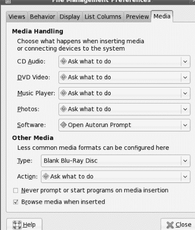

在文件管理首选项的“介质”选项卡中可以使用以下设置。这些设置与可移动介质在插入或插上时如何被处理有关。在大多数情况下，默认是显示一个提示，询问你如何处理插入或连接的介质。

- CD 音频 —— 当插入音频 CD 时，你可以选择提示你要做什么（默认）、什么都不做、在文件夹窗口中打开内容，或通过各种音频 CD 播放器播放内容。Rhythmbox 音乐播放器和 Sound Juicer 刻录是你处理音频 CD 的选择之一。

- DVD 视频 —— 当插入视频 DVD 时，系统会提示你如何处理该 DVD。你可以将该默认值更改为启动电影播放器（Totem）或你安装的其他媒体播放器（如 MPlayer）。

- 音乐播放器 —— 当插入的介质包含音频文件时，系统会询问你要做什么。你可以通过从此框中选择让 Rhythmbox 或其他音乐播放器开始播放文件。

- 照片 —— 当插入的介质（如来自数码相机的内存卡）包含数字图像时，系统会询问你如何处理这些图像。你可以选择什么都不做，也可以选择在 gThumb 图像查看器或 F-Spot 照片管理器中打开图像。

- 软件 —— 当插入的介质包含自动运行程序时，将打开自动运行提示。要更改该行为（什么都不做或在文件夹中打开介质内容），你可以从此框中选择。

- 其他介质 —— 选择“其他”（Other）标题下的“类型”（Type）框来选择如何处理常用媒体。例如，你可以选择处理空白蓝光光盘、CD 或 DVD 时采取的动作。你可以选择为蓝光视频、DVD 音频、HD DVD 视频、图片、超级 CD 和视频 CD 启动应用程序。

注意，这里描述的设置仅适用于当前登录的用户。多个用户拥有登录账户，因此每个人都有他们自己的处理可移动介质的方法。


Totem 电影播放器除非添加额外的 DVD 解密软件否则不会播放 DVD。如果你想从 Linux 播放商业 DVD 电影，存在法律问题和其他电影播放器选项。有关 Linux 中视频播放器的更多信息，请参阅第 4 章。

- 便携式媒体播放器 —— 如果选择了此项并输入了播放器，将在 Linux 中启动音乐播放器以播放来自你的 iPod或其他播放器的文件。banshee 项目（http://banshee-project.org）包含了在 Linux 中播放 iPod 音乐的软件。（对于 Fedora，使用 `yum install banshee` 从 Fedora 仓库安装软件。然后在此字段中添加 `%d` 使用该播放器）

## SUSE KDE 桌面上的可移动介质

从 SUSE 的 KDE 桌面插入可移动介质（CD 或 DVD）或插入可移动设备（数码相机或 USB 闪存驱动器），会打开一个窗口让你选择要的操作类型。在运行 KDE 或 GNOME 桌面时，你只需插入 USB 设备或插入 CD 或 DVD，可能会弹出一个窗口处理该设备。

尽管不同的桌面环境共享许多底层机制（Udev 和 Hotplug）来检测和命名可移动硬件，但它们提供了不同的工具来配置将如何挂载或使用。Udev（使用 udev 守护进程）在硬件从计算机添加或删除时检测并移除设备（`/dev` 目录）。硬件抽象层（HAL）提供了发现和配置硬件的整体平台。然而，使用 Linux 系统的用户感兴趣的设置可以通过易于使用的桌面工具进行配置。

接下来的章节描述了如何使用 Fedora 中的 GNOME 桌面或 SUSE 中的 KDE 桌面来配置可移动硬件和介质。

### 第三部分：学习系统管理技能

图 10-3
在 Nautilus 中更改可移动介质设置。
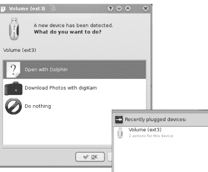

在文件管理首选项的“介质”选项卡可以使用以下设置。这些设置与可移动介质在插入或插上时如何被处理有关。在大多数情况下，默认是显示一个提示，询问你如何处理插入或连接的介质。

- CD 音频 —— 当插入音频 CD 时，你可以选择提示你要做什么（默认）、什么都不做、在文件夹窗口中打开内容，或通过各种音频 CD 播放器播放内容。Rhythmbox 音乐播放器和 Sound Juicer 刻录是你处理音频 CD 的选择之一。

- DVD 视频 —— 当插入视频 DVD 时，系统会提示你如何处理该 DVD。你可以将该默认值更改为启动电影播放器（Totem）或你安装的其他媒体播放器（如 MPlayer）。

- 音乐播放器 —— 当插入的介质包含音频文件时，系统会询问你要做什么。你可以通过从此框中选择让 Rhythmbox 或其他音乐播放器开始播放文件。

- 照片 —— 当插入的介质（如来自数码相机的内存卡）包含数字图像，系统会询问你如何处理这些图像。你可以选择什么都不做，也可以选择在 gThumb 图像查看器或 F-Spot 照片管理器中打开图像。

- 软件 —— 当插入的介质包含自动运行程序时，将打开自动运行提示。要更改该行为（什么都不做或在文件夹中打开介质内容），你可以从此框中选择。

- 其他介质 —— 选择“其他”（Other）标题下的“类型”（Type）框来选择如何处理常用媒体。例如，你可以选择处理空白蓝光光盘、CD 或 DVD 时采取的动作。你可以选择为蓝光视频、DVD 音频、HD DVD 视频、图片、超级 CD 和视频 CD 启动应用程序。

注意，这里描述的设置仅适用于当前登录的用户。多个用户拥有登录账户，因此每个人都有他们自己的处理可移动介质的方法。

Totem 电影播放器除非添加额外的 DVD 解密软件否则不会播放 DVD。如果你想从 Linux 播放商业 DVD 电影，存在法律问题和其他电影播放器选项。有关 Linux 中视频播放器的更多信息，请参阅第 4 章。

- 便携式媒体播放器 —— 如果选择了此项并输入了播放器，将在 Linux 中启动音乐播放器以播放来自你的 iPod或其他播放器。banshee 项目（http://banshee-project.org）包含了在 Linux 中播放 iPod 音乐的软件。（对于 Fedora，使用 `yum install banshee` 从 Fedora 仓库安装软件。然后在此字段中添加 `%d` 使用该播放器）

从 SUSE 的 KDE 桌面插入可移动介质（CD 或 DVD）或插入可移动设备（数码相机或 USB 闪存驱动器），会打开一个窗口让你选择要的操作类型。在运行 KDE 或 GNOME 桌面时，你只需插入 USB 设备或插入 CD 或 DVD，可能会弹出一个窗口处理该设备。

尽管不同的桌面环境共享许多底层机制（Udev 和 Hotplug）来检测和命名可移动硬件，但它们提供了不同的工具来配置将如何挂载或使用。Udev（使用 udev 守护进程）在硬件从计算机添加或删除时检测并移除设备（`/dev` 目录）。硬件抽象层（HAL）提供了发现和配置硬件的整体平台。然而，使用 Linux 系统的用户感兴趣的设置可以通过易于使用的桌面工具进行配置。

接下来的章节描述了如何使用 Fedora 中的 GNOME 桌面或 SUSE 中的 KDE 桌面来配置可移动硬件和介质。

## 使用可加载模块

本节涵盖了与让 Linux 硬件正常工作相关的若干问题。首先，它描述了如何配置 Linux 处理可移动介质。然后告诉你如何使用工具手动加载并处理未被正确检测和加载的驱动程序。

### 第三部分：学习系统管理技能

图 10-3
在 Nautilus 中更改可移动介质设置。


在文件管理首选项的“介质”选项卡可以使用以下设置。这些设置与可移动介质在插入或插上时如何被处理有关。在大多数情况下，默认是显示一个提示，询问你如何处理插入或连接的介质。

- CD 音频 —— 当插入音频 CD 时，你可以选择提示你要做什么（默认）、什么都不做、在文件夹窗口中打开内容，或通过各种音频 CD 播放器播放内容。Rhythmbox 音乐播放器和 Sound Juicer 刻录是你处理音频 CD 的选择之一。

- DVD 视频 —— 当插入视频 DVD 时，系统会提示你如何处理该 DVD。你可以将该默认值更改为启动电影播放器（Totem）或你安装的其他媒体播放器（如 MPlayer）。

- 音乐播放器 —— 当插入的介质包含音频文件时，系统会询问你要做什么。你可以通过从此框中选择让 Rhythmbox 或其他音乐播放器开始播放文件。

- 照片 —— 当插入的介质（如来自数码相机的内存卡）包含数字图像，系统会询问你如何处理这些图像。你可以选择什么都不做，也可以选择在 gThumb 图像查看器或 F-Spot 照片管理器中打开图像。

- 软件 —— 当插入的介质包含自动运行程序时，将打开自动运行提示。要更改该行为（什么都不做或在文件夹中打开介质内容），你可以从此框中选择。

- 其他介质 —— 选择“其他”（Other）标题下的“类型”（Type）框来选择如何处理常用媒体。例如，你可以选择处理空白蓝光光盘、CD 或 DVD 时采取的动作。你可以选择为蓝光视频、DVD 音频、HD DVD 视频、图片、超级 CD 和视频 CD 启动应用程序。

注意，这里描述的设置仅适用于当前登录的用户。多个用户拥有登录账户，因此每个人都有他们自己的处理可移动介质的方法。

Totem 电影播放器除非添加额外的 DVD 解密软件否则不会播放 DVD。如果你想从 Linux 播放商业 DVD 电影，存在法律问题和其他电影播放器选项。有关 Linux 中视频播放器的更多信息，请参阅第 4 章。

- 便携式媒体播放器 —— 如果选择了此项并输入了播放器，将在 Linux 中启动音乐播放器以播放来自你的 iPod或其他播放器。banshee 项目（http://banshee-project.org）包含了在 Linux 中播放 iPod 音乐的软件。（对于 Fedora，使用 `yum install banshee` 从 Fedora 仓库安装软件。然后在此字段中添加 `%d` 使用该播放器）

## 列出已加载模块

要查看系统当前加载了哪些模块，请使用 `lsmod` 命令。例如：

```
# lsmod
Module Size Used by
snd_seq_oss 38912 0
snd_seq_midi_event 9344 1 snd_seq
snd_seq 67728 4 snd_seq,snd_seq_midi_event
autofs 16512 0
ne2k_pci 9056 0 ne2k_pci
8390
ohci1394 13568 0 ohci1394
ieee1394 284464 0 ieee1394
floppy 65712 0
sg 36120 0
scsi_mod 124600 1 sg
parport_pc 39724 0
parport
ext3 128424 2
jbd 86040 1 ext3
```

要查找有关加载模块的信息，请使用 `modinfo` 命令。例如，你输入：

```
/sbin/modinfo -d snd_seq_oss
""OSS-compatible sequencer module""
```

并不是所有模块都有描述，如果没有可用，将不会返回任何数据。在这种情况下，snd_seq_oss 模块被描述为 OSS 兼容的序列器。

## 第三部分 学习系统管理技能

你也可以使用 `-a` 选项查看模块的作者，或使用 `-n` 查看代表模块的对象文件。作者信息通常包含驱动程序创建者的电子邮件地址，如果你对该模块有任何问题或疑问，可以联系作者。

## 加载模块

你可以使用 `modprobe` 命令将任何编译并安装（位于 `/lib/modules` 目录）的模块加载到正在运行的内核中。加载模块的一个常见原因是临时使用某项功能（例如，加载一个模块以支持你想访问的软磁盘上的特殊文件系统）。另一个原因是识别由某个无法自动检测的特定硬件使用的模块。

以下是一个使用 `modprobe` 命令加载 `parport` 模块的示例，它提供了与多个设备共享并行端口的功能：

```
# modprobe parport
```

在加载 `parport` 后，你可以加载 `parport_pc` 模块来定义通过接口可用的 PC 风格端口。`parport_pc` 模块允许可选地定义与每个设备关联地址和 IRQ 号。例如：

```
# modprobe parport_pc i/o=0x3bc irq=auto
```

在这种情况下，一个设备被识别为地址为 0x3bc，且该设备的 IRQ 是自动检测的。

`modprobe` 命令是临时加载模块的——它们在下次重启时会消失。要将模块永久添加到你的系统中，请将 `modprobe` 命令行添加到启动时运行的启动脚本之一中。你也可以将模块添加到 `/etc/modules` 以便它们在启动时加载。

> `modprobe` 的替代方案是 `insmod` 命令。然而，使用 `modprobe` 的优点是 `insmod` 只加载你请求的模块，而 `modprobe` 会尝试加载你请求的模块所依赖的其他模块。

## 移除模块

使用 `rmmod` 命令从运行的内核中移除模块。例如，要从当前内核中移除 `parport_pc` 模块，请输入：

```
# rmmod parport_pc
```

如果它当前没有忙，`parport_pc` 模块将从运行的内核中移除。如果它正忙，请杀死任何可能使用该设备的进程。然后再次运行 `rmmod`。有时，你尝试移除的模块依赖于可能已加载的其他模块。例如，当 USB 打印机模块（usb1）加载时，无法卸载 `usbcore` 模块，如下：

```
# rmmod usbcore
ERROR: Module usbcore is in use by wacom,usb1,ehci_hcd,ohci_hcd
```


## 管理文件系统和磁盘空间

Linux 中的文件系统按层次结构组织，从根目录 (`/`) 开始，并在目录和子目录结构向下延伸。作为 Linux 系统的管理员，你的职责是确保所有代表文件系统的磁盘驱动对计算机用户可用。你的工作是确保文件系统中适当的位置有足够的磁盘空间供用户存储所需的内容。

Linux 系统的组织方式与 Windows 操作系统不同。为每个本地磁盘、网络文件系统、CD-ROM 或其他存储介质使用驱动器号（例如 A; B; C;），一切整齐地适应在该结构中。

某些驱动器会自动（挂载）到文件系统中。例如，CD 可能会挂载在 `/media/cdrom`。如果驱动没有自动挂载，则由管理员在文件系统中创建挂载点并将磁盘连接到该点。

文件系统的组织从你安装 Linux 时开始。安装过程的一部分是将你的硬盘（或磁盘）划分为分区。这些分区可以分配给：

- Linux 文件系统的一部分
- Linux 的交换空间 (`Swap space`)
- 其他文件类型分区（可能包含其他可启动的操作系统）
- 空闲空间（你可以留着不分配，以便以后根据需要进行格式化）

本章关注用于 Linux 文件系统的分区。要查看当前检测到的 Linux 内核设置了哪些分区，请使用 `fdisk` 命令：

```
# /sbin/fdisk -l

Disk /dev/sda: 40.0 GB 40020664320 bytes

255 heads, 63 sectors/track, 4825 cylinders

Units = 16065 * 512 bytes = 8225280 bytes
```

| Device | Start | End | Blocks | Id | System |
|---|---|---|---|---|---|
| /dev/sda1 * | 1 | 13 | 104 | 8 | WinFAT32 |
| /dev/sda2 | 84 | 89 | 48195 | 83 | Linux |
| /dev/sda3 | 90 | 522 | 3478072 | 83 | Linux |
| /dev/sda4 | 523 | 554 | 257040 | 5 | Extended |
| /dev/sda5 | 523 | 554 | 257008 | 82 | Linux swap |

此输出显示了能够运行 Linux 和 Microsoft Windows 的计算机的分区情况。有一个 Windows 分区 (`/dev/sda1`) 和一个 Linux 分区 (`/dev/sda5`)，大部分可用空间位于此处。在 `/dev/sda2` 上有一个较小的 `/boot` 分区。在这种情况下，Linux 的根分区有 3.3GB 的磁盘空间并位于 `/dev/sda3`。`fdisk -l` 使用了显式给出的 `/proc/` 分区信息。

使用 `mount` 命令可以查看哪些分区实际用于你的 Linux 系统：

```
# mount

/dev/sda3 /boot ext3 (rw)

/dev/sda2 /boot ext3 (rw)

/dev/sda1 /mnt/win vfat (rw)

/dev/proc /proc proc (rw)

/dev/sys /sys sysfs (rw)

/dev/pts /pts devpts (rw,gid=5,mode=620)

/dev/shm /shm tmpfs (rw)

none /proc/sys/binfmt_misc (rw)

/dev/cdrom /media iso9660 (ro,nosuid,nodev)
```

上述显示的一些文件系统用于特殊目的（`/sys`, `/proc` 等），其他一些涉及磁盘（`/dev/sda*`, `/dev/sd*`）。在这种情况下，挂载的分区是 `/dev/sda2`（为启动目录提供空间）和 `/dev/sda3`（为文件系统的其余部分提供空间）。该系统还包含一个挂载在 `/mnt/win` 的 Windows 分区和一个挂载在 `/media` 的 CD（在大多数界面中，插入 CD 时它会自动挂载；对于 Linux 内核，查看 `/media` 目录即可）。

对于较大的 Linux 系统，你可能有多个分区的原因如下：

- **硬盘**——你可能为用户提供多个可用硬盘，以便在文件系统的不同位置挂载每个磁盘（以及每个磁盘的多个分区）。
- **保护文件系统部分**——如果用户耗尽整个文件系统，整个系统可能会崩溃。例如，可能没有存放临时文件的位置（导致写入临时文件的程序失败）。有了多个分区，如果一个分区空间不足，其他分区可以继续工作。
- **多个操作系统**——你可以配置磁盘包含多个分区，每个分区可以用于不同的操作系统。例如，如果你从一台带有 Windows 的计算机开始，你可以将 Linux 放在单独的分区，然后设置计算机启动每个操作系统。
- **备份**——存在某些方法可以通过复制整个磁盘或分区镜像来备份数据。如果你想恢复该分区，只需将其逐位复制回硬盘 即可。对于较小的分区，这种方法可以高效完成。
- **防止磁盘故障**——如果一个磁盘（或磁盘的一部分）发生故障，在文件系统中挂载多个分区可以让你继续工作并修复故障的磁盘。Ghost for Linux (http://freshmeat.net/projects/g41) 是备份 Linux 硬盘的工具示例。

当磁盘分区挂载到 Linux 文件系统时，该挂载点下的所有目录和子目录都存储在该分区。因此，如果你将一个分区挂载到 `/usr`，`/usr` 挂载点的所有内容将存储在第二个分区，而其他内容将存储在第一个分区。如果你随后将另一个分区挂载到 `/local`，挂载点下的所有内容将在第三个分区，而其他内容将在第二个分区。

> 如果远程文件系统从你的计算机上卸载，而你进入该挂载点目录保存文件会怎样？文件会进入该目录并丢失吗？然而，当远程文件系统重新挂载时，你保存丢失的文件将会出现（导致重新出现）、将文件移动到另一个位置、重新挂载文件系统并将文件复制回来。

经常作为独立分区候选的挂载点包括 `/boot`、`/home`、`/usr` 和 `/var`。根文件系统 (`/`) 是不属于其他目录的汇总。根文件系统挂载点 (`/`) 是唯一要求的。`/boot` 目录存放启动操作系统所需的镜像。`/home` 文件系统通常存储所有用户账户的地方。`/var` 挂载点是存储日志文件、临时文件、服务器文件（Web、FTP 等）和锁文件的地方（即计算机应用程序持续运行所需的空间项）。

文件系统中挂载了多个分区这一事实对于使用你 Linux 系统的人来说是不可见的。只有当分区空间不足或你需要保存或使用未挂载的特定设备（如软磁盘或远程文件系统）的信息时，才会出现问题。当然，任何用户都可以通过输入 `mount` 命令检查这一点。

## 挂载文件系统

你的大多数硬盘都会自动挂载。当你安装 Fedora、Ubuntu、BSUSE 和某些 Linux 系统时，会被要求创建分区并识别这些分区的挂载点（其他 Linux 安装程序将期望你在开始之前知道如何分区）。当启动 Linux 时，列在 `/etc/fstab` 中的所有位于硬盘上的 Linux 分区通常会被挂载。因此，本节重点侧于介绍如何挂载其他类型的设备，使其成为你文件系统的一部分。

`mount` 命令不仅用于挂载设备，还用于在 Linux 系统上挂载其他类型的文件系统。这意味着你可以存储来自其他操作系统的文件或使用

适用于某些活动（例如写入大块大小）的文件系统。然而，对于普通 Linux 用户而言，该功能最常见的用途是让你能够从软磁盘、CD-ROM 或可移动介质获取并处理文件。

> 随着 Linux 2.6 内核引入自动挂载功能以及对可移动介质的识别（本章将介绍 Udev 和 HAL 的描述），在许多 Linux 桌面系统中你不再需要手动挂载可移动介质。然而，理解如何在 Linux 服务器上手动挂挂载和卸载文件系统是非常有用的。

## 支持的文件系统

要查看当前系统中可用的系统类型，请执行 `cat /proc/ystems`。表 10-5 显示了 Linux 支持的文件系统类型，尽管它们目前可能并不可用，或者可能没有编译进内核中（因此它们可能需要作为模块加载）。

| 类型 | 说明 |
| :--- | :--- |
| adfs | Acorn 磁盘文件系统，RISC 操作系统上使用的标准文件系统 |
| befs | BeOS 操作系统使用的文件系统 |
| cifs | 通用网络文件系统 (CIFS)，用于访问符合 SNIA CIFS 规范服务器的虚拟文件系统。CIFS 尝试对 Samba 和 Windows 文件共享使用的 SMB 协议进行改进标准化 |
| ext3 | ext 文件系统是 Red Hat 和许多其他 Linux 系统中最常见的。ext3 文件系统（也称为扩展文件系统）包含日志功能，与 ext2 相比，它提升了文件系统从崩溃中恢复的能力 |
| ext2 | 早期 Linux 系统的默认文件系统类型。功能与 ext3 相同，但 ext2 不包含日志功能 |
| ext | 这是 ext3 的第一个版本。并不常用 |
| iso9660 | 演自 High Sierra 文件系统（CD-ROM 的原始格式）。High Sierra 的扩展（称为 Rock 扩展）允许 iso9660 文件系统支持长文件名和 UNIX 风格的信息（如权限、所有者和链接）。数据 CD-ROM 通常使用这种文件类型 |
| kaf | AFS 客户端文件系统。用于分布式计算环境，与 Linux、Windows 和 Macintosh 客户端共享文件 |
| minix | Minix 文件系统类型，最初用于 Minix 版本的 UNIX。它支持的文件名长度仅为 30 个字符 |
| msdos | MS-DOS 文件系统。你可以使用这种类型挂载来自微软操作系统的软磁盘 |
| vfat | 微软扩展 FAT (VFAT) 文件系统 |
| umsdos | 带有扩展的 MS-DOS 文件系统，允许类似于 UNIX 的功能（包括长文件名） |
| proc | 不是真正的文件系统，而是 Linux 内核的文件系统接口。你可能不需要执行任何操作来设置 proc 文件系统。许多工具使用 `/proc` 来访问 Linux 内核 |
| reiserfs | ReiserFS 日志文件系统。ReiserFS 和 ext3 是 Linux 最常用的文件系统 |
| swap | 用于分区。交换区域用于在 RAM 耗尽时临时存放数据。数据被交换到交换区域，并在需要时返回 RAM |
| squashfs | 压缩的只读文件系统类型。Squashfs 在现场光盘上非常流行，那里空间有限且是只读介质（如 CD 或 DVD） |
| nfs | 网络文件系统 (NFS)，用于挂载其他 Linux 或 UNIX 上的文件系统 |
| hfs | 用于只读挂载 OS/2 HPFS 文件系统的文件系统 |
| ncpfs | 与 Novell NetWare 文件系统相关。NetWare 文件系统可以通过网络挂载 |
| ntfs | Windows 文件系统。取决于你使用的发行版，它可能作为只读文件系统被支持（这样你可以挂载并复制其中的文件） |
| affs | 与 Amiga 计算机配合的文件系统 |
| ufs | 在 Sun Microsystems 操作系统（即 Solaris 和 SunOS）上流行的文件系统 |

如果你想使用当前在系统中未显示的文件系统（当你输入 `cat /proc/filesystems` 时），请尝试使用 `modprobe` 加载该文件系统的模块。例如，`modprobe ufs` 会向运行中的内核添加 UFS 文件系统类型。使用 `man fs` 可查看 Linux 文件系统的描述。

## 使用 fstab 文件定义可挂载的文件系统

你本地计算机上的硬盘分区和你每天使用的远程文件系统可能都设置为在启动 Linux 时自动挂载。`/etc/fstab` 文件包含了每个分区的定义，并带有描述如何挂载的选项。以下是 `/etc/fstab` 文件的示例：

| LABEL=/ | / | ext3 | defaults | 1 1 |
| LABEL=/boot | /boot | ext3 | defaults |1 2 |
| /dev/pts | /dev/pts | devpts | gid=5,620 | 0 0 |
| /dev/sh | /dev/sh | tmpfs | defaults | 0 0 |
| /dev/proc | /proc | proc | defaults | 0 0 |
| /dev/sys | /dev/sys | sysfs | defaults | 0 0 |
| /dev/sda5 | swap | | defaults | 0 0 |
| LABEL=/cdrom | /cdrom | iso9660 | ro,auto | 0 0 |
| /dev/sda1 | /mnt/win | vfat | auto | 0 0 |
| /dev/sda2 | /mnt/floppy | ext3 | auto | 0 0 |
| /dev/sda3 | /home | ext3 | defaults | 1 2 |

## 使用 mount 命令挂载文件系统

Linux 系统在每次启动时都会自动运行 `-a`（挂载所有文件系统）。因此，通常只在特殊情况下使用 `mount` 命令。特别是，普通用户或管理员以两种方式使用 `mount`：

- 显示当前挂载的磁盘、分区和远程文件系统
- 挂载文件系统

任何用户都可以输入 `mount`（不带任何选项）来查看本地系统挂载了哪些文件系统。以下是 `mount` 命令的示例。它显示了一个包含根文件系统（/)）的单硬盘分区 (/dev/sda1)，以及分别挂载在 `/proc` 和 `/dev` 的 proc 和 dev 文件系统类型。最后条目显示了一个使用标准 Linux 文件系统 (ext3) 格式化的软磁盘，挂载在 `/mnt/floppy` 目录。

```
$ mount

/dev/sda / type ext (rw)

/dev/sda2 /boot type ext3 (rw)

/dev/sda1 /mnt/win type vfat (rw)
```

## 第三部分学习系统管理技能

| /dev/proc | /proc | proc (rw) |
| /dev/sys | /sys | sysfs (rw) |
| /dev/devpts | /dev/pts | devpts (rw,gid=5,mode=620) |
| /dev/shm | /dev/shm | tmpfs (rw) |
| none | on /proc/sysfs/binfmt_misc | binfmt_misc (rw) |
| /dev/cdrom | /media/cdrom | type iso=iso9660,ro,nosuid,nodev) (rw) |
| /dev/fd0 | /mnt/floppy | type ext3 (rw) |

传统上，最常见的挂载设备是你的软盘和 CD 驱器。然而，取决于你正在使用的桌面电脑类型，当你插入 CD 和软盘时，它们可能会自动挂载。（在某些情况下，自动运行程序可能会自动执行。例如，自动运行可能会启动 CD 音乐播放器或软件包安装程序来处理介质上的数据。）

## 挂载可移动介质

如果你想手动挂载文件系统，`/etc/fstab` 文件可以使挂载软盘或 CD 变得简单。在某些情况下，你可以使用 `mount` 命令配合单个选项来指定你想要挂载的内容，其他选项将从 `/etc/fstab` 文件中读取并填充。你的 `/etc/fstab` 文件中可能已经存在相应的条目，让你可以在以下情况下执行这些操作：

- CD 如果你正在挂载一张标准 ISO 9660 格式的 CD（大多数软件 CD-ROM 都是如此），你可以通过将其放入 CD-ROM 驱动器并输入以下命令之一：

```bash
# mount /media/cdrom
# mount /mnt/cdrom
```

默认情况下，CD 通常挂载在 `/mnt/cdrom` 目录（Linux 2.4 内核）或 `/media` 的子目录下（Linux 2.6 内核）。（文件系统类型、设备名称和其他选项将自动填充。）要查看内容，输入 `cd /mnt/cdrom` 或 `cd /media/cd*`，然后输入 `ls`。将显示根目录的文件。（对于具有 Udev 和 HAL 等较新的桌面功能，CD 和 DVD 会自动挂载，因此没有需要手动运行 `mount` 命令。）

- 软盘 如果你想挂载 Linux3 文件系统格式 (ext3) 的软盘，或者在某些可以自动检测的情况下，请通过将软盘插入软盘驱动器并输入以下命令之一来挂载该软盘：

```bash
# mount /media/floppy
# mount /mnt/floppy
```

文件系统类型 (ext3)、设备 (/dev/fd0) 和挂载选项将从 `/etc/fstab` 文件中填充。你应该能够更改软盘目录（`cd /mnt/floppy` 或 `cd /media/floppy`）并列出软盘根目录的内容（`ls`）。

## 学习基础管理

> 注意
在这两种情况下，你都可以提供设备名称（类似于 /dev/cdrom 或 /dev/fd0）而不是挂载点目录来获取结果。

当然，你可能有不同格式的软盘可以使用。某人可能会给你一个来自旧版微软操作系统的软盘文件（MS-DOS 格式）。或者你可能会从另一个 UNIX 系统获取一个文件。在这些情况下，你可以填充自己的选项而不是依赖 `/etc/fstab` 文件。在某些情况下，Linux 会自动检测软盘是否包含 MS-DOS（或 Windows FAT）文件系统，并在无需额外参数的情况下正确挂载它。如果没有这样做，这里有一个挂载包含 MS-DOS 磁盘的软盘的示例：

```bash
# mkdir /mnt/floppy
# mount -t mdos /dev/fd0 /mnt/floppy
```


这显示了用于挂载软盘命令的基本格式。你可以将 `msdos` 更改为其他支持的文件系统类型（在本章较早之前描述），以挂载该类型的软盘。与其使用软盘 A: (`/dev/fd0`)，你可以使用驱动器 B: (`/dev/fd1`) 或任何其他设备名称。与其挂载在 `/mnt/floppy`，你可以创建任何其他目录并将软盘挂载到那里。

以下是一些你可以添加到 `mount` 命令的有用选项：

- `-t auto` —— 如果你确定软盘（或其他正在挂载的介质）中包含的确切文件类型，使用此选项指定文件系统。命令将查询磁盘以尝试确定其包含的文件类型。
- `-r` —— 如果你不想对挂载的文件系统进行更改（因为它是只读介质），使用此选项以只读方式挂载它。
- `-w` —— 这使文件系统具有读/写权限。

## 在回环中挂载磁盘镜像

使用 `mount` 命令的另一个有效方法与磁盘镜像有关。如果你从互联网下载了 CD 或磁盘镜像并想查看其内容，你可以在不将其刻到 CD 或软盘的情况下完成。创建一个挂载点并使用 `-o loop` 来挂载它。这是一个示例：

```bash
# mkdir /mnt/mycdimage
# mount -o loop whatever-1386-disc1.iso /mnt/mycdimage
```

在这个示例中，创建了 `mycdimage` 目录，然后挂载了位于当前目录下的磁盘镜像 (`whatever-1386-disc1.iso`)。你现在 `cd` 到该目录，查看内容，然后……

## 第三部分 学习管理技能

### 使用 mount 命令

当你想要挂载文件系统时，`mount` 命令非常有用。要挂载设备，你可以使用设备名称或挂载点。你致力于单个分区的…………是在软盘上创建文件系统。这里是使用磁盘格式化磁盘的示例：

```bash
# mkfs -t ext3 /dev/fd0
mke2fs 1.40.4, (29-May-2008)
Filesystem label=
OS type: Linux
Block size=1024 (log=0)
184 inodes, 1440 blocks
72 blocks (5.00%) reserved for the user
First data block=1
1 block group
8192 blocks per group
184 inodes per group
```

写入 inode 表：完成

文件系统太小无法创建日志
写入超级块和文件系统计数信息：
完成

文件系统将每32个月或每180天自动检查一次，以先者为准。使用 `tune2fs -i` 进行覆盖。

你可以看到 `mkfs` 命令格式完成后输出的统计信息。输出创建的 inode 数量，以及每组块和每组碎片的数量。你现在可以挂载此文件系统 (`/mnt/floppy`)，将其切换为当前目录 (`cd /mnt/floppy`)，并在上面创建文件。

### 添加硬盘

将硬盘添加到你的计算机中供 Linux 使用，需要结合之前节中描述的步骤。以下是通用程序：

- 1. 安装新的硬盘硬件。
- 2. 识别新硬盘上的分区。
- 3. 在新硬盘上创建文件系统。
- 4. 挂载文件系统。

向 Linux 添加硬盘最简单的方法是将整个硬盘分配给单个 Linux 分区。然而，你也可以拥有多个分区，并根据喜好将每个分区分配给不同类型的文件系统和不同的挂载点。以下过程将引导你添加包含单个 Linux 分区的硬盘。在此过程中，它还注明了你需要重复哪些操作以获得具有多个挂载点的文件系统。

> 注意 此过程假设 Linux 已经安装并运行在计算机上。如果事实如此，请遵循你当前操作系统添加硬盘的说明。稍后，当你安装 Linux 时，当被要求对硬盘(s) 进行分区时，你可以识别出此磁盘。

1. 按照制造商的说明在你的计算机中物理安装并连接新的硬盘。如果推测这是第二块硬盘，你可能需要

更改硬盘本身的跳线帽，使其作为从硬盘运行（如果它与第一块硬盘在同一条电缆上）。你可能还需要更改 BIOS 设置。

- 2. 启动电脑进入 Linux。
- 3. 确定硬盘的设备名称。以 root 用户身份在 shell 中输入：

```bash
# dmesg | less
```

- 4. 从输出结果中查找发现新磁盘的迹象。例如，如果是第二个 IDE 硬盘，你应该在输出中看到 `hdb`。如果是第二个 SCSI 驱动器，你应该看到 `sdb:`。(`hd?` 和 `sd?` 字母会随着内核的发现递增)。

- 5. 使用 `fdisk` 命令在新的硬盘上创建分区。例如，如果你正在格式化磁盘 ID (`hdb`)，可以输入以下内容：

```bash
# fdisk /dev/hdb
```

现在你进入了 `fdisk` 命令模式，你可以使用 `fdisk` 单字母命令来处理分区。如果磁盘上已经存在分区，你现在可以更改或删除这些分区。或者，你可以重新格式化整个磁盘以删除所有内容。使用 `p` 查看所有分区，使用 `d` 删除分区。

- 6. 要创建一个新分区，输入以下内容：

`n`

- 7. 选择扩展 (`e`) 或主 (`p`) 分区。要选择主分区，输入以下内容：

`p`

- 8. 输入分区号。如果你正在创建第一个分区（或只有一个分区），输入数字 1：

`1`

输入第一个柱道号（1 是默认值）。系统会显示一组柱道号范围（例如

- 9. 要让新分区从新硬盘的第一个柱道开始，输入数字 1。

### 学习基础管理

- 10. 输入最后一个柱道号。如果你使用的是整个硬盘，则输入显示的最后一个柱道号。否则，选择结束柱道号或指定该分区应有的兆字节数。
- 11. 若要在硬盘上创建更多分区，请对每个分区重复步骤 6 到 10（可能需要根据需要更改文件系统）。
- 12. 输入 `w` 将更改写入硬盘并退出 `fdisk` 命令。此时，你应该已经回到了 shell。
- 13. 要在新磁盘分区上创建文件系统，使用 `mkfs` 命令。默认情况下，此命令创建一个 `ext2` 文件系统，它可以被 Linux 使用。但在大多数情况下，你可能希望使用带日志的文件系统（如 `ext3` 或 `reiserfs`）。要在第二个硬盘的第一个分区上创建 `ext3` 文件系统，输入以下内容：

```bash
$ mkfs -t ext3 /dev/hdb1
```

如果你创建了多个分区，请对每个分区重复此操作，分别为 `/dev/hdb2`、`/dev/hdb3` 等。

> 如果不使用 `-t ext2`，默认创建 ext2 文件系统。使用该命令的其他命令或选项来创建其他文件系统类型。例如，使用 `mkfs.fat` 创建 FAT 文件系统，使用 `mkfs.msdos` 用于 DOS，或使用 `mkfs.reiserfs` 创建 Reiser 文件系统类型。本节后面介绍的 `tune2fs` 命令可将 `ext2` 文件系统更改 `ext3` 文件系统。

- 14. 文件系统创建后，可以通过编辑 `/etc/fstab` 并添加新分区来实现分区的永久挂载。以下是你如何向该文件内容的示例：

```
/dev/hdb1  /abc ext3 defaults 1 1
```

在此示例中，分区 (`/dev/hdb1`) 被挂载在 `/abc` 目录，作为 `ext3` 文件系统。`defaults` 关键字导致分区在启动时挂载。数字 `1 1` 导致系统检查磁盘错误。为你创建的每个分区添加如示例所示的一行。

- 15. 创建挂载点。例如，要将分区挂载到 `/abc`（如上一步所示），输入以下内容：

```bash
$ mkdir /abc
```

- 16. 如果创建了多个分区，请创建其他挂载点。下次启动 Linux 时，新分区将自动挂载到 `/abc` 目录。

## 第三部分 学习系统管理技能

在你分区上创建了文件系统后，`tune2fs` 命令是一个调整这些文件系统的很好工具。你可以用它来更改卷标签、文件系统检查的频率以及错误行为。你还可以用它将 `ext2` 文件系统转换为 `ext3` 文件系统，以便文件系统支持日志记录。例如：

```bash
# tune2fs -j /dev/hdb1
tune2fs 1.40.4 (29-May-2008)
Creating inode date:
This filesize will be automatically checked every 38 counts or 180 days, whichever comes first. Use tune2fs -c -i to override.
```

通过向 `tune2fs` 添加 `-j` 选项，你可以更改日志大小，或将文件系统附加到外部日志块设备上（本质上是将带日志的 `ext2` 文件系统转换为带日志的 `ext3` 系统）。在使用 `tune2fs` 更改文件系统类型后，你可能需要修正 `/etc/fstab` 文件以包含文件类型的更改（从 `ext2` 变为 `ext3`）。

## 检查系统空间

计算机磁盘空间不足是一个常见情况。你可以使用工具查看磁盘可用空间。

### 显示系统空间

要查看文件系统的可用空间，使用 `df` 命令。要产生人类可读的输出，请使用 `-h`：

| 文件系统 | 大小 | 已用 | 可用 | 使用率 | 挂载点 |
| :--- | :--- | :--- | :--- | :--- | :--- |
| /dev/sda3 | 29G | 2G | 8G | 9% | / |
| /dev/sda2 | 46M | 25M | 21M | 54% | /boot |
| /dev/sda1 | 13k | 0 | 13k | 0% | /dev |

### 检查磁盘占用

要找出特定目录占用的空间，使用 `du` 命令。在不带选项的情况下，`du` 会列出当前目录下的所有目录。为了让输出更友好，使用 `-h` 选项：

```bash
$ du -h /home/jane
114K /home/jane/stuff
234K /home/jane/httpd
137K /home/jane/uucp/data
701K /home/jane/uucp
1.0M
```

## 查找磁盘占用

`find` 命令是通过各种标准查找硬盘文件占用情况的极佳方法。通过查找特定大小或由特定创建的文件，你可以很好地了解哪里可以回收空间。

> 你必须是 root 用户才能有效运行此命令，除非你只是在检查个人文件。如果你不是 root 用户，文件系统中的某些地方将没有权限检查。普通用户通常可以检查自己的主目录，但不能检查别人的。

在示例中，`find` 命令搜索文件系统中所有用户名为 jane 的文件 (`-user jane`)。`find` 命令的输出按按大小排序的列表（`ls -S`）。最后，该输出发送到文件 `/tmp/jane`。当你查看文件 `/tmp/jane` 时（例如使用 `less /tmp/jane`），你会发现所有文件都属于用户 jane，并按大小排序。这里是命令行：

```bash
# find / -xdev -user jane -print | xargs ls -dS > /tmp/jane
```

`-xdev` 选项可以防止搜索所选文件系统以外的文件系统。这是过滤掉 `/proc` 文件系统可能输出的大量垃圾信息的一种良好方法。它还可以防止大型远程挂载的文件系统被搜索。

这里是另一个例子，只不过我们不是在寻找用户文件，而是在寻找大于 100 千字节的文件（`-size +100k`）：

```bash
# find / -xdev -size +100k -print | xargs ls -ldS > /tmp/size
```


进入`/path/to/xxx`目录，找到`xxx.json`。

在表达式`cvar = avar + bvar`中，加法运算符（`+`）将`avar`与`bvar`相加，得到它们的和`cvar`

在`List.of(arg0, arg1, arg2)`中，`List`接口的工厂方法`of()`接受一系列的元素，返回包含它们的只读列表。

之后我们这样调用`cmd`命令：`cmd arg0 arg1 arg2`。

```
if (condVar > someVal) {console.log("xxx")}
```

通过删除一些不再需要的大文件，你可以节省大量的磁盘空间。在这个示例中，你可以在`/tmp/size`文件中看到按大小排序的大文件。

# 监控系统性能

如果你的 Linux 系统是一台多处理器计算机，共享计算机的处理能力可能会成为一个主要问题。同样，通过停止失控进程或减少运行不必要程序的开销，你的 Linux 服务器可以更出色地为依赖它的人提供文件、网页或电子邮件服务。

某些 Linux 发行版包含了图形化实用程序以简化管理，例如 Ubuntu 中的系统监器（System Monitor）（如图 10-5 所示）。

图 10-5
Ubuntu 中的系统监视允许你查看进程、资源和设备。

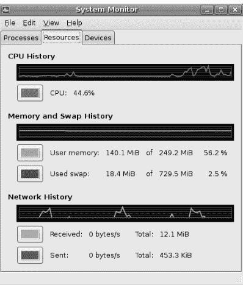

332

所有的 Linux 发行版都包含了帮助监控你的 Linux 系统性能的实用。你想要在 Linux 中监控的特征类型包括 CPU 使用率、内存使用（RAM 和交换空间）以及系统的整体负载。监控这些信息的流行工具是`top`命令。

要在终端窗口中启动`top`，输入`top`。`top`命令确定计算机上消耗 CPU 最大的进程，按降序显示在屏幕上，并每五秒更新一次列表。

通过向`top`添加`-s`选项，显示将显示每个进程的 CPU 时间，以及任何可能已经存在的进程。如果你想更改屏幕更新的频率，可以添加`-d secs`选项，其中`secs`替换为更新之间的秒数。

默认情况下，进程按 CPU 使用率排序。你可以通过 PID (N)、年龄 (type A)、驻留内存使用 (type M) 或时间 (type T) 对进程进行数值排序。返回 CPU 使用率类型按 P。要终止进程，输入`k`并输入你想要杀死的进程的 PID（列在左侧列）。请小心只杀死你确定不需要或不想要的进程。

## 总结

尽管你可能将 Linux 作为单用户系统使用，但你必须执行的许多保持计算机运行的任务，许多都是管理员任务。需要一个名为`root`用户账户来让 Linux 按照你的意愿工作。如果你正在管理一个供许多人使用的 Linux 系统，管理任务将变得更加巨大。你必须能够添加和支持用户，维护文件系统，并确保系统性能为你的用户服务。

为了帮助管理员，Linux 提供了各种命令行实用程序和图形窗口，用于配置和维护你的系统。诸如`mkfs`和`mount`的命令让你分别创建和挂载文件系统。诸如`top`的工具让你能够监控系统性能。

# 第 11 章

# 连接互联网

在将 Linux 连接到网络——特别是互联网之前，你将无法发挥 Linux 的真实力量。你的计算机可能内置了以太网接口，因此你只需向它插入一根局域网（LAN）线即可连接到局域网（集线器或交换机）、DSL 桥器或路由器或电缆调制调器。某些计算机（特别是笔记本电脑）可能内置了无线以太网硬件。

你的计算机可能还有一个拨号调制调器。尽管现在非常罕见，但仍有情况下可能会有一台没有以太网卡的旧电脑。或者你可能处于需要通过普通电话线拨号连接你的互联网服务提供商（ISP），并需要使用此调制调器上网。

本章描述了如何将你的 Linux 系统连接到互联网。随着宽带和无线网络变得流行，以太网连接正成为连接互联网的最常见手段。对于拨号连接，你将看到如何使用`kinda`（一个拨号 GUI 界面），它通常与 KDE 桌面一起打包。

从硬件角度来看，与多个桌面系统甚至你自己的邮件或 Web 节点共享互联网连接并不困难。然而，当你着手扩展使用互联网连接的方式时，会有一些安全和配置问题需要考虑。Linux 系统包含了软件，让你将其配置为防火墙、路由器和各种类型的服务器，以帮助你完成这项工作。

# 本章内容

- 连接到互联网
- 通过以太网连接互联网
- 通过拨号连接互联网
- 通过无线连接互联网

# 第三部分 学习系统管理技能

# 连接到网络

Linux 支持广泛的有线和无线网络设备，以及用于在这些介质上通信的眼花缭乱的网络协议。作为家庭或小型办公室的 Linux 用户，你可以通过考虑以下因素开始评估如何配置你的互联网连接：

- 你与 ISP 之间的互联网连接类型（拨号或宽带）
- 你是否正在将单台计算机、一组桌面电脑和/或一台服务器机器连接到互联网

## 通过拨号服务连接

直到几年前，拨号是个人上网的最常用方法。许多计算机内置了拨号调制调器。尽管现在非常罕见，但某些情况下可能会拥有一台没有以太网卡的旧电脑。或者你可能处于需要通过普通电话线拨号连接你的互联网服务提供商（ISP），并需要使用此调制调器上网的境地。

对于拨号连接，你将看到如何使用拨号。一旦你有了 DSL 调制调器，你通常只需要一根普通的电话线就能连接到。由于你你使用拨号连接，你的互联网服务提供商提供了多种方式，你应该检查连接所需的正确硬件。对于电缆调制调器或外部 DSL 调制调器，通常只需要电话线。图 11-1 显示了连接的设置。

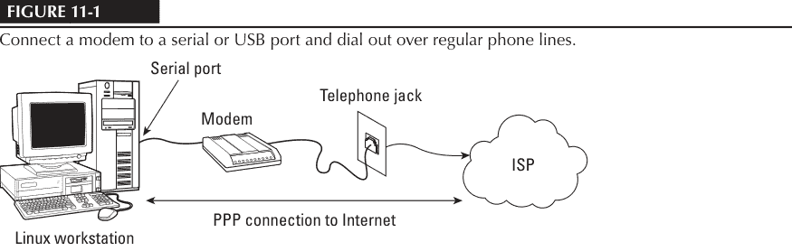

在 Linux 中使用调制调器的困难之一是，许多带有调制调器的计算机（特别是笔记本电脑）带有 Winmodems。由于某些处理工作实际上是在 Windows 内部实现的，Winmodems 在 Linux 看来并不总是像真实的调制调器，因为代码在 Windows 中。有些 Winmodems 在 Linux 中是可以支持的，它们通常被称为 Linmodems。如果你发现 Linux 无法检测到你的调制调器，请查看 Linmodems 支持页面 (http://linmodems.technion.ac.il) 或 Linmodems 页面 (www.linmodems.org)。它可以帮助

> 提示
如果你发现你有一个 Winmodem，通常最好是买一个真正的调制调器。一个廉价的外部串口调制调器可以节省你获取和加载可能有效或无效的 Linmodem 驱动程序的麻烦。大多数外部调制调器或内部 PCI 调制调器在 Linux 中被描述为“基于控制器的”。

# 单台计算机连接宽带

越来越多的人可以选择与线电视供应商订购宽带互联网服务。这些连接提供的传输速度通常比你通过连接获得的要快五倍。

要从你的家庭或小型办公室连接宽带，你通常需要一个电缆调制调器或数字用户线路（DSL）调制调器。电缆调制调器共享进入你位置的线电视线路。DSL 使用现有的房屋或办公室线路连接互联网。

由于你的 ISP 提供互联网服务的方式有很多，你应该检查连接所需的正确硬件。特别是，你应该知道存在多种不兼容的 DSL 标准（ADSL、CDSL、HDSL、SDS 等），你不能在没有指导的情况下去购买 DSL 设备。

如果你使用的是外部 DSL 或电缆调制调器，你的 Linux 机器到它的连接通常只需要：

- 计算机上的以太网端口
-  LAN 线（通常由 ISP 设备提供）
- DSL 路由器/桥器或电缆调制调器（通常由 ISP 提供）

图 11-2 展示了连接到宽带的电缆调制调器的 Linux 计算机。

图 11-2

以太网卡连接宽带并开始上网。

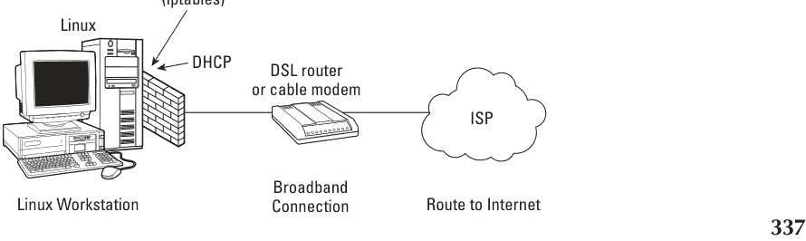

宽带设备提供一种名为动态主机配置协议（DHCP）的服务。DHCP 提供客户端连接网络所需的 Internet 地址和其他信息。通过让电缆/DSL 调制解器充当 DHCP 服务器，你可以在无需在 Linux 中进行任何特殊配置的情况下开始使用互联网。只需插上、启动 Linux 并开始浏览网页即可。

DSL 或电缆调制解器通常充当 ISP（服务提供商）与电脑之间的路由器。通常，该设备还会包含一个配置了网络地址转换（NAT）的防火墙。或者，某些宽带设备以“桥接模式”运行，在这种模式下它不进行路由，只需通过通过与 ISP 在同一局域网的电脑。在这种设置下，公网 IP 地址分配给你的电脑，而不是 DSL 或电缆调制解器。

## 将多台电脑连接到宽带

与其将 Linux 电脑直接连接电缆调制解器或 DSL 设备，你可以将机器连接到局域网，然后将局域网连接到 ISP 设备，这样家里或办公室的每个人都可以共享宽带连接。这非常简单；你只需要将电缆/dsl 调制解器连接到局域网，而不是直接连接到你的 Linux 盒子。然而，在这种配置中，你应该考虑在局域网和外部世界之间添加一个防火墙/路由器作为缓冲区。它将执行此类功能：

- 阻止访问 —— 配置良好的防火墙会阻止对所有端口的访问，除非是你按照你想要访问互联网的方式所需的端口，从而最大限度地减少入侵者进入你局域网的风险。

- NAT 或 IP 伪装 —— 在大多数情况下，你希望防火墙之前的那些简单桌面系统的电脑无法从互联网访问。通过配置你的防火墙执行 NAT 或 IP 伪装，你的电脑可以被分配私有 IP 地址。然后，你的防火墙将处理局域网和互联网之间的消息转发。这是一种很好的安排，原因有几点：首先，你私有电脑的 IP 地址不会暴露在外部世界。此外，你还可以节省使用 ISP 永久 IP 地址的费用。

- DHCP 服务 —— 许多防火墙系统可以充当 DHCP 服务器。使用 NAT 防火墙时的那些私有 IP 地址可以从运行在防火墙上的 DHCP 服务分配。当局域网上的客户端电脑启动时，你的 DHCP 服务可以告诉客户端其 DNS 服务器位置、网关和其他信息。

- 路由 —— 在图示的家庭和小型办公室局域网环境中，防火墙路由器通常有两个以太网接口：一个连接到局域网，另一个连接到连接 ISP 的 DSL 或电缆调制解器。由于以太网接口被视为独立的子网络，防火墙/路由器必须配置为跨越两个接口转发数据包。这不是什么大问题，但确实需要额外的步骤来告诉防火墙系统你希望它在两个子网络之间转发数据包。

第 27 章讨论了如何使用专门为该任务设计的 Linux 发行版设置防火墙/路由器。

## 图 11-3

防火墙在你的局域网和互联网之间提供安全保障。

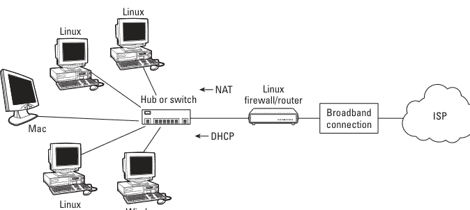

在这个示例中，你需要的设备包括：

- 每台电脑上的以太网端口，外一个用于防火墙/路由器的额外端口
- 每台电脑的一根局域网线
- 一个集线器或交换机
- 一台运行 Linux 防火墙/路由器的低端 PC（性能类似于 486 的 PC）
- DSL 或电缆调制解器

这种有线配置的替代方案是用集线器或交换机代替无线接入点。每台配备无线局域网网的电脑都可以无线地接入网络。

## 连接服务器

到为止，你已经看到了让家里或小型企业的一或多台电脑浏览网页的配置。允许互联网上的人向你的电脑请求服务（网页、文件传输等）需要一些额外的考虑。

在你配置 TCP/IP（互联网上使用的主要协议族）连接到你的 ISP 之后，数据请求可以在你的电脑和互联网之间双向传输。

第三部分 学习系统管理技能

除非你使用防火墙来限制流量。你用于浏览的的连接也用于向互联网提供服务，但有几点注意事项：

- 永久 IP 地址 —— 每当你重启电脑时，ISP 的 DHCP 服务器都会动态分配你的 DSL/电缆调制解器的 IP 地址。由于这个原因，你的 IP 地址在每次重启时可能会发生变化。如果你希望你的服务能够永久被访问，你至少需要一个人们可以访问你服务的 IP 地址。你必须询问你的 ISP 关于永久 IP 地址，这可能需要你支付额外费用。

- ISP 可接受策略 —— 检查你是否被允许入站连接。某些 ISP（特别是针对廉价的家庭宽带服务）会阻止指向 Web 或邮件服务器的入站连接。

- DNS 主机名 —— 虽然在浏览器中使用 IP 地址运行良好良好，但大多数人更倾向于使用名称（如 www.inuxtoys.net）来访问服务器。这需要你购买 DNS 域名并在 DNS 中设置一个条目来解析你服务器的 IP 地址。

虽然建立互联网服务器并没有神奇之处，但考虑到上述的几个问题，创建一个公共服务器就像打开你房子的门，让陌生人可以溜进来。你需要一些策略来限制陌生人可以去向哪里以及他们可以做什么。

对于具有单一 Internet 连接（由一个 IP 地址表示）的家庭或小型办公室，可以通过将服务器保持在一个称为 DMZ（非军事化区）的区域，使服务器更容易地暴露在互联网上。在这种配置中（如图 11-4 所示），服务器直接位于防火墙后面。

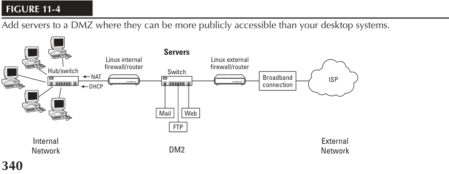

## 使用互联网

无论你使用 Linux 还是专用防火墙提供服务，外部允许请求 Web 服务（80端口）、FTP 服务（20和21端口）、简单邮件传输协议（25端口）以及可能的其他服务。内部阻止任何发起的请求。


第13章解释了如何配置不同类型的服务器，第27章描述了如何设置 Linux 作为路由器/防火墙。27章包含了如何配置 IP 伪装、NAT 和数据包转发的细节。

## 连接其他设备

虽然我一直关注配置基础以太网设备和拨号调制器的网络连接，但 Linux 也支持许多类型的网络设备以及用于通信的不同协议。以下是一些：

- ISDN —— 集成业务数字网络（ISDN）线路在 DSL 普及之前是美国小型企业高速数据线的首选。它在欧洲仍然流行，但被更廉价的 DSL 设备所补充。许多 Linux 系统提供了用于连接 ISDN 网络的 ISDNLinux 驱动程序和工具 (www.isdnlinux.de)。

- USB 调制解器 —— 大多数电缆调制解器提供一个以太网端口，你可以直接从电脑连接。然而，如果你没有以太网端口，可以通过你的 USB 端口连接到电缆调制解器（你可能需要手动加载 usnet 和 cdc_ether 驱动程序使其工作）。

- 环路 —— 现在很少使用的环路网卡仍然受到支持。大多数 Linux 系统包含了环路网卡的支持，尽管环路现在很少使用。它们曾经在拥有 IBM 系统的地方流行。

- PLIP —— 可以通过并行将两台电脑连接在一起，以便使用 TCP/IP 协议进行通信。PLIP 只需要一种特殊的空模式线（关于该电的规格，请参考 http://tld.org/HOWTO/NET3-4-HOWTO-9.html）。大多数 Linux 系统都内置了软件，允许你通过它登录、传输文件并执行其他活动。

如果你的系统安装了 Linux 源代码，可以在该源码自带的文档中阅读支持的硬件设备。在 Fedora 和其他 Linux 系统上，各种网络硬件的内核文档位于`/usr/src/linux*/Documentation/networking`。

## 使用以太网连接互联网

如今大多数 Linux 系统在安装 Linux 时，会自动检测互联网连接或允许你手动设置互联网连接。以下是安装了 Linux 的桌面级系统启动网络连接的一般（默认）方法：

- 1. 检查你的计算机上是否有以太网端口（大多数现代电脑都有）。如果有，将你的以太网卡连接到可以上网的设备（调制解调器、DSL 路由器/桥器或网络集线器/交换机）。如果没有，你可以在任何销售电脑硬件的零售店购买以太网卡。
- 2. 确保网卡有适当的驱动程序并进入界面（通常，第一块有线以太网卡被分配给 eth0 接口）。通常，只需重启计算机即可被检测到网卡并加载相应的驱动程序。
- 3. 如果接口通过可用的 DHCP 服务器，则使用 DHCP 获取 IP 地址。大多数互联网提供商（ISP）和企业都期望你使用 DHCP 连接到他们的网络，因此它们会在你连接计算机到网络的设备上提供 DHCP 服务器。

只要你的桌面系统连接到一个有一个 DHCP 服务器提供 IP 地址的网络，你就可以随时上线并浏览网页。

如果你发现自动（DHCP）连接网络的方法不起作用，那么连接互联网就会变得稍微复杂一些。不同的 Linux 发行版提供了不同的工具来手动配置你的互联网连接。以下章节描述了一些用于配置有线和无线网络连接的图形化工具以及一些命令行和配置文件方法。

## 安装期间配置以太网

在 Linux 安装过程中，如果你想为以太网卡配置网络连接，许多安装程序会运行。这通常只是针对以太网卡，而不是针对拨号调制解调器或其他网络设备。该过程所需的信息（IP 地址、网关、DNS 服务器等）将在第 8 章中解释。

启动时，你可以通过打开 Web浏览器（如 Firefox 或 Konqueror）并输入 Web 地址来检查是否可以访问互联网。如果浏览器中没有该网站，你需要进行一些故障排除。本章的“理解你的互联网连接”部分提供了如何追踪互联网连接问题的信息。

## 从桌面配置以太网

大多数 Linux 发行版提供了配置网络接口的图形化工具。这些工具会引导你输入需要的信息，然后启动网络接口（如果你选择）开始浏览网页。

以下是不同 Linux 发行版中配置网络接口的工具列表。其中一些是图形化工具，另一些是基于菜单的：

- Red Hat Linux/Fedora — 网络配置窗口允许你使用以太网、ISDN、调制解调器、令牌环环和 XDSL 硬件配置网络连接。从系统中选择“网络”或通过 system-config 启动网络配置窗口，并在提示时输入根密码。（在旧的 Red Hat Linux 系统上，命令为 redhat-config。）新的 NetworkManager 功能也可用，可以在 Fedora 中检测并选择有线和无线接口。
- SUSE Linux — SUSE 自带的 YaST 控制中心包含了配置网络的功能。YaST 控制中心允许你为网络配置 DSL、ISDN、调制解调器或网卡接口。选择“网卡”来配置你连接互联网的有线接口。
- Gentoo Linux — 从 shell（作为 root 用户）输入`net-setup eth0`来启动一个菜单驱动的界面，以配置来自第一块以太网卡 (`eth0`) 的连接。该工具允许你尝试使用 DHCP 或你提供的静态地址信息。
- Ubuntu Linux — 从 GNOME 桌面选择“系统管理-网络”。在提示时输入管理员密码。在出现的“网络设置”窗口中，双击你想配置的接口类型（有线、无线或点对连接）。将出现与图 11-5 类似的对话框。
- KNOPPIX — 在 KNOPPI 桌面面板上选择小企鹅图标，从菜单中选择“网络/互联网”。进入网卡配置菜单来配置你的网卡。或者从其他几个网络设备（ADSL、GPRS、ISDN、调制解调器或波形）。

图 11-5
在 Ubuntu 中配置接口

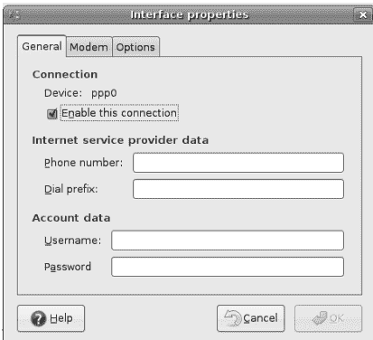

# 第三部分学习系统管理技能

## 在 Fedora 中使用网络配置 GUI

配置以太网接口的图形化工具示例是 Fedora 和 Red Hat Enterprise Linux 系统自带的网络配置 GUI。如果你在安装 Fedora 或 RHEL 期间没有配置域网连接，可以随时使用配置窗口进行。IP 地址和主机名可以静态分配给以太网接口，或在启动时从 DHCP 服务器动态获取。

> 注意：计算机可以有多个 IP 地址，因为它可以有多个网络接口。每个网络接口都必须有一个 IP 地址才能连接网络（即使该地址是临时分配的）。所以，如果你有两个以太网卡（eth0 和 eth1），每个卡都有自己的 IP 地址。此外，127.0.0.1 代表本地主机，以便本地计算机上的用户可以访问环回服务。

以下是在 Fedora 或 RHEL 中为你的以太网接口定义 IP 地址的方法：

- 1. 从 Hat 菜单选择“系统 -> 网络”，或者作为 root 用户从终端窗口使用`system-config-network`。（如果提示，输入根密码。）出现网络配置窗口。
- 2. 点击各个页卡。将出现你的网络接口列表。
- 3. 双击 eth0 接口（代表你的以太网卡）。出现一个标题为“Ethernet”的弹出窗口。

图 11-6
在 Fedora 中配置并激活以太网

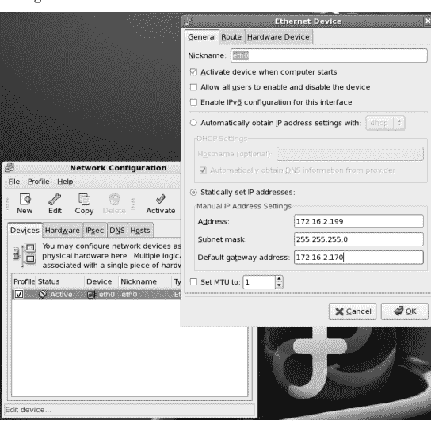

## 上网

- 4. 选择你的偏好：
  - 计算机启动时激活设备 — 勾选此处让 eth0 在启动时启动。
  - 允许所有用户启用和禁用设备 — 勾选让非 root 用户启用禁用网络。
  - 为此接口启用 IPv6 配置 — 如果连接到 IPv6 网络（大多数网络仍是 IPv4），请勾选此处。
- 5. 你也可以在启动时从另一台计算机获取 IP 地址或手动输入地址：
  - 自动获取 IP 设置 — 如果局域网上有一个 DHCP 或启动服务器可以获取 IP 地址、网络和网关，请勾选此框。如果你的局域网不仅仅是几台计算机，建议使用 DHCP。
  - 静态设置 IP 地址 — 如果局域网上没有 DHCP 或启动服务器，通过选择此选项并遵循步骤添加必要的 IP 信息：
    - a. 在 Address 框中输入计算机的 IP 地址。该数字在你的网络必须是唯一的。对于私有局域网，可以使用 IP 地址。
    - b. 在 Subnet Mask 框中输入掩码。掩码指示 IP 地址的网络部分。
    - c. 如果连接局域网的计算机或路由器为互联网或其他网络提供路由功能，在 Default Gateway Address 框中输入该计算机的 IP 地址（第 27 章介绍了如何使用 NAT 或 IP 伪装以及将 Linux 作为路由器）。
- 6. 点击 Ethernet 窗口中的 OK 保存配置并关闭窗口。
- 7. 点击 File -> Save 保存你输入的信息。
- 8. 点击网络配置窗口中的 Activate 启动你到 Linux 的连接。

## 识别其他计算机（主机和 DNS）

每当你使用名称来标识计算机时（例如浏览网页或输入电子邮件地址时），必须将计算机名称翻译为 IP 地址。为了解析名称到 IP 地址，Linux 会按照搜索顺序（通常基于 /etc 中三个文件的内容：resolv.conf、nsswitch.conf 和 host.conf）进行。默认情况下，它会检查你添加的主机（进入 /etc/hosts 文件）、通过 NIS 可用的主机，以及通过 DNS 可用的主机名。

## 第三部分学习系统管理技能

同样，对于 RHEL 和 Fedora 系统，你可以使用“网络配置”窗口添加：

- **主机名 (Hostnames)** — 你可能需要此来识别局域网（LAN）上未在 DNS 服务器上配置的主机。
- **DNS 搜索路径 (DNS search path)** — 通过向搜索路径添加域名（如 linuxtoys.net），可以通过主机名（如 jukebox）访问网站，并让 Linux 搜索你添加到搜索路径的域名以找到你寻找的主机（如 jukebox.linuxtoys.net）。
- **DNS 名称服务器 (DNS name servers)** — DNS 服务器可以解析其所服务的域名地址，并联系其他 DNS 服务器获取所有其他 DNS 域名的地址。

如果你正在配置 DNS 服务器，可以使用它来集中存储局域网名称和 IP 地址。这可以避免你每当在局域网添加或更改计算机时，都要更新每台计算机的`/etc/hosts`文件的麻烦。

要在 Fedora 中添加主机名、IP 地址、搜索路径和 DNS 服务器，请执行以下操作：

1. 启动网络配置。以 root 用户身份从终端窗口输入`system-config-network`，或者从面板点击“系统管理-网络”。网络配置窗口将出现。
2. 点击“主机 (Hosts)”选项卡。将出现一个 IP 地址、主机名和别名的列表。
3. 点击“新建 (New)”。出现“添加/编辑主机记录”弹出窗口。
4. 输入 IP 地址数字和主机别名。
5. 点击“确定 (OK)”。
6. 重复此操作，直到添加完局域网中所有无法通过 DNS 访问的计算机。
7. 点击“DNS”选项卡。
8. 输入作为主、备用 DNS 服务器的计算机 IP 地址。（你可以从 ISP 处获得这些地址，或者如果你创建了自己的 DNS 服务器，可以输入该服务器的 IP 地址。）
9. 在“DNS 搜索路径”框中输入要搜索主机名的域名（很可能是你的本地域名称）。
10. 点击“文件-保存 (File-Save)”保存更改。
11. 点击“文件-退出 (File-Quit)”退出程序。

现在，当你使用如`ftp`、`ssh`或其他 TCP/IP 工具时，可以使用任何在本地计算机上标识、存在于你的搜索路径域中或可以从公共 DNS DNS 解析的主机名。（严格来说，你不需要设置`/etc/hosts`文件。你可以使用 IP 地址作为 TCP/IP 命令的参数，但使用名称更容易操作。）

## 在 Ubuntu 中使用网络设置 GUI

在 Ubuntu Linux 中，“网络设置”窗口允许你配置网络连接。如果你的电脑安装了以太网卡，可以使用以下步骤创建到互联网或其他 TCP/IP 网络的连接。

1. 启动“网络设置”。点击“系统管理-网络”。出现“网络设置”窗口。
2. 在屏幕上选择要配置的接口的以太网连接项，并点击“属性 (Properties)”。第一块以太网将被识别为`eth0`（如果存在其他以太网卡，它们将被识别为`eth1`、`eth2`等）。出现“接口属性”窗口，如图 11-7 所示。

在 Ubuntu 中，为以太网连接使用 DHCP 或静态 IP 地址。

图 11-7 包含一个以太网连接示例，该连接配置使用 DHCP 从网络上的 DHCP 服务器获取启动所需的信息（IP 地址、子网掩码等）。“启用连接”复选框标识 eth0 连接在引导启动时自动启动。

如果你的电缆调制解调器、DSL 设备或其他网络服务器提供 DHCP 服务，那么图 11-7 所示的示例可能你唯一需要做的。但是，如果没有 DHCP 服务或你只想手动设置连接信息，请继续下一步。

3. 如果你想手动配置以太网连接，请从“接口属性”弹出窗口中选择以下内容：

- **配置 (Configuration)** — 选择“静态 IP 地址”以便手动设置你的地址信息，而不是从 DHCP 服务器自动获取。
- **IP 地址 (IP address)** — 在“IP 地址”框中输入你想为此计算机使用的 IP 地址。此数字在你的网络中必须是唯一的。对于私有局域网，你可以使用私有 IP 地址。
- **子网掩码 (Subnet mask)** — 在“子网”框中输入掩码。掩码表示 IP 地址中代表网络的部分。例如， IP 地址 10.0.0.5，掩码为 255.255.255.0 表示网络为 10.0.0，主机地址为 5。网络上的其他计算机可以使用相同的掩码，IP 地址如 10.0.0.1、10.0.0.2 等直到 254。
- **网关地址 (Gateway address)** — 输入在你的计算机与互联网或其他网络之间充路由设备的 IP 地址。（如果你使用 Linux 作为路由器，请参考第 27 章关于使用 NAT 或 IP 隐藏的信息）。

填写所有必要信息后选择“确定”。

在 Ubuntu 中还可以设置其他功能。从“常规 (General)”选项卡，你可以更改主机名。从“主机 (Hosts)”选项卡，你可以添加静态记录。从“DNS”选项卡，你可以配置 DNS 服务器。从“IPv4”选项卡，你可以配置 IP 地址、网关和子网掩码。从“IPv6”选项卡，你可以配置 IPv6 地址。

## 理解你的连接

如果以太网连接无法工作，有方法可以检查。

1. 打开终端。
2. 输入以下：
```bash


`dmesg | grep eth`

`dmesg` 命令显示启动时输出的消息。输出显示发现了以太网卡。对于前面的示例显示如下：

```
00:0 Ethernet controller: VIA Technologies, Inc. VT6102 [Rhine-III] (rev 74)
```

3. 要验证网络接口已运行，输入：

```bash
$ /bin/ifconfig -a
```

```
eth0 Link encap:Ethernet Haddr 00:00:61:25:04:17

inet addr:10.0.0.5 Bcast:10.0.0.255 Mask:255.255.255.0 MTU:1500 Metric:1

RX packets:326130 errors:0 overflows:0 frame:0

TX packets:251931 errors:0 overflows:0 carrier:0

collisions:59719 txqueuel: 1000

RX bytes:16837315 (16.0 Mb) TX bytes:23513172 (22.2 Mb)

lo Link encap:Loopback

inet addr:127.0.0.1 Mask:255.0.0.0

UP RUNNING MTU:16436 Metric:1

RX packets:37435 errors:0 overflows:0 frame:0

TX packets:37435 errors:0 overflows:0 carrier:0

collisions:0 txqueuel: 0

RX bytes:23513172 (2.2 Mb) TX bytes:23513172 (2.2 Mb)
```

输出显示了一个环回接口 (`lo`) 和一个以太网卡 (`eth0`)。以太网接口 (`eth0`) 分配了 IP 地址 `10.0.0.5`。

## 第三部分 学习系统管理技能

`10.0.0.5` 的地址。再次注意，MAC 地址（与以太网卡硬件相关的唯一地址）记录在 `HWaddr` (`00:00:61:25:04:17`) 之后。

- 4. 与局域网上的另一台计算机通信。可以使用 `ping` 命令向另一台计算机发送数据包并请求其返回包。你可以 ping 主机名（`butch`）或 IP 地址（`10.0.0.10`）。例如，要 ping 网络上名为 `butch` 的计算机，请输入以下命令：

```bash
ping butch
```

如果你可以 ping 通 `butch` (`10.0.0.10`)，输出将类似于下所示：

```
PING (10.0.0.10): 56(84) data bytes
64 bytes from butch (10.0.0.10): icmp_seq=1 ttl=255 time=0.351 ms
64 bytes from butch (10.0.0.10): icmp_seq=2 ttl=255 time=0.445 ms
64 bytes from butch (10.0.0.10): icmp_seq=3 ttl=255 time=0.409 ms
64 bytes from butch (10.0.0.10): icmp_seq=4 ttl=255 time=0.457 ms
64 bytes from butch (10.0.0.10): icmp_seq=5 ttl=255 time=0.401 ms
64 bytes from butch (10.0.0.10): icmp_seq=6 ttl=255 time=0.384 ms
64 bytes from butch (10.0.0.10): icmp_seq=7 ttl=255 time=0.443 ms
64 bytes from butch (10.0.0.10): icmp_seq=8 ttl=255 time=0.384 ms
64 bytes from butch (10.0.0.10): icmp_seq=9 ttl=255 time=0.365 ms
64 bytes from butch (10.0.0.10): icmp_seq=10 ttl=255 time=0.367 ms

--- butch statistics ---
10 packets transmitted, 10 packets received, 0% packet loss, time 9011ms
trt min/avg/mdev = 0.351/0.402/0.457/0.042 ms
```

每当发送一个数据包并收到返回时，都会打印一行输出。它显示了发送了多少数据以及每个包花费了多久。观察此处，然后按 `Ctrl+C` 停止 `ping`。你将看到传输、接收和丢失数据包的统计信息。

如果输出显示未接收数据包，说明与另一台计算机没有连接。请验证你要访问的计算机名称和地址是否在你的 `/etc/hosts` 文件中，或者你的 DNS 服务器是否可访问。接下来，确认你尝试访问的其它计算机的名称和 IP 地址是否正确（IP 地址最为关键）。

- 5. 如果你能够通过 `ping` 局域网上的某个 IP 地址，但无法通过名称 ping 主机计算机，则你可能无法与 DNS 服务器通信。使用 DNS 服务器的 IP 地址重复 `ping` 命令，以检查它是否正常以及你是否可以与它通信。

## 使用拨号连接接入互联网

在宽带不可用的少数情况下，你仍然可以使用调制解调器和电话线连接到互联网。调制解调器连接到计算机的串口（`COM1`、`COM2` 等），然后接入电话插座。你的电脑拨打互联网服务提供商或企业中具有互联网连接的调制解调器。

通过拨号连接到互联网（或其他 TCP/IP 网络）最常用的协议是点对点协议（`PPP`）。让我们来看看如何使用 `PPP` 连接到互联网。

请参阅第 19 章获取有关特定于 Debian 的拨号连接配置的详细信息。

### 获取信息

要建立 `PPP` 连接，你需要从所连接的网络管理员处获取一些信息。这可能是你注册服务时的互联网服务提供商（`ISP`），也可能是你工作场所负责布线的人员，或者是拿着更多移动手机和几个传声器的人（当网络故障时，这些人是供不应求！）。以下是设置 `PPP` 连接所需要的信息：

- **电话** — 提供访问 `ISP` 调制解调器（或调制解调器池）的权限。如果你是全国 `ISP`，请确保获得本地或免费电话号码（否则，除了 `ISP` 费用外还会产生长途费用）。
- **账户名和密码** — 用于验证你在 `ISP` 处拥有互联网账户。连接到 Linux 或其他 UNIX 系统时，这是一个账户名；当连接到 `NT` 服务器时，它可能被称为系统名。
- **IP 号** — 大多数 `ISP` 使用动态 IP 地址，这意味着当你连接时会被分配一个临时的 IP 地址。如果 `ISP` 使用静态 IP 地址，它们会分配一个固定的 IP 地址。
- **DNS 服务器** — 你的计算机将主机名翻译为 IP 地址。
- **PAP 或 CHAP** — `PAP`（密码认证协议）或 `CHAP`（挑战/握手认证协议）。
- **密钥 (Secrets)** — 用于认证的密码。
- **邮件** — `POP3`（邮局协议）或 `IMAP`（互联网消息访问协议）。
- **新闻** — 新闻组信息。

### 设置拨号

`PPP` 用于在串口上创建连接。大多数情况下，连接是通过串口建立的。为了简化配置 `PPP`（以及其他接口）的过程，大多数 Linux 系统都包含了图形化工具来配置拨号。Fedora 和 RHEL 中提供了两种此类工具：

- **GNOME 配置窗口**：从 GNOME 面板选择 `System -> Network`。
- **KDE PPP (KPPP) 窗口**：从 KDE 桌面运行 `kppp`。

## 第三部分 学习系统管理

在开始任何一个程序之前，请将你的调制解调器物理连接到计算机，插好并连接电话线。如果你有内置调制解调器，可能会在计算机背面看到一个电话端口。如果没有检测到调制解调器，你可以重启计算机或运行 `wcdconf`（在本章稍后会描述）。

### 使用互联网配置向导创建拨号连接

如果你使用 Fedora 或 RHEL 系统，可以使用互联网配置向导来设置拨号。步骤如下：

1. 选择 `System Administration -> Network`。当窗口出现时，选择 `New`。（如果提示，输入 `root` 密码）。出现 `New Device Type` 窗口（图 11-8）。

图 11-8
互联网配置向导帮助你设置 `PPP` 连接。

2. 选择 `Modem` 连接并点击 `Forward`。向导搜索调制解调器，然后出现 `Select Modem` 窗口。

3. 选择以下调制解调器属性：
- `Modem` — 如果调制解调器连接到第一个串口（`COM1`），你可以选择 `/dev/ttyS0`；对于第二个端口（`COM2`）选择 `/dev/ttyS1`。通常情况下，设备设备链接到 `/dev/modem`。
- `Baud Rate` — 这是计算机与调制解调器通信的速率（通常比调制解调器通过电话线通信的速度快）。默认每秒 115200 位，对于拨号来说可能足够。
- `Flow Control` — 查看调制解调器文档查看是否支持硬件流控（`CRTSCTS`）。如果不支持，请选择软件流控（`XON/XOFF`）。

- 调制调器音量 — `Modem Volume` — 默认关闭，因为噪音可能会干扰人，但如果你在设置调制调器时选择了“中等”，当你无法建立连接时，声音可以帮你判断连接在何处停止。工作完成后你可以将其关闭。

- 使用音调拨号 — `Use Tone Dialing` — 在大多数情况下请保持勾选此框。由于某些原因你的电话系统不支持音调拨号，可以将其关闭。

- 4. 点击“下一步”。出现“选择提供者”窗口。输入以下提供者信息：

- 互联网提供商 — `Internet Provider` — 如果你在“互联网提供者”窗口中显示的任何国家使用互联网服务，请选择该名称旁的加号。如果你的互联网服务商出现在国家列表中，请选择它。该信息将自动填充。否则，你需要手动填写对话框的其他部分。

- 电话号码 — `Phone Number` — 你想要拨入的 `ISP` 的电话号码。（此处提供了一个可选的前缀，以防你需要拨打 9或其他数字来获取外拨号音。）

- 提供者名称 — `Provider Name` — 互联网服务提供商的名称。如果只有一个 `ISP`，我建议你使用 `ppppo` 提供者。

- 登录名称 — `Login Name` — `ISP` 分配给你的登录名称。`ISP` 可能会称你的登录 ID 或类似的名称。

- 密码 — `Password` — 与登录名称关联的密码。

- 5. 点击“下一步”，出现“IP 设置”窗口。对于拨号连接，你通常会选择“获取 IP 设置”。然而，如果 `ISP` 分配了你可以使用的静态 IP 地址，请勾选“静态 IP 地址”复选框，然后在相应的字段中输入你的 IP 地址、子网掩码和默认网关地址。点击“下一步”继续。

- 6. 出现“创建拨号连接”窗口，显示了你输入的信息。如果信息看起来正确，点击“应用”（否则，点击“上一步”按钮，纠正你的信息并点击“下一步”返回此窗口）。

- 7. 点击“应用”后，出现“网络配置”窗口，理想情况下窗口中会显示一个调制调器类型的新 `PPP` 连接。（如果没有出现，请选择“系统设置 -> 网络”。）

- 8. 选择新的拨号项（使其高亮），并点击“保存”将其保存为配置。

现在选择 `PPP` 设备名称并点击“激活”按钮。互联网拨号器启动并拨打你的 `ISP`。（如果开启了声音，你应该能听到调制调器拨号的声音。）如果一切运行正常，你的登录名和密码将被接受，并建立 `PPP` 连接。

尝试使用 `Firefox` 或浏览器查看是否可以访问互联网上的网页。如果第一次尝试不起作用，请不要气馁。有些项目需要检查以确保拨号 `PPP` 连接正常工作。请跳到“检查 `PPP` 连接”部分。

### 启动你的 PPP 连接

你的拨号连接现在已配置完成，但尚未设置为自动连接。启动连接的一种方法是将其设置为从桌面面板手动启动。方法如下：

在 GNOME 桌面上：

- 右键点击面板，选择“添加到面板 ❖ 调制调器指示灯”，然后选择“添加”。调制调器指示灯图标将出现在面板上。
- 从面板上选择新图标。系统会询问你是否想与调制调器建立连接。
- 选择“连接”开始连接。

在 KDE 桌面上：

- 右键点击面板，然后“将应用程序添加到面板 🌐 Internet KPPP”。
- 从面板上选择新图标（如果提示，输入 `root` 密码）。出现一个 `KPPP` 窗口。
- 选择你添加的拨号接口（可能是 `ppp0`）并点击“连接到连接”。

从现在起，桌面上会出现图标，你可以选择这些图标立即通过你配置的拨号连接连接到你的 `ISP`。

### 按需启动你的 PPP 连接

你不需要每次想访问互联网时都手动启动拨号连接，可以设置拨号连接在应用程序（如 浏览器或电子邮件程序）尝试使用连接时自动启动。按需拨号在以下情况下特别有用：

- 你的 Linux 系统上的拨号连接作为家里或办公室其他电脑的网关。当其他电脑需要拨号连接时，你不需要跑到 Linux 机器前启动连接。
- 你在非工作时间运行的程序（例如远程备份）需要互联网连接。
- 当你只想浏览网页时，不想被点击额外的图标所打扰。

按需拨号的风险是它会自动运行，拨号连接可能会在你不想让它启动时启动。（有些人人他们的电脑在半夜自动拨号时会感到担心。）

## 第三部分 学习系统管理技能

对于 RHEL 和 Fedora 系统，有一个示例可以添加到你的拨号配置文件（可能是 `/etc/sysconfig/network-scripts/ifcfg-ppp0`）中来配置按需拨号：

```
ONBOOT=yes
DEMAND=yes
LETIMEOUT=600
RETRYTIMEOUT=30
```

`ONBOOT=yes` 会启动 `pppd` 守护进程（但由于 `DEMAND` 设置为 `yes`，不会立即开始拨号）。此外，由于 `DEMAND=yes` 的设置，每当你尝试拨出连接时都会尝试拨号。将 `IDLETIMEOUT` 设置为 `600`，连接在无流量 600 秒（10 分钟）后断开。将 `RETRYTIMEOUT` 设置为 `30`，断开的连接将在30 秒后重试（除非连接是因为空闲超时断开的，在这种情况下将不会重试）。你可以根据需要更改超时值。

> 因为拨号连接建立可能需要一些时间，操作在拨号期间可能会失败。特别是 DNS 请求会在 30 秒内超时，这可能不足以建立拨号连接。如果你为每个客户端配置了三台 DNS 服务器，那么你就有 90 秒的时间。因此，调制调器连接可能在第一个请求之前就已经运行了。

### 检查你的 PPP 连接

为了调试你的 `PPP` 连接或简单了解它是如何工作的，你可以运行以下步骤。它们将帮助你理解信息存储在哪里以及如何使用工具跟踪这些信息。

#### 检查你的调制调器是否被检测到

Linux 可能不支持你的调制调器。如果是这样，你的 `PPP` 连接可能会因为完全没有检测到调制调器而失败。要扫描串口以查看调制调器可能的位置，请输入以下（作为 `root`）：

```
$ wvdialconf /etc/wvdial.conf
```

`wvdial` 命令构建一个配置文件（在此例中为 `/etc/wvdial.conf .new` 文件），该文件供拨号器 `wvdial` 用于拨出连接。你只有在使用 `wvdial` 时才需要此文件。它的第一个动作是扫描串口并将调制调器连接到它找到的地方。如果它告诉你没有检测到调制调器，很可能是你的调制调器未连接，或者没有可用驱动支持该调制调器。

如果检测到了调制调器，你应该确定它是否是 Linux 支持的调制调器。你可以通过查找调制调器使用的芯片类型来实现。这比寻找调制调器的制造商更为重要，因为同一个制造商可能使用不同公司的芯片。

### 获取互联网

在你确定了使用的芯片组后，检查 `Linmodems.org` 网站 (`www.linmodems.org`)。从该网站搜索你调制解调器的芯片组。在许多情况下，该网站可以告诉你是否有适用于你调制解调器的驱动程序。

一个判断设备类型以及如何让其工作的良好工具是 `scanem`。如果你可以通过其他机器访问互联网，可以从以下地址下载 `scanem`：

```
http://linmodems.technion.ac/packages/scanem.gz
```

由于你可能没有互联网连接，请将 `scanem.gz` 拷贝到你的 Linux 系统（通过 U 盘或 CD）。作为 `root` 用户从终端窗口执行以下命令，假设文件在该目录下：

```
# gunzip scanem.gz
# chmod 755 scanem
# ./scanem
```


结果是一个包含你调制调器信息的目录。

如果你是 Windmod 的 Linux 用户且仍然对 linmodems.org 网站感到困惑，你可以考虑获取 USB 调器驱动。为了让你的 Windmod 工作，你需要下载、编译并加载调制调器驱动。特别是对于某些旧的 Windmod，驱动程序尚未更新到最新内核。从二手电脑商店买一个廉价的串口调制调器（20美元以下）可以节省可能导致失败的小时。

通过无线连接互联网

设置无线网络连接是 Linux 中最具有挑战性的功能之一。除了许多无线设备的开源驱动有所改进外，你可以假设连接到运行 Linux 电脑的无线卡可以直接工作。

无线卡制造商大多没有发布其设备的规范，以便开源开发者创建 Linux 驱动程序。大多数供应商为 Microsoft Windows 系统生产二进制驱动程序。然而，由于这种状况，出现了专家来帮助 Linux 用户：

- `ndiswrapper` (`http://ndiswrapper.sourceforge.net`) — 该项目允许你在 Linux 中使用为 Windows 创建的无线驱动程序。
- `madwifi` (`http://madwifi.org`) — 支持 Atheros (`www.atheros.com`) 的无线芯片组。
- Intel PRO/Wireless for Linux (`http://ipw2100.sourceforge.net`) — 有早期的 Linux 驱动程序可以支持 Intel PRO/Wireless 硬件。

# 第三部分 学习系统管理技能

由于许多无线网卡需要无线固件才能工作，许多 Linux 发行版曾抵制在系统中包含此类软件。然而，最近 Fedora、Ubuntu 以及其他发行版已开始包含固件。结果许多无线网卡在这些系统上可以开箱即用。第三方软件存储库也提供了额外的无线驱动程序。例如，如果你正在使用 Fedora，可以从第三方的 `rpm.livylin.org` 获取驱动并修改 RPM 软件包。

一旦为你的网卡安装并激活了正确的驱动，不同的 Linux 发行版提供了不同的工具来配置你的网卡。以下是示例：

- Fedora 中的无线网络——在 Fedora 中，使用 `NetworkManager` 配置你的无线网卡。它默认应该是开启的。如果没有开启，你可以运行以下命令：`service NetworkManager on`。然后从面板中出现的图标配置你的无线连接。
- KNOPPIX 中的无线网络——在 KNOPPIX 中，尝试 `WiFiManager`。从 KDE 菜单中选择 KNOPPIX -> Network/Internet -> WiFiManager。

有关在 Linux 中配置无线设备的信息，请参考 Linux 无线局域网资源页面：

```
http://hp.pl.com/personal/Jean_Tourrilhes/Linux/Wireless.html
```

如果你发现无法让特定网卡的驱动工作，请使用以下命令之一确定你的网卡类型：

```bash
# dmesg | grep -i wireless
# lspci | grep -i wireless
```


然后使用搜索工具（如 `Google`）搜索你的无线网卡的名称和型号，并带有“Linux”或你正在使用的 Linux 特定发行版字样。如果你的无线设备足够热门，可能有人尝试过让它在 Linux 上运行，并在网上分享了经验。

## 总结

各种 Linux 发行版中有许多工具用于配置网络连接。`Fedora` 和其他 `Red Hat` Linux 系统使用图形化的网络配置。`SUSE` Linux 使用其 `Yaast` 管理界面来配置网络设备。对于拨号网络，`KDE` 桌面包含了 `lppkg` GUI 工具来配置模块。如果你的网络连接没有自动启动（在很多情况下确实如此），本章将解释如何使用其中一些网络配置工具进行手动配置。

通过将计算机连接到公共网络（如互联网），你向潜在的入侵者开放了它。下一章将描述保护你的计算机免受不受欢迎访问的方法。

# 第 12 章

# 保护 Linux

自互联网络诞生以来，某些用户一直试图入侵其他用户的系统。随着互联网的增长和宽带网络接入的普及，这个问题变得更加严重。运行不安全配置的家庭计算机可能被用作强大的邮件中继，为盗版数据流量提供存储，允许攻击者的个人信息泄露，或发生任何此类恐怖事件。

曾几何，网络攻击需要攻击者付出一些努力和技巧。今天，自动化工具让即使是最初级的用户也能在惊人的短时间内运行并攻破受网络攻击的系统。此外，蠕虫有能力将许多系统变成“僵尸”大军，用于大规模、协调的分布式拒绝服务（`DoS`）攻击。

你为什么要关心安全？根据互联网风暴中心（http://isc.sans.org/），连接到互联网的计算机平均在 16 分钟后就会受到某种形式的攻击。保护任何计算机系统并不困难；它需要一些常识和对良好安全实践的仔细应用。

在许多情况下，设置和保护密码、监控日志文件以及创建良好防火墙的良好将阻止许多潜在的入侵者。有时，需要更主动的方法来应对入侵。

与保护 Linux 系统相关的许多任务对于桌面和服务器系统是通用的。然而，由于服务器允许外部客户端进行某种程度的访问，保护服务器有特殊的考虑因素。

# 本章内容

- Linux 安全清单
- 使用密码保护
- 监控日志文件
- 与 Secure Shell (`SSH`) 工具通信
- 理解攻击技术
- 使用证书保护服务器
- 使用特殊的 Linux 安全发行版

本章描述了保护 Linux 系统的通用任务以及保护桌面和服务器系统的技术。随后它描述了一些你可以从可启动的 Linux 系统尝试的工具，用于对你的计算机和网络进行故障。

# Linux 安全清单

虽然大多数 Linux 系统提供了保护计算机所需的所有工具，但如果你很粗心，某些人（而且可能会）伤害你的系统、接管它或窃取你的数据。请记住，没有任何安全措施是 100% 可靠的，在拥有计算机物理访问权限或有无限时间进行入侵的情况下，技术熟练且坚定的黑客可以进入你的计算机。

尽管如此，你仍然采取许多措施来增加保持 Linux 系统安全的几率。以下清单涵盖了保护你的 Linux 桌面或服务器的一系列安全功能。

- **物理访问。** 将计算机锁在门后是一个好主意，特别是当它包含关键数据时。你可以通过在 `GRUB` 或 `LILO` 启动加载器启用 `BIOS` 密码（防止计算机启动）来限制具有物理访问权限的人对计算机的操作。你还可以在 `BIOS` 中限制哪些设备可以启动。
- **添加用户和密码。** 创建独立的用户账户（每个帐户都有良好的密码）是你保持数据安全的第一防线。用户之间相互保护，也能免受接管其中一个用户的外部入侵。
- **设置读取、写入和执行。** 例如，具有接口的计算机将 `NFS` 服务限制在局域网内的计算机，而不是其他服务开放到互联网。
- **仅启用不需要的服务。** 参见第10章关于设置用户账户的信息。
- **限制服务的访问。** 你可以通过只允许从特定的主机、域名或网络接口访问来限制你允许的服务的访问。
- **检查你的系统。** Linux 拥有许多工具可以检查系统的安全性。在安装 Linux 后，你可以使用 `nmap` 检查端口的访问情况，或使用 `Ethereal` 监控网络流量。你还可以添加如 `Nessus` 等流行工具来获取更全面地了解您的系统安全。本书附带的 CD 和 DVD 中的安全工具将在本章中介绍。

# 保护 Linux

- **使用可信任的软件。** 虽然开源软件没有保证，但你应该对其进行审查。使用 `GPG` 密钥可以帮助确保软件来自供应商。
- **获取软件更新。** 随着软件包中发现漏洞和错误，每个发行版（包括 `Debian`、`SUSE`、`Gentoo` 和 `Red Hat`）都提供更新。
- **使用安全的应用程序。** 在软件有效且运行的情况下，某些应用程序比其他程序提供更好的攻击保护。例如，如果你想通过互联网登录计算机，Secure Shell (`SSH`) 服务被认为比 `login` 或 `telnet` 服务（后者传递明文密码）更安全。此外，某些认为在互联网上暴露时是安全的的服务（如 `Samba` 和 `NFS`）可以通过 `VPN` 隧道在互联网上更安全地使用。
- **使用限制性防火墙。** 防火墙的主要工作是接受你允许的网络的服务并拒绝你不需要的请求。桌面系统应该拒绝进入大多数端口的请求。服务器系统应该允许针对配置端口组的请求。参见第27章有关如何使用 `iptables` 设置防火墙的信息。
- **仅启用你需要的服务。** 为了在 Linux 中提供服务（如 Web、文件或邮件服务），守护进程将监听特定的端口号。仅启用不需要的服务。
- **限制服务的访问。** 你可以通过只允许从特定的主机、域名或网络接口访问来限制你允许的服务的访问。例如，具有接口的计算机将 `NFS` 服务限制在局域网内的计算机，而不是其他服务开放到互联网。服务可能会在自己的配置文件中限制访问，或使用 TCP/IP 包装（本章稍后部分描述）。

- 监控您的系统。你可以记录 Linux 系统上几乎每种类型的活动。使用 `syslog` 和 `klogd` 工具配置系统日志，可以根据你的选择跟踪更多或更少的系统活动。像 `logprovide` 这样的工具提供了处理转发到管理员电子邮件账户的潜在问题信息的便捷方法。Linux 日志功能将在本章稍后介绍。

请记住，监控系统并不意味着你只需开启日志——你还必须仔细监控这些日志，并对它们提供的内容做出反应。

- 使用 `SELinux`。`SELinux` 是一个极其丰富（且复杂）的机制，用于管理 Linux 系统几乎每个方面的访问。它解决了 Linux 和 UNIX 系统在高度安全环境中那种“获取 root 权限即拥有一切”的捷径问题。`Red Hat` 系统提供了一组有用且有限的 `SELinux` 策略，并在 `Fedora` 中默认开启。其他 Linux 发行版也在开发并包含 `SELinux` 实现。图 12-1 显示了 `Fedora` 自带的 `SELinux` 管理工具示例（选择 System Administration -> `SELinux` Management），而图 12-2 显示了 `SELinux` 故障排除器（选择 Applications System Tools -> `SELinux` Troubleshooter）。

## 图 12-1

`Fedora` 包含了 `SELinux` 工具。

| 系统默认强制模式 | 强制执行 (Enforcing) |
|---|---|
| 状态 | 当前强制模式 Enforcing |
| 文件打标记 | 系统默认策略类型: targeted |
| 用户映射 | |
| `SELinux` 用户 | 下次重启时重新打标签。 |

## 图 12-2

`SELinux` 故障排除器将识别关注的区域。

| 查询 | 日期 | 主机 | 计数 | 类别 | 摘要 |
| --- | --- | --- | --- | --- | --- |
| Aug 18 2008 01:37:50 PM CDT | einstein | 20 | File Label | `SELinux` 正在阻止 `vftpd` 使用潜在标签错误的文件 (home |
| Aug 18 2008 10:12:50 PM CDT | einstein | 20 | File Label | `SELinux` 正在阻止 `vftpd` 使用潜在标签错误的文件 (home |
| Aug 18 2008 10:18:20 PM CDT | einstein | 20 | File Label | `SELinux` 正在阻止 `vftpd` 使用潜在标签错误的文件 (home |
| Aug 18 2008 10:31:34 PM CDT | einstein | 20 | File Label | `SELinux` 正在阻止 `vftpd` 使用潜在标签错误的文件 (home |
| Aug 18 2008 10:48:01 PM CDT | einstein | 20 | File Label | `SELinux` 正在阻止 `vftpd` 使用潜在标签错误的文件 (home |)

摘要
`SELinux` 正在阻止访问该文件，原因如下：
(详细描述)
在 `SELinux` 强制模式（enforcing mode）下，操作本会被拒绝，但由于许可模式（permissive mode）而被允许 |
对已标记文件的 `SELinux` 权限检查被拒绝。`SELinux` 内核文件管理没有标签的文件。这表明存在标记问题。`SELinux` 机器上不应有未标记标签的文件。如果你向系统添加了新磁盘，可以执行 `reboot` 命令。否则，你应该重启文件系统。

允许访问
你可以执行以下命令来重新为系统打标签：“`/autrelabel`” |


Source Context: `unconfined_u:unconfined_t:s0:c11023`

Target Context: `system_u:object_t:s0:c11023`

Target Objects: `/home/client/.session_x`

Source: `pam_systemd_check`

Source Path: `/bin/pam_systemd_check`

Port: `<unknown>`

Host: `<unknown>`

Target NPM Packages: `pam-1.0.1-fc`

Target NPM Packages:

```

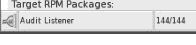

## 查找特定安全资源

大多数 Linux 发行版都有专门的资源帮助你保护 Linux，并跟进特定 Linux 版本的安全信息。以下是几个关注 Linux 发行版安全的在线资源：

- Red Hat Enterprise 和 Fedora 安全——查看 Red Hat 安全网站 (`www.redhat.com/security`) 获取 RHEL 安全问题（通常也涉及 Fedora 系统）。从这里你可以查找并阅读可用的更新。你也可以从 Red Hat 获取有关培训和咨询的信息。

参阅《Red Hat Linux 4 安全指南》以深入了解 Red Hat 系统的 Linux 安全。你也可以通过地址访问此指南：

`www.redhat.com/docs/manuals/enterprise/RHEL-4-Manual/en-US/Security-Guide`

## 学习系统管理技能

- Debian 安全——Debian 安全信息页 (`www.debian.org/security`) 提供了一个查找安全告、回答常见 Debian 问题以及安全文档链接的中心点。你可以在这里找到《加固 Debian》在线手册：
`www.debian.org/doc/manuals/securing-debian-howto`

- Ubuntu 安全——Ubuntu 安全页面 (`https://help.ubuntu.com/`) 中的指南和工具

- Gentoo 安全——Gentoo 安全页面 (`www.gentoo.org`) 提供了一个查找安全告、回答常见 Gentoo 问题以及安全文档链接的中心点。你可以在这里找到《加固 Gentoo》在线手册：
`www.gentoo.org/doc/manuals/securing-gentoo-howto`

- SUSE 安全——SUSE 安全页面 (`www.opensuse.org`) 提供了一个查找安全告、回答常见 SUSE 问题以及安全文档链接的中心点。你可以在这里找到《加固 SUSE》在线手册：
`www.opensuse.org/doc/manuals/securing-suse-howto`

## 学习系统管理技能

| 表 12-1 | 密码 | 如何记忆 |
|---|---|---|
| Mrci7Yo! | My rusty car is 7 years old! |
| 2EmB7pb1 | 2 elephants make BAD pets, 1 is better |
| ItMc?Gib | Is that MY cost? Give it back |

这些密码看起来是一堆乱码，但实际上很容易记忆。如你所见，我强调了密码中代表大写字母的单词。你可以使用 `passwd` 命令来设置密码。在命令行 shell 中输入 `passwd` 命令，它将允许你更改密码。首先，它会提示你输入当前密码。为了防止“窥视偷”并防止他人获知你的密码，在你输入时密码不会显示出来。

几个发行版都包含了随机密码生成器，可以用它们来创建安全的密码。例如，图 12-3 显示了 Ubuntu 中“用户和组”里的一个密码生成器。

### 图 12-3
### 生成随机密码

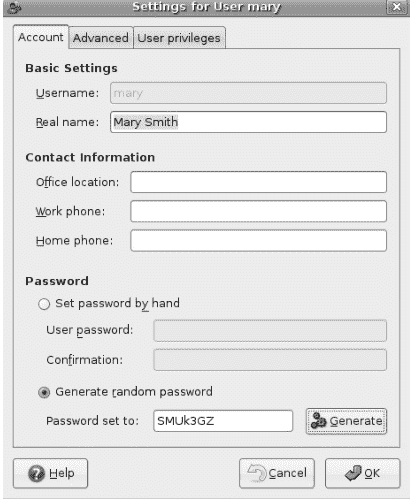

## 安全 Linux

假设你正确输入了旧密码，`passwd` 命令将提示你输入新密码。当你输入新密码时，`passwd` 命令会通过 `cracklib` 检查密码以判断这是一个好密码还是坏密码。如果非 root 用户选择的密码不是好密码，他们将被要求尝试另一个密码。

root 用户是唯一允许坏密码的用户。一旦密码被 `cracklib` 接受，`passwd` 命令会要求你再次输入新密码以确保没有拼写错误（当你看不见输入的内容时，错误很难被发现）。以 root 身份运行时，可以通过将用户的登录名作为 `passwd` 命令的参数来更改用户的密码。例如：

```bash
# passwd joe
Changing password for user joe.
New UNIX password: ********
Retype new password: ********
passwd: all authentication tokens updated successfully.
```

在这里，`passwd` 命令提示两次输入 joe 的新密码。在这种情况下，它不会提示你输入他的旧密码。这允许在用户忘记密码时重置密码（这种情况发生非常频繁）。

## 使用影子密码文件

在早期的 UNIX 版本中，所有用户帐户和密码信息都存储在所有用户都可以读取的文件中（尽管只有 root 可以写入）。通常这不是问题，因为密码信息是加密的。密码被加密成一串乱码字符字符串，这意味着编码后的密码可以被还原为非编码的密码。换句话说，陷门算法意味着加密是单向的，因此加密后的密码无法还原回加密前的密码。

在这种情况下，系统如何检查你的密码呢？当你登录时，系统会检查你输入的密码，将输入的乱码字符串与密码文件中存储的乱码字符串进行比较，只有当两者匹配时才允许访问。如果你曾问过系统管理员你账户的密码是什么，他们会回答“我不知道”。如果是这样，原因如下：管理员确实没有密码，只有加密版本。未被检测的密码只存在于你输入的瞬间。

## 破解加密密码

人们可以看到加密密码存在一个问题，尽管通过陷门算法反转加密可能困难（甚至是不可能的），但要编码大量的密码猜测并将其与密码文件中的加密密码进行比较是非常容易的。在数量级上，这比对每个用户名和密码尝试实际登录要高效得多。如果破解者能够获得你密码文件的副本，他就有更大的机会破解你的系统。

## 第三部分 学习系统管理技能

通常，Linux 和所有现代 UNIX 系统默认支持影子密码文件（shadow file）。影子文件是 passwd 文件的特殊版本，只有 root 可以读取。它包含了加密的密码信息，因此密码可以从系统中任何用户都可以读取的 `passwd` 文件移除。Linux 同时支持旧的单密码文件方法以及较新的影子密码文件。你应该始终使用影子密码文件（它是默认）。

## 检查影子密码文件

密码文件名为 `passwd`，位于 `/etc` 目录。影子密码文件名为 `shadow` 也位于 `/etc`。如果你的 `/etc/shadow` 文件丢失，是因为你的 Linux 系统将密码信息存储在 `/etc/passwd` 中。通过 `less` 命令显示文件进行验证。

```bash
# less /etc/passwd
```

将显示如下内容：

```text
root:Dk6SUke799FQ:0:0:root:/bin/bash
bin:x:1:1::/bin/bin
daemon:x:2:daemon:/bin/sh
```

```text
mary:KRPUp2opmY5A:500:101:Mary Smith/home/mary:/bin/bash
joe:0sXrznQakJs1:501:102:Joe Johnson/home/joe:/bin/bash
jane:ptNoIEJWK:502:103:Jane Anderson/home/jane:/bin/bash
bob:JuV7YAO6XKZw:500:103:Bob Reynolds/bob:/bin/bash
```

此列表中的每一行对应一个用户，用冒号（:）分隔。从左到右，字段分别是：登录名、加密密码、用户 ID、组 ID、描述、主目录和默认 shell。查看第一行，你可以看到 root 拥有加密密码 Dk6SUke799FQ，用户 ID 为 0，组 ID 为 0，主目录为 /root，shell 为 /bin/bash。

### 图 12-4

在系统日志查看器中显示系统日志文件。

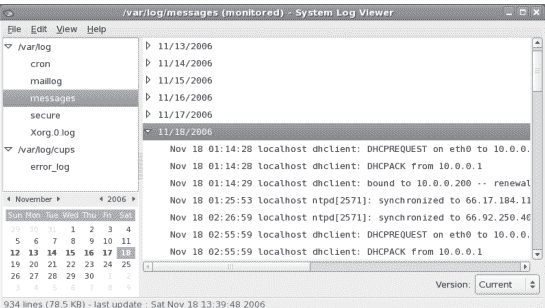

表 12-2 列出了系统日志查看器中的日志文件列表，以及 /var/log 目录中可能存在的其他文件。（选择“文件 ⭈”来打开未出现在左列中的日志文件。）这些文件中的许多包含在大多数 Linux 系统中，并且只有 root 用户可见。此外，某些 Linux 系统使用不同的文件或目录名称（例如，在某些 Linux 系统上为 /etc/httpd/apache）。

由于这些日志存储在纯文本文件中，因此你可以使用任何文本编辑器（如 vi 或 edit）或分页命令（如 less 命令）来查看它们。

### 表 12-2

| /var/log 目录下的日志文件 | | |
| 系统日志名称 | 文件名 | 描述 |
| :--- | :--- | :--- |
| 启动日志 | boot.log | 包含指示哪些系统已成功启动和关闭，以及（如果有的话）启动或停止失败的消息。最近的重启消息列在文件末尾。 |
| Cron 日志 | cron | 包含来自 cron 的状态消息，cron 是一个定期运行调度作业（如备份和日志轮转）的守护进程。 |
| 内核启动日志 | dmesg | 内核在系统启动时打印的消息。 |
| FTP 日志 | xferlog | 包含有关使用 FTP 服务传输的文件的信息。 |

370

## 安全 Linux 安全

| 系统日志名称 | 文件名 | 描述 |
| :--- | :--- | :--- |
| Apache 访问日志 | httpd/access_log | 记录对你的 Apache Web 服务器信息的请求。 |
| Apache 错误日志 | httpd/error_log | 记录客户端尝试访问你的 Apache Web 服务器上的数据时遇到的错误。 |
| 邮件日志 | maillog | 包含发送和接收电子邮件的地址信息。有助于检测垃圾邮件。 |
| MySQL 服务器日志 | mysql.log | 包含与 MySQL 数据库服务器 (mysqld) 活动相关的信息。 |
| 新闻日志 | spooler | 如果你正在运行 Usenet 服务器，则该目录包含来自服务器的消息日志。 |
| RPM 软件包 | rpmkgs | 包含安装在你的系统上的 RPM 包列表。（对于不基于 RPM 软件包的系统，请查找 debian-installer 或 packages 目录以查找安装包列表。） |
| 系统日志 | secure | 记录登录尝试和会话的日期、时间和持续时间。 |
| 系统日志 | messages | 通用日志文件，许多程序向其中记录消息。 |
| X.Org X11 日志 | Xorg.0.log | 包含 X.Org 服务器输出的消息。 |

> ^ 表示未包含在系统日志查看器窗口中的文件。可以从 /var/log 直接访问这些文件。

注意 GNOME 桌面还包含 Seahorse —— GNU Privacy Guard 的前端。Seahorse 允许你对文档进行数字签名或身份验证，并与 OpenPGP 和 SSH 密钥协同工作。你可以在 `www.gnome.org/projects/seahorse/index.html` 更多信息。

## syslog 的作用

`/var/log` 目录中的大多数文件由 syslog 服务维护。syslog 守护进程是系统日志守护进程。它接受来自各种其他程序的日志消息，并将它们写入相应的日志文件。这比让每个程序直接写入自己的日志文件要好，因为这允许集中管理日志文件的处理方式。可以配置 syslog 在日志文件中记录不同程度的细节。可以告诉它忽略除最关键信息以外的所有内容，也可以它可以记录每一个细节。

syslog 守护进程甚至可以接受来自网络上其他计算机的消息。这特别有用，因为使你能够集中管理和审查网络上许多系统的日志。这种做法还具有重大的安全益处。

如果你的系统被破解，破解者无法删除或修改日志文件，因为这些文件存储在另一台计算机上。然而，重要的是，日志消息默认情况下是不加密的。任何接入你本地网络的人都可以窃听这些从一台机器传输到另一台机器的消息。此外，破解者可能无法更改旧的日志条目，但他可以影响系统，导致任何日志消息都不应被信任。

运行一个专用的日志记录器（logger）并不罕见，这台计算机除了记录网络上其他计算机的消息外没有其他用途。该系统不运行其他服务，不太可能被破解。这使得破解者几乎无法擦除他们的足迹，但并不意味着在黑客入侵你的机器后所有的日志条目都是准确的。

## 使用 syslog 将日志重定向到日志记录器

要将你的日志文件重定向到 syslog 的日志记录器，你可能需要对本地 syslog 配置 `/etc/syslog.conf` 进行一些更改。使用 `sudo` 命令变成 root 并使用文本编辑器（如 `vi`）打开 `/etc/syslog.conf` 文件。你应该看到类似的内容：

```text
# 将内核消息记录到控制台。
# 记录过多信息会弄乱屏幕。
#kern.* /dev/console
# 记录除邮件以外的 info 或更高级别的任何内容。
# 不要记录私有的身份验证消息！
*info:mail.none:news:authpriv.none:cron.none /var/log/messages
# authpriv 文件具有限制访问。
*/var/log/secure
# 在一起记录所有邮件消息。
* /var/log
```

## SSH 服务

预装了 SSH 服务的 Linux 系统可以配置为自动启动。在 Fedora 和 RHEL 系统中，`sshd` 守护进程是从 `/etc/init.d/sshd` 启动脚本启动的。为了确保 Fedora、RHEL 以及其他基于 RPM 的 Linux 系统将服务设置为自动启动，请输入以下命令（以 root 用户身份）：

```
# chconfig -list sshd
sshd 0:off 2:on 3:on 4:on 5:on 6:off
```

这显示 sshd 服务被设置为在系统状态 2、3、4 和 5（正常启动状态）下运行，在所有其他状态下均关闭。如果 SSH 服务在你的默认运行状态下是关闭的，你可以通过以 root 用户输入以下命令来开启 SSH 服务：

```
# chconfig sshd on
```

此行命令会在你进入第 2、3、4 或 5 级时运行 SSH 服务。要立即启动该服务，请输入：

```
# service ssh start
```

其他发行版可能通过 `/etc/rc.d` 目录下一个类似 `rc.sshd` 文件的目来启动 sshd 守护进程。在任何情况下，你都可以通过输入以下命令确认系统上的 ssh 守护进程正在运行：

```
$ ps ax | grep sshd
1996 ? Ss 0:00 /usr/sbin/sshd
```

上一个示例显示 sshd 守护进程正在运行。如果是这样，并且你的防火墙允许 SSH 服务（打开 TCP 端口 22），那么你将能够使用 SSH 客户端访问你的系统。（任何你想限制 sshd 守护进程允许操作的进一步配置通常位于 `/etc/ssh/sshd_config` 文件中）。

## 使用 ssh、sftp 和 scp 命令

配合 SSH 服务可以使用的三个命令是 `ssh`、`sftp` 和 `scp`。远程用户使用 `ssh` 命令安全地登录到你的系统，或在你的系统上远程执行命令。`scp` 命令允许用户在服务器与本地之间复制文件。`sftp` 命令提供了一种通过 SSH 服务安全访问 FTP 文件的方法（适用于提供其 FTP 内容访问权限的站点）。

对于普通的 shell 服务，SSH 会查看 `/etc/hosts` 文件和用户 `/.hosts` 文件来确定是否应该允许连接。它还会查看 SSH 特有的文件 `/etc/hosts.equiv` 和 `.hosts`。使用 `hosts.equiv` 和 `.hosts` 更好，因为这避免了授予对未加密远程方法的访问权限 `/etc/hosts.equiv` 和 `.hosts` 文件的功能与传统的 `hosts.equiv` 和 `.hosts` 文件等效，因此相同的指令和规则适用。

## 第三部分学习系统管理技能

现在你已经准备好测试 SSH 服务了。从另一台安装了 SSH 的计算机（如果没有其他计算机，甚至可以从同一台计算机）输入 `ssh` 命令，后跟一个空格和要连接的系统名称。例如，连接到系统 `ratbert.glaci.com`，输入：

```
# ssh ratbert.glaci.com
```

如果你是第一次使用 ssh 登录该系统，ssh 将要求你确认是否真的想要连接。当出现此提示时，输入 yes 并按回车：

```
The authenticity of host 'ratbert.glaci.com (199.170.177.18)' can't be established.
RSA key fingerprint is xx:xx:xx:xx:xx:xx:xx:xx:xx:xx:xx:xx
Are sure you want to continue connecting (yes/no)?
```

随后它将像往常一样提示输入用户名和密码。连接将像远程登录连接一样工作（换句话说，你可以开始输入 ssh 命令）。唯一的区别是信息在网络上传输时是加密的。你还应该能够使用 ssh 命令从远程系统的 shell 运行远程命令。

`scp` 命令类似于 `rcp` 命令，用于在 Linux 系统之间复制文件。这里有一个使用 `scp` 命令从用户命名的家目录将文件复制到名为 maple 的计算机的 `/tmp` 目录的示例：

```
$ scp /home/jake/memo memo maple:/tmp
```


`jake@maple's password: ***********`

`100%|***********| 153 0:00`

输入你用户名的密码（如果收到请求）。如果密码被接受，远程系统将指示文件已成功复制。

同样，`sftp` 会与支持 SSH 连接的 FTP 服务器启动交互式 FTP 会话。许多注重安全的人倾向于使用 `sftp` 而不是其他 FTP 客户端，因为它在你和远程端之间提供了一个安全连接。这是一个示例：

```
$ sftp ftp.handhistory.com

Connecting to ftp.handhistory.com

jake@ftp.handhistory.com's password: ***********

sftp>
```

此时，你可以开始交互式 FTP 会话。你可以像使用任何 FTP 连接一样对文件使用 `get` 和 `put` 命令，但可以知道你正在安全连接上工作，这很安心。

> 提示 `sftp` 命令与 `ssh` 和 `scp` 一样，要求服务器上运行 SSH 服务。如果你无法使用 `sftp` 连接到 FTP 服务器，可能是 SSH 服务不可用。

# 在无密码的情况下使用 ssh、sftp 和 scp

设置 SSH 密钥认证是一项常见任务。它允许你在无需输入密码的情况下登录远程服务器，这同时也比基于密码的认证更安全。

1. 通过输入以下命令在你的本地机器上生成密钥对：

```
$ ssh-keygen -t dsa
```
系统将提示你保存密钥对的位置。按回车使用默认位置 (`~/.ssh/id_dsa`)。将提示你输入密码。如果你不想使用密码，请按两次回车留空。

命令将生成两个文件：私钥 (`id_dsa`) 和公钥 (`id_dsa.pub`)。

2. 安全 `.ssh` 目录和文件的权限。确保只有你才能访问私钥：

```
$ chmod 700 ~/.ssh

chmod 600 ~/.ssh/id_dsa

chmod 644 ~/.ssh/id_dsa.pub
```

3. 将公钥复制到远程服务器（将 `chester` 替换为用户名，将 `host2` 替换为主机）：

```
$ scp id_dsa.pub chester@host2:/tmp

chester@host2's password: ***********
```

4. 将公钥追加到远程用户的授权密钥文件：

```
$ ssh chester@host2 'cat /tmp/id_dsa.pub >> /home/chester/.ssh/authorized_keys'
```

5. 安全远程服务器上 `authorized_keys` 文件的权限：

```
$ ssh chester@host2 'chmod 700 ~/.ssh; chmod 600 ~/.ssh/authorized_keys'
```

6. 从远程服务器的临时目录删除公钥：

```
$ ssh chester@host2 'rm /tmp/id_dsa.pub'
```

现在你应该可以在无需提示密码的情况下登录远程服务器。

# Linux 服务器的安全

将你的 Linux 系统作为服务器在公共网络上开放，在安全方面带来了一系列挑战。与其说是仅仅拒绝入入连接，不如说你的计算机将被处理支持的服务请求，通过提供信息或可能运行接收数据的脚本。

一整本书都充满了关于如何保护服务器安全的信息。许多运行在互联网上的企业指派全职管理员来监控服务器的安全。因此，请将本部分视为对某些攻击类型的概述，以及用于保护 Linux 服务器的工具。

# 使用 TCP Wrappers 控制服务的访问

完全禁用不使用的服务是可以的，但对于你真正需要的服务呢？你可以选择性地授予或拒绝这些服务的访问吗？对于集成 TCP

# 安全 Linux 安全

`wrapper` 支持通过 `/etc/hosts.allow` 和 `/etc/hosts.deny` 文件来决定诸如 `login`、`rsh`、`telnet`、`finger` 和 `talk` 等服务在何时应该允许或拒绝特定的连接。

大多数实现 TCP wrappers 的 Linux 系统针对一组由名为“Internet server”的单一监听进程监控的服务执行此操作。对于 Fedora 和 RHEL 系统，`xinetd` 守护进程位于何处，而在其他系统（如 Debian）中使用了 `xinetd` 守护进程。当依赖于 TCP wrappers 的服务从服务器进程收到请求时，系统会扫描 `hosts.allow` 和 `hosts.deny` 文件，并检查是否存在与连接机器 IP 地址匹配的条目。这些检查在连接发生时进行：

- 如果地址列在 `hosts.allow` 文件中，则允许连接不再检查 `hosts.deny`。
- 如果地址在 `hosts.deny` 中，则拒绝连接。
- 如果地址在两个文件中都不存在，则允许连接。

请记住，对 `hosts` 进行评估顺序非常重要。例如，你不能对一个已经在 `hosts.allow` 文件中获得访问权限的 `hosts.deny` 文件拒绝访问。

没有必要（甚至不可能）列出可能连接到你计算机的每一个地址。`hosts.allow` 和 `hosts.deny` 文件允许你指定子网和地址。你可以使用关键字 `ALL` 来指定所有可能的地址。你还可以限制这些文件中的特定条目，使其仅适用于特定的网络服务。查看一个典型的 `hosts.allow` 和 `hosts.deny` 文件对的示例。这里是 `/etc/hosts.allow`：

```
#
# hosts.allow 此文件描述了允许
# 使用本地 INET 服务的主机名，由
# /usr/sbin/tcpd) 决定
# server.
cups-lpd: 199.170.177.
in.telnet: 199.170.177..linuxtoys
vsftpd: ALL
```

这里是 `/etc/hosts.deny` 文件：

```
#
# hosts.deny 此文件描述了不
# *允许* 使用本地 INET 服务的主机名，由
# /usr/sbin/tcpd) 决定
# server.
ALL: ALL
```

前面的示例是一个相当严格的配置。它允许从某些主机连接到 `cups-lpd` 和 `telnet` 服务，但拒绝所有其他连接。它还允许所有主机连接到 FTP 服务（`vsftpd`）。详细检查这些示例。

# 学习系统管理技能

通常情况下，以 `#` 字符开头的行会被 `inetd` 在解析文件时忽略。每行非空内容由逗号分隔的守护进程列表组成，后面跟着一个冒号（:`），然后是由逗号分隔的待检查客户端地址列表。在这种语境下，客户端是指任何尝试访问你系统上网络服务的计算机。

客户端可以是数字 IP 地址（例如 `199.170.177.25`）或主机名（例如 `jukebox.linuxtoys.net`），但它通常是指定整个地址范围的通配符变体。客户端条目有不同的形式。`hosts` 的在线手册对它们的描述如下：

- 带有点（`.`）字符的字符串。如果主机名的部分与指定的模式匹配，则匹配主机名。例如，模式 `.tue.nl` 匹配主机名 `wz...nl`。
- 以点（`.`）字符结尾的字符串。如果其主机地址的前几个数字字段与给定的模式匹配，则匹配主机地址。例如，`131.155` 匹配埃霍芬大学网络上（几乎）每个主机的地址（`131.155.x.x`）。
- 带有 `@` 符号的字符串被视为 NIS 网络。如果主机名是指定网络的成员，则匹配主机名。守护进程进程或客户端用户不支持 Netgroup 匹配。
- 形式为 `n.n.n/m.m.m.m` 的表达式解释为网络/掩码。如果 `net` 等于 `mask` 的位与运算结果，则匹配主机地址。例如，网络/掩码模式 `131.155.72/255.255.254` 匹配 `131.155.72` 到 `131.155.73.255` 范围内的每一个地址。

示例 `host.allow` 包含了前两种类型的客户端规范。条目 `199.177` 将匹配任何以该开头的 IP，例如 `199.170.177.25`。客户端条目 `.linuxtoys.net` 将匹配如 `jukebox.linuxtoys.net` 和 `picframe.linuxtoys.net` 等主机。

让我们看看当主机 `jukebox.linuxtoys.net`（IP 地址 `199.170.179.18`）使用 Telnet 协议连接到你的 Linux 系统时发生了什么。在这种情况下，Linux 系统是 Fedora，它使用 `inetd` 来监听与 TCP wrappers 相关的服务：

- `inetd` 获取连接请求。
- `inetd` 开始将 `jukebox.linuxtoys.net` 的地址和名称与 `/etc/hosts.allow` 中列出的规则进行比较。它从文件顶部开始向下直到直到找到项。处理你 Fedora 机器上网络服务的程序以及连接客户端的 IP 地址或名称必须与 `hosts.allow` 文件中的信息匹配。在这种情况下：

```
telnet:199.170.177..linuxtoys
```

## 第三部分学习系统管理技能

计算机用户询问关于源自其计算机的威胁。通过忽视安全，所有者已经让自己面临了巨大的风险。

- 侵入攻击 —— 为了远程使用目标机器的资源，攻击者必须首先寻找一个可以利用的漏洞（或突破口）。在缺乏密码或加密密钥等内部信息的情况下，他们必须扫描目标机器以查看提供了哪些服务。也许其中某个服务的安全性较低，攻击者可以使用某些漏洞将其设法溜入内部。
- 工具 `nmap` 通常是扫描主机服务的最佳方法（请注意 `nmap` 是一个既可以用于善意也可以用于恶目的的工具）。一旦攻击者获取了目标机器上运行可用服务的列表，或者他需要找到一种方法尝试利用这些漏洞来获取系统的特权访问。通常，这是通过一个名为 `exploit` 的程序实现的。

虽然拒绝服务攻击（Dos attacks）具有破坏性，但侵入攻击的危害最大。原因多种多样，但结果总是是相同的：一个不请自来的客人现在正居住在你的机器上，并以你无法控制的方式使用它。

## 防御拒绝服务攻击

如前所述，拒绝服务攻击试图使你的计算机崩溃，或者将其性能降低到无法使用的程度。有多种拒绝服务攻击利用手段。大多数是为了过载你的系统资源，例如可用的磁盘空间或你的互联网连接。接下来的章节将讨论一些常见的攻击和防御措施。

## 邮件炸弹 (Mailbombing)

邮件炸弹是指向特定用户或系统发送大量电子邮件，导致用户的硬盘变满。有方法保护自己免受邮件炸弹，正如后续章节所述。你可以使用 `Procmail` 邮件过滤工具，如果你使用 `sendmail` 作为你的邮件传输代理，可以配置你的 `sendmail` 守护进程。

## 使用 Procmail 进行拦截

`Procmail` 邮件过滤工具 Fedora、RHEL 以及许多其他 Linux 系统默认安装，与 `sendmail` 电子邮件守护进程深度集成；因此，它可以用于选择性地拦截或过滤特定类型的电子邮件。你可以在 Procmail 网站 `www.procmail.org` 了解更多关于 Procmail 的信息。

要为你的用户账户启用 Procmail，请在主目录中创建一个 `.procmailrc` 文件。该文件的模式应为 `0600`（仅你可读，其他人不可）。输入以下内容，并将 `evilmailer` 替换为正在轰炸你的真实邮箱地址：

```bash
# 删除来自 evilmailer 的邮件

:0

* ^.evilmailer

/dev/null
```

## 安全 Linux 安全

`Procmail` 脚本会查找每封邮件开头的 `From`，查看其是否包含 `evilmailer` 字符串。如果包含，消息将被发送到 `/dev/null`（实际上是被丢弃）。

## 使用 sendmail 拦截邮件

当只有一个用户遭受邮件炸弹时，`Procmail` 邮件工具效果良好。然而，如果邮件炸弹影响了许多用户，应该配置你的 `sendmail` 守护进程来拦截来自该邮件发送者的所有邮件。通过在位于 `/etc/mail` 目录下的 `access` 文件中添加发送者的电子邮件地址或系统名称来实现。

`access` 文件的每行包含一个电子邮件、主机名、域名或 IP 地址，后面跟着一个制表符和一个关键字，指定当实体向你发送消息时应采取的操作。有效的关键字有 `OK`、`RELAY`、`REJECT`、`DISCARD` 和 `ERROR`。使用 `REJECT` 关键字将导致发送者的电子邮件带有错误信息被退回。`DISCARD` 关键字将导致消息被静默丢弃而不发送错误。你甚至可以使用 `ERROR` 关键字返回自定义的错误信息。

因此，一个示例 `/etc/mail/access` 文件可能如下：

```text
# 查看 /usr/share/doc/sendmail/README.cf 以获取此文件
# 格式的描述。（在该文件中搜索 access_db）
# /usr/share/doc/sendmail/README.cf 是 sendmail-doc
# 包的一部分。
# # 默认情况下，我们允许从 localhost 继...
localhost.domain RELAY
localhost RELAY
127.0.0.1 RELAY
# # 我们想要拦截的发送者
#
evilmailer@yahoo.com REJECT
stimpy.glaci.com REJECT
cyberpromo.com DISCARD
199.170.176.99 ERROR:550 Die Spammer Scum!*
199.170.177 ERROR:550 Email Refused*
```

与 Linux 配置文件一样，带有井号 (`#`) 的邮件炸弹行是注释。被拦截的垃圾邮件者列表位于文件的末尾。注意，要拦截的地址可以是完整的电子邮件、全名、仅域名、IP 地址或子网。

要拦截特定的电子邮件地址或主机，请以 root 身份登录系统，编辑 `/etc/mail/access` 文件，并添加一行 `DISCARD` 来自违规发送者的邮件。

保存文件并退出编辑器后，你必须将 `access` 文件转换为哈索引数据库 `access.db`。数据库在下次启动 `sendmail` 时会自动更新。在 Fedora 和 Red Hat 系统上，你可以按照如下步骤立即转换数据库：

```bash
# cd /etc/mail
# make
```


`sendmail` 现在应该丢弃来自你添加地址的邮件。

## 垃圾邮件转发 (Spam Relaying)

邮件服务还可能被滥用，将你的系统作为垃圾邮件中继。*垃圾邮件 (Spam)* 指的是已常见的非自愿电子邮件。*中继 (Relay)* 指的是允许转发消息的邮件服务器功能。（通常，配置为开放中继的邮件服务器允许任何人使用，因此被认为是不良实践。）

垃圾邮件发送者从普通的拨号连接发送烦人的信息。他们需要某种高容量的互联网服务器来接收负载。自然，没有互联网服务供应商会配合这种行为，垃圾邮件发送者利用劫持来干脏工作。让你的邮件服务器被劫持为垃圾邮件中继会对你的系统和声誉产生毁灭性影响。幸运的是，Fedora 和 Red Hat 安装禁用了开放中继。开放中继并不是你需要担心的安全问题。

你可以通过在 `/etc/mail/access` 文件中为特定的主机或域名添加 `RELAY` 关键字来允许通过你的系统进行转发。默认情况下，允许主机转发。

你可能会考虑使用 `SpamAssassin` 包在你的邮件服务器上过滤垃圾邮件。`SpamAssassin` 评估传入邮件的文本，并尝试过滤确定为垃圾邮件的消息。`SpamAssassin` 在第 14 节中介绍。

## Smurf 放大攻击

Smurf 攻击是指一种旨在淹没你的互联网连接的特殊拒绝服务攻击。这种攻击很难防御，因为很难追踪到攻击者。以下是 Smurf 攻击的工作原理：

该攻击利用 ICMP 协议，该协议用于检查网络连接的速度和可用性。使用 `ping` 命令，你可以从你的计算机向互联网上的另一台计算机发送数据包。远程计算机会将数据包识别为 ICMP 请求并向你的计算机回显。你的计算机可以打印显示远程系统已开启的消息，并告诉你响应 ping 所花费的时间。

Smurf 攻击使用畸形的 ICMP 请求用网络流量淹没你的计算机。攻击者通过在无辜的第三方处反弹 ping 请求来实现这一点，使得回包被复制几十或上百次。具有快速连接和大量计算机的组织被用作中继。ping 的目标地址设置为整个子网而不是单个主机。返回地址被伪造为你的机器地址而不是真实的发送者地址。当 ICMP 数据包到达无辜中继的网络时，该子网上的每个主机都会响应 ping！此外，它们会响应你的计算机而不是真实的发送者。如果中继站的网络有数百台计算机，你的 Internet 连接可能会被迅速淹没。

最好的修复方法是联系被用作中继的组织并告知他们滥用情况。通常，他们只需要重新配置其 Internet 路由器即可阻止未来的攻击。如果该组织不配合，你可以通过在路由器上拦截 ICMP 协议来最大限度地减少攻击影响。这将防止流量进入你的内部网络。如果你能说服你的 ISP 阻塞针对你网络的 ICMP 数据包，效果会更好。（注意，关于封禁 ICMP 数据包是否是一个好主意存在一些争议——ICMP 服务对于各种管理目的可能很有用。）

# 加固 Linux

## 防御分布式拒绝服务（DDoS）攻击

DDoS 攻击难以发起，而且极其难以停止。DDoS 攻击始于对数百或数千台安全防护薄弱机器的渗透。这些机器可以根据攻击者的意愿被引导攻击单个主机。

随着 DSL 和电缆调制解调器的出现，数百万人正在享受几乎没有限制的 Internet 服务。在急于上线的过程中，许多人甚至忽视了最基本的安全。由于这类人中的绝大多数运行微软操作系统，他们往往更容易受到蠕虫和病毒的攻击。机器被入侵后，蠕虫或病毒通常会在受害者机器上安装一个程序，指令其快速“回家”并宣布它现在已准备好听从主人的差遣。

受感染机器的使用可以将集中的垃圾数据流导向主机。与数千台其他受感染机器配合，脚本小子（script kiddie）现在拥有了击 Internet 上任何网站的能力。

检测 DDoS 与检测 DoS 攻击相似。以下一个或多个迹可能是：

- 持续饱和的数据链路
- 在非高峰期间链路饱和率没有降低
- 数百或数千个并发网络连接
- 极低的系统性能

要确定你的链路是否饱和，通过 ping 外部主机可以说明很多问题。比平时高得多的延迟是一个明显的迹象。正常的 ping 延迟（即从远程主机返回 ping 响应的时间）如下：

```
$ ping www.example.com (192.0.3.166) from 10.0.0.11: 56(84) bytes of data
64 bytes from 192.0.3.166: icmp_seq=1 ttl=40.1 ms
64 bytes from 192.0.3.166: icmp_seq=2 ttl=42.5 ms
64 bytes from 192.0.3.166: icmp_seq=3 ttl=39.5 ms
```

# 第三部分学习系统管理技能

```
64 bytes from 192.0.34.166: icmp_seq=4 ttl=49 time=38.4 ms
64 bytes from 192.0.34.166: icmp_seq=5 ttl=49 time=39.0 ms
```

```
--- www.example.com ping statistics ---
5 packets transmitted, 5 received, 0% loss, time 4035ms
rtt min/avg/max/mdev = 38.472/39.971/42.584/1.432 ms
```

在前面的示例中，ping 往返的平均时间为 39 毫秒。

对近饱和链路的 ping 如下：

```
# ping www.example.com (192.0.34.166): 56(84) bytes of data
64 bytes from 192.0.34.166: icmp_seq=1 ttl=62 time=1252 ms
64 bytes from 192.0.34.166: icmp_seq=2 ttl=62 time=1218 ms
64 bytes from 192.0.34.166: icmp_seq=3 ttl=62 time=1290 ms
64 bytes from 192.0.34.166: icmp_seq=4 ttl=62 time=1288 ms
64 bytes from 192.0.34.166: icmp_seq=5 ttl=62 time=1241 ms
```

```
--- www.example.com ping statistics ---
5 packets transmitted, 5 received, 0% loss, time 5032ms
rtt min/avg/max/mdev = 1218.059/1258.384/1290.261/28.000 ms
```

在这个示例中，ping 往返花费了超过 1.3 秒。从第一个示例到第二个示例，延迟增加了 31 倍！数据链路从正常变为减慢 31 倍，这显然是应该调查利用率的明显信号。

为了更准确地测量数据吞吐量，你可以使用诸如 `ttcp` 的工具。要用 `ttcp` 测试你的连接，你必须在 Fedora 和其他 Linux 系统上安装该包。如果你不确定安装了该包，只需在命令行提示符处输入 `ttcp`。你应该看到类似下面的内容：

```
# ttcp
Usage: ttcp [options] host [out]
Common options:
  -l length of bufs from to network (default 8192)
  -u UDP instead of TCP
  -p port number to send or listen at (default 5001)
  -s pattern to network
  -A align the start of buffers at this offset (default 16384)
  -v verbose; print more statistics
  -d set SO_DEBUG socket option
  -b set buffer size
  -f format for rate: k = kilo(byte); m = mega; g = giga
  -t number of source bufs written to network (default 2048)
  -D don't buffer writes (sets TCP_NODELAY socket)
  -w number of microseconds to wait between each write
  -s only for full blocks as specified by
  -I Specify the network interface (e.g., eth0) to use
```

第一步是在服务器上启动接收端：

```
# ttcp -rs
ttcp-r: flow=8192, nbuf=2048, align=16384/0, port=5001 tcp
```

`-r` 标志表示服务器将作为接收端。`-s` 标志结合 `-t` 标志告诉 `ttcp` 你想忽略接收到的数据。下一步是使用 `ttcp` 连接到你的数据链路：

```
# ttcp -ts server.example.com
ttcp-t: flow=8192, nbuf=2048, align=16384/0, port=5001 tcp
```

让进程运行几分钟，在发送端按 Ctrl+C 停止，然后计算并显示结果：

```
# ttcp -rs
ttcp-r: flow=8192, nbuf=2048, align=16384/0, port=5001 tcp
ttcp-r: accept from 64.223.17
ttcp-r: 2102496 bytes in 70.02 seconds = 29.32 KB/sec
ttcp-r: 1226 I/O calls, msec=58.49, calls/sec = 17.51
ttcp-r: 0.0 User 0:10 real 0%
```

在这个示例中，两个主机之间的平均带宽为每秒 29.32 KB。遭受 DDoS 攻击，这个数字是数据链路额定带宽的比例。

如果数据链路确实饱和了，下一步是确定连接来自哪里。一种非常有效的方法是使用 `netstat` 命令，它是 Fedora 安装的一部分。尝试输入以下命令查看连接信息：

```
# netstat -tupn
```

表 12-3 描述了每个 `netstat` 参数。

| 参数 | 描述 |
| :--- | :--- |
| `-t`, `--tcp` | 显示 TCP 连接。 |
| `-u`, `--udp` | 显示 UDP 连接。 |
| `-p`, `--program` | 显示每个套所属的 PID 和程序名称。 |
| `-n`, `--numeric` | 显示数字地址而不是解析符号主机、端口或用户名。 |

以下是输出的一个示例：

```
Active internet connections (w/o servers)
| Recv-Q Send-Q Local Address Foreign Address State PID/Program name
| tcp 0 0 06.251.73.9:6667 13.29.132.19:12545 ESTABLISHED 32376/sshd
| tcp 0 224 06.251.73.9:2622 13.29.210.13:29250 ESTABLISHED 13858/sshd
| tcp 0 0 06.251.73.9:6667 216.39.144.152 ESTABLISHED 1870/lrc
| tcp 0 0 06.251.73.9:6667 13.29.194.190 ESTABLISHED 1870/lrc
| tcp 0 0 06.251.73.9:42352 67.13.11.59 TIME_WAIT
| tcp 0 0 06.251.73.9:42354 127.0.0.1:93 TIME_WAIT
| tcp 0 0 06.251.73.9:42351 83.152.6.9 TIME_WAIT
| tcp 0 0 127.0.0.1:42351 127.0.0.1:783 TIME_WAIT
| tcp 0 0 127.0.0.1:783 127.0.0.1:42353 TIME_WAIT
```

### 表 12-4

| 状态 | 描述 |
| --- | --- |
| ESTABLISHED | Socket 已建立连接。 |
| SYN_SENT | Socket 正在尝试建立连接。 |
| SYN_RECV | 收到来自网络的连接请求。 |
| FIN_WAIT1 | Socket 已关闭并正在停止。 |
| FIN_WAIT2 | Socket 正在等待远程端关闭。 |
| TIME_WAIT | Socket 在关闭后等待处理网络中仍然存在的数据包。 |
| CLOSED | Socket 未未使用。 |
| CLOSE_WAIT | 远程端已关闭，等待 Socket 关闭。 |
| LAST_ACK | 远程端已关闭，Socket 已关闭，等待确认。 |
| LISTEN | Socket 正在等待传入的连接。 |
| CLOSING | 连接双方均关闭，但并非所有数据已发送。 |
| UNKNOWN | Socket 的状态未知。 |

对于 DoS 攻击，每个连接的远程地址通常是相同的。在这种情况下，只需在 `www.arin.net/whois/` 的搜索表单输入远程 IP 地址，即可提醒您的 ISP（互联网服务提供商）。

在 DDoS 攻击中，每个连接的远程地址可能不同。在这种情况下，追踪所有违规者是不可能的，因为会有数千个他们。保护自己的最佳方法是联系您的 ISP，看它是否可以在您的边界路由器处过滤流量。

## 防御入侵式攻击

黑客拥有多种工具和技术来帮助他们入侵您的计算机。入侵式攻击侧重于利用您安全系统中的漏洞；黑客可以获得比从外部获取更多的系统控制权（并可能造成更大的损害）。

幸运的是，有很多工具和技术可以对抗入侵式攻击。本节将讨论最常见的破解方法以及保护您系统的可用工具。虽然所示示例针对 Fedora 和其他 Red Hat Linux 系统，但这些工具和技术通常适用于任何 Linux 或类 UNIX 操作系统。

## 评估对网络服务的访问

Linux 系统及其 UNIX 提供了许多网络服务，随之而来的是许多黑客攻击途径。您应该了解这些服务以及如何限制对它们的访问。

我说的网络服务是什么？基本上，我指的是计算机为了完成任务而使用某些预定义的规则在网络上发送和接收信息的任务。路由电子邮件是一种网络服务。提供 Web 页面也是如此。您的 Linux 设备具有提供数千种服务的潜力。其中许多列在 `/etc/services` 文件中。查看该文件的片段：

```
/etc/services:
# service-name port/protocol [aliases ...] [# comment]
chargen      19/tcp          ttyt source
chargen      19/udp          ttyt source
ftp-data      20/tcp
ftp-data      20/udp
# 21 注册给 ftp，也用于 fsp
ftp           21/tcp
ftp           21/udp          fsp fspd      # SSH 远程登录协议
ssh           22/tcp          # SSH 远程登录协议
ssh           22/udp
telnet        23/tcp
telnet        23/udp
# 24 - 邮件系统
smtp          25/tcp                  mail
```

在注释行之后，您会注意到三列信息。左列包含服务的名称。中间列定义了该服务使用的端口号和协议。右列提供了该服务的可选别名或别名列表。

例如，文件片段中的条目描述了 SMTP（简单邮件传输协议）服务，它用于在互联网上发送电子邮件。中间列包含端口 25/tcp，这告诉您 SMTP 协议使用端口 25，并使用传输控制协议（TCP）作为其协议类型。

什么是端口号？它是为特定工作保留的唯一数字。它允许网络连接正确地连接到处理该服务的软件。例如，当一封电子邮件从其他计算机发送到您的 Linux 设备时，远程系统必须首先与您的系统建立连接。您的连接接收请求，检查它，将其标记为端口 25，然后知道该连接应该交给处理电子邮件的程序（恰好是 `sendmail`）。

我提到过 SMTP 使用 TCP。某些服务使用 UDP（数据报协议）。就此安全讨论的目的而言，您真正需要了解关于 TCP 和 UDP 的仅是它们提供了在网络上发送发送信息的不同封装方式。TCP 连接提供了错误检测和丢失数据的重传。UDP 不检查数据是否完整无损地到达，它旨在作为快速发送非关键信息的方法。

## 使 Linux 安全

尽管您的 Linux 系统上可能存在成百种服务（在 `/etc/services` 中列出了官方端口号）并容易受到攻击，但实际上只安装了少数服务，且默认情况下只有寥寥几个。在 Fedora 和 RHEL 系统中，大多数网络服务由 `inetd` 进程或 `/etc/init` 目录下的启动脚本启动。其他 Linux 系统使用 `inetd` 进程而不是 `inetxd`。

`xinetd` 和 `inetd` 是监听大量网络端口的守护进程。当连接到特定端口号时，`xinetd` 会自动启动该服务的相应程序并处理到它的连接。

对于 `xinetd`，配置文件 `/etc/xinetd.conf` 允许您定义哪些服务。`/etc/xinetd.d` 目录包含每个服务的单独文件。对于 `inetd`，配置在 `/etc/inetd.conf`。

用于配置这些服务的安全级别配置窗口。有关 SELinux 的信息专门针对 Fedora，请参阅此站点：

http://fedoraproject.org/wiki/SELinux

# 使用证书和加密保护 Web 服务器


之前的章节告诉了你如何锁定 Linux 系统的大门以拒绝黑客的访问。然而，如果你在车道上被谋杀并被偷了钥匙，那么防盗锁也无用武处。同样，如果你在互联网上以不受保护的方式发送密码和其他关键数据，那么最顶级的计算机安全也将无济于事。

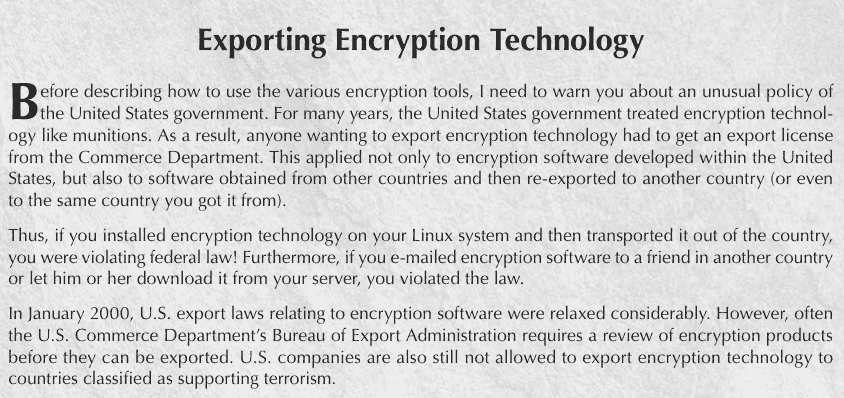

在描述如何使用各种加密工具之前，我需要提醒你注意美国政府的一项不寻常政策。多年来，美国政府一直将加密视为军火。任何想要出口加密技术的人都必须从商务部获得出口许可证。这不仅适用于在美国境内开发的出口软件，还适用于从其他国家获得并重新出口到另一个国家（甚至是你获取它的那个国家）的软件。

因此，如果你在 Linux 系统上使用了加密技术并将其运出国外，你就违反了联邦法律！此外，如果你向另一个国家的友发送邮件加密软件，或者让他/她从你的服务器下载，你就违反了法律。

2000年，美国与加密软件相关的出口法律大大放宽。然而，美国商务部的出口管理局通常要求在加密产品出口之前进行审查。美国公司也不允许向被分类为支持主义的国家出口加密技术。

聪明的黑客可以使用协议分析器或网络嗅探器窥视流经网络的数据，获取密码、信用卡数据和其他信息。黑客通过进入同一网络上受保护不良的系统并运行软件，或者通过插入他们自己的设备来实现。

你可以通过加密来对抗这种窃取行为。今天主要的两种加密类型是对称加密和公钥加密。

# 对称加密

对称加密也称为私钥加密，使用单一密钥对消息进行加密和解密。由于安全密钥交换的复杂性，这种方法通常不适用于保护将被第三方使用的数据。对称加密通常用于自己的目的加密数据。

对称加密的一个经典用途是个人密码库。任何使用过一段时间互联网的人都积累了许多访问各种网站和资源的用户名和密码。个人密码库以加密的形式存储这些访问信息。结果是，你只需要记住一个密码即可解锁所有的访问信息。

直到最近，美国政府一直标准使用对称加密算法 DES（数据加密标准）来保护重要信息。由于没有直接的方法可以破解 DES 加密的数据，或在没有密码的情况下解密 DES 加密的数据，你必须使用无法想象的计算能力来猜测密码。这也被称为解密的暴力破解法。

随着计算能力的近乎指数级增长，DES 算法不得不退役。取而代之的是，在经过非常长而有趣的搜索后，美国政府接受了 Rijndael 算法，并称其为 AES（高级加密标准）。尽管 AES 算法也会受到暴力破解攻击，但破解它比破解 DES 算法需要多得计算能力。

有关 AES 的更多信息以及该算法的命令行实现，你可以访问 http://aescript.sourceforge.org/。

# 非对称加密

公钥加密不受密钥分发问题的困，这就是为什么它是安全互联网通信的首选加密方法。这种方法使用两个密钥，一个用于加密消息，另一个用于解密。用于加密消息的密钥称为公钥，因为它是所有人可见的。用于解密消息的密钥是私钥，并保持隐藏。

想象一下你想使用公钥加密发送一条消息。我们需要这些内容：

1. 我必须有一对公钥和私钥。根据情况，我可能自己生成密钥（使用特殊软件），或从密钥权威机构获取密钥。

2. 你想发送一条消息，所以你首先查找我的公钥（更准确地说，是你正在使用的软件在查找）。

3. 你用公钥加密消息。此时，消息只能用私钥解密（公钥不能用于解密消息）。

4. 我接收消息并使用我的私钥对其进行解密。

# 安全套接层 (SSL)

公钥加密的一个经典实现是使用安全套接层（SSL）通信。这项让你能够安全地向在线市场提交信用卡信息的技术。SSL 加密会话的元素如下：

- 启用 SSL 的网络浏览器（Mozilla、Internet Explorer、Opera、Konquerer 等）

- 启用 SSL 的 Web 服务器（Apache）

- SSL 证书

要启动 SSL 会话，网络浏览器首先连接到端口 443 的 Web 服务器，也称为 HTTPS（超文本传输安全协议）端口。在两台机器之间建立套接字连接后将发生以下情况：

1. 服务器将其证书发送给浏览器。

2. 服务器通过 SSL 证书验证服务器的身份。

3. 服务器生成一个对称加密密钥。

4. 浏览器使用 SSL 证书加密对称密钥。

5. 服务器发送对称密钥。

6. 浏览器使用 SSL 证书解密对称密钥。

# 创建 SSL 证书

一旦你熟悉了基本组件，请查看用于创建 SSL 证书的工具：

```
# cd /etc/httpd/conf
# make
此 Makefile 允许你创建：
- 公私钥对
- 签名请求 (CSR)
- 自签名测试证书
```

要创建密钥对，运行 `make SOMETHING.key`。要创建 CSR，运行 `make SOMETHING.csr`。要创建测试证书，运行 `make SOMETHING.crt`。要把密钥和测试证书创建一个文件中，运行 `make SOMETHING.pem`。

要为 Apache 创建密钥，运行 `make genkey`。要为 Apache 创建 CSR，运行 `make certreq`。要为 Apache 创建测试证书，运行 `make testcert`。

```
示例：
make server.key
make server.csr
make server.crt
make stunnel.pem
make genkey
make certreq
make testcert
```

`make` 命令利用 Makefile 创建 SSL 证书。在没有任何参数的情况下，该命令仅打印上述示例中列出的信息。以下定义了你可以给 `make` 的每个参数：

- make server.key — 创建通用的公私钥对。

- make server.csr — 生成通用的 SSL 证书请求。

## 加固 Linux

- make server.crt — 生成一个通用的 SSL 测试证书。

- make stunnel.pem — 生成一个通用的 SSL 测试证书，但将私钥放在与 SSL 相同的文件中。

- make genkey — 与 make server.crt 相同，但它将密钥放在 `ssl.key` 目录下。

- make certreq — 与 make server.csr 相同，但它将证书请求放在 `ssl.csr` 目录下。

- make testcert — 与 make server.crt 相同，但它将测试证书放在 `ssl.crt` 目录下。

# 使用第三方证书颁发机构

在现实世界中，我知道你是谁，因为我认得你的脸、声音和举止。在互联网上，我无法看到这些内容，必须依赖受信任的第三方为你的身份背书。为了确保证书不可篡改，它在颁发时必须由受信任的签名，并且每当用户加载安全站点时都要进行验证。以下是第三方证书颁发机构列表：

- GlobalSign — www.globalsign.com/

- GeoTrust — https://www.geotrust.com/

- VeriSign — https://www.verisign.com/

- RapidSSL — www.freiss.com/

- Thawte — www.thawte.com/

- EnTrust — www.entrust.com/

- ipsCA — www.ipsca.com/

- COMODO Group — www.comodogroup.com/

> 由于证书业务的性质，当你阅读此内容时，某些公司可能已经不再经营，而另一些可能刚刚出现。从当前的证书颁发机构列表中，从你的 Firefox 浏览器中选择编辑 -> 高级 -> 加密，在出现的首选项中，选择“查看证书”按钮。在出现的证书管理器中，参考“机构”选项卡来查看你从哪里接收的证书。

这些证书中的每一个都嵌入了全球几乎每个 Web 浏览器中的加密代码。这段加密代码允许 Web 浏览器判断 SSL 证书是否真实。如果没有这种验证，黑客可以很容易生成自己的证书，并欺骗人们认为他们正在向信誉良好的提供敏感信息。

未经过验证的证书被称为自签名证书。如果你访问一个未经过受信任第三方身份验证的站点，你的 Web 浏览器将显示类似于图 12-5 显示的消息。

## 第三部分 学习系统管理技能

### 图 12-5

当站点未通过验证时，弹出窗口会提醒你。

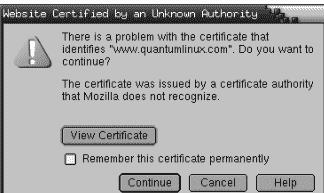

这并不意味着你一定遇到了任何非法、不道德或欺诈的内容。许多站点使用自签名证书并不是因为它们想欺骗你，而是因为可能没有理由验证证书的真实所有者，而且你不想支付获取认证证书的费用。使用自签名证书的一些原因包括：

- **测试**。如果你只在一个新的 Web 网站或 Web 应用程序上测试，购买 SSL 证书是没有意义的。在准备上线之前，可以使用自签名证书。

# 创建证书请求

要从 Fedora Linux 系统创建第三方验证的 SSL 证书，必须首先从证书请求（CSR）开始。要创建 CSR，请在你的 Web 服务器上执行以下操作：

```bash
# /etc/httpd/conf
# make certreq
umask 077 ;
/usr/bin/openssl genrsa -des3 1024 > /etc/httpd/conf/ssl.key/server.key
```

将要求你输入密码来保护你的私钥。此密码长度至少为八个字符，且不应该是字典单词，也不应包含数字或标点符号。你输入的字符不会显示在屏幕上，以防止他人通过窥视获取你的密码。

输入短语（pass phrase）：

再次输入密码以验证。

验证 - 输入短语（pass phrase）：

证书生成过程现在开始。

此时此时，是时候向证书中添加一些第三方来源将验证的信息了。在此之前，你必须解锁刚刚创建的私钥。通过输入你之前为短语设置的密码来实现。然后按照提示输入信息。这里是为你的证书添加信息的会话示例：

输入 /etc/httpd/conf/ssl.server.key 的短语：

你被要求输入将包含在证书请求中的信息。

你正要输入的内容被称为

区分名称（Distinguished Name，简称 DN）。

有很多字段，但你可以留空一些。

某些字段将有一个默认值，

如果你输入 '.'，则该字段将留空。

```
国家名称（2位代码） [GB]:US
州或省（全名） [Berkshire]: Connecticut
地区名称（例如，城市） [Newbury]: Mystic
组织名称（例如，公司） [Company Ltd]: Acme Marina, Inc.
组织单位名称（例如，部门） [section]: InfoTech
通用名称（例如，你的名称或服务器的主机名 ]:www.acmememarina.com
电子邮件地址 ]: webmaster@acmememarina.com
```

要完成该过程，系统将询问你是否想为证书添加任何额外内容。除非你有理由提供更多信息，否则你应该在以下每个提示处直接按回车键将其留空。

- 请输入随证书请求发送的“额外”属性

- 挑战密码 []:

- 可选公司名称：

# 签名 CSR

一旦创建了 CSR，你需要将其发送到签名机构进行验证。此过程的第一步是选择一个签名机构。每个签名机构都有优惠、价格和产品。检查本文之前“使用第三方证书颁发机构”部分列出的每个颁发机构，以确定哪种最适合你。以下是你应该关注的领域：

- 信誉和稳定性

- 价格

- 浏览器识别

- 保修

- 支持

- 证书强度

选择好签名机构后，你必须通过更多的验证步骤。某些需要不同的验证方法和证书信息。某些需要你与验证人员交流。在某些时刻，你需要将 CSR 内容复制并粘贴到签名机构的表单中。

```bash
cat /etc/httpd/conf/ssl.csr
-----BEGIN CERTIFICATE REQUEST-----
... (CSR 内容)
-----END CERTIFICATE REQUEST-----
```

你可以使用你的副本将 CSR 粘贴到表单中。

完成验证过程、付费签名以及所有问题后，你必须继续。在 48 到 72 小时后，你应该收到一封包含你新证书的电子邮件。它看起来如下：

```bash
-----BEGIN CERTIFICATE-----
... (证书内容)
-----END CERTIFICATE-----
```

# 加固 Linux 12

C2kbXcN1uYy29tMFIGOCQSGs1D3QEBAAAQNADCI8BKG0DaNSk+uzof

7jjJOFEnUbUBa1LYFJHxYjXPMLGWzLMkMdJjXsa4x7AEhprIubVNHVJio

FnLDopsx4yr4n+8BFYS4M5GRfhuCo2ZynMK2YJqVF+7Y0wpD3104teeYaz40g

qqpUHXuzJ24twKCAFhu01LMQ20JQQAO881JTCCASEXQYVDROVTRBAIW

ADEBNEGHNSAITEMKDK2GCSAG6E8BHCZMCKYAI1WKYBUOHAGGEWH0nHH82

0I8v3D3R1zaLduMLvV5yG6CMWvDRPARBQDAgWMCGGA1UDQ0MMB86

WCCSAGG+EEMU0BIQWHAYHGECSQAFUBMQ0OCGSQAFUFBWEBCGWJjAk

AS0GGB5D6BGGFCfYYA00R1YFfU0J24L2Z292422222YYGA100MDMDW/0MDW

WKXZK22IYUYJ3YS8BMMCGcmGSG+E4Ftc33Y2ODASN29Y035NW

WF0F/++80Y2/2000V66999uaATAT

--- 证书 ---

将此证书复制并粘贴到空服务器文件中，该文件必须位于 `/etc/httpd/conf/ssl.crt`，然后重启您的服务器：

```bash
# service httpd restart
```

假设您的网站运行正常，现在您可以通过在 Web 地址的 `http` 后添加 `s` 来以安全方式访问它。因此，如果您之前是通过 `www.accmemarina.com` 查看您的网站，现在您可以通过 `https://www.accmemarina.com` 以安全方式访问。

# 创建自签名证书

生成并运行自签名 SSL 证书比拥有签名证书要简单得多。在 Fedora 系统上生成自签名 SSL 证书，请执行以下操作：

- 1. 移除您的服务器密钥：

```bash
# cd /etc/httpd/conf
# rm ssl.key server.key
```

- 2. 创建您的新服务器密钥：

```bash
# make genkey
```

- 3. 输入以下命令创建自签名证书：

```bash
# make testcert \
umask 77 ; \
/usr/bin/openssl req -new -key /etc/httpd/conf/ssl.key/server.key \
-x509 -days 365 -out /etc/httpd/conf/ssl1.key/server.crt
```

# 第三部分 学习系统管理技能

此时，是时候向证书中添加一些信息了。在此操作之前，您必须解锁刚刚创建的私钥。这样做时，请输入您之前输入的密码。然后按照此程序操作：

系统将要求您输入将纳入证书请求中的信息。您将输入的内容被称为区分名称（Distinguished Name，简称 DN）。有几个字段可以留空。某些字段会有默认值，如果您输入 `.`，则该字段将留空。

- 国家名称（2位代码）[GB]: US

- 州或省名称（全称）[Berkshire]: Ohio

- 地区名称（例如，城市）： Cincinnati

- 组织名称（例如，公司）[My Company Ltd]: Industrial Press, Inc.

- 组织单元名称（例如，部门)]: IT

- 通用名称（例如，您的名称或服务器主机名）[]:: www.industrialpress.com

- 电子邮件地址 []: webmaster@industrialpress.com

此示例中的生成过程会将所有文件都放在正确的位置。您将需要重启 Web 服务器，并将 URL 中的 `http` 更改为 `https`。不要忘记，您的 Web 浏览器会收到证书验证消息，您可以安全地忽略它。

# 重启您的 Web 服务器

到此时，您已经注意到您的 Web 服务器每次启动时都要求您输入证书密码。这是为了防止有人入侵您的服务器并窃取您的私钥。如果发生这种情况，您可以放心，因为私钥是一团混乱的乱码。破解者将无法利用它。如果没有这种保护，破解者可以获取您的私钥并轻易地伪装成您，在所有情况下都显得是合法的。

如果您无法忍受每次启动 Web 服务器都要输入密码，并且愿意接受增加的风险，可以移除私钥上的密码加密。只需执行以下操作：

```bash
# /etc/httpd/conf/ssl.key
# /usr/bin/openssl rsa -in server.key -out server.key
```

# 排除证书故障

如果您在 SSL 证书方面遇到问题，以下提示可能对有所帮助：

- 仅允许 IP 地址使用 SSL 证书。如果您想在服务器上添加多个启用 SSL 的站点，您必须在网络接口上绑定另一个 IP 地址。

- 确保 `/etc/httpd/conf/ssl.*` 目录及其内容的权限掩码为 700。

# 总结

保护你的 Linux 系统是一项从最开始就需要做的事情，并在使用 Linux 系统的过程中持续进行。通过实施良好的安全实践（例如本章开头安全检查清单中描述的实践），你更有机会在长期内将入侵者排除。

在未来的发展中，你可以通过使用加密网络应用程序（如 SSH）、监控日志文件以及遵循良好的密码技术来帮助保持 Linux 系统的安全。如果你的 Linux 系统被用作服务器，你还需要特别注意缩小对服务器的访问范围并保护数据。为此，你可以使用如 TCP wrappers（限制谁可以使用你的服务器）和证书（确保与 Web 服务器通信的两个端都经过身份验证）等工具。

# 第四部分

## 设置 Linux 服务器

| 本部分包含内容 |

|---|

| 第 13 章 运行 Linux、Apache、MySQL 和 PHP (LAMP) 服务器 |

| 第 14 章 运行邮件服务器 |

| 第 15 章 运行打印服务器 |


# 第 13 章 运行 Linux、Apache、MySQL 和 PHP (LAMP) 服务器

随着宽带互联网连接的日益普及以及人们运行个人 Web 网站和 Web 日志（博客）渴望，越来越多的人在家庭互联网连接上搭建 Web 应用程序服务器。Web 应用在业务环境中也变得越来越流行，因为 Web 应用减少了工作站上需要维护的程序数量。

一种流行的 Web 应用服务器被称为 LAMP 服务器，因为它将 Linux、Apache、MySQL 和 PHP 结合在一起。LAMP 服务器结合了多个开源项目的组件，为随时可用的应用程序提供了一个快速、可靠且经济的平台。

本章将帮助你安装和配置你的 LAMP 服务器。它将从介绍各种组件开始，引导你完成安装和配置，并以安装示例 Web 应用程序结束。

本章中的示例基于运行 Ubuntu 的系统，但从概念上来说，考虑到其他 Linux 系统使用不同的方法安装软件以及启动和停止服务，它们也适用于其他发行版。然而，关于如何设置 LAMP 配置文件的描述只需稍微修改即可在多个 Linux 发行版中运行。你可以在第 17 章找到更多关于 Ubuntu 的信息。

## 本章包含内容

- LAMP 服务器的组件
- 设置你的 LAMP 服务器
- 运行你的 LAMP 服务器
- 故障排除
- 使用 SSL/TLS 保护你的网络流量

## LAMP 服务器的组件

到此时，你可能已经熟悉 Linux 了，本节专注于其他三个组件——Apache、MySQL 和 PHP，以及它们在 LAMP 系统中所担任的功能。（有时 LAMP 中的“P”被用来表示使用 Perl 或 Python 脚本语言来运行在 LAMP 服务器上的应用程序）

### Apache

在 LAMP 服务器中，Apache HTTPD（也称为 Apache 服务器）提供了客户端浏览器通信的服务。该守护进程在你的服务器后台运行，并等待来自客户端的请求。Web 浏览器连接到 HTTP 守护进程并发送请求，守护进程解释这些请求并返回适当的数据。Apache HTTPD 包含一个接口，允许模块接入该过程以处理请求的特定部分。其他外，还有可用模块用于处理 Web 文档中 Perl 或 PHP 等脚本语言的处理，并为客户端与服务器之间的连接添加加密。

Apache 起于由伊利诺伊大学厄巴纳-香槟槟分校国家超级计算机应用中心 (NCSA) 开发的对 HTTP 守护进程的一系列补丁和改进。NCSA HTTP 守护进程曾是当时最流行的 HTTP 服务器，但在其作者 Rob McCool 于 1994 年中旬离开 NCSA后，它开始显出老旧。

> 另一个项目来自 NCSA：Mosaic。大多数 Web 浏览器的起源都可以追溯到 Mosaic。

1995 年，一组开发者组成了 Apache Group，并对 NCSA HTTP 代码库进行了大量修改。Apache 很快取代了 NCSA HTTPD 成为最流行的 Web 服务器，这一称号一直保留到今天。

Apache Group 成立了 Apache 软件基金会 (ASF)，用于开发 Apache 和其他免费软件。随着 ASF 新项目的启动，Apache 变得被称为 Apache HTTPD，尽管这两个术语仍被互换使用。目前，ASF 拥有 60 多个项目，包括 Jakarta（开源解决方案）、MyFaces（一个 Web 应用程序框架）和 SpamAssassin（一个电子邮件过滤程序）。

### MySQL

MySQL 是一个开源 DBMS（数据库管理系统），因其速度、稳定性和特性受到 Web 管理者的欢迎。MySQL 包含一个处理数据存储和访问的服务器，以及处理与管理服务器接口的客户端。它还包含了客户端库，第三方程序（如 PHP）可以使用这些库连接到服务器。

在 LAMP 服务器中，MySQL 用于存储与正在使用的 Web 应用适当的数据。常见用途包括用户名和密码等数据、日志条目以及数据文件。

> 注意
> 如果你不确定数据库如何工作，请参考本章稍后侧边栏“MySQL 数据库的结构”。

MySQL 最初由 TcX（瑞典）的 Michael (Monty) Widenius 开发。1994 年，MySQL 需要 Web 应用一个后端数据库，并决定使用支持 SQL 的数据库，SQL 是与数据库交互的标准化且广泛的语言。

TcX 调查了当时可用的免费数据库以及一些商业数据库，但未能找到支持其所需功能且能处理大型数据库的系统。由于已经具有编写数据库程序的经验，TcX 决定获得目标的最佳方法是开发一个支持 SQL 的新系统。

1995 年，TcX 在互联网上发布了 MySQL 的源代码。MySQL 在当时并不是一个开源程序（因为由于一些限制），但仍然被广泛使用。MySQL 后来在 GNU 公共许可证 (GPL) 下发布，并成立了 MySQL AB 公司来管理 MySQL。2008 年 2 月，太阳公司收购了 AB。

### PHP

PHP 是一种专门为 Web 脚本开发的编程语言。它受到许多开发者的青睐，因为它被设计为嵌入 HTML 文档中，使得在单个文件内管理 Web 内容和脚本变得更加简单。

PHP 起于 Rasmus Lerdorf 创建的 Perl 脚本 PHP/FI（个人主页/表单解释器）。随着时间的推移，实现了更多功能，Rasmus 用 C 语言重写了 PHP。

1997 年，Andi Gutmans 和 Zee Suraski 正在对 PHP/FI 进行完全重写。随着语言的演进和更多功能的实现，Gutmans 和 Suraski 决定重命名项目以准确反映这些功能。选择了 PHP Hypertext Preprocessor (PHP) 这个名称，并保留了 Lerdorf 的方法，以保持 PHP/FI 用户的熟悉度。

PHP 的核心功能包含在 PHP 代码中，附加功能以扩展的形式实现。PHP 的最新版本是 5.2.6，某些实现包含了 `libapache-mod-php4` (PHP 4) 包，并且 PHP 6 正在开发中。PHP 5 提供的重大变化之一是增强了安全性。此版本改进了 PHP 一直具有的安全功能并修复了一些潜在漏洞。这使得该语言更加稳定。关于每个版本及其提供的更多信息，可以在 `www.php.net/` 找到。

## 设置你的服务器

在继续本节中的示例之前，请确保你的 Linux 操作系统已安装并配置。本节中的特定指令适用于 Ubuntu 系统。

### 设置 Linux 服务器

然而，相同的步骤在基于 Debian 的系统上同样适用，且没有差异。如果你在不同的 Linux 系统上尝试此操作，请注意软件打包方式、启动脚本和配置文件的位置以及其他特性可能有所不同。

在安装 Linux 时，你通常会选择安装一套适用于工作站或服务器的软件包。你可能会选择在一个已经使用针对工作站布局和软件包配置的系统上设置服务器。但是，除非你仅为少数几个认识你并信任你的用户提供服务，否则不建议这样做。事实上，许多系统管理员甚至不需要在服务器上安装 X Window 系统和其他 GUI 组件。

使用 Ubuntu 自带的软件包的另一种可选方法是使用 LAMP。LAMP 是一个支持 Perl 的一站式 LAMP 服务器。XAMPP 项目是 LAMP 服务器的一种实现实现方式（也可以作为 Windows 服务器提供）。XAMPP 是一种让 LAMP 服务器运行起来的快速且粗略的方法。当你只有一台机器时，它也适用于在发布之前测试页面。

### 安装 Apache

迈向功能完备 LAMP 服务器的下一步是安装 HTTP 服务器，该服务器可以在 `apache2` 软件包中找到。使用 `APT` 获取并安装该软件包：

```
$ sudo apt-get install apache2
```

安装完成后，服务器应该会自动启动，这意味着你准备好安装 PHP 了。

### 安装 PHP

现在你准备好在 Apache 中安装并测试 PHP 模块。这是安装 PHP 的常用方法，但在多用户系统上它引入了一些安全问题，因为所有 PHP 脚本都以 Apache 守护进程相同的用户身份运行。在允许其他用户访问操作服务器上的 PHP 文件之前，请务必阅读 `http://php.net/manual/en/security.php` 上的 PHP 模块安全部分。

PHP 模块包含在 `php5` 软件包中，使用 `APT` 安装。以下行将下载并安装 Apache php5 模块和 MySQL 扩展，配置 Apache 自动加载该模块，并指示 Apache 重新加载配置：

```
$ sudo apt-get install apache2 mod-php5 php5-mysql php5-gd
$ sudo /etc/init.d/apache2 restart
```

正如 Apache 的名称和版本可能会让人困惑一样，对 PHP 也有类似的想法。在编写本文时，5.x 和 4.4.x 都有活跃开发版本（PHP 6 正在开发中）。尽管 PHP 5已经发布了一段时间，但 PHP 组承诺为 PHP 4 发布安全——以及真正的——更新通过

## 运行你的 LAMP 服务器

此时，Apache 应该已经准备好处理 HTTP 请求，并包含 PHP 文件的处理。要测试它，创建一个名为 `/var/www/info.php` 的文件，其中包含对 `phpinfo()` 函数的调用：

```
$ sudo cat > /var/www/info.php
<?php
  phpinfo();
?>
^D
$ sudo chmod 644 /var/www/info.php
```

`^D` 意味着你应该在键盘上按下 Ctrl+D。这告诉 `cat` 命令你已到达文件末尾。现在尝试通过访问 `http://localhost/info.php` 打开页面。你应该看到关于你的 Apache 和 PHP 安装的完整页面信息，如图 13-1 所示。

如果提示下载文件而不是显示信息页面，请检查相应的 PHP 安装（本章前面的部分）以验证所有步骤是否已成功完成。

### 图 13-1

php 信息页面


经过测试并运行后，你应该删除 `info.php` 文件，以防止潜在攻击者利用它收集有关你系统的特定信息：

```
$ sudo rm -f /var/www/info.php
```

### 安装 MySQL

MySQL 数据库系统分为三个主要软件包：服务器、客户端和客户端库。服务器包含在 `mysql-server` 软件包中，需要另外两个才能运行。`APT` 处理其中任何一个包，这意味着当你安装 `mysql-server` 时，这些软件包会自动安装：

```
$ sudo apt-get install mysql-server
```

如果你正在使用 Debian 系统，请确保已配置主机名。否则可能会导致安装失败的错误。

MySQL 数据库的访问是基于存储在 `mysql` 数据库中的账户信息管理的。与 UNIX 系统一样，超级用户账户名为 `root`。默认安装会要求你为账户设置密码。如果你不设置，稍后也可以访问。

### MySQL 数据库的结构

对于不熟悉数据库系统结构的人，这里有一个简要介绍：

- 数据库是数据库系统中的基本组织单元。大多数数据库系统（包括 MySQL）都设计为从单台服务器支持多个数据库。这允许为不同的用户或不同的功能创建单独数据库。
- 表格位于数据库内部。表格非常像具有行和列的电子表格。列定义了每个条目可以或必须具有的不同数据类型，而每个条目都以行的形式存在。数据库可以包含多个表格，允许你在单个数据库中拥有许多不同的数据集。

## 编辑你的 Apache 配置

Apache HTTP 的配置文件非常灵活，这意味着你可以配置服务器以几乎任何方式运行。这种灵活性是以复杂性增加为代价的，表现为大量的指令，但在实践中，你只需要熟悉几个即可。

> NOTE 访问 `http://httpd.apache.org/docs` 了解完整列表

在 Ubuntu 中，Apache 配置存储在服务器读取的文本文件中，从 `/etc/apache2/apache2.conf` 开始。配置从头到尾读取，大多数指令按顺序处理

`Include` 指令与 `AccessConfig` 和 `ResourceConfig` 不同之处在于它可以出现多次，并且一次可以包含多个文件。被 `Include` 指令引用的文件的处理方式就像其内容被包含在一个文件中，或者指向一个读取其中所有文件的目录，或者指向一个目录内特定文件集的通配符。例如，虚拟主机包含在 `/etc/apache2/sites-enabled/` 中。

> NOTE 当 `Include` 指向目录时，子目录也会被处理。

### 第四部分 设置 Linux 服务器

在本章中，Location（大写）特指第三种标签，而 `location`（小写）则泛指这三种标签中的任何一种。

> 注意

这些标签的匹配版本——`DirectoryMatch`、`FilesMatch` 和 `LocationMatch`——具有相同的功能，但在资源规范中包含正则表达式。`FilesMatch` 和 `LocationMatch` 块分别与 `Files` 和 `Location` 块同时处理。`DirectoryMatch` 块则在 `Directory` 块之后处理。

Apache 可以配置为处理 `AccessFileName`（通常设置为 `.htaccess`）中指定名称的文件内的配置选项。访问配置文件中的指令（Directives）将应用于其所包含目录下的所有对象，包括子目录及其内容。访问配置文件的处理与 `Directory` 块同时进行，并使用“最具体”的匹配顺序。

> 注意

访问控制文件对于允许用户在不具备服务器配置权限的情况下更改特定设置非常有用。访问配置文件中允许的配置指令取决于其所在目录的 `AllowOverride` 设置。某些指令在它们所在的层级上完全没有意义，并且在尝试访问 URI 时通常会导致“服务器内部错误”。`AllowOverride` 选项的详细信息见 `http://httpd.apache.org/docs/mod/core.html#allowoverride`。

`location` 块和访问控制文件中常见的三个指令是 `DirectoryIndex`、`Options` 和 `ErrorDocument`：

- `DirectoryIndex` 告诉 Apache 当 URI 包含目录但不包含文件名时，应该加载哪个文件。该指令在 `Files` 块中不起作用。
- `Options` 用于调整 Apache 处理目录内文件的方式。`ExecCGI` 选项告诉 Apache 该目录下的文件可以作为 CGI 脚本执行运行，而 `Includes` 选项告诉 Apache 允许服务器端包含（SSI）。常用的还有 `Indexes` 选项，它告诉 Apache 如果 `DirectoryIndex` 设置中找到的文件名之一缺失，则生成一个文件列表。可以指定一个绝对的选项列表，也可以通过在选项名称前添加 `+` 或 `-` 来修改选项列表。更多信息请参阅 `http://httpd.apache.org/docs/mod/core.html#options`。
- `ErrorDocument` 指令用于指定在错误结果中发送哪个文件。指令必须指定错误代码和错误文档的完整 URI。可能的错误代码包括 403（拒绝访问）、404（未找到文件）和 500（服务器错误）。你可以在 `http://www.apache.org/docs/mod_core.html#errordocument` 找到关于 `ErrorDocument` 指令的信息。

`location` 块和访问文件的另一个常见用途是限制资源的访问。`Allow` 指令可用于允许匹配的主机，而 `Deny` 指令可用于禁止。这两个选项在块内可以出现多次，并根据 `Order` 设置进行处理。将 `Order` 设置为 `Deny,Allow` 允许任何未列在 `Deny` 指令中的主机访问。设置为 `Allow,Deny` 则拒绝任何不在 `Allow` 指令中的主机的访问。

对于大多数其他选项，将使用针对主机的最具体的 Allow 或 Deny 选项，这意味着你可以拒绝某个范围的访问，并允许对该范围的子集的访问。通过添加 `Satisfy` 选项和额外参数，你可以添加密码身份验证。关于访问控制的更多信息，请参阅 `http://apache.org/docs/mod_authz_core.html`。

`Location` 块（广义上）可以包含在 `VirtualHost`（虚拟主机）中。虚拟主机将在下一节中详细描述，它们是根据请求指向的服务器地址或名称来更改服务器行为的一种方便（且几乎是必须）的方法。大多数全局配置选项应用于虚拟主机，并可以被 `VirtualHost` 块内的指令覆盖。

## 为 Apache 添加虚拟主机

Apache 支持在单个服务器内创建多个 Web 站点以保持内容分离。各个站点以虚拟主机的形式在同一台服务器上配置，当仅使用一个站点创建虚拟主机时，这种形式同样有用：

使用此模板创建一个命名文件 `/etc/apache2/sites-available/example.com.conf`：

```
NameVirtualHost *:80
<VirtualHost *:80>
ServerName www.example.org
ServerAlias web.example.org
DocumentRoot /home/username/public_html/
DirectoryIndex index.php index.htm
</VirtualHost>
```

`VirtualHost` 行告诉 Apache 根据 HTTP 连接提供的主机名来决定提供哪个虚拟机的文档。`* :80` 指定对任何 IP 地址的 80 端口的请求都将以此方式处理。


同样，VirtualHost 块中的 `*:80` 指定表示该虚拟主机适用于哪个地址和端口。对于 NameVirtualHost 和 VirtualHost 规范，端口都是可选的，但应始终使用，以防止与 SSL 虚拟主机冲突。

# 设置 Linux 服务器

ServerName 和 ServerAlias 告诉 Apache 应该识别哪个虚拟主机，因此请将它们替换为适用于你站点的名称。如果你没有备用服务器名称，可以省略 ServerAlias；如果你有备用名称，可以在每个 ServerAlias 行指定多个名称，或者拥有多个 ServerAlias 行。

DocumentRoot 是该站点 Web 文档存储的位置。如果你计划为每个用户设置多个站点，你需要相应地修改此布局。将 `user-name` 替换为管理该 Web 站点的账户。在本示例中，每个 Web 站点必须由不同的用户账户管理。

将虚拟主机放在 sites-available 目录中并不意味着已启用。要启用它，请从 `/etc/apache2/sites-available` 创建链接到 `/etc/apache2/sites-enabled`。在 Ubuntu 中，你可以使用以下命令：

```
sudo a2ensite example.com
```

启用站点后，重启 Apache 服务：

```
sudo service apache2 restart
```

若要检查配置的语法错误，请使用：

```
sudo apachectl configtest
```

如果输出为 "Syntax OK"，说明你的配置是有效的。

## 第四部分 设置 Linux 服务器

3. 以拥有 CPG 安装 的用户身份登录，并按照以下步骤从互联网上下载最新版本：

```
$ mkdir ~/public_html
$ cd ~/public_html
$ wget http://intern.dl.sourceforge.net/sourceforge/coppermine/cpg1.4.18.zip
-19:30:46 http://intern.dl.sourceforge.net/coppermine/cpg1.4.18.zip
=> 'cpg1.4.18.zip'
Resolving intern.dl.sourceforge.net... 64.74.207.41, 66.35.207.225...
Connecting to intern.dl.sourceforge.net[64.74.207.41]:80... connected.
HTTP request sent, awaiting response...200 OK
Length: 3,824,914 [application/zip]
100%[====================] 3,824,914 618.94K/s ETA 00:00
19:50:53 (61.29 KB/s) 'cpg1.4.18.zip' saved [382414/382414]
```

4. 解压压缩包：

```
$ unzip cpg1.4.18.zip
Archive: cpg1.4.18.zip
inflating: cpg1418/addfav.php
inflating: cpg1418/xp_publish.php
[...
inflating: cpg1418/zipdownload.php
```

5. 重命名新解出的 cpg 目录，然后设置权限以便能够从 PHP 上传文件：

```
$ mv cpg1418 photos
$ cd photos
$ chmod 777 include
$ find albums -type d - xargs chmod 777
```

6. 在任何可以访问你的 LAMP 服务器的机器上打开浏览器，并打开 coppermine 目录下的 `install.php` 脚本。

- 如果你在主主机的某个子目录下安装 CPG，URL 为 http://servername/username/photos/install.php。

- 如果你在虚拟主机下安装 CPG，URL 为 http://virtualhostname/photos/install.php。

7. 填写以下字段并选择 "Let's Go!" 来配置 CPG 以匹配你的安装：

- 用户名和密码（Username and Password）——用于管理 CPG 的管理员登录和密码。

- 邮箱地址（Email Address）——管理员（你）的电子邮件地址。

## 运行 Linux, Apache, MySQL 和 PHP (LAMP) 服务器

- MySQL 主机（MySQL Host）——CG 连接数据库的服务器名称。情况下，你想使用 localhost。

- 数据库名称（Database Name）——你在第 2 步中创建的数据库名称。（情况下，你使用了 cpg）。

- 用户名和密码（Username and Password）——你在第 2 步中创建的访问数据库的用户名和密码。（示例中，我分别使用了 cpg 和 mypassword）。

- 表前缀（table prefix）——CPG 使用的表前缀。默认值（cpg14x_）是可以的。

- ImageMagick 路径（ImageMagick path）——包含 imagagick 的目录。在 Debian 系统上，此路径为 /usr/bin。

8. 你现在正在安装 CPG。此时，你可以点击 "Let's Continue" 查看默认的 Coppermine Photo Gallery 页面。你可以使用此 CPG Web 界面创建相册并上传照片。图 13-2 显示了一个示例相册。

## 图 13-2

一个 Coppermine 相册示例


对 Coppermine Photo Gallery 数十种功能的完整描述超出了本示例的范围，如果你想继续设置一个可以运行的相册，这里有一些提示。首先，前往你创建的相册主页（http://server/~user/photos/）并使用你创建的管理员用户和密码登录。然后执行以下操作：

- 添加相册（Add an album）——点击 "Albums" 按钮，然后点击 "New"。为相册输入名称并点击 "Apply Modifications"。然后按照指示继续。

- 上传文件（Upload files）——点击页面顶部的 "Upload file"。在上传文件页面，添加你想要安装的图片的完整路径（File Uploads）或 Web 地址（URI/URL）。然后点击 "Continue"。如果上传成功，点击 "Continue"。

此时，你可以为刚刚上传的每张图片添加关联信息。选择每张图片将去的相册（Album）、文件和描述，然后点击 "Continue"。在你为所有上传的图片添加了信息后，再次点击 "Continue" 返回主相册页。在何处，你可以看到按相册、随机或最新添加排序的你的图片。

如果你在公共服务器上安装了 Coppermine，你可以将该服务器的 Web 地址发给朋友，他们就可以开始查看你的相册了。你一些小功能可以自定义你的 Coppermine Photo Gallery。你可以开始查看 "Configuration"（配置）页的设置（点击 "Config" 链接进入）。点击 "Users"（用户）或 "Groups"（组）。

## 故障排除

当你遇到问题时，首先使用 `apachectl` 测试配置。在任何环境中，你偶尔都会遇到问题。本节包含了隔离和解决常见错误的提示。

## 配置错误

某些配置问题通过了 `apachectl` 的语法测试，但会导致 HTTP 守护进程在加载后立即退出。如果发生这种情况，使用 `tail` 命令检查 Apache 的错误日志。在 Debian 上，错误日志位于 /var/log/apache2/error.log。在其他系统中，可以通过查找配置中的 `ErrorLog` 指令找到位置。

你可能会遇到类似的错误：

```
[crit] (88)Address already in use: make_sock: could not bind to port 80
```

此错误表示端口 80 已占用（除非你尝试安装另一个 Web 服务器）、另一个 Apache 进程正在运行，或者你在多个处让 Apache 绑定相同的地址。

如果没有看到任何进程在监听端口 80，是因为你不小心让 Apache 在多个处监听相同的 IP 地址和端口。你可以使用 `netstat` 命令查看处于监听状态的 TCP 端口进程列表：

```
# netstat -nlt
Active Internet connections (only servers)
Proto Local Address Foreign Address State PID/Program name
tcp 0.0.0.0:80 0.0.0.0:* LISTEN 2105/apache2
```

`netstat` 的输出（为了适应此处已缩短）表明一个进程 ID 为 2105 的 apache2 实例正在监听（如 LISTEN 状态所示）连接到本地 IP 地址（由 0.0.0.0 所示）的端口 80。如果有不同的程序正在监听端口 80，你可以使用 `kill` 命令终止该进程，或者如果它不是 apache2 (httpd)，你也可以找出它是如何运行的。

*   BindAddress（绑定地址）——允许你指定一个监听的 IP 地址，或者使用通配符 * 指定所有 IP 地址。在你的配置文件中不应出现多一个 BindAddress 语句。

- Port — 指定要监听的 TCP 端口，但它不允许你指定 IP 地址。Port 在配置中通常不会使用一次。

- Listen — 允许你同时指定一个 IP 地址和一个端口进行绑定。IP 地址可以是通配符的形式存在，你可以在配置文件中拥有多个 Listen 语句。

通常情况下，只使用这些描述符中的一个以避免混淆。在这三者中，Listen 是最灵活的，因此它可能是你最想使用的那个。使用 Listen 时一个常见的错误是在所有 IP 地址上指定了某个端口 (*:80*)，同时又在特定的 IP 地址上指定了相同的端口 (1.2.3.4:80)，这会导致 `make_sock` 错误。

与 SSL 相关的配置错误（在本章中讨论）通常出现在 Apache 配置不当的情况下。请确保密钥文件和证书文件存在，并且它们的格式正确（如本章所示，使用 `openssl check` 对它们进行检查）。

对于其他错误信息，尝试进行 Web 搜索查看是否有人遇到过该问题。在这种情况下，你可能会在前几个匹配结果中找到解决方案。

如果你在 `ErrorLog` 中获得的信息不足，可以使用 `LogLevel` 指令进行配置。该指令的选项按详细程度递增排序为：`emerg`、`alert`、`crit`、`error`、`warn`、`info` 和 `debug`。仅选择其中一个。任何至少与 `LogLevel` 重要的消息都会存储在 `ErrorLog` 中。在典型的服务器上，此设置为 `warn`。你不应该将其低于 `crit`，并且应该避免将其设置为 `debug`，因为这会减慢服务器并导致巨大的 `ErrorLog`。

作为最后手段，你也可以尝试手动运行 apache2 来检查崩溃或其他错误信息：

```bash
# /usr/sbin/apache2 -d /etc/apache2 -F ; echo $
```

`d` 标志告诉 apache 去哪里查找配置文件，`F` 标志告诉它在前台运行。分号将此命令与 `echo` 命令隔开，后者会显示 Apache 退出后的返回代码 (`$`)。如果 apache 在此步骤崩溃，你可以使用 `gdb` 和 `strace` 等工具来追踪问题。

## 访问被禁止和服务器内部错误

当你尝试查看服务器上的特定页面时，可能会遇到两种常见的错误：权限错误和服务器内部错误。这两类错误都可以使用错误日志中的信息进行隔离。在执行下列表描述的任何更改以尝试解决其中一个问题后，请重新尝试并检查错误日志，查看消息是否发生了变化（例如，显示操作成功完成）。

## 运行 Linux、Apache、MySQL 和 PHP (LAMP) 服务器

> 注意

“文件未找到”（File not found）错误可以按照检查“访问被禁止”和“服务器内部错误”的方法进行检查。你有时会发现 Apache 并没有在你认为的地方查找特定文件。通常，文件的完整路径会显示在错误日志中。请确保你访问的是正确的虚拟主机，并检查可能将你的位置重定向到意之外之处的任何 Alias 设置。

- 文件权限 — “文件权限阻止访问”（file permissions prevent access）错误表明 apache 进程以无法打开请求文件的用户身份运行。请确保你的账户对该目录及其上方的每个目录具有执行权限，并对文件本身具有读取权限。如果你希望 Apache 生成文件索引，对目录的读取权限也是必要的。请参阅 `chmod` 手册获取有关如何查看和更改权限的更多信息。

> 注意

对于编译后的二进制文件（如 C 或 C++ 中的文件），不需要读取权限，但除非需要保持程序内容的秘密，否则可以添加读取权限。

- 拒绝访问 — “服务器配置拒绝客户端”（client denied by server configuration）错误表明 Apache 配置为拒绝访问该对象。检查配置文件中与你正尝试访问的文件匹配的 `<Location>` 和 `<Directory>` 部分。记住，应用于路径的设置也会应用于该路径下方的路径。你可以通过仅更改想要允许访问的特定路径的权限来覆盖此设置。

- 未找到索引 — “规则禁止目录”（Directory forbidden by rule）错误表明 Apache 未找到 `Directory` 指令中指定名称的索引，且未配置创建包含目录文件列表的索引。请确保如果你有索引，它具有 `Directory` 指令中指定的名称之一，或者在适当的 `<Directory>` 或 `<Location>` 部分添加一条 `Options Indexes` 行。

- 脚本崩溃 — “脚本头过早结束”（Premature end of script headers）错误表明脚本由于此原因正在崩溃。偶尔，由这引起的错误也会出现在错误日志中。当你使用 `suexec` 或 `suPHP` 时，此错误可能由文件所有权或权限错误引起。这些错误记录在 `/var/log/apache2/suex.log` 或 `/var/log/apache2/suphp.log` 中。

## 使用 SSL/TLS 安全你的 Web 流量

你想为服务器添加安全性，包括你自己的证书。你的数据非常重要，你将网络或互联网传递给他人的能力同样重要。网络本身并不安全以保护你的通信。本节将研究你可以在哪些方面帮助保护你的通信。

## 设置 Linux 服务器

电子商务应用程序（如在线购物和银行）通常使用安全套接层 (SSL) 或传输层安全 (TLS) 进行加密。TLS 基于 SSL 规范的 3.0 版本，因此它们在本质上非常相似。由于这种相似性并且 SSL 较老——SSL 加密通常用于这两种情况。对于 Web 连接，首先建立 SSL 连接，然后正常的 HTTP 通信会被“隧道化”。

> 注意：由于 SSL 协商发生在任何 HTTP 通信之前，基于主机名的托管（发生在 HTTP 层）无法与 SSL 工作。因此，你配置的每个 SSL 虚拟主机应该有一个唯一的 IP 地址。你可以使用一些技巧让基于主机名的托管与 SSL 工作，但这些超出了本文范围。更多信息请参见 http://apache.org/docs/hosts/name_base.html

在客户端和服务器之间建立连接期间，使用非对称（公共）加密来验证身份并建立参数和会话密钥。使用 DES 或 RSA 等对称加密算法配合协商的密钥来加密会话期间传输的数据。

为了让客户端验证服务器的身份，服务器必须拥有一个预先生成的私钥，以及一个包含公钥和服务器信息的证书。该证书必须可以使用已知的公钥进行验证。

证书由第三方证书机构 (CA) 进行数字签名，该机构已验证了请求者的身份以及签署证书请求的有效性。在某些情况下，CA 已与 Web 浏览器供应商达成安排，使其证书在默认安装中被安装并信任。CA 向运营商收费。

商业证书机构在价格、功能和浏览器支持方面存在差异，但记住价格并不代表质量。某些 CA 包括 InstantSSL (www.instantssl.com)、Thawte (www.thawte.com) 和 Verisign (www.verisign.com)。

你也可以选择创建自签名证书，尽管这些应仅用于测试，或者只有少数人访问你的服务器且你不计划在多台机器上使用证书。生成自签名证书的说明包含在后续章节。

最后一个选项是运行你自己的证书机构。这实际上只适用于你只有少数预期用户，并且你有办法将 CA 证书分发给他们（包括协助他们在浏览器中进行操作）。创建 CA 的过程过于复杂无法在书中介绍，但它是生成自签名证书的值得的替代方案。你可以在此处找到运行 CA 的指南：http://sial.org/howto/openssl/ca/

## 运行 Linux、Apache、MySQL 和 PHP (LAMP) 服务器

### 生成您的密钥

要开始设置 SSL，请使用 `openssl` 命令（它是 OpenSSL 软件包的一部分）来生成您的公钥和私钥：

- 使用 APT 验证 OpenSSL 是否已安装。如果不存在，APT 将自动下载并安装它：

```
$ apt-get install openssl
```

- 生成一个 1024 位的 RSA 私钥并将其保存到文件中：

```
$ sudo su -
$ mkdir /etc/apache2/ssl1.key/
$ cd /etc/apache2/ssl1.key/
$ openssl genrsa -out server.key 1024
$ chmod 600 server.key
```


> 注意：你可以使用 `server.key` 以外的文件名，如果你计划在机器上运行多个 SSL 宿主机（这需要多个 IP 地址），可以这样做。只需确保在 Apache 配置层中指定了正确的文件名即可。

在安全性更高的环境中，在 `openssl` 命令的 `genrsa` 之后添加 `-des3` 参数来对密钥进行加密是一个好主意：

```
$ openssl genrsa -des3 -out server.key 1024
```

- 3. 您会被要求输入一个密码短，每次启动 Apache 时都需要它。

> 警告：不要丢失此密码短，因为它无法轻易恢复。

- 如果您计划让 CA 签名您的证书（包括您自己运行的 CA），请生成公钥和证书签名请求 `CSR`：

```bash
$ mkdir ../ssl.csr/
$ cd ../ssl.csr/
$ openssl req -new -key ../ssl.key/server.key -out server.csr
```

国家名称（2 位代码）：US

州或省份名称（全称）[Some-State]: Washington

地名名称（例如，城市）： Bellingham

组织名称（例如，公司）[Internet Widgets Pty Ltd]: Example Company. LTD.

组织单位名称（例如，部门）：Network Operations

通用名称（例如，您的名称）：secure.example.org

## 第四部分 设置 Linux 服务器

电子邮件地址：dom@example.org

请输入以下随您的证书请求一起发送的“额外”属性：

挑战密码：

可选的公司名称：

通用名称应与客户端访问您的服务器时使用的名称匹配。如果您计划让第三方 CA 签名 CSR，请确保其他细节无误。

- 5. 使用第三方 CA 时，将 CSR 提交给它，然后将它给您的证书放入 `/etc/apache2/ssl/server.crt`（或所需的其他文件）。

- 6. 如果您没有签名的证书，或者您想测试您的配置，请生成自签名证书并将其保存到名为 `server.crt` 的文件中：

```bash
# mkdir .../ssl.crt/
# cd .../ssl.crt/
# openssl req -new -x509 -nodes -days 365 -key .../server.key -out server.crt
国家名称（2 位代码）[AU]:
州或省份（全称）[Some-State]:
地名名称（例如，城市）：
组织名称（例如，公司）[Internet Widgets Pty Ltd]: TEST USE ONLY
组织单位名称（例如，部门）：TEST USE ONLY
通用名称（例如，您的名称）：secure.example.org
电子邮件地址：dom@example.org
```

## 配置 Apache 支持 SSL/TLS

一旦获得证书，您需要启用 `mod_ssl` Apache 模块，该模块为 Apache 添加 SSL/TLS 支持并使用相应的配置指令对其进行配置。`mod_ssl` 模块随基础的 `apache2-2-common` 软件包一起安装。以下是为您的主机启用它的方法：

- 1. 运行 `a2enmod` 命令启用 ssl：

```
$ sudo a2enmod ssl
Module installed; run /etc/init.d/apache2 force-reload to enable it.
```

- 2. 向您的 Apache 配置文件添加启用 SSL 的虚拟主机。以先前的虚拟主机作为示例，您的配置看起来如下：

```
Listen *:443
<VirtualHost *:443>
ServerName secure.example.org
ServerAlias web.example.org
DocumentRoot /home/username/public_html/
DirectoryIndex index.php index.html index.htm
SSLEngine On
SSLCertificateKeyFile /etc/apache2/ssl.key/server.crt
SSLCertificateFile /etc/apache2/ssl.crt/server.crt
SSLCertificateFile /etc/apache2/ssl.crt/ca.crt
</VirtualHost>
```

此示例在 `VirtualHost` 声明中使用 IP 地址，这可以避免在您的 IP 地址更改时需要修改配置文件，并防止您拥有多个 SSL 虚拟主机。如果需要支持多个 SSL 虚拟主机，请将 `*` 替换为分配给该主机的特定 IP 地址。


有关更多信息，请参阅章节前面的“故障排除”。

## 运行系统及所使用的软件

本章描述的邮件服务器配置基于 Exim 邮件传输代理。除了 Exim 之外，还添加了其他组件用于管理服务器并检查邮件内容中的垃圾邮件和病毒：

- Exim (`www.exim.org/`) — 由剑桥大学的 Philip Hazel 设计并编写的 MTA（邮件传输代理），来自全球许多人士的贡献。本章提到的版本使用了 Tom Kiesner 提供的 Ericsson-ACL 补丁 (`http://duncathrax.net/exican-acl/`)。该补丁允许在 Exim 中进行内容扫描。由于此补丁集成在 Exim 中，因此在本章中，其功能被视为 Exim 的一部分。

- Maildrop (`www.courier-mta.org/maildrop/`) — 一个本地 MDA，是 Courier 软件包的一部分，但也可以作为独立程序使用。在此配置中使用它是为了允许使用高级功能，例如信箱配额和服务器端排序。

- ClamAV (`www.clamav.net`) — 一种开源病毒扫描器，可以检测超过 20,000 种病毒、蠕虫和木马。它使用病毒模式数据库来识别病毒，并包含一个名为 `clamd` 的程序来处理数据库更新。与 SpamAssassin 类似，ClamAV 有一个守护进程 (`clamd`)、一个客户端 (`clamscan`) 以及另一个不使用守护进程的命令行工具 (`clamscan`)。

- SpamAssassin (`http://spamassassin.apache.org/`) — 一个用 Perl 编写的垃圾邮件过滤程序。它使用大量规则来定义“垃圾邮件”的特征，并根据规则的总值分配分数。出于性能考虑，SpamAssassin 使用一个名为 `spamd` 的后台守护进程执行邮件分析。通过 `spamc` 客户端访问该守护进程。还安装了一个不使用 `spam` 执行分析的 `spamassassin` 命令，但本章中的示例配置均未使用它。

## 准备你的系统

配置本章涵盖的邮件服务器，你需要一些常用项目，首先是从合适的硬件开始。个人邮件服务器可以轻松运行在 Pentium 级的计算机上，尽管在扫描入站邮件时可能会偶尔出现减慢的情况。磁盘空间需求取决于你想要存储多少邮件，因此请为操作系统留出几个 GB 的空间（这将留出足够的额外空间以防万一），外加你想要存储的邮件量。

## 设置 Linux 服务器

在开始示例之前，应该安装带有基本软件包集的操作系统。有关安装的一些通用信息请见第 17 章。虽然本章描述的软件在你不运行 Ubuntu 的情况下也可以工作，但安装方法并不适用。如果你没有可以作为专用邮件服务器的系统，仍然可以将其作为工作站，尽管这仅建议个人使用。

在开始安装邮件软件之前，还应该正确配置你的网络设置。具体要求取决于交付到你服务器的方法：

- **直接投递** `Direct delivery` 是大多数传统服务器使用的方法。DNS 记录告诉远程服务器，发送到你域名的任何邮件都通过 SMTP 发送到你的服务器。

- **从邮件主机检索** `Retrieval from a mail host` 也可以使用 MRA（邮件检索代理）如 `Fetchmail`。当你在共享域名下有一个信箱，但想在自己的服务器上访问邮件时，可以使用此选项。如果你既有自己的域名又有该域名下的信箱，这也可以与直接投递结合使用。

> `Fetchmail` 的配置在本文章的“配置邮件客户端”部分进行了解释。

## 为直接投递配置 DNS

为了使直接投递运行，SMTP 服务（TCP 端口 25）必须通过 DNS 中的一个名称对全球开放。该名称将以 A（地址）记录的形式存在。“A”记录允许 DNS 解析器确定与特定名称关联的 IP 地址，并被互联网上大多数常用协议使用。一个典型的 DNS 记录如下：

```
bigserver.example.org      IN      A       10.0.12.16
```

第一个参数 `bigserver.example.org` 是标签（label），第二个参数是类（IN 代表 Internet，大多数 DNS 记录在此处找到）。`A` 表示类型，最后一个参数是与标签关联的 IP 地址。

一旦你有了 A 记录，你就可以使用 MX（邮件交换器）记录将邮件重定向到你的服务器。A 记录和 MX 记录不需要属于同一个域名，这提供了更大的灵活性。以下是一个 MX 记录示例：

```
widgets.test               IN      MX      0 bigserver.example.org.
```

此 MX 记录表明，任何发送到 `address@widgets.test` 的邮件都通过服务器 `bigserver.example.org` 发送。`0` 表示此 MX 记录的数字优先级。当给定标签存在多个 MX 记录时，会首先尝试优先级最低的 MX。如果遇到临时错误，将尝试下一个高优先级的邮件，依此类推，直到列表耗尽。之后，发送服务器将定期尝试，直到邮件超时（通常为五天）。如果存在多个优先级相同的 MX 记录，它们将按随机顺序尝试。

## 运行邮件服务器

> 在不存在 MX 记录的情况下，大多数邮件服务器将回退到该标签的 A 记录中列出的 IP 地址。然而，依赖此被认为是不良实践。

在某些情况下，建立 A 记录可能很复杂，因为你的 IP 地址经常变化。显然，这不适用于商业目的。

4. 为系统中已存在的每个用户创建 Maildir 目录。此步骤必须为系统中已存在的每个用户执行，并且必须以用户的身份运行，因为以 root 身份运行此命令会导致 Maildrop 无法写入文件夹：

```
$ maildirmake.maildrop $HOME/Maildir
$ maildirmake.maildrop -f Trash $HOME/Maildir
```

5. 在 `/etc/skel` 下创建邮件目录。`/etc/skel` 中的内容将被复制到你在设置后创建的任何新账户的家目录中：

```
$ sudo maildirmake.maildrop /etc/skel/Maildir
$ sudo maildirmake.maildrop -f Trash /etc/skel/Maildir
```

6. 配置 Maildrop 将存储在 `/var/spool/mail/` 中的 mbox 文件投递 Maildir 文件夹。使用你喜欢的文本编辑器编辑 `/etc/maildrop.rc`，并取消文件末尾行的注释：

```bash
DEFAULT="$HOME/Maildir/"
```

7. 需要配置 Exim 以使用 Maildrop 投递消息。使用你偏好的文本编辑器打开 `/etc/exim4/update-exim4.conf`，将文件末尾 `dc_localdelivery` 行修改为：

```bash
dc_localdelivery='maildrop_pipe'
```

8. 告诉 Exim 加载最新的配置更改：

```
$ sudo invoke-rc.d exim4 reload
```

9. 安装 Courier IMAP 和 Courier POP：

```bash
$ sudo apt-get install courier-imap courier-pop
```

10. 当询问安装程序是否应该为 Web 基础管理创建目录时，选择“no”。

你的系统现在应该能够接收消息了。你还应该能够使用 Thunderbird 或 Evolution 等邮件客户端连接到你的服务器。现在是测试邮件投递的好时机，即使你计划以后按照下一节的指示启用病毒和垃圾邮件过滤器。关于如何配置邮件客户端连接到你的服务器的更多信息，可以在本章后面的“配置邮件客户端”部分中找到。

# 安装 ClamAV 和 SpamAssassin

安装和配置病毒及垃圾邮件过滤机制比安装 Ex 和 Courier 要复杂，但只要你仔细按照步骤操作，应该仍然进展很顺利。然而，请记住，这将为系统增加很多复杂性，因此先让邮件服务器工作起来是个好主意，这样当系统运行不符合预期时，你不需要那么多需要检查的内容。

> Ubuntu 自带的 ClamAV 版本使用了其他病毒扫描引擎，因为 Ubuntu 上的 Debian 系统基于此。由于 Debian 的升级，更新后的引擎不太可能短期内进入任何更新，一组 Debian 开发人员创建了一组特殊的 ClamAV 软件包，设计用于易于安装。有关如何使用这些软件包代替标准版本的的更多信息，请参阅 `http://volatile.debian.net/` 你可以选择从开始就这样做，或者在 Postfix 配置层中添加相应的 URI 并进行升级。无论哪种情况，本节详细介绍的配置过程将涉及这些。你还可以使用 `clam-freshclam` 和 `clam-getfiles` 生成新的 clam-data 包。

以下是安装 ClamAV 和 SpamAssassin，并配置 Ex 使用它们来扫描消息的方法：

- 1. 安装 ClamAV 和 SpamAssassin 软件包：

```
$ sudo apt-get install clamav-daemon clamav-testfiles \
spamassassin spamc
```

- 2. 将 clamav 用户添加到 `debian-exim` 组并重启 ClamAV 守护进程。这允许 ClamAV 守护进程访问 Ex 邮件队列中的文件：

```
$ sudo passwd -a debian Debian-exim
$ sudo invoke-rc.d clamav-daemon restart
```

- 3. 将 SpamAssassin 使用的头部模板替换为更适合消息头部的模板。使用文本编辑器将这些行添加到 `/etc/spamassassin/local.cf` 的末尾：


```
clear_report_template
report_YES_NO, score_=SCORE_, required=_REQD_, summary=
report_SUMMARY_
```

- 4. 配置 SpamAssassin 后守护进程自动运行，并更改 OPTIONS 行以防尝试为用户创建偏好。更改 `/etc/default/spamassassin` 文件中的以下选项：

```bash
ENABLED=1
OPTIONS="--max-children 5"
```

- 5. 启动 SpamAssassin 守护进程：

```
$ sudo invoke-rc.cd spamassassin start
```

- 6. 创建包含在 Exim ACL（访问控制列表）中用于扫描消息数据的条目。使用文本编辑器创建一个名为 `/etc/etc/exim4/acl_check_data_local` 的文件，包含以下内容：

```
deny message = $malware_name detected in message
demime = *
malware = *
```

```
warn message = X-Spam-Score: $spam_score ($spam_bar)
condition = ${if <$message_size>(80k){1}{0}}
body:true/defer_ok
```

```
warn message = X-Spam-Status: $spam_report
condition = ${if <$message_size>(80k){1}{0}}
body:true/defer_ok
```

```
deny message = Spam score too high ($spam_score)
condition = ${if <$message_size>(80k){1}{0}}
body:true/defer_ok
```

- 7. 启动 SpamAssassin 守护进程：（此处存在上下文错误，已合并）

- 8. 告诉 Exim 加载最新的配置更改：

```
$ sudo invoke-rc.4 reload
```

现在通过你的服务器传输的所有消息都应该使用 ClamAV 进行病毒检查。此外，小于 80KB 的消息将由 SpamAssassin 检查。这是再次测试配置的好时机。你可能遇到的问题解决方法可以在下一节中找到。

# 测试与故障排除

本节包含一些通用故障排除技巧，以及关于常见错误及其修复方法的特定信息。

# 检查日志

Exim 的所有日志信息都写入三个文件，位于 `/var/log/exim4/mainlog`, `rejectlog`, `paniclog`。第一个文件 `mainlog` 包含所有事件的日志。第二个 `rejectlog` 包含被拒绝的消息。第三个 `paniclog` 包含配置或其他错误，通常在发生严重问题时出现。这些文件中的每个条目通常以时间戳开头。

`mainlog` 中的条目通常会包含一个 15 个字符的字符串，例如 `1E9PTu-003JN-Q`。这是记录该日志记录的消息标识符。标识符后面紧跟着双字符字符串。表 14-1 详细说明了这些字符串的含义。

### Exim 日志消息

| 符号 | 描述 | 解释 |

| --- | --- | --- |

| <= | 消息到达 | 这些条目显示消息进入 Exim，通常通过 SMTP 或本地 IPC。 |

| => | 消息投递 | 这些条目显示消息投递，无论是投递到本地邮箱还是通过 SMTP 或其他传输到远程主机。 |

| -> | 消息投递的额外地址 | 这些条目显示对于已投递给其他接收者的消息（由 `=>` 条目记录）的额外地址。 |

| ** | 投递失败 | 这些条目显示投递错误。此类错误表示消息已从邮件队列中删除，在大多数情况下已生成并发送了 DSN（传递状态通知）。 |

| -- | 投递延迟 | 这些条目显示临时投递问题。系统将继续尝试发送这些消息，直到投递成功，或由于重试超时导致永久性失败。 |

与未被接受队列的消息相关的条目将没有消息标识符或双字符标志。本节包含了此类类型条目的某些示例。

Courier IMAP 和 POP 守护进程的日志信息被写入到 `/var/log/mail.log`。正常条目包括 `LOGIN` 和 `LOGOUT` 消息。`DISCONNECTED` 消息通常表示在执行正常退出之前连接已中断。

`tail` 工具对于监控日志中的新条目非常有用。使用 `-f` 选项可以指示 `tail` 监控新条目并显示在屏幕上。

## 常见错误（以及修复方法）

你会遇到两类问题：Exim 拒绝消息，或者在连接时出现失败。

## 被 Exim 拒绝的消息

Exim 拒绝消息时，通常需要检查日志文件。以下是常见的错误以及修复方法：

- 拒绝转发（Relaying Denied）——以下错误表示 Exim 不允许该客户端转发邮件，除非它是信任的 relay 用户。例如：

```
if (condVar > someVal) {console.log("xxx")}
messages are rejected by Exim
```

如果客户端 IP 地址发生变化，或者它不在信任的 relay 范围内，你可能会看到类似下面的错误：

```bash
tail -f /var/log/mail.log
```

如果客户端 IP 地址经常变化，或者它不在信任的 relay 范围内，你可以通过 `/var/log/mail.log` 看到以下错误：

```bash
tail -f /var/log/mail.log
```

当 Exim 拒绝消息时，首先要检查的地方是日志文件 `/var/log/exim4/main.log`。

## ClAV 失败

这些错误表示 ClAV 守护进程未以 Exim 连接：

- ClAV 配置错误（ClAVMisconfiguration）——以下错误表示 ClAV 守护进程无法读取文件：

```
/var/log/exim4/----------------------------------------------------------------------
Exim 拒绝
```

请确保你已将用户添加到 `clamav` 组并重启了 ClAV。

- ClAV 不可用（ClAV Unavailable）——这通常表示 ClAV 守护进程未运行：

```
connect to UNIX socket /var/run/clamav/clamd.ctl (No such file or directory)
```

使用 `invoke-rc.d clam-daemon start` 启动。你也可以使用以下命令测试 clamAV：

```bash
$ sudo clamscan /usr/share/clamav-testfiles/clam.exe
```

## 无法投递的消息

在某些情况下，消息会被服务器接收但无法投递。这些错误中的某些是暂时的，在计时器之前不会产生退回邮件。你最可能看到的错误看起来像这样：

```
user@example.org R=local_user T-maildrop pipe defer (0):
Child process of maildrop transport returned 75 (could mean temporary
error) from command: /usr/bin/maildrop
```

此错误表示 Exim 尝试将消息传递给 Maildrop，但 Maildrop 返回了错误。最可能的原因缺少 Maildrop 目录，或者 Maildrop 目录的所有者不正确。接下来的章节将介绍如何检测并修复这些问题。

## 连接 Courier 时登录失败

除了真实的密码错误（可以通过在邮件客户端中输入正确的密码来解决）之外，还有其他几种导致登录失败的情况。这些情况中的某些也会导致暂时的投递问题。正常的登录失败会导致如下日志条目：

```
courierpoplogin: LOGIN FAILED, ip=[:ffff:1.2.3.4]
```

在这种情况下，IP 1.2.3.4 输入了正确的用户名或密码。还有其他几种可能导致登录失败的错误。

如果你以前没有配置过 crontab 文件，设置它就像输入以下三条命令一样简单：

```
$ cat mycron
@reboot /usr/bin/fetchmail -daemon 300
<Ctrl+D>
$ crontab mycron
```

## 配置基于 Web 的邮件

如果你正在运行 IMAP 服务器，可以通过安装 SquirrelMail（http://squirrelmail.org/）来提供基于 Web 的访问，该软件也可以在 squirrelmail 软件包中找到。首先将你的系统配置为 LAMP 服务器（参见第 13 节），然后安装并配置相应的软件包。

## 使用 SSL/TLS 保护通信

由于邮件客户端与服务器之间的通信通常包含密码等敏感信息，因此启用 SSL/TLS 加密是非常理想的。以下是在 Exim 和 Courier 中启用 SSL/TLS 的方法：

- 1. 安装带有 SSL/TLS 支持的 Courier 守护进程：

```bash
$ sudo apt-get install courier-imap-ssl courier-pop-ssl
```

- 2. 第三方 CA 证书在 ca-certificates 软件包中提供。配置将引用这些证书，因此请安装它：

```bash
$ sudo apt-get install ca-certificates
```

Defconf 会询问你是否默认信任这些 CA 证书。在大多数情况下，你应该选择 Yes。

- 3. 如果你将使用来自尚未被识别的 CA 的证书（如果你运行自己的 CA，通常如此），请将 CA 公钥证书放在你的文件 `/etc/ssl/certs/` 中并更新证书数据库：

```bash
$ sudo update-ca-certificates
```

- 4. 按照第 13 节所述生成私钥和证书签名请求（CSR）。你的文件的最佳位置是 `/etc/ssl/private/`。这里是一个示例：

```bash
$ sudo su
# cd /etc/exim4
# openssl genrsa -out mail.key 1024
# chmod 640 mail.key
# openssl req -new -key mail.key -out mail.csr
# chown root:Debian-exim mail.key
```

## 设置 Linux 服务器

- 5. 获取你的 CSR（证书签名请求）的签名，并将证书放置在 `/etc/mail/private/mail.crt`。或者，使用自签名证书执行以下操作：

```bash
# /etc/exim4
# openssl req -new -x509 -nodes - -days 365 -key mail.key -out mail.crt
# chmod 640 mail.crt
# chown root:Debian-exim mail.crt
```

如果你的证书不是由它们识别的 CA 签名，某些服务器将拒绝向你的服务器发送消息。此外，确保证书上的通用名称（cn）属性与 DNS 中的服务器名称匹配。

- 6. 将你的密钥和证书合并为一个文件供 Courier 使用：

```bash
# /etc/courier
# cat /etc/exim4/mail.key /etc/exim4/mail.crt > mail.pem
# chmod 600 mail.pem
```

- 7. 通过启用 `/etc/courier/imapd-ssl` 和 `/etc/courier/pop3d-ssl` 中的 TLS，在 Courier IMAP 和 POP 守护进程中启用 SSL/TLS，并将 `TLS_CERTFILE` 和 `TLS_TRUSTCERT` 的值替换为以下内容：

```
TLS_CERTFILE=/etc/courier/mail.pem
TLS_TRUSTCERT=/etc/ssl/certs/ca-certificates.pem
```

- 8. 告诉 Exim 在哪里找到证书并启用 TLS。创建一个名为 `/etc/exim4/conf.d/main/12_exim4-config_local_tlsoptions` 的文件，包含以下内容：

```
MAIN_TLS_CERTIFICATE = CONFDIR/mail.crt
MAIN_TLS_PRIVATEKEY = CONFDIR/mail.key
MAIN_TLS_ENABLE = 1
```

- 9. 重启 Exim：

```bash
$ sudo invoke-rc exim4 restart
```

你的服务器现在与 SMTP、POP 和 IMAP 客户端通信时应该支持 SSL/TLS。

## 总结

使用 Linux 和良好的互联网连接，你可以建立并维护自己的邮件服务器。准备你的计算机成为邮件服务器包括配置网络连接、设置投递和检索方法以及添加所需的软件包。

本章描述了如何安装、配置和排排除 Exim MTA。Exim 可以与垃圾邮件过滤软件（如 SpamAssassin）和病毒扫描软件（如 ClamAV）配合使用。保护邮件服务器的方法包括配置对 SSL/TLS 加密的支持。

## 第 15 章

## 运行打印服务器

共享打印机是节省资金和提高打印效率的好方法。很少有人需要一直打印，但当他们想要打印某些东西时，通常需要快速获得。设置打印服务器可以通过消除工作站对打印机的需求来节省费用。节省的资金可以用于购买每分钟打印页更多或输出质量更高的打印机。

你可以将打印机连接到你的 Linux 系统，供该系统的用户使用（独立打印机），或作为共享打印机供网络上的其他计算机使用。你还可以将 Linux 打印机配置为远程 CUPS 或 Samba 打印机。通过 Samba，你可以模拟 Windows 打印服务，考虑到大量的 Windows 客户端这非常有用。本章描述了在使用各种桌面环境的 Linux 系统上配置和使用打印机。某些细节在不同发行版之间可能有所不同，但这里包含的信息对于更常用的发行版非常有效。本章重点介绍了 Linux 上的通用打印系统 CUPS，它是大多数发行版的打印服务。一旦配置了本地打印机，可以使用 GNOME 等桌面环境中的配置选项。

# 本章内容

- 理解 Linux 上的打印

- 设置打印机

- 使用打印命令

- 管理打印

- 共享打印机

## 通用打印系统

CUPS 是 Linux 和类 Unix 操作系统的打印标准。它的设计是为了满足当今对标准化打印定义和共享的需求。几乎每个 Linux 发行版都带有 CUPS 作为其打印服务。以下是一些功能：

- IPP：CUPS 基于 打印协议（www.pwg.org/ipp/），这是一种为了简化打印机共享而创建的标准。在 IPP 模型中，打印服务器和想要打印的客户端可以使用 HTTP 交换有关打印机的型号和功能的信息。服务器还可以广播打印机的可用性。

- 驱动程序：CUPS 还标准化了驱动程序的创建。想法是创建一个可以适用于所有类型 Unix 系统的通用格式。这样，制造商只需为 Linux 创建驱动程序。

- 打印机类：你可以使用打印机类创建多个指向同一打印机的服务器条目，或者指向多个打印机的单个服务器条目。在前的情况下，每个条目可以使用不同的选项（例如指向特定的纸盒或使用特定的字体大小或页边距打印）。在后的情况下，你可以拥有打印机池来分配任务，从而减少由于打印机故障或处理大文档导致的队列拥塞。CUPS 还支持隐式类，这是通过自动识别网络打印机形成的打印机类。

- 打印机浏览：通过打印机浏览，客户端可以看到局域网内开启浏览功能的 CUPS 打印机。结果是客户端可以从局域网广播的打印机名称中选择想要使用的打印机，而无需预先知道它们的名称和位置。如果你不想让其他人看到你的打印机，可以关闭此功能。

- Unix 打印命令：为了集成到 Linux 和其他 Unix 环境中，CUPS 提供了 Unix 系统提供的打印和管理打印的标准命令版本。

许多发行版提供了配置 CUPS 打印机的简化方法。这里是一些示例：

- 在 Fedora、CentOS 和 Red Hat Enterprise Linux 系统中，打印配置（`system-config-printer` 命令）允许你配置使用该设施的打印机。

# 运行打印机服务器

- 在 Ubuntu 中，相同的打印机配置窗口（选择系统 ⟒ 管理 ⟒ 打印来打开）允许您添加、删除和管理打印机。

- 在 SUSE 中，YaST 工具包含一个打印机配置模块。从 YaST 控制中心，选择硬件 ⟒ 打印机。

对于没有自带打印机配置工具的发行版，有几种方法可以使用并非特定于 Linux 发行版的工具来配置 CUPS。以下是其中方法：

- 从浏览器配置 CUPS —— CUPS 提供了一个基于 Web 的界面用于访问和管理打印机。您可以在运行 CUPS 服务的计算机上，通过 Web 浏览器定位到 `localhost:631` 来访问此服务。（参见本章节后的“基于 Web 的 CUPS 管理”章节）。KDE 桌面带有一个用于管理 CUPS 服务器功能的工具。在终端中运行 `/usr/bin/cupsconf` 即可启动 CUPS 服务器配置窗口。

- 手动配置 CUPS —— 您也可以通过编辑配置文件并手动启动 cups 守护进程来手动配置 CUPS。CUPS 的配置文件包含在 `/etc/cups` 目录中。特别是，您可能对 `cupsd.conf` 文件感兴趣，它标识了打印机守护进程的权限、认证和其他信息；以及 `printers.conf`，它标识了已配置打印机的地址和选项。使用 `classes.conf` 文件定义本地类。


您可以从非 UNIX 系统向 CUPS 打印。例如，您可以使用 PostScript 打印机驱动程序从 Windows XP 直接打印到带有 CUPS 服务器的计算机。您可以通过为 XP 计算机配置使用 `http://servername:631/printers/targetprinter` 作为打印端口的 PostScript 驱动程序，在不进行任何修改的情况下使用 CUPS。

要使用 CUPS，您必须安装它。您选择的大多数 Linux 发行版会在初始设置期间添加 CUPS，或者直接默认添加 CUPS。如果安装您的 Linux 发行版时没有添加 CUPS，请检查您的原始安装介质（DVD 或 CD），查看它是否在那里供您现在安装。Fedora、Slackware、Ubuntu、SUSE 以及许多其他发行版在安装 set 的第一张 CD 或 DVD 上就有 CUPS。

# 设置打印机

虽然通常最好使用专门针对您的发行版的打印机管理工具，但许多 Linux 系统仅依赖于 CUPS 软件包自带的工具。本节将探索如何使用每个 Linux 发行版都带的 CUPS Web 管理工具，并检查随 Ubuntu、Fedora 和 Red Hat Enterprise Linux 带的打印机配置工具系统 `system-config-printer`。

## 基于 Web 的 CUPS 管理

CUPS 提供了了自己的基于 Web 管理工具，用于在您的计算机上添加、删除和修改打印机配置。CUPS 打印服务（使用 `cups` 守护进程）监听端口 `631`，以提供对 CUPS Web 管理界面的访问。

# 设置 Linux 服务器

如果 CUPS 已经在您的计算机上运行，您可以立即从 Web 浏览器使用 CUPS Web 管理。要检查 CUPS 是否正在运行并启动您的打印机，请在本地计算机上打开 Web 浏览器并在位置栏中输入以下内容：

```
http://localhost:631/admin
```

可能会出现有效登录名和密码提示。如果是，输入 root 登录名和 root 用户密码，并点击确定。将显示与图 15-1 类似的屏幕。

# 图 15-1

CUPS 提供了一个基于 Web 的管理工具。

这些网页允许您监控打印机，还可以执行系统管理任务。点击任何一个选项卡或下方的按钮来执行任务。

如果您被要求输入用户名和密码，请输入您的登录用户名或 "root" 用户名和密码。

默认情况下，基于 Web 的 CUPS 管理仅从本地主机可用。要从另一台计算机访问基于 Web 的 CUPS 管理，必须更改 `/etc/cups/cupsd.conf` 文件中的 `/admin` 部分。正如该文件文本建议的，您应该限制从 Web 对 CUPS 管理的访问。以下示例允许 `Allow` 行许可主机 IP 地址 `10.0.0.5` 的访问。您还必须允许 `Listen` 行，您的 CUPS 服务将监听本地主机之外的请求。在此示例中，`Listen` 行被配置为监听来自地址 `10.0.0.1` 的指向局域网的外部接口。

```
Listen localhost:631
Listen 10.0.0.1:631
<Location /admin>
AuthType Basic
AuthClass System
Order Deny. Allow
Deny From All
Allow From 127.0.0.1
Allow From 10.0.0.5
<Location>
```

在地址为 `10.0.0.5` 的计算机上，您将输入（将 localhost 替换为 CUPS 服务器名称或 IP 地址）：

```
http://localhost:631/admin
```

在提示时，输入 root 用户名和密码。对于 Ubuntu，您可以输入 root 用户名和密码。

这里的关键在于，你正在配置由你的打印守护进程（CUPS 服务的 `cupsd`）管理的打印机。配置好打印机后，本地系统上的用户可以使用它。你可以参考“配置打印服务器”部分来学习如何让网络上的其他计算机可以使用该打印服务器。

你设置的打印机可以直接连接到计算机（作为并行端口），也可以连接到网络上的另一台计算机（例如，通过 UNIX 或 Windows 系统）。

## 使用打印机配置窗口配置本地打印机

按照以下步骤使用打印机配置窗口添加本地打印机（句话说，直接连接到计算机的打印机）。如果没有打印机，请查看侧边栏“选择打印机”。

> 提示：在启动此步骤之前连接打印机。这将允许打印软件自动检测打印机的位置，并在你完成添加后立即测试打印机。

## 选择打印机

你可以在 Linux 会的 `www.linuxfoundation.org/en/OpenPrinting`（选择 OpenPrinting Database 链接）获取一份 Linux 支持的打印机极佳列表。我建议你在购买用于 Linux 的打印机之前访问该网站。该网站不仅显示了支持的打印机，还有一个页面描述了如何为 Linux 选择打印机：

`www.linuxfoundation.org/en/OpenPrinting/Database/SuggestedPrinters`

在选择 Linux 打印机的通用指导方面，PostScript 语言一直是 Linux 和 Unix 的首选格式，多年来一直如此。在 Fedora、Suse、Debian 和 UNIX 上运行的所有主要文字处理程序在某种程度上都支持 PostScript，因此原生支持 PostScript 的打印机在 Linux 中一定可以工作。

如果你有一台 PostScript 打印机，但它没有明确显示在支持的打印机列表中，在安装打印机时选择 PostScript 过滤器即可。不需要特殊的驱动程序。你的下一步是选择 PCL 打印机，或者确保 PostScript 或 PCL 是在打印机驱动程序而非服务器中实现的。

避免使用称为 Wininters 的打印机。它们使用非标准接口（PostScript 或 PCL之外）：对于这些低端打印机，效果取决于运气。例如，某些低端 HP Deskjet 打印机使用 `plm27ik` 驱动以打印性能架构 (PPA) 格式打印文档。某些 Lexmark 打印机适用于这些 Wininters，但其中许多并未完全支持。

Ghostscript 可能也支持你的打印机；如果是这样，你就可以进行打印了。Ghostscript（位于 `www.ghostscript.com`）是一个免费的 PostScript 解释器程序。你可以将 PostScript 内容转换为可以被各种打印机解释的输出。GNU 和 Aladdin Ghostscript 驱动程序均可用。虽然最新的 Aladdin 驱动程序没有立即在 GPL 下发布，但你可以使用受 GPL 许可的其他 Aladdin 驱动程序。

## 添加本地打印机

要在 Ubuntu、Fedora 以及其他 Linux 系统上添加本地打印机，请遵循以下步骤：

- 1. 从桌面菜单选择“系统管理”，或以 root 用户身份从终端输入以下命令：

```
# system-config- &
```

出现打印机窗口。

- 2. 点击“新建打印机”。出现一个新打印机窗口。

- 3. 如果你想让打印机被检测到，只需选择它并点击“下一步”。如果未检测到，选择打印机连接的设备（LPT #1 和 Serial Port #1 分别是第一个并行端口和串口）并点击“下一步”。（在 shell 中输入 `/usr/sbin/lpinfo -v | less` 查看所有可用端口。）打印机的驱动程序。

- 4. 若要为打印机使用已安装的驱动程序，选择“从数据库选择打印机”，然后选择你的打印机制造商。作为替代方案，你可以提供 PPD 文件并提供自己的 PPD 文件（例如，如果你有一台未在 Linux 中发布的打印机，并且你有打印机自带的驱动程序）。PPD 代表 PostScript 驱动程序。点击“下一步”查看你可以选择的打印机型号列表。

如果你有一台在 Windows 中工作但在 Linux 中无法工作的打印机，请参考打印机附带的光盘 (CD)。选择“提供 PPD 文件”，然后在磁盘上查找 PPD 文件以测试 Linux 打印机驱动。

如果你的打印机不在列表中但支持 PCL（HP 打印机控制语言），选择一台 HP 打印机（如 LaserJet）。如果你的打印机支持 PostScript，从列表中选择 PostScript 打印机。选择“原始队列”允许你将已经针对该打印机类型格式化的文档发送到打印机。

- 5. 选择打印机型号后，点击屏幕底部的打印机、驱动程序或 PPD 按钮。很多情况下，你将从 Linux 打印数据库获取有关打印机如何配置以及如何调优的信息。点击“下一步”继续。

- 6. 添加以下信息并点击“下一步”：

    - 打印机 — 添加你用于标识打印机的名称。名称以字母开头，但在初始字母之后，可以包含字母、数字、破折号 (`-`) 和下划线 (`_`) 的组合。例如，名为 could 的计算机上的 HP 打印机可以是 `hp-maple`。

    - 描述 — 添加描述打印机位置的词汇，例如其功能（支持 PCL 和 PS 的 HP LaserJet 2100M）。

    - 位置 — 添加描述打印机位置的词汇（例如，“在 205 室咖啡机下”）。

- 7. 选择打印机型号后，点击屏幕底部的打印机、驱动程序或 PPD 按钮。很多情况下，你将从 Linux 打印数据库获取有关打印机如何配置以及如何调优的信息。点击“下一步”继续。

- 8. 如果你的打印机不在列表中但支持 PCL（HP 打印机控制语言），选择一台 HP 打印机（如 LaserJet）。如果你的打印机支持 PostScript，从列表中选择 PostScript 打印机。选择“原始队列”允许你将已经针对该打印机类型格式化的文档发送到打印机。

- 9. 选择打印机型号后，点击屏幕底部的打印机、驱动程序或 PPD 按钮。很多情况下，你将从 Linux 打印数据库获取有关打印机如何配置以及如何调优的信息。点击“下一步”继续。

- 10. 如果你的打印机不在列表中但支持 PCL（HP 打印机控制语言），选择一台 HP 打印机（如 LaserJet）。如果你的打印机支持 PostScript，从列表中选择 PostScript 打印机。选择“原始队列”允许你将已经针对该打印机类型格式化的文档发送到打印机。

- 11. 选择打印机型号后，点击屏幕底部的打印机、驱动程序或 PPD 按钮。很多情况下，你将从 Linux 打印数据库获取有关打印机如何配置以及如何调优的信息。点击“下一步”继续。

- 12. 如果你的打印机不在列表中但支持 PCL（HP 打印机控制语言），选择一台 HP 打印机（如 LaserJet）。如果你的打印机支持 PostScript，从列表中选择 PostScript 打印机。选择“原始队列”允许你将已经针对该打印机类型格式化的文档发送到打印机。

## 编辑打印机

选择打印机后，你可以更改其设置。

# 运行打印机服务器

> 注意

> 有关其他驱动选项的说明，请参考 CUPS 软件手册 (`/usr/share/doc/cups-*/sum.html`) 中的“标准打印机选项”标题。

当您对本地打印机的更改感到满意时，点击“应用”。

# 配置远程打印机

要使用网络上的可用打印机，你必须识别通过哪种打印机来标识你的 Linux 系统。支持的远程打印机连接包括网络 CUPS (IPP) 打印机、网络 UNIX (LPD) 打印机、网络 Windows (SAMBA) 打印机以及 JetDirect 打印机。（CUPS 和 UNIX 打印机都可以在 Linux 系统和其他 UNIX 系统上运行。）

在一种情况下，你都需要从 Linux 系统到连接这些打印机的服务器建立网络连接。使用远程打印机需要有人在远程服务器上设置该打印机。请参阅本章后面的“配置打印服务器”章节，获取如何在你的 Linux 服务器上进行此类操作的信息。

使用“打印机配置”窗口来配置每种类型的打印机：

- 从桌面面板，选择系统 ↩ 管理 ↩ 打印。

- 点击“新打印机”。出现“新打印机”窗口。

- 根据你电脑上的打印机类型，选择以下其中之一：

    - LPT #1 — 用于连接到并行端口的打印机

    - 串口端口 #1 — 用于连接到串口的打印机

    - Apple/IPP JetDirect — 用于 JetDirect 打印机

    - 互联网打印协议 (IPP) — 用于 CUPS 或其他 IPP 打印机

    - LPD/LPR 主机或打印机 — 用于 UNIX 打印机

    - 通过 SAMBA 进行 Windows  — 用于 Windows 系统打印机

根据相应的后续章节继续操作。

# 添加远程 CUPS 打印机

如果你选择从“打印机配置”窗口添加 CUPS (IPP) 打印机，你必须在出现的窗口中添加以下信息：

- 主机名 (Hostname) — 连接打印机（或其他可访问）的计算机的主机名。可以是计算机的 IP 地址或 TCP/IP 主机名。（TCP/IP 名称可以通过 `/etc/hosts` 文件或 DNS 服务器访问）。

- 打印机名称 (Printername) — 远程 CUPS 服务器上的打印机名称。CUPS 支持打印机实例，允许每台打印机拥有多组选项。如果远程 CUPS 是按此配置的，你可以选择打印机的特定路径，例如 `hp/300dpi` 或 `hp/1200dpi`。斜杠字符分隔队列名和打印机实例。

# 设置 Linux 服务器

按照处理本地打印机的方式完成剩余步骤（请参见本章早之前的“添加本地打印机”章节）。

# 添加远程 UNIX 打印机

如果你选择从“打印机配置”窗口添加 UNIX 打印机 (LPD/LPR)，你必须在出现的窗口中添加以下信息：

- 主机名 (Hostname) — 连接打印机（或其他可访问）的计算机的主机名。它是打印机的 IP 地址或 TCP/IP 名称（TCP/IP 名称可以通过你的 `/etc/hosts` 文件或通过 DNS 名称服务器访问）。点击“探测 (Probe) 按钮以搜索主机。

- 打印机名称 (Printer name) — 远程 UNIX 打印机上的打印机名称。

按照处理本地打印机的方式完成剩余步骤（请参见本章早之前的“添加本地打印机”章节）。

> 如果你发送到打印机的打印作业被拒绝，打印机服务器计算机可能未允许你访问该打印机。请远程计算机的管理员将你的主机名添加到 `/etc/ldp.perms` 文件中。（输入 `1pq -PPrinter` 查看你的打印作业状态。）

# 添加 Windows (SMB) 打印机

使你的计算机能够访问 SMB 打印机（Windows 打印服务）需要在“选择连接”窗口中为打印机添加条目。

当你选择在“打印机配置”窗口中添加 Windows 打印机（通过 SAMBA 的 Windows 打印机）时，你将看到网络上检测到的提供 SMB 服务（文件和/或打印服务）的计算机列表。此时，你可以这样配置你的打印机：

1. 选择服务器或组（点击名称旁边的箭头使其向下指）。

2. 从显示的可用打印机列表中选择打印机。

3. 填写访问 SMB 打印机所需的用户名和密码。点击“验证 (Verify)”以检查你是否可以对服务器进行身份验证。

4. 点击“下一步”。

或者，你可以识别未出现在服务器列表上的服务器。输入创建 SMB URI 所需的信息，其中包含以下内容：

- 工作组 (Workgroup) — 分配给 SMB 服务器的工作组名称。在所有情况下并不必须使用工作组。

- 服务器 (Server) — 计算机的 NetBIOS 名称或 IP 地址，其可能与 TCP/IP 名称不相同。为了将此名称翻译为访问 SMB 主机所需的地址，Samba 会检查多个该名称可能被分配给 IP 地址的地方。Samba 会按照显示顺序检查以下位置，直到找到匹配项：本地 `/etc/` 文件、`/etc/lmhosts` 文件、网络上的 WINS 服务器，以及向每个本地网络接口进行广播以解析名称。

- 共享 (Share) — 远程计算机共享打印机时的名称。它可能与 SMB 打印机本地用户识别该打印机时的名称不同。

- 用户 (User) — SMB 服务器注册的、用于访问 SMB 打印机的用户名。如果你是基于打印机级而非用户级访问控制进行打印机身份验证，则不需要它。

- 密码 (Password) — 身份验证所需的密码。

# 使用 CUPS 打印

Web 管理和打印机配置等工具可以帮助管理打印机。以下章节描述了如何使用某些 CUPS 功能。

# 配置 CUPS 服务器 (cupsd.conf)

`cups` 守护进程根据 `cupsd.conf` 中的设置监听请求并做出响应。`cupsd.conf` 中的配置变量格式与 Apache 配置 (`httpd.conf` 或 `apache2.conf`) 相同。

打印机配置向 `cupsd.conf` 添加访问信息。对于其他 Linux 系统，可能需要手动配置 `cupsd.conf`。你可以遍历 `cupsd.conf` 文件进一步调整你的 CUPS 服务器。让我们查看某些设置。

默认没有分类。将分类设置为 `topsecret` 即可显示机密。ServerCertificate 和 ServerKey 行（默认注释掉）可以设置以指示证书和密钥的存储位置：

```
ServerCertificate /etc/cups/ssl/server.crt
ServerKey /etc/cups/ssl/server.key
```

如果你想启用加密连接，请激活这些行。浏览是指在本地网络上广播你的打印机信息并监听其他打印服务器的信息。浏览默认仅限本地主机 (@LOCAL)。你可以为额外的选定地址允许 CUPS 浏览 (`BrowseAllow`)。浏览信息默认广播到 `255.255.255.255`。这些是默认值在 `cupsd.conf` 文件中的显示：

* Browsing On

* BrowseProtocols cups

* BrowseOrder Deny,Allow

* BrowseAllow from @LOCAL

* BrowseAddress 255.255.255.255

* Listen *:631


要启用 Web-CUPS 管理，可以将 `cupsd` 守护进程设置为在端口 631 上监听所有网络接口，以便查看你的计算机：`Listen *:631`。默认情况下，它只监听本地接口 (`Listen localhost:631`)。

通过开启 `BrowseRelay`（默认关闭），你可以允许 CUPS 浏览信息在两个或多个源之间传递。源地址和目标地址可以是单个 IP 地址或引用网络号：

`BrowseRelay source-address destination-address`

这是一个在多个连接的局域网上使用 `systemd` 来发现并使用附近其他局域网打印机的好方法。

你可以允许或拒绝对 CUPS 服务器不同功能的访问。CUPS 打印机（从“打印机配置”窗口创建）的访问定义可能如下：

```
<Location /printers/nsl-hpl>
Order Deny,Allow
Deny From All
Allow From 127.0.0.1
AuthType None
</Location>
```

在这里，打印到 `nsl-hpl` 打印机仅允许本地主机（`127.0.0.1`）上的用户。不需要密码（`AuthType None`）。要访问管理工具，必须配置 CUPS 提示输入密码（`AuthType Basic`）。

# 启动 CUPS 服务器

对于使用 `systemd` 风格启动脚本的 Linux 系统（如 Fedora、RHEL 和 SUSE），启动和关闭 CUPS 打印服务非常简单。使用 `chkconfig` 命令开启 CUPS，使其在每次重启时启动。运行启动脚本可以使 CUPS 服务立即启动。在 RHEL 中，以 root 用户身份输入以下内容：

```
# chkconfig cupsd
# /etc/init.d/cups start
```

在 Ubuntu 中，输入以下内容：

```bash
sudo /etc/init.d/cupsys
```

如果 CUPS 服务已经在运行，你应该使用 `restart` 而不是 `start`。使用 `restart` 选项也是重新读取你可能更改过的 `cupsd.conf` 文件中任何配置选项的好方法。

其他 Linux 系统启动 CUPS 服务的方式各异。例如，在 Slackware 中，只需让 `rc.cups` 脚本具有执行权限即可开启 CUPS 打印，并通过执行它立即运行（以 root 用户身份输入以下内容）：

```bash
# chmod 755 /etc/rc.d/rc.cups
# /etc/rc.d/rc.cups start
```

在 Gentoo 中，使用 `rc-update` 命令的 `add` 选项使 CUPS 服务在重启时启动，并运行 `cupsd` 级别脚本立即启动。例如，以 root 用户身份输入以下内容：

```bash
# rc update add cupsd default
# /etc/init.d/cupsd start
```

# 设置 Linux 服务器

大多数 Linux 系统都有启动 CUPS 服务的类似方式。你可能需要研究一下你正在使用的发行版是如何启动 CUPS 的。

# 手动配置 CUPS 打印机选项

如果你的 Linux 发行版没有配置 CUPS 的图形界面，你可以直接编辑配置文件。例如，当从“打印机配置”窗口创建新打印机时，它被定义在 `/etc/printers.conf` 文件中。打印机条目如下：

```
<Printer hp>
<DefaultPrinter printer>
Info HP LaserJet 2100M in hall closet
DeviceURI parallel:/dev/lp0
State Idle
Accepting Yes
Shared No
JobSheets none none
QuotaPeriod 0
PageLimit 0
KLimit 0
</Printer>
```

这是一个作为本地系统默认打印机的本地打印机示例。设置 `Shared No` 的值是因为该打印机目前仅在本地系统可用。最有趣的信息与 `DeviceURI` 有关，它显示打印机连接到并行端口 `/dev/lp0`，且 `Accepting` 值为 `Yes`（打印机已准备好接受打印作业）。

`DeviceURI` 有几种方法来识别打印机的设备名称，反映了打印机的连接位置。以下是 `printers.conf` 文件中列出的示例：

```
DeviceURI parallel:/dev/lp0
DeviceURI serial:dev/ttyUSBbaud=38400+size=8-parity=none+flow=soft
DeviceURI scsi:/dev/scsi/d1s0
DeviceURI socket://hostname:port
DeviceURI ftp://hostname/path
DeviceURI http://hostname[:port]/path
DeviceURI ip://hostname/path
DeviceURI smb://hostname/printer
```

前三个示例显示了本地打印机的格式（并行、串口和 scsi）。其他示例用于远程主机。在每种情况下，`hostname` 都可以是主机名或 IP 地址。端口号或路径标识了每个打印机在主机上的位置。

# 运行打印机服务器

> **提示**
>
> 如果你发现由于 CUPS 不支持特定的打印机驱动程序无法打印，你可以设置打印机以原始模式（raw mode）接受作业。如果你从安装了正确打印机的 Windows 客户端进行打印，这种方法是行的。要在 CUPS 中启用原始打印，请取消 Linux 中 `/etc/cups/mime-types` 文件中以下行的注释：
>
> ```
> application/octet-stream
> ```
>
> 并取消 `/etc/cups/mime.conf` 文件中以下行的注释：
>
> 之后，你就可以将文件作为原始数据打印到打印机，而无需在打印命令中使用 `-raw` 选项。
>
> ```
> application/octet-stream application/vnd.cups-raw 0
> ```

# 使用打印命令

为了与旧的 UNIX 和 Linux 打印设施保持后兼容，CUPS 支持许多用于打印操作的旧命令。大多数使用 CUPS 的命令行打印都可以通过 `lpr` 命令完成。如 StarOffice、OpenOffice 和 AbiWord 这样的文字处理应用程序已配置为使用此设施进行打印。

你可以使用“打印机配置”为每台打印机定义过滤器，以便文本能够正确格式化。`lpr` 命令的选项会添加过滤器来正确处理文本。其他管理文档的命令包括：

## 使用 lpr 打印

你可以使用 `lpr` 命令打印文件。这是一个示例：

```bash
$ lpr document.txt
```

要将文件打印到特定打印机，请使用 `-P` 选项：

```bash
$ lpr -P printername document.txt
```

要打印多份文档，请使用 `-n` 选项：

```bash
$ lpr -n 3 document.txt
```

## 使用 lpc 列出打印机状态

使用 `sbin` 中的 `lpc` 命令列出你的打印机状态。这是一个示例：

```
$ /usr/sbin/lpc status
hp: printer is on device 'parallel' speed -1
queuing is enabled
printing disabled
no entries
daemon present
deskjet-5550: printer is on device '/dev/null' speed -1
queuing is enabled
printing disabled
no entries
daemon present
```

| Rank | Owner | Total | Time |
| :--- | :--- | :--- | :--- |
| active | root | 133 | 467 |
| 2 | root | 197 | 2348 |

## 使用 lprm 删除打印作业

用户可以使用 `lprm` 命令从队列中删除自己的打印作业。在命令行上单独使用 `lprm` 会从默认打印机删除该用户所有的打印作业。要删除特定用户的作业，请使用 `-p` 选项，如下：

```bash
$ lprm -P lp10
```

要删除当前用户的所有作业，输入以下内容：

```bash
$ lprm -
```

root 用户可以通过在 `lprm` 命令行指定用户名来删除特定用户的打印作业。例如，要删除名为 `mike` 的用户的所有打印作业，root 用户输入以下内容：

```bash
$ lprm mike
```

从队列中删除单个打印作业，请在 `lprm` 命令行指定其作业号。要查找作业号，输入 `lpq` 命令。该命令的输出可能如下：

```
$ lpq
printer is ready and printing
```

输出显示队列中有两个待打印的作业。（打印机已就绪并正在打印列为活动状态的任务。）在“作业”（Job）列下，你可以看到每个文档关联的作业编号。要删除第一个打印作业，请输入以下：

```
# lprm 133
```

### 配置打印服务器

你已经配置了一台打印机，使得你和电脑上的其他用户都可以对其打印。现在，你想将该打印机共享给家里、学校或办公室的其他人员。基本上，这意味着将你的打印机配置为打印服务器。

在 Linux 系统上配置的打印机可以通过不同的方式在网络上共享。你的计算机不仅作为 Linux 打印服务器（通过配置 CUPS），还可以作为 SMB（Windows）打印服务器出现在客户端上。在本地打印机连接到你的 Linux 系统并连接到本地网络后，可以使用本节中的步骤通过 Linux (UNIX) 或 SMB 接口与客户端计算机共享打印机。

### 配置共享 CUPS 打印机

让添加到 Linux 计算机上的本地打印机供网络上的其他计算机非常简单。如果共享打印机的计算机之间存在 TCP/IP 网络连接，你只需允许所有主机、单个主机或远程主机的用户访问你的计算机打印服务即可。

要手动在 `/etc/cups/printers.conf` 文件中配置打印机条目以接受来自其他计算机的打印作业，请确保设置了 `Shared Yes` 行。本章中的示例演示了新条目的样式如下：

```
<Printer>
<DefaultPrinter>
Info HP LaserJet 2100M
Location HP LaserJet 2100M in hall closet
DeviceURI parallel:/dev/lp0
State Idle
Accepting Yes
Shared Yes
JobSheets none none
QuotaPeriod 0
PageLimit 0
KLimit 0
</Printer>
```

### 第四部分 设置 Linux 服务器

在使用了本章之前描述的“打印机”窗口的 Linux 系统上，最好使用该窗口将打印机设为共享打印机。方法如下：

- 1. 从 GNOME 桌面面板选择“管理”（Administration）->“打印”（Printing）。出现“打印机配置”窗口。
- 2. 点击你想共享的打印机名称。（如果打印机尚未配置，请参考本章前面的“设置打印机”部分。）
- 3. 在“设置”（Settings）选项卡上勾选“共享”（Shared）框，使框中出现复选框。
- 4. 如果你想限制特定用户访问，选择“访问控制”（Access Control）选项卡并选择以下选项之一：
  - 允许除这些用户以外的所有打印（Allowing Printing for Everyone Except These Users）：选中此项后，所有用户都允许访问打印机。通过在“用户”（Users）框中输入名称并点击“添加”，可以排除选的用户。
  - 拒绝除这些用户以外的所有打印（Denying Printing for Everyone Except These Users）：选中此项后，所有用户都被排除在打印机之外之外。在“用户”框中输入名称并点击“添加”，仅允许你输入的名称访问打印机。

你可以按照本章“设置打印机”部分所述，配置其他计算机使用你的打印机。如果你尝试从另一台计算机打印但失败，这里有一些故障排除提示：

- 打开你的防火墙。如果你使用了限制性防火墙，它可能不允许打印。你必须启用对端口 513 (UDP 和 TCP) 以及可能的端口 631 的访问，以便允许访问计算机打印。有关配置防火墙的信息，请参阅第 27 章。
- 启用 LPD 样式打印。某些应用程序可能需要旧的 LPD 样式打印服务在你的共享打印机上运行。要在 CUPS 服务器上启用 LPD 样式打印，必须开启 `cups-lpd` 服务。包含 CUPS 的 Linux 发行版也提供了 `cups-cups`。在 Fedora 和 RHEL 系统中，以 root 运行 `yum install cups-lpd` 进行安装。然后开启 `cups-lpd` 服务并重启 `xinetd` 进程。

```
# config cups-lpd on
# service xinetd restart
```

- 检查名称和地址。确保在另一台计算机上配置时正确输入了计算机名称和打印队列。尝试使用 IP 地址而不是主机名。（如果成功，说明存在 DNS 解析问题。）运行 `ethereal` 等工具可以查看事务何失败。

共享打印机的更改在 `/etc/cups` 目录下的 `cupsd.conf` 和 `printers.conf` 文件中进行。

### 配置共享 Samba 打印机

你的打印机可以配置为共享 SMB 打印机，以便在 Windows 系统上可用。要将打印机共享为 Samba (SMB) 打印机，只需按照第 16 章所述配置基本的 Samba 服务器设置。默认情况下，你的所有打印机都将在本地网络上共享。下一节将展示生成的设置样式以及你想要如何修改它们。

### 用于打印的 smb.conf

当你配置 Samba 时，`/etc/samba/smb.conf` 文件将被构建以启用所有打印打印共享。以下是 `smb.conf` 文件中与打印共享相关的几行：

```
[global]
load printers = yes
cups options = raw
printcap name = /etc/printcap
printing = cups

[printers]
comment = All Printers
path = /var/spool/samba
browseable = yes
writeable = no
printable = yes
```

这些示例是在 Fedora 中通过 Samba 服务器配置操作后得到的结果。你可以阅读注释行以了解更多文件内容。以分号 (`;`) 开头的行表示注释。

## 第 16 章

## 运行文件服务器

大多数联网计算机之所以接入网络是为了让用户共享信息。某些用户需要为某个项目共同编辑文档，共享公司日常运营中使用的表格和表单，或执行许多类似的文件共享活动。对于计算机网络上的群体来说，共享完成工作所需的通用应用程序和信息目录也是非常高效的。到目前为止，实现数据集中化共享的最优方法是通过文件服务器。

集中式文件服务器可以进行备份，从而一气呵保存所有存储的数据。它可以专注于将文件传输给终端用户的任务，而不是运行那些可能占用客户端资源的应用程序。集中式文件服务器还可用于控制对信息的访问——安全设置可以规定谁可以访问什么。

Linux 系统包含了对最常用的文件服务器协议的支持。在最常用的文件服务器类型中，包括网络文件系统（NFS），一直是 Linux 和其他 UNIX 系统首选的文件共享协议；以及 Samba（SMB 协议），它通常用于包含许多 Windows 和 OS/2 计算机的网络。

Samba 允许你与网络上的 Windows PC 共享文件，并访问 Windows 文件和打印服务器，使你的 Linux 设备能够融入以 Windows 为核心的组织。

本章描述了如何设置与 NFS 和 Samba 关联的文件服务器和客户端。

### 设置 Linux 服务器

在选择提供的文件服务时，请记住少即是多。如果你的客户端和服务器都支持多文件访问能力（例如 NFS 和 SMB），请选择能让你的组织任务变得更简单的服务。

### 设置 NFS 文件服务器

Linux 系统并不是像微软操作系统那样将存储设备表示驱动器（A、B、C 等），而是将来自多个硬盘、软磁盘、光驱驱（CD-ROM）和其他本地设备的文件系统无形地连接在一起，形成一个单一的 Linux 文件系统。网络文件系统（NFS）功能允许你以相同的方式扩展文件系统，将其他计算机上的文件系统连接到你的本地目录结构。

NFS 文件服务器提供了一种在组织用户和计算机之间共享大量数据的简单方法。Linux 系统管理员配置使用 NFS 共享其文件系统，执行以下任务来设置 NFS：

1. 设置网络。如果局域网（LAN）或网络链路已连接了你想使用 NFS 的计算机，你已经拥有了所需的网络。
2. 选择在服务器上共享的内容。决定你的 Linux 服务器上的哪些文件系统提供给其他计算机。你可以选择文件系统中的任何一点，使该点以下的所有文件和目录都对其他计算机可见。
3. 在服务器上设置安全。你可以使用几种安全功能来适应你熟悉的安全级别。挂载级安全限制了可以挂载资源的计算机，并且对于允许挂载的计算机，你可以指定是读/写还是只读挂载。通过用户级安全，你将客户端系统的用户映射到 NFS 服务器上的用户，以便他们可以遵循标准的 Linux 读/写/执行权限、文件所有权和组权限来访问和保护文件。支持增强型 Linux（SELinux）的 Linux 系统（如 Fedora 和红帽企业 Linux）提供了另一种提供或限制共享 NFS 文件和目录的方法。


# 在客户端上挂载文件系统

每个允许访问服务器共享文件系统的客户端都可以在其选择的任何位置挂载它。例如，你可能将来自名为 `maple` 的计算机的文件系统挂载到你本地文件系统的 `/mnt/maple` 目录。挂载后，你可以通过 `ls /mnt/maple` 查看该目录的内容。然后你可以在 `/mnt/maple` 之下使用 `cd` 命令查看其包含的文件和目录。

图 16-1 展示了一个使用 NFS 共享（导出）文件系统的文件服务器，以及一个挂载该文件系统以供本地用户使用的客户端。

## 运行文件服务器

图 16-1

NFS 可以让选定的文件系统对其他计算机可用。

```
/etc/exports      # mount oak:/apps/bin/oak/apps
/apps/bin pine(rw), maple(rw), spruce(rw)
```

在这个示例中，计算机 `oak` 通过向 `/etc/exports` 文件添加条目，向网络上的客户端（`pine`、`maple` 和 `spruce`）开放其 `/apps/bin` 目录。客户端计算机看到资源可用，并在其本地文件系统的挂载点 `/oak/apps` 处挂载该资源，之后，`/apps/bin` 中的任何文件、目录或子目录对于 `pine` 上的用户都是（在具有适当权限的情况下）的。

尽管 Linux 常被用作文件服务器（或其他类型的服务器），但它是一个通用的操作系统，因此任何 Linux 系统都 reality作为服务器共享文件系统（导出），或作为客户端使用其他计算机的文件系统（挂载）。这与专用的文件服务器（如 NetWare）不同，后者仅与客户端计算机（如 Windows 工作站）共享文件，而永远不充当客户端。

> 文件系统通常是存在于单个设备（如硬盘或光驱）上的文件和目录结构。NFS 中的共享目录可能代表另一台计算机文件系统的全部或部分（从目录树上挂载的）。

## 获取 NFS

虽然每个 Linux 系统都支持 NFS 客户端和服务器功能，但 NFS 并不总是默认安装的。你需要根据不同的 Linux 系统准备不同的包进行安装。以下是一些示例：

- Fedora 和红帽企业 Linux：你需要安装 `nfs-utils` 包来将 Fedora 作为 NFS 服务器使用。还有一个图形化的 NFS 配置工具，需要你安装 `system-config`。NFS 客户端功能包含在基础操作系统中。启用 NFS 服务，请使用：

```bash
service nfs start
chkconfig nfs on
```

- Ubuntu 和 Debian：作为 NFS 客户端需要 `nfs-common` 和 `portmap` 包；作为 NFS 服务器，则必须添加 `nfs-kernel-server` 包。通过后续的 `apt-get` 命令（如果你连接了互联网），并且在你向 `/etc/exports` 导出文件系统（如后文所述）后，你可以启动所示的 `nfs-common` 和 `nfs-kernel-server` 脚本：

```bash
apt-get install nfs-common portmap nfs-kernel-server
/etc/init.d/nfs-kernel-server start
/etc/init.d/nfs-common start
```

- Gentoo：对于 Gentoo，必须在内核中配置 NFS 文件系统和服务器支持才能使用 NFS 服务器功能。安装 `nfs-utils` 包（`emerge nfs-utils`）应该获取所需的包。启动服务时运行 `rc-update` 并立即启动服务：

```bash
emerge nfs-utils
rc-update add portmap default
rc-update add nfs default
/etc/init.d/nfs start
```

## 共享 NFS 文件系统

要在你的 Linux 系统共享文件系统，你需要从中导出。导出是通过向 `/etc/exports` 文件添加条目来实现的。每个条目识别本地文件系统中你想与其他计算机共享的目录。该条目还识别了可以共享资源的其他计算机（或向所有计算机开放），并包含了与目录相关的权限选项。

### 运行文件服务器

请记住，当你共享一个目录时，你默认还会共享该目录下的所有文件和子目录。因此，你需要确定你确实想要共享该目录结构中的所有内容。仍然有方法可以限制该目录结构内的访问，这些方法将在本章稍后的部分进行讨论。

### 配置 /etc/exports 文件

要让你的 Linux 系统中的某个目录对其他系统可用，你需要导出该目录。导出是通过向 `/etc/exports` 文件中添加有关导出目录的信息来实现持久化操作的。

`/etc/exports` 文件的格式如下：

```
Directory Host(Options) # 注释
```

其中，`Directory` 是你想要共享的目录名称，`Host` 表示限制该目录共享的主机计算机。`Options` 可以包含多种选项，用于定义为该主机附加到共享目录的安全措施。（你可以重复 `Host/Option` 键值对。）`Comments` 是你想要添加的任何可选注释（跟在 `#` 符号之后）。

作为 root 用户，你可以使用任何文本编辑器配置 `/etc/exports` 以修改目录条目或添加新条目。以下是 `/etc/exports` 文件的示例：

```
/cal *.linuxtoys.net(rw) # 公司活动
/pub (ro,secure,all_squash) # 公共目录
/home maple(rw,squash uids=0-99) spruce(rw,squash uids=0-99)
```

`/` 条目代表包含与公司活动相关信息的目录。公司域内（`*linuxtoys.net`）中所有拥有计算机的用户都可以访问它。用户可以向目录写入文件，也可以读取（由 `rw` 选项所示）。`# Company events` 仅用于提醒任何计算机。

`/pub` 条目代表一个公共目录。任何计算机都可以读取该目录（由 `ro` 选项所示），但不能写入文件。`insecure` 选项允许任何计算机（即使是不使用 NFS 端口的计算机）访问该目录。`all_squash` 选项将所有用户（UID）和组（GID）映射到用户 ID 65534（在 Fedora 中是 `nfsnobody` 用户，在 Ubuntu 中是 `nobody` 用户），从而为文件和目录提供最小权限。

`/home` 条目允许一组用户在不同的计算机上拥有相同的 `/home` 目录。例如，你正在从一台计算机共享 `/home`，那么名为 `maple` 和 `spruce` 的计算机都可以将该目录挂载到它们自己的 `/home` 目录上。如果所有用户在所有机器上使用相同的用户名/UID，那么无论他们登录到哪台计算机，每个用户都有相同的 `/home/user` 目录可用。`uids=0-99` 用于防止来自另一台计算机的登录更改共享目录中的任何文件。

这些只是示例；你可以共享你选择的任何目录，包括整个文件系统（`/`）。当然，共享整个文件系统或其敏感部分（如 `/etc`）存在安全影响。你可以在 `/etc/exports` 文件中添加的安全选项将在随后的章节中进行详细描述。

### /etc/exports 中的主机名

你可以在 `/etc/exports` 文件中指定哪些主机计算机可以访问你的共享目录。如果你想将多个主机名或 IP 地址与特定目录关联，请确保在每个主机名之前有一个空格。然而，主机名与其选项之间不能有空格。例如：

```
/usr/local maple(rw) spruce(ro,root_squash)
```

注意 `(rw)` 之后有空格，但 `maple` 之后没有。以下是识别主机的方法：

- 单个主机 — 一个或多个 TCP/IP 主机名或 IP 地址。如果主机在你的域内，你可以直接指定。否则，请使用完整的 `host.domain` 格式。这些是指示单个主机计算机的有效值：

`maple`

`maple.handsonhistory.com`

`10.0.0.11`

- IP 网络 — 通过指定网络号及其子网掩码（用斜杠 `/` 分隔），允许来自特定网络地址的主机访问。以下是指定网络号的有效值：

`10.0.0.0/255.0.0.0`

`0172.16.0.0/255.255.255.0`

`192.168.18.0/255.255.255.0`

`192.168.18.0/`

- TCP/IP 域 — 使用通配符，你可以包含特定域层级或部分主机计算机。以下是星号 `*` 和问号 `?` 通配符的一些有效用法：

`*.handsonhistory.com`

`*craft.handsonhistory.com`

`???.handsonhistory.com`

第一个示例匹配 `handsonhistory.com` 域中的所有主机。第二个示例匹配 `handsonhistory.com` 域中以 `craft` 结尾的 `woodcraft`、`basketcraft` 或任何其他主机。最后一个示例匹配该域中任何三个字母的主机名。

> 注意：使用星号 `*` 不会匹配子域。例如，`*.handsonhistory.com` 不会将 `mallard.duck.handsonhistory.com` 主机名捕到访问列表中。

- NIS 组 — 你允许包含在 NIS 组中的主机进行访问。要指示 NIS 组，请在组名前面加上 `@` 符号（例如 `@group`）。

### /etc/exports 中的访问选项

当你导出存储在硬盘上的目录时，并不需要交出你的文件和目录。对于 NFS，在 `/etc/exports` 中每个条目的选项部分，你可以通过设置权限来添加允许或限制访问的选项。这些选项如下：

- `ro` — 只读。
- `rw` — 读写。
- `secure` — 仅允许受信任的主机。
- `insecure` — 允许非受信任的主机访问。
- `all_squash` — 将所有 UID 映射为匿名用户。
- `root_squash` — 将 root 用户映射为匿名用户。
- `squash` — 将用户映射为匿名用户。
- `uids=0-99` — 指定允许的 UID 范围。

`/etc/exports)` 并启动监听服务请求的 nfs 守护进程。nfs 服务会启动 `lockd` 守护进程，它有助于允许文件锁定，以防止网络上多个同时使用的关键性错误。

要启用 NFS 服务，请以 root 用户身份输入以下命令：

```
# chconfig nfs on
# chconfig nfslock on
```

下次启动计算机时，NFS 服务将自动启动，你导出的目录将处于激活状态。如果你想立即启动服务而无需重启，请输入以下命令：

```
# /etc/init.d/nfs start
# /etc/init.d/nfslock start
```

NFS 服务现在应该已经在运行，并准备好与网络上的计算机共享目录。

## 使用 NFS 文件系统

当服务器通过 NFS 在网络上导出目录后，客户端计算机使用 `mount` 命令连接到它自己的文件系统。这与用于挂载本地硬盘、CD 和软盘上的文件系统的命令是相同的，只是选项略有不同。

NFS 可以自动挂载添加到 `/etc/fstab` 文件中的 NFS 目录，就像它挂载本地磁盘一样。NFS 目录也可以被添加到 `/etc/fstab` 文件中，使其不会自动挂载（这样你可以在需要时手动挂载它们）。使用 `noauto` 选项，`/etc/fstab` 中列出的 NFS 目录在系统启动并运行后将处于活动状态，直到使用 `mount` 命令挂载该文件系统。

### 手动挂载 NFS 文件系统

如果你知道网络上的目录已经导出（即已可以进行挂载），你可以使用 `mount` 命令直接进行挂载。这是在设置永久挂载之前确保其可用且正常运行的好方法。以下是一个将名为 `maple` 的计算机上的 `/tmp` 目录挂载到本地的示例：

```
# mkdir /mnt/maple
# mount maple:/tmp /mnt/maple
```

第一条命令 (`mkdir`) 创建了挂载点目录（`/mnt`），这是放置永久挂载目录和 NFS 文件系统的常用位置。`mount` 命令通过冒号（`maple:/tmp`）识别远程计算机和共享文件系统，随后是本地挂载点目录（`/mnt/maple`）。

### 第四部分 设置 Linux 服务器

如果挂载失败，请确保服务器上的 NFS 服务正在运行，并且服务器的防火墙规则没有拒绝对服务的访问。在服务器上，输入 `ps ax | grep nfsd` 来查看 nfs 服务器进程列表。如果你没有看到列表，请尝试启动上一节描述的 NFS 守护进程。要查看防火墙规则，请使用 `iptables -L`（防火墙的描述见第 27 章）。默认情况下，nfs 守护进程在端口 2049 上监听 NFS 请求。你的防火墙必须接受端口 2049 (`nfs`) 和 111 (`rpc`) 的 UDP 请求。

要确保挂载已发生，请输入 `mount`。此命令列出所有挂载的磁盘和 NFS 文件系统。以下是 `mount` 命令及其输出示例（已删除与讨论无关的文件系统）：

```
# mount
/dev/sda3 on / type ext3 (rw)
...
maple:tmp on /mnt/mount type nfs (rw,addr=10.0.0.11)
```

`mount` 命令的输出显示了挂载的磁盘分区、特殊文件系统和 NFS 文件系统。第一行输出显示了硬盘（`/dev/sda3`）挂载在根文件系统（`/`）上，具有读/写权限（rw），文件类型为 ext3（标准 Linux 文件系统类型）。刚刚挂载的 NFS 文件系统是来自 `maple:tmp` 的 `/tmp` 目录。它被挂载在 `/mnt/mount` 上，类型为 nfs。该文件系统以读/写（rw）模式挂载，且挂载点的 IP 地址为 10.0.0.11 (`addr=10.0.0.11`)。

这是一个使用 NFS 的简单示例。该挂载是临时的，重启计算机时不会重新挂载。你还可以为 NFS 挂载添加选项：

- `-a` — 挂载 `/etc/fstab` 中的所有文件系统（标记为 `noauto` 的除外）。
- `f` — 在命令行（或在 `/etc/fstab` 中）执行（伪）挂载文件系统。使用 `-v` 选项时，`-f` 用于在实际执行之前查看 `mount` 将做什么。
- `F` — 与 `-a` 使用时，你需要为 `/etc/fstab` 中要挂载的每个文件系统 fork 一个新的 `mount` 实例。该选项对于 NFS 共享目录的优势是，如果 NFS 文件系统没有立即可用，可以挂载其他文件系统。然而，如果顺序很重要，则不应使用此选项（例如，如果你需要先挂载 `/mnt/pcs` 然后是 `/mnt/pcs/arctic`）。
- `r` — 以只读模式挂载文件系统。
- `w` — 以读/写模式挂载文件系统（要使此项生效，共享文件系统必须以读/写权限导出）。

下一节将描述如何使挂载永久化（使用 `/etc/fstab` 文件）以及如何为 NFS 挂载选择各种选项。

### 自动挂载 NFS 文件系统

要设置每次启动 Linux 系统时自动挂载 NFS 文件系统，你需要在 `/etc/fstab` 文件中添加 NFS 文件系统的条目。该文件包含了你系统中所有不同类型的已挂载（以及可挂载）的文件系统信息。

NFS 可以自动挂载添加到 `/etc/fstab` 文件中的 NFS 目录，就像它挂载本地磁盘一样。NFS 目录也可以被添加到 `/etc/fstab` 文件中，使其不会自动挂载（这样你可以在需要时手动挂载它们）。使用 `noauto` 选项，`/etc/fstab` 中列出的 NFS 目录在系统启动并运行后将处于活动状态，直到使用 `mount` 命令挂载该文件系统。

### 运行服务器

注意

如果缺少嵌套挂载点，系统会发生超时以等待所需的挂载点添加。例如，如果你将 `/usr/trip` 和 `/usr/trip/extra` 挂载为 NFS 文件系统，而当 `/usr/trip/extra` 尝试挂载时后者尚未挂载，则 `/usr/trip/extra` 将超时。如果你足够好，usr/trip 会启动并在 `/usr/trip/extra` 在下一次重试时挂载。

- 如果第一次挂载超时，请尝试在前台进行后续挂载。这是默认行为。如果要求在继续操作之前必须成功挂载成功，请使用此选项（例如，当你正在挂载 `/usr` 时）。

任何不需要值的选项都在其后添加“no”以产生相反的效果。例如，`noob` 表示该挂载不应在后台进行。

### 使用 autofofs 按需挂载 NFS 文件系统

最近对自动检测和移除设备的改进意味着，你只需插入或接入这些设备，它们就会被检测、挂载并显示。然而，为了让检测和移除 NFS 文件系统的过程更加自动化，你仍然需要使用如 `autofofs`（自动挂载文件系统的缩写）之类的工具。

当有人尝试使用文件系统时，`autofofs` 会挂载文件系统。通过对 `autofofs` 进行配置和调整，你可以让任何 NFS 共享目录挂载。要使用 `autofofs`，你需要安装该包。（对于 Fedora 和 RHEL，你可以输入 `yum install autofofs`；对于 Ubuntu 或 Debian，使用 `apt-get autofofs` 从网络安装该包。）

使用 `autofofs`，如果你知道任何主机计算机的主机名和共享目录，只需切换（`cd`）到 `autofofs` 挂载目录（默认认为 `/net` 或 `/var/autofofs`）。这会导致资源被自动挂载并供你访问。

以下步骤解释了如何在 Fedora 中使用 `autofofs`：

1. 在 Fedora 中，以 root 用户身份从终端（Terminal）窗口打开 `/etc/auto.master` 文件，并寻找以下行：

```
/net  -hosts
```

这使得 `/net` 目录作为你想要在网络上访问的 NFS 共享目录的挂载点。（如果该行开头有注释字符，请将其删除。）

2. 以 root 用户身份输入以下内容启动 `autofofs` 服务：

```
# /etc/init.d/autofofs start
```


### 在 Fedora 系统上，设置 autofofs 服务在每次启动系统时自动重启：

```
# chkconfig autofofs on
```

# 设置 Linux 服务器

信不信由，这就是你所需要做的一切。如果你到想要共享目录的 NFS 服务器有网络连接，请尝试访问共享的 NFS 目录。例如，如果你知道网络上名为 `shuttle` 的计算机正在共享 `/usr/local/share` 目录，你可以执行以下操作：

```
$ cd /net/shuttle
```

如果该目录下有任何供你访问的共享目录，你就可以成功切换到该目录。

你也可以输入以下内容：

```
$ ls
$ usr
```

你应该能看到 `usr` 目录是共享目录路径的一部分。如果来自其他顶层目录（如 `/var` 或 `/tmp`）的共享目录，你也会看到它们。当然，是否能看到其中任何目录取决于服务器上的安全设置。

也请尝试进入挂载的共享目录。例如：

```
$ cd /net/shuttle/usr/local/share
$ ls
info man music television
```

此时，`ls` 命令应该会显示名为 `shuttle` 的计算机上 `/usr/local/share` 目录的内容。你对这些内容的操作取决于服务器为共享进行的配置。

在你实际尝试使用它们（例如切换到网络挂载的目录）之前，看不到任何文件或目录，这可能会让你感到有些困惑。例如，`ls` 命令在目录挂载之前不会在网络挂载的目录下显示任何内容，这可能导致有时“它在那里，有时又没印象”的感觉。只需切换到网络挂载的目录，或访问此类目录上的文件，其余部分就会处理好。

# 卸载 NFS 文件系统

在 NFS 文件系统挂载后，卸载它非常简单。你使用 `umount` 命令，并配合本地挂载点或远程系统名称。例如，这里是从本地目录 `/mnt/map` 挂载 `maple:/tmp` 的两种方法：

```
$ mount maple:/tmp
$ umount /mnt/map
```

这两种形式均有效。如果 `maple:/tmp` 是自动挂载的（来自 `/etc/fstab` 中的列表条目），则该目录将在下次启动 Linux 时被重新挂载。如果它是临时挂载（或在 `/etc/fstab` 中列为 `noauto`），则它在启动时不会重新挂载。

# 运行文件服务器

## 提示

命令是 `umount`，而不是 `unmount`。这很容易记错。

当你尝试卸载文件系统时收到“device is busy”（设备忙）的消息，意味着卸载失败，因为该文件系统正在被访问。最可能的是 NFS 文件系统中的某个目录是你 shell 的当前目录（或你系统中其他人的 shell）。另一种可能性是某个命令打开了 NFS 文件系统中的文件（例如文本编辑器）。检查你的终端窗口和其他 shell，如果是的话，请 `cd` 出该目录。

# 使用 NFS 的其他操作

命令是 `umount`，而不是 `unmount`。这很容易记错。

最可能的是 NFS 文件系统中的某个目录是你的 shell 的当前目录（或你系统中其他人的 shell）。另一种可能性是某个命令打开了 NFS 文件系统中的文件（例如文本编辑器）。检查你的终端窗口和其他 shell，如果是的话，请 `cd` 出该目录。

如果文件系统未挂载，你无法访问它。如果已挂载，你就可以正常访问。

# 设置 Linux 服务器

如果你仅与 Linux 和其他 Unix 系统工作，NFS 可能是你共享文件的最佳选择。你可以在 Windows 上挂载 NFS 共享，但前提是有 NFS 客户端软件，Windows 默认并不提供。如果你的网络主要由微软计算机组成或是系统的组合，你可能希望考虑 Samba 进行文件共享。

# 设置 Samba 文件服务器

Samba 是一个随 Ubuntu、Fedora 和红帽 Linux 系统以及许多其他 Linux 系统提供的软件包。（如果你的发行版未包含，你可以从 `samba.org` 获取 Samba 包。）Samba 允许你在使用服务器消息块 (`SMB`) 或通用文件系统 (`CIFS`) 协议的网络计算机上共享文件和打印机。`SMB` 是 Windows 操作系统交付的用于文件和打印机的协议。`CIFS` 是一种基于 `SMB` 的开放跨平台协议。

> 在 Windows 文件和打印机共享中，`SMB` 有时被称为 `CIFS`（通用文件系统），它是基于 `SMB` 的 Internet 标准网络系统定义，或者是 `NetBIOS`（它是原始的 `SMB` 协议）。

Samba 软件包包含各种守护进程、管理工具、用户工具和配置文件。要进行基础 Samba 配置，请从 Samba 服务器配置窗口开始，它提供了一个图形化界面来配置服务器并设置共享目录。

## 运行文件服务器

- OS/2
- 适用于 Macintosh 电脑的
- Mac OS X
- 适用于 Linux 的 Samba

> Mac OS X Server 自带 Samba，因此可以使用 Macintosh 系统作为服务器。然而，本章将讨论如何使用 Linux 作为服务器。你可以拥有 Macintosh、Windows 或 Linux 客户端计算机。此外，Mac OS X 同时配备了用于 Samba 的客户端和服务器软件。

作为 Samba 的管理工具，你有几个 shell 命令可以使用：`testparm` 和 `testprns`，你可以用它们来检查配置文件；`mbstatus`，它可以告诉你哪些计算机当前连接到你的共享资源；以及 `nmblookup` 命令，可以用它查询计算机。

Samba 使用 NetBIOS 服务与 SMB 客户端共享资源，底层网络必须配置为 TCP/IP。其他 SMB 主机使用 TCP/IP、NetBEUI 和 IPX/SPX 传输数据，Linux 版 Samba 仅支持 TCP/IP。消息在主机之间通过 TCP/IP 传输，然后由 NetBIOS 处理。

### 获取和安装 Samba

你可以根据你的 Linux 发行版通过不同的方式获取 Samba 软件。以下是几个示例：

- Ubuntu 和 Debian —— 在 Ubuntu 或 Debian 中使用 Samba，必须使用 `apt-get` 安装 `samba` 和 `smbclient` 包。然后运行 `/etc/init.d` 目录下的相应脚本来启动 Samba 服务，如下：

```
# apt-get install samba-common smbclient
# /etc/init.d/samba start
```

- Gentoo —— 使用 Gentoo，你必须在内核中配置 `net-fs` 支持以使用 Samba 功能。安装 `net-fs` 包 (`emerge net-fs`) 应该可以获得所需的包。要启动服务，运行 `rc-update` 并立即启动服务：

```
# emerge samba
# rc update add samba default
# /etc/init.d/samba start
```

- Fedora 和 Red Hat Linux 系统 —— 你需要安装 `samba`、`samba-client`、`samba-common` 以及可选的 `system-config-samba` 和 `samba-swat` 包在 Fedora 中使用 Samba。然后你可以使用 `service` 和 `chkconfig` 命令启动 Samba —— 如下：

```
# service sm start
# chkconfig sm on
```

## 第四部分 设置 Linux 服务器

在大多数使用 Samba 的 Linux 系统上，命令和配置文件是相同的。Samba 项目本身带有一个基于 Web 的界面，用于管理 Samba 的 Samba Web 管理工具 (`SWAT`)。对于第一次设置 Samba 的人来说，`SWAT` 是让其运行起来的好方法。

> 注意：如果你的 Linux 安装中没有可用的 Samba 文档，请查阅 Samba 项目主页（`www.samba.org`）上的文档。此外，检查包含 SWAT 的详尽帮助信息。

### 使用 SWAT 配置 Samba

除了提供丰富的 Samba 接口外，`SWAT` 还带有一个出色的帮助功能。如果你需要从另一台计算机管理 Samba，可以配置 `SWAT` 远程访问，并通过管理员登录和密码进行安全保护。

#### 开启 SWAT 服务

在使用 `SWAT` 之前，你必须进行一些配置。要做的第一件事是开启 `SWAT` 服务，不同的 Linux 发行版操作方法不同。

以下是在 Fedora 和 Red Hat Linux 系统中设置 `SWAT` 的方法：

1. 在终端窗口中以 root 用户身份输入以下内容开启 `SWAT` 服务：

```
# chkconfig swat on
```

2. 通过如下方式重启 `inetd` 启动脚本来应用服务更改：

```
# service inetd restart
```

Debian、Slackware 和 Gentoo 等 Linux 发行版通过 `inetd` 超守护进程开启 `SWAT` 服务。安装 `SWAT` 后，只需删除 `/etc/inetd.conf` 文件中行前的注释字符（以 root 用户身份使用任何文本编辑器）并重启守护进程。以下是 Ubuntu 和 Debian 中该行的示例：

```
swat stream tcp nowait.4 root /usr/sbin/tcpd /usr/sbin/swat
```

当 `SWAT` 服务准备好激活后，重启 `inetd` 守护进程使其重新加载 `inetd.conf` 文件。在 Debian 中，输入 root 用户：

```
# /etc/init.d/inetd restart
```

`init.d` 脚本和 `inetd` 是 Linux 中启动 `SWAT` 服务的两种方式。如果你使用的是 Fedora 或 Debian 以外的 Linux 发行版，请查看 `/etc/inetd.conf` 文件或 `/etc/inetd.d` 目录（Fedora 自动使用），查找 `SWAT` 服务的位置。

完成此步骤后，一个守护进程将在你的网络接口上监听连接到你 `SWAT` 服务的请求。你现在可以使用下一节描述的 `SWAT` 程序来配置 Samba。

#### 开始使用 SWAT

你可以通过在本地浏览器输入以下 URL 来运行 `SWAT` 程序：

```
http://localhost:901/
```

当浏览器提示时，输入 root 用户名和密码。出现 `SWAT` 窗口（如图 16-2）。

图 16-2

从你的浏览器中使用 `SWAT` 管理你的 Samba 配置。

欢迎使用 `SWAT`！

请使用上方按钮之一选择一个配置操作

Samba 文档

- `smbd` - SMB 守护进程
- `nmbd` - NetBIOS 名称服务器
- `winbind` - winbind 守护进程
- 配置文件
  - `smb.conf` - 主配置
  - `lmhosts` - NetBIOS 

### 设置 Linux 服务器

你不需要从本地浏览器运行 `SWAT`，可以通过将 `localhost` 替换为服务器名称，从另一台计算机上运行它。（要允许 localhost 以外的计算机访问 Fedora 服务，必须在 inetd 文件中更改 `only_from = 127.0.0.1`。）这在 Ubuntu 系统中不需要。

后续章节将解释如何使用 `SWAT` 配置你的条目。每当你手动进行更改时，在编辑前请备份你的 `/etc/samba/smb.conf`。

#### 在 SWAT 中创建全局设置

一组全局设置影响服务器的文件和打印共享。这些设置出现在 `/etc/samba/smb.conf` 文件的 `[global]` 头部。要查看和编辑全局变量，点击 `SWAT` 窗口上的 `GLOBALS` 按钮。

有多种类型可用：基础、安全、日志、调整、打印和 WINS。

每个选项对应 `/etc/samba/smb.conf` 文件中的精确参数。你可以参考 `smb.conf` 手页（输入 `man smb.conf`）获取更多信息。

##### 基础选项

以下选项与你的 Samba 服务器的基本信息相关：

- **Workgroup**：与 SMB主机关联的工作组。此字段的值为 `WORKGROUP`。
- **Realm**：如果你使用 kerberos 认证，此值指示使用的 kerberos 领域。通常由提供服务的的主机名反映。
- **NetBIOS**：分配给此 Samba 服务器的名称。可以使用与 DNS 主机名相同的名称，也可以留空，以防 DNS 主机名自动生成。默认会填充你的主机名。
- **NetBIOS alias**：允许设置一个与 TCP/IP DNS 名称不同的主机计算机引用方式（别名）。
- **Server string**：标识服务器的字符串。此名称出现在打印注释等位置。默认情况下，它显示 Samba 和版本号。
- **Interfaces**：允许设置另外一个网络接口并让 Samba 浏览多个不同的子网。此字段的形式可以是 IP/子网掩码。或者，你可以识别网络接口（例如代表电脑上第一块以太卡的 `eth0`）。例如，一个 C 类网络地址可能显示为：

```
192.168.24.11/255.255.255.0
```

## 运行服务器

### 安全选项

在所有安全选项设置中，第一个（Security，安全）是最重要的。它定义了向客户端计算机访问共享文件系统和打印机时使用的安全类型。（要查看此处描述的某些字段，您需要点击“高级”视图。）

- Security — 设置密码和用户信息如何从客户端计算机传输到 Samba 服务器。如前文所述，正确设置此值至关重要。Samba 2.0 及更高版本的安全默认值（`security=user`）与 Samba 较旧版本的默认值（`security=share`）不同。如果您无法访问服务器，这是一个很好的切入点。以下是您的可选选项：
  - `user` — 用于向 Windows 95/98/2000/NT/XP 客户端共享文件和打印机的常用安全类型。它是当前发布版本 Samba 的默认值。如果用户正在进行大量共享（与主要用打印服务器的 Samba 相比），则此设置是合适的。它要求您在使用服务器之前先提供用户名/密码。获取此方法最简单的方法是为每个使用 Samba 服务器的客户端用户提供一个 Linux 用户账户，通过 Samba 服务器为该用户账户提供的文件权限，与其直接登录 Linux 时提供的基本相同。
  - `guest` — 该安全值最适用于仅共享或提供更具公共性的访问（访客共享）。客户端不需要向服务器提供用户名和密码。然而，用户通常只有访问和更改文件的访客层级权限。本章中的“分配访客账户”侧边栏提供了更多信息。
  - `account` — 从客户端的角度来看，这与 security 相同，因为客户端仍然必须提供用户名/密码组合才能使用 Samba 服务器。区别在于服务器端。使用 `security` 时，用户名/密码会被发送到另一个 SMB 服务器进行验证。如果验证失败，Samba 会尝试使用 `security` 验证客户端。
  - `account` — 从客户端的角度来看，这与 user 账户相同。此设置仅在 Samba 服务器已添加到 Windows 域中（使用 `smbpasswd` 命令）时有效。当客户端在此模式下连接到 Samba 服务器时，其用户名和密码将发送到 Windows NT 主控制器或备份控制器。其实现方式与 Windows 服务器执行验证的方式相同。必须设置 Linux 用户账户。
  - `domain` — 此安全选项允许 Samba 作为 AD 域中的域成员运行。使用此选项必须在 Samba 机器上安装 Kerberos。Samba 还必须加入 AD 域（使用 `net` 工具）。
  - `auth methods` — 设置 Samba 服务器 (`smbd`) 使用的认证方法。大多数情况下的默认值。您可以选择的认证方法包括匿名访问（guest）、通过 winbind 进行中继认证（winbind）、pre-winbind winbind 认证（ntdomain）、基于 netbios 或域名的本地查找（sam），或对信任用户进行远程认证（trustdomain）。

### 设置 Linux 服务器

- **Encrypted passwords** — 控制是否可以与客户端协商加密密码。此项默认开启（Yes）。对于域服务，此值必须为 Yes。较新版本的 Windows NT（4.0 SP3 或更高版本）以及 Windows 98 和 Windows 2000 期望加密密码为开启状态。
- **client channel** — 如果客户端不需要登录通道（yes）、提供通道但不强制执行（auto）或甚至不提供通道（no），请选择此项。
- **server channel** — 如果服务器要求客户端登录通道（yes）、提供通道但不强制执行（auto）或甚至不提供通道（no），请选择此项。如果您将其设置为 no，则必须应用来自 Samba 项目的 Windows XP WinXSP_OrSignReal补丁。
- **map to guest** — 允许您在定义情况下将哪些映射到访客账户（最小权限）。例如，您可以映射无效的用户名（Bad User）、使用错误密码的用户（Bad Password）或具有无效用户 ID（Bad UID）。或者您可以选择不将这些用户映射到访客。
- **Obey PAM restrictions** — 如果您想使用 PAM 进行账户和会话管理，请开启（Yes）。如果激活了加密密码功能（`encrypt passwords = yes`），则不使用 PAM。PAM 代表可插拔认证模块（Pluggable Authentication Modules），用于验证主机计算机和用户。


- **PAM password change** — 指定 Samba 使用 PAM 密码更改控制标志。如果开启此项，SMB 客户端将使用 PAM 而不是 `Program` 值中列出的程序来更改 SMB。
- **Passwd program** — 指定使用哪个密码程序更改 Linux 用户密码。默认使用 `/usr/bin/password`，并插入当前用户名 (UID)。
- **Passwd chat** — 设置 Samba 守护进程 (`smbd`) 与 Linux 程序（默认是 `/usr/bin/passwd`）之间的对话内容，当 `smbd` 尝试同步 SMB 密码与 Linux 用户密码时。
- **UNIX password sync** — 开启此项（Yes）后，Samba 在用户更改 SMB 密码时尝试更新其 Linux 密码。为了实现这一点，SMB 会以 root 身份运行密码命令。这是默认设置。
- **Guest account** — 指定访客账户的用户名。当服务被指定为 OK 时，使用在此处输入的名称来访问该服务。该账户通常是 `nobody` 用户。

  确保访客账户是一个有效用户（默认的 `nobody` 应该已经设置好可以正常工作）。如果使用无效用户作为访客账户，列出共享资源的 IPC$ 将失败。
- **Hosts allow** — 包含一个允许使用您的计算机的主机列表。默认情况下，任何计算机都可以连接。
- **Hosts deny** — 包含不允许使用您的计算机的主机列表。默认情况下不允许任何主机。
- **Preload** — 您可以添加想要添加到列表的服务。

### 日志选项

这些选项帮助定义 Samba 如何记录日志：

- **Log level** — 设置 syslog 的调试级别。从默认值 (0) 以记录更多活动。
- **Log file** — 定义 Samba 日志的位置。Samba 日志位于 `/var/log/samba`（文件名 log、.nmb、.smbd 和 smb.log）。在此选项中，% 被替换为 smbd 以设置 smb 日志。
- **Max size** — 设置日志文件可以消耗的最大空间（单位为 KB）。默认值为 0（无限制）。

### 浏览选项

浏览列表是网络上供 Samba 服务使用的计算机列表。客户端使用此列表查找所在局域网内的计算机，以及可能位于其他网络上的工作组计算机。

## 设置 Linux 服务器

在 Samba 中，浏览功能是通过本节后面描述的选项进行配置的，并由 `nmbd` 守护进程实现。如果你在单个局域网（LAN）内的工作组中使用 Samba，你可能不需要担心浏览选项。然而，如果你正在使用 Samba 跨多个子网提供服务，你可能想要考虑将 Samba 配置为主浏览器（master browser）。以下是一些需要考虑的点：

- Samba 可以配置为主主浏览器，这允许它从本地主浏览器收集计算机列表，以形成一个广域服务器列表。（浏览主会跟踪 Samba 系统网络上可用共享目录和打印机，并在必要广播有关这些资源的信息）
- 如果 Samba 充当域主浏览器（domain master browser），Samba 应该使用 WINS 服务器来帮助客户端从此列表中解析名称。
- Samba 可以用作 WINS 服务器，尽管它也可以依赖其他类型的操作系统来提供该服务。
- 每个工作组应仅有一个域主浏览器。对于与 NT 域同名的工作组，使用 Samba 作为该工作组的域主。

如果你在一个混合了 Samba 和 Windows NT 服务器的环境中工作，请使用 NT 服务器作为你的 WINS 服务器。如果 Samba 是你的文件服务器，请选择单个 Samba 服务器（`nmbd` 守护进程）来提供服务。

WINS 服务器基本上是用于 NetBIOS 名称的名称服务器。它提供了一个处理 TCP/IP 域名的 DNS 服务器：它可以将名称转换为地址。WINS 服务器特别适用于允许计算机跨多个子网通过 SMB 进行通信，而在这些子网中，信息不会在“子网”之间进行广播。

要配置 Samba 中的浏览功能，你必须正确配置工作组（在本节较早描述）。以下是与 SMB 浏览相关的全局选项：

- OS level — 设置一个值来控制你的 Samba 服务器（`nmbd` 守护进程）是否可以成为工作组的本地主浏览器。提高此设置会增加 Samba 服务器在本地局域网范围内控制工作组浏览列表的机会。如果值为 0，可能会选中 Windows 机器。设置为 60 可确保选择 Samba 服务器 而非 NT 服务器。
- 如果你想强制选择主浏览器并让 Samba 服务器有更好的被选中的机会，请将其设置为 Yes。（配合此选项将 Domain Master 设置为 Yes，可以确保选中 Samba 服务器。）默认设置为 Auto，这会导致 Samba 在承担该责任之前尝试检测当前的主浏览器。
- 如果你想让 Samba 服务器成为本地浏览主，请将此设置为 Yes。（这不是保证，但给了它一个机会。）如果你不想让 Samba 服务器被选为本地主，请将值设置为 No。Local Master 默认设置为 Auto。

## 运行文件服务器

- Domain master — 如果你想让 Samba 服务器（`nmbd` 守护进程）标识自己为工作组的域主，请将其设置为 Yes。此列表将允许分配给工作组的客户端计算机使用来自子网之外的 SMB 共享文件和打印机。此项默认 No。

如果浏览无法工作，请检查 `nmbd` 日志文件（`/var/log/samba/nmbd.log`）。要获取更多详细信息，请将调试级别提高到 2 或 3（在本节较早描述）并重启 Samba。日志可以告诉你你的 Samba 是否为主浏览器，如果是的话，哪些计算机在它的列表中。

## WINS 选项

如果你如果你想让特定的 WINS 服务器为 SMB 客户端提供 NetBIOS 名称的名称-地址翻译，请使用 WINS 选项：

- WINS server — 如果你的网络上有一个你想要解析工作组 NetBIOS 名称的 WINS 服务器，或者在此处输入该服务器的 IP 地址，如果你的子组扩展到本地子网之外，你可能想要使用 WINS 服务器。
- WINS support — 如果你想让你的 Samba 服务器充当 WINS 服务器，请将其设置为 Yes（默认是 No）。如果你的工作组中的所有计算机都在同一个子网上，则不需要。你的网络上应只有一台计算机被分配为 WINS 服务器。

除了这里描述的值外，你还可以点击 Advanced（高级）视图访问更多选项。当你填好所有需要的字段后，点击屏幕上的 Commit Changes，将更改写入 `/etc/samba/smb.conf` 文件。

## 使用 SWAT 配置共享目录

要让你的目录对他人可用，请向 SWAT 窗口中添加条目。使用 SWAT 设置以下 Samba 目录：

在操作过程中，可能会看到一个或多个安全警告。这些消息警告称可能可能会查看你发送到 Samba 的数据。如果你在本地主机或私有局域网上操作，风险是极小的。

- 从 SWAT 窗口，点击 SHARES 按钮。
- 在 Create 框中输入你想共享的目录名称，然后点击 Create。
- 添加任何这些选项：
  - Comment — 描述共享目录的几个字（可选）。
  - Path — 你正在共享的目录名称。
  - Invalid users — 允许添加一个不允许访问 Samba 服务的列表。除了识别用户名（直接从 `/etc/passwd` 文件）外，用户可以通过 Linux 组或 NIS 组进行识别，通过在名称前加上 + 或 &。在名称前加上 @ 符号让 Samba 优先检查你的 NIS 组组，然后在 Linux 组中查找该名称。

### 设置 Linux 服务器

- Valid users — 添加名称以标识哪些 Linux 用户账户可以访问 Samba 服务。与 invalid users 类似，名称前可以加上 +, 或 @ 字符。
- Admin users — 允许你标识具有管理权限的用户。
- Read list — 如果你想授予用户对共享的读取权限，请将他们添加到此列表中（即使共享是可读写写的）。
- Write list — 将用户添加到此列表中，以授予他们对共享的写入权限，即使共享对其他人是只读的（适用于 security = type of only）。
- Guest account — 如果选中了 OK，则定义的用户名将分配给访问文件系统的用户。访问共享将不需要密码。`nobody` 用户（仅供远程访问计算机的用户）是默认名称。（FTP 也是一个建议值。）
- Read only — 如果为 Yes，则只能从文件系统读取，但没有用户可以保存或修改文件系统上的文件。如果你允许用户在网络上保存文件到目录。
- Guest OK — 选中以无需密码访问此目录。
- Hosts — 添加允许访问文件系统的计算机名称。使用逗号、空格或制表符分隔主机名。这里是一些有效的方法。
  - localhost — 允许访问本地主机。
  - 192.168.12.125 — 输入单个 IP 地址。
  - 192.168.12 — 输入网络地址以包含网络上的所有主机。（确保在网络数字后面加一个点，否则将不起！）
  - peren, estimy — 允许通过名称访问单个主机。
  - EXCEPT — 如果你允许访问一组主机（例如输入网络地址），使用 EXCEPT 专门拒绝该组中的任何一个主机。
- Hosts deny — 通过将名称放置在此处拒绝访问特定计算机。默认情况下不排除任何特定计算机。在用于 Hosts 的表单中输入主机名。
- Browseable — 表示是否可以在共享目录列表中查看此目录。
- Available — 允许你保持此条目激活但关闭服务。这用于你想临时关闭对目录的访问。默认开启 (Yes)。选择 No 将其关闭。
- 4. 选择 Commit Changes。

此时，共享文件系统应该已经可以访问你的 Linux Samba 器的客户端计算机（Windows 9x、Windows NT、Windows 2000、OS/2、Linux 等）可以使用。然而，在尝试操作之前，你可以检查你的 Samba 配置。

### 使用 SWAT 检查你的 Samba 设置

在此窗口中，选择 STATUS（状态）按钮。

在此窗口中，你可以重启 samba 和 nmbd 进程。同样，你还可以看到活动连接、活动共享和打开文件的列表。（启动 samba 和 nmbd 守护进程的优选方法是设置 samba 服务为自动启动。输入 `hkconfig samb` 可将服务设置为在启动时启动。）

## 与 Samba 文件和命令一起操作

虽然你可以通过“服务器配置”窗口或 SWAT 运行 Samba，但许多管理员倾向于直接编辑 `/etc/samba/smb.conf`。作为 root 用户，你可以查看此文件的内容并进行所需的更改。如果你选择了安全（security，推荐），你可能会对 `smbususers` 和 `smpasswd` 文件（位于 `/etc/samba` 目录）感兴趣。这些文件以及 `testpart` 和 `smstatus` 等命令将在接后的章节中介绍。

## 编辑 smb.conf 文件

使用“服务器配置”窗口或 SWAT Web 界面进行的更改将反映在你的 `/etc/samba/smb.conf` 文件中。以下是一个 `smb.conf` 文件的示例（已删除注释）：

```
[global]
workgroup = ESTREET
server string = Samba Server on Maple
hosts allow = 192.168.0.
printcap name = /etc/printcap
load printers = yes
printing = cup
log file = /var/log/samba/%m.log
max size = 0
smb password file = /etc/samba/smpasswd
security = user
ncrypt passwords = Yes
unix password sync = Yes
passwd program = /usr/bin/passwd %w
passwd chat = *Newpassword* %n*Retype*newpassword* %n*password:
*allauthentication*tokens*updated*successfully*
pam password change = yes
obey path restrictions = yes
socket options = TCP_NODELAY SO_RCVBUF=8192 SO_SNDBUF=8192
username name = /etc/samba/smusers
dns proxy = no
```

```
[homes]
comment = Home Directories
browseable = no
writable = yes
valid users = $%ncreate mode = 0664
directory mode = 0775
```

```
[printers]
comment = All Printers
path = /var/spool/samba
browseable = no
guest ok = no
writable = yes
printable = yes
```

我不会逐行解释这个示例，但这里有一些观察结果。在 `[global]` 部分中，workgroup 被设置为 ESTREET，服务器由 `Samba Server on Maple` 标识，并且只有位于本地网络（192.168.0.）的计算机被允许访问 Samba 服务器。你必须更改本地网络以匹配你的网络。

对于从 `/etc/printcap` 文件共享的本地打印机的定义，打印机已加载（yes），并且使用了 CUPS 打印服务。

每个尝试使用服务的主机都会在 `/var/log/samba/%.log` 创建独立的日志文件（其中 %m 会自动替换为每个主机名）。日志大小没有限制（0）。

此示例使用了用户级安全（`security = user`），这允许用户登录一次并轻松访问 Linux 系统上的打印机和用户主目录。密码加密已开启（`encrypt passwords = yes`），因为大多数 Windows 系统默认开启了密码加密。密码存储在你 Linux 系统的 `/etc/samba/mbpasswd` 文件中。

`dns proxy = no` 选项防止 Linux 在 DNS 服务器上查找系统名称（使用 TCP/IP 查询）。

`[homes]` 部分允许每个用户从局域网上的 Windows 系统访问其 Linux 主目录。用户将能够向此目录写入内容。然而，其他用户将无法共享此目录。`[printers]` 部分允许所有用户向本地 Linux 系统上配置的任何打印机打印。

## 添加 Samba 用户

执行用户样式 Samba 意味着为每个从其 Windows 工作站使用 Linux 文件系统和打印机的人分配一个 Linux 用户账户（你也可以将用户分配给访客账户，但在示例中，所有用户都有自己的账户）。然后你需要为每个用户添加 SMB 密码。例如，以下是你如何添加一个 Windows 登录名为 `chuckp` 的用户的：

- 1. 在终端窗口中以 root 用户身份输入以下命令以添加 Linux 用户账户：

```bash
# useradd -m chuck
```

- 2. 按照如下方式为该用户添加 Linux 密码：

```bash
# passwd chuckp
Changing password for user chuckp
New UNIX password: *****
Retype new UNIX password: ********
```

- 3. 重复前面的步骤，为你局域网上所有你希望访问 Linux 系统的 Windows 工作站的用户添加用户账户。
- 4. 在 Fedora Linux 系统上输入以下命令创建 Samba 密码文件（smbpassword）：

```bash
# cat /etc/passwd | /usr/bin/mksmbpassword.sh \
/etc/smbpassword.sh.
```

在 Ubuntu 和 Debian 系统中，请使用 `/usr/sbin/mksmbpassword.sh`。
- 5. 为用户添加密码：

```bash
# smbpassword chuckp
New password: *****
Retype password: *****
```

- 6. 为每个用户重复此操作。

## 启动 Samba 服务器

当你按照喜欢启动 Samba 配置时，如之前所述重启 Samba 服务器。你现在可以检查客户端能否访问你的 Linux 服务器。

## 测试 Samba 权限

你可以从 shell 运行几个命令来检查权限。其中一个是 `testparam`，可以使用它查看全局参数。

## 检查共享目录状态

`smstatus` 命令可以显示谁正在使用资源。以下是 `smstatus` 的输出示例：

```
# smbstatus
samba version 3.2.0-it9
PID Username Group Machine
25770 chris booker (10.0.0.50)
25833 chris 10.0.0.50
Service machine Connected at
IPC$ 25729 booker Mon Aug 25 12:06:29
mytmp 25720 booker Mon Aug 25 12:16:03
mytmp 25833 10.0.0.50 Mon Aug 25 12:25:52
Locked files:
id DenyMode R/W Olock SharePath Time
25833 501 NONE RDWR /tmp/.b.swap Mon Aug 25 12:26:18
```


此输出显示来自 Linux Samba 服务器，`mytmp` 服务（`/tmp` 目录的共享）正被名为 booker 的计算机使用。PID 25833 是处理该服务的 `smbd` 守护进程号。打开的文件是 `/tmp/.b.swap`，它是以读写权限被打开的。

## 使用共享目录

一旦你配置了 Samba 服务器，你就可以从网络上的客户端计算机尝试使用共享目录。以下章节描述了如何从另一个 Linux 系统或各种 Windows 系统使用你的 Samba 服务器。

### 从 Nautilus 使用 Samba

要在 Nautilus 文件管理器中连接共享，请通过点击“文件（File）-> 打开位置（Open Location）”使用位置框。在你的 Nautilus 文件管理器位置框中输入 `smb`。

窗口将显示网络上的 SMB 组。你可以选择一个组、一个服务器，然后选择一个要使用的资源。这对于不需要密码的共享应该是有效的。

当需要密码时，Nautilus 界面似乎有一个 Bug。它还要求输入明文密码，或者在位置框中输入用户名和密码。例如，通过 Nautilus 访问我的主目录（`/home/chris`），我可以按照如下格式输入你的用户名、密码名和共享名：

```
smb://my72mgb@arc/chris
```

## 在 Linux 中挂载 Samba 目录

Linux 可以像查看其他介质一样查看你的 Samba 共享目录（硬盘、NFS 共享、CD-ROM 等）。使用 `mount` 命令挂载 Samba 共享文件系统，使其永久连接到你的 Linux 文件系统。

以下是一个命令示例，将来自计算机 `toys` 的主目录 (`/home/chris`) 挂载到本地目录 (`/mnt/toys`)。该命令是作为 root 用户在终端窗口中键入：

```bash
@ mkdir /mnt/toys
@ mount -t smbfs username=chris,password=a72mg //toys/chris /mnt/toys
```

Samba 共享的文件系统类型为 `smbfs` (`-t smbfs`)。用户名 (`chris`) 和密码 (`a72mg`) 作为选项传递。主目录的远程共享路径为 `//toys/chris`。本地挂载点是 `/mnt/toys`。此时，你可以访问 `/home/chris` 的内容，因为你有权限访问并更改该目录（及其子目录）的内容，就像你作为用户 `chris` 直接使用 `toys` 上的内容一样。

要永久挂载 Samba 共享目录，请向你的 `/etc/fstab` 文件添加条目。在你描述的示例中，你需要作为 root 用户添加以下行：

```bash
//chris /mnt/toys smbfs username=chris,password=a72mg
```

## 故障排除 Samba 服务器

Samba 服务器可能会出现很多问题。如果你的服务器运行异常，本节中的描述应该帮助你定位问题。

### 网络是否就绪？

没有网络就无法与其他计算机共享。在计算机通过 Samba 共享目录和打印机之前，它们必须能够通过局域网（LAN）进行通信。

你的 Samba 服务器可以使用 TCP/IP 名称作为 NetBIOS 名称（Windows 网络用于文件和打印），也可以在 `smb.conf` 文件中设置独立的 NetBIOS 名称。然而，至关重要的是广播地址必须与与服务器通信的所有客户端的广播地址相同。查看你的广播地址（作为 root 用户）：

```bash
@ ifconfig -a
eth0 Link encap:Ethernet HWaddr 00:01:B3:75:A5:1B
addr:10.0.0.1 Bcast:10.0.0.255 Mask:255.255.255.250
```

重要信息是广播地址 (`Bcast: 10.0.0.255`)，它由子掩码（`Mask:255.255.255.250`）决定。如果 Samba 服务器与局域网客户端的广播地址不同，客户端将无法看到 Samba 服务器有共享打印机。

### Samba 服务正在运行？

基础的故障排除检查是查看服务正在运行。尝试从你的 Linux 系统使用 `smclient` 命令，以确保一切都如你预期运行并共享。`smclient` 命令是获取 Samba 服务器信息以及从 Linux 和 Windows 计算机访问共享目录的强大工具。以 root 或任何具有 Samba 服务器权限的用户登录时，输入：

```bash
$ smclient -L localhost
Password: *************
Domain=[ESTREET] OS=[Unix] Server=[Samba 3.0.3-4]

| Sharename | Type | Comment |
| :--- | :--- | :--- |
| homes | Disk | Home Directories |
| IPC$ | IPC | IPC Service (Samba Server) |
| ADMIN$ | Disk | IPC Service (Samba Server) |
| h-ns1 | | Printer |

Domain=[ESTREET] OS=[Unix] Server=[Samba 3.0.8-4]

| Server | Comment |
| :--- | :--- |
| PINE | Samba Server |
| MAPLE | Windows XP |
| NS1 | Samba Server |

| Workgroup | Master |
| :--- | :--- |
| STREETREET | PINE |
```

在本示例中，Samba 服务器在本地计算机上运行。共享目录、打印机以及工作组中的服务器都会显示在这里。如果 Samba 服务器未运行，你会看到“Connection refused”消息，按照本章之前的介绍启动 Samba 服务。

### 防火墙是否开启？

如果 Samba 服务器正在运行，它应该开始在局域网上广播其可用性。如果你尝试从局域网上的 Windows 或 Linux 客户端访问服务器但得到“Connection refused”错误，问题可能是你的 Linux 服务器上的防火墙拒绝了对 Net-BIOS 服务的访问。


第 27 章涵盖了防火墙。

如果你有一个安全的局域网，可以输入以下命令（作为 root 用户）来临时刷新防火墙过滤：

```bash
# iptables -F
```

### 运行文件服务器

尝试从 Windows 或 Linux 客户端连接到 Samba 服务器。如果你发现可以连接到服务器，请重新开启防火墙：

```bash
# /etc/init.d/iptables restart
```

然后，你需要在防火墙中开放对 137、138 和 139 端口的访问权限，以便 Samba 接受服务连接。（有关修改防火墙的信息请参阅第 27 章。）

### 用户密码是否有效？

尝试特定用户尝试 Samba 目录（从本地主机或局域网上的其他 Linux 系统）。你可以使用 `smbclient` 命令执行此操作。这是一个示例：

```bash
# smbclient //localhost/tmp -U chris
added interface ip=10.0.0.1 bcast=10.0.0.255
```


# 选择和安装不同的 Linux 发行版

本章介绍了 Ubuntu 的一些主要特性。它还描述了如何在你的计算机上安装 Ubuntu，或者运行 Ubuntu 的现场 CD 版本。

## Ubuntu 概述

尽管 Ubuntu 内部主要是一个 Debian 发行版，但 Ubuntu 对国际化和通用易用性的关注、定期的发布计划以及简化的安装过程，使其与 Debian 有了不同之处。

南非商人、互联网企业家兼代表马克·沙特（Mark Shuttle）通过 Canonical Limited (`www.canonical.com`) 赞助 Linux 上的 Ubuntu。一些最优秀、最才明的开源开发者（最初源自 Debian 项目）都在 Canonical 负责制作 Ubuntu 的团队中。该组织对免费发行版和快速开发的承诺为 Ubuntu 吸引了庞大的用户和开发社区。

## Ubuntu 版本

进入 2009 年，Ubuntu 项目已经产生了九个版本，这些版本遵循了 Ubuntu 承诺的每六个月一次的发布周期。每个版本都有一个源自发布月份的版本号，并以一种森林动物命名（这些动物可能与 Ubuntu 发源地南非的动物有所不同）：

- Warty Warthog（疣状野猪）—— 2004 年 10 月发布，Ubuntu 版本 4.10。
- Hoary Hedgehog（苍白豪猪）—— 2005 年 4 月发布，Ubuntu 版本 5.04。
- Breezy Badger（清风的獾）—— 2005 年 10 月发布，Ubuntu 版本 5.10。
- Dapper Drake（花丽鸭子）—— 2006 年 6 月发布，Ubuntu 版本 6.06。
- Edgy Eff（犀利的小精灵）—— 2007 年 4 月发布，Ubuntu 版本 6.10。
- Feisty Gawn（活泼的大鹅）—— 2007 年 10 月发布，Ubuntu 版本 7.10。
- Gutsby Goblin（胆大的小地精）—— 2008 年 4 月发布，Ubuntu 版本 8.04。
- Intrepid Beaver（无畏的海狸）—— 2008 年 10 月发布，Ubuntu 版本 8.10。

> 注意：除了定期发布外，Ubuntu 还会为需要可靠特性的用户发布 LTS（长期支持）版本。LTS 为桌面版本提供三年的支持，为服务器版本提供五年的支持。Ubuntu 8.04 是最近提供的 LTS 版本。

如果你是 Linux 的新手，Ubuntu 的设计初衷就是为了你而考虑。标准的 Ubuntu 桌面安装程序为大多数安装选项提供了一组默认设置。然而，Ubuntu 还提供了其他安装程序，在安装时包含更多个性化选择。如果你正在从 Debian（或其他另一个 Debian 派生版，如 KNOTPIX）过渡，你会发现与 Ubuntu 使用非常容易。你使用 Ubuntu 使用与 Debian 相同的方法来安装、删除包以及管理服务。

## 运行 Ubuntu Linux

从 Dapper Drake 版本开始，Ubuntu 项目为每个版本提供三张不同的 CD 或单张 DVD。CD 如下：

- **桌面安装 CD（Desktop Install CD）** —— 它会直接启动到 Ubuntu，你可以在那里尝试 Ubuntu（而不更改系统上的任何内容），或将 Ubuntu 安装到硬盘上。这与许多发行版提供的 CD 类似，不同之处在于，如果你决定这样做，它还提供了一种永久安装 Ubuntu Linux 的简单方法。（CD 包含在随附的 DVD 中。）
- **服务器安装 CD（Server Install CD）** —— 让你能够安装各种服务器配置，从基础服务器到 LAMP (`Linux/Apache/MySQL/Perl`) Web 服务器。
- **备用 CD（Alternate CD）** —— 允许你通过桌面图形安装程序提供的单行复杂菜单安装 Ubuntu 桌面系统（例如逻辑卷管理）。它还支持想要定制和出货基于 Ubuntu 系统的 OEM 公司，并提供了自定义服务器安装——但它不包含 CD。

开始使用 Ubuntu 很容易的，因为桌面 CD 会启动到一个功能完全的桌面系统。Ubuntu 安装在检测硬件、设置你的显卡环境（鼠标、键盘和显卡）方面做得非常好，并直接启动到 GNOME 桌面，而不更改你系统上的任何内容。它在桌面上包含一个图标，让你在只需经过几个配置屏幕（本章稍后讨论）后即可将 Ubuntu 安装到你的系统中。

接下来的章节描述了 Ubuntu 8.10 (`Intrepid Ibex`) 中的桌面和服务器特性。

## Ubuntu 安装程序

Ubuntu 安装程序帮助 Ubuntu 成为一个极其受欢迎的发行版，从发布之初就共享了 Ubuntu 对易用性的承诺。Ubuntu 的安装过程在检测硬件和系统配置信息方面做得非常出色。Ubuntu 的安装 CD “试驾”只需要几条额外信息即可将其软件包集安装到你的硬盘上。

其他 CD 具有更传统的、基于文本的安装程序，这对于任何 Debian 类系统的用户来说应该是熟悉的，并且被设计为可在任何具有 VGA 图形设备和 128MB 左右内存的系统上运行。本章关注图形化 Ubuntu 安装程序，但服务器 CD 和备用桌面 CD 上的文本安装程序也相当容易使用。

Ubuntu 安装程序中内置了许多易用性特性。例如，如果你不确定自己拥有的是哪种类型的键盘，你可以选择输入几个键（如安装程序提示的那样），并让它来判断出你拥有的键盘类型。你还可以在安装期间选择调整磁盘上分区的 own（如果你有一个只有一个 Windows 分区且不想完全删除它的硬盘，这是一个非常实用的功能）。

## 作为桌面的 Ubuntu

正如所承诺的，Ubuntu 8.10 包含了发布时可用的最新桌面特性。除了你预期的最新桌面组件（GNOME、OpenOffice.org 等）外，Ubuntu 8.10 还包含了用于安装应用程序和定制桌面体验的特性。以下是 Ubuntu 8.10 的一些特性：

- GNOME 桌面 —— GNOME 24 为此版本提供了桌面环境。Ubuntu 的默认主题 Human 是一棵冷静的棕色树，符合 Ubuntu 的配色方案。
- Flash 体验 —— 对 Flash 内容的处理包括改进的插件使用方式、对使用 Flash 的网站更好的体验，以及为选择替代方案的用户提供更多帮助。
- Firefox 3 —— 这一主要的 Firefox 版本提供了更高的安全性、易用性和性能。（详情请见第 6 章）。
- 打印驱动程序下载 —— 当你使用 Ubuntu 中的打印机设置而系统没有打印机驱动程序时，新工具将自动从 OpenPrinting 数据库获取所需的驱动程序。

除了这些特性外，Ubuntu 还包含了许多适用于桌面的广泛开源应用程序。领先领先的是最新版本的 OpenOffice.org（流行的办公套件）、GIMP（图像处理软件）和 Firefox（Web 浏览器）。

随 GNOME 项目一起来的许多配置和设置桌面偏好的工具非常符合 Ubuntu 的可访问性和易用性目标。GNOME 的可移动驱动器和媒体偏好窗口被设置为：当你使用 CD 或 DVD、连接外部硬盘或插入摄像头、打印机或扫描仪时立即启动应用程序。辅助技术偏好让每个视觉或身体残障的人都能使用放大镜和屏幕键盘。

图 17-1（在页）显示了这些 GNOME 工具和应用程序的一些示例。

## 作为服务器的 Ubuntu

许多对于桌面 Linux 系统没有用但对服务器很重要的特性已构建到 Ubuntu 默认服务器安装程序中，该安装程序可在 Ubuntu 服务器安装 CD（或完整的 Ubuntu 安装中使用。

作为中央计算资源，服务器需要增长，而 Ubuntu 服务器安装程序在安装期间创建 LVM 分区的功能使得你更容易在需要的地方随时为服务器添加磁盘空间。与本章稍后描述的图形化 Ubuntu 桌面安装程序不同，Ubuntu 服务器安装程序是非图形、面向终端的安装程序，无论服务器的图形能力如何，它都快速且易于使用。

# 图 17-1

使用 Ubuntu 的辅助技术和更简单的设备管理


默认软件安装在 32 位 PC 上支持高达 4GB 的内存，并还为 GFS 和 OCFS2 文件系统提供了内核支持。虽然 GFS 和 OCFS2 仍然是较新的文件系统，可能尚未准备好供您的生产系统使用，但您可以在 Ubuntu 中对其进行尝试。

要将 Ubuntu 作为瘦客户端服务器使用，需要在 Ubuntu 瘦客户端安装 Linux 终端服务器软件。您可以阅读 [如何对 Ubuntu 瘦客户端进行 LTSP 的指南](https://ubuntu.com/community/ThinClientHowTo)。

默认安装仅占用约 400MB 的磁盘空间，尽管这是一个非常精简的系统。除了基础软件包和核心实用程序外，您还获得了管理网络连接和文件系统的软件，但没有其他内容了。幸运的是，您拥有了应用程序管理工具（如 `apt-get`），因此只要连接互联网，只需一个 `apt-get` 命令即可向系统添加任何开源软件。

许多人安装的常见服务器类型是 LAMP 服务器系统，它使用 Linux 运行 Apache 服务器并提供 MySQL 数据库。它还支持 Perl 编程语言，许多 Web 应用都是用该语言编写的。Ubuntu Server 安装光盘为此类服务器系统提供了单独的程序，强调了 Ubuntu 对用户需求的关注（以及敏感性），无论他们是坐在桌面电脑系统前，还是集群化在机房内。

# Ubuntu 衍生版本 (Spin-Offs)

由于没有没有任何软件光盘能满足所有人的需求，已经从 Ubuntu 创建了一些衍生项目。以下是与 Ubuntu Linux 相关的三个合作伙伴项目：

- Kubuntu (`www.ubuntu.org`) — 该项目将最新版本的 KDE 桌面与每个 Ubuntu 版本结合起来。KDE 替换了 Ubuntu 默认使用的 GNOME 桌面。
- Xubuntu (`www.ubuntu.org`) — 该项目将 Ubuntu 的强大和易用与轻量级的 Xfce 桌面系统相结合，提供了一个对系统和图形资源要求较低的全功能版 Ubuntu。Xubuntu 功能强大，非常适合笔记本电脑。
- Eduntu (`www.eduntu.org`) — 该项目专注于制作一个适用于教室的 Ubuntu 版本。Eduntu 将 Ubuntu 与面向教育的软件（如 KDE Ubuntu 软件）以及用于创建廉价集群的软件（如 Linux Server Project）相结合。因此，Eduntu 可以以极低的成本为学校的整个计算机实验室配备运行的工作站。

其他 Ubuntu 衍生版本与主 Ubuntu 项目有不同程度的关联，包括 MythUbuntu（基于 MythTV 的多媒体播放器衍生版）、Ubuntu Mobile（为移动互联网设备设计的衍生版）和 Ubuntuuntu Remix（类似于 Ubuntu Mobile，但用于笔记本电脑）。Ubuntu spin（不含自由软件的 Ubuntu）已被放弃，转而专注于安装工具，让您在安装期间必须仅选择自由软件。

由于致力于帮助不同文化背景的人并支持多种语言和键盘类型，有 Ubuntu 社区支持来自世界各地的用户。这些包括 Ubuntu 中国 (`www.ubuntu.org.cn`)、Ubuntu 德国 (`www.ubuntu-forum.de`)、Ubuntu 瑞典 (`www.ubuntux.se`)、Ubuntu 印度尼西亚 (`www.ubuntuinux.or.id`)、Ubuntu 葡萄牙 (`www.ubuntu-pt.org`) 以及许多国际站点。

# Ubuntu 面临的挑战

尽管一声鹊起，Ubuntu 难免会有些痛苦。Ubuntu 面临的一些可能挑战：

- 与 Debian 平安共存 — 作为一个受 Debian 启发的发行版，Ubuntu 最初依赖于 Debian，并延续了 Debian Linux 中强调的许多许可、易用性和稳定性问题。Debian 社区的一些成员最初认为 Ubuntu 劫持了 Debian 项目的辛心工作。

# 安装 Ubuntu

将 Ubuntu 安装到硬盘，Ubuntu Server 至少需要 64MB 内存，Ubuntu 桌面安装需要 256MB 内存。然而，由于使用基于光盘的安装程序，至少需要 384MB 内存。

至于磁盘空间，您至少需要 4GB 空间来安装桌面系统，或者需要 500MB 磁盘空间安装最小化服务器。对于最小化服务器，您需要能够从命令行操作（不安装 GUI）。

如果您想在安装了 Windows 系统的桌面电脑上设置 Ubuntu 双启动，您可以在安装过程中调整分区大小。然而，先确保在 Windows 分区之外存在空闲空间更为简单。请参考第 8 章有关调整磁盘分区以为 Linux 安装留出空间的信息。

以下步骤描述了如何启动并安装 Ubuntu：

1. 插入 Ubuntu 安装光盘并重启电脑。您应该能看到 Ubuntu 的启动界面，如图 17-2 所示。

2. Ubuntu 桌面安装光盘提供了多种不同的选项，用于启动系统、测试安装光盘或系统内存等。它还提供了一些特殊的菜单和屏幕，你可以通过查看这些内容来激活在安装过程中如果你有特殊需求时可能帮助到你的功能。以下是你可以按下的功能键列表以及每个每个生成的菜单或屏幕的描述：

- 帮助 (`F1`) — 列出启动屏幕上可用的选项。
- 语言 (`F2`) — 允许你选择 Ubuntu 和 Ubuntu 安装程序使用的语言。
- 键布局 (`F3`) — 允许你指定 Ubuntu 和 Ubuntu 安装程序使用的键盘类型。
- 模式 (`F4`) — 允许你指定图形能力、从更新光盘添加额外的驱动程序，以及对正在启动或安装 Ubuntu 的系统进行特殊的 OEM 安装。
- 辅助功能 (`F5`) — 允许你在 Ubuntu 安装程序中激活各种与辅助功能相关的选项，包括屏幕放大器、屏幕键盘、各种提示的音频读读等。
- 其他选项 (`F6`) — 允许你修改用于启动 Ubuntu 的内核命令行，这可以让你禁用硬件系统（如电源控制）、开启更详细的调试等。

3. 若要在不修改任何这些选项的情况下继续，只需按 Enter 键启动 Ubuntu 并进入默认桌面。安装 Ubuntu 到你的硬盘的图标出现在屏幕左上角，如图 17-3 所示。

4. 当 Ubuntu 出现时，你可以在当前系统上尝试 Linux 而不对你的硬盘进行任何更改，或者将 Ubuntu 安装到你的系统中。要在你的计算机系统上安装 Ubuntu，双击 Install 图标开始安装过程。

## 图 17-3
Ubuntu 桌面和图形化安装程序的图标


## 第五部分 选择和安装不同的 Linux 发行版

5. 选择你想用于 Ubuntu 的语言。（默认是英语）。接受所选值并继续下一个屏幕，点击 Forward。你会被要求输入位置。

6. 选择你的位置。你的位置将完善所使用的语言（换句话，美国英语可能与加拿大英语不同），还将用于设置当前时间。如果显示的时间对于你的位置不正确，你可以点击 Set Time 按钮显示一个拨盘，允许你正确选择本地时间。接受所选值并继续下一个屏幕，点击 Forward。你会被要求输入键盘布局。

7. 选择你的键盘类型。接受所选值并继续下一个屏幕，点击 Forward。

你会被要求开始对你的硬盘分区。

> 注意 更改或删除磁盘分区可能会导致数据丢失。在选择分区方法之前，请仔细考虑你的选项。

8. 为你的硬盘分区选择以下选项之一。（有关磁盘分区的信息请参阅第 8 章）
- **引导 - 调整大小 (Guided - resize)** — 如果你想从现有分区获取磁盘空间用于安装 Ubuntu，请选择此项。移动滑块从所选分区获取磁盘空间。（如果你的硬盘被分为 Windows 且你想与 Ubuntu 实现双启动，可以使用此项）
- **引导 - 擦除磁盘 (Guided - erase disk)** — 这将擦除整个硬盘并自动重新分区。如果你有多个硬盘，它允许你选择使用哪一个。如果你准备好删除硬盘上的所有数据，请选择此方法。Ubuntu 安装程序将使用常用的 Linux 文件系统进行分区。
- **引导 - 使用最大空空间 (Guided - use the largest free space)** — 这允许你在已安装另一个操作系统的系统上安装 Ubuntu，只要你的系统磁盘上有足够的可用空间。第 8 章解释了如何对现有系统重新分区以为此操作腾出空间。
- **手动 (Manual)** — 这允许你手动创建自己的硬盘分区。如果你想保留现有分区不被擦除，这是最佳选择。如果你有特殊需求，例如创建分区来存放用户数据 (`/home`) 或服务器数据 (`/var`)，或者为你的硬盘的某个区域使用特定的文件系统类型，这也是最佳选择。手动分区被认为是一项更高级的技能。

如果你手动编辑了分区表，请继续下一步。否则，跳到第 10 步。

9. 在手动分区阶段，你可以指定关于如何在你安装 Ubuntu 的系统上使用分区的信息。你必须定义至少两个分区。一个分区用交换空间（swap），这是 Linux 系统用于管理虚拟内存的特殊分区格式。第二个分区用于存放 Ubuntu Linux 安装的顶层目录。

## 运行 Ubuntu Linux

在初始分区对话框中，选择你想要创建分区的空空间并点击 New Partition，这允许你指定想在分区上使用的文件系统类型，以及它是主分区还是扩展分区。单个磁盘驱动器上只能有四个主分区 — 若要在单个磁盘驱动器上创建四个以上的分区，必须将四个主分区之一定义为扩展分区，在该分区上可以定义其他（逻辑）分区。

10. 提供关于你想在该系统上创建的用户账户的信息。此账户将具有管理权限，因此你应该在此处创建你自己的账户。输入你的全名（例如，John Smith）、你将用于登录的用户名（例如，jsmith）以及该用户的密码。接受这些值并继续下一个屏幕，点击 Forward。

11. 如果安装程序询问你的硬盘中的任何信息，它会询问你是否想导入你的设置。选择你想要导入的内容并点击 Forward。

12. 一个确认屏幕总结了你选择的安装选项。要安装，点击 Install。你可以点击 Back 返回之前的屏幕并更改选择的值，或点击 Cancel 取消安装过程。如果你选择 Forward，Ubuntu 安装程序开始安装过程。

13. 安装完成后，桌面安装程序显示 Installation Complete 对话确认安装成功。当你看到这个时，可以点击 Continue 使用光盘尝试 Ubuntu，或点击 Restart Now 重启系统。

当你启动系统时，Ubuntu 会显示启动屏幕和进度对话框，随后是图形登录界面。恭喜 — 你正在运行 Ubuntu！

Ubuntu 会自动运行一个名为 Update Manager 的图形应用程序，通知你有可用更新并直接获取这些更新。如果有可用更新，Update Manager 会显示此类消息并在面板顶部提供一个图标，你可以点击它安装这些更新并保持系统最新。执行此（或任何其他）管理操作时你需要提供密码。你也可以通过选择 System Get Update 菜单手动检查更新。

# 运行 Ubuntu Linux

## 尝试桌面

使用最新的 GNOME 界面，菜单位于顶部面板上。你不会拥有你对一个功能完备的桌面系统所期的全部应用程序。不过，你可以轻松地从网上添加许多其他应用程序（后文会描述）。熟悉 Ubuntu GNOME 桌面的一个好方法是尝试其中的一些。

- 在左上角的面板上，可以通过“应用程序”（Applications）菜单访问以下类别的软件（我针对可以从其他地方获取的额外应用程序添加了一些注释）：

- 辅助工具（Accessories）——在这里，你可以选择一些属于 GNOME 项目的基础桌面实用程序。File Roller（归档管理器）提供了一个 GUI 界面，用于以各种格式和压缩类型备份个人文件。文本编辑器（Text Editor）启动图形化文本编辑器（这样你就不需要使用不直观的编辑器来编辑纯文本文档）。要进入 shell，可以从此菜单启动终端（Terminal）。其他辅助工具还包括计算器（Calculator）、字符映射（Character Map，用于映射特殊字符）和字典（Dictionary）。

- 游戏（Games）——在该菜单下，你有 17 款 GNOME 游戏可选。其中某些与你在 Windows 桌面上找到的游戏相似（例如：扫雷、纸牌接龙和数字大接龙）。还有类似俄罗斯方块的游戏（Gometro）和棋盘游戏（麻将）。你不会获得任何要求性更强的开源游戏（如 Tach Racer）或网络游戏（如 BZflag 坦克大战），但可以使用 Synaptic 软件包管理器（Synaptic Package Manager）轻松启用。

- 图形（Graphics）——Ubuntu 桌面安装了 GIMP 开源图像处理程序。它还包含了 F-Spot 照片管理器，用于管理照片集。要从扫描仪导入图像，Ubuntu 使用 Xsame 扫描应用程序。这里还包含了文档查看器，但可以使用 Synaptic 查看 Evince（可用于查看 PostScript 和 PDF 文件）以及更传统的 Adobe Acrobat。

- 互联网（Internet）——可以从此菜单启动标准的开源互联网客户端。Ekika 软件应用程序允许你从 Ubuntu 系统拨打 IP 语音电话。Evolution（一个资源密集但功能完备的邮件客户端和个人信息管理器）可用于读取和管理你的电子邮件。Firefox 是 Ubuntu 默认 Web 浏览器，Pidgin 用于即时消息。如果你需要连接到 Microsoft Windows 服务器（在需要访问 Microsoft Windows 环境的极少数情况下），此菜单还包括终端服务器客户端（Terminal Server Client）。

- 办公（Office）——Ubuntu 包含全套 OpenOffice.org 生产力应用。包括 OpenOffice.org Calc（电子表格）、Draw（绘图和流程图）、Impress（演示文稿）、Math（公式和方程）和 Writer（文字处理）。OpenOffice.org Database允许你创建和访问数据库。

- 音频与视频（Sound & Video）——Ubuntu 提供电影播放器、Sound Juicer CD 播放器和刻录、用于在线音频的 Rhythmbox 音乐播放器、Serpentine CD 创建器以及 SoundRecorder 音应用程序。与其他商业 Linux 发行版一样，

# 选择和安装不同的 Linux 发行版

Ubuntu 并没有预装播放 MP3 音乐所需的软件。然而，当你尝试从 Rhythmbox 或其他播放器播放 MP3 音乐时，系统会询问你是否从 Ubuntu 存储库添加这些功能。

Ubuntu（以及 GNOME 桌面）自带的电影播放器是 Totem Movie Player。需要额外的非开源代码才能启用视频播放器播放商业 DVD 电影。xine 和 MPlayer 等电影播放器需要无法自由分发的解码器，Ubuntu 默认不包含这些，但可以通过 Ubuntu 存储库添加。

- “地点”（Places）菜单跟踪你想去的地方，允许你连接到远程服务器，并让你看到（如果喜欢的话，还可以连接到）已打开的文档。还有一个在你的系统中搜索文件的选项。
- “系统”（System）菜单提供了更改桌面偏好和系统管理任务的选项。

# 添加更多软件

虽然 Ubuntu 允许从单张 Ubuntu CD 安装 2GB 的应用程序，但它毕竟只有 2GB。相比之下，其他包含多张 CD 的组合实现方案可以安装 7GB 或更多的应用程序。要向 Ubuntu 添加更多软件，你可以使用 Debian 打包工具（`apt-get`, `apt` 和 `dpkg`）。你也可以使用 Synaptic 软件包管理器来添加和删除软件包，它提供了一个友好的图形界面、帮助你查找包的强力搜索（Hardy Search）功能，以及相比命令行工具的其它易用性改进。

要打开 Synaptic 软件包窗口，选择 系统（System） > Synaptic 软件包管理器（Synaptic Package Manager）。图 17-5 显示了 Synaptic 软件包管理器窗口。


# 运行 Ubuntu Linux

使用 Synaptic 软件包管理器，你可以通过选择下一列中的“未安装”（Not Installed）项来安装软件，然后选择你想安装的包。选中一个或多个包后，选择“应用”（Apply），你选择的软件包将从网络存储库下载并安装。

在使用 Ubuntu 时，它会检查官方 Ubuntu 软件存储库以查找并下载你添加到 Ubuntu 的软件。有时，你可能想要官方发行版之外的社区构建软件，这些软件也被称为 Universe 和 Multiverse：

- Universe —— Universe）存储在 Universe 存储库中的软件包包含了尚未达到官方正式纳入项目标准的软件。虽然这些软件已由 Ubuntu 社区针对库进行了构建，并且在大多数情况下可以运行，但它们不提供支持或安全修复的保证。
- Multiverse —— Multiverse 存储库中的软件包包含非自由软件。

要使用 Universe 和 Multiverse 存储库，请遵循以下步骤：

1.  从 Synaptic 软件包主界面，选择 设置存储库（Settings Repositories）。将出现软件源（Software Sources），显示激活的软件存储库，如图 17-6 所示。


此时，你可以安装出现在新软件包列表中的软件包。（点击左侧列中的“未安装”，可以查看尚未从你的存储库列表中识别的任何仓库安装的软件包。）

## 获取更多关于 Ubuntu 的信息

Ubuntu 的流行导致了许多支持它的在线资源。学习 Ubuntu 或寻找特定问题答案的最佳地点之一是 Ubuntu 论坛网站 (`www.ubuntuforums.org`)。要开始参与该网站，我建议你参考 `http://ubuntuforums.org/faq.php?faq=policy` 中 Ubuntu 论坛常见问题解答指南和政策。

Ubuntu 制定了规则，并建议了获得技术支持问题的最佳方法。通过许多论坛，浏览感兴趣的话题并进行关键词搜索是寻找所需信息的好方法。

Ubuntu 论坛中有几个资源对于使用 Ubuntu 的人来说特别有用。我推荐以下内容：

- [常见问题解答 (FAQs)、教程 (HowTo)、技巧与提示](http://ubuntuforums.org/forumdisplay.php?f=100) —— 该论坛列出了许多人在安装 Ubuntu 后经常执行的步骤，例如为显卡或多媒体软件添加支持。
- [初学者交流 (Absolute Beginner Talk)](http://ubuntuforums.org/forumdisplay.php?f=73) —— 此论坛中的帖子可以帮助你理解什么是 Linux 以及 Ubuntu 是否符合你的需求。你可以在这里询问任何基础问题。
- [Ubuntu 咖啡馆 (Ubuntu Cafe)](http://ubuntuforums.org/forumdisplay.php?f=11) —— 为了感受 Ubuntu 社区的精神，你可以查看 Ubuntu 咖啡馆论坛，了解人们的想法。

Ubuntu 社区还拥有 wiki (`https://wiki.ubuntu.com`)，它持续地为使用 Ubuntu 的人积累有用内容。目前，该 wiki 包含了 Ubuntu 文档、社区信息、多语言支持、活动等多个领域。还有专门针对每个 Ubuntu 版本的区域。

## 总结

Ubuntu 是 Linux 发行版中的明日之星。Ubuntu 起于 Debian（最受推崇但对初学者来说具有挑战性的发行版之一），简化了软件包的和安装。它展示了对频繁、设计良好且受支持版本的承诺。今天，Ubuntu 不仅仅是 Debian 的衍生版，它有自己的社区、倡导者以及成熟的开发维护小组。

通过单张安装 CD，用户可以安装一组实用的桌面软件或精简的服务器系统。Ubuntu 的图形化安装程序通过将图形化安装程序与可以直接从 CD 运行的现场发行（live distribution）相结合，极大地简化了安装过程，这使得比以往任何时候都更容易测试和安装 Linux。

随着 Ubuntu 流行程度的增长，出现了一个活跃的开发者和用户社区。要参与 Ubuntu，一个很好的起点是社区论坛和 Ubuntu wiki。

## 第 18 章

## 运行 Fedora 和红帽企业 Linux (Red Hat Enterprise Linux)

2003年9月，世界领先的 Linux 发行版 Red Hat Linux 消失了。

创建 Red Hat Linux 的 Red Hat, Inc. 公司将其开发工作分为两个方向：生产 Fedora 操作系统（最初称为 Fedora Core）的 **Fedora 项目**，以及 **红帽企业 Linux (Red Hat Enterprise Linux)**。这种分裂源于试图通过一个操作系统更好地服务于两个不同的群体。Fedora 专注于鼓励感兴趣的开源开发社区，让他们帮助开发和测试有一天将进入红帽产品的软件。红帽企业版侧重于需要企业级计算解决方案的付费客户的需求。

| 本章内容 |
| :--- |
| 深入研究 Fedora |
| 继续推进 Fedora |
| 安装 Fedora |

**在 DVD-ROM 上** 本书附带的 DVD 中包含了 Fedora 10 GNOME 现场/安装 CD。你可以尝试该版本，并根据附录 A 中的描述以及本章稍后的“安装 Fedora”部分，从此 DVD 安装一个可运行的桌面系统。如果你没有 DVD，可以从互联网 (`http://fedaproject.org/get-fedora`) 下载软件并将其刻制到 CD 中，如附录 A 所示。

Fedora 和红帽企业 Linux 都源自红帽遗产的代码基础。这两个发行版有不同的目标，受众随着时间的推移可能会分得越来越远。但目前，Fedora 是一个社区驱动的发行版，旨在包含最新的 Linux 技术。Fedora 被作为红帽企业 Linux 版本的基础。

## 选择和安装不同的 Linux 发行版

尽管 Fedora 主要由红帽公司赞助并由红帽员工组成，但 Fedora 项目鼓励社区的领导和参与。最新的 Fedora 包含具有比红帽企业 Linux 更多的功能，但这些功能的稳定性保证较小，且不保证支持。关于 Fedora 方向的重大决策仍由红帽公司完全控制。同样，红帽拥有 Fedora 商标，并根据其法律顾问对 Fedora 做出决策。Fedora 的几乎所有财务支持都来自红帽。

Fedora 遵循红帽的传统。Red Hat Linux 的最后一个版本是 9。Fedora Core 1 和红帽企业 3 跟随红帽 9。在本文写作时，Fedora 10（已删除“Core”字样）和红帽企业 5.1 是这两个操作系统的最新版本。

红帽企业 Linux (RHEL) 实际上由桌面、服务器和工作站计算机系统产品代表，采用商业许可。红帽以订阅的形式将其所有的文档、培训和支持工作提供给客户。意图是让 RHEL 成为一个可靠的 Linux 系统，可以部署到整个企业中。

尽管放弃其旗舰产品 Red Hat Linux 引起了混乱，并且人们担心红帽可能会变得，但红帽仍然是生态系统中的主要参与者。Fedora 和 RHEL 之间的关系是红帽运营的核心。

## 深入研究功能

对于红帽和其他发行版为何如此流行，有许多观点。以下章节描述了被认为导致红帽成功的某些功能。

### 红帽安装程序 (Anaconda)

当许多 Linux 发行版让你苦于使用命令行来安装发行版时，红帽创建了自己的名为 Anaconda 的安装程序。Anaconda 包含了图形和文本的安装程序，是最老的持续更新版本之一。当你安装 Fedora 或企业版时，你将拥有：

- 一组适合你使用计算机的已安装软件包。
- 配置好的在线仓库。通过识别 Fedora 和第三方仓库，你可以从数千个软件包中选择下载并安装。
- 标准信息，如日期、时间、时区和语言。
- 配置好的鼠标、键盘、显卡和显示器。
- 适当分区的磁盘。
- 配置好的网卡和防火墙，以便立即连接局域网。
- 配置好的引导程序，以定义 Linux 如何启动。

除了易用之外，Anaconda 还加载了许多便于管理多个 RHEL 或 Fedora发行版安装的功能。例如，这些强大功能内置 Anaconda：

- **网络安装** —— 启动安装后，实际 Fedora 或 RHEL 发行版可以位于通过 Web 服务器 (`http`)、FTP 服务器 (`ftp`) 或 UNIX 服务器 (`NFS`) 访问的网络服务器。
- **Kickstart 安装** —— 不是坐在那里点击每一个 Fedora 系统的答案，但如果你要进行几十个或上百个这样的安装，自动化该任务可以节省大量时间。Anaconda 支持 kickstart 安装，你使用预配置的 kickstart 文件。
- **升级** —— 对于现有的 Fedora 系统，Anaconda 允许你升级到较版本的 Fedora 系统。许多用于保存配置文件备份和记录升级活动的优秀功能都内置在这一过程中。

随着 Fedora 最近的发布，Anaconda 引入了重大增强。特别是，Anaconda 现在整合了 `yum` 工具，用于收集、下载和安装软件包。在初始安装期间，你可以添加多个启用了 yum 的 Fedora 软件仓库，以便从这些仓库安装软件。

在本章的末尾，你将找到关于使用 Anaconda 安装程序安装 Fedora 的详细描述。

## 自定义版本（Spins）、安装集和 现场 CD

使用 `livecd-creator`，你可以选择在自己的现场 CD 中使用的软件包，以及你希望包含的设置（用户账户、桌面设置、网络配置等）。通过 `pungi`，你可以创建自定义的安装媒体，这样你的客户或朋友就可以安装你提供的精确系统了。

`livecd-creator` 和 `pungi` 都可以与 Anaconda 使用相同类型的 kickoff 文件运行，这允许你保存所选择的软件包和设置。因此，当新软件包可用时，只需使用 kickoff 文件重新运行构建命令，即可轻松更新你的自定义版本。

直接由 Fedora 项目本身或社区成员创建的自定义版本已经可用。例如，有包含游戏、电子设备工具、KDE 桌面和知识共享实式内容的 Fedora CD。

## RPM 软件包管理

所有 Hat 和 Fedora 发行版都使用 RPM 包管理（RPM）软件格式来存储和维护软件。Fedora 和 RHEL 包含一组工具，用于安装、升级、维护和查询 RPM 格式的软件包。本质上，安装的 RPM 软件软件包维护在数据库中，因此你可以列出软件包的内容、查看描述，甚至检查这些软件包中的文件。

使用 RPM，附加功能也可以包含在 Fedora 系统的维护中。以前必须知道如何处理 tar 包和 Makefile 来编译自己软件的用户，现在只需简单地安装 RPM 软件包来获取他们想要的功能。由于其他 Linux 发行版（如 SUSE 和 Mandrake）也使用 RPM 打包，你的 RPM 工具技能也可以帮助你管理这些发行版上的软件。诸如 `yum` (`www.linux.duke.edu/projects/yum`) 和 `apt4rpm` (`http://apt4rpm.sourceforge.net`) 等工具可更新指定的软件。

所述，`yum` 是在 Fedora 和 RHEL 中安装 RPM 软件包的基础。出于几个原因，`yum` 通常优于 `rpm` 命令。首先，它可以从网络仓库进行安装。其次，它可以找到并安装你请求的软件包所需的依赖项。第三，它被青睐是因为有相关的工具用于搜索和管理仓库。`yum` 还可以从本地媒体进行安装，并且与 `RPM` 不同，它可以自动解决依赖关系。

## 最新桌面技术

通过紧最新技术，Fedora 项目帮助用户发现桌面技术的最新创新。在过去的一年中，Fedora 发布了新的桌面技术，如 KDE 4.1 和 GNOME 桌面（在第 3 章描述）。

Fedora 是第一个将 KDE 4 作为其默认 KDE 环境的发行版。最明显的新功能包括新 Plasma 桌面能够将小组件直接放在桌面上。这允许照片查看器、系统监器和股票报价器等微应用程序直接位于桌面上。Photon 多媒体功能为 KDE 音乐和视频应用提供了一个单一框架。新的 Oxygen Arctic 为 KDE 桌面提供了新外观。一个名为 Dolphin 的轻级文件管理器现在被用默认文件管理器。

GNOME 桌面的目标是提供一个适用于从 Web 直接运行应用程序并在在线存储信息的桌面。这使得桌面成为 Facebook、Glick、Flickr、Netflix 以及其他在线服务的窗口。图 18-1 显示了在线桌面的示例。

默认情况下，在线桌面启动时会打开 Firefox 浏览器。它在屏幕左侧包含一个侧边栏——你经常在线运行的应用程序面板。

## 第五部分 选择和安装不同的 Linux 发行版

图 18-1

Fedora 提供了 GNOME 在线桌面。


## 系统配置工具

Red Hat 创建了一套简化的、图形化的工具，用于配置和管理 Red Hat 系统中的许多管理功能。使用这些工具，你可以添加打印机、配置网络、添加用户、使用声卡并调整显卡，这只是它们涵盖的功能中的一部分。

Red Hat 的图形化配置工具（在第 10 章描述）可以从“管理”菜单或从命令行启动。

> 注意：几个版本以前，这些工具命令名称的开头从 `redhat-config` 变为 `system-config`。例如，在 Fedora 中配置配置的工具现在被称为 `system-config-network`（不再是 `redhat-config-network`）。

## 运行 Fedora 和 Red Hat Enterprise Linux

## 进阶 Fedora

Fedora 在服务开源软件开发社区以及那些想要为了不同目的重新封装 Linux 的人员方面做得很好。如果你想以以下方式使用它，Fedora 特别出色：

- **个人桌面** —— 如果你处于技术端并想要最新的 Linux 技术，Fedora 可以是一个很棒的选择。你可能需要处理比其他 Linux 系统更多的软件更新和一些不完整的功能。然而，对于想要尝试最新桌面功能的用户来说，这是很小的代价。
- **个人服务器** —— 许多人将 Fedora 作为文件、打印或 Web 服务器，效果良好。SELinux 安全可以帮助 Fedora 成为最安全的平台之一，同时提供前端的服务器功能。
- **构建自己的 Linux 系统** —— 通过构建自己的现场或安装 CD，你可以重新封装 Fedora 以包含你需要的软件。你甚至可以为 Fedora 构建自己的软件软件包和仓库。由于 Fedora 允许分发，你不必担心潜在的版权或专利侵权。
- **开发软件** —— 许多人使用 Fedora 开发他们的开源项目。使用 Fedora，软件开发者可以在最新系统进行测试。对于企业级软件产品，开发者可以测试最终进入 Red Hat Enterprise Linux 的功能。Linus Torvalds 本人使用 Fedora，主要是因为它对 PowerPC 硬件的支持。

Fedora 项目致力于一个原则：Fedora 中的所有内容都应该是可以自由分发的，并且几乎都是开源的（固件驱动除外）。虽然提供非免费软件（特别是多媒体解码器）使得 Fedora 对普通用户的吸引力，但开源认为 Fedora 是一个可靠的发行版。

除了对开发社区有价值外，许多非技术人员也使用 Fedora。由 Fedora 项目收集的数据 (`http://fedoraproject.org/wiki/Statistics`) 显示，在 Fedora 9 发布的前10 周内，系统更新来自 70 万多个唯一的 IP 地址。由于许多 Fedora 系统位于 NAT 防火墙之后，一个 IP 下有多个系统，安装的 Fedora 9 系统数量可能多得多。

如果你对 Fedora 感兴趣，以下章节描述了如何参与。
要成为 Fedora 社区的正式成员，你可以访问加入 Fedora 页面 (`http://fedoraproject.org/join-fedora`)，它将引导你了解 Fedora 项目的机会并帮助你注册。

## 选择和安装不同的 Linux 发行版

## 日益增长的 Fedora 社区支持

FedoraProject.org 是关于 Fedora 项目涉及的计划、目标和倡议的官方信息网站。如果你想参与 Fedora 相关的项目，例如大使、营销、Live CD 或文档工作，FedoraProject.org 是寻求问题和开展倡议的焦点。

FedoraForum 提供了新闻、画廊以及（正如你可能猜到的那样）用于分享关于 Fedora 问题和信息的论坛。在撰写本文时，FedoraForum.org 已经拥有了超过 100,000 名成员。

非官方的 Fedora 常见问题（`www.fedorafaq.org`）已成为获取关于 Fedora 最常见、最困扰问题答案绝佳资源。该 FAQ 是学习如何获取所有所需物品（MP3 播放器、观看 DVD 电影、消息传递、视频播放器、访问 Windows NTFS 文件系统等）的好去处。

总的来说，可用软件总量的增加以及软件仓库更高的稳定性，意味着你可以获得比以往在 Red Hat 上使用 Fedora 更好的体验。

## 加入 Fedora 特别兴趣小组 (SIG)

Fedora 社区的人们聚集在一起形成特别兴趣小组（SIG），与 Fedora 追求共同的目标。某些小组继续使用邮件列表、IRC 频道上的定期会议以及 Fedora.org wiki 页面进行交流。以下是一些你可能感兴趣的 Fedora SIG：

- [每个孩子一台电脑 SIG](http://fedoraproject.org/wiki/OLPC) — 你可能听过过 OLPC 项目（`www.olpc.org`），旨在为世界地的儿童提供低成本笔记本电脑。但你可能不知道笔记本电脑内部的操作系统是 Fedora。Fedora OLPC SIG 正在探索 Fedora 项目为 OLPC 提供软件和基础设施支持的方法。

- [游戏 SIG](http://fedoraproject.org/wiki/SIGs/Games) — Fedora SIG 在封装开源游戏和解限制的商业游戏以使其在 Fedora 上运行方面做得非常出色。要参与其中，你可以加入 fedora-games-list 邮件列表，在 irc.freode.net 的 #fedora-games 频道进行聊天，或者查看 Fedora SIG wiki 页面。

- [艺术团队 (artTeam)](http://fedoraproject.org/wiki/Artwork) — Fedora 艺术团队为创意人士为 Fedora 贡献力量提供了途径。在鼓励使用开源工具的同时，艺术团队创建了标志、背景、横幅、海报和其他艺术作品来支持 Fedora。

## 运行 Fedora 和红帽企业 Linux

- [教育 SIG](http://fedoraproject.org/wiki/SIGs/Education) — Fedora 教育 SIG 致力于将更多教育应用引入 Fedora，然后制作 Fedora 教育发行版（Education Spin）以高效分发这些软件。

- [Spins SIG](http://fedoraproject.org/wiki/SIGs/Spins) — 创建 Spins SIG 的目的是帮助人们创建自己的 Fedora 变体（spin）。任何人都可以创建一个变体并提交给 Spins SIG 审批。如果符合 Fedora 项目的要求，该变体可以由 Fedora 托管，或者按照指令为 Fedora 制作变体（通常是启动性的）。

还有其他有趣的 SIG，如 Fedora 机器人 SIG、天文学 SIG、嵌入式系统 SIG 和商店 SIG。此外，你还可以加入一些改进文档、wiki、翻译和其他领域的努力。

## 论坛和邮件列表

如果你想融入 Fedora 社区的节奏，我建议从 Fedora 项目自己的邮件列表开始。你可以从红帽邮件列表页面（`http://redhat.com/mailman/listinfo`）选择你感兴趣的 Fedora 邮件列表。从 Fedora-list 或 Fedora-announce-list 邮件列表开始。

## Fedora 的成熟

大多数关注 Linux 的人都会认为， Fedora 已经成为一个强大且可行的 Linux 系统，而不仅仅是红帽企业 Linux（Red Hat Enterprise Linux）的测试版本。该项目持续增长和繁荣，当前的 Fedora 版本是这一伟大系列中的最新化身。图 18-2 显示了一个标准桌面。

虽然 Fedora 仍在为红帽企业 Linux 奠定基础，但它添加了一些强大的功能，以与其他 Linux 系统区分开来。以下是一些例子：

- PackageKit — 过去，Fedora 放弃了安装和更新软件的图形化工具（yum 和 pint），转而使用 PackageKit 设施。虽然 Fedora 仍在适应中，但 PackageKit 提供了简化的工具来获取新软件包和软件更新。面板中的 PackageKit 小程序会在更新可用时发出提醒，并允许你选择并安装它们。

- NetworkManager — NetworkManager 最近被添加为启动和停止网络连接的默认工具。通过启动 NetworkManager 服务并在面板中选择 NetworkManager 小程序，你可以看到检测到的无线设备并选择你想要连接哪一个。你也可以启动和停止有线网络接口。

图 18-2
Fedora 包含了 GNOME 或 KDE 桌面以及许多游戏。


- KVM 和 Xen 虚拟化 — 在一台计算机上运行多个操作系统的能力只是虚拟化为 Linux 带来承诺的开始。在当今的服务器计算模型中，通常整个服务器用于运行特定的应用程序，该程序可能与特定的操作系统绑定。结果是，如果不是高需求应用程序，计算机可能会闲置。

通过虚拟化，你有机会运行多个实例，包括整个系统或一个应用程序。这些实例（称为虚拟机）可以是 Linux、Windows 或任何运行在硬件上的其他操作系统。

## 运行 Fedora 和红帽企业 Linux

红帽公司（Red Hat, Inc.）为 Linux 内核中的 KVM 虚拟化软件投入了大量开发。它继续在 Fedora 和 RHEL 中支持 Xen。

- AIGLX 桌面特效 — 加速间接 GLX (AIGLX) 项目是 Fedora 社区与 X.Org 服务器项目之间的合作努力。通过支持 DRI 和 GLX 的显卡（访问 `http://fedoraproject.org/wiki/RenderingProject/aiglx` 获取支持信息），你可以看到惊艳的桌面特效。

如果 Fedora 是如此优秀的产品，你可能会疑惑为什么要购买红帽企业 Linux。选择 RHEL 而不是 Fedora 的主要原因是是对关键系统的支持保障。你可能需要比 Fedora 提供的更长的关键修复和安全补丁支持期。

我认识的许多人，特别是喜欢获取最新功能的人，将 Fedora 用于他们的个人桌面和服务器系统。他们不在意每隔一段时间升级一次，并且可以接受某种程度的不稳定性。如果你也有审美，Fedora 可能是非常适合你的 Linux 发行版。

## 安装 Fedora

由红帽赞助的 Linux 操作系统 Fedora 包含在本书 DVD 中。本章其余部分将引导你完成安装。

在计算机上安装 Fedora 之前，请确保你的硬件支持它。你还应该选择一种安装方法。这些主题将在后续章节讨论。

## 选择计算机硬件

本书附带标准 PC (x86) 版 Fedora。对于不同的硬件（如 PowerPC 或 64 位机器），请访问 Fedora 网页（`http://fedoraproject.org/get_fedora`）获取下载适用于你架构的 Fedora 信息。

- 处理器 — 文本模式需要 200 MHz 的 Pentium PC，GUI 需要 400 MHz 的 Pentium II。

- 内存 — 安装 Fedora 至少需要 64MB 内存。如果你运行图形模式，至少需要 192MB。图形模式的推荐内存为 512MB。

# 选择和安装不同的 Linux 发行版

- DVD 或 CD 驱动器 — 你需要能够从 DVD 或 CD 启动（后者需要按照 `http://fedoraproject.org/get-fedora` 的说明获取 Fedora 安装 CD）。如果你无法从 DVD 或 CD 启动，有方法可以从硬盘或使用 PXE 安装来启动安装，接下来的章节“选择安装方法”详细解释了这一点。

- 硬盘 — 在 Fedora 10 中没有预设安装，所有内容都是自定义安装的。因此，取决于你选择安装哪些包，你为 Fedora 桌面 CD 所需的磁盘空间建议范围从 600MB（安装精简版服务器版）到 7GB（安装所有软件包）。

- 键盘和显示器 — 至少在安装期间你需要键盘和显示器。（你可以通过网络 shell 界面或 X 终端在局域网（LAN）上非常良好地运行 Fedora）

正如前面提到的，尽管书中未包含在内内，但 Fedora 版本适用于 PC 和 64 位架构。红帽企业 Linux（你需要从 Red Hat 购买）适用于其他硬件，例如 Itanium、IBM PowerPC 和 IBM 主机。

书中描述的大部分软件在任何这些硬件环境中工作方式都相同。（访问 fedaproject.org 查找为不同计算机硬件架构提供 Fedora 的站点）

要启动 Fedora，你还需要拥有安装媒体，例如随书附赠的《Linux 圣经》2009 版 DVD（一套你欠自己的 CD）。你还必须将你的多余空闲硬盘（或额外添加的硬盘）留给 Linux，即一个预定义的 Linux 分区，或者在你的硬盘上任何现有分区之外留出空闲空间。

> 注意：如果你没有将整个硬盘都留给 Fedora 且你不了解分区，请参阅第 6 章，该章节描述了如何设置分区以允许多个操作系统在同一块硬盘上共存。在安装新操作系统或做出重大更改之前，请务必先进行备份。

# 选择安装方法

你也可以从几种不同类型的介质安装 Fedora。你仍然可以通过启动安装 DVD 来开始安装。然而在启动安装过程后，你可以在启动提示符处输入 `linux askmethod`，这将为你提供从以下位置安装 Fedora 选择：

# 运行 Fedora 和红帽企业 Linux

- 本地 DVD 或 CD-ROM — 这是安装 Fedora 最常用的方法，也是你在 Fedora 安装启动提示符处按回车键获得的方法。本节同时适用于 DVD 和 CD 安装。（如果 DVD 或 CD 无法启动，你可能需要更改 BIOS。）完成安装所需的所有软件包都在随书附赠的 DVD 上。对于随书 DVD 中包含的 live CD，你需要选择 Fedora 启动并安装该 live CD。

- HTTP — 允许你从网页地址 (`http://`) 安装。

- FTP — 允许从 FTP 站点 (`ftp://`) 安装。

- NFS 镜像 — 允许你使用网络文件系统 (`NFS`) 功能从另一台计算机或你网络上的任何共享目录进行安装。

- 硬盘 — 如果你在硬盘上复制了一个 Fedora 发行版的副本，你就可以从那里安装。（该发行版应位于一个你未在其上进行安装的硬盘分区上）。

> 注意：与早期的 Fedora 和红帽 Linux 版本不同，当前的 Fedora 版本不再支持软磁盘镜像，因为 Linux 2.6 内核太大，无法放入软磁盘。如果你没有可启动的 CD 或 DVD 驱动器，你将需要从其他介质（如 USB 闪存、PXE 服务器或硬盘）启动安装过程。

# 在多台计算机上安装

如果你在许多台配置相似的计算机上安装 Fedora，你可以使用 Kickstart 安装来节省一些时间，它允许你创建一组针对 Fedora 在安装过程中向你提问的解答。在你安装完 Fedora 系统后，`kickstart.ks` 会被复制到你的 `/root` 目录。你可以将该 kickstart 文件作为未来 Fedora 安装的依据，以便在随后的安装中做出相同的选择。

# 安装指南

Fedora 安装指南提供多种语言版本。要下载安装指南的归压缩包（tarball）或直接在线阅读，请参考此站点：

```


http://docs.fedoraject.org/install-guide/


# 选择安装或升级

你是在进行新安装还是升级？如果你正将 Fedora 系统升级到最新版本，则安装过程将尝试保持你的数据文件和配置文件尽可能完整。这种类型的安装比新安装需要更长时间。新安装会擦除你选择的 Linux 分区（或整个硬盘）上的所有数据。

如果你正在将现有的 Fedora 系统升级到此版本，你应该首先考虑从你旧的 Fedora 系统中删除任何不需要的包。升级过程中检查的软件包越少，安装速度越快（占用的空间越少）。

# 第五部分 选择和安装 Linux 发行版

你可以从之前的 Fedora 系统升级到 Fedora 10。然而，距离当前版本越远，出错的可能性就越大。你无法从红帽企业 Linux 或 CentOS 系统升级 Fedora，反之亦然。

要进行升级，你必须拥有 Linux 2.0 内核。在升级过程中，文件将以 `*filename*.rpmsave` 保存（例如，hosts 文件保存为 `*hosts.rpmsave*`）。更多情况下，你的旧配置文件将保留在位，而系统会将新配置文件复制到 `*filename*`。这些文件的位置以及其他信息将写入 `/tmp/upgrade.log`。升级将安装新内核、更改的软件包以及所有依赖于新包的包。你的文件和配置信息应保持完整。通过点击自定义框，你可以选择要升级的包。

升级 Fedora 10 时可用的一个新功能是 `preupgrade` 软件包。在 Fedora 9 系统上安装 `preupgrade`（`yum install preupgrade`），如果有互联网连接，可以通过运行单个应用程序来准备系统升级到 Fedora 10：

- Determine升级所需的包
- 下载完成升级所需的包（当 Fedora 9 仍在运行时下载）
- 下载升级所需的启动镜像

使用 `preupgrade` 的优势是，你可以在执行需要耗时的工作（如下载包）时继续使用你的系统。此外，在正式升级之前，你将能够看到任何你需要处理的依赖关系。

安装 `preupgrade` 软件包后，你可以以 root 用户身份从终端输入 `preupgrade` 来启动图形界面升级。升级所需的文件将复制到 `/var/cache/yum/anaconda` 目录（开始前确保有足够的磁盘空间）。`preupgrade` 完成后，你可以重启， Fedora 10 升级将从 GRUB 加载程序开始。

如果你是包含 Windows 操作系统的双启动系统，请先安装 Windows，后安装 Fedora。某些 Windows 系统会破坏引导记录 (MBR)，导致 Fedora 分区无法访问。

如果在安装 Windows 或 Fedora 时发现另一个系统不再出现在启动屏幕上，不要恐慌，也不要立即重启。你通常可以通过 Fedora 紧急启动盘恢复问题，然后使用 `grub-install` 命令重新插入正确的 MBR。如果你对在紧急模式操作感到不安，请寻求专家帮助。

红帽提供了如何配置双启动系统的描述，地址为 www.redhat.com/docs/manual/linux/RHL-9-Manual/install-guide/ch-x86-dualboot.html。

# 运行 Fedora 和红帽企业 Linux (Red Hat Enterprise Linux)

## 开始安装

一旦根据需求选择了正确的安装类型，就可以开始安装程序。在程序的大部分过程中，你可以点击“返回”（Back）来对之前的屏幕进行修改。一旦收到警告提示软件包即将写入硬盘，就无法来回了。绝大多数你可以配置的项都可以在 Fedora 安装后进行更改。


你的整个硬盘可能都已分配给了 Windows 95、98、2000、ME、NT、XP 或 Vista 操作系统，而你可能想在安装 Fedora 后保留这些信息中的大部分内容。虽然有某些安装选项可以让你保留现有分区，但它们无法在不破坏现有 DOS 分区的情况下不占用这些分区的空间。如果你需要，可以使用 `qparted` 实用程序调整 Windows 分区的大小。你可以通过启动随本书附带 DVD 的 KNOPPIX 发行版来运行 `qparted`。但请注意，如果使用不当（或使用任何磁盘分区工具），可能会损坏或删除硬盘上的重要数据。

准备好安装了吗？（你已经备份了任何想要保留的数据吗？）好了，以下是操作步骤：

- 1. 将 DVD 插入 DVD 驱动器。如果你无法从 DVD 启动，请按照本章所述获取一套安装 CD，并通过将第一张 CD 插入驱动器来继续此程序。
- 2. 重启电脑。如果你看到 Linux 启动屏幕或 Fedora 安装屏幕，请继续下一步。

> 提示
如果你没有看到安装屏幕，你的 DVD 或 CD-ROM 驱动器可能无法启动。不过，你可能可以使驱动器可启动。方法如下：重启电脑。立即，你应该看到一条提示进入设置的消息，可以通过按下 F1、F2 或 Del 键。进入并寻找类似于“启动选项”（Boot Options）或“优先启动”（Boot First）的选项。如果值为 A；然后 C；请将其更改为 CD-ROM First，然后 C；或其他类似。保存更改并尝试安装。

启动安装程序。你需要取决于你启动的是 Fedora live CD（包含在本书附的 DVD 中）还是 Fedora DVD。启动屏幕显示以下内容之一：

- Linux DVD 或 Fedora live CD —— 从 Fedora live CD 开始，可以等待启动屏幕超时，或者在启动菜单中高亮 Fedora 后，按 Enter 键启动 live CD。当 CD 或 DVD 启动到桌面系统后，双击硬盘图标以开始安装。
- Fedora 安装 DVD —— 如前所述，你需要自己获取一个 Fedora 安装 DVD（本书不包含此光盘）。在启动菜单中高亮“安装”（Install）或“升级”（Upgrade）后，按 Enter 键开始安装。

# 第 V 部分：选择和安装不同的 Linux 发行版

许多步骤是相同的，live CD 和 DVD 安装仅在几个关键点上有所不同。特别是，DVD 安装允许你选择要安装哪些软件包。CD 安装仅仅是将 live CD 中本质上是已安装的系统复制到你的硬盘上。某些步骤将不适用于 live 安装。

> 注意事项
如果你的电脑不允许你以图形模式安装（16 位色彩、800 x 600 分辨率、帧），请参考“不同的安装模式”侧边栏。启动屏幕是菜单驱动的。因此，如果你想通过菜单选择更改任何启动选项，请高亮该选择并按下 Tab 键。然后你可以在按 Enter 继续之前删除或添加选项。例如，如果通过不同的介质（如通过网络），请查看侧边栏“不同的安装模式”获取更多选项。

- 4. 介质。如果被要求检查安装方法，请按 Enter。如果 CD 或 DVD 损坏，此步骤将避免你深陷安装后却失败的麻烦。一旦 DVD 检查完毕，跳过并继续。
- 5. 继续。当欢迎屏幕出现时，点击“下一步”（Next）继续。
- 6. 选择安装语言。如果你被要求选择安装语言，移动箭头到你想要的语言，然后选择“下一步”（稍后你将能够添加额外的语言）。
- 7. 选择键盘。某些布局启用了死键（默认开启）。死键允许你使用带有特殊标记的字符（例如扬音符号和变音符号符号）。
- 8. 选择安装类型。从安装介质（而非 live CD）选择“为新安装安装 Fedora”（Install Fedora for a new install）或“升级现有安装”（Upgrade an Existing Installation）以升级现有的 Fedora 版本。

## 选择不同的安装模式

尽管大多数电脑都允许你以默认模式（图形化）安装 Fedora，但有时你的显卡可能不支持该模式。此外，尽管安装过程会检测大多数电脑硬件，但有时你的硬盘、以太网卡或其他关键硬件可能无法被检测到，这将要求你在启动时输入特殊信息。

以下是你可以在安装启动提示符处键入命令列表，用于更改安装模式以启动 Fedora 安装过程。你通常只在默认模式失败时（即屏幕显示异常或安装在某处失败）才尝试这些模式。如需查看其他支持模式的列表，请参考 `/usr/share/doc/anaconda*/command-line.txt` 文件或按 F2 查看其中某些类型的简短说明。

# 运行 Fedora 和红帽企业 Linux

| 命令 | 说明 |
| :--- | :--- |
| `text` | 以文本模式运行安装。 |
| `ks` | 使用 kickstart 文件运行。 |
| `lowres` | 以 640x480 分辨率运行安装。 |
| `nofb` | 关闭帧。 |
| `noprobe` | 不探测硬件。 |
| `mediacheck` | 检查介质。 |
| `rescue` | 进入救援模式。 |
| `vnc` | 使用 VNC 进行远程安装。 |
| `dd` | 用于磁盘镜像。 |
| `expert` | 使用专家模式。 |
| `ask` | 询问网络配置。 |
| `nodma` | 关闭 DMA。 |
| `updates` | 安装期间使用更新。 |

# 第 V 部分：选择和安装不同的 Linux 发行版（续）

许多步骤是相同的，live CD 和 DVD 安装仅在几个关键点上有所不同。特别是，DVD 安装允许你选择要安装哪些软件包。CD 安装仅仅是将 live CD 中本质上是已安装的系统复制到你的硬盘上。某些步骤将不适用于 live 安装。

| 选项 | 说明 |
| :--- | :--- |
| IPv4 支持 | 启用 IPv4 协议支持。 |
| 自动邻居发现 | 启用邻居发现，减少手动设置的需求。 |
| Dynamic IP 配置 (DHCP) | 使用 DHCP 分配 IPv4 地址。 |
| IPv6 支持 | 启用 IPv6 协议支持。 |
| Dynamic IP 配置 (DHCP6) | 使用 DHCP6 分配 IPv6 地址。 |

## 9. 配置网络

此时你被要求配置网络。这仅适用于配置局域网（LAN）。如果你的电脑尚未连接到局域网，应跳过此项。如果你的电脑带有连接 DHCP 服务器的有线以太网卡，只需点击“下一步”即可连接网络。

网络地址信息以两种基本方式分配给电脑：静态（手动输入）或动态（DHCP 服务器在启动时提供信息）。电脑上安装的每个网卡都会显示一个设备。第一个接口是 `eth0`，第二个是 `eth1`，依此类推。通过选择网卡并点击“编辑”，为每个网卡重复设置。

> 设置局域网所需的 IP 地址、网络、域名等信息请参考第 11 章。如果你需要手动配置以太网连接，请选择接口并点击“编辑”。将显示编辑框，允许你为 IPv4 和 IPv6 支持添加以下内容：

# 运行 Fedora 和 Red Hat Enterprise Linux

- IPv4 和 IPv6 手动配置 — 如果你没有使用 DHCP 为 Fedora 系统获取 IP 地址，可以输入 IPv4 或 IPv6 地址。在大多数情况下，IPv4 地址就是你所需要的。如果你设置了自己的 IPv4 地址，这是一个由点号分隔的四部分名称，用于在网络中代表你的计算机。私有 IP 地址的示例是 192.168.0.1。有关 IP 地址如何形成以及如何选择的完整描述，请参见第 11 章。
- 在每个 IP 地址的第二部分，你输入掩码。掩码用于确定 IP 地址的哪部分代表网络，哪部分代表特定的主机计算机。C 类网络掩码的示例是 255.255.255.0。
- 点击确定。然后在主屏幕上添加以下信息：
- 启动时激活 — 你应该指示是否希望在启动时启动（如果你有局域网，可能需要）。
- 设置主机名 — 这是在域内识别你的计算机的名称。例如，如果你的计算机在 handsistory.com 域内命名为“baskets”，你可以手动设置域名，或者如果信息是由 DHCP 服务器分配的，则自动分配（通过 DHCP 自动）。
- 网关 — 这是作为你局域网外部网络网关的计算机的 IP。这通常代表一个在你的局域网和互联网之间路由数据包的主机或路由器。
- 主 DNS — 这是将名称翻译为地址的主机地址。它被称为域名系统（DNS）服务器。你可能还有一个备用名称服务器，以防第一个无法使用（大多数 ISP 服务提供商都会为你提供两个 DNS 服务器地址）。

10. 选择时间。从下拉框中选择时间。在点击地图上你的确切位置之前，先点击地图上包含你所在大陆的区域，或移动滑块进行放大。然后选择城市。你可以使用“系统时钟使用 UTC”作为你的计算机协调世界时（也称为格林尼维治时间）。如果安装了多个操作系统，你可能想要取消勾选此框，因为某些操作系统期望 BIOS 设置为本地时间。

11. 设置 root 密码。此时，你必须为 root 用户选择一个密码。root 密码提供了对你的 Fedora 系统的完全控制。如果没有它，在添加其他用户之前，你将无法访问自己的系统。输入 Root 密码，然后在确认框中再次输入。（记住 root 用户的密码并保持保密！）点击继续。

> 稍后可以使用 `passwd` 命令更改密码。有关如何选择良好密码的建议，请参见第 12 章。有关设置用户账户的信息，请参见第 11 章。

# V 部分 安装不同的 Linux 发行版

12. 选择你的分区策略。关于如何为 Fedora 安装划分磁盘分区，你有以下选择：

> 注意：与其安装到本地硬盘，不如你可以通过选择“高级存储配置”按钮并输入 SCSI 设备的 IP 地址和 ISCSI 启动器名称，将 ISCSI 启动器识别为存储设备。一旦识别，你就可以该设备安装 Fedora。

- 删除所选驱动器上的所有分区并创建默认布局 — 这将擦除你所选硬盘的内容。
- 删除所选驱动器上的 Linux 分区并创建默认布局 — 这将删除所有 Linux 分区，但保留 Windows 分区。
- 使用所选驱动器上的空空间并创建默认布局 — 这只有当你的硬盘上有未分配给任何分区的足够空空间时才有效。（如果你调整了 Windows 分区以为 Linux 腾出空间，可以选择此选项。）
- 创建自定义布局 — 如果你想创建自己的分区，请选择此项。

> 注意：如果你选择创建自定义布局，请参考本章后面关于硬盘分区的章节了解使用这些工具的详情。

如果你有多个硬盘，可以选择使用哪些磁盘进行 Fedora 安装。勾选“检查并修改分区布局”框以查看 Linux 如何选择对你的硬盘进行分区。点击继续。

13. 检查并修改分区。如果你选择检查或自定义分区，你将看到显示有当前分区布局的设置工具。你可以更改所选择的任何分区，前提是你至少有一个可以容纳整个安装的根（/）分区和一个交换（swap）分区。还建议设置较小的 /swap 分区（约 100MB）。

> 警告：不当的分区可能会导致你丢失数据。请参考第 6 章中的“硬盘分区”部分获取更多有关分区的信息。

交换分区通常设置为计算机 RAM  own的两倍（例如，对于 512MB RAM，你可以使用 1024MB 的交换空间）。当活动进程填满系统 RAM 时，Linux 会使用交换空间。此时，不活动进程会被移动到交换空间。当该进程重新（移回 RAM）时，你会遇到性能下降。例如，在忙碌的系统中，当你重新打开一个已最小化一段时间的窗口时可能会注意到延迟。

你需要足够的交换空间的原因是，当 RAM 和交换空间满时，在某些东西关闭之前，其他进程无法启动。底线：增加 RAM 以获得更好的性能；如果进程无法启动，请增加交换空间。Fedora 项目建议至少 32MB，最大 2GB 的交换空间。

# 运行 Fedora 和 Red Hat Enterprise Linux

点击“下一步”按钮（检查已重新格式化的分区，如果可以则选择“格式化”）以继续。

14. 配置引导程序。所有可启动分区和默认引导程序选项都已检测到。默认情况下，安装过程将使用 GRUB 引导程序，安装引导程序，并将 Fedora 作为你的默认操作系统。

> 注意：如果你有 GRUB 引导程序，你有添加密码的选项。这保护你的系统免受潜在危险选项的影响。此密码可以与你输入的 root 密码不同。

系统启动时，每个可启动分区的名称将出现在引导程序上。通过点击它并选择“编辑”来更改可启动分区名称。

> 警告：在继续下一步之前，你需要知道对于光盘安装，光盘镜像将复制到你的硬盘上。之后你不会有这个机会了，请确保你是认真的。

这里是 Fedora 光盘安装（如蓝光 DVD 提供的）和 Fedora 安装 DVD 分叉的地方。光盘安装遵循第 15 节；Fedora 安装 DVD 跳过第 16 节。

15. 光盘安装。对于光盘，光盘上的软件将复制到你的硬盘。安装完成后，点击“关闭”按钮。然后选择“关机并重启”。移除光盘/DVD 以重启已安装的系统。

16. Fedora 安装 DVD。对于安装，安装程序会自动选择一组基本软件进行安装。除了该集合，你还可以选择以下一个或多个软件组，称为任务。对于每个安装任务，你都有机会安装一组预软件包或自定义该集合。

- 办公和生产力 — 为家庭或办公室计算机或笔记本电脑安装软件。这包括 GNOME 桌面（无 KDE）以及各种桌面相关工具（文字处理器、互联网工具等）。服务器工具、软件开发工具和许多系统管理工具未安装。
- 软件开发 — 这与办公和生产力安装类似，但它添加了系统管理和软件开发的工具。（未安装服务器软件）。
- Web 服务器 — 安装 Linux Web 服务器通常需要的软件包（特别是 Apache Web 服务器和打印机服务器）。默认情况下，它不包含许多其他服务器（FTP、DHCP、DNS、FTP、SQL 或新闻服务器）。默认服务器安装还包含 GUI（仅限 GNOME）。

# 第五部分 选择和安装不同的 Linux 发行版

Fedora 的一项新功能允许您选择 Fedora 之外的软件库，您可以在 Fedora 初始安装过程中选择要安装的软件包。使用复选框从其他软件库安装。选择“附加软件库”（Additional Software Repositories）添加其他仓库（如 Liv 或 RPM 仓库）。如果您想进一步指定所选任务中安装哪些软件包，请选择“立即自定义”（Customize Now）按钮：

- **17. 立即自定义** —— 在选择要安装的任务（或多个任务）后，点击“立即自定义”按钮。这让您查看每个任务中的哪些类别以及这些类别中的哪些软件包被选中安装。它还允许您添加或删除软件包选择。请注意，来自多个仓库的软件包可能会出现在同一个类别中（例如，如果启用了 Linux 仓库，您会在该类别中看到来自 Fedora 和 Linux 软件包的游戏）。

与之前的版本不同，此版本的 Fedora 不提供“全能”（Everything）类型或“最小化”（Minimal）安装类型。选择您想要的安装类，并点击“现在选择”（Choose Now）查看要安装的软件包（基于安装类别和软件包组）。取消勾选主要类别，如果您喜欢构建精简安装，可以获得一个非常不错的最小化安装。在后续步骤中，程序将像您点击了“现在”一样继续。

- **18. 自定义类别。** 如果您选择了立即自定义，屏幕左侧将显示软件类别，右侧显示软件包组。选择一个类别查看它包含哪些组。选择一个组并点击“可选软件包”（Optional Packages），查看该组中有哪些可用软件包以及哪些被选中安装。类别包括：

- **桌面环境** —— 默认选择 GNOME 桌面环境。KDE 和 Xf 是其他可用的桌面环境。（桌面环境在第 3 章中描述）。
- **应用程序** —— 此类别包含办公应用程序、游戏、音频和视频播放器、Internet 工具和其他应用程序的软件包。（这些应用程序中的许多在第 4 至第 7 章中描述）。
- **开发** —— 此类别的软件包包含了通用和专业的软件开发工具。
- **服务器** —— 此类别中的软件包用于 Web、邮件、FTP、数据库以及各种其他网络服务器。
- **基础系统** —— 包含基础系统管理工具、许多常用实用程序以及对基础系统功能的支持（如 X Window 系统、Java 和旧留软件支持）。
- **语言** —— 此类别包含包含多语言支持的软件包。

在选择完想要安装的软件包后，选择“下一步”继续。安装程序需要一些时间来检查所选软件包之间的依赖关系。

# 运行 Fedora 和红帽企业 Linux

屏幕会提示您正准备向硬盘写入数据。您仍然可以返回，硬盘不会发生变化。点击“下一步”继续。（若要在不进行更改的情况下退出，请弹出 DVD 或 CD 并重启电脑。）现在文件已创建，软件包已安装。这通常需要 20 到 60 分钟完成，尽管在旧电脑上可能需要更长时间。

- **19. 完成安装。** 当您看到“恭喜”屏幕时，安装已完成。弹出 DVD 或 CD 并点击“重启”。
- **20. 您的电脑重启。** 如果您安装了 GRUB，将看到一个显示启动分区的图形界面。按向上或向下箭头选择您想要启动的分区，然后按回车。如果 Fedora 是默认分区，您只需等待片刻它就会自动启动。

安装后系统首次启动时，Fedora Setup Agent 会运行以对您的系统进行初始配置。下一节将解释 Fedora Setup Agent 的工作原理。

# 运行 Fedora 首次启动 (Firstboot)

在安装 Fedora 后首次启动时，会运行 Fedora Firstboot 以为您的电脑配置初始设置。

显示欢迎屏幕。从这里开始，通过屏幕阅读（并同意）许可、创建普通用户并查看您的硬件配置。点击“完成”按钮，您就可以准备好登录 Fedora 了。

> 注意 只有当您配置了 Fedora 启动到图形登录提示符时，Firstboot 才会自动运行。从文本登录启动它，以 root 身份登录并临时切换到启动状态 5（输入 `init 5`）。登录到图形提示符。从终端（Terminal）窗口中，以 root 用户身份输入：
```
# rm /etc/sysconfig/firstboot
# /usr/sbin/firstboot
```

# 为您的 Fedora 桌面添加酷功能

如果您习惯 Windows 或 Mac 桌面，您会注意到 Fedora 桌面缺少了您预期拥有的功能。这主要是由于专利和许可问题，Fedora 无法自由分发用于播放 MP3、商业 DVD 电影和其他多媒体内容的软件（有关多媒体专利问题的讨论请参见第 4 章）。

这些某些软件可以合法使用，但不能重新分发。因此您只需要知道去哪里寻找。要了解如何获取和安装 NVIDIA 视频驱动、Adobe Flash 内容、MP3 音乐、DVD 电影和其他内容，请参考《个人 Fedora 9 安装指南》（www.mjmwired.net/resources/mjm-fedora-f9.html）。在本文编写时，该指南的 Fedora 10 版本尚未发布。

## 总结

由于其背后为人知的红帽 Linux 名称，红帽公司（Red Hat, Inc.）将其开发专注于免费的 Fedora 项目和商业化的红帽企业 Linux（Red Hat Enterprise Linux）。在过去的几个版本中，Fedora 已成为一个卓越的发行版，拥有 PackageKit、NetworkManager、KVM 和 Xen 虚拟化等新功能，以及对 Anaconda 安装程序的强大扩展。

Fedora 和红帽企业 Linux 发行版通过其简单的安装程序（Anaconda）、图形化配置工具、RPM 管理工具以及对支持开源软件的承诺与其他 Linux 发行版区分来。Fedora 是免费提供的，而红帽企业 Linux 需要付费订阅。

随书附的 DVD 包含一个 Fedora 活/安装 CD。您可以按照本章中的详细说明安装 Fedora 发行版。

# 第 19 章

## 运行 Debian

Debian GNU/Linux 是 Debian 项目的创造。Debian 项目由 Ian Murdock 于 1993 年创立，是一个致力于创建一个自由、连贯且完整的操作系统的协会。

随书附的 CD-ROM 包含一个 Debian GNU/Linux 网络安装 CD 镜像。您可以按照本章直接从 CD 安装 Debian。此安装为设置 Web 服务器（LAMP 服务器）、邮件服务器或桌面系统提供了合适的系统。

> 注意 Ian Murdock 现在与 Sun 相关，并继续是 Debian、Linux 和通用操作系统的直言愿景者。他经常为值得阅读的博客投稿，地址为 http://ianmurdock.com/。Debian 的名字是 Ian 的妻子名字（Deb）和他自己的名字组合。

Debian 项目的原则定义在 Debian 软件合同中。该合同是对自由软件社区的一种承诺，基本上规定：

- Debian 系统中的所有软件将根据 Debian 自由软件指南（DFSG）保持自由。
- Debian 项目将通过对任何为 Debian 系统开发的软件按照 DFSG 进行许可为自由软件社区做出贡献，开发尽可能好的系统，并与合并到 Debian GNU/Linux 中的任何程序的原始开发者共享改进和修复。

| 本章内容 |
| --- 了解 Debian |
| 安装 Debian |
| 管理您的 Debian 系统 |

# 第五部分 选择和安装不同的 Linux 发行版

- 问题不会对用户隐藏，任何针对 Debian 组件提交的错误报告都将通过 Debian 错误跟踪系统 (BTS) 及时公布。
- Debian 项目将根据其用户的需求提供服务，并遵循自由软件原则。
- 系统将为某些不符合 DFSG（自由软件发行准则）标准的程序提供支持，因为某些用户可能依赖这些程序来有效使用系统。错误跟踪和支持系统将始终包含相应的机制，在这些程序被提供给 Debian 系统时进行处理。

Debian 对自由软件分发和开放性的承诺使其在技术社区中赢得了巨大的关注。比任何其他 Linux 系统，Debian 被用作其他 Linux 发行版的基础，包括 KNOPPIX、Ubuntu、Damn Small 等许多。

Debian 的成功尽管缺乏大型企业赞助、正式的企业倡议或官方认证和培训计划。Debian 爱好者会告诉你，它是最稳定、最可靠的 Linux 系统。它经过了彻底测试，只有当 Debian 领导层认为其异常稳定时，才会发布新版本。

# 深入 Debian GNU/Linux

与大多数现代操作系统一样，Debian GNU/Linux 中的软件程序被封装成包以便于分发和管理。Debian GNU/Linux 使用的包格式和管理工具由 Debian 项目创建，可以说是是同类型中最为复杂的。此外，严格遵循分发策略和质量控制措施确保了兼容性并使升级变得顺畅。Debian 是操作系统发行版之一，其所有组件（内核外）都可以在不重启系统的情况下升级。

# Debian 软件包

Debian 软件包有两种形式：二进制包和源码。二进制包包含可以通过包管理工具直接提取到系统中的文件。源码包含源代码和构建指令，Debian 构建工具使用这些指令来创建二进制包。

除了程序及其关联的数据文件外，Debian 软件包还包含控制数据，使包管理工具支持高级功能：

- 控制文件包含版本和包之间的关系数据。可以将该版本与已安装的相同包版本进行比较，以确定是否需要升级。关系数据告诉包管理工具哪些包必须或不能与该包同时安装。

# 运行 Debian GNU/Linux

- 可选的  `preinst`、`postint`、`prerem` 和 `postrm` 文件可以指示包管理工具在包安装或删除之前或之后执行函数。例如，包含守护进程（如 Apache HTTPD）的包包含一个 `postinst` 脚本，在安装后自动启动守护进程。

- `configs` 文件将包中的特定文件指定为配置文件，这些文件在升级期间不会被自动覆盖。默认情况下，`/etc/` 下的所有文件都是配置文件。

存在两种特殊的包类型：元包（meta）和虚拟包（virtual），它们不包含任何文件，但依赖于许多包。安装一个包会导致其所依赖的所有包自动安装。它们可以作为设置一组相关包的方便方法。

虚拟包实际上并不以文件形式存在，但可以在包插值字段中引用。它们最常用于多个包满足某一特定需求的情况。具有此要求的包可以在它们的 `Depends`（依赖）字段中引用虚拟包，而满足该依赖关系的包则在它们的 `Provides`（提供）字段中引用该虚拟包。

由于大多数提供虚拟包的包是互斥的，它们还将虚拟包包含在 `Conflicts`（冲突）字段中，以防止安装冲突的包。一个例子是 `mail-transport-agent` 虚拟包，大多数系统程序都需要它。

> 浏览可用包列表的一种简单方法是通过访问 Debian 网站：www.debian.org/dist/packages。当前版本包含超过 22,000 个包。

# Debian 软件包管理工具

Debian 包管理系统中最有趣且广为人知的部分是 APT，即高级包工具。APT 通过 `apt-get` 工具维护一个其配置为检查的仓库中的可用包数据库，并可以处理下载新包或升级包。还增加了一个名为 `aptitude` 的程序来简化包管理。`aptitude` 作为 `apt-get` 命令行操作的接口。

在安装或升级包时，APT 将必要文件下载到本地目录并指示 `dpkg` 工具采取适当行动。其他方面，这允许用户选择添加或删除哪些包，而无需手动指示系统处理任何包依赖关系。

大多数包管理功能由 `dpkg` 执行，尽管并不总是应用户的直接请求。该工具处理中级的包安装和删除，并管理包状态数据库。该数据库包含 `dpkg` 已知的每个包的信息，包括包信息以及另外两个字段：包状态和选择状态。

# 第五部分 选择和安装不同的 Linux 发行版

> 注意
> 关于如何确定包状态的更多信息，可以在本章的“查询包数据库”章节找到。

顾如其名，包状态表示包的当前状态，为以下之一：

- not-installed — 未安装：包已知，但未安装在系统中。
- half-installed — 半安装：尝试安装该包，但错误阻止了其完成。
- unpacked — 已解压：文件已从包中提取，但尚未执行任何提取后的配置步骤。
- half-configured — 半配置：已开始提取后的配置，但错误阻止了其完成。
- installed — 已安装：包已完全安装并配置。
- config-files — 配置文件：包已删除，但配置文件仍存在于系统中。

# Debian 版本

在 Debian 的术语中，一个发行版（distribution）是特定软件包版本的集合。每一段时间，一个发行版会被宣布发布并成为一个发布版本（release）。在实践中，当提到达到“稳定”（stable）里程碑的 Debian 发行版时，这两个术通常互用。

Debian 发行版拥有代号（最近的包括 potato、woody、sage 和 etch，均以《玩具总动员》电影中的角色命名），用于标识它们在 Debian 服务器上的存档目录。当某个特定版本处于活跃状态时，它将通过三个发布标签之一进行引用，每个标签指向三个活跃版本中的一个。这些标签——unstable（不稳定）、testing（测试）和 stable（稳定）——标识了发布版本在发布周期中的状态。在编写本文时，当前的稳定版本是 Et，测试版本是 Lenny。不稳定发布版本的特殊之处在于，它总是被命名为 Sid（那个弄坏了所有玩具的小男孩）。

新建的软件包和新版本的软件包会被上传到 Debian 存档并导入到不稳定发行版中。该发行版包含每个软件包的最新版本，这意味着这些更改尚未经过充分测试，以验证它们是否会导致意外行为。

一旦一个软件包在不稳定区域分配了几天，且测试显示没有发现任何漏洞，它就会被导入到测试发行版中。该发行版保持对更改开放（就像不稳定区域一样），直到它被冻结，以准备作为下一个稳定发行版进行发布。在冻结状态下进行测试时，只有修复重大漏洞所需的更改会被导入。

在冻结中的版本修复了发布关键漏洞后，发布管理器宣布该版本准备就绪，并替换稳定发行版。当之前的稳定版本过时时（但在 Debian 存档中仍会保留一段时间），将根据在测试冻结期间进入不稳定区域软件包的更改创建一个新的测试发行版，并再次开始该过程。

# 获取 Debian 帮助

Debian 项目拥有丰富的资源，以支持那些使用、管理和开发 Debian 系统软件的人员。学习 Debian 的起点可以是 Debian 支持页面（www.debian.org/support）。以下是你可以从该页面连接的某些资源：

- 文档（www.debian.org/doc/）——从该页面，你可以找到同时指向 Debian 特有文档和通用 Linux 文档的链接。有关特定的 Debian 信息，请参阅发布说明（Release Notes）、安装指南（Installation Guide）、Debian GNU/Linux FAQ，以及各种用户、管理员和编程手册。通用 Linux 信息包括 HOWTOs 和 FAQs。

- 邮件列表（www.debian.org/MailingLists）——该页面描述了访问（以及在 Debian 邮件列表行为）的方法。你可以从 http://lists.debian.org/complete-index.html 获取 200 多个 Debian 邮件列表的完整列表。

- 漏洞跟踪（www.debian.org/Bugs）——如果你对 Debian 的漏洞跟踪系统感兴趣，从源页面跳转的链接可以带你进入漏洞跟踪系统网站。如果你在使用任何 Debian 软件时遇到问题，可以在该网站搜索漏洞报告，如果你的漏洞尚未被报告，可以找到一个漏洞报告。

- 帮助（www.debian.org）——该网站提供了有关 Debian 的系列信息连接。特别是，你可以从该网站找到论坛，其中包含数千条帖子。Debian 用户论坛网站（http://forums.debian.net）是另一个你可以去提问关于 Debian 问题的地方。

如果你正成为一名 Debian 开发者，请从 Debian 开发者专角（www.debian.org/devel!）开始。该网站充当指南的角色，你可以通过它进入 Debian 开发社区。世界各地都有 Debian 开发者。正如从 Debian 开发者位置地图（www.debian.org/devel/developers.loc）所示，Debian 开发者最大的集中在欧洲和美国。

# 安装 Debian GNU/Linux

本书附的 Debian CD 镜像包含了 Debian 系统中最常用的软件包。在安装基础系统并建立互联网连接后，可以从互联网下载并安装额外的软件包。有关如何在 CD 或 DVD 上获取额外 Debian 软件包的信息，请参见 www.debian.org/distrib/。

# 硬件要求与安装规划

运行 Debian，你至少需要一个 486 处理器和 32MB 内存。对于服务器或图形工作站（运行 X 系统），你应该计划至少拥有 128MB 内存和奔腾级处理器。

一组精简软件包需要 250MB 磁盘空间，而桌面应用程序的正常安装可能需要几个 GB。你还需要额外的空间来存储你想在系统中保留的任何数据文件。

大多数 ISA 和 PCI 网卡在 Linux 下都支持，尽管安装程序不会自动检测硬件。基于 RealTek 8139 芯片组的廉价网卡可以在大多数 PC 零售商处找到，对于低需求应用运行良好。Intel PRO/100 和 PRO/1000 适配器受 Linux 支持，并在高需求应用中运行良好，基于“tulip”芯片组的卡以及大多数 3com 网卡也是如此。

# 运行 Debian GNU/Linux

许多新系统包含了制造商在 Linux 下不支持的软件调制解调调器。如果你需要拨号连接访问互联网，请参阅第 11 章并在开始安装过程之前查看 http://tldp.org/HOWTO/Modem-2.html。

许多设备（如声、视频采集卡）也可以在 Linux 下使用。有关硬件兼容性的更多信息，请参见 http://tldp.org/HOWTO/Hardware-Compatibility/ 中的硬件兼容性 HOWTO。

# 工作站

在大多数情况下，工作站用户将运行 X窗口系统（X11）。运行 X11 的能力取决于与显卡或主板芯片组的兼容性。Debian 4.0 包含了 X.org 7.1 版本，它比 FreeX11 系统具有更好的自动检测功能。

# 服务器

Linux 服务器安装通常仅包含为其设计的服务所需的最小软件包集。特别是，许多服务器通常没有图形界面。

服务器硬件通常比工作站硬件贵，尽管你可以在廉价的桌面硬件上运行小型服务器。如果你计划在服务器上存储重要数据，你将希望研究用于存储的 RAID 阵列。许多 RAID 控制器在 Linux 下工作。

关于 RAID 兼容性的更多信息可以在以下网站获取：http://linuxmafia.com/faq/Hardware-compatibility/sata.html 和 Hardware-HOWTO。

高端服务器无疑需要更贵的硬件。在许多服务器会产生大量磁盘活动的应用中，计划将磁盘密集型任务分配到多个阵列上。对于 CPU 和内存，越多越好，大多数应用程序对额外内存的受益多于多个 CPU。

# 运行安装程序

Debian 安装过程现在在一个阶段完成，而以前需要两个阶段（在过程中途需要重启）。在此期间，你创建计算机所需的设置（时区、语言、键盘、用户帐户等），根据需要划分分区，将基础系统安装到磁盘并下载所需的附加软件。

在将 Debian 安装到硬盘之前，确保备份所有对你重要的数据。分区期间任何简单的错误都可能导致丢失部分或全部数据。请参阅第 8 章中有关磁盘分区的信息。它可以帮助你决定如何划分硬盘或调整现有分区以为新的 Debian 留出空间。

# 选择和安装不同的 Linux 发行版

以下是使用书中附带 CD 镜像的 Debian 安装步骤：

> 注意：由于本书附带的 Debian CD 镜像是网络安装镜像，CD 本身仅提供安装最小化 Debian 系统所需的软件。你可能需要网络连接或其他 Debian CD 来安装其他内容，例如完整的桌面系统或 LAMP 和邮件服务器（类似于第 13 章和第 14 章中对 Ubuntu 描述的内容）。

- 1. 启动 CD — 启动书中附带的 CD，并在启动提示符处输入 `debian` 开始运行 Debian 安装程序。（如果你是自己下载的 CD 副本，请输入 `linux`。）

某些系统可能需要特殊参数才能启动。还有其他可用选项，包括使用 2.6 系列 Linux 内核的选项。在启动提示符处按 F1 可获取更多信息。

- 2. 语言、区域和键盘 — 安装程序启动完成后，你将看到一系列用于安装过程的菜单。使用方向键导航菜单，并选择你的语言、区域和键盘映射。

- 3. 网络 — 配置网络连接。如果系统中未检测到网卡，此步骤将自动跳过。

在系统中检测到网卡后，安装程序将尝试使用 DHCP 协议自动检测网络。这涉及计算机向网络发送请求，从 DHCP 服务器获取配置详情。大多数网络和宽带路由器支持此服务。

如果 DHCP 配置失败，你将面临以下选项：

- 重试（retry）——如果你怀疑由于临时问题导致计算机无法与 DHCP 服务器通信，请选择此选项。
- 带主机名的重试（retry with hostname）——如果你的网络提供商要求输入 DHCP 主机名，请选择此选项。这在电缆调制器上很常见，但现在很少见到。
- 手动配置（manual configuration）——如果你有必须使用的静态 IP 地址信息，请选择此选项。
- 现在不配置（do not configure at this time）——如果你没有连接互联网、使用拨号连接或需要使用 PPPo 的宽带连接，请选择此选项。在后两种情况下，你需要在安装阶段 2 注意的地方建立连接。

有关 IP 地址、子网掩码和其他设置网卡连接的相关信息请参见第 11 章。

#  Debian GNU/Linux

**4. 主机名** — 提供一个主机名（你给系统起的单单词名称，例如 debian、littlegebox 或 yada）以及一个域名。如果你没有自己的域名，可以自己编一个，例如 myhouse.local。

**5. 分区** — 接下来，你将能够为 Debian 配置磁盘分区。如果你已经完成此操作，请阅读第 8 章以获取更多关于分区的信息。

如果你已经在驱动器上有了分区以及家目录（home）分区，你将获得使用这些空间用于 Debian 系统的选项。另一个选项是擦除磁盘并将整个磁盘用于 Debian。这两个选项中的任何一个都会带你进入引导式分区，该部分在本节中介绍。

第三种选项是手动编辑分区，允许你更精确地设置分区，但在没有帮助或至少没有阅读过第 8 章的情况下，你不应尝试此操作。

引导式分区提供了三种分区方案。每个选项都包含了适当的交换空间（swap），但根据你的情况具有不同的优势。在继续之前，你必须从列表中选择一个。更多信息请参见侧边栏“选择分区方案”。

> 在安装小硬盘驱动（大小为几 GB）时，你应该使用 ext2 文件系统而不是 ext3。ext3 的日志功能需要为日志留出部分磁盘，但该功能在小型文件系统上的用途有限。你可以通过进入分区属性更改文件系统类型。要执行此操作，使用方向键选中分区并按回车。

# 选择分区方案

引导式分区功能允许你选择三个模板之一来创建分区。请参考这些指南选择适合你的模板。

- 所有文件放在一个分区 — 为文件创建一个单一的 Linux 分区。这是最容易管理的选项，因为你不需要担心平衡分区的大小。这可能是危险的，因为用户有能力填满整个磁盘，这可能会给操作系统带来问题。除非你准备好仔细监控磁盘空间，否则不要使用此选项。

- 桌面机 — 为操作系统提供独立空间，并为家目录提供它们自己的空间。此选项在单分区的便利性和多级系统带来的速度提升之间取得了很好的折中。然而，`/tmp` 目录仍然操作系统的一部分，这意味着对于日常使用的人来说，仍然很容易填满操作系统。

- 多用户（Multiser user） — 为根系统、`/usr/`、`/var/`、`/tmp/` 和 `/home/` 创建分区。将此系统作为服务器使用时，可以选择此选项。对于不仅由你、亲属和密友使用的系统，这可能也是很好的选择。折中是，尽管其他分区有大量空间，某个特定分区也可能会用尽，这意味着你需要仔细计划。

# 第五部分 选择和安装不同的 Linux 发行版

在某些情况下，你可能需要调整多用户分区方案所选的分区大小，将更多空间留在你可能需要的地方：

- 如果你计划编译大量大型软件包，你需要在 `/usr/` 分区留大量空间。
- 活跃的服务器（尤其是 Web 和邮件服务器）可能在 `/var/` 中额外的空间来存储日志文件。
- 像 Mozilla 这样的浏览器使用 `/tmp/` 存储下载的文件。此文件系统必须足够大，以容纳同时下载的大文件。注意，在多用户分区方案中，`/home/` 分区获得了磁盘的大部分空间。这实际上是你想要扩大其他分区时“借用”空间的好地方。然而，由于 Debian 安装程序使用的分区工具已经规划了分区，你实际上需要删除 `/home/` 然后重新添加它。如果 `/home/` 和你想要扩大的分区之间还有其他分区，你也需要删除它们并按相应顺序重新添加。

下一步将修改你的硬盘内容。在继续之前，请仔细检查分区设置。

- 6. 写入更改 — 选择分区配置后，选择“完成分区并写入更改”。这是你取消可能损坏磁盘上其他操作系统的更改的最后机会，因此在继续之前请检查屏幕！

安装程序将分区写入磁盘并创建必要的文件系统。在准备并挂载后，Debian 系统从 CD 提取并安装到目标分区。

- 7. 时区 — 选择你的时区并按回车。

- 8. Root 密码 — 系统的 root（超级用户）账户密码为空，这意味着你想在这里设置一个。选择一个你记得且他人难以猜到的 root 密码。

- 9. 用户账户 — 添加一个用于服务器上日常任务的非管理员账户。输入用户名（不应包含空格或连字符以外的符号，不能以数字开头，通常全小写）以及该账户的密码。如果你有更多用户需要添加，可以按照第 10 章所述进行操作。

安装程序现在将基础系统安装到你的计算机上。

# 运行 Debian GNU/Linux

- 10. 从镜像源安装 — 选择 Yes 以使用网络镜像（如果仅使用书中附带的安装 CD，你将只获得一个最小化系统）。

- 11. 国家 — 选择你的国家并按回车。

- 12. 选择镜像 — 选择一个靠近你所在区域的镜像站点并按回车。

- 13. 代理 — 如果你需要通过 HTTP 代理访问互联网，请输入该系统的名称或 IP 地址。否则，留空该字段并按回车。

- 14. 调查 — 你被邀请参与 Debian 最流行软件包的调查。如果你不介意提交有关你安装的软件包的信息以及每周更新的信息，请选择 Yes。（你可以在 http://popcon.debian.org/ 查看此调查的结果）。

- 15. 软件选择 — 选择你想要的类别。要从基础桌面系统开始，你可以使用默认选中的“桌面环境”（Desktop Environment）和“标准系统”（Standard System）类别。高亮显示一个类别并按空格键选择或取消选择。按回车开始下载并安装软件。

- 16. 软件包设置 — 如果你安装的任何软件包需要额外设置，系统现在会要求你输入这些设置。如果你安装了文件共享，将要求你输入 Samba 服务器的工作组/域名称。

- 17. 安装引导加载程序 — 最后一步是安装引导加载程序 GRUB。默认设置是安装到主引导扇记录 (MBR)，这通常是最佳选项。接受默认设置并继续。安装程序会选择 CD 并提示你移除 CD。移除 CD 并按回车继续。

你现在有了一个功能完的 Debian GNU/Linux 系统。如果你保留了默认的桌面界面安装选择，你将获得一个良好的基础 GNOME 桌面。该系统已准备好用于书中的 LAMP 和邮件服务器（在 Ubuntu 中安装这些服务器的示例，Ubuntu 与 Debian 非常相似，分别在第 13 章和第 14 章中提供）。请根据需要花一些时间浏览第 9 章，并在继续下一节之前熟悉命令行。

# 管理你的 Debian 系统

在运行 Debian GNU/Linux 时，你可能会遇到一些基本任务，安装、配置和删除，以及处理你可能会遇到的某些特殊情况。

所有这些步骤都需要你以超级用户（root）的身份登录。如果你刚刚完成系统安装，可以从登录提示符以 root 登录。

# 配置网络连接

Debian 包含一组工具用于管理大多数类型的网络接口，包括以太网、PPP、无线和每个 ATM。你可能会发现在系统安装后，需要添加或更改网络设置。

# IP 网络：以太网和无线

在 Debian 系统上，标准网络连接在 `/etc/network/interfaces` 文件中配置。如果你配置了网卡以自动获取 IP 地址，此文件将如下：
```


# 此文件描述了系统可用的网络接口以及如何激活它们。更多信息请参见 `interfaces(5)`。

## 回环网络接口

```
auto lo
iface lo loopback
```

## 主网络接口

```
auto eth0
iface eth0 dhcp
```

除非你绝对确定知道自己在做什么，否则不要修改接口。

在某些情况下（例如系统作为服务器运行时），你可能希望用固定 IP 地址配置网络接口。要这样做，请编辑 `/etc/network/interfaces` 并替换 `iface eth0 dhcp` 行。使用以下内容作为模板，并将参数替换为你网络的正确设置：

```
iface eth0 static
address 192.168.1.220
netmask 255.255.255.0
gateway 192.168.1.1
```

你可以从你的 ISP 或网络管理员处获取 IP 网络设置。

无线接口也可以使用 `interfaces` 文件进行配置，但需要安装 `wireless-tools` 软件包。使用 `dpkg` 或 `apt-get` 安装 `wireless-tools` 软件包。然后为你的无线网络接口条目添加必要的参数。此示例显示了具有接入点（管理模式）、ESSID 为 Home 且运行在通道 1 上的无线网络设置：

```
iface eth0 dhcp
wireless_essid Home
wireless_mode Managed
wireless_channel 11
```

> 注意：如果你的网络使用了加密，你需要指定 `wireless_key` 参数。你可以在 `iwconfig` 手册页和 `/usr/share/doc/wireless-tools/README.Debian` 中找到完整的无线选项列表。

## 拨号 PPP 连接

可以使用 `pppconfig` 工具管理拨号连接。只需运行 `pppconfig`，你就会获得一个菜单，可以在其中创建、修改和删除拨号连接。如果你尚未创建连接，将需要从菜单中选择创建。否则，你可以编辑现有的连接。

`pppconfig` 工具在创建过程中过程中会许多问题。首先选择“创建连接”（Create Connection），然后按照提示输入以下内容：

- 1. **供应商名称 (Provider name)** — 输入你喜欢的任何名称来标识此连接。对于指向 ISP 的拨号条目，你可以直接将供应商名称留为 Provider name。
- 2. **DNS 服务器配置方法** — 在此处你可以根据需要将连接配置到静态 DNS 服务器。除非你的服务提供商包含了它，否则这可能不需要。
- 3. **身份验证方法** — PAP 是最常用的协议，许多系统也支持 CHAP。
- 4. **用户名和密码** — 连接的用户名和密码。
- 5. **速率 (Speed)** — 这应该设置为 15200。
- 6. **拨号方法 (Dialing method)** — 调制解调器的方法。
- 7. **电话号码 (Phone number)** — 连接的电话号码。
- 8. **调制解调器配置 (Modem configuration)** — 如果未找到调制解调器，可能需要执行额外步骤。

从菜单选择“完成”（Finished）保存设置并退出 `pppconfig`。

## 选择和安装不同的发行版

使用 `pon` 命令拨号连接，将 `peer` 替换为分配给连接的名称：

```
# pon peer
```

可以使用 `poff` 命令断开，使用 `plog` 命令查看日志（诊断问题或确定状态）。系统配置期间创建的用户可以使用这些命令：

```bash
# pon peer
# poff peer
# plog
```

其他用户通过 `gpasswd` 加入 `dialout` 组来运行这些命令：

```
# gpasswd -a <username> dialout
```

## 识别和配置你的调制解调器

如果你的调制解调器没有自动位于 COM 2、3 或4，在使用之前可能需要执行一些步骤。即插用的 PCI 调制解调器通常位于较高的端口，如 `ttyS4`。这些信息可以在 `dmesg` 的输出中找到。

```
# dmesg | grep tty
ttyS0 at 0x3f8 (irq = 4) is 16550A
ttyS4 at 0xa80 (irq = 5) is 16550A
```

在这种情况下，`ttyS0` 是板载串口端口（大多数 PCI 主板至少有一个），而 `ttyS4` 可能是调制解调器。如果你看到多个串口端口，可以为它们每一个都创建设备（如下所示）并尝试，直到找到你的调制解调器。

系统默认仅包含 `ttyS0` `ttyS3`，此设备需要使用 `MAKEDEV` 命令创建。运行 `MAKEDEV` 时，你需要去掉设备号中的前导零。在示例中，`tty04` 变为 `ttyS4`：

```
# cd /dev && sh MAKEDEV ttyS4
```

## PPPoE 连接

某些 DSL 和电缆调制解调器要求使用 PPPoE（以太网上的 PPP）连接到它们的系统。PPPoE 连接使用 `pppoconf` 程序管理。只要电脑连接到宽带连接，它应该能够自动检测大多数设置。

## 使用 APT 管理包

对于大多数用户来说，APT 是安装、删除和升级包的主要工具。本节将介绍如何使用 `apt-get` 和 `apt-cache` 实用。在控制台中，你还可以使用 `aptitude` 工具，它可以作为 `apt-get` 的界面。

当你不带任何选项运行 `aptitude` 时，可以在交互模式下管理包。在 aptitude 界面中，你可以获取安全更新或查看新软件包。你可以处理已安装的包或尚未安装的包（或仅用于提供其他包所需功能的虚拟包）。然而，安装任务是最实用的功能之一。图 19-1 显示了包含用户任务的 aptitude 界面示例。


使用 aptitude 单独或通过任务安装包。

```
aptitude
- Menu Package Manager Search Options Help
C: T F H ? Help Quit u: update g:/Install/Remove Pkgs
List & Search
- New Packages
-Installed Packages
- Available Packages
- Tasks
  - End user
    - Debian environment
    - KDE desktop environment
    - Xfce desktop environment
```

使用上下方向键高亮“Tasks”，并按回车键查看任务类别。如果你之前安装了 GNOME 桌面环境，可以通过选择相应的任务（点击 + 键）添加 KDE 或 Xfce 环境。然后输入 `g` 安装与该任务相关的包。选择“Not Installed”以查看你可以单独安装的包列表，然后点击 + 键选择一个包并输入 `g` 进行安装。本节的其余部分描述了如何使用 APT 命令执行各种任务。

## 管理 `/etc/sources.list` 列表

位于 `/etc/sources.list` 的配置文件包含了 APT 将使用的 Debian 包仓库列表。与 Linux 系统上的配置文件一样，该文件是一个纯文本文件，可以使用任何文本编辑器或分页器查看。要查看其内容，请执行以下操作：

```bash
# pager /etc/sources.list
deb cdrom:[Debian GNU/Linux _Etch_NEINST_]/ etch contrib main
deb http://ftp.us.debian.org/debian/ etch main
deb-src http://ftp.us.debian.org/debian/ etch main
deb http://security.debian.org/ etch/updates main contrib
deb-src http://security.debian.org/ etch/updates main contrib
```

## 第五部分 选择和安装不同的 Linux 发行版

> 注意：根据你配置的默认分页器，你可能需要按 q 键才能返回提示符。

你的输出将与此示例不同，但信息类型是相同的。每行的第一部分指示该仓库是用于二进制包（由 `deb` 前缀）还是源包（`deb-src`）。行的其余部分定义了方法（在此情况下为 cdrom 或 htop）、位置、发行版（等）和部分（main）。还添加了 contrib。如果你想使用来自非自由（non-free）部分的软件，可以使用文本编辑器在 `main` 和 `contrib` 之后添加它。

> 注意：在任何 Debian 系统上运行 sources.list 以获取更多信息。

如果你无法随时使用 Debian CD，你可能想要删除此文件中的 cdrom 条目。使用文本编辑器（作为 root 用户）编辑该文件：

```bash
# editor /etc/apt/sources.list
```

对文件进行任何更改，编辑编辑器，然后按照下一节所述更新包数据库。

> 注意：用户可能会注意到，本节中使用的分页器和编辑器命令不是常用的 UNIX 命令。它们都是指向程序的指针，并使用 Debian 的替代系统（alternatives system）进行管理，该系统将在章稍后的部分讨论。

## 更新 APT 包数据库

由于 Debian 包仓库中可用包列表可能会随时更改，你需要指示 APT 下载这些列表并定期更新其数据库。要执行此操作，请运行以下命令：

```bash
# apt-get update
```

通常需要在安装新包之前运行此命令，以免加载较旧的版本。在检查升级之前也运行它。

## 查找和安装包

在寻找要安装的新包时，你可能并不总是知道想要哪个包。APT 维护的包数据库包含了包描述和其他字段，可以使用 `apt-cache` 工具进行搜索：

```bash
# apt-cache search tetris
bsdgames--a collection of classic textual unix games
pytris--two-player networked console tetris clone
stax--collection of puzzle games similar to Tetris Attack.
```

## 运行 Debian GNU/Linux

提示：在搜索中指定多个关键字可以防止 apt-cache 列出不包含你指定的所有关键字的包。这使你能够进行非常具体的搜索，例如文字处理器。

你还可以用此获取有关仓库中特定包的更多信息：

```bash
# apt-cache show ptris
Package: ptris
Priority: optional
Section: games
Installed-Size: 96
Maintainer: Doradan Garabik <garabik@kassiopeia.jols.sav.ba>
Architecture: i386
Version: 0.98
Depends: python(>=2.1), libc6 (>=2.3.5-1)
Filename: pool/main/p/ptris/ptris_0.98
```

## 运行 Debian GNU/Linux

与 dpkg 相关的命令多到无法在本章中全部列出，但最常用的命令将在下面的章节中解释。在大多数情况下，执行相同的功能有短命令和长命令。任选你更容易记忆的那个即可。

## 安装和卸载软件包

可以使用 `dpkg` 使用 `-i --install` 标志以及包含软件包的 `.deb` 文件路径来安装软件包。该路径必须作为文件路径可访问（不支持 HTTP、FTP 等其他方法），并且可以指定多个软件包：

```
dpkg --install /home/wayne/lsof_4.77.dfsg-1_3_i386.deb
```

通过 `dpkg` 卸载软件包也很简单，使用 `-r --remove` 命令完成。当需要删除配置文件时，可以使用 `-P` 或 `--purge` 命令代替。这两个命令也可以用于指定多个要卸载的软件包：

```
dpkg --remove lsof
```

或者：

```
dpkg --purge lsof
```

## 查询软件包数据库

你需要获取有关已安装在系统上的软件包的更多信息。由于这些操作不会修改软件包数据库，因此可以作为非 root 用户执行。

要列出 `dpkg` 已知的所有软件包，使用 `-l --list` 命令：

```
$ dpkg --list
```

你可以通过指定通配符（glob）来限制列表：

```
$ dpkg --list *lsof**
```

> 注意：使用引号是为了防止 shell 将通配符替换为当前目录下匹配的文件列表。有关通配符的更多信息，请参见第 9 章或输入 `7 glob` 查看通配符列表。

要查看特定软件包的详细信息，使用 `-s` 或 `--status` 命令：

```
$ dpkg --status lsof
Package: lsof
Status: install ok installed
Priority: standard
Section: utils
..
```

## 选择和安装不同的 Linux 发版

可以使用 `-S` 或 `--search` 命令确定文件的源软件包：

```
$ dpkg --search /bin/ls
coreutils: /bin/ls
```

可以使用 `-L` 或 `--listfiles` 命令查看已安装软件包中的文件列表：

```
$ dpkg --listfiles lsof
/
/usr
/usr/sbin
/usr/bin
/usr/bin/lsof
..
```

## 检查软件包文件

在安装软件包之前，可以使用 `--info (-i)` 或 `--contents (-c)` 命令检查软件包文件。这些选项可以用于本地目录中的软件包，而不是用于检查远程服务器上的软件包。

以下 `--info` 选项显示了 lsof 软件包的名称、版本信息以及软件包不同部分的大小。除此之外（为了空间考虑此处省略），你将看到 lsof 依赖的软件包列表以及关于软件包的描述信息。

```
$ dpkg --info lsof.4.77.dfsg-1_i386.deb
debian package, version 2.0.
size 2053132 bytes: control archive= 1207 bytes.
517 bytes, 15 lines control
1615 lines 22 lines md5sums
Package: lsof
Version: 4.77.dfsg-1
..
```

Description: List open files
lsof 是一个 Unix 特有的诊断工具。它的名字代表 List Open Files（列出打开的文件），它确实是这样做的。它列出由系统当前运行的进程所打开的任何文件信息。

以下 `--contents` 选项允许你查看所选软件包的完整内容，就像使用 `-l` 命令列出内容一样。你可以看到每个文件的名称和路径、其权限以及文件/组所有权：

```
$ dpkg --contents lsof.4.77.dfsg-1_i386.deb
drwxr-xr-x root root 0 2006-05-15 18:09 //
drwxr-xr-x root root 0 2006-05-15 18:09 /usr/
drwxr-xr-x root root 0 2006-05-15 18:09 /usr/bin/
```

## 使用 tasksel 安装软件包集（任务）

某些软件包集太大，无法通过元软件包实际管理，因此使用了 `tasksel` 工具来创建和删除任务。当在不带任何参数的情况下运行时，tasksel 会显示一个菜单，你可以在从中选择要安装或删除的任务。

> 警告
如果你计划结合第 13 章和第 14 章中的服务器示例使用此系统，请不要安装任何任务。

命令行提供了了一些可选选项：

- 要查看已知任务列表，运行 `tasksel --list-tasks`。
- 要列出由任务安装的软件包，运行 `tasksel --task-packages name`。

请参考 `/usr/share/tasksel/debian-tasks.desc` 文件获取 APT 已知的任务列表以及任务描述。

> 警告
当删除任务时，与该任务相关的所有程序（无论是手动安装的还是作为任务一部分安装的）都会被删除！

如果你想安装默认安装的 GNOME 桌面以外的桌面，可以使用 tasksel 安装 KDE 或 Xfce 桌面。使用 `kde-desktop` 任务来安装 xfce。

## 替代方案、重定向和状态覆盖

在程序有多个版本的情况下，替代系统允许你选择哪一个作为默认。要配置替代方案，请使用以下命令：

```
$ alternatives --config editor
```

| Selection | Alternative | Priority | Status |
|---|---|---|---|
| 1 | /usr/bin/ed | 70 | auto |
| 2 | /usr/bin/nano | 50 | manual |
| 3 | /usr/bin/vi | 30 | manual |

要更改选择，输入数字并按回车。

## 使用 debconf 管理配置

所有包含通过 debconf 进行配置管理支持的软件包在安装时都会配置。如果你以后想更改配置选项，可以使用 `dpkg-reconfigure` 命令。例如，你可以通过以下命令更改 ssh 的配置选项：


# dpkg-reconfigure ssh

软件包维护者为每个配置参数分配一个优先级。这允许 `debconf` 为特定优先级之下的设置选择默认值。默认情况下，你将被提示回答仅中、高或关键的问题；低优先级的问题将自动回答。你可以通过重新配置 `debconf` 软件包来更改此：

```
# dpkg-reconfigure debconf
```

> 注意：维护多个系统的高级用户可能想要创建一个配置设置数据库，分发到每台计算机（或一组计算机），以减少重复步骤的数量。这一过程在 `debconf` 和 `debconf.conf` 页面中有记录。

## 总结

Debian/Linux 的可靠性结合大量的高质量软件包，使得 Debian 成为工作站和服务器的极佳选择。精心执行发布以及无需重启即可升级软件的能力进一步增强了其作为服务器操作系统的适用性。

`APT` 是安装、删除和升级包的主要工具。本章探讨了如何使用 `aptitude`、`apt-get` 和 `apt-cache` 工具进行包管理。本章还涵盖了使用 `tasksel` 工具安装包集（任务），以及使用 `dpkg-reconfigure` 工具管理包配置。

# 第 20 章

## 运行 SUSE 和 openSUSE Linux

在过去的几年里，SUSE Linux 发行版一直是欧洲最流行的 Linux 发行版。自从美国网络公司 Novell, Inc. 于 2003 年 11 月收购 SUSE 以来，SUSE Linux Enterprise (SLE) 产品被定位为挑战红帽，成为全球大型企业计算环境主导地位的 Linux 发行版。

与 Fedora 和 Red Hat Linux 一样，openSUSE 和 SUSE Enterprise 对于寻找 Linux 系统职业的人来说是极佳的选择。由于 Novell 的产品线面向企业计算，你在家中的 Linux 系统上使用 SUSE 获得的技能在商业环境中同样有用。

SUSE 系统拥有一个精美的图形化安装程序，它能引导你完成安装过程，并提供直观的管理工具，这些工具都整合在一个名为 YaST 的设施下。SUSE 及其母公司 Novell 提供了一系列 Linux 产品和支持计划，范围从具有社区支持的免费 openSUSE 版本，到支持的企业级版 SUSE 发行版（SUSE Linux Enterprise Desktop，或 SLED），一直到 SUSE Linux Enterprise (SLES) 产品。

2005 年，Novell 重新调整了开发重心，正如红帽对其 Hat Enterprise 产品和 Fedora 项目所做的那样：Novell 建立了 openSUSE 项目，该项目与 Fedora 项目一样，产生一个免费的社区驱动的 Linux 系统，并为 Novell 的营利 Linux 系统提供支持。openSUSE 盒装的发布频率比 SUSE Linux Enterprise 高。对于 openSUSE 盒装，Novell 仅提供 90 天安装支持，而对于 SUSE Linux Enterprise 则提供多种支持选项。更多差异请参阅 www.novell.com/products/opensuse/comparative.html 中的“比较特性与优势”。

| 本章内容 |
| :--- |
| 理解 SUSE |
| SUSE 包含什么 |
| 获取 SUSE 的支持 |
| 安装 openSUSE |

## 选择并安装不同的 Linux 发行版


随书附的 DVD 包含了 openSUSE 11 KDE 现场/安装版。

本章描述了 SUSE Linux Enterprise 区别于其他 Linux 发行版的特性和处理方法。它还解释了如何安装书中包含的 openSUSE 11 发行版。

openSUSE 的当前版本（发布版 11）具有 YaST 安装程序，以及当前版本的 KDE 4 桌面环境、GNOME 2.22、Firefox 3.0、GIMP 2.4.5、Apache 2.2.8、MySQL 5.0.51a 和 OpenOffice.2.4.0。要查看 openSUSE 提供的可用包，请访问 openSUSE 镜像站之一 (http://en.opensuse.org/Mirrors_Released_Version)。


随着 SUSE Linux Enterprise 和 openSUSE 的拆分，Novell 的 Linux 产品名称在过去几年里发生了巨大变化。最显著的是，以前被称为 SUSE Professional Linux 的现在被称为 SUSE Linux Enterprise。

## 与敌人共存：SUSE/微软交易

2006 年 11 月，Novell 宣布已与微软达成协议，以进一步加强与微软产品的合作和互操作性。该协议包括了针对专利相关诉讼的免责，这在开源社区引起了相当大的关注和争议。事实上，Novell 并没有承认也没有看到任何关于在 Linux 中使用微软知识产权 (IP) 的证据，尽管自 SCO 针对 Linux 发起一系列令人疑疑的知识产权诉讼以来，针对专利责任的免责已成为 Linux 领域的重要部分。红帽和甲骨文已经提供了此类事务的免责，因此这是一种更广泛的保护。

抛开疑症不谈，这项交易之所以重要，仅仅因为它表明了 Linux 对其客户很重要，并且是一个可行的企业操作系统。一如既往，这项交易的长期影响还有待观察，但它对所有相关者来说应该是一件好事。开源社区的许多担心 Novell 会将其知识产权引入 GNU/Linux 内核基础，为未来针对非合作伙伴的诉讼铺平道路。与 Novell 的协议是首要关注点，但也被视为威胁（详见第 25 章关于 Xandros 及其近期收购另一家领先 Linux 桌面生产商 Linware 的细节）。

## 理解 SUSE Linux Enterprise 和 openSUSE

如果你正在寻找一个在稳定性和支持方面可以信赖业务的 Linux 系统，SUSE 提供了稳定的 Linux 产品，其背后有一家长期销售企业解决方案的公司（Novell, Inc.）支持。SUSE Linux 产品范围从桌面系统到企业级服务器不等。

## 运行 SUSE 和 openSUSE Linux

SUSE（原写为 SuSE）于 1992 年作为 Slackware 的德语版本出现，最初基于 40 张软磁盘，并于 1994 年在光盘上正式发布（SUSE Linux 1.0）。

SUSE 系统拥有一个精美的图形化安装程序，它能引导你完成安装过程，并提供直观的管理工具，这些工具都整合在一个名为 YaST 的设施下。SUSE 及其母公司 Novell 提供了一系列 Linux 产品和支持计划，范围从具有社区支持的免费 openSUSE 版本，到支持的企业级版 SUSE 发行版（SUSE Linux Enterprise Desktop，或 SLED），一直到 SUSE Linux Enterprise (SLES) 产品。

## 运行 SUSE 和 openSUSE Linux

启动 YaST 实用实际上涉及运行 `/sbin/yast2` 命令。当你运行 `/sbin/yast2` 时，YaST 默认以图形模式启动。（另一种方法是在终端窗口中以 root 用户身份运行 `/sbin/yast`，这将在文本模式下启动 YaST。）图 20-2 显示了 YaST 在终端窗口中以文本模式启动时的界面。

### 图形 20-2

使用方向键和 Tab 键在文本模式下导航 YaST。


YaST 提供了一些直观的工具来配置你的系统，并经过预配置，因此你从一开始就拥有一组良好的默认设置。YaST 在检测硬件、查找分区方面也做得很好，例如，新用户通常可以直接接受 YaST 选择的设置。以下是 YaST 为你执行的一些示例：

- **检测硬件** — 你不需要通过检查 `/etc` 配置、`lsmod` 或 `hwinfo` 来查看硬件驱动程序或硬件在 SUSE 中的配置情况。从“硬件”（Hardware）部分，你可以选择显卡、打印机、摇杆、扫描仪、声卡和鼠标。点击“硬件信息”（Hardware information）查看检测到的完整硬件列表。
- **管理系统配置** — 与 Red Hat Enterprise Linux 类似，SUSE 将启动时配置所需的大部分信息存储在 `/etc/sysconfig` 目录的文件。这些文件格式为 `VARIABLE="VALUE"`。

在 YaST 的“系统”（System）标题（左侧面板）下，你可以选择 `sysconfig` 编辑器，它可以让你选择每个文件并查看且可能更改变量，这样你就无需猜测每个配置可用哪些变量。对于更高级的系统管理员来说，这是精调系统启动服务的极佳方法。

## 第五部分 选择和安装不同的 Linux 发行版

SUSE 还包含一个系统配置配置管理（SCPM）小组件，它可以让你存储和管理一组系统设置，以便以后再次使用。

- **配置网络设备** — YaST 会检测你的拨号模式、以太网卡、DSL 调制调器或 ISDN 硬件，并给你机会配置每个硬件设备。SUSE 在 Linux 中运行 Winmods 方面比大多数发行版做得好得多，这对于带有廉价内置调制器的笔记本电脑拨号功能特别有用。
- **定义网络服务** — 连接到局域网（LAN）或广域网（WAN）后，YaST 提供了一些图形工具来配置服务，这些服务从命令行配置可能并不直观。
- **更改安全设置** — Linux 中的安全设置通常是最直观的功能，但同时也是最重要的功能之一。尽管 `iptables` 等功能适用于大多数 Linux 用户设置防火墙，但习惯图形界面的人可能会发现它们具有挑战性。

通过 YaST 的“安全与用户”（Security and Users）选择，“防火墙”图标允许你逐步配置你的网络接口，并按名称（如 Web 服务器、邮件服务器和其他服务）或端口号访问这些服务。它允许你对更复杂的防火墙功能进行初始设置，例如数据包转发、IP 伪装和日志记录。

在图形化 YaST 界面中移动时，你只需点击鼠标并使用 Tab 键在字段之间移动。对于文本的 YaST 界面，你可以使用 Tab 键和方向键在选项之间移动，并回车键选择当前高亮的项。

## RPM 包管理

与 Red Enterprise Linux 和 Fedora 一样，SUSE 封装了 RPM 包管理文件和相关工具。RPM 包含许多在 SUSE 中添加、删除和管理软件的功能。虽然 Red Hat 和 SUSE 发行版中的软件包有所不同，但你在这两个发行版中使用命令行管理包的工具是完全一致的。

你使用 `rpm` 来处理 RPM 包。以下是它的一些功能列表：

- **安装或远程包** — 你可以使用 `rpm` 命令向 SUSE 添加软件包，`rpm` 并不在乎包是在本地目录还是远程计算机上（只要你有对该计算机的网络访问权限）。远程包可以在 Web 服务器（`http://`）或 FTP 服务器（`ftp://`）上。这里是一个使用 `rpm` 命令从 FTP 服务器安装软件包的示例：

```bash
$ rpm -iv ftp://linuxuxtoys.net/pub/suse/11/abc.i586.rpm
```

576

## 运行 SUSE 和 openSUSE Linux

在这个示例中，`-i` 选项表示安装包，`-v` 选项表示在安装包时提供详细输出。虚构的 `(abc.i586.rpm)` 从 FTP 仓库安装。如果存在依赖关系或访问问题，`rpm` 会通知你并失败。否则，包将完成安装。（通常使用 `-U` 选项代替 `-i` 来安装 RPM，因为即使包已经安装，`-U` 也会成功。`-U` 表示升级包。）

- **查询 RPM 数据库** — RPM 设施最好的功能之一是你可以找到关于已安装软件包的许多信息。查询选项（`-q`）允许你以各种方式列出包名、描述和内容。这里是一些示例：

```bash
# rpm -qa coreutils
# rpm -qi coreutils| less
# rpm -qi coreutils| less
```

第一个示例（`-qa`）会搜索核心包。

- **验证软件包** — RPM 设施最好的功能之一是你可以找到关于已安装软件包的许多信息。查询选项（`-q`）允许你以各种方式列出包名、描述和内容。这里是一些示例：

```bash
# rpm -qa coreutils
# rpm -qi coreutils| less
# rpm -qi coreutils| less
```


第一个示例（`-qa`）会搜索核心包。

- **验证软件包** — RPM 设施最好的功能之一是你可以找到关于已安装软件包的许多信息。查询选项（`-q`）允许你检查任何被篡改的内容。

# 运行 SUSE 和 openSUSE Linux

## 安装 openSUSE

随书附带的 DVD 包含 openSUSE 11 KDE live/安装光 CD，经过重新处理，可以与 DVD 上的其他 Linux 系统共存。如果你喜欢 openSUSE 并想要购买盒装版，请访问 Novell openSUSE 网站上的“如何购买”链接（www.novell.com/products/suseinux）。openSUSE 盒装版包含安装支持和纸质文档。

> 本章的安装描述适用于在 Intel x86 PC 上的安装。如果你拥有 64 位或 Intel 扩展内存 (x86_64) 技术系统或 PowerPC (ppc) 节点，可以从 openSUSE 镜像站点下载这些版本的 openSUSE（参见 http://software.opensuse.org）。Live 光 CD 以及 DVD 和安装介质均可下载并刻录。

## 开始之前

有许多方法从本地介质（CD、DVD 等）或从网络软件仓库安装 openSUSE。安装本身可以从 live 光 CD、安装 CD/DVD 或通过网卡的 PXE 启动启动。在 openSUSE 安装中，我重点关注以下几类型：

- **Live 介质** — openSUSE 项目生成包含 KDE 和 GNOME 桌面的 CD。openSUSE KDE live 是随书附带 DVD 的内容。你可以启动这些 live 系统来尝试 openSUSE，然后将这些介质的内容安装到硬盘上，并在桌面上创建一个图标。使用这种类型的安装，你将获得更快的速度，但过程会简单一些。
- **安装介质** — openSUSE 项目还生成 CD 和 DVD 介质，可直接引导 openSUSE 安装程序。你可以下载 openSUSE 安装 DVD。或者通过随书附带 CD 进行网络安装。

有关安装 openSUSE 的不同方式的更多信息，请参考 http://en.opensuse.org/installation 的 openSUSE 安装页面。

你至少需要 96MB 内存，越多越好，未来的安装和使用可能需要更多的内存。对于桌面安装，我建议至少 256MB 内存。

从随书附带 DVD 的 live 光 CD 默认安装 openSUSE 11 需要至少 2.5GB 的磁盘空间。从官方 openSUSE 11 DVD 默认安装需要 3.25GB 的磁盘空间。你可以通过取消选择安装介质上的包来减少空间。从 live 光 CD 开始，它包含了 CD 的全部内容。安装应在任何奔腾级 PC 上运行。

描述说明了如何通过启动随书附带 DVD 上的 live 光 CD 进行安装。除了启动屏幕外，该过程与你自己下载 openSUSE live 几乎无异。网络安装要求你的计算机有连接互联网的以太网。（参见 http://en.opensuse.org/INSTALL_Internet 以获取 openSUSE 网络安装程序以及从网络安装 CD 安装的详细信息。）

# 第 V 部分选择和安装不同的 Linux 发行版

## 开始安装

以下是从随书附带 DVD 上的 openSUSE live 光 CD 在你的硬盘上安装 openSUSE Linux 的步骤：

- 将随书附带的 DVD 插入驱动器。重启电脑。出现启动屏幕。
- 在启动屏幕上选择 use（使用）。（如果你直接使用来自 openSUSE 项目的介质，请选择 installation 并按 Enter）。出现欢迎界面。
- 许可、语言和键盘。你可以在此屏幕上将默认语言和键盘从英语 (US) 修改为需要的语言。然后阅读 Novel 软件许可协议。如果你同意，勾选框框并点击 Next（下一步）。如果你选择 No，将结束安装过程。）提示你选择安装模式。系统将进行检测以确保满足硬件要求。如果安装介质需要额外的驱动程序，可能可以从网上下载。

> 注意：有时安装可能会失败，因为硬件不支持某些功能，例如硬盘或可移动介质上的电源管理（ACPI 或 APM）。对于这些情况，你可以尝试选择 ACPI Disabled（禁用 ACPI）或 Safe Settings（禁用 ACPI 和 APM，即对任何 IDE CD、DVD 或硬盘关闭这些功能）来开始安装。

- 安装模式。在这里，你可以选择运行新安装、从旧版本升级或替换已安装的系统。升级现有的 openSUSE Linux 安装将比全新（新）安装花费更多时间。如果你下载并购买了 openSUSE 11 的附加组件 CD，还可以选择“从独立介质添加产品”（Add-On Products from Separate Media）。勾选自动配置（Automatic Configuration），openSUSE 将自动配置你的分区和网络设置。（我建议在这些设置生效之前取消勾选并确认设置）。
- 时钟和时区。选择你所在的地理区域和时区。如果时间错误，点击 Change（更改），输入新日期/或时间并点击 Apply（应用）。注意，其他操作系统可能不支持硬件时钟（BIOS 中）设置为 UTC（协调世界时）。如果你使用双系统，可能希望将其设置为本地时间（Local time），以免与其他操作系统冲突。点击 Linux 继续。你被要求选择一个桌面。
- 选择桌面。选择较新的、更具实验性的 KDE 4.0 或更经典的 KDE 3.5。选择后点击 Next。
- 分区。分区非常重要，尤其是当你想要保护硬盘上当前的任何数据时。（此处原文存在大量 OCR 重复，已按逻辑清理）。
- 安装设置。显示了 Booting（引导）、Software（软件）、Locale（区域）、Time Zone（时区）、User Settings（用户设置）等安装标题。查看这些设置并点击代表你想更改的设置的标题。

- Partition — 选择 Partition 查看并根据需要可选更改分区。
- Booting — 选择 Booting 查看添加到你的引导程序（GRUB，但你也可以使用 LILO 引导程序）中的信息。引导程序包含了启动 Linux 所需的信息：要启动的操作系统以及其他信息。
- Software — 选择 Software 查看可在硬盘上安装的软件包列表。openSUSE 安装过程提供各种软件组，包括图形软件、文字处理和文档制作、软件开发应用程序等。选择一个组查看每个组中的特定包。勾选表示将安装哪些包。如果你想自定义标准安装，浏览此列表以了解你将获得什么。如果你更改了任何选择，点击 Check 按钮以确保所有依赖项的包已安装。
- Locale — 选择 Locale 设置系统使用的语言和键盘。

# 选择和安装不同的 Linux 发行版

- 时区 — 选择“时区”以更改计算机系统的时区和相关的时钟设置。
- 用户设置 — 选择“用户设置”更改默认用户账户、密码以及与用户账户相关的设置。
- 默认运行级别 — 通常情况下，你使用默认的 (5) 启动带有图形登录界面的全多用户网络桌面系统。这提供了一个基于文本的登录界面，但其他方面均相同。（如果你选择 3，稍后可以通过输入 `startx` 命令启动 GUI。）
- 系统 — 选择“系统”以启动你的计算机硬件。结果是关于你计算机上每个硬件项目的类型和模型的详细信息。你可以将这些信息保存到硬盘（如果有可用分区）或软盘中。点击查看有关任何所选项的更多信息。如果由于某种原因，在安装完成后硬件未正确配置，这可能会对你有所用。它将提供你在网络上搜索或在 Linux 论坛上提问硬件问题时所需的信息。
- 从镜像安装 — 你可以选择从镜像或网络连接获取安装 openSUSE 所需软件包包。

10. 开始安装。如果安装设置看起来没问题，点击“安装”开始安装过程。记住，这是你最后退出的机会！当确认对话框出现时，点击“返回”回到安装程序，以便你可以修改或取消安装过程，或选择“安装”开始安装。

如果你选择安装，openSUSE 将格式化你的硬盘并安装所选软件包。安装完成后，openSUSE 将提示输入一些最终配置信息以完成整个过程。

11. 最终配置。软件安装完成后，你还需要回答几个关于你系统的几个配置问题。它们包括：

- 主机名和域名 — 为你的计算机输入主机名和域名。或者，你也可以通过 DHCP 更改主机名，以便在系统启动并连接到网络时从你的 DHCP 服务器自动设置信息。你也可以选择将你的主机/域名信息写入 `/etc/hosts` 文件。点击“下一步”继续。
- 网络配置 — YaST 会探测连接到你计算机的任何网卡、DSL 连接、ISDN 适配器或调制解调器连接，并建议一个默认配置。根据需要选择屏幕上显示的任何项并进行重新配置。例如，选择“网络接口”以查看所有已安装的网卡。你可以配置找到的任何网卡使用 DHCP（如果可用）或自己的网络设置来连接局域网和互联网。（有关配置互联网连接的信息请参见第 11 章）。点击“下一步”继续。

# 运行 SUSE 和 openSUSE

- 注册 — 你有机会注册你的系统。点击“下一步”继续。
- 在线更新 — YaST 通过你在上一步中定义的网络接口测试网络连通性，并下载最新版本进行测试。此步骤还允许你将系统配置信息上传到 Novell，并识别任何新的可用更新。要跳过此步骤，你可以选择“稍后配置”按钮并点击“下一步”。如果你选了“现在配置”按钮，可以点击“下一步”上传你的系统信息并检索有关任何可用更新的信息。这实际上不会安装任何更新，只是注册可用更新的网络位置——以便你随后使用它们来更新系统。你可以通过选择“稍后配置”按钮来跳过此操作。点击“下一步”继续。
- 新本地用户 — 现在你可以根据提示为计算机添加另一个用户账户。现在，你已经在安装过程开始时设置了一个用户账户和一个 root 用户账户。如果你在此刻想添加另一个用户账户，请添加以下字段：一个短的、单单词的登录名称，以及保护该账户的密码。

如果你希望重启系统时该用户能够自动登录系统，请勾选“自动登录”框。否则，请取消勾选，以便在每次启动系统时都看到标准的登录提示。你也可以勾选“接收系统邮件”框，以确保你创建的用户账户会自动接收发送给 root 用户的任何邮件副本（如果你想查看此邮件以及你为系统创建的任何其他用户账户）。

完成后，YaST 将将系统配置写入你的计算机。然后它将显示你当前版本 openSUSE 的发行说明。点击“下一步”继续。

- 发布说明 — 屏幕上将显示当前发布版本的发行说明。仔细阅读此文档，获取帮助你解决 openSUSE 系统可能遇到的潜在问题的信息。点击“下一步”继续。
- 硬件配置 — 将显示系统中检测到的显卡、打印机、声卡、电视采集卡和其他硬件的信息。选择任何一个标题以更改或进一步完善与这些硬件项相关的设置。点击“下一步”继续。
- 完成。在此屏幕上，如果你计划安装其他 openSUSE 11 系统，可以选择性点击“克隆系统”，让 Autoyast 保存你系统配置的记录。准备好后点击“完成”。系统将启动你在安装期间选择的图形用户界面，并准备好让你登录。

# 开始使用 openSUSE

如果你在之前的安装过程中创建了用户账户并在创建账户时勾选了“自动登录”，openSUSE 应该会自动以该用户身份登录并向你展示 KDE 桌面。（如果你看到的是图形登录界面，请按现在的方式登录。）以下是几点可以帮助你开始使用 openSUSE 的事项：

- 桌面应用程序 — 默认的 openSUSE 配置为桌面系统，包含一组易于访问的桌面应用程序。在桌面上，尝试点击 Office 图标打开 OpenOffice.org 来处理文档、电子表格、绘图、网页或各种其他内容。选择面板上的 openSUSE 图标，从数十个应用程序中选择进行尝试。
- 我的电脑 — 桌面上的“我的电脑”图标可以让你查看移动介质和挂载的分区，并让你访问桌面、文档和 public_html 文件夹（Dolphin 现在是 KDE 的默认文件管理器，而 Konqueror 主要用作浏览器使用）。
- 重新配置你的计算机 — 通过 openSUSE 菜单选择“应用程序 — 系统 — 管理员设置”进入 YaST 管理工具。你可以在出现的 YaST 控制中心配置你的系统硬件和软件。

如果你想配置桌面（更改背景、屏幕保护程序或主题），请使用任何现代 KDE 桌面的控制中心。你可以从 openSUSE 菜单启动控制中心（选择“收藏 — 配置桌面”）。

## 总结

SUSE Linux 通常认为是 Red Hat Enterprise 之后企业级系统的最佳选择。基于 SUSE Enterprise 的 openSUSE 发行版推荐给家庭用户和爱好者。这两个发行版都提供了图形安装和管理工具（通过 YaST 实现），这使它们与其他面向技术专家的版本区分开来。

自从 Novell 在 2003 年收购 SUSE，SUSE Enterprise 已成为更大企业级产品线的一部分。Novell 也提供 openSUSE 的盒装版。支持服务适用于多个级别。凭借 Novell 全球的销售和培训组织，SUSE Linux 拥有了与最流行的 Linux 系统竞争所需的支持。将 SUSE 推向开源社区确保了最新、最强大的功能可用，或正处于 SUSE 的开发计划中。

## 第 21 章

## 运行 KNOPPIX

计算机的操作系统通常存储在硬盘上——但并非必须如此。当计算机启动时，它通常会首先检查驱动器中是否有 CD、软盘或 DVD，并根据（BIOS 设置）尝试启动。因此，既然介质上拥有高达 700MB (CD) 或 8.4GB (双层 DVD) 的空间，为什么不直接用它们来启动整个操作系统呢？

| 本章内容 |
| :--- |
| 了解 KNOPPIX |
| 启动 KNOPPIX |
| 使用 KNOPPIX |

嗯，这正是像 KNOPPIX 这样的可启动 Linux 发行版（也称为 Live CDs）所做的。对于 KNOPPIX 来说，一张 CD 包含了高达 2GB 的压缩软件，供你运行且这些软件会即时解压。启动后，你就可以尝试功能完备的 Linux 系统的所有，而无需触碰你硬盘的内容。

在 DVD-ROM 上，KNOPPIX 包含在随书附赠的 DVD 中。事实上，这是默认选项。将 DVD 插入电脑的 DVD 驱动器，当看到启动屏幕时，按回车键。KNOPPIX 将会启动，你可以按照本章的描述开始使用它。

如果你从未用过 Linux，KNOPPIX 给了你一个非常安全的方式进行尝试的机会。如果你有 Linux 经验，KNOPPIX 可以作为一个工具随 Linux 随身携带、对计算机进行故障排除或检查计算机是否能运行 Linux。无论如何，你都可以利用本章简单了解一些你可以通过 KNOPPIX 尝试的优秀 Linux 功能。

## KNOPPIX 特性

KNOPPIX 拥有许多特性，让人很难从何处开始。本书编写时 KNOPPIX 的最新官方 DVD 版本（KNOPPIX 5.3.1）具有 XOrg 7.3、OpenOffice 2.3、KDE 3.5、GIMP 2.4、Linux 内核 2.6.24 以及许多多媒体应用。随附的 KNOPPIX CD 版本为 5.1.1。更多信息可以在 KNOPPIX 主页（www.knoppix.com）找到。

在 KNOPPIX 的最新版本中，最实用的功能之一就是你可以轻松创建自己的个性化 KNOPPIX 磁盘。可用选项非常多，因此无需在书中全部介绍。关于如何创建你版本的 KNOPPIX 的更多信息，请参见 www.knoppix.net/wiki/Knoix_Remaster_How。

KNOPPIX 包含了对 NTFS 文件系统的支持，你可以在安装 Windows XP 的电脑上运行 KNOPPIX，并访问硬盘上的文件。这是通过 Linux 尝试你的文档、音乐、电影或其他内容的极佳方法。KNOPPIX 5.0 新支持的 NTFS 透明访问被认为比之前的版本向 NTFS 分区写入更安全。

## 了解 KNOPPIX

如果你迫不及待想要开始，可以不读任何内容。在某些情况下，你只需要将 DVD 插入电脑，重启计算机，然后开始使用 KNOPPIX。然而，如果你有时间的话，请多读一点。

KNOPPIX 是一个可启动的 Linux，包含了精选的开源软件。最初有一个 CD 版本的 KNOPPIX（镜像约 700MB）。现在有一个 DVD 版本（镜像约 4GB）。随附 DVD 中包含的是 KNOPPIX CD 镜像。

KNOPPIX 是 Linux CD 的先驱。长期以来，KNOPPIX 被用作创建专用 live CDs 的基础，包括 Gnoppix（以 GNOME 代替 KDE）、KNOPPIX STD（安全）、KnoppMyth（MythTV 媒体播放器）和 KnoppIXAME（控制台游戏播放）等。然而，为了尝试最新功能，你应该从本章其余部分描述的最新版本 KNOPPIX 开始。

## 深入了解 KNOPPIX

在自动检测并配置你的计算机硬件后，KNOPPIX 会启动到一个功能完备的桌面系统，其中有数百个即插即用的桌面应用程序（无需登录）；它还包含一些强大的服务器和高级用户功能。事实上，有许多特性；我甚至不会在这里把它们列举，但请看以下 KNOPPIX 主要组件列表：

- KDE — 一个功能完备的桌面（在 Windows 系统上运行），包含了配置桌面的工具和一系列为 KDE 环境定制的应用程序。（请参第 3 章查看关于 KDE 的描述）。

## 运行 KNOPPIX

注意：如果你使用 GNOME 桌面环境，几个自定义版本的 KNOPPIX 包含了 GNOME。最著名的是 Gnoppix（http://en.wikipedia.org/wiki/Gnoppix）发行版，它使用 GNOME 作为默认桌面。

- OpenOffice.org — OpenOffice 办公工具套件，让你创建文档、图形、演示文稿、电子表格以及任何你可能认为办公应用可以完成的任务。通过 KNOPPIX，你可以在任何可以访问 PC 的地方展示用 OpenOffice.org 软件创建的演示文稿。（请参第 5 章查看 OpenOffice.org 办公应用的描述。）

- 互联网 — Web 浏览器（Firefox, Konqueror, Lynx）、电子邮件客户端（Kmail）、即时消息（AdDak）、新闻阅读器（Dillo）等。（参见第 6 章互联网工具。）

- 多媒体 — 编辑音乐（Audacity）、观看电影（Kaffeine）、图形（GIMP）以及图像处理（ImageMagick）。（参见第 4 章多媒体。）

- 游戏 — 纸牌游戏（Solitaire）、扫雷（Minesweeper）、数独（Sudoku）等。（参见第 7 章游戏。）

- 管理工具 — 配置打印机、声卡、网络连接和其他功能；系统管理（KParted, GParted）以及调试（GDB）（参见第 8 章管理工具。）

- 服务器 — Apache, NFS, Samba, Squid, bind 以及 DHCP。（参见第 9 章服务器。）

- 编程 — 适用于 KDE 和 GNOME 环境的良好工具集。（参见第 10 章编程。）

## 选择和安装不同的 Linux 发

注意：关于使用 apt 和 dpkg 的信息请参考第 19 章。

## KNOPPIX 的酷之处

上述特性许多 发行版都具备。KNOPPIX 让它们特殊之处在于，你可以在非永久性的设置中使用它们。KNOPPIX 包含：

- **强大的硬件检测**：正确检测并配置硬件的能力是它的特性之一。在启动过程中，KNOPPIX 会寻找常见的 PC 硬件并加载相应的模块以便使用。设置工具使用内核识别硬件、加载模块并创建设备文件。对于无法检测的硬件，可以使用许多启动选项来正确识别或跳过过的设备（见表 21-1 至 21-3）。

- **自动桌面设置**：KNOPPIX 不会直接把你丢到命令行界面，而是尽力设置一个完整的 KDE 桌面环境。在此过程中，它添加了一些功能，例如访问计算机硬盘分区的桌面图标。

- **配置工具**：某些硬件需要额外的设置。你可以通过点击像压扁的小鹅一样的桌面图标，访问配置打印机、声卡、网络连接和其他功能的特定配置工具。

- **保存设置**：你每次重启时都不会丢失为 KNOPPIX 所做的配置。点击配置菜单可以将你的个人桌面配置、桌面上的文件、网络设置和图形设置（X）保存到软盘、硬盘或 USB 闪存盘。

- **持久桌面**：你可以使用配置图标在硬盘或其他介质上创建一个持久的 KNOPPIX 主目录，以便存储和重用你的桌面设置信息以及从会话中保存的任何数据（参见本章后文“创建持久主目录”获取设置持久桌面的详情）。

## 运行 KNOPPIX

- 添加交换空间（swap）—— 如果你从安装了 Linux 的计算机上运行 KNOPPIX，它会自动使用已设置的交换分区。在 DOS 和 Windows 系统上，如果你有空间，KNOPPIX 允许你创建一个额外的交换区域（`mkswap` 命令即为此目的）。

- 与 Windows 协作—— KNOPPIX 包含了针对 Microsoft NTFS 的驱动程序。这些驱动程序允许你在启动 KNOPPIX 时从硬盘读取和写入文件（由于向 NTFS 分区写入数据仍被视为实验性操作，因此如果分区包含关键数据，请考虑以只读模式使用 NTFS）。例如，如果你在由 Windows 设置的硬盘上存了整个音乐收藏、从相机下载的图像以及个人主页，请注意此时 Windows 并没有运行。你的硬盘只是一个存储了大量文件的地方。你可以使用 KNOPPIX 自带的应用程序打开硬盘上的文件，进行播放、查看或更改页面。

然而，证明 KNOPPIX 运行如此良好的证据是，许多可启动的 Linux 发行版都是基于它开发的。KNOPPIX 项目甚至提供了一个包，让任何人都能制作自己的发行版。还有专门的 KNOPPIX 衍生版可用于恢复损坏的分区、播放多媒体内容或运行特定应用程序。

请参阅第 27 章了解有关将可启动 Linux 作为防火墙的信息，参阅第 28 章了解许多可启动 Linux 发行版的描述。

## 了解 KNOPPIX 的挑战

对于大多数人来说，KNOPPIX 是一个特殊的 Linux 系统。它是调整 Linux 或访问非标准计算机极极方法。然而，在使用 KNOPPIX 时有几个你应该留意的挑战：

- 重启清除—— 除非你想将数据保存到其他介质上（你可以像本章描述的那样这样做），否则重启后 KNOPPIX 系统就会消失。这意味着桌面上的文件、已安装的软件以及你在 KNOPPIX 会话期间做的任何事情都会消失，除非你显式将信息保存到硬盘或某些可移动介质（软盘、CD 等）。

- 内存限制—— KNOPPIX 的设计是为了在不触碰硬盘的情况下运行，因此当你使用 KNOPPIX 时，文件（默认情况下）存储在计算机的内存（RAM）中。结果是，宝内存被用于存放可能被用于运行需求型应用程序的文件。

- 性能影响——即使使用今天更快的 CD 和 DVD 驱动器，从 CD 和 DVD 获取数据仍然比从本地硬盘慢。运行 KNOPPIX 需要的几乎一切（命令、库等）都是从 CD 中获取并实时解压的。因此，运行 KNOPPIX 命令可能比从硬盘运行需要更长一点的时间。观察 CD 或驱动器上的闪烁指示灯，可以看到 KNOPPIX 多频繁访问那里获取数据。

- 使用你的 CD/DVD 驱动器——由于 KNOPPIX 高度依赖 CD 或 DVD，在你在使用系统时不能移除它。因此，如果你只有一个用于移动介质的驱动器，在使用 KNOPPIX 期间你就无法用它来访问音乐 CD、安装其他软件或刻录数据。

注意：如果你的计算机内存少于 1GB，你可以使用 KNOPPIX 的 RAM 选项。这不仅允许你移除 KNOPPIX 磁盘（因为所有内容都从内存中运行），而且会让 KNOPPIX 运行得比安装在硬盘上的 Linux 快。

我承认，这里描述的挑战更多说是对 KNOPPIX 工作原理的解释，而不是 KNOPPIX 本身的问题。这种可以从单张 CD 运行全功能桌面和服务器操作系统（带有近 268 个可用应用程序）的构想，对于那些还记得 DOS 和字符终端的人的人来说，是一个非常了不起的理念。

## 了解 KNOPPIX 源自何处

KNOPPIX 由 Klaus Knopper 在德国创建。德国遵循着一项优良的传统，即使用创建者自己的名字并在结尾加上“ix”或“ux”来命名发行版。

虽然在过去的几年里，兴趣和支持的基础性工作帮助了 KNOPPIX，但 Knopper 本人承认 KNOPPIX 起初更多是作为一个作为完整 Linux 发行版所需的工具集。Knopper 致力于提供仅可以供非商用和商业用途自由分发的软件。它甚至不包含可能限制重新分发的免费软件（如浏览器插件），尽管他不反对包含仍可以自由分发的非开源软件。

KNOPPIX 背后没有大公司，开发工作继续得到 Knopper 本人的帮助。然而，有许多人贡献了错误报告和增强请求（见 www.knoppix.net/），其他开发者也帮助专门为 KNOPPIX 创建了软件（特别是 Fabian Franz，他为 KNOPPIX 安装程序相关功能贡献了大量工作）。

KNOPPIX 官方网站即是它自己的个人站点：www.knoppix.net/knoppix/index.html。如果你正在寻找一种参与其中并加入其他使用和开发该系统的人的方法，knoopix.net 提供了一个非常活跃的论坛来回答你的问题。还有一个包含文档、常见问题解答（FAQs）、HOWTO 和相关项目的 wiki（www.knoppix.net/wiki/Main_Page）。

## 探索 KNOPPIX 的用途

因为你可以用 KNOPPIX 很多很多事情，请考虑以下可能性：

- 你的便携式操作系统—— 对于我们这些已经使用 Linux 的人来说，去某个地方却必须在没有所需工具的计算机上工作或进行演示是件痛苦的事。通过携带整个操作系统、所有的软件工具，甚至是你的数据（通过自定义 CD、软盘、U 盘或下载的文件），无论你走到哪里，你的计算环境都是相同的。

- 展示 Linux—— 演示可能会让你花费一个小时来安装。有了 KNOPPIX，从你告诉朋友 Linux 到在 PC 上运行一个完整系统只需要大约 5 分钟。在这个过程中，你甚至不需要触碰他的硬盘。

- 测试计算机是否支持 Linux—— 与其在安装到一半时查看你的 PC 是否能够运行 Linux，你只需启动 KNOPPIX。如果你喜欢，可以查看为硬件加载了哪些驱动程序（在 shell 中运行 `lsmod`），然后去硬盘上安装你喜欢的 Linux。

- 抢救计算机—— 如果 Web 服务器、文件服务器或防火墙被破解或发生其他故障，你可能可以使用 KNOPPIX 在修复问题时从 KNOPPIX 启动磁盘上安全地保存数据。KNOPPIX 安装了许多用于跟踪和修复 Linux 和 Windows 系统的工具。还有一个 Knoppix-STD 版本，它包含了数十种用于救援系统和跟踪问题的工具（见 .knoppix-std.org）。

- 做任何你想做的事—— 对于我们这些已经使用 Linux 的人来说，去某个地方却必须在没有所需工具的计算机上工作或进行演示是件痛苦的事。

## 第五部分 选择和安装不同的 Linux 发行版

## 启动 KNOPPIX

大多数情况下，启动 KNOPPIX 非常简单。有了 KNOPPIX，你只需要一台符合最低配置要求的 PC。

字体 准备电脑

如果你已经准备好启动 KNOPPIX，我建议准备以下内容：

- **一台 PC** — 你需要一台符合后文描述的最小处理器和内存要求的 PC。没有硬盘空间要求，因为你不需要接触硬盘。然而，为了在低内存系统上获得更好的性能，你可能需要在硬盘上创建一个交换分区（swap partition）或交换文件，以便能够运行更多进程（后文将描述）。
- **重启权限** — KNOPPIX 将接管 PC 的运行，因此你需要确保可以重启。确保当前没有其他人正在使用该 Qemu 或 VMware 或正在对其进行重启。（可以使用 VMware 等虚拟化工具在正在运行的 Windows 或 Linux 系统上运行 KNOPPIX。要运行 KNOPPIX，你需要一台拥有大量可用内存的电脑。否则，性能会很差）。
- **网络连接** — 这并非必须，但如果你的电脑有以太网卡并连接互联网，你可以立即开始使用 KNOPPIX 浏览网页并利用它的通信工具。KNOPPIX 会检测 DHCP 服务器（以获取 IP 地址和其他信息）并自动配置以使用互联网或其他可用网络。如果你需要的是拨号连接，KNOPPIX 包含了用于配置拨号调制解调调器的 Kppp。

运行 KNOPPIX 的要求远比运行最新的 Linux 系统的要求得多。根据 Klaus Knopper 的说法，你需要：

- **CPU** — Intel 兼容的 i486 或更高版本。
- **RAM** — 20MB（文本模式）、82MB（KDE 图形模式）或 128MB（还可以运行大多数应用程序）。
- **可启动驱动器**（使用 DVD 用 DVD，使用 CD 用 CD） — KNOPPIX 可以从 IDE/ATAI、FireWire 或 SCSI 启动（只要你的电脑可以从这些设备启动）。否则，你可以创建一个启动软盘来开始启动 KNOPPIX 的过程（后文将描述）。如果你有 DVD 驱器，可以直接从随书附的 DVD 启动 KNOPPIX。
- **显卡** — 必须兼容 SVGA。
- **鼠标** — 支持任何标准串行鼠标、PS/2 或兼容 IMPS/2 的 USB 鼠标。

## 启动 KNOPPIX

如果你面前有一台符合要求的 PC，可以按照以下步骤开始：

- 将你的 KNOPPIX DVD 或 CD 插入适当的驱动器中。
- 重启电脑。片刻之后，你将看到启动屏幕。

虽然《Linux 圣经》2009 版 DVD 和普通 KNOPPIX CD 的启动界面看起来不同，但你可以以相同的方式继续启动过程。

- 按回车（Enter）。如果一切顺利，你将看到 KNOPPIX 桌面，然后进入“使用 Knoppix”章节。如果 KNOPPIX 没有正常启动，或者你想在启动前对其进行进一步调优，请继续阅读下一节。特别是，你可能想使用表 21-1 所示的一些启动选项。

## 解决启动问题

通过理解启动过程，在大多数情况下，你将能够克服安装 KNOPPIX 时可能遇到的任何问题。以下是你应该了解的：

- **检查顺序** — 你的电脑 BIOS 有一个查找可启动系统的特定顺序。典型顺序是软盘、CD 或 DVD 以及硬盘。如果你的电脑跳过了 KNOPPIX 启动盘并直接从硬盘启动，请确保首次启动时的启动顺序为从 CD 或 DVD 启动。更改 BIOS，重启电脑，并在硬件首次启动时按照指示（快速）输入（通常使用 F1、F2 或 DEL）。寻找选择启动顺序的选项，使 CD 或 DVD 在硬盘之前启动。
- **添加启动选项** — 与其让启动过程自动检测并配置你硬件的所有信息，你可以在提示符中添加选项，这些选项将覆盖 KNOPPIX 自动配置的操作。在启动提示符处按 F2 查看附加选项。

可以使用某些选项来尝试在启动时解决解决问题。KNOPPIX 将这些选项称为“作弊代码”（cheat codes）。有关更完整的列表，请参考 `knoppix-cheatcodes.txt`，你在任何操作系统上挂载随书附的 CD 或 DVD 时，会在 KNOPPIX 目录中找到它。

不同的 Linux 系统有许多启动选项。如果你在停止或启动不同的 Linux 发行版遇到困难，可以尝试这些选项中的任何一个看看是否有效。你可能需要使用“knoppix”以外的单词来启动其他发行版的安装启动过程（例如 Fedora 系统的“linux”或 Morphix Live-CD 的“morphix”，取决于发行版）。请参录 A 获取如何启动每个发行版的信息。

当 KNOPPIX 初步启动过程时，你会看到带有可用选项的提示符。表 21-1 显示了你需要的选项。

### 表 21-1：可选的启动选项

| 选项 | 特性 |
| :--- | :--- |
| knoppix lang=?? | 选择语言。将 ?? 替换为：cn, de, es, fr, it, nl, pl, ru, sk, tw。 |
| knoppix desktop=?? | 使用桌面。将 ?? 替换为：fluxbox, icewm, lars, twm, wmaker。 |
| knoppix blind | 不运行 X。 |
| brtty-type | 添加设备驱动。 |
| knoppix wheelmouse | 用于轮式鼠标。 |
| knoppix nowmouse | 用于普通 PS/2 鼠标。 |
| knoppix keyboard-us | 为文本（shell）和图形（X）界面分配不同的键盘。 |
| knoppix dma | 为所有 IDE 驱动开启 DMA。 |
| knoppix gmt | 使用格林治时间。 |
| knoppix tz=?? | 指定时区。 |
| knoppix noeject | KNOPPIX 停止时不弹出 CD。 |
| knoppix noprompt | 不提示移除 CD。 |

如果硬件检测或配置不当，你可以让 KNOPPIX 跳过。表 21-2 包含了跳过某些功能的选项。

### 表 21-2：关闭硬件的启动选项

| 选项 | 结果 |
| :--- | :--- |
| knoppix debug | 使用内核消息运行 KNOPPIX。 |
| atacid | 对 IDE CD-ROM 使用 SCSI 模拟。 |
| noagp | 不检测 AGP 显卡。 |
| noaptic | 禁用高级可中断/可编程中断控制器 (APIC)。（这可以解决某些 SMP 电脑上的问题）。 |
| acpi=off | 禁用配置和电源接口 (ACPI)。 |
| no | 高级电源管理支持 (APM)。（当 ACPI 工作时，APM 默认关闭。一次只能激活一个。） |
| noaudio | 无声音。 |
| nodcp | 不尝试通过 DHCP 自动启动网络连接。 |
| fstab | 不读取 fstab 来挂载或检查文件系统。 |
| firewire | 不检测 Firewire 设备。 |
| popcmcia | 不检测 PCMCIA 插槽。 |
| noscs | 不检测 SCSI 设备。 |
| noswap | 不检测交换分区。 |
| nousb | 不检测 USB 设备。 |
| nousb2 | 禁用 USB 2.0 扩展。 |
| pnbios=off | 不在 BIOS 中初始化即插用 (PnP)。 |
| failsafe | 几乎不进行硬件检测。 |

表 21-3 列出了当你的显卡出现问题时可能有所帮助的选项。如果你在笔记本电脑上运行 X 遇到困难，这些选项中的几个会特别有用。

# 第五部分 选择和安装不同的 Linux 发版

表 21-3
| 选项 | 结果 |
|---|---|
| knoppix screen=? | 选择 X 屏幕分辨率。将 ?? 替换为 640 x 480、800 x 600、1024 x 768、1280 x 1024 或您的显卡支持的任何分辨率。 |
| knoppix xvrefresh=60 |将 X 的垂直刷新率设置为 60 Hz（或显示器手册中指定的其他值）。 |
| knoppix xrefresh=80 | 将 X 的水平刷新率设置为 80 Hz（或显示器手册中指定的其他值）。 |
| knoppix xserver=? | 将 ?? 替换为 XFree86 或 XF86_SVGA。 |
| knoppix module=? | 为您的显卡选择特定的驱动程序。将 ?? 替换为以下之一：ati, fbdev, 1810, mga, nv, radeon, savage, s3radeon, svga 或 1810。 |
| knoppix 2 | 运行级别 2，仅测试模式。 |
| knoppix vga=normal | 无帧缓冲区模式，但使用 X。 |
| knoppix fb1280x1024 | 使用固定帧缓冲区图形 (1)。 |
| knoppix fb1024x768 | 使用固定帧缓冲区图形 (2)。 |
| knoppix fb800x600 | 使用固定帧缓冲区图形 (3)。 |

## 定义 KNOOPPIX

存在多个启动选项，告诉 KNOOPPIX 在硬盘或软磁盘上查找自定义的主主目录或配置。请参阅本章稍后的“保留 KNOOPPIX 配置”部分，了解如何保存自定义的 KNOOPPIX 配置并让 KNOOPPIX 在启动时查找这些自定义信息。（除非是从 KNOOPPIX 创建的，否则其他 Linux 发行版不会使用这些启动选项。）

表 21-4 列出了您可以使用来识别自定义数据位置，或以更优方式运行 KNOPPIX 的选项。其中某些选项将在随后的章节中详细说明。

## 用于查找数据或快速启动的启动选项

| 选项 | 结果 |
| --- | --- |
| knoppix myconf=/dev/???? | 告诉 KNOPPIX 从特定分区运行 knoppix.sh 脚本。例如，将 ???? 替换为 hda（第一个 IDE 驱动器的第一个分区）或 sda（USB 闪存器或 SCSI 驱动器的第一个分区）。 |
| knoppix myconf=scan | 在可用驱动器搜索 knoppix.sh 脚本。 |
| knoppix home=/mnt/??filename.img | 识别在 KNOPPIX 会话期间挂载并用 /home 目录镜像文件的位置。例如，使用文件 /mnt/hda/knoppix.img 从 IDE 驱动器第一个分区的根目录获取镜像文件。 |
| knoppix home-scan | 在可用驱动器搜索主目录镜像。 |
| knoppix mem=?M | 为 KNOOPPIX 提供指定数量的内存（例如 128M）。 |
| knoppix toram | 将 CD 内容复制到 RAM 并从那里运行。（对于现场 CD，您应该至少有 1GB 的 RAM 可用。） |
| knoppix tohd=/dev/???? | 将 CD 分区的内容并从那里运行。将 ???? 替换为设备名称，如 hda 或 sda。分区必须是 ext2 或 FAT 才能使用此功能。 |
| knoppix fromhd | 在硬盘上查找 KNOOPPIX，而不是 CD。 |
| knoppix fromhd=/dev/???? | 从硬盘上的特定分区查找并运行 KNOOPPIX，而不是 CD。将 ???? 替换为设备名称，如 hda 或 sda。 |
| knoppix bootfrom=/dev/???? | 如果分区是 NTFS 或 ReiserFS 文件系统，使用此选项从该处启动镜像。 |
| knoppix bootfrom=/dev/????.iso | 当镜像存在于所选硬盘的 NTFS 或 ReiserFS 系统上，选择特定的镜像进行启动。CD 和硬盘镜像上的内核版本必须匹配。 |

## 特殊功能和解决方法

其他启动选项在 KNOP CD 附带的 knoppix-cheatcodes.txt 文件中描述（从桌面上的 KNOOPPIX 图标打开 KNOOPPIX 文件夹找到该文件）。通过启动选项可以的操作包括更改 KNOOPPIX 启动时的启动界面、运行专家模式以便加载您的驱动程序、测试计算机的 RAM，以及尝试解决笔记本电脑的特殊问题。

- 测试 CD — 如果您怀疑自己有一张 KNOOPPIX CD，我建议从启动提示符运行此命令：

```
knoppix testcd
```

如果此时您无法启动 KNOOPPIX，可能是因为您的硬件不受支持或在某种程度上损坏了。要进一步解决该问题，请访问 www.knoppix.net 查看适当的格式。

- 从 RAM 运行 KNOOPPIX — 为了提高性能，KNOOPPIX 提供了一种从那里运行的方法。（对于现场 CD，您应该至少有 1GB 的 RAM 可用。）

- 安装 KNOOPPIX — 为了提高性能，KNOOPPIX 提供了一种从那里运行的方法。（对于现场 CD，您应该至少有 1GB 的 RAM 可用。）

- 使用 KNOOPPIX — 为了提高性能，KNOOPPIX 提供了一种从那里运行的方法。（对于现场 CD，您应该至少有 1GB 的 RAM 可用。）

-   ADSL 路由器 — 从小企鹅图标，选择 Network/Internet 中的 ADSL/PPPOE 配置。这可以帮助你连接宽带 ADSL 路由器以访问互联网。

-   GPRS 连接 — 从小企鹅图标，选择 Network/Internet 中的 GPRS/UMTS 连接，以通过手机运营商建立连接。

-   网卡 — 从小企鹅图标，选择 Network/Internet 中的 Network card（网卡）来配置你的以太网卡（假设你不想使用 DHCP 获取网络地址）。

-   ISDN — 从小企鹅图标，选择 Network/Internet 中的 ISDN，如果你想使用 ISDN 连接到网络。

-   无线网卡 — 从小企鹅图标，选择 Network/Internet 中的 Wavelength（波长）以使用无线以太网卡连接网络。如果你的网卡没有 Linux 驱动程序，但你有 Windows 驱动程序，你也可以选择 ndiswrapper 配置。

除了这里提供的功能外，你还可以按照第 11 节的描述，使用 wialconf 创建你的拨号连接。

## 在 KNOPPIX 中安装软件

尽管 KNOPPIX 包含了大量的软件应用程序，但可能某些你想要用但未包含的软件包。要在从 DVD 运行 KNOPPIX 时安装软件，可以使用 Synaptic。

要启动 Synaptic，点击 KNOPPIX 面板上的小企鹅，选择 Utilities > Manage Software in KNOPPIX。Synaptic 窗口将打开，显示已安装包的列表。以下是安装软件包的步骤：

1.  重新加载包。要查看哪些包可供你安装，请选择 Reload（重新加载）按钮。Synaptic 会在 KNOPPIX 配置的在线存储库中搜索可用包并将其加载到 Synaptic 窗口中。会出现新的软件包类别和包。

2.  选择软件包。在左侧选择一个类别，并在右侧选择你想要的任何包。下方面板会显示该包的描述。图 21-1 显示了选择了 bzflag 包的 Synaptic 。

3.  标记待安装。选中你想要安装的包，选择 Package Mark for Installation（标记软件包待安装）。如果对现有包需要更改或需要额外的包，将弹出窗口提示你。点击 Mark（标记）继续。

4.  应用更改。在你选择了所有想要的新软件包后，选择 Apply（应用）。如果弹出窗口中的更改无误，再次选择 Apply。Synaptic 开始下载并安装所选的软件包。

## 运行 KNOPPIX

### 图 21-1

使用 Synaptic 软件包管理器选择在 KNOPPIX 中安装的软件包。


请记住，软件是安装在内存 RAM 中的 KNOPPIX 版本中的。因此，下次重启时软件将会消失，除非你设法保留你的数据（例如，在安装想要保留的软件之前创建一个持久性桌面）。

## 在 KNOPPIX 中保存文件

当你使用 KNOPPIX 重启电脑时，你不仅会丢失 KNOPPIX 本身，还会丢失过程中创建的任何数据和配置信息。这是因为默认情况下，KNOPPIX 从系统的 RAM 运行，而不是可写的 CD 或 DVD。通过配合 KNOPPIX 使用的工具和程序，你有办法保留这些信息。

KNOPPIX 每次从 KNOPPIX 启动时都会乐意地为你提供登录名称 (knoppix) 和主目录 (/home/knoppix)。你可以将文件保存到该目录，还可以更改桌面和系统配置信息（这些信息存储在该目录和 /etc 文件中）。问题是这些目录在 RAM 中，所以它们在重启时会消失。

接下来的章节将提供关于如何保存你在 KNOPPIX 会话中的操作以供以后会话使用的一些思路。

## 写入硬盘

虽然硬盘分区默认以只读方式挂载，但根据你的需要，可以将其设置为读/写。这样你就可以在这些分区上存储任何想要保存的数据。（当这些分区在 Konqueror 窗口中显示时，你可以直接将文件拖放到这些分区，或者从应用程序在那里保存文件。）

## 第五部分 选择和安装不同的 Linux 发行版

> 注意
> 到此为止，损坏硬盘上任何数据的风险并不大。一旦你将磁盘设置为可写，你就有删除或更改这些数据的可能性。如果该电脑不属于你，或者你没有使用 Linux，请记住这一点。无论你以什么用户身份登录，KNOPPIX 都不会阻止你更改可写硬盘分区中的任何文件。

## 挂载分区进行写入

KNOPPIX 通常会识别所有硬盘分区，并在你的 /etc/fstab 文件为每个分区添加条目。如果你点击代表分区的图标，分区将自动挂载并打开一个指向该目录根的文件夹。

每个分区的名称（IDE 分区的 hda1、hda2 等；使用 USB 闪存驱动的 SCSI 磁盘分区为 sda1、sda2 等）会显示在代表每个分区的桌面图标上。将鼠标悬停在图标上查看有关分区挂载点和设备名称的信息。有了这些信息，你可以按照以下步骤将任何一个分区设置为可写：

1.  在 KNOPPIX 桌面上右键点击代表你想写入的硬盘分区图标。将打开一个菜单，显示该分区可用的功能。
2.  选择 Change/read write mode（更改读/写模式）选项。系统会询问你是否真的想让该分区可写。选择 Yes（是）。

此时，你可以打开分区文件夹（示例中的 hda2）或打开 shell 并写入目录。要使该更改永久（在 KNOPPIX 的意义下），你需要更改 /etc/fstab 以添加 rw 条目，使分区默认可读/写。再次，对于 /dev/hda2，etc/fstab 中的条目可能如下：

```


`/dev/hda2` `/mnt/hda2` `ext3` `noauto,users,exec,rw` `0` `0`

通过该更改，只需 `sudo mount /dev/hda2` 即可挂载具有读/写权限的目录。你可以按照后续章节“你的 KNOPPIX 配置”中的描述来永久保存该更改。

## Windows 分区

只要你的分区被正确检测，挂载 Windows 分区与 Linux 分区没有区别……（此处省略原文中大量重复的句子，根据指令要求保持格式与翻译逻辑）

## 创建持久性主目录

如果你打算多次使用 KNOPPIX 电脑（或者你只是想在 RAM 中获得更多存储空间），你可以在硬盘上分配一些空间。可以通过两种方式实现：

- 分配整个分区用于你的主目录
- 以镜像文件的形式分配该分区的一部分

你也可以将持久性主目录放在可写的、可移动的介质上，例如内存。一旦你创建了该区域，KNOPPIX 每次重启时都可以使用它。以下是操作步骤：

1. 点击面板中的切换企鹅，然后选择 Create a Persistent KNOPPIX disk image。将弹出一个窗口，询问你是否准备好创建一个主目录。
2. 点击 Yes（是）继续。系统询问你想使用哪个分区作为你的持久性主目录。
3. 选择你想存储持久性桌面的分区并点击 OK。
4. 系统询问你是否想以加密格式保存主目录（如果你选择了 Yes，你将必须指定一个在启动时访问持久性主目录所需的密码）。
5. 选择 No（否），不将目录选择为加密。系统询问你输入主目录的大小。
6. 输入要分配给主目录的兆字节数并点击 OK。确保分区上有足够的空间。（稍后挂载分区时，你可以输入 `df -h` 查看其可用空间。）分区或镜像文件应该会被创建。

当我运行此程序在 `hda5` 分区上创建一个 100MB 的镜像时，它创建了 `/mnt/hda5/kppix.img`，其有 98MB 的可用空间。要查看如何使用该目录，请参考本章节的“重启 KNOPPIX”部分。

## 保留你的 KNOPPIX 配置

在你花了大量工作配置你的 KNOPPIX 桌面、打印机、网络、磁盘和其他偏好后，下次重启时将丢失所有内容。嗯，KNOPPIX 提供了一种方法，让你可以保存你的配置信息并供以后

下一节。这些保存的信息可以存储在软盘或任何其他可访问的介质（例如您的硬盘）上，以便下次重启 KNOPPIX 时使用。方法如下：

- 1. 从面板上的挤压企鹅图标上，点击 Config（配置）：Save KNOPPIX configuration（保存 KNOPPIX 配置）。
- 2. 选择要保存的配置文件。您可以选择保存个人配置（`/home/knoppix`、`.kde` 和 `.mozilla` 目录）、桌面上的文件、您的网络配置、X 配置以及其他系统配置文件（来自 `/etc`）。
- 3. 选择将您的配置文件保存到软盘或任何可写入的可用磁盘分区上。选择软盘可以使配置具有可移植性，而选择硬盘则可以让配置在同一台机器上轻松重复使用。
- 4. 如果您要保存到软盘，请插入软盘并点击 OK。数据将保存到软盘中。

此操作的结果是在软盘目录中创建了 `knopix.sh` 和 `configs.tbz` 文件。`configs.tbz` 文件包含了来自 `/home` 和 `/etc` 目录的所有保存配置。`knopix.sh` 文件是一个脚本，告诉 KNOPPIX 在启动时如何安装这些文件。下次您启动 KNOPPIX 时，可以使用下一节介绍的方法使用这些配置文件。

> 那些创建了自己 KNOPPIX 启动盘的用户可以将他们的 `knopix.sh` 和 `config.tbz` 文件添加到 CD 的根目录下，这样 KNOPPIX 就会直接启动他们的个性化配置，而无需担心额外的软盘或介质。

# 重启 KNOPPIX

您通过插入 KNOPPIX CD 或 DVD 并重启电脑来启动 KNOPPIX。然而，如果您想利用设置的持久磁盘或保存的配置信息，您需要在 KNOPPIX 启动提示符中添加一些选项。方法如下：

- 1. 将 KNOPPIX CD 或 DVD 插入计算机（这适用于书中附带的 DVD）并重启。您将看到 KNOPPIX 启动提示符。
- 2. 在 KNOPPIX 启动之前按 F3，查看是否需要额外的启动选项。
- 3. 如果您有配置软盘启动盘（或在之前的操作中创建的其他可移动介质），请插入该磁盘。
- 4. 在启动提示符处，输入以下命令行之一，这些是加载配置文件的不同方式：

```
boot: knoppix floppyconfig
```
```
boot: knoppix myconfig=/dev/hda
```
```
boot: knoppix myconfig=/dev/sda
```
```
boot: knoppix myconfig=scan
```

这些 KNOPPIX 启动命令分别从软盘获取配置信息、在第一个 IDE 驱动器分区 (`/dev/hda1`) 查找信息、在第一个 SCSI 分区 (`/dev/sda`) 查找信息，或扫描所有驱动器寻找信息。要启动持久桌面（假设您之前设置过），可以输入：

```
boot: knoppix home=/dev/hda1/knoppix.img
```
```
boot: knoppix home=/dev/sda/knoppix.img
```
```
boot: knoppix home=scan
```

之前的启动命令分别将 KNOPPIX 目录 (`/home/knoppix`) 分配给 `/dev/hda/knoppix.img` 文件、`/dev/sda/knoppix.img` 文件，或通过扫描所有可用目录找到的镜像。您可以从上述每组命令中组合一个来读取您的配置文件并分配持久桌面，例如：

```
boot: knoppix floppyconfig home=/dev/hda1/knoppix.img
```


现在您可以准备好从上次离开继续您的 KNOPPIX 会话了，并且相同的配置和数据文件可用。

## 总结

KNOPPIX 提供了许多人认为是目前最好的可启动 Linux 系统。它为您提供了一个完全配置好的桌面系统，可以在任何可以找到 PC 的地方使用。

除了桌面功能外，KNOPPIX 还包含了使用 Linux 许多服务器、编程和故障排除功能所需的软件。尽管 KNOPPIX 运行在内存中的可启动系统中，但仍有方法进行配置以跨多个会话保存数据和配置。

KNOPPIX 每次启动时都能处于一致的状态，这是使用 KNOPPIX 的另一个优势。如果您认为保存的自定义设置已损坏，可以随时不带这些设置重启 KNOPPIX，以重新从一个干净的 KNOPPIX 系统开始。

KNOPPIX 作为访问损坏计算机以进行故障排除的工具非常有价值。在安装了 Microsoft Windows 或或其他系统的计算机上启动 KNOPPIX 磁盘，您可以使用 KNOPPIX 访问并处理该计算机硬盘上的数据。

# 第 22 章 运行 Yellow Dog Linux

Yellow Dog Linux 是 PowerPC (PPC) 平台上领先的 Linux 发行版之一。Yellow Dog Linux 由 Terra Soft Solutions (`www.terrasoftolutions.com`) 提供，对 PowerPC 用户的需求提供了无与伦比的关注。

大多数 Linux 发行版专注于 Intel/AMD (x86) 平台，有时人们会惊讶地发现，有一个拥有活跃社区的大型 Linux 发行版在 PowerPC 世界具有强大的存在力。像 Fedora 和 Ubuntu 这样的发行版提供了其发布的 PowerPC 版本以及专门的 PowerPC 开发者。Yellow Dog Linux 对 PowerPC 用户的需求提供了无与伦比的关注。

本章将向您介绍 Yellow Dog 以及它如何在 Apple 硬件上运行。Mac OS X 在 Aqua 时代是最先进的界面。在 Apple 平台上，用户可能会对 Apple 硬件产生疑问，但有许多理由安装 Linux 硬件。Terra Solutions 致力于为广泛的 Apple 产品提供 Yellow Dog Linux，这减少了硬件不兼容性。另一个事实是 Terra Solutions 是授权经销商。

（注：此处原文中存在部分重复描述，翻译已根据逻辑进行了微调以保持通顺）

| 本章内容 |
| :--- |
| 深入了解 Yellow Dog Linux |
| 安装 Yellow Dog Linux |
| 运行 Yellow Dog Linux |

607

## 选择和安装不同的 Linux 发行版

### 理解 Yellow Dog Linux

大多数 Linux 发行版专注于 Intel/AMD (x86) 平台，有时人们会惊讶地发现，有一个拥有活跃社区的大型 Linux 发行版在 PowerPC 世界具有强大的存在力。像 Fedora 和 Ubuntu 这样的发行版提供了其发布的 PowerPC 版本以及专门的 PowerPC 开发者。Yellow Dog Linux 对 PowerPC 用户的需求提供了无与伦比的关注。

- 商业应用程序的拥有成本通常高于其开源软件。例如，Mac OS 平台上的最后一个字处理程序可能花费数百美元，而开源替代品通常是免费的。Linux 的免费软件比 Mac OS 平台提供的要多。

虽然一些流行的开源软件可以在 Mac OS X 上使用，但它们可能需要软件进行移植，而不是重新编译。移植应用程序是一个更复杂的过程，通常需要操作系统编程专业知识。

- 硬件寿命延长 —— Linux 以其低运行要求而闻名。您可以在不支持最新 Mac OS 版本的机器上运行 Yellow Dog Linux，并运行最新的应用程序。

- 一致性 —— Linux 广泛部署，特别是在后台功能方面。通过使用 Yellow Dog Linux，您可以在相同的生产环境中使用 Intel 硬件 PC，实现应用程序和操作系统的一致性，减少支持两个不同操作系统的相关成本。由于 Linux 广泛可用，您也减少了对单一系统的依赖。

- 安全性 —— Yellow Dog Linux 有数以千计程序员的支持，他们不断为软件开发补丁和更新，而不是依赖商业实体发布它们（或由自己来做！）。

### 运行 Yellow Dog Lynx

- PlayStation 3 版 Yellow Dog Lynx 6.0 DVD —— 此版本的 Yellow Dog Lynx 附有一份 Sony PS3 打印版指南、一张 Yellow Dog Lynx 贴纸以及可选的 6 个月安装支持。
- Apple PowerPC 和 IBM 系统版 Yellow Dog Lynx 6.0 DVD —— 该 Yellow Dog Lynx 软件包包含安装 DVD 和源码。打印版指南描述了如何在 Apple PowerPC (G4 和 G5) 以及 IBM 系统上安装 Yellow Dog。在线指南涵盖了如何在 OpenPower、510/520/540 系统以及 JS20/21 系统上安装。提供可选的 6 个月支持合同。

### Yellow Dog 的未来发展

尽管苹果已将其产品线从 PowerPC 架构转移到 x86（标准 PC）架构，但 Terra Soft Solutions 仍在为 Power 架构开发 Yellow Dog Lynx。虽然 Terra Soft 仍然是苹果的顶级新增合作伙伴，但也开始在其他制造商的硬件上预装 Linux 系统。

简单来说，Yellow Dog 的使命是支持最新的 Power 架构系统（例如 Sony Playstation 3以及来自 IBM 和 Mercury Computer 等供应商的基于 cell 和高阶 PowerPC 系统），并继续为像我这样的 1000 万拥有基于 PowerPC 的 Mac 并想要利用 Linux 系统力量的人持续开发侧于 PowerPC 的 Linux。

对于高端服务器系统，Terra Soft 在 IBM 970 BladeCenter 42U 机架式服务器和 Mercury Computer XR9 64 位扩展 ATX IU 及 4U 机架式服务器上提供其 Y-HPC 操作系统。在这些机器上使用 Y-HPC 将带有 Y-Imager 集群管理软件，因此你可以继续管理多个基于 Power 的 Y-HPC 服务器。

在工作站端，Terra Soft 是 PlayStation 3 的首选 Linux 供应商。在与索尼密切合作以确保完全支持和互操作性后，Terra Soft 于 2006 年 11 月底交付了适用于 PS3 的 Yellow Dog Linux 5.0，现在同样提供 6.0 版本。同样，Terra Soft 还与 Genesi USA (`www.genesi-usa.com`) 合作销售预装了 Yellow Dog Lynx 的 Open Desktop Workshop。Open Desktop Workshop 采用微 ATX 规格，同时具备千兆和 10/100 以太网端口、一个 AGP 插槽、三个低剖 PCI 插槽以及多个 FireWire 和 USB 端口。

底线是，你可以预计 Yellow Dog Lynx 将继续在服务器和桌面系统上对 Power 架构的支持。因此，喜爱 PowerPC 的苹果用户可以通过迁移到 Yellow Dog Lynx 系统找到继续使用硬件的方法。此外，由于 Power 架构对多媒体硬件的支持以及 Yellow Dog 包含了用于播放各种音频和视频内容的软件，这种组合为当今标准的 Linux 桌面增添了光彩。

### 深入了解 Yellow Dog

Yellow Dog 提供了一种基于 RPM 的 Fedora/CentOS 发行版，它与大多数可用开源软件高度兼容。通过将 Yellow Dog 发行版建立在 Fedora 和 CentOS 等广泛部署使用的 x86 发行版（后者基于红帽企业级 Linux），Terra Soft Solutions 能够为其用户群快速提供非常统一、用户友好的体验。本节将介绍 Yellow Dog发行版的一些亮点。

> 注意：本章涵盖了 Yellow Dog 6.0，该版本于 2008 年 2 月以 DVD 形式发布，是本书时免费提供的 Yellow Dog Linux 最新版本。Yellow Dog Linux 的早期版本可在四张光盘集中获得。因此，如果你有一台非 Intel Mac，可以使用这些光盘安装旧版本的 Yellow Dog。

Yellow Dog 6.0 在 DVD 上提供了以下应用：

- 2.6.23 内内核
- X Window 系统 (`X.Org 1.1.1`)
- KDE 3.5.4 桌面（与 GNOME 统一，以便从任一桌面环境轻松访问程序）
- GNOME 2.16 桌面（再次与 KDE 统一，以便从任一桌面环境轻松访问程序）
- OpenOffice 2.0.4（生产力工具套件，包括电子表格程序、演示软件和全功能、兼容 Microsoft Word 的文字处理器）
- Yellow Dog DVD 中包含的超过 1,300 个应用程序包足以让即使精通电脑的人也感到满足，但互联网上有更多选择，因此你应该能够找到符合你需求的应用程序。

Yellow Dog DVD 中包含的广泛应用程序已足以让即使精通电脑的人也感到满足，但互联网上有更多选择，因此你应该能够找到符合你需求的应用程序。

作为 Fedora 和 CentOS 的衍生版本，Yellow Dog Linux 可以在 PowerPC 平台上提供这些 Linux 系统的优势，包括：

- 红帽软件包管理器 (`RPM`) 软件 —— 从 Fedora 项目的软件包开始，帮助 Yellow Dog 避免某些 Linux 发行版遭受的兼容性问题。你也可以依靠著名的 RPM 打包工具添加、删除和管理软件。
- Anaconda 安装程序 —— Yellow Dog 利用经过充分测试的 Anaconda 安装程序来实现轻松安装。
- HAL 守护进程 —— 硬件抽象层 (`HAL`) 收集并维护有关计算机硬件的信息。这允许如插入 USB 打印机、摄像头或闪存等功能，让 HAL 将该设备的信息传递给操作系统，以便启动应用程序处理该设备（例如视频应用程序或文件管理器窗口）。

### 运行 Yellow Dog

有关 Fedora 和某些细节的更多信息，请参阅第 18 章。

### 安装 Yellow Dog

在安装 Yellow Dog Linux 之前，你需要从多个站点之一获取其副本。最推荐的方法是从供应商处购买。这样做你可以从源头获取发行版，同时支持开发该平台的公司。

Yellow Dog Linux 免费提供并可从镜像站点下载。在本书编写期间，6.0 版本可售，但也作为你可以下载并刻录的 DVD 提供。查看 Soft Solutions 页面查找离你最近的镜像站点 (`www.teroftolutions.com/downloads`)。

要从 Terra Soft Solutions 购买 Yellow Dog Linux，请访问 `http://teroftolutions.com/store/`。从 Terra Soft Solutions 购买时，你会收到：

- 安装 DVD
- 《Starting with Yellow Dog》，涵盖了 Linux 用户运行完全 way Yellow Dog 需要的所有信息。
- 60 天安装支持（你可以根据需求和 Linux 技能水平购买带支持的盒装）。
- 其他赠品（如贴纸和灵活手册，取决于购买的软件包）。
- 你知道正在支持创建该产品的公司，有助于进一步开发。

Yellow Dog Linux 盒装的替代方案包括：

- 订阅 YDL.net —— 这是 Terra Soft Solutions 为 Yellow Dog Linux 用户提供的在线资源。你可以获取电子邮件和空间，并在 Yellow Dog Linux 最新版本正式发布前获得预发布权限。费用取决于你选择的版本。更多信息请访问 `www.ydl.net`。
- 创建你自己的 ISO —— 请参考以下页面获取下载和刻录 Yellow Dog Linux ISO 镜像的说明：`http://yellowdoglinux.com/resources/ftp_mirrors.html`。
- 在线购买 —— 如果你有稳定的网络连接并想尝试 Yellow Dog，可以从互联网上的各种 Linux 商店购买刻录的 CD 或 DVD（取决于你想运行的 Yellow Dog 版本）。使用你的搜索引擎查找附近的商店。

## 硬件支持

Linux 系统的硬件支持过去是一个大问题，但随着 Linux 普及度的提高，许多设备制造商已经提供了其硬件驱动的访问权限，或者在某些情况下为 Linux 创建了硬件驱动。虽然这对于 x86 世界的全新硬件仍然是一个问题，但 PowerPC 平台减轻了这种影响，因为所有硬件通常按照 Apple 严苛的标准制造。Terra Soft Solutions 专注于 Apple 硬件，且硬件种类较少，使得 PowerPC 平台的运行速度快得多。

Yellow Dog Linux 的最大优点之一是当你深入研究时，会发现 x86 Linux 用户面临的一些硬件兼容性问题（如 Win调调器、大量的硬件配置选项等）被减少或消除了。通过获得授权的 Apple 增值经销商 Terra Soft Solutions，你可以确保你使用的硬件将获得支持。

除了可以在自己的 PowerPC 硬件上安装 Yellow Dog Linux 外，你还可以选择预装 Yellow Dog Linux 的硬件。

Terra Soft Solutions 开发了 Yellow Dog Linux 支持的官方列表（`http://terrasoftolutions.com/hardware/`）。在 Yellow Dog Linux 6.0 中，官方取消了对许多旧硬件的支持。官方支持的硬件包括：

- Apple Power Mac G4 (Power Mac G4 PCI 350–400 MHz G4 及以上)
- Apple Power Mac G5 (1.6 GHz G5 及以上)
- YDL PowerStation
- Sony PlayStation 3
- Apple Xserve (G4 和 G5)
- Apple iMac (Rev A,B 233 MHz G3), eMac G4, 以及 iMac G5
- Apple eBook (800 MHz 1.2 GHz G4)

> 你可以使用较早版本的 Yellow Dog 用于旧电脑。对于旧电脑，Yellow Dog PC 5.0.2 应该运行在 2006 年 1 月之前发布的任何基于 PPC 的 Mac 系统上，但 Old World ROM 或 G3 及更早的硬件（如 8500s、7200s 和 Perform PowerPCs）。YDL 3.0.1 支持此硬件以及 Yellow Dog Linux 4.1 目前支持的许多硬件（任何在 2003 年 9 月之前由 Apple 制造的硬件，即 3.0.1 发布的时间）。Yellow Dog Linux 3.0 支持并测试的硬件包括：Power Mac 4400–9600、Power Mac G3 蓝色和白色 G3 机型，以及 Yellow Dog Linux 4.0 和 4.1 支持的大多数硬件。

如果你有其他不受官方支持的 PPC 硬件，你仍然应该可以使用 Yellow Dog Linux 4.1，但如果你将在不支持的配置下运行，请自负风险（caveat emptor）。Terra Soft Solutions 放弃了许多旧硬件配置的支持，以便专注于最可能的配置。此外，尝试支持过时的计算机架构（这在 Old World ROM 系统上特别棘手）对于商业性 Linux 项目来说没有多少回报。

### 运行 Yellow Dog Linux

本节其余部分的描述重点于在 Terra Soft PowerStation (`www.terrasoftolutions.com/products/powerstation`) 上安装 Yellow Dog Linux。

### 在 PowerStation 上安装 Yellow Dog Linux

为了启动 PowerStation，Yellow Dog Linux 安装了 Yet Another Bootloader (`yaboot`) 加Loader。首先，你需要获取本章之前提到的最新 Yellow Dog Linux 安装 DVD。拿到 DVD 后，将 PowerStation 放在面前，按照以下步骤操作：

- 1. 将 Yellow Dog Linux DVD 插入电脑。
- 2. 重启。
- 3. 按指示输入 `s` 以进入 Open Firmware。
- 4. 在固件提示符处，输入：

```
boot cdrom
```

将出现 yaboot 提示符。

- 5. 输入以下内容开始安装过程：

```
install -ppc64
```


系统会提示你进行媒体检查。

- 6. 在开始之前选择检查 DVD 是否损坏或损坏选项，然后点击 `Next`（下一步）继续。出现分区界面，如图 22-1 所示。

图 22-1

在 Yellow Dog 安装期间对磁盘进行分区。


## 第五部分 选择和安装不同的 Linux 发版

分区界面源于 Fedora 用于分区磁盘的相同界面，因此如果你对磁盘分区有疑问，可以参考 Fedora 章节（第 18 章）或安装章节（第 8 章）中的描述。

点击 `Next` 继续。系统要求你配置网络。

- 7. 配置你的以太网口 (`eth0`) 以连接到局域网或互联网硬件。这在 PowerStation 上标记为 `Port 2`，如果有 DHCP 服务器，它将自动启用并从其启动。默认情况下，`Port 1` (`eth1`) 未启用。
- 8. 输入你的 `root` 用户用户密码（至少八位）。点击 `Next` 继续。


务必记住这个密码，并且不要与任何你不信任能够完全访问你电脑的人共享。

- 9. 选择安装预装内容。
- 10. 点击 `Next` 开始安装包。
- 11. 安装完成后，弹出 DVD 并重启。

### 更新 Yellow Dog Linux

Yellow Dog Updated 工具 (`yum`) 包含在 Yellow Dog 中，并与 Fedora、Mandriva 和 Linux 发行版一起发布。这是一个允许你将系统包更新到最新版本的工具。因为所有操作系统都会发布新的安全漏洞，定期更新系统至关重要。

更新软件包还可以让你获得所用应用程序的最新功能。表 22-1 显示了 `yum` 的一些最常用的选项（将 `package` 替换为包名）。

### 使用 yum 处理软件包

| 选项 | 描述 |
|---|---|
| `yum list` | 显示所有可安装（但尚未安装）的包。 |
| `yum list installed` | 显示已安装的包。 |
| `yum list updates` | 显示所有可用更新（补丁）的包。 |
| `yum install package` | 安装你在 `package` 中指定的包。 |
| `yum update package` | 更新你在 `package` 中指定的包。此非常棒的一点是它会安装所有的包依赖项，这在过去管理时是一个头疼的问题。 |
| `yum update` | 更新系统上的所有包。（与上一个选项相同，但不指定包名。） |
| `yum remove package` | 移除 `package` 中指定的包。 |
| `yum info package` | 提供 `package` 中指定的包的详细信息。 |

利用这些信息，假设你想运行 GNU 图像程序（即 `GIMP`，一个非常流行的图形编辑程序），且你之前没有安装它。如果你想获取有关它的更多信息，运行：

```
# yum info gimp
```

如果你决定安装它，运行：

```
# yum install gimp
```

如果一周后有了可用更新，你想修补它，运行：

```
# yum update gimp
```

如果一个月后你决定不再需要 `gimp`，你可以通过以下命令移除它：

```
# yum remove gimp
```


Yum 使软件包更新变得非常简单，应该定期使用它以保持系统处于最新状态。

# 在 Linux 上运行 Mac 应用程序

Mac-on-Linux 是一个非常有趣的项目，它让 Mac 用户能够同时拥有 Linux 和 Mac 的优点。通过此软件，你可以将 Linux 作为主操作系统，并仍然在 Linux 运行会话中通过一个窗口访问你的 Mac OS 或 Mac OS X 操作系统（甚至可以是 Linux 操作系统）。

Mac-on-Linux 提供了一个虚拟机，为 Mac OS 或 Mac OS X 安装提供了一个真实环境。由于没有采用仿真，Mac-on-Linux 运行非常快且强大，但运行在 PowerPC Macintosh 系统上。Mac-on-Linux 非常稳定，且只需少量配置即可运行。有关 Mac-on-Linux 提供的内容及其用途的更多信息，请访问 http://mac-on-linux.sourceforge.net/

# 支持选项

如果你在运行 Yellow Dog Linux 时遇到问题，可以通过多种方式获得支持。Linux 社区非常乐于提供帮助，倾向于使用大量的网页来帮助新手。如果你遇到硬件问题，请尝试以下方法：

- Yellow Dog Linux 社区论坛 — 另一个由 Yellow Dog 爱好者运行的免费支持选项。访问地址为 http://yellowdog.com/。
- Yellow Dog 邮件列表 — 如果你通过上述网站没有得到解答，可以订阅众多 Yellow Dog 邮件列表之一，你可以在那里提问。使用方法请见 http://lists.terrasoftsolutions.com/mailman/listinfo。
- Yellow Dog Linux 用户频道 — 如果你熟悉 IRC（互联网中继聊天），你可以使用 irc.net 并加入 #yellowdog 频道获取社区驱动的交互式支持。
- Yellow Dog 官方支持 — 可以从 http://terrasoftsolutions.com/support/installation 获取 Yellow Dog Linux 的安装支持。如果你通过 Terra Soft Solutions 购买了带有 60 天支持的 Yellow Dog Linux，可以通过 http://terrasoftsolutions.com/support/ 联系该公司。

如果你在安装后需要软件支持，请使用 Linux 社区提供的某些其他通用搜索选项。这些选项包括使用搜索引擎搜索问题，并访问我们列出的社区网站：

- The Linux 文档项目 (http://tldp.org/) — 关于如何使用 Linux 操作系统的指南首选网站。
- Linux Journal 帮助台 (http://linuxjournal.com/xstatic/community) — 提供使用 Linux 的指导。
- Just Linux (http://justlinux.com/) — 提供一些关于 Linux 使用的基础知识。

你可以使用你喜喜欢的搜索引擎在上面找到更多非常有用的 Linux 网站。Linux 社区通常非常支持新用户，你可以从本地 Linux 用户组 (LUGs) 或互联网上的许多地方获得帮助。

## 总结

Yellow Dog Linux 是一个基于 CentOS 和 Fedora 的非常稳定、功能完备的发行版，适用于 PowerPC 平台。它能够延长你的 PowerPC Mac 硬件的寿命，并使用 Mac-on-Linux 在你的 Linux 安装上运行 Mac OS 9 或更早版本或 Mac OS X。

Linux 并不限于 x86 电脑。Yellow Dog Linux 让 PowerPC 用户能够通过多启动或使用创新的 Mac-on-Linux 软件使用 Linux，同时仍享受你的 Mac OS 或 OS X 环境。

Apple 从 PowerPC 架构向 x86 架构迁移使得 Linux 对于现有的 PowerPC 系统变得更具吸引力。尽管 Mac OS 本身是基于免费版本的 Linux（一种名为 Darwin 的 FreeBSD衍生衍生），但在你的 PPC Mac 软件上运行 Linux 是确保你始终能够在 PowerPC Macintosh 硬件上运行最新、最强大的开源软件的最简单方法。

Terra Soft Solutions 也已开始在新的 Power 架构系统上提供 Linux（最著名的 Sony PlayStation 3）。Terra Soft 还为各种高性能机架式计算机提供 Linux，并继续支持 Macintosh 系统和其他 PPC 工作站（如 Terra Soft PowerStation）的 Linux，侧重于强大的多媒体支持和高质量的图形效果。

# 第 23 章

# 运行 Gentoo Linux

几年前，Gentoo (www.gentoo.org) 是 Linux 爱好者中异起的 Linux 发行版异军之星。在所有流行的 Linux 发行版中，这是我第一个推荐给技术导向型的朋友的发行版（他们想要将 Linux 系统调整到极致），也是我最后一个推荐给我妻子的发行版（“只要告诉我点哪个按钮就能发邮件就行”）。这是为了有效地安装和维护 Gentoo；你必须（在一种非自然的程度）关心电脑上正在发生的事情。

Gentoo 以 Gentoo 企鹅命名，这种鹅被认为是所有企鹅物种中最快的水下游泳者。Gentoo 向 Linux 的吉祥物（一只名为 Tux 的企鹅）致敬，并体现了该发行版提供工具来创建快速高效操作系统的目标。读 Gentoo 时，G 的发音就像 gentle 一样。

本章描述了你为什么可能想使用 Gentoo、Gentoo 社区是什么以及如何获取和安装 Gentoo Linux。

Gentoo-live/install CD 包含在随附的 DVD 中。你可以按照附录 A 中的描述使用此 Gentoo CD。

# 本章内容
- 理解 Gentoo
- Gentoo 包含什么
- 安装 Gentoo

# 理解 Gentoo

性能和效率是导致 Gentoo Linux 发行版创建的关键目标。对开源软件精神（以及被其吸引的人）的奉献对 Gentoo 早期快速且不可置信的增长至关重要。

在存在的几年里，Gentoo 已从只有一名维护者——其创始人 Daniel Robbins——发展到拥有250 名活跃开发者。尽管 Robbins 已经转向其他领域，但 Gentoo 仍然拥有最强大的社区之一。Gentoo 用户似乎乐意自由贡献，因为他们觉得付出了就有回报。

Portage 软件管理系统是 Gentoo 区别于其他 Linux 发行的关键技术。基于 Ports 系统，Portage 可以从源码构建整个 Gentoo 发行版，并管理和更新这些软件。

# Gentoo 的开源精神

尽管 Gentoo 可以提供商业 Linux 发行版，但 Gentoo 项目致力于开源软件的目标，同时允许使用软件的人盈利。Gentoo 中体现这些目标而在其他发行版中没有的方式包括：

- **向上游传递修复**：开源项目在组合发行版时经常会出现 bug。当发行版出现 bug 时，将修复传递给原始项目被认为是一种良好的做法。不传递修复可能会让某个 Linux 发行版获得优势。很多情况下，某些发行版中的修复并未到达上游。相比之下，Gentoo 以与开源社区共享 bug 闻名。

- **透明的流程**：开源软件对所有人可用，构建软件的工具也是免费分发的。Gentoo 用户可以清楚地看到他们的软件包含，以及构建它所做的所有决策。对于构建自己的 Gentoo 以更改任何决策，过程也相当简单。

- **创建选择**：你可以从源码构建你自己的 Gentoo，也可以从 Gentoo 项目提供的预编译二进制包开始。在 Gentoo 的哲学中，自由意味着用户创建他们想要的 Linux 系统。因此，如果他们不想对软件包的构建方式做决定，可以直接从 Gentoo 项目获取现成的包。

- **数千个软件包**：Gentoo 仓库包含超过 10,000 个软件包。其优点是你在每个主要软件类别中都有极其多样的软件选择。缺点是，与提供软件包数量较少的发行版相比，每个包都没有得到你预期的细心维护。那些构建自己 Gentoo 系统的人被认为具有某些自己解决软件问题的专业知识。

- **非营利组织**：当 Linux 发行版致力于社区而非受股东束缚时，开源爱好者通常更愿意自由贡献以改进该发行版。Gentoo 是一个非营利组织。

这种开源精神也帮助 Gentoo 赢得了一个异常活跃且互助的社区。

# Gentoo 社区

Gentoo 的开源精神渗透在社区中。该社区的规模和活跃程度通过其论坛 (http://forums.gentoo.org) 得到最好的体现，那里每天 literally有成百（甚至数千千）条新帖子。如果关于 Gentoo 有什么你通过 Google 找不到的，可以试着搜索 Gentoo 论坛。

为了了解论坛的活跃水平，可以查看版块统计数据 (http://forums.gentoo.org/statistics.php)。你可以看到论坛每天有多少条帖子、主题和用户。你还可以查看并找到论坛中最为活跃的话题。

许多 Gentoo 爱好者似乎生活在论坛里。大多数帖子都紧贴 Linux，当有人问及关于 Godoo 是否存在，或者当一个男人的妻子离开了他后该怎么办时，似乎没有人会觉得奇怪。有时，论坛还散发着浓郁的咖啡馆氛围。

从常见问题解答（FAQ）论坛开始总是没有坏处的。不过，我认为大多数人会想从“安装 Gentoo”论坛开始，因为在第一次安装时，可能会在安装过程中卡壳。如果你对关于 Gentoo 的实时交流感兴趣，可以尝试 IRC 的 #gentoo 通道。你可以在 Linux 系统中使用 xchat 访问 IRC 通道。另一个很好的起点是“文档、提示与窍门”论坛，你可以在那里找到许多调优你系统的酷炫窍门。

# 构建、调优和微调 Linux

Gentoo 被称为从源码构建的 Linux 系统。大多数 Linux 发行版都为你提供一组预编译好的软件包进行安装，并期望你自己来构建系统。虽然你也可以获得预编译好包的 Gentoo，但该发行版的设计初衷是让你能够直接在你将要使用的的机器上构建 Linux 内核和所有软件包。

当你从预编译的二进制软件软件包进行安装时（这在 Gentoo 和其他 Linux 发行版中都是预期的），关于每个包包含什么以及它是什么，许多决定已经替你做好了。对于初级用户，Gentoo 项目通过使用一个安装程序实现了“首次安装简单”，你可以从 Gentoo 现场 CD 的桌面启动该安装程序（该 CD 包含在随书附赠的 DVD 中！）。

然而，通过从源代码构建 Gentoo 发行版，你可以创建一个专门考虑到你个人情况的发行版：

- **你正在运行什么处理器** —— 大多数发行版选择一种特定的架构（如 x86、PowerPC 或 Sparc）并为使用处理器选择一组通用设置。然而，通过 Gentoo，你可以选择你正在使用的精确处理器类型，并编译所有软件以利用处理器的特性（同时不包含其他处理器的特定特性）。

- **你可能拥有的硬件** —— 大多数发行版会安装大量模块来支持你某天可能需要的硬件（它们在你需要时被加载到内核中）。Gentoo 也会为你构建一个内核，包含它认为你需要的特性支持（例如，某些发行版包含了 ext3 文件系统支持，期望作为你的基础文件系统类型，但可能没有在内核中构建 reifs 文件系统）。在 Gentoo 中，你可以精确选择内核包含哪些功能，以仅支持你已知拥有的硬件。同样，如果你预计以后会安装硬件，也可以为尚未连接到电脑的硬件选择并安装驱动程序。

- **你想要的服务** —— 某些 Linux 发行版存在性能问题，因为它们将内存用于你可能并不需要的服务（例如用于 Web、文件和其他服务器类型的守护进程）。通过 Gentoo，你可以对在 Gentoo 上安装和运行的服务进行细致到极致的选择（包括它们启动的顺序）。

- **哪些软件可用** —— 像 Red Hat Linux 这样的 Linux 发行版提供系列经过良好测试并集成在一组 CD 或 DVD 中的软件包。Gentoo 拥有海量的软件包仓库，你可以从中选择你需要的确切软件包。每个软件包都带有自己的一套依赖关系，因此你不需要为了支持今天可能想要的软件而向系统添加每个库或实用程序。通过 Gentoo 的连接（connection）和 Gentoo 的 emerge 工具，你随时可以在需要时添加软件。

- **哪些功能可用** —— 因为在 Gentoo 中，你是在编译时对你使用的软件做出决策，所以你可以选择开启或关闭每个组件内部的功能。例如，如果你正在构建 Mozilla mail，你可以选择你构建的包是否支持 LDAP 地址簿。理论上，移除对不必要功能的支持会让你得到的软件运行更快且占用更少的内存。然而，如果你在以后需要该支持，你将需要重新编译应用程序（可能还有其他依赖它的程序）。

上述描述的特征有助于刻画出被 Gentoo吸引的人类型。Gentoo 爱好者喜欢不断对他们的 Linux 系统进行配置、调优、微调和更新。而 Gentoo 用户得到的系统通常运行更快、占用磁盘空间更小，并且在内存中运行得比任何现买的 Linux 都好。

# Gentoo 的用途

正如你现在所知，Gentoo 在 Linux 爱好者中最受欢迎，作为他们的个人 Linux 系统。在 Gentoo 用户中，你会发现他们喜欢折腾桌面并运行对性能至关重要的服务器（例如游戏服务器）。鉴于其向个人使用的倾向，人们对使用 Gentoo 配置桌面、配置多媒体应用以及运行游戏表现出很大兴趣。

尽管 Gentoo 可以被轻松地调优成非常高效的桌面或服务器系统，且仅包含特定任务所需的软件，但它在商业或教育机构中尚未被广泛接受。这可能出于几个原因：

- **稳定性** —— 为了保持最新软件的最前沿，Gentoo 牺牲了大多数企业要求的稳定性。在个人电脑上使用 Gentoo 的人们使用 Ubuntu、Debian 或 Fedora 用于小型 Web、文件或打印服务器，并使用 Red Hat Enterprise 或 SUSE Enterprise 用于大型安装。

- **支持** —— Gentoo 不提供官方支持包，因此如果出现问题，没有官方帮助（论坛可以非常有帮助）。

- **培训** —— 如果你正在设置许多机器，使用这些机器的人需要培训。与 Red Hat Linux 或 SUSE Linux 不同，你无法从 Gentoo 开发人员那里获得官方培训。

因此，上述因素阻止了 Gentoo 进入企业计算领域。然而，作为一种学习工具和个人 Linux 发行版，Gentoo 是不可比拟的。

# Gentoo 中有什么

没有两个 Gentoo 系统是相同的，因为你可以选择并构建你想要使用的 Linux 部分。2008 年，该项目有超过 10,000 个可用软件包，且该列表仍在增长。

是的。尽管如此，某些部分仍在开发中，就目前而言，你可能在使用 x86 平台运行 Gentoo 时获得最佳体验。

探索 Gentoo 时，与其讨论你最终得到了什么，不如从获取实现你目标的工具开始，这样更为合适。如果你构建了一个针对你的硬件进行优化的 Gentoo，并且只包含你需要的软件，那么你的系统看起来将与其他任何 Gentoo 都不一样。

## 使用 Portage 管理软件

Gentoo 的核心是软件管理系统。Portage 基于 FreeBSD Ports 系统，Portage 允许你查找、下载、配置、编译并安装你选择的软件。

使用 Portage 系统可以让你对 Linux 的构建产生深刻的见解。正如丹尼尔·罗宾斯（Daniel Robbins）所说：“……我们在推进 Gentoo Linux 的的同时，也在记录如何构建一个 Linux 系统。”

鼓励软件开发人员不仅向 Gentoo 项目贡献他们的软件，还鼓励他们对构建软件时所使用的脚本进行脚本化。Portage 工具和构建脚本从源码层面开启了 Linux 技术的大门。

Portage 软件包管理系统的核心组件包括 `emerge` 命令和软件包构建（包含在 `/usr/portage` 目录中）。你可以使用这些工具从零构建整个 Gentoo 分发版，也可以依赖一些预编译的二进制文件来节省编译时间。在大多数情况下，你不需要修改任何配置文件即可获得一个可靠的 Gentoo 安装。

关于如何在 Gentoo 中使用 `emerge` 命令的示例，请参阅本章后面的“熟练使用 emerge” 节。

## 查找软件包

Gentoo 安装过程的一部分包括在在 `/usr/portage` 目录中安装 Portage 树。你可以进入该目录查看可用的软件包。正如我之前提到的，有数千个软件包可用。

大多数软件软件包属于以下大类：

- app — 应用程序软件包子类别，例如编辑器、防病毒软件、管理工具、辅助功能工具、CD 刻录应用以及许多其他子类别在 `app` 类别下都有相应的软件包。
- dev — 各种开发工具。
- games — 数十种棋盘游戏、街机游戏、第一人称射击游戏、益智游戏和策略游戏，游戏服务器属于 games 子类别。
- gnome — GNOME 桌面环境的软件包包含在基础和子类别中。
- kde — KDE 桌面环境的软件包包含在基础和子类别中。
- mail — 邮件服务器、客户端和过滤器的软件软件包。
- media — 多种音频、视频和其他多媒体工具。
- net — 通信、服务器、防火墙和其他网络工具。
- sci — 天文学、化学、电子学、物理和其他科学工具。
- sys — 系统配置工具。
- www — Web 通信相关软件软件包。
- x11 — 用于 X Window 系统界面的各种杂工具，以及相关的主题和窗口管理器。
- xfce — XFCE 环境的软件包位于 base 和 extra 子类别中。

只需使用 `/usr/port` 目录结构即可查看你可以安装的软件包、每个软件包的构建信息以及可用的补丁。

## Gentoo 的新特性

为了展示 Gentoo 2008.0，Gentoo 项目的官方 live CD 提供了一个 Xfce 桌面，而不是 KDE 或 GNOME。使用轻量级的 Xce 桌面可以比在 live CD 中添加 KDE 和 GNOME 软件留更多空间给应用程序。

Gentoo Xfce live 上的一个图标允许你在无需访问互联网的情况下将 live CD 的内容安装到硬盘上。安装完 X 系统后，你可以使用 live CD 上的 ebuild 树添加 GNOME 桌面、KDE 桌面或其他软件。

Gentoo 安装程序的改进代表了 Gentoo 最新版本中的另一个主要变化领域。进行初始安装不需要网络连接，启动基础桌面所需的所有软件都在 live CD 上。然而，使用安装 CD，在没有网络连接的情况下，你得到的将不会超过最小化系统。分区已简化，并在自动化安装中添加了“快速启动”安装。

Gentoo 在 2008.0 版本发布中增添了许多新功能。其中许多功能随着内核更新到了 2.6.24。C 语言编译器 (gcc) 和相关库 (glibc) 分别更新到了 4.12 和 2.6.1。Portage 的最新版本是 2.1.4.4。此外，Gentoo 源码树中 10,000 个软件包仍在持续开发，这反映在 Gentoo 的最新发布中。

## 安装 Gentoo

传统的 Gentoo 安装与其说是典型的 Linux 安装，不如说更像是构建你自己的 Linux。然而，Gentoo 安装程序的改进（包括直接从 Gentoo CD 安装的能力）使得首次使用 Gentoo 的用户安装起来变成了一项容易得多的任务。

本书包含了两种不同的安装程序：

- **Live CD 安装** — 使用随书提供的 DVD 上的 Gentoo CD，你可以启动一个 Gentoo 系统。通过打开桌面上的图标，你可以开始在硬盘上安装带有基础预设桌面系统的 Gentoo 及其过程。如果你是 Gentoo 新手，你应该使用这种类型。
- **Minimal CD 安装** — 如果你倾向于更经过优化的、更具选择性的 Gentoo 安装，请启动随书的 CD 以运行最小化 Gentoo 安装程序。为了通过此过程获得实用的系统，你需要连接互联网。最小化 CD 安装实际上适用于那些习惯于命令行操作、有大量时间且拥有快速网络的人。

## 选择 Gentoo

Gentoo 分发版有几种形式可用。使用随书提供的 DVD 上的 Gentoo CD，你可以启动一个 Gentoo 系统。通过打开桌面上的图标，你可以开始在硬盘上安装带有基础预设桌面系统的 Gentoo 及其过程。如果你是 Gentoo 新手，应该使用这种类型。

如果你更熟悉 Linux 或者想了解更多信息，建议你使用下文描述的图形安装程序。无论如何进行初始安装，你仍然可以拥有定制化的安装类型。

## Live CD 安装

Gentoo live CD（随书提供的 DVD）用于安装基础桌面系统。该 CD 适用于 x86 架构。如果你为不同的架构进行安装，可以在[获取 Gentoo](https://www.gentoo.org/downloads/where/) 页面找到其他 live CD。然后按照“从 Live CD 开始安装”部分操作。

## Minimal/Universal 安装

为了提供完整的 Gentoo 体验，你可以从最小化开始安装 Gentoo。通用 CD 允许你在没有任何网络连接的情况下通过[镜像站点](https://www.gentoo.org/downloads/mirrors/) 完成安装。

## 运行 Gentoo

对于最小化安装，请使用以下镜像：`install-x86-minimal-2008.iso`。此可启动 CD (80MB) 包含了启动所需的软件。

如果你拥有非 x86 或 AMD64 架构，建议你获取通用 CD。通用 CD (`install*-universal-2008.iso`) 是一个可启动 CD，包含了足够让你拥有 Gentoo 系统的软件。请从[镜像站点](https://www.gentoo.org/downloads/mirrors/) 下载磁盘。

有关更详细的安装过程描述，请参阅 Gentoo x86 快速安装指南以及更大更通用的 Gentoo Linux 2008.0 手册。可以在[Gentoo 文档资源](https://www.gentoo.org/doc/) 页面上的链接找到这些文档。选择与安装相关的资源即可。

## 从 Live CD 开始 Gentoo 安装

以下是使用本节描述的 live CD 进行 Gentoo 安装的最低要求：

- 1.5GB 硬盘空间
- 256MB 内存
- 建议使用 686 处理器（或更高）
- 256MB 交换空间

按照以下步骤从 DVD 启动 Gentoo CD：

- **插入 DVD**。插入随书提供的 DVD。重启电脑并选择启动 DVD 上的 Gentoo live CD 镜像。在提示符处以 root 身份登录，无需密码（在提示符处按 F1 可以获取可用内核列表）。
- **启动图形安装程序**。live CD 会启动到图形 Xce 桌面系统。通过桌面图标，你可以选择启动图形或文本界面安装。选择标准或无网络安装。如果可能，我建议启动图形 GTK 安装。图 23-1 显示了图形和文本界面图标以及图形 Gentoo 安装程序的第一个界面（分区）。


虽然某些 Linux 安装程序会在完成所有选择之前保存你的选择且不更改或删除分区，但 Gentoo 倾向于在过程中进行更改。例如，当你删除一个分区时，它会立即消失（且无法恢复）。如果你在任何界面遇到问题，请点击“查看日志”（View Log）以查看发生的错误信息。

## 注意

- 你的硬盘。在下拉框中选择要安装 Gentoo 的驱动器。将显示该驱动器的分区。点击栏中的每个分区查看设备名称（如 `/dev/sda`）、分区类型（主或扩展）、文件系统类型（如 Windows fat32 或 Linux ext3）以及分区大小。此时，你可以：

- 清除分区 — 如果你想删除整个磁盘上的所有内容，请选择此。（在此之前请确保磁盘上没有你仍然需要的数据。）

- 推荐布局 — 如果你想让 Gentoo 建议如何划分你的磁盘，请点击此按钮。

- 删除分区 — 在选中分区的情况下，点击“删除”（Delete）按钮将其删除。（在此之前请确保该分区上没有你仍然需要的数据。）

- 创建新分区 — 如果磁盘上有可用空空间，选择空空间条并学习创建新分区。

完成后，你应该至少有一个 1GB 的交换分区，并可能至少有一个 3GB 或 4GB 的分区用于根目录 `/`，通常使用 ext3 文件系统（尽管某些人使用 reifs）。还建议设置 100MB 的 `/boot` 分区。如果你有额外空间，将其分配给根分区。如果需要更多空间，可以删除分区，但请先备份你任何需要的数据。点击“下一步”（Next）继续。

- 4. 分配挂载点。分区创建后，你需要指定每个分区应该挂载到哪里。你至少需要挂载一个根 `/` 分（如前所述）。如果你是双系统，可以将 Windows 分区挂载到 `/mnt/windows`（例如）。如果你有一个空分区，可以考虑创建一个独立的 `/home` 分区，这样就可以将操作系统与数据分开。

安装程序开始下载（如果需要）并解压阶段 tar 包包。然后安装程序会提示你输入根密码。

- 5. **输入你的根密码。** 输入根密码并重复输入。点击“下一步”继续。

- 6. **选择你的时区。** 从屏幕上地图或列表中选择你的时区。点击“下一步”进入网络界面。

- 7. **配置网络。** 从“接口”（Interface）框中选择你的网络接口（通常为 eth0）。然后选择 DHCP 或静态状态（Static State）（并手动添加 IP 地址和其他信息）以及主机。对于无线接口，选择“无线”（Wireless）框和你的 ESSID。如果你需要通过代理服务器连接互联网，可以在此界面输入代理服务器的位置，或点击“保存”（Save）按钮保存接口设置。点击“下一步”进入守护进程（Daemons）页面。

- 8. **添加用户。** 为每个计算机用户添加账户。输入你的用户名、密码（至少六个字符）、组（可以与用户名相同）、shell（如 `/bin/bash`）、家目录（如 `/home/chris`）、用户 ID（可以留空由系统选择）和注释（通常是你的全名）。点击“更改”（Changes）然后“下一步”继续。

- 9. **选择额外软件包。** 在这里你可以决定想要从 live CD 中安装哪些软件包。你可以选择它们以安装 live CD 上所有已保存的软件。点击“下一步”继续。

- 10. **选择服务。** 开启启动时运行的服务。可以考虑开启的服务包括声音（alsound）、打印（cups）、基于文本的鼠标支持（gpm）、防火墙（iptables）和远程登录（sshd）。点击“下一步”进入“其他设置”（Other Settings）界面。

- 11. **选择设置。** 选择与显示管理器、键映射以及感兴趣的功能相关的设置。你还可以选择将 BIOS 时钟设置为 UTC 时间。点击“下一步”继续。

- 12. **完成安装。** 看到“Install is complete!” 消息后，点击“退出”（Exit）离开安装程序。

- 13. **退出并重启。** 选择注销，然后重启计算机。如果系统关闭，请移除 live CD 并重启新安装的 Gentoo 系统。

此时，你可以使用 `emerge` 命令为已安装的 Gentoo 系统添加额外的软件包。请参阅本章中的“使用 emerge 获取软件”（Getting Software with emerge）部分。

## 从极简 CD 安装 Gentoo

这里描述的 Gentoo 安装过程适用于熟悉 Linux 命令行 shell 的人员。如果你不熟悉，应该考虑从 Gentoo live CD 安装或使用不同的发行版。

## 第五部分 选择和安装不同的 Linux 发行版

使用本章描述的最小化安装程序安装 Gentoo 的最低计算机配置如下：

- 1.5GB 硬盘空间
- 256MB RAM
- 一个 686 处理器（或更高）
- 256MB 交换空间

如果你的处理器较慢，请考虑预分区的磁盘。请参考本章描述的最小化安装程序。

## 运行 Gentoo

请参考第 8 章中的网络信息以获取帮助。

## 选择并安装不同的 Linux 发行版

在你的硬盘上创建一个目录来拷贝它，并使用如 wget 等工具下载 tar 包。以下是一个示例：

```bash
```


# mkdir /mnt/gentoo/tmp2

# cd /mnt/gentoo/tmp2

# wget -c http://gentoo.osuosl.org/releases/x86/2008.0/

stages/stage1-x86-2008.0.tar.bz2

如果你使用的是通用光盘，则可以使用 stage tar 包。无需下载它，直接跳转到下一个阶段，并从 `/mnt/cdrom/stages*.tar.bz2` 提取 tar 包即可。

`wget` 命令显示了多行，但在输入时应在一行内完成。（第一行末尾的斜杠与单词 `stages` 之间没有空格）。如果下载在中途停止，你可以在相同目录下再次运行相同的命令来重启。

## 13. 解压 stage 1 tar 包

使用以下命令：

```bash
# cd /mnt/gentoo
# tar -xvpf /mnt/gentoo/tmp2/stage1-*.bz2
```

解压 tar 包后，你就可以删除它。

## 14. 选择镜像站点

使用 `mirrorselect` 命令搜索 Gentoo 镜像，你可以从那里高效地下载安装所需的文件。运行以下命令选择一个高效镜像并将其添加到你的 `make.conf` 文件中（测试超过 150 台服务器的下载速度需要一些时间）：

```bash
# mirrorselect -s4 -o | grep GENTOO_MIRRORS >> /mnt/gentoo/etc/make.conf
```

如果在过程的后期执行 `emerge` 命令时，看到未从任何下载站点找到文件的消息，你可能需要向 `make.conf` 文件添加其他镜像站点。

## 15. 挂载文件系统

按照如下方式挂载 `/proc` 根系统：

```bash
# mount -t proc proc /mnt/gentoo/proc
```

## 16. 更改根目录

使用 `chroot` 命令将 `/mnt/gentoo` 更改为你的根目录；首先拷贝 `resolve.conf` 文件以便从那里使用：

```bash
# cp /etc/resol.conf /mnt/gentoo/etc/resol.conf
# chroot /mnt/gentoo/bin/bash
```

## 17. 更新 Portage

输入以下命令将最新的软件包信息安装到你的 `/usr/portage` 目录中：

```bash
# emerge --sync
```

## 18. 更新环境

按照如下方式读取环境变量：

```bash
# env-update: source /etc/profile
```

## 19. 修改 `make.conf` 文件

使用 `nano` 编辑器更改用于构建 Gentoo 系统的 `make.conf` 文件，因为这是此时可用的文本编辑器。`nano` 的 `-w` 选项可以配置行不换行。（如需更多选项，输入 `nano --help`）

```bash
# nano -w /etc/make.conf
```

如果你不知道需要更改什么，在继续之前请参考 `/etc/make.conf.example` 文件获取你想要更改的设置信息。如果你不知道电脑硬件配置，输入 `cat /proc/cpuinfo`。

## 20. 引导 Gentoo

这一步将花费很长时间。运行 `bootstrap.sh` 来引导 Gentoo：

```bash
# cd /usr/portage/scripts/bootstrap.sh
```

## 21. 安装 Gentoo

在运行下一个命令之前，请理解它可能需要很长时间才能完成。对于旧电脑和慢速网络连接，可能需要花费几小时到几天不等。如果你可以接受，运行以下 `emerge` 命令安装 Gentoo：

```bash
# emerge -e system
```

如前所述，`emerge -e system` 命令完成需要很长时间。如果它在完成之前失败，说明你的 `make.conf` 文件设置是正确的。使用以下命令：

## 22. 设置时区

```bash
# ln -sf /usr/share/zoneinfo/path /etc/localtime
```

你需要将 `path` 替换为代表你所需时区的文件路径。例如，美国中部时间的完整路径为 `/usr/share/zoneinfo/Central`。如果你的日期和时间设置错误，可以运行 `hwclock -s` 命令从 BIOS 设置系统日期时间。

## 23. 创建文件系统表

将你想在启动时自动挂载的文件系统添加到 `/etc/fstab` 文件中。这里是一个示例：

```bash
# nano -w /etc/fstab
```

### 第五部分 选择并安装不同的 Linux 发行版

以下是 `/etc/fstab` 可能的样子（假设在本示例步骤在此之前创建的分区）：

| <fs> | <mountpoint> | <type> | <opts> | <dump(pass)> |
| :--- | :--- | :--- | :--- | :--- |
| /dev/hda1 | /boot | ext2 | noauto,noatime | 1 2 |
| /dev/hda2 | none | swap | sw | 0 0 |
| /dev/hda3 | | reiserfs | noatime | 0 1 |
| /dev/cdrom0 | /mnt/ | | | 0 0 |
| /proc | /proc | proc | | 0 0 |
| /dev | /dev | devfs | rw,auto | 0 0 |
| /tmp | /tmp | tmpfs | rw,node | 0 0 |
| /run | /run | tmpfs | rw,node | 0 0 |
| /home | /home | ext4 | rw,noatime | 1 2 |

## 24. 构建内核

安装预编译的内核或构建一个。要构建一个，你需要 `gentoo-sources`。这里有一些示例：

```bash
# emerge gentoo-sources
```

接下来，使用 `genkernel` 配置你的内核：

```bash
# emerge genkernel
# genkernel --menuconfig
```

## 25. 配置系统服务

安装你的系统日志、cron、hotplug 和 reiserfs 服务 —— 并设置域名。然后按照如下方式 `rc-update` 它们：

```bash
# emerge syslog-ng
# rc-update add syslog-ng
# emerge cron
# rc-update add cron
# emerge hotplug
# rc-update add hotplug
```

## 26. 添加驱动

你的电脑可能需要特定的内核模块。例如，如果你有特殊的以太网适配器或显卡，使用 `emerge` 命令安装。分别对应 Nvidia、音频和 ATI 显卡。

## 27. 添加用户和机器信息

为 root 用户添加密码、一个普通用户账户（示例为 chris）、机器名和域名。如果你喜欢，也可以编辑 `/etc/hosts` 和 `/etc/rc.conf` 文件。

```bash
useradd chris -m -G users,audio -s /bin/bash
passwd chris
echo myymachine > /etc/hostname
echo mysomain.com > /etc/dnsname
nano -w /etc/hosts
nano -w /etc/rc.conf
```

## 28. 设置网络

编辑 net 文件，并运行 `rc-update` 将 eth0 设置为默认。（如果你只想让 DHCP 在 eth0 上自动启动，可以跳过编辑 net 文件。）

```bash
# nano -w /etc/conf.net
# rc-update add net.eth0
```

## 29. 添加内核模块

添加启动时需要的任何额外内核模块。如果某些硬件未被检测到且所需的模块未自动加载，通常需要这样做。根据你使用的内核，编辑 kernel-2.4 或 kernel-2.6 文件。

```bash
# nano -w /etc/modules.autoload.d/kernel-uname -r
```

## 30. 配置引导加载程序

你需要安装一个引导加载程序（示例中为 grub）并对其配置。该示例对你的设置做出了以下假设。你需要将以下任何信息替换为你特定的设置：

- Gentoo 安装在你的第一个硬盘 (`/dev/sda`) 上。
- 你有一个独立的 `/boot` 分区在 `/dev/sda1`。
- `/boot` 目录中的 init 文件是 `initramfs-genkernel-x86-2.6.25-gentoo-r6`。
- `/boot` 目录中的内核文件是 `kernel-genkernel-x86-2.6.25-gentoo-r6`。

如果上述信息与你的设置有任何不同，你需要相应地调整以下步骤。要配置 grub，请使用 emerge 安装它，运行 grub 命令，并按照如下方式创建 grub.conf 文件。

```bash
# emerge grub
# grub
grub> root (hd0,0)
grub> setup (hd0)
grub> quit
```

当你创建 grub.conf 文件时，你需要执行以下操作：

```bash
# cd /boot/grub
# nano -w /boot/grub.conf
default 0
timeout 15
plashimage=(hd0,0)/grub/splash.xpm
title=Gentoo Linux
root (hd0,0)
kernel /kernel-genkernel-x86-2.62.25-gentoo-r6 root=/dev/sda0
initrd /initrd-genkernel-x86-2.62.25-gentoo-r6
```

## 31. 重启

运行 `unmount` 退出你的根分区以卸载所有分区，然后按照如下方式重启：

```bash
# exit
# cd /
# umount /mnt/gentoo/proc /mnt/gentoo
# reboot
```

移除安装盘并允许计算机从硬盘启动。片刻之后，你应该看到 GRUB 启动界面。选择 Gentoo Linux（按 Enter 键）。

> 注意：从现在起，你将从硬盘直接从你安装的操作系统启动。如果你看到错误信息（例如缺少内核驱动程序），我建议前往：forums.gentoo.com 并搜索导致问题的驱动程序。很有可能其他人也遇到了相同的问题，并可以为你提供解决方案。

## 32. 安装桌面

对于我们大多数人来说，在命令行中工作并不好玩。以下命令将安装一组基础桌面软件包，包括 X Window 系统 (`xfree`)、KDE 桌面 (`kde`)、Mozilla 浏览器 (`mozilla`) 和 Openoffice.org 办公套件 (`office-bin`)。（通过网络安装这些内容需要很长时间！）

```bash
# emerge xorg-x11
```

在此时，你可以添加一个简单的窗口管理器，例如 enlightenment。你可以添加整个 KDE 桌面 (`emerge kde`) 或 GNOME 桌面，但我警告你，通过网络完成这些安装将花费非常、非常的时间。Gentoo 安装指南显示，一个 GNOME 安装示例 (`emerge -vp gnome`) 几乎需要九小时完成，而完整的 KDE 安装 (`emerge -vp kde-meta`) 则需要超过 19 小时。

以下是安装 enlightenment 窗口管理器的示例：

```bash
# enlightenment
```

之后，你应该选择一些桌面应用程序进行安装。例如，这里是安装 Firefox 浏览器和 Abiword 处理器的方法：

```bash
# emerge mozilla-firefox abiword
```

## 33. 配置 X 服务器

现在你的桌面软件已经安装，你需要配置 X 系统使其与你的显卡和显示器正常工作。输入以下命令配置你的显卡和显示器：

```bash
# Xorg -config
```

上一个命令创建了一个示例配置文件：`/root/xorg.conf.new`。输入以下命令测试该配置文件：

```bash
# X -config /root/xorg.conf.new
```

如果你看到一个灰色屏幕，鼠标光标由一个 X 表示且可以移动，说明配置文件基本工作正常。要退出 X，请按 Ctrl+Backspace。将文件复制到它的永久位置：

```bash
# cp /root/xorg.conf.new /etc/X11/xorg.conf
```

现在，你应该可以启动你的桌面界面了：

```bash
# startx
```

如果没有找到窗口管理器，或者你得到了一个你不想要的窗口管理器（如 twm），请创建一个 `~/.xinitrc` 文件并指定使用的文件管理器。例如，要使用 fluxbox 作为你的窗口管理器，向你的 `.xinitrc` 文件中添加以下行：

```
XSSESSION=enlightenment
```

你可以再次运行 `startx` 使用新的窗口管理器启动桌面。

在此时，你应该已经有一个可以运行的桌面。如果你需要帮助让它运行起来，请参考 Gentoo X Server Configuration HOWTO (`www.gentoo.org/doc/en/xorg-config.xml`)。关于配置 Gentoo 系统其他部分的文档，我建议你查看 `www.gentoo.org/doc/en/index.xml`。

## 使用 emerge 获取软件

以下是可以在 Gentoo 上使用的 emerge 命令的一些常见用法示例。要使用其中某些示例，你需要连接到互联网，或者已经将所有包更新下载到了你的本地计算机。

当运行 emerge 命令来安装或获取更新软件包时，如果从本地找不到所需的包，它将在 Gentoo 镜像站进行查找。第一个示例 (`-s`) 会在 `/usr/portage` 目录树中搜索你感兴趣的包。例如，要搜索包名，输入以下内容：

```bash
# emerge -s bzf
```

要构建并安装你选择的包，只需输入 emerge 并跟上包名：

```bash
# emerge bzfflag
```

要更新你的 Portage 目录树以包含安装软件包的最新信息，输入以下内容：

```bash
# emerge -sync
```

要让你的 Gentoo 系统保持最新，请使用 `-u0` 选项。以下命令将检查你已安装的所有软件软件包：

```bash
# emerge -u0 world
```

要查看 emerge 可用的其他选项，输入：

```bash
# emerge -h
```

要获取已安装包的信息，输入：

```bash
# emerge -K
```

要移除一个包，输入：

```bash
# emerge -C
```


# 运行 Slack Linux

对于系统管理，Slack 提供了一些基于 ncurses 文本模式窗口库的工具。`ncurses` 允许应用程序在字符终端上提供面向屏幕的界面，因此你可以使用表单、菜单，有时还可以使用鼠标从 shell（命令行）配置基础 Slack 功能（无需 X-GUI）。

最近添加的 Slack 包管理工具（例如 `slackpkg` 命令）使得添加、删除和升级软件包的任务变得简单得多。关于 `http://slackpkg.sourceforge.net/` 上的 `slackpkg` 信息，那里还有用于创建你自己的 Slack 软件包的工具（例如 `slacktrack` 命令）。在 Slack 的真正传统中，Slack 软件包非常简单：基本上是一组带有即时脚本的文件包。

任何你在其他 Linux 发行版中可以做的事情，在 Slack 中都可以做到。可能只是需要多一些手动工作才能实现。

## Slack 社区的特征

与许多其他成功的 Linux 发行版一样，Slack 由一个意志坚定的个人创立的，他创建了适合他自己的 Linux 系统。Slack 用户通常是非常认同他的人。

## Slack 创始人

Patrick Volkerding 在 1993 年创立了 Slack，起初是一个供他和朋友使用的 Linux 发行版。他有足够的知识回答我关于 Slack 的一些问题，我想在这里将他的答案分享给你们。

Patrick 最初使用一种名为 SLS Linux 的 Linux 发行版（以制作它的公司 Soft Landing Linux 命名）。

> 问题：你为什么不直接向 SLS 贡献，而不是建立自己的发行版呢？
> 
> Patrick：我尝试过。到 1993 年 4 月，我收集了 SLS 中极其巨大的 bug 列表，以及其中大多数 bug 的修复方案。很多人尝试联系 Peter MacDonald（SLS 的作者/维护者），但 SLS 中的 bug（这些是是非常明显的）似乎从未被修复。

当然，我当时在研究我的补丁版 SLS 版本，并没有计划发布一个持久的发行版。我以为只要把它放到网上，SLS 就会修复这些问题，可能也许那样了。SLS 是一个很棒的发行版，对于从那里产生的所有想法它还没有得到足够的认可。遗憾的是，正当 Peter 忙于发明内核模块时，SLS 在线运行了几个月的 bug 状态，且没有获得任何更新。

## 选择和安装不同的 Linux 发行版

在 MacDonald 建议 Slack 侵犯了他的版权后（尽管 SLS 代码上的唯一许可写着“免费分发；不要限制”），Patrick 决定跨出并将 Slack 从 SLS 分离。

> 问题：那么，你做了什么？
> 
> Patrick：我向 Peter 承诺我会为 Slack 写一个新的安装器，而不是使用修改过的 SLS 安装器，而且新安装器将是 Slack 在线进行的下一个更改。
> 
> 问题：Slack 从一开始就取得巨大成功让你感到惊讶吗？
> 
> Patrick：完全如此。我比当时发布的其他发行版更了解它，但我并没有预到这会引起从 SLS 的大规模离开。
> 
> 问题：什么样的人会被 Slack 而不是其他 Linux 发版吸引？
> 
> Patrick：它似乎吸引了那些想要用老办法（使用文本编辑器）配置软件，并且不希望有许多不需要的东西在后台运行的用户。我尝试在编译软件时尽可能少使用自己的修改，这使得如果你决定切换系统，从源码更新内容就会变得非常容易。

在 Linux 早期，大多数用户都是这样的，随着时间的推移，不同的发行版侧重于不同的市场，平均 Linux 用户的特征发生了很大变化。今天大多数商业 Linux 发行版似乎都针对那些想要像 Windows 一样使用点击式界面来管理机器的用户。Slackware 和其他发行版并不介意学习一次崩溃，只要这意味着系统可以保持不干扰。

今天，Patrick 仍然领导着该项目，并对 Slack 的功能和发布计划保持着完全控制。在这种安排下，Patrick 可以选择要包含的功能，他拥有一些自己不在意的功能（即使是那些热门功能）。

> 问题：你如何描述 Slack 的开发过程？
> 
> Patrick：我做的大部分工作是研究——弄清楚 Linux 将向何处发展，以便我对实现什么内容做出（我希望）的选择。这并不是一个真正的核心开发团队（通过跳过任何官方开发层级中通常发生的常见的等待争论，这实际上简化了开发过程）。我从那些向我发送邮件问题或建议的人那里获得了很多帮助，这些建议会导致系统某处的升级或修复。

跟进 Slack 开发问题的最佳方法是阅读变更日志（Change Logs，可以在 Slackware 主页获取）。Slackware 狂热者期望按照“准备好了就发布”的进度进行，正如 Slackware FAQ 所述：“随着为即将到来的版本构建内容的完成，它们将被上传到 `-current` 树中。如果 `-current` 没有列出，可能意味着我们刚刚发布了新版本的 Slack。”

## Slackware 用户

从纯主观的角度来看，我使用 Slackware 的朋友倾向于技术导向，但不是那些可能被 Gentoo 等版本吸引的极端超频者和折腾者。他们喜欢 Slackware 是因为它运行得如此简单、高效，他们认为这给了他们更多时间去 slack（闲逛）。

Slackware 用户经常认为自己是独行侠，尽管他们都在局域网派对和互联网网吧中聚在一起。他们喜欢 Slackware 那种纯粹的、少商业化的方法。对于他们的个人桌面、游戏机或小型办公室服务器，他们认为没有必要使用 Red Hat Enterprise Linux 或 SUSE Linux 系统中的那些图形化工具。他们对命令和管理器感到自在。

我听过别人说 Slackware 比其他发行版更容易用。这可能是真的。你不需要等待图形化工具弹出，几乎所有内容都涵盖了。注意：`man` 页是记录命令、文件格式、设备、系统调用以及任何 UNIX 或 Linux 系统的传统方法。你可以通过 `man` 命令跟组件名称来阅读 man 页。`man` 页可以追溯到第一代 UNIX 系统。要了解 `man` 系统本身如何工作，输入 `man page`。

## Slackware 网站

Slackware Essentials 在线书籍（`www.slackbook.org/`）和 FAQ（`www.slackware.com/faq/`）可以从 Slackware 网站获取。为了关注 Slack 的进展。关于本章描述的 Slackware 版本，请参考 `slackware.com/pub/slackware-current/changelog.txt`。官方网站之外，有很多新网站出现提供关于 Slack 的信息。提出 Slack 问题的好地方是 `linuxquestions.org`。LinuxPackages。

## 将 Slack 作为开发平台

Slack 一直是开发开源软件的首选平台。它包含了大量的库并包含了开发应用程序可能需要的各种工具。Slack 开发者也有特殊的衍生项目，例如用于开发嵌入式 Linux 应用的 Slack for ARM 项目（`www.armedslack.org`）。

# 运行 Slack Linux

由于 Slack 是一个简洁、基础的 Linux 系统，因此在 Slack 中运行的应用程序也可以运行在大多数其他 Linux 系统上。换句话说，你不会被鼓励添加特殊的 Slack 钩子，这些钩会阻止软件在广泛的 Linux、UNIX 和 BSD 系统之间迁移。

Slack 可以轻松地为技术人员提供高效的开发工作站，因为该发行版不会阻碍其强大的功能。你可以轻松配置一个简单的窗口管理器，而且不会在插入 CD 或需要软件更新时产生为了“帮助”而运行的后台进程负载。Slackware 为你提供了一个高效的桌面，让你能够完成需要做的工作，让你尽可能接近硬件硅层，并在其他方面不干扰你的工作。

如果你对构建和向 Slackware 提交软件包感兴趣，在 Linux Packages 网站 (`www.linuxpackages.net`) 上有一些关于如何操作的良好描述。请在网站首页信息框（Information box）中查找构建和提交包的链接。

# 安装 Slackware

Slackware 可以从几个不同的来源免费获取。它在低端电脑上安装和运行良好。一些 Linux 或 UNIX 知识将很有帮助，特别是当出现问题时。

## 获取 Slackware

Slackware 12.1 包含单张 DVD（约 3.7GB）或六张 CD：三张安装 CD 和三张源码 CD。在早期版本中，Slackware 在第一张安装 CD 上包含了足够的软件，可以安装一个轻量但高效的桌面系统。由于现在已不再如此，随附 DVD 的 Slackware 软件包含了从几张官方 Slackware CD 整合的包，因此你可以从该 DVD 上安装一个可用的桌面系统。

全量的 Slackware 发行版也可以从 Web 上的几十站点获取（参见 `www.slackware.com/getslack`）。由于磁盘空间问题并为了最大化带宽，Slackware 项目建议你使用 BitTorrent 使用 DVD 或 CD (ISOs)。可用 torrent 列表，请参阅 `www.slackware.com/getslack/torrents`。

> 多年来，Slackware 只需一张 CD 即可，但向发行版中添加 KDE 增加了必要的 CD。

为了帮助支持该项目，你可以从 `http://store.slackware.com` 购买 Slackware 盒装。在商店中，你还可以订阅 Slackware，这样 Slack Store 就会每次发布新版本（每六到八个月一次）时向你发送。商店会在可用时发货并扣除你的信用卡。喜欢 Slackware 的人仅仅为了表示支持就会支付费用。

## Slack 12.1 的新功能

凭借 Slack 12.1，该发行版由三张安装 CD（加上三张源码 CD）和/或包含所有内容的 DVD 版本组成。虽然提供了稳定的基础（默认使用 2.6.24.5 内核；不提供 24 内内核选项），但 Slack 包含了桌面的前沿组件（KDE 3.5.9 或 XFCE 4.4.2）以及应用程序（最新的 Firefox 浏览器和 Thunderbird 邮件客户端）。

以下是最近添加到 Slack 的几个可能让你感兴趣的应用程序：

- X11 7.3+- 来自 XOrg Foundation 的模块化 X 窗口系统。这在性能和硬件支持上提供了改进。
- SeaMonkey 1.1.9- 包含网页浏览器、IRC 聊天、新闻组客户端和 HTML 客户端。在 Slack 中，SeaMonkey 取替了 Mozilla 套件成为全合位的 Internet 套件。

通过这些应用程序，Slack 为其许多现有应用程序和设施（Firefox, Thunderbird, XFCE 等许多）添加了最近更新。为了处理 Slack 12.1 中的软件包，该发行版现在包含了 Slack Package Browser。这个 Web 应用程序允许你搜索 Slack 软件包数据库，使其比过去找到你需要的 Slack 软件要容易得多。

## 硬件要求

虽然某些旧版本的 Slack 可以运行在 386 上，但 Slack 网站建议将 486 作为最低处理器。然而，Slack 使用 i86 优化以在 Pentium III、Pentium 4、Duron/Athlon 以及其他 i86 级 PC 上获得最大性能。

如果没有图形界面（X 窗口系统），所需的最小 RAM 为 16MB。如果有 GUI，建议至少有 128MB RAM。如果你打算使用 KDE 桌面环境，RAM 越越多越好（Slack 中的 KDE 在 256MB 或更多 RAM 上运行良好，取决于你的应用程序）。

ZipSlack 发行版是一个小型 Slack 发行版，你可以从 Zip 驱动器或软磁盘安装。ZipSlack 可以安装在仅有 100MB 空间的硬盘上。你可以在任何镜像站点找到 ZipSlack。

如果你正在安装 Slack 12.1，500MB 是你的 Linux 分区上应有的最小磁盘空间。全桌面安装的建议硬盘空间至少为 3.5GB。

Slack 支持 Linux 内核本身支持的所有 IDE 和 SCSI 控制器。

## 开始安装

尽管 Slackware 安装程序多年以来不断进化，但其基本外观没有太大变化。某些事情仍需手动完成，例如设置 RAID 或进行分区。

以下步骤描述了如何从第一张 CD 安装 Slackware。为了本书的目的，此过程演示了从第一张 Slackware CD 的最小化安装（包含在随附的 DVD 中）。如果你想在低端硬件上安装 Linux（慢 CPU 和极小 RAM），此过程演示了从第一张 Slackware CD 的最小化安装（包含在随附的 DVD 中）。（注：此处原文存在大量重复和 OCR 错误，已根据逻辑提取核心内容）。

## 选择并安装不同的发行版

7. 进入设置模式。输入以下命令：

```
# setup
```


# Slackware 安装与配置指南

## Slackware Setup 界面

出现 `Slackware Setup` 界面，选项如下：

- `HELP` 读取 `Slackware Setup` 帮助文件
- `KEYMAP` 如果你不使用美国布局，则重新映射键盘
- `ADDSW` 设置你的交换分区
- `TARGET` 设置你的分区
- `SOURCE` 选择介质
- `SELECT` 要安装的软件类别
- 安装选定的软件
- `CONFIGURE` 重新配置你的 Linux 系统
- `EXIT` 退出 `Slackware Setup`

输入选项名的第一个字母（或使用方向键）高亮你需要的选项，然后按 `Enter`。

### 8. 设置交换分区

`ADDSAP` 检测到交换空间，列出你拥有的交换分区。选择你需要的（只有一个）并按 `Yes` 将其安装为交换分区。（如果你没有交换分区，请执行设置界面并运行 `fdisk` 创建一个。）

交换分区将被检查坏块（如果你选择了的话）、进行格式化并激活。选择 `OK` 继续。出现 Linux 安装菜单。

### 9. 选择根分区

在显示的 Linux 分区中，高亮你想用作根 `/` 的分区并选择 `Select`。`/` 分区是 Linux 和所有数据默认所在的地方。（以后可以添加其他分区。）

选择进行快速格式化（`Format`）或包含坏块检查的慢格式化（`Check`）。或者你可以选择 `No` 不格式化分区。

> 通常你会覆盖你的分区，尽管你可能会保留来自另一个分区的数据。我经常维护一个单独的分区，并将其挂载到如 `/home` 或 `/mnt/data` 等位置的文件系统中。通过这种技术，我可以在保留数据的同时安装全新的操作系统。

为根文件系统选择文件系统类型。如今，大多数人选择 `ext3` 或 `reiserfs` 作为他们的 Linux 根分区。这些类型都具有日志功能，因此当系统意外关闭时（例如有人拔掉电源线），可以快速恢复。

选择 `Inode` 密度。选择 `4096`（默认）、`2048` 或 `1024`字节。（较小的数字允许系统拥有更多的 inode，只有当你有许多小文件时（例如在新闻服务器上）才有用。）

### 10. 选择其他分区

如果你创建了 Linux 分区，还可以为它们分配文件系统类型并进行格式化。识别其他分区在文件系统中的连接位置。（再次，请查看第 8 章，有关你可能想要将分区挂载到 Linux 文件系统的位置的信息。）

如果你有 Windows 系统分区（`FAT32` 或 `NTFS`），安装程序会在你启动 Slack 时检测到并提供自动挂载的选项。对于双启动电脑（Windows 和 Linux），这是从 Linux 访问 Windows 系统的良好方法。

### 11. 选择源媒体

在大多数情况下，请选择 `1`，这样 Slack 将从光盘安装。你也可以从硬盘上的分区、`NFS` 文件系统、`FTP/HTTP` 服务器或预先挂载的目录安装 Slack。

你可以让 `Setup` 扫描你的 Slack 安装包，或者告诉它使用某个特定的设备（如果你有多个驱动器并想告诉它使用哪一个的话）。

### 12. 选择安装包系列

选择你想要安装的默认包系列并点击确定。通用包阶段：

- Base Linux 系统（操作系统的核心和基础工具）
- 各种不需要 X 的应用程序（非图形化命令）
- 程序开发（C, C++, Lisp, Perl 等）
- GNU Emacs（一个文本编辑器）
- FAQ 列表、`HOWTO` 文档
- Linux 内核源码
- X 的 Qt 和 K Desktop 环境
- KDE 的国际软件
- 系统库（X, KDE 等所需的）
- 网络（TCP/IP, UUCP, 邮件等）
- TeX 排版
- Tcl/Tk 脚本语言
- X Window 系统
- X 应用程序
- 游戏

如果你安装的是单光盘镜像，请取消选择 `KDE` 和 `KDEI`，因为它们位于第二张光盘上。在安装过程的后期，你有机会选择如 `XFCE`、`Blackbox`、`Fluxbox` 和 `fwm2` 等简单的窗口管理器。

> 虽然使用三张安装光盘安装一切是最安全的，这样可以确保你拥有所有想要的内容且不会缺少依赖包，但对于我使用的单光版 Slackware，只需取消选择 `KDE` 包组就不会出现依赖问题。

## 选择和安装不同的 Linux 发行版

### 13. 选择包选择方式

在你选了想要安装的包系列后，你可以选择细化这些包的安装，或通过选择以下选项之一直接使用默认设置：

- `Full` — 安装所有内容且不进行提示或交互。如果你只有第一张光盘或 DVD，可以使用此选项。
- `Expert` — 允许你交互式地选择单个包。
- `Menu` — 允许你交互式地选择一组包。
- `Newbie` — 向你显示 Slackware 系统上正在安装的内容，并让你选择是否安装可选包。你只需要坐好很长时间并不断按回车键即可。

在提示时，选择继续（如果你有另一张 Slackware 光盘需要安装）或退出（从第一张光盘安装）。对于单光盘安装，请选择退出。系统会询问你是否想要创建一个 USB 启动设备。

### 14. 制作 USB 启动设备

如果你有 USB 闪盘（有时称为内存棒或 U 盘），你可以制作一个启动设备。如果你的硬盘以后无法启动，它将允许你重启电脑。如果你没有 USB 闪盘，可以在紧急情况下将 Slackware 光盘作为启动盘。

### 15. 安装 LILO 引导加载程序

选择 `Simple` 来处理设置过程以自动安装 `LILO` 引导加载程序，或者如果你想配置引导加载程序执行特殊操作，请选择 `Expert`。如果你想添加内核参数并设置 framebuffer 控制台功能，某些任务需要 `Expert` 模式：

- 添加其他可启动分区
- 添加可启动的 Windows 分区
- 安装现有的 `lilo.conf` 文件而不是创建一个新的

通过启用 framebuffer 控制台，你可以在启动屏幕上获得图形。选择用于 framebuffer 控制台的分辨率和颜色（例如 `1024 × 768 × 256`）。

在提示时，添加任何你想在启动时传递给内核的参数。特别是，如果你想关闭对某些设备的观察（例如，`usb`）或关闭电源管理功能（`noacpi`），就需要添加内核参数。第 21 章描述了一些可能对你有用的内核参数。

`LILO` 通常放置在 Linux 分区的根目录或硬盘的主记录（MBR）中。最安全的方法是将 `LILO` 放在 Linux 分区的超级块（根）或已格式化的软磁盘上。对于前者，当你回到 shell 命令行提示符时，需要使用 `fdisk` 命令指示 Linux 分区是可启动的。将 `LILO` 放在主引导记录中可能是不安全的。但对于一个只安装了一个操作系统的系统（在本例中为 Slackware），主引导记录是放置 `LILO` 的常见位置。

## 运行 Slackware Linux

### 16. 配置鼠标

选择连接到系统的鼠标类型。你还有机会配置 `gpm`，它让你可以使用鼠标在虚拟控制台（文本窗口）中选择、剪切和粘贴文本。

### 17. 配置网络

选择 `Yes` 来配置你的网络（即来自以太卡的 LAN 连接）。有关配置网络连接的信息，请参阅第 8 章。

### 18. 选择启动服务

对于你安装的服务器软件，你需要告诉 Slackware 是否在启动时运行。通常情况下，你应该只运行你想要开启的服务（你可以使用菜单选择它们）。

### 19. 配置字体

如果你想更改字体，可以在这里进行。

### 20. 配置时间

从列表中选择你的时区。

### 21. 选择窗口管理器

如果你安装了 X，可以选择一个简单的窗口管理器如 `XFCE`、`Blackbox`、`Fluxbox` 和 `fwm2`。

### 22. 启动桌面

如果你安装了 X 以及窗口管理器或整个桌面环境（`KDE` 或 `XFCE`），你可以通过输入命令来启动它：

```bash
startx
```

如果 X 和你的桌面没有正常启动（屏幕可能无法读取或 X 可能会崩溃），按下 `Ctrl+Alt+Backspace` 返回到 shell。关于解决 X 问题、选择不同窗口管理器以及配置 X 的说明包含在第 3 章的“配置你的桌面”中。

## 使用 Slackware

当你首次启动时，会显示 `LILO` 引导菜单。它应该至少包含一个指向你 Linux 分区的项目。按回车键启动 Slackware。如果你需要进入不同的模式，可以在启动菜单中进行。

## 运行 Slack Linux

### 配置 LPR

由于 Slackware 包含了用于打印的 `CUPS` set（取代了 `LPRng`），你可以使用任何浏览器配置打印机。开始添加和配置打印机的最佳方法是在任何浏览器或你的 Slackware 系统地址栏中输入以下内容：

```
http://localhost:631/admin
```

在提示时输入 `root` 用户名和 `root` 密码。然后选择“Add printer”按钮，开始将打印机添加到 Slackware 系统的 `CUPS` 打印服务器。

### 配置网络

如果你在安装时没有配置以太网卡，现在可以。输入以下命令：

```
# netconfig
```


该菜单允许你使用与安装时相同的界面来配置网络接口。

- 安装额外的软件包 — `slackpkg` 命令是为 Slackware 下载和安装软件的首选工具。你可以从 http://slackpkg.sourceforge.org 下载 slackpkg 软件包。一旦获得 slackpkg 软件包，通过输入 `slackpkg install*` 来进行安装。安装 slackpkg 后，编辑 `/etc/slackpkg/mirrors` 文件，并取消你将用于获取软件包的单个仓库的注释。

现在你可以开始使用 slackpkg 了。首先，输入 `slackpkg update` 获取你的 Slackware 系统的可用更新。然后你可以通过输入 `slackpkg install package` 来安装软件包，其中 package 是你想要安装的包的名称。

> 注意 你可以在 LinuxPackages.net 找到 Slackware 软件包。同样，从任何开源项目（如 sourceforge.net），你可以安装被标识为为 Slackware 创建的软件包，或者可以从头开始构建的类似 tar.gz 的包。

如果你习惯了其他 Linux 系统，你应该熟悉一些你可能在 Slackware 中发现不同的不同之处。例如，系统启动脚本包含在 `/etc/rc.d/` 目录中。

## 总结

Slackware 是最古老的活跃 Linux 发行版。它由 Patrick Volerkding 运营（这已经持续了多年），并保持了它的稳定安全性。Slackware 拥有一群忠实的追随者，但该项目并非针对企业计算环境的部署。Slackware 是一个学习 Linux 的绝佳发行版，因为它保持了配置简单，并接近命令行和配置文件。

关注 Slack 将继续成为最高效的 Linux 发行版之一。目前还没有计划添加图形化安装程序，尽管该项目最近开始鼓励使用 slackpkg 来安装软件包。你可以预计 Slack 将保持精简并回归本源，使其成为在旧电脑硬件上运行的最好的 Linux 发行版之一。

# 第25章

## 运行 Freespire 和 Xandros

进入 2008 年，Linspire 和 Xandros 是两个最流行的商业桌面 Linux 系统。2008 年 7 月 2 日，Xandros Inc 宣布将收购 Linspire，承诺继续运营 Xandros 和 Linspire 产品。2008 年 8 月，Xandros 宣布将解散 Linspire，但继续维护由 Linspire 赞助的社区驱动 Freespire Linux 系统。

许多开源支持者拒绝了 Xandros，因为它的发行版中包含了专有软件，并且因为它与微软有紧密切的关系。与 Novell 一样，Xandros 与微软签署了“专利公约”协议，尽管微软并未对 Xandros（或任何其他 Linux 发行版）提出任何具体的侵权指控。详情请参阅微软/Xandros 公约页面：

www.microsoft.com/interop/collab/xandros/customer_covenant.mspx

随着对 Linspire 的收购，Xandros 还为其产品线宣布了新方向。Xandros 不再专注于桌面，而是转向服务器市场。Xandros 服务器产品现在包括适用于 Red Hat 服务器的 BridgeWays xMC 远程管理系统以及 Xandros Server 2 版本。

由于本书并非旨在描述微软产品，本章跳过了对 Xandros 的描述，而是专注于（目前）免费的 Freespire 操作系统。

# 本章内容

| 理解 Xandros、Freespire 和 Linspire |
| 安装 Freespire |

## 理解 Freespire

Freespire (http://freespire.org) 是一个最初由 Linspire, Inc 支持的社区项目，但现在对于 Xandros 来说足够简单。Freespire 提供了一个更传统的 Linux 发行版，它在互联网上免费提供并由开发者社区支持。从 2.0 版本开始，Freespire 开始使用 Ubuntu 作为基准。根据 Xandros, Inc. 的说法，Freespire 的未来版本将基于 Debian GNU/Linux。

为了理解 Freespire 是如何产生的，看看其相关的商业产品 Linspire 是如何产生的会有帮助。

## Freespire 在 Linspire 中的根源

Linspire 起于 Lindows，由 Michael Robertson 在离开 MP3.com 任期后于 2001 年创立。他的目标是彻底将 Linux 带到桌面。

通用理念是开发一种廉价、易于安装和使用，并且在桌面上作为 Microsoft Windows 具有竞争力的替代品的操作系统。为了实现这一点，Lindows 需要足够简单，让非技术用户（即使是从未用过 PC 的人）也能安装、配置和使用。虽然这确实是一个备受赞誉的目标，但该产品的大部分报道源于它与微软公司之间的紧张关系。

## 与微软的法律纠纷

与微软的主要争论点是 Lindows 这个名字。在几次法律程序中，微软声称 Lindows 侵犯了 Windows，微软声称 Windows 是其商标。微软试图让美国法院保护 Windows 商标的尝试最初成功，但在包括芬兰、瑞典、比利时、荷兰和卢森堡在内的国家，微软能够获得针对 Lindows 的禁令。由于这些裁决，以及面临巨额罚款的威胁，Lindows 表示在不更改名称的情况下无法解决局面。

由于阻止任何国家的居民访问特定网站被证明是非常困难的，Lindows 必须做出一些巨大的改变，最显著的是更改其名称。

为了避免昂贵的法庭斗争，微软据报道提供了 5.2 亿美元和其他一些其他项目（包括技术许可）来解决此案。Linspire 接受了，纠纷就此结束。

## 运行 Freespace 和 Xandros

### 启动 Freespace

2006 年初，Linspire, Inc. 宣布了 Freespace 项目的启动。Freespace 不是一个公司产品，而是将通过一个在互联网上通信的开发者和用户组成的开放社区，以经受考验的 Linux 风格进行开发。通过将 Linspire 的用户群从消费者和 Windows 转换者扩大到更有经验（或至少更冒险）的用户，Freespace 充当 Linspire 未来的测试平台。

尽管 Freespace 的未来尚不确切，因为它正在成为 Xandros 的一部分，但通过本书，你仍然可以获得免费的 Freespace 版本。

随书附带了一张重新制制的 Freespace 2.0 光盘。你可以从光盘现场运行 Freespace，也可以安装 Freespace（本章描述了安装过程）。请参考 Freespace 下载页面 (http://wiki.freespire.org/index.php/Download_Freespace) 获取其他获取方式。

### 使用 Freespace

在本章后面介绍安装 Freespace 或从现场光盘运行它后，你将看到一个 KDE 桌面系统。Freespace 25-1 显示了 Freespace 桌面的示例。

## 图 25-1

在 Freespace 中混合使用免费和专有软件。


## 选择和安装不同的 Linux 发行版

这里显示的 Freespree 桌面看起来像是为 KDE 4 发布的 KDE 桌面（Freespree 2.0 包含了 KDE 3.5）。从 Freespree 菜单（底部面板左下角）选择要运行的应用程序。默认 Web 浏览器是 Firefox，电子邮件客户端是 Thunderbird。Conquer 是默认文件管理器，也可以用作 Web 浏览器。

预配置的 Songs 应用程序可播放 MP3 音乐。它还附带安装了 Adobe Flash 插件，因此你可以播放 YouTube 等网站上的视频。然而，要播放许多其他类型的专有内容，你需要安装特殊的解码器。你可以通过 Click-N-Run 服务获取其中一些代码。

### 使用 Click-N-Run 安装软件

Linux 初学者最大的抱怨之一是他们在安装额外软件时会遇到的困难。这也变得非常明显，为了确保能够进入像 Joe 和 Jane Q. Public 这样的普通人的桌面电脑，Linux 需要不断提高易用性。

延续“它非常简单”这一主题，Linux 开发了一个简化的流程，用于在桌面 Linux 上下载和安装免费及商用软件：Click-N-Run (CNR)。截至本文写作时，CNR 已适用于 Freespree、Linux Mint 和 Ubuntu 系统。似乎还有 Fedora 和 OpenSUSE 系统也提供了 CNR 版本。然而，截至本文写作时，Xandros 还没有官方的 CNR。

要开始 Freespree 桌面，选择“运行程序 (Run Programs)”，CNR 将初始化你的系统并让你获取任何可用的更新包。这会在你的浏览器中打开 CNR 网站。以下是你可以从该网站使用的一些功能：


如果有几个 Windows 应用程序阻碍了你迁移到 Linux，可以使用 Win4Lin 在你的 Freespree 系统上运行许多 Win32 应用程序。如果你热迷游戏，Cedega 游戏服务提供了在 Linux 中运行 Windows 游戏的功能，以及优秀的 Linux 游戏。

### Freespree 支持

Freespire 没有付费支持选项。Freespree 社区的成员通过互联网相互提供支持。你也可以通过“帮助中心”访问 Freespree 的支持选项。（在 Freespree 中，帮助中心位于启动菜单中，而不是面板上）。

如果你遇到任何问题或想询问关于 Freespire 的问题，请从 http://support.freespire.org/support.jsp Freespree 支持页面开始。从那里，你可以访问用户论坛、常见问题（FAQs）以及（如果你有产品日志）个性化支持。

虽然 FAQs 和个性化支持有时非常有用，但从用户论坛中获得的将最多。大多数论坛允许注册用户发帖，也有访客区域。这些论坛经常有其他用户和产品访问，是获取未来产品信息以及对 Freespire 如何为你工作提供反馈的绝佳资源。

Freespire 拥有自己的论坛，地址为 http://forum.freespire.org/

### 安装 Freespree

如果你计划安装，Freespree 的安装是最简单直接的操作系统软件安装之一。在接下来的章节中，我将引导你安装 DVD 光带的 Freespree 2.0。

除了选择安装分区或擦除整个硬盘外，几乎没有配置选项和磁盘分区选项。

> 注意：为了确保安全，请确保安装 Freespree 的计算机、分区或驱动器上没有数据。安装的目标位置将被擦除。

在开始安装之前，检查支持的硬件列表，以确保没有意外：

```
http://wiki.freespire.org/index.php/Hardware_Compatibility_List
```

### 硬件要求

虽然 Freespire 在易用性方面是顶级的，但如果你的硬件不满足软件要求，它将不好用。Freespire 系统要求遵循产品的“保持简单”原则，没有讨论 RAID 控制器或其他深奥物品。与任何版本的 Linux 一样，最低要求很少，但你需要确保你的 PC 满足这些要求：

- 800 MHz 或更快的处理器——任何超过此性能阈值的处理器都可以工作。
- **128 MB RAM** —— 这可以让你应付过去，Freespree 建议你挥霍安装 256MB 或更多的 RAM 以获得最佳性能。
- **硬盘** —— Freespree 建议使用具有 4GB 空闲空间的硬盘。

## 第五部分 选择和安装不同的 Linux 发行版

- 视频——你需要一个支持 1024×768 屏幕分辨率的彩色显示器。某些软件包包含或从 CNR 仓库提供的某些游戏和屏幕保护程序需要某种 3D 图形加速硬件。
- 声音——你需要一个兼容 Freesprite 的声卡以及扬声器和/耳机。
- 调制解调器——你的 56K、电缆或 DSL 调制解调器也需要兼容 Freesprite。
- 网卡——任何以太网卡都可以。虽然 Freesprite 没有专门推荐，但最好检查硬件兼容列表，以确保你的以太网适配器是被支持的。
- 键盘和鼠标——实际上，安装期间只需要键盘，尽管大多数人为了方便会使用鼠标。

与大多数 Linux 变体一样，支持的硬件范围非常广。如果你发现你的硬件不在支持设备列表中，请检查硬件供应商的网站是否有你设备的驱动程序。你完全可以手动安装驱动（如果 freesprite 无法配置）。

### 尝试 Freesprite

在你的硬盘上安装 Freesprite 之前，从随书附带的 DVD 启动并从 CD 中选择 freesprite 或启动 freesprite live 演示版 CD。在 freesprite 菜单出现时，使用方向键选择“Run freesprite”并按回车。Freesprite 将以全功能启动。以下是你使用 freesprite live 可以做的一些事情：

- 测试硬件——从启动期间出现的配置界面中，你可以配置网卡、声卡和其他硬件。那将让你在安装之前知道 freesprite 是否可以运行。
- 分区磁盘——从桌面打开 GNOME 分区编辑器 (parted) 对你的硬盘进行分区。（参见第 8 章。）

在你检查了配置并按你满意的尝试了 freesprite 后，你可以通过点击桌面上的 freesprite 图标开始安装过程，或者移除 CD 或 DVD 将系统恢复到之前的状态。下一节将描述如何直接启动 freesprite。

### 开始 Freesprite 安装

以下步骤描述了如何直接从随书附带的 DVD 或 freesprite live CD 安装。（如之前所述，你也可以从桌面上的 freesprite 图标开始安装。）

- 使用随书附带的 DVD 或 freesprite live CD 并重启（如果需要分区你的硬盘，你也可以从桌面上的 freesprite 图标开始安装）。如所示：
- 1. 选亮 freesprite，按回车。出现欢迎界面。
- 2. 点击下一步。
- 界面会询问你的键盘布局。
- 3. 选择你的键盘并点击下一步。
- 安装方法窗口出现。

## 选择并运行 Xandros

这里显示的 Freespree 桌面看起来像是为 KDE 4 发布的 KDE 桌面（Freespree 2.0 包含了 KDE 3.5）。从 Freespree 菜单（底部面板左下角）选择要运行的应用程序。默认 Web 浏览器是 Firefox，电子邮件客户端是 Thunderbird。Conquer 是默认文件管理器，也可以用作 Web 浏览器。

预配置的 Songs 应用程序可播放 MP3 音乐。它还附带安装了 Adobe Flash 插件，因此你可以播放 YouTube 等网站上的视频。然而，要播放许多其他类型的专有内容，你需要安装特殊的解码器。你可以通过 Click-N-Run 服务获取其中一些代码。

### 使用 Click-N-Run 安装软件

Linux 初学者最大的抱怨之一是他们在安装额外软件时会遇到的困难。这也变得非常明显，为了确保能够进入像 Joe 和 Jane Q. Public 这样的普通人的桌面电脑，Linux 需要不断提高易用性。

延续“它非常简单”这一主题，Linux 开发了一个简化的流程，用于在桌面 Linux 上下载和安装免费及商用软件：Click-N-Run (CNR)。截至本文写作时，CNR 已适用于 Freespree、Linux Mint 和 Ubuntu 系统。似乎还有 Fedora 和 OpenSUSE 系统也提供了 CNR 版本。然而，截至本文写作时，Xandros 还没有官方的 CNR。

要开始 Freespree 桌面，选择“运行程序 (Run Programs)”，CNR 将初始化你的系统并让你获取任何可用的更新包。这会在你的浏览器中打开 CNR 网站。以下是你可以从该网站使用的一些功能：


如果有几个 Windows 应用程序阻碍了你迁移到 Linux，可以使用 Win4Lin 在你的 Freespree 系统上运行许多 Win32 应用程序。如果你热迷游戏，Cedega 游戏服务提供了在 Linux 中运行 Windows 游戏的功能，以及优秀的 Linux 游戏。

### Freespree 支持

Freespire 没有付费支持选项。Freespree 社区的成员通过互联网相互提供支持。你也可以通过“帮助中心”访问 Freespree 的支持选项。（在 Freespree 中，帮助中心位于启动菜单中，而不是面板上）。

如果你遇到任何问题或想询问关于 Freespire 的问题，请从 http://support.freespire.org/support.jsp Freespree 支持页面开始。从那里，你可以访问用户论坛、常见问题（FAQs）以及（如果你有产品日志）个性化支持。

虽然 FAQs 和个性化支持有时非常有用，但从用户论坛中获得的将最多。大多数论坛允许注册用户发帖，也有访客区域。这些论坛经常有其他用户和产品访问，是获取未来产品信息以及对 Freespire 如何为你工作提供反馈的绝佳资源。

Freespire 拥有自己的论坛，地址为 http://forum.freespire.org/

### 安装 Freespree

如果你计划安装，Freespree 的安装是最简单直接的操作系统软件安装之一。在接下来的章节中，我将引导你安装 DVD 光带的 Freespree 2.0。

除了选择安装分区或擦除整个硬盘外，几乎没有配置选项和磁盘分区选项。

> 注意：为了确保安全，请确保安装 Freespree 的计算机、分区或驱动器上没有数据。安装的目标位置将被擦除。

在开始安装之前，检查支持的硬件列表，以确保没有意外：

```
```


http://wiki.freespire.org/index.php/Hardware_Compatibility_List

## 硬件要求

虽然 Freespire 在易用性方面是顶级的，但如果你的硬件不满足软件要求，它将不好用。Freespire 系统要求遵循产品的“保持简单”原则，没有讨论 RAID 控制器或其他深奥物品。与任何版本的 Linux 一样，最低要求很少，但你需要确保你的 PC 满足这些要求：

- 800 MHz 或更快的处理器——任何超过此性能阈值的处理器都可以工作。
- `128 MB RAM` —— 这可以让你应付过去，Freespree 建议你挥霍安装 256MB 或更多的 RAM 以获得最佳性能。
- `硬盘` —— Freespree 建议使用具有 4GB 空闲空间的硬盘。

## 第五部分 选择和安装不同的 Linux 发行版

- 视频——你需要一个支持 1024×768 屏幕分辨率的彩色显示器。某些软件包包含或从 CNR 仓库提供的某些游戏和屏幕保护程序需要某种 3D 图形加速硬件。
- 声音——你需要一个兼容 Freesprite 的声卡以及扬声器和/耳机。
- 调制解调器——你的 56K、电缆或 DSL 调制解调器也需要兼容 Freesprite。
- 网卡——任何以太网卡都可以。虽然 Freesprite 没有专门推荐，但最好检查硬件兼容列表，以确保你的以太网适配器是被支持的。
- 键盘和鼠标——实际上，安装期间只需要键盘，尽管大多数人为了方便会使用鼠标。

与大多数 Linux 变体一样，支持的硬件范围非常广。如果你发现你的硬件不在支持设备列表中，请检查硬件供应商的网站是否有你设备的驱动程序。你完全可以手动安装驱动（如果 freesprite 无法配置）。

## 尝试 Freesprite

在你的硬盘上安装 Freesprite 之前，从随书附带的 DVD 启动并从 CD 中选择 freesprite 或启动 freesprite live 演示版 CD。在 freesprite 菜单出现时，使用方向键选择“Run freesprite”并按回车。Freesprite 将以全功能启动。以下是你使用 freesprite live 可以做的一些事情：

- 测试硬件——从启动期间出现的配置界面中，你可以配置网卡、声卡和其他硬件。那将让你在安装之前知道 freesprite 是否可以运行。
- 分区磁盘——从桌面打开 GNOME 分区编辑器 (`parted`) 对你的硬盘进行分区。（参见第 8 章。）

在你检查了配置并按你满意的尝试了 freesprite 后，你可以通过点击桌面上的 freesprite 图标开始安装过程，或者移除 CD 或 DVD 将系统恢复到之前的状态。下一节将描述如何直接启动 freesprite。

## 开始 Freespprite 安装

以下步骤描述了如何直接从随书附带的 DVD 或 freesprite live CD 安装。（如之前所述，你也可以从桌面上的 freesprite 图标开始安装。）

- 使用随书附带的 DVD 或 freesprite live CD 并重启（如果需要分区你的硬盘，你也可以从桌面上的 freesprite 图标开始安装）。如所示：
- 1. 选亮 freesprite，按回车。出现欢迎界面。
- 2. 点击下一步。
- 界面会询问你的键盘布局。
- 3. 选择你的键盘并点击下一步。
- 安装方法窗口出现。

## 选择并运行 Xandros

这里显示的 Freespree 桌面看起来像是为 KDE 4 发布的 KDE 桌面（Freespree 2.0 包含了 KDE 3.5）。从 Freespree 菜单（底部面板左下角）选择要运行的应用程序。默认 Web 浏览器是 Firefox，电子邮件客户端是 Thunderbird。Conquer 是默认文件管理器，也可以用作 Web 浏览器。

预配置的 Songs 应用程序可播放 MP3 音乐。它还附带安装了 Adobe Flash 插件，因此你可以播放 YouTube 等网站上的视频。然而，要播放许多其他类型的专有内容，你需要安装特殊的解码器。你可以通过 Click-N-Run 服务获取其中一些代码。

## 使用 Click-N-Run 安装软件

Linux 初学者最大的抱怨之一是他们在安装额外软件时会遇到的困难。这也变得非常明显，为了确保能够进入像 Joe 和 Jane Q. Public 这样的普通人的桌面电脑，Linux 需要不断提高易用性。

延续“它非常简单”这一主题，Linux 开发了一个简化的流程，用于在桌面 Linux 上下载和安装免费及商用软件：Click-N-Run (`CNR`)。截至本文写作时，CNR 已适用于 Freespree、Linux Mint 和 Ubuntu 系统。似乎还有 Fedora 和 OpenSUSE 系统也提供了 CNR 版本。然而，截至本文写作时，Xandros 还没有官方的 CNR。

要开始 Freespree 桌面，选择“运行程序 (Run Programs)”，CNR 将初始化你的系统并让你获取任何可用的更新包。这会在你的浏览器中打开 CNR 网站。以下是你可以从该网站使用的一些功能：


如果有几个 Windows 应用程序阻碍了你迁移到 Linux，可以使用 Win4Lin 在你的 Freespree 系统上运行许多 Win32 应用程序。如果你热迷游戏，Cedega 游戏服务提供了在 Linux 中运行 Windows 游戏的功能，以及优秀的 Linux 游戏。

## Freespree 支持

Freespire 没有付费支持选项。Freespree 社区的成员通过互联网相互提供支持。你也可以通过“帮助中心”访问 Freespree 的支持选项。（在 Freespree 中，帮助中心位于启动菜单中，而不是面板上）。

如果你遇到任何问题或想询问关于 Freespire 的问题，请从 http://support.freespire.org/support.jsp Freespree 支持页面开始。从那里，你可以访问用户论坛、常见问题（FAQs）以及（如果你有产品日志）个性化支持。

虽然 FAQs 和个性化支持有时非常有用，但从用户论坛中获得的将最多。大多数论坛允许注册用户发帖，也有访客区域。这些论坛经常有其他用户和产品访问，是获取未来产品信息以及对 Freespire 如何为你工作提供反馈的绝佳资源。

Freespire 拥有自己的论坛，地址为 http://forum.freespire.org/

## 安装 Freespree

如果你计划安装，Freespree 的安装是最简单直接的操作系统软件安装之一。在接下来的章节中，我将引导你安装 DVD 光带的 Freespree 2.0。

除了选择安装分区或擦除整个硬盘外，几乎没有配置选项和磁盘分区选项。

> 注意：为了确保安全，请确保安装 Freespree 的计算机、分区或驱动器上没有数据。安装的目标位置将被擦除。

在开始安装之前，检查支持的硬件列表，以确保没有意外：

```
http://wiki.freespire.org/index.php/Hardware_Compatibility_List
```


## 硬件要求

虽然 Freespire 在易用性方面是顶级的，但如果你的硬件不满足软件要求，它将不好用。Freespire 系统要求遵循产品的“保持简单”原则，没有讨论 RAID 控制器或其他深奥物品。与任何版本的 Linux 一样，最低要求很少，但你需要确保你的 PC 满足这些要求：

- 800 MHz 或更快的处理器——任何超过此性能阈值的处理器都可以工作。
- `128 MB RAM` —— 这可以让你应付过去，Freespree 建议你挥霍安装 256MB 或更多的 RAM 以获得最佳性能。
- `硬盘` —— Freespree 建议使用具有 4GB 空闲空间的硬盘。

## 第五部分 选择和安装不同的 Linux 发行版

- 视频——你需要一个支持 1024×768 屏幕分辨率的彩色显示器。某些软件包包含或从 CNR 仓库提供的某些游戏和屏幕保护程序需要某种 3D 图形加速硬件。
- 声音——你需要一个兼容 Freesprite 的声卡以及扬声器和/耳机。
- 调制解调器——你的 56K、电缆或 DSL 调制解调器也需要兼容 Freesprite。
- 网卡——任何以太网卡都可以。虽然 Freesprite 没有专门推荐，但最好检查硬件兼容列表，以确保你的以太网适配器是被支持的。
- 键盘和鼠标——实际上，安装期间只需要键盘，尽管大多数人为了方便会使用鼠标。

与大多数 Linux 变体一样，支持的硬件范围非常广。如果你发现你的硬件不在支持设备列表中，请检查硬件供应商的网站是否有你设备的驱动程序。你完全可以手动安装驱动（如果 freesprite 无法配置）。

## 尝试 Freesprite

在你的硬盘上安装 Freesprite 之前，从随书附带的 DVD 启动并从 CD 中选择 freesprite 或启动 freesprite live 演示版 CD。在 freesprite 菜单出现时，使用方向键选择“Run freesprite”并按回车。Freesprite 将以全功能启动。以下是你使用 freesprite live 可以做的一些事情：

- 测试硬件——从启动期间出现的配置界面中，你可以配置网卡、声卡和其他硬件。那将让你在安装之前知道 freesprite 是否可以运行。
- 分区磁盘——从桌面打开 GNOME 分区编辑器 (`parted`) 对你的硬盘进行分区。（参见第 8 章。）

在你检查了配置并按你满意的尝试了 freesprite 后，你可以通过点击桌面上的 freesprite 图标开始安装过程，或者移除 CD 或 DVD 将系统恢复到之前的状态。下一节将描述如何直接启动 freesprite。

## 开始 Freespprite 安装

以下步骤描述了如何直接从随书附带的 DVD 或 freesprite live CD 安装。（如之前所述，你也可以从桌面上的 freesprite 图标开始安装。）

- 使用随书附带的 DVD 或 freesprite live CD 并重启（如果需要分区你的硬盘，你也可以从桌面上的 freesprite 图标开始安装）。如所示：
- 1. 选亮 freesprite，按回车。出现欢迎界面。
- 2. 点击下一步。
- 界面会询问你的键盘布局。
- 3. 选择你的键盘并点击下一步。
- 安装方法窗口出现。

## 选择并运行 Xandros

这里显示的 Freespree 桌面看起来像是为 KDE 4 发布的 KDE 桌面（Freespree 2.0 包含了 KDE 3.5）。从 Freespree 菜单（底部面板左下角）选择要运行的应用程序。默认 Web 浏览器是 Firefox，电子邮件客户端是 Thunderbird。Conquer 是默认文件管理器，也可以用作 Web 浏览器。

（此处由于原文内容重复，已根据指令要求处理，保持上述翻译逻辑）

# 运行 FreeSpace 和 Xandros


在包括第 9 步之前的任何时候，你都可以使用“返回”按钮来查看和/或更改之前的配置决策。

- 9. 双击检查你选择的驱动器/分区是否是你想要覆盖的那个，因为在此之后将无法挽回。请选择“是的，我确定的”（继续）或“让我进行更改”（返回并进行更改）。一旦你选择了“是的，我确定的”，你的驱动器/分区就会被擦除，FreeSpace 将被写入你的硬盘。

- 10. 下一个屏幕显示安装过程的进度。滚动的消息会填满空间，几分钟后你会看到以下消息：

FreeSpace 安装完成
请按 OK 重启计算机。

点击 OK。

- 11. 出现最后一条消息，指示你取出 CD 和任何按键。CD 托盘打开。取下 CD 并按下任意键。你的安装完成了。

- 12. 当 FreeSpace 启动时，你可以指定想要使用的启动路径。启动选项是*启动选项*，你的启动屏幕上有四个启动选项（Linux 加载器或 LILO）：FreeSpace、引导（Redirect）、诊断（Diagnostics）和高级菜单（Advanced Menu）。

- FreeSpace 是默认选项，进入 FreeSpace 操作系统；你可以选择它或只需等待 FreeSpace 加载。除非自上次启动 FreeSpace 以来安装了硬件，或者遇到了严重的启动问题，否则请始终选择默认选项启动 FreeSpace。

- Redirect 用于识别硬件，如果你自上次安装以来添加了新项目，这将非常有用。这大致等同于大多数 Windows 用户享有的即插即用功能。

- Diagnostics 是在使用某些系统问题（例如硬件故障或配置不当）时使用的选项。会运行一系列应用程序，如果你不熟悉 Linux 启动，检测和诊断的结果可能会令人生畏且难以理解。

- Advanced Menu 允许你在不进行任何硬件检测的情况下启动，如果检测过程导致外围设备挂起，这可能很有有用。

选择 FreeSpace，操作系统即完成加载。

FreeSpace 启动后，你将看到执行以下操作的界面：

- 接受许可协议 —— 如果你不接受此协议，则不允许使用 FreeSpace。

- 配置声音 —— 测试你的声卡工作正常并设置音量。

- 调整设置 —— 设置窗口（见图 25-4）提供了设置系统时间（时区、日期和时间）、显示分辨率、网络接口（以太网和拨号上网）、新用户、密码和计算机名称的按钮。

- 订阅 CNR —— 在此时你有机会订阅 Click-N-Run 服务。请见之前对 CNR 的描述。

# 图 25-4
设置窗口


安装 FreeSpace 后，除了少数特殊的 FreeSpace 应用程序（主要与多媒体内容和获取帮助有关），FreeSpace 的行为类似于大多数 KDE 桌面系统，因此你可以根据第 3 章的描述学习如何在 FreeSpace 桌面浏览。

## 总结

由于 Xandros 收购了 Linscope，这些 Linux 系统的走向悬而未决。尽管在收购后立即宣布 Linscope 的开发将继续，但后来的公告（约写作期间）表示 Linscope 将停止。

目前，FreeSpace 似乎将继续下去，尽管已宣布 FreeSpace 将从 Ubuntu 切换到 Debian 基。同样，Xandros 似乎将继续提供 Click-N-Run (CNR) 服务。CNR 能够轻松配置无法随 Linux 系统免费分发的软件。这包含了运行 Windows 应用程序和播放商业 DVD 电影各种多媒体解码器。

# 第 26 章

# 运行 Mandriva

在成为 Mandriva Linux 之前，Mandrakelinux 是作为 Red Hat Linux 的分支的（1998年）。它最初与 Red Hat Linux 的关系非常紧密，以至于 Mandrakelinux 安装程序甚至声称它拥有独立地位，重点是一个易于使用的桌面发行版。

在过了早期阶段后，Mandrakelinux 变成了一个独立的发行版，当人们谈论对于 Linux 新手来说最易安装和使用的发行版时，它经常与 Linux 一起被提及。

从 2005 年初至今，Mandrakelinux 从破产边缘变成了现在的 Mandriva，这是因为 MandSoft（Mandrakelinux 的母公司）于 2005 年 2 月与 Conectiva Linux 合并。Conectiva 是一家位于南洲的 Linux 公司，目标与 Mandrakelinux 类似。

Mandriva live CD 被称为 Mandriva One，包含在随书的 DVD 中。这是一个面向桌面的 live CD，也可以用于将该 live CD 的内容安装到你的硬盘中。

| 探索 Mandriva |
|---|
| Mandriva 社区 |
| 安装 Mandriva |

## ## Mandriva 特性

与由社区驱动的 Linux 发行版不同，Mandriva 是一家销售 Linux 产品的公司。通过 Mandriva Club (`http://club.mandriva.com/view/`) 可以获得社区的活动，它提供的客户支持多于桌面支持。

# 选择和安装不同的 Linux 发行版

除了与 Conectiva 合并外，Mandriva 还于 2005 年 6 月收购了面向桌面的 Lyoris。从那时，Mandriva 的产品演变为桌面、移动、小型企业服务器和企业产品。

对于客户，产品包括 Server 4、Corporate Desktop 和 Mandriva。写作时，Mandriva 的最新版本是 2008.1。业务产品的版本遵循不同的方案，最新的服务器产品称为 Mandriva Linux 4。

以下是你可以免费下载的 Mandriva 版本的要概述：

- Mandriva One —— 一个包含全套桌面应用程序的 live CD。除了提供完整的 OpenOffice 办公套件，Mandriva 还包含了图形工具（GIMP 和 F-Spot）、互联网（Firefox、Evolution、GAIM）以及多媒体（Totem 媒体播放器、Sound Juicer 和 TVTime 电视查看）。还有 KDE 版本的 Mandriva One 以及多种语言。
- Mandriva Free —— 这套三 CD 软件面向高级用户。有 i6 和 x86-64 版本的 Mandriva Linux 可下载。

Mandriva 也可以供个人购买：

- Mandriva Powerpack —— 为入门桌面用户设计。该包包含了基础办公软件，如 OpenOffice、Kdeprint 和计划/财务软件。还包括电子邮件、FTP 和网页浏览所需的工具。还安装了几个非多媒体组件，支持音频视频播放器、图像编辑器和扫描作为 CD 录制。

> Mandriva Linux 2008 Powerpack 是 Mandriva 推荐从 Windows 切换到 Linux 的初学者产品。通过添加观看商业 DVD 电影（LinDVD）、Windows 游戏（Transgaming Deega）、Google Picas 和 3D 桌面特效的软件，使得从 Windows 过渡到 Linux 变得容易。

以下是 Mandriva 为业务提供的列表：

- Corporate Desktop —— 提供 x86 和 x86-64 版本，适用于企业桌面。它提供五年的产品维护和无限 Web 支持，其特点是在两个工作日内提供 Web 响应。在一个企业桌面系统中期望的内容都包含在内：OpenOffice 办公套件、Evolution 电子邮件/群组、Totem 媒体播放器和 Kopete 即时通讯。增值软件。

包含了用于运行 Windows 程序的 CrossOver 以及（可选的）VMware 虚拟化软件。客户可以使用 Mandriva Pulse 2 在整个公司范围内发布和管理 Mandriva 和 Windows 桌面系统。

- Mandriva 服务器（Mandriva Directory Server）—— 包含用于管理 Linux 和 Windows 服务访问的目录工具，例如 DNS、DHCP、代理服务和 Samba 服务器。

- Mandriva Pulse 2 —— 一种监控和管理 Linux 和 Windows 网络的解决方案。它是简化远程管理的单一源产品。

- Mandriva 企业服务器（Mandriva Corporate Server）——结合流行的服务器软件（Apache、MySQL、Samba 等），面向业务的 Mandriva 产品提供更广泛的支持。企业版和高级版服务器产品提供 24/7 网页支持，响应时间为两个工作日。两种版本都提供无限支持，其中高级包提供更快的响应时间和更广泛的选项。提供一期、三年和五年的维护合同。

如果您想尝试一下 Mandriva，可以从随附的 DVD 启动 Mandriva One。一旦启动 Mandriva One，使用桌面上的“现场安装（Live Install）”将 Mandriva CD 的内容安装到您的硬盘中（如果有的话）。还可以下载三张 CD 版的 Mandriva Linux 版本（见 `www.mandriva.com/en/download`）。

如所述，Mandriva 俱乐部（`http://club.mandriva.com/wiki/bin/view/Main/`）帮助 Mandriva 终端用户充分利用他们的 Mandriva 系统。提供不同级别的会员资格，从标准会员（每年 56 美元）到铂金会员（每年 1320 美元）。会员让您可以访问 Mandriva 俱乐部特别版 Mandriva 以及其他包含商业软件及其开源产品的其他服务。

## 探索 Mandriva

演变为 Mandriva 的这一 Linux 发行版长期以来一直坚持“易用性”理念，即其发行版应该让大量用户能够轻松使用。Mandrelux 早就因其在图形化安装程序和配置工具方面的卓越应用而声名噪。它对硬件、视频、音频和播放的支持往往也是顶尖的。

结合 Mandelin 安装程序经常能检测并配置让其他安装程序感到无从设的硬件这一事实，你就能理解为什么它以 Mandriva 之名广受欢迎，并且以后可能继续保持下去。

Mandriva 2008.1 具有许多吸引人的特性，包括以下内容：

- 高度自动化的安装过程具有新功能，例如调整 NTFS 分区大小的能力。

- 硬件检测和配置较此前的 Mandrelux 版本有所改进。特别是安全、打印和用户配置工具已经过完全重构，以提供额外的功能和易用性。

## 选择和安装不同的 Linux 发行版

- 更新版本的 RPM 软件包管理器和网络更新软件改进了安装新软件以及系统补丁的易用性。
- 安全维护是全面的。Mandriva Linux 2008.1 包含了易于使用的配置工具，用于设置常规系统安全和设置防火墙。它还支持 SSH、SSL、LDAP 和 NIS 等一系列安全协议。
- 用户界面在不同的桌面环境中保持一致。

此外，还有少数“DrakX”工具对 Mandriva 的易用性和一致性产生了巨大的影响。这些实用程序包括 DrakX 安装程序、RPMDrake 软件管理窗口和 Mandriva Linux 控制中心。

## Mandriva 安装程序 (DrakX)

DrakX 是一个广受赞誉且易于使用的安装程序，是 Mandriva 区别于其他 Linux 版本的关键特征之一。从包含的 Mandrakelinux 7.0 版本开始，这是首批大多数 Linux 用户都能成功使用的自动化安装程序尝试之一。

尽管该安装程序对“新手也是友好的”，但仍然可以调用高级安装选项，以便在安装过程中的任何一点对安装进行详细控制。对于大多数 Linux 版本，您可以从启动 CD、另一个驱动器或网络进行安装。以下是当前版本 Mandriva 中包含的 DrakX 安装程序的关键特性：

- 使用预定义软件包提供便捷的安装配置选项，而无需要求您从可选的集合中逐个选择软件包。如果您不想使用某个预定义的包组选项，也可以选择单个软件包。例如，工作站和服务器软件包组可满足各种角色和需求。
- 格式化硬盘、调整许多类型分区的大小的能力，包括 NTFS、FAT32、EXT3、ReiserFS 和 XFS。
- 支持广泛的网络文件系统。
- 改进的升级支持。
- 自动化安装工具。
- 针对失败/出现问题的安装的救援模式。

除了直观的启动 CD 之外，DrakX 安装程序还支持许多其他安装方法，包括：

- 网络安装 —— 如果需要，您可以启动 DrakX 安装过程并连接到各种网络服务器以访问安装文件。包括 NFS、HTTP、SMB、SSH、Web 代理和 FTP 服务器。
- Kickstart 安装 —— 在客户服务中心、计算机实验室和大型办公室等环境中，您可能会发现需要在短时间内安装和配置大量计算机。Kickstart 安装使用答案文件来自动化大部分安装过程。Mandriva 的安装程序允许您在执行 kickstart 安装时创建软盘。Mandriva 让您能够制作半交互式或完全自动的设置副本。
- 升级 —— DraX 安装程序支持升级路径，使旧的安装版本与最新发布保持同步。

您可以通过本章包含的导览查看 DraX 安装程序。

## 使用 RPM 进行 RPM 软件包管理

在 Linux 中添加和删除软件不应是一项耗时的任务。RPMDrake 提供了一个直观的界面来管理已安装的内容。您可以轻松地查看安装了哪些内容，并根据需要添加或删除。打开 RPMDrake，选择系统管理。图 26-1 显示了示例。

## 运行 Mandriva

（注：OCR 文本包含了“运行 Mandriva”，这似乎是一个标题 错误或特定版本的引用。）

## 选择和安装不同的 Linux 发行版

一旦您打开 DRrake，有几点您需要知道：
- 您可以通过选择媒体管理器来配置源列表。这允许您指定本地、CD-ROM 媒体、RSSYNC 服务器或 HTTP/FTP 存档。
- 从软件包中选择“所有更新”以查看适用于系统的任何更新。然后您可以选择“应用”。
- 安装软件包时需要 root 密码。DRrake 在需要时提示您。
- DRrake 提供了改进的升级支持。您可以使用它扫描软件更新、下载它们并提供给用户选择。

DRrake 支持搜索功能，允许您使用各种标准进行搜索。您可以根据包名搜索或根据描述搜索。无论哪种方式，一旦您找到了想要的软件包，选择目标软件包并使用“安装/删除”按钮即可。

但如果您想删除软件，这个过程同样简单。在“已安装”选项卡下找到您想要删除的软件包。选择它，点击“安装/删除”按钮。该软件包以及任何依赖它的包将从系统中删除。（您也可以不删除依赖包。）

## Mandriva Linux 控制中心

Mandriva 控制中心（MLCC），也称为 DrakConf，提供了一种直观且易于操作的方法来配置各种系统资源。您可以使用此工具添加新硬件、配置已安装的应用程序或通过调用 DRrake 添加/删除应用程序，并更改现有硬件的配置。

要打开 MLCC，选择“管理 \> 配置您的计算机”。图 26-2 显示了 Mandriva Linux 控制中心的示例。

您还可以使用该中心调整默认的系统安全级别、更改显示选项、调度事件、管理用户账户以及设置系统时间/日期。MLCC 使用了许多安装和配置向导来帮助您运行。例如，Apache Web 服务器设置向导可以让您在几分钟内让您的 HTTP 服务器上线。Mandriva Linux 中 MLCC 的一些关键改进和功能包括：

- 从任何网络进行安全的远程配置。
- 无需重启系统即可自动检测热插设备。
- 图标大而清晰，且与其调用的功能相关。

# 运行 Mandriva

# 图 26-2

Mandriva Linux 控制中心是一个用于系统管理的简化版工具。


# Mandriva 社区

与许多 Linux 发行版一样，Mandriva Linux 发展出某种“分裂的人格”。Mandriva 分发包含大量实用程序、应用程序和支持的 Mandriva 值版本。核心 Mandriva 开发工作产生出一个无与伦比但同样实用的 Mandriva 核心版本。通过这个名为 Mandriva Linux 的“免费”副本，你可以获得操作系统和基础实用程序，但无法访问 Mandriva Club 或使用商业软件（如 DVD 软件包、多媒体插件等）。Mandriva One 代表了一个现场系统光盘（live CD），是 Mandriva Linux 软件的精简版。

Mandriva Club 允许付费会员访问早期版本；全套可下载的一键式应用程序；以及论坛、支持，并使用其会员专用的 BitTorrent 系统下载当前发布版本。它还让你能够访问无法分发的商业软件（如 Flash 插件和 NVIDIA 驱动）。对于试图为从 Apple 或微软 GUI 操作系统转的用户制作 Linux 桌面系统的人来说，这些额外功能非常有用。

# 选择和安装 Linux 发行版

# RPM 仓库 / Mandriva Club

Mandriva 网站（`http://club.mandriva.com/wiki/bin/view/Main/`）拥有海量的软件集合，这些软件经过了 Mandriva 的兼容性测试，且成员可以直接访问。（非会员可以查看软件包，但如果不提供有效的 Mandriva Club 会员身份，将无法访问文件。）该网站的特点包括一个搜索工具以及按类别、创建日期、产品名称、维护组织/用户和分发者分类的各种预编译列表。

要找到托管 Mandriva 软件包的镜像服务器，请参考 Mandriva Club 镜像查找器（`http://club.mandriva.com/wiki/bin/view/downloads/MirrorFinder2`）。除了在 Mandriva 发行版中查找软件外，你还可以搜索 Club 软件仓库、JPackage 软件、俱乐部贡献以及仍在测试中的软件。

# Mandriva 论坛

如果你对跟踪产品开发感兴趣，并在需要时可能获得一些帮助，那么你应该关注 Mandriva 新闻、论坛和 Linux 用户组（LUGs）。

用户论坛是寻找解决方案、参与软件相关项目或仅仅与其他 Mandriva 用户建立联系的宝贵工具。Mandriva 用户论坛（`http://mandrivausers.org/`）是一个非常棒的选择，提供了关于安装和配置的深度信息。

Mandriva Club（`http://forum.mandriva.com`）也很受欢迎。当你购买任何 Mandriva 产品时，可以获得 Mandriva Club 的临时免费访问权限，你也可以单独加入俱乐部并使用其服务。如果你发现自己喜欢 Mandriva 并将长期使用它，那么加入 Mandriva Club 可能是一个好主意，因为你将获得支持，你的资金也将有助于引导产品的开发。

关于所有 Linux 相关信息的另一个关键资源是你们当地的 Linux 用户组（LUG）。每个 LUG 都不同，但你可能会在各种情况下找到许多志同道合的用户进行互动。如果你不知道如何找到最近的 LUG，可以尝试使用你喜喜欢的搜索引擎搜索“Linux Users Group”（Linux 用户组）以及最近的大镇或城市名称。

# 安装 Mandriva 限量版

要首次尝试 Mandriva，你有几种选择。正如提到的，Mandriva One 是一个作为基础安装程序的现场光盘（live CD）。免费选项是下载三张光碟的 Mandriva Linux Free。如果你喜欢这个发行版，我鼓励你购买 Mandriva Linux 产品并/或加入 Mandriva Club。

# 运行 Mandriva

要查看你的免费下载选项，请参考 `www.mandriva.com/en/download` 上的 Mandriva Linux 下载页面。

要尝试运行 CD 并将其内容安装到你的硬盘中，你可以遵循本节中的说明。随书附带的 DVD  Mandriva One CD 的镜像，并可以从 DVD 启动。

> 注意：随书的 DVD 包含了英语 GNOME 版本的 Mandriva。如果你更偏好 KDE 版本或任何不同的免费及语言版本，请参考 Mandriva 下载页面（`www.mandriva.com/en/download/`）。你可以从该页面下载 Mandriva Linux One 或 Mandriva Linux free。附录 A 解释了如果你决定自己下载 Mandriva CD，如何从 CD 镜像构建安装程序。

# 运行 Mandriva 的正确硬件

作为软件包，在跳跃到安装 Mandriva 之前，确保你的硬件胜任是非常重要的。硬件配置较低的用户不要害怕；硬件要求仅来自一个处理器。要使用 Mandriva（或你也可以使用）：

- x86 类处理器或更高 —— Intel Pentium I-IV、AMD K6/II/III、Duron 或 Athlon/XP/MP。

- RAM — 建议至少 256MB 内存（512MB 效果会好得多）。如果你需要在 RAM 较小的机器上运行 Mandriva，考虑从 Mandriva Free 而不是 Mandriva One 开始安装，因为 CD 通常需要更多 RAM 才能有效运行：

- 硬盘 — 安装 Mandriva One 建议至少 1GB。

- RAID 控制器 — 对 SCSI RAID 控制器有广泛支持。支持 3Ware IDE 和 Serial ATA 控制器。

- DVD 或 CD — 要从 CD/DVD 源运行安装，你需要相应的驱动器。该驱动器需要支持启动 CD/DVD 介质。

> 输入/输出 — 当然，如果你需要与 Mandriva 安装进行交互，你至少需要键盘和鼠标。安装不需要鼠标，但强烈建议使用。

> 注意：对于那些追求最前沿的人，有一个版本的 Mandriva 支持 AMD Athlon64 处理器。请查看 Mandriva Powerpack（`www.mandriva.com/product/mandriva-linux-powerpack`）。

如从系统规格所示，你可以使用广泛的硬件来运行你的 Mandriva 安装。你有一台拥有 128MB RAM、CD-ROM 和空白 1G 硬盘的旧 PIII 吗？没问题。那么一台配备 3.2 GHz P4、1GB RAM、DVD-R 和海量硬盘的“游戏机”又如何？

# 选择和安装 Linux 发行版

支持的硬件种类包括流行的显卡，如 NVIDIA 和 ATI 视频适配器。大量的以太网和 Wi-Fi 适配器、USB 2.0 以及其他硬件让你的选择变得非常丰富。

> 警告：不要在关键任务系统上进行首次尝试。调整 NTFS 分区可能会产生意外影响。如果按照下面的操作所示调整分区，请务必备份任何无法丢失的数据。

# 从现场 CD 安装 Mandriva

从现场 CD 安装 Mandriva 的第一部分是启动现场光盘。一旦现场光盘运行，通过打开 Live Install 图启动安装程序。

1. 在启动此程序之前，备份电脑中的重要数据。
2. 插入随带的 DVD 并重启电脑。你会看到启动界面。
3. 输入 `mandriva` 并按回车。Mandriva Live CD 启动并提示你选择语言。
4. 选择语言并点击下一步。提示你输入城市名称。
5. 选择城市名称并点击下一步。提示你接受条款。
6. 阅读条款。选择接受并点击下一步。提示你选择键盘布局。
7. 选择键盘布局并点击下一步。提示你选择时区。
8. 根据你的城市、州和国家选择时区。
9. 选择将计算机硬件钟设置为本地时间或 UTC 时间。作为替代，你也可以通过 NTP 服务器获取时间。点击下一步继续。询问是否启用启用桌面效果。
10. 选择不使用 3D 桌面效果或基于 Xgl 的桌面效果。（你的显卡需要支持硬件加速才能使用 3D 桌面效果，这些效果包括疯狂的窗口移动和在立方体上旋转桌面。）点击下一步继续。

此时，Mandriva 继续启动到桌面，如图 26-3 所示。特别注意屏幕左侧的 Live Install 图标。（注意，还有一个 Upgrade to Powerpack 图标，允许你升级现有的 Mandriva Linux 系统。）

# 图 26-3

从 Mandriva 桌面上的图标开始安装 Mandriva One。


- 11. 双击桌面上的 Live 安装（Live Install）图标。启动 Mand Live 向导。点击“下一步”（Next）继续。系统将询问你想要如何划分磁盘。
- 12. 下一个屏幕详细说明了 Mandriva 安装中的磁盘分区部分。关于你将需要的分区大小和类型的通用指导请参见第 8 章。选择以下方法之一来配置磁盘：
  - 使用现有分区（Using Existing Partitions）——使用任何可用的 Linux 分区安装 Mandriva。
  - 使用 Microsoft Windows 分区上的空空间（Use free space on the Microsoft Windows partition）——如果你的 Microsoft Windows 分区（NTFS 或 VFAT 文件系统）上有空空间，你可以选择此选项来使用该空间。

## 选择和安装不同的 Linux 发行版

- **抹除并使用整个磁盘（Erase and Use Entire Disk）** —— 清除现有硬盘以准备安装。对于关键服务器系统，这是一个极佳选项，你希望从完全干净的系统开始，或者磁盘上没有你需要的数据。
- **自定义（Custom）** —— 这就是神奇发生的地方：你可以创建自定义卷、调整现有卷的大小，并尽随所欲地折腾你的硬盘。

选择“自定义”选项将打开一个新窗口，显示所有现有硬盘和已配置的分区。如果你的系统仅在 NTFS 分区上安装了 Windows，那么你只会看到表示 Windows 分区的蓝色标记。

一旦你点击了想要用于安装 Mandriva 的分区，磁盘配置窗口的左侧会出现一个新选项。通过点击“调整大小”（Resize）按钮，你可以更改（在某些限制范围内）现有 NTFS 分区的大小。

如果有机会，请尝试一下。点击“调整大小”按钮，会出现一个新窗口。默认情况下滑块位于最右侧。如果你将滑块向左移动，NTFS 分区的值就会变小。这个数字反映了完成调整大小操作后 NTFS 分区的大小（以 MB 为单位）。例如，如果你有一个 3GB 的分区，并想为创建原生 Linux 分区腾出 10GB 的空间，只需将滑块从最大值 30000MB 滑到 20000MB，你就会腾出所需的 10000MB。

你可以创建的空间量取决于磁盘的大小、存储的数据量以及分区是否已碎片整理。要找到你可以将分区调整到多大，请将滑块移到左侧。这将显示你可以将现有 Windows 分区缩小到的最小尺寸。

当你选择好尺寸后，点击“下一步”（Next）按钮。你将看到一个警告，确保在执行分区调整大小之前已备份了任何信息。如果你准备好提交，点击“确定”（OK）。

如果你在分区上有重要信息且没有备份，那么折腾分区和卷是愚蠢的。调整大小是一个非常可预测的过程，但该过程并非完美，你可能会得到一个可以运行的 Mandriva 安装和一个巨大的、无用的分区。

如果一切顺利，你现在已经格式化了可用分区。清除空分区并创建你需要的或想要的原生 Linux 分区。在你按照喜欢的方式整理好所有分区后，点击“完成”（Done）。一条警告消息会询问你是否确定要这样做。点击“下一步”，然后就完成了。

- 13. 在标准的 Mandriva 安装中，你此时将有机会选择要安装的包。然而，由于此过程是从 live CD 安装的，CD 上的操作系统被直接复制到你的硬盘上。一旦完成，你会被要求选择引导加载程序。

## 运行 Mandriva

- 14. 选择 GRUB 或 LILO 引导加载程序。然后选择启动设备（通常是计算机上启动的第一块硬盘，例如 `/dev/hda`）。关于 GRUB 和 LILO 的描述请参见第 8 章。点击“高级”（Advanced）按钮选择其他启动选项。点击“下一步”（Next）继续。将显示你当前的启动项。

- 15. 将显示 Mandriva 在你的启动菜单中设置的项。你可以编辑这些条目或创建一些你自己的。如果你的计算机上有多个操作系统，你可以添加自己的条目，以便从引导加载程序中选择这些系统。点击“下一步”（Next）继续。

- 16. 你被指示重启电脑并移除 live CD。点击“完成”（Finish）并选择系统 -> 关机（System -> Shut Down），然后选择重启（Restart）。

live CD 关闭后，DVD 会弹出。取出 DVD 并按回车键（Enter）启动你新安装的 Mandriva 系统。

安装的系统首次启动时，你有机会配置安装设置。你可以配置以下内容：

- 网络与信息配置（Network & Information Configuration）——配置以太网、无线或其他互联网连接。
- Root 密码（Root password）——为 root 用户输入密码（两次）。
- 添加用户（Add user）——为普通账户输入名称、登录名和密码（两次）。
- Mandriva （Mandriva account）——你可以创建一个 Mandriva 在线账户。通过此账户，你可以利用 Mandriva 提供的各种服务，例如跟踪安全更新和升级。

## 总结

尽管 Mandriva 可能没有其他 Linux 发行版有名，但它可以说是桌面端最易使用的版本之一。本章探索了 Mandriva 的一些定义性特征，包括安装程序（它包含了调整现有分区大小的能力）、RPM 包（RPM）以及系统配置。

# 理解防火墙

防火墙是指根据安全策略限制对计算机或网络访问的硬件或软件工具。在本章的语境下，防火墙指的是一种软件，它会检查来自互联网的每一个网络数据包，以决定是应该允许、完全拒绝、忽略还是修改它们。每个最新的 Linux 系统都拥有防火墙功能，因为它们被内置在名为 `iptables` 的 Linux 内核 de 模块中。但 Linux 防火墙的用法取决于你对系统正在进行什么操作：

- 桌面系统 — 仅用于运行应用程序和浏览 Web（或几乎所有）入站服务请求）的 Linux 系统。通过这种方式，任何进入桌面系统的数据都是对该计算机发起的请求的响应。当该桌面本身位于公司防火墙之后时，可以放宽防火墙规则，允许各种文件和打印机共享在防火墙后进行。

- 服务器系统 — 在 Linux 服务器上，可以使用防火墙来阻止请求，但用于其服务器提供的特定服务的请求除外。它还可以用于阻止来自已知滥用地址的任何请求，或者允许向已知友好的计算机提供更多服务。

- 防火墙/路由器系统 — 将 Linux 用作专用的防火墙，在私网络和公共网络（如互联网）之间提供缓冲。在这种场景下使用 Linux，你可以充分利用 `iptables` 中的全系列防火墙功能。任何尝试通过防火墙的数据包将通过过滤，然后以某种方式被允许、丢弃或重定向。防火墙甚至可以隐藏（伪装）通过防火墙进入互联网的私有计算机的身份。

防火墙不需要花哨的图形用户界面（事实上，专用的防火墙通常根本不运行 X，尽管它们经常向其他人提供 Web 内容）。事实上，家庭或小办公室内环境中的防火墙可能运行在一台被废弃的 486 计算机上。它的占用空间可以小到甚至不需要硬盘——只需要一张可启动的软磁盘或光盘，其中包含了（或可以访问）所需的配置信息。

防火墙是使用特殊用途 Linux 发行版的一个绝佳示例。在本章中，你将看到如何构建和运行你的 Coyote Linux 防火墙发行版，它可以装在软磁盘上。Linux 发行版通常：

- 经过调整，主要包含成为作为防火墙所需的组件。
- 包含用于轻松配置防火墙设置的脚本。
- 不包含 X，这要求你使用命令行或网络上另一台机器的 Web 浏览器，允许发行版适应更小的尺寸。
- 包含其他用于诊断网络问题或以某种方式解决本地网络的工具。

然而，对于普通桌面用户来说，Linux 提供了图形化工具来设置基础的安全防火墙，而用户无需理解 `iptables` 的语法。让我们检查其中的一些工具。

# 使用防火墙保护桌面系统

如果你正在使用 Linux 系统，一个简化的 GUI 工具是保护你计算机的好方法。至少，你可以使用防火墙显式允许他人使用你计算机上的服务，同时阻止对其他服务的请求。

带有 Mandriva、Fedora 和 红帽企业 Linux (RHEL) 的工具说明了使用 GUI 工具配置防火墙的几种方法。在安装 Fedora 或 RHEL 期间，`anaconda` 安装程序提供了一个选择防火墙保护级别的屏幕。Mandriva 则在其控制中心中提供了一个防火墙工具。

# 在 Fedora 中启动你的防火墙

在安装 Fedora 或 RHEL 系统后的首次启动过程中，“防火墙配置”屏幕允许你部署一个基础防火墙。一旦安装了 Fedora，你可以使用防火墙配置窗口（选择系统 -> 管理 -> 防火墙），如图 2-1 所示。

图 2-1：在防火墙配置窗口中更改你的 Fedora 防火墙设置。防火墙已启用。

# 选择不同的发行版

Fedora 防火墙配置处理了桌面用户需要的几乎一切。以下是你可以使用该页面设置执行的操作：

- 禁用防火墙 — 虽然通常不建议使用此选项，但如果这些人已经受到直接连接到路由器的保护，或者觉得网络没有威胁，就会选择“禁用”选项。这允许连接到所有端口。对已配置服务的请求将被允许，而对其他服务的请求将被忽略。

- 启用防火墙 — 如果你的防火墙当前处于禁用状态，点击“启用”按钮以保护你的系统免受所有入站请求（下方特定的检查外）。一旦启用防火墙，你可以选择允许或禁用选定的服务。

- 使用向导 — 选择“向导”创建新的防火墙配置。弹出的窗口让你选择桌面或服务器的基础或专家级配置作为你防火墙的基础。

- 选择受信任的服务 — 如果你正在从你的系统提供服务访问，勾选你想要允许的服务旁边的复框。你可以启用大约 15 种不同类型服务的访问。服务包括：FTP 服务、邮件服务 (SMTP)、NFS 服务 (NFS)、远程复制服务 (SSH)、Samba 服务 (Samba)、 Web 服务 (WWW/HTTPS)、登录服务 (Telnet)、 Web 服务 (HTTP)。

- 打开额外端口 — 要访问其他端口（代表特定服务），点击“其他端口”标题。点击“添加”，然后输入端口名称（如 image）或数字（如 43）并选择协议（TCP 或 UDP）。安全外壳（端口 22 上的 SSH）是默认启用的唯一端口。

- 选择受信任接口 — 选择“受信任接口”标题列出你系统上可用的网络接口（有线和无线以太网、VPN 隧道等）。如果你勾选了某个接口的复框，防火墙将阻止来自该接口服务的任何请求。你不应该将直接连接到互联网的接口标记为公共。

- 启用伪装 — 通过在选定的接口上启用伪装，可以使用该接口允许你的网络上的计算机访问。

- 端口转发 — 在选定的接口上启用伪装，为了允许局域网内的计算机访问互联网，选择“端口转发”并点击“添加”。例如，你可以选择面向互联网的 eth0 接口，tcp 协议，以及端口 80。然后选择局域网内的 IP 地址作为目标，来自互联网的标准 Web 请求将被转发到 Web 服务器。

# 运行 Linux 防火墙/路由器

- 启用 ICMP 过滤 — 选择“ICMP”标题以允许防火墙响应请求。

- 添加自定义规则 — 选择“自定义规则”并点击“添加”按钮，如果你想添加你创建的文件规则。选择地址类型（ipv4 或 ipv6）、防火墙表（mangle、nat 或 filter）以及你创建的文件名称。

在你做出更改后，选择“应用”（将更改应用于防火墙规则）并选择“重新加载”（使设置立即生效）。

如果你的计算机是邮件服务器，打开 IMAP 和 POP3 端口。如果你只是从计算机下载和读取邮件，可以在不打开端口的情况下通过 IMAP 获取邮件。

在你保存了防火墙规则后，可以检查 `/etc/sysconfig/iptables` 文件以查看你在防火墙配置窗口中创建的规则。这些规则从 `/etc/init.d/iptables` 脚本加载到内核（在运行 Fedora 时会自动设置）。有关如何手动操作防火墙，请参阅“使用 iptables 使用防火墙”。

我喜欢检查一些服务以查看防火墙创建的规则。稍后，如果我想为计算机添加其他服务的访问，只需复制下面的行，并将服务名称或数字更改我想允许的服务。服务号和名称包含在 `/etc/services` 文件中。桌面系统可能使用的常用服务是使用 Samba 的 Windows 文件和打印机共享。为了共享 Samba 文件，你可能需要在防火墙中打开 TCP 端口 137、138、139 和 445。（将 Samba 开放给局域网、信任网络，永远不对互联网开放）。

# 在 Mandriva 中配置防火墙

Mandriva 提供了一种 Mandriva 运行时配置防火墙的方法：

1. 从顶部面板选择管理 -> 配置你的计算机。（如果提示，输入 root 密码）出现 Mandriva Linux Center。

2. 选择安全 -> 设置你的个人防火墙。防火墙服务出现在窗口中。

3. 选择你希望从桌面系统提供的特定服务并点击确定。

默认设置可能适用于许多桌面系统，因为它们不允许任何入站服务请求。通过 SSH、FTP 和 Echo 请求，用户可以通过网络登录你的计算机（使用相应的登录名和密码），获取你通过 FTP 服务提供的文件，并 ping 你的计算机查看其在网络上是否运行。当然，打开防火墙允许 SSH 和 FTP 服务假设你已经开启并按意愿配置了这些服务。

# 选择和安装不同的 Linux 发行版

作为邮件服务器，你可以选择邮件服务器，以及可选的 POP 和 IMAP 服务器（允许邮件用户获取其电子邮件）。

如果你想添加其他端口，请点击“高级（Advanced）”按钮。Mandriva 工具使用不同的语法来添加端口，如：使用 `123/udp 123/tcp` 用斜杠分隔端口号和协议（例如，使用 `137/tcp 139/udp 137/tcp` 为这两个协议开放网络时间协议）。通过冒号分隔为某个协议开放端口范围（例如使用 `137-139/tcp 137-139/udp` 允许你的计算机进行 Windows 文件和打印机共享）。使用空格而不是逗号来分隔多个条目。

- 点击“确定”接受你的设置并继续。如果你想使用交互式防火墙（Interactive Firewall），系统会提示。

- 如果选中交互式防火墙，当有人尝试访问你在页面上选择的任何服务时，你将收到警告。例如，当有人使用端口扫描器试图寻找你系统上的漏洞端口时，你会收到警告。当有人尝试访问你正在共享的服务（如 SSH、FTP、CUPS 或 Echo 服务）时，你也会收到提醒。点击“确定”继续。

- 选择要启用防火墙的以太网接口并点击“确定”继续。

Mandriva 有一个名为 Shorewall 的工具来设置和管理其 `iptables` 规则。因此，与其在 `/etc/sysconfig/iptables` 中查找刚刚做的更改，不如在 `/etc/shorewall` 目录下查找此类规则、策略和接口。通过重启 Shorewall 服务（作为 root 用户，从终端窗口执行），更改立即生效：

```
# shorewall restart
```

当 Shorewall 重启时，查看显示的的任何信息。输出内容可以提供有关你设置的规则可能出现问题的信息。定期检查 `/var/log/messages` 文件，查看是否有人尝试入侵你的任何端口。

要了解 Shorewall 如何工作以配置你的 `iptables`，请参考 Shorewall 网站（`www.shorewall.net`）。你仍然可以使用 `iptables` 命令查看当前防火墙（`iptables -L -v`）或定期清空你的防火墙（`iptables -F`）。然而，你通过 `iptables` 做的其他更改将是暂时的，因为下次你重启时，Shorewall 将再次接管。

# 使用 iptables 使用防火墙

理解 `iptables` 的工作原理将有助于你管理 Linux 系统中配置的任何防火墙。之前的防火墙功能——`iptchains` 和 `ipfwadm` 不再包含在 Linux 内核中。除非你使用的是较旧内核的 Linux（极少数软盘防火墙发行版仍在使用），否则 `iptables` 是你的主要工具（用于 Linux 防火墙配置）。

配置 `iptables` 的命令并不非常直观。使用 `iptables` 命令，你将逐条地将规则添加到正在运行的 Linux 内核中。当你有一组喜欢的规则时，使用 `iptables-save` 将这些规则保存到文件中。

# 运行 Linux 防火墙/路由器

当你准备好再次使用它们时，使用 `iptables-restore` 将它们读回。

大多数 Linux 系统提供某种接口来自动管理和加载你的 `iptables` 防火墙，通常提供了你可能需要的完整功能。因此，如果你不是简单地打开或访问端口，你需要理解 `iptables` 才能手动进行配置。理解 `iptables` 将帮助你从一个 Linux 系统过渡到另一个系统，无论单个发行版在其之上放置了什么接口。

# 从 iptables 开始

如果你面前有一个 Linux 系统，你可以立即通过多种方式感受你的防火墙是如何运行的。然而，为了在列出当前防火墙规则之外，我建议你在一个为你配置好的、供你玩的 Linux 系统上尝试我在下一节中描述的过程。启动 KNOPPIX 是一个在尝试而不会产生任何影响的好方法（在下次重启后，一切都会消失）。否则，请直接阅读。

# 设置规则

学习以下内容将帮助你理解防火墙规则的语法以及你通过它们获得的信息类型。此过程应从你控制的计算机上从头运行到尾。在设置防火墙规则的过程中，你将临时切断与该机器的所有通信，因此不要在必须保持网络连接的机器上尝试此操作。

此示例说明了计算机上两个接口的情况（这在专用防火墙中很典型）。定义的接口 `eth0` 连接到互联网，定义的接口 `eth1` 连接到防火墙所保护的计算机的私有网络。这些受保护的私有计算机是一组需要通过防火墙浏览互联网的桌面计算机。

`iptables` 允许你设置规则，以处理进入计算机的互联网协议（IP）数据包。过滤表（filter table）是你在 `iptables` 命令行中未指定类型时默认使用的表（`-- filter`）。你可以配置的其他防火墙表有 NAT（`-t nat`）和 mangle（`-t mangle`）。NAT 和 mangle 的特殊用途将被启用。本示例中使用的是 filter。

对于进入和离开定义的数据包的处理规则定义在所谓的“链”（chains）上下文中。过滤表可用的链有 `INPUT`（防火墙接收的数据包）、`FORWARD`（通过防火墙进行路由的数据包）和 `OUTPUT`（在本地防火墙本身创建的数据包）。过滤根据你设置的规则在这些链上进行。

当数据包到达防火墙时，它会按顺序检查链中的规则，直到找到匹配的规则。匹配取决于数据包来自何处或去向何处。一旦匹配，链将跳转到该规则的动作（也称为目标 target），可能会定义可能会接受或丢弃。

# 第五部分 选择和安装不同的发行版

> 注意：设置防火墙是严肃的。配置不当的防火墙可能会拒绝合法请求、将包转发到错误位置，甚至让你的计算机无法访问。如果你在你依赖的计算机上尝试以下过程，请务必小心。

- 1. 从终端窗口，变为 root 用户：
```


`$ su -`

Password: ********

#

```
- 2. 输入以下命令查看系统设置了哪些过滤规则：
```

```
$ iptables -L
```

Chain INPUT (policy ACCEPT)

  target source destination

Chain FORWARD (policy ACCEPT)

  target source destination

Chain OUTPUT (policy ACCEPT)

  target source destination

示例输出显示系统当前没有过滤规则，这意味着所有数据包默认接受（policy ACCEPT）。如果你看到一组防火墙规则，可以考虑使用不同的机制来尝试。

- 3. 这三个命令更改了计算机数据包的默认策略：

```
$ iptables -P INPUT DROP
$ iptables -P OUTPUT DROP
$ iptables -P FORWARD DROP
```

在此示例中，默认进入（INPUT）、离开网络接口（OUTPUT）或通过它们的请求（FORWARD）将被丢弃。此时，没有数据包能够进入或离开你的网络接口。你可以运行 `iptables -L` 查看所有策略已从 ACCEPT 更改为 DROP。（如果这让你担心，请放心。你可以再次运行命令，将 DROP 改为 ACCEPT，让你的防火墙再次开放。）

- 4. 此步骤配置了你的防火墙如何接受或拒绝 ICMP 数据包。ICMP（互联网控制消息协议）消息用于报告错误情况和连接你的服务器。你的服务器接收来自计算机的 ICMP 包，以查询你机器的状态，例如机器是否可以访问。

在示例中接受来自互联网的 ICMP 协议请求包是 ICMP 类型 8 和 11 的包。类型 8 服务允许你的计算机

# 运行 Linux 防火墙/路由器

响应消息，使得人们能够 ping 你的计算机以检查其是否可用。类型 1 服务与在传输过程中超过生存时间（TTL）的数据包有关，当你在接受“时间超时（Time Exceeded）”消息时，该消息会返回给你。（你需要接受类型 11 消息才能使用 traceroute 命令找到到达目标主机的路由。）

```
# iptables -A INPUT -p ICMP -i eth0 -s 0/0 --icmp-type 8 -j ACCEPT
# iptables -A INPUT -p ICMP -i eth0 -s 0/0 --icmp-type 11 -j ACCEPT
```

这两行代码定义了来自以太网接口（eth0）从任何源（-s 0/0）进入计算机的 ICMP 数据包。第一行表示接受类型 8 消息，第二行表示接受类型 11 服务。

- 5. 以下是命令示例，用于定义将允许从本地计算机或防火墙保护的私有局域网进入和离开计算机的数据包：

```
# iptables -A INPUT -p ALL -i lo -s 127.0.0.1 -j ACCEPT
# iptables -A INPUT -p ALL -i lo -s 10.0.0.1 -j ACCEPT
# iptables -A INPUT -p ALL -i lo -s 323.45.67.89 -j ACCEPT
# iptables -A INPUT -p ALL -i eth1 -s 10.0.0.0/24 -j ACCEPT
# iptables -A INPUT -p ALL -i eth1 -d 10.0.0.255 -j ACCEPT
```

这些命令的结果是：从本地主机（自身）（-s 127.0.0.1）、接口到本地局域网（-s 10.0.0.1）或互联网（-s 323.45.67.89）发送的数据包，其地址是这些网络的本地接口（你的地址可能会不同）。最后几行表示防火墙应分别接受来自私有局域网（-s 10.0.0.0/24）或目标为局域网内任何地址（-d 10.0.0.255）的数据包输入。

> 注意
> `323.45.67.89` 不是一个真实的 IP 地址。你将其替换为 ISP 分配给你的外部互联网接口的 IP 地址。任何有效的 IP 地址都不包含高于 255 的部分。

以下命令定义了接受从防火墙发出的数据包：

```
# iptables -A OUTPUT -p ALL -s 127.0.0.1 -j ACCEPT
# iptables -A OUTPUT -p ALL -s 10.0.0.1 -j ACCEPT
# iptables -A OUTPUT -p ALL -s 323.45.67.89 -j ACCEPT
# iptables -A OUTPUT -p ALL -s 10.0.0.0/24 -j ACCEPT
# iptables -A OUTPUT -p ALL -d 10.0.0.255 -j ACCEPT
```

通过输入命令，防火墙接受来自任何本地防火墙接口（127.0.0.1、10.0.0.1 和 323.45.67.89）的输出数据包。它还接受与私有局域网目标（10.0.0.0/24 和 10.0.0.255）关联的输出数据包。

# 选择并安装 Linux 发行版

6. 这组命令定义了哪些来自互联网的数据包允许进入防火墙。对于尝试从互联网进入你的计算机的数据包，你希望采取更严格的限制，只允许你想提供的服务的包进入。以下是你必须确保安全的某些规则示例，以允许来自服务器的请求：

```
# iptables -A INPUT -p tcp --d eth0 -s 0/0 --destination-port 21 -j ACCEPT
# iptables -A INPUT -p tcp --d eth0 -s 0/0 --destination-port 22 -j ACCEPT
# iptables -A INPUT -p tcp --d eth0 -s 0/0 --destination-port 80 -j ACCEPT
# iptables -A INPUT -p tcp --d eth0 -s 0/0 --destination-port 113 -j ACCEPT
# iptables -A INPUT -p udp --d eth0 -s 0/0 --destination-port 53 -j ACCEPT
# iptables -A INPUT -p udp --d eth0 -s 0/0 --destination-port 2074 -j ACCEPT
# iptables -A INPUT -p udp --d eth0 -s 0/0 --destination-port 4000 -j ACCEPT
```

前四行为你想要向互联网提供的服务开放端口：用于 FTP（-destination-port 21）、安全外壳服务（22）、Web 服务（80）和 IDENTD 身份验证（113），后者对于 ICMP 等协议可能是是的。

以下命令定义了接受从防火墙发出的数据包：

```
# iptables -A OUTPUT -p ALL -s 127.0.0.1 -j ACCEPT
# iptables -A OUTPUT -p ALL -s 10.0.0.1 -j ACCEPT
# iptables -A OUTPUT -p ALL -s 323.45.67.89 -j ACCEPT
# iptables -A OUTPUT -p ALL -s 10.0.0.0/24 -j ACCEPT
# iptables -A OUTPUT -p ALL -d 10.0.0.255 -j ACCEPT
```

通过输入命令，防火墙接受来自任何本地防火墙接口（127.0.0.1、10.0.0.1 和 323.45.67.89）的输出数据包。它还接受与私有局域网目标（10.0.0.0/24 和 10.0.0.255）关联的输出数据包。

# 保存防火墙设置

如果你已经配置了防火墙，你应该保存规则，以便它们在重启后依然存在。这是一个示例：

```
# iptables-save > /root/iptables
```

在重启后恢复规则，你将使用：

```
# iptables-restore < /root/iptables
```

# 检查你的防火墙

现在你的防火墙已经配置好了，你应该检查它在外部世界是否显示正确。检查网络接口的常用工具是 nmap。虽然 nmap 是检查自己的计算机或私有局域网的优秀工具，但不应用它来检查他人计算机上的可用服务。在别人的计算机上使用 nmap 就像检查别人所有的门窗以看能否进入。这被视为侵入行为。仅使用 nmap 确保你的“门窗”是安全的。

以下是使用 nmap 扫描你配置的防火墙（eth0 和 eth1）大量端口的示例。要这样做，你需要在防火墙外的计算机上运行 nmap 命令。这是因为你不想看到防火墙内部的情况；你想看到外部世界对防火墙的视图。

在计算机上，通过运行 `ifconfig eth0` 获取外部接口 eth0 的 IP 地址为 323.45.67.89。（记住这不是真实的 IP 地址；使用它是为了防止使用 nmap 扫描互联网上的真实计算机。）

然后，在互联网上的另一台 Linux 机器上输入输入：

```
# nmap 323.45.67.89
Starting 4.11 (http://www.insecure.org/nmap/ ) at 2007-06-25 14:56 CT
Interesting ports on 323.45.67.89:
(The 163 ports scanned but not shown below are in state: closed)
PORT     STATE SERVICE
21/tcp    open ftp
22/tcp    open ssh
53/tcp    open domain
80/tcp    open http
113/tcp   open auth
4000/tcp open remoteanything
MAC Address: 00:00:61:22:03:11 (Giga-Byte Technology Co.)
Nmap run completed--1 IP address (1 host) scanned in 72.951 seconds.
```

## 选择和安装不同的 Linux 发行版

输出显示在此地址上扫描的 1653 个端口已关闭（拒绝访问），有 6 个端口已开放。未过滤的服务包括 TCP 端口 21、22、53、80、113 和 4000（这些是你稍后设置防火墙时开放的）。示例中显示的七个服务当前都有服务器正在这些开放端口上运行。

你可能无法在互联网上找到 Linux 机器来在计算机之外进行测试。如果你在局域网（LAN）上有另一台电脑，请尝试从那里运行 nmap。如果你只有 Windows 机器，可以始终运行可启动的 Linux 并从那里尝试 nmap。

## 使用 iptables 进行 SNAT 或 IP 伪装

你可以使用网络地址转换（SNAT）或 IP 伪装（MASQUERADE），允许局域网上具有 IP 地址的电脑通过你的 iptables 防火墙访问互联网。如果你的互联网连接是静态 IP 地址，请选择 SNAT；如果是动态分配 IP，请使用 MASQUERADE。

当你创建 MASQUERADE 或 SNAT 规则时，它会被添加到 NAT 表和 POSTROUTING 链中。对于 MASQUERADE，你必须提供接口名称（例如 eth0、ppp0 或 slip0）以标识通往互联网或其他外部网络的路由。对于 SNAT，你必须标识接口的实际 IP 地址。

以下示例假设连接到互联网是由第一块网卡（eth0）提供的。这是一个 MASQUERADE 规则的示例：

```bash
# iptables -t nat -A POSTROUTING -o eth0 -j MASQUERADE
```

这是一个 SNAT 规则的示例：

```bash
# iptables -t nat -A POSTROUTING -o eth0 -j SNAT -to-source 12.12.12.12
```

如果你有多个地址提供通往互联网的路由，可以添加多个源地址（例如 --to-source 12.12.12.1-12.12.12.254）。尽管 MASQUERADE 使用额外的开销，但如果你使用的是拨号上网，且 IP 地址每次连接时都会变化，你可能更倾向于使用它而不是 SNAT。

确保内核中开启了 IP 转发，因为大多数 Linux 系统默认是关闭的。要临时开启它，请使用以下命令之一：

```bash
# echo 1 > /proc/sys/net/ipv4/ip_forward
```

或者

```bash
# sysctl net.ipv4.ip_forward=1
```

要永久开启 IP 转发，请将以下行添加到 `/etc/sysctl.conf` 文件中：

```text
net.ipv4.ip_forward = 1
```

如果需要的话，这里是开启动态 IP 地址的方法：

```bash
# echo 1 > /proc/sys/net/ipv4/ip_dynaddr
```

或者

```bash
# sysctl net.ipv4.ip_dynaddr=1
```

要永久开启动态 IP 地址，请将以下行添加到 `/etc/sysctl.conf`：

```text
net.ipv4.ip_dynaddr = 1
```

## 使用 iptables 添加模块

某些防火墙功能需要将模块添加到内核。例如，如果防火墙背后的客户端需要使用被动 FTP 访问 FTP 服务器，则需要特殊的模块。在被动 FTP 模式，FTP 客户端会发送其 IP 地址以及它监听服务器的端口号。如果客户端位于你防火墙背后的电脑上（且你正对其进行 NAT），这些信息也必须经过转换，否则 FTP 服务器将无法与客户端通信。

`iptables` 工具使用模块来跟踪连接，通过查看 FTP 数据内部（即数据包头中）来获取执行 NAT 所需的信息（记住，互联网上的计算机无法直接访问你的私有 IP 地址）。对于 FTP 连接跟踪，你需要加载以下模块：

- `nf_conntrack`
- `nf_conntrack_ftp`
- `nf_nat_ftp`

为了让客户端通过防火墙使用聊天服务器，你还需要添加连接跟踪和 NAT。在这种情况下，地址和端口号存储在 IRC 协议数据包中，因此这些数据包必须经过转换。要允许局域网上的客户端使用 IRC 服务，你需要加载以下模块：

- `nf_conntrack_irc`
- `nf_nat_irc`

IRC 连接的默认端口为 6667。如果你不想使用默认端口可以在加载连接跟踪模块时添加不同的端口号：

```bash
# modprobe ip_conntrack_irc.o ports=6668,6669
```

## 使用 iptables 作为透明代理

你可以使用 REDIRECT 将防火墙电脑上特定端口的流量重定向到不同的端口。此功能允许你将本地局域网内的主机重定向到防火墙电脑上的代理服务，而这些主机对此无感知。

以下是一个将 Web 服务（端口 80）请求重定向到代理服务（端口 3128）的命令示例：

```bash
# iptables -t nat -A PREROUTING -p tcp -dport 80 \
-j REDIRECT --to-ports 3128
```


（反斜杠表示换行延续。）

在此示例中，任何指向端口 `80` 的数据包都会被重定向到 `3128`。你可以使用 `REDIRECT` 将防火墙电脑上特定端口的流量重定向到不同的端口。此功能允许你将本地局域网内的主机重定向到防火墙电脑上的代理服务，而这些主机对此无情。

# 选择和安装不同的 Linux 发行版

- 启用 DHCP，Coyote Linux 可以作为 DHCP 服务器，为局域网（LAN）上的计算机提供 IP 地址和其他信息。
- 记录活动。在创建防火墙上创建活动日志时，可以设置 Coyote 将日志文件传递到局域网内的另一台计算机上。
- 监控网络活动。Coyote Linux 中包含了一些基本的管理工具来检查你的网络。这些工具包括 `traceroute` 和 `nslookup`。
- 远程登录 `SSH` 并获取 shell。Coyote Linux 中的 `ssh` 守护进程允许你从局域网内的另一台计算机登录。`busybox` 工具（[www.busybox.net/)）提供了一组很好的基础 shell 工具。
- 打开 Coyote Linux 的 Web 界面。从局域网内的任何浏览器，你都可以输入 IP 地址和端口 `8180`（例如 `http://192.168.0.1:8180`）来打开 Coyote Linux Web 管理员界面。

接下来的部分将展示如何使用 Coyote 软盘防火墙/路由器创建一个 Coyote 软盘。一旦你启动并运行该 Linux 软盘，就可以使用 Web 浏览器或 shell `SSH` 界面更改该防火墙的设置。如果你熟悉 shell 和防火墙功能（在本章前面介绍过），你可以很轻松地完成如路由、详细设置和使用 DHCP 服务等工作。

> 欲需更多信息，请参考 Vortex Consulting, LLC 的网站（该公司创建了 Coyote Linux 项目）。与许多支持开源软件的公司一样，它也提供了与其开源项目相关的商业产品。如果你需要更高级的产品和支持，可以考虑购买它的企业和小型办公防火墙产品。

## 构建 Coyote Linux 软盘

要在你的 Coyote Linux 软盘中获得你想要的内容，你需要自己构建它。这涉及以下步骤：

- 运行软盘 —— 为此，你需要一台可以从软盘启动并具有两个网络接口的计算机。这台计算机性能不需要很高，例如一台废弃的 `486` 机器。在示例中，软盘计算机将有一个拨号调制解调器连接互联网，并有一个以太网卡连接你的局域网（虽然一种更简单的方法是使用可以可以关闭的以太网互联网连接，在大多数情况下是自动的）。

当然，你还需要一张软盘。

创建软盘的计算机和运行它的计算机可以是同一台计算机（但不必是）。

## 运行 Linux 防火墙/路由器

> 注意：在运行创建防火墙软盘的程序之前，你需要知道你的以太网卡的 Linux 驱动程序名称。如果你不知道是什么，我建议在你的机器上启动 `KNOOPPIX`，并使用 `lsmod` 和 `lspci` 命令确定以太网卡的驱动程序名称（它们应该已经被自动检测到）。如果不确定驱动是否正确，请使用 `modinfo`（例如 `modinfo 8139`）。

如果可能，使用宽带或其他以太网接口连接互联网更好，因为拨号调调器需要额外的配置才能工作，连接速度较慢，并且会让你不断管理拨号连接的建立和断开。本节旨在说明如何使用极简硬件运行 Linux，同时也展示了如何使用廉价的连接类型。

`27-2` 显示了将在后续 Coyote Linux 程序中创建的防火墙配置示例。

### 27-2

Coyote Linux 防火墙从软盘运行，管理你的网络和互联网之间的流量。


要使用 Coyote Linux 创建防火墙，请按照以下步骤操作：

1. 在带有 CD 驱动器和软盘驱动器的计算机上，将随书附带的 CD 中的 Coyote Linux 目录复制到计算机的硬盘上。然后打开终端窗口（或其他 shell）并切换到该目录。（Coyote Linux 在 CD 中的位置请参附录 A。）
2. 输入以下命令解压 Coyote Linux 文件：

```bash
# tar xvfz coyote*tar.gz
```

## 第五部分 选择和安装不同的 Linux 发行版

3. 进入刚刚创建的 `coyote` 目录并启动 `makefloppy.sh` 脚本来构建 Coyote Linux 软磁盘，如下：

```bash
# cd coyote
# ./makefloppy.sh
```

Coyote 软盘构建脚本 v2.9

- 请为创建的软盘选择所需的容量：
1) `1.44MB`（最安全可靠，但可能为某些选项留出空间）
2) `1.68MB`（可靠性良好且有额外空间） - 推荐
3) `1.72MB`（空间最大但可能不在所有系统或所有软盘上运行）

4. 选择你的软磁盘容量。我使用了 `3` (`1.72MB`)，它运行良好。如果你使用的是旧的软盘驱动器，你可能需要使用较低容量，这将包含较少的功能。

输入选择：`3`
请选择你的系统使用的互联网连接类型。

1) 标准以太网连接
2) `PPP` over Ethernet 连接
3) `PPP` 拨号连接

5. 此示例在此处使用了 `PPP` 拨号连接，因此输入 `3`：

输入选择：`3`

默认情况下，Coyote 对本地网络接口使用以下设置：

```
IP Address: 192.168.0.1
Netmask: 255.255.255.0
Broadcast: 192.168.0.255
Network: 192.168.0.0
```

> 注意：如果你有宽带（DSL、电缆或其他以太网）连接，通常选择 `PPPoE`。

6. 你可以直接接受默认的 IP 地址（以及掩码、广播、网络），输入 `N`。

## 运行 Linux 防火墙/路由器 27-

Coyote Linux 防火墙从软盘运行，管理你的网络和互联网之间的流量。这是你的局域网（`192.168.0.1`, `192.168.0.2` 等）在接口上的常用 IP 地址集。

你想更改这些设置吗？[Y/N]: `N`

选项配置
按需拨号：仅在有流量时启动链路。

7. 设置你的拨号功能（如果你在使用拨号）：第一个问题是关于是否允许按需拨号。如果你希望每次尝试打开连接（例如为了浏览网页或发送电子邮件）时都启动互联网连接并作为路由，请输入 `y`。

你想启用按需 [option:y]: `y`

8. 输入空闲秒数（网络连接上没有发送数据的时间）后断开拨号连接。默认是 `180`（三分钟）。我将其更改为 `600`（十分钟）。

输入空闲断开秒数 [180]: `600`

9. 要使用特定的 IP 地址（由 ISP 分配）连接互联网，输入 `y` 然后按要求添加 IP 地址。在大多数情况下，你只需输入 `n` 来获取 ISP 地址。

你的 ISP 是否为你分配了静态 IP 地址？[y/n]: `n`
设置动态 `PPP` 地址

设置本地 `PPP` 接口地址。你需要一个初始 IP 地址来启动 `PPP` 接口。如所述，你应该使用一个与你的局域网同一网络的 IP 地址。

```
按回车键 [192.168.0.3]: 192.168.0.3
```

11. 下几个问题与设置你的拨号连接有关。设备是连接调制调器的串口（`tty0` 对应 `COM1`，`tty1` 对应 `COM2`，以此此类推）。端口速度是指计算机与调制调器通信的速度（默认值 `115200` 即可）。`ATZ` 是初始化调制器的正常脚本（如果你需要其他内容请查看手册）。输入一个代表你 ISP 的任何名称（不要有空格）。

## 第五部分 选择和安装不同的 Linux 发行版

输入拨号号码以获取互联网连接。最后，输入 ISP 为你的互联网账户提供的用户名和密码。

```
输入调制器设备名称 (ttyS0, 等):ttyS0
输入 ttyS0 的端口速率 (115200, 57600, 等):115200
输入调制器初始化字符串 (ATZ):ATZ
输入 ISP 名称:att
拨号号码:555212
用户名:jasmith
密码:tkNN0f
```

12. 输入 `n` 不在登录时发送明文密码。如果你的 ISP 要求 `CHAP` 或 `PAP` 认证，你可能需要将其改为 `y`。

如果你启用此项，你的密码将通过明文发送。登录？[y/n]: `n`

13. 因为此防火墙将为局域网内的计算机提供 IP 地址，它需要作为 DHCP 服务器启用 (`y`)。如果你计划局域网内有 `100` 台以下的计算机，此示例的地址范围应该是：

要启用 DHCP 服务器吗 [y/n]: `y`
输入 DHCP 起 IP [192.168.0.100]:`192.168.0.100`
输入 DHCP 结束 IP [192.168.0.200]:`192.168.0.200`

14. `DMZ` 是保护你的本地网络免受外部影响的方法，如果你希望 Web 服务器受同一个防火墙保护。在这种情况下，你可以为防火墙添加另一个网卡，连接到 Web 服务器，然后允许 Web 服务通过 Web 服务器。这允许你阻止所有进入局域网桌面系统的入站流量。在本示例中，我选择了 `N`。

如果你不知道什么是 `DMZ`，只需回答 `NO`。你想配置去军事化区吗？[Y/N]: `N`

15. 设置关联的域名，并输入它用于解析地址的 DNS 服务器（可能由 ISP 提供，除非你自己运行 DNS 服务器）：

```
输入域名:example.com
输入 DNS 服务器 1:123.45.68.799
输入 DNS 服务器 2 (可选):123.45.68.800
```

如果你局域网内有一个想让 Coyote 发送 `syslog` 数据的服务器，可以在此处指定该地址。如果不确定或没有服务器，请留空此区块。

16. 你可以让 Coyote 将活动记录到网络上的另一台服务器上。这非常方便，因为它可以从防火墙移除日志（这样别人无法篡改），并允许你集中管理网络上的日志。在使用此功能之前，你需要在计算机上配置远程日志。建议使用 `syslog` 手页（大多数 Linux 系统为 `man syslogd`）。找到“远程日志”部分。在本示例中，直接按回车继续。

Syslog 服务器地址:

17. Coyote Linux 支持多种网卡。你必须知道防火墙上每个网卡的驱动模块名称并输入它。（如果你遵循本节开头的警告，你应该已经有了这些信息）。对于 ISA 卡（除非是老旧机器），你需要添加 IO 和 IRQ 信息。

```
输入本地网卡的模块名称:8139too
输入 IO 地址 (PCI 卡留空):
输入 IRQ (PCI 卡留空):
检查模块依赖关系...
8139too deps = mii
```

Coyote Web Administrator 的默认语言是英语。你想配置不同的语言吗？[Y/N]: `N`

18. 要为英语以外的语言配置 Coyote Web Administrator，选择 `Y`。然后从十多种可用语言中选择。Coyote 设置脚本将构建镜像：

```
Building package: etc
Building package: local
Building package: modules
Building package: root
Building package: dhcpcd
Building package: webadmin
```

19. 将空软盘插入软驱器并按回车构建你的软盘版 Coyote Linux 发行版：

确保系统的第一个软驱器中有一个软盘并按回车继续...

20. 软盘创建后，会询问你是否要创建另一盘软盘。如果你需要，请插入另一盘软盘。否则，输入 `n` 即可：

你想创建此磁盘的另一个副本吗 [y/n]: `n`

现在你可以准备尝试你的 Coyote Linux 软盘防火墙了。

## 运行 Coyote Linux 软盘防火墙

要启动防火墙，只需将软盘插入防火墙并重启。防火墙将按照你配置的方式启动。防火墙启动后，控制台将没有直接接口。（注：原文此处大量重复句子，已按要求完成翻译并保持逻辑）。

### 使用 Web 界面

| Coyote Linux | Web Administrator v1.1 |
|---|---|
| 主菜单 | Welcome to Coyote Linux |
| 拨号 | |
| 挂断 | |
| 显示配置 | |
| 局域网配置 | |
| 互联网配置 | 保持连接 |
| DHCP 配置 | 正常认证 |
| 连接配置 | 登录期间 |
| 静态 IP | 用户名: |
| 动态 IP | 密码: |
| 拨号号码 | 555212 |
| 模式初始化字符串 | ATZ |
| 端口速率 | 115200 |
| 设备 | ttyS0 |
| DNS 服务器 1 | 123.45.68.799 |
| DNS 服务器 2 (可选) | 123.45.68.800 |
| 域名 | example.com |
| 本地 IP | 192.168.0.100 |
| 重置 | |

### 运行 Linux 软盘防火墙

要启动防火墙，只需将软盘插入防火墙并重启。防火墙将按照你配置的方式启动。防火墙启动后，控制台将没有直接接口。（注：此处重复内容已处理）。

### 使用远程登录

防火墙已配置为运行 `ssh` 守护进程，允许你通过局域网登录（使用 `ssh` 命令）以从 shell 访问 Coyote Linux。在示例中，你可以输入：

```
# ssh -l 192.168.0.1
root@192.168.0.1's password: ******
```


输入密码（即你如上所述从 Web 界面添加的密码），你将进入以下配置：

- Coyote Linux 网关--配置菜单
1) 编辑主配置文件
3) 编辑 rc.local 脚本文件
5) 编辑防火墙配置
2) 修改系统密码
4) 自定义防火墙规则
6) 编辑端口转发配置

- c) 显示运行配置
r) 重启系统
d) 拨号 PPP 连接
f) 重新加载防火墙
w) 将配置写入磁盘
h) 挂起 PPP 连接

- q) 退出菜单
1) 注销

### 使用其他防火墙发行版

选择 Coyote Linux 是为了在书中说明工具也可以变得非常有用。它还使用了 `iptables` 功能，一旦你学会了如何使用它，它在所有 Linux 发行版中都非常有用。

## 运行 Linux 防火墙/路由器

今天有许多其他可启动的防火墙。如果你想要比 Coyote Linux 更多或不同的功能，我强烈建议你查看这些发行版。

- Devil-Linux (`www.devil-linux.com`) 是我认识的人最推荐的 live CD 防火墙发行版。推荐它不仅是因为它具有卓越的功能，还因为它正在被积极开发。防火墙是你防御互联网入侵者的第一道防线，因此为你的家庭或小办公室计算机系统配备一个带有最新安全补丁的防火墙是一项非常有价值的资产。
- 除了提供常见的 Linux 特性（如 `iptables` 防火墙规则和 `syslog` 日志），Linux 还支持广泛的硬件设备，包括网卡和 SCSI 设备。你可以配置自己的防火墙设置，将其从 live CD 加载到软磁盘或 USB 驱动器。你还可以从防火墙配置许多服务，例如远程登录 (`ssh`)、`DHCP` (`dhcpcd`)、Web 服务 (`http`)、Samba 文件/打印共享 (`smbd`) 以及许多其他服务。
- `m0wall` (`/m0n.ch/wall`) 是一个基于 BSD 的防火墙发行版，旨在运行在嵌入式 PC 上。它的目标是“免费、快速、简单、干净”，并包含人员全功能防火墙所需的所有设施。在回答了几个配置问题后，你的设置将存储在一个 XML 文件中。
- Sentry Firewall CD (`www.sentryfirewall.com`) 是另一个非常棒的可启动 CD 防火墙，但它已经几年没有被积极开发了。Sentry Firewall CD 利用 CD 上的额外空间提供了许多管理和监控你网络的额外工具。你可以使用 FreeS/WAN 创建虚拟专用网络连接，使用 `net-snap` 管理 SNMP 服务，并设置各种服务器（使用 Apache、`sendmail`、`bind` 等）。Sentry Firewall 支持许多类型的 IDE 和 SCSI 硬件（因此你不仅局限于 PCI 以太网网卡和调制解调器）。它同时提供了 shell 界面和 Web 界面来管理你的防火墙。
- IP Cop Firewall (`http://ipcop.org`) 是一个基于 netfilter 的状态检测防火墙发行版。它有许多插件可用，且开发稳定。截至本文编写时，最新版本为 1.4.18。

欲查看某些额外的防火墙/路由器发行版列表，请访问 `http://distrowatch.com/dwres.php?resource-firewalls`。

## 总结

任何计算机都不应该在没有防火墙保护或未配置为防火墙的情况下连接到互联网或任何公共网络。所有的最新 Linux 系统都在内核中内置了 `iptables`，以提供出色的防火墙功能（早期的 Linux 系统包含 `ipchains` 和 `ipwmad`）。

桌面 Linux 系统通常提供简化的图形化工具来配置防火墙。然而，每个 Linux 系统都允许你直接使用 `iptables` 命令来更改正在运行的 Linux 系统中的规则。还有工具可以保存和恢复你的防火墙规则。

Coyote Linux 展示了具有许多高价值功能的 Linux 发行版如何装进像软磁盘一样小的介质中。你体验了创建防火墙软磁盘、启动它以及配置运行中的防火墙的过程。对于你永久的家庭或小办公室防火墙，你可以使用基于 live CD 的防火墙，例如 Devil-Linux 和 Sentry Firewall 的 live CD。

## 第 28 章

## 运行可启动的 Linux 发行版

可启动的 Linux 发行版是指包含在可移动介质（如 CD、DVD 或 USB 闪存器）上的整个 Linux 系统。由于第一批可启动的 Linux 系统包含在 CD 中，因此这种 Linux 系统的通用名称是 *live CD*。

以下是初次体验新 Linux 系统时使用 live CD 的一些原因：

- 不需要安装 —— 如其名所示，live CD 直接从可移动介质上现场（立即）运行。你不需要花时间或占用磁盘空间将 Linux 安装到你的硬盘上。只需将介质插入你的计算机并重启，跳过硬盘运行 CD 即可。
- 可以测试你的电脑 —— 通过 live CD，你可以在决定使用 Linux 系统之前检查你的硬件是否被支持。因此，你将预先知道你的打印机、显卡、网卡或其他组件是否能与选定的系统正常工作，或者你可能需要进行一些额外的调整。
- 不会干扰你已安装的计算机系统 —— 因为整个操作系统都在 CD 或 DVD 上，并使用你计算机的 RAM 来存储临时数据，你可以运行 live 系统而无需触碰你硬盘的内容。

| 本章内容 |
| :--- |
| 探索可启动的 Linux 系统 |
| 选择可启动的 Linux 发行版 |
| 启动救援发行版 |
| 启动多媒体发行版 |
| 启动微型桌面发行版 |
| 构建或自定义可启动的 Linux |

## 第五部分 选择和安装不同的 Linux 发行版

近年来 live CD 技术的巨大进步意味着你可以某些 live CD 完成以下任务：

- 修复你的电脑 —— 如果你安装的系统或计算机硬件组件出现问题，你通常可以使用工具来检查并可能修复问题。同样，如果你想在系统上安装 Linux，可以使用带有备份数据和硬盘分区等工具的 live CD。
- 安装到硬盘 —— 如果你喜欢这个 live CD，检查 live CD 的桌面或菜单，查看是否有选项可以让你立即将 live CD 的内容安装到硬盘上。你将能够像从硬盘启动操作系统一样启动 live CD。
- 留存数据持久化 —— live CD 的一个缺点是，一旦重启，你就会丢失任何更改。许多 live CD 现在都包含了保存设置的功能。

## 可启动 Linux 概览

换句话说，如果你愿意构建自己的，可以从各种介质选择可启动的 Linux。大多数可启动 Linux 发行版主要作为 live CD 创建。例如，KPIX 是基于 Debian 的，SLAX也是。SystemRescueCD 是基于 Gentoo 的。因此，如果你想为特定功能选择可启动的 Linux，可能会选择一个。

近年来，Fedora、Ubuntu 和 Gentoo 等 Linux 发行版一直在制作自己的 live CD。诸如 Fedora 项目的 `livecreator` 等工具简化了从软件包构建 live CD 的任务。

## 尝试可启动的 Linux

无论你是选择可启动 Linux 执行特殊任务（安全、多媒体播放、游戏等），还是作为永久安装之前尝试 Linux 的方法，书中都包含了一些你可以尝试的可启动 Linux 发行版。关于这些和其他可启动 Linux 发行版的描述，我建议使用以下网站：

- FreeLiveCD List —— 该网站列出了300多个 live CD 发行版（`www.livecdlist.com`）。你可以根据大小、名称、主要功能和投票进行排序。这也是查看基于 x86 (x86-64)、PPC、PPC64、Xbox、IPS 等其他计算机架构的 live CD 列表的好地方。
- Wikipedia 的 LiveDistros —— 这里列出了基于 Linux 和其他系统的 live CD：`http://en.wikipedia.org/wiki/List_of_LiveDistros`。
- LinuxLinks.com —— 该网站有一个微发行版列表，其中许多是可启动的 Linux 系统。包含此列表的页面是 `www.linuxlinks.com/Distributions/Mini_Distributions/`。

## 选择和安装 Linux 发行版

- DistroWatch — DistroWatch 维护了一份基于 CD 的 Linux 发行版和现场 Linux CD (`http://distrowatch.com/dwres.php?resource=cd`)。其网站还包含数百种发行版的信息和链接。
- Knoppix 定制版 — Knoppix 定制版页面 (`www.knoppix.net/wiki/Knoppix_Customizations`) 列出了来自 KNOPPIX 的约100个发行版。在现场 CD 创建工具普及之前，重新制作 KNOPPIX 是创建现场 CD 的流行方法。

如果你在运行可启动 Linux发行版时遇到困难，尝试在启动提示符中添加选项。由于许多发行版都是基于 KNOPPIX 的，请参考 KNOPPIX 启动选项（也称为密钥代码），帮助你的 Linux发行版按你喜欢启动。可以在 `www.knoppix.net/wiki/Cheat_Codes` 查看这些代码。

本书附带有几个可启动的 Linux 发行版，你可以在附录 A 中找到它们。通过上述网站的列表，你可以获取感兴趣的发行版的最新版本（有些版本更新非常频繁）。

> 注意：许多 Linux 发行版是由个人创建的，从本质上应被认为是实验性的。它们的质量差异很大，且控制不如商业 Linux 系统（如 Red Hat Enterprise Linux）那样严格。你可以通过此类操作来限制风险，例如将所有硬盘分区挂载为只读（通常默认如此，但并非总是），并记住此软件分发是不带任何保证的。

尽管最流行的 Linux 发行版已经包含在书中，但后续章节将根据其包含的内容类型介绍有趣的可启动 Linux 发行版。

## 通过现场 CD 展示 Linux

大多数旨在安装到硬盘的大型 Linux 发行版也提供其发行版的 CD 版本。你可以使用现场 CD 在安装之前尝试 Linux。通常你还可以直接从 CD 将现场 CD 的内容安装到硬盘。

以下是主流 Linux 发行版提供的现场 CD 描述：

- Ubuntu CDs — 来自 Ubuntu (`www.ubuntu.com`) 的官方 CD 包含桌面和服务器版，适用于 86 位和 64 位 AMD (`x86_64`) 版本。服务器和桌面 (GNOME) 版本均可用。还有针对相关的 Kubuntu (KDE) 和 Ubuntu (education) 项目的现场 CD。通过选择桌面图标，你可以将现场 CD 安装到硬盘。
- Fedora CDs — Fedora 项目 (`www.fedoraproject.org/get-fedora`) 提供 GNOME 和 KDE 现场 CD。Fedora 还提供了一系列他们称为 live spins (`www.fedoraproject.org/wiki/CustomSpins`) 的集合。使用现场 CD 创建工具构建的特殊 CD 包括一个游戏版、电子实验室版、开发者版和 Xfce 版。桌面上提供安装程序。

## 运行可启动 Linux 发行版

- Gentoo 现场 CDs — Gentoo (`www.gentoo.org/main/en/where.xml`) 提供桌面现场 CD 和 DVD。这些介质的构建可在八种不同的计算机架构可用。每个 CD 和 DVD 都包含一个安装程序。
- Mepis 现场 CDs — Mepis (`www.mepis.org/`) 提供简单的现场 CD，也可用于安装桌面 Mepis 镜像。Mepis 的一个分支 AntiX 也提供了一种专为在低端计算机上运行运行设计的现场 CD。
- OpenSUSE 现场 CDs — 你可以从 openSUSE 软件 (`software.opensuse.org`) 获取适用于 x86、x86-64 和 PowerPC 架构的 GNOME 和 KDE 现场 CD 和 DVD。这些介质还包含了将其内容安装到硬盘的工具。

在使用现场 CD 时，可以通过互联网安装额外的软件包以尝试其他功能。请记住，由于运行现场 CD 需要比系统从硬盘运行时需要的更多 RAM，许多此类 Linux 发行版在你将其内容安装到硬盘后会运行得更好。

![image of ubuntu-fedora-gentoo-cds]

Ubuntu、Fedora、Gentoo、Mepis、AntiX 和 openSUSE 现场 CD 均随书中的 DVD 提供。请查看附录 A 获取每种现场 CD 的详情。

## 安全与救援启动盘

修复损坏的系统和诊断网络问题是可启动 Linux 最常用的用途之一。在硬盘可能无法访问的情况下，可启动的 CD 或 DVD 从字面上可以拯救损坏或受感染的系统。救援 CD 是工具箱，提供了各种工具用于监控 Linux 或 Windows 系统、扫描病毒、调试网络和进行取证。

如果线路上有 DHCP 服务器，大多数 Linux 系统将启动你的网络。（如果没有，许多系统使用 `netcardconfig` 实用程序手动设置有太网网卡）。因此，当你的电脑启动并连接到可启动的 Linux 后，你可以继续检查、备份以及其他控制本地计算机以及网络上的其他计算机。

> 注意：某些现场 CD 项目会显示其现场 CD 中包含的工具，这部分源自 Insecurecode.org 的“前 100 网络安全工具”(`http://sectools.org`)。该列表是根据 nap-hackers 邮件列表调查的 3,200 回复汇集而成的。

基于许多此类发行版分发的开源软件，以下是你可以使用 Linux 安全/救援 CD 的建议方法：

- 评估漏洞 — 用于评估漏洞的工具包括 `nmap`、`nikto` 和 `rootkit`。你可以使用这些工具扫描漏洞，并检查系统完整性。

## 选择和安装 Linux 发行版

- 在 Windows 上运行取证 — 如果你认为系统已被攻破，有许多工具可以使用，例如 KNOPPIX-STD 以及扫描病毒。
- 恢复数据 — 如果 Windows 或操作系统无法启动或受到其他损害，你可以使用 `rsync` 或 `scp` 获取数据，或使用 `testdisk` 恢复丢失的分区。
- 处理入侵者 — 蜜罐（Honeypots）让你能够监控入侵者，并让入侵者认为他们破坏了你的系统。安全中的蜜罐包括 `honeyd`、`htop` 和 `zapper`。
- 使用和分析加密技术 — 许多工具允许你使用加密来保护数据，并在他人尝试破解时使用。Gnu 隐私卫 (`gpg`) 用于验证计算机和人的真实性。
- 管理防火墙 — 快速建立防火墙或评估运行中防火墙的情况。`blockall` 脚本可以阻止所有入站 TCP 流量，刷新防火墙规则，`failwatch` 可以监控防火墙日志。`firestarter` 和 `firepfwutils` 快速启动防火墙的方法。管理防火墙的工具包括 `iptables`。

## BackTrack 网络安全套件

一系列强大且组织良好的工具位于 BackTrack 网络安全套件 (`http://remote-exploit.org/backtrack.html`) 现场 CD。BackTrack 基于两个用于测试系统是否被攻破的 Linux 发行版：Whax 和 Auditor。

BackTrack 提供了 GUI 和命令行安全工具的良好结合。BackTrack 菜单（如图 28-1 所示）将所有工具组织在一起，方便你在一处存放所有类似工具的存放处。当你从菜单中选择命令时，该命令将带有 `(-h)` 选项运行，这样你就可以看到它是如何工作的。输入命令并添加你需要的选项由你决定。

# 图 28-1

BackTrack 管理图形和命令行安全工具。


BackTrack CD 包含在随书附赠 DVD 中。有关运行 BackTrack 的信息，请参考附录 A。

## SystemRescueCd

SystemRescueCd (`www.sysrescd.org`) 专门用于系统恢复。该发行版包含的工具包括修复和保存数据的工具，例如：

- 磁盘分区工具 — 你可以使用此类工具以及 `gparted` 来检查、添加、删除、移动和调整磁盘分区。
- 逻辑卷管理工具 — 对于带有 LVM 的文件系统，有 `lvm` 和 `evms` 工具。（逻辑卷管理允许你在不更改物理分区的情况下为文件系统区域添加空间。）
- 安全工具 — 使用如 `chrootkit` 等工具检查系统数据是否被破坏（用于检查黑客为了访问你的系统而安装的软件），以及 `clam` 和 `clav`（扫描现有和传入的病毒）。使用 `nmap`（扫描计算机开放端口）和 `nc`（用于检查远程主机连接的 Netcat 工具）检查网络安全。
- 备份工具 — 正如你预期的，该发行版包含了标准的 Linux 数据存档工具（`tar`、`cpio`、`dump`、`rcp` 等）和数据压缩工具（如 `bzip2`、`gzip` 和 `compress`）。同样，它包含了通过网络复制数据的标准工具（`scp`、`sftp`、`ftp` 等）。

由于 SystemRescueCd 不包含图形界面，你可以获得占用 190MB 磁盘空间的命令。然而，某些工具（例如 `midnight commander (nc)` 文件管理器）通过网络库为常规 Linux shell 提供了 GUI 界面。

SystemRescueCd 包含在随书附赠的 CD 中。有关运行 SystemRescueCd 的信息，请参考附录 A。

## KNOPPIX 安全工具发行版

Knoppix-STD 在窗口管理器上轻量化，而在诊断工具上追求重量级。该发行版包含数百种用于修复和评估网络安全的工具（参见 `http://s-t-d.org/`）。

而不是完整的 GNOME 桌面，Knoppix-STD 使用 Fluxbox 窗口管理器。它可以在旧机器上运行，但在任何带有至少 64MB RAM 的奔腾级机器上，你都能获得可用的 GUI。有了至少 64MB RAM，你可以从 RAM 运行整个发行版（输入 `knoppix toram`）使其完全从 RAM 中启动。在 RAM 中运行 Knoppix-STD 时，系统运行更快，且你的 CD 或 DVD 可用于其他用途。

访问项目工具页面（`http://s-t-d.org/tools.html`）了解该项目的更多功能。访问下载页面（`http://s-t-d.org/download.html`）下载并尝试。

## 内部安全救援工具包

INSERT (Inside Security Rescue Toolkit) 是另一个同样包含 DSL 特性的衍生版本。INSERT 本身是一个灾难恢复和网络分析系统。它包含一组紧凑的工具，可以放入启动卡中（约 50MB）。你可以在 `freshest.net/projects/INSERT/` 查看。第 12 章展示了如何使用 INSERT 检查 rootkits。

INSERT 包含在随书附赠的 CD 中。有关使用 INSERT 的信息，请参考附录 A。

Fluxbox 窗口管理器提供了一些内置系统监控器，用于监控 CPU、网络流量、内存和交换空间，并且（如果你使用的是笔记本电脑）另一个小组件显示 Matrix 屏幕保护程序（双击启动 Terminal 窗口）。挂载小组件允许你逐步查看计算机上的 CD、软盘和硬盘分区。点击该小组件上的钥匙按钮（使其变为绿色），你就可以双击挂载它或打开设备或分区。

右键点击桌面可查看菜单，允许你从几种图形工具中选择对计算机和网络进行故障排除，其中大部分将在 shell 中运行。图 28-2 显示了 INSERT 桌面。

你可以在 Inside Security 网站上的应用程序列表页面（`www.inside-security.de/applicationlist.html`）找到 INSERT 中包含的内容。

**图 28-2**
使用 INSERT 对计算机和网络进行故障排除。


## 运行启动 Linux 发行版

### 演示启动盘

想要推广业务或软件项目的个人和组织可以创建自定义 CD 以包含自己的内容或展示他们的产品。软件开发者可以放心，他们想要展示的项目将能够运行，因为它可以适配整个操作系统。想要展示自身介绍的组织可以启动并在任何现有的开源播放器上播放任何 CD（图像、演示文稿、电影等）。

以下是一些用于演示目的的启动 CD 示例：

- **软件** — 知识共享协议（`http://creativecommons.org/`）允许你使用该 CD。
- **视频内容** — 知识共享协议（`http://creativecommons.org/`）在该许可下允许音频、视频和文本。
- **任何内容** — 知识共享允许你使用该实时 DVD。

## 多媒体启动盘

某些启动盘是用于多媒体。如果你的计算机上有驱动器，你可以在那里播放支持的内容。CD 包含在随书附赠的 DVD 中。有关运行 SystemRescueCd 的信息，请参考附录 A。

SystemRescueCd 包含在随书附赠的 CD 中。有关运行 SystemRescueCd 的信息，请参考附录 A。

# 第五部分 选择和安装不同的 Linux 发行版

并且，你可以选择运行音频播放器、幻灯片或电视查看器（如果你安装了电视卡可以使用后者）。

如果你觉得 MobiX 很好用，你会非常喜欢 eMoviXProject 的理念。通过 eMoviX，你可以将一个 mini-MoviX2 发行版放在 CD 或 DVD 上，并带有你的视频，这样你的视频内容就自带了一个可启动的播放器！（详情请参见 `http://movix.sourceforge.org/docs/eMoviX`。）

> eMoviX 和 GeoXBox 在 Christopher Negros 编写的《Linux Toys》一书中都有描述，该项目致力于创建你自己的可启动电影。

# GeoXBox

GeoXBox (`www.geebox.org`) 是另一个可启动的多媒体播放器发行版。从 GeoXBox 启动后出现的界面中，你可以使用光标选择你想要的内容的位置。和 MobiXX 一样，你可以播放各种音频和视频内容。它还可以在网络上启动，因此你可以从它获取音频和视频内容。

由于 GeoXBox 非常小（仅几兆字节），你可以轻松地将其放入 mini-CD、可启动名片，甚至是 U 盘中（前提是你的电脑可以从这些介质启动）。它没有图形界面；你使用键盘选择内容和简单的控制菜单。

使用按键在少数几个 GeoXBox 选项（Controls, Options, Help, 和 Quit）之间移动。按 Enter 键进行选择。你可以从硬盘、音乐播放列表、图像目录或包含视频内容的可移动介质（DVD、VCD/XCD 或音频 CD）打开文件。输入 M 显示或隐藏菜单，输入 P 暂停。

# KnoppMyth

我包含 KnoppMyth (`http://freshmeat.net/projects/knoppmyth`)，是因为它代表了一类新颖而有趣的可启动 Linux 发行版。MyTV 是一套功能复杂的软件，用于配置娱乐中心，可以包括个人视频录制机（带有下载的本地电视节目列表并用于管理和播放）、音乐播放器、天气中心，以及获取新闻和更多信息的工具。

KnoppMyth 是一个基于 KNOPPIX 的 CD 发行版，旨在简化 MyTV 的安装和运行。启动 KnappMyth，回答几个问题，MyTV 就会安装在你的硬盘上。

KnoppMyth 还包含另一个功能：MyTV 前端。在你的局域网（LAN）电脑上配置好 MyTV 后，你可以使用 KnappMyth 磁盘启动 MyTV 前端。这样，你就可以从本地网络上的任何电视上使用你的 MyTV 娱乐中心。

# Dynebolic

Dynebolic GNU/Linux Live CD (`www.dynebolic.org`) 在单个可启动操作系统上提供了全系列的多媒体制作工具。该发行版旨在想要创建和处理各种数字媒体的工匠：音频、视频、数字图像、HTML 等。

# 运行可启动 Linux 发行版

Dynebolic 包含的工具包括 MuSE、TerminatorX、GDaam、SoundTracker 和 PD（用于音频混合和流传输）。视频编辑器包括 Kino、Cinelerra 和 LiVES。对于 3D 建模，有 Blender。对于图像处理，Dynebolic 包含 GIMP。包含 Bluefish 用于创建网页。

# 微型桌面

一张形状像名片的小 CD 可以放入你的钱包。USB 盘可以挂在你的钥匙扣上。这两个可启动的 Linux 发行版都能让你启动一个桌面，通过它你可以连接互联网、Web、播放音乐、接收电子邮件、发送消息、编写文档并处理电子表格。你可以在移动介质上约 50MB 的空间内完成所有这些操作。

> CD 名片实际上只是被切成名片形状的 CD。取决于你选择的是哪一种，它可以存储 40MB 到 52MB 的数据。mini-CD 可以存储约 180MB 的数据。你可以在许多销售普通 CD 的地方批量购买这些 CD，并可以在任何 CD 驱动器中播放它们。（然而，最好使用带有 mini-CD 槽口的 CD 驱动器，因为这些驱动器已知容易丢失和损坏）。

虽然小巧的很有趣，但这些微型桌面系统最好的地方可能在于它们的高效。凭借它们极小的占用空间和缩减的应用，微型桌面 Live CD 即使在旧的、性能较低的机器上也能轻松快速运行。

许多可启动的 Linux 要么基于 KNOPPIX，要么基于 Bootable Business Card 项目 `www.linux-bbc.com/`。我认识几个 Linux 用户组，他们为 linux-org 定制了了自己的可启动名片项目，其介质容量大于名片大小 CD 的容量，并且基于 KNOPPIX。

微型桌面 Linux 发行版的例子是 Damn Small Linux 和 Puppy Linux。

# Damn Small Linux

如果你想让你的桌面发行版放进钱包，Damn Small Linux (DSL) 是你的选择之一。DSL 是第一批基于 KNOPPIX 能够放入可启动名片的发行版之一（目前约为 48MB）。

DSL 包含在随书附带的 CD 中。你也可以在附录 A 中看到它的描述。

由于包含了 KNOPPIX，你拥有了 KNOPPIX 的许多功能：出色的硬件检测以及启动到具有网络连接的桌面（前提是你有带有 DHCP 的以太网连接）。然而，许多 DSL 特有的功能是为了让你在小型介质（mini-CD）中获得一个可用的桌面系统。

# 选择和安装不同的 Linux 发行版

由于包含了 KNOPPIX，你拥有了 KNOPPIX 的许多功能：出色的硬件检测以及启动到具有网络连接的桌面（前提是你有带有 DHCP 的以太网连接）。然而，许多 DSL 特有的功能是为了让你在小型介质（mini-CD）中获得一个可用的桌面系统。


# 运行可启动 Linux

DSL 具有桌面功能：出色的硬件检测以及启动到具有网络连接的桌面（前提是你有带有 DHCP 的以太网连接）。然而，许多 DSL 特有的功能是为了让你在小型介质（mini-CD）中获得一个可用的桌面系统。


- 尝试其他应用程序：右键点击并通过菜单查找感兴趣的应用。这些应用程序的描述请访问 `http://damnsallux.org/applications`。
- 获取其他应用程序：如果你连接了互联网，选择桌面。
- 浏览 Web：DSL 带有 Firefox 或 Dillo。
- 配置电子邮件：Puppy Linux 使用 Linux 2.6 内核，内置 `iptables` 防火墙。然而。

关于使用 DSL 的更多信息可以访问项目 FAQ 页面 `www.damnsallux.org/faq.html`。

# Puppy Linux

轻量级启动盘的另一个重量级竞争者 (`www.puppylux.com/`)。Puppy ISO 镜像约为 71MB。例如，你可以在 128MB 的闪存盘上安装并启动 Puppy Linux，并剩余 50+ 多兆的空间。

Puppy Linux 包含在随书附带的 CD 中。

Puppy Linux 为速度、小尺寸和易用性构建。为了强调易用性，Puppy Linux 倾向于更加开放和易关闭而不是安全。这里是一些例子：

- 备份数据：Puppy Linux 在你第一次使用时会将文件和设置保存到内存。当你结束会话时，它会询问你不想将信息永久保存到 USB 闪盘、Zip Drive、软盘或硬盘分区。如果你选择保存信息，它将被备份到存档文件（格式为 ext3，名为 `puppy_save.3fs`），在你选择的永久存储位置上。你也可以选择该存档的大小。下次你在电脑上启动 Puppy Linux 时，它将找到并恢复内容到你的 Linux 会话。
- 加载到内存：当你加载 Puppy Linux 时，它默认在内存中运行。因此你将获得极的性能，前提是你的机器至少有 128MB 可用的内存。由于 Puppy Linux 在内存中，这还释放了你的 CD/DVD 驱动器。因此你可以放入 CD 或 DVD 并播放，而不会干扰 Puppy Linux 系统。
- 设置防火墙规则：Puppy Linux 使用 Linux 2.6 内核，内置 `iptables` 防火墙。然而，默认没有设置防火墙规则。因此，如果你考虑扩展 Puppy Linux 来提供某些服务（Web 服务器、邮件服务器等），请记住它是为桌面系统设计的，而不是为了安全地提供其他服务而构建。

## 选择和安装不同的 Linux 发行版

Puppy Linux 涵盖了桌面应用的所有主要类别。对于文字处理，你有 `abiword`。你可以使用 GPlayer 和 Gxine 播放音乐。SeaMonkey 浏览器应用程序套件（源自以前属于 Mozilla Application Suite 的代码）的大大部分内容用于网页浏览、邮件、新闻和 HTML 编辑。对于其他网络应用，你还有 GAIM（即时消息）、Gfp（FTP 客户端）以及远程登录和远程执行工具（secure shell 和 tnet）。

Puppy Linux 附带的其他生产力工具还包括日历（Ical）、电子表格（Gnumeric）、联系人（Gabby 和 SeaMonkey 地址簿）、财务管理器（Xfinans）和个人信息管理（DidiWiki）应用程序。这些工具中的大多数是轻量级但实用的实用程序。

Puppy Linux 对于可启动 Linux 来说仍然是一个相对新的成员，但它似乎拥有良好的追随者，以及相当活跃的论坛和开发工作。用于配置网络和检测设备的工具目前在 KNOPPIX 的衍生版（如 Damn Small Linux）中运行运行良好。但随着 Puppy Linux 的发展，可以关注这些领域的改进。

## 特殊用途的可启动盘

作为正在学习和玩转自定义 Linux 发行版的人，我相信会有更多特殊用途的发行版开始出现。eMoviX2（MovIX 项目的一部分）就是一个专门针对特定功能设计的发行版示例（在此类中，即与发行版一起打包的视频内容）。

以下是示例：

- *Windows 发行版 — SLAX 项目（`www.slax.org`）基于 Slackware，提供了一些特殊用途可启动 Linux 的良好示例。SLAX 包含了 WINE、DOSBox 和 QEMU 软件，并带有易于使用的 KDE 界面，SLAX Killビル 提供了一个专门用于在可启动 Linux 中运行 Windows 的 Linux 系统。图 28-4 显示了在 WINE 下运行 WINAMP 应用程序的 SLAX Killビル 桌面示例。

使用上述提到的功能，许多 Windows 应用程序可以在不进行任何修改的情况下原生运行。该发行版提供了一种尝试各种 Windows 兼容性和仿真软件极极方法，让你可以将应用程序迁移到 Linux。

SLAX 的最新版本以 live CD 镜像或 USB 密钥镜像的形式提供。SLAX live CD 镜像包含在附的 CD 中。

- *防火墙发行版 — 防火墙是可启动 Linux 发行版的一个非常好应用，使用任何 PC 和光盘（或软盘），你就可以保护局域网免受入侵者的侵害，并为多台计算机提供互联网路由。流行的防火墙发行版包括 Devil-Linux（`www.devil-linux.org`）和 Sentry Firewall CD（`www.sentryfirewall.com`）。防火墙/路由器发行版将在第 27 章中描述。

## 运行可启动 Linux 发行版

图 28-4

在可启动的 SLAXKillBill 中尝试 Windows 应用程序。

还有适用于教育和视障人士的可启动 Linux 发行版。有适用于作为服务器或集群中央管理的可启动 Linux 发行版。酷的一点在于，如果没有完全符合你要求的可启动 Linux，你可以从现有的可启动 Linux 开始并对其自定义。

## 自定义可启动的 Linux

live CD 类似于从硬盘运行的 Linux 系统，但有几个显著不同。它必须被定制为从只读介质运行，它通常（默认情况下）不会跨重启保存信息，并且在每次启动时都需要检测和配置硬件。许多 live CD 发行版都创建了规避这些限制的方法，包括允许你自定义 CD 并在重启时保存你的自定义。

如果你打算创建自己的 live CD，或者保存你自己的自定义设置以配合现有的 live CD，有几种方法可以实现：

- **自定义数据** — 使用 KNOOPPIX 和 Damn Linux 的 live CD 发行版允许你通过两种不同的方式保存设置、数据文件和已安装的应用程序。一种方法是将所有更改保存到任何可用介质上的单个归包文件中（硬盘、U 盘等），然后在下次启动 CD 时还原该归包。另一种方法是创建一个“持久性桌面”，将你的主目录以及可能的其他目录分配到硬盘或其他介质上可写的、挂载的文件系统。后者会在你操作时保存你的数据。

## 第五部分 选择并安装不同的 Linux 发行版

来自 SLAX 和 DSL 的 live CDs 有它们自己的封装格式，由 tarballs 组成，你可以存储并添加到 live CD 中。在启动时，只需将 live CD 指向 DSL 文件或 SLAX 模块，包含应用程序的归包就会分发到文件系统的正确位置。（Installing_MyDSL_Extension 位于 damsallalinux.org/wiki 或 `www.slax.org/modules.php`）

- **重制 (Remastering)** — 你可以通过重制对 live CD 进行更多更改。重制通常通过将 live CD 的内容复制到硬盘上的一个目录中（使用压缩文件系统），在选择器环境中打开该目录，根据意愿添加和删除软件，然后将其重新封装成 ISO 镜像。这种方法让你从一个基本上可以运行的 CD 开始，允许你修复问题、更新软件并添加任何数据。

## 选择和安装不同的 Linux 发行版

这取决于所创建的 CD 或 DVD 的磁盘空间倍数。对于 live CD，我建议至少留出 5GB 的磁盘空间，以便能够存放几张 live CD 以及本地下载你所需的软件包。

1. 安装 `livecd-tools` 软件包（其他依赖包将自动安装）。
2. 创建一个包含你所需的软件包和设置的 kickstart 文件。可以在 `/usr/share/livecd-tools` 中查找并选择一个示例 kickstart 文件作为起点。
3. 这是一个你可以在终端窗口中以 root 用户身份运行的 `livecd-creator` 命令示例：

```bash


# livecd-creator -c mylivecd-fedora-10.ks \
-f F10liveCD \
-t ~/cache

该命令直接使用当前目录下名为 `mylivecd-fedora-10.ks` 的 kickstart 文件。生成的 live CD 是一个名为 `F10liveCD.iso` 的 ISO 文件。在镜像内部，它的卷标名称被设置为 `F10liveCD`。

创建 live CD 后，你可以使用处理器模拟器程序（如 `qemu` 或 `VMware`）进行测试。然后，可以使用 `cdrecord`、`k3b` 或其他刻录工具将镜像刻录到 CD 或 DVD。

## 总结

过去几年出现了几十种可启动的 Linux 发行版。这些发行版的数据量范围，从防火墙可启动 Linux 的 1.4MB 到可启动 DVD 的几 GB 不等。在不需要接触计算机硬盘的情况下，这些发行版可以提供全功能系统，并针对桌面系统、多媒体播放器、救援系统或其他类型的系统进行定制。

许多可启动的 Linux 基于 KNOPPI（第 21 节描述），因此它们具有非常精细的硬件检测功能和强大的网络连接能力。如果你想尝试微型可启动 Linux 发行版，可以尝试 Damn Small Linux (`DSL`) 或 Puppy Linux。如果需要能放入软盘的 Linux 发行版，可以参考 Coyote Linux（第 27 节描述）。

几乎所有可启动的 Linux 发行版都提供了从运行计算机硬盘访问数据的方法。虽然许多可启动的 Linux 本质上仍具有实验性，但玩转它们非常有趣。此外，随着自定义功能的飞速改进，你可以创建自定义的可启动 Linux 发行版，并将其通过软盘、CD、DVD 或 USB 闪存（也称为 U 盘、优盘等）携带。

## 第六部分
### 在 Linux 中编程

| 本部分内容 |
| :--- |
| 第 29 节 编程环境与接口 |
| 第 30 节 编程工具与实用程序 |

## 第 29 节
### 编程环境与接口

你可以通过多种方式划分 Linux 编程环境和接口的主题。例如，已知针对 Linux 或运行在 Linux 上的具有编译器的编程语言列表，轻松就能写三页单倍行打字稿。你还可以检查 Linux 上现有的数百个编程库。或者，你可以通过将所有内容分为三类来组织讨论：图形化界面、命令行界面和其他环境。

对于某些读者来说，“编程环境”指的是图形化、点点式的集成开发环境 (`IDE`)，例如 Active Kodo 或 IBM 的 Eclipse 所提供的。另一种处理该主题的方法是查看 Linux 对某些学术和计算学科的支持，如图形学、数据库、数学、工程、化学、文本处理、生物、天文学、网络和并行计算。

遗憾的是，并没有所有人公认的单一分类法，因此本章采取简单处理，将内容分为“环境”和“接口”。在本章中，编程环境是指进行编程的设置，以及人们在执行编程任务时的熟悉程度。

## 理解编程环境

按照传统理解，编程环境要么面向图形，要么面向命令。然而，Linux 编程环境还由其本身（即内核）提供的服务和能力组成：

| 本章内容 |
| :--- |
| 使用命令行环境 |
| 为 GUI 接口编程 |
| 为命令行接口编程 |
| 使用应用程序编程接口 (`API`) |
| 为 Linux 开发应用程序 |
| 使用图形化编程环境 |

## 第六部分 在 Linux 中编程

由其本身——即由内核和核心系统组件提供的服务和能力。无论你是使用鼠标驱动的 `IDE`、文本编辑器还是 `make`，Linux 都会施加某些要求并提供许多能力，这些能力决定了你在 `IDE` 或文本编辑器中编写的代码能做什么以及可以做什么。

在本章中，“编程接口”指的是为了完成特定任务而遵循的规则或方法。作为编程环境，编程接口通常被认为是图形化或命令行：

- 图形化接口 —— 使用 Windows 系统或 `X` 来接收、处理用户输入并显示信息。
- 命令行界面 —— 一种严格基于文本的操作，不需要窗口系统即可运行。

例如，网页浏览器 `Firefox` 具有图形化界面；如果 `X` 没有运行，它将无法工作。流行的电子邮件客户端 `Pine` 具有命令行界面；它在 `X` 运行时可以正常工作。

然而，还有第三种接口，即应用程序编程接口，或 `API`。`API` 提供了一种结构化的方法来编写执行特定任务的程序。例如，要编写一个播放声音的程序，你需要使用 `sound API`；要编写一个通过 `TCP/IP` 网络通信的程序，你需要使用 `socket API`。播放声音或通过 `TCP/IP` 网络通信都不需要直接使用 `socket API`。

## 编程环境
### Linux

## 编程环境与接口

## Linux 环境

Linux 编程环境由内核和核心系统组件提供的服务和能力组成。无论你是使用鼠标驱动的 `IDE`、文本编辑器还是 `make`，Linux 都会施加某些要求并提供许多能力，决定了你在 `IDE` 或文本编辑器中编写的代码能做什么以及可以做什么。

在本章中，“编程接口”指的是为了完成特定任务而遵循的规则或方法。作为编程环境，编程接口通常被认为是图形化或命令行：

- 图形化接口 —— 使用 Windows 系统或 `X` 来接收、处理用户输入并显示信息。
- 命令行界面 —— 一种严格基于文本的操作，不需要窗口系统即可运行。

例如，网页浏览器 `Firefox` 具有图形化界面；如果 `X` 没有运行，它将无法工作。流行的电子邮件客户端 `Pine` 具有命令行界面；它在 `X` 运行时可以正常工作。

然而，还有第三种接口，即应用程序编程接口，或 `API`。`API` 提供了一种结构化的方法来编写执行特定任务的程序。例如，要编写一个播放声音的程序，你需要使用 `sound API`；要编写一个通过 `TCP/IP` 网络通信的程序，你需要使用 `socket API`。播放声音或通过 `TCP/IP` 网络通信都不需要直接使用 `socket API`。

## Linux 编程

## 进程模型

进程模型是 Linux 创建和管理运行进程的方式。只要进程拥有必要的权限，它就可以创建（或派生）其他进程，这些进程被称为子进程。父进程也可以与子进程交换数据。当然，创建进程的能力并不是 Linux 特有的，但 Linux 实现这一点的特定方式是类 Unix 系统的特征。

当进程调用 `fork()` 系统调用时，它会创建自身的一个精确副本。在被 `fork()` 调用创建后，子进程通常会调用一个统称为 `exec()` 族中的某一个函数，提供要执行的程序以及任何选项或参数。列表 29-1 用 C 语言编写的一个简短程序说明了 `fork()/exec()` 进程。

> 实际上，进程调用 `fork()` 时创建的子进程并不是父进程的完全复制。子进程的进程 ID (`PID`) 是不同的，父进程 ID (`PPID`) 也是如此；父进程持任何文件锁都会被重置，父进程任何挂起的信号在子进程中都会清除。

### 列表 29-1 简单的 fork() 和 exec() 序列

```c
/*
 forkexec.c - 说明简单的 fork/exec
 */
#include <stdio.h>
#include <unistd.h>
#include <sys/types.h>
#include <sys/wait.h>
int main(int argc, char *argv[])
{
    pid_t child;
    int status;
    child = fork();
    if (child == 0) {
        printf("in child\n");
        execcl("/bin/ls", "bin/ls", NULL);
    } else {
        printf("in parent\n");
        waitpid(child, &status, 0);
    }
    return 0;
}
```

## 编程环境与接口

不用担心所有的代码含义。需要理解的关键点是：

- `child = fork()` 语句创建一个新的（子）进程。
- `if (child == 0)` 和 `else` 语句之间的代码在子进程中执行。特别是，子进程使用 `exec()` 函数执行 `/bin/ls` 程序，该程序会创建当前目录的列表。
- `waitpid()` 语句在父进程中执行，这意味着父进程将在等待子进程终止后继续执行。

你可以使用以下命令编译此程序（如果你已安装 GCC 编译器的话）：

```bash
$ gcc forkexec.c -o forkexec
```

然后像这样执行它：

```bash
$ ./forkexec
in parent
in child
28.doc a.out forkexec forkexec.c
```

你的输出可能略有不同。这个示例要说明的重点是，Linux 极其容易通过程序化创建新进程。因为这非常简单，它是一种常见且强大的技术，也是 Linux 编程模型的特征。Linux 在提供一种一个程序可以启动另一个程序的机制方面几乎是独有的，但 `fork()/exec()` 技术是 Linux（以及基于 Linux 的 UNIX 系统）所特有的。

## CPU 和内存保护

在 Linux 系统上编程的另一个基本组件是，操作系统本身（由内核组成）几乎与所有应用程序完全隔离。内核运行在一种保护模式下，各种地称为 `ring 0`、`内核态`，或更实际地称为内核空间。Web 浏览器、电子邮件客户端、图形程序等用户程序运行在所谓的用户空间，并退出内核态。

内核空间和用户空间的区分是非常重要的。内核对 CPU、RAM 和连接的外围设备等系统资源具有原始的、不受控制的访问权限。内核调节从用户空间到系统资源的访问，通过系统调用（`syscall`）进行引导。`syscall` 接口在将数据传递给内核其他部分之前，会仔细检查用户程序传递过的数据。由于这种严谨的门禁机制，即使是编写得最糟糕的用户程序，导致内核崩溃也是极其罕见的。

内核代码与用户空间代码之间的严格划分是 Linux 可靠性和稳定性的来源，这也是为什么你在 Linux 系统上几乎看不到熟悉的 Windows “蓝屏”（除非在屏幕保护程序中除外）。

## Linux 编程

除了内核态和用户态的区别外，内核和用户程序还有它们各自的区域。每个进程、每个运行程序的实例都拥有一个 4GB 的虚拟内存空间，更正式地称为进程地址空间（在 32 位处理器架构下，4GB 是 $2^{32}$，或者说是 2 的 32 次方？）。在某些情况下，内核获得 1GB 的空间，而用户获得另外的 3GB。（Linux 的内存布局有多种选项——这只是最常见的）。

用户程序被不允许直接访问内核态。与 CPU 和外围设备一样，严格内存分区的保护是为了防止行为不规范（甚至是恶意的）程序修改内核数据结构，这可能会导致系统不稳定甚至导致系统崩溃。

内核空间和用户空间的区分是 Linux 开发环境的另一个基本特征，它让开发者能够灵活性来编写几乎任何代码，并有合理的保证，如果他们的程序崩溃，不会导致系统崩溃。同时，`syscall` 接口充当用户态代码和内核态代码之间的网关，使用户程序能够以安全、受控的方式访问内核功能和服务。

此外，内核可以执行通常由用户程序执行的任务，而不需要不同的编程模型。例如，如果你在内核中实现某种用户空间功能（例如提供基础 HTTP 服务器），`syscall` 接口可以实现这一点。安全模型对编程的影响是双倍的。首先，安全模型的影响是自动且不可避免的；也就是说，很少有进程能逃脱抢占。你可能没有意识到，进程可以请求额外的 CPU 时间，也可以自愿放弃它。这种做法的影响是，如果代码块是非重要的或依赖于仍在运行的其他进程，开发者可以推迟执行。实现这一可能的函数命名为 `sched_yield()`。多任务处理对计算机用户来说是福音，但对程序员带来了（至少）三个潜在问题：死锁、活锁和竞态条件。

- 死锁发生在两个或多个进程无法继续执行，因为每个进程都在等待另一个进程执行某事。例如，假设电子邮件客户端正在与邮件服务器通信，等待服务器发送消息。如果邮件服务器在等待电子邮件客户端的输入后再发送消息，就会发生死锁。这种类型的死锁有时被称为“致命拥抱”（*deadly embrace*）。

饥饿死锁（`starvation deadlock`）发生在一个或多个低优先级进程由于高优先级进程挤占，永远无法获得 CPU 时间的情况下。第三种常见的死锁类型发生在两个进程试图互相发送数据，但无法实现，因为每个进程的输入缓冲区都忙于尝试发送数据，导致它们从不从另一个进程读取任何数据。这种死锁被生动地称为“便秘”（`constipation`）。

- 活锁（`Livelocks`）——当一个任务或进程（通常是服务器进程）在服务器清除其队列之前，客户端持续为其产生更多工作时，就会发生活锁。活锁与死锁的区别在于，死锁进程没有队列工作；它处于阻塞或等待某些事件发生的状态。相反，处于活锁状态的进程有太多工作要做，永远无法清空其工作队列。
- 竞态（`Races`）——当计算结果取决于两个事件发生的顺序时，就会发生竞态。例如，有两个进程正在访问一个文件。第一个进程向文件写入数据，第二个进程从文件中读取数据以计算并显示摘要值。如果读取者在写入者完成后进行读取，则读取者将计算并返回正确的值。如果读取者在写入者完成之前读取文件，则读取者将计算并返回错误的摘要值。

在多任务（以及多服务器）系统中，死锁、活锁或竞态发生的概率大大增加，因为可能竞争有限资源访问的进程数量更多。良好的设计、仔细的分析以及合理地使用锁、信号量和其他调停共享资源访问的互斥（`mutex`）机制，可以防止或减少它们的发生。

# 设计上的多用户

Linux 在设计上是多用户系统的，这是 Linux 开发模型中的一个元素，对开发者具有深远的影响。例如，程序不能假设它对任何资源（如文件、内存、外围设备或 CPU 时间）具有唯一访问权；多个程序可能都在尝试打印原语或尝试分配内存。

同样，编写程序时也假设假设同时只有一个程序副本在运行。例如，如果你正在编写一个在 `/tmp` 中创建临时工作文件的程序，你需要确保 Bubba 的程序副本创建的临时文件与 Mary Beth 的程序实例创建的临时文件是不同的。如果不这样做，将会引发笑剧（如果没有引发笑剧，至少会引起混乱和困惑）。

另一个常见需求是每个用户配置。在启动时，程序可能会应用合理的全局默认值，然后读取用户的配置文件来应用（例如）自定义颜色方案。

还有许多每个用户的设置，例如环境变量，程序需要知道如何适应这些设置。例如，`$MAIL` 环境变量标识用户邮件池文件的存放位置，`$VISUAL` 环境变量定义了用户偏好的屏幕编辑器（所有 Linux 用户都知道是 `vi`）。`$PRINTER` 环境变量标识用户默认打印机的名称，当然，`$HOME` 标识用户的家目录。

在像 Linux 这样无处不在的多进程处理系统中，程序和程序员必须始终考虑到程序可能想要的大多数资源都是共享的。同样，他们还必须考虑到大多数现实世界中的使用场景（更正式地称为用例）都假设程序的多个实例正在同时运行。

# 进程间通信

进程间通信（`IPC`）允许程序以最小的开销共享数据和资源，并广泛应用于所有 Linux 系统。它在守护进程以及派生子进程处理连接的进程中为常见。`IPC` 有三种类型：共享内存、信号量和消息队列。

- **共享内存** —— 共享内存顾其实名：专门为多个进程使用而留的内存区域或段。因为共享内存永远不会分页到磁盘，所以它是进程交换数据的一种极快的方式。
- **信号量** —— 在“抢占式多任务”部分中简要提到的信号量，充当指示控制进程行为的条件的标志。例如，可以设置一个信号量来表示特定文件正在被使用。在其他进程尝试访问文件后，它们会检查信号量的状态，如果标志被设置，则尝试（或不应尝试）访问文件。
- **消息队列** —— 消息队列是先进先出（`FIFO`）数据结构，使进程能够以结构化、有序的方式交换短消息。

> 消息并不一定在 FIFO 数据结构中访问。System V UNIX 风格的消息队列是这样的，但 POSIX 消息队列允许读取者以任意顺序从队列中提取消息。

共享内存、信号量和消息队列在 Linux 环境中是惯用的。当进程需要交换数据或共享资源，而不诉诸于低速磁盘文件或网络连接时，它们解决了三个不同领域的问题。这一切都是说，你并不总是需要 `IPC`，但在需要时有它是很好的。

# 积木块哲学

刻画 Linux 开发的积木块哲学用短列表规则或原则表达得最清楚：

- 一只做做好。
- 尽可能从标准输入接收输入数据，并将输出数据发送到标准输出。
- 尽可能保持单个程序的自包含。
- 记住，有人会以你没有想到的方式和出于你从未想象过的目的使用你的程序。

# Linux 编程

第一条规则简单意味着程序不应该试图成为所有人的所有功能：文本编辑器不需要能够发送电子邮件，绘图程序不需要能够作为 Web 浏览器运行。虽然今天这比以前没那么真实，最好的 Linux 程序并不具备所有可以想象的功能。

第二条规则允许你创建命令链，每个命令都使用上一个命令的输出作为其输入。这种行为的典型用法是管道，如下：

```
$ cat /etc/passwd | cut -f 5 | tr [:lower:] [:upper:] | sort | head -5
```


管道的第一部分 `cat /etc/passwd` 将 `/etc/passwd` 文件的内容写入标准输出。第二部分 `cut -f 5` 使用冒号作为字段分隔符从标准输入中切出字段（这里是第五个字段）。第三部分 `tr [:lower:] [:upper:]` 将标准输入中的所有小写字母转换为大写字母。下一个元素 `sort` 对其输入进行字母排序，然后将排序后的列表发送到标准输出。组件 `head -5` 只显示其输入的前五行。此管道的输出可能如下：

```
ADM

BIN

DAEMON

GAMES

LP
```

下面的命令管道可能证明更有用：它将当前的运行时间和负载邮件发送给 root 用户：

```
$ uptime | mailx -s "System Usage" root
```

第三条规则——保持程序的自包含——与第二条规则有关。其后的理念是，设计用于命令管道的程序不对其可能的输入做任何假设，也不对其输出进行加工。

考虑在第一个命令管道中 `cut` 命令。它任意格式化输入并允许用户指定对哪部分数据进行操作（示例中的第五个字段，字段由冒号分隔），然后将请求的数据输出到标准输出。`cut` 不对输出进行任何后处理，允许用户随心意愿进行处理，可能使用另一个工具。

# 编程环境与接口

它们共同完成单一程序无法完成或无法高效完成的复杂任务。构建块方法的另一个元素是，它允许任务在批处理模式下执行，而无需用户的活跃干预或参与。这种构建块哲学是 Linux 开发环境的另一个特征，一旦你理解了这一理念，它会让你的生活变得简单得多。它还能帮助你站在人的肩膀上，利用现有的构建块进行开发，而不是从头开始创建一切。

# 图形化编程环境

如果你坐在 Linux 系统前，很有可能：

- 运行正运行着某个版本的 X Window 系统。
- 几个终端（或 shell）窗口（终端模拟器）运行在 X 图形界面之上。
- 还有一个或多个原生图形化程序正在运行，例如 Web 浏览器。

Linux 编程环境可以分为大类：图形化 IDE 和基于命令行的工具集合。具有主要 Windows 背景的开发者和用户对 IDE 会很熟悉；Windows 世界的“巨无霸”是微软的 Visual Studio 产品。

本节介绍一些功能完备图形化 IDE，它们在单一统一界面中收集并合并了开发任务所需的所有组件，例如编辑器、编译器、链接器、调试器、类浏览器和项目管理器。讨论的示例包括开源 Eclipse 环境、KDE 环境、Anj 环境和 Code Crusader 环境。

# Eclipse：通用工具平台

Eclipse 是一个大型的基于 Java 的开发平台。在原理和实践中，Eclipse 是一个通用的 IDE，用于创建多样化的应用程序，如网站、C、C++ 和程序，以及扩展自身的插件。Eclipse 完全有能力以惊人的语言种类处理 Linux 开发的各个方面。图 29-1 显示了屏幕上运行用 Java 编写的“Hello, World”示例程序的 Eclipse。

图 29-1 展示了 IDE 的若干特征。屏幕左侧的视图提供了项目文件浏览器，让你能够直观编程项目的内容。你可以看到主项目文件夹、Java 项目的包，以及一个包含 JRE（Java 运行环境）文件的文件夹。

屏幕中间的代码编辑器视图显示了 HelloWorld Java 程序的代码。虽然在为本文制作的黑白图中没有，但代码编辑器会通过颜色和字体样式的变化进行即时高亮。Java 关键字为紫色；普通注释为绿色；javadoc 风格的注释为浅蓝色；字符串为蓝色；普通代码为黑色。这些也可以根据你的喜好进行自定义。

# 第六部分 在 Linux 中编程

图 29-1

Eclipse IDE


Eclipse 的右侧显示了 IDE 中常见的另一个特性：类浏览器。类浏览器让开发者能够从组成程序的代码模块的角度查看程序的结构，而不是目录中的更多文件。此功能对于像 HelloWorld.java 这样的小程序并不特别有用，但对于由数十个类或代码模块组成型程序，使用代码或类浏览器进行导航要容易得多。

屏幕底部显示各种信息和状态窗口。例如，“问题”（Problems）视图显示了编译程序时可能出现的问题。Eclipse 与许多其他 IDE 一样，允许你双击问题视图中的错误，直接跳转到关联代码中的错误（见图 29-2）。

图 29-2

Eclipse 视图

| 描述 | 资源 | 在文件夹中 | 位置 |
|---|---|---|---|
| 语法错误, "insert": 编译 HelloWorld.j | | | 第 17 行 |

740

# 编程环境与接口

（正文继续）

Javadoc 是 Eclipse Java 开发插件特有的，它让你查看 Javadoc 的输出，Javadoc 是一个从特殊格式的 Java 源码注释创建文档的工具。“声明”（Declaration）视图与类浏览器配合工作，向你显示方法数据类型的完整声明。“控制台”（Console）视图显示 Java 程序的实际输出。

虽然 Eclipse 的大部分设计是为了支持 Java 语言开发，但插件为 C、C++、Perl、Python 和其他语言提供了支持。

有关 Eclipse 的更多信息（包括下载信息），请访问 www.eclipse.org 上的页面。

# KDevelop：KDE 的 IDE

KDevelop 是另一个基于 GPL 的开源 IDE，最初是为了提供一个与 KDE 及其依赖的 Qt 框架（一个 C++ 框架）无缝集成的 IDE。多年来，KDevelop 已经变成一个活跃、功能丰富的开发环境，支持除 C++ 外的多种语言。今天，KDevelop 是一个通用 IDE，尽管它用于创建用 C++ 编写的 Qt 应用程序效果最好。图 29-3 显示了 KDevelop 的代表性快照。

图 29-3
KDevelop IDE


# 第六部分 在 Linux 中编程

如果你将 KDev 的外观与 Eclipse 的外观对比，你会发现它们都具有相同类型的组件。在图 29-3 中，类浏览器位于屏幕左侧，项目窗口位于屏幕右上部分，KDE 版本的声明视图显示在屏幕右下部分。占据屏幕底部的日志显示了图 29-3 中的编译过程。与 Eclipse 一，KDE 的工具栏和菜单充满了满足开发者需求的按钮和菜单项，就像文字处理器为编写文档的任务定制的按钮和菜单项一样。

有关 KDev 的更多信息，请访问 http://kdev.org/ 的主页。语言支持页面（kdev.org/api/LangSupport.html）显示了编程语言的现状。KDev 适用于大多数 Linux 发行版（例如，在 Fedora 中通过 yum kdev 安装 KDev）。

# Anjut：用于 GTK/GNOME 的 IDE

为了为 GTK/GNOME 桌面环境开发 C 和 C++ 应用程序，你可以使用 Anjut IDE。通过 Anjut，你可以使用 Gtsource 或 Scinta 等编辑器查看和修改代码。你可以在主文档中编辑文件，然后在项目窗口查看树或打开符号窗口查看项目符号树。

Anjut 项目管理器插件可以帮助你自动管理大多数项目。你可以创建新项目、更改结构、配置构建标志和其他设置、编译和链接源代码，以及运行你的程序。通过不在项目中添加任何 Anjut 特有的文件，Anjut 允许你在 Anjut 之外的环境中使用项目。

Anjut 带有大多数 Linux 发行版。在 Fedora 中，以 root 用户运行 yum anjuta 安装 Anjut。要打开 Anjut 窗口，选择应用程序 -> Anjut IDE。图 29-4 显示了 Anjut 窗口的示例。

# Code Crusader

Code Crusader 是一种商用支持的 IDE，用 C++ 编写并专门为 Linux 环境定制；它不适用于 Windows。你可以使用 Code Crusader 编写 Java、FORTRAN、C++ 以及当然还有 C 程序。与目前讨论的 IDE 不同，Code Crusader 不包含内置调试器。相反，Code Crusader 的开发者 New Planet Software 将其调试器程序 Code Medic 独立出售（尽管你可以作为 IDE 捆包购买两者）。图 29-5 显示了 Code Crusader 在编辑器窗口中显示列表 29-1 中的 forkexec c 程序。

## 编程环境与接口

## 图 29-4

用于 GTK/GNOME 的 Anuta IDE


## 图 29-5

Code Crusader IDE


743

## 在 Linux 中编程

如图 29-5 所示，Crusader 比目前提到的其他 IDE 界面更简单、更简洁。Crusader 与 Eclipse 和 KDE 等较大的 IDE 之间的另一个显著区别是，每个 IDE 组件（如项目浏览器、类浏览器、编辑器和日志查看器）都会在各自独立的窗口中打开，而不是作为单文档界面（SDI）的一部分。

拥有多个窗口更符合传统的 Linux 和 UNIX 惯，但来自 Windows 背景的开发者起初可能会觉得 Crusader 的多文档界面（MDI）有些不习惯。

另一方面，偏好精简、整洁界面的程序员可能比 Eclipse 和 KDevelop 那种臃肿的界面更喜欢 Crusader。

> 欲了解有关 Crusader 的更多信息（包括下载信息），请访问 Crusader 主页：www.newplanetsoftware.com/j/

本节讨论的三个 IDE 之外，还有很多 IDE。有些尚未成熟或处于 Beta 阶段。还有一些特殊用途的 IDE，例如用于 GNOME 的 Quanta HTML 编辑器和 GLADE 编辑器。如果 Eclipse、KDevelop 和 Crusader 都不合你的胃，你可以在 Freshmart（访问 http://freshmart.net/browse/65/ 进入 IDE 类别）或 SourceForge（访问 http://sourceforge.net/software/list.php?form=cat_65 进入 IDE 类别）进行搜索，从而找到许多供你选择的选项。截至本书，Freshmart 类别有 185 项，SourceForge 类别有 876 项，这些对所有人都是可用的。Linux 也是如此，你可以自由选择吸引你的 IDE。正如你在下一节中将学到的，并不是人都想要（或需要）GUI。

## 命令行编程环境

命令行编程环境或 CLI（命令行界面）与上一节描述的 GUI IDE 形成鲜明对比。对于那些只有 Windows 开发背景且不习惯使用 CLI 的开发者来说，在没有任何双击即可启动的情况下发现命令行提示符往往令他们感到畏惧。公平地说，虽然 CLI 看起来可能很简陋，但在命令行进行编程却异常地强大，并允许你以大多数 IDE 无法实现的方式混合使用各种工具。CLI 编程环境可以免费匹配 GUI 功能，除了图形界面外。

不便之处在于 CLI 编程环境依赖于独立的工具。例如，在 Windows 系统中，你可能运行一个或多个文本编辑器，如 `vi`、`nano`、`joe` 或 `emacs`；你可能通过直接调用 `gcc`（GNU 编译器）或使用 `make` 工具来编译程序；在另一个窗口中，你可能运行 `gdb`（GNU 调试器）。如果你熟悉正在使用的库，你可能会使用类似 `xman` 的图形格式显示 Linux 手册（man）页面。

744

## 编程环境与接口

并不是说图形 IDE 比独立工具更好。相反，这取决于开发者最习惯使用哪种、哪种方法让开发者效率最高，以及哪种方法符合开发者的个人风格。长期使用 UNIX 和 Linux 的开发者更习惯并更高效地使用命令行工具：`vi` 或 `emacs` 用于编写和编辑代码，`gcc` 和 `make` 用于编译，以及 `gdb` 和 `pdb` 用于调试。

在任何情况下，命令行都不是如此简陋。例如，`emacs` 提供了调用编译和调试的功能、极其丰富的代码编辑界面（例如语法高亮和自动缩进），并支持其他开发功能。`emacs` 还包括源码控制、符号和类浏览，以及对不同在线帮助的内置支持。如果你愿意，它还可以配置为使用 `ctags` 程序支持符号和类浏览，具有基本的高亮（取决于实现），并处理编译失败产生的错误信息。

GUI 与 CLI 或许归结为这种区别：面向 CLI 的编程环境直接访问所需的工具和实用程序，不消耗资源来绘制吸引人的 GUI；面向 GUI 的编程环境在统一界面下方隐藏工具和实用程序；提供访问必要编程工具的便捷仪表盘或控制面板；让开发者利用图形环境带来的便利。

## Linux 编程接口

正如本章开头定义的，编程接口指的是为了完成特定任务而遵循的规则或方法。与编程环境一样，编程接口通常分为图形或命令行。

图形界面使用窗口系统来接收和处理用户输入并显示信息。命令行接口（有时称为文本模式界面 TUI）是严格基于文本的，不需要窗口系统。

鉴于现有的数百种终端、屏幕和终端仿真程序，以及它们拥有的不同特征（更不用说使用这些功能的不同方式），UNIX 程序员很快开发出了一种抽象仿真的方法。与其编写大量代码来考虑不同的终端类型，`ncurses` 为程序员提供了一个统一且通用的接口。`ncurses` API 将程序员与底层硬件以及终端差异隔离开。

还有第三种接口：应用程序接口，或 API。本节介绍了 `ncurses`，它是经典 UNIX `curses` 的免费重新实现。该术源于于光标优化（cursor optimization）”，简洁地描述了该库的功能：在正确位置重绘文本模式屏幕和光标的最快方法。

`ncurses` 为屏幕控制和管理提供简单的高级接口。它包含了处理键盘鼠标输入、创建和管理多个窗口、表单和面板的强大例程。`ncurses` 通过通用应用程序程序与其运行屏幕之间的接口来工作。

`ncurses` 为基于字符的应用程序提供了许多图形 X 应用程序中相同的功能——多个窗口、表单、菜单和面板。`ncurses` 窗口可以独立管理，包含相同或不同的文本，可以滚动或隐藏。表单（Forms）允许程序员创建易于使用的数据输入和显示窗口，简化了通常困难且特定的应用程序编码任务。面板（Panels）扩展了 `ncurses` 处理重叠和堆叠窗口的能力。菜单（Menus）提供了菜单，同样具有更简单、通用的编程接口。`ncurses` 库提供了鼠标输入支持。

为了让你了解 `ncurses` 如何工作以及编写代码使用它涉及的内容，列表 29-3 显示了列表 29-2 中引入的 `readkey.c` 程序（现在命名为 `nkey.c`），此处已适配以配合 `ncurses`。

745

## 第六部分

## 在 Linux 中编程

## 创建命令行接口

本节讨论的三个 IDE 之外，还有很多 IDE。有些尚未成熟或处于 Beta 阶段。还有一些特殊用途的 IDE，例如用于 GNOME 的 Quanta HTML 编辑器和 GLADE 编辑器。如果 Eclipse、KDevelop 和 Crusader 都不合你的胃，你可以在 Freshmart（访问 http://freshmart.net/browse/65/ 进入 IDE 类别）或 SourceForge（访问 http://sourceforge.net/software/list.php?form=cat_65 进入 IDE 类别）进行搜索，从而找到许多供你选择的选项。截至本书，Freshmart 类别有 185 项，SourceForge 类别有 876 项，这些对所有人都是可用的。Linux也是如此，你可以自由选择吸引你的 IDE。正如你在下一节中将学到的，并不是人都想要（或需要）GUI。

## 读取和写入 stdin

```c
/*
 * nkey.c - 从 stdin 读取
 */
#include <stdio.h>
int main(int argc, char *argv[]) {
    int c, i = 0;
    /* 直到换行 */
    printf("Input: ");
    while ((c = getchar()) != '\n') {
        ++i;
        putchar(c);
    }
    printf("\ncount: %d\n", i);
    return 0;
}
```

## 使用 ncurses 读取 stdin

```c
/*
 * nkey.c - 使用 ncurses 从 stdin 读取
 */
#include <stdio.h>
#include <ncurses.h>
int main(int argc, char *argv[]) {
    int c, i = 0;
    initscr();
    /* 直到换行 */
    printw("Input: ");
    while ((c = getch()) != '\n') {
        ++i;
        printch(c);
    }
    printw("\ncount: %d\n", i);
    endwin();
    return 0;
}
```

要编译此程序，使用以下命令：

```bash
$ gcc nkey.c -lncurses -o nkey
```

在这个程序中，++i 用于在用户输入一个字符时增加变量 i。

746

## 第六部分 在 Linux 中进行编程

## 列表 29-3
使用 ncurses 读取输入和写入输出

```c
/*
 * nreadkey.c - 从 stdscr 读取字符
 */
#include <stdio.h>
#include <curses.h>
int main(int argc, char *argv[])
{
    int c, i = 0;
```


```c
int maxx, maxy;

int y, x;

/* 初始化 ncurses */

initscr();

/* 绘制一个漂亮的边框 */

box(stdscr, ACS_VLINE, ACS_HLINE);

mvaddstr(stdscr, 1, 1, "INPUT: ");

refresh();

/* 读取字符直到遇到换行符 */

noecho();

while ((c = getch()) != '\n') {

    i++;

    getyx(stdscr, y, x);

    /* 在右边界处 */

    if (x == 79) {

        mvaddch(stdscr, y + 1, c);

    } else {

        waddch(stdscr, c);

    }

}

refresh();

echo();

refresh();

/* 打印字符计数 */

getmaxx(stdscr, maxx, maxy);

mvprintintw(stdscr, max - 2, "characters read: %d\n", i);

curs_set(0);

refresh();

/* 查看屏幕的时间 */

sleep(3);

/* 关闭 ncurses */

endwin();

return 0;

}
```

## 编程环境与接口

你首先注意到的点之一是 `nreadkey.c` 的长度大约是 `readkey.c` 的两倍。额外的代码处理了设置屏幕、定位光标等需求。要查看这些额外代码是否值得，请使用以下命令编译 `nreadkey.c`：

```bash
$ gcc nreadkey.c -lncurses -o nreadkey
```

运行该程序，输入 `./nreadkey`。图 29-6 显示了输入与之前为 `readkey` 输入相同文本后的结果。

基于 ncurses 的程序还可以读取从 `stdin` 管道传输的输入。图 29-7 显示了命令 `cat /etc/passwd | ./nreadkey` 的结果。

## 图 29-6
基于 ncurses 的 TUI


## 图 29-7
显示管道到基于 ncurses 程序的输入


## 在 Linux 中进行编程

正如你在配合 `rread.c` 程序使用的命令管道中所示（见列表 29-2），输入在第一行末尾被截断，因为 `/etc/passwd` 以换行符结束，而 `rread.c` 使用换行符来表示输入结束。

> 注意：有关关于 ncurses 的更多信息（包括下载信息），请访问 ncurses FAQ：http://invisible-island.net/nurses.faq.html。

## 使用 S-Lang 创建文本模式界面

S-Lang 由 John Davis 创建，是创建 TUI 的另一种替代方案。除了提供屏幕操作和控制例程外，S-Lang 还包含一个嵌入式的 S-Lang 解释器、一个简化某些编程部分的内置（内在）例程大型库，以及各种预定义的数据类型和数据结构。列表 29-4 显示与列表 29-3 相同的程序，进行了相应的更新以反映使用 S-Lang 代替 ncurses。

## 列表 29-4
使用 S-Lang 读取输入和写入输出

```c
/*
 * rereadkey.c - 基于 S-Lang 的简单 UI
 */
#include <stdio.h>
#include <string.h>
#include <slang/slang.h>
int main(int argc, char *argv[]) {
 int i = 0;
 unsigned int ch;
 /* 开始 slang */
SLang_get_terminfo();
SLang_init_tty(1, 0, 1);
SLmg_init_smg();
 /* 绘制一个漂亮的边框 */
SLmg_draw_box(0, 0, 24, 80);
SLmg_gotorc(1, 1);
SLmg_write_nchars("INPUT: *", 7);
SLmg_refresh();
 /* 读取 (1)字符直到遇到换行符 */
while(1) {
 i++;
 ch = SLang_getkey();
 if (ch == 13)
 break;
 if (SLmg_get_column() == 79)
 SLmg_gotorc(2, 1);
```
```c
SLsmg_write_char(ch);
SLsmg_refresh();
/* 打印字符计数 */
SLsmg_gotorc(22, 1);
SLsmg_write_nchars("characters read: ", 17);
SLsmg_printf("%d", i);
SLsmg_refresh();
/* 查看屏幕的时间 */
sleep(3);
/* 关闭 s-lang */
SLsmg_reset_msg();
SLang_reset_tty();
return 0;
}
```
要编译此程序，使用以下命令：

```bash
$ gcc rereadkey.c -lncurses -o rereadkey
```
输入 `./nreadkey`。图 29-6 显示了与之前为 `readkey` 输入相同文本后的结果。

## 图 29-6
基于 ncurses 的 TUI

| ncurses |
| :--- | :--- |
| INPUT: | characters read: |

## 在 Linux 中进行编程

正如你在配合 `rread.c` 程序使用的命令管道中所示，输入在第一行末尾被截断，因为 `/etc/passwd` 以换行符结束，而 `rread.c` 使用换行符来表示输入结束。

> 注意：有关关于 ncurses 的更多信息（包括下载信息），请访问 ncurses FAQ：http://invisible-island.net/nurses.faq.html。

## 使用 S-Lang 创建文本界面

-Lang 由 John Davis 创建，是创建 TUI 的另一种替代方案。除了提供屏幕操作和控制例程外，S-Lang 还包含一个嵌入式的 S-Lang 解释器、一个简化某些编程部分的内置（内在）例程大型库，以及各种预定义的数据类型和数据结构。列表 29-4 显示与列表 29-3 相同的程序，进行了相应的更新以反映使用 S-Lang 代替 ncurses。

## 列表 29-4
使用 S-Lang 读取输入和写入输出

```c
/*
 * rereadkey.c - 基于 S-Lang 的简单 UI
 */
#include <stdio.h>
#include <string.h>
#include <slang/slang.h>
int main(int argc, char *argv[]) {
 int i = 0;
 unsigned int ch;
 /* 开始 slang */
SLang_get_terminfo();
SLang_init_tty(1, 0, 1);
SLmg_init_smg();
 /* 绘制一个漂亮的边框 */
SLmg_draw_box(0, 0, 24, 80);
SLmg_gotorc(1, 1);
SLmg_write_nchars("INPUT: *", 7);
SLmg_refresh();
 /* 读取 (1)字符直到遇到换行符 */
while(1) {
 i++;
 ch = SLang_getkey();
 if (ch == 13)
 break;
 if (SLmg_get_column() == 79)
 SLmg_gotorc(2, 1);
```
```c
SLsmg_write_char(ch);
SLsmg_refresh();
/* 打印字符计数 */
SLsmg_gotorc(22, 1);
SLsmg_write_nchars("characters read: ", 17);
SLsmg_printf("%d", i);
SLsmg_refresh();
 /* 查看屏幕的时间 */
sleep(3);
 /* 关闭 s-lang */
SLsmg_reset_msg();
SLang_reset_tty();
return 0;
}
```
要编译此程序，使用以下命令：

```bash
$ gcc rereadkey.c -lncurses -o rereadkey
```


```
输入`./nreadkey`。图 29-6 显示了与之前为`readkey`输入相同文本后的结果。
```

## 图 29-6
基于 ncurses 的 TUI

| ncurses |
| :--- | :--- |
| INPUT: | characters read: |

## 在 Linux 中进行编程

正如你在配合`rread.c`程序使用的命令管道中所示（见列表 29-2），输入在第一行末尾被截断，因为`/etc/passwd`以换行符结束，而`rread.c`使用换行符来表示输入结束。

> 注意：有关关于 ncurses 的更多信息（包括下载信息），请访问 ncurses FAQ：http://invisible-island.net/nurses.faq.html。

## 创建文本模式界面

S-Lang 由 John Davis 创建，是创建 TUI 的另一种替代方案。除了提供屏幕操作和控制例程外，S-Lang 还包含一个嵌入式的 S-Lang 解释器、一个简化某些编程部分的内置（内在）例程大型库，以及各种预定义的数据类型和数据结构。列表 29-4 显示与列表 29-3 相同的程序，进行了相应的更新以反映使用 S-Lang 代替 ncurses。

## 第六部分 Linux 下的编程

本节讨论了用于 C 和 C++ 编程的 API。你也可以使用其他编程语言中的库，但你可能需要编写软件来适配基于 C 的 API。例如，Perl、Python 和 Java 都有调用 C 函数或 API 的方法，但你仍然编写所需的代码将实际的 C 库适配到你的语言。

API 由三个部分组成：

- 头文件 — 声明开发者在自己的程序可以使用的接口（函数调用、宏和数据结构）。
- 一个或多个库文件 — 实现头文件中声明的接口，程序必须与这些文件进行链接。
- API 文档 — 描述如何使用 API，并通常提供示例代码。文档可能以帮助页（manual pages）、文本文件、HTML 文件、GNU TexInfo 文件或这些格式的组合形式提供。

表 29-1 描述了许多流行或广泛使用的 API，但提供的列表远非完备。

| API | 类别 | 描述 |
|---|---|---|
| aalib | ASCII 艺术 | AA-lib 是一个以 ASCII 艺术形式输出图形的库。要直观演示 AA-lib 的功能，请查看 BB Demo 或查看 AA-project 主页截图库：http://aa-project.sourceforge.net/index.html |
| arts | 音频 | 实时合成器 (arts) 是 KDE 的核心音频系统，设计用于使用小型专用模块创建和产生声音。这些模块可以创建波形、播放样本、过滤数据、添加信号、执行效果（如延迟、闪烁或合唱），或将数据输出到声卡 |
| atk | 辅助功能 | ATK 是 GNOME 使用的无辅助功能函数库 |
| audiofile | 音频 | audiofile 被声学守护进程（Enlightened Sound Daemon）使用，是一个用于处理各种音频文件的库。你也可以用它来开发自己的基于音频文件的应用程序 |
| db-4 | 数据库 | 伯克利数据库 (Berkeley DB) 库允许开发者创建支持数据库的应用程序 |
| expat | XML | Expat 是一个用于解析 XML 的流式 C 库。它被 Python、GNOME、Xft2 和其他应用程序使用 |

## 编程环境与接口

| API | 类别 | 描述 |
|---|---|---|
| gdbm | 数据库 | GNU 数据库管理器 (GDBM) 是一组数据库程序，其工作原理与标准的 UNIX db 程序类似 |
| gdk-pixbuf | 二维图形 | GdkPixbuf 是一个用于加载、缩放、合成和动画制作图像的 API。许多 GTK+ 程序都需要 GdkPixbuf |
| glib | 通用 | GLib 是 C 语言的通用 API。该库包含了对列表、树、哈希、内存分配等许多功能的支持。几乎每个 GTK+ 应用程序都需要 GLib |
| glut | 三维图形 | GL 工具包 (GLUT) 是一个基于 OpenGL API 的 3D 图形库。它为图形创建提供了一个更高层次的接口 |
| gmp | 数学 | GNU 多精度计算 (GMP) API 实现了一个任意精度算术库，例如对有符号整数、有理数和浮点数的操作 |
| gnet | 网络 | GNet 是一个网络例的面向对象库。它用 C 编写并基于 Glib，被 gnome 和 Pan 使用 |
| imlib | 图形 | ImLib 是一个图像加载和渲染 API，旨在简化并加速加载图像以及获取 X Window 的过程 |
| libao | 音频 | libero 是一个跨平台音频库，被其他使用音频的库和程序使用，包括 ogg123、GAIM 和 Ogg Vorbis 库 |
| libart | 二维图形 | Libart 是用于 KDE 和 GNOME 的高性能 2D 图形库 |
| libexif | 图形 | 该库提供的 API 允许程序读取、解析、编辑和保存图像中的可交换图像格式 (EXIF) 数据。EXIF 是一种用于存储图像额外信息的格式，例如数字相机拍摄的 JPEG 文件 |
| liblade | 图形 | GLADE 库在 GNOME 程序中大量使用，允许程序从存储在外部文件的定义中加载用户界面。这允许在重新编译程序的情况下更改界面 |
| libid3tag | 音频 | libid3tag 是一个用于读取 ID3 标签的库。ID3 标签允许在音频文件中嵌入额外信息 |
| libieee1284 | 硬件 | libieee1284 允许需要与（或至少识别）通过 IEEE1284 标准并行端口连接的设备（如扫描仪）通信的应用程序 |

| 表 29-1（续） |
| API | 类别 | 描述 |
| --- | --- | --- |
| libjpeg | 图形 | JPEG 库提供了用于操作 JPEG 格式图像的丰富 API，包括读取、写入、压缩和解压缩图像 |
| libmad | 音频 | libmad 提供了一个高质量的 MPEG 音频解码器。libmad 提供了全 24 位 PCM 输出，因此使用此 API 的应用程序可以产生高质量的音频 |
| libpng | 图形 | libpng 实现了多图像图形 (MNG) API。MNG 提供了类似于 MNGs 的多动画能力，但没有专利负担 |
| libogg | 音频 | libogg 是一个用于读取和写入 ogg 位流的库。使用 ogg 位流需要 libogg |
| libpng | 图形 | 便携式网络图形 (PNG) 是一种广泛使用的无损图像压缩格式 |
| libterm | 硬件 | libterm 提供了与终端交互的 API |
| libtiff | 二维图形 | 标签图像文件格式 (TIFF) 是一种广泛用于存储高质量图像的格式 |
| libungif | 二维图形 | GNet 是一个网络例的面向对象库 |
| libusb | 硬件 | libusb 允许用户空间访问 USB 设备 |
| libvorbis | 音频 | Ogg Vorbis 是一种开放音频编码 |
| libwmf | 图形 | libwmf 提供解释、显示和转换元文件的 API |
| libxml2 | XML | libxml2 是 GNOME 使用的 XML 解析器 |
| libxslt | XML | libxslt 为 libxml2 提供 XSLT 支持 |

| API | 类别 | 描述 |
| --- | --- | --- |
| orbit | CORBA | ORBit 是一个高性能对象请求代理 (ORB)。允许程序发送请求并接收回复，无论程序的位置。GNOME 使用使用 |
| pango | 文本布局 | Pango 是一个文本布局和渲染的库，注重国际化。Pango 成了 GTK 文本和字体处理的核心 |
| pcre | 正则表达式 | Perl兼容正则表达式 (PCRE) 实现了一个与 Perl 相同语法和语义的正则表达式匹配 API。许多程序使用 PCRE 库 |
| pilot-link | PalmOS | pilot-link 实现了一个与遵循 PalmOS 接口的手持设备和其他设备通信的库。standard-gnome 和 KPilot 使用 pilot-link |
| opt | 通用 | getopt 是一个解析命令行参数的 C 库，深受 getopt() 和 getopt_long() 函数的影响，通过允许更强大的参数扩展以及通过配置文件设置命令行来改进了它们 |
| sdl | 多媒体 | 简单媒体库 (SDL) 提供了访问音频、键盘、鼠标、节点、通过 OpenGL 的 3D 硬件以及 2D 帧缓冲的通用跨平台 API。许多 Linux 系统都需要（参见 www.libsdl.org） |
| tlib | 图形 | tlib 提供从类型生成字符和字符串字形的 API |
| taglib | 音频 | Taglib 是一个用于读取和编辑 ID3v1、ID3v2（MP3 文件）以及 Ogg Vorbis 注释和 ID3 标签（Ogg Vorbis 文件）数据的库 |
| zlib | 数据压缩 | zlib 提供了一个通用的线程安全的数据压缩库，实现了 RFC1950、RFC1951 和 RFC1952 定义的数据格式（访问 iietf.org/rfc.html 可找到上述提及的任何 RFC） |

## 总结

“Linux 编程环境和接口”这一说法是一个简写，它隐藏了一系列丰富的功能，这些功能合在一起，只能部分描述在 Linux 系统上进行编程的活动。

本章既涵盖了图形化编程 IDE，也包含了视觉吸引力较弱但功能同样强大的命令行或文本模式编程环境。你还学习了 Linux 以及 Linux 系统的某些特性，这些特性定义并塑造了在 Linux 上以及为 Linux 的编程和程序。

本章的第二部分介绍了各种编程接口以及用于完成特定编程任务的方法。你了解到可以创建文本模式或命令行界面，并且可以从多种图形界面中选择来构建用户与程序之间的交互。最后，你快速浏览了许多 API，它们使得各种操作成为可能，例如处理或创建图像，或与数据库进行交互。

# 第 30 章

# 编程工具与实用程序

上一章提供了 Linux 编程的高级视角，侧重于整体开发环境，并引入了让 Linux 系统上的编程具有独特特征的惯用法。本章将进入更细节，描述在典型的 Linux 开发环境中发现的一些工具和小用具。

+ 本章内容
- 使用 GCC 编译器
- 使用 make 自动化构建
- 检查库实用程序
- 探索源码控制
- 使用 GDB 进行调试

本章的目标不是在 30 页或更少的内容内让你变成开发者，而是简单地探索开发者使用的某些工具，以便你至少知道它们是什么以及有什么作用。你还将学习如何使用某些程序和实用程序。

# 完备的工具箱

无论你偏好图形化开发环境还是经典的命令行环境，如果你想为 Linux 编写、编译和调试程序，你就需要一套良好的工具。好消息是，Linux 有许多编辑器、编译器和调试器供选择。坏消息是，Linux 也有许多编辑器、编译器和调试器供选择。

编程工具选项的范围对开发者来说是个好消息，因为他们可以为当前的开发任务选择最佳且最合适的工具。选择的激增对于需要为评估工具的人安装和维护的系统管理员来说却是。过多的选择让选择正确的工具变成了一项困难的任务。

本章讨论了每类型最流行的程序和实用程序。在大多数情况下，存在替代方案（有时是多个替代方案），但我只介绍了一种以保持讨论简单（我会尝试提到其他的，以便你熟悉它们的名称）。

# 在 Linux 中编程

什么构成了一个完备的 Linux 开发工具箱？基础工具包括一个将源代码转换为二进制文件的编辑器，以及一个用于追踪不可避免的 bug 的调试器。大多数人都有自己喜欢的编辑器，你很难说服他们换一个。大多数编辑器都支持某些编程功能（当然，有的比有的多）。由于太多，无法在本文中涵盖，所以只需要说：你需要一个编辑器。

也许最流行的控制台编辑器是 vi 和 emacs。vi 是一个商业编辑器，是商业 UNIX 产品的一部分，所以你实际上能得到的是 vis、elvis（或你个人喜欢的）、nvi（新版）。我更倾向于使用 nvi，因为它是 BSD Unix 移植到 Linux 的。其他流行的编辑器包括 pice（作为独立程序提供的主客户端编辑器）、jde、jo 和 c++。如果你偏好图形化编辑器，GNOME 和 KDE 中的 gedit 也提供基础编程功能，need（一个基于 Linux 和 UNIX 的程序员编辑器）也是如此。

第 9 章是关于使用 vi 的简短教程，以及对其他流行的开源文本编辑器的描述。

提到编译器时，GCC 是首选编译器，或者说，它是 GNU 时代的选择，因此 Linux 的 C 和 c++ 成了 Portland Compiler Group 非常强大且（昂贵）的产品。同样，GDB——GNU 调试器是本章描述的唯一调试器。

在第 29 章，你研究了编程接口在简化开发方面发挥的作用。接口通常包含一个或多个实现接口定义功能的库。因为你需要处理编程语言，用于创建、检查和操作库的实用程序也占据了完备的编程工具箱。

在这个列表之外，开发者还需要一种构建自动化工具，例如 make，因为大多数非复杂项目都需要某种实用程序来处理构建和重新编译，以最小的精力处理多文件项目。

大型项目的另一个挑战是跟踪源码更改，并维护关于代码更改了什么、何时更改、如何更改以及谁更改的记录。这是源码控制系统 RCS 和 CVS 的领域。

# 使用 GCC 编译器

GCC 编译器集（GCC）是 Linux 系统上迄主性的编译器（或者说，是最主导的编译器集）。它可以编译用 C、C++、Objective-C、Fortran、Java 和 Ada 编写的程序。本章关注 C 编译器。

GCC 赋予了程序员对编译过程的广泛控制。这包括多达四个阶段：预处理、编译、汇编和链接。你可以在这些阶段的任何之后停止过程，以检查编译器在该阶段的输出。GCC还可以处理各种方言，例如 ANSI C 或传统的（Kernighan and Ritchie）C。你可以控制嵌入生成的二进制文件的调试信息量和类型（如果有的话）。和大多数编译器一样，GCC 还会执行代码优化。

`gcc` 命令调用 C 编译器。要使用它，请提供 C 源文件的名称并使用 `-o` 选项指定输出名称。

```bash
$ gcc hello.c -o hello
```

# 编译多个源文件

非复杂的程序由多个源文件组成，每个源文件在最后一步之前必须编译为目标代码。这样做只需向 `gcc` 传递每个源码文件名。GCC 处理调用方式如下：

```bash
$ gcc file1.c file2.c file3.c -o program
```

`gcc` 会创建 `file1.o`、`file2.o` 和 `file3.o`，并将它们全部链接在一起创建一个可执行文件。作为替代方案，你可以对每个文件单独使用 `gcc -c` 选项，从而从每个文件创建可执行文件。在第二步中，将目标文件链接在一起创建一个可执行文件。因此，所示的单命令变为：

```bash
$ gcc -c file1.c
$ gcc -c file2.c
$ gcc -c file3.c
$ gcc file1.o file2.o file3.o -o program
```

这样做的一个原因是为了避免重新编译没有更改的文件。例如，如果你只修改了 `file3.c` 中的源代码，就不需要重新编译 `file1.c` 和 `file2.c` 来生成程序。在将源文件链接以创建可执行文件之前单独编译它们的另一个原因是为了避免长时间的编译。如果某个源代码模块很长，在单次 `gcc` 调用中编译多个文件可能花费长时间。

让我们来看一个从多个源文件创建一个单个二进制可执行文件的示例。名为 `hello` 的示例包含一个 C 源文件 `main.c`（参见列表 30-1）、一个头文件 `msg.h`（参见列表 30-2）以及另一个 C 源文件 `msg.c`（参见列表 30-3）。

# 列表 30-1

# newhello 的主程序

```
/*
 * main.c 程序
 */
#include <stdio.h>
#include "msg.h"
int main(int argc, char *argv[])
{
    char msg_hi[] = "Hi there, programmer!";
    char msg_bye[] = "Goodbye, programmer!";
    printf("%s\n", msg_hi);
    prmsg(msg_bye);
    return 0;
}
```

# 列表 30-2

# newhello 辅助函数的头文件

```
/*
 * msg.h - msg.h 头文件
 */
#ifndef MSG_H_
#define MSG_H_
void prmsg(char *msg);
#endif /* MSG_H_ */
```

# 第六部分 Linux 编程

# 列表 30-3
newhello 辅助函数的定义

```
/*
* msg.c - 在 msg.h 中声明的函数
*/
#include <stdio.h>
#include "msg.h"
void prmsg(char *msg)
{
    printf("%s\n", msg);
}
```

编译这些程序以创建 newhello 的命令

```
$ gcc msg.c main.c -o newhello
```

`gcc` 命令在当前目录中找到头文件 `msg.h` 并在预处理阶段自动包含它。`std.h` 文件位于 `gcc` 命令已知的的位置，因此该文件也会被包含。你可以使用 `-I` 命令行选项添加搜索此类文件（称为包含文件）的目录。

要单独创建对象文件，你可以使用以下命令：

```
$ gcc -c msg.c
$ gcc -c main.c
```

然后，使用以下命令从对象文件创建 newhello：

```
$ gcc msg.o main.o -o newhello
```


当运行运行该程序时，输出如下：

```
$ ./newhello

Hi there, programmer!

Goodbye, programmer!
```

它创建了 `newhello` 二进制文件，`gcc` 为每个源文件创建了对象文件。输入这样的命令会变得繁琐。本章后续的“使用 make 自动化构建”部分展示了如何避免输入冗长而复杂的命令行。

## GCC 命令行选项

`GCC` 接受的命令行选项列表长达几页，因此表 30-2 仅描述了最常用的。（输入 `man gcc` 可查看 `GCC` 可用的更完整的选项列表。）

### 编程工具与实用

#### 表 30-2 GCC 命令行选项

| 选项 | 说明 |
| --- | --- |
| `-ansi` | 支持 `ANSI/ISO C` 标准，关闭与标准冲突的 `GNU` 扩展。 |
| `-c` | 编译但不链接，生成对象文件而非可执行二进制文件。 |
| `-Dfoo=bar` | 在命令行上定义一个值为 *bar* 的预处理器宏 *foo*。 |
| `-g` | 在二进制文件中包含调试信息。 |
| `-ggdb` | 在二进制文件中包含只有 `GNU` 调试器 (`GDB`) 才能理解的大量调试信息。 |
| `-Ldirname` | 在搜索库文件的目录列表前加上 *dirname*。默认情况下，*gcc* 链接到共享库。 |
| `-lfooo` | 链接到 *libfoo*。 |
| `-MM` | 输出与 `make` 兼容的依赖列表。 |
| `-o` | 创建输出文件（编译对象代码时并非必需）。如果未指定，默认认为 *a.out*。 |
| `-O0` | 优化编译后的代码。 |
| `-On` | 指定优化级别 `n`，`0<=n<=3`。 |
| `-pedantic` | 发出 `ANSI/ISO C` 标准要求的所有警告。 |
| `-pedantic-errors` | 发出 `ANSI/ISO C` 标准要求的所有错误。 |
| `-static` | 链接到静态库。 |
| `-traditional` | 支持 `Kernighan and Ritchie C` 语法（如果你不理解这意味着什么，不用担心）。 |
| `-v` | 显示编译每一步中使用的命令。 |
| `-Wno` | 抑制所有警告信息。 |
| `-Wall` | 发出 *gcc* 能提供的通常有用的警告。也可以使用 *-warning* 标记特定的警告，其中 *warning* 替换为标识你想列出警告的项目字符串。 |
| `-Werror` | 将所有警告转换为错误，停止编译 |

如前所述，`-o file` 告诉 `gcc` 无论产生什么输出都将输出放在文件 `file` 中。如果你不指定 `-o`，默认为 `a.out`。

## 使用 make 自动化构建

`make` 工具是一个用于控制构建什么以及如何构建的工具。通过使用 `makefile`（包含指示要制作什么以及如何构建的规则），它实现了过程自动化。

那么，`make` 是如何完成这些成就的？通过使用包含以下内容的 `makefile`：

- 目标 (`Target`)：`make` 尝试创建的“东西”
- 依赖项 (`Dependencies`)：构建目标所需的一个或多个文件列表
- 命令 (`Commands`)：执行以创建目标所需的命令列表

当被调用时，`GNU make` 会按顺序查找名为 `GNUmakefile`、`make` 或 `Makefile` 的文件。出于某种原因，大多数开发者使用最后一种形式，即 `Makefile`。`Makefile` 规则具有通用形式：

```
target : dependency [...]

  command

  command

  [...]
```

在此语法中，`target` 通常是由于要创建的文件，例如二进制文件或对象文件。`dependency` 是创建目标所需的输入的一个或多个文件列表。每个命令都是一步，作为编译器调用或 `shell` 命令，对于创建目标是必要的。除非另有说明，否则 `make` 在当前工作目录中执行其所有工作。

> 命令的第一个字符必须是制表符 (`tab`)；八个空格是不够的。这会让不经意的人措手不及，如果你偏好的编辑器“热心”地将制表符转换为八个空格，就会出现问题。如果你尝试使用空格而不是制表符，`make` 会显示“缺少分隔符 (Missing separator)”并停止。

列表 30-4 显示了一个用于构建名为 `editor` 的文本编辑器的示例 `Makefile`。

要编译 `editor`，只需在包含该 `makefile` 的目录输入 `make`。就是：

### 列表 30-4

### 示例 Makefile

```
editor : editor.o screen.o keyboard.o
  gcc -o editor editor.screen.o keyboard.o
editor.o : editor.c
  gcc -c editor.c
screen.o : screen.o
  gcc -c screen.o
keyboard.o : keyboard.o
  gcc -c keyboard.o
clean:
  rm -f *.o core~
realclean : clean
  rm -f editor
```

### 在 Linux 中编程

这个 `makefile` 包含六条规则。第一条规则定义了如何创建一个名为 `editor` 的目标。
`makefile` 中的第一个目标是默认目标（除非你使用 `.DEFAULT` 指令显式地定义一个，本章未涵盖此内容）。如果未给 `make` 命令指定目标作为参数，则默认目标就是被构建的目标。`editor` 有三个依赖项：`editor.o`、`screen.o` 和 `keyboard.o`；在构建 `editor` 时，这三个文件必须存在。第一条规则的第二行是 `make` 执行的用于创建 `editor` 的命令：`gcc -o editor.o screen.o keyboard.o`。它从这三个文件（`editor.o`、`screen.o` 和 `keyboard.o`）构建出可执行文件。

接下来的三条规则说明了如何构建单个对象文件。每条规则包含一个对象文件（`editor.o`、`screen.o`、`keyboard.o`）、一个源代码文件依赖项（`editor.c`、`screen.c`、`keyboard.c`）以及一个定义如何构建该目标的规则。

第五条规则定义了一个没有依赖项的 `clean` 目标。当一个目标没有依赖项时，每当调用该目标，就会执行其命令。在这种情况下，`clean` 会删除组成文件（`*.o`），以及之前构建产生的任何核心文件（`core`）和任何备份文件（`*~`）。

第六条规则定义了一个名为 `realclean` 的目标。它使用第一条规则作为它的依赖项。这导致 `make` 先构建 `clean` 目标，然后删除 `editor` 二进制文件。

这就是 `make` 的价值显而易见的地方。通常情况下，如果你尝试使用第二行的命令来构建 `editor`，如果依赖项不存在，`gcc` 会大声且正式地报错并退出。相反，`make` 在确定 `editor` 需要这些文件后，会首先验证它们是否存在，如果不存在，则执行创建这些文件的命令。

在创建完依赖项后，`make` 回到第一条规则来创建 `editor` 可执行文件。当然，如果组件 `editor.c`、`screen.c` 或 `keyboard.c` 的依赖项不存在，`make` 会报错，因为它缺少了命名的目标，在此例中为 `editor.c`、`screen.c` 和 `keyboard.c`（即 `makefile` 中没有定义用于创建 `editor.c`、`screen.c` 和 `keyboard.c` 的规则）。

一切都很好，你可能在想，但 `make` 如何知道何时构建或重新构建一个文件？答案很简单：如果指定的目标在 `make` 能够找到的地方不存在，`make` 就会构建它。如果它存在，`make` 会比较目标的时间戳与依赖项的时间戳。如果一个或多个依赖项比目标新，`make` 就会重新构建该目标，假设新的依赖项意味着必须并到目标的某些代码。

> 你可以使用 `touch` 命令来强制 `make` 认为文件已经发生了变化。`touch` 命令会改变文件的修改日期，而不改变文件的内容。

## 库实用

编程库是可以在多个软件项目之间复用的代码集合。库是软件开发热切目标之一——代码复用的经典示例。它们将经常使用的程序例程和实用代码整合到单一位置。

### 编程工具与实用

例如，标准 `C` 库包含数百个常用的例程，如输出函数 `printf()` 和输入函数 `getchar()`，如果每次创建新程序时都重写它们将非常乏味。除了代码复用和程序员的便利外，库还提供了大量经过彻底调试和测试的实用代码，例如网络编程、图形处理、数据操作和系统调用的例程。

你需要了解用于创建、维护和管理编程库的可用工具。库有两种类型：静态库和共享库，如下：

- 静态库是特殊格式的文件，包含对象文件、模块或可复用的预编译代码。它们以特殊格式存储，并附带一个将符号名称映射到符号定义处名称的映射表。该表加速了编译和链接。静态库通常以 `.a` 扩展名命名，代表 `archive`（存档）。
- 共享库与静态库一样，共享库也是包含对象文件或指向其他对象文件指针的文件。共享库之所以被称为“共享”，是因为在编译程序时，代码并没有被链接到程序中。相反，动态链接器/加载器在运行时将库代码加载到程序中。

共享库比静态库有优势。首先，它们需要的系统资源更少。它们占用的磁盘空间更小，因为共享库代码没有编译到每个二进制文件中，而是从单一位置在运行时动态加载。它们消耗内存内存，因为内核在所有使用该库的程序之间共享内存。

其次，共享库略快，因为它们只需要加载到内存中。最后，共享库简化了代码和系统维护。当错误被修复或功能添加时，用户只需要获取更新后的库并安装即可。对于静态库，每个使用该库的程序都必须重新编译。

> 静态库可能也有优势，如果你想构建一个不依赖于主系统的应用程序，或者在你不属于部署环境的特殊用途命令。通常情况下，推荐使用共享库。

动态链接器/加载器 `.so` 在运行时将符号名称链接到它们定义所在的共享库中。共享库有一个特殊的名称称为 `soneame`，它由库名和主版本号组成。在我使用的任何一个系统中，`C` 库的全名是 `libc-2.3.4.so`；库名为 `libso`；主版本号为 `2`；次版本号为 `3`；发布版本或补丁级别为 `4`。由于历史原因，`C` 的库是 `libso.6`。随着错误的修复，次版本号和补丁级别会变化，但 `soneame` 保持不变，新版本通常与旧版本兼容。

我强调 `soneame` 是因为应用程序是针对它链接的。链接是如何工作的？`ldconfig` 工具创建实际库（例如 `libc-2.3.2.so`）到 `soneame`（例如 `libso`）的符号链接，并将此信息存储在 `/etc/so.cache` 中。在运行时，`ld` 扫描缓存文件，找到所需的 `soneame`，并由于符号链接将实际库加载到内存中，并将调用链接到库中的符号。

## nm 命令

`nm` 命令列出对象或二进制文件中编码的所有符号。它用于查看程序进行了哪些函数调用，或查看库或对象文件是否提供了所需的函数。`nm` 的语法如下：

`nm [options] file`

`nm` 列出存储在文件中符号，文件必须是前节所述的静态库或存档文件。选项控制 `nm` 的行为。符号是指代码中引用的函数、来自其他的全局变量等。当你需要追踪程序所需的缺失符号时，可以使用 `nm` 命令作为工具。

表 30-3 描述了 `nm` 的有用选项。

| 选项 | 说明 |
| --- | --- |
| `-C` | 将符号转换为用户级名称。对于使 `C++` 函数名可读特别有用。 |
| `-l` | 使用调试信息打印每个符号定义的行号，如果符号未定义，则打印重定位条目。 |
| `-s` | 用于存档 (`.a`) 文件时，打印映射符号名称到符号所在模块或成员的索引。 |
| `-u` | 仅显示未定义符号，即外部定义的符号 |

这里有一个使用 `nm` 显示 `/usr/lib/libdl.a` 中某些符号的示例：

```
$ nm /usr/lib/libdl.a | head
dopen.o:
00000040 T __dlopen
	 U _dl1_open
	 U _dlerror_run
00000040 W dlopen
00000000 t dlopen_doit
```

## ar 命令

`ar` 用于创建、修改或提取归档。它最常用于创建静态库，静态库是包含一个或多个对象文件的文件。`ar` 还创建并维护一张表，将符号名称与其定义所所在的成员进行交叉引用。`ar` 命令具有以下语法：

```
ar [dmqrtx] [options] [member] archive file [...]
```

`ar` 根据 `file` 中列出的文件(s) 创建命名的归档。`d, m, p, q, r, t, 和 x` 中至少需要一个。你通常会使用 `r`。表 30-4 列出了最常用的 `ar` 选项。

| 选项 | 说明 |
|---|---|
| `-c` | 抑制当归档已存在时 `ar` 通常会发出的警告。 |
| `-q` | 将文件添加到归档末尾，而不检查是否需要替换。 |
| `-r` | 将文件插入归档，替换任何名称与所添加内容相匹配的现有成员。新成员被添加到归档末尾。 |
| `-s` | 创建或更新链接符号到其定义成员的映射。 |

> 提示：对于使用 `ar` 命令创建的归档，你可以通过为归档创建索引来加快对归档的访问。`ranlib` 正是这样做，它将索引存储在归档文件中。它的语法是：

```
ranlib [-v|-V] file
```

这会在 `file` 中生成一个符号映射。它等同于 `ar -s file`。

## ldd 命令

虽然 `ldd` 可以列出对象文件中定义的符号，但除非你知道哪个库定义了函数，否则它并没有太大帮助。这正是 `ldd` 的工作。它列出了程序运行所需的共享库。它的语法是：

```
ldd [options] file
```

### 在 Linux 中编程

`ldd` 打印文件所需的共享库名称。`ldd` 最实用的两个选项是 `-d`（报告任何缺失的函数）和 `-r`（报告缺失的函数和缺失的数据对象）。例如，以下 `ldd` 报告了邮件客户端 `mutt`（你的系统上可能已安装，也可能未安装）运行所需的共享库。

```
$ ldd /usr/bin/mutt
  libcursesw.so.5 => /lib/libcursesw.so.5 (0x04002100)
  libssl1.so.0 => /usr/lib/libssl1.so.0 (0x04006600)
  libcrypto.so.0 => /usr/lib/libcrypto.so.0 (0x04009700)
  libc.so.6 => /usr/lib/libc.so.6 (0x04039500)
  libgnm.so.1 => /usr/lib/libgnm.so.1 (0x0402c500)
  libdl.so.2 => /usr/lib/libdl.so.2 (0x0402cb00)
  ld-linux.so.2 => /usr/lib/ld-linux.so.2 (0x04000000)
  libcurses.so.5 => /usr/lib/libcurses.so.5 (0x0402ce00)
```

输出结果可能在你的系统上有所不同。

## ldconfig 命令

`ldconfig` 通过命令行指定的 `ld` 指定的位于 `/usr/lib` 和 `/lib` 中的共享库定义运行时链接，并存储在 `/etc/ld.so.cache` 中。它与动态链接器/加载器 `ld` 配合工作，创建并维护指向系统中可用最新共享版本的链接。它具有以下语法：

```
ldconfig [options] [libs]
```

不带参数运行 `ldconfig` 仅更新缓存文件 `/etc/ld.so.cache`。选项控制 `ldconfig` 的行为。`-v` 选项告诉 `ldconfig` 在更新缓存时输出详细信息。`-p` 选项在不更新 `ld.so` 已知的当前共享库列表的情况下打印列表。在更新缓存时使用 `ldconfig`，`-v` 选项将显示 `ldconfig` 找到的目录和符号链接。

## 环境变量和配置文件

动态链接器/加载器 `ld.so` 使用多个环境变量来定制和控制其行为。这些变量包括：

- `$LD_LIBRARY_PATH` 此变量包含一个由冒号分隔的目录列表，用于在运行时搜索共享库。它与 `$PATH` 环境变量类似。
- `$LD_PRELOAD` — 此变量是一个由空格分隔的额外用户指定的库列表，在加载所有其他库之前加载。它被选择性地用于覆盖其他共享库中的函数。

`ld.so` 还使用两个配置文件，其用途与环境变量并行：

- `/etc/ld.so.conf` — 包含一个目录列表，链接器/加载器应在标准目录（`/usr/lib /lib`，以及 64 位架构系统上的 `/lib64`）之外从中搜索共享库。
- `/etc/ld.so.preload` — 包含 `LD_PRELOAD` 环境的磁盘版本，包括一个由空格分隔的共享库列表，这些库将在执行程序之前加载。

你可以使用 `LD_PRELOAD` 用特定版本覆盖已安装的库；这在你正在测试新（或不同）的库版本但不想在系统上安装替换库时非常有用。通常情况下，仅在创建时使用环境变量。

```c
#include <stdio.h>

int main(void)
{
    printf(stdout, "Howdy, Linux programmer!");
    return EXIT_SUCCESS;
}
```


现在，使用 `ci howdy.c` 将文件检入仓库：

- `$ ci howdy.c`
  `RCS/howdy.v` <- deletion, 以单点 '.' 或文件末尾结束终止：
  输入描述: 注意：这**不是**日志消息！
  >> 演示 RCS 的简单程序
  >>
  初始版本: 1.1
  done

当文件被安全地检入仓库后，你就可以将其检出（check out）并修改。要检出一个文件进行编辑，请使用 `ci` 命令。这里有一个示例：

- `$ co -1 howdy.c`
  `RCS/howdy.v` -> `howdy.c`
  版本 1.1 (已锁定)
  done

你检出的工作文件是可编辑的。如果你不想删除它，请省略 `-l` 选项。

## 对仓库文件进行修改

若要查看版本运行情况，请对工作文件进行修改。如果你还没有这样做，请检出并锁定 `howdy.c` 文件。修改你想修改的内容，我建议在 `printf()` 的参数末尾添加 `\n`，因为 Linux（以及 UNIX）像 DOS 和 Windows 一样，不会自动向控制台输出添加换行符。

接下来，将文件检回，RCS 将版本号增加到 1.2，要求你对所做的更改进行描述，将你的更改合并到 RCS 文件中，并（令人讨厌）删除原始文件。为了防止在检入操作期间删除你的工作文件，请使用 `-l` 或 `-u` 选项。

- `$ ci -1 howdy.c`
  `RCS/` <- 
  新版本: 1.2; 上一个版本: 1.1
  输入日志消息，以单点 '.' 或文件末尾结束：
  >> 添加了换行符
  done

上述代码显示的消息可能会不同，取决于你是否修改了文件，或者在检出时是否锁定文件。

## 在 Linux 中编程

当配合 `ci` 使用时，`-l` 和 `-u` 选项都会在检入程序完成后隐式检出文件。`-l` 锁定文件以便你可以继续编辑，而 `-u` 则检出未锁定的或只读的工作文件。

## 其他命令行选项

除了 `-l` 和 `-u`，`ci` 和 `co` 还接受两个非常实用的选项：`-r`（版本）和 `-f`（强制）。使用 `-r` 告诉 RCS 你想要操作的文件。RCS 假设你想处理的是最新版本；`-r` 会覆盖此默认设置。`-f` 选项强制 RCS 覆盖工作文件。默认情况下，如果你的工作目录中存在同名的工作文件，RCS 会中止检出操作：因此，如果你真的不想丢失工作文件，请在使用 `co` 时配合 `-f` 选项以从全新开始。

RCS 的命令行选项是累积的，正如你所预期的，且 RCS 在允许不兼容选项方面做得很好。要检出并锁定 `howdy.c` 的特定版本，你将使用类似 `ci -r2 howdy.c` 的命令。同样，`ci -u -r3 howdy.c` 会检入 `howdy.c`，为其分配版本 3.1，并将只读版本 3.1 工作文件存回你的工作目录。

示例创建了 `howdy.c` 的版本 2.1。确保在执行此命令之前，你已经通过某种方式检出并修改了 `howdy.c`。

```bash
$ ci -r2 howdy

RCS/howdy.c,v <-- howdy.c

新版本: 2.1; 上一个版本: 1.2

输入日志消息，以单点 '.' 或文件末尾结束：

>> 添加了一些内容

>>

done
```

此命令等同于 `ci -r2 howdy.c`。

下一个示例显示 `howdy.c` 的版本 1.2，忽略了工作目录中存在的更高编号版本。

```bash
$ co -1 -f howdy.c

RCS/howdy.c,v --> howdy.c

版本 2.1 (已锁定)

done
```

该方便的命令随后丢弃你对版本 1.2（上述）所的所有更改，并让你从良好的源文件重新开始。

当配合 `ci` 使用时，`-f` 强制 RCS 即使在文件没有变化也检入。

## 使用 CVS 进行源码控制

你可能注意到 RCS 有一些缺点，使其不适用于大型项目。首先，由于缺少一些提供目录处理机制的复杂封装器脚本，RCS 无法在单一中心化仓库中良好工作。而对于一个拥有超过几个成员的编程团队，你需要这样的仓库。

RCS 仓库始终是当前目录，除非你选择在其他地方使用目录。对于 Linux 和其他开源项目更为相关的是，RCS 完全不适用于分布式开发，因为它不支持网络协议。（也就是说，它无法在互联网上运行。）

此外，RCS 还备受程序员忘记命令的困扰。如果你忘记使用某些选项进行检出，你可能会后悔。即使你是单人工作，也可能发现 CVS 是一个更好的选择。

并发版本系统（CVS）支持中心化仓库和基于网络的访问。它非常适合多个程序员使用，单个 CVS 仓库可以支持多个项目。然而，为了保持讨论简单，本章的示例仅处理本地访问的仓库。以下步骤类似于之前为 RCS 描述的过程，但使用 CVS 概念会稍微复杂一些：

1. 创建 CVS 仓库：
```bash
$ mkdir /space/cvs

$ export CVSROOT=/space/cvs

$ mkdir init
```
第一个命令创建了 `/space/cvs` 目录。第二个命令设置了 `CVSROOT` 环境变量。第三个命令 `init` 初始化了仓库。

2. 创建一个存储多个项目的顶层目录并进入其中：
```bash
$ mkdir projects

$ cd projects
```

3. 检出 CVS 根目录：
```bash
$ cvs -d /space/cvs checkout -l .
```
`-d` 指定了仓库的路径；`-l` 锁定该目录；`.` 表示当前目录。

4. 检出 `howdy.c` 文件：
```bash
$ cvs -d /space/cvs checkout howdy.c
```
这从 `-d` 指定的位置检出了 `howdy.c`。

5. 检出 `howdy.c` 的特定版本并将其检入：
```bash
$ cvs -d /space/cvs checkout -r 1.1 howdy.c
```
`-r 1.1` 指定了版本。

6. 修改 `howdy.c` 并将其检入：
```bash
$ cvs -d /space/cvs commit -m "Added a comment"
```
`commit` 提交更改；`-m` 指定日志消息。

# 第六部分 在 Linux 中编程

```c
9,10c9,10
  char msg_hi[] = "Hi there, programmer!";
  char msg_bye[] = "Goodbye, programmer!";
  char msg_hi[] = "Hi there, programmer!\n";
  char msg_bye[] = "Goodbye, programmer!\n";
12c12
  printf("%s", msg_hi);
  printf("%s", msg_hi);
```
diff 输出比你想象的要容易理解。以 `<` 开头的行出现在第一个文件中（main.c 的第 1.2 版本）。同样，以 `>` 开头的行出现在第二个文件中，但在第一个文件中不存在。diff 输出的每个部分都以字母数字序列开头，例如 `9,10c9,10` 或 `12c12`。

diff 输出中的数值表示第一个文件和第二个文件的行号，必须在这些行上执行操作才能从第一个文件生成第二个文件。要执行的操作（如插入、删除或更改行）由字母指定。例如，序列 `9,10c9,10` 意味着如果你想从第一个文件创建第二个文件，必须将第一个文件的第 9 和第 10 行更改（c）为第二个文件的第 9 和第 10 行。

最后，如果你完全搞乱了更改并想恢复到最新版本，请使用 `update` 命令。它会将指定的目录更新为存储在仓库中的最新版本，如下所示：

```bash
$ cd ~/projects/newhello

$ cv update

cvs update: Updating .

U show.c

U msg.c

U hello
```

CVS 的内容远比这里提供的这些示例要多。更多信息请访问 CVS 的网络首页 www.nongnu.org/csv。

虽然 CVS 改进了 RCS 的局限性，但 CVS 也有自己的局限性。Subversion 是一个更新的版本控制系统，旨在解决 CVS 的许多限制。有关 SVN 的更多信息请访问 subversion.tigris.org。

# 使用 GNU 调试器调试

软件存在 bug，某些程序的 bug 比其他程序多。虽然调试过程永远不会没有烦恼，但 GNU 调试器 `GDB` 的高级功能可以减轻负担，让你在消除 bug 时更加高效。调试器以特殊模式运行程序，允许你查看程序的内部工作机制，特别是代码中特定点变量的值。其理论是，通过暴露程序的内部工作机制，你可以更容易地确定程序源码中哪些部分是不正确的——即 bug 所在的位置。

如果你能在几分钟内追踪并修复一个严重的 bug，那么投入在学习 GDB 上的时间和精力的就是值得的。你使用 GDB 完成的任务的大部分工作可以通过一组非常小的命令集完成。本章的其余部分将探索 GDB 的功能，并为你提供足够的 GDB 知识让你上手。

有效的调试要求你使用 `-g` 选项编译源代码，以创建一个带有扩展符号表的二进制文件。例如，以下命令：

```bash
$ gcc -g file1 file2 -o prog
```

这会导致 `prog` 在其符号表中包含调试符号的情况下进行调试。如果你愿意，可以使用 `GCC -gg` 选项（GDB 特有的）调试信息。然而，为了最有效地工作，此选项要求你能够访问链接的每个库的源码。虽然这在某些情况下非常有用，但在磁盘空间方面可能是昂贵的。在大多数情况下，使用普通的 `-g` 选项即可。

# 启动 GDB

要启动调试会话，只需输入 `gdb programname`，将 `program` 替换为你想要调试的程序名称。使用核心文件（core file）是可选的，但它会增强 GDB 的调试能力。当然，你需要一个程序来尝试调试，列表 30-5 提供了一个：`debugme.c`。

### 列表 30-5：一个带有错误的程序

```c
/*
* debugme.c - 用于调试的编写糟糕的程序
*/
#include <stdio.h>
#define BIGNUM 5000
#define SZ 100
void index_to_the_moon(int ary[]);
int main(int argc, char *argv[])
{
    int intary[100];
    index_to_the_moon(intary);
    return 0;
}
```

# 在 Linux 中编程

```c
void index_to_the_moon(int ary[])
{
    int i;
    for (i = 0; i < BIGNUM; ++i)
        ary[i] = i;
}
```

使用命令 `gcc -g debugme.c -o debugme` 编译此程序。然后使用命令 `./debugme` 执行程序。

```bash
$ ./debugme
Segmentation fault (core dumped)
```

```bash
$ file core
core: ELF 32-bit LSB core Intel 80386, version 1 (SYSV), SVR4-style, SVR4-style, from 'debugme'
```

在大多数系统中，当你执行 `./debugme` 时，它会立即导致段错误并在输出列表中转储核心（dump）。

> 核心转储（core dump）是指失败并将存储在内存中的所有数据复制到当前目录下名为 `core` 的文件中。该文件可以帮助调试应用程序的问题。文件输出可能包含……

如果你没有看到核心转储消息，请尝试使用核心文件运行 GDB：

```bash
$ gdb debugme
```

diff 输出比你想象的要容易理解。以 `<` 开头的行出现在第一个文件中（main.c 的第 1.2 版本）。同样，以 `>` 开头的行出现在第二个文件中，但在第一个文件中不存在。diff 输出的每个部分都以字母数字序列开头，例如 `9,10c9,10` 或 `12c12`。

diff 输出中的数值表示第一个文件和第二个文件的行号，必须在这些行上执行操作才能从第一个文件生成第二个文件。要执行的操作（如插入、删除或更改行）由字母指定。例如，序列 `9,10c9,10` 意味着如果你想从第一个文件创建第二个文件，必须将第一个文件的第 9 和第 10 行更改（c）为第二个文件的第 9 和第 10 行。

# Linux 编程

## 在调试器中检查代码

`index_to_the_moon` 函数中发生了什么导致了错误？你可以执行 `backtrace`（或 `bt` 命令）来生成导致段错误（segmentation fault）的函数树。`backtrace` 通常会告诉你问题所在，但它能更精确地显示问题发生的具体位置。以下是我系统中示例的函数轨迹（function trace）：

```
(gdb) backtrace
#0 0x080483db index_to_the_moon(ary=0x7ffff990) at debugme.c:24
#1 0x0804836a in main(arg=104,ary=0x69) at debugme.c:15
```

`backtrace` 显示了调用错误的函数链。`backtrace` 从最近被调用的函数开始——在本例中是 `index_to_the_moon()`——它位于调试器第二列显示的十六进制内存地址 `0x080483db`。`index_to_the_moon()` 函数是由 `main()` 调用的。正如从输出结果所示，最近被调用的函数是 `index_to_the_moon()`，因此在该函数的某处发生了段错误（segmentation）。顺便提一下，`backtrace` 还显示 `index_to_the_moon()` 是从 `debugme.c` 中 `main()` 函数的第 15 行调用的。


在使用 GDB 时，没有必要输入完整的名称。任何足够唯一的缩写都可以。例如，`back` 就可以代替 `backtrace`。

了解错误代码行所在的上下文是有帮助的。为此，请使用 `list` 命令，其通用形式为 `list [m,n]`，其中 m 和 n 是你想要显示的起始和结束行号。例如：

```
(gdb) list 10,24
```

将显示 10 行代码，包括检测到错误的那一行，标识如下：

```
(gdb) list
15      index_to_the_moon(int ary);
16
17
18             exit(EXIT_SUCCESS);
19
20      void index_to_the_moon(int ary[])
21      {
22
23          int i;
24          for (i = 0; i < BIGNUM; ++i) {
25              ary[i] = i;
```

# 编程工具与实用

## 检查 GDB

GDB 最有功能之一是它可以调试被调试程序中几乎任何表达式或数组的类型和值。它可以打印程序所写语言中任何合法表达式的值。该命令非常言而易见，稍后会解释。以下是几个命令及其结果：

```
(gdb) print i
$1 = 724
(gdb) print ary[i]
Cannot access memory at address 0xc0000000.
```

该示例延续了之前的 `debugging.c` 调试示例，因为你仍在试图确定我们是在何时以及为何崩溃。尽管在这个示例中，程序在计数变量 `i` 等于 724 时崩溃（表达式 `$1` 指向 GDB 值历史中的一个条目，稍后会解释），但在你的系统上崩溃取决于几个变量。这些变量可能包括系统的内存布局、进程内存空间（特别是内核栈）、系统可用内存量以及其他因素。

第二个命令（`print ary[i]`）的结果清楚地表明程序没有访问指定的内存位置，尽管它确实可以访问前一个位置。

表达式 `$1` 是一个别名，指向 GDB 值历史中的一个条目。GDB 会为你输入的每个产生结果的命令创建一个值历史条目。每当你执行一次产生某种输出的命令时，别名就会顺序递增。因此，你可以使用别名访问这些计算出的值，而无需重新输入命令。例如，命令 `$1–5` 产生以下结果：

```
(gdb) print $1–5
$2 = 719
```

注意，别名递增在每次启动 GDB 时都会重置，如果你需要使用值 719，可以使用别名 `$2`。值历史会被重置，这些值在 GDB 外部是无法访问的。

你不局限于使用离散的值，gdb 可以显示存储在内存任意区域的数据地址。例如，使用以下命令打印与 `ary` 关联的前 10 个内存位置：

```
(gdb) print ary@10
$3 = (0xffffffc0, 0x400115800, 0x0, 0x1, 0x2, 0xc3, 0x4, 0x5)
```

符号 `@10` 表示打印从 `ary` 开始的十个值。相反，假设你想打印从 `ary` 开始的从第一个元素存储的五个值。该命令为：

```
(gdb) print ary[1]@5
$4 = (1, 2, 3, 4, 5)
```

# Linux 编程

## 为什么要调试？

在 `index_to_the_moon` 函数中发生了什么导致了错误？你可以执行 `backtrace`（或 `bt` 命令）来生成导致段错误的函数树。`backtrace` 通常会告诉你问题所在，但它能更精确地显示问题发生的具体位置。以下是我系统中示例的函数轨迹（function trace）：

```
(gdb) backtrace
#0 0x080483db index_to_the_moon(ary=0x7ffff990) at debugme.c:24
```


# 1 0x0804836a in main(arg=104,ary=0x69) at debugme.c:15

`backtrace` 显示了调用错误的函数链。`backtrace` 从最近被调用的函数开始——在本例中是 `index_to_the_moon()`——它位于调试器第二列显示的十六进制内存地址 (`0x080483db`)。`index_to_the_moon()` 函数是由 `main()` 调用的。正如从输出结果所示，最近被调用的函数是 `index_to_the_moon()`，因此在该函数的某处发生了段错误（segmentation）。顺便提一下，`backtrace` 还显示 `index_to_the_moon()` 是从 `debugme.c` 中 `main()` 函数的第 15 行调用的。


在使用 GDB 时，没有必要输入完整的名称。任何足够唯一的缩写都可以。例如，`back` 就可以代替 `backtrace`。

了解错误代码行所在的上下文是有帮助的。为此，请使用 `list` 命令，其通用形式为 `list [m,n]`，其中 `m` 和 `n` 是你想要显示的起始和结束行号。例如：

```
(gdb) list 10,24
```

将显示 10 行代码，包括检测到错误的那一行，标识如下：

```
(gdb) list

15      index_to_the_moon(int ary);

16

17

18             exit(EXIT_SUCCESS);

19

20      void index_to_the_moon(int ary[])

21      {

22

23          int i;

24          for (i = 0; i < BIGNUM; ++i) {
            ary[i] = i;
```

## 使用源代码工作

在多文件项目中，使用 GDB 定位特定的变量或函数是轻而易举的，前提是你使用 `-d` 选项来告诉它去哪里寻找额外的源文件。如果并不是所有的源代码都位于当前工作目录或程序的编译目录（GCC 在其符号表中记录了该目录）中，那么这个选项将特别有用。

要指定包含源代码的一个或多个额外目录，请使用一个或多个 `-d dirname` 选项启动 GDB，如例所示：

```
$ gdb -d /source/project -d /oldsource/project \
-d /home/bubma/src killerapp
```

若要在当前文件中查找特定字符串的下一个出现处，请使用 `search` 命令。使用 `reverse-search` 查找字符串的上一次出现。例如，如果你想在 `debugme.c` 中查找单词 "return" 的上一次出现（参见列表 30-5），请使用命令 `reverse-search return`。GDB 会配合并显示文本：

```
(gdb) reverse-search return
17 return ret;
```


`search` 和 `reverse-search` 命令对于具有数十行或数百行的大型源文件特别有用。`reverse-search` 命令的一个常见用途是找到变量首次被使用或定义的文件或行号。同样，`search` 命令可以让你能够轻松地定位程序符号（变量、宏或函数）使用的每个位置，也许是为了找到意外更改变量的使用点，或者在不该调用函数的地方。

## 总结

本章带你快速浏览了 Linux 程序员使用的几个常用程序和工具。你学习了如何使用 `GCC` 编译程序，如何使用 `make` 自动化编译程序（注：原文此处可能漏了 `make`），以及如何使用 `ldd`、`nm` 和 `ldconfig` 等程序查找有关编程库的信息。你还学习了源码控制系统 `RCS` 和 `CVS`，以熟悉相关术语并学会使用它们最基本的功能。最后，你学习了如何使用 GNU 调试器 (`GDB`) 来找出程序失败的原因，或者至少如此。

## 附录 A

### 媒体

随附《Linux Bible 2009 Edition》的 DVD 和 CD 包含了多种你可以使用的 Linux 系统。其中某些 Linux 系统可以以 Live 模式启动并运行，而另一些可以用于将 Linux 系统永久安装到硬盘上。有些则两者兼顾。

这里包含的大多数 Linux 系统都是来自不同 Linux 项目的官方 Live 和安装 CD 的轻微重制版本。对这些 CD 进行的修改完全是为了让每个系统都能从 DVD 或 CD 上的单一启动屏幕启动。一旦启动，它的行为将与所选 Linux 项目的原始 CD 完全一致。

关于在 CD 和 DVD 上运行 Live 或安装 Linux 发行版的通用信息，请参见第 8 章。使用和安装每个 Linux 发行版的特定说明包含在第五部分的其他章节中（参见第 17 至 28 章）。

> 注意：CD 和 DVD 上包含的软件受 GNU 公共许可 (`GPL`) 或介质中包含的每个软件发行版的其他许可保护。自行风险使用 DVD 和 CD 上的软件（就像你使用任何 `GPL` 软件一样）。请参考每个发行版附带的 `README`、`RELEASE-NOTES` 以及任何许可文件，并确保在使用软件前同意它们列出的条款。

### 在 DVD 上查找 Linux 发行版

以下章节介绍了随书附带 DVD 上的 Linux 发行版。所有这些发行版都可以从 DVD 直接启动，尽管某些被设计为作为 Live CD 运行，而另一些则用于安装到硬盘。

### Fedora Linux

随书提供的 DVD 包含了 `Fedora 10` 桌面 live/install CD 发行版，该版本通常位于单张 CD 上。`Fedora` 被用作书中许多操作的示例。你可以直接从 DVD 以 Live CD 模式启动 `Fedora`，然后使用该 Live 系统将相同的 `Fedora` 桌面系统永久安装到你的硬盘中。

要开始将 `Fedora` 安装到硬盘，请将 DVD 插入电脑的 DVD 驱动器，重启并选择 `Fedora`。

安装和使用 `Fedora` 的细节请参见第 18 章。书中描述的许多应用程序都使用 `Fedora` 作为示例。如果无法如描述获取包，请使用软件包管理器窗口或你的菜单从网上安装包含该应用程序的包。

> 如果你发现自己喜欢 `Fedora`，可以考虑购买《Fedora 10 and Red Hat Enterprise Linux Bible》(Wiley Publishing, 2009) 来了解更多关于该发行版的信息。虽然部分内容与本书重叠，但你将获得关于 `Fedora 10` 安装和各种可用版本的完整介绍。

### KNOPPIX Linux

`KNOPPIX 5.1` Live CD 发行版被配置为从随书附带的 DVD 启动。`KNOPPIX` 是最流行的启动 Linux，并提供一些独特的特性，使其与其他启动 Linux 发行版区分。

要直接从 DVD 启动 `KNOPPIX`，请将 DVD 插入电脑的 DVD 驱动器，重启并选择 `knopix`。

关于使用 `KNOPPIX` 并以各种方式配置它的信息位于第 22 章。

### Slackware Linux

随书提供的 DVD 包含了 `Slackware 12.1` 发行的第一个 CD 镜像。`Slackware` 是现存最老的 Linux 系统，并在爱好者中持续拥有着忠实的追随者。要开始将 `Slackware` 安装到硬盘，请将 DVD 插入电脑的 DVD 驱动器，重启并选择 `slackware`。

第 24 章将告诉你如何安装 `Slackware`。

### Ubuntu Linux

`Ubuntu` de-install live CD 发行版被配置为从随书附带的 DVD 启动。`Ubuntu` 被用作书中许多操作的示例。你可以直接从 DVD 以 Live CD 模式启动 `Ubuntu`，然后使用该 Live 系统将相同的 `Ubuntu` 桌面系统永久安装到硬盘中。

要开始将 `Ubuntu` 安装到硬盘，请将 DVD 插入电脑的 DVD 驱动器，重启并选择 `ubuntu`。

安装和使用 `Ubuntu` 的细节请参见第 18 章。书中描述的许多应用程序使用 `Ubuntu` 作为示例。如果无法如描述获取包，请使用软件包管理器窗口或你的菜单从网上安装包含该应用程序的包。

### Mandriva Linux

随书提供的 DVD 包含了 `Mandriva` 桌面 live/install CD 发行版，该版本通常位于单张 CD 上。`Mandriva` 被用作书中许多操作的示例。你可以直接从 DVD 以 Live CD 模式启动 `Mandriva`，然后使用该 Live 系统将相同的 `Mandriva` 桌面系统永久安装到硬盘中。

要开始将 `Mandriva` 安装到硬盘，请将 DVD 插入电脑的 DVD 驱动器，重启并选择 `mandriva`。

### MEPIS Linux

随书提供的 DVD 包含了 `MEPIS` 桌面 live/install CD 发行版，该版本通常位于单张 CD 上。`MEPI` 被用作书中许多操作的示例。你可以直接从 DVD 以 Live CD 模式启动 `MEPIS`，然后使用该 Live 系统将相同的 `MEPIS` 桌面系统永久安装到硬盘中。

要开始将 `MEPIS` 安装到硬盘，请将 DVD 插入电脑的 DVD 驱动器，重启并选择 `mepis`。

### AntiX Linux

随书提供的 DVD 包含了 `AntiX` 桌面 live/install CD 发行版，该版本通常位于单张 CD 上。`AntiX` 被用作书中许多操作的示例。你可以直接从 DVD 以 Live CD 模式启动 `AntiX`，然后使用该 Live 系统将相同的 `AntiX` 桌面系统永久安装到硬盘中。`AntiX` 是基于 `MEPIS` 的轻量级系统。

要开始将 `AntiX` 安装到硬盘，请将 DVD 插入电脑的 DVD 驱动器，重启并选择 `antix`。

### BackTrack Security Suite

随书提供的 DVD 包含了 `BackTrack` 桌面 live/install CD 发行版，该版本通常位于单张 CD 上。`BackTrack` 被用作书中许多操作的示例。你可以直接从 DVD 以 Live CD 模式启动 `BackTrack`，然后使用该 Live 系统将相同的 `BackTrack` 桌面系统永久安装到硬盘中。

要开始将 `BackTrack` 安装到硬盘，请将 DVD 插入电脑的 DVD 驱动器，重启并选择 `backtrack`。

### Gentoo Linux

随书提供的 DVD 包含了 `Gentoo` 桌面 live/install CD 发行版，该版本通常位于单张 CD 上。`Gentoo` 被用作书中许多操作的示例。你可以直接从 DVD 以 Live CD 模式启动 `Gentoo`，然后使用该 Live 系统将相同的 `Gentoo` 桌面系统永久安装到硬盘中。

要开始将 `Gentoo` 安装到硬盘，请将 DVD 插入电脑的 DVD 驱动器，重启并选择 `gentoo`。

### openSUSE Linux

`openSUSE Linux 11` 启动/安装 CD 让你能够启动 `openSUSE` 桌面实时化系统，然后通过网络下载的软件将其安装到您的硬盘中。`openSUSE Linux` 由 `Novell` 和一个软件开发者社区开发并提供支持。`Novell` 还提供商业级的 `SUSE Linux Enterprise` 系统，它是更广泛的适用于企业级 Linux 和 NetWare 软件系列的一部分。

要开始将 `openSUSE` 安装到您的硬盘中，请将 CD 插入电脑的 CD 驱动器，重启，并选择 `suse`。

要从此 DVD 安装 `openSUSE`，请遵循第第 20 节中的安装说明。

### Puppy Linux

这张微型光盘（mini CD）包含一个桌面 Linux 系统，它可以用于创建文档、播放多媒体内容、访问互联网以及许多其他功能。该发行版包含许多用于配置桌面以及在重启后保存这些特性的功能。第 28 节对 `Puppy Linux` 进行了详细描述。

要运行 `Puppy Linux`，请将 DVD 插入电脑的 CD 驱动器，重启，并选择 `puppy`。

### 在 CD 上查找 Linux 发行版

本书附带的 CD 直接引导到各种较小的实时 CD。此 CD 中包含的实时/安装 CD 包括 `Debian`（网络安装）、`Damn Small Linux`（实时/安装）、`INSERT`（安全 CD）、`System Rescue CD` 和 `SLAX`（实时/安装 CD）。`Coyote Linux` 包含在一个 `tar/gzip` 压缩包中，你可以将其拷贝到硬盘上，并根据第 28 节的说明将其构建为软盘版 Linux 发行版。

### Debian GNU/Linux

此 CD 中包含 `Debian GNU/Linux` 发行版（40r3）的网络安装 ISO。`Debian` 提供了经过彻底测试的发布版本，许多 Linux 顾问和专家都使用它，这是因为 `Debian` 具有卓越的软件封装性和稳定性。`Debian` 被用作创建 Web 服务器（LAMP）和邮件服务器的示例发行版，分别如第 14 节和第 15 节所述。

你可以直接从本书附带的 CD 开始安装 `Debian`。通过 CD 进行基础安装后，为了添加桌面或服务器系统所需的组件，您需要连接互联网。

要开始将 `Debian` 安装到您的硬盘中，请将 CD 插入电脑的 CD 驱动器，重启，并选择 `debian`。

安装 `Debian` 的步骤详见于第 19 节。

### Damn Small Linux

`Damn Small Linux 4.2` 设置为直接从随书的 CD 引导。这展示了一个实用的桌面 Linux 发行版（包含完整的网络连接和一些实用的生产力应用）如何适应非常小的空间。

要实时运行 `Small Linux`，请将 CD 插入电脑的 CD 驱动器，重启，并选择 `ds1`。

有关使用 `Damn Small Linux` 的信息请参见第 28 节。

### 安全救援工具包内部

`Security Rescue Toolkit (INSERT)` 是一个小型的可启动 Linux 发行版，包含了多种用于检查、修复和恢复计算机的实用工具。`INSERT` 体积足够小，可以放入启动 CD 或微型 CD 中。虽然它的许多工具是基于文本的，但 `INSERT` 包含了一个简单的图形界面（使用 `X` 和 `FluxBox` 窗口管理器）以及几个图形工具。

要实时运行 `INSERT`，请将 CD 插入电脑的 CD 驱动器，重启，并选择 `insert`。

请参考第 28 节关于 `INSERT` 内容的描述。

### SystemRescueCd

与 `INSERT` 类似，`SystemRescueCd` 是一个可启动的 Linux，它包含了多种用于检查和修复您已安装的计算机系统的工具。它包含了用于管理和修复文件系统、检查病毒、监控网络以及检查机器是否被破解的工具。`SystemRescueCd` 镜像可以直接从随书的 CD 引导。

要运行 `SystemRescueCd`，请将 CD 插入电脑的 CD 驱动器，重启，并选择 `rescue`。

有关 `SystemRescueCd` 的更多信息请参阅第 28 节。

### Coyote Linux

虽然 `Coyote Linux` 不被视为主要的 Linux 发行版，但它是一个可以放入软盘（1.4MB）的实用 Linux 发行版的极佳示例。你可以将本书附带 CD 中的 `Coyote Linux` tar 文件拷贝到 Linux 系统中，根据您的需求配置 `Coyote Linux`，并将生成的镜像拷贝到软盘。

请查看第 27 节了解如何配置和使用 `Coyote Linux` 作为防火墙。

### SLAX

`SLAX` CD 镜像包含在本书附的 CD 中。该实时 CD 包含一个功能齐全的桌面 Linux 系统。第 28 节描述了 `SLAX`。

要实时运行 `SLAX`，请将 CD 插入电脑的 CD 驱动器，重启，并选择 `slax`。

### 未包含 DVD 或 CD 中的 Linux 发行版

书中介绍的所有 Linux 发行版并非都包含在随书的 DVD 或 CD 中。其中某些发行版不鼓励自由分发其产品，而另一些由于体积太大无法完全包含，因此不在单个安装 CD 或启动实时版中提供。

书中描述的以下 Linux 发行版不在 CD 或 DVD 上。每个发行版名称后的链接指向您可以在那里找到如何购买或获取它的互联网网站。

- `Yellow Dog Linux` (www.terrasoftolutions.com/store)
- `SUSE Linux Enterprise` (www.novell.com/linux)
- `Red Hat Enterprise Linux` (www.redhat.com/rhel)

这些发行版中的某些在互联网上有下载版本。我建议你尝试 `DistroWatch.com` 这样的网站，看看这些发行版是否有免费或试用版供你尝试。

如果你决定下载或其他通过方式获取 Linux 发行版的 ISO 镜像，以下章节将介绍如何将这些镜像刻录到物理 CD。

### 创建 Linux CD

你可以使用多种工具创建用于安装或仅用于从 CD 运行 Linux 的可启动 CD。在开始之前，你需要准备：

- DVD 或 CD ISO：要刻录的镜像
- 空 DVD/CD：用于刻录的空 DVD 或 CD
- CD 刻录机：你需要一个能够刻录 CD 的驱动器

以下是从运行 Linux 系统（例如 `Fedora`）创建可启动 CD 的方法：

1. 下载 ISO 镜像到电脑硬盘。
2. 打开 CD/DVD 刻录程序。对于此过程，我推荐 `K3B` CD/DVD 刻录工具 (www.k3b.org)。在 `Fedora` 中，选择应用程序 -> 音频视频 -> `K3b`（或在终端输入 `k3b`）。弹出 `K3b` 创建窗口。

### 附录媒体

Linux 系统默认可能没有安装 `K3b`。对于 `Fedora`，可以通过在 root 用户终端输入 `yum install k3b` 来安装 `K3b`。

3. 在 `K3b` 窗口中，选择工具 -> 刻录 ISO 到 CD 或 刻录 ISO 镜像到 DVD。系统要求选择一个镜像文件。
4. 选择镜像后，弹出刻录窗口，它会对镜像进行校验和（通常，你可以与下载目录中 `md5` 文件中的校验码进行对比，以确保 CD 镜像未损坏）。图 A-1 显示了准备刻录 `Damn Small Linux` 镜像的刻录窗口。

5. 将空 CD 插入刻录驱动器（可能是 CD/DVD 二合一）。如果弹出 CD/DVD 窗口，直接关闭即可。
6. 检查刻录窗口中的设置（通常默认设置没问题，但如果你之前刻录失败过，可能想降低速度）。你也可以选择模拟以在实际写入 CD 之前测试刻录。点击开始。
7. 当 CD 刻录完成后，弹出它（或可能会自动弹出）并进行适当标记（如发行版名称、版本号和日期等信息）。

### 图 A-1

使用 `K3b` 刻录你的安装 CD。


## 媒体 A

现在你已经准备好安装（或启动）你刻录的 Linux 发行版。有关安装 Linux 的通用信息，请参考第 8 章。然后进入介绍你特定发行版的章节查找其特定的安装程序。

如果你没有安装 Linux 或 `K3ab`，可以使用你任何可用的 CD 刻录应用程序刻录 CD。`Gentoo` 网站（www.gentoo.org/doc/en/faq.xml）对 CD 安装工具以及如何使用它们刻录 CD 有一个非常好的概述。它描述了在 Windows、Mac OS X 和 Linux 系统上可用的磁盘刻录工具。

如果你没有图形界面（GUI），或者不想在 shell 中进行操作，可以使用 `cdrecord` 命令来刻录 ISO 文件。在插入空白 CD 且当前目录下有想要刻录的 ISO 镜像的情况下，以下是使用 `cdrecord` 将 镜像刻录到 CD 的简单命令：

```
# cdrecord -v whateveriso
```


```

查看 `cdrecord` 页面（man cdrecord）以了解 `cdrecord` 命令的其他选项。

## 获取源代码

为了在书中提供的有限介质上提供多种 Linux 发行版，我们仅包含了软件的二进制版本，没有包含源代码。然而，书中包含的每个发行版都提供了用于构建它的源代码，并可以从互联网下载下载的形式。

你可以使用书末尾的优惠券获取源代码。作为替代方案，你可以使用以下列表，其中包含了获取书中所有 Linux 发行版源代码的链接。在某些情况下，你需要选择一个方便的镜像站点来下载源代码或使用 bittorrent。

- Antix: http://antix.mepis.org/index.php
- Backtrack: www.remote-exploit.org/backtrack_download.html
- Coyote: http://sourceforge.org/project/showfiles.php?group_id=63556
- Damn Linux: www.damnallinux.org/download.html
- Debian: www.debian.org/CD/netinst
- Fedora: http://fedoraproject.org/wiki/Distribution/Download
- Frespeed: http://wiki.freespeed.org/index.php/Download_Freespeed
- Gentoo: www.gentoo.org/main/en/where.xml
- INSERT: http://sourceforge.org/projects/insert
- KNOPPIX: www.knopper.net/knoppix-mirrors/index-en.html

## 附录媒体

- **Mandriva**: www.mandriva.com/en/download/mandrivaone
- **MEPIS**: www.mepis.org
- **openSUSE**: http://download.opensuse.org/distribution
- **Puppy**: www.puppylinux.org/user/downloads.php
- **Slackware**: www.slackware.org/getslack
- **SLAX**: www.slax.org/download.php
- **SystemRescueCd**: http://sourceforge.net/project/showfiles.php?group_id=85811
- **Ubuntu**: www.ubuntu.com/getubuntu

由于 Linux 下载站的链接经常变化，如果从显示的链接无法轻松获取源代码，请尝试直接联系项目以查找当前下载源代码的所在地。

## 附录 B
### Linux 历史与背景

既然你已经尝试了一些 Linux 发行版并学习了一些相关知识，你是否好奇 Linux 是如何形成的？为什么计算机操作系统和成千上万的应用程序可以是免费的？事实是，通往 Linux 系统的道路并不是直线。

本附录描述了 UNIX、BSD 和自由软件开发的历史，这些历史催生了今天的 Linux 系统。之后，你可以阅读一些与 Linux 相关的常见误区。

### 探索 Linux 历史

一些 Linux 历史始于 Linus Torvalds 于 1991 年 8 月 25 日发布在 comp.os.minix 新闻组的消息：

> 大家好，所有使用 minix 的朋友们——
> 我正在为 386/480 AT 兼容机编写 (a) 操作系统（只是一个爱好，不会做得大或专业像 gnu 那样）。这个项目从 4 月份就开始酝酿了，现在正开始准备就绪；我希望听听人们对 minix 中喜欢或不喜欢之处的反馈，因为我的 OS 正在得到某种解决（由于实际原因，文件系统的物理布局相同，以及其他等）……欢迎任何建议，但我不保证一定会实现它们 :-
>
> Linus (torvalds@kruuna.helsinkinki.fi)
>
> 备注。是的——它不包含任何 minix 代码，并且具有多线程文件系统。目前是不可能的[使用 386 任务切换等]，而且它可能永远不会支持 AT 硬盘以外的设备，因为我只有这些：-(。

转载自 Linux International 网站

### 附录 Linux 历史背景

Minix 是 20 世纪 90 年代运行在 PC 上的 UNIX 类操作系统。与 Minix一样，Linux 也是 UNIX 操作系统的克隆。

> 想要了解 Linux 如何创建的良好方法，可以拿起 Linus Torvalds 写的《Just For Fun: The Story of an Accidental Revolutionary》（2001, Harper Collins Publishing）。

为了真正理解一个可以以 AT&T 贝尔实验室的专有系统为蓝的免费操作系统，理解 UNIX 创建时的文化背景以及使 UNIX 精髓得以复制的一系列事件将有所帮助。

### 从贝尔实验室自由流动的 UNIX 文化说起

从一开始开始，UNIX 操作系统就是在一个社区环境中创建和培养的。创建并非由市场需求驱动，而是出于克服产生程序障碍的愿望。最初拥有 UNIX 商标的 AT&T 最终将 UNIX 变成了商业产品，但到那时，许多使 UNIX 特别的概念（甚至很大一部分早期代码）已经进入了公共领域。

如果你未满 30 岁，可能不记得 AT&T 还是“电话公司”的时候。直到 20 世纪 80 年代初，AT&T 不需要考虑竞争，如果你在美国想要电话，你必须去 AT&T。他们拥有进行纯研究项目的奢侈条件。此类项目的圣地是贝尔实验室所在地。

然而，为了实现真正的可移植性，需要一种高级编程语言来实现这些软件。为此，Brian Kernighan 和 Dennis Ritchie 创建了这种语言。1973 年，UNIX 用 C 语言重写。今天，C 语言是创建 UNIX (Linux) 操作系统内核的主要语言。

正如 Ritchie 在他 1980 年的演讲中所说：

> 今天，唯有一个重要的 UNIX 程序仍然用汇编语言编写；几乎所有的程序都是 C 语言编写的，大多数应用程序程序也是如此，尽管有些地方使用了 Fortran、Pascal 和 Algol 68。看起来， UNIX 的成功很大程度上源于其软件的可读性、可修改性和可移植性，而这些反过来源于高级语言的表达。

如果你是一个 UNIX 爱好者，并对 Linux 早期的特性感兴趣，可以阅读 Dennis Ritchie 关于第一份 UNIX 手册的报告（日期为 1971 年 11 月 3 日）。你可以在 Ritchie 的网站找到它：http://cm.bell-labs.com/cs/who/dmr/1man.html。这种文档的格式是 UNIX 页（pages）——这至今仍然是记录 UNIX 和 Linux 操作系统命令和编程工具的主要格式。

当你阅读 UNIX 系统的早期文档和描述时，显而易见的是开发是一个自由流动的过程，致力于让 UNIX 卓越。这一过程导致了代码的共享（包括贝尔实验室内部和外部），允许了高质量 UNIX 操作系统的快速开发。它还导致了一个 AT&T 后来难以收回的操作系统。

# 通向商业化的 UNIX

在 1984 年 AT&T 拆分（即被拆分为 AT&T 和七家“小贝尔电话”公司）之前，AT&T 被禁止销售计算机系统。后来成为 Verizon、Qwest 和 Lucent Technologies 的公司都是 AT&T 的一部分。由于 AT&T 对电话系统的垄断，美国政府担心不受限制的 AT&T 可能会主导萌芽阶段的计算行业。

由于 AT&T 在拆分前被限制直接向客户销售计算机，UNIX 源代码是以廉价的价格许可给大学的。当时 AT&T 并没有出售任何需要你自行编译的 UNIX 操作系统供货。

# BSD 的降临

1975 年，UNIX V6 成为第一个在贝尔实验室之外广泛使用的 UNIX 版本。基于这段早期的 UNIX 源代码，加利福尼亚大学伯克利分分校创建了 UNIX 的主要变体。它被命名为伯克利软件发行版（BSD）。

在接后的十十年里，BSD 和贝尔实验室版本的 UNIX 向着不同的方向发展。BSD 继续保持着早期贝尔实验室标志性的自由流动、代码共享的方式，而 AT&T 则开始引导 UNIX 向商业化发展。随着 UNIX 实验室的成立（该实验室从穆雷希尔搬到了新泽西州的萨米特），AT&T 开始尝试将 UNIX 商业化。到 1984 年，AT&T 完成了拆分，并真正准备好开始销售 UNIX 了。

# UNIX 实验室与商业化

UNIX 实验室被视为一颗找不到家或盈利方式的宝石。随着它在贝尔实验室和 AT&T 的其他区域之间移动，它的名称更改了多次。人们最熟悉的是它的最后一个名称，即它从 AT&T 拆分出来时的名称：UNIX 系统实验室（USL）。

来自 USL 的 UNIX 源代码（其遗产现由 Santa Cruz Operation，简称 SCO 拥有）一直被用作 SCO 对许多 UNIX 厂商（如 IBM 和 Red Hat, Inc.）诉讼的基础。正因如此，USL 对 Linux 成功所出的贡献有时会被忽视。

你必须记住，在 20 世纪 80 年代，许多计算机公司担心拆后的 AT&T 对计算行业造成的威胁比位于华盛顿州雷德蒙德的初创公司还要大。为了平息 IBM、Intel、DEC 等其他公司的恐惧，UNIX 实验室做出了以下承诺以确保公平的竞争环境：

- 源代码 —— AT&T 不再拥有自己的整机版 UNIX 软件包，而是继续仅出售源代码，并向所有许可者提供。然后每家公司都会将 UNIX 移植到自己的设备上。直到 1992 年左右，当实验室与 Novell 成立合资企业（称为 Universal）并最终卖给 Novell 时，才直接从该源代码产生了商业整机版 UNIX（称为 UnixWare）。

# Linux 历史与背景

**发布接口** —— 为了给其 OEM（原始设备制造商）创建一个公平且具有社区性的环境；AT&T 开始标准化 UNIX 的端口必须具备哪些功能才能继续被称为 UNIX。为此，可移植式操作系统接口接口（POSIX）标准和 AT&T UNIX 系统 V 接口（SVID）成为 UNIX 厂商可以用来创建 UNIX 系统的规范。某些文档还充当了 Linux 创建的路线图。

在早期的一个电子邮件新闻组帖子中，林纳斯·托瓦尔斯（Linux Torvalds）请求获取一份 POSIX 标准的副本，最好是线上的。我想没有 AT&T 预料到有人真的能够在不使用任何其 UNIX 源代码的情况下，从他人那里编写出自己的 UNIX 克隆版本。

**技术路线** —— 再次，直到 US 的最后，关于 UNIX 方向的大多数决定都是基于技术考虑做出的。管理层是通过技术职务晋升的，据我所知，从未谈过要软性破解他人的软件，或其他限制 SSL 合作伙伴的使用。

当 WSL 最终开始寻求营销专家并为终端用户创建桌面级 UNIX 时，由于 Windows 已经稳固地占据了桌面市场。此外，由于 UNIX 的方向一直是认为是用于大型系统的源代码许可，UNIX 的产品在定价上面临着困难。例如，对于包含在 UNIX 中的软件，WSL 发现自己不得不支付基于费基于 100,000 美元主机而非 2,000 美元 PC 的每台电脑许可费。再加上 UnixWare 中没有可用的应用程序，你可以从中看出那次尝试是失败的。

然而，当时 UNIX 系统的成功营销是与其他计算机公司合作完成的。SCO 发现了一个利基市场，即在小型办公室中运行哑终端的个人 PC 版 UNIX。太阳微系统公司（Sun Microsystems）则为程序员和高端技术应用（如股票交易）销售其 UNIX 工作站（最初基于 BSD 并带有 SVR4 的 UNIX）。

其他商业 UNIX 也在 20 80 年代出现。这种 UNIX 的新所有权开始对开源贡献的精神产生影响。诉讼被发起以保护 UNIX 源代码和商标。1984 年，这种受限的 UNIX 产生了一个最终导致了 Linux 的组织：自由软件基金会。

# 一个 GNU 自由（非）的 UNIX

1984 年，理查德·M·斯托尔曼（Richard M. Stallman）启动了 GNU 项目（www.gnu.org），其名称递归定义为“GNU's Not UNIX”（GNU 不是 UNIX）。作为自由软件基金会（FSF）的项目，GNU 旨在成为一个可以自由分发的整个 UNIX 操作系统的替代品。GNU 项目页面（www.gnu.org/gnu/thegnuproject.html）讲述了该项目的起源。虽然重写数百万代码对于一两个人来说可能是一项艰巨的任务，但数十个或数百人的努力使得该项目成为可能。

# 附录 Linux 历史与背景

随着时间的推移，自由软件已被“开源”一词所取代。然而，为了向这两个阵营致意，有些人使用“自由与开源”（FOSS）。FOSS 的一个原则是，虽然你可以随心所欲地使用软件，但你有责任将你对代码的改进公开。事实上，社区中的每个人都可以像你一样从你的工作中受益。

为了清晰地定义开源应该如何处理，该软件项目创建了 GNU 公共许可证（你可以在书中阅读 GPL 的全文）。许多其他许可涵盖了保护自由软件的略有不同的方法，GPL 也许是最广为人知的——它涵盖了 Linux 内核本身。GNU 公共许可证的特征包括：

- 作者权利 —— 原作者保留对其软件的权利。
- 自由分发 —— 人可以在自己的软件中使用 GNU 软件，并根据意愿进行更改和重新分发。他们必须在分发时包含源代码（或使其易于获取）。版权版权维护 —— 即使你重新包装并转售软件，也必须维护原始的 GNU 协议，这意味着软件的所有接收者都有机会更改源代码，就像你一样。

GNU 软件不提供担保。如果出现问题，软件的原始开发者没有义务修复该问题。许多规模不一的组织在其 Linux 或或其他软件分发中提供了该软件的付费软件包（参见本附录中的“开源定义”部分获取更详细的开源定义）。

尽管在生产成千上万工具方面取得了成功，GNU 项目未能产生一个关键代码：内核。通过 GNU Hurd 项目（www.gnu.org/software/hurd）构建开源内核的尝试失败了。

如果你熟悉 UNIX，可以尝试搜索自由软件目录（http://directory.fsf.org/GNU）中的 3400 多个 GNU 软件包。

# BSD 失去了一些动力

曾经有机会超越 Linux 成为领先开源软件的项目是非常古老的 BSD。到 20 80 年代后期，加利福尼亚大学伯克利分校（U.C. Berkeley）的 BSD 开发者意识到他们已经重写了十年前收到的大部分 UNIX 代码。

# Linux 历史与背景

1989 年，加州大学伯克利分校发布了自己的类 UNIX 代码，命名为 Net/1，随后在 1991 年发布了 Net/2。由于加州大学伯克利分校正准备一个完全独立 AT&T 的类 UNIX 操作系统，AT&T 在 1992 年对他们发起了诉讼。诉讼声称该软件使用了 AT&T UNIX 系统的商业秘密编写。

值得注意的是，BSD 开发人员完全重写了受 AT&T 版权保护的代码。版权是 AT&T 用来保护其 UNIX 系统权利的主要手段。可以相信如果 AT&T 对代码中涵盖的概念申请专利，今天可能就不会有 Linux（或任何 UNIX）操作系统了。

当 Novel 在 1994 年从 AT&T 手中购买 UNIX 系统实验室后，诉讼被撤销。在那个关键时期，人们对 BSD 代码的合法性存在足够的恐惧和怀疑，导致 BSD 在新兴开源社区中本可以获得的动力丧失了。许多人开始寻找其他替代方案。对于一位正在编写自己内核的芬兰大学学生来说，时机已经成熟。

> BSD 版本由三个主要项目提供：FreeBSD、NetBSD 和 OpenBSD。人们通常认为 FreeBSD 是最易用的，NetBSD 支持的计算机硬件平台最多，而 OpenBSD 则是极度执迷于安全的。安全专业人士仍然偏于 BSD 而非 Linux。

# Linux 补全了最后的拼图

林纳·托瓦尔斯（Linus Torvalds）在 1991 年于芬兰赫尔辛基大学期间期间了 Linux。他想创建一个类 UNIX 内核，以便在自己的 PC 上使用与在学校里一样的种操作系统。当时，林纳正在使用 Minix，但他想超越 Minix 标准所允许的限制。

Linux 内核是根据 GPL 协议完成整个一个类 UNIX 操作系统所需的最后也是最重要的部分代码。因此，当人们开始组合各种发行版时，Linux 和 GNU 的名称就固定下来。然而，像 Debian 等某些发行版将其称为 GNU/Linux 发行版。（不将 GNU 作为 Linux 操作系统的标题或副标题，也是 GNU 项目成员非常不满的话题之一。详见 www.gnu.org。）

在接下来的几年里，商业和非商业 Linux 发行版开始涌现。MCC Interim Linux (www.ibiblio.org/pub/historic-linux/distributions/MCC/ ) 于 1992 年 2 月在英国发布。Slackware Linux（见第 24 节）是最古老的现有发行版之一。

# 附录 Linux 历史背景

今天，Linux 可以描述为一种结合了 SVID、POSIX 和 BSD 标准的开源类 UNIX 操作系统。Linux 继续致力于遵循 POSIX 标准以及 UNIX 商标新所有者 Open Group (www.unix.org) 设定的标准。

非营利组织 Source Development Labs 在与 Free Standards Group (www.linux-foundation.org) 合并后更名为 Linux Foundation（Linux 基金会），它雇用了 Linux Torvalds，管理 Linux 开发工作的方向。其赞助商列表是一份商业 Linux 供应商名录，包括 IBM、Red Hat、SUSE (Novell)、VA Software、HP、Computer Associates、Intel、Cisco Systems 等。该基金会的主要章程是通过为开发者提供法律保护和软件开发标准，来保护并加速 Linux 的增长。

企业努力的很大动力集中在公司、企业级计算上，桌面领域也正在持续巨大的改进。KDE 和 Gnome 环境不断为普通用户改进 Linux 体验。目前正投入巨大努力提供一些开源版本中尚未提供的关键桌面组件部分，包括多媒体软件和办公生产力应用程序。

Linux 继续维护并改进内核。

> 如果要获取 Linux 的详细历史，我建议访问 LWN.net。LWN 记录了从 1998 年至今的详细时间线。2007 年的时间线可以从 http://lwn.net/Articles/Timeline2007 获取。另一个很好的资源是《Open Source Sources: Voices from the Open Source Revolution》（O'Reilly 出版）。整个第一版（1999 年出版）可以在可用（http://oreilly.com/catalog/opensource/book/toc/toc.html）。

# OSI 开源定义

对于开发者来说，Linux 提供了一个平台，让他们随心所欲地更改操作系统，并为他们所需的应用程序提供广泛帮助。它是开源倡议 (www.opensource.org) 的监督者之一。这是 OSI 网站对开源软件的描述：

开源背后的基本思想非常简单：当程序员可以阅读、分发和修改某个软件的源代码时，软件就会演化。人们改进它、适应它、修复漏洞。这种演化的速度如果习惯了传统软件开发的缓慢节奏，将是令人惊讶的。

开源社区学到，这种快速的演化过程比传统的闭源模型产生了更好的软件，在传统模型中，只有少数程序员可以看到源代码，而其他人必须盲目地使用一个不透明的比特块。

虽然开源软件的首要目标是使源代码可用，但 OSI 在其《开源定义》中也定义了其他目标。大多数可开源许可规则是为了保护开源代码的自由和完整性：

- 免费分发 - 开源许可不能向任何转售软件的人员收取费用。

# Linux 历史与背景

- 源代码 - 软件必须包含源代码，且不能对分发进行任何限制。
- 衍生作品 - 许可必须允许在相同条款下对代码进行修改和分发。
- 作者源代码的完整性 - 许可可能要求使用源代码的人移除原始项目的名称或版本。
- 不对个人或团体进行歧视 - 许可必须允许所有人平等地使用。
- 不对领域进行歧视 - 许可不能因为项目是商业性的或与软件提供者不相关的领域相关而限制代码。
- 许可的分发 - 使用软件不需要额外的许可。
- 许可不能针对特定产品 - 许可不能将源代码限制在特定的发行版。
- 许可不能限制其他软件 - 许可不能阻止人们将开源与非开源软件放在相同的媒介上。
- 许可必须技术中立 - 许可不能限制分发源代码的方法。

软件开发项目使用的开源许可必须符合这些标准才能被 OSI 接受为开源软件。OSI 接受了 40 多种不同的许可来标记软件为“OSI 认证开源软件”。除了 GPL 之外，其他 OSI 批准的许可包括：

- LGPL - GNU 通用公共许可 (LGPL) 通常用于发行其他程序依赖的库。
- BSD - BSD 软件发行许可允许分发源代码，要求保留 BSD 版权声明，且未经书面许可不得贡献者的名称来背书或推广衍生软件。
- MIT - MIT 许可与 BSD 许可类似，但它不包含背书推广的要求。
- Mozilla - Mozilla 许可涵盖了 Firefox 浏览器以及与 Mozilla 项目相关的软件的使用和分发。它比上述其他许可要长得多，因为它包含了更多关于贡献者和源代码重用者行为的定义。这包括在提交修改时提交一份更改文件，并且为了分发而对代码添加内容的人应该意识到与其代码相关的专利问题或其他限制。

# 附录 Linux 历史与背景

开源代码的最终结果是具有更强灵活性的软件，在使用方面的限制更少。许多人认为，许多人查看某个项目的源代码将会为所有人带来质量更高的软件。正如开源倡导者埃里克·S·雷（Eric S. Ray）在一句经常被引用的名言中所说：“众口难调形。”

# Linux 的神话、传说与 FUD

Linux 的流行导致了关于它泛滥的（有时很怪异的）推测，有人认为它可能导致各种糟糕的后果；相反，也有人狂热地宣称 Linux 将解决世界上所有的问题。我将尽力（尽管我对 Linux 有不容置疑的偏见）来应对关于 Linux 的观点，并反击那些不希望 Linux 成功的利益相关者所传播的某些不现实的恐惧、不确定性和怀疑（FUD）。

# 你能停止担心病毒吗？

嗯，你（也应该）总是担心任何连接到互联网的计算机的安全。不过，目前，使用 Linux 系统附带的标准电子邮件客户端和浏览器，你从感染的电子邮件或不可信网站获取病毒的概率，可能比使用普通的 Microsoft Windows 系统要低。

针对上述陈述，被引用次数最多的警告来自美国计算机应急响应小组（CERT）的一份关于关于 Microsoft Internet Explorer 漏洞的报告（kb.cert.org/wuls/id/713878）。

在与 IE 域/区域安全模型、HTML 对象模型、MIME 类型确定和 ActiveX 相关的技术中存在许多重大漏洞。使用不同的浏览器可以减少这些漏洞，特别是在使用不可信网站时。然而，这种决定可能会减少需要 IE 特有功能（如 HTML、VBScript 和 ActiveX）的网站的功能。请注意，使用不同的 Web 浏览器并不会从 Windows 系统中移除 IE，或 HTML 渲染引擎（MSHTML）。

> US-CERT 漏洞说明 VU713878

虽然该说明还建议跟进微软的补丁以降低风险，但看起来唯一的真正解决方案是在使用 Internet Explorer 时禁用 ActiveX、使用纯文本电子邮件，并避免你不信任的网站。换句话说，微软产品中包含了一个禁用了不安全功能的浏览器。

这一公告显然引发了 Mozilla.org 网站的静默下载潮，用以下载 Firefox 浏览器和电子邮件客户端（在本书第 6 章中描述）。这些软件项目在 Windows、Mac OS 以及 Linux 上都有版本。许多人认为，像 Firefox 这样的浏览器天生更安全，因为它们不允许非标准的 Web 功能，而这些功能可能会在在你不知情的情况下自动下载未请求的软件。

# Linux 历史与背景

针对被劫持并成千上万地被用作僵尸网络的计算机的研究显示，Microsoft Windows 系统的占比非常高。然而，这些统计数据中令人不安的是，其中许多系统已经升级到了 Microsoft Service Pack 2 (SP2) 或或其他本应保护免受此类类型感染的补丁。一种名为 SpamThru 的木马（导致了演变为发送数万封垃圾邮件的僵尸网络）感染了高比例已升级到 SP2 的 Windows 系统（参见 www.secureworks.com/analysis/spamthru-stats）。

当然，无论你使用什么浏览器或电子邮件客户端，你都需要遵循良好的安全实践（例如不打开附件或不下载你不需要的文件）。此外，随着开源浏览器和电子邮件客户端（如来自 Mozilla 的）变得越来越流行，通过这些工具感染的可能机器数量增加，使得编写病毒的人变得更具诱惑力。（目前，大多数病毒和蠕虫都是专门为了攻击 Microsoft 软件而创建的）。

# 使用 Linux 会被起吗？

已经有几起针对 Linux 供应商的知名诉讼。通过诉讼，Linux 遭到了 IBM、Novell 和 Red Hat, Inc. 等大公司的攻击。Linux 创始人 Torvalds 本人是少数被列入诉讼的个人。针对个人的威胁是来自专利软件的模糊、通用声明，声称侵犯了他们的财产，但没有说明具体的侵权行为。

在过去的一年里，对使用 Linux 系统的威胁大部分来自微软（以及碰巧由前微软员工创立）。在此之前，SCO Group, Inc. 花了数年对主要的 Linux 参与者进行诉讼。这两项计划似乎更多是出于制造恐慌，而非现实。

# 微软对阵 Linux

截至本文写作时，微软已宣布 Linux 侵犯了微软拥有的与桌面相关的 235 项专利。但尚未告诉我们哪些具体功能侵犯了微软的专利，以及专利持有者的身份。以下是关于微软为何未说明的一些推测：

- 恐惧是意图 —— 微软的策略是让人们和公司为他们的 Linux 向微软付钱，而不明确告诉他们付钱是为了什么。Linux 社区一直说，他们会替换任何被证明侵犯他人权利的代码。但如果微软不说明他们的财产是什么，问题就无法纠正，对诉讼的恐惧也会一直存在。
- 专利太多 —— 与计算机操作系统相关的专利字面上就数以千计。其中许多专利由 IBM 等公司持有，以及一些开源提供商（如 Red Hat, Inc.）持有。在法庭上打开这个潘多拉魔盒，对微软来说可能意味着与对其他人一样程度的麻烦。

# 附录 Linux 历史背景

由于诉讼涉及个人，很少有人因为与 Linux 的关联而被起诉。然而，围绕谁可能被起诉的言辞激烈程度大幅增加。在微软和 Novell 的联盟中（细节见第第 20 章），两家公司同意不因知识产权违规而起诉对方的客户。然而，微软律师 Brad Smith 对开源开发者曾表示：

“所以，微软对开发者做出了两项我认为重要的承诺。第一项是承诺不起诉个人非商业开发者。这些是创建代码的个人，他们没有报酬，是在晚上或家里工作的。毕竟，这项承诺并不适用于雇佣他们的人。

我们在这一领域所做的第二件事是，对于那些为 OpenSUSE 创建代码并被 Novell 整合到发行版中的开发者，根据我们之间的专利协议，由于我们所有的专利都得到了保护。”

根据微软的这些声明，开源开发者的实际责任仍不明确。这是因为微软尚未对 Linux 提出任何专利索赔。尽管如此，由于我不是律师，我对该主题的意见不应视为法律建议。如果你想听律师对开源法律问题的意见，请参考 Grokl 网站（www.freenet）。同样，这里有 Software Freedom Center Eben Mogen 的回复。

> www.microsoft.com/presspass/exec/serve/2006/11-02Novell.msp

注：在微软的 Steve Ballmer 要求 Red Hat 等人因使用其专利付费几天后，一家名为 Innovation 的公司对 Red Hat 和 Novell 发起了专利诉。Innovation 是 Acacia 的子公司，Acacia 最近任命了 Jonathan Taub 和 Brad Brunell 为总裁。Taub 和 Brunell 曾是微软备受器的高管，后者曾任知识产权许可总经理。请在此查看报道：http://www.groklaw.net/article-phpstory=20071011205044141.

# SCO 诉讼

几年前引起媒体关注的 SCO 诉讼涉及 Santa Cruz Operation (SCO) 公司。SCO 是 UNIX 源代码的当前所有者，这些代码从 AT&T Bell 实验室通过 Univel 转移给 UNIX System Laboratories（很多人并不知道），随后转交给 Novell，最后交给了由 SCO 和 Caldera Systems 合并形成的公司。尽管诉求的具体细节似乎每天都在变化，而且指控接一个地被驳回，但 SCO 在针对 IBM 等其他公司的诉讼中主张，Linux 包含了由 SCO 拥有的 UNIX 源代码。因此，那些使用 Linux 或欠 SCO 支付 Linux 费用的人都在其内。

截至本文写作，SCO 的许多指控已被法官在案件中驳回；SCO 目前表示其可能会提起上诉，并认为其指控仍有依据。然而，SCO 案件中最近出现的一个新变数，让人对 SCO 从 Novell 处购买的 UNIX 源代码究竟拥有多少权利产生了了怀疑。

对于外行汉来说（我不是律师），基于以下理由，这些主张显得很无力：

- Linux 中没有原始的 UNIX 代码，即使能证明某小部分代码归 SCO 拥有且属于误操作，这些代码也可以被轻易丢弃并重写。
- 创建 UNIX 的概念似乎属于公有领域，UNIX 接口的公开规范由 AT&T 本身通过发布的 POSIX 和 System V 定义标准带有其自身的偏见。虽然 AT&T 的 UNIX 代码受版权保护，但进入代码中的概念从未被证明过。
- AT&T 在 1994 年放弃了对 BSD 的诉讼，BSD 实际上最初始于 UNIX 源代码，但多年来已对其完全重写。
- SCO 究竟拥有什么尚不清楚，因为 Novell 仍然对其卖给 SCO 的 UNIX 代码声称某些权利。（事实上，SCO 甚至并不拥有 UNIX 商标，Novell 在将源代码卖给 SCO 之前已将该商标交给了 Open Group。2004 年，SCO 曾尝试为 Unix System Laboratories 的名称注册商标。）

针对 SCO 诉讼的回复（这些回复比我能提供的任何解释都更有分量）可以在 Open Group (www.opengroup.org) 获取。Linux 基金会（原 OSDL）(www.linux-foundation.com)、IBM (ibm.com/linux) 和 Red Hat (www.redhat.com) 也提供了信息。Grok 网站 (www.grok.net) 是了解 SCO 对 Linux 诉讼的另一个良好地点。如果你对与 SCO UNIX 所有权的文档轨迹感兴趣，我推荐查看 Novell 的“独特法律权利”页面 (www.novell.com/licensing/indemnity/legal.html)。

# 软件专利

大多数人认同，未经许可复制软件代码并分发是非法的。然而，对公司可能整合到代码中的想法进行专利保护的这一概念在近年来已成为争论的焦点。有人可以为点击图标以打开窗口的行为申请专利吗？

# 附录：Linux 历史背景

软件公司正忙于寻找数千个与软件使用相关的专利。虽然这些公司可能不会基于这些专利创建产品，但这些专利可能对其他软件公司或开源软件开发施加的限制是一个大问题。

在微软和 Novell 的联盟中，两家公司庞大的专利组合成为自由和开源社区关注的重大问题。人们担心，这些专利（换句话说，是由代码产生的想法而非代码本身）可能被用来对每一份免费分发的开源软件征收版税。

为了处理这一专利问题，最近发布的 GNU 通用许可证第3 版 (GPL3) 包含了措辞，限制任何在 GPL 下交付软件的人针对使用或分发该软件的人行使其专利权利。自由软件基金会 (http://gpl3.fsf.org) 希望这将从根本上解决可能限制 GPL 代码重新分发的专利问题。

在专利战的另一方面，自由信息基础设施基金 (www.ffii.org) 是一个“致力于通过消除竞争障碍，在信息技术领域建立自由市场”的团体。FFII 维护着一个优秀的 FAQ 页面，用于解答围绕软件专利以及它们如何威胁创新的问题：

www.ffii.org/Frequently_Asked_Questions_about_software_patents

# 其他潜在的诉讼问题

音频和视频软件周围存在着特别有争议的问题。在 Red Hat Linux 8 中，Red Hat, Inc. 删除了对 MP3 和 DVD 播放器的支持，因为涉及这些音乐和电影格式的许可问题。Red Hat 当时的建议是自己下载并安装播放器以供个人使用。Red Hat 不分发这些播放器，是因为拥有某些音频和视频编码器专利的公司可能会要求 Red Hat 为分发这些播放器支付许可费（见 www.redhat.com/advice/speaks_80mm.html）。

为了处理在 Linux 中运行专有代码的问题，Fedora、Ubuntu 等 Linux 发行版提供了工具，将用户连接到可以找到用于 Linux 的合法代码网站。有关获取播放专有音乐、视频和其他媒体内容的合法软件，请参见第 4 章。

# Linux 真的可以运行从手持设备到超级计算机的所有设备吗？

Linux 极具扩展性，可以运行从手持设备到超级计算机的所有设备。Linux 2.6 内核中的特征特别针对让内核易于嵌入 Linux 系统以及大型多处理器、企业级服务。Yellow Dog Linux 为其发行版提供了一个可以在索尼 PlayStation 3 游戏机上运行的版本。

# 微软会击败 Linux 吗？

如所述，微软转变了其针对 Linux 的恐惧、不确定和怀疑（FUD）言辞。1998 年，微软泄露了一系列备忘录，被称为“万圣节文档”(www.catb.org/esr/halloween/)。这些备忘录的突然公开使微软承认了它们的真实性。这些文件加剧了对微软意图的敌意怀疑。

对于 Linux 社区的许多人来说，微软威胁开发者、用户和客户（微软并未参与创建）的被视为勒索。截至 2008 年 9 月，微软尚未指出任何专利侵权。

美国司法部声称微软将“拥抱、扩展、消灭”作为处理其视为威胁的公司或技术的政策 (http://en.wikipedia.org/wiki/Embrace,_extend_and_extinguish)。通过拥抱 Linux，微软已经拒绝了 Linux 社区。它宣布了扩展 SUSE 以更好地与 Windows 操作的计划。你只能猜微软与 Novell 的五年交易结束后，Linux 会发生什么。

但对 Linux 来说，并非是一片惨淡。Red Hat 和自由软件基金会等主要供应商已经为此战斗准备了多年。在本文写作时，看起来他们有几张杀手牌：

- GPL3 — GPL3 的最终版本于 2007 年底发布。大多数自由和开源社区（包括 Linux 内核开发者）使用 GPL 许可他们的代码。

- 开放发明网络 (www.openinvention.com) — 在 Red Hat、IBM、Novell、Philips、Sony 和 NEC 等赞助商的支持，开放发明网络作为一个收集专利以保护开源软件的组织而成立。然而，这些专利并没有被作为版税收入，而是被用作防御那些可能对开源软件主张专利权利的人。这看起来像是一场军备竞赛，其中人们希望一个国家不会攻击另一个国家，因为双方都拥有可能造成损害的弹药。

- 开源社区 — 到目前为止，开源社区仅仅恳求 Novell 放弃其与微软协议中的专利部分。

## 附录 Linux 历史背景

诸如 Samba 等项目已经公开表示反对该协议，到目前为止还没有人采取行动。然而，一些人认为，许多开源项目不愿与 Novell 合作，因为与微软的联盟在某些方面似乎真的惩罚了向 Novell 以外的任何公司付费的开源开发者。

很难想象，任何主要的 Linux 发行版在没有为其提供支持的上游项目协助的情况下如何生存。因此，脱离开源社区绝不是 Novell 希望看到的。

所以，微软是否会击毁 Linux，这是一场正在酝酿的战斗，但目前尚无定论。然而，自由和开源社区已经准备好保护自己的权利和价值了。

## 使用 Linux 你会孤立无援吗？

如果你是 Linux 新手并担心支持问题，有几家公司提供了支持良好的 Linux 版本。这些包括 Red Hat Enterprise Linux（来自 Red Hat, Inc.）和 Ubuntu（来自 Canonical Global Support Services），以及许多较小的参与者。在企业领域，将 IBM 也加入这个列表中。

正如前面提到的，互联网上还有许多社区网站提供论坛、邮件列表和其他渠道，以便在你遇到困难时获得帮助。

## Linux 只有极客才用吗？

如果你想充分探索 Linux 系统的潜力，成为一个极客并无害。然而，通过一个良好的桌面 Linux 发行版，在过去几年中易用性和功能方面有了巨大的改进，使得你可以在不成为 Linux 专家的情况下，在任何 Macintosh 或 Windows 系统上完成的大多数事情。棒的一点是，如果你想深入研究，机会就在那里，而且教育是免费的。

从使用 KDE 或 GNOME 桌面的 Linux 系统开始。简单的菜单允许你选择处理器、Web 浏览器、游戏以及你在其他操作系统上常用的几十个应用程序。在大多数情况下，你只需要使用鼠标来操作窗口、菜单和表单即可工作。

对于提供基本系统管理图形化工具（如配置打印机或网络连接）的发行版，可以引导你完成需要执行的大多数任务。Fedora、Red Hat Enterprise Linux 和 Mandriva 是提供简化管理工具的 Linux 发行版的良好示例。通过对 Linux shell 的基本了解（见第 9 章）以及 Linux 论坛的一些帮助，你应该能够排除大多数可能出现的问题。

## Linux 历史与背景

## 公司如何通过 Linux 赚钱？

开源爱好者认为，比专有开发模型，开源开发模型可以产生更好的软件。因此从理论上讲，任何为自己创建软件的公司都可以通过将自己的软件贡献加入他人的贡献中，为自己获得更好的结果来节省资金。

想要通过销售软件赚钱的公司需要比以前更有创意。虽然你可以出售创建的包含 GPL 软件的软件，但你必须将该软件的源代码传递下去。当然，其他人随后可以重新编译它，基本上是在免费使用你的产品。以下是公司处理此此情况的几种方法：

- **Red Hat**，以订阅方式销售其 Red Hat Enterprise Linux 产品。每年支付一定金额费用，你就可以获得 Linux 的二进制代码（这样你就不需要自己编译）、有保证的支持、跟踪你计算机上硬件和软件的工具，以及访问公司知识库的权限。

虽然 Red Hat 的 Fedora 项目包含了许多相同的软件，并且也以二进制形式提供，但对该软件或未来的更新没有任何保证。小型办公室或个人用户可能会在 Fedora 上承担这种风险（Fedora 本身就是一个优秀的操作系统），但运行关键应用程序的大型公司可能会花几美元钱购买 RHEL。

- **捐赠** —— 许多开源项目接受个人或使用其项目代码的开源公司的捐赠。令人惊讶的是，许多开源项目仅支持一两个开发者并完全依靠捐赠。

- **赏金 (Bounties)** —— 软件赏金的概念是开源公司赚钱的一种迷人的方式。假设你正在使用 XYZ 包，并且立即需要一个新功能。通过向项目本身或其他开发者支付软件赏金，你可以让你需要的改进排在队列前端。你付费的软件仍受其开源许可保护，但你将以从头构建项目的一小成本获得你所需的功能。

- **套装、马克杯和 T 恤** —— 许多开源项目拥有在线商店，你可以在那里购买套装（一些人仍然喜欢 CD 和文档卡片）以及各种马克杯、T 恤、鼠标垫和其他物品。如果你真的喜欢一个项目，看在份上，买件 T 恤吧！

这绝不是一个详尽的列表，因为创建开源软件的人每天都会发明更有创意的方法。记住，许多人成为开源软件的贡献者和维护者，是因为他们自己需要或想要这些软件。他们所做的贡献值得他们从同样这样做的人那里获得的回报。

## 附录 Linux 历史与背景

## 各 Linux 发行版之间有多大差异？

虽然不同的系统会添加不同的标志，选择不同的软件组件进行包含，并有不同的安装和配置 Linux 的方法，但大多数成为 Linux 用户的人都可以很容易在它们之间切换。这有几个原因：

- **Linux 标准基础 (Linux Standard Base)** —— 有一项名为 Linux Standard Base (www.linux.org) 的努力涵盖了大多数 Linux 系统遵循。Linux Standard Base 规范（从该网站获取）其主要目标之一是确保为一个 Linux 系统编写的应用程序可以在其他系统上运行。为此，LSB 将定义哪些库是可用的、软件包可以如何形成、哪些命令和实用程序是可用的，以及在某种程度上文件系统应该如何安排。换句话说，你可以依靠 LSB 认证系统中的许多组件位置相同。

- **开源项目** —— 许多发行版包含相同的开源项目。例如，Apache Web 服务器、Samba 文件/打印服务器和 sendmail 服务器的基本命令和配置文件无论你使用 Red Hat、Debian 还是任何其他 Linux 系统都是相同的。尽管它们可以更改桌面的颜色、背景和其他元素，但 KDE 或 GNOME 桌面的导航方法保持不变，无论你使用哪种 Linux。

- **Shell 是那种** —— 任何人都可以给它换不同的界面，一旦你在 Linux 中打开 shell 命令行解释器（如 bash 或 sh），大多数有经验的用户发现他们在任何 Linux 系统上操作都很容易。由于这个原因，我建议如果你认真使用 Linux，请花时间尝试 shell（如第 9 章所述）。此外，第 13 至 16 章专注于设置服务器的命令行和配置界面，学习这些配置方法将使你的系统在不同的 Linux 系统之间具有移动性。

然而，Linux 发行版区分自己的一些方式是它们使用的安装程序、包管理工具和系统管理工具。此外，由 Red Hat 赞助的发行版包含了赞助商为了满足商业需求而开发的新功能。例如，Red Hat 在虚拟化、全局文件系统和软件分发工具方面做了许多对企业计算环境有用的工作。

## Linux 图标真的是企鹅吗？

图 1 显示了 Linus Torvalds 批准为 Linux 官方吉祥物的企鹅标志。他的名字叫 Tux。该标志可以免费获取，可以在 Linux 网站、杂志和其他渠道找到它。（例如，我在我的书《Linux Toys II》和 Linuxtoys.net 网站上使用了它。）

# 图 B-1

Tux 是一只温和愉悦的企鹅，它是 Linux 的官方吉祥物。


Tux 由 Larry Ewing 创建。他的网站（www.isc.tamu.edu/~lewing/linux）提供了不同版本的 Tux。你可以在 Linux 在线徽标和吉祥物页面（www.linux.org/info/logos.html）了解更多关于 Tux 的信息。如果你想了解 Linux 对企鹅吉祥物的看法，请参考“为什么 Linux 选择企鹅”页面（www.linux.org/info/penguin.html）。

## 总结

Linux 操作系统的历史可以追溯到早期免费分给大学的 UNIX 系统，并通过伯克利软件分发（BSD）等倡议得到了改进。自由软件基金（Free Software Foundation）帮助将重建第一个 UNIX 系统所需的许多组件变成一个完全自由的系统；然后一位名为 Linus Torvalds 的芬兰学生构建了 Linux 内核以完成这项工作。

尽管微软和 SCO 等大型计算机公司最初试图反对和抵制 Linux，但 Linux 持续蓬勃发展。从其作为一个基于 PC 的类 UNIX 操作系统的平凡起点开始，Linux 现在已成为世界上最受欢迎的计算机操作系统之一。

大多数 Linux 软件项目都受开源倡议（Open Source Initiative）框架下的某项许可证的保护。其中最著名的是 GNU 通用许可证（GPL）。Linux 标准基础（Linux Standard Base）等标准以及世界级的 Linux 组织和公司（如红帽公司）使得 Linux 能够作为一个稳定、高效的操作系统持续存在。

# 索引

# A

AbiWord, 122–124
加速间接 GLX (AIGLX) 项目, 67–69, 533
access

- Apache 配置文件, 416
- Nfs 选项, 475
- 访问控制标签，本地打印机, 456
- “拒绝访问”错误消息, 425
- AccessConfig 指令, Apache, 415
可访问性
- 访问，转换文档, 126
- 启动到图形登录, 38
- 附件菜单，Ubuntu, 517
- 账户名称，拨号连接, 352
- ActiveX, 173
- Adblock 过滤器，Conqueror, 51
- 地址簿
- Evolution, 161
- SeaMonkey, 166–167
- Thunderbird, 157
- 从 Windows 迁移邮件客户端, 151
ADDWARE, Swarm 安装, 650
管理, 286–334
- 命令, 295–296
- 配置文件, 296–304
- 创建用户账户, 304–311
- 文件系统管理。对于文件系统, 394
- 图形工具, 287–292
- 硬件配置, 311–317
- KNOPPix 的, 398
- Linux 系统的, 12, 304
- Mandriva 的, 672–673
- 监控系统性能, 333–334
- 使用日志文件, 300–301
- 使用 root 登录, 292–295
- 使用 sudo 和其他登录, 301–303
- Adobe Flash 插件，Firefox, 173
- Adobe Reader 插件, 142–144, 172
- ADSL 路由器，KNOPPix, 600
高级加密标准 (AES), 394
高级安装方法，Freeswipe, 664
高级菜单，Freespace 启动选项, 663
高级包工具 (APT), 349, 561–564
高级偏好，Firefox, 171
AES (高级加密标准), 394
AIGLX (加速间接 GLX) 项目, 67–69, 533
Ajax 构建工具包 (Morrison), 716
Aladdin Ghostscript Ghostrivers, 435
专辑计数，Coppermone 照片库, 422
alias, 250, 263
alias:
- 添加到, 263
- 命令行补全, 254
- 使用, 250
ALSA (高级 Linux 声音架构), 88, 735
aslocand 命令, 654
absamer, 87, 654
Alt+Tab 键，AIGLX, 67
备用桌面 CD, 507
替代，Debian GNU/Linux, 567–568
Amrok, 93
AMD 多核处理器, 675
persander (œ), 258–267
Annconda 安装
- 开源编译的, 523
- 超过, 525–526
Yellow Dog Linux 中使用, 610
Anjuita, 372–443
Apache HTTP, 在 LAMP 服务器中
添加虚拟主机, 417–418
为 SSL/TLS 配置, 428–429
编辑配置文件, 415
安装, 412–413
使用 Web, 419–422
用户目录, 418–419
故障排除, 422–424
Apache 软件基金 (ASF), 24, 410
Apache Web 服务器，SSL 证书, 395–397
apache2ctl, 422
APIs (应用程序接口), 730, 745, 753–757
apoteket, 29–30
Apple PC, 609
Apple 产品, 608
applets，在 GNOME 面板上运行, 61–62
启动器，添加到 GNOME 面板, 62–63
启动器/菜单，KDE 桌面, 422
背景
更改 GNOME 桌面, 70
命令, 258
管理进程, 267–269
回溯，GNU 调试器, 784
回溯网络安全, 712–713
备份
Linux 的多样性, 12
下载 Linux, 13
安全, 361
Yellow Dog Linux，GNOME 面板上, 61
APT (高级包工具), 549, 561–564
apt 工具, 771
命令行选项, 771
参数，shell, 248
箭头键，命令行编辑, 232
ASF (Apache  Foundation), 24, 410
ash shell, 233
Asterisk 电话项目, 21
非对称加密, 394–395
at 命令, 267
ATA RAID 控制器, 553
ATI 显卡驱动, 185–186
附件，添加到 Thunderbird, 157
Puppy Linux, 722
运行 Debian 安装程序, 553
救救工具, 714
启动 KNOPPIX, 593–597–604
与 Dolphin 链接, 48
Linux 安装, 211, 212–215
Mandriva 安装, 675
使用, 579
使用 Grip 提取音频轨道, 101–102
Slackware 安装, 647–653
桌面, 719–722
ubuntu 版本, 507
使用 Rhymbox 音频播放器, 90–92
使用 XMS 播放器, 24–96
Cega, 196, 199–201
CentOS, 210, 448
CERT 协调中心, 364
Certies Web，见 24
CA (证书机构)
证书请求。见 CSR (证书请求)
证书
添加到 Thunderbird, 157
 邮件客户端设置, 153
使用 SSL 实现。见 SSL (安全套接层)
安全 Linux, 174
使用 SSL/TLS 安全网络流量, 425–429
认证，Linux, 30
链，iptables, 687–688
挑战握手认证协议 (CHAP) ID, 352
CHAP (挑战握手认证协议) ID, 352

# C

C-shell, 238
电缆调制调器，宽带, 338–340
缓存，Conqueror, 51
Canonical Limited, 506
职业，Linux 专业版, 30
CA (证书机构)
证书请求。见 CSR (证书请求)
证书
添加到 Thunderbird, 157
邮件客户端设置, 153
使用 SSL 实现。见 SSL (安全套接层)
安全 Linux, 174
使用 SSL/TLS 安全网络流量, 425–429
认证，Linux, 30
链，iptables, 687–688
挑战握手认证协议
(CHAP) ID, 352
CHAP (挑战握手认证协议) ID, 352

# 目录

ChatZilla, 666
秘籍, KNOPPIX, 593
检查清单, Linux 安全: 360–363
chconfig 命令, 461, 475
chknroot 命令, 404
chmod 命令, RCS, 272–278
ci 命令, 774–775
CIFS (通用互联网文件系统) 协议, 484
civ 命令, Freegevic, 191
文明：权力呼唤 (CCP), 202–203
ClamAV
- 定义, 433
- 安装, 437–440
- 故障排除,
- 类, 448, 451
- 分类设置, cupid conf 配置文件, 460
Click-Run N (CNR), 660, 665
- 'client由服务器配置定义的客户端' 错误 425
- 客户端字段, 146–150, 444–445
剪画, 133
CLIs (命令行界面)
- 创建, 使用 stdin 和 stdout, 746–747
- 使用 ncurses 创建文本模式, 747–750
- 使用 S-Lang 创建文本模式, 750–752
- 定义, 738
- 编程环境, 744–745
KDE 桌面
- openSUSE, 580
- Slackware, 663
CMMS (内容管理系统)软件, 145
CMYK (青色-洋红-黄色-黑色), 135
CNR (Click-Run), 660
co 命令, RCS, 774–775
Code Crusader, 742–744
- 客户端字段, 音频视频, 84–85
- 颜色, KDE 桌面, 563
- 颜色选择器, GIMP 137
Firefox 彩色标签页, 172
- 命令模式, vi 编辑器, 281
- 命令管道, 738
命令行. 参见 shell 命令
- 添加 RCS 选项, 776
- 补全, 254–255
- 编辑, 252–254
- GGC 选项, 764–766
- 接口. 参见 CLIs (命令行界面)
- 编程环境, 744–745
- 回忆, 255–256
商业 Linux 游戏, 81, 196–198
通用互联网文件系统 (CIFS) 协议, 484
通用 UNIX 打印服务。参见 CUPS
(通用 UNIX 打印服务)
communitas
- Fedora, 529–530
- Freescipe, 661
- Linux, 22
- Mandriva, 667, 673–674
- Slackware, 643–645
- Ubuntu, 510
- Yellow Dog Linux, 666
支持 Linux 的公司, 22–23
编译窗口管理器, 67–68
组合工具, 邮件
- 演进, 161
- 概述, 150
- SeaMonkey, 166–167
- Thunderbird, 157
CompTIA, 认证, 30
并发版本系统 (CVS), 773, 777–780
confile 文件字段, Debian, 549
config.bz 文件, 604
配置块, Apache, 415
配置文件
- 管理级, 296–300
- 升级与, 215
- 配置偏好, Firefox, 175
- 配置工具, KNOPIX
- 发送, 588
- 配置化, 599
- 保留你的配置, 603–604
Connectiva 与 Mandriva 合并, 667–668
内容管理系统 (CMS) 软件, 145
内容 偏好, Firefox, 170
- —contents 命令, 566
- 控制字段, Debian, 548
控制面板, Damer Small Linux, 9
控制, Firefox, 175–176
转换文档, 127–129
cookies, 在 KQkq 中配置, 51
Coppermine 相相库 (JPG), 419–422
复制文件, 279
版权保护, 数字媒体, 82–84
核心转储, GDB 调试器, 782–783
企业桌面, Mandriva, 667–668
企业服务器, Mandriva, 668
Courier
- 在其中启用 SSL/TLS, 445–446
- 安装, 435–437
- 连接到时的登录失败, 443
- 概述, 433
Coyote Lynx 软盘防火墙, 695–704
死锁, 多任务处理, 735–736
制作软盘, 696–702
deconf 工具, 550, 563, 569
用于创建的 CD, 681
Debian 开发者社区网站, 552
- 创建, 695–696
Debian 自由软件指南 (DFSG), 547
- 管理, 703–704
Debian GNU/Linux
- 密文概述, 692–703
- 启动到, 209,
- 创始原则, 547–548
CPPG (通用照片库), 419–422
- 用于游戏, 184
- 获取 NFS, 471
- Linux 多任务处理, 735–736
- 获取 Samba, 485
- 和内存, 733–734
基于 KNOPIX 的, 387
知识共享 项目, 84; 716
安全资源, 364
CrossOver Office, 127
- 在其中设置 SWAT, 486
CrossOver 插件, 173
Ubuntu., 506
加密
- 网站, 266
- 在 Conqueror 中配置, 52
Debian GNU/Linux, 547–570
- 私钥或对称的, 393–394
- 替代方案, 567–568
- 公钥或非对称的, 394–395
- 博客, 547
- shell, 238, 442
- 网络连接, 558–660
CSR (证书请求)
- 创建, 398–399
- 安装, 552–556
- 在邮件中启用, 446
- 生成 SSL 密钥, 427–428
- 使用签名验证, 399–401
包管理工具, 549–550
- 使用包管理, 561–564
- 使用 dpkg 管理, 564–568
- 版本, 548
CUPS (通用 UNIX 打印服务)
- 添加远程打印机, 457–458
- 手动配置, 462–463
- 配置服务器, 460–461
- 共享打印机, 465–466
- 打印到非 UNIX 系统, 449
- 软盘打印机, 449–452
- 服务器, 461–462
cupsd, 460–461
分区, 221, 224
自定义优化, 747–750
去军事化区 (DMZs), 341, 700
演示亭, 715
CVS (并发版本系统), 777–780
拒绝服务攻击, 参见 DoS (拒绝服务) 攻击
青-黄-黑 (CMYK), 135
数据加密标准 (DES), 394
守护进程, 361
启动到检测器, 362
启动到图形化登录, 37–39
启动到文本提示符, 39
DMCA (数字千年版权法), 717
Linux 中的防火墙, 682
DDOS (分布式拒绝服务) 攻击, 381–382, 385–389
获取更多信息, 79
GNOME. 参见 GNOME 桌面环境
桌面 (KDE 桌面环境)
openUSE, 580, 584
Ubuntu, 508
桌面, 配置自己的, 77–79
配置管理器, 79
配置窗口系统, 73–77
桌面, GNOME, 56, 71–73
桌面区域, GNOME
桌面特效, 启用 ALX, 67
在 Ubuntu 中, 501–512
桌面分页, KDE 42
桌面出版, 118–135
构建结构化文档, 120–133
显示 PDF 和 PostScript, 142–144
概述, 118
布局中的页面布局, 133–156
在 Web 上发布, 145–146
使用文本编辑器和记事本, 119–120
来自 Windows 的过渡文档, 125–127
开发平台, 作为 Slackware, 446–647
驱动设备, 304
设备, 理解, 11
Dev-Linux, 705
DFSG (Debian 自由软件), 547
DHCP (动态主机配置协议)
配置 Debian 网络连接, 554
连接多个计算机到, 339–340
选择单台计算机连接宽带, 239
启用每个 Linux 防火墙为, 700
以太网连接, 343
在 Ubuntu 中使用网络设置 GUI, 348–349
拨号选项, Freepress, 665
拨号介质, 213
拨号 PPP 连接, 352–358
检查连接, 357–358
检查 PPPo 连接, 357
为 Debian 配置, 559–560
为 KNOPIX 配置, 599
获取信息, 352–353
使用 配置向导, 354–355
通过互联网连接, 337–338
启动 PPP 连接, 356–357
概述, 352
设置 PPP, 353
数字相机
在 gThumb 中显示图像, 113–114
Dolphin 设置, 48
概述, 113
作为 USB 存储设备, 114–115
数字千年版权法 (DMCA), 371
数字千年版权艺术 (DMCA), 1998, 82–84
数字版权管理 (DRM), 805

# 索引

# E

echo 命令, 245
Eclipse, 738, 739–742
编辑
- Apache 配置文件, 415–417
- 
- 编辑
  - Conqueror 中的书签, 49
  - 命令行, 252–254
  - 图像, 使用 Scribus, 134
  - 本地打印, 455–456
  - 分区, 222
  - Samba 文件, 495–496
  - 文本, 使用 Scribus, 133
  - vi 编辑器, 201–283

Edubunto, 516
Education SIG, Fedora, 531
编辑窗口, 视频会议中, 106–107
邮件, 148–165
- 账户, 152, 154–355
- 选择客户端, 148–130
- 选择浏览器. 见 浏览器
- 拨号连接设置, 353
- 在 Evolution 中, 159–162
- 入门, 151–152
- 使用 SeaMonkey 读取, 163
- 使用 Thunder 读取, 159
- 从 Windows 迁移, 150–151
- 调优, 92–153
- 使用文本编辑器, 165
嵌入式 Linux 系统, 177
编辑命令, 638
加密
- 使用 live CDs 分析, 712
- 非对称加密, 394–395
- 导出加密技术, 393
- 安全, 393–403
- shadow 密码文件, 367–369
- 对称加密, 393–394
尝试, Linux 中, 29–30
环境变量
- 添加到 shell, 262–263
- 命令行完成, 254
- 通用 shell, 264–266
- 配置文件, 以及 772–773
定义, 264
扩展, 259–267
shell, 定义, 248
Equalizer, XMMS, 94–95
query 命令, 638
Error 指令, Apache, 417
Esc 键, vi 编辑器, 281
etc 配置文件, 297–300
etc/exports 文件, 473–476
etc/fstab 文件, 479–480, 482–483
etc/network/interfaces 文件, 558–559
etc/passwd 文件, 257
etc/samba/smb.conf 文件
- 配置 Samba, 484
- 创建全局设置, 488–493
以太网, 495–496
- 构建软磁盘, 697
- 在 Debian 系统上配置, 558
网络连接, 343–351
- 安装期间配置, 343
- 从桌面配置, 343–344
在 Coyote Linux, 698
在 Fedora 中, 345–346
识别其他计算机, 346–347
概述, 343
在 Ubuntu 中, 348–349
理解, 349–351
Evolution
- 创建文件夹, 161–162
- 特性, 159–160
- 入门, 151
- 概述, 149
性能, 150
- 接收并在邮件中发送, 160–161
从 Windows 迁移, 151
编辑器, 283–284
感叹号 (!), 255–257
执行权限, 277, 360
检查日志, 440–441
在其中启用 SSL/TLS, 445–446
安装, 435–437
未送达的消息, 442–443
被拒绝的消息, 431
概述, 433
exit 命令, shell, 247
退出, GNOME, 70–71
扩展命令, 258–259
导出
加密技术, 393
export 命令, 267
exports 命令, 475
