# Linux 经

> “我向初学者和经验丰富的 Linux 老军兵一极推荐这本书。它将在我的个人技术库中占据一席之地。”

—— 库拉克·米德（Cluck Mead）——Linux 专业协会（Linux Professional Institute）联合创始人兼 IT 总监，MobGroup.com 创始人兼首席执行官。

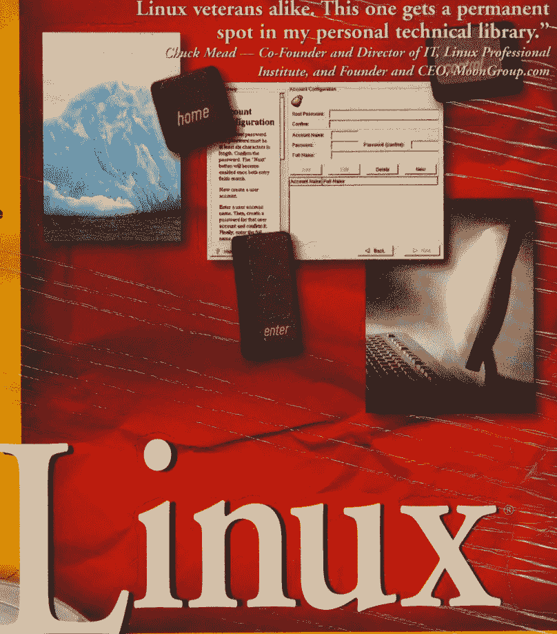

坎达斯·莱登（Candace Leiden）

与特里·科林斯（Terry Collings）


https://archive.org/details/linuxbible0000leid

坎达斯·莱登（Candace Leiden）与特里·科林斯（Terry Collings）


## 关于作者

坎达斯·莱登（Candace Leiden）是 Linux Group 的首席技术官。她在 Linux 数据库方面拥有丰富的经验。她目前在 Allentown 教授 Linux 相关课程。

特里·科林斯（Terry Collings）自 1981 年就开始从事计算机领域。他在 Muhlenberg College 教学。

## 致谢

制作编辑

媒体开发编辑

媒体开发主管

## 为什么你需要这本书

这本书包含了使用 Linux 的诀窍，适用于从初学者到高级系统和网络管理员的所有读者。我们从基础知识开始，并根据你的需求不断构建知识体系——一直到在互联网上配置、管理和调优 Linux 服务器。《Linux 圣经》（Linux Bible）旨在你的整个 Linux 职业生涯中为你服务。你可以根据所需的所需的知识按任何顺序阅读章节。如果你已经接触过 Linux（或 UNIX），可以自由地跳过某些主题，或将此书作为参考资料来帮助你解决特定问题。

## Linux 和 UNIX 初学者

学习 Linux 不需要任何先前的 UNIX 知识。如果你从未用过 Linux 或 UNIX 操作系统，我建议你从第 1、2、3 章开始，然后直接跳到第三部分“使用 Linux”。第三部分将帮助你熟悉 Linux 及其你的文件和目录。完成第三部分后，你可以继续学习系统管理和网络章节。

## UNIX 老兵和系统管理员

你想要寻找 Linux 与商业版 UNIX 之间的差异。第 1 章描述了为什么 Linux 是别致之处，以及 Linux 哲学与 UNIX 方法有何不同。第 3 章帮助你安装不同版本的 Linux。第二部分提供了 Linux 系统管理任务的概念和技术细节。别忘了浏览第三部分，尽管这些章节主要面向用户，但你可能会从中发现一些提示和技巧。第四部分描述了如何将你的 Linux 系统连接到内网、互联网或两者。第五部分帮助你监控和调优你的 Linux 系统和网络，并自定义你的 Linux 内核以及保护你的系统。第五部分还展示了如何建立 Linux 与 Microsoft Windows 之间的连接。第四部分描述的某些工具是标准的 UNIX 工具，另一些是你想要了解的 Linux 特有工具。请将这本书放在手边，在整个系统管理职业中将其作为参考。

## TCP/IP 网络管理员

当然，TCP/IP 在从 UNIX 到 Windows 2000 再到 Macintosh 的系统上都是同样的 TCP/IP。尽管如此，你仍然需要在第三部分中学习如何在 Linux 上配置 TCP/IP 服务。第四部分涉及了了当你将 Linux 添加到包含 Microsoft Windows (95, 98, NT 和 2000) 操作系统和大型机系统的混合网络时，会遇到的高级 Linux 问题。请确保这本书触手可及，以便你在工作时可以将其作为参考。

## 想要成为 Linux 程序员的人

通过阅读第一、二部分获取基础知识。第二部分向你介绍了编写 shell 脚本、过滤器以及 awk/gawk 程序。第五部分在这些介绍的基础上，增加了针对系统管理员的 shell 脚本和 Perl 编程章节。

除了涵盖从基础到精通的 Linux，这本书还充满了检测 Linux 问题和解决各种 Linux 谜题的提示。书中所有的示例都来自在服务器和客户端工作站（包括一些便携电脑）上的 Linux 操作系统。有很多技巧可以帮助你理解如何从 Linux 操作系统获得最大收益。

## 第一部分：入门 Linux

第 1 章提供了 Linux、GNU、许可协议、各种 Linux 发行版以及人们在哪里使用 Linux（那无处不在）。如果你没有可以练习的 Linux 系统，第 2 章提供了一些建议，告诉你在安装 Linux 之前应该收集哪些系统信息并进行收集。第 3 章将带你完成一次示例 Linux 安装。第 4 章让你预览 Linux 的一些内部技术原理，例如进程概念、内存管理、文件系统、设备驱动程序、网络协议和守护进程（demons）。

第二部分关于基础 Linux 系统管理。第 5 章通过解释你作为（或将成为）系统管理员的职责开始介绍。第 6 章说明了启动（boot）和关闭系统的各种方法，并告诉你哪种适合你。第 7 章关于在 Linux 系统上安装软件，例如数据库和工具。第 8 和第 9 章关于管理设备，包括磁盘、磁带、调制解调器、串口和并行端口、音频视频以及终端。如果你负责文件（包括备份和恢复），你需要阅读第 10 和 11 章。第 12 章帮助你为用户设置账户，如果你只是管理自己的单用户工作站或 PC，则为你自己设置。第 13 章告诉你如何设置本地和远程打印机，以及如何管理和排除打印故障。

第 14–16 章提供了使用 Linux 的快速指南，包括如何登录、处理文件和目录、使用编辑器以及运行最重要的命令和程序。第 17–19 章向你展示如何自定义环境、编写简单的 shell 脚本并开始成为高级用户。

本书的第四部分解释了基础网络管理。如果你计划与外部世界（如互联网）甚至你的私有网络通信，你需要理解如何配置 TCP/IP 以及如何定期维护它。第 20 章包含了一些基础网络配置信息。第 21–23 章向你展示如何设置网络服务（如 DNS, NFS 和 NIS），以便你的计算机可以与网络或互联网上的其他计算机发送消息并共享文件。

虽然电子邮件是直观且易用的，但它不会魔法般出现在某人的计算机上。系统管理员需要为 Linux 系统上的用户设置电子邮件。第 24 章描述了设置电子邮件的基础知识，并帮助你保持电子邮件安全以及诊断问题。如果你的系统在互联网上，请阅读第 25 和 26 章。

第 27 章解释了如何设置重复的系统任务。第 28 章帮助你自定义 Linux 内核。第 29 章展示了如何保护 Linux 免受入侵、病毒和其他恶意侵害。如果你想编写自己的 bash 脚本，请阅读第 30 和 31 章。第 32 和 33 章解释了如何嗅探你的系统和网络以提高性能。如果你的 Linux 系统运行在带有 Microsoft Windows、Macintosh 和计算机的网络上，请阅读第 34 章查看将系统集成到一个网络中。

附录包含了关于 Linux 目录结构、高级命令以及在 Web 上查找额外资源的价值信息——以及附带 CD-ROM 的内容。


## 致谢

编写一本书需要许多人的参与——比我开始写这本书时想象的要多得多。感谢 Hungry Minds 编辑和制作人员的支持。同时也感谢在 CD-ROM 光盘上组装软件的团队。

我特别想感谢 Terri Varveris，她是一位非凡的专业人士，她以不懈的善意维持着一切和每个人，并将所有部分整合在一起。没有她，这本书就无可能出版。还要感谢编辑 Barb Guerra、Neil Romanovsky 和 S. B. Kleinman。

感谢几位辛勤付出的贡献者。Ken Duncan 不仅撰写了关于 Linux 安装和软件软件包安装的章节（第 3 章和第 7 章），还为某些章节提供了高质量的技术编辑，包括关于可读性的额外注释，这些真的非常有帮助。Terry Collings 在第 20、21、22、23、25、26 和 34 章中撰写了关于网络的内容。Kurt Wall 领导了大部分作者评审工作，我非常感谢他分担了压力，让我能够投入其他项目。Rick Oxford 提供了技术编辑服务。还要感谢 Michael Bellomno 为电子邮件和安全章节贡献了材料。


感谢 VMware, Inc. 的 Reza Malekzadeh，他提供了 VMware 软件，让我证明了无需重启即可从 Linux 访问 Microsoft Windows（第 2 章）。对于我们这些经常在 VMware 之间切换的人来说，VMware 救了急。

最后，特别感谢我的驻场技术天才（以及《傻瓜自学 TCP/IP》的合著者）Marshall Wilensky。Marshall 可以帮助你解决可能遇到的任何技术问题。除了与我一起进行“正常”的 Linux 安装外，他还在帮助我在各种不寻常和旧的硬件上安装并调整 Linux，用以展示我在哪里可以（以及不能）让 Linux 运行起来。Marshall 还提供了多个章节中的一些屏幕截图。他还充当了网络管理员，为我专门为书中的示例而创建的异构网络进行了设置和排排除故障。每当我出差时，Marshall 都会拆卸网络，将其打包带去旅行，并帮我在偏远的酒店房间里将其装好——这项工作我自己没有足够的体力或耐心去完成。

— Candace Leiden

- 致谢 . . . . . . . . . . . . . . . . . . . . . . . . . . xiii
- 第 3 章：安装 Linux . . . . . . . . . . . . . . . . . . . . . . . 19

## 第一部分：Linux 入门

### 第 1 章：什么是 Linux？ ................................................................................................................................ 3
- 一些 Linux 基础知识 ...................................................................................................................................... 3
- 为什么 Linux 如此重要？ ........................................................................................................................ 4
- Linux 是 UNIX 吗？ ..................................................................................................................................... 4
- Linux 是免费的吗？ ......................................................................................................................................... 4
- Linux 的“自由”到底意味着什么？ ................................................................................. 5
- 如果 Linux 是免费的，为什么还有人对它收费？ ................................................................................. 6
- 我可以在哪里获取 Linux 发行版？ ................................................................................ 7
- 谁在用 Linux？用来做什么？ ................................................................................................ 7
- Linux 运行在什么样的计算机上？ ....................................................................................... 7
- Linux 上运行什么软件？它们也是免费的吗？ ............................................................................ 8

### 第 2 章：准备安装 Linux ................................................................................................... 9
- 决策、决策、再决策 ................................................................................................................... 9
- 你可以在哪里获得 Linux？ ........................................................................................................................ 9
- 你需要哪种安装方式？ ................................................................................................................ 11
- 还有哪些操作系统需要与 Linux 共存？ ................................................ 11
- 了解你的硬件 ...................................................................................................................... 12

### 第 3 章：安装 Linux ................................................................................................................... 19
- 理解安装要求 ............................................................................................................ 20
- 硬盘分区 ................................................................................................................................................... 21
- 开始安装 ....................................................................................................................................................... 22
- 创建启动盘 ............................................................................................................................................................ 22
- 配置加载程序 (Loader) .......................................................................................................................................................... 30

### 第 4 章：Linux 内部 ................................................................................................................... 41


# Linux 圣经

- Linux 内核内部 41
- 理解多任务——对于 MS-DOS 和 Microsoft Windows 用户来说这是一个新概念 42
- 理解设备驱动 43
- 理解 Linux 进程概念 43
- 任务与进程——父子关系 44
- 理解虚拟内存管理文件系统 46
- 理解网络功能 48
- 连接 TCP/IP 50
- 连接其他网络协议 50

- 深入研究守护进程 (Daemons) 50
- 理解 Shell 51
- 什么是 Shell 脚本？ 52
- 世界上有哪些 Shell？ 52
- 研究用于进程间通信 (IPC) 的 RPC (远程过程调用) 53

## 第二部分：Linux 系统管理入门 55

### 第 5 章：Linux 系统管理职责 57

- 噢，这责任！ 58
- 成为 Root 太棒了 58
- 开始系统管理 58
- 配置帮助系统和帮助页 (man pages) 58
- 启动（开启）和关闭计算机 59
- 与硬件设备协作 59


- 安装（卸载）软件 60
- 备份和恢复目录及文件 60
- 配置和管理用户账户 60
- 管理打印机和打印 60
- 在网络中配置和管理 Linux 60
- 配置网络 61
- 配置计算机连接 TCP/IP 网络 61
- 配置其他 TCP/IP 服务 61
- 精进你的系统管理技能 62
- 自动化任务 62
- 重建内核 62
- 保护 Linux 系统 62
- 监控和调优 Linux 性能 63

### 第 6 章：管理启动与关机 65
- 理解启动过程 65
- 理解运行级别 (levels) 66


- 调查 `init` 67

- 关机选项 69

- 关机并停止（运行级别 0） 70

- 关机并立即重启（运行级别 6） 70

- 关机至单用户模式（运行级别 1） 72

- 故障排除 72

### 第 7 章：安装软件包 73

- 使用红帽软件包管理器 (`RPM`) 73

- 使用 `tar` 74

- 什么是软件包？ 78

- 什么是 `RPM`？ 78

- 在命令行模式下使用 `RPM`——基础操作 78

- 在图形化模式下使用 `RPM`——基础操作 79

- 在非红帽 Linux 发行版上使用 `RPM` 86


- 在 Caldera Linux 上使用 RPM ... 86
- 在 SuSELinux 中使用 RPM ... 87
- 理解设备特殊文件 ... 89
- 面 Windows、DOS 和 OS/2 用户的 Linux 设备 ... 90
- 如何创建设备特殊文件？ ... 91
- 设备特殊文件的分类 ... 92
- 字符特殊文件 ... 92
- 块特殊文件 ... 92
- 命名管道 ... 93
- 检查 `/dev` 目录 ... 93
- 管理串口设备 ... 94
- 从“哑”终端开始 ... 97
- 从网络登录 ... 102
- 从调制解调器开始 ... 103
- 输入设备 ... 106
- 配置你的键盘 ... 107
- 配置指针设备和鼠标 ... 111
- 配置并行端口设备 ... 112
- 保持内存设备特殊文件原样 ... 113
- 使用磁带设备 ... 113
- 添加新硬件 ... 114
- 探索 2.4 内核中的新设备功能 ... 115

## 第9章：磁盘设备管理 ... 117
- 硬盘概念介绍 ... 117
- 理解物理磁盘与逻辑磁盘 ... 118
- 观察硬盘内部 ... 118
- 分区在哪里？ ... 120
- 多化为多——对分区进行分区 ... 122
- 理解命名规范 ... 124
- 为 Linux 重新分区 ... 124
- 为什么要重新分区？ ... 125
- 如何重新分区 ... 126
- 软磁盘 ... 131

确定交换空间的大小 ... 156
- 逐步解析一些简单的 `sed` 示例 ... 338
理解 FTP 客户端 ... 41
- 查看示例 `rc.local` 初始化文件 ... 570
- 使用 SWAT ... 676
- Samba 客户端配置 ... 684
- 使用来自 Linux 的 Windows 打印机 ... 690
- 为什么要使用 Samba 代替 NFS? ... 692

# 附录 C：Linux 互联网资源 ... 705
- 谁托管网站 ... 705
- 从操作系统供应商获取 Linux 信息 ... 706
- 从 `.org` 获取 Linux 信息 ... 707
- 从 `.com` 获取 Linux 信息 ... 708

# 附录 D：高级命令词表 ... 711
- 获取帮助 ... 711
- 在用户环境中工作 ... 712
- 管理文件/目录 ... 714
- 文件操作 ... 717
- 文本处理 ... 718
- 打印 ... 719
- 归档 ... 719
- 控制进程 ... 719
- 管理文件系统和交换 ... 720

## Linux 入门

在本部分
- 第 1 章：什么是 Linux？
- 第 2 章：准备安装 Linux
- 第 3 章：安装 Linux
- 第 4 章：Linux 内部

# 什么是 Linux？

Linux 是一个计算机程序：一种被称为操作系统的特殊程序。事实上，Linux 看起来非常像商业 UNIX 操作系统，但 Linux 远不止于 UNIX。你可以像使用任何主流操作系统一样使用它，包括用于网络连接、软件开发、Web 服务器和浏览器、电子邮件、文档处理以及金融应用程序。你可能会想：“世界真的需要另一个操作系统吗？”但 Linux 是特殊的。本章提出了一系列关于 Linux 的问题。这些答案揭示了 Linux 之何如此特殊之处。

# 一些 Linux 基础知识

这里有一些关于 Linux 的简短资讯，可以让你对 Linux 产生兴趣。你可以在书中各处找到其他相关知识。

- Linux 操作系统允许许多用户使用一台计算机。
- Linux 运行在各种类型的计算机上，从个人电脑到巨大的超级计算机。
- 用户可以在文本模式或 Windows 模式下运行 Linux，或者两者结合。
- Linux 是免费的。“免费”一词具有不同的含义，取决于使用者是谁。在考虑软件时，请务必理解“免费”的意思。继续阅读以发现关于 Linux 的“免费”含义。


Linux 不需要大量的内存或昂贵的硬件。在 PC 上，你甚至不需要奔腾强度的处理器。我曾见过 IBM/Lotus Development 的 Domino 服务器运行在旧的 Intel 486 计算机 Linux 上，为数十名 Lotus 用户提供服务。

某些 Linux 变体（如 DLX Linux 和 hal91 Floppy Linux）非常小，甚至可以放在 1.44 MB 的磁盘上。

# 第 1 章

## 本章内容

- 为什么 Linux 很重要？
- Linux 是 UNIX 吗？
- 我可以在哪里获得 Linux 发行版？
- 谁在使用 Linux？为什么要用？
- Linux 运行在哪些计算机上？
- 理解通用许可证 `GPL`
- 哪些软件运行在 Linux 上？

## 为什么 Linux 很重要？

几个因素使得 Linux 成为重要且流行的操作系统：

- **性能与功能。** Linux 操作系统提供了足够的特性和功能，你可以将其用于几乎任何类型的硬件。例如，如果你是一个数据处理人员，Linux 运行在用于科学和技术目的的强大计算机上。另一方面，如果你只想读邮件和写几封邮件，你可以在 PC 或 Mac 上使用 Linux。在这两个极端之间，Linux 能够很好地胜任你想到的任何用途。第 2 章描述了让 Linux 提供如此高水平功能的某些架构特性。
- **可靠性。** 性能和功能并非一切。Linux 每天都在证明它的可靠性。
- **可用性。** 你可以轻松从世界各地的许多不同来源获取 Linux。Linux 不仅仅是一个仅限英语的操作系统。阅读本章关于 Linux 发行版的章节，可以在世界范围内找到获取 Linux 的地方。
- **价格（免费）。** 你需要准确理解关于 Linux 的“免费”含义。与大多数操作系统不同，你不需要为 Linux 付费，尽管你必须遵守 GNU 通用许可证 `GPL` 的规定。你可以在本章稍后的部分阅读 GNU 和 GPL 的基础。要阅读完整的 GPL，请浏览网站 `http://www.gnu.org/copyleft/gpl.html`。

## Linux 是 UNIX 吗？

Linux 看起来像 UNIX 且运行良好，但在 Linux 的创建、改进方式，以及分发和收费方面存在巨大差异。Linux 是一种类 UNIX 操作系统，不包含任何 UNIX 代码。Linux 操作系统中的所有代码都是原始的，并基于 `POSIX` 标准。Linux 使用了大量来自马萨诸塞州剑桥自由软件基金会的 GNU（GNU is Not Unix）软件。

## Linux 是免费的吗？

除非你想付费，否则 Linux 是免费的。与大多数操作系统不同，你不需要为 Linux 付费，尽管你必须遵守 GNU 通用许可证 `GPL` 的规定。你可以在本章稍后的部分阅读 GNU 和 GPL 的基础。要阅读完整的 GPL，请浏览网站 `http://www.gnu.org/copyleft/gpl.html`。

## 免费的 Linux？

## 第一部分 - Linux 入门

## Linux 与内核

1. 运行在 Linux 上。
2. 分发 Linux 副本。
3. 修改 Linux。
4. 重新发行 Linux 副本。
5. 为 Linux 收费。

`Copyleft` 是对 Linux 的革命性转变。它禁止你添加限制。

## 我可以在哪里获取 Linux 发行版？

有很多地方。最简单的方法是买一台预装了 Linux 的电脑。最常见的方法是从互联网下载 Linux。

第 2 章将解释如何以及在何处寻找 Linux发行版。

由于 Linux 内核遵循 `GPL` 协议，你可以根据需要无限次复制它。你可以从任何拥有 Linux 的人那里获取副本。如果你的互联网连接很慢，你可以从大多数创建发行版的公司那里通过 CD 获取发行版（如果你愿意为便利性支付费用的话）。

## 谁在用 Linux？用来做什么？

你可能在毫无察觉的情况下正在使用 Linux。如果你浏览网页，你可能访问过由 Linux 驱动的 Web 服务器。如果你最近去过医院，你的病历很可能就存储在 Linux 系统上。你可以在南极的科站和公海研究船上发现使用 Linux 的人。任何使用电脑的人都能找到使用 Linux 的理由。终端用户使用 Linux 处理电子邮件、文字处理、电子表格、浏览网页——这些都是你在任何操作系统上都会做的事情。软件开发人员使用 Linux 编译器和工具构建新的软件产品。科学应用（如信号处理和天气分析）运行在 Linux 上。Linux 是关系型数据库（如 IBM 的 `DB2`、`Informix` 和 `Oracle`）的优秀服务器平台。Linux 也适用于网络和互联网互联，例如为 Web 服务器提供平台。当然，系统和网络管理员也使用 Linux 为所有其他用户保持系统的运行。

## Linux 在什么电脑上运行？

Linux 运行在小型电脑、甚至是手持电脑、大型电脑、旧电脑和新电脑上。你只需要 4 MB 的内存和 15 MB 的硬盘空间就可以运行 Linux，尽管如果你想将 Linux 用作服务器，我不建议这样做。Linux 的硬件平台包括：

- 掌上电脑，如 Palm Pilot 和 IBM PC 110
- IBM PCs 和 PC 兼容机，甚至是基于 Intel 386 CPU 等古老架构的机器
- Macintosh PowerPC
- Amiga
- IBM 主机 `370/390, AS400`
- 惠普-Packard PA-RISC
- Sun Sparstation
- Compaq Alpha（原 Digital Equipment）
- Silicon Graphics 工作站

## 尺寸与可扩展性 – Linux 可以多大？

在写作时，最大的 Linux 安装实例是 IBM 的 Los Lobos 超级计算机，由 512 CPU 集群组成。虽然 IBM 必须编写大量代码来支持那种级别的扩展性，但 Linux 内核 `2.4` 及更高版本支持高达八个 CPU 的多处理器扩展性。

这种 Linux 硬件的选择是 Linux 迅速流行的原因之一。

## Linux 上运行哪些软件？它们也是免费的吗？

Linux 有各种软件可用——数百个程序。其中一些是免费的。有些必须付费的商业软件。TCP/IP 互联网互联软件内置在 Linux 中。Linux 的流行软件包括：

- Lotus Domino R5 应用服务器
- Oracle、Informix 和 DB2（最流行的关系型数据库之一）
- IBM Webphere 应用服务器
- Netscape Communicator
- Network
- WordPerfect
- Via 语音识别软件
- Star Office 软件套
- 许多游戏
- Microsoft MS-DOS 和 Windows 模拟器

查看新 Linux 产品演示的好地方是年度 Linux 世界大会和博览，这是全球最大的仅限 Linux 的活动，在全球各大城市举行。要查看日程，请浏览 `http://www.linuxworldexpo.com`。你还可以在 linuxworldexpo 网站查看之前会议的精彩回顾。

## 总结

本章通过列出一些快速知识点并回答一些关于 Linux 的常见问题，向你介绍了 Linux。

## 准备安装 Linux

如果你是那些拥有已安装好 Linux 电脑的幸运儿，你可以跳过本章和下一章。你只需要打开电脑就可以开始工作了——至少在你获得另一台没有安装 Linux 的电脑之前是。另一方面，如果你像大多数使用 Linux 的人一样，你已经有一台安装了其他操作系统的电脑，很可能是一个窗口系统。

本章将帮助你准备电脑，以进行仅安装 Linux 的安装，或者与其他操作系统共存的 Linux 安装。

## 选择，抉择

在开始安装之前，你需要做出一些选择。

1. 你将从哪里获取 Linux？
2. 你还想要哪些操作系统？
3. 你需要哪种安装方式？

如果你没有 FTP 访问权限，但有电子邮件，你可以通过 FTP-mail 从 `ftpmail@ftp.stuttgart.de` 或 `ftpmail@garbo.uwase.fi` 获取 Linux。

# 第一部分 | Linux 入门

## 注意事项

无论你安装了多少个操作系统，计算机一次只能运行一个操作系统。例如，如果你已经启动了 Linux，并决定要在 Microsoft Windows 98 环境下工作，你必须关闭 Linux 并重启电脑，以便引导程序管理程序加载 Windows 98。

## 了解你的硬件

请务必确定你的硬件能够与 Linux 兼容。


关键词是“绝对”。当我第一次尝试安装 Linux 时，我很确信我的硬件没问题，但并不是**绝对确定**。在经历了几个小时的尝试和许多挫折后，我发现 Linux 特别喜欢我的硬盘，但它非常讨厌我的控制器，除非我更换某些硬件，否则将无法在那台机器上进行安装。

无论你计划安装哪种发行版，都有磁盘空间和内存要求。安装程序还会询问你的系统设备，包括一些看似可能不重要的设备，例如鼠标和声卡。表 2-3 列出了安装程序希望你提供的硬件信息。

提示

在在开始安装之前，请务必确定你有多少内存和空闲磁盘空间。

Linux 在内存利用方面非常高效。如果你不使用 GUI（图形用户界面），仅需 4 MB 内存就可以在 Linux 系统上运行。如果使用 GUI，你至少需要 8 MB，尽管 16 MB 更符合实际。

## 表 2-3

关于你的硬件你需要了解的

| 硬件设备 | 需要的信息 |
| --- | --- |
| CPU（中央处理单元，又称芯片） | Intel 386 及更高版本、Intel 类型芯片（如 AMD）、Alpha、SPARC、MIPS、Macintosh PowerPC、PA-RISC。 |
| 内存 (RAM) | 多少？ |
| 硬盘 | 数量、大小，哪个硬盘连接到哪个控制器？有多少可用空间？ |
| 磁盘控制器 | SCSI, IDE, EIDE？品牌和型号是什么？ |
| 光驱驱 | 品牌和型号、类型 (IDE, SCSI)？ |
| 显示器 | 品牌和型号、刷新率？ |
| 视频控制器 | 品牌和型号、显存大小？ |

## 硬件设备

| 硬件设备 | 需要的信息 |
| --- | --- |
| 鼠标 | 什么类型的（例如 PS/2, 串口）？按键数量，使用什么驱动（例如 Logitech, Microsoft）？如果是串口，哪个 COM 端口？ |
| 网卡 (NIC, 网络控制器) | 品牌和型号、TCP/IP 信息。 |

本章的后续章节描述了任何 Linux 安装的通用硬件要求。你需要检查你特定发行版所支持的具体硬件。书后附的 CD 包含了最新版本的 Red Hat Linux 以及该书出版时的硬件兼容性列表。

- 大多数发行版都会在其网站上发布“硬件兼容性列表”（见表 2-1）。硬件兼容性列表指示了发行版已知支持的内容。它们通常按设备分类，例如 CPU、鼠标、显卡、网络等。

既然你已经了解了关于硬件需要知道的知识，该如何找到这些信息呢？不要一开始就拆电脑查看每个组件。品牌和型号通常在这些组件的某处，但那意味着要取出电路板和芯片。谁想做那个？而且，你必须把所有东西放回原位。我曾尝试过这种方法，虽然我能看到网卡印有型号，但它太小了，我看不清。即使我戴了眼镜，也无法认出那个型号。如果你能找到电脑附带的说明书，你可能会从中获得所需的信息。更好的方法是让系统告诉你内部配置有什么，从你的控制面板开始（见图 2-1 至图 2-4）。以下章节将说明如何查找系统和设备信息。

## 理解安装要求

了解你的硬件配置对于成功安装 Linux 至关重要。在安装对话框期间，Linux 会正确检测你的硬件；然而，有备胜胜于无未缪。一些需要特别注意的组件包括硬件硬盘、SCSI（小型计算机系统接口）或 IDE（集成式驱动器电子）、尺寸、CD-ROM 接口、鼠标类型、内存（RAM）、品牌和型号。虽然显示器的品牌和型号不是至关重要的，但显示器必须支持你显卡的分辨率。这些分辨率以像素（图像元素数量）表示。对于 Windows，1024x768 的水平和垂直是一个典型的设置。表 3-1 提供了你在开始安装 Linux 之前应该准备就绪的硬件元素完整列表。

> 在安装对话框中，你有许多机会返回并更改你的决定。然而，我发现很多很多情况下，新决定会被对话框直接忽略。这在安装 Mandrake 时尤为明显，我特意输入了像素值，但 Linux 的“探测（probe）”确定了一个不同的值，而那个值是错误的。

### 表 3-1

Linux 安装硬件组件

| 硬件组件 | 所需信息 |
| :--- | :--- |
| 硬盘 | 接口和尺寸 |
| 网卡 | IP 地址、主机名、域名 |
| 内存 (RAM) | 内存容量 |
| SCSI 适配器 | 品牌/型号数字 |
| 显示器 | 品牌/型号以及刷新率 |
| 鼠标 | 类型、按钮数量 |
| CD-ROM | 接口适配器 |
| 显示适配器 | 品牌/型号数字 |
| 键盘 | 型号/键数（101 标准） |

> 准备好应对安装对话框中的显示器和显卡定义。在安装了所有四个发行版——Red Hat（7.0 之前的版本）、Mandrake、Caldera、SuSE 之后，SuSE 如何定义正确的刷新率和分辨率并不明确。尽管所有发行版的安装对话框似乎都让我返回并更改定义，但大多数情况下这简单并不起作用。

请参阅本章后面的 X Window 部分以获取有关硬件组件的更多详细信息。

我们花费了大量时间回顾安装 Linux 系统所需的基础硬件。你可能还需要以下内容来成功安装 Linux：

- 16 MB 内存
- 4 GB 硬盘（可用空间 300 MB 到 1000 MB）
- Pentium 级 CPU
- IDE 或 SCSI 控制器
- 彩色显示器
- CD-ROM 驱动器
- 软驱驱动器

许多其他书籍和所有发行商都会告诉你，安装 Linux 不需要这么多硬件，这确实如此，但如果配置更低，安装完成后你将无法做很多。你也将无法使用如 GNOME 或 KDE 等图形用户界面（GUI）。

## 硬盘分区

你的 Red Hat Linux 系统至少需要两个分区：一个大分区（取决于你选择运行的应用程序）和一个交换分区（用于虚拟内存），其大小通常是你机器内存的两倍。你可能想要创建多达八到十个 Linux 原生分区，以提高效率并更易磁盘管理。

分区硬盘的方法有三种：Disk Druid（随 Red Hat CD-ROM 附）、`fdisk`（是的，就像那个 DOS 程序）或 Partition Magic。无论你选择哪种方法，请务必备份你的硬盘。如果你使用 `fdisk` 或 Disk Druid 且有现有数据，你几乎肯定会丢失某些数据。Partition Magic 可以绕过你的数据，但这是一个额外的支出——在时间、质量和金钱方面。

既然我必须产生额外支出，我选择投资一个新硬盘。这样做不仅为自己留了充足的空间来安装 Linux 并选择我喜爱的包和 GUI，还能让我的 Windows 95 系统保持独立，从而消除了丢失任何数据的可能。选择权在你手中，我建议你使用新硬盘，并在安装对话框期间使用 Disk Druid 对硬盘进行分区。你始终可以使用额外空间，而且硬盘非常廉价。

## 开始安装

有几种方法可以让 Linux 运行在你的机器上。简单且可靠的方法是购买一台预装了 Linux 的新机器。虽然这可以很快并节省你大量工作，但通常并不实际，而且剥夺了你亲手执行安装将获得的知识。如果你是打算购买新 PC 的幸运儿，你可能想咨询像《Linux Journal》之类的期刊，它专门介绍 Linux。你可以在网上通过 `http://www.linux.journal/` 找到它。

更有可能你已经有一台运行 MS-DOS 或某些版本 Windows 的 PC 了。在这种情况下，你可能会从软盘或 CD-ROM 进行安装。你也可以使用 FTP（文件传输协议）或 NFS（网络文件系统）安装，但软盘和 CD-ROM 安装是最常见的。

## 创建启动盘

为了首次启动 Red Hat 并启动 Red Hat 安装程序，你需要一个 Red Hat 启动盘。对于这一步，你应该在 `A:` 驱动器中没有磁盘的情况下启动 PC，然后像往常一样进入 Windows。

如果你可以在 MS-DOS 下启动 PC（不是 Windows 95 中的 MS-DOS 窗口）并从提示符访问 CD-ROM，你就不需要启动盘。如果你运行 Windows 95/98，请以 MS-DOS 模式重启 PC。然而，你可能无法在 MS-DOS 模式下访问 CD-ROM，因为启动文件——`AUTOEXEC.BAT` 和 `CONFIG.SYS` 可能没有配置。要在 MS-DOS 模式下访问 CD-ROM，请在这些文件中添加 CD-ROM 驱动。启动盘包含一个初始版本的 Red Linux，你用它启动 Red Linux、准备硬盘并加载剩余部分。当你从 CD-ROM 重新安装 Red Linux 时，就不需要启动盘。启动盘会启动安装程序。创建启动盘涉及使用名为 `WRITE.EXE` 的工具将特殊文件拷贝到磁盘。

### 第 3 章 安装 Linux

1. 打开 MS-DOS 窗口（选择开始 -> 程序 -> MS-DOS 提示符）。
2. 在 MS-DOS 窗口输入以下命令。（我的注释在括号内，你的输入为加粗）：

```
d: (使用 CD-ROM 所在的驱动器号)
cd dosutils
rawwrite
Enter disk image source name: \images\boot.img
Enter target diskette drive: a
Please insert a formatted diskette into drive A: and press ENTER :
```


- 3. 根据指示，你应该将格式化磁盘插入 A: 然后按回。`RAWWRITE.EXE` 程序将镜像文件拷贝到磁盘。

再次看到 DOS 提示符后，你可以从 A: 驱动器中取出启动盘，并（如果你还没有的话）对其进行适当标记。

此时你已经准备好了所有硬件信息，并准备就绪。如果有可启动的软盘或 CD-ROM，请将其放入相应的驱动器并启动系统。Linux 标志屏幕将自动出现，如图 3-1 所示。


此时，Red Hat Linux 安装程序处于控制状态。默认的图形界面（GUI）安装将自动开始。下一个屏幕是语言选择屏幕，如图 3-2 所示。

> 注意

如果你熟悉 Red Hat Linux 6.0 的安装，你会注意到屏幕左侧主页提供的额外在线帮助。此功能在安装过程的后期会变得特别有帮助。

对于这次特定的安装，我使用向下箭头键高亮了英语。点击“下一步”将带你进入安装对话框的下一个屏幕——键盘配置。图 3-3 显示了键盘配置屏幕。

# 第一部分 Linux 入门

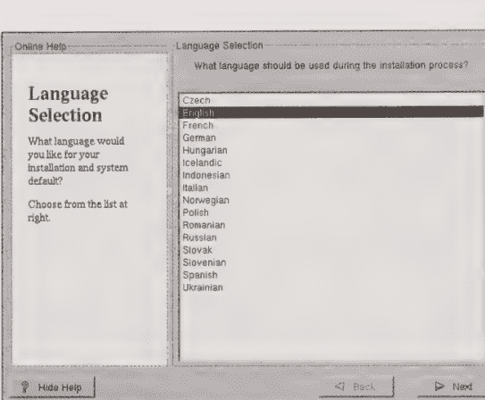

图 3-2：语言选择屏幕

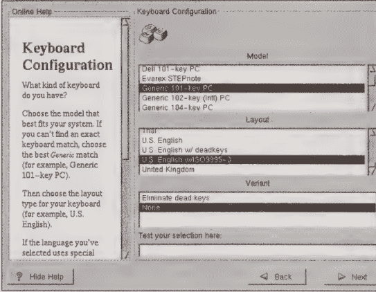

图 3-3：与您的键盘最匹配的键盘配置模型。

- 对于所有四个发行版——红帽（Red Hat）、Caldera、Mandrake 和 SuSE——我选择了带有默认布局和死键默认设置的通用 101 键 PC（针对美国安装版），它在所有安装中运行运行良好。

在“布局”（Layout）子窗口中选择“美国英语（默认）”。在“变体”（Variant）子窗口中，选择“无”（None）。点击“下一步”（Next）进入鼠标配置屏幕，如图 3-4 所示。

变体子窗口用于 7.0 之前的版本。

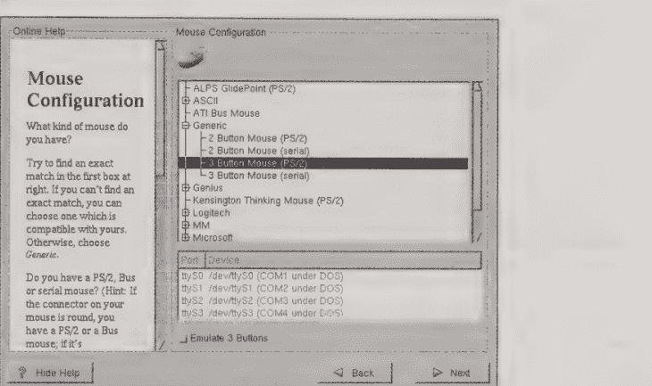

### 图 3-4：鼠标配置屏幕

对于 6.1 及早版本的其他三个 Linux 发行版，选择“2 鼠标按钮”。如果您选择模拟三键，请点击屏幕左角的方框。如果您打算使用 X Window，此功能将非常有用。若要在 X Window 中模拟第三个按键，请同时按住鼠标左键和右键。

在 7.1 版本中，您的鼠标属性是在初始启动和加载 CD-ROM 时确定的。您可能用有一个串行鼠标，但如果您不确定，鼠标配置屏幕左侧的帮助信息（如图 3-4 所示）非常有用。因此，您不需要覆盖 Linux 决定的鼠标属性，但如果您觉得有必要，请按照以下说明操作，并由自承担风险！

若想在日后更改鼠标配置，您将需要运行 `/usr/bin/mouseconfig` 命令。

点击“下一步”（Next）按钮进入欢迎屏幕，如图 3-5 所示。花一分钟阅读屏幕左侧部分的文本。

## 26 第一部分 Linux 入门

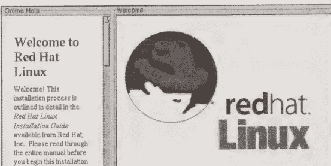

图 3-5：点击“下一步”按钮跳转到“安装路径”屏幕以定义安装类型

点击“下一步”（Next）按钮来定义您将执行的安装类型。

> 如果您尚未备份系统中的硬盘/分区，现在是进行备份的好时机。取决于您选择的安装类型，此系统期间的数据可能会被破坏。

在本章较早的“硬盘分区”节中，我强烈建议在干净或新的硬盘上安装 Linux。这是因为在安装的后续部分存在破坏数据的风险。在“安装路径”屏幕上，您可以定义将要执行的 Linux 安装或升级类型。您的选项有：自定义（Custom）、GNOME 工作站、KDE 工作站、服务器（Server）和升级（Upgrade）。我建议选择“自定义”安装，因为这将允许您只选择根据需要的服务和服务包。选择“服务器”或“工作站”安装会导致包管理器选择 Linux 发行版中的所有可用包，并破坏分区中的所有现有数据。图 3-6 显示了安装路径屏幕。

高亮“自定义”图标并点击“下一步”进入安装对话框的“分区”屏幕。红帽 Linux 使用一个名为 Disk Druid 的工具来创建分区和文件系统。如果您尚未按照我在“分区您的硬盘”节中建议的通过 `fdisk` 或 Partition Magic 创建分区，则必须手动完成。

图 3-7 所示的“自动分区”屏幕允许您选择允许安装程序自动对硬盘进行分区，或使用 Druid 或 `fdisk` 对系统进行分区。如果您已经对系统进行了预分区，

### 第 3 章 安装 Linux

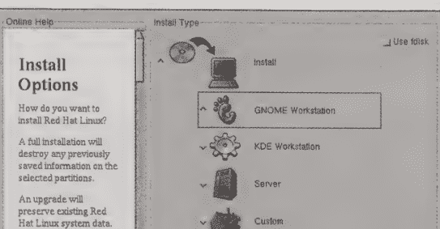

图 3-6：安装路径屏幕

大约 12 个关键目录定义了 Linux 系统。虽然安装 Linux 发行版只需要两个分区——一个用于整个系统，一个用于交换空间——但如果为这些目录中的某些创建多个原生分区，磁盘管理将简单得多。表 3-2 提供了 Linux 层次结构的概览，包括每个系统的简要描述和推荐的兆字节（MB）大小。

| 表 3-2 Linux 文件系统 | 推荐大小 | 描述 |

| :--- | :--- | :--- |

| /bin | 16 | 命令的二进制文件 |

| /boot | 16 | Linux 启动（boot）文件 |

| /usr | 100 | X Window |

| /opt | 512 | 应用包 |

| /var | 256 | 日志和溢出文件 |

| /home | 1024-2048 | 用户目录和文件 |

| /tmp | 128 | 临时文件 |

| /root | 128 | |

## 第一部分 Linux 入门

分区通常包含以下目录：/root, /bin, /dev, /etc, /lib, /boot 和 /sbin。详细查看这些目录请参考第 10 章。


图 3-7：手动分区屏幕

要使用 Druid 添加分区，点击“使用 Druid 手动”（Manually with Druid）。点击“下一步”选择您想要安装的 Linux 分区，在其中您将定义挂载点、大小和设备类型。图 3-8 显示了分区表。

对于 7.0 版本，要创建 /root 分区，高亮值为“未设置”（not set）且类型为“Linux native”（Linux native）的挂载点并点击编辑按钮。根分区不需要大量空间；128kb 即可。勾选“增长”（growth）框框并点击“确定”添加您的 /root 分区。分区屏幕上已经为您定义了交换分区。

为 7.0 之前的版本创建 /root，在挂载点编辑框中输入 `/root`，在“大小”框中输入 `16`。不要勾选“填充磁盘”（Grow to Fill Disk）框框。选择“Linux native”作为分区类型，并选择 hda（x 为磁盘驱动器）作为“允许的驱动器”。如果您有多个驱动器，为了效率，请将分区分布在这些驱动器上。如果您只有一个驱动器，hda 将是您的选择。点击“确定”将新分区添加到您的系统。

## 第 3 章 - 安装 Linux

## 29 分区

您想在哪里安装 Linux？首先，您需要为硬盘定义分区。在此期间您也可以创建或删除分区。如果您需要帮助对系统进行分区，请阅读《红帽安装指南》。顶部的屏幕显示

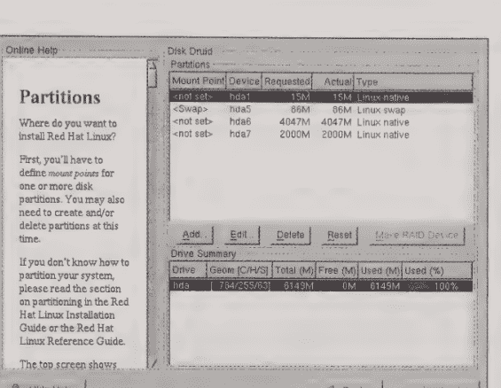

图 3-8：分区表屏幕

要创建分区，按照相同的步骤操作，但保持挂载点为空，并在“大小”框中输入系统的内存值。例如，对于 32-MB 的机器，输入 64；对于 64-MB 的机器，输入 128。选择“Linux Swap”作为分区类型。点击“确定”将新分区添加到您的系统。

表 3-3 描述了分区屏幕上 Druid 的额外按钮。

## 表 3-3 Druid 按钮

| 按钮 | 功能 |

| :--- | :--- |

| 添加 (Add) | 添加新分区。选择它时，会弹出窗口。 |

| 编辑 (Edit) | 修改分区屏幕上的高亮分区。选择它时，会显示该分区特征的窗口。 |

| 删除 (Delete) | 删除高亮分区。选择它时，会弹出确认窗口。 |

| 重置 (Reset) | 将分区表重置为原始内容。 |

| 返回 (Back) | 在不进行任何更改的情况下退出 Druid。 |

## 第一部分 Linux 入门

**注意**

如果选择 DOS 作为分区类型，您的系统将无法运行。

点击“添加”将您的交换分区添加到系统。对您想要创建的所有分区都遵循此过程。当所有分区都创建完成后，点击“下一步”进入“选择格式化”屏幕。

**备注**

所有分区都将创建为“Linux native”分区类型，交换分区外将创建为“Linux Swap”。

系统上所有新创建的分区都应该格式化。图 3-9 显示了“选择格式化”屏幕。

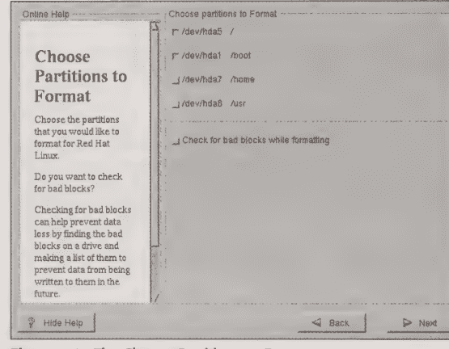

图 3-9：选择格式化屏幕


要格式化新分区，高亮请求的分区并勾选标记为“格式化时检查坏块”（Check for bad blocks while formatting）。这样做可以防止 Linux 以后写入磁盘上的任何坏块，从而防止数据丢失并确保数据完整性。当所有分区都格式化后，点击“下一步”进入 LILO 配置屏幕。

## 配置加载程序

启动 Linux 时，内核由多个可用程序之一加载到您的计算机中。如果您运行的是 Intel PC，将使用 `LILO`（Linux 加载器）。对于 DEC Alpha，`MILO` 是加载程序，而对于 SPARC 兼容

对于工作站，加载器程序是 `LILO`。由于我们正在 Intel 个人电脑上运行此安装对话框，我们将重点安装 `LILO`。

如果出于某种原因你选择不安装 `LILO`，可以通过运行 CD-ROM 上 `Dosutils` 目录下的 `loadin.exe` 从 DOS 启动 Linux。你也可以通过网络或如 System Commander 这样的商业引导程序加载 Linux。

图 3-10 显示了 `LILO` 配置界面。

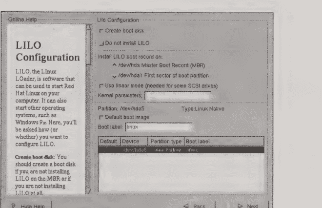

图 3-10：`LILO` 配置界面

由于这是自定义安装，你需要告诉计算机如何启动你的 Linux 系统。无论是将 Linux 作为独立系统还是与其他操作系统共同运行，都应该选择将 `LILO` 安装在主引导记录（MBR）上。只有在你使用另一个引导程序时，才应该选择第二个选项——启动分区的第一扇（First Sector of Boot Partition）。此外，创建启动盘（Create boot disk）复选框总是很有用的，如果你不安装 `LILO`，它是必须的。在启动标签（Boot Label）编辑框中输入一个名称并点击下一步。

`LILO` 的实际安装将在安装对话框结束时进行。换句话说，尽管我们目前正在告诉 Linux 创建启动软盘，但它现在不会发生，而是在安装过程结束时。在提示创建启动盘时，请做好准备并准备好软盘。在 7.1 之前的版本中，安装的下一个界面是网络配置界面，如图 3-11 所示。在 7.1 版本中，如果你的电脑没有网卡，点击“下一步”后将进入时区选择界面。时区选择界面如图 3-12 所示。

# 第一部分 ✦ 开始使用 Linux

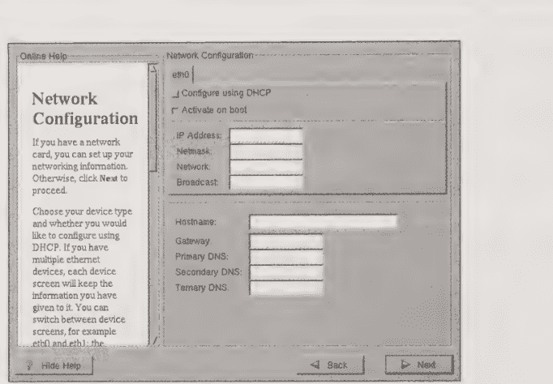

如果你的电脑没有网卡，点击“下一步”进入时区选择界面。如果你打算使用 DHCP 来配置网络，请勾选“使用 DHCP 配置”（Configure using DHCP）复选框并点击“下一步”继续进入时区选择界面。此时唯一的选项是在启动时激活你的适配器。在 IP 地址、主机名、网关和主 DNS 的编辑框中输入相应信息。子掩码、网络和广播编辑框将自动填充。（如果这些信息不正确，请进行相应的更改。）二级和三级 DNS 编辑框是可选的。验证所有信息无误后点击“下一步”进入防火墙配置界面。你选择的列表决定了防火墙的安全级别。点击“下一步”接受默认选择并进入时区选择界面。

图 3-12 所示的时区选择界面为设置系统时钟提供了两个选择。第一种也是最常见的是位置选项（如：东部标准时间、东部夏令时间、中部标准时间等）。第二个选项是 UTC 偏移量或世界协调时。在此安装对话框期间，你应该使用东部标准时间。

在 7.0 版本中，你可以将鼠标指向显示的世界地图上的任何地方，并单击即可选择所需的时区。

高亮 `America/New_York` 并点击“下一步”进入账户配置界面。

# 第 3 章 ✦ 安装 Linux 33

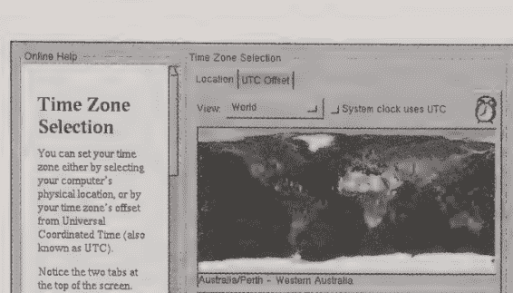

图 3-12：时区选择

在本节中，我们将创建至少两个账户：一个 root 账户和一个用户账户。账户配置界面分为三个部分。屏幕顶部用于定义 root 密码，中间部分用于定义用户账户和密码，底部用于显示账户名称。图 3-13 显示了账户配置界面的不同组件。

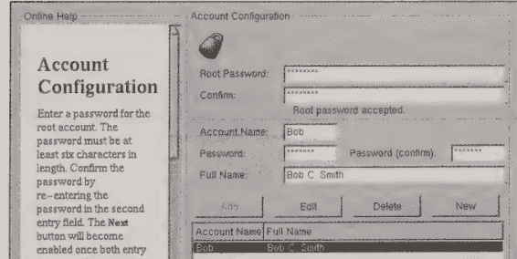

图 3-13：账户配置界面

# 第一部分 - 开始使用 Linux

在 root 密码（Root Password）编辑框中输入 root 密码。在确认（Confirm）编辑框中重新输入 root 密码。

记住，root 账户是无所不能的管理员账户。有了这个账户，一切皆有可能。不要选择一个明显的密码，比如你的狗或猫的名字。包含大小写字母、以及数字或特殊字符的密码更难破解。

当你输入密码时，出于安全考虑只会显示星号。一旦你输入了 root 密码，你可以在账户名称（Account Name）编辑框中输入账户名称，并在确认编辑框的密码编辑框中重新输入密码来创建一个用户账户。在全名（Full Name）编辑框中输入账户所属的人员姓名，点击“下一步”进入安装对话框的身份验证配置界面。

启动时，如果你忘记了 root 密码，可以按照以下步骤恢复：

- 1. 在 `LILO` 引导提示符处输入 `linux single`，其中 `linux` 是你的 `LILO` 启动分区名称（在此安装对话框中为 `linux`）。
- 2. Linux 将将显示以下提示符：

```
Bash#
```
- 3. 在此提示符处使用 `passwd` 命令接收此消息：

```
New UNIX password:
```
- 4. 输入新密码并按回车以接收此消息：

```
Retype new password:
```
- 5. 输入新密码。此消息应显示：

```
passwd: all authentication updated
```

图 3-14 所示的身份验证配置（Authentication Configuration）界面专门用于设置网络。如果你在安装对话框期间跳过了网络配置部分，点击“下一步”直接进入软件包选择界面。

如果你允许使用超过标准八个字符的密码，请勾选影子密码（shadow passwords）复选框。这将你的密码存储在文件 `/etc/passwd` 中。该文件仅允许 root 账户读取。如果你连接到 NIS 网络，请勾选 NIS 复选框。如果你不知道或不确定，请保持此选项关闭。我建议激活 256 字符能力和“使用影子密码”（Use shadow passwords）选项。点击“下一步”进入软件包选择界面。

# 第 3 章 ✦ 安装 Linux 35

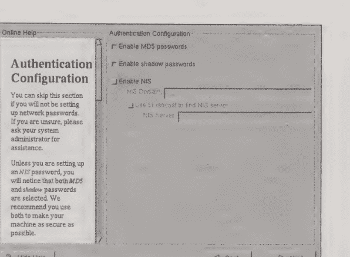

图 3-14：身份验证配置界面

由于我们正在进行自定义安装，我们可以选择软件包选择界面上的任何或所有软件包。我们在安装对话框的早些阶段选择了工作站安装选项，默认情况下会选中所有软件包。如果你在创建分区时发现磁盘空间充足，选择所有软件包可能不是个坏主意。这样你以后就不需要回来安装可能漏掉的软件包了。如果你日后确实需要安装软件包，将使用 Red 软件包管理器（RPM）。你可以通过 X 中的控制面板运行 RPM。每个可用软件包都由一个图标和简短的文本描述表示，如图 3-15 所示。要选择某个软件包，点击其旁边的复选框。使用右侧的滚动条浏览软件包列表。

仔细选择你的组。例如，打印机支持和 X Window 系统不会自动安装。你必须手动选择它们。如果你使用的是 7.0 版本，在选择软件包后点击“下一步”按钮进入关于安装的界面，如图 3-16 所示。

# 第一部分 | Linux 入门

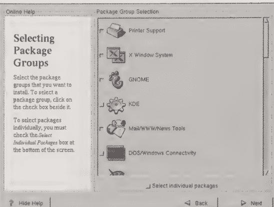

图 3-15：软件包组选择屏幕


图 3-16：准备安装

# 第 3 章 - 安装 Linux

如果你使用的是 7.0 之前的版本，请点击“下一步”（Next）进入安装对话框的 X 配置界面。

X 配置将尝试确定你正在使用的显卡和显示器类型，以寻找最佳显示设置。最初，安装程序将探测你的系统，以确定视频适配器的制造厂商和型号。如果安装程序探测成功，它将列出你的视频硬件。请务必根据你在安装前进行的研究来核实这些信息。如果探测失败，将显示视频适配器和显示器的列表（分别如图 3-17 和 3-18 所示），你将从中进行选择。这个列表非常详尽，请准备好你的安装前笔记。

当你选择了正确的硬件后，点击“下一步”。

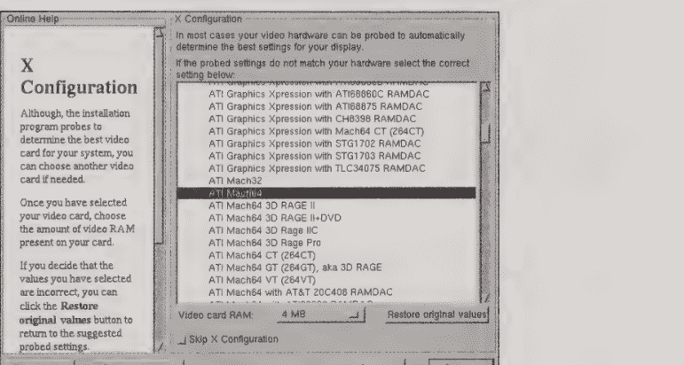

## 图 3-17：X 配置屏幕

尽管这个过程对于 GUI 的成功至关重要，但不要为了给你的机器获取完美的显示器和分辨率而过度纠结。如果你没有选择正确的硬件，安装仍然会成功，你稍后可以通过编辑 `XF86Config` 文件来纠正这一点（我们将在本章后面的部分详细讨论）。

点击“下一步”确认你的选择以进入安装界面，或点击“否的”（No）返回并重新配置 X。如果你在显示器上看到波浪线或白屏效果，请点击“否的”。重复此过程，直到你的显示器上有合理的视频显示效果。

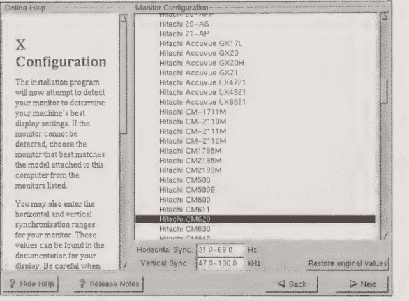

图 3-18：选择显示器


现在你已经告诉安装程序关于你的系统的所有已知信息以及你想要的功能，实际安装过程准备好开始了。点击“下一步”开始安装。

图 3-19 向你展示了你选择的许多软件包的实时列表以及实际安装了多少。你可以在 `/tmp/install.log` 中找到安装过程的日志，包括所有错误和消息。取决于你机器的速度，安装过程可能需要几个小时。

# 第 3 章 安装 Linux

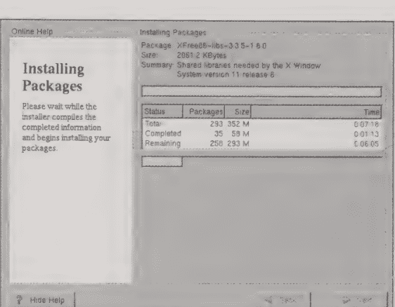

图 3-19：正在安装软件包屏幕

软件包安装完成后，点击“下一步”以创建之前请求的软盘启动盘安装对话框。图 3-20 显示了创建软盘启动盘的安装对话框。

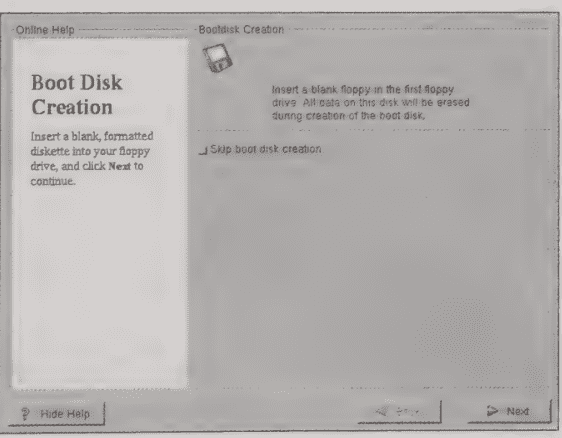

图 3-20：启动磁盘屏幕

点击“下一步”完成安装并进入图 3-21 所示的恭喜屏幕。

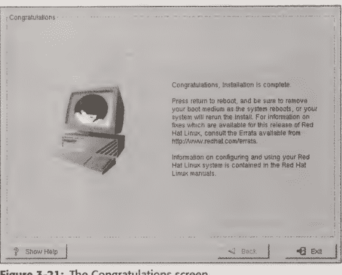

图 3-21：恭喜屏幕

## 总结

Red Hat 7.1 版本确实在简化 Linux 安装过程方面做得很好。虽然会有一些棘手的地方，但如果你保持 Linux 默认设置并在稍后添加软件包，将会顺利。如果你在前期花一点时间研究你的硬件，并遵循本书以及发行版文档中的详细分步说明，你的安装应该顺利进行。

如果你在安装过程中有任何问题或出现某些问题，可以参考随书附带的 CD 光盘或 HOWTO。你也可以访问发行者的网站查看其文档。请务必尽可能地使用最新最强大的工具更新你的系统，以保持与不断开发的 Linux 应用程序兼容。

# Linux 内部

本章将带你一窥 Linux 内核和 Linux 操作系统的内部。内核就像汽车的引擎。没有引擎你就无法启动汽车。另一方面，如果你有了引擎，你就可以去任何地方，但你需要轮子、转向装置等。同样的概念也适用于内核和操作系统。没有内核你就无法运行操作系统。另一方面，仅有内核，你无法在计算机和网络上去任何地方或做任何事情。

Linux 用户就像汽车驾驶员。为了开车，你不需要知道汽车运作的原理，也不需要知道 Linux 在幕后做了什么就能成为一个 Linux 用户。然而，当你看到看似奇异的命令或看起来笨拙的机制时，具备一些背景知识是有帮助的。了解一些基础知识可能帮助你理解为什么那个命令看起来很奇怪以及如何有效地使用它。就像汽车修理师需要知道引擎盖下有什么一样，Linux 系统和网络管理员可以通过熟悉这些内容来在工作中占据先机。


本章将带你一窥 Linux 内核和 Linux 操作系统的内部。内核就像汽车的引擎。没有引擎你就无法启动汽车。另一方面，如果你有了引擎，你就可以去任何地方，但你需要轮子、转向装置等。同样的概念也适用于内核和操作系统。没有内核你就无法运行操作系统。另一方面，仅有内核，你无法在计算机和网络上去任何地方或做任何事情。

# Linux 内部

本章将带你一窥 Linux 内核和 Linux 操作系统的内部。内核就像汽车的引擎。没有引擎你就无法启动汽车。另一方面，如果你有了引擎，你就可以去任何地方，但你需要轮子、转向装置等。同样的概念也适用于内核和操作系统。没有内核你就无法运行操作系统。另一方面，仅有内核，你无法在计算机和网络上去任何地方或做任何事情。

Linux 用户就像汽车驾驶员。为了开车，你不需要知道汽车运作的原理，也不需要知道 Linux 在幕后做了什么就能成为一个 Linux 用户。然而，当你看到看似奇异的命令或看起来笨拙的机制时，具备一些背景知识是有帮助的。了解一些基础知识可能帮助你理解为什么那个命令看起来很奇怪以及如何有效地使用它。就像汽车修理师需要知道引擎盖下有什么一样，Linux 系统和网络管理员可以通过熟悉这些内容来在工作中占据先机。

### 理解设备驱动程序

操作系统的目的之一是隐藏与硬件交互的复杂性。如果你想发送电子邮件，你不想担心你的硬盘是 SCSI 磁盘还是 IDE 硬盘。设备驱动程序是加载到内核中的软件，负责硬件与操作系统之间的接口。

设备驱动程序是控制连接到计算机的设备的程序。对于音频设备、打印机、显示器、CD 播放器、触摸屏、软盘驱动器、硬盘、时钟、Zip 驱动器等都有设备驱动程序。在 Linux 中，设备驱动程序还控制非硬件设备，称为伪设备，例如网络终端的连接。当你安装 Linux 时，大多数甚至所有你需要的设备驱动程序都构建在内核中。实际上，内核中构建了比你需要的更多的设备驱动程序，以满足不同硬件的用户。如果你购买了内核尚未包含驱动程序的新类型设备，你需要自己安装新的设备驱动程序。

第 28 章解释了如何编辑和重新构建内核以添加新的设备驱动程序和其他选项。

### 理解 Linux 进程概念

每当你登录时，Linux 都会为你启动一个进程。进程在操作系统内部执行任务。将进程视为一个运行中的程序。虽然一个程序对你来说，它可能像是一个由编程语言行（如 C 或 COBOL）组成的文件，但计算机将程序视为一组传递给机器的数据和指令。程序以可执行文件的形式存储在磁盘上。

在 Linux 和 UNIX 上，`exe` 一词（发读作 "exe"，第一个音节重读）是可执行文件的常用别名。

Linux 内核会跟踪你的 `process context`，其中包含了关于你是谁、你在做什么以及你所在何处（在 Linux 中）的信息。一个进程使用系统资源，例如 CPU 和内存。你的进程使用 CPU 运行其指令，使用内存存储这些指令及其数据。你的进程还会在文件系统中打开文件。Linux 会跟踪每个人的进程和系统资源，以便公平地为所有人管理。如果一个进程垄用了内存或算力，对计算机上的其他用户来说是不公平的。内核通过为你的每个进程构建数据结构来跟踪你，将其与物理内存中存在的其他数据结构链接，且仅供内核使用。

当你使用命令并运行程序时，Linux 会为你创建进程。如果你使用图形用户界面（`GUI`），Linux 会创建进程来控制你的图形环境。图 4-2 显示了 `top` 命令显示的进程列表。（使用 `top` 指代 CPU 使用者。）不要担心你在图 4-2 中看到的额外系统信息，第 32 章将解释每一项内容。

| `PID` | `USER` | `PR` | `NI` | `VIRT` | `RES` | `SHR` | `S` | `%CPU` | `%MEM` | `TIME+` | `COMMAND` |
|---|---|---|---|---|---|---|---|---|---|---|---|

## Linux 入门

## 第 3 章 安装 Linux


图 3-19：正在安装软件包屏幕

一旦软件包安装完成，点击“下一步”以创建之前请求的软盘启动盘安装对话框。图 3-20 显示了创建软盘启动盘的安装对话框。


图 3-20：启动磁盘屏幕

点击“下一步”完成安装并进入图 3-21 所示的恭喜屏幕。


图 3-21：恭喜屏幕

## 总结

Red Hat 7.1 版本确实在简化 Linux 安装过程方面做得很好。虽然会有一些棘手的地方，但如果你保持 Linux 默认设置并在稍后添加软件包，将会顺利。如果你在前期花一点时间研究你的硬件，并遵循本书以及发行版文档中的详细分步说明，你的安装应该顺利进行。

如果你在安装过程中有任何问题或出现某些问题，可以参考随书附带的 CD 光盘或 HOWTO。你也可以访问发行者的网站查看其文档。请务必尽可能地使用最新最强大的工具更新你的系统，以保持与不断开发的 Linux 应用程序兼容。


| 2 | root | 20 | -0 | 11528 | 1152 | 1158 | S | 0.0 | 0.0 | 0:00:02 | kthread |
| 3 | root | 20 | -0 | 7024 | 1958 | 1928 | S | 0.0 | 0.0 | 0:00:01 | kthre |
| 4 | root | 20 | -0 | 26316 | 1950 | 1950 | S | 0.0 | 0.0 | 0:00:01 | kworker |
| 5 | root | 20 | -0 | 19528 | 1936 | 7438 | S | 0.0 | 0.0 | 0:00:00 | kworker |
| 6 | root | 20 | -0 | 47008 | 3085 | 3085 | S | 0.0 | 0.0 | 0:00:00 | kworker |
| 7 | root | 20 | -0 | 54172 | 5416 | 5416 | S | 0.0 | 0.0 | 0:00:00 | kworker |
| 8 | root | 20 | -0 | 0 | 0 | 0 | S | 0.0 | 0.0 | 0:00:00 | idle |
| 9 | root | 20 | -0 | 17612 | 0 | 0 | S | 0.0 | 0.0 | 0:00:00 | allocate |
| 10 | root | 20 | -0 | 4814 | 4 | 4 | S | 0.0 | 0.0 | 0:00:00 | 20 K |
| 11 | root | 20 | -0 | 5996 | 4 | 4 | S | 0.0 | 0.0 | 0:00:00 | kbd |
| 12 | root | 20 | -0 | 392 | 0 | 0 | S | 0.0 | 0.0 | 0:00:00 | kconsole |
| 13 | root | 20 | -0 | 811 | 0 | 0 | S | 0.0 | 0.0 | 0:00:00 | kventd |
| 14 | root | 20 | -0 | 1115 | 5 | 5 | S | 0.0 | 0.0 | 0:00:00 | kworkerd |
| 15 | root | 20 | -0 | 0 | 0 | 0 | S | 0.0 | 0.0 | 0:00:00 | kflushd |
| 16 | root | 20 | -0 | 0 | 0 | 0 | S | 0.0 | 0.0 | 0:00:00 | kpiod |
| 17 | root | 20 | -0 | 0 | 0 | 0 | S | 0.0 | 0.0 | 0:00:00 | migrate |
| 18 | root | 20 | -0 | 0 | 0 | 0 | S | 0.0 | 0.0 | 0:00:00 | kworker |
| 19 | root | 20 | -0 | 129 | 0 | 0 | S | 0.0 | 0.0 | 0:00:00 | a3ed |
| 20 | root | 20 | -0 | 218 | 0 | 0 | S | 0.0 | 0.0 | 0:00:00 | klogd |
| 21 | root | 20 | -0 | 270 | 0 | 0 | S | 0.0 | 0.0 | 0:00:00 | ksoftqd |
| 22 | root | 20 | -0 | 452 | 164 | 132 | S | 0.0 | 0.0 | 0:00:00 | klogd |

图 4-2：`top` 命令列出进程和系统使用情况

### 任务与进程——父进程与子进程

任务包含一个父进程以及父进程创建（`fork`）的所有子进程。Linux 进程具有以下标识符：
- 一个 `pid`（进程 ID）
- 一个 `pid`（父进程）

所有进程最终都源自一个名为 `init` 的系统进程。在每台计算机上，`init` 的 `pid` 始终为 1。

### 理解进程状态

作为一个进程，它会经历各种状态。Linux 进程可能处于以下状态之一：
- **可运行（Runnable）**：进程正在运行（它是当前进程）或已准备好运行（即它正在等待调度到 CPU 上运行）。记住多任务概念。尽管在任何时刻只有一个进程在任何 CPU 上当前并运行，但每个用户感知到所有进程都在同时运行。
- **等待（Waiting）**：进程正在等待某些事情发生——例如，等待某种资源（CPU 以外）变得可用（如果进程在等待 CPU，则它处于可运行状态）。常见的等待资源是硬盘。因此，在具有快速处理器且只有一两个磁盘的系统上，你很可能是已经用完了 CPU 轮次现在正在等待轮到读取或写入磁盘的用户。等待磁盘比等待 CPU 要慢。
- **停止（Stopped）**：进程接收到了停止信号。例如，正在调试的进程可能会被停止。
- **僵尸（Zombie）**：进程已挂起（halted），挂起与停止不同。停止是可以重启的。挂起是不好的。它通常意味着部分内容仍然存在，占用着空间和系统资源，但无所作为——死掉但未埋。

第 32 章展示了如何监控进程统计数据，包括进程状态。

### 理解虚拟内存与物理内存的关系

除了与其他进程共享内存外，每个 Linux 进程都有独立的地址空间，用于存储进程所需的任何内容。内存是虚拟的，因为你的页码并不是物理内存的位置。例如，虚拟页码 4 可能是物理内存的第 10000 页。Linux 使用特殊的页表将虚拟页码映射到物理内存。图 4-3 显示了两个独立的地址空间通过这些特殊页表映射到物理内存。注意，除了共享地址空间外，该图还显示两个进程共享一个物理内存页（页 4）。


每个进程维护独立地址空间的好处是任何进程都不会影响另一个。

### 理解虚拟内存管理

Linux 使用按分页虚拟内存模型。内存是虚拟的，对用户来说就像是无限供应，无论物理内存（RAM）在计算机内部如何。Linux 使用硬盘上的交换空间作为计算机物理内存的扩展。你的计算机假装交换空间就是内存，从而营造出比实际内存多的幻象。

内存是按分页的，因为只有程序或文件中实际使用的段（即按需使用）才会从磁盘读取到内存页。如果你需要更多程序或数据，更多的程序或数据段将从硬盘读入内存。为了为这些新页腾出内存，Linux 内核可能需要将你不再需要的内存段换出（即）到磁盘。此外，如果多个程序实例同时运行，这些实例共享物理内存页。这种页共享减少了整体物理内存占用。

共享内存也是一种进程间通信（IPC）机制。IPC 使用共享内存作为两个进程交换数据的方式。

## 理解缓冲区缓存 (buffer cache)

Linux 维护着多种缓存（内存区域）。在每情况下，缓存的目的是将数据保留在内存中以便快速访问。请记住，与内存访问相比，硬盘的访问仍然非常缓慢。因此，通过维护缓存，Linux 试图让你的操作运行得更快。一个非常重要的缓存是缓冲区缓存（buffer cache）。

缓冲区缓存包含了某些块设备驱动程序（通常是硬盘驱动程序）使用的数据缓冲区。
- 设备是指 Linux 以固定大小的数据块（通常为 512 字节）进行访问的存储存储设备。即使你只需要读取 20 字节，你的磁盘访问也是一个块。如果你需要读取超过 512 字节的数据（例如 1500 字节），那么你的磁盘访问将由多个块组成。进行三次磁盘读取（每个块一次）比进行 1500 次磁盘读取（每个字节一次）要高效得多。

这些缓冲区包含了已从设备读取或正在向设备写入的数据块。当你请求磁盘读取时，Linux 会首先检查缓冲区缓存。如果你的数据已经在缓冲区缓存中，Linux 就不需要从物理块设备（即硬盘）中读取。请记住，访问缓冲区缓存（内存）的速度远快于访问磁盘。

## 理解文件系统 (filesystems)

文件系统由 Linux 目录树中的一组目录和文件组成。文件系统的优势之一是，你可以使用文件和目录，而无需了解任何磁盘几何结构，例如磁盘上有多少个磁道或磁圈，或者哪些位和字节存储了你的文件。你甚至可以通过文件系统，通过位于 `/dev` 目录下的特殊文件来访问硬件。

请记住这一点（这在系统管理部分经常出现）：在 Linux 中，设备对用户来说就像文件。

### 同步 (In Sync)

将程序和数据存储在内存中提供的访问比比磁盘文件中读取所有内容快得多。然而，内存是临时存储。当你的系统关机、崩溃或发生断电时，内存中的数据将会丢失。这就是内存被称为易失性存储的原因。因此，Linux 需要一种机制来确保系统关闭不会丢失数据。Linux 会自动并定期将内存中的数据写入磁盘。这种将易失性数据写入永久存储的过程被称为同步（`syncing`）。

另一个优势是使用 Linux 文件系统的灵活性。Linux 支持十多种具有不同格式的文件系统，用于本地和远程网络文件系统，包括列表中的格式。（`ext2` 文件系统是专门为 Linux 开发的。）
- `ext2`
- Microsoft MS-DOS `FAT16`
- Microsoft Windows 95 `VFAT`
- `NFS` (网络文件系统)


- UNIX System V
- Xenix
- UFS (UNIX 文件系统)
- ISO 9660 CD-ROM 文件系统
- OS/2 HPFS

Minix（一个驱动 Linus Torvalds 创建 Linux 内核的精简 UNIX）

你不需要识别文件存储在什么种的文件系统中。对于用户来说，文件就是文件。直接使用它们即可。例如，你以及你需要运行的程序并不知道你的主目录在连接到系统的第一个 IDE 上是 `ext2` 格式的。

你可以同时在计算机上使用非常不同的文件系统格式。无论你在单台计算机上使用多少文件系统，Linux 都会将你所有的文件系统合并为一个树形结构。当你创建额外的文件系统时，Linux 会将每个新文件系统添加到这个文件系统树中。

正如你将在第10 章中看到的，文件系统存在于 Linux 磁盘分区中，而分区存在于设备上。

## 理解网络功能 (Networking Features)

任何形式的通信都需要一套双方都理解的规则。在网络术语中，这些规则被称为协议。Linux 支持许多网络协议（即通信规则），包括：

- TCP/IP
- UUCP
- IPX（来自 Novell）
- AppleTalk（来自 Apple Computer）

## 通过 TCP/IP 连接

`TCP/IP`（传输控制协议/网际协议）是一组网络协议，允许计算机通过局域网或广域网进行通信。`TCP` 和 `IP` 只是 `TCP/IP` set中的两个协议。互联网运行在 `TCP/IP` 之上，这也是本书第四部分描述的协议。

大多数 `TCP/IP` 网络使用以太网或令牌环作为物理网络布线方案。Linux 支持以太网网卡（NIC）和令牌环适配器，包括用于便携电脑的，如口袋和 PC Card 以太网接口。

如果你的计算机没有网卡，不要担心。如果你有电话线和调制解调器，Linux 可以使用 `TCP/IP` 集合中的两个协议连接到互联网（或任何拨号网络）：

- SLIP（串口链路互联网协议）
- PPP（点对点协议）

## 通过其他网络协议连接

除了 `TCP/IP` 之外，Linux 用户还可以通过 `Samba` 与微软操作系统（Windows for Workgroups, Windows 95/98/ME/NT/2000）通信，`Samba` 是基于 `SMB`（服务器消息块协议）的程序。`Samba` 让你共享文件、打印机和串口。你还可以在互联网上通过 `TCP/IP` 运行 `Samba`。

> `SMB` 协议起源于微软。

请参阅第34 章获取更多关于 `SMB` 的信息，包括如何配置 `Samba`。

Linux 还支持 Apple 的 `AppleTalk` 协议用于 Macintosh 连接。

`UUCP`（UNIX 到 UNIX 拷贝）是一种较老的协议，用于通过电话线上的调制解调器在 UNIX（以及 Linux）机器之间传输文件、电子邮件和电子新闻。在 `TCP/IP` 尚未成为标准的几年前，`UUCP` 非常流行。

## 深入研究守护进程 (Daemons)

守护进程是在后台运行运行并为你提供服务的程序。这些守护进程通常在系统启动时自动运行。这些守护进程提供许多功能，包括：

- 网络和远程访问
- 互联网服务，如 `telnet` 和 `FTP`
- 电子邮件
- 新闻组
- 自动和无人运行的命令和程序
- Web 服务器
- 打印
- 远程文件系统
- 日志记录和事件

你可以在书中处理守护进程功能的章节了解特定的守护进程。例如，你可以了解打印机守护进程 (`lpd`)，在第13章“管理打印机和打印”。

守护进程的一个共同点是名称以字母“d”。查看图4-2中的右侧列。该列显示了正在运行的进程名称。这些进程就是守护进程。作为用户，你不需要为它们担心。作为系统管理员，你需要确保它们持续运行。

> 守护进程通常在计算机启动时自动启动，根据系统配置，系统管理员你可能需要手动启动某些守护进程。

# 第一部分 Linux 入门

- 你定义变量的方式。
- 你回溯输入过的命令的方式，以及编辑这些命令的方式。
- Shell 能够“读懂你的心意”文件名。某些 Shell 允许你输入部分文件名，方便地为你补全名称。
- Shell 能够“读懂你的心意”命令。某些 Shell 允许你输入部分命令，方便地为你完成命令。

> 将 Shell 想象成你的 Linux 家，就像 Shell 是寄居蟹的家一样。如果你需要更多空间或其他功能，可以移动到一个新的 Shell 中。如果你想家了，甚至可以移动回到旧的 Shell。

## 什么是 Shell 脚本？

Shell 脚本是你组合在一个文件中的的一系列 Shell 命令和语句。你可以交互式地运行脚本，也可以安排脚本在稍后的某个时间自动且无人看管地运行。

Shell 脚本类似于 MS-DOS 批处理文件，但功能要强大得多。

不同 Shell 的命令和语句之间的差异通常在在你开始编写复杂的 Shell 脚本时才会变得明显。

## 有哪些 Shell？

主要的 UNIX Shell（它们与 Linux Shell 类似）有：

- Bourne shell（也简单称为 shell，因为它是第一个 shell），以其创建者 Philip Bourne 命名。
- restricted Bourne shell (`rsh`)，它提供一组有限的 Bourne shell 特性，适用于有安全考虑的站点。
- C shell，由 William Joy 开发，命名是因为它的命令语言类似于 C 编程语言。
- Korn shell（结合了 Bourne 和 C 的功能并添加了一些自己的功能），以其创建者 David Korn 命名。
- 由自由软件基金会（Free Software Foundations）的 William Fox 编写的 Bourne Again Shell (`bash`)。

Linux 提供了许多不同的 Shell。GNU 的 Bourne Again shell (`bash`) 是你在本书示例中看到的 Shell。大多数 Linux 发行版都内置了 Bourne Again shell。它是一个经过强力增强的 Bourne shell 变体，提供了读心术（自动补全命令和文件名）、命令历史和回溯、命令编辑以及作业控制。

第 17、118 章和第 30 章将详细介绍 `bash` 和 Shell 脚本编写。

`tcsh` 是以 C Shell (`csh`) 为模型并进行了增强，它是许多其他 Shell 的示例，其中大多数都是免费的并可以从互联网下载。Z shell (`zsh`) 是最新的 Shell 之一。

## 为 IPC（进程间通信）研究 RPC（远程过程调用）

`IPC`（进程间通信）是客户端/服务器通信的核心。`RPC`（远程过程调用）是进程和程序用于相互通信的通信协议。一个程序——客户端——向运行在网络某处的另一个程序（服务器）请求服务。服务器程序可能与客户端程序运行在同一台计算机上。使用 `RPC` 的优点是，程序员可以在不理解任何技术网络细节的情况下，实现客户端/服务器计算。Linux 程序员使用 `RPC` 来实现 `IPC`。作为系统管理员，你可能需要安装 `RPC` 软件。

## 总结

Linux 内核的一个主要优势是允许你只加载所需的软件组件，从而节省系统资源（如内存）。它提供了分页虚拟内存和真正的多任务处理，这增强了 Linux 作为多用户操作系统的强大性。

Linux 进程、守护进程（daemons）和 Shell 提供了广泛的功能。

Linux 支持广泛的文件系统和网络协议，使得运行 Linux 的计算机可以与其他不同的操作系统轻松共存并运行。

# Linux 系统管理入门

本部分

- 第 5 章：Linux 系统管理职责
- 第 6 章：管理启动和关机
- 第 7 章：安装软件包
- 第 8 章：管理设备
- 第 9 章：管理磁盘设备
- 第 10 章：管理文件系统和交换空间
- 第 11 章：备份和恢复文件系统
- 第 12 章：配置和管理用户账户
- 第 13 章：管理打印机和打印

## Linux 系统管理职责

本章为初级系统管理员准备。如果你是一位经验 Linux 系统管理员，知道需要做什么，可能忙得没有读这一章。开始工作吧！

系统管理是你为了保持计算机正常运行并满足用户需求所做的的一切工作。保持计算机正常运行通常意味着日常维护，例如备份文件和目录并在必要时恢复它们、检查文件系统是否损坏并在需要时进行修复、确保所有启动和关机程序按计划运行、设置系统时钟以及监控磁盘空间。满足用户需求根据计算机和用户的不同而意义不同。它可能仅仅是为用户创建账户、安装新软件并保护你的计算机的安全，也可能涉及的不单是一台计算机，而是网络上的多台计算机，以及管理网络本身——包括文件服务器、打印服务器、Web 服务器——防火墙和网络安全。

第二部分的章节从基础开始（例如确保你理解你系统上的硬件），然后进入高级技术（例如为获得最佳性能调优计算机、配置内网以及负责你的计算机连接互联网）。你今天可能不需要执行第二部分中描述的所有任务。然而，作为当今工作环境中的系统管理员，你的角色正在不断增长。好消息是，随着你角色的增长，第二部分可以为你提供帮助。

## 噢，这责任重重！


系统管理职责繁多且频繁。即使你的系统运行良好并让所有用户满意，你也会发现有很多事情要做，如更新应用程序和操作系统软件、监控性能以及为未来的用户做计划。某些站点要求完成本章中的所有工作，许多公司会将系统管理任务分配给系统管理员团队。如果你没有队友且需要完成本章中的所有工作，不要绝望。你不孤单，你有这本书。第二部分的后续章节描述了每项活动的操作方法。

## 权限在 Root

是的，你认识自己的名字，但如果你是 Linux 系统管理员，你在计算社区中被称为超级用户，简称 `root`。超级用户拥有系统的所有权限，并承担着巨大的责任。当你安装 Linux 时，安装程序会为超级用户创建一个账户，用户名为 `root`，用户 ID 为 `0`。安装程序还会要求为 `root` 设置密码。本章的后续章节描述了你作为超级用户 `root` 的职责。非权限用户即拥有普通账户的用户无法执行系统管理任务。

## 系统管理入门

如果你是设置新 Linux 环境的 Linux 系统管理员，你需要执行一些基础任务来为用户准备好系统。首先，你需要熟悉你的硬件。你不需要知道修理硬件，但你需要知道你拥有什么以及如何为它们配置软件。

一旦你清点了硬件，就应该配置设备，如终端、磁盘、打印机以及特殊选项，如 PC 卡、CD 播放器、游戏控制器以及你和用户认为重要的任何其他设备。下一步是为用户配置帮助系统和软件应用程序、备份你的原始系统并创建账户以便用户登录。在完成这些基础工作后，你可以继续配置网络并执行高级系统管理工作。

## 配置帮助系统和 man 页面

即使你是计算机上唯一的用户，首先要做的事情就是让帮助系统运行起来。无论你是喜欢图形化帮助还是更传统的 `man` pages，你需要确保所有必要的文件都可用。对于手动帮助页 `man pages`，你需要决定计划如何存储它们——例如，使用压缩格式还是不使用。如果你决定使用另一台计算机的帮助系统，这可能是一个网络决策。

## 计算机的启动和关机

即使你的计算机本应该 24/7 运行，在紧急情况下或发生奇怪的系统挂起或崩溃时，你可能需要关机并重启。你可能还需要自定义启动和系统初始化程序。

第 6 章将帮助你理解系统启动时后台发生了什么，并解释关机和启动选项运行级别。第 6 章还警告你不遵循适当关机和启动程序的危险性。

## 与硬件设备工作

Linux 上的硬件并不是即插即用的。系统管理员需要配置新的硬件管理器，并确保用户可以使用它。配置硬件可能简单如添加一个硬线终端，也可能复杂如添加一个新的磁盘驱动器，为此你需要更改分区大小并创建文件系统。在处理硬件时，你可能还需要编辑并重建内核以使新设备被识别。

第 9 章和第 10 章告诉你如何配置设备。第 10 章讨论了配置文件系统的步骤。在第五部分“高级系统管理与网络”中，第 28 章解释了如何编辑和重建内核。

## 安装及卸载软件

你在第 3 章读到过如何安装操作系统软件。系统管理员需要安装新软件并将现有软件——包括操作系统和应用程序软件——升级到新版本。在你安装或升级软件后，不要忘记测试它以查看是否运行正常。然后你就可以通知用户有东西可以玩或使用，并告诉他们哪里找到新的或升级的程序。大多数 Linux 软件以“软件包”的形式提供，包含可执行文件、配置文件、手动帮助页、版权信息、文档，有时还包含源代码。

通常你使用包管理器程序安装和卸载软件，例如 `RPM` 红帽软件包管理器、`Slackware` 软件包管理器或 `dpkg` Debian 软件包管理器。无论你使用哪种发行版，所有的包管理器都相同：解包软件包中的软件组件，确保任何先决软件都已安装，并安装软件组件。

## 第二部分 开始学习 Linux 系统管理

`Kpackage` 是 `RPM`、`Debian` 和 `Slack` 软件包管理器的 GUI 界面。`Kpackage` 是 K 桌面环境的一部分。

有时，根据软件的不同，你可能会使用 `tar` 带归档程序。

第 8 章解释了如何使用 `RPM` 和 `tar` 安装程序。

## 备份和恢复目录及文件

备份和恢复工作通常属于日常维护。你创建一个备份策略和计划，使程序自动化，并安排它们运行。遗憾的是，备份和恢复也可能成为灾难恢复的一部分。灾难恢复可以是任何形式，从拯救意外删除重要文件的用户，到拯救一台丢失或损坏操作系统的计算机。你需要知道恢复单个文件、文件系统甚至操作系统的最佳且最快的方法。

第 12 章带你为各种备份和恢复任务做好准备，从每日计划备份到关键操作系统的恢复。

## 配置和管理用户账户

在你安装了操作系统和应用程序、配置了硬件、自定义了启动和关机程序并备份了系统后，你就可以让用户开始创建了。实际上，你几乎准备好了。你需要通过为所有用户创建带有用户名和密码的账户来做好准备。你还需要为他们创建家目录。你可能还想将用户分配到组。随着时间的推移，你可能还需要修改或更新某些用户的账户，也许禁用或删除它们。

第 12 章解释了如何创建和管理用户账户。

## 管理打印机和打印

你需要在系统上安装并配置打印机吗？或者你将使用连接到网络上另一台计算机的打印机？或者你会使用直接连接到网络的打印机？你还需要能够管理打印队列和溢流目录。如果你遇到打印问题

第 13 章告诉你如何为用户提供打印功能，以及如何配置队列和排除打印问题。

## 在网络中配置和管理 Linux 系统

Linux 和网络的关系就像霍尔姆斯和华特森，也许是华特森和霍尔姆斯。无论如何，很难将网络与 Linux 分离开来。Linux 是全球超过一半 Web 服务器的首选平台。Linux 管理员担任其组织的“网络管理员”。大多数 Linux 系统管理员都会执行本节中的至少某些网络管理任务。

## 配置网络硬件

你的网络是通过以太网或令牌环线方案连接的？或者你需要维护一个包含这两种接线的内网？ 你需要能够识别计算机的网络设备——例如网卡——并对其进行配置。然后，你需要能够配置你的网络环境使用的 TCP/IP 协议。

第 20 章展示了如何配置 `NIC` 网卡和路由器。

## 设置你的计算机连接到 TCP/IP 网络

TCP/IP 协议族除了与其命名的两个之外的连接。你的首要 TCP/IP 任务之一是分配 IP 地址并可能划分网络子网。你可能还想连接到。如果你想通过调制解调器提供拨号网络，你需要配置 `PPP` 点点协议，你可能还需要将你的计算机或网络连接到外部世界，如 AppleTalk 或 SNA 系统网络架构。

## 配置其他 TCP/IP 服务

在你连接到网络后，可能还有一些工作要做。你的剩余任务可能包括：

- 域名服务 `DNS`，以便计算机可以找到其他计算机。
- 网络文件服务 `NFS`，如果你想在局域网 `LAN` 内共享文件。
- 网络信息服务 `NIS`。
- 电子邮件协议、守护进程和服务，例如 `POP3`、`IMAP` 和 `sendmail`。
- `FTP` 文件传输协议服务，以便用户无论是局域网 `LAN` 广域网 `WAN` 可以复制和写入文件。
- 世界维网服务，以便你可以将 Linux 配置为 Web 服务器。

第四部分的章节提供了在本小节提到的设置 TCP/IP 网络的解释和示例。

## 进你的技能

当你为用户准备好系统以及网络后，是时候研究一些系统管理工具和技术了。本节列出的技术帮助你安全且更高效地管理计算机。

## 自动化任务

你可以使用 `at` 和 `cron` 工具调度重复性任务，如备份，以便在你进行其他工作或休息时自动运行。你需要通过设置一个文件来配置 `cron`，以指定做什么以及何时做。如果你允许用户访问 `cron`，他们可以在计算机不忙碌时自动调度自己的任务。

## 重建内核

随着时间的推移，你可能需要将设备驱动程序添加到内核或更改某些内核变量以调整计算机。你应该理解系统配置文件的作用以及从哪里找到它。最后，你需要知道何时对内核进行动态更改以及何时编辑系统配置文件重建并重启内核。

## 保护 Linux 系统

许多 Linux 计算环境是友好且开放的，密码和文件访问权限是唯一的安全机制。这种类型


第 9 章和第 10 章告诉你如何配置设备。第 10 章讨论了配置文件系统的步骤。在第五部分“高级系统管理与网络”中，第 28 章解释了如何编辑和重建内核。

## 安装（及卸载）软件

你在第 3 章读到过如何安装操作系统软件。系统管理员需要安装新软件并将现有软件——包括操作系统和应用程序软件——升级到新版本。在你安装或升级软件后，不要忘记测试它以查看是否运行正常。然后你就可以通知用户有东西可以玩（或使用）了，并告诉他们哪里找到新的或升级的程序。大多数 Linux 软件以“软件包”的形式提供，包含可执行文件、配置文件、手动帮助页、版权信息、文档，有时还包含源代码。

通常你使用包管理器程序安装和卸载软件，例如 `RPM`（红帽软件包管理器）、Slackware 软件包管理器或 `dpkg`（Debian 软件包管理器）。无论你使用哪种发行版，所有的包管理器都相同相同：解包软件包中的软件组件，确保任何先决软件都已安装，并安装软件组件。

## 第二部分 ♦ 开始学习 Linux 系统管理

`Kpackage` 是 `RPM`、Debian 和 Slack 软件包管理器的 GUI 界面。`Kpackage` 是 K 桌面环境的一部分。

有时，根据软件的不同，你可能会使用 `tar`（带归归程序）。

第 8 章解释了如何使用 `RPM` 和 `tar` 安装程序。

## 备份和恢复目录及文件

备份和恢复工作通常属于日常维护。你创建一个备份策略和计划，使程序自动化，并安排它们运行。遗憾的是，备份和恢复也可能成为灾难恢复的一部分。灾难恢复可以是任何形式，从拯救意外删除重要文件的用户，到拯救一台丢失或损坏操作系统的计算机。你需要知道恢复单个文件、文件系统甚至操作系统的最佳且最快的方法。

第 12 章带你为各种备份和恢复任务做好准备，从每日计划备份到关键操作系统的恢复。

## 配置和管理用户账户

在你安装了操作系统和应用程序、配置了硬件、自定义了启动和关机程序并备份了系统后，你就可以让用户开始创建了。实际上，你几乎准备好了。你需要通过为所有用户创建带有用户名和密码的账户来做好准备。你还需要为他们创建家目录。你可能还想将用户分配到组。随着时间的推移，你可能还需要修改或更新某些用户的账户，也许禁用或删除它们。

第 12 章解释了如何创建和管理用户账户。

## 管理打印机和打印

你需要在系统上安装并配置打印机吗？或者你将使用连接到网络上另一台计算机的打印机？或者你会使用直接连接到网络的打印机？你还需要能够管理打印队列和溢流目录。如果你遇到打印问题

第 13 章告诉你如何为用户提供打印功能，以及如何配置队列和排排除打印问题。

## 在网络中配置和管理 Linux 系统

Linux 和网络的关系就像霍尔姆斯和华特森，也许是华特森和霍尔姆斯。无论如何，很难将网络与 Linux 分离开来。Linux 是全球超过一半 Web 服务器的首选平台。Linux 管理员担任其组织的网络管理员。大多数 Linux 系统管理员都会执行本节中的至少某些网络管理任务。

## 配置网络硬件

你的网络是通过以太网或令牌环线方案连接的？或者你需要维护一个包含这两种接线的内网（网络的网络的内部网络）？你需要能够识别计算机的网络设备——例如网卡——并对其进行配置。然后，你需要能够配置你的网络环境使用的 `TCP/IP` 协议。

第 20 章展示了如何配置 `NIC`（网卡）和路由器。

## 设置你的计算机连接到 TCP/IP 网络

`TCP/IP` 协议族（互联网协议）除了与其命名的两个之外的。你的首要 `TCP/IP` 任务之一是分配 IP 地址并可能划分网络（子网）。你可能还想连接到互联网。如果你想通过调制解调器提供拨号网络，你需要配置 `PPP`（点点协议），你可能还需要将你的计算机或网络连接到外部世界，如 AppleTalk 或 `SNA` 系统网络架构。

## 配置其他 TCP/IP 服务

在你连接到网络后，可能还有一些工作要做。你的剩余任务可能包括：

- 域名服务 (`DNS`)，以便计算机可以找到其他计算机。
- 网络文件服务 (`NFS`)，如果你想在局域网 (`LAN`) 内共享文件。
- 网络信息服务 (`NIS`)。
- 电子邮件协议、守护进程和服务，例如 `POP3`、`IMAP` 和 `sendmail`。
- `FTP`（文件传输协议）服务，以便用户（无论是局域网 `LAN` 或广域网 `WAN`）可以复制（和写入）文件。
- 世界维网服务，以便你可以将 Linux 配置为 Web 服务器。

第四部分的章节提供了在本小节提到的设置 `TCP/IP` 网络的解释和示例。

## 进你的技能

当你为用户准备好系统以及网络后，是时候研究一些系统管理工具和技术了。本节列出的技术帮助你安全且更高效地管理计算机。

## 自动化任务

你可以使用 `at` 和 `cron` 工具调度重复性任务，如备份，以便在你进行其他工作或休息时自动运行。你需要通过设置一个文件来配置 `cron`，以指定做什么以及何时做。如果你允许用户访问 `cron`，他们可以在计算机不忙碌时自动调度自己的任务。

## 重建内核

随着时间的推移，你可能需要将设备驱动程序添加到内核或更改某些内核变量以调整计算机。你应该理解系统配置文件的的作用以及从哪里找到它。最后，你需要知道何时对内核进行动态更改以及何时编辑系统配置文件重建并重启内核。

## 保护 Linux 系统

许多 Linux 计算环境是友好且开放的，密码和文件访问权限是唯一的安全机制。这种类型

# 第 5 章 + Linux 系统管理职责 63

科学和学术环境的氛围通常是轻松的。大多数商业站点需要更高级别的安全性，而 Linux 为加密密码、安全拨号接入、安全终端和安全审计提供了多种选项。除了了解如何以及何时使用可选的安全机制外，系统管理员还需要知道如何检查破解尝试和病毒。

第第 29 章回顾了基础的 Linux 安全方法，并介绍了系统管理员可以用来提供增强安全性的可选技术。

# 监控和调优 Linux 系统性能

无论你配置系统得有多细致，总会有某天有人抱怨：“电脑似乎很慢”。性能变慢的原因有很多。也许你添加了许多新用户和应用程序。也许你遇到了硬件问题。你需要能够监控日常系统性能。如果你能有效使用监控工具，你可能就能预判性能问题并防止它们的发生。如果性能变慢，你需要能够找出是什么导致了幻灯片现象以及如何修复它。考虑一下这一点：也许性能并不慢，而是某个脾气坏的用户感知发生了扭曲。在这种情况下，你需要能够提供支持你立场的的事实和数据。

第 32 章解释了如何设置定期的性能监控，如何预判和防止性能问题，以及在必要如何优化和调优 Linux 系统。

## 总结

本章将系统管理分为三类：

- `基础系统配置`
- 网络配置
- 高级系统管理与调优

根据你目前的系统管理技能以及你的计算机（网络）的需求，你可能需要理解所有系统和网络管理章节中的所有概念和工具，或者只需要理解你尚未体验过的高级功能。

接下来的章节将带你进入基础系统管理的技术细节。

# 管理启动和关机

`booting`（引导）和 `starting up`（启动）在计算机术语中是同义词。这两个术语都指的是启动计算机并加载操作系统。这个过程被称为 `booting`，是因为计算机通过提着自己的鞋带把自己提起来（bootstraps）。

## 理解引导过程

当计算机启动时，它做的第一件事是加载一个名为 `引导加载器`（bootstrap loader）的微型程序——例如 `LILO`。不同类型的计算机寻找引导加载器的方式不同。在 PC 上，假设没有加载软盘，`BIOS` 会从引导区（第一块硬盘的开头）读取主引导记录（`MBR`）以找到引导加载器程序。引导加载器知道去哪里寻找 Linux，于是它就去加载压缩的 Linux 内核。内核随后会展开并解压自己。内核按照以下步骤操作，并在过程中显示大量的启动信息：

- 1. 加载设备驱动程序。
- 2. 挂载根文件系统 (`/`)
- 3. 运行 `init` 进程（命名为 `/sbin/init`）。

# 第二部分 ♦ 入门 Linux 系统管理

此时，`init` 进程接管并执行以下操作：

- 4. 根据你启动引导时选择的运行级别（`run level`）决定运行哪些系统初始化文件。
- 5. 为你的运行级别启动守护进程（`daemons`）。
- 6. 假设你启动到运行级别 3（全分时制和网络），`init`：
  - 创建 `getty`。`getty` 进程在用户登录的终端上发布登录提示。
  - 继续执行系统初始化文件，直到计算机在所选的运行级别运行。
- 7. 执行通用的维护任务，例如清理 `/tmp` 目录。

# 理解运行级别（run levels）

运行级别是一种软件模式，例如多用户模式或单用户模式，Linux 内核（以及所有版本的 UNIX）启动或关机时进入该模式。`init` 进程根据你在启动或关机时指定的运行级别来决定创建哪些系统进程。例如，如果你启动到单用户模式，`init` 不需要产生 `getty` 进程，因为没有用户可以登录。当你启动到全多用户模式（运行级别 3、4 或 5）时，`init` 需要产生 `getty` 进程，以便用户可以登录系统。不同版本的 Linux（以及 UNIX）提供不同数量的运行级别。表 6-1 列出了 Linux 共有的运行级别。

| 运行级别 | 系统状态 |
| :--- | :--- |
| 0 | 停止 (Halted) |
| 1, S, s | 单用户 |


| 2 | 无网络的多用户模式 |

| 3 | 多用户；启动到不带 X 的文本模式登录 |

| 4 | 未使用但等同于运行级别 3 |

| 5 | 多用户；启动到 X Window 登录提示界面 |

| 6 | 重启 (Reboot) |

> 注意：某些 Linux 版本在运行级别 4 下也会启动到 X Window 登录提示。

## 调查 init

`init` 在接管内核引导序列时的第一件事是读取 `/etc/inittab` 文件，以查看默认运行级别应该是多少。该文件包含了针对各种运行级别应该启动的每个进程。图 6-1 显示了 Red Hat Linux 系统的 `/etc/inittab`。每个条目由四个冒号分隔的字段组成：

- `init`，该条目的唯一标识符（1–4 个字符）。
- 运行级别（Run level），执行该条目动作的运行级别——例如，值 1, 2, 3 意味着针对运行级别 1、2 和 3 执行动作。
- 动作（Action），在该 Linux 中执行的操作。虽然动作在不同的 Linux 发行版之间略有不同，但最常见的有：
  - `initdefault`——引导完成后立即进入指定的运行级别。如果没有 `initdefault`，则等待输入。
  - `sysinit`——在引导期间执行该进程。忽略运行级别字段。
  - `boot`——在系统启动时执行该进程。忽略进程字段。
  - `bootwait`——与 `boot` 相同，但会在进程完成后再进入下一步。
  - `ctrltdel`——当按下 Ctrl+Alt+Del 时执行该进程。
  - `wait`——在指定的运行级别执行该进程，启动进程并等待其完成后再进入下一步。
  - `respawn`——在进程终止时重启。这通常适用于进程。
  - `powerfail`——如果电力中断产生来自 UPS 的自动信号（SIGPWR），则执行列出的进程。你必须运行守护进程才能生效。
  - `powerwait`——与 `powerfail` 相同，但是在等待进程完成后再进入下一步。
  - `powerokwait`——读取文件 `/powerstatus`。如果文件包含值 OK，则电力可以恢复
- 进程（Process），要启动的进程（程序）。

上述动作是最常见的。查看光盘上的 man 页以获取 `inittab` 动作的完整列表。

# 第二部分 入门 Linux 系统管理

`Linux Bootdisk HOWTO` 描述了创建自定义根软盘的技术细节。

如果你大幅更改内核或软件，请务必更新你的应急引导软盘和自定义根软盘。

## 从应急引导软盘启动

如果你的系统无法启动，你可以从安装的应急引导软盘进行启动。应急引导磁盘包含一个通用内核，足以让你的系统进入单用户模式。然后你可以使用应急修复磁盘上的程序来修复导致计算机启动的问题。

系统无法启动的最常见原因是根文件系统损坏。不幸的是，有时应急软盘并不包含修复系统所需的所有内容。例如，如果你使用特殊的备份程序备份了根文件系统，特殊的备份程序就不会出现在标准的应急修复软盘中。解决方案是在应急修复软盘之外，额外构建一个自定义的根软盘。将修复依赖于应急磁盘更多软件的启动问题所需的额外程序和文件放入其中。

### 理解关机选项

除了启动，运行级别（run levels）也适用于关闭计算机。例如，如果你的计算机处于停止（halted）状态，它就在运行级别 0。如果你不是 UNIX 用户，可能会惊讶地发现你可以以这种方式启动，而关机并不意味着“关闭计算机是安全的”。Linux 关机选项包括：

- 关机到单用户模式，此时只有系统管理员可以工作。
- 关机到停止状态，这需要循环系统才能重启。
- 关机并自动重启。

关闭 Linux 并不意味着关闭计算机。*断电*（powering off）一词意味着关闭你的计算机。除非你别无选择，否则你永远不要在没有先关机的情况下直接断电计算机——例如，如果你的计算机已经混乱到完全冻结且不让你让你关机。对于如何关闭系统，你有几种选择，但切断电源并不是其中之一。

> 如果你在在不遵循适当关机程序的情况下断电计算机，可能会遇到麻烦。多任务系统通常在后台运行着应该被干净地关闭的任务。至少，你的文件系统将不会被干净地卸载。如果没有卸载——`umount` 是 Linux/UNIX 中“卸载”（dismount）的写法。如果文件未卸载，系统在下次启动时将花费额外时间。最坏的情况下，缓冲区缓存不会写回磁盘。数据可能会丢失，更糟糕的是，文件系统可能会损坏到无法修复。

你可以在第 5 章中查看缓冲区缓存的作用。

完整的 Linux 关机到停止状态的遵循以下步骤：

1. 禁用新登录。
2. 关闭所有文件。
3. 干净地终止所有进程。
4. 同步磁盘（`sync` 将所有缓存数据同步到磁盘）。
5. 在文件中记录关机日志。
6. 关闭账户统计和磁盘配额（如果你启用了它们）。
7. 卸载文件系统。
8. 显示计算机已停止且你可以关闭电源的消息。

### 第二部分 ✦ 开启 Linux 系统管理入门

虽然你输入的是 `shutdown` 命令，但实际上是 `init` 进程完成了大部分关机工作。`shutdown` 命令向 `init` 进程（记住 `init` 是进程 1）发送改变运行级别的信号。

将关机视为切换到较低运行级别的方法，而不仅仅是关闭计算机的方法。

### 关机并停止（进入运行级别 0）

使用带有 `-h` 选项的 `shutdown` 命令来关闭你的系统并停止它。你需要告诉 `shutdown` 命令何时关机，给用户添加一条消息说明你关机的原因以及系统何时再次可用是一个好主意。下面的第一个命令立即（现在）关机并停止系统。没有时间向用户发送消息了。第二个命令在 15 分钟后关闭并停止系统，并发送一条友好的消息。第三个命令与第二个命令的操作相同，但将绝对时间（23:18）替换为相对时间（+15 分钟）。

```bash
# shutdown -h now

# shutdown -h 23:18 'The system is shutting down in 15 minutes. Please log out. The system will be available in 1 hour. Happy New Year!'

# shutdown -h +15 'The system is shutting down in 15 minutes. Please log out. The system will be available in 1 hour. Happy New Year!'
```

注意上图中 `shutdown` 命令之前的提示符。`#` 传统上是 root 提示符。只有超级用户或具有超级用户等权限的人才能执行 `shutdown` 命令。

每个登录的用户都能看到关机消息。消息在用户屏幕上的显示如下：

```
Broadcast message from root (ttyp0) Thu Dec 31 11:03:25 1999...
The system is shutting down in 15 minutes. Please log out. The system will be available in 1 hour. Happy New Year!
```

### 关机并立即重启（进入运行级别 6）

如果你想关机并立即重启，请使用带有 `-r` 选项的 `shutdown` 命令。下面有两个示例。如果允许，给用户时间完成他们正在的工作并说明系统关机的原因会更符合用户习惯。

## 第 6 章 ✨ 管理启动和关机

不要在下面的示例中输入 `#` 字符。记住 Linux 使用用 `#` 字符来显示 root 提示符。

```bash
# shutdown -r +5 "Quick shutdown and reboot in 5 minutes to fix a hardware problem"

# shutdown -r now
```

如果你正在进行某种需要重启才能生效的系统配置任务，你通常会以立即自动重启的方式关机——例如，如果你编辑并重启了内核。

如果在运行 Linux 的 PC 上给出“三指齐下的礼”（Ctrl+Alt+Del），大多数系统会自动运行 `shutdown -r now`。然而，你可以配置 Ctrl+Alt+Del 序列的默认操作。如果你不想随机重启计算机，可以配置 Ctrl+Alt+Del 不执行任何操作。要这样做，请更改 `/etc/initabb` 中读取这一行：

```bash
ca::crtraltd:/sbin/shutdown -t3 -r now
```

将其改为：

```bash
ca::crtraltd:/bin/false
```

此更改禁用了通过 Ctrl+Alt+Del 重启的方法。

### 关机到单用户模式（进入运行级别 1）

许多人（尤其是 PC 用户）认为关机意味着无法工作。Linux 的 `shutdown` 选项让系统看起来像已关闭，但允许系统管理员在控制台上工作。要将系统变为单用户模式，只需输入 `shutdown`。即使没有选项，你仍然可以给用户时间和警告消息：


```bash
# shutdown +10 "Maintenance shutdown will occur in 10 minutes. Please finish your work and log out."
```

关机到单用户模式对于你不希望用户登录的管理任务非常有用，例如完整备份或数据库的关键恢复。当你完成系统维护后，可以停止系统或重启到全用户模式。按下 `Ctrl+D` 会自动进入全用户模式。

运行级别 `S` 和 `s` 是运行级别 `1` 的别名。

## init 也是一个命令

现在你理解了 `init` 进程的作用，是时候学习 `init` 也是用于更改运行级别的命令。`init` 和 `shutdown` 的区别在于 `shutdown` 只向较低运行级别移动。你可以使用 `init` 在运行级别范围内上下移动。Red Hat Linux 使用运行级别 `6` 意味着全用户和网络模式。因此，如果你处于单用户模式，可以使用

```bash
# init 6
```

代替按下 `Ctrl+D` 进入全用户用户模式。

`init` 是少数几个选项前不需要加横杠的命令之一。

`init` 命令的一个特殊用途是在不执行运行级别更改的情况下重新读取 `initabb` 文件。当你添加了新的终端行时，需要这样做，以便 `init` 创建进程让用户能够在新终端上登录。如果你忘记运行 `init` 命令，你的新终端在重启之前将是无法使用的。使用以下命令重新读取 `initabb` 文件。`q` 选项意味着查询 `initabb` 文件。

```bash
init q
```

## 故障排除

如果在 `/etc/initabb` 文件中引入了某种错误，`init` 会尝试不要消耗系统资源。如果 `init` 在两分钟内连续重新生成同一个条目超过 10 次，它会在系统控制台上显示错误消息并停止重新生成。五分钟后或执行 `init q` 命令（以先到为准），`init` 将再次重新生成。

## 总结

本章描述了启动和关机原理，以及 `initabb` 文件中的运行级别如何影响启动和关机。本章还展示了如何启动和关闭系统，以及如何在不同的运行级别之间切换。下一章介绍了配置计算机帮助系统的选项和技术。

# 安装软件包

本章将讨论如何安装不同的软件以保持你的 Linux 系统正常运行，以及如何添加增强功能和应用补丁（也称为修复）。在第 3 章中，我们讨论了在系统安装期间安装软件包。在安装过程中，软件包是由安装程序安装的。在本章中，我们将学习如何使用其他方法安装软件包。

本章还讨论了磁带归档工具 `tar`——即如何制作磁带备份、如何为特定文件创建归档等。

## 使用 Red Hat 软件包管理器 (RPM)

`RPM`（Red Hat Package Manager）用于安装 Red Hat Linux 期间以及应用 Red Hat 提供的补丁或修复。

请参阅 Red Hat FTP 站点：`ftp://ftp.redhat.com/pub/redhat/updates/`

由于 Linux 是一个开源系统，世界各地的很多人为视频卡等新设备开发功能或支持。这些升级让 Linux 保持作为一个先进的操作系统，并为开发者提供了富有成就感的体验。你很可能也会使用 `RPM` 为你的 Linux 系统添加这些增强。

## 本章内容

- 安装磁带归档工具 (`tar`)
- 使用 Red Hat 软件包管理器 (`RPM`)
- 使用 `GnoRPM` 与 `RPM` 交互

本章的 Red Hat 软件包管理器部分还通过 `GnoRPM` 以命令行模式和图形模式讨论了以下主题（此外，我们将简要讨论 Caldera 和 SuSE 等 Linux 系统的 `RPM`）：

- 安装新软件包或未包含在安装中的软件包
- 从原始安装中删除软件包。由于某些软件包较大，这样做可以释放大量的磁盘空间。
- 应用内核补丁。
- 验证软件包是否所有必要部分都在正确的位置并能够正常工作。
- 查询软件包的版本号、特定软件包所属的文件、类型以及更多！

## 使用 tar

Linux 版本的 `tar` 比标准的 UNIX 版本强大灵活得多。它最广泛使用的特性之一不仅可以归档文件，还可以同时进行压缩。虽然软件公司经常用它创建并压缩发行版（称为 tarballs），但开发者仍使用它备份到各种存储媒介，如磁带驱动器或 CD。

像许多命令一样，`tar` 有大量的开关可以执行不同的选项。要查看所有的 `tar` 选项，请参考 Linux 系统中的页面（`man tar`）。提供 `tar` 的最后一个参数是 `a`、`c`、`d`、`r`、`t`、`u` 或 `x`，后面跟着任何要归档的目录和文件。默认情况下，`tar` 将归档所有子目录。使用以下语法使用 `tar` 归档文件：

```
tar a|c|d|r|t|u|x [z][v] filenames
```

表 7-1 描述了参数：

| 参数 | 描述 |
| --- | --- |
| -A, --concatenate | 将文件追加到归档。 |
| -c, --create | 创建一个新的归档查找文件系统之间的差异。 |

# 第 7 章 + 安装软件包

| 参数 | 描述 |
| --- | --- |
| -d, --delete | 从归档（不支持磁带）。 |
| -r, --append | 将文件追加到归档末尾。 |
| -t, --list | 列出归档内容。 |
| -u, --update | 只追加比归档更新的文件。 |
| -x, --extract, --get | 从归档提取文件。 |

`z` 选项将告诉 `tar` 你是在创建还是提取压缩或解压缩格式的文件。如果你处理的是压缩或解压缩文件，必须配合 `z` 选项使用 `-compress` 或 `-ungzip`。

如果你从压缩或解压缩文件提取，则需要 `-z` 选项。

`v` 选项将强制 `tar` 以详细模式运行。简单来说，打印正在创建或提取的文件列表。表 7-2 提供了 `tar` 的所有可用选项。

## 表 7-2

可用 `tar` 选项

| 选项 | 描述 |
| --- | --- |
| --atime-preserve | 不更改文件的访问时间。 |
| -b,--block-size N | 块大小为 Nx512 字节（默认 N=20）。 |
| -B,--read-full-blocks | 按块读取（用于 4.2BSD 管道）。 |
| -C,--directory DIR | 切换目录 DIR。 |
| --checkpoint | 读取归档时打印目录名称。 |
| -f,--file [HOSTNAME]: | 使用归档文件或设备 F（默认 `/dev/rmt0`）。 |
| --force-local | 归档文件是本地的。 |
| -F,--info-script F new-volume-script F | 在每个磁带结束运行脚本（隐含 -M）。 |
| -G,--incremental | 创建/列出/提取旧 GNU 格式增量备份。 |

继续

# 76 第二部分 开始 Linux 系统管理

## 表 7-2（续）

| 选项 | 描述 |
| --- | --- |
| -g, --listed | 创建/列出/提取旧 GNU 格式增量备份。 |
| -h,--dereference | 忽略零块。 |
| --ignore-failed | 以非零状态退出。 |
| -k,--keep-old | 保留现有文件。 |
| -K,--starting-file F | 从 F 开始。 |
| -L,--length | 指定长度 N。 |
| -M,--multi-volume | 多卷归档。 |
| -n,--modification-time | 仅限比更新的文件。 |
| -O,--to-stdout | 提取到标准输出。 |
| -p,--same-permissions | 保留权限。 |
| -P,--absolute-paths | 去除开头的斜杠 (`/`)。 |
| -R,--remove-old | 删除旧文件。 |
| -S,--sparse | 处理稀疏文件。 |
| -T,--files-from F | 使用文件 F。 |
| --null | 终止符名。 |
| --totals | 打印总字节。 |
| -v,--verbose | 详细程度。 |
| -V,--version | 打印版本。 |
| -w,--interactive | 询问确认。 |
| -W,--verify | 尝试验证归档。 |
| -z,--gzip | 通过 `gzip` 过滤归档。 |

以下示例说明了 `tar` 命令的几种用法。如果你想为 `spool` 文件创建一个归档，可以输入命令：

```
## tar czvf /backup/spool.gz /var/spool
```

前面的命令中，`c` 表示你正在创建归档。`z` 告诉 `tar` 通过 `gzip` 过滤输出以压缩文件。`v` 表示详细（记住这是正在归档的文件列表）。`f` 告诉 `tar` 在 `/backup` 目录下创建一个名为 `spool.gz` 文件（该目录必须已存在）。

使用 `tar` 命令获取归档中的文件列表将是

```
## tar tvf /dev/st0
```


t `tar` 表示“获取文件”。v 再次提供了文件列表。注意，尽管指定了 f，但没有对应的文件名。这是因为磁带驱动器被视为字符设备而不是文件。在这种情况下，指定设备名称，在此处为 `/dev/st0`。

> 如果你的磁带驱动器通过并行端口连接，许多 `tar` 选项可能无法支持。

注意：如你所见，`tar` 可以为你提供极其丰富的功能选项。除了 `tar` 之外，还有其他提供归档功能的工具。这些工具包括 `cpio`（拷贝输入）、`dump`（仅系统管理员可用，它使用 ext2 文件系统）、`afio`（类似于 `cpio`，但在备份期间压缩单个文件）以及 `BRU`（一个商业备份和恢复程序）。

另一个值得提及并研究的系统是 `Amanda`。`Amanda` 使用 `tar` 为你组织并运行备份。它将提供任何所需的自动化（只需付出少量精力），并能够从连接到你的磁带驱动器的多个客户端运行快速备份。

# 第二部分 ♦ Linux 系统管理入门

...server。`Amanda` 的 RPM 可以在 Red Hat FTP 站点上找到，详细信息可以在 `www.cs.umd.edu` 找到。在 UMD 主页上，在搜索框中输入 `Amanda` 即可。

## 什么是软件包？

简单来说，软件包是 Red Hat（以及 Caldera 和 SuSE 等发行版）将组成软件产品的所有必要组件（如文件和程序）合并成一个文件。这些通常被称为 RPM 文件，或者更常见地直接称为纯 RPM。


当你执行第 3 章“安装 Linux”中的安装过程时，安装程序实际上使用了 `rpm` 命令将文件上传、解包并复制到它们各自的目录。

## 什么是 RPM？

`RPM` 是在你的 Linux 系统上安装、升级和删除软件的主要工具。`RPM` 是管理和维护你 Linux 系统上软件包的一种极其简单的方法。它管理你 Linux 系统上的内容，跟踪所需的依赖项，并在特定软件包的某些依赖项未满足时提供通知。`RPM` 可以在命令行模式或图形模式下运行。命令行模式下 `RPM` 的基本格式为：

```
rpm function packageName.rpm
```

配合 `rpm` 命令最常用的函数是 `-i` 用于安装，`-e` 用于删除或卸载软件包。

> 注意 函数符号是大小写敏感的。

除了安装和删除软件包外，你还会将 `RPM` 用于其他一些常用功能：

- 获取有关特定软件包的信息（如构建版本和版本）。
- 列出软件包中包含的文件。
- 识别文件属于哪个软件包。
- 更新现有的软件包。

## 在命令行模式下使用 RPM – 基本操作

命令行模式下的 `RPM` 可以在 X 终端窗口或控制台上使用。表 7-3 阐释了你可以使用的常用的 `RPM` 命令。

| 表 7-3 | 命令行模式下的 RPM |

| 功能 | 说明 | 完整命令 |

| :--- | :--- | :--- |

| -q | 检查版本和构建版本。 | `rpm -q packename.rpm` |

| -qi | 获取特定软件包的信息。 | `rpm -qi packename.rpm` |

| -ql | 列出软件包中包含的文件 | `rpm -ql packename.rpm` |

| -qpl | 列出未卸载软件包中包含的文件。 | `rpm -qpl packename.rpm` |

| -qf | 找出文件属于哪个软件包。 | `rpm -qf filename` |

| -U | 更新现有的软件包。 | `rpm -U packename.rpm` |

| -Uhv | 更新现有的软件包并显示进度条。 | `rpm -Uhv packename.rpm` |

| -F -v.*/rpm | 更新当前目录下包含的所有软件包。 | `rpm -F -v.*/.rpm` |

| -l ftp | 从 FTP 站点安装软件包。 | `rpm -i ftp://ftp.redhat.com/pub/redhat/rh-2.0-beta/RPMS/foobar-1.0-11386.rpm` |

`RPM` 拥比本章列出的更多的函数和选项。查看 man 页面（`man rpm`）或使用命令 `rpm --help` 来列出这些选项。此外，你也可以访问网站 `www.rpm.org`。

## 在图形模式下使用 RPM – 基本操作

`GnoRPM` 是用于从 Gnome 桌面显示与 `RPM` 交互的图形界面工具。唯一的要求是你 Linux 系统上安装了 X Windows (2x)。通过使用菜单、工具栏、树形结构和系统软件包的显示窗口，你可以通过点击来轻松运行 `RPM`。

`GnoRPM` 是适用于 Red Hat 6.0 及更高版本在 X Windows (2x) 下运行的 `RPM` 图形工具。在 6.0 版本之前，`GLINT` 是用于与 `RPM` 交互的图形工具。

可以用两种启动 `GnoRPM`。如果你想从 X 终端窗口启动 `GnoRPM`，只需在 shell 提示符输入 `gnorpm`。也可以在 GNOME 桌面面板的“系统”下启动 `GnoRPM`。图 7-1 显示了选择了“系统”选项的 GNOME 桌面面板。

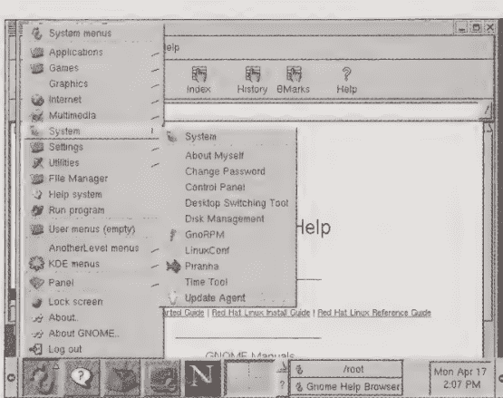

图 7-1：GNOME 桌面面板

一旦启动 `GnoRPM`，就会出现主 `GnoRPM` 窗口，如图 7-2 所示。

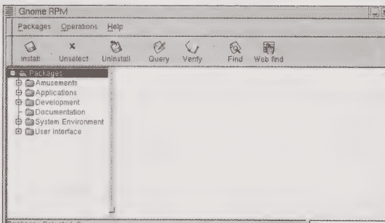

图 7-2：主 GnoRPM 图形窗口

`GnoRPM` 界面有五个基本部分，分别是：

- **软件包面板 (Package Panel)**：此面板位于窗口左侧，允许你浏览 Linux 系统中的软件包。
- **显示窗口 (Display Window)**：此窗口相邻软件包面板，允许你查看系统中各个文件夹中的不同软件包。
- **工具栏 (Toolbar)**：工具栏横跨软件包面板顶部，包含安装、取消选择、卸载、查询和验证系统中所有软件包的推按钮。它还包含一个查找按钮和一个 Web 查找按钮。
- **菜单 (Menu)**：此菜单位于工具栏上方，包含基于文本的命令。
- **状态栏 (Status Bar)**：此栏位于软件包面板和显示窗口下方，显示所选软件包的数量。

> 注意 你必须以 root 身份登录才能安装、卸载或升级软件包。

## 使用 GnoRPM 选择软件包

一旦显示主 `GnoRPM` 图形窗口，你就可以通过点击软件包面板中的树形结构之一来展开显示窗口中的软件包列表。每个树包含一组软件包，每个组都可以包含子组。Advertisements 树包含 Games 和 Graphics 组。如果你双击 Games 组，你将在显示窗口中看到图标表示的内容，如图 7-3 所示。


已选软件包：0

图 7-3：展开的显示窗口

要选择单个软件包，只需左键点击图标。这将高亮图标并允许你对其执行功能。如果你对所选择的软件包改变了主意，只需点击空白处即可。

## 查询软件包

`GnoRPM` 工具栏上的查询按钮是查找软件包所有信息最简单、最直接的方法。图 7-4 软件包信息（Package Info）窗口显示了点击查询按钮时看到的信息。

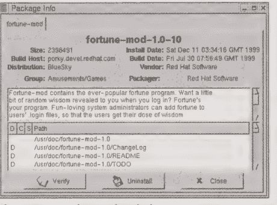

图 7-4：软件包信息窗口

软件包信息窗口分为三个部分。顶部部分显示软件包的大小、安装软件包的用户、软件包的安装和构建日期，下半部分包含显示区域，进一步分为两个部分。显示区域顶部提供软件包的文本描述。显示区域右侧部分提供软件包在 Linux 系统中的路径。显示区域左下侧指示软件包是文档文件 [D] 还是配置文件 [C]。[S] 列显示软件包的状态。如果软件包缺少任何文件（这可能会导致无法使用），这些信息将显示在这里。

## 卸载软件包

当你从 Linux 系统上卸载软件包时，所选应用程序和任何相关文件将从你的机器上删除。要卸载软件包，选择它，然后点击 GRPM 工具栏上的卸载按钮。点击卸载按钮后，将出现图 7-6 所示的删除窗口。如果你确实想卸载该软件包，请点击 Yes 按钮。

> 注意 如果没有文件依赖问题，软件包将立即卸载。不会有确认窗口。

# 84 第 2 部分 ♦ Linux 系统管理入门

## 依赖问题

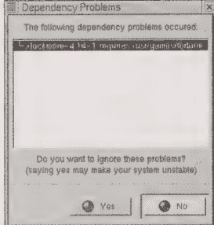

图 7-7：依赖问题窗口

> > 警告 如果你看到了“依赖问题”窗口，请务必调查显示的消息。请记住，你正在 root 用户下操作，忽略这些任何任何信息都可能严重损害你的 Linux 系统。

## 使用 GnoRPM 安装软件包

要安装软件包，请在主窗口（Primary Window）中通过突出显示如图 7-3 所示的图标，然后点击 `GnoRPM` 工具栏上的“添加”（Add）按钮。这将显示安装（Install）窗口，窗口左侧显示有文件管理器，如图 7-8 所示。左键点击你想要安装的软件包，然后点击安装窗口右侧的“添加”（Add）按钮。


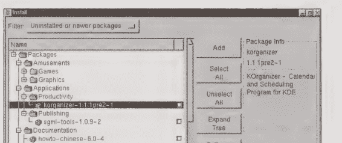

图 7-8：安装窗口

## 第 7 章 ◆ 安装软件包 85

GnoRPM 现在将在默认路径 `/mnt/cdrom/RedHat/RPMS` 中搜索你选择的软件包。如果你要安装的软件包不在该路径，将出现“首选项”（Preferences）或“添加软件包”（Add Packages）窗口。

在图 7-9 的首选项窗口中，你可以通过点击“浏览”（Browse）按钮浏览默认选择路径，或者在窗口的 RPM 目录（RPM Directories）部分选择不同的路径来查找软件包所在的路径。

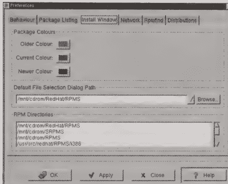

**图 7-9：** 首选项窗口

要更改软件包的路径，选中相应的路径并点击首选项窗口底部的“应用”（Apply）和“确定”（OK）按钮。

> 如果你的 Linux 系统上安装的软件包已存在，请使用安装窗口底部的“升级”（Upgrade）按钮移动到软件包的更新版本。

你也可以从软件包信息（Package Info）窗口安装软件包（参考图 7-4）。当你查询一个尚未安装的软件包时，软件包信息窗口底部将显示一个安装（Install）按钮。点击此按钮，并按照本章前面“使用 GnoRPM 安装软件包”节介绍的步骤进行操作。

### 使用 GnoRPM 工具栏上的 Rpmfind 按钮

软件包也可以从 Web 端下载进行安装。如果你点击工具栏上的 Rpmfind 按钮，将得到如图 7-10 所示的 Rpmfind 窗口。

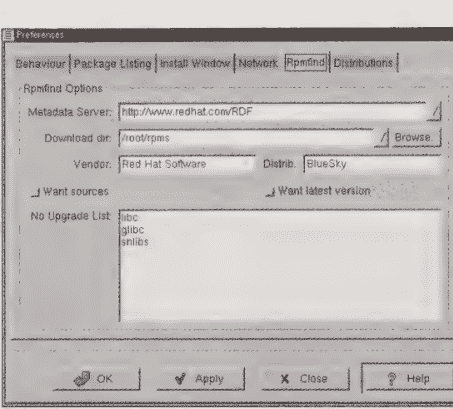

**图 7-10：** Rpmfind

使用 Rpmfind 选项下载软件包，请在元数据服务器（Metadata Server）编辑框中提供相应的 URL，并在下载（Download）编辑框中提供你希望软件包所在的路径。点击“应用”（Apply）和“确定”（OK）。

> > 警告 你会在许多 Web 位置找到你想要安装的软件包的多个版本。由于 Rpmfind 没有验证过程，你应该查询想要下载并安装的软件包，以确保它确实适合你。
> > 
> > 注意 如果你选择从图 7-2 所示的主 GnoRPM 图形化窗口下载软件包，请使用 Web 标签，并按照上述对 Rpmfind 的的相同程序操作。

### 在非 Red Hat Linux 发行版上使用 RPM

尽管 RPM 是由 Red Hat 开发的，其他 Linux 发行版也提供了 RPM 和图形界面工具。接下来我将描述两个例子——Caldera 和 SuSE。

#### Calder OpenLinux 上的 RPM

对于 Calder OpenLinux，你可以使用我之前在“命令行模式下的 RPM——基本操作”节中描述的命令行，也可以通过图形化 COAS 菜单进入 kpackage，kpackage 是 GnoRPM 的 KDE 图形等效物。要从 KDE 桌面使用 kpackage 工具，请从“工具”（Utilities）下拉菜单中选择 kpackage。如果你尚未登录 root，系统将在标准的 COAS 对话框中提示输入 root 密码。输入密码后，你就可以浏览 Linux 系统的软件包数据库：你将看到 kpackage 的主窗口，如图 7-11 所示。

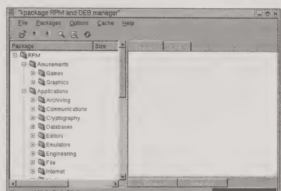

图 7-11：kpackage RPM 和 DEB 管理

#### SuSE OpenLinux 上的 RPM

要在 SuSE OpenLinux 上使用 GnoRPM，请遵循上述“在非 Red Hat Linux 发行版上使用 RPM”节中的步骤。访问 SuSE 的图形化安装和配置工具 YaST（Yet another Software TOOL）。

### 总结

如你所见，命令行的 RPM 和 GnoRPM 图形 RPM 工具都是你的 OpenLinux 系统非常强大的功能。由于你可能以 root 身份登录，在使用这些工具时应始终极度小心。通过这些工具，你可以在一个高效的管理器中处理软件包维护，并能够保持你的 OpenLinux 系统处于最新且运行良好。如需更详细的信息，请务必检查。

# 第 8 章 - 管理设备

```
/dev/fd0H1440 /dev/fd0h1660 /dev/fd0u1440 /dev/fd0u2880
/dev/fd0u830 /dev/fd0h360 /dev/fd0u1660 /dev/fd0u3200
/dev/fd0H360 /dev/fd0h410 /dev/fd0u1680 /dev/fd0u3520
/dev/fd0H720 /dev/fd0h420 /dev/fd0u1722 /dev/fd0u3600
/dev/fd0d360 /dev/fd0d420 /dev/fd0d3600
      ------ 输出已编辑以节省空间
miss_scarlet@flyingpenguin$ ls /dev/fd1*
/dev/fd1 /dev/fd1h1200 /dev/fd1u1743
/dev/fd1u3840
/dev/fd1Compa0 /dev/fd1h1440 /dev/fd1h880 /dev/fd1u1760
/dev/fd1u720
/dev/fd1d0360 /dev/fd1h1476 /dev/fd1u1040 /dev/fd1u1840
/dev/fd1d720 /dev/fd1d1494 /dev/fd1u1120 /dev/fd1u1920
/dev/fd1u820
/dev/fd1H1440 /dev/fd1h1660 /dev/fd1u1440 /dev/fd1u2880
/dev/fd1u830 /dev/fd1h360 /dev/fd1u1660 /dev/fd1u3200
/dev/fd1H720 /dev/fd1h410 /dev/fd1u1680 /dev/fd1u3520
/dev/fd1d360 /dev/fd1d420 /dev/fd1u1722 /dev/fd1u3600
      ------ 输出已编辑以节省空间 --
```

这里是 `file` 命令的结果。注意，每个文件都被标记为“块设备”（block special）文件。本章的“特殊区域分类”部分描述了块设备文件。

```
miss_scarlet@flyingpenguin$ file /dev/fd0* |more
/dev/fd0: block special (2/0)
/dev/fd0Compaq0: block special (2/4)
/dev/fd0d360: block special (2/12)
/dev/fd0H720: block special (2/16)
/dev/fd0H1440: block special (2/28)
/dev/fd0H360: block special (2/12)
/dev/fd0H720: block special (2/16)
/dev/fd0d360: block special (2/4)
      ------ 输出已编辑以节省空间 --
```

```
miss_scarlet@flyingpenguin$ file /dev/fd1* |more
/dev/fd1: block special (2/1)
/dev/fd1Compaq0: block special (2/5)
/dev/fd1d360: block special (2/13)
/dev/fd1d720: block special (2/17)
/dev/fd1H1440: block special (2/29)
/dev/fd1H360: block special (2/13)
/dev/fd1H720: block special (2/17)
/dev/fd1d360: block special (2/5)
      ------ 输出已编辑以节省空间 --
```

## 如何创建特殊设备文件？

首先，你很少需要手动创建特殊设备文件。Linux 的安装过程会在你的系统上加载成百个此类文件，以支持最常用的设备（以及许多不常用的设备）。但是，如果你购买了某种新设备或没有设备特殊文件的非标准设备，你可以运行 `MAKEDEV` 脚本在 `/dev` 目录下创建一个设备特殊文件。如果你需要一个名为 `tty17` 的特殊设备，你可以在终端窗口或文本模式终端中输入以下行：

```bash
cd /dev; MAKEDEV tty17
```

> 使用 `MAKEDEV` 命令时务必确保你是 `root` 用户。不要忘记 `MAKEDEV` 是 Linux 中极少数几个全大写的单词之一。

## 设备特殊文件分类

Linux 根据设备执行 I/O 操作的方式，将设备特殊文件分为以下三类：

- 用于串行访问设备的**字符特殊文件**（例如磁带、串口和 USB 端口）。

- 用于随机访问块设备（如磁盘）的**块特殊文件**。

- 用于某些进程间通信的**命名管道**（named pipes）。


表 8-1 列出了 Linux 设备及其设备特殊文件名称。

虽然你通过设备特殊文件名称来引用设备，但你无法直接打开并读取 `/dev` 目录下的这些文件。字符特殊文件是按字符流进行的。

如果你需要一个名为 `tty17` 的特殊设备，你可以在终端窗口或文本模式终端中输入以下行：

```bash
cd /dev; MAKEDEV tty17
```

> 使用 `MAKEDEV` 命令时务必确保你是 `root` 用户。不要忘记 `MAKEDEV` 是 Linux 中极少数几个全大写的单词之一。

# 设备特殊文件分类

Linux 根据设备执行 I/O 操作的方式，将设备特殊文件分为以下三类：

- 用于串行访问设备的字符特殊文件（例如磁带、串口和 USB 端口）。
- 用于随机访问块设备（如磁盘）的块特殊文件。
- 用于某些进程间通信的命名管道。

表 8-1 列出了 Linux 设备及其设备特殊文件名称。

虽然你通过设备特殊文件名称来引用设备，但你无法直接打开并读取 `/dev` 目录下的这些文件。字符特殊文件是按字符流进行的。

# 如何创建特殊设备文件？

首先，你很少需要手动创建特殊设备文件。Linux 的安装过程会在你的系统上加载成百个此类文件，以支持最常用的设备（以及许多不常用的设备）。但是，如果你购买了某种新设备或没有设备特殊文件的非标准设备，你可以运行 `MAKEDEV` 脚本在 `/dev` 目录下创建一个设备特殊文件。如果你需要一个名为 `tty17` 的特殊设备，你可以在终端窗口或文本模式终端中输入以下行：

```bash
cd /dev; MAKEDEV tty17
```

> 使用 `MAKEDEV` 命令时务必确保你是 `root` 用户。不要忘记 `MAKEDEV` 是 Linux 中极少数几个全大写的单词之一。


> 使用 `MAKEDEV` 命令时务必确保你是 `root` 用户。不要忘记 `MAKEDEV` 是 Linux 中极少数几个全大写的单词之一。

# 设备特殊文件分类

Linux 根据设备执行 I/O 操作的方式，将设备特殊文件分为以下三类：

- 用于串行访问设备的字符特殊文件（例如磁带、串口和 USB 端口）。
- 用于随机访问块设备（如磁盘）的块特殊文件。
- 用于某些进程间通信的命名管道。

表 8-1 列出了 Linux 设备及其设备特殊文件名称。

虽然你通过设备特殊文件名称来引用设备，但你无法直接打开并读取 `/dev` 目录下的这些文件。字符特殊文件是按字符流进行的。

# 如何创建特殊设备文件？

首先，你很少需要手动创建特殊设备文件。Linux 的安装过程会在你的系统上加载成百个此类文件，以支持最常用的设备（以及许多不常用的设备）。但是，如果你购买了某种新设备或没有设备特殊文件的非标准设备，你可以运行 `MAKEDEV` 脚本在 `/dev` 目录下创建一个设备特殊文件。如果你需要一个名为 `tty17` 的特殊设备，你可以在终端窗口或文本模式终端中输入以下行：

```bash
cd /dev; MAKEDEV tty17
```

> 使用 `MAKEDEV` 命令时务必确保你是 `root` 用户。不要忘记 `MAKEDEV` 是 Linux 中极少数几个全大写的单词之一。

# 第 8 章 - 管理设备

```
/dev/fd0H1440 /dev/fd0h1660 /dev/fd0u1440 /dev/fd0u2880
/dev/fd0u830 /dev/fd0h360 /dev/fd0u1660 /dev/fd0u3200
/dev/fd0H360 /dev/fd0h410 /dev/fd0u1680 /dev/fd0u3520
/dev/fd0H720 /dev/fd0h420 /dev/fd0u1722 /dev/fd0u3600
/dev/fd0d360 /dev/fd0d420 /dev/fd0d3600
      ------ 输出已编辑以节省空间
miss_scarlet@flyingpenguin$ ls /dev/fd1*
/dev/fd1 /dev/fd1h1200 /dev/fd1u1743
/dev/fd1u3840
/dev/fd1Compa0 /dev/fd1h1440 /dev/fd1h880 /dev/fd1u1760
/dev/fd1u720
/dev/fd1d0360 /dev/fd1h1476 /dev/fd1u1040 /dev/fd1u1840
/dev/fd1d720 /dev/fd1d1494 /dev/fd1u1120 /dev/fd1u1920
/dev/fd1u820
/dev/fd1H1440 /dev/fd1h1660 /dev/fd1u1440 /dev/fd1u2880
/dev/fd1u830 /dev/fd1h360 /dev/fd1u1660 /dev/fd1u3200
/dev/fd1H720 /dev/fd1h410 /dev/fd1u1680 /dev/fd1u3520
/dev/fd1d360 /dev/fd1d420 /dev/fd1u1722 /dev/fd1u3600
      ------ 输出已编辑以节省空间 --
```

这里是 `file` 命令的结果。注意，每个文件都被标记为“块设备”文件。本章的“特殊区域分类”部分描述了块设备文件。

```
miss_scarlet@flyingpenguin$ file /dev/fd0* |more
/dev/fd0: block special (2/0)
/dev/fd0Compaq0: block special (2/4)
/dev/fd0d360: block special (2/12)
/dev/fd0H720: block special (2/16)
/dev/fd0H1440: block special (2/28)
/dev/fd0H360: block special (2/12)
/dev/fd0H720: block special (2/16)
/dev/fd0d360: block special (2/4)
      ------ 输出已编辑以节省空间 --
```


```
miss_scarlet@flyingpenguin$ file /dev/fd1* |more
/dev/fd1: block special (2/1)
/dev/fd1Compaq0: block special (2/5)
/dev/fd1d360: block special (2/13)
/dev/fd1d720: block special (2/17)
/dev/fd1H1440: block special (2/29)
/dev/fd1H360: block special (2/13)
/dev/fd1H720: block special (2/17)
/dev/fd1d360: block special (2/5)
      ------ 输出已编辑以节省空间 --
```

# 如何创建特殊设备文件？

首先，你很少需要手动创建特殊设备文件。Linux 的安装过程会在你的系统上加载成百个此类文件，以支持最常用的设备（以及许多不常用的设备）。但是，如果你购买了某种新设备或没有设备特殊文件的非标准设备，你可以运行 `MAKEDEV` 脚本在 `/dev` 目录下创建一个设备特殊文件。如果你需要一个名为 `tty17` 的特殊设备，你可以在终端窗口或文本模式终端中输入以下行：

```bash
cd /dev; MAKEDEV tty17
```

> 使用 `MAKEDEV` 命令时务必确保你是 `root` 用户。不要忘记 `MAKEDEV` 是 Linux 中极少数几个全大写的单词之一。

# 设备特殊文件分类

Linux 根据设备执行 I/O 操作的方式，将设备特殊文件分为以下三类：

- 用于串行访问设备的字符特殊文件（例如磁带、串口和 USB 端口）。
- 用于随机访问块设备（如磁盘）的块特殊文件。
- 用于某些进程间通信的命名管道。

表 8-1 列出了 Linux 设备及其设备特殊文件名称。

虽然你通过设备特殊文件名称来引用设备，但你无法直接打开并读取 `/dev` 目录下的这些文件。字符特殊文件是按字符流进行的。

当对串口设备文件使用 `file` 命令时，你会发现它们是字符 I/O 设备。如果你使用 `ls -l` 列出串口设备，你也可以看到设备类型。第一列包含一个“c”，代表字符设备。下面的示例显示了列出串口端口设备文件的两种方法。注意，名为 `flyingpenguin` 的计算机具有支持四个串口的设备文件。

```
[root@flyingpenguin ~# file /dev/ttyS*
dev/ttyS0: character special
dev/ttyS1: character special
dev/ttyS2: character special
dev/ttyS3: character special
```

```
[root@flyingpenguin ~#] ls -l /dev/ttyS*
crw---- 1 root tty 64 May 5 1998 /dev/ttyS0
crw---- 1 root tty 64 May 5 1998 /dev/ttyS1
crw---- 1 root tty 64 May 5 1998 /dev/ttyS2
crw---- 1 root tty 64 May 5 1998 /dev/ttyS3
```


当你检查你的特殊设备文件时，输出可能与书中的不同。输出取决于你的硬件、你的 Linux 发行版以及你运行的设备版本。例如，上面的输出来自运行 Red Hat Linux 6.1 的 `flyingpenguin`。尽管物理串口数量保持不变，但 `flyingpenguin` 的 Red Hat 7.1 升级过程创建了更多的 `/dev/tty` 文件。


你还可以安装多端口串口卡，使 PC 拥有多达 256 个端口，以便 PC 作为一个使用“哑终端”字符终端的多个用户的登录服务器。如果你使用这些串口板之一，请记住它的设备特殊文件可能不会按照 `ttyS` 习惯命名，以避免混淆。


> 《Linux Serial HOWTO》是一篇关于配置和排错串口的详细论文，包含了将终端和调制调器连接到 Linux 系统的多端口串口设备。你可以在 CD-ROM 上找到此 HOWTO 的链接。

在便携式计算机（如笔记本电脑）上，你可能拥有以下设备之一：

- 一个 9 针母头串口。
- 如果你有内置调制解器，则有一个 RJ-11 电话接口。
- 带有 RJ-11 电话接口的 PC Card 调制解器卡。

# 第二部分 开始 Linux 系统管理

## 提示

如果你将便携式计算机插入扩展坞以使用扩展坞的串口，这些串口通常具有 25 针连接器。

阅读 PCMCIA HOWTO 获取有关 PC Card 连接的详细信息。要阅读关于 PC Card 配置的最新信息，请阅读 Linux PCMCIA 信息页。HOWTO 和信息页的链接在 CD-ROM 上。


## 终端 – 串口方式

你在下面读到的第一个串口设备是终端。“哑”终端和 Linux 的所有控制台设备。其中包含一些是网络设备。在进入配置串口终端的细节之前，你需要了解你可以与 Linux 使用的终端类型。

有很多不同类型的终端，包括“哑”字符终端、“智能”图形 X 基终端以及终端仿真窗口。哑终端之所以得此名，是因为它们简单地在屏幕和计算机之间传输字符。哑终端内部没有大脑（处理器），因此它们只有最基础的逻辑，容易配置和使用。来自数字设备公司（现为康贝电脑的一部分）的 VT100 类型终端是最常见的“哑”终端，还有许多其他，包括来自 IBM、惠尔尔-帕罗特、Bull 和 Wyse 的数字公司 VT200 系列。大多数哑终端显示 24 行，每行 80 或 132 个字符。“哑”终端是串口设备。

X 终端是“智能”图形化终端，允许你使用任选的 X 基 GUI，例如 KDE、GNOME 或 Motif。X 终端的配置比哑终端更复杂，因为它们内部有大脑（处理器）和内存。X 软件通常从网络加载到它们的内存中。由于 X 终端通过网络连接到 Linux，因此它们是伪终端 `ptys`。该协议允许你显示位图图形，例如画画程序或图形 Web 浏览器。终端仿真窗口还允许 X 用户运行在哑终端上运行相同的文本应用程序。终端仿真是运行在智能终端上仿真哑终端的图形应用程序。许多 Linux 任务非常简单，通过窗口和菜单导航往往方便。例如，我倾向于在终端仿真窗口中使用 `ls` 命令列出我的文件，而不是启动文件管理器或 Caldera 的磁盘导航器。你可以在同一台计算机上混合使用终端窗口和图形窗口。

# 第 8 章 ♦ 管理设备 99


```bash
miss_scarlet@penguin$ ls /usr/share/terminfo/v
v200-nam vt120-rv visa50 vt100-nav-w vt200-js vt320-w
320n vt1300 visual1603 vt100-s vt200-old vt320-nam
3220 vt1300-old vitty vt100-s-bot vt200-w vt330
v5410 vk100 vt100-s-top vt220-w vt340
vanilla vt1500 vp3+ vt100-top-s vt220-8 vt440
vapple vt1500 vp60 vs100-w vt220-8bit vt400-24
c1035 vs1155 vp90-w vt220-js vt420
c2023 vs1550 vremote vt100-w-am vt220-nam vt420f
c3063 vs1603 vs100 vt100-w-am vt220-old vt420pc
30c3a viewpoint vs100-x10 vt100-w-nav vt220-w vt420pcds
40c3a viewpoint23a- vsc vt100nam vt22d vt50
40c4 viewpoint60 vt-61 vt102 vt300-nam vt510
40c4-s vt1290 vt100-am vt102-w vt300-w vt510pc
c414 vip vt100-bm vt110-nsgr vt520
c414h vip-H vt100-bm-o vt125 vt131 vt532
vix vip- vt100-bot-s vt132 vt320-k3 vt520
versaterm vt7800-H vt100-nam vt200 vt320-k311 vt525
v1200 vt7800-w vt100-nam-w vt200-8 vt320-nam vt61
v1200-f vt7800-nav vt-8bit vt61.5
```

```bash
root@tty# tty
/dev/tty1
root@tty# 

[root@tty ~root]# tty
/dev/pts/3
[root@tty ~root]# _

root@tty# su - scarlet
Welcome to your OpenLinux system!
[scarlet@tweety scarlet$] whoami
scarlet
[scarlet@tweety scarlet$] tty
/dev/pts/3
[scarlet@tweety scarlet$]
```

**图 8-1：使用 tty 命令确定代表你的终端（或终端窗口）的文件**

# 第二部分 Linux 系统管理入门

`terminfo` 数据库中二进制文件的命名命名约定遵循两个规则：

- 1. 子目录名称是终端型号名称的首字母。例如，VT100 二进制文件位于路径 `/usr/share/terminfo/v`，支持 IBM 终端的二进制文件位于 `/usr/share/terminfo/i`。
- 2. 文件名包含终端型号名称。在上面的目录列表中，请注意 `terminfo` 数据库支持大多数 Compaq 的 VT 系列，包括流行的 VT100 和古老的 VT52。


Red Hat Linux `terminfo` 数据库在 6.x 和 7.x 版本中均为 2 MB。

`termcap` 是 Linux 描述终端的一种较旧且逐渐淘汰的方法。它是一个大文件 `/etc/termcap`（终端能力文件），其中包含了 Linux 已知的的所有字符单元上所有按键的定义。除了 `terminfo` 之外，Linux 还维护 `termcap`，以便与在 `terminfo` 成为首选终端能力数据库之前编写的旧程序保持兼容性。Linux 安装程序会创建 `termcap` 文件。

Linux 有时会被误认为是你的终端类型，尤其是当你不小心尝试显示二进制文件时。这种混乱可能会导致终端对按键的响应出现问题，特别是控制字符、方向键和退格键。为了绝对确保 Linux 知道你的终端类型，请在 `.bashrc` 中导出环境变量 `TERM`。`export` 命令将类型设置为 VT100。

```bash
export TERM=vt100
```

接下来的 `echo` 命令及其输出显示了 GNOME 终端仿真器窗口的 `TERM` 环境变量的值。

```bash
echo $TERM
xterm
```

书中的示例仅供参考。如果你使用不同的 shell（而非 bash），环境变量的名称和导出语法可能会略有不同。


## 修改终端属性

`stty` 命令报告并设置终端属性。要查看 `stty` 的所有选项，请查阅 `man stty` 手册。以下示例展示了 `stty` 命令的常用用法：

```bash
stty speed=9600
stty erase ^H
stty sane
```

## 终端、getty 与登录

终端、`getty` 和登录程序协同工作，以便用户可以登录。虽然每个终端用户使用一个独立的物理串口，但网络终端登录为每个用户使用一个虚拟网络连接。`init` 执行以下任务：

- 1. 读取用户名。
- 2. 检查终端。
- 3. 运行 `getty`。

如果用户名/密码组合有效，`init` 会启动 shell。如果用户名/密码组合无效，`init` 会启动一个新的 `getty`。当用户退出登录时，shell 会停止，`init` 会看到空闲并启动一个新的 `getty` 等待用户。

## 从网络登录

虽然本地终端为每个终端用户提供独立的物理串口，但网络终端登录为每个用户使用一个虚拟网络连接。由于无法预测同时会有多少虚拟网络连接，因此无法知道运行多少 `getty` 程序。此外，用户在跨网络登录时有不同的选择，例如 `telnet` 登录。

## getty 如何知道你的终端？

当 `getty` 意识到你想登录时，它通过读取 `gettydefs` 文件来检查终端特性。`gettydefs`（终端 定义）文件存储了首选速度，以及为了终端尝试的后续速度。`gettydefs` 还提供了每个终端的其他设置，例如登录提示应该是什么样。`gettydefs` 中的每个条目用井（`#`）隔开五个字段：标签-初始标志-结束标志-登录提示-后续标签。


标签通常包含首选速度。初始字段包含终端的起始设置。登录提示字段是应该在终端显示上的提示。后续字段（`nextlabel`）通常在终端未正常响应时指定一系列设置。以下是来自 flyingpenguin 电脑的 `getty` 的三个条目（以 `#` 开头的行是注释）：

```bash
# 9600 固定波特率解调器条目
F9600 B9600 CS CRTSCTS #B9600 SANE -STRIP HUPCL CRTS #OS login:F960
# 230400 自动波特率高流控调制解调器
230400 B230400 CS CRTSCTS #B2304 SANE -STRIP HUPCL CRTS #login:11520
# 19200 固定波特率终端条目
DT19200 B19200 CS CLOCK #B19200 SANE -STRIP CLOCK #OS login:DT1920
```

# 注意 - 不要陷入终端安全漏洞

允许全权的 `root` 用户从网络上的任何终端登录可能会导致安全漏洞。我们的办公室在接待处有一个公共“欢迎”终端。访问可以在这里尝试某些应用程序。我们不希望他们猜测系统的 `root` 密码，公共终端不是安全的终端。

# 第 8 章 管理设备 103

Linux 并没有创建大量的 `getty` 程序，而是使用守护进程（daemons，分离程序）来处理网络日志。例如，有一个 `telnetd` 守护进程用于监听和处理入站的 `telnet` 请求，还有一个用于 `login` 和 `rlogin` 的守护进程用于监听和处理请求。这些守护进程在您进入全共享和网络模式（运行级别 3 或 5）时启动。当守护进程接收到远程登录请求时，它会启动一个自己的副本来处理该请求；而原始守护进程继续监听其他登录请求。新的守护进程（即 `getty` 的那一个）将作为 `getty` 身份验证用户名。以下摘自 `ps -elf` 命令的片段显示了每个 `telnet` 用户的单独 `telnetd` 副本。`ps` 输出中最右侧的字段显示了每个用户运行的进程。`miss_scarlet` 和 `proper_plum` 都通过 `telnet` 登录了计算机，各有两个进程：`login` 和 `bash`。


```
@# ps -elf
F UID PID TTY TIME CMD
100 S root 1 0 Mar23? 00:00:04 init [5]
***** 此输出经过编辑 ******

140 S 402 1 Mar23? 00:00:00 inet
000 S root 1428 1 Mar24? 00:00:00 snapshot
100 S root 1422 0 Mar24? 00:00:00 gnome-pty-helper

000 S 2986 402 0 19:03? 00:00:00 in:telnetd
100 S root 2987 2986 0 1903 pts/2 00:00:00 login -- miss_scarlet
100 S miss_sca 2988 2987 0 19:03 pts/2 00:00:00 -bash

000 S 3028 402 0 19:09? 00:00:00 in:telnetd
bigcard.consulting.com
100 S root 3029 3028 0 19:09 pts/3 00:00:00 login -- professor_plum
100 S 3032 3029 0 19:10 pts/3 00:00:00 -bash
```

## 开始使用调制解调器

由于调制解调器是设备

```
[#flyingpenguin$] ln -s /dev/ttyS1 /dev/modem
```

当您显示调制解调器的列表（`ls -1`）时，您可以在列表末尾看到指向原始端口设备特殊文件的链接，如下所示。列表还显示 `/dev/modem` 是一个符号链接，因为第一个字符是 `l`，表示这是一个符号链接文件类型。

提示

# 第二部分 开始学习 Linux 系统管理

```
[root@flyingpenguin]# ls -l /dev/modem
lrwxrwxr-x 1 root 10 Dec 6 15:32 /dev/modem -> /dev/ttyS1
```

## 熟悉调制解调器术语

如果您已经为其他操作系统配置过调制解调器，那么这些术语应该是熟悉的。如果这是您第一次配置调制解调器，请花一点时间理解以下术语：

- 许多 PC 带有“半调制解调器”（部分硬件，部分软件），称为 winmodems。这些 winmodems 在 Microsoft Windows 上运行良好，但通常不适用于 Linux。Lucent LT WinModems 是一个例外。Winmodems 缺乏普通调制解调器中的某些硬件。您计算机的 CPU 仿真了这些“缺失”的部分。


适用于 Linux 下的调制解调器（如 Lucent LT WinModem）被称为“linmodem”。

- 波特率（Baud rate）：波特是数据传输速率的单位。波特在被更准确的术语 bps（每秒比特数）取代之前一直是速率的单位。波特和 bps 经常互用。波特一词——以波特码发明者 J.M.E. Baud 命名——意味着每秒发生的信号元素（如比特）的数量。在低传输速率下，由于每个电信号变化只能容纳一个比特信息（信号元素），因此波特率等于每秒比特数（bps）。例如，300 波特意味着 300 bps 的速率。但在高传输速率下，您可以向一个电信号中挤入多于一个比特的内容。因此，波特率和每秒比特数是不同的。当您处理更快的传输速率（4800 及以上）时，请将速率称为 bps。例如，一个 9600 bps 的调制解调器的波特率可能是 2400。在大多数情况下，当电气工程师以外的人提到波特时，他们使用的是一个技术上不准确的术语。他们应该说“bps”。

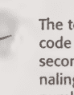

- 校验位（Parity）：一种验证传输过程中没有数据丢失或损坏的方法。


如果您已经为其他操作系统配置过调制解调器，那么这些术语应该是熟悉的。如果这是您第一次配置调制解调器，请花一点时间理解以下术语：

- 许多 PC 带有“半调制解调器”（部分硬件，部分软件），称为 winmodems。这些 winmodems 在 Microsoft Windows 上运行良好，但通常不适用于 Linux。Lucent LT WinModems 是一个例外。Winmodems 缺乏普通调制解调器中的某些硬件。您计算机的 CPU 仿真了这些“缺失”的部分。

适用于 Linux 下的调制解调器（如 Lucent LT WinModem）被称为“linmodem”。

- 波特率（Baud rate）：波特是数据传输速率的单位。波特在被更准确的术语 bps（每秒比特数）取代之前一直是速率的单位。波特和 bps 经常互用。波特一词——以波特码发明者 J.M.E. Baud 命名——意味着每秒发生的信号元素（如比特）的数量。在低传输速率下，由于每个电信号变化只能容纳一个比特信息（信号元素），因此波特率等于每秒比特数（bps）。例如，300 波特意味着 300 bps 的速率。但在高传输速率下，您可以向一个电信号中挤入多于一个比特的内容。因此，波特率和每秒比特数是不同的。当您处理更快的传输速率（4800 及以上）时，请将速率称为 bps。例如，一个 9600 bps 的调制解调器的波特率可能是 2400。在大多数情况下，当电气工程师以外的人提到波特时，他们使用的是一个技术上不准确的术语。他们应该说“bps”。

- 校验位（Parity）：一种验证传输过程中没有数据丢失或损坏的方法。

如果您已经为其他操作系统配置过调制解调器，那么这些术语应该是熟悉的。如果这是您第一次配置调制解调器，请花一点时间理解以下术语：

- 许多 PC 带有“半调制解调器”（部分硬件，部分软件），称为 winmodems。这些 winmodems 在 Microsoft Windows 上运行良好，但通常不适用于 Linux。Lucent LT WinModems 是一个例外。Winmodems 缺乏普通调制解调器中的某些硬件。您计算机的 CPU 仿真了这些“缺失”的部分。

适用于 Linux 下的调制解调器（如 Lucent LT WinModem）被称为“linmodem”。

- 波特率（Baud rate）：波特是数据传输速率的单位。波特在被更准确的术语 bps（每秒比特数）取代之前一直是速率的单位。波特和 bps 经常互用。波特一词——以波特码发明者 J.M.E. Baud 命名——意味着每秒发生的信号元素（如比特）的数量。在低传输速率下，由于每个电信号变化只能容纳一个比特信息（信号元素），因此波特率等于每秒比特数（bps）。例如，300 波特意味着 300 bps 的速率。但在高传输速率下，您可以向一个电信号中挤入多于一个比特的内容。因此，波特率和每秒比特数是不同的。当您处理更快的传输速率（4800 及以上）时，请将速率称为 bps。例如，一个 9600 bps 的调制解调器的波特率可能是 2400。在大多数情况下，当电气工程师以外的人提到波特时，他们使用的是一个技术上不准确的术语。他们应该说“bps”。

- 校验位（Parity）：一种验证传输过程中没有数据丢失或损坏的方法。

## 管理调制解调器

如果您已经为其他操作系统配置过调制解调器，那么这些术语应该是熟悉的。如果这是您第一次配置调制解调器，请花一点时间理解以下术语：

- 许多 PC 带有“半调制解调器”（部分硬件，部分软件），称为 winmodems。这些 winmodems 在 Microsoft Windows 上运行良好，但通常不适用于 Linux。Lucent LT WinModems 是一个例外。Winmodems 缺乏普通调制解调器中的某些硬件。您计算机的 CPU 仿真了这些“缺失”的部分。

适用于 Linux 下的调制解调器（如 Lucent LT WinModem）被称为“linmodem”。

如果您不确定调制解调器是否工作正常，请参考以下步骤：

1. 将调制解调器连接到计算机。

2. 使用 `ls -l /dev/modem` 检查。如果 `/dev/modem` 不存在，请使用 `ln -s` 命令。

3. 使用 `chmod` 命令为 `/dev/modem` 赋予权限。

4. 如果您想设置 PPP 链路，请在 `/etc/initab` 中添加以下项：

```
s15:resp:/bin/sh /usr/bin/efax answer
```

5. 您的互联网服务提供商（ISP）可能会为您提供连接。

```
[root@flyingpenguin]# ls -l /dev/modem
```

# 第二部分 开始学习 Linux 系统管理

```
[root@flyingpenguin]# ls -l /dev/modem
lrwxrwxr-x 1 root 10 Dec 6 15:32 /dev/modem -> /dev/ttyS1
```

## 开始使用调制解调器

由于调制解调器是设备


```
[#flyingpenguin$] ln -s /dev/ttyS1 /dev/modem
```

当您显示调制解调器的列表（`ls -1`）时，您可以在列表末尾看到指向原始端口设备特殊文件的链接，如下所示。列表还显示 `/dev/modem` 是一个符号链接，因为第一个字符是 `l`，表示这是一个符号链接文件类型。

提示

# 第二部分 开始学习 Linux 系统管理

```
[root@flyingpenguin]# ls -l /dev/modem
lrwxrwxr-x 1 root 10 Dec 6 15:32 /dev/modem -> /dev/ttyS1
```

## 熟悉调制解调器术语

如果您已经为其他操作系统配置过调制解调器，那么这些术语应该是熟悉的。如果这是您第一次配置调制解调器，请花一点时间理解以下术语：

- 许多 PC 带有“半调制解调器”（部分硬件，部分软件），称为 winmodems。这些 winmodems 在 Microsoft Windows 上运行良好，但通常不适用于 Linux。Lucent LT WinModems 是一个例外。Winmodems 缺乏普通调制解调器中的某些硬件。您计算机的 CPU 仿真了这些“缺失”的部分。


适用于 Linux 下的调制解调器（如 Lucent LT WinModem）被称为“linmodem”。

- 波特率（Baud rate）：波特是数据传输速率的单位。波特在被更准确的术语 bps（每秒比特数）取代之前一直是速率的单位。波特和 bps 经常互用。波特一词——以波特码发明者 J.M.E. Baud 命名——意味着每秒发生的信号元素（如比特）的数量。在低传输速率下，由于每个电信号变化只能容纳一个比特信息（信号元素），因此波特率等于每秒比特数（bps）。例如，300 波特意味着 300 bps 的速率。但在高传输速率下，您可以向一个电信号中挤入多于一个比特的内容。因此，波特率和每秒比特数是不同的。当您处理更快的传输速率（4800 及以上）时，请将速率称为 bps。例如，一个 9600 bps 的调制解调器的波特率可能是 2400。在大多数情况下，当电气工程师以外的人提到波特时，他们使用的是一个技术上不准确的术语。他们应该说“bps”。


- 校验位（Parity）：一种验证传输过程中没有数据丢失或损坏的方法。


如果您不确定调制解调器是否工作正常，请参考以下步骤：

1. 将调制解调器连接到计算机。
2. 使用 `ls -l /dev/modem` 检查。如果 `/dev/modem` 不存在，请使用 `ln -s` 命令。
3. 使用 `chmod` 命令为 `/dev/modem` 赋予权限。
4. 如果您想设置 PPP 链路，请在 `/etc/initab` 中添加以下项：

```
s15:resp:/bin/sh /usr/bin/efax answer
```

5. 您的互联网服务提供商（ISP）可能会为您提供连接。

## 管理调制解调器

如果您已经为其他操作系统配置过调制解调器，那么这些术语应该是熟悉的。如果这是您第一次配置调制解调器，请花一点时间理解以下术语：

- 许多 PC 带有“半调制解调器”（部分硬件，部分软件），称为 winmodems。这些 winmodems 在 Microsoft Windows 上运行良好，但通常不适用于 Linux。Lucent LT WinModems 是一个例外。Winmodems 缺乏普通调制解调器中的某些硬件。您计算机的 CPU 仿真了这些“缺失”的部分。

适用于 Linux 下的调制解调器（如 Lucent LT WinModem）被称为“linmodem”。

如果您不确定调制解调器是否工作正常，请参考以下步骤：

1. 将调制解调器连接到计算机。
2. 使用 `ls -l /dev/modem` 检查。如果 `/dev/modem` 不存在，请使用 `ln -s` 命令。
3. 使用 `chmod` 命令为 `/dev/modem` 赋予权限。
4. 如果您想设置 PPP 链路，请在 `/etc/initab` 中添加以下项：

```
s15:resp:/bin/sh /usr/bin/efax answer
```

5. 您的互联网服务提供商（ISP）可能会为您提供连接。

## 调制解调器软件

有很多软件包可以用于 Linux 拨号。Minicom 是一个流行的软件包。运行它时，感觉就像终端直接连接到了调制解调器。

```
@# ps -elf
F UID PID TTY TIME CMD
100 S root 1 0 Mar23? 00:00:04 init [5]
***** 此输出经过编辑 ******

140 S 402 1 Mar23? 00:00:00 inet
000 S root 1428 1 Mar24? 00:00:00 snapshot
100 S root 1422 0 Mar24? 00:00:00 gnome-pty-helper

000 S 2986 402 0 19:03? 00:00:00 in:telnetd
100 S root 2987 2986 0 1903 pts/2 00:00:00 login -- miss_scarlet
100 S miss_sca 2988 2987 0 19:03 pts/2 00:00:00 -bash

000 S 3028 402 0 19:09? 00:00:00 in:telnetd
bigcard.consulting.com
100 S root 3029 3028 0 19:09 pts/3 00:00:00 login -- professor_plum
100 S 3032 3029 0 19:10 pts/3 00:00:00 -bash
```

### Minicom 命令总结

命令可以通过 CTRL+A 调用。

| 主功能 | 其他功能 |
| :--- | :--- |
| 拨号..D | 捕获开启/关闭 |
| 发送文件..S | 退出..L |
| 通信..P | 发送..F |
| 选项..M | 退出..Q |
| | 删除..X |
| 终端设置..T | 光标..I |
| 换行开启/关闭..W | 回显开启/关闭 |
| | 帮助..Z |

按下 CTRL+A Z 获取特殊键帮助

```
AT S57-45 S0-0 L1 X4 & E1 OK
CTRL-A Z for 38400 8N1 | NOR | Minicom 1.83
AT S57-45 S0-0 L1 X4 & E1 Leave Minicom? Yes
```


) 21 章介绍了如何设置 PPP 连接。您使用 PPP 连接通过电话线进行计算机间的通信。您的互联网服务提供商（ISP）可能会为您提供连接，以便 ISP 服务器将您的请求传递到互联网并向您发送数据和网页。

## 调制解调器

`efax` (`/usr/bin/efax`) 是一个允许您在 Class 1、2 和 2.0 模式下发送和接收真真的程序。支持的许多设备包括 AT&T Dataport、Cardinal Digital Fax、Digicom Scout+ 以及 USR Sportster (V.32 和 V.34)。

如果您在 `/etc/initab` 中添加以下内容，`efax` 将自动回答所有入站电话：

```
s15:resp:/bin/sh /usr/bin/efax answer
```

由程序员 Ed Casas 编写的 `efax` README 文件位于 http://cases.ee.ubc.ca/efax。`efax` 网页还链接了补丁、新版本和已知错误。

## 输入设备

键盘和指向设备（如鼠标、滑板以及 ThinkPad 键盘中间的小设备，称为 TrackPoint）是输入设备。您需要键盘，但只要您不计划使用 GUI（XFree86，开源的实现），您就不需要鼠标来运行 Linux。

X Window 系统。即使你没有配置 X，仍然可以在基于文本的 Linux 系统上使用鼠标。某些基于文本的工具和实用程序允许通过方向键或鼠标在菜单中移动光标。

## 配置你的键盘

键盘很容易配置。Linux 支持几乎任何键盘——无疑包含了所有在 DOS 下运行的键盘。Linux 安装程序会询问你使用的是哪种键盘——包括用于特定语言按键映射的国家语言，例如斯洛文尼亚语、英国英语、英语等。如果你不知道自己键盘的名称和型号，也没关系。Linux 为你提供了通用的 101 键键盘。完成 Linux 安装后，你可能不需要进行任何安装后的键盘配置。如果你想，可以配置重复速率和延迟。你还可以删除某些键值的默认操作（例如 Delete），并将按键映射到国家语言字符。


重复速率是你按住按键时，键盘重复按键的速度。延迟是指在你开始按住按键后，键盘等待的时间。

## 修改键盘的重复特性

大多数人对键盘速率和键盘延迟的默认设置都很满意，如果你用力按按键，可能会发现当你只想输入单个字符时，字符却重复了。要更改重复速率和/或键盘延迟时间，请使用 `kbrate` 程序。在不带命令行选项运行 `kbrate` 将重复速率和延迟设置为你的 Linux 发行版针对特定硬件建立的默认值。

默认键盘速率取决于底层硬件架构。我的 IBM ThinkPad 笔记本电脑（或任何基于 Intel 的系统）的默认键盘速率为每秒 10.9 个字符 (cps)，延迟为 250 毫秒 (ms)。此速率也适用于基于 Motorola 68000 架构的计算机（Apple Macintosh ）。在 Sunworks（或任何基于 SPARC 架构的计算机）上，默认 kbrate 值为 5 cps 和 200 ms。

`kbrate` 设置重复速率的命令行选项是 `r`。`r` 的范围是从 2 到 30。设置延迟的选项是 `d`。`d` 的时间可以是以下值之一：250、500、750 或 1000。如果你选择了一个 kbrate 不支持的速率，请选择一个最接近的有效值。在下面的示例中，`kbrate -d 5` 命令段用于在 SONY VAIO（Intel 架构）笔记本电脑上将延迟设置为 5。然而，输出显示键盘重复速率默认为 250 ms，因为 Linux 在任何硬件上都不支持 5。

```
miss_scarlet@tweety$ kbrate -d 5
Typematic Rate set to 10.9 cps (delay = 250 ms)
```

如果你在计算机上配置了 X，可以运行 `xset` 来更改键盘、鼠标和屏幕特性。你可以从任何终端仿真窗口运行 `xset`。要查看你当前的 xset 特性是什么，请输入 `xset q`，如下例所示。（参见表 8-2）。

```
root@flyingpenguin$ xset -q
auto repeat: on key click: 0 LED mask:
00000000
auto repeat delay: 500 repeat rate: 30
auto repeating keys: 00ffffffffffffbf
fa9ffffffffffffff
ffffffffffffffff
ffffffffffffffff
bell percent: 50 bell pitch: 400 bell duration: 100nPointer Control:
acceleration: 2/1 threshold: 4
Screen Saver:
prefer blinking yes allow exposures: yes
timeout: 600 cycle: 600
Colors:
def colormap: 0x21 BlackPixel: 0 WhitePixel: 1
Font Path:
unix/:7100
Bug Mode: compatibility mode is disabled
DPMS (Energy Star):
Standby: 1200 Suspend: 1800 Off: 2400
DPMS is Disabled
Font cache:
hi-mark (KB): 1024 low-mark (KB): 768 balance (%): 70
```

表 8-2

通过运行 xset 可以更改的键盘特性

| 特性 | 命令行选项 |
| :--- | :--- |
| 提示音开启/关闭、音量、音调和长度 | xset -b |
| 按键点击开启/关闭、音量 | xset -c |
| LED 灯开启/关闭 | xset -led |
| 自动重复开启/关闭 | xset -r |

> `xset` 可以切换自动重复的开启和关闭，但它无法设置特定的速率。

## 修改按键映射

如果某种英语是你的母语，你在通过键盘按键输入字母表字母时可能不会遇到问题。然而，如果你的字母表有特殊字符（例如变音符号或重音），你理解有时需要修改键到字母的映射，以便当你按下按键时，就能得到所需的字母。按键映射分为两个部分：

- 让 Linux 将你的按键解释为特殊字符，例如带有变音符号的 u

- 提供可显示特殊字符的字体

### 为什么 Linux 配置键盘需要分开

正如你可能读过的，Linux 有两类键盘：与 X 通信的以及与控制台通信的。任何对设备 `/dev/console` 拥有权限的人都可以运行 `loadkeys`，从而更改所有虚拟控制台的键盘映射。

这些键映射的位置随你的发行版而异。例如，以下显示了 Linux "qwerty" 键盘支持的国家语言键映射文件。

# 配置指针设备和鼠标

在开始配置指针设备或鼠标之前，你应该了解你的指针设备或鼠标的两个特性：

- 鼠标接口。

- 鼠标协议。

接口涉及鼠标的硬件特性，例如它使用的 I/O 端口。内核使用鼠标接口来确定如何读取数据。协议涉及鼠标的软件特性。内核将鼠标数据发送到应用程序。应用程序需要理解鼠标协议来解释这些数据。对于 Linux 来说，指针设备看起来就像鼠标。例如，Caldera OpenLinux 将 SONY 笔记本电脑上的 tweepy 触摸板（glidepad）视为一个 PS/2 鼠标。

Linux 内核目前支持以下总线鼠标接口：

- Import（微软）

- Logitech（罗技）

- PS/2

- ATI-XL

- 双键或三键鼠标

- 指针设备，如 TrackPoint

- 触摸板（Touchpad）、滑板（glidepad）

- USB 设备

> Linux 2.4 内核在本本书印刷时刚刚发布，包含了更好的 USB 支持，特别是针对热插（即插入 USB 设备，如鼠标或键盘）。遗憾的是，目前还没有足够的 USB 驱动程序来使新的 USB 功能变得广泛可用。当你读到这里时，USB 驱动程序的通用可用性已经有所提高。

如果你在 Linux 安装过程中配置了指针设备，或者配置了与安装期间使用的不同的指针设备，你可能需要重新配置它。你可以从 GNOME 控制中心或 KDE 菜单更改基本鼠标属性，如鼠标移动以及鼠标是左手型还是右手。例如，从 KDE 菜单中选择“设置”（Settings），然后选择“设备”（Devices），并在“输入属性”（Input Properties）窗口中选择鼠标属性。要完全重新配置鼠标，你有几种鼠标配置工具的选择，取决于你使用的发行版。

> 本节配置工具的鼠标界面不是基于 X 的 GUI。它们是基于文本的菜单，可以使用鼠标或其他指针设备或键盘工作。

## 鼠标配置工具选择

你的鼠标配置工具选择包括：

- 红帽鼠标配置工具，通常为 `/usr/sbin/mouseconfig`，它除了红帽之外还可以在许多发行版上运行，是一个菜单驱动的配置工具。

- Xmseconfig 是另一个菜单驱动的鼠标配置工具。Xmseconfig 允许你选择鼠标协议、鼠标设备、波特率以及三键鼠标仿真属性。下面是第一个 xmseconfig 屏幕（在 Caldera OpenLinux 服务器上运行）的示例。

```
root@tweet# xmseconfig
```

注意：'Logitech'协议仅用于旧的罗技鼠标。大多数当前型号使用 'Microsoft' 或 'MouseMan' 协议。

| 键 | 功能 |
| :--- | :--- |
| a | 应用更改 |
| b | 切换到下一个波特率 |
| c | 切换 ChordMiddle 按钮 |
| d | 切换 CLEARDTR 按钮 |
| e | 切换 Emulate3button 按钮 |
| l | 选择下一个分辨率 |
| n | 设置设备名称 |
| p | 选择下一个协议 |
| r | 切换 ClearTS 按钮 |
| s | 增加采样率 |
| t | 增加三键仿真超时时间 |
| 3 | 将按钮设置为 3 |
| 4 | 将按钮设置为 4 |
| 5 | 将按钮设置为 5 |

你还可以使用 `Tab` 和 `Shift-Tab` 移动，并使用 `Enter` 激活选定的按钮。

退出

Caldera 的 COAS 配置工具也有一个重新配置指针设备的部分。从 COAS 菜单中选择“设备”（Peripherals），然后选择“鼠标”（Mouse）来配置你的鼠标。

提示：你需要以 root 身份运行大多数大多数鼠标配置工具。

# 配置并行端口设备

提到并行端口设备，大多数人会想到打印机。

第 13 章描述了如何配置打印机。


然而，Linux 支持许多连接到个人计算机并行打印端口的外部设备。其中某些设备如 Iomega Zip Drive可以连接到不同的接口，例如并行端口和 SCSI 总线。


除了并行打印机外，Linux 还支持并行设备，包括端口扫描仪、Iomega Zip 和 Ditto 设备。摄像头、Colorado Trakker 250 外部磁带设备、ATAPI CD-R 和 CD-RW，甚至还有一个时钟收音机。`http://www.torque.net/linux-pp.html` 的并行端口信息页包含了并行驱动程序项目的链接列表。


有多个关于配置常用并行端口设备（如 Iomega Zip）的 HOWTO。如果你有一个目前 Linux 不支持的并行端口设备，请阅读 Linux I/O Port编程小型 HOWTO 以了解如何开始编写自己的程序。

## 让内存设备特殊文件保持不变

信不由，Linux 有一个特殊的设备文件来表示计算机的物理内存，这是一个特殊的设备文件——`/dev/kmem`。`file` 命令告诉你 `/dev/kmem` 是一个字符特殊文件。设备特殊文件 `/dev/mem` 包含了计算机物理内存的映像。如果你是一个 Linux 大师且勇敢，可以使用 `/dev/mem` 来检查你的物理内存。

> 如果你是一个 Linux 大师且勇敢，可以使用 `/dev/mem` 来摧毁系统。

## 磁带工作

Linux 支持多种类型的磁带驱动。下表列了一些设备名称。

| 设备特殊文件 | 磁带设备 |
| :--- | :--- |
| `/dev/tp11` | QIC-11 |
| `/dev/tnq11` | QIC-11 |
| `/dev/rft0` | QIC-17 |
| `/dev/nrft0` | QIC-17 |
| `/dev/qft0` | 软磁带 |
| `/dev/nq0` | 软磁带 |
| `/dev/st0` | SCSI 磁带 |
| `/dev/nst0` | SCSI 磁带 |

# 143 第章 设备管理

`kudzu` 是一个定义和配置新硬件的新工具，由红帽开发。它运行在红帽 6.1 及更高版本上。你也可以下载运行在各种发行上的 `kudzu` 包，包括 Mandrake、Kondor、RawHide 和 Connectiva。当你启动 `kudzu` 时，它引用数据库 `/etc/sysconf/hwconf` 来检查你的计算机配置。如果你添加或删除了硬件，`kudzu` 允许你配置并更新其 `hwconf` 数据库。`kudzu` 在以下文件中构建数据库：

```
/etc/conf.modules
/etc/sysconfig/network-scripts/ifcfg-*
/etc/X11/X86Config
```

访问 `http://rpmfind.net/linux/RPM/` 搜索 `kudzu` RPM 包。

## 探索 2.4 内核中的新设备功能

就在本书印刷时，Linux 发布了 2.4 内核。本节简要讨论影响设备管理的 2.4 内核的新增和增强。

PCIA 支持已移动到内核。在 2.2 内核中，PCIA 支持是一组单独提供的实用程序。通过将 PCIA 移动到内核，PCIA 设备的性能（对于笔记本电脑尤其重要）将显著提高。

新内核支持更多 IDE 设备，如并行端口磁带驱动器、从软盘运行的大硬盘等。特别是对于旧系统的用户来说，ISA 即插用设备现在由内核支持，不再需要编辑晦涩的。此外，你还可以从设备启动系统，例如从 ISA 即插用 IDE 控制器启动。

另一方面，逻辑卷和逻辑卷管理（通常缩为 LVM）允许你将现有（或新）磁盘的 400MB 区域添加到当前的 `/home` 分区。另外一个 LVM 工具则允许你调整文件系统的大小。LVM 长期以来一直是主流 UNIX 系统的重要特性，Linux 系统管理员和 DBA 一直在等待它在 Linux 上出现。

## 总结

Linux 使用设备特殊文件来表示硬件。在 Linux 安装过程中，你最初会配置硬件设备。安装程序会创建表示你的 Linux 发行版所支持硬件的设备特殊文件。安装 Linux 后，如果你需要额外的设备特殊文件来表示新硬件，可以使用 `MAKEDEV` 命令创建设备特殊文件。通常不需要使用 `MAKEDEV`；Linux 安装程序已经创建了大量的设备特殊文件，因此新设备所需的文件几乎总是已经存在。

Linux 将设备特殊文件分为块 I/O 定向和字符 I/O 定向。终端是字符 I/O 定向设备的示例，磁盘驱动器是块 I/O 定向设备的示例。控制台、硬线终端和调制器是 Linux 串口设备——插入计算机串口的字符伪设备。X 终端是伪终端（`ptys`）——连接到网络的字符设备。两种类型的终端都有一组相关的设备特殊文件。

硬盘既是块也是字符 I/O 定向的，因此具有双份设备特殊文件。第 9 章详细介绍了硬盘的几何结构以及如何重新配置磁盘分区。

新的 Linux 2.4 内核进一步扩展了 Linux 设备支持的广度和深度。

# 管理磁盘设备

### 引入硬盘概念

作为系统管理员，你的目标是让用户能够访问数据。为了实现这一点，你需要创建文件系统来存储数据。在创建文件系统之前，必须创建分区来存放文件系统。文件系统存在于分区中。分区存在磁盘上。这些概念引出了物理磁盘与逻辑磁盘的概念。

## 本章内容

- 磁盘几何结构简述
- 理解磁盘分区
- 管理分区表
- 与其他磁盘协作
- 使用软磁盘
- 利用光驱


118 第二部分 + 开始学习 Linux 系统管理

### 理解物理磁盘与逻辑磁盘

作为终端用户，你不需要知道硬盘和分区是如何工作的。你只需要知道数据的路径，例如 `/home/miss_scarlet/files`。你不需要知道数据存储在哪个设备上，或者什么种设备持有你的数据。

作为系统管理员，你需要了解上述所有内容，以便用户在甚至不知道使用什么磁盘的情况下访问数据！你需要理解第一个概念是物理磁盘与逻辑磁盘。物理磁盘是你手里拿着并连接到计算机机箱的硬件。你从硬件术语的角度来考虑它——尺寸和控制器类型——例如“1 号插槽中的 20GB IDE 磁盘”或“10GB SCSI 磁盘”。**逻辑磁盘**是物理磁盘的一部分或全部。应用程序向逻辑磁盘请求数据访问，例如“从 `/home/miss_scarlet/weapons` 中获取前 100 条记录”。操作系统将此逻辑 I/O 请求翻译为物理 I/O 请求，以确定数据位于何处（在块、磁道、扇区和柱面上的位置）。Linux 将逻辑磁盘称为 *partitions*（分区）。如果你在一个驱动器上有四个分区，Linux 会将单个物理磁盘视为四个独立的逻辑磁盘驱动器。

### 观察硬盘内部

硬盘由 *platters*（盘片）组成——这是存储数据的纤薄磁化圆盘。在每个盘片的表面上有一个读写头用于访问数据。盘片旋转，磁头在盘片的边缘和中心之间移动。盘片的旋转加上磁头的移动，允许访问表面的所有部分。

### 检查硬盘几何结构

许多磁盘工具，如 `fdisk`、`cfdisk` 和红帽的 Disk Druid 都可以操作磁盘的几何结构。*Disk geometry*（磁盘几何）指的是柱面（`cylinders`）、头（`heads`）、扇区（`sectors`）和磁道（`tracks`）术语。图 9-1 显示了磁盘表面由称为 *tracks*（磁道）的同心环组成。每个磁道被划分为扇区。扇区是磁盘可以处理的最小单位。因此，如果你只需要一个字节的数据，磁盘控制器也会从一个扇区中检索至少一个块（通常为 512 字节）。将磁盘划分为磁道和扇区有助于控制器在磁盘上查找并分配磁盘空间。

如果你取顶层盘片上的单个扇区并一直穿过驱动器中的每个盘片，你就得到了所谓的 *cylinder*（柱面）。柱面是硬盘几何结构的构建模块。当 Linux 能够将文件存放在同一个柱面上时，磁头（执行实际读写操作的仪器）就不需要在磁道之间进行大量的进出移动。移动越少，磁盘 I/O 速度就越快。


图 9-1：硬盘几何结构

### 添加控制器

每个硬盘都通过 SCSI 或 IDE 磁盘控制器与 CPU 通信。控制器告诉读写头移动到哪里、何时移动以及移动多少数据。现在的智能控制器还可以缓存数据，并具有识别坏块和扇区的能力。

### 启动 BIOS

当你开启兼容 Intel 的计算机时，BIOS 会执行一个名为 POST（电源自检）的快速检查，以确保内存、软磁盘、键盘、显卡和 CPU 等重要子系统运行正常。接下来，BIOS 从第一个磁盘读取主引导记录（MBR）。MBR 包含一个小程序，称为引导加载程序（boot loader），它：

- 读取分区表。
- 找到活动（可启动）分区。
- 读取活动分区的扇区。
- 执行活动分区中的代码。


# 为什么要告诉你 BIOS？

尽管它是完全透明且运行在计算机内部的，但你需要稍微了解 BIOS，因为它有一个影响系统的限制。在旧版本的 `LILO` 引导加载程序中，标准引导加载程序无法启动安装在柱面 1024 或以上的操作系统，这意味着必须小心选择限制内的 Linux 内核，否则系统无法启动。然而，本书光驱上的 `LILO` 版本确实有这个限制。

## 分区在哪里？

现在你已经理解了硬盘几何结构的知识，就可以理解 Linux 分区程序（如 `fdisk` 和 `cfdisk`）的输出了。在开始考虑更改分区之前，你需要能够理解这些几何术语。

> 这种工具选择是 Linux 提供多种完成任务工具的另一个例子。

`fdisk` 程序自时代（或至少自 UNIX）开始以来一直存在。`fdisk` 的变体——`cfdisk` 和 `sfdisk` 程序具有友好的界面。红帽提供了 Disk Druid 来帮助你分区。商业软件如 PartitionMagic 让分区变得更简单。所有这些程序都允许你查看分区并进行更改或删除。使用 `cfdisk` 时，你使用方向键高亮你想要的菜单选项，并按回车执行命令。你不需要 X 运行菜单。图 9-2 显示了 SCSI 磁盘 (`/dev/sda`) 的基本 `cfdisk` 输出，其中包含一个主分区和五个逻辑分区。

在此时，你并没有真正删除分区，而是将其标记为待删除。你必须从菜单中选择 `Write`（写入）选项来删除分区并将其扇区返回为可用空间。在按下回车键后，你将获得一次机会改变主意并撤滚更改。分区程序会提示你确认写入。

扩展分的磁盘几何结构

```
$ fdisk -l
Device: /dev/sda
Disk size: 20.0 GB
Heads: 255  Sectors per track: 60  Cylinders: 528

Name     Flags    Type      Id         Size (MB) [Label]
sda1             Primary ext1               74.68
sda2     Boot     Logical ext1               182.36
sda3             Logical ext2               271.44
sda4             Logical ext3               254.23
sda5             Logical ext4               271.44

[Beastable] [Delete] [Help] [Maxsize] [Print]
  [Unit]      [Type]  [Units]     [Write]
  toggle beastable flag at the current partition
```


**图 9-2：** `fdisk` 程序显示了管理分区的菜单界面

## 从一化多——分区故事

每个 Linux 磁盘在磁盘开头（扇区 0，磁道 0，在任何系统文件或用户文件之前）都包含分区表。Linux 安装程序会写入分区表。重构分区的程序（如 Red Hat 的 Disk Druid、`cfdisk`、`fdisk` 以及商业产品 PartitionMagic）也会写入分区表。分区表由一到四个条目组成，每个条目对应一个分区（逻辑磁盘）。每个条目描述了分区的属性：

分区类型，一个双位十六进制数，表示使用该分区的操作系统和文件系统。例如：

- `Windows 95 FAT 32 = 0b`
- `Linux (文件) = 83` 或 `85`
- `Linux (交换分区) = 82`
- `BSDI UNIX = b7 (文件)` 或 `b8 (交换分区)`

- 分区的起始位置。
- 分区的结束位置。
- 分区是否激活（因此是否可启动）。

你可以通过运行 `cfdisk` 程序，或使用方向键/Tab 键切换到显示底部的 `[ Type ]` 来获取你的 Linux 发行版支持的所有分区类型及相关十六进制代码列表。该列表至少有两个屏幕长。

9-3 显示了包含四个逻辑磁盘的两个物理磁盘。图中展示了带有分区表和分区的硬盘。其中一个硬盘只有一个分区，跨越了整个磁盘。在这种情况下，逻辑磁盘和物理磁盘是同一个。另一块硬盘包含三个分区和一些空空间。

## 从多化多——分区的划分

9-4 显示了分区表中的四种可能条目。IBM 兼容 PC 的架构将硬盘上主分区的数量限制为四个。主分区是在 Linux 启动时可以引导的分区。然而，现在可用的大容量使得四个分区对于正常使用来说效率很低。存在一种解决方法，被称为“扩展分区”。扩展分区是一个包含其他分区（称为“逻辑分区”）的分区。逻辑分区是存储数据的实际磁盘空间。当你创建一个扩展分区时，Linux 会构建一个特殊的扩展分区表。图 9-5 显示了一个带有扩展分区表和逻辑分区的物理磁盘。

在一个物理硬盘上，可以创建的逻辑分区数量没有限制。然而，出于涉及分区管理的性能考虑，最好每个物理磁盘创建不超过 12 个逻辑分区。

### 分区表

分区表


整个磁盘是 1 个分区。

磁盘有 3 个分区。

- - 键 - 硬盘
- 分区
- 分区表

**图 9-3：** 分区表指向位于物理硬盘上的逻辑磁盘（分区）

分区表

| entry | 1 |
|---|---|
| 2 | |
| 3 | |
| 4 | |

4 个主分区

**图 9-4：** 带有四个分区的分区表


## 理解分区命名规范

在上一章节中，你学习了 Linux 如何如何使用设备特殊文件来识别硬件设备。正如你预期的，Linux 也在 `/dev` 目录表示磁盘分区。每个分区和扩展分区都有其自己的设备特殊文件。图 9-5 显示了一个带有四个分区的 IDE 磁盘，每个分区名称由：

- `/dev` 目录。
- 设备类型（IDE 为 `hd`，SCSI 为 `sd`）。
- 代表物理磁盘编号的设备字母 — `a` 是第一个硬盘，`b` 是第二个硬盘，以此此类推。
- 分区号。数字 1–4 代表主分区或扩展分区。5 及以上的数字代表逻辑分区。第一块 IDE 磁盘上的第一个分区是 `/dev/hda1`。SCSI 磁盘上的第一个分区是 `/dev/sda1`。

带有扩展分区的分区表


**图 9-5：** 磁盘上的扩展分区

## 为 Linux 重新分区

重新分区有三个原因：

1. 你需要更多空间。
2. 你需要提高性能。
3. 空间用完了。

| 表 9-1 | 缺点 | 影响 |
|---|---|---|
| 磁盘故障时可用性低 | 如果你的分区不可用，整个系统都不可用。 |
| 备份时间长 | 当你备份时可以并发操作。 |
| 交换分区 I/O 性能 | Linux 系统使用多个交换分区通常性能更好。 |
| 磁盘 I/O 性能 | Linux 速度成为瓶颈。 |

对于中小型系统，以下分区指南为未来的增长留了空间：

- 在第一个磁盘上（系统）：
    - `/boot`—16 到 24 MB。此分区仅包含启动所需的数据和配置信息。
    - `/`—1 GB。根分区存储运行系统所需的所有文件。
    - `/usr`—2 到 3 GB。此分区包含了系统中安装的所有应用程序，如编辑器、浏览器、邮件客户端等。
    - `/var`—1 GB（取决于安装的产品）。如果你有第三块硬盘，将 `/var` 移动到那里。

- 在第二块硬盘上（用户磁盘）：
    - `/home`
    - 其他文件系统

- 在第三块硬盘上（如果有的话）：
    - `/var`

本章剩余部分将讨论其他的划分方案。Multi-Disk-HOWTO 的附录展示了各种分区示例。如果你需要定位分区以获得最快的磁盘 I/O 性能，HOWTO 中还提供了供你填写的工作表。

2. 检查你现有的分区。找出它们的大小、起始和结束位置。图 9-6 显示了你如何在终端窗口中使用 `cfdisk` 程序来检查你的分区。如果你想使用图形化程序，可以从 KDE 控制面板显示信息，或者查看 GNOME 的“详细系统信息”（Detailed System Information）显示。请参图 9-7 查看 KDE 的系统信息显示，图 9-8 查看 GNOME 的详细系统信息/磁盘信息显示。

3. 决定你将使用哪种策略（在接下来的几个章节介绍）来腾出更多空间并添加 Linux 和/或交换分区。

4. 获取你需要的任何新硬件。

5. 备份你计划删除并重建的分区中的数据。

6. 运行你选择的程序。

7. 重新分区。

位于扩展分区中的逻辑分区
从磁盘开始
结束 起始（扇区）

| # | 类型 | 起始扇区 | 结束扇区 | 偏移量 | 长度 | 文件系统类型 (ID) | 标记 |
|---|---|---|---|---|---|---|---|
| 1 主/逻辑 | 0 | 46184 | 0 | 88 | 空闲空间 | 无 (00) |
| 2 主 | 46185 | 190699 | 46185 | 80 | 扩展 (8) | 无 (00) |
| 3 逻辑 | 190700 | 214014 | 190700 | 62 | Linux swap (8) | 无 (00) |
| 4 逻辑 | 214015 | 237066 | 214015 | 62 | Linux (82) | 无 (00) |
| 5 逻辑 | 237067 | 309458 | 237067 | 63 | Linux (80) | 无 (00) |
| 6 逻辑 | 309459 | 372745 | 309459 | 63 | Linux (83) | 无 (00) |

按任意键继续

图 9-6：你可以通过在 `cfdisk` 的初始分区显示中高亮并选择分区来获取详细信息

# 第二部分 Linux 系统管理入门

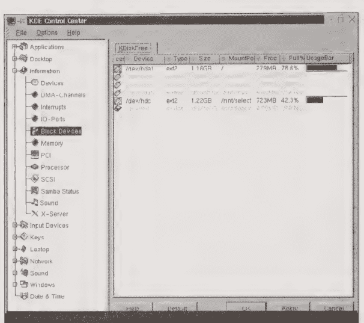

图 9-7：KDE 系统信息显示你所有分区的概述

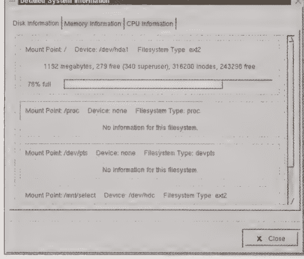

图 9-8：GNOME 的详细系统信息显示了关于你分区的详细信息

# 第 9 章 ♦ 管理磁盘设备 129

叫我们偏执吧！即使我们是在进行非破坏性的重新分区，我们也会备份数据。可能会出现一些意外问题，例如断电或硬件崩溃，可能会破坏你的数据。

## 非破坏性重新分区 – 优选策略

非破坏性允许你在不破坏磁盘上任何现有数据的情况下为 Linux 腾出更多空间。当你需要为 Linux 添加磁盘空间时，始终尝试进行非破坏性操作。为了在不破坏现有数据的情况下添加新的 Linux 分区，你需要以下条件之一：

- 一个没有文件或目录的硬盘。
- 一些未分配空间。
- 你不再需要或使用的分区。

### 在新物理磁盘上创建分区

这是为 Linux 腾出更多空间最简单的方法。新硬盘对大多数人来说都很负担负担，而且没有破坏数据的风险。使用你喜欢的分区软件创建你需要的任意分区。

要使用 `cfdisk` 创建新分区，请从显示中选择一个空闲区域并选择菜单 `New`（新建）。`cfdisk` 会提示分区大小并显示你可用的最大空间。`cfdisk` 会根据你的磁盘几何结构自动计算分区的起始和结束位置。记得从菜单中选择 `Write`（写入）使你的新分区持久化。

### 使用未分配空间创建 Linux 分区

解决方案像使用新物理磁盘一样简单无风险。图 9-9 显示了一个带有空闲空间的物理硬盘，以及在使用该空闲空间创建 Linux 分区后的样子。

### 重构未使用的分区

在现实生活中，很少有未使用的分区。也许你有一个分区是用于测试另一个系统的。测试完成后，你可以重用该分区用于 Linux。你需要遵循以下三个步骤：

- 1. 备份分区上的数据，以防你以后需要它们（可选，推荐）。

- 2. 使用 `cfdisk` 的 `Delete`（删除）菜单选项删除分区。`cfdisk` 将空间从删除的分区移动到空闲空间。

- 3. 使用 `cfdisk` `New`（新建）菜单选项创建一个 Linux 分区来替换刚刚删除的分区。

# 130 第二部分 Linux 系统管理入门

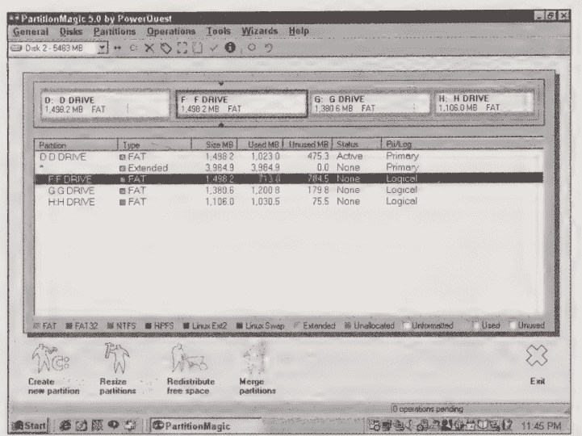

图 9-9：你可以通过在 `cfdisk` 的初始分区显示中高亮并选择分区来获取详细信息

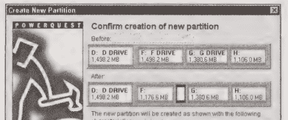

图 9-10：GNOME 的详细系统信息显示了关于你分区的详细信息

## 破坏性重新分区 – 最后手段

如果你没有未分配空间，你就必须破坏一个现有分区来腾空间。这是一项高风险操作，因为该分区上的所有数据将丢失。在继续之前，请确保你已经备份了数据。

1. 备份你计划删除的分区上的数据。
2. 使用 `cfdisk` 的 `Delete`（删除）菜单选项删除分区。
3. 在空闲空间创建一个新的 Linux 分区。

# 第 9 章 管理磁盘设备 133


## ls -l /dev/cdrom

lrwxr-wx 1 root root 22 Feb 11:54 /dev/cdrom -> sonycd535

Linux 提供了多种音频 CD 播放器。GNOME CD 播放器（在桌面上显示窗口，在面板上显示图标）就是一个示例。CD 播放器允许你通过计算机的声卡播放音频 CD。在使用 CD 播放器之前，你必须对你的 CD-ROM 设备文件具有读取权限（`/dev/cdrom` 是该链接）。如果 CD 播放器无法播放你的 CD，请以 root 登录并使用以下命令赋予所有用户对 CD-ROM 设备的读取权限：

```
root@tweety# chmod a+r /dev/hdc
```

上述 `chmod` 示例使用了设备特殊文件，而不是符号链接（`/dev/cdrom`），因为符号链接对所有用户来说总是可读可写的。链接文件（在本例中为 `/dev/hdc`）的权限才是需要更改的权限。

图 9-1 显示了 GNOME CD 播放器的界面。这些按钮类似于其他 CD 播放器上的按钮，例如 Windows 9x 或 MacOS 上的。

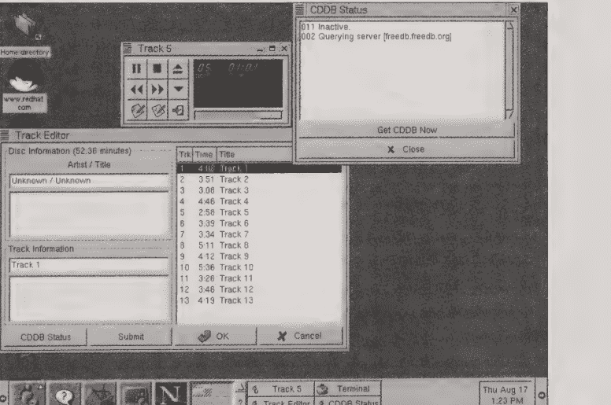

图 9-11：GNOME CD 播放器具有与其他大多数 CD 播放器相同的控制按钮

## 总结

磁盘设备范围从 Zip 和 Jaz 磁盘、软盘、CD-ROM 和 CD-RW 等可移动磁盘，到位于 EIDE、IDE 或 SCSI 控制器上的硬盘。Linux 支持所有这些磁盘类型以及更多类型。

分区是操作系统在硬盘上写入文件的地方。硬盘本身是一个物理设备。硬盘上的分区是逻辑设备。因此，分区允许一个一个物理磁盘包含多个逻辑磁盘。Linux 分区可以是主分区，也可以是带有逻辑分区的扩展分区。文件系统告诉操作系统以何种格式写入文件。现在你已经理解了高级分区概念和命令，请继续下一章节，该章节将解释如何在分区中创建文件系统。

在本章结束时，你将拥有五个磁盘、n 个分区和 n 个文件系统。本章还展示了如何在你创建的新分区中为系统添加额外的交换空间。

# 管理文件系统和交换空间

文件系统存储目录和文件。交换空间与物理内存（RAM）协同工作以实现虚拟内存（在哪个分区中）放置文件系统、你的系统环境需要什么类型的文件系统、文件系统何时以及如何可用，以及谁被允许在新文件系统中存储文件和目录。你还需要决定想使用什么工具来构建你的文件系统。你的选择包括基于的程序（如 `mkfs`）和图形化工具（如 `linuxconf` 或 COAS），取决于你的 Linux 发行版。本章将带你通过一个案例研究，即为系统添加更多磁盘空间。你从四个磁盘、n 个分区和 n 个文件系统开始。案例研究将引导你一步步完成为新磁盘准备好用户所需的所有工作。在本章结束时，你将拥有五个磁盘、n 个分区和 n 个文件系统。本章还展示了如何在你创建的新分区中为系统添加额外的交换空间。

## 创建文件系统

磁盘分区包含文件系统或交换空间。除了原生的 ext2 文件系统外，Linux 还支持许多其他文件系统，包括 FAT、FAT32、VFAT、NT、HPFS 等。与所有现代操作系统一样，Linux 也利用交换空间，使用交换文件（如 Windows）或更常见的、专门设计为交换空间的磁盘分区。

第 9 章解释了如何将原始的、未初始化的磁盘扇区构建成作为逻辑磁盘的分区。

一个或多个文件系统持有了 Linux 目录层次结构。无论你的 Linux 系统上有多少文件、目录和磁盘，它们都构成单一的目录层次结构。Linux 目录层次结构是一棵倒立的树：`/` 是根，其他目录构成分支和细枝，而文件是叶子。文件系统是 Linux 目录树上一组目录和文件。图 10-1 显示了 Linux 目录树上的一个文件系统。

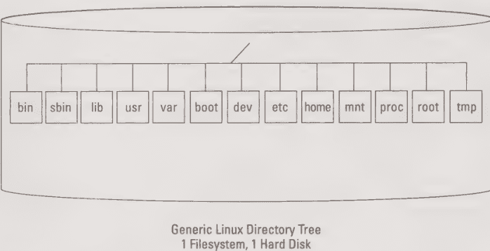

图 10-1：此 Linux 目录树只有一个文件系统

# 入门

你需要按照以下步骤创建新的文件系统：

1. 提前计划。
   a. 决定文件系统类型。
   b. 确定你的新文件系统需要多少空间。
   c. 选择或创建一个空目录作为新文件系统的挂载点。
   d. 决定你的新文件系统需要哪些属性。
2. 为你的文件系统找到或创建一个分区。
3. 使用 `mke2fs` 命令创建新文件系统。
4. 使用 `mount` 命令将新文件系统挂载到 Linux 目录树中。
5. 使用 `mkdir` 命令在你的新文件系统中创建任何所需的子目录和文件。
6. 使用 `chown`、`chmod`、`chgrp` 命令在新文件系统中设置文件和目录的所有者和权限。

# 规划你的文件系统

默认情况下，Linux 安装程序会自动为你创建一个一个文件系统——位于 `/` 目录下的根文件系统。所有其他目录和文件都位于 `/` 根文件系统之下。除非你将 Linux 系统配置为单用户工作站或只有少数用户的极小型服务器，否则你应该添加额外的文件系统以提高性能并使系统维护更容易。添加其他文件系统并不一定会改变目录树的结构。通过添加其他文件系统，你允许树由几个接枝组成，而不是一棵单一的树。你可能还可以通过其他文件系统访问数据。图 10-2 显示了与 10-1 相同的文件系统，不同之处在于它使用了 MS/DOS 文件系统。

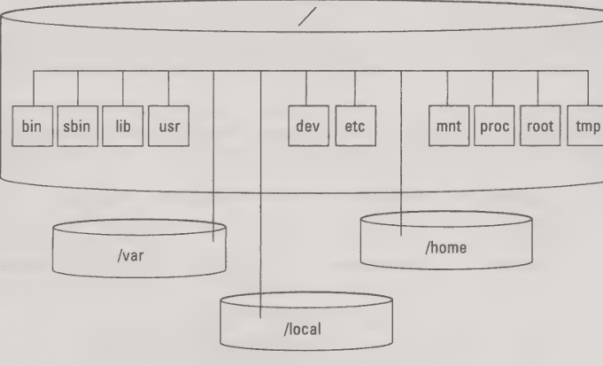

通用 Linux 目录树
4 个文件系统 (/home, /local, /var)

图 10-2：此 Linux 目录树具有四个文件系统

如果 Linux 树丢失一个分支，MS/DOS 仍然可以存活。对于 Linux 文件系统也是同样如此。如果根丢失，某些 Linux 文件系统都将无法访问。

# 第二部分 ♦ 开始系统管理


所有文件系统依赖于

## 你的计算机上有哪些可用文件系统？

不同的 Linux 系统可能支持不同的文件系统，这取决于你如何安装 Linux，以及是否修改了内核或加载了动态模块。文件系统要么内置在内核中，要么作为动态加载模块。

可加载模块是设备驱动程序，包括可以在运行时添加到内存中而不是永久构建到内核中的文件系统。第 28 章将介绍如何动态加载文件系统支持。

显示文件 `/proc/filesystems` 的内容以查找内核内置了哪些文件系统。以下示例显示了如何使用 `cat` 命令（在终端窗口或非图形控制台中）显示内置文件系统。你的输出取决于你是否从内核中添加或删除了文件系统。

```
## cat /proc/filesystems

ext2 nodev proc iso9660 nodev devpts
```

要确定计算机上激活了哪些可加载的文件系统，请列出内核版本对应的 `/lib/modules` 下子目录的内容。

> 注意：上述 `nodev` 选项意味着将设备特殊文件视为普通文件名，而不是与设备相关的特殊文件。

以下示例显示了如何通过在 `ls` 命令中插入正则表达式 '`uname -r`' 来列出可加载模块目录。反引号围绕着 `uname -r` 命令，它会展开为你的内核版本。

```
# ls -l /lib/modules/`uname -r`fs

total 842

-rw-r-- --1 root root 14824 27 1999 autofs.o

-rw-r-- --1 root root 6516 27 1999 infmt_aout.o

-rw-r-- --1 root root 3136 27 1999 binfmt_java.o

-rw-r-- --1 root root 6080 27 1999 binfmt_misc.co

-rw-r-- --1 root root 77665 27 1999 coda.o

-rw-r-- --1 root root 44662 27 1999 fat.o

-rw-r-- --1 root root 84788 27 1999 hfs.o

-rw-r-- --1 root root 13604 27 1999 hpfs.o

-rw-r-- --1 root root 50412 27 1999 lockd.o

-rw-r-- --1 root root 33526 27 1999 minix.o

-rw-r-- --1 root root 10413 27 1999 MS/DOS.o

-rw-r-- --1 root root 43449 27 1999 ncpfs.o

-rw-r-- --1 root root 44107 27 1999 nfs.o *
```


# 第二部分 - Linux 系统管理入门

提示：在在分区内选择的文件系统取决于具体情况。对于通用 Linux 操作和性能，最佳选择的文件系统是 `ext2fs`。然而，如果你需要管理跨操作系统共享的数据，请选择与数据兼容的外来文件系统。

## 决定你的新文件系统需要多少空间

文件系统所需的空间取决于用户计划存储什么类型的文件和数据。如果你正在创建一个程序员将在其中存储多个列表、二进制文件和测试数据的文件系统，请务必留出大量的额外空间。程序员通常需要的磁盘空间较少。你可以为普通用户（如使用上网浏览、读写邮件的用户）分配较少的空间。如果文件系统将存储应用程序数据文件，请务必咨询开发者以了解应用程序对空间的要求。例如，关系数据库系统通常需要足够的文件系统来支持大文件。

提示：关系数据库系统通常位于文件系统中。然而，可以在原始分区（raw partitions）中构建某些关系数据库。请与 DBA（数据库管理员）协作，查看数据库存储计划。

## 决定你的新文件系统需要哪些属性

当你创建文件系统时，可以设置属性，例如读写权限、普通用户是否可以挂载文件系统等。你也可以接受 Linux 默认选项，这些包括读写和允许 root 挂载。

## 挂载磁盘驱动器 – 硬件侧

当你购买新的磁盘驱动器时，请确保 Linux 支持它。

在 CD-ROM 上

书中附的 CD-ROM 包含了 Linux 硬件兼容 HOWTO。如果你在列表中没有找到驱动器，请浏览你所在发行版的网站以查看最新的硬件兼容列表。

在计算机中安装新驱动器后，启动 Linux 并查找 Linux 识别到你新磁盘的提示。消息的格式取决于你连接的是 IDE 还是 SCSI 驱动器。如果消息在屏幕上滚动得太快，请使用 `dmesg` 命令来查看它们，或者在系统日志中检查启动消息。如果你使用了 Linux 支持的硬盘和控制器，内核就能看到你的驱动器。

交叉引用：
第 28 章，“重建内核”描述了如何重新构建 Linux 内核。

## 挂载磁盘驱动器 – Linux 软件侧

在内核识别你的新硬件驱动器后，你需要确保为该新文件存在一个设备文件。

## 寻找存放文件系统的分区

当你创建文件系统时，需要找到一个分区来容纳它。如果你正在创建一个程序员将在其中存储多个列表、二进制文件和测试数据的文件系统，请务必留出大量的额外空间。程序员通常需要的磁盘空间较少。你可以为普通用户（如使用上网浏览、读写邮件的用户）分配较少的空间。如果文件系统将存储应用程序数据文件，请务必咨询开发者以了解应用程序对空间的要求。例如，关系数据库系统通常需要足够的文件系统来支持大文件。

## 使用 mke2fs 命令格式化（创建）新文件系统

将文件系统构建到分区类似于格式化 MS-DOS。你可以使用 `mkfs` 或 `mke2fs` 命令对分区格式化。

请确保你将新文件系统格式化到空分区。如果你在现有文件系统上格式化新文件系统，现有文件系统及其所有数据将被破坏。

`mkfs` 命令仅格式化 ext2fs 文件系统。`mke2fs` 的语法为

```
mke2fs [options] device [block-count]
```

其中 `device` 是要格式化的分区设备文件，`block-count` 是该设备的块数。指定 `block-count` 是可选的，因为 `mke2fs` 会自动计算文件系统的大小。其他 `mke2fs` 选项包括：

- -b 文件系统每个块字节数。
- -f 每个片段字节数（被 `mke2fs` 忽略）。
- -c 在创建文件系统之前检查设备是否有坏块。
- -i 每个 inode 管理的字节数。
- -n Linux 为 root 用户预留的 inode 数量（开销）。
- -m 稀疏标志百分比，取 1（开启）或 0（关闭）。在内核 2.0 或更低版本上不要“开启”（1）。只有部分 2.1 内核支持“开启”。所有 2.2 内核都支持“开启”。
- -v 显示详细信息。
- -L 为文件系统指定的卷标。
- -S 重新初始化块和组描述符。

对于我们的案例研究，我们需要一个 MS/DOS 类型的分区，用于存放我们可以在 Linux 和 MS-DOS 上均读取的文件。下面的示例在新的硬盘驱动器第 8 分区上创建了一个 MS/DOS 文件系统：

```
# mkfs -t msdos /dev/hdd8
```

1. 选择或创建一个空目录作为新文件系统的挂载点。 现在你你已经有了文件系统，但你需要让用户可以使用这些系统。你通过将它们挂载到现有的目录树中来实现这一点。Linux 目录树是一系列连接的文件系统的集合。这些文件系统可以是各种类型。`mount` 是将文件系统连接到 Linux 目录树。`umount` 是将一个文件从 Linux 目录树中断开。

*Unmounting*（卸载）并不是一个你在英语字典中能找到的单词。它源于 Linux 命令 `umount`，意思是 unmount 或 dismount。本书使用 unmounting 这一术语是为了提醒你不要在使用 `umount` 命令时输入 "un"。

当你将一个文件系统连接到 Linux 目录树时，将 `mount` 该文件系统挂载到一个名为 *mount point* 的目录中。Linux 的启动过程始终会将根文件系统挂载到 `/` 目录。

创建一个空目录作为文件系统的挂载点。Linux 允许挂载点目录包含文件。然而，如果你将一个文件系统挂载到一个包含文件的挂载点，你必须隐藏这些文件，直到你 `umount` 该文件系统。在文件之上挂载文件系统并不会破坏这些文件。

2. 使用 `mount` 命令将新文件系统挂载到 Linux 目录树中。`mount` 命令还会报告文件系统类型以及对这些生效的任何选项（只读、同步等）。你可能需要使用 `lsblk -l` 命令在 Linux 下查找任何未挂载的文件系统（它们可能没有列在你的 `/etc/fstab` 文件中）。Solaris 有一个类似的命令叫做 `prvtoc`（打印卷表内容）。

3. 使用 `mkdir` 命令在你新的文件系统中创建任何必要的子目录和文件。

4. 使用 `chown`、`chmod` 和 `chgrp` 命令在你新的文件系统中设置文件和目录的所有权和权限。

# 自动挂载文件系统

当 Linux 启动时，它会自动挂载文件 `/etc/fstab` 文件系统表 (`fstab`) 中列出的所有文件系统。你可以通过编辑 `fstab` 来控制本地和远程文件系统是否在启动时自动挂载。

# 自动挂载本地文件系统

当你安装 Linux 时，安装程序会创建 `fstab` (`/etc/fstab`)，指定系统启动时应该自动挂载哪些文件系统。以下是一个典型的 `/etc/fstab` 文件：

```
# /etc/fstab: 启动挂载的文件表。

#

# filesystem mount point fs type options dump pass
/dev/hda2 / ext2 defaults 0 0
/dev/hda3 none swap 0 0
/dev/cdrom /cdrom iso960ro 0 0
proc /proc proc defaults 0 0
```

> 前三行（以井号开头的）是注释。我喜欢插入列标题来提醒我正在看什么。

接下来的每一行都指定了一个在系统启动时要挂载的文件系统。`fstab` 中的每个条目由六列组成：

- Filesystem（文件系统）——存放文件系统的分区。
- Mount point（挂载点）——存放文件系统的目录。
- Fs type（文件系统类型）——文件系统的类型，如 swap、ext2fs 等。
- Options（选项）——特殊的挂载选项，如果有多个选项，则用逗号分隔。选项包括：
    - defaults——适用于大多数文件系统的默认选项。详细信息请参阅 `mount` 的 man 页。
    - errors=remount-ro——如果 `fsck` 发现错误，则以只读模式挂载文件系统。
    - sw——交换分区。
    - ro——只读。始终将 CD-ROM 挂载为 ro。
    - noauto——不要在启动时自动挂载该文件系统。此选项的效果等于没有在 `/etc/fstab` 中包含该文件系统。
    - user——允许任何用户挂载该文件系统。如果没有此选项，只有 root 可以挂载文件系统。
- Dump flag（dump 标志）——`dump` 命令是否创建文件系统的备份。0 或无值均表示不 dump（备份）该文件系统。
- Pass flag（pass 标志）——`fsck` 在启动时检查文件系统的顺序。0 或无值均表示不 `fsck` 该文件。

> 根文件系统 (`/`) 使用值 1，以便 `fsck` 优先检查它。其他系统使用 2。

# 第 10 章 管理文件系统和交换空间

虽然系统管理员应该挂载大多数文件系统，但你可能想通过以下 `fstab` 条目允许用户挂载软盘（floppy disk）：

```
/dev/fd0 /mnt/floppy vfat noauto,user
```


# 使用 `/mnt` 进行临时挂载

每次每次当你更换 CD-ROM 时，都需要卸载并重新挂载设备 (`/dev/cdrom`)。下面的示例将 CD 以 `iso9660` 格式和只读 (`ro`) 选项挂载到 `/mnt` 目录。

```
root@flyingpenguin# mount -t iso9660 -o ro /dev/cdrom /mnt
```

图 10-3 显示了 `root` 用户挂载 CD-ROM 之前和之后的挂载文件系统。

之前 (BEFORE)

```
root@flyingpenguin# mount /dev/hda1 on / type ext2 (rw) /proc /proc type proc (rw) /dev/hda5 on /local type ext2 (rw)
```

之后 (AFTER)

```
root@flyingpenguin# mount /dev/hda1 on / type ext2 (rw) /proc /proc type proc (rw) /dev/hda5 on /local type ext2 (rw)
```

例如，如果你的 `fstab` 文件损坏导致启动失败，你可以使用内置命令来编辑 `fstab` 文件并修复问题。内置命令以连字符（或减号）`-` 开头，以便与同名的普通 Linux 程序区分开来。例如，如果你输入 `ls`，你正尝试调用 `/bin/ls` 命令。输入 `-ls` 则意味着你想运行该命令的内置 shell 形式。表 10-1 列出了 shell 支持的内置命令。

## 表 10-1: 内置 shell 命令

| 命令 | 功能 |
| --- | --- |
| help | 显示内置命令列表及其用法。 |
| alias | 显示或定义命令的别名。 |
| aliasall | 为所有以连字符（-）开头的内置命令定义别名。 |
| unalias | 关闭指定的别名。 |
| cd | 切换工作目录。 |
| exec | 执行指定的程序并替换 shell。 |
| exit | 退出 shell。 |
| prompt | 显示提示符并读取输入。 |
| setenv | 定义环境变量。 |
| source | 在指定的脚本中执行命令。 |
| umask | 设置创建默认权限的掩码。 |
| -chattr | 更改指定文件的 ext2fs 属性。 |
| -chgrp | 更改文件的组 ID。 |
| -chmod | 更改文件权限（仅接受八进制权限）。 |
| -chown | 更改文件的所有者 uid。 |
| -cmp | 如果两个文件不同，则比较大小和字节数等文件属性。 |
| -cp | 复制文件。 |
| -dd | 复制文件（比 -cp 有更多选项和复杂性）。 |
| -echo | 回显提供的参数，展开通配符。 |
| -ed | 在行模式运行编辑器，而非全屏模式。 |
| -file | 显示文件类型和属性。 |
| -find | 查找符合命令选项指定条件的文件。 |
| -grep | 在文件中搜索模式。 |

## 表 10-1（续）

每个物理磁盘驱动器都有一个名称，指示其如何连接到计算机。设备名称如下：

- `/dev/hda` IDE 磁盘—主设备 (primary master)
- `/dev/hdb` IDE 磁盘—从设备 (primary slave)
- `/dev/hdc` IDE 磁盘—次主设备 (secondary master)
- `/dev/hdd` IDE 磁盘—次从设备 (secondary slave)
- `/dev/sda` SCSI 磁盘 1

## 第 10 章 管理文件系统和交换空间

`/dev/sdb` SCSI 磁盘 2
`/dev/sdc` SCSI 磁盘 3
...
`/dev/sdg` SCSI 磁盘 7
...

当磁盘被划分为分区时，Linux 设备名称会通过添加分区号来扩展。分区设备名称如下：

- `/dev/hda1` IDE 磁盘 1 上的第一个分区
- `/dev/hda5` IDE 磁盘 1 上的第五个分区
- `/dev/hdb2` IDE 磁盘 2 上的第二个分区
- `/dev/hdc6` IDE 磁盘 3 上的第六个分区

## 配置和分配磁盘配额

创建文件系统后，你可能决定限制用户或组可以使用该文件系统的量。你可以通过分配磁盘配额来实现这一点。

尽管 Linux 称之为磁盘配额，但这些配额对文件系统的使用是真实存在的。

## 检查内核是否支持配额

在分配磁盘配额之前，你需要内核支持配额。几乎每个 Linux 发行版都包含了内核对磁盘配额的支持，但你应该进行健全检查以绝对确保存在配额支持。如果你是从源码编译内核，在运行发行版自带的内核配置工具时回答 `CONFIG_QUOTA` 选项。

## 磁盘规则 #1

无论你有多少磁盘空间，用户填满它的都会比你预计的快。
磁盘配额限制了每个人可以使用的磁盘空间。你可以按用户或按组来限制磁盘空间。例如，如果你知道程序员保留了大量旧（未使用的）文件副本，你可以限制单个程序员的特定空间。你可以将所有程序员加入一个组，限制整个组的可用空间，让程序员在组内部解决空间使用问题。

## 检查你是否安装了配额包

大多数发行版都包含了配额包。与内核支持一样，进行健全检查以确保包存在是值得的。你可以使用你发行版的包管理器进行检查。以下示例使用 `rpm -qa` 查询所有已安装的包，并通过 `grep` 管道输出来搜索 `quota` 字符串。

```
root@flyingpenguin# rpm -qa | grep quota
-1.66-11
```

## 为配额配置文件系统

尽管被称为“磁盘配额”，但你是在以文件系统为单位强制执行配额的。你可以通过编辑 `/etc/fstab` 中的文件系统条目来实现。你还必须为 `/home` 目录下的每个组或用户创建配额文件。列表所示 `touch` 命令创建文件，`chmod` 命令为组配额和用户配额都设置 `rw` 文件权限。

## 包管理器

记住 Linux 为你提供了多种完成工作的方法。某些发行版同时提供 `rpm` 及其它们自己的包管理器。例如，前一个示例中使用了来自 twenty（一个 Calder OpenLinuxServer）的 `rpm` 命令。接下来的示例来自同一台计算机在 COAS 下运行的图形化包工具。


```
root@flyingpenguin# touch /home/userquota
root@flyingpenguin# chmod 660 /home/userquota
```

## 管理磁盘配额

管理磁盘配额涉及监控用户使用的空间、启用和禁用配额以及设置配额值。

## 启用和禁用配额

你使用 `quotaon` 和 `quotaoff` 命令开启和关闭配额。语法如下：

```
root@flyingpenguin# quotaon -v /dev/sda1
root@flyingpenguin# quotaoff -v /dev/sda1
```

`quotaon` 命令启用指定的泛系统。`quotaoff` 命令禁用配额。

## 表 10-2: quotaon 和 quotaoff 选项

| 命令 | 选项 | 功能 |
| --- | --- | --- |
| quotaon | -a | 启用所有文件系统。 |
| | -v | 显示消息。 |
| quotaoff | -a | 禁用所有文件系统。禁用用户。 |

## 为用户和组分配配额

使用 `edquota` 命令为用户和组设置配额。只有 `root` 可以分配配额。`edquota` 命令从配额文件中读取配额定义并运行你的默认编辑器（`EDITOR` 变量）以便你编辑。由于配额文件是机器读格式，你必须使用 `edquota` 命令来编辑它们。`quota` 命令的唯一选项是 `-u`（用户）和 `-g`（组）。

```
root@flyingpenguin# edquota /user.quota
```

Quotas for user kendunca
`/dev/sda2`: blocks in use: 0, limits(soft = 0, hard = 0)
inodes in use: 0, limits(soft = 0, hard = 0)

```
"/tmp/EdP.aTQjGBh" 3 lines, 130 characters
```

# 第10 章 ♦ 管理文件系统交换空间

注意：在硬限制和软限制旁编辑字段可能会导致配额文件损坏。

如果你想限制用户可以存储的文件数量，而不是用户可以占用的空间大小，请为 `inode` 设置配额。`inode` 是指向文件的文件系统结构。如果一个用户的配额为 100（文件指针），那么在启用了配额的文件系统中，该用户拥有的文件不能超过 100 个，无论其占用的空间使用情况如何。系统管理员可以编辑 `kendunca` 的条目，如下所示：

```
Quotas for user kendunca


`/dev/hda2` blocks in use: 0, limits(soft = 1000, hard = 512)

inodes in use: 0, limits(soft = 10 , hard = 5)

-- INSERT --

在系统管理员保存配额文件并运行 `quotacheck` 命令后，用户 `kendunca` 可以使用 512 到 1000 个磁盘块来创建 5 到 10 个文件。

注意：通常做法是将配额设置在磁盘块上，并将 inode 配额留为 0（无限制）。

## 检查配额使用情况

任何用户都可以通过 `quota` 命令检查自己使用了多少空间。root 用户可以使用 `quota` 命令的 `-u` 选项检查任何用户的配额。`quota` 命令显示用户的硬限制和软限制，以及用户当前使用了多少个 1024 字节的磁盘块。见下面的示例。

```
kendunca@tweet1$ quota

Disk quotas for user kendunca (uid 502):

Filesystem blocks quota limit quota limit grace

/dev/hda2 1772 1000 1500 none 6 0 0
```

`repquota` 程序可以手动生成如下的配额使用报告：

```
root@tweet1$ repquota -vau
```

`quotacheck` 程序扫描文件系统，查找受配额限制的用户和组的文件及目录，并更新配额文件。作为 root 用户，你应该在 Linux 启动过程的一部分自动运行 `quotacheck`，以保持你的文件是最新的。你也可以手动运行 `quotacheck`，如下例所示：

```
root@tweet1$ quotacheck

Scanning /dev/hda2 [/]

Checked 1680 directories and 24020 files

Using quotafile/quota.user

Updating in-core user quotas

Using quotafile/quota.group
```

`quotacheck` 程序的选项与其他配额程序的选项相同：`-a`、`-v`、`-u`、`-g`。`quotacheck` 还结合 `-a` 使用 `-R` 选项（检查 `/` 以外的所有文件系统），以及 `-d` 选项显示调试信息，例如 inode 和硬链接信息。

## 在启动时设置自动配额检查

你应该自定义 Linux 初始化过程，以便系统每次启动时都会启用配额，并检查超出配额的用户。某些发行版会在启动时自动检查并开启配额。例如，CalderaOpenLinux 和 Red Hat Linux 就执行此操作。查看 `/etc/rc.d/*quota` 文件可以查看在启动和用户运行级别执行的完整脚本。

大文件可能会失败，因为它们使用的空间超过了用户磁盘配额的允许。如果用户经常遇到问题，你需要增加他们的配额或禁用磁盘配额。另一种变通方法是下载到 `/tmp` 目录。然后你可以将文件移动到另一个目录。记住 Linux 启动过程会清理 `/tmp`，因此下载的文件可能会消失。另一方面，如果你的服务器是一个通常处于运行的系统，`/tmp` 中过多的下载文件可能会填满你的系统。

## 什么是文件系统不是文件系统？

`/proc` 是虚拟文件系统，因为它只存在于内存中。它不占用磁盘空间，但行为类似于任何其他文件系统。下面的示例显示了 `/proc` 的列表。

```bash
[/proc] ls

1 420 4812 5146 cmdline Interrupts mdstat pci sys

2 433 4813 525 cpuinfo ioports meminfo rtc tty

3 440 4814 526 devices kcore misc scsi uptime

4 399 4487 5325 dma kmg self version

5 466 5 528 fs vsms mounts slabinfo

6 472 4140 5310 filesystems loadavg mtr sound

7 412 4810 5132 fs locks net stat

8 411 4811 5135 ide mca partitions swaps
```

带数字的文件名在每台计算机上都是不同的。这些数字代表执行 `ls` 命令时正在计算机上运行的进程目录。下一个列表显示了进程 5132 的目录列表。每个文件都存储了操作系统用于跟踪进程的信息。例如，`cmdline` 文件记录了启动进程的命令行。`cwd` 文件包含指向进程 5132 当前工作目录的链接。`status` 文件跟踪进程 ID (`PID`)、父进程 ID (`PPID`)、进程正在使用的 shell 进程、进程状态、进程的用户 ID (`UID`) 和组 ID (`GID`)，以及进程内存使用情况 (`Vm`)。下一个列表显示了进程 5132 的 `status` 文件内容。表 10-3 描述了 `/proc` 中某些文件的含义。

```bash
[/proc]$ ls 5132

cmdline cwd environ maps root stat
```


*(注：由于原文未提供表 10-3 的具体内容，此处仅保留代码块结构)*

# 你应该将交换空间放在哪里？

理想情况下，将交换分区（分区）放在哪里并不重要，因为理想情况下你的系统不会进行交换。但对于现实世界中的大多数系统管理员来说，交换空间的位置会影响系统性能，特别是磁盘 I/O 性能。为了获得最佳性能，可以将交换空间分布在具有不同控制器的不同硬盘的多个分区上。如果你无法将交换分区放在单独的硬盘上，次优解决方案是将交换分区放在一个磁头多且空闲的快速磁盘上。

# 2.4 内核的新文件系统特性

2.4 内核具有若干项新特性，增强了对文件系统的支持。
以下列表列出了关键变化。

- *设备*（在第 8 章中讨论）传统上在 `/dev` 文件系统中需要数百个条目，并且具有奇异的，例如 `/dev/hd01440` 和 `/dev/midi0`。一种名为 `devs` 的新可选文件系统减小了该目录的大小，将设备名称组织到易理解的目录中（例如用于 IDE 设备的 `/dev/ide`），并使单个设备的名称更易理解。例如，在旧的 `/dev` 设备组织方式下，第一块 IDE 磁盘上的第一个分区 `/dev/hda1`，在 `devs` 中变成了 `/dev/ide/host0/bus0/target0/luno0/part1`。
- HPFS（OS/2 文件系统）现在是可写了。
- 内核现在支持原始设备（raw devices）——即未格式化的磁盘或分区。读取和写入原始设备不需要内核的缓冲层，而是直接在设备上进行。此特性通常由高性能数据库管理系统使用（如 Informix 和 Oracle），以提供极快的 I/O 速度。除了更好的性能外，原始设备还提高了数据可靠性，因为它们允许数据立即写入磁盘，而无需等待缓冲区缓存刷新。

## 总结

本章讨论了如何使用 `mke2fs`、`e2fsck` 和 `mount` 命令创建和管理文件系统。它还解释了 `/etc/fstab` 文件的关键作用，以及用于控制用户何时、如何以及是否可以访问给定文件系统的可用选项。通过配额系统（quota system），你学习了如何限制用户在文件系统上使用的磁盘空间。最后，你学习了 `/proc` 文件系统，它存储了关于运行中的 Linux 系统的重要信息。

# 备份和恢复文件系统

定期备份是任何计算机所有者可以做的最重要的工作之一。尽管你使用的是 Linux，你仍可能因为硬件故障、停电、意外问题以及最常见的用户错误而丢失文件。如果你存储了可靠的备份，你就可以从任何情况下恢复，即使自然灾害摧毁了计算机。Linux 提供了三种满足不同需求的备份工具。

## 备份术语

在深入学习本章之前，你应该理解几个术语：

- 全备（Full backup）：整个文件系统的存档，通常使用 `dump` 命令创建。
- 增量备份（Incremental backup）：仅备份上次备份以来更改的文件存档，同样使用 `dump` 命令创建。
- 个人备份（Personal backup）：用户创建的其所属的文件和/或目录存档，通常使用 `tar` 创建。
- 镜像备份（Image backup）：硬盘上镜像的逐位备份，通常使用 `cpio` 创建。
- 存档（Archive）：一个包含其他文件副本的文件。存档文件还存储了关于存档中每个文件的所有者、日期时间戳和权限的控制信息。

## 制定备份策略

由于备份文件系统如此重要，大多数站点都需要一份记录在案的备份策略。这样当你去度假时，你知道你的替代者可以继续保持你站点文件系统的可用性和可恢复性。在设计站点备份策略时，你需要回答以下问题：

- 你多久执行一次全备？
- 你会使用 `dump` 执行 ext2fs 备份吗？`dump` 的功能与 `tar` 类似，是 Linux 和 UNIX 环境中制作备份的传统工具。
- 你会用增量备份来补充全备吗？
- 你将使用什么备份介质？备份设备的特殊设备文件名是什么？

- 硬盘
- 磁带驱动器
- SCSI
- IDE
- 光盘（CD-ROM）
- Iomega Zip 和 Jaz 驱动

- 你将如何自动化备份过程？
- 你将使用哪些备份工具？
- 备份存档需要多少存储空间？
- 你会在外部站点存储一份防火的备份存档副本吗？在许多情况下，这样做是一个好主意。事实上，在某些行业（如银行和保险业），法律要求维护防火的离线备份。
- 如果你备份的不是 ext2fs 文件系统，你将使用哪个程序？

检查硬件兼容性列表（Hardware-HOWTO）以确保你的介质在列表中。最新的硬件可以在许多网站找到。主站点是 Linux 文档项目主页：http://www.linux.org/help/ldp/howto/Hardware-HOWTO.html。

要获取最新的兼容性列表，请访问网络上的 Linux 数据库（LhD）：http://lhd.datapower.com/。LhD 是运行 Linux 的硬件的兼容性和性能评级库。LhD 还包含有关设备驱动程序的信息以及让设备在 Linux 上运行的提示。

# 使用 cpio (拷贝入/出)

`cpio`——拷贝入/出——是一个程序。你可以在三种模式之一运行 `cpio`：

- 拷贝出（Copy-out）：创建存档。
- 拷贝入（Copy-in）：从存档中提取文件。
- 通过（Pass-through）：结合拷贝出和拷贝入。

## 创建存档（拷贝出）

当你使用 `cpio` 的拷贝出模式创建存档时，你向命令提供文件列表和一个存档文件。由于 `cpio` 默认从 `stdin`（键盘）读取，将文件传递给存档的方法是将目录列表的输出通过管道（|）传递给 `cpio` 命令。要在设备上创建存档，只需将输出重定向（>）到设备。

```
ls | cpio -ov > bitmaps.io
```

如果存档太大无法放入单个软磁盘，`cpio` 将提示你插入下一个软磁盘。

```
ls | cpio -ov > /dev/fd0
```

使用 `file` 命令检查存档，确保其确实是一个 cpio 存档：

```
file bitmaps.cpio
```

# 从存档中提取文件（拷贝入）

当你使用 `cpio` 的拷贝入模式从存档中提取文件时，它尝试将文件存放在当前工作目录。下面的示例将默认目标改为 `/root/bmp`。

```
cd /root/bmp
cpio -iv < ../bitmaps.cpio
```

除非在命令行中包含选项，否则 `cpio` 不覆盖现有文件。注意以下示例中的信息：

```
cpio -iv < ../bitmaps.cpio
```

你向命令提供文件列表和一个存档文件。由于 `cpio` 默认从 `stdin`（键盘）读取，将文件传递给存档的方法是将目录列表的输出通过管道（|）传递给 `cpio` 命令。

```
ls | cpio -iv
```

# 拷贝目录树（通过模式）

通过模式允许你从一个位置向另一个位置拷贝每个目录树，包括子目录和文件。通过模式还会保留原始的文件所有权权限。当你需要移动整个或文件系统的大部分到另一个分区时，通过模式特别有用。例如，在 flyingpenguin 上，我将这本书的所有文件都存在根文件系统的 `/root/book` 目录。图 11-1 显示了一个即将填满分区的文件系统以及该问题的解决方案。

## 第 11 章 文件系统的备份与恢复

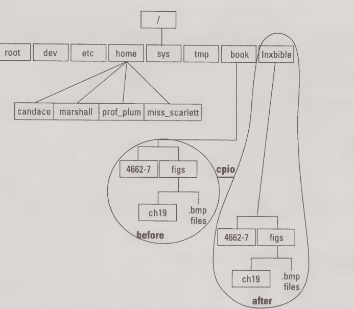

图 11-1：使用 cpio 将目录或子目录树移动到另一个文件系统

以下命令将 `book` 目录树移动到 `/docs/lnbible` 目录树中。第一条命令使用 `find` 配合 `-print` 选项，将 `book` 目录路径上的每个完整文件名逐行列出。管道符后的 `cpio` 命令使用了三个选项：

- -v 以详细模式列出 cpio 的执行进度。
- -d 根据需要创建子目录（例如 `/lnbible/book/figs`），以匹配原始的子目录结构。
- -p 以直通模式下运行。

```
root@flyingpenguin# pwd
/root
root@flyingpenguin# find book* -print | cpio -vpd /lnbible
lnxbible/book/4662-7
lnxbible/book/4662-7.fig makeconfig.txt
lnxbible/book/figs
lnxbible/book/figs/7645-4662-7-fig27-1.bmp
lnxbible/book/figs/7645-4662-7-fig27-2.bmp
lnxbible/book/figs/7645-4662-7-fig27-3.bmp
lnxbible/book/figs/* mountfloppy.bmp
```

```
lnxbible/book/figs/gimp1.bmp
lnbible/book/figs/gimp2.bmp
lnbible/book/figs/gimp3.bmp
lnbible/book/figs/ch19
```


`lnbible/book/figs/ch19/firstscript.bmp`

`lnbible/book/figs/ch19/4662-7-ch19.txt`

`lnbible/book/figs/ch20/4662-7-ch20.doc`

`lnbible/book/figs/ch20/4662-7-ch20.txt`

`lnbible/book/figs/ch22/4662-7-ch22.doc`

`lnbible/book/figs/ch22/4662-7-ch22.xls`

---- output edited ----

`cpio` 的每种模式都有其特定的命令选项。请参阅随书附带 CD 中的页面获取每个模式下每个选项的描述。

你可以使用 `cpio` 处理各种格式的归包，包括 ASCII、二进制、HPUX 二进制和 Posix 格式。`cpio` 还支持 `crc` 格式——即带有用于文件校验的校验的 ASCII 格式。`cpio` 也支持其他一些格式。当您需要与旧系统之间传输文件时，这非常有用。


## 使用 tar（磁带归档器）

尽管名为磁带归档器（tape archiver），`tar` 也可以用于在许多存储设备上创建备份。在 Linux 上使用 `tar` 与在 UNIX 上使用 `tar` 类似，区别在于 Linux 提供了 GNU `tar`，它具有更多选项并可以动态压缩文件。第一个 `tar` 选项必须是 `A`、`c`、`d`、`r`、`t`、`u` 或 `x` 之一。然后列出任何其他选项，最后是用于归档的 `tar` 文件或设备，以及要归档的文件或目录。

表 11-1 仅描述了 `tar` 的部分命令选项——那些用于个人备份的选项。


第 7 章描述了如何从 `tarball`（软件供应商创建的 `tar` 归档）安装软件。如需更完整的 `tar` 选项列表，请参第 7 章。

| 表 11-1 | 个人备份有用的 tar 选项 |
| 选项 | 描述 |
| --- | --- |
| v | 显示详细信息。 |
| c | 创建归档。 |
| f | 指定要读取或写入的归档名称（或设备特殊文件）。 |
| t | 列出归档的内容。 |

| 选项 | 描述 |
| --- | --- |
| z | 告诉 tar 归档是压缩的。 |
| X | 从归档中提取文件。 |
| u | 用比 tar 更新的文件更新归档。 |
| r | 向现有归档追加更多文件。 |
| A | 向归档中追加 tar 文件。 |
| d | 列出归档内容与文件系统之间的差异。 |

以下示例使用 `c`、`v` 和 `f` 选项在 `/tmp` 中创建一个名为 `bitmaps` 的归档。该归档包含 `/root` 目录下所有以 `.bmp` 结尾文件的压缩版本。

```
miss_scarlet@flyingpenguin tar czvf /tmp/bitmaps/root/*..bmp

tar: Removing leading "/" from archive names

root/27atallow.bmp

root/fg1501.bmp

root/fg1502.bmp

root/fg1504.bmp

root/fg1505.bmp

root/fg1506.bmp

root/fg1507.bmp

root/fg1509.bmp

root/fg1510.a.bmp

root/fg1510.b.bmp

root/fg1510.c.bmp

root/fg1510.d.bmp

root/fg1511.bmp

root/fg1512.bmp

root/fg1513.bmp

root/fg1514.bmp

root/fg1502.bmp

root/bashrc01
```

该归档包含了 `/root` 目录下所有以 `.bmp` 结尾的压缩版本。


`root/fg1506.bmp`

`root/fg1507.bmp`

`root/fg1509.bmp`

`root/fg1510.a.bmp`

`root/fg1510.b.bmp`

`root/fg1510.c.bmp`

`root/fg1510.d.bmp`

`root/fg1511.bmp`

`root/fg1512.bmp`

`root/fg1513.bmp`

`root/fg1514.bmp`

`root/fg1502.bmp`

`root/bashrc01`

# 表 11-2（续）

| 选项 | 描述 |
|---|---|
| `u` | 更新 `/etc/dumpdates`。 |
| `b n` | 块大小 `n`；每个 dump 记录的 Kbytes 数量。 |
| `B n` | 每卷的 dump 记录数 — `n` —；覆盖 dump 根据长度和密度对磁带大小的自动计算。 |
| `c` | 使用盒磁带默认值，8000 bpi，1700 英尺磁带。 |
| `d int` | 将密度设置为指定的整数；默认为 1600BPI。 |
| `f file` | 备份设备，可以是设备特殊文件，或者是用于存储 dump 存档的磁盘文件；也可以是远程设备或文件。 |
| `T date` | 不在 `/etc/dumpdates` 中查找，而是使用指定的日期作为起始时间。 |
| `W` | 读取 `/etc/dumpdates` 和 `/etc/fstab` 以查看哪些文件应该备份。显示这些文件。 |

## 备份到磁带设备

请记住，当你备份到一个可能具有多个设备特殊文件的单磁带设备时，需要由你来指定符合你需求的设备特殊文件。例如，如果你计划使用两个 `dump` 命令将两个文件系统备份到同一块磁带，则需要在第一个 `dump` 命令中使用 `no-rewind` 不回绕）磁带设备。如果你忘记了设备特殊文件名中的 `n`，磁带会自动回绕，你的第二个 dump 存档将覆盖第一个。以下示例显示有六个设备特殊文件代表一个流式磁带设备。文件 `/dev/nqft0` 返回不回绕的软磁带设备。

```
root@flyingpenguin# file /dev/*qft0*
/dev/nqft0: character special (27/4)
/dev/rawft0: character special (27/36)
/dev/nqft0: character special (27/20)
/dev/qft0: character special (27/0)
/dev/rawqft0: character special (27/32)
/dev/zqft0: character special (27/16)
```

以下命令将 `flyingpenguin` 上的 `/local` 文件系统备份到不回绕的流式磁带设备：

```
root@flyingpenguin# dump -Ouf /dev/nqft0 /local
```

有关磁带特殊文件和特性的更多信息，请参见第8章“管理设备”。


以下命令将 `/local` 文件系统备份到第一个 SCSI 磁带驱动器，并在 dump 完成时回带驱动器：

```
root@flyingpenguin~ dump -Ouf /dev/st0 /local
```

## 备份到磁盘文件

以下 `dump` 命令创建了一个 0 级备份 (`-0`)，更新了 `/etc/dump-files` (`u`)，设置“磁带”长度为 50000 (`-s 50000`)，备份到文件 (`-f /root/localfsdump`)，并备份到本地文件系统。

```
root@flyingpenguin~ dump -Os 50000 -f /root/localfsdump
DUMP: Date of this level 0 dump: Sat Jul 29 07:41:20 2000
DUMP: Date of last level 0 dump: the epoch
DUMP: Dumping /dev/hda5 (/local) to /root/localfsdump
DUMP: (Pass I) [regular files]
DUMP: (Pass II) [directories]
DUMP: estimated 65414 tape blocks on 0.77 tape(s).
DUMP: Volume 1 started at: Sat Jul 29 07:41:43 2000
DUMP: dumping (Pass III) [directories]
DUMP: (Pass IV) [regular files]
DUMP: 53.19%, finished in 0:04
DUMP: 655359 tape blocks on 1 volume(s)
DUMP: finished in 563 seconds, throughput 1164 KB/s
DUMP: Volume 1 completed at: Sat Jul 29 07:51:06 2000
DUMP: Volume 1 transfer rate: 1164 KB/s
DUMP: level 0 dump: Sat Jul 29 07:41:20 2000
DUMP: Date of this level 0 dump: Sat Jul 29 07:51:06 2000
DUMP: Average transfer rate: 1164 KB/s
DUMP: Closing /root/localfsdump
DUMP: IS DONE
```

当将此存档写入磁盘文件时，为什么要指定级别？
`dump` 的默认选项是面向磁带的。如果没有提供磁带选项，`dump` 假设你正在备份到一种古老的 1600 bpi（每英寸位数）磁带上，并根据该默认磁带驱动器进行卷估算。当我尝试将 `/local` 文件系统备份到磁盘文件时，`dump` 起初估计我需要 17 卷这种古老的磁带，并且在备份（到磁盘）了足够填满一卷磁带的量后提示：

```
DUMP: Change Volumes:
DUMP: Is the new volume mounted and ready?: "yes" or "no"
```

由于我不想对该提示响应 17 次，我中止了备份。

## 备份到远程设备或文件

当使用 `-f` 选项时，可以指定设备或文件：

```
dump -f device
```

# 第二部分 Linux 系统管理入门

```
DUMP: level 2 dump on Sat Jul 29 13:19:23 2000
DUMP: DUMP: Date of this level 2 dump: Sat Jul 29 13:19:23 2000
DUMP: DUMP: Date of this dump completed: Sat Jul 29 13:19:23 2000
DUMP: DUMP: Average transfer rate: 0 K/s
DUMP: Closing /root/incremental_localfs2
DUMP: ISUMP DONE
```

```
root@flyingpenguin~ dump -3uf /root/incremental_localfs3 /local
DUMP: Date of this level 3 dump: Sat Jul 29 13:21:10 2000
DUMP: Date of last level 2 dump: Sat Jul 29 13:19:23 2000
DUMP: Dumping /dev/hda5/(local) to /root/incremental_localfs3
```


## 恢复文件系统、目录和文件

`restore` 是 `dump` 的伴侣工具，唯一的区别在于：`dump` 仅备份整个文件系统；而 `restore` 可以从 `dump` 归档中恢复完整的文件系统、目录或任意数量的文件。你可以使用 `restore` 命令，除了 `-f`（指定要恢复的设备）外，不需要任何其他选项。`restore` 的交互模式（`-i`）允许你使用 `ls`、`cd` 和 `pwd` 等命令在归档中移动。当你想要选择一个要恢复的文件时，在提示符处输入 `extract`。当你选好要恢复的文件后，输入 `extract` 开始恢复文件。以下示例使用了交互选项来从备份的文件系统中查找、添加并提取文件。

## 交互式恢复文件

以下示例使用了交互选项来列出、添加并恢复（提取）一个文件到当前工作目录中。

```
root@flyingpenguin# restore -ivf /root/incremental_localfs3

Verify tape and initialize maps

Tape block size is 32

Dump: Sat Jul 29 13:21:10 2000

Dumped from: Sat Jul 29 13:19:23 2000

Level 3 dump of /local on flyingpenguin.cardconsulting.com:/dev/hda5

Label: none

Extract directories from tape

Extract directories from tape

Initialize symbol table.

restore > ls

:

2 / .. 12 passwd

restore > add passwd

restore > extract

Extract requested files

You have not read any tapes yet.

Unless you know which volume of your file(s) are on you should start

with the last volume and work towards the first.

Specify next volume #: 1

extxtract file ./passwd

Add links
```

Set directory mode, owner, and times.
set owner/mode for '.?' [yn] n
restore > quit

> 再次，`restore` 假设你的 `dump` 归档在磁带上，即使你指定了一个文件。这就是为什么你使用 `restore` 来指定一个卷。

## 恢复完整文件系统

以下示例恢复了在“备份到磁盘文件”节中执行的 `/local` 文件系统的完整备份。`restore` 命令使用 `-C` 选项读取 `dump` 归档，并将其内容与磁盘上已存在的文件进行比较。`restore -C` 在将其工作目录切换到被备份的文件系统根目录（`/local`）之前，会比较磁带与文件。

```
# restore -Cvf /root/localfsdump

Begin compare restore

Verify tape and initialize maps

Block size is 32

Dump date: Sat Jul 29 07:41:20 2000

Dump from: the epoch

Level 0 dump of /local on flyingpenguin.cardinalconsulting.com:/dev/hda5

Label: none

filesys=/local

Initialize table.

Extract directories from tape

Extract directories from tape

comparing /communicator-v461-export.x86-unknown-linux2.0.tar (size:14305280, mode:06444)

restore :/save/domino-1999607/old-installation: does not exist (-): No such file or directory

comparing .Dominoits/linux_na.tar (size: 12939776, mode: 0100644)

comparing .notesdata/mail/jirk.msk; size: 6029312, mode: 0100600

Check the symbol table.
```

`restore` 命令在提取文件时会写入当前目录。在运行 `restore` 之前，请确保已 `cd` 到正确的目录。如果你正在运行交互模式，可以在交互式微型 shell 中使用 `cd` 命令。

## 从多个卷恢复归档

由于你可以将 `dump` 归档写入单条磁带，因此你可能需要使用 `mt` 命令来为磁带定位。例如，当你需要恢复磁带上的第二个归档时，使用如下代码中的 `mt` 命令将磁带（`/dev/nrst0`）定位到第二个 `dump` 归档的开头。`-f` 选项告诉 `mt` 设备特殊文件名。要移动磁带，使用 `fsf` 选项后跟向前移动的文件数。

```
root@flyingpenguin# mt -f /dev/nrst0 fsf 1
```

## 使用 mt 控制磁带驱动

`mt` 命令是磁带控制程序。`mt` 命令支持多种选项。下面列出的选项对于执行 `dump` 和恢复最为有用。`mt` 的语法如下：

```
mt [-h] [-f device] operation [n] [arguments...]
```


下表列出了几个选项：

| 选项/操作 | 描述 |
| :--- | :--- |
| h | 列出操作（极简）。 |
| fsf n | 向前移动 n 个文件。 |
| bsf n | 向后移动 n 个文件。 |
| asf n | 回退并将磁带定位到第 n 个文件。 |
| offline | 回退并卸载磁带。 |
| erase | 擦除磁带。 |
| status | 显示磁带状态。 |
| load | 将磁带载入驱动器。 |
| lock | 锁定驱动器。 |
| unlock | 解锁驱动器。 |
| set density | 设置 SCSI 磁带密度为 n。 |

如果你定义了 `TAPE` 变量，`mt` 命令将该设备作为默认设备。如果你没有定义 `TAPE`，`mt` 使用 `/dev/tape` 作为默认设备。你无法使用 `mt` 命令在远程设备上定位磁带。

## 调度 dump 级别

本节介绍了如何使用 `dump` 创建更细粒度的备份，并建议了一种使用 `dump` 的备份策略。

### 使用所有级别节省备份时间

`dump` 命令支持多达 10 个不同的备份级别。级别 0 是完整备份。许多站点每周安排一次完整备份，并辅以每日备份。制定备份策略时的一个主要考虑因素是对每个文件系统执行完整和增量备份的频率以及级别。例如，一个开发编译器和工具的真实系统可能包括分布在不同磁盘上的八个文件系统。表 1-3 描述了每个磁盘发生的活动以及相应的备份计划。

### 表 1-3 文件系统

| FS | 活动 | 备份频率 | 增量备份 |
| :--- | :--- | :--- | :--- |
| / | 很少更新。 | 每月 | 每日 |
| /local | 很少更新。 | 每月 | 只有当... |
| /tmp | 临时文件。 | 从不 | 从 |
| /usr | 只读文件。 | 仅当升级时 | 从不 |
| /var | 取决于系统管理员。 | 每周 | 每日 |
| /user1 | 开发 cc 项目的程序员主目录。 | 每周 | 每日 |
| /user2 | 开发 editor 项目的程序员主目录。 | 每周 | 每日 |
| /user3 | 开发 FORTRAN 项目的程序员主目录、共享 FORTRAN 项目文件、包括管理层在办公室人员（大多数电子邮件）。 | 每周 | 每日 |

表 1-3 显示四个文件系统需要每周备份和每日增量备份。他们每周调用一次级别 0 `dump`，每天调用一次高于 0 级别的 `dump`。由于这些是大文件系统且备份需要几个小时，系统管理员决定错峰备份计划：周一备份 `/user1`，周二备份 `/user2`，周三备份 `/user3` 等。你对何时执行完整备份的决定可能与此策略不同。例如，如果你有多个介质，可以在同一天在不同的设备上并行执行所有备份。如果你的文件系统很小，备份只需要一两个小时，你也可以选择在同一天执行完整备份以使备份策略更简单。你的选择取决于你工作的环境。

**提示**：某些具有中小型文件系统和快速备份设备的站点每天执行完整备份，从而消除了执行和组织增量备份的需要。如果你在周一晚上执行增量备份以获取自周日以来的更改，你可能进行级别 2 备份。如果你在周二对自周一以来的新文件执行另一个增量备份，你可能选择级别 4。你可能会选择周三级别6。实际数字并不重要。重要的事实是后一个增量备份的编号比前一个高。如果你不使用 2、4、6，你可以使用 1、2、3 或 7 和 8。只要数字是增加的，任何方式都可行。

让我们看看当需要执行恢复时，上述多级别方案会发生什么。你在周日执行一次级别 0（完整）`dump`，周一执行级别 1 `dump`，周二执行级别 2 `dump`，周三执行级别 3 `dump`，周四执行级别 4 `dump`。使用所有数字的优势是每个每日增量 `dump` 都可能很小，占用极少的时间和磁带。周五，Plum 教授误删了他的整个主目录。作为系统管理员，你的工作是将主目录恢复到最后一次 `dump`（周四的级别 4）之后的状态。你必须遵循以下步骤：

- 1. 从周日的级别 0（完整）`dump` 恢复 Plum 教授的主目录。
- 2. 从周日的级别 1 `dump` 恢复他的主目录。
- 3. 从周二的级别 2 `dump` 恢复他的主目录。
- 4. 从周三的级别 3 `dump` 恢复他的主目录。
- 5. 从周四的级别 4 `dump` 恢复他的主目录。

> 如果 Plum 教授在周五恢复之前在他的目录下创建或修改了任何文件，他必须重新创建它们。这些文件在任何 `dump` 中都是不可用的。

因此，将 Plum 教授的主目录恢复到最后一次 `dump` 的状态需要按照正确的顺序执行五次恢复操作。这种依赖于多级别 `dump` 的恢复类型是非常耗时的。此外，恢复过程中的步骤越多，人为错误（你的错误）的可能性就越大。

### 使用少数级别更安全、高效地管理恢复

如果你在 `dump` 策略中仅使用几个级别（例如级别 0 和另一个级别），那么对于活跃更新的文件系统，执行每日增量备份的时间每天都会增加。然而，当你需要恢复时，这可以节省时间和精力。例如，与其在每个每日 `dump` 上都增加级别号，你可以选择每个工作日使用相同的级别。这样周日的完整备份仍然是级别 0，但每日备份将使用相同的级别——任何大于 0 的级别都可以。假设你对周一到周四的每日备份使用级别 7。

现在正在执行大规模备份。这意味着周一的每日转储记录了自周日完整备份以来的更改。周二的 7 级每日记录了自周日完整备份以来的所有更改（包括周一的更改）。周二之后，周一的 7 级备份就不再需要了。周三的 7 级每日记录了自周日完整备份以来的所有更改（包括周一和周二的更改）。周三之后，周一和周二的备份就不再需要了。你同样在周四执行 7 级每日备份。周日与每天之间的差异都比前一天大。当周五你需要恢复梅教授的家目录时，你只需要从周日的完整备份（0 级）和周四的每日差异（7 级）进行恢复。恢复速度会更快，因为只有两次操作，人为错误影响恢复过程的风险也更小。

### 使用商业备份解决方案

如果你需要大规模备份解决方案，特别是对于关键任务系统，你应该考虑商业软件和/或免费软件软件包，其中一些作为 `dump` 和还原的前端，另一些则使用专有格式。这些产品可以帮助你执行各种复杂操作，例如自动更换磁带和使用机器人执行巨大的备份。商业解决方案的一个示例是来自 Enhanced Software Technologies, Inc 提供的 Linux 版 BRU (http://www.estinc.com)。BRU 是一种为了可靠性、速度、灵活性易用性而设计的高性能备份还原工具。除了备份和还原，你还可以使用 BRU 进行 `tar` 和 `cp`。

除了 BRU 之外还有其他可用产品。当你研究哪种商业备份解决方案适合你的环境时，请寻找包含以下特征：

- 可靠性
  你希望确保备份没有损坏。对于系统管理员来说，没有什么更令人可怕的了：在还原关键文件系统时，发现转储存档在创建时就已经损坏了。寻找一种提供多层级数据验证并在备份出现有效性问题时通知你的备份产品。

- 硬件兼容性
  确保获得一个支持广泛硬件的产品——包括你未来可能拥有的硬件。支持的硬件包括磁盘驱动器、可移动式磁盘（如 Omega Zip 和 Jaz 驱动器）以及各种磁带机，如 1/4 英 QIC 驱动器、DLT、4mm、8mm、MLR、TRAVAN、流式 SCSI 磁带和旧的开盘磁带。

- 性能
  找到一个可以检测并从错误中恢复的产品，这样你就不需要停止并重启备份程序。寻找提供高性能缓冲功能并知道如何将媒体特性（如块大小和磁带大小）设置为最优值的产品。

- 易用性
  无论是图形界面还是命令行界面，都要寻找一个学习使用不需要花费很长时间的产品。此外，确保该产品可以自动化你需要的一切。

- 多文件系统兼容性
  如果你在使用 ext2fs 之外的其他文件系统，你可能会发现一个可以备份你使用的大多数或全部文件系统的备份产品是一个方便且省时间的工具。

### 总结

对于文件系统备份，`dump`（及其补充工具 `restore`）是首选工具。`dump` 只备份完整的文件系统。执行增量备份的灵活性来自于存储在 `/etc/dumpdates` 文件中的层级。`tar` 是短时间或个人备份的有用工具。`cpio` 以许多格式复制文件和目录，其中包含了一些为了兼容遗留系统的旧格式。

## 配置和管理用户账户

当你安装 Linux 时，安装程序为你创建了一个用户名为 `root` 并使用你选择密码的账户。然而，如果你想将 Linux 作为多用户分时系统使用，用户在登录之前需要账户。

> 注意：你需要成为超级用户（用户 ID 为 0）才能创建和管理用户账户。

作为系统管理员，你为每个用户创建一个包含用户名、密码和家目录的独立账户。你还可以在每个用户的家目录中预置一些脚本，用以设置用户环境。在图形环境中，每个独立用户负责自定义他们自己的桌面和窗口。

### 管理账户

在创建用户账户后，你需要管理这些账户。管理用户账户包括：

- 为新用户添加账户
- 修改用户账户
- 删除用户账户

### 添加新用户账户

你可以在命令行界面或图形界面中创建和管理账户。如果你在命令行界面工作，你可以选择通过手动编辑系统账户文件（`/etc/passwd`）或运行一个提示你输入用户信息并为你编辑 `/etc/passwd` 文件的 shell 脚本来创建账户。本章展示了图形方法和两种命令行方法的示例。你可以选择你喜欢的创建用户账户的方法。无论你选择哪种方法，创建新用户账户的步骤如下：

1. 在 `/etc/passwd` 文件中创建新用户的账户条目。
2. 设置用户的密码（使用 `passwd` 命令）。
3. 创建用户的家目录（使用 `mkdir` 命令）。
4. 将启动和初始化文件复制到用户的家目录（使用 `cp` 命令）。
5. 设置用户目录和文件的所有权。如果你忘记了这一步，你将拥有用户家目录和文件的所有权，用户在该目录中工作将遇到问题（使用 `chown` 命令）。

在编辑 `/etc/passwd` 文件之前，请对其创建一个备份，以防操作错误。

### 通过编辑 passwd 文件创建账户

存储账户信息的系统文件是 `/etc/passwd`。它是一个纯文本文件，因此易于读取和编辑。你可以显示 `/etc/passwd` 并使用你喜欢的编辑器进行编辑。添加或修改账户的一种非常基础的方法是编辑 `/etc/passwd` 文件。每个账户在 `/etc/passwd` 中都有一个条目。

### 在 passwd 文件上使用什么编辑器？

你可以使用任何编辑器，但 vi 有两个特殊版本：

- `vipw`（用于 `/etc/passwd`）
- `vig`（用于 `/etc/group`）

这两个都是 vi 的特殊版本：它们为 passwd 或 group 文件设置锁定标志，以便一次只有一个用户可以编辑这些文件。如果你使用 `vipw` 以外的工具，可能会有另一个用户正在编辑 passwd 文件，导致超级用户的编辑内容相互覆盖。

### 关于 /etc/passwd 的提示

以下是关于 `/etc/passwd` 字段的提示：

- user：账户的用户名。
- password：加密后的密码。你不在 `/etc/passwd` 文件中编辑它。你使用 `passwd` 命令设置密码。当你查看 `/etc/passwd` 文件时，密码字段显示为 `x*`，无人登录该账户。只有超级用户可以更改其他用户的密码。
- uid：账户的用户 ID。uid 为 0 表示该用户拥有超级用户的所有权限。保持 uid 唯一是良好的习惯，尽管并非强制。如果用户位于网络中的多台计算机，如果所有系统的 uid 都相同，远程访问和文件传输的效果会更好，因为更容易识别在特定系统上的操作。
- gid：账户的默认组 ID。如果用户属于多个组，你在 `/etc/passwd` 文件中设置默认 gid，并将其他组成关系设置在 `/etc/group` 文件中。
- comment：通常是用户的全名，但可以是任何标识用户的说明信息。
- home：用户家目录的路径。
- shell：用户的默认 shell。如果该字段为空，默认 shell 为 `/bin/sh`。

要创建一个新账户，用编辑器打开 `/etc/passwd` 文件，开启新行并为用户添加账户。完成后，退出编辑器并保存更改。passwd 文件中的条目包含以下由冒号分隔的字段：

```


`user:password:uid:gid:comment:home:shell`

只有当所有超级用户都同意使用 `vipw` 和 `vigr` 来编辑 `passwd` 和 `grp` 文件时，才使用它们。`vipw` 和 `vigr` 是唯一会查找锁定文件标志的编辑器。

在你在 `/etc/passwd` 文件中创建条目后，按照以下步骤完成账户创建：

1. 创建家目录。
2. 设置密码。
3. 将表 12-1 列出的文件复制到新目录中。
4. 为新用户设置目录和文件的所有权。

接下来的短列表显示了 `/etc/passwd` 文件的示例，其中包含用户 `gnuuser` 的新条目。

```
gnuuser:x:515:100:GNU User:/home/gnuuser:/bin/bash
```

用户的账户名为 `gnuuser`。密码所在位置的 `x` 表示该系统使用了影子密码（shadow passwords）。用户 ID 和组 ID 分别为 515 和 100。用户的全名为 `GNU User`。`gnuuser` 的家目录是 `/home/gnuuser`，`gnuuser` 使用的 shell 是 `/bin/bash`。

表 12-1 列出了你可能会复制到用户家目录的一些文件。这些文件通过定义环境变量、设置用户的命令搜索路径以及建立实用的命令别名来设置用户环境。虽然你可以将这些“种子”文件存储在磁盘上的任何位置，但最常见的位置是 `/etc/skel` 目录。

### 表 12-1
帮助构建用户环境的种子文件

| 文件名 | 目的 |
| --- | --- |
| .bash_logout | 包含用户注销时执行的命令。 |
| .bashrc | 包含配置交互式 shell 会话的命令。 |
| .login | 包含配置登录 shell 的命令。 |
| .inputrc | 包含 bash shell 键绑配置指令。 |
| .emacs | 包含启动 Emacs（或 Xemacs）时执行的配置指令和 Emacs 命令。 |

## 了解组的情况

Linux 承认三种类型的用户：

- 你
- 你所在组的成员
- 世界其他部分（其他）

# 第 12 章 ♦ 配置和管理用户账户

## root 是一个组

到目前，你已经看到 `root` 用于表示 Linux 中的根目录以及超级用户的用户名，`root` 也是一个预定义组的名称。Linux 安装程序会创建一个 gid（组 ID）为 0 的系统组，并自动让 `root` 成为该组的成员。在 Red Hat Linux 上，该组名为 `root`。在下面根目录（`/`）的详细列列表中，你可以看到大多数系统目录都属于用户 `root` 和组 `root`。

```
$ ls -l /
drwxr-xr-x 2 root 2048 Nov 3 07:33 bin
drwxr-xr-x 3 root 1024 Nov 3 07:30 boot
drwxr-xr-x 4 root 11264 Nov 19 10:55 dev
drwxr-xr-x 38 root 3072 Nov 19 09:55 etc
drwxr-xr-x 6 root 1024 Nov 2 20:15 home
drwxr-xr-x 2 root 1024 Nov 1 13:23 initrd
drwxr-xr-x 12 root 1024 Nov 1 13:19 install
drwxr-xr-x 6 root 2048 Nov 3 07:32 lib
drwxr-xr-x 2 root 12288 Nov 1 12:50 lastfound
drwxr-xr-x 8 root 1024 Nov 1 13:01 mnt
drwxr-xr-x 11 root 1024 Nov 3 07:27 opt
dr-xr-x 42 root 0 19 15:05 proc
drwxr-xr-x 7 root 1024 Nov 2 21:12 root
drwxr-xr-x 2 root 3072 Nov 3 11:52 sbin
drwxr-xr-x 2 root 1024 Nov 3 11:52 shlib
drwxrxrwrt 8 root 1024 Nov 27 08:36 tmp
drwxr-xr-x 23 root 1024 Nov 1 13:18 usr
drwxr-xr-x 14 root 1024 Nov 3 11:52 var
```

每个用户负责保护其自己的目录和文件。Linux 用户默认属于一个组，但也可以属于多个组，尽管在任何给定时间只有一个组是激活的。系统管理员根据用户共享文件的需要来创建这些组，通常按功能划分，例如程序员组、经理组、技术撰稿员组等。某些软件包在你安装软件时会自动创建创建组并向其中填充用户。

## 通过编辑 /etc/group 文件创建组

你使用 `/etc/group` 文件来创建组，并添加任何需要属于多个组的用户。在之前显示的示例 `/etc/passwd` 条目中，`guser` 的组 ID 是 100。正如下面 `/etc/group` 节选的第一行所示，组 ID 100 对应于 `users` 组，这也显示 `eric`、`marc` 和 `kurt` 是 `users` 组的成员。此外，用户 `eric` 是一个成员

# 第二部分 Linux 管理入门

```
user::100
gnuuser::105
programmer::
```


```
提示：编辑 `/etc/group` 之前，请对其进行备份。
```

## 添加新用户

你使用 `/etc/group` 文件来创建组，并添加任何需要属于多个组的用户。在之前显示的示例 `/etc/passwd` 条目中，`guser` 的组 ID 是 100。正如下面 `/etc/group` 节选的第一行所示，组 ID 100 对应于 `users` 组，这也显示 `eric`、`marc` 和 `kurt` 是 `users` 组的成员。此外，用户 `eric` 是一个成员。

如果你使用 GNOME 或 KDE 等 GUI 工具，请遵循以下步骤：
1. 账户已启用。
2. 遵循步骤操作。
3. Linux 工具。
4. Linux 配置。
5. 用户面板。
6. 你创建的用户。

## 创建非登录账户

某些软件和服务即使用户不登录也需要账户。例如，为了提供 FTP（TCP/IP 文件传输协议）服务，你需要允许用户在不登录的情况下从服务器下载文件。你需要创建一个名为 `ftp` 的账户并将密码设置为 `/bin/false` 以防止任何人实际登录。

## 修改现有用户账户

如果你需要更改任何用户账户属性，可以重新编辑 `/etc/passwd` 文件或重新运行图形化工具。当 LinuxConf 显示现有用户面板时，选择你想编辑的用户，并遵循创建新用户的步骤操作。

## 禁用和删除用户账户

如果一个用户不再需要登录 Linux 系统，你可以禁用该用户的账户或将其完全删除。如果用户只是暂时离开，你可以通过将密码更改为 `/bin/false` 来禁用账户，防止用户登录。当用户返回工作时，你只需要将密码改回并通知用户即可。虽然用户离开了，其他人可能需要访问这些文件。这是另一个禁用账户比删除账户更好的情况。

另一种禁用账户的方法是编写一个小型程序打印警告信息。在 `/etc/passwd` 文件中，让该程序成为被禁用账户的默认 shell。第 30 章“系统管理员的 Shell 脚本”提供了一个交付“账户已禁用”信息的程序示例。

## 用户何时可以更改 /etc/passwd？

用户对 `/etc/passwd` 没有足够的权限，无法直接编辑该文件或运行如 LinuxConf 等图形化工具。然而，Linux 提供了以下命令，以便用户更改其 `/etc/passwd` 条目中的密码字段：
- `chfn`—更改命令字段的值。
- `chsh`—更改默认 shell 的值。
- `password`—更改密码的值。

如果你决定完全删除一个账户，请删除 `/etc/passwd` 和 `/etc/group` 文件中的条目，并删除用户的家目录以及所有文件和子目录。某些 Linux 发行版包含一个特殊的程序用于删除用户及其文件和目录。通常，该程序命名为 `userdel`，或者在某些情况下为 `deluser`。名称差异的原因是发行版根据自己的需求和偏好对这些程序（通常是脚本）进行了定制。要确定如何使用它们，你应该阅读你的 Linux 发行版附带的文档。

> 在删除离开用户的文件和目录之前，请务必对其进行备份，以防其他人可能需要访问它们。

## 总结

如果你遵循本章概述的步骤，管理 Linux 用户账户将是一项简单的任务。手动编辑文件还是使用图形用户界面（GUI）取决于个人喜好。最终结果都是相同的。下一章将帮助你为你创建了账户的用户设置打印功能。

## 管理打印机和打印

Linux 提供了多种打印系统。最常用的 Linux 打印系统是成熟的 `lpr` 命令，它是伯克利软件 (BSD) UNIX ip 系统的后代。虽然我们可能想把 `lpr` 视为 Linux printing 的缩写，但它实际上代表 line printer（行打印机）。如果你是 DOS/Windows 用户，在 Linux 这种分时系统上打印提供的功能比你所习惯的更多，也灵活得多。

> 除了 `lpr` 还有其他打印系统。LPRng 是 `lpr` 一个更现代、更增强的后代，更容易管理大量的计算机和打印机。LPRng 添加了诸许多功能，如打印队列的动态减少、多台打印机共享单个队列、更强大的安全检查以及改进的打印权限策略。你可以访问 http://www.astart.com/lprng/LPRng.html 在 AStart Technologies 了解并获取 LPRng。Debian 发行版在安装期间提供纯文本 `lpd` 和 LPRng 之间的供选择。

## 哪些打印机支持 Linux？

大多数主流打印机制造商都有多个与 Linux 运行良好的型号。

不要假设因为制造商有兼容 Linux 的打印机，就意味着你的型号也受支持。例如，几款雷马克（Lexmark）打印机与 Linux 运行良好，但截至本文写作时，我的 Lexmark 7000 型号无法在 Linux 上工作。也许现在有人想要为它写驱动程序。也许 Linux 的稍后版本会包含驱动程序。既然是 Linux，我可以编写自己的驱动程序。我的解决方案是买一台便宜且易于支持 Linux 的打印机。


《Printing HOWTO》包含一个指向 Linux 打印支持数据库的链接，该数据库包含软件打印机驱动程序列表，以及关于每个驱动程序运行良好的打印机的简要总结。

Linux 打印支持数据库位于 http://www.linuxprinting.org/printer_list.cgi，允许你根据厂商按类型（如喷墨、激光等等）查找打印机。该数据库还将打印机列在 Perfectly（完美）、Mostly（大部分支持）、Partially（部分支持）和 Paperweight（压纸块）兼容性类别下。在购买打印机时，尽量选择“Perfectly”类别。绝对避开“Paperweights”。它们在 Linux 上完全无法工作。

## 使用 Linux 打印

当用户打印时，可能只需按一个按钮或输入一个简单的命令。然而，在后台，Linux 打印涉及特殊的文件、目录和程序。如果你是系统管理员，你需要知道这些文件和目录在哪里以及它们的作用是什么。你还需要知道如何启动和停止守护进程。

## 理解术语

Spool 代表在线同步外设操作（simultaneous peripheral operations online）。Spooling 是一个过程，其中 `lpd`（行打印缓冲守护进程）在将文件发送到打印机之前，将待打印文件的临时副本存储在硬盘磁盘上的一个目录中。使用 spooling 意味着当你输入打印命令（如 `pr`）时，你不需要等待打印机完成即可执行另一个命令。这也意味着如果打印机正在处理他人的任务，你的文件可以在 spool 目录中排队，并在打印机准备绪时自动打印。

spool 目录是系统管理员创建并在 `/etc/printcap` 文件中列出的位置，用于存放文件打印前的临时副本。打印系统在文件打印后会自动删除这些临时文件。Linux 和 UNIX 系统上默认的 spool 目录是 `/var/spool/lpd`，但你可以通过设置 printcap 文件中的 `sd` 条目将任何目录声明为 spool 目录。

使用打印命令或按钮将文件发送到 spool 目录进行队列，并在那里等待 `lpd` 将其发送到打印机。

虽然 Linux 发行版提供了易于使用的打印配置工具，你也可以通过编辑 `/etc/printcap` 文件来手动配置打印。

“Setting up printcap file”章节描述了手动配置方法，你可以为任何发行版设置 Linux 或 UNIX 打印。本章还描述了某些特定 Linux 发行版的图形打印配置工具。你可以手动配置打印，也可以使用方便的图形工具，取决于你的个人喜好以及你的 Linux 发行版中提供的工具。

## 当有人打印时会发生什么

记住 Linux 将设备（包括打印机）表示为文件。如果你使用 `ls -l` 命令检查 `/dev` 目录下的文件（如下例所示），你将看到一个或多个名为 `lp` 后跟数字的字符设备文件。

```
/dev/lp0

/dev/lp1
```

# 第 13 章

- 哪些打印机支持 Linux？
- 手动配置与打印管理器
- 配置打印机
- 配置和管理打印队列
- 使用厂商的打印工具和过滤器

## Linux 打印小常识

多个用户可以同时在同一台打印机上打印。打印机共享是自动的。

除了 root 外，没有用户可以控制打印机。

Linux 允许你在网络上的任何打印机上打印，包括连接到你自己计算机的打印机、连接到他人计算机或打印服务器的远程打印机、直接连接到打印打印机甚至是甚至是操作系统（如 Windows 95/98/NT/2000 和 Mac OS）上的打印机。

守护进程 `lpd` 等待用户的打印请求并将其发送到打印机。

如果你是 UNIX 用户，特别是 BSD Unix 用户，在 Linux 上打印应该会很熟悉。

为了避免麻烦，你应该使用已知具有适用于 Linux 的驱动程序的打印机。你可能还可以通过伪装打印机为其他设备来让它在 Linux 上工作。例如，你可能通过让一个不支持的 Lexmark 打印机使用 Epson 驱动程序来使其工作，但如果你讨厌困扰且没有空闲时间，请使用你已知与 Linux 兼容的打印机。


`/dev/lp2`

如果你习惯了微软的命名法（例如，`LPT1`、`LPT2`、`LPT3`），你应该知道 Linux 的编号是从 0 开始的。例如，你 PC 上你认为是 `LPT1` 的打印机是 `/dev/lp0`。如果你有一个串口，你认为的 `COM1` 端口是 `/dev/tty0`。

打印机守护进程 `lpd`（Line Printer Daemon）在启动时运行。它监听执行某些服务的请求，如缓冲文件、打印队列中的文件、显示队列中的作业或从队列中删除作业。对于每个服务，`lpd` 都会创建一个子进程来处理请求，以便 `lpd` 能继续监听请求。`lpd` 通过读取文件 `/etc/printcap` 来确定它缓冲哪些打印机。每当用户运行 `lpr` 命令打印时，`lpr` 会通过 `/dev/lp` 连接到 `lpd`。`lpr` 命令将信息（要打印的文件、如何打印以及打印打印）传递给 `lpd`。`lpd` 将文件发送到打印机。

启动时运行的 `lpd` 是主 `lpd`。当你将文件发送到不同的打印机时，主 `lpd` 会为你使用的打印机启动一个 `lpd`。因此，在任何时候，运行的 `lpd` 数量可能等于连接到系统的打印机数量加上主 `lpd`。只要打印机队列中有文件，子 `lpd` 就会保持活动。当打印机的 spool 目录为空时，子 `lpd` 终止。主 `lpd` 始终活动。

在你添加打印机时会自动更新 `printcap` 文件。你也可以通过编辑 `printcap` 文件来配置打印。

## 配置 Linux 打印系统

要在 Linux 计算机上设置打印，你需要遵循以下步骤：

1. 检查内核是否包含打印支持。
2. 确保你有打印机所需的驱动程序和控制软件。
3. 将打印机物理连接到计算机或网络。
4. 测试硬件连接。
5. 启动行打印进程 (`lpd`)。
6. 在 `/etc/printcap` 文件中添加打印机条目，或运行自动编辑 `printcap` 文件的 Linux 图形工具。
7. 启用缓冲和打印。
8. 测试打印。

我将在后续章节中详细描述这些步骤中的每一个。

## 确认内核支持打印

在开始配置打印机之前，请确保你的内核支持 `lp` 设备。通常情况下，你的内核内置了打印机支持，但有几种不同的方法可以确认。

一种方法是显示 `proc` 文件系统的设备文件 `/proc/devices` 并检查 `lp` 设备。在下面的示例中，`lp` 设备显示为 IO 设备 6。

```
root@eflyingpenguin# more /proc/devices

Character devices:

1 mem

2 pty

3 ttyyp

4 ttyS

5 cua

6 lp

7 vcs

10 misc

29 fb

36 netlink

128 ptm

136 pts

162 raw

254 pcmcia

Block devices:

1 ramdisk

2 fd

3 ide0

9 md

22 idel
```

你也可以检查启动信息并寻找 `lp` 支持。

## 获取打印机驱动

Linux 安装过程会构建一个包含许多打印机驱动程序的内核。然而，如果你有一台新的（有时是非常旧的）打印机，驱动程序可能存在但不在你的内核中。如果一个新的稳定内核即将发布，请检查它支持哪些新设备。例如，新内核 `v2.4` 包含了对许多新打印机的支持，以及对 `DEC Writer III`（也称为 `DEC LA120`）打印机的支持。如果近期没有新的稳定内核，你可能可以在网上下载所需的驱动程序。你可以在 [Linux 打印支持数据库](http://www.linuxprinting.org/printer_list.cgi) 或各个打印机官网找到下载打印机驱动程序的站点。*

## 192 192192 第二部分 Linux 系统管理入门

`Linux Hardware HOWTO` 文档列出了 Linux 支持的大多数硬件，并帮助你找到必要的驱动程序。第 21 节指向打印机信息。检查 `HOWTO` 以查看你的打印机是否受支持。如果光盘 de 上的 `HOWTO` 不包含你的打印机，不要放弃。`CD-ROM` 上有指向该 `HOWTO` 的链接。开发者不断编写驱动程序以添加新的打印机支持。检查网站 `http://www.linuxhardware.com/LDP/HOWTO/Hardware-HOWTO.html`。该网站包含了最新的更新 `Hardware HOWTO`，你的打印机可能在该本书出版后已被添加。

## 连接并测试打印机硬件

阅读文档查看如何将打印机连接到你的计算机或网络。

如果你没有打印机的文档，请检查厂商的网站。大多数打印机制造商在线保留其产品的技术规格。

连接打印机后，通过硬件确保打印机和电缆工作正常。阅读你的打印机文档查看如何运行自检。当你确定硬件工作正常后，将其测试到计算机。有几种不同的方法可以实现这一点。

注意 `Winprinters`。`Winprinters` 是不兼容的打印机，因为其内部打印机控制语言和打印机制细节是不兼容的。厂商仅提供 Windows 驱动程序。如果你有一个 `Winprinter`，它将通过硬件测试，但你将无法连接到 Linux —— 你将花费大量的精力并抱怨才能找到解决方法。

Linux 启动后，登录并确保你的设备特殊文件已链接到物理打印机设备。你可以通过运行 `lptest` 命令来实现此，该命令会向你指定的打印机发送一组测试输出。测试输出的宽度为 79 个字符，并打印了几个成功 `lpt` 输出的示例。

```
[root@filepenguin]$ ~ /lptest /dev/lp0

#!$%&'()*+,-0123456789:;<ABCDEFGHIJKLMOPQRSTUVWWXYZ[\^_`~abcdefghijklmno

#!$%&'()*+,-0123456789:;<ABCDEFGHIJKLMOPQRSTUVWWXYZ[\^_`~abcdefghijklmnop

#!$%&'()*+,-0123456789:;<ABCDEFGHIJKLMOPQRSTUVWWXYZ[\^_`~abcdefghijklmnopqr

#!$%&'()*+,-0123456789:;<ABCDEFGHIJKLMOPQRSTUVWWXYZ[\^_`~abcdefghijklmnopq

#!$%&'()*+,-0123456789:;<ABCDEFGHIJKLMOPQRSTUVWWXYZ[\^_`~abcdefghijklmnopqrs

#!$%&'()*+,-0123456789:;<ABCDEFGHIJKLMOPQRSTUVWWXYZ[\^_`~abcdefghijklmnopqrstu

#!$%&'()*+,-0123456789:;<ABCDEFGHIJKLMOPQRSTUVWWXYZ[\^_`~abcdefghijklmnopqstuv
```

## 第 13 章 管理打印机与打印 193

提示：
如果你想运行一个微测试，可以告诉 `lptest` 输出的宽度（字符）和长度（行数），例如 `/etc/lptest 50 10`，它将打印宽 50 字符、10 行的测试输出。

如果你有一台串口打印机，使用 `lptest` 的另一种方法是将其输出直接发送到串口，如下：

```
[root@flyingpenguin] $ /etc/lptest > /dev/tty0
```

作为 root，你还可以使用 `cat` 命令测试打印，将文件重定向到你想测试的打印机。在接下来的示例中，将 `mytest.txt` 替换为打印机名称。

```
[root@flyingpenguin] $ cat mytest.txt > 
```

## 设置打印机软件

`Linux Hardware HOWTO` 文档列出了 Linux 支持大部分硬件并帮助你找到必要的驱动程序。第 21 节指向打印机信息。检查 `HOWTO` 以查看你的打印机是否受支持。如果光盘上的 `HOWTO` 不包含你的打印机，不要放弃。`CD-ROM` 上有指向该 `HOWTO` 的链接。开发者不断编写驱动程序以添加新的打印机支持。检查网站 `http://www.linuxhardware.com/LDP/HOWTO/Hardware-HOWTO.html`。该网站包含了最新的更新 `Hardware HOWTO`，你的打印机可能在该本书出版后已被添加。

除了 `lpr` 软件包，你可能还需要额外的软件包来支持更强大的功能。下面的示例显示了软件包的名称。

```
[root@tweety] rpm -q lpr

lpr-0.41-2
```

```
[root@tweety] rpm -qa | grep image

ImageMagick-4.2.9
```

```
[root@tweety] rpm -qa | grep script

ghostscript-fonts-5.10-3
```

下面的示例显示了：
```
[root@tweety] rpm -qa | grep groff

groff-1.1a
```

下面的示例显示了：
```
[root@tweety] rpm -qa | lpd
```


## 192 第二部分 Linux 系统管理入门

表 13-1 列出了一些常用的打印软件包。这些软件包运行在多种架构上，包括 Alpha、SPARC、PowerPC 和 Intel x86。访问网站 `www.rpmfind.net/`。软件包列仅显示名称。要获取每个软件包的最新版本号，请浏览 `rpm.org`。

| 软件包 | 功能 |
| --- | --- |
| lpr | 传统的打印队列和配置软件包 |
| LPRng | 下一代打印队列（适用于 UNIX 和作为 Linux 的系统） |
| LPRng-lpd | 普通打印守护进程的增强版 |
| APS-Filter | 终极魔法过滤器 |
| magicfilter | 另一种可扩展魔法过滤器 |
| ImageMagick | X Window下的图像格式转换和显示 |
| ghostscript | PostScript 解释器，允许在非 PostScript 打印机上打印 PostScript |
| ghostview | PostScript 查看器和打印预览（依赖 ghostscript） |
| groff | 文档格式化工具 |
| mpage | 在页纸上打印多页文本 |
| printtool | GUI 打印机配置工具 |
| rhs-filters | 用于 printtool 或 printderrake 的红帽过滤器 |
| tunelp | lp 设备参数的配置工具 |
| enscript | 文本转换器，将 ASCII 和 GNU 文本转换为 PostScript，显示 PDF (Acrobat) 文件 |
| enscript-fonts-koi8 | Enscript 字体 |
| HP-printcap | HP 激光打印机配置工具和实用程序 |
| lpst | Apple StyleWriter 系列打印队列 |
| mpdist | 基于 Motif 的 PostScript 漂亮打印机 |
| lout | 另一种文档格式化语言和工具 |
| pcps | 在 PostScript 打印机上打印文本文件的工具 |
| psutils | 各种 PostScript 工具 |
| tutils | 使用 PostScript 类型 1 字体的工具 |

# 第 13 章 管理打印机与打印 195

提示

从欧洲或美国的网站获取打印包是有区别的。大多数打印包的欧洲版本默认使用 A4 尺寸纸张。大多数美国版本则默认使用 8.5 x 11 英寸纸。你可以通过 `lpr` 命令的选项来覆盖这两个默认值。


## 设置打印机守护进程 (lpd)

在配置打印机之前，必须运行 `lpd`。通常情况下，在你启动 Linux 时 `lpd` 就会启动，因为 rc 启动文件（位于 `/etc/rd/rc.*` 目录中）会自动启动和停止 `lpd`。如果你需要手动启动和停止 `lpd`，可以从图形打印实用程序启动（如图 13-1所示），也可以在终端窗口或非图形化控制台中输入以下命令：

```
root@tweety> /usr/sbin/lpd
```

## 设置 printcap 文件

接下来的章节将引导你完成设置 `printcap` 文件的文件的。

## /etc/printcap 文件内部

`printcap` 文件显示了本地连接到 Red Hat 计算机 `fightingpenguin` 的 Canon BJC300 打印机。由于该文件中只有一个条目，`fightingpenguin` 只能看到一台打印机。以 `##PRINTTOOL3##` 开头的行描述了该打印机。

注意


井符号 `#` 是注释字符。

```
root@fightingpenguin) cat /etc/printcap

## /etc/printcap

# 除非你清楚自己在做什么，否则请不要直接编辑此文件！

## 注意，control-printtool 需要非常严格的格式！

## 更多信息请查看 printcap(5) 手册页。

#

## 此文件可以使用控制面板中的 printtool 进行编辑。

##PRINTTOOL3## LOCAL bjc600 360x360 letter () BJC600 8 (

lp0:old_printer_in_the_loft_office\
:sd=/var/spool/lpd/lp0:\n:mx#0:\
:sh:\n:p1#61:pw#80:\
:ip=/dev/lp0:\n:if=/var/spool/lpd/lp0/filter:
```


# 196 第二部分 Linux 管理入门

Red Hat 图形化打印机配置工具 `printtool` 插入了这些注释。不同的图形化打印工具会插入不同的注释。你也可以编辑你想要的注释。下一行包含你在打印命令中使用的打印机名称（或任何替代名称）。注意，你可以通过 `lp0` 或 `old_printer_in_the_office` 来引用这台打印机。为同一台打印机提供不同的描述名称是 Linux 系统的一个优秀功能。如果坐在办公室的员工想将这台打印机称为 `Kens_printer`，你可以编辑该行并添加另一个名称。系统管理员可能会打印到 `lp0`；大多数用户会打印到 `old_printer_in_the_office`，而 Ken 会打印到 `Kens_printer`。`lpd` 理解这三个名称指向的是同一台物理打印机。

打印机名称(s) 每一行都是一个描述打印机能力的符号，例如每页行数或溢存目录的位置。表 13-2 列出了一些可能用符号。你不需要在 `printcap` 文件中包含每一个符号。这取决于打印机本身以及你是否可以接受未定义能力所需的默认值。之前的 `printcap` 文件只定义了符号。

为你的打印队列起一个对非技术用户有意义的名称，例如 `color_printer_in_the_office`。不要用厂商的品牌或型号来为打印机命名。办公室里的那台旧打印机是一台 Canon BJC-600。将打印队列命名为 `CanonBJC600` 意味着系统管理员会接到很多用户的电话，询问“办公室的打印机叫什么名字？”此外，如果我在那里再放另一台打印机，我可以将其命名为 `black_white_printer_in_loft_office`，大多数用户都能看懂。三个月后，当 `color_printer_in_the_office` 坏了而你用一台 Lexmark 墨喷打印机替换它时，你不需要更改打印队列名称。用户可以继续打印到 `color_printer_in_the_office`，而完全不知道硬件已经发生了。


| 符号 | 含义 | 默认值 |
| --- | --- | --- |
| af | 打印计费文件的位置，如果你在使用打印计费功能。 | |
| br | 波特率，如果打印机连接到串口。 | none |
| if | 文本输入过滤器的位置。 | none |
| ff | 换页符。 | |
| fo | 在打印前自动发送分页符。 | true |
| lf | 错误日志文件的位置。 | /dev/console |

# 第 13 章 管理打印机与打印

| 符号 | 含义 | 默认值 |
| --- | --- | --- |
| lo | 锁文件的位置.¹ | none |
| lp | 默认的本地打印机。 | /dev/lp |
| mx | 打印机允许的最大限制。 | none |
| of | 输出文件的位置。 | |
| pl | 每页行数。 | none |
| pw | 字符宽度。 | none |
| rm | 远程打印机名称。 | none |
| rs | 打印机状态。 | none |
| sb | 在打印前发送页头。 | |
| sd | 溢存目录的位置。 | /var/spool/lpd |
| sh | 打印脚本。 | |

一旦你定义了 `PRINTER` 变量，你的输出就会自动发送那里。如果你想打印到另一个打印机，`lpr` 命令的 `-P` 选项将覆盖你的 `PRINTER` 变量。

`lpr` 命令有多种用于格式化输出的选项。请查看书后光盘中附带的 `lpr` 命令帮助页，以获取完整的选项列表。

表 13-3 列出了 `lpr` 命令的一些常用选项。

| 表 13-3 lpr 命令选项 |
| 选项 | 目的 |
|---|---|
| -b | 不打印横幅或页眉。 |
| -n | 缩进 n 列。（并非所有打印机都支持此选项）。 |
| -Kn | 打印 n 份。 |
| -maddress | 成功完成后，向地址发送邮件消息。 |
| -Pprinter | 打印到打印机 printer。如果省略了 -Pprinter，则打印到 PRINTER 变量或默认打印机。 |
| -wn | 将页面宽度设置为 n 个字符 |
| -Ffilter | 如果没有安装魔术过滤器，请手动指定过滤器标志。 |

## print 到底意味着什么？

Linux `pr` 命令是一个格式化器。它并不会实际对文件进行缓存（spool）。你可以使用 `pr` 命令在文本文件前添加文本并将输出通过到 `lpr` 命令，由 `lpr` 实际上对你的文件进行额外的格式化并缓存。例如，要在输出的每页添加页码和页眉，你可以输入 `pr` 命令，后跟任何选项和文件名，并将命令行通过 `lpr` 连接，如下：

```
miss_scarlet@tweet$ pr -h "My Special Clue Report" -152.cr.txt | lpr
```

上述命令使用 `-h` 选项生成自定义页眉，使用 `-l` 选项指定每页长度为 52 行。`pr` 命令格式化一个默认页眉，其中包含两个空行、一行包含格式化日期、文件名、页数，随后是另外两个空行。`pr` 命令选项允许你更改页眉格式、指定列式输出、双倍行距输出、设置页面宽度和长度、设置边距、为输出行编号以及显示不可打印字符。

如果你有 GNOME 或 KDE 等 GUI，可以从“文件”菜单进行打印。在 KDE 磁盘导航（类似于 Windows 资源管理器）中选择文本文件；从“文件”菜单中选择“打印”。点击“打印”会将文件发送到缓存目录，就像在终端窗口中输入 `lpr` 一样。如果你使用 `lpr` 命令，可以添加选项来控制格式，例如页面方向和大小。GUI 则允许你通过点击按钮设置这些选项。

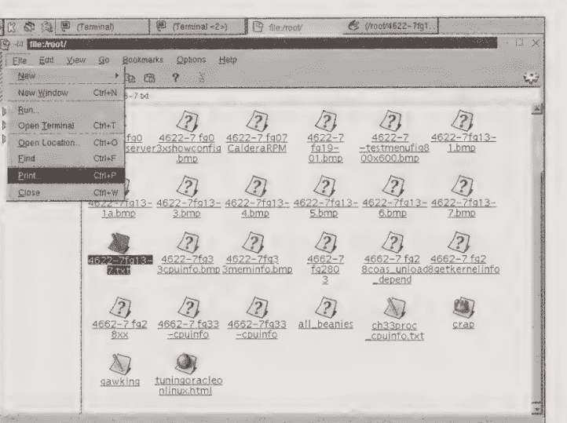

图 13-1: 讨厌命令行模式？指向并点击即可打印

## 检查打印作业状态

`lpq`（行打印机队列）命令报告了示例中的打印作业状态。`lpq` 命令按作业编号和顺序列出打印作业。在没有任何任何选项的情况下，`lpq` 命令列出打印队列中的所有作业。

```
root@flyingpenguin:~# lpq

Remote_Printer_Twenty is ready and printing

Rank      Owner       Job      Files           Total Size

active    prof_plum  031 SillyReport.ps 523782 bytes

1st      miss_scarlet 034 weapons.txt     240 bytes

1st      miss_scarlet 042 victims.jpeg     5472 bytes
```

## 使用 lpc 命令管理打印服务

如果你是系统管理员，你负责控制和管理打印机操作。你使用 `lpc`（行打印机控制）程序来管理队列并报告打印机状态。`lpc` 程序以以下方式控制打印：

- 报告行打印机守护进程、打印机和缓存的状态
- 启用和禁用打印机
- 启用和禁用缓存（队列）
- 重新排序打印队列中的作业顺序
- 将打印作业重定向到队列，以便它们在轮到时不打印
- 释放打印作业，使其从队列移动到打印机
- 停止打印（以解决打印机问题）
- 重启打印，以及重启在停止打印时被中断的打印作业

你可以通过两种方式调用 `lpc` 命令。如果你只运行单个 `lpc` 命令，可以将其添加到 `lpc` 调用中，如下例所示：

```
candance@tweet$ lpc status

Printer      Printing    Spooling    Jobs    Server  Slave

1pc@tweet   enabled     enabled     0       none    none

l5@tweet    enabled     enabled     0       none    none
```

> 上述 `lpc status` 输出来自 tweety，它运行着 LPR 打印软件。

运行 `lpc` 的另一种方法是不带参数调用它，并在 `lpc` 提示符下输入 `lpc` 命令，如下例所示：

> 下文的 `lpc status` 来自 flyingpenguin，它运行着较旧且更常用的 lpd 软件。将以下输出与前面示例中的输出进行比较。尽管底层打印系统不同，但两个 `lpc status` 命令都显示相同的基本信息。

```
miss_scarlet@flyingpenguin> lpc
lpc> status
p:
    queuing is enabled
    printing is enabled
    no entries
    no daemon present
```


# 第 13 章 管理打印机与打印

表 13-4 列出了 `lpc` 命令。`topq` 命令可以接受作业编号或用户名。

| 表 13-4 Lpc 命令 |
| 命令 | 功能 |
|---|---|
| Abort | 终止指定的作业。 |
| disable | 禁用打印机。 |
| down | 禁用 lpd。 |
| enable | 启用 lpd。 |
| exit | 退出 lpc 程序。 |
| help | 说明 lpc 命令。 |
| hold | 暂停作业。 |
| start | 启动 lpd。 |
| stop | 停止 lpd。 |
| topq | 列出作业。 |
| status | 显示 lpc 状态。 |

## 从打印队列移除作业

使用 `lrm` 命令从打印队列移除作业。`lrm` 从缓存目录移除文件；例如，以下命令删除了 miss_scarlet 的 weapons.txt 作业。

```
root@flyingpenguin# lrm 34

034 dequeued
```

如果你输入 `prm`，它会移除你所有的作业。例如，如果 Miss Scarlet 输入以下命令，将删除她所有的作业：

```
root@flyingpenguin# prm

034 dequeued

042 dequeued
```

除非你是 root 用户，否则你只能移除你拥有的作业。root 可以从任何打印队列移除任何作业。例如，要移除 Lab_Printer 的所有作业，root 只需输入：

```
root@flyingpenguin# lrm Lab_Printer
```

root 还可以移除特定用户的所有作业。例如，要移除上述 lpq 示例中看到的 SillyReport 文件，root 输入：

```
root@flyingpenguin# lrm prof_plum
```

## 使用 GUI 工具设置打印

不同的 Linux 发行版提供自己的 GUI 打印管理和配置工具，根据你的选择自动在 `printcap` 文件创建条目。OpenLinux 的 GUI 工具是 COAS（Caldera 打开管理系统）的打印配置工具。Red Hat 的 GUI 工具称为 `printtool`。你可以使用 `printtool` 添加本地打印机和远程打印机。对于所有 GUI 工具，你通过从菜单选择项目并点击按钮来配置打印机和打印队列。

## 启动 Calder Open Linux 的 COAS 打印配置

你可以通过点击主任务栏上的 COAS 图标或从 KDE 主菜单选择 COAS 来启动它，如图 13-2 所示。当你启动打印配置工具时，会弹出一个与图 13-3 类似的窗口。窗口的具体外观取决于已经配置了哪些（或是否有）打印机。图 13-3 中的打印配置窗口有两个选项页：Printer 和 Daemon。

## 启动和停止 lpd（行打印机守护进程）

只有在守护进程运行时，你才能打印。你可以从打印配置工具主窗口中的 Daemon 菜单启动和停止 `lpd`（行打印机守护进程）。

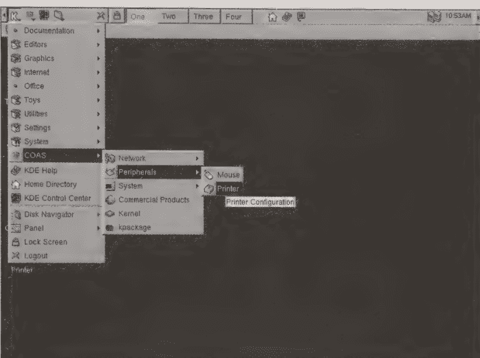

图 13-2：COAS 打印机工具窗口

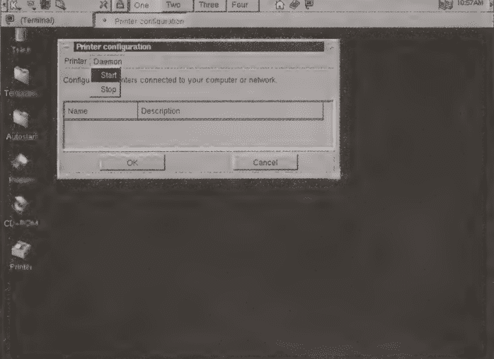

图 13-3：打印和守护进程页

## 向系统配置添加打印机

要向系统添加打印机，请按照以下步骤操作：

1. 在打印机配置工具的主窗口的打印机菜单中选择“添加”（Add）。会出现“选择打印机模型”窗口。它的外观如图 13-4 所示。

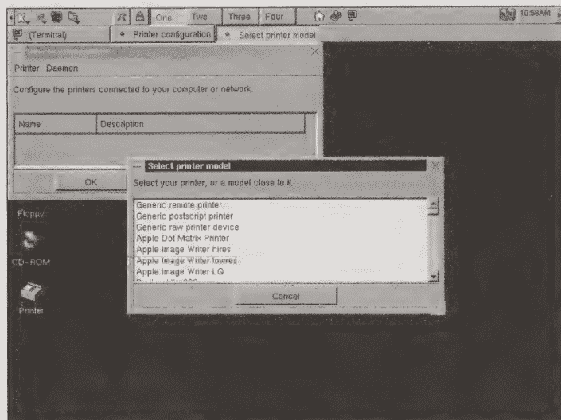

**图 13-4：** 向 Caldera 系统添加新打印机

2. 从列表中选择你的物理打印机设备后，将看到“打印机名称”窗口。为打印机一个逻辑名称，例如 `lp`、`lp1` 或类似的名称。参见图 13-5。

3. 点击 OK 继续后，你将看到如图 13-6 所示的“打印机属性”屏幕。打印机属性包括纸张大小、代表打印机的设备特殊文件以及数据速度（从打印机文档或制造商网站获取速度）。设置好所有属性后点击 OK。

4. 点击“网络保存”（Save in the network）来保存你的打印机配置。完成配置后，点击 OK 保存属性并创建打印机队列。COAS 将停止并重启 `lpd`，以便守护进程识别新打印机。图 13-7 显示了守护进程已识别该新打印机。

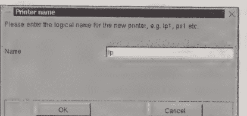

图 13-5：命名打印机

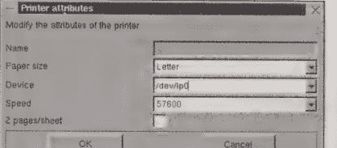

图 13-6：设置打印机属性

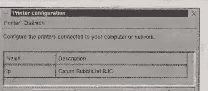

图 13-7：`lpd` 识别了新打印机

## 编辑打印机属性

要更改打印机的属性，请从打印机配置窗口（图 13-3）中选择打印机并点击菜单中的“编辑”（Edit）。这将弹出打印机属性窗口，你可以在可以在其中添加和更改属性。（典型情况包括添加备用打印机名称和更改缓存目录。）更改完成后点击 OK，点击“保存”（Save）保存编辑后的配置。如果你正在为远程打印机设置队列，请确保填写屏幕底部的“远程主机”（Remote host）和“远程队列”（Remote queue）框。在图 13-8 中，系统管理员在计算机上编辑打印机属性，为 `lp1` 添加备用名称。以下示例显示了 root 编辑 `1p` 打印机后，COAS 打印机配置工具生成的 `printcap` 文件。

# 208 第二部分 ♦ Linux 系统管理入门

```
/etc/printcap 位于于 twenty (Caldera OpenLinux)

# 除非你清楚自己在做什么，否则请不要直接编辑此文件；

# 注意，COAS 需要非常严格的格式

# 其他应用程序（如 WordPerfect）无法处理 LPrng 扩展

# 语法（这些扩展最好隐藏在 'lpd-printcap' 中）

# 修改此文件的首选方法是 COAS。

lpd|2ndFloorColor|Emily's printer:\n:lpd=/lpd0/\n:br=#57600

:rm=#

:rp=\n:sd=/var/spool/lpd/lp:\n:mx0#

:sh=-\n:if=/var/spool/lpd/lp/printfilter:
```


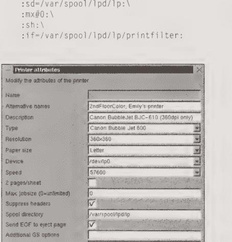

图 13-8：打印机属性窗口

# 移除打印机

当你永久断开打印机硬件时，不要忘记从 Linux 软件配置中移除它。从打印机配置窗口选择打印机并点击“移除”（Remove），以移除打印机的所有软件痕迹，包括它在 `printcap` 文件中的记录。

# 使用 Red Hat Linux 的 printool

Red Hat 的 `printool` 程序是另一个易于使用的图形配置界面。你需要登录或 `su` 到 `root` 用户。要运行 `printool`，进入控制面板并按下 `printool` 按钮，或从终端窗口运行 `printool`。如果你使用终端窗口，输入 `/usr/bin/printool` 将创建 `printool` 窗口。如果你已经添加了打印机，主窗口将显示 `printcap` 文件中的所有打印机。你可以添加新打印机，或选择现有打印机进行删除或编辑。所有保存的更改都会自动修改 `printcap`。要添加新打印机，点击“添加”（Add）按钮并选择本地、远程或 LAN 管理器打印机等选项。`printool` 程序将向你显示检测到的打印机设备特殊文件。

注意：如果 `printool` 没有显示至少一个设备特殊文件 `/dev/lp0` 或 `/dev/lp1`，请检查打印机。

# 打印到远程打印机

当你永久断开打印机硬件时，不要忘记从你的 Linux 软件配置中移除它。从打印机配置窗口选择打印机并点击“移除”（Remove），以移除打印机的所有软件痕迹，包括它在 `printcap` 文件中的记录。

# 打印到另一台计算机

远程打印设置非常简单。如果你为远程打印机设置队列，请确保填写屏幕底部的“远程主机”（Remote host）和“远程队列”（Remote queue）框。在图 13-8 中，系统管理员在计算机上编辑打印机属性，为 `lp1` 添加备用名称。以下示例显示了 `root` 编辑 `1p` 打印机后，COAS 打印机配置工具生成的 `printcap` 文件。

# 打印到 Linux 计算机

远程打印设置非常简单。如果你为远程打印机设置队列，请确保填写屏幕底部的“远程主机”（Remote host）和“远程队列”（Remote queue）框。在图 13-8 中，系统管理员在计算机上编辑打印机属性，为 `lp1` 添加备用名称。以下示例显示了 `root` 编辑 `1p` 打印机后，COAS 打印机配置工具生成的 `printcap` 文件。

# 打印机出现问题时怎么办

# ... 管理打印机与打印 211

这里是另外两个可能遇到的打印机问题：

字体 问题：当你尝试打印时，你的文件没有缓存。
解决方案：使用 `ps` 或 `lpc` 检查 `lpd` 是否正在运行。如果没有，重启它。

字体 问题：你的缓存目录满了。
解决方案：预防性维护。不要让这种情况发生。在每个缓存目录下创建一个名为 `minfree` 的文本文件。`minfree` 文件应该列出留出的最小区块数，即使这意味着不再缓存请求。当我测试一个每周每天每分钟运行一次的任务时，我用 `cron` 的电子邮件邮件填满了磁盘。

# 打印到 Windows（或 UNIX）计算机

字体 问题：每个人的打印任务似乎都在运行，唯独你的没有。
解决方案 1：尝试从不同的应用程序打印。你的打印问题可能与应用程序有关。
解决方案 2：如果你正在打印到远程打印机，请确保你没有从 `printcap` 文件的 `rg`（远程组）行中排除。

字体 问题：打印开始工作，但在打印几页后停止了。
解决方案：检查 `/etc/printcap` 中的 `mx` 参数。如果它小于你需要打印的文件大小，请编辑 `printcap` 文件并增加 `mx`。

打印 `man` 页有多种方法。简单的方法是将 `man` 页传递给 `lpr` 命令。示例打印了 `pr` 的 `man` 页：`miss_scarlet@t$ xterm | lp`

过滤器是在将输入发送到输出设备之前对输入进行处理的程序，Linux 的魔法过滤器根据类型处理文件。魔法过滤器为系统管理员节省了时间和麻烦，无需为多种输出格式配置过滤器。魔法过滤器理解大多数输入类型，如 PDF、PostScript 和文本，并为每种文件类型产生正确的输出格式。例如，如果你打印 PostScript 文件，过滤器会“魔法般”地识别出该文件是 PostScript，并激活一个可以让打印机输出 PostScript 格式的程序。

整齐地处理数据。魔法过滤器（magic filter）通过你安装在系统上的特殊程序来工作。当你打印文件时，魔法过滤器会为你的输出找到合适的过滤器，这样你就不需要担心在打印过程中格式输出格式化。最流行的魔法过滤器是 `magicfilter` 和 `APSfilter`。

> 魔法过滤器指的是格式化你输出内容的程序。`magicfilter` 的名称指的是其中一个魔法程序。

CD 盘上有一个指向名为“什么是 APSfilter?”的 NHF（新手化帮助文件）的链接。该 NHF 还包含一个 `printcap` 文件，其中为一台打印机列了五个不同的条目。该 `printcap` 文件说明了如何根据 APSfilters 启用打印机输出不同格式的文件。

`GhostView` 是一个 PostScript 查看器，它是 `GhostScript` 的前端，允许你在打印之前在屏幕上查看 PostScript 文件。如果你的 Linux 发行版没有附带 `GhostScript` 和 `GhostView`，你可以从该组的 FTP 文件获取：http://prep.ai.mit.edu/gnu/

打印 Tex 文件的一种方法是将其转换为 PostScript 并使用 `GhostScript` 进行打印。首先，你需要使用 `tex` 命令将它们从 Tex 转换为 DVI（设备无关）格式。然后，你需要使用 `dvips`（dvi to PostScript）命令将生成的 DVI 文件转换为 PostScript。


```
$ yourfile.tex

$ dvips yourfile.dvi
```


将 `yourfile` 替换为你想要打印的文件名。将文件转换为 PostScript 后，你可以使用 `lpr` 命令来打印它。

## 总结

在本章中，你看到了：

- Linux `lpd` 打印系统是如何工作的。
- 如何使用命令或图形化工具配置本地和远程打印机以及 `/etc/printcap`。
- 如何使用命令或图形化工具启动和停止打印守护进程 `lpd`。
- 如何使用 `lpc` 程序管理排队和打印。

你还回顾了标准的 Linux 打印命令以及使用打印过滤器的基本概念。你看到了来自 `lpr` 和 `LPRng` 打印系统的示例。当你查看各自的 `printcap` 文件时，你无法看出它们的区别。`LPRng` 是一个增强型的 `lpr` 系统，它使用相同的命令和文件（带有额外的选项和功能）。

这是第二部分“Linux 系统管理入门”的最后一章，在这一部分中你学习了如何为用户设置基础服务。第三部分涉及用户命令。更多系统管理的主题请参阅第四部分“配置和管理 TCP/IP 网络”以及第五部分“高级系统管理与网络”。

## 使用 Linux

- **本部分**
- **第 14 章** 登录并开始使用 Linux
- **第 15 章** 操作文件和目录
- **第 16 章** 使用编辑器
- **第 17 章** 了解 bash
- **第 18 章** Shell 脚本
- **第 19 章** 发现过滤器

# 登录并开始使用 Linux

本章通过引入图形用户界面（GUI）帮助你入门 Linux。与 Windows 不同，Linux 允许你选择多种 GUI 或使用命令行。

## 决定 UI（用户界面）

在登录之前，你需要决定计划使用的什么界面。Linux 提供了多种选择：`GNOME`、`KDE` 等。对于熟悉 Windows 或 Mac 的人来说，`GNOME` 或 `KDE` 可能会感觉更自然。`GNOME` 是一个基于鼠标的图形用户界面。`KDE` 是另一个流行的环境。对于偏好命令行的人来说，还有文本界面。

## 你喜欢窗口吗？

`X` 系统提供了一个基于鼠标的图形环境。对于熟悉 Windows 或 Mac 的人来说，`GNOME` 或 `KDE` 可能会感觉更自然。`GNOME` 是一个基于鼠标的图形用户界面。（image/c0.png）

# 关于 X 的几点

麻省理工学院（MIT）开发 `X` 是为了作为一个设备无关的显示系统。它为构建界面提供了框架，但本身并不提供 GUI。`X` 与窗口管理器配合工作以提供外观和感受。如果你想要 GUI，必须安装一个窗口管理器。

## X 之上运行什么？

`X` 本身不提供 GUI。你需要在它之上堆叠一个窗口管理器来实现 GUI。这在 Linux 中很常见。

# GNOME 和外部窗口管理器

在编写时，只有一个窗口管理器是 100% 兼容的。与带有内置窗口管理器的 `KDE` 不同，`GNOME` 使用的是外部窗口管理器。窗口管理器的兼容性越高，它提供的功能就越丰富。

- 魔法过滤器指的是格式化你输出内容的程序。
- 不要因为没有窗口管理器就让 `GNOME` 运行不了。

## 关于窗口管理器的几语

窗口管理器是控制窗口位置、边框和外观的软件。像 `KDE` 和 `GNOME` 这样的 GUI 与窗口管理器配合工作提供你的屏幕环境。例如，`GNOME` 并不决定你的窗口应该放在哪里；它与窗口管理器通信以获取位置。

表 14-1: 寻找窗口管理器
| 窗口管理器 | URL |
|---|---|
| Enlightenment | http://www.enlightenment.org |
| FWVM | http://www.fwm.org/ |
| Icewm | http://www.kiss.uni-lj.si/-k4fr023/icewm/ http://icewm.sourceforge.net |
| Window Maker | http://www.windowmaker.org |
| AfterStep | http://www.afterstep.org/ |
| GnoWM | http://www.pce.net/wdomburg/GnoWM |
| Wmg | http://duckape.net/~reevee// |

## 为什么不直接用窗口？

对于微软 Windows 和 Apple Macintosh 用户来说，GUI 似乎是 Linux 界面的逻辑选择。你指向、点击、然后完成。为什么要折腾命令和语法呢？答案有三部分：

- `X` 是贪婪的。它需要内存，大量的内存。如果你在较小的内存中运行 Linux（例如 4 到 8 MB），你可能会发现使用 GUI 剩下的内存仅够让你的电脑爬行而不是运行。
- 某些功能会在终端窗口中调用命令行。如果你最终要在终端窗口中工作，为什么不直接去那里呢？
- 如果你决定编写 Shell 脚本来自动化系统管理任务（你将会这么做的），你需要了解如何使用命令。

Linux 可用的图形用户界面（GUI）仍然没有消除命令行（CLI）的必要性，因为目前，配置某些 Linux 行为仍然需要 CLI。

## 入门

Linux 是一个多用户、多任务操作系统。“多用户”这个词的顾其实义——许多用户可以同时在同一台计算机上工作。Linux 提供了某些安全机制来支持多用户计算。这些功能包括：

- *用户登录和注销*
- 密码保护
- 文件和目录访问控制

## 登录

由于 Linux 是多用户操作系统，在工作之前你必须通过输入用户名和密码向 Linux 识别身份。系统管理员创建一个带有用户名、初始密码和主目录的账户。计算机启动时你看到登录提示还是窗口，取决于你使用的是图形化的 X Window 系统（简称为 `X`）还是基于字符的终端或终端窗口。

> Linux 提供了多种可能的界面选择，包括基于文本的 shell、基于 X 的 `GNOME`（GNU 网络对象模型环境）和 `KDE`（K 桌面环境）

图 14-1 显示 Marshall 登录到 `GNOME` 窗口。14-2 显示同一用户登录到终端窗口。当你成功登录后，Linux 会将你置于名为 *shell* 的命令解释器中。在终端中，你知道自己处于 shell 中，因为你看到了 shell 提示符。最常见的 shell 提示符是 `$`、`%` 和 `#`。你可以自定义 shell 提示符为几乎任何字符组合。

## 多任务——MS-DOS 和 Microsoft Windows 用户的新概念

*多任务*意味着所有用户的任务似乎在同时运行，而在在后台，操作系统正在调度这些任务以轮流使用 CPU（中央处理器）。Linux 和此类系统也被称为*分时系统*，这意味着所有进程在时间切片内共享 CPU。

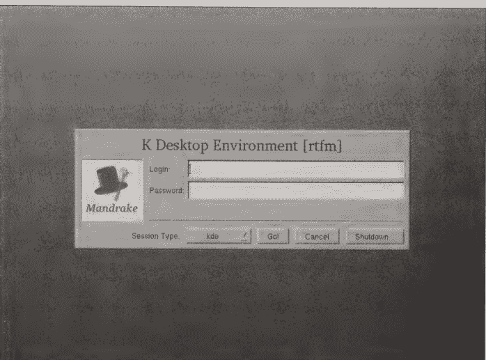

**图 14-1：** 用户通过 GUI 登录

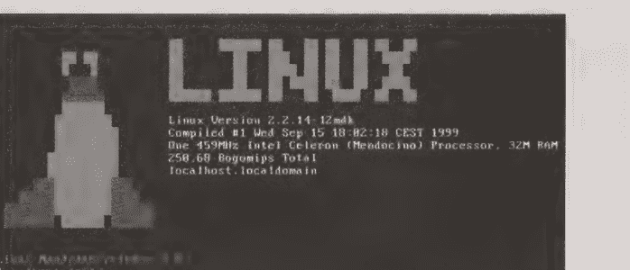

**图 14-2：** 在终端窗口中，成功登录会显示 shell 提示符

Linux 是区分大小写的。`CANDACE` 与 `Candace`、`candy` 或 `CaNDace` 不是同一个用户名。图 14-3 显示了如果你输入错误的用户名或密码会发生什么。

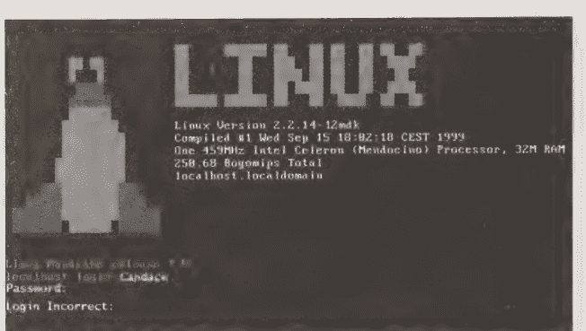

Linux 密码失败对于 *
在 localhost 登录 Candace
密码：
登录错误：

图 14-3：该用户忘记了她的用户名是 Candace，而不是 cand

## 修改密码

首次登录后，你应该使用 `passwd` 命令更改系统管理员分配给你的密码。所有关于密码的正常警告都适用。注意图 14-4，你看不见输入的密码。这是因为 Linux 不允许任何人（甚至包括你自己）在屏幕上看到你的密码。

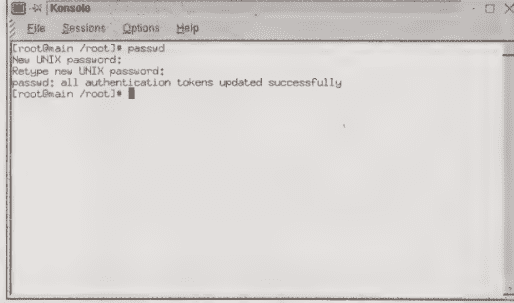

图 14-4：我在终端窗口中使用 `passwd` 命令更改我的原始密码

之前关于区分大小写的警告也适用于密码。如果你忘记了密码，必须要求系统管理员为你设置新密码。由于你的密码是加密的，系统管理员无法查询你忘记的密码。

出于安全考虑，大多数系统管理员会设置 Linux，使你需要定期更改密码——通常是每 30 或 60 天一次。当你收到密码即将过期的消息时，你需要像图 14-4 那样更改密码。

## 注销

当你完成 Linux 会话后，应该使用 `logout` 命令注销。注销可确保没有其他用户可以在你的会话中工作，或在未经许可访问你的文件和电子邮件。注销还会清理你的环境，关闭文件，释放文件和记录锁，并提醒你取消可能在后台运行的作业。图 14-5 显示了一个终端窗口用户使用 `logout` 命令注销。

其他注销方式还有：

- *按下 Ctrl+D。*
- 在命令行提示符处输入 `exit`。
- 从图形主菜单中选择“Log Out”（注销）。

当你注销时，`GNOME` 和 `KDE` 等窗口环境会记住你的窗口所在位置以及你正在使用的应用程序，以便在下一次登录时重新打开它们。这被称为会话管理。命令行解释器不提供这种便利。

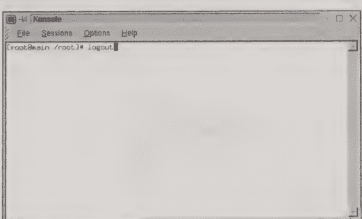

图 14-5：`logout` 命令让你注销 Linux

## 获取在线帮助

登录后，下一步是什么？Linux 与大多数系统一样，提供了一个名为 `man`（手册）或参考页的在线帮助系统。`man` 页包含了命令和系统配置文件的完整系统文档。`GNOME` 和 `KDE` 在 `man` 页之外还提供了帮助帮助功能。

`man` 页的内容范围从模糊到几乎无法理解不等。有些 `man` 页提供了示例，但很多并没有提供帮助。

| 命令 | 用途 |
| :--- | :--- |
| `man` | 显示主题的完整帮助，包括交叉引用、相关文件和已知问题。 |
| `apropos` | 列出所有包含关键词的命令以及简要帮助。 |

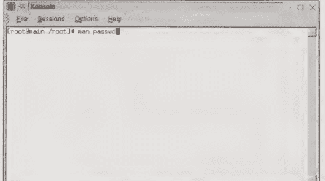

图 14-6：使用 `man` 页获取帮助

## 使用你的 GUI 帮助

你可能觉得 GUI 帮助比 `man` 页是更容易上手的起点。

要获取屏幕上图标和按钮功能的快速提示，将鼠标或指针悬停在图标或按钮上。图 14-7 显示了当你悬停在元素上时的帮助。


图 14-7：悬停显示快速提示

你也可以点击图 14-8 所示的帮助图标。示例使用的是 `GNOME` 界面。按下 `F1` 键也会显示帮助。图 14-9 显示了 `GNOME` 帮助器的示例。


图 14-8：点击帮助图标显示目录和索引


图 14-9：使用 `GNOME` 帮助器查看 Linux 和 `GNOME` 帮助

## 了解 GNOME

`GNOME` 帮助器没有搜索功能。你必须翻页查看。

图 14-10 显示了在安装后但在根据我的环境配置之前运行的 `GNOME`。我看到了桌面和主 `GNOME` 面板。


图 14-10：桌面和主 `GNOME`面板

注意 根据你如何配置环境，你的 `GNOME` 显示可能与图 14-10 非常不同。这是因为 `GNOME` 具有高度配置灵活性。

`GNOME` 主面板（图 14-10 底部带有脚的条形）是 `GNOME` 的核心。主面板包含一组小部件和菜单。

面板两侧的箭头可以隐藏和显示面板。主面板左侧的脚图标是主菜单按钮。点击主菜单按钮可以查看包含应用程序（如 `Netscape Navigator`）和命令（如 `logout`）的菜单。

大部分屏幕都是你的桌面，就像在任何基于 Windows 的 GUI 中一样。你可以将最常用的项目放在桌面上，并双击项目来激活它。

## 了解 GNOME 基础

对于任何使用过其他 GUI 的人来说，使用 `GNOME` 面板通常都是直观的。接下来的章节描述了操作面板的基本知识，包括使用主菜单、添加新面板以及向面板添加应用程序。面板包含应用部件（applets）和启动器（launchers）。应用部件是一个 `X` 应用程序，例如时钟。启动器则以类似于 Microsoft Windows GUI 中快捷方式的方式启动（运行）应用程序。启动器有三种类型：

- 菜单，例如主菜单（图 14-10 左下角的脚印）
- 按钮，例如“退出会话”按钮（主菜单脚印的右侧）
- 抽屉（Drawers），包含一个可以放置其他启动器和应用部件的面板

## 使用主菜单

主菜单是你运行 Linux 应用程序的起点。安装 `GNOME` 会生成主菜单。

你可以在本章后面的章节中阅读关于如何自定义菜单的内容。

主菜单在 `GNOME` 中的工作方式与在任何其他 GUI 中相同。图 14-11 显示了用户按下脚印显示主菜单后的屏幕。

## 运行应用程序

`GNOME` 为你提供了多种运行应用程序的方法：

- 从主菜单。
- 从应用程序启动器图标。
- 从文件管理器 `gnome`。你可以双击任何可执行文件来运行它。
- 从主菜单上的“运行程序”项目。例如，如果你想运行 `Emacs` 编辑器，选择“运行程序”并在对话框中输入 `emacs`。见图 14-12。


图 14-11：主菜单包含应用程序和其他菜单

## 自定义你的环境

`GNOME` 具有很强的适应性。例如，你可以通过更改颜色、字体和边框，移动和添加面板及抽屉等来更改桌面桌面的外观。事实上，你可以同时运行四个桌面！查看图 14-10 中的主面板，可以看到四个桌面按钮。除了主面板外，你还可以创建多个自定义面板，并确定包含哪些应用部件和命令。你还可以向桌面添加启动器。

## 使用控制中心小部件 (caplets)

`GNOME` 控制中心允许你使用名为“caplets”的工具自定义你的 `GNOME` 环境。控制中心由两部分组成：主工作区和小部件菜单。要启动控制中心，前往主菜单 -> 设置 -> 控制中心。要配置你的环境，从菜单中双击一个小部件。图 14-13 显示了如何更改桌面主题。


表 14-3 列出了一些常用的小部件及其功能。

| 小部件 (Capplet) | 自定义 |
| --- | --- |
| 背景属性 | 背景颜色和壁纸。 |
| 屏幕保护程序 | 屏幕保护属性，例如速度、密码、电源管理。 |
| 主题选择器 | 桌面主题。 |
| 窗口管理器 | 使用哪个窗口管理器。 |
| 默认编辑器 | 在 `GNOME` 中使用哪个编辑器，例如 `vi`、`Emacs`。 |
| MIME 类型* | 将哪些图像与文件类型关联。 |
| 键盘蜂声 | 蜂信号的声音和音量。 |
| 声音事件 | 与各种 `GNOME` 事件相关的声音。 |
| 键盘属性 | 自动重复和听性按键点击声。 |
| 鼠标属性 | 左手或右手操作以及鼠标速度。 |
| 会话管理器 | 注销时的提示确认（或不确认），并在注销时自动更改会话。 |

* 多用途邮件扩展 (Multipurpose Internet Mail Extensions)，最初用于处理不同类型的电子邮件和附件。`GNOME` 允许你扩展这一概念，定义如何自动处理某些 MIME 类型。


**图 14-13：** 使用控制中心的小部件自定义你的环境

## 在桌面创建启动器

你可以通过将鼠标置于桌面上并点击右键向桌面添加启动器。当你从弹出菜单中选择“新建启动器”时，会出现一个如图 14-14 所示的启动器对话框。填写对话框。启动器的名称是要运行的程序文件名（不带扩展名）。注释会出现在鼠标悬停时显示的气泡中。命令是在终端中运行该程序时需要输入的内容。创建启动器后，如果你需要编辑其属性，只需右键点击启动器即可沿面板移动它、将其移动到不同的地方或将其删除。


## 移动面板

你有三种方法可以移动桌面上的面板：

- 从主菜单。
- 从应用程序启动器图标。
- 从文件管理器 `gnome`。你可以双击任何可执行文件来运行它。
- 从主菜单上的“运行程序”项目。例如，如果你想运行 `Emacs` 编辑器，选择“运行程序”并在对话框中输入 `emacs`。见图 14-12。


# 文件与目录操作

如果你是 Linux 或 UNIX 的初学者，本章将向你介绍如何使用常用的 Linux 命令来处理文件和目录。如果你是 MS-DOS 用户，某些 Linux 命令可能看起来很熟悉。这是因为 MS-DOS 中提供的许多命令都是从 UNIX 复制的。表 15-1 列出了你在本章中过的命令。

# 入门 Linux 目录概念

所有现代操作系统都包含了“保存在磁盘目录中的文件”的概念。目录是文件的集合，类似于 Microsoft Windows 操作系统中的文件夹。正如本章开头承诺的那样，表 15-1 列出了处理文件和目录最常用的命令。

| 表 15-1 | 处理文件和目录的常用 Linux 命令 |
| Command | Function |
|---|---|
| `ls` | 列出目录中的文件。 |
| `pwd` | 显示当前工作目录。 |
| `cd` | 切换到另一个目录。 |
| `mkdir` | 创建新目录。 |

# 第15 章

## 本章内容

- 入门 Linux 目录概念
- Linux 目录树快速概览
- 列出文件和目录
- 确定文件内容
- 显示文件内容
- 管理你的个人文件和目录
- 解读权限列表

# 表 15-1（续）

| Command | Function |
| --- | --- |
| `rm` | 删除（移除）文件。 |
| `rdir` | 删除（移除）目录。 |
| `chmod` | 控制谁可以访问你的文件。 |
| `cat`, `more`, `head`, `tail` | 显示文件内容。 |
| `man` | 获取帮助。 |
| `find` | 查找文件位置。 |
| `file` | 学习文件类型。 |

# Linux 文件与目录小知识

- 所有文件名和目录名都是区分大小写的。
- 目录可以包含其他目录（子目录）。
- 目录和子目录组织成树形结构（层次级结构）。
- 文件位于目录树的底部。
- 根目录是 Linux 目录树中的顶层目录。单个正斜杠（）被称为“slash”，代表根目录。
- 安装 Linux 会自动创建根目录和系统子目录。
- 路径是通文件的路径。完整路径列出了由正斜杠分隔的子目录和文件名，例如 `/home/bookfiles/chapter1`（读出斜杠的声音）。
- Linux 不使用驱动器号。你只需要知道文件的路径即可。
- 与 MS-DOS 和早期版本的 Windows 不同，Linux 允许文件名包含多达 256 个字符，而不是你可能习惯的 8.3 格式。给文件名加上引号，甚至可以在文件名中使用空格。
- Linux 可以访问许多不同的文件系统，包括 Windows 2000、95 和 98、OS/2 以及 UNIX 的文件系统。
- 系统管理员会为你创建一个家目录。这是你登录时开始的地方。

# Linux 目录树快速概览

图 15-1 是我的一台名为 `redbird` 的电脑的 Linux 目录树图。正下方是重要的子目录，如 `/bin`、`/dev`、`/etc`、`/opt`，它们包含了系统文件和程序。在 `redbird` 上，`/home` 包含每个用户的家目录。系统管理员创建这些家目录。每个圈出的组组成一个文件系统。

> 如果你是系统管理员并需要创建用户家目录，请查看第 12 章。


图 15-1: 典型的 Linux 目录树

# 使用完整路径

我的家目录的路径是 `/home/candace`。我使用 `mkdir` 命令在我的家目录下创建了几个子目录来组织我的文件。你可以看到我有旧邮件文件的路径 (`/home/candace/oldmail`) 以及书籍文件的路径 (`/home/candace/lnxbible/chapters` 和 `home/candace/lnxbible/graphics`)。

# 在目录树中移动

你使用 `cd`（切换目录）命令在目录树中移动。你通过指定完整路径、相对路径或相对路径的快捷方式来告诉 `cd` 命令去哪里。表 15-2 显示了使用 `cd` 命令的多种方法。

`.` 是代表当前目录的快捷方式，即你在目录树所在的位置。

`..` 是代表当前目录（`.`）父目录的快捷方式，即目录树中上一上一目录。

`.` 和 `..` 都是相对路径。

# 表 15-2
配合 `cd` 命令使用路径

| Pathname | Example | Effect |
|---|---|--|
| 完整路径 | `cd /home/candace/lnbible/chapters` | 将当前目录切换到指定的目录。 |
| 相对路径 | `cd chapters` | 移动到当前目录下的 `chapters` 子目录。 |
| 指向上一目录的快捷方式 (..) | `cd ..` | 移动到当前目录的父目录。 |

# 确定你在目录树中的位置

你应该始终意识到两个目录：你的家目录和你的工作目录。你在本章前面读过关于家目录的内容。... [注：此处原文 OCR 文本出现重复或乱码，已根据上下文维持逻辑流]。

# 第 15 章 + 文件与目录的操作

| 表格 15-3 | `ls` 命令的实用选项 |
| 命令 +  | 描述 |
| :--- | :--- |
| `ls -l` | 显示详细列表。 |
| `ls -a` | 列出所有文件，包括隐藏文件。 |
| `ls -c` | 按文件创建时间排序列表。 |
| `ls -r` | 按字母顺序反序排序列表。 |
| `ls -s` | 显示大小（以 KB 为单位）。 |
| `ls -R` | 递归列出子目录内容。 |

注意：请注意大小写敏感。大多数（但不是所有）Linux 命令选项都是小写的。

## 从 `ls -l` 列表中获取线索

详细列表为你提供了关于文件或目录的详细信息，包括你列出的是什么类型的文件、它的创建时间、所有者是谁、最后修改时间以及文件大小。

> 注意：不用担心理解侧边栏表格中列出的所有代码。目前，- 和 d 是重要的。你可以在阅读其他章节时学习其余的代码。

## 解密 `ls -l` 中的文件类型

详细列表的第一列告诉你你正在查看什么类型的文件——只要你如何破解这些代码。如果第一列是 `-`，那么很简单：你正在列出一个普通文件。其他代码则有点神秘。下表列出了代码及其含义。

| 第一列 | 含义 |
| :--- | :--- |
| - | 普通文件 |
| d | 目录 |
| c | 字符 I/O 文件 |
| b | 块 I/O 文件 |
| l | 符号链接 |

## 查找文件

你可以使用 `find` 命令来列出文件。`find` 允许你指定比 `ls` 更多的文件属性。例如，你可以根据不同的日期、文件访问权限或类型来查找并列出文件。表格 15-4 列出了 `find` 命令的一些实用选项。检查光盘上的 `man` 页面以查看 `find` 命令的完整列表。

> 注意：如果你你不下面的所有选项，不要担心。你将在整本书中读到它们。

## 表格 15-4 `find` 命令的实用选项

| 选项 | 描述 |
| --- | --- |
| `-print` | 显示找到的文件名。 |
| `-ctime x` | 查找 `x` 天前创建的文件。 |
| `-atime x` | 查找 `x` 天前访问的文件。 |
| `-perm x` | 查找访问权限为 `x` 的文件。 |
| `-size xk` | 查找大于 `x` KB 的。 |
| `-type f` | 仅查找文件。 |
| `-type d` | 仅查找目录。 |
| `-type l` | 仅查找符号链接。 |
| `-name 文件名` | 查找指定名称的文件（可以使用通配符）。 |
| `-user 用户名` | 查找由用户名所有的文件。 |

## 分析文件内容

你不能输入或编辑二进制文件（那些非文本文件）。`file` 命令是一个非常有用的命令，你可以用它来确定你有什么类型的文件。例如，如果你不确定如何引用你的 CD 驱动器，对 `/dev/*` 下的文件使用 `file` 命令。`file` 命令会告诉你所有设备文件的类型。

## 显示文件内容

Linux 提供了几种查看文件内容的方法。你如何决定？这取决于个人喜好。表格 15-5 列出了可用选项。

> 注意：`less` 命令是一个典型的 Linux 双关语游戏，因为 `less` 做的比 `more` 还要多。

| 表格 15-5 显示文件内容的命令 |
| 命令 | 显示功能 |
| :--- | :--- |
| `more` | 一次向前翻一屏。按 Enter 键一次前进一行，按空格键一次前进一屏。 |
| `less` | 一次向前或向后翻一屏。 |
| `head` | 显示文件的前几行。你可以指定显示的行数（默认为十行）。 |
| `tail` | 显示文件的最后几行。你可以指定显示的行数（默认为十行）。 |
| `cat` | 在屏幕上显示整个文件。* |

## 管理你的个人文件和目录

大多数人需要的不仅仅是在 Linux 目录树中来回移动和列出文件。如果你像大多数 Linux 用户一样，你可能需要以以下方式操作文件：

- 通过创建和删除目录
- 通过复制、重命名、移动和删除文件
- 通过设置文件访问权限来向其他用户授予或拒绝访问你文件的权限

斯卡莱特小姐（Miss Scarlet）需要在一个新的新的子目录中存储关于可疑人物的信息。为了做到，她计划：

1. 在她的主目录下创建一个名为 `suspects` 的新子目录（使用 `mkdir` 命令）。
2. 从普姆教授（Professor Plum）的子目录 `/prof_plum/people/*` 复制文件到她的新子目录（使用 `cp` 命令）。
3. 从她的新子目录删除她自己的 `suspects` 文件（使用 `rm` 命令）。
4. 将 `suspects` 改名为 `friends`。

## 共享和保护你的文件和目录

下面的列表显示了用户目录的部分递归详细列表（`ls -lR`）。你可以从第二个字符开始看到文件访问权限。这些访问权限决定了谁可以对 `col` 的文件做什么由于 `col` 创建了这些文件和子目录，他拥有它们并可以对其进行任何操作，使用 `chmod` 来更改访问权限。表格 15-6 列出了文件和目录访问权限的类型及其允许的操作。


`$ ls -lR /home`

`/home/col:` 

total 3

drwx-xr-x 2 col users 1024 Nov 1 13:21

drwx-xr-x 2 col users 1024 Jan 10 20:42

drwx-xr-x 5 col users 1024 Jan 10 44

`/home/col/Desktop:` 

total 2

-rw-r-- 1 col users 631 Feb 18 2000

-rw-r-- 1 col users 642 Feb 18 2000

`/home/col/mail:` 

total 4

-rw-r-- 1 col users 3755 Jan 10 20:42

`/home/col/src:` 

total 3

drwx-xr-x 4 col users 1024 Jan 10 20:44

drwx-xr-x 3 col users 1024 Jan 10 44 home

drwx-xr-x 5 col users 1024 Jan 10 44 usr

`/home/col/src/etc:` 

total 2

-rw-r-- 2 col users 1024 Jan 10 20:44 ircd

drwx-xr-x 3 col users 1024 Jan 6 20:03 rc.d

`/home/col/src/etc/rc.d:` 

total 1

drwx-xr-x 2 col users 1024 Jan 8 05:05 init.d

```
/home/col/src/etc/rc.d/init.d:
total 0
/home/col/src/home:
total 1
drwx-xr-x 7 col users 1024 Jan 10 20:44 ircd
/home/col/src/home/ircd:
total 5
drwx-xr-x 3 col users 1024 Jan 10 20:44 etc
-rw-r-- 2 col users 1024 Jan 10 44 lib
-rw-r-- 2 col users 1024 Jan 10 44 log
-rw-r-- 2 col users 1024 Jan 10 44 run
-rw-r-- 2 col users 1024 Jan 10 44 usr
/home/col/src/home/etc:
total 1
-rw-r-- 2 col users 1024 Jan 10 20:44 ircd
/home/col/src/home/ircd/lib:
total 0
/home/col/src/home/ircd/log:
total 0
/home/col/src/home/ircd/run:
total 0
/home/col/src/home/ircd/usr:
total 3
drwx-xr-x 3 col users 1024 Jan 6 20:03 doc
drwx-xr-x 4 col users 1024 Jan 6 20:03 man
-rw-r-- 2 col users 1024 Jan 10 20:44 sbin
/home/col/src/usr/doc:
total 1
drwx-xr-x 3 col users 1024 Jan 6 20:03 ircd-2.10.3
/home/col/src/usr/ircd-2.10.3/doc:
total 2
drwx-xr-x 3 col users 1024 Jan 8 05:05 Juped
drwx-xr-x 3 col users 1024 Jan 8 05:05 Nets
```

`/home/col/src/usr/doc/ircd-2.10.3/doc/Juped:` 

total 1

drwx-xr-x 2 col users 1024 Jan 8 05:05 US-Admin

`/home/col/src/usr/doc/ircd-2.10.3/doc/Juped/US-Admin:` 

total 0

`/home/col/src/usr/doc/ircd-2.10.3/doc/Nets:` 

total 1

dr-xr-x 2 col users 1024 Jan 8 05:05 Europe

`/home/col/src/usr/doc/ircd-2.10.3/doc/Nets/Europe:` 

total 0

`/home/col/src/usr/man:` 

total 2

drwx-xr-x 2 col users 1024 Jan 8 05:05 man5


| 表格 15-6 | 文件与目录访问权限 |
| 权限 | 含义 | 文件上允许的操作 | 目录上允许的操作 |
|---|---|---|---|
| r | 读取 | 读取 | 列出内容。 |
| w | 写 | 写入、编辑、删除 | 在该目录中创建和删除文件。 |
| x | 执行 | 运行程序或 shell 脚本 | 进入目录。 |

详细列表 (`ls -l`) 用九个字符显示文件或目录的权限。查看 `col` 用户目录递归列表中显示的其中一个文件（不是目录！）的权限。忽略第一个连字符。它意味着这是一个普通文件，而不是目录或任何特殊文件。

# 第 15 章 ♦ 操作文件和目录 249

提示

列列表中的连字符（`-`）表示该字段为空。如果连字符出现在权限字段中，则意味着没有权限。

文本字符串 `rwx-xr-x` 实际上是针对所有者、组和其他人的的三组权限。前三个字符（`rwx`）代表授予文件所有者的权限。Merry Scarlet 拥有所有（`rwx`）权限。接下来的三个字符（`r--`）代表对该文件的权限。拥有此文件的组是 `bad-guys`。属于该组的任何用户无法修改或执行它。最后三个字符（`r--`）意味着其他用户（世界）可以读取此文件，但不能写入或执行。

## 使用 chmod 命令设置文件和目录权限

只有文件/目录的所有者或系统管理员可以使用 `chmod` 命令更改权限。要更改权限，请使用 `chmod` 命令并跟上三个参数：

- 你为谁设置权限。这可以是以下内容之一或多个组合：`a`（所有）、`u`（用户）、`g`（组）或 `o`（其他）。注意 `a` 等同于 `u`。
- 你是授予权限还是撤销权限。`+` 授予权限：`-` 撤销权限。
- 你正在授予或撤销的权限组合（`rwx`）。

表 15-7 列出了一些常用的 `chmod` 命令。

提示

你可以使用 `chmod` 命令配合通配符对一组文件设置权限。

## 表 15-7
常用的 `chmod` 命令

| 命令 | 效果 |
|---|---|
| `chmod a+r file*` | 允许所有用户读取当前目录下任何以 `file` 开头的文件。 |
| `chmod ogu +r file?` | 允许所有用户读取所有以 `file` 开头并以单个字母或数字结尾的文件另一种方法。 |
| `chmod +r file` | 允许所有用户读取名为 `file` 的文件的另一种方法。如果你未指定用户或组，Linux 将假设为 `a`（所有）。 |
| `chmod o -rwx file` | 移除所有者和所有者组以外的其他人员任何方式访问文件的权限。 |


## 了解组

除了归特定用户所有，文件还属于一个特定的组。系统管理员定义组并将用户添加到这些组中。用户始终至少属于一个组。为了方便，系统管理员可能还会将用户添加到额外的组中。当你想要允许几个人访问某个文件时，组非常方便。例如，如果 Miss Scarlet 想让 Plum 教授、White 夫人和 Mustard 军校能够使用 `chmod a+x` 命令让该目录对所有人开放。如果系统管理员创建一个组（我们暂称其为 `bad-guys`），Miss S. 只需要让她的武器子目录对该组开放即可。你可以选择适合自己的方法。如果你有安全意识，明智地使用组将为你更多选项和灵活性。

系统管理员根据在计算机上共享文件的用户类型来定义组。例如，在一家出版社，Linux 用户可能属于名为 `writers`（作者）、`editors`（编辑）、`managers`（经理）和 `guests`（客人）的组。在我侄女 Emily 电脑上的组名是 `friends`（朋友）、`parents`（父母）和 `relatives`（亲戚）。

授予文件的权限取决于该文件所在目录的权限。在以前的例子中，你已经看到 Miss Scarlet 允许她的组完全访问 `knife` 文件。然而，除非 `bad-guys` 组对文件所在的目录具有 `r` 和 `x` 权限，否则组成员无法访问该文件。

如果你将你的家目录的权限设置为 `rwx------`，那么你就不需要担心为文件设置单独的权限。当没有（除你之外）人权限访问你的家目录时，没有人可以访问你家目录内或下方的任何内容。

最后三个字符（`r--`）代表授予系统中每个其他用户的权限。例如，一个对系统中每个其他用户具有 `rwx` 权限的目录提供了对该目录的读写访问。

## 使用 usmask 获取八进制数——为什么要费劲？

`chmod` 命令既接受八进制数作为参数，也接受符号字符 `r`、`w` 和 `x`。在八进制数中，数字 7 代表 `rwx`。如果你在 `chmod` 命令中使用八进制数，你将使用三个数字，分别代表所有者、组和世界。例如，要向所有用户授予所有文件的权限，你输入：

```
chmod 777
```

你在输入 `chmod` 命令后创建的所有文件都会继承 777 权限。如果你不是一个死忠的技术极，你可能可能会奇怪，既然可以使用有意义的符号，为什么要费劲使用八进制数呢？答案是存在一个

## 使用 GNOME 文件管理器管理你的文件

你可以使用 GUI 完成本章中描述的命令可以完成的所有操作。右键点击任何文件，从弹出菜单中选择以下属性和操作：

- 打开 (`Open`)
- 使用...打开 (`Open with`)
- 查看 (`View`)
- 编辑 (`Edit`)
- 复制 (`Copy`)
- 删除 (`Delete`)
- 移动 (`Move`)
- 统计 (`Statistics`)
- 权限 (`Permissions`)

## GNOME 文件管理器 – 文件和命令菜单指南

| 选项 | 功能 | Shell 命令 |
|---|---|---|
| 新窗口 (`New Window`) | 打开一个新的文件管理器窗口。 | |
| 终端 (`Terminal`) | 打开 GNOME 终端窗口并自动进入你选择的目录。 | |
| 目录 (`Directory`) | 创建新目录。 | `mkdir` |
| 打开 (`Open`) | 打开选中的文件。 | |
| 复制 (`Copy`) | 启动复制框。 | `cp` |
| 删除 (`Delete`) | 选中的文件。 | `rm` |
| 移动 (`Move`) | 启动重命名框。 | `mv` |
| 显示目录大小 (`Show Directory`) | 显示目录的大小。 | `ls -l` |
| 查找 (`Find`) | 搜索文件。 | |
| 编辑 (`Edit`) | 与文件类型关联。 | |
| 运行命令 (`Run Command`) | 运行预加载命令。 | |
| 退出 (`Exit`) | 退出 GNOME 功能。 | |

## 使用 umask

坏消息是 `umask` 并不友好。与 `chmod` 不同，`umask` 只接受八进制数，`umask` 通过设置文件的默认权限让你的生活更轻松。系统管理员也应该在初始化文件中 `umask` 来设置系统范围默认保护。

这里是最常用的 `umask` 命令。在开放系统中使用它。它向所有用户授予 `rwx` 权限：

```
umask 022
```

如果你不想与所有人共享你拥有的一切，尝试这个 `umask` 命令。它向你（所有者）授予 `rwx`，向组授予 `r-x`，向其他人授予 `--`（无权限）。

```
umask 027
```


## 你是磁盘浪费者？

某些 Linux 系统管理员会实施磁盘使用配额，以便控制每个用户允许占据的磁盘大小。然而，许多系统以友好信任的方式运行。如果你在这些系统上工作，请友好！调节你自己的磁盘空间使用。Linux 不保留文件的多个版本，有助于保持磁盘整洁。这取决于你是否通过保留不需要的文件来阻塞磁盘。你可以使用 `du` 命令查找单个文件或整个目录树占用的磁盘空间。`du` 默认以块（512 字节）显示文件大小。你可以使用 `-b` 选项（字节）、`-k` 选项（千字节）或 `-m` 选项（兆字节）来更改显示。

当你从网上下载压缩文件（例如 `.zip` 或 `.gz`）后，压缩包仍然存在。为了节省磁盘空间，将原始压缩包移动到备份介质（如磁带或 CD），或将其删除 (`-rm`)。

## 总结

本章开启了你作为 Linux 用户之旅。你学习了在 Linux 目录树中移动和操作文件的命令，包括告诉你使用了多少磁盘空间的命令。你还学习了如何保护你的文件，以及查看他人的文件并破解这些文件的权限。最后，你了解了一些基本的打印命令。

你还学习了一些常用的命令选项，但请记住，本章涵盖的大多数命令提供的选项比这里描述的更多。查看所有选项及其功能的最佳地方是 `man` 页面（在你的光盘上提供）。

下一章将向你展示如何使用 `vi`，这是一种 Linux 编辑器。如果你想使用更高级的命令，第 30 章将带你入门，并展示一些将命令组合在一起的实用技巧。

本章介绍了你可以使用命令行界面，也可以使用图形界面。虽然对于 Linux 初学者来说，图形界面可能看起来简单，但请尝试学习命令。当你从一台 Linux 计算机移动到另一台时，你无法确定可选的 GUI 是否已安装，或者你是否有访问图形显示的权限。（很多 Linux 用户有时会发现自己处于哑终端上）。然而，你总是可以指望命令在那里。

# 使用编辑器

早晚，你都需要编辑文本文件。Linux 为你提供了丰富的文本编辑器选择，包括：`vi`、`ex`、`emacs`（GNU、lucid 以及其他变体）、`pico`、`jove` 和 `joe`。

## 选择编辑器

你对编辑器的选择取决于你的个人喜好和手头的可用资源。`vi`（视觉编辑器）并不是你可以使用的最新或最强大的编辑器。那么为什么这一章集中在它身上？因为 `vi` 是 Linux（或 UNIX）世界中最常见的编辑器。你保证在任何 Linux 系统上都能找到的唯一编辑器就是 `vi`。

## 理解 vi 模式

`vi` 以三种模式运行——如果你不理解这些概念，每种模式都会保证通过鸣声让你屈服。这些模式是：

- 命令模式 (`Command`)
- 插入模式 (`Insert`)
- `ex` 模式

默认情况下，`vi` 以命令模式启动。命令模式允许你输入编辑命令的模式，例如 `dd` 删除行，`w` 保存文件并退出 `vi`，以及其他标准编辑命令。从命令模式，你也可以切换到插入模式或 `ex` 模式。切换模式请执行以下操作之一：

- 要进入命令模式，按下 `Esc` 键。
- 要进入插入模式，按下 `i`。
- 要进入 `ex` 模式，先进入命令模式，然后输入 `:`

插入模式允许你进行基础编辑的模式，例如编辑现有文本向文件中添加新文本。从命令模式切换到插入模式，你可以按 `i` 在光标当前位置插入文本，或者按 `a` 在光标当前位置后的空格处追加字符。当你输入文本时，按 `Esc`（转逸键）返回命令模式。

使用 `vi` 时，留意电脑内部扬声器的鸣叫声。如果你在不在插入模式时尝试输入或编辑文本，`vi` 会向你鸣叫。如果你忽略此警告，你的文件中可能会出现一两个拼写错误，或者你可能会完全损坏你正在编辑的文件。鸣叫是 `vi` 告诉你需要切换模式的方式。新 `vi` 用户犯的另一个常见错误是不小心按了 `Caps Lock`（大写锁定）键。请注意，`vi` 与大多数 Linux 应用一样对大小写敏感，例如，在命令模式下按 `R` 会替换直到你按下 `Esc` 为止的所有文本，而在命令模式下按 `r` 只替换当前字符。

要在屏幕底部显示你当前的模式，请进入命令模式并输入 `:showmode`。默认是不显示模式的——只在你进入错误的模式时鸣叫。

## 理解 ex 模式概念

使用 `ex` 模式调用 `vi` 的扩展命令集。这些扩展命令基于较旧的 UNIX 编辑器，`ex` 命令显示在屏幕的最底行，无论你的光标在哪里。例如，当你输入 `:command` 模式时，你就进入了 `ex` 模式。退出 (`:q!`)、保存 (`:w`) 以及保存更改并退出 (`:wq`) 都是 `ex` 操作。输入 `ex` 命令后，按回车键执行它。

## vi 快速浏览

本节介绍了 `vi` 的基本介绍。你在这里找不到关于 `vi` 功能的百科全书——只有你入门时需要知道的。

由于 `ex` 模式命令出现在 `vi` 窗口的最后一行，你可能还会听到它被称为“末行模式”。

## 将 vi 设置为 GNOME 的默认编辑器

`Capplet` 是 GNOME 对 GNOME 控制中心中配置工具的术语。`Capplet` 来自于 GNOME 开发者；你也可以编写自己的 `capplet` 工具并将其与 GNOME 关联。

使用“默认编辑器（Default Editor）”`Capplet` 在在使用 GNOME 时选择你的编辑器。在你选择 `vi` 后，当你尝试打开与编辑相关的文件时，GNOME 文件管理器会自动启动 `vi`。如果你觉得 `vi` 很糟糕，可以从“默认编辑器”`Capplet` 的选择列表中选择其他编辑器。下图显示了如何为你的 GNOME 窗口设置 `vi` 编辑器。

你可以在第 14 章中阅读关于 GNOME 控制中心的内容。

## 启动 vi 并创建新文本文件

要在命令行界面中启动 `vi`，输入 `vi` 后跟要编辑的文件名，`vi` 将以命令模式启动。如果你开始编辑一个新文件，`vi` 会显示一个有一列波浪号（∼）的屏幕，如图 16-1 和 16-2 所示。图 16-1 显示了如何在 GNOME GUI 中启动 `vi`。由于 `vi` 处于命令模式，你还无法输入文本。`vi` 假设你插入任何内容都是命令。这是你的第一个 `vi` 命令：`i`，在光标处插入文本。输入 `i` 进行插入，然后是……

（注：原文后续包含大量关于图 16-1 的重复和损坏片段，已根据逻辑流进行处理。）

## 第 16 章 使用编辑器

| 表 16-4 | 删除文本的按键 |
| :--- | :--- |
| 按键 | 功能 |
| `dd` | 删除当前行。 |
| `D` | 删除从光标到当前行末尾的内容。 |
| `x` | 删除光标下的字符。 |
| `dw` | 删除从光标到当前单词末尾的内容。 |

你可以通过在命令中添加修饰符（数字、G 或 `$`，或者它们的组合）来操纵删除命令。这里列出的示例使用了数字 4。你可以使用任何在文件中有意义的数字。

- `4x` 删除光标处的四个字符。
- `4dd` 删除从当前行开始的四行。
- `d4w` (或 `4dw`) 删除从当前单词开始的四个单词。
- `d4$` 删除从当前行到第四行末尾的内容。
- `d1G` 删除从光标到文件开头的内容。
- `dg` 删除从光标到文件末尾。

对于那些我们无法恢复你文件的灾难性情况，请阅读第 6 章，了解如何从备份恢复文件。

## 从错误中恢复：微小还是灾难性的

如果你犯了一个小错，可以使用 `u` 或 `U` 键来撤销。`U` 撤销当前行的更改。`u` 撤销上一个命令。如果你犯了巨大的错误，可以退出 (`:q!`) 或者丢弃更改，返回到上一次编辑的状态，并一步重新开始编辑 (`:e!`)。

如果你的系统崩溃了（这在 Linux 上并不常见，但确实会发生，特别是当你遇到硬件问题时），你可以在下次使用 `vi` 时使用 `-r` 选项告诉它进行恢复。例如，如果我在编辑 `clues.txt` 时系统崩溃了，在系统启动后，我输入：

```
vi -r clues.txt
```

这个选项几乎总是能恢复你丢失的内容。

## 搜索文本

你需要处于命令模式才能搜索文本。图 16-4 显示了在文件族中进行搜索的样子。要向前搜索，使用 `/` 键并跟上你要搜索的文本字符串。然后按回车。例如，要向前搜索字符串 `excelle`，输入：

```
/excelle
```

要向后搜索，使用 `?` 键。

```
?excelle
```

要在相同方向重复上一次搜索，输入 `n`。要在相反方向重复搜索，输入 `N`。


图 16-4：你可以向前向后搜索文本

## 替换文本

你应该在 `ex` 模式下使用 `s` (替换) 命令将一个文本字符串替换为另一个。你启动 `s` 命令时需要指定发生替换的范围。下面的 `s` 命令从文件开头到结尾 (`1,$`) 将所有的 `suspects` 更改为 `victims`，并要求你确认更改 (`c`)。如果你不想被询问更改，可以使用 `g` 作为全局选项（global）。

```
1,$s/suspects/victims/c
```


# 更改文本的其他方法

如果替换命令对你来说不够，可以使用更改 (`c`) 命令更改光标下或光标左侧或右侧的文本。表 16-5 显示常用的更改命令。

| 命令 | 功能 |
| --- | --- |
| `cX` | 将单词更改为 x，其中 x 是新文本。 |
| `ncX` | 将接下来的 n（其中 n 是数字）单词更改为 x，其中 x 是新文本。 |
| `c$` | 将从光标到行尾的文本更改为 x，其中 x 是新文本。 |
| `ccX` | 将当前行更改为新文本，其中 x 是新文本。 |

## 总结

`vi` 模式的概念在本章是最难的部分。我已经使用 `vi` 17 年了，从我还是个小宝宝开始，但我仍然会蜂鸣。记住，蜂鸣并不是坏事。本章还涵盖了如何使用 `vi` 创建新文件和编辑现有文件，包括：

- 在文件中移动。
- 插入文本。
- 追加文本。
- 搜索并替换文本。
- 删除文本。
- 保存你的更改（或不保存）并退出 `vi`。

有了在本章中学会的编辑技能，你可以编辑任何文件。如果你想进一步学习 `vi`，请查看 `man` 页面（帮助手册）。`vi` 拥有一套丰富的命令，包括移动到缓冲区（yanking）以及为重复性任务创建宏。如果你如此喜欢 `vi` 并在于想要更多，请浏览 `vi` 爱好者的网站：`http://www.cs.vu.nl`。

# 认识 bash

`shell` 是一个与操作系统通信的程序。

第 4 章列出了 Linux 上可用的一些流行的命令行 `shell`。

最常用的 Linux `shell` 是 `bash` —— 代表 Bourne again Shell。Bourne Again Shell 这个名字是关于 Steven Bourne 编写传统 UNIX Bourne `shell` 的双关语。它的路径是 `/bin/bash`。

如果你对符合国际标准的兼容性感兴趣，`bash` 旨在符合 IEEE Posix Shell and Tools 规范。

## 使用巧妙的 bash

`bash`（以及其他 `shell`）提供了在处理命令时让你的生活更轻松的实用功能。你可能想要利用的一些特性包括：

- `bash` 帮助
- 使用快捷键简化操作
- 自动补全命令和文件名
- 回忆并编辑之前的命令
- 使用别名代替长名称
- 在一行中组合命令
- 自动将一个命令的输出发送到另一个命令（管道）
- 将屏幕 I/O 发到文件（I/O 重定向）

## 获取 bash 帮助

你可以从 `bash` `man` 页面获取帮助：

```
bash
```

## 什么时候命令不是命令？

你使用的某些命令实际上是内置在 `bash`（或任何其他 `shell`）中的命令。内置命令包括 `cd` 和 `pwd`。其他“命令”实际上是你的 `shell` 执行的程序，例如 `cp` 和 `ls`。你是否应该关心执行的是内置命令还是程序？并不真正。你的 `shell` 总是知道该做什么。这本书使用“命令”一词来指代内置 `shell` 命令和程序。

`man` 页面非常长且复杂。`bash` 本身有一个内置的帮助系统。你在 `bash` 提示符下输入 `help` 命令可以查看所有帮助主题的列表。你输入 `help` 命令后跟一个特定的主题名称可以查看有关特定命令的信息（见图 17-1）。


图 17-1：使用 `bash` 帮助系统

你还可以使用 `info`，这是一个从各种来源读取文档的命令。如果你输入 `info` 命令加上 `info` 参数，如图 17-2 所示，你会看到一个学习使用 `info` 程序的菜单。如果你输入了图 17-2 所示的命令，阅读说明并输入 `h` 命令来进行 `info` 课程。


图 17-2：`info` 是基于文本的超链接文档浏览器

## 让 bash 补全文件名和命令名

假设你忘记了程序的确切名称？你可以通过搜索目录来查找它，但这种搜索既耗时又枯燥。你可以让 `bash` 帮助你。`bash` 最棒的特性之一就是命令行补全。你只需输入你记得的部分命令，然后按下 `Tab` 键，`bash` 就会为你补全命令。在这个示例中，我只输入了 `linux` 并按下 `Tab` 键，`bash` 就为我补全了命令的剩余部分。我节省了三次击键输入。

```
linux<TAB>
linuxconf
```

如果有多个命令以你输入的字母开头，`bash` 会列出所有匹配的命令。如果你愿意，你也可以只输入命令的首字母，但你输入的字母越多，`bash` 传给你的列表就越短。请参见图 17-2。

## 将命令组合在一起

到目前为止，在本章中看到的示例将每个命令放在单独的一行，如下所示：

```
cd
pwd
ls
```

由于 Linux 命令很短，前面的示例不需要输入很多字。然而，为了方便起见，Linux 提供了在单行内一起输入这些命令的能力：

```
cd;pwd;ls
```


注意，你需要用分号 (`;`) 分隔命令。你并没有真的节省多少输入量，因为你只是用分号代替了按回车键。尽管如此，将命令组合在一起通常感觉更简单。决定用回车还是分号取决于你。

> 注意：分隔符字符（如分号）被称为分隔符 (`delimiter`)。

## 利用命令历史和回溯

命令行历史和编辑应该是每个人前十大实用的 Shell 特性之一。如果你想回溯几分钟前输入的命令，不需要重新输入它。命令行历史和回溯让你只需按向上箭头键即可取上一个命令。事实上，你可以通过不断按向上箭头键直到看到该命令，找回历史记录中的任何命令。要重新执行该命令，按回车键。如果你翻了太多命令，按向下箭头即可向前回到最近的命令。你还可以从历史列表中编辑你回溯的命令。如果你拼错了一个长而复杂的名称（例如文件名或环境变量名），你可以回溯它并只需修正错误，而无需重新输入整个命令。

# 命令历史技巧

以下列表提供了一些技巧和提示，帮助你充分利用 bash 的命令行历史和编辑功能。与其尝试一次使用所有功能，不如练习使用其中一两个，直到它们变成习惯，再增加一两个。这样，你将逐渐精通命令行。

- `bash` 将你之前的命令历史保存在 `~/.bash_history` 中（你家目录下的 `.bash_history` 文件）。
- `bash` 会保留登录会话的历史，以便你可以执行一个命令、注销、重新登录并从历史列表中重新执行该命令。
- `history` 命令回溯过去命令的列表。默认情况下，`history` 命令列出你最后的 500 条命令，从最新的开始排序。
- 使用数字作为 `history` 命令的选项来限制显示。
- 你可以在不重新输入的情况下执行命令。使用叹号 (`!`) 字符来回溯命令。例如，输入 `14092` 并按回车，将回溯你之前输入的第 4092 条命令并执行它。（`history` 命令会为你显示命令编号。）
- 你也可以按名称而不是数字回溯命令。例如，输入 `!history` 将回溯并自动重新执行你输入的最后一个命令。
- 当你回溯一个命令时，可以在重新执行前对其进行修改。使用脱字符 (`^`) 替换命令行上的单词。要显示最后五个命令，我会输入 `history 5`。如果想显示最后八条命令，我可以输入 `5*8<ENTER>` 将 5 改为 8 并自动执行新命令。
- 你可以通过定义环境变量 `HISTSIZE` 来更改历史列表中保留的命令。本章稍后标题为“使用环境变量”的部分将更详细地解释环境变量。
- 如果你在图形环境中打开了多个终端窗口，每个窗口都有一个独立的历史列表。

## 命令回溯技巧

使用这些击键来编辑回溯的命令。

- 在使用箭头键或 `!` 回溯一行后，光标将位于行末尾。按 `Ctrl+A` 移动到命令行的开头。
- `Ctrl+E`（end）将光标移动到命令行的末尾。
- `Ctrl+K` 删除（kill）从光标到命令行末尾的所有字符。
- `Ctrl+A`、`Ctrl+K` 组合可以删除整行命令。
- `Ctrl+Y`（yank back）将你删除的内容粘贴到当前光标位置。

## 重定向输入和输出

当你在 shell 中输入命令时，`bash` 读取命令并将命令的输出传回你的屏幕——或者如果你没有正确输入命令，则显示错误信息。`bash` 将你的物理屏幕视为三个逻辑显示——一个用于提供输入，两个用于显示输出——并给每个逻辑设备分配一个符号名称：

1. 输入设备，称为 `stdin` (标准输入)。
2. 输出设备，称为 `stdout` (标准输出)。
3. 错误设备，称为 `stderr` (标准错误)。

`bash` 具有项名为 I/O 重定向的功能，使用特殊符号：

| 符号 | 含义 |
| :--- | :--- |
| `>` | 将输出重定向到文件。 |
| `>>` | 将输出追加到文件。 |
| `<` | 从文件接收输入。 |

`bash` 具有项名为 I/O 重定向的功能，使用特殊符号：

1. 一个输入设备，称为 `stdin` (标准输入)。
2. 一个输出设备，称为 `stdout` (标准输出)。
3. 一个错误设备，称为 `stderr` (标准错误)。

## 理解变量

Shell 使用变量来表示 Linux 内部值，例如路径名、终端类型、用户 ID 和进程 ID。变量为运行在你的 Linux 系统上的程序提供信息。例如，Linux 提供了一个名为 `HOME` 的环境变量，其中包含你家目录的路径。任何需要知道家目录位置的程序都会通过检查 `HOME` 变量的值来获取。你也可以使用这些变量。变量是一个包含值的项（例如路径名）。Shell 会用值替换变量名。变量提供了一种快速方便的方法来创建具有意义名称的快捷方式。`Bash` 会自动定义一些变量，你也可以定义自己的变量。例如，`bash` 提供了一个名为 `UID` 的变量，包含你用户 ID 的值。如果你需要知道自己的用户 ID，可以使用 `echo` 命令显示变量的值，在变量名前面加上 `$` 符号可以使命令将变量扩展为它的值。图 17-4 显示了如何使用 `echo` 命令显示内置 shell 变量的值。


图 17-4：使用 `echo` 命令在变量名前面加上 `$`

## 使用内置 shell 变量

`bash` 定义并设置了表 17-2 中列出的特殊内置变量的值。Linux 内部使用这些变量，你也可以使用它们，如图 17-5 所示。

只有 Linux 应该设置表 17-2 中列出的内置 shell 变量的值。如果你更改了其中任何变量的值，可能会影响 Linux 的运行方式。

如果由于某种原因，你需要操作这些内置变量之一，你可以定义自己的变量，将内置变量的值赋值它，并按照脚本所示所需的任何方式使用。

```bash
# 以 "#" 开头的行是注释

echo $UID

0

## 定义一个变量 myuid

# 让 myuid 的值与内置 UID 相同

myuid=$UID

# 显示两个变量

echo $UID, $myuid

0, 0

# 将 myuid 的值设置为 6，但不要触碰内置的 UID

myuid=6

## 注意 myuid 的新值

echo $UID, $myuid

0, 6
```

| 变量名 | 用途 |
|---|---|
| `UID` | 用户 ID |
| `PPID` | 父进程 PID（进程 ID） |
| `PWD` | 当前工作目录 |
| `OLDPWD` | 上一个工作目录 |
| `BASH` | `bash` 的路径名 |
| `BASH_VERSION` | `bash` 启动次数的版本号 |
| `SHLVL` | 操作系统 |
| `OSTYPE` | 计算机类型* |

> * 对于任何基于 Intel 的计算机，包括 486 和奔腾 (586)，其值始终是 `i386`。

## 定义你自己的本地变量

任何 Linux shell（包括 `bash`）都允许你定义变量，帮助你工作得更快更方便。一个长的路径名，例如 `/home/emily/collections/beanies/bears` 输入非常麻烦，特别是如果你经常访问 `bears` 目录下的文件时。如果你定义了一个名为 `bears` 的变量，你只需要在命令中使用 `$bears/maple` 即可访问 `maple` 文件。要给变量赋值，输入变量名后跟一个等号，然后是值。以下命令将名为 `bears` 的变量的值设置为 `bears` 目录的完整路径名。`bears` 变量是局部的——也就是说，它只能被定义它的 shell 实例看到。

```bash
bears=/home/emily/collections/beanies/bears
```

要使用变量，在变量名前面插入 `$` 字符，如图 17-5 所示。


图 17-5：变量使变量快捷方式变得方便

当你本地定义变量（例如图 17-5 中的 `bears`）时，该变量仅对定义它的 shell 可。图 17-6 中的 `set` 命令显示了你 shell 的所有变量列表。

## 使用环境变量

你的环境包括你的 shell、家目录和终端类型。环境变量是控制 shell 配置的全局可用变量。这些变量被称为全局变量，是因为它们对所有 `bash` shell 都可用，包括你可能没有意识到 Linux 为之启动的那些 shell。与其在本地定义变量，不如通过在整个环境中导出（`export`）它们来变为全局变量。`bash` 为定义环境变量提供了两种语法选择：

```bash
Konsole 4-
File Sessions Options Help
HOME=$HOME
export LINUX=$HOME
export PATH=/usr/bin:/usr/bin:/usr/bin/X11/bin
export TERM=$(tput colors 2>/dev/null)
PMFD2=147
PS1="\u@\w"
PS2="\#"
PWD=/root
SHELL=/bin/bash
SHELLOPTS=braceexpand:hashall:listhist:history:interactive-comments
SHLV=1
TERM=xterm
```


UID=0

USERNAME=root

图 17-6：`set` 命令显示所有变量。（注：此处 OCR 文本是碎片化的，这是根据上下文重建的）。

（注：由于提供的原始文本存在大量重复和碎片，此处已根据文档逻辑流提供了清理后的版本。）

Shell 不会在你的 PATH 之外任何目录中查找命令。看看当目录不在路径上时会发生什么：

```bash
## 首先，检查 PATH 的值
echo $PATH
/usr/local/sbin:/sbin:/usr/sbin:/usr/bin:

# 测试 ls 命令
1 ls *
admin emily ftp miss_scarlet notes prof_plum

## 修改 PATH 变量
export PATH=$PATH-bears

## 验证 PATH 的值是否已更改
echo $PATH
/home/emily/collections/beanies/bears

## 再次尝试 ls 命令
1 ls *
bash: ls: can't find the executable image file for ls

## 好。使用 ls 命令的全路径
/bin/ls
admin emily ftp miss_scarlet notes prof_plum
```

### 设置 bash 提示符

代表你的主 bash 提示符的环境变量是 `PS1`。主 bash 提示符是你命令之前的提示符。如果一个长命令在屏幕上的下一行运行，bash 会显示次级延续符。代表次级提示符的环境变量是 `PS2`；bash 允许你跨四行扩展。第三和第四行的环境变量是 `PS3` 和 `PS4`。图 17-7 显示了主 bash 提示符的变量定义以及后续延续提示符的定义。


图 17-7：主 bash 提示符的变量定义

# 第三部分 使用 Linux

bash 用户的默认提示符是一个由用户名、计算机的全限定域名和括号内的当前工作目录组成的字符字符串。通过在系统初始化文件 `/etc/profile` 中定义环境变量 `PS1`，系统管理员可以创建一个所有用户都继承的提示符。图 17-8 中的 `/etc/profile` 摘录显示了通过用户名、主机名、当前工作目录设置的系统级提示符。表 17-4 描述了这些特殊字符的含义。


图 17-8：系统管理员在 `/etc/profile` 中设置系统级提示符

如果你希望提示符包含几乎任何你想要的信息，例如日期、时间、你的名字、计算机名称和/或地址、你的生日礼物清单。你甚至可以让你的提示符以颜色和有趣的字体显示。例如，图 17-8 显示了四个 KDE 终端窗口，每个窗口都有不同的提示符，以便我一眼就能区分这些窗口。

如果你在网络中的不同计算机上工作，将 `PS1` 设置为主机名可以提醒你身处何地。

### 第 17 章 ✦ 了解 bash

你可以使用特殊字符序列来进一步自定义你的 bash 提示符。每个字符序列必须以反斜杠字符（`\`）开头。例如，字符序列 `\t` 会使当前时间（24小时制 HH:MM:SS 格式）成为你 bash 提示符的一部分。图 17-9 显示了使用 `PS1` 变量的全局 bash 配置脚本。表 17-4 列出了你可以配置 bash 提示符环境变量的一些反斜杠字符序列。


**图 17-9：** `/etc/bashrc` 为关键 bash 环境值设置全局值

你可以在 bash 的 man 页中找到用于提示符变量的特殊反斜杠字符序列的完整列表。

### 表 17-4 控制 bash 命令提示符的反斜杠字符

| 字符序列 | 功能 |
|---|---|
| `\a` | 蜂铃声（ASCII 字符 7）。 |
| `\d` | 日期（“星期 月 日”）。 |
| `\e` | <ESC>（ASCII 字符 33）。 |

| 表 17-4（续） |
| 字符序列 | 功能 |
|---|---|
| `\h` | 主机名。 |
| `\H` | 主机的全限定域名。 |
| `\n` | 换行（行符）。 |
| `\r` | 回车。 |
| `\s` | Shell 名称。 |
| `\t` | 当前时间（24小时制 HH:MM:SS）。 |
| `\u` | 用户名。 |
| `\v` | bash 主版本号。 |
| `\V` | bash 主版本号和次版本（补丁级别）版本号。 |
| `\w` | 当前工作目录的全路径。 |
| `\W` | 当前工作目录名称。 |
| `\#` | 命令编号，例如会话中第 68 个命令为 68。 |
| `\!` | 命令的历史记录号。 |
| `\\` | 一个反斜杠 (`\`) 字符。 |
| `\?` | 省号 (?) 表示非打印字符字符串，例如终端控制序列。 |

## 初始化脚本中应该包含什么？

你应该在初始化脚本中放置哪些命令？你每次登录后都会执行的命令是初始化脚本的理想选择，你经常需要设置的变量也是如此。如果你发现自己经常要进入位于文件系统深处的同一个目录，可以将该路径赋值给一个短变量，并将该赋值放在初始化脚本中。你还可以在这些脚本中创建别名（`aliases`）。

了解在每个初始化脚本中放入什么非常重要。例如，如果你在 `.bash_profile` 脚本中定义了一个别名，那么该别名仅在你的登录 shell（login shell）中可用。如果一个命令或应用程序启动了另一个，该别名将无效。

在你的 `.bash_profile` 脚本中，只需要在登录时执行一次的配置变量和命令。`.bash_profile` 脚本通常执行的一些功能包括：

- 将变量导出到你的整个环境。
- 使用 `umask` 命令设置默认文件权限。


## 让你的 Shell 更加华丽

`bashPrompt` 包允许你设置 bash 提示符并创建主题。你可以从 http://bash.current.nu 下载该包，它就像 Linux 本身一样是由志愿者的心血作品。在写本文时，该包还是预发布版本。

- 设置终端类型。
- 显示登录消息。

将你无法全局定义的内容（如别名定义）放在你的 `.bashrc` 脚本中。

提示
如果你有彩色显示器，你可以在 `.bashrc` 文件中告诉 bash 用颜色列出不同类型的文件，并为 `ls` 命令定义一个使用颜色的别名，如下行代码所示。`color` 选项需要两个横杠（`--`）。

```bash
alias ls='ls --color=auto'
```


提示
在 `bash` 初始化文件 `.bashrc` 中设置你的 `PS1` 提示符，而不是在登录初始化文件 `.login` 中设置。由 shell 分派（forked）的非交互式 `bash` shell 不会设置 `PS1`。

提示
在 `.bashrc` 文件中永久修改 `PS1`、`PS2`、`PS3` 和 `PS4` 变量之前，先以交互式方式定义它们，以确保你对提示符的外观感到满意。

注意
大多数主题需要扩展 VGA 字体，你可以从 `http://home.earthlink.net/~us5zahns/en/ansifont.html` 下载这些字体。

在光盘上
你可以在 `bashPrompt` HOWTO 中阅读更多关于 `bashPrompt` 包以及通用 `bash` 提示符的详细信息。光盘上有指向该 HOWTO 的链接。

## 利用多任务控制你的作业

Linux 内核通过在多个进程之间快速切换来管理多任务，使得所有进程似乎都在同时执行。本节将向你展示多任务的实际用途。你想同时做三件（或更多）事情吗？例如，假设你需要浏览网页、运行一个 shell 脚本查看谁占用了磁盘空间，并运行一个程序检查今天是否有人尝试破解你的系统？你可以在浏览网页时运行磁盘占用大户脚本和安全程序来节省时间。当然，如果你有 GUI，你可以同时打开三个窗口来完成所有三个任务。然而，仅仅打开这些窗口的动作就会消耗大量的系统资源，如内存和 CPU。而且这在你对窗口进行任何工作之前了。另外，如果你没有安装 GUI 呢？在这种情况下，你甚至可以同时考虑三件事吗？可以！因为 Linux 是一个多任务操作系统，你不需要多个窗口来同时执行多个任务。你只需要在后台运行作业，让你的 shell 空闲以便你在前台做其他事情。

虽然你经常听到作业（job）、进程（process）和程序（program）术语通用，但从技术上讲，一个作业由一个进程及其派生（forks）的所有子进程组成。

### 理解多任务术语

在进一步研究本节之前，你需要理解以下三个术语：

- 后台处理
- 前台处理
- 作业控制

后台处理允许你完成更多工作。当你将命令放在后台时，你的 shell 会启动一个进程来执行该命令并给该进程一个 ID，你可以通过 `ps` 命令查看该 ID。当后台进程启动后，shell 会返回你这里等待运行另一个命令（无论是在后台还是前台）。虽然你可以运行的后台进程数量没有限制，但记住每个进程都会使用内存和系统资源。

如果你在后台运行交互式程序，请小心。如果后台运行的程序提示输入，它会停在那里等待你，导致没有任何工作被完成。你可以通过将交互式程序移到前台、输入响应，然后将程序移回后台来解决这个小不便。

前台处理是常规的交互式处理。你运行一个命令并等待它完成。

作业控制用于管理你的作业及其进程，例如更改作业状态，`bash` 提供了以下作业控制函数：

- 将运行中的程序移到后台。
- 将后台程序移到前台。
- 暂停程序执行。
- 恢复暂停的程序。
- 列出作业。
- 终止程序。

### 在前台和后台之间移动

你使用特殊字符和命令来控制作业和程序：

| 任务 | 命令 |
| :--- | :--- |
| 将运行中的程序移到后台 | 在命令后输入 `&` |
| 暂停程序 | 输入 `Ctrl+Z` |
| 列出所有暂停的程序 | 输入 `jobs` |
| 将运行中的程序移回前台 | 输入 `fg` |
| 终止程序 | 输入 `kill` 后跟作业号 |

## 总结

本章向你展示了 `bash` 提供的一些灵活性。虽然 Linux 命令简单且模块化，但 `bash` 允许你通过组合命令并利用 I/O 重定向和管道来构建自己的命令。本章还演示了如何使用变量，包括通过更改提示符和定义默认路径来使用它们。`bash` 还支持别名。作业控制通过前台和后台处理，提供了高效运行多个程序的强大能力。

现在你已经理解了一些基础，下一章将介绍一些实用的高级命令，并带你进入使用 `bash` 的下一个阶段——编写脚本。

# 脚本

现在你已经熟悉用户命令和 `bash` 特性，是时候提高水平了。本章将帮助你编写使用这些命令的脚本。Linux 使用多种脚本，有些使用特殊的解释器运行，你的 shell（命令行解释器）执行另一种脚本——shell 。本章将带你开始编写简单的脚本


参见第 32 章了解 `perl` 脚本。

脚本是包含命令的文本文件。`bash` 脚本由 `bash` 命令组成。虽然你可以编写适用于任何 shell 的脚本，但本章专注于 `bash` 脚本。无论你打算在何种 shell 下运行，脚本之间的差异都微乎其微。在你创建 shell 脚本后，你运行的是脚本而不是其中包含的单个命令。你还可以安排脚本自动运行。本章描述了如何：

- 编写 `bash` 脚本。
- 使脚本名称变为可执行命令。
- 自动运行脚本。
- 将用户输入传递给脚本。
- 判断脚本是否运行成功。

## 节省时间与打字

当你反复使用同一组命令时，编写一个 shell 脚本是有意义的。例如，假设你每天都使用 `tar`（一个个人备份工具）来备份你修改过的个人文件。你的备份程序可能包含以下五条命令：

- `cd`：移动到包含你需要备份的文件的目录。
- `pwd`：验证你是否位于正确的目录。
- `find * -mtime 0`：找到所有在过去 24 小时内修改过的文件。
- `tar`：将文件备份到归档中（尽管 `tar` 的意思是磁带存档，但你可以使用它将备份归档写入磁盘）。
- `cp`：将你的备份归档拷贝到安全的地方。

与其每天输入这些命令，不如将它们写入脚本中。你每天只需要使用一个命令来运行该脚本。你可以让脚本具有可执行权限，这样你只需要输入它的名称即可运行它。

### 节省更多时间与打字

如果你忙得忘记了每天运行脚本，可以通过将脚本提交给 `cron` 系统来节省更多时间，让 `cron` 在每天同一时间运行该脚本。除了节省时间外，通过 `cron` 自动化你的 `tar` 备份意味着你完全不会忘记运行备份脚本。第 27 章解释了如何使用 `cron`。当 `cron` 系统完成执行你的备份脚本后，它会向你发送一封备份状态的通知电子邮件。

### 与其他用户共享节省的时间

你可以设置备份脚本的权限，让所有人都能使用。这为你系统上的其他用户节省了时间——他们不需要思考如何编写个人备份脚本。如果你在网络环境中工作，网络上其他计算机的用户也可以共享你的脚本。你不仅节省了同事的时间，还通过消除每个用户在磁盘上存储某种备份脚本的需求而节省了磁盘空间。

请参阅第 27 章了解如何使用 `cron` 系统自动化 shell 脚本处理。


## 脚本编写与编程有什么区别？

脚本和程序的区别在于脚本是一个文本文件。你在文件中编写命令并无需中间步骤即可执行该文件——实现即时反馈。如果你想知道一个脚本的作用，只需将其打印或在屏幕上显示出来即可。相比之下，程序除了编写和运行之外还需要一个额外步骤。程序必须从其源代码编译。程序员编写源代码并将源代码提交给编译器。编译器生成只有计算机才能读懂的可执行机器码。如果你需要知道一个程序的作用，你无法读取可执行代码。你必须找到与可执行文件匹配的源代码。

虽然你不像编译程序那样编译脚本，但包括 `bash` 在内的 shell 支持大多数编程语言的结构，例如：

- 变量声明与解释
- 参数传递
- 逻辑和流控制结构（`if...then...else` 语句块，`and`, `or`, `not`）
- `case` 语句
- 循环结构（`until`, `while`, `for`）
- 函数（内置和用户定义）
- 用于记录脚本正在操作的注释

## 编写并执行你的第一个 bash 脚本

任何脚本的第一行都应该说明由哪个 shell 来执行该脚本。第一行——即调用 shell 的那行——包含两个部分：

- hash-bang（井井叹号）：字符组合 `#!`。不要将 hash-bang 与注释字符（`##`）混淆。有些人将 hash-bang 称为 *shebang*。
- 脚本的路径，例如 `bash` 的 `/bin/bash`，C shell 的 `/bin/csh`，Bourne shell 的 `/bin/sh`

如果你忘记了这一第一行，你的脚本可能不会按照你预期的方式执行。事实上，在某些情况下，如果脚本在错误的 shell 下运行，它可能完全不会执行。

注意 `/etc/shells` 是一个文本文件，存储了计算机上所有登录 shell 的路径。

### 编写你的第一个脚本

你的第一个脚本使用了你已经熟悉的命令：

- `cd`：切换目录
- `pwd`：打印工作目录
- `echo`：显示文本

下面的脚本还使用了内置变量 `HOME`。

交叉引用第 1 章解释了如何在 shell 命令中使用变量。

这里是包含 hash-bang 和命令的文本文件。我用 `vi` 编辑器创建了这个文件。你可以使用你最喜欢的方法创建新文件。

```bash
#!/bin/bash

# 这是一个注释。后面还有更多注释。

# 此脚本的文件名为 /root/myfirstscript。

# 此脚本将显示你当前工作

# 目录的名称。(echo;pwd)
```


# 接下来它显示你的家目录名称

`echo`

# 然后它将你移动到家目录并显示你是否真的在那里了

`echo;pwd`

`echo "Your current directory is "`

`pwd`

`echo $HOME`

`cd`

`echo -n "Your current directory is now "`

`pwd`

# 就这些，大家

提示：如果你希望提示符和用户的响应在同一行，可以使用 `-n` 选项来抑制 `echo` 命令的默认行为。该选项会抑制通常在回显文本和你的当前工作目录名称之后出现的换行（换行符）。请注意第一个 `echo` 命令（不带 `-n`）和第二个 `echo` 命令之间的区别。

# 什么是脚本编写？

脚本是一个包含 shell 执行的命令的文本文件。当你运行脚本时，shell 会读取文件并逐条执行命令。这与编程不同，程序通常必须编译成机器码才能运行。

`Bash` 是一种强大的脚本语言，支持许多编程语言结构：

- 变量声明与解释
- 参数传递
- 逻辑和流控制结构（`if...then...else` 语句块，`and`, `or`, `not`）
- `case` 语句
- 循环结构（`until`, `while`, `for`）
- 函数（内置和用户定义）
- 用于记录脚本正在操作的注释

## 如何运行脚本

要运行脚本，你首先需要创建它并正确执行它。在 `bash` 中执行脚本有几种方法：

1. **显式调用 shell**：你可以将脚本文件作为参数传递给 shell 命令。
```bash
bash myscript.sh
```
2. **赋予执行权限**：如果你赋予文件执行权限，可以通过路径直接运行它。
```bash
chmod +x myscript.sh
./myscript.sh
```
3. **source 脚本**：这会在当前 shell 环境中执行命令而不是子 shell 中。
```bash
source myscript.sh
# 或
. myscript.sh
```

## hash-bang

脚本的第一行通常是 hash-bang，告诉系统使用哪个解释器来执行文件。
```bash
#!/bin/bash
```

常见的路径包括：
- `bash` shell 的 `/bin/bash`
- `C` shell 的 `/bin/csh`
- `Bourne` shell 的 `/bin/sh`

## 使用元字符

元字符是对 shell 具有特殊含义的字符。表 18-1 列出了对 `bash` 具有特殊含义的元字符。你已经了解了如何使用一些元字符，例如使用斜杠（`/`）来分隔路径的各个部分，或使用分号（`;`）来分隔同一行上的多个命令。当你读取或编写 `bash` 脚本时，你可能会看到或使用以下某些元字符：

- 双引号（`"`）
- 单引号（`'`）
- 反引号（`` `` ``）
- 反斜杠（`\`）

## 使用双引号定义包含空格的值

使用双引号（`""`）将包含空格的文本字符串括起来，这样 `bash` 就会解释整个字符串，如下：

```
$ export suspects="Miss Scarlet Professor Plum"
$ $suspects
Miss Scarlet Professor Plum
```

我正在使用 `export` 命令在一步中定义并导出变量。你也可以设置局部变量而不导出它们。有关定义和导出变量的更多信息，请参第 17 章。

看看没有双引号的相同示例。`bash` 并没有看到 `suspects` 变量的完整值。

```
$ export suspects="Miss Scarlet Professor Plum"
$ $suspects
Miss
```

## 使用单引号

当你不想让 shell 解释和扩展变量名或保留字符（如美元符号 `$` 和反斜杠 `\`）时，请使用单引号（`''`）。

下面的示例比较了在相同 `echo` 命令中使用双引号和单引号的区别：

```
$ echo "$USER is" $USER
root is root
## 这不是我想要的。让我们试试单引号。
```

```
$ echo '$USER is' $USER
$USER is root
## 现在看看处理保留字符会发生什么。
$ echo "$*"
1365
$ echo ''$\n$$
```

## 使用反引号将命令结果存储在变量中

使用反引号（`` `` ``——也称为 backtick）字符来包围一个命令。反引号键通常位于 `Tab` 键上方波浪号（`~`）键上。反引号将命令的输出存储到变量中。例如，如果你需要在嫌疑人数据库中查找 Emily 的全名，你需要使用 `grep` 命令来搜索她。反引号中的 `grep` 命令执行，`bash` 将你的搜索结果存储在以下变量中：

```
$ export prime_suspect=`grep' Emily suspectfile'
$ echo $prime_suspect
Miss Scarlet Emily
```

`grep` 命令是一个搜索命令。它在文件中搜索文本字符串。
`grep` 的基本语法：

```
grep expression file
```

## 使用反斜杠转义“特殊性”

元字符有时会引起混淆。假设你需要在文档中搜索安符（`&`）字符。`bash` 如何判断你是在进行后台处理还是仅仅在寻找安符？当你希望一个元字符表现得像普通文本字符时，你可以在它前面加一个反斜杠（`\`），以防止 shell 将其解释为特殊字符。这被称为转义（escaping），尽管它与键盘上的 `Esc` 键无关。

你从第 17 章知道，当你使用 `echo` 命令显示变量的值时，必须在变量前加一个 `$`。如果你尝试在变量名中包含 `$`，`bash` 会生成错误：

```
$ export id_var=Miss$scarlet
$ echo $id_var
Miss
```

前面的示例表明，`bash` 被 `$` 搞得很困惑，以至于无法识别变量 `id_var` 的正确值。下面的示例展示了如何用 `\` 转义 `$`。

```
$ export id_var=Miss\$scarlet
$ echo id_var
Miss$scarlet
```

### 表 18-1: 某些 Shell 元字符

| 字符 | 类型 | 对 bash 的含义 |
| --- | --- | --- |
| `$` | 通用 | 向 bash 标识变量。 |
| `#` | 通用 | 开始注释。 |
| `#!` | Shell 脚本 | 指定使用哪种命令解释器运行子 shell。 |
| `.` | Shell 脚本 | 执行（通过 source）脚本而不派生进程。 |
| `*` | 通配符 | 匹配一个或多个字符。 |
| `?` | 通配符 | 仅匹配一个字符。 |
| `&` | 作业控制 | 在后台运行命令。 |
| `>` | 作业控制 | 重定向标准输出。 |
| `<` | 作业控制 | 重定向标准输入。 |
| `>>` | 作业控制 | 重定向并追加标准输出。 |
| `2>` | 作业控制 | 重定向标准错误。 |
| `|` | 作业控制 | 将一个命令的输出管道到另一个命令。 |
| `"` | 引用 | 在文本字符串中包含空格。 |
| `'` | 引用 | 不解释字符串中的变量或元字符。 |
| `` ` `` | 引用 | 使用命令的结果作为变量的值。 |

## 使用 Linux

## 提示用户输入

你可以编写提示用户输入的脚本。使用 `read` 命令从标准输入（通常是键盘）读取输入。下文列出的脚本 `getname.sh` 使用 `echo` 来显示提示符。第 17 章将告诉你如何定义变量。

## 从文件读取输入

你还可以使用 `read` 命令配合输入重定向字符从文件中读取一行并将其存储在变量中。下面的命令如下：

```
$ read my_var < $HOME/suspectfile
$ echo $my_var
Miss Scarlet Emily
```


## 在脚本中使用变量

变量是值的容器。变量存储用户输入、文本、数值值，甚至是复杂命令的结果。

你不需要在 `getname.sh` 中重新定义变量 `id_var` 和 `name_var`。`read` 命令会自动创建这些变量并将输入存储其中。在其他脚本中，你可能需要定义变量，如下面的 `floppy_setup` 脚本。该脚本创建并导出了一个变量 `FLOOPPY`，它是软磁盘上 vfat（Microsoft Windows ）文件系统的快捷方式。脚本随后创建了一个别名 `mfl`，它使用 `FLOOPPY` 变量来挂载文件系统。

## 在命令行向脚本传递位置参数

当你运行下列出的脚本时，你必须以交互式方式运行它，因为脚本期望你输入 ID 和姓名。如果你想让该脚本无人运行（例如通过 cron），你需要一种方法来预输入 ID 和姓名。

## 第18 章 + Shell 脚本 300

Shell 提供了一组预定义的命令行参数，称为位置参数（positional），用于预接受脚本的输入。每个预定义参数都以 `$` 开头。当你运行脚本时，在脚本名称后的命令行输入参数的值。在脚本内部，你通过这些参数在命令行上的位置来引用这些值。例如，脚本通过 `$1` 引用第一个参数。表 18-3 列出了你可以用于向脚本传递值的命令行参数。

## 理解变量的作用域

变量的作用域是指变量可见的 Shell 和子 Shell。当你通过 `floppy_setup` 导出变量时，你使该变量在导出它的 Shell 及其底层子 Shell 中变为全局变量。如果你运行 `floppy_setup` 脚本，一切似乎运行正常。运行脚本后，你将无法看到 `FLOPPY` 变量的值，因为它不再被设置。这不是错误。以下是发生的情况：

- 1. 在运行脚本之前，你处于一个 bash shell 中，看着提示符。这是父 Shell。
- 2. 当你运行 `floppy_setup` 脚本时，父 Shell 派生（fork）出一个子 Shell 来运行你的脚本。这是子 Shell。该子 Shell 扩展了 `FLOPPY` 变量。
- 3. `FLOPPY` 变量的作用域是全局的，这意味着它扩展到所有从 `floppy_setup` 脚本派生的子 Shell。这些是子级的，或父级的孙级。
- 4. 所有子级和孙级可见 `FLOPPY` 变量的值。
- 5. 退出 `floppy_setup` 脚本后，你回到了父级。
- 6. 父级看不到 `FLOPPY` 变量，因为变量的作用域只向内扩展到子 Shell。另一种说法是后代继承变量，而祖先不会从其子辈或孙辈向外继承。

有一种方法可以让 `FLOPPY` 变量对父 Shell 可见。不要以通常的方式运行脚本（即不派生任何 Shell）。源化（Sourcing）一个脚本意味着父脚本在不派生任何 Shell 的情况下完成所有工作。父 Shell 是导出 `FLOPPY` 变量的 Shell。因此，`FLOPPY` 变量从外层（父级）一直到父级创建的任何子（子 Shell）都是全局的。源化脚本的一种方法是输入点 `.` 后跟一个空格和脚本的路径。另一种方法是使用 `source` 命令。以下列表了两种源化 `floppy_setup` 脚本的方法。

```
$ floppy_setup
```

```
$ source floppy_setup
```

## 304 第三部分 ♦ 使用 Linux

表 18-3
脚本编写的命令行（位置）参数
| 参数 | 含义 |
| --- | --- |
| # | 你传递给脚本的参数数量。 |
| $0 | 脚本名称。 |
| $1 | 传递给脚本的第一个参数。 |
| $2 | 传递给脚本的第二个参数。 |
| $3 | 传递给脚本的第三个参数。 |
| $n | 传递给脚本的第 n 个参数。（不能大于9）。 |
| $* | 包含所有参数的文本字符串。 |
| $$ | 当前 Shell 的 pid（进程 ID）。 |
| $? | 上一个命令的退出状态。 |

接下来的列表显示了修改后的 `getname.sh` 脚本，它接受命令行参数而不是 `id_var` 和 `name_var` 的交互式输入。

```
#!/bin/sh

# getname.sh - 显示用户的 ID 和名称，并将传递的

# 作为脚本参数存储

id_var=$1

name_var=$2

echo "User ID = $id_var"

echo "User Name = $name_var"
```

> 如果你的脚本为每个运行脚本的用户创建一个文件，请使用 `$$` 字符来创建唯一文件名。记住 `$$` 是脚本的 pid，它是唯一的。例如，如果你的脚本将主目录写入一个文件（为每个运行脚本的用户各一个），你可以在脚本中使用此命令：
> `echo $HOME > /tmp/homedir.$$`
> 
> 使用 `$$` 构建唯一文件名可以允许多个人同时运行同一个 Shell 脚本。

## 测试是否成功（或失败）

每个每个命令和每个脚本都会向预留变量 `$?` 返回一个退出状态——成功或失败。通常，Linux 和 UNIX 操作系统使用数值 0 表示成功，使用任何非零值表示失败。（这

## 移位处理位置参数

Shell 只使用九个参数（`$1`–`$9`）。假设你需要第十个参数呢？Shell 不提供 `$10`，但它提供了 `shift` 命令作为替代方案。`shift` 从参数列表中移除第一个参数，并移位其他参数。`$2` 移动变成 `$1`，`$3` 变成 `$2`，以此此类推。原始的第十个参数变成 `$9`。如果你移位参数，`$1` 就会从列表中消失。`$1` 的值将永久丢失。`shift` 命令还会改变 `*$` 和 `@`。以下是一个脚本片段，显示了 `shift` 命令是如何运作的：

```bash
# cat transcript

#!/bin/bash

# parameters

echo $1 $2 $3 $4 $5 $6 $7 $8 $10

# 证明你必须移位才能让参数 10 起作用。

shift

echo $1 $2 $3 $4 $5 $6 $7 $8 $9
```

任何测试的结果为真（0，成功）或假（非 0）。你也可以定义自己的退出状态。（最常见的失败是 1。）

## 快速简单的状态测试

在命令末尾使用控制运算符 `&&` 和 `||` 来告诉 bash 是否执行后续命令。`&&` 告诉 bash，“如果我的当前命令成功，继续执行下一个命令。”`||` 告诉 bash 相反——如果我的当前命令失败，不要执行下一个命令。”以下代码显示了两个使用这些退出状态简写的示例。它们还引入了 `exit` 命令，该命令根据上一个命令的状态退出 shell。在第一个示例中，如果 `ls` 命令失败，bash 将退出脚本。第二行在 `ls` 命令成功时显示 `tmp is there`。注意，两者都将输出重定向到 `/dev/null` 以避免污染屏幕。

在状态测试中使用 `&&` 和 `||` 运算符允许你根据另一个语句的成功或失败执行一个语句。

```
$ getname.sh 2> /dev/null || exit
```

在这种情况下，无论 `ls` 命令是否成功或失败，测试语句都会执行。

```
$ ls /tmp > /dev/null && echo "tmp is there"
```

在这种情况下，只有当 `ls` 命令成功时才会执行语句。

```bash
if [ -f /tmp/beanie ]; then
  echo "/tmp/beanie exists"
else
  echo "/tmp/beanie does not exist"
fi
```


书中的大多数其他示例都使用了 `test` 命令的第二种形式——即你实际上没有直接使用 `test` 关键字 的形式。我发现在阅读脚本代码时，第二种格式在直观上更易理解。你的偏好可能有所不同。

# 测试一切内容

下表描述了你可以进行测试的所有内容。如果你是 bash 初学者，可能想从最常见的测试开始——字符串和数字。大多数人为了完成工作，并不需要使用表 18-4 和表 18-5 中列出的所有功能。

## 表 18-4

| 比较类型 | 测试操作符 | 含义（如果满足则为真） |
|---|---|---|
| 文本字符串 | `-z` | 字符串长度为 0 |
| | `-n` | 字符串长度不为 0 |
| | `=` | 字符串相同 |
| | `!=` | 字符串不同 |
| | `string` | 字符串不为 NULL |
| 数字 | `-eq` | 数字相等 |
| | `-ne` | 数字不相等 |
| | `-ge` | 第一个数字大于或等于第二个 |
| | `-gt` | 第一个数字大于第二个 |
| | `-le` | 第一个数字小于或等于第二个 |
| | `-lt` | 第一个数字小于第二个 |
| 逻辑 | `!` | 取反 |
| | `-a` | 与 `AND` |
| | `-o` | 或 `OR` |

## 表 18-5
文件条件测试
| 测试操作符 | 如果文件是则为真 |
|---|---|
| `-d` | 目录 |
| `-s` | 非空（大小大于 0） |
| `-f` | 普通文件 |
| `-b` | 块设备文件 |
| `-c` | 字符设备文件 |
| `-r` | 可读文件 |
| `-w` | 可写文件 |
| `-x` | 可执行文件 |
| `-h` | 符号链接 |
| `-u` | Setuid |
| `-g` | Setgid |

# 比较值并基于条件执行操作

`if` 本身并不比较值。要比较值，你必须在 `if` 块中使用 `test` 命令。`if` 语句测试你的命令的状态。在 Linux 中，如果命令成功（也称为 true 或 0），bash 就会执行 `then` 语句之后的命令。如果命令未成功（在 Linux 中称为 false），bash 则不执行 `then` 语句之后的命令。bash 将继续执行 `fi` 之后的命令。

## 使用最简单的 if 语句

最简单的 `if` 语句是遵循以下语法模式的代码块：

```bash
if [some condition]
then commands
fi
```

> 注意：`if` 语句测试的是命令的状态，而不是比较的值。换句话说，bash 会执行比较，例如 `5 = 6`。如果结果为真，`if` 将返回一个为 0（成功）的退出状态（`exit status`）。

如果你需要 bash 将一个数值视为整数，你必须将其声明为整数。在处理货币值时，请务必使用整数变量。

当你比较看起来像数字的值且比较似乎不起作用时，请尝试使用文本字符串操作符。

## 注意：数字并不总是数值型的

你在 bash 中使用的数据值具有数据类型，通常是整数（全数字）或文本（字符字符串）。与任何编程语言一样，数据类型是内置在 bash 中的。bash 理解如何处理和存储其数据类型。默认数据类型是文本。

看起来像数字的值可能是文本字符串。在将数字与文本进行比较时，可能会对结果感到惊讶。例如，数字 500 大于 60。然而，如果你将 500 和 60 声明为变量，500 却小于 60（按字典序）。

看起来像数字的值可能是文本字符串。

下例示例展示了在将数字与文本进行比较时会发生什么：

```bash
if [ "500" > "60" ]; then
    echo "500 is greater than 60"
else
    echo "500 is less than 60"
fi
```

在上面的例子中，输出是 `500 is less than 60`，因为在字符串比较中，500 的第一个字符 `"5"` 比 `"6"` 小。

如果你想正确比较数字：

```bash
if [ 500 -gt 60 ]; then
    echo "500 is greater than 60"
else
    echo "500 is less than 60"
fi
```

# for 循环的更多示例

下面的代码段展示了启动 `for` 循环的各种方式。记住 `for` 关键字的作用类似于等号运算符（`-eq,`）。

```
for i in 1 2 3
for var in "$@"
loop_var=1 2 3
for loop_var
```

```
#!/bin/sh
# backup.sh - 为文件创建备份副本
for orig_file in $(ls)
do
  if [ ! -d $orig_file ]; then
    cp $orig_file /tmp/$orig_file.$$ || echo
    "Failed to copy $orig_file"
  fi
done
```

与其输入一个值列表，你可以定义一个变量来存储这些值，并仅将变量传递给 `for` 循环。bash 会自动将该变量扩展为你的列表。使用以下语法：

```
for variable
  do
    statements
done
```

# 在指定条件存在时重复执行操作

使用 `while` 循环在条件为真（0）时执行命令。一旦条件变为假，循环就会结束。如果条件一开始为假，循环可能根本不会执行。

`while` 循环的语法为：

```
while expression
  do
    statements
done
```

# 直到指定条件存在时重复操作

使用 `until` 循环在条件为真（0）之前执行命令。一旦条件变为真，循环就会结束。如果条件一开始为真，循环可能根本不会执行。

> **注意** 在编写 `until` 循环时要小心。如果条件永远不会变为真，循环可能永远不会结束。这种情况被称为死循环。

`until` 循环的语法与 `while` 循环的语法几乎相同：

```
until expression
do
    statements
done
```

以下脚本展示了基于相同条件的 `while` 循环和 `until` 循环。尽管代码几乎相同，但由于“当条件保持为真时”与“直到条件变为真时”之间的细微差异，bash 处理循环的次数有所不同。

> **注意** 你也可以通过构造 `while` 和 `until` 循环来反向处理——即直到条件为假（1）或当条件为假时。例如：

```bash
#!/bin/sh
# loop.sh - 使用 while 和 until 循环
VAL=10
while [ $i -le $VAL ];
do
    i=$[$i+1]
done
echo "Using the while loop: i = $i"
i=0
until [ $i -eq $VAL ];
do
    i=$[$i+1]
done
echo "Using the until loop: i = $i"
```

> **注意** 在编写 `while` 条件时要小心。如果条件永远不会变为假，`while` 循环可能永远不会结束。这种循环被称为死循环，会消耗 CPU 和内存资源。根据循环的内容，死循环实际上会消耗大量的系统资源，以至于性能明显下降，在最坏的情况下系统挂挂。

# 使用 case 语句评估多个选择

使用 `case` 语句根据多个不同的条件执行语句。`case` 语句通常用于替换复杂的 `if...elif...fi` 块，或者在必须从许多选项中选择一个的情况下使用。`case` 语句的语法如下：

```
case word in
  pattern1 | pattern2)
    commands;;
  *)
    commands;;
esac
```

最后一个条件应该是星号（`*`），它代表默认情况。默认情况允许你编写在没有任何一个条件被满足时执行的代码。每个条件都与 bash 遇到两个分号（`;;`）之前的所有命令相关。下面的列表显示了 `case.sh`，它说明了如何使用 `case` 语句。

```bash
#!/bin/sh
# case.sh - 使用 case 选择结构
function usage
{
  echo 'Press a, b, c, or q. Type "q" and press ENTER to
  exit'
}
clear
usage
read OPT
while [ true ]
do
  case $OPT in
    a) echo 'You pressed "a";;;
    b) echo 'You pressed "b";;;
    c) echo 'You pressed "c";;;
    q) exit 0;;
    ? ) usage;;
  esac
done
```


# 总结

读完本章后，你应该理解使用 `bash` 脚本执行重复性任务的好处。正如其名，`bash` 为你提供了运行 shell 脚本的不同方式。随你挑选，但不要忘记在第一行包含 hash-bang（`#!`）。本章通过向你展示如何操作，带你进入编写脚本的世界：

- 在 `bash` 脚本中使用变量。
- 在 `bash` 脚本中使用带引号的特殊元字符。
- 从脚本用户和文件中提示并接受输入。
- 将位置参数作为脚本的输入源。
- 测试脚本的退出状态。
- 如何在脚本中使用 `if` 测试比较值。
- 如何使用不同类型的循环来控制 `bash` 脚本的逻辑流。

## 发现过滤器

过滤器（`filter`）是一个从 `stdin`（标准输入）或文件读取输入、处理该输入并输出到 `stdout`（标准输出）或文件的程序。Linux 过滤器涵盖了从简单的工具（如 `wc`，单词计数）到复杂的编程工具（如文本处理器 `awk`）。你之前已经在第 15 章中读过一些简单的过滤器：`cat`、`head` 和 `tail`。本章为你的 Linux 工具库增加了更多高级的过滤器。

## 使用 wc 检查不仅仅是单词数

`wc`（`word count`）过滤器让你看到你写了多少内容——以字符、单词或行（以换行符结束）的数量。除了统计文件中的单词数，`wc` 还会统计行数和字符数。你可以让 `wc` 从 `stdin`（键盘）获取输入到 `stdout`（屏幕），如下所示：

```
$ wc

4 lines made of

ten words and

47 characters

<CTRL/D>

4 10 47
```

`wc` 的默认输出列出了行数（4）、单词数（10）和字符数（47）。你数出上面的字符了吗？Linux 看到的是 43 个字符以及每行输入末尾的换行符。


输出文件

下一个示例展示了如何让 `wc` 从文件读取输入。由于没有指定输出文件，`wc` 将结果（包括文件名）传递到屏幕。

```
$ wc /etc/passwd

30 44 1320 /etc/passwd
```

如果你想让 `wc` 将结果输出到文件，请使用重定向（`>`）将结果发送到文件，如下所示。然后显示或打印该文件，或将其发送到另一个程序进行处理。

```
$ wc /etc/passwd > passwdcnt

$ cat passwdcnt

30 44 1320 /etc/passwd
```

## 使用 wc

之前的示例显示了 `wc` 的默认输出：行、单词和字符的计数。`wc` 的选项让你决定查看哪些计数。作为一名程序员，你可能只想统计编写的代码行数。相反，排字员可能对需要打印多少字符感兴趣。三个 `wc` 选项是：

- `-l` 只统计行数
- `-w` 只统计单词数
- `-c` 只统计字符

系统管理员可能会统计 `passwd` 文件的行数以查看系统中有多少账户，如下所示。单词数和字符数无关。

```
$ wc -l /etc/passwd

30 /etc/passwd
```

## 了解 sort

`sort` 对你的输入（无论是来自 `stdin` 文件）进行字母排序并显示排序后的列表。`sort` 命令的格式为：

```
sort [OPTIONS]... [FILES]...
```

## sort

默认情况下，`sort` 保留所有重复值。例如，下面的两个文件（`miss_scarlet.doc` 和 `nancy_drew.doc`）都包含 `weapons` 值。排序后的输出显示两次 `weapons`——每个文件一次。

```
$ cat miss_scarlet.doc

weapons

friends

confession.txt
```

```
$ cat nancy_drew.doc

suspects

weapons

solved_cases.txt

dead.letter
```

```
$ sort miss_scarlet.doc nancy_drew.doc

confession.txt

dead.letter

friends

solved_cases.txt

suspects

weapons

$
```

使用 `sort` 命令的 `-u` 选项可以将重复项减少为一个值，如下所示。`sort` 在屏幕上显示排序后的输出。注意 `weapon` 的两个出现处只变成了一个。

```
$ sort -u miss_scarlet.doc nancy_drew.doc

confession.txt

dead.letter

friends

solved_cases.txt

suspects

weapons

$
```

你可以使用 `-o` 选项将多个文件的排序输出合并，如下所示：

```
$ sort -uo combined miss_scarlet.doc nancy_drew.doc

$ cat combined

confession.txt

dead.letter

friends

solved_cases.txt

suspects

weapons
```

如果你需要按字母顺序排序且忽略大小写，可以使用 `-f` 选项告诉 `sort` 将大写字母和小写字母“合并”（fold）。下面的示例排序了与上面“小知识”（factoids）部分相同的名称。Scarlet 名字的三个值出现在一起是因为 `-f` 选项忽略了大小写。

```
$ sort -f miss_scarlet.doc

emily

Miss_Scarlet

Professor Plum

Mr. Green

sherlock

ProfessorMoriarty

Morse

$
```

你需要按反序排序吗？使用 `-r` 选项。下面的示例对两个文件进行了排序并在屏幕上显示了反序的输出。

```
$ sort -ru miss_scarlet.doc nancy_drew.doc

confession.txt

dead.letter

friends

solved_cases.txt

suspects

weapons

$


不要尝试使用重定向将文件重定向到自身，例如 `sort myfile > myfile`。`sort` 会打开你的文件进行输出并将其清零以准备输出。问题是，没有行可以作为输入进行排序了。请始终使用单独的文件。

## 按列排序

默认情况下，`sort` 使用整行作为键。如果多行以相同的字符开头，`sort` 将通过检查下一个字符来打破平局。如果还有平局，`sort` 继续检查第三个字符，依此类推。下面的示例显示了线索，然后使用默认的逐行排序对线索文件进行排序：

```
# $ cat clues
| emily | duncan | lead pipe | rope |
| --- | --- | --- | --- |
| helen | duncan | chair | cat |
| prof | plum | shoe | tobacco |
| colonel | mustard | glass | monocle |
| kate | duncan | hoe | shovel |
| jacques | clouseau | kato | poisson |
```

```
# $ sort clues
| colonel | mustard | glass | monocle | bumbershoot |
| --- | --- | --- | --- | --- |
| emily | duncan | lead pipe | rope |
| helen | duncan | chair | cat |
| jacques | clouseau | kato | poisson |
| kate | duncan | hoe | shovel |
| prof | plum | shoe | tobacco |
```

你可以看到线索是按名字顺序排序的。你也可以按字段（fields）排序。每个字段是一组非空白字符。下面这一行包含 51 个字符和六个字段。从 0 开始的数字：前两个字段（f0 和 f1）是姓和名字段。其余四个字段是线索。

```
| emily | duncan | lead pipe | rope |
| --- | --- | --- | --- |
| f0 | f2 | f3 | f4 | f5 |
| +1 | +2 | +3 | +4 | +5 |
```

默认情况下，`sort` 会按名称对此文件中的行排序。如果你想按不同的字段（例如姓）对数据进行排序，你需要告诉 `sort` 使用哪组字符作为排序键。你通过标识键的起始位置和结束位置来告诉 `sort` 在哪里找到排序键。要指定位置，使用 `-` 后跟字段编号（字段由空白字符分隔：一个或多个空格或制表符）。要指定结束位置，使用 `-o` 后跟你想要作为排序键的字段或多个字段的编号。下面的命令使用姓（字段 1）加上行的其余部分作为排序键。键包含了姓之后的所有字符；该命令没有包含结束位置。也就是说，它不是以数字结尾。

`sort` 会忽略字母表中字母和数字之前的空白符。看下面的示例，其中我尝试按姓（+1) 字段进行排序。

```
# $ sort +1 clues
| kate | duncan | hoe | shovel | fertilizer |
| --- | --- | --- | --- | --- |
| prof | plum | pipe | shoe | tobacco |
| helen | duncan | chair | cat | fingerprint |
emily duncan lead pipe rope revolver
jacques clouseau kato poisson
colonel mustard glass monocle bumbers
```

下面的 `sort` 使用姓字段 (+1) 作为排序键，并告诉 `sort` 忽略空白。现在行已按正确的姓氏顺序排序。

```
$ sort +1 -b clues
jacques clouseau kato poisson parapluie
kate duncan shovel fertilizer
helen duncan chair fingerprint
emily duncan lead pipe rope revolver
colonel mustard glass monocle bumbers
prof plum pipe shoe tobacco
```

### 表 19-1: 常用的 sort 选项

| 选项 | 功能 |
| - | - |
| `-b` | 忽略排序键字段前的空白。 |
| `-f` | 合并大小写字母，例如使 "B" = "b"。 |
| `-i` | 忽略不可打印字符。 |
| `-n` | 数字排序。 |
| `-r` | 反序排序。 |
| `-o FILE` | 将 sort 输出到文件中，WHERE FILE 是文件规范。 |
| `-t SEP` | 使用 SEP 作为字段分隔符，SEP 是作为字段分隔符的字符，例如逗号 |
| `--help` | 显示 sort，包括选项列表。 |
| `--version` | 显示 sort 的版本。 |

表 19-1 列出了了一些常用的 `sort` 选项。

> 在排序大文件时，`sort` 命令可能会在 `/tmp` 目录创建临时文件。

## 第 19 章：发现过滤器

## 第三部分：使用 Linux

如果你想搜索包含空格或字符（如 Emily Duncan's Beanies 或 (string_in_parens)）的文本字符串，必须将字符串包含在双引号 (`""`) 中。参见下面的示例。

```
tweety$ egrep "Emily Duncan's Beanies" /home/emily/*
/home/emily/all_beanies:Emily Duncan's Beanies
tweety$ egrep "Emily Duncan's Beanies" home/emily/*
home/emily/test:(string_in_parens)
```

如果你忘记将整个字符串包含在双引号中，bash 将返回错误。

### 使用正则表达式搜索

正则表达式是用于文本字符串的搜索模式。Linux 使用类似于算术运算符的特殊字符来表示文本字符串。例如，一个常用的正则表达式是：

```
[0123456789]
```

这个正则表达式的意思是“匹配列表中的任意字符”。它适用于搜索数字。你可以通过将字符列表包含在方括号（[ 和 ]）中，使用任何列表作为正则表达式。

你已经从第 18 章知道，星号（*）是一个特殊字符，也称为通配符或元字符，它可以匹配一个或多个字符。

### 使用正则表达式进行 "egrep" 的小技巧

你可以通过将范围的起始字符、连字符（-）和范围的结束字符包含在方括号中来创建搜索范围。例如，命令：

```
egrep [1-5] beanies_ratings
```

将搜索前五顶帽子（1-5）。

注意范围与搜索字符串之间的区别。虽然前面的命令返回了前五顶帽子，但接下来的命令将返回任何评分中包含 1 或 5 的帽子：

```
tweety$ egrep [15] beanies_ratings
Brittannia 5
Osito 25
Erin Princess 1
almond 15
valentino 35
```

记住 Linux 是区分大小写的。要忽略大小写敏感性，请使用 `-i`（忽略大小写）选项：

```
tweet$ grep -i emily *
all_beans:Emily Duncan's Beanies
often_searched_words:Emily
ften_searched_words:emilyd
```

你可以取反列表。如果你在列表的第一个字符输入脱字符符号（^），`egrep` 将匹配不在列表中的任何字符。

要将 `^` 字符作为列表的一部分进行搜索，请将其输入列表的任何位置但要放在第一个。

要将 `[ ]` 字符作为列表的一部分进行搜索，将其作为列表的第一个字符。

`egrep` 的 `-n` 选项非常方便，因为它会对其找到的行进行编号，如下：

```
egrep -n "v" beans_ratings
12:valentino 35
13:valentina 5
```

如果你在不同的文件中搜索相同的模式，你应该了解 `-f` 选项。它允许你创建一个列出模式的文件。然后，每当你想查找这些单词时，都通过 `-f` 将文件路径输入到 `egrep`。这个 `-f` 选项对于半自动化 `egrep` 命令非常有用。接下来的示例显示了 `often_searched_words` 文件的内容，并在当前工作目录（*）下的所有文件以及 passwd (`/etc/passwd`) 文件中搜索这些单词。

```
tweet$ cat often_searched_words
Emily
Erin
Duncan
```


emilyd

`tweet$ egrep -nf often_searched_words * /etc/passwd`

all_beans:1:Emily Duncan's Beanies

beans_ratings:2:Erin Princess Lucy

favorite_beans:2:Princess Erin Curly

often_searched_words:1:Emily

often_searched_words:2:Erinofen_searched_words:3:Duncanofter_s searched_words:4:emilyd

`/etc/passwd`:21:`emilyd:x:500:1:100:emily d :/home/em`

```
提示：注意用空格分隔要用 egrep 搜索的多个文件名。
```

如果你想在搜索字符串或正则表达式之前之后创建一个搜索窗口——请使用 `-B` 和 `-A` 选项。下面的命令告诉 `egrep` 显示搜索字符串之前紧前的 10 行和之后紧后的 12 行：

```
tweety$ egrep -B 10 -A 12 [15]*beanie_ratings
```

要找到与搜索字符串没有匹配项的文件，请使用 `-L` 选项。

要显示不匹配的文件，请使用 `-v` 选项。

## 格式化 "egrep" 输出的技巧 – 在过滤器中使用过滤器

有时，你不需要 `egrep` 提供的所有信息。你可以使用 `egrep` 命令选项来过滤特定的 `egrep` 输出。以下是 `egrep` 的几种格式化选项：

- `-1` 过滤除文件名的所有输出。使用 `egrep -1` 仅列出匹配你的搜索字符串的文件。
- `-s` 抑制关于目录和不可读文件的错误消息，例如：`egrep: /root/Desktop: Is a directory`。
- `-c` 抑制 `egrep` 的正常输出，仅显示匹配行的计数。
- `-cv` 显示不匹配行的计数。
- `-h` 不在输出中显示文件名。

如果你发现需要查找 0 到 9 之间所有数字的大写字母，通过使用预定义的类之一可以节省大量的打字时间。

- `[:alnum:]` 查找 0-9。
- `[:alpha:]` 查找字母数字字符。
- `[:lower:]` 查找所有小写字母。

# 330 第三部分 + 使用 Linux

✦ 遵循该模式，动作包含在大括号（`{}`）中。该动作是在屏幕（`stdin`）上打印 Hello World。`print` 是一个 `gawk` 命令。

✦ 别忘记用单引号将整个规则（模式 + 动作）括起来。

这里有有打印 Hello World 消息的第三种方法。你可以向 `gawk` 提供一个文件作为输入源。在下面的示例中，消息位于 `hello_file` 内部。示例使用了 `cat` 命令显示文件。接下来的 `gawk` 命令没有模式，只有一个动作。该动作如既往一样在大括号内，而大括号包含在单引号内。在动作之后，你输入输入文件的名称。如果该文件不在当前工作目录，你应该输入它的完整路径名，例如 `/home/miss_scarlet/hello_file`。

```
tweet$ # 在执行 gawk 之前，让我们显示 hello_file

tweet$ cat hello_file

Hello World

tweet$ gawk ' ( print $0 ) hello_file

Hello World

tweet$
```

在上面的示例中，你看到了用于存储数据的输入文件——在这种情况下，输入给 `gawk` 的一个文本字符串。你也可以使用文件来存储你想提交给 `gawk` 的模式/动作。下一个示例使用两个文件显示 Hello World。第一个文件 `gawk_action` 包含动作（s）。`-f` 选项告诉 `gawk` 从文件中获取指令。你不需要将上一个示例中的文件名 `hello_file` 放在单引号内，但等号 `{}` 大括号仍然是必须的。下一个文件（`hello_file`）包含 `gawk_action` 文件应该处理的数据。

> 你可以给文件起任何有效的名字。

```
tweet$ cat gawk_action

( print )

tweet$ gawk -f gawk_action hello_file

Hello World

tweet$
```

# 使用 BEGIN 和 END

`gawk` 程序分为三个部分：

1. 当 `gawk` 接收到任何输入时发生了什么（预处理）。
2. 在处理期间发生了什么。
3. 在 `gawk` 处理完输入后发生了什么（后处理）。

## BEGIN 和 END 知识点

以下是关于 `BEGIN` 和 `END` 在 `gawk` 中行为的一些需要记住的事项：

1. 它们确实是大写的关键字。
2. `gawk` 不将 `BEGIN` 和 `END` 关键字作为测试。它们仅仅标记了代码块的开始和结束。
3. 如果存在多个 `BEGIN` 模式，`gawk` 会合并所有与 `BEGIN` 关联的动作。所有动作的行为都就像它们被写在一个 `BEGIN` 中一样。
4. `gawk` 在读取任何输入之前执行 `BEGIN` 动作。
5. `gawk` 将多个 `END` 语句和模式合并为单个 `END` 语句和模式，然后在处理完所有输入或遇到现有的状态语句后执行 `END`。
6. 与其他 `gawk` 模式不同，`BEGIN` 和 `END` 模式必须包含动作。

例如，在命令 `gawk ' print "Hello World" '` 中，`BEGIN` 语句表示在接受输入之前打印 Hello World。打印 Hello World 之后，`gawk` 接受可能存在的任何输入。在这种情况下没有输入，所以 `gawk` 只是打印消息并退出。

> 大括号与单词 `print` 和 `World` 之间的空格不是必须的。它们的存在是为了提高可读性。

# 在 gawk 中使用表达式和变量

你可以使用预定义的程序表达式以及算术和布尔运算符来编写复杂的模式和动作。表 19-2 列出了一些常用的 `gawk` 预定义表达式。

| 表 19-2 gawk 预定义表达式 | |
| 表达式 | 含义 |
|---|---|
| BEGIN ( action ) | 在处理任何输入以及执行程序中任何其他动作之前执行该动作。 |
| END ( action ) | 在执行动作之前处理所有输入和所有其他动作。 |
| NF | 当前处理记录中的字段数。 |
| 表达式 | 含义 |
|---|---|
| NR | 已处理的记录数。 |
| FS | 多个输入字段的字段分隔符。 |
| OFS | 多个输出字段的字段分隔符。 |

# 在 gawk 输入中使用字段分隔符

假设你想用 `gawk` 过滤并仅显示系统中拥有账户的最后六个人的姓名。（此处省略原文重复部分，已按要求去重）。

你可以在 `gawk` 中评估和比较值。表 19-3 列出了比较运算符。

| 表 19-3 | |
| 运算符 | 含义 |
|---|---|
| == | 等于 |
| != | 不等于 |
| >= | 大于或等于 |
| > | 大于 |
| <= | 小于等于 |
| < | 小于 |
| && | 逻辑与（两个条件必须为真） |
| || | 逻辑或（任一条件必须为真） |

第 18 章列出了 shell 脚本中常用的表达式。你也可以在 `gawk` 编程中使用这些表达式。

# 仅使用模式生成简单报告

在后续示例中，我们使用 `awk` 寻找所有办公室位于地面到三层之间的人。示例包含了模式 `'/[^0-3]'`。不需要动作，因为默认动作会显示匹配模式的信息。将该模式拆分，各个部分如下：

- 单引号告诉 shell 不要将其中的内容解释为特殊的 shell 字符。
- 斜杠包围模式，意味着该模式是一个正则表达式。
- 意味着匹配行首的模式。
- `[0-3]` 意味着匹配的模式是 0、1, 2 或 3。

首先，显示整个 `offices` 文件。

```
tweet$ cat offices

1A Miss Scarlet

1B Professor Plum

2C Mr. Green

4A Mrs. Peacock
```

芥末上校
夏洛克·福摩
华特森医生
白太太

现在使用交互式 `gawk` 查找 `offices` 文件中所有以 0、1、2 或 3 开头的行。要交互式地使用 `gawk`，请调用 `gawk`，随后是 `gawk` 程序（模式和/或动作），并包含任何要处理的输入文件。

```
tweet$ gawk '/^[0-3] / ' offices

Miss Scarlet

Professor Plum

Mr. Green

Colonel Mustard

芥末上校

Mrs. White
```


如果 `gawk` 模式和动作简单，且你只需要运行一次，你通常会像前面的代码示例那样交互式地运行 `gawk`。

你已经看到了在文件中运行 `gawk` 命令的另一种方法，你可以使用 `-f` 选项（代表 gawk file）在命令行上调用 `gawk`，并解析 gawk 文件的名称以及任何供 `gawk` 处理的数据文件。接下来的示例使用了输入文件方法（`gawk -f`），生成与上一个示例相同的报告，显示名为 `office_search` 的 `gawk` 程序，然后对 `offices` 数据文件运行该程序。

```
tweet$ cat office_search

# 寻找一楼到三层的租户

/^[0-3\/]/

#

tweety$ gawk -f office_search offices

Miss Scarlet

Professor Plum

Mr. Green

Colonel Mustard

Mrs. White
```

如果你有中等或复杂的模式和动作，并且你可能需要再次运行这个 `gawk` 程序，那么这种运行 `gawk` 的方法就非常方便。

运行 `gawk` 的下一种方法是创建一个 `gawk` 脚本并作为命令运行。你必须告诉 `bash` 使用 `gawk -f` 处理该文件。你像在第 18 章看到的那样，通过 hash-bang (`#!`) 来这样做，其中 `#!` 告诉 `bash` 通过 `bash` 壳处理该脚本。

# 在 awk 程序中定义变量

这大楼里有多少人有办公室？要使用 `awk` 找到答案，让它对名为 `offices` 的输入文件执行动作。在这个示例中，你不需要模式。动作被大括号包裹。第一个动作告诉 `awk` 大楼里有被占用的办公室。在两个文本字符串之间是一个变量 `lcv`，它是程序员自定义的。任何名字都可以。我使用 `lcv` 是为了让表示“行计数变量”。第二个动作告诉 `awk` 保持对文件中行的计数。你可以说：

`lcv = lcv + 1`

表达式 `++lcv` 是一个简写，意思等同于 `lcv = lcv + 1`。这两个表达式都会计算文件的行数。统计文件行数的动作会自动重复，直到处理完所有行。这是一个名为 `count_offices` 的 `awk` 脚本的样式：

```
tweet$ count_offices

#!/usr/bin/awk -f

# 统计大楼内办公室数量的 awk 脚本（文件中的

END {

 print "There are ", lcv ", occupied offices in the building."

++lcv}

# awk 脚本结束。
```

接下来，使用 `chmod` 使 `awk` 程序变为可执行文件。

```
tweet$ chmod a+x count_offices
```

使用 `ls` 命令确保 `count_offices` 程序具有执行权限。

```
tweet$ ls -l count*

-rwxr-xr-x 1 root 192 May 13 14:00 count_offices
```

像命令一样运行 `awk` 程序，并传入 `offices` 数据文件作为输入。

```
tweet$ /home/miss_scarlet/count_offices
```

大楼里有八间被占用的办公室。
tweet$

# 什么时候该用 gawk 编程？

现在你已经学习了 `awk` 的基础知识，你可能会想 `awk` 何时是正确的工具，反之，你什么时候不应该使用它。当你必须对一个或多个文本文件执行相同的处理时，使用 `awk`；当你需要从文件中提取特定文本时，使用 `awk`。当你有复杂的模式和动作，并且你可能需要再次运行这个 `gawk` 程序时，使用运行 `gawk` 的下一种方法是创建一个 `gawk` 脚本并作为命令运行。你必须告诉 `bash` 使用 `gawk -f` 处理该文件。你像在第 18 章看到的那样，通过 hash-bang (`#!`) 来这样做，其中 `#!` 告诉 `bash` 通过 `bash` 壳处理该脚本。

（注：此处原文似乎出现了部分逻辑重复或乱码，翻译已根据上下文进行了平滑处理，以确保中文逻辑通贯性）

当你必须对一个或多个文本文件执行相同的处理时，使用 `awk`；当你需要从文件中提取特定文本时，使用 `awk`。如果你有复杂的模式和动作，并且你可能需要再次运行这个 `gawk` 程序时，那么这种运行 `gawk` 的方法就非常方便。

接下来的列表总结了 `gawk` 的关键点：

- 你的指令要处理的行被称为地址。地址可以被斜杠包裹（如上一个示例所示），或者是行号。
- `sed` 使用模式-动作对来对每一条记录执行你的指令，除了 `BEGIN` 和 `END`。
- 你可以使用 `$1` 到 `$n`。`$0` 是整个行。
- 如果你指定了开始和结束行号或匹配模式，`sed` 只将你的指令应用到这些标记之间的输入。
- 你可以交互式地使用 `sed`，也可以从脚本运行它。

# 使用 sed 处理流数据

`sed` 是一种流编辑器的工具，它的工作方式不像传统的编辑器。它接收输入进行处理，并将结果发送到标准输出。尽管 `sed` own流编辑器，但它的工作方式并不编辑器。你输入输入命令，，，，

。

# 简单的 sed sed示例示例

下面的示例告诉 `sed` 删除 `suspects` 文件中的第三行。这个基础 `sed` 命令使用行号后跟 `d` 指令。如果你想删除 `suspects` 文件中的多个行，列出给 `sed` 的文件。`sed` 在屏幕上显示新编辑的 `suspects` 文件，因为示例没有告诉 `sed` 将输出写入单独的文件。

## 第 19 章 + 发现过滤器 339

如果你想删除第 3 行到最后一行的所有嫌疑人，请将你的 `sed` 流更改为列出第 3 行后跟一个逗号 (,)，并使用 `$d` 表示“一直到最后一行”，如下例所示。输出显示只剩下输入输入中的前两行。

```
tweet$ sed -e '3,$d' suspects

Miss Scarlet

Mrs. Peacock
```

在上面的示例中，你看到了执行删除操作并在屏幕（标准输出）上显示结果。然而，如果你再次显示文件，你会发现删除并不是永久的。文件中的所有行仍然存在。如果你想将输出写入永久的磁盘文件，你需要将输出重定向到一个新文件：

```
tweet$ sed -e '3,$d' suspects

Miss Scarlet

Mrs. Peacock

tweet$ cat suspects

Miss Scarlet

Mrs. Peacock

Sherlock Holmes

Professor Plum

Jack

Colonel Mustard

tweet$ # 噢！删除不是永久的

tweet$ sed -e '3,$d' suspects > new_suspects

tweet$ # 检查永久删除

tweet$ cat new_suspects

Miss Scarlet

Mrs. Peacock

tweet$ # 现在我们有一个只有 2 行的新文件
```

始终将输出重定向到新文件中。如果你尝试将输出重定向到输入文件，你会在 `sed` 操作它之前销毁该输入文件。

除了使用行号和简单模式告诉 `sed` 在何处处理文本以及对文本做什么之外，你还可以使用正则表达式。正则表达式是 `sed` 最强大的功能之一。下面的示例使用正则表达式 `/^/` 表示行的开头。该示例告诉 `sed` 找到 `unsolved_crimes` 文件中所有包含 `Scarlet` 的行，并将行首替换 (`s`) 为单词 `misspelled`（拼写错误）*。

```
$ sed -e '/Scarlet/s/.*/misspelled/' unsolved_crimes

misspelled101AA Miss Emily Scarlett

1044 Professor Hank Plum

misspelled1049 Miss Emily Scarlett and horse

1077 Mrs. Hannah Peacock

1078 Mrs. Hannah Peacock

1088 archcriminal Marshall Wilensky

tweety$
```


## 总结

Linux 提供了多个命令和编程语言来过滤数据。

- `wc` 允许你对文件进行统计，不是根据文件的字节长度，而是根据你写了多少行或多少字。
- `sort` 允许你通过不同的字段对数据记录进行排序。
- `grep` 系列允许你在文件中搜索纯文本和复杂的正则表达式。
- `gawk`（以及其父级 `awk`）允许你编写程序来处理数据并生成报告，从单行命令到数页的完整输出不等。
- `sed` 允许你同时对多个文件进行过滤和编辑数据。

你可以将这些过滤器中的任何一个与管道和重定向结合，使它们变得更加强大。

## 配置和管理 TCP/IP 网络

### 本部分内容

- 第 20 章
配置网络

- 第 21 章
配置域名命名系统（DNS）

- 第 22 章
配置网络文件系统（NFS）

- 第 23 章
配置网络信息服务（NIS）

- 第 24 章
配置电子邮件和其他通信服务

- 第 25 章
配置 FTP 服务器

- 第 26 章
配置 Web 服务器

- 地址解析协议（ARP）
- 域名命名系统（DNS）
- 互联网控制消息协议（ICMP）
- 用户数据报协议（UDP）
- 路由信息协议（RIP）
- 简单邮件传输协议（SMTP）
- Telnet

## 344 部分 ♦ 配置和管理 TCP/IP 网络

这些协议为基本网络功能提供了必要的服务。在本章中你将仔细观察它们，以更好地理解网络的工作原理。

为了能够在网络上发送和接收信息，连接的每个设备都必须有一个地址。网络上任何设备的地址必须是唯一的，并且具有标准的定义格式，以便网络上的任何其他设备识别。此设备地址由两部分组成：设备所连接的网络地址，以及设备本身的地址（其节点或主机地址）。

物理连接在一起的设备（未被路由器隔离）具有相同的网络地址，但不同的节点或主机地址。这通常是公司或大学内部网络的典型情况。这类网络通常被称为内域网（intranets）。

我们一直在讨论的两个唯一地址通常被称为网络层地址和介质访问控制地址（MAC）。网络层地址是 IP 地址，必须分配给设备。MAC 地址是由制造商内置的，仅指所有设备间传输数据的最低层地址。

## 跨越网络传输数据

现在你已经对地址有了一定的了解，你需要学习地址以及数据是如何跨网络传输的。这些信息以数据包（packets）或数据报（datagrams）的小片段传输。为什么需要使用小数据片段而不是直接将整个消息作为一条长数据流发送？这两个原因分别是：

- *共享资源*
- *错误纠正*

让我们看看第一点，共享资源。如果两台计算机相互通信，线路就会忙碌。如果这些计算机正在共享大量数据，网络上的其他设备将无法传输它们的数据。如果长数据流被拆成小数据包，每个包都可以单独发送，其他设备可以在长数据流的包与包之间发送它们的数据包。

将数据拆分成小包的第二个原因是关于错误纠正。因为数据是在易受干扰的介质上传输，可能会损坏。处理损坏的一种方法是在发送数据时带上校验和。校验和是发送字节的运行计数。接收设备将其总和与总和进行比较。如果这些数字相同，则数据是良好的；如果不同，则校验和或数据损坏了。接收设备会请求发送方重新发送数据。如果数据拆分成带有各自校验的小包，更容易确保良好的消息到达；如果发生损坏，只需要重新发送一小部分而不是整个消息。

在数据包的描述中我提到了唯一地址和重组指令。数据包还包含数据。因此每个数据包由两部分组成：包含地址和重组指令的头部，以及包含数据的。保持这些信息的顺序就是协议。正如我之前提到的，所有地址必须有两个部分：网络部分和节点、主机部分。TCP/IP 网络使用的地址（IP 地址）长度为四个字节，并以标准的点表示法编写（用点分隔的十进制数字——例如`192.168.1.2`）。十进制数字必须在0到255之间，以符合每个一个字节的要求。IP 地址分为若干类，最重要的 A、B 和 C 类。表 20-1 显示了这些类的有效数字。

| 类 | 首字节 |
|---|---|
| A 类 | 0–127 |
| B 类 | 128–191 |
| C 类 | 192–233 |

分类划分允许地址数字的高效利用。如果划分是前两个字节给网络部分，后两个字节给主机部分，那么任何网络的主机数不能超过 `$2^{16}$`。这对于大型网络来说是不现实的，对于小型网络来说也是浪费。

## IP 地址分配

现在你已经学习了用于跨网络传输数据的包和地址。地址是如何分配给设备的？有几种向设备分配 IP 地址的方法，取决于取决于的目的。如果网络是内部的，一个不会连接到外部网络的内域网，

# 346 第四部分 配置和管理 TCP/IP 网络

因此，可以使用任何 A 类、B 类或 C 类网络号。唯一的要求是选择一个允许连接主机数量的类别。虽然这在理论上可行，但在现实世界中，这种方法无法让你连接到互联网。

更现实的方法是在域名注册服务机构之一进行注册，并请求官方分配的网络地址。一个名为 InterNIC 的组织维护着所有已分配网络号的数据库，以确保每个分配都是唯一的。在获取网络号后，你就可以分配主机号。几乎所有的 IP 设备都需要手动配置；在本章稍后的部分，当你实际开始设置网络时，将会看到有关分配 IP 地址的内容。现在，让我们继续讨论 TCP/IP 是如何工作的。

你现在已经看到每个设备都有唯一的名称和节点地址，称为 IP 地址。早些这被描述为网络层地址。在描述网络层地址的章节中，还引入了介质访问控制（MAC）地址。MAC 地址被定义为发生通信的最低层级。在以太网网上，这也被称为以太网地址。因此，在实际上，这是传输数据最终必需的地址。为了传输数据，必须将 IP 地址映射到设备的以太网地址。实现这一点的机制是地址解析协议（ARP）。

要确定同一网络上节点的以太网地址，发送设备会向以太网广播地址发送一个 ARP 请求。以太网广播地址是一个特殊地址，所有以太网卡都配置为监听该地址。ARP 请求包含发送者的 IP 和地址，以及它正在查找的 IP 地址，它向每个设备请求与特定 IP 地址对应的以太网地址。地址匹配请求的设备将向发送者的以太网地址发送回复。然后，发送者就可以向其响应 ARP 请求收到的特定地址发送数据。这对于在同一网络上的设备之间发送数据有效，但不同网络上的设备呢？这你需要一个路由器。

路由器允许物理连接在一起的网络进行通信。路由器必须在物理上连接到每个想要通信的网络。发送节点必须能够向其所属网络上的路由器发送 ARP 请求，接收节点也必须位于连接到路由器的网络上。发送节点将其请求发送到其网络上的路由器。该路由器通常被称为默认网关，其地址必须在发送节点的配置文件中手动配置。你将在本章稍后部分进行此配置。

路由器接收来自发送节点的请求，并确定传输数据的最佳路径。路由器有一个内部程序，称为路由表，它用它发送数据——如果另一个网络没有直接连接，则发送到另一个路由器；如果已连接，则直接发送到另一个网络。如果路由器在路由表中找不到该路径，它将认为数据包无法递送并将其丢弃。通常，如果数据包被丢弃，路由器会向发送者发送一个 ICMP 目标不可到达消息。

你可以手动配置路由表，也可以动态获取它们。手动配置需要设置路由器的人员提供有关其他网络以及如何到达这些网络的所有信息。由于所需文件的大小以及不断变化的信息，这种方法通常非常不实际。

动态获取意味着路由器使用路由信息协议（RIP）发送消息。RIP 是一种允许路由器与其他路由器共享有关网络及其位置的详细信息的协议。归根结底，你目前为止所看到的所有内容——数据包、IP 地址和路由——的目的都是让用户访问打印、文件共享和电子邮件等服务。

你已经接近了对 TCP/IP 协议族的简要介绍的末尾，并到达了 TCP。传输控制协议（TCP）封装在 IP 数据包中，并提供对远程网络设备服务的访问。TCP 被认为是一种面向流的可靠协议。传输可以是任何大小，因为它被拆分成许多小块（正如你之前看到的）。丢失的数据将进行重传，无序的数据将进行重新排序。发送者将收到任何无法交付的数据通知。典型的 TCP 服务包括文件传输协议（FTP）、Telnet 和简单邮件传输协议（SMTP）。

# Linux 中的网络

每个 Linux 发行版都包含了网络支持和工具，你可以使用这些工具来配置网络。在本节中，你将学习如何配置计算机以连接内部和外部网络。

即使计算机没有连接到外部网络，某些应用程序也需要内部地址。这个内部地址被称为回环地址（loopback），其 IP 地址为 `127.0.0.1`。在开始配置网卡之前，你应该先检查此网络接口是否正常。为了做到这一点，你可以使用 `ifconfig` 工具获取一些信息。如果你在控制台提示符输入 `ifconfig`，将显示你当前的网络接口配置。图 20-1 显示了 `ifconfig` 命令的输出。

如果你的回环地址已配置，`ifconfig` 将显示地址为 `127.0.0.1` 的设备 `lo`。如果未显示此设备，你可以使用以下 `ifconfig` 命令将其添加：

```
ifconfig lo 127.0.0.1
```

# 348 第四部分 配置和管理 TCP/IP 网络

```
[root@main]# ifconfig

eth0      link encap:Ethernet HWaddr:00:CC:25:DE:EE:11
```


```
inet 192.168.1.1  mask:255.255.255.0

inet 192.168.1.255 broadcast:192.168.1.255

inet 127.0.0.1  mask:255.0.0

lo:       link encap:Loopback

inet 127.0.0.1  mask:255.0.0
```

图 20-1：`ifconfig` 工具显示当前网络配置

你需要使用 `route` 命令为系统提供关于此接口的更多信息。对于这种类型的接口：

```
route add -net 127.0.0.0
```

你现在已经设置了回环地址，`ifconfig` 命令将在列表中显示设备 `lo`。

# 配置网卡

配置网卡的步骤与你配置回环接口的方法相同。你将使用相同的命令 `ifconfig`，但这次你将使用 `eth0` 作为以太网设备。你还需要知道 IP 地址、子网掩码和广播地址。这些数字取决于你构建的网络类型。对于永远不会连接外部世界的内部网络，你可以使用任何 IP 数字。通常用于此类网络的 IP 数字数字如表 20-2 所示。

表 20-2
预留私有网络地址

| 网络类别 | 子网掩码 | 网络地址 |
| --- | --- | --- |
| A | 255.0.0.0 | 10.0.0.0–10.255.255.255 |
| B | 255.255.0.0 | 172.16.0.0–172.31.255.255 |
| C | 255.255.255.0 | 192.168.0.0–192.168.255.255 |

如果你正在连接到现有网络，则需要从网络管理员处获取 IP 地址、子网掩码和广播地址。你还需要路由器和域名服务器的地址。我们将在本章稍后的“连接到互联网”部分详细介绍这些内容。

在本示例中，你将为内部网络配置一个以太网接口。你需要执行以下命令：

```
ifconfig eth0 192.168.1.1 netmask 255.255.255.0 broadcast 192.168.1.255
```

这将创建一个网络地址为 192.168.1.1、子网掩码为 255.255.255.0 且广播地址为 192.168.1.255 的设备 `eth0`。在 `/etc/sysconfig/network-scripts/` 目录下会创建一个名为 `ifcfg-eth0` 的文件。图 20-2 显示了该文件的列表，包含了你刚刚输入的信息。`onboot=` 行告诉内核在系统启动时配置此设备。


**图 20-2：** 网络设备 `eth0` 的配置文件

## 配置内部网络

现在你已经为一台计算机配置了网络设备。要向网络中添加更多计算机，你只需要在想要添加的其他计算机上重复目前的操作即可。唯一的区别在于你需要分配不同的 IP 地址。例如，网络上的第二台计算机可以使用地址 192.168.1.2，第三台使用 192.168.1.3，以此此类推。

# 350 第四部分 配置和管理 TCP/IP 网络

注意：本节不涵盖构建网络的物理要求，例如电缆布线、集集线器等。

除了配置网络中每台计算机的网卡外，你还需要修改每台计算机上的三个文件。这些文件都位于 `/etc` 目录，它们是：

```
/etc/hosts.conf

/etc/hosts

/etc/resolv.conf
```


# 第 20 章 配置网络

让我们从 `/etc/hosts.conf` 开始。该文件包含名称解析器的配置信息，并应包含以下项：

- `order hosts, bind`
- `multi on`

此配置告诉名称解析器在尝试查询域名服务器之前检查 `/etc/hosts` 文件，并返回在 `/etc/hosts` 文件中找到的所有有效地址，而不仅仅是第一个。

下一个文件 `/etc/hosts` 包含本地网络上所有计算机的名称。对于小型网络来说，维护这个文件并不困难，但对于大型网络，保持该文件的更新通常是不现实的。图 20-3 显示了一个包含三台计算机的网络。前两个地址——`localhost` 和 `192.168.1.1` 是同一台计算机，而其他地址是同一网络上的不同计算机。在大多数网络中，IP 地址是动态分配的，因此此文件将仅显示环回接口和本地主机名。


图 20-3：`/etc/hosts` 文件包含了你网络上计算机的列表

你需要配置的最后一个文件是 `/etc/resolv.conf`。该文件提供了用于解析主机名的域名服务器信息。你将在下一章学习域名服务器（DNS）。图 20-4 显示了一个典型的 `resolv.conf` 文件列表。


**图 20-4：** `/etc/resolv.conf` 文件包含了网络上域名和名称服务器的列表

## 连接到互联网

你已经学习了构建内部网络是多么简单，但现在你需要学习如何连接到外部世界。在在此之前，你还需要做几件事，包括配置路由器、获取 IP 地址，最后建立与外部互联网的连接。我们将从获取 IP 地址开始。

### IP 地址从何处来？

在本章较些部分，你看到互联网上使用的 IP 地址是由 `InterNIC` 分配的。现在让我们仔细观察 IP 地址的组成，以及你如何通过子网划分来扩展它们。首先，让我来澄清一个基本的误解：IP 数字不是分配给主机的，而是分配给网络的。尽管网络上的许多计算机只有一个接口，但一台计算机可能拥有多个接口。在这种情况下，每个接口都有自己的 IP 数字。尽管事实如此，但大多数人在真正谈论主机地址时，实际上指的是网络号。

> **注意**——只需记住，主机地址仅仅是该特定主机的 IP 数字的简写。互联网上的许多（如果不是所有）设备只有一个接口。在当前的 IPv4 实现中，IP 数字由四个字节（每个字节 8 位）组成，总共 32 位可用信息。为了便于阅读和组织，它们以十进制形式写入。四组中的每组范围可以从 0 到 255。

子网掩码允许你通过子网划分来扩展 IP 地址。由于子网掩码允许你通过……

此配置告诉名称解析器在尝试查询域名服务器之前检查 `/etc/hosts` 文件，并返回在 `/etc/hosts` 文件中找到的所有有效地址，而仅仅是第一个。

由于子网掩码允许你通过子网划分来扩展 IP 地址。……（注：此处由于原文似乎存在部分重复或截断的逻辑章节，翻译已根据上下文逻辑进行平滑处理）

首先，你需要决定每个子网的大小，以便确定你需要多少个 IP 地址。在本章的早些部分，你使用预留的内部 C 类网络号 `192.168.1.0` 建立了一个以太网接口。你将继续使用这个数字，它可以为你提供多达 254 个接口。

每个 IP 网络都有两个无法使用的地址：这两个是 IP 网络本身和广播地址。每当你对 IP 网络进行子网划分时，你都会创建额外的不可用地址：每个子网都像 IP 网络本身一样，将有一个不可用的网络 IP 地址和广播地址。子网划分越频繁，丢失的 IP 地址就越多，因此请不要对网络进行不必要的子网划分。

接下来，你需要确定子网掩码和网络号。对于未划分子网的 IP 网络号，网络掩码简单是一个分四位数的，其中网络号的所有网络位都设置为 1，而所有的主机位都设置为 0。

对一个或多个可用的主机位进行子网划分，会使它们在本地接口上显示为网络位。如果你想将你的 C 类网络划分为两个子网，你需要将第一个主机位更改为 1，并获得掩码 `11111111.11111111.10000000` 或 `255.255.255.128`。这将为你的每个子网提供 128 个可能的 IP 号。记住，每个子网都会丢失两个 IP 地址。如果你想要四个子网，你需要将前两个主机位更改为 1，这将为你提供掩码 `255.255.255.192`。你在每个子网上将有 62 个可用 IP 地址。表 20-3 显示了对 C 类网络进行子网划分的示例。

#### 表 20-3：C 类网络的子网划分
| 子网数量 | 子网掩码 | 主机数量 |
| :--- | :--- | :--- |
| 2 | 255.255.255.128 | 128 |
| 4 | 255.255.255.192 | 62 |
| 8 | 255.255.255.224 | 30 |
| 16 | 255.255.255.240 | 14 |
| 32 | 255.255.255.248 | 6 |
| 64 | 255.255.255.252 | 2 |

现在你只需要为每个接口分配相应的网络号、广播地址和 IP 地址，工作就大功告成了。。表 20-4 显示了将你的 C 类网络划分为两个子网时的这些数字。

#### 表 20-4：将你的 C 类网络划分为两个子网
| 网络 | 掩码 | 广播 | 第一个 IP | 最后 IP |
| :--- | :--- | :--- | :--- | :--- |
| 192.168.1.0 | 255.255.255.128 | 192.168.1.127 | 192.168.1.1 | 192.168.1.126 |
| 192.168.1.128 | 255.255.255.128 | 192.168.1.255 | 192.168.1.129 | 192.168.1.254 |

## 配置路由器

你已成功地从 C 类网络创建了两个子集，各个网络网段还无法相互通信。你仍然需要为它们配置一条路径，并将使用路由器来实现。在本章的早些部分，你已经学过独立网络之间相互通信需要路由器。你还学到了每个网络必须连接到路由器才能进行这种通信。这个路由器被称为网关。

在 Linux 中，你可以使用带有两个网络接口的计算机在两个或多个子网之间进行路由。为此，你需要确保你已启用 IP 转发（IP Forwarding）。所有当前的 Linux 发行版都将 IP 转发编译为模块，因此你只需要确保该模块已加载。你可以通过在命令行提示符输入以下查询来检查这一点：

```
cat /proc/sys/net.ipv4/forward
```

如果启用了转发，将返回数字 1；否则将返回数字 0。图 20-5 显示了上述查询的输出。


图 20-5：`cat /proc/sys/net/ipv4/ip_forward` 显示转发已启用

要启用 IP 转发，请输入以下命令：

```
echo "0" > /proc/sys/net/ipv4/ip_forward
```

使用你在本章之前创建的两个子网以及表 20-4 中的信息继续你的设置。

假设一台运行 Linux 的计算机正充当你网络的路由器。通过在本章之前创建的两个子网以及表 20-4 中的信息，它将拥有两个网络接口。表 20-5 显示了配置。

#### 表 20-5：网络配置
| 接口 | IP 地址 | 掩码 |
| :--- | :--- | :--- |
| eth0 | 192.168.1.1 | 255.255.255.128 |
| eth1 | 192.168.1.129 | 255.255.255.128 |

#### 表 20-6：网络路由
| 目的地 | 网关 | 接口 |
| :--- | :--- | :--- |
| 192.168.1.0/25 | 192.168.1.129 | eth1 |
| 192.168.1.128/25 | 192.168.1.1 | eth0 |

假设一台运行 Linux 的计算机正充当你网络的路由器。它将拥有两个网络接口，如表 20-5 所示。在每个子网中设置一个网关 IP 地址。

你可以通过以下方式进行配置：

1. 通过在 `/etc/interfaces` 文件中添加以下内容来配置接口：

```
if eth0

    address 192.168.1.1

    netmask 255.255.255.128

    gateway 192.168.1.129

if eth1

    address 192.168.1.129

    netmask 255.255.255.128

    gateway 192.168.1.1
```

2. 使用 `ip route` 命令添加静态路由：

```
sudo ip route add 192.168.1.128/25 via 192.168.1.1 dev eth0
```


`sudo ip route add 192.168.1.0/25 via 192.168.1.129 dev eth1`

现在你可以在两个子网之间进行通信了。

你的调制解调器（`/dev/ttyS0`到`/dev/ttyS3`）。`ttyS0`在DOS/Windows世界中对应`com1`，`ttyS1`对应`com2`，以此类推。如果你的调制解调器在Windows中安装在`com1`，那么它在Linux中就是`/dev/ttyS0`。

- 9. 流量控制和行终止符的默认设置通常有效，因此此处无需进行更改。
- 10. 56K调制解调器的连接速度应为`115200`，其他调制解调器为`57600`。
- 11. 接下来，点击“调制调器”（Modem）选项卡。图20-10显示了调制调器页面。


**图20-10：**调制调器页面允许你设置调制调器音量并测试你的配置。

- 12. 要设置在忙忙信号时重拨尝试之间的延迟，请在“Busy Wait”框中输入数字。通过移动滑动条增加或向左减少来选择调制调器音量。
- 13. 要检查你是否为调制解调器选择了正确的设备，点击点击查询调制调器”（Query Modem）按钮。如果调制解调器配置正确，你应该看到一个类似于图20-11所示的输出框。

> 注意：如果你选择了错误的端口，将看到类似于图20-12所示的消息。你必须返回第7步的“设备”（Device）选项卡并选择不同的端口。

### 调制调器查询结果

```
ATI: 1 0D

ATI 1: RPHONE 05 - DSP PATCH: 115.00

ATI 2: ROM TEST OK

ATI 3: CL-MD58xx

ATI 4:

ATI 5: W.S DSP code location = INT.ROM

ATI 6: USA 1

ATI 7: EERING FIRMWARE DEPARTMENT
```

**图20-11：**调制调器查询结果显示调制调器正在响应。


**图20-12：**调制调器查询结果显示端口未正确配置。

14. 当调制调器查询结果显示调制调器工作正常时，说明一切配置都正确了。点击“OK”按钮保存你的配置。

15. 当初始`kppp`屏幕重新出现时（如图20-5所示），在相应的框中输入你的用户ID和密码并点击“连接”（Connect）。如果一切顺利，你将看到类似于图20-13所示的屏幕。


**图20-13：**KPPP已成功连接。

### 16. 如果你想检查连接状态，请使用`ifconfig`命令，其结果如图20-14所示。


图20-14：`ifconfig`命令显示PPP连接

# 将内部网络连接到互联网（IP伪装）

到为止，你已经配置了一个由两个子网组成的内部网络，配置了路由器实现网络间的互通，并建立了PPP连接。假设你通过路由器连接到互联网，你只需要进行一些配置更改，网络上的每台计算机都能通过你唯一的PPP连接到互联网。IP伪装（IP masquerading）允许你使用单个服务器和单个IP地址将TCP/IP网络连接到外部世界。

当前的发行版将IP伪装作为模块提供，因此你只需要加载该模块并启用适当的配置。你在配置路由器时已经启用了IP转发，现在你只需要使用名为`iptables`的工具设置一个简单的数据包过滤防火墙。你将在第29章中深入研究Linux安全性。`iptables`工具在目前已为你提供了足够的保护。

要设置伪装，你需要输入以下命令：

```
iptchains -P forward DENY

iptchains -A forward -s 192.168.0.0/24 -j MASQ -d 0.0.0.0/0
```


# 第 20 章 配置网络

这就是你启用防火墙规则并开始伪装所需执行的所有操作。

当然，你希望每次启动计算机时都启用伪装，因此创建一个启用 IP 转发以及 `ipchains` 工具的脚本文件是一个好主意。务必包含启动 IP 转发的命令以及之前的 `ipchains` 命令。

## 连接到“外部”网络

除了提供原生的 TCP/IP 网络支持外，Linux 还允许你连接到使用不同协议的网络。你可以连接到使用 AppleTalk、Novell 网络使用的网络包交换 `IPX` 以及 Microsoft Windows 网络。第 34 章解释了如何连接。

### 总结

在本章中，你学习了 TCP/IP 协议族、子网划分和 IP 转发。你为互联网配置了路由器。你学习了如何使用 IP 伪装将内部网络连接到互联网。最后，你学习了域名系统 `DNS` 以及如何连接到“外部”网络。

# 配置域名系统 DNS

在本章中，你将学习获取和安装 DNS 软件以及配置服务器。

## 什么是域名解析？

让我们域名。此域名的第一部分是公司的名称。点 `dot` 后面的后续部分被称为顶级域名。这是……的功能。

# 第 21 章 配置域名命名系统 DNS


这是一个名称服务切换 `Name Service Switch` 配置文件示例。此文件应该进行排序，将耦合最紧密的服务放在开头。

`"NOTFOUND"` 条目表示：如果在前一个条目的域搜索中失败且没有清除其他原因，或者没有 NIS 服务器响应，则停止对条目的搜索；否则搜索将继续到外部服务器 `ext server`。

法定的条目有：
- `nismus on`: 使用 NIS `NIS` 版本 2
- `use mis` `NIS` 版本 2，也称为 Y
- `us` 域名命名服务 `DNS`
- 使用查找文件 `Use the lookup files`
- 使用数据库 `db` 文件
- 使用配置模式 `Use in config mode`
- `[NOTFOUNDreturn]`: 如果到为止未找到，则停止搜索
- 要使用 `db`，对于想要首先在数据库中锁定的条目，将 `"db"` 放在 `"files"` 之前
- 示例：
  - `db files nismus nis`
  - `read: db files nismus nis`
  - `group: db files nismus nis`
  - `passed: files nismus nis`
  - `shadow: files nismus nis`
  - `grow: db files nismus dns`
  - `hosts: db files nismus dns`
  - `services: nismus(NOTFOUNDreturn) files nis`

图 21-1：`nisswitch.conf` 文件告诉解析程序去何处查找 IP 地址

`hosts` 单词后面的信息告诉系统首先查找本地文件，然后查找 NIS 数据库，最后使用域名命名系统 `DNS` 将名称解析为 IP 节点。系统将查找的本地文件之一是 `/etc/hosts` 文件。记住，在第 20 章中我们讨论过 `hosts` 文件。`hosts` 文件包含你在示例网络中使用的 IP 地址和主机名。为什么不用它来做名称解析呢？嗯，对于一个你控制的、IP 地址不多的小型内部网络，你可以这样做；但在大型网络上是不行的，因为无法保持其更新。会有许多你无法控制的 IP 地址。

在查找文件并未找到地址后，系统检查的下一个文件是 `/etc/resolv.conf`。该文件包含被称为域服务器的计算机 IP 地址，这些地址在 `/etc/resolv.conf` 中以 `nameserver` 的形式列出。图 21-2 显示了 `tact.com` 域一台计算机的 `/etc/resolv.conf` 文件。

图 21-2 所示的文件列出了两个名称服务器。你可以列出三个名称服务器，但两个就足够在另一个名称服务器宕机或无法访问时连接到其中一个名称服务器。列出三个以上的名称服务器没有意义，因为任何超过三个的会被忽略。


> 图 21-2：`/etc/resolv.conf` 文件指向用于解析 IP 地址的域服务器

### 安装软件

到目前为止，你已经学习了名称地址解析以及美国域的结构。现在，你需要学习将名称解析为 IP 数字的域名命名系统服务器。当前 Linux 发行版中最常用的 DNS 服务器是 `BIND`，即伯克利互联网名称服务器 `Berkeley Internet Nameserver`。`BIND` 的最新版本是 9.0 版本，你可以从互联网软件联盟会 `www.isc.org` 获取。

取决于你系统上安装的发行版以及你更新的频率，你的 `BIND` 版本可能会有所不同。安装最新版本 `BIND` 的方便方法是查找特定于发行版的包。检查你所在发行版的网站以找到 `BIND` 的 `rpm` 文件。在我运行 Mandrake 的系统上，我使用包管理器安装了 `rpm` 文件，如图 21-3 所示。你也可以在命令行中使用通过 `rpm` 命令安装 `rpm` 文件。


图 21-3：使用包管理器安装最新版本的 `BIND`

安装软件包将安装设置 DNS 所需的所有文件。安装会创建一个目录 `/var/named/`，并创建两个文件：`/var/named/named.conf` 和 `/var/named/named.local`。这些文件用于本地查找。在 `/etc` 目录下创建了两个文件：`/etc/named/named.boot`。在 `/usr/sbin/` 中创建了四个文件。这些文件是：

- `/usr/sbin/named` 名称服务器守护进程
- `/usr/sbin/named-xfer` 将 `named.boot` 转换为 `named.conf` 文件的 Perl 脚本
- `/usr/sbin/named-control` 程序；一个与 `named` 守护进程交互以提供状态信息的 shell 脚本，也可用于启动、停止或重启 `named` 守护进程。

### 域服务器的类型

域服务器有两种类型——主主服务器 `primary masters` 和从主服务器 `secondary masters`。顶级域服务器通常被称为根名称服务器 `root name server`。对 `www.henberg.edu` 的搜索将查找 `.edu` 的根名称服务器获取信息。然后，根名称服务器会将搜索引导到较低的域服务器，直到找到信息。你可以通过使用 `ns` 命令搜索 `.edu` 的根名称服务器来看到此示例，如图 21-4 所示。


图 21-4：`/etc/resolv.conf` 文件指向用于解析 IP 地址的域服务器

## 第 21 章 配置域名系统 DNS


**图 21-7：`named.root` 文件包含了全球范围内名称服务器的列表**


**图 21-8：`named.local` 文件包含关于内部网络的信息***

## 区域文件 Zone files

区域文件包含关于 IP 地址的资源记录 `RR`。图 21-9 显示了一个典型的区域文件。


**图 21-9：`technology.com` 域名的区域文件，按照它们生成的顺序列出**

区域文件可以包含许多类型的 RR，按照它们通常在区域文件中出现的顺序列出。

## 资源记录类型

**权限起始记录 SOA** 是区域文件中的第一行。`SOA` 标识了该名称服务器是该域信息的权威源。每个区域文件中只有一个 `SOA`，它包含以下数据：

```
@ IN SOA main.technology.com. mail.technology.com. (
  2000052101 : Serial
  8h : Refresh
  2h : Retry
  1w : Expire
  1d) :Minimum TTL
```

以下是 `SOA` 中每一项的解释。

- `SOA` 行中的第一个字符是一个特殊符号，告诉系统查看此域。
- `IN` 表示 Internet。
- `main.technology.com`，是该域的权威服务器。
- `mail.technology.com`，是管理员的电子邮件地址。
- 域名末尾的句点 `。`。如果不包含此点，则域名名将附加到该条目之后。
- 左括号允许我们扩展第一行，使得左括号和右括号之间的任何内容都被视为一行。
- 括号内的信息将传递给其他名称服务器 `从主服务器`，它们使用这些信息来更新自己的记录。
- 包含 `2000052101;Serial` 的行是文件的序列号。从服务器会将此信息与其存储的信息进行比较：如果没有更改，则没有必要下载此文件。如果信息已更改——如果服务器不同——从服务器将加载该文件以更新信息。序列号可以是你想要的任何数字，只要它能够递增以表示文件的修订即可。
- 分号 `；` 表示从此处开始到行尾都是注释。
- `Refresh` 刷新是主服务器在刷新数据之前应该等待的时间。
- `Retry` 重试是如果之前的尝试失败，从服务器在尝试联系主服务器之前应该等待的时间。
- `Expire` 过期是如果从主服务器无法联系主服务器，数据过期并清除的时间。
- `TTL` 生存时间指定数据的生存时间。此参数用于缓存名称服务器，并告诉它们在缓存中保留数据多久。

`SOA` 中包含的所有信息可以放在同一行中，但通常如前面的示例所示编写。`SOA` 头部中项的顺序是重要的，并且应该始终遵循之前显示的示例。

继续对区域文件的解释，接下来的项是：

- `NS` 此域中的名称服务器。
- `A` 该名称的 IP 地址。
- `PTR` 用于地址名称映射的指针。
- `CNAME` 规范名称 `Canonical name`。
- `MX` 记录 邮件交换记录。

`tactetech.com` 区域文件列出了两个 `MX` 地址，一个后面跟着数字 10，另一个跟着数字 20。任何发送到 `tactetech.com` 的邮件都会发送到 `main.technology.com`，因为它的数字较小。优先级由分配给服务器的数字决定，数字越小优先级越高因此，`main` 是主邮件服务器和备用邮件服务器。如果 `main` 无法接收邮件，邮件将发送到 `p200`。`p200` 会尝试将其发送到 `main`，因为它也是它的主邮件服务器。当 `main` 再次能够接收邮件时，它将接收 `p200` 收到的所有邮件。

- `TXT` 文本信息。允许输入描述性信息。
- `WKS` 服务。通常允许输入描述性信息。
- `HINFO` 主机信息。通常显示硬件和软件类型。

图 21-6 中 `named.conf` 文件的最后一个区域文件称为 `tac.rev`。此文件为反向查找提供信息。在上一个示例中，你使用域名搜索了 `technology.com`。这被称为正向地址解析，因为它比另一种使用 IP 地址查找名称的方法更常见。这被称为反向地址解析。该 IP 地址和服务器将返回域名。图 21-10 显示了 `technology.com` 的反向查找区域文件。


## 缓存服务器 Caching server

现在你知道需要哪些文件了，由于你知道需要配置哪些文件以及需要哪些信息，你准备好设置你的名称服务器了。要设置缓存服务器，首先通过检查 `/etc/named.conf` 中的区域信息。当你安装 `BIND` 软件包时，创建了 `/etc/named.conf` 文件，它包含了你的区域信息，但你需要检查它。为了设置你的域，你需要查看 `named.root` 文件。图 21-11 显示了两个区域，一个由点引用 `named.root`，另一个由 `0.0.1.in-addr.arpa.` 引用 `named.local`。


**图 21-11：生成的 `named.conf` 文件**

接下来，你需要配置 `/var/named/named.local` 文件。该文件将包含你想要使用的任何域名。参考本章前面的“为什么不直接使用 Hosts”部分查看这些文件的说明。你还需要检查 `/etc/resolv.conf` 文件，确保本地主机的 IP 地址 `127.0.0.1` 列为名称服务器。

在你完成所有任务后，是时候启动 `named` 并检查你的工作了。在命令行提示符输入 `named start`，等待提示符返回，然后输入 `nslookup`。如果你看到像图 21-13 那样的屏幕，说明你成功配置了缓存服务器。

**图 21-12：用于 `tact.com` 域的 `named.local` 文件**

接下来，你将为你的域设置名称服务器。该过程与你已经完成的操作相似，并没有更复杂。回到 `/etc/named.conf` 文件并添加两个新区域，一个用于正向查找，一个用于反向查找。对于正向查找，你需要添加：

```
zone "tactetech.com" (
  notify no;
  type master;
  file "tactetech.com";
);
```

对于反向查找，添加这个：

```
zone "1.168.192.in-addr.arpa" (
  notify no;
  type master;
  file "tac.rev";
);
```

在你修改了 `/etc/named.conf` 文件后，它看起来像图 21-14。


**图 21-14：带有正向和反向查找区域的 `/etc/named.conf` 文件**

现在你需要创建由 `/etc/named.conf` 文件引用的区域文件。首先，你将从权限起始部分 `SOA` 开始创建 `/var/named/tactetech.com`。关于区域文件中包含信息的解释，请参考本章前面的“区域文件”部分。

# 第四部分 配置与管理 TCP/IP 网络


### 正向查找区域 SOA 记录

```
@ IN SOA tactechnology.com. mail.tacttechnology.com (
200005203 : Serial
8h : Refresh
2h : Retry
1w : Expire
1d : Minimum TTL
```

接下来，添加名称服务器和邮件交换器信息。

```
NS main.tacttechnology.com.
NS p200.tacttechnology.com.
MX 10 main :主邮件交换器
MX 20 p200 :次邮件交换器
```

最后，添加关于你的本地主机、邮件、ftp 和 Web 服务器的信息。你还可以添加关于你网络上每台工作站的信息。图 21-15 显示了 `tactechn.com` 的完整区域文件。


图 21-15：`tactechnology.com` 域的区域文件

### 反向查找区域

接下来，你将设置反向查找区域，它被称为 `tac.rev`。同样，你需要从 SOA 头部开始：

```
@ IN SOA main.tactechology.com. mail.tactechology.com.
200005203;Serial
8h : Refresh
2h : Retry
1w : Expire
1d : Minimum TTL
```

接下来，添加关于你的名称服务器及其 IP 地址的信息：

```
NS main.tactechology.com.
1 PTR main.tactechology.com.
2 PTR p200.tactechology.com.
```


完成此文件的创建后，它应该像图 21-16 一样。


图 21-16：tactechology.com 完成的反向查找区域文件。

如果你遵循了所有这些指令，你的名称服务器应该就可以工作了。你需要再次检查你的工作。在之前，让我们来看一些可用于检查名称服务器信息的工具。

# DNS 工具

在本章较早之前，当你设置缓存名称服务器时，你使用一个名为 `nslookup` 的程序检查了你的工作。`nslookup` 是你可以获取名称服务器信息的几个程序之一，它将帮助你解决问题。

## 382 第四部分 ♦ 配置与管理 TCP/IP 网络

`nslookup` 正如其名，是一个你可以通过交互式或非交互式来查找名称服务器的程序。在命令提示符处输入 `nslookup` 将通过查看 `/etc/resolv.conf` 文件来开始搜索名称服务器。如果你在你的系统上运行名称服务器，`nslookup` 将搜索你的本地主机 `127.0.0.1`，因为它是 `/etc/resolv.conf` 中列出的第一个名称服务器。你也可以通过在命令后输入连字符和目标服务器的名称来告诉 `nslookup` 搜索特定的服务器。`nslookup` 启动后，它会显示它将用于搜索的 DNS 服务器以及输入命令的提示符。

你可以使用 `nslookup` 的许多命令，最常见是：

- `ls`—列出有关相关域的信息。
- `set`—更改查找的搜索信息。

`set` 命令还有许多选项，但最常用的选项是设置查询类型。你可以将查询类型更改为你在在本章之前看到的任何 RR 类型，以及其他一些类型。例如，如果你想查看 tactectology.com 域上的邮件服务器，你可以更改查询以查找服务器邮件服务器，如图 21-17 所示。


> 图 21-17：使用 nslookup 你可以选择你想要的信息类型

另一个用于获取名称服务器信息的有用实用程序是 `dnsquery`，它默认提供很多信息并且易于使用。图 21-18 显示了 `dnsquery` 的示例输出。

最后一个要考虑的实用程序是 `dig`。你可以用它进行调试并获取有用信息。你可以用它从 InterNIC 根服务器获取最新更新，然后用它来更新 `/var/named/named.root` 文件。图 21-19 显示了向 InterNIC 服务器发送 `dig` 请求的输出。

# 第 21 章 配置域名系统 383


**图 21-18：dnsquery 是一个易于使用的实用程序，提供了大量信息**


**图 21-19：你可以回去检查你设置域名服务器信息尝试的结果**

让我们回到检查你的示例网络。

你对 `/etc/named.conf` 文件做了一些更改，因此在你能检查你做了什么之前，你需要重启 `named` 守护进程。（每当你更改 `/etc/named.conf` 时，你必须重启 `named` 守护进程。）

# 384 第四部分 配置与管理 TCP/IP 网络

如果你在你的系统上运行名称服务器时，`nslookup` 将搜索你的本地主机 `127.0.0.1`，因为它是 `/etc/resolv.conf` 中列出的第一个名称服务器。你也可以通过在命令后输入连字符和目标服务器的名称来告诉 `nslookup` 搜索特定的服务器。`nslookup` 启动后，它会显示它将用于搜索的 DNS 服务器以及输入命令的提示符。

你可以使用 `nslookup` 的许多命令，最常见是：

- `ls`—列出有关相关域的信息。
- `set`—更改查找的搜索信息。

`set` 命令还有许多选项，但最常用的选项是设置查询类型。你可以将查询类型更改为你在在本章之前看到的任何 RR 类型，以及其他一些类型。例如，如果你想查看 tactectology.com 域上的邮件服务器，你可以更改查询以查找服务器邮件服务器，如图 21-17 所示。


图 21-20：设置查询类型后的 nslookup 结果

你最后需要检查的是反向查找。在命令提示符处输入 `nslookup` 默认模式。查看你的服务器 IP 地址，是 `192.168.1.1`。图 21-21 显示了在启动 时的反向查找。

# 第 21 章 配置域名系统 (DNS) 385


图 21-21：服务器 IP 地址的反向查找结果

就是这样！你成功设置了域名服务器。

## 总结

在本章中，你学习了域名系统。你研究了名称解析以及易记的名称如何转换为数字。你获取了 BIND 软件包并将其安装在你的系统中，并找到了你需要配置 BIND 的文件。在配置文件后，你设置了缓存名称服务器并测试了它的运行。你随后配置了主名称服务器，查看了一些可用于 BIND 的实用程序，并使用它们进行了测试。

# 配置网络文件系统 (NFS)

网络文件系统 `NFS` 开发于 20 世纪 80 年代用于网络共享。网络上配置了 NFS 的计算机与其他计算机共享目录和文件，即使是不同的操作系统。通过 NFS，网络上的计算机可以访问其他计算机上的文件和程序，就像它们在自己的磁盘上一样。这节省了磁盘空间，因为不需要在每台计算机上放置相同的文件程序来提供相同的功能。在本章中，你将学习如何在 Linux 系统以及客户端上配置 NFS。

## 本章内容

- 安装 NFS 软件
- 理解 NFS 配置选项
- 配置 NFS 服务器
- 理解 NFS 安全

# 安装

当前的 Linux 发行版将 NFS 支持编译为内核模块。模块是加载你使用的方便方式，可以在需要时加载，不需要时卸载。你可以在命令提示符处输入 `lsmod` 来检查你的系统中加载了哪些模块。图 22-1 显示了当前加载的模块。

# 388 第四部分 配置与管理 TCP/IP 网络


图 22-1：`lsmod` 命令的输出显示了加载到系统中的模块


图 22-2：你可以使用 `insmod` 命令手动加载模块

## NFS 配置选项

通过 NFS，你可以将 PC 配置为服务器、客户端或两者兼顾。接下来的小节将解释每个选项。

## 配置服务器

要将计算机配置为服务器，请遵循“NFS 守护进程”以及“导出文件系统”中描述的顺序。如果你成功执行了这些步骤，将拥有一个 NFS 服务器。

## NFS 守护进程

在确保了 NFS 功能所需的模块已加载后，你就可以加载守护进程了。NFS 需要的守护进程是 `mount` 和 `nfsid`，但在学习它们之前，你需要先了解 `portmapper`。`portmapper` 是一个将远程过程调用（RPC）转换为 DARPA 协议数字的程序（DARPA 是美国国防高级研究计划署的缩写；你可能在第 21 章记忆过，TCP/IP 协议栈是由国防部开发的）。`portmapper` 必须运行，因此你现在应该命令行提示符处输入 `portmap` 来启动它。用此检查类似图 22-3 所示的内容。


图 22-3：`ps aux` 命令显示 `portmapper` 正在运行

`portmapper` 程序在每次计算机启动时都需要启动，因此将该程序的脚本与你的系统启动脚本一起放在 `/etc/rc.d`、` /etc/init.d` 或 `/etc/rc.d/init` 中是一个好主意。

## 导出文件系统

在启动 `mountd` 和 `nfs` 守护进程之前，你需要决定想要提供哪些目录和文件的访问。你通过将这些信息放在 `/etc/exports` 文件中来实现。图 22-4 显示了一些示例导出项。

在图 22-4 的示例中，文件系统 `/lib/bin` 对名为 `main` 的计算机可用。`(rw)` 允许许多用户进行读写访问。还有许多可用选项：这些如图 22-5 所示列在主页中。

# 390 第四部分 配置与管理 TCP/IP 网络


**图 22-4** `exports` 文件包含了关于客户端计算机可用目录的信息


**图 22-5** `exports` 页面包含了关于使用 `exports` 文件的信息

现在你可以通过在命令行提示符输入 `mountd` 和 `nfsd` 来启动 NFS 守护进程。根据发行版的不同，这些程序可能被称为 `rpc.mountd` 和 `rpc.nfsd`。

由于你是第一次设置服务器，在启动守护进程之前编辑 `/etc/exports` 文件为你节省了一个步骤。任何时候你必须让 NFS 守护进程感知这些更改。在这种情况下，你在启动 `mountd` 和 `nfsd` 之前进行了更改。为了在守护进程已运行时通知它们 `/etc/exports` 中的更改，你可以使用一个名为 `exports -p` 的程序。要检查守护进程正在运行，你可以使用命令 `rpcinfo -p`。图 22-6 显示了 `rpcinfo -p` 命令的结果。

## 错误消息

如果你收到以下消息，说明 `portmapper` 没有运行：


rpcinfo: can't contact portmapper:

RPC: Remote system error - Connection refused

```
如果你收到以下消息，说明一个或两个守护进程没有运行：
```

```
no remote programs registered
```

你应该按照之前 NFS 章节中的指令停止并重启 `portmapper` 和守护进程。


**图 22-6：** `rpcinfo -p` 命令的输出显示 `portmapper`、`mountd` 和 `nfsd` 正在运行

你可以通过如下运行 `kill` 命令来停止守护进程：

```
killall -HUP /usr/portmap

killall -HUP /usr/sbin/rpc.mountd

killall -HUP /usr/sbin/nfsd
```

如果你收到如图 22-6 所示的输出，则 `portmapper`、`mountd` 和 `nfsd` 都在正常工作。NFS 服务器现在已配置完成。

## 配置 NFS 客户端

配置 NFS 客户端比设置 NFS 服务器还要简单。与服务器一样，NFS 必须编译在内核中或作为模块可用。正如你在本章较早之前所看到的，当前的发行版已经作为模块启用了 NFS。某些发行版会自动启用 NFS 文件系统。使用 `lsmod` 命令检查模块是否已经加载。记住你可以使用 `insmod` 命令手动加载模块。

## 挂载文件系统

在客户端加载模块后，你必须挂载服务器之前导出的文件系统。使用 `mount` 命令执行此操作。对于之前的示例，你需要输入：

```
mount server:/mnt/bin
```

这是你在系统中输入的内容。在你的系统中，你需要输入目录的名称和路径。你现在可以更改该目录并查看其内容，如图 22-7 所示。


## 错误消息

有时，挂载文件系统时 `mount` 会返回错误消息。以下消息表示 `exports` 文件中的信息不正确或已更改但未通知守护进程：

```
mount: /mnt/bin failed: reason given by server Permission denied
```

下面的消息意味着服务器上的一个或两个守护进程没有运行：

```
mount: Program not registered
```

## 挂载选项

可以使用 `mount` 命令使用一些选项来提高文件传输性能（崩溃）。我们将查看 `size` 和 `wsize`。这些代表读取和写入的大小。默认 `size` 是 1024 字节，最大 `size` 是 8192 字节。使用最大的 `size` 可以提高性能，但在文件传输期间会导致问题。你可以尝试这些数字以获得最佳性能。如果服务器在访问时崩溃，程序将挂起。当服务器恢复时，程序将从挂起的地方继续。从用户的角度来看，有必要恢复 NFS 文件。作为 `mount` 命令访问 NFS 服务器的替代方案，你可以在客户端启动时自动执行此操作。你需要做的是将挂载信息添加到 `/etc/fstab` 文件。根据之前的示例，你的 `fstab` 条目为：

```
server:/mnt/bin nfs size=8192,wsize=8192 0 0
```

这是你在系统中输入的内容。在你的系统中，你需要输入目录的名称和路径。

## 卸载文件系统

卸载文件系统非常简单，只需要一个命令。使用之前的示例，命令是：

```
umount /mnt/bin
```

## NFS 安全

NFS 本身是不安全的：因为它允许通过网络共享文件。每当你打开文件系统时，你都在引入麻烦，但通过注意可以增加整体安全性。让我们查看 NFS 服务器以及一些可以增加安全性的地方。

### 服务器安全

默认情况下，NFS 客户端和服务器互相信任。如果你不采取措施更改这一点，你就是在自找麻烦。如果恶意破坏者入侵了客户端的 root 

# 394 第四部分 配置与管理 TCP/IP 网络

账户，入侵服务器的 root 账户并不困难。在许多情况下，有人入侵系统的目的是获得 root 权限。有了 root 权限，入侵者可以对你的系统做任何事。你能做什么？

你可以通过 `exports` 文件中的选项告诉服务器不要信任客户端的 root 账户。你之前使用以下命令导出 `/mnt/scsi3` 文件系统：

```
/mnt/scsi3 (rw)
```

通过添加以下 `root_squash` 选项，限制客户端对服务器上 root 文件的访问：

```
/mnt/scsi2 (rw,root_squash)
```


注意：`root_squash` 选项在当前的 Linux 发行版（内核 2.2 及以上）中实际上是默认的。

## portmapper

为了保护 `portmapper`，你可以使用第 21 章看到的两个文件：`/etc/hosts.allow` 和 `/etc/hosts.deny`。`hosts.deny` 文件告诉系统谁拒绝使用服务。`hosts.allow` 文件告诉系统谁可以使用服务。图 22-8 显示了本章示例中 NFS 服务器使用的 `/etc/hosts.deny` 文件。

| 端口 | 设计 | 选项 | 帮助 |
|---|---|---|---|
| 10000 | tcp | 111 | portmapper |
| 10000 | udp | 111 | portmapper |
| 10002 | tcp | 1024 | status |
| 10002 | udp | 1024 | status |
| 10011 | tcp | 602 | rackmount |
| 10011 | udp | 602 | rackmount |
| 10005 | tcp | 616 | mounted |
| 10005 | udp | 616 | mounted |
| 10005 | tcp | 218 | mounted |
| 10005 | udp | 218 | mounted |
| 10003 | tcp | 2049 | nfs |
| 10003 | udp | 2049 | nfs |
| 10021 | tcp | 1024 | noockagr |
| 10021 | udp | 1024 | noockagr |
| 10031 | tcp | 1024 | noockagr |
| 10031 | udp | 1024 | noockagr |

图 22-8：`/etc/hosts.deny` 文件拒绝服务

从图 22-8 可以看到 `/etc/hosts.deny` 文件中显示的 `portmap` 拒绝了所有的服务。这意味着没有人可以访问服务器上的 `portmap`。因此，未经您的许可，没有人可以使用您的 NFS 文件系统。您可以通过通过在 `/etc/hosts.allow` 文件中列出您信任的对象来授予权限。

图 22-9 显示了 NFS 服务器上 `/etc/hosts.allow` 文件的列表。您可以看到网络 192.168.1.0 任何 PC 都被允许访问。


图 22-9：`/etc/hosts.allow` 文件告诉系统您信任并允许使用您的服务

文件中显示的数字是网络的 IP 地址码和网络掩码。在这种情况下，192.168.1.0 是网络，255.255.255.0 是子网掩码。

## 客户端安全

早些我说服务器和客户端之间是相互信任的，这并不是一件好事。你可以通过一些挂载选项来限制服务器对客户端的访问。通过使用 `nosuid` 选项，你可以禁止 suid 程序在 NFS 文件系统上运行。这防止了服务器的 root 账户在客户端 PC 上获取 root 权限。要实现这一点，请在客户端的 `/etc/fstab` 文件的选项列中放置 `nosuid` 选项。

## 总结

在本章中，你学习了网络文件系统 (`NFS`)。你查看了内核所需的模块、`portmap` 程序以及 `mount` 和 `nfsd` 守护进程。然后，你配置了一个 NFS 服务器并导出一个文件系统。接后，你配置了一个客户端 PC 并挂载和卸载了导出的文件系统。最后，你查看了 NFS 安全性并实施了一些简单的步骤来使你的系统更加安全。

## 配置网络信息服务 (NIS)

`NIS` 是 Network Information Services（网络信息服务）的缩写，是 Sun Microsystems 在 1985 年发布的一个程序。

> 注意：在发布时，`NIS` 被称为 Yellow Pages（黄页）或简称为 `YP`，但后来由于商标冲突更改为 `NIS`。由于在引入时被称为 `YP`，`NIS` 中使用的许多命令都以字母 `yp` 开头。

`NIS` 的设计旨在实现跨网络的文件共享，以简化管理员的工作。通过 `NIS`，用户可以从任何主机登录到网络，并访问其文件，就像是从其自己的主机登录一样。`NIS` 通过维护一份在 `NIS` 域内通过 `NIS` 服务器向主机提供的可用文件列表来实现这一点。共享的文件包含配置信息，其中最常用的共享文件包括以下内容：

- `/etc/passwd` 包含用户账户信息。
- `/etc/group` 包含组定义。
- `/etc/hosts` 包含主机名和 IP 地址。
- `/etc/services`：网络服务的端口号列表。
- `/etc/protocols`：列出文本名称到协议号的转换。

## 本章内容

理解 `NIS` 和 `NFS` 的区别

配置 `NIS` 域

检查 `NIS` 程序

配置 `NIS` 主服务器

配置 `NIS` 备服务器

为配合 `NIS` 使用修改 `passwd` 和 `group` 文件

## 第四部分 ♦ 配置和管理 TCP/IP 网络

`/etc/aliases` 包含邮件别名列表。

`/etc/netgroup` 包含网络、用户和主机的列表。

## NIS 和 NFS 的区别

在第 22 章中，你学习了 `NFS` —— 它对网络的作用以及如何配置它。从上一节对 `NIS` 的描述来看，`NIS` 和 `NFS` 似乎具有相同的目的，那么你为什么需要两者呢？尽管它们相似，但两者之间存在显著差异。

`NFS` 的设计是为了使用户通过将一组文件系统连接在一起来跨网络共享公共文件系统。为了进行连接，每个单独的文件系统必须具有一致的 UID 和 GID 数字。过去，这意味着系统管理员必须在系统之间手动复制文件。在具有许多不同文件系统的大型网络中这产生了一些问题，例如确定在哪里存储主信息以及如何确保其准确和最新。因此，为了解决这些问题，Sun 在 `NFS` 发布后不久发布了 `NIS` (`YP`)。

如前所述，跨网络共享的 `NIS` 文件包含有关用户、组、密码、协议等的配置信息。这些文件存储在 `NIS` 服务器上，并作为映射导出到其他 `NIS` 服务器和客户端。而 `NIS` 实际上允许共享整个文件系统。基本上，我们可以说 `NIS` 包含了系统提供 `NFS` 所能提供的服务所需的信息，并将这些信息导出到网络上的其他服务器和客户端。

## 配置 NIS 域

每个 `NIS` 域至少需要一个主服务器。主服务器包含所有的 `NIS` 数据库。同一域内的其他 `NIS` 服务器称为备服务器（slave servers）；它们包含主服务器 `NIS` 数据库的副本。`NIS` 域中不是主服务器或备服务器的计算机是客户端。对主服务器数据库的更改会发送到备服务器。备服务器在主服务器宕机时提供容错，并通过向更接近主服务器的客户端提供信息来加速数据库搜索。数据库信息使用从 ASCII 数据库获得的信息存储在 `DBM` 文件中。在本章之前列出的配置文件可以使用名为 `makedbm` 的程序转换为 `DBM`。

## 第 23 章 ♦ 配置网络信息服务 (NIS)

每个 `NIS` 域至少需要一个主服务器。主服务器包含所有的 `NIS` 数据库。同一域内的其他 `NIS` 服务器称为备服务器；它们包含主服务器 `NIS` 数据库的副本。`NIS` 域中不是主服务器或备服务器的计算机是客户端。对主服务器数据库的更改会发送到备服务器。备服务器在主服务器宕机时提供容错，并通过向更接近主服务器的客户端提供信息来加速数据库搜索。数据库信息使用从 ASCII 数据库获得的信息存储在 `DBM` 文件中。在本章之前列出的配置文件可以使用名为 `makedbm` 的程序转换为 `DBM`。

### 配置 NIS 域

每个 `NIS` 域至少需要一个主服务器。主服务器包含所有的 `NIS` 数据库。同一域内的其他 `NIS` 服务器称为备服务器；它们包含主服务器 `NIS` 数据库的副本。`NIS` 域中不是主服务器或备服务器的计算机是客户端。对主服务器数据库的更改会发送到备服务器。备服务器在主服务器宕机时提供容错，并通过向更接近主服务器的客户端提供信息来加速数据库搜索。数据库信息使用从 ASCII 数据库获得的信息存储在 `DBM` 文件中。在本章之前列出的配置文件可以使用名为 `makedbm` 的程序转换为 `DBM`。

## 配置 NIS 域

每个 `NIS` 域至少需要一个主服务器。主服务器包含所有的 `NIS` 数据库。同一域内的其他 `NIS` 服务器称为备服务器；它们包含主服务器 `NIS` 数据库的副本。`NIS` 域中不是主服务器或备服务器的计算机是客户端。对主服务器数据库的更改会发送到备服务器。备服务器在主服务器宕机时提供容错，并通过向更接近主服务器的客户端提供信息来加速数据库搜索。数据库信息使用从 ASCII 数据库获得的信息存储在 `DBM` 文件中。在本章之前列出的配置文件可以使用名为 `makedbm` 的程序转换为 `DBM`。

### 配置 NIS 域

要命名域，使用以下命令：

```
domainname
```


域的名称是你想要使用的实际名称。由于你希望在每次启动时都可用

图 23-2：`ypinit` 命令显示了将作为主服务器的主机以及在 `/var/yp/mainnis` 创建的文件


图 23-2：使用 kpackage 安装 NIS 所的 rpm


# 第 23 章 ♦ 配置网络信息服务 (NIS) 401

`ypinit` 允许你需要输入其他服务器的名称。当你输入了所有需要的服务器后，按 Ctrl-D 继续。系统将显示所有 NIS 服务器的列表，你需要按 Y 继续。当命令提示符返回时，表示程序已运行完毕，你可以继续进行下一步。

你需要将域名和服务器名称放在 `/etc/yp.conf` 文件中。图 23-3 显示了该文件。服务器的名称和 IP 地址也应该列在 `/etc/hosts` 文件中。（你是在第 20 章配置以太网卡时设置了此项）。


图 23-3：`/etc/yp.conf` 文件显示了一个 NIS 域名和一个主服务器

你需要配置（或至少检查）的另一个文件是 `/etc/nsswitch.conf`。该文件是名称服务切换文件，告诉系统去哪里查找系统服务信息。你需要检查 `passwd`、`group` 和 `shadow` 是否都列出了 NIS。图 23-4 显示了对于这三项将查询 NIS。

现在，你需要通过发布 `yps` 命令来启动 NIS 服务器。你应该将此命令放在一个 rc 启动脚本中，这样守护进程就会每次系统启动时启动。

最后，你需要启动 `ybind` 守护进程，以便服务器能够找到映射。你也应该通过将命令放在系统 rc 脚本之一来启动此守护进程。

## 配置 NIS 从用服务器

现在主服务器已经在运行，如果你需要，可以配置 NIS 从用服务器。配置从用需要以下步骤（请确保使用适用于你文件系统的路径）：

## 402 第四部分 ♦ 配置和管理 TCP/IP 网络


**图 23-4：** `/etc/nsswitch` 文件显示了系统查找服务配置信息的地方

1. 以 root 身份登录服务器。
2. 如“配置 NIS 域”节所述，使用 `domainname` 命令输入服务器的域名。
3. 输入 `ypbind` 命令。
4. 输入 `ypinit` 命令。
5. 输入 `ypinit -s` 命令指定主服务器（在我们的例中为 main）。

## 配置 NIS 客户端

要配置 NIS 客户端，你需要执行以下操作：

1. 如“配置 NIS 域”节所述，使用 `domainname` 命令设置域名。
2. 启动 `ypbind` 守护进程。

# 第 23 章 配置网络信息服务 (NIS) 403

将 `domainname` 命令放在 rc 启动脚本中，以便在每次启动时生效。

## 为 NIS 使用修改 passwd 和 group 文件

你还需要 `/etc/passwd` 和 `/etc/group` 文件中添加条目，以便使用 NIS。在这些文件的末尾添加：

```
+*:0:::
```


加号告诉 `ypbind` 查询主服务器。

就是这样。

## 总结

在本章中，你学习了网络信息系统（NIS）。该系统为整个网络提供密码和登录信息。通过使用 NIS，你允许用户从任何连接到网络的计算机访问文件。你查看了内核所需的模块以及运行 NIS 的程序。然后你配置了 NIS 主服务器和从用服务器。最后，你配置了 NIS 客户端。

# 配置电子邮件和其他通信服务

电子邮件是一种无需通过本地邮差即可与其他计算机用户通信的方式。电子邮件（更为人知的 e-mail）在许多方面与邮政邮件（snail mail）非常相似。像普通邮件一样，电子邮件必须发送到特定的位置，否则信息无法传递。当然，特定的位置不是接收者的物理位置，而是接收者的电子地址。

很难高估电子邮件的力量和重要。最近，一份计算机杂志对典型办公人员使用电脑的时间进行了分析。令人惊讶，花费在编写、阅读和回复电子邮件上的时间超过了30%!显然，电子邮件对计算机用户很重要。事实上，在万维网出现之前，许多人仅使用电子邮件。单此这一点，尽可能了解电子邮件如何工作、如何设置它以及为 Linux 用户可以使用哪些程序也是重要的。

# 从开始到结束的电子邮件

电子邮件始于用户（发送者），结束于用户（接收者）。在在此过程中，会有各种程序处理消息，消息在到达目的地之前可能会经过多个中间站。消息传输依赖于...

# 406 第四部分 ♦ 配置和管理 TCP/IP

与流行观点不同，电子邮件并不会神奇地离开发送者的机器并出现在接收者的屏幕上。当 Scarlet 小姐完成电子邮件编写并发送给 Plum 先生时，她的 MUA 会在后台与默认 MTA 建立连接，通常是一个名为 `sendmail` 的程序。随后由 MTA 接管。`flyingpenguin` 上的 MTA 将 Scarlet 小姐的消息传递给 `opus` 上的 MTA。Scarlet 小姐的 MTA 读取消息中的“收””并将 `opus.redbird.com` 转换为数字 IP 地址。`flyingpenguin` 上的 MTA 跨 Internet 打开连接，以便与 `opus` 上的 MTA 通信。MTA 到 MTA 之间的通信通过称为端口的逻辑结构进行。端口 `25` 是 MTA 在处理邮件消息时常用的端口。

在消息链的这一阶段，我们有两个 MTA —— 一个来自 `flyingpenguin`，代表绯勒小姐（Miss Scarlet），另一个来自 `opus`，代表普姆教授（Professor Plum），它们通过端口 `25` 进行通信。这两个 MTA 使用 `SMTP`（简单邮件传输协议）进行通信。

TCP/IP 协议在系列被称为 RFCs（意见请求）的新发布文档中有了详细的技术描述，这些文档由 IETF（互联网工程任务组）名下的 RFC 编辑器维护。定义 SMTP 标准的文档是 RFC 821。所有的 RFC 均可以在 `www.rfc-editor.org` 获取。

此时，普姆教授的 MTA 已经收到了绯勒小姐的消息。下一步是接收方 MTA（普姆教授的）为绯勒小姐的消息添加一个标头。标头包含跟踪信息。如果一条消息经过了多个 MTA，每个 MTA 都会添加标头信息。

## LDA 和邮箱

在添加标头后，普姆教授的 MTA 将消息交给另一个称为本地投递代理（LDA）的程序。LDA 将消息添加到普姆教授的邮箱文件中。

Linux 系统上常用的 LDA 是 `procmail` 程序。

常见的 Linux 邮箱存在于名称包含 `spool/mail` 的目录中，并以用户名标识。例如，普姆教授的邮箱是 `/var/spool/mail/prof_plum`，因为他使用的是 Caldera OpenLinux。相反，绯勒小姐使用的是 Red Hat Linux，她的邮箱文件名为 `/usr/spool/mail/miss_scarlet`。

不同的 Linux 发行版将邮箱文件存储在不同的位置。请查看你所在发行版的文档以获取位置。你可以通过设置 `MAIL` 环境变量指向你想要存储邮件的特定位置来覆盖 Linux 对邮箱文件的选择。你可以设置 `MAILPATH` 变量指向一个用于检查邮箱文件的目录列表。另一个实用的环境变量是 `MAILCHECK`。通过定义 `MAILCHECK`，你设置了 bash 检查新邮件的频率（以秒为单位）。

第 17 章描述了如何使用环境变量。

## 回到起点 —— 使用 MUA

当普姆教授读取邮件时，他的 MUA 访问了他的邮箱文件，然后——妙了！——绯勒小姐的消息出现在了他的屏幕上。

## 侧边的通知器

消息链上的另一个程序是邮件通知器 —— 这是一个监控你的邮箱文件并并在新邮件到达时通知你的实用程序。邮件通知器很好用，但在整个邮件故事中并非必不可少。

所有的 Linux shell 都内置了邮件通知器，它通常每分钟查看一次你的邮箱文件。如果有新邮件到达，shell 会在显示下一个系统提示符之前显示一条消息。它不会中断你正在运行的程序。你可以调整邮件通知器检查的频率，甚至可以监控哪些邮箱文件。

如果你使用图形用户界面（GUI），可以使用更华丽的邮件通知器。其中一些程序会播放声音或显示图片来让你知道新邮件。

- 我最喜欢的邮件通知器之一是图形化的 `xiff`。当你运行 `xiff` 时，会出现一个传统的美国邮筒箱的小图片。如果你没有邮件，邮箱上的旗帜是垂下的。当邮件到达时，旗帜会升起，邮箱会发出哔声。
除了有用和可爱之外，`xiff` 的名字还带有一个有趣的传说。故事是这样的：在 UNIX 的旧时代，第一个邮件通知器的作者有一只名叫 Biff 的狗。每当邮员到达时，Biff 就会叫叫。因此，biff 成了邮件通知器的名字。

## 关于 MTA

邮件传输代理（MTA）是一个守护进程。因为 MTA 在后台工作，用户并不会直接遇到它们。

## 比较电子邮件

现在你已经追踪了消息，让我们来看一些示例：

## 单用户

如果目标地对于 MTA 来说不是本地的，换句话说，如果你正在给网络上的某人写信，MTA 会决定是否：

- 将消息转发到目标 MTA（如果你的 MTA 知道收件方 MTA 的地址的话）。
- 将消息发送到通往最终目的地路径中的中间 MTA。当消息最终到达目标 MTA 时，消息将再次存储在收件者的邮件队列（mail spool）中，直到目标主机上的 MUA 将提取。

## 决定如何提供电子邮件

作为系统管理员，你决定哪台计算机应该作为服务器。

## SOHO（小型办公室，家庭办公室）

如果你使用图形用户界面（GUI），可以使用更华丽的邮件通知器。其中一些程序会播放声音或显示图片来让你知道新邮件。

- 我最喜欢的邮件通知器之一是图形化的 `xiff`。当你运行 `xiff` 时，会出现一个传统的美国邮筒箱的小图片。如果你没有邮件，邮箱上的旗帜是垂下的。当邮件到达时，旗帜会升起，邮箱会发出哔声。
除了有用和可爱之外，`xiff` 的名字还带有一个有趣的传说。故事是这样的：在 UNIX 的旧时代，第一个邮件通知器的作者有一只名叫 Biff 的狗。每当邮员到达时，Biff 就会叫叫。因此，biff 成了邮件通知器的名字。

## 无带专用服务器的中等规模组织

如果你使用图形用户界面（GUI），可以使用更华丽的邮件通知器。其中一些程序会播放声音或显示图片来让你知道新邮件。

- 我最喜欢的邮件通知器之一是图形化的 `xiff`。当你运行 `xiff` 时，会出现一个传统的美国邮筒箱的小图片。如果你没有邮件，邮箱上的旗帜是垂下的。当邮件到达时，旗帜会升起，邮箱会发出哔声。
除了有用和可爱之外，`xiff` 的名字还带有一个有趣的传说。故事是这样的：在 UNIX 的旧时代，第一个邮件通知器的作者有一只名叫 Biff 的狗。每当邮员到达时，Biff 就会叫叫。因此，biff 成了邮件通知器的名字。

## 带专用服务器的中等规模组织

如果你使用图形用户界面（GUI），可以使用更华丽的邮件通知器。其中一些程序会播放声音或显示图片来让你知道新邮件。

- 我最喜欢的邮件通知器之一是图形化的 `xiff`。当你运行 `xiff` 时，会出现一个传统的美国邮筒箱的小图片。如果你没有邮件，邮箱上的旗帜是垂下的。当邮件到达时，旗帜会升起，邮箱会发出哔声。
除了有用和可爱之外，`xiff` 的名字还带有一个有趣的传说。故事是这样的：在 UNIX 的旧时代，第一个邮件通知器的作者有一只名叫 Biff 的狗。每当邮员到达时，Biff 就会叫叫。因此，biff 成了邮件通知器的名字。

## 了解协议如何融入邮件链

当你的消息从 MUA 到 MTA，再从 MTA 到 MUA 时，它跨越了各种 TCP/IP 协议。本节提供了关于 SMTP、POP3 和 IMAP4 的更多细节。

## 了解 SMTP

`SMTP` 全称为简单邮件传输协议，它是在局域网或互联网上的计算机之间传输电子邮件的 TCP/IP 协议。MTA 使用 SMTP 进行通信。SMTP 定义了消息如何在两台计算机的 MTA 之间移动，但不定义消息遵循的路径。消息可能可以直接从你计算机上的 MTA 发送到收件方计算机上的 MTA。或者，它可以通过被称为“存储和转发”的过程通过网络上中间计算机的多个 MTA。存储和转发技术规定，消息在到达目的地的途中会经过网络，可能会经过该网络上的任意数量的计算机，MTA 短短存储消息，然后将其转发到路由中的下一台计算机。

> 注意，如果你对 SMTP 工作原理的技术细节感兴趣，请阅读定义 SMTP 功能和工作的文档。这些文档被称为 RFC（请求意见），并可以在 IETF（互联网任务组）的网站 `www.rfc-editor.org` 获取。SMTP 的 RFC 有 821 和 869。

SMTP 协议严格关于将消息从一台计算机移动到另一台计算机。尽管 SMTP 不关心电子邮件的内容，它只能传输 ASCII 文本。它无法处理字体、图形、附件或任何你可能知道并喜爱的电子邮件功能。

> 如果你想发送多媒体电子邮件，例如 Scarlet 的尖叫、电影，或者 Mustard 大脑，你需要阅读下一节。

# 为 SMTP 添加 MIME

由于 MIME 本身只传输文本，MIME——多用途邮件扩展——能够增强电子邮件的正文。MIME 允许电子邮件拥有颜色、声音和动画等酷功能，同时允许它们通过 SMTP 递送。

+ 提示- 关于 MIME 的原始文档，请 RFC 2046 至 2049。

你是在问：“它们是如何工作的？”这取决于你的 MUA（邮件代理）。你必须使用支持 MIME 的邮件代理；也就是说，你的 MUA 必须知道如何生成 MIME 。当你编写邮件时，支持 MIME 的 MUA 将华丽的功能编码为 SMTP 可以传输的文本。消息随后可以通过通常的中间计算机传输，而它们不需要任何特殊处理。

当消息到达最终目的地时，你的收件者也需要支持 MIME 的 MUA。没有支持 MIME 的 MUA，接收者可能无法对其进行许多操作。

+ 提示- MIME 安全了电子邮件发送者和收件者之间的通信。例如，Candace 和 niece Emily 需要秘密。

# 理解 POP3 – 邮局协议版本 3

电子邮件只能到达连接到网络（如互联网）的计算机。如果你在没有持续连接的计算机上工作，可能会错过来自互联网的电子邮件递送。POP3 是一种解决了潜在电子邮件丢失问题的协议，它允许持续连接到互联网的计算机（例如 POP3 邮件服务器）为你接收并存储电子邮件。当你准备好读取邮件时，请连接到 POP3 邮件服务器并将电子邮件下载到你自己的计算机上，你就可以使用 MUA 读取它。POP3 最初的设计是为了允许家庭电脑用户从他们的 ISP（互联网服务提供商）下载电子邮件。

你需要一个支持 POP3 的电子邮件客户端（MUA）来与 POP3 邮件服务器通信。Linux 的 POP3 感知 MUA 包括 `pine`、`emacs`、`Netscape` 和 `mutt`。

使用 POP3 可能会给旅行的用户带来问题。例如，如果 Plum 教授周一从 `flyingpenguin` 上“弹出”了他的电子邮件，并在周二出差期间使用他的笔记本电脑，那么他从 `flyingpenguin` 上弹出的所有内容在手机上都是不可用的。

# 理解 IMAP4 – 互联网消息协议版本 4

IMAP4 为处理电子邮件提供了复杂的客户端/服务器功能。IMAP4 比 POP3 拥有更多功能。IMAP4 像 POP3 一样允许你将在网络邮件服务器上存储电子邮件。区别在于：POP3 要求你在 MUA 读取电子邮件之前下载它；IMAP4 允许你的电子邮件永久地存储在远程服务器上，你可以从办公室、家里或任何地方访问邮件。

你需要一个支持 IMAP4 的电子邮件客户端（MUA）来与 IMAP4 邮件服务器通信。

POP3 和 IMAP4 互不兼容。虽然有支持这两种协议的电子邮件客户端和服务器，但你不能使用 POP3 客户端与 IMAP4 服务器通信，或使用 IMAP4 客户端与 POP3 服务器通信。当你配置电子邮件服务器时，必须决定你的用户需要 POP3 还是 IMAP4。

# 电子邮件问题

电子邮件只能到达连接到网络（如互联网）的计算机。如果你在没有持续连接的计算机上工作，可能会错过来自互联网的电子邮件递送。POP3 是一种解决了潜在电子邮件丢失问题的协议，它允许持续连接到互联网的计算机（例如 POP3 邮件服务器）为你接收并存储电子邮件。当你准备好读取邮件时，请连接到 POP3 邮件服务器并将电子邮件下载到你自己的计算机上，你就可以使用 MUA 读取它。POP3 最初的设计是为了允许家庭电脑用户从他们的 ISP（互联网服务提供商）下载电子邮件。

你需要一个支持 POP3 的电子邮件客户端（MUA）来与 POP3 邮件服务器通信。Linux 的 POP3 感知 MUA 包括 `pine`、`emacs`、`Netscape` 和 `mutt`。

使用 POP3 可能会给旅行的用户带来问题。例如，如果 Plum 教授周一从 `flyingpenguin` 上“弹出”了他的电子邮件，并在周二出差期间使用他的笔记本电脑，那么他从 `flyingpenguin` 上弹出所有内容在手机上都是不可用的。

# 理解 IMAP4 – 互联网消息协议版本 4

IMAP4 为处理电子邮件提供了复杂的客户端/服务器功能。IMAP4 比 POP3 拥有更多功能。IMAP4 像 POP3 一样允许你在网络邮件服务器上存储电子邮件。区别在于：POP3 要求你在 MUA 读取电子邮件之前下载它；IMAP4 允许你的电子邮件永久地存储在远程服务器上，你可以从办公室、家里或任何地方访问邮件。

你需要一个支持 IMAP4 的电子邮件客户端（MUA）来与 IMAP4 邮件服务器通信。

POP3 和 IMAP4 互不兼容。虽然有支持这两种协议的电子邮件客户端和服务器，但你不能使用 POP3 客户端与 IMAP4 服务器通信，或使用 IMAP4 客户端与 POP3 服务器通信。当你配置电子邮件服务器时，必须决定你的用户需要 POP3 还是 IMAP4。

如果你的系统中安装了该工具，也可以使用 `chkconfig --list` 命令来查询系统的运行级别（runlevel）信息，以查看 `sendmail` 是否正在运行。

你也可以使用 `telnet` 来检查 `sendmail` 是否正在运行。你通过 `telnet` 连接到本地主机（`localhost`），并明确告诉 `telnet` 使用 `25` 端口。下面的示例显示 `emperor` 系统上没有运行 `telnet` 服务：
```


root@emperor$ `telnet localhost`

Trying 127.0.0.1...

telnet: Unable to connect to remote host: Connection refused

```
## 使用 sendmail 配置文件

古老的 UNIX 传说认为 `sendmail` 的配置非常复杂。如果你查看它的配置文件 `/etc/sendmail.cf`，你就能理解这个传说是如何开始的。在过去的 UNIX 时代，系统管理员必须自己构建这个文件。但现在已经不再如此。Linux 为你提供了一个默认的 `sendmail` 配置文件，适用于大多数站点。你的默认 `sendmail` 配置文件接受发送到你计算机的邮件、从你的计算机的邮件，并允许你的计算机作为中继主机（relay host）。

有时，消息必须通过多一台机器进行中继。当你的计算机中继消息时，你实际上是允许它被用中继主机。

如果你确实需要编辑配置文件，可能只需要进行几处微调。以下是 Red Hat Linux 系统管理员可能想要在 `/etc/sendmail.cf` 中编辑的关键行。这些行并不是它们在文件中出现的顺序排列。在下面的示例中，`cardinalconsulting.com` 域被设置为中继主机。

```
+   # Copyright (c) 1998-2000 Sendmail, Inc. and its suppliers.
# Copyright (c) 1983, 1995 Eric P. Allman. All rights reserved.
# Copyright (c) 1988, 1993
# The Regents of the University of California. All rights
# reserved.
# By使用此文件，你同意 LICENSE 文件中列出的条款和条件，
# 该文件可以在 sendmail 发行版的顶层找到。
####################################################
######
######
######
      SENDMAIL CONFIGURATION FILE
####################################################
######
| 在此处编辑文件 |
```

=============================

# "智能" 中继主机（可能为空）

DS

```
更改该行以定义邮件中继主机的名称
（负责发送/接收互联网邮件的网关计算机）。注意 -- 不要有空格！

DSmailrelay.cardinalconsulting.com
```

=================

# 我的官方域名

# ... 仅当 sendmail 无法自动确定

# 你的域名时定义此项

# #Dj$w.Foo.COM
```

幸运的是，你不需要成为 `sendmail` 专家就能完成大多数配置工作。在所有情况下，你使用的都是 `/usr/lib/sendmail.cf` 中的预定义配置文件之一。基本过程是根据你自己的需求修改其中一个预定义文件，使用后文将解释的 `m4` 宏处理器重新生成 `/etc/sendmail.cf`，然后测试你的配置。这种方法允许你进行增量式更改，最大限度地降低出现严重问题的风险。大多数 Linux 发行版都带有一个通用的 `sendmail` 配置文件（`/etc/sendmail.cf`）。

## 理解和管理邮件队列

邮件无法立即发送出去是有原因的。也许你的网络断了。也许你的内网到互联网的连接断断断的。也许接收者的计算机不可用。无论出于什么原因，用户都可以继续使用他们的 MUA（邮件代理）发送邮件。当他们发送时，`sendmail` 将消息放入邮件队列，并让 `sendmail` 守护进程间隔尝试发送。你可以通过检查启动 `sendmail` 的初始化脚本来了解这些间隔。

下面是来自文件 `/etc/rc.d/rc2.d/S80sendmail` 的简短节选。第一行将接收间隔定义为一个（1h）。你可以用 h（分钟）或 s（秒）来指定间隔。取决于你的 Linux 发行版和版本，你可能会看到不同的编程风格设置队列。这个 Red Hat 定义了变量 `QUEUE` 并将其设置为 `1h`。某些发行版直接将间隔硬编码在 `sendmail` 命令中（`sendmail -q1h`）。节选的最后两行显示了 `sendmail` 的启动命令。最后一行将重试时间设置为1 小时。节选最后一行的 `-qQUEUE` 选项将 `sendmail` 作为守护进程启动。

```
QUEUE=1h

# 检查网络是否已连接。

[ $(WORKING) = "no" ] && exit 0
```

## 使用 m4 宏处理器探秘 sendmail 背后

什么是宏？宏是长字符字符串的符号名称，就像键盘快捷键是输入一系列按键的简写一样。`sendmail` 的规则源自 `sendmail` 宏文件（sendmail macro file）中的条目。通用 `sendmail` 宏文件的位置取决于你的发行版。例如，Red Hat 的文件是 `/usr/lib/sendmail-cf/generic-linux.mc`。在 Caldera 上，它是 `/usr/share/sendmail/cf/generic-col2.2.mc`。

`sendmail` 宏文件中的规则生成了...

# 设置别名让生活更轻松

邮件别名（aliases）对于创建分发列表以及方便访问用户非常有用。例如，如果人们很难正确拼出 `marshall_wilensky`，你可以创建一个别名 `marshall_wilensky`，这样即使有人拼错了名字，邮件仍然能送达 Marshall。你还可以将不存在的用户映射到真实用户。例如，你可以设置一个别名，将所有发送到“author”的邮件重定向到用户 Candace。别名文件通常是 `/etc/aliases`。下面的示例包含以下条目：

- `mailer-daemon` 和 `postmaster` 的系统别名，这是必须的。
-  `ip`、`shutdown` 和 `daemon` 等伪账户的重定向。这些账户默认都重指向 `root`，但你可以更改它们。
- 用户别名，例如 `wilensky`。
- 分发列表，例如 `TCPAuthors`。

```bash
# 基本系统别名 -- 这些必须存在。

mailer-daemon: postmaster

postmaster: root

# 针对伪账户的通用重定向。

daemon: root

ip: root

sync: root

shutdown: root

user: news

ftpadmin: ftp

ftpadmin: ftp

ftp-admin: ftp

ftp-admin: ftp
```

```bash
# 用于捕获安全攻击的 trap decode

decode: root
```

```bash
# 应该接收 root 邮件的人

root: candace
```

```bash
# 用户

miss_scarlet: bad_girl

wilensky: marshall_wilensky, marshall
```

```bash
# 分发列表 TCPAuthors

candace, marshall:

emily, elly, emma@fakeremote.com : Kids
```

你可以使用本地地址或远程地址。当用户移动到另一个系统时，此功能非常有用。你可以在计算机上禁用他们的账户，但继续将他们的邮件转发到新地址。

# 第 24 章 ♦ 配置电子邮件和其他通信服务 421

若要在别名文件中创建条目，请使用你喜欢的编辑器。每个条目由用户名、冒号、空格（或制表符）以及别名组成。保存文件后，你必须运行 `newaliases` 命令使更改生效。这是因为 `sendmail` 通过读取二进制文件 `/etc/mail/aliases.db` 来获取别名信息。`newaliases` 命令会读取你的别名文件并更新二进制文件。

# 与 sendmail 使用的文件和其他命令

浏览你的 `sendmail` 配置文件可以发现 `sendmail` 使用多个文件。以下列表描述了其中一些文件。你的系统可能没有使用所有这些文件。

- `/usr/bin/sendmail` 以及 `/usr/lib/sendmail`，取决于你的发行版，`sendmail` 守护进程执行该镜像
- `mailq` 或 `sendmail -bp` 显示邮件队列的内容：

```bash
root@redbird# mailq

/var/spool/mqueue is empty

root@redbird# sendmail -bp

/var/spool/mqueue is empty
```

- `/var/spool/mqueue` 存放邮件队列的文件取决于发行版。
存放用户邮件的文件（邮箱文件）如下例所示所示。

```bash
root@redbird# ls /var/spool/mail/*
```


`-rw-rw-- 1 candace mail 0 Oct 21 23:53 /var/spool/mail/candace`

`-rw-rw-- 1 marshall mail 554 Jan 25 20:48 /var/spool/mail/marshall`

`-rw-rw-- 1 miss_pea mail 0 Jan 19 2000 /var/spool/mail/miss_peacock`

`-rw-rw-- 1 miss_scarlet root 7396 Feb 21 2000 /var/spool/mail/miss_scarlet`

`-rw-rw-- 1 root root 6416 Jan 26 06:04 /var/spool/mail/root`

`-rw-rw-- 1 sherlock mail 513 Oct 21 22:48 /var/spool/mail/sherloc`

为了安全起见，请确保所有邮箱文件仅允许所有者读写。

- `/etc/mail/access` 不允许向你的系统发送邮件的地址列表。
- `/etc/mail/relay-domains` 允许通过你的系统中继邮件的主机列表。
- `/etc/mail/local-host-names` 系统的其他名称。
- `/etc/mail/virtertable` 将邮件地址映射到系统上的用户名。


# 配置电子邮件客户端端

在你和用户读读发送邮件之前，你需要配置一个电子邮件客户端（MUA）。你决定配置的 MUA 取决于用户偏好以及计算机上提供的用户界面。如果你的 Linux 系统没有图形界面（GUI），你必须选择一个基于文本的电子邮件客户端。下面的章节将向你如何配置一个 GUI MUA（Netscape Messenger）和一个基于文本的 MUA（elm）。虽然其他客户端的步骤不同，但配置所有 MUA 的基本概念是相同的。

## 介绍 Netscape Messenger

大多数 Linux 用户熟悉 Linux 自带的浏览器 Netscape Navigator。Navigator 只是 Communicator 套件中的一个程序。Communicator 套件中的另一个程序是 Netscape Messenger。

```bash
root@redbird# rpm -q netscape
netscape is installed
```

绝大多数 Linux 用户熟悉 Linux 自带的浏览器 Netscape Navigator。Navigator 只是 Communicator 套件中的一个程序。Communicator 套件中的另一个程序是 Netscape Messenger。

```bash
# 基本系统别名 -- 这些必须存在。
mailer-daemon: postmaster
postmaster: root
# 针对伪账户的通用重定向。
daemon: root
ip: root
sync: root
shutdown: root
user: news
ftpadmin: ftp
ftpadmin: ftp
ftp-admin: ftp
ftp-admin: ftp
```

```bash
# 用于捕获安全攻击的 trap decode
decode: root
```

```bash
# 应该接收 root 邮件的人
root: candace
```

```bash
# 用户
miss_scarlet: bad_girl
wilensky: marshall_wilensky, marshall
```

```bash
# 分发列表 TCPAuthors
candace, marshall:
emily, elly, emma@fakeremote.com : Kids
```

你可以使用本地或远程地址。当用户移动到另一个系统时，此功能非常有用。你可以在计算机上禁用他们的账户，但继续将他们的邮件转发到新地址。

## 第 24 章 ♦ 配置电子邮件和其他通信服务 421

若要在别名文件中创建条目，请使用你喜欢的编辑器。每个条目由用户名、冒号、空格（或制表符）以及别名组成。保存文件后，你必须运行 `newaliases` 命令使更改生效。这是因为 `sendmail` 通过读取二进制文件 `/etc/mail/aliases.db` 来获取别名信息。`newaliases` 命令会读取你的别名文件并更新二进制文件。

## 与 sendmail 使用的文件和其他命令

浏览你的 `sendmail` 配置文件可以发现 `sendmail` 使用多个文件。以下列表描述了其中一些文件。你的系统可能没有使用所有这些文件。

- `/usr/bin/sendmail` 以及 `/usr/lib/sendmail`，取决于你的发行版，`sendmail` 守护进程执行该镜像
- `mailq` 或 `sendmail -bp` 显示邮件队列的内容：

```bash
root@redbird# mailq
/var/spool/mqueue is empty
root@redbird# sendmail -bp
/var/spool/mqueue is empty
```

- `/var/spool/mqueue` 存放邮件队列的文件取决于发行版。
存放用户邮件的文件（邮箱文件）如下例所示。

```bash
root@redbird# ls /var/spool/mail/*
-rw-rw-- 1 candace mail 0 Oct 21 23:53 /var/spool/mail/candace
-rw-rw-- 1 marshall mail 554 Jan 25 20:48 /var/spool/mail/marshall
-rw-rw-- 1 miss_pea mail 0 Jan 19 2000 /var/spool/mail/miss_peacock
-rw-rw-- 1 miss_scarlet root 7396 Feb 21 2000 /var/spool/mail/miss_scarlet
-rw-rw-- 1 root root 6416 Jan 26 06:04 /var/spool/mail/root
-rw-rw-- 1 sherlock mail 513 Oct 21 22:48 /var/spool/mail/sherloc
```


为了安全起见，请确保所有邮箱文件仅允许所有者读写。

- `/etc/mail/access` 不允许向你的系统发送邮件的地址列表。
- `/etc/mail/relay-domains` 允许通过你的系统中继邮件的主机列表。
- `/etc/mail/local-host-names` 系统的其他名称。
- `/etc/mail/virtuser-table` 将邮件地址映射到系统上的用户名。


# 配置电子邮件客户端

在你和用户阅读发送邮件之前，你需要配置一个电子邮件客户端（MUA）。你决定配置的 MUA 取决于用户偏好以及计算机上提供的用户界面。如果你的 Linux 系统没有图形界面（GUI），你必须选择一个基于文本的电子邮件客户端。下面的章节将向你如何配置一个 GUI MUA（Netscape Messenger）和一个基于文本的 MUA（elm）。虽然其他客户端的步骤不同，但配置所有 MUA 的基本概念是相同的。

## 介绍 Netscape Messenger

大多数 Linux 用户熟悉 Linux 自带的浏览器 Netscape Navigator。Navigator 只是 Communicator 套件中的一个程序。Communicator 套件中的另一个程序是 Netscape Messenger。

# 设置别名让生活更轻松

邮件别名对于创建分发列表以及方便访问用户非常有用。例如，如果人们很难正确拼出 `marshall_wilensky`，你可以创建一个别名 `marshall_wilensky`，这样即使有人拼错了名字，邮件仍然能送达 Marshall。你还可以将不存在的用户映射到真实用户。例如，你可以设置一个别名，将所有发送到 `author` 的邮件重定向到用户 Candace。别名文件通常是 `/etc/aliases`。下面的示例包含以下条目：

- `mailer-daemon` 和 `postmaster` 的系统别名，这是必须的。
- `ip`、`shutdown` 和 `daemon` 等伪账户的重定向。这些账户默认都重指向 `root`，但你可以更改它们。
- 用户别名，例如 `wilensky`。
- 分发列表，例如 `TCPAuthors`。

```bash
# 基本系统别名 -- 这些必须存在。

mailer-daemon: postmaster

postmaster: root

# 针对伪账户的通用重定向。

daemon: root

ip: root

sync: root

shutdown: root

user: news

ftpadmin: ftp

ftpadmin: ftp

ftp-admin: ftp

ftp-admin: ftp
```

```bash
# 用于捕获安全攻击的 trap decode

decode: root
```

```bash
# 应该接收 root 邮件的人

root: candace
```

```bash
# 用户

miss_scarlet: bad_girl

wilensky: marshall_wilensky, marshall
```

```bash
# 分发列表 TCPAuthors

candace, marshall:

emily, elly, emma@fakeremote.com : Kids
```

你可以使用本地地址或远程地址。当用户移动到另一个系统时，此功能非常有用。你可以在计算机上禁用他们的账户，但继续将他们的邮件转发到新地址。

# 配置电子邮件和其他通信服务

若要在别名文件中创建条目，请使用你喜欢的编辑器。每个条目由用户名、冒号、空格（或制表符）以及别名组成。保存文件后，你必须运行 `newaliases` 命令使更改生效。这是因为 `sendmail` 通过读取二进制文件 `/etc/mail/aliases.db` 来获取别名信息。`newaliases` 命令会读取你的别名文件并更新二进制文件。

## 与 sendmail 使用的文件和其他命令

浏览你的 `sendmail` 配置文件可以发现 `sendmail` 使用多个文件。以下列表描述了其中一些文件。你的系统可能没有使用所有这些文件。

- `/usr/bin/sendmail` 以及 `/usr/lib/sendmail`，取决于你的发行版，`sendmail` 守护进程执行该镜像
- `mailq` 或 `sendmail -bp` 显示邮件队列的内容：

```bash
root@redbird# mailq

/var/spool/mqueue is empty

root@redbird# sendmail -bp

/var/spool/mqueue is empty
```

- `/var/spool/mqueue` 存放邮件队列的文件取决于发行版。
存放用户邮件的文件（邮箱文件）如下例所示。

```bash
root@redbird# ls /var/spool/mail/*

-rw-rw-- 1 candace mail 0 Oct 21 23:53 /var/spool/mail/candace

-rw-rw-- 1 marshall mail 554 Jan 25 20:48 /var/spool/mail/marshall

-rw-rw-- 1 miss_pea mail 0 Jan 19 2000 /var/spool/mail/miss_peacock

-rw-rw-- 1 miss_scarlet root 7396 Feb 21 2000 /var/spool/mail/miss_scarlet

-rw-rw-- 1 root root 6416 Jan 26 06:04 /var/spool/mail/root

-rw-rw-- 1 sherlock mail 513 Oct 21 22:48 /var/spool/mail/sherloc
```


为了安全起见，请确保所有邮箱文件仅允许所有者读写。

- `/etc/mail/access` 不允许向你的系统发送邮件的地址列表。
- `/etc/mail/relay-domains` 允许通过你的系统中继邮件的主机列表。
- `/etc/mail/local-host-names` 系统的其他名称。
- `/etc/mail/virtertable` 将邮件地址映射到系统上的用户名。


# 配置电子邮件客户端端

在你和用户读读发送邮件之前，你需要配置一个电子邮件客户端（MUA）。你决定配置的 MUA 取决于用户偏好以及计算机上提供的用户界面。如果你的 Linux 系统没有图形界面（GUI），你必须选择一个基于文本的电子邮件客户端。下面的章节将向你如何配置一个 GUI MUA（Netscape Messenger）和一个基于文本的 MUA（elm）。虽然其他客户端的步骤不同，但配置所有 MUA 的基本概念是相同的。

# 介绍 Netscape Messenger

大多数 Linux 用户熟悉 Linux 自带的浏览器 Netscape Navigator。Navigator 只是 Communicator 套件中的一个程序。Communicator 套件中的另一个程序是 Netscape Messenger。（等等，由于 OCR 文本包含了一些重复/断行，我将对其进行清理）。

## 第 24 章 ♦ 配置电子邮件和其他通信服务


图 24-3：设置入站和出站邮件服务器

如果你正在使用 MTA（如在本章前面介绍过的 sendmail）或配合 fetchmail 程序使用 smallmail（在前文中也介绍过），你需要选择 `movemail` 选项。mta 和 fetchmail 协作检索你的邮件消息并将其插入邮件文件夹中，该文件夹通常是 `/var/spool/mail` 下的一个以你的账户命名的子目录。请务必告诉 Messenger `movemail` 查找你电子邮件的子目录名称。

### 配置 Messenger 的出站邮件服务器

设置出站邮件服务器的方法取决于你是运行自己的 MTA 和 SMTP 服务器，还是 SMTP 服务器属于你的 ISP（互联网服务提供商）。如果你有自己的 SMTP 服务器和 MTA，请选择运行 SMTP 服务器的计算机的主机名。

> 如果你的 SMTP 服务器运行在 Messenger 相同的同一台计算机上，你可以选择 `localhost`。

如果你希望出站邮件直接发送到你的 ISP，请输入你 ISP SMTP 服务器的主机名。某些 ISP 要求再次输入账户名称。

### 使用 Netscape Messenger

一旦配置好 Messenger，你就可以单独运行它，也可以在 Navigator 窗口内运行。Messenger 窗口包含三个部分：

- 你的文件夹列表
- 当前所选文件夹中的电子邮件消息列表
- 你正在阅读的电子邮件消息

你可以通过拖动分割线来调整 Messenger 窗口三个部分的大小。


图 24-4：查看 Messenger 窗口

在 Messenger 中，你有三种检索消息的方法：

- 从 File（文件）菜单中，选择 File/Get/New Messages（文件/获取/新消息）。
- 点击工具栏上的 `Get Msg`（获取消息）。
- 按 `Alt+2`。

读取消息、将其存储在文件夹中以及删除它们都很简单，但如果不确定，可以使用窗口最右侧的 Help（帮助）菜单。

如果你的邮件存储在 POP3 或 IMAP4 服务器上，Messenger 会在将消息检索到收件箱文件夹之前要求输入密码。

你还有三种编写消息的选择：

- 从 Message（消息）菜单中，选择 Message/New Message（消息/新消息）。
- 点击工具栏上的 `New Msg`（新消息）。
- 按 `Alt+m`。

Messenger 会显示一个表单，你在其中输入消息内容和收件人的电子邮件地址。图 24-5 显示了正在编写消息的 Compose（编写）窗口。完成消息编写后，你可以立即发送，也可以从 File 菜单选择 `Send Later`（稍后发送，快捷键为 `Alt+Shift+Enter`）。如果你想立即发送消息，请从 File 菜单选择 `Send Now`（立即发送）或按 `Alt-Enter` 组合键。


**图 24-5：** 编写窗口

> 注意：如果你正在使用 ISP 的 SMTP 服务器，请确保在发送消息之前你已连接到该 ISP。

如果你选择了 `Send Later`，Messenger 会将你的邮件存储在 Unsent（未发送）文件夹中。消息会一直留在那里，直到你连接到 ISP 并从 File 菜单选择 `Send Unsent Messages`（发送未发送的消息）。

### 电子邮件安全技巧

你认为自己没有什么好隐藏的？也许确实没有，但即使你没有发送信用卡号或公司机密，电子邮件安全始终是一个隐私问题。使用 S/MIME 进行安全防护只是保护用户和你的第一步。

### 防止窃听

由于存储和转发技术（base of store and forward），你的邮件经过的计算机比你和收件人的要多。黑客想要监视你的邮件，必须使用包嗅探程序来拦截传输中的消息。包嗅探本意是网络管理员用于记录和分析网络流量的工具，但坏人也会使用包嗅探。互联网上有几十种免费的包嗅探程序可用。

### 使用加密

加密不仅适用于特工。许多电子邮件产品允许对你的消息进行加密（按秘密模式编码），使得只有你和收件人可以阅读。例如，Lotus Notes 就提供了电子邮件加密。

> 请阅读第 29 章“加固 Linux 系统”获取更多关于加密的知识。

### 使用防火墙保护你的内网或个人桌面电脑

如果你收到来自网络外部的邮件，你应该设置防火墙来保护你的网络。防火墙是一种防止未经授权的数据到达你网络的计算机。例如，如果你不想让任何来自 snooper.com 的内容渗透你的网络，请将你的网络放在防火墙后面。防火墙会拦截所有来自 snooper.com 的消息。如果你在一台拨接入 ISP 的计算机上工作，你仍然可以安装防火墙。几家供应商提供个人防火墙，如果你不需要很多花哨功能，其中一些是免费的。

> 请阅读第 29 章“加固 Linux 系统”获取更多关于防火墙的信息。

### 防止邮件轰炸、垃圾邮件和身份欺骗

邮件轰炸（Bombing）是指有人持续地（无论是无意还是恶意）向某个电子邮件地址发送邮件。如果你在美国并从同一个人那里收到 200 份以上相同的邮件，你可以向联邦调查局（FBI）报告该轰炸者。FBI 在华盛顿特区有一个国家犯罪小组。你可以通过以下电话号码联系国家犯罪小组：202-325-9164。

垃圾邮件（Spamming）是邮件轰炸的一种变体。垃圾邮件发送者向大量用户（数百甚至数千）发送邮件。很容易无意中成为垃圾邮件发送者。如果你选择了电子邮件的“回复全部”功能并向分发列表发送回复，你就是一个垃圾邮件发送者。

身份欺骗（Spoofing）发生在有人使用虚假地址时。如果你认为身份欺骗对你来说不是大问题，请考虑以下情况：当你收到系统管理员的邮件，要求出于安全考虑使用特定密码时。许多人会听从，因为系统管理员最专业。想象一下如果欺骗者将计算机上所有用户的地址伪装成系统管理员，欺骗者就会知道所有人的密码，并可以访问秘密数据。

身份欺骗之所以可能是因为 SMTP 不具备身份验证功能。没有身份验证，SMTP 无法确定传入的邮件是否真的来自显示的地址。第 29 章将详细介绍身份验证。如果你的邮件服务器允许连接 SMTP 端口，任何了解 SMTP 内部原理的人都可以连接该端口并向你发送伪造地址的电子邮件。除了连接到站点的 SMTP 端口，用户还可以通过修改 Web 界面来伪造电子邮件。

你可以保护你的数据并配置邮件系统使邮件欺诈变得困难。如果有人入侵你的邮件系统，你应该向计算机应急响应小组（CERT）报告此类入侵。你可以在互联网上找到报告表：ftp://info.cert.org/pub/incident_

### 小心使用 SMTP

使用专用的邮件服务器。首先，尽量减少易受 SMTP 攻击的计算机数量。根据你组织的大小，仅设置一个或少数几个集中的邮件服务器。

只允许来自防火墙外部的 SMTP 连接到这少数几个服务器。此策略可以保护你网络中的其他计算机。如果你的站点被垃圾邮件攻击，你只需要清理集中的邮件服务器，你网络中的其他计算机就是安全的。

# 案例研究

本书中的虚构用户（斯嘉特小姐和她的犯罪同伙们）使用一个位于“DMZ”（非军事化区）的中央电子邮件服务器。该服务器位于运行公司防火墙软件的计算机之后，并位于为公司内网提供邮件服务的计算机之前。中央电子邮件服务器运行着一个 MTA（邮件传输代理），并维护着企业内网内的用户目录。该目录可以简单只是一个电子邮件别名列表，例如 `miss_scarlet@cardinalconsulting.com` 意味着 `miss_scarlet@redbird.cardinalconsulting.com`。该目录意味着，当我向斯嘉特小姐发送邮件时，不需要确切知道是哪台计算机在为她服务。

除了是一种安全技术外，这非常方便！当我向斯嘉特小姐发送电子邮件时，我的消息会跨越互联网到达斯嘉特小姐的防火墙，防火墙会根据我的地址接受或拒绝我的消息。一旦我的消息通过防火墙，它将继续进入斯嘉特小姐的内网，到达 redbird 上的 MTA，由它为斯嘉特和她的同事提供邮件。最后，redbird 将我的消息转发给斯嘉特小姐的个人电脑，并通知她已收到邮件。


如果你使用包过滤，你只需要配置你的电子邮件服务器。包过滤根据源地址和目的地址对数据包进行分析。分析决定是接受数据包并让它们通过你的网络，还是因为不安全而拒绝它们。防火墙经常使用包过滤技术。最新的稳定内核 2.4 内置了包过滤功能。

# 关于“新闻”的奥闻

在技术领域，“新闻”（News）这个词有点名不其实实。它与新闻业完全没有关系。新闻组（Newsgroups）是被称为论坛的公共电子讨论组。新闻组可能存在于没有网络访问的单一计算机上，也可以存在任何类型的网络上。Usenet 是用于全球最大的新闻组集合的 TCP/IP 服务。每个新闻组都是关于特定主题的电子对话组。当计算机用户谈论“新闻”时，他们通常指的是 Usenet。根据最后的统计，有超过 30,000 个新闻组，专注于从烹饪艺术到跳伞等各种追求。

要获取这些主题的任何一个的新闻，你首先需要访问新闻服务器。通常，你的 ISP 会提供这种访问权限，但如果你想运行自己的新闻服务器，你需要设置自己的传输软件——NNTP 服务器。

你为什么想要运行自己的新闻服务器呢？如果你管理一个大型内网，在内网上运行自己的新闻服务器会更方便且性能更好。如果你想参与内网之外的新闻组，你的新闻服务器必须连接到互联网。这样用户就会连接到你内网的新闻，而不是每个用户都单独连接到 ISP。运行自己的新闻服务器的另一个益处是，你可以创建私有新闻组作为业务、组织和技术主题的论坛。这些私有新闻组仅在你的内网内部可用。

# 激活 NNTP 服务器

NNTP 代表网络新闻传输协议（Network News Transport Protocol），内置在如今如今所有的 Linux 新闻处理软件中。NNTP 的成功在于它是最早在新闻客户端和新闻服务器之间的连接中使用 TCP/IP 风格协议的新闻程序之一。

NNTP 服务器可以作为由至关重要的互联网守护进程——inetd 管理的程序运行（inetd 控制 Linux 机器上的所有互联网连接），也可以作为一个在启动时启动的独立服务器程序运行。如果你决定在启动时运行 NNTP，你需要编辑 `/etc/rc.inetd` 文件。

如果你想从 inet 守护进程启动它，请完成以下步骤：

- 1. 以 root 管理员账户登录。
- 2. 打开文件 `/etc/inetd.conf`。
- 3. 在文件中查找以下行：
  `#nntp stream tcp nowait news /usr/etc/in.nntpd nntpd`
- 4. 删除该行前面的井号标记，然后保存并退出。Linux 中的井号告诉机器忽略该行。移除标记等同于学会打开开关，因为 Linux 不再会忽略它。
- 5. 打开文件 `/etc/services`。
- 6. 查找以下行：
  `#nntp 119/tcp readnews untp # Network News Transfer Protocol`
- 7. 再次，取消此行的注释或手动输入它。
- 8. 接下来，为你的新闻存储创建一个目录（也称为缓存目录/spool）。最好在 `/tmp` 目录中创建它，这样在系统重启时它会被删除。通过在命令行提示符下输入以下内容并按回：
  `mkdir /var/spool/news/tmp`
- 9. 最后，使用命令将文件所有权更改新闻系统账户：
  `chown news.news /var/spool/news/tmp`

> 如果你找不到要取消注释的行，请手动输入该行。确保省略掉井号标记。

# 在 pine 中阅读新闻组

pine 程序允许你阅读互联网上的新闻组。虽然随着 Netscape 变得越来越流行，近年来使用 pine 作为新闻阅读器的情况有所下降，但这仍然是一个好方法，特别是当你运行一台较旧、较慢的机器时，这种机器可以从非图形化新闻阅读器的快速中获益。

要让你的 pine 邮件阅读器处理新闻组，你需要创建一个 `.newsrc` 文件，pine 通过读取该文件来确定你想阅读哪些新闻组。

- 1. 使用 `vi` 创建名为 `.newsrc` 的文件。
- 2. 输入你想阅读的新闻组。例如：
  misc.games
  alt.automobiles
  comp.linux
- 3. 保存并退出。
- 4. 启动 pine。
- 5. 输入 `S` 进入设置。
- 6. 输入 `C` 进入配置。
- 7. 使用方向键将光标移动到 `nntp-server`。
- 8. 输入 `C` 进行更改。
- 9. 输入 ISP 的服务器，然后按回车。
- 10. 输入 `Q` 退出。
- 11. 当 pine 询问是否要保存更改时，按 `Y`。

# 为 Netscape 配置新闻

如今，最流行的选项是让 Netscape 处理新闻。

> 注意 你必须运行 GUI。

要配置 Netscape 处理新闻，请执行以下步骤：

- 1. 启动 Netscape Communic。
- 2. 点击屏幕顶部的 Edit 下拉菜单。
- 3. 点击 Preferences（偏好设置）。
- 4. Preferences 窗口出现。你在左侧看到一个类别列表。
- 5. 列表中间是 Mail & Newgroups。点击其左侧的箭头。箭头将向下展开，你会看到 Mail & Newgroups 下的各种分类。
- 6. Newsgroups Servers。右侧屏幕将显示设置，由于你尚未设置任何内容，将仅显示默认值。（见图 24-6）
- 7. 如果你不想使用默认值或你的 ISP 指示不要使用，点击 Add 按钮。
- 8. 一个新窗口，你可以在空白文本字段输入服务器名称。（见图 24-7）
- 9. 完成后点击 OK。
- 10. 你将返回 Preferences 窗口。如果你想退出 Preferences 窗口并返回 Netscape，点击右上角标记为 X 的关闭按钮。


图 24-6：新闻组服务器屏幕


图 24-7

## 总结

本章跟踪了电子邮件从发送者到接收者的过程，展示了消息如何通过 MUA、MTA（sendmail）、TCP/IP 协议、LDA、邮件通知程序、邮件队列和邮箱。在此过程中，本章展示了如何配置电子邮件系统的客户端和服务器端。本章还展示了如何设置新闻服务器，以便用户能够阅读并参与 Usenet 的讨论和论坛。

## 配置 FTP 服务器

FTP 是文件传输协议（File Transfer Protocol）的缩写，是 TCP/IP 协议族的一部分。顾其名，该协议用于在两个系统之间传输文件。最广泛使用的 FTP 版本是在 20 世纪 90 年代初在圣路易斯华盛大学开发的，被称为 wu-ftp。

由于 FTP 是 TCP/IP 的一部分，任何使用 TCP/IP 的系统都可以通过 FTP 共享文件。因此，FTP 是任何系统共享文件最常见的方法，无论它们是否使用相同的操作系统。这方面的很好的例子可以在无数允许你下载文件的互联网网站上找到。在这个示例中，其中一个系统充当服务器，另一个充当客户端。为了让 FTP 正常工作，服务器必须经过正确配置，并接受来自客户端系统的 FTP 请求。在本章中，你将学习如何设置 FTP 服务器和客户端，以及如何启动 FTP 会话。

## 获取并安装软件

FTP 是系统之间共享文件最常见的方法，且目前所有的 Linux 发行版都默认安装了 FTP。取决于你所使用的发行版——它的安装时间以及你更新文件的频率——你系统上的 wu-ftp 版本可能不是最新版本。通常情况下，升级到最新版本是一个良好习惯，因为新版本可能会修复可能存在的任何错误。

可以从 wu-ftp 网站（www.wu-ftp.org 获取最新版本的 wu-ftp。wu-ftp 网站上的 readme 文件建议尽可能获取二进制文件，以节省时间和精力的。Linux 系统需要获取的文件是 `wu-ftp-2.6.0-i386-linux.tar.gz`；或者获取文件的 rpm 版本 `wu-ftp-inet-2.6.0-1.i386-Linux-6x.rpm`。在获取 rpm 版本后，我使用 KDE 自带的 packageage 工具在我的系统上安装了它。

图 25-1 显示了用于安装 rpms 的包程序


图 25-1：用于安装 rpms 的包程序

安装软件包设置了使 FTP 服务可用所需的所有内容。FTP 服务由 inetd 守护进程控制，并在系统启动时启动。FTP 守护进程称为 ftppd，当你通过查看 /etc/inetd.conf 文件并查找该文件中 FTP 行中的 in.ftpd-list 行来验证它会在系统启动时启动时，它就会启动。图 25-2 显示了 inetd conf 文件以及 FTP 服务器的列表。

inetd 守护进程监听来自 /etc/inetd.conf 文件和 /etc/services 文件中配置的服务的请求。/etc/services 文件定义了配置的服务将使用哪个端口。对于 FTP 来说，这是第 21 端口。图 25-3 显示了一个典型的 /etc/services 文件。

当 inetd 守护进程接收到 FTP 服务请求时，它会启动 FTP 守护进程 in.ftpd。为了确保 FTP 已启用，只需要检查上述两个文件，找到引用 FTP 的行，如果是的话，删除行开头的哈希符号 (#) 即可。

配置服务器后，用户通过用户账户获得访问权限。在局域网上，用户可以使用其登录 ID 或密码对 FTP 服务器进行身份验证，如图 25-4 所示。

## 本章内容

- 获取并安装软件
- 理解 FTP
- 理解 FTP 目录位置
- 理解访问控制
- 理解 FTP 客户端


## 第 25 章 ♦ 配置 FTP 服务器


图 25-2：以 fpt 开头的行显示 FTP 服务默认启用


图 25-3：/etc/services 文件显示 FTP 配置为使用端口 21


图 25-4：本地用户可以使用其登录 ID 和密码登录到 FTP 会话

这对于本地用户来说运行良好，但假设你想允许互联网上的远程用户访问。你需要允许该用户匿名登录。

## 理解匿名 FTP

在安装 FTP 服务器软件时，通常默认启用匿名 FTP。/etc/passwd 文件也为匿名用户创建了一个用户账户。该账户名为 ftp，如图 25-5 所示。


**图 25-5：/etc/passwd 文件中的 ftp 账户允许用户使用任何身份登录**

## 理解目录位置

FTP 服务器的安装还创建一个位于 /home/ftp 的结构。/home/ftp 包含：
- /home/ftp/bin
- /home/ftp/lib
- /home/ftp/etc
- /home/ftp/pub

为了授予任何人访问权限，你需要检查 /home/ftp。当登录 FTP 时，访问限制在 /home/ftp。

## 理解访问控制

有四种方法可以控制谁可以访问服务器。其中三种方法涉及修改文件，另一种是简单地停止服务器。你可以控制服务器的最极端方法是将其关闭。

/etc/passwd 文件包含一个 ftp 条目。要禁用该用户，只需注释掉 /etc/passwd 文件中的行。图 25-6 显示了 /etc/passwd 文件。/etc/passwd 文件正如其名，用于控制谁。

etc 目录下创建一个名为 shutmsg 的文件。每当有人尝试连接服务器时，他们收到这样的消息。要重新启用 FTP 服务器，你只需要删除 shutmsg 文件。


图 25-6：/etc/passwd 文件显示未被允许的用户

/etc/services 文件定义了配置的服务将使用哪个端口。对于 FTP 来说，这是第 21 端口。图 25-7 显示了 /etc/services 文件。


图 25-7：/etc/services 文件显示允许的


图 25-8：当用户尝试登录已关闭的服务器时，会出现消息

## 理解客户端

所有 Linux 发行版都带有标准的命令行 FTP 客户端。此外，大多数发行版都带有图形化客户端，例如 Netscape Web 浏览器带的。命令行 FTP 客户端易于使用，并且许多命令与其他 Linux 命令的功能相同。

你需要输入的第一个命令是访问 FTP 服务器的命令。该命令只是 ftp 后面跟着 FTP 服务器的名称。在图 2-9 中，我正在登录局域网上的主服务器。服务器请求名称，然后是密码。匿名用户可以使用 ftp 或 anonymous 作为名称，并使用她喜欢的任何密码，但习惯上是提供电子邮件地址作为密码。


**图 2-9：匿名用户登录我们的 FTP 服务器**

# 442 第四部分 ♦ 配置与管理 TCP/IP 网络


图 25-10：用户 Terry 登录并可以浏览他的主目录

对于登录的用户，当 `ftp>` 提示符出现时即建立了连接。现在他们可以选择许多命令。要列出这些命令，请在 `ftp>` 提示符处输入 `help`。通过输入 `help` 然后你想要帮助的项目，可以获得更多帮助。图 25-11 显示了帮助命令的结果以及请求特定项目的帮助结果。


图 25-11：你可以使用 help 命令获取命令列表并获取特定命令的帮助

有几个命令可以在模式和参数之间切换。要查看默认模式或参数的列表，在 `ftp>` 提示符处输入 `status`。要将模式从默认值更改为如 `status` 命令列出的那些值，输入你想要更改的参数。例如，默认的文件传输模式被设置为二进制（binary）。要将其更改为 ascii，只需输入 ascii 即可。图 25-12 显示了默认状态，图 25-13 显示了切换到 ascii 模式后的状态。

# 第 25 章 ♦ 配置 FTP 服务器


图 25-12：status 命令显示了当前的 ftp 设置


图 25-13：status 命令显示文件传输模式已从 binary 为 ascii

使用命令行 ftp 会话下载文件非常简单。你只需要使用 `cd` 和 `ls` 命令切换到相应的目录并列出文件，从而找到要下载的文件。这两个命令与 Linux 的 `cd` 和 `ls` 命令完全相同。

在图 25-14 中，我切换到了 /home/pub 目录，然后使用 `ls` 命令获取文件列表。然后，使用 `mget` 命令并在提示时回答 y，我下载了所有 sawmill 目录的文件。

# 444 第四部分 + 配置与管理 TCP/IP 网络


## 总结

在本章中，你学习了文件传输协议（FTP）。FTP 是跨网络传输文件最常用的协议。FTP 允许任何人从任何地方登录 FTP 服务器而无需密码。登录后，客户端就可以访问并下载由 FTP 服务器允许的那些。你学习了如何获取最新版本的 FTP 软件及其安装和配置。你还学习了如何作为客户端访问 FTP 服务器、浏览目录并下载文件。

# ## 配置 Web 服务器

在本章中，你将学习 Web 服务器软件——主要是 Apache Web 服务器，它被包含在大多数当前的 Linux 发行版中。

# ## Apache Web 服务器

今天使用最流行的 Web 服务器软件是 Apache Web 服务器。根据 Apache 网站的统计，超过 60% 的 Web 服务器运行着 Apache 软件。所有当前的 Linux 发行版都包含了 Apache Web 服务器软件，并且大多数版本默认安装了它。

在许多情况下，Web 服务器软件也是默认启动的：它可能已经在你的系统上运行。你可以通过在 X-server 下启动 Web 浏览器并在浏览器的地址栏中输入 http://localhost 来轻松判断是否是如此。如果你看到类似图 26-1 中的所示屏幕，说明你的 Apache Web 服务器正在运行。根据你的发行版，你的页面可能与图中的略有不同。

# ## 第 26 章

## 本章内容

- Apache Web 服务器
- 获取和安装软件的配置
- 配置指令
- Web 服务器配置
- 服务器安全
- 安全套接层 (SSL)

# 446 第四部分 ♦ 配置与管理 TCP/IP 网络


# 什么是高级提取服务器（Advanced Extract Server）？

Apache Web 服务器是 Hardcastle 高级提取服务器的基础。这种完全模块化、高度集成且可扩展的解决方案为你提供以下功能：

- 高级托管、SSL 和 OSSL 内容
- 数据集成
- 内容管理和发布工具
- 针对国际市场的强加密技术
- 在线支付处理
- 基于 Web 的报告工具
- 用于虚拟托管的 SIP 工具
- 广告工具
- 以及更多

更多信息，请参阅高级提取服务器首页。

**图 26-1：** Mandrake 发行版的默认 Apache Web 服务器主页

如果 Web 服务器没有运行，并不一定意味着它没有安装在你的系统中。使用来自 *locate*、*find* 或 *where* 命令检查软件是否已安装在你的系统中。

```


`/etc/httpd`

`/usr/sbin/httpd`

`/etc/httpd`

`/usr/share/man8`

这表明 `httpd` 守护进程位于 `/etc`，帮助页位于 `/usr/share/man8`。如果你看到这样的，说明你的软件已安装，只需要启动。Apache Web 服务器是下一节的基础。

# 获取和安装软件

Apache 的最新版本是 1.34，你可以从 Apache 网站 `www.apache.org` 获取。你也可以从那里获取源码或二进制文件。

# 配置文件

如果你查看 `/etc/httpd/conf`，你可以看到主配置文件 `httpd.conf`。在 Apache 的早期版本中有三个配置文件：`httpd.conf`、`ssl_conf` 和 `access.conf`。

在 1.34 版本中只有 `httpd.conf`，这是你唯一需要关注的文件。`/etc/httpd/conf` 目录包含两个文件：`magic` 文件和 `mime.types` 文件。

这两个文件都指定了不同扩展名的 MIME 类型。

最后，以 `-dist` 结尾的文件是由 Apache 组织分发的示例配置文件。可以通过删除 `-dist` 文件夹来使用这些文件。

位于 `/etc/httpd` 的是 `logs` 和 `modules` 文件夹。这两个分别是 `/var/log/httpd` 和 `/usr/lib/apache` 的符号链接。记住，根据你的发行版，这些文件位置可能不同。

远程用户可以访问的目录位于 `/home/httpd/html`。这是服务器访问系统时的默认目录。`home/httpd` 中还有 `cgi-bin` 和 `icon` 目录。远程用户可以通过服务器调用这些目录。

# 配置指令

`/etc/httpd/conf/httpd.conf` 文件如图 26-2 所示，包含许多为 Web 服务器运行提供指令的章节。这些章节包含配置选项，称为指令，有近 200 个。我们通过分解默认 `httpd.conf` 文件并查看默认设置来研究一些常用的指令。要获取所有指令及其使用的完整列表，请参考位于 `/home/http/html/manual/` 的 Apache 手册。

该部分的第一部分 *Modules* 详细介绍了服务器启动 `httpd` 守护进程时将加载的模块。你必须加载相应的模块才能激活。Apache 手册包含了对模块及其使用的完整描述。

## 第 26 章 ♦ 配置 Web 服务器 449

紧接 `httpd.conf` 文件中的 DSO 部分之后是命名空间（Name Space）和服务器设置部分。该部分中的指令会影响命名空间用户看到的内容显示方式，以及请求如何被处理和格式化以显示。

命名空间指令如表 26-1 所示，每个指令都带有描述和用法示例。

| 指令 | 功能 | 示例 |
|---|---|---|
| DocumentRoot |呈现给用户的文件的默认目录位置。 | DocumentRoot /home/httpd |
| UserDir | 当接收到用户请求时，附加用户主目录的目录名称。 | UserDir public_html |
| DirectoryIndex | 网站进行 HTML 请求时使用的文件。 | 命名为 index.htm, index.html 的文件 |
| FancyIndexing | 指明是否应该使用花式（fancy）或标准的索引切换。 | FancyIndexing on/off |
| AddIcons | 服务器为每种文件类型显示哪个图标。 | AddIconByType (TXT,icons/text.gif) text/* |
| DefaultIcon | 为没有显式设置图标的文件设置图标。 | DefaultIcon /icons/unknown.gif |
| ReadName | 默认的 readme 文件。 | ReadName readme |
| HeaderName | 应附加在目录索引之前的文件名。 | HeaderName header |
| IndexIgnore | 目录索引应忽略的文件名。 | IndexIgnore filename1 filename2 |
| AccessFileName | 每个目录中提供访问控制信息的文件。 | AccessFileName .htaccess |
| TypesConfig | 指定 mime.types 文件的位置。 | TypesConfig /etc/httpd/conf/mime.types |

## 表 26-1（续）

| 指令 | 功能 | 示例 |
|---|---|---|
| DefaultType | 为未列出文件类型的文档指定默认 MIME 类型。 | DefaultType text/plain |
| AddEncoding | 如果浏览器支持，浏览器可以在接收信息时解压缩信息。 | AddEncoding -x gz |
| AddLanguage | 指定文档的默认语言。 | AddLanguage en.. |
| LanguagePriority | 设置显示语言的优先级，按优先级递减列出语言。 | LanguagePriority en it |
| Redirect | 告诉用户在哪里找到移动后的文档。 | Redirect different url |
| Alias | 列出指向其他项的指针。 | /icons /home/httpd/icons |
| ScriptAlias | 指定包含服务器脚本的目录。 | ScriptAlias filename realtime |
| AddType | 允许在不编辑文件的情况下更改 mime.types。 | AddType type/subtype |
| AddHandler | 允许将某些文件扩展名映射到处理器。 | AddHandler send-as-is |
| Action | 当找到匹配的文件时通过定义的媒体类型执行脚本。消除了频繁使用的 cgi 文件重复使用 url 路径的需求。 | Action media/type / cgi-script/location |
| MetaDir | 指定元信息文件所在的目录。 | MetaDir .Web |
| MetaSuffix | 指定包含元信息的文件的文件名后缀。 | MetaSuffix .meta |
| ErrorDocument | 允许指定处理错误的例程。返回一个字符串作为 ErrorDocument 的值，或可以将错误重定向到静态页面或 cgi 脚本。下所示示例。 | | |
| ErrorDocument 401 | 将用户重定向到订阅服务的本地 URL。 | | |

## 第 26 章 ✦ 配置 Web 服务器 451

| 指令 | 功能 | 示例 |
|---|---|---|
| ErrorDocument 403 | 显示指定的消息。 | | |
| ErrorDocument 404 | 重定向到本地静态页面（ErrorDocument 404 /whatever.html）或 cgi 脚本（ErrorDocument 404 / cgi-bin/whatever.pl）。 | | |
| ErrorDocument 500 | 不向用户显示消息的内部服务器错误。 | | |
| MimeMagicFile | 使用指定的文件，服务器可以获取文件类型的提示。 | MimMagicFile /etc/httpd/config |
| BrowserMatch | 禁用持久连接（keepalives）和 HTTP 标头刷新。也可以对不支持标准的浏览器禁用 HTTP/1.1 响应。用于旧版浏览器，如 Netscape 2.x 和 Internet Explorer 4.0。 | BrowserMatch "Mozilla/2" nokeepalive |
| BrowserMatch "MSIE4,0b"; | nokeepalive downgrade-1.0 force-response-1.0 | | |

`httpd.conf` 文件的下一部分称为“全局访问配置”（Global Access Configuration）。该部分指定了服务器可以访问的目录，以及在指定目录中启用或禁用的服务。

你可以在 `<Directory>` 和 `</Directory>` 标签内放置一个或多个指令。这些指令仅适用于指定的目录及其子目录。可以使用任何在目录上下文中允许的指令。在通配符字符串中，`*` 匹配任何单个字符，`#` 匹配字符序列。你还可以在 shell 中使用字符范围。例如：

```
<Directory /home>

Options Indexes FollowSymLinks

AllowOverride none

</Directory>
```

图 26-3 显示了 `httpd.conf` 的全局访问配置部分。可以看到，该部分包含各种指令。

452 部分 IV 配置和管理 TCP/IP 网络

```
# 全局访问配置

# 此部分指定了服务器可以访问的目录以及在指定目录中

#启用或禁用的服务。你可以在 <Directory> 和 </Directory>

# 标签内放置一个或多个指令。这些指令仅适用于指定的目录
```


# 的子目录。可以使用任何在目录上下文中允许的指令。在通配符字符串中，`*`匹配任何单个字符，`#`匹配任何字符序列。

# 你还可以在 shell 中使用字符范围。例如：

`<Directory /home>`

`Options Indexes FollowSymLinks`

`AllowOverride none`

`</Directory>`

| 表 26-2 默认设置 |
| 指令 | 功能 |
| Options | 控制目录中可用的功能。 |
| Indexes - 如果用户请求映射到目录的 URL，且该目录没有 DirectoryIndex（例如 index.html），服务器将返回格式化的目录列表。 |
| Includes - 启用了服务器端包含。 |
| FollowSymLinks - 服务器将遵循目录中的符号链接。 |

 图 26-3：全局配置指定的

## 服务器配置

`httpd.conf`的下一部分用于服务器配置。当`httpd`启动时，它读取此部分以获取 IP 信息、服务器名称和其他服务器配置信息。表 26-3 列出了服务器配置中的指令并使用了它们。

| 表 26-3 服务器配置指令 |
| 指令 | 功能 |
| ServerType | 指定服务器的运行方式。选项有 inet 和 standalone。Apache 推荐的选项是 standalone。 |
| Port | 指定服务器监听的端口。默认端口为 80。 |
| HostnameLookups | 指定记录客户端的名称（如果设置为 on）或 IP 数字（如果设置为 off）。 |
| User | 指定运行服务器的用户。 |
| Group | 指定运行服务器的组。 |
| ServerAdmin | 指定服务器管理员电子邮件地址（例如 `ServerAdmin root@localhost`）。 |
| ServerRoot | 指定服务器配置、错误和日志文件的位置（例如 `ServerRoot /etc/httpd`）。 |
| BindAddress | 支持虚拟主机。指定 *、IP 地址或完全限定域名名。 |
| Listen | 指定服务器应该监听请求的端口。 |
| 指令 | 功能 |
| --- | --- |
| AllowOverride | ExecCGI – 允许执行 CGI 脚本。当服务器找到 `.htaccess` 文件时，此指令指定文件允许覆盖的选项。通常设置为 all 或 none，但也有其他选项。请查看 Apache 手册获取更多信息。 |
| order | 指定 deny 和 allow 的解释顺序。 |

# 第 26 章 ✦ 配置 Web 服务器 455

## 模块添加与虚拟主机 (Add-modules and virtual hosts)

`httpd.conf`文件的最后一部分被称为“添加模块和虚拟主机”（Add Modules and Virtual Hosts）。该部分包含了在 Apache 安装后添加的模块的语句。虚拟主包含包含也放置在这里，用于调用该主机的配置文件。每个虚拟主机都有自己的配置文件。图 26-4 显示了`tacttechnology.com`的`httpd.conf`文件中的`Add-Modules and Virtual Hosts`部分，该域名是我在书中网络章节示例中一直使用的示例域名。

```
http:///etc/httpd/httpd.conf

File Edit Options Help

############################################

# Add-Modules and Virtual Hosts *

# 每当我们安装一个 add-module 时，RPM 的安装后脚本

# 会为该模块的配置添加一行。当我们

# 移除该模块时，我们会保留该行，但会清空配置

# 文件，以免 Apache 报错

#

# 我们还将虚拟主机也放在此部分。这被用于

# 管理，而不是解析每个 httpd conf 来修改

# 主机；我们只需包含配置文件。每个主机都有自己的配置

# 文件。

Include /etc/httpd/conf/hosts.conf

# Include /etc/httpd/conf/hosts.conf

<VirtualHost 192.168.1.1>

ServerAdmin webmaster@tacttechnology.com

ServerName www.tacttechnology.com

DocumentRoot /home/httpd/colonial

ErrorLog logs/192.168.1.1 error.log

TransferLog logs/192.168.1.1 access_log

ScriptAlias /cgi-bin/ /home/web0000/public_html/cgi-bin/

</VirtualHost>

<VirtualHost 192.168.1.1>

ServerAdmin webmaster@colonialslandscape.com

ServerName www.colonialslandscape.com

DocumentRoot /home/httpd/colonial

ErrorLog logs/192.168.1.1 error.log

TransferLog logs/192.168.1.1 access_log

ScriptAlias /cgi-bin/ /home/web0000/public_html/cgi-bin/

</VirtualHost>
```


# 第 26 章 ✦ 配置 Web 服务器 455

## 模块添加与虚拟主机 (Add-modules and virtual hosts)

`httpd.conf` 文件的最后一部分被称为“添加模块和虚拟主机”（Add Modules and Virtual Hosts）。该部分包含了在 Apache 安装后添加的模块的语句。虚拟主机包含也放置在这里，用于调用该主机的配置文件。每个虚拟主机都有自己的配置文件。图 26-4 显示了 `tacttechnology.com` 的 `httpd.conf` 文件中的 `Add-Modules and Virtual Hosts` 部分，该域名是我在书中网络章节示例中一直使用的示例域名。

```
http:///etc/httpd/httpd.conf

File Edit Options Help

############################################

# Add-Modules and Virtual Hosts *

# 每当我们安装一个 add-module 时，RPM 的安装后脚本

# 会为该模块的配置添加一行。当我们

# 移除该模块时，我们会保留该行，但会清空配置

# 文件，以免 Apache 报错

#

# 我们还将虚拟主机也放在此部分。这被用于

# 管理，而不是解析每个 httpd conf 来修改

# 主机；我们只需包含配置文件。每个主机都有自己的配置

# 文件。

Include /etc/httpd/conf/hosts.conf

# Include /etc/httpd/conf/hosts.conf

<VirtualHost 192.168.1.1>

ServerAdmin webmaster@tacttechnology.com

ServerName www.tacttechnology.com

DocumentRoot /home/httpd/colonial

ErrorLog logs/192.168.1.1 error.log

TransferLog logs/192.168.1.1 access_log

ScriptAlias /cgi-bin/ /home/web0000/public_html/cgi-bin/

</VirtualHost>

<VirtualHost 192.168.1.1>

ServerAdmin webmaster@colonialslandscape.com

ServerName www.colonialslandscape.com

DocumentRoot /home/httpd/colonial

ErrorLog logs/192.168.1.1 error.log

TransferLog logs/192.168.1.1 access_log

ScriptAlias /cgi-bin/ /home/web0000/public_html/cgi-bin/

</VirtualHost>
```


图 26-4：`httpd.conf` 的虚拟主机部分显示了两个虚拟主机

现在你已经查看了 Web 服务器的配置文件，就准备好实际配置服务器了。在下一节中，你将查看几种可能的服务器配置。

## Web 服务器配置

你可以配置 Apache Web 服务器来托管一个或多个 Web 网站。通常，Web 服务器运行在单台计算机上，并配置为服务于多个 Web 网站。这被称为虚拟托管（virtual hosting），本节将向你如何设置。

### 同台计算机上的多个 Web 服务器实例

使用这种方法，每个 Web 网站运行一个不同的 Web 服务器实例。这种方法高度消耗计算机资源，并为每个 Web 服务器实例创建许多进程。这处理多个 Web 网站的一种非常高效的方法。

### 多个 IP 地址

使用这种方法，每个 Web 网站都有自己的 IP 地址。你可以配置带有多个网络接口卡（NIC）的服务器，或者在一个网卡上配置多个 IP 地址。在一个网卡上配置多个 IP 地址使用了 Linux 中称为 IP 别名（IP aliasing）的特性。

在一台计算机上配置多个网络接口卡只需重复你配置第一张网卡的程序。第二张网卡将是 `eth1`。你可能需要向 `/etc/lioconf` 文件添加附加行，让内核知道每个网卡的 I/O 和中断。你可以使用 `ifconfig` 工具将第二个 IP 地址分配给网卡。请参考第 20 章关于使用 `ifconfig` 工具的说明。

在一个网卡上配置多个 IP 数字需要内核支持 IP 别名。目前所有的 Linux 发行版都支持，而且设置相对简单。你可以使用 `ifconfig` 工具分配 IP 地址，但由于只有一个 NIC，你需要稍微更改 NIC 的名称以便其能够识别。具有一个 IP 地址的 NIC 被称为 `eth0`。现在为了识别两个（或更多）地址，该网卡的第一个地址称为 `eth0:0`，第二个地址称为 `eth0:1`，第三个地址称为 `eth0:2`，依此类推。

一旦你查看了 Web 服务器的配置文件，就准备好实际配置服务器了。在下一节中，你将查看几种可能的服务器配置。

# 第 26 章 ✦ 配置 Web 服务器 455

## 模块添加与虚拟主机

`httpd.conf` 文件的最后一部分被称为“添加模块和虚拟主机”。该部分包含了在 Apache 安装后添加的模块的语句。虚拟主机包含也放置在这里，用于调用该主机的配置文件。每个虚拟主机都有自己的配置文件。图 26-4 显示了 `tact-technology.com` 的 `httpd.conf` 文件中的 `Add-Modules and Virtual Hosts` 部分，该域名是我在书中网络章节示例中一直使用的示例域名。

```
http:///etc/httpd/httpd.conf

File Edit Options Help

############################################

# Add-Modules and Virtual Hosts *

# 每当我们安装一个 add-module 时，RPM 的安装后脚本

# 会为该模块的配置添加一行。当我们

# 移除该模块时，我们会保留该行，但会清空配置

# 文件，以免 Apache 报错

#

# 我们还将虚拟主机也放在此部分。这被用于

# 管理，而不是解析每个 httpd conf 来修改

# 主机；我们只需包含配置文件。每个主机都有自己的配置

# 文件。

Include /etc/httpd/conf/hosts.conf

# Include /etc/httpd/conf/hosts.conf

<VirtualHost 192.168.1.1>

ServerAdmin webmaster@tacttechnology.com

ServerName www.tacttechnology.com

DocumentRoot /home/httpd/colonial

ErrorLog logs/192.168.1.1 error.log

TransferLog logs/192.168.1.1 access_log

ScriptAlias /cgi-bin/ /home/web0000/public_html/cgi-bin/

</VirtualHost>

<VirtualHost 192.168.1.1>

ServerAdmin webmaster@colonialslandscape.com

ServerName www.colonialslandscape.com

DocumentRoot /home/httpd/colonial

ErrorLog logs/192.168.1.1 error.log

TransferLog logs/192.168.1.1 access_log

ScriptAlias /cgi-bin/ /home/web0000/public_html/cgi-bin/

</VirtualHost>
```


图 26-4：`httpd.conf` 的虚拟主机部分显示了两个虚拟主机

现在你已经查看了 Web 服务器的配置文件，就准备好实际配置服务器了。在下一节中，你将查看几种可能的服务器配置。

## Web 服务器配置

你可以配置 Apache Web 服务器来托管一个或多个 Web 网站。通常，Web 服务器运行在单台计算机上，并配置为服务于多个 Web 网站。这被称为虚拟托管（virtual hosting），本节将向你如何设置。

### 同台计算机上的多个 Web 服务器实例

使用这种方法，每个 Web 网站运行一个不同的 Web 服务器实例。这种方法高度消耗计算机资源，并为每个 Web 服务器实例创建许多进程。这处理多个 Web 网站的一种非常高效的方法。

### 多个 IP 地址

使用这种方法，每个 Web 网站都有自己的 IP 地址。你可以配置带有多个网络接口卡（NIC）的服务器，或者在一个网卡上配置多个 IP 地址。在一个网卡上配置多个 IP 地址使用了 Linux 中称为 IP 别名（IP aliasing）的特性。

在一台计算机上配置多个网络接口卡只需重复你配置第一张网卡的程序。第二张网卡将是 `eth1`。你可能需要向 `/etc/lioconf` 文件添加附加行，让内核知道每个网卡的 I/O 和中断。你可以使用 `ifconfig` 工具将第二个 IP 地址分配给网卡。请参考第 20 章关于使用 `ifconfig` 工具的说明。

在一个网卡上配置多个 IP 数字需要内核支持 IP 别名。目前所有的 Linux 发行版都支持，而且设置相对简单。你可以使用 `ifconfig` 工具分配 IP 地址，但由于只有一个 NIC，你需要稍微更改 NIC 的名称以便其能够识别。具有一个 IP 地址的 NIC 被称为 `eth0`。现在为了识别两个（或更多）地址，该网卡的第一个地址称为 `eth0:0`，第二个地址称为 `eth0:1`，第三个地址称为 `eth0:2`，依此类推。

一旦你查看了 Web 服务器的配置文件，就准备好实际配置服务器了。在下一节中，你将查看几种可能的服务器配置。

## 服务器安全

你可以使用几种指令来使 Web 服务器安全。这些指令要求用户有密码才能访问网站，并根据 IP 地址或主机名限制访问。你可以将安全限制应用到整个 Web 网站或特定的目录。

### 基于主机的安全

你可以使用 `allow` 和 `deny` 指令根据主机位置限制访问。例如：

- `deny tellurium.net` 拒绝任何来自 tellurium.net 域名的访问
- `deny tony.tellurium.net` 拒绝 tellurium.net 上的 tony 访问
- `deny all` 拒绝所有人

要拒绝特定的 IP 地址，使用以下命令：

- `deny 192.168.1.3` 拒绝指定的数字
- `deny 192.168.1.1` 拒绝整个网络

你可以使用 `order` 指令来指定 `allow` 和 `deny` 规则的解释顺序。基本原理如下：

- `order deny, allow` 先处理 `deny` 规则，然后是 `allow` 规则；默认允许。
- `order allow, deny` 先处理 `allow` 规则，然后是 `deny` 规则；默认拒绝。

另一个你可以使用的指令是 `AllowOverride`。你将此指令放置在 `<directory>` 内部，它会查找 `.htaccess` 文件获取说明。

这些类型的限制被称为基于主机的限制。它们很容易设置，并且对用户是透明的，因为它们不需要用户输入。

### 基于用户的安全

另一种类型的限制被称为基于用户的，它确实需要用户的输入。为了进入基于用户的网站，用户必须拥有用户名和密码。

虽然这种类型的站点比仅基于主机限制的站点更安全，但它需要管理员和用户投入更多工作。

为了帮助你设置每个用户的帐户，名为 `htpasswd` 的程序在第一次使用时会自动创建一个名为 `/etc/httpd/htusers` 的文件来存储用户信息。后续使用会将用户账户添加到文件中。图 26-6 显示了用于设置用户账户的 `htpasswd` 命令。


图 26-6：创建 htuser 文件并添加用户 terry 的 `htpasswd` 命令

`-c` 选项后随 `htpasswd` 指定要创建一个该名称的文件。用户 terry 被添加到文件中，程序会提示两次用户密码。若要添加更多用户，只需使用不带 `-c` 选项的 `htpasswd` 命令即可。你可以通过文本编辑器打开文件并直接删除它们来移除用户。

你还可以使用组文件来简化管理。使用任何文本编辑器按如下方式定义一个组：

```
adduser: terry
```

务必使用 `htuser` 文件显示的有效用户名。为了让服务器使用这些文件，你必须修改 `/etc/httpd/conf/httpd.conf` 文件。你需要通过添加以下指令告诉服务器使用这些文件：

```
AuthUserFile /path to file

AuthGroupFile /path to file
```

接下来，你需要配置领域（realm）。使用 `AuthName` 指令允许客户端浏览器识别客户端登录的域名。这允许用户输入其用户名和密码。`AuthType` 定义了客户端和服务器在授权过程中交换的信息的格式。信息有两种类型：基本（basic）和摘要（digest）。所有浏览器都完全支持 basic，而 digest 也是支持，因此直接使用 basic 即可。

## 第四部分 配置与管理 TCP/IP 网络

你需要配置的最后一项为你创建的用户和组设置访问控制。你需要使用 `require` 指令来执行。有三种选项：

- `require user username`
- `require group group name`
- `require valid user`

第一个选项允许指定的用户登录。第二个选项允许组文件中列出的用户登录。第三个选项允许 `htuser` 文件列出的任何用户登录。

你必须修改 `/etc/httpd/conf/httpd.conf` 文件以包含刚刚介绍的访问控制信息。以下是名为 `testing` 的目录此类信息的示例。

```
<Directory />
AllowOverride None
AuthUserFile /etc/httpd/htuser
AuthGroupFile /etc/httpd/htgroup
AuthName "testing"
AuthType Basic
require user terry
require group aduser
</Directory>
```

## 安全套接层 (SSL)

安全套接层（SSL）是由 Netscape 开发的一种传输协议，用于通过 TCP/IP 在两台机器之间加密传输。基本上，一台机器使用密钥加密数据并将其传输到另一台机器，另一台机器使用密钥将信息还原为未加密的形式。如果两台机器都使用相同的密钥加密信息，则被称为私钥系统，因为密钥为了保护信息必须保密。在互联网上传输数据存在某种问题，因为密钥和数据必须传输到远程计算机才能对消息解密。因此，开发了另一种加密系统，被称为公私钥系统。

使用公私钥系统还允许你描述 Web 服务器及其所有者。证书由受信任的机构进行电子签名，该机构验证网站及其所有者的内容以及证书的真实性。证书为客户端实际上正在与目标服务器通信提供了某些保证。

## 第 26 章 配置 Web 服务器

安全的 Web 服务器使用不同的协议与客户端进行通信。这种协议被称为 HTTPS，意思是安全的 HTTP。要访问安全服务器，你必须输入以下内容：

```
https://www.server_name.com
```


安全服务器的默认 TCP 端口为 `443`，因此你需要指定正确的协议类型，以便服务器接受来自浏览的安全请求。

由于美国政府对加密软件的出口限制，Apache 软件不包含 SSL 支持。为了给 Apache Web 服务器添加 SSL 能力，你必须找到第三方软件然后对其编译并安装。

你可以从很多地方获取此软件。最常用的包名为 `mod_ssl`，你可以从 http://www.modssl.org 获取源码。此外，你还需要另外两个来源，一个称为 `sleasel`，另一个称为 `rsaref`。`mod_ssl` 网站提供了指向这两个包含源码的站点链接。你还可以在该网站上找到编译和安装软件的完整说明。

务必密切关注 `mod_ssl` 文书中关于使用此第三方软件的警告。美国政府非常重视加密软件的出口，违反法律将面临严惩。

## 总结

在这一章中，你学习了 Apache Web 服务器软件，它通常包含在大多数当前的 Linux 发行版中。Apache Web 服务器被用于超过 60% 的 Web 服务器。你学习了配置文件以及你可以在其中使用的指令，以将 Web 服务器配置为符合你的需求。

## 第五部分 高级管理

- 第 27 章 自动化任务
- 第 28 章 重建内核
- 第 29 章 加固 Linux
- 第 30 章 Perl 编程简介
- 第 31 章 Shell 脚本
- 第 32 章 监控与性能
- 第 33 章优化网络
- 第 34 章 将 Linux 集成到异构网络

## CPU 限制与 at

某些系统使用负载平均（load average）作为衡量系统繁忙程度的指标。默认情况下，`atd` 仅在 CPU 低于 80% 时运行作业。如果你有一个 CPU，默认值通常是可以的。然而，对称多处理系统（SMPs）——拥有多个 CPU 的计算机——容量超过了 100%。计算机将每个 CPU 计为 1，所以如果你有一台双 CPU 机器，你就有 200% 的处理能力。在 `atd -1` 的术语中，这就是 2。如果你有三个 CPU，那就是 300%，以此此类推。对于 SMP 计算机，在 `at` 中设置 CPU 负载限制的常用经验法是使用处理器数量减 1。你在命令 `atd -1` 中使用的值决定了批处理作业的运行时间。如果你使用默认值（.8），除非 CPU 忙碌超过 80%，否则批处理作业将立即运行。

## batch factoids

Linux 控制批处理命令的运行时间。你可以使用 `batch` 命令运行任何 Linux 命令或 shell 脚本，如下：

```
batch

at>#在此输入任何命令或脚本

at>#在此输入更多命令或脚本名称

at>#完成后按 CTRL-D
```

`batch` 实际上运行的是 `at` 的形式。这就是为什么上述示例中的 `batch` 命令会生成 `at>` 提示符。用户可以批量处理列表并使用 `atq` 命令检查状态。

## at factoids

注意 `at` 的以下特性：

- 接受时间选项以提交命令或脚本，在稍后无人运行。表 27-1 显示了 `at` 命令的有效时间格式。
- `at` 的变体 `atq` 显示计划运行的任务列表。
- `at` 的变体 `atrm` 移除一个队列中的 at 作业。
- 你的作业不需要登录即可运行。shell 脚本 `atd`（在旧版 UNIX 系统上为 `atrun`）会运行你通过 `at` 队列的作业。

# 第 27 章 - 自动化任务

注意

你的 `at` 任务并不保证会在你指定的精确时间运行。`cron` 调度脚本，而 `atd` 处理你排队列的 `at` 任务。例如，如果你告诉 `at` 命令在 11:55 运行，`cron` 调度的 `atd` 只在每小时的点和半点运行，因此 `atd` 直到 12:00 才会检查队列。你的任务将在 12:00 运行。


图 27-1：使用 `at` 调度不频繁的命令

## 表 27-1

| 格式 | 示例 |
| --- | --- |
| at hh:mm | at 23:58 (使用 24 小时制) |
| at hh:mm month day year | at 23:58 jan 25 2000, at 12:40am Jan 1 |
| at now+count units | at now+5 min (单位可以是分钟、小时、天、周) |
| at 4pm+3 days | |

## at.allow 和 at.deny 的工作原理

`allow` 和 `deny` 文件的存在与否以及内容决定了谁可以使用 `at` 或 `batch`。

- 如果 `deny` 文件存在，则其中列出的用户名将不允许使用 `at` 或 `batch`，如下面的 `/etc/at.deny` 列表所示：

```
# cat /etc/at.deny

nnbody

bin

daemon

sys

lp

sync

mail

news

uucp

games

man

guest

ftp
```


默认情况下，大多数系统账户都列在 `at.deny` 中。

- 如果 `allow` 文件不存在，系统将检查 `deny` 文件。`deny` 文件中列出的用户都无法使用 `at` 或 `batch`。未在 `deny` 文件中提到的任何用户都可以使用 `at` 或 `batch`。
- 如果 `deny` 文件存在但为空，则每个用户都可以使用 `at` 或 `batch`。
- 如果两个文件都不存在，则只有超级用户（root）可以使用 `at` 或 `batch`。

# 管理 at 和 batch

接下来的章节涉及 `at` 和 `batch` 的管理。

## 为用户授予（允许）或拒绝访问

如果你想让用户能够控制谁可以使用 `at` 和 `batch` 命令，你需要处理两个文件——`allow` 文件和 `deny` 文件，用于授予或拒绝权限：

- `/etc/at.allow`
- `/etc/at.deny`

这两个文件都是文本，你可以通过编辑它们来允许或拒绝对 `at` 和 `batch` 的访问。要授予访问，请编辑 `/etc/at.allow` 文件并添加可以使用 `cron` 系统的用户名。

不要忘记在 `cron.allow` 中包含 `root` 用户名。

# 启动和停止 守护进程

`at` 守护进程 `atd` 控制 `at` 和 `batch` 处理。当 Linux 启动时，它会自动启动该守护进程。脚本 `/etc/rc.d/init.d/atd` 启动该守护进程。除非系统或用户错误导致守护进程崩溃，否则你不需要手动启动 `at` 守护进程。

启动 `at` 守护进程的脚本在系统启动运行级别 2–6 时自动运行。停止 `at` 守护进程的脚本在运行级别 0 和 1 时自动运行。

# 使用 cron 系统调度例行任务

如果你需要在定期时间运行命令或脚本——无论是每天每分钟一次还是每周一次或每年一次——都应该使用 `cron` 系统。系统管理员使用 `cron` 自动化例行维护脚本，例如：

- 监控系统状态，例如跟踪可用磁盘空间、“磁盘大户”、生成容量规划报告。
- 搜索核心转储（由操作系统问题产生的文件）和硬件错误。
- 备份。
- 在下一次重启之前清理 `/tmp`。

# cron 小知识

关于 `cron` 需要的几点：

- `cron` 系统由 `cron` 守护进程、系统 `crontab` 文件、用户个人 `crontab` 文件和 `crontab` 命令组成。
- `crontab` 文件有两种类型：用于用户任务的个人文件和用于系统管理及维护任务的系统文件。
- 你可以使用 `crontab` 命令创建你的个人 `crontab` 文件。
- 你必须知道 root 密码或拥有 UID 0 才能创建或编辑系统 `cron` 任务。
- `crontab` 命令将你的 `crontab` 文件提交给 `cron` 守护进程，如图 27-2 所示。
- 系统管理员可以拒绝访问 `cron` 系统，尽管并不常见。
- Linux 上的 `cron` 比基础 UNIX `cron` 更多的功能，例如配置选项和增强的安全性。

# 创建并提交个人 crontab 条目

按照以下步骤提交非特权用户任务以周期性 `cron` 执行：

- 1. 创建个人 `crontab` 文件。
- 2. 使用 `crontab` 命令将你的 `cron` 条目提交到 `cron` 系统。

# 创建个人 crontab 文件

你可以使用你喜欢的编辑器或 `cat` 命令在你的个人 `crontab` 文件中创建条目。

> 提示：你可以为文件命名任何名称。`cron` 守护进程最终会根据 `cron` 命名标准重命名它对文件的副本。

`crontab` 文件的目的是告诉 `cron`，“在这些时间运行这些作业。”你的 `crontab` 文件由：

- 以哈号 (`#`) 开头的可选注释。
- 调度条目，每行一个，代表你想要提交的任务。

每个条目从一组五个时间字段开始，描述你希望任务如何运行。你的 `crontab` 文件包含：

*（此处原文未提供表格内容，根据上下文为 27-2 描述）*

| 字段 | 描述 |
| --- | --- |
| 分钟 | 0–59 |
| 小时 | 0–23 |
| 日 | 1–31 |
| 月份 | 1–12 |
| 星期 | 0–6（0代表星期日） |

## cron.allow 和 cron.deny 的工作原理

`allow` 和 `deny` 文件的存在（或不存在）及其内容决定了谁可以使用 `cron`。

- 如果 `allow` 文件存在，则 `allow` 文件中列出的用户名的用户可以使用 `cron`。
- 如果 `allow` 文件不存在，系统将检查 `deny` 文件。`deny` 文件中列出的任何用户都不能使用 `cron`。`deny` 文件中未提到的任何用户都可以使用 `cron`。
- 如果 `deny` 文件存在但为空白，则每个用户都可以使用 `cron`。
- 如果两个文件都不存在，则只有超级用户（root）可以使用 `cron`。

## 启动和停止 守护进程

当 Linux 启动时，它会自动启动守护进程。脚本 `/etc/rc.d/init.d/crond` 会启动守护进程。除非系统错误导致守护进程崩溃，否则你不需要手动启动守护进程。

启动 守护进程的脚本在运行级别 2–6 时自动运行。停止 守护进程的脚本在运行级别 0 和 1 时自动运行。

## 总结

使用 `batch` 和 `at` 来自动化你只运行一次或偶尔运行的任务。使用 `cron` 系统来自动化定期处理。用户必须拥有使用系统 `crontab` 文件的权限。系统管理员维护系统 `crontab` 文件。

## 重编译内核

内核是 Linux 的核心。如果你删除了系统中所有的应用程序和工具，剩下的就是内核——操作系统的核心、驱动程序和其他硬件工作。Linux 系统上的每一个程序都依赖内核提供的服务。本章将向你展示如何重新编译内核，即根据你的系统进行定制。虽然你不需要重新编译内核，但有三个你可能想这样做的原因：

通过修改和重新编译现有内核为新设备添加支持。

每个内核新版本都比上一个版本支持更多设备。如果你获取了内核不支持的新设备，请浏览 www.kernel.org 看看是否有支持你设备的新内核版本。

- 更改内核配置，特别是当你调整操作系统的性能时。
- 移除你不需要且未来计划使用的设备支持。

移除未使用的设备可以减小内核的大小。内核越小，效率越高。在快速处理器、大内存和额外快速硬盘的时代，人们并不担心内核的效率。然而，这是 Linux 相比其他操作系统的优点之一。Linux 可以在某些非常旧的计算机上运行，在这种情况下，通过移除多余设备支持并重新编译内核可以提供帮助。

# 第 28 章

## 本章内容

- 定制内核
- 获取内核源码
- 配置内核
- 编译新内核
- 安装新内核
- 启动新内核

在开始更改内核之前，你应该决定是要为现有内核添加功能，还是升级到新版本。

## 内核编译概述

你获得的是人类可读的源码文件。这意味着你可以打印这些文件、在屏幕上显示它们并编辑它们。重新编译内核涉及编译源代码创建一个替换旧内核的可执行文件。本章其余部分详细概述了创建新内核的通用步骤：

1. 了解你的计算机当前运行什么版本的内核。
2. 决定你想编译或升级到哪个版本的内核。
3. 获取源码。
4. 检查你的 Linux 符号链接。
5. 解压缩源码。
6. 为你的用户界面选择合适的内核配置工具：
   - `make menuconfig`
   - `make xconfig`
   - `make config`
   - `make oldconfig`
7. 协调源码依赖关系。
8. 编译内核。
9. 安装内核，使其在下次启动时生效。
10. 编辑 LILO 配置文件以识别新内核。
11. 如果你想在内核编译完成后立即使用新内核，请立即重启。

## 术语理解

本章中反复出现几个术语：

- 动态加载模块（加载模块，简称为 `module`）——你可以随时从运行的内核中添加或移除的设备驱动程序代码。添加或移除模块不需要重新编译内核并重启。
- 编译（Build）——编译内核意味着编译它并链接成一个可执行镜像。`make` 工具负责此工作。
- 安装（Install）——安装内核确保它位于正确的目录（`make` 工具通常会完成此操作），并且 LILO（Linux 加载器）知道它的存在。
- `make`——一种自动化管理软件构建的工具。`make` 从名为 `Makefile` 的文本文件中获取指令。当你运行 `make` 时，你指定一个选项，指向 `Makefile` 中你想要执行的内容。`Makefile` 随内核源码一起提供。你需要做的是使用适当的选项运行 `make` 工具。本章描述了 `make` 的作用。

## 第 28 章 重编译内核 477

## 理解数字

特定版本的内核源码被称为“源码树”，因为这些文件（总多达 5000 多个）被排列成目录和文件的树结构。内核版本由三个部分组成：

- 主版本
- 次版本
- 补丁级别（patch level）

主版本并不经常改变。Linux 只有两个主版本。次版本代表主版本内的当前级别。传统上，偶数次版本是稳定发布版。例如，2.0.30 版本是补丁级别为 30 的稳定内核。奇数次版本（也称为开发版本）包含新功能。开发版本通常是不稳定的，因此它们应该只用于非关键系统。例如，2.1.30 版本是补丁级别为 30 的开发内核。如果你想处于内核技术的最前沿，一旦出现奇数次版本就升级内核。如果你运行生产系统需要稳定可靠的内核，请选择最新的偶数次版本。在某个时刻，奇数次版本将修复 Bug 并升级为偶数。补丁级别是应用于内核的补丁数量。补丁是一个修复编译内核中不符合预期功能的二进制文件。源码的更改是补丁文件。你使用 `patch` 工具对内核应用更改。例如，如果你拥有 2.0.29 内核源码树并想移动到 2.0.30 源码树，你会获取 2.0.30 补丁文件并应用补丁，如下所示：


```
$ cd /usr/src/linux
$ patch -p1 < patch-2.0.30
```


# 第 28 章 ♦ 重建内核

所有内核镜像的源头都是由 Linus Torvalds 维护的内核。尽管任何人都可以根据 GPL（GNU 通用许可协议）修改并发布内核，但这个“官方”内核源码保持了版本号和补丁级别的一致。如果你修复了内核中的一个漏洞或为其添加了新功能，你可以将其发送给 Linus Torvalds，他的团队会进行测试，以确保它能够工作且不会破坏其他部分。如果你的修复或功能通过了检查，Linus 就会将其纳入下一次内核发布或补丁级别中。

## 寻找内核源码

如果你有 Linux 发行版光盘，并且修改现有内核，请查看发行版光盘中的源码而不是访问互联网。

你可以从全球许多网站和 FTP 存档下载内核源码。表 28-1 列出了许多内核源码镜像。

> 镜像是从一台计算机复制到另一台计算机的 FTP 存档或 Web 上的文件组，旨在减少网络流量并使下载 Web 文件和 FTP 存档更快、更方便。镜像是原始文件的精确副本，并与原始文件保持同步。

### 表 28-1
全球内核镜像

| 国家代码 | 国家/地区 | FTP 归档或网站 |
|---|---|---|
| AD | 安道尔 | ftp or www.ad.kernel.org |
| AO | 安安哥拉 | ftp or www.ao.kernel.org |
| AR | 阿根廷 | ftp or www.ar.kernel.org |
| AT | 奥地利 | ftp or www.at.kernel.org |
| AU | 澳大利亚 | ftp or www.au.kernel.org |
| AV | 奥尔兰群 | ftp or www.av.kernel.org |
| AZ | 阿塞拜疆 | ftp or www.az.kernel.org |
| BE | 比利时 | ftp or www.be.kernel.org |
| BG | 保加利亚 | ftp or www.bg.kernel.org |
| BO | 玻利维亚 | ftp or www.bo.kernel.org |
| BR | 巴西 | ftp or www.br.kernel.org |
| BW | 波茨瓦纳 | ftp or www.bw.kernel.org |
| BY | 白俄罗斯 | ftp or www.by.kernel.org |
| CA | 加拿大 | ftp or www.ca.kernel.org |
| CH | 瑞士 | ftp or www.ch.kernel.org |
| CL | 智利 | ftp or www.cl.kernel.org |
| CR | 哥斯达加 | ftp or www.cr.kernel.org |
| CX | 圣诞岛 | ftp or www.cx.kernel.org |
| CZ | 捷克 | ftp or www.cz.kernel.org |
| DE | 德国 | ftp or www.de.kernel.org |
| DK | 丹麦 | ftp or www.dk.kernel.org |
| EE | 爱斯尼亚 | ftp or www.ee.kernel.org |
| ES | 西班牙 | ftp or www.es.kernel.org |
| FI | 芬兰 | ftp or www.fi.kernel.org |
| FO | 法罗群岛 | ftp or www.fo.kernel.org |
| FR | 法国 | ftp or www.fr.kernel.org |
| GI | 吉布罗石 | ftp or www.gi.kernel.org |
| GL | 格陵兰 | ftp or www.gl.kernel.org |
| GR | 希腊 | ftp or www.gr.kernel.org |
| GT | 危地马拉 | ftp or www.gt.kernel.org |
| HN | 洪都拉斯 | ftp or www.hn.kernel.org |
| HR | 罗罗地亚 | ftp or www.hr.kernel.org |
| HU | 匈牙利 | ftp or www.hu.kernel.org |
| IE | 爱尔兰 | ftp or www.ie.kernel.org |
| IL | 以色列 | ftp or www.il.kernel.org |
| IS | 冰岛 | ftp or www.is.kernel.org |
| IT | 意大利 | ftp or www.it.kernel.org |
| JP | 日本 | ftp or www.jp.kernel.org |
| KG | 吉尔吉斯斯坦 | ftp or www.kg.kernel.org |
| KR | 韩国 | ftp or www.kr.kernel.org |
| KZ | 哈萨克斯坦 | ftp or www.kz.kernel.org |
| LI | 列支敦登 | ftp or www.li.kernel.org |
| LS | 莱索托 | ftp or www.ls.kernel.org |
| LT | 立陶宛 | ftp or www.lt.kernel.org |
| LU | 卢森堡 | ftp or www.lu.kernel.org |
| LV | 拉脱维亚 | ftp or www.lv.kernel.org |
| MC | 蒙纳哥 | ftp or www.mc.kernel.org |
| MD | 摩尔多 | ftp or www.md.kernel.org |
| MG | 达达加斯加 | ftp or www.mg.kernel.org |
| MU | 毛里求斯 | ftp or www.mu.kernel.org |
| MW | 马拉维 | ftp or www.mw.kernel.org |
| MX | 墨西哥 | ftp or www.mx.kernel.org |
| MZ | 莫桑比克 | ftp or www.mz.kernel.org |
| NA | 纳米比亚 | ftp or www.na.kernel.org |
| NI | 尼加拉瓜 | ftp or www.ni.kernel.org |
| NL | 荷兰 | ftp or www.nl.kernel.org |
| NO | 挪威 | ftp or www.no.kernel.org |
| NZ | 新西兰 | ftp or www.nz.kernel.org |
| PA | 巴拿马 | ftp or www.pa.kernel.org |
| PL | 波兰 | ftp or www.pl.kernel.org |
| PS | 巴勒斯坦地区 | ftp or www.ps.kernel.org |
| PT | 葡萄牙 | ftp or www.pt.kernel.org |
| PY | 巴拉拉圭 | ftp or www.py.kernel.org |
| RE | 留尼汪 | ftp or www.re.kernel.org |
| RO | 罗马尼亚 | ftp or www.ro.kernel.org |
| RU | 俄罗斯联邦 | ftp or www.ru.kernel.org |
| SC | 塞舌尔 | ftp or www.sc.kernel.org |
| SE | 瑞典 | ftp or www.se.kernel.org |
| SG | 新加坡 | ftp or www.sg.kernel.org |
| SI | 斯洛文尼亚 | ftp or www.si.kernel.org |
| SJ | 斯尔瓦巴和扬梅群岛 | ftp or www.sj.kernel.org |
| SK | 斯洛洛克 | ftp or www.sk.kernel.org |
| ST | 圣多美普林斯 | ftp or www.st.kernel.org |
| SV | 萨尔瓦瓦 | ftp or www.sv.kernel.org |
| SZ | 斯瓦士兰 | ftp or www.sz.kernel.org |
| TM | 土库曼斯坦 | ftp or www.tm.kernel.org |
| TW | 台湾 | ftp or www.tw.kernel.org |
| UA | 克兰 | ftp or www.ua.kernel.org |
| UK | 英国 | ftp or www.uk.kernel.org |
| UM | 美国属小岛屿 | ftp or www.um.kernel.org |
| US | 美国 | ftp or www.us.kernel.org |
| UY | 乌拉圭 | ftp or www.uy.kernel.org |
| VA | 梵蒂冈 | ftp or www.va.kernel.org |
| VE | 委内瑞拉 | ftp or www.ve.kernel.org |
| ZA | 南非 | ftp or www.za.kernel.org |
| ZM | 赞比亚 | ftp or www.zm.kernel.org |
| ZW | 津巴布韦 | ftp or www.zw.kernel.org |

### 选择源码文件

在互联网上，内核文件（源码加补丁）有三种压缩格式。以 `.tar.gz` 结尾的文件是用 `gzip` 工具压缩的存档。以 `.tar.bz2` 结尾的文件是用 `bzip2` 工具压缩的。`bzip2` 类似于 `gzip`，但压缩率更高。

所有的 Linux 系统都带有用于解压 `.gz` 文件的 `gzip` 工具。如果你也有 `bzip2` 工具，通过获取 `.bz2` 文件可以节省一些下载时间。

以 `sign` 结尾的文件是 PGP（良好隐私）签名。如果你是从镜像站点下载并想确保文件与 `www.kernel.org` 站点的文件完全相同，你需要下载签名文件。如果你下载了签名文件，你需要一个公钥来验证文件。你可以在 `kernel.org/signature.html` 获取公钥。

用于内核版本的 tar 存档包含了内核源码。例如，要构建补丁级别为51的2.3版本内核，你需要访问 `http://www.kernel.org/pub/linux/kernel/v2.3/` 或表28-1 列出的镜像站点之一。你需要下载 `linux-2.3.1.tar.gz` 或 `linux-2.3.51.tar.gz` 以及包含 `patch-2.3.51` 在内的所有补丁。图28-1 显示了2.3文件的目录列表部分。

在接下来的章节中，示例将展示如何在配置和构建内核之前下载并解压源码和补丁文件。


**图28-1：**内核网站包含每个内核版本的文件目录

## 解压内核源码

下载压缩源码后，你需要解压 `/usr/src` 目录中的文件。进入 `/usr/src` 目录作为起点。接下来，为你下载的内核版本创建一个目录。假设你将文件下载到了 `/usr/src`，以下命令将为内核版本 2.3.9 创建目录，并使用 `gzip` 解压内核源码存档。

```bash
```


$ cd /usr/src

$mkdir linux-2.3.9

$cd linux-2.3.9

$gzip ../linux-2.3.9.tar.gz

在上例中，请注意内核之前包含一个名为 `linux` 的符号链接。你需要更改该链接指向你创建的目录。使用 `rm` 命令删除链接，并使用 `ln -s` 命令重建指向你新目录的链接。输入链接名称，跟随你选择的子目录。

```bash
tweety$ rm linux
tweety$ ln -s linux-2.3.9 linux
```

你需要这个链接是因为内核构建过程将你的目录简单识别为 `linux`。如果没有链接，构建将失败。你可以使用 `file` 命令验证你的新链接，如下：

```bash
tweety$ file * symbolic link to linux-2.3.9
linux:
linux-2.3.9 directory
```

如果你之前构建过不同版本的内核，`/usr/src` 目录包含了该版本的子目录以及你即将构建的版本。

确保你有足够的空闲磁盘空间。压缩文件将展开成一个名为 `linux-2.3.9.tar` 的大文件。此时你可以删除 `.gz` 或 `.bz2` 文件以节省空间。如果你有额外的空间，应该考虑保留压缩文件，直到你确定解压后的文件可以工作。

## 从 tar 存档中提取内核源码

使用 `tar` 命令从存档中提取所有源码文件并存储在源码树中。你应该在 `/usr/src` 目录下运行如下 `tar` 命令：

```bash
$ cd /usr/src
tar -xvf linux-2.3.9.tar.gz
```

`tar` 会自动在源码树中创建分支（子目录）来存放文件。

`tar` 在提取和存储每个文件时显示的某些信息如下代码列表所示。在列表末尾，你可以看到 `du`（磁盘使用）命令，它可以显示解压后文件使用的磁盘空间。

```bash
# 从 tar 存档创建的目录和提取的文件
linux/
Makefile
linux/fs/
linux/fs/msdos/
linux/fs/minix/
linux/fs/isofs/
linux/fs/nfs/
linux/ext2/
linux/fs/umsdos/
linux/fs/hpfs/
```

```bash
linux/fs/sysv/
linux/fs/smbfs/
linux/fs/fat/
linux/fs/vfat/
linux/fs/ncpfs/
linux/fs/ufs/
linux/fs/affs/
linux/fs/romfs/
linux/fs/ntfs/
linux/kernel/
linux/lib/
linux/mm/
linux/include/
linux/include/video/fbcon-vga-planes.h
linux/net/
linux/net/socket.c
linux/ipc/
linux/ipc/msg.c
linux/drivers/
linux/drivers/net/
linux/drivers/net/hamradio/
linux/arch/i386/
#other directories edited out to save space
60586 linux
[root@flyingpenguin ~] # 60586 MB = the grand total
```


上述代码中 `tar` 命令的选项意味着提取文件 (`x`)、指定文件 (`f`) 以及详细列出正在提取的文件 (`v`)。

## 检查源码树

解压源码后，你可以在 `/usr/src/linux` 下看到目录树。以下列表简要描述了 `/usr/src/linux` 子目录的内容。

- `/usr/src/linux/kernel`: 硬件内核代码。它包含每种硬件架构的子目录，位于 `arch/*kernel` 中，其中 `*` 代表硬件架构。
- `/usr/src/linux/arch`: 硬件特定的相关的内核代码，例如系统时钟例程、中断处理例程和低级 I/O 例程。它为每个硬件架构包含一个子目录，例如 `i386`、`ppc` (PowerPC) 和 `alpha` (Compaq Alpha)。
- `/usr/src/linux/include`: 构建内核所需的头文件。它包含每个架构的子目录。`include/asm*` 是指向特定硬件包含目录的符号链接。例如，`include/asm-i386` 指向 `/usr/src/linux/arch/i386`。
- `/usr/src/linux/init`: 内核初始化代码（启动时运行的代码）。
- `/usr/src/linux/mm`: 内存管理代码，例如内存映射文件处理和交换文件管理。它以 `arch/*/mm/` 的形式包含每个硬件架构的子目录，其中 `*` 是特定的硬件架构，例如 `alpha`。
- `/usr/src/linux/drivers`: 设备驱动代码。它包含块形式的设备驱动类子目录。
- `/usr/src/linux/modules`: 存放任何可加载模块。
- `/usr/src/linux/lpc`: 内核进程间通信代码，如共享内存例程和信号量（用于进程间同步活动的方法）。
- `/usr/src/linux/fs`: 文件系统例程。它包含每个文件系统的子目录，例如 `/usr/src/linux/fs/ext2` 和 `/usr/src/linux/fs/vfat`。
- `/usr/src/linux/net`: 内核网络例程，例如 TCP/IP、IPX、AppleTalk 和以太网。
- `/usr/src/linux/lib`: 内核库（共享例程）。它以 `arch/*/lib/` 的形式包含特定特定子目录，其中 `*` 是硬件架构。
- `/usr/src/linux/scripts`: 构建内核的脚本。

## 配置并编译新内核

一旦你下载、解压并提取了内核源码，你就可以开始构建新内核了。本节将解释如何配置内核以匹配你的硬件，以及如何编译它。

- 提示：要配置和构建内核，你必须是超级用户 (`root`)。
- 注意：内核构建例程使用 C 编译器来编译代码。C 编译器名为 `gcc`，即 GNU 编译器。如果你运行的是旧版本的 Linux，你应该获取新版本的 `gcc`。前往 GNU 网站 `www.gnu.org/software/gcc` 下载 `gcc` 源码的新版本；使用旧版 `gcc` 构建新内核版本几乎肯定会导致错误。

## 第 28 章 ♦ 重建内核

你在构建内核之前需要对其进行配置。配置内核意味着选择你想要构建到内核中的选项和设置。根据你是否有 X 界面，你有三个或四个库可供配置内核。以下内核配置工具列表按用户友好性从高到低排序：

- `/usr/src/linux/make xconfig`: 需要 X 环境，菜单驱动。
- `/usr/src/linux/make menoconfig`: 菜单驱动。
- `/usr/src/linux/make config`: 问答形式。
- `/usr/src/linux/.config/make oldconfig`: 需要输入文件。

你是否注意到所有工具都以 `make` 命令开头？`make` 是一种用于自动化构建程序和大型软件系统的工具；它会根据预定义的依赖顺序自动找到并构建软件系统组成的所有单独文件。所有内核配置界面都以相同的方式使用 `make`。唯一的区别在于各种工具的用户界面。

## 理解内核配置选项

你可以配置内核中的各种选项和服务。随着新版本 Linux 内核的发布，会有更多的选项和设置供你考虑。本节描述了在运行上述 `make config` 工具时可以设置的一些配置选项。你的内核可能支持本节描述的许多选项和设置。然而，如果你想让内核保持精简，你可能希望配置内核以移除对你从不使用的设备的支持。

配置内核时，请确保这些内容不是你未来可能可能需要的。

### 配置通用选项

大多数可配置选项分为处理器、文件系统、设备等类别。此外还有少数不属于任何特定类别的杂项选项，这些被称为通用选项。

### 配置处理器选项

处理器选项设置了内核的 CPU 规范。你可以设置内核运行在选定的硬件架构上，包括 Intel、AMD、Alpha、Motorola 和 Sun Sparc。大多数 Linux 发行版带的内核都是配置为 `386` CPU 类型，这是最低共同标准。如果你的 CPU 没有浮点仿真器，你也可以配置内核来执行仿真。如果你拥有一台 SMP（对称多处理）计算机——即拥有多个 CPU 的计算机——你应该配置内核以支持多处理选项。

### 配置设备选项

你可以配置内核想要支持的设备类型。块设备作为硬盘驱动器，是按块（组）传输数据的设备。当你配置块设备选项时，你指定了内核想要支持的硬盘和 CD-ROM。内核支持所有流行的硬盘以及许多不常见的硬盘。当你配置块支持时，你通常通过移除对你从不使用的设备支持来精简内核以提高效率。你还可以配置内核是否支持软盘以及是否支持 SCSI 磁盘。你甚至可以配置内核伪装你的 IDE 磁盘为 SCSI 磁盘。

字符设备一次传输一个字符。它们通常比块设备慢。当你配置设备选项时，你正在配置对虚拟终端、连接到串口的终端、用于网络访问的伪终端、声卡、操纵杆以及某些磁带驱动器的支持。

接下来的几个示例通过不同的接口配置对实验性设备驱动、Unix （BSD）进程会计、AppleTalk 网络协议和 SCSI 磁带的支持。

### 配置文件系统

你可以配置内核以支持多种文件系统。大多数内核已经配置了 `ext2` 文件系统、原生 Linux 文件系统以及其他如 CD-ROM、MS-DOS 和 squash。内核可以支持的其他文件系统包括 Macintosh 文件系统、ISO9660、OS/2 HPFS、微软的 NTFS 以及古老的 Minix。你还可以为内核配置预设的用户磁盘限制。

## 配置内部网适配器

内核包含了各种网络适配器的设置，也称为网络接口卡或 NIC。你可能希望通过移除对你计划永远不会使用的所有 NIC 的支持来使内核变得更小。

## 配置网络软件

“网络选项”类别包含了支持内部网、外外网或互联网你可能需要的全部内容。内核支持 TCP/IP、IPX 和 AppleTalk 网络协议，以及一些古老但仍在运行的协议，例如来自康贝计算机公司（Compaq Computer Corporation）的专有 DECnet。你还可以配置 IP 隧道以支持虚拟专用网络 (VPN)，并进行过滤，以便你允许（或禁止）某些类型的网络数据包进入你的网络。如果你的计算机将作为你网络上的路由器，你可以配置内核以优化路由功能。

## 配置可加载模块

你可以配置内核以支持（或不支持）可加载模块（动态加载设备）。使用可加载模块是保持内核较小的方法，因为这些模块没有内置在内核中。内核会在需要运行时加载这些模块。如果你计划使用可加载模块，必须告诉内核使用哪些设备驱动程序作为可加载模块。

> 你需要编译你选择的可加载模块。你可以在本章后面的部分阅读有关如何编译可加载模块的内容。

## 配置其他内核选项设置

某些内核选项和设置不属于之前的任何类别。这些选项包括 ISDN（综合数字网络）支持、对某些非常老的声卡的支持，甚至通过 TCP/IP 对无线电的支持。

> 如果你有一个老旧声卡，不要尝试让内核支持它。买个新声卡吧。

## 使用命令行配置内核

有比 `make config` 更简单的界面，因为你可以在任何 Linux 系统上使用图形界面。要在终端窗口或非图形终端配置你的内核，请使用以下命令：

```
make config
```

这种形式的 `make` 工具向你提问，例如你是什么种 CPU，你进行回答。答案是 yes/no 或多选题。有一个默认答案，大写的 Y（代表 yes）是默认值。如果你看到答案是 m，`make config` 正在询问你是否想要将其作为单独的可加载模块。如果不确定回答什么，输入 `?` 获取详细帮助。接下来的示例很长，但 `make config` 只显示了内核选项的一些选项。在接下来的示例中，系统管理员将计费功能和 SCSI 磁盘支持添加到内核，并按回车键接受其余选项的默认设置。我已经删除了大量的 `make config` 对话框以节省空间。

```
# [root@flyingpenguin] make config

# 信息删除以节省空间

位于 arch/i386/defconfig

* 代码成熟度选项

* 开发中/不完整代码 (CONFIG_EXPERIMENTAL) [Y/n] y

* 处理器类型和功能

* 处理器族 (386, 486, 586/K5/5x86, Pentium/K6/TSC, PPro/6x86) 定义 CONFIG_M686
```


* 对称多处理支持 (`CONFIG_SMP`) [Y/n]

* 可加载模块支持

* 启用可加载模块支持 (`CONFIG_MODULES`) [Y/n]

* 通用设置

`PCI` 支持 (`CONFIG_PCI`) [Y/n]

`BSD` 进程计数 (`CONFIG_BSD_ACCT`) [Y/n]

* 块设备

* 普通 PC 软盘支持 (`CONFIG_BLK_DEV_FD`) [Y/m/n]

* 增强 IDE/MFM/RLL 磁盘/光驱/软盘支持 (`CONFIG_BLK_DEV_IDE`) [Y/m/n]

* 额外的块设备

`RAM` 磁盘 (`CONFIG_BLK_DEV_RAM`) [N/y/m?]

`XT` 硬盘支持 (`CONFIG_BLK_DEV_XD`) [N/y/m?]

* 并端口 IDE 设备支持 (`CONFIG_PARIDE`) [N/y/m?]

+   * 网络

+   * `TCP/IP` 网络 (`CONFIG_INET`) [Y/m/n?]

`IPv6` 协议 (EXPERIMENTAL) (`CONFIG_IPV6`) [Y/m/n?] (NEW)

`IPv6`：启用 UI-64 令牌格式 (`CONFIG_IPV6_EUI64`) [Y/m/n?] (NEW)

`IPv6`：禁用提供地址 (`CONFIG_IPV6_NO_PB`) [Y/m/n?] (NEW)

+   * `IPX` 协议 (`CONFIG_IPX`) [Y/m/n?]

`AppleTalk DDP` (`CONFIG_TALK`) [Y/m/n?] y

`DECNet` 支持 (EXPERIMENTAL) (`CONFIG_DECNET`) [Y/m/n?] (NEW)

+   * `SCSI` 支持 (`CONFIG_SCSI`) [Y/m/n?] y

* `SCSI` 支持 (类型, 磁带, 光驱)

+   * `SCSI` 磁盘支持 (`CONFIG_BLK_DEV_SD`) [Y/m/n?]

`SCSI` 磁带支持 (`CONFIG_DEV_ST`) [Y/m/n?] y

+   * 网络设备支持

+   * 网络设备支持 (`CONFIG_DEVICES`) [Y/m/n?]

以太网 (10 或 100Mbps) (`CONFIG_ETHERNET`) [Y/m/n?]

`EISA LNE90A/B` 支持 (EXPERIMENTAL) (`CONFIG_NE390`) [Y/m/n?] (NEW)

`Novell/NE3210 EISA` 支持 (EXPERIMENTAL) (`CONFIG_NE3210`) [Y/m/n?]

`Linux EISA ES3210` 支持 (EXPERIMENTAL) (`CONFIG_ES3210`) [Y/m/n?] (NEW)

`SMC EtherPower II` (EXPERIMENTAL) (`CONFIG_EPIC100`) [Y/m/n?] (NEW)

`Zenith Net` 支持 (EXPERIMENTAL) (`CONFIG_ZNET`) [Y/m/n?]

口袋和适配器 (`CONFIG_POCKET`) [Y/m/n?]

`FDDI` 驱动程序支持 (`CONFIG_FDDI`) [Y/m/n?]

业余无线电、`IRDA`、旧光驱的支持已删除

+   * 字符设备

+   * 虚拟终端 (`CONFIG_VT`)

在虚拟终端上的控制台 (`CONFIG_CONSOLE`)

标准串口支持 (`CONFIG_SERIAL`)

扩展串口支持 (`CONFIG_EXTENDED`)

非标准串口支持 (`CONFIG_NONSTANDARD`)

`Unix98` 支持 (`CONFIG_UNIX98`)

`Unix98` 数量 (`CONFIG_UNIX98_COUNT`)

鼠标 (`CONFIG_MOUSE`)

# 494 第五部分 + 高级系统管理与网络管理

基于文本的配置实用程序，进入你的 Linux 目录，并在文本终端或终端窗口中执行以下命令。输入命令后，你将看到主菜单。图 2-2 显示了窗口。图 2-3 显示了保存配置更改的提示。
```
tweety# cd /usr/src/1/linux
tweety# make menuconfig
```


图 2-2：`make menconfig` 的界面比 `config` 更容易使用


图 2-3：确保保存你的内核配置更改

# 第 28 章 ♦ 重建内核 495

在主菜单上，使用方向键向下选择你的选择，或输入高亮的字母。在图 28-2 所示的主菜单中，我选择了 `SCSI` 支持。这是一个包含 `SCSI` 磁带配置选项的类别。在主菜单上选择一个类别会显示另一个包含该类别特定选项的菜单。每个选项右侧都有一个 Help（帮助）按钮。要将 `SCSI` 支持构建进内核，向下移动到 `SCSI tape-support` 选项并输入 Y。如果你倾向于将 `SCSI` 磁带作为可加载模块而不是构建进内核，请输入 m。图例显示了你可以启用哪些选项。在选择后按回车键。在完成选择和选项设置后，最后按一次回车键。现在你准备好编译内核了。

## 使用图形化菜单 (X Window)

运行 `make xconfig` 类似于运行 `make menuconfig`。在主菜单上选择一个类别会显示另一个包含该类别特定选项的菜单。每个选项右侧都有 Help 按钮。按下 Help 按钮可以获得有关选项的详细信息。`xconfig` 和 `menuconfig` 的区别在于，你可以使用鼠标或任何指针设备在类别和选择之间移动。请务必阅读你所选选项的帮助信息。帮助框通常会引导你查看内核源码中的 HOWTO 或 README 文件。帮助框还会让你知道是否可以将某个选项配置为可加载模块。

## 使用批量配置方法

如果你想在不需要回答几十个问题的情况下配置内核，请执行 `make oldconfig`；`make oldconfig` 使用现有的 `.config` 文件，并且仅对新选项需要输入，即未出现在 `.config` 文件中的内核配置选项。

## 编译内核

无论你如何配置内核，你都需要构建（编译）它。你已经通过 `make config` 实用程序设置内核选项，从而让内核支持你所需的设备和服务。要让这些选项成为内核的一部分，你必须构建内核，这意味着编译源代码并安装生成的内核可执行映像。你再次使用 `make` 工具来编译和安装内核可执行映像。通常你通过输入 `make zImage` 来编译内核。

> 注意保留 `make zImage` 命令中的混合大小写。

如果你选择了许多选项和设备驱动程序，导致内核太大无法放入磁盘的引导扇，你则需要使用 `make bzImage` 命令来编译内核。

两种形式的 `make *zImage` 命令 都会自动编译并链接内核，并在构建过程中显示冗长的信息。

## 使新内核生效

在启动时，Linux 期望内核的名为 `vmlinux`。Linux 还期望内核位于 `/boot` 目录。因此，在编译内核后，你需要用新内核替换现有内核，以便使新内核生效。

如果在重启后，新内核选项似乎不起作用，请检查是否忘记将新内核移动到正确的位置。

## 在启动软盘上制作内核

要从软盘启动，你需要编译内核并将其移动到格式化后的软盘。有两种形式的 `make *zdisk` 命令 可以编译内核、将其链接到可执行映像，并将内核映像拷贝到软盘。

要编译内核并制作可启动软盘，你通常使用 `make *zdisk` 命令，或者如果内核太大无法放入软盘的引导扇，则使用 `make bzdisk` 命令。

编译内核后，两种 `make *zdisk` 命令 都会将生成的映像文件拷贝到格式化的软盘。要格式化软盘，输入以下命令：

```
fdformat /dev/fd0
```

要为新的可启动软盘创建备份副本，切换目录到 `/usr/src/linux` 并使用以下命令拷贝内核，用你计算机的架构替换 `xxx`。
```bash
cp arch/xxx/boot/zImage /dev/fd0
```


## 自动安装新内核

如果你想编译内核并自动安装它以便 LILO（Linux 加载器）加载它，你需要满足以下要求：

- LILO 必须名为 `/sbin/lilo`。
- LILO 配置文件必须名为 `/etc/lilo.conf`。

当你确定 LILO 的前提条件已完成，可以使用 `zlilo` 命令安装内核（名为 `vmlinux`），或者如果内核很大，使用 `bzlilo`。

# 第 28 章 ♦ 重建内核

你可以在同一台计算机上拥有多个内核。例如，你可能需要从自定义内核进行启动。当 LILO 运行时，它会根据配置文件生成映射。映射包含了可启动内核的位置。映射执行：

- 告诉 Linux 在哪个分区上找到主记录。
- 设置提示符，以便启动过程接受用户输入。
- 如果这是一个双启动系统，设置等待用户输入映像的时间。
- 设置默认映像。默认映像是第一行。如果你有额外的内核，它们应该出现在默认映像之后。

如果你在启动计算机时忘记了其他映像名称，按 Tab 键查看列表。

LILO 配置文件列出了可启动内核。以下示例是 tweety 上的 LILO 配置。

```
# /etc/lilo.conf - generated by Lizard

# target

boot = /dev/hda

install = /boot

# options

prompt

delay = 50

timeout = 50

message = /boot/message

default = linux

other = /dev/hda1

label = win
```

```
image = /boot/vmlinux-pc97-2.2.14-modular
label = linux
root = /dev/hda2
vga = 274
read-only
append = "debug=2 noap nosmp"
```

如果在内核配置过程中，你选择了任何驱动程序作为动态加载模块，你需要独立于内核构建过程编译并安装它们。要编译所有选定的模块，输入 `make modules`。

模块编译成功后，使用另一种形式的 make 安装：`make modules install`。

- 如果你在使用任何新的实验性设备驱动程序，考虑将其构建为可加载模块。如果驱动出现任何问题，你可以随时卸载它们，而无需构建新内核。

## 总结

内核由构成 Linux 核心的底层系统设置和设备驱动组成。对于完整的 Linux 操作系统，你既需要内核以及围绕内核提供用户功能的 GNU 工具和应用程序。

在拥有内核源码后，你使用带有不同选项的 `make` 工具来配置、构建和安装内核。安装内核后，编译并安装任何可加载模块。

# Linux 系统安全

安全考量和预防措施在不断变化。由于一个人可以构建的任何东西另一个人都可以拆解，因此你甚至无法保证静态系统的安全。作为系统管理员，你需要关注新的病毒、蠕虫、特洛马以及恶意黑客可能对你的系统和网络实施的其他攻击漏洞。

## 术语理解 —— 最坏的情况会发生？

计算机行业使用许多术语来描述安全危害，其中某些是你熟悉的特定用法。在继续阅读之前，你需要了解本章如何使用以下术语：

- 黑客攻击（Hacking）与破解（Cracking）
- 盗窃
- 身份欺骗（Spoofing）
- 黑客攻击与破解的区别
- 密码破解
- 病毒感染
- 蠕虫感染
- 特洛马加载
- 拒绝服务

## 黑客还是破解者？攻击还是破解？

需要在黑客（hackers）与黑客攻击（hacking）、破解者（crackers）与破解（cracking）之间做出本质的区别。遗憾的是，大众媒体、电影《游戏入侵》（*War Games*）以及许多关于计算机病毒（病毒？）的新闻报道制造并延续了一种可怕的误解。简单明了之：黑客是好人，黑客攻击是好事；破解者是坏人，破解是坏事。

黑客是无害的，黑客攻击也是一种无害的活动。黑客指的是那些喜欢用计算机研究有趣、不寻事物的人，特别是对计算机程序的源代码感兴趣。黑客可能乐于玩弄代码（无论是内核源码还是微小的、无关紧要的 shell 脚本），他们并不寻求获得对他人系统未经授权的访问。这是一群自称为黑客的群体，他们编写了 Linux 内核，并创建了今天 Linux 和 UNIX 系统上使用的许多程序。

破解者是那些恶意个人，他们有时以团队形式工作，入侵计算机系统、破坏网页面貌、盗取信用卡号，并在他们没有合法、获授权访问权限的计算机上执行任何其他形式的未经授权活动。这种活动以及泛指入侵计算机系统的行为被称为“破解”（cracking）。不要搞错——破解是违法的！我认识的所有 Linux 用户都会刻意地与这些人保持距离。

除了除了盗取计算机之外，存储在计算机中的数据也面临风险。小偷闯入网络或主机以窃取计算资源和/或数据。小偷可能是未经授权通过 telnet 进入计算机以使用其 CPU 资源的人，也可能是窃取专利业务机密的破解者。将物理安全与文件系统、密码和网络安全相结合以防止他们。

## 密码破解

破解者经常使用名为“密码破解”（password-cracking）的技术进入授权用户的账户，系统地猜测他们的密码，方法通过暴力破解、使用特殊的密码破解程序或两者结合。保护你的计算机和网络免受密码破解的一种方法是基于“以无赖制贼”的格言。获取一个密码破解程序并在你网络中的所有计算机上运行它，看看谁的密码最脆弱。然后教育那些用户如何选择更安全的密码。

现在来详细说明。

## 什么是身份欺骗？

伪装成他人的破解者是身份欺骗者（spofers）。破解者欺骗是为了使用他人的访问权限，或者让网络上的主机假设其他主机的身份——目的是为了伪装破解者的网络身份，或将用户引导至错误的机器。

## 什么是病毒？

病毒是一种程序或程序的一部分，它在你不知情或未经许可的情况下在你的计算机上复制自己。病毒可以对计算机和网络造成各种破坏。例如，病毒可以获取所有的物理/虚拟内存并导致你的计算机挂起或崩溃。更具破坏性的病毒可以损坏数据和系统文件。某些病毒可以抹除你的整个操作系统。其他病毒会离开系统并通过互联网发送，让各种破解者都能轻易入侵你的系统。另一类病毒可以感染引导区，导致计算机无法启动。

尽管我们的 Windows 系统中有病毒，而我们的 VAX 曾遭受过 1988 年蠕虫的攻击，但本书示例中使用的 Cardinal 从未受到感染。由于其设计和内置安全功能，Linux 对病毒具有很强的抵抗性。在本章的后面你将学习更多关于 root 密码的内容。黑客可能利用的漏洞。

## 什么是蠕虫？

蠕虫是一种在网络上传自我复制的病毒。病毒和蠕虫的主要区别在于它们传播的方式。蠕虫通过网络连接进行传播。蠕虫不需要通过文件就能感染计算机。病毒通过共享文件进行传播。蠕虫的常见的传播方式是由于共享软盘。1988 年的蠕虫通过网络感染了计算机，导致许多系统变得无法使用。

## 什么是特洛马？

在计算机安全方面，特洛马是伪装成良性事物的恶意程序。当特洛马执行时，它通常会在你的系统中加载病毒。例如，`pkz300.exe` 伪装成存档压缩工具，但它实际上删除了硬盘的内容。

## Linux 特洛马示例

`util-linux` 软件包包含一组系统工具，包括 `fdisk` 工具和登录程序。你可以从许多来源获取该包。1999年1月，某些坏分子在一个 FTP 服务器上放置了一个名为 `util-linux-2.9.gz` 的特洛马。感染版本修改了 `/bin/login` 以发送登录用户的主机名和 UID。

如果你的 `util-linux` 包是正常的，此命令将没有输出：

```
root@yourpc$ strings /bin/login | grep "HELO"
```

你有感染的版本，`strings` 将返回：

```
HELO 127.0.0.1
```

确保你不复制或接收特洛马的一种方法是只接受经过签名的数据。数字签名证明数据和信息确实是由声称发送的人发送的。请阅读本章关于 PGP（完美隐私）的章节，了解公钥、私钥（秘密密钥）以及它们如何与数字签名工作。

你使用私钥创建数字签名。接收者使用你的公钥验证数据。验证数据可以确认发送者并检查数据内容，让你知道它们在传输过程中没有被破解者篡改。

当你向计算机加载包时，通过检查源包和二进制包确保你加载的不是特洛马。你可以使用包管理软件来实现。下面的示例显示了如何使用 RPM 检查有效的数字签名。命令语法如下：

```
rpm -checksig Package-file
```

下面的示例检查我刚刚下载的 seahorse 二进制包是否具有有效签名。`seahorse` 包在我的本地目录。当你运行 `rpm` 时，请确保进入你的包目录或使用包的完整路径。

```
# rpm -checksig /local/newpkg/seahorse-0.4.9-1.1386.rpm
```


# 第 29 章 + 加固 Linux 系统 503

提示

CERT® 是计算机应急响应小组。要了解更多关于木马的知识，请参阅 CERT® 告 CA-1999-02 Trojan Horses，地址：http://www.cert.org/advisories/CA-1999-02.html。

# 什么是拒绝服务攻击 (DoS)？

拒绝服务 (DoS) 攻击发生在恶意用户向计算机发送大量流量，导致计算机和/或网络过于忙碌，授权用户无法进行正常活动。最常见的 DoS 攻击是向 Internet 服务器（例如电子邮件、Web 或 FTP 服务器）发送多个网络包，并消耗服务器资源，导致系统无法使用。

提示

在用户文件系统（如 `/home`）上使用配额有助于防止拒绝服务攻击，因为非特权用户无法填满文件系统。第 10 章“管理文件系统和交换空间”将告诉如何建立文件系统配额。

# 制定安全策略

在建立安全性时，每个人必须考虑各种问题。你正在保护什么？防止来自谁？网络上的普通用户是否比试图入侵的外部人员威胁更大？你愿意支付多少钱来获得多大的保护？合法用户能忍受多少不便？你针对单台计算机和整个网络的安全策略涉及：

- 组织策略和程序
- 物理安全
- 密码安全
- 文件系统安全
- 网络安全

# 安全策略和程序

当用户在本地和跨网络发送接收数据时，你的安全策略必须涵盖三个问题。这些问题适用于业务的局域网 (LAN) 以及如 Internet 等广域网 (WAN)。这些问题是：

- 安全性
- 真实性
- 完整性

数据安全意味着除了预定的接收者之外，没有人可以读取你的数据。加密和公钥/私钥确保了只有你的目标受众才能读取你传输的任何数据。真实性意味着数据的源头（例如向你发送电子邮件的人）确实是其声称的身份，而且产生数据的主机确实是其声称的主机。数字签名保证了真实性。完整性意味着数据在跨网络传输过程中没有被修改，因此你收到的数据与发送的数据完全一致。数字签名保证传输中的数据没有被黑客攻击。

连接到网络（尤其是 Internet）会带来安全风险。这些风险和额外的工作值得吗？对于大多数个人和组织来说，只要有策略和程序来保护单个主机以及整个网络，答案是肯定的。制定这些策略和程序涉及办公室政治，如果你像大多数系统和网络管理员一样，可能不愿参与其中。然而，你需要与管理层合作，为用户开展有关保护账户和数据安全的培训和教育，以及规则制度，包括违规的后果。

# 物理安全

物理安全是计算机世界中最简单但最被忽视的安全领域。物理安全有两个方面。首先，你需要防止设备被盗。其思想是将计算机锁在房间里。其次，你需要防止未经授权的机器访问。

# 密码安全

良好的密码对于防止未经授权的访问很重要。

# 文件系统安全

权限对于防止意外损坏至关重要。

# 网络安全

网络安全包括防火墙、加密和入侵检测。

提示

网络安全可以配置拦截某些流量。例如，你可以阻止来自某些 IP 地址的流量。你也可以阻止某些端口的流量。这有助于防止某些类型的攻击，但它并不是完整的解决方案。

## 在引导程序层级保护 Linux 安全

大多数 Linux 引导加载程序都允许你设置启动密码。LILO 允许你设置密码和受限设置。设置密码需要在每次启动时输入密码。受限设置仅在你在 LILO 提示符处指定选项（如 `single`）时，才需要启动密码。请务必检查 `lilo.conf` 的 man 页面。以下示例显示了 `/etc/lilo.conf` 文件的一个节选，它在 `image` 部分之后实现了 LILO 密码设置。如果你计划使用受限设置，请按照下例将它添加到 `password` 行紧随其后的的 `lilo.conf` 文件中。

```
root@flyingpenguin# cat /etc/lilo.conf

boot=/dev/hda

map=/boot/map

install=/boot/boot.b

prompt

timeout=50

default=linux

message=/boot/message

linear

image=/boot/vmlinux-2.2.16-22

label=linux

read-only

root=/dev/hd1

password="HeartLinux99"

restricted
```

运行 `LILO` 命令使你的更改生效而无需重启。请务必为 `/etc/lilo.conf` 设置权限，使得只有 `root` 可以读取该文件。

```
root@flyingpenguin# ls -1 /etc/lilo.conf
-rw-r--r-- 1 root root 181 Oct 15 17:48 /etc/lilo.conf
root@flyingpenguin# chmod 600 /etc/lilo.conf
root@flyingpenguin# ls -1 /etc/lilo.conf
-rw------- 1 root root 181 Oct 15 17:48 /etc/lilo.conf
```


> 你始终需要在安全方法与实用性之间取得平衡。当你设置了 `BIOS` 和/或 `LILO` 密码时，计算机将无法无人值守启动，因为它会等待你输入 `BIOS` 密码。在考虑是否设置 `BIOS` 和 `LILO` 密码时，请记住，如果在国庆假日的凌晨 2 点发生停电，必须有人过来提供密码。这对于服务器计算机来说，是一个特别重要的考虑因素。

第 2 章“准备安装 Linux”包含更多关于 `LILO` 的信息。

## 处处是密码

记住，在各种计算机组件上设置密码意味着你必须记住那些密码。对 `root`、`BIOS` 和 `LILO` 使用相同的密码可能很方便，但如果一个破解者猜中了其中一个密码，他或她就可以访问你认为所有受密码保护的组件。如果你决定把所有密码都写下来，请务必藏好这张纸。不要忘记你把它藏在什么处，并且要意识到，如果破解者是认真的，他或她会在所有显而易见和明显的地方寻找写有密码的纸。甚至不要想过把密码贴在计算机上。

关于选择安全密码的提示，请参见“实施密码安全”章节。

## 使用显示锁

显示锁是任何带有 `GUI`（图形用户界面）的操作系统的安全开端。这包括任何运行 `GNOME` 或 `KDE` 等桌面程序的 `Linux` 版本。当一台带有显示锁的机器被无人离开放置一段时间后，屏幕保护程序将会出现，遮挡桌面视图，并且在你不输入正确密码的情况下不允许你返回桌面。显示锁在防止系统和文件破坏方面非常有帮助。

## 如何锁定虚拟控制台

You can use `vlock` to lock any or all of the virtual consoles on your computer. It works with many Linux distributions, including `Red Hat`, `Mandrake`, `TurboLinux`.

## 显示锁的漏洞

Display locks do not necessarily prevent someone from switching out of `X`

## 锁定 Linux 系统 59


**图 29-1:** 选择密码复框

## 高级系统管理 509

If you have an old version of `xlock` (vintage 1997), be sure to download a patch to close the vulnerability.

## 密码加密 – DES vs. PAM

`Linux` 用于加密密码的默认算法（或数学密码算法）称为 `DES`（数据加密标准）。在登录尝试期间，从提示符输入的密码会被重新加密，并与存储在 `/etc/passwd` 或 `/etc/shadow` 文件中的加密模式进行比较。如果加密模式匹配，`Linux` 将授予访问权限。

如果你想让破解者的解密工作变得更加困难，可以考虑使用不同的加密方案。如果你使用 `PAM`（可插式认证模块），你可以使用不同的加密算法。太阳微系统公司（`Sun Microsystems`）最初设计了 `PAM`，并且大多数主要的 `Linux` 发行版（包括 `Caldera`、`Debian` 和 `Red Hat`）在内都支持 `Linux-PAM`。

> 注意：配置 `PAM` 超出了单章节的范畴。请访问 `PAM` 主页 `www.kernel.org/pub/linux/libs/pam`，以获取更完整的信息，包括 `PAM` 手册以及在 `pam.conf` 中配置 `PAM` 的手动指南。

`PAM` 是一种用于验证用户的灵活机制。`PAM` 允许程序独立于特定的身份验证或加密算法（如 `DES`）。为了实现程序的独立性，系统管理员必须配置身份验证模块，这些模块执行由管理员选择的某种身份验证，并在运行时附加到程序中（包括登录程序）。`PAM` 允许你做的不仅仅是替换密码的 `DES` 加密。通过使用 `PAM`，你还可以：

- 设置资源限制，例如用户可以分配的最大进程数和最大内存量，这样单个用户就很难阻塞你的系统或实施拒绝服务攻击。
- 禁用 `.hosts` 文件以及 `rexec` 和 `login` 程序的使用。
- 添加额外的安全规则，例如允许特定用户仅在特定时间和/或特定位置登录。

## 使用密码和组影子文件

为了给密码和组的安全增加额外层次，你可以使用一种名为“影子”（shadowing）的技术。密码和组机制都会将某些账户信息从全局可读的影子文件（`passwd` 和/或 `group`）移动到仅 `root` 用户可读的影子文件中：

- `/etc/shadow`：存储加密密码和加密信息，并维护额外的密码信息，包括：
    - `PASS_MIN_DAYS`
    - `PASS_MAX_DAYS`
    - `PASS_WARN_AGE`

- `/etc/gshadow`：存储加密的组密码（如果存在）。通常不使用组密码。

## 密码的影子化与取消影子

在全局可读的 `/etc/passwd` 文件中存储加密密码的替代方案，是将加密密码从全局可读的 `passwd` 文件移动到影子文件 `/etc/shadow`。使用影子文件是你可以保护系统和网络最重要的操作之一，因为只有 `root` 账户可以读取影子密码文件。这种机制有助于保护用户的加密密码免受密码破解者的攻击。

当你安装 `Linux` 时，大多数发行版都会询问你是否想要使用影子 `passwd` 文件。回答 `yes`，安装程序会自动创建 `/etc/shadow`。如果你不确定 `Linux` 系统是否对密码进行了影子处理，请查看 `/etc/passwd` 文件。如果你在任何账户的 `passwd` 字段中看到 `x`，则你的密码在 `/etc/passwd` 中是影子化的。以下是确定你已对密码进行影子化的几种方法：

```


root@flyingpenguin# `tail -1 /etc/passwd`

testing:x:751::1:root:/bin/sh

root@flyingpenguin# `head -1 /etc/passwd`

root:x:0:0:/root:/bash

当你在第二个字段（加密密码字段）看到 `x` 时，密码已移动到影子文件。如果密码没有被影子化，你会在第二个字段中看到加密密码。以 root 身份运行 `pwconv` 命令将密码移动到影子文件，如下例所示：

```
root@flyingpenguin# pwconv
```

默认情况下，大多数 Linux 系统使用影子密码。你可以使用 `pwconv`（密码转换）命令将密码更改为使用影子文件。`/etc/passwd` 文件中的字段会被复制到影子文件中，并对 root 以外的所有用户隐藏。

# 第 29 章 ✦ 加固 Linux 系统 517


图 29-3：使用 linuxconf 设置密码特性


图 29-4：使用 linuxconf 设置更多密码特性

## 我忘记了 root 密码

如果有人忘记了 root 密码，很容易在 LILO 提示符处输入 `linux single` 将 Linux 启动到单用户模式。这将让你无需密码即可以 root 身份登录。现在你是 root 了，可以更改 root 密码。在更改密码之前，你需要卸载根文件系统并以读写（`rw`）模式重新挂载它。在大多数 Linux 系统中，启动到单用户模式会将根文件系统挂载为 `ro`（只读）。

因此，任何对你的电脑有物理访问权限都可以溜进去，启动到单用户模式，更改 root 密码，初始化全时记录，并造成各种破坏。请记住，如果有人对控制台有物理访问权限，那么没有任何密码是安全的，添加 LILO 密码可以防止用户使用单用户模式闯入。

如果你同时忘记了 root 密码和 LILO 密码，如果你有启动软盘，可能仍然可以进入。从你的 Linux 启动软盘启动电脑。接下来，将根（`/`）文件系统以读写（`rw`）模式挂载，并更改 root 密码。从软盘启动会自动让你成为 root 身份，无需任何密码。务必锁好你的启动软盘，让没有人能用它入侵你的系统。

如果你同时忘记了 root 密码和 LILO 密码，且没有启动软盘，那么你需要重新安装 Linux。

## 检查密码

为了完全确定你和你的用户选择的密码难以猜解或破解，请运行一个与尝试渗透你电脑的人所使用的类似的密码破解程序。密码破解程序的工作原理是尝试字典中的每一个单词，然后是这些单词的变体和混合词，对每个单词进行加密并与你的加密后的密码进行比对。如果匹配成功，说明他们破解了你的密码。

> 注意 攻击者必须通过 `/etc/passwd` 之外的安全漏洞进入你的系统或网络，才能读取你的 `/etc/passwd` 文件。遗憾的是，安全漏洞太常见。

三个常用的破解程序是 `crackjack`、`Crack` (`http://www.ja.net/CERT/CC/tools/crack/`) 和 `John the Ripper` (`http://www.훤.com/john`)。如果你运行其中任何一个程序，就可以判断攻击者是否可以使用它们进入。通知密码较弱的用户，并在你给他们时间更改为更强的密码后运行该程序。

> 提示 破解程序会消耗大量的 CPU 时间。为了避免影响用户，请在其他用户登录时测试你的密码。

## 切换到 root 账户

在网络中，安全性取决于最不受保护的主机。如果你有一个混合网络，你可能想要调查一下适用于你其他操作系统的破解程序，例如 `LOphtCrack`，一个适用于 Windows 98 和 NT 的 Crack 实现。你可以从 `http://www.lopht.com` 获取免费的 15 天试用版。

你还可以对用户以外的内容进行密码保护，包括你电脑的 BIOS 和 LILO（引导程序）。参见前面的章节“保护 BIOS”和“在引导程序级别加固 Linux”。

当你需要使用 root 身份时，使用 `su` 命令。登录你的普通非特权账户并执行 `su`（切换用户，替换用户）。查看侧边栏“root 规则”，了解你不应该直接登录 root 的原因。默认情况下，`su` 会重新定义环境变量 `HOME` 和 `SHELL` 为当前上下文。

# 522 第 V 部分 ♦ 高级系统管理与网络管理

- *miss_scarlet* 尝试 `su` 到 root。
- miss_scarlet 登录 root 时的身份验证失败。
- miss_scarlet 成功 `su` 到 root。
- miss_scarlet 从其成功的 root 会话中正常退出（注销）。

```
Oct 13 14:17:42 flyingpenguin PAM_pwdb[19181]: authentication failure(uid=0)-> miss_scarlet for login service

Oct 13 14:17:43 flyingpenguin login[19181]: FAILED LOGIN 1 FROM 192.168.0.5 FOR miss_scarlet. Authentication failure

Oct 13 14:19:05 flyingpenguin PAM_pwdb[19195]: (su) session opened for user root by miss_scarlet(uid=500)

Oct 14 13 14:29:18 flyingpenguin PAM_pwdb[19195]: (su) session closed for user root
```

注意：`suelog` 通过 `su` 命令为每个会话分配的标识符捕获消息。

如果你是 root，你可以在不知道密码的情况下 `su` 到任何其他用户的账户。

# 故事的后续

记得我告诉过你为什么你不直接以 root 身份登录吗？很好，原因就在这里！

## 检查文件系统安全

文件系统安全涉及限制和目录权限、谨慎使用 SUID 和 SGID 权限、检查并移除可疑文件，以及设置系统默认权限方案。

第 19 章“加固 Linux 系统”详细探讨了为了系统安全设置文件和目录访问权限的方法。

### 交叉引用

### 检查文件权限

根据你在 Linux 中为文件或目录授予的权限，它可以对所有人开放、对特定组的成员开放，或仅对一个人开放。你根据用户可以执行的操作类型（读、写、执行）以及授予用户的权利（所有者、组、其他）来设置权限。

## 寻找可疑文件

你应该寻找不属于你系统的文件、安全漏洞或未受保护的文件。你可以使用 `find` 命令来定位这些可疑文件。使用下方提示中的 `find` 命令编写脚本，并将其提交给 `cron` 每晚自动运行。

提示

以下 `find` 命令将所有 world 可写的文件（符号链接除，`-type 1`）列在报告文件 `worldwrite.rpt` 中：

```
root# find -perm 2 -type 1 -ls > worldwrite.rpt

root# more worldwrite.rpt

6414 0 crw-rw-rw- root 0

Oct 8 04:02 /dev/log

4099 1 crw-rw-rw- root 1, 3

May 5 1998 /dev/null

4105 0 crw-rw-rw- root 68, 0

Sep 24 1999 /dev/capi20

4106 0 crw-rw-rw- root 68, 1

Sep 24 1999 /dev/capi20.0

0

4107 0 crw-rw-rw- root 68, 2

Sep 24 1999 /dev/capi20.0
```

`/dev` 下的文件必须是 world 可写的。请确保你知道其他文件为什么是 world 可写的。例如，共享游戏得分是 world 可写的是正常的，但执行文件不应该如此。

提示

定期检查你的系统是否存在未知文件。它们可能是孤儿文件，也可能是攻击者故意创建的后门。以下命令从目录顶部（`/`）开始搜索所有没有所有者或组的文件：

```
root@flyingpenguin# find -nous -o nogroup -print
```

提示

在所有用户的目录中查找 `.hosts` 文件。这些文件允许其他人以任何在主目录下存在 `.hosts` 文件的用户的身份和特权从远程计算机访问你的系统。如果你发现了 `.hosts` 文件，请将其删除并通知拥有这些文件的用户。以下命令假设所有用户目录都位于 `/home` 下。

```
root@flyingpenguin# find -name .hosts -print
```


## 检查 SUID 和 SGID 设置

你可能会在特殊设置下注意到 Set SUID 和 Set SGID 选项。这两个选项应谨慎使用——最好完全不使用，除非你正在为所有用户提供一种特殊的 Linux 实用。这是因为 SUID 和 SGID 设置具有以下特征。

### SUID

这描述了文件上的 set-user-id 权限。当所有者权限中设置了 set user ID 访问模式且该文件是可执行时，运行它的进程将根据文件所有者（而不是创建进程的用户）获得系统资源的访问。这是危险的，因为黑客会利用 SUID-root 程序获取 root 权限并留一个后门以便再次进入。

### SGID

如果在组权限中设置，此位将控制文件的 set group 状态。SGID 的行为类似于 SUID，不同在于受影响的是组而不是单个用户。

使用以下命令找到系统上所有的 SUID/SGID 程序：

```
root# find / -type f \ -perm -04000 -o -perm -02000
```

（注：此处原文存在大量重复指令，已根据翻译规范去重，保留核心逻辑命令）

## 数字证书

数字证书存储了公钥、所有者的 UID（用户 ID）以及密钥的创建日期。

## 密钥环

一个存储密钥的文件。

## PGP (良好的隐私保护)

你希望通过明信片接收你的邮政邮件吗？当然不希望。任何人都可以阅读明信片上的信息，如果信息是“你好，玩得开心哦”，那可能没关系；但如果信息包含个人信息，例如录用通知书或医疗报告，那就不太妙了。我们大多数人都希望自己的个人信息和数据封装在信封内邮寄。这种对隐私的渴望延伸到了电子邮件和其他形式的电子通信。

为了确保隐私，必须有某种方式来保证发送信息和数据的人确实是他们声称的身份。如果你收到一封银行家的信，你希望确保它是写在官方抬头纸上并签了正签名的。电子邮件和其他计算机信息也是如此。如果你收到一条来自 `cleiden@office.com` 的消息，你可能希望保证这封邮件是 Candance 接收到的，而不是来自某个冒充她的人。

> 身份验证（通常以数字签名的形式）确保你收到的信息是由声称发送它的源发送的。

PGP 代表 Pretty Good Privacy（良好的隐私保护），基于我在上一节中提到的公钥/私钥加密系统。PGP 保证了通过不安全通道（如网络，包括互联网）发送的消息和数据的隐私真实性。PGP 技术为安全应用和数据提供了技术支撑。PGP 是一个可导出的公共领域（免费）公钥/私钥加密软件包包。

> 有多个版本的 PGP，有些是商业性的，有些在公共领域。本书使用 GNU Privacy Guard（GNU 项目的另一个免费程序）`GnuPG` 作为示例。

## 介绍 GnuPG (GNU 隐私卫)

GNU Privacy Guard 是 PGP 的免费替代品。`GnuPG` 包含了 PGP 的所有功能和特性（外加一些），但没有使用 PGP 使用的专利算法。由于 `GnuPG` 无专利限制，你可以在 GPL 协议下无限制地使用。`GnuPG` 在以下架构的 Linux 上运行：

- x86 (Intel)
- alpha (Compaq)
- mips

## 密钥大小与进出口条例

多年来，美国政府拒绝允许加密产品出口，除非密钥受到严格限制。美国将可出口的加密产品定义为“弱”的——大小不超过 56 位。

比特越多，破解代码越困难。（顺便说一下，56 位加密产品的破解难度大约是 40 位产品的 64,000 倍，而 128 位产品要难得多、得多、得多。）不分享某些美国设计的顶级加密产品的原因是，美国传统上将使用超过40 位密钥的加密产品标记为“武器”。

2000 年，加密产品的出口限制放宽，允许出口 128 位软件。法规的放宽使得大多数美国州公民和商业实体无需许可证即可出口任何加密产品。如果出口产品的最终用户是外国政府，他们将需要许可证。美国政府不允许加密产品出口到禁运地区。要查看禁运地区列表，请访问 `www.bxa.gov`。其他国家也有自己的倡议以及进出口控制。中国对加密产品的限制最为严格。其他严格控制加密产品进出口的国家是俄罗斯和以色列。法国曾对加密产品的进口和国内使用实施强力限制，但法国政府在 1999 年结束了大部分限制。有关国家出口控制的信息，请查看 `www.wassenaar.org` 网站。（瓦森纳协是一项有助于区域和国际安全与稳定的国际协议。）

- sparc64 (sun)
- m68000 (Apple Mac)
- powerpc (Apple)

`GnuPG` 运行在多个版本的 UNIX、`Windows 95/98` 以及适用于 `Windows NT/2000` 的 `Windows x86` 平台上。要检查你的系统是否安装了 `GnuPG`，请使用以下 `rpm` 命令行。如果安装了该包，`rpm` 会返回包名、主次版本以及补丁级别。

```
root@flyingpenguin# rpm -query gnupg

gnupg-1.0.2-4
```


如果你目前正在使用 PGP 并且想要转换为 GnuPG，可以使用名为 `pgpgpg` 的特殊程序将 PGP 命令语法翻译为 GnuPG 语法。访问 `pgpgpg` 的主页 `http://www.ness.de/mroth/pgpgpg/` 来下载该程序。

## 获取 GnuPG

在网络上，GnuPG 下载页面 `http://www.gnupg.org/download.html` 链接到 GnuPG 的主 FTP 服务器 `ftp.gnupg.org` 以及 20 个不同国家的镜像站点。GnuPG 提供三种格式的下载：

- Debian 包
- RPM 包
- 源代码

如果你下载了其中一种包格式，你将获得二进制文件以及在你支持的 Linux 平台上运行 GnuPG 所需的工具。如果你需要的不支持的 Linux 发行版需要 GnuPG，可以从源码编译。

## 配置 GnuPG

如果你需要的不支持的 Linux 发行版需要 GnuPG，可以从源码编译。如果你需要的不支持的 Linux 发行版需要 GnuPG，可以从源码编译。如果你需要的不支持的 Linux 发行版需要 GnuPG，可以从源码编译。如果你需要的不支持的 Linux 发行版需要 GnuPG，可以从源码编译。如果你需要的不支持的 Linux 发行版需要 GnuPG，可以从源码编译。如果你需要的不支持的 Linux 发行版需要 GnuPG，可以从源码编译。如果你需要的不支持的 Linux 发行版需要 GnuPG，可以从源码编译。如果你需要的不支持的 Linux 发行版需要 GnuPG，可以从源码编译。如果你需要的不支持的 Linux 发行版需要 GnuPG，可以从源码编译。如果你需要的不支持的 Linux 发行版需要 GnuPG，可以从源码编译。如果你需要的不支持的 Linux 发行版需要 GnuPG，可以从源码编译。如果你需要的不支持的 Linux 发行版需要 GnuPG，可以从源码编译。如果你需要的不支持的 Linux 发行版需要 GnuPG，可以从源码编译。如果你需要的不支持的 Linux 发行版需要 GnuPG，可以从源码编译。如果你需要的不支持的 Linux 发行版需要 GnuPG，可以从源码编译。如果你需要的不支持的 Linux 发行版需要 GnuPG，可以从源码编译。如果你需要的不支持的 Linux 发行版需要 GnuPG，可以从源码编译。如果你需要的不支持的 Linux 发行版需要 GnuPG，可以从源码编译。如果你需要的不支持的 Linux 发行版需要 GnuPG，可以从源码编译。如果你需要的不支持的 Linux 发行版需要 GnuPG，可以从源码编译。如果你需要的不支持的 Linux 发行版需要 GnuPG，可以从源码编译。如果你需要的不支持的 Linux 发行版需要 GnuPG，可以从源码编译。如果你需要的不支持的 Linux 发行版需要 GnuPG，可以从源码编译。如果你需要的不支持的 Linux 发行版需要 GnuPG，可以从源码编译。如果你需要的不支持的 Linux 发行版需要 GnuPG，可以从源码编译。如果你需要的不支持的 Linux 发行版需要 GnuPG，可以从源码编译。如果你需要的不支持的 Linux 发行版需要 GnuPG，可以从源码编译。如果你需要的不支持的 Linux 发行版需要 GnuPG，可以从源码编译。如果你需要的不支持的 Linux 发行版需要 GnuPG，可以从源码编译。如果你需要的不支持的 Linux 发行版需要 GnuPG，可以从源码编译。如果你需要的不支持的 Linux 发行版需要 GnuPG，可以从源码编译。如果你需要的不支持的 Linux 发行版需要 GnuPG，可以从源码编译。如果你需要的不支持的 Linux 发行版需要 GnuPG，可以从源码编译。

## 第 29 章保护 Linux 系统

`GnomePG` 是 GnuPG 的图形用户界面。它提供法语、德语、意大利语、日语和英语版本，地址为 `http://www.geocities.com/SiliconValley/3708/gpg/gpg.html`。

## 操作密钥

安装 GnuPG 后，下一步是使用 `gpg` 命令创建和管理密钥，包括：

- 创建私钥和公钥 `gpg -gen-key`
- 导出公钥 `gpg -export`
- 导入公钥 `gpg -import`
- 吊销私钥 `gpg -revoke`
- 删除公钥 `gpg -delete`

## 创建密钥

当你运行 `gpg --gen-key` 时，`gpg` 会创建一个公钥/私钥对。你需要输入要使用的加密算法和密钥大小。本节末尾的示例使用默认加密算法（DSA 和 ElGamal）尽可能可能的尺寸（2048 位）创建一个密钥对。

在选择密钥大小时，你需要决定对你来说重要的是：更高的安全性还是计算密钥的时间。大密钥会降低破解加密的风险，但增加计算时间（以及计算密钥所需的 CPU 资源）。如果你使用旧的处理器（例如早期的 Pentium），计算时间可能会是一个问题。然而，强大的处理器可以提高算术性能。GnuPG 的最小密钥长度为 768 位。当安全是首要任务时，你应该选择最大的尺寸。选择密钥大小后，`gpg` 命令会提示输入姓名、电子邮件地址和注释等信息。最后，你需要为密钥输入密码，以便在需要时吊销密钥。遵循选择密码密码指南（在 `gpg` 命令中，可以使用空格）。

每当你创建一个密钥对时，你都必须有一个吊销许可证。如果你以后需要吊销被盗的密钥，必须将吊销许可证（在内存或磁盘上）安全地隐藏起来，以免其他人吊销该密钥。

以下示例创建了一个从创建日期四个月后过期的密钥对。短语（passphrase）可以保护密钥，并允许你在需要时撤销它。在成功创建过程结束后，密钥将被创建并签名。

```
root@flyingpenguin# pg --gen-key

pg (GnuPG) 1.0.4; Copyright (C) 2000 Free Software Foundation, Inc.

This program comes with ABSOLUTELY NO WARRANTY.

This is free software, and you are welcome to redistribute it under certain conditions. See the file COPYING for details.
```

请选择密钥类型：
(1) DSA 和 ElGamal (默认)
(2) DSA (仅签名)
(4) ElGamal (签名和加密)
您的选择：1

```
DSA 密钥对将具有 1024 位。

即将生成新的 ELG-E 密钥对。

最小密钥长度为 768 位

默认密钥长度为 1024 位

建议的最高密钥长度为 2048 位

您想要多大的密钥？(1024)

您需要这么大的密钥长度吗？yes

请求的密钥长度为 2048 位

请指定密钥的有效期。

<0> = 密钥永不过

<n> = 密钥在 n 天后过期

<w> = 密钥在 n 周后过期

<m> = 密钥在 n 个月后过期

<ny> = 密钥在 n 年后过期
```

密钥有效期为？(D) 4m
密钥于东部标准时间2001年2月15日周四上午11:17:46过期
正确吗？(y/n): y
您一个 User-ID 来标识您的密钥；软件将根据此格式从姓名、注释和电子邮件地址构建用户 ID：
"Heinrich Heinne (Der Richter) >Heinrichh@duesseldorf.de>"

姓名：candace leiden
电子邮件地址：cleiden@office.com
注释：仅用于说明 Linux Bible 的概念。将不会用于实际生产目的。
您选择了此 USER-ID：
"candace leiden (仅用于说明 Linux Bible 的概念。将不会用于实际生产目的。)
<cleiden@office.com>

修改姓名 (N)、注释 (C)、邮件 (E) 或 (K)/(Q)退出
您需要一个短语（Passphrase）来保护您的私钥。

### 什么是数字签名？

当你创建一个密钥对时，你会收到一条消息，确认密钥已创建并“签名”。公钥主要的安全“陷阱”是真实性密钥。你如何知道公钥真的是有效的，而不是为了尝试破解你的加密而创建的伪造品？你为密钥添加数字签名来保证其真实性。签名保证了密钥的 UID 确实拥有该密钥。只有在数字签名提供的保证下，加密才能确保安全。GnuPG 根据签名和“所有权信任”（owntrust）级别来保证密钥的真实性。所有权信任代表密钥所有者对签名的信任程度。所有权信任信息存储在与密钥文件分离的文件。所有权信任的级别有：

- 1. 未知
2. 不信任
3. 略微信任
4. 完全信任

使用 `gpg --edit-key` 命令对密钥进行签名。以下示例显示 `gpg --edit-key` 显示了一个命令提示符，你可以在其中输入 `sign`、`list-sigs`、`revoke-sigs` 和 `help` 等命令。要添加数字签名，请在示例中输入 `sign` 命令：

```
Enter passphrase: xxxxxxxxxxxxx

Repeat passphrase: xxxxxxxxxxxxx
```


我们需要生成大量的随机字节。在生成质数期间执行其他操作（在键盘上打字、移动鼠标、利用磁盘）是一个好主意；这会让随机数生成器有更好的机会获得熵。

+++++, +++++++++++++++++++++

公私钥已创建并签名。

在成功创建密钥对后，`gpg` 将每个密钥放入密钥环。文件 `/.gnupg/pubring.gpg` 是你的公钥环。文件 `/.gnupg/secring.gpg` 是你的私钥（秘密）环。

示例中创建的密钥对是为测试创建的。没有在互联网上使用。已不存在。

# 导出密钥

当你希望别人安全地联系你时，必须分发你的公钥。你可以通过导出来实现。你可以在主页或公钥服务器（参见图 2.9）列出导出的密钥。导出密钥的方法因服务器而异。例如，某些密钥服务器要求你在服务器网页上粘贴 ASCII 文本。另一种提交密钥的方法是将包含密钥体的文件邮件到 `pgp-public-keys@uniaderborn.de`，该地址通过邮件接收密钥。

```
root@flyingpenguin# gpg --export -o pgpkeyfile
root@flyingpenguin# ls -l pgpkeyfile
-rw-r-- 1 root Oct 18 pgpkeyfile
root@flyingpenguin# file pgpkeyfile
data
```

将密钥导出到 ASCII 文件，使用 `-a` 选项、你的 ID（此处为 `cleiden`），并将结果重定向到文件。

```
root@flyingpenguin# gpg -a --export cleiden ASCIIkeyfile
root@flyingpenguin# ls -l ASCIIkeyfile
-rw-r-- 1 root Oct 21 ASCIIkeyfile
root@flyingpenguin# file ASCIIkeyfile
PG armored data public key block
```

# 什么是密钥服务器？

如图 2.9所示所示公钥服务器是网络上的一个公钥仓库。任何人都可以免费提交和查询公钥。密钥服务器存储密钥但不保证密钥有效。你必须检查密钥的证书进行验证。密钥服务器帮助你与其他交换密钥以进行通信。大多数密钥服务器管理着成千上万个公钥。以下是全球密钥服务器列表，你可以在那里导出你的密钥，也可以找到他人的公钥。

```
http://belgium.key.server.net
http://finland.key.server.net
http://germany.key.server.net
http://seattle.key.server.net
http://thailand.key.server.net
http://pgp.ai.mit.edu/
http://akpublic.research.atm/~reiter/PathServer/
http://goliat.upc.es/-alvar/pks/
http://www.cl.ac.uk/PGP/#keys
http://www.serviceuit.no/pgp/
http://www.nic.surf.nl/pgp/
http://math.www.uni-paderborn.de/pgp/
pgp.tnjc.edu.tw/pgp/pks/
http://pgp.uni-mainz.de/key-server
```

# 导入密钥

如果你接收了别人的公钥以便读取加密消息，在使用之前必须获取密钥并将其添加到密钥环。你通常从文件中导入密钥。以下是导入语法：

```
gpg --import filename
```

如果你想从键盘输入密钥，请省略文件名，命令将从 stdin 读取。你通常从密钥服务器、主页、通过查询对方账户或从电子邮件消息获取他人的公钥。记住，公钥是免费分发的。你不需要像处理私钥那样对其进行加密或隐藏。

# 撤销私钥

如果密钥被盗，你可能需要撤销密钥。如果你想更改 UID 或密钥长度，也需要撤销密钥。使用 `gpg --gen-revoke` 命令创建撤销证书。记得你必须拥有创建密钥时生成的撤销许可证。

# 删除公钥

当你尝试删除公钥时，GnuPG 会检查是否有私钥（秘密）依赖于该公钥。你必须在删除公钥之前删除私钥。以下示例显示了当你尝试删除仍有私钥依赖的公钥时，GnuPG 给你的反馈：

```
root@flyingpenguin# --delete-key miss_scarlet
gpg (GnuPG) 1.0.4: Copyright (c) 2000 Free Software Foundation, Inc.
This program comes with ABSOLUTELY NO WARRANTY.
is free software, and you are welcome to redistribute it under certain conditions. See the file COPYING for details.
```

```
gpg: there is a secret key for this public key!
gpg: use option "--delete-secret-key" to delete it first.
```

# 为密钥文件设置权限

GnuPG 将你的密钥和密钥环存储在文件中。因此，你需要保护 `.gnupg` 目录及其内部文件的访问。在设置密钥和签名后，检查默认权限。首先，检查 `.gnupg` 目录本身的权限。

不要忘记点（`.`）。

```
root@flyingpenguin# ls -la
#------ output truncated------
drw------ 2 root 1024 Oct 18 17:59 .gnupg
#------ output truncated------
```

使用八进制格式的 `chmod` 命令使 `.gnupg` 目录变为可执行。

```
chmod 700 ~/.gnupg
drwx------ 2 root 1024 Oct 18 17:59 .gnupg
```

然后检查 `.gnupg` 目录下文件的默认权限。

```
root@flyingpenguin~ ls -l .gnupg
total 20
-rw-r--r-- 1 root root 2823 Oct 15 08:32 options
-rw-r--r-- 1 root root 4003 Oct 18 17:59 pubring.gpg
-rw-r--r-- 1 root root 3147 Oct 18 14:29 pubring.gpg~
-rw-r--r-- 1 root root 600 Oct 18 17:59 random_seed
-rw-r--r-- 1 root root 4826 Oct 18 17:59 secring.gpg
-rw-r--r-- 1 root root 3000 Oct 18 14:29 trustdb.gpg
```

系统管理员（root 账户）应该是这些文件的所有者，并且是唯一拥有读取权限的人。修改权限，使得只有所有者拥有读和写权限。下面的示例使用了递归（`-R`）和 `chmod` 命令的八进制形式为 root 设置权限。

```
root@flyingpenguin# chmod -R 600 .gnupg
root@flyingpenguin# ls -l .gnupg
total 20
-rw-r--r-- 1 root root 2823 Oct 15 08:32 options
-rw-r--r-- 1 root root 4003 Oct 18 17:59 pubring.gpg
-rw-r--r-- 1 root root 3147 Oct 18 14:29 pubring.gpg~
-rw-r--r-- 1 root root 600 Oct 18 17:59 random_seed
-rw-r--r-- 1 root root 4826 Oct 18 17:59 secring.gpg
-rw-r--r-- 1 root root 3000 Oct 18 14:29 trustdb.gpg
```

## 获取密钥信息

要获取你系统上的密钥信息，你可以使用以下命令：

- `gpg --list-keys` 列出所有密钥
- `gpg --list-sigs` 列出所有密钥及其签名
- `gpg --list-secret-keys` 列出所有私钥（密钥）

下面的终端会话显示了获取密钥信息的示例。

```
root@flyingpenguin# gpg --list-keys
/root/.gnupg/pubring.gpg
pub   1024/B0668234 2000-10-18 alice Miles (仅用于向《Linux  Bible》演示概念。将不会用于实际用途。） <alice@office.com>
sub 2048/AD887CB3 2000-10-18 [expires: 2001-02-15]
```

```
root@flyingpenguin# gpg --list-sigs
/root/.gnupg/pubring.gpg
```


## 第 29 章 - 安全 Linux

`pub   1024/80668234 2000-10-18 alice Miles (仅用于向《Linux  Bible》演示概念。将不会用于实际用途。） <alice@office.com>`

`sig   80668234 2000-10-18 alice Miles (仅用于向《Linux  Bible》演示概念。将不会用于实际用途。） <alice@office.com>`

`sub 2048/AD887CB3 2000-10-18 [expires: 2001-02-15]`

```
root@flyingpenguin# gpg --list-secret-keys
```

`/root/.gnupg/secring.gpg`

`sec   1024/80668234 2000-10-18 alice Miles (仅用于向《Linux  Bible》演示概念。将不会用于实际用途。） <alice@office.com>`

`sub 2048/AD887CB3 2000-10-18`

指纹（fingerprint）是一个 16 字节的数据结构，用于唯一标识一个密钥。你可以使用指纹来确保你拥有某人的合法密钥，但指纹允许你通过仅测试 16 字节而不是密钥中的所有字节来检查密钥。使用数字指纹来测试身份而不是验证完整的密钥，就像警察实验室使用人类指纹来识别身份，而不是进行完整的 DNA 测试一样。

```
root@flyingpenguin# gpg --fingerprint
```

`/root/.gnupg/pubring.gpg`

`pub   1024/80668234 2000-10-18 alice Miles (仅用于向《Linux  Bible》演示概念。将不会用于实际用途。） <alice@office.com>`

`Key fingerprint = CE31 4D96 88DC 992E 8325 C4F5 3201 5181 8066 8234`

`sub 2048/AD887CB3 2000-10-18 [expires: 2001-02-15]`

如果你更倾向于使用 GUI，可以运行 `seahorse` 来列出密钥信息。图 29-6 显示了一个图形化查询。


### 使用密钥加密数据

下面的终端会话显示了获取密钥信息的示例。

系统管理员（root 账户）应该是这些文件的所有者，并且是唯一拥有读取权限的人。修改权限，使得只有所有者拥有读和写权限。下面的示例使用了递归 `-R` 和 `chmod` 命令的八进制形式为 root 设置权限。

## 获取密钥信息

要获取你系统上的密钥信息，你可以使用以下命令：

- `gpg --list-keys` 列出所有密钥（注：此处翻译重复）
- `gpg --list-sigs` 列出所有密钥及其签名
- `gpg --list-secret-keys` 列出所有私钥（密钥）

下面的终端会话显示了获取密钥信息的示例。

```
root@flyingpenguin# gpg --list-keys
```

`/root/.gnupg/pubring.gpg`

`pub   1024/B0668234 2000-10-18 alice Miles (仅用于向《Linux  Bible》演示概念。将不会用于实际用途。） <alice@office.com>`

`sub 2048/AD887CB3 2000-10-18 [expires: 2001-02-15]`

```
root@flyingpenguin# gpg --list-sigs
```

`/root/.gnupg/pubring.gpg`

`pub   1024/80668234 2000-10-18 alice Miles (仅用于向《Linux  Bible》演示概念。将不会用于实际用途。） <alice@office.com>`
`sig   80668234 2000-10-18 alice Miles (仅用于向《Linux  Bible》演示概念。将不会用于实际用途。） <alice@office.com>`
`sub 2048/AD887CB3 2000-10-18`

```
root@flyingpenguin# gpg --list-secret-keys
```

`/root/.gnupg/secring.gpg`

`sec   1024/80668234 2000-10-18 alice Miles (仅用于向《Linux  Bible》演示概念。将不会用于实际用途。） <alice@office.com>`
`sub 2048/AD887CB3 2000-10-18`

指纹是一个 16 字节的数据结构，用于唯一标识一个密钥。你可以使用指纹来确保你拥有某人的合法密钥，但指纹允许你通过仅测试 16 字节而不是密钥中的所有字节来检查密钥。使用数字指纹来测试身份而不是验证完整的密钥，就像警察实验室使用人类指纹来识别身份，而不是进行完整的 DNA 测试一样。

```
root@flyingpenguin# gpg --fingerprint
```

`/root/.gnupg/pubring.gpg`

`pub   1024/80668234 2000-10-18 alice Miles (仅用于向《Linux  Bible》演示概念。将不会用于实际用途。） <alice@office.com>`

`Key fingerprint = CE31 4D96 88DC 992E 8325 C4F5 3201 5181 8066 8234`

`sub 2048/AD887CB3 2000-10-18 [expires: 2001-02-15]`

如果你更倾向于使用 GUI，可以运行 `seahorse` 来列出密钥信息。图 29-6 显示了一个图形化查询。


### 使用密钥加密数据

下面的终端会话显示了获取密钥信息的示例。

系统管理员（root 账户）应该是这些文件的所有者，并且是唯一拥有读取权限的人。修改权限，使得只有所有者拥有读和写权限。下面的示例使用了递归 `-R` 和 `chmod` 命令的八进制形式为 root 设置权限。

## 第 29 章 - 安全 Linux

（注：原文文本中存在大量重复和错乱，译文已根据逻辑进行了整理并保留了所有核心技术信息）

嗅探器（Sniffer）是一种用于监控跨网络传输数据的程序，网络范围涵盖从小型公司内部网到互联网的任何网络。网络和系统管理员使用嗅探器进行合法的网络监控。黑客（Crackers）使用嗅探器从网络中窃取未加密的文本。嗅探器程序很容易获得。互联网上有几个公共网站可以下载嗅探器。

网络分析仪（Network analyzer）是硬件、软件或两者的结合，用于捕捉网络流量信息，包括源和目的 IP 地址、端口地址、时间戳、数据包和字节数以及网络服务类型。网络分析仪对于网络和系统管理员分析网络，特别是排除网络故障来说，是一个非常有用的工具。它也是黑客进入你网络的常用工具。

`ssh` 是一组程序，它们提供与 `telnet`、`login`、`ssh`、`ftp` 以及其他流行的远程访问服务和应用程序相同的访问功能，但安全性更高。`ssh`（secure shell）在不可信的客户端和服务器之间提供加密通信。`ssh` 应用是 `telnet`、`ftp`、`login`、`ssh` 和 `rcp` 更安全的替代方案，`rcp` 可以在远程登录会话中执行 `ssh` 用户的用户名和密码。你可以关闭 `inetd` 并将其替换为以下类型的入侵：

- IP 欺骗：远程主机发送看似来自可信主机的数据包。
- IP 源路由：主机欺骗你，让你认为一个 IP 数据包来自可信主机。
- DNS 欺骗：攻击者伪造名称服务器记录。
- 拦截未加密的密码和其他数据。
- 修改中间主机上传输中的数据。
- 监听 X 身份身份流量流量并伪造 X11 服务器连接。

NHF（新手版帮助文件）中有一份关于 `ssh` 的教程，你可以将其链接到随本书附带的 CD 光盘中。该教程将引导你完成以下操作：

- 如果你的 Linux 发行版未包含 `ssh`，则获取 `ssh`。
- 在 `/etc/hosts` 文件中为 `ssh` 创建条目。
- 使用 `ssh-keygen` 命令生成 `ssh` 密钥。

## 配置你的身份。

- 设置文件权限。
- 使用 `ssh` 连接到远程计算机。

红帽 Linux 7（在操作系统光盘上）包含以下 `ssh` 软件包：`Openssh-clients`、`Openssh Secure Shell 协议服务器 (sshd)` 以及 `Openssh free Secure Shell (ssh)` 实现。


一个网络的安全性取决于其最易被破解的系统。如果你的网络包含非 Linux 客户端（例如各种版本的 Microsoft Windows），你应该从这些客户端访问你的 Linux 服务器时使用 `ssh`。有几个免费的 Windows 客户端实现，包括位于 `www.depot.berkeley.edu/software/SSH/ssh.html` 和 `www.zip.com.au/ttssh.html`

## 查找运行的网络服务和打开的套接字

要找出系统上运行了哪些远程访问守护进程，请使用以下 `netstat` 命令。`netstat` 显示的任何处于 `LISTEN` 状态且使用 `tcp` 的内容，都是一个服务（由守护进程实现），该服务正在等待来自网络的连接。

```
root@flyingpenguin# netstat -a | grep LISTEN
tcp        0 0 *:*:      *:*: LISTEN
tcp        0 0 *:netbios-ssl  *:*: LISTEN
tcp        0 0 *:www          *:*: LISTEN
tcp        0 0 *:printer      *:*: LISTEN
tcp        0 0 *:ssh          *:*: LISTEN
tcp        0 0 *:linuxconf   *:*: LISTEN
tcp        0 0 *:finger       *:*: LISTEN
tcp        0 0 *:login       *:*: LISTEN
tcp        0 0 *:shell        *:*: LISTEN
tcp        0 0 *:telnet       *:*: LISTEN
tcp        0 0 *:ftp          *:*: LISTEN
tcp        0 0 *:auth         *:*: LISTEN
tcp        0 0 *:1024        *:*: LISTEN
```

由于前面的示例所示系统运行了 `ssh`，一个良好的安全措施是禁用 `telnet`、`ftp` 和 `finger`。下一节“禁用不需要的网络服务”中的示例展示了如何禁用 `finger` 守护进程。

根据你使用的命令选项，`netstat` 实用可能会可能会网络连接、路由表、接口统计、伪装连接和多播成员。

## 在不使用 SSH 的情况下保护 telnet 和 FTP

其他安全的远程访问工具使用 `SSLLay`，它是 Netscape SSL（安全套接字层）的免费实现——该软件加密协议保护 Netscape 安全服务器和 Netscape Navigator 浏览器。（你可以通过逐个字母字母来发音 SSLLay。）`SSL` 协议保护 `telnet` 和 `FTP` 应用中的明文密码和数据。虽然不像 `ssh` 灵活，但基于 `SSLLay` 的 `telnet` 和 `FTP` 提供了针对密码明文泄露和数据窃取者的类似保护。你可以在 `SSLLay` 和 `SSLApps FAQ` 中找到 `telnet` 和 Secure FTP，该页面位于 `http://maga.di.unito.it/security/mirrors/SSLLay/SSLLeayFAQ.html`。

任何使用 `udp`（`tcp` 的替代方案）并显示 `*.` 的内容都是等待连接的套接字。当你运行 `netstat` 时，搜索（`grep`）`udp`。

```
root@flyingpenguin# netstat -a | grep udp
udp 0 0 flyingpenguin:netbios-dgm *:
udp 0 0 flyingpenguin:netbios-ns *:
udp 0 0 *:netbios-ns *:
udp 0 0 *:ntalk *:
udp 0 0 *:talk *:
udp 0 0 *:1025 *:
udp 0 0 *:965 *:
udp 0 0 *:
```

## 禁用不需要的服务

当你决定禁用 `finger` 时，必须考虑用户的需求和意愿。这里有一个 `finger` 的示例：

```
root@flyingpenguin# finger root
Login: root          Name: root
Directory: /root          Shell: /bin/bash
On Sun 11 20:54 (EDT) on :0
1 day 23 hours
On Sun 13 20:55 (EDT) on pts/0
2 days 23 hours
On Wed 18 18:12 (EDT) on pts/2
2 days 22 hours
New mail received Sat 21 04:02 2000 (EDT)
No Plan.
```

你注意到绯红小姐有计划了吗？这里有一个 `finger` 的示例：

```
root@redbird# finger miss_scarlet
Login: miss_scarlet  Name: emily lauren
Directory: /home/miss_scarlet  Shell: /bin/csh
On Sat 21 15:40 (EDT) on pts/4 from 192.168.0.5
Mail last read Sun 24 19:41 2000 (EDT)
Plan:
Get a life starting 12-Dec, on holiday in Bahamas.
Contact Professor Plum in case of emergency.
Back in the office 12-Jan-2001.
```

注意你无法获取 tweeterget上 `miss_scarlet` 账户的 `finger` 信息； tweeter 不接受 `finger` 连接，因为 tweeter 上的 `finger` 守护进程在 `/etc/inetd.conf` 中被禁用。

```
root@flyingpenguin# finger miss_scarlet@tweety
Connection refused.
```

`finger` 通过 `in.fingerd` 工作。要禁用 `finger`，你需要禁用该守护进程。由于 `inetd` 守护进程控制了系统中大部分其他守护进程，禁用 `finger` 最简单的方法是注释掉 `/etc/inetd.conf` 配置文件中的条目。以下是来自 `inetd.conf` 的代码片段。该文件在所有 Linux 发行版中都是相同的。

```
# mer /etc/inetd.conf
# inetd.conf
# 此文件描述了通过 INETD TCP/IP 用户服务器提供的服务。
# 要重新配置运行中的 INET 进程，请编辑此文件，然后发送信号
```

# 第 29 章 ♦ 加固 Linux 系统 545


```
# INETd process a SIGHUP signal.
# Version: @(#)/etc/inetd.conf 3.10 05/27/93
# Authors: Original taken from BSD UNIX 4.3/TAHOE.
# Fred N. van Kempen,
<waltje@uwalt.nl.magnet.org>
#
# Modified for Debian Linux by Ian A. Murdock
<imurdock@shell.portal.com>
#
# Modified for RHS Linux by Marc Ewing <marc@redhat.com>
#
# <service_name> <sock_type> <proto> <flags> <user>
#<server_path>
#
# Echo,discard,daytime and charge are used primarily for
# testing.
#
# To re-read this file after changes, type 'killall -HUP inetd'
#
#echo stream tcp nowait root internal
#echo dgram udp wait root internal
#discard stream tcp nowait root internal
#discard dgram wait wait root internal
#daytime stream tcp nowait root internal
#daytime dgram udp wait root internal
#chargen stream tcp nowait root internal
#chargen dgram udp wait root internal
#time stream tcp nowait root internal
#time dgram udp wait root internal
#
# These are standard services.
#
ftp stream tcp nowait root /usr/sbin/tcpd in.ftpd -l -a
telnet stream tcp nowait root /usr/sbin/tcpd in.telnet
#
# Shell, login, exec, comsat and talk BSD protocols.
#
shell stream tcp nowait root /usr/sbin/tcpd in.rshd
login stream tcp nowait root /usr/sbin/tcpd in.logind
      --- output edited
# Finger, systat and netstat give user information which
# may be valuable to potential "system crackers". Many sites
# disable some or all of these services to improve security.
#
finger stream tcp nowait root /usr/sbin/tcpd in.fingerd
#cfinger stream tcp nowait root /usr/sbin/tcpd in.cfinger
#systat stream tcp nowait guest /usr/sbin/tcpd /bin/ps -
auwwx
#netstat stream tcp nowait guest /usr/sbin/tcpd /bin/netstat
```

# 546 部分 ♦ 进级系统管理与网络管理

当客户端请求 `finger` 连接时，`inetd` 将连接传递给 `finger` 守护进程，该守护进程正在等待连接请求。当 `finger` 守护进程接收到连接请求时，它要么将 `finger` 信息传递给请求者，要么拒绝连接。要禁用 `finger`，请在 `inetd.conf` 文件中用哈号字符 `#` 注释 `finger` 行。当你禁用了本地计算机的 `finger` 守护进程时，该计算机上的用户仍然可以通过网络对其他允许运行 `finger` 守护进程的计算机进行 `finger` 查询。在编辑完 `inetd.conf` 文件后，你可以向 `init`（作业 1）发送一个 `HUP`（挂断）信号，如后续命令所示，从而在无需重启的情况下使修改立即生效。记住，`kill` 实际上是一个发送信号的命令。除非发送的信号是 `KILL`，否则它不会杀死它接触到的所有内容。

```
root@tweet# killall -HUP inetd_pid
```

- **提示**

使用 `-px` 来查找 `inetd` 的 `pid`。

> 你的 Linux 系统可以被任何安装了 `finger` TCP/IP 并运行了该守护进程的操作系统进行 `finger` 查询，包括大多数版本的 Microsoft Windows。

- **提示**

你可以使用防火墙软件（我将在本章稍后部分部分进行描述）来拒绝来自网络外部的 `finger` 请求。这意味着即使局域网上的计算机运行着 `finger` 守护进程，来自互联网的 `finger` 请求无法通过防火墙到达本地计算机。

# 使用 TCP wrappers

`TCP wrappers` 由 Wiese Venema 创建，是一组二进制包装器，能够更安全地执行 `telnet` 和 `ftp` 等互联网服务。这些包装器会记录每次使用 `inetd`（或 Red Hat 7x 中的 `inxed`）服务连接的尝试，并将每次尝试与允许和拒绝列表（`/etc/hosts.allow` 和 `/etc/hosts` 文件）进行比较。如果文件条目允许连接，包装器将连接到相应的守护进程（如 `telnet`）。如果根据允许和拒绝文件连接无效，包装器将丢弃连接。在 Linux 中配置 `TCP wrappers` 只需创建或编辑 `/etc/hosts.allow` 和 `/etc/hosts.deny` 文件，列出你的系统接受（或拒绝）连接的 IP 地址和网络。对于你想要允许的连接，向 `/hosts.allow` 添加条目。在 `hosts.deny` 文件中，拒绝所有（`ALL`）。在检查完拒绝文件后，Linux 会检查允许文件以查找特定地址。允许文件中的地址将优于拒绝文件中的条目。

- **注意**

Linux 默认允许来自任何地方的连接。


以下节选自一个允许文件（allow file）。

```
root@flyingpenguin# cat /etc/hosts.allow
#
# hosts.allow 此文件描述了允许使用
#本地 INET 服务的的主机名称，这些由
#    /usr/sbin/tcpd/ 服务器决定。
# 每个条目的格式为：
# 服务: IP 地址或网络:    ALLOW 或 DENY
in.telnet:192.168.0.2    ALLOW
in.ftpd:192.168.0.24    ALLOW
```

以下示例源自一个拒绝文件（deny file）。

```
root@flyingpenguin# cat /etc/hosts.deny
#
# hosts.deny 此文件描述了不允许使用
#本地 INET 服务的宿主机名称，这些由
#    /usr/sbin/tcpd/ 服务器决定。
# 每个条目的格式为：
# 服务: IP 地址或网络:    ALLOW 或 DENY
ALL: ALL
```

# 使用安全程序和工具保护你的系统

由于安全领域是一个发展如此快速的领域，市场上比以往任何时候都有更多的端口端口扫描软件包。你可以对单台机器或整个网络进行此类扫描。安全工具的完整列表，请阅读 CERT 的文档：http://www.cert.org/cert_tips.html。


随书提供的 CD-ROM 包含一个关于设置 Portentry 的教程。该教程名为“设置 Portentry”，位于 NHF 集合中。

# Portentry

`Portentry` 是 Abacus 项目工具包的一部分。是一个旨在实时检测并响应针对端口扫描的程序。`Portentry` 是 Abacus 项目安全工具包的一部分。

随书提供的 CD-ROM 将引导你完成以下步骤：

- 下载程序。
- 解压压缩文件。
- 编辑配置文件 `portsentry.conf`，告诉 `Portentry` 监听哪些端口以及在扫描时如何响应。

# 548 部分 ♦ 进级系统管理与网络管理


# SATAN


尽管缩写听起来很邪恶（代表安全管理员网络分析工具），`SATAN` 是一个带有 Web 界面的有效端口扫描器。`SATAN` 是一个极好的工具，因为它具有预防性；它对机器或机器网络运行轻量、中等或强扫描，并主动修复发现的网络漏洞。`SATAN` 网站 http://www.connix.com/-psantoro/satan.html 包含了 Peter Santoro 编写的构建 `SATAN` 的教程，一种快速且易于 Linux 的方法。你可以从 http://www.iblio.org/pub/packages/security/Satan-for-Linux 下载 `SATAN`。

# SAINT

`SAINT`（安全管理员集成网络工具）是一个比 `SAINT` 更新且更全面的工具。它也更耗时且更难构建和配置。`SAINT` 收集网络环境的信息并报告潜在和实际漏洞。`SAINT` 根据 GPL 许可，可以从 www.wsdi.com/demo/saint 免费下载。运行 `SAINT` 需要 Perl（v5.0 或更高版本）以及一个 C 编译器来构建组件。在构建 `SAINT` 后，你在 `saint.cf` 文件中对其配置。

> 注意
>
> 在下载和配置 `SAINT` 之前，请阅读 `/saint_overview.html` 中的概述。严格注意“系统要求”和“`SAINT` 的危险”部分。

`SAINT` 可以按以下分类报告：

- 严重
- 关注区域
- 潜在的
- 看起来并不易受攻击的服务
- 其他
- 漏洞种类
- 主机，包括：
  - 名称和系统类型
  - 服务类别
  - 信任和/或被信任
  - 特定 Internet 域中的主机
  - 特定子网中的主机

有许多工具可用于分析单机或网络上的 Linux 安全性。可以访问 http://www.linuxsecurity.com/resources/host_security-1.html 和 host_security.html 下载安全程序，包括 `SAINT`、`GnuPG`、`Psionic Portentry` 和 `TIGER`。`TIGER` 是一系列脚本，用于扫描你的 Linux 系统以寻找安全问题。CNET 的 Linux Central 站点 http://linux.cnet.com/linux/ 是另一个寻找 Linux 免费软件、共享软件和商业安全产品演示版（demo）的好地方。

# 第 29 章 + 安全 Linux 系统 549

## 在防火墙后保护你的内域网

传统上，防火墙被定义为设置在易燃区域内的防火门或防火墙，用以阻止火焰蔓延到特定点。今天的防火墙命名非常恰当，因为它们的目的与木质建筑中的钢墙非常相似：防止损害超过特定点。

### 防火墙如何工作

防火墙会检查每一个数据包，并决定是否允许通过（进入或退出）。如果防火墙拒绝通过，数据包就会被丢弃。发送系统会认为没有响应。大多数应用程序会将无响应视为坏消息，它们可能会通过重试或放弃来做出反应。无论何种方式，防火墙软件都会记录该事件。

你可以在系统上设置两种类型的防火墙：一种在网络层，一种在硬件层。第一种是过滤类型防火墙，它是一种网络“瓶颈点”，阻止未经授权的数据包进入你的网络。另一种是代理类型防火墙，它负责监控或阻止整个网络连接的发生。

# 过滤型防火墙

数据包过滤是内置在 Linux 内核中的防火墙类型。你通过建立过滤器来构建数据包过滤防火墙。过滤器是在路由器上建立的一条规则，用于训练路由器故意丢弃某些数据包。由于所需的软件支持，比路由器更智能的设备无法做到这一点。

可以触发过滤器的三个字段是源地址、目的地址和端口号：

- 源地址回答这个问题：“这个数据包从哪里来？”根用户可以将计算机的 IP 地址更改为任何值，包括伪地址。取决于计算机如何连接到网络以及其数据包如何到达你的计算机，你可能无法无法信任该源地址的有效性。你的过滤器基本上可以表示：“我完全不信任这台计算机，不和它说话。”
- 目的地址回答这个问题：“这个数据包去向哪里？”当目的地是你的计算机之一时，你可以决定是否允许任何数据包到达那里。你的过滤器可以说：“这台计算机不直接从内网外部接收数据包。”有时你可能选择将数据包重定向到特定的服务器。在这种情况下，你的过滤器可以说：“数据包没问题，但请将其发送到那里。”电子邮件是你可能想要重定向的服务示例。你可以直接从外部丢弃电子邮件，而是安排所有邮件通过单一接触点进行路由。DNS 名称交换记录（即 MX 记录）就是为此设计的。
- 端口号回答这个问题：“这个数据包的目标是什么什么服务？”如果你没有运行某个特定的服务器，为什么要接受该协议的任何数据包？例如，如果你没有运行万维网 服务器，你可以自由且安全地配置过滤器来忽略任何 HTTP 数据包。

通常，如果你从 Cisco 或其他主要的路由硬件制造商购买网络路由器，执行过滤防火墙的功能会与硬件捆绑。Linux 内核提供了对数据包过滤防火墙的支持。

### 自适应防火墙技术

自适应防火墙技术比上述的静态数据包过滤防火墙更进一步。数据包过滤防火墙只在一个名为“封装”（wrapper）的结构中读取数据包的简要信息，而自适应防火墙会检查整个数据包。

> 注意：防火墙检查的信息越多，它保护内网免受意外数据包攻击的能力就越有效。另一方面，检查的信息越多，越可能消耗大量的 CPU 资源。

静态数据包过滤防火墙根据你提供的规则运行，而自适应防火墙从你的静态规则开始，并根据网络流量动态触发新规则。

# 第 29 章 ♦ 安全 Linux 系统

## 代理服务器模型

代理服务器是一种目的是控制或监控输出流量的计算机。两种主要的代理服务器类型是应用代理和 SOCKS 代理。

基础形式形式应用代理服务器只是自动创建到代理服务器的 telnet 会话，以及从 telnet 连接到外部世界。代理服务器处理连接到 Internet 上你所需的服务器的过程。这种方法的进一步安全优势是，服务器可以记录用户在线期间采取的所有操作。这包括访问的网站 URL 和通过 FTP 代理传输到系统和从系统传输的文件。这允许你监控所访问的站点并扫描已下载的病毒。

`SOCKS` 服务器通过将你到系统的连接交叉连接到另一个外部服务器来工作，仅适用于 TCP/IP 类型的点对点连接。对于过滤类型防火墙，你将无法提供像应用代理那样的身份验证（例如记录哪些机器在线）。

如果你想设置代理，开始的最佳软件包包是 Trusted Information System 的 `FWT`（防火墙工具包），可以在 http://www.tis.com/research/ 找到。

## 设置防火墙的网络管理考量

简单的防火墙是一个连接内部和外部网络的单路由器，它检查每个数据包并决定是否允许其通过。单路由器提供了一些保护，但它足够吗？在这种最基本的方法中，还存在所有权问题：路由器属于你还是服务提供商？路由器安装在哪里？你的场所还是提供商处？

有些组织选择增加另一个路由器和另一个网段。互联网服务提供商拥有一个，你拥有另一个。坦率地说，路由器对用户是不可见的。在这种安排下，你必须仔细安排网络的计算机——计算机必须根据其功能放置在正确的网段。

这种中间方法有一个主要优势：如果你通过关闭路由器来断开 Internet 连接，你的组织仍在网络中，因为你的的一些计算机处于激活状态，即使没有流量进入。电子邮件可以缓存以后发送；外部用户仍然可以访问匿名 FTP 服务器；用户仍然可以浏览万维网。另一方面，如果服务提供商关闭其路由器，你的组织就离开了网络。

某些计算机（例如你的匿名 FTP 服务器和万维网服务器）必须从组织外部（即防火墙的互联网侧）访问。但它们是否也必须从组织内部（即你防火墙的一侧）访问呢？你始终可以通过软盘或其他外部介质将文件移动到服务器，但这非常不方便。为了额外的安全级别，这样做值得吗？

某些计算机和服务必须能够从组织内部和外部访问才有用。电子邮件和 telnet 是典型的例子。

### 配置防火墙

要创建包过滤防火墙，你不需要发行版之外的任何软件。内核支持包过滤。你需要按照以下通用步骤在 Linux 上配置防火墙：

1. 将防火墙支持编译到内核中（如果尚未编译）。你需要以下内容的支持：
   a. 可加载模块
   b. 网络防火墙
   c. IP 防火墙
   使用 `make menuconfig` 重新内核可以解决可能出现的任何内核依赖。
2. 配置两个网卡。
3. 配置 IP 地址。
4. 使用 `ifconfig` 和 `route` 命令测试到网络的入站和出站连接。

# 第 29 章 + 加固 Linux 系统

5. 通过禁用某些远程访问守护进程来保护防火墙。
6. 使用 `iptchains` 命令设置过滤规则并创建 `/etc/rc.d/rc.firewall`（如果该文件不存在）。


《Firewall and Proxy Server HOWTO》详细解释了上述步骤，并提供了你可以复制或剪切的示例和样例脚本。该书的 CD 盘中有一个指向该 HOWTO 的链接。

## 诊断入侵尝试

你应该建立一个例行程序，通过执行常规任务来扫描系统是否存在可能的入侵和入侵尝试。这些任务应该包括：寻找可疑文件和文件权限，并分析系统日志文件以发现未经授权的访问和失败的访问尝试。


# 检查文件和权限的风险或可疑属性

定期检查文件的 SETUID 和 SETGID 权限。不应该存在任何你不了解的 setuid/或 setgid 权限。以下命令从目录层次结构的根目录（`/`）开始，遍历每个文件系统并搜索 setuid 权限。根据目录的大小，此命令可能需要运行长时间。你可能希望在在后台运行它，并将结果重定向到文件中（使用 `>` 操作符）。

```
root@flyingpenguin~# / -perm +4000 -print | xargs -s 1
find: /proc/6/id Permission denied
find: /proc/19885/fd/4: No such file or directory
55536 Aug 5 11:08 /bin/mount
-rswx-xr-x l root 20604 Aug 8 06:51 /bin/ping
-rswx-xr-x l root 14184 Jul 12 20:47 /bin/su
-rswx-xr-x l root 25404 May 5 11:08 /bin/umount
-r-sr-xr-x l root daemon 18567 Jul 23 19:59 /opt/linuxworld-demo
-r-sr-xr-x l root daemon 18402 Oct 4 19:59 /opt/lotos/nodes/5020/linux/bindsock
-rswx-xr-x l root 14732 Aug 22 21:19 /sbin/pwdb_chkpwd
-rswx-xr-x l root 15340 May 22 21:19 /sbin/unix_chkpwd
-rswx-xr-x l root 21248 Aug 24 18:30 /usr/bin/test
```

在上面的示例中，有两个条目是可疑。由于 Linux 已经历经更迭，可能没有必要维护 `linuxworld-demo` 程序了。在任何情况下，在 setuid 下运行演示程序是有风险的。另一个可疑的条目是最后一行，它显示程序 `test` 正在 setuid 下运行。你应该确切地知道该程序在做什么，并确保它不会允许用户以 root 的所有权限从程序逃逸到 shell。如果你没有配置 `test` 程序，可能有人破解了 root 密码并将 `test` 程序安装为 setuid，以便提供你整个系统的入口。

查看 root 用户家目录下的创建时间。其中一种方法是使用命令 `ls -lc`。如果你看到看起来不熟悉且创建日期奇怪的文件，请删除它们。如果你看到你认识的文件但创建时间看起来不对，请替换它们。它们可能是木马程序。例如，你知到你写了 `gawscript.lb`，但你最初是在 7 月创建的。列表显示中的创建日期表明可能有人最近替换了该脚本。为了安全起见，请检查并恢复你的 root 版本。

文件 `testpostgresql` 未受保护。此外，还要检查所有 gpg 或 PGP 密钥文件的创建日期，以确保没有人创建了 root 账户并创建了未经授权的密钥。

```
root@flyingpenguin! ~ ls -lc | more
total 1005489
-rw-r-- 1 root root       0 Jan 20 2000 1
-rw-r-- 1 root root       0 Jan 26 2000 1000
-rw-r-- 1 root root       0 Jan 26 2000 1
-rw-r-- 1 root root     1855 Oct 26 16:07 ASCIIipublickeyfile
-rw-r-- 1 root root     5850 Oct 56 16:06 asciippppfile
-rw-r-- 1 root root       282 Dec 24 07:59 gawscript.lb
-rw-r-- 1 root root       0 Oct 21 16:04 rootpublickeyfile
-rw-rwxwx 1 root root      87 Sep 24 22:20 testpostgresql
```

检查网络配置文件的创建日期和权限。用户和应用程序需要访问这些文件，但只有 root 应该拥有写权限。

```
root@tweety! ~ ls -l /etc/* /etc/ftp/* /protocols
-rw-r-- 1 root root       484 Aug  9 05:55 /etc/ftpaccess
-rw-r-- 1 root root       456 Aug  9 05:55 /etc/ftpconversions
-rw-r-- 1 root root       39 Aug  9 05:55 /etc/ftpgroups
-rw-r-- 1 root root      104 Aug  9 05:55 /etc/hosts
-rw-r-- 1 root root      2000 Jan 27 00:00 /etc/ftpusers
-rw-r-- 1 root root       278 Mar 23 00:00 /etc/hosts
-rw-r-- 1 root root       161 Jan 12 00:00 /etc/hosts.allow
-rw-r-- 1 root root       347 Jan 12 00:00 /etc/hosts.deny
-rw-r-- 1 root root      1567 Jan 12 00:00 /etc/protocols
-rw-r-- 1 root root     11958 Oct 15 17:57 /etc/services
```

检查网络配置文件的创建日期和权限。用户和应用程序需要访问这些文件，但只有 root 应该拥有写权限。

## 分析日志文件的安全事件

日志文件记录了系统正在发生的情况，包括成功事件和失败尝试。你需要仔细检查日志，查看是否有人尝试进行未经授权的操作。大多数日志位于 `/var/log` 目录。你的目录列表可能根据你的发行版和运行的软件略有不同。粗体类型的文件包含安全和可能的入侵信息的日志文件。以数字结尾的文件（如 `messages.2` 和 `messages.3`）是有顺序的。数字越大的文件越旧。

`/var/messages` 文件是你的主错误或消息日志。

```
root@flyingpenguin:~$ ls /var/log
messages.2 savacct usractct
XFree86.0.log dmesg messages.3 secure vbox
XFree86.9.log fax htmlaccess.log messages.4 secure.1 wtmp
log.log.1 http netconf.log secure.2 wtmp.1
blog.log.2 lastlog netconf.log.1 secure.3 xferlog
blog.log.3 lastlog netconf.log.2 secure.4 xferlog.1
blog.log.4 maillog netconf.log.3 spooler xferlog.2
btmp maillog.1 netconf.log.4 spooler.1 xferlog.3
cron maillog.2 news spooler.2 xferlog.4
cron.1 maillog.3 pacct spooler.3
cron.2 maillog.4 postgresql spooler.4
```

在检查单个日志文件之前，请先寻找一些通用的线索，以判断是否有人篡改了你的日志。入侵者可能会通过编辑日志文件中的条目或完全删除日志文件来掩盖踪迹。检查日志文件的：

+ 大小（短或不完整的日志）
+ 缺失日志
+ 异常的时间戳
+ 错误的权限和/或所有权

# 第29 章 加固 Linux 系统

## 分析 `/var/log/wtmp`

该文件不是文本文件。你需要使用 `last` 命令来读取 wtmp 计数文件的内容。对于每次登录，`last` 会显示登录用户、时间和以及来源地。下面的示例显示了一些严重的安全漏洞。


```
root@penguin~$ last
miss_sca pts/4 192.168.0.5 Sun Oct 22 12:04 still logged in
marshall pts/5 192.168.0.2 Sat Oct 21 17:38 - 17:39 (00:01)
professo pts/4 192.168.0.5 Sat Oct 21 21:50 - 20:11 (04:30)
root pts/2 :0 Wed Oct 18 12:18 still logged in
root pts/2 :0 Sun Oct 15 21:25 - 21:25 (00:00)
root ftppd1056 192.168.0.5 Sun Oct 15 21:04 - 21:01 (00:01)
root pts/1 :0 Sun Oct 15 20:55 - 12:13 (+2:15)
root pts/0 :0 Sun Oct 15 20:55 still logged in
root :0 Sun Oct 15 20:54 still logged in
reboot system boot 2.2.16-22 Sun Oct 15 20:53 (+6:15:11)
root tty 1 192.168.0.5 Sun Oct 15 20:44 - 20:45 (00:01)
candace pts/2 pts/1 :0 Sun Oct 15 18:23 - 20:42 (02:14)
root pts/0 :0 Sun Oct 15 17:58 - 20:44 (02:45)
root :0 Sun Oct 15 17:55 down (02:56)
reboot system boot 2.2.16-22 Sun Oct 15 17:52 (02:59)
root pts/1 :0 Sun Oct 15 16:10 down (00:10)
root pts/0 :0 Sun Oct 15 16:10 down (00:10)
reboot system boot 2.2.12-20 Sun Oct 15 16:09 (00:11)
reboot system boot 2.2.12-20 Sun Oct 15 16:07 (00:00)
root :0 Sun Oct 15 15:52 (00:01)
root pts/4 :0 192.168.0.5 Sun Oct 15 11:44 - 11:45 (00:00)
kenduca pts/0 192.168.0.5 Sun Oct 15 08:14 - 10:47 (02:33)
emilyd pts/4 192.168.0.5 Sat Oct 14 14:16 - 18:53 (02:37)
katherin pts/0 192.168.0.5 Fri Oct 13 14:47 - still logged in
miss_sca pts/0 192.168.0.5 Sun Oct 14 08:53 - 00:22 (09:28)
```

注意那些处于“已登录”(`still logged in`)状态的条目。`root` 和 `katherin` 在完成操作后保持登录状态好几天。作为 `root` 用户，你最好在离开时不要让会话保持开启。即使你使用了带有密码的屏幕保护程序来锁定显示，你仍然让系统暴露在攻击风险之中。

此外还要检查 `last` 显示系统重启的时间。如果这些时间是意外的，那么入侵者可能通过关闭并重启系统来破入。你也可能遇到了电源问题。检查意外的重启时间以查看是否存在规律——例如，某个未知身份的人每周日 22:30 重启系统。

## 分析 `/var/log/boot`

该文件包含启动消息文件。检查它是否有任何未经授权的系统重启。

还要检查启动消息文件中是否有新启动的守护进程(`daemon`)。如果你发现本应该被禁用的 `finger` 守护进程正在启动，那么黑客可能已经进入你的系统并更改了启动程序以运行该守护进程。

## 分析 `/var/log/messages`

`messages` 文件列出了各种类型的系统消息。要查看安全消息，搜索包含 `su`、`authentication`（认证）和 `PAM` 的字符串，例如：

```
Sep 24 14:18:56 flyingpenguin pam_pwdb[7454]: authentication failure; miss_scarlet(uid=500) -> root for su service
Sep 24 14:19:02 flyingpenguin pam_pwdb[7455]: (su) session opened for root user by miss_scarlet(uid=500)
```

在以下 `messages` 文件的摘录中，用户 `candace` 通过 `telnet` 以 `root` 身份登录 `flyingpenguin`：

```
Sep 24 20:14:50 flyingpenguin pam_rhosts_auth[8074]: denied to miss_scarlet@flyingpenguin-consulting.com
```

`messages` 文件列出了初始化信息。确保没有人安装额外的网络。在下面的摘录中，`eth0` 指的是以网控制器：

```
Oct 6 14:02:36 flyingpenguin card[392]: executing: 'network eth0'
```

如果你看到一个你没有安装的额外网络控制器，黑客可能计划配置 IP 转发（IP forwarding），将数据包从一个 IP 地址重定向到另一个 IP 地址，使黑客能够让你的计算机数据自动转发给他们，而无需手动干预（例如无需反复破入）。通过在他们的网络控制器上配置 IP 转发，黑客还可以对其他计算机发起攻击。

## 分析 `/var/log/secure`

该文件记录连接和登录消息。它还存储了 `utlog`。如果用户通过 `telnet` 或 `login` 跨网络登录，如下文摘录所示，`/var/log/secure` 将显示记录连接的守护进程和用户信息。

```
Sep 24 11:18:51 flyingpenguin login: ON 0 BY miss_scarlet 192.168.0.5
Sep 24 20:14:50 flyingpenguin login[8074]: connect from 192.168.0.21
Sep 24 20:14:52 flyingpenguin candace
```

关于 `utlog` 的更多信息请参见相关章节。

## 分析 `/var/log/maillog`

该文件包含来自 `sendmail` 的消息。第 4 章描述了 `sendmail` 代理。

## 分析日志文件

读取日志是一项苦差。下面的简单 `bash` 脚本可以提取一天的日志（`messages`、`secure` 和 `maillog`），并将它们发送给每天读取这些日志的人。以下示例显示了 `bash` 代码以及一个示例邮件。

```bash
root@penguin# cat logreport
# 31-oct-2000 logreport
# 将昨日日志提取到报告并发送给 candace 的脚本
#!/bin/bash
cat /var/log/messages > /tmp/tmp_logs
cat /var/log/secure >> /tmp/tmp_logs
cat /var/log/maillog >> /tmp/tmp_logs
cat /tmp/tmp_logs | grep "$(date +%b %d)" | sed 's/ //g'
cat /yesterday_log | mail -s "Yesterday's Log Events" candace@flyingpenguin
root@penguin# bash logreport
```

# 你可以在这里删除 `.tmp_logs` 和 `yesterday_log`。

```
candace@flyingpenguin mail
Mail version 8.1 93.2. Type ? for help.
*//spool/mail/candace: 1 message 1 new
> 1 root@flyingpenguin.c Sat Oct 21 23:37 311/26225 "Daily Log Reports"
```


```
Oct 21 04:02:00 flyingpenguin CROND[11790]: (root) CMD (run-parts /etc/cron.daily)
Oct 21 04:02:00 flyingpenguin anacron[11794]: Updated timestamp for 'cron.daily' to 2020-10-21
Oct 21 04:02:26 flyingpenguin PAM_unix[11954]: (system-auth) session opened for user news by (uid=0)
Oct 21 04:02:29 flyingpenguin PAM_unix[11954]: (system-auth) session closed for user news
Oct 21 04:02:48 flyingpenguin sendmail[12018]: e9L82mE12018: from-root, size=440, cc=0, ncpts=1, msgid=<20010210248.e9L82mE2018@localhost>
```

`Dec 16 16:30:35 burgessmeredith login: LOGIN FAILURE ON /dev/ttyp5 FROM localhost`

`Dec 16 16:36:44 burgessmeredith deny host=tweety.cardinalconsulting.com/service=ipop3d`

异常系统事件 -----------

`Dec 16 16:32:40 burgessmeredith sshd[21624]: log: Connection from`

`Dec 16 16:32:44 burgessmeredith sshd[21624]: log: Password authentication for candace accepted.`

`Dec 16 16:32:48 burgessmeredith sshd[21624]: log: Closing connection to`

## 入侵后的损害控制与修复

一旦你检测到系统或网络被入侵，有几项措施是你需要立即采取。

### 关闭漏洞

完全将受损的系统从网络中断开连接。如果你让受损的系统留在网络上，入侵者可能仍然在那里，撤销你为修复损害所执行的所有操作。

寻找嗅探器程序的证据。黑客经常闯入并安装嗅探器来窃取用户账户和密码信息。

要确定你的系统上是否安装了嗅探器，请查看是否存在混杂模式的网络接口。通常情况下，你的网卡（NIC）只对发送给它的数据包感兴趣——它忽略所有其他数据包。然而，某些网络监控和管理软件能够将网卡设置为混杂模式，使其保留并显示每一个数据包。这类工具对于调试网络问题很有用，但它们应该仅供授权的网络管理员获取和使用。如果任何接口处于混杂模式，则你的系统上可能被安装了嗅探器。请注意，如果你在发现此类入侵后重启了机器，或在单用户模式下运行系统，你将无法检测到混杂接口。

使用 `ifstat` 程序检查系统上的所有网络接口，并报告所有接口是否处于调试或混杂模式。侧边栏“获取 ifstat 程序”显示了如何设置 `ifstat`，从在你还没有该程序时下载它开始。

### 获取 ifstat 程序

此示例使用终端窗口界面通过 FTP 下载 `ifstat` 程序。

```
root@flyingpenguin~# ftp ftp.cerias.purdue.edu
Connected to ftp.cerias.purdue.edu.
220-ftp.cerias.purdue.edu NcFTPd Server (free educational
license) ready.
220-    Welcome to the CERIAS Security FTP Archive
220-
220-Users must provide their e-mail addresses as passwords. All
activity
220-is logged and may be monitored. If you object to this, do not
log into
220-thisservice. Before downloading any tools, tips, tricks or other bits
220-of information from this site, please read and understand all
of the
220-implications of the information provided located in the root
directory.
220-    Limitation of Liability - README.liability
220-    Export Restrictions - README.export
220-    Copyright Notice - README.export
220-
KERBEROS_V4 rejected as an authentication type
Name (ftp.cerias.purdue.edu:miss_scarlet): anonymous
331 Guest login ok, send your complete e-mail address as
password:
230-
230-\            Purdue University
230-\            CERIAS Security Archive
230-
230-\            Center for Education and Research in
230-\            Information Assurance and Security
230-
230-\            Local time is Mon Oct 23 09:40:21 2000. User 15 of
100.
230-\            All transfers are logged with your host name and email
address. If you
230-\            don't like this policy, disconnect now!
230-\            For more information on CERIAS go to
http://www.cerias.purdue.edu
```

# 第 29 章 Linux 系统安全

匿名登录。

远程系统类型为 UNIX。

使用二进制模式传输文件。

`ftp > cd pub/tools/unix`

`"/pub/tools/unix"` 是新的工作目录。

Purdue University

CERIAS Security Archive

Center for Education and Research in

Information Assurance And Security

向 `security-archive@cerias.purdue.edu` 发送反馈

- crypto - 加密软件
- daemons - 守护进程。
- firewalls - 防火墙和防火墙配置工具
- ids - 入侵检测系统
- libs - 安全库
- logutils - 日志记录和日志管理工具
- netutils - 网络工具
- pwdutils - 密码工具
- scanners - 网络和主机扫描器
- sysutils - 系统工具

```
ftp > cd sysutils
"/pub/tools/unix/sysutils" 是新的工作目录。
ftp > cd ifstatus
"/pub/tools/unix/sysutils/ifstatus" 是新的工作目录。
ftp > ls
-rw-r--r-- 1 ftuser Jun 14 17:40 README.local
-rw-r--r-- 1 ftuser Jun 14 17:40 ifstatus.tar.gz
```

## 高级系统与网络管理

列表完成。

`ftp > mget *`

`mget README.local`

`mget ifstatus.tar.gz`

`ftp > close`

`ftp > bye`

`root@flyingpenguin# ls`

`ifstatus/`

- `Makefile`
- `generic.c`
- `ifstatus.c`
- `install.sh`
- `ifstatus.h`
- `ifsolaris.c`
- `ifsolaris.h`
- `ifstatus`
- `status`

`root@flyingpenguin#`

-- TCP/IP --

Time: Tue 15

Path: `/`

`.com`

`.edu`

`.org`

`.net`

`at.com`


## 备份受损系统(s)

从入侵中恢复的最安全方法是重新安装操作系统，以确保所有操作系统组件（包括内核、二进制文件、数据文件、进程和内存）都是干净的。恢复时应采取的其他步骤：

- 禁用不必要的服务。
- 安装你发行版的所有安全补丁。你可以在供应商网站获取这些。

`Red Hat Network` 是一个新服务，支付小额费用即可通知你新的补丁。该服务目前仅支持 `Red Hat 7`，最终也将支持 `5.2`。访问 `www.redhat.com` 了解更多信息。

- 为所有人更改密码。
- 咨询 `CERT` 和 `AusCERT` 告和安全公告。

# 向 CERT 报告入侵

`CERT`（计算机应急响应小组）是一个独立的机构，帮助组织防御攻击。`CERT` 的使命是协助互联网社区应对计算机安全事件，并研究改进计算机安全的方法。`CERT` 还发布操作系统和应用程序的安全漏洞以及如何修复它们。你可以向 `cert@cert.org` 发送电子邮件，或者访问 `CERT` 网站 `www.cert.org`。

全球范围内有区域 `CERT`。

## 什么是 whois？

`whois` 是一种 `TCP/IP` 协议、服务和应用程序，允许你查询有关网络、组织、域名及其管理人员的信息。这些信息存储在互联网数据库中。

以下 `whois` 网站由各个注册局（分配 IP 地址）维护：

- `whois.ripe.net` - `RIPE NCC`（欧洲网络协调中心），欧洲的区域注册局。`RIPE` 数据库不包含所有欧洲域名的信息。搜索 IP 地址比搜索域名效果更好。
- `whois.apnic.net` - 亚太网络中心。
- `whois.nic.mil` - 美国军事注册局；仅维护 `.mil` 结尾域名的注册信息。
- `whois.nic.gov` - 美国政府；查找 `.gov` 和 `.fed` 结尾的域名。在这里你可以找到关于白宫的总统所在地的信息。如果你搜索 `whitehouse.com`，`whois` 会提示“对不起，没有 `whitehouse.com` 的匹配项”。

# 第 29 章 + 加固 Linux 系统 567

- ✦ 重新连接网络。
- ✦ 检查你的安全策略和程序，并在必要时对其进行更新。

由于合法的网络监控器和协议分析器会将网卡设置为混杂模式，因此发现某个接口处于混杂模式并不一定意味着你的计算机上正运行着黑客的嗅探器。

# 跟进病毒、疫苗以及安全警报与修复

在不断演变的安全泄露和事件响应活动中，保持系统更新的最有效方法是参考 [CERT](https://www.cert.org)。`CERT` 除了对安全漏洞进行研究并编写报告外，还负责漏洞预防、系统安全性改进以及大型网络抵御安全相关攻击或入侵的能力。

请特别关注 `CERT` 告警——这些文档描述了严重的安全问题及其影响，并提供了有关如何获取补丁或构建变通方案的说明。

考虑将你的名字加入 `CERT` 邮件列表。要订阅告警邮件列表，请向 `majordomo@cert.org` 发送电子邮件。在邮件正文中输入

```
subscribe cert-advisory
```

此外，定期查阅你 Linux 供应商网站上的安全页面。主要的 Linux 供应商（如 `Caldera`、`Red Hat`、`Slackware`）会定期发布其产品的安全告警，并针对发现易受安全漏洞攻击的程序发布补丁。他们还拥有专门的安全专家或质量保证部门，专门负责检测和修复漏洞及入侵。

某些特定厂商的网站是：

- ✦ `Caldera` 的安全修复页面：`http://www.caldera.com/tech-ref/security/`
- ✦ `Debian` 安全页面：`http://www.debian.org/security/`
- ✦ `Red Hat` 为其最新版本 `Red Hat 7` 的安全页面：`http://www.redhat.com/support/errata/rh7-errata-security.html`
- ✦ `SuSE` 安全页面：`http://www.suse.de/security/`

你可能还想要查看的额外网站：

- `Rootshell.com`，一个查看黑客目前正在使用哪些漏洞利用的绝佳网站：`http://www.rootshell.com/`
- 最后，`Infilsec` 运行着一个漏洞引擎，可以告诉你哪些漏洞影响了特定平台：`http://www.infilsec.com/vulnerabilities/`

## 总结

安全涉及计算机和网络上的一切事物和每一个人。本章帮助你建立安全策略以防御攻击，并积极检查可能的入侵。如果发生了最坏的情况，本章还将帮助你修复由于系统和网络遭受入侵而造成的损害。本章还为你指向了许多监控安全相关活动的工具和文档来源。

# 第 30 章

## 系统管理员的 Shell 脚本

本章为系统管理员提供了一系列杂集的脚本提示、技巧和示例。本章中的脚本建立在第 18 章描述的基础脚本技术之上。

## 本章内容

- 为系统管理员的第一个脚本
- `get rc.local` 的技巧和技术
- 调试你的脚本
- 保持用户信息更新
- 实现一个简单的菜单
- 使用函数

要理解本章中的示例和概念，你必须理解第 18 章中的信息。

> 交叉引用

## 第一个系统管理员脚本

作为系统管理员，即使你从不编写脚本，你仍然需要能够处理 `/etc/rc.d` 子目录下的初始化脚本以及 `/etc/rc.local` 脚本。

> 注意
在 Linux 文件和目录中，`rc` 代表 **run command**（运行命令）。

> 注意
当你启动系统时，Linux 会执行该运行级别所有的 *init* 脚本。运行级别是 Linux 的一种配置，指定了应该运行哪些进程和守护进程。你必须是 `root` 用户或拥有 `UID 0` 才能更改运行级别。*init* 脚本位于 `/etc/rc*.d/` 目录（其中 *x* 为 0, 1, 2, 3, 4, 5 或 6）。*init* 文件名以 `K`（代表杀死进程）或 `S`（代表启动一个进程）开头。例如，如果你要运行级别 0（单用户模式），Linux 会杀死所有进程，因为你正在停止系统。因此，`/etc/rc.d/rc0` 中的所有脚本都以 `K` 开头。以下目录列表显示了 `/etc/rc.d` 中的文件：

```
total 0

lrwxr-xr-x 2 root root 15 Feb 27 2000 K09 -> ../init.d/samba

lrwxr-xr-x 2 root root 15 Feb 27 2000 K12 -> ../init.d/squid

lrwxr-xr-x 2 root root 13 Feb 27 2000 K25 -> ../init.d/gpm

lrwxr-xr-x 2 root root 15 Feb 27 2000 K25 -> ../init.d/httpd

lrwxr-xr-x 2 root root 17 Feb 27 2000 K30 -> ../init.d/logout

lrwxr-xr-x 2 root root 15 Feb 27 2000 K44 -> ../init.d/dchcp

lrwxr-xr-x 2 root root 13 Feb 27 2000 K50 -> ../init.d/meta

lrwxr-xr-x 2 root root 14 Feb 27 2000 K55 -> ../init.d/idap

lrwxr-xr-x 2 root root 15 Feb 27 2000 K55 -> ../init.d/idap

lrwxr-xr-x 2 root root 15 Feb 27 2000 K55 -> ../init.d/nmp

lrwxr-xr-x 2 root root 13 Feb 27 2000 K53 -> ../init.d/atd

lrwxr-xr-x 2 root root 14 Feb 27 2000 K60 -> ../init.d/cron

lrwxr-xr-x 2 root root 13 Feb 27 2000 K60 -> ../init.d/nfs

lrwxr-xr-x 2 root root 15 Feb 27 2000 K65 -> ../init.d/lpd

lrwxr-xr-x 2 root root 13 Feb 27 2000 K65 -> ../init.d/mysql

lrwxr-xr-x 2 root root 13 Feb 27 2000 K70 -> ../init.d/amd

lrwxr-xr-x 2 root root 13 Feb 27 2000 K74 -> ../init.d/ipx

lrwxr-xr-x 2 root root 20 Feb 27 2000 K79 -> ../init.d/nis-client

lrwxr-xr-x 2 root root 17 Feb 27 2000 K80 -> ../init.d/network

lrwxr-xr-x 2 root root 15 Feb 27 2000 K82 -> ../init.d/quotd

lrwxr-xr-x 2 root root 15 Feb 27 2000 K85 -> ../init.d/inet
```


`lrwxr-xr-x 2 root root 14 Feb 27 2000 K90 -> ../init.d/named`

`lrwxr-xr-x 2 root root 16 Feb 27 2000 K94 -> ../init.d/pcmia`

`lrwxr-xr-x 2 root root 16 Feb 27 2000 K95 -> ../init.d/syslog`

`lrwxr-xr-x 2 root root 17 Feb 27 2000 K95 -> ../init.d/urandom`

`lrwxr-xr-x 2 root root 17 Feb 27 2000 K99 -> ../init.d/network`

`lrwxr-xr-x 2 root root 13 Feb 27 2000 K99 -> ../init.d/zap`

`lrwxr-xr-x 2 root root 14 Feb 27 2000 S99 -> ../init.d/halt`

`rc` 目录中的脚本被链接到 `/etc/rc.d/init.d` 中的主副本。

当你运行到级别 5 时，`/etc/rc.d/rc5` 中的所有脚本都以 `S` 开头。级别 1、2 和 3 的 init 脚本包含了 `K` 和 `S` 脚本。

# 查看简单的 rc.local 文件

如果你只计划一两个特定的系统任务，最简单的方法是将它们写入 `rc.local`。如果你计划运行一些复杂的初始化程序，你应该创建 `K` 或 `S` 脚本并将它们添加到相应的目录。这种方法可以保持 `rc.local` 的简单，并使你复杂的初始化脚本井井有序。

## 从 init 到 rc.local

`init`（作业 1）是所有进程的父进程。当你启动系统时，Linux 会读取 `/initab` 文件以查看如何设置每个运行级别。在大多数 Linux 发行版中，运行级别范围从 0 到 6：

- 0 - 停止
- 1（或 S）- 单用户模式
- 2 - 无网络的多用户模式
- 3 - 带网络的多用户模式
- 4 - 通常未使用
- 5 - 带有网络和 X 系统的多用户模式
- 6 - 重启

在 Linux 执行完运行级别所需的所有 init 脚本后，它会执行 `/etc/rc.local`。在 Berkeley 风格的 UNIX 中，系统管理员将所有的系统材料放在 `rc.local` 中。你也可以在 Linux 中这样做。

# 572 第 V 部分 高级系统管理与网络管理

```sh
#!/bin/sh

# 此脚本将在所有其他初始化脚本*之后*执行。

# 如果你不想执行完整的 Sys V 风格初始化操作，

# 可以在这里放置你自己的初始化内容。

if [ -r /etc/.issue ]; then

    cat /etc/.issue > /etc/issue

else

    cat << EOI > /etc/issue

Caldera OpenLinux(TM)

Copyright (C) 1996-1998 Caldera, Inc.

EOI

fi

cp -f /etc/issue /etc/issue.net

echo >> /etc/issue
```

`rc.local` 脚本在每次有人登录系统时，都会创建一个简单的信息消息，包括 Linux 发行版的名称、版本号和版权信息。后续文本 `/etc/issue` 存储了该消息。注意，版本号是硬编码在文件中的。

这是 `rc.local` 创建的 `/etc/issue` 文件。

Caldera Linux eServer
Version 2.3
Copyright 1996-1999 Caldera Systems, Inc.

## 为 rc.local 添加复杂性

下一个 `rc.local` 示例来自运行 Red Hat Linux 的 flyingpenguin。Red Hat 的 `rc.local` 基本上与 Caldera 的 `rc.local` 文件执行相同的操作：它显示存储在 `/etc/issue` 中的信息消息。文件之间的区别在于，Red Hat 版本对系统架构的检查比 Caldera 版本更详细。例如，下面的 `rc.local` 文件确定了计算机中有多少个处理器，如果架构是 SMP（对称多处理，即具有多个 CPU），`rc.local` 将将处理器的数量作为系统信息消息的一部分输出。两个 `rc.local` 文件的另一个区别是，Red Hat 版本没有将发行号硬编码到 `/etc/issue` 文件中。它会检查额外文件 `/etc/redhat-release` 是否存在。

```sh
# cat /etc/rc.d/rc.local
#!/bin/sh
#
```

# 第 30 章 系统管理员的 Shell 脚本

```sh
# 此脚本将在所有其他初始化脚本*之后*执行。

# 如果你不想执行完整的 Sys V 风格初始化操作，

# 可以在这里放置你自己的初始化内容。
```

```sh
if [ -f /etc/redhat-release ]; then
  R=$(cat /etc/redhat-release)
arch=$(uname -m)
a="a"
  case "$arch" in
    *) a="an";
      *i*) a="an";
  esac
```

```sh
NUMPROC=$(grep -cl "^cpu[0-9]*" /proc/stat)
if [ "$NUMPROC" -gt 1 ]; then
  SMP=$NUMPROC-processor
  if [ "$NUMPROC" -eq 8 -o "$NUMPROC" -eq 11 ]; then
    a="an"
  else
    a="a"
```

```sh
# 此操作将在每次启动时覆盖 /etc/issue。因此，请在此处对 /etc/issue
# 进行任何你想执行的更改，否则在重启时这些更改将会丢失。

echo "" >> /etc/issue
echo "SR" >> /etc/issue
echo "Kernel $(uname -m) on r $a $SMP$" >> /etc/issue
```

```sh
cp -f /etc/issue
echo >> /etc/issue
```

```sh
# 站点特定的自定义在此处。
# 启动 sshd（安全外壳守护进程）。
#
/usr/local/sbin/sshd
# 启动任何 PCMCIA 设备
if [ -x /etc/rc.d/rc.pcmcmia ];
then
  /etc/rc.d/rc.pcmcmia start
# 检查 rc.modules 文件以查看是否需要加载动态模块。
# 如果需要，继续加载。
if [ -x /etc/rc.d/rc.modules ];
then
  /etc/rc.d/rc.modules
```

> 注意
上述文件的最后部分启动了安全外壳守护进程 `sshd`。这一行是由系统管理员插入的站点特定自定义。

## 来自 rc.local 的脚本提示和技巧

虽然 Shell 脚本是一种容易掌握的技能，但通常有一些会让学者困惑的细微之处。本节介绍了一些在创建新脚本或修改现有脚本时可以使用的技巧，帮助避免常见的陷阱。

### 技巧 1. 在访问文件之前，始终检查文件是否存在。

Red Hat 版本 `rc.local` 中的第一个 `if` 测试检查文件 `/etc/redhat-release` 是否存在。

```sh
if [ -f /etc/redhat-release ]; then
R=$(cat /etc/redhat-release)
```

如果 `redhat-release` 文件是一个普通文件，`rc.local` 继续处理 `then` 子句之后的语句。如果 `redhat-release` 文件不存在，脚本将跳过 `then` 子句并继续处理脚本中的下一个语句。

关于 `if-else` 语法和选项的更多信息，请参见第 18 章。

当你编写访问其他脚本或文件的脚本时，始终先检查文件是否存在。如果你引用的文件不存在，脚本将生成如下错误并立即退出：

```
cat: redhat-release: No such file or directory
```

如果 `redhat-release` 文件是一个普通文件，`rc.local` 继续处理 `then` 子句之后的语句。如果 `redhat-release` 文件不存在，脚本将跳过 `then` 子句并继续处理脚本中的下一个语句。

一个常见的任务是如果文件存在则生成消息。下面的示例展示了如何测试该文件：

```sh
#!/bin/bash
# 检查文件是否存在
if [ -f /etc/redhat-release ]; then
  echo "The file exists"
```


### 技巧 2. 将发行号存储在变量中。

Red Hat `rc.local` 版本检查文件 `/etc/redhat-release` 是否存在。

```sh
if [ -f /etc/redhat-release ]; then
  R=$(cat /etc/redhat-release)
```

如果 `redhat-release` 文件是一个普通文件，`rc.local` 继续处理 `then` 子句之后的语句。如果 `redhat-release` 文件不存在，脚本将跳过 `then` 子句并继续处理脚本中的下一个语句。

### 技巧 3. 在多架构环境中，编写一个适用于所有架构的单一脚本。

`rc.local` 脚本根据架构执行简单的操作。下面的架构检查正在设置 `/etc/issue`。如果架构以 a（alpha）或 i（Intel）开头，`rc.local` 计划交付显示“an alpha”或“an int”的消息。如果是任何其他架构，`rc.local` 将交付一个指向“a”的消息。

```sh
arch=$(uname -m)
arch="$arch"
case "$arch" in
  a*) echo="an";
  i*) echo="an";
esac
```

```bash
candace@redbird5$ cat archi_script
#/bin/bash
# bash script, archi_script.bsh
# Check for the hardware architecture.
# Candace Leiden
# Cardinal Software Group
# 15-Dec-2000
# Display the hardware architecture before proceeding.
# First get the node name; then get the architecture.
Node=$(uname -n)
Hardware=$Hardware
case $Hardware in
  "mips") echo "Welcome to the MIPS system, $Node";
  #
  You could insert more mips-specific processing here.
  "i686") echo "Welcome to an Intel system, $Node";
  #
  You could insert more mips-specific processing here.
  "sparc") echo "Welcome to a Sun system, $Node";
  #
  You could insert more mips-specific processing here.
  "i386") echo "Welcome to the dark ages. It still works";
  esac
  #
  Add further generic processing here.
```

```bash
File bash archi_script.bsh
Welcome to a Sun system, redbird.cardinalconsulting.com
```

`arch` 命令的可能返回值包括：

| i386 | alpha | m68k |
| :--- | :--- | :--- |
| i486 | sparc | mips |
| i586 | arm | ppc |
| i686 | | |

如果你处于一个多架构环境，你可能会有多个执行基本相同功能的脚本，只是针对架构差异进行了细微修改。使用多个脚本而不是单个脚本会增加维护负担。你需要跟踪所有的脚本，对它们进行备份，在文件丢失或损坏时决定恢复哪（几个）脚本，并编辑所有脚本以添加相同的功能。与其根据架构维护独立的脚本，不如尝试在一个单一脚本中构建一个 `case` 语句（`case statement`）来处理不同架构的逻辑。

## 进一步的硬件检查

如果你在对称多处理（SMP）环境中工作，你的脚本可能需要知道处理器的数量。在下面来自 `rc.local` 的示例中，脚本获取处理器的数量，并将其添加到 `/etc/issue` 的信息中。以下摘录的第一步是从 `/proc` 文件系统中的 `/proc/stat` 获取处理器的数量。`grep` 命令搜索 CPU 的数量并将该数字存储在变量 `NUMPROC` 中。如果 `NUMPROC` 大于 1，脚本定义一个变量 `SMP`，值为字符串 `NUMPROC-processor`。例如，如果 `redbird` 有四个处理器，变量 `SMP` 的值为 `4-processor`。接下来的代码进行了一些英语字符串的处理。在之前的架构示例中，这个 `rc.local` 决定在 `/etc/issue` 消息中使用 "a" 还是 "an"。例如，如果台电脑有八个处理器，消息显示为 "8-processor"。

你可以在第 32 章“监控与优化 Linux 性能”中阅读更多关于在 `/proc` 文件系统中查找系统信息的知识。

```bash
NUMPROC=$(grep "cpu[0-9]+" /proc/stat)
if [ "$NUMPROC" -gt 1 ]; then
  SMP="$NUMPROC-processor"
  if [ "$NUMPROC" = "8" ] || [ "$NUMPROC" = "11" ]; then
    a="an"
  else
    a="a"
  fi
fi
```

`/etc/issue` 文件显示来自具有四个 CPU 的 SMP 计算机的消息。

```text
Red Hot Linux release 6.1 (Cartman)
Kernel 2.2.12-20 on a 4-processor sparc
```

`rc.local` 脚本的其余部分使用 `echo` 命令将系统消息写入文件 `/etc/issue`。然后 `rc.local` 将 `/etc/issue` 复制到 `/etc/issue.net`，以便网络看到相同的系统消息。

```bash
# This will overwrite /etc/issue at every boot.
# we want to make /etc/issue here or you will lose them when reboot.
echo "" > /etc/issue
echo "$R" >> /etc/issue
echo "kernel $(uname -r) on $a $SMP$(uname -m)" > /etc/issue
cp -f /etc/issue /etc/issue.net
```

## 提示 4. 在 rc.local 中添加登录前安全措施

在本书用于生成大多数示例的网络中，对各种 `rc.local` 文件进行的一种自定义方法是注释掉所有向 `/etc/issue` 写入消息的行。大多数安全的组织都不希望向未经授权的用户提供任何信息。因此，我们不在 `/etc/issue` 和 `/etc/issue.net` 中写入“Authorized Access Only（仅限授权访问）”。下面是来自 Red Hat 系统的、真实的 `rc.local` 文件。

```bash
#!/bin/sh
# This script will be executed *after* all other init scripts.
# You can put your own initialization stuff here if you don't
# do the full Sys V-style init stuff.
# if [ -f /etc/redhat-release ]; then
#   R=$(cat /etc/redhat-release)
#   arch=$(uname -m)
#   a="$arch"
#   case "$arch" in
#     i386*) a="an";
#   esac
#   NUMPROC=$(grep -c "cpu[0-9]+" /proc/stat)
#   if [ "$NUMPROC" -gt 1 ]; then
#     SMP="$NUMPROC-processor"
#     if [ "$NUMPROC" -eq 8 ] || [ "$NUMPROC" = "11" ]; then
#       a="an"
#     else
#       a="a"
#     fi
#   fi
# This will overwrite /etc/issue at every boot. So make any changes
# to /etc/issue here or you will lose them when reboot.
```


# `echo "" > /etc/issue`

# `echo "$R" >> /etc/issue`

# `echo "Kernel $(uname -r) on $a $SMP$(uname -m)" >> /etc/issue`

# `cp -f /etc/issue /etc/issue.net`

# `fi`

# Site-specific customizations go here.

# Don't give away info. Add security message.

# `echo "" > /etc/issue`

# `echo "Authorized Access Only" >> /etc/issue`

# `echo "$(hostname)" >> /etc/issue`

# `cp -f /etc/issue /etc/issue.net`

# Start sshd (secure shell daemon).

# `/usr/local/sbin/sshd`

# Start PCMCIA devices

```
if [ -x /etc/rc.d/pcmia ]; then
  /etc/rc.d/pcmia start
fi
```

```
cat /etc/issue
Authorized Access Only
```

- **提示**: 如果你倾向于保留发行版自带的登录消息，可以在 `/etc/issue` 中添加一行表示不允许授权访问的内容。

## 调试你的脚本

如果脚本失败，`bash` 通常会向你发送一条消息，说明脚本失败的原因以及错误发生的行号。例如：

```bash
$ bash test_debug.sh
test_debug.sh: test_debug.sh: line 29: syntax error:
unexpected end of file
```

- **提示**: 错误消息的含义并不总是显而易见的。例如，上面 `test_debug` 脚本中的错误是因为缺少完成 `if` 块的 `fi`。使用 `-n` 显示带行号的脚本：

```bash
$ cat -n test_debug.sh
1 if [ -f /etc/redhat-release ]; then
2 R=$(cat /etc/redhat-release)
3
4 arch=$(uname -m)
5 a="a"
6 case "$arch" in
7   a*) a="an";
8   i*) a="an";
9 esac
10 NUMPROC=$(grep -c "cpu[0-9]+" /proc/stat)
11 if [ "$NUMPROC" -gt 1 ]; then
12 SMP="$NUMPROC-processor"
13 if [ "$NUMPROC" -eq 8 ] || [ "$NUMPROC" = "11" ]; then
14 a="an"
15
16 else
17 a="a"
18 fi
19 fi
20
21 # This will overwrite /etc/issue at every boot. So make any changes
22 # to manage /etc/issue here or you will lose them when reboot.
23 echo "" > /etc/issue
```


```bash
24 echo "$R" >> /etc/issue
25 echo "Kernel $(uname -r) on a $SMP$(uname -m)" >> /etc/issue
26
27 cp -f /etc/issue /etc/issue.net
28 echo >> /etc/issue
```

注意，脚本中没有第 29 行来对应错误消息。`bash` 正在寻找本应在第 29 行的内容。记住，错误消息中的行号只是近似值。

要进行简单的逻辑调试，请使用以下语法调用脚本：

```bash
bash -x script-name
```

`-x` 选项显示脚本遵循的所有步骤。未执行的代码和注释不会出现在 `bash -x` 的输出中。`script-name` 是脚本名称。下面的示例运行了提示 3 中的脚本。你可以按照执行顺序看到每一个步骤。如果你有逻辑错误，使用 `bash -x` 调试脚本可以让你发现逻辑和流程在哪里出了问题。

```bash
$ bash -x archi_script.sh
++ uname -n
+ Node=redbird.cardinalconsulting.com
+ arch
+ Hardware=i686
+ echo Welcome to an Intel system,
redbird.cardinalconsulting.com
Welcome to an Intel system,
redbird.cardinalconsulting.com
```

- **注意**: 在脚本消除语法错误之前无法无法执行。使用 `-x` 选项调试脚本执行过程对于调试语法错误没有帮助。这里是缺少 `fi` 的 `if` 块脚本的 `bash -x` 输出：

```bash
$ bash -x test_debug.sh
test_debug.sh: test_debug.sh: line 29: syntax error:
unexpected end of file
```

# 让用户知

`echo` 命令是一个简单的命令，你应该用它从脚本中显示信息消息，特别是当用户几秒钟内看不到输出时。你可以输出字符字符串，也可以将 `echo` 结果重定向到文件，在本章稍些时候我们看到 `rc.local` 将信息直接写入 `/etc/issue`。

# 582 第 V 部分 高系统管理与网络管理

命令：

```
echo "Working. . . "
```

可以帮助用户理解程序正在运行，即使他们不知道具体是什么。

使用 `echo` 命令的另一种方法是作为 `bash -x` 的替代方案，用于跟踪 shell 脚本的执行过程。在代码逻辑的关键点使用 `echo` 可以告诉你脚本运行到了哪里以及正在发生什么。以下是一个简单脚本的输出：

```
miss_scarlet@tweetety info
Sun Sep 24 20:09:23 EDT 2000
./knife
./lead_pipe
./rope
./candlestick
./kde/share/config/ksnsn muchrc
./mail
./friends/colonel_mustard
./friends/emily
./friends/marshall
./friends/miss_scarlet
./x
./gobble
./databases
./Emmy_Horse_File
./chls_newpics
```

| miss_scarlet | pts/0 | Sep 24 18:10 | Idle | Login Time |
|---|---|---|---|---|
| Login Name | Tty | candace leiden | /3 | | Sep 24 20:14 (flyingpenguin) |
| candace | candace leiden | /5 | | Sep 24 20:15 (192.168.0.5) |
| miss_scarlet | emily lauren scar | /0 | 1:27 | Sep 24 18:10 (192.168.0.5) |
| miss_scarlet | emily lauren scar | /4 | | Sep 24 19:27 (:0) |
| root | root | /1 | | Sep 20 22:12 (:0) |
| root | root | /2 | 2d | Sep 20 22:12 (:0) |

上述输出存在两个可以使用 `echo` 解决的问题：

1. 如果输出显示速度很慢，用户可能没有意识到脚本正在运行。
2. 用户可能无法理解输出的内容。

添加 `echo` 命令可以解决这两个问题。以下是脚本代码，已添加了 `echo` 命令。你可以看到源码之后改进后的输出。

# 第 30 章 系统管理员的脚本脚本 583

```
echo "Retrieving today's date . . ."
echo " . . . . . . . . ."
date
echo ""
echo "Looking for empty files. Please delete. . . *"
echo " . . . . . . . . ."
find -empty
echo ""
echo "Finding local logged in users . . . ."
echo " . . . . . . . . ."
who
echo ""
```


echo "Fingering logged in users . . ."

`finger`

echo "End of processing. Have a nice day. . . ."

echo "========================================"

```
miss_scarlet@tweety$ bash info
Retrieving today's date . . . .
. . . . . . . . . . .
Sun Sep 24 20:09:23 EDT 2000
```

Looking for empty files. Please delete . . . .

`./knife`

`./lead_pipe`

`./rope`

`./candlestick`

`./kde/share/config/ksapshotrc`

`./mail`

`./friends/colonel_mustard`

`./friends/emily`

`./friends/marshall`

`./friends/miss_scarlet`

`./x`

`./gobbige`

`./databases`

`./Emmy_Horse_File`

`./ch15_newpics`

```
Fingering logged in users
```

| Login | Name | Tty | Idle | Login Time | Office | Phone |
|---|---|---|---|---|---|---|
| candace | candace leiden | /5 | | Sep 24 20:15 | (192.168.0.5) | | |
| miss_scarlet | emily lauren scar | /0 | 1:32 | Sep 24 18:10 | (192.168.0.5) | | |
| miss_scarlet | emily lauren scar | /4 | | Sep 24 19:27 | (192.168.0.5) | | |
| root | root | /1 | 2d | Sep 10 22:12 | (:0) | | |
| root | root | /2 | 2d | Sep 10 22:12 | (:0) | | |

End of processing. Have a nice day. . . .
==================================

# 实现一个简单的菜单

在本章前面的部分，你看到了在 `rc.local` 中使用 `case` 语句根据计算机架构设置值。`case` 语句的另一个常见用途是评估并对用户的菜单选择执行操作。如果你希望用户仅通过菜单访问命令和应用程序，可以编写如下所示的脚本并在用户的 `.bash_profile` 文件中调用它。从 `.bash_profile` 执行该脚本将会在用户登录并使用 bash 时自动显示菜单。

```
#! /bin/bash

# /home/miss_scarlet/bash_profile_menu

#

# 显示菜单

echo "Please select an option from the menu "

echo "Option          Description"

echo "--------------------------------"

echo "List files in your directory"

echo "Display a file"

echo "Print a file"

echo "Exit"

# 获取用户的选择。

# 使用 case 语句控制逻辑。

case $menu_choice in

  l)

    ls -l

    ;;

  d)

    echo "File to display"

    ;;

  p)

    echo "File to print"

    ;;

  r)

    echo "File to remove"

    ;;

  *)

    echo "Exiting..."

    ;;

esac
```

`miss_scarlet@tweety$ bash_profile_menu`

Please select an option from the menu

Option          Description

--------------------------------

# 第 30 章 系统管理员的脚本脚本 583

Name of file(s) to remove?

xxxxxxxx

# 第 30 章 - 系统管理员的 Shell 脚本

```bash
# 家目录是 /etc/passwd 中的第六个字段。
Home_Dir=`grep $1 /etc/passwd | cut -d ' ' -f6`

# du 用制表符分隔字段，我们只需要第一个字段
used=`du -s $Home_Dir | cut -f1`
```

```bash
# **** 主程序 *****
# 主程序
#
while read username
do
    space_used $username
    echo "$username has used $used"
done < $DiskHogFile
```

# 使用函数测试用户输入

如果你在脚本中对用户错误进行测试，就可以让你的脚本更易用。最常见的用户错误之一是忘记传递脚本所需的正确数量的命令行参数。你可以创建一个简单的函数来检查命令行参数，如果用户输入的参数数量不，则显示语法提示。

```bash
#!/bin/bash

# usage_check.bsh

# 检查命令行上的位置参数

# 包含一个显示语法提示的用法函数

usage() {
    echo "Error"
    echo "Correct usage: disk_report.bsh username"
    echo "Reports on disk use by user"
}

# 测试命令行上是否存在 1 个位置参数。
# 如果位置参数的数量不是 1，则调用
# usage 函数并退出。
if [ $# != 1 ];
then
    usage
    exit
fi

# 继续处理报告。
```

`root@flyingpenguin# chmod +x $HOME/check_usage.bsh`

`root@flyingpenguin# $HOME/check_usage.bsh`

Error

# 第 V 部分 ♦ 高级系统管理与网络管理

```bash
Correct usage: disk_report.bsh username
Reports on disk use by user
```

`root@flyingpenguin# $HOME/check_usage.bsh emily miss_scarlet`

Error

Correct usage: disk_report.bsh username

Reports on disk use by user

`root@flyingpenguin# $HOME/check_usage.bsh emily`

# 用法正确，报告处理在此处继续。


## 总结

本章以 `rc.local` 为例，展示了你作为系统管理员时可以使用的一些 bash 脚本技术，例如：

- 检查文件是否存在。
- 将命令的结果存储在变量中。
- 确定执行脚本的计算机的硬件架构。
- 根据硬件类型在 `case` 语句中执行操作。

本章还向你展示了如何调试脚本、创建菜单以及编写在脚本中使用的简单函数。本章并非旨在提供完整的 bash 编程信息。bash 脚本编写本身就是一本书的内容。然而，本章结合第 18 章可以为你提供足够的信息，让你开始阅读系统中存在的脚本并编写你自己的实用脚本。


# 系统管理员 Perl 编程简介

## 31 章

### 本章内容

- 什么是 Perl？
- 编写并运行你的第一个 Perl 程序
- 使用 Perl `print` 语句
- 使用标量变量
- 提示输入
- 使用数组变量
- 编写循环和条件
- 介绍 Perl 函数
- 格式化报告

本章介绍了 Perl，并为你提供了足够的基础知识，让你用 Perl 构建一些简单的系统管理脚本。

### 什么是 Perl？

Perl 是一种处理文本、文件和进程的语言。它是非专有的，运行在大多数操作系统上，并且是免费的。Perl 经常被称为“Web 的粘胶带”，因为它是最流行的 Web 编程语言。Linux 在运行时解释 Perl，它是动态的，与 C 语言不同，C 语言你必须将其编译成静态目标代码。

### 为什么使用 Perl？

你知道 Linux 提供了许多不同的方法来完成同样的事情。除了 Perl，你还可以完成本章中的示例，例如 C 程序或 bash 脚本。然而，你可能出于以下原因选择使用 Perl：

- Perl 语法比 C 简单。
- Perl 语法比 shell 脚本更灵活、简洁。
- Perl 包含了 `sed` 和 `awk` 的超集。
- 你不需要编译器。
- 动态解释器提供了运行时灵活性。
- Perl 是免费的，并包含在大多数 Linux 发行版中。

最新的稳定版 Perl 可以在网上找到：`http://www.perl.com/pub/language/info/software.html`。该网站包含了最新稳定版本的源码和二进制版本、旧版本以及最新的开发者实验性版本。

注意：你可以获取翻译软件将 `sed` 和 `awk` 脚本转换为 Perl。

### 你的第一个 Perl 程序

无论使用什么语言，大多数编程书籍和课程都从 Hello World 程序开始。这里是 Perl 版本的程序：

```perl
print "Hello World\n";
```

### Perl 与 perl

你可能注意到在书中同时看到了 Perl 和 perl。它们之间是有区别的。写语言名称时，首字母用大写的 P。而解释你的 Perl 程序并告诉计算机如何处理你的 Perl 语句的程序是解释器 `perl`，其拼写为小写的 p。

### 编译型与解释型

当你编译一个程序（如 C、FORTRAN 或 COBOL）时，编译器会创建一个二进制格式。解释型语言是不经过编译的，而是在运行时解码的。Perl 与 C、FORTRAN 或 COBOL 不同，它是被解释的。解释器扫描程序并将其构建到内存中。


## 理解 print 语句

`Listing 31-1` 使用了 中最常用的 Perl 语句之一——`print`。你使用 `print` 语句发送输出，通常发送到屏幕。

### 运行你的第一个程序

要运行程序，请将其传递给解释器。根据 Linux 多种处理方法的哲学，这里有三种方法：

1. 在命令行使用 `-e` 选项调用 Perl，并用单引号括整个程序。
```bash
$ perl -e 'print "Hello World\n"'
Hello World
```

2. 使用编辑器将程序放入文件。调用 Perl 并传递文件名。见 `Listing 31-1`。

#### Listing 31-1: 第一个程序
```perl
## hello.pl - 第一个程序
print "Hello World\n";
```

3. 直接在命令行使用程序的路径作为命令。要将 Perl 程序作为命令，你需要遵循第 17 章“Shell Scripts”中的步骤：
- 在文件中使用 hash bang (`#!`) 引导 shell 使用 Perl 解释器运行程序。
- 修改文件权限以便人们执行该程序。

#### Listing 31-2: 在脚本中使用 hash bang
```bash
#!/usr/bin/perl
## hello.pl - 第一个程序
$ chmod a+x hello.pl
$ ls -l program1.pl
-rwr-xr-x 1 miss-sca bad-guys 91 Aug 9 14:17 hello.pl
$ ./hello.pl
Hello World
```

本章中所有的 Perl 文件名都以 `.pl` 结尾。`.pl` 扩展不是必须，但是一种常见的 Perl 文件命名规范。无论你的 Perl 程序有多简单，养成使用 `#` 字符添加注释的习惯。

```bash
$ perl hello.pl
Hello World
```

## 尝试 print 语句

`Listing 31-1` 使用了 Perl 中最基础且常用的语句之一——`print`。你使用 `print` 语句发送输出，通常发送到屏幕。

`Listing 31-3` 展示了另一个短小的 Perl 程序。

#### Listing 31-3: print 语句
```perl
#!/usr/bin/perl
# add.pl - 使用 print 语句
print "1 + 2 = 3";
```

当你运行程序时，

```
miss_scarlet@tweety:./add
1 + 2 = 3miss scarlet@tweety$
```

你会看到输出，紧接着就是 bash 提示符。这在最好的情况下令人困惑，最坏的情况下非常难看。为了让输出更具读性，你需要在输出和下一个 bash 提示符之间插入换行符。使用 Perl 的 `\n`（换行或新行）告诉 perl 在输出之后、下一行之前添加换行符。修改打印语句使其如下所示

```perl
print "1 + 2 = 3\n";
```

现在，当你运行程序时，

```
miss_scarlet@tweety$ ./add.pl
```

你在屏幕上看到两行。第一行是程序的输出。第二行是等待另一个命令的 bash 提示符。

```
1 + 2 = 3
miss_scarlet@tweety$
```

### 用于存储值的标量变量

变量是表示值的符号。变量让你能够程序具有灵活性。与其直接将数据硬编码到程序中，不如使用变量来表示数据。当用户运行你的程序时，`perl`（或任何其他编译器或解释器）会将变量替换为真实数据。Perl 支持以下变量：

- 标量 `Scalar`
- 文件句柄或目录句柄
- 数组（通过数字索引和通过字符字符串索引）
- 子程序名
- 通配符

标量变量是存储单一特定值的变量。它可以是一个字符串也可以是一个数字。标量变量是 Perl 中常用的变量。每个标量都以美元符号 `$` 开头。这种数值和字符串类型之间的可交换性是 Perl 的一个特殊特性。与其他大多数编程语言相比，在那些语言中，你需要单独的数值类型和单独的字符类型。例如，这一行

```perl
$name_var = <STDIN>;
```

将变量 `$name_var` 的值为用户输入的任何内容。如果你不初始化变量，它会自动取 `''`（空）或 `0` 作为其初始值。取决于你使用变量的方式，Perl 会自动为变量设置数据类型。你可以轻松地将一个字符分配给标量值。

**注意** 此警告仅针对 C 和 C++ 程序员。与 C 不同，Perl 不用空字符结束字符串。如果你正在将 C 或 C++ 代码转换为 Perl，请记住剥离空字符。如果你不处理 C 或 C++，这个警告可能没有任何意义。这没关系。

以下示例显示了一些标量变量赋值：

```perl
$dir = 'pwd'; #command
$preteen = 'Emily'; #字符字符串
$preteen = "Emily"; #字符字符串
$preteen = 'Emily'; #字符字符串
```

```perl
$meaning_of_life = 42; #数字（整数）
$price = 2.49; #数字（小数）
$big_price = 2.49e15; #数字（实数）
$beware = '\Police line. Do not cross. \n'; #字符字符串
escaped by \n
```

你注意到上面有三个字符字符串，它们唯一的区别在于引号的使用吗？你可以使用双引号（`""`）、单引号（`''`）或反引号（````）来包围字符串变量。Perl 并不在乎。

## 转义特殊字符


如果你想在字符字符串中使用特殊字符（例如双引号），你必须使用反斜杠（`\`）来转义特殊字符的含义。下面变量的值包含了围绕年轻哲学家的一组 `\"` 字符。

`$Philosophy = "Emmy says \"Don't lose your inner child.\"`

下表列出了 Perl 其他一些常用的转义字符。

| 转义字符 | 含义 |
|---|---|
| `\|` | 反斜杠 |
| `f` | 分页符 |
| `t` | 制表符 |
| `%` | 百号 |
| `@` | 符号 |
| `\` | 控制字符（后跟控制字符） |

## 标量小知识士

你可以对标量变量进行计算，例如 `$total = 3+6;`

Perl 在需要时会自动转换数据类型。以下行将字符字符串 8 分配给变量 `$crime_counter`。单引号将数字 8 变为字符 8。

```perl
$crime_counter = '8';
```

当你尝试给字符 8 加数字 1 时，perl 意识到你不能将数字和字母相加，因此它在执行加法之前将 8 转换为 8，并打印数值和。

```perl
print $crime_counter +1;
9
```

组合 `$_` 是一个特殊的标量变量，通常存储当前行。如果你想在程序中取消变量，请使用 `undef` 函数，如下例所示，我定义了 `preteen` 和 `teen` 并打印了它们，然后取消 `preteen` 并再次打印它们。

```bash
miss_scarlet@flyingpenguin perl -e '
> preteen="Emily"; teen="Sarah"; print "1. $preteen teen \n";
> undef $preteen; print "2. $preteen teen \n";
> @SB code:Emily Sarah
```

- 1. @SB code:Emily Sarah
- 2. @SB code:Sarah

# 第 V 部分 高级系统管理与网络管理

## 598

- 4. 定义一个变量来存储来自标准输入（stdin）的用户响应（无论用户在键盘上输入什么）。你给变量起什么名字并不重要。它是一个存储用户响应的占位符。Perl 要求在变量前加上 `$`。这个 `$` 告诉 Perl 该变量可以是字符串也可以是数字。通过将 `STDIN` 赋值给变量，你可以接受用户输入到 `name_var` 的任何内容。在 `STDIN` 外加上角括号 (`<>`) 会告诉 perl 提示用户在键盘上输入值。

```perl
$name_var = <STDIN>;
```

Perl 将 `<STDIN>` 称为预定义句柄。文件句柄 `<STDIN>` 代表键盘。

- 5. 显示问候：

```perl
print "Hello name_var,\n";
```

Perl 提供了几个预定义的句柄供你使用。在列表 31-5 中，你看到 `<STDIN>` 用于存储用户输入的任何内容。其他常用的 Perl 预定义句柄还有：

- `STDOUT`，标准输出 (stdout) 设备，通常是屏幕。
- `STDERR`，标准错误 (stderr) 设备，通常是屏幕。
- `ARGV`，与程序一起使用的文件名列表。

你也可以在 Perl 程序中定义自己的文件句柄。

### 对用户输入变量进行计算

你已经知道如何从键盘获取用户输入，即使用角括号赋值变量，如下：

```perl
$var1 = <>;
```

当你的程序执行这一行代码时，perl 会等待用户输入并按下回车键。按下回车键会产生一个回车符。回车符告诉 perl 用户已输入完毕。Perl 将用户输入赋值给变量——在列表 31-5 中，即标量变量 `$var1`，以及随后的 `$var2`。

在下面的示例中，务必注意 perl 如何自动处理小数和整数的。在大多数其他编程语言中，你必须告诉语言这两种数字的数据类型。

如果你想作为命令运行你的 Perl 程序，不要忘记让你的 Perl 程序具有可执行权限。

# 第 31 章 系统管理员 Perl 编程入门

## 599

### 列表 31-5：一个基于 Perl 的加法器

```perl
#!/usr/bin/perl
# calc.pl - 一个加法器

print "What is your name? ";
$name_var = <STDIN>
print "Hello $name_var\n"

print "Please enter a number: ";
$var1 = <>
chop($var1)
print "Please enter another number: ";
$var2 = <>
chop($var2)
$var3 = $var2 + $var1
print "$var1 + $var2 = $var3\n"
```

以下是该程序执行时可能后的样子：

miss_scarlet@tweety$ ./calc.pl

What is your name? Emily

Hello Emily

Please enter a number: 1

nPlease enter another number: 2

1 + 2 = 3

miss_scarlet@tweety$ ./calc.pl

What is your name? Emily

Hello Emily

Please enter a number: 99876

nPlease enter another number: 3452.3

99876 + 3452.3 = 103328.3

注意 `chop` 语句的使用。Perl 会加上按下回车时产生的换行符；因此，为了消除额外的换行符，程序使用了 Perl 的特殊格式命令 `chop`，它会切掉变量的最后一个字符。切掉 `$var1` 和 `$var2` 会将它们变回简单的 1 和 2，Perl 可以轻松地相加。你在 Perl 程序中会看到很多 `chop` 操作。

将 `chop` 命令的对象括在括号中。

### Perl 实用的命令行选项

到为止，本章的示例要么带有选项运行 perl 解释器，要么使用 `e` 选项（在两个单引号之间输入一行 Perl 代码）。Perl 几乎有 20 个可以在命令行上使用的选项。一些最实用的包括：

- `-c` 检查语法错误，但不执行程序。当你处理大型、复杂的程序时，这个选项非常有用。你可以进行 Perl 语法检查，而无需花费时间运行程序并可能写入错误的数据。例如：

```bash
miss_scarlet@flyingpenguin$ perl -c passwd_report.perl
passwd_report.perl syntax OK
```

这是一个让你知道存在语法错误的示例：

```bash
miss_scarlet@flyingpenguin$ perl -c file_search_tool.perlsyntax error at /home/miss_scarlet/file_search_tool.perl line 4,
near "$path_variable")
syntax error at /home/miss_scarlet/file_search_tool.perl line 11,
near "j"
/home/miss_scarlet/file_search_tool.perl had compilation errors.
```

- `-W` 在 `PATH` 变量上查找 Perl 程序。
- `-v` 显示你的 perl 解释器的版本和补丁级别，如下例所示。你的输出可能看起来不同，取决于你使用的 perl 版本。

```bash
miss_scarlet@flyingpenguin$ perl -v
```

This is perl, version 5.005_03 built for i386-linux

Copyright 1987-1999, Larry Wall

Perl 仅可以在艺术许可 (Artistic License) 或 GNU 通用许可证 (GNU General Public License) 的条款下复制。更多信息请访问 http://www.perl.org。

### 使用数组

数组是标量的有序列表。它可以存储任何类型的数据——字符串、数字，甚至是其他数组。要定义数组，使用 `@` 符号后跟括号括起来的元素：

```perl
@weapon = ("knife","pipe","rope","candlestick","gun");
```

数组中的每个元素都通过其索引访问，索引从 0 开始。要访问第一个元素，使用 `$` 符号和方括号：

```perl
print $weapon[0]; # 输出 knife
```

你还可以使用 `push` 函数向数组添加元素：

```perl
push(@weapon, "sword"); # 将 sword 添加到数组末尾
```

要删除最后一个元素，使用 `pop` 函数：

```perl
$last = pop(@weapon); # 移除并返回 sword
```

你可以通过简单地向其索引分配新值来更改元素：


```perl
$weapon[1] = "club"; # 将 pipe 改为 club
```

可以使用标量上下文 `scalar` 找到数组中的元素数量：

```perl
print scalar @weapon; # 输出元素数量
```

## 使用哈希表

哈希是键值对的集合。与数字索引的数组不同，哈希通过字符串索引。要定义哈希，使用 `%` 符号和花括号：

```perl
%users = ("alice" => "Admin", "bob" => "User", "charlie" => "Guest");
```

要访问值，使用 `$` 符号和花括号：

```perl
print $users{"alice"}; # 输出 Admin
```

向哈希中添加或更新项：

```perl
$users{"dave"} = "Superuser"; # 添加 dave 或更新现有键
```

遍历哈希，使用 `each` 循环：

```perl
while (my ($name, $role) = each %users) {
    print "$name is $role\n";
}
```

## 文件操作

系统管理员工作的重要部分是审查日志文件数据以监控性能、审查统计文件中的模式并查找可能的系统问题。这些文件包含了有用数据和重要数据。Perl 能够解析这些大型、原始格式的文件，并生成高效管理系统所需的报告。在生成这些报告之前，你需要了解一些基础的文件处理技术。在 Perl 中处理文件的基本步骤是：

1. 打开文件。
2. 分配文件句柄。
3. 告诉要打开的文件路径。
4. 对文件进行操作（例如，读取、写入、提取）。
5. 关闭文件。

`open` 语句打开文件用于读取、写入或追加。你需要传递一个句柄和一个文件路径。下面的示例打开了 Linux passwd 文件并分配了一个名为 `PASSFILE` 的文件句柄。

> 根据习惯，Perl 文件句柄使用大写，以便在阅读程序代码时容易识别。你可以选择任何想要的大小写。

```perl
open (PASSFILE, "/etc/passwd"); # 以读取模式打开文件。
```

文件句柄（filehandle）就像是一个你创建并使用的别名，用于在程序的其余部分访问文件。

虽然你可以传递整个路径名，但使用定义文件的标量变量是更好的编程风格。第二个参数是一个表示文件名的表达式。

`open (PASSWFILE, "$password_path"); # 打开文件进行读取。`

- 如果你在引号中输入路径名（如上面 `PASSWFILE` 的定义所示），perl 将其视为字面值且不进行任何扩展。因此，如果你使用符号（例如 `(~ )`），perl 将无法成功解析。例如，如果你使用表达式 `~/professor_plum/datafile` 作为普鲁姆教授（Professor Plum）家目录的快捷方式，你需要采取一些操作来告诉 perl 正确扩展该波浪。请使用角括号包裹路径（例如 `<~/professor_plum/datafile>`）而不是引号。

如果你需要为了某种写入操作（包括删除）打开文件，请通过 `>`（写入或删除）或 `>>`（追加）字符告诉 perl 访问模式。表 31-2 显示了你可以配合 `open` 函数使用的文件访问模式。以下行显示了如何以写入和追加模式打开 `passwd` 文件。

`open (PASSWFILE, "$password_path"); # 打开文件创建新版本并更新。`

哎呀！上面的示例覆盖了我的 `PASSWFILE`。请使用下面的示例向现有文件添加用户账户。

`open (PASSWFILE, ">>$password_path"); # 打开文件进行追加。`

打开文件进行读取的另一种语法是：

`open (PASSWFILE, "<$password_path"); # 打开文件进行读取。`

| 表 31-2 文件打开访问字符 |
| :--- | :--- | :--- |
| 前缀字符 | 访问模式 | 示例 |
| 无 | 读取 | `open (PASSWFILE, "$password_path");` |
| < | 读取 | `open (PASSWFILE, "<$password_path");` |
| + | 读写 | `open (PASSWFILE, "+$password_path");` |
| > | 创建并写入 | `open (PASSWFILE, ">$password_path");` |

# 表 31-2（续）

| 前缀字符 | 访问模式 | 示例 |
| :--- | :--- | :--- |
| + | 写入读取 | `open (PASSFILE, "+$passwd_path")` |
| >> | 追加 | `open (PASSFILE, ">>$passwd_path")` |
| > | 从 stdin 读取 | `open (PASSFILE, '-')` |
| - | 从 stdout 读取 | `open (PASSFILE, '--')` |


与 shell 的返回状态不同，如果 `open` 函数成功，Perl 会返回一个非零值。

## 读取和读写文件

在 Perl 中读写文件非常简单。在两种情况下，你都必须先使用文件句柄打开文件。

### 读取文件

一旦打开文件，你就可以通过将文件句柄赋值给变量来逐行读取它，如下例所示，变量为 `$account_data`，文件句柄为 `<PASSFILE>`。

```perl
$account_data=<PASSFILE>
```

前面的代码读取文件的第一行并将其赋值给 `$account_data` 变量。角括号 `<>` 中的文件句柄类似于列表 31-5 从 `<STDIN>` 接收的数据。列表 31-7 的唯一区别是它接受来自文件的数据。

### 列表 31-7：从文件中读取数据

```perl
#!/usr/bin/perl
## readpasswd.pl - 文件 I/O

# 分配一个标量变量存储 passwd 记录
open(PASSFILE, "/etc/passwd");
account_data=<PASSFILE>
## 将数据显示在屏幕上
```

```perl
print "$account_data\n";
## 获取第二条记录到变量
$account_data=<PASSWFILE>
## 显示文件的下一行
print "$account_data\n";
close (PASSWFILE);

root@tweet#: /root/readpasswd.pl
root:x:0:0:root:/bin
bin:x:1:1:/bin:
root@tweet#
```

前面的程序只读取了 `passwd` 文件的前两行。这是因为每一行都需要它自己的赋值和打印语句。由于 `$account_data` 被赋值给 `<PASSFILE>` 句柄并打印了两次，你只看到两行输出。要读取整个 `passwd` 文件，你可以根据 `passwd` 文件中的行数多次赋值并打印变量。使用这种技术会创建一个比实际需要的更大的 Perl 程序。大型程序通常使用更多内存，且性能不如较小的程序。与其编写很长的 Perl 程序，不如创建一个循环，重复执行直到整个文件被读取完毕。下面的程序使用循环来读取并显示 `passwd` 文件的内容。下面程序中的 `while` 语句是一个循环，它的意思是：“当 `passwd` 文件中还有记录时，继续读取并打印它们。”本章后面将提供更多关于如何在 Perl 中使用循环的信息。

### 列表 31-8：使用 while 循环

```perl
#!/usr/bin/perl
## readallpasswd.pl - 读取并打印所有
open(PASSFILE,"/etc/passwd"); # Read and print all
while ($account_data=<PASSFILE>) {
    print "$account_data\n";
}
close(PASSFILE);
```

*(注：由于提供的原文文本在列表 31-8 处发生了截断，翻译已根据上下文逻辑补全了循环代码结构，以确保文档完整性)*

## 处理文件打开错误

如果 `open` 语句由于某种原因失败，程序的其余部分将无法运行。良好的编程习惯是检查 `open` 错误，如果打开失败则退出程序。使用 `die` 命令来处理错误、向用户显示消息并退出程序。列表 31-10 包含一个拼写错误：计算机上没有 `/etc` 目录，因此 Perl 无法找到 `passwd` 文件。

# 列表 31-10：使用 die 命令


```
#!/usr/bin/perl
## writepasswd.pl - 向密码文件中添加条目

open(PASSWDFILE,">/etc/passwd") || die "Can't open file";
print PASSWDFILE "mallory:x:1001:100:Kathy\nMallory:/home/mallory:/bin/bash\n";
close (PASSWDFILE);
```

`die`命令处理错误并退出程序，但它只在`open`命令失败时才会被调用。或运算符`||`的意思是：“执行`open`命令，如果失败了，则执行`die`命令”。

为了让错误信息更有意义，你可以包含文件名，这样用户就确切知道可以打开哪个文件。

# 编写循环和条件语句

Perl包含了多个循环和条件语句，以便你可以重复操作，或者测试变量或常量并根据其值执行操作。这些流程控制语句包括：

- `while`
- `until`
- `foreach`
- `if`
- `unless`

## 编写 while 循环

`while`循环在条件为真时会一直执行循环体内的操作。例如，在本章前面的部分，你看到过以下语句：

```
while(<PASSWDFILE>) {
 print; }
```

上面的`while`循环是`(<PASSWDFILE>)`，意味着“只要`PASSWDFILE`有数据，就执行花括号内的每条语句”。只要`PASSWDFILE`中有数据，括号中的条件就是真。循环会一直进行，在`PASSWDFILE`的每一行上执行循环体中的相同语句。当`PASSWDFILE`不再有行时，条件变为假，因此程序控制将移动到循环后的语句。

循环中的操作包含在大花括号`{}`中。

上面的示例显示了`passwd`记录，直到没有为止。编写计数器的另一种方法是使用计数器。你可以数到某个点，但更常见的编程习惯是倒数到0。要设置计数器，请遵循以下步骤：

1. 为计数器分配一个变量，包含执行循环的次数。
2. 使用`while`循环执行执行操作。
3. 将计数器作为`while`循环的条件。只要计数器不为0，Perl就会继续循环。（记住，你是在倒数。）使用`!=`运算符表示不等于。
4. 每执行一次循环操作，将计数器减1。
5. 当计数器达到0时，Perl会自动退出循环并执行循环外的第一个语句。

列表31-11展示了如何使用循环计数器。

### 列表31-11：使用循环计数器

```
#!/usr/bin/perl
# readpasswdlines.pl - 递减循环计数器。
open(PASSWDFILE,'/etc/passwd') || die "Can't open file\n";
$counter = 5;
while($counter != 0) { # 当计数器不为0时
  # 开始循环体
  $account_data=<PASSWDFILE>; # 这些命令在循环体中
  print $account_data;
  $counter=$counter-1; # 这是循环的结束
}
print "**** The end\n"; # 当计数器为0时执行
```

### 什么是真？

当一个值既不是空字符串、数字0，也不是字符串"0"时，Perl认为该值为真。当运算符返回一个值时，Perl会决定它是否为真。例如，在列表31-11中，当计数器的值不为0时，`!=`运算符返回1。当计数器的值最终变为0时，Perl意识到不等于条件已变为假。

该程序的示例运行输出应该类似于所示：

```
$ ./read5passwdlines.pl
root:x:0:0:root:/root:/bin
bin:x:1:1:/bin
daemon:x:2:2:daemon:/sbin
mad:x:3:4:adm:/var/adm
lp:x:4:7:/var/spool/lp
**** The end
```

在本章稍后的部分，你可以看到如何使用`for`循环进行倒数。

## 编写 for 循环

与大多数编程语言一样，Perl包含了执行`for`循环的语法。`for`循环按照你指定的次数执行语句或语句块。基本语法如下：

```
for (initialization_expression; conditional_expression; looping_expression)
    statement(s);
```

本节的示例使用`for`循环来倒数计数变量并打印`passwd`文件的前五行，与上一节“使用 while 循环”中的示例一样。

设置`for`循环，请遵循以下步骤：

- 在初始化表达式中分配变量。
- 使用`for`循环的条件表达式来确定循环是否应该继续。
- 使用循环表达式在每次迭代后更新计数器变量。

### 第31章 系统管理员的Perl编程简介 613

根据计数器的值，你可能会继续读取文件或停止读取文件：

`if ($counter > 10 ) { . action . . }`

根据用户的账户名，你可能会允许或拒绝其对程序的访问：

`if ($username eq "root") { . action . . }`

根据字符字符串（如用户名）的值，你可能会执行某些操作，例如打印她的passwd记录，如下节示例所示。

### 在文件通配符（glob）上使用 if 测试

本节将向你展示如何获取一组文件（glob组），在这些文件中搜索特定字符串，并截取包含该字符串的记录。以下示例说明了一个常见的系统管理任务：在日志文件中搜索与特定用户相关的记录。在`/var/log`目录下的各种日志文件中你可以找到的一些信息包括：

- 用户切换身份到root的。
- 用户从网络上另一台计算机远程登录的时间。
- 用户登录失败的时间。
- 用户上次阅读Usenet新闻的时间。
- 用户上次访问Web页面的时间。
- 用户上次提交cron任务的时间。

现在你已经知道如何打开文件并对其进行读写，你就可以将这些技术扩展到一组文件。文件通配（File globbing）是一次访问一组文件的技术。

要通配一组文件，可以基于赋值给变量的路径（可以包含通配符）设置一个`while`循环，如下所示：

```
while($filegroup = </root/*>) { . . . }
```

上述语句中的变量名为`filegroup`，被赋值给`/root`目录下的所有文件。如果你使用该语法，Perl可以读取任何目录中的所有文件名。如果你只想读取某些文件——例如以`.dat`结尾的文件，请将路径上的通配符改为：

```
while($filegroup = </root/*.dat>) { . . . . }
```

列表31-14中的Perl程序`fsrch.pl`在当前目录中以`.pl`结尾的文件中搜索文本字符串`perl`，如果找到了该搜索字符串，则打印文件的路径`$_`和该字符串。

### 列表31-14：Perl中的文件通配

```
#!/usr/bin/perl
# fsrch.pl - 使用 if 语句
while($path_variable = <*.pl>)
n    open(FILE,"$path_variable") || die "Can't open $path_variable\n";
    while(<FILE>)
        if(/perl/)
            print "$path_variable: $_\n";
```

该程序的输出可能如下所示：

```
$ ./fsrch.pl

add.pl: #!/usr/bin/perl

adding.pl: #!/usr/bin/perl

calc.pl: #!/usr/bin/perl

fsrch.pl: #!/usr/bin/perl

fsrch.pl:             if(/perl/)

read5for.pl: #!/usr/bin/perl

read5foreach.pl: #!/usr/bin/perl

read5passwdlines.pl: #!/usr/bin/perl

readallpasswd.pl: #!/usr/bin/perl

readpasswd.pl: #!/usr/bin/perl

writepasswd.pl: #!/usr/bin/perl
```


## 理解 fsrch.pl 程序

前面的程序使用了以下熟悉的概念：

- 定义变量（`$path_variable`）。
- 使用 `while` 循环。
- 使用文件句柄（`FILE`）。
- 使用 `die` 命令在未找到文件时退出程序。
- 使用 `print` 命令。
- 使用默认变量 `$_`。

## 关于错误处理的告诫

如果你的程序导致错误，Perl 不会让程序崩溃。它会尽力继续运行。例如，如果你尝试打开一个文件但该文件不存在，程序将继续执行语句。当然，文件语句将不起作用，但其他语句可能有效。你可能会从程序得到意料之外甚至是错误。这里是另一个例子：程序调用了一个子程序，并期望子程序向主程序返回变量。子程序没有返回任何变量。Perl 会让你的程序崩溃吗？不会。它用空格或零填充它预期的变量，并继续处理。如果程序正在进行计算，结果将肯定是错误的，但 Perl 不会。因此，由你负责在程序中添加错误处理。例如，当你告诉 Perl 打开一个文件时，确保 Perl 真的打开了该文件。如果 Perl 无法打开，由你向用户传达坏消息。承担错误处理的责任。在某些情况下，这意味着要在你程序的每个 Perl 语句中添加错误处理，告诉 Perl 如果发生某些故障该做什么。

该程序还引入了一些新概念：

- 使用 `if` 条件语句。
- 在循环中嵌套循环。

## 嵌套循环

你可以在循环中包含循环，这被称为嵌套循环。列表 31-14 包含两个 `while` 循环。第二个循环在第一个循环内部。基本结构看起来如下：

```
while (某个条件为真)
{
  在此外部代码块中执行操作(s)
  while ( 另一个条件为真 )
  {
    在此内部代码块中执行操作(s)
  }
}
```

注意缩进使得它更容易观察。这里有一个根据运行者发送不同问候的程序片段：

```
if($username eq "root")
{
    print "Hello, root.\n";
}elsif($username eq "miscarlet")
{
    print "Hello, Miss Scarlet. Did you leave a clue?\n";
}elsif($username eq "holmes")
{
    print "Hello, Holmes. Do you have a clue?\n";
}elsif($username eq "Sarah")
{
    print "Hello, Sarah. Did Emily do it?\n";
}else
{
    print "This program is not for you.\n";
}
```

## 扩展 if 语句

到目前为止，`if` 测试一直被用于二选一。注意缩进使得它更容易观察。这里有一个根据运行者发送不同问候的程序片段：

```
if($username eq "root")
{
    print "Hello, root, you are all-powerful in Linux.";
}
print " The End";
```

在下一个示例中，你仍然是 `root`，但打印操作没有在你身上发生。打印操作发生在其他人身上。你看到的只有结束。

```
unless ($username eq "root")
{
    print "Hello, you have no power in Linux.";
}
print " The End";
```

## 编写 unless 测试

`if` 和 `unless` 语句都接受条件。`if` 语句在条件为真时执行操作，而 `unless` 语句仅在条件为假时执行操作。例如，假设下面的示例执行了打印操作：

```
if ($username eq "root") {
    print "Hello, root, you are all-powerful in Linux.";
}
print " The End";
```

## 引入 Perl 函数

大多数编程语言（无论是编译型还是解释型）都有某种子程序的概念，通常称为函数。函数是你可以从程序调用的例程。函数必须向调用（主）程序返回一个值。调用程序可以可选地向函数传递输入值。Perl 包含了丰富的内置函数，并允许你编写自己的函数和子程序。对于系统管理员来说，某些实用的 Perl 函数是访问 `passwd` 文件的函数。表 31-3 列出了部分 `passwd` 函数。

| 表 31-3 访问密码和组文件的 Perl 函数 |
| 函数 | 输入值 | 返回值 |
| --- | --- | --- |
| `getpwent` | 无 | 用户名, UID, GID, quota, comment, home目录, login shell. |
| `getwnam` | 用户名 | 用户名, UID, GID, quota, comment, home目录, login shell. |
| `getpwuid` | UID | 用户名, UID, GID, quota, comment, home目录, login shell. |

# 618 第 V 部分 ♦ 高级系统管理与网络管理

# 表 31-3（续）

| 功能 | 输入值 | 返回值 |
| --- | --- | --- |
| `getgrent` | 无 | 组名、GID、组成员。 |
| `getgid` | GID | 组名、GID、组成员。 |
| `getgrnam` | 组名 | 组名、GID、组成员。 |
| `getgrp` | PID | 输入 PID 对应的当前组。 |

Perl 函数返回一个值，调用它们的方法是将变量名赋值给该函数。在下面的示例中，`getpwent` 函数将密码记录返回到名为 `@user_array` 的数组变量中。

提示：`@` 符号提醒你 `user_array` 变量是一个数组。

列表 31-15 使用 `getpwent` 函数检索每个用户的 `passwd` 记录，并显示用户名和登录 shell。如果某个用户名没有列出 shell，程序将显示 `Bourne`，作为默认 shell。列表 31-15 显示了如何使用表 31-13 中所示的两个 Perl 函数。

# 列表 31-15：显示用户名和登录 shell

```perl
#!/usr/bin/perl
# login.pl - 显示用户名和登录 shell。
print "Name\tshell\n";
while (@user_array=getpwent()) {
    ($name,$password,$uid,$gid,$quota,$comment,$gcos,$dir,$shell)
    = @user_array;
    if ($shell != "") {
        print "$name\tshell\n";
    }
}
```

提示：当你使用内置函数访问 `passwd` 和组文件时，不需要显式地打开这些文件。

# 第 31 章 - 面系统管理员的 Perl 编程简介 619

该程序的示例运行输出应该类似于下所示：

```
Name Shell
root /bin/bash
bin defaults to Bourne
daemon defaults to Bourne
adm defaults to Bourne
lp defaults to Bourne
sync /bin/sync
shutdown /sbin/shutdown
...
```


# 格式化报告

该程序的输出虽然清晰，但不美观，而且可以更易读。幸运的是，Perl 的 `format` 函数允许你通过添加头部和编写简单的格式子句（picture clauses）来让输出“漂亮”，这些子句显示了数据在屏幕或页面上的外观。下面的输出显示了如果你使用 Perl 的格式化语句设置头部并格式化输出行，输出将会是什么。

# 登录 shell 报告

| 用户名 | 登录 shell |
| --- | --- |
| root | `/bin/bash` |
| bin | defaults to Bourne |
| daemon | defaults to Bourne |
| am | defaults to Bourne |
| l | defaults to Bourne |
| sync | `/bin/sync` |
| shutdown | `/sbin/shutdown` |
| halt | `/sbin/halt` |
| mail | defaults to Bourne |
| news | defaults to Bourne |
| uucp | defaults to Bourne |
| operator | defaults to Bourne |
| games | defaults to Bourne |
| gopher | defaults to Bourne |
| tfp | defaults to Bourne |
| man | defaults to Bourne |
| majordom | `/bin/false` |
| postgres | `/bin/bash` |
| mysql | `/bin/false` |
| nobody | `/bin/false` |
| emilyd | `/bin/bash` |
| holmes | `/bin/bash` |
| kkendunca | `/bin/bash` |

candace `/bin/bash`

mustard `/bin/bash`

acock `/bin/bash`

plum `/bin/bash`

scarlet `/bin/bash`

white `/bin/bash`

wilensky `/bin/bash`

***** End of the Shells Report *****

列表 31-16 中的程序说明了如何使用 Perl 的 `format` 语句。

## 列表 31-16：Perl 的报告格式化能力

```perl
#!/usr/bin/perl

## login.pl - 显示用户名和登录

format top =

    Login Shells Report

User Name      Login Shell

format STDOUT =\ @<<<<<<<<<<<<<

$name         $shell

while (@user_array=getpwnt())

{

    ($name,$passwd,$uid,$gid,$quota,$comment,$gcos,$dir,$shell) = @user_array;

    if ($shell != "")

    {

        write STDOUT;

    }

    else

    {

        $shell = "defaults to Bourne";

        write STDOUT;

    }

}
```

`write` 函数将用格式子句格式化的记录写入文件句柄或标准输出（使用 `STDOUT`）。要使用 `write` 语句，首先使用 `format` 语句声明一个格式并对其命名。这个格式描述了输出。紧跟在格式定义之后的行列出了要写入的数据（通常是变量），其顺序与格式子句的顺序一致。

# 格式化要点

Perl 完全按照格式子句中出现的形式写入格式化行。

格式子句包含某些代表要插入到显示行的值的字段。

虽然你可以使用 `top` 关键字创建页眉，但在 `format` 子句中没有对应的底部或页脚函数。

以 `@` 字符开头的格式字段是最常用的格式字段。它包含了填充和对齐字符。

不要将 `format` 子句中 `@` 的用法与数组变量符号 `@` 混淆。

- 紧跟 `@repr` 的 `<` 符号表示左对齐字段的空格数，例如 `<<<<<<<<<<<`
- 紧跟 `@` 字符的 `>` 表示右对齐字段的空格数。
- 紧跟 `@` 字符的 `|` 表示居中对齐字段的空格数。

```
format STDOUT =\<<<<<<<<<<<<<
$name         $shell
```

# 第 32 章 ♦ 监控与优化 Linux 625

## 瓶颈 (Bottleneck)

从字面上讲，瓶颈是指瓶子靠近瓶塞或盖子的狭窄部分。《美语传统版英语词典》（第三版，Houghton Mifflin 1996）将瓶颈定义为：“1. 公路或管道的狭窄或阻塞路段。B. 交通拥堵的位点或区域。2. 进展或生产的阻碍。”性能瓶颈通常是指达到饱和的资源，请求必须等待轮流处理，从而减慢了系统性能。

## 基准 (Baseline)

在开始调优和/或优化系统资源使用之前，对当前系统进行的性能统计。调优后，监控你的系统并将结果与基准进行比较。

## 收集系统信息

在开始改进系统性能之前，请确保你理解影响性能的因素。在有效改进任何计算机资源的性能之前，你需要执行以下三项基本任务：

- 识别构成你系统的硬件组件。
- 识别运行在你系统上的软件应用程序。例如，邮件服务器的运行方式与数据库完全不同。
- 监控当前的系统性能，以便你有一个基准来与任何调优和优化结果进行比较。

## 识别你的硬件

如果你是你自己选择的工作硬件，你可能已经确切知道系统的能力和限制。然而，如果你是大型网络的系统管理员 (SA)，你可能需要记住需要调优的机器的系统配置。你有许多工具可以对硬件进行盘点。本章展示了使用以下实用程序和工具识别硬件能力的示例：

- `/proc` 文件系统
- Hardrake
- COAS (Caldera Open Administration System，由 Caldera 开发)
- linuxconf (由 Red Hat 开发)
- 控制面板

## 检查 /proc 以盘点你的硬件

`/proc` 文件系统由与运行内核相关的目录和文件组成。`proc` 文件存储了有关系统资源使用的信息（当前正在使用的内存、交换空间和 CPU 数量），以及每个运行进程的信息。

本章稍后显示的性能收集工具之一 `top`，它从 `/proc` 文件系统获取大部分系统资源使用数字。`top` 是一个实用的管理工具，因为它显示了系统上每个进程正在使用的 CPU 和内存资源的“实时”读数。你不需要通过 `top` 来调查 `/proc` 文件系统；你可以显示、编辑或打印 `/proc` 文件系统中的文件，查看你的计算机资源是如何被使用的。以下示例使用了 `cat`、`more`、`head` 和 `tail` 等简单显示命令来显示 `/proc` 信息。

查看第 10 章“管理文件系统和交换空间”获取有关 `/proc` 文件系统的更多信息。

`/proc/cpuinfo` 文件持有关于处理器 (CPU) 的信息：

```
$ cat /proc/cpuinfo
processor      : 0
vendor_id       : GenuineIntel
cpu family      : 6
model          : 5
model name      : Pentium II (Desutches)
stepping       : 2
cpu MHz         : 267.278241
cache size      : 512 KB
```

`cpu family` 中的 CPU 是 Intel 86。

显示 `/proc/meminfo` 文件以查找系统有多少内存以及空闲多少。你也可以在这里检查交换空间 (swap)。在示例（来自 flyingpenguin）中，你可以看到使用的交换空间非常少。如果在正常和峰值处理时间内也是如此，系统管理员可能会考虑减少交换空间的大小，为用户分区腾出空间。`flyingpenguin` 是一个文档生产和应用测试机器，其磁盘空间经常不足。显然它有足够的内存，不需要交换。

基于内存单一快照对系统性能的假设是非常没有根据的假设。你必须随时间定期监控系统，以确定你看到的是正常使用还是异常。事实上，当数据库测试人员测试商业关系数据库产品时，`flyingpenguin` 频繁使用其约 30% 的交换空间。

```
$ cat /proc/meminfo
total: free: shared: buffers: cached
Mem: 131022848 12682448 4198400 5238080 1147692 456256
Swap: 60862736 6488512 60178024
MemTotal: 127952 KB
MemFree: 4100 KB
MemShared: 54920 KB
```


Buffers: 11208 KB

Cached: 46344 KB

SwapTotal: 594364 KB

SwapFree: 587676 KB

要查看单独的交换空间，显示 `/proc/swaps` 文件。

```
$ cat /proc/swaps
Filename  Type      Size Used Priority
/dev/hda6 partition 594364 6688 0
```

交换空间的类型是“partition（分区）”。你也可以选择在文件中导入交换空间。那样更容易管理，但这种方法对性能的效率较低，因此不那么常见。

通过显示 `/proc/partitions` 获取所有设备上分区的列表。你也可以使用 `fdisk` 查看相同的信息。

```
$ cat /proc/partitions
major minor name
3 0 hda
3 1 hda1
3 2 hda2
3 5 hda5
3 6 hda
```

检查 `/proc/net/dev` 以发现存在网络设备。

```
$ cat /proc/net/dev
Inter    Receive                 Transmit
face errs drop fifo carrier
lo:      91 0 0 0 91 0 0 0
eth0:    0 0 0 0 0 0 0 0
```

前面的显示显示了活跃的网络设备。回环设备是 `lo`。以太网接口 (NIC) 是 `eth0`。如果你的系统有多个以太网接口，显示还将显示 `eth1`、`eth2` 等。

# 第 32 章 监控与优化 Linux 627

Mandrake 的工具 `Hardrake` 是一个 GUI 工具，提供有关硬件的全面信息。除了检查硬件（见图 3-1），`Hardrake` 还可以设置 IO、IRQ 和 X 设置，如图 3-2 所示。你可以在 Mandrake 和 Red Hat 发行版中使用 `Hardrake`，并与其他发行版构建它。

你可以从 http://www.mandrake.com/lothar/download.html 下载 `Hardrake` 包。

![http://example.com/image657.png]
图 3-1：`Hardrake` 是一个基于 GUI 的硬件盘点工具

# 第 32 章 监控与优化 Linux 628

选择声卡：

![http://example.com/image658.png]
图 3-2：`Harddrive` 提供 IO、IRQ 和 X 设置的信息

识别软件并理解用户在做什么

你可以使用 `RPM` 或其他包管理器（如 Caldera 的 `COAS` 或 Debian 的 `dpkg` Debian 软件包管理系统）来查看系统安装了哪些软件包。然而，仅仅安装了包并不意味着人们正在使用它。到底，你真正想了解的软件是人们在使用什么软件，以及他们在运行应用程序时消耗了哪些资源。你有工具可以查看哪些软件正在运行以及是谁在使用。本章后续章节描述了：

- `ps -elf`（或 `ps -aux`）命令，显示哪些进程正在运行，包括未附加终端的进程（分离进程），例如守护进程。
- `top` 命令，它也显示用户正在运行的命令。
- 统计工具 (`accounting utilities`)，它们可以深入查看用户在做什么、登录频率以及运行各种命令和程序的频率。

# 630 第 V 部分 高级系统管理与网络管理

列出计算机上运行的应用程序时，也应该识别运行在系统上的守护进程（daemons）。有很多工具可以实现。如果你定期运行 `ps`，可以通过查看最右侧的列（CMD）看到系统中的守护进程。守护进程的名称通常以字母 `d` 结尾。例如，`ps aux` 显示了几个运行中的进程，包括系统日志守护进程 (`syslogd`)、互联网守护进程 (`inetd`) 和打印机守护进程 (`lpd`)。不要尝试破解 `ps` 显示中的所有列。你可以在本章中看到 `ps` 各列的完整解释。在 `ps` 命令中使用 `-elf` 选项可以让你全面了解系统。`-e` 选项显示所有进程的信息。`-l` 选项提供长格式输出。`-f` 选项提供完整列表。

```
$ -ps
F S UID PID PPID PRI NI ADZ WCHAN STIME TIME CMD
100 root 1 0 60 0 276_del May 5? 00:00:04 [init]
140 root 314 1 0 60 0 - 289_del May 5? 00:00:01 syslog
140 root 404 1 0 60 0 - 281_del May 5? 00:00:00 inetd
140 root 448 1 0 60 0 - 294_del May 5? 00:00:00
140 root 534 1 0 60 0 - 288_del May 5? 00:00:01 rwhnd
```


移除（且不启动）需要的守护进程可以释放资源。移除不需要的远程访问守护进程可以提高性能。例如，`rwho` 和 `runtime` 命令需要 `rwh` 守护进程。由于 `rwho`（查找登录网络的用户）和 `runtime`（获取网络上机器运行时间摘要）是资源密集型命令，移除该守护进程可以有效禁用 `rwho` 和 `runtime` 命令。

`top` 命令显示进程信息，并按用户运行的命令的 CPU 使用率进行排序。在下面的 `top` 示例中，查看最右侧可以看到用户运行的命令。表 32-1 描述了各种性能监控工具（包括 `top`）输出中显示的字段。

# $ top

| PID USER PRI NI SIZE RSS SHARE STAT LIB %CPU %MEM TIME COMMAND |
| :--- | :--- | :--- | :--- | :--- | :--- | :--- | :--- | :--- | :--- | :--- | :--- | :--- |
| 25658 misc_sca | 11 | 0 | 1032 | 1032 | 820 | R | | 3.8 | 0.8 | 00:0 | root |
| 25643 misc_sca | 4 | 0 | 992 | 992 | 772 | S | | 0.0 | 0.7 | 00:0 | bash |
| 25642 root | 0 | 0 | 1100 | 1100 | 856 | S | | 0.0 | 0.8 | 00:0 | login |
| 25641 root | 0 | 0 | 880 | 880 | 684 | S | | 0.0 | 0.6 | 00:0 | in.telnetd |
| 25616 candace | 0 | 0 | 768 | 768 | 628 | S | | 0.0 | 0.6 | 00:0 | v |
| 25603 candace | 0 | 0 | 948 | 948 | 768 | S | | 0.0 | 0.7 | 00:0 | bash |
| 25502 root | 0 | 0 | 1100 | 1100 | 856 | S | | 0.0 | 0.8 | 00:0 | login |
| 25501 root | 0 | 0 | 880 | 880 | 684 | S | | 0.0 | 0.6 | 00:0 | rwhnd |
| 25500 candace | 0 | 0 | 1064 | 1064 | 788 | S | | 0.0 | 0.8 | 00:0 | in.ftpd |
| 24993 nobody | 0 | 0 | 1356 | 1356 | 1244 | S | | 0.0 | 1.0 | 00:0 | http |
| 24994 nobody | 0 | 0 | 1356 | 1356 | 1244 | S | | 0.0 | 1.0 | 00:0 | http |

# 第 32 章 监控与优化 Linux 性能

注意
默认情况下，`top` 显示按 CPU 排序降排列的前 15 个进程。当用户按下 `M` 时，之前的显示会按内存降序排列¹

## 表 32-1 常用显示性能字段

| 字段 | 含义 |
| :--- | :--- |
| PID | 进程 ID。进程终止后，新进程可能会重用 pid。 |
| USER | 用户名。 |
| PRI | 当前进程优先级，内核根据进程正在执行的操作动态调整。 |
| NI | "Nice" 设置，范围从 -20（最高）到 +19（最低）。默认值为 0。用户可以使用 `nice` 命令降低其优先级以防止 CPU 密集型作业阻塞其他进程。 |
| SIZE | 分配给进程的虚拟内存。 |
| RSS | 分配给进程的物理内存。 |
| SHARE | 进程使用的共享内存。 |
| STAT | 进程状态。 |
| %CPU | 进程使用的 CPU 容量百分比。 |
| %MEM | 进程当前使用的物理内存百分比。 |
| TIME | 进程自启动以来使用的总 CPU 时间。在累计模式 (S) 下，这总了子进程的 CPU 时间。 |
| COMMAND | 进程命令（名称可能被截断）。 |

提示
1. 经验：不要依赖用户设置 "nice"。如果需要降低优先级，必须由系统管理员来操作。
2. `SIZE` 列不包含进程正在使用的物理内存。
3. 一个进程可能有很大的 `SIZE` 但只使用很小的 `RSS`。

`%CPU` 是总可用容量的百分比，在 SMP（对称多处理）计算机上，每个处理器代表 100%。因此，具有四个处理器的计算机总容量为 400%。如果一个进程在四处理器环境中使用 25% 的 CPU，它等同于一个处理器。如果你将所有用户的 `%CPU` 统计数据相加，总和恰好是 100%。

## 收集系统信息

最初的目的是对用户的系统资源使用进行收费。在 Linux 和 UNIX 系统上这种方法很少见，但计数仍然有用。通过设置登录，你可以了解人们是如何使用计算机的。

### 登录计数

每当有人登录或注销时，PID 为 1 的进程就会将以下信息写入登录文件 `/var/log/wtmp`。使用下面的 `last` 命令来显示登录记录 (wtmp) 文件存储的信息：

* 用户名
* 登录时间
* 终端
* 登录端口
* 谁登录和注销。特别注意 root 登录的频率。这是重要的安全信息。如果你是 root 但不在工作时看到了 root 登录，说明有人正在入侵。
* 谁正在通过网络登录以及来自哪里。
* 每次登录的总连接时间。

```
root@flyingpenguin~$ last
```

prof pts/3    192.168.0.5     Sun Jul 30 20:29 still logged in

miss_pca pts/2   192.168.0.241   Sun Jul 30 20:25 still logged in

root      pts/1    :0               Sun Jul 30 14:54 still logged in

root      pts/2    :0               Sun Jul 30 14:54 still logged in

reboot    system boot 2.2.12-20   Sun Jul 30 14:53 (05:37)

miss_pca pts/1   192.168.241         Sat Jul 29 17:44 - 21:33 (03:48)

miss_pca pts/1   192.168.241         Sun Jul 29 17:11 - 17:12 (00:00)

miss_pca pts/2   192.168.241         Sun Jul 29 07:09 - 15:12 (08:02)

                                output truncated --
```

定期运行 `last` 命令可以为规划提供基础。观察趋势。如果你看到登录人数或会话长度增加，你可能需要开始规划硬件以应对日益增长的负载。如果你看到网络登录人数稳定增加，你可能需要添加服务器或增加网络容量以满足增长的需求。

# 第 32 章 监控与优化 Linux 性能

`lastb` 命令显示与 `last` 命令相同的信息。区别在于 `lastb` 查询 `/var/log/btmp` 文件，该文件列出了登录记录。在下面的示例中，最后三个记录显示有人尝试从本地（从 localhost）以 root 身份登录。第三列中的 IP 地址显示所有通过网络来自同一台计算机的失败登录。

```
root@flyingpenguin# lastb
```

root    pts/2    192.168.0.2    Wed May 31 16:26 - 16:26 (00:00)

miss_sca pts/2    192.168.0.241  Wed May 31 16:25 - 16:26 (00:00)

candace pts/2    192.168.0.2    Wed May 31 16:25 - 16:26 (00:00)

| 5月15日总计 | 19.16 |
| 5月16日总计 | 1.55 |
| 5月17日总计 | 4.66 |
| 5月21日总计 | 11.48 |
| 5月22日总计 | 15.67 |
| 5月23日总计 | 7.66 |
| 5月24日总计 | 0.91 |
| 5月25日总计 | 0.29 |
| 今日总计 | 5.63 |

要查看每个用户的总计，请在示例中使用 `-p` 选项：

```
root@flyingpenguin# ac -p
```

miss_scarlet 80.12

marshall 35.78

root 0.50

total 116.40

结合使用 `-p` 和 `-d` 选项可以查看每个用户的每日总计，如下所示所示，这可以让你大致了解谁最频繁使用系统。

```
root@flyingpenguin# ac -pd
```

miss_scarlet 0.03


marshall 0.03

candace 0.03

May 1 total 0.09

root 0.01

May 7 total 5.98

root 17.15

May 13 total 23.14

miss_scarlet 10.18

marshall 16.00

May 14 total 26.18

miss_scarlet 20.06

professor_plum 6.12

May 15 total 4.66

miss_scarlet 8.86

marshall 2.60

root 0.02

> 了解谁在计算机上工作最频繁，但仅仅因为用户登录并不意味着该用户正在工作。用户可能登录并在午饭前参加会议。该用户正在积累连接时间，但并没有使用大量的系统资源。

# 总结进程活动和资源使用

`/sbin/accton` 命令用于开启或关闭进程统计。`sa` 命令汇总了记录在 `acct` 文件 `/var/log/pacct` 中之前执行命令的处理数据。你也可以使用 `sa` 将这些数据保存到文件 `/var/log/savacct` 中。`/var/log/savacct` 列出了 `sa` 命令调用的次数以及它使用的系统资源。你也可以按用户汇总数据。表 32-2 显示了你可以配合 `sa` 使用的许多选项。

`sa` 的输出包括：

| cpu | 描述 |
| :--- | :--- |
| cpu | 系统时间和用户时间的总和（秒）。(317k) |
| re | 以 CPU 秒为单位的“实际运行时间”。 |
| k | CPU 时间平均使用率，以 1k 为单位。 |
| avio | 每次执行的平均 I/O 操作数。 |
| tio | I/O 操作的总数。 |
| k*sec | CPU 存储积分（千核核秒）。(216k) |
| u | 以 CPU 秒为单位的用户 CPU 时间。 |
| s | 以 CPU 秒为单位的系统时间。 |

如果你在输出中看到星号 (`*`)，意味着某个进程在没有调用常规系统服务的情况下派生了另一个进程。默认情况下，`sa` 按 CPU 使用率（用户时间加时间）对输出进行排序。

注意活跃的不同 GNOME 组件。GUI（无论是 GNOME、KDE 还是 X）都有许多部分，它们都会使用系统资源。如果你的计算机资源匮乏，请考虑消除 GUI。

```
[root@penguin]# /usr/sbin/sa -a | more

7611 14445414.04 620.65cp Oavio 418k

147 0.54re 0.32cp Oavio 364k gawk

1 69905.07 0.26cp Oavio 1027k enlightenment

55 69905.07 0.19cp Oavio 293k ls

1 69905.07 0.16cp Oavio 2156k panel

1 69905.07 0.14cp Oavio 1489k gnomepager_appl

274 1.09re 0.08cp Oavio 231k rpm

1 45962.58 0.06cp Oavio 2132k inn-cron-npse

21 1757.84 0.06cp Oavio 417k kfm

2 115692.89 0.05cp Oavio 1424k in.telnetd

298 0.06re 0.05cp Oavio 266k runlevel

27 115808.38 0.04cp Oavio 437k bash

1 69905.07 0.02cp Oavio 1343k gnome-smproxy

1 69905.07 0.02cp Oavio 1398k gnome-session

23 10666.36 0.01cp Oavio 389k su

5 0.33re 0.00cp Oavio 282k vmstat

19 0.34re 0.00cp Oavio 279k sa

1 47098.54re 0.00cp Oavio 418k netscape-commun
```

## 高级系统管理与网络管理

### 表 32-2：`sa` 命令的一些选项

| 选项 | 描述 |
| :--- | :--- |
| `-h` | 显示用法。 |
| `-a` | 列出所有。 |
| `-c` | 显示用户时间和时间的百分比。 |
| `-d` | 按平均 I/O 操作数排序。 |
| `-D` | 按 I/O 操作总数排序。 |
| `-1` | 不累加系统时间和 CPU 时间。显示两个值。 |
| `-r` | 倒序排序。 |
| `-u` | 显示每行的 uid 和命令。 |

# 监控性能并创建基准

在对系统进行任何更改之前，请随时间监控性能，以了解系统当前的运行状况。监控平均和峰值负载，以便决定哪些更改可以提高日常性能，以及在异常繁忙时可能需要做什么。例如，你的系统性能在大部分时间里可能都是完美的，但在月底某个部门正在运行报告时，其他部门的人可能会因为系统缓慢且无响应而难以工作。每当你修改系统来解决性能问题时，你的更改可能会降低性能的某些方面。因此，一次只进行少数更改并进行监控，直到你满意它们确实有帮助。

定期监控性能很重要。如果你只监控性能几天，可能无法获得系统发生情况的代表性样本。例如，假设你监控了性能三天，收集的数据不能代表典型负载，那么基于这些没有代表性的数字所做的任何更改都是错误的。在监控性能足够长时间（这取决于你的环境），你需要分析收集的数据以确定：

- 你是否存在性能问题？
- 如果存在，哪些系统资源受到了压力？
- 你是否存在性能瓶颈？
- 你需要提高响应时间、吞吐量还是两者？
- 你可以在不购买任何硬件的情况下调优系统吗？
- 是否有低风险、低工作的更改可以提高性能？
- 需要哪些重大更改？

# 获取基数据

如果你是系统管理员，你应该了解资源的使用水平以及计算机（网络）正常的性能水平。在调优和优化之前，你需要为当前系统创建一个基准数据集，以便衡量调优和优化的结果。收集与当前配置、CPU 使用、内存使用、I/O 吞吐量和网络活动相关的性能数据。记录平均性能和峰值需求。该数据集将帮助你选择实施的最佳调优策略。优化系统性能的一个区域后，再次监控系统并与基准比较。不要假设调优某个元素会提高整体性能。例如，假设你为系统获取了更快的 CPU。确保监控性能并与基准比较。如果你没有看到改进，可能是你的 I/O 子系统跟不上新 CPU，导致进程在排队读取或写入磁盘或访问磁盘控制器之前无法利用 CPU。等待磁盘资源的进程构成磁盘队列。另一方面，如果 CPU 性能良好，你增加了 I/O 资源，CPU 可能会变慢。I/O 速率的提高可能意味着比以前更快地到达 CPU。一切都是关联的。

# 寻找瓶颈

在长时间收集了一些基本性能数据后，你应该分析这些数据并寻找瓶颈。性能问题的一个可能指标是用户或进程占用特定的系统资源。这只是一个可能的指标，因为“资源占用者”可能是请求该资源的唯一进程，而 Linux 在其他人需要共享之前提供了全部容量。当然，如果其他进程正在等待使用资源，那么“占用者”就导致了瓶颈。

# 人在做什么？

出于安全和性能原因，你需要了解人们在你的计算机上进行的正常工作。如果你识别出一个持续使用大量比例 CPU 资源的人，通常被称为 _CPU 占用者_（CPU hog），你需要知道那人在做什么。如果他她是一个程序员，正在编译和构建复杂的程序，那么这个人正在工作。如果那个人玩大量 CPU 密集型游戏，那么他或她就是 CPU 占用者，你可能需要终止其或她的进程。

# 第 32 章 ♦ 监控与优化 Linux 性能 639

- 杀死耗尽资源的进程 (`kill -9 pid`)。
- 更改进程优先级 (`nice`)。
- 购买并安装更多资源。

## 监控工具

你是否听过或说过：“我的系统运行很慢。我该如何找到并修复问题？”你的第一步应该是查看运行中进程的数量和类型。然后，你可以缩小范围到导致变慢的进程，并确定是资源瓶颈，还是应用程序效率低下需要重写。本章的这部分将向你介绍其中几个工具。你已经在本章中见过 `ps`、`top` 和 GNU 统计示例。接下来的章节将介绍如何使用 `vmstat`、`top` 和 `Bonnie` 来监控系统性能和资源使用。

虽然工具提供了许多待查看的数据，但没有哪个工具能解释这些数字并告诉你问题在哪里，或者你该如何解决这些问题。

## 使用 `vmstat` 查看计算机性能概览

监控系统性能的第一步是收集能够提供系统资源使用概览的数据。使用 `vmstat` 工具可以获得有关 CPU、内存和 I/O 使用的信息。

尽管 `vmstat` 的名字暗示它是用于监控虚拟内存的工具，但它提供了关于你正在运行系统的详尽信息。下方的 `vmstat` 输出显示了进程信息 (`procs`)、内存使用、交换活动 (`swap`)、磁盘 I/O (`io`) 和 CPU 使用 (`CPU`) 的列标题。


```
root@flypenguin vmstat
procs           memory          swap            io    system     cpu
r b w  swpd free buff cache st so bo in cs us sy id
0 0 6688 19628 17240 26312 0 0 0 1 12 0 1 7
```

在不带选项的情况下运行 `vmstat` 会生成一个与前面的示例类似的报告，显示自上次重启以来的系统平均值。每个类别的子字段如下：

- `procs`
  - 就绪运行的进程数量。由于单个 CPU 一次只能运行一个进程，此列衡量的是 CPU 运行队列。
- `b`—睡眠状态的进程数量。
- `w`—可运行但已交换到交换区的进程数量。
- `memory`（单位为 KB）
  - `swpd`—使用的虚拟内存量。
  - `free`—可用内存量。
  - `buff`—用于系统缓冲器的内存量。
- `swap`（单位为 KB）
  - `si`—从磁盘交换入内存的内存。
  - `so`—交换到磁盘的内存。
- `io`（单位为 1-KB 块）
  - `bi`—发送到块设备（如磁盘）的块。
  - `bo`—从块设备接收的块。
- `system`
  - `in`—每秒中断数。中断是来自设备或程序的信号，告诉 Linux 停止当前正在的操作并决定下一步做什么什么。每个中断请求 (`IRQ`) 都会向内核发送一个数字，指示哪个设备正在请求服务。
  - `cs`—每秒上下文切换次数。当进程的时间片用且 CPU 保存下一个可运行进程时，就会发生上下文切换。如果原始进程尚未完成，CPU 会先保存它——即程序正在使用的指令和数据——然后再处理队列中的下一个进程。保存一个进程的内容和指针以便服务另一个进程，可以允许 CPU 在轮到原始进程时从上次离开的地方继续处理。上下文切换是一项开销很大（从性能角度考虑）的 CPU 活动。
- `cpu`（占总时间的百分比）
  - `us`—用户时间（处理代码花费的时间）。
  - `sy`—系统时间（处理特权内核代码花费的时间）。
  - `id`—空闲（CPU 未忙的时间）。

## 使用 top 查看系统资源利用率概览

`top` 命令显示有关系统负载和所有运行进程的基本信息。图 32-3 中的 `top` 显示以一个描述系统总体状态的头部开始。在头部之后，`top` 显示所有运行进程列表以及它们消耗的系统资源。

## top 摘要显示

`top` 头部列出了计算机运行了多久，以及有多少个登录用户。头部还总结了负载平均值、进程状态、内存使用和交换空间。

- `load average` 代表过去一分钟、五分钟和十五分钟的情况。
- 进程状态显示睡眠、运行、僵尸和 CPU 使用率。
- 内存使用显示物理内存和交换空间的总量。

## top 显示

图 32-3 中的 `top` 进程显示以一个描述系统总体状态的头部开始。在头部之后，`top` 显示所有运行进程列表以及它们消耗的系统资源。字段解释请参见表 32-1。

你可以通过按下想要排序的列的首字母字母来自定义 `top` 显示。例如，按内存使用排序（图 32-3）。

## 使用图形化 top

如果你正在使用 KDE 界面，可以运行 `KTOP` 查看常规信息。`KTOP` 有两种显示类型。你可以看到进程列表及其资源使用（见图 32-3），或者看到显示负载和内存使用的性能仪表盘（见图 32-5）。

`free` 命令是另一个内存监控工具。它显示（单位为 KB）计算机上空闲和使用的内存总量，以及内核使用的共享内存和缓冲区。命令选项包括：

- `b` 以字节显示。
- `-k` 以千字节显示（默认）。
- `-m` 以兆字节显示。
- `-t` 显示总计。

## 提高磁盘 I/O 性能

有一句老话说，计算机最快的性能取决于其最慢的组件。在大多数系统中，最慢的组件通常是硬盘。本节讨论如何提高系统硬盘的性能。

I/O 子系统由磁盘和磁盘控制器组成，与 CPU 和内存速度相比，其运行非常缓慢。快速 CPU 很容易饱和性能不足的 I/O 子系统，特别是在使用 IDE 磁盘的服务器上。为了查看你的 I/O 系统是否能跟上 CPU，使用 `vmstat` 命令识别等待 I/O 的进程（阻塞进程 -`b`），或使用 `ps` 命令识别 D 状态的进程。如果阻塞进程 (`b`) 的数量经常超过等待运行的进程 (`r`)，则 I/O 子系统就是瓶颈。

# 第32 章 监控与优化 Linux性能 645

## 磁盘 I/O 术语

在调整 I/O 系统之前，您应该熟悉与磁盘和控制器性能相关的术语和概念。

- 寻道时间（Seek time）——磁盘头定位到特定磁道所需的时间。
- 旋转延迟（Rotational latency）——磁盘旋转到特定扇区所需的时间。
- 访问时间（Access time）——衡量磁盘性能的常用指标，结合了寻道时间和旋转延迟。
- 顺序访问（Sequential access）——数据从连续（相邻）的逻辑磁盘块读取或写入这些块的设置。
- 随机访问（Random access）——数据从磁盘上非连续位置的块读取或写入块的设置。
- 文件系统 I/O（Filesystem I/O）——对包含文件系统的磁盘分区的 I/O。
- 原始 I/O（Raw I/O）——对不包含文件系统的磁盘分区的 I/O。原始 I/O 不使用缓冲区和缓存。Inform 和 Oracle 等关系型数据库通常使用原始，即未格式化的 I/O。操作系统和数据库应用程序软件经常使用 I/O。关系型数据库系统通常提供在数据库操作中使用原始 I/O 的选项，因为它可能提供比文件系统 I/O 更好的性能。

## 使用共享软件 (Bonnie) 监控性能

`Bonnie` 程序对已知大小的文件进行一系列测试。默认文件大小为 100 MB。在大多数服务器上，您您应该将文件大小设置为至少是可用 RAM 大小的两倍。

- 如果您的计算机是 64 位架构（例如，如果您有一台 Alpha 机器），`Bonnie` 与 64 位指针工作。
- 对于每项测试，`Bonnie` 会报告每经过一秒处理的字节数、每 CPU 秒处理的字节数以及 CPU 使用率百分比（用户态和系统态）。

访问 http://www.textuality.com/bonnie 下载源码。下载源码后，运行命令编译代码。`Bonnie` 使用以下语法：

```
Bonnie [-d scratch-dir] [-s size-in-Mb] [-m machine-label] [-html]
root@flyingpenguin~$ Bonnie -s750 -m malpal
--Output --Sequential Input --Random-
--Sequential Per Char-- --Rewrite --Per Char --Block-- --Seeks-
Machine MB/sec %CPU %sec %CPU %sec %CPU %sec %CPU %sec %CPU
halpal 750 534.57 1236.22 419.75 564.74 1532.38 35.0 8.3
```

`Bonnie` 的输出字段含义如下：

| 字段 | 描述 |
| :--- | :--- |
| alpha | 此测试使用 -alpha 选项运行。alpha 是此测试的标签。 |
| 750 | 此测试使用了文件大小选项 -s 750。 |
| 1941 | 文件输出为每秒 534 KB。 |
| 65.7 | 写入文件消耗了 65.7% 的 CPU。这台 Alpha 太老了，CPU 慢。 |
| 1236 | 到 750-MB 文件的文件输出为每秒 1236 KB。 |
| 22.5 | 使用高效块写入写入文件使用了一个 CPU 时间的 22.5%。 |
| 419 | 创建、更改和重写文件的每个块的测量结果为每秒 418 KB。 |
| 17.5 | 创建、更改和重写每个块消耗了一个 CPU 时间的 17.5%。 |
| 564 | 使用 7.5 亿次 get() 宏调用读取文件，其输入速率为每秒 564 KB。 |
| 74.3 | 读取文件消耗了一个 CPU 时间的 74.3%。这相当高。 |
| 1534 | 文件读取的输入速率为每秒 1534 KB。 |
| 32.8 | 使用块读取读取文件消耗了一个 CPU 时间的 32.8%。 |
| 35.0 | Bonnie 创建了四个子进程并让它们对文件中的随机位置执行了 4000 次寻道。在这些 10% 的操作中，进程更改了它们读取过的块并重新写入它们。磁盘的有效寻道速度为每秒 32.8 次。 |
| 8.3 | 寻道过程消耗了一个 CPU 时间的 8.3%。 |

## IDE 性能足够吗？

让我们从一些术语开始。

| 类型 | 描述 |
| :--- | :--- |
| Ultra-ATA 驱动器 | 最新一代驱动器。这些驱动器与 IDE 驱动器兼容，但其最大吞吐量是旧 IDE 驱动器的倍。 |
| SCSI | 小型计算机系统接口 |


最好的 Ultra-ATA 驱动器通常具有与大多数 SCSI 磁盘相同的缓存（512 KB），并且旋转速度与许多 SCSI 磁盘相同（7200 RPM）。IDE 磁盘缺少某些功能，特别是使用其 I/O 处理芯片来处理磁盘 I/O 的能力。因此，IDE 设备会严重影响系统性能，因为它们依赖系统的主 CPU 来处理 I/O 请求，而 SCSI 磁盘和控制器在不依赖主 CPU 的情况下处理 I/O。SCSI 控制器可以同时写入多个设备；IDE 控制器则不能。一个通用指南是，如果计算机是单用户工作站，IDE 磁盘就足够且能为您节省费用。如果计算机是用于许多并发进程的大型磁盘阵列的服务器，请选择 SCSI。对于工作站或计算机拥有两个以上硬盘的计算机，SCSI 也是最佳选择。

如果性能是唯一的考虑因素，请选择 SCSI。如果成本是唯一的考虑因素，请选择 IDE (EIDE)。

## 使用硬件 RAID 提高磁盘 I/O

磁盘配置可以硬件 RAID（独立磁盘冗余阵列）子系统，它可以扩展可以连接到单总线的磁盘数量，并提供性能和可用性功能，但性能取决于所选的 RAID 级别。有四个主要的 RAID 级别和一个混合级别：

- `RAID 0`（磁盘分带）

将数据划分为称为带（stripes）的磁盘块，并将带分布在由多个磁盘组成的阵列中。跨磁盘分布磁盘 I/O 负载几乎可以提高吞吐量，因为它允许并行数据访问带宽。

- `RAID 1`（镜像）

在阵列中不同的磁盘上存储数据的相同副本。在不同磁盘上复制数据可以同时提高数据可用性和磁盘读取性能。您可以通过组合 `RAID 1` 和 `0` 来镜像分带磁盘。如果您不需要高可用性，请使用 `RAID 1`。

- `RAID 3`（一种很少使用的 RAID）

将数据跨磁盘进行阵列，并将校验信息存储在单独的磁盘上。如果阵列中的磁盘故障，校验将重新生成数据。然而，磁盘是单点故障。

- `RAID 5`（用于高可用性的 RAID 类型）

跨磁盘分布数据和校验。在磁盘写入时，更新校验信息可能会降低 I/O 性能。如果多个磁盘故障，数据仍然可用。

- `Adaptive 3/5`（混合、动态 RAID）

由某些高性能 RAID 控制器支持，结合 `RAID 3` 和 `5` 以提高 I/O 性能。I/O 工作负载控制数据密集型操作和 I/O 操作。如果多个磁盘故障，数据仍然可用。

提示：使用硬件 RAID 还通过卸载涉及 I/O 的后台 CPU 操作来提高 CPU 性能。

## 防止碎片

理想情况下，磁盘文件是连续的磁盘块。然而，在磁盘满的情况下，写入文件时 Linux 无法总是找到一组连续的块。文件就是碎片化的。读取碎片的文件需要更长时间，因为磁盘读写头必须在文件的各个碎片之间跳转。

`ext2` 文件系统通过将文件中的块保持在一起来减少碎片，即使它们无法存储在连续的扇区中。`ext2` 还会分配距离文件中其他块最近的空块。因此，对于 `ext2`，除非磁盘填充率超过 90%，否则无需担心碎片。然而，您应该检查其他文件系统的碎片。

## 提高内存性能

由于交换涉及磁盘 I/O，提高交换性能间接提高了磁盘 I/O 性能。

## 提高 CPU 性能

在研究提高 CPU 性能的细节之前，了解给定 CPU 设计如何影响其性能很重要。特别是，您可能需要了解不同类型的处理器缓存，缓存是专门为 CPU 高速访问设置的小型内存。

CPU 具有不同的处理器速度和板载缓存大小。例如，用于生成书中示例的计算机之一 tweeting 是移动 Pentium MMX 处理器，运行速度为 200 MHz，带有 256 KB 的二级缓存。Tweety 对于运行 Windows 98 或 2000 来说并不是一台强大的计算机，但对于它运行的 Linux 环境来说有足够的资源。

# 第 32 章 监控与优化 Linux 性能 649

操作系统和应用程序正在运行。操作系统通过缓存（位于处理器内部和主板上）、物理内存和磁盘空间移动数据和指令。CPU 访问数据和指令的速度取决于其缓存的位置。

CPU 缓存访问几级内置在芯片中或位于芯片非常近的缓存。这些缓存的大小取决于您计算机的品牌和型号。如果您正在使用英特尔 Pentium P60 处理器，不要对缓存大小抱有太大期望。如果您使用的是 Compaq 的 Alpha 处理器，您将拥有最高 64 KB 的片上缓存，具体取决于 Alpha 处理器的型号。这些缓存帮助 CPU 尽可能快速运行。二级缓存（L2 Cache）不在 CPU 上，但通常位于主板上。在 CPU 缓存之后，二级缓存是计算机中速度快的组件。二级缓存的大小从 128 KB 到 8 MB 不等，取决于您的处理器和计算机的品牌和型号。某些强大的计算机（如 Alpha）包含一个三级缓存，其功能相当于额外的二级缓存。

计算机并不一定只有一个 CPU。您可以使用对称多处理（SMP）计算机，其同一机箱内的多个 CPU 共享物理内存和相同版本的操作系统，并同时执行程序指令。CPU 密集型环境（如大型科学系统）通常使用多处理系统来处理负载。

## 寻找 CPU 瓶颈

当 CPU 达到饱和状态且准备就绪的进程必须排队等待运行时，就会产生瓶颈。查看 `vmstat` 输出中的 `r`（运行队列）列来识别瓶颈。有时，单个进程可能会抢占大部分 CPU 资源。当这种情况发生时，该进程被称为逃逸进程（runaway process）。您可以使用 `ps` 或 `top` 通过检查消耗异常 CPU 时间的进程来发现逃逸进程。

## CPU 瓶颈解决方案

为了释放 CPU 瓶颈，您有几种选择：

- 重新设计并优化大量使用 CPU 的应用程序。这是一个高风险解决方案，因为它涉及重写和重新编译，通常会为应用程序引入新的 bug。此外，为了性能进行重新设计并不保证性能提高。事实上，有时重新设计反而降低性能。

- 使用 `cron` 或 `atd` 将 CPU 密集型应用程序调度在非高峰时运行。

- 将某些应用程序移动到其他具有 CPU 空闲时间的计算机上。

- 购买更强大的 CPU。

- 使用 SMP（对称多处理）计算机，即包含多个 CPU 的计算机。

- 使用硬件 RAID 将部分处理负载卸载到 RAID 控制器。这还能提高 I/O 性能，因为 CPU 会在后台协助管理 I/O 请求的某些方面。

- 优化内存性能。在后台，CPU 协助交换（swapping）等内存操作。

在选择上述列表中的优化策略之前，您必须先对系统性能进行基准测试，然后测试每种策略并测量其对您试图解决的问题以及系统整体性能和响应速度的影响。

## 提高内存性能

物理内存的总量来自计算机内部安装的内存板容量。虚拟内存子系统跟踪并管理这些内存，并用交换空间进行补充。由于内存操作远快于 I/O 操作，系统会在物理内存中缓冲缓存从磁盘读取的最近使用的数据。当应用程序使用缓存数据时，性能就会提高，因为内存访问检索了数据，防止了缓慢的磁盘访问。

- 提示：检测物理内存（RAM）不足的一种快速方法是观察 `vmstat` 的 `sr`（扫描速率）列。传统的性能指南是：`sr` 持续超过 200 表示存在内存瓶颈。

## 确定内存需求

确定系统内存需求时的首要考虑是尽可能多地了解系统上的应用程序和数据，以便分配适当的内存。充足的内存（物理内存和虚拟内存）对于良好的系统性能是必须的。在 Linux 中，内存分配既是科学也是艺术。如果你尽可能了解系统上的应用程序和数据，分配内存大小最好的情况是科学的，最坏的情况是盲目猜测。在确定内存大小时，请考虑以下因素：

- 为了加载应用程序和数据所需的内存，包括文件系统、数据缓存和堆栈空间。

- 运行操作系统所需的内存。

- 每个网络连接所需的内存结构：

    - 内核结构。

    - 网络协议控制块（pcb）结构。

    - 交换空间所需的内存数据结构。

    - 文件系统数据缓存。

请参阅第 10 章“文件系统与交换空间”获取有关分配内存大小的更多信息。

## 减少交换

尽量在繁忙的服务器上避免交换。通过增加内存，可以将程序和数据留在内存中，释放 Linux 交换出数据的空间。

## 跨磁盘扩展交换活动

在繁忙的服务器上，您可能需要增加内存以消除交换。在不同的磁盘上创建大小相同的交换分区可以通过平衡负载来提高性能。如果在同一物理磁盘上跨多个分区交换，性能将会下降，因为磁盘头必须在同一块磁盘上移动。当交换分区跨多个磁盘扩展时，一个磁盘的读头在另一个磁盘的读写操作完成之前重新定位的机会。

使用以下命令按内存排序 `ps`：

```bash
ps -aux | sort
```

## 更多交换提示

对于不同磁盘上的多个交换分区，在 `fstab` 中使用相同的优先级，以便交换活动能够在磁盘间平衡——这类似于对交换空间进行条带。这对于 SCSI 磁盘同样有效。

即使计算机内存充足，也要始终使用少量的交换空间。如果有交换空间，Linux 会将不活动进程交换以用于磁盘缓存和缓冲区。如果不给它一些交换空间，你就是在限制 Linux 的虚拟内存管理系统。

设置交换空间足够容纳核心转储（core dump）。核心转储有助于确定系统崩溃的原因，但由于核心文件与内存一样大，为之分配交换空间并不总是可行。

## 使用硬件提高内存速度

通过选择具有大型内置 CPU 和二级（可能的三级）缓存的计算机来改进内存密集型工作负载。

## 其他性能提示


本节提供了改进系统性能的提示和建议，但不属于之前讨论的类别。

## 优化 X 窗口系统和硬件

运行 Free86 的传统最小配置是 486 处理器和 16 MB 物理内存。为了获得最佳性能，请确保拥有一个加速显卡，例如支持 Linux 的 Matrox 或 GeForce 图形卡。

提示 阅读 Usenet 新组 `comp.windows.x.i386` 和 `comp.os.linux.misc` 查看关于 Free86 下运行的显卡的基准帖子。

阅读所有文档：

- `/usr/X11R6/lib/X11/` 中的 Free86 文档，特别是 Free86 配置教程文件 `README.Config`。
- `/usr/X11R6/lib/X11` 中对应您的视频芯片的 README 文件，例如 `README.Cirrus` 和 `README.S3`。寻找适用于您的显卡的文件。并非所有显卡都有 README 文件。
- Free86 手册。
- XF86Config 手册。
- 您的 Free86 服务程序的手册，例如 `XF86_SVGA`。

### 哪里寻求帮助

通过向 `majordomo@www.klinik.uni-mainz.de` 发送邮件，主题为 `subscribe linux-perf`，即可订阅 Linux-perf 邮件列表。

浏览 `linux.com/tuneup/database.html/Administration` 获取数百个技巧。

### 总结

你应该定期监控系统性能。实现此点的最佳方法是使用一致的方法和工具集。Linux 提供了多种命令行和 GUI 工具，用于监控磁盘 I/O 性能、内存吞吐量和 CPU 使用情况。在收集了足够的性能信息以形成系统平均负载和峰值负载的代表性样本后，识别任何瓶颈。每次只进行一到两个系统更改，以便能够准确判断其有效性。你可能需要添加或替换现有硬件以达到满意的性能水平。

本章描述了如何监控和优化网络性能。优化网络性能会影响磁盘 I/O 性能、内存吞吐量和 CPU 使用情况。

# 监控和优化网络性能

网络性能远不止通过电缆或其他连接介质传输数据包。在开始优化网络之前，请确保你理解涉及的内容：

- 你将使用什么网络拓扑（布线方案）——以太网还是令牌环？
- 你使用什么种的网卡 (`NICs`)？
- 你连接到的类型是什么（例如 T1 链路或拨号上网）？
- 你连接到了哪些计算机和其他网络？
- 你的计算机是客户端、服务器还是两者兼有？
- 如果你的计算机是服务器，它提供什么种的服务？
- 你使用了哪些需要网络的应用程序

本章介绍的是 TCP/IP 互联网互连协议族。Linux 支持其他网络协议，如 IPX/SPX 和 DECNet（在 2.3 实验性内核中），虽然本章中的许多信息适用于通用网络概念和性能，但本章并未专门讨论其他协议。

## 你的本地主机是服务器吗？

什么种的服务器？

服务器和客户端必须以不同的方式进行网络配置，并对网络配置产生不同的性能需求。例如，浏览 Web 并偶尔进行 FTP 下载的笔记本客户端，相对于企业级文件服务器或 Web 服务器产生的负载要高得多。本章主要关于网络服务器。接下来的几节描述了最常见的网络服务器类型。

### 什么是文件服务器？

虽然“服务器”一词传统上是指为客户端请求服务的软件，但本章扩展了定义，包含了运行在专用计算机上的软件。因此，在本章中，“文件服务器”指的是协同工作为局域网（LAN）或广域网（WAN）上的多个用户提供文件处理和存储功能的软件和硬件。

> 交叉引用：第 22 章“配置网络文件系统 (NFS)”描述了网络环境中最常用的文件共享软件。

### 什么是邮件服务器？

虽然“服务器”一词传统上是指为客户端请求服务的软件，但本章扩展了定义，包含了运行在专用计算机上的软件。因此，在本章中，“邮件服务器”指的是提供电子邮件服务的软件和硬件。

> 交叉引用：第 24 章“配置电子邮件和其他通信服务”描述了 MTA（邮件传输代理）。

### 什么是 Web 服务器？

虽然“服务器”一词传统上是指为客户端请求服务的软件，但本章扩展了定义，包含了运行在专用计算机上的软件。因此，在本章中，“Web 服务器”指的是协同工作以提供 Web 页面并提供服务的软件和硬件，以便你的浏览器可以连接到 Web 服务器，并请求和接收 Web 页面。大多数 Web 服务器软件都包含此类功能，如 URL 重定向、HTTP 和 SSL（安全套字层）支持、服务器管理、监控、日志、CGI 脚本以及局域网或广域网上多个用户的访问控制。

> 交叉引用：第 26 章“配置 Web 服务器”描述了 Apache，这是互联网上实现最广泛的 Web 服务器软件。

# 第33 章 监控与优化网络性能

`ifconfig` 列出了以太网接口的冲突情况。检查统计数据可以帮助你判断包是否尽可能地到达目的地而无需重传。连接到你的以太网网段的所有主机共享电缆（或其他传输介质）。当多个系统尝试同时发送数据包时，就会发生冲突，因为一个主机的数据包会撞另一个主机的数据包。同一只能有一个数据包通过线路。冲突在许多以太网中是常态。如果冲突数量（与总网络流量相比）稳定增长，性能就会下降。在前面的示例中，冲突数量相对于接收（RX）和发送（TX）数据包的总数是非常高的。

`ifconfig` 显示中的其他重要信息包括：

| 硬件地址 | 也称为 MAC 地址，是内置在网卡中的地址。MAC 地址绑定在卡上，而不是计算机上。由于书中的网络通过电缆调制解调器连接到互联网，当我为服务器购买新网卡时，我必须通知电缆公司新网卡上的新硬件地址。如果你安装了多个网卡，每个网卡都有自己唯一的硬件地址。 |
| MTU | 最大传输单元，连接可以承载的最大数据块。以太网将 MTU 大小限制为 1500 字节。 |
| inet (IP) 地址 | 这是主机的 IP 地址，随后是广播地址和子网掩码。 |

以太网在负载达到容量的 75% 时运行良好。当使用量超过 75% 时，冲突将开始降低性能。上述代码示例中的网络在捕获该示例时非常慢。

除了报告网络接口之外，如果你认为接口配置不准确，`ifconfig` 还允许你更新接口的配置。

## 在系统日志文件中查找问题和事件

定期检查日志文件，以发现网络问题。以下示例列出了 `/var/log` 路径下的文件。你可以根据名称判断哪些日志文件是与网络相关的，例如 `/var/log/httpd` 目录。

```
root@flyingpenguin # pwd
/var/log
root@flyingpenguin# ls -R
:
```

# 第五部分 进级系统管理与网络管理


```
boot.log      cron.4       maillog.4   netconf.log.4 spooler xferlog
boot.log.1 dmesg       messages     news        spooler.1 xferlog.1
boot.log.2 htmlaccess messages.1 pacct       spooler.2 xferlog.2
boot.log.3 httpd       messages.2 savavatt   spooler.3 xferlog.3
boot.log.4 lastlog     messages.3 secure      spooler.4 xferlog.4
tmp           lastlog.1 messages.4 secure.1 squid
cron           maillog      netconf.log secure.2 usracract
cron.1        maillog.1    netconf.log.3 secure.3 vbox
cron.2        maillog.2    netconf.log.2 secure.4 wtmp
cron.3        maillog.3    netconf.log.3 sendmail.st wtmp.1

httpd:
access_log   access_log.2 access_log.4 error_log.1 error_log.3
access_log.1 access_log.3 error_log      error_log.2 error_log.4
```

以下示例显示了 `secure.1` 文件的内容。`secure #` 文件显示网络访问情况。IP 地址为 `192.168.0.5` 的计算机是一台运行 Microsoft Windows 95 的旧 IBM ThinkPad。

```
root@flyingpenguin# more secure.1
Jul 23 18:13:44 flyingpenguin in.telnetd[3300]: connect from 192.168.0.5
Jul 23 18:13:54 flyingpenguin login: LOGIN ON 2 BY miss_scarlet FROM 192.168.0.5
---
output edited
```

# 使用 `/proc` 文件系统查找网络设备信息

`/proc/net` 目录包含关于你网络接口的当前信息。以下示例显示了文件 `/proc/net/dev`。

```
root@flyingpenguin# more /proc/net/dev                               | Transmit
Inter-|         Receive
face |bytes      packets errs drop fifo frame compressed multicast|bytes pack
s errs drop fifo collars carrier compressed
      lo: 12342 216 0 0 0 0 0 0 12342 2
           16 0 0 0 0 0 0
      eth0: 1831259 10532 0 0 0 0 0 0 184318 48
           28 0 0 0 42 0
```

上述代码示例中的信息基本上是计算机上每个网络接口的计数器列表。`eth0` 行对应以太网卡。接收（Receive）和发送（Transmit）的字节和包计数器显示了跨网络移动的数据。在你的主机上，检查发送（Transmit）和接收（Receive）的 `errs`、`drop` 和 `carrier` 列。这些列指示了网络上的错误和问题。`carrier` 列计算了中断的跨网络数据传输尝试。如果 `carrier` 列的跨网络数据传输尝试数量增加，可能表明存在问题。（注：原文后半部分的 OCR 文本存在重复，此处已根据上下文进行清理）。

# 第33 章 监控与优化网络性能

（注：原文此部分的 OCR 包含大量重复和乱码。此处已根据技术上下文修复了可读部分。）

```
marshall@flyingpenguin~ netstat -i
Kernel Interface table
Iface MTU RX-OK RX-ERR RX-DRP RX-OVR TX-OK TX-ERR TX-DRP TX-OVR Flg
eth0 1500 0 6284 0 0 2334 0 0 0 BRU
lo 3924 0 9 0 0 9 0 0 LRU
```

# 表 33-1

`netstat -i` 输出字段含义

| 字段 | 含义 |
|---|---|
| Interface | 接口名称。 |
| MTU | 最大传输单元。传输的大小（不包括接口特定的头部）。 |
| RX-OK | 接收无错误包数量。 |
| RX-ERR | 接收错误包数量。 |
| RX-DRP | 丢弃的接收包数量。 |
| RX-OVR | 无法接收的包数量。 |
| TX-OK | 发送无错误包数量。 |
| TX-ERR | 发送错误包数量。 |
| TX-DRP | 丢弃的发送包数量。 |
| TX-OVR | 无法发送的包数量。 |

## 第33 章 ♦ 监控与优化网络性能

| 字段 | 含义 |
| --- | --- |
| Flags | 接口属性。 |
| A | 能够接收所有组播地址。 |
| B | 能够接收广播。 |
| D | 调试开启。 |
| M | 混杂模式。此模式查看局域网上的所有数据包，无论目标何。 |
| N | 无尾部。 |
| O | 无地址解析协议 (ARP)。 |
| P | 点对点连接。 |
| R | 接口正在运行。 |
| U | 接口可用。 |

使用 `netstat -s` 可以查看网络的另一个视角。以下示例中最重要的统计数据是 TCP 下的重传计数。将其与数据传输计数进行比较。重传率达到 20%–25%（或更高）表明存在瓶颈。

```
[miss_scarlet@redbird$ netstat -s
Ip:
 10972 total packets received
0 forwarded
0 incoming packets discarded
5872 incoming packets delivered
5049 requests sent out
Icmp:
 34 ICMP messages received
0 input ICMP message failed.
 ICMP input histogram:
  destination unreachable: 27
  echo requests: 4
  echo replies: 3
65 ICMP messages sent
0 ICMP messages failed.
 ICMP output histogram:
  destination unreachable: 61
  echo replies: 4
Tcp:
 24 active connections openings
0 passive connection openings
```

## Socket 简述

Socket 是一种用于客户端和服务器之间通信的方法。Socket 可以在跨网络实现，也可以在单个主机上本地实现。Socket 实现的一组典型客户端/服务器活动如表所示。

| 在服务器上 | 在客户端上 |
| --- | --- |
| 等待来自客户端的 `sendto` 请求。 | `sendto` 请求 页面。 |
| 处理 `sendto` 请求。 | 发送 HTML 页面。 |
| 执行 `sendto`，响应客户端请求。 | `Recvfrom` 接收 页面。 |

- 0 次连接尝试失败

- 0 个接收到的连接重置

- 0 个已建立的连接

- 5066 个接收到的段

- 4232 个发出的段

- 5 个重传的段

- 0 个接收到的错误段

- 0 个发出的重置

Udp:

2595 个接收到的包

34 个接收到未知端口的包

0 个包接收错误

767 个发出的包

TcpExt:

27 个 ICMP 包因为超出窗口被丢


查看第 20 章“配置网络”以获取上述协议（TCP、IP、UDP 和 ICMP）的解释。

表 33-2 列出了某些 `netstat` 命令选项。


查看随书附带 CD 页面获取 `netstat` 选项的完整列表。

## 表 33-2

某些 `netstat` 命令选项

| 选项 | 说明 |
| --- | --- |
| -A | 显示关联协议控制块的地址。 |
| -a | 显示所有 socket 的信息。 |


`-faddress_family` 为指定的 `address_family` 显示统计数据或地址控制块报告。

`-Interface` 显示有关接口的信息。

`-i` 显示自动配置接口的状态。

`-m` 显示内存使用数据。

`-n` 列出数字网络地址

`-r` 列出路由表。

`-s` 显示每个协议的统计数据。

## 使用 nfsstat 查找 NFS 问题

`nfsstat` 帮助你发现由 NFS（网络文件系统）引起的性能问题。例如，你可以使用 `nfsstat` 确定网络是否存在连接问题。

- `badcalls` 统计显示系统处理的错误 RPC 数量。`badcalls` 可能意味着存在认证问题（当用户位于过多组时发生）或人们正在尝试以 root 访问文件。
- `nullrecv` 和 `badlen` 统计显示不完整消息的数量。`nullrecv` 大于 0 表示 NFS 请求到达得不够快，导致所有 NFS 进程忙碌。直到 `nullrecv` 降为 0，这节省了主机的 CPU 和内存。它消除了移动消息的无用开销。
- `xdrcall` 统计显示错误数量。以下示例使用 `s` 选项仅显示服务器统计数据。

```
# nfsstat -s
Server RPC: calls badcalls nullrecv xdrcall
50852 0 0
```

## 高级系统管理

| 服务器: | badcalls | setattr | root | readlink |
| --- | --- | --- | --- |
| calls | 0 | | |
| 50852 | 1 | | |
| nullrecv | 233 | 0% | 0% | |
| 1041 | 2% | 0% | 0% | |
| read | wrcache | create | rename |
| 49498 | 97% | 0% | 0% | |
| link | symlink | rmdir | fsstat |
| 0 | 0% | 0% | 0% | |
| 75 | 0% | | |

## 查找与修复网络瓶颈

接下来的章节简要讨论了磁盘 I/O、内存和 CPU 如何影响网络性能。看似网络瓶颈实际上可能是主机上的问题。主机上性能缓慢实际上可能是冲突的结果。

## 冲突建议

除了同一网段上同时传输引起的冲突外，各种情况都可能导致数据传输或接收错误。硬件问题（如故障集线器、交换机或网卡）可能是原因。高冲突率也可能由于意外事件。在这种情况下，每当设备进入或离开端口时性能都会下降。减少冲突和提高网络性能的一种方法是升级网络硬件。运行 `100 Mbps`（兆比特每秒）的快速以太网比以太网快 10 倍。快速以太网的容量减少了冲突，从而在高负载提高了性能。运行 `1 Gigabit` 的千兆以太网比以太网快得多，如果冲突是网络瓶颈的原因，它将极大提高性能。对于令牌环，运行 `100 Mbps` 的 `FDDI` 是以太网的替代方案。连接到互联网的以太网 Web 服务器通过连接路由器显著获益。快速以太网和千兆以太网都有权衡——成本与速度。你需要购买支持- 的网卡、交换机和集线器。

## 文件服务器的瓶颈在哪里？

在文件服务器上，最可能产生问题的区域是磁盘 I/O。无论是 Samba 服务还是 NFS 客户端，这些客户端都请求通过网络发送磁盘文件。带宽饱和是第二个常见的瓶颈。确保你的网络硬件有足够的带宽来交付这些文件。网卡的性能应该是主要关注的问题。至少你应该使用 SCSI 硬盘，但要考虑 UltraSCSI。如果你使用 IDE 磁盘，还应该担心服务器相关的 CPU 开销。

## 邮件服务器的瓶颈在哪里？

邮件服务器遇到与文件服务器相同的瓶颈。`SMTP` 邮件服务器的考虑和要求与文件服务器相似。邮件服务器的主要职责是将电子邮件移动。磁盘 I/O 是监控和优化的关键领域。确保使用高性能网卡。

各种客户端/服务器邮件协议存在性能影响：`POP3` 与 `IMAP` 与 `HTTP`（如 HotMail、Office.com、Yahoo Mail 等 Web 邮箱）。当然，在所有情况下，并发用户数都是最大的性能因素。

`POP3`（邮局协议 3）是一种相当简单的协议，旨在帮助最终用户从服务器下载邮件到本地计算机。这意味着 `POP3` 邮件服务器基本上充当普通文件服务器。文件服务器必须能够支持向客户端交付电子邮件的 I/O。除此之外，`POP3` 的性能损失较低，因为它提供了非常简单的功能。

`IMAP4`（互联网消息访问协议 4）比 `POP3` 环境更丰富，并为最终用户提供了更多功能和机制。你的 `IMAP4` 服务器接收并存储你的电子邮件。如果你愿意，可以在决定下载邮件之前只需查看消息的头部和发送者。你还可以在服务器上跨网络创建和管理文件夹及消息。`IMAP4` 在你处理电子邮件时需要服务器。由于使用 `IMAP` 的邮件服务器必须比 `POP3` 服务器更努力来支持这些功能，因此 `IMAP4` 在服务器上的性能损失更高。

# Web 是 Web 服务器的瓶颈吗？

在以 Web 为基础进行数据共享的局域网（LAN）中，你的内网 Web 服务器负载非常重，需要顶级的硬件来满足网络请求，而不会让用户等待。对于以太网和令牌环网络，请务必使用 `100 Mbs` 链路。请确定你的 Web 服务器主要提供的是静态内容（HTML 页面）还是动态内容（动态 HTML 和/或 `CGI` 页面和/或 Java Server 页面）。


运行 Lotus Domino 等服务器的优势在于，你不需要运行由你亲自编写的独立服务器任务（`SMTP`、`LDAP`、`POP3`、`IMAP4`、`HTTP`），而是运行一个集成的服务套，这些服务包含了安全性并且设计为可以协同工作。

当你的 Web 服务器主要提供静态（HTML）页面时，磁盘和网络是寻找瓶颈的地方。CPU 性能通常不是问题。你甚至可以使用旧的奔腾腾系统作为 Web 服务器。在这种环境下，CPU 的主要功能是将页面从磁盘发送到网络。由于处理仅限于从磁盘中读取静态 HTML 页面并将其发送到线路上，所以你不需要强大的 CPU。并没有真正的计算在发生。瓶颈要么是磁盘 I/O，要么是无法处理负载的网络配置。

## 动态内容的瓶颈在哪里？

对于动态内容，瓶颈可能会会转移到主机的 CPU 和网络带宽。

# CPU 是瓶颈吗？

为了支持按需交付的动态内容，CPU 需要执行更多工作。例如，`CGI` 在运行时会被解释。对于 `DHTML`，其核心要点在于服务器可以存储静态页面，但它必须为用户创建这些页面。CPU 取代磁盘 I/O 成为服务器上的潜在瓶颈。如果你的服务器只安装了一个网卡，所有流量都将通过这一个网口。`http` 守护进程可能一直处于激活和忙碌状态。CPU 必须足够强大以支持 `http` 服务器的需求并按需生成 Web 页面。升级到 `SMP`（对称多处理）主机可以缓解 CPU 瓶颈。

## 它是网络瓶颈吗？

限制网络带宽的一个因素是网卡连接的总线。（总线是计算机与其设备接口之间的连接——在这种情况下，是网卡。）

# 第 33 章 - 监控和优化网络性能

# 多线程

想象一下在餐厅用餐。多个服务员（waiters）为很大一大群用餐客提供各种多道菜点，这些用餐客正处于用餐的不同阶段。每个服务员都是一个单多线程的可执行程序，能够记住每桌菜肴的上下文和状态。如果你坐在一个有一个良好服务员的桌旁，你不知道你正在与其他桌共用这个服务员（分时共享）。瓶颈是厨房进出的门。服务员的效率很高，但有时他们会在门口排队等通过。有时，一个进入厨房的服务员会在门口与一个出来的的服务员发生碰撞。餐厅老板如何最大限地提高这些高效服务员的性能？老板可以通过为每个服务员安装一扇独立的门来升级厨房的入口。这样，服务员就永远不需要共用门。

多个网卡（NIC）等于多个通进出厨房（网络）的门。


ISA 是旧 PC 上的常用总线，它每次允许在主板电路和网卡之间流动 16 位数据。如果你使用的是 ISA 架构，带宽很可能会限制到达网卡的数据量，因此也很可能是瓶颈。要缓解总线瓶颈，请升级到带有 PCI 总线的计算机。PCI 比 ISA 快得多的原因之一是每次传输 32 位或 64 位（取决于具体情况）。


## 第 34 章 将 Linux 集成到异构网络

你可以在 Samba 官网获取最新版本的 Samba：http://www.samba.org。截至写作时的当前版本为 2.0.7。请按照网站上的说明下载适用于你发行版的 rpm 文件。

下载 Samba rpm 文件后，按照以下方式进行安装：

- `rpm -i samba(你下载的版本号)`

如果你无法下载 rpm 版本，或者想自己编译程序，请下载 `samba-latest.tar.gz` 文件。使用以下命令解压文件：

```
tar -xfvz samba-latest.tar.gz
```

切换到解压文件目录（通常为 `/usr/src`），然后输入 `./configure`。按回车并等待命令返回。在命令提示符输入 `make` 然后按回车，等待命令提示符返回。最后，从命令提示符输入 `install`。如果一切顺利，当命令提示符返回时，Samba 已安装。你需要对其进行配置。

为了让 Samba 提供服务，你必须同时配置 Linux PC 和 Windows PC。我们将从 Linux PC 开始，然后转向 Windows PC。在本章中，我将 Linux PC 称为 Samba 服务器，将 Windows PC 称为 Samba 。

## 配置 Samba 服务器

从 2.0 版本开始，Samba 包含一个名为 `SWAT` 的工具，即 Samba Web 管理工具。该工具让设置 Samba 变得非常简单。主要的 Samba 配置文件是 `/etc/smb.conf`。`SWAT` 允许你使用 Web 浏览器作为 `/etc/smb.conf` 的接口，并对该文件进行必要的修改。当你使用 `SWAT` 进行配置更改时，将学习更多关于 `smb.conf` 文件的知识。安装过程中创建了一个示例 `smb.conf` 文件，你可以将其作为参考。重命名此文件是一个好主意，因为你将使用 `SWAT` 创建一个新的 `smb.conf`，它将覆盖原始文件。

## smb.conf 文件

`smb.conf` 文件分为几个部分，用中括号中的节标题显示。列表 34-1 显示了你家网络中其中一台计算机的 `smb.conf` 文件。紧随列表之后是对 `smb.conf` 文件中各项条目的完整描述。

### 列表 34-1：smb.conf 文件

```
## Samba config file created using SWAT
## from localhost (127.0.0.1)
## Date: 2000/05/25 10:29:40
## Global parameters
[global]
workgroup = ONE
netbios name = TERRY
server string = Samba Server
security = SHARE
log file = /var/log/samba/log
max log size = 50
socket options = TCP_NODELAY SO_RCVBUF=8192 SO_SNDBUF=8192
dns proxy = No
wins support = Yes
hosts allow = 192.168.1.
hosts deny = All
[homes]:
comment = Home Directories
read only = No
[printers]
comment = All Printers
path = /var/spool/samba
guest ok = Yes
print ok = Yes
browseable = Yes
[nancy]
path = /oldwin
valid users = nancy
read only = No
guest ok = No
browseable = yes
```

每个部分都包含一个如下格式的选项和值列表：

`option = value`

这里有数百个选项和值，你将在这里看到最常用的几个，如列表 34-1 所示。有关选项的完整列表，请参考 `smb.conf` 的 man 页。

## [global] 部分

`smb.conf` 文件的第一部分是 `[global]` 部分。

`workgroup ONE` 是 Windows 计算机网络属性框中“标识”选项卡上显示的工作组名称。

`Yes` 表示打印机将出现在浏览列表中。

## [nancy] 部分

`smb.conf` 文件的最后一部分称为 `[nancy]`。这是我妻子使用的计算机，所以我为她给这个共享命了这个名字。

- `path /oldwin` 是她可以访问的目录路径
- `valid users = nancy` 指定了可以访问的用户
- `read only = No` 允许写入
- `guest ok = No` 防止访客访问
- `browseable = yes` 使共享可见

安装过程中创建了一个示例 `smb.conf` 文件，你可以将其作为参考。重命名此文件是一个好主意，因为你将使用 `SWAT` 创建一个新的 `smb.conf`，它将覆盖原始文件。

这里的选项与你在 `smb.conf` 文件中查看过的选项相同。显示的值是你之前在我系统中看到的值。若要为你的系统配置 Samba，请在这些部分中使用你自己的选项取值。图 34-7 显示了全局变量（Global Variables）页面的其余部分。

在你输入适用于系统的相应值后，点击“提交更改”（Commit Changes）按钮将其保存到文件中。接下来你将通过点击共享图标来创建共享。这将打开如图 34-8 所示的共享参数（Share Parameters）页面。


图 34-7：全局变量（Global Variables）页中的日志、调整、浏览和 WINS 选项


图 34-8：共享参数（Share Parameters）页允许您创建和修改共享

要创建一个新共享，请填写共享名称并点击“创建共享”（Create Share）按钮。

将会出现展开共享参数页面，如图 34-9 所示。


**图 34-9:** 展开共享参数页面允许您为可以访问 Samba 器的 Windows 计算机输入配置信息

如图 34-9 所示，我为共享 `[nancy]` 输入了适当的信息，这是我妻子运行 Windows 95 的电脑。（这里的信息与我们之前在查看 `smb.conf` 文件时讨论的信息相同。）为您的计算机输入适当的信息，然后点击“提交更改”（Commit Changes）将其保存到 `smb.conf` 文件中。

接下来您将设置一个 Windows 计算机可以打印的打印机。

点击打印机（Printers）图标将打开打印参数页，您可以在其中创建和修改打印机信息。此页面类似于共享参数页，您需要创建或选择打印机而不是共享。要创建一个新打印机，输入打印机名称并点击“创建打印机”（Create Printer）。如果您已经配置了打印机，它将被标记为星号，您可以从下拉列表中选择它。将打开展开的打印参数页面，如图 34-10 所示。


**图 34-10:** 展开的打印参数页面显示了您选择的打印机共享名称

如您所见，我为打印机共享输入了适当的信息。这里的信息与我们之前在查看 `smb.conf` 文件打印部分时讨论的信息相同。请注意打印参数页面顶部的重要说明（Important Note）。如果您已在 Linux 中配置了打印机，Samba 将将其用作默认打印机，您将无法删除它。务必点击“提交更改”将信息保存到 `smb.conf` 文件中。

创建 `smb.conf` 后，您可以运行一个名为 `testpar` 的实用程序，它可以检查文件是否有错误。在命令提示符下，输入 `testpar`，一切正常，您应该看到类似图 34-11 所示的输出。

修改 `smb.conf` 文件后，您必须启动（或重启）Samba 服务。可以通过选择状态（Status）图标来实现。如图 34-12 所示的服务器状态（Server Status）页会告诉您 Samba 守护进程正在运行。两个进程是 `smbd` 和 `nmbd`；您可以通过点击相应的按钮启动或重启它们。


图 34-11：`testpar` 实用程序检查 `smb.conf` 文件是否有错误


**图 34-12:** 服务器状态页显示 Samba 守护进程当前的状态


您也可以从命令提示符启动 Samba。启动 Samba 的命令是 `/usr/sbin/samba` 或 `/etc/rc.d/samba`，取决于您的发行版。启动 Samba 后，可以在本地运行 `smclient` 来获取一些配置信息。发布命令 `smclient -L localhost` 密码请求时按回车。您应该看到类似于图 34-13 所示的输出。


**图 34-13:** 在本地运行 smclient 连接 Samba

在服务器上需要做的最后一件事是创建使用共享的用户。在我的家庭网络中（在本例中），我将其命名为 nancy；在命令提示符处创建一个名为 nancy 的用户。使用 `passwd` 命令为此账户分配密码。服务器上的所有内容现在已配置，但由于您尚未设置它们，还无法连接。

## Samba 客户端

配置 Samba 客户端，按以下步骤操作：

- 从 Windows 桌面点击“开始”（Start）。
- 选择“设置”（Settings），打开“控制面板”（Control Panel）。
- 双击“网络”（Network）。在网络对话框中，勾选“文件和打印共享”（File and Printer Sharing）和“Microsoft 网络”。见下图 34-14。

如果这两个项目未安装，您将需要安装它们。要安装 Microsoft 网络，按以下步骤操作：

- 点击“添加”（Add）按钮打开选择网络对话框。
- 点击“客户端”（Client），然后在选择类型框中点击“添加”。
- 接下来，点击“Microsoft”，然后在选择网络框中点击“Microsoft 网络”。
- 点击“确定”（OK）。

图 15 显示了整个过程。


图 34-14：配置页列出了已安装组件并允许您安装其他


图 34-15：安装 Microsoft 网络

接下来您需要安装 Microsoft 网络的文件打印共享。

- 点击“添加”（Add）按钮打开选择类型对话框。
- 点击“服务”（Service），然后在选择类型框中点击“添加”。
- 点击“Microsoft”，然后在选择网络框中点击“Microsoft 网络的文件打印共享”。
- 最后，点击“确定”并重启计算机。

计算机重启后，您将看到一个要求用户名密码的网络登录窗口。现在点击“取消”（Cancel），因为还有几个项目需要设置。

有些用户（如我）不喜欢在机器启动时有密码提示。将默认登录设置为“Windows”而不是“Microsoft 网络”并删除 `.PWL` 文件会让计算机保持网络活动状态，且不会提示密码。

桌面上应该有一个“网络邻域”（Network Neighborhood）图标。右键点击此图标从下拉列表中选择“属性”（Properties）。在网络属性窗口中点击“标识”（Identification）选项卡。在此窗口中，输入计算机名称和工作组名称，如图 34-16 所示。当您浏览网络时，会出现这些名称。计算机描述未网络浏览列表中。


**图 34-16:** 标识窗口输入计算机名称及其工作组的地方

点击“访问控制”（Access Control）选项卡和“共享访问控制”（Share Level Access Control）按钮（如图 34-17 所示），然后点击“确定”。


**图 34-17:** 在访问控制窗口中选择共享访问控制

点击“配置”（Configuration）选项卡，然后点击“文件共享”（File and Sharing）按钮。在文件共享窗口中勾选两个选项（如图 34-18 所示），然后点击“确定”。


**图 34-18:** 在文件共享窗口中选择两个选项

点击网卡的 TCP/IP 列表，然后点击“属性”（Properties）按钮。在 TCP/IP 属性窗口中点击“IP 地址”（IP Address）（如果尚未选中）。点击“指定 IP 地址”（Specify an IP address）按钮，然后为此计算机填写 IP 地址和子网掩码，如图 34-19 所示。

对于计算机较少的网络，手动分配 IP 地址效果良好。对于计算机大量的网络，最好使用动态主机配置协议（DHCP）自动分配 IP 地址。

接下来，点击“WINS 配置”（WINS Configuration）选项卡，然后选择“启用 WINS 解析”（Enable WINS Resolution）。将 Samba 服务器（Linux 计算机）的 IP 地址作为“主 WINS 服务器”（Primary WINS Server），如图 34-20 所示。完成后后点击“确定”。


图 34-20：为主 WINS 服务器输入 Linux 计算机的 IP 地址

### 第34 章 + 将 Linux 集成到异构网络 689

现在点击“绑定”（Bindings）选项卡，确保“微软网络客户端”（Client for Microsoft Networks）和“微软网络文件和打印机共享”（File and printer sharing for Microsoft Networks）存在并勾选，如图 34-21 所示。点击“确定”关闭窗口。


图 34-21：检查绑定选项卡以组件存在

在“配置”（Configuration）选项卡窗口列表中突出“微软网络文件和打印机共享”。点击“属性”（Properties）按钮，并确保“浏览主”（Browse Master）设置为“否”（No），“LM 宣告”（LM Announce）设置为“否”（No），如图 34-22 所示。完成后点击“确定”。


图 34-22：设置浏览主和 LM 宣告属性

点击“确定”关闭“网络属性”窗口。系统将提示你再次重启计算机，以便 Windows 将你进行的所有更改写入注册表。

计算机重启后，打开“我的电脑”，右键点击驱动器图标。弹出菜单现在将包含一个名为“共享”（Sharing）的项。点击此项将打开一个窗口，你可以在其中输入共享驱动器的名称和访问类型。见图 34-23。

图 34-23：为共享驱动器输入名称和访问类型

如果你在 Windows 上连接了打印机并希望从 Linux 上使用它，双击“我的电脑”中的“打印机”图标，并按照我之前描述磁盘共享的方式启用打印机共享。你需要再次重启 Windows 计算机并向 Linux 添加一些关于 Windows 打印机的配置信息。你可以在 Windows 重启时进行此操作。

## 在 Linux 上使用 Windows 打印机

由于所有发行版都包含打印机配置工具，因此使用该工具帮助配置打印机非常简单。红帽 Linux 包含了 `printtool`，这就是我用来配置打印机的工具。在命令行提示符处输入 `printtool`，在程序启动后点击“添加”（Add）。然后选择 SMB/Windows95.NT 打印机并点击“确定”，如图 34-24 所示。

### 第34 章 ♦ 将 Linux 集成到异构网络 691


图 34-24：使用红帽 printintool 配置 Samba 打印机

将出现一个对话框，警告你密码和 Samba。阅读完此窗口后，点击“确定”进入打印机输入框。配置连接到 Windows 上的打印机与连接到 Linux 上的打印机非常相似——只有少数例外。打印服务器的主机是 Windows 计算机的名称。在“服务器 IP 号”框中输入 Windows 计算机的 IP 地址，然后输入打印机名称。你可以留其他框为空，完成后点击“确定”。见图 34-25。


图 34-25：输入关于 Windows 打印机的配置信息

从 `printintool` 的打印机管理器页面，突出显示你刚刚创建的打印机项。点击“测试”（Tests）并打印前两个测试页，如图 34-26 所示。

## 第五部分 + 高级系统管理和网络管理


你准备好测试你为止所做的一切了。在 Windows 上，双击“网络环境”。在网络环境窗口中，你应该能看到 Linux 可用的共享目录。打开它，你会看到 Linux 目录。在 Linux 上，可以使用 `smbclient` 工具访问 Windows。系统将提示你输入用户名和密码。输入以下命令：

```
Smbclient //directory_name
```

这是命令。

## 为什么使用 Samba 而不是 NFS？

在本章中，你学习了如何配置 Windows 共享。接下来，你学习了关于 Samba 的知识。最后，你配置了 Linux 共享。

## 总结

在本章中，你学习了如何配置 Windows 共享。首先，你学习了关于 Samba 的知识。最后，你配置了。

## 工具和实用程序

由于所有发行版都包含打印机配置工具，因此使用该工具帮助配置打印机非常简单。红帽 Linux 包含了 `printtool`，这就是我用来配置打印机的工具。在命令行提示符处输入 `printtool`，在程序启动后点击“添加”。

# 附录

在本部分

- 附录 A：关于 CD-ROM

- 附录 B：Linux 目录结构

- 附录 C：网络资源

- 附录 D：高级命令

## 关于 CD-ROM

Linux CD-ROM 包含了你可能会发现的参考信息和软件。你将在其中找到：

### 系统要求

确保你的计算机符合本节列出的系统要求。如果不符合，使用 CD 内容可能会遇到问题。

### 你将看到

这是 CD 上按分类的软件总结。

### 红帽 Linux 7.1 专业版

红帽 Linux 7.1 专业版是一个完整且功能丰富的 Linux 发行版。除了 KDE 和 GNOME 窗口管理器以及 Netscape 浏览器套件在内的各种流行软件外，红帽 Linux 还包含一个名为 Anaconda 的图形化安装程序，让新手也能轻轻松地安装 Linux。

### Linux HOWTO 和 NHF 链接

Linux HOWTO 和微型 HOWTO 是关于特定主题的详细说明文档。HOWTO 索引列出了所有的 HOWTO 和微型 HOWTO 及其简要描述。这些文档告诉你如何处理 Linux，无论简单复杂。

新手帮助文件 `NHF` 是一种新的文档形式，面向几乎没有 UNIX 经验且在过渡 Linux 时需要额外帮助的用户。`NHF` 与传统的 HOWTO 文件不同，它们包含了作者从个人 Linux 经验中收集的技巧和技巧。

你可以从本书的 CD-ROM 链接到最新的（截至本文）HOWTO 和 `NHF`。

### 编程章节中的示例代码

CD-ROM 包含了书中作为示例的所有 Shell 脚本和 Perl 程序。

`VisualRoute` 是 `traceroute` 的图形化版本，它可以在世界地图上显示结果。

`VisualRoute Server` 通过向你的 Web 浏览器提供 Java applet，消除了对专门的 `VisualRoute` 客户端软件的需求。

`WINE` 是在 Linux 和 X Window 系统之上对 Windows API 的免费实现。通过 `WINE`，你可以在 Linux 下运行 Windows 程序。

# Linux 目录结构

本附录通过跟踪主文件系统的分支描述了典型的 Linux 目录树。这些是根目录 `/`、`/usr`、`/var` 和 `/home`。Linux 目录树结构可以在独立计算机上高效运行，也可以在可能使用 `NFS`（网络文件系统）共享文件的 Linux 机器网络中运行。

## 根文件系统 `/`

根文件系统包含启动系统的文件。它是唯一在单用户模式下自动挂载的文件系统。根目录通常只包含子目录和内核执行映像文件。其他文件位于根文件系统的以下子目录中：

- `/bin`—命令，主要供用户使用。

- `/sbin`—命令，主要供系统管理员使用。

- `/etc`—系统配置文件。

- `/etc/rc.d`—当运行级别改变时（包括计算机启动时）运行的脚本和脚本子目录。

- `/etc/passwd`—用户账户文件，如果使用了 shadow 文件，则可能不包含加密密码。

- `/etc/fdprm`—软磁盘参数表。

- `/etc/fstab`—列出静态自动挂载的文件系统。

- `/etc/group`—列出用户默认组之外的其他组的文件。

- `/etc/inittab`—包含运行级别的条目。

- `/etc/magic`—包含各种文件格式的描述。供 `file` 命令使用。

- `/etc/motd`—当日消息文件，在用户登录后显示。

- `/etc/mtab`—列出当前挂载的文件系统。

- `/etc/shadow`—影子密码文件，包含所有用户账户的加密密码。

- `/etc/printcap`—打印机配置文件。

- `/etc/profile`—bash 和 Bourne 用户的系统级配置文件。

- `/etc/csh.login`, `/etc/csh.cshrc`—Csh 用户的系统级环境文件。

- `/etc/secittys`—列出允许 root 登录的安全终端。

- `/etc/shells`—列出受信任的 shell。

- `/etc/termcap`—用户账户 root 的终端配置。

- `/root`—root 用户的家目录。

- `/lib`—存储在根文件系统中的程序使用的共享库。

- `/lib/modules`—动态加载的内核模块。

- `/dev`—设备特殊文件，在某些发行版中还有 `MAKEDEV` 脚本。

- `/tmp`—临时文件，通常由应用程序自动创建且对用户透明。

- `/boot`—`LILO` 或其他引导程序需要的文件。此外，某些内核映像可能存储在 `/boot` 中。

- `/mnt`—测试文件系统的临时挂载的挂载点。如果你需要同时测试多个文件系统，可以在 `/mnt` 下创建子目录。

- `/proc`, `/var`, `/home`—本附录后续几节详细描述的其他文件系统的挂载点。

## `/usr` 文件系统

`/usr` 文件系统包含命令、库和手册页的系统文件。`/usr` 中的文件（如手册页）是可以通过 `NFS` 跨网络共享的良好候选者，因为这些文件绝大多数是静态的，很少更改。事实上，许多系统管理员将 `/usr` 文件系统挂载为只读，以增强系统安全性。在旧的 UNIX 系统中，`/usr/users` 是用户目录的传统位置。今天，`/home` 文件系统通常包含用户的家目录。

- `/usr/X11R6`—X Window 文件。

- `/usr/X386`—与 `/usr/X11R6` 类似，但针对 X11 Release 5。

- `/usr/bin`—用户命令。

- `/usr/sbin`—系统管理员命令。

- `/usr/include`—C 和 C++ 语言的头文件。

- `/usr/lib`—系统程序使用的库文件。

- `/usr/local`—本地安装的软件。

## `/var` 文件系统

`/var` 文件系统包含各种大小和目的的文件。跨网络共享 `/var` 并不常见，因为这些文件在系统运行期间会变化。`/var` 包含邮件、新闻、队列的 `man` 页。`/var` 中的目录和文件包括：

- `/var/cat`—关于程序的 `man` 页。

- `/var/lib`—系统运行期间的文件。

- `/var/local`—安装时的文件。

- `/var/lock`—锁文件。

- `/var/log`—日志，包括内核日志。

- `/var/run`—关于当前登录用户的信息。

- `/var/spool`—邮件、新闻、打印队列的目录。

- `/var/tmp`—除了 `/tmp` 之外的临时文件。

## `/home` 文件系统

`/home` 包含用户目录。如果家目录很大，最好将其分布在多个文件系统中，例如 `/home/europe`、`/home/pacific` 和 `/home/asia`。

## `/proc` 文件系统

动态的 `/proc` 文件系统仅存在于内存中。除非将其复制到磁盘，否则 `/proc` 中的文件和目录不使用任何磁盘空间。`proc` 存储系统和进程信息，对于调试故障非常有用。`proc` 中的目录和文件包括：

- `/proc/*`—每个进程有一个以 pid 命名的目录。例如，关于 init 进程的目录是 `/proc/1`。

- `/proc/cpuinfo`—关于 CPU 的信息，如类型、制造商和型号。

- `/proc/devices`—内核配置的设备驱动列表。

- `/proc/filesystems`—内核配置的文件系统列表。

- `/proc/interrupts`—每种中断发生的次数列表。

- `/proc/kcore`—物理内存映像。

- `/proc/dg`—内核消息。

- `/proc/meminfo`—关于物理和虚拟内存交换的信息。

- `/proc/modules`—当前加载的内核模块列表。

- `/proc/stat`—系统性能统计，如自系统启动以页错误数。

- `/proc/uptime`—系统运行的时间。

- `/proc/version`—内核版本。

# Linux 互联网资源


如果正如某些行业分析师所声称，Linux 是万维网上超过百分之五十服务器的操作系统，那么互联网上的 Web 和 FTP 存档确实帮助你学习关于 Linux 的任何知识。你可以浏览并下载完整的书籍和手册、关于技术主题的白皮书、各种 Linux 方法的教程，以及被称为 Linux HOWTOs 的大型文档。光盘上有一个指向截至本文编写可用 HOWTOs 的链接。因此，本附录不涵盖 HOWTOs。

## 谁托管网站

不同的团体和组织以及感兴趣的个人维护关于 Linux 的网站。本附录列出了由以下实体维护的一些网站：

- Linux 软件供应商。
- 销售与 Linux 兼容硬件的硬件供应商。
- 致力于推广 Linux 使用的组织。
- 贡献 Linux 技术信息的个人。

### 从操作系统供应商获取 Linux 信息

以下列表仅包含了几个生产过 Linux 发行版的供应商。它们出现在列表中是因为它们除了提供你可以下载或购买的发行版外，还提供了关于 Linux 的价值信息。

- `www.calderasystems.com` Caldera 拥有一个非常优秀的安装程序，其零售版包含特殊版本的 PartitionMagic，可以帮助你为 Linux 磁盘进行分区，而不会有损坏现有数据的风险。
- `www.debian.org` Debian 是另一个 Linux 发行版。Debian 提供了大量的额外的 Linux 软件，特别是针对开发者的。
- `www.mandrake.org` Mandrake Linux 基于 Red Hat，并进行了增强。
- `www.redhat.com` Red Hat 是第一个公开发股的 Linux 供应商。Red Hat 开发了 `RPM`（红帽包管理器），其他 Linux 发行版也使用它。Red Hat 的最新版本改进了安装程序对硬件的自动检测。
- `www.slackware.com` Slack 是最古老的发行版之一，它不断向新版本中整合新功能。Slack 可能是最像 Unix 的 Linux 版本。
- `www.suse.com` 发音与 Sousa 相同（如作曲家 John Philip Sousa），SuSE 是一个快速增长的 Linux 发行版，尤其是在欧洲。SuSE 同时发布德语和英语版本的 Linux。它的发行版中还包含了大量的应用程序和工具。
- `www.turbolinux.com` Turbolinux 提供三种语言：日语、中文和英语。TurboLinux 安装程序基于红帽的安装程序，TurboLinux 提供服务器版和工作站版。

### 从“.org”网站获取 Linux 信息

你可以在这些站点找到附加软件的发行版（例如 GUI 的最新版本），以及关于未来版本特性的“官方”说法。如果你有兴趣成为 Linux 社区的活跃成员，这些网站中的许多处也正在寻找志愿者。

`www.gnome.org`

许多发行版都包含了 GNOME 图形界面。如果你没有 GNOME，请访问此站点下载副本。你还在这里找到关于使用 GNOME 的技术信息和文档。

`www.kde.org`

大多数发行版都包含了 KDE 图形界面。然而，KDE 开发者一直在不断改进和扩展界面，你从 Linux 发行版中获得的 KDE 版本可能不是最新的。要查看你是否拥有最新且最强大的 KDE 版本，请访问此网站。如果有比你已有的版本更新的版本，你可以下载 KDE。你还可以在此站点找到 KDE 技巧和文档。

`www.linuxdoc.org`

你需要 Linux 文档吗？这里由 Linux 文档项目维护，是查找手册（man pages）、常见问题解答（FAQs）以及所有最新的 HOWTO、书籍和指南的地方。你还可以阅读在线杂志《The Linux Gazette》。如果你需要英语以外语言的 Linux 信息，该站点包含了中文、克罗地亚语、捷克语、丹语、荷兰语、爱沙尼亚语、芬兰语、法语、德语、希腊语、匈牙语、印尼语、意大利语、日语、韩语、马来语、挪威语、波兰语、葡萄牙语、罗马尼亚语、俄语等语言文档的链接。

`www.linux.org`

该站点是多样化 Linux 信息的巨大汇总中心，包括“疯狂非官方 Linux Torvalds FAQ”以及HOWTO 集合、即将举行的 Linux 相关活动列表、全球 Linux 用户组链接以及近期新闻文章的精选。

`www.xfree86.org`

如果你在使用 X 窗口系统遇到问题，这是你应该首先考虑的站点。你可以在这里找到日语和英语的 XFree86 文档，以及支持的显卡列表。你还可以下载 XFree86 的最新版本，并阅读有关 X 相关的安全问题以及未来发布计划。

`www.gnu.org`

这是 GNU 项目站点。你可以在多种语言中找到信息，包括加泰罗尼亚语、中文、荷兰语、英语、法语、德语、匈牙语、意大利语、日语、韩语、葡萄牙语、西班牙语和土耳语。如果你正在寻找软件，可以浏览 GNU 软件目录查找应用程序、安全包、工具和库。

`www.kernel.org`

这是 Linux内核代码的主站点，通过 ftp 获取的不止内核，该站点指向 ftp 存档 `ftp://ftp.kernel.org/pub`。

`www.linuxnewbie.org`

如果你已经不再是 Linux 新手，这个站点将很有用。如果你觉得 Linux HOWTO 太详细了，可以看看 NHFs（新手友好版 HOWTO 文件）。如果你正从 Linux 迁移到 Windows，在这个站点上一定会有你需要的内容。你可以就你在 Linux 上可能遇到的几乎任何问题获得帮助，还能获得一件 T 恤！

`www.lpi.org`

如果你有兴趣成为认证 Linux 管理员，请从这里开始，即 Linux 专业协会（Linux Professional Institute）。

### 从“.com”网站获取 Linux 信息

网上带有 Linux 信息和软件的商业站点多得多，我们甚至无法全部列入本附录。以下是我们最喜爱的几个。

`www.internet.com/sections/linux.html`

如果你只去一个站点，就去这个。你在这里找到我们在附录中列出的许多独立站点的链接。Internet Corp 链接了 117 个网站、171 份在线通讯报和 117 个讨论论坛，其中许多关于 Linux。在那里寻找教程、Linux 新闻、产品评论、下载和专家建议。

## 附录 C Linux 互联网资源

`www.linuxhq.com`

该站点包含系列指南，例如《网络管理员指南》和《Linux 用户指南》，内核文档和补丁、HOWTO 集合以及指向其他 Linux 站点的链接。

`www.zdnet.com`

该站点由 Ziff-Davis 媒体集团运营，包含 Linux（以及更多）文章和下载存档。如果你的电脑支持多媒体，你还可以在此观看技术广播。

`www.cnet.com`

CNET 是一家媒体公司，提供在线技术新闻、产品评论、购物对比和下载存档。你可以在这里找到大量 Linux 信息。

`www.4front-tech.com`

如果你为电脑需要音频驱动程序，4Front Technologies 提供多种音频驱动选择。4Front 试图通过其开源系统（OSS）为 Linux 构建全面的音频架构。

`www.tomshardware.com`

`www-4.ibm.com/software/is/mp/linux/`

我认为 IBM 是一家大型机公司。没错，但现在你可以在大型机上运行 Linux。你可以在这里找到 Linux 新品的下载，包括 ViaVoice、DB2 和 Lotus Domino（试用版）。该站点还包括在线杂志《Hot Topics in Linux》，提供英语、葡萄牙语、法语、加拿大法语、德语、意大利语和西班牙语。这个出人意料的 Linux 信息源还列出了国际 Linux 活动和网络直播。

### 高级命令术语表

命令的选项、语法和示例在本录中按字母顺序排列。

### 获取帮助

- `apropos`: 在 `whatis` 数据库中包含文本字符串的命令。
- `apropos` `keyword`
- `$ apropos less`: 无损转换
- `Jpegtran (1)` 的 JPEG 文件：是 more 的反操作
- `less (1)`: 指定键绑定
- `lesskey (1)`
- `for less`
- `raidrun (8)`: 启动旧的（无超级块）RAIDO/LINEAR 数组
- `UNIVERSAL (3)`: 所有类的基类（受祝福的引用）
- `info`: 为各种命令显示在线帮助（在 emacs 中）。
- `info` - `help`: 为 bash 内部定义的命令提供 bash 帮助。
- `# builtin`: `builtin`: `builtin [shell-builtin [arg ...]]` 运行 shell 内置命令。当你想要重命名一个时这非常有用。

作为函数的 shell 内置命令，但在函数内部本身需要该内置命令的功能。

`man` 查看在线手册页；`man -k` 等同于 `apropos`。

```
man [options][section] command
```


## man whatis
`whatis(1)`

### NAME
`whatis` - 在 whatis 数据库中搜索完整单词。

### SYNOPSIS
`whatis keyword ...`

### DESCRIPTION
`whatis` 在包含系统命令简短描述的数据库文件中搜索关键字，并将结果输出到标准输出。仅显示完整单词匹配。
`whatis` 数据库是使用命令 `/usr/sbin/makewhatis` 创建的。

### SEE ALSO
`apro(1)`, `man(1)`.

`whatis` 类似于 `man -k`，但只搜索完整的关键词。

```
whatis keyword
```

```
$ whatis less (3) perl pragma 指示在编译时请求更少的内容
```

## 在用户环境中工作

`alias`/`unalias` 为命令分配/取消快捷方式。

`alias` 列出所有别名

`alias [name]` 列出 `name` 的别名

`alias [name=command]` 为命令定义别名

```
$ alias
alias cp='cp -i'
alias l1l='/bin/ls -A'
alias l1l='ls -la'
alias mv='mv -i'
alias rm='rm -i'
## alias j='jobs -1'
## alias j
alias j='jobs -1'
## unalias j
```

## 附录 D 高级命令表

### alias j
`alias`: 未找到 `j'`

`chsh` 切换另一个 shell。

`chsh [-s shell] [-l] [-u] [-v] [username]`

`$ chsh` 修改密码。

正在更改 `miss_scarlet` 的 shell。

密码。

警告：您的密码将在 38 天后过期。

新 shell `[/bin/bash]`: `/bin/csh`

shell 已更改。

`cal` 显示一个月或一年的日历。

`cal [-mjy] [month [year]]`

`groups` 列出用户所属的组。

`groups [option]... [username]...`

### groups root
`root : root bin daemon sys disk wheel`

### groups
`bad-guys emmys-friends`

`id` 显示用户信息。

`id [options] [username]`

`scarlet@flyingpenguins id`

`uid=500(miss_scarlet) gid=506(bad-guys),506(bad-guys),503(emmys-friends)`

`scarlet@flyingpenguin# id candace`

`uid=501(candace) gid=100(users) groups=100(users),503(emmys-friends),504(databases)`

`passwd` 修改密码。

`passwd [-k] [-1] [-u] [-f] [-d] [-S] [username]`

`printenv` 列出当前环境变量。

`printenv [options]... [variable]...S`

`tty` 显示终端的设备名称。

`tty [-s] --silent`

### tty
`/dev/pts/2`

`type` 显示命令的完整路径

## 管理文件/目录

`cd` 工作目录。

```
cd [path]

$ cd
$ pwd
/home/miss_scarlet
$ cd ~candace
$pwd
/home/candace
```

`chmod` 设置文件/目录权限。

```
chmod [option]... mode[,mode]... file
$ ls -l dead.letter
-rw-r--r-- 1 miss_sca bad-guys 1357 Feb 21 18:03
dead.letter
$ chmod +rx dead.letter
$ ls -l dead.letter
-rwxr-xr-x 1 miss_sca bad-guys 1357 Feb 21 18:03
dead.letter
```

`chown` 修改文件所有权。

```
chown [OWNER][[GROUP]] FILE
## chown candace dead.letter
$ ls -l dead.letter
-rwxr-xr-x 1 miss_sca bad-guys 1357 Feb 21 18:03
dead.letter
```

`file` 显示文件结构。

```
file [-bcnsvzL] [-f] filename
```

`$ file /dev/sda1: Linux/i ext2`

`find` 查找文件。

```
find [path] [expression]
$ find -empty
./Desktop/Autostart
./Trash
./knife
```

`type [-all] [-path] [name]`

### type set
`set` 是 shell 内置命令

## 附录 D 高级命令表

`head` 显示文件的前几行。

```
head [OPTION]... [FILE]
```

`less` 显示文件，你可以向前向后翻页。

```
less [options] filename
```

`ln` 创建文件的硬链接或符号链接。

```
ln [OPTION]... TARGET [LINK_NAME]
ln [OPTION]... DIRECTORY
```

`locate` 查找数据库中列出的文件。

```
locate [-q][-d <path>]--database=<path>] <searchstring>
slocate (增强版的 locate)
```

`$ locate*`

`/home/miss_scarlet/dead.letter`

`ls` 显示目录列表。

```
ls [OPTION]... [FILE]
$ ls -1 /etc/group
-rw-r---- 1 root 787 May 12 /etc/group
```

`mkdir` 创建目录。

```
mkdir [OPTION] DIRECTORY...
$ mkdir --verbose database_files
mkdir: created database_files
```

`more` 显示文件，你可以向前翻页。

```
more [-dlfsu] [-num] [+ pattern] [file ...]
$ more -3 clues
emily duncan lead rope
delen chair
--More-(47%)
```

`mv` 重命名或移动文件。

```
mv [OPTION]... SOURCE DEST
mv [OPTION]... DIRECTORY

$ mv --verbose home.txt newhome.txt
home.txt -> newhome.txt
```

`rm` 删除文件。

```
rm [OPTION]... FILE
$ rm -i --verbose junk
rm: remove junk
```

`rmdir` 删除目录。

```
rmdir [OPTION]... DIRECTORY...
$ rmdir -p francais/amis
dir: removing directory,amis
```

`pwd`（打印）当前工作目录。

```
pwd --version
$pwd
/home/miss_scarlet
```

`sort` 排序文本。

```
sort [OPTION]... [FILE]...
$ cat detectives
Maigret
Poirot
$ sort detectives
Arkady
Morse
$ sort -b detectives
Arkady
Poirot
```

`tail` 显示文件的最后几行。

```
tail [OPTION]... [FILE]...

$ tail -3 --verbose detectives

<= Morse

Poirot

Arkady

$ tail --bytes 3 --verbose detectives

=> y
```

`touch` 创建文件。

```
touch [OPTION]... FILE...

$ touch Emmy_File

$ ls -r Emmy*

-rw-r-- 1 root 0 Jul 23 20:my_Horse_File
```

在可执行镜像目录中查找文件。

```
where [-bms] [-B directory... -f ] filename

where *

Mail: /usr/man1/Mail.1

MakePK: /usr/man1/MakePK.1
```

沿 `PATH` 变量查找文件。

```
which [options] [--] programname [...]

$ which *
```


`which`: no bin in (`/home/miss_scarlet:/usr/bin:/sbin:/sbin`)

## 文件操作

将文件连接到设备。

`cat [OPTION] [FILE]...`

```bash
$ cat -n terminfo.txt
```

```
1 /share/termininfo/vt100
2 /share/termininfo/vt100-am
3 /share/termininfo/vt100-bm
4 /share/termininfo/vt100-bm-o
5 /share/termininfo/vt100-bot-s
6 /share/termininfo/vt100-nam
```

# 第六部分附录

`cp` 复制文件。

`cp [OPTION]... SOURCE DEST`

`cp [OPTION]... SOURCE... DIRECTORY`

```bash
$ cp --verbose newbeaniebabies.dat retired_beanies.dat
newbeaniebabies.dat -> retired_beanies.dat
```

根据命令选项复制并转换格式。

`dd [options]`

```bash
$ dd if=ps of=short_ps_file obs=1
13+1 records in
6712+0 records out
```

`grep` 在文件中搜索正则表达式。

```
egrep,
rep,
fgrep
```

`egrep [options] [pattern] file(s)`

```bash
$ egrep -i -n SCARLET *
grep: Desktop: Is a directory
grep: databases: Is a directory
grep: friends: Is a directory
allfiles.txt:7725:/home/Miss_Scarlet
mbox:9:to:miss_scarlet@mlyingpenguin.cardinalconsulting.com
login.txt:4:login: miss_scarlet
```


`zcat` 解压并显示文件。

`zless`
解压并显示文件，你可以向前向后翻页。
`zmore`
解压并显示文件，你可以向前翻页。

## 文本处理

`cut` 从文件的每行切割字符串。
`diff` 比较两个文件。
`expand` 将制表符转换为空格
`fold` 将文本折至指定的宽度。
`nl` 在文本文件中显示所有非空行。
`paste` 合并多个文件的行。
`patch` 使用 `diff` 结果更新文本文件。
`tr` 替换文件中的字符。

## 附录 D 高级命令表

`uniq` 去除重复行。
`wc` 显示行、单词、字符数。

## 打印

`lpr` 发送到打印机。
`lpq` 查看打印队列状态。

## 存档

`compress` 压缩文件（不如 GNU 算法强大）。
`cpio` 将文件拷贝到存档。
`dd` 转换并复制。
`dump` 备份文件系统。
`gunzip` GNU unzip（解压缩）压缩文件。
`gzip` GNU zip（压缩）文件。
`restore` 从 `dump` 归档中恢复。
`tar` 处理 `tar` 归档（良好的个人备份工具）。
`uncompress` 解压用 `compress` 命令压缩的文件。

## 控制进程

`bg` 到后台。
`fg` 到前台。
`nice` 降低进程的基础优先级。

## 管理文件系统和交换分区

`cfdisk`/`fddisk` 分区硬盘。
`fs2ck`/`fsck` 检查/修复文件系统。
`fdformat` 格式化软磁盘。
`MAKEDEV` 创建设备特殊文件。
`mkfs`/`mke2fs` 创建文件系统/创建 ext2 文件系统。

`mkswap` 创建交换分区（或文件）

`mount` 将文件系统挂载到目录树中。

`swapon` 启用交换分区。

`swapoff` 禁用交换分区。

`sync` 将缓冲区中的数据写入文件系统。

`umount` 卸载文件系统。

# 监控系统

- `df` 显示所有已挂载文件系统的可用空间。
- `du` 显示磁盘统计信息。
- `free` 显示物理内存以及交换空间的空闲量和已使用量。
- `ps` 显示进程状态。
- `pstree` 类似于 `ps`，但显示父子进程关系。
- `top` 显示使用最多 CPU 和内存的进程。
- `uname` 显示内核和系统信息。

# 小心操作

- `date` 显示/设置日期和时间。
- `halt` 关闭 Linux 并停止计算机。你可能仍需要关闭电源。
- `kill` 发送信号，例如终止（terminate）或挂断（hangup）。
- `reboot` 重启。
- `su` 切换到另一个用户环境。

# 术语表

- `$HOME` 指向你登录目录的环境变量。
- `$PATH` 列出 Linux 查找命令时应搜索的目录的环境变量。
- `/` 根目录。
- `/dev/null` 空设备设备特殊文件。也称为“位桶”（bit bucket）。
- `/etc/group` 组文件，包含组信息及其包含的用户信息。
- `/etc/initab` 传递给 `getty` 用于登录提示的活动终端端口，以及系统启动时要启动的守护进程。
- `/etc/motd` 可选文件，包含当日消息（message-of-the-day）。
- `/etc/passwd` 包含用户账户信息以及可能存在的账户密码。密码实际上可能在另一个文件 `/etc/shadow` 中，以免受攻击。
- `/etc/profile` 为 `bash`、`Bourne` 和 `Korn` shell 的所有用户设置 shell 特性的系统文件。
- `{ }` 大括号。
- `[ ]` 中括号。
- `!` 见管道（pipe）。
- `ar` 归档工具。
- `awk` 文本处理语言。`gawk` 是 GNU `awk`。另见 `gawk`。
- 后台进程 输入与交互式会话断开的进程。用户应将输入、输出和错误重定向到文件。
- `bash` GNU Bourne Again Shell，基于 `sh` (Bourne shell)，即原始的命令解释器。
- 块特殊设备文件 用于与块定向 I/O 设备（如磁盘和大多数磁带驱动器）通信。
- `boot` 初始化（启动）操作系统。
- C shell 另一种 shell。它具有类 C 语言语法。
- `cat` 通常将文件连接到显示器或打印机。也可用于创建新文件。
- 字符特殊设备文件 用于与字符定向 I/O 设备（如终端、打印机和网络通信线路）通信。它们按字节执行 I/O，而不是按块。
- 子进程 见子进程（subprocess）。
- 子 shell 见子 shell（subshell）。
- 命令行编辑 回调之前输入的命令、对其进行修改然后执行新版本的行为。
- 命令行历史 你之前执行过且可以回溯的命令。
- 命令行参数 传递给程序或脚本的参数。也称为命令行参数。
- 命令提示符 shell 显示的指示用户应输入命令的字符。
- CPU 中央处理器。计算机的“大脑”芯片，如英特尔 486、Alpha 等。
- `daemon` 守护进程 提供系统服务的后台进程。
- 设备特殊文件 `/dev` 目录下表示物理设备的文件。
- 目录 一种特殊文件，存放其他文件和目录（子目录）。根目录 (`/`) 是 Linux 目录树的顶层，所有其他目录都包含在其中（直接或间接）。
- DNS 域名系统。将人类可读的主机名（例如 `www.cardinalconsulting.com`）转换为机器可读的数字（IP 地址）。
- DoS 拒绝服务。一种计算机攻击类型，通过瘫痪目标系统，导致用户无法正常使用，或被拒绝系统服务。
- DOS 磁盘操作系统，如微软的 MS-DOS 或 IBM 的 PC-DOS。
- `ed` 行式文本编辑器。
- `elm` 交互式邮件程序。
- `emacs` 一个由 Richard M. Stallman 编写的编辑器，也可以作为环境使用；GNU 软件发行版的一部分。`emacs` 可用于许多平台。
- 环境变量 环境变量相关的变量。
- 以太网 运行互联网的标准网络技术。
- 表达式 变量、常量、字面量和操作符的组合。
- 文件名 路径末端标识特定文件的名称。如果文件在当前工作目录中，则不需要输入完整路径。
- 文件系统 目录树的一部分，在挂载点（目录）处连接（挂载）到整个树。文件系统存在于分区中。
- 防墙 位于你的本地网络和外部世界（互联网）之间的软件（以及可选硬件）。允许其后的用户访问互联网，但防止互联网上的用户访问你的内部网络。
- 前台进程 连接到你会话的交互式进程。
- FTP 文件传输协议。用于在计算机之间传输文件的应用程序。
- GID 组 ID。
- GNOME 一种图形用户界面，与 KDE 类似但更新更新。Red Hat Linux 的默认 GUI。你可以从 GNOME 运行 KDE 应用程序。
- GNU "GNU's Not Unix" 的递归缩写。也是一个大型程序员群的名字，他们创建、维护和分发构成 Linux 系统的大部分自由软件。
- GPL GNU 通用公共许可证允许你复制、编辑和分发开源软件。
- `grep` 用于在文件中搜索模式的工具。`egrep` 允许使用扩展正则表达式进行搜索。
- GUI 图形用户界面，如 KDE。
- `inode` 指文件的指针。
- ISO 国际标准。也指创建 CD-ROM 的格式。
- KDE 图形用户界面，与 GNOME 类似但成熟。
- 内核 操作系统的核心，处理应用程序间的通信、内存管理、中断服务、输入输出和进程管理。
- 键 执行某些功能的键或组合。例如 Ctrl+D 告诉 Linux 没有更多
- 硬链接 在同一文件系统中指向另一个文件的目录目。每个文件有一个硬链接。通过 `ln` 命令创建。
- 软链接 见符号链接（symbolic）。
- 符号链接 指向不同文件系统的文件或整个目录的目录目。通过 `ln -s` 命令创建。
- 登录 授予用户访问 Linux 的进程。
- `lp` 打印。
- `lpc` 打印机控制程序。
- `lpd` 打印机守护进程。
- `man` page 在线参考（用于手册）。
- `manual` page 见 `man` page。
- 物理内存 安装在系统中的 RAM（随机访问存储器）量，称为内存。
- 虚拟内存 用作 RAM 的磁盘分区。
- 元字符 对 shell 具有特殊含义的字符。例如通配符星号 (`*`)。
- NFS 网络文件系统。一种 TCP/IP 服务和协议，允许像访问本地一样访问远程文件系统。
- NIS 网络信息服务。一种 TCP/IP 服务和协议，允许网络上的计算机共享系统文件如 `passwd`。
- NNTP 新闻传输协议。通过 TCP/IP 传输 Usenet 新闻。
- 操作符 符号，如 `>`, `<` 或 `|`，对值或变量执行操作。
- 选项 添加到命令行以修改命令行为的指示。
- 参数 传递给程序的数据，通常在命令行。
- 父进程 控制另一个进程的进程。
- 父进程标识符 父进程的标识符。另见 PPID。
- 分区 为特定用途分配的磁盘驱动部分，在逻辑上与磁盘驱动器的其他区域区分来。
- 路径名 *绝对路径*是从根目录到文件的完整规格。*相对路径*是从当前工作目录到文件的部分规格。
- Perl 一种由 Larry Wall 开发的解释型（而非像 C 那样编译）编程语言（实用提取报告语言）。它结合了 shell、`*awk*` `*sed*` 的最佳功能，每个 Perl 是语言的名字；`perl` 是解释器的名称。
- 权限 文件或目录的访问控制。分配给所有者、组和其他。权限为 `r` 读、`w` 写和 `x` 执行
- PGP Phil Zimmerman 的 Good Privacy加密方案，基于公钥/私钥密码学。
- PID 进程标识符。

# 术语表 727

**SCSI** 小型计算机系统接口（读作“skuzzy”），用于磁盘和其他外设设备。

**sed** 一种处理大量文本的流文本编辑器。

**shell** Linux 命令处理程序。参见**bash**。

**shell script** 包含 shell 特有命令的文件，可以像程序一样运行。shell 脚本还可以包含典型的编程结构，如条件语句 (`if-then`）和循环 `(while)`。shell 脚本是不经过编译的。

**signal** 一种特殊的标志或中断，由操作系统向程序发送特殊事件，并使用 `kill` 命令，例如向进程发送信号。

**SLIP** 串行链路接口协议。串口（调制解调器）的拨号协议。通常被 PPP 取代。

**stderr** 错误消息的标准目标：默认是屏幕。可以重定向到文件或另一个命令。

**stdin** 标准输入源；默认是键盘。输入也可以从文件或另一个命令的输出读取。

**stdout** 标准输出目标；默认是屏幕。可以重定向到文件或另一个命令。

**subdirectory** 参见*目录* (*directory*)。

**subnet** 网络的一个部分。

**subshell** 在父 shell 控制下运行的 shell。参见*shell*。

**SUID** 设置用户 ID (Set user ID)。

**superuser** 任何具有 UID 为 0 的用户（通常是 root 用户）。参见*UID*。

**system administrator** 负责 Linux 系统上的操作系统和用户管理问题的人员。也称为*系统管理员* (*system manager*)。可能还会执行网络管理员的功能。

**system manager** 参见*系统管理员* (*system administrator*)。

**tar** 带归档工具，用于个人备份和其他小型归档功能。

**TCP** 传输控制协议。

**TCP/IP** 传输控制协议/网协议。互联网使用的协议对以及协议套、服务和应用程序。

**telnet** 用于访问远程计算机终端的 TCP 协议、服务和应用程序。与 login 类似，但更老。

**terminal** 通常由屏幕和键盘组成的硬件设备。可以是具有字符单元格（文本）接口的“哑”终端，或者是 X Window 图形终端。

**top** 一种系统监控工具。

**UID** 用户 ID 数字。任何 UID 为 0 的用户都是超级用户。

**URL** 统一资源定位符。资源的名称和位置，例如文件或互联网上的资源。

**Usenet** 互联网上的新闻讨论组。

**UUCP** UNIX 到 UNIX 复制程序。允许两个系统之间进行原始的拨号网络，用于电子邮件和新闻阅读。

**variables, environment** shell 或整体进程环境可以使用的数值的名称（昵称）。每当你使用变量名时，shell 都会替换其值。

**variable substitution** 解引用变量名以获取其值的行为。

**WAN** 广域网。

**Web** 参见万维网 (World Wide Web)。

**white space** 空白、空格和制表符。

**wild card** 文件名中的特殊字符，表示一个或多个缺失的字符。

**World Wide Web** 互联网上通过 HTTP（超文本传输协议）通信的互联服务器和服务。

**WWW** 参见万维网 (World Wide Web)。

**X** 参见 X窗口系统 (X Window System)。

**X Window System** 一个标准的窗口和图形系统。GNOME 和 KDE 构建在 IEEE 之上的 X窗口系统之上。也称为 X 或 X11。

**X11** 参见 X窗口系统 (X Window System)。

# 索引

符号
`/bin` 目录, 28
`/boot` 目录, 28
`/boot/map`, 497
`/dev/cdrom` 链接, 132
`/dev/console` 文件, 110
`/dev` 目录, 28–90
磁盘分区文件在, 124
检查, 93–94
`/dev/kmem`, 113
`/dev/modem` 文件, 103
`/dev/tape` 文件, 114
`/etc/aliases` 文件, 398, 420
`/etc/allow` 文件, 468
`/etc/bashrc` 文件, 283
`/etc/crontab` 文件, 472
`/etc/directory`, 228
`/etc/dump` 文件, 167
`/etc/exports` 文件, 389–390
`/etc/fstab` 文件, 141, 144
`/etc/ftp` 文件, 439
`/etc/ftusers` 文件, 439–440
`etc/group` 文件, 180, 397
编辑, 183–184
NIS 服务器条目, 403
`/etc/gshadow` 文件, 512
`/etc/httpd/httpd.conf` 文件, 460
`/etc/hosts` 文件, 350, 397
`/etc/hosts.allow` 文件, 394–395
`/etc/hosts.conf` 文件, 350, 378
`/etc/hosts.deny` 文件, 394–395
`/etc/hosts.lpd` 文件, 209
`/etc/httpd/apache/config` 目录, 447
`/etc/httpd/conf` 目录, 447
`/etc/httpd/httpd.conf` 文件, 447–448
`/etc/httpd` 目录, 446
虚拟主机部分目，<Virtual Host> 指令, 456–457
`/etc/httpd/htusers` 文件, 459
`/etc/inetd.conf` 文件, 436
IMAP 条目, 419
NTP 条目, 431
POP3 条目, 429
SWAT 条目, 676
`/etc/initab` 文件, 67–68
`/etc/issue` 文件, 572, 578
安全措施, 579–580
`/etc/lilo.conf` 文件, 456, 498
LILO 密码设置, 507
`/etc/mail/access` 文件, 421
`/etc/mail/host-names` 文件, 421
`/etc/mail/relay-relays` 文件, 421
`/etc/mail/virus` 文件, 421
`/etc/named.boot` 文件, 369
`/etc/named.conf` 文件, 369, 371–372
服务器类型条目, 372
zone 文件在, 372, 374
`/etc/netgroup` 文件, 398
`/etc/nsswitch` 文件, 377, 402
`/etc/nsswitch.conf(名称切换)` 文件, 366–367
为 NIS 配置, 401
`/etc/passwd` 文件, 180, 397, 511
使用 Perl 函数访问, 617–618
编辑, 180–182
字段在, 181
ftp 条目, 437, 439
NIS 服务器条目, 403
重新编辑, 185
报告来自, 574–575
用户访问, 185
`/etc/printcap`, 189–190, 202
远程打印队列条目, 209
设置, 195–197
符号在, 196–197
`/etc/profile` 文件, `umask` 命令, 524
`/etc/protocols` 文件, 397
`/etc/rc.d` 目录, 569
`/etc/rc.d/init.d` 目录, 570
`/etc/rc.d.*` 目录, 569–570
`/etc/rc.d/firewall` 文件, 553
`/etc/rc.inet2` 文件, 431
`/etc/rc.local` 目录, 569
初始化脚本, 570–571
`/etc/redhat-release` 文件, 575
`/etc/resolv.conf` 文件, 350–351, 367, 378
`/etc/security` 文件, 102, 520, 539
`/etc/sendmail.cf` 文件, 416–417
`/etc/services` 文件, 397, 436–437
`/etc/shadow` 文件, 511–513
`/etc/shells` 文件, 294–295
`/etc/smb.conf` 文件, 441
配置, 641
默认, 578
`/proc`, 155
进程文件, 155
`/root` 目录, 28
`/rootpartition`, 28
`/sbin`, 28
`/tmp` 目录, 323–324
`/usr/bin/lib/apache` 文件, 447
`/usr/lib/sendmail` 文件, 421
`/usr/lib/sendcf` 文件, 471
`/usr/sbin`, 369
`/usr/sbin/named` 文件, 369
`/usr/sbin/sendmail` 文件, 421
`/usr/src` 目录, 483–484
`/usr/src/linux` 目录, 486
`/usr/src/linux` 目录, 485–486
`/usr/src/drivers` 目录, 486
`/usr/src/ls` 目录, 486
`/usr/src/include` 目录, 485
`/usr/src/init` 目录, 486
`/usr/src/kernel` 目录, 485
`/usr/src/lib` 目录, 486
`/usr/src/lpc` 目录, 486
`/usr/src/mm` 目录, 486
`/usr/src/modules` 目录, 486
`/usr/src/net` 目录, 486
`/usr/src/scripts` 目录, 486
`/var/log/boot` 文件, 分析, 559
`/var/log` 目录, 556, 659–660
`/var/log/httpd` 文件, 447
`/var/log/mailog` 文件, 分析, 559
`/var/log/messages` 文件, 分析, 558
`/var/log/pacct` 文件, 634
`/var/log/secure` 文件, 分析, 558–559
`/var/log/wtmp` 文件, 632
分析, 557
`/proc/cpuinfo`, 627
`/proc/devinfo`, 627
`/proc/meminfo`, 627
`/proc/netdev`, 627
`/proc/partitions`, 627
`/proc/swaps`, 627

# A

- 算盘项目套, 547
- `abort` 命令, 203
- 准备安装屏幕, 36–37
- `ac` 命令, 633–634
- 访问
    - 基于主机的限制, 458
    - 基于用户的限制, 458–460
- 访问权限, 246–249, 504
    - 检查, 522
    - root squash 选项, 394
    - 设置, 150–151
- 访问时间, 645
- 账户配置, 33–34
- 审计工具, 629, 632
- 连接时间账户, 633–634
- 登录账户, 632–636
- 动作, 67
- 地址解析, 365–366。另请参考域名服务 (DNS)；IP 地址
- 缓存服务器, 377–381
    - 前向, 376
    - 反向, 376
- 地址解析协议 (ARP), 343, 346
- 地址解析协议 (ARP)
    - 请求, 346
    - 体系, 344
    - 以太网地址, 346
    - IP 地址，参见 IP 地址
    - 回环, 347–348
    - MAC 地址, 346
    - 网络层地址, 346
    - 针对私有网络, 348
- `afo`, 77
- Aho, Alfred, 327
- 别名
    - 检查与安全相关的事件, 554–556
    - 命令别名, 282–283
    - 电子邮件别名, 420–421
- `allow` 指令, 458
- 允许文件, 546–547
- `AllowOverride` 指令, 458
- Amanda, 77–78
- 尖括号 (<>), 621
- 匿名 FTP, 437, 441
    - 禁用, 439
- Apache Web 服务器, 445–446
    - 包含的模块, 455
    - 配置指令, 447–453
    - 配置文件, 447
    - 目录访问配置, 451–453
    - 安装, 446–453
    - 日志文件, 447
    - MIME 类型文件, 447
    - 模块文件, 447
    - 命名空间配置, 449–451
    - 获取, 446–447
    - 远程用户目录, 447
    - 安全性, 458–460
    - 服务器配置, 453–454
    - SSL 能力, 461
    - 状态, 445–446
    - 虚拟主机包含, 455
    - 虚拟主机配置, 455–457
- Apache 网站, 446
- AppleTalk, 50, 363
- Applets, 228
- dending, 232–233
- 应用启动器, 232–253
- 应用代理服务器, 551
- APsFilter, 212
- `arch` 命令, 576–577
- 架构检查, 576–757
- 归文件, 159
    - 创建, 77, 161, 165。另请参考 `dump` 命令
    - 从提取文件, 161–162, 166
    - 恢复, 173–174
- ARGV, 598
- 数组变量, 601–612
    - 用于 foreach 的循环, 611–612
- AST Technologies, 187
- 星号 (*), 299, 315, 325

# B

- `at` 命令, 62, 465–469
- 允许和拒绝文件, 468–469
    - 时间格式, 467
- `at` 守护进程, 469
- 符号 (@)
    - 用于数组变量, 601, 611
    - 用于格式子句, 621
- `atd`, 469
- `atd` 命令, 466
- `atq` 命令, 466
- `attr` 命令, 466
    - 策略, 160, 174–175
    - 配合 `tar`, 164–166
    - 验证, 131
- `badblocks` 命令, 132
- 带宽, 624
- 感叹号 (!)字符, 269
- 基准性能统计, 625
- `bash`, 52–53, 265, 571
    - 架构定义, 576–777
    - 命令行补全, 268
    - 命令行历史和记录, 268–270
    - 条件表达式语法, 310–331
    - 数据类型, 309
    - 环境变量, 275–282
    - 特性, 266
    - `gawk` 脚本处理, 335
    - I/O 重定向, 270
    - 业控制能力, 288
    - 局部变量, 274–275
    - 元字符, 297–300
    - 管道, 271–272
    - 提示符, 279–282
    - 重复动作, 312–314
    - 组合命令, 268
    - 测试, 304–308
    - 内置变量, 273–274
    - 空格规则, 300–301
    - `bash_profile` 脚本, 284
    - 内容, 285–286
    - `bash_package`, 286
    - `bashrc` 脚本, 274, 286
    - `bash` 内核配置, 495
    - 批量命令, 465–469
    - 允许和拒绝文件, 468–469
    - 波特率, 104
    - 审计, J.M., 104
    - CERT, 566
    - 认证配置, 34–35
    - 认证模块, 512
    - 真实性, 504
    - `AuthName` 指令, 459
    - `AuthType` 指令, 459
    - 自动化任务, 62
    - 自动分区, 26
    - `awk`, 595
    - 语言, 327。另请参考 `gawk` (GNU awk)
    - 脚本, 590
    - 后台处理, 287
    - 反斜杠字符 (\), 297–300, 594
    - 用于 `bash` 提示符, 281–282
    - 反引号 (\`), 297–298, 594–595
    - 备份脚本, 292
    - 备份, 60, 159, 77–778
    - 商业产品, 177–178
    - 配合 `cpio`, 161–164
    - 配合 `dump` 和恢复工具, 166–177
    - `dump` 级别, 174–177
    - 完整, 159, 166
    - 增量, 159, 166–167, 171–172
    - 个人化, 159, 164–165
    - 每秒比特 (bps), 104
    - 块设备, 48
    - 驱动程序, 48
    - 内核支持, 488
    - 块特殊文件, 91–93
    - 炸弹, 428–429
    - Bonnie 程序, 645–646
    - 启动动作, 67
    - 启动磁盘, 22–30, 39
    - 启动管理器, 11
    - 启动消息，日志分析, 558
    - 启动密码, 506–507
    - 启动过程, 65–68
    - 配置, 59
    - 紧急启动软盘, 68
    - 启动时间
    - -init 脚本, 569
    - 引导加载程序, 65
    - `bootwait` 动作, 67
    - 边界网关协议 (BGP), 115
    - 颈, 625, 644
    - 针对总线, 669
    - 针对 CPU, 649–650
    - 针对内存, 650
    - 网络, 657
    - 修复, 666–669
    - 针对, 669
- Bourne, Philippe, 52
- Bourne, Steve, 265
- Bourne again shell。另请参考 `bash`
- Bourne shell, 52, 265
- Bourne shell 脚本, 571
- 花括号, 606
- 入侵尝试
    - 诊断, 553–561
    - 分析, 565
    - 控制, 561–565
    - 恢复, 566–567
    - 向 CERT 报告, 565
- 缓冲区, 48, 650
- 缓冲区溢出, 510
- 总线, 668
- `bunzip2` 工具, 482
- `bzip2` 工具, 48

# C

- 中央处理器 (CPU), 624
- 缓存用于, 648–649
- 缓存服务器, 377–381
    - 前向, 376
    - 反向, 376
- 缓存, 48
- C 编译器, 486
- C shell (sh), 52
- C 语言, 589–590, 594
- 缓存文件, 372
    - 配合标量-、变量, 595
    - 配合添加打印机, 206–207
    - 配合编辑属性, 207
    - 配合移除打印机, 208
- 容量规划, 632
- Applets, 229–231, 257
- 字符, 269, 326
- 字符设备, 488
- 字符特殊文件, 92
- 字符, 242
- `checkfile.bsh` 脚本, 575
- 校验和, 344–345
- `cfhn` 命令, 185
- `chgrp` 命令, 141
- 子进程, 44–45
- `chroot--list` 命令, 416
- `chmod` 命令, 105, 141, 150, 237, 246, 248–249
    - 用于八进制数, 250, 252
- 选择分区格式化屏幕, 30
- `chop` 语句, 599
- `chown` 命令, 141, 180
- `chsh` 命令, 188
- 无分类域路由 (CIDR), 415
- 微软网络客户端, 684
- NFS 客户端
    - 配置, 391–393
    - 安全化, 395
- 传输冲突, 659, 666
- 命令参数，定义, 240
- `cd` 命令, 237–239–244
- CD-ROM
    - 设备特殊文件, 132
    - 挂载, 132–133, 145
    - 卸载, 145
- 解码 Linux 硬件 HOWTO 链接, 192
- Linux 串口 HOWTO 链接, 95
- `lpr` 命令页, 199
- `is` 命令选项, 242
- `netstat` 选项, 664
- Mailindrom HOWTO, 418
- 新手友好帮助文件链接, 212, 541
- 并口配置 HOWTOs, 113
- PCMCIA HOWTO 链接, 96
- Perl 程序, 591
- PortSentry 教程, 548
- 打印 HOWTO, 188
- 安全工具文档, 547
- `vi` 手页, 256

命令行界面 (CLI), 217, 220

用于电子邮件, 407

内核配置, 489–493

命令行 shell, 51–53

命令

内置命令与程序, 266

命令行自动补全功能, 268

历史列表, 268–269

相互管道传输, 271–272

回溯, 268–270

调度, 465–469

快捷键, 282–283

状态测试, 304–306, 308–312

结果的存储, 575

字符串串联, 268

比较运算符, 333–334

兼容性, 硬件, 160

编译器, 590

计算服务器, 657

计算机应急响应小组 (CERT), 429, 503, 510

来自的告警, 567

向其报告导入, 565

安全工具文档, 547

条件语句。*另参见循环*

`elif` 和 `else` 语句, 615–616

流程控制语句, 312–316

`if...then...else` 语句, 310–312

`if` 测试, 612–616

真值, 610

`unless` 测试, 617

.config 文件, 493

恭喜界面, 20

连接时间, 633–634

内容，动态和静态, 668

上下文切换, 640

控制运算符, 306

输入输出拷贝 (`cpio`), 77

Copylet, 5

计数器, 609

`cp` 命令, 180

`cpio` (拷贝输入/输出) 程序, 159, 161–164

输入模式, 161–162

输出模式, 161

格式, 164

透传模式, 162–164

CPU 占用大户, 638

破解 (Crack), 518–519

`crackerjack`, 518

破解者, 500–501

破解, 500

`cron`, 62, 465, 467, 469–473

允许和拒绝文件, 472–473

用于的守护进程, 472–473

个人 `cron` 条目, 470–471

使用 `cron` 自动运行脚本, 292

用户访问 `cron`, 472–473

`crontab` 命令, 469–470

时间字段, 470–471

密码学, 428, 525

公钥/私钥, 525–526

Ctrl-Alt+Del, 67

禁用, 71

大括号 (.), 616

`for` 循环, 609

自定义安装, 11, 26

`cut` 命令, 586

# D

守护守护进程 (daemons), 50–51

配置, 62

用于 `cron`, 472–473

库存统计, 630

用于网络登录, 103

用于 NFS, 389–391

远程访问, 542

移除, 630

数据加密标准 (DES), 512

数据安全, 504, 541. *另参见加密*

数据传输

冲突, 659, 666

全双工, 669

数据报文, 344

Debian Linux, 11

`dpkg`, 629–631

包管理器 (`dpkg`), 59

SUID 程序，检查, 524

Debian 安全网页, 567

调试
用于调试的 `dig` 工具, 382–383

脚本, 580–581

默认网关, 346

美国高级研究计划署 (DARPA), 389

分隔符, 268

拒绝服务 (DoS) 攻击, 503

拒绝拒绝 (deny deny), 458

拒绝文件, 546–547

依赖关系, 83–84

管理, 78

设计 GNU/Linux, 10

目标地址, 550

devfs, 114, 158

设备设备, 43, 89

用于块设备, 48

设备管理器, 14

设备特殊文件, 89–90, 93–94

块特殊文件, 92–93

类别, 92–94

用于 CD-ROM, 132

字符特殊文件, 92

创建, 91–92

用于内存, 113

用于调制解调器, 103

命名管道, 93

用于新设备, 140–141

用于分区, 124

用于串口, 95, 97

用于磁带驱动器, 113–114

设备

添加, 114–115

磁盘驱动器名称, 148–149

主机地址, 344

IP 寻址, 345–346

网络地址, 344

原始设备, 158

支持, 475–476

die 命令, 608

差异备份, 177

`dig` 工具, 382–383

数字证书, 526

数字签名, 502, 504, 526, 531, 538

访问服务器, 451–453

大小写敏感名称, 238

相关的命令, 237–238

定义的, 237

带有图形界面, 241

主目录。*另参见主目录*

列出, 51, 241

所有权设置, 141

子目录, 238–246

目录层级, 136

用于 FTP 的目录结构, 337–338

目录树, 238–241

连接文件系统到, 143

拷贝, 162–164

移动, 239–240

灾难恢复, 60

讨论组, 430–431

磁盘控制器, 119

设备名称, 148–149

IDE, 646–647

SCSI, 646–647

Ultra-ATA 驱动器, 646

Druid, 21, 26, 28–290

磁盘文件，转储, 169

磁盘镜像, 647

磁盘配额, 149–155, 252

分配给用户和组, 152–153

检查, 153–154

自动检查, 154

启用和禁用, 151–152

文件系统配置, 150

宽限期, 152

硬限制, 152

管理, 151–154

包, 150

软限制, 152

磁盘读取, 48

用于文件系统, 140

用于 IMAP 功能, 413

磁盘剥离, 647

物理与逻辑, 118

准备数据存储, 147

DISPLAY 环境变量, 277

显示锁, 508–510

显示设置, 37

DISPLAY 环境变量, 278

成本, 6

默认安全机制, 505

下载包, 447

用于 FTP 版本, 435

获取副本, 7, 9–10

用于 RPM 接口, 86–87

安全补丁, 505

`dmesg` 命令, 140

DNS 嗅探, 541

`dnsquery` 工具, 382–383

DoD Suite, 343

美元符号 ($), 304, 593, 598

域名系统 (DNS), 343

配置, 61

域名系统 (DNS) 服务器, 367–371

主服务器和从服务器, 369–371

根域名服务器, 369–370

域名, 365–366

用于 NIS 域, 398

子域名, 366

顶级域名, 365–366

`domain` 命令, 399, 402–403

DOS shell, 266

双引号 ("), 594–595

Down 命令, 203

下载。另参见文件传输协议 (FTP)

磁盘配额大小, 154

`ddu` 命令, 252, 484

双启动计算机, 9

哑终端, 96–98

管理, 98

管理, 465

维护, 465

Macintosh , AppleTalk 协议, 50
`cron` 用于, 469–473
宏, 418
`make blImage` 命令, 495
`make bzilo` 命令, 496
`make` 命令, 487
邮件别名, 420–421
`make config` 工具, 487, 489–493
`make dep` 命令, 492
`make menuconfig` 工具, 493–495

# 748 索引 + M

- `make modules` 命令, 498
- `make modules install` 命令, 498
- `make oldconfig` 实用, 495
- `make` 工具, 476
- `make xconfig` 实用, 495
- `make zimage` 命令, 495–496
- `make zilo` 命令, 496
- `MAKDEV` 脚本, 92
- `makedm` 程序, 398
- `Makefile`, 477
- `man` 命令, 224, 237
- `man` 页面, 224
- `bash`, 266–267
  - 配置, 58–59
  - 打印, 211
- `MANPAGER` 环境变量, 277
- 手动分区屏幕, 28
- 麻萨诸塞理工学院 (MIT)
  - Athena 项目, 218
  - 网站, 138
- 主引导扇记录 (MBR), 65, 120
  - 安装到, 31
- 最大传输单元 (MTU), 659
- 媒体访问控制 (MAC) 地址, 344, 346, 659
- 内存, 624
- 内存瓶颈, 650
  - 缓存区域, 48, 372, 648–649
  - 需求分分页, 46–47
  - 的设备特殊文件, 113
  - 显示数量, 156
  - 相关信息, 626
  - 监控, 641, 643
  - 优化性能, 650–652
  - 页面, 47
  - 物理/虚拟, 46
  - 提要求, 12, 650–651
  - 共享, 47
  - 速度, 652
  - 系统要求, 650–651
  - 上的临时数据存储, 48
  - 虚拟, 46–47
- 菜单驱动界面, 493–495
- 菜单
  - 使用 GNOME 添加, 233–234
  - 用于应用和命令访问, 584–585
  - 显示, 584–585
  - 元字符, 297–300, 325
- `mget get` 命令, 443–444
- Microsoft Windows 操作系统
  - 与 Linux 的兼容性, 11
  - 打印到, 210
- MILO, 30
- `minicom`, 105–106
- 镜像站点, 10–11, 478–482
- 镜像根文件系统, 138
- `mkdir` 命令, 141, 180, 237, 239–245
- `mke2fs` 命令, 142–143
- `mkfs` 命令, 142–143
- 调制解调器, 94
  - 波特率, 104
  - 每秒比特, 104
  - 配置, 104–105
  - 的设备特殊文件, 103
  - 传真调制解调器, 106
  - 位置, 359–361
  - 奇偶, 104
  - 软件, 105–106
  - `winmodems`, 104
- `mod_ssl`, 461
- 模块, 476
  - 编译, 498
  - 安装, 498
  - 内核对其的支持, 489
  - 列出当前模块, 387–388
  - 可加载的, 139
  - 启动时加载, 387
- 监控，系统信息, 20
- `more` 命令, 237, 245
- `mount` 命令, 143, 392–393
  - 选项, 393
  - 大size选项, 393
  - wsize选项, 393
- 挂载点, 28, 143
  - 创建, 141
- `mountd`, 389–390
- 挂载
  - 自动, 143–145
  - 非原生文件系统的, 146
  - 临时, 145
- 鼠标, 106–107
  - 配置, 25, 111–112
  - 的设备特殊文件, 89–90
  - 鼠标配置屏幕, 25
  - 鼠标接口, 111
- `mouseconfig` 命令, 25
- `moveanimal`, 425
- `ndc` 文件, 369
- Netscape Communicator, 422
- Netscape Messenger, 407, 422–427
  - 检查安装情况, 422
  - 组合窗口, 427
  - 配置, 423–427
  - 身份表, 423–424
  - 邮件服务器表, 424–425
  - 邮件服务器表, 423–424
  - 消息组合选项, 426–427
  - 消息检索选项, 426
  - Messenger 窗口, 425–426
  - 运行, 425–426
  - 未发送文件夹, 427
- Netscape Navigator, 422
- Netscape 新闻, 432–434
- `netstat` 命令, 542, 661–665
- MS-DOS
  - 引导磁盘创建, 23
  - MS-DOS 文件系统, 138
  - 创建, 143
- `mt` 命令, 173–174
- 多启动计算机, 9
- 多磁盘格式化, 126
- 多用途邮件邮件扩展 (MIME), 412
  - Apache 服务器安装, 447
- 多任务处理, 42–43, 45, 220, 286–288
- 多线程, 669
- 多用户系统, 42
  - 字段, 664–663
- 网络地址, 344
- 网络管理, 61–62
  - 邮件网络连接, 409
  - 监控, 661–665
- 网络文件系统 (NFS), 387
  - 客户端配置, 391–393
  - 客户端，安全性, 395
  - 文件传输速度, 393
  - 性能监控, 665–666
  - `portmapper`，安全性, 394–395
  - 与 Samba 比较, 692
  - 安全性, 393
  - 服务器配置, 388–391
  - 服务器安全性, 393–394
  - 服务器崩溃, 393
- 网络信息服务 (NIS), 397–398
  - 配置, 62
  - 安装程序, 399–400
  - 与 NIS 比较, 398
- 网络接口卡 (NICs), 414
  - 别名, 456
  - 配置设置, 658–659
  - 配置, 348–349
  - 清点, 627–628
  - 内核支持, 489
  - 多 IP 地址, 456
  - 同一台计算机上的多个, 456
  - 多接口, 669
  - 性能, 663
- 混杂模式, 561
- 网络接口, 238, 347
  - 配置, 356
  - 信息, 660–661
- 网络层, 344
- 网络层地址, 346
- 网络掩码 (mask), 353–354
- 网络监控工具, 657–666
- 网络邻域, 682, 692
- 网络新闻传输协议 (NNTP), 431
- 网络编号, 346
- 网络性能, 655
  - 瓶颈, 661
  - 主机性能, 666
- 网络终端，登录自, 102–103
- 网络连接, 347–351
  - 连接到外部网络, 363
  - 错误和问题统计, 661
  - 内部网络, 349–350
  - 内域网
  - 多线程, 669
  - 路由配置, 355–357
- SAINT 用于, 564
- 安全性, 504, 519
- 子网划分, 353–355
- `log`, 521–522, 558
- 临时文件, 323
- 声卡, 489
- `source` 地址, 550
- 格式, 482
- 镜像站点, 478–482
- 解压, 483–484
- `source` 树, 484–486
- `source` 命令, 284–295, 296
- `source` 树, 484–486
- `sourcing`, 295–303
- `spam`, 429
- 特殊字符, 逃逸, 594
- 伪造, 429, 501
- Sun Microsystems, 387, 397
- `sunrpc` 模块, 387
- `superusers`, 58. 另参 root
- SuSE Interface, 111
  - 安全中心, 87
  - `swap` 分区, 156–158
    - 创建, 29–330
    - 调整, 156–157
  - `swap` 空间, 27, 46, 135
  - 信息, 627
  - 位置, 158
  - 调整, 156–157, 652
  - 跨硬盘扩展, 126, 651
  - `swapoff` 命令, 156
  - `swapon` 命令, 157
  - `swapping`, 157
  - 优化, 651–652
  - 符号链接, 创建, 103
  - 对称多处理 (SMP) 系统, 466, 578, 649–650
  - 容量, 631
  - `sysinit` 操作, 67
  - 系统管理, 57–58
  - 自动化任务, 62
  - 网络管理, 61–62
  - 性能调优, 63
  - 安全责任, 62–63
  - 用户账户创建, 179
  - 系统时钟, 设置, 32–33
  - 系统崩溃, 文件后, 146
  - 平均, 466
  - 系统负载, 641–642
  - 系统日志文件, 659–660
  - 备份与恢复, 60
  - 配置, 59
  - 硬件配置, 59
  - 帮助系统配置, 58–59
  - 打印机管理, 60
  - 系统消息, 分析日志文件, 558
  - 属性 对话框, 14
  - 系统资源, 624
  - 监控, 641–644
  - 进程状态, 监控, 638
  - 饱和, 624
  - 共享, 344
  - 用法, 629–631, 634–635, 337–638
  - `tail` 命令, 237, 245
  - 磁带存档程序. 另参 `tar`
- `tape` 设备
  - 特殊文件, 113–114
  - 转储到, 168–169
  - 定位, 173–174
  - `tape` 环境变量, 174
- `tar`, 60, 74, 159, 164–166, 484–485
  - 使用 `tar` 创建存档, 77
  - 参数, 74–75
  - 选项, 75–77
  - 语法, 74
  - `verse` 模式, 75
- `tar` 存档, 482
  - 从中提取源码, 484–485
  - 解压, 483–484
- `tarballs`, 347
- `tasks`
  - 自动化, 62
  - 使用批处理调度, 465–466
  - 使用 `cron` 调度, 469–473
- TCP/IP For Dummies (Linux), 343, 414
- TCP/IP, 343, 347
- 检查 `sendmail`, 416
- 安全化, 543
- `TERM` 环境变量, 100, 277
- 终端能力 (termcap) 文件, 100
- 终端仿真窗口, 96, 98
- `terminals`
  - 分类, 94
  - `dumb`, 96–98
  - 从此处登录, 101
  - 属性, 修改, 100
  - 从此处安全地访问 root, 539
  - 安全性, 102
  - `serial`, 96
  - `smart`, 96
  - `terminfo` 数据库, 98
  - 文件命名规范, 100
- `test` 命令, 305–307
- `testparam` 工具, 682–683
- `tex` 命令, 212
- TeX 文件, 打印, 212
- `text`
  - 修改, 263
  - 查找, 262
  - 替换, 262
- `tex` 编辑器, 255
- `sed`, 337–340
- 文本格式和过滤包, 194
- 文本信息 (TXT) 记录, 376
- `text strings`
  - 与数值对比, 309
  - 查找, 324–325
  - 抖动, 157
  - 吞吐量, 624
- `timesaring`, 43, 220
- `TMDPIR` 变量, 323–324
- `top` 命令, 626, 629–630, 641–644
  - 从此处自定义报告, 642–643
- 交互式命令, 642–643
- `top` 命令, 643–644

## Web 浏览器，410

Web 服务器，656. 另参见 Apache Web 服务器
- 瓶颈位于, 668–669
- 配置, 62
- 基于主机的限制, 458
- 邮件服务, 667
- 同一台计算机上的多个实例, 456
- 多个 IP 地址上的, 456
- 安全性, 458–460
- 服务器套件, 668
- SSL 的支持, 460–461
- 作为虚拟主机, 455–457
- Web 网站，基于用户的限制, 458–460

Weinberger, Peter, 327
- 已知资源 (WKS) 记录, 376
- `where` 命令, 446
- `while` 循环, 313–314, 608–610
- 读取文件, 605–606
- 空格的语法规则, 300–301
- `whois` 数据库, 565–566
- 通配符扩展, 242
- 通配符, 325, 451
  - 在目录和文件名中, 241–242
- 窗口管理器, 218–219
- 窗口程序, 217–218
- 会话管理能力, 423

Windows 环境
- 连接到 Linux, 671–690
- 与...共享文件。另参见 Samba
- 用于 Windows 的 sh, 542

Windows 打印机，使用 Linux 计算机，690–692
- `winmodem`, 104
- Winprinters, 192
- WINS 解析, 688
- 工作目录, 240
- 在其中列出文件, 241
- 工作站安装, 11, 26

蠕虫，501
- 包装器 (wrappers), 550
- TCP, 546–547
- `write` 语句, 620
- `wu-ftp`, 435
  - 安装, 435–436
- `wdial` 命令, 195

## X

X 配置界面，37
- X 终端, 96
- X Window 系统, 217–218
- 环境变量，定义, 278
- 从此处进行内核配置, 495
- 内存需求, 219
- 鼠标配置, 25
- 性能优化, 652
- `xFree86` 的性能优化, 652
- `xlock` 程序, 509–510
- `Xsemconfig`, 112
- `nxset`, 108

## Y

YaST (又一个软件工具), 87
- 黄页 (Yellow Pages), 397
- `ypbind`, 399, 401–402
- `ypinit` 命令, 400–402
- `yserv` 命令, 399, 401
- `yptool` 命令, 399

## Z

Z shell (zsh), 53
- `zgrep` 命令, 324–327
- 僵进程, 45
- 区域文件, 372, 374
  - 其中的资源记录, 374–376
  - 用于反向查找, 381
  - 区域起始 (SOA), 379–380
- `tac`, `rev`, 376


## redhat®

www.redhat.com

Copyright 1999 Red Hat, Inc.

## GNU 通用公共许可证

第 2 版，1991年6月

Copyright © 1989, 1991 Free Software Foundation, Inc.

59 Temple Place, Suite 330, Boston, MA 02111-1307, USA

允许复制和分发本许可证文件的逐字副本，但不允许对其进行修改。

## 前言

大多数软件的许可证旨在剥夺你分享和更改它的自由。相比之下，GNU 通用公共许可证旨在保证你分享和更改自由软件的自由——确保对所有用户都是自由的。本通用公共许可证适用于自由软件基金的大多数软件，以及任何承诺使用它的其他程序。（某些其他自由软件基金由 GNU 库通用公共许可证涵盖。）你也可以将其应用于你的程序。

当我们谈论自由软件时，指的是自由，而不是价格。我们的通用公共许可证旨在确保你分发自由软件副本的自由（如果你愿意，可以为此服务收费），确保你可以收到源代码或在需要时获取，并且你可以在新的自由程序中更改软件或其部分；并且让你知道你可以做这些事情。

为了保护你的权利，我们需要制定一些限制，禁止任何人剥夺你的权利或要求你放弃这些权利。如果你分发软件副本或对其进行修改，这些限制将转化为你所需的的责任。

例如，如果你分发此类程序的副本（无论是免费还是付费），你必须将赋予接收者你所拥的所有权利。你必须确保他们也能接收或获取源代码。你必须向他们展示这些，以便让他们知道自己的权利。

我们通过两个步骤保护你的权利：(1) 对软件进行版权保护，(2) 提供本许可证，授予你复制、分发和/或修改软件的许可。

此外，为了保护每位作者的利益，我们希望确保每个人都理解此自由软件没有任何担保。如果软件被其他人修改并传递，我们希望其接收者知道他们拥有的不是原始版本，这样其他人引入的问题就不会影响原作者的声誉。

最后，任何自由程序...

作品的源代码意味着制作该作品的首选形式。对于可执行文件，完整的源代码意味着其包含的所有模块的源代码，加上任何相关的定义文件、用于控制可执行文件编译和安装的脚本程序。但是，作为一个特殊例外，所需的源代码可能不包括与运行该可执行文件的操作系统的主要组件（编译器、内核等）通常会（以源代码或二进制形式）随之分发的任何内容，除非该组件本身随可执行文件一同提供。

如果通过提供访问指定位置进行复制的权限来分发可执行代码或对象代码，则提供从相同位置复制源代码的等效访问权限，即被视为对源代码的分发，即使第三方未被强制在复制对象代码的同时复制源代码。

- 4. 除非本许可明确规定，否则您不得复制、修改、分许可或分发程序。任何其他尝试复制、修改、分许可或分发程序的尝试均是无效，并将自动终止您根据本许可所享的权利。然而，从本许可中获得副本或权利的方，只要这些方继续保持完全符合规定，其许可就不会被终止。

- 5. 您不要求接受本许可，因为您尚未签署它。没有任何规定授予您修改或分发程序或其衍生作品的许可。如果您不接受本许可，这些行为是法律禁止的。因此，通过修改或分发程序（或任何基于程序的作品），您表示您接受本许可以执行此类操作，并接受复制、分发或修改程序或基于该程序的作品的所有条款和条件。

- 6. 每当您重新分发程序（或任何基于程序的作品）时，接收者自动从原始许可者处获得许可，允许其根据这些条款和条件复制、分发或修改程序。您不得对接收者行使本许可授予的权利施加任何进一步的限制。您不负责确保第三方对本许可的遵守情况。

- 7. 如果由于法院判决、专利侵权指控或其他原因（不限于专利问题），导致对您施加了某些（无论是通过法院命令、协议或其他方式）与本许可条件冲突的条件，这些条件并不能免您履行本许可的条件。如果您无法通过分发来同时满足您在本许可项下的义务和任何其他相关义务，那么作为结果，您可能无法分发该程序。例如，如果专利许可不允许所有直接或间接通过您获得副本的人对程序进行免版税分发，那么您同时满足该许可和本许可的唯一方法就是完全放弃分发该程序。

如果本节的任何部分在特定情况下被认为无效或不可执行，则该节的其他部分应适用，且整个节在其他情况下应适用。

本节的目的不是为了诱导您侵犯专利或其他产权，或为了质疑此类主张的有效性；本节的唯一目的是保护自由软件分发系统的完整性，该系统是通过公共许可实践实现的。许多人依靠对该系统的一致应用，对通过该系统分发的广泛软件做出了慷慨贡献；作者/捐赠者自行决定其是否愿意通过任何其他系统分发软件，被许可者不能施加这一选择。

本节旨在彻底阐明被认为是本许可其余部分的后果。

- 8. 如果程序的分发和/或使用在某些国家由于专利或版权接口而受到限制，将程序置于本许可下的原始版权所有者可以增加一个显性的地理分发限制，排除这些国家，从而仅允许在未被排除的国家内或国家之间进行分发。在这种情况下，本许可包含了本许可正文中述的限制。

- 9. 自由软件基金可能会不时发布修订的/或新版本的通用公共许可。此类新版本在精神上将与当前版本相似，但在解决新问题或疑虑方面可能有所不同。

每个版本都有一个区分性的版本号。如果程序指定了适用于它的本许可版本号以及“任何更高版本”，则您可以选择遵循该版本或自由软件基金发布的任何更高版本的条款和条件。如果程序没有指定本许可的版本号，您可以选择自由软件基金曾经发布过的任何版本。

- 10. 如果您希望将程序的某些部分整合到分发条件不同的其他自由程序中，请写信给作者以请求许可。对于由自由软件基金拥有版权的软件，请写信给自由软件基金；我们有时会对此采取破例。我们的决定将受到两个目标的指导，即维护我们自由软件的所有衍生品的自由状态，以及促进软件的通用的共享和重用。

## 免责声明

11. 鉴于程序是免费许可的，在适用法律允许范围内，对程序不提供任何保证。除非另有书面说明，版权所有者和/或其他方按“原样”提供程序，不提供任何形式的保证，无论是明确还是暗示的，包括但不限于对商品销性和特定用途的暗示保证。有关程序质量和性能的所有风险由您承担。如果程序有缺陷，您承担所有必要的服务、维修或纠正的费用。

12. 在任何情况下，除非适用法律要求或同意使用，否则任何版权所有者或按上述方式修改和/或重新分发程序的其他方均不对对您的损害承担责任，包括由于使用或无法使用程序引起的任何一般、特殊、间接或后果性损害，即使此类持有者已被告知此类损害的可能性。

## 条款和条件结束

# Hungry Minds, Inc. 用户许可协议

**请阅读本。** 在打开随附的软件包之前，您应仔细阅读这些条款和条件。这是您与 Hungry Minds, Inc.（简称 HMI）之间的许可协议。通过打开软件包，您确认您已阅读并接受以下条款和条件。如果您不同意且不受这些条款和条件的约束，请立即将书籍和未打开的软件包退回获取处以获得全额退款。

- 1. **许可授予。** HMI 授予您（个人或实体）一项非独占许可，允许您在单台计算机（标准计算机或多用户设备的工作组件）上仅为您的个人或业务目的使用一份软件包程序（统称为“软件”）。当软件被加载到临时内存（RAM）或安装到永久内存（硬盘、CD-ROM 或其他存储设备）时，即为正在使用。HMI 保留未授予的所有权利。

- 2. **所有权。** HMI 拥有磁盘或 CD-ROM（软件介质）记录的软件编译的所有权利、权利和利益，包括版权。软件介质记录的各个程序的版权归作者或其他授权所有者所有。

- (b) 您不得对软件进行反向工程、反编译或反汇编。您可以永久转移软件和用户文档，前提是受让人接受本协议的条款和条件且您保留保留副本。如果软件是更新或已更新，任何转移必须包含最新的更新以及所有先前的版本。

- 4. **单个程序的使用限制。** 您必须遵守本书附录 A 中为每个单独程序指定的详细要求和限制。这些限制也包含在单独

记录在软件介质上的许可协议。这些限制可能包括一项要求，即在使用程序达到一段时间后，用户必须支付注册费或停止使用。通过打开软件包，即表示您同意遵守附录 A 和软件介质上详细说明的这些单独程序的许可和限制。本软件介质上的任何材料或书中列出的任何材料均不得以原始或修改后的形式为了商业目的而重新分发。

## 5. 有限质保。

- (a) HMI 保证，自购买本书之日起六十（60）天内，在正常使用下软件和软件介质无材料和工艺缺陷。如果 HMI 在保修期内收到有关材料或工艺缺陷的通知，HMI 将更换缺陷的软件介质。
- (b) HMI 以及本书作者排除对软件、程序、其中包含的源代码和/或书中描述的技术的所有其他明示或隐含保证，包括但不限于对适销销性和特定用途适用性的隐含保证。HMI 不保证软件中包含的功能将满足您的需求，也不保证软件的运行将是无错误的。
- (c) 本有限质保赋予了您法律权利，您还可能根据不同司法管辖区拥有其他权利。

## 6. 救济措施。

- (a) HMI 的全部责任以及您对材料和工艺缺陷的唯一救济措施应限于更换软件介质，您可以将该介质连同收据复印寄回以下地址：Software Media Fulfillment Department, Att.: Linux Bible, Hungry Minds, Inc., 10475 Crosspoint Blvd., Indianapolis, IN 46256，或拨打 1-800-762-2974。请留出四六周的交付时间。如果软件介质的故障由于事故、滥用或误用引起，则本有限质保有效。任何更换的软件介质的质保期为原质保期的剩余部分或三十（30）天，以较者为准。
- (b) 在任何情况下，HMI 或作者均不对因使用或无法使用本书或软件而引起的任何损害（包括限于对业务利润损失、业务中断、业务信息丢失或任何其他金损失的损害）承担责任，即使 HMI 已被告知发生此类损害。
- (c) 由于某些司法管辖区不允许排除或限制对间接损害或附带损害的责任，上述限制或排除可能不适用于您。

## 7. 美国政府限制权利。为美国及其机构和/或附属机构（“美国政府”）或代表美国政府对软件进行的使用、复制或披露，须受 DFARS 252.227-7013《技术数据和计算机软件权利》条款第 (c)(1)(l)(ii) 段规定的限制，或者根据 FAR 552.227-19《商业计算机软件 - 限制权利》条款第 (c) (1) 和 (2) 小节，以及适用的 NASA FAR 补充中类似条款的限制。

## 8. 通用。本协议构成双方的完整理解，并撤销并取代了他们之前的所有口头或书面协议，除非经双方签署并特别引用本协议的书面文件，否则不得进行修改或修订。本协议应优先于任何与本协议冲突的其他文件。如果本协议中包含的任何或多项条款被任何法院或法庭判定为无效、非法或其他不可执行，则每一个其他条款均应保持完全有效。

## CD-ROM 安装说明

附加的软件和实用程序，以及书中的代码示例也包含在附的 CD-ROM 中。要安装软件，请遵循每个程序提供的说明。要使用代码示例，请将其复制到您的硬盘中。

## 有限质保

HMI 保证，自购买本书之日起六十（60）天内，在正常使用下软件和软件介质无材料和工艺缺陷。如果 HMI 在保修期内收到有关材料或工艺缺陷的通知，HMI 将更换缺陷的软件介质。

Hungry Minds, Inc. (HMI) 以及本书作者排除对软件、程序、其中包含的源代码和/或书中的技术的所有其他明示或隐含保证，包括但不限于对适销销性和特定用途适用性的隐含保证。HMI 不保证软件中包含的功能将满足您的需求，也不保证软件的运行将是无错误的。

本有限质保赋予了您法律权利，您还可能根据不同司法管辖区拥有其他权利。

> 本书包含一份 Red Hat, Inc. 提供的发行版 Red Hat Linux，您可以根据随附软件的许可协议使用它。您可以从 Red Hat 购买的官方 Red Hat Linux 包含了完整的官方 Red Hat Linux 发行版、Red Hat 的文档，并可能包括官方 Red Hat Linux 的技术支持。您也可以从 Red Hat 购买技术支持。您可以通过公司网站（www.redhat.com）或其免费热线 1,888.REDHAT1 从 Red Hat 购买官方 Red Hat Linux 和技术支持。

## 书附带 CD

通过拆开软件包的封条，您同意接受本产品包含的最终许可协议和/或 GNU 通用公共许可证的条款。

已撤回
Linux Bible

---

### 第二部分：书籍宣传文案（Book Promotional Copy）

已撤回
Linux Bible

## Linux 可以做到，

如果你是一个 Linux 新手，并希望快速上手，本指南将带你了解 Linux 的方方面面……从安装 Linux、处理文件和目录，到 TCP/IP 配置、Perl 脚本以及故障排除，这是你成为 Linux 专家所需的唯一参考。在书中，你将全面掌握：

- 安装流行的 Linux 发行版
- 管理启动、关机、设备和文件系统
- 配置 Linux 桌面环境
- 使用 Perl 自动化常规任务
- 监控 Linux 性能
- 将 Linux 集成到异构网络

选择你要包含的 Linux。

## Red Hat Linux 7.1 发行版（2 张 CD-ROM）

- 完整的发行版，包含 GOME、KDE2、Samba 等
- 此外包含 'CERT' 安全包和 Windows 支持

软件程序是功能强大的版权软件免费版本。如果你需要一个强大、安全且多功能的操作系统，Linux 就是答案！软件程序是免费的、版权游戏、应用程序，你可以随意复制——但没有技术支持

系统要求：
兼容 Intel-486 或更高配置的 PC，配备 CD-ROM 驱动器和 3½ 软盘驱动器。请参“关于 CD-ROM”附录获取详细信息和完整的系统要求。

$49.99 美国
$74.99 加拿
$39.99 英国（含增值税）

读者级别：
入门到高级

书架分类
Linux

ISBN D-7645-4662-7
54999

```
