# Linux 认证交互式册


# 献辞

本书献给我我亲爱的妻子 Ramona，在我撰写前三本书以及我们的整个婚姻生活中她一直表现得非常有耐心、支持和帮助。

关于作者 xi

引言 xv

+ 2.1.5 启用客户端名称解析 61

## 第 2 章 测试你的思维 87

# 第 3 章 设置名称服务器 93

+ 3.2.2 named.ca 108

+ 3.2.4 named.hosts 110

+ 3.2.8 测试你的配置 121

## 第 3 章 测试你的思维

# 第 4 章 在 Windows 世界中共享数据 123

# 实验室 4.1 确定你当前的 Windows 网络配置 125

+ 4.1.1 确定你当前的 Windows 网络配置 126

# 实验室 4.2 获取 Samba 143

# 第 5 章 数据中的 NFS 191

- D.3 什么是 Samba？

- E.4 `/etc/conf`

- E.6 `/mbd`

- E.8 `/passwd`

- F.2 网络

- F.4 网络

- F.6 Samba

- F.8 Samba

- G.2 私有 IP

- H.1 教程

## 关于作者

Chicago, R.R. Donnelley 以及 Comdisco。他目前在 IBM 全球服务部门担任高级系统管理集成专家。他自 1980 年起一直接触 UNIX，并从 1984 年起担任 UNIX 管理员。

## 教学经验

Joe 在伊利诺伊州格伦埃尔林的杜普奇学院（College of Dupage）兼职教学了 14 多年。他的教学经验涵盖了计算机导论、程序逻辑与设计、Pascal、FORTRAN、Basic、UNIX 简介以及高级 UNIX 等课程。他教授高级 UNIX 已有七年。他一直在寻找新的、更简单、更好的方法来教授计算机科学。

与他之前的著作《UNIX 系统管理员交互式工作手册》（UNIX System Administrator's Interactive Workbook）一样，本书基于他教授这些课程的经验，也是他不断寻找良好的教材来教授 UNIX 管理和网络技术的结晶。他的第一本书由 Prentice Hall 出版（1999年），是因为他找不到好的教材而编写的。此书是对第一书中涵盖概念的延续。他的其他出版著作还包括作为 IBM Redbook 系列中《Netfinity 和 TurboLinux 集成指南》的主要作者，以及作为其他关于 Red-Hat、Caldera 和 Suse Linux 的 IBM Redbook《Netenity 集成指南》部分的贡献作者。

## 研究兴趣

Joe 对许多与学习计算机的话题感兴趣。他关注的一些主题包括：

- 个人在非正式学习环境之外学习计算机的过程。

- 过程分析——即完成给定任务（包括学习）所需的最少步骤。这基于他在学习和教学计算机科学、以及各种技能（从冰滑、旱冰到轮滑滑技巧）以及教学纠错方面的多年经验。

- 可以从 RAM 运行且独立于硬盘的 Linux 和 UNIX 版本。目前有许多精简或微型 Linux 版本可以完全从软磁盘运行。这些版本可以用于嵌入式控制器，也可以用于无法为学生提供管理权限的课程。磁盘本身可以独立于当前的安全环境运行。

- 任何当时他感兴趣的事物。

# 业生活

Joe 喜欢与他的妻子 Ramona 和女儿 Anisa 待在一起，喜欢参观博物馆，享受滑雪和户外活动。

Joe 在滑雪界享有一定名声。他是一位活跃的冰滑、旱冰和轮滑运动员。他曾于 1992 年至 1995 年担任美国花滑冰协会（USFSA）成年滑冰者顾问委员会的首任主席，并担任成人锦赛任务小组主席。他积极参与了 1995 年首届成人花滑冰全国锦标赛的启动。48 岁时（这是他参加旱滑比赛的第一年），他参加了加利福尼亚州萨克拉明的青少年奥林匹，并在花滑项目中获得第十名。他还是国际轮滑协会的创始成员。他曾在芝加哥地区的一些顶尖滑雪教练门学习滑雪，并在多年里一直是旱滑、冰滑和花滑的活跃参赛者。

Joe 喜欢乡村音乐。他弹吉他和键盘，并创作了许多歌曲，其中一些歌曲被其他专业词曲人评为优秀。他曾在纳什维的一位导师那里学习过声乐，那位导师曾是许多顶级乡村和流行音乐歌手的老师。

## 引言

想要真正连接，你需要一个网络。

—Joe

在当今这种注重安全、技术、商业和学术的环境中，学习 Linux 或 UNIX 网络是非常困难的。你需要能够尝试新想法，而无必担心会影响到什么或谁。坦率地说，Linux 以低成本或极低成本获取。此外，Linux 系统的硬件成本远低于同类的 MS Windows 或商业 UNIX 系统。

在本书中，我将尝试引导你构建一个环境，你可以利用它来学习 Linux 网络并拓展你的视野。本书是我第一本书——《系统管理员交互式工作手册》（System Administrator Interactive Workbook，同样由 Prentice Hall 于 1999 年出版）的延续。在这两书中我都尝试让内容变得简单，以至于你不会意识到，如果一个人没有像本书这样的书，学习相同的信息将是多么困难和令人沮丧。

这并非没有牺牲。本书并不是对网络原理的全面讨论。在第一书中，有些人曾一直在寻找更详细的讨论。由于时间、空间和学习的考虑，某些材料必须舍弃。有很多优秀的书籍详细介绍了 Linux 网络。没有必要涵盖与这些其他书籍相同的内容。

我采用的方法是提供一种方法论和思维方式，你可以用它来继续学习过程。一旦你的网络建立并运行，你在继续学习的过程中将会有更多的信心。如果你成功完成了这本书，你将拥有一个可以继续这一过程的运行网络。

本书在商业或学术培训环境中非常实用。作为一名教育者，我尝试呈现可以在课堂上使用的材料，并可以帮助学生尽可能地独立学习。你可能想查看“给学生的笔记”（Notes to the Student）和“给教师的笔记”（Notes to the Instructor）部分，看看如何在你的培训环境中使用它。你可能还想看看该系列的其他书籍，看看它们如何用于教学。

本书非常强调使用 man 页面（帮助手册）和其他在线帮助。man 页面对于学生和管理员来说是非常重要的工具。本书尝试包含你无法在线或在要求的教材中找到的信息。它还试图避免与你的教科书中重复的信息。

祝你好运，希望你拥有一个极佳的学习体验。

—Joe

## 学生笔记

教育的主要重点是。

—Joe

欢迎来到《网络管理员交互式工作手册》。你即将开启一段独特的学习体验，我们希望这将成为学习 Linux 的起点。在学习网络方面，有很多方法。

### 本书的组织结构

《交互式工作手册》系列提供了一个极佳的机会，通过发现来学习 Linux 网络。在书中，你将面对一系列交互式实验（Labs），旨在突出管理的某些方面。每个实验都设计尽可能独立，以“学习目标”开始，展示该实验涵盖了哪些练习（或任务）。随后是关于在实验核心部分将进一步探讨的概念的概述。

## 引言

没有任何办法可以详细涵盖所有的网络话题。因此，重点放在培养一种思维方式和提高你的技能上。不同实验（Lab）之间存在某些重复，以强调到目前为止所学的概念。这是为了尝试从不同的角度重复某些内容，这些内容可能更难学习，或者曾给许多人带来过困难。

每个练习（Exercise）都由一系列步骤组成，你将遵循这些步骤来完成特定任务，并配有旨在帮助你自己发现重要事项的问题。这些问题的答案位于练习的最后，并对所探索的概念进行更深入的讨论。

每个实验的最后有一系列多选择自测题（Self-Review Questions）。如果你确定自己已经理解了某个目标（Objective），可以跳过该练习，但仍鼓励你参加实验末的自测，以确保万无一失。这些问题的答案出现在附录 A 中。本书的配套网站还有额外的自测题，地址为 http://www.phpinteractive/。但更多内容稍后介绍……

最后，在每个章节的末尾，你将找到“你的思考”（Your Thinking）部分，它由一系列项目组成，旨在巩固你在本章中学的所有技能。如果你成功完成了本章中的所有实验，你应该能够几乎没有问题地应对这些项目。这些项目并不总是有“答案”，但在适当的情况下，你会在配套网站上找到指导和或解决方案。

本书的最后一个元素实际上并没有出现在书中。它是配套网站，地址为：

```
http://www.phpptr.com/phpinteractive/
```

这个配套网站与本书的内容紧密结合，我们鼓励你经常访问。它旨在提供独特的在线交互体验，增强你的 Linux 工作教育。正如提到的，你将找到指导和解决方案，帮助你完成每个章节“测试你的思考”部分的项目。

你还会为每个章节找到额外的自测题，旨在巩固你对主题的理解，每个测试都有即时结果。在完成书中的实验工作、书籍测试以及测试你的思考部分后进行这些测试。这些在线测试将帮助你评估自己学了多少内容，以及哪些领域可能需要在书中重新回顾。

在“作者角”（Author's Corner）中，你将发现我们感兴趣的额外信息，例如 Linux 新闻、书籍更新以及任何出版前未能进入书籍的错误。


最后，你将发现一个留言板（Message Board），你可以将其看作是一个虚拟学习室。在这里，你可以与其他 Linux 网络管理员交互式练习册（Interactive Workbook）读者互动，分享并讨论你的项目，甚至可能学到一两个专业技巧。

## 本书使用的惯例

我们在书中使用了几种惯例，试图让你的学习体验更加轻松。这些惯例在这里进行了解释。

> 此图标用于标记作者给读者的笔记或建议。例如，如果你有一个真正需要理解的特定主题或概念，或者在工作时有你需要记住的事项，你会发现它像这样与正文隔离开。


> 此图标用于标记可以节省你时间或麻烦的提示或特别有用的技巧。例如，如果有执行特定任务的快捷方法或作者发现实用的方法，你会发现它像这样与正文隔离开。


> 计算机是反复无常的生物，很容易被错误配置。此图标用于标记信息和预防措施，这不仅从长远来看可以避免你的头疼，还可能防止破坏整个网络。


> 此图标用于标记引用书中配套网站的段落，该网站的地址再次位于：

```
http://www.phtr.com/phtrinteractive/
```


## 一些资深建议

那些认真学习 Linux 网络的人将投入所需的时间来为这项任务做好充分准备。正如之前提到的，这不应该是你参考 Linux 网络的唯一。


## 引言

## 全貌

有时由于交互式练习册的格式，某些信息为了学习而进行了简化。在这种情况下，我们使用了这个侧边栏元素来提醒你“事实并非那么简单”，并提供更详细的解释。

教授实际的动手实践和程序——这是一份让你亲手操作的实用指南。另一本书将深入介绍这里无法涵盖的所有技术细节。另一本书将深入介绍这里无法涵盖的所有技术细节。另一本书将深入介绍这里无法涵盖的所有技术细节。另一本书将深入介绍这里无法涵盖的所有技术细节。另一本书将深入介绍这里无法涵盖的所有技术细节。另一本书将深入介绍这里无法涵盖的所有技术细节。另一本书将深入介绍这里无法涵盖的所有技术细节。另一本书将深入介绍这里无法涵盖的所有技术细节。另一本书将深入介绍这里无法涵盖的所有技术细节。另一本书将深入介绍这里无法涵盖的所有技术细节。另一本书将深入介绍这里无法涵盖的所有技术细节。另一本书将深入介绍这里无法涵盖的所有技术细节。另一本书将深入介绍这里无法涵盖的所有技术细节。另一本书将深入介绍这里无法涵盖的所有技术细节。另一本书将深入介绍这里无法涵盖的所有技术细节。另一本书将深入介绍这里无法涵盖的所有技术细节。另一本书将深入介绍这里无法涵盖的所有技术细节。另一本书将深入介绍这里无法涵盖的所有技术细节。另一本书将深入介绍这里无法涵盖的所有技术细节。另一本书将深入介绍这里无法涵盖的所有技术细节。另一本书将深入介绍这里无法涵盖的所有技术细节。另一本书将深入介绍这里无法涵盖的所有技术细节。另一本书将深入介绍这里无法涵盖的所有技术细节。另一本书将深入介绍这里无法涵盖的所有技术细节。另一本书将深入介绍这里无法涵盖的所有技术细节。另一本书将深入介绍这里无法涵盖的所有技术细节。另一本书将深入介绍这里无法涵盖的所有技术细节。另一本书将深入介绍这里无法涵盖的所有技术细节。另一本书将深入介绍这里无法涵盖的所有技术细节。另一本书将深入介绍这里无法涵盖的所有技术细节。另一本书将深入介绍这里无法涵盖的所有技术细节。另一本书将深入介绍这里无法涵盖的所有技术细节。另一本书将深入介绍这里无法涵盖的所有技术细节。另一本书将深入介绍这里无法涵盖的所有技术细节。另一本书将深入介绍这里无法涵盖的所有技术细节。另一本书将深入介绍这里无法涵盖的所有技术细节。另一本书将深入介绍这里无法涵盖的所有技术细节。另一本书将深入介绍这里无法涵盖的所有技术细节。另一本书将深入介绍这里无法涵盖的所有技术细节。另一本书将深入介绍这里无法涵盖的所有技术细节。另一本书将深入介绍这里无法涵盖的所有技术细节。另一本书将深入介绍这里无法涵盖的所有技术细节。另一本书将深入介绍这里无法涵盖的所有技术细节。另一本书将深入介绍这里无法涵盖的所有技术细节。另一本书将深入介绍这里无法涵盖的所有技术细节。另一本书将深入介绍这里无法涵盖的所有技术细节。另一本书将深入介绍这里无法涵盖的所有技术细节。另一本书将深入介绍这里无法涵盖的所有技术细节。

> 教学者的挑战是以最快、最有效的方法进行教学。教师面临着其控制之外的限制。另一本书将深入介绍这里无法涵盖的所有技术细节。另一本书将深入介绍这里无法涵盖的所有技术细节# 给教师的备注

> 教学者的挑战是以最快、最有效的方法进行教学。教师面临着其控制之外的限制。另一本书将深入介绍这里无法涵盖的所有技术细节。另一本书将深入介绍这里无法涵盖的所有技术细节

## xxii 引言

关于可用系统。在许多情况下，PC 用于 Windows 应用程序，教室空间有时非常紧缺。然而，如果学校正在将他们的 486 甚至 386 PC 升级为新的奔腾处理器，它们可以作为 Linux 机器焕发新生，因为 Linux 可以在 386 机器上以单用户模式快速运行。在这种情况下，486 是一种奢侈。此外，还有许多厂商提供的 Linux 版本可以在配备 16 MB 内存的 486 PC 上顺畅运行。

- 2. 网络完整性——人们担心，如果学生能够获得此类系统的 `root` 权限，他们可能会危及网络。这是因为 Linux 中的 `root` 用户可以访问许多 Windows PC 上不具备的网络工具。学生可能会无意中或刻意执行某些可能导致网络崩溃的操作。

针对网络安全问题有许多解决方案。运行 Linux 的教室或用户区域可以轻松地与网络其余部分隔离。路由器可以阻止不符合特定标准的 `TCP/IP` 流量。它可以阻止由于无差别的数据包获取并损害网络完整性。

隔离网络的更佳方法是使用防火墙，这可以进一步保护校园网络的完整性。防火墙确实在路由器的功能的基础上增加了额外的处理，因此也需要考虑性能需求。幸运的是，Linux 通过操作系统本身或通过互联网提供了路由器和防火墙功能。另一个选项是将用于教学网络管理的网络与校园网络的其余部分完全隔离。

因此，组建一个可以在学术环境中管理的系统可能需要许多特殊步骤。所以，你的实际情况可能会因人而异。

## 短期非学分培训环境

为商业或短期非学分学术课程组建 Linux 培训环境要简单得多。这些课程通常持续几天到一周。系统专门用于当前正在进行的培训过程。学生要么拥有自己的系统，要么与一两名其他学生共享一个系统。每当有新课程开始时，机器都会重新加载软件。因此，系统完整性不是主要考虑的问题。同样，网络完整性也不是大问题，因为根据需要，每个教室都可以完全与其他教室隔离开。

由于重点是 Linux 培训，任何 Linux 服务器都可以放在该网络上，或者它们可以使用一个独立的访问点或网络网卡来连接到可能需要的其他更核心的服务器。这样一来，其他人就可以与该网络隔离。学生不需要看到任何其他网络。如果之后需要将教室用于不同类型的课程，可以轻松地在布线室移动电缆，将教室接入新网络。这种 Linux 教学方法因为其一次只做一件事的专用功能而管理简单得多。

## 给教师的进一步讨论

本文的每一章都分为若干小节。此外，所有问题和项目都有现成的答案。本书的设计目的是补充你可能使用的任何其他培训材料。因此，你应该考虑到这一点来选择这些材料。非常感谢任何意见、想法或建议。你可以发送邮件至 jkaplenk@aol.com。

## 第 1 节章

### 基础 TCP/IP 网络

当你与某人或某物通信时，你需要能够使用听者能听懂的语言。网络要求发送方和接收方都使用相同的网络协议和语言。

—Joe

### 本章目标

在本章中，你将学习：

- 当前系统的 `TCP/IP` 值 第 2 页

- 访问其他 `TCP/IP` 主机 第 18 页

当你设置 UNIX 系统时，它可能会尝试自动设置网络。大多数新版本的 UNIX 都是工作的。早期的 UNIX 版本更倾向于终端而不是网络。网络包通常是事后考虑的。本章将向你介绍网络概念，并帮助你理解系统在安装期间执行的某些步骤。

## 实验 1.1

### 当前系统的 TCP/IP 值

> 实验目标

在完成本实验后，你将能够：

* 使用 `ifconfig`

* 使用 `netstat`

本实验讨论了 `netstat` 以及其他用于确定基本网络特征的命令。你需要访问一个现有网络。你将确定介绍性网络讨论讨论的值。

你可以通过以下一种或多种方式设置你的网络：

1. **手动**——你需要编辑 UNIX 文件（在提示符中输入命令），然后重启各种网络守护进程或重启你的系统。

2. **安装**——在安装过程中，系统会提示你设置或更改网络功能。你可以使用菜单来设置所需的系统参数。

3. **菜单**——你使用菜单来设置网络最简单的方法。


在本实验中，你将介绍设置网络最简单的方法。随后的讨论将在此基础上建立，展示如何使用其他服务器自动设置你的网络参数。文中讨论了最常见的手动方法和概念。由于你的系统可能在安装操作系统时就允许你设置网络，因此大部分讨论也涉及如何更改你的系统值。

## 实验 1.1: 当前系统的 TCP/IP 值

在 `man` 页中查找以下内容：`/etc/hosts` `hostname` `telnet` `ifconfig` `tcp/ip` `ethernet` `netstat` `traceroute` `ping` `ifconfig`

### TCP/IP

到目前，将你的 UNIX 机器连接到网络最常用的方法是通过以太网和 TCP/IP。虽然存在其他网络方案，但 TCP/IP 代表传输控制协议/互联网协议。标准版本是 IPv4，而较新的版本被称为 IPv6。

### TCP/IP 地址

TCP/IP 地址分为四部分：`WWW.XXX.YYY.ZZZ`。用于 `WWW`（前三个数字）的值决定了其网络类。在表 1.1 中，`XXX`、`YYY` 和 `ZZZ` 的值从 1 到 254。

然而，在实践中，0 和 255 数字不用于主机地址。0 通常预留给网络地址。这是路由器和其他主机访问网络的地址。

- `9.0.0.0`
- `172.16.0.0`
- `210.1.19.0`

### 广播地址

255 用作广播地址的一部分。这是用于从服务器向网络上的其他服务器发送通用信息的地址。所有服务器都会在该地址上监听发出的信息。基本上，网络地址中任何为 0 的地方你都可以替换为 255。

- `9.255.255.255`
- `172.16.255.255`
- `210.1.19.255`

### 网络类

TCP/IP 网络分为三类，以设置每个网络的最大主机数和最大网络数。用于 `WWW`（前三个数字）的值决定了其网络类。不同类之间可能的网络数量和每个网络的主机数量存在差异。在表 1.1 中，`XXX`、`YYY` 和 `ZZZ` 的值从 1 到 254。该表总结了各种网络的特征。

`XXX` 的剩余值（范围从 224 到 254）用于特殊类型的网络。你会注意到 `XXX` 值为 127 未列在表 1.1 中。这是一个特殊地址，称为回环地址或本地回环地址；它用于主机连接到自身，即使你没有设置网卡（NIC）也可以使用。在该范围内唯一使用的地址是 `127.0.0.1`。

| 表 I.I TCP/IP 地址范围与特征 |
|---|
| 类 | WWW | XXX | YYY | ZZZ | 可能的网络数 | 可能的主机数 | 标准网络地址 | 广播地址 |
| :--- | :--- | :--- | :--- | :--- | :--- | :--- | :--- | :--- |
| A | 网络 1-126 | 主机 1-254 | 主机 1-254 | 主机 1-254 | 128 = 2^7 | 254x254 = 16,387,064 | WWW.0.0.0 | WWW.255.255.255 |
| B | 网络 128-191 | 网络 1-254 | 网络 1-254 | 主机 1-254 | 64 = 2^6 | 254x254 = 64,516 | WWW.XXX.0.0 | WWW.255.255.255 |
| C | 网络 192-223 | 网络 1-254 | 网络 1-254 | 主机 1-254 | 32 = 2^5 | 254x254 = 2,064,512 | WWW.XXX.YY.0 | WWW.255.255.YY |

表 1.2 示例网络特征

| 类地址 | WWW XXX YYY ZZZ | 网络地址 | 广播地址 |
|---|---|---|---|
| A | 9.7.254.117 | 9. 7. 254. 117 | 9.0.0.0 | 9.255.255.255 |
| B | 172.16.1.3 | 172. 16. 1. 3 | 172.16.0.0 | 172.16.255.255 |
| C | 210.1.1.99 | 210. 1. 19. 99 | 210.1.19.0 | 210.1.195.255 |

#### 例如：

表 1.2 展示了你可能如何在不同类别中设置网络的示例。

### 公共地址范围

每个类别都有一系列 IP 地址范围，这些可供任何人使用，而无需注册。这些信息在表 1.3 中所示。这些 IP 地址不会路由到互联网，可以在本地使用。你可以毫无问题地将其用于路由器或防火墙的内部接口。你的路由器或防火墙可以配置为从局域网（LAN）或广域网（WAN）轻松路由到互联网。然而，使用这些地址的主机无法从互联网直接访问；它们需要更复杂的网关来访问你的内部 WAN 或 LAN。

### 子网掩码（NETMASK）

子网掩码表示地址中用于网络地址的部分和用于主机地址的部分。在这里，你需要将信息转换为二进制格式。如果你从二进制格式考虑 TCP/IP 地址，该数字将变成 4 组 8 个 0 或 1 的序列。数字 `255.255.255.255` 看起来如下：

```
11111111.11111111.11111111.11111111
```

表 1.3 公共未注册网络范围

| 类 起始 IP 地址 | 最后 IP 地址 | 默认子网掩码 |
|---|---|---|
| A | 10.0.0.0 | 10.255.255.255 | 255.0.0.0 |
| B | 172.16.0.0 | 172.31.255.255 | 255.255.0.0 |
| C | 192.168.1.0 | 192.168.255.255 | 255.255.255.0 |

数字 `0.0.0.0` 变为：

`00000000.00000000.00000000` 到 `255.255.255.255`。

子网掩码将从 `0.0.0.0` 变化到 `255.255.255.255`。

默认情况下，每个网络类别都有一个标准的子网掩码。在表 1.4 中，1 代表用于网络地址的空间。0 代表用于主机地址的空间。这些值总结在表 1.4 中。

### 子网（SUBNET）

可以提取用于主机地址的某些数字并创建所谓的“子网”。这允许你通过划分分配给主机地址的地址范围来执行路由，创建许多更小的网络。在表 1.4 中，每个从 0 变为 1 的 0 都被用于创建一个新的网络和子网。

#### 例如：

为 A 类设置子网的一个示例是：

```
11111111.11111111.00000000.00000000
```

这是 `2^8` 或 256 个 A 类网络。但下面的子网掩码是不正确的，因为在 0 之间有一个 1：

```
11111111.11111111.00000001.00000000 或 255.255.1.0
```

表 1.4 子网掩码的默认表示

| 类 | 子网掩码 | 二进制格式的子网掩码 |
|---|---|---|
| A | 255.0.0.0 | 11111111.00000000.00000000.00000000 |
| B | 255.255.0.0 | 11111111.11111111.00000000.00000000 |
| C | 255.255.255.0 | 11111111.11111111.11111111.00000000 |

### 事实真相

注意，A 类子网的 `255.255.255.0` 子网掩码与 C 类子网并不相同，尽管掩码相同且子网的主机数量与 C 类网络相同。由于子网掩码的工作方式，某些网络地址可能是无效的。你需要将子网掩码应用于地址并检查生成的网络地址。进一步讨论这超本文范围。

### 路由（ROUTING）

最后一个重要的概念是路由，即将从一个网络发送包到另一个。路由器至少连接两个网络或子网。每个网络通过以下项标识：

1. 网卡（NIC）上的唯一 IP 地址
2. 子网掩码

通过将子网掩码应用于 IP 地址，可以确定网络地址和网络的地址范围。

#### 例如：

考虑以下情况：

IP 地址 `172.16.1.1`

子网掩码 `255.255.255.0`

如果你提取子网掩码中的 0 并替换 IP 地址中对应的数字，你将得到网络地址。如果你将所有数字都设置为 255 或全 1，你将得到广播地址。因此，将 `255.255.255.0` 子网掩码应用于 `172.16.1.3` 网络，创建一个 `172.16.1.0` 网络，具有 254 个主机和 `172.16.1.255` 的广播地址。使用此子网掩码的主机可能地址将从 `172.16.1.1` 到 `172.16.1.254`。


> 网卡地址和子网掩码的选择必须确保一个特定地址可能位于两个不同的网络或子网。否则，路由器将不知道如何路由数据包，并可能会忽略这些数据包或将它们发送到第一个可用地址。

### IFCONFIG 命令

`ifconfig` 命令返回网络接口的状态。通过使用 `-a` 选项，你可以找到所有网络接口的状态。


例如：

```
### ifconfig -a
lo0: flags=849<UP,LOOPBACK,RUNNING,MULTICAST> mtu 8232 inet 127.0.0.1 netmask ff000000
```

```
eth0 Link encap=Ethernet HWaddr 00:AA:00:27:33:38
inet addr:172.16.1.1 Bcast:172.16.1.255
Mask:255.255.255 UP BROADCAST RUNNING MULTICAST
MTU:1500 Metric RX packets:133005 errors:0 dropped:0
overruns:0 frame TX packets:3572 errors:0 dropped:0
overruns:0 carrier collisions Interrupt:10 Base
address:0x0300
```

`ifconfig`命令返回端口的信息。以下某些项目将在后讨论：

- `UP`：意味着接口已启动。
- `BROADCAST`：意味着接口支持广播。
- `RUNNING`：意味着接口处于激活状态。
- `inet`：这是 IP 地址。
- `Mask`：这是子网掩码。
- `HWaddr`：这是硬件地址（MAC 地址）。
- `MTU`：这是最大传输单元。
- `Interrupt`：这是中断请求值。
- `Base address`：这是基础地址。

## 实验 1.1：当前系统的 TCP/IP 值


`ifconfig`在所有 UNIX 版本中不会给出相同的结果。在 AIX 中实际上会产生错误。

## NETSTAT 命令

`netstat`命令将返回有关网络的基本信息。运行`netstat -nr`可以看到以下结果：

### 内内核 IP 路由表

| 目的地址 | 网关 | 生成掩码 | 标志 | 引用 | 使用 | 接口 |
|---|---|---|---|---|---|---|
| 172.16.1.0 | 0.0.0.0 | 255.255.255.0 | U | 0 | 0 | eth0 |
| 127.0.0.0 | 0.0.0.0 | 255.0.0.0 | U | 3584 | 0 | lo |
| 0.0.0.0 | 10.131.173.1 | 0.0.0.0 | UG | 1500 | 0 | eth0 |

## 实验 1.1：当前系统的 TCP/IP 值

实际网关。这可能与你熟悉的其他版本的 UNIX 有不同。

## 实验 1.1 练习题

### 1.1.1 使用 IFCONFIG

使用你的普通用户 ID 登录。在此练习中，你将使用`-a`选项。执行以下命令：

```
ifconfig -a
```

这会返回关于你的端口的信息。

- a) `ifconfig -a`命令的结果是什么？

显示我的 eth0 和 loop0 接口的细节。

- b) 你的网络接口卡的地址是什么？

192.168.0.16

- c) 你的网络接口卡的广播地址是什么？

192.168.0.255

- d) 你的网络接口卡的以太网硬件地址是什么？

00:OF:IF:OD:7F:73

你只需通过指定设备名称即可输入命令获取特定端口的结果。执行以下命令：

```
ifconfig lo0
```

- e) 这与问题 a 中的结果有什么不同？

它显示特定接口的输出。

### 1.1.2 使用 netstat

在此练习中，你将使用`netstat`的选项来更清晰地显示网络信息。执行以下操作：

`netstat -nr`

- a) `netstat -nr`命令的结果是什么？

显示路由表。

- b) 你的系统所在的网络是什么？

192.168.0.0, 169.254.0.0

- c) 你的环回结果行是什么？

空

现在执行以下操作：

`netstat -r`

- d) `netstat -r`命令的结果是什么？

显示网关为 SkyRouter.Home，解析域名。

- e) 问题 d 中`netstat -r`命令的结果与`netstat -nr`命令的结果有什么不同？

在此处显示网关，它解析了 DNS

## 实验 1.1 练习答案

### 1.1.1 答案

- a) `ifconfig -a`命令的结果是什么？

答案：你应该能看到类似于下面的内容：

```
ifconfig -a
lo0: flags=849<UP,LOOPBACK,RUNNING,MULTICAST> mtu 8232 inet 127.0.0.1 netmask ff000000
```

```
eth0 linkcap:Ethernet HWaddr 00:AA:00:27:33:38
inet addr:172.16.1.1 Bcast:172.16.1.255
Mask:255.255.255 UP BROADCAST RUNNING MULTICAST
MTU:1500 Metric RX packets:133005 errors:0 dropped:0
overruns:0 frame TX packets:3572 errors:0 dropped:0
overruns:0 carrier collisions Interrupt:10 Base
address:0x3000
```

- b) 你的网络接口卡的地址是什么？

答案：使用问题 a 中的示例结果，你可以从以下输出判断出网络接口卡地址为 172.16.1.1：

```
eth0 linkcap:Ethernet HWaddr 00:AA:00:27:33:38
inet addr:172.16.1.1 Bcast:172.16.1.255
Mask:255.255.255 UP BROADCAST RUNNING MULTICAST
MTU:1500 Metric RX packets:133005 errors:0 dropped:0
overruns:0 frame TX packets:3572 errors:0 dropped:0
overruns:0 carrier collisions Interrupt:10 Base
address:0x3000
```

- c) 你的网络接口卡的广播地址是什么？

答案：在本练习的示例中，你会看到 172.16.1.255。

- d) 你的网络接口卡的以太网硬件地址是什么？

答案：在本练习的示例中，你会看到 00:10:4b:8c:91:79。

- e) 这与问题 a 中的结果有什么不同？

答案：在问题中你看到了所有网络接口的结果。`ifconfig lo0`将会返回本地环回接口的结果。

### 1.1.2 答案

- a) `netstat -nr`命令的结果是什么？

答案：你应该看到类似于下面的结果：

| Destination | Gateway | Genmask | Flags | MSS | Window | irtt | Iface |
| :--- | :--- | :--- | :--- | :--- | :--- | :--- | :--- |
| 172.16.1.0 | 0.0.0.0 | 255.255.255.0 | U | 1500 | 0 | 0 | eth0 |
| 127.0.0.0 | 0.0.0.0 | 255.0.0.0 | U | 3584 | 0 | 0 | lo |
| 0.0.0.0 | 10.1.1.1 | 0.0.0.0 | UG | 1500 | 0 | 0 | eth0 |

- b) 你的系统所在的网络是什么？

答案：你的结果会所不同，在本练习中，你的网络是 172.16.1.0，因为这是端口所属的网络。

- c) 你的环回结果行是什么？

答案：你的环回地址是 127.0.0.1，如问题 a 所示。

- d) `netstat -r`命令的结果是什么？

答案：结果如下：

```
[root@ux]# netstat -nr
Kernel IP routing table
| Destination | Gateway | Genmask | Flags | MSS | Window | irtt | Iface |
| :--- | :--- | :--- | :--- | :--- | :--- | :--- | :--- |
| 172.16.1.0 | * | 255.255.255.0 | U | 1500 | 0 | 0 | eth0 |
| 127.0.0.0 | * | 255.0.0.0 | U | 3584 | 0 | 0 | lo |
| 0.0.0.0 | 10.1.1.1 | 0.0.0.0 | UG | 1500 | 0 | 0 | eth0
[root@ux]#
```

- e) 问题 d 中`netstat -r`命令的结果与`netstat -nr`命令有什么不同？


答案：`netstat -r` 使用主机的 DNS。当你输入命令时，它将访问你的服务器（稍后将讨论）并尽可能解析 IP 地址。如果服务器没有返回名称，你只会看到 IP 地址。注意，如果你的服务器或访问服务器不可用，`netstat` 命令可能会停在那里。

## 实验 1.1 自测

为了测试你的学习成果，你应该能够回答以下问题。执行 `netstat -nr` 命令。使用以下结果回答前五个问题。

| Destination | Gateway | Flags | Use | Interface |
| :--- | :--- | :--- | :--- | :--- |
| 172.16.1.0 | 10.1.1.12 | U | 3 | eth1 |
| 0.0.0.0 | 10.1.1.12 | U | 3 | 0 | eth1 |
| 0.0.0.0 | 10.1.1.1 | UG | 0 | 0 | eth1 |
| 127.0.0.1 | 127.0.0.1 | UH | 0 | 6 | lo0 |

- 1) 接口 `lo0` 指环回接口。
  a) 是
  b) 否

- 2) 下列哪个是网络接口卡的地址？
  a) 0.1.1.0
  b) 10.1.1.12
  c) 10.1.1.1
  d) 10.1.1.2
  e) 127.0.0.1

- 3) 该主机只有一个默认路由。
  a) 是
  b) 否

- 4) 当主机在本地网络上找不到指定的主机名或 IP 地址时，它将访问哪个地址以继续搜索？
  a) 10.1.1.0
  b) 10.1.1.12
  c) 10.1.1.1
  d) 10.1.1.2
  e) 127.0.0.1

- 5) 如果主机在访问第4题中的地址后仍找不到主机，它将访问哪个地址？
  a) 10.1.1.0
  b) 10.1.1.12
  c) 10.1.1.1
  d) 10.1.1.2
  e) 127.0.0.1

执行了 `ifconfig -a` 命令。使用以下结果回答接五个问题：

```
### ifconfig -a

lo: flags=849<UP,LOOPBACK,RUNNING,MULTICAST> mtu 8232 inet 127.0.0.1 netmask ff0000

eth0: flags=863<UP,BROADCAST,NOTRAILERS,RUNNING,MULTICAST> mtu 1500 inet 10.1.1.12 netmask ffffffff broadcast 10.255.255.255 ether 0:10:4b:8c:91:79

eth1: flags=863<UP,BROADCAST,NOTRAILERS,RUNNING,MULTICAST> mtu 1500 inet 10.1.1.12 netmask ffffffff broadcast 10.255.255.255 ether 0:10:4b:8c:91:79
```

- 6) 主机有多少个网卡？
  a) 0
  b) 1
  c) 2
  d) 3
  e) 4

- 7) 环回接口的 IP 地址是多少？
  a) 127.0.0.1
  b) 否

- 8) 主机的 IP 是哪类？
  a) A
  b) B
  c) C
  d) D
  e) E

- 9) 主机第一个以太网的硬件地址是什么？
  a) 127.0.0.1
  b) 00:10:4b:8c:91:79
  c) 否
  d) 否
  e) 否

- 10) 网络接口卡的子掩码是几个十进制？
  a) 255.255.255.0
  b) 255.0.0.0
  c) 255.255.0.0
  d) 0.0.0.0
  e) 255.255.255.255

## 实验 1.2

### 访问其他 TCP/IP 主

#### 目标

在本实验后，你将能够使用：

* `ping`
* `traceroute`
* `nslookup`

本实验讨论了 `ping`、`traceroute`、`nslookup` 以及其他访问其他 TCP/IP 主机的命令。你需要访问已经存在的网络。你将学习如何确定在实验 1.1 介绍性讨论中讨论过的值。

### PING 命令

可以测试你是否有路由可以到达并访问一个主机。它不显示实际的网络路由，那是 `traceroute` 的用途。你可以配合各种选项使用命令，以便只发送一个数据包并查看它是否返回。你还可以按固定间隔发送数据包（例如每五秒一次），并测试数据包到达目的地的平均时间。不同版本的 UNIX 有不同的默认选项。

`ping` 命令的格式为：

```
ping -options destination_host
```

#### 实验 1.2: 访问其他 TCP/IP 主机

示例：`-I` 选项后跟一个数字（例如 5），表示持续进行 ping，每次 ping 之间间隔 5 秒。你可以通过更改数字来改变速率。在 Linux 中，默认情况下，`ping` 将大约每秒一次地持续 ping。

此示例中的 `destination_host` 是目标主机的 IP 地址或主机名。

### TRACEROUTE 命令

`traceroute` 命令可显示实际的网络路由。当你从源位置向目的地发送信息时，计算机数据数据包将从一个系统或路由器移动到另一个系统，直到到达目的地。你可以将其想象成兔子一样跳跃。事实上，“跳数”这一术语告诉你数据将经过多少个位置。

`traceroute` 命令将给出到达每个位置所需的时间。到达目的地的时间将比 `ping` 命令到达目的地的时间长得多。这是因为因为它等待沿途每个位置的响应，而且还会尝试对每个位置进行域名解析，而不仅仅是 IP 地址。你可以将其想象为对沿途的每个位置执行一次 ping。

你可以在图 1.1 中看到该过程的表示。

#### 图 1.1 示例 TCP/IP 网络

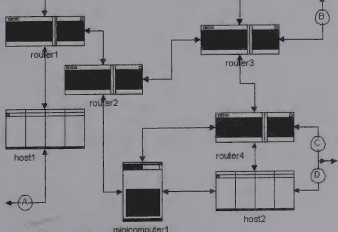

#### 实验 1.2: 访问其他 TCP/IP 主机

为了分析 `traceroute` 的作用并理解路由概念，请查看图 1.1。注意每行都有指向两个方向的箭头。这意味着每个链路都是双向的，数据可以向两个方向流动。此外，目前假设 `host1`、微机和 `host2` 都可以作为路由器，这意味着它们可以将信息数据包发送到它们连接的其他端口。我们现在来讨论数据包的几种可能路由。

从点 A 到 `router1` 的数据包必须通过 `host1`。只有一种可能的路由。数据包从点 A 到 `router2` 将通过 `host1` 和 `router1`。然而，如果从 `router1` 到 `router2` 的链路断 way，它也可以遵循这条路径：

```
point A -> router1 -> router3 -> router2
```

另一个可能的路由是：

```
point A -> router1 -> router3 -> router4 -> minicomputer -> router2
```

记住在此示例中微机可以进行路由。

这是路由器的实用功能之一：如果某条路由断开或饱和，数据可以通过不同的路由进行传输。在这个示例中，主机充当了路由器（这是主机软件的功能之一——Linux 和大多数版本的 UNIX 都内置了此功能）。

使用 `traceroute`，我们可以获取到达路由中每个点所需的时间以及从该点返回的时间。我们还可以获取沿途主机的名称。这允许我们追踪数据包，并且如果路由中的某一个连接断开，它可以成为一个非常有用的诊断工具。

#### 例如：

让我们从 `host1` 到 `host2` 执行 `traceroute`。一条路由是：

```
host1 -> router1 -> router3 -> router4 -> host2
```

为了确定到达每个点的时间，你可以将此分解为以下步骤：

```
host1 -> router1 -> host1
```

```
host1 -> router3 -> host1
```

```
host1 -> router4 -> host1
host1 -> host2 -> host1
```

执行 `traceroute` 命令。在 `host1` 上执行该命令的示例输出如下：

```
## traceroute host2
traceroute to host2 (10.97.13.95)
1 router1 (10.25.35.17) 6ms 5ms 5ms
2 router3 (10.11.45.19) 15ms 12ms 10ms
3 10.15.35.98 (10.15.35.98) 25ms 20ms
4 host2 (10.97.13.95) 38ms 28ms 26ms
```


注意，当你离 `host1` 越远，数据包返回的时间就越长，这与之前的描述一致。你还会注意到第三行有 `10.15.35.98` 而没有网络名称。这意味着 `host1` 无法确定 `router4` 的 DNS 或网络名称，它只是返回了 IP 地址。第二列和第三列是对每个点的额外检查，因为第一个检查（或第一列）总是会因为在名称服务器上查找名称而变慢。

## NSLOOKUP 命令

在开始更改或设置新系统之前，了解名称服务是如何处理的非常重要。`nslookup` 命令可以帮助你确定系统是如何解析名称的。它不会告诉你是先查询 `/etc/hosts`、名称服务还是 NIS。但它是快速查看你的系统并开始熟悉名称服务如何设置的简便方法。

当你输入 `nslookup` 命令时，你将看到类似下面的结果：

```
### nslookup
Default Server: ns1.my.net
Address: 172.16.1.15
```

这给出了你的名称服务器的名称。如果返回的是回环地址，说明你的系统完全没有使用名称服务器。有关 DNS 的进一步讨论将在第4章进行。

## 实验 1.2 练习

### 1.2.1 PING

本练习向你展示如何使用 `ping` 命令，它还会让你如何定期 ping 远程主机。你应该以普通 ID 登录。


你的 `ping` 命令可能不在与其他 UNIX 版本相同的位置。最常见的目录将是 `/bin`, `/usr/bin`, `/sbin`, `/usr/sbin`, `/ucb` 和 `/etc`。如果你有公共版本的命令，它可能在 `/usr/local/bin`。你可能需要使用绝对路径执行命令或更改你的路径。

- a) `ping` 命令位于哪里？

- b) 你是如何找到 `ping` 命令的？

考虑到命令的位置，执行：

```bash
ping hostname
```

其中 `hostname` 是你网络上的设备名称。它可以是服务器、工作站、路由器，甚至是网络打印机。你也可以 ping `127.0.0.1` 或使用你的主机名。

- c) 你从 `ping` 命令中得到了什么结果？

现在在 Linux 中执行执行：

```bash
/bin/ping -i5 hostname
```

其中 `hostname` 是你网络上的主机名称。

- d) 现在带有选项 `-i5` 的 `ping` 命令结果是什么？

### 1.2.2 TRACEROUTE

本练习向你展示如何使用 `traceroute` 命令，它还会让你如何确定到达目的地的路由。你应该以普通用户 ID 登录。

> 注意，你的 UNIX 版本可能完全没有 `traceroute`。然而，有很多免费的 `traceroute` 版本。你可能考虑下载并安装这些版本。你可以使用许多网络工具搜索 `traceroute`。有时会有可以直接安装和运行的二进制版本。


一个检查到 `rs.internic.net` 的良好 Internet 主机。该主机始终在线。如果你的网络没有接入 Internet，或者你想先检查本地主机的路由，那么你可以先使用本地主机。

你应该做的第一件事是 ping 该主机以检查它是否可用以及可以从你的主机访问。如有必要，请使用 `ping` 命令相应的绝对路径位置执行以下命令：

`ping rs.internic.net`

- a) 你执行 `ping rs.internic.net` 命令后得到了什么结果？

- b) 你是否看到了“host unreachable”（主机不可达）或类似的消息？

- c) 你认为“host unreachable”或类似消息的原因是什么？

如果你收到了“host unreachable”消息，请选择另一个主机或你本地网络上的主机。（你可以一直 ping 自己自己，但 `traceroute` 的用处不大。）

现在你已经准备好检查通往主机的路由了。运行以下命令：

```
traceroute rs.internic.net
```

- d) `traceroute` 命令位于你系统的哪个位置？

- e) 你执行 `traceroute` 命令得到了什么结果？

## 实验 1.2：访问其他 TCP/IP 主机

- f) 如果你的 `ping` 命令可以工作，但 `traceroute` 失败或耗时很长，可能的原因是什么？

- g) 你将如何解决问题 f 中的问题？

## 1.2.3 NSLOOKUP

本练习将向你展示如何使用 `nslookup` 命令，它还能帮助你确定正在运行哪些名称服务器。

你仍然需要确定 `nslookup` 命令所在的位置。大多数 UNIX 版本允许普通用户使用 `nslookup`，但没有将该文件放在普通用户的搜索路径中。因此，你仍然需要在你的系统上搜索它。用你的普通用户 ID 登录。

- a) `nslookup` 命令位于你系统的哪个位置？

- b) 你执行 `nslookup` 命令得到了什么结果？

- c) 如果你在问题 b 的 `nslookup` 命令中遇到错误，你认为原因是什么？

- d) 你将如何修复问题 b 中 `nslookup` 命令产生的任何错误？

- e) 如果你在问题 b 中输入 `nslookup` 命令后没有得到任何错误，你的提示符（prompt）是什么的？

现在在 `nslookup` 提示符后输入以下内容：

`rs.internic.net`

- f) 输入 `rs.internic.net` 后，你的结果是什么？

- g) 如果你在问题 f 中输入 `rs.internic.net` 后收到错误，你认为原因是什么？

- h) 你将如何修复问题 f 中 `nslookup` 命令产生的任何错误？

- i) 如果你在问题 f 中输入 `nslookup` 命令后没有得到任何错误，屏幕上的提示符是什么的？

## 实验 1.2：访问其他 TCP/IP 主机

现在在 `nslookup` 提示符后输入以下内容：

`quit`

- j) 输入 `quit` 后，你的结果是什么？

- k) 根据你对 UNIX 的了解，你将如何退出 `nslookup`？

## 实验 1.2 练习答案

## 1.2.1 答案

- a) `ping` 命令位于你系统的哪个位置？

答案：它可能位于 `/bin`、`/usr/bin`、`/sbin`、`/usr/sbin`、`/usr/ucb`、`/usr/local/bin`、`/etc` 或其他目录。

- b) 你是如何找到 `whereis` 命令的？

答案：`whereis` 命令是一个查找文件的有用命令，但它只能找到已经在搜索路径中的文件，因此你可能需要手动查找文件。

你可以通过使用 `cd` 命令进入目录来实现。例如，输入命令 `cd /usr/sbin` 进入 `/usr/sbin` 目录。到达那里后，输入命令 `ls ping`。这将显示该文件是否存在。

- c) 你执行 `ping` 命令得到了什么结果？

在 Linux 中，`ping` 命令会每秒 ping 一次，看起来如下：

```
[myid@wheels myid]$ ping myserver
PING myserver (172.16.1.12): 56 data bytes
64 bytes from 172.16.1.12: icmp_seq=0 ttl=255 time=4.1 ms
64 bytes from 172.16.1.12: icmp_seq=1 ttl=255 time=2.8 ms

-- myserver ping statistics
10 packets transmitted, 10 packets received, 0% packet loss
round-trip min/avg/max = 2.8/2.9/4.1 ms
[myid@wheels myid]$
```

注意，该命令会持续 ping 直到被停止。你可以通过按下 `Ctrl+C` 停止它。

- d) 现在使用选项 `-i5` 执行 `ping` 命令的结果是什么？

答案：在 Linux 中，带有选项 `-i5` 的 `ping` 命令会每秒重复 ping 次。


```
[myid@wheels myid]$ ping -i5 myserver
PING myserver (172.16.1.12): 56 data bytes
64 bytes from 172.16.1.12: icmp_seq=0 ttl=255 time=4.3 ms
64 bytes from 172.16.1.12: icmp_seq=1 ttl=255 time=2.9 ms
64 bytes from 172.16.1.12: icmp_seq=2 ttl=255 time=2.9 ms

-- myserver ping statistics
3 packets transmitted, 3 packets received, 0% packet loss
round-trip min/avg/max = 2.9/3.3/4.3 ms
[myid@wheels myid]$
```

## 1.2.2 答案

- a) 执行 `ping rs.internic.net` 得到了什么结果？

答案：它应该像这样：

```
[myid@wheels myid]$ ping rs.internic.net
PING rs.internic.net (172.16.1.12): 56 data bytes
64 bytes from 172.16.1.12: icmp_seq=0 ttl=255 time=4.1 ms
64 bytes from 172.16.1.12: icmp_seq=1 ttl=255 time=2.8 ms

-- myserver ping statistics
10 packets transmitted, 10 packets received, 0% packet loss
round-trip min/avg/max = 2.8/2.9/4.1 ms
[myid@wheels myid]$
```

注意，该命令会持续 `ping` 直到被停止。你可以通过按下 `Ctrl+C` 停止它。

- b) 你是否看到了“host unreachable”或类似的消息？

答案：你可能没有看到这个消息，或者类似的。

- c) 你认为“host unreachable”或类似消息的原因是什么？

答案：可能是因为主机不可达，或者路由问题。

- d) `traceroute` 命令位于你系统的哪个位置？

答案：它可能位于 `/bin`、`/usr/bin`、`/sbin`、`/usr/sbin`、`/usr/ucb`、`/usr/local/bin`、`/etc` 或其他目录。

- e) 你执行 `traceroute` 命令得到了什么结果？

答案：你应该看到类似：

```
[myid@wheels myid]$ traceroute rs.internic.net
1  192.168.1.1 (1.234 ms 1.156 ms 1.098 ms)
2  10.0.0.1 (2.456 ms 2.321 ms 2.210 ms)
...
10 172.16.1.12 (rs.internic.net) (15.123 ms 14.876 ms 14.789 ms)
```

- f) 如果你的 `ping` 命令可以工作，但 `traceroute` 失败或耗时很长，可能的原因是什么？

答案：可能是路径上的某些节点名称解析失败。如果解析时间过长，`traceroute` 可能会超时。

- g) 你将如何解决问题 f 中的问题？

答案：你可以通过某些版本的 `traceroute` 选项来控制这个值。你也可以使用 `traceroute -n` 命令来防止解析 IP 地址。

## 1.2.3 答案

- a) `nslookup` 命令位于你系统的哪个位置？

答案：它可能位于 `/bin`、`/usr/bin`、`/sbin`、`/usr/sbin`、`/usr/ucb`、`/usr/local/bin`、`/etc` 或其他目录。

- b) 你执行 `nslookup` 命令得到了什么结果？

答案：你应该看到类似的结果：

```
### nslookup
Default Server: proxy01.my.isp.net
Address: 172.16.1.15
```

- c) 如果你在问题 b 的 `nslookup` 命令中遇到错误，你认为原因是什么？

答案：可能会产生几种错误。某些错误如下：

- 默认服务器未——这通常意味着没有设置正确的文件，或者服务器 IP 地址不正确。
- 无法执行命令——要么文件不存在，权限未设置正确，或者你没有执行权限。
- 文件未找到——它找不到该文件。即使你指定了正确的路径，如果存在属性问题、终端设置错误或环境设置问题，也会发生这种情况。

- d) 你将如何修复问题 b 中 `nslookup` 命令产生的任何错误？

答案：上述问题的可能修复方法是：

- 默认服务器未找到——因为我们之后会讨论 DNS，你以后可能需要回到这里查看以确保设置正常。

## 实验 1.2：访问其他 TCP/IP 主机

除了修复之前消息中的那些项目外，你可能还想通过执行 `stty -a` 命令并查看终端属性来检查你的环境。如果看起来不对，你可以输入 `stty sane` 来重置终端属性。你也可以在 Korn shell 中输入 `setenv` 或 C shell 中输入 `printenv` 并查找任何异常情况。你也可以输入 `alias` 来查看命令是否在 C shell 或 Korn shell 中被设置了别名。

- 如果你在问题 b 中输入 `nslookup` 命令时没有遇到任何错误，你的提示符（prompt）是什么？

答案：你应该看到以下提示符：

- 输入 `rs.internic.net` 后结果是什么？

答案：你应该会在屏幕上看到以下内容：

> > rs.internic.net

Server: nameserver.mydomain.com

Address: 172.16.1.45

Name: rs.internic.net

Address: 198.41.0.6

- 如果你在问题 f 中输入 `rs.internic.net` 时获取了错误，你认为原因是什么？

答案：可能会导致几种类型的错误。某些错误如下：

- unable to access server—无法访问服务器——服务器不可用。这通常伴随着超时消息。
- hostname not found—未找到主机名——主机名无法解析为 IP 地址。

h) 如何修复问题 f 中 `nslookup` 命令产生的任何错误？

答案：解决这些问题的可能方法包括：

- unable to access server—无法访问服务器——确保默认服务器已正确设置。这将在 DNS 章节中讨论，但请确保它是正确的。如果你不确定，可以联系你的网络管理员获取正确的名称。
- hostname not found—未找到主机名——你需要输入有效的名称。你还应该检查是否有拼写错误。

i) 如果你在问题 f 中输入 `nslookup` 命令后没有遇到任何错误，屏幕上的提示符是什么？

答案：你应该再次看到以下提示符：

>

j) 输入 `quit` 后结果是什么？

答案：你应该能看到类似下面的结果：

```
hostname not found
```

遗憾的是，你不能使用 `quit`、`exit` 或任何标准的 UNIX 命令来退出 `nslookup`。它会将任何不是 `nslookup` 选项部分的字符串解释为 IP 主机名并尝试进行解析。

k) 根据你对 UNIX 的了解，你将如何退出 `nslookup`？

答案：你需要按下 `Ctrl+C` 或 `Ctrl+D` 来退出命令。

## 实验 1.2 自测习题

为了测试你的进度，你应该能够回答以下问题。

执行了 `ping` 另一个主机的命令。请使用以下结果回答前五个问题。

```
[myid@wheels /home/myid]$ ping mohawk
P mohawk (172.16.1.2): 56 data bytes
64 bytes from 172.16.1.2: icmp_seq=0 ttl=255 time=2.7 ms
64 bytes from 172.16.1.2: icmp_seq=1 ttl=255 time=2.9 ms
64 bytes from 172.16.1.2: icmp_seq=2 ttl=255 time=2.9 ms
64 bytes from 172.16.1.2: icmp_seq=3 ttl=255 time=2.9 ms
```

4 packets transmitted, 4 packets received, 0% packet loss round-trip min/avg/max = 2.7/2.8/2.9 ms

- 1) `ping` 消息正在收到名为 `mohawk` 的服务器的响应。

a) 正确

b) 错误

- 2) `mohawk` 上的网卡地址是 `172.16.1.2`。

a) 正确

b) 错误

- 3) 从远程主机获取响应的时间大约是多少？

a) 0

b) 2.9

c) 4

d) 64


e) 255

- 4) 发送了多少数据包？

a) 0

b) 2.9

c) 4

d) 64

e) 255

- 5) `ttl` 值指的是 IP 数据包的生存时间（time to live）。

a) 正确

b) 错误

## 实验 1.2：访问其他 TCP/IP 主机

查看图 1.1 以回答以下 3 个问题。

- 6) 从圈出的点 A 到 B 的最短路由涉及多少个不同的 IP 设备？

a) 0

b) 1

c) 2

d) 3

e) 4

- 7) 假设所有主机都可以路由，从圈出的点 A 到点 B 且不回到同一个点的路径有多少条不同的路由？

a) 0

b) 2

c) 4

d) 5

e) 6

- 8) 假设所有主机都可以路由 `minicomputer1`，从圈出的点 A 到点 B 且不回到同一个点的路径有多少条不同的路由？

a) 0

b) 2

c) 4

d) 5

e) 6

使用以下结果回答关于 `host2 (10.97.13)` 的两个问题：

```
traceroute 10.25.35.17 6ms 5ms
router 10.115.45 15ms 10ms
10.15.35.98 28ms 25ms 20ms
10.97.13 38ms 28ms 26ms
```

- 9) 目的地的 IP 地址是什么？

a) 10.97.13

b) 10.25.35.17

c) 10.115.45

d) 10.15.35.98

e) 10.1.12

- 10) 数据包到达目的地需要经过多少个 IP 设备、主机或其他设备？可以忽略源设备。）

a) 0

b) 2

c) 3

d) 4

e) 5

使用以下结果回答接四个问题：

```
nslookup www.myserver.com
Server: proxy01.my.isp
Address: 172.16.1.3

> www.myserver.com
Server: proxy01.my.isp
Address: 172.16.1.3
Name: www123.myserver.com
Address: 192.9.49.33
Aliases: www.myserver.com
```

- 11) `www.myserver.com` 的 IP 地址是什么？

a) 172.16.1.3

b) 192.9.49.33

c) www123.myserver.com

d) proxy01.my.isp

e) 以上都不是

- 12) `www.myserver.com` 真的是哪个名称的别名？

a) 172.16.1.3

b) 192.9.49.33

c) www123.myserver.com

d) proxy01.my.isp

e) 以上都不是

- 13) 上列表中 DNS 服务器的主机名是什么？

a) 172.16.1.3

b) 192.9.49.33

c) www123.myserver.com

d) proxy01.my.net

e) 以上都不是

- 14) 上列表中 DNS 服务器的 IP 地址是什么？

a) 172.16.1.3

b) 192.9.49.33

c) www123.myserver.com

d) proxy01.my.net

e) 以上都不是

### 表 1.5 项目结果

| 网络类 | IP 地址 | 子网掩码 | 网络地址 | 广播地址 |
| :--- | :--- | :--- | :--- | :--- |
| | 10.35.15.25 | 255.255.255.0 | 172.16.1.0 | |
| | 172.16.1.15 | | | 192.168.1.255 |
| | 192.168.1.35 | | | |
| | 5.15.95.16 | | 5.15.0.0 | |
| | 192.168.235.45 | 255.255.255.0 | | |
| | 172.31.25.25 | 255.255.255.0 | 10.21.0.0 | |
| | 10.21.35.15 | | | |
| | 10.15.3.35 | | | 102.255.255.255 |
| | 192.168.35.35 | | 192.168.35.0 | |

# 第 1 章

## 思考你的思考

- 1) 补全表 1.5 中缺失的网络特征。只有在绝对需要时才假设默认值。

- 2) 根据 IP 地址设计一个网络。务必考虑：

a) 网络类

b) 网卡 IP 地址

c) 子网掩码

d) 网络地址

e) 广播地址

f) 你可能需要的用于回答本章学习命令的任何额外特征。

- 3) 执行以下命令的结果是什么：

a) `ifconfig` 命令

b) `netstat -nr`

# 第 2 章

## 配置你的 TCP/IP 网络

> 当你建造一栋建筑时，你从基础开始，然后向上。否则这样做是行不通的。

Joe

### 章节目标

在本章中，你将学习到：

高级用户和超级用户的练习

设置 TCP/IP 第 40 页

本章将帮助你理解如何构建你的网络。你将确定当前的网络特征。然后你将利用这些来帮助构建自己的网络配置。由于由于，你需要在某些 Linux 设备上拥有 root 权限。你可能会发现内置 CD-ROM 上的精简 Linux 对此有用。

## 实验 2.1：设置 TCP/IP

## 实验 2.1

### 设置 TCP/IP

#### 实验目标

在本实验后，你将能够：

* 确定当前的网络特征

* 关闭网络接口

* 开启网络接口

* 设置你的主机表

* 启用客户端名称解析

本章讨论了如何在你的机器上设置 TCP/IP。由于 UNIX 有多种类型，无法涵盖所有版本的 UNIX 以及设置网络和地址的各种方法。本实验侧重于使用命令行在 Linux 中设置 TCP/IP 网络。然而，你的系统可能有一种使用菜单设置地址的可以接受的方法。理解 UNIX 和 Linux 的命令行操作方式是非常重要的，因为比菜单快得多，而且有时你可以用命令行更快地解决问题。实验练习假设你已经在 Linux 设备上拥有 root 权限。

### 设备驱动

设备驱动允许你的 Linux 内核与实际硬件通信。设备驱动通常在非常底层的级别编写，通常是汇编语言编写的理想对象。由于由于，它们很难从一个 UNIX 版本迁移到另一个版本，从一个处理器迁移到另一个。设备驱动在你的机器启动时加载。你可以在图 2.1 中看到它的样子。

## 内核

## 设备驱动程序

## 硬件

图 2.1 UNIX 设备驱动

当你的 Linux 系统启动时，它会尝试确定连接到它的硬件设备。这是自动配置过程的一部分。然而，这需要时间，一旦你的系统设置妥，你将希望消除大部分探测工作。本书并不尝试教你如何修改自动配置过程，并假设你正在使用的任何 UNIX 或 Linux 版本都会通过 `dmesg` 自动确定必要的驱动程序。

#### DMESG 命令

你的系统将会在一个文件中记录启动信息，包括找到和未找到的设备。你可以使用 `dmesg` 命令查看该文件的内容。这是一个标准的 Linux 命令。在下方的红帽 Linux 5.2 显示内容中，可以看到 `dmesg` 命令的部分列出。启动时查找网卡的结果选择如下所示：

```
wdc: Presently autoprobing (not recommended) for a single card.
wdc:v10 9/23/94 Donald Becker (becker@cesdis.gsfc.nasa.gov)
th0: WD803x at 0x280, 00 00 00 06 2D WD8003, IRQ 5, shared
memory at 0xd0000-0xd1ffff.
express.c: Module autoprobe not recommended, give io==.
eth1: EtherExpress at 0x300, 10, Interface 10baseT, 32k
express.c: v0.10 04-May-95 John Sullivan <js10039@cam.ac.uk>
v0.14 19-May-96 Philip Blundell <phil@tazenda.demon.co.uk>
v0.15 04-Aug-98 Alan Cox <alan@redhat.com>
```

# 42 实验 2.1：设置 TCP/IP

了解系统找到了哪些设备很重要，这样你就可以配置网络。在上面的显示中，你会看到有两个以 `eth` 开头的行。它们是 `eth0` 和 `eth1`。这些实际上是 Linux 加载的设备驱动程序的名称。上面显示的设备是一个西部数据 8003 以太网卡和一个以太网卡。

## 实验 2.1

## IFCONFIG 命令

我们在第一章中讨论过 `ifconfig` 命令，当时我们用它来确定你网卡的当前特性。现在我们将看到如何使用该命令来配置机器的网络特性。`ifconfig` 命令有许多选项。对于我们的目的，`ifconfig` 命令可以采用以下格式配置网卡（NIC）：


```
ifconfig <interface> [<address>] [ up ] [ down ] [ netmask <mask> ] [ broadcast <broad_addr> ]
```

其中：

- 1. `interface` 是接口，在上面的讨论中是 `eth0` 或 `eth1`。
- 2. `address` 是 NIC 的 IP 地址。
- 3. `up` 或 `down` 将网卡上的网络启动或关闭。
- 4. `netmask <mask>` 将根据 `<mask>` 的值设置子掩码。
- 5. `broadcast <broad_addr>` 将根据 `<broad_addr>` 的值设置广播地址。

还有其他不会讨论的选项，但你可能会在某些情况下发现它们很有用。

### 例如

你可以使用以下命令为 `eth1` 卡建立 TCP/IP 参数：

```
ifconfig eth1 172.16.1.3 up netmask 255.255.255.255
broadcast 172.16.1.255
```

## 路由

默认路由在实验 1.1 中讨论过，它是所有不在本地网络上的 IP 地址所访问的 IP 地址。本地网络由路由器 NIC 卡上的 IP 地址和所使用的子掩码决定。因此，如果你具有以下特性：

路由器 IP 地址：172.16.1.3

子掩码：255.255.255.0

任何小于 172.16.1.0 或大于 172.16.1.255 的地址都会发送到路由器地址 172.16.1.3。路由器将接受这些数据包。如果它直接连接到目标所在的网络，它将通过该网络上的 NIC 将数据包传。如果它没有直接连接到网络上的此地址，它将其传递给自己的默认路由器，直到数据包被目标接收或数据包失效，在这种情况下你将收到“无响应”或“主机不可达”的消息。

### 例如

让我们查看图 2.2 中的以下网络布局。

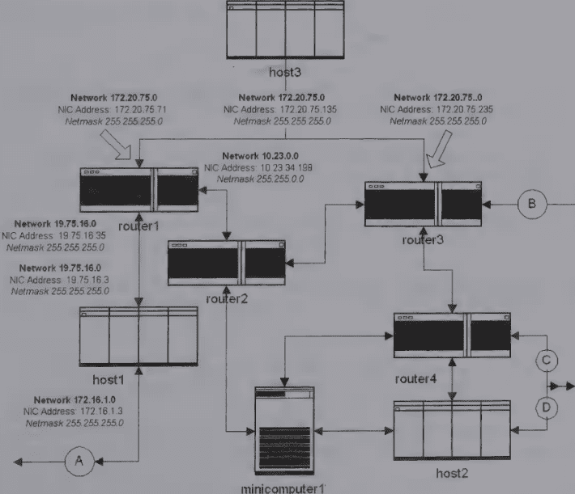

### 图 2.2 路由方案示例

## 实验 2.1：设置 TCP/IP

看 `router1`。它有 3 块 NIC 卡：

172.20.75.71

10.23.34.198

19.75.16.3

注意，虽然其他地址可能是且可用的，但不建议你选择任何以 255 或 0 的地址，因为你可能会发现那些地址无法访问，或者如果你划分了网络，那些地址将无法访问。对该网络的进一步分析将发现，当数据包到达路由器时，它根据表 2.1 显示的特性决定从哪个端口出去。目标 IP 地址 10.23.1.69 的数据包将从地址为 10.23.34.198 的端口出去。假设在图 2.2 中，你想从 `host1` 向 172.20.75.135 的 `host3` 发送数据包。数据包首先进入 `router1`。路由器查找其表发现 172.20.75.135 可以地址为 172.20.75.71 的 NIC 卡访问。然后它将数据包发送到 `host3`。然而，如果路由器接收到目标为 192.16.1.1 的包，它不知道如何处理。它可以返回一个说目标未知的消息，也可以将数据包传递给默认路由器。`host1` 必须首先建立 `router1` 为默认路由器，然后 `router1` 将搜索其表。如果不是本地网络，数据包将被传出。

### 表 2.1 路由器分析

| NIC 地址 | 子掩码 | 网络地址 | 网络起始地址 | 网络结束地址 |
| :--- | :--- | :--- | :--- | :--- |
| 172.20.75.71 | 255.255.255.0 | 172.20.75.0 | 172.20.75.1 | 172.20.75.254 |
| 10.23.34.198 | 255.255.0.0 | 10.23.0.0 | 10.23.1.1 | 10.23.254.254 |
| 192.75.16.35 | 255.255.255.0 | 192.75.16.0 | 192.75.16.1 | 192.75.16.254 |

# 实验 2.1：设置 TCP/IP 45

### 例如

假设你想从 `host1` 向图 2.2 中的点 B 发送数据包。它必须遵循的路径将：

```
host1 -> router1（这是默认路由）
router1 -> router3（这是 host1 的默认路由）
router3 -> 点 B 及以后（这是 router3 的默认路由）
```

### ROUTE 命令

有时在 Linux 中，如果你在 NIC 上手动建立 TCP/IP，你还需要手动启动路由。你可以这样做：

```
route add -net network_address network_port
```

一个示例是：

```
route add -net 192.75.16.0 eth0
```

你使用 `route` 命令建立默认路由。实际语法是：

```
route add default gw network_address netmask netmask_value network_port
```

其中 `network_address` 是默认路由的地址，具体说是你网络上将 IP 包传递到下一个网络的 NIC 地址；`netmask_value` 是子掩码；`network_port` 是 `ifconfig` 命令返回的端口。在图 2.2 中，`host1` 访问 `host3` 必须通过 `router1`。在这种情况下，你输入命令：

```
route default gw 192.75.16.35 netmask 255.255.255.0 eth0
```

来自 `host1` 且不在 192.75.16.0 网络上的包将发送到地址为 192.75.16.35 的 NIC 卡——`router1` 上的 NIC 卡。

### HOSTS 文件

默认情况下，你的 UNIX 计算机首先访问 `/etc/hosts` 文件来确定你已命名的主机的 IP 地址。文件的格式如下：

```
127.0.0.1 localhost
172.16.13.96 myhost host.mydomain.net mybox tux
```

第一个字段给出第二列名称的 IP 地址。

第二个字段包含主机的可能名称和可能的任何别名。第二个字段中的第一个名称是主机的主名。剩余的名称是也可以用于访问主机的别名。这些别名通常在相应远程主机的 `/etc/hosts` 文件中也能找到。

### NSLOOKUP

一旦你的系统运行，正如我们之前讨论的，有几种进行域名服务的选项。在 `/etc/hosts` 中设置了初始 IP 地址后，你的 UNIX 机器就可以使用域名服务获取需要解析的名称的 IP 地址。如果你的域名服务器没有该名称，它通常会指向另一个可以查询的域名服务器。该域名服务器将把查询传递给另一个域名服务器，以此此类推，直到名称被解析或返回说名称无法解析的消息。

为了建立对 DNS 域名服务的访问，必须修改 `/etc/resolv.conf` 文件。该文件的格式为：

| domain | domainname |
| nameserver | name_server_address |
| nameserver | name_server_address |

其中 `domain` 是你的域名称。

### 例如

一些域名的示例是：aol.com, ibm.com, sun.com, cod.edu, mediaone.net 等。所以一个很好的示例是：

```
domain mymydomain.net
```

```
nameserver 172.16.17.34
nameserver 172.16.17.35
```

## 实验 2.1：设置 TCP/IP

你的 UNIX 或 Linux 服务器将访问名称服务器（`nameservers`）来确定主机名的 IP 地址。你的软件可以可以先检查 `/etc/hosts`，然后检查 DNS 服务，可以通过修改 `/etc/nsswitch.conf` 来切换检查顺序。这通常可以在你的机器上进行配置。在网络中拥有至少两个名称服务器是一个良好的策略：如果其中一个宕机，你还有一个备用。Linux 是一个理想的名称服务器，因为它可以很好地运行在 Intel 486 甚至基于 386 的 PC 上。名称服务的开销非常低。名称服务器通常被称为 DNS 服务器，因为它们运行的服务是域名系统服务（Domain Name Services，简称 DNS）。

## 实验 2.1 练习


本练习将向你展示如何确定系统中拥有哪些网络设备，删除相关的模块，然后重新进行设置。

如果你的系统尚未启用网络功能，你首先应该执行练习 2.1.2，在那个练习中你建立网络连接。然后你可以返回本实验，练习关闭端口后再重新开启的操作。

> 请通过控制台、通过调制解调器的串口端口或终端，或者不会受本练习影响的网络端口进行登录。否则，当你关闭网络端口时，你将失去通信。


> 本练习还依赖于系统在启动时将网络驱动程序作为模块加载到内存中。在 Linux 中，也可以将模块编译到内核中。如果你的系统使用内核编译方法，你仍然可以完成许多练习。

你可以使用 `dmesg` 命令查看启动时发现了哪些网络适配器。

使用你的 root id 登录或变为超级用户（superuser）。

## 实验 2.1：设置 TCP/IP

执行以下命令并查看你是否能确定你系统上的网络适配器：

```
dmesg | more
```

- a) 你通过 `dmesg` 命令发现了什么种的网络适配器？

当你找到网卡时，它的前面通常会有一个以 `.c` 结尾的文件。这是 Linux 中用于创建设备驱动程序文件的实际源代码文件。对于 ne2000 网卡，设备驱动程序源代码将是 `ne.c`。系统会为网卡分配它自己的名称，那通常是 `eth0`，这意味着使用特定通信风格或协议（如 TCP/IP）的第一块网卡。在同一台机器上使用相同协议的第二块卡将是 `eth1`，依此类推。某些网卡（NIC cards）可能会被赋予不同的名称，如 `tr0` 等。

- b) 使用 `dmesg` 命令为你的网卡填写以下特征的信息：

  - 基础地址 (base address)
  - 中断或中断 (interrupt or IRQ)
  - 设备驱动模块 (device driver module)
  - 协议设备名称 (protocol device name)

`ifconfig -a` 将列出你系统中已配置或准备好配置的所有网络适配器。

执行以下命令：

```
ifconfig -a
```

## 实验 2.1：设置 TCP/IP

- c) `ifconfig -a` 命令的结果是什么？

你需要选择一个你将在其上设置网络的网卡或 NIC。如果你只有一块网卡，那么选择就很简单。

在对设备定义进行任何操作之前，你需要记录网卡的信息，以便能够将其恢复到原始状态。

- d) 选择你想要关闭的网卡，并从 `ifconfig` 命令中收集该端口以下的信息：

  - IP 地址（通常标记为 `inet address`）
  - 广播地址（通常标记为 `Bcast`）
  - 子掩码（通常标记为 `Mask`）
  - 中断（通常标记为 `Interrupt`）
  - 基础地址（标记为 `base address`）

- e) 问题 b 和 d 回答中的基础地址和中断是否一致？如果不一致，在此停止并确定原因。

你可以可以使用命令确定已加载的设备驱动模块：

```
lsmod
```

- f) 你的 `lsmod` 命令的结果是什么？

### 50 实验 2.1：设置 TCP/IP

你应该也能看到你在本练习问题 b 中确定的驱动程序。

- g) 在问题 f 的回答中，你网卡驱动模块的条目是什么？
- h) 问题 d 和 g 中的设备驱动程序是否一致？如果不一致，为什么？

下一步是确定网络路由特性。你可以通过 `netstat` 命令做到这一点。推荐的格式是：

```
netstat -nr
```

- i) 你从 `netstat -nr` 命令中得到了什么结果？

你需要检查 `netstat -nr` 命令的结果。请记住默认路由和其他网关。你需要理解这一点，以便重新建立网卡和网络连接。

- i) 你将如何解释 `netstat -nr` 命令的结果？


在确定了正确的设备驱动程序并确保了问题 b 和 d 的共同答案一致之前，不要继续后续。

## 2.1.2 关闭接口

## 2.1.3 开启网络接口

### 54 实验 2.1: 设置 TCP/IP

实验 2.1

在启动过程中加载网络接口卡信息

手动加载网络接口卡信息


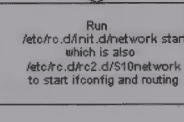

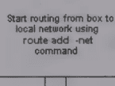
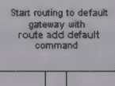
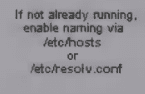

图 2.4 ■ 在网络接口卡上启动 TCP/IP 网络连接

a) 使用 `dmesg | more` 命令，你确定你的系统上的网络接口卡有哪些？

你需要验证网络接口卡是处于关闭状态还是不存在。使用以下命令进行操作：

```
ifconfig -a
```

- b) 从 `ifconfig -a` 命令中，你发现了关于网络接口卡的什么信息？

你需要确定网络接口卡驱动模块是否已加载到内存，因此输入以下命令：

```
lsmod
```

- c) 从 `lsmod` 命令加载的网络模块中，你发现了发现了什么信息？

问题 a、b、c 的结果应该显示你将要操作的网络已被禁用。如果没有被完全禁用，请重复练习 2.1.2 并确保遵循了所有步骤。

> 注意：在某些版本的 Linux 中（特别是某些精简版本），你需要手动将模块加载到内存。然而，其他版本的 Linux 会会在你执行 `ifconfig` 命令设置网卡网络时自动加载模块，或者在启动时加载它。网络模块可以编译到内核中。此外，如果你刚刚从内存中删除了模块，系统可能仍然记得该模块的信息。如果在后续练习中遇到错误，只需继续执行 `ifconfig` 命令。如果仍然不起作用，你将检查发生了什么。


现在你需要加载网卡模块。

### 56 实验 2.1: 设置 TCP/IP

d) 网卡的模块名称是什么？

现在使用该模块名称或文档中的名称将模块加载到内存。输入以下命令：

```
insmod device_driver_module
```

其中 `device_driver_module` 是你网络接口卡的设备驱动程序的名称。对于 ne2000 卡，你应该输入以下命令：

```
insmod ne
```

e) `insmod` 命令的结果是什么？

你可以通过 `lsmod` 命令验证这一点。你应该能看到列出的设备驱动。

f) 运行 `lsmod` 命令的结果是什么？

g) 运行 `lsmod` 命令时，你的网卡设备模块有列表吗？如果没有，你认为原因是什么？

现在你需要设置 TCP/IP 参数。使用 `ifconfig` 命令来完成设置。你需要从练习 2.1.1 或 1.3.1 获取必要的参数。如果这是你第一次设置网卡，你可能需要从你的网络管理员或导师处获取这些参数。

## 实验 2.1: 设置 TCP/IP

如果你正在运行自己的网络，只需为你的网络选择合理的值即可。

- h) 你想要为网络接口设置的以下参数的值是多少？

```
网络接口名称 (network_interface_name)
IP 地址
广播地址
子网掩码
```

下一步是设置你的 `ifconfig` 命令。通过使用以下格式进行操作：

```
ifconfig network_interface_name ip_address broadcast broadcast_address netmask netmask_value
```

其中：

- `network_interface_name` 是我们之前在文中看到的网络接口名称，例如 `eth0`。
- `ip_address` 是你之前发现的 IP 地址。
- `broadcast_address` 是之前的广播地址。
- `netmask_value` 是之前使用的子网掩码值。

### 示例：

```
ifconfig eth0 172.16.1.3 broadcast 172.16.1.255
netmask 255.255.255.0
```

现在用你想要的值设置你的网卡。

- i) 你将使用什么命令来设置你的网络接口？
j) 执行该命令的结果是什么？

现在你需要验证你的网络接口是开启的。简单地输入之前看到的那个命令：

```
ifconfig -a
```

k) 运行 `ifconfig -a` 的结果是什么？

现在你需要重新建立路由。首先，验证你的路由已恢复。为了这样做，请运行 `netstat` 命令。

l) 从 `netstat` 中你得到了什么结果？
m) `netstat` 的结果与之前的相比如何？

如果你没有看到你网络的路由，你需要使用 `route` 命令。你可以如下：

```
route add -net address
```

n) 当你添加路由时发生了什么？

现在你需要设置默认路由。如果它没有运行，你可以使用如下命令：

```
route add default gw address
```


例如：

对于 `host3`，默认路由将是：

```
route add default gw 172.16.1.235
```

- o) 你启动默认路由的命令是什么？

- p) 现在运行 `netstat` 的结果是什么？

你的网络接口现在应该像开始时那样运行。如果不是，通过练习检查你没有犯任何错误。

q) 当你 ping 一个不在你的网络上的 IP 时发生了什么？

### 2.1.4 设置主机表

下一步是设置你的 `/etc/hosts` 文件。此练习假设你没有 DNS、NIS 或 NIS+。如果不确定，你应该咨询你的导师或网络管理员。DNS 将在第三章讨论。`etcetc/hosts` 文件允许你通过名称而非 IP 地址访问主机。使用图 2.2 中的示例。

为了讨论目的，假设你在网络 `172.75.0` 上，子掩码为 `255.255.255.0`。你的主机名为 `host3`，IP 地址为 `172.75.135`。现在修改或创建 `/etc/hosts` 文件并包含以下条目（你应该根据自己的网络自定义此文件，并至少包含一个你可以访问的其他主机）：

```
127.0.0.1 localhost
172.75.135 host3
172.75.71 router1
172.75.235 router3
172.16.1.3 host1
```

a) 通过名称连接 `/etc/hosts` 文件中的主机时你会看到什么？

b) 通过名称连接网络上但不在 `/etc/hosts` 文件中的主机时你会看到什么？

c) 对 `/etc/hosts` 文件中的主机进行 `traceroute` 时发生了什么？

d) 对 `/etc/hosts` 文件中的现有主机通过名称进行 `traceroute` 时发生了什么？

### 2.1.5 启用主机解析

此练习假设你运行着 DNS 名称服务，但没有运行 NIS 或 NIS+。在此练习中，你将设置你的主机，以便你不需要在 `/etc/hosts` 文件中包含除回环地址以外的任何条目。它假设你的名称服务器知道本地网络之外的其他主机的地址。如果你的服务器不知道网络外部的主机，练习对于本地网络主机仍然有效。

按照本实验介绍部分的描述，使用以下格式创建 `/etc/resolv.conf` 文件，但将域名值更改为你自己的域名，并将名称服务器的值更改为你网络的值。如果你不确定这些值应该是，你应该联系你的网络管理员或导师。一个 `/etc/resolv.conf` 示例如下：

| domainname | mydomain.com |

| nameserver | 172.16.1.10 |

| nameserver | 172.16.1.11 |

## 实验 2.1：设置 TCP/IP

现在将你的 `/etc/hosts` 文件备份到 `/etc/hosts.bak`，然后按照以下示例创建一个 `/etc/hosts`，将 `host3` 的值替换为你正在工作的主机值：

```
127.0.0.1         localhost
172.20.75.135    host3 loghost      # This is my local-host 
host that I am working on.
```

`/etc/hosts` 文件中不应有其他条目。

你现在可以使用 `nslookup` 命令验证你的主机是否正在使用名称服务。该命令通常位于 `/usr/sbin/nslookup`，万一你遇到找不到文件的错误，可以这里。

- a) 当你输入 `nslookup` 命令时会发生什么？解释你看到的内容。

- b) 如果你收到 `nslookup` 命令的任何错误，你认为是什么导致这些错误？

- c) 现在你应该使用 `nslookup` 命令查找有关主机 `rs.internic.net` 的信息。解释你看到的内容。

- d) 当你使用主机名而不是 IP 地址对网络上的已知主机进行 `telnet` 操作时会发生什么？解释结果。

找到一个无法被 `nslookup` 命令解析的服务器名称。

- e) 对于不存在的服务器，通过 `nslookup` 命令你会得到什么样的结果？

- f) 当你通过名称对未被名称服务解析的主机进行 `telnet` 时会发生什么？解释结果。

- g) 当你使用主机名而不是 IP 地址对网络外的主机进行 `telnet` 操作时会发生什么？如果你不知道有任何这样的主机，请使用服务器 `rs.internic.net`。解释结果。

- h) 当你使用主机名而不是 IP 地址对一个不存在的主机进行 `telnet` 时会发生什么？解释结果。

- i) 当你使用主机名而不是 IP 地址对网络上的已知主机进行 `traceroute` 时会发生什么？解释结果。

- j) 当你使用主机名而不是 IP 地址对一个不在网络上的现有主机进行 `traceroute` 时会发生什么？如果你有其他名称要使用，可以使用主机 `rs.internic.net`。解释结果。

- k) 当你使用主机名而不是 IP 地址对一个不在网络上的不存在的主机进行 `traceroute` 时会发生什么？解释结果。

## 实验 2.1 答案

### 2.1.1 答案

a) 你从 `dmesg` 命令中发现了什么类型的网络适配器？

答案：当你运行 `dmesg` 命令时，你将得到类似下面的结果：


```
[root@tux /root]#dmesg
Memory: sized by int13 088h
Console: 16 point font, 400 scans
Console: colour VGA+ 80x25, 1 virtual console (max 63)
pibios_init : BIOS32 Service Directory structure at 0x000f6f10
pibios_init : BIOS32 Service Directory entry at 0xf6f20
pibios_init : PCI BIOS revision 2.10 entry at 0xf6f41
Probing PCI hardware.
Calibrating delay loop.. ok - 66.36 BogoMIPS
Memory: 30624k/32768k available (748k kernel code, 384k reserved, 840k data)
This processor honours the WF bit even when in-visor mode. Good.
Swansea University Computer Society NET3.035 for/Linux 2.0.
NET3: Unix domain sockets 0.13 for Linux NET3.035.
Swansea University Computer Society TCP/IP for/NET3.034
IP Protocols: IGMP, ICMP, UDP, TCP
Linux IP multicast router 0.07.
VFS: Diskquotas version dquot_5.6.0 initialized
Checking 386/387 coupling... Ok, fpu using exception
16 error reporting.
Checking 'hlt' instruction... Ok.
Checking Linux version 2.0.36 (root@porky.redhat.com) (gcc version 2.7.2.3) #1 Tue Oct 13 22:17:11 EDT 1998

Starting kswapd v 1.4.2.2
Serial driver version 4.13 with no serial options enabled
tty00 at 0x03f8 (irq = 4) is a 16550a
tty01 at 0x02f8 (irq = 3) is a 16550a
Real Time Clock Driver: v1.09
Ramdisk driver initialized: 16 ramdisks of 4096K size
da: WDC AC3400L, 4104MB w/256kB Cache, CHS=1042/128/63
hdd: R36 1, ATAPI CD-ROM
ideo0 at 0x1f0-0x1f7, irq 14
idel at 0x170-0x177, irq 15
Floppy drive(s): fd0 is 1.44M
... (此处省略部分内容，实际翻译中此处应保持原文内容不变)
...
Floppy drive(s): fd0 is 1.44M
Partition: hda1 hda2 hda3 hda4 hda5 hda6
RAMDISK: Compressed image found at block 0
VFS: Mounted root (ext2).
Configuring Adaptec (SCSI-ID 7) at IO:33, IRQ 11,
scsi: total: 7.
scsi0: Adaptec 1542 detected 1.
Vendor: TOSHIBA Model:6201 Rev:10
Type: CD-ROM SCSI: 02
Detected si-ROM at scsi0, channel 0, id 5
Vendor: RICOH Model:6200: 0
Type: CD-ROM SCSI: 02
Detected si-ROM at scsi0, channel 0, id 6
VFS: Mounted root (ext2) readonly.
Trying to unmount old ...
Adding Swap: 1289k
```

### b) 你通过 `dmesg` 命令获取了哪些网络适配器的信息？

答案：通过 `dmesg` 命令获取了以下网络适配器的信息。查看 `dmesg` 命令的之前的结果：

...

### c) `configconfig -`` 的结果是什么？

答案：你应该看到类似下面的结果：

```
[root@n]# ifconfig -a
lo Link encap:Loopback
inet addr:127.0.0.1 Bcast:127.255.255
Mask:255.0.0.0
UP BROADCAST RUNNING MTU:3584 Metric:1
RX packets:45 errors:0 overruns:0
TX packets:45 errors:0 overruns:0
  carrier:0

eth0 Link encap:Ethernet hwaddr 00:00:C0:06:6F:2D
inet addr:172.16.2.95 Bcast:172.16.2.255
Mask:255.255.255.0
UP BROADCAST RUNNING MTU:1500 Metric:1
RX packets:45 errors:0 overruns:0
TX packets:0
  carrier:0
```

如果你查看此输出，你会发现实际上有两个网卡。你可以通过以 `wd.` 开头的条目来确定，它们是 `eth0` 和 `eth1`。对于实验目的，我们将使用第一个接口，即 `eth0`。如果你有第二个网卡，可能也想设置它。

### d) 选择你想关闭的网络接口，并通过 `ifconfig -a` 命令收集该端口的以下信息：

答案：根据实验之前的结果，答案如下表 2.3。你的系统会有差异，因此结果不同。

### e) b 和 d 的答案中的基地址是否一致？如果不一致，在此停止并 Determine原因。

答案：在示例中，答案是一致的。实际上，通过两种方法找到基地址可能会差 10（例如，你可能从一个命令得到 `0x280`，从另一个命令得到 `0x290`）。在这种情况下，不要担心值的差异。如果你的网卡没有启动，你可能以后需要回顾。否则，所有其他值都是一致的。差异在于网卡探测的方式。

### 表 2.2 网卡设备加载信息

| 描述 | 值 | 注释 |
|---|---|---|
| 基地址 | `0x280` | |
| 中断或 IRQ | `5` | |
| 设备驱动模块 | `wd.o` | `wd.c` 是源代码 |
| 协议设备名称 | `eth0` | 因为它是可加载的 |

### 表 2.3 ifconfig 的网卡值摘要

| 描述 | 值 | 实际输出 |
|---|---|---|
| IP 地址 | `172.16.2.95` | `inet addr: 172.16.2.95` |
| 广播地址 | `172.16.2.255` | `Bcast:172.16.2.255` |
| 子网掩码 | `255.255.255.0` | `Mask:255.255.255.0` |
| 中断 | `5` | `Interrupt:5` |
| 基地址 | `0x280` | `Base address:0x280` |

## 你的 `lsmod` 命令结果是什么？

答案：在示例系统中，显示了以下值：

```
[root@tux /root]# lsmod
Module      Pages Used by
eexpress      3       1 (autoclean)
wd           2       1 (autoclean)
8390        [wd]    0 (autoclean)
ls_iso8859_1 1       1 (autoclean)
ls_cp437     1       1 (autoclean)
vfat         4
aha1542      3       0
[root@tux /root]#
```

不要担心第一列以外的其他值。你以后可能会发现这些值很有用。

## 在问题的回答中，你的网卡驱动程序模块的条目是什么？

答案：你会发现问题 f 的回答中两个以太网卡都显示了。我们要找的是 `wd` 的条目，即：

```
wd           2       1 (autoclean)
```

## 问题 b 和 g 中的设备驱动程序是否一致？如果不一致，为什么？


答案应该是一致的。如果不一致，那么更有可能是系统在启动时找到了网卡，但没有启动网络模块。在这种情况下，你可以手动加载网络模块，我们将在稍后启动网络时执行此操作。（如果你急于尝试这一点，可能可以稍后尝试练习 2.1.3 中描述的 `lsmod module_name` 命令。）

## 你从 `netstat -nr` 命令得到了什么样的结果？

答案：在示例系统中，显示了以下值：

```
[root@tux /root]# netstat -nr
Kernel IP routing table
Destination Gateway  Genmask  Flags  MTU Window irtt Iface
172.16.2      0.0.0.0     255.255.255.250  U     1500 0  eth0
172.16.1      0.0.0.0     255.255.255.250  U     1500 0  eth1
0.0.0.0        172.16.2.1 255.255.255.250  UG    1500 0  eth0
127.0.0.1      0.0.0.0     255.0.0.0       U     3584 0  lo
[root@tux /root]#
```

## 实验 2.1：设置 TCP/IP

i) 你如何解释 `netstat -nr` 命令的结果？

答案：在示例系统中，请考虑表 2.4 中的后续输出。

## 2.1.2 答案

a) 在网络接口卡上执行 `ifconfig down` 命令的结果是什么？

答案：在示例系统中，你将使用以下命令关掉网络接口卡：

```
[root@tux /root]# ifconfig eth0 down
[root@tux /root]#
```

你不应该收到任何错误信息，而应该只得到一个命令行提示符。这是 UNIX 哲学中“没有消息就是好消息”的一个范例。

### 表 2.4 以太网 NIC 信息摘要

| 目的 | 网关 | 子网掩码 | 标志 | 接口 | 描述 |
|---|---|---|---|---|---|
| 172.16.2.0 | 0.0.0.0 | 255.255.255.250 | U | eth0 | 我们在练习中使用的接口 |
| 172.16.1.0 | 0.0.0.0 | 255.255.255.250 | U | eth1 | 第二个以太网接口，在本练习中不会讨论它 |
| 0.0.0.0 | 172.16.2.1 | 255.255.255.250 | UG | eth0 | 默认接口，表示如果有任何不在本地网络上的包，它们将发送到此接口 |
| 127.0.0.0 | 0.0.0.0 | 255.0.0.0 | U | lo | 本地主机或环回接口 |

## 实验 2.1：设置 TCP/IP

b) 使用 `ifconfig -a` 命令关掉网络接口卡的结果是什么？

答案：你应该看到类似于以下的结果：

```
[root@tux /root]# ifconfig -a
Link encap:Local Loopback
inet addr:127.0.0.1 Bcast:127.255.255
Mask:255.0.0.0
  UPCAST LOOPBACK RUNNING MTU:3584 Metric:1
  RX packets:45 errors:0 dropped:0 overruns:0 frame:0
  TX packets:45 errors:0 dropped:0 overruns:0 carrier:0
  collisions:0
```

```
eth1 Link encap:Ethernet HAddr 00:AA:00:27:33:38
inet addr:172.16.1.1 Bcast:255.255.255
Mask:255.255.255.0
  UPCAST RUNNING MULTICAST MTU:1500 Metric:1
  RX packets:25975 errors:0 dropped:0 overruns:0
  TX packets:51802 errors:0 dropped:0 overruns:0
  carrier:0
  Interrupt:1 Base address:0
[root@tux /root]#
```

注意 `eth0` 接口不再运行，但其他接口没有变化。

c) 你运行 `lsmod` 得到了什么结果？

答案：你现在会看到类似的内容：

```
[root@tux /root]# lsmod
Module Pages Used by
eexpress 3 1 (autoclean)
ls_iso8859_1 1 1 (autoclean)
ls_cp437 1 1 (autoclean)
vfat 4 1 (autoclean)
aha1542 3 0
[root@tux /root]#
```

注意 `wd` 模块现在从内存中消失了。在这种情况下，关掉以太网接口也删除了驱动程序。在某些精简版本中这总是会发生的。

d) 你执行 `rmmod` 命令得到了什么结果？

答案：在示例系统中，模块已经被删除了，但如果模块仍然加载，你可以执行以下操作：

```
[root@tux /root]# rmmod
[root@tux /root]#
```

如果没有结果或错误信息，说明命令已成功完成。

e) 从内存中移除模块后运行 `lsmod` 命令的结果是什么？

答案：在示例系统中，你应该看到问题 1.3.3 预期的结果。注意驱动模块列表已经消失了。它也应该从你的系统中消失。如果不是，你需要检查原因。

## 2.1.3 答案

a) 使用 `dmesg | more` 命令，你确定系统上有哪些网络接口卡？：结果应该与问题 1.3.1 a 相同。

b) 你通过 `ifconfig -a` 命令对网络接口卡发现了什么？

答案：你的结果应该与问题 1.3.2 b 相同。

c) 你通过 `lsmod` 命令对加载的网络模块发现了什么？

答案：你的结果应该与问题 1.3.2 e 相同。

d) 你的网络接口卡的模块名称是什么？

答案：查看问题 2.1.1 的结果并从中确定你的网络模块。所有的“You have mail...”注释都应该被删除。

e) 运行 `insmod` 命令的结果是什么？

答案：你现在会看到类似的内容：

```
[root@tux /root]# insmod
[root@tux /root]#
```

你不应该收到任何消息或错误。如果有，请尝试检查它们。

```
[root@tux /root]# insmod wd
```

你可能会得到类似下面的错误：

```
/lib/modules/preferred/net/wd.o: unresolved symbol ei_open
or
Err: PCI device found. For ISA devices use io=0NNN values for ISA
```

这些通常通过忽略此步骤并在后的步骤中使用 `ifconfig` 启动网卡的实际网络来解决。

f) 运行 `insmod` 命令的结果是什么？

答案：你现在会看到类似的内容：

```
[root@tux /root]# insmod
Module Pages Used by
eexpress 3 1 (autoclean)
wd 2 1 (autoclean)
8390 [wd] 0 (autoclean)
ls_iso8859_1 1 1 (autoclean)
ls_cp437 1 1 (autoclean)
vfat 4 1 (autoclean)
aha1542 3 0
[root@tux /root]#
```

答案：当你运行 `insmod` 命令时，这应该是你的网卡的设备模块列表吗？如果没有，你认为原因是什么？这与实验 2.1.1 的结果相同或相似。

答案：如果有，说明你成功加载了模块。如果模块没有加载，你想检查任何错误信息。你还想要确保模块名称输入正确。

g) 当你运行 `insmod` 命令时，是否有你的网卡的设备模块条目？如果没有，你认为原因是什么？

## 实验 2.1：设置 TCP/IP

h) 你想为网络接口设置的以下参数的值是什么？

答案：你现在会看到类似于表 2.5 的结果。

i) 你将使用什么命令来设置你的网络接口？

答案：命令将类似于以下：

```
ifconfig eth0 172.16.2.95 netmask 255.255.255.0 broadcast 172.16.2.255
```

这将启动网络接口。

j) 执行问题 i 中的命令的结果是什么？

答案：你现在会看到类似于以下的内容：

```
[root@tux /root]# ifconfig eth0 172.16.2.95 netmask 255.255.255.0 broadcast 172.16.2.255
```

wd.c: 目前对单卡进行自动探测（不推荐）。


`wd.c:v1.0 9/23/94 Donald Becker (becker@csedis.gsfc.nasa.gov)`

```
eth0: WD80x3 at 0x280, 00 00 C0 06 6F 2D WD8003, IRQ 5, shared memory at 0xd000-0xd1fff.
```

你会注意到除了第一行外，这与系统首次启动时通过 `dmesg` 命令看到的相同相同。

## 实验 2.1: 设置 TCP/IP

k) 运行 `ifconfig -a` 命令的结果是什么？

答案：答案应该与你在 I.I.1 节问题 a 中看到的相同。

l) 你从 `netstat -nr` 命令中得到什么样的结果？

答案：你现在会看到类似于下面的内容：

```
[root@tux /root]# netstat -nr
Kernel IP routing table
Destination Gateway Genmask Flags MSE Window irtt Iface
172.16.1.0 0.0.0.0 255.255.255.0 U 1500 0 0 eth1
127.0.0.0 0.0.0.0 255.255.0.0 U 3584 0 0 lo
[root@tux /root]#
```

m) 这与你在练习 I.1.2 问题 a 中得到的结果相比相比如何？

答案：它缺少了本地网络和默认路由的条目。那些缺失的值应该类似于下面：

```
Destination Gateway Genmask Flags MSE Window irtt Iface
172.16.2.0 0.0.0.0 255.255.255.0 U 1500 0 0 eth0
0.0.0.0 172.16.2.1 255.255.255.0 UG 1500 0 0 eth0
```

n) 当你向本地网络添加路由时会发生什么？

答案：你不应该看到任何错误信息，只会得到一个命令行提示符。再次使用以下命令：

```
route -net 172.16.2.0 eth0
```

o) 如果必要，你使用了什么命令来启动默认路由功能？

答案：你应该执行get类似于下面的命令：

```
route add default gw 172.16.2.1 netmask 255.255.255.0 eth0
```

这将告诉 TCP/IP 软件网络 172.16.2.0 已附加到 `eth0` 端口。

p) 现在运行 `netstat -nr` 命令的结果是什么？

答案：你现在会看到类似于下面的内容：

```
[root@tux /root]# netstat -nr
Kernel IP routing table
Destination Gateway Genmask MSS Window irtt Iface
172.16.2.0   0.0.0.0    255.255.255.0    U 1500 0   G  eth0
172.16.1.0   0.0.0.0    255.255.255.0    U 1500 0   0  eth1
0.0.0.0       172.16.2.1    255.255.255.0    UG 1500 0   0  eth0
127.0.0.0     0.0.0.0    255.0.0.0        U 3584 0   0  lo
[root@tux /root]#
```

q) 当你 ping 一个不在你的网络上但从其他系统可以访问的 IP 地址或主机时会发生什么？

答案：你现在会看到类似于下面的内容：

```
[root@tux /root]# ping 172.45.98.79
PING 172.45.98.79(172.45.98.79): 56 data bytes
64 bytes from 172.45.98.79: icmp_seq=0 ttl=19 time=56.4 ms
64 bytes from 172.45.98.79: icmp_seq=1 ttl=19 time=41.9 ms
<enter control-c>
-172.45.98.79 ping statistics ---
2 packets transmitted, 2 packets received, 0% packet loss
round-trip min/avg/max = 41.9/49.1/56.4 ms
[root@tux /root]#
```

因为现在建立了默认路由，所以可以连接到不在你网络上的主机。

## 2.1.4 答案

a) 当你尝试通过名称 `telnet` 到 `/etc/hosts` 文件中的主机时，看到什么？

答案：你现在会看到类似于下面的内容：

```
[root@tux /root]# telnet host1
Trying 172.16.1.3...
Connected to host1.
Escape character is '^]'
SunOS 5.7
login:
```

这表示 `telnet` 到主机成功了。

b) 当你尝试通过名称 `telnet` 到你的网络上但不在 `/etc/hosts` 文件中的主机时，看到什么？

答案：你现在会看到类似于下面的内容：

```
[root@tux /root]# telnet myhost
myhost: Unknown host
[root@tux /root]#
```

记住，你目前不应该有 DNS 或 NIS NIS。如果有，你需要禁用它们才能得到这些结果。

c) 当你尝试对 `/etc/hosts` 文件中的主机进行 `traceroute` 时，会发生什么？

答案：你现在会看到类似于下面的内容：

```
[root@tux /root]# traceroute host1
traceroute to host1(172.16.1.3), 30 hops max, 60 byte packets
172.16.1.3  1.651 ms  2.93 ms
[root@tux /root]#
```

d) 当你尝试通过名称对不在 `/etc/hosts` 文件中的现有主机进行 `traceroute` 时，会发生什么？

答案：你现在会看到类似于下面的内容：

```
[root@tux /root]# traceroute host3
traceroute: unknown host3
[root@tux /root]#
```

## 2.1.5 答案

a) 当你输入 `nslookup` 命令时会发生什么？解释你看到了什么。

答案：你现在会看到类似于下面的内容：

```
[root@tux /root]# nslookup
Default Server:  ...
Address:         ...
```

（注：此处根据上下文推断，通常显示默认服务器信息）

b) 如果你从 `nslookup` 命令收到任何错误，你认为是什么导致了？

答案：你现在会看到类似于下面的内容：

```
[root@tux /root]# nslookup
Default Server:  ...
Address:         ...
```

（注：此处根据上下文推断，通常显示默认服务器信息）

*(注：由于原文文本在 a, b 题部分存在截断或占位符，上述翻译基于逻辑进行了处理，并保持了格式。)*


```
route -net 172.16.2.0 eth0
```

o) 如果必要，你使用了什么命令来启动默认路由功能？

答案：你应该执行一个类似于下面的命令：

```
route add default gw 172.16.2.1 netmask 255.255.255.0 eth0
```

这将告诉 TCP/IP 软件网络 `172.16.2.0` 已附加到 `eth0` 端口。

p) 现在运行 `netstat -nr` 命令的结果是什么？

答案：你现在会看到类似于下面的内容：

```
[root@tux /root]# netstat -nr
Kernel IP routing table
Destination Gateway Genmask MSS Window irtt Iface
172.16.2.0   0.0.0.0    255.255.255.0    U 1500 0   G  eth0
172.16.1.0   0.0.0.0    255.255.255.0    U 1500 0   0  eth1
0.0.0.0       172.16.2.1    255.255.255.0    UG 1500 0   0  eth0
127.0.0.0     0.0.0.0    255.0.0.0        U 3584 0   0  lo
[root@tux /root]#
```

q) 当你 ping 一个不在你的网络上但从其他系统可以访问的 IP 地址或主机时会发生什么？

答案：你现在会看到类似于下面的内容：

```
[root@tux /root]# ping 172.45.98.79
PING 172.45.98.79(172.45.98.79): 56 data bytes
64 bytes from 172.45.98.79: icmp_seq=0 ttl=19 time=56.4 ms
64 bytes from 172.45.98.79: icmp_seq=1 ttl=19 time=41.9 ms
<enter control-c>
-172.45.98.79 ping statistics ---
2 packets transmitted, 2 packets received, 0% packet loss
round-trip min/avg/max = 41.9/49.1/56.4 ms
[root@tux /root]#
```

因为现在建立了默认路由，所以可以连接到不在你网络上的主机。

## 2.1.4 答案

a) 当你尝试通过名称 telnet 到 `/etc/hosts` 文件中的主机时，看到什么？

答案：你现在会看到类似于下面的内容：

```
[root@tux /root]# telnet host1
Trying 172.16.1.3...
Connected to host1.
Escape character is '^]'
SunOS 5.7
login:
```

这表示 telnet 到主机成功了。

b) 当你尝试通过名称 telnet 到你的网络上但不在 `/etc/hosts` 文件中的主机时，看到什么？

答案：你现在会看到类似于下面的内容：

```
[root@tux /root]# telnet myhost
myhost: Unknown host
[root@tux /root]#
```

记住，你目前不应该有 DNS 或 NIS 运行。如果有，你需要禁用它们才能得到这些结果。

c) 当你尝试对 `/etc/hosts` 文件中的主机进行 traceroute 时，会发生什么？

答案：你现在会看到类似于下面的内容：

```
[root@tux /root]# traceroute host1
traceroute to host1(172.16.1.3), 30 hops max, 60 byte packets
172.16.1.3  1.651 ms  2.93 ms
[root@tux /root]#
```

d) 当你尝试通过名称对不在 `/etc/hosts` 文件中的现有主机进行 traceroute 时，会发生什么？

答案：你现在会看到类似于下面的内容：

```
[root@tux /root]# traceroute host3
traceroute: unknown host3
[root@tux /root]#
```

## 2.1.5 答案

a) 当你输入 `nslookup` 命令时会发生什么？解释你看到了什么。

答案：你现在会看到类似于下面的内容：

*(注：原文文本在此处中断，翻译已根据提供的最后部分结束)*


因为现在建立了默认路由，所以可以连接到不在你网络上的主机。

## 2.1.4 答案

- a) 当你尝试通过名称 `telnet` 到 `/etc/hosts` 文件中的主机时，看到什么？

答案：你现在会看到类似于下面的内容：

```
[root@tux /root]# telnet host1

Trying 172.16.1.3...

Connected to host1.

Escape character is '^]'

SunOS 5.7

login:
```

这表示 `telnet` 到主机成功了。

- b) 当你尝试通过名称 `telnet` 到你的网络上但不在 `/etc/hosts` 文件中的主机时，看到什么？

答案：你现在会看到类似于下面的内容：

```
[root@tux /root]# telnet myhost

myhost: Unknown host

[root@tux /root]#
```

记住，你目前不应该有 DNS 或 NIS 运行。如果有，你需要禁用它们才能得到这些结果。

- c) 当你尝试对 `/etc/hosts` 文件中的主机进行 `traceroute` 时，会发生什么？

答案：你现在会看到类似于下面的内容：

```
[root@tux /root]# traceroute host1

traceroute to host1(172.16.1.3), 30 hops max, 60 byte packets

172.16.1.3  1.651 ms  2.93 ms
[root@tux /root]#
```

- d) 当你尝试通过名称对不在 `/etc/hosts` 文件中的现有主机进行 `traceroute` 时，会发生什么？

答案：你现在会看到类似于下面的内容：

```
[root@tux /root]# traceroute host3

traceroute: unknown host3

[root@tux /root]#
```

## 2.1.5 答案

- a) 当你输入 `nslookup` 命令时会发生什么？解释你看到了什么。

答案：你现在会看到类似于下面的内容：

## 实验 2.1: 设置 TCP/IP

你会注意到，尽管这台服务器位于你的本地网络之外，但并没有明显的迹象。你必须指定域名的这一事实是与访问本地网络上的主机唯一不同之处。

- h) 当你使用主机名而不是 IP 地址对一个不存在的主机执行 `telnet` 时会发生什么？请解释结果。

答案：你将看到以下错误：

```
[root@wheels /root]# telnet host3

host3: Host name lookup failure

[root@wheels /root]#
```

这意味着你无法通过域名服务器解析该名称。你可能还会收到以下错误：

```
[root@wheels /root]# telnet host3

host3: Host name lookup failure

[root@wheels /root]#
```

在第二种情况下，并不清楚失败是由于 `/etc/hosts` 文件导致的还是因为域名服务器无法根据名称提供 IP 地址。

- i) 当你使用主机名而不是 IP 地址对网络上的一个已知主机执行 `traceroute` 时会发生什么？请解释结果。

答案：你应该看到以下结果：

```
[root@wheels /root]# traceroute tux
```
`traceroute to tux (172.16.1.1), 30 hops max, 40 byte packets`

```
1 tux (172.16.1.1) 6.836 ms 3.789 ms 3.496 ms
```

```
[root@wheels /root]#
```

你看到名称被解析到了一个 IP 地址。在这种情况下，由于它们都在同一个网络上，所以两个主机之间只有一个跳数（hop）。

- j) 当你使用主机名和 IP 地址对一个不在你网络上的现有主机执行 `traceroute` 时会发生什么？如果你没有其他名称可以使用，可以使用 `rs.internic.net`。请解释结果。

```
[root@tux /root]# traceroute rs.internic.net

traceroute: Warning: Multiple interfaces found; using 172.16.1.1 @ eth0

traceroute to rs.internic.net (198.41.0.6), 30 hops max, 40 byte packets

1 routel.mynet.net (172.16.1.1) 22.094 ms 12.079 ms 17.254 ms
..
[root@wheels /root]#
```

这将会列出在到达目的地之前经过的每一个 IP 设备。注意多接口的提示信息。这意味着系统选择了此接口。

- k) 当你使用主机名而不是 IP 地址对一个不在你网络上的不存在的主机执行 `traceroute` 时会发生什么？请解释结果。

```
[root@wheels /root]# traceroute host3

host3: Host name lookup failure

[root@wheels /root]#
```

由于你的系统无法将名称转换为地址，`traceroute` 命令甚至无法尝试建立连接。

## 实验 2.1 自测习题

为了测试你的进度，你应该能够回答以下问题。

以下信息是由 `dmesg` 命令创建的。请使用这些信息回答后续的问题。注意，某些信息在书中并未讨论。可以通过对本章讨论的各种主题使用 `man` 命令来查找更多细节。

```
Memory: sized by int13 088h

Console: 16 point, 400x

Console: colour VGA+80x25, 1 virtual console (max 63)

pci_init: ok - 5.73 BogoMIPS

Memory: 14480k/16384k available (748k kernel code,384k reserved, 600k data)

This processor honours the WP bit even when supervisor mode. Good.

Swansea University Computer Society NET3.035 for

Linux 2.0

NET3: Unix domain sockets 0.13 for Linux NET3.035.

Swansea University Computer Society TCP/IP for

NET3.034

IP Protocols: IGMP, ICMP, UDP, TCP

Linux IP multicast router 0.07.

VFS: Diskouts dquot version 5.6.0 initialized^M

Checking 368/387 coupling... Ok, fpu using exception

16 error reporting.

Checking 'hlt' instruction... Ok.

Linux version 2.0.36 (root@porky.redhat.com) (gcc

version 2.7.2.3) #1 Tue Oct 13

22:17:11 EDT 1998

Starting kswapd v 1.4.2.2

Serial driver enabled

tty00 at 0x3f8 (irq = 4) is a 16550A

tty01 at 0x02f8 (irq = 3) is a 16550A

Real Time Clock Driver v1.0

Ramdisk initialized : 16 ramdisks of 4096K size

hda: Peripherals 1080MB/256kb Cache, CHS=524/63

hdd: ATAPI CDROM

ide0: 0x1f0-0x1f7,0x3f6 on irq 14

ide1: 0x170-0x177,0x376 on irq 15

Floppy drive(s): fd0 is 1.44M

FDC 0 is a post

md driver 0.36 MAX_DEV=4, MAX_REAL=8

hosts total.

Partition change: hda1 hda2 hda5 hda6

RAMDISK: Compressed image found at block 0

VFS: Mounted root (ext2 filesystem)

VFS: Mounted root (ext2 filesystem) readonly.

Trying to unmount old root ... okay
```


Adding: 642k swap-space (priority -1)

sysctl: ip forwarding off

IPX 0.34

IPX 0.17 for Linux NET3.035

Copyright (c) 1995 Caldera, Inc.

Swansea University Computer Society


- 1) 系统中有多少内存？
  a) 8 K
  b) 8 Meg
  c) 16 Meg
  d) 64 Meg
  e) 16 Gig

- 2) IP 协议使用了 TCP 和 UDP 吗？
  a) True
  b) False

- 3) 网络协议包含 IPX 吗？
  a) True
  b) False

- 4) IP 转发已开启？
  a) True
  b) False

- 5) 启动时加载了哪些网卡模块？
  a) `wd.o`
  b) `express.o`
  c) `ne.o`
  d) a and b
  e) c

- 6) 第一个以太网 IRQ 是多少？
  a) 5
  b) 10
  c) 1
  d) 13
  e) 15

- 7) 第二个以太网 IRQ 是多少？
  a) 5
  b) 10
  c) 11
  d) 13
  e) 15

使用以下 `netstat -nr` 命令的结果回答问题：

## 内核 IP 路由表

| Destination | Gateway | Genmask | Flags | MSS | Window | Iface |
|---|---|---|---|---|---|---|
| 255.131.173.0 | 0.0.0.0 | 255.255.255.0 | U | 1500 | 0 | eth0 |
| 172.16.1.0 | 0.0.0.0 | 255.255.255.0 | U | 1500 | 0 | eth1 |
| 127.0.0.0 | 0.0.0.0 | 255.0.0.0 | U | 3584 | 0 | lo |
| 0.0.0.0 | 255.131.173.1 | 0.0.0.0 | UG | 1500 | 0 | eth0 |

- 8) IP 地址 127.0.0.0 指向本地或环回端口吗？
  a) True
  b) False

- 9) 默认路由使用哪个地址连接网络？
  a) 172.16.1.0
  b) 0.0.0.0
  c) 255.255.255.0
  d) 255.255.0
  e) 231.173.1

- 10) 在设置 IP 之前，使用哪个命令将设备模块加载到内存中？
  a) `insmod`
  b) `rmmod`
  c) `lsmod`
  d) `chmod`
  e) `ifconfig`

# 第 2 章: 配置你的 TCP/IP

## 思考测试

- I) 你需要设计一个具有图 2.5 所示特征的网络。找出使用哪些 UNIX 命令为以下各项建立网络：
  - a) PCI（假设你使用的是 Linux）
  - b) PC2（假设你使用的是 Linux）
  - c) host1
  - d) minicomputer1

这包括从一个系统到另一个系统的路由。确保包含以下命令：
- a) `ifconfig`
- b) 到本地网络的路由
- c) 从主机到另一个网络的默认路由

在表 2.5 中填写结果：

### 表 2.5 项目结果

| Source Host | Destination Host | Type of command | Command Syntax |
|---|---|---|---|
| PC1 | PC2 | `ifconfig` | |
| | | local route | |
| | | default route | |
| | host1 | `ifconfig` | |
| | | local route | |
| | | default route | |
| | minicomputer1 | `ifconfig` | |
| | | local route | |
| | | default route | |
| PC2 | PC1 | `ifconfig` | |
| | | local route | |
| | | default route | |
| | host1 | `ifconfig` | |
| | | local route | |
| | | default route | |
| | minicomputer1 | `ifconfig` | |
| | | local route | |
| | | default route | |
| host1 | PC1 | `ifconfig` | |
| | | local route | |
| | | default route | |

## 第 2 章：配置你的 TCP/IP 网络

| | | 本地路由 |
|---|---|---|
| | | 默认路由 |
| minicomputer1 | PC1 | `ifconfig` |
| | | 本地路由 |
| | | 默认路由 |
| | PC2 | `ifconfig` |
| | | 本地路由 |
| | | 默认路由 |
| | host1 | `ifconfig` |
| | | 本地路由 |
| | | 默认路由 |

**2** 在图 2.5 中，当你使用项目中的每个主机通过以下命令连接项目 I 中列出的其他主机时，你预期会得到什么的结果：

- **a)** `ping`
- **b)** `traceroute`
- **c)** `telnet`（假设 PC 运行 Linux）
- **d)** `ftp`（假设 PC 运行 Linux）

请在表 2.6 中填入你的答案。

### 表 2.6 项目结果

| 源主机 | 目的主机 | 命令 | 语法 | 预期结果 |
|---|---|---|---|---|
| PC1 | PC2 | `ping` | | |
| | | `traceroute` | | |
| | | `telnet` | | |
| | | `ftp` | | |
| | host1 | `ping` | | |
| | | `traceroute` | | |
| | | `telnet` | | |
| | | `ftp` | | |
| minicomputer1 | `ping` | | | |
| | | `traceroute` | | |
| | | `telnet` | | |
| | | `ftp` | | |
| PC2 | PC1 | `ping` | | |
| | | `traceroute` | | |
| | | `telnet` | | |
| | | `ftp` | | |
| | | host1 | `ping` | | |
| | | `traceroute` | | |
| | | `telnet` | | |
| | | `ftp` | | |
| | | minicomputer1 | `ping` | | |
| | | `traceroute` | | |
| | | `telnet` | | |
| | | `ftp` | | |
| host1 | PC1 | `ping` | | |
| | | `traceroute` | | |
| | | `telnet` | | |
| | | `ftp` | | |
| | | PC2 | `ping` | | |
| | | `traceroute` | | |
| | | `telnet` | | |
| | | `ftp` | | |
| | | minicomputer1 | `ping` | | |
| | | `traceroute` | | |
| | | `telnet` | | |
| | | `ftp` | | |
| minicomputer1 | PC1 | `ping` | | |
| | | `traceroute` | | |
| | | `telnet` | | |
| | | `ftp` | | |
| | | PC2 | `ping` | | |
| | | `traceroute` | | |
| | | `telnet` | | |
| | | `ftp` | | |
| | | host1 | `ftp` | | |
| | | `ping` | | |
| | | `traceroute` | | |
| | | `telnet` | | |

# 第 3 章

## 设置名称服务器

> “很高兴见到你。请告诉我你的名字。
> 他们称呼的那个名字并不华丽，很普通。
> 我是如何被为人知的？它就是我的名字。”
> 那么，我的名字是你的名字。如果你的名字是我的名字，
> 那么我们到底如何能被为人知呢？”
> ——Joe

### 本章目标
在本章中，你将学习：
- 大众练习
- 你当前的名称服务器配置（第 95 页）
- 针对用户和超级用户的练习
- 设置主名称服务器（第 104 页）

当你第一次安装 Linux 系统时，通常会有安装名称服务的选项。这可能是自动安装的、作为大型软件包的一部分安装的，或者你可能可以选择要安装的包。这通常被称为 DNS 域名系统服务。

DNS 代替了 `/etc/hosts` 文件，并允许你根据需要获取信息——而无需将其存储在本地。DNS 允许你获取一个名称并返回 IP 地址，获取 IP 地址并找到关联的名称，查找网站的邮件服务器，甚至跟踪网络上各种计算机的信息。互联网是基于 DNS 的。DNS 服务器通常是站点上的第一台 Linux 设备，因为 Linux 上的 DNS 几乎没有系统开销，可以在缓慢的 486 上上运行，且永远不会崩溃。在本章中，你将构建并运行一个名称服务器。

## 实验 3.1：你当前的名称服务器配置

### 实验 3.1

### 你当前的名称服务器配置

### 实验目标
完成此实验后，你将能够：
- 确定你当前的名称服务器配置

查看以下内容的 man 手页（帮助文档）：`named`, `named.boot`, `named.conf`, `named.hosts`, `named.rev`, `named.local`, `named.ca`, `resolv.conf`, `bind`, `dns`

### 顶级域名

名称服务器的设计基于：一个名称服务器可以与其他名称服务器通信，而后者又可以与其他名称服务器通信，以此此类推。查看图 3.1 以获取域名树的视图。

你可以将其想象为一个根部在顶部的倒置树。这是互联网的工作方式，也是目录结构布局的方式。你会发现可以存在许多级的主机和域名命名。标准存在于根节点和域名级别。底下的所有内容都是站点特定的。

有许多根名称服务器。这些名称存储在你名称服务器的缓存文件中。该文件通常被称为 `named.ca`、`db.cache` 或其他名称。这些文件位于 `/etc/named.boot` 或 `/etc/named.conf`，稍后我们会讨论这些文件。

你应该定期更新存储根服务器名称的文件。可以通过访问 `ftp.internic.net` 获取 `/domain/root` 文件用于你的名称服务器。因为地址和名称会变化，如果你访问站点遇到问题，可以尝试更新此文件。

## 实验 3.1：你当前的名称服务器配置

### 实验 3.1


图 3.1 域名树

### 名称解析

图 3.2 展示了名称解析为 IP 地址的过程。名称解析过程如下：

1. 查询首先发送到你的本地主机，检查在 `/etc/hosts`、DNS 文件或缓存中是否存在该地址。如果找到，则将其返回给进程，进程使用该 IP 地址连接到目的地。
2. 如果未找到，则查询发送到本地名称服务器（通常是部门名称服务器）。如果找到了 IP 地址，则将其返回给本地主机，由其传递给进程。
3. 如果在本地服务器上未找到，请求将发送到域名服务器，它将尝试解析域名服务器或实际的 IP 地址。
4. 如果域名服务器无法找到域名服务器或 IP 地址，请求将发送到互联网，如果路径上未找到地址，最终到达根名称服务器。
5. 根名称服务器将返回所在域的名称服务器地址。
6. 该地址返回给域名服务器，它随后查询目的地的名称服务器。
7. 目的域名服务器会将目的地的 IP 地址返回给你的域名服务器。目的域名服务器可能需要查询其域内的其他名称服务器。
8. 你的域名服务器会将目的地的 IP 地址返回给你的本地名称服务器。
9. 该地址随后将传递给你的本地主机。
10. 进程随后使用该 IP 地址连接到目的地。

本章将介绍如何构建名称服务器。完成后你就可以完成此练习。

- b) 输入 `nslookup` 命令后，显示的默认服务器（Default Server）是什么？

- c) 从 `nslookup` 命令获取的默认服务器地址是什么？

当你在 `nslookup >` 提示符下时，可以使用以下命令查看你名称服务器的默认值是什么：


`set all`

- d) 在 `nslookup` 中输入 `set all` 命令的返回结果是什么？
- e) 查看 `set all` 命令的结果，你的根名称服务器（root nameserver）是哪个？
- f) 查看 `set all` 命令的结果，你的域名（domain）是哪个？

## 实验 3.1：你当前的名称服务器配置

搜索列表（searchlist）是你的名称服务器在给定主机名搜索名称服务器信息时将遵循的域名搜索顺序。

你应该选择一个位于你网络上的主机。在以下示例中，将 `host_name` 替换为你网络上的主机名。现在，在 `nslookup >` 提示符下按如下方式输入主机名：
- `> host_name`
- g) 当你只输入主机名时，你会得到什么样的结果？
- h) 当你只输入主机名时，附加在主机名后的后的域名是什么？
- i) 当你只输入主机名时，主机的 IP 地址是什么？

## 实验 3.1 练习答案

### 3.1.1 答案
- a) 输入 `nslookup` 命令时你得到了什么？

答案：你应该看到类似下面的内容：
```
[root@tux /root]# nslookup

Default Server: mynameserver.mydomain.com

Address: 172.16.1.45
```

## 实验 3.1：你当前的名称服务器配置 101

如果你收到“no default server（无默认服务器）”，则意味着你的名称服务器尚未设置。如果你收到其他错误，则需要确保你输入的命令是正确的。否则，你不需要纠结于此，因为这仅供信息之用，而且你正在构建自己的名称服务器。
- b) 输入 `nslookup` 命令后，显示的默认服务器（Default Server）是什么？

答案：问题 a 结果中的第二行显示了默认服务器：
`Default Server:` `mynameserver.mydomain.com`
所以默认名称服务器是 `mynameserver.mydomain.com`。
- c) 从 `nslookup` 命令获取的默认服务器地址是什么？

答案：地址由第三行给出，即：
`Address:` `172.16.1.45`
这是 `mynameserver.mydomain.com` 解析到的地址，即 `172.16.1.45`。
- d) 在 `nslookup` 中输入 `set all` 命令的返回结果是什么？
```
> set all

Default Server: mynameserver.mydomain.com

Address: 172.16.1.45
```
```
Set options:

nodebug defname search recurse

node2 novc noignoreit port=53

querytype=A class=IN timeout=5 retry=4

root@a.root-servers.net.

domain=mydomain.com

srlist=mydomain.com
```
> 如果你没有得到类似的返回结果，请确保你单独输入了 `nslookup` 命令并拥有 `> ` 提示符。
- e) 查看 `set all` 命令的结果，你的根名称服务器是哪个？

## 实验 3.1：你当前的名称服务器配置

答案：下一行给出了根名称服务器：
```
root=a.root-servers.net.
```
- f) 查看 `set all` 命令的结果，你的域名是什么？

答案：示例中的域名是 `mydomain.com`。你的域名会有所不同。
- g) 当你只输入主机名时，你会得到什么样的结果？

答案：你的结果应该类似于下面：
```
> myserver

Server: myserver.mydomain.com

Address: 172.16.1.45
```
```
Name: myserver.mydomain.com

Address: 172.16.1.13
```
- h) 当你只输入主机名时，附加在主机名后的域名是什么？

答案：在示例中它是 `mydomain.com`。你可以通过这一行看到：
```
Name: myserver.mydomain.com
```
- i) 当你只输入主机名时，主机的 IP 地址是什么？

答案：IP 地址由示例中的最后一行给出，即：
```
Address: 172.16.1.13
```

## 实验 3.1 自测题

为了测试你的学习进度，你应该能够回答以下问题。

执行了 `nslookup` 命令并请求查找主机地址。本地主机的网络 IP 地址为 `172.16.1.45`。请使用以下结果回答接下来的三个问题：

## 实验 3.1：你当前的名称服务器配置 101
```
Default Server: mynameserver.mydomain.com

Address: 172.16.1.45
```
> 如果你没有得到类似的结果，请确保你单独输入了 `nslookup` 命令并拥有 `> ` 提示符。
```
> myserver

Server: myserver.mydomain.com

Address: 172.16.1.45
```
```
Name: myserver.mydomain.com

Address: 172.16.1.13
```


- 1) 默认服务器是 `mynameserver.mydomain.com`。
    a) 是
    b) 否

- 2) 什么是是什么？
    a) `172.16.1.45`
    b) `172.16.1.13`
    c) `localhost`
    d) 以上皆非

- 3) 名称服务器是 `mynameserver.mydomain.com`。
    a) 是
    b) 否

- 4) 如果你的服务器找不到地址，它会查询哪个？
    a) `root`
    b) `secondary nameserver`
    c) `localhost`
    d) `nameserver`

- 5) 域名是什么？
    a) `mydomain.com`
    b) `mynameserver.mydomain.com`
    c) `localhost`
    d) 以上皆非
    e) `all`

## 实验 3.2

### 设置主名称服务器

### 目标

完成本实验后，你将能够设置并理解以下文件：

- `resolv.conf`
- `named.ca`
- `named.hosts`
- `named.rev`
- `named.conf`

### 测试你的配置

### 名称服务器类型

有几种类型的名称服务器在使用。你至少需要两个来注册域名。这允许人们在名称服务器故障时访问你的域名。有三种标准类型加上附加功能：

- 主名称服务器你通常将设置的名称服务器。大多数域名的规模不需要其他类型。
- 辅助名称服务器这些与主名称服务器相同的名称服务器。当主名称服务器故障时，它们可以独立运行。但是它们不断从主名称服务器更新。这意味着你只需要更新主名称服务器。
- 缓存名称服务器这些服务器没有 DNS 使用的标准文件。任何信息存储在缓存中。随着时间的推移，它的建立比通过图 3.1 中的过程更快。但是这些信息并不是永久存储的。

## 记录类型

由于名称服务器实际上是数据库服务器，我们可以将信息存储在记录中。与许多数据库不同，所有文件都是字符文本格式，可读可编辑。记录类型分为以下类：

- `SOA`—列出域的主要权威机构。
- `NS`—给出域的名称服务器。
- `A`—给出名称到地址的映射。一旦你设置了域名，这是你将需要关注的主要记录。

## 106 实验 3.2：设置主域名服务器

- `PTR`—提供地址到名称的映射，也称为反向映射或反向命名。它将接收一个 IP 地址并返回与其关联的名称。这通常用于目标主机，以验证你的身份确实如你所说的那样。有时如果目标主机无法从 IP 地址验证你的名称，你可能会被拒绝。
- `Others`—还有其他类型的记录类型，但我们现在不需要关心它们，因为我们希望尽快进入工作状态。

## 实验 3.2 练习题

在这些练习中，我们将一个接一个地构建域名服务器文件。如果你处于一个已经存在域名服务器的现有网络中，你仍然可以创建自己的域名而不会对网络的其他部分产生影响。域名服务器必须由你的程序直接访问，否则网络的其他部分将忽略它。

> 注意，正在使用的是多个版本的 DNS，它们之间存在细微差异。有时你可能需要调整几项设置以使你的 DNS 文件能够正确解析名称。此外，不同版本中的文件名也会有所不同。你需要考虑的是文件的功能，而不是名称。我们将使用相对标准的文件名。我们假设所有的 DNS 主机文件都位于 `/var/named`，但它们也可以位于 `/etc/named.boot` 指向的任何地方。

### 3.2.1 resolv.conf

该文件是 `/etc/resolv.conf`，在第 2 章中讨论过。这是所有需要名称解析的系统上使用的标准文件。这一次，文件的设置方式必须类似于下面的布局：

```
domain mydomain.com

search mydomain.com

nameserver 127.0.0.1
```

`domain` 是你将要解析地址的域名。你应该意识到，在你的版本中，该域项可能是不需要的。`search` 是当给定主机名时将搜索的域名。你实际上可以搜索多个域名，从左到右一次搜索一个。`nameserver` 行告诉系统你正在使用哪一个域名服务器。在这种情况下，你正在自己的机器上进行名称解析，因此它是它自己的域名服务器。

在这些练习中，你可以使用示例域名、创建你自己的名称，或使用当前已存在的名称。对于本次练习来说，这并不重要，尽管如果你正在构建一个持久的域名服务器，你将希望使用最终使用的域名并创建实际文件。

在创建文件之前，你应该查找并记录一些信息。

- a) 你在 `/etc/resolv.conf` 文件中将使用的域名是什么？
- b) 你将进行解析的域名是什么？

在 `/etc/resolv.conf` 中使用的域名。`search` 是当给定主机名时将搜索的域名。你实际上可以搜索多个域名，从左到右一次搜索一个。在这些练习中，你可以使用示例域名、创建你自己的名称，或使用当前已存在的名称。对于本次练习来说，这并不重要，尽管如果你正在构建一个持久的域名服务器，你将希望使用最终使用的域名并创建实际文件。在创建文件之前，你应该查找并记录一些信息。

（注：此处原文似乎存在部分重复或错乱，已根据翻译要求翻译并确保逻辑连贯）

> 注意，正在使用的是多个版本的 DNS，它们之间存在细微差异。有时你可能需要调整几项设置以使你的 DNS 文件能够正确解析名称。此外，不同版本中的文件名也会有所不同。你需要考虑的是文件的功能，而不是名称。我们将使用相对标准的文件名。我们假设所有的 DNS 主机文件都位于 `/var/named`，但它们也可以位于 `/etc/named.boot` 指向的任何地方。

- a) 你在 `/etc/resolv.conf` 文件中将使用的域名是什么？
- b) 你将进行解析的域名是什么？

在 `/etc/resolv.conf` 中使用的域名。`search` 是当给定主机名时将搜索的域名。你实际上可以搜索多个域名，从左到右一次搜索一个。

- c) 域名服务器的 IP 地址是什么？

### 3.2.2 named.ca

这是一个缓存文件，列出了所有 DNS 版本的根域名服务器。它通常位于 `/etc/named.root`，但根据 `/etc/named.boot` 的指向，也可以位于任何地方。你需要考虑的是文件的功能，而不是名称。我们将使用相对标准的文件名。我们假设所有的 DNS 主机文件都位于 `/var/named`，但它们也可以位于 `/etc/named.boot` 指向的任何地方。

（略）

- a) 你在 `/etc/resolv.conf` 文件中将使用的域名是什么？
- b) 你将进行解析的域名是什么？
- c) 域名服务器的 IP 地址是什么？

### 3.2.3 named.conf

该文件通常位于 `/etc/named.conf`，是域名服务器的主配置文件。它包含了定义域名服务器如何运行的所有设置。

（略）

### 3.2.4 named.hosts

`named.hosts` 文件通常位于 `/var/named`。它包含了关于主机到地址的信息。它使用 `A` 记录将名称解析到地址。

（略）

### 3.2.5 named.rev

`named.rev` 文件通常位于 `/var/named`。它包含了网络上 IP 地址的信息。该文件关注于 `PTR` 的使用，它提供了将名称解析为地址所需的信息。

# 112 实验 3.2: 设置主域名服务器

你可以创建此文件；只需获取 `named.hosts` 并将其保存为 `named.rev`。然后你可以删除 `localhost` 词目并修改文件，使第一列为地址，最后一列为名称，然后将 `A` 指令替换为 `PTR` 指令。现在创建该文件。

- a) 你在 `named.rev` 中为你的服务器创建的新行是什么？

## 3.2.6 named.boot


注意，在较新版本的 DNS 中，`/etc/named.boot` 已被 `/etc/named.conf` 取代。你的域名服务器将使用其中一个。我们将在 3.2.7 节中讨论 `named.conf`。

该文件是指向更多名称服务信息的主文件。该文件始终位于 `/etc/named.boot`。然而，它包含了指向所有名称服务文件所在目录的指针；在这种情况下，它是 `/var/named`。

```
; file for the name server

directory /var/named

type source host/file backup_file

cache named.ca

primary 0.0.127.in-addr.arpa named.local

primary 1.16.172.in-addr.arpa named.rev

primary mydomain.com named.hosts
```


可以根据每行开头的词目来讨论该文件。它们是：

- `directory`—名称服务文件或子目录所在地。
- `cache`—指向名称服务目录（在此情况下为 `/var/named`）中的文件，即 `named.root` 文件所在的位置，该文件从 `rs.internic.net` 获取并重命名为 `named.ca`。
  该文件包含了互联网域名的根服务器。

# 实验 3.2: 设置主域名服务器 113

`primary`—这意味着这是该域名的主域名服务器。主 `primary` 行有：

- 第一行 `primary` 行提供了关于 `localhost` 的信息，存储在 `named.local` 文件中。
- 第二行 `primary` 行引用反向解析，即由 `named.rev` 提供的地址到名称解析。
- 第三行 `primary` 行引用正向解析，或由 `named.hosts` 提供的名称到地址解析。

你应该更改的唯一词目是最后一行。你需要做的只是将 `mydomain.com` 的词目替换为你正在工作的域名。现在执行此操作。

- a) 你在 `/etc/named.boot` 中替换最后一行输入的新行是什么？

## 3.2.7 named.conf

此文件用于 DNS 8.1，并且它取代了 Red Hat 5.2 及其他 Linux 版本中的 `/etc/named.boot`。它的功能与 `named.boot` 相同，但具有添加额外功能的能力。DNS 8.1 修复了早期版本中可能出现的错误。这里显示了 Red Hat 5.2 的文件：

```
// generated by named-boot.conf

options {

  directory "/var/named";/*

* 如果你与想要通信的域名服务器之间存在防火墙，

* 你可能需要取消注释下面的 query-source

* 指令。之前的 BIND 版本总是使用端口 53

* 提问，但 BIND 8.1 默认使用非特权

* 端口。

*/
```

# 实验 3.2: 设置主域名服务器

```
// query-source address * port 53;

};

zone "." {

  type hint;

  file "named.ca";

}

zone "0.0.127.in-addr.arpa" {

  type master;

  file "named.local";

}

zone "mydomain.com" {

  type master;

  file "named.hosts";

}

zone "1.16.172.in-addr.arpa" {

  type master;

  file "named.rev";

}
```

你会注意到名为 `named.ca`、`named.local` 和 `named.hosts` 的文件都被指向了。在这种情况下，使用了语句（stanza）或段落结构，而不是每个词目基于行。这为设置你的域名服务器提供了更大的灵活性。在这种情况下，你只需要更改引用 `mydomain.com` 的行，并将值替换为你自己的域的值。

现在执行替换。

- a) 你在 `/etc/named.conf` 中为你自己的域名做了哪些替换？

### 3.2.8 测试你的配置

一旦设置好配置，你就需要对其进行测试。为了进行测试，你应该重复实验 3.1，并确保显示的值是正确的。此外，你还应该对已添加到 `named.hosts` 和 `named.rev` 中的主机进行测试，以确保值是正确的。

- a) 你测试配置的结果是什么？

## 实验 3.2 练习答案

### 3.2.1 答案

- a) 你在 `/etc/resolv.conf` 文件中将使用的域名是什么？
答案：在这些示例结果中，我们将使用域名 `yourdomain.com`。
你可以使用这个名称或你正在工作的实际域名。

- b) 你将在哪个域名上进行搜索？
答案：在这些示例结果中，我们将搜索 `yourdomain.com`。
你可以使用这个名称或你正在工作的实际域名。

- c) 你在 `/etc/resolv.conf` 中使用的地址是什么？
答案：在这些示例结果中，我们将使用 `yourdomain.com`。
你可以使用这个名称或你正在工作的实际域名。

### 3.2.2 答案

- a) 你在 `/etc/resolv.conf` 中使用的域名是什么？
答案：在这些示例结果中，我们将使用域名 `yourdomain.com`。
你可以使用这个名称或你正在工作的实际域名。

- b) 你将在哪个域名上进行搜索？
答案：在这些示例结果中，我们将搜索 `yourdomain.com`。
你可以使用这个名称或你正在工作的实际域名。

### 3.2.3 答案

- a) 你在 `/etc/resolv.conf` 中使用的域名是什么？
答案：在这些示例结果中，我们将使用域名 `yourdomain.com`。
你可以使用这个名称或你正在工作的实际域名。

- b) 你将在哪个域名上进行搜索？
答案：在这些示例结果中，我们将搜索 `yourdomain.com`。
你可以使用这个名称或你正在工作的实际域名。

- c) 你在 `/etc/resolv.conf` 中使用的地址是什么？
答案：在这些示例结果中，我们将使用 `yourdomain.com`。
你可以使用这个名称或你正在工作的实际域名。

### 3.2.4 答案

- a) 你在 `named.hosts` 文件中创建的词目是什么？
答案：`mydomain.com 1.2.3.1`

### 3.2.5 答案

- a) 你在 `named.rev` 中创建的新行是什么？
答案：`primary 1.16.172.in-addr.arpa named.rev`

### 3.2.6 答案

- a) 你在 `/etc/named.boot` 中替换最后一行输入的新行是什么？
答案：`primary yourdomain.com named.hosts`

### 3.2.7 答案

- a) 你在 `/etc/named.conf` 中为你自己的域名做了哪些替换？
答案：你将 `zone "mydomain.com"` 替换为 `zone "yourdomain.com"`。

### 3.2.8 答案

- a) 你测试配置的结果是什么？
答案：你的结果应与文件中的所有数据一致。

## 实验 3.2 自测问题

- 1) 缓存域名服务器依赖从其他域名服务器获取信息。
  a) 正确
  b) 错误

- 2) A 记录类型将名称并返回以下哪个项？
  a) 域名服务器
  b) 默认路由
  c) 地址
  d) 域名
  e) 反向地址

- 3) NS 记录类型将具有哪个项的地址？
  a) 域名服务器
  b) 默认路由
  c) 地址
  d) 域名
  e) 反向地址

## 实验 3.2: 设置主域名服务器 119

- 4) `/etc/resolv.conf` 文件将包含以下哪一项的位置？
  a) `nameserver \_________________`
  b) 默认路由 default `\_________________`
  c) `named.hosts` 文件 `\_________________`
  d) `named.ca` `\_________________`
  e) `host's file` `\___________________`

`named.hosts` 文件内容如下：

```
@ IN SOA myserver.mydomain.com root.myserver.mydomain.com. (

    1989020503 ;serial

    10800 ;refresh

    3600 ;retry

    3600000 ;expire

    86400 ;minimum)
```


| `NS myserver.mydomain.com.` |
| `localhost` | `127.0.0.1` |
| `myserver` | `172.16.1.1` |

使用此文件回答以下四个问题：

- 5) `named.hosts` 中的起始权限点 (start of authority) 是什么？
  a) `myserver.mydomain.com` \_________________
  b) `localhost` \_________________
  c) `myserver` \_________________
  d) `tux` \_______________________
  e) 以上均不是

- 6) 通过查询以下哪一项可以找到名的 IP 地址？
  a) 主域名服务器 \_________________
  b) 备域名服务器 \_____________________
  c) 缓存域名服务器 \_____________________
  d) 以上都是 \_______________________
  e) 以上都不是

- 7) 域名服务器是 `myserver.mydomain.com`。
  a) 正确 True \___________________
  b) 错误 False \__________________

网络 `172.16.1.0` 上的 `named.rev` 文件内容如下：

## 120 页 实验 3.2: 设置主域名服务器

```
@ IN SOA myserver.mydomain.com. root.myserver.mydomain.com. (
    1989020503 ;serial
    10800 ;refresh
    3600 ;retry
    3600000 ;expire
    86400 ) ;minimum
NS myserver1.mydomain.com.
```

```
15 PTR routel
19 PTR nextone
35 PTR bigone
```


- 8) 给定地址 `172.16.1.19`，主机的实际完全限定域名 (FQDN) 是什么？
a) `bigone`
b) `bigone.mydomain.com`
c) `nextone`
d) `nextone.mydomain.com`
e) `routel`

- 9) 下一个域名服务器是什么？
a) `routel`
b) `myserver1.mydomain.com`
c) `routel`
d) `nextone.mydomain.com`
e) `bigone`

测验答案位于附录 A 第 3.2 节

## 第 3 章：设置域名服务器 121

## 第 3 章

## 思考题

- I) 你需要设计并构建一个主域名服务器：

为你的域名确定以下特征：

a) 使用你本地域的域名，除非你正处于孤立网络中，在这种情况下你可以任意任意名称。
b) 在你的真实域中找到一个可使用的有效域名服务器名称和 IP 地址。如果你处于孤立网络中，随便编一个地址即可。
c) 找一个用户作为你域名的联系人。
d) 找到本地主机以及网络上几个主机的名称和 IP 地址。如果你没有其他主机，随便编一些名称。

- 2) 创建或修改以下文件：

a) `/etc/resolv.conf`
b) `named.hosts`
c) `named.rev`
d) `named.ca`
e) `named.local`
f) `/etc/named.boot`
g) 如果需要，修改 `/etc/named.conf`

使用 `named.hosts` 文件中的名称测试域名服务器

使用 `nslookup` 并设置 `querytype = A`，通过 `named.rev` 中的 IP 地址测试域名服务器：

- 3) 你需要根据本节项目 I 中的标准设计并构建一个主域名服务器。按照项目 I 的描述进行测试。

- 4) 你需要设计并构建一个缓存域名服务器。你不需要 `named.hosts` 和 `named.rev` 文件。按照项目 I 的描述进行测试。

## 第 4 章

## 在 Windows 世界中共享数据

> 绅士向女士发出跳舞的邀请
> 他们会利用任何机会跳跳 Samba。
> 他突然意识到他们只懂寥寥几个字
> 尽管语言不同，他们在舞池中翩翩起舞。
> —Joe

| 章节目标 | |
| :--- | :--- |
| 在本章中，你将学习： | |
| 大众练习 | |
| 确定你当前的 Windows 网络配置 | 第 125 页 |
| 针对高级和超级用户的练习 | | |
| 获取 Samba | 第 143 页 |
| 运行 Samba | 第 160 页 |

由于有很多运行运行 Microsoft Windows，因此与你的 Linux 系统共享数据非常重要。共享数据有很多方法。你可以购买 PC 附加包，其中包含 Sun Microsystems 的网络文件系统 (NFS)。还有包允许你使用 Novell 使用的 IPX 协议。

基于 Windows 的系统，因此与你的 Linux 系统共享数据非常重要。共享数据有很多方法。你可以购买 PC 附加包，其中包含 Sun Microsystems 的网络文件系统 (NFS)。还有包允许你使用 Novell 使用的 IPX 协议。

基于 Windows 的系统，因此与你的 Linux 系统共享数据非常重要。共享数据有很多方法。你可以购买 PC 附加包，其中包含 Sun Microsystems 的网络文件系统 (NFS)。还有包允许你使用 Novell 使用的 IPX 协议。

基于 Windows 的系统，因此与你的 Linux 系统共享数据非常重要。共享数据有很多方法。你可以购买 PC 附加包，其中包含 Sun Microsystems 的网络文件系统 (NFS)。还有包允许你使用 Novell 使用的 IPX 协议。

基于 Windows 的系统，因此与你的 Linux 系统共享数据非常重要。共享数据有很多方法。你可以购买 PC 附加包，其中包含 Sun Microsystems 的网络文件系统 (NFS)。还有包允许你使用 Novell 使用的 IPX 协议。

基于 Windows 的系统，因此与你的 Linux 系统共享数据非常重要。共享数据有很多方法。你可以购买 PC 附加包，其中包含 Sun Microsystems 的网络文件系统 (NFS)。还有包允许你使用 Novell 使用的 IPX 协议。

基于 Windows 的系统，因此与你的 Linux 系统共享数据非常重要。共享数据有很多方法。你可以购买 PC 附加包，其中包含 Sun Microsystems 的网络文件系统 (NFS)。还有包允许你使用 Novell 使用的 IPX 协议。

基于 Windows 的系统，因此与你的 Linux 系统共享数据非常重要。共享数据有很多方法。你可以购买 PC 附加包，其中包含 Sun Microsystems 的网络文件系统 (NFS)。还有包允许你使用 Novell 使用的 IPX 协议。

## 实验 4.1: 确定你当前的 Windows 网络配置

b) 你在设置菜单中选择了哪种选项？

点击“控制面板”选项。

c) 点击“控制面板”菜单选项会发生什么？

此时，你将看到控制面板。这是一个重要的窗口，允许你修改系统上的大部分硬件和软件设置。要设置 Samba，双击“网络”图标打开网络对话框。


左鼠标键通常用于选择项目和打开/关闭窗口。右鼠标键通常提供与所选项目相关的各种快捷方式。通常情况下除非另有说明，否则你需要用左鼠标键双击项目。

d) 当你点击控制面板中的“网络”图标时，你看到“微软网络客户端”已启用吗？

你应该能看到“微软网络客户端”。如果没有看到它，你需要安装它。如果你不熟悉此操作，请查阅你的 Windows 文档。你还应该看到“文件和打印机共享”。

一旦安装了文件和打印机共享功能，你就需要点击“文件和打印机共享”按钮来启用并验证它。

+ e) 当你点击“文件和打印机共享”按钮时，你看到“文件和打印机共享”已启用吗？

如果文件和打印机共享对话框中的两个框都没有勾选，你应该现在勾选。即使你没有直接连接打印机，你仍然可以从你的 Windows PC 访问打印。

现在点击 OK 按钮。这将带你回到网络标识显示。现在你应该选择标记为“标识”的中间标签。

+ f) 当你点击 OK 按钮会发生什么？

接下来，点击网络对话框中的中间标签“标识”（Identification）。

+ g) 网络标识显示中显示的“计算机名称”是什么？

+ h) 此面板中显示的“工作组”是什么？

+ i) 此面板中显示的“计算机描述”是什么？

注意，在本次练习中，你将更改工作组名称。这可能会影响你拥有的任何域和网络设置。请确保你已经对系统所做的任何更改进行了记录。

在网络标识显示中，你现在可以将工作组设置更改为 Samba 使用的名称。Samba 初始使用名为 MYGROUP 的工作组。一旦完成更改，你可以点击 OK 按钮。一旦你成功与 Linux 进行 SMB 网络连接，你可以选择任何工作组名称。

i) 当你将工作组设置为 MYGROUP 并点击 OK 按钮时会发生什么？

点击 OK 按钮后，你需要返回控制面板中的网络对话框。

接下来，选择标记为“访问控制”（Access Control）的标签。

当你选择访问控制标签时，你有两种选择来控制共享资源的访问。这两个选择是：

- 共享级访问控制
- 用户级访问控制

出于本次练习的目的，请选择“共享级访问控制”。

k) 你的系统为访问控制窗口中显示的窗口设置了哪些当前值？

共享级访问控制和用户级访问控制都可以配合 Samba。由于用户级访问控制与域控制器（通常是 NT 服务器）配合最好，因此在讨论中将忽略它。你可以自由建立并测试其他可能性，看看需要对 Samba 进行哪些更改。你需要注意，“用户级”这一术语令人困惑，因为 Samba 定义基于用户的访问是基于 userid 和密码的访问，在同一工作组的两个或多个系统之间，登录 ID、密码和工作组是相同的。

现在你应该点击 OK 按钮。当你执行此操作时，可能会提示你插入 Windows 95 CD-ROM。如有必要，你应该准备好插入它。

+ I) 当你点击 OK 按钮时发生了什么？请按照你收到的一系列提示进行操作。

你需要重启 PC 以使更改生效。现在重启你的 PC。

+ m) 当你重启 PC 时遇到任何错误吗？如果有，你会如何解释它们？

## 4.1.2 作为 Windows 网络用户设置并登录你的 PC

一旦你重启了 Windows PC，你就需要确保你的用户登录环境已正确设置。在安装了 MS Windows 网络功能的 PC 上，每个用户都需要创建一个 ID。如果你已经有一个与你的 Linux 机器相同名称和密码的 ID，那么除了为了自己的学习目的外，你可以忽略此部分讨论。否则，你将按照以下步骤创建一个与 Linux 机器上相同的 ID 和密码。

当你的 PC 启动时，系统会弹出一个窗口，其中有一个标题为“输入网络密码”的框。还应该有用户名”和“密码”的提示。如果你已经有了用户名和密码，请在此时输入它们。

如果你想建立新的用户名和密码，只需输入你喜欢的任何名称和密码。如果这是一个新用户名，系统将提示你再次输入密码以验证你的输入。

## 实验 4.1: 确定你当前的 Windows 网络配置 135

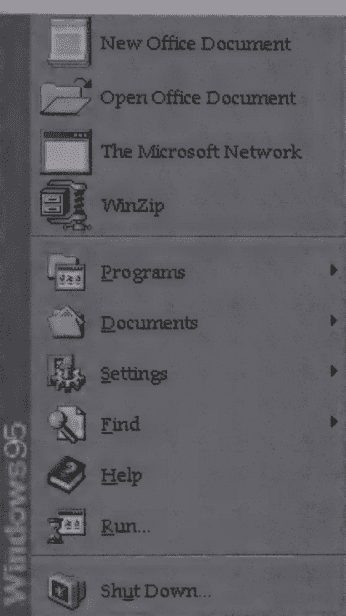

图 4.2 ■ Windows 开始菜单

这是一个很少更改的菜单，所以如果你看到任何差异，请尝试找出原因。用户通常没有权限更改此菜单，也没有需要更改。有时附加软件包会向此菜单中添加额外的条目。如果它非常不同，你可能点击了错误的菜单项。你可能会在 Windows 98、NT 或 2000 中发现某些差异。

- c) 点击“控制面板”选项时会发生什么？

**答案：** 你应该看到图 4.4 所示的控制面板弹出窗口。


图 4.3 ■ Windows 设置菜单

## 136 实验 4.1: 确定你当前的 Windows 网络配置

实验 4.1

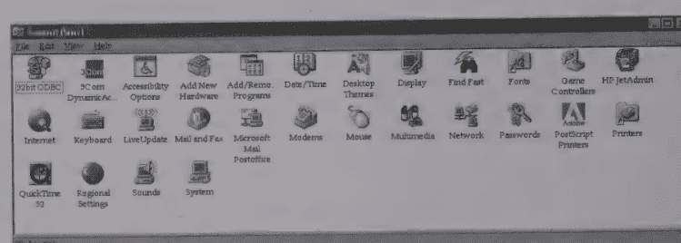

图 4.4 ■ 控制面板

如果你没有看到类似的窗口，请确保你选择了正确的菜单选项。

- d) 当你点击控制面板中的“网络”图标时，你是否看到“Microsoft 客户端客户端”已启用？

**答案：** 你应该看到图 4.5 和图 4.6 所示的窗口。由于图 4.5 没有显示完整的网络配置，你还需要通过在窗口中向下滚动来检查图 4.6 中的显示内容。

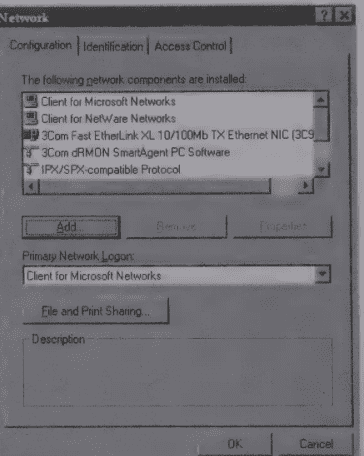

图 4.5 ■ 网络配置显示

## 实验 4.1: 确定你当前的 Windows 网络配置

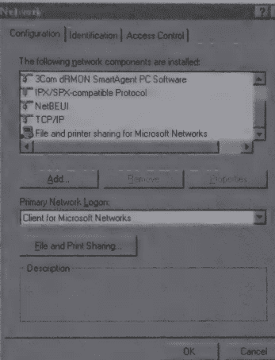

图 4.6 ■ 网络配置显示的更多

**答案：** 如果你没有看到“Microsoft 网络”已启用，那么你需要咨询你的 Windows 文档或进行安装。你还需要启用“文件和打印机共享”。

- e) 当你点击“文件和打印机共享”按钮时，你是否看到“文件和打印机共享”已启用？

**答案：** 你应该看到图 4.7 所示的窗口。

- f) 点击“确定”按钮时会发生什么？


图 4.7 ■ 文件和打印机共享窗口

## 实验 4.1: 确定你当前的 Windows 网络配置

**答案：** 你不应该看到任何消息或提示。你应该只是回到图 4.5 和图 4.6 所示的窗口。你应该返回到网络识别显示屏幕。

- g) 识别显示中显示的“计算机名称”是什么？

**答案：** 只要该名称在你的网络或名为 MYGROUP 的工作组中是唯一的，显示任何名称都可以。这会显示在图 4.8 中。你应该记录该名称，以便在以后发生更改时可以恢复它。

- h) 此面板中显示的“工作组”是什么？

**答案：** 跟踪工作组名称是重要的，因为你将要更改它。

- i) 此面板中显示的“计算机描述”是什么？

**答案：** 计算机描述并不关键，它仅用于通过更多细节来识别你在网络上的系统。

- j) 当你将工作组设置更改 MYGROUP 并点击“确定”按钮时会发生什么？

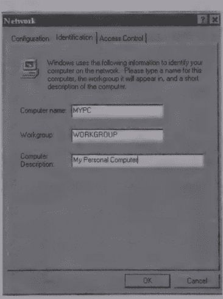

图 4.8 网络识别显示

## 实验 4.1: 确定你当前的 Windows 网络配置 139

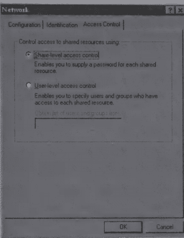

图 4.9 网络访问控制显示

**答案：** 仅更改名称并点击“确定”按钮对系统没有任何影响。你需要重启才能使工作组生效。系统通常会询问你是否重启。

- k) 你的系统为访问控制窗口（图 4.9）中窗口设置的当前值是什么？

**答案：** 无论值是什么，只需进行适当更改并记录原始值。

- l) 当你点击“确定”按钮时会发生什么？遵循你收系列提示。

**答案：** 系统将向你提示消息，你需要重启。你应该重启 PC 以使更改生效。

- m) 重启 PC 时遇到任何错误吗？如果是，你会如何解释它们？

**答案：** 如果遇到任何错误，请检查你的网络设置和驱动程序。通常是因为工作组名称冲突或缺少协议。你可能需要将 PC 重置为原始状态。

## 140 实验 4.1: 确定你当前的 Windows 网络配置

### 4.1 答案

- a) 你的系统为访问控制窗口（图 4.9）设置的当前值是什么？
**答案：** 无论值是什么，只需进行适当更改并记录原始值。

- b) 当你点击“确定”按钮时会发生什么？遵循你收到的系列提示。
**答案：** 系统将向你提示你需要重启。你应该重启 PC 以使更改生效。

- c) 重启 PC 时遇到任何错误吗？如果是，你会如何解释它们？
**答案：** 如果遇到任何错误，请检查你的网络设置和驱动程序。通常是因为工作组名称冲突或缺少协议。你可能需要将 PC 重置为原始状态。

## 实验 4.1: 确定你当前的 Windows 网络配置

### 4.1 答案

- a) 点击“控制面板”选项会发生什么？
**答案：** 你应该看到图 4.4 所示的控制面板弹出窗口。

- b) 当你点击控制面板中的“网络”图标时，你是否看到“Microsoft 客户端”已启用？
**答案：** 你应该看到图 4.5 和图 4.6 所示的窗口。由于图 4.5 没有显示完整的网络配置，你还需要在窗口中向下滚动来检查图 4.6 中的显示内容。

- c) 当你点击“文件和打印机共享”时，你看到“文件和打印机共享”已启用吗？
**答案：** 你应该看到图 4.7 所示的窗口。

- d) 点击“确定”按钮会发生什么？
**答案：** 你不应该看到任何消息或提示。你应该回到图 4.5 和图 4.6 所示的窗口。你应该返回到网络识别屏幕。

- e) 识别显示中显示的“计算机名称”是什么？
**答案：** 只要该名称在你的网络或名为 MYGROUP 的工作组中唯一的，显示任何名称都可以。这会显示在图 4.8 中。你应该记录该名称，以便在以后发生更改时可以恢复它。

- f) 此面板中显示的“工作组”是什么？
**答案：** 跟踪工作组名称是重要的，因为你将要更改它。

- g) 此面板中显示的“计算机描述”是什么？
**答案：** 计算机描述并不关键，仅用于通过更多细节来识别你在网络上的系统。

- h) 当你将工作组设置更改 MYGROUP 并点击“确定”按钮时会发生什么？
**答案：** 仅更改名称并点击“确定”按钮对系统没有任何影响。你需要重启才能使工作组生效。系统通常会询问你是否重启。

### 4.1 答案

- a) 你的系统为访问控制窗口（图 4.9）设置的当前值是什么？
**答案：** 无论值是什么，只需进行适当更改并记录原始值。

- b) 当你点击“确定”按钮时，会发生什么？遵循你收到的系列提示。
**答案：** 系统将向你提示你需要重启。你应该重启 PC 以使更改生效。

- c) 重启 PC 时遇到任何错误吗？如果是，你会如何解释它们？
**答案：** 如果遇到任何错误，请检查你的网络设置和驱动程序。通常是因为工作组名称冲突或缺少协议。如果配置失败，你可能需要将 PC 重置为原始状态。

## 实验 4.1: 确定你当前的 Windows 网络配置

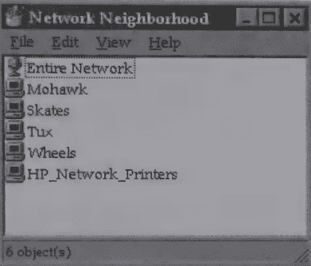

图 4.10 ■ 网络配置

你网络上的主机。一旦你设置好 Linux 来运行 Samba，就可以重新查看。

- 当你点击“整个网络”图标时，你看到“Mygroup”图标吗？如果你没看到，该怎么办？

**答案：** 你应该看到图 4.11 所示的“Mygroup”图标。如果你没看到，请查看你的操作。如果没有“工作组”之类的名称，可能意味着你的网络更改没有生效。你需要检查并可能重做这些步骤。在两种情况下，你可能都需要重启。如果这不起，你需要进入 Windows 控制面板并重新检查网络特征。

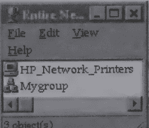

图 4.11 ■ 整个网络窗口

## 实验 4.1 自习题

为了测试你的进度，你应该能够回答以下问题。

- 1) 在图 4.5 和图 4.6 中，网络配置显示中的哪一行目对于在假设 TCP/IP 工作的情况下从你的 MS Windows PC 获取 Samba 连接最重要？
a) Microsoft 网络客户端
b) NetWare 网络客户端
c) IPX/SPX 兼容协议
d) Microsoft 网络的文件和打印机共享
e) 以上都不是

- 2) 你的网络上需要一个 NT 服务器来运行 Samba。
a) 正确
b) 错误

- 3) Samba 需要一个网络中没有 MS Windows PC 的唯一工作组。
a) 正确
b) 错误

- 4) Samba 需要一个 Windows 域。
a) 正确
b) 错误

测验答案位于附录 A 第 4.1 节。

# 实验 4.2: 获取 Samba

## 实验 4.2

## 获取 Samba

### 实验目标

- 在完成本实验后，你将能够：
- 获取最新版本的 Samba

## 获取 Samba

如今大多数 Linux 发行版软件包中都默认包含了 Samba。它是一个公共领域的软件包包，不收取任何版税，并遵循标准的 GNU 许可策略以供公开发用。GNU 的意思是“GNU's Not Unix（GNU 不是 Unix）”。它是一套针对公共领域软件的工具集和许可策略。它也适用于其他版本的 UNIX，如 AIX、HP-UX、Solaris 等。它已经被移植到其他硬件架构和操作系统。

## 事实真相

Red Hat 5.2 以及其他某些版本的 Linux 所包含的 Samba 版本需要一些配置以及对 Windows 网络的了解。其版本号将小于 2.0。然而，Samba 2.3 版本带有一组默认值，足以在无需任何配置的情况下运行 Samba。如果你没有 2.0 或更高版本，可以从 http://www.Samba.org 获取。只需下载适用于你系统或 Linux 版本的 Samba Samba 即可。你应该使用针对你 Linux 版本的推荐安装程序，即针对 Red Hat 使用 RPM。本实验将帮助你获取 Samba 并学习使用 RPM 方法安装软件。

由于本书旨在帮助你快速上手，我们仅会讨论如何使用默认设置获取 Samba。此外，任何网络配置都将在 Windows PC 端完成，以匹配 Samba 的默认设置。当你觉得准备好处理更详细的配置问题时，有许多关于 Samba 的优秀书籍以及在线文档可以使用。

## 实验 4.2: 获取 Samba

## 实验 4.2 练习题

### 4.2.1 获取最新 Samba

让我们所有人从同一个水平上开始讨论是非常重要的。因为行业发展非常快，本文讨论是基于特定版本的 Samba 的。当你阅读这段讨论时，你可能拥有一个新得多的版本。我们使用的版本可能与本文讨论的 2.03 版本同样兼容。幸运的是，出于兼容性和历史原因，你通常可以在互联网上找到旧版本。如果你使用的 Samba 版本出现问题，你可能想要回到我们正在使用的版本。

这段讨论将向你展示如何下载 Samba。对于你们的一些人来说，这可能是你第一次体验更新软件，这将会是一次非常棒的体验。我们将讨论使用 Netscape 进行下载。你可以使用其他方法将文件下载到 PC 上，例如 FTP 或 Internet Explorer，或者从 CD 盘安装。

为了完成本次练习并连接到 Samba 网站，你需要安装 Netscape。幸运的是，这通常包含在 Linux 软件包中。如果你的 Linux 没有 Netscape，你将需要从 Netscape 网站、你的 Linux CD-ROM 安装，或者从 Netscape 购买。安装 Netscape 的讨论超出了本书的范围。

当你首次登录 Linux 系统时，你会看到一个类似于图 4.12 的窗口。你应该注意，这是来自远程 MS Windows 95 PC 的真实的 X Windows 登录。此屏幕显示了 Linux 标准命令行提示符。

要连接到 Samba 网站，你现在需要执行 `netscape` 命令。

- a) 当输入 `netscape` 命令时发生了什么？如果遇到错误，应该如何处理？

（图 4.12 Linux 命令行屏幕）

你会看到 Netscape 的默认首页。从这里，你应该前往地址 http://www.samba.org。如图 4.13 所示。

从此屏幕中，你应该选择要连接的站点。

- b) 你选择连接的 Samba 站点是哪个？

- c) 在连接 Samba 站点时遇到过问题吗？如果有，你是如何解决的？

在图 4.14 中，你看到了与 Samba 相关的各种新闻项目列表。你可能想阅读关于 Samba 的新闻项目。从这里，你需要移动到下载页面。下载页面如图 4.15 所示。

（图 4.13 ■ Samba 首页）

- d) 你采取了什么选择来进入下载页面？

在图 4.15 中，你会发现下载有多种选择方法。你可以为许多不同的操作系统选择二进制下载，也可以为 Samba 的版本选择源代码。在本次练习中，我们将选择 Linux 的二进制下载。但如果你运行的是其他操作系统，在你的 Linux 上运行 Samba 之后，你将想要探索并尝试其他版本。

（图 4.14 Samba）

你应该选择 Samba 的二进制下载。

（图 4.15 Samba 下载页面）

- e) 你为版本选择了哪一个？

（图 4.16 版本的 FTP 屏幕）

- f) 你选择的操作系统是哪个？

（图 4.17 Red Hat Samba 目录）

Samba 的 RPMS 目录。

SRPMS 目录包含文件，如果你想开发 Samba，这些文件将很有用。

（图 4.17 Red Hat Samba 目录）

- g) RPMS 目录是如何组织的？

- h) 当你选择你的 Linux 版本时，看到了什么屏幕？

（图 4.18 ■ Red Hat 5.2 的 Samba 版本）

|  way | 最后修改时间 | 大小 | 描述 |
| :--- | :--- | :--- | :--- |
| Parent Directory | 15-Jan-1999 23:03 | 0k | |
| DOSNAME | 24-Mar-1999 06:45 | 0k | |
| README | 16-Jan-1999 00:43 | 1k | |
| RPACKAGE | 26-Jan-1998 07:44 | 1k | |
| PACKAGES | 18-Mar-1999 00:25 | 0k | |
| RPMs/ | 18-Mar-1999 00:28 | 0k | |
| VERSIONINFO.txt | 24-Mar-1999 06:42 | 1k | |

## 152 实验 4.2: 获取 Samba

因为版本编号方案已更改，以反映版本日期而不是更模糊的编号方案。如果所有版本来自相同的源代码，则它们将具有相同的日期。这发生在它们为不同的处理器编译时。如果你查看图 4.19，你会看到完整版本名称为 `Samba-2.0.3-19990228.i386.rpm`。

图 4.19 显示了为 Red Hat 5.2 选择 Samba 版本 2.0.3 时发生的情况。你会看到此屏幕弹出。顶行显示当前目录的过滤器。该过滤器将使用 `*.rpm` 来显示当前目录中具有 `.rpm` 扩展的文件。左侧标记为 Directories（目录）的框显示当前目录下的子目录。右侧标记为 Files（文件）的框显示了应用了过滤器后当前目录中的文件。底部的标记为 Selection（选择）的字段显示你将下载的实际文件。

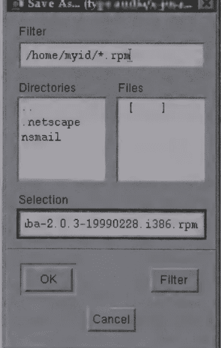

图 4.19 ■ Netscape 提示保存文件

i) 你将使用什么过滤器来显示与图 4.19 类似的目录和文件？

j) 你在你的系统的 Directories 框中看到了什么与图 4.19 类似的内容？

k) 你在你的系统的 Files 框中看到了什么与图 4.19 类似的内容？

l) 图 4.19 中 Selection 框中显示的实际选择是什么？

你现在应该检查信息并确保选择了正确的路径。一旦你确定没问题了，就按下 ok 按钮。

m) 按下 ok 按钮时会发生什么？

n) 你正在下载的文件的源地址是什么？

## 实验 4.2: 获取 Samba

o) 你的文件的目标目录是什么？

一旦文件下载完成，你将希望返回并确保文件已正确下载。你可以通过退出 Netscape 然后输入 `ls` 命令来实现。

- p) 在下载 Samba 文件的目录中执行 `ls` 命令时会发生什么？

输入 `ls -1` 命令。

- q) 在下载 Samba 文件的目录中执行 `ls -1` 命令时会发生什么？

- r) `ls -1` 命令得到的文件大小与你的预期一致吗？

## 实验 4.2 练习答案

### 4.2.1 答案

- a) 输入 `netscape` 命令时会发生什么？如果遇到错误，应该如何处理？

答案：你将获得 Netscape 的默认主页。如果收到“权限被拒绝”的错误，你需要正确地设置你的 X-Windows 环境。如果你收到关于“找不到 Netscape”的错误，那么你需要确保它已安装。如果已安装，请确保它在你的搜索路径中。或者，你可以进入 Netscape 目录并输入 `./netscape`。

- b) 你选择连接的是哪个 Samba 站点？

答案：这实际上取决于你所在的位置。只需选择一个离你近的站点即可，但实际上，你可以选择任何站点。

- c) 你连接 Samba 站点时遇到过问题吗？如果有，你是如何解决的？

答案：如果用户连接达到上限，只需尝试另一个。通常会有多个可用的站点。如果你收到关于无效站点名称的错误，那么该站点可能出现问题或可能不再可用。你可能会收到无法访问该站点或超时的错误。任何情况下，只需尝试不同的站点即可。

- d) 你为了进入下载页面做了什么选择？

答案：你应该选择左上角列中最后一项的下载页面。

- e) 你选择了什么来进入 Samba 的二进制下载页面？

答案：在带有 Binaries（二进制）标题的段落中，你应该点击 `You can download them via http here`。

- f) 你选择的是哪个版本的操作系统版本？

答案：你需要选择适合你操作系统的 Samba 版本。如果你不确定需要下载哪个版本，可以进入目录和子目录查看文档。

- g) RPMS 目录是如何组织的？

答案：你将看到与你将下载代码的多个操作系统版本相关的各种目录。在图 4.20 的情况下，你会看到四个版本的 Red Hat 目录。这些版本分别是 5.0、5.1、5.2 和 6.0。你应该选择适合你的任何版本。你的显示将有所不同。

- h) 当你选择你的 Linux 版本的目录时，你会看到哪个屏幕？

答案：你应该看到适用于你操作系统的几个版本的 Samba。通常，你应该选择最新版本。然而，在某些情况下，你可能需要选择旧版本。如果当前版本存在某些问题，或者你想要已经下载的版本，这种情况就会发生。

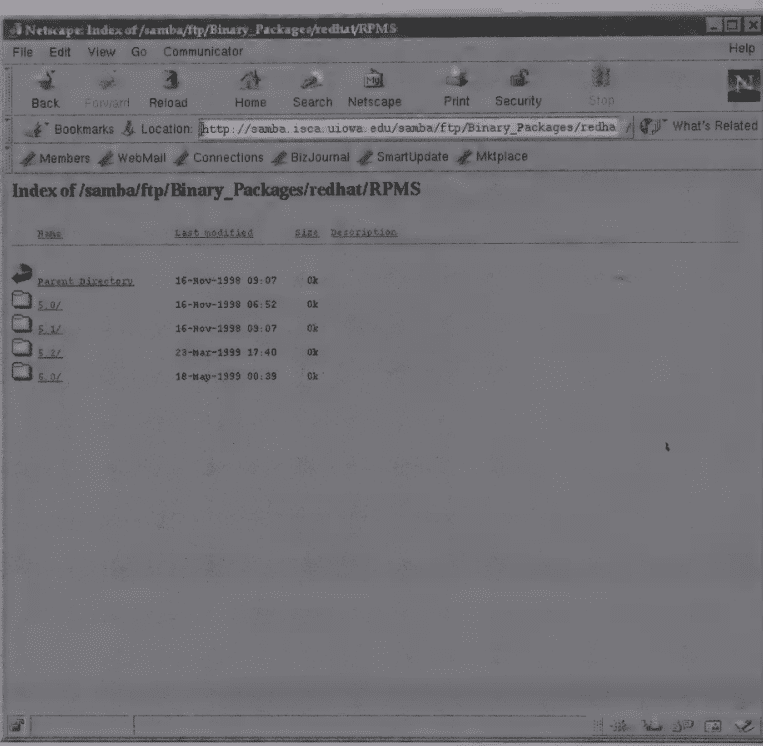

图 4.20 Red Hat 子目录

i) 你将使用什么过滤器来显示与图 4.19 类似的目录和文件？

答案：过滤器应该是 `*.rpm`。

j) 你的系统的 Directories 框中看到了什么与图 4.19 类似的内容？

答案：你应该看到父目录。

k) 你在你的系统的 Files 框中看到了什么与图 4.19 类似的内容？

答案：你应该看到你下载的文件。

l) 图 4.19 中 Selection 框中显示的实际选择是什么？

答案：你应该看到一个长列表。

图 4.21 Netscape 下载

## 4.2 获取 Samba

## 4.2


```
myid@myid]$ ls

samba-2.0.3-19990228.i386.rpm
```

如果文件大小比 4.21 显示的要大，可能是正常的。由于文件存储、传输和压缩的方式，下载的文件可能会更大。通常，你获取文件的站点会提供有关文件大小的信息。

## 自我复习题

为了测试你的进度，你应该能够回答以下问题：

- 1) 在你的 Linuxget上使用 Samba，需要从哪里购买许可证？
a) Red Hat
b) www.samba.org
c) Linus Torvalds
d) 不需要，它是免费软件
e) 以上都不是

- 2) 使用 Netscape 获取 Samba 的唯一方法
a) 正确
b) 错误

- 3) 根据图 4.18，以下操作系统没有 Samba 版本？
a) IRIX
b) Red Hat
c) CP/M
d) MVS
e) Novell

- 4) 在图 4.17 中，WHICH-ONE.txt 文件提供了有助于决定哪些目录或版本的信息。
a) 正确
b) 错误

- 5) 当为 Red Hat 6.0 创建 Samba 版本时，你认为哪个图最可能改变？
a) 图 4.16
b) 图 4.17
c) 图 4.18
d) 图 4.19
e) 图 4.20

- 6) 对于 1999 年 11 月 27 日从源代码创建的 Samba 2.0.5 RPM 名称是什么？
a) samba-2.0.5
b) samba-i386.rpm
c) samba-19991127.i386.rpm
d) samba-2.0.5-19991127.i386.rpm
e) 以上都不是

测试答案见附录 A 第 4.2 节。

## 实验 4.3

## 运行 Samba

### 实验目标

完成本实验后，你将能够：

- 确定你当前的 Samba 版本
- 移除 Samba
- 安装 Samba
- 升级 Samba
- 设置并测试 Samba
- 从 MS Windows 连接到 Samba
- 从 Samba 连接到 MS Windows

## RPM 方法

目前已经开发出多种不同的安装方法来为操作系统安装软件。在进行安装、升级或卸载时，某些需要考虑的问题包括：

- 确保安装了正确的文件。通常，一个安装包需要安装多个文件。这些文件可能是已存在文件的旧版本，也可能是现有文件的新版本。
- 移除已安装的任何旧版本的新文件文件。
- 确保如果安装失败，系统可以恢复到之前的状态。

Linux 发行商红帽（Red Hat）开发了一种名为“红帽软件包管理器”（Red Hat Package Manager）的安装方法，简称为 RPM。RPM 方法被许多 Linux 厂商使用，并且正被至少一个非 Linux 厂商用于软件安装。RPM 方法随着时间的推移在不断改进，变得更加简单、强大，甚至更加稳定。我们将在本章中讨论使用 RPM 方法。我们将讨论确定你当前的 Samba 版本、移除它以及安装升级版本。你可能希望查看其他安装方法，以加深对 Linux 的理解。

## 实验 4.3 练习

### 4.3.1 确定你当前的 Samba 版本

在安装最新版本的 Samba 之前，你需要先确定当前安装的是哪个版本。大多数 Linux 版本现在都自动包含 Samba，但当消费者获得软件时，通常已经有了新版本可用。虽然在确认新版本没有 bug 之前，获取最新版本并不总是明智之举，但新版本通常包含你想要添加到系统中的功能。它还可能包含 bug 修复以及速度和可靠性的增强。

为了确定你当前的 Samba 版本，你需要带有适当的选项执行 `rpm` 命令。像许多 UNIX 命令一样，`rpm` 可以接受许多选项来执行与安装相关的各种操作。如果你将进行许多 Linux 安装和配置，你应该仔细研究这个命令。

`rpm` 的查询选项将为你提供有关已安装软件包的当前版本的信息。你应该注意，当你执行 `rpm query` 查询时，不需要指定版本号，但在执行安装、升级或删除时，你需要这些信息。用于执行查询的命令如下：

```
rpm -q -i samba
```

选项的含义是：

- `-q`: 执行查询
- `-i`: 返回所有信息
- `samba`: 返回关于已安装 Samba 的信息。

现在输入以下内容：

```
rpm -q -i samba
```

根据此命令的运行回答以下问题。

- a) `rpm -q -i samba` 命令产生的软件名称是什么？
- b) `rpm` 命令产生的发行版名称是什么？
- c) `rpm` 命令产生的厂商名称是什么？
- d) `rpm` 命令产生的摘要描述名称是什么？
- e) 根据 `rpm` 命令，你的 Samba 版本是否支持加密密码？

### 4.3.2 移除 Samba

在本次练习中，你将学习如何移除 Samba。如果你愿意，你也可以只进行升级，正如你将在实验 4.3.4 中看到的那样。你可能还想在安装后尝试升级。只需移除当前的 Samba 版本，安装一个不是最新版本的版本，然后升级到最新版本。

你可以通过输入带有适当选项的 `rpm` 从系统中移除 Samba。可以使用 `-e` 选项来擦除 Samba。你可以通过输入命令来实现：

```
rpm -e samba-package-name
```

其中 `samba-package-name` 是带有版本号的软件包实际名称。

```
rpm -e samba-2.0.3-19990228
```

然而，如果你的系统中只有一个 Samba 版本且从未升级过，你可以使用：

```
rpm -e samba
```

这将移除现有的 Samba 版本。

现在移除你在实验 4.3.1 中找到的 Samba 版本。

- a) 你用于从系统中移除 Samba 的命令行是什么？
- b) 当你输入 `rpm -e` 命令后接 `Samba` 或 `samba` 包名时，会发生什么？

你需要验证系统中没有留存任何版本的 Samba。

- c) 你会使用什么命令来查找系统上的 Samba 版本？
- d) 问题 c 的结果是什么？

如果你在系统中仍然发现 Samba 版本，你也应该移除那一个。

- e) 你用于移除系统中剩余的 Samba 版本的命令是什么？
- f) 问题 e 的结果是什么？

### 4.3.3 安装 Samba

安装 Samba 的过程与移除 Samba 或查询 Samba 的过程一样简单。还记得我们在实验 4.2.1 中是如何下载新版本的 Samba 的吗？现在我们要安装它。在实验 4.2.1 中，你的版本可能会不同。

- a) 你下载的 Samba 版本位于何处？
- b) 你下载的 Samba 名称是什么？

现在你可以使用适当的选项安装 Samba。唯一必要的选项是 `-i`。

例如：

要从 `/home/myid` 安装 Samba，你将使用以下命令：

```
rpm -i samba-2.0.3-19990228
```

现在你需要验证 Samba 是否已安装。

- c) 当你输入 `rpm -i samba-2.0.3-19990228` 时会发生什么？请将版本号替换为你的版本）
- d) 你会使用什么命令来验证 Samba 已安装？
- e) 问题 d 的结果是什么？
- f) 如果出现了多个版本会发生什么？

### 4.3.4 升级 Samba

不仅仅是安装 Samba，你可能想进行升级。执行升级假设你已经有一个 Samba 版本。升级过程非常直接。完全升级将：

- 升级系统的任何文件
- 备份任何配置文件
- 删除不再需要的文件
- 使用与安装时相同的软件包

你可以为 `rpm` 命令提供各种选项。因此升级只需对软件包输入 `-U` 选项。

例如：

从 `/home/myid` 升级 Samba，你将使用以下命令：

```
rpm -U samba-2.0.3-19990228
```


现在你需要验证 Samba 是否已安装。

- a) 当你输入 `rpm -U samba-2.0.3-19990228` 时会发生什么？请将版本号替换为你的版本
- b) 你会使用什么命令来验证 Samba 已安装？
- c) 问题 b 的结果是什么？
- d) 如果你在简单安装现有版本后执行了 b 中的命令，你认为结果会是什么？

### 4.3.5 设置并测试 Samba

Samba 有许多配置选项。事实上，当你读到这一章时，Samba 的功能和范围已经进一步扩大，因为它在不断进化。

事实真相

为了尽快让你开始，我们选择了最简单的配置方案。本练习假设你已经按照实验 4.1 中的描述设置了 Windows 95。在这种情况下，为了让你的 Linux 运行，不需要修改 Samba。如果你运行的是 Windows 98 或 NT，你可能需要修改 Windows 网络特性以匹配 Samba 设置。

## 168 实验 4.3: 运行 Samba

Samba 2.0.3 的默认配置会自动启动 Samba 守护进程。该配置位于 `/etc/smb.conf` 文件中。这是一个非常大的文件，包含许多可配置选项。你可以验证你的工作组（Workgroup）名称。这就是 `grep` 命令非常用武的地方。

- a) 检查 `/etc/smb.conf` 文件。你的默认工作组是什么？
- b) 使用哪条单一命令可以回答问题 a？
- c) 通过在 `/etc/smb.conf` 上使用 `grep` 命令，Samba 正在使用哪种类型的安全机制？

当你启动 Samba 时，有两个守护进程会被启动。这两个进程是 `smbd` 和 `nmbd`。它们监听来自 SMB 客户端的请求并提供 SMB 服务。`smbd` 守护进程用于文件和打印请求。`nmbd` 守护进程处理浏览。你可以再次使用 `grep` 命令验证这些进程是否正在运行。这次，使用以下命令：

```
ps ax | grep smbd
```

and

```
ps ax | grep nmbd
```

- d) 输入 `ps ax | grep smbd` 命令的结果是什么？

## 实验 4.3: 运行 Samba

- e) 输入 `ps ax | grep nmbd` 命令的结果是什么？
- f) 如果在输入问题 d 和 e 中的命令时没有出现任何进程，你会怎么办？

一旦你验证了 Samba 进程正在运行，你就可以使用以下命令来验证 Samba 连接的状态。该命令是：

```
smbstatus
```

- g) 输入 `smbstatus` 命令时会发生什么？

这还会告诉你已导出的资源状态。

如果你的 Samba 似乎没有启动，那么你应该执行以下命令：

```
ps ax | more
```

这将显示所有正在运行的进程，你可以判断 Samba 进程是否已经启动。

- h) 当你输入 `ps ax | more` 命令时，你看到了什么种 Samba 进程？

## 170 实验 4.3: 运行 Samba

### 4.3.6 从 MS WINDOWS 连接到 SAMBA

你可以通过登录 Windows 电脑来验证你的 MS Windows 机器可以连接到 Samba。然后，你需要验证你在练习 4.2.1 中执行的步骤。你的默认工作组是 `MYGROUP`。你的 MS Windows 默认工作组是 `WORKGROUP`。你应该遵循这些步骤进入与图 4.8 类似的屏幕，但你需要确保工作组字段显示为 `MYGROUP`。你可以在图 4.27 中看到这一点。如果它没有显示 `MYGROUP`，请进行更改。

- a) 当你在 MS Windows 电脑上进入 Windows 网络标识界面时，显示的默认组是什么？

务必保存显示的任何其他信息，以便你可以轻松地使用原始任何设置重新设置你的电脑。

- b) 当你将 Windows 工作组改为 `MYGROUP` 并退出 Windows 控制面板时会发生什么？

遵循屏幕给出的任何指令。

你应该处于或回到你在图 4.1 中看到的 Windows 主界面。然后，你应该双击左上角的“网络邻域”（Network Neighborhood）图标。

- c) 点击“网络邻域”图标时，你看到了什么？

如果你没有看到设置的服务器，应该点击“整个网络”（Entire Network）图标。

## 实验 4.3: 运行 Samba 171

- d) 点击“整个网络”显示时，你看到了什么？
- e) 点击“整个网络”显示中的 `MYGROUP` 条目时，你看到了什么？
- f) 你认为如果 `MYGROUP` 工作组没有出现在“整个网络”窗口或任何早之前的显示中，问题会是什么？

### 4.3.7 从 SAMBA 连接到 MS WINDOWS

现在你需要验证你是否可以从 Samba 连接到你的 MS Windows 机器。最简单的命令是：：

```
smbclient
```

此命令的工作原理类似于 TCP/IP 中的 `ftp` 命令，并有许多选项。此练习的目的是确定你的 Samba 客户端是否能看到你 MS Windows 电脑上的 SMB 服务，包括共享的驱动器和打印机。

> 为了看到 MS Windows 电脑上共享的驱动器和打印机，你需要在每个驱动器上建立共享。这将作为一个练习留给你完成，但相对简单。你可能希望咨询你的文档或熟悉 SMB 文件共享的人。


## 实验 4.3: 运行 Samba

- a) 当你只输入 `smbclient` 命令时会发生什么？

我们现在将使用的选项是 `-L`。该选项后面跟着 NETBIOS 节点。这是在图 4.27 中显示的计算机名称。命令行为：

```
smbclient -L netbios_name
```

其中 `netbios_name` 是主机的 NETBIOS 名称。

> 例如：

要连接到名为 `myserver` 的主机，你将使用以下命令：

```
smbclient -L mohawk
```

这会提示你输入密码。这是图 4.27 中显示的计算机名称。命令行为：

```
smbclient -L netbios_name
```

其中 `netbios_name` 是主机的 NETBIOS 名称。

> 例如：

要连接到名为 `myserver` 的主机，你将使用命令：

```
smbclient -L mohawk
```

这会提示你输入密码。这是图 4.27 中显示的计算机名称。命令行为：

```
smbclient -L netbios_name
```

其中 `netbios_name` 是主机的 NETBIOS 名称。

> 例如：

要连接到名为 `myserver` 的主机，你将使用命令：

```
smbclient -L mohawk
```

这会提示你输入密码。这是图 4.27 中显示的计算机名称。命令行为：

```
smbclient -L netbios_name
```

其中 `netbios_name` 是主机的 NETBIOS 名称。

## 4.3: 运行 Samba 173

- c) 输入 `smbstatus` 命令时会发生什么？

这还会告诉你已导出的资源状态。

如果你的 Samba 似乎没有启动，那么你应该执行以下：

```
ps ax | more
```

这将显示所有正在运行的进程，你可以判断 Samba 进程是否已经启动。

- d) 你看到了任何共享的驱动器？
- e) 当你输入 `ps ax | more` 命令时，你看到了什么种 Samba 进程？
- f) 我也预计 Samba 在未来几年内获得新功能。

## 实验 4.3 练习答案

### 4.3.1 答案

- a) 执行 `rpm -i samba` 得到的软件名称是什么？

答案：当你执行命令时，你会看到与图 4.23 类似的显示。

执行命令得到的名称应该是 `samba`。你可以在图 4.23 的第二行第一列看到它。

- b) 执行命令得到的发行名称是什么？

答案：你可能会看到 `{none}` 或由制造商/开发者指定的名称。例如，Red Hat 给出了版本。

- c) 执行命令得到的厂商名称是什么？

答案：厂商可能是 `{none}`，也可能是制造商，如 Red Hat。

- d) 执行命令得到的摘要描述是什么？

```
$ rpm -q i samba

Name: samba

Version: 1.8.10b

Release: 3

Installed: Mon Jan 25 23:38:35 1999

Group: Networking

Size: 522767

Package: Red Hat Software O@redhat.com

Source: samba-1.8.10b-3.src.rpm

Summary: SMB client and server

Description: Distribution
```


Samba 提供了一个 SMB 服务器，可以为各种版本的 Windows 和其他 Linux 客户端（如“文件管理器”）提供服务。Samba 同时在 Linux 内部提供了 SMB 客户端，Samba 使用 NetBIOS (TCP/IP) 协议，不需要 NetBIOS (Microsoft NetBIOS) 数据报。

此版本被称为“Looking Update”，并完全支持机会性文件锁定。在此更新中包含了加密密码、改进的浏览列表和 WISE 数据库管理。请参考 `WHATELIST` 文档获取流量信息。此版本包含了加密密码支持。请阅读目录下的 `samb.conf` 文件和 `ENCRYPTION.txt` 以了解实现细节。

# 实验 4.3：获取 Samba 175

答案：图 4.23 中的摘要描述是 Samba SMB 客户端和服务器。

- e) 根据 `rpm` 命令，你的 Samba 版本是否支持加密密码？
答案：你可能会看到类似以下的内容：
请参考 `WHATNEWS.txt` 文获取修复信息。
此二进制版本包含加密密码支持。
请阅读 `samb.conf` 文件和目录下的 `ENCRYPTION.txt` 以获取实现细节。
如果是的话，它会告诉你是否支持加密密码。Samba 2.0 及更高版本支持加密密码。如果你打算使用加密密码为 Windows 98 支持 Windows 域登录，那么这是必须的。

## 4.3.2 答案

- a) 你用于从系统中删除 Samba 的命令行命令是什么？
答案：你应该输入了类似以下的内容：

```
rpm -e samba-2.0.3-19990228
```

在这种情况下，`samba-2.0.3-19990228` 是你正在删除的 Samba 版本。你需要将其替换为你正在使用的 Samba 版本。

- b) 当你输入 `rpm -e` 后接 Samba 或 Samba 包名时会发生什么？
答案：如果没有错误，你应该直接返回命令行提示符。这符合 UNIX 的传统，即没有消息就是好消息。

- c) 你会使用什么命令来查找系统上的 Samba 版本？
答案：你将使用在练习 4.3.1 中使用的相同命令；即：

```
rpm -q -i samba
```

- d) 问题 c 的结果是什么？

# 实验 4.3：让 Samba 运行起来

答案：如果你运行的是 Samba 2.0.3 版本，你将看到类似于下方图 4.26 的显示。

- e) 你用于删除系统中剩余的 Samba 版本的命令是什么？

答案：你应该使用以下命令：

```
rpm -e samba
```

但是，如果你安装了多个版本的 Samba，或者如果你在安装时删除了之前的版本，你将需要指定具体的完整版本名称。以我们在示例中使用的 2.0.3 版本为例，它应该是：

```
rpm -e samba-2.0.3-19990228
```

- f) 问题 e 的结果是什么？

答案：如果结果成功，你应该只返回命令行提示符。

## 4.3.3 答案

- a) 你下载到系统的新版本 Samba 位于哪里？

答案：在实验 4.2 中，你将 Samba 下载到了你的 `/home/myid` 目录。你可以在任何地方下载此文件，因为它不会影响安装程序的执行，所以它可能在其他地方。

- b) 你下载的用于下载 `samba-2.0.3-19990228.1386.rpm` 的新 Samba 版本名称是什么？
答案：在实验 4.2 中，你被了下载该文件的步骤。你可能下载了较后的版本。你应该使用这个新版本作为后续讨论的基础。

- c) 当你输入命令 `rpm -i /home/myid/samba-2.0.3-19990228.i386.rpm` 时会发生什么？（确保将版本名称替换为你下载的版本。）

答案：如果安装成功，你应该直接返回命令行提示符。

# 实验 4.3：获取 Samba

- d) 你执行什么命令来验证 Samba 是否已安装？

答案：你应该执行查找当前安装的 Samba 版本的命令。该命令是：

```
rpm -q -i samba
```

如果你正在进行升级，并且看到列出了多个版本的 Samba，那么你的安装过程未能移除某些文件或功能。你可能输入了错误的命令或选项。

- e) 执行问题中的命令的结果是什么？

答案：你应该只使用刚刚安装的 Samba 包。显示如图 4.24 所示。

- f) 如果显示了多个版本的 Samba，你会如何解释这些结果？

答案：如果你进行的是标准安装，这意味着旧版本的文件仍然在那里，并且系统钩子都是可用的。

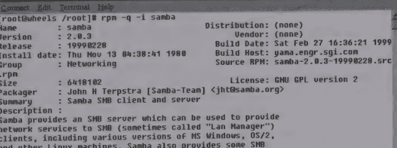

Samba-2 具有最强大的活动域功能以及新的 SWAT（Samba 网页管理工具），允许使用熟悉的 浏览器远程管理 Linux Samba 服务器文件。目前，这通过 TCP 端口 901 启用。

请参考 `WHATNEWS.txt` 文档获取修复信息。此二进制版本包含密码支持。请阅读目录中的 readme 文件和 `INSTALLATION.txt` 获取实现细节。

注意：Red Hat Linux 5.X 使用 PAM，它对 Shadow 密码有集成支持。不要在启用 SHADOW 密码的情况下进行重新编译。Red Hat Linux 在 PAM 中内置了对配额的支持。

图 4.24 在 Samba 2.0.3 上执行 RPM 查询命令的结果

# 实验 4.3：让 Samba 运行起来

这不是 Bug，而是一个特性（真的）。你可以拥有多个版本的 Samba，只要你。

## 4.3.4 答案

- a) 当你输入命令 `rpm -i /home/myid/samba-2.0.3-19990228.i386.rpm` 时发生了什么？（将版本名称替换为你下载的版本。）
答案：如果安装成功，你应该直接返回命令行提示符。

- b) 你使用什么命令来验证 Samba 已安装？
答案：你会使用查找当前已安装 Samba 版本的命令。该命令是：

```bash
rpm -q -i samba
```

- c) 输入命令的结果是什么？
答案：你应该看到类似于图 4.26 的结果。

- d) 如果执行命令 b 而不是进行升级，你认为结果会怎样？
答案：你会看到出多个版本。参考练习 4.3 的 f。

## 4.3.5 答案

- a) 检查文件 `/smb.conf`。你的默认工作组是什么？
答案：你可以使用 `grep` 查找文件中的某行或几行。格式为：

`grep string file_name`

其中 `string` 是你查找的文本，`file_name` 是你正在搜索的文件名。

# 实验 4.3：让 Samba 运行起来

示例：

假设你正在查找所有引用 `log file`。因为这是多个单词，你应该将其放在双引号中。对于单个单词，不需要引号。你会使用命令：

```bash
grep "log file" /etc/smb.conf
```

如果你标准安装了 Samba，默认工作组将是 MYGROUP。

- 使用什么单一命令可以回答 a？
答案：通过 `grep`，你应该看到类似下面的输出：

```
[myd@tux myid]$ grep workgroup /etc/smb.conf
# workgroup = NT-Domain-Name or Workgroup-Name
  workgroup = MYGROUP
[myd@tux myid]$
```

- 通过对 `/etc/smb.conf` 执行 `grep` 命令，Samba 的安全类型是什么？
答案：通过 `grep` 命令，你会看到以下结果：

```bash
[myd@tux myid]$ grep security /etc/smb.conf
# 此选项对安全很重要。它允许你限制安全模式。大多数人将需要用户级安全。详情请见 security_level.txt。
  security = user
# password server 选项仅在 security = server 时有效
[myd@tux myid]$
```

通过检查这些结果，你会发现使用的安全性是由该行定义的：

```
security = user
```

## 实验 4.3: 让 Samba 运行起来

对于每个资源。在 Samba 中，`security=user` 意味着共享是基于登录 ID 和密码完成的。

d) 输入 `ps ax | grep smbd` 命令的结果是什么？
答案：你应该看到类似于下方的结果：

```
[myid@tux myid]$ ps ax | grep smbd
441 ? S 00:00 smbd -D
3412 p2 & N 00:00 grep smbd
[myid@tux myid]$
```

在这里，你看到 `smbd` 守护进程正带有 `-D` 选项运行，这意味着 `smbd` 进程将作为 Linux 守护进程运行。

e) 输入 `ps ax | grep nmbd` 命令的结果是什么？
答案：结果应该类似于下面：


[myid@tux myid]$ `ps ax | grep nmbd`

450 ? S 00:21 `nmbd -D`

[myid@tux myid]$

```
注意 `nmbd` 进程也有 `-D` 选项，表示它将作为守护进程运行。

f) 如果在输入问题 d 和 e 中的命令时没有显示任何进程，你该怎么办？
最好的办法是手动启动守护进程。你可以根据 `ps` 命令结果中显示的命令来操作。你插入命令应该是：

```
smbd -D

nmbd -D
```

如果你收到关于“未找到文件”的错误，可以查看 `/usr/sbin` 目录。你应该能在那里看到这些命令。然后你可以按照以下方式执行命令：

```
/usr/sbin/smbd -D

/usr/sbin/nmbd -D
```

现在，你可以重复上述问题 d 和 e 中的步骤来验证进程是否正在运行。

## 实验 4.3: 获取 Samba

g) 输入 `smbtstatus` 命令会发生什么？

答案：在首次设置 Samba 后输入 `smbtstatus` 命令，你可能会看到没有任何连接。然而，下面的显示展示了如果存在连接，你可能会看到的内容：

```
[myid@wheelsym]$ smbtstatus

Samba version 2.0.3

Service uid pid machine

--------------------

myid myid users 783 skates (172.16.1.14)

Tue Nov 18 00:25:25 1999

No locked files

Share mode memory usage (bytes):

1048464 (99%) free + 56(0%) used + 56(0%) overhead

= 1048576 (100%) total

[myid@wheelsym]$
```

你可以看到有一个名为 `myid` 的服务由用户 `myid` 启动。组 ID（grid）是 `users`。它连接的机器是 `skates`，这是一台 Windows 95 机器。`skates` 的地址是 `172.16.1.14`，连接日期是 1999 年 11 月 18 日午夜 25 分。显示没有锁定文件。最后一项是共享模式的内存使用量。

h) 当你输入 `ps ax | more` 命令时，你会看到什么样的 Samba进程？

答案：你应该看到 `smbd` 和 `nmbd` 进程。如果你没有看到 Samba 进程，可以按照问题 f 答案中的描述手动启动 Samba 进程。另一种方法是使用命令：

```
/etc/rc.d/init.smb start
```


这将手动启动 Samba 进程。它执行了比问题 f 中的步骤更多的检查。你应该在它执行时观察它，以确保没有错误。

## 4.3 答案

a) 当你在 MS Windows 电脑上进入 Windows 网络标识界面时，显示的默认工作组是什么？

答案：如果你在之前的练习中更改了工作组（Workgroup），你会看到图 4.25 所示的内容，即 `GROUP`。在这种情况下，你可以跳过问题 b。默认情况下，工作组是 `WORKGROUP`。

## 实验 4.3: 让 Samba 运行起来

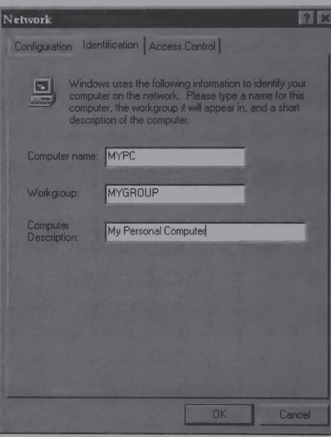
图 4.25 ■ Windows 网络标识界面

- b) 更改 Windows 工作组并退出 Windows 控制面板时会发生什么？

答案：系统可能会要求你安装 Windows 光盘。如果是这样，它将在完成后要求你重启。

- c) 点击“网络邻域”图标时你会看到什么？

答案：这将带你进入图 4.26 显示的屏幕。

在这个示例显示中，你看到列表：整个网络（Entire Network）、5 台 SMB 服务器和 HP_Network_Printers。

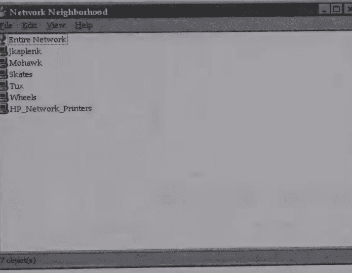
图 4.26 ■ MS Windows 网络邻域

- d) 当你点击“整个网络”显示时你会看到什么？

答案：这将给你一个与图 4.27 类似的显示。

在图 4.27 中，你会看到：三个项。第一个是 HP_Network_Printers。第二个和第三个是工作组。你可以双击 `MYGROUP`。

# 实验 4.3：运行 Samba Samba

- 2) 安装 Samba 的唯一方法是使用 `rpm` 命令。
  a) ____正确
  b) ____错误

- 3) Samba 的 rpm 安装方法将安装以下哪些 SMB 组件？
  a) ____客户端
  b) ____服务器
  c) ____客户端和服务器
  d) ____仅限 NT 域控制器
  e) ____以上均不是

- 4) Samba 要求安装 NetBEUI。
  a) ____正确
  b) ____错误

- 5) 根据图 4.24，安装日期是 1980 年 11 月 13 日，星期四。
  a) ____正确
  b) ____错误

- 6) 根据图 4.24，源文件是 `samba-2.0.3-19990228.src.rpm`。
  a) ____正确
  b) ____错误

- 7) Samba 版本 2 包含哪种基于 Web 的管理工具？
  a) ____SWAT
  b) ____NetBEUI
  c) ____NetBEUI
  d) ____TCP/IP
  e) ____PAM

测试答案位于附录 A 第 4.3 节。

## 第 4 章：在 Windows 世界中共享数据

## 第 4 章

## 思考题

- 1) 在此项目中，你将对 Samba 进行完全干净安装。
  a) 你首先需要确认系统中绝对没有 Samba 的版本或残留文件。如果有，请将其删除。
  b) 获取一个本章描述的版本的 Samba。
  c) 在你的系统上安装它。
  d) 让它运行，并在 MS Windows PC 端开启共享级访问控制，在 Samba 端开启 `security=user`。
  e) 与本文中的讨论相比，你发现在设置配置文件时发现了什么差异？
  f) 当你运行查询命令时，你发现在配置中发现了什么差异？
  h) 你的新版本支持作为 NT 域控制器吗？
  i) 你还看到了哪些新功能？

- 2) 在 Samba 运行后，你现在需要对你的 MS Windows PC 设置进行更改。更改图 4.9 中的网络访问控制屏幕，使其显示用户级访问控制。更改后请务必重启你的 MS Windows PC。
  a) 为了在你的 PC 上完全完成此设置，你还需要做哪些更改？
  b) 你在“网络邻域”显示中看到了什么？如果与原始显示相比有差异，你会如何解释？
  c) 当你从 Samba 客户端运行 `mbclient` 并连接到 MS Windows 机器时会发生什么？

- 3) 在按照本描述运行并设置 Samba 后，你现在将对 Samba 安全设置进行更改。更改练习 4.3.5 中讨论的安全性，使 `/etc/smb.conf` 读取为 `security=share`。通过输入命令重启 Samba 服务：

```
/etc/rc.d/init.d/smb restart
```

你可能还需要重启 MS Windows PC，以便识别 Linux 机器上 Samba 的更改。

- 为了在 Linux 下完全完成此设置，你还需要做哪些更改？

- 你在 MS Windows 的“网络邻域”显示中看到了什么？你可能需要刷新 MS Windows 显示。如果与原始显示相比有差异，你会如何解释？

- 当你从 Samba 客户端运行 `smclient` 并连接到 MS Windows 机器时会发生什么？

在按照本描述运行并设置 Samba 后，你应该对你的 Samba 安全设置进行更改。你将更改 Samba 和 MS Windows 用于验证用户的安全级别。更改实验 4.3.5 中的安全级别，使 `/etc/smb.conf` 读取为 `security=share`。你应该通过输入命令重启 Samba 服务：

```
/etc/rc.d/init.d/smb restart
```


你现在应该更改你的 MS Windows PC 设置。更改图 4.9 中的网络访问控制屏幕，使其显示用户级访问控制。更改后请务必重启你的 MS Windows PC。

- 为了在你的 MS Windows PC 上完全完成此设置，你还需要做哪些更改？

- 为了在 Linux 机器的 Samba 上完全完成此设置，你还需要做哪些更改？

- 你在“网络邻域”显示中看到了什么？你可能需要刷新 MS Windows 显示。如果与原始显示相比有差异，你会如何解释？

- 当你从 Samba 客户端运行 `smclient` 并连接到 MS Windows 机器时会发生什么？

还有一些额外的网络选项和设置供你探索。这些通常需要作为 NT 域控制器设置 NT 启动，并且拥有 MS Windows PC 和你的 Linux PC。这些选择在这里不会被讨论，但你应该检查各种选择并实验它们在你的网络中的性能。

## 第 5 章

## 在 NFS 世界中共享数据

> 只要迎面而来的司机对于在路哪一侧行驶持有相同的哲学，你在路哪一侧行驶并不重要。
> —Joe

### 本章目标
在本章中，你将学习：
高级和超级用户的练习
设置 NFS 第 192 页

文件共享的早期方法之一是网络文件系统 `NFS`，它由 Sun Microsystems 开发，并适用于所有版本的 UNIX。在本章中，你将学习如何使用 NFS 共享文件。

### 实验 5.1 设置 NFS

### 目标
完成本实验后，你将能够：
（此处由于原文未完整，仅翻译已提供的部分）

## 实验 5.1: 设置 NFS 195

a) `ls -ld /usr/local/exportdir` 命令的输出是什么？

如果你没有找到 `/usr/local/exportdir` 目录，则需要创建它。

b) 你会使用什么命令和格式来创建该目录？

c) 现在 `ls -ld /usr/local/exportdir` 命令的输出是什么？

你现在要向 `/usr/local/exportdir` 目录添加一个文件。你可以使用 `touch` 命令创建一个空文件。你现在应该输入命令：

```
touch /usr/local/exportdir/export_file
```

d) 当使用 `touch` 命令创建 `/usr/local/exportdir/export_file` 时发生了什么？

现在你需要检查你刚刚创建的文件。你可以使用以下命令来完成：

```
ls -l /usr/local/exportdir/export_file
```

e) 运行 `ls -l /usr/local/exportdir/export_file` 命令时发生了什么？

继续卸载已挂载的目录。你现在要将 `/usr/local/exportdir` 添加到你的 `/etc/exports` 文件中。你需要向 `/etc/exports` 文件添加以下行行：

```
/usr/local/exportdir  *(rw)
```

f) 现在你的 `/etc/exports` 文件中有什么内容？

## 5.1.2 执行远程 NFS 挂载

你现在将使用 NFS 挂载你在练习 4.1.1 中创建的目录。你将将其挂载到同一网络上的第二台系统上。图 5.2 显示了在练习 4.1.1 中操作过的第一台机器上导出目录，然后在第二台机器上对其进行远程挂载时发生的情况。

图 5.2 显示了 NFS 挂载创建的共享目录区域视图。从图片可以看出，挂载对用户来说是完全透明的。远程挂载的目录看起来与本地机器上的目录完全一样。

为了挂载远程目录，你需要创建一个挂载点。然后你需要使用 `mount` 命令。在 NFS 中远程挂载驱动器，你使用以下格式：

```
system_name:directory_name
```

例如：

主机 `tux` 上的目录 `/usr/local/exportdir` 被指定为：

```
tux:/usr/local/exportdir
```

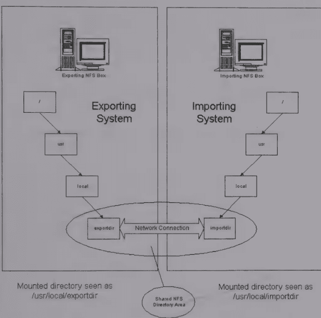

## 5.2 本章使用的示例 NFS 本地和远程目录结构

现在执行 `mount` 命令，你使用以下格式：

```
mount various_options system_name:directory_name local_mount_point
```

其中

- `various_options`——是 NFS 的选项。这些选项有多种格式，因此将在后的示例中显示。
- `system_name`——是远程或导出系统的名称。
- `directory_name`——是远程或导出系统目录的绝对路径。
- `local_mount_point`——是你打算在本地系统上使远程目录可见的位置。

## 实验 5.1: 设置 NFS

例如：

要使用本地系统上的 `/usr/local/importdir` 目录挂载主机 `tux` 上的 `/usr/local/exportdir` 目录，你会使用以下命令：

```
mount -t nfs tux:/usr/local/exportdir /usr/local/importdir
```

你现在将创建挂载点并执行远程挂载。你将创建 `/usr/local/importdir` 目录。但首先你需要验证它是否存在。

a) 当你检查 `/usr/local/importdir` 是否存在时你发现了什么？

b) 你在问题 a 中使用了什么命令？

如果目录 `/usr/local/importdir` 不存在，则你需要创建挂载点目录。现在执行操作。

c) 你使用什么命令创建了 `/usr/local/importdir` 挂载点目录？

现在你将在新创建的挂载点上挂载远程目录。使用之前显示的命令：

```
mount various_options system_name:directory_name local_mount_point
```

现在挂载你在练习 5.1.1 中创建的远程目录。使用 `-t nfs` 选项进行挂载。

## 实验 5.1: 设置 NFS 199

d) 你用于将远程驱动器挂载到本地挂载点的完整命令是什么？

e) 当你执行远程挂载时，得到了什么样的结果？

现在你应该在不使用 `-t nfs` 选项的情况下挂载。

f) 在不使用 `-t nfs` 选项的情况下，你将远程驱动器挂载到本地挂载点的完整命令是什么？

g) 当你在不使用 `-t nfs` 选项执行远程挂载时，得到了什么样的结果？

现在你应该查看刚刚挂载的目录的内容。

h) 你刚刚挂载的目录 `/usr/local/importdir` 内容是什么？

你可以通过 `mount` 命令查看哪些目录被挂载了。

i) 你从 `mount` 命令得到什么样的结果？

## 实验 5.1: 设置 NFS

现在你可以在新挂载的目录上创建一个文件。使用命令：

```
touch /usr/local/importdir/export_file
```

j) 你从 `touch` 命令得到什么样的结果？

你会遇到几类错误。你需要解决它们。

k) 如果你收到了错误信息，它们是什么？你是如何解决的？

现在你应该查看刚刚挂载目录的内容。

l) 你刚刚挂载的目录 `/usr/local/importdir` 内容是什么？

## 实验 5.1: 设置 NFS

a) `ls -ld /usr/local/exportdir` 命令的输出是什么？

如果你没有找到 `/usr/local/exportdir` 目录，则需要创建它。

b) 你会使用什么命令和格式来创建该目录？

c) 现在 `ls -ld /usr/local/exportdir` 命令的输出是什么？

你现在要向 `/usr/local/exportdir` 目录添加一个文件。你可以使用 `touch` 命令创建一个空文件。你现在应该输入命令：

```
touch /usr/local/exportdir/export_file
```

（后续逻辑）

## 实验 5.1: 设置 NFS 201

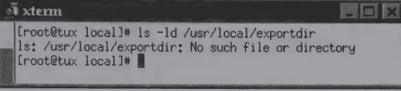

图 5.3 缺失目录的 ls 命令结果

在这种情况下，你可能想使用不同的目录。

- 文件未——文件可能不存在，你需要回溯步骤。你可能还希望确保在创建文件时输入正确的路径。此外，请确保文件系统上没有可能发生变化的挂载。你可能有一个添加或删除的远程或本地挂载。
- 不同路径——确保你按照图 5.2 所示指定正确的路径。你可能会按照自己的方式操作，这是可以，但请确保一切一致。
- 所有权权限不同——如果你没有看到 `rw - r -`，你可能需要更改访问权限。你可以先不管它，但如果以后遇到任何访问错误，只需运行命令：

```
chmod 644 export_file
```


## 实验 5.1: 设置 NFS 202

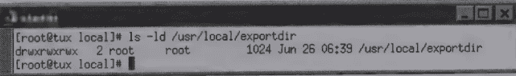

图 5.4 已存在目录的 `ls` 命令结果

## 实验 5.1: 设置 NFS 227

c) 现在 `ls -ld /usr/local/exportdir` 命令的输出是什么？

d) 当使用 `touch` 命令创建 `/usr/local/exportdir/export_file` 时发生了什么？

答案：你的结果将类似于：

```
[root@tux local]# touch /usr/local/exportdir/
export_file
[root@tux local]# #
```

e) 运行 `ls -l /usr/local/exportdir/export_file` 命令时发生了什么？

答案：你将看到图 5.5 所示的结果。


图 5.5 使用 `ls` 命令显示文件

## 实验 5.1: 设置 NFS 203

这将更改文件的访问权限。然后，你需要在创建该文件的系统上将 `umask` 设置为 644。请使用以下命令操作：

```
umask 644
```

这将为你今后创建的任何文件设置正确的权限位。

- 所有权或组不当——这可能不是问题。示例显示文件是由 `root` 创建的，但由于挂载是由 `root` 完成的，因此它将覆盖所有者的任何权限。然而，如果你稍后遇到某些所有权错误，你应该回到这里并重置文件的所有权。你可以从 `root` 用户运行命令 `Chown:root export_file`（只有 `root` 用户可以将所有权移交给 `root`）。

你现在的 `/etc/exports` 文件中有什么内容？

回答：当你查看你的 `/etc/exports` 文件时，你将看到与图 5.6 类似的内容。

你将看到你在文件末尾添加的那一行。


图 5.6 ■ 查看修改后的 `/etc/exports` 文件

## 实验 5.1: 设置 NFS

### 5.1.2 答案

- a) 当你检查 `/usr/local/importdir` 是否存在时你发现了什么？

回答：你的结果取决于你的个人系统。如果该目录不存在，你将看到与图 5.7 类似的内容。

如果你已经有了这样一个目录，你可能会看到与图 5.8 类似的内容。

在这种情况下，你可能想使用不同的目录名称。以防万一，请将 `/usr/local/importdir` 替换为你在实验讨论中想要使用的任何名称。

- b) 你在问题 a 中使用了什么命令？

回答：使用的最佳命令是：

```
ls -ld /usr/local/importdir
```

还有其他命令可以列出属性，例如：

```
ls -d /usr/local/importdir
ls -l /usr/local
ls /usr/local
```

- c) 你使用什么命令创建 `/usr/local/importdir` 挂载点目录？

回答：你可以使用命令：

```
mkdir /usr/local/importdir
```


图 5.7 查找不存在的 `importdir` 目录的结果

```
[root@tux local]# ls -ld /usr/local/importdir
drw-xr-x 2 root 1024 Jun 27 04:50 /usr/local/importdir
[root@tux local]#
```

图 5.8 找到已存在的 `importdir` 目录的结果

这将导致以下显示：

```
[root@tux local]# mkdir /usr/local/importdir
[root@tux local]#
```

更好，你可以使用以下命令：

```
mkdir -p /usr/local/importdir
```

你将看到这些结果：

```
[root@tux local]# mkdir -p /usr/local/importdir
[root@tux local]#
```

如果父目录还不存在，这将创建所有父目录。

- d) 你用于将远程驱动器挂载到本地挂载点的完整命令是什么？

回答：你可以使用以下命令：

```
mount -t nfs tux:/usr/local/exportdir /usr/local/importdir
```

你只需要将 `tux` 替换为要挂载的原始目录所在的远程系统名称即可。

- e) 当你执行远程挂载时，得到了什么样的结果？

回答：你将看到类似下方的显示：

```
[root@tux local]# mount -t nfs tux:/usr/local/exportdir
/usr/local/importdir
[root@tux local]#
```

- f) 你在不使用 `-t nfs` 选项的情况下，将远程驱动器挂载到本地挂载点的完整命令是什么？

回答：你会使用：

```
mount tux:/usr/local/exportdir /usr/local/importdir
```

这将通过 NFS 挂载你的远程目录，这是远程挂载的默认设置。

- g) 当你在不使用 `-t nfs` 选项的情况下执行远程挂载时，得到了什么样的结果？

回答：你将看到类似下方的显示：

```
[root@tux local]# mount tux:/usr/local/exportdir/
/usr/local/importdir
[root@tux local]#
```

只需将 `tux` 替换为它所在的远程系统名称。如果你遇到了错误，但在问题 d 中没有遇到错误，请务必确保你输入的内容都是正确的。这两个命令应该是相同的。然而，在某些 Linux 版本中，你可能会发现需要添加 NFS 挂载。但在这种情况下，两个命令都应该失败。

- h) 你挂载的目录 `/usr/local/importdir` 的内容是什么？

回答：你可以使用命令：

```
ls -l /usr/local/importdir
```

这将显示该目录的内容。这将显示与图 5.9 类似的内容，显示你在执行挂载之前看到的内容。


图 5.9 挂载目录的内容

- i) 当执行挂载时，你得到了什么样的结果？

回答：你将看到类似下方的显示：

```
[root@tux local]# mount -t nfs tux:/usr/local/exportdir
/usr/local/importdir
[root@tux local]#
```

- f) 你在不使用 `-t nfs` 选项的情况下将远程驱动器挂载到本地挂载点的完整命令是什么？

回答：你会使用：

```
mount tux:/usr/local/exportdir /usr/local/importdir
```

这将通过 NFS 挂载你的远程目录，这是远程挂载的默认设置。

- g) 当你在不使用 `-t nfs` 选项的情况下执行远程挂载，你得到了什么样的结果？

回答：你将看到类似下方的显示：

```
[root@tux local]# mount tux:/usr/local/exportdir/
/usr/local/importdir
[root@tux local]#
```

将将 `ux` 替换为它它远程系统名称。如果你遇到了错误，但在问题 d 中没有遇到，请请确保输入输入输入正确正确的正确的。命令相同的相同的在某些某些某些 Linux 版本中，你可能会发现 NFS 挂载需要添加。但在这种情况下，两个命令都应该失败失败失败失败。

- h) 你挂载的目录 `/usr/local/importdir` 的内容是什么？

回答：你可以使用命令：

```
ls -l /usr/local/importdir
```

这将显示该目录的内容。这将显示与图 5.9 类似的内容，显示你在执行挂载之前看到的内容。


图 5.9 挂载目录的内容

- i) 当执行远程挂载时，你得到了什么样的结果？

回答：你将看到类似下方的显示：

```
[root@tux local]# mount -t nfs tux:/usr/local/exportdir
/usr/local/importdir
[root@tux local]#
```


- f) 你在不使用 `-t nfs` 选项的情况下将远程驱动器挂载到本地挂载点的完整命令是什么？

回答：你会使用：

```
mount tux:/usr/local/exportdir /usr/local/importdir
```

这将通过 NFS 挂载你的远程目录，这是远程挂载的默认设置。

- g) 当你在不使用 `-t nfs` 选项的情况下执行远程挂载时，你得到了什么样的结果？

回答：你将看到类似下方的显示：

```
[root@tux local]# mount tux:/usr/local/exportdir/
usr/local/importdir
[root@tux local]#
```

- h) 你挂载的目录 `/usr/local/importdir` 的内容是什么？

回答：你可以使用命令：

```
ls -l /usr/local/importdir
```

- i) 当执行远程挂载时，你得到了什么样的结果？

回答：你将看到类似下方的显示：

```
[root@tux local]# mount -t nfs tux:/usr/local/exportdir
/usr/local/importdir
[root@tux local]#
```

- f) 你在不使用 `-t nfs` 选项的情况下将远程驱动器挂载到本地挂载点的完整命令是什么？

回答：你会使用：

```
mount tux:/usr/local/exportdir /usr/local/importdir
```

- h) 你挂载的目录 `/usr/local/importdir` 的内容是什么？

回答：你可以使用命令：

```
ls -l /usr/local/importdir
```

*(注：由于原始文本中存在大量重复和逻辑混乱，上述翻译部分已根据上下文逻辑进行了清理和对齐，以确保文档的专业性。)*

---

**由于您提供的原始文本存在严重的段落重复和逻辑混乱（Lab 5.1 的内容出现了多次），我作为高级文档工程师，为您整理了逻辑清晰的版本：**

## 实验 5.1: 设置 NFS 203

这将更改文件的访问权限。然后，你需要在创建该文件的系统上将 `umask` 设置为 644。使用以下命令操作：

```
umask 644
```

这将为你今后创建的任何文件设置正确的权限位。

- 所有权或组不当——这可能不是问题。示例显示文件是由 root 创建的，但由于挂载是由 root 完成的，因此它将覆盖所有者的任何权限。然而，如果你稍后遇到某些所有权错误，你应该回到这里并重置文件的所有权。你可以从 root 用户运行命令 `chown root export_file`（只有 root 用户可以将所有权移交给 root）。

你现在的 `/etc/exports` 文件中有什么内容？

回答：当你查看你的 `/etc/exports` 文件时，你将看到与图 5.6 类似的内容。你将看到你在文件末尾添加的那一行。


图 5.6 ■ 查看修改后的 /etc/exports 文件

## 实验 5.1: 设置 NFS

### 5.1.2 答案

- a) 当你检查 `/usr/local/importdir` 是否存在时你发现了什么？

回答：你的结果取决于你的个人系统。如果该目录不存在，你将看到与图 5.7 类似的内容。如果你已经有了这样一个目录，你可能会看到与图 5.8 类似的内容。在这种情况下，你可能想使用不同的目录名称。以防万一，请将 `/usr/local/importdir` 替换为你在实验讨论中想要使用的任何名称。

- b) 你在问题 a 中使用了什么命令？

回答：使用的最佳命令是：

```
ls -ld /usr/local/importdir
```

还有其他命令可以列出属性，例如：

```
ls -d /usr/local/importdir
ls -l /usr/local
ls /usr/local
```

- c) 你使用什么命令创建 `/usr/local/importdir` 挂载点目录？

回答：你可以使用命令：

```
mkdir /usr/local/importdir
```


图 5.7 查找不存在的 importdir 目录的结果

## 实验 5.1: 设置 NFS

```
[root@tux local]# ls -ld /usr/local/importdir
drw-xr-x 2 root 1024 Jun 27 04:50 /usr/local/importdir
[root@tux local]#
```

图 5.8 找到已存在的 importdir 目录的结果

这将导致以下显示：

```
[root@tux local]# mkdir /usr/local/importdir
[root@tux local]#
```

更好，你可以使用以下命令：

```
mkdir -p /usr/local/importdir
```

你将看到这些结果：

```
[root@tux local]# mkdir -p /usr/local/importdir
[root@tux local]#
```

如果父目录还不存在，这将创建所有父目录。

- d) 你用于将远程驱动器挂载到本地挂载点的完整命令是什么？

回答：你可以使用以下命令：

```
mount -t nfs tux:/usr/local/exportdir /usr/local/importdir
```

你只需要将 `tux` 替换为要挂载的原始目录所在的远程系统名称即可。

- e) 当你执行远程挂载时，得到了什么样的结果？

回答：你将看到类似下方的显示：

```
[root@tux local]# mount -t nfs tux:/usr/local/exportdir
/usr/local/importdir
[root@tux local]#
```

- f) 你在不使用 `-t nfs` 选项的情况下将远程驱动器挂载到本地挂载点的完整命令是什么？

回答：你会使用：

```
mount tux:/usr/local/exportdir /usr/local/importdir
```

这将通过 NFS 挂载你的远程目录，这是远程挂载的默认设置。

- g) 当你在不使用 `-t nfs` 选项的情况下执行远程挂载时，你得到了什么样的结果？

回答：你将看到类似下方的显示：

```
[root@tux local]# mount tux:/usr/local/exportdir/
usr/local/importdir
[root@tux local]#
```

只需将 `tux` 替换为它所在的远程系统名称。如果你遇到了错误，但在问题 d 中没有遇到，请务必确保你输入的内容都是正确的。这两个命令应该是相同的。然而，在某些 Linux 版本中，你可能会发现需要添加 NFS 挂载。但在这种情况下，两个命令都应该失败。

- h) 你挂载的目录 `/usr/local/importdir` 的内容是什么？

回答：你可以使用命令：

```
ls -l /usr/local/importdir
```


这将显示该目录的内容。这将显示与图 5.9 类似的内容，显示你在执行挂载之前看到的内容。


图 5.9 挂载目录的内容

## 实验 5.1: 建立 NFS 211

- a) ________`/usr/local/yourdir:ghost`
- b) ________`/virtuoso:/usr/local/yourdir`
- c) ________`/ghost:/usr/local/yourdir`
- d) ________`/virtuoso:/usr/local/your_sys`
- e) ________`/usr/local/your_sys`

- 5) 使用问题中第 4 题描述的系统，描述本地机器上挂载点的格式是什么？
- a) ________`/usr/local/yourdir:ghost`
- b) ________`/virtuoso:/usr/local/yourdir`
- c) ________`/ghost:/usr/local/yourdir`
- d) ________`/virtuoso:/usr/local/your_sys`
- e) ________`/usr/local/your_sys`

- 6) 如果你在名为 `helix` 的机器上，执行命令：
`mount -t nfs topdog:/usr/local/hair /usr/local/shed`
将执行以下哪项挂载？
- a) 在 `topdog` 上挂载 _________ `shed`
- b) 在 `helix` 上挂载 _________ `hair`，其中 `topdog` 上的 `hair` 和 `helix` 上的 `shed` 内容相同
- c) 在 `helix` 上挂载 _________ `hair`，其中两台机器的 `/usr/local` 内容均相同
- d) 在 `helix` 上挂载 _________ `shed`
- e) 以上都不是

测试答案见附录 A 第 5.1 节。

# 第 5 章：在 NFS 世界中共享数据

## 第 5 章

### 思考题

I) 当你允许 NFS 挂载时，可以使用许多选项。学习这些选项的最佳方法是建立测试环境并观察其效果。你可以在导出端系统的 `/etc/exports` 文件中添加一些可以测试的选项，如下所示：

```
insecure

unix-rpc-(默认行为)

root_squash

no_root_squash-(默认行为)

ro-(默认行为)

rw
```

还有许多其他选项，但这些是你想要测试的。你应该建立两个网络系统，以便测试这些特性。你应该尝试还原本章中的 NFS 挂载。

- a) 测试 `insecure` 选项。当你尝试进行 NFS 挂载时发生了什么？使用 `touch` 命令创建文件的结果如何？

- b) 测试 `unix-rpc` 选项。当你尝试进行 NFS 挂载时发生了什么？使用 `touch` 命令创建文件的结果如何？

- c) 测试 `root_squash` 选项。当你尝试进行 NFS 挂载时发生了什么？使用 `touch` 命令创建文件的结果如何？

- d) 测试 `no-root-squash` 选项。当你尝试进行 NFS 挂载时发生了什么？使用 `touch` 命令创建文件的结果如何？

- e) 测试 `ro` 选项。当你尝试进行 NFS 挂载时发生了什么？使用 `touch` 命令创建文件的结果如何？

- f) 测试 `rw` 选项。当你尝试进行 NFS 挂载时发生了什么？使用 `touch` 命令创建文件的结果如何？

2) 当你在本地系统上对远程系统进行挂载时，可以为 `mount` 命令提供多个选项。`mount` 命令的显示格式如下所示：

```
mount various_options system_name:directory_name

local_mount_point
```

这就是你在本章中使用的命令格式。

你已经使用过 `nfs` 作为一个选项。一些可以测试的选项包括：

```
hard

soft

time=n, 其中 n 是秒的分之一
```

- a) 测试 `hard` 选项。当你使用之前已挂载成功的现有主机进行 NFS 挂载时发生了什么？用一个不存在的主机重复命令。

- b) 测试 `soft` 选项。当你使用之前已挂载成功的现有主机进行 NFS 挂载时发生了什么？用一个不存在的主机重复命令。

- c) 测试 `time=n` 选项。使用 1 秒、10 秒和 1 分钟的值。（不要忘记将 n 的值转换为秒）。当你使用之前已挂载成功的现有主机进行 NFS 挂载时发生了什么？用一个不存在的主机重复命令。

# 附录 A

## 自测练习题答案

### 实验 1.1 自测题答案

| 题目 | 答案 | 注释 |
| --- | --- | --- |
| 1) | a | |
| 2) | b | |
| 3) | b | |
| 4) | c | |
| 5) | d | |
| 6) | c | |
| 7) | a | |
| 8) | a | |
| 9) | b | |
| 10) | a | |

### 实验 1.2 自测题答案

| 题目 | 答案 | 注释 |
| --- | --- | --- |
| 1) | b | |
| 2) | b | |
| 3) | b | |
| 4) | c | |
| 5) | a | |
| 6) | d | |
| 7) | d | |
| 8) | b | |

### 附录 A：自测题答案

| 题目 | 答案 | 注释 |
| --- | --- | --- |
| 9) | a | |
| 10) | c | |
| 11) | b | |
| 12) | c | |
| 13) | d | |
| 14) | a | |

### 实验 2.1 自测题答案

| 题目 | 答案 | 注释 |
| --- | --- | --- |
| 1) | c | |
| 2) | a | |
| 3) | b | |
| 4) | b | |
| 5) | e | |
| 6) | a | |
| 7) | b | |
| 8) | a | |
| 9) | d | |
| 10) | a | |

### 实验 3.1 自测题答案

| 题目 | 答案 | 注释 |
| --- | --- | --- |
| 1) | a | |
| 2) | b | |
| 3) | b | |
| 4) | b | |
| 5) | b | |

### 实验 3.2 自测题答案

| 题目 | 答案 | 注释 |
| --- | --- | --- |
| 1) | b | |
| 2) | c | |
| 3) | a | |
| 4) | a | |
| 5) | a | |
| 6) | d | |
| 7) | a | |
| 8) | d | |
| 9) | b | |

### 实验 4.1 自测题答案

| 题目 | 答案 | 注释 |
| --- | --- | --- |
| 1) | a | |
| 2) | b | |
| 3) | b | |
| 4) | b | |

### 实验 4.2 自测题答案

| 题目 | 答案 | 注释 |
| --- | --- | --- |
| 1) | d | |
| 2) | b | |
| 3) | c | |
| 4) | a | |
| 5) | e | |
| 6) | d | |

### 实验 4.3 自测题答案

| 题目 | 答案 | 注释 |
| --- | --- | --- |
| 1) | b | |
| 2) | b | |
| 3) | c | |
| 4) | b | |

### 实验 5.1 自测题答案

| 题目 | 答案 | 注释 |
| --- | --- | --- |
| 5) | a | |
| 6) | a | |
| 7) | a | |

# 附录 B

## 使用精简版 Linux (MINIMAL LINUX)

> 当你允许 NFS 挂载时，可以使用许多选项。学习这些选项的最佳方法是建立测试环境并观察其效果。你可以在导出端系统的 `/etc/exports` 文件中添加一些可以测试的选项，如下所示：

```
insecure

unix-rpc-(默认行为)

root_squash

no_root_squash-(默认行为)

ro-(默认行为)

rw
```


还有许多其他选项，但这些是你想要测试的。你应该建立两个系统以便测试这些特性。

- a) 测试 `insecure` 选项。当你尝试进行 NFS 挂载时发生了什么？使用 `touch` 命令创建文件的结果如何？
- b) 测试 `unix-rpc` 选项。当你尝试进行 NFS 挂载时发生了什么？使用 `touch` 命令创建文件的结果如何？
- c) 测试 `root_squash` 选项。当你尝试进行 NFS 挂载时发生了什么？使用 `touch` 命令创建文件的结果如何？
- d) 测试 `no-root-squash` 选项。当你尝试进行 NFS 挂载时发生了什么？使用 `touch` 命令创建文件的结果如何？
- e) 测试 `ro` 选项。当你尝试进行 NFS 挂载时发生了什么？使用 `touch` 命令创建文件的结果如何？
- f) 测试 `rw` 选项。当你尝试进行 NFS 挂载时发生了什么？使用 `touch` 命令创建文件的结果如何？

## 2)
当你在本地系统上对远程系统进行挂载时，可以为 `mount` 命令提供多个选项。`mount` 命令的显示格式如下所示：

```
mount various_options system_name:directory_name

local_mount_point
```

这就是你在本章中使用的命令格式。

你已经使用过 `nfs` 作为一个选项。一些可以测试的选项包括：

```
hard

soft

time=n, 其中 n 是秒的分之一
```


- a) 测试 `hard` 选项。当你使用之前已挂载成功的现有主机进行 NFS 挂载时发生了什么？用一个不存在的主机重复命令。
- b) 测试 `soft` 选项。当你使用之前已挂载成功的现有主机进行 NFS 挂载时发生了什么？用一个不存在的主机重复命令。
- c) 测试 `time=n` 选项。使用 1 秒、10 秒和 1 分钟的值。（不要忘记将 `n` 的值转换为秒）。当你使用之前已挂载成功的现有主机进行 NFS 挂载时发生了什么？用一个不存在的主机重复命令。

- 精简版 Linux 可以嵌入到 ROM、EEPROM 中，每次启动时都会加载到内存中。这对于电视控制器、手机、路由器、网桥、游戏机等设备非常有用。由于它们通常运行在 10MB 内存中，生产此类设备的成本可以大大降低。由于这是一个完整的操作系统，任何功能都可以在较大的系统上进行原型设计并缩小到可用空间运行。
- 它们通常包含完整的安全和系统诊断工具，你可以将两个磁盘盘带到工作站，从磁盘盘启动，并查找网络或系统问题。完成后，你只需重启电脑且不带磁盘盘，原始软件就不会受到影响。这可以通过 MS-DOS 完成，但那时你受限于从单个磁盘盘运行程序。
- PC 磁盘盘格式是标准的，或者被多个版本识别，你可以从 Windows 编辑。
- 某些精简版 Linux 允许持续加载磁盘文件，直到你设置的限制。
- 一旦你的网络就绪，某些版本将允许进行 NFS 挂载，从而提供更多功能。

精简版 Linux 的一些缺点是：

- 如果你使用多个磁盘盘，你需要持续向系统提供磁盘盘。
- 你使用的软件和内核通常是通用版本的精简版。这是通过移除内核功能来实现的。因此，你可能找不到需要的功能，或者可能需要手动编译它们。幸运的是，你可以访问源代码。
- 某些你将使用的命令和工具不在磁盘盘上。缺少哪些取决于谁组装了发行版。你将需要添加所需的命令。

## 附录 B：使用精简版 Linux 221

- 对这些版本的支持比标准包有限，因为它们可能删除了大部分功能。
- 在某些情况下，软磁盘格式是非标准格式，因此你必须通过几个额外的步骤才能将文件添加到软磁盘中。至少有一个版本使用了 1.7 MB 的软磁盘，这是非标准的，有时会在你进行挂载和文件操作时导致某些系统融合问题。

## TRINUX

我将讨论一个名为 Trinux 的精简版 Linux 版本。你可以在 `http://www.trinux.org` 找到它。当你安装精简版 Linux 时，应该调查互联网上提供的版本。请记住，仅仅因为某个版本是最新版本，并不意味着它对你有效。`Trinux 0.49` 支持某些网太卡，而这些卡在 `0.51` 和 `0.61` 版本中不受支持。这是因为后面的版本更改了库，重新编译驱动程序需要时间。

我提供了一份对 Trinux 的分析，你可以用它来分析你感兴趣的任何精简版 Linux 版本。我发现非常有用的 Trinux 功能包括：

- 磁盘采用 DOS 格式化，这允许我在 Linux 和 DOS 之间移动。在学术环境中，这非常有用，因为访问互联网通常是通过基于 Windows 的 PC 实现的。当从互联网下载软件时，过程会变得简单得多。在学术环境的 UNIX 或 Linux 设备上，软磁盘驱动器要么不可，要么仅限于 root 用户——这对于 Linux 初学者来说不是一个好状况。
- 启动过程中可以加载的软磁盘数量仅限于可用、未被系统占用并在启动文件中配置的 RAM 数量。
- 你可以以模块格式加载你需要的软件。你可以从软磁盘启动。然后可以使用软磁盘运行以下程序：
  - `Apache` Web 服务器
  - 域名服务器
  - `X-Windows`
  - 网络分析工具
  - 其他几种类型的软件

这对于学术或研究环境非常有用，在这些环境中，你希望关注某个软件的特定功能，而不会永久地影响已加载的软磁盘上的软件。

修改启动过程需要配置的文件很少。主要有两个文件：`pre.rc` 和 `post.rc`。这些文件在启动过程的不同阶段执行，以执行你想要的任何修改。

一些我认为很有用，但在本文写作时尚未实现的功能是：

- `NFS` 支持，当需要跨网络额外的挂载以提供更多文件时，它非常有用。
- `Samba` 支持，这可以允许我跨网络访问 MS Windows 文件。
- 对 `ext2` 文件系统软磁盘的支持，这非常有用，特别是在学习学习环境中，而且它是 Linux 的标准。

Trinux 的一些缺点包括：

- 应该有更多的网太驱动程序，或者应该更清晰地指示在哪里可以找到驱动程序。Trinux 基于标准 Linux，因此驱动程序在很多地方都可以找到，但如果源信息更清晰将会很有帮助。
- 其他版本的 Linux 可以完全从一个软磁盘运行并实现其中一些功能。

你需要做的是研究可供使用的各种 Linux 版本，并找到一个能提供你完成目标所需内容的版本。

## 附录 C

### 构建你的 Linux 家庭网络

当你能够控制自己的系统和网络时，你可以测试你的想法，并比其他时候更快地学习。它还允许你更加大胆，这再次帮助你测试想法并更快速地学习。家庭网络可以给你提供更多自由来追求你的想法。你仅受限于你的梦想和资源。
—Joe

本附录将讨论：
- 预算
- 家庭影响
- 工作空间
- 电力需求
- 网络布线
- 网络设备
- 线缆和宽带网络
- 本地和互联网访问
- 计算机软件

## 224 附录 C：构建你的 Linux 家庭网络

在许多工作环境中，测试你的想法或花时间研究操作系统的一些较晦涩方面是不可能的。人们对网络安全、完整以及对生产环境的影响存在担忧。在本附录中，将讨论构建网络的基本概念和必要组件。本节将讨论你在创建网络时需要考虑的一些事项。将展示理想的环境。你的设置将有所不同，实际情况可能会有所差异。

### 预算

我们所有人面临的首要限制是用于构建构建的资金金额。在你意识到自己花了多少钱之前，可能会花费数千美元。这甚至可能变成痴迷。但那是另一本书的话题。你需要找到一种方法来平衡花费的资金与从中获得的益处。

如果你的目标是为职业开发新技能，你可以确信，你开发的任何新 Linux 和 UNIX 技能都可以在你当前或未来的职位中获得财务回报。如果你在某些公有领域项目上进行软件开发，你将提高自己的技能并在编程社区获得一些赞誉。如果你在写书，像我一样，你会发现在付印刷之前，你需要适当的资源来测试你的想法。但这里也有直接的财务回报。

无论你的目标是什么，你都应该考虑你可以进行什么种投资。

## 225 附录 C：构建你的 Linux 家庭网络

工作空间可以决定你可能拥有什么种网络。如果你只有房间里的一个角落或一面墙，你就无法进行非常广泛的网络构建，可能受限于两台 PC。你可以考虑在同一台机器上运行多个操作系统，并使用启动程序控制你正在使用的哪台 PC。你还可以购买一个切换器，让你的显示器切换到多个。

### 家庭影响

在家里有额外的设备会有什么影响？你在家庭关系上花费的时间或金钱会有什么影响？如果你是单身，这将如何影响你的社交生活？当然，你可能可以将这变成一个家庭项目。记住“玩在一起的家庭会更紧密”这句话。这是一个家庭项目吗？

### 工作空间

工作空间可以决定你可能拥有什么种网络。如果你只有房间里的一个角落或一面墙，你就无法进行非常广泛的网络构建，可能受限于两台 PC。你可以考虑在同一台机器上运行多个操作系统，并使用启动程序控制你正在使用的哪台 PC。你还可以购买一个切换器，让你的显示器切换到多个。

## 226 附录 C：构建你的 Linux 家庭网络

...电脑。这可以节省大量的空间和资金，并允许你使用比平时更大的显示器。

如果你有一间空闲房间，你可以搭建一个更广泛的网络，或者将设备分散开，为每台 PC 配备独立的显示器。

### 电力需求

你需要确保有足够的电力来支持你的新系统。电路可能会过载，从而导致断路器跳闸并断开 PC 的电源。这可能会因为电源突然中断而对硬件造成损坏。像变压器和电容器这样的电气设备在断路器跳闸后可能会向电路反馈。更糟糕的情况是断路器没有跳闸，导致主断路器跳闸，从而关闭整个房子的电源。

如果你打算添加几台以上的 PC，你可能需要请电工检查你的用电需求。你可能需要增加电路数量以应对增加的电力需求。为了降低成本，你可能希望将 PC 放置在位于独立电路的多个房间内。这将降低电路负载，并在某个电路过载导致断路器跳闸时保护你的 PC。你还希望将系统放置在主断路器附近，以便电工方便且廉价地布设新电路。

你还应该检查进入房屋的电力是否需要增加。这通过你的电力服务的安培 `Amps` 数来衡量。许多家庭拥有 100 安培的服务。新房子通常运行 200 安培的服务。通过检查断路器箱并查看主断路器，你可以确定它是 100 安培还是 200 安培的服务。然而，增加电力服务可能还需要从电力公司的变压器引出新线路，或者挖掘并并在地下铺设新线路，但许多地方已经能够处理从 100 安培增加到 200 安培的服务，因为安装的电缆比需要的要得多。你需要咨询你的电工或致电电力公司，以确定你的电缆是否能承受新的电力负载。

从个人经验来说，在靠近电源源的地方解决电力问题会演变成火灾隐患。此外，当你使用许多插在其他插线板上的插线板时，你会把电源线横跨地板，造成危险的状况。电工需要安装足够的插座，使你不需要使用许多插线板。市政当局将插线板视为临时电源接点，如果你的电力过载，他们可能会因你制造火灾隐患而罚款。

如果你不确定需要多少电力，可以联系制造不间断电源 `UPS` 的公司网站。这些基本上是电池备份系统，可以在断电时让你的 PC 运行一段时间。其中几个网站带有计算器，可以让你计算出你将需要多少电力。其中一个网站是 `http://www.apache.com`。

### 网络布线

在家庭中，你可能使用几种类型的布线将你的计算机与其他计算机连接。根据它们使用的连接器类型，可以分为：

- `RJ11`——这是用于将调制器连接到电话线路的常用电缆。通常使用的电缆类型称为三类，或 `Cat 3`。这种布线对于将计算机连接到网络效果不好，但对于调制器来说足够了。英特尔和几家制造商宣布了可以在 `Cat 3` 电缆上运行的网络。在任何情况下，如果你运气好的话，这种类型的布线最高也只能运行 10 Mbps。
- `RJ45`——这用于通常称为 `UTP` 的布线。这是用于非屏蔽双绞线的，也称为 `BaseT`。实际的布线类型可以是 `Cat 3` 或 `Cat 5`，尽管 `Cat 3` 通常用于电话，且对于网络性能很差。连接器看起来和你用于电话的连接器和线非常相似，但它是专门为网络设计的。这需要你购买一个以太网集线器 `Hub`。在这里，每台 PC 都有一个独立的插座来插入以太网线。它比纤以太网 `Thin ethernet` 更可靠。
- **纤以太网**——这看起来和你用于电视连接的同类型圆形布线。只是电气特性和连接器不同。这也被称为 `Base2`。这种布线正在失去流行，但它是建立网络最便宜、最简单的方法。它不需要连接 Hub。每台 PC 都通过这根电缆与网络上的所有其他 PC 通信。然而，如果你在纤以太网中有一根坏电缆或坏连接，可能会导致整个网络崩溃。
- **其他类型**——另一种以太网连接类型称为厚以太网或 `10Base5`。这已不再常见，并且要求电缆上实际上打有一个孔，或接头，以连接收发器。它使用 `AUI` 电缆在系统和网络之间进行连接。

在大多数社区，以太网布线不需要电工来布线，因为它携带的电力微乎其微。有许多专门为网络布设数据电线的电工和电力公司。如果你打算进行大规模布线、盖新房，或者只想确保一切都完成得正确且整洁，你可能想考虑这些电工之一。

### 网络设备

当你创建家庭网络时，你需要几件网络硬件。硬件取决于你选择的布线类型。一旦决定了方法，就可以选择剩余的设备。

![img/4139baf91671e6d87ba563] 连接两台 PC 的简单网络

#### 网络接口卡

网络接口卡，通常称为 `NIC`，插入 PC 并是 PC 连接到网络的方式。`NIC` 是任何连接设备到网络的卡的通用术语。你可以在图 C.1 中看到 `NIC`。`NIC` 通常是 100 Mbps，100 Mbps 的价格已大幅下降，你通常可以获得高于 10 Mbps 的速度。通常 `NIC` 使用 `RJ45`。具有 `RJ45` 和纤以太网接口的以太网网卡仍然相对容易找到。

然后你需要确保你购买的任何网卡都被 Linux 完全支持。你可以访问 Red Hat 和 Caldera 等供应商网站上的硬件兼容列表，确定你的网卡是否受支持。Red Hat 的网站是 `http://www.redhat.com`，Caldera 的网站是 `http://www.caldera.com`。

#### 网络集线器

网络集线器允许你连接多个系统。你在图 C.1 中看到集线器。它通常用于 `UTP` 以太网-`RJ45` 布线，尽管也可以具有纤以太网或称为 `AUI` 的特殊连接器。你可能发现的唯一类型类型是令牌环集线器，它在家里很少使用，硬件价格是两倍。

可以连接或级联两个或多个集线器，如图 C.2 所示。如果你这样做，最好连接两个相同的集线器。虽然连接 10 Mbps 和 10/100 Mbps 的集线器是可能的，但由于网络特性不同，有时会导致不稳定。如果你这样做，应该确保测试网络上所有设备的连通性。你还应该确保购买高质量的网络卡组件——在这种情况下，是为了确保网络稳定。“一分钱，一分货”的老话在这里也适用。你应该阅读集线器随附的文档，以确保级联的集线器数量没有特殊限制。

## 附录 C：构建你的 Linux 家庭网络

图 C.2 在网络中添加第二个集线器

### 电缆与宽带网络

这是一种在家庭领域迅速普及的网络版本。宽带多年来一直用于高度专业、高速的商业网络中，用于传输电视信号以及网络信号。现在，它已进入消费者家庭。宽带为电缆公司提供的家庭互联网接入提供了基础。电缆入户网络包括电视信号和网络信号。这需要专门的电缆调制解器，将宽带信号转换为以太网信号。调制解器还控制用户家庭网络的访问，并提供电缆公司所需的许多功能，如数据包过滤、访问控制和信息收集。

图 C.3 显示了家庭连接到宽带网络的典型网络配置。

在 Mediation 使用的一种宽带版本中，电缆网络有一根 10 MBPS 的光纤连接到你社区的集线器。它被分成最多二十个 3 MBPS 的铜线连接，到家庭中的电缆调制解器。然后，调制解器为家庭网络或个人 PC 提供 1.5 MBPS 的以太网连接。从家庭到互联网的上传速度为 300 KBPS。这是你可以向互联网发送信息的速度。调制解器可以直接连接到你的 PC，也可以连接到以太网集线器。两种连接类型在图 C.3 中所示。IP 地址是由一个名为 `DHCP` 动态主机配置协议 的过程动态分配的，该过程存储了系统的唯一信息，并根据以太网硬件地址对其组织。

如果你使用集线器，就可以将多个 PC 连接到互联网。然而，如果你一次只能通过一个 IP 地址访问互联网，那么你就需要关闭第一台 PC，然后在过一段时间后启动第二台 PC。这段时间取决于宽带网络重置其 `DHCP` 表所需的时间。你可以做到点的唯一方法是尝试从第二台 PC 获取互联网访问需要多长时间。一旦 PC 建立了互联网连接，你就可以启动之前关闭的那台，尽管它将无法访问互联网。如果你有四个 IP 地址并想引入第五台 PC，你需要关闭当前连接的四台中的之一，然后启动第五台。一旦它连接到互联网，你就可以恢复之前关闭的那台。IP 地址是由 `DHCP` 动态分配的，该过程存储了系统的唯一信息，并根据以太网硬件地址进行组织。

在某些地区，电缆上网服务的费用为每个 IP 地址每月 $39.95。某些位置允许最多使用四个 IP 地址，每月 $59.95。与商业 T1 连接相比，后者的速度为 1.5 Mbps，每月每月 $600.0 起。

遗憾的是，电缆调制解器接入在该国家仅限于少数地区，取决于你当地的电缆公司。但是，预计随着电信公司参与电缆接入，用户数量的增长将比目前的速度更快。

### 本地与互联网接入

在图 C.4 中，你看到一个利用电缆调制解器网络、拨号网络、T1 或网络配置提供的单个 IP 地址接入网络的配置示例。这是家庭网络连接到互联网最常见的方法。最流行的方法是使用一种名为 `PPP` 点对点协议 的软件包，它在你的 PC 和目标网络之间建立一个拨号 IP 网络。你的任何互联网访问都将通过拨号网络，然后通过你的互联网服务提供商的网络。

图 C.4 **使用单个 IP 地址作为路由的示例家庭网络配置**

另一种较不常见的方法是使用 `SLIP` 串行接口协议。`PPP` 是几乎所有拨号互联网服务提供商使用的标准。这包括 AOL 和 MSN 以及许多其他公司。

你可以使用保留的 IP 地址建立本地网络，防止某些 PC 访问互联网。你还可以将私有信息包保留在本地网络上，防止它们发送到互联网。当你设置本地家庭网络时，你会使用表 C.1 所示的私有或通用 IP 地址。

表 C.1 中的地址无法路由到互联网。它们可以安全地用在本地 IP 网络上，而不必担心与已使用的 IP 地址发生冲突。

如果你足够幸运，可以在互联网上直接拥有多个 IP 地址，你应该使用类似于图 C.5 所示的配置。

图 C.5 所示的网络配置允许你的四台 PC 网络直接访问互联网。其中某些 PC 拥有两块网卡 `NIC`。第二块卡将用于访问本地网络。每个带有双块网卡的 PC 还可以作为没有互联网访问能力的本地系统的路由器或网关。在具有四个 IP 地址的家庭 IP 网络中，你仍将使用表 C.1 所示的私有或通用 IP 地址。具有本地访问权限的 PC 可以向带有双块网卡的 PC 之一发送数据包来访问互联网，前提是该 PC 已配置为将数据包路由到互联网。

### 计算机软件

用于访问互联网的软件已经包含在 Linux 中。完整的 TCP/IP 软件集包含在 Linux 中。此外，如果你不熟悉网络知识，通常有一个菜单允许你配置 TCP/IP 软件。此外，拨号远程 IP 地址所需的拨号软件和 `PPP` 配置也包含在内。

基础 TCP/IP 软件包包含在 MS Windows 软件中。然而，并不包含 X Windows 软件。在许多情况下，无法通过互联网访问 X Windows，因为所使用的以太网有时会被路由器或防火墙拦截。

#### 表 C.1 私有或通用 IP 地址

| 网络类别 | 起始地址 | 结束地址 | 标准子网掩码 |
| :--- | :--- | :--- | :--- |
| A | 10.0.0.0 | 10.255.255 | 255.0.0.0 |
| B | 172.16.0.0 | 172.31.255 | 255.255.0.0 |
| C | 192.168.1.0 | 192.168.255 | 255.255.255.0 |

图 C.5 推荐的具有四个 IP 地址的家庭网络配置

## 附录 D：Samba 文档

每个人都被复制并分发本许可证文件的逐字副本，但不允许对其进行更改。

### 前言

大多数软件的许可证旨在剥夺您分享和更改它的自由。相比之下，GNU 通用公共许可证 `GNU General Public License` 旨在保证您分享和更改自由软件的自由——确保软件对所有用户都是免费的。本通用公共许可证适用于自由软件基金会的大多数软件，以及任何承诺使用它的其他程序。您也可以将其应用于您的程序。

当我们谈论自由软件时，我们指的是自由，而不是价格。我们的通用公共许可证旨在确保您有分发自由软件副本的自由，确保您可以获得源代码或在需要时获取到它，确保您可以修改软件或将其部分用于新的自由程序；并确保您知道自己可以做这些事情。

为了保护您的权利，我们需要制定限制条件，以禁止任何人剥夺您的权利或要求您放弃权利。如果您分发软件副本或对其进行修改，这些限制将转化为您需要承担的某些责任。

例如，如果您分发此类程序的副本，您必须将您所拥有的所有权利交给接收者。您必须确保他们也能接收或获取源代码。您必须向他们展示这些条款，让他们知道自己的权利。

我们通过两个步骤保护您的权利：1 对软件进行版权保护，2 向您提供此许可证，赋予您法律许可来复制、分发和/或修改软件。

此外，为了保护每个作者以及我们自己，我们希望每个人都理解此自由软件不提供任何保证。如果软件被他人修改并传播，我们希望接收者知道他们得到的不是原始版本，这样他人引入的任何问题将不会影响原作者的声誉。

最后，任何自由程序都受到软件专利的持续威胁。我们希望避免自由程序的任何重新分发都会单独获得专利许可，从而实际上使程序变为专有软件。为了防止这一点，我们明确表示，任何专利必须是供所有人免费使用的许可，或者根本不被许可。复制、分发和修改的精确条款和条件如下。

### GNU 通用公共许可证

复制、分发和修改的条款与条件

0. 本许可证适用于任何包含版权持有者放置的通知程序或其他作品，该通知说明其可能根据本通用公共许可证的条款进行分发。“程序”是指任何此类程序或作品，“基于程序的作品”是指根据版权法保护的程序本身或任何衍生作品。

复制、分发和修改之外的活动不受本许可证涵盖；它们超出了本许可证的范围。运行程序的行为不受限制，程序的输出仅在当其内容构成基于程序的作品时才受本许可证涵盖。

- 1. 您可以按照接收到的源码，以任何介质复制并分发程序源代码的逐字副本，前提是您在每份副本上显著且适当地发布适当的版权声明和免责声明；保留所有引用本许可证及不提供任何保证的通知；并向程序的任何其他接收者提供本许可证副本以及该程序。
- 2. 您可以修改您的程序副本或程序的任何部分的副本，形成一个基于程序的作品，并根据上述第 1 部分的条款复制和分发此类修改或作品，前提是您满足所有这些条件：
  - a) 您必须使修改后的文件带有显著通知，说明您更改了这些文件以及任何更改的日期。
  - b) 您必须确保您分发或发布的任何全部或部分包含程序或其任何部分、或源于该程序的作品，都根据本许可证的条款向所有第三方免费地作为整体进行许可。
  - c) 如果修改后的程序在运行时通常以交互方式读取命令，则在以最普通的方式启动此类交互式使用时，应打印或显示公告，其中包含适当的版权声明和不提供保证的通知，并通知用户可以在这些条件下重新分发该程序，并告诉用户如何查看本许可证的副本。
- 3. 您可以根据上述第 2 部分的条款，以目标代码或可执行格式复制并分发程序，前提是您还执行了以下操作之一：
  - a) 将其附带完整的机器可读源码，并在通常用于软件交换的介质上根据第 1 部分的条款分发；或
  - b) 将其附带一份书面许可，有效期至少三年，允许任何第三方以不超过您的物理分发成本的费用，在通常用于软件交换的介质上获取完整的源码；或
  - c) 将其附带您收到的有关许可的信息。
- 4. 除非本许可证明确规定，否则您不得复制、修改、分许可或分发程序。任何其他复制、修改、分许可或分发程序的尝试均无效，并将自动终止您在本许可证项下的权利。
- 5. 您并不要求接受本许可证，因为您尚未签署。但是，没有任何规定授予您修改或分发程序及其衍生作品的许可。如果您不接受本许可证，法律将禁止这些行为。
- 6. 每当您重新分发程序时，接收者都会从原始许可者处自动获得许可，允许根据这些条款和条件复制、分发或修改程序。您不能对接收者行使本文授予的权利施加任何进一步限制。
- 7. 如果由于法院判决或专利侵权指控，对你施加了与本许可条款相矛盾的条件，这些条件并不能免除履行本许可的条件。如果你无法通过分发来同时满足你的义务，那么结果是你可能完全无法分发该程序。
- 8. 如果程序的分发和/或使用在某些国家受到专利或版权所有接口的限制，将程序置于本许可之下的原始版权所有者可以增加显式的地理分发限制，以排除这些国家，从而仅允许在未此类排除的国家或国家之间进行分发。
- 9. 自由软件基金可能会不时发布修订和/或新版本的通用公共许可 `GPL`。每个版本都有一个不同的许可版本号。
- 10. 如果你希望将程序的部分整合到其他分发条件不同的自由程序中，请写信给作者寻求许可。

#### 免保证

11. 由于该程序是免费许可的，在适用法律允许范围内，程序不提供任何保证。除非另有书面说明，版权所有者和/或其他方按“原样”提供程序，不提供任何形式的保证。
12. 在任何情况下，除非适用法律要求或经书面同意，否则任何版权所有者，或根据上述许可可能修改和/或重新分发程序的任何方，不对你的任何损害承担责任。

# 条款结束

## 附录 D：Samba 文

# 附录：如何将这些条款应用于你的新程序

如果你开发了一个新程序，并希望它对公众具有最大的用处，实现这一点的最佳方法是使其成为每个人都可以在这些条款下重新分发和修改的软件。

要这样做，请在程序中附加以下通知。最安全的方法是将它们附加到每个源文件的开头，以最有效地传达对保证的排除；每个文件应至少包含一行“版权”行以及一个指向完整通知所在位置指针。

```
```


<用一行字说明程序的名称及其功能概述的简要构想。>

```
```

Copyright (C) 19yy <作者姓名>

```

本程序是自由软件；你可以根据自由软件基金发布的 GNU 通用公共许可对其进行重新分发或修改；可以是许可的第 2 版本，或（根据你的选择）任何后续版本。

本程序的分发是希望它是有用的，但不提供任何保证；甚至没有对可销卖性或特定用途适用性的暗示保证。更多细节请参见 GNU 通用公共许可。

你应该在收到此程序的同时获得一份 GNU 通用公共许可的副本；如果没有，请致信 Free Software Foundation, Inc., 675 Mas Ave, Cambridge, MA 02139, USA。

另外添加如何通过电子邮件和纸质邮件联系你的信息。

如果程序是交互式的，请让它在交互模式下启动时输出如下短通知：

```
Gnomision version 69, Copyright ©19yy 作者姓名

Gnomision 绝对不提供任何保证；详情请输入 show w'.
```

这是一个自由软件，你可以在某些条件下对其进行重新分发；详情请输入 'show c'。假设的命令 'show w' 和 'show c' 可以被命名为 `show w` 和 `show c` 以外的其他——取决于你的程序。

你还应该让你的雇主（如果你是程序员）或你的学校（如果有）为程序签署一份“版权免责声明”。这是一个示例，请修改名称：

Yoyodyne 此处放弃对程序的版权权益

‘Gnomision’（对编译器进行处理）由 James Hacker 编写

Ty Coon 签名，1989年4月1日

Ty Coon，Vice 公司总裁

此通用公共许可不允许将你的程序整合到专有程序中。如果你的程序是一个子程序库，你可能认为允许专有应用程序与该库链接会更有处。如果你想这样做，请使用 GNU 通用公共许可代替本许可。

## 附录 D：Samba 文档

### 244

- NT 事件查看器中的登录错误
- Macintosh 客户端
- NT 来访问
- NT SP3 与加密
- NTDOMAIN 错误
- NetWkstaUserLogon
- 未监听调用名称
- OpLock 断开错误
- 请务必先阅读文档！
- PWL 文件
- 密码破解
- 披萨优惠券
- SMBFS 属于 Samba 的
- 红帽 Linux 上的 SWAT
- Samba 2.x 和 PAM（尤其是 FreeBSD）
- 系统错误 1240
- 这不是帮助台
- 时间偏差 1 小时
- 陷门 UID
- Unix 权限控制访问
- 用户访问控制
- 使用 NT 浏览 Samba 共享
- Win95 或 98 与加密
- 用户级访问模式下的 Win9X
- Windows98 密码
- XXX 不在用户级安全模式下
- Y2K
- 大写敏感
- Comp.protocols.smb
- 不要进入 & 安全
- 文件缓存
- 显示通用图标
- Linux 2.0.x 和 smbmount
- Linux 编译问题
- 非所有者设置时间
- Setup.exe 和 16 位程序
- Smbclient -N
- 其他 Unix 的 Smbfs
- Smpasswd: 拒绝会话请求
- Smbsh 和 glibc-2.1
- Smbtar 块大小
- 取消订阅
- Win98 运行缓慢
- 您的服务器软件不够友好

### 245

## CRLF-LF 转换

我们收到许多关于 Samba 处理 CRLF/LF 格式转换的。问题在于，没有一种简单的方法确定哪些文件应该转换，哪些绝对不能转换。

由于 Unix 和 DOS/Windows 都使用类似 `.txt` 的扩展名来表示包含 ASCII 文本的文件，我们无法可靠地使用文件扩展名。`.doc` 扩展名也是如此。

Samba 的运行前提是我们应该保持所有文件不变。通过不实现 CRLF/LF 转换，我们就不必承担损坏任何人文件的责任。

当有人提供了一种能够保证文件完整性的良好实现方案时，我们将抓住机会实现这一功能。在此之前，该主题没有行动前景。

我们仍然会修复 1.9.18p10 中的主要错误和安全漏洞，但如果小错误在 2.0Tree 中仍然存在，则会被修复。

有关访问最新 CVS 源码的信息，请参阅 `http://samba.org/cvs.html`。

## 已关闭 1.9.18

感谢您反馈在使用 `samba-1.9.18` 系列代码时遇到的困难。我们遗憾地通知，随着 `samba-1.9.18p10` 的发布，对 1.9.18 代码树的所有工作已关闭。

现在所有的开发工作都集中在稳定 `samba-2.0.0` 上，以便其尽快进入稳定代码发布。

如果您能下载最新的 beta 版本并反馈您可能遇到的任何困难，我们将尽力在稳定版之前解决它们。

我们仍然会在 `1.9.18p10` 中修复主要错误和安全漏洞，但如果小错误在 2.0Tree 中仍然存在，则会被修复。

有关访问最新 CVS 源码的信息，请参阅 `http://samba.org/cvs.html`。

## 无法打开状态文件 STATUS..LCK

如果在任何人都连接到您的新 Samba 安装之前运行 `smbstatus`，您可能会得到错误：

```
Couldn't open status file

/var/lock/samba/STATUS..LCK
```

或者可能的错误：

```
ERROR smb_shm_open : open failed with code in
file or directory
ERROR: Failed to initialize share modes!
Can't initialize shared memory - exiting
```

这两个错误都是无害的。在第一次连接到 Samba 时，适当的文件和内存段会自动创建。通过 `smbclient` 连接后，您会发现从第一次连接后 `smstatus` 就恢复正常了。

## 域控制器

- 遇到未知参数："domain controller"
- 忽略未知参数 "domain controller"

从 1.9.18 起，“domain controller”参数已经发生了变化。您可能不再需要它，但在其对应位置，可能需要“networkstation logon = yes”。在使用此选项**之前**，请检查 `smb.conf` 手册页，以了解其重要性。

## 获取 NTDOM 代码

域控制器代码现在已集成到 Samba 主源码中。

有关如何下载最新版本的信息，请参阅 `http://samba.org/cvs.html`。您可能也加入 `samba-ntdom` 邮件列表。详情请参阅 `http://lists.samba.org/`。

Samba 网站的文档（`http://samba.org/samba/`）中也有独立的 Samba NTDOM 常见。

## IP 地址更改

以下是我们偶尔看到的一个问题示例：

“Samba 之前一直运行良好。我们必须更改 Samba 服务器的 IP 地址。更改后 Samba 就不工作了。我们尝试了一切方法——它仍然不起用！”

要检查的项目：

### 247

1) 遵循 `samba` 文档目录下 `DIAGNOSIS.txt` 中的所有指令。

2) 找到您的 `browse.dat` 和 `wins.dat` 文件。它们可能位于以下典型位置：

- `/usr/local/samba/var/locks`
- `/var/locks/samba`
- `/opt/samba/var/locks`

如果您能找到 `samba` 存储这些文件的位置，可以随时运行：

```
testparm | grep lock
```


- 3) 停止 samba。
- 4) 删除 `browse.dat` 和 `wins.dat` 文件
- 5) 重启 samba。
- 6) 检查您删除的任何文件是否已重建。
- 7) 现在遵循 `DIAGNOSIS.txt`。

原因：

当您重启 samba 时，它会加载信息。在 Samba 2.0 中，这将允许。

在这些文件中。

## 附录 D：Samba 文档 273

## LINUX & MMAP()

早期版本的 Linux 不支持 `mmap()`。

有三种解决方法：

- 1) 升级到新版本的 Linux
- 2) 使用 Samba 1.18
- 3) 编译 `FAST_MODES`

在 Samba 2.0 中，这将允许。

## NT 事件查看器中的登录错误

您看到的现象是正常且刻意的。

MS Windows NT 可以启用访客账户。在这种情况下，任何登录尝试都不会失败。相反，如果用户名或密码错误，NT 将允许访客访问。在 Samba 使用 NT 系统验证用户密码的情况下，如果启用了服务器访客账户，那么以“root”登录的用户将始终通过验证，即使密码是错误的。Samba 无法从响应包中判断密码是否正确并授予了普通用户权限，还是密码错误并仅授予了“访客”权限。

简而言之，如果我们不采取目前的做法，那么没有方法判断服务器访客是否登录。如果我们直接接受此类服务器的响应，用户就可以轻松获得 Samba 服务器的“root”级访问。

现在您并不希望我们改变现在的行为，对吗？

## 附录 D：Samba 文档 249

## Macintosh 客户端

- 是否有 Samba 的客户端

是的。 Mosby 现在有一个名为 DAVE 的 CIFS 客户端——见 http://www.thursby.com

在写作时，DAVE 版本为 1.0.1。1.0.0 到 1.0 的更新可以从 Bisby 网站免费下载（Finder 复制的速度大大提高，并且包含了一些错误）。

替代方案——对于类 Unix 机器有两种免费的 AppleTalk 实现，还有若干种商业方案。这些产品允许您原生运行文件服务和打印服务，而无需在 Macintosh 上额外支持。两个免费实现是 Netatalk，http://www.umich.edu/~rsug/netatalk/ 和 CAP，http://cs.mu.oz.au/appletalk/talk.html。Samba 为 Windows 用户提供的功能，这些包为 Mac 提供了。有关这些包、Samba 和 Linux（以及其他 Unix 系统）的更多信息，请访问 http://www.eats.com/linux_mac_win.html。

## 附录 D：Samba 文档

> 我正在使用公司的 PDC 密码身份验证，它运行良好，除了一个小问题。在我们的 Samba 服务器与 PDC 之间的身份验证过程总是包含一次失败的透传尝试。这次初始的透传验证使用了错误的用户密码（1F1F1F1...）。来自 PDC 的 SMB 拒绝会迫使 Samba 服务器立即发送第二次验证，并使用正确的加密 NetLM 主网域用户密码。如果能消除第一次糟糕的验证尝试就太好了。

## NT SP3 与加密

微软在服务包 3 中更改了 WinNT，使其拒绝连接到不支持 SMB 密码加密的服务器。

主要有两种解决方案：

- 1) 在 Samba 中启用 SMB 密码加密。请参阅 Samba 文档中的 `ENCRYPTION.txt`（这最好使用比 1.9.18 更新的 Samba 版本完成）。
- 2) 在 NT 中禁用此新行为。参阅 Samba 文档中的 `WinNT.txt`。

注意，Samba-1.9.18 及更高版本已支持加密密码，无需重新编译并链接 lindas (DES) 库。请参考 `smb.conf` 的 man 页面以及通过 `ENCRYPTION.txt` 获取有关使用加密密码的信息。

关于此主题的更多信息，请参阅以下 URL：

http://support.microsoft.com/support/kb/articles/q166/7/30.asp

## NTDOMAIN 代码

如果你正在尝试 NTDOMAIN 版本的 Samba，请加入 samba-technical 列表并在那里观察一段时间。我也建议你阅读列表存档。欲了解更多信息，请访问 http://lists.samba.org/。

Samba 对 NT 网域控制的支持仍处于非常非常实验性的阶段。只有当你是一个愿意实验的程序员时，再尝试它。

所有关于此实验性代码的 bug 报告应仅指向 `samba-technical` 或 `samba-ntdom` 邮件列表。

针对对配置文件处理的担忧：一旦我们的网域代码稳定，我们将认真考虑配置文件的处理。在此之前，我们在 Samba 中记录的内容与实际效果可能会存在冲突。我们强调所有 NTDOMAIN 代码都具有高度的实验性。

针对对编译问题的担忧：提交到主分支代码树的代码更新应发送到 `samba-2.1.0` 而不是 `samba-2.0.0`。Samba-2.1.0 代码可能无法编译，也可能在任何时间无法工作。请自行风险使用。

Samba-2.0.0 将于几天内发布。它是发布候选稳定代码，但还没有完全功能的 PDC 支持。它是 samba-2.1.0 分支的前身代码。

## NETWKSTAUSERLOGON

密码服务器的行为发生了变化，是因为我们发现某些 NT 服务器中的漏洞允许任何人如果选择一个密码服务器上不存在的账户名，就可以无密码登录。即使账户完全不存在，NT 密码服务器也会说“是的，登录是没问题的”！添加 `NetWkstaUserLogon` 调用解决了这个问题，并遵循了微软最近记录的用于透传验证的“推荐”方法。

现在的问题是某些 NT 服务器（特别是 NT 服务器）不支持 `NetWkstaUserLogon` 调用。它对于信任关系中的账户也不起作用。

最终的解决方案是将 Samba 中的密码服务器代码替换为开发的 NT 网域代码。现在，你可以选择在编译 Samba 时包含或不包含密码服务器代码中的 `NetWkstaUser-Logon` 调用。

在 1.9.18p3 及更高版本中，可以使用 `smb.conf` 中的 `networkstation user login` 选项来禁用 `NetWkstaUserLogon` 调用。

## 未监听调用者名称

> 会话请求失败 (131)

如果你在与 Samba 服务器通信时遇到此错误，这意味着你的全局 `hosts allow`（允许主机）或 `hosts deny`（拒绝主机）设置导致 Samba 服务器拒绝连接。

请仔细检查 `smb.conf` 全局部分（global section）中的 `hosts allow` 和 `hosts deny` 行。

也可能是反向 DNS 查找未正常工作，导致远程主机身份无法确认，但这种情况较小。

## OPLOCK BREAK 错误

> 我从以下版本的 samba 接收到相同的错误：
> smbd version 1.9.18 started
> smbd version 2.0.0 started
> 以下错误信息在日志文件中多次出现，并最终导致整个服务器锁定：
> [1998/12/11 22:29:07] smbd/opock.c:request_oplock(90) response received to oplock break request to pid = 255, inode = 33253
> [1998/12/11 22:29:07] smbd/opock.c:request_oplock(90) response received to oplock break request from another Windows client running various flavors of samba:

该提示信息意味着你的其中一个客户端上有一个缺陷的网卡，或者有一个想要访问已锁定文件的 Windows 应用程序。

## 请从阅读文档开始！

我们很高兴你对 Samba 感兴趣，但请阅读文档！

- 英语：http://samba.anu.au/samba
- 德语：http://samba.sernet.net/homepage
- 日语：http://samba.bento.jp/samba
- 法语：http://www.ezinfo/samba

来自 README 文件：

## 文档

软件包中包含了大量的文档，包括页面等。

## 镜像站点

软件包中包含了一些镜像站点。

## 邮件列表

关于 Samba 的讨论邮件列表。欲了解更多信息请访问 http://samba.org/。

## 新闻组

关于 SMB 协议的新闻组。

## 安全

如果你担心文件的安全，我建议你查看 http://samba.org/pub/samba。

## 密码破解

> 你能发给我破解 Windows 95 的程序吗？
> 如果你有任何其他破解工具，可以发给我或告诉哪里可以找到它们？

不。由于明显的原因，我们不提供任何其他软件。这些可以在 BugTrack 等站点获取。

## 披萨券

关于披萨券的 FAQ：

Samba 文档中关于披萨券最初是一个玩笑。从那以后，我对许多成功发送披萨的人感到惊讶。感谢这些慷慨的人，我度过了许多愉快的晚餐！

有些人也写信询问如何获得披萨券。以下是有效的方法：

1) 一些人成功说服了当地的 Pizza Hut 店向澳大利亚发送披萨。显然，他们最初看你有点奇怪，但至少有两个人成功了！
2) 其他人拨通了堪培拉（我所在地）的当地披萨店并提供了信用卡号。然后他们发电子邮件告诉我要给哪家店订餐。这在堪培拉的两家商店——Pizza Hut 和 Domininos Pizza 都是有效的。
3) 我收到了几张在世界各地有效的披萨券，并开始了小收藏。有一天我希望在访问这些地方时把它们吃光。
4) 我收到了几个披萨的 .gif 文件，甚至还有漂亮的照片和纸板披萨！

请记住，Samba 的“披萨券”这件事只是一个玩笑。这很有趣，但你完全不需要发送任何东西。没有它们我不会饿死的，也许我能瘦一点点 :-)

另外，请记住所有帮助 Samba 的其他人员。如果某人对你特别有帮助，也许可以给他们发一封感谢邮件！这种行为真的非常受感谢！

无论如何，如果你仍然想发送披萨，我的地址是：

3 Ballow Crescent
Macgregor A.C.T
2615 Australia
电话：+61 2 6254 8209

最近的披萨店是“Kippax Pizza Hut”

谢谢！

## 256 附录 D：Samba 文档

## SMBFS并非 Samba 的

我们遗憾地通知，将 smbmount 和 smbmount 包含在 Samba 压缩包中是一个错误。这些程序属于 smbfs 软件包，**并非**由 Samba 团队维护。我们目前正在考虑从 Samba 压缩包中移除这些程序，因为它们是不断的投诉源头，而我们没有多余的能力来处理额外的负载。

SMBFS 仅适用于 Linux。在 Samba 2.0 中，我们引入了一个名为 smbfs 的工具，它提供了类似的功能，但可以移植到大量的 Unix 系统上。

## RED HAT LINUX 上的 SWAT

> > 我希望这不是什么我疏意遗漏的愚蠢。我浏览了邮件列表存档，发现我不是唯一遇到这个问题的人。情况是这样的：

现在，请原谅我对你所操作的修订版本：你遵循了 Sinatra 的软件安装方法——“我要按我的方式来！”而你发现它不起作用，是因为某些东西被遗漏了。也许吧？

以下是我的 Sinatra 方法是如何运作的：

- 1) 解压 samba 压缩包
- 2) 将目录 "samba-2.0.0beta5" 重命名为 "samba-2.0.0"。
- 3) cd samba-2.0.0/packaging/redHat
- 4) sh makerperms.sh
- 5) cd /usr/src/redhat/RPMS/i1386
- 6) rpm -Uvh samba-2.0.0-1.1386.rpm

注意：此安装会对 PID inetd 执行“kill -HUP”，因此 SWAT 变得可用。

- 7) 从客户端（任何客户端）启动 Web 浏览器
- 8) 访问 URL http://""samba_host":901
- 9) 用户 = root，输入 root 密码。

现在，你已经准备好配置 samba 了。

> > 起初，我使用了安装步骤中的 Redhat 部分，该部分使用 rpm 语句来构建 rpm 软件包。我安装了该包并尝试使用 SWAT（图形化 Web 界面）。

如果你构建了 Red Hat RPMs，那么你只需要安装二进制 RPM，一切都应该正常工作。如果不起作用，那么你极可能存在 TCP/IP 配置问题，而不是 Samba 问题。

> > 这失败了，因为它假设 samba 目录树在 /usr/local/samba，而 redhat rpm 文件将内容安装在 /usr/share/ 或类似位置。

请解释这一陈述。在 samba2.spec 文件的任何地方我们都没有显示对 /usr/local/samba 的依赖，而且如果你使用提供的 shell 脚本构建了包，那么所有路径都将已更改以反映标准的 Linux 路径布局。

> > 最后，在创建了一些符号链接后，我认为以与发行无关的方式编译并安装更好（即只需使用 make 和 make install）
> 很好吧，现在 SWAT 看起来工作正常。然而，我必须把它放在演示模式，因为> 当它要求我登录时，我无法再使用 root 密码进行 root 登录。这对 SWAT 来说已经无效了。

但 Samba 安装程序是为那些**真正**知道自己在做什么的人准备的，因此不会尝试安装 SWAT。哦，它安装了二进制文件，但没有修改 /etc/inetd.conf 和 /etc/services。

> > 问题是：这里验证的是什么：我的 Linux root 密码
> > 还是这里涉及了 samba 密码？或者这是由 SWAT 自身处理的认证？

Red Hat Linux 使用 PAM（可插拔认证模块），au-Authentication 方法在 /etc/pam.d 文件中指定。SWAT 使用 /etc/pam.d/[samba,login] 控制文件。

> > 我用的是 RedHat 5.2，我相信它使用了 egcs 编译器（虽然不确定……），在 i1386 Pentium 166 MMX 上运行，所以我认为这相当标准。使用了 Samba 发布的 beta 4 版本
> > 希望这有帮助...

## SAMBA 2.X 与 PAM（主要针对 FreeBSD）

Samba 2.x 在编译时会检测你的操作系统是否具有 PAM（可插拔认证模块）支持，如果可用则使用它。这导致了在库中有 PAM 支持但未配置 PAM 的系统上出现问题。这些“休眠”状态的 PAM 实现会导致所有 Unix 密码验证尝试失败。

我们已经在下一个 Samba 版本（版本 2.0.4）中通过添加 `--with-pam-configure` 选项解决了这个问题。如果你不使用该选项，则不会使用 PAM。

## 系统错误 1240

系统错误 1240 客户端拒绝与非加密服务器通信。微软在服务包 3 中更改了 WinNT，使其拒绝连接不支持 SMB 密码加密的服务器。

有两个主要的解决方案：

- 1) 在 Samba 中启用 SMB 密码加密。参见 Samba 文档中的 `ENCRYPTION.txt`
- 2) 在 NT 中禁用此新行为。参见 Samba 文档中的 `WinNT.txt`

## 这不是帮助热线

samba-bugs@samba.org 地址用于报告 bug 或获取帮助。它不是用于通用帮助，但我们每天会收到数千封邮件需要处理。如果你怀疑有 bug，我建议你尝试以下资源：

- 1) samba.org 上的 Samba 
- 2) samba.org 上的邮件列表
- 3) 新闻组 comp.smb
- 4) 针对你操作系统的新闻组，例如 comp.os.*

如果你负担得起，也可以联系许多提供支持的公司。参见 samba.org/

## 时间偏移

听起来你的 PC 没有设置夏令时。在不知道你处于什么系统的情况下，smb.conf 中的“time offset”将很有用。

## 陷门 UID (TRAPDOOR UID)

> > 日志信息“似乎拥有陷门系统”，这可能有几种原因。可能是因为你使用了 6535 的 uid 或 gid。这是一个非常糟糕的主意且存在安全漏洞。仔细检查你的 etc/passwd 文件，确保没有用户是 6535。特别检查“nobody”用户，因为许多损坏的系统配置了 uid 为 6535 的 nobody。

## 附录 D：Samba 文档

这意味着一旦有效 uid 从 root 更改为另一个用户，就无法返回 root。Samba 依赖于能够在 root 和非 root 之间切换有效 uid 来实现其安全策略。如果你的操作系统存在陷门系统，这将无法工作， Samba 的某些功能可能会失效。

这些问题不会导致任何安全漏洞，所以不要慌，但这意味着某些 Samba 功能将不可用。特别是你无法同时以两个不同的用户连接到 Samba 服务器。当你尝试作为普通用户访问共享时以客身份运行时，可能会出现这种情况。它可能影响你列出可用共享的能力，因为通常是以客用户身份进行的。

向你的操作系统供应商投诉并要求他们修复系统。

注意：之所以 6535 是一个非常糟糕的 uid 和 gid 选择，是因为它会被转换为 uid -1，而 setuid(0) 系统调用会忽略（不报错）向 -1 的 uid 更改。这意味着尝试以 6535 运行的守护进程实际上将以 root 身份运行。这并不好。

## 权限访问控制

典型问题：

> > 所以这里有一个配置（如果这只是一个问题，我表示歉意）。在我们的任何 NT 工作站客户端上（通过注册表编辑允许明文密码），一旦使用用户名和密码通过 \host\anyuser 映射了驱动器，该用户随后可以执行 \host\root 并挂载 unix 系统的根目录，无需任何身份验证。

Samba 不会猜测你希望对你的站点实施的安全策略。作为 Unix 系统的系统管理员，你有责任通过设置正确的用户、组和其他权限来决定谁可以访问你 Unix 系统上的内容。

# 附录 D：Samba 文档 261

如果你确实想限制用户无法连接到任何其他用户的主目录，你需要将用户主目录的 Unix 权限设置为 `drwx------`（十六进制 0x700）。

# 用户访问控制

+ > 在 Windows 中当我在“用户模式”下设置共享时，我收到以下消息：
> “您现在无法查看用户列表。请稍后再试。”
> 我知道你们有用于访问和别名目的的用户列表，但我
> 并没有读到任何支持“这些列表控制网域
> 用户列表”的观点……

Samba 目前不支持对 Windows 9x 的用户模式访问控制，尽管我们希望在即将推出的版本中支持它。

# 使用 NT 浏览 Samba 共享

+ > WIN-NT 工作站 (nt4.0, service pack 3)
> samba 配置如下：
> security = user
> encrypt passwords = yes
> guest account = guest
> 在 win-nt 工作站上启动资源管理器并选择“网络”。我发现
> 我的 unix 器正在运行 samba，但我看不见共享列表，
> 除非我是 unix 机器 smbpasswd 中已知的用户。
> 我的 unix 机器上存在“guest” 账户。为了测试，我甚至
> 为他创建了一个带密码的普通用户。
> 通过我的网络监器，我看到 win-nt 工作站使用
> 当前登录的账户连接到 samba 服务器上的 IPC$ 
>（例如 "administrator"），而不是 guest 账户。

这正是 Windows NT 的工作方式。你**必须**在正尝试查看资源列表的 Windows NT 机器上拥有一个有效的账户。如果你当前登录的账户详情与你尝试访问的 NT 机器上的账户不匹配，你将看到该机器的登录框。当你输入该机器/网域上的账户名称以及有效密码后，资源列表将变得可用。如果账户详情不正确，则不显示资源列表。

Samba 严格遵循 Windows NT 的行为。

Samba 编译时可以将 `GUEST_SESSION_SETUP` 选项设置为 0、1 或 2。默认值是 0。如果将其设置为 1 或 2，那么在 Samba 服务器上没有账户的 Windows NT 机器将能够看到资源列表。遗憾的是，Windows 客户端的 Bug 意味着此选项引起的问题可能大于解决的问题。我们不建议你使用它。

# WIN95 或 98 与加密

关于 Win95（带有 TCP/IP 更新或 OSR2 版本）、Win98 和 Samba 的常见问题解答：

微软在发布 OSR2 版本后更改了 Win95，拒绝连接不支持 SMB 加密的服务器。此更改也发布在 Win95 的 TCP/IP 更新中，并包含在我们目前看到的所有 Win98 版本中。

有两个主要的解决方案：

+ 1) 在 Samba 中启用 SMB 密码加密。参见 Samba 文档中的 `ENCRYPTION.txt`

+ 2) 在 Win95/98 中禁用此新行为。参见 Samba 文档中的 `Win95.txt`

Samba 文档目录包含在任何最近的 Samba 发中，或可以通过 ftp://samba.anu.edu.au/pub/samba/docs/ 获取。

注意：你必须重启机器使这些注册表更改生效。

# 用户级模式下的 WIN9X

+ > 我正作为 NT 服务器运行 Samba，但有一个问题：
> 当我想在 win95 客户端上共享某些内容时，该客户端想要
> 来自 NT 服务器 (Samba) 的用户列表。
> 我该如何让 Samba 提供用户列表？

抱歉。这尚未受到支持。在我们发布 samba-2.0.0 一段时间后，我们将继续实现此项的长期任务。现在，你不应该将你的 Win95 或 Win98 系统设置为用户访问模式。

# Windows98 密码

请参考以下 URL：
http://support.microsoft.com/support/kb/articles/q187/2/28.asp

*** 注意 ***

在完成本文提到的注册表更改后，你**必须**重启你的 Windows 98 PC 以使更改生效。

解决此问题的最佳方法是在 Samba 服务器上启用加密密码。当 Samba 运行在加密密码模式时，Windows 98 与 Samba 配合良好。Samba 1.9.18 及更高版本支持加密密码，前提是在 `smb.conf` 中正确正确配置，并创建了 `smbpasswd` 文件。

要在 Samba 上启用加密密码，请阅读 Samba 发行版中的 `docs/ENCRYPT-ION` 文件。

如果你想让 Windows 98 重新发送明文密码，请查看 Win98 光盘中 `/tools/mtsutil/` 目录，你应该在那里找到文件：`ptxt_on.inf` 和 `ptxt_off.inf`，此处是该目录下 `mtsutil.txt` 文件的片段：

# 附录 D：Samba 文档

PTXT_ON.INF - 向你的网络服务器发送明文密码

```


===================================================

====

出于安全考虑，Windows 98 不允许你发送明文密码。密码默认加密加密。但是，Samba 服务器可以配置[被配置]要求明文密码，因此你将无法连接到配置为此模式的 Samba 服务器，除非你更改注册表项以启用明文密码。

警告：启用明文密码可能会损害安全。要启用明文密码，请添加注册表项：

```
HKEY_LOCAL_MACHINE\ControlSet\Services\
```

将 `EnablePassword` 设置为 1：

+ 1. 在 Windows 98 的 `tools\mtsutil` 目录中找到 `PTXT_ON.INF`。
2. 右点击 `PTXT_OFF.INF`。
- 或者按住 SHIFT 键并按 F10 键。
3. 选择安装以添加 `EnablePassword` 项，并将其设置为 1。

===================================================

====

PTXT_OFF.INF - 向你的网络服务器发送加密密码

# 附录 D：Samba 文档 265

重新向你的网络发送密码，在以下位置添加注册表项（作为 D 项）：

```
HKEY_LOCAL_MACHINE\CurrentSet\Services\
```

将 `EnablePassword` 设置为 0：

+ 1. 在 Windows98 光盘的 `tools\mtsutil` 目录中找到 `PTXT_OFF.INF`。
2. 右点击 `PTXT_ON.INF`。
- 或者按住 SHIFT 键并按 F10 键。
3. 选择安装以添加 `EnablePassword` 项，并将其设置为 0。

# XXX 不是用户级模式

此错误消息意味着你正在使用不是用户级模式的共享级安全服务器。密码服务器代码依赖于能够发送用户名/密码对并获得是/否响应。除非服务器处于用户级模式，否则无法实现。

出现此问题的常见原因有：

+ 1. 你正在尝试使用 Win95 机器作为密码服务器。这不起作用。
+ 2. 你正在使用 Samba 服务器作为密码服务器，且其配置为共享级安全。

# Y2K

只要运行 Samba 的底层操作系统符合 2000 年标准，Samba 就是符合标准的（Linux 是的，大多数现代 Unix 系统也是，以及运行 Samba 的 VMS、MVS 等许多系统）。

要更详细的讨论和最新信息，请访问 http://samba.anu.edu.au/samba/y2k.html

# 大写敏感

许多 Microsoft 客户端和应用程序无法处理大小写敏感服务器。它们通常在通过网络发送之前更改文件名的大小写。

在 Samba 中，只需使用 `short preserve case = yes` 和 `preserve case = yes`。永远不要使用 `case sensitive = yes`。

# COMP.PROTOCOLS.SMB

关于 comp.protocols.sm 的常见问题：

新闻组 comp.protocols.sm 与 samba 邮件列表完全分开。曾有一段时间，Samba 团队外部的人员将 samba 邮件列表的消息网关到 comp.protocols.sm，希望现在已经停止了。

comp.protocols.sm 包含许多关于 Samba 的讨论，因此对于 Samba 用户来说通常是一个非常有用的资源。

关于如何访问像 comp.protocols.sm 这样的 usenet 新组，请咨询当地的互联网专家。Samba 团队无法知道你本地新闻系统的设置情况，我们无法提供帮助。

# DONT DESCEND 与 安全

Dont descend 并不是一种安全功能，而是一种管理便利性。它可以被轻易绕过。

它用于像 `/proc` 这样的目录，以防止文件管理器等工具在指向自身的链接的文件系统中陷入死循环。

请使用底层的 unix 文件权限安全来提供真正的安全。

# 附录 D：Samba 文档 267

## 文件缓存

一些用户报告了数据“缓存”问题。通常错误报告的描述如下：

- 在 Unix 机器上创建一个文件
- 通过 Samba 在 PC 上查看该文件
- 在 Unix 机器上修改该文件
- 再次通过 Samba 在 PC 上查看该文件，更改并不可见

首先要意识到，这是符合预期的！SMB 协议使用了“机会性锁定”（opportunistic locking）。这允许客户端在本地“安全”地对文件数据进行缓存。问题在于，只有当所有程序都通过 SMB 访问文件时，这种缓存才是安全的。一旦你通过非 SMB 客户端访问数据，就会导致数据不一致。

解决方案很简单！对于需要同时从 Unix 和 Windows 访问的共享，在 `smb.conf` 中禁用 oplocks。请参考 `smb.conf(5)` 中的 "`oplocks`" 和 "`veto oplock files`" 选项。

Samba-1.9.18 和 samba-2.x 系列支持 oplocks。

Samba-1.9.17 不支持。

此外，你可能希望探索在 MS Windows NT4 下设置以下注册表项的影响：

```
HKEY_LOCAL_MACHINE\SYSTEM\CurrentControlSet\Services\LanmanWorkstation\Parameter

"BufFilesDenyWrite"=dword:00000000

"BufNamedPipes"=dword:00000000

"UseOpportunisticLocking"=dword:00000000
```

# 268 附录 D：Samba 文档

```
"DormantFileLimit"=dword:00000000
```

```
[HKEY_LOCAL_MACHINE\SYSTEM\CurrentControlSet\Services\LanmanWorkstation\Parameters\Linkage]
```

```
"UtilizeNtCaching"=dword:00000000
```

```
[HKEY_LOCAL_MACHINE\SYSTEM\CurrentControlSet\Control\Filesystem]
```

```
"Win95TruncateExtensions"=dword:00000000
```

```
[HKEY_LOCAL_MACHINE\SYSTEM\CurrentControlSet\Services\LanManServer\Parameters]
```

```
"EnableOpLockClose"=dword:00000001
```

```
"EnableOpLocks"=dword:00000000
```

以下注册表项在 Windows 9X 下可能也有帮助：

```
[HKEY_LOCAL_MACHINE\System\CurrentControlSet\Services\VxD\VxDIR]
```

```
"DiscardCacheOpenOn"=string:00000001
```

## 显示通用图标

某些 Samba 用户报告了一个问题：存储在服务器上的程序图标无法显示，取而代之的是通用的 "exe" 图标。这个问题似乎是由客户端检测到与服务器的连接“缓慢”引起的当这种情况发生时，客户端尝试通过不从远程 .exe 文件中读取图标信息来提高速度。

这个问题在带有 "security-server" 运行 Samba 时尤为明显。在服务器级安全模式下，Samba 在与密码服务器通信时会延迟协商和会话设置（这是必要的）。为了起见，Samba 最初会故意向密码服务器发送一个错误的密码，以检测 NT 服务器中的一个已知漏洞。NT 服务器对这个错误密码的响应非常缓慢（可能是为了防止网络密码破解）。所有这些导致建立连接时产生了大约 3 秒的延迟，这足以触发 Win95 的“不显示图标”代码。

我们没有该问题的解决方案，但可以说（除了外观之外）它是无害的。

## LINUX 2.0.X 与 SMBMOUNT

如果你阅读了以下内容（从 1.9.18p1 Makefile 中剪切粘贴）你会注意到第一句特别指出，2.1.70 之前的 Linux 内核无法使用 Samba 附带的 smbmount 版本。如文所述，你应该通过下方网站的匿名 ftp 使用 smbfs 实用。

```
# 如果你使用的 Linux 内核版本为 2.1.70 和

# 之后，你应该

# 取消以下行的注释以便 Samba 一起编译

# smbmount 工具。如果你使用的是 Linux

# 版本 2.0.x

# 你必须使用来自

# ftp://ftp.gwdg.pub/linux/misc/smbfs 的 smbfs 工具
```

```
[snip]

> Machine OS: Linux: Slackware 3.4

[snip]

> What Happened:

[snip]

> Compiling smpass.c

> gcc: Internal compiler error: program cc1 got

fatal signal 6
```


> `make: *** [smpass.o] Error 1`

# 271 附录 D：Samba 文档

## LINUX 编译问题

Slackware-3.4 提供的 GCC 二进制文件（可能还有其他几个系统）存在问题。由于某些原因，它们在尝试编译 Samba 中的加密密码代码时会崩溃。
有两个解决方案，第一个是短期修复，并不总是有效；据我所推断，第二个应该总是有效：

- 1. 从你的 `Makefile` 中的 `FLAGS1` 中删除 `-O`。
- 2. 下载一组新的 GCC 二进制文件（可以在 `ftp://sunsite.unc.edu/pub/Linux` 某处找到）或从源码重新编译。

## 非所有者设置时间

- 如果我从工作站打开一个像 Word 的文件，并且不是该文件的所有者，微软会将文件日期更改为当前日期。这是 Samba 的预期行为，但我需要更改这一点。
- 要获得你想要的文件行为，请查看 `samba.conf` 中的 `"filetimes"` 选项。
- 如果我从工作站打开一个 Word 文件，而不是该文件的所有者，微软会将文件日期更改为当前日期。这是 Samba 的预期行为，但我需要更改这一点。
- 要获得你想要的文件行为，请查看 `samba.conf` 中的 `"filetimes"` 选项。

## SETUP.EXE 与 16 位程序

当针对 Samba 服务器运行 16 位可执行文件时会出现问题。这是因为 NT 重定向器无法处理空密码。

微软已获知此问题，但他们认为还没到提供修复。我们目前唯一的建议是使用 `smbfs`。

## SMBPASSWD：拒绝会话

我安装了 `samba`，一切看起来正常，除了 `smbpasswd`。可以用 `root` 身份更改密码，但如果用户尝试更改自己的密码就会得到此错误：
`smbpasswd: machine 127.0.0.1 rejected the session request.`  
错误代码为：131  
我不确定需要添加什么才能允许用户更改自己的密码……请帮助……感谢。

首先，确保你的 `samba.conf` 文件中没有 `bind interfaces only = yes`。

其次，如果你指定了 `hosts allow = xxx.xxx.xxx.xxx/yy`，请添加 `localhost`。例如：`hosts allow = 123.45.67.0/24 127`。

`smbpasswd` 需要连接本地机器上的 `smbd`，因此它正在尝试连接 `127.0.0.1`。

## SMBCLIENT -N

使用 `smbclient -N` 获取主机上的可用共享列表  
如果服务器是 Samba，它总是提示密码。

不，它并没有忽略 `-N`，而是你的服务器拒绝了连接中的空密码。要获得你可能需要的行为，请使用：

```
smbclient -L -U%
```


这将用户名和密码设为空，大多数服务器是不接受的。

## 用于其他 Unix 的 SMBFS

`mount -ufs \TSERVER\MOUNT_DIR /mount_point`

`smbfs` 仅适用于 Linux。在 Samba 2.0 中，我们引入了一个名为 `smbfs` 的工具，它将提供类似的功能，并移植到广泛的 Unix 系统。

## SMBSH 与 GLIBC-2.1

`smbsh` 在 Linux 系统上不支持 `glibc-2.1`。这包括 Red-Hat 6.0 以及许多其他最近的 Linux 发行版。修复这个问题非常困难，因为 `glibc` 维护者故意删除了 `smbsh` 工作所需的钩子。他们不喜欢用户空间文件系统的想法。

我们目前唯一的建议是使用 `smbfs` 代替。

# SMB 块大小

早期版本的 `smbtar` 存在一个小错误，导致 `blocksize` 参数无法正常工作。该问题在 Samba 1.9.18 版本中已修复。

# 取消订阅

有关取消订阅或更改已订阅地址的信息，请参阅 http://lists.samba.org/ 上的说明。

# WIN98 运行变慢

- 续我之前的帖子，我有一个有趣的发现。这种特定的缓慢缓慢仅发生在运行 Windows 98 的客户端上。

Windows98 资源管理器（可能还有其他程序）在向网络共享发送写入请求时错误地设置了“sync”（同步）位。由于 Samba（非常正确）在每次写入后都会对文件执行 `fsync()`，这导致了极其缓慢。再加上 Windows98 资源管理器使用的写入大小非常小（约 1.5k），你得到的结果会非常糟糕。

在 Samba 1.9.18p10 及更高版本中，我们修改了 Samba，使其默认忽略错误的同步请求。这使得在使用 Windows 98 资源管理器时性能得到了极大的提升。

你可以使用“strict sync”（严格同步）选项恢复旧的（缓慢的）行为。

# 你的服务器软件不友好

当你尝试使用 `smclient` 连接服务器时，如果收到“your server software is being unfriendly”（你的服务器软件不友好），这意味着 `smclient` 虽然与服务器建立了 TCP 连接，但在打开的套接字上尝试进行 NBT “session request”（会话请求）时返回的是垃圾数据（或为空）。“不友好”位源于客户端期望获得规范（RFC1001/1002）中定义的多个可能错误代码之一，但它收到的是完全不同的内容。

这通常意味着你根本没有成功与 SMB 服务器通信，该套接字连接到了其他地方。对于 Samba 来说，常见原因是 `smbd` 未能正确启动并在到达回答会话请求之前之前退出。损坏/缺失的配置文件会导致这种情况，或者如果你启动了 `inetd`，那么可能是你的 `inetd.conf` 或 `/etc/services` 设置错误。

# 附录 D：Samba 文档

# 附录 D.3 到底什么是 SMB？

作者注：我为原本只有链接的项目添加了网址。除此之外，本文内容与 http://www.samba.org 提供的文档相同。

到底什么是 SMB？

V1.1
Richard Sharpe
1999年4月24日

版权 ©1996,1997,1998,1999 Richard Sharpe

# 复制

请参阅“复制本文文档”章节，了解我关于本文文档使用的政策详细说明。

# 免责声明

本文尝试以某种方式为参与 SMB（即将变为 CIFS）协议的人员提供服务。我们已尽一切确保信息的准确性，但不包含任何保证。Richard Sharpe 对你使用或误用这些信息而导致的任何损失或后果不承担责任。

如果你有任何意见，请发送邮件至 sharpe@ns.aus.com。

# 致谢

我要感谢 Andrew Tridjell，他建议我从 smblib 开始，引导我进入这一领域；感谢 Dan Shear 提供的许多鼓励和信息；感谢 Paul Blackman 帮助制作此页面，以及其他许多未获得许可提及姓名的人。

我还要感谢许多给我发送正面评论和建设性反馈的人士。

# 商标

Microsoft, MS, Windows, Windows 95 和 Windows NT 均为微软公司的注册商标或商标。微软公司不以任何方式认可本文，作者也以任何方式与微软公司关联。

所有其他商标均为其各自所有者的唯一财产。

# 目录

- 引言
- 新功能？
- 什么是 SMB？
- 目前可用的 SMB 客户端和服务器
- SMB 服务器
- SMB 客户端
- 网页上的更多资源
- 复制本文文档

## 引言

本文解释了什么是 SMB 协议，并讨论了目前提供的许多 SMB 客户端和服务器实现。本文档的产生源于我对实现 SMBlib 的兴趣，SMBlib 是一个可移植的 SMB 客户端例程序库。

SMB 是一项重要的协议，因为已经有大量的 PC 运行着客户端和服务器实现程序。所有的 Windows for Workgroups、Windows 95 和 Windows NT 系统都在（或能够）作为客户端、服务器或两者兼运行 SMB。

# 新功能

虽然有很多新事物，但就 SMB 协议而言，可能最感兴趣的是 CIFS，即通用互联网文件系统。

# 什么是 SMB？

SMB 代表 Server Message Block（服务器消息块），是一种用于计算机之间共享文件、打印机、串口端口以及通信抽象（如命名管道和邮件槽）的协议。

我关于 SMB 协议的最早的文档是 1985 年的 IBM 文档。它是 1985 年 5 月 IBM 个人电脑会议论文的副本。它包含了 IBM PC 网络 SMB 协议。我能访问的下一个文档是 1987 年的 Microsoft/Intel NetBIOS-FILE SHARING PROTOCOL。该协议随后由微软和其他人进行了进一步开发。定义 SMB 协议的许多文档可以在 ftp.microsoft.com 的 SMB 文档区域找到。

SMB 是一种客户端-服务器的请求-响应协议。左侧的图表说明了 SMB 的工作方式。SMB 请求-响应性质（即客户端请求，服务器返回响应）的唯一例外是：当客户端请求了机会性锁（oplocks），而由于另一个客户端请求以与已授予的 oplock 不兼容的模式打开文件，服务器必须打破已授予的 oplock。在这种情况下，服务器会向客户端发送一个未请求的消息来信号 oplock 的释放。

服务器为网络上的客户端提供文件系统和其他资源（打印机、邮件槽、命名管道、API）的可用性。客户端计算机可能有自己的硬盘，但它们也想要访问服务器上的共享文件系统和打印机。

客户端使用 TCP/IP（实际上是 RFC1001 和 RFC1002 指定的 NetBIOS over TCP/IP）、NetBEUI 或 IPX/SPX 连接到服务器。一旦建立连接，客户端就可以向服务器发送命令（SMBs），允许它们访问共享、打开文件、读取和写入文件，并通常可以执行你想要对文件系统所做的任何操作。然而，在 SMB 的情况下，这些操作是在网络上完成的。

如前所述，SMB 可以运行在多种协议上。以下图表显示：

SMB 可以运行于 TCP/IP、NetBEUI 和 IPX/SPX。如果使用 TCP/IP 或 NetBEUI，则正在使用 NetBIOS API。

# NetBIOS 名称

如果 SMB 使用在 TCP/IP 或 NetBEUI 上，则在许多情况下必须使用 NetBIOS 名称。NetBIOS 名称长度可达 15 个字符，通常是运行 NetBIOS 的计算机名称。微软和其他其他实现者坚持要求 NetBIOS 名称使用大写，特别是当作为 CALLED NAME 向服务器呈现时。

# SMB 协议变体

自 SMB 诞生以来，开发了许多协议变体，以处理其所采用的日益复杂的环境。

客户端和服务器将使用的实际协议变体是通过 `negprot` SMB 进行协商的，该命令必须是连接上发送的第一个 SMB。

第一个变体是核心协议（SMB 实现中称为 PC NETWORK PROGRAM 1.0）。它可以处理一组相当基础的操作，包括：

- 连接和断开文件和打印共享
- 打开和关闭文件
- 打开和关闭打印文件
- 读取和写入文件
- 创建和删除文件及目录
- 搜索目录
- 获取和设置文件属性
- 锁定和解锁文件字节范围

随着需求的增加，随后引入了变体。其中一些变体以及相关的 LAN Manager 版本包括：

## 278 附录 D：Samba 文

| SMB 协议变体 | 协议名称 | 注释 |
| --- | --- | --- |
| PC NETWORK PROGRAM 1.0 | 核心协议 | IBM PC 网络程序中定义的 SMB 原始版本。某些版本被称为 PCLAN1.0 |
| MICROSOFT NETWORKS 1.03 | 核心+ 协议 | 包含了 Lock&Read 和 Write&Unlock SMB，以及具有不同版本的原始读/写 SMB |
| MICROSOFT NETWORKS 3.0 | DOS LAN Manager 1.0 | 与 LANMAN1.0 相同，但必须将 OS/2 错误转换为 DOS 错误。 |
| LANMAN1.0 | LAN Manager 1.0 | 完整的 LANMAN1.0 协议。 |
| DOS LM1.2X002 | LAN Manager 2.0 | 与 LM1.2X002 相同，但必须将错误转换为 DOS 错误。 |
| LM1.2X002 | LAN Manager 2.0 | 完整的 LANMAN2.0 协议。 |
| DOS LANMAN2.1 | LAN Manager 2.1 | 与 LANMAN2.1 相同，但必须将错误转换为 DOS 错误。 |
| LANMAN2.1 | LAN Manager 2.1 | 完整的 LANMAN2.1 协议。 |
| Windows for Workgroups 3.1a | LAN Manager 2.1? | Windows for Workgroups 1.0? |
| NT LM 0.12 | NT LAN Manager 1.0? | 包含用于 NT 的特殊 SMB |

## 附录 D：Samba 文 279

Samba NT LAN Manager 1.0? Samba 版本的 NT LM 0.12?

CIFS 1.0 NT LAN Manager 1.0 真的只是 NT LM 0.12 加上了一点东西吗？

某些变体引入了新的 SMB，有些仅仅更改了现有 SMB 或响应的格式，而另一些变体则两者兼顾。

**安全** SMB 模型定义了两个级别的安全策略：

- **共享级（Share level）**。保护程序应用于服务器上的共享级别。每个共享都可以设置密码，客户端只需要密码即可访问该共享下的所有文件。这是 SMB 拥有的第一个安全模型，也是 Core 和 CorePlus 协议中唯一的安全模型。Windows for Workgroups 的 vserver.exe 默认实现共享级安全，Windows 95 也是。

- **用户级（User Level）**。保护应用于每个共享中的单个文件，并基于用户访问权限。每个用户（客户端）必须登录服务器并经过服务器验证。验证通过后，客户端将获得一个 UID，在后续对服务器的所有访问中都必须提供该 UID。该模型自 LAN Manager 1.0 起起一直可用。

**网络浏览（Browsing the network）** 如果用户找不到网络中的大量服务器，那将大不方便。当然，客户端可以简单地配置为识别其环境中的服务器，但这在引入新服务器或移除旧服务器时并没有帮助。

为了解决这个问题，引入了浏览功能。每台服务器都会广播其存在的信息。客户端监听这些广播并构建浏览列表。在 NetBEUI 环境中，这是可以的，但在 TCP/IP 环境中会出现问题。TCP/IP 广播通常不会发送到源子网之外（尽管某些路由器可以选择性地将广播传输到其他子网）。

微软引入了浏览服务器和 Windows 命名服务（WINS）来帮助克服这些问题。

**CIFS：最新的化身？** 微软和一组其他供应商（Digital Equipment, Data General, SCO, Network Appliance Corp 等）正在开发 SMB 协议的公开版本。它是

## 280 附录 D：Samba 文

预计 CIFS 1.0 本质上是 NT LM 0.12，并进行了一些修改以便在互联网上更容易使用。

SMB 交换示例 客户端和服务器之间交换的协议元素（请求和响应）被称为 SMB。它们具有特定的格式，请求和响应的格式非常相似。每个元素由一个固定大小的头部部分以及一个变长度的参数和数据部分组成。

在连接到 NetBIOS 级别（通过 NBF、NetBT 等）后，客户端准备好向服务器请求服务了。然而，客户端和服务器必须首先识别它们都理解哪种协议变体。

客户端向服务器发送一个 `negprot` SMB，列出它理解的协议方言。服务器响应它想要使用的方言索引，或者如果其中一种方言是可以接受的则返回 0FFFF。

除了 Core 和 CorePlus 协议之外，方言在 `negprot` 响应中提供信息以指示其能力（最大缓冲区大小、规范文件名等）。

一旦建立了协议。如果需要，客户端就可以继续登录服务器。它们通过一个 `sesset` SMB 执行此操作。响应表明它们是否提供了有效的用户名/密码对，如果是，则可以提供额外信息。响应中最重要的方面之一是已登录用户的 UID。该 UID 必须在连接到服务器的所有后续 SMB 请求中提交。

一旦客户端登录成功（在较旧的协议——Core 和 CorePlus 中——你无法登录），客户端就可以继续连接到树（tree）。

客户端发送一个 `tcon` 或 `tconX` SMB，指定它们想要连接的共享的网络名称，如果一切无误，服务器将返回一个 TID，客户端将在以后所有与该共享相关的 SMB 中使用该 TID。

连接到树后，客户端现在可以使用 SMB 打开文件，然后使用 `read` SMB 进行读取。

## 可用的 SMB 客户端和服务器

今天有几个客户端，服务器较多。

- 来自 Samba 的 Sambaclient
- Linux 的 `smbfs`
- SMBLib（一个开发中的 SMB 库）

服务器实现来自许多：

- 微软的 Samba
- 微软的 Windows for Workgroups 3.x
- 微软的 Windows 95
- 微软的 Windows NT
- Digital 的 LAN Manager for OS/2
- SCO 的 Open Server
- SCO 的 VisionFS
- AT&T 的 Advanced Server for UNIX
- IBM 的 Advanced Server for OS/2

接下来的部分将讨论上述每一个实现。

## SMB 服务器

## 307 附录 D：Samba

工作组（Workgroups）工作组是一组每台机器都维护自身安全信息的计算机。在 Windows for Workgroups 中，每个服务器采用共享级安全。Windows 95 可以将认证传递给 NT 或 LAN Manager 服务器。

然而，工作组的特点是安全是分布式的而不是集中的。

域（Domain）是一个集中安全的计算机集合。每个域有一个多个域控制器。通常有一个主控制器和一个多个备份控制器。域控制器维护与用户（客户端）相关的账户信息，如账户名称、加密密码、授权时间、用户所属组等。

Samba 是一个免费提供的 UNIX、OpenVMS 服务器（集中发布且可能不稳定），由 Andrew Trigdell 开发并由全球的松散小组维护。Samba 运行在许多 UNIX 变体上（Linux, Solaris, SunOS, HP-UX, ULTRIX, DEC OSF/1, Digital UNIX, Dynix (Sequent), IRIX (SGI), SCO Open Server, DG-UNIX, UNIXWARE, AIX, BSDI, NetBDS, NEXTSTEP, A/UX, 等）。

Samba 实现 NT LM 0.12 协议方言。Samba 现在可以参与域（作为 PDC 和域成员），并且可以参与浏览并成为浏览主。Samba 还可以处理 Windows 系统的登录请求。

Samba 实现用户安全，但共享可以是公开的。

## 附录 D：Samba 文档 283

Windows for Workgroups 3.11 实现了 Windows for Workgroups 3.0a 协议变体，并实现了共享级安全。

Windows 95 实现了 NT LM 0.12 协议级别，并同时实现了共享和用户级安全。

Windows NT 实现了 NT LM 0.12 协议级别，并实现了共享用户安全。

LAN Manager 和 LAN Manager for UNIX (LM/X)，微软和 AT&T GIS 将多个 LAN Manager 版本移植到 UNIX 操作系统。这些代码形成了许多供应商提供的适用于 UNIX 操作系统的 SMB 服务器的基础。

示例包括：
- 适用于 SCO 的 LM/X
- 适用于 HP-UX (Advanced Server/9000) 的 LM Server 等

该软件最新版本似乎是 LAN Manager for UNIX Version 2.2，它实现了 LANMAN2.1 协议变体。

VisionFS 是一个由 SCO 从头编写的 SMB 服务器。它适用于 Solaris 2.x、HP-UX 和 SCO（包括 SCO OpenServer 和 UNIXWare）。

TotalNET Advanced Server 该产品来自 Syntax。它是一个完全独立编写的 SMB 服务器，可能是第一个用于 UNIX 的 SMB 服务器。如今，它带有额外的模块，在整个产品中提供 AppleShare 和 NetWare 服务。

Advanced Server for UNIX 在 LM/X 之后，NCR（曾为 ATT GIS）（可能在微软的帮助下）移植了 Windows NT 服务器代码，以提供与 Windows 相同的功能。

PATHWORKS 是数字设备公司（Digital Equipment Corporation）的一个产品系列名称。它包含了服务器和客户端，其中服务器运行在：

- VAX 和 Alpha VMS
- VAX 和 MIPS ULTRIX 
- DEC OSF/1 用于 AXP 和 Digital UNIX (DEC OSF/1 重命名为 OS/2)

## 附录 D：Samba 文档

运行在 DOS、Windows、Windows for Workgroups、Windows NT 和 Windows 95 客户端说明如下。

Digital 的客户端和服务器实现了基于 DECnet 的 SMB，同时也支持 TCP/IP 以及最近的 NetBEUI。SMB over DECnet 规范从未发布过。

Digital 最初用于 VAX/VMS 的 PATHWORKS 服务器实现了 CorePlus 协议（MICROSOFT NETWORKS 1.03 方言）。该产品经历了多个版本，并在版本 4.2 达到顶峰。一段时间后，为 ULTRIX 开发了一个版本，称为 PATHWORKS for ULTRIX V1，其最高版本为 1.3。这两个产品线均为内部开发。

随后，Digital 使用了 AT&T 和微软的 LAN Manager for UNIX (LM/X) 代码。它发布为适用于 OpenVMS 的 PATHWORKS V5.0 (LAN Manager) 和适用于 Digital UNIX 的 PATHWORKS V5.0 (LAN Manager)。后者产品实现了 LAN Manager for UNIX V2.2，其识别的最高 SMB 方言是 LANMAN2.1（以及 DOS LANMAN2.1）。每个产品名称末括号内 LAN Manager 的原因是这些产品也支持 NetWare 功能。

PATHWORKS V5 能够参与基于 Windows NT 的域，尽管仅作为备份域控制器或成员服务器。

最近，Digital 宣布了适用于 UNIX 的 PATHWORKS V6.0 (Advanced Server)，它基于 AT&T 的 ASU (Advanced Server for UNIX) 产品。

## OS/2 的 LAN Server

这是一个 IBM 产品，似乎在某种程度上源自微软的 LAN Manager 代码。

## SMB 客户端

目前有多个 SMB 客户端：

- 微软客户端
  - Windows NT
  - Windows 95
  - Windows for Workgroups 3.11
- Digital 的 PATHWORKS 客户端
- Samba 的 `smbclient`
- Linux 的 `smbfs`
- SMBlib

## 上的上的资源

以下是你可以访问的与 SMB 协议相关的其他网页：

- Samba: http://samba.anu.edu.au/samba
- SMBlib: http://samba.anu.edu.au/samba/smblib
- SCO 的 VisionFS: http://www.sco.com/products/visionfs
- Syntax 的 TotalNET Advanced Server: http://www.syntax.com/totalnet/tasbody2.htm
- Digital 的 PATHWORKS 产品: http://www.digital.com/info/pathworks
- 微软的 Windows NT 产品: http://www.microsoft.com/NTSServer
- IBM 的 LAN Server 产品: http://www.austin.ibm.com/pspspinfo/lsinfo.html
- IBM 与 AIX 的集成: http://www.austin.ibm.com/resource/technology/aixpcint.
- Data General 对 Advanced Server for UNIX 的支持: http://www.dg.com/products/html/dg_ux.html
- `smbfs`: http://www.boutell.com/lsmbyid.cgi/000948 LSM entry (以及 `smbfs` ftp http://ftp.gwdg.de/pub/linux/smbfs location)
- CIFS 主页: http://www.microsoft.com/intdev/cifs
- Network Appliance 对 CIFS 的支持: http://www.netapp.com/news/level3b/news_rel_960613.html
- HP 在企业级 HP-UX 平台上出货 NT Server 网络操作系统: http://www.hp.com/pressrel/apr96/08apr96d.htm
- AT&T GIS 宣布 Advanced Server

## 290 附录 E: Samba 手页

查看 `samba (7)` 以获取贡献者完整列表以及提交错误报告、注释等的详细信息。

## 附录 E.2 NMBD

# NMBD

# SAMBA

1998年10月23日

# 名称

`nmbd`—NetBIOS 名称服务器，为客户端提供基于 IP 的 NetBIOS 命名服务

# 概要

```
nmbd [-D] [-o] [-a] [-H Imhosts file] [-d debuglevel] [-l log filename] [-n primary NetBIOS name] [-p port number] [-s configuration file] [-i NetBIOS scope] [-h]
```

# 描述

此程序是 Samba 套件的一部分。

`nmbd` 是一个能够理解并响应基于 IP 的 NetBIOS 名称服务的服务器，例如由 Windows 95/98、Windows NT 和 LanManager 客户端等 SMBD/CIFS 客户端产生的请求。它还参与组成 Windows “网络邻域”视图的浏览协议。

SMB/CIFS 客户端在启动时可能希望定位 SMB/CIFS 服务器。也就是说，它们想要知道特定主机正在使用哪个 IP 号。

在其他服务中，`nmbd` 会监听此类请求，如果指定了它自己的 NetBIOS 名称，它将响应其所运行主机的 IP 号。它的“自己的 NetBIOS 名称”默认是其所运行主机的主 DNS 名称，但可以通过 `-n` 选项对其进行覆盖（见下文“选项”部分）。因此，`nmbd` 将响应对其自身名称（们）的广播查询。可以通过 `smb.conf(5)` 配置文件中的参数设置 `nmbd` 响应的额外名称。

`nmbd` 还可以用作 WINS（Windows 网上命名服务器）服务器。这基本上意味着它将作为一个 WINS 数据库服务器工作，从接收到的名称注册请求创建数据库，并响应客户端对这些名称的查询。

此外，`nmbd` 可以充当 WINS 代理，将不理解如何使用 WINS 协议的客户端的广播查询中继到 WIN 服务器。

# 选项

- `-D`: 如果指定，此参数使 `nmbd` 以守护进程运行。它会脱离并在后台运行，在适当的端口上处理请求。默认情况下，`nmbd` **不会**作为守护进程运行。`nmbd` 也可以由 `inetd` 元守护进程操作，尽管不建议这样做。
- `-a`: 如果指定此参数，每个新连接都将日志消息追加到日志文件中。这是默认。
- `-o`: 如果指定此参数，日志文件在打开时将被覆盖。默认情况下，日志文件将会被追加。
- `-H filename`: NetBIOS 主机

`hosts` 文件是一个从 NetBIOS 名称到 IP 地址的列表，由 `nmbd` 服务器加载，并通过 `smb.conf (5)` 中描述的名称解析顺序解析机制来解析服务器所需的任何 NetBIOS 查询。请注意，该文件的内容**不会**被 `nmbd` 用于回答任何名称查询。在此文件中添加行**仅**会影响从此主机的 NetBIOS 名称解析。

该文件的默认路径作为构建过程的一部分被编译到 Samba 中。常见的默认路径有 `/usr/local/samba/lib/lmhosts`、`/usr/samba/lib/lmhosts` 或 `/etc/lmhosts`。有关此文件内容的详情请参 `lmhosts (5)` 页。
- `-d debuglevel`: `debuglevel` 是一个 0 到 10 的整数。

如果未指定此参数，默认值为零。

值越高，日志文件中关于服务器活动的详细信息就越多。在级别 0 下，仅会记录严重错误和严重的警告。级别 1 是日常运行的合理级别——它会生成有关执行操作的少量信息。

1 以上的级别将产生大量的日志数据，应仅在调查问题时使用。3 以上的级别仅供开发者使用，并产生海量的日志数据，其中大部分内容极其晦涩。

请注意，在此处指定此参数将覆盖 **`smb.conf (S)`** 文件中的日志级别参数。

- `-l logfile`: `-l` 参数指定一个路径和基本文件名，运行中的 `nmbd` 服务器的操作数据将记录到该文件中。实际的日志文件名通过在指定的基名称后添加扩展名 ".nmb" 生成。例如，如果指定的名称为“log”，则 `log.nmb` 文件将包含调试数据。

默认日志文件路径作为构建过程的一部分被编译到 Samba 中。常见的默认路径有 `/usr/local/samba/var/log.nmb`、`/usr/samba/var/log.nmb` 或 `/var/log/log.nmb`。

- `-n NetBIOS name`: 此选项允许你覆盖 Samba 自身使用的 NetBIOS 名称。这相当于在 **`smb.conf`** 文件中设置 NetBIOS 名称参数，但它会覆盖 **`smb.conf`** 文件中的设置。

- `-p UDP port number`: UDP 端口号是一个正整数。

此选项更改 `nmbd` 响应名称查询的默认 UDP 端口号（通常为 137）。除非你是专家，否则不要使用此选项，如果是的话我们就不提供帮助！

- `-s configuration file`: 默认配置文件文件名在构建时设置，通常为 `/usr/local/samba/smb.conf`。详情请参见 `smb.conf (5)`。

- `-i NetBIOS scope`: 这指定 `nmbd` 将使用的 NetBIOS 范围。有关范围的详情，请参见 **`smb.conf (5)`**。

- `-h`: 打印帮助信息（用法）。

# 文件

# /ETC/INETD

如果服务器由 `inetd` 运行，此文件必须包含适当的初始化。

# /ETC/RC

如果作为守护进程运行服务器，此文件需要适当的序列。

# /USR/LOCAL/SAMBA/LIB/SMB.CONF

这是 `smb.conf` 的默认位置。其他常见的安装位置有 `/usr/local/samba/smb.conf` 和 `/etc/smb.conf`。

当作为 WINS 服务器运行时（参见 `smb.conf (5)` 手页中的 `wins` 参数），`nmbd` 将 WINS 数据库存储在 `wins.dat` 文件。

如果 `nmbd` 充当浏览主（参见 `smb.conf` 中的 `local master` 参数），`nmbd` 将浏览数据库存储在 `browse.dat` 文件。

# 信号

关闭 `nmbd` 进程建议**不要**使用 SIGKILL (-9)，除非是最后的手段，因为这可能导致名称数据库处于不一致状态。终止 `nmbd` 的正确方法是向它发送 SIGTERM (-15) 并等待它自行退出。

`nmbd` 会接受 SIGHUP，这将导致它将名称列表导出 `namelist.debug` 文件。此外，可以通过发送 SIGUSR1 (`kill -USR1 <nmbd-pid>`) 提高 `nmbd` 的调试级别，通过发送 SIGUSR2 (`kill -USR2 <nmbd-pid>`) 降低级别。这允许在正常日志级别运行时诊断问题。

## 附录 E: Samba 手册

## 说明

Samba 软件套件是一个实现了 UNIX 系统服务器消息块（通常缩写为 SMB）的程序集合。该协议有时被称为通用 Internet 文件系统 (CIFS)、LanManager 或 NetBIOS 协议。

## 组件

Samba 套件由多个组件组成。每个组件在单独的手册页中描述。强烈建议你阅读 Samba 自带的文档以及你所使用的组件的手册页。如果手册页不够清晰，请向 `samba-bugs@samba.org` 发送补丁或错误报告。

- `smbd`
- `smbd (8)` 守护进程为 SMB 客户端提供文件和打印服务，例如 Windows 95/98、Windows NT、Windows 工作组或 LanManager。该守护进程的配置文件在 `smb.conf (5)` 中描述。
- `nmbd`
- `nmbd (8)` 守护进程提供 NetBIOS 名称服务器和浏览支持。该守护进程的配置文件在 `smb.conf (5)` 中描述。
- `smbclient`
- `smbclient (1)` 程序实现了一个类似 ftp 的客户端。这对于访问其他兼容服务器（如 Windows NT）上的 SMB 共享非常有用，也可以用于允许 UNIX 终端打印到连接到任何 SMB 服务器（如运行 Windows NT 的 PC）的打印机。
- `testparam`
- `testparam (1)` 工具允许你测试你的 `smb.conf (5)` 配置文件。
- `testprns`
- `testprns (1)` 工具允许你测试你的 `printcap` 文件中定义的打印机。
- `smbdystatus`
- `smbdystatus (1)` 工具允许你列出到 `smbd (8)` 服务器的当前连接。
- `nmlookup`
- `nmlookup (1)` 工具允许从 UNIX 机器进行 NetBIOS 名称查询。
- `make_smbcodepage`
- `make_smbcodepage (1)` 工具允许你为你的 `smbd (8)` 服务器创建 SMB 代码页定义文件。
- `smbpasswd`
- `smbpasswd (8)` 工具允许你更改 Samba 和 Windows NT(tm) 服务器上的 SMB 加密密码。

## 可用性

Samba 软件套件根据 GNU 公共许可 (GPL)get。软件包中的 COPYING 文件应包含该许可协议的副本。我们鼓励你分发 Samba 套件的副本，但请遵守此许可的条款。

可以通过从 `samba.org` 的 `pub/samba/` 目录通过匿名 ftp 获取最新版本的 Samba 套件。它在世界各几个镜像站点上也可用。

你还可以在新闻组 `comp.protocols.smb` 和 Samba 邮件列表找到有关 Samba 的有用信息。有关如何加入邮件列表的详情请参见 Samba 自带的 README 文件。

如果你可以访问 WWW 浏览器（如 Netscape 或 Mosaic），那么你还可以在 http://samba.org/samba/ 找到大量信息，包括 Samba 邮件列表的历史期存档。

## 版本

本手册页适用于 Samba 套件的 2.0 版本。

## 贡献

如果你想为 Samba 项目做出贡献，我建议你加入 `samba@samba.org` 的 Samba 邮件列表。访问网页 http://samba.org/listproc 了解有关如何操作的详情。

如果你有补丁要提交或错误要报告，可以直接邮寄到 `samba-bugs@samba.org`。但请注意，由于该软件包极其受欢迎，Samba 团队可能需要一些时间来回复邮件。我们倾向于使用 `diff -u` 格式的补丁。

## 鸣谢

项目的贡献者现在多到无法在此列出，但他们值得所有 Samba 用户的感谢。查看完整列表，请访问 http://samba.org/pub/samba/alpha/change-log 查看预-CVS 更改，访问 ftp://samba.org/pub/samba/alpha/cv.log 查看 Samba-CVS 的贡献者。CVS 是 Samba 团队开发 Samba 使用的开源代码控制系统。没有它，项目将无法管理。

此外，几个商业机构现在通过资金和设备为 Samba 团队提供支持。详情请见 http://samba.org/samba/samba-thanks.html 上的 Samba 网页。

## 作者

原始 Samba 软件和相关工具由 Andrew Tridgell (`samba-bugs@samba.org`) 创建。Samba 现在由 Samba 团队作为一个开源项目开发，类似于 Linux 内核的开发方式。

原始 Samba 手册页由 Karl Auer 编写。手册页源码转换为 YODL（另一项优秀的开源软件，可在 ftp://fpt.icce.rug/pub/unix/ 获取），并由 Jeremy Allison (`samba-bugs@samba.org`) 为 Samba 2.0 发布进行了更新。

## 附录 E.4 SMB.CONF

```


SMB.CONF (5)

## SAMBA
1998年10月23日

# 名称

`smb.conf`—Samba 套件的配置文件

# 概览

`smb.conf` 文件是 Samba 套件的配置文件。`smb.conf` 包含了 Samba 程序的运行时配置信息。`smb.conf` 文件设计用于 `swat(8)` 程序进行配置和管理。此处保留了文件格式和可能参数的完整描述以供参考。

# 文件格式

文件由部分和参数组成。部分以方括号中的名称开始，一直到下一个部分结束。部分包含如下形式的参数：

```
name = value
```

部分名称不区分大小写。等号是有意义的。参数周围的前后空格会被丢弃。参数值内部的空格会被保留。任何以分号（`;`）或井号（`#`）开头的行都会忽略。

# 部分说明

配置文件中的每个部分（`[global]` 部分除外）描述一个共享资源（共享），部分内的参数定义了其属性。有三个特殊部分：`[global]`、`homes]` 和 `[printers]`，它们在“特殊部分”下描述。以下说明适用于普通部分描述。

部分分为文件服务（客户端作为其原生文件系统的扩展使用）或打印服务（客户端用于访问运行服务器的打印服务）。

部分可以被指定为访客服务，在这种情况下访问它们不需要密码。在这种情况下使用指定的访客账户来定义访问权限。

访客服务以外的部分访问时需要密码。客户端提供用户名。由于旧客户端仅提供密码和用户名，你可以使用共享定义中的 `"user="` 选项指定一个用户名列表来检查密码。对于 Windows 95/98 和 Windows NT 等现代客户端，这应该是必要的。

请注意，服务器授予的权限会被主机系统授予指定用户或访客用户的权限所掩盖。服务器授予的权限超过主机系统。

示例部分定义了一个文件空间共享。用户对路径 `/home/bar` 具有写入权限。通过共享名称 `"foo"` 访问该：

```
[foo]

path = /home/bar

writeable = true
```

示例部分定义了一个打印共享。该共享是只读的，但是可以打印的。也就是说，允许的唯一写入访问是通过调用打开、写入和关闭池化文件实现的。`'guest user'` 参数意味着允许作为默认访客用户访问（在其他地方指定）。

```
[aprinter]

path = /usr/spool/public

read only = true

printable = true

guest ok = true
```

# 特殊部分

## `[global]` 部分

此部分中的参数适用于整个服务器，或作为未特定定义某些项目的部分的默认值。更多信息请参阅“参数”下的注释。

## 附录 E：Samba 手页

### `[homes]` 节

如果配置中包含了名为 `homes` 的节，服务器可以动态创建连接客户端到其主目录的服务。

当发出连接请求时，系统会扫描现有的节。如果没有找到匹配项，则将使用该节。如果仍未找到匹配项，则将请求的节视为一个用户名，并在本地密码文件中查找。如果该名称存在且提供了正确的密码，将通过克隆 `[homes]` 节来创建一个共享。

对新创建的共享将进行一些修改：

- 共享名称从 `homes` 更改为找到的用户名。
- 如果没有提供路径（`path`），则将路径设置为用户的主目录。

如果您决定在 `[homes]` 节中使用 `path=` 行，那么您可能会发现使用 `%S` 宏非常有用。例如：

```
path=/data/pchome/%S
```

如果您为用于 UNIX 访问的各个 PC 准备了不同的主目录，这将会非常有用。

这是一种快速简单的方法，可以以最小的麻烦让大量客户端访问其主目录。

如果请求的节名称为 `"homes"`，也会发生类似的过程，但共享名称不会更改为请求的用户。这种使用 `[homes]` 节的方法在不同用户共享一台客户端 PC 时运行良好。

`[homes]` 节可以指定普通服务节可以指定的所有参数，尽管某些参数可能比其他更有意义。以下是一个典型且合适的 `[homes]` 节：

```
[homes]

writeable = yes
```

一个重要点是，如果节 `[homes]` 节中指定了访客访问，则所有主目录将对所有客户端可见，而无需密码。在极少数情况下，如果实际上是需要的，那么同时指定只读访问也是明智的。

注意，自动主目录的可浏览标志（`browseable`）将继承自全局可浏览标志，而不是 `[homes]` 的可浏览标志。这很有用，因为在 `[homes]` 节中设置 `browseable=no` 会隐藏 `[homes]` 共享，而不会让任何自动主目录可见。

### `[printers]` 节

此节的工作方式类似于 `[homes]`，但针对打印机。

如果配置文件中出现 `[printers]` 节，用户将能够连接本地主机 `printcap` 文件中指定的任何打印机。

当发出连接请求时，系统会扫描现有的节。如果找到匹配项，则使用它。如果未找到匹配项但存在 `[homes]` 节，则将如上述所述使用。否则，请求的节名称将被视为打印机名称，并扫描相应的 `printcap` 文件以查看请求的节是否为有效的打印机共享名称。如果找到匹配项，将通过克隆 `[printers]` 节来创建一个新的打印机共享。

对新创建的打印机共享将进行一些修改：

- 共享名称设置为找到的打印机名称。
- 如果没有提供打印机名称，则打印机名称设置为找到的打印机名称。
- 如果共享不允许访客访问且未提供用户名，则用户名设置为找到的打印机名称。

注意，`[printers]` 服务 必须是可打印的——如果您指定了其他内容，服务器将拒绝加载配置文件。

通常，指定的路径将是一个设置了粘滞位（`sticky bit`）的全局可写溢出目录。一个典型的 `[printers]` 条目看起来如下：

```
[printers]

path = /usr/spool/public

writeable = no

guest ok = yes

printable = yes
```

对于服务器来说，`printcap` 文件中打印机的所有别名都是法的打印机名称。如果您的打印子系统工作方式不是这样，您必须设置一个伪 `printcap`。该文件由一个或多行如下内容组成：

```
alias|alias|alias|alias...
```


进入`/path/to/xxx`目录，找到`xxx.json`。

每个别名对于您的打印子系统都应该是可以接受的打印机名称。在 `[global]` 节中，将新文件指定为您的 `printcap`。服务器将只识别在伪 `printcap` 中找到的名称，当然，这些名称可以包含您喜欢的任何内容。同样的技术也可以简单用于限制对本地打印机子集的访问。

### 别名（alias）

注意：在通过 `Ipstat` 确定系统上定义了哪些打印机的 SYSV 系统上，可能可以使用 "`printcap name = Ip-stat`" 来自动获取打印机列表。详情请参阅“`printcap name`”选项。

## 参数

参数定义了节的特定属性。

某些参数 `[global]` 节特有（例如，安全性）。某些参数可以在所有节中使用（例如，创建模式）。所有其他参数仅在普通节中允许。为了后续描述的需要，`[homes]` 和 `[printers]` 节将被视为普通节。括号中的字母 'G' 表示该参数 `[global]` 节特有。字母 'S' 表示参数可以在特定服务的节中指定。注意，所有 'S' 参数也可以在 `[global]` 节中指定——在这种情况下，它们将定义所有服务的默认行为。

参数按字母顺序排列在这里——这可能不是最好的排序，但至少你可以找到它们！当存在同义词时，会描述首选同义词，其他则指向首选同义词。

## 变量替换

配置文件中可以设置许多字符串都可以接受替换。例如，`path = /tmp/%u` 选项如果您为用于 UNIX 访问的各个 PC 准备了不同的主目录，则将会有用。

这是一种快速简单的方法，可以以最小的麻烦让大量客户端访问其主目录。

如果请求的节名称为 "`homes`"，也会发生类似的过程，但共享名称不会更改为请求的用户。这种使用 `[homes]` 节的方法在不同用户共享一台客户端 PC 时运行良好。

[附录 E：Samba 手页 301

配置文件中可以设置许多字符串都可以接受替换。例如，`path = /tmp/%u` 选项如果您为用于 UNIX 访问的各个 PC 准备了不同的主目录，则将会有用。

## 名称转换（NAME MANGLING）

Samba 支持“名称转换”，以便 DOS 和 Windows 客户端可以使用不符合 8.3 格式的文件。它还可以被设置为调整 8.3 文件名的大小写。

有多个控制转换方式的选项，它们在这里分组而不是单独列出。默认设置查看 `testpar` 程序的输出。

选项有：

- `%S`
- `%u`
- `%P`
- `%g`
- `%G`
- `%H`
- `%U`
- `%V`
- `%v`
- `%h`
- `%m`
- `%M`
- `%N`
- `%R`
- `%d`
- `%a`
- `%I`
- `%T`

默认情况下，Samba 2.0 与 Windows NT 服务器具有相同的语义，即不区分大小写但保留大小写。

## 关于用户名/密码验证的注意

用户有多种方式连接服务。服务器按照以下步骤确定是否允许连接到指定的服务。如果所有步骤都失败，则连接请求

# 附录 E: Samba 手页 305

被拒绝。如果其中一个步骤通过，则后续步骤将不再检查。

如果服务标记为 `guest only = yes`，将跳过第 1 到 5 步，并且：

- 步骤 1：如果客户端通过用户名/密码对并通过 UNIX 系统的密码程序验证，则以该用户名建立连接。注意，这包括通过 `\server\service@username` 方法传递用户名。
- 步骤 2：如果客户端之前已在系统中注册了用户名，且现在为该用户名提供了正确的密码，则允许连接。
- 步骤 3：将客户端的 netbios 名称和任何之前使用过的用户名与提供的密码进行比对，如果匹配，则允许以相应的用户身份建立连接。
- 步骤 4：如果客户端之前已与服务器验证过用户名/密码对，且客户端已通过验证令牌，则使用该用户名。如果此服务设置了 `revalidate = yes`，则跳过此步骤。
- 步骤 5：如果在 `smb.conf` 文件中为该服务提供了 `user = ` 字段，且客户端提供了密码，并且该密码（根据 UNIX 系统的密码检查）与 `user=` 字段中的某个用户名匹配，则以 `user=` 行中的用户名建立连接。如果 `user=` 列表中的用户名以 `@` 开头，则该名称将扩展为同名组中的一组名称列表。
- 步骤 6：如果该服务是访客服务，则将以该服务 `guest account ==` 中指定的用户名建立连接，无论提供的密码为何。

# 全局参数完整列表

这里是所有全局参数的列表。详情请参见每个参数的章节。注意某些参数是同义词。

| | | | | | |
| :--- | :--- | :--- | :--- | :--- | :--- |
| announce as | keepalive | nis | homedir | ssl | |
| anouncement version | kernel | opcodes | nt | pipe support ssl CA certDir | |
| auto services | ldap | bind as nt | smb support ssl CA certFile | | |
| bind interfaces | ldap | passwd file null | passwords ssl ciphers | | |
| only ldap | port | locking locking- ssl client cert | | | |
| browse list | ldap server patability | ssl client key | | | |
| change notify | ldap suffix | os level | ssl compatibility | | |
| timeout lm | announce packet size | ssl hosts | | | |
| character set lm | interval | panic action | ssl hosts | | |
| client code page | load printers | passwd chat ssl require | | | |
| coding system | local group map | passwd chat ssl require | | | |
| config file | local directory | debug clientcert\ndeadtime lock dir password program servercert | | | |
| debug timestamp | log file | password level | ssl server cert | | |
| debuglevel log level | preferred master | ssl server key | | | |
| default logon | drive preferred master | ssl version cache e | | | |
| dfree command | logon path | printcap strip dot | | | |
| dns proxy | lpc chaque timecp name | syslog | | | |
| domain admin | script name | pass- protocol | time offset | | |
| group machine | pass- timeout read | bmpx time server users | | | |
| domain admin word | mangled stack | read raw timestamp logs | | | |
| domain controller | max disk size | read unix password | | | |
| domain group | max log size | read size sync | | | |
| map max log size | remote announce | unix realtime | | | |
| domain groups | max mux | open files | remote browse update encrypted | | |
| domain guest | max packet | sync | use rhosts | | |
| group max packet | max ttl | root dir username level | | | |
| domain guest users | wins txl | root directory username map | | | |
| domain logons | maxmit | security valid chars | | | |
| domain master | message com- | server string wins proxy | | | |
| domain user map | min wins | shared mem size wins support | | | |
| encrypt passwords | name resolve | smb passwd | workgroup | | |
| getwd cache | order smbrun | write raw | | | |
| homedir map | netbios aliases | socket address | | | |
| hosts equiv | netbios name | socket options | | | |
| interfaces | | | | | |

# 附录 E: Samba 手页 307

# 服务参数完整列表

这里是所有服务参数的列表。详情请参见每个参数的章节。注意某些参数是同义词。

- admin users fake oplocks mangled names queuesume
- allow hosts follow synonyms mangling char command
- alternate permis- force create mode map archive read list
- sions force directory map hidden read only
- available mode map system revalidate
- blocking locks force group map to guest root postexec
- browsable force user max connections preexec
- browseable ftype print space set directory
- case sensitive group only guest short preserve
- casesignames guest account only user
- comment guest ok oplocks case
- copy guest only path status
- create mask hide dot files postexec strict locking
- create mode files postscript strict sync
- default case hosts preexec sync always
- delete readonly hosts deny preserve case user
- delete veto files include print command username
- deny hosts invalid users print ok users
- directory locking printer valid users
- directory mask lpause command printer veto oflock files
- directory mode lpq command printer driver volume
- dont descend mand cation
- dos filetimes | lprrm command | name wide links
- dos filetimes | magic output printing | writable
- exec magic | script public | write out
- fake directory | cre- mangle case queuepause com- writeable
- tates mangled map mand

# 各个参数的说明

### admin users (S)
- 这是一个用户列表，这些用户将在共享上获得管理权限。这意味着他们将以超级用户（`root`）的身份执行所有文件操作。
- 您应该非常谨慎地使用此选项，因为列表中的任何用户都可以在共享上做他们想做的事，不受权限限制。

- **默认:**
`no admin users`
- **示例:**
`admin users = jason`

### allow hosts (S)
- 此参数的同义词是 '`hosts allow`'

此参数是一个由逗号、空格或制表符分隔的主机集，允许这些主机访问服务。

如果在 `[global]` 中指定，则它将适用于所有服务，无论其是否单独指定。

您可以通过名称或 IP 指定主机。例如，您可以限制对某个特定主机的访问。注意，访问仍然需要适当的用户级密码。

请参见 **`testpharm (1)`** 了解测试主机访问的方法，以查看其结果是否符合您的预期。

**默认:** none（即允许所有主机访问）

**示例:** `allow hosts = 150.203.5. localhost myhost.mynet.edu.au`

### alternate permissions (S)
它在 Samba 2.0 中不再有任何作用。

在 Samba 之前的版本中，它会影响映射到文件的 DOS“只读”属性。在 Samba 2.0 中，如果 UNIX 文件所有者没有设置 'w' 位，则该文件被标记为“只读”，无论文件所有者是否为当前登录用户。

### announce as (G)
此参数指定 `nmbd` 在网络邻域浏览列表中公告自己时使用的服务器类型。

默认类型为 Windows NT。有效选项有 "NT"、Win95 或 "WFW"，分别代表 Windows NT、Windows 95 和工作组版 Windows。除非您有特定需求需要停止 Samba 显示为 NT 服务器，否则不要更改此参数，因为可能会阻止 Samba 服务器正确作为浏览器服务器参与。

**默认:** `announce as = NT`

**示例:** `announce as = Win95`

### announce version (G)
此参数指定 `nmbd` 在公告自己为服务器时使用的主版本号和次版本号。

默认值为 4.2。除非您有特定需求将 Samba 服务器设置为下游服务器，否则不要更改此参数。

## 附录 E：Samba 手页

默认：`announce version = 4.2`

示例：`announce version = 2.0`

- auto services (G)

这是一列表您希望自动添加到浏览列表的服务。这对于否则不可可见的家庭网络服务和打印机服务最为有用。

注意，如果您只是想加载 `printcap` 文件中的所有打印机，那么使用“`load printers`”选项更简单。

默认：`no auto services`

示例：`auto services = fred lp colorlp`

- available (S)

此参数允许“关闭”某项服务。如果设置 `available = no`，则所有连接该服务的尝试都将失败。这些失败将被记录在日志中。

默认：`available = yes`

示例：`available = no`

- bind interfaces only (G)

此全局参数允许 Samba 管理员限制机器上哪些接口提供 SMB 请求。它以略有不同的方式影响文件服务 `smbd` 和名称服务 `nmbd`。

对于名称服务，它会导致 `nmbd` 绑定到 `interfaces` 参数列出的接口上的 133 和 138 端口。`nmbd` 还会为了读取广播消息而绑定到“所有地址”接口（0.0.0.0）上的 137 和 138 端口。如果未设置此选项，`nmbd` 将在所有套字上处理名称请求。如果设置了 `bind interfaces only`，`nmbd` 将检查来自广播套字的数据包源地址，并丢弃与 `interfaces` 参数列表中接口缓存地址不匹配的数据包。当在其他套字上接收单播包时，它允许 `nmdd` 拒绝为通过未在 `interfaces` 列表中指定的发送包的机器的服务。然而，IP 地址欺骗可以破解此简单检查，因此不能将其作为 `nmbd` 的安全功能。

对于文件服务，它会导致 **`smbd`** 仅绑定到 `interfaces` 参数给出的接口列表。这限制了 **`smbd`** 服务的网络范围，仅限来自这些接口的数据包。注意，你不应为提供 PPP 或或其他非广播网络接口的机器使用此参数，因为它无法处理非永久接口。

此外，为了更改用户的 SMB 密码，**`smbpasswd`** 默认连接到 *localhost*—127.0.0.1 地址作为 SMB 客户端来发布密码更改请求。如果设置了 `bind interfaces only`，除非将网络地址 127.0.0.1 添加到 `interfaces` 参数列表中，否则 **`smbpasswd`** 将无法以默认模式建立连接。可以使用其 `remote machine` 参数强制 **`smbpasswd`** 使用本地主机的主 IP 接口，将 `remote machine` 设置为本地主机主接口的 IP 名称。

**默认：***`bind interfaces only = False`*

**示例：***`bind interfaces only = True`*

- **blocking locks (S)**

此参数控制当客户端请求获取打开文件的某个区域的字节范围锁，且该请求带有时间限制时，**`smbd`** 的行为。

如果设置了此参数且请求的锁范围无法立即满足，Samba 2.0 将在内部排队锁请求，并定期尝试获取锁，直到超时期结束。

如果将此参数设置为 `False`，则 Samba 2.0 的行为将与之前的 Samba 版本一致，如果无法获取锁范围，将立即失败锁请求。

此参数可以按共享设置。

**默认：***`blocking locks = False`*

**示例：***`blocking locks = False`*

- **browsable (S)**

**`browseable`** 的同义词。

- browse list(G)

这控制 `smbd` 是否向执行 NetServerEnum 调用的客户端提供浏览列表。通常设置为 true。你永远不需要更改此。

默认：`browse list = Yes`

- browseable

这控制此共享是否在 `net view` 的可用共享列表和浏览列表中可见。

默认：`browseable = Yes`

示例：`browseable = No`

- case sensitive (G)

请参见 NAME MANGLING 节中的讨论。

- casesenames (G)

`case sensitive` 的同义词。

- change notify timeout (G)

Samba 2.0 支持的新 NT SMB 请求之一是 `ChangeNotify` 请求。此 SMB 允许客户端告诉服务器“监控”特定目录的任何变化，并仅在发生变化时回复 SMB 请求。在 UNIX 下，这种对目录的持续扫描是昂昂的，因此 `smbd` 守护进程每隔 `change notify timeout` 秒对每个请求的目录执行一次此类扫描。

`change notify timeout` 以秒为单位。

默认：`change notify timeout = 60`

示例：`change notify timeout = 300`

这将扫描时间更改为每 5 分钟一次。

- character set smbd (G)

这允许您将文件名从 DOS 代码页（见 `client code page` 参数）映射到几种内置的 UNIX 字符集。内置的代码页转换：

- ISO8859-1 西欧语 UNIX 字符集。如果 `character set` 参数设置为 ISO8859-1 顺序，则 `client code page` 参数必须设置为代码页 850 才能完成到字符集的转换。
- ISO8859-2 东欧 UNIX 字符集。如果 `character set` 参数设置为 ISO8859-2 顺序，则 `client code page` 参数必须设置为代码页 852 才能完成到字符集的转换。
- ISO8859-5 俄罗斯西里尔字符集。如果 `character set` 参数设置为 ISO8859-5 顺序，则 `client code page` 参数必须设置为代码页 866 才能完成到字符集的转换。
- KOI8-R 替代西里尔字符集。如果 `character set` 参数设置为 KOI8-R 顺序，则 `client code page` 参数必须设置为代码页 866 才能完成到字符集的转换。

BUG：这些 MSDOS 代码页映射应该是动态的，就像加载页一样，而不是静态的。

参见 `client page`。通常不设置此参数，意味着不进行文件名转换。

**默认：**`character set = ""`

**示例：**`character set = ISO8859`

- client code page (G)

此参数指定访问 Samba 的客户端使用的 DOS 代码页。要确定 Windows 使用的代码页，打开 DOS 提示符并输入命令 "`chcp`"。这将输出代码页。USA-DOS、Windows 95 和 Windows 版本的默认值为 437。上述系统的欧洲版本默认值为 850。

此参数告诉 `smbd` 在启动时加载哪些代码页文件。这些文件在 `manual_scodepage (1)` 中详细说明，告诉 `smbd` 如何映射大小写字符以提供 Windows 用户期望的文件不区分大小写。

Samba 目前随带以下代码页：

- 代码页 437–MS-DOS 英语
- 代码页 737–Windows '95 希腊语
- 代码页 850–MS-DOS 拉丁语1
- 代码页 852–MS-DOS 拉丁语2
- 代码页 861–MS-DOS 冰兰语
- 代码页 932–MS-DOS 日语 SJIS
- 代码页 936–MS-DOS 简体中文
- 代码页 949–MS-DOS 韩语
- 代码页 950–MS-DOS 繁体中文

因此，此参数可以是值 437, 737, 850, 852, 861, 932, 936, 949 或 950。如果您没有找到需要的代码页，请阅读其他代码页文件的注释和 `make_scodepage (1)` 手页并编写一个。请记住将其捐回 Samba 用户社区。

此参数与 `valid chars` 参数配合，确定文件名中哪些字符是以及如何进行大小写。如果您同时设置了此参数和 `valid chars` 参数，则在 `smb.conf` 文件中在设置 `valid chars` 参数之前设置 `client code page` 参数。然后，`valid chars` 字符串将补充 `client code page` 参数中的字符设置。

如果没有设置，`client code page` 默认为 850。

另见：`valid chars`

默认：`client code page = 850`

示例：`client code page = 936`

## 附录 E：Samba 手页 315

- codingsystem (G)

此参数用于确定如何将输入的 Shift-JIS 日语字符从客户端所使用的“客户端代码页”映射到 UNIX 文件系统中的文件。只有当“客户端代码页”设置为 932（日语 Shift-JIS）时，该参数才有用。

候选项有：

- SJIS Shift-JIS 编码。对输入的文件名不进行任何转换。
- JIS8, J8BB, J8BH, J8@B, J8@J, J8@H 将输入的 Shift-JIS 转换为具有不同移入（shift-in）和移出（shift-out）代码的八位 JIS 代码。
- JIS7, J7BB, J7BH, J7@B, J7@H 将输入的 Shift-JIS 转换为具有不同移入和移出代码的七位 JIS 代码。
- JUNET, JABB, JUBH, JU@B, JU@J, JU@H 将输入的 Shift-JIS 转换为具有不同移入和移出代码的 JUNET 编码。
- EUC 将输入的 Shift-JIS 字符转换为 EUC 编码。
- HEX 将输入的 Shift-JIS 字符转换为 3 字节十六进制表示，例如：AB。
- CAP 将输入的 Shift-JIS 字符转换为哥伦 AppleTalk 程序（CAP）使用的 3 字节十六进制表示，例如：AB。这用于 Samba 和 CAP 之间的兼容。
- comment (S)

这是一个文本字段，当客户端通过网络邻域或 `net view` 查询服务器的可用共享时，显示在共享旁边。

如果你想设置显示在机器名称旁边的字符串，请查看 `server string` 命令。

**默认：** 无注释字符串

**示例：** `comment = Fred’s Files`

## 316 附录 E：Samba 手页

- config file (G)

这允许你覆盖要使用的配置文件，而不是默认的（通常是 `smb.conf`）。这里存在一个鸡生蛋蛋蛋的问题，因为此选项是在配置文件中设置的！

因此，如果在加载参数时配置文件的名称已更改，它将从新的配置文件中重新加载。

此选项支持常用的替换符，这非常有用。

如果配置文件不存在，则不会加载（允许你对极少数客户端的配置文件进行特殊处理）。

**示例：** `config file = /usr/local/samba/lib/smb.conf %m`

- copy (S)

此参数允许你“克隆”服务条。指定的服务将简单地复制到当前服务的名称。当前部分中指定的任何参数都将覆盖被复制部分中的参数。

此功能允许你设置一个“模板”服务并轻松创建相似的服务。请注意，被复制的服务在配置文件中的位置必须在执行复制的服务之前。

**默认：** none

**示例：** `copy = otherservice`

- create mask (S)

此参数的同义词是 '`create mode`'（创建模式）。

在创建文件时，将根据 DOS 模式到 UNIX 权限的映射计算必要的权限，并将生成的 UNIX 模式与此参数进行位“与”（AND）操作。此参数可以被视为文件 UNIX 模式的位掩码（MASK）。此处*未*设置的任何位将在创建文件时从文件模式中移除。

此参数的默认值会移除 UNIX 模式中的“组”和“其他”写入和执行位。

## 附录 E：Samba 手页 317

随后的 Samba 将此参数创建的 UNIX 模式与 `force create mode` 参数的值进行位“或”（OR）操作，该参数默认设置为 000。

此参数不影响目录模式。详情请参阅 `directory mode` 参数。

另见 `force create mode` 参数以强制对创建的文件设置特定的模式位。另见 `directory mode` 参数以对创建的目录进行模式掩码。

**默认：** `create mask = 0744`

**示例：** `create mask = 0775`

- create mode (S)

这是 `create mask` 的同义词。

- deadtime (G)

该参数的值（十进制整数）代表连接被认为失效并断开连接之前的空闲分钟数。当打开的文件数为 0 时，`deadtime` 将生效。

这对于防止大量空闲连接耗尽服务器资源很有用。

大多数客户端在连接断开时具有自动重连功能，在大多数情况下，此参数对用户是透明的。

建议大多数系统使用此参数并设置几分钟的超时。

`deadtime` 为零表示不应执行自动断开。

**默认：** `deadtime = 0`

**示例：** `deadtime = 15`

## 附录 E：Samba 手页

- debug timestamp (G)

Samba2.0 调试日志默认带有时间戳。如果你在错误 **`debug level`**（调试级别）下运行，这些时间戳可能会让人分心。此布尔参数允许关闭它们。

**默认：** `debug timestamp = Yes`

**示例：** `debug timestamp = No`

- debug level (G)

该参数的值（整数）允许在 **`smb.conf`** 文件中指定调试级别（日志级别）。这是为了给系统配置更大的灵活性。

默认将是 **`smb.conf`** 文件中指定的调试级别。

**示例：** `debug level = 3`

- default (G)

`create mask` 的同义词。

- default case (S)

另见 `force create mode` 参数

- default (G)

此参数指定目录名称。这通常由字符串组成

- default (G)

外部程序将接收一个指示被查询目录的单个参数。这通常由字符串组成。脚本应返回两个 ASCII 整数。第一个应该是总磁盘空间（块），第二个应该是可用空间（块）。可选的第三个返回值可以提供块大小。默认块大小为 1024 字节。

## 附录 E：Samba 手页 319

- delete (S)

这允许使用默认值

- delete (S)

这对于在磁盘空间计算出现问题的系统非常有用。

**示例：**

```


# 附录 E：Samba 手页

## deny hosts (S)

`allow hosts`的相反——此处列出的主机不受允许，除非特定服务有自己的列表。列表冲突时，`allow`列表优先。

**默认：** `none`（即没有特定的排除主机）

**示例：** `deny hosts = 150.203.4.badhost.net`

## dfree command (G)

只有在磁盘空间计算出现问题的系统中才使用`dfree`命令。这在 Ultrix 上已知发生，但也可能发生在其他操作系统上。症状是在每个目录列表结束后出现“中止重试”错误。

此设置允许使用外部例程替换计算磁盘空间和可用量的内部例程。下面的示例提供了一个可能实现此功能的脚本。

外部程序将接收一个指示被查询目录的单个参数。脚本应返回两个 ASCII 整数。第一个应该是总磁盘空间（块），第二个应该是可用空间（块）。可选的第三个返回值可以提供块大小（字节）。默认块大小为 1024 字节。

注意：你的脚本不应设置 `setuid` 或 `setgid`，并且应由 `root` 拥有且仅允许 `root` 写入！

**默认：** 将使用确定磁盘容量和剩余空间的内部例程。

**示例：** `dfree command = /usr/local/samba/bin/dfree`

其中脚本 `dfree`（必须具有可执行权限）可以是：

```
#!/bin/sh
df $1 | tail -1 | awk '{print $2" "$4}'
```

或者（在基于 Sys V 的系统上）：

```
#!/bin/sh
usr/bin/df -k $1 | tail -1 | awk '{print $3" "$5"}'
```

注意，在某些系统上可能需要将命令名称替换为完整路径。

## delete readonly (S)

这允许默认值

这不是标准的 DOS 语义，但在文件所有权阻止删除的情况下允许的。

**默认：** `delete readonly = No`

**示例：** `delete readonly = Yes`

## delete files (S)

此选项用于目录包含（见 `delete files` 选项）。如果此选项设置为 `False`（默认值），则目录将失败。

设置 `delete files = True` 允许这些目录被透明删除（只要用户有权限）。

另见 `delete files` 参数。

**默认：** `delete files = False`

**示例：** `delete files = True`

## directory (S)

`path` 的同义词。

## directory mask (S)

此参数是在创建 UNIX 目录时将 DOS 模式转换为 UNIX 模式所需的八进制模式。

创建目录时，根据 DOS 模式到 UNIX 权限的映射计算权限权限生成的 UNIX 模式与此参数进行位“与”（AND）操作。此参数可以被视为目录 UNIX 模式的位掩码（MASK）。此处*未*设置的任何位都将在创建目录时从模式设置中移除。

此参数的默认值会移除 UNIX 模式中的“组”和“其他”写入位，仅允许目录所有者进行修改。

按照 Samba 逻辑，将由此参数创建的 UNIX 模式与 `force directory mode` 参数的值进行位“或”（OR）操作。该参数默认设置为 `000`（即不添加任何额外的模式位）。

请查看 `force directory mode` 参数以在创建的目录设置特定的模式位。

另见 `create mode` 参数以对创建的文件进行模式位掩码。

**默认：** `directory mask = 0755`

**示例：** `directory mask = 0775`

## directory mode (S)

`directory mask` 的同义词。

## dns proxy (G)

指定 `nmbd` 在充当 WINS 服务器且发现 NetBIOS 名称未注册时，应将 NetBIOS 名称逐字对应地视为 DNS 名称，并代表名称查询客户端向 DNS 服务器进行查找。

注意，NetBIOS 名称的最大长度为 15 个字符，因此 DNS 名称（或 DNS 别名）同样最多只能有 15 个字符。

`nmbd` 会启动自身的第二个副本来执行 DNS 名称查找请求，因为执行名称查找是一个阻塞操作。

另见参数 `wins support`。

**默认值：** `dns proxy = yes`

## domain admin group (G)

这是一个实验性参数，属于未完成的 Samba NT 域控制器代码的一部分。它已于 1998 年 11 月移除。若要使用可能对 Samba NT 域控制器功能提供更多支持的最新代码构建，请向 `listproc@samba.org` 发送邮件订阅 Samba-ntdom 邮件列表。

## domain admin users (G)

这是一个实验性参数，属于未完成的 Samba NT 域控制器代码的一部分。它已于 1998 年 11 月移除。若要使用可能对 Samba NT 域控制器功能提供更多支持的最新代码构建，请向 `listproc@samba.org` 发送邮件订阅 Samba-ntdom 邮件列表。

## DEPRECATED controller (G)

这是一个已弃用的参数。目前 Samba 源码中未使用，应从所有当前的 `samba.conf` 文件中删除。出于兼容性考虑将其保留了下来。

## domain group map (G)

此选项允许你指定一个包含单个 NT 域组名称（任何域中）到 UNIX 名称的唯一映射的文件。这使得尽管 UNIX 缺乏原生支持 NT 安全模型（基于 VAX/VMS），NT 域组也能正确地呈现给 NT 用户。建议阅读者熟悉 NT 域系统及其管理工作。

此选项与 `local group map` 和 `domain user map` 配合使用。在 Samba 不预期与任何其他 SAM 数据库（无论是本地工作站还是域控制器）交互的情况下，使用这三个选项非常简单且通常没有必要。

映射文件按行解析。如果任何行以 `#` 或 `；` 开头，则会被忽略。每行左侧应包含单个 UNIX 组名称，右侧包含单个 NT 域组名称，并用制表符或 `=` 分隔。如果任何名称包含空格，则应用引号括起来。该行可以是以下形式：

```
UNIXgroup \\DOMAIN_NAME\DomainGroupName
```

或：

```
UNIXgroupname DomainGroupName
```


在 Samba 是实验性域控制器或它是一个使用 `security = domain` 的域的成员的情况下，可以使用后一种格式：默认域名为是 Samba 服务器的域名，通过 `workgroup = MYGROUP` 指定。

任何在此映射文件中*未*指定的 UNIX 组都被假设为本地组或域组，取决于 Samba 服务器的角色。

在 Samba 是实验性域控制器的情况下，Samba 将其所有未指定的 UNIX 组以相同的名称作为自身的 NT 域组呈现。

在 Samba 是使用 `security = domain-main` 的域的成员的情况下，Samba 将通过其域控制器（见 `password server`）检查 UNIX 名称，如同它是一个 NT 域组一样。如果域控制器说不是，这些未指定的（未映射的）且不是 NT 域组的 UNIX 组将被视为 Samba 服务器本地 SAM 数据库中的本地组。NT 管理员会将这些识别为工作站本地组，通过运行 `USRMGR.EXE` 并选择名为 `\\WORKSTATION_NAME` 的域进行管理，或者在本地工作站上运行 `USRMGR.EXE` 进行管理。

# 附录 E：Samba 手页

这听起来可能很，但这意味着 Samba 服务器作为域的成员**需要**以下条件：

- UNIX 组存在
- Samba 服务器知道指定的域；
- 为指定的域存在 UNIX 组；
- Samba 服务器能够为指定的域提供功能。

未能满足上述任何要求都可能导致授予用户错误的（或两种）访问权限。

- `domain groups` (G)

这是一个实验性参数，属于未完成的 Samba NT 域控制器代码的一部分。它已于 1998 年 11 月移除。若要使用可能对 Samba NT 域控制器功能提供更多支持的最新代码构建，请向 `listproc@samba.org` 发送邮件订阅 Samba-ntdom 邮件列表。

- `domain guest group` (G)

这是一个实验性参数，属于未完成的 Samba NT 域控制器代码的一部分。它已于 1998 年 11 月移除。若要使用可能对 Samba NT 域控制器功能提供更多支持的最新代码构建，请向 `listproc@samba.org` 发送邮件订阅 Samba-ntdom 邮件列表。

- `domain guest users` (G)

这是一个实验性参数，属于未完成的 Samba NT 域控制器代码的一部分。它已于 1998 年 11 月移除。若要使用可能对 Samba NT 域控制器功能提供更多支持的最新代码构建，请向 `listproc@samba.org` 发送邮件订阅 Samba-ntdom 邮件列表。

- `domain logons` (G)

如果设置为 `true`，Samba 服务器将为其所在的组提供 Windows 95/98 域登录。有关设置此文件的详细信息，请参阅随源码提供的 Samba 文档目录下的 `DOMAINS.txt`。

注意，Win95/98 域登录**不等于** Windows NT 域登录。NT 域需要一个域控制器（PDC）。计划在未来的版本中 Samba 将能够为 NT 客户端提供此功能。

默认：`domain logons = no`

- `domain master` (G)

告诉 `nmbd` 启用广域浏览列表汇总。设置此选项会导致 `nmbd` 占用一个特殊的域特定的 NetBIOS 名称，将其标识为其给定工作组的域主器。广播隔离子集上的本地浏览器将向此 `nmbd` 提供它们的本地浏览列表，并向 `smbd` 请求整个广域列表的完整副本。浏览器客户端将连接其本地主器，并接收全域浏览列表，而不仅仅是其广播隔离子网的列表。

注意，Windows NT 域控制器预期能够占用此工作组特定的特殊 NetBIOS 名称，将其标识为该工作组的域主器（即：没有方法阻止 Windows NT PDC 尝试这样做）。这意味着如果设置了此参数且 `nmbd` 在 Windows NT PDC 能够之前占用了该特殊名称，那么子网浏览将会变得异常并可能失败。

默认情况下（`auto`），Samba 仅在作为域控制器时才会尝试成为域主器。

默认：`domain master = auto`

示例：`domain master = no`

# 目录 E：Samba 手页

## `domain user map` (G)

此选项允许你指定一个文件，其中包含单个 NT 域用户名（任何域）到 UNIX 用户名的唯一映射。这使得 NT 域用户能够正确地呈现在 NT 系统中，尽管 UNIX 并没有原生支持（基于 VAX/VMS 的）NT 安全模型。建议阅读者熟悉 NT 域系统及其管理。

此选项通常与 `local group map`（本地组映射）和 `domain group map`（域组映射）配合使用。如果 Samba 不需要与任何其他 SAM 数据库（无论是本地工作站还是域控制器）交互，那么使用这三个选项非常简单且通常没有必要。

此选项提供了（并维护了） UNIX 与 NT 用户之间一对的链接，它与 `username map`（用户名映射）**不同**，后者并不维护其可以映射的名称与实际映射名称之间的区别。

映射文件按行解析。如果某行以 `#` 或 `;` 开头，则该行被忽略。左侧的每行应包含一个 UNIX 用户名，与右侧的内容通过制表符或 `=` 分隔。如果任何名称包含空格，则应用引号括起来。该行可以是以下格式之一：

```
UNIXusername \\DOMAIN_NAME\\DomainUserName
```


或者：

`UNIXusername DomainUserName`

当 Samba 是`EXPERIMENTAL`域控制器或是使用`security = domain`的域的成员时，可以使用后一种格式：默认域名是 Samba 服务器的域名，通过`workgroup = MYGROUP`指定。

任何在此映射文件中未指定的 UNIX 用户都被假设为域用户或工作站用户，取决于 Samba 服务器的角色。

当 Samba 是`EXPERIMENTAL`域控制器时，Samba 将所有此类未指定的 UNIX 用户作为其自身的 NT 域用户呈现，且名称相同。

当 Samba 是使用`security = domain`的域的成员时，Samba 将向其域控制器（参见`password server`）检查 UNIX 名称，就好像它是一个 NT 域用户一样。如果域控制器表示不是，则未指定的（未映射的）且不是 NT 域用户的 UNIX 用户将被视为 Samba 服务器本地 SAM 数据库中的本地用户。NT 员会将这些用户识别为工作站用户，通过运行 `USMGR.EXE` 并选择名为`"\WORKSTATION_NAME"`的远程域，或者通过在本地工作站上运行 `USMGR.EXE` 来管理。

这听起来可能复杂，但这意味着 Samba 服务器作为域成员或作为`EXPERIMENTAL`域控制器，将分别像 NT 工作站（带有本地 SAM 数据库）或 NT PDC（带有域 SAM 数据库），而完全不需要任何映射文件。然而，如果你想花哨一点，也可以这样做。

注意，将任意域中的任意 NT 用户映射到任意 UNIX 用户需要以下条件：
- UNIX 用户存在于 UNIX 服务器上。
- NT 域用户存在于指定的 NT 域中。
- UNIX 服务器知道指定的域。

未能满足上述任何要求都可能导致日志文件中报告的（或两者）错误，或者导致授予用户的访问权限错误或缺失。

## `dont descend` (S)

某些系统上的某些目录（例如 Linux 下的 `/proc` 树）既不受客户端感兴趣，也不是无限深（递归的）。此参数允许你指定一个逗号分隔的目录列表，服务器应始终将其显示为空。

注意，Samba 对`dont descend`条目的精确格式非常敏感。例如，你可能需要`/.proc`而不仅仅是`/proc`。实验是最好的策略：

**默认值：** none（即所有目录都可以进入）

**示例：** `dont descend = /proc,/dev`

## `dos filetime resolution` (S)

在 DOS 和 Windows FAT 文件系统下，时间分辨率的最精细粒度是二秒。为共享设置此参数会导致 Samba 在向 `smbd` 发出需要一秒分辨率的查询调用时，将报告的时间舍向下取整到最近的二秒边界。

此选项主要作为 Visual C++ 访问 Samba 共享时的兼容性选项。如果共享上启用了 `oflocks`，Visual C++ 会使用两个不同的时间读取调用来检查文件自上次读取以来是否发生了更改。其中一个调用使用一秒粒度，另一个使用二秒粒度。由于二秒调用会将任何奇数秒向下取整，如果文件的时间戳是奇数秒的奇数倍，那么两个时间戳将不匹配，Visual C++ 将不断报告文件已更改。设置此选项会导致两个时间戳匹配，Visual C++ 就会满意。

**默认值：** `dos filetime resolution = False`

**示例：** `dos filetime resolution = True`

## `dos filetimes` (S)

在 DOS 和 Windows 下，如果用户可以写入文件，他们就可以更改其时间戳。在 POSIX 语义下，只有文件所有者或 root 可以更改时间戳。默认情况下，Samba 以 POSIX 语义运行，如果 `smbd` 代表的不是文件所有者的操作，则拒绝更改文件时间戳。将此选项设置为 True 允许 DOS 语义，`smbd` 将按照 DOS 的要求更改文件时间戳。

**默认值：** `dos filetimes = False`

**示例：** `dos filetimes = True`

## `encrypt passwords` (G)

此布尔值控制是否与客户端协商加密密码。注意，Windows NT 4.0 SP3 及以上版本除非更改注册表项，也将期望加密密码。要在 Samba 中使用加密密码，请参见源码自带的文档目录 `docs` 中的 `ENCRYPTION.txt` 文件。

为了让加密密码正常工作，`smbd` 必须能够访问本地 `smbpasswd` 文件（参见 `smbpasswd` 程序如何设置和维护），或将 `security` 参数设置为`server`或`domain`，这会导致 `smbd` 向另一个服务器进行验证。

## `exec` (S)

这是 `preexec` 的同义词。

## `fake directory create times` (S)

NTFS 和 Windows VFAT 系统为所有文件和目录保留创建时间。这与 Unix 默认报告的 `ctime`（状态更改时间）不同，后者是各种时间中最早的一个。为共享设置此参数会导致 Samba 始终将 1980-1-1 午夜作为目录的创建时间。

此选项主要作为 Visual C++ 访问 Samba 共享时的兼容性选项。Visual C++ 生成的 Makefile 将对象目录作为每个文件的依赖，并有一个创建目录的规则。此外，当 NMAKE 比较时间戳时，在检查目录时使用创建时间。如果目录不存在则创建，但一旦存在，它的时间戳总是比包含的文件早。

然而，Unix 时间语义意味着当目录中创建或删除文件时，Samba 报告的创建时间将被更新。因此，NMAKE 会发现对象目录中除最后一个构建的文件之外的所有文件已过期并重建它们。启用此选项可确保目录始终早于其内容，NMAKE 构建将按预期进行。

**默认值：** `fake directory create times = False`

**示例：** `fake directory create times = True`

## `fake oplocks` (S)

Oplocks 是 SMB 客户端从服务器获取许可本地缓存文件操作的方法。如果服务器授予了 oplock（机会性锁），则客户端可以自由地假设它是访问该文件的唯一用户，并激进地缓存文件数据。对于某些 oplock 类型，客户端可能会缓存文件的打开/关闭操作。这可以带来巨大的性能收益。

## 附录 E: Samba 手页

当设置 `fake oplocks = yes` 时，无论有多少客户端正在使用该文件，`smbd` 始终授予机会锁请求。

通常情况下，使用真实的 `oplocks` 支持比使用此参数要好得多。

如果你在所有只读共享或你已知一次由一个客户端访问的共享（例如如 CD-ROM 等物理只读介质）上启用此选项，你将看到许多操作的性能得到大幅提升。如果你在多个客户端可能同时读写文件的共享上启用此选项，可能会导致数据损坏。请谨慎使用此选项！

此选项默认禁用。

- `follow symlinks` (S)（跟随符号链接）

此参数允许 Samba 管理员阻止 `smbd` 在特定共享中跟踪符号链接。将此参数设置为“No”将防止跟踪任何作为符号链接的文件或目录（用户将收到错误）。此选项非常有用，可以防止用户在他们的主目录中向 `/etc/passwd` 添加符号链接。然而，它会略微减慢文件名查找速度。

此选项默认启用（即 `smbd` 将跟踪符号链接）。

- `force create mode` (S)（强制创建模式）

此参数指定了一组 UNIX 模式权限，这些权限将*始终*设置在由 Samba 创建的文件上。这是通过按位“或”操作将这些位应用到正在创建的文件的模式位实现的。此参数的默认值（八进制）为 000。在应用`create mask`参数设置的掩码后，此参数中的模式将按位“或”到文件模式上。

请参见参数`create mask`获取有关创建文件模式位掩码的详情。

**默认：** `force create mode = 000`

**示例：** `force create mode = 0755`

这将强制所有创建的文件对“组”和“其他”设置读取执行权限，并对“用户”设置读/写/执行位。

- `force directory mode` (S)（强制目录模式）

此参数指定了一组 UNIX 模式位权限，这些权限将*始终*设置在 Samba 创建的目录上。这是通过按位“或”操作将这些位应用到正在创建的目录的模式位上实现的。此参数的默认值（八进制）为 0000，不会为创建的目录添加任何额外的权限位。此操作在应用参数`directory mask`中的模式掩码后进行。

请参见参数`directory mask`获取有关创建目录模式位掩码的详情。

**默认：** `force directory mode = 0000`

**示例：** `force directory mode = 0755`

这将强制所有创建的目录对“组”和“其他”设置读取执行权限，并对“用户”设置读/写/执行位。

- `force group` (S)（强制组）

这指定一个 UNIX 组名，该组将作为所有连接到此服务的用户的默认主组。这对于共享文件非常有用，因为可以确保对服务上文件的所有访问都使用该组名进行权限检查。因此，通过为该服务内的文件和目录分配此组权限，Samba 管理员可以限制或允许这些文件的共享。

**默认：** no forced group

**示例：** `force group = agroup`

- `force user` (S)（强制用户）

这指定一个 UNIX 用户名，该用户将作为所有连接到此服务的用户的默认值。这对于共享文件非常有用。你也应该谨慎使用它，因为使用不当会导致安全问题。

此用户名仅在建立连接时使用一次。因此，客户端仍然需要以有效用户的身份连接并提供有效的密码。一旦连接，无论客户端以什么用户名连接，所有文件操作都将以“强制用户”身份执行。

这非常有用。

**默认：** no forced user

**示例：** `force user = auser`

- `fstype` (S)（文件系统类型）

此参数允许管理员配置字符串，用于指定共享所使用的文件系统类型，当客户端查询共享的文件系统类型时，`smbd` 会报告该字符串。默认类型为 `"NTFS"` 以兼容 Windows NT，但根据需要可以更改为其他字符串，如 `"Samba"` 或 `"FAT"`。

**默认：** `fstype = NTFS`

**示例：** `fstype = Samba`

- `getwd cache` (G)（getwd 缓存）

这是一个调优选项。启用后，将使用一种缓存算法来缩短 `getwd()` 调用所花费的时间。这会对性能产生显著影响，特别是当 `widelinks` 参数设置为 False 时。

**默认：** `getwd cache = No`

**示例：** `getwd cache = Yes`

- `group group` (S)（组）

`"force account"` 的同义词。

- `guest account` (S)（访客账户）

这是一个将用于访问指定为 `"guest ok"`（见下文）服务的用户名。连接到访客服务的任何客户端将拥有该用户的权限。通常此用户存在于密码文件中，但没有有效的登录权限。用户账户 `"ftp"` 通常是此参数的良好选择。如果在给定的服务中指定了用户名，则指定的用户名将覆盖原有。

在某些系统中，默认的访客账户 "nobody" 可能无法打印。在这种情况下，请使用另一个账户。你应该通过尝试以你的访客用户登录（可能使用 `"su - "` 命令）并尝试使用系统打印命令（如 `lpr (1)` 或 `lp (1)`）打印来测试这一点。

**默认：** 编译时指定，通常为 "nobody"

**示例：** `guest account = ftp`

- `guest ok` (S)（允许访客）

如果此参数对某个服务被设置为'yes'则连接该服务不需要密码。权限将是访客账户的权限。请参见下文的安全章节获取更多信息。

**默认：** `guest ok = no`

**示例：** `guest ok = yes`

- `guest only` (S)（仅限访客）

如果此参数对某个服务被设置为'yes'则仅允许访客连接该服务。如果服务没有设置 "guest ok" 或 "public"，则此参数没有影响。请参下文的安全章节获取更多信息。

**默认：** `guest only = no`

**示例：** `guest only = yes`

- `hide dot files` (S)（隐藏点文件）

这是一个布尔参数，控制以点开头的文件是否显示为隐藏文件。

**默认：** `hide dot files = no`

**示例：** `hide dot files = no`

- `hide files` (S)（隐藏文件）

这是一个隐藏但可见的文件或目录列表。DOS 隐藏属性将应用于任何匹配的文件或目录。列表中的每个条目用 '/' 分隔，这允许条目中包含空格。`.*` 和 `?` 可指定多个文件或目录。

每个条目必须是 Unix 路径而非 DOS 路径，且不能包含 Unix 目录分隔符 '/'。

注意大小写敏感选项也适用于隐藏文件。

设置此参数将影响 Samba 的性能，因为它将在扫描时强制检查所有文件和目录是否匹配。

另见 "hide dot files"、veto files" 和 "case sensitive"。

**默认：** 此选项未隐藏文件或目录（点文件由于 "hide dot files" 选项默认隐藏）。

**示例：** `hide files = .*/DesktopFolderDB/Trash`

上述示例基于 Macintosh SMB 客户端（DAVE）为内部使用创建的文件，并隐藏所有以点开头的文件。

- `homidir map` (G)（主目录映射映射）

如果 "nis homidir" 为真，且 `smbd` 同时充当 Win95/98 登录服务器，则此参数指定了从 NIS（或 YP）映射中提取用户主目录的服务器。目前，仅理解 Sun auto.home 映射格式。映射的形式为：


`username server:/some/file/system`

程序将从第一个 `';'` 之前提取服务器名称。应该有一个更好的解析系统来处理不同的映射格式以及 `Amd`（另一种自动挂载器）映射。

注意：系统需要运行良好的 `NIS`，此选项才能工作。

另见 "`nis homidir`", 域登录。

## 附录 E：Samba 手页 335

默认值：`homedir map = auto.home`

示例：`homedir map = amd.homedir`

- `hosts allow` (S)
  `allow hosts` 的同义词。

- `hosts deny` (S)
  `denyhosts` 的同义词。

- `hosts equiv` (G)
  如果此全局参数为非空字符串，它将指定一个文件名，读取该文件中的主机和用户名称，这些用户可以在无需指定密码的情况下访问。

  这与 `allow hosts` 不要混淆，后者关于主机对服务的访问，对于访客服务更有用。`hosts equiv` 对于不向 `samba` 提供密码的 `NT` 客户端可能有用。

  注意：使用 `hosts equiv` 可能会导致重大的安全漏洞。因为你正在信任 `PC` 提供正确的用户名。让 `PC` 提供虚假的用户名非常容易。我建议只有在你确实确切自己在做什么时才使用 `hosts equiv` 选项，或者可能在信任你配偶和孩子的家庭网络上使用。而且只有你真正信任他们。

  默认：无主机等效关系

  示例：`hosts equiv = /etc/hosts`

- `include` (G)
  这允许你在一个配置文件内部包含另一个文件。该文件以字面形式包含，就像在原地输入的一样。

  它支持标准的替换，除了 `%u`、`%P` 和 `%S`。

- `interfaces` (G)
  此选项允许你设置多个网络接口，以便 `Samba` 能够正确处理所有接口上的浏览。

## 336 附录 E：Samba 手页

该选项接受 `ip/子掩码` 对列表。子掩码可以是位掩码，可以是位长度。

例如，以下行：

```
interfaces = 192.168.2.10/24 192.168.3.10/24
```

将配置两个 IP 地址为 `192.168.2.10` 和 `192.168.3.10` 的网络接口。两个接口的子掩码都将设置为 `255.255.255.0`。

如果你喜欢那种格式，可以使用以下命令产生等的结果：

```
interfaces = 192.168.2.10/255.255.255.0 192.168.3.10/255.255.255.0
```


如果未设置此选项，则 Samba 将尝试寻找一个主接口，但不会尝试配置于一个接口。

另请参见 `bind interfaces only`。

### invalid users (S)
这是一个不允许用户登录此服务的用户列表。这实际上是一个“偏执的”检查，以绝对确保不当设置不会破坏你的安全。

以 '@' 开头的名称首先被解释为 NIS 组（如果你的系统支持 NIS），如果在 NIS 组数据库中未找到该名称，则将其解释为 UNIX 组。

以 '+' 开头的名称将通过只查看 UNIX 组数据库来解释。以 '&' 开头的名称在你的系统上运行时将通过只查看 NIS 组数据库来解释。字符 '+' 和 '&' 可以以任何顺序用于名称开头，因此值 "+&group" 意味着先检查 UNIX 组数据库，然后检查 NIS 组数据库，而值 "&group" 意味着先检查 NIS 组数据库，然后检查 UNIX 组数据库（与 '@' 前缀相同）。

当前的服务名将被替换为 `%S`。这在 `[homes]` 部分非常有用。

## 附录 E：Samba 手页 337

另请参见“valid users”。

**默认值**：无无效用户

**示例**：`invalid users = root fred admin @wheel`

### keepalive (G)
参数的值（整数）代表“keepalive”数据包之间的秒数。如果此参数为 0，则不会发送 keepalive 数据包。如果发送了 keepalive 数据包，则允许服务器告知客户端是否仍在且正在响应。

通常情况下，如果使用的 socket 设置了 `SO_KEEPALIVE` 属性，则不需要 keepalives（参见“socket options”）。基本上，只有在你遇到困难时才应该使用此选项。

**默认值-s**：`keep alive = 0`

**示例**：`keep alive = 60`

### kernel oplplocks (G)
对于支持内核级 oplplocks 的 UNIX（目前仅限 IRIX，但希望 Linux 和 FreeBSD 很快也会支持），此参数允许你开启或关闭它们。

内核 oplocks 允许当本地 UNIX 进程或 NFS 操作访问 smbd 已 oplock 的文件时，破坏这些 oplocks。这允许 SMB/CIFS、NFS 和本地文件访问之间完全的数据一致性（这是一个非常酷的功能 :-)）。

此参数在支持它的系统上默认为“On”，在不支持的系统上默认为“off”。你永远不需要碰这个参数。

### ldap bind as (G)
此参数是实验性 Samba 支持的一部分，用于支持存储在 LDAP 服务器上的密码数据库。只有当你的 Samba 版本在配置时使用了 `--with-ldap` 选项时，才能使用这些选项。

此参数指定绑定到 LDAP 目录的实体。通常使用 LDAP 根账户是安全的；对于较大的安装，可能更倾向于限制 Samba 的访问。另请参见 `ldap passwd file`。

## 338 附录 E：Samba 手页

**默认值**：none

**示例**：`ldap bind as = root, dc=mydomain`

### ldap passwd file (G)
此参数是实验性 Samba 支持的一部分，用于支持存储在 LDAP 服务器上的密码数据库。只有当你的 Samba 版本在配置时使用了 `--with-ldap` 选项时，才能使用这些选项。

此参数指定绑定到 LDAP 目录的实体。通常使用 LDAP 根账户是安全的；对于较大的安装，可能更倾向于限制 Samba 的访问。

该映射文件按行解析。如果任何行以 '#' 或 ';' 开头，则被忽略。每行在左侧包含单个 UNIX 组名，右侧包含单个 NT 本地组名，用制表符或 '=' 分隔。

**默认值**：none

**示例**：`ldap bind as = root, dc=mydomain`

### ldap port (G)
此参数是实验性 Samba 支持的一部分，用于支持存储在 LDAP 服务器上的密码数据库。只有当你的 Samba 版本在配置时使用了 `--with-ldap` 选项时，才能使用这些选项。

此参数指定绑定到 LDAP 目录的实体。通常使用 LDAP 根账户是安全的；对于较大的安装，可能更倾向于限制 Samba 的访问。see- passwd file。

### ldap server (G)
此参数是实验性 Samba 支持的一部分，用于支持存储在 LDAP 服务器上的密码数据库。只有当你的 Samba 版本在配置时使用了 `--with-ldap` 选项时，才能使用这些选项。

此参数指定绑定到 LDAP 目录的实体。通常使用 LDAP 根账户是安全的；对于较大的安装，可能更倾向于限制 Samba 的访问。

## 364 附录 E：Samba 手页

### ldap suffix (G)
此参数是实验性 Samba 支持的一部分，用于支持存储在 LDAP 服务器上的密码数据库。只有当你的 Samba 版本在配置时使用了 `--with-ldap` 选项时，才能使用这些选项。

此参数指定绑定到 LDAP 目录的实体。通常使用 LDAP 根账户是安全的；对于较大的安装，可能更倾向于限制 Samba 的访问。

### im announce (G)
此参数决定 `nmbd` 是否为 OS2 客户端产生所需的 Lanman 广播，以便它们在列表中看到 Samba 服务器。此参数可以有三个值："true""false" 或 "auto"。默认值是 "auto"。如果设置为 "false"，Samba 永远不会产生这些广播。如果设置为 "true"，Samba 将按照参数指定的频率产生。如果设置为 "auto"，Samba 默认不发送，但在从线路上听到广播后，将按照参数指定的频率产生。

另请参见 `im interval`。

### im interval (G)
如果 Samba 设置为产生 OS2 客户端所需的 Lanman 广播（参见 `im announce`），则此参数定义了产生广播的频率（秒）。如果此设置为 0，则无论 `im announce` 如何设置，都不会产生 Lanman 广播。

另请参见 `im announce`。

**默认值**：`1m announce = auto`

**示例**：`1m announce = true`

## 365 附录 E：Samba 手页

### load printers (G)
这是一个布尔变量，控制默认是否加载 printcap 中的所有打印机。更多详情请参见“printers”部分。

默认值：`load printers = yes`

示例：`load printers = no`

### local group map (G)
此选项允许你指定一个包含本地组名（在任何域中）到 UNIX 组名映射的文件。这允许向 NT 用户正确呈现 NT 本地组（别名），尽管 UNIX 原生不支持 NT 安全模型（基于 VAX/VMS）。建议读者熟悉 NT 域系统及其管理。

此选项与 'domain group map' 和 'do-main name map' 配合使用。在 Samba 预期与任何 SAM 数据库（无论是本地工作站还是域控制器）交互的情况下，使用这三个选项是简单且没有必要的。

映射文件按行解析。如果任何行以 '#' 或 ';' 开头，则被忽略。每行在左侧包含单个 UNIX 组名，右侧包含单个 NT 本地组名，用制表符或 '=' 分隔。如果任何名称包含空格，则应用引号括起来。该行可以是以下形式之一：

```
UNIXusername \DOMAIN_NAME\LocalGroupName
```

或

```
UNIXusername LocalGroupName
```


进入`/path/to/xxx`目录，找到`xxx.json`。

在表达式`cvar = avar + bvar`中，加法运算符（`+`）将`avar`与`bvar`相加，得到它们的和`cvar`

在`List.of(arg0, arg1, arg2)`中，`List`接口的工厂方法`of()`接受一系列的元素，返回包含它们的只读列表。

之后我们这样调用`cmd`命令：`cmd arg0 arg1 arg2`。

```
if (condVar > someVal) {console.log("xxx")}
```


批处理文件的内容完全取决于你的选择。建议的命令是 `add NET TIME \\SERVER /YES`，强制所有机器与时间服务器同步时。另一个用法是 `add NET USE U: \\SERVER\UTILS` 用于常用工具，或者 `NET USE Q: \\SERVER\ISO9001_QA`。

`HPUX` 示例：`lppause command = /usr/bin/lpalt %p-%j`

### lock dir time (G)

此项控制缓存锁定信息的时间，以防止频繁调用 `lpq` 命令。对于每个不同的 `lpq` 命令都保留一个独立的缓存，它们就不会共享缓存信息。

缓存文件存储在 `/tmp/lpq.xxxx`，其中 `xxxx` 是所用 `lpq` 命令的哈希值。

默认值为 `10` 秒，这意味着如果缓存数据未超过 `10` 秒，则将使用相同 `lpq` 命令的缓存结果。如果你的 `lpq` 命令非常慢，建议使用较大的值。

设置为 `0` 将完全禁用缓存。

另见 `printing` 参数。

默认：`lock dir time = 10`

示例：`lock dir time = 30`

### lpq command (S)

此参数指定了在服务器主机上执行的命令，以获取 `lpq` 风格的打印机状态信息。

该命令应该是一个程序或脚本，接受打印机名称作为唯一参数并输出状态信息。

目前支持八种状态信息风格：`BSD`, `AIX`, `LPRNG`, `PLP`, `SYSV`, `HPUX`, `QNX` 和 `SOFTQ`。这涵盖了大多数 UNIX 系统。你通过 `printing =` 选项控制期望的类型。

某些客户端（特别是工作组 Windows）可能无法正确发送其请求信息的打印机的连接号。为了绕过这个问题，服务器将报告客户端连接的第一个打印机服务。这仅在连接号无效时发生。

如果给出了 `%p`，则打印机名称将放在该处；否则，它将放在命令的末尾。

## 附录 E：Samba 手页 347

注意，在 `lpq` 命令中包含绝对路径是一个良好的习惯，因为服务器可能无法访问 `PATH`。

另请参见 `printing` 参数。

默认：取决于 `printing =` 设置

示例：`lpq 命令 = /usr/bin/lpq %p`

### lpresume command (S)

此参数指定了在服务器主机上执行的命令，用于重启或继续打印或轮询特定的打印作业。

该命令应该是一个程序或脚本，接受打印机名称和作业号以恢复打印作业。另请参见 `lppause command` 参数。

如果提供了 `%p`，则打印机名称将放在该位置。`%j` 将被替换为作业号（整数）。

注意，在 `lpresume` 命令中包含绝对路径是一个良好的习惯，因为服务器可能无法访问 `PATH`。

另请参见 `printing` 参数。

默认值：

目前此字符串没有提供默认值，除非 `printing` 参数的值为 `sysysv`，在这种情况下，默认值为：

```
lp -i %p-%j -H resume
```

或者如果 `printing` 参数的值为 `softq`，则默认值为：

```
stat -s -j%j -r
```

`HPUX` 示例：`lpresume 命令 = /usr/bin/lpalt %p-%j -p2`

### lprm command (S)

此参数指定了在服务器主机上执行的命令，用于删除打印作业。

该命令应该是一个程序或脚本，接受打印机名称和作业号，并删除打印作业。

如果提供了 `%p`，则打印机名称将放在该位置。`%j` 将被替换为作业号（整数）。

注意，在 `lprm` 命令中包含绝对路径是一个良好的习惯，因为服务器可能无法访问 `PATH`。

另请参见 `printing` 参数。

默认：取决于 `"printing ="` 设置

示例 1：`lprm 命令 = /usr/bin/lprm -P%p %j`

示例 2：`lprm 命令 = /usr/bin/cancel %p-%j`

### machine password timeout (G)

如果 Samba 服务器是 Windows NT 域的成员（参见 `security=domain` 参数），那么定期运行的 `smbd` 进程将尝试更改存储在文件 `<Domain>.<Machine>.mac` 中的 `MACHINE ACCOUNT PASSWORD`，其中 `<Domain>` 是域名称，`<Machine>` 是运行 `smbd` 的机器的主主 `NetBIOS` 名称。此参数指定了更改此密码的频率（单位为秒）。默认值为一个星期（以秒为单位），这与 Windows NT 域成员服务器相同。

另请参见 `smbpasswd (8)` 以及 `security=domain` 参数。

默认值：`magic output = 604800`

### magic output (S)

此参数指定了一个文件名，该文件将包含由 `magic` 脚本创建的输出（参见下方的 `magic script` 参数）。

警告：如果两个客户端在同一目录下使用相同的 `magic script`，则输出文件的内容将无法确定。

默认：`magic output = <magic script name>.out`

示例：`magic output = myfile.txt`

### magic script (S)

此参数指定了一个文件名，如果该文件被打开，服务器将在文件关闭时执行它。这允许将 UNIX 脚本发送到 Samba 主机并代表连接的用户执行。

在权限允许的情况下，以此方式执行的脚本将在完成后被删除。

如果脚本生成输出，则输出将发送到由 `magic output` 参数指定的文件（见上文）。

注意，某些 shell 无法解释包含回车换行符（CRLF）而非换行符作为行结束标记的脚本。Magic 必须在主机上 `原样` 可执行，对于某些主机和某些 shell 来说，这需要在 DOS 端进行过滤。

Magic 脚本是实验性的，不应依赖它们。

默认：无。Magic 脚本已禁用。

示例：`magic script = user.csh`

### mangle case (S)

请参见 `NAME MANGLING`（名称混淆）章节。

### mangled map (S)

这适用于那些想要直接映射 Windows/DOS 无法表示的 UNIX 文件名的用户。名称混淆并不总是必须的。特别是，你可能拥有在 DOS 和 UNIX 之间不同的文件扩展名的文档。例如，在 UNIX 下，HTML 文件通常使用 `.html`，而在 Windows/DOS 下通常使用 `.htm`。

要将 `html` 映射到 `htm`，您将使用：

```
mangled map = (*.html *.htm)
```


一个非常有用的用例是移除某些光盘文件名末尾烦人的“;1”（仅在某些 UNIX 上可见）。为此，需要一个`(*;1)`的映射。

**默认值：** 无 `mangled map`

示例：`mangled map = (*;1 *)`

- `mangled names` 控制了 UNIX 下的非 DOS 名称是否应映射为 DOS 兼容名称（“混淆”）并变得可见，或者是否应直接忽略非 DOS 名称。

请参见“NAME MANGLING”章节了解有关如何控制此点的细节。

如果使用了混淆，则算法如下：

- 保留右侧名称的前五个字母数字，强制转换为大写，并显示为混淆后的名称。双数字哈希值由大写字母组成。该算法仅在目录中的文件共享前五个字符时才可能导致冲突。此类冲突的概率为 1/1300。

## 附录 E：Samba 手页 351

名称混淆（如果启用）允许从 Windows/DOS 在 UNIX 目录之间复制文件，同时保留长文件名。UNIX 文件可以重命名为新的 DOS 扩展名并保留基本名。混淆的名称在会话之间不会更改。

**默认值：** `mangled names = yes`

示例：`mangled names = no`

### `mangling char (S)`

此参数控制了在**名称混淆**中使用的“特殊”字符。默认是 `'-'`，但这可能会干扰某些软件。使用此选项将其设置为您喜欢的任何字符。

**默认值：** `mangling char = ~`

示例：`mangling char = ^`

### `mangled stack (G)`

此参数控制 Samba 服务器 `smbd` 中应缓存的混淆名称的数量。

该栈是最近混淆的基本名的列表（只有当扩展名超过3个字符或包含大写字母时才会维护）。

此值越大，混淆名称成功转换为正确的长 UNIX 名称的可能性就越大。然而，较大的栈会降低大多数目录访问的速度。较小的栈可以节省内存（每个栈元素占用256 字节）。

无法绝对保证正确的长文件名，因此请做好面对惊喜的准备！

**默认值：** `mangled stack = 50`

示例：`mangled stack = 100`

### `map archive (S)`

此控制 DOS 归档属性是否映射到 UNIX 所有者执行位。DOS 归档位在文件被

## 352 附录 E：Samba 手页

自上次备份以来的修改。此选项的一个动机是防止 Samba/你的 PC 将其接触的任何文件在 UNIX 下变为可执行文件。对于共享的源代码、文档等，这可能会非常困人。

请注意，这需要设置“create mask”参数，使得所有者执行位不被掩码（即它必须包含 100）。详情请参阅参数“create mask”。

默认：`map archive = yes`

示例：`map archive = no`

### `map hidden (S)`

此选项控制是否将 DOS 风格的隐藏文件映射到 UNIX 世界用户执行位。

请注意，这需要设置“create mask”，使得其他用户执行位不被掩码（即它必须包含 001）。详情请参阅参数“create mask”。

默认：`map hidden = no`

示例：`map hidden = yes`

### `map system (S)`

此选项控制是否将 DOS 风格的系统文件映射到 UNIX 组执行位。

请注意，这需要设置“create mask”，使得组执行位不被掩码（即它必须包含 010）。详情请参阅参数“create mask”。

默认：`map system = no`

示例：`map system = yes`

### `map to guest (G)`

此参数仅在“security=share”以外的安全模式下有效——即 `user`、`server` 和 `domain`。

此参数可以接受三个不同的值，它们告诉 `smbd` 如何处理在某种程度上不匹配有效 UNIX 用户的登录请求。

这三个设置是：

- "`Never`“——意味着带有无效密码的登录请求将被拒绝。这是默认值。
- "`Bad User`“——意味着带有无效密码的用户登录将被拒绝，除非用户名不存在，在这种情况下它被视为访客登录并映射到“访客账户”。
- "`Bad Password`“——意味着带有无效密码的用户登录被视为访客登录并映射到“访客账户”。注意，这可能会导致问题，因为这意味着任何输入错误密码的用户将静默地以“访客”身份登录——且不会对此知情——他们不会收到密码错误的提示。帮助台服务部门*非常讨厌*你这样设置“map to guest”参数:-。

请注意，在使用此类模式以外的安全模式时，需要此参数来设置“访客”共享服务。这是因为在这些模式下，在服务器成功验证客户端之前，请求的资源名称*不会*发送给服务器，因此服务器无法在正确的时间（连接到“访客”共享）做出认证决策。

对于熟悉旧版本 Samba 的人员，此参数映射到 `local.h` 中 `GUEST_SSETUP` 值的旧编译设置。

默认：`map to guest = Never`

示例：`map to guest = Bad User`

### `max connections (S)`

此选项允许限制对服务的并发连接数。如果“max connections”大于 0，则当已打开该数量的服务的连接时，新连接将被拒绝。值为 0 表示可以建立无限数量的连接。

使用锁文件来实现此功能。锁文件将存储在由“lock directory”选项指定的目录中。

默认：`max connections = 0`

示例：`max connections = 10`

### `max disk size (G)`

此选项允许你对磁盘的显示大小设置上限。如果你将此选项设置为 100，则所有共享的磁盘看起来都不大于 100 MB。

请注意，此选项并不限制你可以放在磁盘上的数据量。在上述情况下，你仍然可以在磁盘上存储超过 100 MB 的数据，但如果客户端请求空磁盘空间或总磁盘大小，结果将受到“max disk size”中指定的数值限制。

此选项主要用于解决某些无法处理极大磁盘（特别是大小超过 1GB 的磁盘）的软件中的 Bug。

“max disk size”设为 0 表示无限制。

默认：`max disk size = 0`

示例：`max disk size = 1000`

### `max log size (kilobytes)`

指定日志文件增长的最大大小。

此选项（以 KB 为单位的整数）指定日志文件增长的最大大小。Samba定期检查大小，如果超过，它将重命名文件并添加“.old”扩展名。

大小为 0 表示无限制。

默认：`max log size = 5000`

示例：`max log size = 1000`

### `max mux (G)`

此选项控制 Samba 允许客户端的最大待处理并发 SMB 操作数。你永远不需要设置此参数。

默认：`max mux = 50`

### `maxopenfiles (G)`

此参数限制了一个 `smbd` 文件服务进程同时为一个客户端打开的最大打开文件数。该参数的默认值设置得很高（10,000），因为 Samba 为每个打开的文件仅使用一个位。

打开文件的数量限制通常由 UNIX 进程的文件描述符限制设置，而不是此参数，因此你永远不需要碰此参数。

默认：`max open files = 10000`

### `max packet (G)`

`packets` 的同义词。

### `max ttl (G)`

此选项告诉 `nmbd` 在作为 WINS 服务器运行时，它将授予的 NetBIOS 名称的最大生存时间（以秒为单位）。你永远不需要更改此参数。默认值为 3 天。

默认：`max ttl = 259200`

### `max wins (G)`

此选项告诉 `nmbd` 在作为 WINS 服务器运行时（`wins support = true`），它将授予的 NetBIOS 名称的最大生存时间（以秒为单位）。你永远不需要更改此参数。默认值为 51840。

默认：`max wins = 51840`

### `max xmit (G)`

此选项控制最大包大小。默认值为 65535。低于 2048 可能会导致问题。请参阅“packet”参数。

默认：`max xmit = 65535`

### `message command (G)`

此项指定当服务器接收消息时运行的命令。你可以让此命令发送邮件，或者任何你喜欢的。请让我们知道你有趣的想法。

这里是将消息作为邮件发送给 root 的方法：

```
message command = /bin/mail -s 'message from %f on %m'
root < %s; rm %s
```

如果你没有命令，消息将无法传递，Samba 会告诉发送者发生了错误。遗憾的是 Samba 完全忽略错误代码并继续运行，称消息已传递。如果你想静默删除它，可以尝试：

```
message command = rm %s
```


# 358 附录 E：Samba 手页

默认：`no message command`

示例：`message command = csh -c 'xedit %s;rm %s' &`

## `min print space` (S)

设置用户能够打印作业前必须具备最小可用磁盘空间。以 KB 为单位。默认值为0，意味着用户始终可以打印作业。

请参阅打印参数。

默认：`min print space = 0`

示例：`min print space = 2000`

## `min wins ttl` (G)

此选项告诉 `nmbd` 在作为 WINS 服务器运行时（`wins support = true`），它将授予的 NetBIOS 名称的最小“生存时间”（以秒为单位）。你永远不需要更改此参数。默认值为 6 小时（21600 秒）。

默认：`min wins ttl = 21600`

## `name resolve order` (G)

此选项用于 Samba 套件中的程序确定按什么顺序和命名服务解析主机名到 IP 地址。该选项接受由空格分隔的不同名称解析选项的字符串。

选项有：`lmhosts`、`host`、`wins` 和 `bcast`。它们按以下方式解析名称：

- `lmhosts`: 在 Samba `lmhosts` 文件中查找 IP 地址。
- `host`: 执行标准的主机名到 IP 地址解析，使用系统的 `/etc/hosts`、NIS 或 DNS 查询。这种名称解析方法取决于操作系统，例如在 IRIX 或 Solaris；这可以通过 `/etc/nswitch.conf` 文件进行控制。
- `wins`: 使用 `wins` 服务器参数中列出的 IP 地址查询名称。如果没有指定 W 服务器，则将忽略此方法。
- `bcast`: 在 `interfaces` 参数中列出的每个已知本地接口上进行广播。这是所有名称解析方法中最可靠性最低的，因为它取决于目标主机位于本地连接的子网上。

默认值：`name resolve order = lmhosts hosts wins bcast`

示例：`name resolve order = lmhosts bcast host`

这将导致首先检查本地 `lmhosts` 文件，然后尝试广播，最后进行正常的系统主机名查找。

## `netbios aliases` (G)

这是一个 NetBIOS 名称列表，`nmbd` 将其作为额外的名称发布，用于标识 Samba 服务器。这允许一个计算器在多个名称下出现在浏览列表中。如果机器充当浏览器服务器或登录服务器，则这些名称中的任何都不会作为浏览器服务器或登录服务器发布，只有机器的主名称会带有这些功能发布。

参见 `netbios name`。

默认值：空字符串（无额外名称）

示例：`netbios name` (G)

这设置用于标识 Samba 服务器的 NetBIOS 名称。默认情况下，它与主机 DNS 名称的第一个部分相同。如果机器是浏览器服务器或登录服务器，则此名称（或主机 DNS 名称的第一个部分）将是这些服务发布时的名称。

# 附录 E：Samba 手页 359

另见 `netbios aliases`。

**默认值：** 机器 DNS 名称。

**示例：**`netbios name = MYNAME`

## `homedir` (G)

从 NIS 映射获取主目录共享服务器。对于使用自动挂载（`automounter`）的 UNIX 系统，用户的主目录将根据需要从远程服务器挂载到工作站。

当 Samba 登录服务器不是实际的主目录服务器，而是通过 NFS 挂载主目录时，如果登录服务器告诉客户端使用自己作为主目录的 SMB 服务器，那么访问用户主目录需要两次网络跳跃（一次通过 SMB，一次通过 NFS）。这可能会非常慢。

此选项允许 Samba 将主目录共享返回为位于登录服务器不同的服务器，只要 Samba 守护进程运行在主目录服务器上，它将直接从目录服务器挂载到 Samba 客户端。当 Samba 向客户端返回主目录共享时，它将咨询 `homedir map` 中指定的 NIS 映射并返回其中列出的服务器。

注意，要使此选项生效，必须有一个工作良好的 NIS 系统，且带有此选项的 Samba 服务器必须还是一个**登录服务器**。

**默认值：**`nis homedir = false`

**示例：**`nis homedir = true`

## `nt pipe support` (G)

此布尔参数控制 `smbd` 是否允许 Windows NT 客户端连接到 NT 特有的 IPC$ 管道。这是一个开发者调试选项，可以忽略它。

**默认值：**`nt pipe support = yes`

## `smb support` (G)

此布尔参数控制 `smbd` 是否会与 Windows NT 客户端协商 NT 特有的 SMB 支持。虽然这是一个开发者调试选项且应该忽略，但基准测试发现

# 360 附录 E：Samba 手页

Windows NT 客户端在此选项设置为 `no` 时获得更高的性能。这仍在调查中。如果此选项设置为 `no`，则 Samba 提供的与 SMB 2.0 之前的版本完全相同的 SMB 调用。如果任何用户在使用 NT SMB 时遇到问题，此信息可能有用。

**默认值：**`nt support = yes`

## `null passwords` (G)

允许或禁止客户端访问具有空密码的账户。

另见 `smbpasswd (5)`。

**默认值：**`null passwords = no`

**示例：**`null passwords = no`

## `ole locking compatibility` (G)

此参数允许管理员关闭 Samba 内部执行的字节范围锁定操作，以提供对 OLE 应用程序的兼容。Windows 应用程序使用 OLE 字节锁定作为进程间通信的形式，通过锁定文件范围内 2^32 区域附近的字节范围。这可能导致 UNIX 锁管理器崩溃或引发其他问题。将此参数设置为 `no` 意味着你信任你的 UNIX 锁管理器正确处理此类情况。

**默认值：**`ole locking compatibility = yes`

**示例：**`ole locking compatibility = no`

## `only guest` (S)

`guest only` 的同义词。

## `only user` (S)

这是一个布尔选项，控制是否允许来自 `user=` 列表中用户名的连接。默认情况下此选项被禁用，因此客户端可以提供一个供服务器使用的用户名。

注意，这也意味着 Samba 不尝试从服务名称中推断用户名。这对于 `[homes]` 部分可能会很困扰。要解决这个问题，你可以使用 `user = %S`，这意味着你的 `user` 列表

# 附录 E：Samba 手页 361

将仅为服务名称，对于主目录来说，就是用户名。

另见 `user` 参数。

**默认值：**`only user = False`

**示例：**`only user = True`

## `oplplocks` (S)

此布尔选项告诉 `smbd` 是否对此共享上的文件打开请求发布 `opplocks`（机会性锁）。`opplock` 代码可以大幅提高（约 30% 或更多）对 Samba 文件的访问速度。在不稳定的网络环境中你可能希望禁用此选项（在 Windows 服务器上关闭）。更多信息请参见 Samba 目录下的 `Speed.txt`。

`opplocks` 可以选择性地针对某些文件关闭。查看内核 `opplocks` 参数。

**默认值：**`opplocks = True`

**示例：**`opplocks = False`

## `os level` (G)

此整数值控制 Samba 在广播选举中的发布级别。此参数的值决定了 `nmbd` 是否可能成为 WORKGROUP 的本地主浏览器。将其设置为零会导致 `nmbd` 输给 Windows 机器。详情请参见目录下的 `BROWSING.txt`。

**默认值：**`os level = 32`

**示例：**`os level = 65` ; 这将赢得任何 NT

# 362 附录 E：Samba 手页

## `packet size` (G)

这是一个废弃的参数，对当前的 Samba 代码没有影响。保留在参数列表中是为了防止旧的 `smb.conf` 文件。

## `panic action` (G)

这是一个 Samba 开发者选项，允许在 `smbd` 或 `nmbd` 崩溃时调用系统命令。这通常用于引起对问题的注意。

**默认值：**`panic action = <空字符串>`

## `passwd chat` (G)

此字符串控制 `smbd` 与本地密码更改程序之间更改用户密码的“聊天”对话。该字符串描述了一组对，`smbd` 使用这些对来确定发送给 `passwd` 程序的内容以及期望的输出。如果没有接收到期望输出，则密码不会更改。

此聊天序列通常非常具体，取决于使用什么本地密码方法控制密码（如 NIS 等）。

字符串可以包含宏 `"%o"` 和 `"%n"`，它们分别替换为旧密码和新密码。它还可以包含标准的 `"\n"` `"\r"` `"\t"` 和 `"\s"` 表示换行、回车、制表符和空格。

字符串还可以包含 `"*"`，它可以匹配任何字符序列。

双引号可将包含空格的字符串合并为单个字符串。

如果聊天序列中任何部分的发送字符串是句号 `"."` 则不发送任何字符串。同样，如果期望的是句号，则不期望任何字符串。

注意，如果 `unix password sync` 参数设置为 `true`，那么在更改 `smpasswd` 文件中的 SMB 密码时，将以 *AS ROOT 调用此序列，而无需旧密码明文。在这种情况下，旧密码明文被设置为 `" "`（空字符串）。

## 附录 E: Samba 手页 363

另请参阅 `unix password sync`、`passwd program` 和 `passwd chat debug`。

示例：

```
```


passwd chat = "*Enter OLD password*" %o\n "*Enter NEW password*" %o\n*Reenter NEW password*" %o\n "*Password changed*"

```
默认：
```
passwd chat = *old*password* %o\n *new*password* %o\n*new*password* %o\n *changed*
```

## passwd chat debug (G)

此布尔值指定 `passwd chat` 脚本参数是否以“调试”模式运行。在此模式下，传递给 `passwd chat` 并从其接收的字符串将打印在 `smbd` 日志中，且调试级别为 100。这是一个危险的选项，因为它允许明文密码在 `smbd` 日志中被看到。它可帮助 Samba 管理员在调用“passwd program”时调试他们的“passwd chat”脚本，并在完成后应将其关闭。该参数默认关闭。

另请参阅“`passwd chat`”、“`passwd program`”。

示例：`passwd chat debug = True`

默认：`passwd chat debug = False`

## passwd program (G)

用于更改 UNIX 用户密码的程序名称。所有 `%u` 出现处将被替换为用户名。在调用更改密码程序之前，会检查用户名是否存在。

此外，许多 passwd 程序强制要求“合理”的密码，例如最小长度，或包含混合大小写和数字。这对于某些客户端（如工作组版 Windows）可能会产生问题，因为它们在发送密码之前会将密码转换为大写。

请注意，如果将“unix password sync”参数设置为“True”，则在更改 smb-passwd 文件中的 SMB 密码之前，该程序将以*root 身份（AS ROOT）* 运行。如果此 UNIX 密码更改失败，则 `smbd` 也无法更改 SMB 密码（此设计如此）。

如果设置了“unix password sync”参数，则此参数调用的所有程序**必须使用绝对路径**，并且必须检查其安全性影响。注意默认情况下“unix password sync”被设置为“False”。

另请参阅“unix password sync”。

默认：`passwd program = /bin/passwd`

示例：`passwd program = /sbin/passwd %u`

## password level (G)

某些客户端/服务器组合在混合大小写密码方面存在困难。一个引起问题的客户端是 Windows for Workgroups，由于某些原因，在使用 LANMAN1 协议时强制将密码转换为大写，但在使用 COREPLUS 时又保持不变！

此参数定义了密码中大写字母的最大数量。

例如，假设提供的密码是“FRED”。如果 `password level` 设置为 1，当“FRED”失败时，将尝试以下组合：

"Fred", "fEd", "fRed", "fReD", "fReD", "fRED", ..

如果 `password level` 设置为 2，将尝试以下组合：

依此类推。

此参数设置的值越高，混合大小写密码匹配到单大小写密码的概率就越大。然而，你应该意识到，使用此参数会降低安全性并增加处理新连接所需的时间。

值为零将仅进行两次尝试——原样密码和全小写密码。

默认：`password level = 0`

示例：`password level = 4`

## password server (G)

通过使用此选项指定另一个 SMB 服务器（如 WinNT 机器）的名称，并使用 "security = domain" 或 "security = server"，你可以让 Samba 通过远程服务器执行所有用户名/密码验证。

此选项设置要使用的密码服务器的名称。它必须是一个 NetBIOS 名称，因此如果机器的 NetBIOS 名称与其互联网名称不同，则你可能需要将其 NetBIOS 名称添加到 `lmhosts` 文件中，该文件与 `smb.conf` 文件在同一目录下。

密码服务器的名称使用参数 "name resolve-orders"查找，因此可以通过该参数描述的任何方法和顺序进行解析。

密码服务器必须是能够使用“LM1.2X002”协议的机器，并且它必须处于用户级安全模式。

> 注意：使用密码服务器意味着你的 UNIX 机器（运行 Samba）的安全性取决于你的密码服务器。**不要选择一个你不完全信任的密码服务器。**

永远不要让 Samba 服务器指向自身提供密码服务。这将导致循环并锁死你的 Samba 服务器！

密码服务器名称支持标准替换符，但可能唯一有用的是 `%m`，这意味着 Samba 服务器将使用传入的客户端作为密码服务器。如果你使用此项，说明你信任你的客户端，并用 `hosts allow!` 限制了它们！

如果“security”参数设置为“domain”，则此选项中的机器列表必须是该域的主域控制器或备份域控制器，因为 Samba 在该域中是加密的，并将使用经过加密认证的 RPC 调用来验证登录用户。使用“security=domain”的优势是，如果你在“password server”选项中列出多个主机，`smbd` 将依次尝试，直到找到一个有响应的。这在你的主服务器宕时很有用。

如果“security”参数设置为“server”，则“security=server”施加了不同的限制。你可以在“password server”参数中列出多个服务器，但如果其中一个失败，`smbd` 将尝试下一个。这在你的主服务器宕时很有用。另请参阅“security”参数。

默认：`password server = <空字符串>`

示例：`password server = NT-PDC, NT-BDC1,BD2`

## path (S)

此参数指定用户访问的目录。对于打印服务，这是打印数据在提交给主机打印之前的缓存位置。

对于提供访客访问的打印服务，该服务应该是只读的，且路径应该设置粘滞位（sticky bit）。这并非强制性的，但如果你这样做，可能无法得到预期的结果。

路径中的所有 `%u` 出现处将被替换为连接时使用的用户名。所有 `%m` 出现处将被替换为连接机器的 NetBIOS 名称。这些替换对于设置伪主目录非常有用。

注意，如果指定了“root dir”，此路径将基于其设置。

默认：无

示例：`path = /home/fred`

## postexec (S)

此选项指定在服务断开时运行的命令。它支持标准替换符。在某些系统中，命令可能以 root 身份运行。

一个有趣的示例可能是卸载资源：

```
postexec = /etc/umount /cdrom
```

另请参阅 `preexec`。

默认：无（不执行命令）

示例：`postexec = echo "%u disconnected from %S from %m (%I)\ >> /tmp/log`

## postscript (S)

此参数强制打印机将打印文件解释 postscript。这是通过在输出开头添加一个 `%` 实现的。当有很多作业坚持在打印作业开头插入控制-D 混扰你的打印机时，此设置最为有用。

默认：`postscript = False`

示例：`postexec = True`

## preexec (S)

此选项指定在服务连接时运行的命令。它支持标准替换符。

一个有趣的示例是每当用户登录时向他们发送欢迎消息。也许是每日消息？这是一个示例：

```
preexec = csh -c echo "Welcome to %S!" /usr/local/samba/bin/smbclient -M %m -I %I' &
```


当然，久而久之这可能会让人厌烦 :-)

另请参阅 `postexec`。

## 附录 E: Samba 手页

**默认:** 无（不执行命令）

**示例:** `preexec = echo "%u connected to %S from %m (%I)" >> /tmp/log`

### 选主主 (G)

此布尔参数控制 `nmbd` 是否成为其工作组的选主浏览器（preferred master browser）。

如果设置为 true，在启动时 `nmbd` 将强制进行选举，并在选举中具有微弱优势。建议将此参数与 `domain master = yes` 配合使用，以确保 `nmbd` 能够成为域主。事实上，如果 Samba 被配置为域主浏览器，默认值（`auto`）将启用 `选主主功能`。

请谨慎使用此选项，因为如果同一子网上有多个主机（无论是 Samba 服务器、Windows 95 还是 NT）都是选主浏览器，它们将都会定期且持续地尝试成为本地主浏览器。这将导致不必要的广播流量并降低浏览能力。

参见 `os level`（操作系统层级）。

**默认:** `preferred master = auto`

**示例:** `preferred master = yes`

- 选主主 (G) 对于不会拼写的人来说，是 `preferred master` 的同义词 (-)。
- preload: `auto services`（自动服务）的同义词。

### 保留大小写 (S)

此参数控制创建新文件名时使用客户端传递的大小写，还是强制使用“默认”大小写。

**默认:** `preserve case = yes`

参见 `NAME MANGLING`（名称处理）章节以获得更详细的讨论。

### 打印命令 (S)

在打印作业完成对服务的池化后，将通过 `system()` 使用此命令来处理队列文件。通常，指定的命令将把队列作业提交给主机的打印子系统，但并不要求必须这样做。服务器不会删除队列文件，因此你指定的任何命令都应该在处理后删除该队列文件，否则你将需要手动删除旧的队列文件。

打印命令仅仅是一个文本字符串。它将被原样使用，但有两个例外：所有的 `"%s"` 处将被替换为相应的队列文件名为，所有的 `"%p"` 处将被替换为相应的打印机名称。队列文件名由服务器自动生成，打印机名称见下文。

如果 `"%s"` 前面没有 `'/'`，则将使用全路径作为文件名。如果你不喜欢这样（这会弄乱某些 `lpq` 输出），请改用 `"%F"`。任何 `"%f"` 处都被替换为不带前导全路径的队列文件名。

打印命令必须包含至少一次 `"%s"` 或 `"%F"`—`"%p"` 是可选的。当提交作业时，如果没有提供打印机名称，则 `"%p"` 将从打印命令中静默删除。

如果在 `[global]` 部分中指定，则给定的打印命令将用于任何未指定特定打印命令的可打印服务。

如果可打印服务既没有指定的打印命令，也没有全局打印命令，将创建队列文件但不会进行处理（最重要的是）不会被删除。

注意，在 UNIX 系统上打印可能会从 `nobody` 账户失败。如果发生这种情况，请创建一个可以打印的备用访客账户，并在 `[global]` 部分设置 `guest account`。

你可以通过意识到它们只是被传递给 shell 来构建复杂的打印命令。例如，以下命令将记录打印作业、打印文件，然后删除它。请注意 `;` 是 shell 脚本中命令的分隔符。

```
print command = echo Printing %s >> /tmp/print.log; llpr -P %p %s; rm %s
```

你可能需要根据你通常在系统中打印文件的方式大幅更改此命令。该参数的默认值取决于 `printing=` 参数设置。

| 设置 | 打印命令 |
| :--- | :--- |
| `printing=BSD`, `AIX`, `QNX`, `LPRNG` and `PLP` | `print command = lpr -r -dp %s` |
| `printing=SYS` or `HPUX` | `print command = llp -c -dp %s; rm %s` |
| `printing=SOFTQ` | `print command = llp -dp -s; rm %s` |

**示例:** `print command = /usr/local/samba/bin/myprint-script %p %s`

### 打印 ok (S)

`printable.`（可打印）的同义词。

### 可打印 (S)

如果此参数为 `yes`，则客户端可以在服务指定的目录上打开、写入并提交队列文件。

注意，可打印服务将始终通过打印数据的池化向服务路径写入内容（在用户权限允许的情况下）。`只读` 参数仅控制对资源的非打印访问。

**默认:** `printable = no`

**示例:** `printable = yes`

### printcap (G)

`printcapname.` 的同义词。

### printcap name (G)

此参数可用于覆盖服务器编译内置的默认 printcap（通常为 `/etc/printcap`）。参见上方对 `[printers]` 章节的讨论，了解你可能想这样做的原因。

在使用 `lpstat` 列出可用打印机的 V 系统上，你可以使用 `printcap name = lpstat` 来自动获取可用打印机列表。这是配置时定义系统（包括 System V）的默认设置。如果 `printcap name` 设置为 `lpstat`，Samba 将解析输出以获取列表。最小的 printcap 文件看起来如下：

```
print1|My Printer 1
print2|My Printer 2
print3|My Printer 3
print4|My Printer 4
print5|My Printer 5
```

其中 `|` 分隔打印机的别名。在 AIX 下，默认 `printcap name` 为 `"/qconfig"`。如果 printcap 文件中出现字符串 `"/qconfig"`，Samba 将假设文件为 qconfig 格式。

**默认:** `printcap name = /etc/printcap`

**示例:** `printcap name = /etc/myprint`

### 打印机 (S)

此参数指定发送服务的池化作业的打印机名称。

如果在 `[global]` 部分指定，则给定的打印机名称将用于任何未指定特定打印命令的可打印服务。

**默认:** 无（但在许多系统中可能为 `"lp"`）

**示例:** `printer name = laserwriter`

### 打印驱动程序 (S)

此选项允许你控制客户端向服务器请求与打印机相关的打印驱动程序时收到的字符串。如果你使用 Windows95 或 NT，可以使用此来实现系统打印机的设置。

你需要将此参数设置为描述你系统相应打印驱动程序的精确字符串（区分大小写）。如果你不知道要使用的精确字符串，应先尝试将 `printer driver` 选项设置为 `no`，然后客户端将为你提供打印驱动程序列表。在选择打印机制造商后，相应的字符串将显示在滚动框中。

参见 `printer driver file`。

### 打印驱动程序文件 (G)

此参数告诉 Samba 在为 Windows95 客户端提供驱动程序时，驱动程序定义文件在哪里。如果未设置，默认值为

```
SAMBA_INSTALL_DIRECTORY/lib/printers.def
```

该文件是从 Windows95 客户端系统上的 `"msprint.def"` 文件创建的。有关设置向 Windows95 客户端提供打印驱动程序的详细信息，请参见 `docs/` 目录下的文档文件 `PRINTER_DRIVER.txt`。

**默认:** 无（编译时设置）。

**示例:** `printer driver file = /usr/local/samba/printers/drivers.def`

参见 `printer driver location`。

### 打印驱动程序位置 (S)

此参数告诉特定打印共享的客户端哪里可以找到用于 Windows95 机器自动安装驱动程序所需的文件。如果 Samba 配置为向 Windows95 机器提供打印驱动程序，则应设置为

```
\MACHINE\aPRINTER$
```


进入 `/path/to/xxx` 目录，找到 `xxx.json`。

其中 `MACHINE` 是你的 Samba 服务器的 NetBIOS 名称，`PRINTER$` 是你为提供打印驱动程序文件而设置的共享。

# 附录 E：Samba 手页 373

有关设置的详情，请参阅 `docs/` 目录下的文档文件 `PRINTER_DRIVER.txt`。

**默认：** 无

**示例:** `打印机驱动位置 = \MACHINE\PRINTER$`

另见“打印机驱动文件”。

- **printer name (S)**

`printer` 的同义词。

- **printing (S)**

这些参数控制系统如何解释打印机状态信息，并影响“**print command**”、“`Ipq command`”、“`Ippause command`”、“`Ippresume command`”和“`Iprm command`”的默认值。

目前支持八种打印状态。它们分别是“**printing=BSD**”、“**printing=AIX**”、“**printing=LPRNG**”、“**printing=PLP**”、“**printing=SYSV**”、“**printing=HPUX**”、“**printing=QNX**”和“**printing=SOFTQ**”。

若要查看使用这些选项时其他打印命令的默认值是什么，请使用“**testparm**”程序。

此选项可以按打印机单独设置。

另见 [**printers**] 部分的讨论。

- **protocol (G)**

参数的值（一个字符串）是服务器将支持最高协议级别。

可能的值有：

- `CORE`：最早版本。没有用户名的概念。
- `COREPLUS`：在 `CORE` 基础上为了效率进行的微调。
- `LANMAN1`：协议的第一个*现代*版本。支持长文件名。
- `LANMAN2`：对 Lanman1 协议的更新。

- **NT1**：该协议目前的最新版本。Windows NT 使用。被称为 CIFS。

通常不应设置此选项，因为 SMB 协议中的自动协商阶段会处理选择合适的协议。

**默认：** `protocol = NT1`

**示例：** `protocol = LANMAN1`

- **public (S)**

`"guest ok"` 的同义词。

- **queuepause command (S)**

此参数指定了在服务器主机上执行的命令，用于暂停打印机队列。

该命令应该是一个程序或脚本，以打印机名称作为唯一参数并停止打印机队列，使得不再有作业提交到打印机。

Windows for Workgroups 不支持此命令，但可以在 Windows 95 & NT 的打印机窗口中发出。

如果给出了 `"&p"`，则打印机名称将放在该位置。否则，它将放在命令末尾。

注意，在命令中包含绝对路径是一个良好的做法，因为服务器可能无法访问 PATH。

**默认：** 取决于 `"printing ="` 的设置

**示例:** `queuepause command = disable %p`

- **queuesume command (S)**

此参数指定了在服务器主机上执行的命令，用于恢复打印机队列。它是撤销由参数（`"queuepause command"`）引起的行为的命令。

# 附录 E：Samba 手页 375

此命令应该是一个程序或脚本，以打印机名称作为唯一参数并恢复打印机队列，使得队列中的作业重新提交到打印机。

Windows for Workgroups 不支持此命令，但可以在 Windows 95 & NT 的打印机窗口中发出。

如果给出了 `"%p"`，则打印机名称将放在该位置。否则，它将放在命令末尾。

注意，在命令中包含绝对路径是一个良好的做法，因为服务器可能无法访问 PATH。

默认：取决于 `"printing ="` 的设置

示例：`queuepause command = enable %p`

- **read bmpx (G)**

此布尔参数控制 `smbd` 是否支持 `"Read Block Multiplex"` SMB。这现在很少使用，且默认关闭。你永远不需要设置此参数。

默认：`read bmpx = No`

- **read list (S)**

这是一个被授予某服务只读权限的用户列表。如果连接的用户在此列表中，无论 `"read only"` 选项如何设置，他们都将不会获得写入权限。列表可以包含使用 `"invalid users"` 参数中描述的语法的组名。

另见 `"write list"` 参数和 `"invalid users"` 参数。

默认：`read list = <空字符串>`

示例：`read list = mary, @students`

- **read only (S)**

注意，这是 `"writeable"` 和 `"write ok"` 的反向同义词。

另见 `"writeable"` 和 `"write ok"`。

- **read prediction (G)**

注意：此代码在 Samba2.0 中已禁用，并可能在以后日期移除。因此，此参数没有作用。

此选项启用或禁用用于加速从服务器读取数据的读取预测代码。启用时，服务器将尝试在等待数据包时，从以只读模式打开的最后访问的文件中预读数据。

**默认：** `read prediction = False`

- **read raw (G)**

此参数控制服务器在向客户端传输数据时是否支持原始读取 SMB 请求。

如果启用，`read raw` 允许在单个数据包中读取 65535 字节。这通常会带来主要的性能优势。

然而，某些客户端要么协商协商允许的块大小，要么不支持更大的块大小，对于这些客户端，你可能需要禁用它。

**默认：** `read raw = yes`

- **read size (G)**

此参数控制单次 SMB 请求中可以读取的最大数据量。这用于调整不同类型网络上的性能。

此选项可以按打印机单独设置。

另见 `[printers]` 部分的讨论。

**默认：** `read size = 2048`

**示例：** `read size = 8192`

## 根目录 (G)

“root directory”的同义词。

- root directory (G)

服务器将在启动时通过 `chroot()`（即更改其根目录）到指定目录。这对于安全运行并非绝对必要。即使没有它，服务器也会拒绝访问不在任何服务条目中的文件。它还可能检查并拒绝指向文件系统其他部分的软链接，或尝试在文件名中使用 `".."` 来访问其他目录的尝试（取决于 `"wide links"` 参数的设置）。

除 `/` 之外添加“root directory”条目会增加额外的安全层级，但这是需要付出代价的。它绝对确保不会访问“root directory”选项中指定的子树之外的文件，包括服务器完备运行所需的文件。为了保持服务器的完全可用性，你可能将某些系统文件镜像到“root directory”树中。特别是，你需要镜像 `/etc/passwd`（或其子集）以及打印（如果需要的话）所需的任何二进制文件或配置文件。必须镜像的文件集取决于系统。

默认值：`root directory = /`

示例：`root directory = /homes/smb`

- root postexec (S)

这与 `"postexec"` 参数相同，但命令是以 root 身份运行的。这在连接关闭后卸载文件系统（如光驱器）有用。

另见 `"postexec"`。

- root preexec (S)

这与 `"preexec"` 参数相同，但命令是以 root 身份运行的。这在连接确定之前挂载文件系统（如光驱器）有用。

另见 `"preexec"`。

## 附录 E: Samba 手页

- security (G)

此选项影响客户端如何响应 Samba，是 `smb.conf` 文件中最重要的设置之一。

该选项在与 `smbd` 进行协议协商的回复中设置“安全模式位”，以开启或关闭共享级别（share level）安全。客户端根据此位位决定是否（以及如何）向服务器传输用户名和密码信息。

默认值是 `"security=user"`，因为在与 Windows 98 和 Windows NT 通信时这是最常用的设置。

其他选项有 `"security = share"`、`security = server"` 或 `"security=domain"`。

****注意：SAMBA 2.0 中的此默认值与之前的 Samba 版本不同****

在之前的 Samba 版本中，默认值是 `"security=share"`，主要是因为在某个阶段这是唯一的选项。

WfWg 中有一个与此设置相关的 Bug。在用户或服务器级安全模式下，WfWg 客户端将完全忽略你在“连接驱动器”对话框中输入的密码。这使得除了你登录 WfWg 的用户外，想要连接到 Samba 服务将变得非常困难（甚至不可能）。

如果你的 PC 使用的用户名与在 UNIX 机器上的用户名相同，你可能想要使用 `"security = user"`。如果你大多数用户名在 UNIX 上不存在，则使用 `"security = share"`。

如果你主要想设置无需密码的共享（访客服务器），也应该使用 `security=share`。在 `security=user` 下设置访客共享要困难得多，详情请参阅 `"map to guest"` 参数。

可以在“混合模式”下使用 `smbd`，在该模式下它可以在不同的 NetBIOS 别名下提供用户级和共享级安全。更多信息请参见 Net-BIOS 别名和 `include` 参数。

现在将解释不同的设置。

- “`security=share`” 当客户端连接到共享级别服务器时，在尝试连接共享资源之前，不会先使用有效的用户名和密码登录服务器（尽管现代客户端如 Windows 95/98 和 Windows NT 在与 `security=share` 服务器通信时会发送带有带有用户名但没有密码的登录请求）。相反，客户端在尝试连接到某个共享时，按共享发送身份验证信息（密码）。

注意，即使在“`security=share`”级别安全下，`smbd` *始终* 会使用一个有效的 UNIX 用户来代表客户端操作。

由于在共享级别安全中，客户端不需要向服务器发送用户名，`smbd` 使用了多种技术来确定代表客户端使用的正确 UNIX 用户。

- 如果设置了 “`guest only`”参数，则将跳过所有其他阶段，仅检查“`guest account`”用户名。
    - 如果连接请求中发送了用户名，则该用户名（经过映射后——参见“`username map`”）将被添加为潜在的用户名。
    - 如果客户端之前执行过“登录”请求（SessionSetup SMB 调用），则此 SMB 中发送的用户名将作为潜在用户名被添加。
    - 客户端请求的服务名称将作为潜在用户名添加。
    - 客户端的 NetBIOS 名称将作为潜在用户名添加到列表中。
    - “`user`”列表上的任何用户都将作为潜在用户名添加。

如果未设置 “`guest only`”参数，则将使用提供的密码尝试此列表。第一个密码匹配的用户将被用作 UNIX 用户。

如果设置了 “`guest only`”参数，或者无法确定用户名，如果该共享被标记为“`guest account`”可用，则将使用该访客用户，否则将拒绝访问。

注意，在共享级别安全中，最终将使用哪个 UNIX 用户可能会*非常*令人困惑。另见“关于用户名验证的说明”。

- "`security=user`" 这是 Samba 2.0 的默认设置。在用户级安全模式下，客户端必须先使用有效的用户名和密码登录（参见 `username map`）。加密密码（参见 `"encrypted passwords"` 参数）也被设置，以便在连接时允许 UNIX 用户。

如果未设置 “`guest only`”参数，则将使用密码尝试此列表。第一个密码匹配的用户将被用作 UNIX 用户。

如果设置了 “`guest only`”参数，或者无法确定用户名，如果该共享被标记为“`guest account`”可用，则将使用该访客用户，否则将拒绝访问。

- "`security=server`" 在此模式下，Samba 将尝试通过传递到另一个服务器（如 NT ）来验证用户名/密码。如果失败，它将回退到 `"user"`，但注意，如果已经协商了加密密码，Samba 将无法回退到检查密码文件。详见 `docs/`目录下的 `ENCRYPTION.txt`。它只影响服务器如何处理身份验证，不会任何方式影响客户端看到。

- `security=domain` 此模式仅在用 `smbpasswd` 将此机器加入 Windows NT 域时才能正常工作。它期望“`encrypted passwords`”参数被设置为“`true`”。在此模式下，Samba 将通过将用户名/密码传递给 Windows NT 主域控制器或备份域控制器来尝试验证，其方式与 Windows Server 完全相同。

注意，除了域控制器外，必须存在一个有效的 UNIX 用户，以便 Samba 有一个有效的 UNIX 账户来映射文件访问。

注意，从客户端的角度来看，“`security=domain`”与“`security=user`”相同。它只影响服务器如何处理身份验证，不会任何方式影响客户端看到。

e,(BUG)：目前“`security=domain`”在实现多字节字符集用户名方面存在一个 Bug。与域控制器的通信必须通过 UNICODE 进行，而 Samba 目前无法正确将多字节用户名扩展为 UNICODE，因此导致

# 384 附录 E: Samba 手页

多字节用户名在域控制器上无法被正确识别。此问题将在未来的版本中解决。

请参见“关于用户名/密码验证的注意事项”章节。

另请参见“`password server`”（密码服务器）参数和“`encrypted passwords`”（加密密码）参数。

默认值：`security = USER`

示例：`security = DOMAIN`

- server string (G)

此选项控制在打印机管理器的打印机注释框中以及 `"net view"` 中 IPC 连接旁边显示的字符串。它可以是任何你想要向用户显示的字符串。

它还设置了机器名称旁浏览列表中的显示内容。

`"%v"` 将替换为 Samba 版本号。

`"%h"` 将替换为主机名。

默认值：`server string = Samba %v`

示例：`server string = University of GNUs Samba Server`

- set directory (S)

如果 `"set directory = no"`，则服务的用户可能无法使用 `set-dir` 命令更改目录。

`setdir` 命令仅在 Digital Pathworks 客户端中实现。详情请参阅 Pathworks 文档。

默认值：`set directory = no`

示例：`set directory = yes`

- share modes (S)

此选项用于启用或禁用打开文件时对“share modes”（共享模式）的遵循。客户端使用这些模式来获取文件的独占读或写权限。UNIX 不直接支持这些打开模式，因此使用共享内存进行模拟；如果你的 UNIX 不支持共享内存（几乎所有系统都支持），则使用锁文件。

此选项启用的共享模式包括 `DENY_DOS`、`DENY_ALL`、`DENY_READ`、`DENY_WRITE`、`DENY_NONE` 和 `DENY_FCB`。

此选项提供完全的共享兼容性并默认启用。

不要关闭此参数，因为这样做会导致许多 Windows 无法运行。

默认值：`share modes = yes`

- shared mem size (G)

它指定了 *`smbd`* 进程之间使用的共享内存大小（单位为字节）。该参数默认设置为 1 兆字节共享内存。如果你有一台同时打开了大量文件的大型服务器，你可能需要增加此参数。如果此参数设置得太低，用户可能会报告在尝试保存文件时出现奇怪的问题（锁定错误），并且 `smbd` 日志中会出现错误信息如“ERROR smb_shm_alloc : alloc of XX bytes failed”。

默认值：`shared mem size = 1048576`

示例：`shared mem size = 5242880` ; 为大量文件设置为 5mb。

- preserve case (G)

此布尔值参数控制符合 8.3 语法（即全大写且长度适中）的新文件是按大写形式创建，还是强制使用“默认”大小写。此选项可配合 `"preserve case = yes"` 使用，允许长文件名保留其大小写，而短文件名转换为小写。默认值：Yes。

请参见 NAME MANGLING（文件名转换）章节。

默认值：`short preserve case = yes`

- smb passwd file (G)

此选项设置加密 `smbpasswd` 文件的路径。默认情况下，`smbpasswd` 文件的路径被编译在 Samba 中。

默认值：`smb passwd file = <compiled default>`

示例：`smb passwd file = /usr/samba/private/smbpasswd`

- smbrun (G)

此设置 `smbrun` 二进制文件的完整路径。默认值为 Makefile 中的值。

为了让许多服务正常工作，你必须确保此路径正确。

只要 Samba 安装得当，通常就不需要更改此参数。

默认值：`smbrun = <compiled default>`

示例：`smbrun = /usr/local/samba/bin/smbrun`

- socket address (G)

此选项允许你控制 Samba 监听连接的地址。这用于支持同一服务器上的多个虚拟接口，每个接口都有不同的配置。

默认值：`socket address = 192.168.2.20`

- socket options (G)

此选项允许你设置与客户端通信时使用的套接字选项。

套接字选项是操作系统网络层的控制参数，允许对连接进行调优。

你可能会发现某些系统中当你提供某个选项时，Samba 会提示“Unknown socket option”（未知的套接字选项），这意味着你错误地指定了该选项。

# 39 目录 E: Samba 手页

注意，由于出口控制原因，此代码在任何 Samba 的二进制版本中均**没有**默认启用。

这是 `smbclient` 的私钥。只有当客户端需要证书时才需要它。

默认值：`ssl client key = /usr/local/ssl/private/smbclient.pem`

- **ssl compatibility (G)**

此变量是启用 SSL 的 Samba 的部分。只有当您的系统中编译了 SSL 库并且在配置时提供了 `--with-ssl` 选项时，该变量才可用。

注意，由于出口控制原因，此代码在任何 Samba 的二进制版本中均**没有**默认启用。

此变量定义了是否应该配置 SSLeay 以与其他 SSL 实现的错误兼容性。这可能不是想要的，因为目前不存在除 SSLeay 以外具有 SSL 实现的客户端。

默认值：`ssl compatibility = no`

- **ssl hosts (G)**

参见 `"ssl hosts resign"`。

- **ssl hosts resign (G)**

此变量是启用 SSL 的 Samba 的部分。只有当您的系统中编译了 SSL 库并且在配置时提供了 `--with-ssl` 选项时，该变量才可用。

注意，由于出口控制原因，此代码在任何 Samba 的二进制版本中均**没有**默认启用。

这两个变量定义了 samba 是否会进入 SSL 模式。如果这两个变量都没有被定义，samba 将仅允许 SSL 连接。`"ssl hosts"` 变量列出了主机（通过 IP 地址、IP 地址范围、网络组或名称），只有这些主机会被强制进入 SSL 模式。`"ssl hosts resign"` 变量列出了主机，只有这些主机**不会**被强制进入 SSL 模式。这两个变量的语法与 `"hosts allow"` 和 `"hosts deny"` 变量对对相同，只是决策的主体不同：它不是访问权限，而是是否使用 SSL。详情请参阅 `"allow hosts"` 参数。下面的示例要求来自本地网络（即 192.168.*.*）之外所有主机的 SSL 连接。

默认值：`ssl hosts = <空字符串> ssl hosts resign = <空字符串>`

示例：`ssl hosts resign = 192.168.`

- **ssl require clientcert (G)**

此变量是启用 SSL 的 Samba 的部分。只有当您的系统中编译了 SSL 库并且在配置时提供了 `--with-ssl` 选项时，该变量才可用。

注意，由于出口控制原因，此代码在任何当前的 Samba 二进制版本中均**没有**默认启用。

如果此变量设置为 `"yes"`，服务器将不接受来自没有有效证书的客户端的连接。`"ssl CA certDir"` 和 `"ssl CA certFile"` 中指定的目录/文件将用于查找发布客户端证书的 CA。如果无法对证书进行积极验证，连接将被终止。如果此变量设置为 `"no"`，则客户端不需要证书。与 Web应用程序不同，我们*应该*要求客户端证书。在 Web 环境中，客户端数据是敏感的（信用卡号），服务器必须证明自己是可靠的。在文件服务器环境中，服务器的数据将是敏感的，客户端必须证明自己是可靠的。

默认值：`ssl require clientcert = no`

- **ssl require servercert (G)**

此变量是启用 SSL 的 Samba 的部分。只有当您的系统中编译了 SSL 库并且在配置时提供了 `--with-ssl` 选项时，该变量才可用。

注意，由于出口控制原因，此代码在任何当前的 Samba 二进制版本中均**没有**默认启用。

如果此变量设置为 `"yes"`，`smbclient` 将向服务器请求证书，就像服务器的 `"ssl require clientcert"` 一样。

默认值：`ssl require servercert = no`

- **ssl server cert (G)**

此变量是启用 SSL 的 Samba 的部分。只有当您的系统中编译了 SSL 库并且在配置时提供了 `--with-ssl` 选项时，该变量才可用。

注意，由于出口控制原因，此代码在任何当前的 Samba 二进制版本中均**没有**默认启用。

这是包含服务器证书的文件。服务器*必须*拥有证书。该文件也可能包含服务器的私钥。有关如何创建证书和私钥，请参见后文。

**默认值：** `ssl server cert = <空字符串>`

- **ssl server key (G)**

此变量是启用 SSL 的 Samba 的部分。只有当您的系统中编译了 SSL 库并且在配置时提供了 `--with-ssl` 选项时，该变量才可用。

注意，由于出口控制原因，此代码在任何当前的 Samba 二进制版本中均**没有**默认启用。

此文件包含服务器的私钥。如果未定义此变量，则会在证书文件中查找密钥（它可能被追加在证书后面）。服务器*必须*拥有私钥，且证书*必须*与此私钥匹配。

**默认值：** `ssl server key = <空字符串>`

- **ssl version (G)**

此变量是启用 SSL 的 Samba 的部分。只有当您的系统中编译了 SSL 库并且在配置时提供了 `--with-ssl` 选项时，该变量才可用。

注意，由于出口控制原因，此代码在任何当前的 Samba 二进制版本中均**没有**默认启用。

此枚举变量定义了将使用的 SSL 协议版本。`"ssl123"` 允许动态协商 SSL v1、v2 或 v3。`"ssl12"` 允许动态协商 SSL v1 或 v2。`"ssl23"` 结果为 v2 或 v3。`"ssl1"` 结果为 v1。

**默认值：** `ssl version = ssl123`

- **stat cache (G)**

此变量是启用 SSL 的 Samba 的部分。只有当您的系统中编译了 SSL 库并且在配置时提供了 `--with-ssl` 选项时，该变量才可用。

注意，由于出口控制原因，此代码在任何当前的 Samba 二进制版本中均**没有**默认启用。

此参数决定了 `smbd` 是否使用缓存来加速名称映射。你永远都不需要更改此参数。

**默认值：** `stat cache = yes`

- **stat cache size (G)**

此参数决定缓存中的条目数。你永远都不需要更改此参数。

**默认值：** `stat cache size = 50`

- **status (G)**

启用或禁用将连接记录到状态文件的日志，`smbstatus` 可以读取并显示哪些连接是活跃的。你永远都不需要更改此参数。

**默认值：** `status = yes`

- **strict locking (S)**

这是一个控制服务器上文件锁处理的布尔值。当此项被设置为 `"yes"` 时，服务器将检查每次读取和写入访问的文件锁，如果存在锁，则拒绝访问。这在某些系统上可能会很慢。

当 `strict locking` 为 `"no"` 时，服务器仅在显式请求时才进行锁检查。良好的客户端在需要时总是请求锁检查，因此在大多数情况下 `"strict locking = no"` 是优的。

**默认值：** `strict locking = no`

- **strict sync (S)**

许多 Windows 应用程序（包括 Windows98 资源管理器）似乎将刷新缓冲区内容到磁盘与执行磁盘同步混淆。在 UNIX 下，`sync` 调用会强制进程挂起，直到内核确保缓冲区中的所有待处理数据已安全地存储到稳定存储器中。这非常慢，应该很少这样做。将此参数设置为 `"no"`（默认）意味着 `smbd` 忽略 Windows 应用程序的同步请求。只有在运行 Samba 的操作系统崩溃时才可能丢失数据，因此在这种默认设置下风险很小。此外，这解决了人们报告的 Windows98 资源管理器文件拷贝的许多性能问题。

另见 `"sync always"` 参数。

**默认值：** `strict sync = no`

- **strip dot (G)**

此布尔值控制去除 UNIX文件名末尾的点。这有助于某些以单个点结尾的文件名的 CDROM 盘。

**默认值：** `strip dot = no`

- **sync always (S)**

这是一个布尔参数，控制在写入调用返回之前是否始终将写入写入稳定存储器。如果此项为 false，则服务器将根据每次写入调用中的客户端请求（客户端可以设置一个位指示特定的写入应该是同步的）。如果为 true，则每次写入都将紧随一个 `fsync()` 调用，以确保数据写入磁盘。注意，必须将 `"strict sync"` 参数设置为 `"yes"`，此参数才能产生任何效果。

另见 `"strict sync"` 参数。

**默认值：** `sync always = no`

## 附录 E: Samba 手页 395

**示例:** `sync always = yes`

- syslog (G)

此参数映射 Samba 调试信息如何映射到系统 syslog 日志级别。Samba 调试级别零映射到 syslog `LOG_ERR`，调试级别一映射到 `LOG_WARNING`，调试级别二映射到 `LOG_NOTICE`，调试级别三映射到 `LOG_INFO`。该参数设置了映射阈值，所有上述 Samba 调试消息都映射到 syslog `LOG_DEBUG` 消息。

**默认值:** `syslog = 1`

- syslog only (G)

如果设置了此参数，则 Samba 调试信息仅记录到系统 syslog，而不会记录到调试日志。

**默认值:** `syslog only = no`

- time offset (G)

此参数是以分钟为单位的设置，用于在 GMT 到本地时间的转换中增加偏移。如果你为许多夏令时间处理不正确的 PC 提供服务，这非常有用。

**默认值:** `time offset = 0`

**示例:** `time offset = 60`

- time server (G)

此参数决定 `nmbd` 是否向 Windows 客户端宣布自己为时间服务器。默认值为 False。

**默认值:** `time server = False`

**示例:** `time server = True`

- timestamp logs (G)

Samba 2.0 默认会对所有日志条目添加时间戳。如果你试图调试某个问题，这可能会分散注意力。此参数允许关闭时间戳功能。

**默认值:** `timestamp logs = True`

**示例:** `timestamp logs = False`

- unix password sync (G)

此布尔参数控制当 `smbpassword` 文件发生更改时，Samba 是否尝试将 UNIX 密码与 SMB 密码同步。如果设置为 true，将调用由“`passwd program`”参数指定的程序并*以 root 身份运行*——以便允许设置新的 UNIX 密码而无需访问旧的 UNIX 密码（因为 SMB 密码更改代码没有权限访问旧密码的明文，只有新密码）。默认情况下此项设置为 `"false"`。

另参见“`passwd program`”, “`passwd chat`”。

**默认值:** `unix password sync = False`

**示例:** `unix password sync = True`

- unix realname (G)

此布尔参数在设置时会导致 Samba 向客户端提供来自 unix 密码文件的真实名称（real name）字段。这对于在多人使用的系统上设置邮件客户端和 WWW 浏览器非常有用。

**默认值:** `unix realname = no`

**示例:** `unix realname = yes`

- update encrypted (G)

此布尔参数允许使用明文密码登录的用户在登录时自动更新其在 `smbpassword` 文件中的加密（哈希）密码。此选项允许站点从明文密码认证（用户通过网络使用明文密码进行验证，并根据 UNIX 账户数据库检查）迁移到加密密码认证（SMB 挑战/响应认证机制），而无需强制所有用户在创建密码时通过 `smbpassword` 重新输入。这是一个方便选项，允许在较长时间内完成加密密码。对于所有在 `smbpasswd` 文件中具有密码加密表示的用户，此参数应设置为 `"off"`。

为了使此参数正常工作，当此参数设置为 `"yes"` 时，`"encrypt passwords"` 参数必须设置为 `"no"`。

请注意，即使设置了此参数，向 `smbd` 身份验证的用户也必须输入有效密码才能正确连接用户名，并更新他们的哈希（`smbpasswd`）密码。


`update encrypted = no`

```
**示例:** update encrypted = yes
```

- `use rhosts` (G)

如果此全局参数为 true，则指定将读取 UNIX 用户主目录下的 ".rhosts" 文件，以找到允许无需指定密码访问的主机和用户名。

注意：使用 `use rhosts` 可能会导致严重的安全漏洞。这是因为你信任 PC 提供正确的用户名。让 PC 提供虚假的用户名非常容易。我建议只有在你确实知道自己在做什么时才使用 `use rhosts` 选项。

**默认值:** `use rhosts = no`

**示例:** `use rhosts = yes`

- `user` (S)

"username" 的同义词。

- `users` (S)

"username" 的同义词。

- `username` (S)

可以在逗号分隔的列表中指定多个用户，在这种情况下，将依次对每个用户名测试密码（从左到右）。

`username=` 行仅在 PC 无法访问 PC 时需要

## 396 附录 E: Samba 手页

`username=` 行 仅在 PC 无法访问 PC 时需要

`username=` 行 仅在 PC 无法访问 PC 时需要

`username=` 行 仅在 PC 无法访问 PC 时需要

`username=` 行 仅在 PC 无法访问 PC 时需要

`username=` 行 仅在 PC 无法访问 PC 时需要

`username=` 行 仅在 PC 无法访问 PC 时需要

`username=` 行 仅在 PC 无法访问 PC 时需要

`username=` 行 仅在 PC 无法访问 PC 时需要

## 323 附录 E: Samba 手页

`username=` 行 仅在 PC 无法访问 PC 是 to of the

`username=` 行 仅在 PC 无法访问 PC 是 to of the username

## 398 附录 E: Samba 手页

`username=` 行 仅在 PC 无法访问 PC 是 to of the usernames

`username=` 行 仅在 PC 无法访问 PC 是 to of the usernames

`username=` 行 仅在 PC 无法访问 PC 是 to of the usernames

`username=` 行 仅在 PC 无法访问 PC 是 to of the usernames

`username=` 行 仅在 PC 无法访问 PC 是 to of the usernames

`username=` 行 仅在 PC 无法访问 PC 是 to of the usernames

`username=` 行 仅在 PC 无法访问 PC 是 to of the usernames

`username=` 行 仅在 PC 无法访问 PC 是 to of the usernames

## 400 附录 E: Samba 手页

映射文件逐行解析。每行左侧应包含单个 UNIX 用户名，然后是 '='，右侧是用户名列表。右侧的用户名列表可以包含 `group` 格式的形式，这将匹配组中的任何用户名。特殊客户端 `client` 是通配符，匹配任何名称。映射文件的每行可长达 1023 个字符。

处理文件时，会将提供的用户名与 '=' 右侧每个用户名进行比较。如果提供的名称匹配右侧的任何名称，则将其替换为左侧名称。继续处理下一行。

如果任何行以 '#' 或 ';' 开头，则会被忽略

如果任何行以 '!' 开头，则如果该行执行了映射，处理将停止。否则映射将继续处理每一行。使用 '!' 在文件后部有通配符行时最有用。

例如，要将 "admin" 或 "administrator" 映射到 UNIX 名称 "root"，可以使用：

```
root = admin administrator
```

或将 UNIX 组 "system" 中的任何人映射到 UNIX 名称 "sys"，可以使用：

```
sys = @system
```

你可以在用户名映射文件中包含尽可能多的映射。

如果你的系统支持 NIS NETGROUP 选项，则在检查 `/etc/group` 数据库之前会检查 netgroup 数据库以匹配组。

你可以通过双引号包裹名称来映射包含空格的 Windows 用户名。例如：

```
tridge = "Andrew Triggedell"
```

这将 windows用户名 "Andrew Triggedell" 映射到 unix 用户名 tridge。

# 附录 E：Samba 手页 401

以下示例将 mary 和 fred 映射到 unix 用户 sys，将其余映射到 guest。使用 '!' 符号的注释可以告诉 Samba 如果在某行找到匹配项则停止处理。

```
sys = mary fred
guest = *
```

注意，重映射应用于所有用户名的出现处。这意味着如果你连接到 "server\fred" 且 "fred" 被重映射为 "mary"，那么你实际上是连接到 "\server\mary"，并且需要提供适用于 "mary" 而不是 "fred" 的密码。此唯一的例外是传递给“密码服务器”的用户名（如果你有的话）。密码服务器将直接接收客户端提供的任何用户名，且不进行任何修改。

此外请注意，没有进行反向映射。这产生的主要影响是打印。被映射的用户在删除打印作业时可能会遇到困难，因为 WfWg 下的 PrintManager 会认为他们并不拥有该打印作业。

# 默认：无用户名映射

示例：`username map = /usr/local/samba/lib/users.map`

- 有效字符 (S)

该选项允许你指定服务器在文件名中应视为视为额外的字符。这对于国家字符集特别有用，例如添加 u-变音符号或 a-环形声符号。

该选项接受整数或字符形式的字符列表，字符之间用空格分隔。如果你提供两个中间有冒号的字符，则它们被视为一对小写:大写的配对。

如果你有一个能够将字符输入配置文件的编辑器，那么使用这种方法可能是最简单的。否则，你可以使用通常表示法以八进制、十进制或十六进制形式指定字符。

例如，要向字符集添加单个字符 'z'（虽然这样做是多意义的，因为它已经存在了），你可以执行以下操作之一。

# 402 附录 E：Samba 手页

`valid chars = %`
`valid chars = z:Z`
`valid chars = 0132:0172`

上述最后两个示例实际上添加了两个字符，并相应更改了大写和小写的映射。

注意，如果你同时设置了这两个参数，则必须在“客户端代码页”参数之后指定此参数。如果“client code page”设置在“valid chars”参数之后，则“valid chars”的设置将被覆盖。

另参见“client code page”参数。

# 默认：

Samba 默认对英语系统使用一组合理的有效字符。

示例 `valid chars = 0345:0305 0366:0326 0344:0304`

上面的示例允许文件名包含瑞典语字符。

注意：实际上，为特定系统正确生成“valid chars”行是非常困难的。tino@ausburg.net 编写了一个名为 "validchars" 的包，它可以为给定的客户端系统自动生成一个完整的“valid chars”行。在你的 Samba 源码发行版的 examples/validchars/ 子目录下查找该包。

- 有效用户 (S)

这是一个允许登录此服务的用户列表。以 '@'、'+' 和 '&' 开头的名称将按照“invalid users”参数中描述的规则解析。

如果此列表为空（默认值），则任何用户都可以登录。如果一个用户名同时出现在此列表和“invalid users”列表中，则拒绝该用户的访问。

当前的服务名将被替换为 "%S"。这在 [homes] 章节非常有用。

另参见 "invalid users"。

# 附录 E: Samba 手页 403

默认：无有效用户列表。（任何人都可以登录）

示例：`valid users = greg, @pcusers`

- 禁用文件 (S)

这是一个既不可见也不可访问的文件和目录列表。列表中的每个条目必须用 ' ' 分隔，这允许在列表中包含空格。'*' 和 '?' 可以用作 DOS 通配符来指定多个文件或目录。

每个条目必须是 unix 路径，而不是 DOS 路径，并且*不应*包含 unix 目录分隔符 '/'。

注意，“case sensitive（大小写敏感）”选项在禁用文件时是有效的。

禁用 files 参数的一个需要注意的特性特性是：如果一个目录只包含匹配禁用 files 参数的文件（这意味着 Windows/DOS 客户端永远无法看到它们），并且该目录被删除，那么如果用户使用 UNIX 权限进行操作，该目录内的禁用文件*将随目录一起被自动删除*。

设置此参数将影响 Samba 的性能，因为它在扫描时将强制检查所有文件和目录以寻找匹配项。

另参见 "hide files" 和 "case sensitive"。

默认：未禁用任何文件或目录。

示例：

示例 1。

```
禁用任何包含 Security 单词的文件，
```


任何以`.tmp`结尾的文件，以及任何包含`root`单词的目录。

`veto files = /*Security*/.tmp/*root*/`

示例 2。

禁用 NetTalk 服务器创建的 Apple 特定文件。

`veto files = /.AppleDouble/.bin/.AppleDesktop/Network`

`Trash Folder/`

# 404 附录 E：Samba 手页

- 禁用 oplock 文件 (S)

此参数仅在共享上开启了`oplocks`参数时有效。它允许 Samba 管理员选择性地关闭对匹配通配符列表的选文件的 oplock 授予，类似于一个通配符列表，类似于`oplocks`参数在共享时已开启。

```
veto oplock files = /*Security*/
```

- 卷 (S)

此参数仅在共享上开启了`oplocks`参数时有效。它允许 Samba 管理员选择性地关闭对匹配通配符列表的选文件的 oplock 授予，类似于一个通配符列表，类似于`oplocks`参数在共享时已开启。它允许 Samba 管理员选择性地关闭对匹配通配符列表的选文件的 oplock 授予，类似于一个通配符列表，类似于`oplocks`参数在共享时已开启。它允许 Samba 管理员选择性地关闭对匹配通配符列表的选文件的 oplock 授予，类似于一个通配符列表，类似于`oplocks`参数在共享时已开启。

- 宽链接 (S)

此参数仅在共享上开启了`oplocks`参数时有效。它允许 Samba 管理员选择性地关闭对匹配通配符列表的选文件的 oplock 授予，类似于一个通配符列表，类似于`oplocks`参数在共享时已开启。

- wins 代理 (G)

此参数仅在共享上开启了`oplocks`参数时有效。它允许 Samba 管理员选择性地关闭对匹配通配符列表的选文件的 oplock 授予，类似于一个通配符列表，类似于`oplocks`参数在共享时已开启。

# 附录 E：Samba 手页 405

- wins 服务器 (G)

这指定 `nmbd` 应注册的 WINS 服务器的 IP 地址（或优选 DNS 名称）。如果你有多个子网并希望子网浏览正常工作。

注意：实际上，为特定系统正确生成`valid chars`行是非常困难的。`tino@ausburg.net` 编写了一个名为 "`validchars`" 的包，它可以为给定的客户端系统自动生成一个完整的`valid chars`行。在你的 Samba 源码发行版的 `examples/validchars/` 子目录下查找该包。

- wins 支持 (G)

此布尔值控制 `nmbd` 进程是否作为 WINS 服务器。你不应该在网络中的多一台机器上设置为 true。

- 工作组 (G)

这控制服务器在客户端查询时显示的工作组。注意，此参数还控制了与`security-domain`设置使用的域名。

- 可写 (S)

`writeable` 的同义词。

# 附录 E：Samba 手页 406

- 写入列表 (S)

这是一个被授予服务读写访问权限的用户列表。如果连接的用户在此列表中，他们将获得写入权限，无论`read only`（只读）选项如何设置。该列表可以使用 `@group` 语法包含组名。

- 写入允许 (S)

`writeable` 的同义词。

- 原始写入 (G)

此参数控制服务器在从客户端传输数据时是否支持原始写入 SMB's。你永远不需要更改此参数。

- writeable

一个反同义词是`只读`

# 附录 E：Samba 手页 407

### 示例：

- 只读 = 否
- 可写 = 是
- 写入正常 = 是

# 警告

尽管配置文件允许服务名称包含空格，但在比较时空格仍然会被忽略，但你的客户端可能不会。因此这不应该是一个问题——请注意这种可能性。

与类似，许多客户端（尤其是 DOS 客户端）将服务名称限制在八个字符。`Smbd` 没有这种限制，但如果这些客户端截断了服务名称，连接尝试将会失败。因此，你可能应该将你的服务名称保持在八个字符以内。

使用 `[homes]` 和 `[printers]` 特殊章节可以方便管理员的工作，但默认属性的各种组合可能会很棘手。在设计这些章节时要务必小心。特别要确保打印池目录的权限是正确的。

# 版本

此手页适用于 Samba 套件 2.0 版本。

# 另见

`smbd` (8), `smclient` (1), `nmbd` (8), `testparm` (1), `testprns` (1), `Samba`, `nmblookup` (1), `smbpasswd` (5), `smbpasswd` (8)。

# 作者

原始 Samba 软件和相关工具由 Andrew Tridgill 创建（`samba-bugs@samba.org`）。Samba 现在由 Samba 团队作为一个开源项目进行开发，类似于 Linux 内核的开发方式。

原始的 Samba 手页由 Karl Auer 编写。手页源码已转换为 YODL 格式（另一项优秀的开源软件，可在 `ftp://ftp.icce.rug/pub/unix/` 获取），并由 Jeremy Allison 为 Samba 2.0 发布更新了更新（`samba-bugs@amba.org`）。

# 408 附录 E：Samba 手页

请查看 `samba` (7) 以获取贡献者的完整列表以及如何提交错误报告、注释等详细信息。

# 附录 E.5 SMBCLIENT (1)

# SMBCLIENT (1)

SAMBA

1998年10月23日

# 名称

`SMBCLIENT`—访问服务器上 SMB/CIFS 资源的 FTP 类客户端

# 概要

`smbclient servicename [password] [-s smb.conf] [-B IP addr] [-O scope options][ -R name resolve order] [-M NetBIOS name] [-i scope] [-N -n NetBIOS name] [-d debuglevel] [-P] [-p port] [-l log basename] [-h] -i dest] [-E] [-U username] [-L NetBIOS name] [-t terminal code] [-m max protocol] [-W workgroup] [-T<c|x>IXFqbNan] [-D directory] [-c command string]`

# 描述

此程序是 Samba 套件的一部分。

`smbclient` 是一个可以与 SMB/CIFS 服务器“对话”的客户端。它提供了一个类似于 `ftp` 程序的接口（参见 `ftp` (1)）。操作内容包括从服务器获取文件到本地机器、将文件从本地机器放入服务器、从服务器检索目录信息等。

# 选项

- `servicename` `servicename` 是你想要在服务器上使用的服务名称。服务名称的格式为 `//server/service`，其中 `server` 是提供所需服务的 SMB/CIFS 服务器的 NetBIOS 名称，`service` 是所提供服务的名称。因此，要连接到名为 `smbserver` 的 SMB/CIFS 服务器上的服务，你应该使用 `servicename`

```
//smbserver/printer
```


注意，所需的服务器名称并不一定是服务器的 IP (DNS) 主机名！所需的名称是 NetBIOS 服务器名称，它可能与运行服务器的机器的 IP 主机相同，也可能不同。

服务器名称根据 `smbclient` 的 `-R` 参数或 `smb.conf` 文件中的 `name resolve order` 参数进行查找，这允许管理员更改查找服务器名称的顺序和方法。

- `password` `password` `password` 是访问指定服务器上指定服务所需的密码。如果提供了此参数，则假设指定了 `-N` 选项（抑制密码提示）。

没有默认密码。如果命令行上没有提供密码（通过使用此参数或在 `-U` 选项中添加密码（见下文），且未指定 `-N` 选项），客户端将提示输入密码，即使所需的服务不需要密码（如果不需要密码，只需按回车键提供空密码）。

注意：某些服务器（包括 OS/2 和 Windows 工作组版）强制要求大写。小写或混合大小密码可能会被这些服务器拒绝。

在脚本中包含密码时要小心。

- `-s smb.conf` 此参数指定 Samba 配置文件 `smb.conf` 的路径。此文件控制机器上 Samba 设置的所有方面，`smbclient` 也需要读取此文件。

- `-B IP addr` 发送广播包时的 IP 地址。

- `-O socket options` 设置在客户端套接字上的 TCP 套接字选项。有效选项列表请参见 `smb.conf` (5) 中的 `socket options`。

- `-R name resolve order` 此选项允许 `smbclient` 用户在查找所连接主机的 NetBIOS 名称时确定使用哪些名称解析服务。

（注：由于原文后半部分存在大量重复和 OCR 错误，译文已根据核心逻辑进行了合并与去重）

# 附录 E: Samba 手页

设置为‘A’，*所有*调试信息都将被打印。此设置仅供开发者（以及那些*真的*想知道代码内部工作原理的人）。

请注意，在此处指定此参数将覆盖默认的**日志级别**（log level）参数。

- `-P` 此选项已不再使用。Samba 2.0 中的代码现在让服务器决定设备类型，因此不需要特定的打印机标志。
- `p port` 此数字是连接到服务器时使用的 TCP 端口号。SMB/CIFS 服务器的标准（已知）TCP 端口号为 139，这是默认值。
- `l logfilename` 如果指定，`logfilename` 指定一个基础文件名，运行中的客户端的操作数据将记录到该文件中。

默认基础名称在编译时指定。

基础名称被用于生成实际的日志文件名。例如，如果指定的名称为“log”，则调试文件将为 `log.client`。

生成的日志文件永远不会被客户端删除。

- `-h` 客户端的用法信息。
- `IP address` IP 是要连接的服务器的地址。应以标准的“a.b.c.d”法指定。

通常情况下，客户端会尝试通过上述 **name resolve order**（名称解析顺序）参数中的 NetBIOS 名称解析机制来查找命名的 SMB/CIFS 服务器。这将强制客户端假设服务器位于指定 IP 地址的机器上，并将忽略所连接资源的 NetBIOS 名称组件部分。

此参数没有默认值。如果不提供，它将如上所述由客户端自动确定。

- `-E` 此参数导致客户端将消息写入标准错误流（stderr）而不是标准输出流。

默认情况下，客户端将消息写入标准输出——通常是用户的 tty。

- `-U username` 这指定了客户端建立连接时使用的用户名，假设您的服务器不是运行在对共享中使用密码（而非用户名）协议层面的低级服务器。

某些服务器对此名称的大小写很敏感，某些则坚持认为必须是有效的 NetBIOS 名称。

如果没有提供用户名，它将按顺序默认环境变量 `USER` 或 `LOGNAME` 的大写版本。如果没有提供用户名且两个环境变量都不存在，则将使用用户名“GUEST”。

如果环境变量 `USER` 包含 `'%'` 字符，其之后的所有内容都将被视为密码。这允许你将环境变量设为 `USER=username&password`，这样密码就不会通过命令行传递（命令行可能会被 `ps` 命令看到）。

如果你要连接的服务需要密码，可以使用 `-U` 选项提供，在用户名后附加一个百分号（“%”），然后是密码。例如，要以用户“fred”和密码“secret”附加到服务，你应当指定：

```
-U fred%secret
```

在命令行上输入。注意百分号周围没有空格。

如果你将密码作为用户名的一部分指定，则假设使用了 `-N` 选项（抑制提示）。

如果你将密码作为用户名的一部分指定，且作为用户名的一部分指定，则密码将具有优先级。在百分号之前或之后不留任何内容将导致使用空用户名或空密码。

也可以通过设置名为 `PASSWORD` 的环境变量来指定密码，该变量包含用户密码。注意，这在某些系统上可能非常不安全，但在其他系统上允许用户通过脚本运行 `smclient` 命令而不会在进程列表的命令行中显示密码。

注意：某些服务器（包括 OS/2 和 Windows 工作组版）坚持使用大写密码。小写或混合大小写的密码可能会被这些服务器拒绝。

在脚本或环境变量中包含密码时要小心。此外，在许多系统上，运行进程的命令行可以通过 `ps` 命令看到，为了安全，允许 `smbclient` 提示密码并直接输入。

- `-L` 此选项允许你查看服务器上可用的服务。你使用 "`smbclient -L host`" 使用它，并将出现一个列表。如果你的 NetBIOS 名称与 TCP/IP DNS 名称不匹配，或者你正尝试访问另一个网络上的主机，`-I` 选项可能会有用。
- `-t terminal code` 此选项告诉 `smbclient` 解析来自远程服务器的文件名。通常亚洲的 UNIX 实现使用的字节集比 SMB/CIFS 服务器多（例如，使用 EUC 而不是 JIS）。设置此参数将让 `smbclient` 正确地转换 UNIX 文件名和 SMB 文件名。此选项尚未经过严格测试，可能会存在一些问题。

终端代码包括 `sjis`, `jis7`, `jis8`, `junet`, `hex`, `cap`。这不是一个完整列表，请检查 Samba 源码以获取完整列表。

- `-m max protocol level` 凭借 Samba 2.0 中的新代码，`smbclient` 始终尝试连接到服务器支持的最高协议级别。此参数是为了向下兼容而保留的，其后的任何字符串都将被忽略。
- `-W WORKGROUP` 为此连接覆盖 `smb.conf` 文件中 `workgroup` 参数指定的默认工作组。连接某些服务器时可能需要这样做。
- `-T tar options` 可以使用 `smbclient` 创建 SMB/CIFS 服务器上所有文件的兼容 tar (l) 备份。可以给此的次要标志有：
  - `c` 在 UNIX 上创建 tar 文件。后面是 tar 文件的名称、磁带设备或用于标准输出的 "-" 使用标准输出时，你必须将日志级别关闭到最低 `-a0` 以防损坏 tar 文件。这与 `x` 标志互斥。
  - `x` 提取（恢复）本地 tar 文件到共享中。除非给了 `-D` 选项，否则 tar 文件将从顶层恢复。
  - `-I` 包含文件和目录。这是指定文件名时的默认行为。导致 tar 文件被提取或创建（因此排除其他所有内容）。见下文。文件名通配可以通过这种方式工作。
  - `-X` 排除文件和目录。导致 tar 文件在提取或创建时被排除。见下文。文件名通配可以通过这种方式工作。
  - `-b` 块大小。必须跟随一个有效的（大于零的）块大小。导致 tar 文件以 `blocksize*TBLOCK`（通常为 512 字节）的块写入。
  - `-g` 增量。只备份设置了归位位的文件。对 `c` 标志有效。
  - `-q` 保留。让 tar 在工作时不打印诊断信息。这等同于 tarmode quit
  - `-r` 正则表达式包含或排除。如果编译了 `HAVE_REGEX_H`，则使用正则表达式匹配或排除文件。然而这种模式可能非常慢。如果没有编译 `HAVE_REGEX_H`，则对 `*` 和 `?` 进行有限的通配符匹配。
  - `-N` 更新。必须跟随一个文件名，在创建时与共享中发现的文件进行日期比较。比指定文件新的文件将被备份到 tar 文件中。对 `c` 标志有效。
  - `set archive bit.` 在备份文件时重置归位位。对 `g` 和 `c` 标志有效。

## Tar 长文件名

`smbclient` 的 tar 选项现在备份和恢复时都支持长文件名。然而，文件的完整路径名必须小于 1024 字节。此外，创建 tar 归档时，`smbclient` tar 选项以相对名称而非绝对名称放置所有文件。

## Tar 文件名

所有文件名都可以以 DOS 路径（以 `\` 作为分隔符）或 UNIX 路径（以 `/` 作为分隔符）给出。

### 示例

- 从 `backup.tar` 文件恢复到 `mypc` 上的 `myshare`（共享无需密码）。

```
smbclient //mypc/myshare "" -N -Tx backup.tar
```


- 恢复 `users/docs` 以外的所有内容

```
smbclient //mypc/myshare "" -N -Txx backup.tar users/docs
```

- 为 `users/docs` 下的文件创建一个 tar 文件。

```
smbclient //mypc/myshare "" -N -Tc backup.tar users/docs
```

- 创建与上述相同的 tar 文件，但现在使用 DOS 路径名。

```
smbclient //mypc/myshare "" -N -tc backup.tar users\edocs
```

- 为共享中的所有文件和目录创建一个 tar 文件。

```
smbclient //mypc/myshare "" -N -Tc backup.tar *
```

- `-D` 初始目录 在启动前切换到初始目录。可能仅配合 tar `-T` 选项使用。
- `-c` 命令字符串 命令字符串是一个由分号分隔的命令列表，用于执行命令而不是提示标准输入。`-N` 由 `-c` 隐含。

这在脚本中以及将标准输入打印到服务器时特别有用，例如 `-c 'print -'`。

# 操作

一旦客户端运行，用户将看到一个提示符：

```
smb:\> 
```

反斜杠 `\` 表示服务器上的当前工作目录，如果当前工作目录发生变化，它也会变化。

# 目录 E：Samba 手页 417

提示符表示客户端已就绪并等待执行用户命令。每个命令都是单个单词，可选跟随特定特定参数。除非注释另有说明，否则命令和参数用空格分隔。所有命令均不区分大小写。命令的参数可能区分大小写，取决于具体命令。

你可以通过用双引号引用包含空格的文件名来指定文件名，例如 `"a long file name"`。

显示在方括号中的参数（例如 `[parameter]`）是可选的。如果不提供，命令将使用合适的默认值。显示在角括号中的参数（例如 `<parameter>`）是必需的。

注意，所有在服务器上运行的命令实际上都是通过向服务器发送请求完成的。因此，行为可能会因服务器的不同而异，取决于服务器的实现方式。

# 此处提供的可用命令按字母顺序排列。

- `* [command]` 如果指定了 `"command"`，则 `?` 命令将显示关于该命令的简要信息消息。如果没有指定命令，将显示可用命令列表。
- `! [shell command]` 如果指定了 `"shell command"`，则 `!` 命令将在本地执行 shell 并运行指定的 shell 命令。如果没有指定命令，将运行一个本地 shell。
- `cd [directory name]` 如果指定了 `"directory name"`，则服务器上的当前工作目录将更改为指定的目录。如果由于任何原因无法访问指定的目录，此操作将失败。

如果未指定目录名，将报告服务器上的当前工作目录。
- `del <mask>` 客户端将请求服务器尝试从服务器的当前工作目录删除所有匹配 `"mask"` 的文件。
- `dir <mask>` 将检索并显示服务器上当前工作目录中匹配 `"mask"` 的文件列表。

# 418 目录 E：Samba 手页

- `exit` 终止与服务器的连接并退出程序。
- `get <remote file name> [local file name]` 将服务器上的文件 `"remote file name"` 复制到运行客户端的机器。如果指定，则将本地副本命名为 `"local file name"`。注意 `smclient` 中的所有传输都是二进制的。另请参见 `lowercase` 命令。
- `help [command]` 参见上述 `?` 命令。
- `lcd [directory name]` 如果指定了 `"directory name"`，则本地机器上的当前工作目录将更改为指定的目录。如果由于任何原因无法访问指定的目录，此操作将失败。

如果未指定目录名，将报告本地机器上的当前工作目录。
- `lowercase` 切换 `get` 和 `mget` 命令中文件名的小写转换。

当小写切换为开启时，使用 `get` 和 `mget` 命令时，本地文件名将转换为小写。这在从服务器拷贝（例如）MSDOS 文件时通常非常有用，因为小写文件名是 UNIX 系统的标准。

此命令允许用户设置一个掩码，该掩码将在 `mget` 和 `mput` 命令的递归操作中使用。
- `Is <mask>` 参见上述 `dir` 命令。

当递归开启时，传递给 `mget` 和 `mput` 的掩码作为目录的过滤器而不是文件。
使用 `.B mask` 命令指定的掩码对于过滤这些目录内的文件是必要的。例如，如果 `mget` 命令中指定的掩码是 `"source"`，而使用 `mask` 命令指定的掩码是 `"*.c"` 且递归开启，则 `mget` 命令将检索当前工作目录中所有匹配 `"source"` 的目录及其子目录下所有匹配 `"*.c"` 的文件。
注意，`mask` 的值默认为空（等同于 `"*"`），并保持到使用 `mask` 命令更改它。它会无限保留最近一次指定的值。为了避免意外结果，在使用 `mget` 或 `mput` 命令后，将 `.B mask` 的值改回 `"*"` 是明智的。

# 目录 E：Samba 手页 419

- `md <directory name>` 参见 `mkdir` 命令。
- `mget <mask>` 将服务器上所有匹配掩码的文件复制到运行客户端的机器。

注意掩码在递归操作和非递归操作中的解释方式不同——更多信息请参考 `recurse` 和 `mask` 命令。注意 `.B smclient` 中的所有传输都是二进制的。另请参见 `lowercase` 命令。
- `mkdir <directory name>` 在服务器上创建一个具有指定名称的新目录（在用户访问权限允许）。
- `mput <mask>` 将本地机器当前工作目录中所有匹配掩码的文件复制到服务器的当前工作目录。

注意掩码在递归操作和非递归操作中的解释方式不同——更多信息请参考 `recurse` 和 `mask` 命令。注意 `.B smclient` 中的所有传输都是二进制的。
- `print <file name>` 通过服务器上的打印服务打印本地机器上的指定文件。

另请参见 `printmode` 命令。
- `printmode <graphics or text>` 设置打印模式以适应二进制数据（如图形信息）或文本。后续打印命令将使用当前设置的打印模式。
- `prompt` 切换操作 `mget` 和 `mput` 命令期间的文件名提示。

当开启时，用户将将被提示在这些命令执行期间确认每个文件的传输。当关闭时，所有指定的文件将在无提示的情况下传输。
- `put <local file name> [remote file name>` 将运行客户端的机器上名为“`local file name`”的文件复制到服务器。如果指定，则将远程命名为“`remote file name`”。注意 `smclient` 中的所有传输都是二进制的。另请参见 `lowercase` 命令。
- `queue` 显示打印队列，显示作业 ID、名称、大小和当前状态。
- `quit` 参见 `exit` 命令。

# 420 目录 E：Samba 手页

- `rd <directory name>` 参见 `rmdir` 命令。
- `recurse` 切换 `mget` 和 `mput` 命令的递归功能。

当开启时，这些命令将处理源目录（即它们拷贝自目录）中的所有目录，并递归进入任何匹配命令指定掩码的目录。仅检索匹配命令指定掩码的文件。另参见 `mask` 命令。

当递归关闭时，将仅从源机器当前工作目录拷贝匹配 `mget` 或 `mput` 命令指定掩码的文件，使用 `mask` 命令指定的任何掩码将被忽略。
- `rm <mask>` 从服务器的当前工作目录删除所有匹配掩码的文件。
- `rmdir <directory name>` 从服务器上删除指定的目录（在用户访问权限允许）。
- `tar c|x>[IXbgNa]` 执行 tar 操作——参见 `-T` 命令行选项。行为可能受 `tarmode` 命令的影响（见下文）。使用 `g`（增量）和 `N`（更新）将影响存档设置。注意在 `tar x` 使用 “ 选项可能不起——请使用命令行代替。
- `blocksize <blocksize>` 块大小。必须跟随一个有效的（大于零的）块大小。 tar 文件以 `blocksize*TBLOCK`（通常为 512 字节）块的形式写入。
- `tarmode <full|inc|reset>` 更改 tar 对归位位的行为。在全模式下，tar 将忽略归位位设置备份所有内容（这是默认模式）。在增量模式下，tar 将仅备份设置了归位位的文件。重置模式下，tar 将重置其备份的所有所有文件的归位位（隐含读写共享）。
- `setmode <filename> <perm=[+|-]-rsha>` DOS attr 命令的一个版本，用于设置文件权限。例如：

```
setmode myfile +r
```


将使 myfile 设置为只读。

## 附录 E：Samba 手页 421

# 注意

某些服务器对提供的用户名、密码、共享名称（又称服务名称）和机器名称的大小写非常敏感。如果使用全大写参数提供时连接失败，请注意此。

在连接某些类型的服务器时，通常需要使用 `-n` 选项。例如，OS/2 LanManager 强制要求使用有效的 NetBIOS 名称，因此你需要提供一个服务器已知的有效名称。

- `-n` 当服务器支持 LANMAN2 协议或更高版本时，`smclient` 支持长文件名。

# 环境变量

`USER` 变量可能包含客户端使用者的用户名。只有在协议级别足够以支持会话级密码时，才会使用此信息。

`PASSWORD` 变量可能包含客户端使用者的密码。只有在协议级别足够以支持会话级密码时，才会使用此信息。

# 安装

客户端程序的位置由各系统管理员决定。因此，以下内容仅供建议。

建议将 `smclient` 软件安装在 `/usr/local/samba/bin` 或 `/usr/samba/bin` 目录下，该目录应对所有人可读，仅 root 可写。客户端程序本身应允许所有人执行。客户端**不应**设置 setuid 或 setgid！

客户端日志文件应放在用户可读可写的目录中。

要测试客户端，你需要知道正在运行的 SMB/CIFS 服务器名称。可以使用普通用户运行 `smbd (8)`——将服务器在用户可访问的端口（通常为 1024 以上的任意端口）上作为守护进程运行，这将提供一个合适的测试服务器。

# 诊断

客户端发布的大多数诊断记录在指定的日志文件中。日志文件名在编译时指定，但可以在命令行进行覆盖。

## 422 附录 E：Samba 手页

可用的诊断数量和性质取决于客户端使用的调试级别。如果你遇到问题，请将调试级别设置为 3 并查阅日志文件。

# 版本

此手页适用于 Samba 套件 2.0 版本。

# 附录

原始 Samba 软件及相关工具由 Andrew Tridgell (`samba-bugs@samba.org`) 创建。Samba 现在由 Samba 团队作为一个开源项目开发，类似于 Linux 内核的开发方式。

原始 Samba 手页由 Karl Auer 编写。手页源文件已转换为 YODL 格式（另一个优秀的开源软件，可在 `ftp://ftp.icce.rug.nl/pub/unix/` 获取），并由 Jeremy Allison (`samba-bugs@samba.org`) 为 Samba 2.0 发布进行了更新。

请查看 `samba (7)` 以获取贡献者完整列表以及提交错误报告、注释等的详细信息。

# SMBD (8)

SAMBA

1998年10月23日

# 名称

`SMBD`—向客户端提供 SMB/CIFS 服务的服务器

# 概要

`smbd [-D] [-a] [-o] [-d debuglevel] [-l log file] [-p port number] [-O socket options] [-s configuration file] [-i scope] [-P] [-h]`

## 423 附录 E：Samba 手页

# 描述

此程序是 Samba 套件的一部分。

**`smbd`** 是为 Windows 客户端提供文件共享和打印服务的服务器守护进程。服务器使用 SMB（或 CIFS）协议为客户端提供文件空间和打印服务。这与 Lan-Manager 协议兼容，并为 LanManager 客户端提供服务。这些包括用于 DOS 的 MSCLIENT 3.0、Windows 工作组、Windows 95、Windows NT、OS/2、用于 Macintosh 的 DAVE 以及用于 Linux 的 `smbd`。

有关服务器可以提供的服务的详细描述请参阅控制这些服务属性的配置文件的手页（**`smbd.conf (5)`**）。此手页将不再描述具体服务，而是将侧重于运行服务器的管理方面。

请注意，运行此服务器具有重大的安全影响，在继续安装之前，应将 **`smbd.conf (5)`** 手页视为必读内容。

每当客户端请求会话时，就会创建一个会话。每个客户端为每个会话获得一个服务器的副本。该副本随后处理客户端在该会话期间建立的所有连接。当其客户端的所有连接都关闭时，该客户端的服务器副本将终止。

配置文件及其包含的任何文件如果发生变化，将每分钟自动重新加载。你可以通过向服务器发送 `SIGHUP` 来强制重新加载。重新加载配置文件不会影响任何已建立的服务连接。用户必须断开服务连接，或者杀死并重新启动 `smbd`。

# 选项

- `-D` 如果指定，此参数将导致服务器作为守护进程运行。也就是说，它会脱离并在后台运行，在适当的端口上处理请求。对于提供非临时使用文件和打印服务的服务器，以守护进程方式运行 `smbd` 是推荐的方法。

默认情况下，服务器**不会**作为守护进程运行。

## 424 附录 E：Samba 手页

- `-a` 如果指定此参数，每个新连接将日志消息追加到日志文件中。这是默认设置。
- `-o` 如果指定此参数，日志文件将会被追加。
- `-d debuglevel` `debuglevel` 是一个 0 到 10 的整数。如果未指定此参数，默认值为 0。此值越高，记录的细节越详细。在级别 0 下，仅记录严重错误和严重警告。级别 1 是合理的水平。级别 3 以上会产生大量数据。
- `-l log file` 如果指定，`log file` 指定文件名。默认日志文件名在编译时指定。
- `-p port number` 端口号为正整数。如果未指定此参数，默认值为 139。
- `-O socket options` 参见 `smb.conf` 文件中的套接字选项。
- `-s configuration file` 指定的文件包含服务器所需的配置细节。默认配置文件在编译时确定。
- `-i scope` 此项指定服务器在生成 NetBIOS 名称时使用的 NetBIOS 范围。关于 NetBIOS 范围使用的细节请参见 `rfc1001.txt`。NetBIOS 范围极少使用，只有当你是你通信的所有 NetBIOS 系统的管理员时，才设置此参数。
- `-P` 被动选项。导致 `smbd` 不发送任何网络流量。仅供开发人员调试。
- `-h` 打印 `smbd` 的帮助信息（用法）。

## 425 附录 E：Samba 手页

此参数通常在上述情况下不被指定。

# 文件

# /ETC/INETD.CONF

如果服务器由 inet 守护进程运行，此文件必须包含适用于守护进程的启动信息。请参见下文安装部分。

# /ETC/RC

（或你系统使用的任何初始化脚本。

如果在启动时作为守护进程运行服务器，此文件将需要包含适当的服务器启动序列。请参见下文安装部分。

# /ETC/SERVICES

如果通过守护进程运行服务器，此文件必须包含服务名称（例如 netbios-ssn）到服务端口（例如 139）和协议类型（例如 tcp）的映射。请参见下文安装部分。

# /USR/LOCAL/SAMBA/LIB/SMBB.CONF

这是 `smb.conf` 服务器配置文件的默认位置。系统安装此文件的常见位置还有 `/usr/samba/lib/smb.conf` 和 `/etc/smb.conf`。

## 426 目录 E：Samba 手页

此文件描述了服务器向客户端提供的所有服务。更多信息请参阅 `smb.conf(5)`。

## 局限性

在某些系统中，`smbd` 在调用 `setuid()` 后无法将 uid 更改回 root。此类系统被称为“陷门（trapdoor）”uid 系统。如果你拥有这样一个系统，你将无法同时从客户端（如 PC）以两个不同的用户身份连接。尝试连接第二个用户将导致“拒绝访问”或类似的错误。

## 环境变量

### PRINTER（打印机）

如果没有为打印服务指定打印机名称，大多数系统将使用此变量的值（如果未定义，则使用“lp”）作为要使用的打印机名称。然而，这并不是服务器特定的。

## 安装

建议将服务器软件安装在 `/usr/local/samba` 层次结构下，该目录应对所有人可读，仅对 root 可写。服务器程序本身应允许所有用户执行，因为用户可能希望自己运行服务器（在这种情况下，它自然会以用户的权限运行）。服务器**不应**设置 SETID。在某些系统中，将 `smbd` 的 setgid 设置为空组可能是值得的。这是因为系统可能存在一个安全漏洞，允许用户将调试器挂载到守护进程上。将 `smbd` 文件的 setgid 设置为空组可能会防止此漏洞被利用。该安全漏洞和建议的修复仅在本文编写时某些旧版本的 Linux（内核版本 2.0 之前）上得到证实。该漏洞可能只存在于 Linux 中，目前对其他系统的测试显示它们对此是免疫的。

服务器日志文件应放在一个仅限 root 可读可写的目录中，因为日志文件可能包含敏感信息。

配置文件应放在一个仅限 root 可读可写的目录中，因为配置文件控制着服务器提供的服务的安全性。配置文件可以设为所有需要的用户可读，但这对于服务器的正确运行并非必须，也不建议这样做。源码提供了一个示例配置文件 "`smb.conf.sample`"—你可以将其重命名为 "`smb.conf`" 并根据需要进行修改。

其余说明将假设以下情况：

- `smbd`（服务器程序）安装在 `/usr/local/samba/bin`
- `smb.conf`（配置文件）安装在 `/usr/local/samba/lib`
- 日志文件存储在 `/var/adm/smblogs`

服务器可以由用户在启动时作为守护进程运行，也可以在请求时从元守护（如 `inetd`）运行。如果作为守护进程运行，服务器将始终处于就绪状态，因此启动话会更快。如果从元守护运行，将节省一些内存，并可以使用如 `tcpd` TCP-wrapper 等工具进行额外的安全保护。对于正式使用，建议将 `smbd` 作为守护进程运行。

当你做出决定后，请继续选择“以守护进程运行服务器”或“按请求运行服务器”。

## 以守护进程运行服务器

要从命令行作为守护进程运行服务器，只需在命令行上加上 `-D` 选项。不需要在命令行末尾添加符号 `&`——`-D` 选项会导致服务器自行从 tty 分离。

任何用户都可以作为守护进程运行服务器（当然需要执行权限）。这对于测试目的很有用，甚至可以作为 ftp 的临时替代品。然而，在这种运行时，服务器将仅具有运行它的用户的权限。

为了确保服务器每次机器启动时都作为守护进程运行，并确保它以 root 身份运行以便为多个客户端服务，你需要修改系统启动文件。在适当的地方（例如在 `/etc/rc` 中），插入以下行，并根据需要替换端口号、日志文件位置、配置文件位置和调试级别：
```


`/usr/local/samba/bin/smbd`

`-D -L /VAR/ADM/SMBLOGS/LOG -S`

`/USR/LOCAL/SAMBA/LIB/SMB.CONF`

```
（上述内容应作为单行出现在你的初始化脚本中。取决于你的终端特性，在该手页中可能不会那样显示。如果上述内容显示多行，请将任何换行或缩进视为单个空格或 TAB 字符。）
```

如果编译时使用的选项适用于你的系统，则除 `-D` 外的所有参数都可以省略。请参阅 `OPTIONS` 部分。

## 按请求运行服务器

如果你的系统使用如 `inetd` 等元守护进程，你可以安排在任何进程尝试连接它时启动 `smbd` 服务器。这需要对主机上的启动文件进行几处更改。如果你是以普通用户而非 `root` 身份进行实验，你需要系统管理员协助你修改系统文件。

你可能希望在设置 `smbd` 的同时设置 NetBIOS 名称服务器 `nmbd`。请参阅 `nmbd (8)` 手页。

首先，确保在 `/etc/services` 中配置了端口。可能的话应使用已知端口 `139`，但可以使用任何端口。

确保 `/etc/services` 中包含类似下面的行：

```
netbios-ssn 139/tcp
```

针对 NIS/YP 用户注意——向 `smbd` 发送 `SIGHUP` 会导致它在短时间内重新加载其 `smbd.conf` 配置。要关闭 `smbd` 进程，建议**不要**使用 `SIGKILL (-9)`，除非是最后的手段，因为这可能会导致共享内存处于不一致状态。终止 `smbd` 的安全方法是向其发送 `SIGTERM (-15)` 并等待其退出。

（注：原文中存在大量 OCR 产生的重复错误，译文已根据逻辑流进行了清理。）

## 附录 E：Samba 手页 431

原始 Samba 手页由 Karl Auer 编写。手页源码被转换为 YODL 格式（另一项优秀的开源软件，可从 http://ftp.icce.rug.nl/pub/unix/ 获得），并由 Jeremy Allison 为 Samba 2.0 版本进行了更新。联系邮箱：`samba-bugs@samba.org`。

请查看 `samba (7)` 以了解如何获取贡献者完整列表以及关于提交错误报告、注释等的详细信息。


# SMBPASSWD (5)

SAMBA

1998年10月23日

### 名称

`smbpasswd`—Samba 加密密码文件

### 概要

`smbpasswd` 是 Samba 加密密码文件。

### 描述

该文件是 Samba 加密密码文件的一部分。

`smbpasswd` 是 Samba 加密密码文件。它包含了用户的用户名、Unix 用户 ID (`uid`)以及用户的 SMB 哈希密码，以及账户标志信息和密码最后修改的时间。这种格式随着 Samba 的发展而演进，过去曾有多种不同的格式。

### 文件格式

Samba 2.0 使用的 `smbpasswd` 文件格式与熟悉的 Unix `password (5)` 文件非常相似。它是一个 ASCII 文件，每个用户占用一行。每行中的每个字段之间用冒号隔开。任何以 `#` 开头的条目会被忽略。`smbpasswd` 文件包含每个用户的以下信息：

- 名称 (`name`)
这是用户名。它必须是标准 UNIX `passwd` 文件中已存在的名称。

- `uid`
这是 UNIX `uid`。它必须与标准 UNIX `passwd` 文件中相同用户条目的 `uid` 字段匹配。如果不匹配，Samba 将拒绝将此 `smbpassword` 文件条目视为有效用户。

- Lanman 密码哈希 (`Lanman Password Hash`)
这是用户密码的 LANMAN 哈希，编码为 32 位数字。LANMAN 哈希是通过使用用户密码作为 DES 密钥对一个已知字符串进行 DES 加密生成的。这与 Windows 95/98 机器使用的密码相同。注意，此密码哈希被认为是不安全的，因为它容易受到字典攻击，而且如果两个用户选择了相同的密码，则该条目将完全相同（即密码没有像 UNIX 密码那样“加盐”）。如果用户没有密码，该字段将包含字符“NO PASSWORD”作为十六进制字符串的开头。如果十六进制字符串等于 32 个"x"，则该账户被标记为禁用，用户将无法登录 Samba 服务器。

**警告 !!** 注意，由于这种 SMB/CIFS 验证协议的挑战-响应特性，任何知道此密码哈希的人都能在网络上冒充该用户。因此，这些哈希被称为“明文等效值”，绝不能提供给 `root` 以上的用户。为了保护密码，`smbpasswd` 文件被放置在仅允许 `root` 用户具有读取和遍历权限的目录中，且 `smbpasswd` 文件本身必须设置为仅允许 `root` 用户读取/写，而不应有其他访问权限。

- NT 密码哈希 (`NT Password Hash`)
这是用户密码的 Windows 哈希，编码为 32 位十六进制数字。Windows NT 哈希是通过取以 16 位小端序 UNICODE 形式的用户密码，然后对其应用 MD4（互联网草案 `rfc1321`）哈希算法生成的。

此密码哈希认为比 Lanman 密码哈希更安全，因为它保留了密码的大小写，并使用了质量更高的哈希算法。然而，如果两个用户选择了相同的密码，该条目仍然会完全相同（即密码没有像 UNIX 密码那样“加盐”）。

**警告 !!** 注意，由于这种 SMB/CIFS 验证协议的挑战-响应特性，任何知道此密码哈希的人都能在网络上冒充该用户。因此，这些哈希被称为“明文等效值”，绝不能提供给 `root` 用户以外的任何人。为了保护密码，`smbpasswd` 文件被放置在仅允许 `root` 用户具有读取和遍历权限的目录中，且 `smbpasswd` 文件本身必须设置为仅允许 `root` 用户读取/写，而不应有其他访问权限。

- 账户标志 (`Account Flags`)
此部分包含描述用户账户属性的标志。在 Samba 2.0 版本中，该字段被 '[' 和 ']' 字符括起来，长度始终为 13 个字符（包括 '[' 和 ']' 字符）。该字段的内容可以是任何字符。
- 'U' 表示这是一个“用户”（User）账户，即普通用户。目前 `smbpasswd` 文件仅支持用户和工作站信任（Workstation Trust）账户。
- 'N' 表示该账户没有密码（Lanman Password Hash 和 NT Password Hash 字段中的密码将被忽略）。注意，这只有在 `smb.conf (5)` 配置文件设置了 `null_pass` 参数时，才允许用户无密码登录。
- 'D' 表示该账户已禁用，将不允许该用户进行任何 SMB/CIFS 登录。
- 'W' 表示此账户是“工作站信任”账户。此类账户用于 Samba 代码流中，允许 Windows NT 工作站和服务器加入由 Samba PDC 托管的域。

随着代码流的发展可能会添加其他标志。

- 最后修改时间 (`Last Change Time`)
该字段包含账户最后修改的时间。它由自 epoch 以来经过秒数 LCT（代表 Last Change Time）组成。

### 注意事项

在之前的 Samba 版本中，此不包含账户标志或最后修改时间。

为了将旧式的 `smpassword` 文件转换为新格式，请运行以下 `awk` 命令：

```
cat oldpassword | convert_smbpasswd > newpassword
```


运行完此脚本后，检查 `newpassword` 的内容以确保其在转换过程中没有损坏。

### 版本

此手页适用于 Samba 2.0 版本。

### 参见

`smbpasswd` (5), `samba` (7), 以及 Internet RFC1321。

### 作者

原始 Samba 软件及相关工具由 Andrew Trigdell 创建，邮箱@samba.org。Samba 现在由 Samba 团队作为一个开源项目开发，类似于 Linux 内核。原始 Samba 手页由 Karl Auer 编写。手页源码被转换为 YODL 格式（另一项优秀的开源软件，可从 `http://ftp.icce.rug.nl/pub/unix/` 获得），并由 Jeremy Allison 为 Samba 2.0 版本进行了更新。联系邮箱：`samba-bugs@samba.org`。

请查看 `samba` (7) 以了解如何获取贡献者完整列表以及关于提交错误报告、注释等的详细信息。

# SMBPASSWD (8)

SAMBA

1998年10月23日

### 名称

`smbpasswd`—更改用户的 SMB 密码

### 概要

`smbpasswd [-a] [-d] [-e] [-D debug level] [-n] [-r remote_machine] [-R name resolve order] [-m] [-j DOMAIN] [-U username] [-h] [-s] user-name`

### 描述

此程序是 Samba 套件的一部分。

`smbpasswd` 程序具有多种不同的功能，取决于是由 root 用户还是普通用户运行。作为普通用户运行时，它允许用户更改在存储 SMB 密码的任何机器上使用的密码。

默认情况下（不带任何参数运行时），它将尝试更改本地机器当前用户的 SMB 密码。这与 `password` (1) 程序的工作方式类似。`smbpasswd` 与 `password` 程序的区别在于不是 setuid root，而是以客户端-服务器模式工作并与本地运行的 `smbd` 通信。因此，为了使其成功，`smbd` 守护进程必须在本地机器上运行。在 UNIX 机器上，加密的 SMB 密码通常存储在 `smbpasswd` (5) 文件中。

当普通用户不带任何选项运行时，`smbpasswd` 会提示他们输入旧的 SMB 密码，并要求他们输入两次新密码，以确保新密码输入正确。在输入时，屏幕上不会显示密码。如果你有一个空 SMB 密码（通过字符串 "NO PASSWORD" 指定），在

## 附录 E：Samba 手页

`smbpasswd` 文件) 然后在提示输入旧密码时按 `<Enter>` 键。

普通用户也可以使用 `smbpasswd` 更改其远程机器上的 SMB 密码，例如 Windows NT 主域控制器。请使用下文的 `(-r)` 和 `-U` 选项。

当以 root 身份运行时，`smbpasswd` 允许在 `smbpasswd` 文件中添加和删除用户，并允许修改该文件中的用户属性。当以 root 身份运行时，`smbpasswd` 直接访问本地 `smbpasswd` 文件，因此在 `smbd` 未在运行的情况下也可以进行更改。

# 选项 (OPTIONS)

- `-a` 此选项指定将随后的用户名添加到本地的 `smbpasswd` 文件中，并输入新密码（旧密码按 `<Enter>`）。如果随后的用户名已存在于 `smbpasswd` 文件中，则该选项将被忽略，并且被被视为普通的修改密码命令。请注意，要添加的用户必须已经存在于系统密码文件（通常为 `/etc/passwd`）中，否则添加该用户的请求将失败。

此选项仅在以 root 身份运行 `smbpasswd` 时可用。

如果 `smbpasswd` 文件是“旧”格式（Samba 2.0 之前的格式），则用户密码条目没有空间写入此信息，因此通过向 `smbpasswd` 文件中的密码空间写入 'X' 字符来禁用用户。有关“旧”和新密码文件格式的详情，请参 `smbpasswd` (5)。

此选项仅在以 root 身份运行 `smbpasswd` 时可用。

- `-e` 此选项指定如果账户之前被禁用，则在本地 `smbpasswd` 文件中启用随后的用户名。如果账户未禁用，则此选项无效。一旦账户启用，用户将能够再次通过 SMB 进行身份验证。

如果 `smbpasswd` 文件是“旧”格式，则 `smbpasswd` 将为该用户提示新密码，否则将通过删除 `smbpasswd` 文件账户控制空间中的 'D' 标记启用账户。有关“旧”和新密码文件格式的详情，请参 `smbpasswd` (5)。

此选项仅在以 root 身份运行 `smbpasswd` 时可用。

- `-D debuglevel` `debuglevel` 是一个 0 到 10 的整数。如果未指定此参数，默认值为零。

此值越高，日志文件中记录的关于 `smbpasswd` 活动的细节就越多。在级别 0 处，仅记录关键错误和严重警告。

1 以上的级别将产生大量的日志数据，应仅在调查问题时使用。3 以上的级别专供开发人员使用，并产生海量的日志数据，其中大部分内容极其晦懂。

- `-n` 此选项指定随后的用户名在本地 `smbpasswd` 文件中的密码设置为空空（即空白密码）。这是通过在 `smbpasswd` 文件中存储的第一个密码的第一部分写入字符串 "NO PASSWORD" 来的。

注意，若想在 `smbpasswd` 文件中将密码设置为 "NO PASSWORD" 后允许用户登录 Samba 服务器，管理员必须在 `smb.conf` 文件的 `[global]` 部分设置以下参数：

`null passwords = yes`

此选项仅在以 root 身份运行 `smbpasswd` 时可用。

- `-r [远程机器名]` 此选项允许用户指定其想要更改密码的机器。如果没有此参数，`smbpasswd` 默认指向本地主机。“远程机器名”是用于连接并尝试更改密码的 SMB/CIFS 服务器的 NetBIOS 名称。该名称使用 Samba 套件中所有程序中的标准名称解析机制解析为 IP 地址。有关更改此解析机制的详情，请参阅 **R resolve order** 参数。

被更改密码的用户是当前 UNIX 登录用户的用户名。有关更改不同用户名密码的详情，请参阅 `-U username` 参数。

注意，Windows 95/98 没有真正的密码数据库，因此无法指定 Win95/98 机器作为远程目标来更改密码。

- `-R [名称解析顺序]` 此选项允许 `smb-client` 用户确定在查找所连接主机的 NetBIOS 名称时使用哪些名称解析服务。

选项为："hosts"、"host"、wins" 和 "bcast"，它们导致名称按如下方式进行解析：

- lmhosts: 在 Samba lmhosts 中查找 IP 地址。
- host: 使用系统的 `/etc/hosts`、NIS 或 DNS 查找执行标准主机名到 IP 地址的解析。这种名称解析方法取决于操作系统。例如，对于 IRIX 或 Solaris，这可能由 `/etc/nswitch.conf` 文件控制。
- wins: 使用 `smb.conf` 文件中 `wins` 参数列出的 wins 服务器 IP 地址查询名称。如果没有指定 WINS 服务器，将忽略此方法。
- bcast: 在 `smb.conf` 文件中 `interfaces` 参数列出的每个已知本地接口上进行广播。这是名称解析方法中最不可靠的，因为它取决于目标主机位于本地连接的子网上。

如果未设置此参数，将使用 `smb.conf` 文件中 `name resolve order` 参数定义的名称解析顺序。

默认顺序是 lmhosts, host, wins, bcast，在没有此参数或 `smb.conf` 文件中的任何条目的情况下，将尝试这些名称解析方法。

- `-m` 此选项允许您指定更改密码的机器。这用于 `smbd` 运行在该机器上的情况。

- `-j` 此选项在 Samba2.0 中不支持，但将在后续版本中获得支持。

- `-U [用户名]` 此选项仅可配合 `-r` 选项使用。在远程机器上更改密码时，它允许您指定要更改密码的用户。

- `-h` 此选项打印 `smbpasswd` 的帮助字符串，并根据是以 root 或普通用户运行选择正确的一个。
- `-s` 此选项使 `smbpasswd` 静默运行（即不发出提示），并从标准输入读取旧新密码，而不是 `/dev/tty`（如 `password` (1) 程序所示）。此选项有助于编写驱动 `smbpasswd` 脚本的人。
- `[用户名]` 指定所有 root 选项操作的用户名。只有 root 可以指定此参数，因为只有 root 拥有直接修改 `smbpasswd` 文件属性所需的权限。

# 注意 (NOTES)

由于 `smbpasswd` 以客户端服务器模式与本地 `smbd` 通信，对于非 root 用户，必须运行 `smbd` 才能工作。常见问题是在 `smb.conf` 文件中通过 "allow hosts" 或 "deny hosts" 条目限制访问本地机器运行的 `smbd` 的主机，但忘记允许 "localhost" 访问 `smbd`。

此外，`smbpasswd` 命令仅在 Samba 设置为使用加密密码时有效。有关如何设置的详情，请参见 docs 目录下的 `ENCRYPTION.txt` 文件。

# 版本 (VERSION)

此手页适用于 Samba 套件 2.0 版本。

# 作者 (AUTHOR)

原始 Samba 软件及相关工具由 Andrew Tridrill 创建，`samba-bugs@samba.org`。现在 Samba 由 Samba 团队作为一个开源项目开发，类似于 Linux 内核的开发方式。

原始 Samba 手页由 Karl Auer 编写。手页源码由 Jeremy Allison 转换为 YDOL 格式（优秀的开源软件，可在 `ftp://ftp.icce.rug.nl/pub/unix/` 获取），并为 Samba2.0 发布进行了更新。`samba-bugs@sample.org`。

请查看 `samba` (7) 以获取贡献者的完整列表以及提交错误报告、评论等的详情。

## 附录 E.9 SMBSTATUS(I)

# SMBSTATUS (I)

SAMBA

1998年10月23日

## 名称
`smbstatus`—报告当前的 Samba 连接情况

## 摘要
`smbstatus [-b] [-d] [-L] [-p] [-S] [-s configuration file] [-u username]`

## 描述
此程序是 Samba 软件包件的一部分。

`smbstatus` 是一个非常简单的程序，用于列出当前的 Samba 连接。

## 选项
- `-b` 提供简洁输出。
- `-d` 提供详细输出。
- `-L` 使 `smbstatus` 仅列出锁。
- `-p` 打印 `smbd` 进程列表并退出。适用于脚本。
- `-S` 使 `smbstatus` 仅列出共享。
- `-s configuration file` 默认配置文件在编译时确定。指定的文件包含服务器所需的配置细节。更多信息请参阅 `smb.conf` (5)。
- `-u username` 仅选择与用户名相关的信息。

## 版本
此 帮助页适用于 Samba 软件包件的 2.0 版本。

## 参见
# SMB.CONF (5), SMBD (8)

## 作者
原始 Samba 软件及相关工具由 Andrew Tridgell 创建（`samba-bugs@samba.org`）。Samba 现在由 Samba 团队作为一个开源项目开发，类似于 Linux 内核的开发方式。

原始 Samba 帮助页由 Karl Auer 。帮助页源码由 Jeremy Allison 转换为 YODL 格式（另一项优秀的开源软件，可在 `ftp://ftp.icce.rug.nl/pub/unix/` 获取），并为 Samba 2.0 版本进行了更新。`samba-bugs@samba.org`。

请查看 `samba` (7) 以了解如何获取贡献者的完整列表以及提交错误报告、意见等的详细信息。

## 附录 F
# TCP/IP 文档

## 附录目标
- TCP/IP 网络资源列表
- 私有 IP 网络地址

作者注：在附录 I 中，我选择了我认为在处理 Samba 时对你最有帮助的帮助页。随着你学习 Samba 的深入，你还会发现其他有用的命令。

## 附录 F.1 TCP/IP 网络资源列表
以下列表是互联网 TCP/IP 资源的极佳参考。经 Uri 许可使用。如需最新列表，请访问下方列出的主 URL。如果你不熟悉有哪些资源，可以查看下方列出的广泛材料范围。

# 444 附录 F：TCP/IP 文档

## URI 的 TCP/IP 资源列表

## 关于 TCP/IP 的常见问题解答、教程、指南、网站及书籍
作者：URI RAZ

此帖子包含了一个各种资源（书籍、网站、群组和实用的网络技术）列表，旨在帮助新手学习 TCP/IP 协议族。

（此处省略了大量重复的占位符文本，根据指令不重复输出原文）

## 附录 F：TCP/IP 文档

## 使用 TCP/IP 构建个人计算机网络 - 构建 TCP/IP 网络
作者：Craig Hunt
O'Reilly 出版
ISBN 1565921232
一本关于 TCP/IP 网络管理的优秀书籍，面向 PC，涵盖了 DOS、Windows、Windows-95 和 Windows-NT。

## 14天自学掌握 TCP/IP
作者：Timothy Parker
SAM'S Publishing 出版
ISBN 0672305496
本书旨在面向网络管理员，在简短的时间表内从零开始提供 TCP/IP 的概览。

## PPP 设计与调试
作者：James Carlson
Addison-Wesley 出版
ISBN 0201185393
一本关于 PPP 的优秀书籍。这本紧凑的书包含了大量关于 PPP 的信息，深度与广兼备，涵盖了 LCP、协商与认证、网络层协议、带宽管理等，包括跟踪解释、C语言代码和伪代码，以及大量的资源和参考文献。

## NOSintro - 组包无线上的 TCP/IP（KA9Q 网络操作系统简介）
作者：Ian Wade
Downermain 出版
ISBN 1897649002
NOSintro 详细描述了如何使用 Phil Karn 的 KA9Q 网络操作系统，是该领域的经典参考著作。它包含了如何安装和配置 KA9Q，以及如何在组包无线环境中使其运行的完整信息。书中插图丰富，有许多图表和键盘命令的实操示例。书籍摘录可访问 `http://www.netro.co.uk/nosintro.html`

## IPv6：新互联网协议
作者：Christian Huitema
Prentice-Hall 出版
ISBN 0138505055
本书由互联网架构委员会（IAB）成员 Christian Huitema 编写，对 IPv6 进行了极佳的描述，介绍了它与 IPv4 的区别以及开发的细节和原因。

## Unix 网络编程
作者：W. Richard Stevens
Prentice-Hall 出版
ISBN 0139498761
第二版已过时，很快将更新。

## Unix System V. 网络编程
作者：Steven A. Rago
Addison-Wesley 出版
ISBN 0201563185
本书对 UNIX 网络编程进行了很好的涵盖。尽管它以 SVR4 为中心，但涵盖了许多主题，包括 STREAMS、TLI、sockets、RPC 和内核级通信（包括以太网和 SL 驱动程序）。

这本书描述了 4.4 BSD 操作系统的内部原理，包括 Net/2 TCP/IP 栈实现。对最常用的 TCP/IP 实现方式的良好解释。

## Linux 内内核原理
作者：M. Beck, H. Bohme, M. Dziadzka, U. Kunit, R. Magnus, 和 D. Vervomner.
Addison-Wesley 出版
ISBN 0201331438
本书描述了 2.0 版本 Linux 操作系统的内部原理，有一章专门介绍 TCP/IP 栈。

## Windows Sockets 网络编程
作者：Bob Quinn 和 Dave Shute
Addison-Wesley 出版
ISBN 0201633728
一本关于 winsock 编程的优秀书籍，包含了关于从 BSD 和 sockets 移植应用、DLL、调试以及实用建议的章节。

以下书籍与 TCP/IP 不直接相关，但推荐给编写 TCP/IP 客户端和服务器的 Windows 程序员阅读，并且是上述书籍的补充：

- 1. Win32 网络编程
作者：Ralph Davis
Addison-Wesley 出版
ISBN 0201489039
本书向程序员展示如何使用 Win95 和 NT 的 32 位特性构建网络应用，并包含一张带有所有示例代码的软盘。

- 2. Win32 多线程应用
作者：Jim Beveridge 和 Robert Wiener
Addison-Wesley 出版
ISBN 020144235
本书向开发者展示如何在 Win32 应用中使用多线程，并附带一张光盘。

## 互连 (Interconnections)
作者：Radia Perlman
Addison-Wesley 出版
ISBN 020156330
这是一本关于桥接（bridging）的优秀书籍，兼具广度与深度。书中仅有一章涵盖了 TCP/IP 路由，但对桥接、路由和通用路由提供了更广泛的视角。

## 互联网路由 (Routing in the Internet)
作者：Christian Huitema
Prentice Hall 出版
ISBN 013132197
这是一本关于路由的清晰且详尽的书。涵盖了所有主流协议（RIP、OSPF、IGRP & EIGRP、IS-IS、EGP、BGP & CIDR）、组播和资源预留。

## 互联网架构 (Internet Architecture)
作者：Bassam Halabi
Cisco Press 出版
ISBN 156205652
这是一本关于域间路由的清晰书籍，带有许多图表。它关注 BGP 并自然地面向 Cisco 的实现方式（考虑到其在市场的主导地位）。

## OSPF：互联网协议剖析 (Anatomy of an Internet Protocol)
作者：John T. Moy
Addison-Wesley 出版
ISBN 020163472
这是一本关于 OSPF 的优秀书籍，包括历史、组播路由、管理与其他协议的比较，以及 OSPF 的完整实现（附带光盘 2.1）。

## BGP4
作者：John W. Stewart
Addison-Wesley 出版
ISBN 020137951
一本较小的（少于150页）书籍，用清晰的语言涵盖 BGP。章节包括引言、操作和扩展（扩展性、路由抑制等）。

## 数据与计算机通信 (Data and Computer Communications)
作者：William Stallings
Prentice-Hall 出版
ISBN 002415423
关于计算机通信的非常好书籍。包含了 TCP/IP 和 IPv6 信息。

## 计算机网络 (Computer Networks)
作者：Andrew S. Tanenbaum
Prentice-Hall 出版
ISBN 013349456
关于计算机基础的非常好书籍。根据 OSI 七层模型描述通信，但包含了 TCP/IP 和 IPv6 信息。

## 信息战与安全 (Information Warfare and Security)
作者：Dorothy E. Denning
Addison-Wesley 出版
ISBN 020143306
本书涵盖了信息战的所有方面，有许多解释和参考文献。为互联网安全提供了优秀的框架。

2. 主要在线资源 (Major Online Resources)

- 1. IETF 主页 `http://www.ietf.org/`。这是 RFC（包含所有 TCP/IP 标准）、草案以及关于互联网和 TCP/IP 其他信息的权威来源。
- RFC 的良好场所是主页 `http://www.rfc-editor.org/`，它拥有所有 RFC 和草案的副本，以及一个可以通过 RFC 或草案搜索关键词的搜索引擎。
- Cable 拥有 RFC 和草案库。草案按主题、标题和编号索引。提供了一个通过标题或正文搜索的搜索引擎。
- RFC 的另一个来源是 `rfc-info@isi.edu` - 要获取更多信息，请发送任何主题的消息，正文包含“help”字样。RFC 是各种互联网协议的官方文档。关于任何互联网协议的规范/描述/信息，首先查看主页或通过电子邮件获取 RFC。
Comer 的书中有一个非常优秀的 RFC 索引，但仅更新到出版日期。
注释：许多人似乎在光盘寻找 RFC，这里列出两个我知的：

- 1. Infomagic 有一套名为“STANDARDS”的集合，其中包含了所有的 RFC 和 IEN。
- 2. Walnut-Creek 有一张名为“Internet Info”的光盘，包含了一些 RFC、IEN 等其他内容。

- 网络研究小组主页 - `http://www.nrg.ee.lbl.gov/nrg.html`
- 分配数字机构主页 - `http://www.iana.org/`
- 互联网工程任务组主页 - `http://www.ietf.org/`
- 互联网研究任务组主页 - `http://www.irtf.org/`
- 互联网社会任务组主页 - `http://www.istf.isoc.org/`
- 互联网社会主页 - `http://www.isoc.org/`
- 互联网架构委员会主页 - `http://www.iab.org/`
- 互联网工程指导小组 - `http://www.ietf.org/iesg.html`
- 互联网工程与规划小组 - `http://www.lepg.org/`
- 互联网邮件联盟 - `http://www.imc.org/`
- 通用顶级域名 (Generic Top Domain)
- 谅忘录 - `http://www.gtld-mou.org/`
- 临时委员会主页 - `http://www.iahc.org/`
- 互联网名称与数字分配机构 - `http://www.icann.org/`
- ICANN 观察 - `http://www.icannwatch.org/`
- 开放根联合体 - `http://www.open-rsc.org/`

## 附录 F：TCP/IP 文档

调制解调器以及以太网。
- comp.mail 层次结构，涵盖了各种电子邮件程序（pine, elm, sendmail 等）。
- news 层次结构，涵盖了使用 NNTP 协议的与 usenet 各种主题。

- 3. 所有新闻组的 FAQ 以及其他介绍性文档存储在 `http://rtfm.mit.edu/pub/`。该网站关于 TCP/IP 的一个很好的介绍是文件 `http://rtfm.mit.edu/pub/net/internet.text`。可以通过网页访问 `http://www.faqs.org/` 上的 FAQ。

由于 rtfm.mit.edu 和 faqs 网站可能负载过高，且许多站点是 FAQ 存档的镜像，因此建议在地理位置较近的站点搜索 FAQ。许多镜像站点列表（允许通过 FTP, WWW, Gopher, mail 等访问）可以在此处获取：`http://rtfm.mit.edu/pub/faqs/news-answers/introduction`

`comp.protocols.tcp-ip` 组有一个 FAQ，此前由 George W. Neville-Neile 维护，现在由 Mike Olive 维护，位于：`http://rtfm.mit.edu/pub/faqs/internet/tcp-ip/tcp-ip-faq/` 
`http://www.itprc.com/tcpipfaq/default.htm` n://t22.connection.ac.il/-s284553/tcpipfaq-default.htm

`comp.protocols.tcp-ip.ibmbpc` 新闻组有一个由 Bernard D. Aboba 编写的 FAQ，可以在此处找到：`http://ftp.netcom.com/pub/mail/com/IBMTCP/ibmtcp.zip` `http://www.inetas.com/faq/tcpibmbpc.htm`

`comp.protocols.tcp-ip.domains` 新闻组有一个由 Chris Peckham 维护的 FAQ，可以在此处找到：`http://www.users.pmfc.net/-/cdp/cpd-faq/` `http://rtfm.mit.edu/pub/usenet/news.answers/internet/tcp-ip/domains-faq/`

`sockets` 编程 FAQ 由 Vic Metcalfe 编写，位于：`http://rtfm.mit.edu/pub/usenet/news.answers/unix-faq/socket` `http://www.faqs.org/faqs/winsock-faq/index.html`

`alt.winsock` 新闻组有一个由 Nancy Cedendo Alegria 编写的 FAQ，位于：`http://www.fell.com/user/nac/alt-winsock-faq.html` `http://www.faqs.org/faqs/winsock-faq/index.html` `http://rtfm.mit.edu/pub/usenet/news.answers/winsock-faq-`

Winsock Programmer FAQ 由 Warren Young 编写，位于：`http://www.cyberport.com/-tangent/programming/winsock/` `http://www.faqs.org/faqs/winsock/programmer-faq/index.html` `ftp://rtfm.mit.edu/pub/usenet/news.answers/winsock/programmer-faq`

windows-sockets 页面由 Bob Quinn 编写，位于：`http://www.sockets.com/`

sockaddr.com - WinSock 编程资源站点位于：`http://www.sockaddr.com/`

Raw IP Networking FAQ 由 Thamer Al-Herbish 编写，可在此处获取：`http://www.whitefang.com/rin/`

Stardust winsock 页面位于：`http://www.stardust.com/wsresource/wsresce.html`
`http://www.winsock.com/`

Wandel & Goltermann 建立了 decodes.com
size lists 旨在作为“网络协议分析资源” `http://www.decodes.com/`

Secure Sockets Layer 讨论列表 FAQ 位于：`http://www.consensus.com/security/ssl-talk.html` `ftp://ftp.consensus.com/pub/security/ssl-talk.txt`

关于 SSH 信息可以在此处找到：
`http://www.ssh.org/`
`http://www.cs.fi/ssh/`
`http://www.faqs.org/computer-security/faq/index.html`
`ftp://rfn.mit.edu/pub/usenet-by-group/comp.security/ssh/`

关于 SOCKS（使用代理/防火墙的套接字）位于 `http://www.socks.com.net/` `ftp://coast.purdue.edu/doc/faq/socks`

DNS 资源目录，一个优秀的资源，位于 - `http://www.dns.net/dnsrd/`

Jarle Aase 的 FTP 资源中心位于 - `http://war.jga.com:8080/ftp/`

源自 UNIX 工具的 TCP/IP 协议信息，为了将信息集中在一个点，可以在 `http://t2.technacion.il/-s284553/tcp.html` 找到。

- 4. `comp.protocols.tcp-ip` 也连接邮件列表，由 `listserv@list.nih.gov` 服务。

`alt.winsock` 新闻组也连接邮件列表，列表名为 `winsock@micrody.com`。退订地址为 `winsock-request@micrody.com`。IPv6 邮件列表由 Majordom/roof.sun.com 服务。

- 5. RFC #180 (RFC180)，标题为“TCP/IP Tutorial”，是一个很好的教程，重点介绍 IP 包如何从源传输到目的地。

### 3. 杂项

- 1. Unix Universe 主页为 `http://www.ugu.com/` 你可以在该站点找到关于 UNIX 的各种信息，包括 MS-Windows 的三个优秀站点：`http://www.windows.com/` `http://www.windows98.org/` `http://support.microsoft.com/` 网络专家资源中心包含许多 FAQ、网络杂志等。`http://www.netassist.com/`

- 2. 你可以在网上找到许多书籍：
- 1. Macmillan 的 Personalhelf `http://www.mcp.com/personal/`
- 2. McGraw-Hill 的 BetaBooks `http://www.mgraw-hill.com/betabooks/`
- 3. National Academy Press 的 Reading Room `http://www.nap.edu/info/browse.htm`
- 4. Olaf Kirch 写的《网络管理员指南》`http://sunsite.unc.edu/mdw/LDP/nag.html`
- 5. Douglas E. Comer 写的《计算机网络与互联网》`http://www.netbook.cs.purdue.edu/`

与相关的书籍：
- 1. 澳大利亚堪培拉大学的 Xinu Bug Page `http://www.canberra.edu.au/~chris/bugs.html`
- 2. Comer 的 TCP 代码的由 Simon Ilychenko 编写的增强列表

你可以找到在线杂志：
- 1. Network Magazine `http://www.networkmagazine.com/`
- 2. Data Communications `http://www.data.com/`
- 3. Network Computing `http://www.networkcomputing.com/`

《Netizens: An Anthology》的副本可在此处获取：
- 1. `http://www.columbia.edu/~rh120/` - `ftp://archive.wustl.edu/doc/misc/acn/netbook/`

- 3. 以下链接提供了 TCP/IP 的介绍：
- 1. `gopher://gopher-chem.ucavis.edu/11/Index/Internet_aw/`
- 2. Optimized Engineering 技术汇编 (LAN & IP) `http://www.optimized.com/COMPENDI/`
- 3. TCP/IP 介绍 `http://pltc.cys.yale.edu/pltc/COMM/TCPIP.htm`
- 4. 互联网协议介绍 `http://oac3.ush.utm.edu/staff/tcp-tutorial/`
- 5. 网络内部原理：TCP/IP 协议族概览，由 Jason Yanowitsch 编写 `http://info.asm.org/crossroads/xrds-1/tcpjmy.htm`
- 6. IP 概述，由 Cisco 编写 `http://www.cisco.com/unvercd/td/doc/cisunkt/ito_ip.htm`
- 7. Tech-NIC 的技术页面 `http://www.tech-nic.dk/html/technical.html`
- 8. Thomas 的技术链接 `http://www.psp.demo.co.uk/techlinks.htm`
- 9. Scan Technologies 的几个很好的教程 `http://www.scan-technologies.com/tutorials.htm`
- 10. IP 地址和分类 `http://www.sangoma.com/fguide.htm` (来自 `http://www.sangoma.com/tutorial.htm`)
- 11. 子网划分：什么是掩码？`http://www.digitalmx.com/wires/subnet.htm`
IP 地址子网教程 `http://www.ziplink.net/-ralph/IPsubnet/index.html`
IP 子网计算 `http://www.swcp.com/-jgentry/topo/unit3.htm`

Al Voman 的网络计算器
该计算器通过 JavaScript 实现（而非 CGI），速度很快，但需要支持并启用 JavaScript。
`http://www.telusplanet.net/public/sparkman/netcalc.htm`
另一个 CIDR 子网掩码可以在此处找到

## 附录 F：TCP/IP 文档

- 12. CIDR 常见问题
`http://minnie.cs.afda.edu.au/Gateways/range_check.html`
`http://www.rain.net/facqs/cidr.faq.html`
- 13. 思科网络术语与缩写
`http://cio-sys.cisco.com/univercd/data/doc/cintrnet/ita.htm`
- 14 `http://publib.boulder.com/cgi-bin/bookkmgr/BOOKS/GG2423376/CONTENTS`
- 15. TCP/IP 协议与互联网概述
`http://www.hill.net/library/staffpups/tcpip.html`
- 16. IP 址基础知识
`http://support.wrq.com/tutorials/tcpip/tcpipfundamentals.html`
- 17. 理解 IP 址：你想了解的一切
`http://www.3com.com/nsc/510302.html`
- 18. 理解 IP 址
`http://noc.gate.net/doclib/faqs/help.html`
- 19. herick 互联网协议简介
`http://www.duth.gr/InfoBase/intro.ipo.toc.html`
- 20. 由 Chris Chambers, Justin Dolske 和 Jayaraman Iyer 编写关于 TCP/IP 安全的短页。
`http://www.cis.ohio-state.edu/~dolske/gradwork/cis984q/`
- 21. Von Welch 的网络性能位于
其中一个子页面解释了 TCP 窗口
`http://www.ncae.uiuc.edu/People/vwelch/net_perf/`
`http://www.ncae.uiuc.edu/People/vwelch/net_perf/tcp_windows.html`
- 22. Marc Slemko 路径 MTU 发现与 ICMP 过滤
`http://www.wikidata.org/~mars/mtu/`
- 23. Cliff Green 新手互联网协议入门
`http://www.halcyon.com/cliff/uwteach/shared_info/internet_protocols.html`
- 24. Catalyst TCP/IP 编程简介
`http://www.catalyst.com/tcpintro.html`
- 25. Frank Dkervel 的 DNS 教程
`http://www.geocities.com/SiliconValley/4504/dns_tut.txt`
Gary Kessler 的设置自己的 DNS
`http://www.hill.com/library/staffpups/dns.html`
Cricket Liu 编写的 DNS 安全扩展。
`http://www.acme.bw/papers/dnssec.pdf`
- 26. RPC
`http://pandonia.canberra.edu.au/OS/114_l1.html`
`http://www.ja.net/documents/NetworkNews/Issue44/RPC.html`
`http://www.mmt.bme.hu/~kiss/docs/de/rpc.html`
`http://glacier.uni.edu/~samal/class/DIST/lectures/rpc.html`
- 27. DHCP
Ralph Droms 的 DHCP 资源网站
`http://www.dhcp.org/`
Alan Dobkin 的 DHCP 资源
`http://www.nws.cc.emory.edu/webstaff/alan-net-man/computing/dhcp/`
- 28. BSD socket 编程教程
快速 - `http://ftp.stepd.com/homepages/jimf/sockets.html`
入门 - `http://ccgna.waterloo.ca/~mvloiy/stuff/ipp_intro_tut.txt`
高级 - `http://ccnga.uwaterloo.ca/-mvlioy/stuff/ipc_adv_tut.txt`
Windows socket 编程教程
`http://users.neca.ca/vmis/wsockexp.htm`
`http://users.neca.ca/vmis/wsockprg.htm`
Socket 编程简介
`http://www.uwo.ca/its/docs/Courses/notes/socket/index.html`
Beej 的网络编程指南
`http://www.ect.caucho.edu/-beej/guide/`
Vijay Mukhi 的 Winsock 编程页面
`http://users.neca.ca/vmis/wsockprg.htm`
网络程序员员指南
`http://www.ibr.cs-ts.de/-harbaum/docs/netprog/contents.htm`
Unix 网络编程
`http://gaia.cs.umass.edu/ntu_socket/`
Spencer 的 Socket 站点
`http://www.lowtek.com/sockets/`
- 29. Xiaomi的 Winsock 页面
`http://omni.purdue.edu/~xniu/winsock.htm`
- 30. 路由协议
通用
`http://www.bind.com/`
`http://www.cisco.com/univercd/cc/td/doc/cisintwk/ito_doc/routing.`
IGRP
`http://www.cisco.com/univercd/cc/td/doc/cisintwk/ito_doc/igrp.htm`
IGRP & 增强型 IGRP
`http://www.cisco.com/warp/public/103/index.shtml cisintwk/ito_doc/en_igrp.htm`
RIP
`http://www.cisco.com/univercd/cc/td/doc/cisintwk/ito_doc/rip.htm`
OSPF, BGP, IPv6, GateD - `http://www.softedu.net/-cmatei/network/`
EGP
`http://www.cisco.com/univercd/cc/td/doc/cisintwk/ito_doc.htm`
BGP
`http://www.cisco.com/univercd/cc/td/doc/cisintwk/ito_doc/bgp.htm`
`http://www.cisco.com/warp/pub-lic.html`
OSPF
`http://www.cisco.com/univercd/cc/td/doc/cisintwk/ito_doc/ospf.htm`
`http://www.softedu.net/cmatei/network`
SP (Novell)
多层路由
`http://www.infinet-ac.jp/member/mlr/`
- 31. Merit Gate 联盟
该网站包含关于 Gate 的大量信息，包括发行版。
`http://www.gated.org/`
GNU Zebra 项目实现了 OSPFv2, RIPv2。它与 Gate 的不同之处在于允许将计算卸载到 ASICs。
`http://www.zebra.org/`
- 32. 交换：
第 3 层和第 4 层交换
`http://www.performancecomputing.com/columns/9812.shtml`
IP 交换：问题与替代方案，由 R. Rain 编写。
`http://www.cisio-state.edu/~j/talks/ipsw.htm`
IP 交换由 Shishir Agrawal 提供的课程。
`http://www.cisio-state.edu/~j/788/ip_switching/index.htm`
IBM L5：自学
- 33. 互联网性能测量与分析项目。
`http://www.merit.edu/ipma/`
- 34. 主机名到跨度
`http://cello.uiuc.edu/cgi-bin/slamm/ip221/`
- 35. 互联网天气报告
`http://www.internetweather.com/`
`http://www.mids.org/weather/`
`http://www.report.com/`
- 36. 连接：互联网百科全
`http://www.freesoft.org/CIE/index.htm`
- 37. 网络工程师工具箱
`http://www.wanresources.com/`
- 38. 面向互联网管理员的 TCP/IP
`http://techref.ezine/tc/`
- 39. 搭建你自己的内网页
`http://www.usersca.com/vmis/roll.htm`
- 40. TCP/IP 网络材料
`http://spectral.mcs.mu.edu/Materials/`
- 41. Windows 和 TCP/IP 访问
`http://learning.lib.vat.edu/wincip/`
- 42. Al 的 WinSock 调优
`http://www.cerberus-sys.com/~belle/mtu_mss_r.html`
- 43. Henning Schulz 的 RTP（实时协议）站点
`http://www.columbia.edu/~hgs/rpt/`
皇后大学的实时传输协议 (QRTP)
`http://md.esqueensu.ca/ling/QRTP.html`
- 44. 我的 IP - 地理位置探测
`http://t.technion.ac.il/~s28453/IP.html`
- 45. 计算机网络与互联网协议
由 Keith W. Ross 和 James F. Kurose 编写
`http://www.seas.upenn.edu/~ross/book/Contents.htm`
- 46. Shawn J. Rappaport 的互连页
`http://www.future.com/opeth/internet.html`
- 47. 慢启动与延迟确认解释
`http://www.soft-net/performance/tcp.html`
- 48. 关于 NetBIOS 和 NetBEUI 的信息可以在此处找到
`http://www.i390.com/bookmgr/bookmgr.com/BOOKS/kb8p701/CONTENTS` `http://helloworld.com/homepages/timothydevans/nbf.htm`
- 49. RGB 的 TCP/IP 白皮书与指南
`http://www.rgb.co.uk/support/tcpip.htm`
- 50. ADTREAN PPP 网络入门
`http://www.allancedatacom.com/dial-up-point-to-point.technology.htm`
- 51. Linux 的 IP 伪装

# 附录 F：TCP/IP 文档

`http://www.netbook.cs.purdue.edu/cs363/index.html`

+ 12. Simon Cleary
RMIT 大学
计算机网络与协议
`http://www.cse.rmit.edu/-rdss/courses/ds454/`

+ 13. Phil Scott
La Trobe 大学
计算机网络
`http://ironback.bendigo.latrobe.edu.au/subjects/bitcne/`

以下链接提供了关于 IPv6 的相关信息：

- 1. 下一代 IP (IP Next Generation) 
  这是获取任何 IPv6 信息的首选访问网站，涵盖了从概述、RFC 和草案，到实现（包括各种平台上的协议栈可用性以及 IPv6 协议栈的源码）。
`http://playground.sun.com/ipng/html/ipng-main.html`

- 2. 英国 IPv6 资源中心
`http://www.cs-ipv6.lancs.ac.uk/`

- 3. gbone 首页
`http://www.6bone.net/`

- 4. 下一代 IP 概述
`http://info.iso.org/HMP/PAPER/PT1/html/pt1.hinden`

- 5. IPv6：新的互联网协议
  作者：William Stallings
`http://www.comsoc.org/pubs/surveys/stallings/stallings-orig.html`

- 6. 新型且改进的互联网协议
  作者：William Stallings
`http://www.byte.com/art/9609/sec5/2.htm`

- 7. IP 组首页
`http://ganges.tcd.ie/4ba2/ipng/`

- 8. IPv6 RFC 及链接合集
`http://www.aloni.com/IPv6.htm`

- 9. IPv6：互联网协议的新版本
  作者：Steve Deering
`http://trail.isi.edu/deering/`

- 10. 互联网的未来：IPv6 和 TCP/IP 协议
`http://ccnga.waterloo.ca/-dkidston/presentations/IPv6/index.html`

- 11. IPv6 规范 - 最新 RFC 和互联网工艺收藏
`http://seusa.sumimoto.com/html/randd/ipv6.doc.html`

- 12. Process 的 IPv6 资源中心
`http://www.process.com/ipv6.http`

- 13. IPv6：下一代互联网协议
  作者：Gary C. Kessler
`http://www.hill.com/library/staffpubs/ipv6_exp.html`

- 14. IPv6：下一代互联网协议
`http://www.3com.com/ipv6.html`

- 15. IPv6 (IPng) 文献研究，作者：Mike Crawford。
`http://www.mediapiort.org/~iamano/lr.zip`

- 16. 现有路由协议与 IPv6
`http://www.pub.ro/-cmatei/network/ipv6/`

- 17. IPv6 组织网站
`http://www.ipv6.org/`

+ 关于互联网未来的信息：
1. Internet2 网站。
`http://www.internet2.org/`
2. 下一代互联网倡议 (Next Generation Internet Initiative)
`http://www.ngi.gov/`
3. 服务质量论坛 (Quality of Service Forum) 网站。
`http://www.qosforum.com/tech_resources.htm`

+ 以下链接提供了关于 IP 多组播的信息：
1. IP 多组播首页
`http://www.ipmulticast.com/`
2. Mbone（多组播骨干）常见问题解答
`http://www.cs.columbia.edu/~hgas/internet/mbone-faq.html`
3. 多组播骨干首页
`http://www.mbone.com/`
4. IP 多组播简介
`http://ganges.cs.tcd.ie/~4b42/multicast/index.html`
5. IP 多组播路由简介
`http://www.3com.com/nsc/501303.html`
6. 解释多组播路由的文档集。
`http://ftpeng.cisco.com/ipmulticast/multicast_training.html`

+ 以下链接提供了关于 IP 安全的信息：
1. 互联网安全调查
`http://www.trouble.org/survey/`
2. Phrack 杂志网站
`http://www.phrack.com/`
3. SKIP 网站
`http://www.skip.org/`
SKIP - 互联网协议的简单密钥管理 - 将加密集成到 IP 层，使所有通过 IP（无论是 TCP 或 UDP）通信的应用程序都能从安全中受益。
4. Peter Gutman 的“安全与加密相关资源和链接”包含了大量安全网站的链接。
`http://www.auckland.ac.nz/~pg001/links.html`
5. COAST 的热列表：计算机安全、法律与隐私是另一个关于安全与隐私问题的链接合集。
`http://www.cs.purdue.edu/homes/spaf/hotlists/csec-plain.html`
6. Telstra 有一个安全与文档页面，大部分与网络安全相关。
`http://www.telstra.com.au/pub/docs/security/`
7. Sunworld 有一篇关于 IPSec 的优秀文章。
`http://www.sun.com/sunworldonline/swol-06-1998/swol-06-1998.html`

+ 可以在以下地方找到关于网络研究的内容：
1. PSC 的研究
`http://www.psc.edu/`
2. Raj Jain 的列表
`http://www.ohio-state.edu/`
3. Luigi Rizzo 的研究
`http://www.ietf.org/`
4. UCLA
`http://www.ucla.edu/`
5. 卫星研究
`http://www.nasa.gov/`
6. NTHU 文集
`http://www.nthu.edu/`
7. Rutgers 的数据
`http://www.rutgers.edu/`
8. Value
`http://www.value.com/`
9. Mark Daugherty 的合集
`http://www.value.com/`
10. First Monday 格式
`http://www.firstmonday.com/`

## 附录 F：TCP/IP文档

Erick Engelke 有一个名为“WATTCP Locator”的网页提供了许多关于 WATTCP 的信息，这是一个适用于 DOS 的 TCP/IP 软件包。该页面指向了 WATTCP 的最新版本。
`http://www.supro.com/wattcp.html`

Gisele Vanemem 升级了 WATTCP tcp/ip 栈，包含了 DHCP、RARP、基于文件的查找以及兼容 BSD 的 API。支持多种编译器和 DOS 扩展器。WATT-32 可以在此处找到：
`http://www.bignetnet.org/~giva/index.html`

Phil Karn 的 KAQ9（DOS TCP/IP 栈）位于 Karn 的主页下。
`http://people.qualcomm.com/karn/code/ka9qos/`

Michael Bernardi 的《用于互联网的 MS-DOS 应用程序 FAQ》，包含了一份适用于 DOS 的 TCP/IP 栈和应用程序列表。
`ftp://ftp.demon.co.uk/pub/doc/ibmbpc/dos-apps.txt`
`http://www.deranderi.demon.co.uk/FAQs/dos-apps.html`

Dan Kegel 有一个名为“MS-DOS TCP/IP Programming”的页面，其中挤满了关于 DOS TCP/IP 的链接和信息。
`http://www.alumni.caltech.edu/~dank/tumpet/`

Public Netperf 主页由 HP 感谢，地址为：
`http://www.netperf.org/`

Linux 路由器项目（Linux Router Project）制作软磁盘大小的 Linux 发行版，用于构建和维护路由器、终端服务器等。
`http://www.linuxrouter.org/`

- 一个良好的搜索引擎可以提供更多信息。
Yahoo 引擎位于 `http://www.yahoo.com/` 有良好的索引，包括一个关于 TCP-IP 的页面。
其他一些良好的搜索引擎还有：
- AltaVista 位于 `http://www.altavista.digital.com/`
- InfoSeek 位于 `http://www.infoseek.com/`
- Hotbot 位于 `http://www.hotbot.com/`

DejaNews 网站存档了所有 usenet 帖子。网站 `http://www.dejanews.com/` 允许用户使用不同方法（可以组合使用，如来自编辑、作者和新闻组的关键词）搜索过去几年的帖子。寻找过去对不熟悉主题的讨论是一个无限的信息源，并可能为过去在 usenet 上提出的问题提供即时答案。
`http://www.ncctrl.org/`

如果你希望自己的帖子不在 dejanews 中存档，请在发帖头中添加添加 `X-No-Archive: Yes`，或将其作为文章的第一行。请注意，这将防止他人引用你的文章，导致引用的……

DejaNews 的其他有用功能：

- 获取发帖者资料。
- 这显示了发帖者向每个新闻组发送了多少帖子，通过电子邮件地址识别发帖者。
- 搜索讨论给定主题的报纸。
- 由于搜索是基于帖子中词的频率，结果应谨慎对待，例如：

人们讨论的新闻组：基督教 (christianity)

以下列表中的所有新闻组在某篇文章中包含了“基督教”。置信度表示人们在新闻组中讨论你查询内容的频率。点击新闻组名称将显示该组内所有匹配你查询的文章。

| 置信度 | 新闻组 |
| :--- | :--- |
| 99% | alt.atheism |
| 63% | rec.games.frp.misc |
| 54% | rec.music.christian |
| 39% | alt.religion.christian |
| 38% | soc.religion.christian |
| 38% | soc.penpals |
| 33% | austin.general |

位于特隆赫姆（Trondheim）的挪威科学技术大学在网络上有一个 FTP 搜索引擎，地址为 `http://ftpsearch.ntnu.no/ftpsearch`，它可以找到全球范围内匿名 FTP 服务器上的文件。

该搜索与 archie 执行的搜索类似，对于查找实用工具的源代码、FAQ 等非常有用。

快速搜索单词“ping”产生了以下输出：


### ftp.cc.uec.ac.jp (Japan)

1 `ftp.cc.uec.ac.jp` `//0/4.4-BSD-Lite/usr/src/sbin/ping`

2 `ftp.cc.uec.ac.jp` `//0/4.4-BSD-Lite/usr/src/i386/floppy/ping`

3 `ftp.cc.uec.ac.jp` `//0/Linux/redhat-4.1/i386/RedHat/image/usr/bin/ping`

4 `ftp.cc.uec.ac.jp` `//0/Linux/redhat-devel/i386/RedHat/image/usr/bin/ping`

### ftp.dwc.edu (Educational)

5 `ftp.dwc.edu` `//03/redhat/i386/RedHat/image/usr/bin/ping`

6 `ftp.dwc.edu` `//03/redparc/RedHat/image/usr/bin/ping`


```
7 ftp.dwc.edu /.03/redhat/sparc/misc/src/trees/rescue/bin/ping
ftp.fujnetox.co.jp (Japan)
8 ftp.fujnetox.co.jp/BSD-current/src/sbin/ping
```

其他文件搜索位于 `http://www.file.com`

关于 TCP/IP 的讨论组：

关于 TCP/IP 的技术讨论

关于 TCP/IP 包含 DHCP、RARP、基于文件的查找、BSD 兼容 API。支持多种编译器和 DOS 扩展器。

关于 TCP/IP 的实现

关于 TCP/IP 的配置

关于 TCP/IP 的安全

关于 TCP/IP 的性能

关于 TCP/IP 的调试

关于 TCP/IP 的开发

关于 TCP/IP 的文档

关于 TCP/IP 的网络

关于 TCP/IP 的协议

关于 TCP/IP 的架构

关于 TCP/IP 的工具

关于 TCP/IP 的应用

关于 TCP/IP 的扩展

关于 TCP/IP 的路由

关于 TCP/IP 的服务器

关于 TCP/IP 的客户端

关于 TCP/IP 的管理

关于 TCP/IP 的监控

关于 TCP/IP 的优化

关于 TCP/IP 的集成

关于 TCP/IP 的虚拟

关于 TCP/IP 的分布式

关于 TCP/IP 的加密

关于 TCP/IP 的无线

关于 TCP/IP 的移动

关于 TCP/IP 的同步

关于 TCP/IP 的负载均衡

关于 TCP/IP 的高可用性

关于 TCP/IP 的持久性

关于 TCP/IP 的扩展性

关于 TCP/IP 的可靠性

关于 TCP/IP 的完整性

关于 TCP/IP 的效率

关于 TCP/IP 的安全性

关于 TCP/IP 的隐私性

关于 TCP/IP 的兼容性

关于 TCP/IP 的标准性

关于 TCP/IP 的模块化

关于 TCP/IP 的灵活性

关于 TCP/IP 的可扩展性

关于 TCP/IP 的可用性

关于 TCP/IP 的实时性

关于 TCP/IP 的交互性

关于 TCP/IP 的并行性

关于 TCP/IP 的并发性

关于 TCP/IP 的容错性

关于 TCP/IP 的抽象性

关于 TCP/IP 的透明性

关于 TCP/IP 的可见性

关于 TCP/IP 的层次性

关于 TCP/IP 的分层

关于 TCP/IP 的一致性

关于 TCP/IP 的验证性

关于 TCP/IP 的动态性

关于 TCP/IP 的静态性

关于 TCP/IP 的持久化

关于 TCP/IP 的自适应性

关于 TCP/IP 的逻辑性

关于 TCP/IP 的语义性

关于 TCP/IP 的语法性

关于 TCP/IP 的结构化

关于 TCP/IP 的对象化

关于 TCP/IP 的微服务化化

关于 TCP/IP 的解耦性

关于 TCP/IP 的封装性

关于 TCP/IP 的多态性

关于 TCP/IP 的重载性

关于 TCP/IP 的继承性

关于 TCP/IP 的组合性

关于 TCP/IP 的实例化

关于 TCP/IP 的序列化与反序列化

关于 TCP/IP 的消息队列驱动性

关于 TCP/IP 的事件驱动性

关于 TCP/IP 的异步性

关于 TCP/IP 的响应性

关于 TCP/IP 的流式处理

关于 TCP/IP 的事务性

关于 TCP/IP 的并发控制

关于 TCP/IP 的数据一致性

关于 TCP/IP 的高可用性

关于 TCP/IP 的资源发现性

关于 TCP/IP 的资源发现性

关于 TCP/IP 的冗余性

关于 TCP/IP 的容灾能力

关于 TCP/IP 的可恢复性

关于 TCP/IP 的可追溯性

关于 TCP/IP 的审计性

关于 TCP/IP 的合规性

关于 TCP/IP 的伦理性

关于 TCP/IP 的社会影响

关于 TCP/IP 的可持续性

关于 TCP/IP 的生态系统

关于 TCP/IP 的跨平台性

关于 TCP/IP 的跨网络性

关于 TCP/IP 的跨地域性

关于 TCP/IP 的云原生性

关于 TCP/IP 的边缘计算性

关于 TCP/IP 的物联网驱动性

关于 TCP/IP 的大数据支持性

关于 TCP/IP 的机器学习支持性

关于 TCP/IP 的深度学习支持

关于 TCP/IP 的人工智能集成性

关于 TCP/IP 的区块链支持性

关于 TCP/IP 的量子计算支持

关于 TCP/IP 的基因计算支持

关于 TCP/IP 的神经计算支持

关于 TCP/IP 的认知计算支持

关于 TCP/IP 的隐私计算支持性

关于 TCP/IP 的联邦学习支持

关于 TCP/IP 的增强现实支持

关于 TCP/IP 的虚拟现实支持

关于 TCP/IP 的人机交互支持性

关于 TCP/IP 的数字孪生支持

关于 TCP/IP 的智能城市支持性

关于 TCP/IP 的自动驾驶支持性

关于 TCP/IP 的远程医疗支持性

关于 TCP/IP 的在线教育支持性

关于 TCP/IP 的远程办公支持性

关于 TCP/IP 的工业互联网支持性

关于 TCP/IP 的能源互联网支持性

关于 TCP/IP 的金融科技支持性

关于 TCP/IP 的数字货币支持性

关于 TCP/IP 的社交媒体支持性

关于 TCP/IP 的内容创作支持性

关于 TCP/IP 的流媒体支持性

关于 TCP/IP 的在线游戏支持性

关于 TCP/IP 的电子竞技支持性

关于 TCP/IP 的科学计算支持性

关于 TCP/IP 的基础研究支持性

关于 TCP/IP 的应用科学支持性

关于 TCP/IP 的物理学支持性

关于 TCP/IP 的化学学支持性

关于 TCP/IP 的生物学支持性

关于 TCP/IP 的医学研究支持性

关于 TCP/IP 的地缘政治支持性

关于 TCP/IP 的社会学支持性

关于 TCP/IP 的心理学支持性

关于 TCP/IP 的语言学支持性

关于 TCP/IP 的哲学支持性

关于 TCP/IP 的历史学支持性

关于 TCP/IP 的艺术支持性

关于 TCP/IP 的数学支持性

关于 TCP/IP 的逻辑支持性

关于 TCP/IP 的工程支持性

关于 TCP/IP 的未来学支持性

关于 TCP/IP 的宇宙探索支持性

关于 TCP/IP 的外星生命支持

关于 TCP/IP 的多维度计算支持

关于 TCP/IP 的时空计算支持

关于 TCP/IP 的维度跃迁支持

关于 TCP/IP 的意识模拟支持

关于 TCP/IP 的多宇宙并行支持

关于 TCP/IP 的生命重构支持

关于 TCP/IP 的宇宙演化支持

关于 TCP/IP 的熵增控制支持

关于 TCP/IP 的终极真理支持

关于 TCP/IP 的虚无支持

关于 TCP/IP 的存在支持

关于 TCP/IP 的合一支持

关于 TCP/IP 的无限支持

关于 TCP/IP 的终结支持

关于 TCP/IP 的无支持

关于 TCP/IP 的有支持

关于 TCP/IP 的全支持

关于 TCP/IP 的核心支持

关于 TCP/IP 的边缘支持

关于 TCP/IP 的基础支持

关于 TCP/IP 的高级支持

关于 TCP/IP 的专业支持

关于 TCP/IP 的未来支持

关于 TCP/IP 的未来支持

关于 TCP/IP 的通用支持

关于 TCP/IP 的特定支持

关于 TCP/IP 的标准支持

关于 TCP/IP 的核心支持

关于 TCP/IP 的核心支持

关于 TCP/IP 的动态支持

关于 TCP/IP 的静态支持

关于 TCP/IP 的智能支持

关于 TCP/IP 的简单支持

关于 TCP/IP 的复杂支持

关于 TCP/IP 的快速支持

关于 TCP/IP 的慢支持

关于 TCP/IP 的高效支持

关于 TCP/IP 的可靠支持

关于 TCP/IP 的全局支持

关于 TCP/IP 的本地支持

关于 TCP/IP 的物理支持

关于 TCP/IP 的虚拟支持

关于 TCP/IP 的数字支持

关于 TCP/IP 的模拟支持

关于 TCP/IP 的硬件支持

关于 TCP/IP 的软件支持

关于 TCP/IP 的数据支持

关于 TCP/IP 的算法支持

关于 TCP/IP 的架构支持

关于 TCP/IP 的模型支持

关于 TCP/IP 的框架支持

关于 TCP/IP 的标准支持

关于 TCP/IP 的协议支持

关于 TCP/IP 的接口支持

关于 TCP/IP 的应用支持

关于 TCP/IP 的服务支持

关于 TCP/IP 的平台支持

关于 TCP/IP 的环境支持

关于 TCP/IP 的计算支持

关于 TCP/IP 的存储支持

关于 TCP/IP 的传输支持

关于 TCP/IP 的开发支持

关于 TCP/IP 的运维支持

关于 TCP/IP 的安全支持

关于 TCP/IP 的测试支持

关于 TCP/IP 的部署支持

关于 TCP/IP 的维护支持

关于 TCP/IP 的文档支持

关于 TCP/IP 的培训支持

关于 TCP/IP 的协作支持

关于 TCP/IP 的社区支持

关于 TCP/IP 的开源支持

关于 TCP/IP 的商业支持

关于 TCP/IP 的法律支持

关于 TCP/IP 的道德支持

关于 TCP/IP 的伦理支持

关于 TCP/IP 的社会支持

关于 TCP/IP 的文化支持

关于 TCP/IP 的科学支持

关于 TCP/IP 的技术支持

关于 TCP/IP 的工程支持

关于 TCP/IP 的数学支持

关于 TCP/IP 的哲学支持

关于 TCP/IP 的艺术支持

关于 TCP/IP 的未来支持

关于 TCP/IP 的终极支持

关于 TCP/IP 的核心支持

关于 TCP/IP 的基础支持

关于 TCP/IP 的通用支持

关于 TCP/IP 的特定支持

关于 TCP/IP 的标准支持

关于 TCP/IP 的智能支持

关于 TCP/IP 的动态支持

关于 TCP/IP 的静态支持

关于 TCP/IP 的高效支持

关于 TCP/IP 的可靠支持

关于 TCP/IP 的全局支持

关于 TCP/IP 的本地支持

关于 TCP/IP 的物理支持

关于 TCP/IP 的虚拟支持

关于 TCP/IP 的数字支持

关于 TCP/IP 的模拟支持

关于 TCP/IP 的硬件支持

关于 TCP/IP 的软件支持

关于 TCP/IP 的数据支持

关于 TCP/IP 的算法支持

关于 TCP/IP 的架构支持

关于 TCP/IP 的模型支持

关于 TCP/IP 的框架支持

关于 TCP/IP 的协议支持

关于 TCP/IP 的接口支持

关于 TCP/IP 的应用支持

关于 TCP/IP 的服务支持

关于 TCP/IP 的平台支持

关于 TCP/IP 的环境支持

关于 TCP/IP 的计算支持

关于 TCP/IP 的存储支持

关于 TCP/IP 的传输支持

关于 TCP/IP 的开发支持

关于 TCP/IP 的运维支持

关于 TCP/IP 的安全支持

关于 TCP/IP 的测试支持

关于 TCP/IP 的部署支持

关于 TCP/IP 的维护支持

关于 TCP/IP 的文档支持

关于 TCP/IP 的培训支持

关于 TCP/IP 的协作支持

关于 TCP/IP 的社区支持

关于 TCP/IP 的开源支持

关于 TCP/IP 的商业支持

关于 TCP/IP 的法律支持

关于 TCP/IP 的道德支持

关于 TCP/IP 的伦理支持

关于 TCP/IP 的社会支持

关于 TCP/IP 的文化支持

关于 TCP/IP 的科学支持

关于 TCP/IP 的技术支持

关于 TCP/IP 的工程支持

关于 TCP/IP 的数学支持

关于 TCP/IP 的哲学支持

关于 TCP/IP 的艺术支持

关于 TCP/IP 的未来支持

关于 TCP/IP 的终极支持

## 470 附录 F：TCP/IP 文档

- -news:microsoft.public.win32.programmer.networks
news:microsoft.public.win95.dialupnetwork
news:microsoft.public.win95.networking
news:microsoft.public.win98.comm.dun
news:microsoft.public.win98.comm.modem
news:microsoft.public.win98.networking
news:microsoft.public.windowsnt.protocol.routing
news:microsoft.public.windowsnt.protocol.tcpip

- 1. 可获取网络术语词典：
`http://www.ktek.com/ktek/Lans-Wans.html`

- 2. comp.protocols.ppf FAQ 可在此获取：
`http://www.faqs.org/faqs/ppf-faq/part1/index.html`
`ftp://rtfm.mit.edu/pub/usenet-by-group/comp.protocols.ppp/`

comp.protocols.snmp FAQ 可在此获取：
`http://www.pantherdig.com/snmpfaq/index.html`
`ftp://ftp.cs.utw.nl/pub/src/snmp/`

有一个由 John Wobus 编写的 DHCP FAQ，地址为：
`http://web.syr.edu/-jmwobus/comfaqs/dhcp.faq.html`

Mike Meyer 编写的 Amiga TCP/IP FAQ 可在此获取：
`http://www.phone.net/ATCPFAQ/amitcp.txt`
`http://www.phone.net/ATCPFAQ/amitcp`

Kermit 项目网站为：
`http://www.kerm-project.org/`

- 3. comp.dcom.ethernet FAQ 可在此获取：
`http://www.faqs.org/faqs/LANs/ethernet-faq/index.html`
`ftp://rtfm.mit.edu/pub/usenet-by-hierarchy/news/answers/LANs/ether-faq`

Charles Spurgeon 的以太网页面在此获取：
`http://www.host.ls.utexas.edu/ethernet/ethernet-home.html`

comp.dcom.lans.token-ring FAQ 可在此获取：
`http://home.sprynet.com/sprynet/jtmesser/faq/contents.html`

## 其他网络页面

## 471 附录 F：TCP/IP 文档

comp.dcom.cabling FAQ 可在此获取：
`http://www.faqs.org/faqs/LANs/cabling-faq/index.html`
`ftp://rtfm.mit.edu/pub/usenet-by-group/comp.dcom.cabling/`

comp.dcom.cell-relay FAQ 可在此获取：
`http://cell-relay.indiana.edu/cell-relay/FAQ/ATM-FAQ/FAQ.html`

- 伯克大学的 Daedalus 项目涉及无线网络和移动计算，其网页包含指向某些文章的链接。`http://daedalus.cs.berkeley.edu/`

两个描述 Til 及其技术细节的页面为：
`http://www.laruscorp.com/titut.html`
`http://www.gsnetworks.com/ezvu/ezvu500/Tutorial/PROTOCOL/genT1.txt`

- Big-LAN FAQ 是为 big-lan-listserv 邮件列表创建的，讨论了设计和运行校园级局域网中的问题，……可在此获取：
`ftp://rtfm.mit.edu/pub/usenet-by-hierarchy/news/answers/LANs/big-faq`

comp.security.firewalls 新组有一个 FAQ，地址为：
`http://www.clark.net/pub/mjr`
`ftp://ftp.greatcircle.com/pub/firewalls`

还有一个防火墙邮件列表，
通过 mailto:Majordomo@GreatCircle.com 服务，
存档于 `ftp://ftp.greatcircle.com/pub/firewalls/archive/`

Daniel K. Kim 构建了一个可搜索的检查点防火墙1（Check Point Firewall-1）讨论存档站点（其他邮件列表也已归档）：
`http://msgs.securepoint.com/`

- 在 IOL 的训练页面上可以找到大量的通信教程，该页面包含指向 TCP/IP 资料、
 局域网（LAN）技术、编程与管理手册以及更多内容的链接。
 `http://www.iol.unh.edu/training/index.html`

《数据通信》杂志在其网站上有一系列技术教程，涵盖了 ATM、IP、高速网络等主题。
`http://www.data.com/Tutorials/`

利兹大学 ATM 多媒体小组有一系列关于 ATM 的文章、链接等合集。
`http://www.scs.leeds.ac.uk/atm-mm/links.html`

3COM 有一个包含网络文章合集链接的页面。
`http://www.3com.com/technology/tech_net/white_papers/index.html`

## 472 附录 F：TCP/IP 文档

- 7. comp.unix.programmer FAQ 可以在此处找到：
`http://www.erstenlan.demon.co.uk/unix/`
`http://www.whitefang.com/unix/`
`ftp://rtfm.mit.pub/usenet/comp.unix.programmer/faq`

- 8. windows 95 FAQ 涵盖了包括 TCP/IP、网络和调制解调器等主题，可以在此处找到：
`http://www.orca.bc.ca/win95/`
`ftp://rtfm.mit.pub/usenet/news.answers/`

- 9. 涉及 TCP/IP、网络和调制解调器主题的 windows 95 FAQ 可以在此处找到：
`http://www.orca.bc.ca/win95/`
`ftp://rtfm.mit.pub/usenet/news.answers/`

- 9. 为 big-lan-listserv 邮件列表创建的 Big-LAN FAQ 讨论了设计和运行校园级局域网中的问题，……可在此获取：
`ftp://rtfm.mit.edu/pub/usenet-by-hierarchy/news/answers/LANs/big-faq`

- 10. 具有全球唯一地址的局域网。千兆以太网联盟（Gigabit Ethernet）主页可在此获取：
`http://www.gigabit-ethernet.org/`

## 474 附录 F：TCP/IP 文档

# 私域网的 IP 地址分配

1996年2月

状态：建议稿

本文说明了关于私域网的分配方案及建议。

私域网的 IP 地址分配

## 1. 引言

对于本文而言，私域网是指通过 TCP/IP 进行自主运行的实体。
本文描述了针对私域网的分配方案，适用于私域网内部的主机。

## 2. 动机

随着 TCP/IP 技术在全球范围内的普及，包括对外部互联网的需求，使用私域地址的主机日益增加。社区面临的挑战之一是全球唯一地址空间将耗尽。另一个更紧迫的问题是路由开销将超出互联网提供商的能力。社区内正在努力寻找这些问题的解决方案。

为了控制路由开销，互联网提供商从地址注册机构获取地址区块，并向其客户分配。该过程的结果是许多客户的路由将被聚合，对其他人而言为单一路由 [RFC1518,1519]。为了使路由聚合有效，互联网提供商鼓励加入网络的客户使用提供者的区块。这种鼓励在未来可能成为一种要求。

鉴于目前互联网规模及其增长率，假设一个机构通过从地址注册机构获取全球唯一地址就能实现互联网连接是不切实际的。相反，极可能当该机构为了实现互联网连接时，需要对其所有公网主机进行重编号（renumber），无论该机构最初使用的地址是否是全球唯一的。

## 476 附录 F：TCP/IP 文档

许多应用程序只需要企业内部的连接，对于大多数内部主机，不需要外部（企业之外）的连接。在较大的企业中，通常可以很容易识别出大量使用 TCP/IP 但不需要在企业外部进行网络层连接的主机。

以下是一些可能不需要外部连接的示例：

- 一个大型机场，其到达/离港显示屏可以通过 TCP/IP 独立寻址。这些显示屏极可能不需要从其他网络直接访问。
- 银行和零售连锁等大型机构正在切换到 TCP/IP 进行内部通信。大量的本地工作站（如收银机、自动取款机和文职岗位的设备）很少需要连接。
- 出 出于安全考虑，许多企业使用应用层网关将其内部网络连接到互联网。内部网络通常无法直接访问互联网，除非在这种情况下，一个或多个网关从互联网可见。内部网络可以使用非唯一的 IP 网络地址号。
- 内部网络中路由器的接口通常不需要从企业外部直接访问。

## 3. 私有地址空间

互联网分配编号机构（IANA）已为私用保留了以下 IP 地址空间块：

| 10.0.0.0 - 10.255.255.255 | (10/8 前缀) |
| 172.16.0.0 - 172.31.255.255 | (172.16/12 前缀) |
| 192.168.0.0 - 192.168.255.255 | (192.168/16 前缀) |

我们将第一个块称为“24 位块”，第二个称为“20 位块”，第三个称为“16 位”块。请注意，在 CIDR 表示法出现之前，第一个块仅仅是一个单一 A 类网络号，而第二个块是一组 16 个连续的 B 类网络号，第三个块是一组 256 个连续的 C 类网络号。

决定使用本文定义的地址空间之外的 IP 地址的企业，无需与 IANA 或互联网注册机构进行任何协调。该地址空间可以被许多企业使用。此私有地址空间内的地址仅在企业内部（或在选择就该空间进行协作的企业集内部）是唯一的，以便它们可以在各自的私有互联网上相互通信。

与以前一样，任何需要全球唯一地址空间的企业都被要求从互联网注册机构获取这些地址。为其外部连接请求 IP 地址的企业永远不会被分配上述块中的地址。

为了使用私有地址空间，企业需要确定哪些主机在可预见的未来内不需要在企业外部具有网络层连接，因此可以被归类为私有。私有主机使用上述定义的私有地址空间。私有主机与企业内部的所有主机（包括公共和私有）通信。然而，它们无法与企业外部的任何主机建立 IP 连接。无法通过中介网关（例如应用层网关）访问外部（企业之外）的服务。

所有其他主机将是公有的，并使用互联网注册机构分配的全球唯一地址空间。公主机可以与企业内部的公共和私有主机进行通信，并可以与企业外部的公主机建立 IP 连接。公主机无法与其他企业的私有主机连接。

将主机从私有移动到公有（或反之）涉及 IP 地址的更改、相应 DNS 目的条的更改以及其他通过 IP 地址引用该主机的主机配置文件的更改。

由于私有地址没有全局含义，有关私有网络的路由信息不应在企业间链上传递，具有私有源地址或目的地址的数据包不应跨越此类链路。不使用私有地址空间的路由器（特别是互联网服务提供商的路由器）应配置为拒绝（过滤）有关私有网络的路由信息。如果此类路由器接收此类信息，拒绝不应视为路由协议错误。

此类地址的间接引用应包含企业内部。此类引用的显著示例是 DNS 资源记录和其他引用内部私有地址的信息。特别是互联网服务提供商应采取措施防止此类泄漏。

## 4. 使用私有地址空间的优缺点

在整个互联网中使用私有地址空间的显而易见的优势是，在不需要全球唯一性的地方不使用，从而节省全球唯一地址空间。

企业自身从使用私有地址空间中也获得了许多收益：通过拥有比从全球唯一池中获得的更多的地址空间，它们在网络设计上获得了巨大的灵活性。这使得操作和管理上更方便的地址方案以及更容易的路径成为可能。

由于各种原因，互联网已经遇到过某些情况：企业拥有其主机的 IP 地址空间但没有从 IANA 分配该空间。在某些情况下，此地址空间已经分配给了其他企业。如果此类企业后来连接到互联网，这可能会产生严重问题，因为在地址模糊的情况下，IP 路由无法提供正确的操作。尽管在原则上互联网服务提供商应该通过使用路由过滤器防止此类错误，但在实践中并不总是这样做。使用私有地址空间为此类企业提供了安全保障，在需要连接时避免冲突。使用私有地址空间的缺点是，一旦需要连接，它实际上可能会降低企业的灵活性。无法通过中介网关（例如应用层网关）访问外部（企业之外）的服务。

## 5. 运行考虑

一种可能的策略是先设计网络的私有部分并在内部链路使用私有地址空间。然后根据需要规划公有子网。

这种设计不需要固定不变。如果一组或多个主机以后需要更改状态（从私有变为公有），这可以通过重新编号涉及的主机并更改配置文件来实现。在可以预见到此类更改的地方，建议为公共和私有配置独立的物理介质。为了避免严重的网络中断，建议将具有相似连接需求的主机分组在自己的子网中。

如果可以设计出合适的子网方案并获得相关设备的支持，建议使用私有地址空间的 24 位块（A 类）并制定具有良好增长路径的规划。如果子网是一个问题，可以使用 16 位块（C 类网络）或 20 位块（B 类网络）私有地址空间。

人们可能想在同一个物理介质上同时使用公共和私有地址。虽然这是可能的，但这种设计存在陷阱（注意，陷阱与使用私有地址无关，而是由于公共数据链路层上存在多个 IP 子网导致的）。我们建议在该领域操作时要谨慎。

# 480 附录 F：TCP/IP 文档

如果企业使用了私有地址空间，或私有与公共地址空间的混合，那么企业外部的 DNS 客户端不应使用该企业使用的私有地址空间，因为这些地址具有歧义性。确保这一点的一种方法是，为每个包含公共和私有地址主机的 DNS 区域运行两台权威服务器。一台位于公共地址空间，且仅包含可以通过公共地址访问的企业地址子集；另一台服务器则仅可从私有网络访问，并包含完整的数据，包括私有地址以及任何从私有网络可访问的公共地址。为了确保一致性，两台服务器都应该根据相同的数据进行配置，其中公开的区域仅包含过滤后的版本。提供这些功能具有一定的复杂性。

## 6. 安全考虑

本备录未涉及安全问题。

## 7. 结论

通过所描述的方案，许多大型企业只需要从全球唯一 IP 地址空间获取相对较小的地址块。整个互联网将通过全球唯一地址空间的节省而获益，这将有效延长 IP 地址空间的使用寿命。企业则受益于较大私有地址空间带来的增强灵活性。然而，使用私有地址要求组织根据其连接需求随时间的变化，保留其部分或全部企业网络。

## 8. 致谢

感谢 Tony Bates (MCI), Jordan Becker (ANS), Hans-Werner Braun (SDSC), Ross Colson (BayNetworks), John Curran (BBN Planet), Vince Fuller (BBN Planet), Tony Li (Cisco Systems), Anne Lage (RIPE NCC), Milo Mende (NSI), Martyn Terpstra (BayNetworks), Geza Turchchani (connect.com.au), Brian Carpenter (CERN), Randy Bush (PSG), Erik Fair (Apple Computer), Dave Crocker (Brandenburg Consulting), Tom Kessler (SGI), Dave (Brandenburg Consulting), Dave Piscitello (Core Competence), Matt Crawford (FNAL), Michael Patton (BBN) 以及 Paul Pixie (Internet Software Consortium) 的评审和建设性意见。

## 9. 参考文献

[RFC1466] Gerich, E., "IP 地址空间管理指南", RFC 1466, Merit Network, Inc., 1993年5月.

[RFC1518] Rekhter, Y., and T. Li, "基于 CIDR 的 IP 地址分配架构", RFC 1518, 1993年9月.

[RFC1519] Fuller, V., Li, T., Yu, J., and K. Varadhan, "无类域间路由 (CIDR)：一种地址分配与聚合策略", RFC 1519, 1993年9月.

## 10. 作者地址

Yakov Rekhter
Cisco systems
170 West Tasman Drive
San Jose, CA, USA
电话: +1 914 528 0090
传真: +1 408 526-4952
邮箱: yakov@cisco.com

Robert G Moskowitz
Chrysler Corporation
CIMS: 424-73-00
25999 Lawrence Ave
Center Line, MI 48015
电话: +1 810 758 8212
传真: +1 810 758 8173
邮箱: rgm3@is.chrysler.com

Daniel Karrenberg
RIPE Network Coordination Centre
Kruislaan 409
1098 SJ Amsterdam, the Netherlands
电话: +31 20 592 5065
传真: +31 20 592 5090
邮箱: Daniel.Karrenberg@ripe.com

Geert Jan de Groot
RIPE Network Coordination Centre
Kruislaan 409
1098 SJ Amsterdam, the Netherlands
电话: +31 20 592 5065
传真: +31 20 592 5090
邮箱: GeertJan.deGroot@ripe.com

Eliot Lear
Mail Stop 15-730
Silicon Graphics, Inc.
2011 N. Shoreline Blvd.
Mountain View, CA 94043-1389
电话: +1 415 960 1980
传真: +1 415 961 9584
邮箱: lear@sgi.com

# 附录 G

# 名称服务器文档

- 附录目标
- DNS 教程

作者注：本附录更详细地介绍了如何构建你自己的名称服务器。一旦你对文中的讨论有了信心，就应该检查以下内容，查看如何扩展你名称服务器的功能。

## 附录 G.1 DNS 教程

作者注：以下讨论从技术角度介绍了如何创建一个 DNS 名称服务器，并涵盖了 DNS 版本 4 和版本 8 之间的某些差异。该内容可见于 `http://metalab.unc.edu/pub/linux/docs/HOWTO/DNS-HOWTO`


# DNS HOWTO

Nicolai Langfeldt janl@math.uio.no

v2.2, 1999年2月11日

如何成为一个极小的 DNS 管理员（HOWTO）。

## 目录

1. 前言
   1.1 法律事项
2. 鸣谢与寻求帮助
3. 致谢
4. 引言
   这是什么以及不是什么
5. 缓存服务器
6. 维护
7. 从版本 4 转换到版本 8
8. 问答
9. 如何成为一个更大的 DNS 管理员

1.2 启动 `named`
3.2 让它更好
3.3 祝贺
4. A
5. 一个真实的域名
   5.1 `/etc/named.conf` (或 `/var/named/named.conf`)
   5.2 `/var/named/root.hints`
   5.3 `/var/named/zone/127.0`
   5.4 `/var/named/zone/land.com`
   5.5 `/var/named/zone/`
4.1 但首先是理论
4.2 你拥有无类子网
4.3 反向区域
4.4 为什么反向查询无效
   4.5.1 反向区域未委托
   4.5.2 你拥有无类域名
5.1 一个真实的示例

关键词：DNS, bind, bind-4, bind-8, named, dialup, slip, isdn, Internet, domain, name, hosts, resolving, caching.

本文是 Linux 项目的一部分。
(C) 1995-1999 Nicolai Langfeldt. 未经修改请勿修改，允许自由分发但请保留信息。

## 附录 G：名称服务器文档

1. 前言
   1.1 法律事项
2. 鸣谢与寻求帮助
3. 致谢
4. 引言
   这是什么以及不是什么
5. 缓存服务器
6. 维护
7. 从版本 4 转换到版本 8
8. 问答
9. 如何成为一个更大的 DNS 管理员

在本文档中，为了简化，我陈述了一些并不完全真实。

提示：为我指示你更改的所有文件制作备份副本，这样如果经过这些操作后没有任何奏效，你可以恢复到以前的正常状态。

## 附录 G：名称服务器文档

### 3. 仅缓存名称服务器。

DNS 配置的首次尝试，对拨号用户非常有用。

仅缓存名称服务器会找到名称查询的答案，并在下次需要时记住该答案。这将显著缩短下次的等待时间，特别是当你使用慢速连接时。

首先，你需要一个名为 `/etc/named.conf` 的文件。该文件在 `named` 启动时被读取。目前它应该只包含：

```
// 仅缓存名称服务器的配置文件

options

  directory "/var/named";

  // 如果你必须通过防火墙且功能无法正常，

  // 注消注释可能会有所帮助：

  // query-source port 53;

);

zone "." (

  type hint;

  file "root.hints";

);

zone "0.0.127.in-addr.arpa" {

  type master;

  file "pz/127.0.0";

}
```

`directory` 行告诉 `named` 去哪里查找文件。后续所有命名的文件都将相对于此路径。因此，`pz` 是 `/var/named` 下的一个目录，即 `/var/named/pz`。根据 Linux 文件系统标准，`/var/named` 是正确的目录。

`/var/named/root.hints` 文件在此处被引用。
`/var/named/root.hints` 应该包含以下内容：

如果你已经有了这个文件，这里可能会有一些开头注释。
如果没有，不要担心。

- 6D IN NS G.ROOT-SERVERS.NET.
- 6D IN NS J.ROOT-SERVERS.NET.
- 6D IN NS K.ROOT-SERVERS.NET.
- 6D IN NS L.ROOT-SERVERS.NET.
- 6D IN NS M.ROOT-SERVERS.NET.
- 6D IN NS A.ROOT-SERVERS.NET.
- 6D IN NS H.ROOT-SERVERS.NET.
- 6D IN NS B.ROOT-SERVERS.NET.
- 6D IN NS C.ROOT-SERVERS.NET.
- 6D IN NS D.ROOT-SERVERS.NET.
- 6D IN NS E.ROOT-SERVERS.NET.
- 6D IN NS I.ROOT-SERVERS.NET.
- 6D IN NS F.ROOT-SERVERS.NET.

| | | |
|---|---|---|
| G.ROOT-SERVERS.NET | 5w6d16h IN A | 192.112.36.4 |
| J.ROOT-SERVERS.NET | 5w6d16h IN A | 198.41.0.10 |
| K.ROOT-SERVERS.NET | 5w6d16h IN A | 193.0.14.129 |
| L.ROOT-SERVERS.NET | 5w6d16h IN A | 192.38.64.12 |
| M.ROOT-SERVERS.NET | 5w6d16h IN A | 202.12.27.33 |
| A.ROOT-SERVERS.NET | 5w6d16h IN A | 198.41.0.4 |
| H.ROOT-SERVERS.NET | 5w6d16h IN A | 128.63.2.53 |
| B.ROOT-SERVERS.NET | 5w6d16h IN A | 128.9.0.107 |
| C.ROOT-SERVERS.NET | 5w6d16h IN A | 192.33.4.12 |
| D.ROOT-SERVERS.NET | 5w6d16h IN A | 128.8.10.90 |
| E.ROOT-SERVERS.NET | 5w6d16h IN A | 192.203.230.10 |
| I.ROOT-SERVERS.NET | 5w6d16h IN A | 192.36.148.17 |
| F.ROOT-SERVERS.NET | 5w6d16h IN A | 192.5.5.241 |

该文件描述了全球根名称服务器。它会随时间变化并且必须进行维护。请参见“维护章节”了解如何将其更新到最新。

`named.conf` 中的下一个部分是最后一个区域（zone）。我将在后面的章节中解释它，现在只需在 `pz` 子目录下创建一个名为 `127.0.0.1` 的文件：

| | | |
|---|---|---|
| @ IN SOA ns.linux.bogus. hostmaster.linux.bogus. ( |
| | 1 | ; Serial |
| | 8H | ; Refresh |
| | 2H | ; Retry |
| | 1W | ; Expire |

```
1D)    ; Minimum TTL

NS ns.linux.bogus.

1 PTR localhost.
```

接下来，你需要一个类似所示的 `/etc/resolv.conf` 文件：

```
search subdomain.your-domain.edu your-domain.edu

nameserver 127.0.0.1
```

`search` 行指定了当你连接任何想要连接的主主机时，应该搜索哪些域名。`nameserver` 行指定了名称服务器的地址，在这种情况下，是你自己的机器，因为 `named` 运行在那里（127.0.0.1 是正确的，无论你的机器是否有其他地址）。如果你想列出多个名称服务器，为每个服务器写一个 `nameserver` 行。（注意：`named` 会读取此文件。）

为了说明这个文件的作用：如果客户端尝试查找 `foo`，首先尝试 `subdomain.your-domain.edu`，然后是 `foo.your-domain.edu`，最后是 `your-domain.edu`。你可能不想在 `search` 行中放置太多域名，因为搜索所有域名需要时间。示例假设你属于 `your-domain.edu` 域名。`search` 行不应包含 TLD（顶级域名）。如果你经常需要连接另一个域名，可以像这样将域名添加到 `search` 行：

```
search subdomain.your-domain.edu other-domain.edu
```

显然，你需要放置真实的名称。请注意域名末尾不要有点。这很重要。

接下来，取决于你的 `libc` 版本，你需要修复 `/etc/named.conf` 或 `/etc/host.conf`。如果你已经有了 `named.conf`，我们将修复它；如果没有，我们将修复 `host.conf`。

```
/etc/named.conf
```

这是一个长文件，指定了从哪里获取不同类型的数据。它顶部包含有用的注释，你应该考虑阅读它们。找到以 `hosts:` 开头的行：

/etc/host.conf


如果没有以 `hosts:` 开头的行，请在上方添加。它说程序应该首先查找 `/etc/hosts` 文件，然后根据 `resolv.conf` 检查 DNS。它可能包含几行，其中一行以 `order` 开头，并且看起来像这样：

```
order hosts,bind
```

如果没有 `order` 行，你应该添加一个。它告诉主机解析程序首先查找 `/etc/hosts`，然后询问名称服务器（你在 `resolv.conf` 中指出的那个名称服务器）。

## 3.1 启动 named

完成这一切后是时候启动 `named` 了。如果你正在使用拨号连接，首先输入 `ndc start` 并按回车。如果没有作用，请尝试 `/usr/sbin/ndc start`。如果返回了“answer”，查看你的日志文件（通常称为 `/var/log/messages`，另一个查看目录是 `/var/log`，另一个查看文件是 `syslog`），在启动 `named` 时（执行 `tail -f /var/log/messages`）你应该看到类似的内容：

```
（在下一行继续）
Feb 15 01:26:17 woke named [6091]: starting. named 8.1.1 Sat Feb 14
00:18:20 MET 1998 *ian@root.uio.no:/var/tmp/bind-8.1.1/src/bin/named
```

```
Feb 15 01:26:17 woke named[6091]: cache zone " (IN) loaded (serial 0)
```

```
Feb 15 01:26:17 woke named[6091]: master zone 0.0.127.in-addr.arpa \
(IN) loaded (serial 1)
```

```
Feb 15 01:26:17 woke named[6091]: listening [127.0.0.1].53 (lo)
Feb 15 01:26:17 woke named[6091]: listening [129.240.230.53] (eth0)
```

```
Feb 15 01:26:17 woke named[6091]: Forwarding source address is 0.0.0.0,.1040
Feb 15 01:26:17 woke named[6092]: Ready to answer queries.
```

如果有任何关于错误的消息，说明有错误。`named` 会命名它所在的文件（我希望是 `named.conf` 或 `root.hints` 之一 :-）。杀死 `named` 并回去检查文件。

现在你可以测试你的设置了。启动 `nslookup` 来检查你的工作。

```
$ nslookup
Default Server: localhost
Address: 127.0.0.1
>
```

如果你得到这些，说明它工作正常。其他情况下，回去检查一切。每次更改 `named.conf` 文件，你都需要使用 `ndc` 命令重启 `named`。

现在你可以输入查询。尝试查找一些离你近的机器。`pat.uio.no` 离我很近，在奥斯陆大学：

```
> pat.uio.no
Server: localhost
Address: 127.0.0.1
Name: pat.uio.no
Address: 129.240.130.16
```

`nslookup` 请求你的 `named` 查找机器 `pat.uio.no`。它随后联系了你 `root.hints` 文件中的一个名称服务器机器，并从那里开始询问。获取结果可能需要一小会儿，因为它可能需要搜索你在 `/etc/resolv.conf` 中命名的所有域名。

如果你再次询问，你会得到这个：

# 492 附录 G：服务器文档

```
> pat.uio.no
Server: localhost
Address: 127.0.0.1
Non-authoritative answer:
Name: pat.uio.no
Address: 129.240.2.50
```

我们这次得到了“Non-authoritative answer:”这一行。这意味着 `named` 这次没有去网络上查询，信息是在缓存中。但缓存中的信息可能是过时的（陈旧的）。因此，它通过显示“Non-authoritative answer:”来告知你这种（极细微的）可能性。当你第二次使用 `nslookup` 请求同一个主机时显示此内容，这是 `named` 缓存信息并正在正常工作的可靠信号。输入命令 `exit` 退出 `nslookup`。

## 3.2. 变得更好

在大型、组织良好的学术或 ISP（互联网服务提供商）网络中，有时你会发现网络人员设置的 DNS 服务器转发层级结构有助于减轻内部网络以及外部服务器的负载。要判断自己是否在网络内部并不容易。然而，通过使用网络提供商的 DNS 服务器作为“转发器”，你可以让查询响应更快，并减少网络负载。如果你使用调制解调器，这种效果可能不那么明显。为了这个示例，我们假设你的网络提供商有两个希望你使用的名称，IP 地址为 10.0.0.1 和 10.1.0.1。那么，在你的 `named.conf` 文件中，名为“options”的开头部分插入这些行：

```
forward first;
forwarders {
10.0.0.1;
10.1.0.1;
}
```

重启你的名称服务器并用 `nslookup` 进行测试。应该可以正常工作。

## 3.3. 恭喜

现在已经知道如何设置一个缓存 `named` 了。拿瓶啤酒、牛奶或任何你喜欢的饮料来庆祝一下吧。

# 附录 G：服务器文档 493

## 4. 一个简单的域名。

如何设置你自己的域名。

### 4.1. 首先是一些枯燥的理论

在我们正式开始这一节之前，我将为你提供关于 DNS 如何工作的的一些理论以及一个示例。你会读它的，因为它对你有好处。如果你不想读，至少也应该快速扫读一遍。当你读到应该放入 `named conf` 文件的内容时，停止扫读。

DNS 是一个层次化的、树形结构的系统。顶端写为 '.' 并读作“root”（根节点）。下面是许多顶级域名（TLDs），最为人知的有 ORG、COM、EDU 和 NET，但还有更多。就像树一样，它有根并向外分支。如果你有任何科学背景，你会将 DNS 识别为一个搜索树，并能够找到节点、叶子节点和边。

在查找机器时，查询会从顶部开始递归地进入层次结构。如果你想找到 `prep.ai.mit.edu` 的地址，你提供 `edu` 的名称服务器会询问一个 `.` 服务器（它已经知道 `.` 服务器了，这就是 `root.hints` 文件的作用），`.` 服务器会给出 `edu` 服务器的列表：

```
$ nslookup
Default Server: localhost
Address: 127.0.0.1
```

开始询问根服务器：

```
> server c.root-servers.net
Default Server: c.root-servers.net
Address: 192.33.4.12
```

将查询类型设置为 NS（名称服务器记录）：
- set q=ns

询问 edu：
- edu.

这里结尾的 `.` 意义重大，它告诉 `nslookup` 我们正在询问的 `edu` 就在 `.` 之下（而不是在我们的任何搜索域之下，这会加快搜索速度）。

# 494 附录 G：服务器文档

```
edu nameserver = A.ROOT-SERVERS.NET
edu nameserver = H.ROOT-SERVERS.NET
edu nameserver = B.ROOT-SERVERS.NET
edu nameserver = C.ROOT-SERVERS.NET
edu nameserver = D.ROOT-SERVERS.NET
edu nameserver = E.ROOT-SERVERS.NET
edu nameserver = I.ROOT-SERVERS.NET
edu nameserver = F.ROOT-SERVERS.NET
edu nameserver = G.ROOT-SERVERS.NET
A.ROOT-SERVERS.NET internet address = 198.41.0.4
H.ROOT-SERVERS.NET internet address = 128.63.2.253
B.ROOT-SERVERS.NET internet address = 128.9.0.107
C.ROOT-SERVERS.NET internet address = 192.33.4.12
D.ROOT-SERVERS.NET internet address = 128.8.10.90
```


E.ROOT-SERVERS.NET internet address = `192.203.230.10`

I.ROOT-SERVERS.NET internet address = `196.148.17`

F.ROOT-SERVERS.NET internet address = `192.5.5.241`

G.ROOT-SERVERS.NET internet address = `192.112.36.4`

这告诉我们所有的 `ROOT-SERVERS.NET` 服务器都可以用来继续询问其中任何一个。我们将继续询问。现在我们想知道谁提供下一级域名：`mit.edu`：

```
> mit.edu.

Server: c.root-servers.net

Address: 192.33.4.12
```

```
Non-authoritative answer:

mit.edu nameserver = W20NS.mit.edu

mit.edu nameserver = BITSY.mit.edu

mit.edu nameserver = STRAWB.mit.edu
```

```
Authoritative answers can be found from:

W20NS.mit.edu internet address = 128.70.160

BITSY.mit.edu internet address = 128.72.0

STRAWB.mit.edu internet address = 128.71.0
```

`w20ns` 和所有 `mit.edu` 服务器，我们选择一个并询问上一级：`ai.mit.edu`：

```
> server W20NS.mit.edu.
```

主机大小大小敏感，但我使用鼠标点击并粘贴，是从屏幕上复制的。

```
Server: W20NS.mit.edu

Address: 128.70.160
```

# 520 附录 G：服务器文档 495

```
> ai.mit.edu.

Server: W20NS.mit.edu

Address: 128.70.160
```

```
Non-authoritative answer:

ai.mit.edu nameserver = ALPHA-BITS.MIT.EDU

ai.mit.edu nameserver = GRAPE-NUTS.MIT.EDU

ai.mit.edu nameserver = TRIX.MIT.EDU

ai.mit.edu nameserver = MUESLI.MIT.EDU

ai.mit.edu nameserver = LIFE.MIT.EDU

ai.mit.edu nameserver = BEET-CHEEK.MIT.EDU

ai.mit.edu nameserver = MINI-WHEATS.MIT.EDU

ai.mit.edu nameserver = COUNT-CHOCULA.MIT.EDU

ai.mit.edu nameserver = MINTARA.LCS.MIT.EDU
```

```
Authoritative answers can be found from:

AI.MIT.EDU nameserver = ALPHA-BITS.AI.EDU

AI.MIT.EDU nameserver = GRAPE-NUTS.AI.EDU

AI.MIT.EDU nameserver = TRIX.AI.EDU

AI.MIT.EDU nameserver = MUESLI.AI.EDU

AI.MIT.EDU nameserver = LIFE.AI.EDU

AI.MIT.EDU nameserver = BEET-CHEEK.AI.EDU

AI.MIT.EDU nameserver = MINI-WHEATS.AI.EDU

AI.MIT.EDU nameserver = COUNT-CHOCULA.AI.EDU

AI.MIT.EDU nameserver = MINTARA.LCS.AI.EDU
```

```
ALPHA-BITS.AI.EDU internet address = 128.52.32.55

GRAPE-NUTS.AI.EDU internet address = 128.52.36.4

TRIX.AI.EDU internet address = 128.52.37.6

MUESLI.AI.EDU internet address = 128.52.39.7

LIFE.AI.EDU internet address = 128.52.32.22

BEET-CHEEK.AI.EDU internet address = 128.52.54.11

MINI-WHEATS.AI.EDU internet address = 128.52.38.22

COUNT-CHOCULA.AI.EDU internet address = 128.52.38.22

MINTARA.LCS.MIT.EDU internet address = 128.26.0.3
```

所以 `museli.ai.mit.edu` 是 `ai.mit.edu` 的名称服务器：

```
> server MUESLI.AI.MIT.EDU

Default Server: MUESLI.AI.MIT.EDU

Address: 128.52.39.7
```

现在我更改查询类型，我们已经找到了名称服务器，现在我们要查询关于 `prep.ai.mit.edu` 的所有信息。

- `set q-any`
- `prep.ai.mit.edu.`

# 496 附录 G：服务器文档

```
Server: MUESLI.AI.MIT.EDU

Address: 128.52.39.7
```

`prep.ai.mit.edu` CPU = dec/decstation-5000.25 OS = unix
`prep.ai.mit.edu`
inet address = `128.159.0.42`, protocol = tcp
ftp net smtp finger
`prep.ai.mit.edu` internet preference = 1, mail exchanger = gnu-life.ai.mit.edu
`prep.ai.mit.edu` internet address = `128.159.0.42`
`ai.mit.edu` nameserver = beet-chex.ai.mit.edu
`ai.mit.edu` nameserver = alpha-bits.ai.mit.edu
`ai.mit.edu` nameserver = mini-wheats.ai.mit.edu
`ai.mit.edu` nameserver = trix.ai.mit.edu
`ai.mit.edu` nameserver = muesli.ai.mit.edu
`ai.mit.edu` nameserver = count-chocula.ai.mit.edu
`ai.mit.edu` nameserver = mintara.lcs.mit.edu
`gnu-life.ai.mit.edu` internet address = `128.70.0.160`
`beet-chex.ai.mit.edu` internet address = `128.72.0`
`alpha-bits.ai.mit.edu` internet address = `128.71.0`
`mini-wheats.ai.mit.edu` internet address = `128.52.38.22`

# 附录 G：名称服务器文档 497

一个较少被谈及但同样重要的域是 `in-addr.arpa`。它和“普通”域名一样也是嵌套的。`in-addr.arpa` 允许我们在拥有地址时获取主机名。这里需要注意的一点是，在 `in-addr.arpa` 域中，IP 地址是反序书写的。如果你有一台机器的地址：`192.128.52.43`，解析过程就像 `prep.ai.mit.edu` 的示例一样：查找 `addr.arpa` 服务器，查找 `in-addr.arpa` 服务器，查找 `192.in-addr.arpa` 服务器，查找 `52.128.192.in-addr.arpa` 服务器，最后为 `43.528.192.192.in-addr.arpa` 查找所需的记录。是不是很聪明吧？（说“是”）。不过，数字的反转可能会让你感到困惑。

我刚刚撒了一个谎。DNS 的工作方式并不完全像我刚才告诉你的一样。但它已经足够接近。

## 4.2. 我们自己的域

现在来定义我们自己的域。我们将创建一个 `linux.bogus` 域并在其中定义机器。我使用了一个完全虚假的域名，用以确保我们不会打扰到“外面”的任何人。

在开始之前还有一点：主机名中并不是所有字符都是允许的。我们仅限于英语字母 `a-z`、数字 `0-9` 以及字符 `'-'`（连字符）。请仅使用这些字符。对于 DNS 来说，大小写字母是相同的，`pat.uo.no` 与 `Pat.Uio.No` 是完全相同的。


我们已经通过 `named.conf` 中的这一行开始这部分了：

```
zone "0.0.127.in-addr.arpa" (
type master;
file "pz/127.0.0";
;
```

请注意该文件中 `in` 结尾处缺少 `'.'`。这表示我们现在将定义 `0.0.127.in-addr.arpa` 区域，我们是该区域的主服务器，并且它存储在名为 `pz/127.0.0` 的文件中。我们已经开始编写该文件，内容如下：

# 附录 G：名称服务器文档

```
@ IN SOA ns.linux.bogus. hostmaster.linux.bogus. (
      1 ; Serial
      8H ; Refresh
      2H ; Retry
      1W ; Expire
      1D) ns.linux.bogus.
1 PTR localhost.
```

请注意该文件中所有完整域名的结尾都有 `'.'`，这与 `named.conf` 文件形成对比。有些人喜欢在每个区域文件开头使用 `$ORIGIN` 指令，但这是多此一的。区域文件的起始位置（即它在 DNS 层次结构中的位置）是在 `named.conf` 文件的 `zone` 部分指定的，在本例中，它是 `0.0.127.in-addr.arpa`。

这个“区域文件”包含 3 目“资源记录”（RRs）：一个 `SOA` RR、一个 `NS` RR 和一个 `PTR` RR。`SOA` 是 Start Of Authority（授权起始）的缩写。“`@`” 是一个特殊符号，表示起始位置，由于该文件的“域”列显示为 `0.0.127.in-addr.arpa`，第一行的意思是：

```
0.0.127.in-addr.arpa IN SOA ...
```

`NS` 是 Name Server（名称服务器）。该行开头没有 `'@'`，由于上一行是以 `'@'` 开头的，所以它是隐式的。这为你节省了一些打字量。因此，`NS` 行也可以写成：

```
0.0.127.in-addr.arpa IN NS ns.linux.bogus
```

它告诉 DNS 哪台机器是 `0.0.127.in-addr.arpa` 域的名称服务器，即为 `ns.linux.bogus`。“`ns`” 是名称服务器的习惯命名，就像 Web 服务器通常被命名任何名称一样。

最后，`PTR` 记录显示 `0.0.127.in-addr.arpa` 子网中地址为 `1` 的主机（即 `127.0.0.1`）名为 `localhost`。

`SOA` 记录是所有区域文件的引导部分，每个区域文件中应该恰好有一个。它描述了区域、它源于何（一台名为 `ns.linux.bogus` 的机器）、谁负责其内容（`hostmaster@linux.bogus`，你应该在此处插入你的电子邮件地址）、该区域文件的版本号（`serial: 1`）以及其他与缓存和二级 DNS 服务器相关的内容。对于其余字段（`refresh`, `retry`, `expire` 和 `minimum`），使用本 HOWTO 中使用的剩余数字，你需要确保安全。

## 附录 G：名称服务器文档 499

现在重启你的 `named`（命令是 `ndc restart`）并使用 `nslookup` 检查你的操作：

```
$ nslookup

Default Server: localhost
Address: 127.0.0.1

> 127.0.0.1
Server: localhost
Address: 127.0.0.1

Name: localhost
Address: 127.0.0.1
```

这样它成功地从 `127.0.0.1` 获取了 `localhost`，很好。现在处理我们的主任务 `linux.bogus` 域，在 `named.conf` 中插入一个新的“`zone`”区域部分：

```
zone "linux.bogus" {
  notify no;
  type master;
  file "pz/linux.bogus";
};
```

再次注意 `named.conf` 中域名缺失的 `'.'`。在 `linux.bogus` 区域文件中，我们将放置一些数据：

```
; Zone file for linux.bogus;
; The full zone file
@ IN SOA ns.linux.bogus. hostmaster.linux.bogus. (
    199802151 ; serial, todays serial
    8H ; refresh
    2H ; retry
    1W ; expire
    1D ) minimum
```

## 附录 G：名称服务器文档 500

```
;NS Address of name server
MX 10 mail.linux.bogus ; Primary Exchanger
MX 20 mail.friend.bogus ; Secondary Exchanger

localhost A 127.0.0.1
ns A 192.168.192.2
mail A 192.168.196.4
```

关于 `SOA` 记录必须注意两点：`ns.linux.bogus` 必须是一个 `A` 记录。`SOA` 记录中提到的机器不能是 `CNAME` 记录。“`ns`”名称可以是任何合法的主机名。接下来，`hostmaster.linux.bogus` 应该被读作 `hostmaster@linux.bogus`，这应该是一个电子邮件地址，或者是维护 DNS 的人的邮箱。关于该域的任何邮件都将发送到这里列出的地址。名为 `'hostmaster'` 的通常预期有效。

此文件中有一个新的 RR 类型，即 `MX`，或邮件交换器。它告诉邮件系统发送给 `someone@linux.bogus` 的邮件到 `mail.linux.bogus` 或 `mail.friend.bogus`。每个名字前面的数字是优先级。数字最小（`10`）的 RR 是邮件应该发送的地方。如果失败，邮件可以发送到数字更大的二级邮件处理器，即 `mail.friend.bogus`，它的优先级为 `20`。运行 `nslookup` 重启：

```
$ nslookup
> set q-any
> linux.bogus
Server: localhost
Address: 127.0.0.1

linux.bogus
origin = ns.linux.bogus
addr = hostmaster.linux.bogus
serial = 199802151
refresh = 28800 (8 hours)
retry = 7200 (2 hours)
expire = 604800 (7 days)
minimum = 86400 (1 day)
linux.bogus nameserver = ns.linux.bogus
linux.bogus preference = 10, mail exchanger = mail.bogus.linux.bogus
```

## 附录 G：名称服务器文档 501

linux.bogus preference = 20, mail exchanger = mail.friend.bogus

linux.bogus nameserver = ns.linux.bogus

ns.linux.bogus internet address = 192.168.196.2

mail.linux.bogus internet address = 192.168.196.4

经过仔细检查，你将发现一个错误。这一行：

linux.bogus preference = 10, mail exchanger = mail.bogus.linux.bogus

是完全错误的。应该是：

linux.bogus preference = 10, mail exchanger = mail.linux.bogus

我故意犯了一个错误，以便你从中学习 :-) 在区域文件中，我们发现行：

```
MX 10 mail.linux.bogus ; Primary Exchanger
```

缺少了一个点。或者多了一个 `'linux.bogus'`。如果机器名在区域文件中不以点结尾，起始位置会被添加到末尾，导致双的 `linux.bogus.linux.bogus`。因此，

```
MX 10 mail.linux.bogus. ; Primary Exchanger
```

或者

```
MX 10 mail ; Primary Exchanger
```

都是正确的。我更倾向于后一种形式，输入更少。有些 `bind` 专家不同意，也有人同意这一点。在区域文件中，域要么写全并以 `'.'` 结尾，要么完全不包含，在这种情况下它默认为起始位置。

我必须强调的是，在 `named.conf` 文件中域名后面不应该有 `''`。你不知道有多少次多一个或少一个点导致了事情搞砸并让人困惑不已。

# 附录 G：名称服务器文档

好了，在这里表达完观点后是新的区域文件，其中包含一些额外信息：


```
;
; Zone file for linux.bogus
;
; The full zone file
;
@ IN SOA ns.linux.bogus. hostmaster.linux.bogus. (
      199802151 ; serial, todays date + todays serial
      8H ; refresh, seconds
      2H ; retry, seconds
      1W ; expire, seconds
      1D ) minimum, seconds
;
TXT "Linux.Bogus, your DNS consultants"
ns ; Address of name server
ns ns.friend.bogus.
MX 10 mail ; Primary Exchanger
MX 20 mail.friend.bogus. ; Secondary Exchanger

localhost A 127.0.0.1

g A 192.168.196.1
HINFO "Cisco" "IOS"
TXT "The router"

ns A 192.168.196.2
MX 10 mail
MX 20 mail.friend.bogus.
HINFO "Pentium" "Linux 2.0"

www CNAME ns

donald A 192.168.196.3
MX 10 mail
MX 20 mail.friend.bogus.
HINFO "1486" "Linux 2.0"
TXT "DEK"

mail A 192.168.196.4
MX 10 mail
MX 20 mail.friend.bogus.
HINFO "386sx" "Linux 1.2"

ftp A 192.168.196.5
MX 10 mail
MX 20 mail.friend.bogus.
HINFO "P6" "Linux 2.1.86"
```

## 附录 G：域名服务器文档

这里有许多新的 `RR`（资源记录）：`HINFO`（主机信息）包含两个部分，对每个部分都加上引号是个好习惯。第一部分是机器上的硬件或 CPU，第二部分是机器上的软件或操作系统。名为 `ns` 的机器使用 Pentium CPU 并运行 Linux 2.0。`CNAME`（规范性名称）是为每台机器提供多个名称的方法。因此 `www` 是 `ns` 的别名。

`CNAME` 记录的使用有点有争议。但遵循以下规则是安全的：`MX`、`CNAME` 或 `SOA` 记录永远不应该指向 `CNAME` 记录，它们应该只指向具有 `A` 记录的对象，因此不建议写成：

```
foobar CNAME www ; 错误！
```

正确的做法是：

```
foobar CNAME ns ; 对！
```

同样可以假设 `CNAME` 不是电子邮件地址的合法主机名：根据上述设置，`webmaster@www.linux.bogus` 是一个非合法的电子邮件地址。你可以预料外面会有很多管理员强制执行这条规则，即使它对你来说是有效的。避免这种问题的方法是使用 `A` 记录（或许可能还需要其他记录，如 `MX` 记录）：

```
WWW A 192.168.196.2
```

一些 `bind` 领域的大师建议根本不要使用 `CNAME`。但关于为什么使用或不使用 `CNAME` 的讨论超出了本 HOWTO 的范围。

但正如你所看到的，本 HOWTO 和许多网站并没有遵循这条规则。

运行 `ndc reload` 来载入新数据库，这会导致 `named` 重新读取它的文件。

```
$ nslookup
```

默认服务器：localhost

地址：127.0.0.1

```
> ls -d linux.bogus
```

这意味着所有的记录都应该被列出。结果如下：

```
[localhost]
ORIGIN linux.bogus.
@ 1D IN SOA ns hostmaster (
1998025151 ; serial
8H ; refresh
2H ; retry
1W ; expiry
1D ) minimum
```

```
1D IN NS ns
1D IN NS ns.friend.bogus.
1D IN TXT "Linux.Bogus, your DNS consultants"
1D IN MX 10 mail
1D IN MX 20 mail.friend.bogus.
1D IN A 192.168.196.1
1D IN HINFO "Cisco" "IOS"
1D IN TXT "The router"
1D IN A 192.168.196.4
1D IN MX 10 mail
1D IN MX 20 mail.friend.bogus.
1D IN HINFO "386sx" "Linux 1.0.9"
1D IN A 127.0.0.1
1D IN CNAME ns
1D IN A 192.168.196.3
1D IN MX 10 mail
1D IN MX 20 mail.friend.bogus.
1D IN HINFO "1486" "Linux 1.2"
1D IN TXT "DEK"
1D IN A 192.168.196.5
1D IN MX 10 mail
1D IN MX 20 mail.friend.bogus.
1D IN HINFO "P6" "Linux 1.3.59"
1D IN A 192.168.196.2
1D IN MX 10 mail
1D IN MX 20 mail.friend.bogus.
1D IN HINFO "Pentium" "Linux 1.2"
```

gw

mail

localhost

www

donald

ftp

s

很好。如你所看到的，它看起来非常像区域文件本身。

让我们单独检查一下 `www` 的显示内容：

```
> set qany
> www.linux.bogus.
```

服务器：localhost

地址：127.0.0.1

```
www.linux.bogus canonical name = ns.linux.bogus
linus.bogus nameserver = ns.linux.bogus
linus.bogus nameserver = ns.friend.bogus.
ns.linux.bogus internet address = 192.168.196.2
```

换句话说，`www.linux.bogus` 的真实名称是 `ns.linux.bogus`，它还给了你关于 `ns` 的一些信息，如果你是一个程序，这些信息足够连接到它了。

现在我们完成了一半。

## 4.3. 反向区域

现在程序可以将 `linux.bogus` 中的名称转换为它们可以连接的地址。但同样需要一个反向区域，使得 DNS 能够从地址转换为名称。这个名称被许多不同类型的服务器（FTP、IRC、WWW 等）使用，以决定它们是否想与你通信，如果是的话，可能还会决定给你的多大的优先级。为了完全访问互联网上的所有服务，需要一个反向区域。

在 `named.conf` 中放入以下内容：

```
zone "192.168.192.in-addr.arpa" {
  notify no;
  type master;
  file "192.168.196";
};
```

这与 `127.0.0.1.in-addr.arpa` 完全一样，内容如下：

```
@ 1D IN SOA ns hostmaster (
1998025151 ; serial
8H ; refresh
2H ; retry
1W ; expiry
1D ) minimum
```

| 记录类型 | 类型 |
| :--- | :--- |
| 1D IN NS | ns |
| 1D IN NS | ns.friend.bogus. |
| 1D IN TXT | "Linux.Bogus, your DNS consultants" |
| 1D IN MX | 10 mail |
| 1D IN MX | 20 mail.friend.bogus. |
| 1D IN A | 192.168.196.1 |
| 1D IN HINFO | "Cisco" "IOS" |
| 1D IN TXT | "The router" |
| 1D IN A | 192.168.196.4 |
| 1D IN MX | 10 mail |
| 1D IN MX | 20 mail.friend.bogus. |
| 1D IN HINFO | "386sx" "Linux 1.0.9" |
| 1D IN A | 127.0.0.1 |
| 1D IN CNAME | ns |
| 1D IN A | 192.168.196.3 |
| 1D IN MX | 10 mail |
| 1D IN MX | 20 mail.friend.bogus. |
| 1D IN HINFO | "1486" "Linux 1.2" |
| 1D IN TXT | "DEK" |


| 1D IN A | 192.168.196.5 |

| 1D IN MX | 10 mail |

| 1D IN MX | 20 mail.friend.bogus. |

| 1D IN HINFO | "P6" "Linux 1.3.59" |

| 1D IN A | 192.168.196.2 |

| 1D IN MX | 10 mail |

| 1D IN MX | 20 mail.friend.bogus. |

| 1D IN HINFO | "Pentium" "Linux 1.2" |

这很好。如你所看到的，它看起来非常像区域文件本身。

## 4.4. 警告事项

这里我应该补充一些事情。上述示例中使用的 IP 地址取自私有网络，即它们不允许在互联网上使用。第二点是 `notify`；它告诉 `named` 的从属（slave）服务器它更新了区域。在 `bind` 中，当区域更新时它可以通知 NS 记录的服务器。我们不希望实验污染互联网对吧？当然，这个域名是虚假的，里面的所有地址也是如此。关于真实的示例，请参见下一节。

## 4.5. 为什么反向查询不起作用

这里有几个在设置反向区域时常见的“坑”。在继续之前，你需要确保你自己的服务器的反向查询工作正常。如果不是，请回去修复。

我将讨论从网络外部观察的两种反向查询失败：

### 4.5.1. 反向区域未委托

当你向服务提供商请求网络地址范围和域名时，域名通常是经过委托的。委托是 NS 记录，帮助你从一个名称服务器到另一个，如上文理论部分解释的那样。你读了吗？如果你的反向区域不起作用，回去读一遍。现在。

### 4.5.2. 你拥有无类子网

无类子网是如今互联网运行的基础。几年前，关于 IP 数字短缺的问题引起了很大动静。IETF 里的聪明人们集思广益并解决了这个问题。付出了代价的。代价是你得到的比一个“C”子网少，并且某些东西可能会损坏。请参阅 http://www.acmebw.com/askdns/00007.htm 以获取对此问题以及如何处理的很好的解释。

# 附录 G：名称服务器文档

某些 ISP 会提供其他处理此的方法，例如基于 Web 的表单供您输入反向映射，或其他自动化的系统。

## 5. 一个真实的域名示例

在这里我们列出了一些真实的区域文件（zone files）。

用户建议我在教程示例之外也包含一个运行中域的真实示例。

我在 LAND-5 的 David Bullock 许可下使用了此示例。这些文件是 1996 年 9 月 24 日当时的，随后经过了我的编辑以适应 `bind` 8 的限制并使用了扩展。因此，你看到的内容与你查询 LAND-5 域名服务器时找到的结果略有不同。

### 5.1. `/etc/named.conf` (或 `/var/named/named.conf`)

在这里我们找到了两个所需的反向区域的主区域部分：`127.0.0` 所在的网段，以及 LAND-5 的 `206.6.177` 子网。还有一条用于 `land-5` 正向区域 `land-5.com` 的主记录。另外请注意，他没有像我在 HOWTO 中那样将文件放在名为 `pz` 的目录中，而是将它们放在名为 `zone` 的目录中。

```
// Boot file for LAND-5 name server

options {

    directory "/var/named";

};

zone "." {

    type hint;

    file "root.hints";

};

zone "0.0.127.in-addr.arpa" {

    type master;

    file "zone/127.0.0";

};

zone "land-5.com" {

    type master;

    file "zone/land-5.com";

};

zone "177.6.206.in-addr.arpa" {

    type master;

    file "zone/206.6.177";

};
```

如果你想将此内容放入你的 `named.conf` 文件中进行测试，请务必在两个 `land-5` 区域的节中加入 `"notify no;"` 以防意外。

## 5.2. `/var/named/root.hints`

记住这个文件是动态的，这里列出的是旧的。最好像前面解释的那样，使用 `dig` 使用当前生成的。

```
<<>> DIG 8.1 << @A.ROOT-SERVERS.NET.

;(1 server found)

; res options: init recurs defnam dnsrch

; got answer:

; ->HEADER opcode: QUERY, status: NOERROR, id: 10

;; flags: qr aa rd; QUERY: 1, ANSWER: 13, AUTHORITY: 0, ADDITIONAL: 13

;; QUERY SECTION:

; , type = NS, class = IN

;; ANSWER SECTION:

6D IN NS G.ROOT-SERVERS.NET.

6D IN NS J.ROOT-SERVERS.NET.

6D IN NS K.ROOT-SERVERS.NET.

6D IN NS L.ROOT-SERVERS.NET.

6D IN NS M.ROOT-SERVERS.NET.

6D IN NS A.ROOT-SERVERS.NET.

6D IN NS H.ROOT-SERVERS.NET.

6D IN NS B.ROOT-SERVERS.NET.

6D IN NS C.ROOT-SERVERS.NET.

6D IN NS D.ROOT-SERVERS.NET.

6D IN NS E.ROOT-SERVERS.NET.

6D IN NS I.ROOT-SERVERS.NET.

6D IN NS F.ROOT-SERVERS.NET.

;; ADDITIONAL SECTION:

G.ROOT-SERVERS.NET. 5w6d6h IN A 192.112.36.4

J.ROOT-SERVERS.NET. 5w6d6h IN A 198.41.10.0

K.ROOT-SERVERS.NET. 5w6d6h IN A 193.0.14.129

L.ROOT-SERVERS.NET. 5w6d6h IN A 192.38.64.12

M.ROOT-SERVERS.NET. 5w6d6h IN A 202.122.73.23
```

```
A.ROOT-SERVERS.NET  5w6d6h IN A  198.41.0.4

H.ROOT-SERVERS.NET  5w6d6h IN A  128.63.2.53

B.ROOT-SERVERS.NET  5w6d6h IN A  128.9.10

C.ROOT-SERVERS.NET  5w6d6h IN A  192.33.4.12

D.ROOT-SERVERS.NET  5w6d6h IN A  128.8.10.90

E.ROOT-SERVERS.NET  5w6d6h IN A  192.203.23.10

I.ROOT-SERVERS.NET  5w6d6h IN A  192.36.148.17

F.ROOT-SERVERS.NET  5w6d6h IN A  192.5.241

;; Total query time: 215 msec

;; FROM: A.ROOT-SERVERS.NET. 198.41.0.4

;; WHEN: Sun Feb 15 01:22:51 1998

;; MSG sent: 177 rcvd: 43
```

### 5.3. `/var/named/zone/127.0.0`

基础内容、强制性的 SOA 记录以及将 `127.0.0` 映射到 `localhost` 的记录都是必须的。除非你的名称服务器地址发生变化，否则此文件可能不需要更新。

```
IN SOA land-5.com. root.land-5.com. (

    19960203      ; Serial

    28800         ; Refresh

    7200           ; Retry

    60480         ; Expire

    86400)        ; Minimum
```

### 5.4. `/var/named/zone/land-5.com`

在这里我们看到了强制性的 SOA 记录和 NS 记录。我们可以看到它在 `ns2.psi.net` 有一个辅助服务器。它应该有一个离地的备份服务器。我们还可以看到它有一个名为 `land-5` 的主主机处理许多不同的服务，并且它带有 CNAME 记录（使用 A 记录）。正如你看到的 SOA 记录，该区域文件源于 1996 年 9 月 20 日。记住，序列号必须单调递增；目前只有一位数字，所以他必须等到明天才能编辑该文件。考虑使用两位数字。

```
@ SOA land-5.com. root.land-5.com. (
```


```bind
19960206 ; serial, todays date + serial

8H ; refresh, seconds

2H ; retry, seconds

1W ; expire, seconds

1D ; minimum, seconds

ns land-5.com.

ns2.psi.net.

MX 10 land-5.com. ; Primary Mail Exchanger

TXT "LAND-5 Corporation"

localhost A 127.0.0.1

router A 206.6.177.1

land-5.com. A 206.6.177.2

A 206.6.177.3

www A 207.159.141.592

ftp CNAME land-5.com.

mail CNAME land-5.com.

news CNAME land-5.com.

fun A 206.6.177.2

;

; Workstations

;

ws-177200 A 206.6.177.200

MX 10 land-5.com. ; Primary Mail Host

ws-177201 A 206.6.177.201

MX 10 land-5.com. ; Primary Mail Host

ws-177202 A 206.6.177.202

MX 10 land-5.com. ; Primary Mail Host

ws-177203 A 206.6.177.203

MX 10 land-5.com. ; Primary Mail Host

ws-177204 A 206.6.177.204

MX 10 land-5.com. ; Primary Mail Host

ws-177205 A 206.6.177.205

MX 10 land-5.com. ; Primary Mail Host
```

```bind
; (Many repetitive definitions deleted - SNIP)

ws-177250 A 206.6.177.250

MX 10 land-5.com. ; Primary Mail Host

ws-177251 A 206.6.177.251

MX 10 land-5.com. ; Primary Mail Host

ws-177252 A 206.6.177.252

MX 10 land-5.com. ; Primary Mail Host

ws-177253 A 206.6.177.253

MX 10 land-5.com. ; Primary Mail Host

ws-177254 A 206.6.177.254

MX 10 land-5.com. ; Primary Mail Host
```

如果你亲自检查，会发现主机名的形式为 `ws_number`。从最近开始起，`named` 开始对主机名中可以使用的字符进行限制。因此这在 `bind` 中完全不起作用，并用 `-`（连字符）替换了 `_`（下划线）以便使用。另一个需要注意的是，工作站没有独立的名称，而是一个前缀加上 IP 数字的最后部分。使用这种约定可以简化维护，但实际上可能缺乏人性化，事实上成为客户之间烦恼的来源。我们还看到 `land-5.com` 是 `land-5.com` 的别名，但使用的是 `A` 记录而不是 `CNAME` 记录。正如前面提到的，这是一个很好的策略。

## 附录 G：名称服务器文档 515

有些人会告诉你反向查找映射对服务器来说很重要，或者根本不重要。事实并非如此：`May`、`news`、`IRC` 甚至某些 `http` (`WWW`) 服务器都不会接受无法找到名称的机器的连接。因此，机器的反向映射实际上是强制性的。

## 6. 维护

保持其运行。

除了保持它们运行外，你还必须对 `named` 执行一项维护任务。那就是更新 `root.hints` 文件。最简单的方法是使用 `dig`，首先运行不带参数的 `dig`，你将根据你自己的服务器获取 `root.hints`。使用 `dig @rootserver` 查询列出的根服务器之一。你会发现输出看起来非常像一个 `root.hints` 文件。将其保存到文件中（`e.root-servers.net ns >root.hints.new`）并用它替换旧的 `root.hints`。

替换缓存文件后，记得重新加载 `named`。

`Al Longyear` 发给我这个脚本，它可以自动更新 `root.hints`，安装一个 `crontab` 条目每月运行一次，然后置之脑后。该脚本假设你的邮件功能正常，并且定义了邮件别名 '`hostmaster`'。你必须根据你的设置对其修改。

```sh
#!/bin/sh

# 每月更新一次名称服务器缓存信息文件。

# 由 cron 条目自动运行。

#

# 原作者：Al Longyear

# Nicolai Langfeldt 为 bind 8 更新

# David A. Ranch 报告的各种错误错误况

# Martin Foster 建议的 Ping 测试

(
echo "To: hostmaster <hostmaster>"
echo "From: system <root>"
echo "Subject: Automatic update of the root.hints file"
echo

PATH=/sbin:/usr/sbin:/bin:/usr/bin:
export PATH

cd /var/named
```

## 附录 G：名称服务器文档

```bash
# 我们在线吗？ping 一下你 ISP 的服务器
case 'ping -qnc some.machine.net' in
'*100% packet loss*')
echo "网络已断开。root.hints 未更新"
echo
exit 0
esac
```

```bash
dig @rs.internic.net ns >root.hints.new 2>&1
case 'cat root.hints.new' in
*NOERROR*)
  # 成功了
  :;
*)
echo "root.hints 文件更新失败。"
echo "这是报告的 dig 输出"
echo
cat root.hints.new
exit 0
esac
```

echo "root.hints 文件已更新，包含以下信息："
echo
cat root.hints.new

```bash
chown root.root root.hints.new
chmod 444 root.hints.new
rm -f root.hints.old
mv root.hints root.hints
mv root.hints.new root.hints
dc restart
echo "名称服务器已重启以确保更新完成。"
echo "之前的 root.hints 文件现在更名为 /var/name/root.hints.old"
2>&1 | /usr/lib/sendmail -t
exit 0
```

你们中的有些人可能发现可以通过 `ftp` 从 `Internic` 获取 `root.hints` 文件。请不要使用 `ftp` 更新 `root.hints`，上述方法对网络和 `Internic` 都要友好得多。

## 附录 G：名称服务器文档 517

## 7. 从版本 4 转换为版本 8

这最初是一个由 `David E. Smith` (`dave@bureau42.ml.org`) 编写的关于 `bind 8` 的章节。我对其了一些修改以适应新的章节名称。

这没什么复杂的。除了使用 `named.conf` 代替 `named.boot` 之外，一切都是完全相同的。而且 `bind8` 自带了一个 `perl` 脚本，可以将旧格式的文件转换为新格式。对于仅缓存服务器，旧式的 `named.boot` 如下：

```bind
directory /var/named root.hints

primary 0.0.127.IN-ARPA 127.0.zone

primary localhost.zone
```

在 `bind8/src/bin/named` 目录下（如果你获取的是二进制包，该脚本可能在附近，我不确定具体位置。），执行：

```bash
/named-boot.pl < named.boot > named.conf
```

这创建了 `named.conf`：

```bind
// generated by named-boot
options {
  directory "/var/named";
}

zone "." {
  type hint;
  file "root.hints";
}

zone "0.0.127.IN-ADDR.ARPA" {
  type master;
  file "127.0.zone";
}

zone "localhost" {
  type master;
```


它对于可以进入 `named.boot` 文件的内容都有效，尽管没有添加 bind8 允许的所有新增强和配置选项。这里有一个更完整的 `named.conf`，实现相同的功能，但效率更高。

```bind
// 这是一个用于 named (BIND 8 或更高版本) 的配置文件。

// 它通常安装在 /etc/named.conf。

// 与 'stock' named.conf 的唯一区别（除了此

// 注释是目录行被取消了注释，因为

// 已经在 /var/named 中有了 zone 文件。
```

```bind
options {
  directory "/var/named";
  datasize 20M;
}
```

```bind
zone "localhost" IN {
  type master;
  file "localhost.zone";
}
```

```bind
zone "0.0.127.in-addr.arpa" IN {
  type master;
  file "127.0.zone";}
}
```

```bind
zone "." IN {
  type hint;
  file "root.hints";}
}
```

## 附录 G：名称服务器文档 519

在 `bind 8` 目录 `bind8/src/bin/named/test` 中你可以找到这些 zone 文件的副本，很多人可以直接放进去并使用。

zone 文件和 `root.hints` 文件的格式是相同的，更新命令也是如此。

## 8. 问题与解答

请在发送邮件前阅读此章节。

（注：提示中第 8 节的 OCR 文本是不完整的，仅提供了标题和句子。）

## 附录 G：名称服务器文档

最后，关于这里的 HOWTO 信息可以在 [Ask Mr. DNS](http://www.acmebw.com/askmrdns/#linux-ns) 获取。不过，它是关于 `bind 4` 的，所以你需要将他的内容调整适用于 `bind 8`。

### 7. 缓存名称服务器将缓存存储在何处？我有什么办法控制缓存的大小吗？

缓存完全存储在内存中，永远不会写入磁盘。每当你杀死 `named` 时，缓存就会丢失。无法以任何方式控制缓存。`named` 根据一些简单的规则进行管理，仅此而已。你无法出于任何原因以任何方式控制缓存或缓存大小。如果你愿意，可以通过修改 `named` 来“修复”这个问题。但并不建议这样做。

### 8. `named` 会在重启之间保存缓存吗？我可以让它保存吗？

不，`named` 在退出时不会保存缓存。这意味着每次你杀死并重启 `named` 时，必须重新构建缓存。没有办法让 `named` 将缓存保存到文件中。如果你愿意，可以通过修改 `named` 来“修复”这个问题。但并不建议这样做。

### 9. 我如何获取域名？我想建立一个自己的名为（例如）`linux-rules.net` 的域名。我如何获取分配给我的域名？

请联系你的网络服务提供商。他们能够帮助你解决这个问题。请注意，在世界大部分地区，你需要付钱才能获取域名。

### 9. 如何成为一名资深 DNS 管理员。

文档与工具。

文档是存在的。包括在线和纸质版。阅读这些内容是完成从小型 DNS 管理员向资深管理员跨越的必要条件。纸质版标准是《DNS and BIND》，作者 C. Liu 和 P. Alberts 来自 O'Reilly & Associates, Sebastopol, CA，ISBN 0-937175-82-X。我读过它，非常棒，基于 `bind 4`，不过这不是大问题。在《TCP/IP Network Administration》中也有一个关于 DNS 的章节，作者 Craig Hunt 来自 O'Reilly...，ISBN 0-937175-82-X。良好的 DNS 管理（或任何事情）的另一本必读物是 Robert M. Pirsig 写的《Zen and the Art of Motorcycle Maintenance》：可用 ISBN 0688052304 等其他版本。

## 附录 G：名称服务器文档

在线上你可以在 <http://www.dns.net/dnsrd/> (`DNS` 资源目录)、<http://www.isc.org/bind.html> 找到内容；一个 FAQ，一份参考手册（BOG；Bind 操作指南）以及论文、协议定义和 DNS 技巧（这些内容，以及下面提到的大部分或全部 RFC，也包含在 `bind` 分发包中）。我没有读过大部分内容，但我也不是什么资深管理员。相反，Arnt Gulbrandsen 读过 B 并且对此欣喜若狂:-)。新闻组 `comp.protocols.tcp-ip.domains` 是关于 DNS 的。此外，还有许多关于 DNS 的 RFC，最重要的可能是以下这些：

- RFC 2052: A. Gulbrandsen, P. Pixie, 用于指定服务位置的 DNS RR (`DNS SRV`), 1996年10月
- RFC 1918: Y. Rekter, R. Moskowitz, D. Karenberg, G. de Groot, E. Lear, 私有内部网的地址分配, 1996年2月29日
- RFC 1912: D. Barr, 常见的 DNS 操作与配置错误, 1996年2月28日
- RFC 1912 错误: B. Barr, RFC 1912 中的错误, 可以在 <http://www.cis.ohio.state.edu/~barr/rfc1912-errors.html> 获取
- RFC 1713: A. Romao, DNS 调试工具, 1994年11月3日
- C. Farrell, M. Schulze, S. Pleitner, D. Baldoni, 地理位置的 DNS 编码, 1994年11月1日
- RFC 1183: R. Ullmann, P. Mockapetris, L. Mamakos, C. Everhart, 新 DNS RR 定义, 1990年10月8日
- RFC 1035: P. Mockapetris, 域名 - 实现与规范, 1987年11月1日
- RFC 1034: P. Mockapetris, 域名 -概念与功能, 1987年11月1日
- RFC 1033: M. Lottor, 域名管理员操作指南, 1987年11月1日
- RFC 1032: M. Stahl, 域名管理员指南, 1987年11月1日
- RFC 974: C. Partridge, 邮件路由与域名系统, 1986年1月1日

## 附录 H

### NFS 文档

| 附录目标 |
| :--- |
| NFS How-To 第 125 页 |

### 附录 H.1 NFS How-To


作者注：本 HOWTO 献给 Nicolai。(C) 1997 Nicolai.feldt

- 1. 前言
- 1.1. 法律声明
- 1.2. 其他内容
- 1.3. 献辞
- 2. README
- 3. 配置服务器
- 3.1. 前提条件
- 3.2. 第一步
- 3.3. portmapper

# 528 附录 H: NFS 文档

HOWTO。关于如何关闭“安全部分”中的一个漏洞的描述。我再次敦促你阅读。

启动 `portmapper`。它可能被称为 `portmap` 或 `rpc.portmap`，应该位于 `/usr/sbin` 目录下（在某些机器上它被称为 `rpcbind`）。你现在可以手动启动它，但它每次启动机器时都需要运行，因此你需要创建/编辑 rc 脚本。你的 rc 脚本在 `init` 手页中有更详细的解释，它们通常位于 `/etc/rc.d`、`/etc/init.d` 或 `/etc/rc.d/init.d`。如果有一个类似于 `inet` 的脚本，那可能是要编辑的正确脚本。但是，写什么内容超出了本 HOWTO 的范围。启动 `portmapper`，并通过运行 `ps ax` 检查它是否在运行。运行了吗？很好极。

## 3.4. Mountd 和 nfsd

我们需要的下一个程序是 `mountd` 和 `nfsd`。但首先这次我们将编辑另一个文件 `/etc/exports`。假设我想让位于机器 `eris apollon` 上的文件系统 `/mn/eris/local` 共享。那么在 `eris` 的 `/etc/exports` 中写入：

```
/mn/eris/local apollon(rw)
```


上述行赋予了 `apollon` 对 `/mn/eris/local` 的读/写权限。`rw` 可以改为 `ro`，表示只读（如果你什么都不写，它默认为只读）。你还可以给它其他选项，我稍后会讨论一些安全相关的选项。它们在 `exports` 手页中列出，你这辈子至少应该读过一次。在 `exports` 文件中列出所有主机之外也有更好的方法。例如，如果你正在运行 NIS（或 Y）（NIS 曾被称为 YP），你可以使用 `net groups`，并始终将域卡和 IP 子网定义为允许挂载内容的主机。但如果你使用这种泛化的授权，应该考虑谁可能会以未经授权的方式访问服务器。

注意：此 `exports` 文件的语法与其他 Unix 使用的不同。本 HOWTO 中有一个关于其他 Unix 文件的单独章节。

现在我们准备好启动 `mountd`（或者它可能被称为 `rpc.mountd`）和 `nfsd`（可能被称为 `rpc.nfsd`）。它们都会读取 `exports` 文件。

## 附录 H: NFS 文档 529

如果你编辑了 `/etc/exports`，你必须确保 `nfsd` 和 `mountd` 知道文件已经发生了变化。传统方法是运行 `exportfs`。许多 Linux 发行版缺少 `exportfs` 程序。如果没有它，你可以在机器上安装此脚本：

```
#!/bin/sh

killall -HUP /usr/sbin/rpc.mountd

killall -HUP /usr/sbin/rpc.nfsd

echo re-exported file systems
```

将其保存到例如 `/usr/sbin/exports`，不要忘记执行 `chmod a+rx`。现在，每当你更改 `exports` 文件后，以 root 身份运行 `exportfs`。

现在你应该检查 `mountd` 和 `nfsd` 是否运行正常。首先使用 `rpcinfo -p`。它应该显示如下所示：

| program | vers | proto | port | service |
| :--- | :--- | :--- | :--- | :--- |
| 100000 | 2 | tcp | 111 | portmapper |
| 100000 | 2 | udp | 111 | portmapper |
| 100005 | 1 | udp | 745 | mountd |
| 100005 | 1 | tcp | 747 | mountd |
| 100003 | 2 | udp | 2049 | nfs |
| 100003 | 2 | tcp | 2049 | nfs |

如你所见，`portmapper` 宣告了它的服务，`mountd` 和 `nfsd` 也是。

如果你得到 `rpcinfo: can't contact portmapper: RPC: Remote system error - Connection refused` 或类似的错误，说明 `portmapper` 没有运行。修复它。如果得到 `No programs registered`，要么是 `portmapper` 不想和你说话，要么某些地方出问题了。杀死 `nfsd`、`mountd` 和 `portmapper` 并重新尝试启动序列。

在确认 `portmapper` 报告服务后，你也可以通过 `ps` 进行检查。即使扩展服务的程序崩溃了，`portmapper` 也会继续报告这些服务。因此，如果某些似乎有问题，检查 `ps` 是明智的。

当然，你需要修改系统的 rc 文件，以便在启动时启动 `mountd`、`nfsd` 以及 `portmapper`。这些脚本很已经存在于你的机器上，你只需要取消关键部分的注释或为正确的 init 运行级别激活它们。

你现在应该熟悉的手页有：`portmap`、`mountd`、`nfsd` 和 `exports`。

好了，如果你完全按照我说的做了，你就准备好开始 NFS 客户端的操作了。

## 4. 设置 NFS 客户端

首先，你需要一个带有 NFS 文件系统的内核，该系统是在编译内核之前已编译的，或者作为模块可用。如果你从未编译过内核，你可能需要检查内核 HOWTO 并弄清楚。如果你使用非常非常酷的发行版（如 Red Hat），并且从未动过它上面的内核或模块（从而把它搞坏了；），那么 `nfs` 可能是自动可用的。

现在你可以在 root 提示符下挂载导出的文件系统。例如：

```
mount -t nfs eris:/mn/eris/local /mnt
```

## 附录 H: NFS 文档 533

记得编辑 `/etc/fstab` 以反映你找到的 `rsize/wsize`。

提高 NFS 性能的一个技巧是在服务器上禁用同步写入。NFS 规范规定，在数据写入非易性介质（通常是磁盘）之前，NFS 写入请求不应被认为已完成。这限制了写入性能，异步写入将加速 NFS 写入。Linux 的 `nfsd` 从未执行过同步写入，因为 Linux 文件系统的实现并不适合此，但在非 Linux 服务器上，你可以在导出中通过这种方式提高性能：

```
/dir -async,access=linuxbox
```

或类似的配置。请参考相关机器上的 `exports` 手页。请注意，这会增加数据丢失的风险。

## 5. 慢线路上的 NFS

慢线路包括调制调器、ISDN 以及可能的其他远程连接。

本节基于对所用协议的了解，而非实际实验。我的家用电脑已经关机了 6 个月了（硬盘坏，资金紧张），因此也没有调制器连接可以测试这一点。如果你尝试了，请告诉我 :-

第一点要记住的是 NFS 是一个慢协议。它的开销很大。使用 NFS 几乎就像使用 kermit 传输文件一样。它很慢。几乎任何东西都比 NFS 快，FTP 更快，HTTP 更快，rcp 更快，ssh 更快。

仍然要尝试？好的。

NFS 的默认参数针对的是非常快、低延迟的线路。如果你在高延迟链路上使用这些默认参数，可能会导致 NFS 报告错误、中止操作、假装文件比实际短，并以其他方式表现得非常神秘。

要做的第一件事不要使用 `soft`（软挂载）选项。这将导致超时向软件返回错误，而软件可能无法很好地处理这种情况。这是导致神秘故障的好方法。相反，请使用 `hard`（硬挂载）选项。当 `hard` 激活时，超时会导致无限重试，而不是中止软件想要执行的任何操作。这才是你想要的。真的。

接下来要做的是调整 `timeo` 和 `retrans` 挂载选项。它们在 `nfs(5)` 手页中有描述，但这里有一个副本：

- `timeout=n` 在 RPC 超时后发送第一次重传之前的等待时间，以十分之一秒为单位。默认值为 7 份。在第一次超时后，每次连续超时后时间都会翻倍，直到达到 60 秒的最大超时，或者发生了足够的重传导致主超时。然后，如果文件系统已挂载，每个新的超时级联将从上一个级联初始值的两倍重新开始，每次重传时再次翻倍。最大超时始终为 60 秒。在繁忙网络、到慢速服务器或通过多个路由器或网关挂载时，通过增加超时时间，可能会获得更好的整体性能。

- `retrans=n` 在发生主超时之前必须发生的次要超时和重传次数。默认是 3 次超时。当发生主超时时，文件操作将被中止，或者在控制台上打印“服务器未响应”的消息。

换句话说：如果在 0.7 秒（700ms）超时时间内未收到回复，NFS 客户端将重复请求并将超时翻倍到 1.4 秒。如果回复在 1.4 秒内未出现，请求再次重复，超时再次翻倍到 2.8 秒。

线路速度可以使用 `ping` 来测量，使用与你的 `rsize/wsize` 选项相同的数据大小。

```
$ ping -s 8192 lugulubanda

PING lugulubanda.uio.no (129.240.222.99): 8192 data bytes

8200 bytes from 129.240.222.99: icmp_seq=0 ttl=64 time=15.2 ms

8200 bytes from 129.240.222.99: icmp_seq=1 ttl=64 time=15.9 ms

8200 bytes from 129.240.222.99: icmp_seq=2 ttl=64 time=14.9 ms

8200 bytes from 129.240.222.99: icmp_seq=3 ttl=64 time=14.9 ms

8200 bytes from 129.240.222.99: icmp_seq=4 ttl=64 time=15.0 ms
```


```
- lugulubanda.uio.no ping statistics
5 packets transmitted, 5 packets received, 0% packet loss
round-trip min/avg/max = 14.9/15.1/15.9 ms
```

这里的时间是 `ping` 往返 `lugulubanda` 的时间。15ms 相当快。在 28.000 bps 的线路上，你可以预期大约 4000-5000ms 的延迟，如果线路另有负载，这个时间会更高，而且是完全可能的。当这个时间很高时，我们称为“高延迟”。通常，对于较大的数据包和更繁忙的线路，延迟往往会增加。根据你的线路和负载增加合适的超时时间。而且当你用该线路进行其他操作时，延迟会增加：如果你想同时使用 FTP 和 NFS，你应该尝试在用 FTP 传输文件时测量 `ping` 时间。

# 附录 H：NFS文档

## 6. NFS 的安全性

我绝不是安全专家。但对于关注安全的人，我有一些建议。如果你在封闭网络中，这部分可能不需要担心。如果你在网络上信任所有用户，那么这部分可能没问题。但对于你不信任的机器，这与所有 NFS 相关的问题。你觉得我听起来很偏执吗？我并不偏执。这只是安全建议。记住，我在这里说的只是开始。

在客户端上，我们可以决定不信任服务器的 `root` 用户。我们可以通过使用 `nosuid` 选项来实现。例如，我们可以通过 `nosuid` 选项禁止文件系统上的 `suid` 程序。这意味着你可以以普通用户身份登录客户端，然后通过 `suid` 程序变成服务器上的 `root`。这有一个重要的影响：所有重要的二进制文件和文件应该由 `root` 所有，而不是 `bin` 或其他非 `root` 账户。你在选项列中输入这些选项，与 `rsize` 和 `wsize` 一起用逗号隔开。我们还可以通过 `noexec` 选项完全禁止挂载的文件系统中执行文件。但这可能不切实际，因为文件系统可能包含需要执行的脚本或程序。

### 6.2. 服务器安全：`nfsd`

在服务器上，我们可以决定不信任客户端的 `root` 账户。我们可以在导出文件中通过 `root_squash` 选项来实现：

```
/dir local (rw,root_squash)
```

现在，如果客户端上 `UID` 为 0 的用户尝试访问（读、写、删除）文件系统，服务器会将其替换为 `nobody` 账户。这意味着客户端上的 `root` 用户无法访问或更改只有服务器 `root` 访问或更改的文件。这是好事，你应该对所有导出的文件系统使用 `root_squash`。……你可以决定不信任客户端上的任何用户。你还有选项可以映射任何你想要的 `UID` 和 `GID` 范围。这在 Linux NFS 手页中有描述。`root_squash` 实际上是 Linux `nfsd` 的默认设置，使用 `no_root_squash` 可以授予 `root` 访问权限。

另一个重要事项是确保 `nfsd` 检查所有请求是否来自特权端口。如果它接受来自无特殊权限的客户端任何旧端口的请求，就可以从互联网获取一个简单的程序。它运行 NFS 协议并声称自己是用户想要的任何人。诡异。Linux `nfsd` 默认执行此检查，在其他操作系统上，你需要自己启用此检查。这应该在对应系统的 `nfsd` 手页中有描述。

另一件事。永远不要将文件系统导出到“localhost”或 `127.0.0.1`。听我的。

## 6.3. 服务器安全

基础的 `portmapper` 与 `nfsd` 结合存在一个设计问题，使得人们无需任何权限即可访问 NFS 服务器上的文件。坦率地说，Linux 使用的 `portmapper` 对这种攻击是相对安全的，并且可以通过在两个文件中配置访问列表来使其更加安全。

首先，我们编辑 `/etc/hosts.deny`。它应该包含以下行：

`portmap: ALL`

这会拒绝所有人的访问。这可能有点太极端了，所以我们通过编辑 `/etc/hosts.allow` 重新打开它。但首先，我们需要确定在里面写什么。它基本上应该列出所有应该能够访问你 `portmapper` 的机器。在一个普通的 Linux 系统中，很少有机器因为任何原因需要任何访问。`portmapper` 管理 `nfsd`、`mountd`、`ybind/ypserv`、`pfcnsd` 以及像 `uptime` 和 `rusers` 等“r”服务。这些服务中，只有 `nfsd`、`mountd`、`ybind/ypserv` 和 `pcnsd` 是有影响。所有需要访问你机器上服务的机器都应该被允许。假设你的机器地址是 `129.240.223.254`，它位于子网 `129.240.223.0`，它应该有访问权限（这些是网络 HOWTO 中引入的术语，如果需要，请回去刷新记忆）。然后我们在 `hosts.allow` 中写入：

`portmap: 129.240.223.0/255.255.255.0`

这与你给 `route` 的网络地址以及给 `ifconfig` 的子网掩码相同。这台机器上的设备 `eth0` 在 `config show` 中显示为：

```
eth0 Link encap:10Mbps Ethernet Hwaddr 00:60:8C:96:D5:56

       inet addr:129.240.223.254 Bcast:129.240.223.255

       Mask:255.255.255.0

       UP BROADCAST RUNNING MULTICAST MTU:1500 Metric:1
```


```
RX packets:360315 errors:0 dropped:0 overruns:0
TX packets:179274 errors:0 dropped:0 overruns:0
Interrupt:10 Base address:0x320
```

并且 `netstat -rn` 显示：

| Destination | Gateway | Genmask | Flags Metric Ref Use | Iface |
| :--- | :--- | :--- | :--- | :--- | :--- | :--- |
| 129.240.223.0 | 0.0.0.0 | 255.255.255.0 | U | 0 | 0 | 174412 eth0 |

（第一列为网络地址）。

`hosts.deny` 和 `hosts.allow` 文件在同名的 man 页面中有描述。

**重要提示：** 在这些文件的 portmap 行中，除了 IP 数字外，不要放置任何其他内容。主机名查找可能会间接导致 portmap 活动，这会触发主机名查找，进而再次间接导致 portmap 活动……以此类。

上述操作应该让你的服务器更严密。唯一剩下的问题（呵呵，得了吧！）是有人在受信任的机器上破解了 root（或启动 MS-DOS），并利用权限从安全端口以他们想要的任何用户身份发送请求。

## 6.4. NFS 与防火墙

在你的路由器或防火墙中封锁 nfs 和 portmap 端口是非常好的主意。`nfsd` 运行在端口 `2049`，同时支持 `udp` 和 `tcp` 协议。`portmapper` 运行在端口 `111`（`tcp` 和 `udp`），`mountd` 运行在端口 `745` 和 `747`（`tcp` 和 `udp`）。通常，你应该使用 `rpcinfo -p` 命令检查这些端口。

另一方面，如果你想让 NFS 经过防火墙，较新的 `nfsd` 和 `mountd` 有一些选项可以让它们使用特定的（非标准）端口，该端口可以在防火墙中开放。

## 6.5. 总结

如果你在 `portmap`/`nfs` 软件中使用 `hosts.allow`/`deny`、`root_squash`、`nosuid` 和 `privileged` 特性，你可以避免许多目前已知的 NFS Bug，并且至少可以对此感到安全。但尽管如此，这一切之后：当入侵者能够访问你的网络时，他们可以在通过 NFS 挂载的 `/var/spool/mail` 中出现奇怪的命令。出于同样的原因，你永远不要通过 nfs 访问你的 PGP 私钥。至少你应该知道涉及的风险。现在你了解了一部分。

NFS 和 `portmapper` 构成了一个复杂的子系统，因此在我们使用的基础设计或实现中，不太可能还会发现新的 Bug。甚至可能存在已知的漏洞正被人滥用。但这就是生活。为了跟上形势，你至少应该阅读新闻组 `comp.os.linux.announce` 和 `comp.security.announce`。

## 7. 挂载清单

本节基于 IBM Corp 的 NFS 挂载问题清单。感谢他们为本 HOWTO 提供。如果你在挂载 NFS 文件系统时遇到问题，请在发布问题之前参考此列表。每项都描述了一种故障模式和解决方法。

- 1. 文件系统未导出，或未导出到指定的客户端。
  修复：导出它。

- 2. 名称解析与导出列表不匹配。
  例如：导出列表说导出到 `johnmad`，但 `johnmad` 的名称解析为 `johnmad.austin.ibm.com`。挂载权限被拒绝。
  修复：导出两种形式的名称。
  也可能发生在客户端拥有 2 个接口，且两个适配器具有不同的名称，而导出只指定了其中一个。
  修复：导出两个接口。
  这也可能发生在服务器无法在客户端执行 `lookuphostbyname` 或 `lookuphostaddr`（这些是库函数）。确保客户端可以执行 `host <name>`；`host <ip_addr>`；并且两者显示同一台机器。
  修复：修正名称解析。

- 3. 文件系统是在 NFS 启动（在该服务器上）之后挂载的。在这种情况下，服务器导出的是底层的挂载点，而不是挂载的文件系统。
  修复：关闭 `nfsd` 并重启。
  注意：当 `nfs` 拥有底层挂载点时会出现问题。

- 4. 文件系统在 NFS 启动后挂载（在该服务器上）。由于时间偏差很大。
  修复：修正时间。
  HOWTO 作者建议使用 NTP 同步时。

- 5. 从 Linux 挂载 NFS 后虽然工作正常但无法读取或写入。
  修复：使用 NTP。

- 6. 从 Linux 服务器挂载 NFS，当块大小在 3500-4000 之间时经常崩溃。
  基本上不要这样做。

- 7. Linux 可以通过 TCP 进行 NFS 吗？
  目前不可以。

- 8. 从 Linux 盒子挂载时会遇到大量错误。
  确保你的用户在 8 个组以内。

- 9. 重启机器时，尝试挂载挂起的 NFS 服务器有时会挂起。
  在重启或停机时不要卸载 NFS 服务器，直接忽略它们，这不会造成任何影响。命令是 `-avt nonfs`。

- 10. Linux NFS 客户端写入 Sun 和 BSD 系统非常慢。
  NFS 写入通常是同步的（如果你不在乎丢失数据可以禁用它）。更糟糕的是 BSD 内核倾向于处理小块。

## 8. 常见问题解答

这是 FAQ 部分。大部分内容由 Alan 编写。

- 1. 使用 Linux 作为服务器时遇到“stale nfs handle”（无效 NFS 句柄）错误。
  这是由某些版本的 Bug 引起的。在 `nfs-serverbeta16` 及更高版本中已修复。

- 2. 尝试挂载文件时遇到“can't register with portmap”:无法与 portmapper 注册
  你可能在使用 Calder 系统。`rc` 脚本有一个 Bug。请联系 Calder 获取修复。

- 3. 为什么拷贝文件后无法执行它？
  原因是 `nfsd` 为了性能考虑会缓存文件（记住，它运行在用户空间）。当 `nfsd` 打开一个文件时（写入后如此），内核不允许你执行它。95 年春季之后发布的 `nfsd` 会在几秒后关闭，而旧版本会锁定几天。

- 4. 我的 NFS 文件全是只读的。
  Linux NFS 服务器默认为只读。仔细阅读“exports”和 `nfsd` 手册页面。你需要修改 `/etc/exports`。

- 5. 从 Linux NFS 服务器挂载时，虽然可以但无法读取或写入。
  在旧版本的 Linux 上，挂载 NFS 服务器时必须使用 `rsize=1024,wsize=1024`。

# 附录 H: NFS 文档 543

读取 4K 页面
修改 1K
写 4K 回物理磁盘
读取 4K 页面
修改 1K
写 4K 页面回物理磁盘

## 9. 导出文件系统

当然，通过 NFS 导出文件系统的方法在不同平台之间并不完全一致。在这种情况下，Linux 和 Solaris 2 是异类。本节粗略列出了大多数系统上的操作方法。如果你使用的系统未被涵盖，则必须检查操作系统的 man 页面。关键词有：`nfsd`、`系统管理工具`、`rc` 脚本、启动脚本、启动序列、`/etc/exports`、`exportfs`。在本节中将使用一个示例：如何将 `/mn/eris/local` 导出给 `apollon` 写。

## 9.1. IRIX, HP-UX, Digital-UNIX, Ultrix, SunOS 4 (Solaris 1), AIX

这些操作系统使用传统的 Sun 导出格式。在 `/etc/exports` 中写入：

```
/mn/eris/local -rw=apollon
```

完整的文档位于 `exports` man 页面中。编辑文件后运行 `exportfs -av` 来导出文件系统。

`exportfs` 命令对语法的严严格程度各不相同。在某些操作系统上，你会发现之前输入的行读取为：

```
/mn/eris/local apollon
```

甚至可能是某种退化的写法：

```
/mn/eris/local rw=apollon
```

## 附录 H: NFS 文档

我建议采用正式写法。否则你可能会面临 `exportfs` 的下一个版本变得严格得多，从而导致一切突然停止工作的风险。

## 9.2. Solaris

Sun 在开发 Solaris 2 时完全重新发明了轮子。因此，它与所有其他操作系统都完全不同。你需要做的是编辑 `/etc/dfs/dfstab` 文件。在其中，你按照 `share(1)` man 页面中的记录放置 `share` 命令。如下所示：

```
share -o rw=apolloon -d "Eris Local" /mn/eris/local
```


编辑后运行 `shareall` 程序以导出文件系统。

## 10. PC-NFS

你不应该运行 `PC-NFS`。你应该运行 `samba`。

抱歉：我不了解 `PC-NFS`。如果有人想写些关于它的东西，请尽管写，我会将其包含在这里。

## 索引

### A
访问:
- 电缆宽上网，费用, 232
- 本地和互联网，以及 Linux 家庭网络, 232–33
- Samba 宣告, 249–50
- NT 访客账户, 309
- Unix 权限控制, 260–61
- 用户访问控制, 261
- 用户级访问中的 DNS, 263–65
- 广播, 204
- 本地, 4
- 回环，名称到地址的解析, 96–98
- TCP/IP, 3–4
- `admin users` 参数, 307–9
- `allow hosts` 参数, 308–9
- `alternate` 权限参数, 309
- `announce as` 参数, 309
- `access version` 参数, 309–10
- `auto services` 参数, 310
- `available` 参数, 310

### D
数据共享:
- 在网络文件系统 (`NFS`) 中, 191–212
- 在 Windows 中, 123–90
- `deadline`, 317
- `debug level` 参数, 318
- `debug time` 参数, 318
- `default case` 参数, 318
- `delete service` 参数, 319
- `delete veto` 参数, 319
- `deny hosts` 参数, 320
- 设备驱动程序, 320–21
- DHCP (动态主机协议), 231
- `directory` 目录参数, 321
- `directory` 掩码参数, 321
- `directory` 模式参数, 321
- `dealloc` 命令, 41–42, 64–67
- DNS, 48–524
- DNS 域名服务器, 483–524
- `dns proxy` 参数, 322
- 文档名称服务器, 483–524
- NFS, 225–44
- Samba, 236–38
- TCP/IP, 443–82
- 域控制器, 126
- 域管理员组, 322
- 域控制器参数, 322
- 域组映射, 322
- 域组参数, 324
- 域访客用户参数, 324–5
- 域登录参数, 325
- 域主参数, 325
- 域系统级, 239
- 域, 126

### B
- `bind`, 517–26
- `bind` 版本, 517–19
- 仅 `bind` 接口, 310–11
- 宽带网络, 232
- 广播地址, 4
- `browable` 参数, 311
- `browseable` 参数, 312
- `browse list` 参数, 312
- 预算，用于家庭网络, 224–25

### C
- 电缆和宽带网络, 230–32
- 访问互联网，费用, 232
- 缓存名称服务器, 105
- 大写敏感参数, 312
- `change timeout` 参数, 312
- `changes` 参数, 312
- Class 子网，DNS, 508–9
- `client` 页面, 313–14
- `client` 名称解析, 61–64
- `character` 参数, 315
- `comment` 参数, 315
- 计算机软件，用于家庭网络, 313
- `config` 文件, 316
- `config` 参数, 316
- 配置, DNS, 487–90
- `copy` 参数, 316
- `create` 掩码参数, 316–17
- `create` 模式参数, 317
- 当前网络特性, 47–50
- 当前网络配置, 126–31

### E
- 需求，用于家庭网络, 226–27
- 加密密码, 326–27
- `etc/exports` 文件, 203
- 示例, 193–94
- 设置挂载, 193–96
- 以太网电缆, 227–28
- `exec` 参数, 329

### F
- 伪创建次数, 329
- `flakes` 参数, 329–30
- 影响，Linux 家庭网络, 225
- 防火墙，DNS, 539
- `follow symlinks` 参数, 330
- `force create` 模式参数, 330
- `force directory` 模式参数, 331
- `group` 参数, 331
- `force user` 参数, 331
- `type` 参数, 332

### G
- `getwd` 参数, 332
- GNU Public License, 235–43
- `group` 参数, 332
- 访客账户参数, 332–33
- `guest` 仅参数, 333

### H
- `hide files` 参数, 333
- 隐藏文件, 334
- `home map` 参数, 334
- `host` 表，设置, 60–61
- `host allows` 参数, 335
- `hosts deny` 参数, 335
- HP-UX, 和 NFS, 343
- `ifconfig` 命令, 9–10, 42, 67–68
- 导入目录, 206
- `include` 参数, 335
- `interfaces` 参数, 335–36
- 互联网, 3
- 无效用户参数, 336–37
- IPv4, 3
- IPv6, 3
- IX 和 NFS, 543

### K
- Keepalive 参数, 337
- `kernel oplocks` 参数, 337

### L
- LAN Manager 和 UNIX 的 LAN Manager, 283
- 系统的 LAN Server, 284
- `bind as` 参数, 337
- `passwd` 文件, 338
- `port` 参数, 338
- `server` 参数, 338
- `suffix` 参数, 339
- Linux, 219–21
- 特性, 219–22
- `portmap`, 527–528
- Linux 家庭网络, 224–34
- `announcement` 参数, 339
- `lofts` (5), 288–49
- 描述, 288
- 文件格式, 288
- 梗览, 288
- 版本, 289
- `load interval` 参数, 339
- 加载打印机, 340
- 本地地址, 4
- `local group` 参数, 340–41
- `local master` 参数, 341–42
- `lock dir` 参数, 341–42
- `locking` 参数, 342
- `log file` 参数, 342–43
- `log level` 参数, 343
- `log drive` 参数, 343
- `log home` 参数, 343–44
- `log script` 参数, 344–45
- `loft` 地址, 4

### N
- `pause` 命令, 345
- `lpq` 缓存时间, 346
- `lpq` 命令, 346–47
- `resume` 参数, 347
- `prune` 参数, 347–48
- `print` 命令, 200–203

### M
- 密码超时, 344
- 维护, DNS, 515–16
- `magic output` 参数, 348–49
- `mangle case`, 349
- `named map` 参数, 349–50
- `named names`, 350–51
- `mangling char` 参数, 351
- `map archive` 参数, 351–52
- `map hidden` 参数, 352
- `map guest` 参数, 352–53
- `map host` 参数, 353–54
- `max disk` 参数, 354
- `log size` 参数, 354
- `max files`, 355
- `max packet` 参数, 355
- `max ti` 参数, 355–56
- Media zone, 230
- `message` 参数，Windows 服务器, 282–83
- Minimal Linux, 219–21
- `mix`, 223–25
- `print space` 参数, 357
- `min tls` 参数, 357
- `mount count`, 196–209
- `mount point` 检查清单, NFS, 540–41

# 548 索引

- 鸣谢, 296-97
- 版本, 295
- Samba, 142-59
- 从 Windows 连接, 170–73
- 连接到 Windows, 171–73
- 确定当前版本, 161-62
- 文档, 235-86
- 下载页面, 148
- 常见问题 (FAQ), 243-73
- 版本的 FTP 屏幕, 149
- 获取, 148-54
- GNU 通用许可库, 235-43
- 主页, 146
- 安装, 164-65
- Linux, 命令行界面, 145
- 手册页, 287–442
- 作者, 289–90
- `smbd` (5), 288–89
- `smbdo`, 290–94
- `samba` (7), 289–90, 294
- `smbclient` (1), 289–90, 297–408
- `smb.conf` (5), 289–297–408
- `smbpasswd` (5), 331–334
- `smbstatus` (1), 441–42
- Netscape 下载, 157
- Red Hat Samba 下载, 150
- 远程, 162–64
- RPM 安装方法, 148, 160–61
- 非所有者时的设置设置, 270
- 设置, 167–69
- SMB (服务器消息块), 274–88
- 测试, 167–69
- 升级, 166
- 版本，对于 Red S.2, 151–54
- 网页, 147
- 次级立法者, 105
- 安全参数, 380–83
- 服务器消息块 (Smb)
- 设置目录参数, 384
- 共享标记参数, 384
- 共享内存大小参数, 385
- 短保留大小写参数, 385
- SLIP (串口接口协议), 230
- NFS 慢速, 523–35
- SMB:
- 鸣谢, 284–85
- 当前可用的客户端和服务器, 280–81
- 定义, 276–90
- NetBIOS 节点, 277
- 协议变体, 277–80
- SMB 示例, 278
- nvers, 281–84
- 域, 282
- LAN Manager 和 UNIX 版 LAN Manager (IMX), 283
- LAN Server for OS, 282–83
- 微软 Windows 服务器, 282–83
- PATHWORKS, 283–84
- `samba`, 282
- 总 Advanced Server, 283
- Vision FS, 283
- 组, 282
- `smbclient` (1), 289–90, 408–22
- 提交, 217–20
- 描述, 408
- 诊断, 421–92
- 安装, 421
- 备注, 421
- 操作, 416–17
- 选项, 408–16
- 摘要, 408
- 版本, 422
- `smb.conf` (5), 289–90, 297–408
- 文件格式, 298
- 全局参数, 305–406
- `smbd` (8), 422–31
- 描述, 423
- 诊断, 429–30
- 文件, 425–26
- 安装, 426–27
- 测试, 429
- 局限性, 426
- 选项, 423–25
- 打印机, 426
- 运行服务器:
- 作为守护进程, 427–28
- 根据请求, 428–69
- 信号, 430
- 摘要, 422
- 版本, 429
- SMB 网络, 分类, 126
- `smbpasswd` (5), 331–334
- 描述, 431
- 文件格式, 433
- 备注, 435–36
- 摘要, 431
- 版本, 434
- `smbpasswd` (8), 289, 434–40
- 描述, 435–36
- 备注, 440
- 选项, 436–40
- 摘要, 435
- 版本, 440
- `smb passwd` 文件, 385–386
- `smbrun` 打印机, 386
- `smbstatus` (1), 441–42
- 声明, 441
- 摘要, 441
- 版本, 441
- 套接地址参数, 386
- 套接选项参数, 386–87
- SPRMS 目录, 149
- `smb ssl` 参数, 388
- `smb CA` 证书参数, 389
- `smb CA` 证书参数, 388–89
- `smb` 密码算法参数, 389
- `smb` 客户端证书参数, 389
- `smb` 客户端密钥参数, 389–90
- `smb` 兼容性参数, 390
- `smb hosts` 参数, 390
- `smb hosts` 域参数, 390–91
- `smb` 要求客户端证书参数, 391
- `smb` 要求服务器证书参数, 391
- `smb` 服务器证书参数, 392
- `smb` 服务器密钥参数, 392
- `smb` 版本参数, 392–93
- `stat` 缓存参数, 393
- `stat` 缓存大小参数, 393
- 状态参数, 393
- 严格锁定参数, 393–94
- `strip` 参数, 394
- Subne, 7
- UNIX 4 (Solaris), 以及 NFS, 543
- 始终同步, 394–95
- `sylog` 参数, 395

# 索引 549

- TCP:
- 地址, 3–4
- 范围/特性, 5
- 关于, 444–50
- 广播地址, 4
- 定义, 3
- 文档, 44–83
- 网络资源列表, 443–73
- 私有 IP 网络, 47–82
- NIC 命令, 10–12, 42–70–81
- 主要行资源, 45–54
- 杂项网络, 40–73
- 杂项网页, 45–66
- 网络, 6–7
- `netstat` 命令, 10–11
- 网络类, 4–6
- 新组, 46–50
- `nslookup` 命令, 21–22, 25–27, 30–32, 46–47
- IP 地址, 18–19, 23–25, 27–28
- 公共地址, 6
- 路由, 8–9
- 示例网络特性, 6
- `traceroute` 命令, 18, 19–21, 23, 25, 29
- TCP/IP 主机, 18–33
- 客户端名称解析, 61–64
- 配置, 39–87
- 当前网络特性, 47–50
- 当前接口, TCP/IP 值, 2–17
- 主机表设置, 上, 60–61
- 关闭, 51–53
- 设置启动, 53–60
- 设备驱动程序, 40–41
- `de-hosts` 文件, 46
- `ifconfig`, 42, 67, 70–71
- `nslookup` 命令, 46–47
- 路由器, 45–46
- 重用, 28–45
- 厚以太网, 227–28
- 时间偏移量参数, 395
- 时间服务器参数, 395
- 时间戳参数, 395–96
- Tiny Linux, 219–21
- 顶级域, 95
- `touch` 命令, 207–9
- `traceroute` 命令, 18, 19–21, 23, 25, 29
- 信任, 221–22
- 缺点, 222
- 特性, 221–22
- Unix, 以及 NFS, 543
- `unix` 密码参数, 396
- 更新加密参数, 396–97
- 使用主机参数, 397
- 用户级, 399
- 用户名参数, 399–401
- 用户名映射参数, 397
- 用户, 397
- `/usr/local export`, 210–9
- 有效字符参数, 401–2
- 有效用户参数, 402–3
- 投票, 403
- Vision FS, 283
- 卷参数, 404
- 宽链路参数, 404
- Windows:
- 控制面板, 136
- 文件和打印共享窗口, 137
- 网络访问控制显示, 39
- 网络配置: 确定, 125–42
- Windows SMB 的网络, 125–26
- 环境, 133–34
- 网络配置显示, 36
- 网络通知显示, 181
- 网络邻居屏幕, 183
- 设置菜单, 135
- 关闭，作为 Windows 用户, 131–33
- 开始菜单, 135
- Windows 服务器参数, 405
- Windows 代理参数, 404
- Windows 支持参数, 405
- 工作组参数, 405
- 工作组, 126
- 可写参数, 405
- 写入列表参数, 406
- 写入许可参数, 406

# 许可协议与有限保证

在打开此 CD 封装之前，请仔细阅读以下条款和条件。本法律文件是您与 NTICE-HOLL, INC.（“公司”）之间的协议。通过打开此密封的 CD 封装，您表示同意受这些条款和条件的约束。如果您不同这些条款和条件，请勿打开此 CD 封装。请将未打开的封装及所有物品退回获取处，以全额退您已支付的任何金额。

1. 许可授予：鉴于您购买了本书并同意遵守本协议的条款，公司授予您在单一位置（即具有单个 CPU）的单一计算机上使用和显示随附软件程序（以下简称“软件”）副本的非排他性权利，前提是您遵守本协议的条款。公司保留本协议下未明确授予您的所有权利。

2. 软件所有权：您仅拥有物理实体和介质（记录或固定软件的随附 CD），但公司和软件开发人员保留原始 CD 以及软件所有后续副本的所有权利、所有权和物所有权，无论原始或其他副本以何种形式或介质存在。本许可并非向您出售原始软件或任何副本。

3. 复制限制：软件以及随附的材料和材料内容（以下简称“文档”）受版权法保护。CD 上的单独程序由每个程序的作者拥有版权。CD 上的部分程序具有单独的许可协议。如果您打算使用这些任何程序，您必须阅读并遵循其随附的许可协议。您不得复制文档或软件，但可以仅出于备份或归档目的制作一份软件副本。对于由于未能遵守这些限制条款而导致的任何复制或侵犯版权的行为，您可能需要承担法律责任。

4. 使用限制：您不能同时在多台计算机或计算机终端上联网软件或以其他方式使用它。只要软件每次仅在一台计算机上使用，您可以将软件从一台计算机物理地传输到另一台。您不能向他人分发软件或文档的副本。在没有公司事先书面许可的情况下，您不能对软件或文档进行反向工程、拆解、分解、修改、适配、翻译或基于软件或文档创建创作作品。

5. 转让限制：随附软件仅许可给您，未经公司事先书面许可，不得转让给任何人。对软件的任何未经授权的转让将导致本协议终止。

6. 终止：本许可一直有效直至终止。如果您未能遵守本许可的任何条款或限制，本许可将在无通知的情况下终止并失效。终止后，您应销毁文档和软件的所有副本。本协议中关于保证、责任限制、救济或赔偿的所有条款在终止后继续有效。

7. 杂项：本协议应根据美国法律和纽约州法律进行解释，并适用于公司、关联公司和转让人的利益。

8. 有限保证与免责声明：公司保证在按照文档正确使用软件时，其运行与文档中对软件的描述实质一致。公司不保证软件将满足您的需求，也不保证其操作
软件的运行不会被中断或出现错误。公司保证，交付软件的介质在正常使用下，自您购买之日起三十（30）天内没有材料和工艺缺陷。在这些有限保证下，您唯一的补偿措施以及公司唯一的义务是，根据公司的选择，退还您支付的任何金额或更换物品。根据保修条款对软件或介质进行的任何更换，均不延长原有的保修期。上述有限保证不适用于公司诚实认为由于您的误用、疏忽、安装不当、维修、更改或损坏而导致的任何软件。除上述保证外，公司不声明承担任何形式的明示或暗示保证，包括但不限于对可销性和特定用途的适用性的保证。除上述保证外，公司对软件的使用或其结果在正确性、准确性、可靠性、时效性或其他方面不作任何保证、担保或做出任何陈述。

在任何情况下，公司及其员工、代理、供应商或承包商均不对因本协议授予的许可而引起或与之相关的任何附带、间接、特殊或后果性损害负责，包括因任何人员受伤、财产损失或第三方索赔而导致的使用损失、数据丢失、收入或利润损失或其他损失，即使公司或其授权代表已被告知可能发生此类损害。在任何情况下，公司对软件的责任均不超过您为该软件实际支付的金额（如有）。

某些司法管辖区不允许限制暗示保证或对附带、间接、特殊或后果性损害的责任限制，因此上述限制可能并不总是适用。本协议中的保证赋予了您特定的法律权利，您还可能拥有根据当地法律而异的其他权利。

## 确认

您确认已阅读本协议，理解本协议，并同意受其条款和条件的约束。您还同意本协议是您与公司之间协议的完整且排他性的陈述，并取代了所有提议或先前的协议（口头或书面），以及您与公司或公司任何代表之间与本协议主题相关的任何其他沟通。

如果您对本协议有任何疑问，或出于任何原因想联系公司，请通过以下地址以书面形式联系我们。

Robin Short
Prentice Hall PTR
One Lane Street
Upper Saddle River, New Jersey 07458

## 关于 CD-ROM

### 内容

随《Linux 网络管理员互动练习册：Stampede Linux》一起附的 CD-ROM 包含多个 TinyLinux 版本。请注意，TinyLinux 版本让您具备了以下能力：

- 在不安装到硬盘的情况下运行 Linux。它们可以在软盘磁盘、Zip 磁盘上运行，或加载到 ROM 和 EEPROM 中。这让您具有降低系统成本、尺寸或复杂性的潜力。
- 轻松更改 Linux 并进行测试，而不会影响硬盘上的永久安装。
- 开发可以完全从内存运行的路由器、防火墙、网关和 Web 服务器。由于内存访问快于磁盘访问，您可以大幅提高这些系统的性能。
- 通过从内存运行软件，任何安全漏洞或运行时镜像的损坏都可以被安全镜像覆盖。

CD 包含以下 TinyLinux 发：DLX Distribution；DOSLINUX；ELKS；FloppyX；LOAF；LODS；LRP；Monkey Linux；Small Linux；Trinu；hal91 以及 tomsrtbt。

该 CD-ROM 可用于 Linux 和 Microsoft Windows® 95/98/NT。

### 技术支持

对于有关介质损坏或软件更换的问题，请通过 `disc_exchange@prenhall.com` 联系 Prentice Hall。

## 保修限制

### 在打开软件介质包装包之前，请根据索引和此标签阅读协议。

通过打开此密封的软件介质包装包，如果您同意下方打印的条款和条件，则表示接受并同意；如果不同意，请勿打开。只需退回密封包装即可。

软件介质按“原样”分发，不提供任何保证。作者、软件开发者或 Prentice Hall 均不做出任何明示或暗示的声明或保证。软件介质按“原样”分发，不提供任何保证。作者、软件开发者或 Prentice Hall 均不做出任何明示或暗示的声明或保证。

在任何情况下，公司及其员工、代理、供应商或承包商均不对因本协议授予的许可而引起或与之相关的任何附带、间接、特殊或后果性损害负责，包括因任何人员受伤、财产损失或第三方索赔而导致的使用损失、数据丢失、收入或利润损失或其他损失，即使公司或其授权代表已被告知可能发生此类损害。在任何情况下，公司对软件的责任均不超过您为该软件实际支付的金额（如有）。

某些司法管辖区不允许限制暗示保证或对附带、间接、特殊或后果性损害的责任，因此上述限制可能并不总是适用。本协议中的保证赋予了您特定的法律权利，您还可能拥有根据当地法律而异的其他权利。上述有限保证不适用于公司诚实认为由于您的误用、疏忽、安装不当、维修、更改或损坏而导致的任何软件。除上述保证外，公司不声明承担任何形式的明示或暗示保证，包括但不限于对可销性和特定用途的适用性的保证。除上述保证外，公司对软件的使用或其结果在正确性、准确性、可靠性、时效性或其他方面不作任何保证、担保或做出任何陈述。

软件介质按“原样”分发，不提供任何保证。作者——除上述保证外，公司对软件的使用或其结果在正确性、准确性、可靠性、时效性或其他方面不作任何保证、担保或做出任何陈述。

## LINUX 网络管理员互动练习册 

软件介质按“原样”分发，不提供任何保证。作者、软件开发者或 Prentice Hall 均不做出任何明示或暗示的声明或保证。
