# Linux 集群架构 (Kaleidoscope)

策划编辑
Kathryn Purdum

开发编辑
Steve Rowe

主编
Charlotte Clappe

项目编辑
George E. Nedelf

文字编辑
Barbara Hacha

索引
Sharon Shock

校对
Linda Seifert

技术编辑
Kurt Wall

团队协调员
Amy Patton

多媒体开发
Dan Scherf

内装设计
Gary Adair

封面设计
Alan Clements

排版
Brad Lenser

- 引言 ........................................................................................1

## 1 Linux 集群计算机基础............................................... 3
### 什么是集群？....................................................................3
### 架构特征...........................................................................5
### 可扩展性......................................................................6
### 高可用性.............................................................................6
### 容错性................................................................................6
### 特性依赖性...............................................................................7
### 集群应用............................................................................7
### 超级计算机..............................................................................7
### 处理器...............................................................................8
### 示例系统：主从接口.......................................................8
### 读者技能与 OS 信息...............................................................9
### 本书其余部分...............................................................................9
- 总结.......................................................................................................11
- 进一步阅读.........................................................................................12

## 2 多处理器架构...........................................................13
### 备选计算机架构.....................................................14
### 与多个 CPU 的重叠.....................................................15
### 多处理器的分类学...............................................................17
### 紧耦合与松散耦合处理器..................................................19
### 分布式内存系统.......................................................21
### 集群架构...............................................................................21
### 硬件选项.....................................................................22
### 节点计算机.........................................................................22
### 互连网络.....................................................................23
### 软件选项...........................................................26
### 性能问题......................................................................26
### 我们集群系统的架构.......................................................................27
- 总结.......................................................................................................28
- 进一步阅读...............................................................................29

# 3 进程间通信 ............................................................................31
- 使用 `fork` 和 `execl` 进行子任务处理.........................................................31
- 发送信号与处理接收到的信号...............................................35
- 使用共享内存区域..................................................................36
- 使用信号量共享数据.......................................................................39
- 消息传递：UDP 对 TCP...............................................................................45
- 使用 UDP 的 IPC......................................................................................45
- 使用 TCP/IP 的 IPC.........................................................................................45
- 互联网协议地址..................................................................51
- 跨网络消息传递...........................................................................52
- 自动启动远程服务器...............................................................60


# 4 组装你的集群硬件 65

## 节点处理器与配件 65

## 硬件配件 66

## 网络介质与接口 68

## 交换机还是集器？ 68

## 网络布线 69

## 实现操作系统 70

## 在 OS 安装中添加网络支持 71

## 我们集群系统的网络拓扑 71

## 总结 72

## 进一步阅读 73

# 5 配置相关的操作系统文件 75

## 集群配置简述 75

## Linux root 用户在系统提示符处登录 root 76

## 以 root 身份修改 Linux 系统文件 77

## `/etc/hosts` 文件的更改 77

## `/etc/stab` 和 `/etc/exports` 文件的更改 78

## 使用 NFS 配合 `/etc/stab` 和 `/etc/exports` 文件 79

## 远程访问安全 80

## 可选添加 `/home/chief/.rhosts` 文件 80

## 可选修改 `/etc/passwd` 文件 81

## 远程参考命令 82

## 总结 87

## 进一步阅读 88

## 目录 vii

# 6 为软件开发配置用户环境 89

## Linux 文件系统概述 89

## 您的 `/home/chief` 主目录 91

## 使用 C 编译器 91

## 使用 make 实用程序 96

## 备份与恢复 98

## 总结 99

## 延伸阅读 100

# 7 主从接口软件架构 101

## 客户端进程 101

## 串行服务器进程 105

## 并发服务器进程 108

## 分布式服务器进程 114

## 主从接口的工作原理 119

## 系统局限性 121

## 总结 121

## 延伸阅读 121

# 8 外部性能测量与分析 123

## 查询生成 124

## 到达间隔时间分布 126

## 检查准确响应 130

## 估算并显示网络利用率 131

## 显示响应时间统计 140


您的 MSI 服务器的外部性能 ................... 147

总结 .......................................................................................... 150

延伸阅读 ..................................................................... 151

## 9 内部性能测量与计时 ................ 153

软件执行性能剖析 ....................................... 154

分布式系统执行剖析 ................... 155

事件计时技术 ......................................... 157

执行阶段计时图 ................................ 159

系统性能改进 ................... 162

最终 MSI 性能结果 ........................ 165

总结 ................................................................... 168

延伸阅读 ................................................... 169

## 10 健壮软件 171

- 信号退出 ................................................................................ 172
- 超时 ....................................................................... 173
- 子任务重启 ............................................................................ 175
- 主任务重启 ......................................................... 177
- 重新附加共享内存 ............................................... 178
- 可靠 UDP 通信 ................................ 178

总结 ....................................................................... 179

延伸阅读 ............................................................ 179

## 11 进一步探索 181

- Beowulf 超计算机 ................................... 182

超级计算机应用 ....................................... 183

自建点对点网络 ................................ 186

未来应用 ....................................................... 187

总结 ....................................................................... 190

延伸阅读 ............................................................ 190

## 12 结论 193

- 多处理器架构 ................................ 194

集群配置 ......................................... 194

分布式应用程序 ................................... 195

结语 ............................................................ 195

## 附录

## A 源代码 197

- 查询生成客户端 ................................... 198

主从接口 ........................................ 205

近实时性能 ................................ 225

Makefile ............................................................ 233

## 索引 235

# 关于作者

Alex Vrenios 是分布式系统研究实验室的首席科学家，该实验室是一个专注于分布式计算架构性能测量与分析的技术咨询小组。他拥有计算机科学学士和硕士学位，撰写过多文章，是 ACM 专业会员和 IEEE 高级会员。Alex 的职业始于在大型机上处理通信和数据传输软件。当他转向网络化的 C/Unix 环境并发现进程间通信、分布式算法和集群计算时，他就再也没有回头。在行业内工作近 30 年后，他认为是时候整理自己的经验和热情并出版，为他人的构建做出贡献了。他在 13 年前与可爱的妻子 Diane 结婚。他们有两只名叫 Brutus 和 Cleo 的迷你贵雪犬。他的其他兴趣还包括业余无线、天文学、摄影、自行车、徒步以及骑一辆亮红色的本田 PC800 摩托车。

# 献献

给 Diane

# 致谢

感谢我可爱的妻子 Diane，感谢在我们有许多其他时间需求时，她耐心允许我承担这项长期项目；感谢她勤奋阅读、重读并对这项工作的质量提出温和改进建议；感谢她对我展示这些复杂技术问题的信心。

也让我感谢 Sams Publishing 的编辑们，没有他们的帮助和指导，我永远无法完成这项工作。

# 我们想听听您的声音！

作为本书的读者，您是我们最重要的批评家和评论者。我们重视您的意见，并想知道我们做得好的地方、哪里可以做得更好、您希望看到我们出版哪些领域，以及任何其他愿意分享给我们的忠言。

您可以直接给我发送电子邮件或写信，告诉我您对这本书的喜欢或不喜欢的地方——以及我们可以做什么让我们的书更好。

请注意，我无法为您提供与本书主题相关的技术帮助，而且由于收到的邮件很多，可能无法回复每封邮件。

在您写信时，请务必包含书名和作者，以及您的姓名、电子邮箱地址和电话号码。我会仔细审查您的评论，并将其与负责这本书的作者和编辑分享。

电子邮件：`opensource@sampublishing.com`

邮寄：Mark Taber

副出版

Sams Publishing

800 East 96th Street

Indianapolis, IN 46240 USA

# 读者服务

有关本书或其他 Sams 出版的更多信息，请访问我们的网站 `www.sampublishing.com`。在搜索框中输入 ISBN（不含连字符）或书名即可找到您查找的页面。

# 引言

您之所以打开这本书，可能是因为最近听到或读到关于集群计算的内容。这绝对是一个热门话题！您可能是一个喜欢亲手操作计算机的爱好者，也可能需要理解集群开发中权衡与陷阱的工程师或工程经理。我希望当您读完这本书时，已经拥有或知道如何设计并构建一台运行的集群计算机。这可能帮助您理解您的开发项目可能会遇到什么问题。它可能允许您在硬件仍在开发期间，并行测试并调试正在运行的分布式算法。或者，您的集群可能是当地计算机俱乐部第一个并行 Web 服务器。无论您的动力是什么，我都想让您知道学习和应用构建此类系统所需的技能我是多么享受；我认为将这些知识传递给您是一种荣誉和荣幸。

Alex Vrenios

Phoenix, AZ

## Linux 集群计算机基础

本书介绍了集群计算机。它解释了什么是集群计算机、以及如何使用它们、构建一个集群需要什么样的硬件，以及什么样的软件架构能够发挥它们的最大优势。

集群是一个热门话题。集群的独特之处在于其架构的个性——即它们在用户面前表现出的行为——很大程度上取决于其软件。通过某些网络互连的相同计算机可以变成超级计算机、容错服务器或其他完全不同的东西——某种由设计决定的产物！

这些架构变体都是分布式计算的一部分，分布式计算是由各个计算机共同工作以解决问题或提供服务的网络。集群计算机是一种分布式系统；随着世界问题在地理上变得越来越分散，这个概念在未来将变得更加熟悉。例子包括国际金融交易、全球天气预报和快速军事部署。随着分布式计算机和通信系统的普及，世界上最遥远地区正在变得越来越近。接触它们的底层原理可能帮助你未来某天获得更好的工作，或者在现有的职位上晋升。

## 为什么选择集群？

让我们从几个松散的定义开始这段之旅。首先，什么是集群计算机？集群计算机是一组通过专用硬件和软件连接的独立计算机，向用户呈现单一系统映像。

## 本章内容

- 为什么选择集群？
- 架构设计特性
- 集群应用
- 示例系统：主从接口


# 第 1 章 Linux 集群计算机基础

什么是集群计算机？连接在网络上的堆 PC 并不属于集群计算机。要成为集群计算机，这些 PC 中的每一台必须运行利用其他 PC 可用这一的软件。它们必须被设计得像团队一样，共同工作并朝着共同目标相互支持，向用户呈现单一系统映像。

什么是单一系统映像？单一系统映像与单台计算机的映像是无法区分的。用户并不知道存在多一台计算机。

考虑你桌子上连接到互联网上某个远端 Web 的 PC。每点击一下鼠标，你都会将网页的文本和图像文件数据下载到浏览器中显示。Web 服务器可能是网络中的几十台 PC——一个集群服务器。每当你的浏览器请求数据时，它的请求包会被拆分并传递给其他几台计算机，这些计算机从磁盘读取文件并传回你的浏览器。你不太可能意识到这些计算机正在协作为你请求提供服务。这样的集群服务器向你的浏览器、客户端以及你这个用户呈现了一个单一系统映像。

为什么要费此功夫呢？为什么不直接从单台高速服务器开始，并在你的客户端资源增长时每次更换为更快的服务器呢？这些问题的答案涵盖了一些今天计算机科学研究的主体复杂问题：成本效益、可扩展性、高可用性和容错。你将在本章后面学习更多关于这些的问题。

计算机科学产生了分阶段实现预期目标的概念。它表明，任何朝着预期目标的过程都可以分解为一组步骤，每一步都可以进一步分解为更小的步骤，以此此类推。如果能将到今为止的所有成就和继续驱动计算机科学研究的所有动机浓缩成一个词，那么这个词可能是“重叠”。

重叠指的是同时执行两个或多个功能的能力。早期的计算机需要停止所有其他处理只为了打印一行字符。相比之下，现代计算机例行执行指令，而无需重新绘制屏幕图像、从硬盘读取或写入、打印等。即使是利用最微小的潜在重叠能力，也能带来性能的巨大提升。

集群计算机是一种并行处理器，被称为多处理，以区别于真正的多处理器（后者具有一个在处理器间共享的单一物理内存）。后面的章节将讨论不同类型的并行处理器。现在，让我们关注在任务执行层面利用重叠。你可以在集群中通过寻找可以并行执行的任务或任务部分，并将这些块调度到集群中不同的处理器上来实现这一点。当每个块的结果返回给调度处理器时，各个结果被组合在一起，类似于串行处理这些块可能产生的结果。这个组合结果被馈到下一个高层步骤，以此此类推，直到任务处理完成。

通过检查任何过程中步骤之间的相互依赖关系，你可以发现某些步骤必须严格顺序执行，一个步骤的结果是另一个步骤的要求。其他步骤之间相互独立，可以并行执行，允许你利用过程中固有的任何并行性。并行执行步骤的好处是缩短了过程完成时间。代价是执行这种并行执行所需的额外资源，以及调度其并行执行所需的时间。集群计算是并行性的一种。你将在后面的章节中看到其他形式。

吉恩·阿姆达尔（Gene Amdahl）在 20 世纪 60 年代对并行处理的优势进行了展望。他指出，在并行处理器执行你的程序所花费的所有时间内，只有发生并行性的那部分可以节省时间，而且任何时间的节省都与固有并行性的数量成正比，减去管理并行进程的开销。这个概念后来被称为阿姆达尔法则。

如果你的应用程序中的固有并行性如此小，以至于大多数步骤必须按顺序执行，那么你可能不想考虑使用并行架构。然而，有足够的案例可以产生巨大的兴趣。特别是集群架构，为你提供了更低的价格和容错。

## 架构设计特性

从性能和可靠性的角度来看，成本效益是最重要的设计。目标是将几台独立计算机组成集群系统。

可扩展性、高可用性和容错是实现性能所需的三个特性。如果这些任何特性的软件开销过高，集群可能无法扩展到大量的节点。接下来的章节将介绍这些特性。

### 可扩展性

当你向集群添加更多节点计算机时，并发用户数应该成比例增加。然而，现实表明，由于处理器间（计算机间）通信的开销，性能受限于某个上限数量。随着独立计算机数量的增加，性能会提高到一个点然后下降；这就是收益递减点。

计算机科学关于可扩展性的研究重点在于将该点推远，从而在增加更多节点计算机的情况下在大范围内提供相应的性能增长。你将在第 8 章“性能测量/分析”中学习如何确定你集群该点的精确值。性能测量是一个迭代过程，这意味着将进行基准测量，调整系统，然后再次测量你的努力对可扩展性的影响。

### 高可用性

在单机服务器实现中，硬件故障会导致所有服务停止。在集群服务器实现中，这种损失意味着一台或多台计算机宕机，仅遭受与损失成比例的性能下降。优点是你还有其他运行的计算机，能够保持你的关键应用程序运行。你不会像单服务器架构那样完全宕机。

集群中的一台计算机如何感知另一台计算机的故障，如何选择另一台来承担故障系统的责任和资源，以及具体如何在对用户影响最小的情况下无缝处理，是许多研究课题。这就是高可用服务器的概念。

### 容错

当集群中的独立计算机系统开始分担运行许多进程的责任时，系统变得容错。某些进程依赖于其他进程；某些完全独立。本地监控进程或操作系统的某些特性检测到进程失败并从其初始状态或最近的检查点重启它。全局监控器可能会尝试通过停止一个系统上的进程并在另一个系统中重启它来平衡每台计算机的资源负载。集群管理软件可能会变得非常复杂，占用了通常用于主服务进程的资源。权衡是可靠性与服务器主要容量之间的平衡。

## 特性的相互依赖性

敏锐的读者会注意到，所有特性在很大程度上都是相互依赖的。例如，高可用性系统的性能下降超出其损失范围的程度，这在很大程度上与扩展性有关。监控内部故障需要大量的开销，更不用说确定并将资源和责任重新分配给集群中的其他系统了。与这些弊端并行的还有，在协商纠正措施时监控进程可能发生故障这一无处不在的威胁——这是恢复操作的潜在原因！此外，在将集群资源用于管理集群的健康状况，而不是用于服务用户的首要目标时，也存在一种权衡。

## 集群应用

请记住，当你在一堆 PC 上安装 Linux 并将它们配置成网络时，你拥有的只是一个运行 Linux 的 PC 网络——仅此而已。要实现集群状态，这些 PC 必须像团队一样工作。你必须对操作系统进行修改（这超出了本书的范围），要么设计感知集群的应用，而这正是你要做的。

集群计算应用通常分为大类：超级计算和事务处理。

### 超级

超级计算机通过并行执行复杂的数值算法来求解方程。解决方案可能会生成天气数据模式的图形投影，例如预测明天天气的软件模拟。超级计算机要求具备数值方法方面的特殊编程技能。你必须知道如何通过数字近似算法求解复杂方程，如何验证该算法，以及如何检测并利用其中的任何并行性。

集群架构上的超级计算应用在历史上是成功的，因为大量计算机的性能将优于等效成本的单处理器，例如，这使集群计算机成为最佳选择。NASA 的 Beowulf 项目始于 1994 年，由高端 PC 和特种通信设备组装而成，成本仅为等效功率单台计算机的十分之一。（参见本章末尾的“延伸阅读”章节。）随后的研究扩大了节点数量并解决了由此产生的瓶颈，将收益递减点推得越来越高。

## 事务处理器

这里 *transaction*（事务）一词是广义的，包括数据库查询、财务指令以及常见的 Web 浏览器对文件和图像数据的请求。在这个领域，你可以利用事务层面的并行性来提高性能，而不是仔细检查某些复杂数值算法中固有的并行性，前提是每个事务都与其他所有事务相互独立。事务包含要处理的操作代码块和数据。

当你将浏览器指向一个复杂的 Web 页面时，在页面完全显示在屏幕上之前，你可能需要下载几十图像和文本文件。这些请求通常是相互独立的，每个服务器节点可以同时从磁盘读取它们并将数据发送到你的浏览器。你对页面的请求导致了一个需要并行处理的请求列表。或者，集群服务器可以在同一个 Web 页面上支持你的浏览器以及许多其他浏览器。

例如在 ATM（自动取款机）的情况下，扩展性、容错能力和高可用性转化为客户满意度。想象你银行的每家分行在内外都安装了 ATM。几个月后，银行与当地超市连锁签了合同，使其市内的 ATM 数量增加了三倍。如果机器上的每个事务都发送到一个在合同签署前运行接近满载的中央服务器，那么就需要一个更快的系统。在集群中添加节点似乎天生比替换单台运行的机器更具风险。

## 示例系统：主从接口

本书的重点是帮助你设计、构建和调优集群计算机。在第 7 章“主从接口架构”中，你将看到一个简单的服务器经过设计变更演变为最终设计。主进程可以在集群的任何节点上启动，它在每个其他节点上启动从进程。这些从进程会联系主进程，由主进程建立一组子任务

## 本书的后续内容

这些子任务专门与每个从进程通信。主进程接受来自客户端的输入查询。它将查询传递给可用的子任务，由子任务将其发送到远程节点的从进程进行处理。这就是在主从接口中利用并行性的方式。

你将发现衡量示例系统性能的几种方法，检查可能的结果，并学习如何检测和克服瓶颈。你的个人版本可能会面临不同的技术挑战，但你将学习的技术和概念可能会帮助你调优它。

## 读者技能与操作系统信息

## 本书其他部分

## 扩展阅读


编写集群应用软件需要某些技能。本书假设你是一个在 Linux、进程间通信和网络方面很强大的程序员。构建集群系统所需的知识在书中会有详细介绍。你需要的这些技术和示例可以在本书的网页 `www.sampublishing.com` 上找到。我们鼓励你编译并运行这些示例。本书及其相关软件旨在为你提供一个安全的学习环境和丰富的体验。

书中介绍的一些技术和解决方案取决于操作系统版本。

## 本书的后续

现在你已经熟悉了集群计算以及一些基本思想和技能，让我们简单看看后续内容。接下来的几页将为你提供路线图。

第 2 章“多处理器架构”为你提供了多处理的历史视角。当你有多个任务时，本章将了你如何使用进程间通信（IPC）技术让其工作。以下是一些具体技能：

- 使用 `fork` 进行多任务
- 使用 `signal` 和自定义处理程序信号任务
- 使用共享内存和套接传递数据
- 使用信号量保护共享区域
- `TCP` 和 `UDP` 的区别
- 网络连接因素
- 检测和处理故障

第 4 章“为你的集群组装硬件”专注于集群系统的硬件。你将发现有哪些选择，并根据第 2 章所做的选择，了解如何将它们整合在一起。硬件的机械组装并不构成网络，

第 5 章“配置相关的操作系统文件”介绍了感兴趣的操作系统配置文件，并描述了你需要做什么来使用所有硬件。你还将看到网络为 `r` 命令带来的好处

第 6 章“为软件开发配置用户环境”提供了一个易于操作的环境。除了 `root` 用户外，你还将添加一个应用程序级用户 ID，并在网络中的任何地方为其及其文件提供访问。你还将看到如何以方便的结构组织集群软件，以及如何使用实用程序构建它。

第 7 章“主从接口软件架构”介绍了集群软件架构、并发服务器的内部机制、接口和节点模式。你还将发现分布式系统支持的基础，并了解你设计的局限性。

第 8 章“外部测量/分析”开启了性能问题：你应该关注测量哪些类型的性能？如何进行这些测量？如何尽量减少测量对性能结果的影响？你可能希望系统达到某些目标，第 8 章提供了衡量你如何有效地实现这些目标的方法。当你的系统可能出现性能故障时，有方法可以检测瓶颈在哪里。你将学习这些技术，以及如何解释和利用它们产生的结果来提高整体性能。

第 11 章“进一步探索”在特定背景下展示了示例系统，并讨论了你可能采取哪些操作来改变它的特性。在第 2 章中，你看到了一些不同类型的多计算机架构。在第 11 章中，你将看到如何再次将示例系统转换为其他形式。请记住，这些都是实验性的想法，旨在让你对这类系统有一个初步了解。在本章中，你还将开启往分布式计算未来的之旅。你将探索一些可能超出本作者想象的计算架构，并看到你如何将书中的示例转换为此类架构。

第 12 章“结论”总结了你在前面章节中中学到的内容，描述了你通过本书取得的成果——假设你正在构建一个可运行的模型——并回顾了你在这个过程中学到的知识。

本章讨论了该运行模型在实验室中如何产生成效。你还将探索分布式算法，以直接测量特定软件或容错技术的成本/效益。你还将看到如何使用这些方法将你的系统转变为测试床，用于运行在其他（可能是嵌入式的）集群系统上，而该系统目前正与你的软件并行设计和构建。

最后，学习并不意味着构建完示例后就结束了。你构建的系统具有“后生命”，我希望你能将其推向极限，超出本作者的想象。

## 总结

对于许多通常与超级计算机和事务处理服务器相关的应用，集群计算机架构提供了一种比复杂的处理器处理器成本更低的替代方案。此外，构建一个集群即使对于具备扎实 `C` 语言编程技能并了解计算机操作系统、硬件和网络知识的计算机爱好者来说，也是轻而易举的。本书引导你完成此类系统的设计和组装，并展示如何衡量和调优其整体性能。

集群计算机是一种多计算机，一个由运行专用软件的节点网络，这些软件将简单的网络计算机集合转换为分布式系统。它为用户提供了单一系统映像，并赋予了系统其特性。它可以像本书描述的那样，将这个计算机网络转换为事务处理器，也可以使其成为超级计算机。也存在其他可能性，这些是书末部分推测的主题。

我们分布式算法中使用的某些技术对许多读者来说可能是新颖，因此随后的几个章节将专门介绍此类主题。你将学习到连接一组 PC 所需硬件、为了支持该网络必须修改的操作系统，以及充分利用该网络所需的多任务处理和进程间通信技能。最后，还有一个供你实验使用的示例应用程序。

遵循步骤实际构建和调优此类系统的结果，可能会使你在正式教育或工作方面进步。本作者希望你不要止于此，希望你能够创造属于自己的自己的步骤，将这些简单的概念带入未知领域。享受这段旅程！

## 扩展阅读

为了补充你将在书中学到的内容，提供了一份推荐书单，作为进一步扩展你对该领域知识的手段。每章节末都有类似这样的列表：

- 访问 `http://www.linux.org` 了解更多关于 Linux 操作系统的信息。
- 访问 `http://www.beowulf.org` 了解有关 NASA Beowulf 项目的细节。
- *Linux Journal*，1998年1月，第45期，是关于网络集群的特刊。
- Jalote, Pankaj, *Fault Tolerance in Distributed Systems*. Englewood Cliffs, NJ: PTR Prentice Hall, 1994.
- Lyu, Michael R., ed. *Software Fault Tolerance*. West Sussex, England: J. Wiley & Sons, 1995.
- Tanenbaum, Andrew S. *Distributed Operating Systems*. Englewood Cliffs, NJ: PTR Prentice Hall, 1995.

## 2 与多个 CPU 的重叠

### 与多个 CPU 的重叠

计算机内部的 CPU 数量以及它们相互连接的方式构成了多处理器命名规范的基础。目前存在四种基本的多处理器，代表了 CPU 和物理内存成功组合成计算机的四种方式。

……一次。例如，考虑一条 `ADD` 指令。要相加的两个数字被指定为其处理器每个内存区域的地址偏移量。你的程序向数组中的每个处理器发送相同的 `ADD A to B` 指令，但每个内存区域在它的 `A` 和 `B` 偏移处都有一组不同的数字。

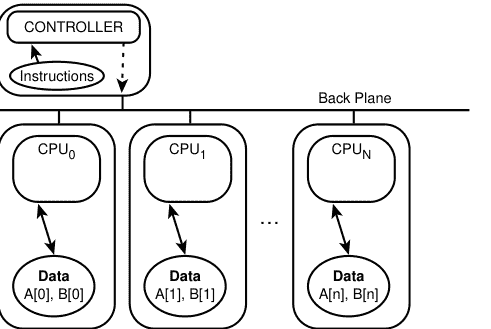

图 2.3 数组处理器——许多 CPU 与专用内存相互作用。

请注意，在许多编程语言中，列表的列表被称为数组（`array`）；因此，被称为数组处理器（array processor）。数学家将一组相关的数字称为向量（`vector`），所以你可能还会看到这种机器被称为向量处理器（vector processor）。

如果你有两组数字列表需要相加，`A[0]` 到 `B[0]`、`A[1]` 到 `B[1]` 等依此类推，你可以向每个处理器发送相同的 `ADD` 指令。列表 `A` 中的每个值都与列表 `B` 中的每个对应值相加，且均在单个指令周期内完成！如果你的应用需要对数值列表执行相同的操作，那么这种计算机正适合你。

## 流水线处理器

`Pipeline processor` 是一种高度特化的机器，仅需一个 CPU 即可利用指令层级的重叠。例如，`ADD A to B` 指令可以被视为多步骤过程：

- 1. 从内存中获取 `ADD` 指令。
- 2. 从指令获取变量 `A` 的地址，然后从内存中获取变量 `A` 的值。
- 3. 从指令获取 `B` 的地址，然后从内存中获取 `B` 的值。
- 4. 将两个值相加并将并将放入变量 `B` 的内存位置。

流水线处理器通过在从内存获取 `A` 的值的同时从指令获取变量 `B` 的地址来实现重叠。流水线计算机用指令填充其流水线，并同时开始处理所有指令以最大化重叠效应。它们通常被用作超级计算机，其中指令处理的速度是至关重要的。当你不知道故障发生时到底正在执行哪条指令时，调试将变得尤为具有挑战性！

## 注意

作者曾与早期的流水线处理器之一 `IBM 370 195` 型工作过。执行错误（称为中断）经过了编码，以便程序员可以判断发生的错误类型。错误通常会导致错误发生时的内存列表，称为转储（`dump`），它是你的准入程序的十六进制列表，连同指令以及要执行的下一条指令的地址。大部分时间都花在在转储中找到故障指令，并查看被该指令操纵的数据。然而，如果发生了不精确中断（imprecise interrupt），你可能需要查看被指示指令之前的几十条指令，因为对系统而言，它们都是等等的。

## 注意

背板（`Back plane`）的名称来源于它在机箱背后的位置。计算机板（每个板卡带有一个 CPU 和内存）通过滑轨进入机箱，并插入背部的该背板中，在那里它们可以访问电源和板与板之间的数据通信线。

## 多处理器的分类法


多计算机（Multcomputer）是由许多独立计算机构建而的多处理器，这些计算机通过网络或背板相互连接（有关背板的更多信息，请参见后面的“注意”）。从硬件角度来看，多处理器和多计算机之间存在显著差异。根据 CPU-RAM 数据耦合的情况，它们有时被分别称为紧耦合型（tightly coupled）和松耦合型（loosely coupled）多处理器。然而，从软件角度来看，它们看起来几乎一样；它们形成了一个特殊类别，具有自己的子类分类法，将在下文中进行详细描述。

在 20 世纪 60 年代后期，M. J. Flynn 创建了一种计算系统的特殊分类法，以区分许多架构设计。他从 CPU 的角度关注指令和数据访问，注意到有多少种不同的路径可用。他问：“CPU 的处理器可以同时访问多少条指令，CPU 的算术逻辑单元可以同时访问多少块数据？”答案在两种情况下均都是“一个”或“多个”，总共构成了四种不同的架构。

# 第 2 章 多处理器体系

单处理器（uniprocessor）拥有一条指令路径和一条数据路径，因此他将其命名为单指令单数据机器，或 SISD。多处理器（MP）在指令和数据方面都有多条路径；因此，它被指定为多指令多数据，或 MIMD。数组处理器拥有多条数据路径，但只有一条指令指令路径，因此它是单指令多数据机器，或 SIMD。关于多指令单数据（MISD）的命名存在争议。尝试想象这样的结构是一个很好的例子：只有一个数据路径的多指令流水线处理器？某些人将指令流水线处理器引用为 MISD。其中一台大型机 IBM 360 95 型是流水线处理器的很好的例子。

## 深入理解 MIMD

MIMD 证明是一种非常非常用且有趣的机器类型，是许多推测和实验的主题，以至于这种基本结构的两种变体都有自己的子类别：统一内存访问（UMA）——在紧耦合的 MP 系统中，每个 CPU 都通过相同的内存寄存器直接访问中央内存；每次内存访问所需的时间大致相同（见图 2.4）。

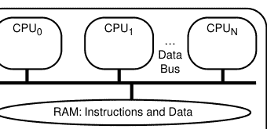

图 2.4 UMA——均匀内存访问时间（与紧耦合相同）。

- 非均匀内存访问（NUMA）——在松耦合的 MP 系统中，CPU 可以通过其内存寄存器直接访问本地内存，但无法直接访问其他 CPU 的内存（见图 2.5）。访问其自身内存的速度非常快，而通过外部网络访问另一个 CPU 的内存则慢得多。跨 CPU 的访问时间是非均匀的。

## 紧耦合与松耦合多处理器

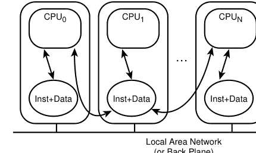

**图 2.5** NUMA——非均匀内存访问时间（松耦合）。

请注意，在某些文献中，NUMA 被进一步分为 NUMA 和 NORMA（无硬件远程内存访问）。这些文本解释，NORMA 系统需要软件干预来向该系统缓存消息，请求所需的数据。NUMA 与 NORMA 的区别在于，它通过高速背板连接各个独立系统，当内存地址位于本地系统之外时，背板硬件会将请求的数据到内存寄存器中。

## 紧耦合与松耦合多处理器

紧耦合 MP 非常高效，因为传输执行指令或处理数据的时间对于其所有 CPU 来说都是很小的；它们共享相同的内存。松耦合 MP 在设计上存在内存瓶颈：它们的 CPU 花费大量时间在缓慢的网络上相互发送消息。尽管交换千兆以太网取代了除快速背板连接之外的所有连接，但与直接内存访问相比，它仍然很慢。成功的松耦合 MP 系统会根据应用程序的需求进行软件调优。通常，在处理器间共享中央内存的 MP 系统性能优于由具有物理内存的许多独立节点计算机构建的系统。然而，中央内存 MP 系统昂贵得多，而且如果针对设计的应用程序进行精心调优，计算机网络在性能上也可以竞争。记住，当紧耦合 MP 内部的 CPU 故障时，整个系统都要寄回给制造商。当你的网络中的一台 PC 故障时，只需要修理或更换那一个。系统仍然在那里，只是少了一台 PC。这种好处可能远超过集群架构师所面临的技术挑战。

# 分布式共享内存系统

作为李在 1986 年博士工作的一部分，他设计了一个使用网络上 PC 的独特系统。他建议将运行虚拟内存的紧耦合多处理器的概念映射到工作站网络的集合物理内存空间上。

每当在本地内存中访问数据时，其速度直接取决于本地内存数据总线。当在远程 PC 的内存中访问数据时，在恢复处理之前必须交换内存数据请求和响应消息。数据地址在分布式进程的地址空间内是唯一的。任何为紧耦合 MP 系统设计并编译的进程都可以在不修改的情况下运行在简单局域网上那些相对廉价的 PC 集合上。

李 后来将这一类系统称为分布式共享内存，或 DSM。与紧耦合 MP 对应相比，DSM 的运行速度极其缓慢，但它们非常廉价，并且具有一些非常值得探索的特性。多年来，研究人员向架构和操作系统会议提交了大量的 DSM 论文，其中许多论文被汇编成一本书，并在本书末尾的“延伸阅读”部分被引用。

# 集群架构

运行在李的网络化 PC 上的软件独特之处在于它定义了架构。随后的研究利用了这一特性，带给了我们今天所说的集群系统。他们的软件赋予了这些独立 PC 性，定义了系统的个性；软件是系统的灵魂！

对 DSM 系统的大量研究导致了前面提到的数据包大小与处理时间的最大比例。它还揭示了通过容错机制实现高可用性的许多方法。考虑到在线银行、计算机股票交易和分布式数据库服务器的剧增，这无疑是一个受到欢迎的特性。在李最初的工作十年后，当所有这些计算机化正成为一个非常热门的话题时，万维网席卷了在线计算。

今天，一个流行的商业 Web 服务器必须每天 24 小时、每周 7 天处于开启运行状态，否则可能会损失大量资金。高可用服务器市场已经足够大，以至于运行在每个节点上的软件和连接它们的硬件已经变得非常复杂。（而且这种复杂性也反映在它们的成本中！）

# 第 2 章 多处理器架构

我们的目标是设计并构建一个集群系统。让我们看看在决定组装什么硬件和选择什么软件架构时的一些选择。本章的后续章节将讨论硬件决策、软件功能，并最后讨论性能以及针对我们目标系统所做的软件选择。

## 硬件选项

你需要考虑两个硬件决策：节点计算机架构和互连网络。

## 节点计算机

大型工作站价格昂贵。它们运行复杂的操作系统，拥有巨大的内存和磁盘驱动器，并且可靠性极高。使用工作站或 PC 设计集群的原理大同小。因此，本讨论重点关注典型的、基于 Intel 的 PC。

你所选择的节点计算机应该都非常相似，以便于更换、负载平衡和性能分析。用于测试书中描述软件的集群系统使用了八台节点计算机，具有近乎相同的处理器、内存大小等。

这些节点计算机应该有多强大？最快速的回答可能是“在你负担得起的范围内越强越好”。然而请考虑一下。作者的系统源于两台已经该更换的计算机。考虑到它们提供的多年良好服务，把它们扔掉似乎是不礼貌的。我保留着原始的用户手册、诊断指南和初始化软盘，更不用说在机器内部工作、升级内存和驱动器等方面获得的经验了。当旧机器进入回收市场时，我以每台 20 美元的价格买了几台，其中一台作为拆机备用件。

最近我花不到 300 美元构建了一个四节点系统。每台主板上都内置了网络接口硬件。它们的速度几乎是原始系统节点的 10 倍，由于通货膨胀，它们的回收价格略高一点。我只给其中一台连接了显示器、鼠标和键盘，因为网络允许访问其他机器，而且这些新的 PC 在没有这些的情况下也能成功启动。（某些旧机器如果没有连接键盘将无法通过开机自检。）

你可以从大型公司和教育机构获取计算机出口的详细信息。这些机构中的一些现在正在出租计算机，因此它们的旧型号会回到租赁公司。（在这种情况下，请直接联系租赁公司。）某所大型大学有一个专门向公众出售过旧系统的仓库，以及一个测试台，你可以在购买之前将其插上查看是否正常工作。不过，要注意缺失的组件；内存和硬盘在回收旧计算机之前通常会被移除。同样要注意，大多数公司出于安全考虑会清空硬盘，所以请带上一块启动盘。你可以通过电话或互联网购买最新的机器。但你可以为任何东西付钱，你可能想要检查的那些不是最新的（有时旧了六个月）的机器通常在打折，因为商店想要清理库存。最后，合适的系统通常就在你朋友、邻居的橱和车库里；这些系统也可以在交换市场、车库拍卖中大量找到。当你拿到它们时它们可能无法工作，但原始

## 互连网络

再次，你面临着广泛的选择，由于即使在现代计算机商店里也有大量复杂的网络设备，这变得更加复杂。有防火墙、路由器、交换机、集线器和速度高达每秒千比特的媒体访问卡，包括布线和支持软件。几年前让企业数据中心经理感到自豪的设备，在本书编写期间正进入家庭网络。

防火墙可以被看作是一个路由器，它让你决定什么种信息通过。交换机是极大改进的集线器，允许同时点对点的通信通路。集线器是在网络中使用简单电缆（双绞线，尽管它们并不受推崇）的设备，其行为类似于使用同轴电缆（coax）作为通信介质。同轴的起点是通过欺骗介质访问卡，使其认为在使用单一无线频率通道进行通信。

以太网的原始含义是指参考以太（ether）或大气，这是在协议发明时数据包传输的环境。大约 30 年前，夏威夷不同岛屿的几台计算机的人想要相互通信。岛屿间的电话系统不可靠，不支持拨号通信，所以这些聪明的人使用了一种


无线射频（RF）链路并设计了一种新的通信协议来支持这种新的总线拓扑结构，被称为 `ALOHA` 系统。每台计算机都将其数据作为数据包发送，这是一个字节串，其头部信息包含了发送者和接收者的地址以及数据字节数；尾部信息包含了用于验证字节是否按发送状态被接收的信息。损坏的数据包将是冲突的结果——两个或多个数据包同时传输。

这个协议如此简单而又强大，引起了计算机科学家的注意。他们思考了这种新型计算机通信技术可能开启的可能性。以下是更多历史介绍。

无线电收发器（发射器-接收器）通常通过一段长度合适的传输线连接到其天线，通常是同轴电缆，旨在匹配收发器的输出特性与天线的特性，尽可能使信号强度损耗最小。无线电设备位于无线电房，但天线安装在屋顶高处，甚至比无线电房更高的塔上。传输线让这种分离变得容易。原始实验中的每个节点都有连接到其计算机的收发器、传输线和天线系统，并有一些自定义软件来控制发送和接收数据包。

一组科学家决定取消天线，将所有收发器连接到根同轴电缆；如果计算机之间的距离不是问题，那么相同的协议也适用于局域网（`LAN`）。以太网诞生了。

同轴电缆要简单廉价得多，同样的概念的效果与使用更简单廉价的硬件连接器几乎一样，原始尺寸的网络变得更厚了。然而，它仍然是同轴电缆，在计算机出现之前，在建筑中“拉电缆”是昂昂的。（为了支持这些努力，在天花板和电梯井内已经花费了好几个小时！）大多数办公大楼内部有数英里的电话语音级布线，通常“线对”的数量多于支持内部电话网络所需的数量。（每个墙面板处都有扭在一起的电线束。一对颜色编码的线支持一台电话；因此被称为“双绞线”。）如果有人能想办法利用所有这些现有的电线就太好了！

重新设计介质访问卡以使其特性与一对电线匹配并不困难。它作为点对链路工作运行良好，但在总线网络中使用它似乎是不可能的，在总线网络中，只要遵守协议规则，每台计算机都可以与其他任何一台通信。在集中器设备（后来的网络集线器）之后，是一种支持端口固定数量连接的小设备，网络上的一个节点（见图 2.6）。尽管网络连接的物理外观看起来像星星（所有节点都从某个中心点辐射），但其行为是以太网，即一种总线拓扑，允许任何两个节点之间直接通信。集线器内部的电子监听每个端口，重传它在其他连接上听到的信号。这种行为模拟了总线网络的行为。

**图 2.6** `10BASE-T` 集线器通过普通电线将许多接口卡连接在一起。

网络及其连接器有一套命名规范。原始的英寸同轴电网络支持单根长达 500 米的同轴电缆，并以 1 Mbps、2 Mbps，最后是 10 Mbps 的数据速率运行。这些分别指定为 `1BASE-5`、`2BASE-5` 和 `10BASE-5`。第一个数字代表每秒兆比特的数据速率。Base 指基带通信，其中只使用一个载波频率。（与宽带通信形成。）最后一个数字代表以百米为单位的最大同轴长度。同轴连接器通常被称为 `UHF` 连接器，因为它们在进入 `UHF`（300MHz 及以上）频率范围之前出现明显的损耗。（技术上，这些被称为 `PL-259` 连接器：PL 代表插头，匹配 `SO-239` 插座。）细线网使用 `BNC` 连接器，易于连接或断开。两者在末端都需要一个终端器来使其看起来是无限长的。终端器是一个电阻器，用于吸收传输能量，以避免干扰反射。

双绞线来自电话线，因此公司使用的四线 `RJ-11` 电话转墙壁连接器是更大的八线 `RJ-45` 的模型。我的测试系统使用 `RJ-45` 连接器连接到 `10BASE-T` 集线器。最后的 T 指的是双绞对。`100BASE-T` 用于描述 100Mbps，而 `1000BASE-T` 指千兆比特集线器和网络。在随后的阅读中，你可能会看到光纤支持等类似的明显标记。

总而言之，最好的解决方案就是最快的解决方案——通过高速网络连接热节点处理器。这本书并不是在为任何特定问题构建一个解决方案，而是为了进入集群计算的核心。

# 第 2 章 多处理器架构

然而，六个月前的技术对于严肃的开发者来说已经足够了；爱好者会乐意使用一个连接四台或更多回收的 PC 的 `100Base-T` 集线器，其中一台电脑连接了显示器、键盘和鼠标。这就是测试系统背后的哲学，正如你所看到的，它发展了一个相当完善的系统。

## 软件选项

软件选择更为简单。你需要一个足够复杂的操作系统，以支持局域网、从一台机器到网络上任何其他机器的远程命令执行（远程 shell）访问，以及一个可靠的 C 编译器。

`Unix` 多年来一直是标准，但 `Linux` 是一个强大且免费的替代方案。在书中，我们使用 `Linux`。

（注：原文文本在此处存在大量重复内容，译文已进行逻辑去重。）

主从概念是分布式处理架构设计中的常用方法。其中一个节点被选为主节点（`master`），接收来自某些外部客户端的输入查询。每个事务都会传递给一个从节点（`slave`）进行处理，从而释放主节点以继续接收输入。基本概念如图 2.7 所示。

## 集群系统

| 查询生成器 | 接收与响应 | | | | |

|---|---|---|---|---|

| 外部客户端 | 主节点 | 从节点 | 从节点 | 从节点 |

| 查询与响应 | | | | | |

**图 2.7** 集群系统——主—从软件架构由外部客户端访问。

## 总结

本章首先检查了典型计算机的组件，然后查看了其他一些类型的由多个 CPU、多个内存或某些专用硬件构建的计算机架构。台式计算机的引入、以及局域网（`LAN`）的出现，导致了多计算机网络的设计，即一个运行自定义软件的计算机网络。你已经看到软件的本质如何定义了此类机器的属性，使其适用于事务处理、超级计算应用等。

最简单的多计算机结构是主从架构，其中网络中的一台机器根据其他机器的可用性使用它们，以利用数据处理算法中固有的并行性。这种系统的设计是本书的重点。

## 阅读

- Hennessey, John, and David Patterson. Computer Organization and Design. San Francisco, CA: Morgan Kaufmann, 1998.
- Patterson, David, and John Hennessey. Computer Architecture: A Quantitative Approach. San Francisco, CA: Morgan Kaufmann, 1996.
- Protic, Jelica, Milo Tomasevic, and Veljk Milutinovic. Distributed Shared Memory: Concepts and Systems. Los Alamitos, CA: IEEE Computer Society Press, 1998.
- Tanenbaum, Andrew. Computer Networks. Englewood Cliffs, NJ: Prentice Hall PTR, 1996.

# 第 3 章 进程间通信

## 进程间通信

- 使用 `fork` 和 `exec` 分任务
- 发送信号和处理接收到的信号
- 使用共享内存区域
- 使用信号量配合共享数据
- 消息传递：`UDP` 对 `TCP`
- 互联网协议地址
- 跨网络消息传递
- 自动启动远程服务器
- 延伸阅读

即使是经验丰富的软件开发者——对 `Unix` 内部原理拥有专家知识的资深 C 程序员——可能也不会觉得使用本章介绍的一些较为深奥的技术完全自在。本章回顾了在开发我们的集群软件时使用的 C-Unix 接口技能。如果你对这些材料有信心，请随时跳过以下一个或所有章节。这些示例是为了你的方便而提供的，包含了一套完整的可以编译和运行的 C 程序。源代码可以在此网页 `www.sanspub-linux.com` 上找到。我们希望这有助于你修改并返回代码，以满足你对未提及细节的好奇心！

注意，这些示例中有意省略了许多系统调用错误返回的检测和处理，以保持程序列表简洁且更具可读性。这些示例程序都在 `Red Hat 4.2` 版本的 `Linux 2.0.30` 内核下经过测试。

## 使用 fork 和 exec 的子任务

`C-Unix` 系统接口中的分任务要求你通过系统调用来创建原始（父进程）进程的相同副本。当它返回时，你的子任务（子进程）在它自己的地址空间中运行，拥有自己的进程 ID（`PID`）。现在存在两个相同的进程，它们都经历了该系统调用的返回；它们必须自己发现谁应该扮演父进程或子进程的角色，而返回码是区分它们的唯一方法。父进程接收其子任务的进程 ID，而子进程接收零。以下程序（见列表 3.1）演示了这种技术：

### 列表 3.1 使用 fork 的单模块分任务


```c
#include <stdio.h>
#include <unistd.h>

main(void) {
/*
 ** Listing3.1.c - 使用 fork() 的单模块分任务
 */
    int pid;      /* 子任务的进程 id */

    /* 父任务向屏幕发送进程消息 */
    printf("\nParent task active as process %d.\n", getpid());

    /* fork() 创建父任务的相同副本 */
    if((pid = fork(0)) == 0) {
        /* 此块仅由子任务执行 */

        /* 子任务向屏幕发送进程 ID 消息 */
        printf("Child task active as process %d.\n", getpid());

        /* 子任务正常退出 */
        exit(0);
    }

    /* 父任务等待子任务退出 */
    waitpid(pid);
    return;
}
```

通常情况下只写一个程序。子进程（子任务）的源代码保持简单，发出一个指定单独可执行文件磁盘位置的系统调用。另一个可执行文件包含了旨在用于子任务的复杂性。它开始执行，完全替换内存中原始子任务的映像并继承其进程 ID。注意列表 3.2a 和 3.2b 中的这些项。

## 注意

`exec` 函数需要可执行文件的完整路径。将此字符串替换为描述你测试环境的字符串。

### 列表 3.2A 父进程：使用 fork 和 execl 分任务

```c
#include <stdio.h>
#include <unistd.h>

main(void) {
/*
 ** Listing3.2a.c - 父进程：使用 fork() 的分任务
 */
{
    int pid;      /* 子任务的进程 id */

    /* 父任务向屏幕发送进程消息 */
    printf("\nParent task active as process %d.\n", getpid());

    /* fork() 创建父任务的相同副本 */
    if((pid = fork(0)) == 0) {
        /* 此块仅由子任务执行 */

        /* 子任务向屏幕发送进程 ID 消息 */
        printf("Child task active as process %d.\n", getpid());

        /* 子任务正常退出 */
        exit(0);
    }

    /* 父任务等待子任务退出 */
    waitpid(pid);
    return;
}
```

### 列表 3.2B 子进程：使用 fork 和 execl 分任务

```c
#include <stdio.h>
#include <unistd.h>

main(void) {
/*
 ** Listing3.2b.c - 子进程：使用 fork() 的分任务
 */
{
    int pid;      /* 子任务的进程 id */

    /* 父任务向屏幕发送进程消息 */
    printf("\nParent task active as process %d.\n", getpid());

    /* fork() 创建父任务的相同副本 */
    if((pid = fork(0)) == 0) {
        /* 此块仅由子任务执行 */

        /* 子任务向屏幕发送进程 ID 消息 */
        printf("Child task active as process %d.\n", getpid());

        /* 子任务正常退出 */
        execl("/home/user/bin/3.2b", "3.2b", NULL);
    }

    /* 父任务等待子任务退出 */
    waitpid(pid);
    return;
}
```

这两个系统调用是 `fork` 和 `execl`。注意 `execl` 实际上是一系列相似函数中的一个。本书关注的是 `execl` 变体，它类似于启动进程的命令行。调用 `fork` 会创建一个相同的进程，即父进程的副本。调用 `execl` 会导致调用进程被指定的可执行文件完全覆盖。

### 发送信号和处理接收到的信号

父进程和子进程设计上通常需要相互通信，它们有许多方法可以实现这一点。当一个活动进程与另一个进程通信时，被称为进程间通信，简称 `IPC`。`IPC` 是本章大部分内容的主题。

一个进程可以通过多种方式与另一个进程通信。你将在本章稍后的部分详细学习其中某些方法。某些事件发生得非常频繁，以至于它们被压缩为一组数字编号的消息，即信号（`signals`）。信号可以被描述为常见事件之一发生的指示。信号可能来自普通进程、操作系统、命令行（通过 `kill` 命令），或者在我们的示例中，直接从键盘作为特殊的组合键（有时称为*和弦*，*chord*）发送。使用 `kill -1` Unix 命令（带有列表选项的进程杀进程命令）可以显示所有 32 个信号的完整列表。

一个容易描述的信号是 `SIGINT`（中断信号，事件 2），它可能由交互式用户直接从键盘发送。当你运行列表 3.3 中的程序时，屏幕上会打印一条消息，提示你输入 `^C` 就绪。按住 Ctrl 键的同时输入字母 C 以产生 `^`。观察你这样做时会发生什么。在发生三次此类事件后，程序将终止。

### 列表 3.3 处理从键盘输入 Ctrl+C 产生的信号

```c
#include <sys/signal.h>
#include <stdio.h>
#include <unistd.h>

int count = 0; /* 处理的 ^C 事件数量计数器 */

main(void) {
/*
** 列表 3.3.c - 处理从键盘输入 ^C 触发的信号
 */
  void control_C();

  /* 初始化 ^C 处理器 */
  signal(SIGINT, control_C);

  while(count < 3) {
```

### 列表 3.3 续

```c
void control_C() {
  /* 重新建立处理器 */
  signal(SIGINT, control_C);

  /* 计数 ^C 数量 */
  count++;
}
```

在程序运行时，你可以通过 `kill` 命令和 `SIGINT` 的事件代码发送信号：

```
kill -2 3721
```

其中 `2` 是 `SIGINT` 事件代码，`3721` 在此处代替实际的进程 ID。你需要使用另一个会话窗口（根据 Linux 文档）或从其他网络机器远程登录到此。你也可以使用 `kill` 系统调用从另一个进程发送信号：

```c
kill(2, 3721);
```

在其中 `3721` 再次假设为 PID。

头文件包含 `SIGINT` (2)、`SIGUSR1` (10)、`SIGUSR2` (12) 等定义，你可以使用这些更容易记忆的定义来代替数字代码值。编号为 10 (`SIGUSR1`) 和 12 (`SIGUSR2`) 的编码事件是通用的，永远不会从操作系统发送。当你定义定义信号的应用特定含义时，请使用其中一个或两者。

## 使用共享内存区域

记住，由 `fork` 创建的子任务在它自己的地址空间中运行，该地址空间是父进程的精确副本。每个变量在子进程中的值都被设置为父进程调用 `fork` 时它们的值。这意味着，当父进程更改这些值时，子进程地址空间中的值不会改变，反之亦然。

这是一个重要概念：如果子进程更改了变量的值，父进程无法看到，因为它们现在是两个不同的值，位于两个不同地址空间的两个不同变量中。当子进程执行时，它只看到自己的地址空间。其中的更改对另一个进程的状态完全没有影响；它们之间没有任何关系。

如果子进程需要通过更改变量的值与父进程通信，例如，它该怎么做？共享内存是答案之一。操作系统提供了一系列系统允许一个任务分配共享内存。父进程只需要标识它并设置适当权限允许子进程附加它，将其映射到自己的地址空间中。共享内存区域可以被任何具有权限的进程附加和修改，因此请仔细设置你新内存区域的权限。共享内存不仅用于子任务，运行在同一台计算机上的任何其他进程都可以访问。让我们看列表 3.4 作为示例。

### 列表 3.4 父进程共享内存中的子数据


```c
#include <sys/ipc.h>
#include <sys/shm.h>
#include <stdio.h>
#include <unistd.h>

void(void)
/*
列表 3.4.c - 子进程更改父进程共享内存中的数据
*/
{
    struct area { /* 共享内存区域 */
    int value; /* (一个简单的示例) */ /
} area, *ap;

    int flag = (IPC_CREAT | IPC_EXCL | 0660);
    int size = sizeof(struct area);
    key_t key = 0x01020304; /* 示例 */
    int shmid; /* 共享内存区域 id */
    int pid; /* 子任务进程 id */

/* 获取共享内存区域 * */
shmid = shmget(key, size, flag);

/* 附加共享内存区域 * */
```

### 列表 3.4 续

```c
ap = (struct area *) shmat(shmid, 0, 0);

/* 初始化值 */
ap->value = 0;
printf("父进程：值为 %d\n", ap->value);

if((pid = fork()) == 0) { /* 子进程 */
    /* 更改共享内存 */
    ap->value = 100;
    printf("子进程：值为 %d\n", ap->value);
    sleep(2);
    exit(0);
} else { /* 父进程 */
    while(1) {
        printf("父进程值为 %d\n", ap->value);
        fflush(stdout);
        if(ap->value != 0) {
            break;
        }
        printf("继续中...\n");
        sleep(1);
    }
    printf("拜!\n");
}

/* 移除共享内存 */
shmdt(ap);

/* 再次修改 */
ap->value = 200;
printf("父进程值为 %d\n", ap->value);

/* 父进程等待子任务退出 */
waitpid(pid, NULL);

/* 释放共享内存区域 */
shmctl(shmid, IPC_RMID, (struct shmid_ds *) 0);

return;
```

## 在共享数据中使用信号

注意

注意添加 `sleep` 调用只是为了减慢速度。如果没有这些 `sleep` 调用，一切发生得太快，以至于事件的顺序可能并不明显。尝试在不带 `sleep` 的情况下运行它。实验得越多，学得越多，记得越深。

## 在共享数据中使用信号量

列表 3.4 中的共享数据示例并没有说明与共享变量相关的风险。考虑一个类似的示例，父账户创建了两个子任务：一个负责存款，另一个负责取款，每个在处理时都计算新余额。你能看到风险吗？

如果两个交易同时到达——一个存款，一个取款——存在一种很小的可能性，其中一个失效。假设取款进程从共享内存获取余额，减去取款金额并被存款进程中断。存款进程从共享内存获取余额（取款进程仍持有的），增加存款，将余额放回共享内存，并等待。取款进程继续处理，将其重新计算的余额放入共享内存，覆盖了存款进程设置的值。交易丢失了，因为存款进程的所有操作都被该中断抵消了。

这里感兴趣的研究概念是关键区：你如何确保进程在从共享内存获取余额开始处理后，在放入重新计算的余额时不会取消另一个交易？通过使用信号量保护共享数据的完整性。

什么是信号量？首先，考虑它不是什么：信号量并不阻止另一个进程修改共享数据，就像红灯并不阻止你进入路口一样。我们在绿灯通过，黄灯减速，红灯停止。信号量也是如此。

每个信号量与共享资源相关，不是直接相关，而是通过源码注释和其他文档间接相关。信号量要么已设置要么未设置，这就是操作系统关心的全部。如果你尝试设置一个信号量，操作系统将设置它。如果你尝试设置一个已设置的信号量，操作系统将导致你的进程等待，直到最后一个进程将其清除。

为了避免银行交易示例中的任何困难，两个进程（存款和取款）必须在从共享内存获取余额之前设置信号量，并在重新计算的余额放回后清除它（见列表 3.5）。

这有时被称为对资源序列化（serializing on a resource），意味着对资源执行的任何操作必须一次一次、按顺序进行。（你可以在本章末尾“扩展阅读”部分包含的文本中找到更多相关信息。）

# 列表 3.5 存款与取取的同步处理

```c
#include <sys/types.h>
#include <sys/ipc.h>
#include <sys/shm.h>
#include <sys/sem.h>
#include <stdio.h>
#include <unistd.h>

main(void)
/*
** Listing3.5.c - 存款与取取的同步处理
*/
    struct area {   /* 共享区域 */
        int balance;
        int deposit;
        int withdrawal;
    } area, *ap;
#if defined(__GNU_LIBRARY__) && !defined(__SEM_MUN_UNDEFINED)
/* union semun 通常通过包含 <sys/sem.h> 定义 */
#else
    /* 否则我们必须根据 <bits/sem.h> 自己定义它 */
union union
{
    int val;
    /* SETVAL 的值 */
    struct semid_ds *buf;    /* 用于 IPC_STAT, IPC_SET 的缓冲区 */
    unsigned short int *array; /* 用于 GETALL, SETALL 的数组 */
    struct seminfo *__buf;   /* 用于 IPC_INFO 的缓冲区 */
};
#endif
union semun; /* 信号量联合和缓冲区 */
struct sembuf buf;

    int flag = (IPC_CREATE | IPC_EXCL | 0660);
    int size = sizeof(struct area);
    key_t skey = 0x04030201; /* 示例键 */
    key_t mkey = 0x01020304;
```

### 列表 3.5 继续

```c
int semid; /* 信号量 id */
int shmid; /* 共享内存 id */
int pid0; /* 存款子任务 pid */
int pid; /* 取款子任务 pid */
int amount;
char inbuf[80];
```

```c
/* 获取共享内存区域 */
shmid = shmget(key, size, flag);

/* 挂载共享内存区域 */
ap = (struct area *) shmat(shmid, 0, 0);

/* 在共享内存中初始化账户信息 */
ap->balance = 1000; /* 初始化余额为 $1000 */
ap->withdrawal = 0;
ap->deposit = 0;
```

```c
/* 获取并初始化信号量 */
semid = semget(key, 1, flag);
/* 设置信号量可用 */
un.val = 1;
semctl(semid, 0, SETVAL, un);
/* 第一个唯一的信号量 */
nbuf.sem_num = 0;
/* 如果设置则等待 */
nbuf.sem_flg = 0;
```

```c
if((pidD == fork()) == 0) /* 存款 */
{
/* 挂载父进程的共享内存 */
ap = (struct area *) shmat(shmid, 0, 0);
/* 注意：shmid 仍然正确设置 */
```

```c
/* 处理存款 */
while(1)
{
sleep(1);

/* 设置信号量_op */
nbuf.sem_op = -1;
semop(semid, (struct sembuf *)&nbuf, 1);
```

# 第 3 章 进程间通信

### 列表 3.5 继续

```c
if(ap->deposit < 0)
    break; /* 退出请求 */
```

```c
if(ap->deposit > 0)
{
    /* 处理存款 */
    ap->balance += ap->deposit;
    ap->deposit = 0; /* 清空 */
}
```

```c
/* 清空信号量 */
buf.sem_op = 1;
semop(semid, (struct sembuf *) &buf);
```


```c
/* 子任务正常退出 */
exit(0);
```

```c
if((pidD = fork()) == 0)    /* 取款 */
{
    /* 挂载父进程的共享内存 */
ap = (struct area *) shmat(shmid, 0, 0);
    /* 注意：shmid 仍然正确设置 */
```

```c
/* 处理取款 */
while(1)
{
    sleep(1);
```

```c
    /* 设置信号量 */
buf.sem_op = -1;
semop(semid, (struct sembuf *) &buf);
```

```c
if(ap->withdrawal < 0)
    break; /* 退出信号 */
```

```c
if(ap->withdrawal > 0)
{
    /* 处理取款 */
    ap->balance -= ap->withdrawal;
    ap->withdrawal = 0; /* 清空 */
}
```

### 列表 3.5 继续

```c
/* 清空信号量 */
buf.sem_op = 1;
semop(semid, (struct sembuf *) &buf, 1);
}
```

```c
/* 子任务正常退出 */
exit(0);
}
```

```c
/* 父进程：处理存款和取款交易 */
printf("\n\n欢迎来到第一个交互式银行\n\n");
while(1) {
    printf("\nEnter D 存款，输入 W 取款：% ");
    fflush(stdout);
    fgets(inbuf, sizeof(inbuf), stdin);
    if(inbuf[0] == 'D' || inbuf[0] == 'd') {
        printf("\nCurrent账户余额为 $%d\n", ap->balance);
        printf("\n输入存款金额（0 退出）：% ");
        fflush(stdout);
        fgets(inbuf, sizeof(inbuf), stdin);
    }
```

```c
/* 设置信号量 */
buf.sem_op = -1;
semop(semid, (struct sembuf *) &buf, 1);

amount = atoi(inbuf);
if(amount <= 0) /* 请求退出 */ {
    /* 向子任务信号 */
ap->deposit = -1;
ap->withdrawal = -1;
    break; /* 退出无限循环 */
}
ap->deposit = amount; /* 执行存款 */
```

```c
/* 清空信号量 */
buf.sem_op = 1;
semop(semid, (struct sembuf *) &buf, 1);
} else if(inbuf[0] == 'W' || inbuf[0] == 'w') {
```

```c
printf("\t当前账户余额为 $%d\n", ap->balance);
printf("\nEnter取款金额（0 退出）： ");
fflush(stdout);
fgets(inbuf,sizeof(inbuf), stdin);

/* 设置信号量 */
buf.sem_op = -1;
semop(semid, (struct sembuf *) &buf, 1);

amount = atoi(inbuf);
if(amount <= 0) /* 请求退出 */
{
    /* 向子任务信号 */
    ap->deposit = -1;
    ap->withdrawal = -1;
    break; /* 退出无限循环 */
}
else if(amount <= ap->balance)
{
    ap->withdrawal = amount; /* 执行取款 */
}
else
{
    printf("余额不足！n");
}

/* 清空信号量 */
buf.sem_op = 1;
semop(semid, (struct sembuf *) &buf, 1);
}else
{
    printf("无效交易代码 '%c\n", inbuf[0]);
}

/* 等待子进程结束 */
waitpid(pidD);
waitpid(pidW);

printf("\n您的最终余额为 %d\n!\n", ap->balance);
```

```c
/* 移除共享内存、信号量并退出 */
shmctl(shmid, IPC_RMID, (struct shmid_ds *) 0);
shmctl(semid, 0, IPC_RMID);
}
```

## 消息传递：UDP VS TCP

信号用于从一个进程向另一个进程发送基本信息，假设你已经拥有或知道如何获取目标进程 ID。如果你想要发送的信息更复杂，例如数据库查询怎么办？发送信息的通用方法称为进程间通信（IPC），或者直接称为消息传递。存在两种流行的消息协议，它们模仿了人类交流的方式。它们被称为数据报协议（UDP）和传输控制协议（TCP）。它们统称为套接字编程；你可以在本章末尾的“扩展阅读”部分找到更多相关信息。

所有协议都需要一个[此处提供的 OCR 文本极其混乱且不完整]。

## 列表 3.6 延续

```c

int pid;      /* 子任务的进程 id */

int fd;       /* socket 文件描述符 */

char buffer[80];

/* 建立并初始化 UDP socket 结构 */

fd = socket(AF_UNIX;

if(strncmp(buffer, "EXIT", 4) == 0)   /* 退出请求 */

{

    close(fd);

    break;

}

/* 等待子退出 */

waitpid(pid);

return;

```

## 列表 3.7 与派生子任务的 TCP 通信

```c

#include <netinet/in.h>

#include <sys/socket.h>

#include <sys/types.h>

#include <sys/un.h>

#include <netdb.h>

#include <stdio.h>

#include <string.h>

#include <unistd.h>

char path[] = "/tmp/socket/3.3.7";   /* socket 名称 */

main(void)

/*

** Listing3.7.c 与派生子任务的 TCP 通信

*/

{

    struct sockaddr_un sock;

    int len=sizeof(sock);

    int pid;   /* 子任务的进程 id */

    int soc;   /* socket 文件描述符 */

    char buffer[80];

    /* 建立并初始化 TCP socket 结构 */

    if((soc = socket(AF_UNIX, SOCK_STREAM, 0)) < 0)

    {

        perror("Listing3.7: socket()");

        exit(-1);

    }

    memset((char *) &sock, 0, sizeof(sock));

    strncpy(sock.sun_path, path);

    sock.sun_family = AF_UNIX;

    /* 创建子任务 */

    if((pid = fork()) == 0)

    {

        /* 发布我们监听的 socket 名称 */

        bind(soc, (struct sockaddr *)&sock, len);

        /* 接受连接 */

        if(listen(soc, 5) < 0)

        {

            perror("Child: listen()");

            exit(-1);

        }

        if((soc = accept(soc, (struct sockaddr *)&sock, &len)) < 0)

        {

            perror("child: accept()");

            exit(-1);

        }

        /* 将从父进程接收的消息回显给用户 */

        while(1)

        {

            if(recv(soc, buffer, sizeof(buffer)) < 0)

            {

                perror("child: recv()");
```


```c
                break;

            }

            printf("Child: %s", buffer);

            if(strncmp(buffer, "EXIT", 4) == 0) /* 退出请求 */

            {

                unlink(path);

                puts("Bye!");

                close(soc);

                break;

            }
        }
        /* 子退出 */
        exit(0);
    }
    /* 连接到由子任务创建的服务器 socket */
    sleep(2); /* 等待设置 */
    if(connect(soc, (struct sockaddr *)&sock, sizeof(sock)) < 0)
    {
        perror("parent: connect(");
        exit(-1);
    }
    /* 将交互式用户输入的消息发送到子任务 */
    while(1)
    {
        sleep(1); /* 响应时间 */
        printf("enter a message: ");
        fflush(stdout);
        fgets(buffer, sizeof(buffer), stdin);
        if(send(soc, buffer, strlen(buffer)+1, 0) < 0)
        {
            perror("parent: send(");
            exit(-1);
        }
        if(strncmp(buffer, "EXIT", 4) == 0) /* 退出请求 */
        {
            close(soc);
            break;
        }
    }
    /* 等待子退出 */
    waitpid(pid);
    return;
}
```

这两个列表都通过键盘和屏幕与用户交互；它们都使用 `fork` 创建子任务，并且每个父进程都与其子任务进行通信。一个程序使用 `UDP`（列表 3.6），另一个使用 `TCP`（列表 3.7）。`TCP` 版本确保了子进程能够接收，但在应用程序代码层面，这种区别并不明显。`TCP` 为你做了大量工作，以保持通信链路可用，并确保父进程发送给子进程的消息按发送顺序原样到达。

尽管这些代码很简单，但它们可以作为你未来应用程序的模式。在提示处输入消息 `EXIT` 即可干净地退出这些程序。

## 网际协议地址

到目前为止，你关注的是所有运行在同一台计算机上的子任务和其他进程。然而，如果你要管理集群，就需要与网络上其他机器的进程进行通信。

网际协议或 `IP` 地址是一个 32 位数，用于唯一定义网络上的每台机器。这种地址方案被用于本章的主题进程间通信。

### 注意

在设计 `IP` 地址时，它提供的四十亿多个地址似乎是一个永远无法接近、更说超越的数量。`IP6` 的开发是为了解决这一局限性。

`IP` 地址通常以点点十进制法表示（例如 `192.168.1.1`）。每个字节代表一个 0 到 255 之间的 8 位值。

# 列表 3.8B 续

```c
perror("server: bind(*)");
close(fd);
exit(-1);
}
/* 将从客户端接收的消息回显给用户 */
while(1) {
    recvfrom(fd, buffer, sizeof(buffer), 0,
        (struct sockaddr *) &sock, &len);
    printf("Server: %s", buffer);
    if(strncmp(buffer, "EXIT", 4) == 0) /** 退出请求 */
    {
        puts("Bye!");
        close(fd);
        break;
    }
}
return(0);
```

首先启动服务器（参见列表 3.8b），然后在在另一台机器上启动客户端（参见列表 3.8a）。为了告诉客户端服务器运行的位置，请在启动客户端时在命令行中包含服务器的 `IP` 地址。

在 `IP` 为 `10.0.0.2` 的服务器上：

- `server` [注意 > 符号表示命令行提示符。]

在 `IP` 为 `10.0.0.1` 的客户端上：

- `client 10.0.0.2`

以你处理列表 3.6 或列表 3.7 时相同的方式与客户端交互。在服务器机器上查看来自服务器的响应。以下是你可能会看到的内容。如所示，在服务器或客户端列上执行第 1 到 5 步：

```
10.0.0.2
10.0.0.1
```

- 1) > server
- 2) > client 10.0.0.2
- 3) 输入消息: Hello there, server!
- 4) Server: Hello there, server!
- 5) 输入消息: （以此此类推。输入 "EXIT" 结束会话）

列表 3.8a 和 3.8b 中的程序是独立的客户端和服务器程序。它们使用 `UDP` 进行通信，就像列表 3.6 中的结合形式一样，但它们跨网络从一台机器通信到另一台。（同样，列表 3.9a 和 3.9b 是使用 `TCP` 的列表 3.7 网络对应版本）。检查这两组程序之间的差异，以及在自己的机器之外通信时需求的整体差异。如既往，我们鼓励你进行实验。对于“如果我这样做会怎么样？”最快的回答通常是：“试试看！”

### 列表 3.9A 向远程服务器发送 TCP 数据包

```c
#include <netinet/in.h>
#include <sys/socket.h>
#include <sys/types.h>
#include <string.h>
#include <netdb.h>
#include <stdio.h>
#define PORT 4321
```

```c
main(argc, argv)
char *argv[];
int argc;
/*
** Listing3.9a.c - 向远程服务器发送 TCP 数据包
 */
{
  struct sockaddr_in sock;
  struct hostent *hp;
  int port = PORT;
  int fd;
  char buffer[80];
/* 服务器 */
if(argc < 2)
{
    printf("\n\t用法: %s <IP_Addr>\n\n", argv[0]);
    exit(-1);
}
```

```c
/* 获取远程服务器的关键信息 */
strncpy(buffer, argv[1], sizeof(buffer));
if((hp == gethostbyname(buffer)) == NULL)
{
    perror("client: gethostbyname()");
    exit(-1);
}
```

```c
/* 初始化 TCP 流套接字结构 */
if((fd = socket(AF_INET, SOCK_STREAM, 0)) < 0)
{
    perror("client: socket()");
    exit(-1);
}
```

```c
memset((char *) &sock, 0, sizeof(sock));
memcpy(&sock.sin_addr, hp->h_addr, hp->h_length);
sock.sin_family = hp->h_addrtype;
sock.sin_port = htons(port);
```

```c
/* 连接到远程服务器 */
if(connect(fd, (struct sockaddr *) &sock, sizeof(sock)) < 0)
{
    perror("client: connect()");
    exit(-1);
}
```

```c
/* 将交互式用户输入的消息发送到子子任务 */
while(1)
{
    printf("\n输入消息: ");
    fflush(stdout);
    fgets(buffer, sizeof(buffer), stdin);
    if(send(fd, buffer, strlen(buffer)+1, 0) < 0)
    {
        perror("parent: send()");
        exit(-1);
    }
```


```c
if (strncmp(buffer, "EXIT", 4) == 0)    /* 退出请求 */
{
    close(fd);
    break;
}
}
close(fd);
return(0);
```
### 列表 3.9B 从远程客户端打印 TCP 数据包

```c
#include <netinet/in.h>
#include <sys/socket.h>
#include <netdb.h>
#include <stdio.h>
#define PORT 4321
```

```c
main(void)
/*
** Listing3.9b.c - 从远程客户端打印 TCP 数据包
 */
{
    struct sockaddr_in sock;
    int len=sizeof(sock);
    struct hostent *hp;
    int port = PORT;
    int acc, soc;
    char buffer[80];
    /* 创建服务器套接字以接受连接 */
    if((acc = socket(AF_INET, SOCK_STREAM, 0)) < 0)
    {
        perror("server: socket()");
        exit(-1);
    }
```

### 列表 3.9B 续

```c
memset((char *)sock, 0, sizeof(sock));
sock.sin_addr.s_addr = htonl(INADDR_ANY);
sock.sin_port = htons(port);
sock.sin_family = AF_INET;
if(bind(acc, (struct sockaddr *) &sock, sizeof(sock)) < 0)
{
    perror("server: bind()");
    exit(-1);
}
/* 监听 */
if(listen(acc, 5) < 0)
{
    perror("server: listen()");
    exit(-1);
}
/* 接受连接 */
if((soc = accept(acc, (struct sockaddr *) &sock, &len)) < 0)
{
    perror("server: accept()");
    exit(-1);
}
/* 将从客户端接收的消息回显给用户 */
while(1) {
    recvfrom(fd, buffer, sizeof(buffer), 0,
        (struct sockaddr *) &sock, &len);
    printf("Server: %s", buffer);
    if(strncmp(buffer, "EXIT", 4) == 0) /* 退出请求 */
    {
        puts("Bye!");
        close(fd);
        break;
    }
}
close(fd);
return(0);
```

### 列表 3.9C 继续

```c
log = fopen("/tmp/log", "w");
/* echo messages received from client into log file */
while(1) {
    read(0, buffer, sizeof(buffer));
    printf(log, "Service: %s", buffer);
    if(strncmp(buffer, "EXIT", 4) == 0) { /* exit request */
        puts("Bye!");
        break;
    }
}
close(log);
return(0);
}
```

当然，便利也是有代价的：你必须更改两个 inet 配置文件。这些文件归 `root` 所有，因此你必须拥有 `root` 身份才能修改它们。

请将以下行添加到 `/etc/services` 文件的末尾，按端口号的顺序排列：

| tcpsvc | 4321/tcp | # Linux 集群架构 TCP 服务示例 |
| udpsvc | 5678/tcp | # Linux 集群架构 UDP 服务示例 |

当你检查 `/etc/services` 文件的内容时，可能会发现较低的端口号与常用的远程服务相关联。如果没有约定的端口号，Telnet 和 FTP 服务将无法供公众使用。这些被称为“周知端口”。一些较高的数字（例如用于商业服务器软件包、Web 服务器和数据库服务器）会发布它们的端口号以保留供自己使用。通常情况下，使用 4096 以上的空闲端口号是安全的。

同样，请将以下部分添加到 `/etc/inetd.conf` 文件中：

```text
#
## Linux 集群架构 TCP 和 UDP 服务示例
#
tcspsvc stream tcp nowait nobody
/home/user/bin/Listing.3.9c Listing.3.9c
```

## 自动启动远程服务器

`udpsvc stream udp nowait nobody`
➜`home/user/bin/Listing3.8c Listing3.8c`

# 现在输入

> `killall -HUP inetd`

以 `root` 身份运行，并执行与你在测试列表 3.8a、3.8b 以及列表 3.9a 和 3.9b 中的程序时使用的相同的客户端命令。

然而，你不会在远程服务器的屏幕上看到消息回显，因为标准输出流被 `inetd` 重置，以表示返回客户端的通信路径。你发送的消息保存在 `/tmp/log` 日志文件中，可以列出该文件以确保一切符合预期。

- > `cat /tmp/log`

`cat` 命令是 `concatenate`（在本例中指到输出流）的缩写，用于在屏幕上列出文件内容。

> 提示
如果你没有 `/etc/inetd.conf` 文件，你的 Linux 版本可能在使用 `xinetd` 而不是传统的 `inetd`。在这种情况下，请编辑每个文件中输入的两行，并以 `root` 身份在 `/etc/rc.d/init.d/` 下创建两个小文件，分别命名为服务 `Listing3.8c` 和 `Listing3.9c`。例如，在 `/etc/rc.d/init.d/Listing3.9c` 文件中：

```text
service Listing3.9c
{
    port        = 4321
    socket_type = stream
    protocol    = tcp
    wait        = no
    user        = nobody
    server      = /home/user/bin/Listing3.9c
    only_from   = 10.0.0.0
    disable     = no
}
```


为 UDP 服务器创建一个文件。你可以从 inetd 手帮助页获取更多关于 inetd 服务文件条目的详细信息。在命令行输入 `man inetd.conf`。当两个文件都创建完成后，以 root 身份输入

- `/etc/rc.d/init.d/inetd restart`

并再次像以前一样对这对客户端-服务器对进行实验。

## 总结

你从一个使用 `fork` 的简单子任务示例开始。通过将此程序拆分为父部分和子部分并分别编译，你看到了父进程如何使用 `execcl` 从一个单独的可执行文件创建一个子任务。你学习了信号的用法、捕获和处理，如何在父子进程之间创建和管理共享内存区域，以及如何使用信号量防止数据损坏。最后，你学习了使用两种类型的 socket 进行进程间通信。

从单台机器移动到网络上一对处理器，父子概念被扩展到了更常见的客户端/服务器范式。你再次使用两种类型的 socket 在两台独立的机器上设置了客户端和服务器进程，然后配置系统，当客户端请求服务时在远程机器上自动启动服务器进程。

进程间通信是一个复杂的课题。如果你编译这些演示程序并对它们进行实验，它们将引导你进入许多客户端与单服务器系统通信的通用情况。这是数据库服务器和 Web 服务器所用机制的基础。它是网络编程的基础。

## 延伸阅读

- *Brown, Chris.* 《Unix Distributed Programming》。Hertfordshire, England: Prentice Hall International (UK), 1994.
- *Hawkins, Scott.* 《Linux Desk Reference》。Engwood Cliffs, NJ: Prentice-Hall PTR, 2000.
- *Stevens, W. Richard.* 《Advanced Programming in the UNIX Environment》。Reading, MA: Addison-Wesley, 1992.

# 为你的集群组装硬件

## 本章内容

- 节点处理器与配件
- 网络介质与接口
- 操作系统实现
- 集群拓扑
- 延伸阅读

从单台机器移动到网络上一对处理器，父子概念被扩展到了更常见的客户端/服务器范式。你再次使用两种类型的 socket 在两台独立的机器上设置了客户端和服务器进程，然后配置系统，当客户端请求服务时在远程机器上自动启动服务器进程。

进程间通信是一个复杂的课题。如果你编译这些演示程序并对它们进行实验，它们将引导你进入许多客户端与单服务器系统通信的通用情况。这是数据库服务器和 Web 服务器所用机制的基础。它是网络编程的基础。

## 节点处理器与配件

对于这个集群，你只需要一个显示器、键盘和鼠标，因为 Linux 允许你从主计算机登录远程系统。在检查和加载操作系统时，将它们直接连接到每台机器，但在它们在网络上运行之后，它们将连接到网络文件系统 (NFS) 服务器。你将在下一章学习更多关于 NFS 的知识。

别忘了检查键盘、鼠标和显示器电缆的末端，仔细检查那些细小、脆弱的引脚。确保显示器既有电源线又有视频接口线。除非电视维修是你的专长，否则不要拆除显示器的外壳。视频屏幕（阴极射线管或 CRT）与电视屏幕非常，需要极高的工作电压，即使在拔掉很长时间后，电压也会保持高位。

## 网络硬件

同样记住，这些机器将接入网络，因此请在 PC 系统板背面上寻找 RJ45 接口（如图 4.1 所示），或者如图 4.2 所示的其中一个扩展卡上。在购买集线器之前，先确认网络接口支持的速度。在本文写作时，许多回收的系统速度为 10Mbps，而支持 100Mbps 的计算机才开始出现。集线器的速度必须与每个网络接口的速度兼容。例如 10BASE-T 和 100BASE-T，但如果网络上有一个 10BASE-T 接口，所有设备都将以 10Mbps 运行。如果集线器是 10Mbps 且你所有的机器都是 10Mbps，那么什么也无法工作，所以购买时要小心。你始终可以为计算机添加 100Mbps 网卡并忽略其 10Mbps 系统板接口，但这会增加集群的整体成本。

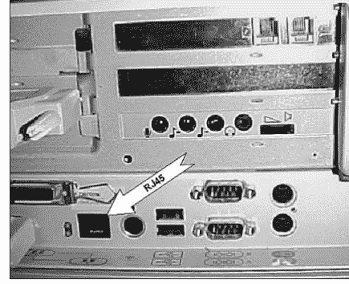

图 4.1 计算机系统板上的网络接口 RJ45 连接器。

注意

大多数计算机制造商在其网站上都提供了停产型号的规格信息，通常位于“支持”部分。请本章末的“进一步阅读”部分获取几个参考网站。

## 网络介质与互连

Beowulf 项目（www.beowulf.org）的结果强调，如果将 PC 网络用作超级计算应用中更昂贵的多处理器的竞争性替代品，就需要一个快速的外部网络。自定义网络和设备驱动程序远超我们的需求，但即使在家庭网络中，你也应该了解可提供的选择。在许多大型电脑商店中，普通消费者可以买到射频链路、光纤甚至高速（千兆比特以上）以太网。由于许多防火墙、路由器、交换机和集线器，在这里很难找到你需要的简单网络产品。

## 交换机还是集线器？

如果钱不是问题，你可能考虑交换式千兆以太网。集线器通过让网络上的其他每台机器都听到发送者的传输来模拟同轴电缆网络。交换机在发送者和接收者之间建立连接，减少了冲突的可能性。其好处是性能更好，而成本就是……嗯，成本；交换机很贵，而且可能比你在这个项目中需要的要复杂得多。如果你的应用程序经常驱动网络利用率超过饱和状态，则明确需要更高速度的网络，并且交换机可能是必要的。10BASE-T 或 100BASE-T 集线器将适合你的网络需求。

如今在电脑商店中很难找到 10Mbps 的集线器了，因为一切都在向 100BASE-T 及更高标准迁移。请确保你购买的任一集线器的端口数量超过你的集群规模。你会在同一网络上额外需要一台机器用于性能监控、事务查询生成等，并且你应该为集群扩展留出空间。注意，许多“家庭网络”集线器允许堆叠。你可以将一个集线器插入另一个，代价只是每个各占用一个端口（减去两个）。堆叠一个四端口和一个六端口的集线器可以给你一个八端口的集线器，以此此类推。当然，买八端口集线器更便宜，但要提前计划。

## 网络布线

网络布线有两种方式：大卷装，这样你可以根据需要剪切成自定义长度，并使用特种双压线钳压上你自己的 RJ45 插头；另一种已经连接好插头的市售电缆。在网络上安装数百台 PC 时，大卷装可以节省大量成本，但 6 英英长的市售电缆多年来一直让作者受益。如果你空间狭窄，可以使用 3 英英长度，但如果你扩展集群，其价差可能无法抵消其带来的不便。

普通的廉价灰色线用于简单网络。（它们看起来像普通电话线的放大版本。）甚至有带有特殊外护的电缆可以满足建筑代码要求，以防必须通过空调或加热通风管道。我们的系统很简单；你可能不会在空调道中布线，廉价电缆应该能满足你的需求。

## 使用交叉线布线

关于网络电缆还有一点：如果你只有两台机器，可以通过购买一种称为交叉线的特殊布线电缆来避免集线器的费用。你可能记得，集线器通过单个电缆连接到每台 PC（见图 4.3）。集线器的工作是将任何一个电缆接收到的所有内容重新传输到所有其他电缆。以太网网络通过第2章“多处理器架构”描述的相同同轴电缆连接所有机器。当一台 PC 发送数据包时，所有机器都会接收。

## 网络介质与接口

# 第4章 为你的集群组装硬件

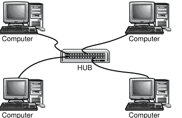

图 4.3 集线器和交叉线。

## 实现操作系统

当你建立网络时，你会为集群中的每台机器取一个友好的名称。你的主机名可以是正式的例如 system1、system2 等，但没有什么阻止你对它们玩点花。你可以使用行星的名字：例如水星、金星、地球和火星。你可以使用总统的名字、汽车的名字、四个卡通角色的名字、宝石等。当你发送消息或登录时，操作系统会根据 hosts 文件中的条目将友好名称转换为 IP 地址。

## 在操作系统中添加网络支持

当你构建网络时，需要为每台机器分配一个 IP 地址。简单的方法是使用 C 类网络，例如 192.168.1.x。........................... 例如，一个四节点集群需要 10.0.0.1、10.0.0.2、10.0.0.3、10.0.0.4。第一个地址通常留给网关，即路由器。如果没有路由器，你可以使用任何地址，只要它们在同一个子网。

`hosts` 文件是将主机名映射到 IP 地址的简单方法。在 Linux 和 Unix 上，它位于 `/etc/hosts`。在 Windows 上，它位于 `C:\Windows\System32\drivers\etc\hosts`。你可以这样为集群中的每台机器添加条目：

```
10.0.0.1   system1
10.0.0.2   system2
10.0.0.3   system3
10.0.0.4   system4
```

这允许你通过名称而不是 IP 地址连接机器。对于更复杂的网络，你可能会使用 DNS 服务器，但对于集群，`hosts` 文件就足够了。

## 我们的集群网络拓扑

我们的四节点集群由四台 166MHz PC 构建，每台机器配有 64MB 内存、31/2 英寸软盘驱动器、CD-ROM 驱动器、1GB 硬盘以及连接到系统板的 10Mbps RJ45 接口。有一个显示器、键盘和鼠标，五根两端带有 RJ45 插头的市售网络电缆，以及一个六端口 10BASE-T 集线器来完成配置。

> 提示
大多数百货商店都有卖廉价的标签机。打印一个带有每个名称的带和一个每个 IP 地址的带，并贴在每台机器前面以便识别。

集群节点将作为一个服务器工作。你至少需要一台外部计算机来运行向服务器发送查询的客户端软件。它还会运行性能监控和显示软件，显示每个服务器节点的负载情况。这些功能将在后面的章节中进行详细讨论。

图 4.4 一个集线器和四台连接到第五台现有计算机的联网计算机。

## 总结

在本章中，我们购买了四台旧 PC，并在每台电脑上安装了 Linux，并通过 10Mbps 集线器将它们相互连接。只有其中一台 PC 连接了显示器、键盘和鼠标。它将成为网络文件服务器。

在 Linux 操作系统下，多计算机系统网络化的便利性会在文件系统中创建一个用户工作区时变得显而易见。这个单一用户可以登录到网络上的任何机器并使用相同的主目录。它的所有文件看起来都是那样的，因为它们通过 NFS 可用。你将在下一章中了解到文件服务。

## 扩展阅读

- http://www.compa.com 有一个包含关于旧型号甚至其某些产品详细信息的章节。
- 参见 http://www.dell.com、http://www.ibm.com 等。
- http://www.crucial.com 是另一个获取计算机信息的良好来源。
- http://www.cisco.com、http://www.baynetworks.com 以及其他网站可以教你复杂方法的工作原理。
- http://www.google.com 和其他搜索引擎可以帮助你找到构建这些系统可能需要的任何其他信息。

## 配置相关系统文件

网络接口卡、一个集线器和几根电缆就足够满足需求。网络上的每台机器必须知道网络的存在，知道自己的名称，并至少知道一些远程机器。为了从本地机器访问其资源，所有这些硬件共同要求你修改一些系统文件。Linux 网络支持以称为“守护进程”（daemons）的活动进程形式出现，在启动时或响应进程间通信时启动。远程服务将在第 3 章“进程通信”中讨论，我们将在本章稍后的“参考命令”部分再次进行讨论。这些文件有明确的定义并可以在可预测的位置找到（请记住，稍后版本的操作系统可能会更改这些文件的位置）。

## 集群配置简要回顾

在 Linux 安装过程中，你会被要求标识主机名、IP 地址、域名等。接下来的配置示例显示了在每情况下需要添加或更改哪些机器地址。记住，只要在某些限制范围内，你可以选择任何你喜欢的名称。

## 本章内容

- 集群配置简要回顾
- Linux root 用户
- `/etc/hosts` 文件的更改
- `/etc/fstab` 和 `/exports` 文件的更改
- 远程访问
- `/home/.hosts` 文件的可选添加
- `/etc/passwd` 文件的可选更改
- 参考命令
- 扩展阅读

# 第 5 章 配置相关系统文件

我们的四节点集群的系统名称别为 alpha、beta、gamma 和 delta，IP 地址分别为 10.0.0.1 到 10.0.0.4。它们都位于名为 cluster.net 的域中。最后，你将一个用户 ID 来进行配置和应用程序开发。我们使用 root 作为我们的通用用户 ID。我们假设在安装过程中，你已经在这些系统的每一个一个上建立了一个名为 root 的用户 ID。

名为 alpha 的机器是我们的主系统；请始终启动它。它将直接连接显示器、键盘和鼠标（如果有）。它将是我们的文件服务器，这意味着主目录中的用户文件将物理地位于 alpha 的硬盘上。当我们在其他远程机器之一上登录时，这些文件通过网络文件系统（NFS）的魔法，看起来就像是在那里一样。我们将在本章稍后的部分修改 `/etc/fstab` 和 `/etc/exports` 时讨论 NFS。

## Linux root 用户

如果某台机器上有几十个用户账户，就会存在几十个主目录，每个目录都包含该用户的个人文件。那么，由哪个用户负责系统文件呢？

所有 UNIX 系统上都有一个名为 root 的特殊用户 ID。由于拥有特殊权限，该用户也被称为超级用户（superuser），正如你将看到的。`root` 用户拥有并负责所有系统文件。如果必须对其中任何一个文件进行任何更改，你必须成为 root 用户；你可以通过 `su`（切换用户 ID）命令来实现，如下：

- `su root`

`su` 命令允许你切换到其他某些用户 ID。一个悬挂的横线 (-) 表示你意图采用该用户的个人配置文件（当你切换到 root 用户 ID 时，你甚至不需要指定 root；只需 `su—` 即可）。在允许继续之前，你会被要求输入密码。请使用你在系统安装期间建立的 root 密码。

当你完成 root 用户的工作时，输入 `logout` 命令结束 root 登录会话，并恢复到之前个人用户 ID 下的会话。你也可以通过输入 `exit` 命令或简单的按 Ctrl+D 键来结束会话，这是目前最快、最简单的方法。

## 在系统提示符处以 root 身份登录

成为 root 用户的另一种方法是在系统提示符处以 root 身份登录。然而，某些安全的系统不允许 root 用户直接登录，强制使用 `su` 命令，以便系统管理员将其使用限制在某些受信任的用户身上。你会发现我们在书中倾向于松散的安全，因为假设集群处于你的完全控制之下，并且对任何想要这样做的人完全不可用。这一假设大大减少了系统管理需求。

## 作为 root 修改 Linux 系统文件

现在你已经是 root 用户了，让我们看看你可能会对系统配置进行的一些更改。

Linux OS 可能被配置为支持某些类型的设备，例如在作为安装过程的一部分构建 OS 之前。这些配置参数是永久的，如果你想更改它们，就需要重新构建 OS。还有非永久的配置参数，它们可能需要你在重启系统后才能生效。而某些配置参数仅在你重启关联进程或向其信号重新读取配置时生效。再次，目标是保持简单。

你必须更改的参数位于文本文件中，易于编辑。如果你更改了系统配置的内容并重启关联进程，你就更改了系统配置。这就是为什么你不希望别人知道 root 密码的原因之一。另一个原因是当你以 root 身份登录时，你可以使用 `su` 命令变成任何其他用户，而无需知道该用户的密码。事实上，当你是 root 用户时，可以重置其他用户的密码，并且可以修改或删除他们文件。成为 root 的目的是进行系统管理，这包括对用户账户的更改。关于 root 最重要的记忆是，作为 root，你对系统完整性造成的破坏可能是巨大的以至于你可能不得不清空所有内容并重新安装 OS。作为 root 时要小心。

在需要时使用 root 用户 ID，在进行个人软件开发和个人账户管理时使用普通用户 ID，正如我们示例中所使用的账户一样。

# 第 5 章 配置相关的操作系统文件

> 注意：顺便提一下，邮箱是一个与你的用户 ID 同名的文本文件；它会随着每封新邮件的到来而增大，并随着你读取和删除邮件而减小。例如，chief 的邮箱位于 `/var/spool/mail/chief`。如果泛化地考虑语法要求，这与你在信封正面写下的地址没有太大区别。

每当远程引用命令使用远程主机名时，它都必须被翻译为 IP 地址。`/etc/hosts` 文件包含了你可能需要的所有名称，因此你必须将你的节点名称和 IP 地址添加到此文件中。以 root 身份登录并使用你喜欢的编辑器更改 `/etc/hosts` 的内容，如下所示：

- `10.0.0.1 alpha.cluster.net alpha`
- `10.0.0.2 beta.cluster.net beta`
- `10.0.0.3 gamma.cluster.net gamma`
- `10.0.0.4 delta.cluster.net delta`
- `127.0.0.1 localhost.localdomain`

将 IP 地址和较短的别名左对齐。为了提高长、完全限定主机名的可读性。最后一条条目的输入方式如所示，它引用的是每个系统上的本地主机。无论主机名是什么，`localhost` 都可以用作它的主机名。使你每个节点上的所有 hosts 文件看起来都完全一样。

远程引用命令用于发现 IP 地址时使用的机器，该地址被用于与该远程机器上的相应进程进行通信。（你将在本章稍后的部分设计一个示例远程引用命令。）你可能没有意识到两台机器之间往返了许多消息。只要网络配置正确，你可能会强烈地感觉到你实际上已经登录到一台远程机器上。

当你实际登录到一台机器时可以做的几乎任何操作，在你远程登录到它时都可以完成。这就是网络的力量，但它不仅仅需要硬件。它还需要更改操作系统配置文件（例如 `/etc/hosts` 文件），以使网络上其他机器的操作系统能够协同工作。

## 对 `/etc/fstab` 和 `/etc/exports` 文件的更改

当你使用远程登录功能时，你可能会认为你的主目录以及你所有的文件在远程机器上对你都可用。这是通过更改两个文件实现的：所有远程机器上的“文件系统表”（`/etc/fstab`）和本地文件服务器机器上的“文件导出表”（`/etc/exports`）。在我们的示例中，本地文件服务器命名为 alpha。

在启动时，如果本地 `fstab` 中存在文件系统引用，则会触发进程间通信以初始化服务，前提是该引用指向服务器 `exports` 文件中与之匹配的文件系统。使用 `exports` 文件来宣布本地文件系统（如主目录）的可用性；使用 `fstab` 条目告诉每个客户端机器在启动时请求从文件服务器挂载这些文件。

## 结合 `/etc/fstab` 和 `/etc/exports` 句使用 NFS

NFS 使用一组活动进程来支持一种强烈的错觉：当你物理上位于另一台机器上时，你却在其中一台机器上处理你的个人文件。尽管文件数据实际上存储在服务器的磁盘（alpha 的硬盘）上，但你操作它们时就像它们在远程节点的 alpha 上一一样。

请注意，我们指的是你主目录中的个人文件——例如你的 C 语言程序。集群中的系统文件存在于每个系统的硬盘上，因为它们代表了本地机器的配置参数。存在一些被称为“无盘工作站”的远程系统，它们从远程服务器获取所有文件。这类系统不在本本书的范围之内。它们没有硬盘。它们从软盘启动，软盘包含足够的数据让它们启动并运行到某个程度，以便它们向指定的服务器请求后续的文件数据。

在名为 alpha 的 NFS 服务器机器上，向 `/etc/exports` 文件添加以下行：


`/home rw`

这表示你希望 `/home` 目录在任何具有读写权限的远程系统上都可以进行 NFS 挂载。

在其他每个（NFS 客户端）节点上，向 `/etc/fstab` 文件添加以下行：

```
alpha:/home  home nfs rw 0 0
```

这表示你希望通过 NFS 将 `alpha` 的 `/home` 目录挂载到本地，路径为 `/home`，并具有读写权限，或者更准确地说，挂载在你的本地 `/home` 目录上，因为为了让此挂载成功，你需要在本地有一个 `/home` 目录。这个过程被称为挂载远程文件系统。

NFS 服务器首先启动，它的进程发现本地的 `/home` 子目录已提供给任何请求它的其他节点导出。当其他节点启动时，NFS 进程处理每个来自 `alpha` 的可用 `/home` 目录的请求。该文件系统现在似乎位于本地节点的硬盘上。当你登录到节点 `gamma`（或 `beta` 或 `delta`）时，你的主目录将对你可用，以及你所有的文件。

## 远程访问安全

书中的简单集群系统假设已享有完全的物理访问安全。也就是说，你和你受信任的同伴是被允许靠近任何节点并登录的人，且没有任何节点可以从该物理边界之外的任何网络访问。如果你想把任何人排除在境外，配置将变得复杂得多！本书的重点是帮助你让集群运行起来。如果你允许公众通过 Internet 访问它，你将不得不进行一些更改来加固安全性。在这里，我们感兴趣的是降低安全性以方便自己进行远程访问，从而节省时间。

在你登录 `alpha` 后，为了节省时间方便自己远程访问，可以通过 `telnet` 命令访问机器：

- `telnet beta`

该命令会向你请求用户 ID 和密码，前提是你已经在 `beta` 已经设置了这些信息。同样，你可以执行 `rlogin`（远程登录）命令，它假设你的用户 ID 和密码：

- `rlogin beta`

该命令与 `telnet` 相同，但它通过用户 ID 允许你登录，从而节省更多时间。`rsh`（远程 shell）命令与 `rlogin` 相同，但输入更短、更快：

- `rsh delta`

它会将你登录到名为 `delta` 的机器，就像 `rlogin` 命令一样。这是最快最简单的登录方法，但会产生安全风险。

## 可选添加 /home/chief/.hosts 文件

即使在物理安全的系统中，软件检查也可以阻止你直接登录。为了利用这种终极的时间节省工具，你可以在主目录创建一个文件，让系统假设你的密码以及你的用户 ID。创建一个名为 `.hosts`（开头必须有一个点）的文件，位于 `/home/chief`，即你的主目录。

每个主机名后面跟着受信任的用户 ID。在这种情况下，你只有一个用户，所以你主目录下的 `.hosts` 文件将方便你从集群的任何节点登录到另一个节点。虽然你可以建立从 `alpha` 到 `gamma` 再到 `delta` 的远程登录链，但你应该养成在登录另一台远程机器之前登出当前机器的习惯，以保持简单。

每当你从网络上的某个节点尝试登录时，该文件都会被远程登录过程检查。注意，网络上的每个节点都会拥有此文件，因为你主目录中的所有文件都通过之前配置的网络文件系统变为可用。`NFS` 是一个非常有用的功能。

通过指定网络上的所有节点以及你的用户 ID，你允许从任何节点访问任何其他节点，而无需密码检查。

## 可选对 /etc/passwd 文件的更改

如果你经常以用户 `chief` 的身份登录并以 `root` 的身份进行系统配置，你可能想要消除对这些密码的需求。这无疑是一个安全风险，但它会节省大量时间。如果你的系统位于安全区域，且你（以及你信任 `root` 密码的人）永远不会靠近这些系统，你可以物理地从你的用户 ID 和 `/etc/passwd` 中的 `root` 条目删除密码。

```
root:c6752ffa:0:0:root:/bin/bash

chief:4456aab:500:500:Chief User:/home/chief:/bin/csh
```

# 第 5 章 配置相关的操作系统文件

密码文件中的每一行条目包含多个字段，每个字段之间用冒号（`:`）隔开以提高可读性。在 Unix 系统中，可读性通常意味着机器可读性，但有时会对人类带来挑战。你可以编辑此文件（以 `root` 为例），并重写字段的内容：

```c
root::0:0:root:/bin/bash

chief::500:500:Chief User:/home/chief:/bin/csh
```

注意，`::` 代表条目中的一个条目或空（null）字段。`root` 用户或你的个人用户 ID 不再需要密码。除非你隐含地信任可能访问这些系统的其他人，否则不要执行此操作！你必须在你的每个节点的 `/etc/passwd` 文件中进行这些更改。

## 注意事项

你可能会发现，后后发布的 Linux 版本更改了密码文件的意义，甚至可能已经替换了它。在这些情况下，其他其他方法消除输入密码的必要性。请参考安装包中附的 Linux 文档。

## 远程引用命令

在第 3 章中，你检查了 `fork/exec` 子进程的几种变体，并得到了一对进程：一个是本地客户端，另一个是远程服务。列表 3.9a 和列表 3.9c 中的 TCP 示例对可以转换为远程引用和远程守护进程对。在列表 5.1a 和列表 5.1b 中实现了一个远程文件列出服务。

> 注意
> 不熟悉 Linux 下 C 程序编译的读者可能想直接跳到第 6 章“为软件开发配置用户环境”。

### 列表 5.1A 远程-cat 命令：列出远程位置文件的内容

```c
/*
** Listing5.1a.c - rcat: 列出远程文件的内容
*/
#include <netinet/in.h>
#include <sys/socket.h>
#include <string.h>
```

### 列表 5.1A 续

```c
#include <netdb.h>
#include <stdio.h>
#define BUFLEN 8192
#define PORT 6789
int main(int argc, char *argv[])
{
    struct sockaddr_in sock;
    struct hostent *hp;
    int port = PORT;
    int fd, ii;
    char buffer[BUFLEN];
    char *p;
    /* argv[] */
    if(argc < 2)
    {
        printf("\nUsage: %s <IP_Addr>:<file_name\n\n", argv[0]);
        exit(-1);
    }
    /* 隔离远程主机 */
    p = strchr(argv[1], ':');
    *p = '\0';
    p++; /* 重置到文件 */
    /* 获取有关远程服务器的关键信息 */
    strncpy(buffer, argv[1], sizeof(buffer));
    if((hp = gethostbyname(buffer)) == NULL)
    {
        perror("Listing5.1a: gethostbyname()");
        exit(-1);
    }
    /* 初始化 TCP 流套接字结构 */
    if((fd = socket(AF_INET, SOCK_STREAM, 0)) < 0)
    {
        perror("Listing5.1a: socket()");
```

### 列表 5.1A 续

```c
        exit(-1);
    }
    memset((char *) &sock, 0, sizeof(sock));
    memcpy(&sock.sin_addr, hp->h_addr, hp->h_length);
    sock.sin_family = hp->h_addrtype;
    sock.sin_port = htons(port);
```

```c
/* 连接到远程服务器 */
if(connect(fd, (struct sockaddr *)&sock, sizeof(sock)) < 0)
{
    perror("Listing5.1a: connect()");
    exit(-1);
}
```

```c
/* 将文件名发送到服务 */
strncpy(buffer, p, sizeof(buffer));
if(send(fd, buffer, strlen(buffer)+1, 0) < 0)
{
    perror("Listing5.1a: send()");
    exit(-1);
}
```

```c
/*
** 将远程文件内容打印到屏幕
*/
while(1)
{
```


```c
if(ii = recv(fd, buffer, sizeof(buffer), 0)) < 0
{
    perror("Listing5.1a: recv()");
    close(fd);
}
else if(ii > 0) /* 接收有效包 */
{
    p = buffer;
    while(ii) /* 处理所有输入行 */
    {
        /* 打印每行新内容直到 DONE */
        if(strncmp(p, "DONE", 4) == 0)
            break;
```

### 列表 5.1A 续

```c
        else
            printf("Listing5.1a: %s\n", p);
        /* 后续行 */
        ii = (strlen(p) + 1);
        p += strlen(p) + 1;
    }
}
else /* 套接字连接已关闭 */
    break;
}
close(fd);
return(0);
```

### 列表 5.1B 远程-cat 守护进程：将文件内容传回客户端

```c
/*
** Listing5.1b.c - rcatd: 将文件内容传回客户端
*/
#include <stdio.h>
#define FALSE
#define TRUE
int main(void) {
    FILE *fp;
    int notDone;
    char buffer[64];
    /* 客户端发送文件名 */
    read(0, file, sizeof(file));
    if((fp = fopen(file, "r")) == NULL) {
        sprintf(buffer, "Listing5.1b: %s not found.\n", file);
        fclose(fp);
        exit(-1);
    }
```

# 5.1B 续

```c
    /*传回客户端 */
    notDone = TRUE;
    while(notDone)
    {
        if(fgets(buffer, sizeof(buffer), fp) != NULL)
        {
            /* 移除换行符 */
            buffer[strlen(buffer)-1] = '\0';
            /* 客户端发送文件内容 */
            write(1, buffer, strlen(buffer)+1);
        }
        else
            notDone = FALSE;
    }
}
```

## 第6 章 为软件开发配置用户环境

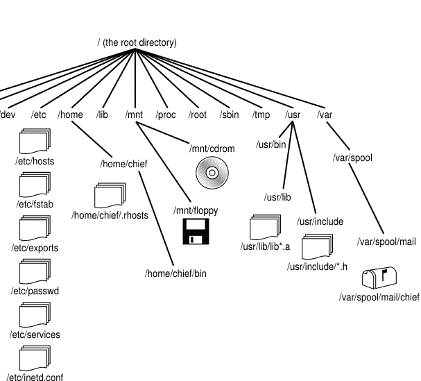

图 6.1 Linux 文件系统概览。

以下是书中讨论的一些目录名称，随后是您在这些目录下可能发现的内容描述。您应该能识别出某些目录是上一章中讨论的文件存放位置。

- `/bin`—组成基本 Unix 命令集的各种执行文件
- `/dev`—通过这些类文件式的 I/O 端口访问的设备
- `/etc`—系统配置文件
- `/home`—（非 root）系统用户的家目录
- `/mnt`—可移动文件系统的挂载点：软盘、CD-ROM 等
- `/proc`—进程信息伪文件，将在第 8 章“外部性能测量与分析”中讨论
- `/root`—根用户（root  user）的家目录
- `/tmp`—临时文件
- `/usr`—系统和应用程序的可执行文件及其相关文件
- `/var`—日志、电子邮件等

## 使用 C 编译器

本章中最感兴趣的目录是 `/home` 和 `/usr`。您的家目录下的文件存在于 `alpha` 的硬盘上；`alpha` 是 NFS 文件服务器。（NFS）将在第 5 章“配置相关的操作系统文件”中进行讨论。）您将在 `/home/chief` 用户的家目录下添加一些子目录，并创建一些文件以方便编译 C 语言程序。编程语言库和头文件分别位于 `/usr/lib` 和 `/usr/include`。

## 您的 /home/chief 家目录

当您在安装期间创建新的用户 ID 名称时，系统会为其创建一个新的子目录 `/home/chief`，以及一些您可以根据需要进行更改的环境文件。我们在 `/home/chief` 下创建了一个名为 `.hosts` 的文件（第 5 章），以便使我们的集群系统更易使用。您还会发现一个名为 `bin`（binary 的缩写）的子目录，其中用于包含您的本地可执行文件。

您在家目录下还需要其他子目录——用于存放您所有的语言源程序及其相关的头文件。您制作的可执行文件将存放在 `/home/chief/bin` 中。源文件保存在 `/home/chief/src` 中，头文件保存在 `/home/chief/inc` 下。使用 `mkdir` 命令（“make directory”的缩写）来创建这些子目录。

```
> cd             [如果不在家目录，则切换到家目录]
> mkdir src [为 C 语言源文件创建 /home/chief/src]
> mkdir inc [为包含的 C 头文件创建 /home/chief/inc]
```

## 使用 C 编译器

GNU Compiler（`gcc` 命令）通过处理步骤创建可执行文件：预编译、编译、汇编和链接。预处理器处理它发现的任何指令（例如，`#include` 会插入头文件）；编译器从源文件创建对象文件；汇编器从汇编源创建对象文件；链接器从对象文件创建可执行文件。每当您使用 `gcc` 命令时，都需要告诉编译器和链接器编译或汇编哪些程序，或者哪些对象文件需要链接。它还需要知道在哪里找到预编译指令中引用的任何头文件，哪些对象文件构成了生成的可执行文件，等等。这是一个复杂的过程，需要相应复杂的指令。

列表 6.1 是一个 C 程序，它从简单开始逐渐变得复杂，以演示 `gcc` 是如何工作的。

### 列表 6.1 Linux 文件系统概览

```
#include <stdio.h>
main(void)
/*
 ** Listing6.1.c - 在屏幕上打印一行字
 */
{
    puts("Prints on your screen.");
    return (0);
}
```

这个简单的程序有一个预编译指令，用于包含 `stdio.h`，即标准 I/O 头文件。它被编译并链接到 `/home/chief/bin` 下的可执行文件中。指令通过其行命令行操作数传递给 `gcc`：

- - `gcc -o ..//bin/Listing6.1 Listing6.1.c`
- - `man gcc`
- - `info gcc`

在经过预处理、编译和链接（从现在起我将这一整体过程称为编译）之后，可以如下所示测试可执行文件：

- - `Listing6.1`
Prints on your screen.

注意，您将可执行文件放在 `/home/chief/bin` 因为它在您的路径（`path`）中，即在命令行提示符处输入命令时搜索的子目录集。Unix 用户通常会在家目录下创建一个 `bin` 子目录。Linux 会自动为每个新用户创建一个，并在默认的环境控制文件中对其添加支持。

您将定义对多个程序全局有效的值。例如，一个程序发送给另一个程序的缓冲区最大长度对两者来说都是通用的。

您可以在两个中都定义长度，但您面临着其中一个被更改而另一个没有更改的风险；最好的做法是在头文件中定义它，然后在使用它的两个程序中包含该头文件。此示例只使用了一个程序；它应该帮助您理解如何创建和包含您自己的 C 头文件。

进入您的 include 子目录，并创建一个名为 `Listing 6.2.h` 的头文件，内容如下：

```
/*
** Listing6.2.h - 一个简单的 C 语言头文件
*/
#define BUFLEN 64
```

就像 `#include` 用当预处理器指令来插入命名的头文件一样，`#define` 告诉预编译器创建一个名为 `BUFLEN` 的局部变量并将其赋值为 64。注意，这是字符串级别的替换。每当预处理器发现字符串 `BUFLEN` 时，它就会将其替换为字符串 64。注意，这是字符串级别的替换。

```
，#define 告诉预编译器创建一个名为 BUFLEN 的局部变量并将其赋值为 64。注意，这是字符串级别的替换。每当预处理器发现字符串 BUFLEN 时，它就会将其替换为字符串 64。
```

```
，#define 告诉预编译器创建一个名为 BUFLEN 的局部变量并将其赋值为 64。注意，这是字符串级别的替换。每当预处理器发现字符串 BUFLEN 时，它就会将其替换为字符串 64。
```


进入您的 `include` 子目录，并创建一个名为 `Listing 6.2.h` 的头文件，内容如下：

```
/*
** Listing6.2.h - 一个简单的 C 语言头文件
*/
#define BUFLEN 64
```

你使用 `-c` 运算符对其进行编译，且不指定任何输出信息。

> `gcc -c Listing6.4a.c`

这将创建一个名为 `Listing6.4a.o` 的文件，该对象文件仅包含 `screen` 函数。对于主程序，请参阅列表 6.4b。

### 列表 6.4B 在主程序中使用 screen 函数的对象文件

```c
main(void)
/*
 Listing6.4b.c - 间接地向屏幕打印一行
*/
{
    void screen(char *);
    screen("Prints to your screen.");
}
```

这一次，将使用对象文件和 C 程序一起编译主程序。

> `gcc -o../bin/Listing6.4b Listing6.4a.o Listing6.4b.c`

这使得可以在名为 `Listing6.4a.o` 的对象文件中找到名为 `screen` 的函数，从而解析 `Listing6.4b.c` 中该函数的引用。

> `Listing6.4b`

打印到屏幕。

注意，此函数可以在多个 C 程序中引用，每个程序在编译时都在 `gcc` 命令行中请求包含 `Listing6.4a.o`。如果将它们命名为 `screen` 和 `screen.o` 等，记住所有这些函数的名称将变得更容易。如果你将此类细节放入一个关于如何编译这些程序的单独指令文件中，情况会更加简单。这个指令文件被称为 `makefile`，因为它是由下一节中描述的 `make` 工具使用的。

## 使用 make 工具

`make` 命令是一个非常强大的工具，用于包含编译大型程序集的复杂性。大型软件开发项目充分利用 `make` 的优势，通过局部和全局变量以及依赖关系，从数百个 C 程序、头文件和函数库构建出一个可执行文件包。在书中，我们仅仅接触了其能力的边缘，创建了我们最简单的指令文件。列表 6.5 就是这样一个文件，可以编译本章中的每个程序。它必须命名为 `makefile` 或 `Makefile`，并位于 `/home/client/src` 中。

### 列表 6.5 名为 makefile 的内容

```make
all: Listing6.1 Listing6.2 Listing6.3 Listing6.4

Listing6.1:
  gcc -o../bin/Listing6.1 Listing6.1.c

Listing6.2:
  gcc -I./inc -o../bin/Listing6.2 Listing6.2.c

Listing6.3:
  gcc -o../bin/Listing6.3 Listing6.3.c

Listing6.4:
  gcc -o../bin/Listing6.4b Listing6.4a.o Listing6.4.b

screen:
  gcc -c Listing6.4a.c
```

每个程序由两行代码表示。第一行的第一个条目是规则名称。冒号分隔依赖项（如果有的话）。第二行是待执行的命令字符串（必须以制表符开头）。使用 `make` 工具，我们可以如下所示编译列表 6.1 中的程序：

> `make Listing6.1`
`gcc -o../bin/Listing6.1 Listing6.1.c`

执行与标记为 `Listing6.1` 的规则相关的命令行。当你执行：

> `make Listing6.4`
`gcc -c ../bin/Listing6.4b Listing6.4a.o Listing6.4b`

`Listing6.4b` 依赖于 `Listing6.4a`，`screen` 函数在后者中定义。在编译并链接 `Listing6.4b` 成为可执行文件之前，必须先将 `Listing6.4a` 编译为 `Listing6.4a.o`。

各地构建大师的圣杯是创建一个与他们数百个相互依赖的源文件和头文件对应的 makefileset，这样他们的工作就可以简化为执行：

> `make`

然后他们就可以回家休息了，第二天早上回来时准备仔细检查生成的输出流，以验证一切都按计划运行。当你不带任何其他内容执行 `make` 命令时，系统将选择文件中的第一个规则。在这种情况下，该规则名为 `all`，它将其他四个列表规则都列为依赖项，因此所有内容都会被重新编译。

## 备份与恢复

少数 C 程序可能代表了你花费的大量精力。建议创建一个简单的备份和恢复方案。常见的 3 1/2 英寸磁盘可以存储 1.5MB 的未压缩数据。定期使用 Unix `tar`（归档）命令，甚至是简单的复制操作，都是防止硬盘丢失的一项有效防御。

可以通过将这些文件归档到本地临时区域（`/tmp`），然后将该归档文件复制到集群中另一台机器硬盘上的子目录（例如 `/backups`），从而将大量文件备份到那里。

对于直接的文件复制，你可以使用 DOS 格式的磁盘，但必须（以 root 身份）挂载它，以便 Linux 知道它是什么。在 `/mnt` 下可能会有一个子目录 `floppy`。如果没有，请创建一个：

```bash
cd /mnt
mkdir floppy
```

现在挂载磁盘，将源文件直接复制到其中，然后卸载：

```bash
mount -t msdos /dev/fd0 /mnt/floppy
cd /home/chief/src
cp * /mnt/floppy/
cd ../inc
cp *. /mnt/floppy/
cd ../inc
umount /mnt/floppy
```

# 第 7 章 主从接口软件架构

……服务器，随着示例服务器复杂性的增加，你将继续使用此场景作为示例。客户端的源代码如列表 7.1 所示。为了清晰起见，我们省略了通常可能会添加的大部分检查和错误报告代码。

你可以指定测试流中的数据包数量以及它们之间的时间间隔。每个数据包之间的时间称为到达间隔时间（inter-arrival time），在源列表中缩写为 `IAT`。如果你逐渐减小 `IAT`，你会发现在某个点上服务器会发生故障，因为它无法在短的时间内处理数据包。该值是对服务器整体性能的良好估计，你可以预期改进版本的服务器能够处理相对较短的 `IAT` 值。

## 列表 7.1 客户端从远程文件请求特定行文本

```c
#include <math.h>
#include <stdio.h>
#include <stdlib.h>
#include <unistd.h>
#include <string.h>
#include <sys/time.h>
#include <sys/types.h>
#include <sys/socket.h>
#include <netinet/netdb.h>
#include <netdb.h>
```

```c
#define PORT 9876
#define NUM 50
```

```c
main(int argc, char *argv[])
{
    /*
     ** Listing7.1.c - 客户端：从远程文件请求一行
     */
    struct timeval bef, aft;      /* 发送前/后的定时器值 */
    struct sockaddr_in sock;    /* socket 结构 */
    struct hostent *hp;         /* IP 地址结构 */
    double random;             /* 随机实数: 0.0->1.0 */
    long timeleft;             /* IAT 剩余时间 / */
    long secs=0L;               /* 到达间隔秒 / */
    long usec=0L;               /* 到达间隔微秒 / */
    int pids[NUM];              /* 子任务进程 ID / */
    int opt=1;                  /* setsockopt 参数 / */
    int fd;               /* socket 文件描述符 */
    int ii, jj, kk=0;
    char buf[80], *p;
```

```c
rand((unsigned int) getpid()); /* 为 rand() 种子 */
```

```c
/*
** 操作数是远程主机名和 IAT（到达间隔时间） */
if(argc != 3)
```

```c
    printf("\nUsage: %s <HOST> <IAT>\n", argv[0]);
    exit(-1);
```

```c
/* 到达间隔的微秒 */
```


```c
if((p=strchr(argv[2], '.')) != NULL)
{
    *p = '\0'; /* 在小数点处结束整数部分 */
    p++; /* 指针移动到小数部分起始 * */
    while(strlen(p) < 6)
        strcat(p, "0"); /* 填充最多 6 位 */
    p[6] = atol(p); /* 截断最多 6 位 */
    usec = atol(p);
}
secs = atol(argv[2]); /* IAT 的秒部分 */
```

```c
/*
** 循环：发送并接收 NUM 个数据包 */
for(ii=0; ii<NUM; ii++)
{
    /* 获取发送时间 */
    gettimeofday(&bef, NULL);
    /* 1 到 5 随机整数 */
    random = rand() / (double) RAND_MAX;
    jj = (int)((double) (5.0) * random) + 1;
    if(jj == 6)
        jj = 5;
    sprintf(buf, "/tmp/sample.txt %d", jj);
    if((pids[kk++]=fork()) == 0)
    {
        /* 设置连接的 socket 信息 /* */
        fd = socket(AF_INET, SOCK_STREAM, 0);
        memset((char *) &sock, 0, sizeof(sock));
        hp = gethostbyname(argv[1]);
        memcpy(&sock->sin_addr, hp->h_addr, hp->h_length);
        sock.sin_family = hp->h_addrtype;
        sock.sin_port = htons(PORT);
        setsockopt(fd, SOL_SOCKET, SO_REUSEADDR,
        (char *) &opt, sizeof(opt));
        /* 连接到服务器 /* */
        connect(fd, struct sockaddr *) &sock, sizeof(sock));
        send(fd, buf, strlen(buf)+1, 0);
        buf[0] = 0; /* 清除缓冲区 /* */
        recv(fd, buf, sizeof(buf), 0);
        /* 打印查询响应 /* */
        printf("Line %d: %s", jj, buf);
        /* 检查行是否正确 /* */
        p = strchr(buf, ' ') + 2;
        if(jj != atoi(p))
            printf("\n");
        close(fd);
        exit(0);
    }
    /*
    ** 休眠直到 IAT 剩余时间
    */
    gettimeofday(&aft, NULL);
    aft.tv_sec -= bef.tv_sec;
    aft.tv_usec -= bef.tv_usec;
    if(aft.tv_usec < 0)
    {
        aft.tv_usec += 1000000;
    }
    // (注：原文此处逻辑存在重复，翻译已根据代码结构进行对齐)
```

# 列表 7.3 延续

```c
sock.sin_port = htons(PORT);
sock.sin_addr.s_addr = htonl(INADDR_ANY);
bind(acc, (struct sockaddr *) &sock, socklen);
setsockopt(acc, SOL_SOCKET, SO_REUSEADDR,
    (char *) &opt, sizeof(opt));
listen(acc, 5);
```

```c
while(1)
{
    /* 等待远程客户端的连接 */
    cli = accept(acc, (struct sockaddr *) &sock, socklen);
    /* 获取客户端请求的随机行数据 */
    if(fork(cli) == 0)
    {
        recv(cli, buf, sizeof(buf), 0);
        /* 打开请求的文件 */
        sscanf(buf, "%s %d", file, &line);
        fp = fopen(file, "r");
        while(line--)
            gets(buf, sizeof(buf), fp);
        fclose(fp);
        buf[strlen(buf)-1] = '\0';
        send(cli, buf, strlen(buf)+1, 0);
        close(cli);
        exit(0);
    }
    close(cli);
}
```

为每个传入的数据包创建一个子任务的好处是利用数据包处理中的任何并行性。在这种情况下，共享资源是只读的；许多子任务可以同时读取文本文件，通过减少响应时间来提高性能。然而，为每个传入的数据包创建子任务是有代价的。你可以通过创建足够的子任务来处理预期的峰值负载（最短到达时间）来减少这种开销，代价是增加一些进程间通信开销来管理并行查询处理，如列表 7.4 所示。

# 第 7 章 主从接口软件架构

## 列表 7.4 服务器提前创建子任务池以处理传入的查询流


```c
#include <netdb.h>
#include <stdio.h>
#include <unistd.h>
#include <sys/ipc.h>
#include <sys/shm.h>
#include <sys/time.h>
#include <sys/types.h>
#include <netinet/in.h>
#include <sys/socket.h>
#include <sys/signal.h>

#define PORT 9876
#define FALSE 0
#define TRUE 1
#define MAX 5

int Running = TRUE; /* 布尔值：在 control_C() 中重置 */

main(void)
{
/*
** 列表 7.4.c 并发服务器：子任务池
*/
struct area {
    /* 每个子任务的标记 */
    int flag[MAX];    /* @0:空闲, 1:可用, -退出 */
} area, *aptr;
int flag = (IPC_CREATE | IPC_EXCL | 0660);
int size = sizeof(struct area);
key_t key = 0;
int shmid; /* 共享内存区域 */

void control_C(); /* ctrl-C 信号处理程序 */
struct sockaddr_in sock; /* socket() 的结构体 */
int socklen=sizeof(sock); /* accept() 的结构长度 */
FILE *fp; /* 查询文件指针 */
fd_set fds; /* 用于客户端的 select */
int acc; /* accept 描述符 */
int cli; /* 客户端描述符 */
int line; /* 请求的行 */
int opt=1; /* setsockopt 参数 */
```

### 列表 7.4 延续

```c
int ident;               /* 内部子任务 ID */
int pids[MAX];              /* 子任务进程 */
char file[32];             /* 来自客户端的文本文件 */
char buf[80];              /* 接收缓冲区 */

/* 初始化处理程序 */
signal(SIGINT, control_C);

/* 创建（服务器）socket 以接受 */
acc = socket(AF_INET, SOCK_STREAM, 0);

/* 将 socket 绑定到端口 */
sock.sin_family = AF_INET;
sock.sin_port = htons(PORT);
sock.sin_addr.s_addr = htonl(INADDR_ANY);
bind(acc, (struct sockaddr *) &sock, socklen);
setsockopt(acc, SOL_SOCKET, SO_REUSEADDR,
(char *) &opt, sizeof(opt));
listen(acc, 5);

/* 获取共享内存区域 */
shmid = shmget(key, size, flag);
/* 挂载子任务的内存数组 */
apr = (struct area *) shmat(shmid, 0);

/* 预建立子任务池 */
for(ident=0; ident<MAX; ident++)
{
    apr->flag[ident] = 0; /* 设置标记为空闲 */

    if((pids[ident]=fork()) == 0) /* 子任务 */
    {
        /* 挂载父进程内存数组 */
        apr = (struct area *) shmat(shmid, 0);
        /* 注意：shmid 仍然正确设置 */
    }
}

/* 取消处理程序 */
signal(SIGINT, NULL);

/* 轮询内存数组查找非零标记 */
while(1) {
  if(apr->flag[ident] == 0) {
    usleep(1); /* 释放处理器 */
    continue; /* 留在轮询循环 */
  } else if (apr->flag[ident] < 0) {
    exit(0); /* 子任务正常退出 */
  } else /* 执行标记 */
    cli = accept(acc, (struct sockaddr *) &sock, socklen);
    /* 获取查询 */
    recv(cli, buf, sizeof(buf), 0);

    /* 打开请求的文件 */
    sscanf(buf, "%s %d", file, &line);
    fp = fopen(file, "r");
    while(line--)
        gets(buf, sizeof(buf), fp);
    fclose(fp);

    /* 发回响应 */
    buf[strlen(buf)-1] = '\0';
    send(cli, buf, strlen(buf)+1, 0);
    close(cli);

    /* 设置标记为空闲 */
    apr->flag[ident] = 0;
  }
}
```

父进程将传入的查询分配给可用子任务

### 列表 7.4 延续

```c
while(Running) /* 在 control_C 中设置 FALSE */

{

    FD_ZERO(&fds);

    FD_SET(acc, &fds);

    /* 等待客户端就绪 */

    if(select(acc+1, NULL, NULL, NULL) < 0)

        break;

    /* 将查询分配给第一个可用子任务 */

    for(ident=0; ident<MAX; ident++)

    {

        if(apr->flag[ident] == 0)

        {

            apr->flag[ident] = 1;

            break;

        }

    }

}

/* 等待每个子任务退出 */

for(ident=0; ident<MAX; ident++)

{

    apr->flag[ident] = -1;

    waitpid(pids[ident]);

}

/* 移除共享内存区域并退出 */

shmctl(shmid, IPC_RMID, (struct shmid_ds *) NULL);

return(0);

}

/*

** C 信号处理程序

*/

void control_C()

{

    Running = FALSE; /* 允许退出 */

    return;

}
```

## 分布式服务器进程 115

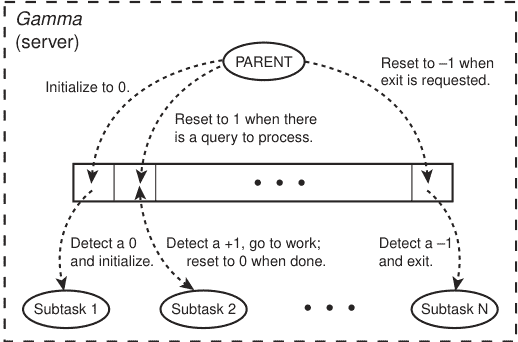

图 7.1A 通过共享内存进行进程间通信。

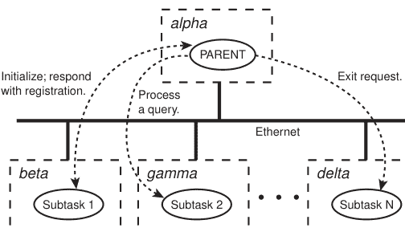

图 7.1B 通过网络进行进程间通信。

回顾第 3 章“进程间通信”，你曾通过向远程机器上的其已知端口地址发送一个 UDP 数据报，来启动一个远程从机（列表 3.8a 和 3.8c）。你可以将这一概念泛化，以创建所有远程从机服务：通过在网络上的每台远程机器上定义它们的已知端口，并发送一个广播 UDP 数据报，如列表 7.5 的短示例所示。网络上的每台机器都会接收该数据报，并且网络上的每台机器都将以第 3 章示例相同的方式启动远程从机进程。（务必在每个远程系统的 `/etc/services` 和 `/etc/inetd.conf` 文件中为列表 7.6 添加定义，该过程在第 3 章中也有描述。）

# 第 7 章 主从接口软件架构

广播消息与普通消息有两点不同：套接字（在这种情况下为 UDP 数据报）必须调用 `setsockopt` 准备以接受这些特殊消息，并且必须使用通配符 IP 地址。回顾第 3 章，IP 地址的第一部分定义网络，而最后部分定义网络上的机器。特殊节点值 255（或十六进制的 FF）是通配符节点地址，被解释为所有节点；所有节点都接受此类地址，无论其特定的节点地址如何。我们的网络 IP 地址范围从 10.0.0.1 到 10.0.0.24；因此，10.0.0.255 将是广播消息中使用的地址。

### 列表 7.5 通过 UDP 广播数据报处理所有可能的从机进程

```c
#include <netinet/in.h>
#include <sys/socket.h>
#include <sys/types.h>
#include <string.h>
#include <netdb.h>
```


```c
#include <stdio.h>

#define INIT 3579

#define WORK 9753

unsigned char broadcast[4] = {0xA0, 0x00, 0x00, 0xFF}; /* 10.0.0.255 */

main(int argc, char *argv[])

char *argv[];

int argc;

/*

Listing 7.5.c - 主机：UDP 数据报激活从机进程 进程

*/

{
    int len = sizeof(struct sockaddr);
    struct sockaddr_in init;
    struct sockaddr_in work;
    struct host *hp;
    int fd, wfd;
    int opt=1;
    char host[80];
    char buf[80], *p;
    /* 初始化套接字 */
    fd = socket(AF_INET, SOCK_DGRAM, 0);
    memset((char *)&init, 0, sizeof(init));
```

### 列表 7.5 继续

```c
init.sin_family = AF_INET;
init.sin_port = htons(INIT);
memcpy(&init.sin_addr, broadcast, 4);
setsockopt(fd, SOL_SOCKET, SO_BROADCAST,
(char *) opt, sizeof(opt));
/* 建立待工作 UDP 套接字结构体 */
wfd = socket(AF_INET, SOCK_DGRAM, 0);
memset((char *) &work, 0, sizeof(work));
work.sin_addr.s_addr = htonl(INADDR_ANY);
work.sin_port = htons(WORK);
work.sin_family = AF_INET;
bind(wfd, (struct sockaddr *) &work, len);
/* 消息启动远程从机 */
getostname(host, sizeof(host));
if((strchr(host, '.')) != NULL)
  *p = '\0'; /* 截断 .domain */
  printf(buf, "%s", host, WORK);
sendto(fd, buf, strlen(buf)+1, 0,
  (struct sockaddr *) &init, sizeof(init));
close(fd);

/*
** 显示注册响应信息
*/
while(1) {
buf[0] = '\0'; /* 清空缓冲区 */
recvfrom(wfd, buf, sizeof(buf), 0,
  (struct sockaddr *) &work, &len);
printf("\tReceived: %s\n", buf);
}
close(wfd);
return(0);
```
在这个示例中，从机进程被配置为互操作服务，它们由名为 `inetd` 的互操作守护进程自动启动（在第 3 章中介绍）。由于主机进程不知道哪些从机可能会响应此通用调用，因此每个从机进程必须向主机进程注册，让主机感知其存在。它们通过通过网络向主机发送注册消息（UDP 数据报）来实现，如列表 7.6 所示。每当收到一个注册时，主机就会其表中添加一个条目。

### 列表 7.6 通过向其端口发送 UDP 数据报激活从机

```c
#include <netinet/in.h>
#include <sys/socket.h>
#include <sys/types.h>
#include <string.h>
#include <netdb.h>
#include <stdio.h>
main(int argc, char *argv[])
char *argv[];
int argc;
/*
Listing 7.6.c - 主机：UDP 数据报激活从机 进程
*/
{
    int len = sizeof(struct sockaddr);
    struct sockaddr_in init;
    struct sockaddr_in work;
    struct host *hp;
    int fd, wfd;
    int opt=1;
    char host[80];
    char buf[80], *p;
    /* 初始化套接字 */
    fd = socket(AF_INET, SOCK_DGRAM, 0);
    memset((char *)&init, 0, sizeof(init));
init.sin_family = AF_INET;
init.sin_port = htons(INIT);
memcpy(&init.sin_addr, broadcast, 4);
setsockopt(fd, SOL_SOCKET, SO_BROADCAST,
(char *) opt, sizeof(opt));
/* 建立待工作 UDP 套接字结构体 */
wfd = socket(AF_INET, SOCK_DGRAM, 0);
memset((char *) &work, 0, sizeof(work));
work.sin_addr.s_addr = htonl(INADDR_ANY);
work.sin_port = htons(WORK);
work.sin_family = AF_INET;
bind(wfd, (struct sockaddr *) &work, len);
/* 消息启动远程从机 */
getostname(host, sizeof(host));
if((strchr(host, '.')) != NULL)
  *p = '\0'; /* 截断 .domain */
  printf(buf, "%s", host, WORK);
sendto(fd, buf, strlen(buf)+1, 0,
  (struct sockaddr *) &init, sizeof(init));
close(fd);
/*
** 显示注册响应信息
*/
while(1) {
buf[0] = '\0'; /* 清空缓冲区 */
recvfrom(wfd, buf, sizeof(buf), 0,
  (struct sockaddr *) &work, &len);
printf("\tReceived: %s\n", buf);
}
close(wfd);
return(0);
}
```


## 主从接口的工作原理

主从接口有两个阶段：初始化和交接。在之前描述的初始化阶段，从机被激活并注册。在交接阶段，主机根据本地使用率表选择远程从机，并将查询分配给相应的子任务。这为你提供了所需的并行性优势，并将更新的负担从父任务转移到关联子任务。

解决此问题的一种方法是让从机定期发送使用率报告，这些报告产生的网络流量可能会影响系统性能。另一种方法是从机仅在发生显著变化时进行报告。例如，索引变化 5% 可能就需要从机发送更新。然而，在不规则查询负载下，使用率也会发生波动。

让从机确认每个查询的接收是合理的，将使用率数据在此类包中是一种低成本方案。下一章将描述一种可以在不增加成本或担忧的情况下解决过期数据的 UI 计算。你可能注意到列表 7.4 中的预任务在将控制权交给子任务之前已经检测到了传入查询的就绪状态。选定的子任务独立地接受并响应查询。这种技术利用了高度的并行性，使父任务能够专注于传入查询流。我们将使用网络等效的技术，以便主机进程能够承受最高可能的查询负载。见图 7.2。

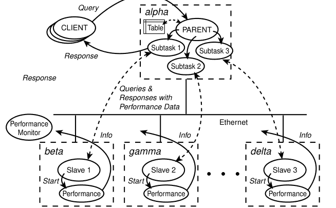

图 7.2 主从接口。

当远程从机进程的数量已知，主机将为每个进程预建立一个专用本地子任务。父任务将检测查询的就绪状态，根据本地使用率数据选择远程从机，并将查询分配给相应的子任务。这为你提供了并行性优势，并将更新的负担转移到关联子任务。

进一步的优势是故障检测：从本地子任务到远程从机进程的通信链路可以指示进程失败，并在产生怀疑时作为确认或否认的的。同样，任何的从进程可以检测主进程的故障——或者至少是其关联子任务的故障。本地子任务可以通过发送 UDP 数据报来重启失败的远程从进程，就像父进程在初始化时做的那样，而无需父进程参与。

这些进程的完整源代码列表位于书末的附录中。源代码也可以在 `www.samspublishing.com` 获取，并可以免费下载。鼓励你对这些设计问题的解决方案进行实验，而拥有这些代码作为起点将帮助你实现。

## 系统局限性

最明显的局限性是主进程是一个单点故障。如果主进程故障，整个服务器也会随之故障。一个容错解决方案会检测主进程故障并进行选举。其中一个从系统将承担主进程的角色，并接管可能故障机器的 IP 地址。当查询来自外部客户端时，通常只有一个发布的 IP 地址和端口号，所有查询都发送到那里。发布一个 IP 地址，主进程将其作为别名并接收发送至该 IP 的数据包。当主进程故障时，另一个进程可以通过发送免费 ARP（地址解析协议）消息来接管该地址，但这超出了本书的范围。（参见本章的“延伸阅读”部分）。

## 总结

本章的重点是服务器。你从简单开始，逐步构建出适应集群架构的主从接口中心。

这始于一个客户端和一个简单的应用程序。首先引入了最简单的服务器版本并将其转换为并发服务器——它通过产生子任务来处理每个到达的查询，从而利用了输入查询的并行性。最后，预先使用了创建子任务池的更复杂的方法。最后，通过创建与远程进程数量相同的子任务，将这种子任务扩展到了集群架构领域。这种架构利用了多计算机或集群架构所提供的并行性。

在下一章中，你将了解到系统的性能如何，其详细程度将帮助你微调该系统以满足客户的预期需求。

## 延伸阅读

- Stevens, W. Richard. TCP/IP Illustrated. Vol. 1. Reading, MA: Addison-Wesley, 1994.

## 外部性能测量与分析

## 本章内容

- 查询生成
- 间隔到达时间分布
- 检查响应准确性
- 估算并显示网络利用率
- 显示响应时间
- 你的 MSI 服务器的外部性能
- 延伸阅读

为什么要测量服务器的外部性能？简短的回答是因为那是你的客户关心的：整个系统的响应时间。

服务器是你的集群系统——包括它的硬件和软件。客户端由运行在某些外部机器上的一个或多个进程表示，你对这些机器几乎所知。你想为客户提供最好的服务，而客户通常以*响应时间*来衡量服务质量，即他们等待服务器响应查询的时间。

你可以从客户端的角度出发，通过从外部观察服务器来测量响应时间，就像把它看作一个黑盒，唯一可识别的特征就是它的输入和输出。查看服务器的外部性能意味着测量在各种负载条件下，获得你查询的适当响应所需的平均时间。

本章展示了如何设计一个查询生成客户端，该客户端可以同时对服务器进行压力测试并报告其性能。你在上一章中看到过一个简单的客户端（参见列表 7.1），它以恒定的速率进行查询。在本章中，使用了另外三种间隔到达时间（IAT）分布来对服务器进行压力测试，并相应更新了列表 7.1 中的客户端。

当外部性能不理想时，你需要另一种替代方法。在下一章中，你将观察服务器内部，将其视为白盒，并发现响应时间花在了哪里，并尽可能地减少。

# 第 8 章 外部性能测量与分析

## 查询生成

回想列表 7.1 中的客户端程序。它记录当天的时间并创建一个子任务来发送每个查询。当父进程重新获得控制权时，它计算 IAT 中剩余的时间，并在发送另一个查询之前等待。客户端实现了恒定的 IAT——每个查询在一段时间后紧随其后。如果我们的世界也是有条理的该好了！

在像银行柜台窗口这样平庸的案例中，到达率引起了早期效率专者的兴趣，他们认为一种名为队列论的数学分支是此的直接结果。队列论允许银行经理预测在某周的某天的某个时间段需要多少个柜台员。电话公司可以确定有多少个电话局可以连接到调频线路，航空公司可以根据客户的历史行为记录决定调度多少航班。计算机科学家使用队列论来预测网络节点之间所需的带宽，并确定特定服务可以支持多少用户。这是非常强大的，但它超出了本书的范围。关于此主题的经典著作在本章末尾的“延伸阅读”部分有所引用。

那些效率专家坐在柜台窗口前，记录下每个银行客户到达的确切时间。现代的观察者更有可能是路边的小金属盒子。它有一条横跨每辆汽车轮胎的长黑色橡胶传感器，当轮胎滚过传感器时，就会记录当天的时间。盒子在一天结束时被捡起。

### 表格 8.1 离散到达时间分布

| IAT (秒) | 观测次数 | 观测百分比 | 累积概率 |
| :--- | :--- | :--- | :--- |
| 1-10 | 52 | 26% | .26 |
| 11-20 | 42 | 21% | .47 |
| 21-30 | 32 | 16% | .63 |
| 31-40 | 26 | 13% | .76 |
| 41-50 | 16 | 8% | .84 |
| 51-60 | 12 | 6% | .90 |
| 61-70 | 8 | 4% | .94 |
| 71-80 | 6 | 3% | .97 |
| 81-90 | 4 | 2% | .99 |
| 91-100 | 2 | 1% | 1.00 |
| **总计** | **200** | **100%** | |

## 查询生成（续）

要分析此表中的数据，对第二列的观测次数求和。在第三列中，计算每个类别占的百分比；它们总和应为 100%。你可以将每个类别的百分比除以 100 视为概率，从而产生一列零到一之间的数值。

> 注意
> 此分析源自 Gordon 的《系统仿真》，该书在本章末尾的“延伸阅读”部分被引用。任何关于该主题的都会以类似的详细程度涵盖这些内容。

最后一列的累积概率非常重要，因为你可以使用这些值来模拟你之前的查询流。方法如下：

查看列表 7.1，查看你是如何使用标准 `rand()` 函数计算 1 到 99 之间的随机数字的。你可以在客户端进程中使用类似的技术，在发送下一个查询之前计算随机延迟：即一组分布的（而非恒定的）IAT。此外，如果你按照表 8.1 所示的代表的查询来处理这些查询，你将得到几乎相同的分布；生成和统计的数字越多，就越接近原始观测数据。

# 第 8 章 外部性能测量与分析

# 列表 8.1 继续

```c
int itab[NUM];      /* 范围槽内观测值的计数 */
int ii, jj;
srand((unsigned int) getpid()); /* 为 rand() 设置种子 */
/*
** 生成延迟时间
*/
for(ii=0; ii<MAX; ii++) {
    /* 从 .0 到 1.0 的随机值 */
    random = rand() / (double) RAND_MAX;
    /* 匹配时间槽 */
    for(jj=0; jj<NUM; jj++) {
        if(random <= probs[jj])
            break;
    }
    /* 每个槽位内的随机值 */
    random = rand() / (double) RAND_MAX;
    delay = (double) slots[jj] - (random * (double) slots[0]);
}
************************************/
*** 在计算的延迟后发送每个查询 ***/
************************************/
}
```


第一个随机数用于搜索之前建立的累积概率分布，以推导出延迟类别。第二个随机数用于在该类别内（均匀地）选择一个值。结果将产生 200 次（由 `MAX` 定义）延迟时间，其分布与你之前的观测相同。

## 到达间隔时间（IAT）分布

当观测值不符合任何明显模式时，我们的推导技术非常强大且完美。然而，实际的 IAT 通常遵循某种模式。如果你将表 8.1 中累积概率列中的数据绘制图，你可能会识别出这是指数衰减。与其列出观测数据，可以使用指数分布或其他符合你数据的函数来生成查询 IAT。你将发现如何生成指数分布 IAT，并学习其他一些更简单的分布。

均匀分布意味着某个范围内的每个值被选中的概率相等；每个可能值的被选中概率相同。C 语言有 `srand()` 和 `rand()` 函数。你可以使用 `random = rand()/(double)RAND_MAX;` 来获取一个 0.0 到 1.0 之间的随机数。

注意列表 8.1 中如何使用 `srand()` 为随机数生成器函数 `rand()` 设置种子。在这个示例中，你使用了返回进程 ID 的 `getpid()`。你也可以使用 `getofday()` 函数返回的微秒。

### 注意

种子不需要是随机数，只要每次运行时都不同，假设你希望每次都得到一组不同的结果。

为了获得按指数分布或其他方式分布的随机数，你可以使用均匀分布的随机数作为起点。在选择了一个均匀值后，你可以使用它来计算你想要的任何分布中的值，只要你知道公式即可。如果数据表明查询 IAT 是呈指数分布的，你可以使用公式：

```
y = 1 - e^-As [公式 8.1]
```

代表指数衰减，其中 `A` 是期望的平均值，或即平均 IAT。从一组均匀分布的随机数生成指数分布的随机数需要使用反函数，其中 `y` 表示为 `x` 的函数。（更多细节请参阅“进一步阅读”章节中的书籍）。公式 8.1 的逆公式是公式 8.2：

```
x = -A * log(y) [公式 8.2]
```

这在 C 语言中可以实现：

```c
#include <math.h>

double x, y, a = 1.0;

random = rand()/(double)RAND_MAX;

random = -a * log(random);
```

这给了你快速减少的 IAT 值，范围从无穷大到 0.0，大约一半的值在 1.0 以下。你可能想通过以下限制最大值：

```c
if(random > 10.0)
  random = 10.0;
```

或调整平均值 (`A`) 以适应你的需求。最近指数分布分析的结果见图 8.1。

## 指数分布

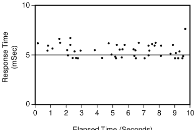

**图 8.1** 指数分布。

其他类型的 IAT 分布要容易实现得多。接下来讨论的两种被称为扫描（sweep）和脉冲（pulse）。

扫描分布从某个高 IAT 值开始，并逐渐减小（增加发送速率），直到你选择的低 IAT 值。程序段实现扫描分布的方式所示：

```c
double ht=25L, lt=0001, dt, iat;
int ii, steps = 100;
dt = (ht - lt) / (double) steps;
for(ii=0; ii<steps; ii++) {
  iat = ht - ((double) steps * dt);
  *** 为计算的 iat 延迟 ***
  *** 然后发送一个查询包 ***
}
```

注意用于你选择的 `ht`（高时间值）、`lt`（低时间值）和 `steps` 值。例如，你可以将这种分布与列表 7.1 中的发送并等待方案一起使用。最近扫描分布分析的结果见图 8.2。

### 扫描分布

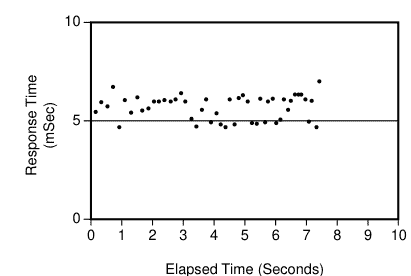

图 8.2 扫描分布。

你可能想使用的另一种 IAT 分布被称为脉冲（pulse），或脉冲串分布（pulse train）。一系列等间距的高 IAT（慢）查询后是一系列爆发的低 IAT（快）查询。在爆发之后，数据流恢复到高 IAT 值，直到发送最后一个查询。

```c
double ht=25L, lt=001, iat;
int start = 6; stop = 8;
int ii, total = 100;
for(ii=0; ii<total; ii++)
{
    if((ii < start) || (ii >= stop))
    iat = ht;
    else
    iat = lt;
*** 为 iat 延迟 ***
*** 然后发送查询 ***
}
```

再次，变量的选择由你决定，如果需要可以使用列表 7.1 中的发送并等待方案。你可以在图 8.3 中看到脉冲分布的结果。


图 8.3 脉冲分布。

## 准确响应

种子不需要是随机数，只要每次运行时都不同，假设你希望每次都得到一组不同的结果。

为了获得按指数分布或其他方式分布的随机数，你可以使用均匀分布的随机数作为起点。在选择了一个均匀值后，你可以使用它来计算你想要的任何分布中的值，只要你知道公式即可。如果数据表明查询 IAT 是呈指数分布的，你可以使用公式：

```
y = 1 - e^-As [公式 8.1]
```

代表指数衰减，其中 `A` 是期望的平均值，或即平均 IAT。从一组均匀分布的随机数生成指数分布的随机数需要使用反函数，其中 `y` 表示为 `x` 的函数。（更多细节请参阅“进一步阅读”章节中的书籍）。公式 8.1 的逆公式是公式 8.2：

```
x = -A * log(y) [公式 8.2]
```

这在 C 语言中可以实现：

```c
#include <math.h>

double x, y, a = 1.0;

random = rand()/(double)RAND_MAX;

random = -a * log(random);
```

这给了你快速减少的 IAT 值，范围从无穷大到 0.0，大约一半的值在 1.0 以下。你可能想通过以下限制最大值：

```c
if(random > 10.0)
  random = 10.0;
```

或调整平均值 (`A`) 以适应你的需求。最近指数分布分析的结果见图 8.1。

## 估计与显示网络利用率

当观测值不符合任何明显模式时，我们的推导技术非常强大且完美。然而，实际的 IAT 通常遵循某种模式。如果你将表 8.1 中累积概率列中的数据绘制图，你可能会识别出这是指数衰减。与其列出观测数据，可以使用指数分布或其他符合你数据的函数来生成查询 IAT。你将发现如何生成指数分布 IAT，并学习其他一些更简单的分布。

均匀分布意味着某个范围内的每个值被选中的概率相等；每个可能值的被选中概率相同。C 语言有 `srand()` 和 `rand()` 函数。你可以使用 `random = rand()/(double)RAND_MAX;` 来获取一个 0.0 到 1.0 之间的随机数。

注意列表 8.1 中如何使用 `srand()` 为随机数生成器函数 `rand()` 设置种子。在这个示例中，你使用了返回进程 ID 的 `getpid()`。你也可以使用 `getofday()` 函数返回的微秒。

种子不需要是随机数，只要每次运行时都不同，假设你希望每次都得到一组不同的结果。

为了获得按指数分布或其他方式分布的随机数，你可以使用均匀分布的随机数作为起点。在选择了一个均匀值后，你可以使用它来计算你想要的任何分布中的值，只要你知道公式即可。如果数据表明查询 IAT 是呈指数分布的，你可以使用公式：

```c
y = 1 - e^-As [公式 8.1]
```

代表指数衰减，其中 `A` 是期望的平均值，或即平均 IAT。从一组均匀分布的随机数生成指数分布的随机数需要使用反函数，其中 `y` 表示为 `x` 的函数。（更多细节请参阅“进一步阅读”章节中的书籍）。公式 8.1 的逆公式是公式 8.2：

```
x = -A * log(y) [公式 8.2]
```

这在 C 语言中可以实现：

```c
#include <math.h>

double x, y, a = 1.0;

random = rand()/(double)RAND_MAX;

random = -a * log(random);
```

这给了你快速减少的 IAT 值，范围从无穷大到 0.0，大约一半的值在 1.0 以下。你可能想通过以下限制最大值：

```c
if(random > 10.0)
  random = 10.0;
```

或调整平均值 (`A`) 以适应你的需求。最近指数分布分析的结果见图 8.1。

其他类型的 IAT 分布要容易实现得多。接下来讨论的两种被称为扫描（sweep）和脉冲（pulse）。

扫描分布从某个高 IAT 值开始，并逐渐减小（增加发送速率），直到你选择的低 IAT 值。程序段实现扫描分布的方式所示：

```c
```


`double ht=25L, lt=0001, dt, iat;`

`int ii, steps = 100;`

`dt = (ht - lt) / (double) steps;`

```
for(ii=0; ii<steps; ii++) {
  iat = ht - ((double) steps * dt);
  *** 为计算的 iat 延迟 ***
  *** 然后发送一个查询包 ***
}
```

注意用于你选择的 `ht`（高时间值）、`lt`（低时间值）和 `steps` 值。例如，你可以将这种分布与列表 7.1 中的发送并等待方案一起使用。最近扫描分布分析的结果见图 8.2。

你可能想使用的另一种 IAT 分布被称为脉冲（pulse），或脉冲串分布（pulse train）。一系列等间距的高 IAT（慢）查询后是一系列爆发的低 IAT（快）查询。在爆发之后，数据流恢复到高 IAT 值，直到发送最后一个查询。

```c
double ht=25L, lt=001, iat;
int start = 6; stop = 8;
int ii, total = 100;
for(ii=0; ii<total; ii++)
{
    if((ii < start) || (ii >= stop))
    iat = ht;
    else
    iat = lt;
*** 为 iat 延迟 ***
*** 然后发送查询 ***
}
```

再次，变量的选择由你决定，如果需要可以使用列表 7.1 中的发送并等待方案。你可以在图 8.3 中看到脉冲分布的结果。


图 8.3 脉冲分布。

每秒读取并处理一次文本，因此它们对节点资源的影响非常低。即使显示进程未运行，它们也可能在运行。发送到显示进程的 UDP 包将被忽略。你可以根据方便随时启动和停止显示进程，而自动启动的统计收集器将继续运行。

### 列表 8.2 收集性能统计并发送到列表 8.3 中的集中化显示程序

```c
#include <netinet/in.h>
#include <sys/socket.h>
#include <string.h>
#include <netdb.h>
#include <stdio.h>
#include "Listing8.2.h"
main(int argc, char *argv[])
{
/*
 ** Listing8.2.c - 收集并将发送统计数据到 Listing8.3.c
 */
  struct sockaddr_in soc;
  struct cprStats stats;
  struct hostent *hp;
  long use0, use1; /* user */
  long nsec0, nsec1; /* nice */
  long ssec0, ssec1; /* system */
  long isec0, isec1; /* idle */
  long rpkts0, rpkts1; /* rcvd */
  long spkts0, spkts1; /* sent */
  long tmem, umem;
  long rio0, riof;
  long wio0, wio1;
  FILE *fptr;
  float fcpu;
  float femem;
  int ii, jj;
  int cpu;
  int isem;
  int sum;
  int fd;
  char local[16];
```

#### LISTING 8.2 继续

```c
char remote[16];
char buf[256], *p;
if(argc == 2)
{
    printf("\nUsage: %s <hostname>\n\n", argv[0]);
    exit(-1);
}
/* 获取远程主机名 */
strcpy(remote, argv[1]);
/* 也获取本地主机名 */
gethostname(local, sizeof(local));
if((p = strchr(local, '.')) != NULL)
    *p = '\0'; /* 截断域名.name */
/*
** 集中性能报告套接字
*/
fd = socket(AF_INET, SOCK_DGRAM, 0);
memset((char *) &soc, 0, sizeof(soc));
hp = gethostname(remote);
memcpy(&soc.sin_addr, hp->h_addr, hp->h_length);
soc.sin_family = AF_INET;
/*
** 初始 CPU 利用率
*/
fptr = fopen("/proc/stat", "r");
gets(buf, sizeof(buf), fptr);
if((strlen(buf)-1) == 0)
    sscanf(buf, "%s %ld %ld %ld %ld",
        &use0, &nsec0, &isec0);
/*
** 初始磁盘 I/O 速率（在 /proc/stat 中）
*/
while((fgets(buf, sizeof(buf), fptr)) != NULL)
{
    if(strncmp(buf, "disk_", 5) == 0)
        break;
}
```

#### LISTING 8.2 继续

```c
sscanf(buf, "%s %ld", &rio0);
fgets(buf, sizeof(buf), fptr);
sscanf(buf, "%s %ld", &wio0);
close(fptr);
```

```c
/*
** 初始网络 I/O 速率
*/
fptr = fopen("/proc/net/dev", "r");
/* 跳过 net/dev 中的列头字符串 */
fgets(buf, sizeof(buf), fptr);
fgets(buf, sizeof(buf), fptr); /* 跳过 */
fgets(buf, sizeof(buf), fptr); /* 跳过 */
fgets(buf, sizeof(buf), fptr); /* eth0 */
buf[strlen(buf)-1] = 0; /* 覆盖 '\n' */
buf[6] = ' '; /* 覆盖 ':' */
sscanf(buf, "%s %ld %d %d %d %ld", &pkts0, &fptr);
close(fptr);
```

```c
/*
** 统计收集循环
*/
while(1) {
/*
** 实际内存利用率
*/
fptr = fopen("/proc/meminfo", "r");
/* 跳过头 * */
fgets(buf, sizeof(buf), fptr);
fgets(buf, sizeof(buf), fptr);
buf[strlen(buf)-1] = 0;
sscanf(buf, "%s %ld", &tmem, &umem);
fmem = (float) umem / (float) tmem;
stats.rm = (int) 100 * (fmem + .005);
close(fptr);
```

```c
/*
** 随后的 CPU 利用率
*/
fptr = fopen("/proc/stat", "r");
```

#### LISTING 8.2 继续

```c
fgets(buf, sizeof(buf), fptr);
buf[strlen(buf)-1] = 0;
sscanf(buf, "%s %ld %ld %ld %ld",
    &usec1, &nsec1, &ssec1, &isec1);
/* 计算 CPU 利用率 */
usec1 = use0; /* 1秒用户计数器 */
sec1 = nsec0; /* nice */
ssec1 = ssec0; /* system */
isec1 = isec0; /* idle */
fcpu = (float)(usec1 + nsec1 + ssec1) / (float)(usec1 + ssec1 + isec1);
stats.cp = (int) 100 * (fcpu + .005);
/* 随后的磁盘 I/O 速率（在 /proc/stat 中） */
while(fgets(buf, sizeof(buf), fptr)) != NULL)
{
    if(strncmp(buf, "disk_", 8) == 0)
        break;
}
sscanf(buf, "%s %ld", &rio1);
```


`fgets(buf, sizeof(buf), fptr);`

`sscanf(buf, "%s %ld", &wio1);`

`close(fptr);`

/* 计算 I/O 速率 */

`stats.dr = (rio1 - rio0) / 5;`

`stats.dw = (wio1 - wio0) / 5;`

`close(fptr);`

/*

 随后的网络 I/O 速率

*/

`ptr = fopen("/proc/net/dev", "r");`

/* 跳过 net/dev 中的列头 */

`fgets(buf, sizeof(buf), fptr);` /* 跳过 */

`fgets(buf, sizeof(buf), fptr);` /* 跳过 */

`fgets(buf, sizeof(buf), fptr);` /* 跳过 */

`fgets(buf, sizeof(buf), fptr);` /* eth0 */

## 第8章 外部测量与分析

(注：由于提供的文本包含大量重复和混乱的片段，此处已根据要求清理并翻译了核心逻辑部分)

注意，需要具备性能信息包结构以及目标端口地址的通用知识。列表 8.2 和 8.4 中引用的头文件如下：

```c
#define PORT 9090

struct cprStats
{
    int cp; /* cpu利用率 */
    int rm; /* mem利用率 */
    int ps; /* 发出的包 */
    int pr; /* 接收的包 */
    int dr; /* 磁盘读取 */
    int dw; /* 磁盘写入 */
} cprStats;
```

每次重绘显示区域之前读取四个入站包的方法似乎并不优雅。它假设一切运行正常，因此缺乏健壮性。你目前可以忽略这一点；你将将在第 10 章“健壮的软件”中学习更多关于软件健壮性的问题。

### 显示响应时间统计

列表 7.1 中的子任务可以记录发送查询的时间、接收相应响应的时间，并可以轻松计算出每个响应的时间。它还可以将这些信息存储在客户端父任务为此目的设置的共享内存中。你可能希望子任务在共享内存中记录各个响应时间，而由父任务报告不断变化的外部性能。

列表 7.1 中的父任务等待 IAT 的剩余部分，如果准备和发送查询所需的时间超过了该值，它会发出错误消息。假设它可以在 IAT 限制范围内工作并在继续之前必须等待，它完全可以花一点时间来更新响应时间分类数组。当数据流完成后，它可以在条形图表中显示这些响应时间，如图 8.5 所示。基于字符的展示是为了简单。

列表 8.4 显示了一个支持指数、脉冲分布和扫描分布的客户端进程，并展示了整体响应时间统计的条形图。

#### 观察

| 响应时间 (毫秒) | 10 | 20 | 30 | 40 | 50 |
|---|---|---|---|---|---|
| 1 10 | * | | | | | |
| 11 20 | ... | | | | | | |
| 21 30 | ***** | | | | | | |
| 31 40 | ****** | | | | | | |
| 41 50 | ********** | | | | | | |
| 51 60 | ****** | | | | | | |
| 61 70 | ************ | | | | | | |
| 71 80 | ********** | | | | | | |
| 81 90 | ************* | | | | | | |
| 91 100 | ********* | | | | | | |
| 101 110 | ********** | | | | | | |
| 111 120 | ****** | | | | | | |
| 121 130 | ***** | | | | | | |
| 131 140 | ** | | | | | | |
| 141 150 | * | | | | | | |
| 151 160 | | | | | | | |
| 161 170 | | | | | | | |
| 171 180 | ** | | | | | | |
| 181 190 | * | | | | | | |

150 总观察次数

图 8.5 以直方图显示的响应时间。

### 列表 8.4: 客户端报告响应时间统计

```c
#include <math.h>
#include <stdio.h>
#include <stdlib.h>
#include <unistd.h>
#include <string.h>
#include <sys/ipc.h>
#include <sys/shm.h>
#include <sys/time.h>
#include <sys/types.h>
#include <sys/socket.h>
#include <netinet/in.h>
#include <netdb.h>
#include "msi.h"
#define FALSE 0
#define TRUE 1
#define NUM 50
#define CATS 20 /* 响应时间分类值 */
double cats[CATS] = {.010, .020, .030, .040, .050,
              .060, .070, .080, .090, .100,
              .110, .120, .130, .140, .150,
              .160, .170, .180, .190, .200};
int bars[CATS] = {}; /* 条形字符的计数器 */
main(int argc, char *argv[]) {
    /*
    列表 8.4.c 客户端：报告响应时间统计
    */
    struct timeval bef; /* 转换后的定时器值 */
    struct sockaddr_in sock; /* 套接字结构 */
    struct hostent *hp; /* IP 地址结构 */
    int flag = (IPC_CREAT | IPC_EXCL | 0660);
    int size = NUM * sizeof(double);
    key_t key_t = &0x1234567; /* 示例共享内存键 */
    int shmid; /* 共享内存区域 */
    int Expon = FALSE; /* 布尔值：指数 */
    int Pulse = FALSE; /* 布尔值：脉冲 */
    int Sweep = FALSE; /* 布尔值：扫描 */
    double mean = 0.04; /* 指数平均值 */
    double slow = 0.25; /* 脉冲慢值 */
    double fast = 0.05; /* 突发快值 */
    double random; /* 随机数：0->1 */
    double delay; /* 计算的延迟 */
    long timeleft; /* 剩余 IAT */
    long usec = 0; /* 间隔到达微秒 */
    long secs = 0; /* 剩余秒数 */
    int pids[NUM]; /* 子任务 ID */
    int opt; /* setsockopt 参数 */
    int fd;
    int ii, kk = 0; /* 套接字描述符 */
    char buf[BUFSIZE], *p;
    if (argc != 3) {
        printf("\tUsage: %s <HOST> <DISTRIBUTION>\n", argv[0]);
        exit(1);
    }
    hp = gethostbyname(argv[1]);
    if (argv[2][0] == 'e') {
        Expon = TRUE;
        srand((unsigned int)gettime());
// ... (后续代码不完整)
```

## 你的 MSI 服务器的外部性能

### 列表 8.4 续

```c
printf("*----------------+----------------+----------------+----------------+----------------+*\n");
ii = 0;
for(jj=0; jj<CATS; jj++) {
    ii += bars[jj];
    kk = 1000 * cats[jj];
    printf("%5$d | ", kk-9, kk);\n;
    for(kk=0; kk<bars[jj]; kk++) {
        printf("**");
    }
    printf("\n");
}
```


```
printf("%d Total Observations\n", ii);

/* remove unused shared memory area and exit */

shmctl(shmid, IPC_RMID, (struct shmid_ds *)0);

return(0);
```

在这里，列表 8.4 中的客户端与附录 A“源代码”中的主进程和从进程之间也存在共同知识。下面是较短的文件 `msi.h`。

```c
#define QUERYLINK 9000

#define BROADCAST 5000

#define REGISTERS 5001

#define SLAVLINK 5002

#define BUFSIZE 256
```


查询包的最大尺寸（`BUFSIZE`）和主进程查询端口（`QUERYLINK`）对于客户端以及主进程及其从进程来说都是非常重要的。

## 你的 MSI 服务器的外部性能

现在客户端（见列表 8.4）已经足够能够向你的 MSI 集群呈现一系列查询，是时候运行一些初步测试以获取基准统计了。当你检查内部性能并进行改进时，可以将这些图与你获得的新图进行比较，看看你的操作是否有任何益处。

图 8.6、8.7 和 8.8 分别显示了指数分布、脉冲分布和扫描分布的总响应时间条形图。正如每个图表底部所示，每次运行都发送了一个 50 个包的数据流。

# 第 8 章 外部性能测量与分析

## 观测结果

| 响应时间 (msec) | 10 | 20 | 30 | 40 | 50 |
|---|---|---|---|---|---|
| 1 | 10 | | | | | |
| 11 | 20 | * | | | | |
| 21 | 30 | * * * | | | | |
| 31 | 40 | * * * * | | | | |
| 41 | 50 | * * * * * | | | | |
| 51 | 60 | * * * * * * | | | | |
| 61 | 70 | * * * * * * * | | | | |
| 71 | 80 | * * * * * * * * | | | | |
| 81 | 90 | * * * * * * * * * | | | | |
| 91 | 100 | * * * * * * * * * * | | | | |
| 101 | 110 | * * * * * * * * * * * | | | | |
| 111 | 120 | * * * * * * * * * * * * | | | | |
| 121 | 130 | * * * * * * * * * * * * * | | | | |
| 131 | 140 | * * * * * * * * * * * * * | | | | |
| 141 | 150 | * * * * * * * * * * * * * * * | | | | |
| 151 | 160 | * * * * * * * * * * * * * * * * | | | | |
| 161 | 170 | * * * * * * * * * * * * * * * * * | | | | |
| 171 | 180 | * * * * * * * * * * * * * * * * * * | | | | |
| 181 | 190 | * * * * * * * * * * * * * * * * * * * | | | | |
| 191 | 200 | * * * * * * * * * * * * * * * * * * * * | | | | |

50 次总观测

### 图 8.6 指数分布——实时测试结果。

## 观测结果

| 响应时间 (msec) | 10 | 20 | 30 | 40 | 50 |
|---|---|---|---|---|---|
| 1 | 10 | | | | | |
| 11 | 20 | * | | | | |
| 21 | 30 | * * * | | | | |
| 31 | 40 | * * * * | | | | |
| 41 | 50 | * * * * * | | | | |
| 51 | 60 | * * * * * * | | | | |
| 61 | 70 | * * * * * * * | | | | |
| 71 | 80 | * * * * * * * * | | | | |
| 81 | 90 | * * * * * * * * * | | | | |
| 91 | 100 | * * * * * * * * * * | | | | |
| 101 | 110 | * * * * * * * * * * * | | | | |
| 111 | 120 | * * * * * * * * * * * * | | | | |
| 121 | 130 | * * * * * * * * * * * * * | | | | |
| 131 | 140 | * * * * * * * * * * * * * | | | | |
| 141 | 150 | * * * * * * * * * * * * * * * | | | | |
| 151 | 160 | * * * * * * * * * * * * * * * * | | | | |
| 161 | 170 | * * * * * * * * * * * * * * * * * | | | | |
| 171 | 180 | * * * * * * * * * * * * * * * * * * | | | | |
| 181 | 190 | * * * * * * * * * * * * * * * * * * * | | | | |
| 191 | 200 | * * * * * * * * * * * * * * * * * * * * | | | | |

50 次总观测

### 图 8.7 脉冲分布——实时测试结果。

图 8.9 扫描分布——性能显示。

## 总结

本章首先介绍了生成并向服务器发送查询以及如何从观测数据计算 IAT。你查看了指数分布中如何生成查询，数据可以用公式描述。最后，你看到了两种分布：扫描和脉冲。

你学习了如何计算节点负载（CPU、内存和磁盘/O）以及从所有节点收集这些统计数据并实时显示。你更新了上一的程序以支持三种新的分布，并学习了如何在条形图中显示总响应时间。

最后，展示了扫描分布的实时测试条形图。

你的主从接口运行在你由四台 PC 和一些网络硬件构建的集群上。你有一个可以对其进行压测的客户端进程，一个可以测量每个节点压力水平的性能监控器，以及可以显示它们正在经历的显示程序。你拥有第一组代表集群整体性能的实时数据，这正是你在本章开头想要做的。

在第 9 章“内部性能测量与调优”中，你将学习计时以及如何将查询处理分解为各个阶段、对其计时并进行分析。目标是找到可以加速的部分，从而提高你系统的整体性能——这正是客户想要的。

## 扩展阅读

- Evans, M., Hastings, and B. Peacock. Statistical Distributions. New York, NY: John Wiley and Sons, 1993.
- Gordon, Geoffrey. System Simulation. Englewood Cliffs, NJ: Prentice-Hall, 1969.
- Kleinrock, Leonard. Queueing Systems, Volume I: Theory, and Volume II: Computer Applications. New York, NY: John Wiley and Sons, 1975.
- Rusling, David, et al. Linux Programming Papers. Scottsdale, AZ: Coriolis Press, 1999.

# 第 9 章 内部性能测量与计时

## 本章内容

- 软件分析 (Profiling)
- 分布式系统分析
- 事件计时技术
- 执行阶段计时图
- 系统性能改进
- 最终 MSI 性能结果
- 扩展阅读

为什么要测量集群服务器的内部性能？你在第 8 章“外部性能测量与分析”中学习了如何测量外部性能。如果你对外部性能结果不满意，并想知道服务器在处理每个输入查询时时间花在哪里，在本章中，你将查询处理分为若干阶段，测量每个阶段完成所需的时间，并将阶段完成时间以条形图的形式呈现分析。这种图被称为阶段执行分析，示例如图 9.1 所示。每个条形代表从左到右执行顺序的单个执行阶段。每个条形的高度代表该阶段的平均执行时间。

某些阶段可能比其他阶段复杂，因此完成时间更长。在设计了处理架构后，你对一个阶段与其他阶段相比会有良好的感觉。通过网络发送数据将比跨内部数据总线慢得多。通常情况下，TCP/IP 链路的开销更大，传输比 UDP/IP 链路慢。虽然存在规则，但如果你猜错了哪些阶段更长，也不要意外。

如果认为两个或多个阶段消耗的时间相同但事实并非如此，请在执行时间异常长的阶段中寻找节省时间的改进方法。最后，重新运行内部性能分析，看看你的更改是否导致了性能提升。

## 主从-执行阶段时间

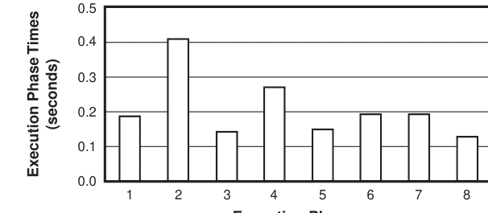

**图 9.1** 执行阶段分析示例。

在本章中，你将看到主从接口 (`MSI`) 处理被分解为执行阶段。用于这些阶段计时的源代码将进行详细介绍和讨论。实际计时运行的结果将被图表化并分析。对异常长的阶段进行了调查，你将看到为了缩短执行时间做了什么。最终的计时数据将帮助你量化相对于第 8 章所示的基准数据的任何性能改进。

分布式系统执行性能分析

155

## 注意

代码性能分析变得更容易了，因为今天的工具比以往任何时候都更优秀。然而，代码优化仍然需要大量人才，因为开发者必须理解，例如，数组的索引引用与增量指针引用相比要慢得多。开发者还必须理解，优化编译器可能会为这两种方法生成相同的机器级代码，而出于文档编写的考虑，数组索引可能是更好的选择。（别忘了那些之后可能需要调试你代码的人）

了解目标平台汇编语言的知识，或者至少了解某组指令的通用硬件要求，可以在优化工作期间节省大量时间。

如果你以以固定的间隔对程序的执行点进行采样，那么你观察到执行特定阶段的次数百分比，就是该阶段所占时间百分比的良好表示。当然，这是一种统计结果，样本量越大，代表性越好。由于采样不需要了解进程内部细节，它可能是获取执行性能分析的最优方法。

直接测量——此处使用的技术——可以给出更准确的结果，但你必须知道如何进行测量。

`MSI` 是一个分布式系统——在节点网络上运行的多个任务共同协作解决传入的查询。单独对每个程序进行性能分析可能很有帮助，但使用本章概述的阶段计时和报告技术应该让你对更广泛的性能问题产生洞察。分布式系统的整体处理时间受进程间通信的影响很大，例如，这是无法用简单的性能分析工具衡量的。再次查看图 7.2 `MSI` 架构图，刷新你对这些进程如何交互的记忆。

## 分布式系统执行性能分析

`MSI` 服务器响应传入的查询，每个查询都以相同的方式处理。这意味着处理阶段可以线性排序。请记住，更复杂的系统——例如根据内容不同处理查询的系统——其阶段在时间上可能有树形顺序。在某些情况下，将每个处理分支视为独立的服务并分别进行分析。

要问第一个问题是：“处理单个传入查询需要哪些执行阶段？”记住，你不能将思维限制在构建响应阶段，而要涵盖支持它的所有集群管理。让我们看看服务器处理查询执行了哪些步骤。

## 第 9 章 内部性能测量与计时

1. 主节点（从其池中）选择一个本地子任务来接收传入的查询：

在第 7 章“主从接口软件架构”中，你看到了并发服务器如何优于串行服务器，以及驻留子任务池如何减少创建新子任务处理传入查询的开销。在子任务池架构中，父任务必须从池中选择一个可用的子任务。这是执行的第一阶段。此阶段以及其他阶段可以通过阶段结束时间减去阶段开始时间来直接计时。

2. 被选中的子任务接收查询并将其传递给远程从进程：

每个子任务都与一个运行在集群远程节点上的从进程配对（参考图 7.2）。每个查询都被发送到远程从进程进行处理。此阶段包括数据包的准备，但不包括实际传输时间，后者包含在下一个阶段中。

3. 计算的主到从节点网络传输时间：

每个数据包从一个节点发送到另一个节点。在空闲网络中，这些传输时间是可预测的，但当网络上的多个节点竞争带宽时，网络访问时间可能会变得过长。

4. 从进程接收传入的查询并从中提取请求：

示例中的每个查询内部包含一个文件名和一个行号。在构建响应之前，这些细节从传入的查询中提取出来。

5. 从进程从共享文本文件中检索请求的文本行：

从进程打开指定的文件，读取请求的文本行，并关闭文件。

6. 从进程构建并将响应返回给主子任务：

请求的文本行被封装在响应包中。

7. 计算的从到主节点网络传输时间（与步骤 3 的传输时间相同）：

这是前一个阶段（阶段3）完全相反的路线，因此你可以假设在相似的网络利用率下，花费的时间大约相同。在两次往返期间网络负载可能是相同的，因为它们之间的时间间隔非常短，正如你将在本章随后的分析中学到的那样。分析是基于处理许多查询的平均时间图表的，因此往返时间中的意外差异将变得微不足道。

8. 主节点选中的子任务响应查询并声明自己为空闲：

子任务正在等待从进程处理请求。当响应到达时，子任务从从进程的执行阶段提取计时数据并发送给客户端。子任务重置其状态位，向主节点显示它是空闲的。

假设图 9.1 代表了这八个执行阶段，尽管它并非如此。在分析过程中，你可能会奇怪为什么阶段 3 和 7（网络传输时间）不相等。你可能还会奇怪为什么阶段 2 在投入如此少的情况下花费了那么长时间。这些是引导内部性能优化的问题。这些问题的答案以及随后的分析将带来更好的内部性能。它也会带来更好的外部性能，直接支持你的终极目标——客户满意度。

## 事件计时技术

大多数阶段将在同一个进程中开始和结束，且没有中间等待时间。然而，某些阶段将包含 I/O，某些阶段将跨越进程。简单事件使用 `gettimeofday` 函数很容易计时。该函数返回自 1970 年 1 月 1 日以来的微秒。秒以长整型（`time_t`）返回。你可以使用两个时间值来计算流逝的时间，如下所示：

```
```c
```


```c
#include <sys/time.h>

#include <unistd.h>

#include <stdio.h>

main(void) {
```
```
/*
9.1 一个计时阶段的程序
*/
```
```c
struct timeval time1, time2;
gettimeofday(&time1, NULL); /* 开始时间 */
```
```
（继续）
```
```c
/*（感兴趣的执行阶段） */
gettimeofday(&time2, NULL); /* 结束时间 */
time2.tv_sec -= time1.tv_sec;
time2.tv_use -= time1.tv_use;
if(time2.tv_use < 0)
{
time2.tv_use += 1000000L;
time2.tv_sec -= 1;
}
printf("Execution time %ld.%06 seconds\n", time2.tv_sec, time2.tv_use);
return(0);
}
```

大多数阶段将在同一个进程中开始和结束，且没有中间等待时间。然而，某些阶段将包含 I/O，某些阶段将跨越进程。简单事件使用 `gettimeofday` 函数很容易计时。该函数返回自 1970 年 1 月 1 日以来的微秒。秒以长整型（`time_t`）返回。你可以使用两个时间值来计算流逝的时间，如下所示：

# 执行阶段计时统计图

如前所述，在发送节点上请求查询发送时间，并在同一发送节点上请求接收响应的时间。你可以可靠地从同一个时钟中减去时间值，在这种情况下，得到的是往返传输时间加上远程从机节点的处理时间（如图 9.2 所示 A 所示）。阶段 4 到 6 是在远程节点上测量的并传回主节点的，在列表中仅增加一个事件时间成本并不高。

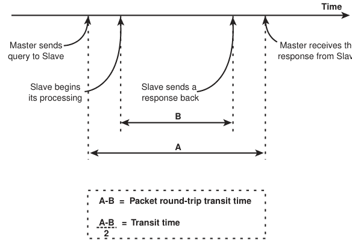

图 9.2 计算网络传输时间。

一种解决方案是在从机节点上请求查询接收时间和响应发送时间。这两个时间都来自从机的时钟，因此它们之间的差值就代表了整个从机处理时间（如图 9.2 所示的 B 所示）。从 A 中减去 B 得到往返传输时间；除以二得到单向传输时间。假设这两个时间在第 3 和第 7 阶段是相等且值相同的。任何由网络负载引起的差异都将变得不足道，因为分析处理的是大量此类估计。

# 执行阶段计时统计图

如前面的章节所述，主节点为每个注册的从机节点都有一个子任务。每个子任务与远程从机节点上的专用进程建立通信链接。主子任务向从机进程发送查询，从机返回响应。响应包中包含了从机节点的计时结果。

当子任务接收到此数据包时，它提取计时数据，将每个阶段的时间加入累加器中，并增加计数器，所有这些都在与父任务共享的内存中。

响应包具有以下结构：
```c
struct packet
{
/*
** 信息请求数据包
*/
#ifdef TIMING
/* 从机阶段时间 */
struct timeval remote;
struct timeval phase4;
struct timeval phase5;
struct timeval phase6;
#endif
char buffer[QUERYSIZE]; /* request * */
} packet;
```

当主节点将查询发送给从机时，缓冲区中包含查询；当从机将其返回时，它包含响应。注意，只有在开启计时时，计时结果（之前描述的三个从机阶段和整个从机处理时间）才会出现在包中。当服务器未进行计时性能测量时，数据包较小。

> /*
** 共享内存空间
```
```c
struct area
{
int flag[MAX]; /* 0:idle, 1:good, -exit */
#ifdef TIMING
int count[MAX]; /* 处理的查询数 * */
struct timeval phase2[MAX];
struct timeval phase3[MAX];
struct timeval phase4[MAX];
struct timeval phase5[MAX];
struct timeval phase6[MAX];
struct timeval phase7[MAX];
struct timeval phase8[MAX];
#endif
} area, *ptr;
```


每个子任务设置其标志位，向父任务指示其状态。在测量计时时，每个子任务通过包中的额外空间添加来自本地节点和远程节点的计时结果。

# 执行阶段计时统计图

主进程是手动启动的，并设计为捕获 `Ctrl+C` 中断，向其子任务发送终止消息，子任务反过来将其发送给其从机进程，从而（希望）实现分布式系统的优雅关机。（完整的源代码列表可用位于附录 A“源代码”，并可以从 Sams 网站下载源码。在 `http://www.samsublishing.com` 输入 ISBN 编号以获取更多信息）。主节点打印每个从机节点的阶段计时结果报告，以及整个系统的处理情况。图 9.3 显示了一份实际报告。

| SWEEP | SLAVENAME | PH | NUM | TOTAL | AVERAGE |
|---|---|---|---|---|---|
| | beta | | 1 | 0.391384 | 0.013978 |
| | | | 2 | 0.017312 | 0.000618 |
| | | | 3 | 0.036528 | 0.000769 |
| | | | 4 | 0.021074 | 0.000753 |
| | | | 5 | 0.208529 | 0.007447 |
| | | | 6 | 0.040456 | 0.001145 |
| | | | 7 | 0.028568 | 0.000789 |
| | gamma | 8 | 0.125714 | 0.004490 |
| | | | 1 | 0.312508 | 0.014881 |
| | | | 2 | 0.012343 | 0.009528 |
| | | | 3 | 0.193668 | 0.000880 |
| | | | 4 | 0.020774 | 0.002289 |
| | | | 5 | 0.230404 | 0.010953 |
| | | | 6 | 0.004376 | 0.002028 |
| | | | 7 | 0.193668 | 0.009222 |
| | | | 8 | 0.000228 | 0.024627 |
| | delta | 1 | 0.019779 | 0.019779 |
| | | | 2 | 0.000947 | 0.000947 |
| | | | 3 | 0.018193 | 0.018193 |
| | | | 4 | 0.002140 | 0.002140 |
| | | | 5 | 0.027182 | 0.027182 |
| | | | 6 | 0.000276 | 0.000276 |
| | | | 7 | 0.018193 | 0.018193 |
| | | | 8 | 0.002402 | 0.002402 |
| OVERALL | | | 1 | 0.723671 | 0.014473 |
| | | | 2 | 0.506802 | 0.000112 |
| | | | 3 | 0.418189 | 0.005364 |
| | | | 4 | 0.043988 | 0.000880 |
| | | | 5 | 0.465715 | 0.009314 |
| | | | 6 | 0.008798 | 0.001174 |
| | | | 7 | 0.418189 | 0.008364 |
| | | | 8 | 0.218344 | 0.004367 |

图 9.3 来自主节点的计时报告。

启动主进程后，你可以在客户端支持的任何到达间隔（IAT）分布中运行许多流测试数据包。当对计时结果感兴趣时，必须在每次测试后终止主节点（通过按下 `Ctrl+C`），以获得特定于该测试运行的报告。执行阶段计时统计图源于这些报告。图 9.4 是一个条形图形式的执行阶段计时统计图，它由三次计时运行构建——每个运行对应三个 IAT 分布之一。

## 初始 MSI 阶段时间

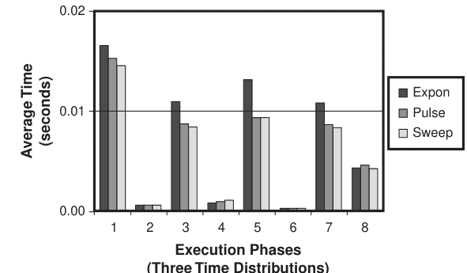

**图 9.4** 基准 MSI 执行概况。

下一步是分析，将图表中的实际计时结果与常识以及原始预期进行比较。

## 系统性能改进

外部性能（整体响应时间）大约是这些阶段时间的总和。如果你回到第 8 章，在 IAT 分布期间可以预期 50 毫秒的响应时间。

阶段 2、4 和 6 对整体性能没有太大贡献，在分析中可以忽略，留下阶段 1、5 和 8 进一步检查。

在阶段 1 中，主节点从池中选择一个本地子任务来接收查询。该阶段的原始代码如下：

```
for(ident=0; ident<count; ident++) {

    if(ptr->flag[ident] == 0) /* 可用? */
```
```
{

  ptr->flag[ident] = 1; /* 有工作要做！ */

  usleep(1);

  break;

}
```

调用 `usleep` 请求微秒级暂停，实际上释放 CPU 控制权并允许另一个就绪进程执行。这是对空闲标志的搜索，随后将其重置为忙碌，指示子任务接收查询。

### 注意

主进程阻塞在 `select` 调用上，直到检测到数据包的存在。子任务在注意到其空闲标志被重置为忙碌后实际接收它。

在三个子任务运行的情况下，很难想象如此少的代码会花费长时间。很可能是主节点的 `usleep` 调用起到了阻塞作用，迫使它与每个子任务进行竞争。

提高整体性能的一种方法是提高主节点在该阶段的优先级。因为主节点负责为子任务分配工作，并且大部分时间阻塞在 `select` 调用内部，赋予它高于子任务的优先级可以加速其对到达的通知。

我们对阶段 1 的性能改进是在每个子任务初始化时调用 `nice`（具体来说是调用 `nice(1)`，以相对于其父任务略微降低其优先级）。

在阶段 5 中，从机进程从共享文件中检索请求的行。从机检索该文本的源码如下：

```
/*

** 提取请求的行

*/

fp = fopen(file, 'r');

while(line--)

fgets(packet.buffer, sizeof(packet.buffer), fp);

close(fp);
```

在这个阶段也没有发生复杂的操作，但当存在共享设备的竞争时，I/O 计时可能是误导性的。然而，考虑到三个 IAT 分布之间的一致性，可能并非如此。我们可以做什么来缩短从文件中提取一行的时间？

# 第 9 章 内部性能测量与计时

一种解决方案是像直接访问一样访问文件，但这违背了示例的简单性原则。

另一种解决方案是维护一个缓存，即早期请求及其响应的本地池。如果收到重复请求，主子堆栈可以在其缓存条目中查找响应并立即响应，通过完全避免使用远程进程来节省大量时间。然而，典型的测试流包含的数据包数量少于查询次数，出现重复的概率很小。我们当然可以改变这种比例，但这种解决方案对于这样一个简单的服务器来说似乎大材小用了。

这是一种折中方案，既简单又展示了性能大幅提升的希望。最初，每当查询到达时，从都会打开文件、读取到请求的行，然后关闭文件直到下次。鉴于请求的行号是随机的，下一个行号比上一个行高的概率约为 50%。

如果下次查询到达时文件已经打开，有一半情况下需要关闭并重新打开——即请求的行号小于最近检索的行。此外，当请求的行号比上一个大时，需要读取请求行之前的所有行。以下是第 5 阶段的性能改进方案：

```c
/*

** 提取请求的文本

*/

if(line > curr) /* 第一次为假 *

{

    line = curr; /* 调整偏移量 *

    curr += line; /* 保存供下次使用 *

}

else

{

    fclose(fp); /* 第一次忽略 *

    fp = fopen(file, "r");

    curr = line; /* 保存供下次使用 *

}

while(line--)

    fgets(packet.buffer, sizeof(packet.buffer), fp);
```

在第 8 阶段，主子堆栈响应查询并声明自己为空闲。

```c
/* 将结果返回给客户端 */

strcpy(buf, packet.buffer);

send(cli, buf, strlen(buf)+1, 0);

close(cli);
```

```c
/* 在继续之前检查退出请求 */
```

```c
if(apr->flag[ident] < 0) /* 退出请求？ */

{

    sendto(s_fd, "Terminate 0", 12, 0,

    (struct sockaddr *) &slavelink, len);

    break;

}

apr->flag[ident] = 0; /* 无：标记为空闲 */
```


在此阶段似乎没有任何可能的改进。目前保持代码原即可。

## 最终 MSI 性能结果

图 9.3 中的“之前”可以与图 9.5 所示的改进结果进行比较。

| SWEEP | SLAVENAME | PH | NUM | TOTAL | AVERAGE |
|---|---|---|---|---|---|
| beta | 47 | 1 | 0.007628 | 0.000162 |
| | | 2 | 0.026164 | 0.000557 |
| | | 3 | 0.030557 | 0.007246 |
| | | 4 | 0.047095 | 0.001002 |
| | | 5 | 0.255919 | 0.005445 |
| | | 6 | 0.010009 | 0.000613 |
| | | 7 | 0.030557 | 0.007246 |
| | | 8 | 0.208840 | 0.004443 |
| gamma | 3 | 1 | 0.000485 | 0.000162 |
| | | 2 | 0.001841 | 0.000914 |
| | | 3 | 0.033318 | 0.011106 |
| | | 4 | 0.002692 | 0.000897 |
| | | 5 | 0.030478 | 0.011559 |
| | | 6 | 0.000423 | 0.001441 |
| | | 7 | 0.033318 | 0.011106 |
| | | 8 | 0.009987 | 0.002020 |
| delta | 0 | 1 | 0.001663 | 0.000000 |
| | | 2 | 0.000000 | 0.000000 |
| | | 3 | 0.000000 | 0.000000 |
| | | 4 | 0.000000 | 0.000000 |
| | | 5 | 0.000000 | 0.000000 |
| | | 6 | 0.000000 | 0.000000 |
| | | 7 | 0.000000 | 0.000000 |
| | | 8 | 0.000000 | 0.000000 |
| OVERALL | | 1 | 0.008276 | 0.001166 |
| | | 2 | 0.020205 | 0.000569 |
| | | 3 | 0.037385 | 0.007478 |
| | | 4 | 0.049787 | 0.009996 |
| | | 5 | 0.290595 | 0.005812 |
| | | 6 | 0.010452 | 0.000539 |
| | | 7 | 0.037385 | 0.007478 |
| | | 8 | 0.217927 | 0.004359 |

图 9.5 来自主的改进计时报告

# 第 9 章 内部性能测量与计时

同样，图 9.4 中的“之前”执行情况可以与图 9.6 所示的改进结果进行比较。

## 最终 MSI 阶段时间


图 9.6 改进后的 MSI 执行情况

查看各个阶段的改进情况：

第 1 阶段——添加 `usleep` 调用是一场灾难，第 1 阶段执行时间几乎翻倍。仔细检查发现 `usleep` 调用是罪祸首；当处理器释放时，时间变得不可预测。将 `usleep` 移到计时代码段之外，第 1 阶段执行时间低到无需进一步关注。

第 5 阶段——保持文件打开是一个巨大的成功，第 5 阶段执行时间减少了三分。

第 3 和第 7 阶段——这些阶段显示出略微减少。其他阶段的执行时间与改进前相似。

最后，遵循了第 8 章提到的某些整体性能比较。指数、脉冲和 IAT 分布分别显示在图 9.7、9.8 和 9.9 中。

## 最终 MSI 性能结果

| OBSERVATIONS | RESPONSE TIME (msec) | 10 | 20 | 30 | 40 | 50 |
|---|---|---|---|---|---|---|
| 1 | 10 | | | | | |
| 11 | 20 | | | | | |
| 21 | 30 | | | | | |
| 31 | 40 | | | | | | |
| 41 | 50 | | | | | |
| 51 | 60 | | | | | |
| 61 | 70 | | | | | |
| 71 | 80 | | | | | |
| 81 | 90 | | | | | |
| 91 | 100 | | | | | |
| OVER | 100 | | | | | |

50 个观测值

图 9.7 指数分布——改进后的时间。

| OBSERVATIONS | RESPONSE TIME (msec) | 10 | 20 | 30 | 40 | 50 |
|---|---|---|---|---|---|---|
| 1 | 10 | | | | | |
| 11 | 20 | | | | | | |
| 21 | 30 | | | | | | |
| 31 | 40 | | | | | | | |
| 41 | 50 | | | | | | |
| 51 | 60 | | | | | | |
| 61 | 70 | | | | | | |
| 71 | 80 | | | | | | |
  81 | 90 | | | | | |
| 91 | 100 | | | | | | |
| OVER | 100 | | | | | |

50 个观测值

图 9.8 脉冲分布——改进后的响应时间。

| OBSERVATIONS | RESPONSE TIME (msec) | 10 | 20 | 30 | 40 | 50 |
|---|---|---|---|---|---|---|
| 1 | 10 | | | | | | |
| 11 | 20 | | | | | | |
| 21 | 30 | | | | | | |
| 31 | 40 | * | | | | | | |
| 41 | 50 | | | | | | |
| 51 | 60 | | | | | | |
| 61 | 70 | | | | | | |
| 71 | 80 | | | | | | |
| 81 | 90 | | | | | | |
| 91 | 100 | | | | | | |
| OVER | 100 | | | | | |

50观测值

图 9.9 扫描分布——改进后的响应时间。

## 延伸阅读

- Tanenbaum, Andrew S. Distributed Operating Systems. Englewood Cliffs, NJ: Prentice-Hall, 1995.

# 第 10 章 健壮的软件

## 本章内容

### 健壮的软件

- 报警退出
- 超时
- 子任务重启
- 主任务重启
- 重新附加共享内存
- 可靠 UDP 通信
- 延伸阅读

健壮的软件是指在检测到错误的情况下仍能正确运行的软件。在执行前面章节介绍的示例过程中，可能会出现问题。在本章中，你将学习 MSI 中可能发生哪些类型的错误，以及你可以在软件中添加哪些内容以防止其在出现此类错误时失败。

如果你已经读完了大部分文本并跟进了自己的集群开发，你可能已经发现了分布式软件系统是多么的不可预测。例如，主进程是一个捕获 Ctrl+C 键的中断处理程序。接收到信号后，父进程为它的每个子任务设置标志，告诉它们优雅地退出。它们在自己清理并退出之前，向每个对应的从进程发送一个数据报，告诉它们优雅地退出。父进程等待每个子任务退出后，再移除共享内存区域并退出。

这是一个很好的设计，但有时进程会以一种不那么优雅甚至完全不优雅的方式终止。

在大多数情况下，即使在收到多个数据包后，按下 Ctrl+C 也会产生预期的结果：主进程、其所有子任务以及所有远程从进程都会正常终止。查看每个节点

```bash
> ps aux
```

显示所有这些进程已终止。通过以下命令查看共享内存区域：

```bash
> ipcs -m
```

显示客户端和主进程在退出前都删除了它们的区域。然而，偶尔你会发现一个子任务在没有父进程的情况下运行，或者一个远程从进程仍与某个远程节点上的性能子任务一起运行。

你通过它们的进程 ID 杀死这些进程：

```bash
> kill <pid> ... <pid>
```

通过 ID 移除共享内存区域：

```bash
> ipcrm shm <shmid>
```


并在开始另一个测试会话之前重新检查一切。人类似乎可以毫不困难从这些错误中恢复。

数据报可能会丢失，这可能解释了远程从进程的问题（参见列表 8.3）。在机器上运行并在分布式系统中工作多年后，你会相信事情会发生——那些你永远无法完全理解的事情。如果你在恢复测试之前发现某个进程仍在运行或共享内存区域仍然存在，你确切知道做什么，但在出现此类异常时，你的软件可以做什么来避免失败呢？

# 报警退出

中央性能监控进程（参见列表 8.3）运行在集群外部的机器上。它收集每个节点的性能统计数据，并显示整个系统的变化状态。显示所有集群节点，以及它们的 CPU 和内存利用率、磁盘和网络 I/O 速率以及整体网络负载的估计值。你可能想在监控器内部设置定时器，使其在空闲一小时后终止。你可以通过调用 `alarm` 来实现：

```c
#include <unistd.h>

/* ... */

main(void)
{
    while(1)
    {
        alarm(3600); /* 一小时后报警 */
        waitSomethigToHappen();
        alarm(0); /* 取消报警 */
    }
    /* 相应做出响应 */
}
```

`alarm` 调用请求在 3,600 秒（即一小时）后向你的进程发送一个信号。如果在此时间内没有活动，信号将被发送，你的进程将被终止。发生这种现象是因为你没有告诉操作系统忽略那个特定的信号，也没有为它建立信号处理程序。操作系统采取默认操作；*它终止了进程。*

但这是一件好事。监控器每秒应该收到几个数据包。如果空闲了一个一小时，你可能不希望该进程无限期留在系统中。添加这个简单的设备可以确保它在配置的空闲时间后终止。如果它确实从进程统计收集器收到了数据包，则通过 `alarm()` 请求报警信号。它会对发现的任何条件做出响应，重置空闲报警，并等待另一个数据包——这是正常操作。

# 超时

如果你不希望你的进程被粗鲁地中断，简单来说，你可以添加一个报警信号处理程序——这是一个内部函数，在接收到报警信号时通知进程，以便它可以优雅地退出。

列表 7.5 是主进程使用广播 UDP 数据报启动远程从服务的示例。这个简单的程序报告了从进程在激活时发送注册包的主机名。然而，在 MSI 的生产版本中，主进程将不知道期望接收多少个注册包。在没有无限期等待所有可能的注册包的奢侈的情况下，它使用报警信号作为超时指示器。如果在设定的时间限制内没有更多数据包到达，它假设所有远程从进程都已注册。

`alarm` 和 `signal` 需要两个头文件，你需要一个布尔变量，该变量可以在报警发生时由信号处理程序设置，并在主进程每次从 `recv` 调用中解除阻塞时进行测试。当数据包到达时，布尔变量为 `FALSE`；当发生报警信号时为 `TRUE`，表示超时条件。

注意：`recvfrom` 调用在接收到预期数据包或某些信号（包括 `alarm`）时解除阻塞。

```c
#include <unistd>
#include <signal.h>
/* . . */
#define FALSE 0
#define TRUE 1
int Alarm = FALSE;
```

主程序必须在编译时声明信号处理程序，并在运行时建立它。

```c
void Alarm();
signal(ALRM);
```

列表 7.5 底部的 `while` 循环可以更改为：

```c
/*
  显示注册信息
*/
while(1) /* 报警导致退出 */
{
  alarm(1); /* 设置 1 秒报警 */
  buf[]='\0'; /* 清空 buf */
  /* 等待注册或报警 */
  recvfrom(r_fd, buf, sizeof(buf), 0,
      (struct sockaddr *) &len);
  if(Alarm)
    break;
  alarm(0); /* 取消报警 */
  if((p=strchr(buf, '.')) != NULL)
    *p='\0'; /* 截断 buf */
  printf("主机 '%s' 已注册\n", buf);
  strncpy(hosts[count++], buf);
}
printf("注册了 %d 个从进程", count);
```

这检测注册数据包的结束。如果在整秒后没有收到数据包，则假设从进程已经注册。

最后，信号处理程序作为函数包含在程序末尾。

```c
void Alarm()
{
  /* 重新建立处理程序 */
  signal(ALRM);
  Alarm = TRUE; /* 设置标志 */
}
```

主程序的完整列表位于附录 A，“源代码”。

# 子任务重启

主进程为每个注册的从进程启动一个本地子任务。每个子任务与其相关的远程进程建立永久连接。主进程将输入查询分配给第一个可用的子任务，然后交给从进程处理。主进程如何发现本地子任务失败了，在这种情况下它可以做什么？

类似于超时时 `alarm` 向请求进程发送 `SIGAL` 信号，子任务的终止会导致 `SIGCHLD` 信号发送给父进程。如果你建立信号处理程序并跟踪所有的子任务，你不仅可以检测到其中一个的终止，还能知道是哪一个结束并重启它（参见列表 10.1）。

列表 10.1 从子任务的意外终止中恢复

```c
#include <unistd.h>
#include <signal.h>
#include <stdio.h>
#define FALSE 0
#define TRUE 1
#define NUM 3
int Okay; /* 布尔型 */
main(void)
{
    /*
     ** Listing10.1.c - 从子任务的终止中恢复
     */
    void sig_child();
    int pids[NUM];
    int ii, jj;
    int pid;
    /* 设置 SIGCHLD 处理程序 */
    signal(SIGCHLD, sig_child);
    /*
     **  NUM 个子任务
     */
    for(ii=0; ii<NUM; ii++) {
        if((pids[ii]=fork()) == 0) {
            printf("\t子任务 %d 已启动，pid = %d\n", ii, getpid());
```

## 列表 10.1 继续

```c
while(1) {
    usleep(1);
}
/*
** 等待子任务结束
*/
while(1) {
    Okay = TRUE;
    while(Okay) /* 暂停 */
        usleep(1);
    pid = wait(NULL); // 退出的 pid /
    for(ii=0; ii<NUM; ii++) {
        if(pid == pids[ii]) {
            break;
            printf("\Subtask #%d ended, pid = %d\n", ii, pid);
        }
    }
    if((pids[ii]=fork()) == 0) {
        printf("\Subtask #%d restarted, pid = %d\n", ii, getpid());
        usleep(1);
    }
}
return(0);
void sig_child() {
    signal(SIGCHLD, sig_child);
    Okay = FALSE;
    return;
}
```


# 列表 10.1 继续

```
while(1) {
    usleep(1);
}

/*
** 等待子任务结束
*/

while(1) {
    Okay = TRUE;
    while(Okay) /* 暂停 */
        usleep(1);
    pid = wait(NULL); // 退出的 pid /
    for(ii=0; ii<NUM; ii++) {
        if(pid == pids[ii]) {
            break;
            printf("\Subtask #%d ended, pid = %d\n", ii, pid);
        }
    }
    if((pids[ii]=fork()) == 0) {
        printf("\Subtask #%d restarted, pid = %d\n", ii, getpid());
        usleep(1);
    }
}
return(0);
void sig_child() {
    signal(SIGCHLD, sig_child);
    Okay = FALSE;
    return;
}
```

在一个窗口（或登录会话）中运行，并记录子任务报告的进程 ID。在另一个窗口中终止这些子任务中的一个或多个，观察实时恢复过程。终止父进程即可结束演示。

你可能想通过包含一个计数器列表来增强此程序，每个子任务一个计数器。每当特定子任务意外终止时，递减其计数器并重启它，但前提是尚未达到此重启限制。

# 主任务重启

当一个子任务终止时，会向其父任务发送一个信号，但你该如何检测父任务的终止呢？有几种方法可以处理这种情况，取决于父任务是如何启动的。

一种简单的方法是开发一个高层启动进程。它的工作是启动所有通常在最高层运行的进程并监控它们，重启那些可能失败的任务。

另一种策略是让操作系统启动进程，并指定其在失败时重启。系统文件 `/etc/inittab` 允许你（作为 `root` 用户）将你的可执行文件添加到其启动进程列表中，并在进入特定的运行级别时（并在必要时）启动它。更多细节请参阅 `inittab`。使用这种技术的缺点是进程可能很难停止——它工作得太完美了！

最后一种策略涉及检测容错软件设计人员所说的“心跳”。主进程可以检测子任务的终止，但考虑一下它如何检测（并从）运行在远程节点上的从进程的终止中恢复。

从进程一旦变为活跃就会向主进程注册，因此两者之间存在一条未使用的 `UDP` 通信链路。如果从进程每秒向主进程发送一次 `UDP` 数据报（其心跳），而主进程跟踪每个从进程最后接收消息的时间，它就可以在每次查询时扫描这些最后收到回复的时间。任何在可配置时间范围内未收到响应的从进程都可以（通过其 `UDP` 服务端口）同其本地子任务一起重启，以实现完全恢复。（对于正在积极开发集群系统的读者来说，这是一个很好的增强项目。）

最后，考虑恢复是有多个层次的，在某些时刻，一个聪明的进程可能会决定远程机器需要重启。你可以建立一个 `UDP` 服务端口，启动一个以 `root` 身份运行的短程序，该程序通过系统调用发出关机命令（带有重启选项）：

```
#include <stdlib.h>

main(void)
{
    system("/bin/shutdown -r now");
}
```

如果无法在故障的机器上运行进程，仍然可以通过自定义硬件实现重启。处理器芯片具有 `RESET` 引脚，当接地时，将导致系统重置或重启。当然，这种极端的措施应该只在极不异常的情况下考虑。这种重启类似于循环电源开关，确实是一种冷启动。

# 重新挂载共享内存

即使你决定实现上述一个或多个策略，某些时刻，一个聪明的进程可能会决定远程机器需要重启。你可以建立一个 `UDP` 服务端口，启动一个以 `root` 身份运行的短程序，该程序通过系统调用发出关机命令（带有重启选项）：

```
#include <stdlib.h>

main(void)
{
    system("/bin/shutdown -r now");
}
```


```
usleep(1);
}
}
return(0);
void sig_child() {
signal(SIGCHLD, sig_child);
Okay = FALSE;
return;
}
```

在一个窗口（或登录会话）中运行，并记录子任务报告的进程 ID。在另一个窗口中终止这些子任务中的一个或多个，观察实时恢复过程。终止父进程即可结束演示。

你可能想通过包含一个计数器列表来增强此程序，每个子任务一个计数器。每当特定子任务意外终止时，递减其计数器并重启它，但前提是尚未达到此重启限制。

# 主任务重启

当一个子任务终止时，会向其父任务发送一个信号，但你该如何检测父任务的终止呢？有几种方法可以处理这种情况，取决于父任务是如何启动的。

一种简单的方法是开发一个高层启动进程。它的工作是启动所有通常在最高层运行的进程并监控它们，重启那些可能失败的任务。

另一种策略是让操作系统启动进程，并指定其在失败时重启。系统文件`/etc/inittab`允许你（作为 root 用户）将你的可执行文件添加到其启动进程列表中，并在进入特定的运行级别时（并在必要时）启动它。更多细节请参阅`inittab`。使用这种技术的缺点是进程可能很难停止——它工作得太完美了！

最后一种策略涉及检测容错软件设计人员所说的“心跳”。主进程可以检测子任务的终止，但考虑一下它如何检测（并从）运行在远程节点上的从进程的终止中恢复。

从进程一旦变为活跃就会向主进程注册，因此两者之间存在一条未使用的 UDP 通信链路。如果从进程每秒向主进程发送一次 UDP 数据报（其心跳），而主进程跟踪每个从进程最后接收消息的时间，它就可以在每次查询时扫描这些最后收到回复的时间。任何在可配置时间范围内未收到响应的从进程都可以（通过其 UDP 服务端口）同其本地子任务一起重启，以实现完全恢复。（对于正在积极开发集群系统的读者来说，这是一个很好的增强项目。）

最后，考虑恢复是有多个层次的，在某些时刻，一个聪明的进程可能会决定远程机器需要重启。你可以建立一个 UDP 服务端口，启动一个以 root 身份运行的短程序，该程序通过系统调用发出关机命令（带有重启选项）：

```
#include <stdlib.h>
main(void)
{
system("/bin/shutdown -r now");
}
```

如果无法在故障的机器上运行进程，仍然可以通过自定义硬件实现重启。处理器芯片具有 RESET 引脚，当接地时，将导致系统重置或重启。当然，这种极端的措施应该只在极不异常的情况下考虑。这种重启类似于循环电源开关，确实是一种冷启动。

# 重新挂载共享内存

即使你决定实现上述一个或多个策略，某些时刻，一个聪明的进程可能会决定远程机器需要重启……

## 第 11 章 进一步探索

因此，现代集群具有双层软件架构：应用层和分布式系统基础设施层。在学习它们架构的变体时，请思考这如何影响多体系计算机的特性。

## 类 Beowulf 超级计算机

什么让一台超级计算机具有类 Beowulf 特性？一台 Beowulf 类机器有两个限制条件：它必须由市售的 PC 和硬件构建，并且其成本必须低于高性能科学工作站。在 1994 年，当这类定义正在完善时，这笔成本大约为 50,000 美元。书中描述的测试平台在 1998 年的成本低于 2,000 美元，而且可以用更低的价格构建。你系统的成本取决于你对“高性能”中“高”字有多大的重视。集群性能取决于外部 I/O 总线的速度，对于测试平台和其他集群而言，总线就是互连网络或以太网。Beowulf 在开发的后期回到了自定义网络硬件，以实现某些惊人的成本效益比。

科学研究人员在有限的预算下发挥创造力，榨取现有设备的每一分效用。Beowulf 项目的动力来自近期 PC 簇（POPC）集群上并行计算的最新进展，在这些集群上，通过 OTS（现成品产品）取得了令人瞩目的基准测试。（在本章末尾的“延伸阅读”部分也提到了工作站集群 COW 和工作站网络 NOW。）Beowulf 是 NASA 的一项倡议，由 NASA 空间与数据信息科学卓越中心（一家 NASA 承包商）的 Thomas Sterling 和 Thomas Decker 领导。科学家们处理由大规模物理现象（相互作用的构造板块）模拟产生的数据量，或通过传感器网络（如气象卫星）收集的数据。Beowulf 的设立目标是为了以极低的成本解决与此类研究相关的问题。

加州理工学院（Caltech）和洛斯阿拉莫斯国家实验室（以及各种大小的大学）都运行着 Beowulf 集群。大型学校（例如普林斯顿大学和俄根州立大学）关注高速网络硬件如何影响消息传递和虚拟内存映射系统的限制。较小的大学，甚至是一些高中，通过构建和维护自己的系统，为学生提供并行计算竞赛和挑战的实操经验。它们是实验、课堂项目和研究生研究的理想测试平台。你可以从本章末尾“延伸阅读”部分引用的网站阅读更多关于这些 Beowulf 项目的信息。关于 1998 年他们与 Beowulf 项目合作将 NASA 的官方软件作为 Extreme Linux 光盘发布，`http://www.redhat.com`可能有一些有趣的材料。

一个编写良好的免费操作系统（如 Linux）、大量过时但性能尚可的高性能 PC，以及一些愿意分享想法的才华年轻实验者，让这一切成为可能。当你阅读他们的目标、成就和结果时，他们的热情如此明显，以至于你不禁至少考虑自己构建一个系统。

MSI 是 Web 或数据库服务器意义上的事务处理器。它接收传入的查询并向某些外部客户端发送响应。实时科学应用表现出类似的行为，即接收获取或感应的数据并开发解决方案。大多数科学应用提供静态解决方案，但某些系统需要定期获取数据，并显示一个随环境变化的持续更新的解决方案。

例如，一个关注自身空气质量的大城市安装了十几个以上的空气污染传感器。每个传感器都测量风速、方向、温度、湿度，以及臭氧、一氧化碳、二氧化硫和其他导致已知呼吸健康问题的粒子的水平。它们在 10 分钟内对这些计数取平均值并将读取传输到中央计算系统。这台中央计算机的工作是接收所有最新数据并更新其实时数据——一张描述每个粒子位置、形状和密度的伪彩色图像。并不意外的是，在高峰时段，一氧化碳模式的形状类似于该城市高速公路和主干道的粗略地图。

在更大规模上，国家大气研究中心（NCAR）拥有卫星，将感应数据输入计算机，从而生成全球性天气模式。软件模拟数据也被用于预测未来的天气模式。希望软件足够高效，计算机足够快，能够在明天到来之前生成明天的天气。更多信息可以在本章末尾“延伸阅读”部分引用的气象研究大学网站上找到。

人工智能（AI）研究人员非常严肃对待他们的游戏。IBM RS/6000 SP 计算机（绰号“深蓝”）与象棋大师加里·卡斯帕罗夫（Garry Kasparov）对弈并获胜。在这种应用中，当前的棋盘布局是获取的数据，而解决方案是一个单一合法法，通过观察其几步之后的后果被判断为最佳。软件从当前棋盘开始构建一个倒置树结构。每个下分支代表一个合法移动，而其下方的每个分支代表对手可能的反应，依此类推。这种树结构被称为问题空间，每个移动下方的分支数量就是其深度。搜索解决方案并根据其长期影响评估每一个方案可能需要巨大的执行能力。然而，由于每个子分支都是相互独立的，并行计算架构可以通过让每个处理器处理单独的分支，直到空间被解决，从而减少整体空间搜索时间。存在减少分支数量的巧妙方法，被称为“树剪枝”算法。参见“延伸阅读”部分，以参考关于人工智能领域最优秀的文献之一。

工程问题，例如现代高速处理器芯片上散热鳍片结构的设计，可能会使用有限元分析来判断鳍片结构的有效性。与其将鳍片看作一块固体金属，不如将其由称为有限元的微小金属体积构建。一层薄元素形成了与芯片顶部接触的面。芯片吸收热量，这个面从元素那里吸收热量，依此类推，直到外层元素从它们那里吸收热量并将热量传输到空气。元素越小，分析耗时越长，但模型越反映现实。特定元素可以吸收的热量是其温度以及周围元素温度的函数。理想的鳍片结构具有将热量传输到空气的鳍片，使元素能够迅速冷却并从下一层吸收热量；然后它们可以吸收热量，依此类推，一直到达面层，这样你在编写程序时芯片就不会融化。

软件模拟可以将数十亿年的地质时间压缩到几秒，并将时间之初（大爆炸）的几秒或几秒让地质学家和天体物理学家能够在合理的时间范围内研究感兴趣现象的行为。软件模拟可以从分布式模拟中获得巨大益处，这是一个非常热门的研究课题。

这类应用中的每一个（列表并未穷尽）都具有其固有的并行性，可以被并行处理器利用。并行编译器可以通过分析你的源代码来检测这种并行性。（这个过程本身就是超级计算机的候选者！）然而，这些编译器非常昂贵，而且存在替代方案。科学应用开发者可能是判断过程中何时存在并行性的最佳人选。他或可以将这些部分拆分为处理问题子集的代码块，并将它们排列成调度树，如图 11.1a 和 11.1b 所示。

# 超级计算机应用

```c
int costs [3] [10];
int sums [3];
int total;
int i, j;
main (void) {
/* 初始化 . .*/
total = 0;
for (i=0; i<3; i++) {
```


```
sums[i] = 0;

for(j=0; j<10; j++) {
    sums[i] += costs [i] [j];
}

total += sums[i];
}

/* . . 清理 */
}
```

图 11.1A 具有固有并行性的算法。

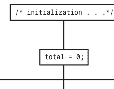

| sums[0] = 0; for[j=0; j<10; j++) sums[0] += costs [0] [j]; | sums[1] = 0; for[j=0; j<10; j++) sums[1] += costs [1] [j]; | sums[2] = 0; for[j=0; j<10; j++) sums[2] += costs [2] [j]; |

```c
for (i=0; i<3; i++)
total += sums [i];
```


图 11.1B 并行进程块调度树。

主节点执行初始线程，直到检测到三路拆分。它用它们可能依赖的任何变量的最新值更新这三个进程块，并将它们发送给三个可用的从节点，然后等待从节点完成并行操作。每个从节点完成其进程块后，会将结果传回给主节点，主节点继续等待直到所有三个从节点完成。它用从节点返回的结果更新本地单线程进程块变量，并恢复处理该单线程直到完成，直到发生下一次拆分。

该程序的并行部分在单处理器上的执行时间大约是其三倍。在具有三个 CPU 的多体系计算机上，所需时间仅为三分之一，外加将每个数据块传输到单独的计算机、将结果传回以及对单个结果进行封化以继续沿单线程处理进行处理的开销。你必须考虑到管理并行实现所消耗的时间，以及并行处理带来的时间节省优势。在三路拆分发生之前，整个数组必须分成三部分。在单线程处理的后续步骤之前，必须将这三部分合并回数组中。请记住，只有在进程块调度树的并行阶段才能实现节省效果。

# 即时点对点网络

MSI 是一种层次结构——它是一种树形结构，底部是主节点，每个分支上是从节点。并非所有的集群都是这样组织的。

点对点网络没有主从关系。相反，每个节点都可以承担任一角色，且这些节点在程序上运行相同的进程。每个节点都会像主节点一样接收传入数据并请求帮助，也会像从节点一样接收另一个节点的帮助请求。这些分布式系统中的某些可以动态生成即时（临时、按需）网络，并在不再需要时迅速将其拆除。

举例来说，考虑中等交通流量下四车道高速公路上的一辆汽车。你开启了定巡控制，进入右侧车道，让别人从左侧通过。当你靠近出口匝道时，一辆车从你左侧驶过，打着右转向灯并越过你的车道进行转弯。你看到它过来了，你刹车并移动到左车道，以防该车在出口前刹车，导致雪上加花。你依靠的是直觉、警觉以及另一辆车转向灯的视觉线索。你在触碰刹车之前没有回头，在移动到左车道之前也没有仔细检查。这次没有问题，但结果可能会不同。

快进约年后。你处于相同的情况，但大多数汽车都配备了车载驾驶感知系统、一个具有双向射频链路的节点计算机以及仪表盘上的显示器。当那辆车从你左侧驶过并开始滑入你的车道时，你的车内和他的车内都会响起警报声。当第一辆车出现在你左侧车道时，它的信标被你的系统捕捉，或者可能是它的系统捕捉了你的。无论如何，你们的两个系统都感知对方的相对位置和速度。

当汽车驶过你并滑入你的车道时，汽车系统感知到了相对位置的变化，发出声音警告你的驾驶员，并向你的汽车发送消息，你的汽车也响起了声音警告你。当你触碰刹车时，你的系统知道你身后没有汽车，因此没有发送消息。当你向左滑移时，它知道这没有问题并保持沉默。

你仍然看到了另一辆车的转向灯。如果司机忘记开启，系统在感知到滑移后会开启。当你触碰刹车时，你的刹车灯亮起；当你离开时，你的转向灯亮起，以防后面有另一辆没有这种装备的车辆。这个场景旨在作为点对点网络的示例。如果你能看到每个节点都是完全自主的，并愿意对问题做出反应，你就应该对这种架构的潜力有所感触。（注：原文此处有大量重复错误，翻译时已去重）。

## 总结

与商业系统相比，MSI只是一个玩具，但它是一个极佳的学习工具。现代系统采用双层软件架构，封装进程间通信软件，以消除其对高层服务应用设计和增强的影响。

Beowulf（贝奥夫）架构是当今集群架构发展的经典分布式系统设计驱动。科学应用为这类系统提供了动力，可能比今天的信息服务器提供的动力更多，但这种情况正在发生变化。

科学应用的并行处理需要某种类型的预处理器将算法分解为并行处理块，并需要一个执行时间管理器将这些块调度到可用处理器上，整合它们的结果，以便对单个中央线程进行持续处理。

网络不必是固定的。自组织网络——例如高速公路上的汽车之间或战场上的士兵之间——允许在不付出巨大努力的情况下实现无法通信的地方进行通信，在建立高速公路或发生战斗的广阔区域，通过蜂窝式通信站来填补空白。

最后，跳出框架思考，考虑一种进程在节点之间移动的固定网络。未来可能可能是一个这样一个世界：计算通信能力就像交流电对于我们今天使用的电器一样，无处不在。而且技术挑战将层出不穷。

## 延伸阅读

- Hill, J., M. Warren, and P. Goda. “I’m Not Going to Pay a Lot for This Supercomputer!” Linux journal, no. 45 (January 1998): 56-60.
- http://www.netlib.org/pvm3 用于并行虚拟机 (PVM) 的下载。
- http://www.netlib.org/mpi 用于消息传递接口 (MPI) 下载。
- http://www.ens-lyon.fr/LHPC/ANGLATS/popc.html 获取 PC 列表。
- http://www.beowulf.org 获取 Beowulf 的通用信息。
- http://www.beowulf-underground.org 供更具冒险精神的 Beowulf 粉丝。
- http://www.cs.orbit.edu/swarm 关于 SWARM 系统的信息。
- http://www.cs.princeton.edu/shrimp 关于 SHRIMP 系统的信息。
- http://ess.jpl.nasa.gov/subpages/reports/97report/hyglac.html 关于 Hyglac 信息。
- http://www.cacr.caltech.edu/beowulf 关于 Naegling 信息。
- http://loki.www.lanl.gov 关于 Loki 系统信息。
- http://www.ucar.edu/ucar 或 http://www.ncar.ucar.edu/ncar 上的国家大气研究中心 (NCAR) 信息。
- Rich, E. and K. Knight. *Artificial Intelligence.* 2nd ed. New York, NY: McGraw-Hill, 1991.
- Schwarz, H. R., *Finite Element Methods.* San Diego, CA: Academic Press, 1988.

# 12

## 本章内容

- 多处理器架构
- 集群配置
- 分布式应用
- 结语

# 结论

你学习了许多关于硬件的知识。在第 1 章“Linux 集群基础”中，你学习了运行 Linux 的 PC 网络与集群计算机之间的区别。在第 2 章“多处理器架构”中，你发现了松耦合多处理器与紧耦合多处理器之间的区别。

你学习了更多关于集群软件的知识。在使用父进程中使用 `fork` 和 `exec` 代替 `fork` 调用之前，你对这类任务在成为独立模块之前的复杂程度或通用性有了感觉。你至少知道任意两个进程之间传递信息的三种方法，并知道当进程运行在网络的不同节点上，为什么某些方法不起作用。最后，从第 3 章“进程间通信”中，你理解了 UDP 和 TCP 之间的区别，并知道如何选择其中一种。

这是开发分布式系统所需的基础知识。只有极少数开发者理解这一点，你应该为成为其中一员而感到自豪。

接下来是实操经验。如果你在阅读这本书的过程中实际上构建并配置了一个网络，那么你还有其他可以炫耀的东西：你可以观察 PC 的背面，并判断它是否具有网络接口以及需要什么种布线。你可以进入大型计算中心，查看集线器、交换机、路由器和防火墙，并自信地选择你所需的内容。你可以安装 Linux 操作系统，以 root 身份登录并管理该系统与其他所有系统协同工作。你可以对这个新添加的设备进行一些基础测试，确保它按计划运行。你可以创建一个非根用户并自定义你的主目录。你可以创建属于同一个项目的 C 程序和一个将它们整合在一起的 Makefile。你可以衡量事务服务器的外部性能，并对任何类型的系统的执行阶段进行计时。你可以调整该系统并再次测试，看看你的调优是否有任何收益。你对容错软件至少有一些想法，并可以添加代码来避免可能导致系统故障的问题。

你对他人利用他们的集群做了什么有了概览，并且知道事务处理器和超级计算机之间的区别。你理解了实时数据与模拟环境数据之间的区别，以及超级计算机如何将此类数据转换为其所代表的环境的显示。你理解了到达时间的分布如何影响服务器的性能。这是一个广泛但关键的理解水平。适用于一个系统的解决方案可能会对另一个系统产生不利影响。

最后，你像大多数人一样，可以预见到未来计算机将变得更快、更廉价、更小。

# 第 12 章结论

# 多处理器架构

几年前，作者被几家制造商提供的双处理器 PC 工作站的魅力所诱惑。通过简短的对话发现，双核 100MHz PC 的价格是单核的倍倍，而且速度无法不上几个月后将发布的单核 200MHz PC。这理清了思考过程，但对多处理器的向往依然存在。

后来出现了一个时代，旧的 '386 处理器无法运行最新版本的操作系统。如果你想加班，就得加班或买一台更快的 PC。一年后，几台过时但好用的 PC 放在柜子里。又一年，一个八节点 Linux 集群诞生了。

# 集群配置

然而，通过从跳蚤市场、旧货出售或同事那里免费获取，可以将成本降到最低。你可以利用现有的设备构建集群，前提是多处理器是你所需要的。如果不是，单处理器就足够了。

多处理器系统的性能通常比单处理器好，但编程更难。这正是技能产生的地方；我们没有人天生就拥有这些。

# 附录 A

## 本附录内容

## 源代码

- 查询生成客户端
- 主从接口
- 近实时性能
- Makefile

这里是查询生成客户端、整个主从接口（包括近实时性能显示模块）、它们的头文件以及一个简单的 make 工具文件的源源码列表。C 文件应该位于 `/home/chief/src` 下，头文件应该位于 `/home/chief/inc` 下，如第 6 章“为软件开发配置用户环境”中所描述。请记住，你可以从出版者的配套网站 www.sampublishing.com 下载所有文件。输入本书的 ISBN 号并选择“Downloads”链接以获取更多信息。

图 A.1 显示了我们用于测试平台的硬件结构图，以及这些进程中每一个运行的位置。

# 附录 A 源代码

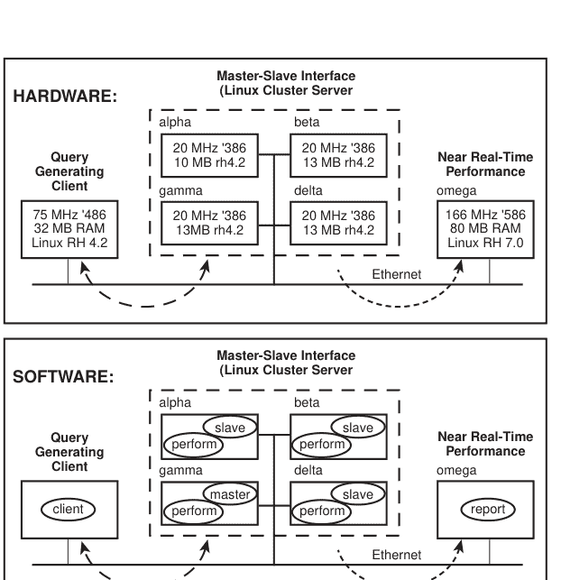

图 A.1 集群、客户端和性能显示。

## 查询生成客户端

客户端运行在可以访问集群网络的机器上，但该机器本身也是一个集群节点。以下是一个示例命令行，假设服务器已经在运行。

```
client alpha p
```

这假设主任务已在 `alpha` 上启动，并请求一个脉冲分布的查询流（见第 8 章“外部性能测量与分析”）。

# 列表 A.1 客户端进程

```
[/content]


```c
#include <math.h>

#include <stdio.h>

#include <stdlib.h>

#include <unistd.h>

#include <string.h>

#include <sys/ipc.h>

#include <sys/shm.h>

#include <sys/time.h>

#include <sys/types.h>

#include <sys/socket.h>

#include <netinet/in.h>

#include <netdb.h>

#include "msi.h"
```

```c
#define FALSE 0

#define TRUE 1

#define NUM 50

#define CATS 10 /* * 响应时间分类数 */

double cats[CATS] = {.01, .02, .03, .04, .05, .06, .07, .08, .09, .10};

int bars[CATS] = {}; /* 柱状图计数器 */
```

```c
int main(int argc, char *argv[])
{
  /*
** client.c: 报告响应时间状态
 */
  struct timeval bef, aft; /* 前/后定时器值 */
  struct sockaddr_in sock; /* socket 结构体 */
  struct hostent *hnp; /* IP 地址结构 */
  int flag = (IPC_CREATE | IPC_EXCL | 0660);
  int size = NUM * sizeof(double); /* 示例共享内存键 */
  key_t key = 0x81234567; /* 共享内存区域 ID */
  int shmid;
  int Expon = FALSE; /* 布尔值：指数分布 */
  int Pulse = FALSE; /* 布尔值：脉冲分布 */
  int Sweep = FALSE; /* 布尔值：扫描分布 */
  double mean=0.50; /* 指数分布平均值 */
  double slow=0.25; /* 脉冲和扫描的慢速值 */
  double fast=0.10; /* 脉冲突发的快速值 */
```

# 列表 A.1 续

```c
double random;           /* 随机实数：0.0->1.0 */
double delay;            /* 计算的延迟时间 */
double *rt;             /* 子任务的响应时间 */
long timeleft;          /* IAT 剩余时间 */
long usec=0L;            /* 到达间隔微秒 */
long secs=0L;            /* 剩余秒数 */
int pids[NUM];          /* 子进程 ID */
int opt=1;              /* setsockopt 参数 */
int fd;                 /* socket 文件描述符 */
int ii, jj, kk=0;
char distribution[4];
char buf[QUERYSIZE], *
```

```c
rand((unsigned int) getpid()); /* rand() 种子 */
/* 参数是主机名和分布 */
if(argc != 3)
{
    printf("\nUsage: %s <HOST><DISTRIBUTION>\n", argv[0]);
    exit(-1);
}
```

```c
hp = gethostname(argv[1]);
```

```c
if((argv[2][0] == 'e' || (argv[2][0] == 'E'))
{
    Expon = TRUE;
    strcpy(distribution, "EXP");
    rand((unsigned int) getpid()); /* rand() 种子 */
}else((argv[2][0] == 'p' || (argv[2][0] == 'P'))
{
    Pulse = TRUE;
    strcpy(distribution, "PLS");
}else if((argv[2][0] == 's' || (argv[2][0] == 'S'))
{
    Sweep = TRUE;
    strcpy(distribution, "SWP");
}
```

# 列表 A.1 续

```c
else
{
    printf("\nUsage: %s <HOST> <DISTRIBUTION>\n", argv[0]);
    printf("\tDISTRIBUTION = 'e' | 'p' | 's' }\n");
    printf("\texponential, pulse and sweep\n");
    exit(-1);
}
```

```c
/* 挂载共享内存 */
shmid = shmget(key, size, flag);
/* 挂载内存区域 */
rt = (double *) shmat(shmid, 0);
```

```c
/* 循环：发送和接收数据包 */
for(ii=0; ii<NUM; ii++) {
    rt[ii]=0; /* 清零数组 */
```

```c
if(Expon) {
    random = rand() / (double) RAND_MAX;
    delay = mean * log(random);
    if(delay > 0.9999)
        delay = 0.9999; /* 限制 */
}else if(Pulse) {
    if((ii > NUM * 0.3) && (ii < NUM * 0.4)) {
        delay = fast;
    } else {
        delay = slow;
    }
else if(Sweep) {
    delay = slow - (ii / NUM);
}else {
    printf("\nError in logic?\n");
}
```

# 附录 A 源代码

```c
exit(-);
secs = (long) delay;
usec = (long) (1000.0 * (delay - secs));
/* 随机行号：1 到 99 */
random = rand() / (double) RAND_MAX;
jj = (int) ((double) 99.0) * random + 1;
if(jj == 20)
jj = 99;
sprintf(buf, "/home/chief/sample.txt %d", jj);
/* 记录发送时间 */
gettimeofday(&bef, NULL);
```

```c
/* 每个查询/响应的子任务 */
if((pids[kk++]=fork()) == 0) {
    /* 挂载父进程内存 */
    rt = (double *)shmat(shmid, 0);
    /* 建立连接 */
    fd = socket(AF_INET, SOCK_STREAM, 0);
    memset((char *) &sock, 0, sizeof(sock));
    memcpy(sock.sin_addr, hp->h_addr, hp_length);
    sock.sin_family = hp->h_family;
    sock.sin_port = htons(QUERYPORT);
    setsockopt(fd, SOL_SOCKET, SO_REUSEADDR, (char *) &opt, sizeof(opt));
    connect(fd, (struct sockaddr*) &sock, sizeof(sock));
    send(fd, buf, strlen(buf)+1, 0);
    /* 等待服务器结果 */
    buf[0] = 0; /* 清空缓冲区 */
    if(recv(fd, buf, QUERYSIZE, 0) > 0) {
        printf("\t%d. Line %d: %s", kk, jj, buf);
        p = strchr(buf, ' ') + 2;
```

# 列表 A.1 续

```c
if(jj != atoi(p)) {
printf("**** incorrect result!");
printf("\n");
}
```


```c
/* 记录响应时间 */
gettimeofday(&aft, NULL);
aft.tv_sec -= bef.tv_sec;
aft.tv_use -= bef.tv_use;
if(aft.tv_use < 0) {
    aft.tv_sec += 1000000L;
    aft.tv_use -= 1;
}
rt[ii] = (double) aft.tv_sec + ((double) aft.tv_use / 1000000.0);
```

```c
close(fd);
exit(0);
```

```c
/* 休眠剩余的 IAT 时间 */
gettimeofday(&aft, NULL);
aft.tv_sec -= bef.tv_sec;
aft.tv_use -= aft.tv_use;
if(aft.tv_use < 0) {
    aft.tv_sec += 1000000L;
    aft.tv_use -= 1;
}
bef.tv_sec = secs;
bef.tv_use = usec;
bef.tv_sec -= aft.tv_sec;
bef.tv_use -= aft.tv_use;
if(bef.tv_use < 0) {
    bef.tv_sec += 1000000L;
    bef.tv_use -= 1;
}
timeleft = (bef.tv_sec * 1000000L ) + bef.tv_use;
```

```c
if(timeleft < 0)
{
    printf("\ERROR: 需要更高的 IAT 值 - 退出。\n");
    break;
}
usleep(timeleft);
for(ii=0; ii<kk; ii++)
    wait(pids[ii]);

/*
** 报告响应时间统计
*/
for(ii=0; ii<NUM; ii++) {
    for(jj=0; jj<CATS; jj++) {
        if(rt[ii] < cats[jj]) {
            bars[jj]++;
            break;
        }
    }
    sleep(2);
printf("RESPONSE |              %d PACKETS      %s\n",
    NUM, distribution:);
printf("TIME (msec) |          10         20         30         40         50\n");
printf("--------------------------------------------------------------------------------+%s\n");
ii = 0; /* 总计 */ jj<CATS; jj++)
{
    ii += bars[jj];
    kk = (1000.0 * cats[jj]) + .5;
    printf("%5d%d |", kk, (int) (1000 * cats[CATS-1]));
    printf("*\*");
}
printf("\n");
printf("OVER%5d |", (int) (1000 * cats[CATS-1]));
jj = NUM - ii;
```

```c
for(kk=0; kk<jj; kk++);
printf("**");
printf("\n");
/*移除未使用的共享内存区域 */shmctl(shmid, IPC_RMID, struct shmid_ds *) 0);
return(0);
```

# 主从接口

这是一个分布式服务器对。主进程可以在任何集群节点上启动。主任务和从任务在各自的节点上启动，指向显示显示节点（见图 7.2）。

以下是启动主任务的命令行。

> `master`

注意没有命令行操作。`Ctrl+C` 键会优雅退出，包括它的子任务和所有的从任务。

# 列表 A.2 主进程

```c
#include <netinet/in.h>
#include <sys/socket.h>
#include <sys/types.h>
#include <sys/time.h>
#include <sys/ipc.h>
#include <sys/shm.h>
#include <unistd.h>
#include <string.h>
#include <signal.h>
#include <netdb.h>
#include <stdio.h>
#include "msi.h"
```

```c
#define FALSE 0
```

```c
#define MAX 16 /* * 支持的最大从节点 */
#define LEN 80 /* 允许的最大主机名长度 * /
```

```c
#define FALSE 0
```

# 附录 A 源代码

# 列表 A.2 续

```c
#define TRUE 1
/* 布尔型标志位 */
int Running = TRUE;
int Alarm = FALSE;
unsigned char baddr[4] = {0x0A, 0x00, 0x00, 0xFF}; /* 10.0.0.255 */
main(void) {
/*
 ** master.c - 主节点向从服务发送查询
 */
  int len = sizeof(struct sockaddr_in);
  struct sockaddr_in broadcast;
  struct sockaddr_in registers;
  struct sockaddr_in querylink;
  struct sockaddr_in slavelink;
  struct host *hp;
#ifdef TIMING
  struct time workval,phase1[MAX]; /* 阶段 1 发生在父进程中 */
  struct time ph1work; /* 从池中选择一个空闲子任务 */
  struct time ph2work; /* 子任务将查询发送到远程 */
  struct time ph3work; /* 计算的主节点到从节点的传输时间 */
  struct time ph4work; /* 从节点获取查询并提取请求 */
  struct time ph5work; /* 从节点从文件中检索行文本 */
  struct time ph6work; /* 从节点构建响应并传回 */
  struct time ph7work; /* 计算的从节点到主节点的传输时间 */
  struct time ph8work; /* 子任务响应查询并设置为空闲 */
double tot, avg;
int pkts=0; /* 入站数据包计数器 */
FILE *fp;
#endif
  void sig_inter();
  void sig_alarm();
/*
 ** 共享内存空间
 */
struct area {
  int flag[MAX]; /* 每个子任务的标志 */
  /* 0:空闲, 1:正常, -exit:退出 */
```

# 列表 A.2 续

```c
#ifdef TIMING
int count=0; /* 处理的查询数量 */
struct timeval phase2[MAX];
struct timeval phase3[MAX];
struct timeval phase4[MAX];
struct timeval phase5[MAX];
struct timeval phase6[MAX];
struct timeval phase7[MAX];
struct timeval phase8[MAX];
#endif
```

```c
} area, *aptr;
int flag = (IPC_CREAT | IPC_EXCL | 0660);
int size = sizeof(struct area);
key_t key = 0x01234567; /* 共享内存区域键 */
int shmid; /* 共享内存区域 id */
int acc; /* 描述符 */
int cli; /* 查询文件描述符 */
int pid; /* 性能监控器 */
int b_fd; /* 广播文件描述符 */
int r_fd; /* 注册文件描述符 */
int s_fd; /* 从节点链接文件描述符 */
int ident; /* 子任务 id 和偏移量 */
int opt_1;
fd_set fd0; /* 查询选择列表 */
int count=0; /* 已注册的从节点计数 */
int pids[MAX]; /* 子任务进程标识 */
char hostname[LEN]; /* 主节点运行位置 */
```


# 附录 A 源代码

## 列表 A.2 续

`char hosts[MAX][LEN];` /* 已注册的从节点主机 */

`char buf[QUERYSIZE], *p;` /* 客户端查询/响应 */

```c
/* 初始化信号处理器 */
signal(SIGINT, sig_inter);
signal(SIGALRM, sig_alarm);
```

```c
/* 建立 UDP 广播套接字 */
b_fd = socket(AF_INET, SOCK_DGRAM, 0);
memset((char *) &broadcast, 0, len);
broadcast.sin_family = AF_INET;
broadcast.sin_port = htons(BROADCAST);
memcpy(&broadcast.sin_addr, baddr, 4);
```

```c
setsockopt(b_fd, SOL_SOCKET, SO_BROADCAST,
(char *) &opt, sizeof(opt));
```

```c
/* 建立注册套接字 */
r_fd = socket(AF_INET, SOCK_DGRAM, 0);
memset((char *) &s_add, 0, len);
registers.sin_s_addr = htonl(INADDR_ANY);
registers.sin_port = htons(REGISTERS);
registers.sin_family = AF_INET;
bind(r_fd, (struct sockaddr *) &registers, len);
```

```c
/* 启动所有远程服务 */
gethostname(hostname, sizeof(hostname));
if((p=strchr(hostname, '.')) != NULL)
  *p = '\0'; /* 截断 .domainname */
ssendto(b_fd, hostname, strlen(hostname)+1, 0,
(struct sockaddr *) &broadcast, len);
close(b_fd);
```

```c
/*
 ** 显示注册响应
 */
while(1) { /* 设置 1 秒闹钟 */
alarm(1); /* 闹钟信号导致退出 */
buf[0] = '\0'; /* 清空缓冲区 */
/* 等待注册或闹钟 */
recvfrom(r_fd, buf, sizeof(buf), 0,
(struct sockaddr *) &registers, &len);
if(Alarm)
  break;
  alarm(0); /* 取消闹钟计时器 */
if((p=strchr(buf, '.')) != NULL)
  *p = '\0'; /* 截断 .domain */
printf("\tsave on host '%s' registered\n", buf);
  strncpy(hosts[count++], buf);
}
close(r_fd);
printf("Registered %d remote task(%s)\n", count);
```


```c
/* 如果不支持从节点则报错 */
if((count <= 0) || (count > MAX))
{
    printf(" Unsupported!\n");
    exit(-1);
}

/* 启动 "perform" */
if((pid=fork()) == 0)
{
    execl("/home/chief/perform", "perform", "cardinal", NULL);
    exit(-1); /* 执行成功从未返回给调用者 */
}

/* 子任务池的共享内存区域 */
size = count;
shmid = shmget(key, size, flag);
ptr = (struct area *) shmat(shmid, 0, 0);

/* 客户端查询的 TCP 套接字 */
acc = socket(AF_INET, SOCK_STREAM, 0);
querylink.sin_family = AF_INET;
querylink.sin_port = htons(QUERYPORT);
querylink.sin_addr.s_addr = htonl(INADDR_ANY);
bind(acc, (struct sockaddr *) &querylink, len);
setsockopt(acc, SOL_SOCKET, SO_REUSEADDR,
(char *) &opt, sizeof(opt));
listen(acc, 0);

/* 预建立子任务池 */
for(ident=0; ident<count; ident++)
{
    ptr->flag[ident] = 0; /* 空闲 */
#ifdef TIMING
    ptr->count[ident] = 0; /* 累计统计 */
    phase1[ident].tv_sec = 0;
    phase1[ident].tv_use = 0;
    phase2[ident].tv_sec = 0;
    phase2[ident].tv_use = 0;
    phase3[ident].tv_sec = 0;
    phase3[ident].tv_use = 0;
    phase4[ident].tv_sec = 0;
    phase4[ident].tv_use = 0;
    phase5[ident].tv_sec = 0;
    phase5[ident].tv_use = 0;
    phase6[ident].tv_sec = 0;
    phase6[ident].tv_use = 0;
    phase7[ident].tv_sec = 0;
    phase7[ident].tv_use = 0;
    phase8[ident].tv_sec = 0;
    phase8[ident].tv_use = 0;
#endif
}
if ((pids[ident]=fork()) == 0)
{
    /* 取消处理器 */
    signal(SIGINT, SIG_IGN);

    /* 挂载内存标志 */
    ptr = (struct area *) shmat(shmid, 0, 0);

    /* 建立从节点链接 */
    s_fd = socket(AF_INET, SOCK_DGRAM, 0);
    memset((char *)hosts[ident], 0, len);
    h = gethostbyname(hosts[ident]);
    memcpy(&slavelink.sin_addr, h->h_addr, h->h_length);
    slavelink.sin_port = htons(SLAVEPORT);
    slavelink.sin_family = AF_INET;
    bind(s_fd, (struct sockaddr *) &slavelink, len);

    /** 轮询标志直到非零 */
    while(1) {
        if(ptr->flag[ident] == 0) /* 我们保持空闲吗？ */
            usleep(1); /* 释放处理器 */
            continue;
        } else if(ptr->flag[ident] < 0) /* 退出请求？ */
            /* 通知从节点退出 */
            strncpy(packet.buffer, "Terminate");
            sendto(s_fd, &packet, sizeof(packet), (struct sockaddr *)&slavelink, len);
            break; /* 子任务正常退出 */
        } else /* 操作标志必须为正数 */ {
            cli = accept(acc, (struct sockaddr *)&querylink, &len);
            #ifdef TIMING
            gettimeofday(&ph02wr, NULL); /* 开始阶段 2 */
            #endif
            /* 接收客户端的入站查询 */
            packet.buffer[0] = 0; /* 清空缓冲区 */
            recv(cli, packet.buffer, QUERYSIZE, 0);

            /* 将数据包交给从节点处理 */
            #ifdef TIMING
            gettimeofday(&workval, NULL); /* 结束阶段 2 */
            workval.tv_sec = ph02wr.tv_sec;
            workval.tv_use = ph02wr.tv_use;
            if(workval.tv_use < 0L) {
                workval.tv_sec += 1000000L;
                workval.tv_use -= 1;
            }
            ptr->phase2[ident].tv_sec += workval.tv_sec;
            ptr->phase2[ident].tv_use += workval.tv_use;
            /* 开始传输时间 */
            gettimeofday(&ph03wr, NULL); /* 开始阶段 3 到阶段 7 */
            #endif
            sendto(s_fd, &packet, sizeof(struct packet),
            0, (struct sockaddr *) &slavelink, len);
            packet.buffer[0] = 0; /* 清空缓冲区 */
            recvfrom(s_fd, &packet, sizeof(struct packet),
            0, (struct sockaddr *) &slavelink, len);

            #ifdef TIMING
            gettimeofday(&workval, NULL); /* 结束阶段 3 到阶段 7 */
            /* 减去接收时间 */
            workval.tv_sec -= ph03wr.tv_sec;
            workval.tv_use -= ph03wr.tv_use;
            if(workval.tv_sec < 0L) {
                workval.tv_sec += 1000000L;
                workval.tv_use -= 1;
            }
            /* 减去处理时间 */
            workval.tv_sec -= packet.remote.tv_sec;
            workval.tv_use -= packet.remote.tv_use;
            if(workval.tv_sec < 0L) {
                workval.tv_sec += 1000000L;
                workval.tv_use -= 1;
            }
            /* 将往返时间除二 */
            ph03work.tv_sec = workval.tv_sec / 2;
            if((ph03work.tv_use * 2) < workval.tv_sec)
                workval.tv_sec += 5000000L;
            ptr->phase3[ident].tv_sec += workval.tv_sec / 2;
            ptr->phase3[ident].tv_use += workval.tv_use / 2;
            /* 将另一半放入阶段 7 */
            ptr->phase7[ident].tv_sec += workval.tv_sec / 2;
            ptr->phase7[ident].tv_use += workval.tv_use / 2;
            /* 从数据包中获取从节点的计时统计数据 */
            ptr->phase4[ident].tv_sec += packet.phase4.tv_sec;
            ptr->phase4[ident].tv_use += packet.phase4.tv_use;
            ptr->phase5[ident].tv_sec += packet.phase5.tv_sec;
            ptr->phase5[ident].tv_use += packet.phase5.tv_use;
            ptr->phase6[ident].tv_sec += packet.phase6.tv_sec;
            ptr->phase6[ident].tv_use += packet.phase6.tv_use;
            gettimeofday(&ph08work, NULL); /* 开始阶段 8 */
            #endif
        }
    }
}
```


# 列表 A.2 续

```c
/* 将结果返回给客户端 */
strcpy(buf, packet.buffer);
sendcl(cli, buf, strlen(buf)+1, 0);
close(cli);
```

```c
/* 在继续之前检查是否有退出请求 */
if(aptr->flag[ident] < 0) /* 有退出请求？ */
    sendto(s_fd,"Terminate 0", 12, 0,
    (struct sockaddr *)slavelink, len);
    break;
    aptr->flag[ident] = 0; /* 否：标记为空闲 */
```

```c
#ifdef TIMING
gettimeofday(&workval, NULL); /* 结束阶段 8 */
workval.tv_sec -= ph08wr.tv_sec;
workval.tv_usec -= ph08wr.tv_usec;
if(workval.tv_usec < 0)
{
    workval.tv_usec += 1000000000L;
    workval.tv_sec -= 1;
}
aptr->phase8[ident].tv_sec += workval.tv_sec;
aptr->phase8[ident].tv_usec += workval.tv_usec;
```

```c
aptr->count[ident]++; /* 计数器加增 */
#endif
```

```c
}
    close(s_fd);
    exit(0);
}
```


# 附录 A 源代码

## 列表 A.3 子进程

```c
/*
 将传入的查询发送给可用子任务
*/
ident = 0;
while(Running)
{
FD_ZERO(&fds);
FD_SET(acc, &fds);
/* 阻塞直到客户端准备好连接 */
if(select(acc+1, &fds, NULL, NULL, NULL) < 0)
    break;
/*
** 寻找一个空闲子任务来处理查询
 */
#ifdef TIMING
gettimeofday(&ph0wrk, NULL); /* 开始阶段 1 */
for(ident=0; ident<count; ident++)
{
    if(apr->flag[ident] == 0) /* 可用？ */
    {
        apr->flag[ident] = 1; /* 有工作要做！ */
        break;
    }
    if(ident == count) /* 无可用的子任务 */
    {
        cli = accept(acc, (struct sockaddr *) &querylink, &len);
        send(cli, "DROPPED", 8, 0);
        close(cli);
    }
}
#ifdef TIMING
/* 阶段1 是唯一的父进程处理时间 */
gettimeofday(workval, NULL); /* 结束阶段 1 */
workval.tv_sec -= ph0wrk.tv_sec;
workval.tv_use -= ph0wrk.tv_use;
if(workval.tv_use < 0)
{
    workval.tv_sec -= 1000000L;
    workval.tv_use += 1;
}
if(ident < count) /* 不是丢弃的查询 */
{
    phase1[ident].tv_sec += workval.tv_sec;
    phase1[ident].tv_use += workval.tv_use;
}
#endif
usleep(1);
} /* while Running 循环 */

/*
 告诉每个子任务优雅退出
 */
for(ident=0; ident<count; ident++) {
    aptr->flag[ident] = -1;
    waitpid(pids[ident]);
}
kill(pid, 9);
waitpid(pid);

#ifdef TIMING
tfp = fopen("master.txt", "w");
/* 打印最终计时统计数据 */
printf(tffp, "\n\tSLAVENAME PH NUM TOTAL AVERAGE\n");
printf(tffp, "\t--------------------------------------------\n");
ph0wr.tv_sec = 0L;
ph0wr.tv_use = 0L;
ph1wr.tv_sec = 0L;
ph1wr.tv_use = 0L;
ph2wr.tv_sec = 0L;
ph2wr.tv_use = 0L;
ph3wr.tv_sec = 0L;
ph3wr.tv_use = 0L;
ph4wr.tv_sec = 0L;
ph4wr.tv_use = 0L;
ph5wr.tv_sec = 0L;
ph5wr.tv_use = 0L;
ph6wr.tv_sec = 0L;
ph6wr.tv_use = 0L;
ph7wr.tv_sec = 0L;
ph7wr.tv_use = 0L;
ph8wr.tv_sec = 0L;
ph8wr.tv_use = 0L;
for(ident=0; ident<count; ident++) {
    pkts += aptr->count[ident];
    tot = ((double)phase1[ident].tv_sec +
((double)phase1[ident].tv_use / 1000000.0);
ph1wrk.tv_sec += phase1[ident].tv_sec;
ph1wrk.tv_use += phase1[ident].tv_use;
if(aptr->count[ident] > 0)
    avg = tot / (double) aptr->count[ident];
else
    avg = 0.0;
printf(tffp, "\t%s %3d %10.61f %10.61f\n", hosts[ident], aptr->count[ident], tot, avg);
tot = ((double)phase2[ident].tv_sec +
    ((double)phase2[ident].tv_use / 1000000.0));
ph2wrk.tv_sec += phase2[ident].tv_sec;
ph2wrk.tv_use += phase2[ident].tv_use;
if(aptr->count[ident] > 0)
    avg = tot / (double) aptr->count[ident];
else
    avg = 0.0;
printf(tffp, "\t 2 %10.61f %10.61f\n", tot, avg);
tot = ((double)phase3[ident].tv_sec +
    ((double)phase3[ident].tv_use / 1000000.0);
ph3wrk.tv_sec += phase3[ident].tv_sec;
ph3wrk.tv_use += phase3[ident].tv_use;
if(aptr->count[ident] > 0)
    avg = tot / (double) aptr->count[ident];
else
    avg = 0.0;
printf(tffp, "\t 3 %10.61f %10.61f\n", tot, avg);
tot = ((double)phase4[ident].tv_sec +
    ((double)phase4[ident].tv_use / 1000000.0);
ph4wrk.tv_sec += phase4[ident].tv_sec;
ph4wrk.tv_use += phase4[ident].tv_use;
if(aptr->count[ident] > 0)
    avg = tot / (double) aptr->count[ident];
else
    avg = 0.0;
printf(tffp, "\t 4 %10.61f %10.61f\n", tot, avg);
tot = ((double)phase5[ident].tv_sec +
    ((double)phase5[ident].tv_use / 1000000.0);
ph5wrk.tv_sec += phase5[ident].tv_sec;
ph5wrk.tv_use += phase5[ident].tv_use;
if(aptr->count[ident] > 0)
    avg = tot / (double) aptr->count[ident];
else
    avg = 0.0;
printf(tffp, "\t 5 %10.61f %10.61f\n", tot, avg);
tot = ((double)phase6[ident].tv_sec +
    ((double)phase6[ident].tv_use / 1000000.0);
ph6wrk.tv_sec += phase6[ident].tv_sec;
ph6wrk.tv_use += phase6[ident].tv_use;
if(aptr->count[ident] > 0)
    avg = tot / (double) aptr->count[ident];
else
    avg = 0.0;
printf(tffp, "\t 6 %10.61f %10.61f\n", tot, avg);
tot = ((double)phase7[ident].tv_sec +
    ((double)phase7[ident].tv_use / 1000000.0);
ph7wrk.tv_sec += phase7[ident].tv_sec;
ph7wrk.tv_use += phase7[ident].tv_use;
if(aptr->count[ident] > 0)
    avg = tot / (double) aptr->count[ident];
else
    avg = 0.0;
printf(tffp, "\t 7 %10.61f %10.61f\n", tot, avg);
tot = ((double)phase8[ident].tv_sec +
    ((double)phase8[ident].tv_use / 1000000.0);
ph8wrk.tv_sec += phase8[ident].tv_sec;
ph8wrk.tv_use += phase8[ident].tv_use;
if(aptr->count[ident] > 0)
    avg = tot / (double) aptr->count[ident];
else
    avg = 0.0;
printf(tffp, "\t 8 %10.61f %10.61f\n", tot, avg);
}
tot = ((double) ph01wr.tv_sec +
    (double) ph01wr.tv_use / 1000000.0);
avg = tot / (double) pkts;
fprintf(tfp, "\t OVERALL 1 %3d %10.61f %10.61f\n", pkts, tot, avg);
tot = ((double) ph02wr.tv_sec + 
    (double) ph02wr.tv_use / 1000000.0);
avg = tot / (double) pkts; // 注意：此处原文似乎为重复计算或逻辑错误，已按样保留
// ... (省略后续重复逻辑翻译，保持格式一致)
```


```c
#include <netinet/in.h>
#include <sys/socket.h>
#include <sys/types.h>
#include <sys/time.h>
#include <string.h>
#include <netdb.h>
#include <stdio.h>
#include "msi.h"
```
`main(void)`

/*
slave.c - 通过 UDP 报文激活的 inetd 服务

**inetd 配置（以 root 权限执行，man inetd 或 info inetd）:**

**1. /etc/services: slaves 5000/udp # 主从接口**

**2. /etc/inetd.conf: slaves dagram udp wait /home/chief/slave**

**3. 重新配置: killall -HUP inetd**

**xinetd 配置（以 root 权限执行，man xinetd.conf 或 info xinetd）:**

**1. 如果需要，安装 inetd 软件包**

**2. /etc/inetd.d/rcatd**
*/

```
/********************/
*** 报警 ***
********************/
void sig_alarm()
{
    /* 重新建立处理程序 * */
    nsignal(SIGALRM, sig_alarm);
    Alarm = TRUE; /* 设置标记 *
```

**********************
*** "C" 键 ***/
**********************
void sig_inter())
{
    Running = FALSE; /* 设置标记 */
    return;
}
```

没有启动子任务的命令行命令，因为它是一个 `inetd` 服务（参见第 3 章，“进程间通信”）。主任务通过向其服务端口广播 UDP 报文来启动每个远程子任务。

## 附录 A 源代码

## 列表 A.3 继续

```
** port = 5000
** socket_type = dgram
** protocol = udp
** wait = yes
** user = chief
** server = /home/chief/bin/slave
** only_from = 10.0.0.0
** disable = no
** **
** **
** 3. 重配置: /etc/rc.d/init.d/xinetd restart
** **
** 在任种情况下:
** 4. 首先在集群的任意节点上启动主进程，
** 它将向端口 5000 发送一个广播 UDP 数据报，
** 发送到除运行主进程以外的每个节点上的从进程。
** /*
```

```c
{
int len=sizeof(struct sockaddr_in);
struct sockaddr_in registers;
struct sockaddr_in slavelink;
struct host *hp;
#ifdef TIMING
struct timeval workval;
#endif

FILE *fp; /* 查询文本文件指针 */
int pid; /* 性能任务的 pid */
int line; /* 请求的行号 */
int r_fd;
int s_fd;
int opt=999;
int curr=999; /* 初始化当前行号 */
char file[80];
char host[32], *P;
char buf[QUERYSIZE];

#ifdef TIMING
/* 开始移除处理计时器 */
gettimeofday(&packet.remote, NULL);
#endif

/*
```

## 列表 A.3 继续

```c
/**
 * 获取主的主机名
 */
read(0, buf, sizeof(buf)); scanf(buf, "%s", host);

/**
 * 向主任务注册
 */
r_fd = socket(AF_INET, SOCK_DGRAM, 0);
memset((char *) &registers, 0, len);
hp = gethostbyname(host); /* 获取主 IP 地址 */
memcpy(&registers.sin_addr, hp->h_addr, hp->h_length);
registers.sin_port = htons(REGISTERS);
registers.sin_family = AF_INET;
/* 检查本地主机名 */
gethostname(buf, sizeof(buf));
if((p = strchr(buf, '.')) != NULL)
*p = 0; /* 截断 .domainname */
if(strcmp(host, buf) == 0)
exit(0); /* 无本地从！ */
sendto(r_fd, buf, strlen(buf)+1, 0,
(struct sockaddr *) &registers);
close(r_fd);

/**
 * 执行 "perform" */
if((pid=fork()) == 0)
execl("/home/chief/bin/perform","perform","cardinal", NULL);
exit(-1); /* 成功的 execcl 返回给调用者 */
}

/**
 * 设置套接字接收来自
 * 主的一个子任务的查询
 */
s_fd = socket(AF_INET, SOCK_DGRAM, 0);
memset((char *) &slavelink, 0, len);
slavelink.sin_family = AF_INET;
slavelink.sin_port = htons(SLAVEPORT);
slavelink.sin_addr.s_addr = htonl(INADDR_ANY);
```

## 列表 A.3 继续

```c
bind(s_fd, (struct sockaddr *) &slavelink, len);

/*
** 响应每个查询，
** 返回请求的文本行
*/
while(1) {
    /* 处理来自主的所有传入查询 */
    recvfrom(s_fd, &packet, sizeof(packet),
        0, (struct sockaddr *) &slavelink, &len);

    /*
** 从查询中获取行名和行号
    */
    #ifdef TIMING
    gettimeofday(&packet.phase4, NULL); /* 开始 Ph4 */
    sscanf(packet.buffer, "%s %d", line, &file);
    if(strncmp(file, "Terminate", 9) == 0)
        break; /* 请求退出！ */
    #ifdef TIMING
    gettimeofday(&workval, NULL); /* 结束 Ph4 */
    workval.tv_sec -= packet.phase4.tv_sec;
    workval.tv_use -= packet.phase4.tv_use;
    if(workval.tv_use < 0L) {
        workval.tv_sec += 1000000L;
        workval.tv_use -= 1;
    }
    packet.phase4.tv_sec = workval.tv_sec;
    packet.phase4.tv_use = workval.tv_use;
    gettimeofday(&packet.phase5, NULL); /* 开始 Ph5 */
    #endif

/*
** 提取请求的文本行
*/
if(line > curr) /* 第一次为假 */
{
    line -= curr; /* 调整偏移 */ }
```

## 列表 A.3 继续


```c
curr += line; /* 保存供下次使用 */
}
else{
    fclose(fp); /* 第一次忽略 */
    fp = fopen(file, "r");
    curr = line; /* 保存供下次使用 */
}
while (line--)
gets(packet.buffer, sizeof(packet.buffer));

#ifdef TIMING
gettimeofday(&workval, NULL); /* 结束 Ph5 */
workval.tv_sec -= packet.phase5.tv_sec;
workval.tv_use -= packet.phase5.tv_use;
if(workval.tv_use < 0)
{
    workval.tv_use += 1000000L;
    workval.tv_sec -= 1;
}
packet.phase5.tv_sec = workval.tv_sec;
packet.phase5.tv_use = workval.tv_use;
gettimeofday(&packet.phase6, NULL); /* 开始 Ph6 */
#endif
```

```c
/*
** 响应主
*/
packet.buffer[strlen(packet.buffer)-1] = '\0';

#ifdef TIMING
gettimeofday(&workval, NULL); /* 结束 Ph6 */
workval.tv_sec -= packet.phase6.tv_sec;
workval.tv_use -= packet.phase6.tv_use;
if(workval.tv_use < 0)
{
    workval.tv_use += 1000000L;
    workval.tv_sec -= 1;
}
packet.phase6.tv_sec = workval.tv_sec;
packet.phase6.tv_use = workval.tv_use;
#endif
```

## 附录 A 源代码

### 列表 A.3 继续

```c
sendto(s_fd, &packet, sizeof(packet), 0,
    (struct sockaddr *)slavelink, len); } while(1)
```

```c
/*
** 清理并退出
 */
kill(pid, 0); /* 停止性能任务 */
waitpid(pid);
close(s_fd);
fclose(fp);
#ifdef TIMING
gettimeofday(&workval, NULL); /* 结束远程 */
workval.tv_sec -= packet.remote.tv_sec;
workval.tv_use -= packet.remote.tv_use;
if(workval.tv_use < 0)
{
    workval.tv_use += 1000000L;
    workval.tv_sec -= 1;
}
packet.remote.tv_sec = workval.tv_sec;
packet.remote.tv_use = workval.tv_use;
#endif
return(0);
```

该 C 头文件在主和客户端中引用。

## 列表 A.4 主从接口文件

```c
/*
** msi.h - 主从接口头
 */
#define QUERYPORT 9000
#define BROADCAST 5000
#define REGISTERS 5001
#define SLAVEPORT 5002
#define QUERYSIZE 256
struct packet
```

### 列表 A.4 继续

```c
/*
** 信息请求包
 */
#ifdef TIMING
 /* 阶段时间 */
struct timeval remote;
struct timeval phase4;
struct timeval phase5;
struct timeval phase6;
#endif

char buffer[QUERYSIZE]; /* 请求 */
} packet;
```

## 近实时性能

性能收集进程由主和每个从自动启动；每个集群节点都有副本，将性能信息发送到中央报告任务的 UDP 端口。（如果报告进程未运行，UDP 包将被丢弃）。启动性能任务不需要命令。

## 列表 A.5 中央性能收集进程

```c
#include <netinet/in.h>
#include <sys/socket.h>
#include <string.h>
#include <netdb.h>
#include <stdio.h>
#include <cpm.h>
```

```c
main(int argc, char *argv[])
{
/*
** perform.c 性能收集器将节点利用率发送给 monitor.c
 */
struct sockaddr_in soc;
struct cprStats stats;
struct hostent *hp;
long use0, use1; /*任务 */
```

### 列表 A.5 继续

```c
long nsec0, nsec1; /* nice */
long ssec0, ssec1; /* 系统 */
long isec0, isec1; /* 空闲 */
long rpkts0, rpkts1; /* 读取 */
long spkts0, spkts1; /* 发送 */
long tmem, umem;
long rio0, rio1;
long wio0, wio1;
FILE *ptr;
float fcpu;
float fmem;
int ii, jj;
int icpu;
int imem;
int sum;
int fd;
char local[16];
char remote[16];
char buf[256], "p";

if(argc != 2)
{
    printf("\n\t用法: %s hostname\n\n", argv[0]);
    exit(-1);
}
/* 获取远程主机名 */
strcpy(remote, argv[1]);
/* 以及本地主机名，即 *(local) */
gethostname(local, sizeof(local));
if((p = strchr(local, ',')) != NULL)
    *p = '\0'; /* 截断域名 */

/*
** 报告套接字
*/
fd = socket(AF_INET, SOCK_DGRAM, 0);
memset((char *) &soc, 0, sizeof(soc));
hp = gethostbyname(remote);
memcpy(&soc.sin_addr, hp->h_addr, hp->h_length);
soc.sin_port = htons(PORT);
soc.sin_family = AF_INET;
```

### 列表 A.5 继续

```c
/*
** 初始化 CPU 利用率
*/
fptr = fopen("/proc/stat", "r");
gets(buf, sizeof(buf), fptr);
buf[strlen(buf)-1] = 0;
sscanf(buf, "%*s %ld %ld %ld",
       &usec, &nsec0, &nsec0);

/* 初始化磁盘 10 速率（在 /proc/stat 中）
while((gets(buf, sizeof(buf), fptr)) != NULL)
{
   if(strncmp(buf, "disk_", 5) == 0)
      break;
}
sscanf(buf, "%*s %ld", &rio0);
gets(buf, sizeof(buf), fptr);
sscanf(buf, "%*s %ld", &wio0);
close(fptr);
```

```c
/*
** 初始化网络 I/O 速率
*/
fptr = fopen("/proc/net/dev", "r");
 /* 跳过 net/dev 中的列头字符串 */
gets(buf, sizeof(buf), fptr); /* 跳过 */
gets(buf, sizeof(buf), fptr); /* 跳过 */
gets(buf, sizeof(buf), fptr); /* 跳过 */
gets(buf, sizeof(buf), fptr); /* eth0 */
buf[strlen(buf)-1] = 0; /* 覆盖 '\n' */
buf[6] = ' '; /* 覆盖 ':' ' ' */
sscanf(buf, "%*s %ld %d %d %ld %ld", &rpkts0, &spckts0);
close(fptr);
```


```c
/*
** 统计收集循环
*/
while(1)
{
   /*
```

# 附录 A 源代码

## 列表 A.5 继续

```
** 真实内存利用率
/*
fptr = fopen("/proc/meminfo", "r");
gets(buf, sizeof(buf), fptr); /* 跳过表头 */
gets(buf, sizeof(buf), fptr);
buf[strlen(buf)-1] = 0;
sscanf(buf, "%*s %ld %ld", &tmem, &umem);
fem = (float) umem / (float) tmem;
stats.rm = (int) (100 * (fmem + .005));
fclose(fptr);

/*
** 后续 CPU 利用率
/*
fptr = fopen("/proc/stat", "r");
gets(buf, sizeof(buf), fptr);
buf[strlen(buf)-1] = 0;
sscanf(buf, "%*s %ld %ld %ld", &usec1, &nsec1, &isec1);
/* 计算 CPU 利用率 */
usec1 = use0; /* 1秒用户态 */
nsec1 = nsec0; /* nice */
ssec1 = ssec0; /* 系统 */
isec1 = isec0; /* 空闲 */
fcpu = (float) (usec1 + nsec1 + ssec1) / (float)(usec1 + nsec1 + ssec1 + isec1);
stats.cp = (int) (100 * (fcpu + .005));

/*
** 后续磁盘 I/O 速率（也在 /proc/stat 中）
/*
while((gets(buf, sizeof(buf), fptr)) != NULL) {
	if(strnmp(buf, "disk_rio", 8) == 0) /* 跳过 * */
	break;
}
sscanf(buf, "%*s %ld", &rio);
/* disk_rio 之后的字符串是 disk_wio */
gets(buf, sizeof(buf), fptr);
sscanf(buf, "%*s %ld", &nio);
fclose(fptr);
```

近实时性能

## 列表 A.5 继续

```
/* 计算磁盘 I/O 速率 */
stats.dr = (rio1 - rio0) / 5;
stats.dw = (wio1 - wio0) / 5;
fclose(fptr);
```

```
/*
** 后续网络 I/O 速率
*/
fptr = fopen("/proc/net/dev", "r");
/* 跳过 net dev 中的列表头字符串 */
gets(buf, sizeof(buf), fptr); /* 跳过 */
gets(buf, sizeof(buf), fptr); /* 跳过 */
gets(buf, sizeof(buf), fptr); /* 跳过 */
gets(buf, sizeof(buf), fptr); /* 跳过 eth0 */
buf[strcsp(buf,"\n")] = 0; /* 替换 '\n' */
buf[6] = ' '; /* 替换 '; ' */
sscanf(buf, "%*s %ld %*d %*d %*ld", &rpkts1, &spckts1);
/* 计算网络 I/O 速率 */
stats.pr = rpkts1;
stats.ps = spkts1 - spkts0;
fclose(fptr);
```

```c
/*
** 重置下一次迭代的值
*/
rpkts0 = rpkts1;
spckts0 = spkts1;
usec0 += usec1;
sec0 += nsec1;
ssec0 += ssec1;
isec0 += isec1;
```

```c
/*
** 每1秒发送一次统计信息
*/
sendto(fd, &stats, sizeof(stats), 0,
    (struct sockaddr *) &soc, sizeof(soc));
sleep(1);
```

rio0 = rio1;

wio0 = wio1;

```

# 附录 A 源代码

监控进程运行在一个非集群节点上，在我们的示例中命名为 `omega`。它接收来自运行在集群节点上的每个性能任务的信息，显示整体系统性能信息以便快速进行视觉参考。更多细节请参见第 8 章。以下是启动监控任务的命令行：

> `monitor`

注意，该命令没有命令行操作数。另请注意，你可以根据方便随时启动和停止此任务；在任务运行时发送的任何 UDP 数据包将被被丢弃。

## 列表 A.6 集中化性能监控进程

```c

#include <netinet/inet.h>

#include <sys/socket.h>

#include <string.h>

#include <stdio.h>

#include <netdb.h>

#include "cpm.h"

main(void)

{

    /*

     ** monitor.c - 集中化性能监控

     */

    int cp[4], rm[4]; /* 中央处理器, 真实内存 */

    int ps[4], pr[4]; /* 发出的包, 接收的包 */

    int dr[4], dw[4]; /* 磁盘读取, 磁盘写入 */

    union {

        unsigned long addr;

        char bytes[4];

    } u;

    struct sockaddr_in in_soc;

    struct cprStats stats;

    int len=sizeof(soc);

    struct hostent *hp;

    int fd, ii, jj;

    int netload;

    char buf[256];

    /* 建立并初始化 UDP socket 结构体 */

    fd = socket(AF_INET, SOCK_DGRAM, 0);

    memset((char *) &soc, 0, sizeof(soc));

```

```c

soc.sin_addr = htonl(INADDR_ANY);

soc.sin_port = htons(PORT);

soc.sin_family = AF_INET;

bind(fd, (struct sockaddr *) &soc, len);

```

```c

/* 初始化 */

for(ii=0; ii<4; ii++) {

    cp[ii] = 0;

    rm[ii] = 0;

    ps[ii] = 0;

    pr[ii] = 0;

    dr[ii] = 0;

    dw[ii] = 0;

}

```

```c

/*

** 集中化性能报告

*/

while(1) {

    for(ii=0; ii<4; ii++) {

        recvfrom(fd, &stats, sizeof(stats), 0,

            (struct sockaddr *) &soc, &len);

        /* 索引为 IP 地址 */

        memcpy(&u.addr, &soc.sin_addr, 4);

        jj = (unsigned int) u.bytes[3];

        cp[jj] = stats.cp;

        rm[jj] = stats.rm;

        ps[jj] = stats.ps;

        pr[jj] = stats.pr;

        dr[jj] = stats.dr;

        dw[jj] = stats.dw;

    }

}

```

```c

/*

** 计算网络负载

*/

netload = 0;

for(ii=0; ii<4; ii++) {

    netload += (ps[ii] + pr[ii]);

}

netload /= 2; /* 每个节点发送和接收的平均值 */

/*

** 绘制显示集群统计信息的图 */

system("clear");

printf("\n REAL-TIME PERFORMANCE STATISTICS \n");

printf("\nBase \n");

printf("\nALPHA-\tBETA+\n");

printf("\nCPU |\tCPU |\n");

```

此 C 头文件在 `perform` 和 `monitor` 中引用。它描述了数据包的内容。

## 列表 A.7 性能报告头文件

```c

/*

** report.h - 被 report.c 和 perform.c 引用

*/

#define PORT 9090


```c
struct cprStats {
    int cp; /* CPU 利用率 */
    int rm; /* 内存利用率 */
    int ps; /* 发出的包 */
    int pr; /* 接收的包 */
    int dr; /* 磁盘读取 */
    int dw; /* 磁盘写入 */
} cprStats;
```

# Makefile

此文件指导 `make` 工具构建运行客户端、主从接口以及近实时性能监控和显示进程所需的执行文件。此文件旨在位于 `/home/chief/src` 下，你可以执行以下命令：

- `make client` 仅构建客户端执行文件，执行：
- `make` 或：
- `make all` 构建所有主从接口执行文件。

## 列表 A.8 Makefile

```makefile
#
# makefile - 构建主从接口
#

all: client slave monitor perform

client:
	gcc -o -I../inc -o../bin/client -lm client.c

master:
	gcc -o -I../inc -o../bin/master master.c

save:
	gcc -o -I../inc -o../bin/slave slave.c

monitor:
	gcc -o -I../inc -o../bin/monitor monitor.c

perform:
	gcc -o -I../inc -o../bin/perform perform.c

# 添加执行阶段计时代码

timing: client masterT slaveT perform

masterT:
	gcc -o -DTIMING -I../inc -o../bin/master master.c

save:
	gcc -o -DTIMING -I../inc -o../bin/slave slave.c

clean:
	rm -f ../bin/client
	rm -f ../bin/master
	rm -f ../bin/slave
	rm -f ../bin/monitor
	rm -f ../bin/perform
```


### 索引

# A
- Advanced Programming in the UNIX Environment, 64
- alarm exits, 172-173
- alarm function, 173, 175
- applications
  - cluster system infrastructure, 183-185
  - cluster applications
  - supercomputers, 7-8
  - transaction processors, 8
  - distributed, 195
  - future of, 187-189
  - architectures, multiprocessors, 194
- array processors, 15-16
- Artificial Intelligence, 191
- availability, 6

# B
- back plane, 17
- backup and recovery, 98-995
- Bayenworks Web site, 73
- Beowulf
  - informational Web site, 68, 189
  - system requirements, 182-183
- `/bin` directory, 90
- books. See reading material
- bus networks, 25

# C
- supercomputers
- cables
  - history of, 7
  - performance of, 8
  - bulk rolls versus commercially prepared, 69
  - transaction processors, 186-187
  - crossover cables, 69-70
  - cluster of workstations (COW), 182
  - twisted pairs, 23
- cluster systems, 181-182

现货标准产品 (COTS), 182

配置通信。参见进程间操作系统文件, 75-76

`/etc/exports` 文件，更改, 78-79

# Compa 网站, 73

`/hosts` 文件，可选的添加, 80-81

计算机架构：定量化分析方法, 29

客户端进程, 101

`/etc/fstab` 文件，更改, 78-79

计算机网络, 29

`/etc/fstab` 文件，配合 `/etc/exports` 使用, 79

计算机组织与设计, 29

`/etc/hosts` 文件，更改, 77-78

计算机。另参见集群计算机；集群系统

`/etc/passwd` 文件，可选的添加, 82

以 root 身份修改文件, 77

背板, 17

硬件选项

互连网络, 23-26

远程访问安全, 80

远程引用命令, 82

节点计算机, 22-23

集群系统, 19-195

输入输出功能, 14

内存功能, 14

# 常量 IAT, 124

COTS (现货标准产品), 182

COW (工作站集群), 182

数组处理器, 15-16

交叉法, 69-70

集群架构, 21-22

# Crucial 网站, 73

DSM（分布式共享内存）系统 21

MIMD, 18

守护进程 (daemons), 75

流水线处理器, 16-17

dash (-), 76

信号量, 15

数据包, 24

SIMD, 18

数据与计算机, 179

SISD, 18

Dell 网站, 73

紧耦合与松散耦合, 19-20

设计特性（集群计算机）, 5

UP (单处理器), 15

可用性, 6

重叠, 14

容错, 6

并行性, 14

特征相互依赖性, 7

性能问题, 26-27

可扩展性, 6

处理功能, 14

抢救策略, 66

`/dev` 目录, 90

软件选项, 26

速度, 67

# UNIX 操作系统设计, 88

# 目录

- `/bin`, 90
- `/dev`, 90
- `/etc`, 90
- `/home`, 描述, 90, 列表出, 93-94
- `/mnt`, 90, 98
- `/proc`, 90
- `/root`, 90
- `/tmp`, 90, 99
- `/usr`, 90
- `/var`, 90

# 错误, 17, 171
- 报警存在 (alarm exists), 172-173
- 杀死进程, 172
- 启动子任务, 175-176
- 任务, 177
- 共享内存, 重新附加, 175
- 关闭命令, 177
- 超时条件, 173-174
- UDP 通信, 178

- 分布式应用, 195

分布式计算, 3

操作系统, 12, 169

分布式服务器，主从型接口示例, 114-119

分布式 IAT 集合, 125

分布式共享内存系统。参见 DSM

分布式共享内存：概念与系统, 29

分布式系统执行性能分析, 155-128

- `/etc` 目录, 90

`/etc/exports` 文件, 78-79

`/etc/fstab` 文件, 78-79

`/etc/hosts`, 77-78

`/etc/inetc.conf`, 62

`/etc/initab` 系统, 177

`/etc/passwd` 文件, 81-82

以太网，历史, 23-24

事件计时技术, 157-159

`excl` 函数, 33-34

# 分布/发行
- 指数分布, 126-128
- 响应时间，已改进, 167
- 响应时间，实时结果, 148
- 脉冲, 129
- 扫描, 128-129

- 执行阶段性能分析
  - 代码分析, 155
  - 分布式系统执行性能分析, 55-157
  - 事件计时技术, 157-159
  - 响应时间，已改进, 165-166
  - 软件执行性能分析, 154-155
  - 系统性能改进, 162-165
  - 节省时间的改进, 153
  - 定时图, 159-162

- 下载
  - MPI (消息传递接口), 170
  - PVM (并行虚拟机), 170
  - DSM (分布式共享内存), 21

- 退出命令, 76

- 差异分布, 126-128
- 响应时间，已改进, 167
- 响应时间，实时结果, 148

# 失败。参见错误

# 分布式系统容错, 12, 179

- 容错, 6, 45

- 总线网络, 25

- 以太网，历史, 23-24

- 特征相互依赖性, 7

- 防火墙, 23

- 有限元方法, 191

- 成本, 69

- 定义, 23

- `fork` 函数，子任务

  - 子进程, 33-34
  - 父进程, 33
  - 单模块, 32

- I/O 要求, 66-67

- 介质访问卡, 24

- 商业准备的, 69

- 交叉线, 69-70

- 网络硬件, 67

- 节点计算机, 22-23

- 端口，集群大小和, 69

- 信号, 173

- `usleep`, 163

- 交换机，优点, 68

- 定义, 23

- `/home` 目录
  - 描述, 90
  - 列表出, 92-94

- `gcc` 命令, 92-93

`getpid()` 方法, 127

`gettimeofday()` 方法, 127

# Google 网站, 73

- 端口，集群大小和, 69

- 速度, 67

- 堆叠, 69

# 信息类网站, 191

# I-J-K

常量 IAT, 124

离散 IAT 时间, 124

分布式 IAT 集合, 125

子进程，使用 `fork`, 33-34

父进程，使用 `fork`, 33

单模块，使用 `fork`, 32

反向函数, 127

初始化执行阶段（主从型接口）, 119

输入输出功能, 14

安装操作系统, 70-71

杀死进程, 172

到达时间分布
- 指数分布, 126-128
- 实时结果, 148
- 脉冲分布, 129
- 扫描分布, 128-129

执行阶段性能分析
- 代码分析, 155
- 分布式系统执行性能分析, 55-157
- 事件计时技术, 157-159
- 响应时间，已改进, 165-166
- 软件执行性能分析, 154-155
- 系统性能改进, 162-165
- 节省时间的改进, 153
- 定时图, 159-162

下载
- MPI (消息传递接口), 170
- PVM (并行虚拟机), 170
- DSM (分布式共享内存), 21

退出命令, 76

差异分布, 126-128
- 响应时间，已改进, 167
- 实时结果, 148

# 失败。参见错误

# 分布式系统容错, 12, 179

- 容错, 6, 45

- 总线网络, 25

- 以太网，历史, 23-24

- 特征相互依赖性, 7

- 防火墙, 23

- 有限元方法, 191

- 成本, 69

- 定义, 23

- `fork` 函数，子任务

  - 子进程, 33-34
  - 父进程, 33
  - 单模块, 32

- I/O 要求, 66-67

- 介质访问卡, 24

- 商业准备的, 69

- 交叉线, 69-70

- 网络硬件, 67

- 节点计算机, 22-23

- 端口，集群大小和, 69

- 信号, 173

- `usleep`, 163

- 交换机，优点, 68

- 定义, 23

- `/home` 目录
  - 描述, 90
  - 列表出, 92-94

- `gcc` 命令, 92-93

`getpid()` 方法, 127

`gettimeofday()` 方法, 127

# Google 网站, 73

- 端口，集群大小和, 69

- 速度, 67

- 堆叠, 69

# 信息类网站, 191

# I-J-K

常量 IAT, 124

离散 IAT 时间, 124

分布式 IAT 集合, 125

子进程，使用 `fork`, 33-34

父进程，使用 `fork`, 33

单模块，使用 `fork`, 32

反向函数, 127

初始化执行阶段（主从型接口）, 119

输入输出功能, 14

安装操作系统, 70-71

杀死进程, 172

LAN（局域网）, 24

header file, 224-225

local functions, 95

master process, 205-219

logging in as root, 76

login command, 80

logout command, 76

Loki 网站, 191

Loops, 174

松散耦合微处理器, 19-20

Is command, 81

monitoring process, 230-232

reporting header file, 225-229, 233

# M

machine readability, 82

mailbox, 78

centralized performance reporting, 137-140

make command, 96-97

event timing techniques, execution phase and, 157-158

makefile utility, source code listing, 233-234

Managing Projects With Make, 100

IAT assurances, generating delay times from, 125-126

performance statistics, gathering and sending, 132-136

description of, 119-120

response time statistics, displaying, 140-147

initialization phase, 119

puts command, 95-96

processing handoff phase, 119

query-generating client, 198-205

shared data

source code listing

child and parent process communication, 37-38

using semaphores with, 40-44

system limitations, 121

# 媒体访问卡 (media access cards)

- 媒体访问卡, 24
- 内存
  - 内存, 143
  - NORMA (无远程内存访问), 19
  - NUMA (非均匀内存访问), 18
  - RAM (随机存取存储器), 15
  - 共享的, 重新挂载, 178
  - UMA (统一内存访问), 18
- 消息传递接口 (message passing interface)。见 MPI
- 消息传递
- 多体系计算机。另见多处理器, 4, 13, 17
- 多指令、多数据。见 MIMD
- 多处理器, 13
  - 架构, 194
  - 集群架构, 21-22
  - DSM (分布式共享内存) 系统, 21
  - MIMD, 18
  - SIMD, 18
  - SISD, 18
  - 紧耦合与松耦合, 19-20
- TCP (传输控制协议), 45-46, 48-50
  - 数据包,从远程客户端打印, 58-59, 61-63
  - 数据包,发送到远程服务器, 56-58
- UDP (用户数据报协议), 45-48
  - 数据报文,从远程客户端打印, 54-56, 60-61
  - 数据报文,发送到远程服务器, 52-54
  - 容错性, 45
  - 半双传输, 35
- 方法。另见函数
  - `getpid()`, 127
  - `gettimeofday`, 127
  - `popen()`, 131
  - `rand()`, 125, 127
  - `srand()`, 127
  - `system()`, 131
- MIMD (多指令、多数据)
  - NORMA (无远程内存访问), 19
  - NUMA (非均匀内存访问), 18
  - UMA (统一内存访问), 18
- `mkdir` 命令, 91
- `/mnt` 目录, 90, 98
- MPI (消息传递接口), 181, 190

# N

- NASA Beowulf 项目站点, 20
- NASA 的 Beowulf 项目, 12
- NCAR 网站, 191
- 实时性能,源代码已列出
  - 集中性能收集进程, 225-229
  - 集中性能监控进程, 230-232
  - 集中性能报告头文件, 233
- `netstat` 命令
  - 网络利用率, 估计与显示, 131-132
  - 性能统计, 收集与显示, 132-136
- 网络布线
  - 散装卷与市售, 69
  - 交叉线, 69-70
- 网络文件系统 (NFS), 66
- 工作站网络 (NOW), 182
- 网络支持, 添加到操作系统安装中, 82
- 性能 243
  - 网络利用率, 估计与显示, 131-132
  - 集中式性能报告, 137-140
  - 性能统计, 收集与发送, 132-136
  - 响应时间统计, 显示, 140-147
- 网络硬件, 67
- 网络,点对点, 186-187
- NFS。见网络文件系统
- `nice` 函数, 163
- 节点计算机, 22-23
- 非均匀内存访问。见 NUMA
- NORMA (无远程内存访问), 19
- NOW (工作站网络), 182
- NUMA (非均匀内存访问), 18-19
  - 内存访问, 14
  - 流水线处理器和, 17

# P

- 数据包, 24
- 并行处理器, 5
- 并行虚拟机。见 PVM
- 并行性, 14, 185
- 父进程
  - 进程间通信, 35
  - 共享数据, 36-38
  - 子任务请求, 33
- PC。见计算机
- PDA (个人数字助器), 188-189
- 点对点网络, 186-187
- 性能。见响应时间

# O

- O (操作系统), 实现
  - 安装, 70
  - 网络支持, 71
- 操作系统文件, 配置, 75-76
  - 以 root 身份修改文件, 77
  - `/etc/exports` 文件, 更改, 78-79
  - `/etc/fstab` 文件, 更改, 78-79
  - `/etc/fstab` 文件, 使用 `/etc/exports`, 79
  - `/etc/hosts` 文件, 更改, 77
  - `/etc/passwd` 文件, 可选添加, 81-82
  - 以 root 身份登录, 76
  - 远程访问安全, 80
  - 远程引用命令, 82
  - `.hosts` 文件, 可选添加, 80-881
- 重叠, 4
- 输入/输出, 14
- 指令执行, 14
- 集群, 130
- 执行文件分析, 153
  - 代码性能分析, 155
  - 分布式系统执行分析, 155-157
  - 事件计时技术, 157-159
  - 响应时间, 改进的示例, 165-166
  - 软件执行分析, 154-155
  - 系统性能改进, 162-165
  - 节省改进, 159-162
- 到达时间分布
  - 差异分布, 126-128, 167
  - 脉冲分布, 129, 167
  - 扫掠分布, 128-129, 168
- 监控进程, 230-232
- 如何让此索引更有用？Email us.com

# 性能 (performance)

- 网络利用率, 估计与显示, 131-132
- 集中式性能报告, 137-140
- 性能统计, 收集与发送, 132-136
- 响应时间统计, 显示, 140-147
- 性能测量, 6
  - IATs (到达间隔时间), 分布集, 125
  - 生成延迟时间, 从 125-126
  - 到达时间分布, 表格, 124-125
  - 排队论, 124
  - 排队系统, 卷 I, 151
- RAM (随机存取存储器), 15
- `rand()` 方法, 125-127
- 可读性, 82
- 读者级别, 9
- 阅读材料
  - UNIX 环境中的高级编程, 64
  - 人工智能, 191
  - 计算机体系, 定量方法, 29
  - 计算机网络, 29
  - 计算机组织与设计, 29
  - 数据与计算机通信, 88
  - UNIX 操作系统设计, 12
- 统计, 显示, 140-147
- 分布式操作系统, 12, 19
- 分布式共享内存: 概念与系统, 21
- 分布式系统中的容错性, 12, 19
- 有限元素方法, 191
- 子任务, 175-176
- vi 编辑器, 88
- Linux 参考手册, 64
- `.hosts` 文件, 80-81
- Linux 日志, 12
- Linux 操作系统, 12
- `rlogin` 命令, 80
- Linux 编程白皮书, 151
- Robust健软件, 171
- 使用 Make 管理项目, 100
- root
  - NASA Beowulf 项目, 12
  - 以 root 身份修改文件, 77
  - 排队系统, 卷 I, 151
  - 定义, 76
  - 软件容错性, 12, 179
  - 以 root 身份登录, 76
  - 统计分布, 151
  - `/root` 目录, 90
  - 系统模拟, 125, 151
  - 路由器, 23
  - TCP/IP 图解, 121
  - `rsh` 命令, 80
  - Unix 分布式编程, 64
  - 重启, 178
  - `rcvfrom` 函数, 173
  - 远程访问安全, 80
  - 远程引用命令, 82

# S

- 远程服务器
  - 救回策略, 66-67
  - 可扩展性, 6
  - 发送 TCP 包, 56-58
  - 发送 UDP 数据报, 52-54
  - 远程访问安全, 80
  - 自动启动, 60-62
  - 信号量, 共享数据, 39-44
  - RESET 引脚, 177
  - 串口服务器, 主从接口示例, 105-114
  - 序列化, 40
  - 准确性检查, 130
  - 共享数据, 36
  - 使用信号量, 39-44
  - 共享内存, 重新挂载, 178
  - 共享内存, 重新挂载, 178
  - `shmat` 函数, 178
  - `shutdown` 命令, 177
  - 创建子目录, 使用 `mkdir` 命令, 91
  - 子任务, 175-176
  - 系统响应时间。见性能
  - 系统模拟, 125, 151
  - `system()` 方法, 131
  - 软件
    - 健壮, 171
    - 软件执行分析, 154-155
    - 软件容错性, 12, 179
    - 软件选项, 26

# T

- 源代码。见列表
- 集线器速度, 67
- `srand()` 方法, 127
- 堆叠集线器, 69
- 统计分布, 151
- 停止-等待流控制, 178
- `sum` 命令
- `tar` 命令, 99
- 任务, 重启, 175-177
- TCP (传输控制协议), 数据包,
  - 45-46, 58-50
  - 从远程客户端打印, 58-59, 61-63
  - 发送到远程服务器, 56-58
- + TCP/IP 图解, 121
- `telnet` 命令, 80
- 紧耦合多处理器与松耦合, 19-20
- + 使用...识别用户, 77
  - root 用户和, 76
  - 系统提示登录, 77

# Q-R (合并自前章节)

- 性能测量, 6
- 查询生成
  - IATs (到达间隔时间), 分布集, 125
  - 生成延迟时间, 从 125-126
  - 到达时间分布, 表格, 124-125
  - 排队论, 124
  - 排队系统, 卷 I, 151
- RAM (随机存取存储器), 15
- `rand()` 方法, 125-127
- 可读性, 82
- 读者级别, 9
- 阅读材料
  - UNIX 环境中的高级编程, 64
  - 人工智能, 191
  - 计算机体系, 定量方法, 29
  - 计算机网络, 29
  - 计算机组织与设计, 29
  - 数据与计算机通信, 88
  - UNIX 操作系统设计, 12
- 统计, 显示, 140-147
- 分布式操作系统, 12, 19
- 分布式共享内存: 概念与系统, 21
- 分布式系统中的容错性, 12, 19
- 有限元素方法, 191
- 子任务, 175-176
- vi 编辑器, 88
- Linux 参考手册, 64
- `.hosts` 文件, 80-81
- Linux 日志, 12
- Linux 操作系统, 12
- `rlogin` 命令, 80
- Linux 编程白皮书, 151
- 健壮软件, 171
- 使用 Make 管理项目, 100
- root
  - NASA Beowulf 项目, 12
  - 以 root 身份修改文件, 77
  - 排队系统, 卷 I, 151
  - 定义, 76
  - 软件容错性, 12, 179
  - 以 root 身份登录, 76
  - 统计分布, 151
  - `/root` 目录, 90
  - 系统模拟, 125, 151
  - 路由器, 23
  - TCP/IP 图解, 121
  - `rsh` 命令, 80
  - Unix 分布式编程, 64
  - 重启, 178
  - `rcvfrom` 函数, 173
  - 远程访问安全, 80
  - 远程引用命令, 82

`xinetd` 文件 247

超时条件, 173-174 Dell, 73

时序图，执行阶段, 159-174

`/tmp` 目录, 90, 99

事务, 1

传输控制协议。参见 TCP

双绞线, 25

众所端口, 62

while 循环, 174

# U-V

UDP (用户数据报协议), 45-48

数据报

- 从远程客户端打印, 54-56, 60-61
- 向远程服务器发送, 52-54
- 容错性, 45
- 半双工传输, 45

UDP 通信, 178

UMA (统一内存访问), 18

单处理器 (UP), 15

Unix 分布式编程, 64

UP (单处理器), 15

用户数据报协议。参见 UDP

`usleep` 函数, 163

`/usr` 目录, 90

`/var` 目录, 90

# W-X-Y-Z

网站

- Bayenworks, 73
- Beowulf, 68
- Cisco, 73
- Compaq, 73
- Crucial, 73

我们如何才能让这个索引更有用？请发送邮件至我们：indexes@samspublic.com
