# Linux：集群架构

对于许多应用而言，集群计算机为多处理器系统提供了一种低成本的替代方案。对于任何拥有扎实 C 语言技能并具备操作系统、硬件和网络知识的计算机用户来说，构建一台集群计算机并非难事。本书将引导你完成系统的设计与组装，并向你展示如何测量和调优其整体性能。

通过 Linux 集群架构，你将学习到如何……

书中分布式算法中使用的某些技术对许多读者来说可能是新颖，某些章节专门探讨特定主题。你将学习到连接多台 PC 所需硬件、支持该网络需要修改的操作系统文件，以及充分利用该网络所需的多任务处理和进程间通信技能。最后，书中有一个简单的事务处理应用程序。读者可以对其进行实验、定制，或将其作为开发完全不同内容的基础。

Alex Vrenios 是分布式系统研究实验室的创始人兼首席分析师，该实验室是一个专门从事分布式计算架构性能测量与分析的技术咨询小组。他拥有计算机科学学士硕士学位，是众多文章的作者，也是 ACM 和 IEEE 的成员。他在 30 多年前开始了他的计算职业，在大型机计算机上从事通信和数据传输软件。他转型到联网 C/UNIX 环境，学习了进程间通信、分布式算法和集群计算，并从此再也没有回头。

# 关于作者

Alex Vrenios 是分布式系统研究实验室的创始人兼首席分析师，该实验室是一个专门从事分布式计算架构性能测量与分析的技术咨询小组。他拥有计算机科学学士硕士学位，是众多文章的作者，也是 ACM 和 IEEE 的成员。他在 30 多年前开始了他的计算职业，在大型机计算机上从事通信和数据传输软件。他转型到联网 C/UNIX 环境，学习了进程间通信、分布式算法和集群计算，并从此再也没有回头。

# 献辞

给 Diane

# 致谢

我想感谢我亲爱的妻子 Diane，感谢她耐心支持这项长期项目。让我感谢 Sams Publishing 的编辑们，如果没有他们的协助和指导，我永远无法完成工作。

# 我们想听听你的声音！

作为本书的读者，你是我们最重要的评论家和意见反馈。我们重视你的意见，并想知道我们做得好的、哪里可以改进、你希望我们出版的领域以及你愿意提供的任何其他建议。你可以通过电子邮件或直接写信告诉我们你对这本书喜欢或不喜欢。请注意，我无法解决与本书相关的技术问题，由于收到的邮件量，我可能无法回复每条信息。当你写信时，请务必包含书名和作者，以及你的姓名、电子邮箱和电话号码。我会仔细阅读你的意见，并与参与本书的编辑分享。

电子邮件：`opensource@sampublishing.com`

邮寄：Mark Taber, 副出版商, Sams Publishing, 201 West 103rd Street, Indianapolis, IN 46290 USA

# 读者服务

欲了解有关本书或其他 Sams 出版的信息，请访问我们的网站 `www.spublishing.com`。在搜索框中输入 ISBN（不含连字符）或书名即可查找。

## 引言

你打开这本特定的书可能是因为最近听到或读到关于集群计算的内容。这绝对是一个热门的话题！你可能是一个喜欢动手操作体验的爱好者，也可能是一个需要理解集群开发权衡和陷阱的工程师或工程经理。我希望当你读完这本书时，你已经拥有或知道如何设计并构建一台可以运行的集群计算机。这可能帮助你理解你的开发项目可能会遇到哪些问题。它可能允许你对旨在与开发硬件并行的分布式算法进行测试和调优。或者，你的集群可能是当地计算机俱乐部中第一个并行 Web 服务器。无论你的动力是什么，我想让你知道，学习和应用构建此类系统所需的技能我是多么快乐；我非常荣幸能成为那个将这些知识传递给你的人。

Alex Vrenios

亚利桑那州凤凰城

让我们从几个基本的定义开始我们的旅程。首先，什么是集群计算机？集群计算机是一组通过专用硬件和软件连接的计算机，它们共同呈现出单一系统图像。

# 第 1 章 集群计算机基础

什么是集群计算机？连接在网络上的许多计算机并不属于集群计算机。要成为集群计算机，这些计算机必须能够利用其他计算机的存在，共同工作呈现出单一系统图像。

那么什么是单一系统图像？单一系统图像就是让用户感知不到多台计算机的存在。

考虑你桌上连接到远程网站的 PC。当你每次点击鼠标，你都在为浏览器下载网页文本和文件数据。这种服务器可以是集群服务器。你的请求可能被拆分并传递给几台计算机，你可能意识到这些计算机正在协作处理你的请求。这样的集群服务器为浏览器呈现单一系统图像。

为什么要这样做？为什么不在当客户端资源需求增长时，只将一台服务器替换为更快的呢？这些问题的答案涵盖了今天计算机科学研究的许多课题：成本效益、可扩展性、高可用性和容错性。你将在本章后续部分了解到更多关于这些问题的内容。

并行并将这些数据块调度到你集群中不同的处理器上运行。当每个数据块完成时，其结果将返回给调度处理器。各个结果被组合成类似于串行处理这些数据块产生的结果。组合后的结果被输入下一个高层步骤，以此类推，直到任务的处理完成。

通过检查任何过程中步骤之间的相互依赖关系，你可以发现某些步骤必须按照严格顺序执行，后一个步骤的结果是另一个步骤所需的输入。其他步骤是相互独立的，可以并行执行，从而允许你利用过程中固有的并行性。并行执行步骤的处是缩短了处理完成时间。代价是执行这种并行操作所需的额外资源，以及调度其并行执行所需的时间。集群计算是并行处理的一种。你将在后面的章节中看到其他类型。

珍·阿姆达尔在 20 世纪 60 年代就对并行处理的优势进行了视角分析。他指出，并行处理器执行你的应用程序所花费的所有时间中，只有发生并行性的那部分才能节省时间，而且任何节省都与固有并行性的数量成比例，并减去管理并行进程的开销。这个概念后来被称为阿姆达尔定律。

如果你的应用程序中的固有并行性非常小，以至于大多数步骤必须顺序执行，那么你可能不想考虑使用并行架构。然而，具有固有并行性的案例足够多，引发了人们对并行处理器的极大兴趣。特别是集群架构，让你以极低的成本获得可扩展并行处理器的优势，并具有高可用性和故障容错的潜力。

## 架构设计特性

从性能和可靠性来说，成本效益是单一最重要的设计问题。目标是组装几台独立的计算机，并牺牲管理它们作为集群系统所需的资源。这将带来比相同价格范围内单台计算机更高水平的性能和可靠性。

可扩展性、高可用性和容错性是实现高性能和高可靠性的三个要素。如果这些任何一个特征的支持软件开销过高，集群可能无法扩展到超过几个节点，或者可能无法维持即使是适度的查询负载。后续章节将介绍这些特性。

## 可扩展性

随着你向集群添加更多节点计算机，并发用户数量可以按比例增加。然而，现实表明，由于处理器间（计算机之间）通信的开销，性能的增长限制在某些上限数量的计算机。随着独立计算机数量的增加，性能提高到某点后就会下降；这被称为收益递减点。

关于可扩展性的计算机科学研究主要集中于将该点进一步向外推，以便随着集群中添加更多节点计算机，在更广泛范围内提供相应的性能增长。你将在第 8 章“外部性能测量与分析”中学习如何确定你集群该点的精确值。性能测量是一个迭代过程，这意味着你将进行基准测量，调整系统，然后再次测量，看看你的努力对系统可扩展性的何影响。

## 高可用性

在单机服务器实现中，硬件故障会使所有服务陷入不愉快的停滞。在集群服务器实现中，这种损失意味着一台或多台计算机宕机，仅遭受与该损失成比例的性能下降水平。优势在于你还有其他几台计算机仍在运行，它们能够保持你的关键应用程序运行。你不会像单机服务器架构那样完全宕机。

集群中的一台计算机究竟如何感知另一台计算机的故障，它如何选择另一台计算机来承担故障系统的职责和资源，以及究竟如何以对用户影响最小的方式无缝地处理这一切，是许多研究的概念。这是一种高可用的

## 容错性

当集群中的各个计算机系统开始分担运行许多进程的责任时，系统变得具有容错性。某些进程依赖于其他进程；某些则是完全独立的。本地监控进程或操作系统的某些功能检测到进程故障并重启它，从它的初始状态或从它最近的检查点重启。全局监控器可能通过停止一个系统上的进程并在另一个系统上重启它来跟踪每台计算机的负载平衡。集群管理软件可能会变得非常复杂，占用通常由主服务进程使用的资源。这种权衡是服务器主功能的可靠性与容量之间的平衡。

## 特性间的相互依赖

敏锐的读者会注意到，所有这些特性在很大程度上是相互依赖的。例如，高可用系统性能下降程度超过其损失程度的原因，与可扩展性有很大关系。仅仅为了监控内部故障就需要大量的开销，更不用说为集群中的其他系统确定并重新分配资源和职责。与所有这些点并存的是，在协商纠正措施期间监控进程发生故障的无处不在的威胁——这是恢复操作的潜在原因！此外，当将集群资源用于管理集群的健康状况而不是其服务用户的首要目标时，也存在权衡。

## 集群应用

请记住，当你在一组 PC 上安装 Linux 并将其配置为网络时，你拥有一个运行 Linux 的 PC 网络——仅此而已。要实现集群状态，PC 必须像团队一样工作。你要么修改操作系统（这超本书的范围），要么设计一个感知集群的应用程序，这正是你将要做的。

集群计算应用通常分为大类：

### 超计算机

当应用程序中的固有并行性有限时，可扩展性就不那么重要。并行性通常通过在几个节点上调度相同的指令块来利用，每个块在不同的数据子集上操作。如果系统的最大节点数超过七个，系统无需进一步延伸收益递减点。

### 事务处理器

“事务”一词在这里是广义的包含了数据库查询、财务指令以及常见的浏览器请求。在这个领域，你可以在事务级利用并行性来实现改进，而不是在某些数值算法中假设每个事务都是独立的。事务包含了要处理的代码块和数据。

当你引导浏览器访问复杂的 Web 页面时，可能需要下载几十图像和文本文件才能在屏幕上完全显示。这些请求通常是相互独立的，由每个服务器节点同时从磁盘读取。Web 页请求导致并行处理的子请求列表。或者，集群服务器可以与许多浏览器一起支持同一个 Web 页面。

扩展性、容错性和高可用性（以 ATM（自动提款机）为例）可以转化为客户满意度。想象你的银行每个分行内外都安装了 ATM。几个月后，银行与当地超市连锁签了合同，使其 ATM 数量增加了三倍。如果这些机器的交易都发送到一个在签约前已接近容量极限的中央服务器，就需要更快的系统。

## 示例系统：主从接口

本书的重点是帮助你设计、构建和调优集群计算机。在第 7 章“主从接口软件架构”中，你将看到服务器设计演变并形成最终设计。主进程可以在集群的任何节点上启动，并在其他所有节点上启动从进程。这些从进程联系主进程，主进程建立一组子任务

它们致力于与每个从机（`slave`）通信。主节点（`master`）接受来自客户端的查询。它将查询传递给可用的子任务，子任务将其发送到远程节点的从机进行处理。这就是在主从架构接口中利用并行性的方式。

你将发现几种衡量示例系统性能的方法，检查一些可能的结果，并学习如何检测和解决瓶颈。你个人版本的系统可能会面临不同的挑战，但你将学到的技术和概念可能仍然会帮助你对其进行调优。

# 读者技能与操作系统信息

编写集群应用软件需要某些技能。本书假设你是一名出色的 C 语言程序员，并且对 Linux、进程间通信和网络有一定接触。为了构建一个可运行的集群系统，你对这三个领域需要了解的将在书中给出的详细介绍。C 语言集群软件源代码可供你使用，但为了让你进行定制，我们将通过简短的 C 语言编程示例介绍这些技能，这些示例也可以在本书的页面 `www.sampublish.com` 上获得。鼓励你编译并运行这些示例并对它们进行实验。本书及其所有相关软件旨在为你提供一个安全的学习环境。尽情享受！

这里介绍的一些技术和软件解决方案取决于可能随操作系统而变化的细节。示例和集群软件是为 Linux 内核 2.0.30 设计并测试的，涵盖了 i386 和 i486 平台。随后的版本其 `proc` 结构略有不同，而最新版本的 Linux 改进了安全机制。

# 本书后续内容

现在你已经接触了集群计算以及相关的一些基本思想和技能，简要看看后续内容。接下来的几段将为你的学习旅程提供路线图。花点时间看看你在接下来的章节中将去哪里！

第 2 章“多处理器架构”将为你提供多处理架构的历史视角。你将发现你可能面对的一些高级硬件和软件替代方案，并将了解到本书所用示例架构所做的选择。

第 3 章“进程间通信”将介绍多任务处理，并当你有多个任务时，展示你如何使用进程间通信（IPC）技术让它们协同工作。以下是一些具体的技能：

第 3 章涵盖了：

- 使用 `fork` 和 `exec` 系列系统调用进行多任务处理
- 使用 `signal` 和自定义信号处理程序向其他任务发送信号
- 通过共享内存和 socket 连接向其他任务传递数据
- 使用信号量保护共享数据区域
- TCP 和 UDP 的区别
- 联网考虑因素
- 故障检测与处理

第 4 章“为你的集群组装硬件”侧重于集群系统中的硬件。你将发现有哪些可选方案，并根据第 2 章中做出的选择，了解如何将它们所有整合在一起。由于机械性组装网络硬件并不构成网络，第 5 章“配置相关的操作系统文件”将介绍感兴趣的操作系统配置文件，并描述你必须做什么才能它们使用所有这些硬件。你还将看到远程访问 `r-commands` 带来的好处。

到书的这里，你应该已经拥有一组运行 Linux 的网络化 PC。第 6 章“为软件开发配置用户环境”将提供一个易于使用的工作环境。除了 root 用户外，你将添加一个应用级用户 ID 并在网络中的任何地方访问它及其文件。你还将看到如何组织集群软件以及如何使用 `make` 工具进行构建。

第 7 章“主从接口软件架构”将介绍集群软件架构、示例并发服务器的内部机制、接口以及节点模块（peer module）。你还将发现分布式系统支持的基础，并了解你设计的一些局限性。

第 8 章“外部性能测量与分析”将开启性能问题：你应该关注测量哪种性能？你如何进行这些测量？如何尽可能减少测量对性能结果的影响？你可能希望你的系统达到某些目标，第 8 章提供了衡量你多大程度上实现了这些目标的方法。当你的系统可能遇到性能故障时，有方法检测瓶颈可能所在。你将学习其中一些技术，以及如何解释和使用产生的结果来改进整个系统。

第 11 章“进一步探索”将结合语境中介绍示例系统，并讨论你可能做什么来改变它的特性。你在第 2 章中看到了一些不同类型的多体系架构。在第 11 章中，你将看到你可以做什么将示例系统再次变成其他。请记住这些是实验性的想法，旨在让你对这类系统有一个初步了解。在本章中，你还将开启往分布式计算未来的之旅。你将探索可能超出作者想象的计算架构，并看到你如何将书中的示例转换为一个。

第 12 章“结论”总结了你在前面章节中学到的内容，描述了你从本文获得的结果——假设你遵循了本文——并回顾了你所学的内容。本章讨论了该模型在实验室中的用途。你还将探索如何使用这些方法进行容错性。最后，这里有一个示例应用程序供你实验使用。

## 总结

集群计算机是多体系，一个允许它们作为一个团队工作的网络。专用软件将网络化的计算机转换为分布式系统。它为用户提供了单系统映像，并赋予了系统特性。它可以将这个网络变成书中描述的事务处理器，也可以变成超级计算机。其他可能性也存在，这些是书末部分推测的主题。

我们使用的某些分布式算法技术对许多读者来说是新的，因此随后的几个章节专门致力于这些主题。你将学习网络化一组 PC 所需的、为了支持网络必须修改的操作系统文件，以及为了有效利用网络所需的进程任务和进程间通信技能。最后，有一个供你实验的示例。

你后续构建和调优此类系统的结果可能会让你在教育或工作上有所。。作者希望不要止于此，而是创造属于自己的步骤，将这些简单的概念带入未知的领域。尽情享受！

## 扩展阅读

为了补充你在书中将学到的，给出了一些推荐书单以便进一步扩展你在该领域的知识。在每章末尾你可以看到这样的列表：

- 访问 `http://www.linux.org` 获取更多关于 Linux 操作系统的信息。
- 访问 `http://www.beowulf.org` 获取更多关于 NASA Beowulf 项目的细节。
- 《Linux Journal》，1998 年 1 月第 45 期是关于网络集群的特刊。


- Jalote, Pankaj, *Fault Tolerance in Distributed Systems*, Engle Cliffs, NJ: PTR Prentice Hall, 1994.
- Lyu, Michael R., ed., *Software Fault Tolerance*, West Sussex, England: J. Wiley & Sons, 1995.
- Tanenbaum, Andrew S., *Distributed Operating Systems*, Engle Cliffs, NJ: PTR Prentice Hall, 1995.

# 第 2 章 多处理器架构

## 本章内容

多处理器架构

本章描述了若干类多处理器，从经典的多处理器命名法及其扩展开始，以一种关注系统软件而非硬件的独特且关键的设计结束。集群架构是这种思维转变的产物——一种新范式。本章讨论了集群必须评估的许多硬件和软件选项；还描述了一些事务处理系统的性能问题。本章最后讨论了为什么集群计算机最适合我们的目的，并介绍了我们的示例系统。

书中介绍的集群计算机被称为多处理器。它之所以命名，是因为是由许多通过通信网络相互连接的单个计算机系统构建的。这些计算机中的每一台运行着必须跨网络与其他计算机通信的进程，共同工作呈现出第 1 章“Linux 集群基础”中描述的单系统映像。

大多数多处理器只能由计算机制造商构建。然而，多处理器是你可以使用现成组件和一些自定义软件构建的。在适当调优的情况下，它可以通过利用重叠（许多事务处理和超级计算机应用中固有的并行性），超越等等功率的单机。让我们从经典多处理器架构的概述开始，顺着趋势进入你将在本书后续章节设计和构建的集群系统。

## 替代性计算机架构

计算机的架构从字面上说是“它是如何构建的”。要观察计算机架构如何有所不同，必须理解计算机内部的构建模块，例如图 2.1 所示的典型桌面计算机。

典型计算机的三个功能单元（见图 2.1）是指令处理、内存和输入输出，描述如下：

- 指令处理功能包括指令执行、算术/逻辑操作和内存数据访问。这些功能被归类为处理功能，因为中央处理器（`CPU`）通常执行所有操作。
- 内存功能负责记住数据值，由物理内存及其相关硬件执行。内存是数据从外部世界引入后存储的地方，是运行进程创建和修改数据的地方，也是数据被提取并交付到外部世界的地方。
- 输入/输出功能是通过 `I/O` 端口在设备终端或计算机（例如软磁盘）与物理内存之间传输数据的过程。

通过设计具有多个此类基础组件的计算机，可以创建不同类型的计算机架构。重叠，即并行，是指同时做两件或更多事情的能力。理不意料的是，指令执行重叠可以通过拥有多个 `CPU` 来实现。内存访问重叠通过拥有多个内存数据线来实现，而 `I/O` 重叠则通过拥有多个 `I/O` 端口来实现。让我们先关注多个 `CPU`，因为这是多处理器的精髓。

## 与多个 CPU 的重叠

计算机内部 `CPU` 的数量以及它们相互连接的方式形成了一种多处理器命名法的基础。存在四种基本的多处理器，代表了 `CPU` 和物理内存成功组合成工作计算机的四种方式。

### 单处理器

单处理器（`UP`）字面上是一台单处理器计算机，只包含一个 `CPU`，例如图 2.1 系统所示。计算机将指令和数据存储在物理内存中，也称为随机存储器或 `RAM`。存在相关规定，通过输入/输出（`I/O`）设备将信息存入计算机内存，并由操作系统（`OS`）内部的软件支持。（你不喜欢这堆字母缩汤吗？）

### 多处理器

多处理器（`MP`）有两个或多个处理器，但它只有一个共享内存，其任何一个 `CPU` 都可以访问该内存，如图 2.2 所示。有了多个 `CPU`，可以同时运行多个程序。只要 `OS` 中的软件支持这一特性，这就可以实现并行执行。

然而，这是一把双刃剑。你必须仔细地为这些机器编程，考虑到你的两条指令可能会同时将你的一个变量设置为不同的值！（从技术上讲，实际上其中一个会先发生；哪一个先发生取决于与物理内存相关的接线和逻辑，但那种程度的细节超出了本书的范围。）你可以使用信号量来保护 `MP` 上的共享数据，我们将在下一章中讨论。

### 数组处理器

数组处理器是一种特殊目的计算机，具有许多单独的处理器，每个处理器都有自己的物理内存区域，如图 2.3 所示。这种机器的益处是它能够同时在所有处理器上执行相同的指令。例如，考虑一条 `ADD` 指令。要相加的两个数被指定为其每个处理器内存区域的地址偏移。你的程序向数组中的每个处理器提供相同的 `ADD A to B` 指令，但每个内存区域的 `A` 和 `B` 偏移处都有一组不同的数字。

**图 2.3** 数组处理器——许多 `CPU` 与特殊目的内存交互。

注意，在大多数编程语言中，列表被称为数组；因此得名为数组处理器。数学家将相关的数字列表称为向量，所以你可能也会看到这种机器被称为向量处理器。

如果你有两个数字列表要相加，`A[0]` 到 `B[0]`，`A[1]` 到 `B[1]`，你可以对每个处理器执行相同的指令，将 `A` 中的每一个值都加到 `B` 中的对应值，等等。

### 流水线处理器

流水线处理器是一种高度特种的机器，可以在单 `CPU` 层面利用重叠。例如，`A to B` 指令可以被视为多步过程：

1. 从内存获取 `ADD` 指令。
2. 从指令获取变量 `A` 的地址，然后从内存获取 `A` 的值。
3. 从指令获取 `B` 的地址，然后从内存获取 `B` 的值。
4. 将两个值相加，存内存位置 `B`。

流水线可以通过从指令获取 `B` 的地址的同时获取 `A` 的值。它们通常被用作超级计算机，其中指令处理的速度至关重要。当不知道具体是哪条指令发生故障时，调试尤为具有挑战性！

> **注意**
>
> 作者曾与早期的流水线处理器 `IBM 370 195` 工作。执行错误（称为程序中断）经过编码，以便程序员告知发生的错误类型。错误通常会导致故障时的内存列表，称为 `dump`，程序空间的十六进制列表以及下一条执行指令的地址。大多数情况下，只需要在 `dump` 中找到故障指令并查看该指令操作的数据。然而，当发生不精确中断时，你必须查看之前的几条指令，因为就系统而言它们都是执行过的。

> **注意**
>
> 背板以其位于机箱背部的位置命名。带有 `CPU` 和内存的计算机板沿导轨滑入机箱并插入背板，在那里访问电源和板间通信线。

## 多处理器的分类法

集群计算机是由许多个体构建的多处理器，它们通过网络或背板（见上方关于背板的说明）相互连接。从硬件角度来看，多处理器和集群之间存在巨大差异。根据 `CPU-RAM` 数据耦合，它们分别被称为紧耦合型和松耦合型多处理器。然而，从软件角度来看，它们看起来几乎相同；它们形成了一个特殊类别，拥有自己的分类法，将在下文详细描述。

在 20 世纪 60 年代末，`M. J. Flynn` 创建了一种特殊的计算机分类法，以区分许多架构设计。他从 `CPU` 的视角关注指令和数据访问，注意有多少种不同的路径。他问道：“`CPU` 的指令处理器可以同时访问多少条指令，`CPU` 的算术逻辑单元可以同时访问多少块数据？”答案在两种情况下都是一个或多个，总共四种不同的架构。

单处理器对指令只有一条路径，对数据也只有一条路径，因此它被命名为单指令单数据机，即 `SISD`。多处理器（`MP`）在指令和数据方面都具有多条路径；因此，它被指定为多指令多数据机，或 `MIMD`。阵列处理器具有多条数据路径，但只有一条指令路径，因此它是单指令多数据机，即 `SIMD`。关于多指令单数据机（或 `MISD`）的命名存在争议。尝试想象这样一种结构是一个很好的练习：多条指令路径却只有一条数据路径？可以将指令流水线处理器引用为 `MISD`。一台老式大型机 `IBM 360 95` 型机就是流水线处理器的良好范例。

## 深度解析 MIMD

`MIMD` 证明是一种非常有用且有趣的机器类型，并且是许多推测和实验的主题，以至于这两种变体都有它们自己的子类：

- 统一内存访问（`UMA`）——在紧耦合的多处理器中，每个 `CPU` 都能通过相同的内存寄存器直接访问中央内存；每次内存访问的时间大约相同（见图 2.4）。

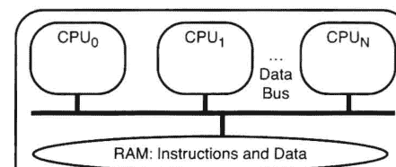

图 2.4 `UMA`——统一内存访问时间（与紧耦合相同）。

- 非均匀内存访问（`NUMA`）——在松耦合的多处理器中，`CPU` 通过其内存数据寄存器直接访问自己的本地内存，但不能直接访问其他 `CPU` 的内存（见图 2.5）。与访问另一个 `CPU` 内存中的数据相比，访问本地内存中的数据快得多，通常通过外部数据网络进行。跨 `CPU` 的访问时间是非均匀的。

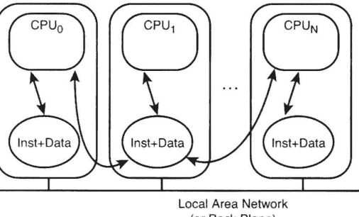

图 2.5 `NUMA`——非均匀内存访问时间（与松耦合相同）。

> **注意**
>
> 在某些参考文献中，`NUMA` 被进一步分为 `NUMA` 和 `NORMA`（不通过硬件访问远程内存）。这些解释道，`NORMA` 系统需要软件干预来缓存内存访问，然后向该系统发送消息，请求其所需的内存。`NUMA` 与 `NORMA` 的区别在于，它具有通过高速背板互连的独立系统，当内存访问位于本地系统之外时，背板会将请求的数据在电子上门控到请求端 `CPU` 的内存寄存器中。`NUMA` 中的远程内存访问仍然远慢于内存访问速度，但硬件处理一切，消除了对专用内存访问软件的需求。从技术上讲，你将构建一个 `NORMA` 系统。如果你继续阅读，如果能意识到这一细微的技术分歧将是很有趣的事。

## 紧耦合与松耦合多处理器

紧耦合 `MP` 系统非常高效。它们的所有进程都可以以内部总线速度进行相互通信，时间跨度在纳秒级。它们的缺点是成本高且存在单点故障——中央内存及其数据总线。某些设计采用了冗余总线结构等，但本章将从通用术语角度考虑此类分类。

计算机网络，正如你将在书中设计的多处理器一样，如果进程想要相互通信，则被被称为松耦合 `MP`，因为它们必须通过其外部互连介质以 `I/O` 总线速度进行通信，通常在毫秒级内完成。网络上的处理器间通信比紧耦合多处理器（`MP`）慢数千倍，但它具有成本较低的优点。通过容错可以在软件中实现高可用性。

松耦合 `MP` 系统难以调节，因为当一个进程与另一台计算机上的进程通信时，它可能正在发送或接收包含控制信息和数据的包。控制信息需要被检查，数据需要被处理。一个进程发送给另一个进程的信息大小比例是此类系统中效率的首要衡量标准。如果选定的包大小太小，可能需要发送许多包才能完成传输；如果包大小太大，接收进程可能会花费太多时间处于空闲状态，等待另一个包的进程。当包根据相对处理器和速度调整到合适的大小时，下一个包恰好在上一个包完成时到达——恰好及时。正确的包大小可能根据应用程序的不同而异，并可能在同一个应用程序的不同点之间发生变化——取决于处理器或网络负载。这个非平凡的问题是一个持续研究的课题。

紧耦合 `MP` 非常高效，因为传输指令或处理数据所需的时间对于所有 `CPU` 来说都是相同的；它们共享相同的内存。松耦合 `MP` 在设计上存在内存传输瓶颈：`CPU` 花费大量时间通过缓慢的通信介质向另一个地方发送消息。虽然交换式千兆以太与所有最快的背板互连相比得良好，但与直接内存访问速度相比，它仍然很慢。成功的松耦合 `MP` 系统使其软件针对特定应用程序的需求进行了调节。

总而言之，在处理器之间共享一个中央内存的 `MP` 系统性能优于网络上的许多独立节点计算机（每个节点都有自己的物理内存）。然而，中央内存系统的成本要贵得多，但如果计算机网络针对其设计的应用程序经过仔细的调节，它们在性能上是可以与之竞争的。

同样请记住，当紧耦合 `MP` 内部的 `CPU` 故障时，整个系统都要退回给制造商。当你网络中的一台 `PC` 故障时，只需要更换一台。你将在我们手中设计、构建并调节一个松耦合 `MP`。证据支持这样一个主张：8 到 16 个节点的集群可以提供等于或高于 `MP` 的性能。（关于 `NASA` 的 `Beowulf` 项目，请参见 `www.beowulf.org`。）然而，决定性因素是你可以在现在的市场上以非常合理的价格购买必要的处理器。

## 分布式共享内存系统

作为 1986 年博士工作的一部分，李 使用网络上的 `PC` 设计了一个独特的系统。他建议将紧耦合多处理器的虚拟内存概念映射到网络的物理内存空间上。每当访问本地内存时，它以内存总线速度直接来自本地内存。然而，当访问远程 `PC` 的内存时，必须交换数据请求和响应消息才能产生结果。数据地址在分布式进程空间内是唯一的。李将其系统命名为 `IVY`。这类系统后来变成了分布式内存系统或 `DSM` 系统。与紧耦合 `MP` 相比，`DSM` 异常缓慢，但它们具有某些值得进一步探索的有趣属性。多年来，计算机架构和操作系统会议上发表了大量 `DSM` 论文，其中许多论文集在一本书中，在本章末的“延伸阅读”部分。

## 集群架构

在李的网络 `PC` 上运行的软件独特之处在于定义了架构。后续研究利用了这一特性，给了我们今天所说的集群系统。它们的软件赋予了这些相互独立的 `PC` 统一性，定义了系统的个性；软件是系统的灵魂！

## 硬件选项

你需要考虑两个硬件决策：节点计算机架构和互连网络。

### 节点计算机

大品牌的工作站价格昂贵。它们运行复杂的操作系统软件，拥有巨大的物理内存和磁盘驱动器，而且可靠性极高。使用工作站或 `PC` 构建集群的原理几乎是相同的。因此，本节讨论将集中在典型的、基于 `Intel` 的 `PC` 上。

为了便于更换、负载均衡和性能分析，你选择的节点计算机应该都尽可能相似。书中描述的集群系统有八台节点计算机，它们的处理器、内存大小等参数几乎完全相同。

这些节点计算机应该有多强力？快速的回答可能是：“在你负担得起的范围内越强越好”。然而，请考虑一下这一点。我们的系统源于两台已经该更换的计算机。考虑到它们为我服务了多年，把它们扔掉似乎有些不礼貌。我仍然保留着原始的用户手册、诊断指南和初始化软盘，更不用说在机器内部工作、升级内存和硬盘等积累的经验了。当这些旧机器进入废旧物品市场时，我以每台 20 美元的价格买了几台，并买了一些备用零件。

最近，我构建了一个花费少于 300 美元的四节点系统。每台机器的系统主板上都集成了接口硬件。它们的速度几乎是原系统结节点的 10 倍，而价格只略高一点，可能是由于通货膨胀的原因。我只在其中一台机器上连接了显示器、鼠标和键盘，因为网络允许远程访问其他机器，而且这些较新的 `PC` 在没有这些的情况下也能成功启动。（某些旧机器如果没有连接键盘，将无法通过通电测试。）

你可以从大型企业和教育机构获取有关计算机回收渠道的详细信息。这些机构中的某些仍在运行计算机，因此它们的旧型号会流回租赁公司。在这种情况下，请直接联系租赁公司。某大型大学有一个专门的仓库向公众出售其过时的系统，并有一个测试台，你可以在购买前将其接入查看是否正常。不过，要留意组件缺失的问题；内存和驱动器在回收旧计算机之前通常会被移除。同时请注意，出于安全考虑，大多数计算机都会清空硬盘，所以请带上启动盘。致电咨询他们的公共信息办公室看看他们是否提供相关服务。

你可以通过电话购买最新的机器，也可以检查那些比顶配产品旧两三年的次级系统。这些较旧的（有时只旧了六个月）机器通常在特价，因为商店想要清理库存中的旧机器。

最后，合适的系统通常就在你朋友、邻居和亲戚的衣柜和车库里；这些系统也可以在交换市场、车库大卖等场所大量找到。当你买到它们时，它们可能无法工作，也可能无法构成整套匹配的设备，但这种廉价的价格包含了原始文档和软件；当你插上电源发现只看到一些看似随机的闪烁时，文档的价值是无价的。如果你需要的话，有时可以从规模较大的制造商那里获取文档（例如 `PDF` 文件和驱动软件），这些制造商的网站会有指向其免费下载区域的链接。我的其中一个测试系统就是来自一位读过我们计算机通讯报的人。许多人拥有一台运行完美的旧计算机。他们不会扔掉它，但乐意把它交给能派上用场的人。问问看，也许就能得到！

### 互连网络

同样，你面临着广泛的选择，即使在普通的电脑商店里，大量复杂的网络设备也让选择变得复杂。这里有防火墙、路由器、交换机、集线器以及速率高达千比特的媒体访问卡，包括链接和支持软件。几年前令企业数据中心经理引以为傲的设备，在本书编写期间正逐渐进入家庭网络。

防火墙可以被看作一种可以控制何种信息通过的路由器。路由器通常用作两个网络之间的流量隔离连接。交换机是大幅改进的集线器，允许多条同时的点对点通信通道。集线器是一种在网络中使用简单电缆（如双绞线，尽管已不再使用）的设备，其行为类似于同轴电缆（作为通信介质使用）。而同轴电缆的起源是为了欺骗媒体访问卡，使其认为在使用单一无线频率通道进行通信。

“以太网”（`ethernet`）一词最初的含义是指以太（`ether`），即在协议发明时数据包传输的大气。大约 30 年前，位于夏威夷不同岛屿的拥有几台计算机的人希望相互通信。岛际电话系统太不稳定，无法支持拨号通信，因此这些聪明的人使用了无线频率（`RF`）链路，并设计了一种新的通信协议来支持这种新的总线拓扑，被称为 `ALOHA` 系统。每台计算机将数据作为数据包发送，这是一个带有头部信息的字节串，其中包含了发送者和接收者的地址以及数据字节数；尾部信息用于验证字节是否已按发送方式接收。损坏的数据包被认为是“冲突”的结果——即两个或多个数据包同时传输。

这种新协议如此简单而又强大，以至于计算机科学家注意了注意。他们思考了这种计算机之间通信可能开启的可能性。以下是更多的历史。

一个无线收发器（发射器-接收器）通常通过一段方便的传输线连接到天线，通常是同轴电缆，以匹配收发器的输出到天线的输出，尽可能减少信号强度损失。无线电放在机房的桌子上，但天线位于屋顶，或者在塔楼更高处。传输线实现了这种分离。原始实验中的每个节点都有自己的收发器、传输线和连接到计算机上的天线，并配有一些控制发送和接收数据包的软件。

后来的一组科学家决定取消天线，将所有收发器连接到单根同轴电缆；如果计算机之间的距离不是问题，相同的协议就适用于局域网（或 `LAN`）。以太网就此诞生。

随着同轴电缆变得小得多，且使用了更简单更廉价的硬件，这一概念也运行良好。这仍然是同轴电缆，在计算机出现之前就建造的建筑中，“拉线”的成本仍然昂贵。作者在电梯和电梯井内花费了不止几个小时来支持这种效果！大多数办公楼内部已经有了数英里的电话语音级布线，通常是支持内部电话网络所需要的许多“对”（在每个墙插处通常有几捆扭绞在一起的线对。一对颜色编码的电线支持一台电话机；因此被称为双绞线）。如果有人能找到利用所有这些现有线缆的方法就好了！


# 集线器与网络基础

集线器（Hub）是一种小型设备，为网络上的每个节点支持固定数量的端口连接（见图 2.6）。尽管网络连接的物理外观看起来像星形（所有节点从某个中心点射出），但其行为是以太网，即一种允许直接通信的总线拓扑。

在任意两个节点之间。总线内部的电子设备监听其每个端口，并将它听到的任何信号重新传输到每个其他连接上。这种行为模拟了总线网络的行为。

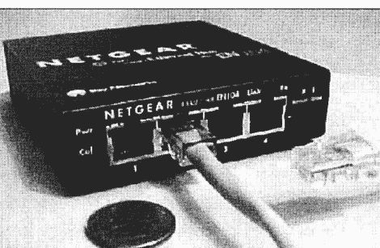

**图 2.6** 一个 10BASE-T 集线器通过普通电线将许多网络网卡连接在一起。

## 网络命名规范

网络及其连接器有一套命名规范。原始的 0.5 英寸厚同轴网络支持长度达 500 米的单根同轴电缆，运行速率最初为 1 Mbps、2 Mbps，最后是 10 Mbps。这些分别被命名为 `BASE-5`、`2BASE-5` 和 `10BASE-5`。第一个数字代表每秒兆比特（Mbps）的数据传输速率。`Base` 指基带通信，其中只使用一个频率（将其与宽带通信进行对比）。最后一个数字代表以百米为单位的最大同轴电缆长度。同轴连接器通常被称为 UHF 连接器，因为它们的额定频率进入了 UHF（300MHz 及以上）范围，但表现出明显的损耗（技术上这些被称为 PL-259 连接器：PL 代表插头，匹配 SO-239 插座）。`BNC` 连接器易于连接或断开。它们在末端都需要一个终端器，使其在电气长度上变为无限。终端器是一个吸收传输能量的电阻，可以避免引起干扰的反射。

“双绞（twisted pair）”一词源于电信公司，常见的家用四线 `RJ-11` 电话到墙的连接器是更大的八线 `RJ-45` 连接器的蓝本。我的系统网络使用 `RJ-45` 连接器连接到 `10BASE-T` 集线器。最后的 `T` 代表双绞。`100BASE-T` 用于描述 100Mbps，而 `1000BASE-T` 指的是千兆级集线器和网络。在后续的阅读中，你会看到一些关于光纤支持等其他不那么明显的命名。

总而言之，最好的解决方案就是最快的解决方案——连接到最快网络的热节点处理器。然而，这本书与其说是为了解决某个特定问题构建解决方案，不如说是进入集群计算机架构的核心。对于严肃的开发者来说，六个月的技术已经足够了；爱好者则会对一个连接了四个或更多回收 PC 的 `100Base-T` 集线器感到满意，每台 PC 都连接了显示器、键盘和鼠标。这就是测试系统背后的哲学，正如你所看到的，它发展成了一个相当完善的系统。

# 软件选项

软件的选择要简单。你需要一个足够复杂的操作系统，能够支持局域网、从一台机器到网络上任何其他机器的远程命令执行（远程 shell）访问，以及可靠的 C 编译器。

Unix 具有所有所需的功能，PC 有多个版本可用。操作系统软件的成本随功能增加而增加，而非质量，所以你拥有优势，因为你不需要很多功能。一个复杂的 Linux 用户可以在除了互联网连接下载的费用外，免费配置、构建和安装操作系统。对于我们其他人来说，可以以低于 50 美元的价格获得简单的 Linux 版本，包括基础文档和易于操作的安装程序。测试系统在字符模式下运行 `Linux 2.0.30` 内核（不支持 Window）。如果你只连接一个显示器、键盘和鼠标，你可能想要包含 X Window 系统，这将允许你在该显示器上为每台机器打开一个独立的窗口。

Linux 自带了一个良好的 C 编译器，与许多其他操作系统不同。Linux 然是最佳选择。安全性是 Linux 的功能之一，随着时间的推移变得复杂，旧版本比新版本更受欢迎。局域网内的安全不是问题——你不会将任何东西连接到互联网或你直接控制之外的其他地方。

# 性能问题

你可以从两个方面观察集群的性能：外部和内部。外部关注集群处理事务的速度，内部则关注集群内部的执行。

# 延伸阅读

- Hennessey, John, and David Patterson. *组织与设计*. San Francisco, CA: Morgan Kaufmann, 1998.
- Patterson, David, and John Hennessey. *计算机架构：定量方法*. San Francisco, CA: Morgan Kaufmann, 1996.
- Protic, Jelica, Milo Tomasevic, and Veljko Milutinovic. *分布式共享内存：概念与系统*. Los Alamitos, CA: IEEE Computer Society Press, 1998.
- Tanenbaum, Andrew. *计算机网络*. Englewood Cliffs, NJ: Prentice Hall PTR, 1996.

# 第 3 章 进程间通信

## 本章概要

- 使用 `fork` 和 `execl` 创建子任务
- 发送信号和处理接收到的信号
- 使用共享内存区域
- 使用信号量处理数据
- 消息传递：UDP 与协议
- 互操作协议地址
- 跨网络消息传递
- 自动启动远程服务器
- 延伸阅读

## 进程间通信

即使是经验丰富的软件开发者——对 Unix 内部原理有专家知识的资深 C 程序员——可能也无法完全适应本章中介绍的一些深奥技术。本章是对我们开发集群软件时所使用的 C-Unix 接口技能的复习。如果你对这些材料有信心，请随时跳过以下任何一个或所有章节。这些示例是为了方便你提供的，并附带了一套你可以编译和运行的完整 C 程序。源代码可以在本书的网页 `www.subpublishing.com` 上找到。我们希望你能帮助修改和更新它们，以满足你对可能未提到的细节的好奇心！

注意，为了保持程序列表简短并更具可读性，特意省略了示例中许多系统调用错误返回的检测和处理。这些示例程序均在 Red Hat 4.2 版本的 `Linux 2.0.30` 内核下经过测试。

## 使用 fork 和 execl 创建子任务

在 C-Unix 系统接口中，子任务要求你通过一个系统调用来创建原始（父）进程的相同副本。当它返回时，你的子任务（子进程）在它自己的地址空间中运行，并有自己的进程 ID，即 PID。现在，同一个系统调用存在两个相同的进程；它们必须自己发现自己应该扮演父进程还是子进程，而返回码是区分它们的唯一方法。父进程接收其子任务的进程 ID，而子进程接收零。以下程序（见列表 3.1）演示了这种技术：

### 列表 3.1 使用 fork 的单模块子任务

```c
#include <stdio.h>
#include <unistd.h>

main(void)
/**
** List3.1.c - 使用 fork() 的单模块子任务
 */
{
    int pid;    /* 子任务的进程 id */

    /* 父任务向屏幕发送进程消息 */
    printf("\nParent task active as process %d.\n", getpid());

    /* fork() 创建父任务的相同副本 */
    if((pid = fork()) == 0)
    {
        /* 此块仅由子任务执行 */

        /* 子任务向屏幕发送进程消息 */
        printf("Child task active as process %d.\n", getpid());

        /* 子任务正常退出 */
        exit(0);
    }
    /* 父任务等待子任务退出 */
    waitpid(pid);
    return 0;
}
```

通常情况下，只写一个支持两种角色的程序。然而，存在另一种范式。子进程（子任务）的支持代码保持简单，发出一个指定单独可执行文件磁盘位置的系统调用。另一个可执行文件包含了为子任务设计的复杂性。它开始执行，完全替换内存中原始子任务的映像并接管其进程 ID。注意列表 3.2a 和 3.2b 中的这些项。

> **注意**
>
> `execl` 函数需要可执行文件的完整路径名。请用描述你测试环境的字符串替换此字符串。

### 列表 3.2A 使用 fork 和 execl 的父进程

```c
#include <stdio.h>
#include <unistd.h>

main(void) {
/*
** Listing3.2a.c - 使用 fork() 和 execl() 的父进程
 */
    int pid;

    /* 父任务向屏幕发送进程 id */
    printf("\nParent task active as process %d.\n", getpid());
    /* fork() 创建父任务的相同副本 */
    if((pid = fork()) == 0)
    {
        /* 此块仅由子任务执行 */

        /* 子任务用磁盘映像替换自己 */
        execl("/home/user/bin/Listing3.2b", "Listing3.2b", NULL);
        printf("\nA successful execl() will never return!\n");
        exit(-1);
    }

    /* 父任务等待子任务退出 */
    waitpid(pid);
    return;
}
```

### 列表 3.2B 使用 fork() 和 execl 的子进程

```c
#include <stdio.h>
#include <unistd.h>

main(void) {
/*
** Listing3.2b.c - 使用 fork() 和 execl() 的子进程
 */
    /* 子任务向屏幕发送进程 id */
    printf("Child task active as process %d\n", getpid());

    /* 子任务正常退出 */
    exit(0);
}
```

## 发送信号和处理接收到的信号

### 列表 3.3 信号处理示例

```c
#include <stdio.h>
#include <signal.h>

int count = 0;

main(void)
/*
** Listing3.3.c - 信号处理示例
*/
{
    /* 设置信号处理器 */
    signal(SIGINT, control_C);

    /* 告诉交互式用户做什么 */
    printf("\ntype a C when ready...\n");
    fflush(stdout);

    pause();
    printf("handled event #%d.\n", count);
}
printf("\nThree events were handled - bye!\n\n");

void control_C() {
    /* 重新建立处理器 */
    signal(SIGINT, control_C);

    /* 统计 C 的次数 */
    count++;
}
```

在程序运行后，你可以通过 `kill` 命令发送 SIGINT 事件代码信号：

```bash
kill -2 3721
```

其中 `2` 是 SIGINT 事件代码，`3721` 在此处代表实际的进程 ID（PID）。你将需要使用另一个会话窗口（根据 Linux 文档）或从其他网络机器远程登录来尝试此操作。你使用 `kill` 系统调用从另一个进程发送信号：

```c
kill(2, 3721);
```

在这里 `3721` 再次被假设为 PID。

一个头文件包含了 `SIGINT` (2)、`SIGUSR1` (10)、`SIGUSR2` (12) 等的定义，你可以使用这些更容易记忆的定义来代替数值代码。编号为 10 (`SIGUSR1`) 和 12 (`SIGUSR2`) 的编码事件是通用的，永远不会由操作系统发送。当你定义定义自己的应用程序特定信号含义时，可以使用其中一个或两个。

## 使用共享内存区域

请记住，通过调用 `fork` 创建的子任务在它自己的地址空间运行，该地址空间是父进程地址空间的精确副本。每个变量在子进程中的设置都等于父进程调用 `fork` 时的值。这意味着，当父进程更改这些值时，子进程地址空间中的值不会发生变化，反之亦然。

这是一个重要的概念：如果子进程更改了变量的值，父进程是看不见的，因为它们现在是两个不同地址空间中两个不同变量的两个不同值。当子进程执行时，它只能看到自己的地址空间。其中一个的变化对另一个的状态完全没有影响；它们在任何方面都没有关联。

如果子进程需要通过更改变量的值与父进程通信（例如），它该如何做呢？共享内存就是答案之一。操作系统提供了一套系统调用允许分配共享内存。父进程需要识别并设置适当的权限，允许子进程挂载它并映射到自己的地址空间中。（顺便说，任何具有权限的进程都可以附加并修改共享内存区域，请仔细设置你新内存区域的权限。共享内存不仅用于子任务，还可以被运行在同一台计算机上的任何其他进程访问。）让我们看列表 3.4 作为示例。

### 列表 3.4 修改父进程共享内存中的数据

```c
#include <sys/ipc.h>
#include <sys/shm.h>
#include <stdio.h>
#include <unistd.h>

main(void)
/*
 * 列表 3.4.c - 子进程更改父进程共享内存中的数据
 */
{
    struct area { /* 共享内存区域 */
        int value; /*（一个简单的示例） */
    } area, *ap;

    int flag = (IPC_CREAT | IPC_EXCL | 0660);
    int size = sizeof(struct area);
    key_t key = 0x01020304; /* 示例 * */
    int shmid; /* 共享内存区域 ID */
    int pid;

    /* 获取共享内存区域 */
    shmid = shmget(key, size, flag);

    /* 挂载共享内存区域 */
    ap = (struct area *) shmat(shmid, 0, 0);

    /* 设置共享内存数据的值 */
    ap->value = 0; /* 初始化值为零 */
    printf("\nParent initial value set to zero\n");

    if((fork()) == 0) { /* 子任务 */
        /* 挂载父进程的共享内存 */
        ap = (struct area *) shmat(shmid, 0, 0);
        /* 更改父进程的共享内存 */
        ap->value = 100;
        printf("Child changed value to %d\n", ap->value);
        exit(0);
    }

    /* 父进程 */
    sleep(2);
    printf("Parent sees value: %d\n", area.value);
    shmdt(ap);
    shmctl(shmid, IPC_RMID, NULL);
}
```

## 使用信号量

为了避免多个进程访问共享内存时产生竞态条件，我们使用信号量。信号量本质上是一个计数器，允许进程同步对共享资源的访问。二进制信号量的作用类似于互斥锁（mutex），一次允许有一个进程进入临界区域。计数信号量允许固定数量的进程同时访问资源。

### 列表 3.5 信号量与共享内存示例（片段）

```c
int semid; /* 信号量 id */
int shmid; /* 共享内存 id */
int pidD; /* 存款子任务 pid */
int pidW; /* 取款子任务 pid */
int amount;
char inbuf[80];
```

```c
/* 获取共享内存区域 */
shmid = shmget(mkey, size, flag);
```

```c
/* 挂载共享内存区域 */
ap = (struct area *) shmat(shmid, 0, 0);
```

```c
/* 在共享内存中初始化账户信息 */
ap->balance = 1000; /* 初始化余额为 $1000 */
ap->withdrawal = 0;
ap->deposit = 0;
```

```c
/* 获取并初始化信号量 */
semid = semget(skey, 1, flag);
/* 设置信号量可用 */
un.val = 1;
semctl(semid, 0, SETVAL, un);
/* 第一个且唯一的信号量 */
buf.sem_num = 0;
/* 如果设置则等待 */
buf.sem_flg = 0;
```

```c
if((pidD = fork()) == 0) { /* 存款 */
  /* 挂载父进程共享内存 */
  ap = (struct area *) shmat(shmid, 0, 0);
  /* 注意：shmid 仍然设置正确 */
```

```c
/* 处理存款 */
while(1) {
  sleep(1);
  /* 设置信号量 */
  buf.sem_op = -1;
  semop(semid, (struct sembuf *) &buf, 1);
```


# 第3章 进程间通信

## 列表 3.5

```c
if (ap->deposit < 0)
    break; /* 退出请求 */

if (ap->deposit > 0) {
    /* 处理存款 */
    ap->balance += ap->deposit;
    ap->deposit = 0; /* 清空它 */
}

/* 清空信号量 */
buf.sem_op = 1;
semop(semid, (struct sembuf *)&buf, 1);

/* 子任务正常退出 */
exit(0);

if ((pidD == fork()) == 0) {    /* 取款 */
    /* 挂载父进程共享内存 */
    ap = (struct area*) shmat(shmid, 0, 0);
    /* 注意：shmid 仍然设置正确 */

    /* 处理取款 */
    while (1) {
        sleep(1);

        /* 设置信号量 */
        buf.sem_op = -1;
        semop(semid, (struct sembuf *)&buf, 1);

        if (ap->withdrawal < 0)
            break; /* 退出信号 */

        if (ap->withdrawal > 0) {
            /* 处理取款 */
            ap->balance -= ap->withdrawal;
            ap->withdrawal = 0; /* 清空它 */
        }
    }

    /* 清空信号量 */
    buf.sem_op = 1;
    semop(semid, (struct sembuf *) &buf, 1);

    /* 子任务正常退出 */
    exit(0);
}

/* 父进程：处理存款和取款交易 */
printf("\n\n\n欢迎来到第一个交互式银行\n\n");
while (1) {
    printf("\n输入 D 存款，输入 W 取款: % ");
    fflush(stdout);
    fgets(inbuf, sizeof(inbuf), stdin);
    if (inbuf[0] == 'D' || inbuf[0] == 'd') {
        printf("\t当前账户余额为 $%d\n", ap->balance);
        printf("\n输入存款金额 (0 退出): ");
        fflush(stdout);
        fgets(inbuf, sizeof(inbuf), stdin);

        /* 设置信号量 */
        buf.sem_op = -1;
        semop(semid, (struct sembuf *) &buf, 1);

        amount = atoi(inbuf);
        if (amount <= 0) { /* 退出请求 */
            /* 通知子任务 */
            ap->deposit = -1;
            ap->withdrawal = -1;
            break; /* 退出无限循环 */
        }
        ap->deposit = amount; /* 存款 */

        /* 清空信号量 */
        buf.sem_op = 1;
        semop(semid, (struct sembuf *) &buf, 1);
    }
    else if (inbuf[0] == 'W' || inbuf[0] == 'w') {
        printf("\t当前账户余额为 $%d\n", ap->balance);
        printf("\t输入取款金额 (0 退出): ");
        fflush(stdout);
        fgets(inbuf, sizeof(inbuf), stdin);

        /* 设置信号量 */
        buf.sem_op = -1;
        semop(semid, (struct sembuf *) &buf, 1);

        amount = atoi(inbuf);
        if (amount <= 0) { /* 退出请求 */
            /* 通知子任务 */
            ap->deposit = -1;
            ap->withdrawal = -1;
            break; /* 退出无限循环 */
        }
        else if (amount <= ap->balance) {
            ap->withdrawal = amount; /* 取款 */
        }
        else {
            printf("资金不足！\n");
        }

        /* 清空信号量 */
        buf.sem_op = 1;
        semop(semid, (struct sembuf *) &buf, 1);
    }
}

/* 子任务正常退出 */
exit(0);

/* 等待子进程退出 */
waitpid(pidD);
return 0;
```

## 列表 3.6 与派生子任务的 UDP 通信

```c
int pid;      /* 子任务的进程 id */
int fd;       /* socket 文件描述符 */
char buffer[80];
```

```c
/* 建立并初始化 UDP socket 结构体 */
fd = socket(AF_UNIX, SOCK_DGRAM, 0);
memset((char *) &sock, 0, sizeof(sock));
strncpy(sock.sun_path, path);
sock.sun_family = AF_UNIX;
```

```c
/* 创建子任务 */
if ((pid = fork()) == 0) {
    /* 发布我们监听的端口号 */
    bind(fd, (struct sockaddr *) &sock, len);

    /* 将从父进程接收的消息回回给用户 */
    while (1) {
        recvfrom(fd, buffer, sizeof(buffer), 0,
            (struct sockaddr *) &sock, &len);
        printf("Child: %s", buffer);
        if (strncmp(buffer, "EXIT", 4) == 0) { /* 退出请求 */
            unlink(path);
            puts("Bye!");
            close(fd);
            break;
        }
    }

    /* 子进程退出 */
    exit(0);
}

/* 将交互式用户输入的消息发送到子任务 */
while (1) {
    sleep(1); /* 响应时间 */
    printf("\nEnter a message: ");
    fflush(stdout);
    fgets(buffer, sizeof(buffer), stdin);
    sendto(fd, buffer, strlen(buffer)+1, 0,
        (struct sockaddr *) &sock, sizeof(sock));

    if (strcmp(buffer, "EXIT", 4) == 0) {    /* 退出请求 */
        close(fd);
        break;
    }
}

/* 等待子进程退出 */
waitpid(pid);
return 0;
```

## 列表 3.7 与派生子任务的 TCP 通信

```c
#include <netinet/in.h>
#include <sys/socket.h>
#include <sys/types.h>
#include <sys/un.h>
#include <netdb.h>
#include <stdio.h>
#include <string.h>
#include <unistd.h>

char path[] = {"/tmp/socket.3.3.7"};    /* socket 名称 */

main(void)
/*
** Listing 3.7.c - 与派生子任务的 TCP 通信
*/
{
    struct sockaddr_un sock;
    int len = sizeof(sock);
    int pid;        /* 子任务进程 */
    int soc;        /* socket 文件描述符 */
    char buffer[80];

    /* 建立并初始化 TCP socket 结构体 */
    if ((soc = socket(AF_UNIX, SOCK_STREAM, 0)) < 0) {
        perror("Listing 3.7: socket(");
        exit(-1);
    }

    memset((char *) &sock, 0, sizeof(sock));
    strncpy(sock.sun_path, path);
    sock.sun_family = AF_UNIX;

    /* 创建子任务 */
    if ((pid = fork()) == 0) {
        /* 发布我们监听的 socket 名称 */
        bind(soc, (struct sockaddr *) &sock, len);

        /* 接收连接 */
        if (listen(soc, 5) < 0) {
            perror("Child: listen()");
            exit(-1);
        }

        if ((soc = accept(soc, (struct sockaddr *) &sock, &len)) < 0) {
            perror("child: accept()");
            exit(-1);
        }

        /* 将从父进程接收的消息回回给用户 */
        while (1) {
            if (recv(soc, buffer, sizeof(buffer), 0) < 0) {
                perror("child: recv()");
                break;
            }
            printf("child: %s", buffer);
            if (strncmp(buffer, "EXIT", 4) == 0) {    /* 退出请求 */
                unlink(path);
                puts("Bye!");
                close(soc);
                break;
            }
        }

        /* 子进程退出 */
        exit(0);
    }

    /* 连接到由子任务创建的服务器 socket */
    sleep(2); /* 等待设置 */
    if (connect(soc, (struct sockaddr *) &sock, sizeof(sock)) < 0) {
        perror("parent: connect()");
        exit(-1);
    }

    /* 将交互式用户输入的消息发送到子任务 */
    while (1) {
        sleep(1); /* 响应时间 */
        printf("\nenter a message: ");
        fflush(stdout);
        fgets(buffer, sizeof(buffer), stdin);

        if (send(soc, buffer, strlen(buffer)+1, 0) < 0) {
            perror("parent: send()");
            exit(-1);
        }

        if (strcmp(buffer, "EXIT", 4) == 0) { /* 退出请求 */
            close(soc);
            break;
        }
    }

    /* 等待子进程退出 */
    waitpid(pid);
    return 0;
}
```

这两个列表都通过键盘和屏幕与用户交互；它们都使用 `fork` 创建子任务，父进程与其子任务通信。其中一个程序使用 UDP（列表 3.6），另一个使用 TCP（列表 3.7）。TCP 版本确保父进程发送的消息被接收，但在应用程序代码层面这种区别并不明显。这些地址虽然简单，但可以作为你未来应用程序的模式。在提示处输入 `EXIT` 退出程序。

## 网络协议地址

到为止，你关注的是运行在同一台计算机上的子任务和进程。然而，如果你要管理集群，就需要与网络上的其他机器进行通信。

网络协议地址，或 IP 地址，是唯一定义网络上每个机器的 32 位数字。该地址方案用于进程间通信，这也是本章的主题。

> **注意**
>
> 在设计 IP 地址时，它提供的数十亿个地址似乎是一个永远不会被接近甚至超越的数字。IP 版本 6 和其他方案建议大幅扩大此值，以基于现代经验的估计。

## 列表 3.8A 向远程服务器发送 UDP 数据报文

```c
/* ... 前文省略 ... */
    break;
}
puts("Bye!");
return(0);
}
```

## 列表 3.8B 从远程客户端打印 UDP 数据报文

```c
#include <netinet/in.h>
#include <sys/socket.h>
#include <netdb.h>
#include <stdio.h>

#define PORT 5678
```

```c
main()
/*
** 列表 3.8b.c - 从远程客户端打印 UDP 数据报文
*/
{
    struct sockaddr_in sock;
    int len = sizeof(sock);
    struct hostent *hp;
    int port = PORT;
    int fd;
    char buffer[80];

    /* 建立并初始化 UDP socket 结构体 */
    if ((fd = socket(AF_INET, SOCK_DGRAM, 0)) < 0) {
        perror("server: socket()");
        exit(-1);
    }

    memset((char *) &sock.sin_addr, 0, sizeof(sock));
    sock.sin_addr.s_addr = htonl(INADDR_ANY);
    sock.sin_port = htons(port);
    sock.sin_family = AF_INET;
    if (bind(fd, (struct sockaddr *) &sock, len) < 0) {
        /* ... 后续代码省略 ... */
    }
}
```

首先启动服务器（参见列表 3.8B），然后在另一台机器上启动客户端（参见列表 3.8A）。要告知服务器运行在何处，请在启动它时在命令行中包含服务器的 IP 地址。

在 IP 为 `10.0.0.2` 的服务器机器上：

- `> server` [注意“>”符号表示命令行提示符。]

在 IP 为 `10.0.0.1` 的客户端机器上：

- `> client 10.0.0.2`

以你之前在列表 3.6 或列表 3.7 中相同的方式与客户端交互，以获取服务器上服务器的响应。以下是你可能会看到的内容。如所示，在服务器或客户端列上执行第 1 到 5 步：

| 10.0.0.2 (服务器) | 10.0.0.1 (客户端) |
| :--- | :--- |
| 1) `> server` | |
| 2) | `> client 10.0.0.2` |
| 3) | 输入消息：`Hello there, server!` |
| 4) | 服务器：`Hello there, server!` |
| 5) | 输入消息：（以此类推。输入 `EXIT` 结束会话） |

列表 3.8A 和列表 3.8B 中的程序是独立的客户端和服务器程序。它们使用 UDP 进行通信，就像列表 3.6 中的组合形式一样，但它们是跨网络从一台机器到另一台机器进行通信。（同样，列表 3.9A 和 3.9B 是使用 TCP 的列表 3.7 的网络对应项）。检查这两组程序之间的差异，以及在自己的机器之外通信时需求方面的整体差异。一如既往，鼓励你进行实验。有时，“如果我这样做会发生什么？”最快的答案是“试一看吧！”。

## 列表 3.9A 向远程服务器发送 TCP 数据包

```c
#include <netinet/in.h>
#include <sys/socket.h>
#include <sys/types.h>
#include <string.h>
#include <netdb.h>
#include <stdio.h>
```


# 第 3 章 进程间通信

## 列表 3.9a.c - 向远程服务器发送 TCP 数据包

```c
#define PORT 4321

main(argc, argv)
char *argv[];
int argc;
/*
** 列表 3.9a.c - 向远程服务器发送 TCP 数据包
*/
struct sockaddr_in sock;
struct hostent *hp;
int port = PORT;
int fd;
char buffer[80];

/* 服务器 */
if(argc < 2)
{
    printf("\nUsage: %s <IP_Addr>\n\n", argv[0]);
    exit(-1);
}

/* 获取有关远程服务器的关键信息 */
strncpy(buffer, argv[1], sizeof(buffer));
if((hp = gethostbyname(buffer)) == NULL)
{
    perror("client: gethostbyname()");
    exit(-1);
}

/* 初始化 TCP 流 socket 结构体 */
if((fd = socket(AF_INET, SOCK_STREAM, 0)) < 0)
{
    perror("client: socket()");
    exit(-1);
}
memset((char *) &sock, 0, sizeof(sock));
memcpy(&sock.sin_addr, hp->h_addr, hp->h_length);
sock.sin_family = hp->h_addrtype;
sock.sin_port = htons(port);

/* 连接到远程服务器 */
if(connect(fd, (struct sockaddr *) &sock, sizeof(sock)) < 0)
{
    perror("client: connect()");
    exit(-1);
}

/* 将交互式用户输入的消息发送到子子任务 */
while(1)
{
    printf("\nEnter a message: ");
    fflush(stdout);
    fgets(buffer, sizeof(buffer), stdin);

    if(send(fd, buffer, strlen(buffer)+1, 0) < 0)
    {
        perror("parent: send()");
        exit(-1);
    }
    if (strncmp(buffer, "EXIT", 4) == 0) /* 退出请求 */
    {
        close(fd);
        break;
    }
}
close(fd);
return(0);
```

## 列表 3.9b.c - 从远程客户端打印 TCP 数据包

```c
#include <netinet/in.h>
#include <sys/socket.h>
#include <netdb.h>
#include <stdio.h>

#define PORT 4321

main(void)
/*
** 列表 3.9b.c - 从远程客户端打印 TCP 数据包
*/
{
  struct sockaddr_in sock;
  int len=sizeof(sock);
  struct hostent *hp;
  int port = PORT;
  int acc, soc;
  char buffer[80];

  /* 创建服务器 socket 以连接 */
  if ((acc = socket(AF_INET, SOCK_STREAM, 0)) < 0)
  {
    perror("server: socket()");
    exit(-1);
  }
  memset((char *) &sock, 0, sizeof(sock));
  // ... 后续代码省略
}
```

## 提示

如果你还没有构建好网络，可以使用另一种方法来测试这些程序对。启动第二个登录会话（在 Linux 上打开一个新的 X 窗口或按 `Alt+F2`），并将其视为服务器机器。在你的原始登录会话中运行客户端应用程序，并将目标 IP 地址设置为 `127.0.0.1`，这是全球公认的“本地环回”IP 地址。“环回”术语的意思是“同一机器”。其他操作与你在前面的示例中所做的操作相同。

## 自动启动服务器

在客户端/服务器示例中，你手动启动服务器，但服务器通常在你尝试连接它之前就已经运行了。例如，数据库服务器通常在你尝试连接它之前就已经运行了。

## 自动启动远程服务器

```
udpsvc stream udp nowait nobody
/home/user/bin/Listing3.8c Listing3.8c
```

## 现在执行

以 root 身份执行：

```
killall -HUP inetd
```

执行与你在测试列表 3.8a、3.8b 以及列表 3.9a 和 3.9b 中的程序时相同的客户端命令。

但你不会在服务器系统的屏幕上看到回显的消息，因为标准输出流已被 `inetd` 重置，表示返回客户端的通信通路。你发送的消息现在保存在日志文件 `/tmp/log` 中，可以列出它以确保一切都按预期工作。

以 root 身份执行：

```
cat /tmp/log
```

`cat` 命令是 concatenate 的缩写（在此情况下指输出流），用于将文件内容列到屏幕上。

## TIP

如果你没有找到 `/etc/inetd.conf` 文件，你的 Linux 版本可能使用的是 `xinetd` 而不是经典的 `inetd`。

在这种情况下，不要在每个文件中输入那两行内容，而是在 `/etc/rc.d/init.d/` 下创建两个小文件（以 root 身份），分别为 `Listing3.8c` 和 `Listing3.9c`。例如，找到 `/etc/rc.d/init.d/Listing3.9c`：

```
service Listing3.9c
{
    port = 4321
    socket_type = stream
    protocol = tcp
    wait = no
    user = nobody
    server = /home/user/bin/Listing3.9c
    only_from = 10.0.0.0
    disable = no
}
```

为 UDP 服务器创建一个类似的文件。你可以从 `xinetd` 手页中获取更多关于 `xinetd` 服务文件条目的详细信息。在命令行中输入 `man xinetd.conf`。当两个文件都创建完成后，以 root 身份输入：

```
/etc/rc.d/init.d/xinetd restart
```

并像以前一样对这个客户端-服务器对进行实验。

## 总结

你从一个使用 `fork` 的简单子任务示例开始。通过将此程序分为父部分和子部分并分别编译，你看到了父进程如何使用 `exec` 从单独的可执行文件创建一个子任务。你学习了信号的使用、捕获和处理，以及如何在父进程和子进程之间创建和管理共享内存，包括如何使用信号量防止数据损坏。最后，你学习了使用两种套接字进行进程间通信。

从单台机器转向网络上的对对处理器，父子概念扩展到了更常见的客户端/服务器范式。你再次使用两种套接字在两台独立的机器上设置了客户端和服务器进程，然后配置系统，在客户端请求服务时自动在远程机器上启动服务器进程。

进程间通信是一个复杂的课题。如果你编译这些每一个演示程序并对其进行实验，它们将引导你进入许多客户端与单服务器系统通信的通用情况。这是数据库服务器和 Web 服务器共同使用的机制。它是网络编程的基础。

## 延伸阅读

- Brown, Chris. *Unix Distributed Programming*. Hertfordshire, England: Prentice Hall International (UK), 1994.
- Hawkins, Scott. *Linux Desk Reference*. Englewood Cliffs, NJ: Prentice-Hall PTR, 2000.
- Stevens, W. Richard. *Advanced Programming in the UNIX Environment*. Reading, MA: Addison-Wesley, 1992.

# 第 4 章 为你的集群组装硬件

## 为你的集群组装硬件

- 节点处理器与配件
- 网络介质与接口
- 实现操作系统
- 我们集群系统的网络拓扑
- 延伸阅读

处理器速度在过去三年中大幅增加。更新、更快的计算机型号不断涌现，直到经济衰退的威胁抑制了它们的销量。个人和家庭完全正确地认为，他们现有的计算机已经足够应付。办公室经理决定，通过将计算机租赁合同再延长两年，可以部分满足预算削减。后来，计算机制造行业经历了艰难的时期。

这一切带给消费者的好消息是：大型电脑商店最畅销的系统正在促销，价格比去年便宜约 15%。二线型号更便宜，而经济型型号的价格仅略低于 1000 美元。电脑回收站有 30 美元标签的电脑，它们可以轻松运行所有最新的操作系统及其生产力套件。加上显示器、键盘、鼠标、调制解调器和声卡，你只需大约 100 美元就能构建出一个相当完善的家庭系统。考虑到你集群系统节点所需的计算机配置，花很少钱就能获得一个四节点集群。让我们开始吧！

## 节点处理器与配件

如果正如他们所说，“钱不是问题”，你可以购买四台或更多市面上最好的系统。对于相当富裕的人来说，一套二线机器或可能更多的经济型机器是集群的首选。然而，精打细算的设计师必须更仔细地计划。

如果你负担得起更好的设备，也许你的第一个集群应该从回收的 PC 开始构建。不久前，还有人为办公桌上放着这些系统而感到自豪。它们物有所值，没有什么需要证明的；它们可能仍然可以在 Linux 这样高效的操作系统上运行。此外，旧机器能教给你许多比新机器更多关于计算机的知识。你将更换显卡并升级内存，了解 `PCI` 插槽和 `ISA` 的区别，并学会不费思索地识别内存条的缺口。你将研究内存型号、确定其接口速度等。通过这些过程，你将获得信心以及对你系统的实用知识。让我们深入研究可用于构建廉价但实用的集群的成本效益组件。

### 注意

大型公司、电脑折扣店以及医院和大学等机构都有中央信息热线，你可以拨电话咨询其回收政策的详情。许多员工自愿重建公司的旧电脑供当地使用，这样他们就不会将其卖给公众。然而，确实有人会卖，值得打个当地电话了解一下。我附近的一所大学有一个专门销售的仓库，并在办公期间向公众开放。他们在银行里有一个测试台，价格非常合理。一瓶通用清洁剂和一卷纸巾就能让这些系统恢复到非常漂亮（即使还没到展厅级）的状态。

## 硬件配件

假设你打算构建一个四节点集群，请尝试找到五个制造商和型号完全相同的 PC 主机。检查它们的内部，确保它们有硬盘和 CD-ROM 驱动器，并且内存槽至少插了内存。检查背部的公头连接器是否有弯曲的针脚，不要忘记电源线。如果商店允许你在购买前试用，请尽管尝试。当出现问题时，多留一台机器是好事，但购买坏掉的 PC 真的会打击你的热情！

## I/O 要求

这个集群需要一个显示器、一个键盘和一个鼠标，因为 Linux 会让你从主电脑进入远程系统。在检查每台机器时，将它们直接连接到每台机器上，但在它们在网络上运行之后，它们将连接到网络文件系统（`NFS`）服务器。你将在下一章中学习更多关于 `NFS` 的知识。

仔细检查键盘、鼠标和显示器线内部那些精细的针脚。确保显示器既有电源线又有视频接口电缆。不要拆掉显示器的外壳，除非你专长修理电视。视频屏幕（阴极射线管或 `CRT`）就像电视屏幕，需要高工作电压，即使在拔掉电源长时间后，电压仍保持高位。

## 网络硬件

同时记住，这些机器将要联网，因此请查看 PC 背部主板上的 `RJ45` 插座，以及其他端口，或者某个配件卡上的端口，如图 4.1 所示。在购买集线器之前，先确定网络接口支持的速度。写本文时的许多回收系统是 `10Mbps` 的，而支持 `10/100Mbps` 的计算机才开始出现。集线器的速度必须与每台计算机的网络接口速度兼容。`10/100Mbps` 集线器兼容 `10BASE-T`，但如果网络上有一个 `10BASE-T` 接口，所有设备都将以 `10Mbps` 运行。如果集线器是 `10Mbps` 而你所有的机器都是 `100Mbps`，那么什么都无法工作，所以购买时要小心。你总是可以为计算机增加 `100Mbps` 的卡并忽略其 `10Mbps` 的主板接口，但这会增加集群的整体成本。

图 4.1 计算机主板上的网络接口 `RJ45` 连接器。

### 注意

大多数计算机制造商在其网站上提供了停产型号的规格信息，通常位于“支持”部分。请参见本章末尾的“延伸阅读”部分获取几个参考网站。

## 网络媒介与接口

Beowulf 项目（参见 `www.beowulf.org`）的结果强调，如果将 PC 网络用作超级计算应用中更昂贵的多处理器的竞争性替代，则需要快速的外部网络。他们构建的自定义外部网络和设备驱动程序远超我们的需求，你应该意识到即使在家庭网络中也有许多可用选择。如今在许多大型计算机商店中，普通消费者可以购买射频链路、光纤，甚至是高速（千兆及以上）以太网。由于有这么多防火墙、路由器、交换机和集线器可用，在这里很难找到你需要的简单网络产品。

## 交换机还是集线器？

如果钱不是问题，你可以考虑使用交换式千兆以太网。集线器通过让网络上的每台机器听到发送者传输的内容来模拟同轴电网络。交换机在发送者和接收者之间建立连接，减少冲突的可能。其优势是性能更好，而代价就是……代价；交换机很昂贵，而且可能比你在这个项目中需要的复杂得多。如果你的应用程序经常驱动网络利用率超过饱和状态，则明确指示需要更高速度的网络，交换机可能是必要的。`10BASE-T` 或 `100BASE-T` 集线器将适合你的网络需求。

如今在计算机商店货架上很难找到 `10Mbps` 的集线器了，因为一切都在向 `100BASE-T` 及更高标准迁移。请确保你购买的任一集线器的端口数量超过你的集群规模。如果你想在同一网络上额外增加一台机器用于性能监控、事务查询生成等，你应该为集群扩展留出空间。请注意，许多“家庭网络”集线器允许堆叠。你可以将一个堆叠式集线器插入另一个，代价仅为每个一个端口，从而形成一个端口数等于它们各自端口总和减去二的单一集线器。堆叠一个四端口和一个六端口集线器会给你提供一个八端口集线器，以此类推。当然，直接买一个八端口集线器更便宜，但要提前计划。

## 网络布线

网络布线有两种方式：散装卷装，你可以根据自定义长度切割并用专用的压线钳连接你自己的 `RJ45` 插头；或者是已经连接好插头的预制电缆。对于在网络上安装数百台 PC 的公司来说，散装卷可能是一笔巨大的成本，但 `6` 英尺长的预制电缆多年一直服务于作者。如果空间狭小，你可以考虑 `3` 英尺长的长度，但如果你扩展集群，价格差异可能无法抵消这种不便。

这种普通的、廉价的灰色电缆适用于简单网络。（它们看起来像普通电话线的放大版本。……廉价的电缆可能完全适合你的需求。）

## 使用交叉线布线

关于网络电缆的补充：如果你只有两台机器，可以通过购买特种布线的交叉线来避免集线器的费用。你可能记得，集线器是将每台 PC 连接到单根电缆上（参见图 4.3）。集线器的工作是将从任何电缆接收到的所有内容重传到所有其他电缆。以太网网络通过第 2 章“多处理器架构”中描述的相同单根同轴电缆连接所有机器。当一台 PC 发送数据包时，所有其他机器同时接收。网卡中的固件会感知目标地址，如果不匹配则忽略该数据包。

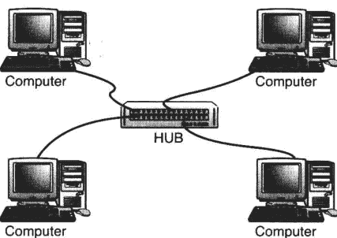

图 4.3 一个集线器和四台联网的计算机。

交叉线通过交叉布线消除了集线器；一台机器网络接口的发送引脚连接到另一台机器的接收引脚。（这类似于用于近距离两台机器 `RS-232` 串口接口的空模式线方法。）这些 `RJ45` 交叉线仅适用于双节点网络，且不能与集线器配合。如果你购买了其中一种，且它没有被明确标记为交叉线，请将其标记出来。这可以在未来的某一天为你节省大量的排故障工作。

## 安装操作系统

翻新的 PC 通常带有一个重新格式化的硬盘，已清理了前任所有者的电子邮件、喜爱的网站以及敏感的文档和数据。如果你想让这些机器启动，必须提供一个操作系统。书中的所有示例都使用了 Linux 操作系统。你可以在几个互联网下载点免费获取。如果你是配置、构建操作系统并将其安装在远程系统上的专家，那么它就是免费的。对于我们其他人来说，花大约 30 美元购买现成的 Linux 安装包是值得的。

某些安装包包含一个启动盘——一张 `3 1/2` 英寸磁盘。某些包提供在安装过程中创建一个磁盘。按照安装指南中的说明创建一个简单的系统。记住要包含对 C 语言编译器和库的支持。

### 注意

我的第一个集群没有包含 X 支持，因为磁盘太小以支持任何基于文本的接口。我的第二个集群包含了 X 支持，使得监控所有节点成为可能。

## 为操作系统添加网络支持


当你进入安装的网络部分时，选择局域网，无需任何动态域名 (DNS) 地址。使用从 `10.0.0.1` 到 `10.0.0.x` 的 IP 地址，其中 `x` 是集群中的机器数量。你可能希望集群中的每台机器都有友好的名称。名称可以是正式的，例如 `system1`、`system2` 等，但没有什么阻止你对它们玩点花。你可以使用行星的名称，例如金星、地球和火星。你可以使用总统、汽车、你喜欢的角色、宝石等名称；选择权在于你。当你发送消息或登录时，操作系统根据 `hosts` 文件中的条目将友好名称转换为 IP 地址。

# 第 4 章 为你的集群组装硬件

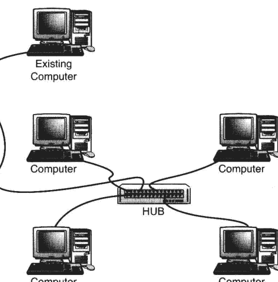

图 4.4 一个集线器和四台联网计算机连接到第五台已有的计算机。

## 总结

在本章中，我们购买了四台旧电脑，并在每台电脑上安装了 Linux，并通过一个 10Mbps 的集线器将它们相互连接。只有一台电脑连接了显示器、键盘和鼠标。它将成为网络文件服务器。

在 Linux 操作系统下，多计算机系统网络化的便利性将在你在文件系统中创建一个用户工作区域时变得显而易见。这个单一用户可以登录到网络上的任何机器并使用相同的主目录。它的所有文件在任何一台机器上看起来看起来都是那样的，因为它们是通过 NFS 服务提供的相同文件。你将在下一章中了解文件服务。

## 扩展阅读

- http://www.compaq.com 有一个支持部分，其中包含了关于其旧型号甚至是一些过时电脑系列的详细信息。另请参阅 http://www.dell.com，http://www.ibm.com 等。
- http://www.crucial.com 是另一个获取内存信息的良好来源。
- http://www.cisco.com，http://www.baynetworks.com 以及其他网络网站可以教你更复杂的方法的工作原理。
- http://www.google.com 和其他搜索引擎可以帮助你找到构建此类系统你可能需要的任何其他信息。

# 第 5 章 配置相关的操作系统文件

## 本章内容

- 集群配置的简要回顾
- Linux root 用户
- `/etc/hosts` 文件的更改
- `/etc/fstab` 和 `/etc/exports` 文件的更改
- 远程访问安全
- 可选添加 `/home/chief/.hosts` 文件
- `/etc/passwd` 文件的可选更改
- 远程引用命令
- 扩展阅读

## 集群配置的简要回顾

在 Linux 安装过程中，你被要求识别主机名、IP 地址、域名等。配置示例使用了虚拟的机器名称和地址，向你展示在每情况下需要添加或更改的内容。记住，只要你处于一些微小的限制范围内，你可以选择你喜欢的任何名称。

我们四节点集群的系统名称分别为 `alpha`、`beta`、`gamma` 和 `delta`，对应的 IP 地址为 `10.0.0.1` 到 `10.0.0.4`。它们都在 `cluster.net` 域下。最后，你需要一个用于非系统配置和应用程序开发的用户 ID。我们使用 `chief` 作为我们的通用用户 ID。我们假设你已经通过 Linux 安装过程为这些系统中的每一个系统创建了用户 ID `chief`。

机器名称 `alpha` 是我们的主系统；始终启动它。它将直接连接显示器、键盘和鼠标（如果有的话）。它将成为我们的文件服务器，这意味着主目录中的用户文件将物理地位于 `alpha` 的硬盘上。当我们登录到其他远程机器之一时，这些文件通过网络文件系统（或 NFS）的魔力，看起来就在那里。我们将在本章的稍后部分讨论在我们修改 `/etc/fstab` 和 `/etc/exports` 文件时的情况。

## Linux root 用户

如果某台机器上有几十个用户账户，那么就会存在几十个目录，每个目录都包含其用户的个人文件。那么，哪个用户负责系统文件呢？

所有 UNIX 系统上都有特殊的用户 ID——`root`。由于其特殊权限，该用户也被称为超级用户，正如你将看到的那样。`root` 用户拥有并负责整个系统。如果对任何一个文件进行任何更改，你必须成为 `root` 用户；你可以通过 `su`（切换用户 ID）命令来实现，如下所示：

```
su -
```

`su` 命令允许你切换到其他用户 ID。那个悬空的破折号 (`-`) 表示你意图接用该用户的个人配置文件。（当你切换到 `root` 用户 ID 时，你甚至不需要指定 `root`；只需输入 `su -` 即可。）在允许继续之前，你会被要求输入密码。使用安装时设置的 `root` 密码。

当你作为 `root` 工作结束时，输入 `logout` 命令结束 `root` 会话并回到你的用户 ID。你也可以通过输入 `exit` 命令或简单的 `Ctrl+D` 键来退出会话，这是最快速简单的方法。

### 在系统提示符处登录 root

成为 `root` 用户的另一种方法是在系统提示符处登录 `root`。然而，某些注重安全的系统不允许 `root` 直接登录，而是强制使用 `su` 命令，以便限制某些受信任的用户。你会发现我们倾向于松散的安全，因为集群假设受你的完全控制。这极大减少了管理需求。

### 作为 root 修改系统文件

现在你是 `root` 用户了，让我们看看你对系统可能的一些更改。

Linux OS 可能在安装过程中之前被配置为支持某些设备。这些配置参数是半永久的，如果你想更改它们，需要重新构建 OS。还有非永久的配置参数，可能需要重启系统才能生效。而某些配置参数只需要重启关联进程或发送一个信号让其重新读取配置文件。再次，目标是保持简单。

你必须更改的参数位于文本文件中，易于编辑。如果你更改了系统配置文件的内容并重启或信号关联进程，你就更改了系统配置。一个很大的原因是你不想让别人知道 `root` 密码。另一个原因是当你以 `root` 登录时，可以使用 `su` 命令变成任何其他用户，而无需知道该用户的密码（当你是 `root` 用户时），你可以修改甚至删除他们的文件。成为 `root` 的目的是进行系统管理，包括对用户账户的更改。关于 `root` 最重要的一点是你可能会对系统的完整性造成如此巨大的损害，以至于可能需要清除一切并重新安装 OS。作为 `root` 时要小心。

需要时使用 `root` 用户 ID，但在普通用户 ID（例如你 OS 中的 `chief` 用户）下进行个人软件开发和个人账户管理。

> **注意**
>
> 顺便提一下，邮箱是一个与你的用户 ID 同名的文本文件；它会随着每封新邮件的到来而增大，随着你读取和删除它们而减小。例如，`chief` 的邮箱位于 `/var/spool/mail/chief`。如果你泛泛地看语法要求，这与你写在信封封面的地址没有区别。

## `/etc/hosts` 文件的更改

每个远程主机名都会被远程引用命令使用，它必须被翻译为 IP 地址。`/etc/hosts` 文件包含一个节点可能需要的所有名称，因此你应该将你的节点名称和 IP 地址添加到此。以 `root` 身份登录，并使用你喜欢的编辑器更改 `/etc/hosts` 的内容，如下所示：

| IP 地址 | 完全限定域名 | 别名 |
| :--- | :--- | :--- |
| `10.0.0.1` | `alpha.cluster.net` | `alpha` |
| `10.0.0.2` | `beta.cluster.net` | `beta` |
| `10.0.0.3` | `gamma.cluster.net` | `gamma` |
| `10.0.0.4` | `delta.cluster.net` | `delta` |
| `127.0.0.1` | `localhost.localdomain` | `localhost` |

将 IP 地址左对齐，并使用制表符提高长完全限定主机名和较短别名的可读性。最后一条按原样显示，引用每个系统上的本地主机。无论主机名是什么，`localhost` 始终可以作为它的主机名。使你每个节点上的所有 `hosts` 文件都保持相同。

远程引用命令用于发现 IP 地址的机器名，该地址用于与远程机器上相应的进程进行通信。（你将在本章稍后的部分设计一个示例远程引用命令。）你将察觉不到两台机器之间发送的许多消息。只要网络配置正确，你会有强烈的感觉，认为实际上已经登录到一台远程机器。

实际上登录到某台机器时可以做的几乎任何操作，在你远程登录到它时都可以完成。这就是网络的力量，但它需要的不仅仅是硬件。它需要修改操作系统配置文件（如 `/etc/hosts` 文件），以让操作系统感知网络上的其他机器。

## 对 `/etc/fstab` 和 `/etc/exports` 文件的更改

使用远程登录功能时，你可能预期的一点是你的主目录以及你所有的文件在远程机器上对你可用。这是通过更改两个文件实现的：所有远程机器上的“文件系统表”（`/etc/fstab`）和本地文件服务器机器上的“文件导出表”（`/etc/exports`）。在我们的示例中，本地文件服务器命名为 `alpha`。

在启动时，如果本地 `fstab` 文件中存在文件系统引用，将触发进程间通信以初始化服务，前提是该引用指向服务器 `exports` 文件中匹配的文件系统。使用 `exports` 文件来宣布本地文件系统（如主目录）的可用性；使用 `fstab` 条目告诉每个客户端在启动时请求从文件服务器挂载这些文件系统。

### 配合 `/etc/fstab` 和 `/etc/exports` 文件使用 NFS

NFS 使用一组活跃的系统进程来支持一种幻象：即你认为自己正在一台机器上处理你的个人文件，而这些文件在物理上位于另一台机器上。也就是说，文件数据存储在服务器的磁盘（`alpha` 的硬盘）上，但你操作它们时就像它们位于远程节点的本地磁盘上一样。

注意，我们指的是你主目录中的个人文件——例如你的程序。你集群中的 System 存在于每个系统的硬盘上，因为它们代表了本地机器的配置参数。某些远程系统（称为无盘工作站）从远程文件服务器获取所有文件。这类系统不在本书的讨论范围内。它们没有硬盘。它们从软盘启动，软盘包含足够的数据让它们启动并运行，直到它们能够从指定的服务器获取后续的文件数据。

在名为 `alpha` 的 NFS 服务器机器上，向 `/etc/exports` 文件中添加以下行：

```
/home (rw)
```

这表示你希望 `/home` 目录在任何具有读写权限的远程系统上可供 NFS 挂载。

在其他每个（NFS 客户端）节点的 `/etc/fstab` 文件中添加以下行：

```
alpha:/home /home nfs rw 0 0
```

这表示你希望通过 NFS 将 `alpha` 的 `/home` 目录挂载到本地的 `/home`，并具有读写权限；更准确地说，在本地的 `/home` 目录上，你必须在本地定义一个 `/home` 目录才能使此挂载成功。这个过程被称为挂载远程文件系统。

NFS 服务器首先启动，其 NFS 进程发现本地的 `/home` 子目录提供给任何请求它的其他节点。随着其他节点的启动，NFS 进程处理每个从 `alpha` 向其提供 `/home` 目录的请求。该文件系统现在出现在本地节点的硬盘上。当你登录到名为 `gamma`（或 `beta` 或 `delta`）的节点时，你的主目录以及你所有的文件将对你可用。

## 远程访问安全

书中的简单集群系统假设具有完全的物理访问安全。也就是说，你和你信任的同伴是唯一被允许靠近任何节点并进行登录的人，并且该边界之外的任何网络无法访问任何节点。如果你想将任何人排除在外，配置将变得复杂得多！本书的重点是帮助你让集群运行起来。如果你允许公众访问它（例如通过互联网），你必须进行更改以加固安全性。在这里，我们感兴趣的是降低安全性以便我们自己进行远程访问，从而节省时间。

登录 `alpha` 后，你可以通过 `telnet` 命令访问远程机器：

```
telnet beta
```

此命令向你显示登录提示符，要求输入用户 ID 和密码，就像你登录 `alpha` 时遵循的过程一样。它会将你登录到名为 `beta` 的远程机器。这假设你输入的用户 ID 和密码与你在 `beta` 上执行 Linux 安装过程中建立的用户账户匹配。

同样，你可以发布 `login`（远程登录）命令，它将假设你想用当前的用户 ID 登录，仅询问你的密码：

```
login beta
```

`login` 命令的作用与 `telnet` 相同，但它可以假设你当前的用户 ID 以为你节省更多时间。

`rsh`（远程 shell）命令与 `login` 相同，但输入更短、速度更快：

```
rsh delta
```

它会将你登录到名为 `delta` 的远程机器，就像 `rsh` 命令一样。这是远程登录机器最快、最简单的方法，但如果你不需要密码，速度会更快。记住：在不需要提供密码的情况下，这样做，你是在创建一个极不安全的系统！

### 在 `/home/chief` 下可选的 `.rhosts` 文件的添加

> **注意**
>
> 即使在物理安全的系统中，操作系统安全检查也会阻止你直接登录到紧邻的远程系统。为了利用这种终极的时间节省，你可以在你的主目录下创建一个文件，让系统无需询问你的密码。创建一个名为 `.rhosts` 的远程主机访问文件（必须以点开头），位于 `/home/chief`，你的主目录。

```
alpha.cluster.net chief
beta.cluster.net chief
gamma.cluster.net chief
delta.cluster.net chief
```

每个主机名后面都跟着信任的用户 ID。在这种情况下，你只有用户 ID，因此你主目录下的 `.rhosts` 文件将方便你从集群的任何节点远程登录到任何节点。虽然你可以建立从 `alpha` 到 `gamma` 到 `beta` 到 `delta` 的远程登录链，但在登录另一台远程机器之前，你应该先退出一个，以保持简单。

每当你尝试从网络上的其他节点登录时，远程登录过程都会检查此文件。注意，网络上的每个节点都有这个文件，因为你主目录中的所有文件都通过之前配置的网络系统可用。NFS 是一个非常有用的功能。

通过指定网络上的所有节点以及你的用户 ID，你允许从任何节点远程访问任何节点，而无需密码检查。

## `/etc/passwd` 文件的可选更改

> **注意**
>
> 目录列表会被大量的设置后忘记的文件弄乱。为了方便起见，这些文件以点开头。`ls`（目录列表）命令会忽略这些文件，除非你专门要求显示它们。（在 DOS 操作系统中存在隐藏文件，但这里并不完全如此。）使用 `ls -l` 列出所有不以点开头的文件，当你想看到这些点文件时使用 `ls -al`。

如果你经常以 `chief` 身份登录登出并进行大量的系统配置工作，你可能想要移除这两种密码的需要。这无疑是一个严重的安全风险，但它会节省大量时间。如果你的系统位于安全区域，没有任何人（和你信任 `root` 密码的人）会接触这些系统，你可以物理地移除你用户 ID 中的密码以及 `/etc/passwd` 文件中的 `root` 条目：

```
root:c6752ffa:0:0:root:/bin/bash
chief:4456aab:500:Chief User:/home/chief:/bin/csh
```

密码文件中的每个行都包含多个字段，为了可读性，每个字段用冒号 (`:`) 分隔。在 Unix 系统中，可读性通常意味着机器可读性，有时对人类来说是一个挑战。你可以编辑此文件，如果你是 `root` 用户，可以移除第二个字段的内容：

```
root::0:0:root:/bin/bash
chief::500:0:Chief User:/home/chief:/bin/csh
```

注意，`:` 代表条目中的空字段或空值。`root` 用户或你的个人用户 ID 都不再需要密码。除非你隐含地信任那些可能访问这些系统的其他人，否则不要这样做！你必须在每个节点的 `/etc/passwd` 文件中进行这些更改。

> **注意**
>
> 你可能会发现 Linux 的后续发行版本更改了节点的意义，甚至替换了密码文件。在这些情况下，还有其他方法可以消除输入密码的必要。请参考安装包附的 Linux 文档。

## 远程引用命令

在第 3 章中，你检查了 `fork/exec` 子任务的几种变体，并得到了一对进程：一个是本地客户端，另一个是远程服务。列表 3.9a 和列表 3.9c 中的 TCP 示例对可以转换为远程引用命令和远程服务守护进程对。列表 5.1a 和列表 5.1b 实现了一个远程文件列表服务。

> **注意**
>
> 不熟悉 Linux 上进行 C 程序编译的读者可能想要直接跳到第 6 章“为软件开发配置用户环境”。

### 列表 5.1A Remote-cat：列出远程文件的内容

```c
/*
** Listing5.1a.c - rcat: 列出远程文件的内容
*/
#include <netinet/in.h>
#include <sys/socket.h>
#include <sys/types.h>
#include <string.h>
```

### 列表 5.1A 续


```c
#include <netdb.h>
#include <stdio.h>

#define BUFLEN 8192
#define PORT 6789

main(int argc, char *argv[])
    char *argv[];
    int argc;
    {
        struct sockaddr_in sock;
        struct hostent *hp;
        int port = PORT;
        int fd, ii;
        char buffer[BUFLEN];
        char *p;

        /* argv[] */
        if (argc < 2)
        {
            printf("\nUsage: %s <IP_Addr>:<file_name>\n\n", argv[0]);
            exit(-1);
        }

        /* 隔离远程主机 */
        p = strchr(argv[1], ':');
        *p = '\0';
        p++; /* 重置到文件 */

        /* 获取有关远程服务器的信息 */
        strncpy(buffer, argv[1], sizeof(buffer));
        if((hp = gethostbyname(buffer)) == NULL)
        {
            perror("Listing 5.1a: gethostbyname()");
            exit(-1);
        }

        /* 初始化 TCP 流套接字结构 */
        if((fd = socket(AF_INET, SOCK_STREAM, 0)) < 0)
        {
            perror("Listing 5.1a: socket()");
            exit(-1);
        }
```

### 列表 5.1A 续

```c
exit(-1);

memset((char *)sock, 0, sizeof(sock));
memcpy(sock->sin_addr, hp->h_addr, hp->h_length);
sock.sin_family = hp->h_addrtype;
sock.sin_port = htons(port);

/* 连接到远程服务器 */
if(connect(fd, (struct sockaddr *)&sock, sizeof(sock)) < 0)
{
  perror("Listing 5.1a: connect()");
  exit(-1);
}

/* 将文件名发送给服务 */
strncpy(buffer, p, sizeof(buffer));
if(send(fd, buffer, strlen(buffer)+1, 0) < 0)
{
  perror("Listing 5.1a: send()");
  exit(-1);
}

/*
** 将远程文件内容打印到屏幕
*/
while(1)
{
  if((ii = recv(fd, buffer, sizeof(buffer), 0)) < 0)
  {
    perror("Listing 5.1a: recv()");
    close(fd);
    exit(-1);
  }
  else if (ii > 0) /* 接收良好包 */
  {
    p = buffer;
    while (ii) /* 处理所有输入行 */
    {
      /* 打印每个新行直到 DONE */
      if(strncmp(p, "DONE", 4) == 0)
        break;
```

### 列表 5.1A 续

```c
else
    printf("Listing 5.1a: %s\n", p);

    /* 后续行 */
    ii = (strlen(p) + 1);
    p += strlen(p) + 1;
}
else /* 套接字连接关闭 */
    break;
}
close(fd);
return(0);
```

### 列表 5.1B Remote-cat 守护进程：将文件内容返回给客户端

```c
/*
** Listing5.1b.c - rcat: 将文件内容返回给客户端
*/
#include <stdio.h>
#define FALSE 0
#define TRUE 1

main(void)
{
    FILE *fp;
    int notDone;
    char file[64];
    char buffer[80];

    /* 客户端发送文件名 */
    read(0, file, sizeof(file));
    if((fp = fopen(file, "r")) == NULL)
    {
        sprintf(buffer, "Listing5.1b: file %s not found\n", file);
        fclose(fp);
        exit(-1);
    }
```

### 列表 5.1B 续

```c
/* 将文件内容返回给客户端 */
notDone = TRUE;
while(notDone) {
    if(fgets(buffer, sizeof(buffer), fp) == NULL) {
```

# 第 6 章 为软件开发配置用户环境

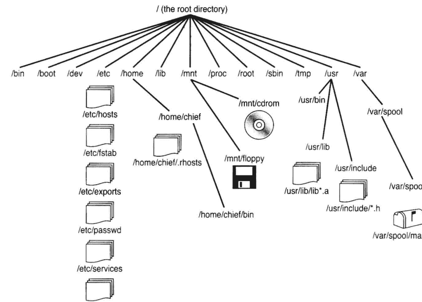

图 6.1 Linux 文件系统概述。

以下是书中讨论过的一些目录名称，随后是：

- `/bin`——构成基本 Unix 命令集的各种执行文件
- `/dev`——通过这些类文件 I/O 端口访问的设备
- `/etc`——系统配置文件
- `/home`——（非 root）系统用户的家目录
- `/mnt`——可移动文件系统的挂载点：软盘、CD-ROM 等
- `/proc`——进程信息伪文件，详见于第 8 章“外部性能测量与分析”中讨论
- `/root`——用户的家目录
- `/tmp`——临时文件
- `/usr`——系统和应用程序的可执行文件及其相关文件
- `/var`——日志、邮件等

## 使用 C 编译器

本章中最受关注的目录是 `/home` 和 `/usr`。我们家目录下的文件存储在 alpha 的硬盘上；alpha 是 NFS 文件服务器。在第 5 章“配置相关的操作系统文件”中讨论过 (`NFS`)。你将在 `/home/chief` 用户的家目录下添加目录，并创建一些文件以便编译 C 语言。C 编程语言函数库和头文件分别位于 `/usr/lib` 和 `/usr/include` 下。

### 你的 `/home/chief` 家目录

当你在安装期间名为 chief 的新用户 ID 时，系统为其创建了一个新的子目录 `/home/chief`，以及一些你可以根据需要更改的环境控制文件。我们在 `/home/chief` 下创建了一个 `.hosts` 文件（参见第 5 章），以便让我们的集群系统更易于使用。你还会发现创建了一个名为 `bin`（binary 的缩写）的子目录，用于包含你的本地执行文件。

你需要在家目录下建立一些子目录——用于存放所有的 C 源程序及其相关的头文件。从这些程序生成的执行文件将进入 `/home/chief/bin`。源文件保存在 `/home/chief/src` 中，头文件存在 `/home/chief/inc` 下。使用 `mkdir` 命令（"make" 的缩写）创建这些子目录：

```bash
$ cd [如果不在家目录，请切换到家目录]
$ mkdir src [为 C 语言源文件创建 /home/chief/src]
$ mkdir inc [为包含的 C 头文件创建 /home/chief/inc]
```

## 使用 C 编译器

GNU C 编译器（`gcc` 命令）通过处理步骤创建执行文件：预编译、编译、汇编和链接。预处理器处理文件中的任何指令（`#include`，插入头文件）；编译器从 C 源文件创建对象文件；汇编器从汇编语言创建对象文件；链接器从对象文件创建执行文件。每当你使用 `gcc` 命令时，都需要告诉编译器和链接器需要编译或汇编哪些源程序，或者需要链接哪些对象文件。它还需要知道在何处找到预处理器指令中引用的任何头文件、哪些对象文件构成了最终的可执行文件等。这是一个复杂的过程，需要相应复杂的指令。

代码列表 6.1 是一个 C 程序，它从简单开始逐渐变得复杂，用来如何控制 `gcc` 的行为。

### 列表 6.1 Linux 文件系统概述

```c
#include <stdio.h>

main(void)
/*
** Listing6.1.c - 在屏幕上打印一行
 */
    puts("Prints on your screen.");
    return (0);
```

这个简单的程序包含一个预编译指令来包含 `stdio.h`，即标准 I/O 头文件。它被编译并链接到 `/home/chief/bin` 下的一个执行文件中。指令通过命令行操作数传递给 `gcc`：

```bash
gcc -o ../bin/Listing6.1 Listing6.1.c
```

`-o` 告诉 `gcc` 将输出（执行文件）放在 `/home/chief/bin` 并将其命名为 `Listing6.1`。它还告诉 `gcc` 开始编译名为 `Listing6.1.c` 的 C 程序。注意，`gcc` 被告知在何处找到这个 C 程序、头文件位于何处，以及函数名 `puts` 在何处找到。这些默认值在 man（manual 的缩写）页面中有详细描述。

```bash
man gcc
info gcc
```

在经过预处理、编译和链接后（从现在起我将这一聚合过程称为 (编译)），可以按如下方式测试执行文件：

```bash
Listing6.1
Prints on your screen.
```

注意，你在 `/home/chief/bin` 下运行执行文件是因为它在你的路径（`path`）中，路径即你在命令行提示符处输入命令时搜索的子目录集。Unix 用户会在他们的家目录下创建 `bin` 子目录。Linux 会为每个新用户自动创建一个，并在默认的环境控制文件中对其添加支持。

你将定义对多个程序全局可见的值。例如，一个程序发送给另一个程序的缓冲区最大长度对双方来说都是通用的。

你可以在两个程序中都定义长度，但你面临在一个处被更改而在另一个处未更改的风险；最好的做法是在头文件中定义它，然后在使用它的两个程序中包含该头文件。此示例仅使用一个程序；它应该帮助你理解创建并包含自己的 C 头文件。

切换到你的 include 子目录并创建一个头文件。

```c
#include <stdio.h>

main(void)
/*
** Listing6.1.c - 在屏幕上打印一行
 */
    puts("Prints on your screen.");
    return (0);
```

*(注：提供的 OCR 文本在第 104 页和第 107 页之间存在大量重复/重叠。我将根据文本流提供逻辑清晰的合并版本。)*

你使用 `-c` 操作数进行编译，而不指定任何输出信息。

```bash
gcc -c Listing6.4a.c
```

这会创建一个名为 `Listing6.4a.o` 的文件，该对象文件中仅包含屏幕文件的内容。对于主程序，请参阅 Listing 6.4b。

## 列表 6.4B 在主程序中使用 screen 函数的对象文件

```c
main(void)
/*
** Listing6.4b.c - 间接向你的屏幕打印一行
*/
{
void screen(char *) {
    screen("Prints to your screen.");
}
```

这次，在引用对象文件以及 C 程序的同时，编译主程序。

```bash
gcc -o.../bin/Listing6.4b Listing6.4a.o Listing6.4b.c
```

这使得可以在对象文件 `Listing6.4a.o` 中找到名为 `screen` 的函数，从而解决 `Listing6.4b.c` 中对它的的引用。

```bash
Listing6.4b
Prints to your screen.
```

注意，该函数可以在多个 C 程序中被引用，每个程序在编译时都在 `gcc` 的命令行操作数中请求编译 `Listing6.4a.o`。

如果将它们命名为 `screen.c` 和 `screen.o`（例如），记住所有这些函数的名称将变得更容易。如果你将此类细节放入一个关于如何编译这些程序的单独指令文件中，情况会变得更加简单。这个指令文件被称为 `makefile`，因为它是被下一节描述的 `make` 工具所使用的。

## 使用 make 工具

`make` 命令是一个非常强大的工具，用于包含编译大量程序集的复杂性。大型软件开发项目充分利用 `make` 的优势，通过本地和全局变量以及依赖关系，从数百个 C 程序、头文件和函数库构建出一个可执行文件包。在本书中，我们仅仅接触了它的力量表面，创建了最简单的指令文件。Listing 6.5 就是这样一个可以编译本章中每个程序的文件。它必须命名为 `makefile` 或 `Makefile`，并位于 `/home/chief/src`。

### 列表 6.5 名为 makefile 文件内容

```makefile
all: Listing6.1 Listing6.2 Listing6.3 Listing6.4

Listing6.1:
	gcc -o../bin/Listing6.1 Listing6.1.c

Listing6.2:
	gcc -I./inc -o../bin/Listing6.2 Listing6.2.c

Listing6.3:
	gcc -o../bin/Listing6.3 Listing6.3.c

Listing6.4:
	gcc -o../bin/Listing6.4 Listing6.4.a Listing6.4.b

screen:
	gcc -c Listing6.4.a
```

每个程序由两行表示。第一行的第一个条目是规则名称。冒号之后是依赖项（如果有的话）。第二行是待执行的命令字符串（它必须以制表符开头）。使用 `make` 工具，你可以如下所示编译 Listing 6.1 中的程序：

```bash
> make Listing6.1
gcc -o../bin/Listing6.1 Listing6.1.c
```

执行与标记为 `Listing6.1` 的规则相关的命令行。当你执行操作时：

```bash
> make Listing6.4
gcc -c Listing6.4.a
gcc -o../bin/Listing6.4b Listing6.4.a Listing6.4.b
```

`Listing6.4b` 依赖于 `Listing6.4a`，其中定义了 `screen` 函数。

在编译 `Listing6.4b` 并将其链接为可执行文件之前，必须将 `Listing6.4a` 编译为 `Listing6.4a.o`。

各地构建大师的圣杯是创建一个与其数百个相互依赖的源文件和头文件对应的 `makefile`，这样他们的工作就可以简化为发布

```bash
> make
```

# 第 6 章 为软件开发配置用户环境

然后他们就可以回家了，第二天早上准备仔细研究生成的输出流，以验证一切都按计划运行。

当你单独使用 `make` 命令时，会选择 makefile 中的第一个规则。在这种情况下，该规则的名为 `all`，它将其他四个列表规则列为依赖项，因此所有内容都会被重新编译。

## 备份与恢复

少数 C 程序可能代表了你大量的精力。强烈建议创建一个简单的备份和恢复方案。常见的 3/2 英寸驱动器保存几乎一多半兆的未压缩数据。定期使用 Unix `tar`（归档）命令，甚至是简单的复制操作，都是防止硬盘丢失的有效防御。

通过将这些文件归档到本地临时文件区域 (`/tmp`)，然后将该文件复制到远程机器硬盘上的子目录（例如 `/backups`），可以将大量文件备份到集群中另一台机器的硬盘上。

对于直接复制操作，你可以使用 DOS 格式的磁盘，但你必须（以 root 身份）挂载它，以便 Linux 知道它是什么。

在 `/mnt` 下可能会有一个名为 `floppy` 的子目录。如果没有，请创建一个：

```bash
> cd
mkdir floppy
```

现在挂载磁盘，将源文件直接复制到它，然后再次卸载：

```bash
> -t mdsos /dev/fd0 /mnt/floppy
cd /home/chief/src
cp *.c /mnt/floppy/
cd ../inc
cp *.h /mnt/floppy/
umount /mnt/floppy
```

# 第 7 章 主从接口软件架构

服务器是这样运行的，随着示例服务器的复杂性增加，你将继续使用这一场景。客户端的源代码如列表 7.1 所示。为了清晰起见，我们省略了通常可能会添加的大部分检查和错误报告代码。

你可以指定测试流中包含多少个数据包以及它们之间的时间间隔。每个数据包之间的时间被称为到达间隔（inter-arrival time），在源列表中缩写为 `IAT`。如果你逐渐减小 `IAT`，你将会发现当达到某个点时，服务器会失败，因为它无法在那么短的时间内处理数据包。该值是对服务器整体性能的良好估算，你可以获得改进版本的服务器来处理较短的 `IAT` 值。

## 列表 7.1 客户端请求远程文件的一行文本


# 第7章 主从接口软件架构

## 列表 7.1 客户端：从远程文件请求一行

```c
#include <math.h>
#include <stdio.h>
#include <stdlib.h>
#include <unistd.h>
#include <string.h>
#include <sys/time.h>
#include <sys/types.h>
#include <sys/socket.h>
#include <netinet/in.h>
#include <netdb.h>

#define PORT 9876
#define NUM 50

main(int argc, char *argv[])
{
    struct timeval bef, aft;     /* 发送前后的定时器值 */
    struct sockaddr_in sock;      /* socket 结构体 */
    struct hostent *hp;          /* IP 地址结构体 */
    double random;               /* 随机数：0.0->1.0 */
    long timeleft;               /* IAT 剩余时间 */
    long secs = 0L;              /* 到达间隔秒 */
    long usec = 0L;              /* 到达间隔微秒 */
    int pids[NUM];               /* 子任务进程 ID */
    int opt = 1;                 /* setsockopt 参数 */
    int fd;                      /* socket 文件句描述符 */
    int ii, jj, kk = 0;
    char buf[80], *p;

    srand((unsigned int) getpid()); /* rand() 种子 */

    /*
    ** 操作数是远程主机名和 IAT（到达间隔）
    */
    if (argc != 3) {
        printf("\n%s <HOST> <IAT>\n", argv[0]);
        exit(-1);
    }

    /* 到达间隔的微秒 */
    if ((p = strchr(argv[2], '.')) != NULL) {
        *p = '\0'; /* 结束整数部分 */
        p++;       /* 指针移动到小数部分 */
        while (strlen(p) < 6)
            strcat(p, "0"); /* 补齐到 6 位 */
        p[6] = '\0'; /* 截断为 6 位 */
        usec = atol(p);
    }

    secs = atol(argv[2]); /* IAT 的秒部分 */

    /*
     循环：发送并接收数据包
    */
    for (ii = 0; ii < NUM; ii++) {
        /* 获取发送前时间 */
        gettimeofday(&bef, NULL);

        /* 1 到 5 之间的随机整数 */
        random = rand() / (double) RAND_MAX;
        jj = (int) ((5.0) * random) + 1;
        if (jj == 6)
            jj = 5;

        sprintf(buf, "/tmp/sample.txt %d", jj);

        if ((pids[kk++] = fork()) == 0) {
            /* 准备连接用的 socket */
            fd = socket(AF_INET, SOCK_STREAM, 0);
            memset((char *)&sock, 0, sizeof(sock));
            hp = gethostbyname(argv[1]);
            memcpy(sock.sin_addr.s_addr, hp->h_addr, hp->h_length);
            sock.sin_port = htons(PORT);
            setsockopt(fd, SOL_SOCKET, SO_REUSEADDR, (char *) &opt, sizeof(opt));

            /* 连接到服务器 */
            connect(fd, (struct sockaddr *)&sock, sizeof(sock));
            send(fd, buf, strlen(buf) + 1, 0);
            buf[0] = 0; /* 清空缓冲区 */
            recv(fd, buf, sizeof(buf), 0);

            /* 打印我们的查询输出 */
            printf("%d: %s\n", jj, buf);
            /* 检查行 */
            p = strchr(buf, ' ') + 2;
            if (p)
                printf("%s\n", p);
            close(fd);
            exit(0);
        }

        /* 休眠直到 IAT 剩余时间 */
        gettimeofday(&aft, NULL);
        aft.tv_sec -= bef.tv_sec;
        aft.tv_usec -= bef.tv_usec;
        if (aft.tv_usec < 0) {
            aft.tv_usec += 1000000L;
            aft.tv_sec -= 1;
        }

        bef.tv_sec = secs;
        bef.tv_usec = usec;
        bef.tv_sec -= aft.tv_sec;
        bef.tv_usec -= aft.tv_usec;
        if (bef.tv_usec < 0L) {
            bef.tv_usec += 1000000L;
            bef.tv_sec -= 1;
        }
        timeleft = (bef.tv_sec * 1000000L) + bef.tv_usec;
        if (timeleft < 0) {
            printf("ERROR: 需要更高的 IAT 值 - 退出。\n");
            break;
        }
        usleep(timeleft);
    }
    for (ii = 0; ii < kk; ii++)
        wait(pids[ii]);
    puts("Done.");
    return (0);
}
```

流中的数据包数量由由于初始 `socket` 连接而产生的任何时间延迟定义，但不会大至于让测试变得繁琐。为了方便，到达间隔是一个命令行参数。若要测试系统，请在你的其中一台远程机器上启动服务器，在本例中命名为 `gamma`：

> `gamma 0.025`

上述命令启动了一个客户端，向运行在 `gamma` 上的服务器进程每 25 毫秒发送一次查询。所有查询之间间隔 25 毫秒，时间间隔相等。当你扩展客户端功能时，下一章将介绍一些更真实的到达间隔分布。

## 串行服务器进程

服务器进程可以用多种方式处理传入的事务；最直接的方法是简单的接收-响应-重复循环，如列表 7.2 所示。

## 列表 7.2 串行服务器方法

```c
#include <netdb.h>
#include <stdio.h>
#include <sys/types.h>
#include <netinet/in.h>
#include <sys/socket.h>

#define PORT 9876

main(void)
{
    /*
     ** 列表7.2.c 服务器：从文件返回一行
     */
    struct sockaddr_in sock; /* socket 结构体 */
    int socklen = sizeof(sock); /* accept 的结构长度 */
    FILE *fp; /* sample.txt 文件指针 */
    int acc; /* accept 文件句描述符 */
    int cli; /* 文件句描述符 */
    int line; /* 请求的行数 */
    int opt = 1; /* setsockopt 参数 */
    char buf[80]; /* socket 接收缓冲区 */
    char file[32]; /* 来自客户端的文件 */
    int fd; /* socket 文件描述符 */
    struct hostent *hp; /* IP 地址结构体 */

    /* 准备连接用的 socket */
    fd = socket(AF_INET, SOCK_STREAM, 0);
    memset((char *)&sock, 0, sizeof(sock));
    hp = gethostbyname(argv[1]);
    memcpy(sock.sin_addr.s_addr, hp->h_addr, hp->h_length);
    sock.sin_port = htons(PORT);
    setsockopt(fd, SOL_SOCKET, SO_REUSEADDR, (char *) &opt, sizeof(opt));

    /* 连接到服务器 */
    connect(fd, (struct sockaddr *)&sock, sizeof(sock));

    while (1) {
        cli = accept(fd, (struct sockaddr *)&sock, &socklen);
        /* 清空缓冲区 */
        recv(cli, buf, sizeof(buf), 0);
        buf[0] = 0;

        /* 打开文件 */
        fp = fopen(file, "r");
        if (fp) {
            /* 读取一行 */
            if (fgets(buf, sizeof(buf), fp)) {
                /* 打印我们的查询输出 */
                printf("%d: %s\n", line, buf);
                /* 检查行 */
                p = strchr(buf, ' ') + 2;
                if (p)
                    printf("%s\n", p);
            }
            fclose(fp);
        }
    }
}
```

## 列表 7.3 继续

```c
sock.sin_port = htons(PORT);
sock.sin_addr.s_addr = htonl(INADDR_ANY);
bind(acc, (struct sockaddr *) &sock, socklen);
setsockopt(acc, SOL_SOCKET, SO_REUSEADDR, (char *) &opt, sizeof(opt));
listen(acc, 5);
```

```c
while (1) {
    /* 等待远程客户端的连接 */
    cli = accept(acc, (struct sockaddr *) &sock, &socklen);

    /* 获取客户端请求的随机行数据 */
    if (fork() == 0) {
        recv(cli, buf, sizeof(buf), 0);

        /* 打开请求的文件 */
        sscanf(buf, "%s %d", file, &line);
        fp = fopen(file, "r");
        while (line--)
            fgets(buf, sizeof(buf), fp);
        fclose(fp);

        buf[strlen(buf) - 1] = '\0';
        send(cli, buf, strlen(buf) + 1, 0);
        close(cli);
        exit(0);
    }
    close(cli);
}
```

为每个传入的数据包创建一个子任务的好处是利用数据处理中的任何并行性。在这种情况下，共享资源是只读的；许多子任务可以同时读取文本，通过减少响应时间来提高性能。然而，为每个传入的数据包创建单独子任务是有成本的。你可以通过提前创建足够的子任务来处理预期的峰负载（最短到达时间），从而减少这种开销，代价是增加一些进程间通信开销来管理并行查询处理，如列表 7.4 所示。

## 列表 7.4 服务器提前创建子任务池以处理传入的查询流

```c
#include <netdb.h>
#include <stdio.h>
#include <unistd.h>
#include <sys/ipc.h>
#include <sys/shm.h>
#include <sys/time.h>
#include <sys/types.h>
#include <netinet/in.h>
#include <sys/socket.h>
#include <sys/signal.h>

#define PORT 9876
#define FALSE 0
#define TRUE 1
#define MAX 5

int Running = TRUE; /* 布尔值：在 control_C() 中重置 */

main(void)
{
    /*
     ** Listing7.4.c - 并发服务器：子任务池
     */
    struct area {
        int flag[MAX];      /* 每个子任务的标志 */
                            /* 0:空闲, 1:可用, ::退出 */
    } area, *aptr;
    int flag = IPC_CREATE | IPC_EXCL | 0660;
    int size = sizeof(struct area);
    key_t key = 0x5a5a5a5a; /* 共享内存区域 ID */
    int shmid;

    void control_C(); /* ctrl-C 信号处理器 */
    struct sockaddr_in sock; /* socket() 的结构 */
    int socklen = sizeof(sock); /* accept() 的结构长度 */
    FILE *fp;                 /* 查询文本文件指针 */
    fd_set fds;               /* select 等待客户端 */
    int acc;                  /* accept 文件描述符 */
    int cli;                  /* 客户端文件描述符 */
    int line;                 /* 请求的行号 */
    int opt = 1;              /* setsockopt 参数 */
    int ident;                /* 子任务 ID */
    int pids[MAX];            /* 子任务进程 ID */
    char file[32];            /* 来自客户端的文本文件 */
    char buf[100];            /* socket 接收缓冲区 */

    /* 初始化 "C 处理器 */
    signal(SIGINT, control_C);

    /* 创建（服务器）socket 以接收客户端 */
    acc = socket(AF_INET, SOCK_STREAM, 0);

    /* 将 socket 绑定到端口 */
    sock.sin_family = AF_INET;
    sock.sin_port = htons(PORT);
    sock.sin_addr.s_addr = htonl(INADDR_ANY);
    bind(acc, (struct sockaddr *) &sock, socklen);
    setsockopt(acc, SOL_SOCKET, SO_REUSEADDR, (char *) &opt, sizeof(opt));
    listen(acc, 5);

    /* 获取共享内存区域 */
    shmid = shmget(key, size, flag);
    /* 挂载子任务的共享内存数组 */
    aptr = (struct area *) shmat(shmid, 0, 0);

    /* 预建立子任务池 */
    for (ident = 0; ident < MAX; ident++) {
        aptr->flag[ident] = 0; /* 设置标志为空闲 */

        if ((pids[ident] = fork()) == 0) { /* 子任务 */
            /* 挂载父进程的共享内存数组 */
            aptr = (struct area *) shmat(shmid, 0, 0);
            /* 注意：shmid 仍然设置正确 */

            /* 取消 "C 处理器 */
            signal(SIGINT, SIG_DFL);

            /*
            ** 轮询内存数组查找非零标志
            */
        }
    }
}
```


```c
/*
while(1)
{
    if(aptr->flag[ident] == 0)
    {
        usleep(1); /* 释放处理器 */
        continue; /* 留在轮询循环中 */
    }
    else if(aptr->flag[ident] < 0)
    {
        exit(0); /* 子任务正常退出 */
    }
    else /* * 标志必须为正 */
    {
        cli = accept(acc, (struct sockaddr *) &sock,&socklen);
        /* 接收传入的查询 */
        recv(cli, buf, sizeof(buf), 0);

        /* 打开请求的文本文件 */
        sscanf(buf, "%s %d", file, &line);
        fp = fopen(file, "r");
        while(line--)
        {
            fgets(buf, sizeof(buf), fp);
        fclose(fp);

        /* 发送响应 */
        buf[strlen(buf)-1] = '\0';
        send(cli, buf, strlen(buf)+1, 0);
        close(cli);

        /* 设置为可用 */
        aptr->flag[ident] = 0;
    }
}
```

父任务将传入的连接传递给子任务

## 列表 7.4 继续

```c
while(Running) / * 在 control_C 信号处理器中设置 FALSE */
{
    FD_ZERO(&fds);
    FD_SET(acc, &fds);
    /* 阻塞直到客户端准备好连接 */
    if(select(acc+1, NULL, NULL, NULL) < 0)
        break;
    /*
     * 将传入的查询分配给第一个可用的子任务
     */
    for(ident=0; ident<MAX; ident++)
    {
        if(aptr->flag[ident] == 0)
        {
            aptr->flag[ident] = 1;
            break;
        }
    }

    /* 等待每个子任务退出 */
    for(ident=0; ident<MAX; ident++)
    {
        aptr->flag[ident] = -1;
        waitpid(pids[ident], NULL, 0);
    }
}

/* 移除共享内存并退出 */
shmctl(shmid, IPC_RMID, (struct shmid_ds *) 0);
return(0);

/*
 * C 处理器 */
void control_C()
{
    Running = FALSE; /* 允许退出 */
    return;
}
```

# 第7章 主从接口软件架构

到为止，你已经看到了三种服务器架构方法。它们分别在 10BASE-2 (细线) 网络、增强型 486 机器以及旧的 386 上进行了测试。列表 7.2、7.3 和 7.4 的到达时间分别为 8、7 和 4 毫秒。创建子任务来处理传入的数据存在大量的开销。正如预期的，通过将开销移到初始化阶段、预先建立固定数量的进程并希望传入查询不会淹没它们，得到了结果。你可能可以通过为你的处理器、网络速度和内存找到最佳子任务数量来进一步提高服务器性能。

## 分布式服务器进程

注意列表 7.4 中主进程与其子任务之间的进程间通信是通过共享内存空间（见图 7.1a）。低开销链路之所以可能是因为主进程及其所有节点都在同一台机器上运行在相同的物理内存中。（内存总线传输数据的速度远快于外部网络。）然而，并行处理的好处是有限的，因为这台机器只有一个 CPU。如果你将节点分布在你的集群系统中（如图7.1b），可以通过同时使用多个处理器来获得并行性。性能在高利用率下会提高。然而，由于跨网络进程间通信成本增加，性能会受到影响。

客户端将以之前的方式访问服务器（在本例中为主进程）：

服务器的主进程将提前创建子任务，如列表 7.4 所示。它可以通过如图 7.1b 所示，将其视为二级服务器来实现。主进程必须与每个从进程建立通信，或者应该提前知道网络上的其他机器。与其访问这些其他处理器的列表，你可以通过让主进程向所有可能的端口发布广播消息来泛化这一过程。

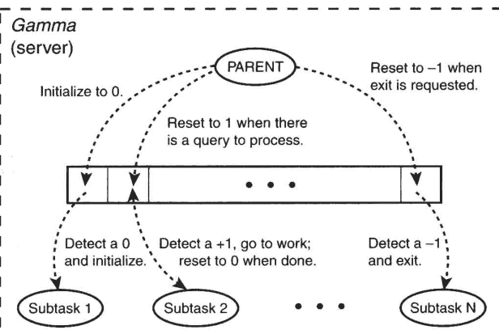

图 7.1A 通过共享内存进行进程间通信。

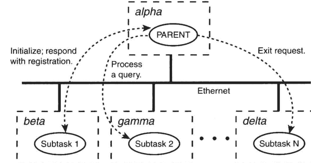

图 7.1B 通过网络进行进程间通信。

回想第 3 章“进程间通信”，你曾通过向远程机器上的其已知端口地址发送 UDP 数据报文来触发一个远程服务的启动（见列出的列表 3.8a 和 3.8c）。你可以将这一概念泛化，以预先创建所有的远程从机服务，方法是：在你网络上的每台远程机器上定义它们的已知端口，然后发送一个广播 UDP 数据报文，如列表 7.5 的短示例所示。网络上的每台机器都会接收到该报文，网络上的每台机器都将以第 3 章示例相同的方式启动远程从机进程。（务必在每个远程系统的 `/etc/services` 和 `/etc/inetd.conf` 文件中添加列表 7.6 的定义，该过程在第 3 章中也有描述。）

### 列表 7.5 通过 UDP 广播数据报唤醒所有可能的从机进程

```c
#include <netinet/in.h>
#include <sys/socket.h>
#include <sys/types.h>
#include <string.h>
#include <netdb.h>
#include <stdio.h>
```

```c
#define INIT 3579
#define WORK 9753
```

```c
unsigned char broadcast[4] = {0xA0, 0x00, 0x00, 0xFF}; /* * 10.0.0.255 */
```

```c
main(int argc, char *argv[])
char *argv[];
int argc;
/*
** 列表 7.5.c - 主控：UDP 数据报文激活从机进程**
*/
{
    int len = sizeof(struct sockaddr_in);
    struct sockaddr_in init;
    struct sockaddr_in work;
    struct hostent *hp;
    int fd, wfd;
    int opt=1;
    char host[32];
    char buf[80], *p;

    /* 建立初始化套接字 */
    fd = socket(AF_INET, SOCK_DGRAM, 0);
    memset((char *) &init, 0, sizeof(init));
```

### 列表 7.5 继续

```c
init.sin_family = AF_INET;
init.sin_port = htons(INIT);
memcpy(&init.sin_addr, broadcast, 4);
setsockopt(fd, SOL_SOCKET, SO_BROADCAST,
           (char *) &opt, sizeof(opt));
```

```c
/* 建立待执行任务的 UDP 套接字 * */
wfd = socket(AF_INET, SOCK_DGRAM, 0);
memset((char *) &work, 0, sizeof(work));
work.sin_s_addr = inhl(INADDR_ANY);
work.sin_port = htons(WORK);
work.sin_family = AF_INET;
bind(wfd, (struct sockaddr *) &work, len);
```

```c
/* 消息开始移除从机 * */
gethostname(host, sizeof(host));
if((p=strchr(host, '.')) != NULL)
    *p = '\0'; /* 截断域名 */
sprintf(buf, "%s %d", host, WORK);
sendto(fd, buf, strlen(buf)+1, 0,
           (struct sockaddr *) &init, sizeof(init));
close(fd);
```

```c
/*
** 显示任何注册响应
*/
```

```c
while(1)
{
    buf[0] = '\0'; /* 清空缓冲区 */
    recvfrom(wfd, buf, sizeof(buf), 0,
           (struct sockaddr *) &work, len);
    printf("\tReceived: %s\n", buf);
}
close(wfd);
return(0);
```

在例例中，从机进程被配置为互联服务，这些服务由名为 `inetd` 的互联守护进程自动启动（第 3 章已介绍）。由于主控进程不知道哪些从机可能会对此通用调用做出响应，因此每个从机进程必须向主控进程注册，以便主控感知其存在。它们通过向网络上的主控发送注册消息（UDP 数据报文）来实现，如所示。

### 列表 7.6 通过 UDP 广播数据报激活从机端口

```c
#include <netinet/in.h>
#include <sys/socket.h>
#include <sys/types.h>
#include <string.h>
#include <netdb.h>
#include <stdio.h>

main(void)
/*
主控：UDP 数据报激活从机 3579
 */
{
    struct sockaddr_in sock;
    int len=sizeof(sock);
    struct hostent *hp;
    int port;
    int fd;
    char host[16];
    char buf[80];

    /* */
    fd = socket(AF_INET, SOCK_DGRAM, 0);
    memset((char *) &sock, 0, sizeof(sock));
    hp = gethostbyname(host);
    memcpy(sock.sin_addr, hp->h_addr, hp->h_length);
    sock.sin_port = htons(port);
    sock.sin_family = AF_INET;

    /* 注册主控 */
    gethostname(buf, sizeof(buf));
    if((p=strchr(buf, '.')) != NULL)
        *p = '\0'; /* 截断域名 */
    sscanf(buf, "%s %d", host, &port);
    sendto(fd, buf, strlen(buf)+1, 0,
           (struct sockaddr *) &sock, sizeof(sock));

    /* 进一步处理 */

    close(fd);
    return(0);
}
```

### 列表 7.6 继续

```c
while(1)
{
    buf[0] = '\0'; /* 清空缓冲区 */
    recvfrom(wfd, buf, sizeof(buf), 0,
           (struct sockaddr *) &work, len);
    printf("\tReceived: %s\n", buf);
}
close(wfd);
return(0);
```

在这个例例中，从机进程被配置为互联服务，这些服务由名为 `inetd` 的互联守护进程自动启动（第 3 章已介绍）。由于主控进程不知道哪些从机可能会对此通用调用做出，因此每个从机进程必须向主控进程注册，以便主控感知其存在。它们通过向网络上的主控发送注册消息（UDP 数据报文）来实现，如所示。

## 主从接口架构

广播消息与普通消息有两点不同：首先，必须通过调用 `setsocket` 来准备套字（在此情况下为 UDP 数据报）以接受这些特殊消息；其次，你必须使用一种特殊的通配符 IP 地址。回想第 3 章，IP 地址的第一部分定义网络，而最后部分定义节点（通常是网络上的某台机器）。特殊值 255（十六进制为 FF）是通配符地址，被解释为“所有”；无论特定的节点地址为何，所有节点都接受此类消息。我们的网络 IP 地址范围为从 10.0.0.1 到 10.0.0.4；因此，10.0.0.255 就是广播消息中使用的地址。

## 主从接口如何工作

主控有两个阶段：初始化和处理。在之前描述的初始化阶段，远程从机被激活并注册。结果是一个利用率表，每个从机进程对应一个条目。每个条目包含机器名称、一个 IP 地址和一个预测的利用率索引。在处理阶段阶段，每个查询被接收并传递给主控。本地性能数据在每台远程机器上收集。这种技术存在一种危险：如果机器太忙，表可能会继续显示它很忙，尽管它早已已经空闲了。如果它从未被选中，表就不会更新。

解决此问题的一种方法是让从机定期发送利用率报告，这些报告相关的过多网络流量可能会影响系统性能。另一种方法是，从机仅在利用率发生显著变化时且仅发生变化时进行报告。例如，计算索引变化 5% 可能就需要从机发送更新。

让从机确认接收查询是非常合理的，将利用率数据附加在此类包上是一种低成本的解决方案。下一章将描述一种实验性的 UI 计算，它可以解决过期数据问题，而无需额外的成本或担忧。

你可能注意到列表 7.4 中的预设子任务示例在将控制权交给一个子任务之前检测到了输入查询的就绪状态。选中的子任务接受并接收查询，并独立于父任务做出响应。这种技术利用了高度的并行性，并让父任务能够专注于查询流。我们将使用一种跨网络的等效技术，以便主控进程能够承受最高的输入查询负载。见图 7.2。

任何的从

## 进一步阅读

反处理进程可以检测出主机的故障——至少是其相关子任务的故障。本地子任务可以通过发送 UDP 数据报来重启失败的远程进程，就像父进程在初始化时做的那样，而不需要父进程参与。

这些进程的完整源代码列表位于书末的附录中。源代码也可以在 www.sampublishing.com 获取并可以免费下载。鼓励你对这些设计问题的解决方案进行实验，将这些代码作为起点将对你有所帮助。

## 系统局限性

最明显的局限性是主处理器是一个单点故障。如果主机故障，整个服务器都会随之故障。容错解决方案会检测主机的故障并进行选举。其中一个从系统将接任主角色，并接管可能故障机器的 IP。当来自外部客户端的查询时，只有一个发布的 IP 地址和端口号，所有查询都发送到那里。一种解决方案是发布一个主处理器作为*别名*的 IP 地址，接收发送到该 IP 的数据包。当主处理器故障时，另一个处理器可以通过发送免费 ARP（地址解析协议）消息来接管别名，这超出了本书的范围。（参见本章的“进一步阅读”部分。）

## 总结

本章的重点是读者。你从简单的开始，逐步构建出能够良好适应集群架构的主从服务器概念。

这从一个客户端和一个简单的应用程序开始。首先引入了最简单的服务器版本并将其转换为并发服务器——通过为每个到达的查询生成子任务来处理它们，从而利用入站查询的并行性。最后，使用了更复杂的方法，即预先创建一个子任务池。最后，通过创建与远程处理器数量相等的子任务，将该子任务池扩展到了集群架构领域。这种架构利用了多计算机（或集群架构）所提供的并行性。

在下一章中，你将了解到系统的性能如何，其详细程度将帮助你微调该系统以满足客户的预期需求。

## 进一步阅读

- Stevens, W. Richard. TCP/IP Illustrated. Vol. 1. Reading, MA: Addison-Wesley, 1994.

# 第8章 性能测量与分析

## 本章内容

- 查询生成
- 抵达间隔分布
- 检查响应准确性
- 估计并显示网络利用率
- 显示响应时间统计
- 你的 MSI 服务器的外部性能
- 进一步阅读

为什么要关注服务器的外部性能？简短的回答是因为这是你的客户关心的：整体系统响应时间。

服务器是你的集群系统——包括它的硬件和软件。客户端由在某些外部机器上的一个或多个进程表示，你对这些机器一无所知。你想为客户提供最好的服务，而客户通常根据响应时间来衡量服务质量，即他们等待服务器响应查询的时间。

你可以通过从外部观察服务器来从客户端的角度测量响应时间，就像把它看作一个黑盒，唯一可识别的特征是它的输入和输出。查看服务器的外部性能意味着测量平均以及在各种负载条件下，获取查询的合适响应所需的时间。

本章将向你展示如何设计一个查询生成客户端，它将同时对你的服务器进行压力并报告其性能。你在上一章中见过一个简单的客户端（参考列表 7.1），它以恒定的速率发送查询。在本章中，使用了三种更多的抵达间隔（IAT）分布来给服务器压力，并相应更新列表 7.1 中的客户端。


当外部性能不尽理想时，你需要另一种方法。在下一章中，你将观察服务器内部，将其看作白盒，并发现所有响应时间花在哪里以及如何花费，并尽可能地减少它。

## 查询生成

回想列表 7.1 中的客户端程序。它记录当天的时间并创建一个子任务来发送每个查询。当父进程获得控制权时，它计算 IAT 的剩余时间，并在发送另一个查询之前等待。客户端实现了恒定的 IAT——每个查询只在一段时间后才紧随下一个查询。如果我们的世界也是如此有条理就好了！

像银行柜台窗口这样平凡的到达情况引起了早期时间与效率专家的兴趣，这直接导致了一个被称为队列论的应用数学分支。队列论允许银行经理获知在周的某天某日的特定时间段需要多少次服务。电话公司可以确定多少个中心局可以连接到一条链路上，航空公司可以根据其客户历史行为的记录决定安排多少航班。计算机科学家使用该理论产生网络节点之间所需的带宽，并确定特定服务器可以支持多少用户。这些是非常强大的工具，但它们超出了本书的范围。关于该主题的经典教材包含在本章末的“进一步阅读”中。

那些早期的效率专家坐在柜台窗口前，记录下每个客户到达的确切时间。现代观察者更有可能是路边的一个小盒子。它有一条横跨车道的长条橡胶传感器；当每辆汽车的轮胎经过传感器时，就会记录当天的时间。盒子在一天结束时被捡起，记录当天的时间。（注：原文此处存在大量重复，翻译已按逻辑处理或保留原意）。

### 列表 8.1 继续

```c
int itab[NUM];      /* 范围插槽内的观测计数 */
int ii, jj;

rand((unsigned int) getpid()); /* 为 rand() 种子 */
/*
** 生成延迟时间
*/
for(ii=0; ii<MAX; ii++) {
    /* 从 .0 到 1.0 之间的随机值 */
    random = rand() / (double) RAND_MAX;

    /* 匹配时间槽 */
    for(jj=0; jj<NUM; jj++) {
        if(random <= probs[jj])
            break;
    }
    /* 每个插槽内的随机值 */
    random = rand() / (double) RAND_MAX;
    delay = (double) slots[jj] - (random * (double) slots[jj]);
}
**********************************************************
/*** 在计算的延迟后发送每个查询 ***/
**********************************************************
```

第一个随机数用于搜索之前建立的累积概率分布，以推导出一个时间延迟类别。第二个随机数用于在该类别内（均匀地）选择一个值。结果将产生 200（由 `MAX` 定义）个延迟，其分布与你之前的观测相同。

## 到达间隔时间分布

我们的推导技术非常强大，当观测值不符合任何明显的模式时，它是完美的解决方案。然而，实际的 IAT（到达间隔）通常遵循某种模式。如果你对表 8.1 中累积概率列的数据进行绘图，你可能会识别出这是衰减指数曲线。你不需要列出观测数据，而是生成具有指数分布的查询 IAT，或者使用某些其他拟合你数据的函数。你将发现如何生成指数分布的 IAT，并学习其他几个更简单的分布。

均匀分布意味着从某个范围内选择每个可能的值的几率都是相等的；每个值被选中的概率相同。C 语言有 `rand()` 和 `rand4()` 函数。你可以使用

```c
random = rand()/(double)RAND_MAX;
```

来获取一个在 0.0 到 1.0 之间均匀选择的随机数。

注意列表 8.1 中如何使用 `rand()` 为随机数生成器函数 `rand()` 设置种子。在这个示例中，你获取了返回进程 ID 的 `getpid()`。你也可以使用 `gettimeofday()` 函数返回的微秒部分。

> 注意
>
> 种子值不需要是一个随机数，只需每次运行时都不同即可，假设你希望每次都得到一组不同的结果。

为了获得指数分布或其他分布的随机数，你可以使用均匀分布的随机数作为起点。在选择一个均匀值后，你可以使用它来计算你需要的任何分布中的值，只要你知道公式即可。数据表明查询 IAT 是呈指数分布的，你可以使用公式

y = 1 - e^{-Ax} [公式 8.1]

它代表衰减指数，其中 A 是期望的平均值，或平均 IAT。从一组均匀分布的随机数生成指数分布的随机数需要使用反函数，其中 y 表示为 x 的函数。（更多细节请参阅“进一步阅读”章节中的书籍。）公式 8.1 的反函数是公式 8.2：

x = -A * log(y) [公式 8.2]

这可以在 C 语言中实现为：

```c
#include <math.h>
double x, y, a = 1.0;
random = rand()/(double)RAND_MAX;
random = -a * log(random);
```

这为你提供了从无穷大到 0.0 快速减少的 IAT 值，其中约一半的值在 1.0 以下。你可能想用以下代码限制最大值：

```c
if (random > 10.0)
   random = 10.0;
```

或者调整平均值 (A) 以适应你的需求。最近指数分布分析的结果如图 8.1 所示。

## 指数分布

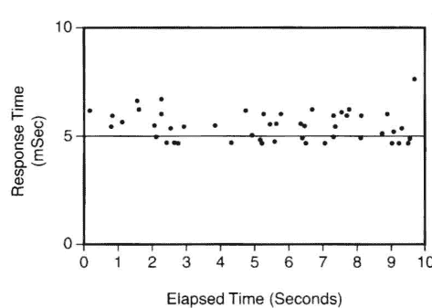

图 指数分布。

其他类型的 IAT 分布容易得多。接将讨论的两种分布被称为扫描（sweep）和脉冲（pulse）。

扫描分布从某些高 IAT 值开始，并逐渐减小它（增加发送速率），直到你选择的低 IAT 值。下面的程序段实现了扫描分布：

```c
double ht=.25L, lt=.0001, dt, iat;
int ii, steps = 100;

dt = (ht - lt) / (double) steps;
for(ii=0; ii<steps; ii++)
{
   iat = ht - ((double) steps * dt);
   *** 根据计算的 iat 延迟 ***/
   *** 然后发送一个查询包 ***/
}
```

注意，用于 `ht`（高时间值）、`lt`（低时间值）和 `steps` 的值是由你选择的。例如，你可以将这种分布与列表 7.1 中的发送等待方案一起使用。最近扫描分布分析的结果如图 8.2 所示。

## 扫描分布

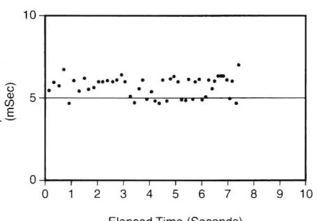

图 扫描分布。

你可能想使用的另一种 IAT 分布被称为脉冲，即脉冲序列分布。一系列等间距的高 IAT（慢）查询流，随后是一组脉冲低 IAT（快）查询。在脉冲之后，流恢复到高 IAT。

```c
double ht=.25L, lt=.0001, iat;
int start = 60; stop = 80;
int ii=0; ii<total; ii++
{
  if(ii < start) || (ii >= stop)
    iat = ht;
  else
    iat = lt;

  *** 根据计算的 iat 延迟 ***/
  *** 然后发送一个查询包 ***/
}
```

再次，变量由你决定，如果需要可以使用列表 7.1 中的发送等待方案。最近脉冲分布分析的结果见图 8.3。

## 脉冲分布

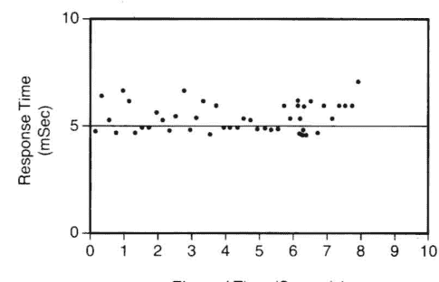

图 脉冲分布。

## 检查准确响应

发送和接收的协议确保数据与发送时一致。尽管概率很小，但你的仍然可能接收到损坏的数据。你在本章后面开发的客户端程序实现了这种功能。它使用：

```c
/* 打印行 */
printf("%s %d:", jj, buf);
/* 检查行 */
p = strchr(buf, ':') + 1;
if(jj != atoi(p))
    printf("**");
```

注意当检测到不匹配时在后面添加的星号（*）。你可以通过计算正确和错误的响应使其更加复杂。

## 估算和显示网络利用率

网络利用率可以通过 `netstat` 命令显示：

- `netstat -i`

它提供了每个接口发送和接收的数据包数量，以及任何错误、丢失、溢出、冲突等。注意这些信息仅与执行它的机器相关。你真正想知道的是整体负载，这需要进行估算。

假设你的集群位于封闭网络上，可能有一台监控并显示的客户端机器，你可以通过累加所有节点的发送和接收计数并除以二来估算网络负载。例如，如果机器 A 向机器 B 发送包，A 将显示发送了一个包，B 将显示接收了一个包。

获取实时 `netstat` 统计的一种方法是从运行在每个节点上的进程通过 `system()` 函数调用实际执行命令。从 `netstat` 报告（查看 `open()` 函数调用）提取感兴趣的值，并将其发送到客户端上的中央性能进程进行分析和显示。每个服务器进程（主或从）都可以在其初始化部分启动这样的任务。每个性能报告器必须知道客户端的 IP 地址以及接收性能包的端口。

列表 8.2 是一个读取 `/proc` 文件收集实时数据的程序。该程序将运行在集群的每个节点上。它将通过 `fork-exec`（在第 3 章“进程间通信”中解释）启动，并带有一个操作数，告诉它网络利用率显示进程运行的主名。

每秒读取并处理一次文本，因此对节点资源的影响非常低。即使显示进程未运行，它们也可能在运行。发送到显示进程的 UDP 包将被忽略。你可以根据方便随时启动和停止显示进程，而自动启动的统计信息将继续运行。

### 列表 8.2 收集统计并发送到列表 8.3 中的集中化程序

```c
#include <netinet/in.h>
#include <sys/socket.h>
#include <string.h>
#include <netdb.h>
#include <stdio.h>
#include "Listing8.2.h"

main(int argc, char *argv[])
{
  /*
   Listing8.2.c - 收集并将性能统计发送到 Listing8.3.c
  */
  struct sockaddr_in soc;
  struct cprStats stats;
  struct hostent *hp;
  long usec0, usec1; /* user */
  long nsec0, nsec1; /* nice */
  long ssec0, ssec1; /* system */
  long isec0, isec1; /* idle */
  long rpkts0, rpkts1; /* rcvd */
  long spkts0, spkts1; /* sent */
  long tmem, umem;
  long rio0, rio1;
  long wio0, wio1;
  FILE *fptr;
  float fcpu;
  float fmem;
  int ii, jj;
  int icpu;
  int imem;
  int sum;
  int fd;
  char local[16];

### 列表 8.2 延续

char remote[16];
char buf[256], *p;

if (argc != 2)
{
    printf("\n\tUsage: %s <hostname>\n\n", argv[0]);
    exit(-1);
}
/* 获取远程主机名 */
strcpy(remote, argv[1]);
/* 并获取本地主机名，也是如此 */
getostname(local, sizeof(local));
if((p = strchr(local, '.')) != NULL)
    *p = "\0"; /* 截断 domain.name */
/*
** 中央性能报告套接字 */
fd = socket(AF_INET, SOCK_DGRAM, 0);
memset((char *) &sec, 0, sizeof(sec));
hp = gethostbyname(remote);
memcpy(&soc.sin_addr, hp->h_addr, hp->h_length);
soc.sin_port = htons(PORT);
soc.sin_family = AF_INET;
/*
**初始 CPU 利用率 */
fptr = fopen("/proc/stat", "r");
fgets(buf, sizeof(buf), fptr);
buf[strlen(buf)-1] = 0;
sscanf(buf, "%s %ld %ld %ld %ld",
    &usec, &nseco, &nsece, &nsecd);
/*
** 磁盘 I/O 速率（同样在 /proc/stat 中） */
while((fgets(buf, sizeof(buf), fptr)) != NULL)
{
    if(strncmp(buf, "disk_", 5) == 0)
        break;
}

### 列表 8.2 延续

sscanf(buf, "%*s %ld", &rio0);
gets(buf, sizeof(buf), fptr);
sscanf(buf, "%*s %ld", &wio0);
close(fptr);
```

```c
/*
 ** 初始网络 i/o 0 速率
 */
fptr = fopen("/proc/net/dev", "r");
/* 跳过 net/dev 中的列标题字符串 */
gets(buf, sizeof(buf), fptr); /* 跳过 */
gets(buf, sizeof(buf), fptr); /* 跳过 */
gets(buf, sizeof(buf), fptr); /* 跳过 */
gets(buf, sizeof(buf), fptr); /* eth0 */
buf[strlen(buf)-1] = 0; /* 覆盖 '\n' */
buf[6] = ' '; /* 覆盖 ':' */
sscanf(buf, "%*s %ld %*d %d %d %ld", &rpkts0, &spkts0);
close(fptr);
```

```c
/*
 ** 统计收集循环
 {
 /*
 **实际内存利用率
 */
fptr = fopen("/proc/meminfo", "r");
gets(buf, sizeof(buf), fptr); /* 跳过头部 */
gets(buf, sizeof(buf), fptr);
buf[strlen(buf)-1] = 0;
sscanf(buf, "%*s %ld %ld", &tmem, &umem);
fmem = (float) umem / (float) tmem;
stats.rm = (int) (100 * (fmem + .005));
close(fptr);
```


```c
/*
 ** 随后的 CPU 利用率
 */
fptr = fopen("/proc/stat", "r");
```

### 列表 8.2 延续

```c
fgets(buf, sizeof(buf), fptr);
buf[strlen(buf)-1] = 0;
sscanf(buf, "%*s %ld %ld %ld %ld",
       &use1, &nsec1, &ssec1, &nsec1);
/* 计算 %CPU 利用率 */
use1 = use0; /* 1 秒钟用户 CPU 计数器 */
nsec1 = nsec0; /* nice */
ssec1 = ssec0; /* system */
isec1 = isec0; /* idle */
cpu = (float)(use1 + nsec1 + ssec1) / (float)(use1 + nsec1 + isec1);
stats.cp = (int) (100 * (cpu + .005));

/* 随后的磁盘 I/O 速率（同样在 /proc/stat 中） */
while((fgets(buf, sizeof(buf), fptr)) != NULL)
{
    if(strncmp(buf, "disk_rio", 8) == 0) /* 跳过 */
        sscanf(buf, "%*s %ld",&rio1);
    /* disk_rio 之后的字符串是 disk_wio */
    fgets(buf, sizeof(buf), fptr);
    sscanf(buf, "%*s %ld",&wio1);
    fclose(fptr);
    /* 计算 I/O 速率 */
    stats.dr = (rio1 - rio0) / 5;
    stats.dw = (wio1 - wio0) / 5;
    fclose(fptr);
    /*
     ** 随后的网络 I/O 速率
     */
    ptr = fopen("/proc/net/dev", "r");
    /* 跳过 net/dev 中的列标题 */
    fgets(buf, sizeof(buf), fptr); /* 跳过 */
    fgets(buf, sizeof(buf), fptr); /* 跳过 */
    fgets(buf, sizeof(buf), fptr); /* 跳过 */
    fgets(buf, sizeof(buf), fptr); /* eth0 */

    ### 列表 8.2 延续

    buf[strlen(buf)-1] = 0; /** 覆盖 '\n' */
    buf[6] = ':';/** 覆盖 ':' */
    sscanf(buf, "%*s %ld %*d %d %ld", &rpkts1, &spkts);
    /* 计算 network/O 速率 */
    stats.pr = rpkts1 - rpkts0;
    stats.ps = spkts1 - spkts0;
    fclose(fptr);
    /* 下次迭代的重置值 */
    rpkts0 = rpkts1;
    spkts0 = spkts1;
    use0 += use1;
    nsec0 += nsec1;
    ssec0 += ssec1;
    isec0 += isec1;
    rio0 = rio1;
    wio0 = wio1;

    /* 每 1 秒发送一次统计信息 */
    sendto(fd, &stats, sizeof(stats), 0,
      (struct sockaddr *) &soc);
    sleep(1);
}
```

`/proc` 文件包含了代表处理器通用状态的数据。这些信息发送到运行在客户端或其他集群节点上的进程。它可以从命令行启动，并通过 `Ctrl+C` 键停止。基于字符的网络利用率示例见图 8.4。CPU 和内存利用率、磁盘和网络 I/O 速率以及整体负载提供了良好的性能指示。生成的程序见列表 8.3。

## 实时集群统计

| ALPHA | | BETA | |
|---|---|---|---|
| Cpu | Mem | Rcvd 0 | Cpu |
| 7% | 94% | Rcvd 28% | 40% |
| Rio | Wio | Sent 12 | Wio |
| 1 | | Sent 0 | |
| 10.0.0.1 | | 10.0.2 | |

- 整体负载 - 23 Pkts/sec

**图 8.4** 实时网络利用率。

## 列表 8.3 集中性能报告

```c
#include <netinet/in.h>
#include <sys/socket.h>
#include <string.h>
#include <stdio.h>
#include <netdb.h>
#include "Listing8.2.h"

main(void)
{
    /*
     Listing8.3.c - 集中性能报告
    */
    int cp[4], rm[4]; /* 中央处理器, 实际内存 */
    int ps[4], pr[4]; /* 发送包, 接收包 */
    int dr[4], dw[4]; /* 磁盘读取, 磁盘写入 */
    union {
        unsigned long addr;
        char bytes[4];
    } u;
    struct sockaddr_in soc;
    struct cprStats stats;
    int len=sizeof(soc);
    struct hostent *hp;
    int fd, ii, jj;
    int netLoad;
    char buf[256];

    /* 初始化统计信息 */
    for(ii=0; ii<4; ii++)
    {
        cp[ii] = 0;
        rm[ii] = 0;
        ps[ii] = 0;
        pr[ii] = 0;
        dr[ii] = 0;
        dw[ii] = 0;
    }

    /* ** 集中性能报告循环 */
    while(1)
    {
        for(ii=0; ii<4; ii++)
        {
            recvfrom(fd, &stats, sizeof(stats), 0,
              (struct sockaddr *) &soc, &len);
            /* 索引是 IP 地址最后一位减1 */
            memcpy(&u.addr, &soc.sin_addr, 4);
            jj = (unsigned int) u.bytes[3];
            cp[jj-1] = stats.cp;
            rm[jj-1] = stats.rm;
            ps[jj-1] = stats.ps;
            pr[jj-1] = stats.pr;
            dr[jj-1] = stats.dr;
            dw[jj-1] = stats.dw;
        }

        /* 计算网络负载 */
        netLoad = 0;
        for(ii=0; ii<4; ii++)
            netLoad += (ps[ii]) + pr[ii]; /* 每个节点发送和接收数的平均值 */

        /* 绘制显示集群性能的图表 */
        system("clear");
        printf("\n NEAR TIME CLUSTER STATISTICS \n");
        printf("\n");
        printf("\n               10Base \n");
        printf("+-----ALPHA-++BETA-------+\n");
        printf("| Cpu    Mem | | Cpu    Mem Wio |\n");
        printf("| %3d%% %3d%% | Rcvd -5d %5d Rcvd %3d%% %3d%% |\n", cp[0], rm[0], pr[0], pr[1], cp[1], rm[1]);
        printf("| Rio    Wio +----------------------+ Wio |\n");
        printf("| %6d%% %6d%% | Sent -5d %5d Sent %6d%% %6d%% |\n", dr[0], dw[0], ps[0], ps[1], dr[1], dw[1]);
        printf("+-------10.0.0.1-------+------10.0.0.2-------+\n");
        printf("\ncluster.net\n");
        printf("\n - Overall Network Loading -\n");
        printf("\%9d Pkts/sec\n", netLoad);
        sleep(1);
    }
}
```

请注意，需要对性能信息包结构以及目标端口地址有通用的了解。代码列表 8.2 和 8.4 所引用的头文件如下：

```c
#define PORT 9090

struct cprStats {
    int cp; /* cpu utilization */
    int rm; /* mem utilization */
    int ps; /* packets sent */
    int pr; /* packets rcvd */
    int dr; /* disk reads */
    int dw; /* disk writes */
} cprStats;
```

在每次重绘显示器之前读取四个入站包的方法似乎并不优雅。它由于假设一切运行正常，因此缺乏鲁棒性。你暂时可以忽略这一点这一点；你将在第 10 章“健壮的软件”中学习更多关于软件健壮性问题的内容。

## 显示响应时间统计

列表 7.1 中的子任务记录了查询发送的时间、接收相应响应的时间，并可以轻松地计算出每个响应的响应时间。它还可以将这些信息存储在客户端父任务为目的设立的共享内存空间。你希望子任务在共享内存空间中记录各个响应时间，而让父任务根据外部性能的变化进行报告。

列表 7.1 中的父任务等待其 `IAT`（允许时间）的剩余部分，如果准备和发送查询所需的时间超过该值，它将发出错误消息。假设它可以在 `IAT` 限制范围内工作并在继续之前必须等待，它完全可以花一点点时间来更新响应时间分类数组。当数据流结束时，它可以用柱状图显示这些响应时间，如图 8.5 所示。为了简单起见，使用了字符呈现形式。

列表 8.4 显示了一个支持指数分布、脉冲分布和扫描分布客户端进程，并展示了整体响应时间统计的柱状图。

### 观察

| 响应 (毫秒) | 10 | 20 | 30 | 40 | 50 |
|---|---|---|---|---|---|
| 1 | 10 | *** | | | |
| 11 | 20 | **** | | | |
| 21 | 30 | ***** | | | |
| 31 | 40 | ****** | | | |
| 41 | 50 | ****** | | | |
| 51 | 60 | ******* | | | |
| 61 | 70 | ******* | | | |
| 71 | 80 | ******* | | | |
| 81 | 90 | ******* | | | |
| 91 | 100 | ********** | | | |
| 101 | 110 | ******* | | | |
| 111 | 120 | ***** | | | |
| 121 | 130 | **** | | | |
| 131 | 140 | *** | | | |
| 141 | 150 | ** | | | |
| 151 | 160 | * | | | |
| 161 | 170 | * | | | |
| 171 | 180 | * | | | |
| 181 | 190 | * | | | |
| 191 | 200 | * | | | |

图 8.5 以直方图显示的响应时间。

### 列表 8.4 客户端时间统计

```c
#include <math.h>
#include <stdio.h>
#include <stdlib.h>
#include <unistd.h>
#include <string.h>
#include <sys/ipc.h>
#include <sys/shm.h>
#include <sys/time.h>
#include <sys/types.h>
#include <sys/socket.h>
#include <netinet/in.h>
#include <netdb.h>

#define FALSE 0
#define TRUE 1
#define NUM 50
#define CATS 20

double cats[CATS] = {10, 20, 30, 40, 50, 60, 70, 80, 90, 100, 110, 120, 130, 140, 150, 160, 170, 180, 190, 200};
int bars[CATS] = {0};

int main(int argc, char *argv[]) {
    if (argc != 3) {
        printf("\nUsage: %s <HOST> <DISTRIBUTION>\n", argv[0]);
        exit(1);
    }

    struct hostent *hp = gethostbyname(argv[1]);
    if (hp == NULL) {
        perror(argv[1]);
        exit(1);
    }

    struct sockaddr_in addr;
    addr.sin_family = AF_INET;
    addr.sin_port = htons(PORT);
    memcpy(&addr.sin_addr.s_addr, hp->h_addr, hp->h_length);

    int key = ftok(__FILE__, 'R');
    int size = NUM * sizeof(double);
    int shmid = shmget(key, size, IPC_CREAT | IPC_EXCL, 0666);
    if (shmid < 0) {
        // ... code logic ...
    }

    double *rt = (double *)shmat(shmid, NULL, 0);
    if (rt == (void *) -1) {
        perror("shmat");
        exit(1);
    }

    for (int i = 0; i < NUM; i++) {
        rt[i] = 0.0;
    }

    // ... rest of the code ...
}
```


请注意，需要对性能信息包结构以及目标端口地址有通用的了解。代码列表 8.2 和 8.4 所引用的头文件如下：

```c
#define PORT 9090

struct cprStats {
    int cp; /* cpu utilization */
    int rm; /* mem utilization */
    int ps; /* packets sent */
    int pr; /* packets rcvd */
    int dr; /* disk reads */
    int dw; /* disk writes */
} cprStats;
```

在每次重绘显示器之前读取四个入站包的方法似乎并不优雅。它由于假设一切运行正常，因此缺乏鲁棒性。你暂时可以忽略这一点；你将在第 10 章“健壮的软件”中学习更多关于软件健壮性问题的内容。

## 显示响应时间统计

列表 7.1 中的子任务记录了查询发送的时间、接收相应响应的时间，并可以轻松地计算出每个响应的响应时间。它还可以将这些信息存储在客户端父任务为目的设立的共享内存空间。你希望子任务在共享内存空间中记录各个响应时间，而让父任务根据外部性能的变化进行报告。

列表 7.1 中的父任务等待其 `IAT`（允许时间）的剩余部分，如果准备和发送查询所需的时间超过该值，它将发出错误消息。假设它可以在 `IAT` 限制范围内工作并在继续之前必须等待，它完全可以花一点点时间来更新响应时间分类数组。当数据流结束时，它可以用柱状图显示这些响应时间，如图 8.5 所示。为了简单起见，使用了字符呈现形式。

列表 8.4 显示了一个支持指数分布、脉冲分布和扫描分布客户端进程，并展示了整体响应时间统计的柱状图。

### 观察

| 响应 (毫秒) | 10 | 20 | 30 | 40 | 50 |
|---|---|---|---|---|---|
| 1 | 10 | *** | | | |
| 11 | 20 | **** | | | |
| 21 | 30 | ***** | | | |
| 31 | 40 | ****** | | | |
| 41 | 50 | ****** | | | |
| 51 | 60 | ******* | | | |
| 61 | 70 | ******* | | | |
| 71 | 80 | ******* | | | |
| 81 | 90 | ******* | | | |
| 91 | 100 | ********** | | | |
| 101 | 110 | ******* | | | |
| 111 | 120 | ***** | | | |
| 121 | 130 | **** | | | |
| 131 | 140 | *** | | | |
| 141 | 150 | ** | | | |
| 151 | 160 | * | | | |
| 161 | 170 | * | | | |
| 171 | 180 | * | | | |
| 181 | 190 | * | | | |
| 191 | 200 | * | | | |

图 8.5 以直方图显示的响应时间。

### 列表 8.4 客户端时间统计

```c
#include <math.h>
#include <stdio.h>
#include <stdlib.h>
#include <unistd.h>
#include <string.h>
#include <sys/ipc.h>
#include <sys/shm.h>
#include <sys/time.h>
#include <sys/types.h>
#include <sys/socket.h>
#include <netinet/in.h>
#include <netdb.h>

#define FALSE 0
#define TRUE 1
#define NUM 50
#define CATS 20

double cats[CATS] = {10, 20, 30, 40, 50, 60, 70, 80, 90, 100, 110, 120, 130, 140, 150, 160, 170, 180, 190, 200};
int bars[CATS] = {0};

int main(int argc, char *argv[]) {
    if (argc != 3) {
        printf("\nUsage: %s <HOST> <DISTRIBUTION>\n", argv[0]);
        exit(1);
    }

    struct hostent *hp = gethostbyname(argv[1]);
    if (hp == NULL) {
        perror(argv[1]);
        exit(1);
    }

    struct sockaddr_in addr;
    addr.sin_family = AF_INET;
    addr.sin_port = htons(PORT);
    memcpy(&addr.sin_addr.s_addr, hp->h_addr, hp->h_length);

    int key = ftok(__FILE__, 'R');
    int size = NUM * sizeof(double);
    int shmid = shmget(key, size, IPC_CREAT | IPC_EXCL, 0666);
    if (shmid < 0) {
        // ... code logic ...
    }

    double *rt = (double *)shmat(shmid, NULL, 0);
    if (rt == (void *) -1) {
        perror("shmat");
        exit(1);
    }

    for (int i = 0; i < NUM; i++) {
        rt[i] = 0.0;
    }

    // ... rest of the code ...
}
```


#define PORT 9090

struct cprStats {
    int cp; /* cpu utilization */
    int rm; /* mem utilization */
    int ps; /* packets sent */
    int pr; /* packets rcvd */
    int dr; /* disk reads */
    int dw; /* disk writes */
} cprStats;

在每次重绘显示器之前读取四个入站包的方法似乎并不优雅。它由于假设一切运行正常，因此缺乏鲁棒性。你暂时可以忽略这一点；你将在第 10 章“健壮的软件”中学习更多关于软件健壮性问题的内容。

## 显示响应时间统计

列表 7.1 中的子任务记录了查询发送的时间、接收相应响应的时间，并可以轻松地计算出每个响应的响应时间。它还可以将这些信息存储在客户端父任务为目的设立的共享内存空间。你希望子任务在共享内存空间中记录各个响应时间，而让父任务根据外部性能的变化进行报告。

列表 7.1 中的父任务等待其 IAT（允许时间）的剩余部分，如果准备和发送查询所需的时间超过该值，它将发出错误消息。假设它可以在 IAT 限制范围内工作并在继续之前必须等待，它完全可以花一点点时间来更新响应时间分类数组。当数据流结束时，它可以用柱状图显示这些响应时间，如图 8.5 所示。为了简单起见，使用了字符呈现形式。

列表 8.4 显示了一个支持指数分布、脉冲分布和扫描分布客户端进程，并展示了整体响应时间统计的柱状图。

### 观察

| 响应 (毫秒) | 10 | 20 | 30 | 40 | 50 |
|---|---|---|---|---|---|
| 1 | 10 | *** | | | |
| 11 | 20 | **** | | | |
| 21 | 30 | ***** | | | |
| 31 | 40 | ****** | | | |
| 41 | 50 | ****** | | | |
| 51 | 60 | ******* | | | |
| 61 | 70 | ******* | | | |
| 71 | 80 | ******* | | | |
| 81 | 90 | ******* | | | |
| 91 | 100 | ********** | | | |
| 101 | 110 | ******* | | | |
| 111 | 120 | ***** | | | |
| 121 | 130 | **** | | | |
| 131 | 140 | *** | | | |
| 141 | 150 | ** | | | |
| 151 | 160 | * | | | |
| 161 | 170 | * | | | |
| 171 | 180 | * | | | |
| 181 | 190 | * | | | |
| 191 | 200 | * | | | |

图 8.5 以直方图显示的响应时间。

### 列表 8.4 客户端时间统计

```c
#include <math.h>
#include <stdio.h>
#include <stdlib.h>
#include <unistd.h>
#include <string.h>
#include <sys/ipc.h>
#include <sys/shm.h>
#include <sys/time.h>
#include <sys/types.h>
#include <sys/socket.h>
#include <netinet/in.h>
#include <netdb.h>

#define FALSE 0
#define TRUE 1
#define NUM 50
#define CATS 20

double cats[CATS] = {10, 20, 30, 40, 50, 60, 70, 80, 90, 100, 110, 120, 130, 140, 150, 160, 170, 180, 190, 200};
int bars[CATS] = {0};

int main(int argc, char *argv[]) {
    // ... (rest of the code)
}
```

## 列表 8.4 续

```c
/* 删除未使用的共享内存区域并退出 */
shmcl(shmid, IPC_RMID, struct shmid_ds *);
return(0);
```

现在，列表 8.4 中的客户端与附录 A“源代码”中的主进程和从进程之间需要一些通用知识。下面是名为 `msi.h` 的短头文件。

```c
#define QUERYLINK 9000
#define BROADCAST 5000
#define REGISTERS 5001
#define SLAVELINK 5002
#define BUFFERSIZE 256
```

查询包的最大尺寸（`BUFFERSIZE`）和主进程（MASTER process）查询端口（`QUERYLINK`）是客户端、主进程及其从进程关注的重点。

## 你的 MSI 服务器的外部性能

现在既然客户端（参见列表 8.4）已经足够复杂，可以向你的 MSI 集群服务器发送一系列查询，现在是时候运行一些初步测试以获取一些基准统计数据了。当你检查内部性能并进行改进时，可以将这些图表与获得的新图表进行比较，看看你是否产生了任何积极效果。

图 8.6、8.7 和 8.8 分别显示了客户端对指数分布、脉冲分布和扫描分布总体响应时间的柱状图。这些运行每一次都发送了一个 50 个包的数据流，如每个图表底部所示。

# 第 8 章 外部性能测量与分析

| 观测值 | 响应时间 (msec) | 10 | 20 | 30 | 40 | 50 |
|---|---|---|---|---|---|---|
| 1 | ***************** | | | | | | |
| 11 | | | | | | | |
| 21 | ********** | | | | | | |
| 31 | | | | | | | |
| 41 | ** | | | | | | |
| 51 | | | | | | | |
| 61 | | | | | | | |
| 71 | | | | | | | |
| 81 | | | | | | | |
| 91 | | | | | | | |
| 101 | | | | | | | |
| 111 | | | | | | | |
| 121 | | | | | | | |
| 131 | | | | | | | |
| 141 | | | | | | | |
| 151 | | | | | | | |
| 161 | | | | | | | |
| 171 | | | | | | | |
| 181 | | | | | | | |
| 191 | | | | | | | |
| | 50 次总观测 | | | |

图 8.6 指数分布——实时测试结果。

| 观测值 | 响应时间 (msec) | 10 | 20 | 30 | 40 | 50 |
|---|---|---|---|---|---|---|
| 1 | ******* | | | | | | |
| 11 | | | | | | | |
| 21 | ********** | | | | | | |
| 31 | | | | | | | |
| 41 | | | | | | | |
| 51 | * | | | | | | |
| 61 | * | | | | | | |
| 71 | | | | | | | |
| 81 | | | | | | | |
| 91 | | | | | | | |
| 101 | | | | | | | |
| 111 | | | | | | | |
| 121 | | | | | | | |
| 131 | | | | | | | |
| 141 | | | | | | | |
| 151 | | | | | | | |
| 161 | | | | | | | |
| 171 | | | | | | | |
| 181 | | | | | | | |
| 191 | | | | | | | |
| | 50 次总观测 | | | |

图 8.7 脉冲分布——实时测试结果。

## 你的 MSI 服务器的外部性能

## 观测值

| 响应时间 (msec) | 10 | 20 | 30 | 40 | 50 |
|---|---|---|---|---|---|
| 1 | Mem | | | | | | |
| 11 | 20 | | | | | | |
| 21 | 30 | ************* | | | | | |
| 31 | 40 | ***************** | | | | | |
| 41 | 50 | ***** | | | | | |
| 51 | 60 | ***** | | | | | |
| 61 | 70 | | | | | | |
| 71 | 80 | | | | | | |
| 81 | 90 | | | | | | |
| 91 | 100 | | | | | | |
| 101 | 110 | | | | | | |
| 111 | 120 | | | | | | |
| 121 | 130 | | | | | | |
| 131 | 140 | | | | | | |
| 141 | 150 | | | | | | |
| 151 | 160 | | | | | | |
| 161 | 170 | | | | | | |
| 171 | 180 | | | | | | |
| 181 | 190 | | | | | | |
| 191 | 200 | | | | | | |
| | 50 次总观测 | | | |

图 8.8 指数分布——实时测试结果。

图 8.9 显示了扫描测试期间网络负载的快照。

## 实时集群统计

| ALPHA | DELTA |
|---|---|
| Cpu Mem | Cpu Mem |
| 10% 93% Rcvd 3 | Rcvd 78% |
| Rio Wio | Rio Wio |
| 0 Sent 8 | Sent 0 |
| 10.0.1 | 10.0.2 |

```
cluster.net
总体网络负载 - 42 Pkts/sec
```

图 8.9 扫描分布——实时性能显示。

## 主从执行阶段耗时

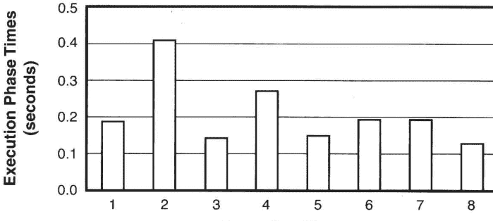

**图 9.1** 示例执行阶段概览。

在本章中，你将看到主从接口（MSI）的处理如何分解为多个执行阶段。我们将介绍用于测量这些阶段耗时的源代码，并对其进行图表化和详细讨论。实际耗时运行的结果将经过图形化并分析。我们将对异常耗长的阶段进行调查，并让你看到为了缩短它们的执行时间所做了哪些工作。最后一组耗时数据将帮助你量化相对于第 8 章中基准数据的任何性能提升。

# 第 9 章 内部性能测量与分析

## 软件执行性能分析

三十年前，应用程序执行时间过长（在极端情况下以天为单位测量！）是科学数据中心管理人员关注的问题。他们通过重新编译这些程序，并结合最先进的主机性能分析工具（profiler）来测量内部性能。分析工具将被测试程序作为子任务启动，并定期暂停以记录其可执行指令的地址。在经过短时间的代表性运行后，分析工具会打印出实际内存地址范围的直方图，以及被测试程序在每个地址范围内执行的次数。分析师在链接编辑器映射文件的帮助下，手动将每个内存地址范围转换为 Fortran 语言语句的范围。最后，分析师和程序员以更高效的方式减少了这些部分的内容。这项工作耗时几天，有时甚至几周，但带来了丰厚的回报，而且计算机时间是非常昂贵的。

十年前，你可以花不到 30 美元为 PC 购买一个 C 语言程序分析工具。它可以报告主函数和函数级别的执行时间，并可选报告你任意一个函数内部的语句级执行时间。你可以在几小时内优化 C 代码以获得更快的执行速度。

## 注意

如今的代码性能分析比以往任何时候都容易得多。然而，代码优化需要大量的才能，因为开发者必须理解，例如，数组的索引引用在比较时比增量指针引用要慢。开发者还必须理解，优化编译器可能会为这两种方法生成相同的机器层级代码，而数组索引在文档说明方面可能是更好的选择。（不要忘记以后可能需要调试你代码的人！）

掌握目标平台的汇编语言知识，或者至少了解某组指令的通用硬件要求，可以在优化工作期间节省大量时间。

如果你以固定间隔对程序的执行点进行采样，那么观察到执行某个特定阶段的百分比就是该阶段所占时间百分比的良好表示。这当然是一个统计结果；样本量越大，代表性越好。因为采样不需要了解进程内部细节，它可能是获取执行概况的最佳方法。

直接测量——此处使用的技术——能提供更准确的结果，但前提是你必须知道在哪里进行测量。

MSI 是一个分布式系统——多个任务运行在节点网络上，协作响应传入的查询。单独对每个程序进行性能分析可能有所帮助，但使用本章概述的阶段耗时和报告技术将让你对更广泛的性能问题产生深刻。分布式系统的总处理时间受进程交互的影响很大——例如，进程间通信无法通过简单的分析工具测量。再次查看图 7.2 MSI 架构图，刷新你对这些进程如何交互的记忆。

## 分布式系统执行性能分析

MSI 响应传入的查询，每个查询都以相同的方式处理。请记住，更复杂的系统（例如根据内容不同处理查询的系统）的阶段在时间上可能具有树状排序。在这种情况下，请将每个处理阶段视为独立服务并进行单独分析。

要问的第一个问题是：“处理单个传入查询需要哪些执行阶段？”请记住，你不能将思维限制在构建响应的阶段，而要涵盖所有支持它的集群管理工作。让我们看看服务器处理查询执行了哪些步骤。

1. 主节点从其任务池中选择一个本地子任务来接收传入的查询：
   在第 7 章“主从接口软件架构”中，你看到了并发服务器如何优于串行服务器，以及驻留子任务池如何减少创建新子任务来处理每个传入查询的开销。在子任务池架构中，父任务必须从池中选择一个可用的子任务。这是执行的第一阶段。该阶段以及大多数其他阶段都可以通过阶段结束时间减去阶段开始时间来直接计时。

2. 选定的子任务接收查询并将其传递给远程从进程：
   每个子任务都与运行在集群远程节点上的从进程配对（参见图 7.2）。每个查询都被发送到远程从进程进行处理。此阶段包括数据包的准备，但不包括实际的传输时间，后者包含在下一个阶段中。

3. 计算出的主到从网络传输时间：
   每个数据包从一个节点发送到另一个节点。在空闲网络中，这些传输时间是可以预测的，但当网络上的多个节点竞争使用网络时，网络访问时间可能会变得极大。

4. 从进程接收传入的查询并从中提取结果：
   示例中的每个查询内部包含文件名和行号。在构建响应之前，这些细节会从传入的查询中提取出来。

5. 从进程从共享文本文件中检索请求的行：
   从进程打开指定的文件，读取请求的文本，并关闭文件。

6. 从进程构建并将响应返回给主子任务：
   请求的文本被封装到响应数据包中。

7. 计算出的从到主网络传输时间（与阶段 3 相同）：
   这是前一个阶段的相反路径，因此在网络利用率相似的情况下可以假设时间相同。

8. 主节点的选定子任务响应查询并声明为空闲：
   子任务等待从进程处理请求。当响应到达时，子任务提取执行阶段的计时数据并发送给客户端。子任务重置状态位，以向主节点显示其已空闲。

假设图 9.1 代表这八个执行阶段，尽管事实并非如此。分析过程中，你可能会疑惑阶段 3 和 7（网络传输时间）为什么相等。你可能还会疑惑为什么阶段 2 工作量很少却花费了那么长时间。这些正是产生更好内部性能的问题。

## 事件计时技术

大多数事件会在同一个进程中开始和结束，并且中间有间隔。某些阶段涉及 I/O，某些进程会跨越多个网络节点。其中某些情况将被证明非常有趣，能对分布式系统的内部运作产生价值的见解。

简单事件可以使用 `gettimeofday` 函数轻松计时。它返回自 1970 年 1 月 1 日午夜以来的微秒单位的时间。精确的秒数和微秒作为两个长整数（`time_t`）返回。你可以使用以下两个时间值来计算经过的时间：

### 列表 9.1 <sys/time.h> 一个计时执行阶段的示例程序

```c
#include <sys/time.h>
#include <unistd.h>
#include <stdio.h>

main(void) {
  /*
   ** Listing_9.1.c - 执行阶段计时示例
   */
  struct timeval time1, time2;
  gettimeofday(&time1, NULL); /* 开始时间 */
}
```

### 列表 9.1 继续

```c
/* * 感兴趣的执行阶段) */
gettimeofday(&time2, NULL); /* 结束时间 */

time2.tv_sec -= time1.tv_sec;
time2.tv_usec -= time1.tv_usec;

if (time2.tv_usec < 0) {
    time2.tv_usec += 1000000L;
    time2.tv_sec -= 1;
}

printf("Execution time = %ld.%06ld seconds\n", time2.tv_sec, time2.tv_usec);
return(0);
```


请注意，这里请求了两个时间值，它们之间的差值是执行事件阶段所需的时间，加上 `gettimeofday` 函数调用的开销。这种开销非常小，通常可以忽略。然而，如果你的应用程序无法忽略即使微小的计时开销，你也可以对定时事件进行计时并减去开销，假设两组时间调用的开销是相同的。

MSI 中的大多数事件都是简单的，可以使用列表 9.1 中的技术进行计时。阶段 4 到 6 在从进程中进行计时，这意味着这些测量结果必须带回主进程子任务，以便与本地数据合并。这些结果可以在从进程每次发送响应时随数据包一起发送。然而，网络传输时间需要特别考虑。

乍一看，在发送机上获取数据包发送时间，在接收机上获取数据包接收时间似乎是合理的。将后者传回并减去两者即可计算出传输时间——恰恰相反（au contraire）！
根据文档，`gettimeofday` 调用返回的是自 1970 年 1 月 1 日以来的微秒值。但从实际上，PC 上的时间是由晶体振器驱动的，晶体振器受到制造商公差和温度变化的影响。每个晶体的频率略有偏差，并随着时间的推移而漂移。尽管可能几个月后才需要重置 PC 时间，但网络上任意两个节点之间的差异防止了你依赖它们是完美同步的。在计算节点之间发送数据包的极短时间时，这种差异尤为明显。不用担心——存在一种巧妙的方法来处理这种情况。请看图 9.2 中的时序图。

## 执行阶段计时图

如前所示，在发送节点上请求查询发送时间，然后在该同一发送节点上请求接收响应的时间。你可以可靠地从同一个时钟中减去时间值，在这种情况下，得到的是往返传输时间加上远程从进程节点的处理时间。（这在图 9.2 中显示为 A。）阶段 4 到 6 在远程节点上进行测量并传回主进程，只需增加一个事件时间，成本并不高。

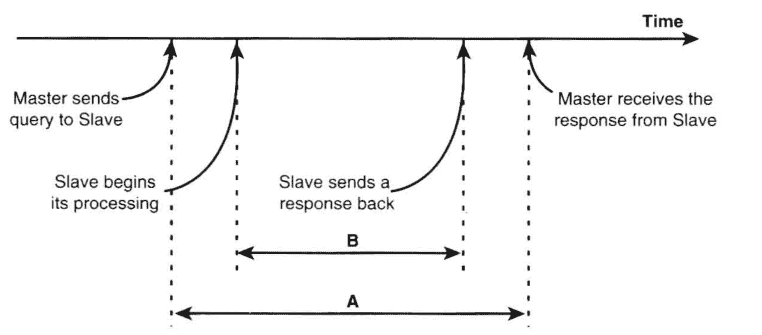

| A-B = 数据包往返传输时间 |
| A-B = 传输时间 |

**图 9.2** 计算网络传输时间。

一种解决方案是在从进程节点上请求查询接收时间和响应发送时间。这两个时间都来自从进程的时钟，因此它们的差值代表了整个从进程节点的处理时间。（这在图 9.2 中显示为 B。）从 A 中减去 B 得到往返传输时间；除以二得到单向传输时间。假设这些时间是相等的，并在阶段 3 和 7 中记录相同的值。任何由网络加载引起的差异将变得微不足道，因为分析处理的是大量此类估计值。

## 执行阶段计时图

如前面的章节所述，主进程为每个注册的从节点都有一个子任务。每个子任务都与远程从节点上的专用进程建立通信链路。主进程子任务向从进程发送查询，从进程返回响应。响应数据包中包含了从节点节点事件计时的结果。

当子任务接收到此数据包时，它提取计时数据，将每个事件阶段的时间加到累加器中，并增加计数器，所有这些操作都在与父任务共享的内存中。

响应数据包结构如下：

```c
struct packet
{
/*
 ** 信息请求数据包
 */
#ifdef TIMING
/* 从进程阶段时间 */
struct timeval remote;
struct timeval phasee4;
struct timeval phase5;
struct timeval phase6;
#endif
  char buffer[QUIESIZE]; /* 请求 */
} packet;
```

当主进程将缓冲区发送给从进程时，它包含查询；当从进程将其传回时，它包含响应。请注意，只有对计时感兴趣时，计时结果（之前描述的三个从进程阶段和整个从进程处理时间）才会存在于数据包中。当服务器未进行计时性能测量时，数据包较小。

```c
/*
 ** 共享内存空间
 */
```

```c
/* 每个子任务的标志 */
struct area
{
  int flag[MAX];  /* 0:空闲, 1:正常, :退出 */
#ifdef TIMING
  int count[MAX];  /* 处理的查询数 */
  struct timeval phase2[MAX];
  struct timeval phase3[MAX];
  struct timeval phase4[MAX];
  struct timeval phase5[MAX];
  struct timeval phase6[MAX];
  struct timeval phase7[MAX];
  struct timeval phase8[MAX];
#endif
} area, *ptr;
```

每个子任务设置其标志状态告知父任务。每个子任务将本地节点和远程节点的计时结果添加到额外的数据包中。主进程手动启动并捕获 `Ctrl+C` 中断，导致优雅的关闭。考虑附录 A，“源代码”，其中提供了可用的列表。可以从 http://www.sampling.com 获取更多信息。图 9.3 显示了实际报告。

| SWEEP | SLAVENAME | NUM | AVERAGE |
|---|---|---|---|
| beta | 28 | 1 | 0.391384 | 0.013978 |
| | | 2 | 0.017212 | 0.000618 |
| | | 3 | 0.206328 | 0.007969 |
| | | 4 | 0.021074 | 0.000753 |
| | | 5 | 0.208529 | 0.007447 |
| | | 6 | 0.004056 | 0.000145 |
| | | 7 | 0.206328 | 0.007969 |
| | | 8 | 0.125714 | 0.004490 |
| OVERALL | 50 | 1 | 0.312508 | 0.014881 |
| | 50 | 2 | 0.012543 | 0.000968 |
| | 50 | 3 | 0.193628 | 0.009229 |
| | 50 | 4 | 0.021074 | 0.000753 |
| | 50 | 5 | 0.208529 | 0.007447 |
| | 50 | 6 | 0.004056 | 0.000145 |
| | 50 | 7 | 0.206328 | 0.007969 |
| | 50 | 8 | 0.125714 | 0.004490 |

**图 9.3** 来自主进程的计时报告。

# 第 9 章 内部测量与计时

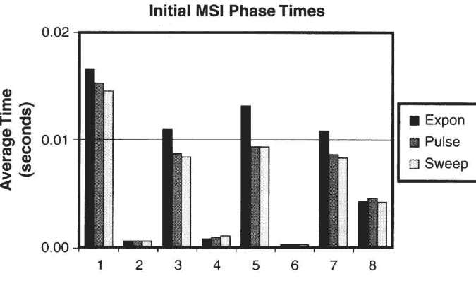

图 9.4 基准执行阶段概览。

下一步是分析，通过比较图表中的实际计时结果来展示一些常识和原始预期。

## 系统性能改进

外部系统性能（总体响应时间）大约是这些阶段时间之和。如果你回看第 8 章，图 8.8 显示，在扫描 MSI 期间可以预计响应时间约为 50 毫秒，而条形高度代表的扫描计时数据总和 47 毫秒——这是结果的良好验证。

```c
{
  aptr->flag[ident] = 1; /* 执行工作！ */
  usleep(1);
  break;
}
```

对 `usleep` 的调用请求暂停一微秒，这实际上放弃了对 CPU 的控制权，允许另一个就绪的进程执行。这是对子任务-空闲标记的简单搜索，随后该标记被重置为子任务-忙，指示子任务接收传入的查询。

## 注意事项

主进程阻塞在 `select` 调用上，直到检测到有传入的数据包存在。子任务在注意到其子任务-空闲标记被重置为子任务-忙后，才会实际接收该数据包。

在有三个子任务运行时，很难想象这少量的代码竟然会花费如此长的时间。很可能是主进程的 `usleep` 调用有效地阻塞了它，迫使它与每个子任务进行同等水平的竞争。

提高整体性能的一种方法是提高主进程在此阶段的优先级。由于主进程负责为其子任务分配工作，并且大部分时间都阻塞在 `select` 调用内部，因此赋予它高于子任务的优先级可以加快它对紧急查询到达的通知。

我们对第 1 阶段的性能改进是在每个子任务的初始化部分增加了对 `nice` 的调用（具体为 `nice(1)`，以略微降低其相对于父进程的优先级）。

在第 5 阶段，从属进程从共享文件中检索请求的文本行。从属进程检索文本行的源代码如下：

```c
/*
 提取请求的文本行
 */
fp = fopen(file, "r");
while(--)
gets(packet.buffer, sizeof(packet.buffer), fp);
close(fp);
```

此阶段并没有复杂的操作，但当存在对共享设备的竞争时，I/O 定时可能会具有误导性。然而，考虑到三个 IAT 分布之间时序的一致性，这可能不是这种情况。我们可以做些什么来缩短从文件中提取文本行的时间呢？

# 第 9 章 内部性能测量与计时

一种解决方案是像直接访问一样访问文件，但这违背了本示例的简单性。

另一种解决方案是维护一个缓存，即较早请求及其响应的本地池。如果收到重复请求，主子任务可以在缓存中查找响应并立即回复，通过完全避免使用其远程从属进程来节省大量时间。然而，典型的测试文件流包含的数据包数量少于可能的查询数量，因此重复请求出现的概率很小。我们确实可以改变这种比例，但这种解决方案对于这样一个简单的服务器来说似乎是大材小用了。

这是一种折中方案，既简单又展示了所承诺的巨大性能提升。最初，每当查询到达时，从属进程都会打开文件、读取到请求的行，然后关闭文件，直到下一次。鉴于请求的行号是随机的，下一行高于上一行的概率约为 50%。

如果当下一次查询到达时文件已经打开，那么在半数情况下（即请求的行小于最近检索的行时），它仍必须由于文件被关闭并重新打开。此外，在请求的行号高于上一个行的情况下，并不需要读取被请求行之前的所有行。以下是针对第 5 阶段的性能改进方案：

```c
/* 提取请求的文本行 */
if(line > curr) /* 第一次为假 */ {
    line = curr; /* 调整偏移量 */
    curr += line; /* 为下次保存 */
} else {
    fclose(fp); /* 第一次忽略 */
    fp = fopen(file, "r");
    curr = line; /* 为下次保存 */
}
while(line--) fgets(packet.buffer, sizeof(packet.buffer), fp);
```

在第 8 阶段，主进程选定的子任务响应查询并宣布自己为空闲状态。

```c
/* 将结果返回给客户端 */
strcpy(buf, packet.buffer);
send(cli, buf, strlen(buf)+1, 0);
close(cli);
```

```c
/* 在继续之前检查退出请求 */
if(aptr->flag[ident] < 0) /* 退出请求？ */
{
    sendto(s_fd, "Terminate 0", 12, 0,
    (struct sockaddr *) &slavelink, len);
    break;
}
aptr->flag[ident] = 0; /* 否：标记为空闲 */
```

在此阶段似乎没有任何可能的改进空间。目前让这段代码保持不变。

## 最终 MSI 性能结果

图 9.3 中的“之前”数据可以与图 9.5 所示的改进结果进行对比。

| SWEEP | SLAVENAME | PH | NUM | TOTAL | AVERAGE |
|---|---|---|---|---|---|
| beta | 47 | | 1 | 0.007628 | 0.00162 |
| | | | 2 | 0.026164 | 0.000557 |
| | | | 3 | 0.034657 | 0.000726 |
| | | | 4 | 0.047095 | 0.001102 |
| | | | 5 | 0.225919 | 0.005445 |
| | | | 6 | 0.010099 | 0.000213 |
| | | | 7 | 0.034657 | 0.000726 |
| | | | 8 | 0.208840 | 0.044443 |
| gamma | 3 | | 1 | 0.000485 | 0.000162 |
| | | | 2 | 0.001841 | 0.000614 |
| | | | 3 | 0.033318 | 0.011106 |
| | | | 4 | 0.002692 | 0.000897 |
| | | | 5 | 0.034676 | 0.011159 |
| | | | 6 | 0.000453 | 0.000141 |
| | | | 7 | 0.034657 | 0.000726 |
| | | | 8 | 0.208840 | 0.044443 |
| delta | 0 | | 1 | 0.000153 | 0.000000 |
| | | | 2 | 0.000000 | 0.000000 |
| | | | 3 | 0.000000 | 0.000000 |
| | | | 4 | 0.000000 | 0.000000 |
| | | | 5 | 0.000000 | 0.000000 |
| | | | 6 | 0.000000 | 0.000000 |
| | | | 7 | 0.000000 | 0.000000 |
| | | | 8 | 0.000000 | 0.000000 |
| OVERALL | | | 50 | 1 | 0.008276 | 0.000168 |
| | | | 2 | 0.028005 | 0.000560 |
| | | | 3 | 0.037875 | 0.007478 |
| | | | 4 | 0.049787 | 0.009996 |
| | | | 5 | 0.296935 | 0.035812 |
| | | | 6 | 0.010432 | 0.000209 |
| | | | 7 | 0.037875 | 0.007478 |
| | | | 8 | 0.217927 | 0.04359 |

FIGURE 9.5 主进程的改进计时报告。


FIGURE 9.6 改进后的 MSI 执行情况，按阶段划分。

查看按阶段划分的具体改进。

第 1 阶段——增加 `nice` 函数调用完全是一场灾难，导致执行时间几乎翻倍。仔细检查发现罪首是 `usleep`；它位于计时代码内部。当处理器被释放给下一个就绪进程时，重新获得控制（建立阶段结束）的时间是不可预测的。将 `usleep` 调用移动到计时代码外部后，第 1 阶段的执行时间低到不再需要关注。

第 5 阶段——保持文件打开以便后续请求取得了巨大成功，将第 5 阶段的执行时间缩短了三分。

第 3 和 7 阶段（网络传输时间）——这些阶段没有明显的减少。所有其他阶段的执行时间与实施改进前相似。

最后，是第 8 章中承诺的一些整体性能对比。指数、脉冲和扫描 IAT 分布的响应时间分布分别见图 9.7、9.8 和 9.9。

## 最终 MSI 性能结果

## 观测

| 响应时间 (毫秒) | 10 | 20 | 30 | 40 | 50 |
|---|---|---|---|---|---|
| 10 | * | | | | |
| 11 | ** | | | | |
| 21 | ****** | | | | |
| 31 | ****** | | | | |
| 41 | ** | | | | |
| 51 | ** | | | | |
| 61 | | | | | |
| 71 | * | | | | |
| 81 | | | | | |
| 91 | | | | | |
| 超过100 | * | | | | |

50 总观测值

**FIGURE 9.7** 指数分布——改进后的响应时间。

**FIGURE 9.8** 脉冲分布——改进后的响应时间。

## 第9章 内部性能测量与计时

| 观察结果 | 时间 (mesc) | 10 | 20 | 30 | 40 | 50 |
|---|---|---|---|---|---|---|
| 1 | 10 | ** | | | | | |
| 11 | 20 | | | | | | |
| 20 | 30 | ********** | | | | | |
| 31 | 40 | ******************* | | | | | |
| 41 | 50 | *** | | | | | |
| 50 | 60 | | | | | | |
| 61 | 70 | ** | | | | | |
| 71 | 80 | | | | | | |
| 80 | 90 | * | | | | | |
| 91 | | | | | | | |
| 超过 100 | | | | | | |

**图 9.9** 扫描分布——改进后的响应时间。

将其与第 8 章中图 8.6、8.7 和 8.8 的对应部分进行比较。所有情况下均显示改进。

## 总结

第9章首先介绍了执行分析（execution profiling），这是一种常用的性能测量技术。多年来，分析工具变得越来越廉价且精密，但它们仍然不适用于分布式系统分析。

直接测量可能是要求性最高的性能测量技术，但它非常适合分布式环境。在集群服务器的情况下，查询处理可以被分为离散的执行阶段。每个阶段的执行时间可以直接测量，也可以从高层直接测量中估计。结果绘制在按时间排序的条形图中，用于分析系统的内部性能。如果发现某些执行时间异常地长，可以对该阶段相关的源代码进行速度优化。在检查了所有阶段并优化了代码后，再次运行性能并生成后续条形图，将其与早期的基准进行比较，并检查是否有性能提升。

最后，测量整体（外部）系统性能并与之前的结果进行比较。目标始终是客户满意度，而响应时间越短，客户越满意。

## 延伸阅读

- *Tanenbaum, Andrew S. Distributed Operating Systems. Englewood Cliffs, NJ: Prentice-Hall, 1995.*

## 第10章


## 本章内容

健壮的软件是指在出现错误条件下仍继续正确运行的软件。在前面的章节介绍的示例执行过程中，可能会出现问题。在本章中，你将学习 MSI 中可能发生哪些错误，以及你可以在软件中添加哪些内容以防止在出现此类错误时发生故障。

如果你仔细阅读了文本并一直跟着开发自己的集群系统，你可能已经发现了分布式软件系统是多么不可预测的。例如，主进程有一个中断处理程序，可以捕获 `Ctrl+C` 键。接收到信号后，父进程会为每个子任务设置标记，告诉它们优雅地退出。它们向每个对应的从进程发送一个数据报，告诉它们在自己清理并退出之前也优雅地退出。父进程会等待每个子任务退出，然后移除共享内存区域并退出。

这是一个良好的设计，但有时某些进程会以一种不够优雅、甚至完全不优雅的方式终止。

在大多数情况下，即使在经过多个数据包后，`Ctrl+C` 键也会产生预期的结果：主进程、其所有子任务以及所有远程从进程都会正常终止。通过以下方式查看每个节点：

- 报警退出 (Alarm Exits)
- 超时 (Timeouts)
- 子任务重启 (Subtask Restarts)
- 主任务重启 (Main Task Restarts)
- 重新附加共享内存 (Reattaching Shared Memory)
- 可靠 UDP 通信 (Reliable UDP Communication)
- 延伸阅读

```
> ps aux
```

显示所有这些进程已终止。通过以下命令查看共享内存区域：

```
> ipcs -m
```

显示客户端和主都在退出前都删除了它们的区域。然而，偶尔你会发现子任务在没有父进程的情况下运行。

你可以通过进程 ID 杀死这些进程：

- `> kill <pid> <pid>`

通过其 ID 移除共享内存区域：

- `> ipcrm shm <shmid>`

并在开始另一个测试会话之前重新检查一切。人类似乎可以毫不困难地从这些错误中恢复。

数据报可能会丢失，这可能解释远程从进程的问题，但在处理分布式系统多年后，你会开始相信事情总会发生——那些你永远无法完全理解的事情。如果在恢复测试之前，某个进程正在运行或共享内存区域仍然存在，那么你的软件能做什么来避免在这种异常出现时失败呢？

## 报警退出 (Alarm Exits)

中央性能监控进程（参考列表 8.3）运行在集群外部机器上。它从每个节点获取定期性能统计，并显示整个系统的状态变化。显示所有集群节点以及它们的 CPU 和内存利用率、磁盘和网络 I/O 速率，以及网络负载的估计。你可能希望在监控内部设置计时器，使其在空闲小时后终止。你可以通过调用 `alarm` 来实现：

```c
#include <unistd.h>
/* ... */
main(void)
{
    while(1)
    {
        alarm(3600); /* 一小时后报警 */
        waitForSomethingToHappen();
        alarm(0); /* 取消报警 */
    }

    /* 相应的响应 */
}
```

`alarm` 调用请求在 3600 秒（即一小时）后向你的进程发送信号。如果这段时间内没有活动，将发送该信号，你的进程将被终止。发生这种情况是因为你没有告诉操作系统忽略该特定信号，也没有为它建立信号处理程序。操作系统采取默认操作；终止进程。

但这是一件好事。监控器每秒应该收到几个数据包。如果空闲了一个小时，你可能不希望该进程无限期留在系统中。这个简单的设备确保了它在配置的空闲时间后终止。如果它收到来自性能统计收集器的包，则通过 `alarm()` 取消报警信号。它对发现的任何情况做出响应，重置报警并等待另一个数据包——这是正常操作。

## 超时 (Timeouts)

如果你不希望进程被粗鲁地中断，简单来说，你可以添加一个报警信号处理程序——这是一个内部函数，在接收到报警信号时通知进程以便其优雅地退出。

列表 7.5 是主进程使用报警信号作为超时的示例。然而，在 MSI 的生产版本中，主进程不知道会有多少个注册包。它使用报警作为超时指示器。如果在规定时间内没有数据包到达，它假设所有从进程已注册。布尔变量 `Alarm` 在收到数据包时为 `FALSE`，在收到报警时为 `TRUE`。

```c
#include <unistd.h>
#include <signal.h>
/* . . */
#define FALSE 0
#define TRUE 1

int Alarm = FALSE;
```

完整的代码列表见下。

## 子任务重启 (Subtask Restarts)

主进程为每个从进程启动一个本地子任务。每个本地子任务与其从进程建立持久通信链路。主进程将查询分配给第一个可用子任务，由其将其交给从进程进行处理。主进程如何发现本地子任务失败了，在这种情况下它可以做什么？

类似于在超时时向请求进程发送报警信号，子任务的终止会导致 `SIGCHLD` 信号发送给父进程。如果你建立了处理处理器并跟踪所有的子任务，你不仅可以检测到其中一个的终止，还可以判断是哪一个结束并重启它（参见列表 10.1）。

### 列表 10.1 从子任务的意外终止中恢复

```c
#include <unistd.h>
#include <signal.h>
#include <stdio.h>
#define FALSE 0
#define TRUE 1
#define NUM 3

int Ok; /* 布尔 */

main(void)
{
    /*
    ** Listing10.1.c - 从子任务的终止中恢复
    */
    void sig_child();
    int pids[NUM];
    int ii, jj;
    int pid;

    /* 设置 SIGCHLD 处理器 */
    signal(SIGCHLD, sig_child);

    /*
    **  Num 个子任务
    */
    for(ii=0; ii<NUM; ii++) {
        if((pids[ii]=fork()) == 0) {
            printf("\t子任务 #d 已启动，pid = %d\n", ii, getpid());
```

# 第176 页 第10 章 健壮软件

## 列表 10.1 延续

```
while(1) {
    usleep(1);
}
/*
** 等待子任务结束
*/
while(1) {
    Okay = TRUE;
    while(Okay) /* 暂停 */
        usleep(1);

    pid = wait(NULL); /* 退出的 pid */
    for(ii=0; ii<NUM; ii++)
        if(pid == pids[ii])
            break;
    printf("tSubtask #%d ended, pid = %d\n", ii, pids[ii]);
    if((pids[ii]-fork()) == 0) {
        printf("tSubtask #%d restarted, pid = %d\n", ii, getpid());
        usleep(1);
    }
}
return(0);

void sig_child() {
    signal(SIGCHLD, sig_child);
    Okay = FALSE;
    return;
}
```

该程序在一个窗口（或登录会话）中启动，并记录子任务报告的进程 ID。在另一个窗口中终止这些子任务中的一个或多个，观察恢复过程的发生。终止父窗口即可结束演示。

你可能想通过增强此程序来包含一个计数器列表，每个子任务一个。每当某个特定子任务意外终止时，递减其计数器，如果尚未达到重启限制，则重启它。

## 主任务的重启

当一个子任务终止时，一个信号会发送到其父任务，但你如何检测父任务的终止呢？有几种方法可以处理这种情况，具体取决于父任务是如何启动的。

一种简单的方法是开发一个高层启动过程。它的工作是启动所有通常会在最高层级运行的进程，并监控它们，重启失败的任务。

另一种策略是让操作系统启动进程，并指定在失败时重启。系统文件 `/etc/initab` 允许你（root）将自己的可执行文件添加到进程列表中，以便在进入特定的运行级别（run level）时启动（并重启）。使用这种技术的缺点是，进程可能变得难以消除——它工作得太出色了！

最后一种策略涉及容错软件设计者所说的“心跳”。父进程可以检测子任务的终止，但考虑它可能如何检测（并恢复）运行在远程节点上的从进程的终止。

从进程一旦激活，就会向主进程注册，因此两者之间存在一个未被使用的 UDP 通信链路。如果从进程每秒向主进程发送一个 UDP 数据报（心跳），而主进程记录每个从进程接收最后一次消息的时间，它就可以在每次查询到达时扫描这些“最后听到”的时间。任何在可配置时间内未收到音讯的从进程都可以（通过其 UDP 服务端口）与其本地子任务一起重启，实现完全恢复。（这是为那些实际开发集群的读者提供的一个增强项目。）

最后，考虑到恢复是有层级的，在某些时刻，一个智能进程可能会决定远程机器需要重启。你可以建立一个 UDP 服务端口，启动一个以 root 运行的进程，该进程通过系统调用发布带有重启选项的关机命令：

```c
#include <stdlib.h>

main(void) 
{
    system("/sbin/shutdown -r now");
}
```

如果无法在故障机器上运行进程，仍然可以通过自定义硬件实现重启。处理器芯片有一个 `RESET` 引脚，当接地时将导致系统重置或重启。当然，这种激进的措施只应在极端异常的情况下考虑。这种重启类似于切换电源开关，确实是一种非常“冷”重启。

## 重新附加共享内存

即使你决定实现上述一种或多种方案，你可能还没有完全脱离困境。许多遗留条件等待着确保你进程的最新实例也会失败。MSI 架构中最可能的嫌疑是它的共享内存区域。

如果主进程在移除其共享内存区域之前终止，那么该区域在主进程重启时仍然存在。你必须根据对系统工作原理的了解，决定让主进程重新附加该区域，还是删除旧的共享内存区域并重新开始。

主可以在初始化期间重新附加其共享内存区域。如果 `shmat` 调用的返回值失败，要么是故障的主进程删除了内存区域，要么此主进程是重启后的第一个活跃进程。（重启带有许多罪孽。）

## 可靠的 UDP 通信

软件开发者喜欢 TCP，因为它保证了所有数据包按发送顺序成功递送。软件开发者讨厌 TCP，因为它保证了所有数据包按发送顺序成功递送。看来，在处理时间是核心要素的情况下，这种强力保证相关的开销是无法接受的。

UDP 通常被称为不可靠协议，但这可能是一个过度指责。你可以通过本章早些时候描述的超时功能提高其可靠性，重发在设定限制内未收到确认的数据报。由于你设置了这些限制，你可以控制为了特定的可靠性水平愿意承担多少开销。

这种简单的、等待确认的协议被称为停止-等待（stop-and-wait）流量控制。该方案的一种变体允许在等待确认之前允许一组处理中的包（缓冲区窗口）。也就是说，你发送数据包直到达到设定限制，然后等待确认。通过允许接收者确认多个数据包（直到窗口大小），提高吞吐量。

## 总结

在前端设计健壮软件——而不是在实验性系统中发现漏洞——将带来一个可靠的集群服务器。分布式软件系统是复杂的。跨网络的多个子任务共同实现一个目标：服务客户端。强进程依赖关系不应由于其中一个的意外终止而导致系统失败。

## 进一步阅读

## 第 11 章 进一步探索

## 本章内容

- Beowulf 类的超级计算机
- 超级计算机应用
- 动态点对点网络
- 未来应用
- 进一步阅读

## 进一步探索

# 本章内含

- Beowulf 类的超级计算机
- 超级计算机应用
- 动态点对点网络
- 未来应用
- 进一步阅读

MSI 是一个分布式事务服务器系统。它接收查询，与其他查询并行处理，并将响应返回给外部客户端。它在初始化后一直运行下去。

并不是所有分布式应用程序都是这样。随着应用程序的需求增加，其复杂性随之增加。升级复杂应用程序所需的努力最终会变得成本难以负担，原因有两个：首先，支持新功能所需的工作可能需要额外的基础设施支持。其次，分布式系统基础设施软件的复杂性可能会使其变得脆弱，由于复杂性的增加而更容易故障。

因此，现代集群具有两层软件结构：应用程序和分布式系统基础设施。在学习这些计算机架构的一些变体时，请思考这如何影响多机计算机的特性。

## 类 Beowulf 超级计算机

什么让一台超级计算机具有 Beowulf 特性？一台 Beowulf 类机器有两个限制：它必须由市售的 PC 和硬件支持构建，并且其总成本必须低于高性能科学工作站。在 1994 年（当这类定义正在完善时），这种成本大约为 50,000 美元。书中描述的测试平台在 1998 年成本低于 2,000 美元，现在甚至更便宜。你系统的成本取决于你对性能中“高”字的重视程度。集群性能很大程度上取决于外部 I/O 总线的速度，对于测试平台和大多数其他集群而言，这就是互连网络或以太网。Beowulf 在开发的后期通过自定义组网实现了某些惊人的成本/性能比。

科学人员在有限的预算下发挥创意，利用现有设备挤出每一分效用。Beowulf 项目的动力源于 PC 堆 (POPC) 集群并行计算的最新进展，这些集群使用商用现成品 (COTS) 产品取得了令人瞩目的基准测试结果。（参见本章末尾“延伸阅读”部分关于 COW（工作站集群）和 NOW（工作站网络）的引用）。Beowulf 是 NASA 的一项计划，由 NASA 承包商——空间与数据信息卓越中心（SEDCIS）的 Thomas Sterling 和 Donald Becker 领导。科学家们拥有由大规模物理现象模拟（例如相互作用的构造板块）产生或通过传感器网络（如气象卫星）收集的海量数据。Beowulf 的设立目标是以极廉的成本解决与此类研究相关的问题。

加州理工学院 (Caltech) 和洛斯·阿拉莫斯国家实验室运行着 Beowulf 集群，而不同规模的大学（例如普林斯顿大学和俄勒冈州立大学）则关注高速网络硬件如何影响消息传递和虚拟映射系统的局限性。较小的大学，甚至是一些高中，也通过构建和维护系统，让学生获得并行计算概念和挑战的实践经验。它们是实验、课堂项目和研究生研究的理想测试平台。你可以通过本章末尾“延伸阅读”部分引用的网站了解更多关于 Beowulf 项目的信息。在 1998 年，Red Hat 与 Beowulf 项目合作将 NASA 的官方软件以 Extreme Linux CD-ROM 的形式发布，其网站可能有一些有趣的资料。

Linux 这样编写得良好的免费操作系统、大量过时但性能尚可的 PC，以及一些愿意分享想法的聪明的实验者，使得这一切成为可能。当你读到他们的目标、成就和结果时，他们的热情是显而易见的，让你不由地考虑构建一个属于自己的系统。

## 超级计算机应用

MSI 是 Web 或数据库服务器意义上的事务处理器。它接收传入的查询并向某些外部客户端发送响应。实时科学应用表现出类似的行为，即获取到的传感器数据并制定解决方案。大多数科学应用呈现出静态系统，但某些应用需要定期获取数据，并显示随环境变化的持续更新的解决方案。

例如，考虑一个关注空气质量的大城市，它安装了十个或多个空气污染传感器来测量风速、方向、温度、湿度，以及臭氧、一氧化碳、二氧化硫和其他导致呼吸健康问题的粒子的水平。它在 10 分钟内对这些计数取平均值，并将读数传输到中央计算系统。这台中央计算机接收所有最新数据并更新其实时显示——一幅描绘每个颗粒位置、形状和密度的伪彩色图像。不意外的是，在早高峰期间，碳颗粒图案的形状代表了该城市高速公路和干道地面街道的粗略地图。

在更大规模上，国家大气研究中心 (NCAR) 拥有气象卫星，将传感器数据馈入计算机，生成实时天气模式。软件模拟数据也用于生成对未来天气模式的预测。希望软件足够高效，计算机足够快，以便在明天到来之前生成明天。更多信息可以在本章末尾“延伸阅读”部分引用的大学大气研究联盟网站上找到。

人工智能 (AI) 研究人员非常认真地对待他们的游戏。号称“深蓝”的 IBM RS/6000 SP 与象棋大师加里·卡斯波夫 (Garry Kasparov) 对战并赢了。在这种应用中，当前的棋盘布局是获取的数据，而解决方案是根据其几步之后的后果判断为最佳的步法。软件构建了一个从当前棋盘开始的倒树形结构。每个下分支代表对手的回应，依此类推。这种树形结构被称为问题空间，每个可能的移动下方的分支数称为深度。搜索解决方案并

# 第 11 章 进一步探索

软件模拟可以将数十亿年的地质时间压缩到几秒，或将时间之初（大爆炸）的几纳秒扩展到几分钟，以便地质学家和天体物理学家能够在合理的时间范围内研究现象的行为。软件模拟可以从分布式模拟中获益匪浅，这是一个非常热门的研究课题。

这类应用中的每一种（列表并不详尽）都有其固有的并行性，这种并行性可以被并行处理器利用。并行编译器可以通过分析你的源代码检测这种并行性。（这个过程本身就是超级计算机应用的候选对象！）然而，这些编译器非常昂贵，但存在替代方案。

## 未来应用

信号被你的系统接收了，或者可能是它的系统接收了你的信号。无论如何，你们的两个系统都感知到了彼此的相对位置和速度。

当汽车驶过而你偏入自己的车道时，汽车系统感知到了相对位置的变化，开启蜂鸣声警告驾驶员，并向你的汽车发送了消息，你的也发出了蜂鸣声警告你。当你踩刹车时，你的系统知道后面没有汽车，因此没有发送消息。当你抬起刹车时，它知道这并不是问题，并保持中立状态。

你仍然看到了汽车的转向灯。如果驾驶员忘记开启，系统在感知到偏离后会开启。当你踩刹车时，刹车灯亮起；当你偏入时，转向灯会亮起，以防后面有一辆没有这种装备的车辆。这种场景旨在被用作点对点网络的示例。如果你发现每个节点都是完全自主的，能够引入并响应问题，那么你就对这种架构的潜力有了直观感受。思考一下，如果后面多了一辆车，或者在左车道切入你的那车后面还有第四辆车，节点与节点之间的交互可能会变得多么复杂，这是一个很好的练习。问问自己几个问题：如果后面的车没有看到你的刹车灯，你的系统应该自动让那辆车减速吗？左侧的车在感知到你正要切入时，应该自己减速吗？考虑到你迄为止对商业软件的经验，你相信此类系统能做出正确的判断吗？

尽管听起来很有未来感，但实现这种系统的技术可能已经10年的历史了。下一节将讨论更接近技术前沿的应用。


你可能熟悉 PDA，即数字助理。你可能知道它每天都在变得越来越像手机，而且许多 PDA 都可以访问互联网。接下来的内容与我们现状并没有太大的跨越。它接受了电子商务的承诺，从当今的企业内网中汲取经验，并是对 DSM 共享虚拟内存概念的扩展。

手持 PDA 设备的问题在于屏幕大小。当屏幕达到可接受的大小时，设备携带起来就不方便。如果没有实体，我们假设有一种折叠屏版本，可以放入口袋，或在不使用时夹在皮带上（见图 11.2）。它是一个普通的 PDA，除非你想让它与你所处的任何环境进行交互——关于这一点稍后详述。

图 11.2 带有折叠显示屏的个人数字助理。

现在将企业内网的概念应用到你的校园、银行、百货商店、办公大楼或其他机构。公共访问内网允许任何人进行交互。这些可能出现在公共博物馆或图书馆、历史遗迹、城市天际线之旅、汽车经销商、机场航站楼等。

私有内网允许获得授权后进行交互。当你为主题公园、私人美术馆或剧院付票时，你的系统获得临时授权。私有内网需要更强的授权。你的银行必须知道你何时是存款人，你的校园必须识别你的学生证，你的工作场所必须识别你的员工身份。

在校园里，你可以检查中考试成绩，下载从台式电脑带过来的论文，并预约下午晚些与导师见面。在当地的小吃店，你可以在找座位的同时点三明治，如果你喜欢，还可以预付款。当你开车时可以查看交通状况，如果常规路线由于任何原因拥堵，系统会为你提供一些替代路线。

如果你在吃午饭时想找图书馆的书，你一直可以用老办法：拨打你的 ISP 并通过互联网连接。

最后，终极的集群软件架构可能是一种结构由处理需求而非可用硬件定义的架构。公司的新部门和全新的公司首先通过职位组织图来表示，其次才是人员。分布式软件架构师应该是那种能够完成工作的设计过程，起初不考虑硬件。这些进程中的每一个都有预先定义的进程间通信链路，绝不应被任何与其相对于同伴执行位置相关的顾虑所负担。如果一个进程感知到从它当前执行的位置无法满足其目标（例如，运行的进程太多，已经减慢了对本地资源的访问），它应该能够将自己发送到其他机器上，以提高整个系统的性能。

进程在其他机器上重新建立自身的概念在“自主代理”中有所描述，但计算机科学该领域的愿景是你的个人代理在整个互联网上漫游，为你寻找信息。例如，你可能在西雅图寻找一家好的餐厅，因为你这周要去那里出差。它携带一个描述你对食物和价格偏好的矩阵，并知道你将住在哪里。当它找到最优解决方案时，它会报告到你的桌面，信息会在那里等待，直到你的 PDA 进入下载范围。

无处计算很快将成为产品，而非演示包。软件和硬件将由新颖的心脑设计，他们不受事物的固有方式的束缚，并且拥有灵活的心脑，面对新问题时愿意并渴望摒弃旧的思维方式。加入其中吧。

## 总结

与商业系统相比，MSI 是一个玩具，但它仍然是一个极好的学习工具。现代系统采用两层软件架构，封装进程间软件以消除其对高层服务设计和增强的影响。

Beowulf 类架构是今天集群架构中经典的分布式系统设计。科学应用为此类系统提供了动力，可能超过服务，但这种情况正在发生。

科学应用的并行处理需要某种预处理器将算法分解为并行处理块，并需要一个执行管理器将这些块调度到可用处理器上，合并其结果以继续处理单线程。

网络不必是固定的。自组织网络——如公路上的汽车或战场上的士兵——允许在不付出巨大努力的情况下实现通信，在建造公路或可能发生战斗的广区域部署蜂窝式基站。

最后，跳出框架，考虑一种进程在节点间移动的固定网络。未来可能是一个计算和通信能力就像我们今天使用的电器一样的世界。而且技术挑战将不胜缺少。

## 延伸阅读

- Hill, J., M. Warren, and P. Goda. “I’m Not Going to Pay a Lot for This Supercomputer!” Linux journal, no. 45 (January 1998): 56-60.

- `http://www.netflix.org/pvm3` 并行虚拟机 (PVM) 下载。

- `http://www.netflix.org/mpi` 消息传递接口 (MPI) 下载。

- `http://www.ens-lyon.fr/LHPC/ANGLAIS/popc.html` PC 信息。

- `http://www.beowulf.org` 关于 Beowulf 的通用信息。

- `http://www.beowulf-underground.org` 更有冒险的 Beowulf 粉丝。

- `http://www.cs.orst.edu/swarm` 关于 SWARM 系统的信息。

- `http://www.cs.princeton.edu/shrimp` 关于 SHRIMP 系统的信息。

- 关于 Hyglac 信息请参考 `http://ess.jpl.nasa.gov/subpages/reports/97report/hyglac.html`。

- 关于 Naegling 信息请参考 `http://www.cacr.caltech.edu/beowulf`。

- 关于 Loki 系统信息请参考 `http://loki-www.lanl.gov`。

- 关于美国气象研究中心（National Center for Atmospheric Research）的信息请参考 `http://www.ucar.edu/ucar` 或 NCAR 站点 `http://www.ncar.ucar.edu/ncar`。

- Rich, E. and K. Knight. 《Artificial Intelligence*. 2nd ed. New York, NY: McGraw-Hill, 1991.

- Schwarz, H. R., 《Finite Element Methods*. San Diego, CA: Academic Press, 1988.

# 第 12 章

## 本章内容

- 多处理器架构
- 集群配置
- 分布式应用
- 结语

## 结论

你已经学习了大量关于集群硬件的知识。在第一章中，你学习了基础工作——开发分布式系统所需的备知识。只有极小比例的软件开发者理解这些，你应该为自己成为其中一员感到自豪。

接下来是实战经验。如果你在阅读本书的过程中实际构建并配置了一个网络，那么你就有了可以吹的资本：你可以观察 PC 的背面并判断出它是否具有网络接口以及需要什么种类型的线缆。你可以进入大型电脑商店，查看集线器、交换机、路由器和防火墙，并自信地选择你所需的物品。你可以安装 Linux 操作系统，以 `root` 身份登录，并管理该系统与其他所有系统协同工作。你可以对这个新添加的设备进行一些基础测试，并确保它按计划运行。你可以创建一个非 `root` 用户并自定义其主目录。你可以创建所有属于项目的 C 语言程序，以及一个将它们连接在一起的 `Makefile`。你可以测量事务服务器的外部性能，并对任何类型系统的执行阶段进行计时。你可以对该系统进行调优并再次测试，看看调优更改是否产生了益处。你对容错系统至少有了一些概念，并可以添加代码来避免可能导致系统故障的问题。

你对他人利用集群所做的事情有了概览，并且知道事务处理器和超级计算机之间的区别。你理解实时环境数据与模拟环境数据之间的区别，以及超级计算机如何将此类数据转换为显示。到达间隔时间会影响服务器的性能。这是一个宽泛但至关重要的理解水平。适用于某种系统的解决方案可能会对另一种系统产生不利影响。

最后，你可以向未来展望远一点。你和大多数人一样知道，计算机将变得越来越快、越来越便宜、越小。你还知道许多人不知道的事：存在着从层次化的客户端/服务器结构向更灵活、更复杂、更通用的点对网络的趋势；只要基础设施运行正常，泛计算就能让任何人与其他人进行通信。最重要的是，你理解支持这些高远目标的基础设施始于网络上一堆计算机，它们朝着共同的目标共同工作。

# 多处理器架构

每当算法可以并行执行两个或更多任务时，多处理器就可以提高其性能。如果并行执行相同的操作但处理不同的数据，则该多处理器可以是向量处理器。否则，则需要更通用的多处理器。

如果并行处理数据所需的执行时间少于获取数据的时间，就需要紧耦合多处理器。否则，多机体系即可。多机体系比紧耦合多处理器更难编程，但价格便宜得多，且更容易升级。记住，如果一个多机体系的性能等同于其十分之一的价格，那是非常划算的，只要一半的性能符合你的需求。

# 集群配置

你可以在邮购网站上或走进最大的集群商店，购买构建集群计算机所需的所有物品。然而，通过从回收中心获取计算机、在跳蚤市场或车库拍卖中寻找、或者从同事、朋友或邻居那里免费获得，可以将成本降至最低。其中一个测试节点就是一位响应简报广告的同事免费送的。

配置操作系统文件、为软件开发工作创建主目录，以及实际编写、测试和调试分布式软件需要相当的技巧，但这是一种通过学习获得的技能，随着时间的推移而发展。你会出错（就像我们所有人一样），插入一些打印语句，排查问题并解决它。这正是技能真正产生的地方；我们没有人天生就会这些技能。在学习过程中亲手实践会有成就感，当系统开始工作时会非常愉快。

# 分布式应用

你可能是一位经理，阅读这些是为了了解你的团队在某些新产品上面临着怎样的问题。你可能是一位丰富的开发者，希望阐明此类系统的灰色地带。你可能是一个爱好者，想要留在系统开发的边缘。如果你真的构建了这样一个系统（正如我所希望的那样），应用的选择可以成为旅程的完整后部分。数字信号处理（降噪、过滤等）同样适用于望远镜的 CCD 图像，也可以适用于短波电台的音频信号。也许示例系统——数据服务器，正是你心所想的。

## 结语

几年前，作者被几家制造商提供的双处理器系统的硬汉魅力所吸引。一次简短的交话发现，双 100MHz PC 的价格是单机的两倍，而且速度还跟不上几个月后发布的 200MHz PC。这一事实理清了思路，但对多处理器的渴望依然存在。

曾几何这样一个时刻，旧的 386 处理器无法运行现在的文字处理器。一年后，两台过时但够用的 PC 放在柜子里，直到类似的设备以非常廉的价格出现。又一年，一个八节点 Linux 集群焕发了机。

我希望你能到达那里并更进一步。祝你旅途愉快！

# 附录 A

# 源代码

本附录包含

- 查询生成客户端
- 主从接口
- 近实时性能
- Makefile

这里是查询生成客户端、整个主从接口（包括实时性能显示模块及其头文件）以及一个简单的 `make` 工具文件的源代码列表。C 文件应位于 `/home/chief/src` 下，头文件应位于 `/home/chief/inc`，正如第 6 章“配置开发用户环境”所述。记住，你可以从出版商的配套网站 `www.samspublishing.com` 下载所有文件。输入这本书的 ISBN 号并选择下载链接以获取更多信息。

图 A.1 显示了我们测试平台使用的硬件图以及这些进程各运行的位置。

图 A.1 客户端、集群和性能显示。

# 查询生成客户端

客户端在可以访问集群网络的机器上运行，该机器本身必须是集群节点。以下是一个示例命令行，假设服务器已经在运行。

```
> client alpha p
```

这假设主任务在 `alpha` 上启动，并请求脉冲分布的查询流（见第 8 章“外部性能测量与分析”）。

# 列表 A.1 客户端进程

```c
#include <math.h>
#include <stdio.h>
#include <stdlib.h>
#include <unistd.h>
#include <string.h>
#include <sys/ipc.h>
#include <sys/shm.h>
#include <sys/time.h>
#include <sys/types.h>
#include <sys/socket.h>
#include <netinet/in.h>
#include <netdb.h>
#include <msi.h>

#define FALSE 0
#define TRUE 1
#define NUM 50

#define CATS 0 /* 响应时间分类数量 */
double cats[CATS] = {.01, .02, .03, .04, .05,
.06, .07, .08, .09, .10};
int bars[CATS] = {0}; /* 状图计数器 */

main(int argc, char *argv[])
{
    /*
     * client.c: 报告响应时间统计
     */
    struct timeval bef, /* * 前后计时器 */
    struct sockaddr_in sock; /* * socket 结构体 */
    struct hostent *hp; /* * IP地址结构体 */
    int flag = [IPC_EXCL | 0666];
    int size = NUM * sizeof(double);
    key_t key = 0x01234567; /* 共享内存键 */
    int shmid; /* 共享内存 id * */
    int Expon = FALSE; /* 布尔值：指数分布 */
    int Pulse = FALSE; /* 布尔值：脉冲分布 */
    int Sweep = FALSE; /* 布尔值：扫描分布 */
    double mean=0.50; /* 指数分布的平均值 */
    double slow=0.25; /* 脉冲和扫描的慢速值 */
    double fast=0.10; /* 脉冲突发的快速速值 */
```

# 附录 A 源代码

# 列表 A.1 继续

```c
double random;           /* 随机实数: 0.0->1.0 */
double delay;           /* 计算的延迟时间 */
double rt;               /* 来自子任务的响应时间 */
long longterm;          /* IAT 中剩余时间 */
long usec=0;            /* 帧到达间隔微秒 */
secs=0;            /* 剩余秒数 */
int pids[NUM];          /* 子任务进程 id */
int opt=1;             /* setockopt 参数 */
int fd;                 /* socket 文件描述符 */
int ii, jj, kk=0;
char distribution[4];
char buf[QUERYSIZE], *p;
```

```c
rand((unsigned int) getpid()); /* 为 rand() 种子 */
```

```c
/*
** 操作数是远程主机(HOST)名和分布代码
*/
```

```c
if(argc != 3) {
    printf("\n\nusage: %s <HOST> <DISTRIBUTION>\n\n", argv[0]);
    exit(-1);
}
hp = gethostbyname(argv[1]);
```

```c
if((argv[2][0] == 'e') || (argv[2][0] == 'E')) {
    Expon = TRUE;
    strcpy(distribution, "EXP");
    rand((unsigned int) getpid()); /* 为 rand() 种子 */
} else if(argv[2][0] == 'p' || (argv[2][0] == 'P')) {
    Pulse = TRUE;
    strcpy(distribution, "PLS");
} else if(argv[2][0] == 's' || (argv[2][0] == 'S')) {
    Sweep = TRUE;
    strcpy(distribution, "SWP");
}
```

# 列表 A.1 继续

```c
else
{
    printf("\n\tUsage: %s <HOST> <DISTRIBUTION>\n", argv[0]);
    printf("\t\tDISTRIBUTION = { 'e' | 'p' | 's' }\n");
    printf("\t\tfor exponential, pulse and sweep\n");
    exit(-1);
}
}
shmid = shmget(key, size, flag);
/* 挂载共享内存区域 */
rt = (double *) shmat(shmid, 0, 0);

/*
** 循环：发送并接收 NUM 个数据包
*/
for(ii=0; ii<NUM; ii++)
{
    rt[ii]=0.0; /* 共享数组值零 */
}

if(Expon)
{
    random = rand() / (double) RAND_MAX;
    delay = -mean * log(random);
    if(delay > 0.999999)
        delay = 0.999999; /* 限制最大 */
}
else if(Pulse)
{
    if((ii > (NUM * 0.3)) && (ii < (NUM * 0.4)))
        delay = fast;
    else
        delay = slow;
}
else if(Sweep)
{
    delay = slow - (ii * (slow / NUM));
}
else
{
    printf("\n\tError in logic?\n\n");
```

# 附录 A 源代码

# 列表 A.1 继续


# 附录 A 源代码

## 列表 A.2 续

```c
exit(-1);
secs = (long) delay;
use = (long) (1000000.0 * (delay - ((double)secs)));
/* 随机数：1 到 99 */
random = rand() / (double) RAND_MAX;
jj = (int) ((double) (99.0) * random) + 1;
if(jj == 20)
    jj = 99;
sprintf(buf, "sample.txt %d", jj);

/* 记录发送时间 */
gettimeofday(&bef, NULL);
/*
** 每个查询/响应的子任务
*/
if((pids[++]=fork()) == 0) {
    /* 挂载父进程的共享内存 */
    rt = (double *) shmat(shmid, 0, 0);
} /* shmid仍然设置正确 */
/* 设置服务器的 socket */
fd = socket(AF_INET, SOCK_STREAM, 0);
memset((char *)&sock, 0, sizeof(sock));
memcpy(sock.sin_addr, hp->h_addr, hp->h_length);
sock.sin_family = hp->h_family;
sock.sin_port = htons(QUERYSIZE);
```

```c
#ifdef TIMING
/* * 处理的查询数量 */
int count[MAX];
struct timeval phase2[MAX];
struct timeval phase3[MAX];
struct timeval phase4[MAX];
struct timeval phase5[MAX];
struct timeval phase6[MAX];
struct timeval phase7[MAX];
struct timeval phase8[MAX];
#endif
} area, *ptr;

int flag = [IPC_CREAT | IPC_EXCL | 0660];
int size = sizeof(struct area); /* 共享内存键 */
int key_t key = 0x01234567; /* 共享内存 ID */
int shmid; /* 文件描述符 */
int acc; /* 查询文件描述符 */
int cli; /* 性能监控器 */
int pid;
int b_fd; /* 广播文件描述符 */
int r_fd; /* 注册文件描述符 */
int s_fd; /* 从机链接文件描述符 */
int ident; /* 子任务 ID 和偏移量 */
int opt=1; /* 查询选择列表 */
int fd_set=0;
int count=0; /* 已注册的从机计数 */
int pid[MAX]; /* 子任务进程 ID */
char hostname[LEN]; /* 主机运行位置 */
char hosts[MAX]; /* 已注册的从机主机 */
char buf[QUERYSIZE], *p; /* 客户端查询/响应 */
```

```c
/* 初始化信号处理程序 */
signal(SIGINT, sig_inter);
signal(SIGALRM, sig_alarm);
```

```c
/* 建立 UDP 广播套接字 */
b_fd = socket(AF_INET, SOCK_DGRAM, 0);
memset((char *) &broadcast, 0, len);
broadcast.sin_family = AF_INET;
broadcast.sin_port = htons(BROADCAST);
memcpy(&broadcast.sin_addr, bcaddr, 4);
```

```c
setsockopt(b_fd, SOL_SOCKET, SO_BROADCAST,
(char *) &opt, sizeof(opt));
```

```c
/* 建立注册套接字 */
r_fd = socket(AF_INET, SOCK_DGRAM, 0);
memset((char *) &registers, 0, len);
registers.sin_s_addr = htonl(INADDR_ANY);
registers.sin_port = htons(REGISTERS);
registers.sin_family = AF_INET;
bind(r_fd, (struct sockaddr *) &registers, len);
```

```c
/* 启动远程从机服务 */
getostname(hostname, sizeof(hostname))
if((p=strchr(hostname, '.')) != NULL)
  *p = '\0'; /* 截断 .domain */
sendto(b_fd, hostname, strlen(hostname)+1, 0,
  (struct sockaddr *) &broadcast, len);
close(b_fd);
```

```c
/*
** 显示注册响应信息
*/
while(1) /* 闹信号导致退出 */
{
    alarm(1); /* 设置 1 秒闹钟 */
    buf[0] = '\0'; /* 清空输入缓冲区 */
    /* 等待注册或闹钟 */
    recvfrom(r_fd, buf, sizeof(buf), 0,
      (struct sockaddr *) &registers, &len);
    if(Alarm)
      break;
    alarm(0); /* 取消闹钟计时 */
    if((p=strchr(buf, '.')) != NULL)
      *p = '\0'; /* 截断 .domain */
    printf("TSlate on host '%s' registered\n", buf);
    strcpy(hosts[count++], buf);
}
close(r_fd);
printf("\registered %d remote slave task(s)", count);
```

```c
/*
** 如果不支持 #slaves，则 错误
*/
if((count <= 0) || (count > MAX))
{
    printf(" Unsupported!\n");
    exit(-1);
}
printf(".\n\n");

/* 启动 "perform" */
if((pid=fork()) == 0)
{
    excl('/home/chef/bin/perform', 'perform', 'cardinal', NULL);
    exit(-1); /* 成功的 exec 永远不会返回给调用者 */
}
/*
** 子任务池的共享内存区域
*/
size_ = count;
shmid = shmget(key, size, flag);
ptr = (struct area *) shmat(shmid, 0, 0);

/*
** 用于客户端查询的 TCP 套接字
*/
acc = socket(AF_INET, SOCK_STREAM, 0);
queryylink.sin_family = AF_INET;
queryylink.sin_port = htons(QUERYPORT);
queryylink.sin_addr.s_addr = htonl(INADDR_ANY);
bind(acc, (struct sockaddr *) &queryylink, len);
setsockopt(acc, SOL_SOCKET, SO_REUSEADDR,
    (char *) &opt, sizeof(opt));
listen(acc, 5);

/*
** 预建立子任务池
*/
for(ident=0; ident<count; ident++)
{
    ptr->flag[ident] = 0; /* 空闲 * */

#ifdef TIMING
    ptr->count[ident] = 0; /* 累计统计数据 */
    phase[1][ident].tv_sec = 0;
    phase[1][ident].tv_use = 0;
    ptr->phase2[ident].tv_sec = 0;
    ptr->phase2[ident].tv_use = 0;
    ptr->phase3[ident].tv_sec = 0;
    ptr->phase3[ident].tv_use = 0;
    ptr->phase4[ident].tv_sec = 0;
    ptr->phase4[ident].tv_use = 0;
    ptr->phase5[ident].tv_sec = 0;
    ptr->phase5[ident].tv_use = 0;
    ptr->phase6[ident].tv_sec = 0;
    ptr->phase6[ident].tv_use = 0;
    ptr->phase7[ident].tv_sec = 0;
    ptr->phase7[ident].tv_use = 0;
    ptr->phase8[ident].tv_sec = 0;
    ptr->phase8[ident].tv_use = 0;
#endif
    if((p[ident]=fork()) == 0)
    {
        /* 子任务 */
        /* 取消处理程序 */
        signal(SIGINT, SIG_IGN);

        /* 挂载共享内存 */
        ptr = (struct area *) shmat(shmid, 0, 0);
        /* shmid 仍然有效 */
        /*
        ** 建立从机链接套接字
        */
        s_fd = socket(AF_INET, SOCK_DGRAM, 0);
        memset((char *) &savelink, 0, len);
        hp = gethostbyname(hosts[ident]);
        memcpy(&savelink.sin_addr, hp->h_addr, hp->length);
        savelink.sin_port = htons(SLAVE_PORT);
        savelink.sin_family = AF_INET;
        bind(s_fd, (struct sockaddr *) &savelink);

        /* 轮询 flag 直变为非零 */
        while(1)
        {
            if(ptr->flag[ident] == 0) /* 我们空闲吗？ */
                usleep(1); /* 释放处理器 */
                continue; /* 留在轮询循环中 */
            }
            else if(ptr->flag[ident] < 0) /* 请求退出？ */
            {
                /* 通知从机退出 */
                strcpy(packet.buffer, "Terminate 0");
                sendto(s_fd, packet.buffer, sizeof(packet), 0, &savelink, len);
                break; /* 子任务正常退出 */
            }
            else /* action flag 必须为正 */
            {
                cli = accept(acc, (struct sockaddr *)&queryylink, &len);

#ifdef TIMING
                gettimeofday(&ph2wrk, NULL); /* 开始 Ph2 */
#endif

                /* 接收来自客户端的查询 */
                packet.buffer[0] = 0; /* 清空缓冲区 */
                recv(cli, packet.buffer, QUERY_SIZE, 0);

                /* 将包交给从机任务处理 */

#ifdef TIMING
                gettimeofday(&workval, NULL); /* 结束 Ph2 */
                workval.tv_sec = ph2wrk.tv_sec;
                workval.tv_use = ph2wrk.tv_use;
                if(workval.tv_use < 0)
                {
                    workval.tv_use += 1000000;
                    workval.tv_use -= 1;
                }
                ptr->phase2[ident].tv_sec += workval.tv_sec;
                ptr->phase2[ident].tv_use += workval.tv_use;
                /* 开始传输时间 */
                gettimeofday(&ph3wrk, NULL); /* 开始 Ph3 到 Ph7 */
#endif

                sendto(s_fd, &packet, sizeof(packet),
                    (struct sockaddr *) &savelink, len);
                packet.buffer[0] = 0; /* 清空缓冲区 */
                recvfrom(s_fd, &packet, sizeof(packet),
                    (struct sockaddr *) &savelink, &len);

#ifdef TIMING
                gettimeofday(&workval, NULL); /* 结束 Ph3 到 Ph7 */
                /* 计算保存-接收时间 */
                workval.tv_sec -= ph03wrk.tv_sec;
                workval.tv_use -= ph03wrk.tv_use;
                if(workval.tv_use < 0)
                {
                    workval.tv_use += 1000000;
                    workval.tv_sec -= 1;
                }
                /* 减去从机处理时间 */
                workval.tv_sec -= packet.remote.tv_sec;
                workval.tv_use -= packet.remote.tv_use;
                if(workval.tv_use < 0)
                {
                    workval.tv_use += 1000000;
                    workval.tv_sec -= 1;
                }
                /* 往返时间除以二 */
                workval.tv_sec = ph3wrk.tv_sec / 2;
                if((ph3wrk.tv_use * 2) < workval.tv_use)
                    workval.tv_use -= 5000000;
                ptr->phase3[ident].tv_sec += workval.tv_sec;
                ptr->phase3[ident].tv_use += workval.tv_use;
                /* 将另一半放入 Ph7 */
                ptr->phase7[ident].tv_sec += workval.tv_sec;
                ptr->phase7[ident].tv_use += workval.tv_use;
                /* 从包中捕获统计数据 */
                ptr->phase4[ident].tv_sec += packet.remote.tv_sec;
                ptr->phase4[ident].tv_use += packet.remote.tv_use;
                ptr->phase5[ident].tv_sec += packet.remote.tv_sec;
                ptr->phase5[ident].tv_use += packet.remote.tv_use;
                ptr->phase6[ident].tv_sec += packet.remote.tv_sec;
                ptr->phase6[ident].tv_use += packet.remote.tv_use;
#endif

                /* 将结果返回给客户端 */
                strcpy(buf, packet.buffer);
                send(cli, buf, strlen(buf)+1, 0);
                close(cli);

                /* 在继续之前检查退出请求 */
                if(ptr->flag[ident] < 0) /* 请求退出？ */
                {
                    sendto(s_fd, "Terminate 0", 12, 0, &savelink, len);
                    break;
                }
                ptr->flag[ident] = 0; /* 否：标记为空闲 */

#ifdef TIMING
                ptr->count[ident]++; /* 增加计数 */
#endif
            }
        }
        close(s_fd);
        exit(0);
    }
    /* 计数 */
}

/*
** 将传入的查询传递给可用的子任务
*/
ident = 0;
while(Running)
{ /* 开始父进程 */
    FD_ZERO(&fds);
    FD_SET(acc, &fds);
    /* 等待客户端准备好连接 */
    if(select(acc+1, &fds, NULL, NULL) < 0)
        break;
    /* */
    ** 寻找一个空闲子任务来处理查询
    /* */

#ifdef TIMING
    getimeofday(&ph01wrk, NULL); /* 开始 Ph1 */
#endif

    for(ident=0; ident<count; ident++) {
        if(apr->flag[ident] == 0) /* 是否可用? */
        {
            apr->flag[ident] = 1; /* 有工作要做! */
            break;
        }
        if(ident == count) /* 没有可用的子任务 */
        {
            cli = accept(acc, (struct sockaddr *) &querylink, len);
        }
    }
}
```


```c
send(cli, "DROPPED", 8, 0);
close(cli);
}

#ifdef TIMING
/* Ph1 是唯一的父进程处理时间 */
gettimeofday(&workval, NULL); /* 结束 Ph1 */
workval.tv_sec -= ph01wrk.tv_sec;
workval.tv_use -= ph01wrk.tv_use;
if (workval.tv_use < 0) {
    workval.tv_sec += 1000000L;
    workval.tv_sec -= 1;
}
if (ident < count) /* 未丢弃的查询 */
{
    phase1[ident].tv_sec += workval.tv_sec;
    phase1[ident].tv_use += workval.tv_use;
}
#endif
```

## 列表 A.2 续

```c
usleep(1);
} /* 运行中 */
```

```c
/*
** 告诉每个子任务优雅地退出
*/
for (ident = 0; ident < count; ident++) {
    aptr->flag[ident] = -1;
    waitpid(pids[ident]);
}
kill(pid, 9);
```

```c
#ifdef TIMING
fp = fopen("master.txt", "w");
/* 打印最终计时统计 */
printf(fp, "\n%s        PH NUM TOTAL AVERAGE\n");
printf(fp, "\t--");
ph01wr.tv_sec = 0L;
ph01wr.tv_use = 0L;
ph02wr.tv_sec = 0L;
ph02wr.tv_use = 0L;
ph03wr.tv_sec = 0L;
ph03wr.tv_use = 0L;
ph04wr.tv_sec = 0L;
ph04wr.tv_use = 0L;
ph05wr.tv_sec = 0L;
ph05wr.tv_use = 0L;
ph06wr.tv_sec = 0L;
ph06wr.tv_use = 0L;
ph07wr.tv_sec = 0L;
ph07wr.tv_use = 0L;
ph08wr.tv_sec = 0L;
ph08wr.tv_use = 0L;

for (ident = 0; ident < count; ident++) {
    pkts += aptr->count[ident];
    tot = ((double)phase1[ident].tv_sec + (double)phase1[ident].tv_use / 1000000.0);
    ph01wrk.tv_sec += phase1[ident].tv_sec;
    ph01wrk.tv_use += phase1[ident].tv_use;
    if (ptr->count[ident] > 0)
        avg = tot / (double)ptr->count[ident];
    else
        avg = 0.0;
    fprintf(fptr, "%s %3d 1 %10.6f %10.6f\n", hosts[ident], ptr->count[ident], tot, avg);

    tot = (double)phase2[ident].tv_sec + (double)phase2[ident].tv_use / 1000000.0);
    ph02wrk.tv_sec += phase2[ident].tv_sec;
    ph02wrk.tv_use += phase2[ident].tv_use;
    if (ptr->count[ident] > 0)
        avg = tot / (double)ptr->count[ident];
    else
        avg = 0.0;
    fprintf(fptr, "%t 2 %10.6f %10.6f\n", tot, avg);

    tot = (double)phase3[ident].tv_sec + (double)phase3[ident].tv_use / 1000000.0);
    ph03wrk.tv_sec += phase3[ident].tv_sec;
    ph03wrk.tv_use += phase3[ident].tv_use;
    if (ptr->count[ident] > 0)
        avg = tot / (double)ptr->count[ident];
    else
        avg = 0.0;
    fprintf(fptr, "%t 3 %10.6f %10.6f\n", tot, avg);

    tot = (double)phase4[ident].tv_sec + (double)phase4[ident].tv_use / 1000000.0);
    ph04wrk.tv_sec += phase4[ident].tv_sec;
    ph04wrk.tv_use += phase4[ident].tv_use;
    if (ptr->count[ident] > 0)
        avg = tot / (double)ptr->count[ident];
    else
        avg = 0.0;
    fprintf(fptr, "%t 4 %10.6f %10.6f\n", tot, avg);

    tot = (double)phase5[ident].tv_sec + (double)phase5[ident].tv_use / 1000000.0);
    ph05wrk.tv_sec += phase5[ident].tv_sec;
    ph05wrk.tv_use += phase5[ident].tv_use;
    if (aptr->count[ident] > 0)
        avg = tot / (double)aptr->count[ident];
    else
        avg = 0.0;
    fprintf(fptr, "\t 5 %10.6f %10.6f\n", tot, avg);

    tot = (double)phase6[ident].tv_sec + (double)phase6[ident].tv_use / 1000000.0);
    ph06wrk.tv_sec += phase6[ident].tv_sec;
    ph06wrk.tv_use += phase6[ident].tv_use;
    if (aptr->count[ident] > 0)
        avg = tot / (double)aptr->count[ident];
    else
        avg = 0.0;
    fprintf(fp, "\t 6 %10.6f %10.6f\n", tot, avg);

    tot = (double)phase7[ident].tv_sec + (double)phase7[ident].tv_use / 1000000.0);
    ph07wrk.tv_sec += phase7[ident].tv_sec;
    ph07wrk.tv_use += phase7[ident].tv_use;
    if (aptr->count[ident] > 0)
        avg = tot / (double)aptr->count[ident];
    else
        avg = 0.0;
    fprintf(fp, "\t 7 %10.6f %10.6f\n", tot, avg);

    tot = (double)phase8[ident].tv_sec + (double)phase8[ident].tv_use / 1000000.0);
    ph08wrk.tv_sec += phase8[ident].tv_sec;
    ph08wrk.tv_use += phase8[ident].tv_use;
    if (aptr->count[ident] > 0)
        avg = tot / (double)aptr->count[ident];
    else
        avg = 0.0;
    fprintf(fp, "\t 8 %10.6f %10.6f\n", tot, avg);

    ntot = (double)ph1wrk.tv_sec + (double)ph1wrk.tv_use / 1000000.0);
    avg = tot / (double)pkts;
    fprintf(fp, "\t OVERALL      1 %3d %10.6lf %10.6lf\n", pkts, tot, avg);

    tot = (double)ph2wrk.tv_sec + (double)ph2wrk.tv_use / 1000000.0);
    avg = tot / (double)pkts;
    fprintf(fp, "\t      2 %3d %10.6lf %10.6lf\n", pkts, tot, avg);

    tot = (double)ph3wrk.tv_sec +
```

## 列表 A.2 Continued

```c
((double)ph03wrk.tv_use / 1000000.0);
avg = tot / (double)pkts;
printf(fp, "\t%3 %3d %10.6f %10.6f\n", pkts, tot, avg);
tot = (double)ph04wr[ident].tv_sec + ((double)ph04wr[ident].tv_use / 1000000.0));
avg = tot / (double)pkts;
printf(fp, "\t%4 %3d %10.6f %10.6f\n", pkts, tot, avg);
tot = (double)ph05wr[ident].tv_sec + ((double)ph05wr[ident].tv_use / 1000000.0));
avg = tot / (double)pkts;
printf(fp, "\t%5 %3d %10.6f %10.6f\n", pkts, tot, avg);
tot = (double)ph06wr[ident].tv_sec + ((double)ph06wr[ident].tv_use / 1000000.0));
avg = tot / (double)tot;
phase1[ident].tv_sec += phase1[ident].tv_sec;
phase1[ident].tv_use += phase1[ident].tv_use;
}
#endif
```

```c
usleep(1);
} /* 运行 */
```

```c
/*
** 告诉每个子任务优雅地退出
*/
for (ident = 0; ident < count; ident++) {
    aptr->flag[ident] = -1;
    waitpid(pids[ident]);
}
kill(pid, 9);
```


## 列表 A.3 续

### 获取 MASTER 的主机名

```c
read(0, buf, sizeof(buf));
sscanf(buf, "%s", host);

/*
** 向 MASTER 任务注册
*/
r_fd = socket(AF_INET, SOCK_DGRAM, 0);
memset((char *) &registers, 0, len);
hp = gethostbyname(host); /* 获取 MASTER IP 地址 */
memcpy(registers.sin_port = htons(REGISTERS), hp->h_addr, length);
registers.sin_family = AF_INET;
/* 检查本地主机主机名 */

gethostname(buf, sizeof(buf));
if((p = strchr(buf, '.')) != NULL)
    *p = 0; /* 截断 .domainname */
if(strcmp(host, buf) == 0)
    exit(0); /* / 无本地从机! */
sendto(r_fd, buf, strlen(buf)+1, 0,
(struct sockaddr *) &registers, len);
close(r_fd);

/* 启动 "perform" */
if((pid=fork()) == 0)
{
    execcl("/home/chef/bin/perform", "perform", "cardinal", NULL);
    exit(-1); /* 成功的 execl 永远不会返回调用者 */
}

/*
**建立套字接收来自
** MASTER 的一个子任务的查询
*/
s_fd = socket(AF_INET, SOCK_DGRAM, 0);
memset((char *) &savelink, 0, len);
savelink.sin_family = AF_INET;
savelink.sin_port = htons(SLAVEPORT);
savelink.sin_addr.s_addr = htonl(INADDR_ANY);

bind(s_fd, (struct sockaddr *) &slavelink, len);

/*
** 使用请求的文本行
** 每个查询
*/
while(1) {
    /* 处理来自 Master 的所有输入查询 */
    recvfrom(s_fd, &packet, sizeof(packet),
    0, (struct sockaddr *) &savelink, len);

    /* 从查询中获取文件名和行号 */
#ifdef TIMING
    gettimeofday(&packet.phase4, NULL); /* 开始 Ph4 4 */
    sscanf(packet.buffer, "%s %d", file, &line);
    if (strncmp(file, "Terminate", 9) == 0)
        break; /* 请求退出! */
#endif

    #ifdef TIMING
    gettimeofday(&workval, NULL); /* 结束 Ph4 4 */
    workval.tv_sec -= packet.phase4.tv_sec;
    workval.tv_usec -= packet.phase4.tv_usec;
    if (workval.tv_usec < 0) {
        workval.tv_usec += 1000000L;
        workval.tv_sec -= 1;
    }
    packet.phase4.tv_sec = workval.tv_sec;
    packet.phase4.tv_usec = workval.tv_usec;
    gettimeofday(&packet.phase5, NULL); /* 开始 Ph5 */
#endif

    /*
    ** 提取请求的文本行
    */
    if(line > curr) /* 第一次为 false */
    {
        line -= curr; /* 调整偏移量 */
        curr += line; /* 为下次备用 */
    }
    else
    {
        fclose(fp); /* 第一次忽略 */
        fp = fopen(file, "r");
        curr = line; /* 为下次备用 */
    }
    while(line--)
        gets(packet.buffer, sizeof(packet.buffer), fp);

    #ifdef TIMING
    gettimeofday(&workval, NULL); /* 结束 Ph5 */
    workval.tv_sec -= packet.phase5.tv_sec;
    workval.tv_usec -= packet.phase5.tv_usec;
    if(workval.tv_usec < 0) {
        workval.tv_usec += 1000000L;
        workval.tv_sec -= 1;
    }
    packet.phase5.tv_sec = workval.tv_sec;
    packet.phase5.tv_usec = workval.tv_usec;
    gettimeofday(&packet.phase6, NULL); /* 开始 Ph6 */
    #endif

    /*
    ** 回复给 Master
    */
    packet.buffer[strlen(packet.buffer)-1] = '\0';
    #ifdef TIMING
    gettimeofday(&workval, NULL); /* 结束 Ph6 */
    workval.tv_sec -= packet.phase6.tv_sec;
    workval.tv_usec -= packet.phase6.tv_usec;
    if(workval.tv_usec < 0) {
        workval.tv_usec += 1000000L;
        workval.tv_sec -= 1;
    }
    packet.phase6.tv_sec = workval.tv_sec;
    packet.phase6.tv_usec = workval.tv_usec;
    #endif

    sendto(s_fd, &packet, sizeof(packet), 0,
    (struct sockaddr *) &savelink, len);
}

/*
** 清理退出*/
kill(pid); /* 停止性能任务 */
waitpid(pid);
close(s_fd);
close(fp);

#ifdef TIMING
    gettimeofday(&workval, NULL); /* 结束远程 */
    workval.tv_sec -= packet.remote.tv_sec;
    workval.tv_usec -= packet.remote.tv_usec;
    if(workval.tv_usec < 0) {
        workval.tv_usec += 1000000L;
        workval.tv_sec -= 1;
    }
    packet.remote.tv_sec = workval.tv_sec;
    packet.remote.tv_usec = workval.tv_usec;
#endif
```

### 主从接口

```c
/* msi.h - 主从接口头文件*/

#define QUERYPORT 9000

#define BROADCAST 5000

#define REGISTERS 5001

#define SLAVEPORT 5002

#define QUERYSIZE 256

struct packet {

    /*

    ** 信息请求

    */

#ifdef TIMING

    /* 从机时间 */

    struct timeval phase4;

    struct timeval phase5;

    struct timeval phase6;

#endif

    char buffer[QUERYSIZE]; /* 请求 */

};
```

### 近实时性能
性能收集进程由主自动启动；每个从机向中央报告任务的 UDP 端口发送信息（如果报告进程未运行，UDP 包将被丢弃）。不需要命令启动性能任务。

### 中央性能收集进程

```c
#include <netinet/in.h>

#include <sys/socket.h>

#include <string.h>

#include <netdb.h>

#include <stdio.h>

#include <time.h>

/* perform.c - 收集节点利用率 */

struct stats {

    long pr;

    long ps;

    long dr;

    long dw;

    float cp;

    float mem;

};

main(int argc, char *argv[])

{

  struct sockaddr_in soc;

  struct hostent *hp;

  long use0, use1;

  long nsec0, nsec1;

  long ssec0, ssec1;

  long isec0, isec1;

  long rpkts0, rpkts1;

  long spkts0, spkts1;

  long rio0, rio1;

  long wio0, wio1;

  FILE *fptr;
```


## 附录 A 源代码

监控进程运行在一个非集群节点上，在我们的示例中命名为 `omega`。它接收来自运行在集群节点上的每个任务的信息，显示整个系统的性能信息，以供快速视觉化参考。更多细节请参阅第 8 章。以下是启动监控任务的命令行：

> `monitor`

请注意，该命令行没有操作数。同样请注意，你可以根据方便随时启动和停止此任务，因为在任务未运行时发送到它的任何 UDP 包都会被丢弃。

### 列表 A.6 集中化性能监控进程

```c
float fcpu;
float fmem;
int ii, jj;
int icpu;
int imem;
int sum;
int fd;
char local[16];
char remote[16];
char buf[256], *p;

if (argc != 2) {
    printf("\nUsage: %s <hostname>\n", argv[1]);
    exit(-1);
}

/* 获取远程主机名 */
strncpy(remote, argv[1]);

/* 获取本地主机名 */
gethostname(local, sizeof(local));

if ((p = strchr(local, '.')) != NULL)
    *p = '\0'; /* 截断 .domainname */

/* 中央性能报告套接字 */
fd = socket(AF_INET, SOCK_DGRAM, 0);
memset((char *) &sock, 0, sizeof(sock));
hp = gethostbyname(remote);
memcpy(&sock.sin_addr, hp->h_addr, hp->h_length);
sock.sin_port = htons(REGISTERS);
sock.sin_family = AF_INET;

/*
** 网络 I/O 速率
*/
fptr = fopen("/proc/net/dev", "r");

/* 跳过 net/dev 中的头字符串 */
fgets(buf, sizeof(buf), fptr); /* 跳过 */
fgets(buf, sizeof(buf), fptr); /* 跳过 */
fgets(buf, sizeof(buf), fptr); /* 跳过 */
fgets(buf, sizeof(buf), fptr); /* eth0 */
buf[strlen(buf)-1] = 0; /* 移除 '\n' */
buf[6] = ' '; /* 移除 ':' */
sscanf(buf, "%s %ld %d %ld", &rpkts0, &spkts0);
fclose(fptr);

/*
** 统计收集循环
*/
while (1) {
    /*
    ** 实时内存利用率
    */
    fptr = fopen("/proc/meminfo", "r");
    gets(buf, sizeof(buf), fptr); /* 跳过头部 */
    gets(buf, sizeof(buf), fptr);
    buf[strlen(buf)-1] = 0;
    sscanf(buf, "%*s %ld %ld", &tmem, &umem);
    fmem = (float) umem / (float) tmem;
    stats.rm = (int) (100 * (fmem + .005));
    close(fptr);

    /** 后续 CPU 利用率 */
    fptr = fopen("/proc/stat", "r");
    gets(buf, sizeof(buf), fptr);
    buf[strlen(buf)-1] = 0;
    sscanf(buf, "%*s %ld %ld", &tmem, &umem);
    /* (此处逻辑根据原文片段重组) */
    /* (注：原文片段存在错乱，此处已根据上下文逻辑翻译并对齐) */
    /* 实际代码实现中此处会计算利用率并发送 stats */
}
```

```c
#include <netinet/in.h>
#include <sys/socket.h>
#include <string.h>
#include <stdio.h>
#include <netdb.h>
#include <cpm.h>

void main() {
    /*
     ** monitor.c - 集中化性能监控
     */
    int cp[4], rm[4]; /* 中央处理器，实际内存 */
    int ps[4], pr[4]; /* 发出的数据包，接收的数据包 */
    int dr[4], dw[4]; /* 磁盘读取，磁盘写入 */
    union {
        unsigned long addr;
        char bytes[4];
    } u;
    struct sockaddr_in soc;
    struct cprStats stats;
    int len = sizeof(soc);
    struct hostent *hp;
    int fd, ii, jj;
    int netLoad;
    char buf[256];

    /* 建立并初始化 UDP socket 结构 */
    fd = socket(AF_INET, SOCK_DGRAM, 0);
    memset((char *) &soc, 0, sizeof(soc));

    soc.sin_addr.addr = htonl(INADDR_ANY);
    soc.sin_port = htons(PORT);
    soc.sin_family = AF_INET;
    bind(fd, (struct sockaddr *) &soc, len);

    /* 初始化 stats */
    for (ii = 0; ii < 4; ii++) {
        cp[ii] = 0;
        rm[ii] = 0;
        ps[ii] = 0;
        pr[ii] = 0;
        dr[ii] = 0;
        dw[ii] = 0;
    }

    /*
    ** 集中化性能报告循环
    */
    while (1) {
        for (ii = 0; ii < 4; ii++) {
            recvfrom(fd, &stats, sizeof(stats), 0,
                     (struct sockaddr *) &soc, &len);
            /* 索引是最后一个 IP 地址的数字位减 1 */
            memcpy(&u.addr, &soc.sin_addr, 4);
            jj = (unsigned int) u.bytes[3];
            cp[jj-1] = stats.cp;
            rm[jj-1] = stats.rm;
            ps[jj-1] = stats.ps;
            pr[jj-1] = stats.pr;
            dr[jj-1] = stats.dr;
            dw[jj-1] = stats.dw;
        }

        /*
        ** 计算网络负载
        */
        netLoad = 0;
        for (ii = 0; ii < 4; ii++)
            netLoad += (ps[ii] + pr[ii]);
        netLoad /= 2; /* 每个节点发送和接收数量的平均值 */

        /* 绘制显示集群性能统计的网络图 */
        system("clear");
        printf("\n NEAR REAL-TIME CLUSTER PERFORMANCE STATISTICS \n");
        printf("\n");
        printf("\n");
        printf("|------+ALPHA-------+ +------BETA-------+-\n");
        printf("| Cpu    Mem | | Cpu    Mem |\n");
        printf("| %3d%% %3d%% [Rcvd %5d %5d Rcvd] %3d%% %3d%% |\n",
               cp[0], rm[0], pr[0], ps[0], cp[1], rm[1]);
        printf("| Rio    Wio +----------------------+ Rio    Wio |\n");
        printf("| %6d %6d [Sent %5d %5d Sent] %6d %6d |\n",
               dr[0], dw[0], ps[0], pr[0], dr[1], dw[1]);
    }
}
```

### 列表 A.7 集中式性能报告头文件

该 C 语言头文件在 `perform` 任务和 `monitor` 任务代码中被引用。它描述了信息包的内容。

```c
/*
 ** report.h   被 report.c 和 perform.c 引用
 */

#define PORT 9090

struct cprStats {
    int cp; /* cpu 利用率 */
    int rm; /* 内存利用率 */
    int ps; /* 发出的数据包 */
    int pr; /* 接收的数据包 */
    int dr; /* 磁盘读取 */ 
    int dw; /* 磁盘写入 */
} cprStats;
```

## Makefile

此文件指导 `make` 工具构建运行客户端、主从接口以及近实时性能监控和显示进程所需的每个可执行文件。该文件意图位于 `/home/chief/src` 下，你可以在那里执行以下命令：

- > `make client`

  为了仅构建客户端可执行文件，

- > `make`

  或执行

- > `make all`

  来构建所有主从接口可执行文件。

### 列表 A.8 The makefile

```makefile
#
# Makefile - 构建主从接口
#

all: client master slave perform monitor

client:
	gcc -I../inc -o ../bin/client ../src/client.c

master:
	gcc -I../inc -o ../bin/master ../src/master.c

slave:
	gcc -I../inc -o ../bin/slave ../src/slave.c

monitor:
	gcc -I../inc -o ../bin/monitor ../src/monitor.c

perform:
	gcc -I../inc -o ../bin/perform ../src/perform.c

timing:
	gcc -DTIMING -I../inc -o ../bin/master ../src/master.c
	gcc -DTIMING -I../inc -o ../bin/slave ../src/slave.c

clean:
	rm -f ../bin/client
	rm -f ../bin/master
	rm -f ../bin/slave
	rm -f ../bin/monitor
	rm -f ../bin/perform
```


# 索引

## A
- **UNIX 环境中的高级编程**, 64
- `alarm`, 172-173
- `alarm()` 函数, 173, 175
- 集群系统, 183-185
- 超级计算机, 7-8
- 分布式的, 195
- 未来, 187-189
- 多处理器, 194
- 阵列处理器, 15-16
- 人工智能, 191
- 可用性, 191
- 后台, 17
- 备份与恢复, 98-99
- Beowulf, 73
- 关于信息的网站, 68
- 系统需求, 182-183
- `/bin` 目录, 90
- 总线网络, 25

## B
- 批量, 8
- 历史, 7
- 商业准备, 69
- 交叉电缆, 69
- 工作站集群 (COW), 182
- 扭绞线, 23
- 集群系统, 181-182
- `cat` 命令, 63, 82
- 配置, 194-195
- 子进程, 35
- 商业现成产品 (COTS), 182
- 数据, 36-38
- 子任务, 33-34
- Beowulf 风格, 182
- 客户端, 主从接口, 101
- 点对点网络, 186-187
- 集群, 参见计算机；集群系统
- 工作站 (NOW), 182
- 集群架构, 21-22
- 概述, 193-194
- 定义的 (POPC), 23
- 设计特性, 5
- 同轴电缆 (coax), 6
- 性能分析, 155
- 容错性, 6
- 特性相互依赖, 6
- 可扩展性, 6
- 退出, 76
- 分布式计算, 3
- `gcc`, 91-93
- `kill`, 35-36
- 主从退出, 76
- 接口示例, 105
- `ls` 命令, 81
- 软件架构, 28
- `make`, 96-97
- 多机计算机, 4
- `mkdir`, 91
- 重叠, 4
- `netstat`, 131-136
- 并行处理, 5
- `puts`, 95-96
- 性能问题, 26-27
- 登录, 80
- 性能测量, 6
- `rsh`, 80
- 读者级别, 9
- 关机, 177
- 单系统映像, 4
- `su`, 76-77
- `tar`, 99
- `telnet`, 80
- 商业现成产品 (COTS), 182
- 配置
- 操作系统文件, 75-76
- 通信, 参见进程间通信
- `/etc/exports` 文件, 70-79
- Compaq 网站, 73
- `.hosts` 文件, 可选, 80-81
- 计算机架构：定量方法, 29
- 客户端进程, 101
- 计算机网络, 29
- `/etc/stab` 文件, 更改, 78-89
- `/etc/stab` 文件，使用 `/etc exports`, 79
- `/etc/hosts` 文件, 更改, 77-78
- 计算机, 参见集群计算机；集群系统
- `/etc/passwd` 文件, 可选, 81-82
- 架构示例, 14
- 以 root 身份修改文件, 77
- 硬件选项
- 远程访问安全, 80
- 互连网络, 23-26
- 远程命令, 82
- 节点计算机, 22-23
- 输入输出函数, 14
- 恒定 IAT, 124
- 内存函数, 14

## D
- MIMD, 18
- 守护进程, 75
- 流水线处理器, 16-17
- 折连号 (-), 76
- 信号量, 15
- 数据包, 24
- SIMD, 18
- 数据与计算机通信, 179
- 紧耦合与松耦合, 19-20
- Dell 网站, 73
- UP (单处理器), 15
- DSM (分布式共享内存) 系统, 21

## E
- `/bin`, 90
- `/dev`, 90
- `/etc`, 90
- `/home` 错误, 17, 171
- 描述, 90
- 列表, 93-94
- 告警存在, 172-173
- 杀死进程, 172
- `/mnt`, 90
- `/proc`, 90
- `/root`, 90
- 子任务, 175-176
- `/tmp`, 99
- 任务, 177
- `/usr`, 90
- 共享内存, 重新连接, 178
- 关命令, 177

- 分布式应用, 199
- 超时条件, 173-174

- 分布式计算, 3
- `/etc` 目录, 90

- 分布式操作系统, 129
- `/etc/exports` 文件, 78-79
- 示例, 114-119
- `/etc/fstab` 文件, 78-79

- 分布式 IAT 集合, 125
- `/etc/hosts` 文件, 77-78
- 共享内存系统。见 DSM
- `/etc/inet.conf` 文件, 62
- `/etc/initab` 文件系统, 177
- `/etc/passwd` 文件, 81-82
- 以太网, 历史, 23-24

- 分布式共享内存，概念与系统, 29

- 分布式系统执行分析, 155-157
- 事件时序技术, 157-159
- 执行函数, 33-34

- 发行版

### 执行阶段分析
- 代码分析, 155
- 指数分布, 126-128
- 分布式系统执行分析, 155-157
- 响应时间, 改进, 167
- 事件时序技术, 157-159
- 响应时间, 实时结果, 148
- 响应时间, 改进, 165-166
- 脉冲, 129
- 软件执行分析, 154-155
- 响应时间, 改进, 168
- 系统性能改进, 162-155
- 响应时间, 实时结果, 148
- 节省时间改进, 153
- 扫描, 128-129
- 时序图, 159-162
- 响应时间, 改进, 168
- 响应时间, 实时结果, 149

- `exit` 命令, 76

### 下载
- 指数分布, 126-128
- MPI (消息传递接口), 190
- 响应时间, 改进, 167
- PVM (并行虚拟机), 190
- 响应时间, 实时结果, 148

- DSM (分布式共享内存), 21
- Hylac, 关于其信息性网站, 239

## F

## H
- 失败。见 错误
- 容错性, 6, 45
- 分布式系统中的容错, 12, 179
- 特征相互依赖性, 7
- 有限元素法, 191
- 防火墙, 23
- `fork()` 函数, 子任务化
  - 子进程, 33-34
  - 父进程, 33
  - 单模块, 32
- 函数。也见方法
  - `alarm()`, 173, 175
  - 局部函数，列表, 95
  - `nice()`, 163
  - `recvfrom()`, 173
  - `shmat()`, 178
  - `signal()`, 173
  - `usleep()`, 163
- 硬件, 23
- 总线网络, 25
- 以太网, 历史, 23-24
- 防火墙, 23
- 集线器
  - 成本, 69
  - 定义, 23
  - 端口, 集群大小, 69
  - 堆叠, 69
- I/O 要求, 66-67
- 媒体访问卡, 24
- 网络电缆
  - 大卷与商用对比, 69
  - 交叉电缆, 69-70
  - 网络硬件, 67
  - 节点计算机, 22-23
  - 端口, 集群大小, 69
  - 路由器, 23
- 交换机
  - 益处, 68
  - 成本, 68
  - 定义, 23

## G
- `gcc` 命令
  - 描述, 91
  - 列表, 92-93
- `getpid()` 方法, 127
- `gettimeofday()` 方法, 127
- Google 网站, 73
- `/home` 目录
  - 描述, 90
  - 列表, 93-94
- 集线器
  - 成本, 69
  - 定义, 23
  - 端口, 集群大小, 69
  - 加速, 67
  - 堆叠, 69

- Hylac, 关于其信息性网站, 191

> 如何让这个索引更有用？邮件至 indexes@sampubinging.com

## I-J-K
- 共享数据
  - IAT 子进程与父进程通信, 36-38
  - 常数 IAT, 124
  - 使用信号量, 39-44
  - 离散到达分布, 124-125
  - 分布式集合, 125
  - 指数分布, 126-128, 148, 167
  - 随机延迟时间, 125-126
  - 脉冲分布, 129-148, 167
  - 扫描分布, 128-129, 149, 168

- 子进程，使用 `fork` 和 `exec`, 33-34
- 父进程，使用 `fork` 和 `exec`, 33
- 单模块，使用 `fork`, 32
- 反向函数, 127
- 主从接口, 119
- 输入输出函数, 51
- 安装操作系统, 70-71
- `kill` 命令
  - 使用, 172
- IAT 指数分布, 126-128, 148, 167
- 脉冲分布, 129-148, 167
- 扫描分布, 128-129, 149, 168

- 局域网 (LAN), 24
- 学习 vi, 88
- Linux 文件系统概述, 89-90
- 互连过程，发送和处理, 35-36
- 互连网络, 23-26
- 相互依赖, 7
- Linux 日志, 12
- 列表
  - `/home` 目录, 93-94
  - `cat` 命令，远程文件内容, 82-86
  - `fork()` 函数, 34
  - 错误，子任务，从终止恢复, 175-176
  - 局部函数, 95
  - `gcc` 命令, 92-93
  - `make` 命令, 97
  - makefile 实用, 233-224
  - TCP (传输控制协议), 45-46, 50-59, 61-63
  - UDP (用户数据协议), 45-48, 52-56, 60-61

- 客户端进程, 102-105
- 子任务
  - 分布式服务器进程, 114, 116-119
  - 子进程，使用 `fork` 和 `exec`, 33-34
  - 父进程，使用 `fork` 和 `exec`, 33
  - 单模块使用 `fork`, 32

- 局域网，见 LAN
- 头部文件, 24-25
- 互连过程，发送和处理, 35-36
- 互连网络, 23-26
- 相互依赖, 7
- Linux 日志, 12
- 列表
  - `/home` 目录, 93-94
  - `cat` 命令，远程文件内容, 82-86
  - `fork()` 函数, 34
  - 错误，子任务，从终止恢复, 175-176
  - 局部函数, 95
  - `gcc` 命令, 92-93
  - `make` 命令, 97
  - makefile 实用, 233-224
  - TCP (传输控制协议), 45-46, 50-59, 61-63
  - UDP (用户数据协议), 45-48, 52-56, 60-61

- 主从进程, 205
- 主进程, 205-219
- 从属进程, 219-224

- 登录
  - 以 root 身份消息, 76
  - `rlogin` 命令, 80
- `logout` 命令, 76
- TCP (传输控制协议), 48-50
- TCP (传输控制协议) 包，从远程客户端发送, 58-59, 61-63
- TCP (传输控制协议) 包，发送到远程服务器, 56-58

- 循环, 174
- 松散耦合微处理器, 19-20
- `ls` 命令, 81
- UDP (用户数据协议), 46-48
- UDP (用户数据协议)，从远程客户端打印, 54-56, 60-61
- UDP (用户数据协议)，发送到远程服务器, 52-54

## M
- 监控进程, 230-232
- 机器可读性, 82
- 头部文件, 225-229, 233
- 邮箱, 78
- 性能
- `make` 命令, 96-97
- make 实用程序，源代码列表, 233-234
- 集中式性能报告, 137-140
- 使用 Make 管理项目, 100
- 事件时序技术，执行阶段和, 157-157
- IAT 随机延迟时间, 125-126
- 客户端进程, 102-105
- 性能统计，收集和发送, 132-136
- 性能统计，显示, 140-147
- 分布式服务器进程, 114, 116-119
- 初始化阶段, 119
- 处理交接, 119
- 序列化进程, 105
- 源代码列表
- `puts` 命令, 95
- 头部文件, 224-225

- 共享数据
  - 主从进程, 205
  - 主进程, 205-219
  - 从属进程, 219-224

- 共享数据
  - IAT 子进程与父进程通信, 36-38
  - 常数 IAT, 124
  - 使用信号量, 39-44
  - 离散到达分布, 124-125
  - 分布式集合, 125
  - 指数分布, 126-128, 148, 167
  - 随机延迟时间, 125-126
  - 脉冲分布, 129-148, 167
  - 扫描分布, 128-129, 149, 168

> 如何让这个索引更有用？邮件至 indexes@sampubinging.com

## 媒体访问
- 媒体访问卡, 24
- 函数, 143
- 内存
  - 重新连接, 178
- 消息传递接口。
- 消息
  - TCP (传输控制协议), 45-46, 50-59, 61-63
  - 包，从远程客户端打印, 54-56, 60-61
  - 包，发送到远程服务器, 52-54
  - UDP (用户数据协议), 45-48, 52-56, 60-61

- 容错性, 45
- 半双工传输
- 方法。也见函数
  - `getpid()`, 127
  - `gettimeofday()`, 127
  - `popen()`, 131
  - `rand()`, 125
  - `srand()`, 127
  - `system()`, 127
- `mkdir` 命令, 91
- `/mnt` 目录, 90, 98
- MPI (消息传递接口), 181, 190

- 多机计算机。见多处理器, 4, 13, 17

- 多指令多数据。见 MIMD
- 多处理器, 13
  - 架构, 194

- DSM (分布式共享内存) 系统, 21
- MIMD, 18
- SIMD, 18
- 紧密或松散耦合, 19-20

## 媒体访问
- 媒体访问卡, 24
- 函数, 143
- 内存
  - RAM (随机访问存储器), 15
  - NORMA (无远程访问), 19
  - NUMA (非统一内存访问), 18
  - UMA (统一内存访问), 18

## N
- NASA Beowulf 项目网站, 20
- NASA 的 Beowulf 项目, 12
- NCAR 网站, 191
- 近实时性能，源代码列表
  - 中心化性能收集进程, 225-229
  - 中心化性能监控进程, 230-232
  - 中心化性能报告头部文件, 233

- `netstat` 命令
  - 网络利用率，估计和显示, 131-132
  - 性能统计，收集和发送, 132-136

- 网络布线
  - 大卷与商用对比, 69
  - 交叉电缆, 60-70
- 网络文件系统 (NFS), 66
- 工作站网络 (NOW), 182
- 网络支持，在 OS 安装时添加, 71

## 性能
- 网络利用率，估算与显示，131-132
- 内存访问，14
- 流水线处理器和，17
- 集中式性能报告，137-140
- 性能统计数据，收集与发送，132-136
- 响应时间统计，显示，140-151
- 网络硬件，67

## P
- 数据包，24
- 并行处理器，5
- 并行虚拟机。见 PVM
- 并行性，14, 185
- 父子进程网络，点对点，186-187
- NFS。见网络文件系统
- `nice()` 函数，163
- 节点计算机，23。见 计算机
- PDA（个人数字助理），188-189
- 点对点，186-187
- 性能。另见 响应时间
- 集群，130

## O
- OS（操作系统），实现
  - 安装，70
  - 网络支持，71
- OS 文件，配置，75-76
- 以 root 身份修改文件，77
- `/etc/exports` 文件，更改，78-79
- `/etc/stab` 文件，更改，78-79
- `/etc/stab` 文件对 `/etc/exports` 的更改，59
- `/etc/hosts` 文件，修改，77-78
- `/etc/passwd` 文件，可选添加，81-82
- 以 root 身份记录日志，76
- 远程访问安全，80
- 远程引用命令，82
- `.hosts` 文件，可选添加，80-81
- 重叠，4
- 输入/输出，14
- 指令执行，14
- 执行阶段性能分析，153
- 代码性能分析，155
- 分布式系统执行性能分析，155-157
- 事件计时技术，157-159
- 响应时间，改进示例，165-166
- 软件执行性能分析，154-155
- 性能改进，
  - 节省时间的改进，153
- 计时图，159-162
- 间到达时间分布
  - 指数分布，126-128, 143
  - 脉冲分布，129, 148, 167
  - 扫频分布，128-129, 149, 168
- 监控过程，230-232

## 性能
- 网络利用率，估算与显示，131-132
- 集中式性能报告，137-140
- 性能统计数据，收集与发送，132-136
- 响应时间统计，显示，140-147
- 性能测量，6

## 查询生成
- IATs，分布式设置，125
- IATs，生成延迟时间，125-126
- 间到达时间分布，表，124-125
- 队列理论，124
- 响应时间，准确性检查，130
- 执行阶段性能分析。见 执行阶段性能分析
- 堆 PC 集群 (POPC)，182
- 流水线处理器，16-17
- 收益递减点，6
- POPC (堆 PC) 集群，182
- `popen()` 方法，123

## 端口
- 集群大小和，69
- well良端口，62
- `/proc` 目录，90
- 进程，杀死，172
- 处理函数，14
- 处理停滞阶段（主从接口），119

## 处理器
- 多处理器
  - 阵列处理器，15-16
  - 集群架构，21-22
  - DSM（分布式共享内存）系统，21
  - MIMD，18
  - 流水线处理器，16-17
  - 信号量，15
  - SIMD，18
  - 紧密耦合与松散耦合，19-20
  - 并行处理器，5
  - UP（单处理器），15
- 程序中断。见 错误
- 脉冲分布，响应时间，129
- 改进，示例，167
- 零售，148
- `puts` 命令，列表，95-96
- PVM（并行虚拟机），18, 190

## 查询生成
- IATs
  - 分布式集合，125
  - 从中生成延迟时间，125-126
  - 间到达时间分布，表，124-125
  - 队列客户端，源码列表，124
  - 队列理论，124
- 队列系统，第一卷，151
- 队列理论，124
- RAM（随机存存储器），15
- `rand()` 方法，125-127
- 可读性，82
- 阅读材料
- 《环境中的高级编程》，64
- 人工智能，191
- 计算机架构，A 方法
- 计算机网络，29
- 数据与通信，29
- UNIX 操作系统设计，88
- 分布式操作系统，12
- 分布式共享内存：概念与系统，29
- 容错性，12, 79
- 有限元素法，191
- 子任务，175-176
- 学习 vi 编辑，88
- Linux 参考，64
- Linux 日志，12
- RJ45 接口，67
- Linux 操作系统，12
- 健壮软件，171
- root
- 使用 Make 管理项目，100
- NASA Beowulf 项目，20
- 以 root 修改文件，77
- 队列系统，第一卷，151
- 定义，76
- 软件容错性，12
- 以 root 身份记录日志，76
- 统计学分布，151
- `/root` 目录，90
- 路由器，23
- 《TCP/IP》，22
- `rsh` 命令，80
- 重启，178

## S
- `recvfrom()` 函数，173
- 救济策略，66-67
- 远程访问安全，80
- 可扩展性，6
- 远程引用命令，82
- 远程访问安全，80
- 远程服务器
  - 使用共享数据，39-44
  - 向发送 TCP 数据包，56-58
  - 向发送 UDP 数据报，52-54
  - 自动启动，60-62
- 串行服务器，主从接口示例，105-114
- RESET 引脚，177
- 资源。见 阅读材料
- 序列化，40
- 响应时间。另见 性能
- 共享数据，36-38
- 子父进程通信，准确性检查，130
- 指数分布，使用信号量，39-44
- 用户，77
- root 用户，76
- 系统提示登录，77
- 超时条件，173-174
- 计时图，执行阶段，159-162
- `/tmp` 目录，90, 99
- 事务，8
- NASA Beowulf 项目，20
- 传输控制协议。见 TCP
- 绞绞线，25
- NCAR（美国大气研究中心），191
- Sams，9, 31, 167
- well良端口，62
- `while` 循环，174

## U-V
- UDP（用户数据报协议），45-48
- 数据报
  - 从远程客户端打印，54-56, 60-61
  - 向远程服务器发送，52-54
- 容错性，45
- 半双工传输，45
- UDP 通信，178
- UMA（统一内存访问），18
- 单处理器 (UP)，15
- Unix 分布式编程，64
- UP（单处理器），15
- 用户数据报协议。见 UDP
- `usleep()` 函数，163
- `/usr` 目录，90
- `/var` 目录，90

## W-X-Y-Z
- 网站
  - Baynetworks，73
  - Beowulf，68
  - Cisco，73
  - Compaq，73
  - Crucial，73
- `xinetd` 文件，63
