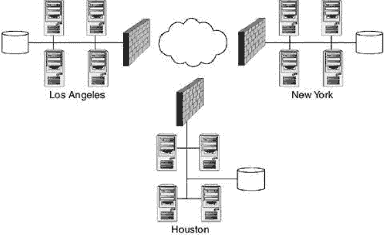
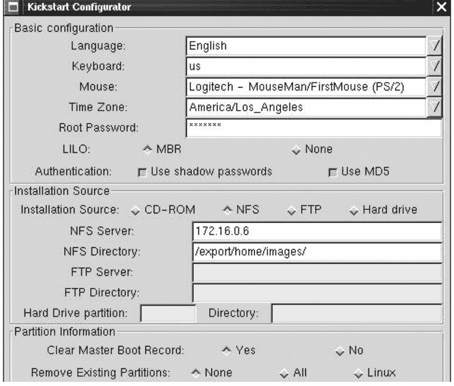
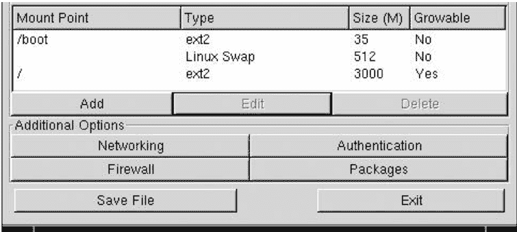
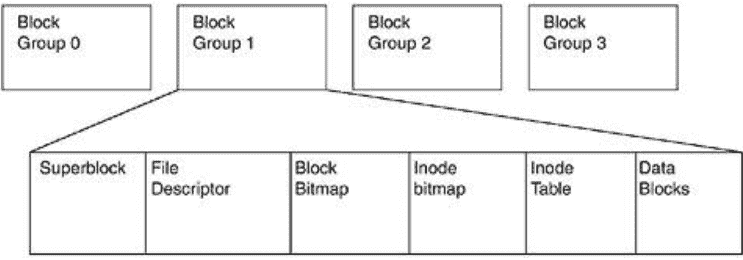
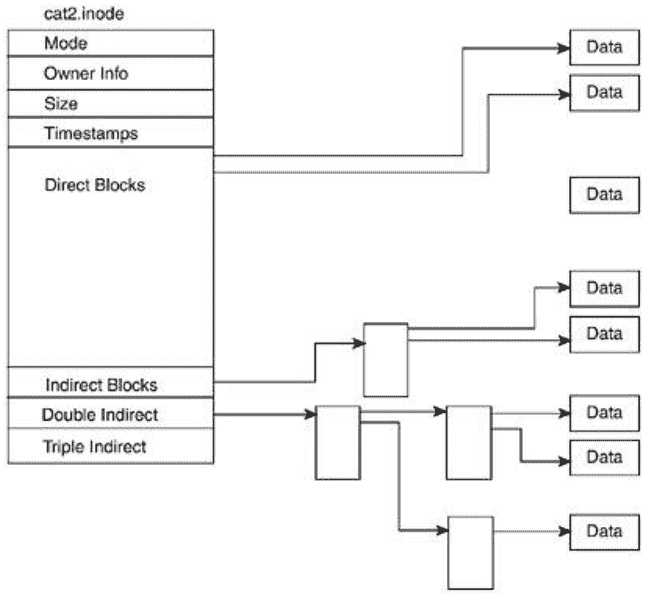
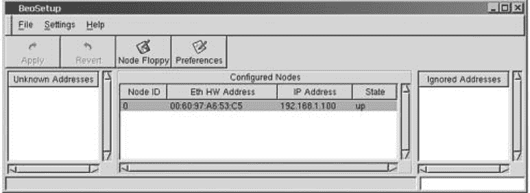
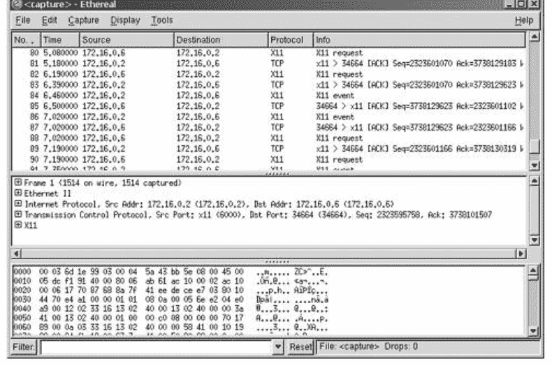

#  Linux 集群构建与维护指南


《Linux 集群：构建与维护 Linux 集群》为 Linux 用户提供了从零开始构建自己的 Linux 集群的信息。它提供了最佳实践、实用提示和指导方针，帮助管理员在任何经验水平上都能理解如何构建一台或数百台服务器。

从数据中心的空调和电源安装，到替代文件系统，再到最终的生产运行，本书提供了你需要了解的一切。《Linux 集群：构建与维护 Linux 集群》带你走过初始设计，并帮助你选择最佳可能的集群类型，同时涵盖监控工具并提供灾难恢复方案。本书不仅提供了关于并行和 Beowulf 类型集群的信息，Charles Bookman 还深入探讨了高可用性集群、负载均衡，并提供了编写自己的分布式应用程序的建议。Bookman 结合最佳实践和前沿方法，提供了一步一步的、经过验证的方法，将 Linux 集群带入生产级别。

- 前言
- 目录
- 关于作者

# Linux 集群：构建与维护 Linux 集群

# 出版商

David Dwyer

# 副主编

Stephanie Wall

# 制作经理

Gina Kanouse

# 执行编辑

Kristy Knoop

# 策划编辑

Deborah Hittel-Shoaf

# 开发编辑

Nancy Sixsmith

# 产品营销经理

Kathy Malmloff

# 宣传经理

Susan Nixon

# 高级编辑

Sheri Cain

# 文字编辑

Cris Mattison

# 索引编制

G五金利·贝丝·芒罗 (Ginny Bess Munroe)

# 制造协调员

Jim Conway

# 书籍设计师

Louisa Klucznik

# 封面设计师

Brainstorm Design, Inc.

# 封面制作

Aren Howell

# 排版

Jeff Bredensteiner

> 本书献给 Ethan。愿他正常成长，没有太多烦恼。

# 关于作者

**Charles Bookman** 在 12 岁时就爱上了个人电脑。他会放学后留下来，在 Commodore Pet 上自学编程。他与 Linux 的经历始于 2.0.30 时代，当时他将自己做咨询工作时的电脑改造成了那里没人见过的东西。被解雇后，他知道自己发现了什么，从此成为了 Linux 的布道者。

Charles 的爱好包括：不干正事、使用讽刺、听音乐、对艺术自命不凡、弹贝斯和吉他、有时间时画画。他会在乒乓球上击败你，而且台球也打得越来越好了。

Charles 目前在太平洋大学担任 UNIX 系统管理员，负责维护其

高性能集群。他经营着一家设计公司，并在业余时间提供咨询服务。

# 关于技术审阅者

这些审阅者为*Linux 集群：构建与维护 Linux 集群*一书的整个开发过程贡献了丰富的实践经验。在本书撰写期间，这些敬业的专业人士对所有材料进行了技术内容、组织结构和行文逻辑方面的审阅。他们的反馈对于确保本书满足读者对最高质量技术信息的需求至关重要。

**Joe "Zonker" Brockmeier** 自 1996 年起开始使用 Linux，并几乎同时开始撰写相关文章。作为 dot-com 世界的"难民"，Zonker 定期为 *Linux Magazine*、*UnixReview.com* 及其他在线和印刷出版物撰稿。您可以通过他的网站 [www.dissociatedpress.net/](http://www.dissociatedpress.net/) 联系 Zonker。

**John Marquart** 拥有七年的计算机行业经验。他的专业方向是 UNIX 系统管理，尤其专注于 Linux。John 曾在印第安纳大学工作，负责管理数字图书馆计划的服务器基础设施和数字资产。他目前在 Planalytics 工作，负责公司 UNIX 平台的标准化、集成和自动化工作。John 在印第安纳大学获得认知科学学位，主攻人工智能系统。

# 致谢

孩子们，不要在家尝试这个。写书需要个人牺牲，包括许多小时盯着显示器，同时深知除了亲戚之外没人会读这个。而即使如此，他们显然也会茫然地点头，脸上带着空洞的表情说："集群什么？这 somehow 包含 Nougat 吗？"

说完这些，我要感谢许多在我写书期间站在我身边并给予我巨大帮助的人。

我必须感谢 Brad Stone，是他激将我，让我兑现了写书的豪言壮语。我还要感谢 Ed Waters，他是那种无私奉献的人之一；Ben Cottrell，是他让我领略了 UNIX 的乐趣；以及 Dave Prado，是他足够信任我，给了我第一个机会。我还要感谢 Mnemosyne Consulting 的 Joel Baker，他在高可用性集群方面提供了宝贵的建议。

感谢我的妻子 Chriss，无论顺境逆境都陪伴在我身边，并作为我 11 年来最好的朋友。

最后，我要感谢我的朋友们，他们一直支持我，相信我能做到，即使我自己都不相信的时候。

# 告诉我们您的想法

作为本书的读者，您是最重要的批评家和评论员。我们重视您的意见，想知道我们做对了什么、哪些方面可以做得更好、您希望看到我们在哪些领域出版图书，以及您愿意与我们分享的任何其他智慧之言。

作为 New Riders Publishing 的副出版人，欢迎您提出意见。您可以通过传真、电子邮件或写信直接告诉我您对本书喜欢和不喜欢的地方——以及我们可以做些什么来让我们的图书更加出色。

*请注意，我无法帮助您解决与本书主题相关的技术问题，而且由于我收到的邮件数量庞大，我可能无法回复每一条消息。* 写信时，请务必注明本书的书名和作者，以及您的姓名和电话或传真号码。我将仔细审阅您的意见，并与本书的作者和编辑分享。

| | |
|:---|:---|
| 传真： | 317-581-4663 |
| 电子邮件： | stephanie.wall@newriders.com |
| 邮寄地址： | Stephanie Wall<br>Associate Publisher<br>New Riders Publishing<br>201 West 103rd Street<br>Indianapolis, IN 46290 USA |

# 简介

自诞生以来，Linux 的受欢迎程度一直在增长。随着开源运动的爆炸式增长以及替代操作系统所能实现的可能性，Linux 已经发展成为一个成熟、稳定的环境，用于托管关键任务应用和开展研究。

正是 Linux 的这种特性及其开源代码，使其对爱好者、教育工作者和研究环境具有吸引力。有数千个程序可用于增强用户体验，让认真的管理员能够用 Linux 增强或创建自己的环境。正是这种灵活性和操作系统的成熟度，让人们能够轻松地将他们的 Linux 机器组成集群。

让两台或更多机器协同工作并不是什么火箭科学；事实上，任何有动机并擅长读书的人都能让计算机做出奇妙的事情。从负载均衡到开发千节点并行计算机，Linux 完全能够胜任。

本书将带您了解使用 Linux 构建几种类型集群的过程，并逐步解释如何实现。我们会在途中介绍实用技巧，并解释事情为何以这种方式工作。很快，您就能创建出高可用性和 Beowulf 类型的集群，与最优秀的人比肩。

# 谁应该阅读本书

本书面向希望以最少麻烦搭建和运行 Linux 集群的 Linux 爱好者和用户。管理员会发现本书特别有助于了解让 Linux 在您可支配的多台计算机上实现惊人之举的原因和方法。

如果您需要向环境中引入大型并行或分布式计算集群，以及了解如何使用 Linux 解决大型计算问题，本书将有所帮助。书中讨论了安装、维护和备份大型集群农场的方法。我们还将介绍创建此类解决方案所需的软件和硬件。

如果您正在寻找企业级负载均衡或高可用性解决方案，第 5 章和第 6 章涵盖了这些问题的 Linux 解决方案的安装和配置。本书不仅介绍了这些基础知识，还告诉您最佳实践和方法，以便在最短时间内让解决方案上线。书中提供了软件安装和配置示例，帮助读者快速上手。

# 谁不应该阅读本书

本书假设读者对 Linux 感到舒适。它不会引导用户完成安装操作系统、添加用户或窗口管理器配置等基本任务。读者可能需要获取更多知识以跟上进度。

本书也不适合对集群有深入了解的资深专业人士。本书不涉及性能调优或深层集群理论。本书专为那些需要立即搭建集群的人设计。本书不适合那些已经在环境中规划或运行集群的人。

# 概述

本书分为四个部分，描述了 Linux 集群的规划和配置。第一部分旨在介绍规划和配置环境，以在最短时间内让集群投入使用。第二部分专门介绍各种类型 Linux 集群的安装和支持。第三部分介绍编程库以及集群故障时的应对措施。

第一部分分为四章。第 1 章"集群基础"简要介绍了 Linux 集群的总体情况，以及它为何可能适用于您或您的环境。第 2 章"准备您的 Linux 集群"讨论了如何选择安装集群所需部件以及集群 housed 环境的最佳方法。第 3 章"安装和精简集群"讨论了在最短时间内以最简单方式安装大量机器的最佳实践方法。第 4 章"替代文件系统"讨论了当前标准文件系统 ext2 的局限性，并讨论了改进它的其他方法以及文件系统技巧。

第二部分包含四章，涉及集群技术本身。第 5 章"高可用性和容错集群"介绍了高可用性系统、其工作原理以及如何最好地实施硬件和软件。第 6 章"负载均衡"讨论了 Linux 引导流量到多台机器的最佳方式。第 7 章"分布式计算"介绍了分布式模型作为解决大型计算问题的方法。第 8 章"并行计算"也以略有不同的方式扩展了这一模型。本章偏向于并行和商品计算机。

第三部分涉及集群的维护和监控。第 9 章"并行集群编程"引用了说明这些库的编程库和程序。第 10 章"集群管理"讨论了保持集群受控和问题监控的最佳实践。最后一章，第 11 章"灾难发生时的恢复"，主要涉及灾难恢复。

第四部分包含集群设计者的参考资料。附录 A 包括网上的集群资源以及在哪里可以找到更多信息。附录 B 是 Red Hat Linux 的 Kickstart 选项参考。使用这些选项，可以立即通过无人值守安装部署集群。附录 C 更详细地介绍了集群的 DHCP 选项，以便可以在中心位置轻松维护大型集群。最后，附录 D 详细介绍了 Condor（一种分布式环境集群）的类属性。

如果您通常熟悉集群，建议您浏览第一部分，然后直接移至讨论您感兴趣集群的第二部分。您会希望紧接着阅读第三部分，因为其中讨论了保持应用程序和服务器运行的信息。

# 约定

本书遵循一些排版约定：


 +   - *斜体*用于首次引入的新术语，并用于强调。
- 特殊的`monospace font`表示代码、文件名或路径名，或互联网地址。

# 第一部分：Linux 集群概述、网络准备和 Linux 服务器

第一部分 Linux 集群概述、网络准备和 Linux 服务器

1 集群基础
2 准备你的 Linux 集群
3 安装和优化集群
4 替代文件系统

# 第1章 集群基础

随便问街上的任何人，他们大都会同意你的看法。越大越好。物有所值。谁死的时候玩具最多谁就赢。可想而知，在大多数情况下，多总比一好。一已经不错了，二肯定更好。

因此，计算领域从一开始就遵循这一趋势也就不足为奇了。就连被广泛认为是世界上第一台计算机的 ENIAC，也不是只有几个部件。它有 19,000 个真空管、1,500 个继电器，以及数十万个电阻、电容和电感器（http://ftp.arl.army.mil/~mphist/eniac-story.html）。为什么创始者使用这么多部件？如果你有一个能把两个数字相加的装置，那是一回事。但有了预算，为什么不把三个甚至四个加在一起呢？多肯定是好的。

随着时间推移，计算逐渐成熟，"多就是好"的方法似乎运作得相当好。一个处理器干得好，两个处理器至少能翻倍处理能力。当计算机制造商开始生产更大更高效的服务器时，公司可以利用增强的处理能力来处理更多数据。早期就很明显，更多处理器等于更强计算能力。即使在英特尔 386 处理器问世时，杂志就报道说一台计算机能处理 15 名员工的工作量！

ENIAC 的后代本身也是巨型计算机，尽管如我们所知，随着晶体管的出现，内部部件越来越小。在冰箱大小的机器里添加更多部件以使其更快，然而这些超级计算机超出了大多数公司的财力范围。没过多久就意识到（好吧，是在 1990 年代）类似超级计算机的性能也可以通过多台低成本个人电脑实现。更多电脑确实更好——或者说 simply 成本更低。

## 企业级集群

当今的计算环境需要多台计算机来解决单台计算机无法处理的任务。当今大规模计算环境涉及使用大型服务器集群，每个节点在集群环境中相互连接。例如，ASCI 项目（加速战略计算倡议）包含几个不同的集群环境，旨在提供"万亿次"计算能力。ASCI White 每秒能进行 12 万亿次计算，运行在 IBM 的 RS/6000 硬件上，正成为解决大规模计算问题方案的 increasingly 典型代表。桑迪亚国家实验室的 ASCI 设备由运行在英特尔硬件上的 Linux 机器组成，是模拟超级计算机性能的 growing trend 的一部分。

集群计算，在其最基本层面，涉及两台或更多计算机服务于单一资源。应用程序已成为集群化以处理增加的数据负载。将单个应用程序的属性分布到多台计算机上的做法不仅能提高性能，还能在故障时创建冗余。一个基本集群的典型例子是域名服务（DNS），它内置了主服务器、辅助服务器和缓存服务器。其他协议也内置了集群/冗余特性，如 NIS 和 SMTP。

### 集群如何提供帮助

虽然集群可能不是解决当今问题的万能药，但它可能帮助那些试图最大化现有资源的组织。虽然不是每个程序都能从集群中受益，但提供应用程序（如 Web 服务器、数据库和 FTP 服务器）的组织可以随着系统负载增加而从该技术中受益。集群可以轻松设计为可扩展的；随着需求增加可以添加更多系统，从而将负载分布到多个子系统或机器上。

需要大量数据处理的实体可以从高性能计算中受益，这大大减少了处理数字所需的时间。美国国家海洋和大气管理局等组织能够使用集群来预测潜在致命天气条件的趋势。劳伦斯利弗莫尔实验室的工作人员使用集群计算机模拟整个核爆炸，不会对任何人造成伤害（除了那些必须维护所有数据的备份操作员）。

服务大量带宽的公司可以从负载均衡集群中受益。这种类型的集群从中央服务器获取信息并将其分布到多台计算机上。虽然这起初看起来微不足道，但负载均衡可以在本地服务器机房或跨越全球的广域网（WAN）中进行。大型 Web 门户使用负载均衡从全球多个接入点提供数据以服务本地客户。这不仅降低了带宽成本，而且访客得到服务的速度也快得多。

这些负载均衡服务器还将从高可用性（HA）模型中受益。该模型可以包括所有级别的冗余。HA 集群中的服务器受益于拥有两个电源、两个网卡、两个 RAID 控制器等。除非发生重大灾难，HA 集群的所有 duplicate 设备不太可能同时故障。通过向主系统添加额外组件或添加额外服务器，可以放置额外组件以帮助故障转移。这被称为 *N+1 冗余*，存在于集群、RAID 配置、电源阵列中，或任何其他组件可以在故障时接管的地方。

### 使用 Linux 进行集群

在你可以选择的众多平台中，你可能会问为什么你会选择 Linux 作为操作系统（OS）来承载你的关键应用程序。毕竟，集群是如此热门的话题，每个供应商都有自己的集群软件实现，通常比数十名程序员的 homemade 努力更成熟。所有主要操作系统供应商都支持集群。微软将其集群应用程序直接包含在 Windows 2000 Advanced Server 操作系统中。Sun Microsystems 提供其用于并行计算的高性能集群技术，以及用于高可用性的 Sun Cluster。甚至康柏、惠普、IBM 和 SGI 都支持集群解决方案。

那么，为什么这些公司在自己拥有产品线的情况下开始拥抱 Linux？除了微软之外，这些供应商开始认识到开源软件的价值。他们意识到，通过将 Linux 纳入其业务战略，他们将利用数百甚至数千名程序员 scrutinizing 他们的代码并提出有用建议的好处。虽然开源方法论作为可行的商业模式还有待观察，但大公司收获了拥有这种哲学的社会主义好处。

Linux 几乎可以在任何可想象的硬件平台上运行。正如它已被证明能够很好地驱动大型主机和服务器集群以及台式机一样，这个多功能的操作系统已被移植到手持设备、电视录像机、游戏机、Amiga、Atari，甚至 Apple 040 计算机。Linux 以其易于使用的商品、现成零件而闻名。虽然 Linux 驱动程序的可用性可能不如其他操作系统那么普遍，但仍有许多硬件可以毫无问题地工作。Linux 还支持大量旧硬件，使旧计算机能够重新投入使用。Linux 的创建者甚至将其设想为嵌入式设备的首选操作系统，因为内核可以以任何形状和形式进行修改。（虽然 Linus Torvalds 发明了 Linux 并拥有版权，但他并没有自己写出全部代码。）

没有其他操作系统允许如此程度的通用性。正是这种模块化计算的方法使 Linux 成为集群的完美选择。

## 使用 Linux 的缺点

虽然 Linux 在集群方面有很多优势，但它也有缺点，这可能使它成为某些类型集群的 unattractive 解决方案。归根结底，Linux 是一个相对较新的操作系统（尽管基于经过验证的技术）。在大多数情况下，你有一个由志愿者在业余时间编写的操作系统。虽然代码可供任何人随时 scrutinize，但确实存在顶尖程序员可能被付得起 top salaries 的公司挖走的可能性。（当然，这确实会发生，出于某种原因，程序员甚至设法在所谓的业余时间继续为 Linux 工作。）

支持水平不如其他操作系统那么强大。这并不是说你不能获得良好的供应商支持；相反，Linux 的支持质量是顶级的。只是与其他操作系统相比，该产品的支持没有那么多。

操作系统和内核中仍存在一些固有的 bug。原生文件系统 ext2 不支持日志功能。USB 支持通常一直不稳定。Linux 的驱动程序往往比其他操作系统少，尽管最常见的解决方案都有涉及。

然而，大多数（如果不是全部）这些问题正在得到解决。除了 ext2 之外，Linux 还有健壮的文件系统可用，而且 USB 支持在每个版本中都在改进（至少到 2.2.18 版本时是这样）。通常，在部署大型集群农场时，其中大多数问题不会起作用。这些限制大多只在你将 Linux 用于桌面时才适用。但 Linux 内核的开发正在迅速超越其他操作系统的发展，因为开发人员努力修复诸如 USB 支持等问题。

系统管理员在推出任何操作系统时都必须保持一种 perspective。Linux 主要是一个服务器级操作系统。它旨在处理支持许多用户和处理器的大型任务，而且做得很好。在 Gnome 和 KDE（更不用提所有其他窗口管理器了）等项目的支持下，Linux 除了作为服务器外，还可以主要用作工作站。基于 Linux 的工作站级计算机的发展比大多数其他 UNIX 系统更先进。然而，Macintosh 和 Microsoft 往往拥有比快速发展的 Linux 桌面更多的市场份额和可用性。

## 集群不再只针对高性能

空调嗡嗡作响，穿过巨大的数据中心，数千台计算机在黑暗中静止不动。电源开关的单一绿色眼睛照亮了 rack 又 rack 的服务器，而


一眼望不到边。巨型机器的联想立刻引起注意，因为一个几乎令人不安的单一实体形象压迫着观者的注意。

好吧，尽管它并不是那么不祥的实体，但高性能集群可以说是最广为大众所知的一种类型。矢量计算是一种高性能机器，由于其需要专用硬件，对于商品化使用来说往往成本过高。另一方面，并行计算机则因其几乎任何人都能用备用零件组装一台而变得极受欢迎。Beowulf 这个名字与并行集群的关系，就像 Jello 与调味明胶的关系一样密不可分。并行计算机的 popularity 大幅增长，研究人员和爱好者 alike 都能够模拟超级计算机的性能。当然，集群并不止于并行计算机或矢量计算机。

现在你已经对本书中讨论的不同类型集群有了基本了解，我相信你会问："是的，这都很好，但这到底意味着什么？" 对于这个问题，你应该查阅你最喜欢的宗教文本。对于那些对自己信仰感到满意并想要着手搭建 Linux 集群的人来说，**第2章"准备你的 Linux 集群"**将是完美的选择。对于那些想要了解集群技术背后理论的求知者，本章的其余部分就是为你准备的。

让两台或更多 Linux 机器相互交互是相当容易的。最简单的方法是给每台机器分配一个 IP 地址和子网掩码，在它们之间连接一根交叉网线，瞧——即时网络。当涉及更多机器时，事情开始变得复杂一些，尽管这仍然不是火箭科学。再添加一台计算机，你就得添加交换机或集线器。将你的计算机连接到另一个网络，你就得添加某种路由器。让集群计算机在最基本的层面上相互通信就像搭建网络一样简单。然而，让它们以*不同方式*交互则是另一回事。

## 高可用性和容错集群

计算机有一个恼人的特性，就是在你最意想不到的时候出故障。很难找到一位没有在半夜接到过电话的系统管理员，电话里传来 dreaded 的消息：关键系统宕机了，请您在方便的时候处理一下（就是现在！）。

高可用性和容错集群的概念往往形影不离。如果一个系统要实现高运行时间，它就需要更多的冗余子系统来保持运行——例如在集群配置中增加服务器。高可用性集群的底线是，应用程序如此重要，以至于你需要采取额外措施来确保其可用性。

### 单点故障

单点故障（SPOF）是高可用集群中的一个常见主题。拥有单一部件就是在自找麻烦，而 SPOF 是一个需要不惜一切代价避免的范式。在理想世界中，每台服务器都会为每个组件配备冗余子系统，以防主系统死亡或停止响应。通常会出现故障的关键子系统包括硬盘、电源和网络卡。这是生活中令人遗憾的事实，但人为错误往往导致 most downtime。操作人员有时会卸载关键实时数据的卷，而承包商则会重新整理标签不清的线缆。

这种冗余规划可能包括添加 RAID 控制器以防硬盘故障，但如果控制器本身死了呢？可以实施一整套不同的控制器和 RAID 设备来降低 SPOF 的风险。必须考虑一种允许热插拔 CPU 的架构。可以安装两块网卡以防连接问题成为麻烦。可以将一块网卡连接到不同的交换机或路由器作为备份。那么网络本身呢？如果交换机坏了怎么办？可以设置第二台交换机以防第一台死亡，然后再考虑冗余路由器、冗余网络提供商等。在处理 SPOF 和所有系统的完全冗余之间有一条 fine line，预算通常是最主要的决定因素。

实现 100% 的运行时间几乎是不可能的，尽管凭借正确的技术，你可以相当接近这一目标。在规划高可用性解决方案时，一个更现实的目标是提供 99% 或更高的运行时间。这样做可以为维护、备份和需要重启的补丁计划 scheduled downtime。要求超过 99% 的运行时间需要不同的模式，例如冗余系统。

## 服务器冗余

虽然有一些服务器在设计时就考虑了冗余，但它们的价格往往远高于存在 SPOF 的服务器。有些公司开发无 SPOF 的服务器，包括两块主板、两个 CPU、两个电源等。这些服务器更加昂贵，但对于无法承受停机的组织来说，成本与数据完整性的比率是划算的。

幸运的是，还有另一种方法可以在不花费高昂成本重新设计单服务器架构的情况下实现这种冗余。整合两台或更多计算机可以为每个组件实现第二层冗余。实现这种冗余的方法几乎和

负载均衡的主要缺点在于数据必须在所有服务器之间保持**一致性**和可用性，不过可以使用 rsync 之类的方法来保证数据的完整性。

虽然负载均衡通常在较大的 ISP 中由硬件设备完成，但 Linux 的多功能性在此同样大放异彩。

诸如 Balance 以及全局负载均衡 Eddie Mission 之类的程序将在[第 6 章](http://...)“负载均衡”中讨论。

## 分布式计算

将三百万用户召集起来，告诉他们也可以参与到搜寻地外生命的行动中，你会得到什么？你会得到世界上最大的分布式应用——SETI@home 项目（http://setiathome.ssl.berkeley.edu/）。该项目累计了超过 630,000 年的计算时间。这充分体现了分布式计算和互联网的强大力量。

简而言之，分布式计算是将程序分配给一个或多个计算机进行计算，然后在特定时间段后重新组装结果。虽然与并行计算机的范围相近，但真正的分布式环境在进程和内存的分配方式上有所不同。通常，分布式集群由异构计算机组成，这些计算机可以是专用服务器，但通常是终端用户的工作站。这些工作站可以利用空闲的 CPU 周期来提供计算功能。分布式应用通常会在用户积极使用计算机时挂起自身或在后台运行，并在一定的超时值后再次启动。分布式计算资源可以轻松地应用于广阔的地理区域，仅受网络本身的限制。

几乎任何计算密集型应用都可以从分布式计算中受益。SETI@home、渲染农场（专门用于利用处理能力进行大规模动画制作的集群）以及不同类型的模拟都可以从中获益。

## 并行计算

*并行计算*指的是在多个处理器上分配作业或进程。并行集群通常是一组共享资源的专用机器。构建一个集群最少只需两台计算机；然而，考虑到如今商用硬件的价格，找到仅有 16 个节点或可能数千个节点的集群并不难。据报道，Google 在其 Linux 集群中拥有超过 8,000 个节点。

并行集群也被称为 Beowulf 集群。虽然并非对所有类型的 HPC 都完全准确，但 Beowulf 型集群指的是“主要使用商用组件构建并运行开源操作系统的计算机集群”。

并行计算机通过将作业拆分并分发给集群中的不同节点来工作。让多台计算机处理单个任务通常比让一台计算机独自处理同一任务更高效，但拥有 16 节点的集群并不一定会使你的应用速度提升 16 倍。并行集群通常不是“设置好就可以忘掉”的机器；它们需要大量的性能调优才能良好运行。一旦你完成系统调优，是时候再次调优了。而在完成那次调优之后，它可能还需要更多的性能调优。

并非每个程序都能从并行配置中受益。必须考虑多个因素才能准确判断。例如，代码是否设计为在多个处理器下工作？大多数应用并未设计为利用多处理器优势，因此分发程序的各个部分只会徒劳无功。代码是否经过优化？代码在单个节点上运行可能比拆分每个部分并传输到每个 CPU 更快。并行计算实际上是为处理数学密集型项目而设计的，例如绘制宇宙膨胀图、渲染 CPU 密集型动画，或者弄清楚到底需要舔多少下才能到达中心。

并行集群可以设置一个主节点，将作业传递给从节点。主节点通常是大多数用户唯一可见的机器；它将网络的其余部分隐藏在其后。主节点可用于调度作业和监控进程，而从节点则保持不动（除非进行维护或修理）。在拥有数千台系统的高产量环境中，完全更换故障节点可能比诊断错误和更换节点内的故障部件更便宜。

虽然已有多种构建并行集群的方法，但并行虚拟机（PVM）是首批允许代码在多个节点上运行的程序之一。PVM 允许一组异构机器在集群上运行 C、C++ 和 Fortran。消息传递接口（MPI）作为该领域的新秀，正在成为消息传递的标准。两者几乎适用于所有可想象的系统，包括 Linux。

## How Now, Brown Cow

在并行处理模型中包含称为 NOW 和 COW 的集群配置——甚至是 POP。一般来说，NOW 和 COW 的概念可以与任何并行计算机同义；然而，在硬核阵营中存在一些分歧。NOW 是操作系统网络（Network of Workstations），COW 是操作系统集群（Cluster of Workstations），而 POP 是一堆 PC（*Engineering a Beowulf Style Computer Cluster*, http://www.phy.duke.edu/brahma/beowulf_book.pdf）。如果采用并行集群由专注于并行计算任务的机器组成这一观点，那么无论是 NOW 还是 COW 都不符合标准。这些通常代表分布式计算，因为它们可以由异构操作系统和工作站组成。

## 阿姆达尔定律

从计算机诞生早期开始，人们就不耐烦地盯着显示器，看着系统试图以令人难以置信的速度缓慢解决问题（好吧，即使在现代技术条件下，我们仍然没有解决这个问题）。1967 年，时任 IBM 员工的 Gene Amdahl 提出理论，认为对于任何特定任务来说，并行处理的效率都存在上限。（可以假设这一理论是在等待计算机启动时写下的。）更具体地说，“每个算法都存在一个串行部分，最终限制了多处理器实现所能达到的加速比”（*Reevaluating Amdahl's Law*，John L. Gustafson 著；www.scl.ameslab.gov/Publications/AmdahlsLaw/Amdahls.html）。换言之，每个计算中都存在某些部分，例如将结果写入磁盘所需的时间、I/O 限制等等。

阿姆达尔定律的重要性在于，它展示了期望获得超出典型阈值收益是多么不合理。尽管阿姆达尔定律仍是展示并行应用效率的标准，但这一定律存在争议，并且随着大型集群变得 commonplace，它甚至开始瓦解。根据 John L. Gustafson 在 *Reevaluating Amdahl's Law* 中的观点：

> “我们迄今为止的工作表明，从大规模并行集群中提取非常高的效率*并非*不可克服的任务。我们认为，计算研究领域克服因滥用阿姆达尔加速公式而对大规模并行产生的‘心理障碍’非常重要；加速比应该通过将问题缩放到处理器数量来衡量，而不是固定问题规模。”（参见 *On Microprocessors, Memory Hierarchies, and Amdahl's Law*；www.hpcmo.hpc.mil/Htdocs/UGC/UGC99/papers/alg1/）。

虽然某些人对阿姆达尔定律的有效性提出质疑，但它仍然是思考这些限制的简便方法。

## SMP 与主处理器范式

*对称多处理（SMP）*包括任何 SMP 架构。用通俗的话说，就是具有多个处理器的计算机。SMP 架构与非对称处理架构的不同之处主要在于，它们可以真正被视为多任务处理而不是分时设备。任何空闲的处理器都可以被分配承担额外的任务或处理增加的负载。


一般而言，编写良好且经过优化的应用程序在 SMP 机器上的运行性能远优于两台或多台单处理器计算机。多个因素决定了应用程序的运行速度，包括主板总线速度、内存、驱动器速度以及 I/O 吞吐量。与增加更多并行计算节点类似，程序必须重写或优化以支持多线程。进程和内核空间线程在 SMP 机器之间自然分布。用户进程通常不会；然而，内核会对各个 CPU 进行一种自然的负载平衡。能够利用`fork()`的应用程序可以受益于 SMP 架构。`fork()`允许进程将自身分裂为两个完全相同的副本，根据操作系统的不同，它们将共享相同的内存，但在不同的 CPU 上运行。如果应用程序主要是 CPU 驱动型的，那么该应用程序将从 SMP 架构中获益。然而，多处理器计算机的价格可能会超过 SMP 处理器机器带来的收益。

Linux 在 2.0 内核中添加了对 SMP 的支持，包括对 Intel 486 及更高版本（及其兼容产品）以及 hypersparc 机器的支持。随着 2.2 内核的加入，Linux 又增加了对 UltraSparc、SparcServer、Alpha 和 PowerPC 机器的支持。

尽管 2.2.x 和 2.4.x 内核的 SMP 支持默认已启用，但也可以通过以下设置添加（最新内核始终可在 www.kernel.org 或 ftp://ftp.kernel.org/pub/linux/kernel 找到）：

-   配置内核时，对"Symmetric Multi-Processing Support"（对称多处理支持）问题回答"yes"。
-   启用"Memory Type Range Register (MTRR) Support"（内存类型范围寄存器支持）（两者均在 Processor Type and Features 下）。
-   通过配置"RTC Support"项目（在 Character Devices 下）启用实时时钟支持。
-   在 x86 内核上，*不要*启用 Advanced Power Management (APM)。APM 与 SMP 不兼容，如果启用 APM，系统几乎肯定会在启动时崩溃。

在切换到 SMP 模式或从 SMP 模式切换回来时，必须重新构建所有内核和内核模块。记住执行`make modules`和`make modules_install`。你可以使用`cat /proc/cpuinfo`显示结果。

## 快速简易集群

如前所述，集群由两台或更多台不同的机器（或处理器）组成，它们为同一应用程序提供服务。尽管对于大多数应用程序来说，构建一个功能完备的集群解决方案需要更多工作，但为大多数网络提供基本服务是很容易的。

Linux 其实只要能够通过网络与其他机器通信就可以参与集群，这涵盖了现有的大多数机器。把两台能互相通信的机器放在一起，你就有了一个集群——不是非常有效的集群，但确实能工作。为现有服务器启用基本的集群功能确实是一件简单的事情。

## 用 Ping 实现服务

一个基本的 HA 集群只需通过简单的 ping 就能实现。如果你设置一个脚本，让故障转移服务器每分钟左右 ping 一次主应用服务器，故障转移服务器就能判断主服务器何时发生故障。一旦备用服务器无法找到另一台服务器，它就会假定该服务器已宕机，并启动脚本启用自身的服务。毕竟，如果故障转移服务器无法到达主服务器，其他任何服务或用户也无法到达。

在开始规划基本的 HA 集群之前，你需要考虑一些选项。你打算让故障转移服务器处于待机模式，应用程序已经在运行、随时待命吗？备用服务器是否已经在生产环境中运行其他组件？以下是建立基本 HA 集群所需的设置：

-   用于 ping 另一台服务器的脚本。
-   调用该脚本的 Crontab 条目。
-   如果另一台服务器响应，则进入睡眠状态。
-   如果另一台服务器没有响应，再次 ping。
-   如果另一台服务器仍然没有响应，则执行故障转移序列。
-   接管故障服务器的 IP 地址。

实现此类集群的第一步是为服务器分配虚拟 IP。这用作解析为 DNS 条目的浮动地址。最初，主服务器拥有该 IP，然后在故障转移后由备用服务器接管。

IP 别名必须已经编译到内核中，或者作为模块加载。2.2.x 内核的内核配置位于 Networking Options 下的 IP: Aliasing Support，默认未选中。模块支持仅在 2.0.x 内核中可用。2.2.x 内核要么已编译支持，要么没有。

你需要查找的模块是`ip_alias`。要将其插入到 2.0.x 内核中，请使用`insmod`命令。

RedHat 7.1 的默认安装开箱即支持 IP 别名。原版 6.2 也是如此，但 Debian 2.2 不支持，因此请检查你的发行版。

IP 别名可用后，添加额外的别名（或多个）与添加常规 IP 一样简单。格式为

```
/sbin/ifconfig <interface>:<virtual number> <ip> netmask <netmask> up
```

例如，

```
/sbin/ifconfig eth0:1 172.16.0.1 netmask 255.255.0.0 up
```

会启动虚拟接口一，并将其附加到适配器`eth0`，IP 为 172.16.0.1，子网掩码为 B 类 /16。将虚拟接口分配给主服务器的接口，并确保此条目由 DNS 解析。

下一步包括设置故障转移脚本。此脚本放置在故障转移服务器上，最初 ping 主服务器，如果收到响应则退出。如果没有收到响应，程序将等待 20 秒然后再次 ping。如果故障转移服务器第二次没有收到主服务器的 ping 响应，服务器就会在其自身上设置虚拟 IP，并可选地发送通知。不要忘记设置脚本的可执行权限。

```
#!/bin/bash
# Poor Man's Cluster
# Script to Test for Failover
#
host="172.16.0.2"
netmask="255.255.0.0"
while true; do
    /bin/ping -c 5 -i 3 $host > /dev/null 2>&1
    if [ $? -ge 1 ]; then
            #This doesn't look good, let's test again.
            /bin/ping -c 5 -i 3 $host > /dev/null 2>&1
                    if [ $? -ge 1 ]; then
                            # We need to assume host is really down. Assume
                            # failover sequence
                            /sbin/ifconfig eth0:1 $host netmask $netmask up
```

```
                echo "$host is down. Please check immediately." | /bin/mail -
s "$host is down!" user@host.com
                else
                #second ping returned a value. Whew.
                :
else
:
fi
done
```

该脚本应能在后台运行，并在发生连接问题时向指定用户发送邮件。如果你足够有创意，该脚本可以轻松调整为 ping 多个主机。

## 使用 DNS 记录进行负载平衡

启用负载平衡的一种快速简便方法可以通过 DNS 中的简单 A 记录实现。尽管这看起来是一种取巧的手段，但为同一名称启用两个或更多不同的 IP 地址确实提供了一种负载平衡方法，尽管范围有限。然而，在 /etc/hosts 中启用不同的 IP 地址时，同样的效果并不起作用。

举例说明，我们已启用以下区域：

```
[root@matrix named]# cat zone.dns
;
; Zone file for zone.com
;
@       IN      SOA     zone.com. postmaster.zone.com. (
                        19990913        ; serial
                        10800           ; refresh
                        3600            ; retry
                        604800          ; expire, seconds
                        86400 )         ; minimum, seconds

IN NS      ns1.zone.com.
IN NS      ns2.zone.com.
host1           IN A    10.2.2.10
host1           IN A    10.2.2.11
host1           IN A    10.2.2.12
```

在此示例中，每个主机使用相同的域名，但 A 记录指向不同的地址。对该机器进行 ping 操作显示如下：

```
   [root@matrix named]# ping host1

PING host1.zone.com (10.2.2.10) from 10.2.2.100 : 56(84) bytes of data.
   [root@matrix named]$ ping host1

PING host1.zone.com (10.2.2.11) from 10.2.2.100 : 56(84) bytes of data.
   [root@matrix named]$ ping host1

PING host1.zone.com (10.2.2.10) from 10.2.2.100 : 56(84) bytes of data.
   [root@matrix named]$ ping host1

PING host1.zone.com (10.2.2.12) from 10.2.2.100 : 56(84) bytes of data.
```

如你所见，这不是一个万无一失的方案，但它确实提供了一种在主机之间进行负载平衡的方法。

## 替代文件系统

第二扩展文件系统 ext2 由 René Card 开发，作为从 Minix 衍生而来的第一个文件系统的替代方案。尽管 Linux 支持许多不同的文件系统，ext2 仍然是大多数发行版的默认文件系统。许多供应商对默认文件系统进行了改进，提供了日志、卷管理、网络块文件系统和共享磁盘文件系统等功能。Ext2 没有内置这些功能。


 ## 日志文件系统

日志（journal）应运而生，它是跟踪文件系统的最受欢迎替代方法。根据实现方式的不同，日志文件系统使用基于数据库的不同方法来跟踪文件系统数据。日志文件系统的吸引力在于，它不需要使用`fsck`。在系统崩溃的情况下，可以回放数据库中的日志，以重现崩溃时刻的数据。这种方法往往比使用`fsck`运行的文件系统更快地将系统恢复到一致状态；然而，它对数据可靠性并没有特殊增强。使用ext2的大型RAID设备可能需要数小时才能完成`fsck`检查，而有了日志文件系统后，就不会进行检查。所有写入操作都从日志中进行并回放，这使得启动时间仅需几分钟。

不同的日志文件系统还支持同步I/O、更大的块大小、与NFS集成、配额支持以及访问控制列表（ACL）支持。

## 网络文件系统

网络文件系统能够将一个或多个设备进行管理，对服务器而言呈现为一个逻辑卷。这里的诀窍在于欺骗操作系统，使其认为该卷是本地连接的RAID或集群设备。由于网络开销的存在，网络文件系统自然会有一定的性能损失。

## 集群网络基础

网络是集群的重要组成部分。计算机无法自行相互通信；那样会很奇怪。并行网络需要专用的网络环境，相比之下，相当多的负载均衡、分布式甚至部分高可用（HA）解决方案都是在广域网（WAN）环境中设计的。为了更好地理解网络与集群之间的关系，我们需要了解网络问题及其对集群通信的影响。虽然这里不会详细解释TCP/IP和网络，但会提供一个概述。

## OSI网络模型

国际标准化组织（ISO）是一个由来自75个以上国家的国家标准机构组成的国际组织，它创建了*开放系统互连（OSI）模型*，以便不同厂商设计能够相互通信的网络。OSI模型最终于1977年标准化，基本上是一个作为网络通用框架的参考标准。

大约30年前，不难发现有些厂商生产的计算机无法与其他厂商的设备通信。除了创建相当专有的操作系统和大型机之外，当时的通信也大多是专有的。1977年，英国标准组织向ISO提议创建一个国际分布式处理标准。美国国家标准学会（ANSI）受命提出一个网络框架，他们提出了一个七层模型（*The Origins of OSI*; [http://williamstallings.com/Extras/OSI.html](http://williamstallings.com/Extras/OSI.html)）。该模型如图1.3所示。

**图1.3 OSI网络层示意图。**


最顶层，第七层，是应用层，终端用户在此层与实际计算机进行交互。第七层包括Web、telnet、SSH和电子邮件等应用。

第六层，表示层，向应用层呈现数据。计算机在此层将通用数据转换为文本、图像、声音和视频等格式。数据转换、压缩和加密在此层处理。

第五层，会话层，通过为表示层提供传输手段来处理数据。利用会话层的应用示例包括X Window、NFS、AppleTalk和RPC。

第四层，传输层，提供错误检测和控制、将传输连接复用到数据连接上（复用允许来自不同应用的数据共享一个数据流）、流量控制，并向网络层传输数据。

第三层，网络层，负责在网络之间传输数据。此层使用两种类型的数据包，包括数据包和路由更新。工作在此层的路由器保存有关网络地址、路由表和远程网络距离的数据。

第二层，数据链路层，将来自网络层的消息转换为物理层可处理的形式。此层处理错误控制、可靠性和完整性问题。网络层向数据添加帧，并添加包含源地址和目标地址的自定义头部。此层还识别网络上的每个设备。

最底层，第一层，即物理层，以0和1的形式发送和接收信息。此层的特性包括信号电压、线缆宽度和长度以及信令的规范。

许多设备在不同的层次上运行。集线器在连接后仅通过所有端口放大或重传数据，以这种方式，它只在第一层上运行。然而，交换机在第一步第二步运行，路由器在第一第二步和第三步运行。终端用户的工作站通常处理第五第六第七步（尽管Linux的多功能性使其能够处理更多）。

采用这种分层方法的目的是使网络的不同方面能够相互协作，同时保持独立。这使应用开发人员能够自由地在某一层的某一方面工作，同时期望其他层按计划运行。没有这些层次，开发人员就必须确保应用的每个方面都包含对每个层的支持。换句话说，开发团队不仅要编写游戏本身，还要编写图片格式、TCP/IP协议栈，并开发路由器来传输信息，而不能仅仅编写一个简单的游戏。

为什么学习这对集群很重要？首先，它有助于故障排除。知道问题所在是解决问题的最重要一步。每种故障排除方法都需要从某处开始，通过检查OSI模型，您可以轻松诊断出问题所在。通过隔离每一层，您可以追踪并解决问题。

## 网络拓扑

不同类型的集群根据其涉及的框架需要不同类型的网络拓扑。高可用网络可能需要比分布式计算环境或并行集群场景更多地关注安全细节以维持正常运行时间。

请设想以下高可用场景，如图1.4所示。一家全国性银行在美国三个城市设有接入点（POP）。每个城市都有自己的集群和自己的数据库，每个城市都直接连接到其所在城市的互联网，但每个城市都必须能够访问其他城市的数据。如何才能最好地实现这一点？拓扑结构必须事先仔细考虑。例如，考虑跨广域网分布的集群拓扑。

**图1.4 跨广域网的高可用性。**



在此场景中，三个站点通过公共互联网连接，并设有防火墙保障安全。这不是实现高可用性的最有效方法，但这是一个常见场景。

重新设计此场景的一种方法是将两个卫星城市从互联网断开，并通过直接帧中继将每个城市连接到内部网络，从而从两个卫星办公室中移除防火墙。另一种方法是实现负载均衡网络。POP可以轻松部署在全国的关键位置，以便客户能够相对本地地访问金融数据。但由于三个城市之间的数据必须实时同步，所涉及的带宽将是巨大的。

并行集群仍然需要网络设计，尽管范围要简单得多。在快速以太网成为桌面标准、千兆以太网成为服务器标准之前，*超立方体*是设计高性能集群的主要方式。超立方体是布局并行集群的一种特定方法，通常使用常规以太网。设计超立方体的诀窍在于，每台计算机必须与其他立方体中的每个节点有直接的网络连接。这对于较小的立方体效果很好，尽管立方体的大小受到每台计算机可容纳的网卡数量的限制。更大的集群需要网状设计，使用集线器来支持每个节点以及必需的多重连接。不用说，由于所有交错的布线，它们非常杂乱。随着快速以太网和千兆以太网的出现，一个简单的管理型或非管理型交换机就能解决大部分带宽问题。当然，"越快越好"是通用准则，因此务必在集群预算时考虑网络。

## 需要考虑的服务

除了集群的物理开发和网络拓扑之外，决定启用哪些服务是实现完整集群解决方案的下一步。尽管大多数Linux发行版都提供对`/etc/services`中列出的所有标准服务的访问，但系统管理员必须确定这些服务是否适用于其环境。

在高安全性环境中，系统管理员可能别无选择，只能收紧这些资源。禁用服务的常见方法包括通过防火墙限制访问、建立内部网络，或使用`hosts.deny`和`hosts.allow`。通过`inetd`可访问的服务可以在`/etc/inetd.conf`中注释掉。


毫无疑问，要启用网络服务，您必须保持对端口80的访问——如果要启用通过安全套接字层（SSL）的网络支持，还需要保持对端口443的访问。此外，在设计集群时，您还需要考虑备份设备的访问权限、是否允许SSH、telnet或ftp等问题。事实上，最好在整个环境中完全禁用telnet，代之以安全shell。这不仅允许安全登录，还支持内部办公使用的安全ftp传输。当然，FTP服务器仍应使用常规ftp，但仅限于专用服务器。

## 将服务与公共网络隔离

在决定将哪些服务保留在公共网络上之后，明智的做法是创建一个严格用于管理目的的非可路由网络。这个管理网络有两个目的：第一，它提供冗余。当公共网络宕机或因公共使用而完全饱和时，管理员仍能访问服务器。其次，它提供了专用备份网络的机会。每晚进行的夜间备份产生的带宽有可能使公共网络饱和。

实际上，您不会希望将并行集群放在公共网络上。私有网络降低了数据和机器被入侵的机会。除非您希望任何人都能在集群上运行作业，否则非可路由网络带来的额外好处远远大于潜在风险。

## 总结

正如计算技术已经取得长足进步一样，集群技术也在整体上不断发展。随着Linux日益成熟，其使用商用硬件处理更大规模集群以及在高可用集群中处理关键任务数据的能力也日益增强。

Linux下的集群与其他操作系统下的集群类似，尽管它在许多不同商用硬件配置下运行的能力更为出色。然而，通过正确的配置，它可以以极低的成本提供类似超级计算机的性能。当然，正确的配置会根据组织的需求和所实施的集群而变化。

# 第2章 准备您的Linux集群

构建集群需要大量的准备工作和前瞻性思考。根据所采用的解决方案，集群的成本可能从几百美元的备件到数十万美元不等，具体取决于集群的规模和复杂程度。要为您的集群创建正确的解决方案，必须事先妥善考虑所有设计方面。

如果预算不涉及向供应商投入资金以获取即时解决方案，那么规划的责任就落在您肩上。一旦获得批准，就该创建安装清单了。

在开始制定清单时，您需要考虑几件事。哪种设备最适合您的需求？您是否与特定供应商已有服务合同？该供应商是否提供预装了您所需规格的系统，还是您需要添加额外部件？您将构建什么样的网络？什么样的网卡最适合您的环境？在开始之前，必须绘制出整个拓扑结构。

您还需要问自己什么样的集群最适合您的需求。如果公司的目标是构建Web服务器，该解决方案是否包括高可用性和负载均衡？您的并行应用程序是否真的需要SMP处理器，还是单处理器就足够了？本章探讨了不同的环境设计方法，以快速轻松地提升各种集群配置的速度。

## 规划拓扑结构

设计集群不仅仅停留在硬件层面。如果不考虑和规划每一个细节，您很快就会发现预算超支。您必须规划网络布线、电力和冷却需求，以及设备故障时的更换成本。计算机的物理位置很重要，因此您需要决定角落的桌子是否合适，是否应该为环境设计专用机架，甚至是否新建一个数据中心效果最佳。

预算中最容易被忽视的项目之一就是维护。集群运行需要时间和开销，更不用说需要合格的管理员。如果出现问题，如果有人能立即知道问题所在，或者有维护合同可以请人来解决问题，那就太好了。

## 一种格式带来一种解决方案

虽然不是绝对必要，但为您的设备提供标准化有助于降低开销和维护成本。拥有不同的系统意味着需要跟踪所有单独的项目，这会增加管理开销。大多数系统管理员每天都要处理异构网络。除非您足够幸运，只需管理一种操作系统和一种计算机供应商，否则规划单一解决方案可以减轻未来的麻烦。

使用（坚持使用）GNU应用程序进行集群的好处之一是可用的支持。尽管软件文档可能比较稀缺，但通常可以通过电子邮件或新闻组获得帮助，回复通常来自应用程序的编写者本身。在为集群选择软件时，请查看有哪些支持选项可用。许多在GNU通用公共许可证下为Linux编写的软件是由人们在业余时间编写的，因此问题的答案通常也以相同的方式找到。

在集群中保持相同的一套硬件可以减少管理时间。所有节点完全相同构建可以减少维护检查或设备故障更换时间时的猜测工作。在所有节点上使用相同的硬件解决方案，可以让您维护一个更小的备件库，而不必为多个系统储备备件。在所有节点上使用相同的以太网卡，可以让您只准备一套驱动程序，维护一套补丁程序，并在一个地方查找更新。维护异构环境只会增加解决方案的复杂性，因为您必须在多个地方查找正确的驱动程序和补丁程序。

在维护上多花一点钱可能是一把双刃剑。一方面，通常可以购买支持合同，硬件支持最多不超过四小时响应。在节点宕机的情况下，经过培训的技术人员可以快速更换零件，使系统干净轻松地恢复运行。有时，这会限制组织的行动，因为根据合同，只有经过培训的技术人员才能修复服务器。如今，一些公司每两年左右就更换一次Linux服务器和工作站，而不是支付高昂的维护成本。

高可用集群背后的整个思想是允许故障转移，从而使停机时间不成问题。当备用系统检测到主系统停止提供服务时，就会发生故障转移。高可用配置中的备用系统随后将自己移至前台，允许主系统进行维修并恢复服务。知道有一个备用服务器可以切换过来，让组织有一定的回旋余地，因此可能甚至不需要维护合同。并行集群中的节点宕机不会对系统产生不利影响。进程可以轻松地迁移到其他节点或在其他节点上启动。

## 以最优价格获取最佳组件

虽然这听起来像是常识，但在设计集群时，以最优价格获取最佳组件极其重要。在不是顶级的零部件上省下的每一分钱，都会在意想不到的时候回来困扰您。

任何集群配置中最大的瓶颈都是网络。如果网络无法驱动，更快的处理器和更大的硬盘驱动器就没有任何意义。您可以找到设计用于在Linux下工作的廉价快速以太网卡，尽管它们并非与所有发行版兼容。千兆以太网卡正变得合理，而Myrinet似乎是目前首选的集群硬件。如果负担得起，多花一点钱，并查看与您的发行版相关的硬件兼容性列表。即使某张网卡声称可以在Linux下工作，也要在购买前确认它是否适用于您的发行版。有些网卡仅设计用于RPM发行版。尽管您可以调整驱动程序以适应您自己的发行版，但提前了解可以避免未来许多潜在的麻烦。您会感激自己提前进行了检查。

## 更换注意事项

需要记住的一点是，与其中保存的数据相比，硬件的成本是可以协商的。硬件很容易更换，并且通常比创建这些数据所花费的时间便宜。做好备份至关重要。对于并行或分布式集群，相关数据主要驻留在主节点上。这使得更换故障节点变得容易。使用当今廉价的商用计算机，更换集群中的整个节点可能比花时间维修设备更容易。对于无盘集群来说，这很有道理，因为涉及的部件通常只有主板、CPU、RAM和网络接口。

## 避免单点故障

在设计高可用或负载均衡网络时，请记住单点故障通常在哪里。通常，活动部件最多的物品受影响最大，但这些故障事件可以减少。硬盘驱动器可以以RAID类型的配置连接在一起，以减少单个磁盘导致整个机器宕机的可能性。连接到同一网络的双网卡提供了良好的冗余级别，以防网卡故障。更好的解决方案是将每个网络接口卡连接到不同的交换机，然后连接到不同的网络，最后连接到不同的ISP。请记住，只有一种方法呼叫值班管理员会导致单点故障；有时，蜂窝服务信号不稳定。管理员还需要携带寻呼机。

## 规划管理开销

任何预算中最容易被忽视的方面之一就是管理。当然，硬件已包括在内，也许还有维护，但谁来处理集群本身的Linux管理员呢？是的，您可能是设置系统的人，但您能持续维护和监控它吗？您是否有适当的培训来设置此网络？如果没有，预算可能会被修改以包括培训或预留时间来研究集群中包含的应用程序。您可能还会包括加班费、顾问预算、新员工培训预算以及员工流动预算。

## 选择正确的发行版

当有经验的用户谈论Linux时，他们谈论的是内核本身。其余的操作系统部分是可选的，具体取决于发行版。这使得每个个人或公司都可以添加他们认为合适的任何软件。如果软件的某些部分不适合您的需求，请随意添加您自己的内容，删除不适合的内容，或者修改内核以满足您的需求。在撰写本文时，Linux尚未达到8.0版本，短期内也不会达到。这是不熟悉Linux的人们常见的误解。

请记住这一点，您必须选择最适合集群及其管理员需求的发行版。管理员首先熟悉Linux吗？用户呢？

它们能否处理你抛给它们的任何发行版，还是需要一个安装过程来引导他们完成？

Linux 发行版的数量现在多到你无法想象，而且每天都在增长。几乎针对每种可想象的目的都有对应的发行版——从嵌入式设备、注重安全的发行版、从 Windows 内部启动的发行版，到甚至可以在游戏机上运行的发行版。有些发行版比其他发行版更适合新手 Linux 用户。大多数发行版允许你在安装对话框中配置大部分操作系统；然而，某些发行版的安装程序比其他发行版更高级。例如，Mandrake Linux 似乎具有功能完备图形化安装程序，可以自动调整到正确的视频分辨率，而 Debian 则将更多配置留给更有经验的用户在 `XF86config` 文件中完成。

## 发行版之间的差异

首先要记住的是系统文件的布局。请记住，没有任何规定要求任何 Linux 发行版必须与其他发行版有共同之处。这导致了 Linux 社区内的碎片化和标准缺失。像 Red Hat 这样的发行版倾向于将系统文件放在非传统位置。当然，这对它们来说是有效的，但在从一个安装迁移到另一个安装时，必须牢记这些差异。

不同发行版支持它们自己实现的 init 脚本。Red Hat 及类似发行版往往更符合 Sys V 标准，而像 Slackware 这样的镜像则没有为运行级别设置独立的目录。选择哪个版本是个人偏好，但要注意，在一个系统上有效的方法可能不适用于所有 Linux 实现。例如，Slackware 在 `rc.inet2` 文件中启动 NFS，该文件在引导时初始化。Red Hat 及类似发行版则分别在 `/etc/rc.d/init.d` 中单独启动这些服务。

## 应避免使用的发行版

在构建集群时，应避免使用不能原生运行 ext2 或日志文件系统（如 ext3）的发行版。某些发行版可以在 DOS、FAT 下运行，甚至使用 NTFS 文件系统。这些 Linux 安装模仿原生的 ext2 文件结构，尽管底层文件结构仍然是 DOS 或 FAT。这在 Linux 文件系统和原生格式化文件系统之间创建了抽象层，导致性能下降。为了获得最佳性能，坚持使用远离这些抽象层的系统。常识还警告不要在生产环境中使用名称中包含 "Phat" 的任何 Linux 发行版。

UMSDOS 和 loopback 文件系统的运行方式大体相同。本质上，Linux 在单个文件中创建文件系统，该文件可以由本地硬盘访问。虽然这些发行版对于刚开始接触 Linux 的人来说是合适的，但不建议用于生产环境（尽管它们可以在测试环境或加密 loopback 文件中使用）。如果你的公司实验室设备不足，一个好的解决方案是 VMware ([www.vmware.com](http://www.vmware.com))，它允许在单个设备上进行多个虚拟 Linux 安装。

## 规划环境

在你决定了要实施的发行版和集群类型之后，下一步是规划容纳集群的周边环境。如果你要实施的集群包含过多的组件，你需要考虑额外的电力、冷却和 UPS 需求来维持它们。此外，特殊类型的集群需要增强的安全要求。如果你只是搭建一个小型负载均衡解决方案，很可能不需要额外的电力需求。如果你已经有一个数据中心或网络运营中心（NOC），很可能你已经具备了支持几台额外计算机的基础设施。当然，由数千个节点组成的大型并行集群将需要特殊的设计和考虑。

## 考虑电力和冷却需求

规划大型集群的电力需求需要前瞻性思考和仔细的布局。在采用服务器、显示器、UPS 系统和网络设备之后，需要进行盘点以规划电力基础设施。这里的诀窍是为所有需要电力的事物做计划，而不仅仅是服务器。你现有的 NOC 可能已经考虑了这些组件，但如果你是家庭用户或从头开始构建 NOC，你将必须以某种方式提供电力。

在为容纳集群的基础设施做规划时，请记住没有万能的解决方案。许多因素在设计中起作用，例如你拥有的工作空间大小、外部平均温度和室内环境温度。如果集群所在的地板是架高的，冷却需求显然会有所不同。

## 电力需求

小型集群设置通常可以放置在一个 20 安培的电路上。如果追求高可用性，理想情况下应将每台服务器放在连接到自己 UPS 的独立电路上。家用集群可以很好地插入适合其地区的普通插座。不需要过度冷却，但请记住，任何网络设备往往比服务器对温度变化更敏感。记住要谨慎行事；如果灯光或显示器开始变暗，设备开始冒烟，你就会注意到任何电力过载。

另一方面，为大型高性能服务器集群做规划需要数据中心或预留房间的空间。如果你还没有决定托管设备，你需要么扩建现有的 NOC，要么从头开始建造一个。确定电力需求的第一步是编目所有设备并累加它们的电力需求。在计算需求时，请记住使用可能的总功率消耗进行计算，而不是平均值。你的服务器应该在电源本身或随附文档中标注总输出功率。如果你不确定，请致电制造商。

在盘点期间，不要忘记包括任何可能有电力消耗或可能产生热量的设备。这可能包括服务器内部的特殊卡、显示器、机架本身、灯光、磁带驱动器，甚至电源排插本身。请记住你添加到系统中的额外硬件和外设可能导致额外的电力消耗，例如磁带驱动器。如果相关集群是大型并行集群，这会变得更容易，只需累加一个机架的电力然后乘以机架数量即可。

集群需要（合适或充足的）电力需求和断路器。所有插座都需要有三线接地插头，因为你开始接入电源排插并扩展现有基础设施的电力消耗只是时间问题。因此，你需要为未来的增长和设备寿命结束后的更换成本进行估算。今天看起来合适的方案可能很快就会不够用。

## 配备冷却设备

在你消耗电力产生各种热量之后，你必须决定如何将其排出。谢天谢地，你已经考虑了需求，并准备了合适的空调来缓解热空气。在准备数据中心架构之前，这里有一些你可能想要了解的实用术语：

- **HVAC** — 供暖、通风和空调。

- **BTU** — 英制热量单位。衡量将一磅水的温度升高或降低一华氏度所需热量的标准。以 BTU 为单位产生的热量等于总功率（瓦特）乘以 3.41。

- **吨** — 每小时 12,000 BTU，或 3,510 瓦。（吨指的是一个古老的冰冷却术语，当时冰被用于空调。）

一台一吨的空调可以在 24 小时内移除 288,000 BTU 的热量，而两吨的空调可以移除两倍于此的热量。为了有个概念，一个典型的 1,350 平方英尺的房屋需要四吨的空调。在为 HVAC 系统做规划时，确保空气每小时循环数次。你能够每小时将空气循环通过房间的次数越多，在停电后恢复得就越快。你能够从房间中清除空气的次数取决于


取决于房间内设备的布局、外部环境以及额外空间。

一个粗略的估算空调需求的方法是：将总功率（瓦特）乘以3.41。例如，一个输出功率为20,000瓦的数据中心，每小时将产生68,200 BTU的热量需要散发。

通过活动地板来冷却集群比使用环境室温空调更为有效。地板上的孔洞可以直接将空气输送到机架内部，使空气在机架内部循环。这种方式比通过降低室温来冷却服务器更为有效。数据中心的活动地板还提供了在服务器机架下方布设电缆和管道的便利性。这不仅提高了安全性，还能避免杂乱的电缆和管道碍事。需要注意的是，普通地板无法承受大型集群所带来的压力。

## 空间：最后的边疆

规划设备布局时，请记住你偶尔确实需要接触到服务器的背面。将服务器紧贴后墙摆放，意味着你得更频繁地做到这一点。没有什么比把身体扭曲到人类无法做到的姿势更糟糕的了。话说回来，如果你热衷于瑜伽，服务器的错误摆放可能反而是一种福音。对于我们其他人来说，设备的合理摆放是必须的。

机架内空气流通需要足够的空间。一个基本的经验法则是：服务器与机柜侧面至少保持1.5英寸的距离。这样可以确保设备的正常气流和冷却。

## 服务器和台式机的机架

存储服务器的设计很可能取决于服务器本身的选择。如果你能够从头开始构建并行集群，可以考虑多花一点钱购买1U服务器。采用这种机架系统所节省的空间将带来更低的冷却成本和更高的冷却效率。机架还可以为键盘、视频、鼠标（KVM）交换机、网络设备和UPS提供安装空间。机架很容易找到72英寸到80英寸以上的配置，每个机架可容纳超过50台服务器。

如果你不为集群考虑服务器机架，当地的家居建材商店通常会出售工具架，这些工具架非常适合放置台式机或塔式服务器。如果使用这种类型的存储方案，请确保该架子有利于冷却，并且系统周围有充足的气流流通。

你可以找到一些专业的计算机公司，它们能在有限的空间内容纳多台服务器。例如，eAppliance Corporation销售一款1U服务器，内置四个热插拔服务器，每个服务器配有三个快速以太网接口以实现冗余。你可以在www.eappliancecorp.com/找到他们。RLX Technologies有一款设备，采用刀片式设计容纳24台服务器，可以很好地装入标准的19英寸3U机柜中（www.rlxtechnologies.com）。

## 交换机与连接

以当今计算机的速度来看，最大的瓶颈是网络。你可以通过简单的快速以太网解决方案来缓解部分带宽问题。快速以太网目前在大多数应用场景中是可以接受的，但对于需要极致性能的集群来说，千兆以太网正逐渐成为标准。

在选择专业集群解决方案的连接方案时，尽量不要在任何网络组件上省钱。集群本质上是节点之间的通信媒介。当你降低媒介的性能时，你就没有集群了。

使用普通集线器连接可以实现节点之间的通信，但它会将流量广播到整个集线器上。这不仅会因为将数据包暴露给每个接口而减慢网络流量，而且本质上也不安全。任何了解网络嗅探设备的人都可以嗅探出密码或其他敏感数据。对于大多数集群实现来说，交换机就足够了。这允许主机之间直接传输数据，嗅探的可能性大大降低。而网管交换机则允许在端口级别实现更细粒度的控制。有些还支持虚拟网络的实现。

在两台机器之间实现心跳连接时，使用第二个网络接口是个好主意。这些接口可以采用任何标准；不过，建议考虑使用交叉线直接连接，而不是将接口接入网络。在这种情况下，网络只会增加另一个故障点，万一出现问题就会牵连整体。

对于依赖ISP的家庭网络解决方案来说，普通的10Mbps以太网卡完全够用。有线电视或DSL连接的速率不足以使以太网卡饱和，而且内部服务器的响应时间也不那么关键。由于人们几乎是在白送10Mbps网卡，转而使用快速以太网，因此任何使用Linux的家庭解决方案都可以轻松实现。如果你正在考虑构建并行集群，可以使用多余的10Mbps网卡，但你会注意到显著的性能下降。

Donald Becker，Scyld Computing Corporation的首席技术官和创始人，为Linux编写了大量的以太网驱动程序。你可以在www.scyld.com/network/找到大多数受支持网卡的驱动程序。

### 关于安全的几句话

如果我们不分享一些关于安全的内容，我们将对整个计算社区造成极大的失职。几乎每一天都会发现新的漏洞，新的病毒袭击网络，或者拒绝服务攻击被发起。这些攻击中的大多数都会让公司损失数千美元的人力成本来恢复被击倒或被篡改的服务器。

这些攻击来自哪里？绝大多数攻击来自公司内部。在低安全环境中，一位心怀不满的员工可以在几分钟内摧毁多年的工作成果。黑客（和小偷）都是机会主义者。通过减少存在的机会，你可以降低集群被入侵的可能性。

关于安全这个概念，已经有很多书籍出版，而且这也是许多管理员的全职工作。全面的安全审查超出了本书的范围，因此我们无法期望进行完整的讨论，但我们可以介绍一些重要的安全要点。

### 分层安全

系统层面的安全只是方程式的一部分。就像OSI网络模型一样，安全模型涵盖整个组织。要完全保障环境的安全，你需要在网络层、操作系统层面、物理机器以及数据中心区域限制对服务器的访问。一旦黑客获得对服务器的物理访问，那就完了。游戏结束。

可用性与安全性之间存在着一种比例关系。无法让你的系统完全安全；然而，你可以采取措施降低被入侵的可能性。在安全预防方面采取主动态度。订阅安全新闻通讯和新闻组。在你的站点制定明确的安全策略。在操作系统层面的黑客攻击只是入侵的一种方式。正如其他人可能会告诉你的，社会工程学（基本上，是让人们告诉你密码或安全信息的技巧）如果你足够了解，很容易实施。花时间教育你的用户；告诉他们谁有权访问哪些区域，以及相应的密码是什么。鼓励你的用户使用难以猜测的密码。基本上，你使用的键盘部分越多，密码就越难被猜测和/或破解。你可以建议使用短语的首字母缩写，而不是单词或日期。

安全措施也可能过多。你要确保实施尽可能严格的安全策略，同时又不限制对所需服务的访问，这是一条微妙的界线。如果你所在环境中的每个人都在使用ftp访问服务，那么将安全ftp作为替代方案实施可能会是一场艰苦的战斗。准备好做出一些妥协。尝试让高层管理人员参与决策，并争取他们对你实施的安全策略的支持。否则，责任将最终落到你身上。

### 系统层面的安全


 广泛使用 `/etc/hosts.allow` 和 `/etc/hosts.deny` 来控制哪些人可以访问哪些服务。

定期检查你的密码和组文件。系统被入侵的一个明显迹象就是发现系统中有不认识的多余用户。使用 shadow 密码并定期更换。仅使用安全的密码传输方式。在大多数情况下，永远不应使用 Telnet。SSH 是一个不错的替代方案，它有开源和闭源两个版本。你可以在 [ftp.ssh.com](http://ftp.ssh.com) 找到商业版本，在 [www.openssh.com](http://www.openssh.com) 找到开源版本。

关闭 `/etc/inetd.conf` 中不必要的端口，或编辑该文件使其通过 TCP Wrappers 进行过滤。留意设置了 SUID 位的程序。

安装入侵检测陷阱，例如 Tripwire（[www.tripwire.com](http://www.tripwire.com)）。务必监控报告。

给你的系统打补丁。尽管在企业环境中打补丁可能是一份全职工作，但请尽量每周至少关注一次，以下载并安装你所运行服务的修复补丁。

手边保留重要服务器的镜像也是一个好主意，以防服务器遭到入侵。新技术使裸机恢复变得更加容易；至少，一个体面的系统镜像工具和一个恢复选项可以让你的系统在几小时内恢复运行，而不是几天。

## 网络层安全

检查 `/etc/services` 中列出的服务，并且只通过防火墙允许你绝对需要的端口访问。请记住，如果你在同一子网中，这种方法不起作用。考虑也从防火墙阻止 telnet 和 ftp 等不安全服务。

监控工具，例如 Big Brother（[http://bb4.com](http://bb4.com)）和 NetSaint（[www.netsaint.org](http://www.netsaint.org)），可以设置为在某些事件发生时通知负责人。

## 物理层安全

将集群置于锁门之后，禁止公众接触。如果不妥善保护，一个知识渊博的黑客可以轻松地在启动提示符处获得 root 访问权限，或者手持 CD-ROM 进行操作。如果这还不够，一根简单的断开电源线就会对实时数据造成严重破坏，并可能导致大量收入损失。

为了增强本地级别的安全性，可以考虑甚至在 `bios` 和 `lilo` 级别都实施密码，这有助于防止本地访问。你还可以考虑移除 CD-ROM 和软盘驱动器，这有助于防止有人使用替代方法启动系统。

许多数据中心都有某种门禁卡访问权限来限制对服务器的访问，此外还有常规的监控方法。更先进的托管中心配有称重所有人的秤，这样安保人员可以确保客户离开时不会带走比带入更多的东西。

## 不要让安全措施反过来害你

将防火墙访问权限降至最低；只有极少数人能够修改规则。配置错误的防火墙可能会被设置为拒绝所需端口，或者更糟，拒绝来自内部网络的所有访问。

## 老实说，我只是想帮忙！

在大学工作的一个危险是，信息应该是免费访问的，但用户自己决定什么应该是免费访问的，什么不应该。大学不仅在公共子网上提供服务，而且还有数千名学生在尽可能多地吸收计算机知识。想象一下，当我在一次日常检查中，发现一台被入侵的系统上已经为我编译好了一个很棒的集群工具——并行虚拟机（PVM）时，我有多惊讶！某种直觉告诉我，黑客编译这个集群解决方案并不是为了好心帮我完成工作，而实际上是可能在使用这个分布式工具为一次漂亮的拒绝服务攻击做准备。我毫不冒险地抹掉了这台机器，并让它很快恢复了服务——在一个私有子网上。

密切关注你的集群。恶意用户可以轻易劫持并行集群上的进程来运行破解程序，使你高性能解决方案危及安全，或者更糟，危及他人你设备上的安全。想象一下，如果你的分布式集群不知何故被指向某个热门网站进行拒绝服务攻击，会发生什么。

## TCP Wrappers

TCP Wrappers 由 Wietse Venema 编写，用于记录传入的连接。顾名思义，TCP Wrappers 提供小型守护进程包装器来记录传入的主机名及其请求的服务。TCP Wrappers 可以在 [ftp://ftp.porcupine.org/pub/security/](ftp://ftp.porcupine.org/pub/security/) 下载，并且预装在许多发行版中。

TCP Wrappers 可以监控和保护对流行服务的传入连接，例如 telnet、ssh、rsh 等。本质上，它成为这些服务的前端或"包装器"，记录连接信息，并根据这些包装器的发现来允许或拒绝资源。

要安装，首先获取最新版本并解压到本地机器。安装并不难，尽管需要进行一些编辑。解压映像后，将 Makefile 的权限 `chmod` 为 644。

编辑 Makefile 以正确选择 `REAL_DAEMON_DIR`。将 `FACILITY` 设置为记录到 `LOG_AUTH`。

编辑 `percent_m.c` 文件，注释掉 `sys_errlist[]` 声明：

```
/*  extern char *sys_errlist[]; */
```

编译。

```
make linux
```

TCP Wrappers 没有附带 make install 功能。这里有一个简单的脚本来实现这一点。

```
#!/bin/sh
for file in safe_finger tcpd tcpdchk tcpdmatch try-from
do
/usr/bin/install -m 0555 -o root -g daemon $file /usr/sbin
done
/usr/bin/install -m 0444 -o root -g daemon tcpd.h /usr/include
/usr/bin/install -m 0555 -o root -g daemon libwrap.a /usr/lib
```

设置 `syslogd` 以 `AUTH` 方式记录。在 `/etc/syslog.conf` 中添加以下行。不要忘记使用制表符分隔字段。

```
auth.info       /var/log/authlog
```

创建日志文件：

```
touch /var/log/authlog
chmod 600 /var/log/authlog
chown root /var/log/authlog
```

向 syslogd 发送 HUP 信号并使用 logger 程序进行测试：

```
logger -p auth.info Test
```

如果一切正常，你将在 `/var/log/authlog` 中看到刚刚发送的 "Test" 消息。

编辑 `/etc/inetd.conf` 以使用 TCP Wrappers 处理服务。例如，将

```
ftp stream    tcp     nowait   root     /usr/sbin/tcpd  in.ftpd
```

改为：

```
ftp  stream   tcp      nowait   root     /usr/local/sbin/tcpd /usr/sbin/in.ftpd
```

向 `syslogd` 发送 HUP 信号。恭喜你，你现在有了正常工作的 TCP Wrappers。

如果你想知道 Wietse Venema 的名字怎么发音，可以在 [www.porcupine.org/wietse/wietse.wav](www.porcupine.org/wietse/wietse.wav) 下载 `.wav` 文件。

## 安全外壳（Secure Shell）

*安全外壳（SSH）* 是作为不安全登录方法的替代方案而开发的。它取代了 rsh、rcp 和 rlogin，以及 telnet 和 ftp。SSH 还允许安全的 X 连接，因为它从不发送明文密码。有效使用时，SSH 可以轻松替代这些程序，而终端用户察觉不到任何差异。SSH 提供与 telnet 相同的功能；然而，SFTP 包含更多功能，例如传输百分比监视器。Scp 可以安全地在网络上传输文件，无需明文。SSH 协议有两种不同的实现：一种是商业版本，可以购买获得支持；另一种是非商业的开源版本。OpenSSH 正在成为 Linux/BSD 社区的标准。

SSH 使用不同的加密算法，例如 3DES、IDEA、Blowfish、Twofish、ArcFour 和 Cast128-cbc。SSH 还使用 DSA 和 RSA 进行身份验证。你可以使用公钥、密码、kerberos 或 .rhosts 登录进行身份验证。SSH 可以防止基于 IP 和 DNS 欺骗的攻击、基于 X 身份验证数据的攻击，以及窃听攻击。

SSH 有两个版本，恰如其分地命名为 1 和 2。1 已基本上被 2 取代，尽管仍在广泛使用。2 是目前最常见的。版本 3 可用，但它不指协议；它默认仍然只安装版本 1 和 2。

务必确保使用 SSH 时，你的密码超过两个字符。商业版本 3.0.0 中的一个错误使用户能够在密码包含两个或更少字符时绕过身份验证。一般来说，密码中尽可能多地包含各种字符是一个好习惯。

非商业版本可以从 [ftp.openssh.com](ftp.openssh.com) 的 `/pub/ssh` 目录匿名下载。商业版本允许获得支持，而非商业版本仅限于提交错误报告。

在你的环境中安装 SSH 很容易。如果可能的话，使用 TCP Wrappers 安装 SSH，以便记录所有传入的连接。在最简单的安装中，你可以使用 `configure`、`make`、`make install` 来 `install` SSH。鉴于该程序的性质，请务必从可靠的来源获取。就像每当你下载程序时一样，它有可能被篡改以启用安全漏洞和后门。在某些国家（尤其是俄罗斯、伊拉克、巴基斯坦和法国），未经许可使用加密可能是非法的。

默认情况下，SSH 2 与 SSH 1 不兼容。你可以通过一些手动编辑使它们兼容。在开始之前，最好阅读 `README` 文件；你的环境中可能还有其他想要的选项。首先，安装带有 TCP Wrappers 的 SSH 1 并禁用 Suid 位：

```
tar xzvf ssh-<version number>
cd ssh-<version number>
```


 ./configure -with-libwrap="<path to libwrap>" -disable-suid-ssh
make
su
make install
```

SSH 2 可以使用相同的方法安装。安装 SSH 1 后，修改 SSH 2 的配置，使其能够在需要时调用 SSH 1。

在 `/etc/ssh2/ssh2_config` 中插入或编辑以下行，使文件中包含以下内容：

```
Ssh1Compatibility            yes
Ssh1Path                     /usr/local/bin/ssh1
```

在 `/etc/ssh2/sshd2_config` 中插入或编辑以下行，使文件中包含以下内容：

```
Ssh1Compatibility            yes
Ssh1Path                     /usr/local/sbin/sshd1
```

从 3.0.0 版本开始，SSH 发行版在 `ssh-<version>/startup/linux/redhat` 中提供了启动脚本。这个 `sshd2` 脚本可以轻松修改以支持您正在运行的任何版本的 Linux。对于 Red Hat，该脚本设计为放在 `/etc/rc.d/init.d/` 目录中，并在 `rc3.d` 和 `rc0.d` 中建立适当的链接。其他发行版可以很容易地通过在 `rc.local` 中添加条目在启动时启动此守护进程。

SSH 通常可以使用以下语法调用：

```
/usr/local/bin/ssh user@remote_host.
```

Sftp 的处理方式大致相同：

```
/usr/local/bin/sftp user@remote_host.
```

使用安全复制（Secure Copy）复制文件时，语法如下：

```
/usr/local/bin/scp user@local_host:/path_to_file/file
user@remote_host:/pathtofile/file
```

更多信息，请查看 SSH 的 UNIX 管理员指南，网址为 www.ssh.com/support/ssh/ssh2-adminguide.pdf。

## SSH 技巧与窍门

SSH 是远程连接的好工具，尽管文档有时难以获取。以下是一些鲜为人知的技巧和窍门，每个用户都应该掌握。

SSH 支持使用波浪号（~）作为转义序列。按下 `~?` 会显示一个列表：

```
Supported escape sequences:
~. - terminate connection
~^Z - suspend ssh
~# - list forwarded connections
~& - background ssh (when waiting for connections to terminate)
~? - this message
~~ - send the escape character by typing it twice
(Note that escapes are only recognized immediately after newline.)
```

您可以通过修改 `/etc/ssh2/sshd2_config` 文件来限制用户以 `root` 身份远程登录。将以下行：

```
PermitRootLogin   yes
```

修改为：

```
PermitRootLogin   no
```

使用 X11 转发，您可以导出您喜爱的 X 应用程序的显示，即使在防火墙后面也可以。只有在配置期间没有明确禁用转发时，转发才能工作。要启用 X11 转发，请在您的 `/etc/ssh2/sshd` 配置文件中编辑或添加以下内容：

```
ForwardX11 yes
```

在远程服务器上，只需输入您想要转发的 X 程序的名称。不要设置 `DISPLAY` 变量为本地机器；SSH 会为您处理。

## 安全地分发补丁、更新和软件

SSH 通过脚本将软件分发到远程机器，无需用户干预。分发代码的一种方法是使用 SSH 设置一个虚拟账户的脚本，这样无需每次都输入密码。以下是启用 SSH 1 接受无需密码登录的方法：登录到客户端并生成一个新的密钥：

```
ssh-keygen1 -b 1024 -C ssh-key
```

当脚本要求输入密码短语时，按两次 Enter 键以设置空密码短语。接下来，将密码短语复制到您想要认证的远程机器：

```
scp localhost:~/.ssh/identity.pub user@remotemachine.fqdn:
```

使用 SSH 登录到远程机器：

```
mkdir .ssh
```

```
chmod 700 .ssh
```

```
cp identity.pub .ssh/authorized_keys
```

退出 shell。当您使用 SSH 1 重新登录时，系统不会提示您输入密码。这使您可以使用 scp 在脚本中安全地复制脚本和文件。

## 制定备份策略

人们常说，您的数据只有在上次备份时才算好。考虑到这一点，保持数据的最新备份绝对是至关重要的。通常，计算机中的数据比计算机本身更有价值。虽然集群很昂贵，但更换它们比更换所有数据要容易得多。丢失家庭工作站上的数据可能还可以接受，但当您的 HA 集群在跨国银行宕机时，就是时候更新简历了。

只有集群中的主服务器需要备份。备份从节点中的重复数据是没有意义的。HA 集群应该每天至少备份一次主节点（如果数据敏感，则备份更频繁）。在并行集群和分布式集群中，所有数据都存储在主节点上，作业被分发到从节点。备份这些从节点只会得到操作系统的副本。

## 制定全面的备份计划

任何备份计划的第一部分都必须包括保留策略。所有后续的选择都应该围绕您在重新使用磁带之前保留磁带的时间长短。

根据要备份的数据，您可能需要将某些磁带保留相当长的时间。金融机构和记录部门需要将数据保留至少七年。如果这包含在您的备份策略中，请在选择备份介质时牢记这一点（磁带可不便宜）。

谁来支付磁带的费用？如果您的环境有不同的成本中心，一个好的策略是在备份操作员和需要备份数据的部门之间制定服务水平协议（SLA）。根据数据的紧急程度和成本中心，某个部门可能不需要将其服务器包含在备份方案中。

在重新使用磁带时，制定一个与预算和环境相匹配的生命周期。尽管有些磁带的额定使用次数可达数百万次，但您真的愿意将公司数据托付给磨损的磁带吗？

决定多久进行一次完整备份。备份和还原功能之间存在微妙的界限。一方面，如果数据相对静态，每天进行一次完整备份可能有些过度；但是，如果您能负担得起介质和时间，这是现有最佳策略之一。更常见的是每周进行一次完整备份。在这种情况下，如果您在本周中间丢失数据，您要么丢失了该数量的数据，要么不仅要恢复完整备份，还要恢复自上次完整备份以来的增量数据。这可能需要一些时间，因此请决定哪个更重要：预算和备份，还是数据和恢复。

如果您通过网络进行备份，请确保网络主干能够支持备份。夜间备份可能会完全饱和普通以太网，并由于涉及的时间而使通信（甚至备份）变得无用。如果您的常规网络无法处理流量，或者您的备份数据需要安全，请考虑使用单独的备份网络。

备份本身并不安全。任何有权访问磁带驱动器的人都可以获取敏感数据。几个流行的程序，包括 Veritas Netbackup 和 Legato Networker，都以 root 权限安装。因此，恶意用户可以从磁盘提取他想要的任何内容，并将其转储到他想要的任何地方。备份磁带也可以被读取回几乎任何文件系统。请像保护最敏感的数据一样严密保护您的介质。

## 选择可用的最佳备份策略

预算通常是选择适合任何特定环境的备份程序时的决定因素。您可以找到几个可以很好地备份数[citation needed]据的开源程序，尽管闭源程序支持磁带机器人和自动换带器。

过去，闭源供应商对 Linux 的支持通常不稳定，操作系统更像是一个事后考虑的产品，而不是受支持的操作系统。

## dump

`dump` 是 UNIX 备份中可靠的老牌标准，为许多程序提供了后端。

`dump` 扫描特定文件系统的 inode，以决定是否备份驻留在单个分区中的文件。`dump` 在 `/etc/dumpdates` 中以文本格式存储其备份信息。该文件跟踪日期，以便执行增量备份。

`dump` 可以跨越多盘磁带，尽管需要用户干预。添加 `-F` 标志告诉 dump 在每盘磁带结束时运行脚本。这可以提醒备份操作员，让他知道必须更换磁带。使用 `-n` 标志时，当 dump 需要关注时，还会向操作员组中的所有用户发送 "wall" 类型的请求。


 ## 关于 dump 级别的一点说明

级别 0 始终是**完整备份**。级别 1 到 9 都是**增量备份**，数字本身没有特定的含义。除了 0 之外，在某个特定级别进行的备份，总是会备份自上一个比该数字小的级别以来发生变化的数据。例如，周一你执行了一次级别 0 的完整转储。这会备份所有数据。周三，你执行了一次级别 5 的转储（这里的数字并不重要，只需相对于备份计划中的其他数字选择一个）。这会备份自周一以来发生变化的所有数据。周五，你选择执行一次级别 3 的转储；由于这个数字小于周三的级别 5，所以会转储自周一以来发生变化的所有信息。周五使用更高的转储级别可以确保你获取自周三以来发生变化的所有内容。

dump 的格式（来自 man 页面）如下：

```
/sbin/dump [dumplevel] [-B records] [-b blocksize] [-d density] [-e inode number] [-f file] [-h level] [-L label] [-s feet] [-T date] file_to_dump
```

换句话说，类似于：

```
/sbin/dump -0u -f /dev/st0 /usr/src
```

这会调用 dump 执行完整备份，将信息添加到 /etc/dumpdates，并将 /usr/src 的数据写入第一个 SCSI 磁带设备。如果你指定 dump 时不带 -u 标志，它会自动假设为完整转储，因为它不会查阅 /etc/dumpdates——因此，它根本不知道之前曾经有过任何转储。

你还可以使用 -f 标志将转储发送到远程设备。使用 `/sbin/dump -0u -f remote:/dev/st1 /dev/hdc1` 会将内容发送到名为 "remote" 的机器上。

## restore

现在你已经备份了所有数据，恢复的方法就是简单地使用 `restore` 命令。restore 既可以恢复最初使用 dump 备份的整个文件系统，也可以通过交互式文件模式工作。

要以交互方式恢复文件系统，请使用 `i` 开关。这允许你使用 `ls`、`cd` 和 `pwd` 浏览转储内容。要标记想要恢复的目录和文件，请使用 `add` 命令。完成文件选择后，`extract` 命令会将文件恢复到启动 restore 时的目录中（如果需要，递归进行）。输入 `help` 可以获取可用命令列表。

完成后，交互式 restore 会提示你 `set owner/mode for '.'? [y/n]`。回答 `y` 会将所有权限更改为 root 或执行恢复的用户。通常回答 `n` 以保持权限不变是一个*好主意*。

恢复整个文件系统需要不同的方法，但也不会难很多。希望你能避免这种情况，但有时候它偏偏在最不合适的时刻出现。相关文件系统必须首先使用 `mkfs` 进行准备。之后，你需要从最后的完整转储恢复，然后依次恢复每个增量转储。

首先，使用 `mkfs` 准备文件系统：

```
mkfs /dev/hdc1
mount /dev/hdc1 /mnt
cd /mnt
restore rf /dev/st0
```

这个初始的 `restore` 从磁带上转储的第一个文件恢复。如果你需要从同一磁带恢复多个文件，请务必使用 `no rewind` 设备，并使用 `mt` 命令在磁带上前后移动。

## g4u

Ghost for UNIX（`g4u`）是一个简单的程序，它可以对操作系统进行快照，通过 `gzip` 压缩，并通过网络将镜像发送到预先配置好的 ftp 账户。`g4u` 仅适用于基于 Intel 的硬件，但它可以为几乎任何操作系统制作镜像，包括 Linux、BSD 和 Microsoft Windows。

虽然严格来说它不是一个备份程序，但它在提供快速且廉价的镜像方面具有*不可估量的价值*。`g4u` 基本上是一个非常棒的*小 hack*。它包含一个预先配置好的 NetBSD 软盘发行版，支持大多数以太网卡。它会备份整个驱动器，包括引导扇区信息、`lilo` 和分区表。它支持 IDE 和 SCSI 驱动器。

要设置 `g4u`，请从 [www.feyrer.de/g4u/](www.feyrer.de/g4u/) 下载镜像，并使用以下任一命令将其复制到软盘：

```
dd if=/g4u-1.5.fs of=/dev/fd0
```

或

```
cat g4u-1.5.fs > /dev/fd0
```

`g4u` 需要一个包含 "install" 用户名和可用 DHCP 服务器的 ftp 服务器。（有关配置 DHCP 服务器的信息，请参阅 [第 3 章](Chapter 3)。）

使用软盘启动服务器。NetBSD 内核将启动，检测支持的以太网卡，然后提供提示符。上传的格式很简单：

```
uploaddisk ftp.server.com <filename>
```

程序随后会提示输入 install 账户的密码。输入密码并等待镜像上传完成。

恢复镜像的方式大致相同。从软盘启动，在提示符处输入 `slurpdisk` 而不是 `uploaddisk`。

如果你想使用 SCSI 磁盘而不是 IDE 磁盘，请在命令行末尾附加 `sd0`。

## Veritas Netbackup

Netbackup 实际上是作为单一备份解决方案销售的两个程序。Veritas 使用其 Media Manager 来控制磁带机器人和磁带或其他介质的库存。另一个程序是 GNU Tar。

Netbackup 是一个*企业级*备份方案，其价格范围往往超出大多数家庭用户的预算。Netbackup 也不支持将 Linux 作为服务器，但它可以备份 Linux 客户端。

Java 界面比较 `kludgy`，而且有时无法正常工作，包含的向导也往往会错误地配置程序。命令行中包含的工具遵循 UNIX 标准，是精确、明确的工具。所有配置文件都以文本格式存储，使得编辑变得容易，尽管 Veritas 提供了操作数据的工具。还提供了一个基于 Motif 的界面，它工作良好，但功能不够丰富。如果使用得当，你不需要 Netbackup 来恢复磁带；你可以简单地使用 `tar` 来读取信息——前提是你知道哪个镜像在哪盘磁带上。

Netbackup 的技术支持往往遵循 Veritas 典型的 "不问问题" 的方式。支持通常非常出色，技术支持工程师会主动提供他们的直线电话。

## Legato Networker

Legato 的 Networker 产品提供了一个相对易于导航的 GUI，设置也很直接。Networker 在显示屏上有一个很棒的**数据传输速率监控器**，这使得调优变得容易。Networker 还包含一个单独的命令行程序，可以轻松控制远程备份，而无需记住所有的命令行工具和选项。

Networker 以其专有格式存储数据和日志，使得手动解析不可能实现，尽管你可以运行一些命令行程序。Networker 还会在随机时间*清理*日志，如果你在此时尝试备份，可能会导致数据损坏。日志中的数据损坏通常意味着你必须从单个客户端*从头开始*——这意味着你丢失了所有之前的备份。

Legato 将 Networker 捆绑销售给其他供应商，因此你可能能够以不同的名称获得更优惠的价格。

## 备份提示

希望在系统管理员培训课程中，你学到的第一件事就是如何进行体面的备份，以及需要以合理的周期进行备份，比如每天。鉴于对备份的这么多强调，你很有可能已经建立了某种备份方法，尽管你可能没有考虑到备份管理的所有方面。以下是一些帮助初级集群管理员的提示。

### 你真的需要所有这些数据吗？

完整备份没有什么不对。事实上，备份越多越好。数据越敏感、越易变，备份就越频繁。有些公司对重要数据每半小时备份一次。

然而，对备份的数据类型有所选择也无妨。所有动态数据目录当然都应该备份——日志文件和用户文件。但根分区多久需要备份一次呢？在许多系统上，这个分区不应该经常变化，如果有的话。`/usr/local/bin` 也是如此。持续备份这些不是坏主意，但你根本不需要这样做。这些通常不会变化，你应该能够用主镜像替换大部分数据。

### 将备份保存在异地

没有什么比一场灾难更能清除你的数据中心的设备了。一颗小行星坠落在你的组织上真的会毁掉你的一天，特别是如果它还摧毁了你的灾难恢复计划。

确保你有一个异地媒体存储策略。这可以包括让备份操作员把磁带带回家，或者找一个服务帮你做这件事。这类服务通常价格合理，并提供安全、温度可控的存储。确保你与磁带公司（或你的备份操作员）的服务级别协议（SLA）中包含较短的检索时间。

### 是的，但你能恢复数据吗？

你可以整夜、日复一日地运行备份，但数据的好坏取决于恢复。**这一点我怎么强调都不为过**。要经常进行测试恢复。不要等到丢失了关键数据才发现mland才发现你一直在备份的所有数据都是无效的。最佳做法是，留出时间在镜像主服务器的备份服务器上进行测试恢复。能够读取非自己拥有的驱动器上的磁带也是个好主意。如果在你整个数据中心烧毁后，你无法从全新的驱动器读取数据，那将毫无价值。

### 安全备份

通过 SSH 运行远程备份很容易。只需执行


 ```
tar cvf - | ssh user@host "dd of=/dev/tape"
```

## 使用 Kickstart 进行无人值守 Red Hat 安装

为了解决在大量服务器上安装 Linux 的问题，Red Hat 在其发行版中集成了一个名为 *Kickstart* 的程序。Kickstart 是一种通过 CD-ROM、NFS 或 FTP 进行的无人值守安装。Kickstart 的诀窍在于它将一个配置文件（`ks.cfg`）放在网络启动软盘上，该文件包含了您已经写入的所有安装信息。`ks.cfg` 文件是一种特定格式的纯文本文件，因此可以轻松地手动创建。

一个不错的策略是将 CD-ROM 的全部内容复制到一个通过 NFS 共享的硬盘上。创建好 Kickstart 软盘后，就可以用它来在任何地方安装 Red Hat。需要为集群添加另一个节点？插入启动盘，打开电脑，然后离开。半小时后再回来，您就拥有了另一个节点。遇到了一个不小心删除了内核的问题用户？没问题。插入软盘，重新启动，很快您就会得到一个全新的安装。

Kickstart 安装相比普通镜像的优势在于，Kickstart 每次都会创建全新的安装。安装是全新的，不是从任何其他安装复制过来的，这与使用 ghost 镜像不同。如果在配置文件中设置服务器通过 DHCP 启动，那这就是每台服务器所需做的一切。对于静态地址，每台服务器都需要一个 Kickstart 软盘。

虽然这是无人值守安装的绝佳方法，但有一个问题。截至本书出版时，Kickstart 只能在 i386 机器上工作。因此，那些梦想在 Sparc IPX 或 Sega Dreamcast 上安装 Red Hat 的人还需要再等一段时间。

## 创建配置文件

从 7.1 版本开始，Red Hat 附带了一个名为 Kickstart Configurator 的程序，如图 3.1 所示。这个程序是非常有用的 GUI，因为它以 Red Hat 可以读取的格式导出一些必需的 `ks.cfg` 选项。如果文件不完整或 Kickstart 遇到无效选项，安装将变为交互式，并提示您插入正确的选项以便继续。



**图 3.1. Kickstart Configurator。**



Configurator 程序相当直观。但是，请记住该程序旨在作为基本模板；如果您需要更详细的安装，则必须编辑生成的配置文件本身。

在 GUI 中，Basic Configuration（基本配置）中的选项是强制性的，因此您必须选择语言、键盘、鼠标、时区、根密码、LILO 和认证。

请记住，虽然程序不会显示 root 密码，但生成的文件会显示——而且是纯文本。请务必加密密码或确保 Kickstart 磁盘的安全。您可以通过编辑文件轻松加密密码，从 `/etc/passwd` 复制密码，并在编辑配置文件时将 `--iscrypted` 参数附加到 `rootpw` 选项。请参阅下面的 Kickstart 示例以获取配置示例。

下一部分，Installation Source（安装源），使您能够指定想要采用的安装方法。NFS 或 FTP 是首选方法，仅仅因为这使您免于随身携带 CD-ROM 或从硬盘预安装发行版。您可以轻松地从本地连接的 CD-ROM 安装 Kickstart，但这就是 Kickstart 的全部意义所在——您不必这样做。程序会灰显您未选择的其他选项，这样您就不会在寻找 NFS 安装时意外设置 FTP 安装。

在分区信息下，您可以选择在安装 `lilo` 时清除主引导记录。Configurator 不允许您在引导期间传递内核选项，也不允许您指定多个驱动器进行安装。如果您不小心，安装程序会为您挑选和选择。如果您担心此功能，请务必手动编辑配置文件。

屏幕底部的 Networking（网络）选项允许您配置主接口。GUI 和命令行选项都不允许您配置第二张网卡。安装程序假设您正在 `eth0` 上进行网络安装，如果 Kickstart 不是通过网络进行的，则不会启用网络。

Kickstart Configurator 提供的附加选项包括 NIS、LDAP、Kerberos 和 Hesiod。GUI 会启动一个包含所有命令行选项的不同屏幕。

防火墙设置可以应用到不同的以太网设备，如果您选择 Customize（自定义）选项。可以使用命令行选项以 `port:protocol` 的格式包含不同的端口和协议。例如，要在配置中包含 SSH，您可以使用 `22:tcp`、`22:udp`。用逗号分隔所有设置。

Packages（软件包）是最后的选择，是一组预定义的选项，与默认安装相同。有关软件包及其内容的列表，请参阅 `RedHat/base/comps` 文件。最好不要安装您知道不会需要的软件包；它们可能会在后期带来安全风险。

 modeled  Red Hat can start a Kickstart installation from the configuration file on a floppy, CD-ROM, network, or the hard drive.

要从软盘安装，使用安装介质上 `/images` 目录中的 `bootnet.img` 并复制 Kickstart 文件。最简单的方法是使用 `dd`：

```
dd if=/images/bootnet.img of=/dev/fd0
mount /dev/fd0 /mnt/floppy
cp ks.cfg /mnt/floppy
```

初始安装后，从软盘驱动器启动并在启动提示符下输入：

```
linux ks=floppy
```

您可以编辑启动软盘上的 `sysconfig.cfg` 文件，以便在启动时自动输入此信息，这样您就不必手动输入了。将 `default` 行改为 `ks`，并将 `prompt` 设置为 `0`：

```
default ks
    prompt 0
```

在文件中追加一个 `ks` 标签，以便默认使用此标签而非其他标签：

```
label ks
    kernel vmlinuz
    append ks=floppy initrd=initrd.img
```

如果您使用 NFS 方式安装，也可以将 Kickstart 配置文件保存在 NFS 卷本身上。格式为 `linux ks=nfs:server:/path`。例如，您可以输入以下内容：

```
linux ks=nfs:matrix.server.com:/mount/nfs/RedHat
```

### 为 Kickstart 设置 NFS

网络文件系统协议一直是 UNIX 的基石，允许跨网络共享目录。该协议由 Sun Microsystems 在 1980 年代初期发明，从一开始就向公众开放。许多 UNIX 供应商迅速跟风，将该协议采纳到自己的版本中。

为 Kickstart 设置 NFS 首先需要启动 `/etc/rc.d/init.d` 中的守护进程。以 root 身份启动 `portmap` 和 `nfs` 守护进程：

```
[root@matrix init.d]# ./portmap start
Starting portmapper: [  OK  ]
[root@matrix init.d]# ./nfs start
Starting NFS services:  [  OK  ]
Starting NFS quotas: [  OK  ]
Starting NFS mountd: [  OK  ]
Starting NFS daemon: [  OK  ]
```

要检查 NFS 的状态，使用 `/usr/sbin/rpcinfo -p`。您应该会看到类似以下的输出：

```
[root@matrix init.d]# /usr/sbin/rpcinfo -p
   program vers proto   port
    100000    2   tcp    111  portmapper
    100000    2   udp    111  portmapper
    100011    1   udp    829  rquotad
    100011    2   udp    829  rquotad
    100005    1   udp   1041  mountd
    100005    1   tcp   1879  mountd
    100005    2   udp   1041  mountd
```

| 100005 | 2 | tcp | 1879 | mountd |
| 100005 | 3 | udp | 1041 | mountd |
| 100005 | 3 | tcp | 1879 | mountd |
| 100021 | 1 | udp | 1042 | nlockmgr |
| 100021 | 3 | udp | 1042 | nlockmgr |
| 100021 | 4 | udp | 1042 | nlockmgr |

将您想要共享的目录（希望是存放整个 Red Hat 发行版的目录）放入 `/etc/exports`。这可以确保您的文件通过网络共享，以便进行远程安装。`/etc/exports` 的格式为 `/directory/to/export host1(permissions) host2(permissions) host3(permissions)`。每行一个目录。例如：

```
/usr/share/redhat cthulhu(ro)
/export/share/files *(rw)
```

第一行通过 NFS 将目录 `/usr/share/redhat` 以只读方式共享给主机 `cthulhu`。第二行也以读写权限将 `/export/share/files` 共享给所有主机。

要使服务器重新读取 `/etc/exports` 的更改，使用 `/usr/sbin/exportfs -r` 命令。

## Kickstart 示例文件

经过几次尝试后，您会逐渐了解 Kickstart 及其功能。刚开始的几次，安装可能会变成交互式，这意味着您的 Kickstart 文件设置不正确。不要灰心；即使是最优秀的人也会遇到这种情况。这只是需要习惯而已。最常见的错误之一是在配置文件中 X 设置错误。如果发生几次这种情况，跳过 X 配置 altogether 并在安装完成后运行 `setup` 会更容易。如果您正在安装大多数类型的集群，可能一开始就不需要它。以下是一个可能用于安装集群的 Kickstart 配置示例：

```
#Kickstart for Parallel Cluster
#These first configuration selections are mandatory
lang en_US
keyboard us
mouse generic3ps/2
timezone --utc America/Tijuana
rootpw --iscrypted 3BVrRSeDD2vvE
network --bootproto dhcp --device eth0
install
nfs --server matrix --dir /usr/kickstart/redhat7/
auth --useshadow --enablemd5
zerombr yes
# Partitioning Information
part /boot --size 35
part swap --size 128
part / --size 1000 --grow
lilo --location mbr
reboot
skipx
# Install the RPM's here
%packages
@Development
@Kernel Development
@NFS Server
@Networked Workstation
@Printer Support
@Utilities
@Web Server
# Post Install Configuration
% post --nochroot
echo "Kickstart finished successfully at `date`" | sbin/sendmail
cbookman@uop.edu
echo "/usr/local/bin/wmaker" > /root/.xinitrc
echo "uop.edu" > /etc/sendmail.cw
```

*SystemImager* 最初被设计用于自动安装 Solaris，但其当前版本支持几乎任何 Linux 发行版的无人值守安装。SystemImager 的基本理念是：获取一个 Linux 发行版的镜像，将其上传到主服务器，并保存该镜像以供将来在任何机器上使用。简单来说，它是 rsync 的一个前端。它已经在 Debian、Kondura、Red Hat、Storm、Mandrake 和 Turbo Linux 上测试过，尽管手册指出它不支持 2.0 及更早版本的内核。SystemImager 还可以通过 SSH 运行，以实现加密安装。SystemImager 也支持 ext3 和 reiserfs 分区。

该镜像程序与其他程序的区别在于能够向客户端推送更新。镜像被上传到主服务器后，每次更新都可以被推送到客户端。只有发生变化的文件才会被推出去。

安装 SystemImager 相当简单。在“黄金客户端”上安装并配置好你喜欢的发行版，并安装 SystemImager 软件后，整个发行版会被推送到镜像服务器。在镜像服务器上更新配置文件，告知哪些客户端可以访问哪些镜像后，程序就能自动在客户端上安装所需的镜像。

## 准备 SystemImager

SystemImager 需要安装 nasm ([www.kernel.org/pub/software/devel/nasm/source/](www.kernel.org/pub/software/devel/nasm/source/))、syslinux ([www.kernel.org/pub/Linux/utils/boot/syslinux/](www.kernel.org/pub/Linux/utils/boot/syslinux/))、rsync ([http://rsync.samba.org/ftp/rsync/](http://rsync.samba.org/ftp/rsync/)) 和 tftp-hpa ([www.kernel.org/pub/software/network/tftp](www.kernel.org/pub/software/network/tftp)) 作为先决条件。如果你计划通过网络启动，才需要 tftp-hpa。你可以从源码或 rpm 下载并安装这些；自行决定。SystemImager 还需要安装其客户端和服务器软件。你可以在 [http://systemimager.org/download/](http://systemimager.org/download/) 找到它们。

Redhat 7.1 在 `/etc/services` 中将 tftp 作为 TCP 服务启用。Tftp 基于 UDP。将 tftp 的 TCP 服务注释掉即可修复此问题。

使用 `bzcat systemimager-server-<version>.tar.bz2 |tar xf -` 解压 `systemimager-server` 软件。

进入安装目录并运行安装脚本以设置程序：

```
cd systemimager-server-<version>
./install
```

这会启动安装脚本（显然）并安装程序。确保镜像服务器上有足够的空间来容纳几个完整的镜像。

要准备黄金客户端，你首先需要在一台独立客户端上安装一个受支持的 Linux 发行版。在完成发行版的初始安装后，你必须对其进行调整、打补丁和升级，直到成为最终产品。SystemImager 客户端软件将此次安装本身作为镜像，一旦它被传输到镜像服务器，就会根据请求推送给后续客户端。

将 SystemImager 客户端软件下载到客户端，解压，进入客户端目录，并运行安装程序。安装程序会完成其设置，然后询问是否要准备客户端。在此阶段运行 prepare client 是个好主意，因为如果你尚未完成客户端配置，之后仍然需要运行它。要在初始安装后运行 `prepareclient`，只需运行 `/usr/sbin/prepareclient`。此过程只是让你的系统按镜像服务器的需求来运行 rsync。

客户端安装完成后，必须在镜像服务器上运行 `getimage`。请确保使用目标目录选项（`-directory PATH`）运行该程序，否则（如果你的分区较小）以后可能会遇到空间问题。这样 rsync 就能将整个客户端拉到镜像服务器。`getimage` 的格式为

```
getimage <options> -g <client hostname> -image <imagename>
```

例如，

```
getimage -directory /export -g venom -image venom_Linux_image
```

会运行 `getimage`，并将来自客户端 `venom` 的 `venom_Linux_image` 文件放到 `/export` 目录。SystemImager 的默认目录是 `/var/spool/systemimager/images`。

不要忘记，你也可以用客户端的 IP 地址替代主机名。`/usr/sbin/getimage -help` 会列出选项。SystemImager 没有排除列表功能，因此请确保你传输的发行版已经按你希望复制的方式完全准备好。

如果你要用 SystemImager 准备客户端，在将发行版拉到镜像服务器之前，必须先为黄金客户端打补丁。

在 `getimage` 通过 rsync 传输镜像后，程序会提示你选择四种不同方法之一，为客户端将来的安装分配 IP 地址。SystemImager 会修改后续安装，以包含不同的 IP 和主机名信息。第一种选项是分配静态 IP。这样每次都会从备份的客户端提供相同的地址。第二种选项 `dynamic_dhcp` 使用 DHCP 服务器为每个已安装的客户端分配不同的地址。第三种方法 static 会为客户端配置静态地址。第四种方法完全不修改网络设置。

一旦你选择了一种 IP 地址分配方法，安装脚本会提议运行 `addclients`（`/usr/sbin/addclients`）。`addclients` 脚本会配置后续每个客户端的安装方式。脚本会询问你的域名、基本主机名、起始编号和结束编号。这样 SystemImager 就能用后续客户端的信息填充 `/etc/hosts` 和 `/tftpboot/systemimager/hosts`。

SystemImager 附带一个名为 `makedhcpserver` 的实用工具，位于 `/usr/sbin/`。该脚本会采用你定义的值，并用这些值填充 `/etc/dhcpd.conf`。如果你已有 `dhcpd.conf` 文件，它会在安装自己的文件之前先备份。工具 `/usr/sbin/makedhcpstatic` 与之类似，但会为所有主机分配静态地址。

## 使用 SystemImager 安装客户端

镜像被推送到镜像服务器后，下一步就是能够使用预创建的镜像创建不同的客户端。SystemImager 提供了三种不同的方法来安装镜像：即创建启动软盘、从镜像创建可刻录到 CD-ROM 的 ISO，或者启用对现有发行版的更新。

使用 `/usr/sbin/makeautoinstalldiskette` 命令制作安装软盘（SystemImager 的强大功能体现在其长文件名的威力上）。拿一张软盘，插入驱动器，无需挂载。`diskette` 命令会自动格式化软盘、挂载、复制必要文件，然后卸载。

SystemImager 会根据使用 `getimage` 创建镜像时选择的条件自动安装镜像。如果你对设置不满意，可以随时运行 `/usr/sbin/updateclient` 来更改它们。安装设置保存在 `/tftpboot/systemimager` 中，并根据软链接到安装镜像的 DHCP 地址进行管理。

使用 `/usr/sbin/makeautoinstallcd` 可以从镜像创建 CD-ROM 安装。该脚本会生成一个 ISO 文件，随后可刻录到 CD-ROM。镜像仍然保留在镜像服务器上；CD-ROM 只包含启动信息，供你偏好从 CD-ROM 而非软盘启动时使用。

## 使用 SystemImager 更新客户端

修改镜像服务器上的客户端镜像可以通过两种方式完成：一是对黄金客户端进行更改，然后在该客户端上再次运行 `/usr/sbin/getimage`；二是进入镜像服务器上你想操作的目录，直接修改这些文件。

根据 SystemImager FAQ（`http://systemimager.org/manual/html/faq.html`），你可以使用 `getimage` 以不同的镜像名称上传。这样可以实现临时版本控制，尽管每次安装都会占用空间。

如果你直接在镜像服务器上修改文件，可以进入镜像的根目录，然后以 root 身份执行 `chroot . sh` 命令，将根目录切换到当前目录。然后你可以运行 `rpm` 命令来添加或删除后续镜像中的软件。

## 总结

正确规划 Linux 集群不仅要从选择和购买计算机设备开始，还要设计与之配套的环境。特别需要考虑的因素包括空调需求、安全性以及合理的备份策略。

重要的是要权衡这些决策，并在管理层批准后制定一个简明一致、且你坚持执行的策略。这会为你将来省去许多麻烦。

# 第 3 章：安装并精简集群

Linux 的安装部署方式几乎和发行版本身一样多。在集群环境中安装 Linux，需要与独立工作站或服务器不同的方法。关键是要找到一种你顺手且对你有效的安装方法。

安装方法会因你选择的发行版而异。某些发行版对设置方式有严格要求。大多数发行版几乎可以从你能想到的任何来源安装——CD-ROM、NFS、FTP、软盘、Kickstart 或硬盘。用于并行集群的 Scyld Linux 在主节点和从节点上有不同的安装流程。Linux 路由器类发行版（单软盘）由于自成一体，通常是最容易设置的，尽管它们依赖于预定义的以太网卡类型。

出于安全要求，从 CD-ROM 安装是首选方法。如果你的服务器不在网络上，黑客就更难入侵。（好吧，如果你在电影里，可能还是能做到。继续之前请确保你已读过剧本。）许多发行版允许在系统完全启动并打好补丁之前进行远程登录。对于集群推广，从 CD-ROM 安装每个节点并不太可行，因此请尽可能采取预防措施。你可以考虑在服务器打好补丁之前将交换机从主网络断开。

在为大型集群环境安装时，最好找到一种能在最短时间内覆盖最多机器的安装方法。Kickstart、SystemImager、Ghost 或


推荐使用 g4u，因为它们可以一次性处理多个安装任务。这一点尤为重要，能够让系统管理员腾出手来处理更重要的任务，比如打乒乓球。

本章介绍了 Linux 自动安装的各种方法，以及推送补丁和软件的方式。请随意浏览最适合您的方法，并按需实现。

## 设置 DHCP 服务器

在企业环境中安装集群时，系统管理员必须在静态地址和动态地址之间做出选择。

选择静态地址方案可以让最终用户对单个系统有更多的控制。使用静态地址设置集群时，管理员可以确定该服务器在每次重启后都会获得相同的地址，而无需担心 DHCP 服务器是否能够响应。静态 IP 地址必须手动输入，所有网络信息也是如此。当从镜像类型进行安装时，服务器必须有专用的软盘或与之关联的镜像，以维护不同的 IP/网络方案。

这种方法在 HA 环境中更受青睐，因为网络连接可能存在问题。如果网络中断，对 DHCP 服务器的访问也会中断。如果服务器无法访问 DHCP，就没有网络连接，因此也就没有任何网络服务——就这么简单。小型集群配置可以从这种模式中受益，因为仅为几台服务器设置 DHCP 服务器未免有些小题大做。

SystemImager、Ghost For UNIX 及其他工具都需要 DHCP。它之所以如此受欢迎，是因为您只需设置一个初始作用域，此后配置保持不变。可以设置静态保留，使服务器在每次租约到期时都能获得相同的 IP 地址。您只需记录以太网卡的 MAC 地址即可。任何配置都可以通过在 `/etc/dhcpd.conf` 中进行少量修改来轻松更改，而无需找到单个服务器并在那里进行所有更改。

在 Linux 中设置 DHCP 服务器只需几分钟，而且有很多好处。仅仅因为您还可以用它来强制将实际有效的配置推送给最终用户，这一理由就已经足够了。

## 从源码安装

如果您的发行版没有预装 DHCP 守护进程，那么您显然需要安装一个。较为流行的守护进程之一来自互联网软件联盟（Internet Software Consortium），它完全能够处理您整个组织的 DHCP 需求，以及镜像服务器和大型集群。

安装之前，您需要确保内核中启用了 `CONFIG_PACKET` 和 `CONFIG_FILTER`。这启用了数据包和套接字过滤。大多数发行版都已启用这些选项，但检查一下也无妨，以防在较新的 2.2 或 2.4 内核中出现问题。您可以通过获取内核源码并查看配置来检查是否启用了这些选项。内核还必须支持多播。您可以通过运行 `/sbin/ifconfig -a` 来确定您的内核是否启用了多播。

2.2 之前的 Linux 内核版本往往会将广播地址 255.255.255.255 更改为本地广播地址。这可能会让有缺陷的客户端（如微软的客户端）出现严重问题。根据 ISC 的 DHCP 操作指南，有一个解决方法。以下两种方法已经验证有效：

```
route add -host 255.255.255.255 dev eth0
route add -host <host> dev eth0
```

或

```
route add -net 255.255.255.0 dev eth0
```

其中 `eth0` 是主接口。选择适合您系统的主接口。

从距您最近的镜像站下载源码。您可以在 [www.isc.org/ISC/MIRRORS.html](www.isc.org/ISC/MIRRORS.html) 找到镜像列表。解压发行包，进入源码目录，并以 root 身份执行 ./configure、make 和 make install。

## 设置 DHCP 选项

传递给客户端的选项位于 `/etc/dhcpd.conf` 中。需要发送给客户端的最少选项包括初始 IP 地址、子网掩码、网关、`default-lease-time` 和 `max-lease-time`。注释以井号（#）开头，所有选项必须以分号结尾。更多信息请查看 `man dhcp-options`。

以下是一个显示基本 DHCP 设置的示例配置：

```
#/etc/dhcpd.conf
default-lease-time 259200;
max-lease-time 604800;
ddns-update-style ad-hoc; #兼容旧版本
option routers 192.168.1.1;
option domain-name "domain.com";
option domain-name-servers 192.168.1.250, 192.168.1.251;
option subnet-mask 255.255.255.0;
option broadcast-address 192.168.1.255;
subnet 192.168.1.0 netmask 255.255.255.0 {
	range 192.168.1.2 192.168.1.15;
	range 192.168.1.100 192.168.1.150;
}
```

此配置在 192.168.1.2 – 192.168.1.15 和 192.168.1.100 – 192.168.1.150 范围内分配 DHCP 选项。静态保留基于 MAC 地址，设置方式如下：

```
host hostname {
	hardware ethernet 0:3:ba:8:53:e6;
	fixed-address 192.168.1.16;
}
```

以下是取自 man 手册的更多常用选项：

```
option subnet-mask ip-address;
```

此选项为客户机分配子网掩码。如果未定义此选项，`dhcpd` 将根据主服务器所在的子网进行分配。

```
option routers ip-address [, ip-address...  ];
```

此选项指定客户机子网上路由器的 IP 地址列表。路由器应按优先级顺序列出。

```
option domain-name-servers ip-address [, ip-address...  ];
```

`domain-name-servers` 选项为客户机分配域名服务器。服务器应按优先级顺序列出。请务必使用 IP 地址而非完全限定名称。

```
option domain-name string;
```

此选项为客户机分配用于 DNS 的域名。

```
option broadcast-address ip-address;
```

此选项为客户机分配在其子网上使用的广播地址。

```
option static-routes ip-address ip-address  [,  ip-address
  ip-address...  ];
```

此选项指定客户机应在其路由缓存中安装的静态路由列表。如果指定了到同一目的地的多条路由，则按优先级从高到低列出。

路由由 IP 地址对列表组成。第一个地址是目的地址，第二个地址是目的地的路由器。完整的 DHCP 选项列表见 [附录 C](#)，"DHCP 选项"。

## 启动 DHCPD 服务器

配置完 `/etc/dhcpd.conf` 文件后，您需要给 `dhcpd` 一个存储租约信息的位置。这可以通过创建文件 `/var/state/dhcp/dhcpd.leases` 来实现：

```
touch /var/state/dhcp/dhcpd.leases
```

这是一个纯文本文件，用作所有租约信息的数据库。其中的所有时间均以 GMT 格式给出，而非本地时区，以保持一致性。有关此文件的更多信息，可以查看 `dhcpd.leases` 的 man 手册页。

启动服务器本身，只需输入

```
/usr/sbin/dhcpd
```

如果您的 DHCP 服务器在多个子网上使用多个接口进行监听，只需在命令行末尾添加接口：

```
/usr/sbin/dhcpd eth1
```

就是这样。要测试您的服务器是否正在分配 IP 地址，您可以先使用 `-d` 和 `-f` 开关在前台运行服务器。尝试在本地子网上启动一个客户端，观察它如何获取地址。

## 安装后步骤

在集群使用正确的 Linux 发行版设置完成后，如果您尚未这样做，最好开始为系统打补丁。对于 Linux 上的大多数程序，这意味着升级您将在生产系统上使用的软件包。

如果您是从 SystemImager 安装的，最好在创建其他客户端之前先对黄金镜像进行补丁更新。保持主副本的良好补丁状态，然后将更新后的镜像分发到其他客户端并不难。

同样，使用基于 Kickstart 的安装也很容易保持补丁更新。Red Hat 维护着一个更新软件包列表，您可以将其下载到主镜像服务器。由于依赖关系，直接替换旧软件包可能无法正常工作，但您只需在 NFS 共享下创建一个单独的目录，将更新的软件包放入其中，并更新您的完成脚本以挂载该目录并更新脚本即可。

如果您是从 CD-ROM 安装的，请在服务器加固完成之前不要连接以太网卡。许多服务器在刚上线时就遭到攻击和入侵。

安装时首先应该访问的是发行版主页本身。有时

程序本身不会有错误，但供应商的实现可能会带来安全风险。接下来，请查看你常用的 `bugtraq` 镜像网站，或者发送任意邮件至 `bugtraq-subscribe@securityfocus.com` 订阅邮件列表。

以下是安装后需要注意的事项清单：

- 确保 `/etc/resolv.conf` 中配置了正确的 DNS 服务器。
- 检查更新、安全漏洞和错误修复。
- 通过注释掉 `/etc/services` 中的内容，关闭所有不需要的服务端口。
- 考虑配置 `/etc/hosts.allow` 和 `hosts.deny`，以在协议层面限制访问。
- 删除不必要的账户和用户组。
- 安装 TCP Wrappers 和最新版本的 SSH。
- 禁用所有 root 用户的远程登录，尤其是通过 SSH。
- 修改启动脚本，确保只有所需的程序在启动时运行。
- 如果你使用的是 Red Hat 或 Mandrake，可以考虑运行 Bastille-Linux（`www.bastille-linux.org`）。这是一个可由用户配置的脚本，能够根据你的需求加固服务器。还可以考虑 tripwire（`www.tripwire.org`），这是一个检测系统文件是否被更改的工具。

定期对服务器进行检查，从安装完成后立即开始。找出哪些文件设置了 SUID 位，并确认该权限位确实是必需的。你可以使用以下命令查找 SUID 文件：

```
find / -type f -perm +6000 -exec ls -l {} \; > suidfiles
```

这将创建一个名为 `suidfiles` 的文件，并将系统中所有包含 SUID 位的文件写入其中。如果需要，你可以使用以下命令移除程序的 SUID 位：

```
chmod -s <programname>
```

完成所有配置和安装后，重新插上网线，启动主接口，再打一场乒乓球吧。这是你应得的。

## 总结

如果规划得当，Linux 安装并不痛苦。有一种方法可以在大量机器上安装 Linux，只需最少的准备工作和一些试错，因此你完全可以实现无人值守安装。为成品添加脚本，你就拥有了一个强大的工具来帮助准备和安装多台服务器。有了无人值守安装，你将再也不想手动安装服务器了。

# 第四章 替代文件系统

目前 Linux 最常见的文件系统是 ext2 文件系统，由 Rémy Card 编写，作为 Minix 文件系统的替代方案。它是大多数发行版和设备的基础；任何需要文件系统的场景都可以使用 ext2。Ext2 作为一个文件系统已经足够健壮和成熟，可以作为稳定生产环境的后端。

Ext2 虽然对大多数需求来说都很稳定，但不支持日志功能。*日志（Journaling）* 基本上是记录文件系统写入所造成更改的过程。如果实现得当，当日志功能可以在系统从突然重启或异常关机中恢复时，完全避免执行 `fsck`。许多不同的文件系统，包括从其他厂商移植而来的文件系统，如 SGI 和 IBM 的产品，都支持日志功能。SGI 的 XFS 和 IBM 的 OS/2 JFS，甚至是 ext2 的更新版本 ext3，以及 reiserFS，都可在 GPL 许可下用于集成到几乎任何环境中。

其他文件系统工具可以增强 ext2 和替代文件系统的功能。网络块设备（NBD）本质上是一个可通过网络挂载的回环文件系统，是一个可以轻松增强集群环境中文件系统功能的附加组件。Sistina 公司的全局文件系统（GFS）提供与 NBD 类似的功能，但包含内置的高可用性（HA）工具。Sistina 还实现了惠普的逻辑卷管理器（LVM），这是一个文件系统层抽象，可实现类似 Veritas Volume Manager 和 Sun 的 Solstice Disksuite 的卷管理功能。

### 显微镜下的 Ext2

要了解为什么替代文件系统可能给你带来更好的性能和功能，有必要更好地理解 ext2 文件系统的构成。这将有助于更好地理解此类操作系统（OS）的能力，以及在未来选择替代文件系统实施时的期望。

你可能会假设，既然有第二扩展文件系统，那么应该也有第一扩展文件系统，对吧？而且如果一开始就有扩展文件系统，那么可能还存在一个既非扩展亦非第二的初始文件系统。嗯，最初的文件系统是基于 Minix 操作系统构建的，该系统的文件名限制为 14 个字符，最大文件大小为 64 兆字节。扩展文件系统诞生于 Rémy Card 发现 64 兆字节的限制对于抓取 MP3 来说太过狭小的时候。尽管扩展文件系统带来了 255 字符的限制、更大的文件支持以及性能提升，但他仍然被街那头更大的内核开发者们嘲笑。为了安抚他们并保住自己的午餐钱，Rémy 推出了 ext2 文件系统。（好吧，我可能有点夸张了。）

### 虚拟文件系统层

扩展文件系统引入了虚拟文件系统（VFS），这是一种抽象缓存层，可以支持许多不同的文件系统。VFS 位于块级文件系统之上，用于跟踪任何时刻挂载的是哪个文件系统。VFS 在启动时加载，拥有自己的虚拟 inode 和块表，与底层文件系统相对应。每个不同的文件系统在内核看来都显示为 ext 或 ext2，以保持兼容性。

启动时，操作系统加载根分区和其他分区，由 VFS 进行解释。文件系统的信息要么加载到内核中，要么作为可加载模块可选加载，用于 VFAT、NTFS 或可能是 Minix 等文件系统。当这样的文件系统被挂载时，VFS 读取该文件系统的超级块信息，并映射该文件系统的拓扑结构，将其自己的 inode 关联以引用该系统。生成的结构被保留在缓存中以便更快地访问。

缓冲区缓存将文件访问保留在内存中，直到它被排队写入磁盘。VFS 还跟踪常用目录。某个目录被访问的次数越多，它在内存中保留的时间就越长。缓冲区缓存还有助于管理与块设备驱动程序的异步接口。如果调用要求将数据写入磁盘，VFS 不处理实际的写入操作。这是底层文件系统的工作。

这种异步系统的一个问题是，它可能在写入实际并未发生时报告写入已完成。这可能导致文件系统损坏。在正常情况下，用户不必担心异步写入问题。然而，问题确实会发生；例如，驱动器可能被强制卸载，或者服务器可能在写入尚未完成时突然断电。这些情况可能导致数据损坏。

## 玩转块与 Inode

Ext2 文件系统与许多文件系统类似，由一定数量的块组成，这些块大小相同。你可以在创建文件系统时使用 `mke2fs` 命令（使用 `-b` 参数）确定每个块的字节数。文件从块边界开始创建。如果文件系统由 1,024 字节的块组成，一个 1,025 字节的文件将占用两个块。下一个创建的文件将从第三块开始，这意味着第二块的大部分空间被浪费了。这不是一种高效的空间分配方式，但它在处理时间、内存和文件系统访问时间之间取得了平衡。块被放置在为 1 到 32 个块的块组中进行分配。

并非所有块都只包含数据。部分块专用于 inode 和块元数据。*超级块* 如图 4.1 所示，包含文件系统及其组件的基本信息。超级块在块组中进行备份，以防主超级块损坏。超级块包含诸如魔数、ext2 修订级别、空闲 inode 数量、每个块组的块数以及组大小等信息。

图 4.1. 超级块包含文件系统和组件的基本信息。



那个块里有什么？当前版本 ext2 文件系统的魔数是 0xEF53。这告诉挂载软件，是的，这是一个 ext2 文件系统。修订级别告诉软件文件系统的哪些功能在任何可用时间可用。挂载次数和最大挂载次数是决定任何特定文件系统挂载次数的数字。挂载次数是一个递增数字，当它达到最大挂载次数时，建议执行 `fsck`。块大小是每个块字节数的设置，有效值包括 1,024、2,048 和 4,096。第一个 inode 记录指向第一个 inode（谁能想到呢？），恰好就是 `/`。

*Inode* 本质上是块和文件的记录。每个文件系统单元都有相应的 inode，其中记录了文件创建时间、最后访问时间、用户权限、文件类型等信息。系统上的每个目录、链接、文件和设备都存在一个 inode。（这意味着存在数千个 inode，而不仅仅是一个。）Inode 存储有关文件类型的信息记录，如所有者信息、文件大小、最后访问时间，以及指向数据块本身的指针。通过查看图 4.2，你可以看到前 12 个是指向前 12 个数据块的指针。如果文件占用超过 12 个数据块，另一组指针将接管，第一组将有一组二级指针，指向那组额外的指针。如果文件足够大，可以使用许多冗余以及二级和三级指针来处理超大文件。文件越大，指向该文件的指针就越多，访问该文件的速度就越慢。（文件系统将其保留在缓存中，因此性能不会太差。）每个文件系统中的 inode 数量是有限的，因此你不希望用大量小文件和目录过度使用。至少对于 ext2，inode 是在创建文件系统本身时创建的，不过可以在使用 `mke2fs` 时通过 `-I` 选项指定每个 inode 的字节数。明白了吗？很好。`/sbin/dumpe2fs` 命令显示有关已创建文件的块、块组、inode 和其他信息


 system.

## 图 4.2. Inode 结构与布局。



文件系统的问题在于，人们倾向于把文件放到任何有空闲空间的地方，因为将文件放在已有数据的地方可能被视为一件坏事。ext2 文件系统与其他 UNIX 文件系统类似，会尝试在同一块组中或相邻块中分配新文件，以最小化寻道时间。操作系统在任何时候只允许一个进程写入文件系统，因此采用先来先服务的原则。在写入块组时，执行写入的进程会锁定超级块，因此其他进程无法写入同一位置。进程完成文件写入后，会释放该位置供另一个进程重复上述操作（来自 *Second Extended File System (EXT2)*；[www.science.unitn.it/~fiorella/guidelinux/tlk/node95.html#ext2fsfigure](www.science.unitn.it/~fiorella/guidelinux/tlk/node95.html#ext2fsfigure)）。内核还会尝试对写入进行分组以获得更好的性能，以及在磁盘盘片上进行块分配。

## 回环文件系统

既然你已经更深入地了解了 ext2 文件系统的工作原理（以及几乎所有 UNIX 文件系统的通用原理），让我们来看看其他文件系统，了解它们在结构和设计上有何不同。

*回环文件系统*是一种可以模拟设备的文件，可以在挂载之前用任何可用的文件系统格式进行格式化。整个发行版都可以建立在回环文件系统上，甚至包括可以在 Microsoft Windows 下启动的发行版。回环文件系统使你能够通过网络将其作为块设备共享、挂载 `.ISO` 镜像使其类似于 CD-ROM、创建可启动软盘、烤面包以及清理猫砂。

创建基本的回环文件系统很容易，使用 `/sbin/losetup` 命令即可完成。`losetup` 创建和管理回环设备，之后你可以挂载、格式化并使用该文件作为文件系统。

如果你使用的是可加载模块，首先需要加载模块 `loop.o`：

```
# insmod `path_to_module/` loop
```

当然，要将 `path_to_module` 替换为你系统中 `loop.o` 模块的正确位置。用 `dd` 创建文件本身，然后告诉系统它是一个回环文件：

```
# dd if=/dev/zero of=/<path_to_file> bs=1024 count=<size_of_filesystem>
```

```
# losetup /dev/loop0 /<file>
```

### 警告

省略 `count` 属性会导致 `dd` 创建时使用整个文件系统的剩余空间。请小心使用，自行承担风险。

完成上述步骤后，在其上创建文件系统并挂载：

```
# mkfs -t ext2 /dev/loop0
# mount /dev/loop0 /mnt
```

要卸载并删除回环文件，先卸载文件系统，然后使用 `-d` 开关对其运行 `losetup`：

```
# umount /dev/loop0
# losetup -d /dev/loop0
```

### 带加密的回环

你可以通过使用 `-e` 开关运行 `losetup` 并指定所需的加密类型，为回环文件系统添加加密功能，前提是你已经在内核中编译了该算法。例如，使用以下命令：

```
# losetup -e blowfish /dev/loop0 /file
```

在内核中添加加密是存储文件系统中宝贵数据的好方法；然而，请记住，任何加密都取决于加密方案本身以及所涉及密码的强度。在 HA 集群中挂载加密回环文件系统，却用一个简单的 `.htaccess` 文件就能访问，这样毫无意义。请记住，由于出口限制，你可能无法使用所有可用的密码。

根据 *Loopback Encrypted Filesystem How-To* (www.kerneli.org/loopback-encrypted-filesystem.html)，你必须通过 FTP 从 ftp.kerneli.org 的 `/pub/kerneli/crypto/<kernelversion>` 下载内核补丁：

- 1. 给内核打补丁。
- 2. 执行 make config（或你喜欢的配置方式）。
- 3. 在 Code Maturity Level Options 下启用 Prompt For Development and/or Incomplete Code/Drivers。
- 4. 在 Crypto Options 下，启用 Crypto Ciphers 和你选择的加密方式。
- 5. 在 Block Devices 下，包含 Loopback Device Support，使用 Relative Block Numbers As Basis For Transfer Functions（推荐），以及 General Encryption Support。
- 6. 重新编译内核。
- 7. 运行 `lilo` 将内核添加到启动序列中。
- 8. 从 ftp.kernel.org/pub/linux/utils/util-linux 下载最新版本的 `util-linux` 源码并解压。
- 9. 应用在 `/usr/src/linux/Documentation/crypto/` 中找到的补丁。
- 10. 仔细阅读 INSTALL 文件，按照说明编译和安装。
- 11. 使用新内核重新启动机器。
- 12. 按照前面描述的方法设置回环，使用所需的加密方式。

完成这些步骤后，你将拥有一个加密效果良好的文件系统，可以在其中存储敏感数据，例如 Lola 阿姨水果蛋糕的解药。更进一步，你可以使用这个文件作为共享存储集群解决方案的一部分，采用 NBD。

## 用回环文件系统浏览镜像

回环文件系统的一个便利功能是让你像浏览常规文件系统一样浏览镜像文件（.img、.iso 等）。如果你正在尝试设置或编辑启动盘或 CD-ROM 镜像之类的东西，这会非常有用。创建方式也与使用 losetup 类似。不是用 /dev/zero 创建文件，而是直接取现有的镜像并将其挂载到回环设备上：

```
# losetup /dev/loop0 /home/user/file.iso
# mount /dev/loop0 /mnt
# cd loop; ls
```

## 网络块设备

网络块设备（NBD）本质上是一个通过网络由守护进程共享并由客户端文件系统挂载的回环文件系统。"啊，"你说，"但我不是也可以用 NFS 做到这个吗？"当然可以。NBD 的缓冲区大小为 1.5k，而 NFS 只有 1k，这意味着更快的速度。这个回环文件系统可以像任何其他文件系统一样进行格式化，并用于软件 RAID。

首先，从 http://atrey.karlin.mff.cuni.cz/~pavel/nbd/ 下载 NBD 软件包。某些版本允许 Microsoft Windows 机器作为服务器。确保获取服务器和客户端的合适版本，它们通常打包在一个 tar 文件中。如果你决定使用 Windows 版本，你需要获取 GNU Cygwin 工具（http://sources.redhat.com/cygwin/index.html）在你的系统上进行编译。

解压、解 tar 文件，并进入生成的目录。运行经典的 configure、make、make install。make install 会将 nbd-client 和 nbd-server 安装到 /usr/local/bin。你可以轻松地跳过 make install，将这些文件放到你喜欢的任何位置，尽管 nbd-client 必须复制到客户端机器上。

一旦安装完成，你需要以不同于前面描述的方式创建回环设备，因为你要通过网络共享它，而不是附加到本地设备。

```
# dd if=/dev/zero of=/mnt/loopback_file bs=1024 count=1000k
```

这会创建一个略大于 1G 的回环文件用于测试。接下来，用 nbd-server 初始化回环设备以供网络使用。格式是 /usr/local/bin/nbd-server <port> <filetoserve>。例如，

```
# /usr/local/bin/nbd-server 1024 /mnt/loopback
```

在 1024 端口共享 /mnt/loopback。接下来，在客户端运行 nbd-client。不要只在一台机器上尝试这个！可能会产生严重后果，包括被迫无休止地重看《反斗小宝贝》。语法是 /usr/local/bin/nbd-client <server> <port> <device>。

```
# /usr/local/bin/nbd-client matrix.domain.com 1024 /dev/nb0
```

接下来，在新设备上创建文件系统并挂载：

```
# mkfs /dev/nb0
# fsck /dev/nb0
# mkdir /mnt
# mount /dev/nb0 /mnt
```

## Ext3 文件系统

ext3 文件系统是由 Stephen Tweedie 博士创建的一种替代文件系统。ext3 文件系统基于 ext2 文件系统，但采用了分支代码库，以便开发可以在同一内核中以原始代码库进行。将 ext3 文件系统添加到开发树中是为了基本解决兼容性问题。ext3 项目的目标不是创建更高效的文件系统，而是避免硬关机或重启可能导致的问题。

Ext3 引入了另一个类似于 VFS 的虚拟层，称为 *JFS*。这个虚拟层是一个 API，负责独立于 ext3 层处理日志事务。与 VFS 类似，它在缓存中接收块事务并以任意方式执行。它可以为回环文件系统或逻辑卷等替代文件结构处理日志，只要它是用 ext2 格式化的。Ext3 对日志一无所知；它将所有事务都交给 JFS 层处理。在这一点上，JFS 对文件系统一无所知——那是由 ext3 完成的。

这种实现方法使用户能够通过在启动时使用挂载选项，在 ext2 和 ext3 之间来回切换。

Ext3 仍在开发中，大多数新的日志文件系统也是如此。Ext3 有一个邮件列表和存档，位于 http://listman.redhat.com/mailman/listinfo/ext3-users。该列表非常活跃，开发人员响应迅速并乐于分享。

## 安装和配置 Ext3

你需要做的第一件事是下载最新的内核源码和适当的 ext3 补丁。2.2 版本内核的补丁可以在 ftp.kernel.org 找到，而 2.4 补丁位于 www.uow.edu.au/~andrewwm/linux/ext3/。

### 内核重新编译的快速指南

内核编译是一门艺术。虽然做起来并不难，但需要尝试几次才能正确完成而不出太多错误。对于那些还没有做过千万次的人来说，一点提醒可能会有帮助，确保你知道该怎么做。你首先要做的是从 `ftp.kernel.org/pub/linux/kernel/<kernel version>/` 获取源代码。接下来，

```
# cd /usr/src
# rm -rf link_to_linux
# tar xzvf /path_to_source/<Linux_src.tar.gz>
# cd linux
# make xconfig # (或 config，等等)
save xconfig
# make dep
# make bzImage (或 zImage)
# make modules
# mv /lib/modules/ /lib/modules.old
# make modules_install  #别忘了，这很重要！
# vi /etc/lilo.conf  #将镜像添加到 lilo
# lilo             #运行 lilo 将镜像添加到启动序列
reboot
```


解压内核和 ext3 补丁。进入 Linux 目录，并针对当前内核运行 ext3 补丁。重新编译内核时，请确保包含"启用第二扩展文件系统开发代码"。将新镜像添加到 `lilo`，运行 `lilo`，然后使用新内核重启。

你需要获取 `e2fsprogs` 的更新版本。你可以在

ftp://download.sourceforge.net/pub/sourceforge/e2fsprogs/ 找到它。下载该程序，解压并安装。安装过程略有不同；你需要创建一个"build"目录并从该目录安装。除此之外，照常执行 `configure`、`make`、`make install`。此外，为使 `e2fsprogs` 正常工作，你必须确保 `fstab` 字段设置正确（即六个条目而非四个）。如果 `fstab` 设置不正确，你必须向其添加条目——可能需要添加几个 1 来弥补差异。

例如，以下是一个 `/etc/fstab` 文件，其中两个文件系统各有四个条目：

```
/dev/hda1   /   ext3   defaults
/dev/hda2   /boot   ext2   defaults    1 1
/dev/sda1   /export ext3   defaults
```

第一个字段指要挂载的块设备或远程设备。第二个字段是块设备的挂载点。第三个字段指文件系统的类型。第四个字段指与文件系统相关的额外选项。

第五个字段有时会被忽略，它指定该文件系统是否在 `dump` 时被调用。如果该字段不存在或设置为 0，`dump` 会跳过该文件系统，不为其调用备份。第六个字段也时常被遗漏，它指定 `fsck` 不存在时的优先顺序。虽然 ext3 及相关日志文件系统不需要 `fsck`，但该条目仍需要存在于你的 `/etc/fstab` 文件中。以下是其可能的外观：

```
/dev/hda1   /   ext3   defaults 1 1
/dev/hda2   /boot   ext2   defaults    0 2
/dev/sda1   /export ext3   defaults    1 2
```

如此设置 `fstab` 可使根文件系统优先进行 `fsck`——仅当第三个字段设置为 ext2 时。就目前现状而言，_REF 它通常会由 `dump` 备份，不会进行 `fsck`，仅仅是因为 ext3 处理了日志功能。第二行指引导分区，它仍设置为无日志（因为它标记为 ext2）。它不会由 `dump` 备份，且其 `fsck` 优先级低于根文件系统。第三行指挂载在 /export 的 scsi 设备，通常不会进行 `fsck`，仅仅因为它是 ext3。然而，它会由 `dump` 备份。

重启并排除故障后（如果有的话），通过在其上创建日志来初始化 ext3。这可以通过 `tune2fs` 完成：

```
tune2fs -j /dev/<device>
```

使用以下命令挂载它：

```
mount -t ext3 /dev/<device> /mnt #或任何你需要的挂载点
```

现在，你已经完全设置了日志文件系统。通过这种方法添加日志的好处在于，你可以立即将所有分区转换为 ext3，包括根分区和引导分区。此时，你应该有足够的勇气进行断电重启来测试日志功能。继续进行一些读写操作，在日志中生成一些条目，然后按下电源开关。如果设置正确，你的系统将在几秒钟内恢复，无需 `fsck`。

日志文件系统在你实施 HA 集群时至关重要，因为从崩溃中恢复时的响应时间很关键。大型文件系统可能需要数小时才能恢复，可能导致数千美元的收入损失。尽管仍在开发中，ext3 仍然是一个生产级质量的文件系统，能够运行生产应用程序。

## ReiserFS

*Reiser 文件系统（ReiserFS）* 是 Linux 的另一种替代文件系统，它不仅引入了日志功能，还采用了一种复杂的 inode 分配方法，这与之前的 ext2 文件系统不同。

首席开发者 Hans Reiser 从八年级毕业后直接进入加州大学伯克利分校的计算机科学项目（像我们大多数人一样）。Hans 目前经营着一家名为 Namesys（www.namesys.com）的公司，他雇用了少量程序员为 ReiserFS 编写代码。

ReiserFS 使用平衡树（Btree）方法创建 inode，而非固定块方法。类似于关系数据库处理数据的方式，ReiserFS 通过键对数据进行排序。由于文件系统不创建固定块大小，每个文件可以彼此相邻放置，并附加相应的 inode。这意味着每个文件不必从块边界开始，从而节省大量空间。ReiserFS 还具有日志功能和配额支持，再结合树分配，相比 ext2 有相当大的改进。ReiserFS 还可以根据你的需求进行大小调整。

ReiserFS 设计为可通过插件进行用户扩展。目前正在开发中，ReiserFS 计划为安全、备份以及节点和项目搜索等功能提供插件。

请记住，尽管 ReiserFS 相比 ext2 及类似日志文件系统有了巨大飞跃，但它确实有限制。由于 Linux `dump` 和 `restore` 与 ext2 的紧密关联，它们无法在 ReiserFS 上使用。然而，你仍然可以通过使用 GNU `tar` 来规避许多限制，它优于原始的 UNIX `tar`。ReiserFS 与 `qmail` 交互也存在问题，尽管有补丁可用。

虽然可以将根文件系统更改为 ReiserFS（我们会向你展示如何操作），但你可能会问自己这是否值得。实际上，更改根文件系统并不那么困难。然而，你必须明白，你即将进行的更改是针对一个数据变更不频繁的文件系统，因此不太可能从 ReiserFS 中获益太多。你可能更适合考虑实施 ext3，它只是添加日志，而非更复杂的文件系统。

## 实施 ReiserFS

要实施 ReiserFS，你需要再次重新编译内核。请务必在 ftp.kernel.org 获取最新版本的内核；ReiserFS 适用于 Linux 的 2.2 和 2.4 版本。自 Mandrake 8 起，ReiserFS 作为根分区已作为安装选项包含在内，Red Hat 自 7.1 起已附带 ReiserFS。SuSE 也已将 ReiserFS 支持包含在内相当长一段时间。自 2.4.1-pre4 起，ReiserFS 支持也包含在标准内核发布树中，因此请务必查看你的发行版是否将其作为默认设置的一部分。

需要应用内核补丁。你可以在 ftp.namesys.com/pub/reiserfs-for-2.2 或 2.4 找到这些补丁。你可以使用 `patch -p0 linux-2.4.5-reiserfs-umount-fix.patch` 或类似命令来应用它们。

使用 `patch` 的诀窍在于了解如何使用 `-p` 选项。`-p<number>` 指从补丁中剥离若干斜杠以定义补丁的正确目标位置。例如，假设补丁中的文件名是 `/foo/bar/baz/boff/woof.c`。如果使用 `-p0`，将得到完整补丁。使用 `-p1` 将剥离第一个 `/`，结果为 `foo/bar/baz/boff/woof.c`。使用 `-p3` 将得到 `baz/boff/woof.c`。你是否明白仅仅改变一点数字就能影响补丁的应用位置？错误的数字会完全搞砸你的补丁。

如果你计划将 ReiserFS 与 RAID 一起使用，请确保使用 2.4.1 或更高版本。Namesys 的人推荐使用 2.4 内核，尽管 2.2 内核仍然运作良好。

修补内核后，你需要编译它。如果你从头编译，请包含以下内容（来自 [www.namesys.com](http://www.namesys.com) 的配置页面）：

- **CONFIG_REISERFS_FS** – 编译到内核中或作为模块插入。
- **CONFIG_REISERFS_CHECK** – 用于调试。
- **CONFIG_REISERFS_RAW** – 提供对 ReiserFS 树的原始接口，并自动删除旧文件。设计用于 Squid 的后端。

配置并编译内核后，从 [ftp.namesys.com/pub/reiserfsprogs/pre/](ftp://ftp.namesys.com/pub/reiserfsprogs/pre/) 获取最新的 ReiserFS 工具。下载、解压，以 root 身份执行 `configure`、`make`、`make install`。你还可以从 [http://rpmfind.net/linux/RPM/mandrake/RByName.html](http://rpmfind.net/linux/RPM/mandrake/RByName.html) 下载并安装 ReiserFS 工具的 rpm 包。

安装工具并使用正确内核重启后，你可以使用 `mkreiserfs` 格式化文件系统：

```
# mkreiserfs  /dev/<device>
```

`reiserfs-utils` 软件包包含 `reiserfsck` 用于修复文件系统的不一致性；`mkreiserfs` 用于在原始分区上初始化 Reiser 文件系统；以及 `debugreiserfs` 用于检查文件系统的内部结构。

你还可以使用 `resize_reiserfs` 命令调整 ReiserFS 的大小。你可以缩小或扩大文件系统，但要注意，如果更改文件系统，块设备不会改变。这意味着你需要重新分区或更改底层硬盘的分区表。你可以使用 `cfdisk` 重新映射分区，或使用 `fdisk` 重新分区。

你可以毫无问题地使用 `resize_reiserfs` 扩大文件系统，但如果要缩小文件系统，需要确保在此之前先卸载它。调整 ReiserFS 大小需要使用大小参数 `-s` 和 `+` 或大小。例如：

```
# resize_reiserfs -s +1G /dev/sda1
# resize_reiserfs -s -500M /dev/hdb2
```

## 在根分区上安装 ReiserFS

通常，在初始安装后不建议在根分区上创建文件系统，因为格式化会导致该分区上的所有数据丢失。然而，如果你的发行版在安装前不会用 ReiserFS 格式化根分区，仍然可以完成——前提是你遵循几个简单的步骤。但请小心。如果你不遵循这里的程序，可能会导致数据丢失或更糟——系统无法启动。最好先在非生产系统上测试这个。

确保你的默认内核支持 ReiserFS。没有什么比重做整个分区、尝试重启后发现你的内核甚至不支持自己的文件系统更糟糕的了。这很糟糕。因此，如有必要，请务必重新编译。在此之前将其余分区转换为 ReiserFS 可能也没坏处。

接下来，使用 `tar` 将所有数据从 `/bin`、`/etc`、`/挺进` 和 `/sbin` 备份到备用分区。如果空间紧张，你可以使用 `gzip` 复制分区。确保你也将 `mkreiserfs` 复制到了备用分区。如果你的系统安装时只有一大块超级分区，上面安装了所有东西，情况可能会更困难。如果是这样，请确保要么将所有内容复制到另一个磁盘，要么确保你至少有一个不同的分区可以复制所有内容。这是一个破坏性的过程，如果不备份，*将会* 杀死你所有现有的数据。


为您的系统制作一个启动盘，或者下载一个支持 ReiserFS 的镜像并用它创建一个启动盘。用它来启动系统，然后对您的根分区运行 `mkreiserfs`，这将擦除所有数据。同时您也会擦除 `/bin`、`/etc`、`/lib` 和 `/sbin`。

将备份分区挂载为 ReiserFS 分区，并进入该目录。您应该能够将所有数据 `un-tar` 解压回根文件系统，并在需要时进行解压缩。务必重新运行 `lilo` 以确保一切设置正确。同时，将 `/etc/fstab` 中的条目从 ext2 改为 ReiserFS，并确保 `fsck` 频率和 `pass` 的最后两个字段为 `0 0`。完成这些后，您应该能够重新启动，一切将设置妥当。

您也可以将 `/boot` 设为 ReiserFS 分区，只需在挂载时使用 `-notail` 选项。

## 逻辑卷管理器

*逻辑卷管理器（Logical Volume Manager, LVM）* 是一种通过磁盘卷和卷组来处理块设备的方法。LVM 由 Sistina Software 的 Heinz Mauelshagen 编写，它将 Veritas 等公司为其 Volume Manager 产品带到 UNIX 世界的功能带到了 Linux 上。LVM 使 Linux 加入了竞争，与企业级 UNIX 环境（不是说它原来就不具备）及其卷管理一较高下。

LVM 能够获取硬盘分区并基本上将其制成虚拟驱动器。LVM 不仅能提供在运行中调整卷组大小的能力，还提供磁盘拼接功能，使系统管理员能够将多个较小的驱动器或分区合并为一个卷。不用 `/dev/sda1` 和 `/dev/sdb1`，您可以将它们命名为"development"或"backup"。您还可以根据需要对卷进行添加或移除驱动器的操作。LVM 还支持数据的热快照。这对于不能停机备份的 HA 系统来说极为有用。可以对活动数据卷进行快照，然后将其复制到备用卷上，以备份之前处于活动状态的数据。

LVM 的工作方式与其他磁盘工具类似，因为它加入了另一个抽象层。卷组（VG）由若干物理驱动器或分区组成。VG 将它们呈现为单个驱动器或资源。在该层之上，存在逻辑卷（LV），它可以映射为系统管理员指定的逻辑名称。这些 LV 可以用任何文件系统格式化，包括 ext3、ReiserFS 和 XFS。

## 安装 LVM

LVM 从 2.4.3 版本开始已纳入标准 Linux 内核树中，不过在将其用于生产环境之前，您仍应整合最新的补丁。不幸的是，实施 LVM 需要重新配置内核。

在开始实施 LVM 之前，最好先关注几天邮件列表。内核和文件系统要良好协作，必须遵循某些注意事项。这些在邮件列表中经常被讨论，而且提前了解可能的问题总是好的。

您可以通过 FTP 获取最新的源代码。LVM 位于 Sistina 的 FTP 站点（`ftp.sistina.com/pub/<currentLVMdirectory>`）。

您可以针对 2.2 或 2.4 系列内核构建 LVM。如果针对 2.2 系列构建，您需要 Stephen Tweedie 的 IO 补丁（还记得他吗？），位于 www.kernel.org/pub/linux/kernel/people/sct/rawio。LVM 发行版的 PATCHES 子目录中也有针对内核的 LVM 补丁。您可以使用 patch 命令将这些补丁应用到源代码（`patch -p0 <patchname>`）。

对于 2.4 版本内核，LVM 可能已经包含在内。您应该能在 `/proc` 中看到 LVM 条目，或者能运行任何带 `-h`（帮助）开关的 LVM 命令。您仍然需要从 Sistina FTP 站点下载所有正确的补丁。重新编译内核时，您需要在多设备支持（RAID 和 LVM）中检查正确的设置，并将其编译进内核本身或编译为模块。您主要需要启用多设备驱动支持（RAID 和 LVM）和逻辑卷管理器（LVM）支持。

从 ftp.sistina.com 或其镜像站点（列于 http://www.sistina.com）下载 LVM 软件工具。您需要将当前补丁应用到内核，可能无论内核版本如何。LVM 源代码中也有针对 ReiserFS 的补丁。如果您使用 ReiserFS，请应用源代码 `PATCHES` 目录中的 `linux2.4.x-VFS-lock` 补丁。在顶级目录运行 `configure` 也会创建用于处理补丁的正确 makefile。在 `PATCH/` 目录中，查看 makefile 以找到内核的正确位置（如果不在 `/usr/src/linux` 中，您需要将其指向正确位置）。在此处输入 `make` 将创建补丁。您至少应添加当前版本 LVM 的补丁，如果适用的话，还应添加针对 2.2 或早期 2.4 内核的正确补丁。

添加适当的补丁，例如以下补丁，编译，然后从新的内核启动：

```
# cd /usr/src/Linux
# patch -p1 < /root/LVM/1.0/PATCHES/lvm-1.0-2.4.9.patch
```

接下来是安装软件工具。这在 LVM 目录内完成。您猜得到怎么做吗？是的，您猜对了：`./configure`、`make`、`make install`。但是等等——还有更多。LVM 还附带了一个 `make remove` 脚本，如果您想要卸载的话。

启动该软件需要两个命令：`vgscan` 和 `vgchange -ay`。这些必须放在启动脚本中，就在根目录挂载之后、其他文件系统挂载之前。您可以在 Red Hat 的启动脚本 `/etc/rc.d/rc.sysinit` 中更改此设置。Debian 用户只需在 `/etc/init.d` 中创建一个启动脚本即可。

## 创建磁盘组和卷

使用正确的内核重新启动后，您需要让 LVM 初始化磁盘或分区。两者都使用 `pvcreate` 命令完成。要初始化整个磁盘，使用 `pvcreate <device>`；要初始化分区，使用 `pvcreate <partition>`。例如，

```
# pvcreate /dev/hdb
# pvcreate /dev/hdb1
```

前者为 LVM 准备整个磁盘，而后者为 LVM 准备分区。请记住，如果您只使用单个分区，请使用 `fdisk` 将该分区类型设置为 8e；Linux LVM。如果您的 `fdisk` 版本不支持 8e Linux LVM，则需要升级。

为 LVM 准备好磁盘或分区后，您必须创建一个卷组。为此，请使用 `vgcreate` 命令，并包含您想要纳入初始卷组的磁盘或分区。格式为 `vgcreate <volumename> <firstdisk> <seconddisk> <etc>`。例如，

```
# vgcreate myvolume /dev/hda1 /dev/hdb1 /dev/hdc1
```

创建卷组后，您现在需要激活它。重新启动或使用 `vgchange -an` 重新读取配置。如果要重新激活它，请使用

```
# vgchange -a y my_volume_group
```

运行 `vgdisplay` 确保一切看起来正确。确保这反映了您的环境。对现状满意后，下一步是在现有基础上创建逻辑卷：

```
# lvcreate -L1G -nmy_logical_volume myvolume
```

创建逻辑卷后，您必须对其进行格式化。用您喜欢的文件系统格式化，即使使用 ext2 也可以。

根据文档，`-n` 开关后面不能有空格，否则 `lvcreate` 会自动生成名称。您不希望您的岳母来挑选孩子的名字吧？这就跟那一样。

```
# mke2fs /dev/my_volume_group/myvolume
```

挂载卷，然后您就可以使用了：

```
# mount /dev/my_volume_group/myvolume /mnt
```

除了在一个普通逻辑卷中设置三个磁盘之外，您还可以通过向 `lvcreate` 添加选项来轻松地为磁盘添加条带化。例如，

```
# lvcreate -i3 -I4 -L1G -nmy_logical_volume myvolume
```

小写的 `-i` 设置条带数。这反映了集合中物理磁盘或媒介的数量。大写的 `-I` 指的是条带粒度的千字节数。

### 调整卷大小

您甚至可以使用 `lvextend` 命令在运行中扩展卷。运行以下命令将把 mymount 卷扩展到 5GB：

```
# lvextend -L5G /dev/mylogicalvolume/mymount
```

以下命令将把 mymount 卷额外扩展 1GB：

```
# lvextend -L+1G /dev/mylogicalvolume/mymount
```

请记住，这里只有卷会改变，您还必须扩展上层的文件系统。如果要缩小卷，您需要先卸载它，然后使用 `lvreduce` 命令。以下命令将卷缩小 1GB：

```
# lvreduce -L-1G /dev/mylogicalvolume/mymount
```

如果要减小卷大小，请记住您还必须减小其上的文件系统或重新格式化它。如果使用 ext2，您可以使用 `e2fsadm` 来缩小它。ReiserFS 用户可以使用 `resize2fs`。务必先卸载它，否则可能会导致奇怪的问题。

### 移除卷组

移除 VG 首先需要移除其上层的逻辑卷。卸载卷后，使用 `lvremove` 命令：

```
# umount /mount
# lvremove /dev/my_logical_volume/myvolume
```

停用卷组：

```
# vgchange -a n myvolume
```

移除卷组：

```
# vgremove myvolume
```

### 使用 LVM 进行备份：进行中的实时快照

LVM 能够在任何时间点对活动文件系统进行快照，然后复制它进行实时备份。LVM 的做法是在您要进行快照的分区内创建一个子分区


 快照内容。创建的卷是一个活动卷的只读副本，因此你无需让高可用（HA）集群或负载均衡解决方案离线。

快照卷可以按需设置得很小，但最大只能为原始卷大小的 1.1 倍。该卷还必须足够大，以便在备份的整个生命周期内容纳完整的快照。如果快照卷满了，它将无法使用，因此要明智地计算大小。运行 `lvcreate` 会创建一个卷组，但加上 `-s` 参数后会告诉它将被创建为快照文件系统：

```
# lvcreate -L400M -s -n dbsnapshot /dev/hr/database
```

这将在 `/dev/hr/dbsnapshot` 中创建一个 400 MB 的卷。快照创建完成后，将其挂载到一个挂载点：

```
# mkdir /home/hr/database
# mount /dev/hr/database /home/hr/database
```

该卷将以只读方式挂载。备份文件系统后再卸载它。使用 `lvremove` 命令将其删除：

```
# umount /home/hr/database
# lvremove /dev/hr/database
```

LVM 对任何集群解决方案来说都是很好的补充，因为它增强了 Linux 块设备。它不仅可以串联驱动器，还可以对它们进行条带化以提高性能。你可以动态调整组的大小——更不用说它还支持文件系统快照。这本身就是将 LVM 纳入任何 HA 集群的一个绝佳理由：你不必为了备份而让集群停机。

Sistina Software 提供了一份关于 LVM 问题的邮件列表。你可以访问 [http://lists.sistina.com/mailman/listinfo/linux-lvm/](http://lists.sistina.com/mailman/listinfo/linux-lvm/) 订阅。

## 小结

在集群环境中使用 Linux 的吸引力随着新的文件系统以及处理这些文件系统的方法的出现而愈发显著。通过日志文件系统和冗余文件系统，实现更高可用性的目标变得更容易。这些功能在 Linux 中可以免费实现，而在其他 UNIX 系统中却需要高昂费用。尽管其中一些功能仍在开发中，但许多已经适用于生产环境。

## 第二部分：构建集群

- [第二部分 构建集群](link)
- [5 高可用与容错集群](link)
- [6 负载均衡](link)
- [7 分布式计算](link)
- [8 并行计算](link)

### 第 5 章 高可用与容错集群

服务器停机通常是一件糟糕的事情。失去对关键资源的访问可能使公司损失数百万美元的收入，并导致员工生产力下降。依赖特定服务可用性的业务或资源可能因连接中断而瘫痪。想象一下，如果没有任何冗余的应用程序发生故障会发生什么。

假设你是小镇上一家银行的系统管理员。你创建了一台安全的 Web 服务器，让客户能够实时访问他们的银行账户。提供这样的服务有可能让银行扩大业务，因为它赋予了客户更大的自由。但如果 Web 服务器的关键硬件出现故障，会发生什么？你必须处理停机问题。

在关键业务服务器环境中，停机意味着客户无法访问他们的数据。由于客户是反复无常的人，他们无法容忍无法访问服务，因此很可能会成为别人的客户。客户减少也可能导致劳动力缩减，这对你来说可能意味着失业。

制定备份计划势在必行。服务器每停机一秒，都意味着客户流失和生产力的中断。如果你的邮件服务器宕机了，电子邮件还有什么用呢？如果客户无法访问你的网站，网站还有什么价值？你每花一分钟从备份中重建数据或恢复硬件，用户就多一分钟无法访问你的服务。

这就是高可用性发挥作用的地方。高可用性是一门在系统和子系统中都创建冗余，以确保服务持续在线并可用的科学。正如[第 1 章](chapter1)“集群基础”中提到的，理想的高可用服务运行在多台计算机上，拥有冗余网络、发电机以及备用 ISP。高可用服务器本质上是将一个或多个备份服务器置于待机模式，一旦检测到主系统发生故障，它们就能在片刻之间上线。这对普通系统管理员意味着什么？意味着他们对自己的工作会少些担忧，因为总会有待机服务器在主服务器故障时接管。

为运行你的应用程序创建高可用解决方案意味着你必须确定对当前环境来说多大的可用性是可以接受的。根据设计和基础设施，必须确定由于意外情况导致的可接受停机阈值。任何情况都可能导致服务器或应用程序宕机。电源故障、安全漏洞和病毒都可能对服务器或网络造成损害。

高可用服务通常以正常运行时间百分比来衡量。在设计解决方案时，你需要确定能为网络提供的可靠性指标。对于每周可以承受近三个半小时计划停机时间的小型组织来说，98% 的正常运行时间可能是合理的；然而，这种停机时间在大多数金融机构或大型电子商务网站中是不可接受的。（见表 5.1。）

### 表 5.1 可用性的 N 个 9

| 可用性等级（N 个 9） | 停机时间（%） | 每年停机时间 | 每周停机时间 |
|---|---|---|---|
| 一个 9（98%） | 2 | 7.3 天 | 3 小时 22 分钟 |
| 两个 9（99%） | 1 | 3.65 天 | 1 小时 41 分钟 |
| 三个 9（99.9%） | 0.1 | 8 小时 45 分钟 | 10 分 5 秒 |
| 四个 9（99.99%） | 0.01 | 52.5 分钟 | 1 分钟 |
| 五个 9（99.999%） | 0.001 | 5.25 分钟 | 6 秒 |

这些可用性要求被称为“N 个 9”理论。如果可用性达到 99.999%，就称为五个 9。如果没有某种形式的高可用解决方案来实现实际冗余，达到五个 9 几乎是不可能的。

高可用场景有多种类型，它们都涉及某种备用服务器。其中一种较常见的场景是：当主服务器出现故障导致连接或服务丢失时，由备用服务器接管。你也可以使用服务器池，一旦有服务器成为主服务器的机会，其余服务器作为备用服务器。这可能意味着需要配置另一组服务器池，在第一组服务器池故障时接管。最后，你还可以使用加权方案，强制让性能最强的服务器替换主服务器，其余次级服务器依次递补。

通常，这种解决方案会涉及某种共享存储，因为需要访问动态数据。除非每台服务器都只提供静态数据，否则必须存在某种存储当前数据的方法。这些服务器必须配置为不仅能够获得共享存储的控制权，还要在服务器故障时释放访问权限。以下是使用共享存储的最佳高可用配置示例：

图 5.1 展示了一个完全冗余的服务器配置。基本上所有部件都有两套，以实现冗余。该网络中唯一的单点故障（SPOF）是电力，所以拥有多个备用发电机是件好事，对吧？

## 图 5.1 最佳高可用配置。

尽管图中的服务器可能有些过于夸张，但它展示了通过一些专业知识和足够的预算就能轻松实现的冗余类型。每台服务器都有两个接口连接到不同的网络，以防其中一个网络故障。这些接口配置了虚拟 IP（VIP），可以在接口之间移动。服务器之间通过两条心跳线连接，以防其中一条损坏。在本图中，它们在 `/dev/ttyS0` 和 `/dev/ttyS1` 上使用两条空调制解调器（null modem）线缆。在实际操作中，你可能会安装第三块网卡来替代 `/dev/ttyS1`，以实现冗余。每台服务器都必须连接到冗余的外部磁盘。这是备用服务器在主服务器故障后接管数据所必需的。你还需要第二组磁盘，以防主磁盘组故障。理想情况下，这些都通过光纤连接或共享 SCSI 总线连接到集线器。


 ## 我们是不是在哪里听过这个？

希望到现在为止，冗余系统的概念已经深深印在你的脑海中。备份系统永远不嫌多。你可以购买自带完全冗余系统的设备；事实上，你可以购买单个系统就配备两块主板、两个电源、每个机器两个控制器，但这些系统可能会相当昂贵。好在你在关注 Linux，它能为你提供这方面的功能。而且要始终记住要避免**单点故障（SPOF）**。

让两台服务器能够相互通信，并且明白当主服务器故障时，备用服务器（或第三台服务器）可以接管，这是实现一定程度高可用性的成熟可靠方法。然而，任何大型文件系统完成 `fsck` 检查的时间都可能很长。想象一下，如果这种情况发生在容量为TB级别的文件系统上会怎样？你还记得[第4章"替代文件系统"](#)中关于日志文件系统的讨论吗？这是你能为高可用性系统做的最重要的事情之一。

## 心跳连接

假设你经营一家销售小部件（widget）的企业，企业的命脉就是这些 widgets 的在线销售。你的生意很成功，每小时能卖出数千个 widgets。由于业务网络的关键性，你决定实施一种高可用性解决方案，以确保你的 Web 服务器能够持续运行。

记住，高可用性解决方案的主要特征是至少有一个冗余系统。冗余系统越多，当其中一个系统宕机时，你恢复的机会就越大。构建高可用性解决方案最简单的方法之一就是准备一套完全冗余的备用系统，以防故障发生。当一台系统宕机时，你有另一台可以顶替。在没有其他高可用性选项的情况下，当主服务器故障时，你有一台备份服务器可以顶上。虽然这是一个针对潜在问题的可行解决方案，但它无法实现自动故障转移。

没有自动故障转移，切换到备用服务器就必须手动完成，如果是在深夜无人值守时发生，可能需要一段时间才会有人响应。所有这些停机时间都可能导致生产力下降和销售损失。

高可用性的另一层是添加自动故障转移机制，当主服务器故障时自动切换。任何自动故障转移设备都必须有某种方式来判断主服务器是否已经失去提供服务的能力。幸运的是，通过一种称为*心跳（heartbeat）*的技术，你可以判断一台系统是正常还是宕机。心跳要么是一个独立的程序，要么是集群应用主功能的一部分。它的目的是持续轮询集群配置中的服务器，确保它们正常运行并响应。它不停地问："你在吗？你在吗？你在吗？" 如果服务器回答"是的，我在"，备份服务器就不需要做任何事。如果备份服务器没有收到响应，就必须配置心跳采取特定步骤来启用备份服务器。

## 为心跳连接连接硬件

要使 Heartbeat 应用程序运行，它需要一种联系其他计算机的方法。理论上，你可以在公共接口的同一网络上运行该应用程序，但强烈建议为这项任务配置一个专用的私有网络。将心跳放在公共网络上可能会被拦截和阻断，从而导致计划外的自动故障转移。专用私有网络基本上可以采用任何能让两台计算机相互通信的形式。最常见的是，在每个节点上使用单独的子网中第二块以太网卡、红外（IrDA）连接，或专用串口连接。由于这里的重点是高可用性，请记住**单点故障（SPOF）**是必须不惜一切代价避免的。因此，建议服务器之间采用某种组合连接方式。

串口连接可能是最可靠的途径。在服务器之间连接串口线缆相对简单，你只需要在两台计算机的串口之间连接一根 null modem 线缆。这能提供节点间的可靠连接。如果有超过两个节点，你可以通过在每个节点上使用两个串口连接来*菊花链式*连接。你将一端连接到第一台计算机的第一个串口，另一端连接到第二台计算机的第二个串口。你可以重复这个过程，用 null modem 线缆从第二台计算机的第一个串口连接到第三台的第二个端口。要在节点之间测试串口连接，在线缆连接好每台计算机的第一个串口后，可以进行快速检查。假设 `/dev/ttys0` 是你的第一个串口连接，请以 root 身份输入以下命令：

```
# cat < /dev/ttys0
```

然后，在备用计算机上，输入以下命令：

```
# echo "This is a test." > /dev/ttys0
```

在主计算机上，你会看到屏幕上出现 "This is a test." 的回显。

你也可以自己制作 null modem 线缆用于连接，如图 5.2 所示。你只需要两个 DB-9 转 RJ-45 连接器，这样你就可以在它们之间连接常规的 Cat-5 线缆。你可以通过确保发送和接收连接交叉，以及*清除发送（CTS）*和*请求发送（RTS）*电路交叉来自己制作连接器。

## 图 5.2. Null modem 引脚图。


如果你选择基于以太网的连接方式，建议为内部子网单独配置一块以太网卡。你可以在多台计算机之间连接一个交换机，或者如果只是通过备份服务器复制服务，可以使用交叉线缆。你可以从很多地方购买现成的线缆，或者自己制作。制作自己的交叉线缆相对简单，如图 5.3 所示。

## 图 5.3. 交叉线缆图示。


如果你为计算机添加了第二个网络，你需要添加路由，使计算机能够在次子网上相互通信，同时保留主子网和主网关。首先，启动第二个接口，类似下面的示例（取决于你的网络）：

```
# /sbin/ifconfig eth1 10.0.0.2 netmask 255.255.255.0 up
```

接下来，添加一条路由语句，允许内核通过第二个以太网卡与第二个网络通信：

```
# /sbin/route add -net 10.0.0.0 netmask 255.255.255.0 eth1
```

确保在每台有第二个接口的计算机上都添加路由。要测试连通性，从命令提示符对第二个接口执行直接的 ping 操作。同时建议将这个第二个接口添加到 `/etc/hosts` 表中，并且可选地添加第二个主机名，如 `hostname-priv1`。

## 配置 Heartbeat 代码

你开始了解心跳，要从一个名为 Heartbeat 的应用程序开始。这个程序是一个开源应用程序，可以在 Linux 高可用性网站（www.linux-ha.org）找到。这个应用程序旨在为任意数量的服务器执行 IP 接管。Heartbeat 可以通过交叉线缆或私有网络处理串口和以太网连接。虽然大多数实现高可用性服务的程序都包含一个心跳程序，但这个应用程序被设计为服务器监控的基础，并作为其他工具的核心。

在安装之前，请确保硬件已按照上一节正确配置。你需要么两个通过以太网的子网，要么用 null modem 线缆连接的串口。由于这是为高可用性设计的，最好两者都包含，这样可以避免**单点故障（SPOF）**。

从 www.linux-ha.org/download/ 网站下载 heartbeat 代码。要安装，解压并输入 `make install`。有三个需要配置的文件。它们分别是 `ha.cf`、`haresources` 和 `authkeys`。这些文件和 heartbeat 代码必须安装在两台服务器的 `/etc/ha.d` 中。

首先，编辑这些文件，并确保只配置了内部地址。暂时不要配置外部地址；Heartbeat 会为你处理。这意味着你要为配置选择一个**虚拟 IP（VIP）**。如果你的外部地址是 138.9.1.1 和 138.9.1.2，你应该将 VIP 设置为类似 138.9.1.12 的地址。

## 编辑 ha.cf 文件

以下是一个示例 `ha.cf` 文件，不含注释：


 ```
debugfile /var/log/ha-debug
logfile /var/log/ha-log
logfacility	local0
keepalive 5
deadtime 30
udpport 694
watchdog /dev/watchdog
bcast	eth0
node	matrix
node	aenima
```

前两行告诉 Heartbeat 将调试信息和日志消息写入何处。第三行是一个配置 syslog 的资源。

keepalive 参数设置心跳间隔时间。由于该值允许在私有网络上使用用户数据报协议（UDP）连接，因此没有理由不能将此值设置得更低；然而，这样做会增加潜在误读的可能性。如果设置得太高，你可能会损失宝贵的正常运行时间秒数。

Deadtime 指的是在将一个节点视为已死亡并开始故障转移之前要等待的时间。

udpport 设置告诉 Heartbeat 使用哪个端口进行 UDP 通信。

watchdog 参数始终指向 /dev/watchdog。这是内核模块 softdog 的软件实现。如果向 /dev/watchdog 写入数据，它会调用 softdog 内核模块并重启系统。要启用 /dev/watchdog，请执行以下步骤：

1. 加载 softdog 模块，以 root 身份执行 insmod softdog 命令加载 softdog.o。这会将模块加载到运行中的内核中。模块的位置各不相同，但应该在 /lib/modules/<内核版本>/misc 中。
2. 确保 grep misc /proc/devices 的结果为 10，且 cat /proc/misc | grep watchdog 的结果为 130。
3. 使用 mknod /dev/watchdog c 10 130 命令创建一个字符设备文件 /dev/watchdog。

bcast 设置告诉 Heartbeat 要监听哪个端口。在这种情况下，eth0 是公共接口，而 eth1 是通过交叉电缆 SolarisPrivateNetwork 连接私有接口。

node 列表涉及集群中的每个节点。这必须直接取自 uname -n 的输出。如果你将主机名配置为其他名称，请使用 uname 直接输出的任何内容。显然可以使用更多节点，但在此场景中，你只使用通过交叉电缆连接的两个节点。

Heartbeat 还可以通过添加以下设置来使用串行连接：

```
serial /dev/ttyS0
```

serial 设置告诉 Heartbeat 使用哪个串行端口进行心跳连接。

## 创建 haresources

haresources 文件必须在每台计算机上保持相同，它只包含一行（去掉注释后）。它唯一包含的内容是主机名、IP 地址和服务。它应该类似于以下内容：

```
aenima  IPaddr::172.16.0.12/8 httpd mysql
```

这告诉 Heartbeat 可用的主机名是 aenima，其地址是 172.16.0.2，子网掩码为 /8，并且必须在`死亡/重启`时停止并重新启动 `httpd` 和 `mysqld` 进程。Heartbeat 在 `/etc/rc.d/init.d` 和 `/etc/ha.d/ha.resource.d` 中查找这些脚本。它们必须被调用时传入 start 或 stop 参数，这类似于 Heartbeat 能够理解的运行时级别脚本。

Heartbeat 还会接收参数并将它们传递给脚本，例如 `httpd::foobar`，或者任何你需要传递给初始程序的内容，如果你需要具有该功能的东西。

对于拥有多个接口的服务器，Heartbeat 会查询路由表以确定到达要接管的其他服务器的最短路径。如果选择了多个路由，Heartbeat 会选择第一个。

## 设置认证

设置 Heartbeat 的最后一部分是决定在..中使用哪个版本的认证。Heartbeat 目前支持循环冗余校验（CRC）、消息摘要 5（MD5）和安全散列算法 1（SHA-1）认证。最适合你的取决于你使用的资源。根据文档，如果你的网络由直接的交叉电缆组成，则建议使用 CRC。MD5 提供更多保护，SHA-1 使用更好的安全性，尽管它在 CPU 方面有更大的开销。

你可能需要除 CRC 认证之外的任何其他认证的唯一原因是，如果你通过公共的、非交换网络发送心跳。话说回来，唯一传递的资源就是心跳命令。如果你在意谁看到心跳在说"你在吗？你在吗？你在吗？"，你会希望使用 SHA-1 认证。

该文件的格式如下：

```
auth <number>
<number> <authmethod> <authkey>
```

例如：

```
auth 1
sha1 this_is_an_authentication_key
```

认证密钥可以是任何东西，但 CRC 不需要认证密钥。在前面的示例中，将 SHA-1 替换为 CRC 并省略认证密钥。该文件还必须设置为 mode 600。

## 启动 Heartbeat

确保你现有已在所有服务器上安装 Heartbeat，并且它们都配置了正确的 `ha.cf`、`haresources` 和 `authkeys` 设置。启动 Heartbeat 就像运行 Heartbeat 程序并让它接管一样简单。

你希望 Heartbeat 在引导时启动，因此请务必将其放入启动 scripts 如果与 watchdog 功能一起使用 Heartbeat，则还需要在引导时插入 softdog 内核模块，以及 `insmod` 和本地启动脚本。

要测试它，请在两台服务器上键入 `/etc/ha.d/heartbeat`，或重新启动。查看你在 `ha.cf` 文件中定义位置的日志输出。停止其中一台服务器，然后观察另一台服务器无缝地尝试接管。

Heartbeat 通过查看 `haresources` 并确保虚拟接口 `eth0:0` 进入活动状态来启动节点，虚拟接口中定义了 IP。当一个心跳无法连接到另一台机器时，它会启动 `haresources` 文件中列出的服务，并将自己分配为虚拟地址。

Heartbeat 为监控进程提供了一个很好的解决方案，并在主服务器发生故障时启动备用 serverNot only does this provide a decent failure mechanism for high availability servers, but it also provides the core technology for an entire variety of other Linux-based projects. not only does this provide a decent failure mechanism for high availability servers, but it also provides the core technology for an entire variety of other Linux-based projects.

## Houston: We Have a Problem

高可用性场景表面上看起来相当简单。一台服务器监控另一台服务器，如果有问题则取代另一台服务器的位置。然而，在表面之下，事情从不会那么顺利地运行。虽然在一台服务器宕机时让另一台服务器启动似乎并不复杂，但自动且**在几秒钟内**完成这一点可能有点棘手。

In an ideal world, having the time to guess what went wrong and to diagnose the problem is preferable to another server deciding when to do that for you. There's not much of an issue when the primary server fails because of a blown power supply, yet sometimes services appear to be failing when they're not. Sometimes, there's a fine line between what passes between a downed service and one that needs a tweak.

## IP 连接问题

当备用服务器接管已宕机的主服务器的地址时，发往该地址的流量不会自动跟随 IP，因为交换机在其缓存中有该端口。这会导致故障转移和恢复连接之间的延迟。这被亲切地称为地址解析协议**ARP）问题。本质上发生的情况如下：

Server A is chugging along, happily being the server that could. Server B plays standby, jumping at the bit for a chance to prove itself, similar to a backup quarterback in a playoff game. The silly computer operator, who is too busy watching his latest hentai flick, kicks the power cord out of the primary server and downs his company's web server. But he doesn't have to worry. Server B comes up, takes over, and Mr. Operator doesn't have to worry about missing his flick because it's all apparently seamless.

But behind the scenes, here's what happens. Replaying the scene back in slow motion, you see Mr. Operator kick the cord out of the server while his attention is elsewhere.

Server A instantly goes down. Server B, seeing its chance, starts into takeover mode, after waiting the configured time. After a certain number of seconds, Server B assigns itself a VIP address, and starts the web server. But how does the switch know where to send the traffic?

Meanwhile, back at the switch, it sends an ARP request to find out which address to send the traffic to. It basically asks, "Which machine owns this IP address of the web server?" It keeps asking until it finds a response. The server that holds the IP responds, "Yes, I own that IP address. Here is my Media Access Control (MAC) address, which you know me by." Because each machine has its own unique MAC address, the switch stores it in cache so that it knows exactly which port to direct traffic to.

The problem comes in when the switch has the MAC address in cache

*Another possible method is to use Network Address Translation (NAT, discussed further in Chapter 6, "Load Balancing"). A server that uses NAT can act as a front end to a web server or similar service and
```


直接转发流量本身，而不必让混乱的交换机在一旁猜测。为了避免单点故障，你还需至少为 NAT 服务器准备一台备用机。

另一种方法是实现动态域名系统（DNS）条目。虽然该方法理论上可以在需要时为服务器分配不同名称来解决问题，但对于任何真正需要高可用性的场景而言，这种方法都太慢了。

尽管 ARP（不要与 AppleTalk 地址解析协议或美国退休人员协会混淆）在实现高可用性方面仍然是个问题，但这并非不可实现。在处理高可用性服务时需要考虑这一点。具体方法由你决定，以及你愿意为干净地迁移到新服务器而牺牲多少正常运行时间。

##  Shoot The Other Machine In The Head

高可用性路线图上还潜藏着另一个可能的障碍，那就是当主节点仍在活动时，辅助节点可能会启动。这种情况可能在几种场景下发生。

首先，如果心跳线缆以某种方式断开，两台机器就会彼此失去连接，它们都收不到对方"你在吗"查询的回应。主机器不再认为辅助机器在线，但这问题不大，因为它已经控制着 IP 地址，正在提供网页服务。问题出在辅助服务器无法访问主 IP 时，它会告诉自己必须接管控制权。你可以想象接下来会发生什么。没错，两台具有相同 IP 的机器同时提供网页服务。

情况可能更糟。假设你有一个高可用性场景，其中两台服务器共享同一存储。服务器一控制着阵列，而心跳线缆断开。经过指定的时间后，服务器二认为它应该启动并接管阵列的控制权，于是它挂载文件系统并为自己分配主 Web 服务器的 VIP。现在你有两台机器挂载了同一个文件系统，并且拥有相同的 IP。这几乎肯定会确保文件系统损坏。这被称为脑裂状况；当两个系统彼此独立运行，各自试图接管集群的控制权时就会发生。这是件坏事。

这种情况该如何应对？好吧，你可以 Shoot The Other Machine In The Head（STOMITH，射杀另一台机器）来避免脑裂。


推荐使用相关技术。Legato 甚至为 Linux 提供了集群产品。

## 总结

高可用性并不仅仅在于使用能够接管故障服务器的集群程序。高可用性是一门确保服务全天候可访问的科学。尽管可以部署冗余服务器，但确保初始服务器首先不会宕机才是上策。如何做到这一点？通过在驱动器上配置 **RAID**、冗余控制器和冗余电源等措施。您部署的备份机制越多，从长远来看您的处境就越好。

在主要服务器配备了您能够合理管理的所有冗余容量之后，考虑部署一台能够随时切换的备份服务器。通常，一台能够切换的备用服务器比配备所有冗余部件的主系统更为经济。这样可以在主服务器宕机时进行修复。如果备用系统宕机，那就该拿出紧急系统管理员简历工具包了。

备用服务器并非高可用性的唯一解决方案。请记住，在试图避免**单点故障（SPOF）**时，冗余交换机、冗余布线、冗余路由器，甚至可能还有冗余局域网，都是在规划高可用性网络时需要考虑的问题。

## 第6章 负载均衡

这是您的新产品发布的第一天，营销人员已经尽了最大努力来推广公司的产品。作为系统管理员，您已经尽了最大努力使公司的基础设施跟上步伐。网站运行在最新最好的多处理器系统上，您还有一个全新的文件传输协议（FTP）站点。您甚至贴心地建立了一个聊天室，让人们可以讨论您的新产品。

发布后的最初几天一切顺利。消息迅速传播开来，营销攻势全面展开。您的服务器能够承受负载，尽管在一天中的某些时段，流量往往会对服务器及其支持的网络造成压力。

由于风险投资方的压力，管理层要求营销部门制定一个更激进的推广计划。他们决定在整个互联网上购买弹窗广告，包括带声音的！而就像管理层常做的那样，他们通知了所有人，唯独没有通知您的部门。您的服务器遭受了风暴般的冲击，因为众所周知，没人能抗拒恼人的弹窗，更不用说那种还会对您播放音乐的弹窗。

"帮帮我们，"您呼喊道。"我们的服务器超载了！它们再也受不了了，"您向老板惊呼道。

由于公司打破了所有销售目标，您的经理决定增加您的基础设施预算（这可能有些夸大其词，管理层从不会在需要额外服务器时拨款）。这让您可以购买更多服务器来分散负载，使流量能够在整个负载均衡集群中均匀分布。这导致整个集群中服务器上的负载平均值降低，并且您全体员工的薪水都涨了，就因为您读了这本书。

## 负载均衡究竟是什么？

负载均衡将通信量分散到整个网络中。那么用通俗的话讲这是什么意思呢？负载均衡可以将应用分布到整个网络中。尽管大多数负载均衡应用处理的是 Web 服务器，但负载均衡实际上可以将几乎任何服务分布到任意数量的计算机和地理位置上。

传统上，在没有负载均衡的情况下，超文本传输协议（**HTTP**）请求只能由用户或服务正在访问的计算机来处理。例如，如果用户向某个 Web 地址发送 HTTP 请求，该请求会被定向到域名系统（**DNS**）指定的 Web 服务器。向 www.domain.com 发送请求是由名为 www 的机器处理的。所有请求都由这台机器处理。通过将后续请求发送到不同的服务器，可以卸载和分布服务。而 FTP 等服务则较难分散，因为 FTP 请求无法重定向到不同的机器。用户向一台机器建立一个 FTP 会话，就只能如此了。

**会话**定义为单个用户在特定网站上花费的时间。会话可以是一个请求，即用户从您的网站加载一个页面然后转向其他页面。单个会话也可能包含多个请求，因为用户在浏览您的网站。包含电子商务功能的网站在整个请求过程中处理数据，并且必须在用户浏览网站时跟踪每个会话。通过网站下的订单就代表了一个包含进行处理。您不能


关于给定资源的信息通知主负载均衡服务器。这使得主服务器能够对后续的每个服务请求做出决策，从而让集群中的每台服务器都能达到一定的阈值。

最小连接数调度均衡每台服务器的连接数。它依赖于主服务器来统计每台服务器的连接数，并据此进行分配。当你的机器具有不同的处理能力时，由于传输控制协议（TCP）的限制，这并不是最佳方法。

还有加权最小连接数调度，你可以为能够处理一定数量连接的服务器分配权重。与加权轮询类似，该算法会给特定服务器或处理更多连接的服务器分配更大的百分比。

不同的负载均衡应用，如 Linux 虚拟服务器（LVS）项目，提供了用于位置、目标和源哈希调度的算法。然而，并非所有的负载均衡程序或设备都提供如此多样的算法。在评估负载均衡产品时，在确定使用某个不适合的产品之前，请先决定哪种负载均衡最适合你的需求。你以后会对此心存感激。接下来的章节将展示不同的负载均衡解决方案，涵盖从简单快速的负载均衡器到高度可配置的解决方案等多种方案。

## Balance

*Balance* 是一个简单的 TCP 代理，提供轮询负载均衡和故障转移功能。这使得任何服务都能受益于负载均衡，而不仅仅是 HTTP 请求。Balance 可在大多数 UNIX 平台上运行，包括 Linux、BSD 和 Solaris。

Balance 通过将连接组织成开发者所称的通道和通道组来工作。默认设置是最多 16 个通道分布在最多 16 个组中。Balance 会尝试从第一个组的第一个通道（即 0）开始路由连接。如果第一个组中定义了更多通道，Balance 会在已定义的主机之间实现负载均衡。

Balance 是一个简单的负载均衡解决方案，因为它不是有状态的，这意味着它不会跟踪用户会话。与轮询负载均衡解决方案类似，Balance 将所有会话视为单次服务会话，不会记录之前的访问。Balance 只是充当交通指挥员，将单个请求转发到它应该负载均衡的目标服务器。

Balance 可以监控和负载均衡任何连接到端口的应用程序。它可以通过端口名称或 `/etc/services` 中的命名引用来进行均衡。你可以将 Balance 与 Telnet、安全外壳（SSH）和 FTP 等流行应用程序配合使用，以限制连接数量、转发端口或执行简单的轮询负载均衡，包括故障转移。

*组*是通道的集合，专为故障转移而设计。你可以使用 Balance 在任意时刻将连接重定向和负载均衡到不同的服务器。如果某些服务不可用，你可以设置故障转移组，将服务重定向到其他机器。你还可以限制任何给定服务的连接数量。默认设置为不限制连接数，但你可以将其限制为任意数量，甚至一次只处理一个会话。

当 Balance 无法连接到指定组中的任何通道时，就会实现故障转移。在这种情况下，程序会回退到下一个组。如果所有通道和组都不可用，Balance 将关闭到指定资源的所有连接。

Balance 可从主页 http://balance.sourceforge.net 下载，提供二进制和源代码 rpm 格式，以及 `.tar.gz` 文件。

## 安装与配置

目前 Balance 在编译时没有配置选项。要安装，请解压程序，输入 `make`，然后输入 `make install`。`make install` 命令会将可执行文件复制到 `/usr/sbin/`，将手册页复制到 `/usr/man/man1`。

你可以通过固定选项集或交互方式在命令行启动 Balance。最基本的形式是使用 `/usr/sbin/balance <协议> <地址>` 调用 balance。例如，

```
# /usr/sbin/balance ftp ftp.domain.com
```

这会简单地将所有 FTP 连接从 balance 机器重定向到 ftp.domain.com 上的服务器。要使用负载均衡，你只需添加另一个地址。例如，

```
# /usr/sbin/balance ftp ftp.domain.com ftp.domain2.com ftp.domain3.com
```

这将创建一个轮询 FTP 连接服务器，并在三台主机之间分配连接。

Balance 设置可以选择在不同服务器上使用不同端口，并指定默认连接数。主机后的第一个数字是端口，第二个数字表示 Balance 可以维持到该服务器的连接数。设置 `balance 80 host1:8080:10` 会将 HTTP 请求从 balance 服务器重定向到 host1 的 8080 端口，最多 10 个连接。

组通过命令行使用 `!` 开关添加。以下是使用两个组进行故障转移的负载均衡集群设置示例：

```
# /usr/sbin/balance 80 host1::10 host2::10 host3!host4::10 host5:8080:10 host6:8080
```

使用此设置，balance 将所有 80 端口的请求以轮询方式转发给 host1、host2 和 host3。如果前三台主机故障，Balance 将使用第二个组。Balance 将 80 端口的请求重定向到 host1、host2 和 host3。如果 Balance 必须故障转移到第二个组，它在 host4 上使用 80 端口，但在 host5 和 host6 上使用 8080 端口。Balance 为所有服务器各提供 10 个连接，host3 和 host6 除外，它们提供无限制的连接。

你也可以使用 `-i` 开关以交互模式使用 Balance。添加 `-t` 开关可在 balance 判断主机宕机之前为连接设置超时值。默认值为五秒。

你可以将 Balance 用作一种快速简便的负载均衡方法。该程序小巧轻量，且极其易于设置。

## Eddie Mission

*Eddie Mission* 是一个面向 Web 服务的负载均衡解决方案，它将负载均衡的范围从简单的轮询解决方案扩展开来。Eddie Mission 的目标是在全球范围内提供开源负载均衡。Eddie 作为有状态（跟踪用户会话）的负载均衡解决方案运行，设计为可动态扩展。

Eddie 基于 Erlang，这是一种由爱立信计算机科学实验室开发的开源编程语言。值得一提的是，爱立信将该语言用于嵌入式设备，如交换机和数字用户线路（DSL）解决方案。由于 Eddie 是用 Erlang 编写的，负载均衡解决方案中包含的每台服务器都必须安装该语言。

Eddie Mission 服务器还致力于通过准入控制引入服务质量（QoS）。QoS 是一个网络术语，指的是有保障的吞吐量水平。Eddie 试图实现这一目标以保持快速的加载时间，并尝试将请求重定向到负载量足够且能在可接受的时间范围内处理请求的服务器。如果找不到足够的资源，用户请求可能会被排队或拒绝。

与 Balance 类似，Eddie 前端服务器可以检测宕机的 Web 节点，并在需要时将流量重定向到备用服务器。节点可以接管另一个节点的 IP 并为该服务器处理请求。Eddie 只需在配置文件中添加条目即可实现扩展。Eddie 自动确定服务器的容量，并根据需要分配负载请求。

利用 Eddie Mission 环境的负载均衡集群包括一个智能 HTTP 网关包（或前端主服务器）、客户端服务器和一个增强型 DNS 服务器。DNS 服务器基于伯克利互联网域名版本 4（BIND 4），专门设计用于在大型地理分布式网络上对异构集群进行负载均衡。

Eddie 面向中型到大型企业或互联网服务提供商（ISP）。典型的 Eddie 用户是那些托管全球分布式 Web 基础设施的人，因为 DNS 服务器存在开销。Eddie 支持 Apache 和 Netscape 服务器。

## 安装 Eddie

Eddie 需要一些组件才能正常运行。你必须做的第一件事是安装爱立信的 Erlang。安装过程将在本节稍后讨论。在你将使用 Eddie Mission 进行负载均衡的每台计算机上安装 Erlang。

你还需要在每台服务器上安装基本的 Eddie Mission。如果你不打算在每个系统上安装 Eddie，你就只能使用简单的 DNS 轮询负载均衡。

你还需要 BIND 4。不幸的是，Eddie 目前不支持版本 8 或 9，这可能会带来一些局限性。请务必尽可能确保你的实现安全，因为 BIND 4 存在潜在缺陷。Eddie 将自己的服务器与 BIND 集成以实现其增强的负载均衡。配置 BIND 超出了本书的范围；市面上关于 DNS 最好的书籍之一是 O'Reilly 的 *DNS & BIND*。Eddie 将自己增强的 DNS 与 BIND 集成，生成一个动态 DNS，有助于提供负载均衡请求服务。

为了完成配置，Eddie 还使用 HTTP 网关来引导 Web 请求。这不仅允许负载均衡，还提供了一定程度的容错能力，因为 Eddie 可以在节点宕机时重新路由请求。

## 配置 Erlang

Eddie Mission 的下载站点目前只提供预编译的 `.rpm` 二进制文件。你可以在 http://eddie.sourceforge.net/erlang.html 获取预配置的二进制文件。如果你想从源代码编译 Erlang，需要从 http://www.erlang.org/download.html 获取。你还可以获取 Windows、Linux 和 FreeBSD 的二进制文件。

要安装 `rpm` 格式的二进制文件，请记住使用 `rpm -i <程序名>`。使用基于 `.deb` 的发行版（如 Debian）的用户可以使用 Alien 来转换 `rpm` 包。还有一个用于 slackware 的优秀包可以转换 `rpm` 包，叫做 `rpm2tgz`。配置 Erlang 并不困难，尽管你可能对一些额外选项感兴趣。要从源代码安装，首先下载并解压镜像。然后，你可以运行 `./configure`、`make`、`make install`。在较慢的机器上编译 Erlang 可能需要一些时间，因为 `makefile` 的复杂性。安装时，你需要 GNU make、GNU C 编译器（gcc 即可）和 Perl 5。可选地，你可以使用 nawk、openSSL/ssleay 来构建 SSL 和加密支持；使用 Sun 的 Java jdk-1.2.2 构建接口应用程序；使用 X Windows 构建 gs 和 sed；以及 m4。

## 编译 Eddie Mission

你可以从 http://eddie.sourceforge.net/release.html 下载 Eddie Mission 源代码。获取最新版本并解压。切换到源代码目录，并确保 Erlang 的 `erl` 和 `erlc` 在你的 PATH 中。你需要这些来编译 Eddie。它们必须默认安装在 `/usr/local/bin` 中。你可以使用 `which` 命令来确认它们是否在 PATH 中（例如，`which erl` 或 `which erlc`）。

接下来，输入 `./configure`、`make`、`make install`。Eddie 安装到 `/usr/local/sbin`、`/usr/local/etc` 和 `/usr/local/lib/eddie`。你可以通过在 configure 选项中添加 `--prefix` 标签来更改安装前缀目录，如下例所示：


 ```
./configure --prefix=/usr/src
```

这将 `/usr/src` 用作基础目录。请务必以 root 身份运行 `make install`。确保前缀目录已添加到您的路径中。

Eddie 需要为每个您打算进行负载均衡的服务器准备这些文件。因此，您可以选择每次都从头构建，或者使用 `rsync` 将文件从一台计算机传输到其他计算机。您还必须在每台机器上安装 SSH，并为运行 Eddie 的每个用户配置授权密钥，或者为每个用户启用远程 shell 协议（`rsh`）并配置 `.rhosts`。确保 Eddie 位于用户的路径中。

## 配置增强型 DNS 服务器

运行 DNS 服务器的服务器上需要安装 Eddie。您还需要用于负载均衡的特殊 Eddie 增强型 DNS 配置文件 `lb_dns.boot`。模板可以在 `$DNS_ROOT/examples/` 中找到。

```
## 负载均衡 DNS 启动文件示例
#
Port 4567
Cookie YourSecretCookieHere
TTL 123
#
Netmask 173.20.128.0/24
Netmask 173
#
Domain www.foobarcorp.com
Domain www.foobarcorp.com.au
```

Eddie 使用此处列出的端口来监听网络中其他负载均衡服务器的负载信息。同一端口必须在默认 Eddie 配置中启用。

Cookie 信息告诉 Eddie 检查发送给它的负载数据的 md5 签名，以确保安全。

生存时间（TTL）是指负载均衡域的设置。根据文档，您必须在短期更改和频繁刷新 DNS 之间平衡您的 TTL。

第三条是指 Eddie 接受更改的子网。Eddie 接受多个网络参数。如果您没有使用 `netmask` 参数输入有效的网络，Eddie 无法接受负载信息。

最后一条是 Eddie 可以进行负载均衡的域列表。domains 条目可以使用简单的通配符表示法以实现更细粒度的控制。

完成这个简单的配置后，可以使用 `lbdns` 命令启动增强型 DNS 服务器。请确保您已经配置并运行了 BIND 4。`lbdns` 的语法如下：

```
lbdns [-b Boot-file] [-p Port] [-l ConfigFile ] [-i Directory] [-d Level] [-rv]
```

例如，

```
# lbdns -l lb_dns.boot
```

使用 `lb_dns.boot` 文件中的配置设置负载均衡。使用其他选项可以指定备用 DNS 端口、备用的 `named.boot` 文件和日志目录。

```
# lbdns -b /var/named/named.boot -l /etc/lb_dns.boot -i \ /var/tmp/ -r
```

这使用 DNS 文件 `named.boot` 和配置文件 `lb_dns.boot`。

`-i` 开关告诉 Eddie 使用备用日志目录 `/var/tmp`。

`-r` 开关在发生某些情况时重新启动服务器。

## 配置 HTTP 网关

完成增强型 DNS 部分后，是时候配置 Eddie Mission 的下一部分了，即增强型 HTTP 网关。当然，您可以先安装这一部分；但是，必须两部分都完成后，您才能拥有一个正常工作的 Eddie Mission 负载均衡器。

虽然网关可以在其中一台 Web 服务器上运行，但建议为其分配一个主节点，因为准入控制的有效性。

HTTP 网关使用三个配置文件：`.conf`、`.mig` 和 `.gate`，分别存储在 `/etc/eddie/` 中。如果此目录不存在，您可以创建它，或将配置文件指向其他位置。这些文件分别是 Eddie 配置文件、网关配置文件和迁移配置文件。

## Eddie 主配置文件

此文件是 Eddie Mission 负载均衡服务器的主配置。虽然不是一个复杂的文件，但它告诉 HTTP 网关在哪里找到其初始化文件以及如何启动自身。

以下是文档中显示的示例配置文件：

```
## 示例配置文件
Cookie=YourSecretCookieHere
MnesiaDirectory=/usr/tmp
CallbackDirectory=/usr/local/lib/eddie/conf
DNsonly=false
ClusterConfig=/etc/eddie/eddie.mig
GatewayConfig=/etc/eddie/eddie.gate
```

请记住，Eddie 在节点之间使用 cookie 信息作为安全信息。保持 cookie 名称与 DNS 配置文件中的相同。

接下来的行指定了 Mnesia 数据库的位置，以及 Eddie 使用的回调模块目录。`DNsonly` 行指定程序是否仅在增强型 DNS 模式下运行。

最后两行指定了集群配置和网关配置文件的位置。

## Eddie 网关配置

网关配置基本上告诉 Eddie 如何与后端 Web 服务器交互。它的工作是告诉 HTTP 网关如何实现准入控制，并设置与 Web 服务器通信的端口。此配置采用类似 XML 的格式，各部分用括号括起来。以下是网站 http://eddie.sourceforge.net/txt/Gateway_Install_1.3.1.html 文档中的示例配置：

```
#----------------------------------------------------------------------------
# File   : ex3.gate
# Purpose : A configuration with one front end running on europa,
#          one back end running on eva and one back end running on erika.
#----------------------------------------------------------------------------
<Frontend http>

ProtocolModule http

<EndpointConfig http_tcp>
```

```
Port 80
ReadTimeout 480
KeepAliveTimeout 20
ExternalProxy /usr/local/lib/eddie/bin/relay @control_port @ip @port
</EndpointConfig>
    AdmitControl true
    AdmitTime 600
    AdmitAlways 150.236.14.*
    AdmitNever 150.236.20.*
    AdmitQueuePlaces 1000
    AdmitMaxSessions 100
    AdmitBlockedPage /eddie_admit_blocked
    AdmitRejectPage /eddie_admit_reject
    AdmitQueuePage /eddie_admit_queue

    <Erlets admit_control>
    <Erlet erlet_admit_ctrl>
    </Erlet>
    </Erlets>

    <Erlets status>
    <Erlet erlet_status>
    </Erlet>
    </Erlets>

    <Backend http_tcp eddieBE@eva>
    <Schedule>
    Patterns uri /
    Proxy 10.0.1.171 8001
    </Schedule>

    <Schedule>
    Patterns uri /eddie_status
    Erlets status
    </Schedule>

    <Schedule>
    Patterns uri /eddie_admit
    Erlets admit_control
    </Schedule>
    </Backend>

    <Backend http_tcp eddieBE@erika>
    <Schedule>
    Patterns uri /
    Proxy 10.0.1.170 8001
    </Schedule>

    <Schedule>
    Patterns uri /eddie_status
    Erlets status
    </Schedule>
    <Schedule>
    Patterns uri /eddie_admit
    Erlets admit_control
    </Schedule>
    </Backend>
    </Frontend>
```

列出的端点配置文件负责处理套接字，并告诉要监听哪些端口。

下一节处理准入控制，如果服务器过载，它保证服务。`AdmitControl` 属性处理是否使用该属性，其次，哪些客户端已经被允许访问服务器。600 秒的准入时间给用户 10 分钟的时间浏览您的网站，然后再次通过准入控制。根据需要调整。`admit control` 属性始终绕过准入控制，并确保列出的 IP 始终被授予访问权限。

如果用户因 `AdmitNever` 指令而不被接受，则向用户显示 `AdmitBlocked` 页面。同样，如果因高负载而实施准入控制且用户被拒绝，则向用户显示 `AdmitRejectPage` 指令。由于带宽已经很高，建议使此文件尽可能小。您不希望拒绝消息占用您已经很高的带宽。如果客户端被放入队列，则向客户端发送 `AdmitQueuePage`。Eddie 假设它在会话排队时发送的是 cgi 脚本。

Eddie 还需要为每个后端节点配置指令。所有节点需要以小写字母开头，因为 Erlang 的限制。

## IP 迁移配置

IP 迁移配置文件告诉 Eddie 哪些 DNS 服务器存在，并保存所有节点及其在故障转移组中如何集群的信息。以下是文档中的示例配置：

```
#----------------------------------------------------------------------
# File    : ex2.mig
# Purpose : A configuration with one front end running on europa
#           and one back end running on eva.
#----------------------------------------------------------------------

DNSServer eddieware.org 4567

<Node eddieFE@europa>
  Interfaces eth0
  LoadThreshold 0.8 2.0
</Node>
<Node eddieBE@eva>
  Interfaces eth0
  LoadThreshold 0.8 3.0
</Node>

Netmask 255.255.255.255

<Cluster www0101.eddieware.org>
  ClusterType Frontend

  FailoverNodes eddieFE@europa
  BackendClusters backend0101.eddieware.org

  <Server eddieFE@europa>
    AutoConfig On
    Interface eth0
    IPAddress 10.0.0.164
    Port 80
    Start generic module eddie start @IPAddress @Port http
    Stop generic module eddie stop @IPAddress @Port http
  </Server>
</Cluster>

<Cluster sovereign backend0101.eddieware.org>
  ClusterType Backend

  <Server eddieBE@eva>
    AutoConfig Off
    IPAddress 10.0.1.171
    Port 8001

    Start generic exec /usr/local/lib/eddie/bin/start_httpd @IPAddress @Port
      /usr/sbin/httpd /usr/local/lib/eddie/conf/conf

    Stop generic exec /usr/local/lib/eddie/bin/stop_httpd @IPAddress @Port

  </Server>
</Cluster>
```


首先，您必须在配置文件中指定增强型 DNS 服务器的名称。其次，需要定义 Web 后端的名称及其接口。`Netmask` 指令用于确定哪些机器被允许进行通信。

Eddie 有两种类型的集群：前端和后端。前端集群被设置为网关，它们将流量 directing 到后端集群，即 Web 服务器。这些配置指令将前端集群映射到后端集群。

# 初始化 Eddie

启动网关可以通过运行 `eddie` 来完成。您也可以使用 `eddie start -v` 以详细模式启动 Eddie。停止所有 Eddie 节点可以使用 `eddie stop`，或者您可以使用 `eddie stop <node name>` 停止单个 Eddie 节点。不能动态添加另一个节点；您必须停止并重新启动 Eddie。输入 `eddie status <nodename>` 可以查看单个节点的状态。

# Linux Virtual Server

Linux Virtual Server 项目（LVS）的目标是构建"高度可扩展和高可用性的网络服务"。LVS 包含一组解决方案，为关键任务应用提供实现负载均衡和高可用性的框架。LVS 通过实现网络地址转换（NAT）、IP 隧道或直接路由（DR）来提供负载均衡。

LVS 中的虚拟服务器由主节点或调度器（director）描述，它向后端集群中的多台机器提供服务请求。LVS 负载均衡器可以处理局域网（LAN）或大型分散的广域网（WAN）中的请求。

LVS 利用 IPVS 内核模块将传入的 TCP/IP 连接多路复用到基于第 4 层拓扑的后端服务器。LVS 可以处理多个端口的负载均衡，如 FTP、Telnet 和常见的 HTTP 请求。虽然 LVS 不需要复杂的程序来实现负载均衡，但如果您的发行版未启用该功能，则需要重新编译内核。

[www.linux.com](http://www.linux.com)、[www.sourceforge.net](http://www.sourceforge.net)、[www.valinux.com](http://www.valinux.com) 等站点都在其公共基础设施中使用 LVS。

# 其他负载均衡方法

LVS 通过 NAT 实现负载均衡，使用一个可从公共 Internet 或 LAN 访问的公共 IP，同时在内部网络的服务器集群上提供服务请求。来自这些内部服务器的数据包在 NAT 机器上被转换为公共 IP。

虽然对于少量转换服务器有效，但随着集群负载的增加，执行转换的服务器开始承受压力。每个数据包头都必须用公共 IP 重写。解决这个问题的一种方法是拥有多个负载均衡集群，可通过简单的轮询 DNS 解决方案访问，或者通过主节点访问 LVS 集群的集群。

通过 IP 隧道实现的 LVS 与 NAT 类似，主调度器是唯一拥有公共 IP 的服务器，集群的其余服务器各自拥有私有地址，免受公共路由的影响。不同之处在于，结果数据包不是通过主节点发送以重写，而是直接发送回客户端。这种方法为主节点节省宝贵的处理时间，使其能够向内部网络路由更多请求。

LVS 的直接路由方法节省更多开销，但它要求所有服务器共享一个物理网段。网络或主节点之间没有太多开销，但它允许更大的可扩展性。

# 实现 LVS

对于 LVS 的初始安装，您至少需要四台机器：一台调度器、至少两台后端服务器和一台客户端来模拟实际请求。您需要客户端机器来处理测试和故障排除；安装完成后就不需要了。其他机器可以提供自己的客户端。

内核模块可以从 [www.linuxvirtualserver.org/software/index.html](http://www.linuxvirtualserver.org/software/index.html) 下载。您可以找到适用于 2.4 或 2.2 系列内核的补丁。好消息是只有主调度器需要打补丁。您可以从 [ftp.kernel.org](ftp://ftp.kernel.org) 获取最新的内核源代码，因为您发行版中的源代码可能已经应用了补丁。如果您尝试给已经打过补丁的内核再打补丁，会出现错误，并且无法完全重新编译您的内核。根据 LVS 迷你 HOWTO（[www.linuxvirtualserver.org/Joseph.Mack/mini-HOWTO/LVS-mini-HOWTO-4.html](http://www.linuxvirtualserver.org/Joseph.Mack/mini-HOWTO/LVS-mini-HOWTO-4.html)），2.2 的内核选项与 2.4 不同。以下是您必须选择以启用 LVS 的选项：

```
[*] Kernel/User netlink socket
        [*] Routing messages
        < > Netlink device emulation
*       [*] Network firewalls
        [*] Socket Filtering
        <*> Unix domain sockets
*       [*] TCP/IP networking
        [*] IP: multicasting
        [*] IP: advanced router
        [ ] IP: policy routing
        [ ] IP: equal cost multipath
        [ ] IP: use TOS value as routing key
        [ ] IP: verbose route monitoring
        [ ] IP: large routing tables
        [ ] IP: kernel level autoconfiguration
*       [*] IP: firewalling
        [ ] IP: firewall packet netlink device
*       [*] IP: transparent proxy support
*       [*] IP: masquerading
        --- Protocol-specific masquerading support will be built as modules.
*       [*] IP: ICMP masquerading
        --- Protocol-specific masquerading support will be built as modules.
*       [*] IP: masquerading special modules support
*       <M> IP: ipautofw masq support (EXPERIMENTAL)
*       <M> IP: ipportfw masq support (EXPERIMENTAL)
*       <M> IP: ip fwmark masq-forwarding support (EXPERIMENTAL)
*       [*] IP: masquerading virtual server support (EXPERIMENTAL)
*       (12) IP masquerading VS table size (the Nth power of 2)
*       <M> IPVS: round-robin scheduling
*       <M> IPVS: weighted round-robin scheduling
*       <M> IPVS: least-connection scheduling
*       <M> IPVS: weighted least-connection scheduling
*       [*] IP: optimize as router not host
*       <M> IP: tunneling
        <M> IP: GRE tunnels over IP
        [*] IP: broadcast GRE over IP
        [*] IP: multicast routing
        [*] IP: PIM-SM version 1 support
        [*] IP: PIM-SM version 2 support
*       [*] IP: aliasing support
        [ ] IP: ARP daemon support (EXPERIMENTAL)
*       [*] IP: TCP syncookie support (not enabled per default)
        --- (it is safe to leave these untouched)
        < > IP: Reverse ARP
        [*] IP: Allow large windows (not recommended if <16Mb of memory)
```

对于 2.4 内核版本，需要启用以下选项：

```
<*> Packet socket
[ ]   Packet socket: mmapped IO
[*] Kernel/User netlink socket
[*]   Routing messages
<*>   Netlink device emulation
```

```
[*] Network packet filtering (replaces ipchains)
[*]   Network packet filtering debugging
[*] Socket Filtering
<*> Unix domain sockets
[*] TCP/IP networking
[*]   IP: multicasting
[*]   IP: advanced router
[*]   IP: policy routing
[*]   IP: use netfilter MARK value as routing key
[*]   IP: fast network address translation
[*]   IP: equal cost multipath
[*]   IP: use TOS value as routing key
[*]   IP: verbose route monitoring
[*]   IP: large routing tables
[*]   IP: kernel level autoconfiguration
[ ]   IP: BOOTP support
[ ]   IP: RARP support
<M>   IP: tunneling
< >   IP: GRE tunnels over IP
[ ]   IP: multicast routing
[ ]   IP: ARP daemon support (EXPERIMENTAL)
[ ]   IP: TCP Explicit Congestion Notification support
[ ]   IP: TCP synccookie support (disabled per default)
IP: Netfilter Configuration  --->
IP: Virtual Server Configuration  --->
< >   The IPv6 protocol (EXPERIMENTAL)
< >   Kernel httpd acceleration (EXPERIMENTAL)
[ ] Asynchronous Transfer Mode (ATM) (EXPERIMENTAL)
```

迷你 HOWTO 中的配置建议您几乎将所有内容作为模块运行：

```
<M> virtual server support (EXPERIMENTAL)
[*]   IP virtual server debugging (NEW)
(12)  IPVS connection table size (the Nth power of 2) (NEW)
---- IPVS scheduler
<M>   round-robin scheduling (NEW)
<M>   weighted round-robin scheduling (NEW)
<M>   least-connection scheduling scheduling (NEW)
<M>   weighted least-connection scheduling (NEW)
<M>   locality-based least-connection scheduling (NEW)
<M>   locality-based least-connection with replication scheduling (NEW)
<M>   destination hashing scheduling (NEW)
<M>   source hashing scheduling (NEW)
---- IPVS application helper
<M>     FTP protocol helper (NEW)
```

对于 netfilter 部分，您需要启用以下选项：

```
<M> Connection tracking (required for masq/NAT)
<M>   FTP protocol support
<M> Userspace queueing via NETLINK (EXPERIMENTAL)
<M> IP tables support (required for filtering/masq/NAT)
<M>   limit match support
<M>   MAC address match support
<M>   netfilter MARK match support
<M>   Multiple port match support
<M>   TOS match support
<M>   Connection state match support
<M>   Unclean match support (EXPERIMENTAL)
<M>   Owner match support (EXPERIMENTAL)
<M>   Packet filtering
<M>   REJECT target support
<M>   MIRROR target support (EXPERIMENTAL)
<M>   Full NAT
<M>   MASQUERADE target support
<M>   REDIRECT target support
<M>   Packet mangling
<M>   TOS target support
```


 <M>	MARK 目标支持
<M>	LOG 目标支持
< > ipchains (2.2-style) 支持
< > ipfwadm (2.0-style) 支持

接下来安装 `ipvsadm`，这是 LVS 的用户界面。你可以从 LVS 软件页面 www.linuxvirtualserver.org/software/index.html 获取 `ipvsadm`。安装时，解压文件，进入生成的目录，然后输入 `make install`。请确保你已经用新内核重新启动过，否则安装会失败。

你还需要从 LVS 网站获取配置脚本，网址与上一段相同。这是一组用于配置 LVS 代码的 Perl 脚本。不幸的是，这些脚本需要额外的模块，而代码分发包中并未包含。

你还需要获取 `Net::DNS`，这是一个使你能够进行 DNS 查询的 Perl 模块。你可以在 www.perl.org/CPAN/modules/by-module/Net/ 找到 `Net::DNS`。下载并解压文件。`Net::DNS` 需要 Perl 5.003 或更高版本，以及 IO-1.15。要安装该 Perl 模块，使用以下命令：

```
# perl Makefile.PL
# make
# make test
# make install
```

如果模块不正确，Perl 会报错。

## 配置 Director

在 Perl 脚本目录中有一个配置脚本，用于配置 LVS 的版本；可以是 NAT、IP 转发或 DR。当前发布的脚本版本中包含预先写好的配置脚本，可用于尝试 LVS 的不同功能。这些脚本包括预先配置好的 NAT 和 DR 负载均衡配置。

要设置 LVS，你必须使用这些预配置脚本之一进行配置，或创建自己的配置。要使用预配置脚本，在你下载的 `perl` 目录中查找并选择其中一个。配置 LVS 的语法是 `./configure <script>`。如果你正确设置了内核，它会无问题地安装。

## 设置 LVS 使用 NAT

一个基本的 NAT 模型至少需要三台计算机来安装所有内容，以及至少另一台计算机来测试配置。此示例配置使用 Linux 内核重写数据包的能力，访问两台内部 Web 服务器。在此示例中，你将 LVS 集群配置为使用 HTTP。

你需要构建集群，主 Director 只有一张网卡，但有两个 IP 地址；其中一个是别名。

与正常的 NAT 设置一样，两台内部 Web 服务器必须将 Director 的 IP 设置为其主网关。两台 Web 服务器还必须有 Web 服务器在运行，最好内容略有不同，这样你就能看到连接到了哪个服务器。

在此配置中，你将主外部地址设为 138.9.200.20（eth0:1）。主服务器的内部地址是 172.16.0.1，两台内部 Web 服务器分别是 172.16.0.2 和 172.16.0.3。你创建一个配置文件来反映此配置，名为 `lvs_nat.conf` 或类似的名称。以下示例来自 LVS mini-HOWTO：

```
#---------lvs_nat.conf-------------
LVSCONF_FORMAT=1.0
LVS_TYPE=VS_NAT
INITIAL_STATE=on
CLEAR_IPVS_TABLES=yes
#note: VIP, netmask, broadcast are from a /24 network (unlike VS-DR)
VIP=eth0 138 9.200.20 255.255.255.0 138.9.200.255
DIRECTOR_INSIDEIP=eth0:1 172.16.0.1 172.16.0.0 255.255.255.0 172.16.0.255
DIRECTOR_GW=172.16.0.254
SERVICE=t http rr 192.168.1.2:http 192.168.1.3:http
SERVER_NET_DEVICE=eth0:1
SERVER_GW=172.16.0.1
#---------end lvs_nat.conf-----------
```

此配置告诉配置文件集群中包含哪些服务器，并定义了网络掩码、广播地址和网络配置。要开始运行，你需要通过配置脚本执行此文件。保存配置到文件后，输入 `./configure lvs_nat.conf`。你还必须在集群的两台 Web 服务器上运行 `lvs_nat.conf`。

然后运行 `ipvsadm`。

用 Web 浏览器打开 Director 的地址。现在按 `Shift Refresh`。如果你正确安装了所有内容，你应该能看到另一台 Web 服务器的内容。如果你仍然看到主服务器的内容，考虑再次运行 `ipvsadm`。

## 用于 Telnet 的 LVS NAT

你也可以将 LVS NAT 用于其他服务，例如 Telnet。不使用前面所示的确切配置，将服务行替换为类似以下的内容：

```
SERVICE=t telnet rr 192.168.1.2:telnet 192.168.1.3:telnet
```

你需要在将其作为可执行文件在集群中的每台服务器上运行之前，重新运行 `./configure lvs_nat.conf`。之后，在 Director 上运行 `ipvsadm`，然后你就可以直接 Telnet 到 Director，并由它负载均衡到每台服务器。

LVS 支持所有主要的负载均衡版本，例如轮询调度、加权轮询调度、最少连接调度、加权最少连接调度、基于局部性的最少连接调度、目标哈希调度和源哈希调度。

VA Linux 的好心人们编写了一个用于配置 LVS 的图形前端。你可以在 [www.ca.us.vergenet.net/linux/lvs-gui/](http://www.ca.us.vergenet.net/linux/lvs-gui/) 找到基于 `.tar.gz` 或 `.rpm` 的工具。目前，唯一支持的 LVS 方法是直接路由方法。Netparse，一个用于 LVS 的吞吐量测试工具，位于 [http://linuxvirtualserver.org/~julian/](http://linuxvirtualserver.org/~julian/)。

## 总结

虽然这不是 Linux 负载均衡所有可能解决方案的完整列表，但本文简要介绍了负载均衡以及如何有效使用它。这些负载均衡器的主节点可以轻松地通过[第 5 章](chapter-5)“高可用性和容错集群”中讨论的任何 HA 代码转变为冗余、高可用的负载均衡服务器。

有大量不错的硬件设备和应用程序可以完成 Linux 服务器的工作，而且效率更高。执行全局负载均衡的负载均衡网络和 ISP 也很好，应该为大型网络考虑，尽管它们通常不是 Linux 解决方案。

## 第 7 章. 分布式计算

分布式计算是通过主要是异构环境的处理能力来运行各种作业的能力。虽然分布式计算可以很容易地在同质系统下涵盖，但将并行计算与分布式计算区分开来的是，它不一定绑定于一种类型的机器或专用集群。

为了说明这一事实，假设你要去商店买牛奶。正值下班时间，商店里很拥挤。你不仅要穿过停车场后面才能找到空位，还要走到商店后面去拿你那一瓶牛奶。当你回到商店前面时，你才发现只有一个收银台！于是，你拿着一瓶牛奶，排在所有推着满满一车食物的人后面。队伍蠕动前进。

进入分布式计算模型。有了分布式结账，商店有多个收银通道，每个人都可以去最短的队伍，快速通过，不用担心牛奶变质。

分布式计算的工作原理完全一样。不是让一台过于庞大的计算机做所有处理，而是将数据块拆分给多个系统处理。数据根据各个处理器处理数据单元的能力分布在计算机集群中。计算机一旦完成数据处理，就将结果发送回主服务器，并获得一个新数据包。当然，计算机越快，它就能越快处理完数据并接收新数据包。分布式计算通过让计算机分担一个或多个作业的工作负载来加速处理。与并行计算不同，一些分布式模型旨在利用多台机器未使用的 CPU 周期；其中许多机器不 dedicated 于单一任务。其他分布式模型类似于并行计算方法，环境主要是同质的和专用的。理论上，你可以利用下班后工作中每台备用计算机的力量来玩 Quake。

最能从这种计算形式中获益的商业模式是那些需要单个专用机器无法提供的处理能力的业务。这就是分布式计算如此吸引人的原因；你不必购买百万美元的服务器。很可能，你的公司就有足够的计算资源就在眼皮底下。你只需要学会如何利用所有浪费掉的 CPU 周期。金融机构、石油公司、制药公司，甚至人口普查局都能从这项技术中受益。

分布式计算的美妙之处在于，它可以在后台执行处理，或者等待指定的空闲时间段过去后再启动。利用空闲处理的一种常见方法是将分布式应用程序嵌入到屏幕保护程序中。这不仅确保计算机处于空闲状态，还让用户感觉到他们的计算机实际上正在做有生产力的事情。当用户返回工作站时，应用程序停止，将控制权交还给用户，然后再次等待指定的空闲时间。

## 人人为我，我为人人

互联网的蓬勃发展和低成本、高速处理能力的普及催生了大量遵循分布式模型的项目。任何需要大量数字运算的项目都可以变成一个受欢迎的项目。一个项目所需要的只是大量愿意分享其空闲处理时间的志愿者、一种传输数据的方式，以及

forth，以及一台专门负责将所有单元整合在一起的服务器。

此处分享的项目展示了个人、企业和非营利组织如何将互联网用作一台庞大的分布式计算机。

## 分布式网络

起初，参加一个以奶牛为吉祥物的项目可能看起来很傻，但 Distributed Net 团队参与了互联网上许多广受欢迎的分布式项目，例如破解加密。Distributed Net 的目标是通过同时提供多个项目，并可选地将奖励分享给处理出获胜数据的个人或团队，来普及和推进分布式计算的理念。

Distributed Net 开展了诸如 RC5 挑战之类的项目，目前该项目正在寻找一个具有 2^64 种组合的密钥。最优戈洛姆尺（Optimal Golomb Ruler）项目正在以每秒超过 1820 亿个节点的速度运行，寻找某些数学数对。

你几乎可以为任何操作系统下载 Distributed Net 应用程序，包括 Linux、BEOS、VMS、IBM OS/390 和 QNX。你可以在 www.distributed.net/download/clients.html 找到并下载客户端。

## 搜寻地外生命

你也可以利用分布式计算技术的力量，与朋友一起加入搜寻地外文明的行列。你不必再斥资数百万购买自己的射电望远镜。通过 SETI at Home，你可以用电脑分析看似随机的噪声，希望发现一个遥不可及、无法进行任何实体接触的全新文明。

SETI at Home 项目以分布式方式运作，使用来自波多黎各阿雷西博射电望远镜的数据，并将不同的数据包发送给参与该计划的宿主计算机。宿主程序在分析数据时以屏幕保护程序的形式运行。分布式客户端所需的大部分处理能力都用于微观管理数据，并将已知声音与其他白噪声分离开来。不幸的是，阿雷西博望远镜只能对天空的一小部分进行采样，而且由于该项目的受欢迎程度，相同的数据已被多次发送出去分析。

你可以在 http://setiathome.ssl.berkeley.edu/ 找到 SETI at Home 项目，其中包括适用于 Unix 类系统的客户端。当前项目不是多线程的，因此不支持对称多处理器（SMP）机器，而且对每个用户来说，将其分发或并行运行数据也没有什么好处。

## 利用分布式计算抗击艾滋病

虽然它不是一个 Linux 分布式计算程序，但 fightaids@home 团队正在使用分布式计算方法来处理数据，以更深入地理解遗传学在我们生活中所起的作用。正如标题所述，其中涉及的一个项目利用分布式计算来协助艾滋病研究。

Fightaids@home 使用 Entropia（www.entropia.com）提供的分布式计算软件来处理数据，以收集有助于潜在药物发现的信息。斯克里普斯研究所的奥尔森实验室获取提取出的数据，并使用名为 AutoDock（www.scripps.edu/pub/olson-web/doc/autodock/index.html）的程序进行建模。该建模程序帮助科学家理解分子之间如何对接。这项研究有助于他们理解如何最好地合成某些药物，以助力药物研究。

Entropia 的软件偶尔会使用一部分 CPU 周期来资助其他盈利应用，从而为艾滋病项目的研究提供资金。该客户端软件仅适用于内存大于 98 MB 的 Windows 平台。可以从 www.entropia.com/FAAH/join-FAAH.asp 安全下载。

## 分布式文件共享

Napster 和 Gnutella 等文件共享程序并非使用分布式计算算法来解决复杂应用，而是使用分布式文件和数据库来提供音乐和视频文件。这些程序本质上是一组相互链接的分布式数据库，共同构成一个文件共享网络。这些数据库中列出了文件（最著名的是 mp3 歌曲），这些文件由客户端计算机提供。

每个文件共享系统都有自己的协议，这是应用程序的核心。用户安装客户端后，程序会将所需的歌曲列表上传到服务器，服务器将文件信息录入数据库。随后客户端请求上传的文件时，就能准确地知道文件所在位置，以及从哪台客户端计算机上可以最快地检索到文件。这提供了一种快速高效的文件分发方式。

## 分布式拒绝服务

分布式计算的阴暗面在于，恶意入侵者能够发起分布式拒绝服务（DDOS）攻击和传播病毒。

传统上，恶意入侵者使用网络扫描器快速定位大量主机，这些主机运行着容易被渗透的服务，以便安装客户端。常见的目标包括尚未加固的系统，或包含最新 Microsoft IIS 漏洞的系统。系统被入侵后，入侵者会安装分布式应用程序，然后转向下一台系统。当足够多的系统被入侵后，入侵者会启动它们，可能发起简单的互联网控制消息协议（ICMP）泛洪攻击，或者 smurf 攻击。

如今的入侵者可以编写病毒，这些病毒会自动寻找其他主机进行感染。多台主机被感染后，它们就可以发起 DDOS 攻击开始肆虐，或者让程序在主机被感染后立即开始发送恶意数据包。

## Condor

*Condor* 是一个可在包括 Linux 在内的许多 UNIX 类平台上运行的程序。它本质上是批处理作业的复杂前端，威斯康星大学麦迪逊分校的 Condor 团队在 10 多年前就开始开发这一分布式计算资源。Condor 旨在接收任意数量的作业，并将它们分发到任意多台同样运行 Condor 的机器上。该分布式应用程序维护着一个运行机器及其规格的数据库。用户可以指定在哪类机器上运行作业，Condor 会相应地分发作业。与大多数分布式应用程序类似，Condor 在检测到用户活动时会暂停处理，并在一段时间后重新获得控制权。

Condor 实现了检查点机制，使分布式应用程序能够在远程计算机失去通信或宕机时重新启动作业。服务器会对远程作业进行快照，以防数据丢失，但如果用户需要也可以回滚。这是分布式计算背后的一个重要理念；如果主节点的数据丢失或无法重新发送回原始节点，就必须能够对其进行跟踪或重新发送到不同的计算机。

Condor 的架构围绕一台主服务器展开，该服务器被称为 *Central Manager*。这个中央管理器充当信息收集器，并协商资源与资源请求。中央管理器与提交服务器共享信息，提交服务器负责组织作业并维护所有检查点信息。在远程机器上运行的每个作业都会在该机器上创建一个进程，因此管理大型环境需要大量的随机存取存储器（RAM）或交换空间。除非你决定为此专门使用一台服务器，否则所有检查点数据都存储在这台机器上。提交机器也可以位于中央管理器上。每台机器（包括中央管理器）都可以运行作业。如果机器出现问题，作业将存储在本地磁盘上，直到它能将作业发送回提交机器。

Condor 作业必须在后台运行，无需用户输入。根据用户需求，作业可以重定向到标准输入或标准输出。这意味着你必须提前规划好正在运行的批处理作业，使其从文件读取或写入文件，而不是写入 `stdout`。


 ## 安装 Condor

Condor 可以从 www.cs.wisc.edu/condor/downloads/ 的二进制文件页面下载。你可以获取适用于 Linux、Solaris、Digital UNIX、SGI 和 Windows NT 的二进制文件。Condor 推荐使用 **Red Hat Linux**，尽管其他发行版可能也能工作，但它们不受支持或测试。

首次安装 Condor 之前，最好先规划好拓扑结构，这样你就有一个执行计划。了解环境中哪台机器最能胜任分配给它的资源，从长远来看是有帮助的。如果你的环境规模较大，能够将专用机器分配给任务也会有所帮助。Condor 可以使用静态或动态链接的二进制文件进行安装。源代码不公开提供，但可以根据具体情况获取。

你可以使用 Condor 在四种不同的环境中以不同方式处理特定应用程序，这些环境称为*universe*（运行环境）。有*standard universe*（标准环境）、*vanilla universe*（普通环境）、与 Parallel Virtual Machine (PVM) 一起使用的环境，以及 Globus。*vanilla universe* 可以运行任何作业，但不支持检查点；使用 *standard universe* 运行的作业必须与 Condor 链接，但支持检查点。Shell 脚本是可以在 *vanilla universe* 中使用的一个好例子；它们可以运行，但无法与 Condor 链接。

虽然你可以以任何用户身份安装 Condor，但建议以 root 运行，因为权限限制较少。手册指出，以 root 运行允许程序从内核访问某些参数，而不是调用其他程序来获取参数。默认情况下，condor 安装在 `/usr/local/condor`。安装脚本允许你更改此位置。一般来说，以 root 运行程序并不是一个好主意，但对于专门用于 Condor 的系统，你需要做出权衡。

运行 Condor 的第一步是获取二进制文件并将其解压到临时目录。此初始安装在*中央管理器*（Central Manager）上完成。

在本地安装机器上创建一个 condor 账户。如果未设置，安装脚本将失败。如果你将 `CONDOR_IDS` 环境变量设置为 condor 使用的 `uid.gid` 设置，则可以避免创建 condor 账户。

运行 `condor_install`。安装脚本会问一系列不言自明的问题。根据你的环境回答这些问题。如果不确定，安装程序会列出默认值。Condor 安装脚本将其二进制文件和脚本放在 `/usr/local/condor/bin` 中，不过如果你愿意，它也会链接其他现有目录。安装程序会询问你是否要执行完整安装、仅提交，还是定义中央管理器。请记住，你无法在仅提交机器上运行作业。你必须在每台机器上运行完整安装，除非你只希望设置中央管理器。你可以定义一个共享目录，所有 condor 机器都可以从中检索文件，包括一套用于管理环境的脚本。

Condor 必须从某个地方获取运行作业的文件。你可以考虑为此专门设置一个网络文件系统（NFS）共享目录。安装的第二步要求你在用作文件服务器的机器上运行脚本；在本例中，该机器同时也是中央管理器。你不必特意这样设置，这只是为了演示目的。你还必须输入正在设置的机器名称。

脚本完成后，你必须在池中所有机器上运行 `condor_init`，然后才能在其上运行 Condor 作业，即使是主节点也不例外。脚本在运行默认问题列表时会提醒你这一点。或者，你可以根据安装二进制文件的位置进行调整。尽管初始化脚本会为你填充 `condor_config`，但你可能想仔细检查并确保一切符合你的环境。该信息存放在 `/<condor root>/etc/condor_config` 中。别忘了还要创建启动脚本；示例脚本放在 `/<condor root>/etc/examples/condor.boot` 中。根据你的喜好编辑脚本，并将其与当前启动脚本合并。

启动 Condor 是通过执行 `/usr/local/condor/sbin/condor_master` 完成的。如果一切正常，你会看到五个进程正在运行，如下所示：

```
condor   18650     1  0 22:44 ?        00:00:00 ./condor_master
condor   18651 18650  0 22:44 ?        00:00:00 condor_collector -f
condor   18652 18650  0 22:44 ?        00:00:00 condor_negotiator -f
condor   18653 18650  1 22:44 ?        00:00:06 condor_startd -f
condor   18654 18650  0 22:44 ?        00:00:00 condor_schedd -f
```

如果你想在多台机器上运行 condor 作业，你必须在每台机器上运行 `condor_install`，除非你创建了一个包含所有可执行文件的共享目录。

## 使用 ClassAds 分配资源

Condor 的 ClassAds 机制充当资源的守门人，它在作业提交和通告其资源的服务器之间进行交互。ClassAds 使客户端能够将特定作业发送给那些与每个作业的资源要求相匹配的服务器。

当 Condor 安装在远程服务器上时，它们会通告自己的资源，以便最好地满足服务器集群的需求。ClassAds 机制显示集群中机器的相关属性，例如内存、CPU 使用率和平均负载，以便每个作业都能分配到最适合其需求的机器。作为机器所有者（其机器接受作业的人），你可以调整 ClassAd 以适应你的机器、它接受的作业以及你自己的计算资源。你可以指定机器是否只接受某些作业、是否仅在无键盘活动时运行、在特定时间运行，或其他类似规范。

运行 `condor-status` 可以让你很好地了解 Condor 环境的状况。如果 Condor 设置正确，它会显示类似于以下内容的信息：

```
Name         OpSys      Arch   State     Activity  LoadAv Mem  ActvtyTime

matrix       LINUX      INTEL  Owner     Idle      0.000  123  0+00:15:04
stomith      LINUX      INTEL  Owner     Idle      0.000  123  0+00:00:04
```

运行 `condor-status -l <server>` 可以获取各个服务器的配置详细信息并显示其状态。输出类似于以下内容：

```
MyType = "Machine"
TargetType = "Job"
Name = "matrix.stomith.com"
Machine = "matrix.stomith.com"
Rank = 0.000000
CpuBusy = ((LoadAvg - CondorLoadAvg) >= 0.500000)
CondorVersion = "$CondorVersion: 6.2.1 Jul 27 2001 $"
CondorPlatform = "$CondorPlatform: INTEL-LINUX-GLIBC21 $"
VirtualMachineID = 1
VirtualMemory = 2088108
Disk = 10518096
CondorLoadAvg = 0.000000
LoadAvg = 0.000000
KeyboardIdle = 2359
ConsoleIdle = 9597550
Memory = 123
Cpus = 1
StartdIpAddr = "<172.16.0.6:1035>"
Arch = "INTEL"
OpSys = "LINUX"
UidDomain = "matrix.etopian.net"
FileSystemDomain = "etopian.net"
Subnet = "172.16.0"
TotalVirtualMemory = 2088108
TotalDisk = 10518096
KFlops = 30068
Mips = 368
LastBenchmark = 1006382711
TotalLoadAvg = 0.000000
TotalCondorLoadAvg = 0.000000
ClockMin = 1040
ClockDay = 3
TotalVirtualMachines = 1
CpuBusyTime = 0
CpuIsBusy = FALSE
State = "Unclaimed"
EnteredCurrentState = 1006390812
Activity = "Idle"
EnteredCurrentActivity = 1006390812
Start = ((LoadAvg - CondorLoadAvg) <= 0.300000) && KeyboardIdle > 15 * 60
Requirements = START
CurrentRank = -1.000000
LastHeardFrom = 1006392016
```

要显示当前作业的列表，请使用 `condor_status-run`。

获取环境列表和其中的机器类型后，你可以选择作业运行的服务器或服务器类型。

`condor_status` 命令让你及时了解当前环境状况。你需要做的就是构建作业并提交它。

## 提交 Condor 作业

向 Condor 提交作业需要四个简单步骤。首先，你必须准备好实际能与 Condor 一起工作的代码。请记住，这些作业必须在后台独立运行，无需用户输入，尽管你可以向 Condor 作业传入数据和从 Condor 作业传出数据，以选择作业运行的环境类型。接下来，你为代码选择运行环境，并在必要时重新链接。第三，你设置一个控制文件，告诉 Condor 如何处理它正在处理的代码。最后，你使用控制文件将作业提交给 Condor。

请记住，Condor 可以在四种不同类型的环境中运行：*standard*（标准）、*vanilla*（普通）、PVM 和 Globus。要运行 Standard 作业，你必须通过 `condor_compile` 重新链接将它们链接到 Condor。为此，请在 `gcc` 命令（或你使用 `condor_compile` 的任何编译器）前加上前缀，如以下示例所示：

```
# condor-compile gcc foo.o bar.o -o myprogram
```

Vanilla 作业专为无法重新链接的项目或 shell 脚本而设计。Standard 作业和 Vanilla 作业之间的唯一区别是，vanilla 作业不能使用检查点或远程系统调用。请记住，如果你的脚本调用某些文件，它们很容易访问。请确保正确设置你的文件和 NFS 权限。

通过 Condor 提交作业需要准备一个控制文件，称为*提交描述文件*（*submit description file*）。Condor 使用此文件来确定特定作业的需求。通过控制文件，你可以指定作业的类别要求、作业运行次数、`stdout`（标准输出）和 `stdin`（标准输入）属性等。以下是文档中的一个基本示例：

```
#################
#
# Example 1
# Simple condor job description file
#
#################

Executable     = foo
Log            = foo.log
Queue
```

在此示例中，脚本名为 `foo`，作业的所有数据都进入 `foo.log`。如果没有属性

对于 Queue 参数，作业只运行一次。你不一定需要日志文件，但建议保留。

第二个例子是通过 Condor 运行 Mathematica 作业：

```
#######################
#
# Example 2: demonstrate use of multiple
# directories for data organization.
#
#######################

Executable      = mathematica
Universe = vanilla
input    = test.data
output   = loop.out
error    = loop.error
Log      = loop.log
Initialdir      = run1
Queue

Initialdir      = run2
Queue
```

这里的可执行文件是 `mathematica`，它是一个 vanilla universe 作业。如果像示例一那样提交作业时没有指定 universe，则假定使用 standard universe。如果没有特定于机器的要求，则假定请求相同类型的机器。`mathematica` 文件使用的数据文件是 `test.data`，标准输出是 `loop.out`，标准错误输出是 `loop.error`。在这种情况下，队列属性的设置表明需要两组不同的数据；每组数据都需要自己的目录来存储数据。每个数据目录并非绝对必要，这取决于具体作业。目录通过 `initialdir` 属性调用，分别存储在 `run1` 和 `run2` 目录中。

你可以通过指定 `Requirements` 属性来指定作业运行的机器类型。记住这些属性是区分大小写的。如果你传递的信息与作业资源不匹配，你的作业可能不会运行。在前面的例子中，你可以通过以下设置要求第二个作业仅在 Solaris 2.8 系统、Sun UltraSparc 架构且 RAM 大于或等于 128MB 的机器上运行：

```
Requirements = Memory >= 128 && OpSys == "SOLARIS28" && Arch =="SUN4u"
```

有关属性的完整列表，请参阅附录 D"Condor ClassAd Machine Attributes"。

提交作业使用 `condor_submit` 命令。语法为 `condor_submit <control-file>`。例如，

```
#condor_submit -v control-file
```

根据控制文件运行作业。`-v` 开关强制 `condor_submit` 显示 `class_ad` 属性。

尽管 Condor 还可以链接用于 PVM 和 Globus 的作业，但这超出了本书的范围。有关 PVM 和并行集群的更多信息，请参阅第 8 章"并行计算"和第 9 章"编程并行集群"。有关 Condor 类属性的快速参考，请参阅附录 D。

## Mosix，基于内核的分布式计算

将分布式计算朝着不同的方向推进一步，多计算机 UNIX 操作系统（`Mosix`）将作业处理直接引入内核，使操作系统成为集群的一部分。以这种方式处理分布式计算，可以让作业无需链接或提交即可运行。当你在大规模集群上运行 `ps` 和 `ls` 等简单命令时，会让你的朋友大吃一惊。

Mosix 设计用于在任何 Intel 平台计算机上运行，作为真正的自适应分布式集群环境。这使其能够以任何配置运行，类似于 Condor。你可以使用专用机器池运行它，也可以让机器在下班时间加入集群，而不会干扰用户的工作。

Mosix 对用户透明地处理负载平衡。它基于自身的资源监控自主分配作业，无需干预。基本上，Mosix 将集群视为扩展的 SMP 机器，将进程分叉到其他支持 Mosix 的内核。

Mosix 设计用于专用集群。Mosix 目前无法感知工作站是否空闲。你必须告知 Mosix 节点何时加入集群，或者编写脚本检测工作站未使用的情况以加入集群。

## 安装 Mosix

你可以从 www.mosix.org/txt_distribution.html 获取最新版本的 Mosix。由于 Mosix 依赖于内核，你需要获取为特定内核源代码设计的 Mosix 版本。你还必须重新编译内核以包含 Mosix。不要使用随你使用的发行版附带的内核源代码；它们通常已经为你使用的 Linux 版本重写。相反，花时间从 `kernel.org` 下载原始源代码。

Mosix 可以手工安装，或者对于赶时间的管理员，它提供了自动安装脚本。你首先需要下载推荐的内核并将其解压到 `/usr/src/linux`，最优是 `/usr/src/linux-<kernelversion>`。将 Mosix 解压到它自己的目录并安装。

如果选择运行 Mosix 包附带的安装脚本，你必须在刚刚解压的目录中运行 `mosix.install` 脚本。

该脚本首先让你指向正确的内核源代码目录。脚本还会询问是否要将新内核包含在 `lilo` 引导加载程序中，以及应包含在哪些默认运行级别中。如果你使用的发行版没有运行级别，请务必检查 `-for none` 设置，并将 Mosix 添加到你的启动脚本中。Mosix 还会要求你设置 MFS 挂载点用于 Mosix 文件系统。这目前处于实验阶段。

如果你查看安装 FAQ，可以看到以下文件被替换，旧文件以 `.pre_mosix` 扩展名保存：

```
/etc/inittab
/etc/inetd.conf and/or /etc/xidentd.d/*
/etc/lilo
/etc/rc.d/init.d/atd
/etc/cron.daily/slocate.cron
```

然后，安装脚本会询问你希望使用哪种内核配置方法版本（即 `config`、`xconfig` 或 `menuconfig`），打内核补丁，并运行你选择的配置方法。利用内核编译；Mosix 只能整合它自己需要的选项；它无法猜测你想要哪些选项。Mosix 建议你保留内核配置选项 `CONFIG_BINFMT_ELF` 和 `CONFIG_PROC_FS`。保存内核源代码后，Mosix 会根据你提供的选项尝试为你编译内核。

如果你需要 Mosix 提供的之外的其它内核选项，必须在运行 `mosix.install` 之前打内核补丁。确保如果你运行的是替代文件系统，如 ext3 或 ReiserFS，你的内核配置中要包含这些。Mosix 默认不包含这些其它选项。

手动安装并不难多少，但你必须手工安装所有内容，而不是让 Mosix 脚本为你完成所有操作。如果你足够勇敢尝试手工安装 Mosix，你将获得更高的控制级别和更细粒度。你可以在 manuals.tar 中创建的 man 页面中找到详细说明。

配置内核后，确保将条目放入 lilo 中并重新启动。

## 配置 Mosix 集群

在使用你的选择让 Mosix 编译内核后，你需要编辑/创建 /etc/mosix.map，或者在使用新内核启动后它会立即提示你。该文件每行有三个字段：与节点本身关联的任何节点号、网络中第一个节点的 IP，以及集群中的主机数量。以下是一个配置示例：

```
1      172.16.0.1   6
7      172.16.5.1   3
10     172.16.10.1  7
17     172.16.30.5  2
```

在此配置中，第一列数字表示子网第一部分中的唯一节点号。第二列表示该节点的 IP，第三列表示子网中的主机数量。每个子网必须有自己的条目。如果 Mosix 节点是子网之间的网关，你在第三列使用 ALIAS 一词。如果你的集群被子网分隔，你必须创建文件 /etc/mosgates，并输入数字 1。如果一个节点与其他节点之间有两个以上的网关，则输入数字 2。

如果所有节点都在同一子网上，你不需要 /etc/mosgates 条目。但是，如果本地节点的节点号不在列表中，该节点号必须写入 /etc/mospe。

设置完成并启动 Mosix 后，Mosix 将接管并在集群中的不同计算机之间共享进程。你可以输入复杂脚本或命令（如 ls），让它们在整个集群中复制运行。好吧，ls 可能不需要整个集群，但你明白意思。

## Mosix 命令行

Mosix 有多个实用程序可用于配置和调整 Mosix，以及获取有关运行内核的信息。你可以使用 setpe 命令配置 Mosix 集群。通过使用带有 -w 开关的 setpe 命令，你可以配置 Mosix 使用新命令将主机添加到集群。带有 -r 开关的 setpePrimera 命令从 /etc/mosix.map 读取当前配置。如果你想重新开始并将集群重置为其原始状态，这会重置配置。setpe -o 命令通过移除配置来关闭 Mosix。

Mosix 配置还包括称为 tune、mtune、tune_kernel 和 prep_tune 的实用程序。这些实用程序输出你可以用于包含在内核中以优化 Mosix 的信息。

Mosix 工具 mosctl 允许管理员更好地控制 Mosix 的工作方式，并允许控制进程。例如，使用 mosctl stay 强制当前进程停留在当前节点，不被迁移。这可以通过使用 mosctl nostay 或 -stay 取消。

你可以使用 admigrate 实用程序将进程移动到集群中的任何机器，到生成它的主机器，或者可能到更适合该任务的更强大的机器。迁移作业的语法是 admigrate <pid> <mosix machine id> | <home> | <balance>。在此语法中，你可以选择要将进程移动到的机器 ID；home，你可以将进程发送回其主机器；或 balance，它会找到最佳的机器来负载平衡该进程。例如，

```
# admigrate 1024 16
```

将 pid 1024 迁移到节点 16。

## 管理 Mosix


系统管理员可以对运行中的 Mosix 配置以及运行中的作业进行修改。管理员可以使用 `setpe` 命令维护内核参数，并直接操作 `/proc` 目录。

文件 `/proc/mosix/admin/gateways` 控制来自访客节点的进程如何迁移到当前节点。通过将该文件中的数字改为 `1`，Mosix 会阻止访客进程进入。如果该数字为 `0`，访客进程可以自由进入。

通过在 `/proc/mosix/admin/expel` 中写入 `1`，Mosix 会将当前在主机上运行的访客进程驱逐出去。

要运行 `tune_kernel` 命令，必须在 `/proc/mosix/admin/quiet` 中写入 `1`。建议在安装 Mosix 集群之后，或者在更换网络或 CPU 时，直接进行此项内核调优。

有关当前进程的更多信息可在 `/proc/<pid>/` 中找到。这可以告诉你哪个进程运行在何处，其中 `0` 表示主节点。`/proc/<pid>/lock` 中的条目表明该进程是否已被锁定，以防止从其主节点自动迁移。`/proc/<pid>/nmigs` 中的条目显示该进程被迁移的次数。

`/proc/<pid>/cantmove` 中的条目列出了进程无法从其主节点迁移的原因。一些可能的原因包括：进程正在使用文件作为共享内存、进程正在使用设备内存、进程处于 8086 模式，或者进程是内核守护进程。

有关集群中所有已配置节点的信息位于 `/proc/mosix/nodes/<node-number>`。

## 在 Mosix 中使用无盘客户端

一台功能完整的 Linux 工作站或集群节点可以轻松运行而不需要硬盘、CD-ROM 或软盘，这节省了管理时间和维护成本。拥有这些无盘客户端的好处之一是，它们还可以利用闲置的 CPU 周期加入分布式集群。

无盘设备的价格可以低于当今最便宜工作站的一半，或者可以轻松用通用部件组装而成。这类工作站中唯一的活动部件是电源风扇。没有活动部件大大降低了设备故障的可能性，从而减少停机时间。无盘客户端通过与主节点共享 CPU 周期，来共享分布式和并行集群的处理能力。

无盘客户端不仅可以减少计算机中的部件数量，还可以通过将所有必要的文件集中在单个服务器上来简化管理时间和维护工作。单一服务器环境可以实现打印机管理简化、集中备份、用户文件恢复，以及消除前往用户桌面的不必要行程。选择 Linux 作为操作系统大大降低了病毒感染的风险，而随着 Star Office 等程序的出现，应用程序的成本几乎为零。再加上纸牌和几个聊天程序，你的用户就能获得与 Microsoft Windows 相同的功能。服务器和用户的管理都更加高效。

尽管无盘设备和 X 服务器可以降低维护成本，但最近磁盘价格下降了很多，以至于实施无盘工作站可能不值得费力。这主要取决于判断，其依据主要是支持人员管理多个系统的能力。

## 使用 Mosix 安装无盘客户端

无盘客户端是简单的机器，依赖于带有预装只读存储器（ROM）的网卡、内核和 NFS 共享。系统开机后，网卡从引导协议（BOOTP）或动态主机配置协议（DHCP）服务器获取 IP。请记住，BOOTP 或 DHCP 服务器必须在同一子网内，或者在路由器上启用了类似生成树的协议。服务器通过简单文件传输协议（TFTP）将内核镜像传输给客户端，启动后提供一个根文件系统，客户端可以通过 NFS 挂载。可选地，根服务器将 X 服务器加载到内存中，并执行 X 显示管理器（XDM）以进行远程登录到服务器。这些服务通常由同一台服务器提供，但完全可以根据功能分离这些服务。

Linux 终端服务器项目（LTSP）是无盘客户端的一个具体例子。这是 X 终端服务器的一个实现，它运行 X 服务器，但大多数操作在服务器本身上运行。由于客户端需求有限，客户端的速度可以不超过 486 处理器，内存 16MB 即可。

LTSP 使用 Etherboot（http://etherboot.sourceforge.net）程序通过 TFTP 向各个客户端提供内核。该程序允许通过网络传输启动镜像和其他程序。

为了快速安装，LTSP 需要 Red Hat、Mandrake 或兼容的发行版。Debian 也可以运行，但仍处于测试阶段。LTSP 假设你使用的 IP 地址是 192.168.0.254，并且会用包含该地址的范围填充 DHCP。如果你的服务器使用不同的地址，你需要将一些文件编辑回原来的 IP 方案。如前所述，你还需要在服务器上运行 DHCP。

请记住，对于此实现，所有程序都在服务器上运行，因此它使用服务器的 CPU。一台合适的多处理器服务器，配备大量内存（大约 1GB 左右），可以轻松处理 80 到 100 个以上的客户端。你可以从 http://sourceforge.net/project/showfiles.php?group_id=17723 下载 RPM 软件包。你需要最新的核心软件包 `lts_core-2.xx-xx.i386.rpm`，以及为你的网卡制作的相应内核。如果你使用的是支持 Mosix 的终端服务器，可以从 www.nl.linux.org/~jelmer/vmlinuz-mosix.ne2000 或 www.nl.linux.org/~jelmer/vmlinuz-mosix.all 获取客户端内核。否则，你可以获取客户端内核，如 `lts_kernel_eepro100-2.2-0.i386.rpm`。你还需要匹配你视频卡的 X 服务器，如 `lts_xsvga-2.xx-xx.i386.rpm`。使用 `rpm -i <package>` 安装这三个文件。

核心 RPM 将文件安装在 `/tftpboot/lts/` 中。确保你下载的内核位于此目录中。使用以下命令执行主安装文件：

```
/tftpboot/lts/templates/ltsp_initialize
```

初始化脚本会创建一个 `/etc/dhcpd.conf.example` 文件。编辑该脚本以反映你的环境，并将其复制到 `/etc/dhcpd.conf`。编辑 `dhcpd.conf` 文件以包含工作站的媒体访问控制（MAC）地址，然后将工作站名称和相关 IP 添加到 `/etc/hosts`。例如，如果 `/etc/dhcpd.conf` 包含 `host ws001` 参数和 `fixed-address` 选项为 `192.168.0.1`，你需要在 `/etc/hosts` 中添加

```
192.168.0.1    ws001   ws001.fqdn.com
```

编辑 `/tftpboot/lts/ltsroot/etc/lts.conf` 文件以反映你的配置更改。

你还需要确保客户端上的 X 服务器进程不会从那里迁移。在 `/tftpboot/lts/ltsroot/etc/rc.local` 的开头，在 `PATH=` 行之后添加

```
echo 1 > /proc/mosix/admin/stay
```

你还需要链接 `mosix.map` 文件，使客户端可以访问它。

```
# ln -s /etc/mosix.map /tftpboot/lts/ltsroot/etc/mosix.map
```

确保客户端能够使用 Mosix 文件，将它们复制到 `tftpboot` 目录中，并将 Mosix 启动添加到客户端的 `init` 脚本中。

重启服务器，打开客户端，观察它干净利落地启动。

以下是配置的示例 `/etc/dhcpd.conf` 文件，其中设置了两个用于 LTSP 的工作站：

```
default-lease-time              21600;
max-lease-time                  21600;
ddns-update-style ad-hoc;
option subnet-mask              255.255.255.0;
option broadcast-address        172.16.0.255;
option routers                  172.16.0.1;
option domain-name-servers      24.130.1.32;
option domain-name              "domain.com";
option root-path                "/tftpboot/lts/ltsroot";

shared-network WORKSTATIONS {
    subnet 172.16.0.0 netmask 255.255.255.0 {
    }
}

group {
    use-host-decl-names         on;
    option log-servers          172.16.0.6;

    host ws001 {
        hardware ethernet       00:E0:06:E8:00:84;
        fixed-address           192.168.0.1;
        filename                "lts/vmlinuz.eepro100";
    }
    host ws002 {
        hardware ethernet       00:D0:B7:23:C0:5E;
        fixed-address           172.16.0.50;
        filename                "lts/vmlinuz.eepro100";
    }
}
```

如果你在安装 LTSP 时遇到问题，可以检查几个地方以确保配置正确。确保 `tcp_wrappers` 配置为接受连接，并且 `hosts.deny` 和 `hosts.allow` 为客户端正确设置。确保 TFTP 服务器设置正确；可能需要进行一些调整。错误消息照例保存在 `/var/log/messages` 中。如果无法显示 X 画面，记得查看 `/var/log/xdm-error`。如果所有方法都失败了，LTSP 有一个快速故障排除 FAQ。更多信息请访问 www.ltsp.org/documentation/lts_ig_v2.4/lts_ig_v2.4-15.html。

## 小结

分布式计算将信息从一台计算机中获取，并在整个计算机集群中共享数据或处理负载。分布式计算可以在短时间内处理大量数据；比任何单台计算机甚至超级计算机都快得多，因为每个集群中潜在节点的数量众多。

集群不必是专用的；有时，它只在用户不在工位时使用节点。

分布式计算与并行计算相似；事实上，有时它们的界限会重叠。分布式计算环境更多地利用异构环境，但并不一定受其限制（例如，它们在同类网络中也运行良好）。如果你必须同时使用计算机作为工作站和计算节点，分布式计算环境可能是更好的选择。

## 第8章 并行计算


大多数人想到计算机集群时，脑海中浮现的是数据中心里的大型机器处理海量数据的画面。在这些画面中，资金雄厚的大型机构雇佣着穿白大褂的人员，他们必须始终携带写字板，然后在上面庄重地记下某种标记。显然，所有这些数十亿美元都花在了某些看似不可逾越的任务上，比如决定晚上去哪里吃饭。

Linux集群指的是计算机协同一致工作的多种不同场景，它们传递数据并对其作出响应。你已经了解负载均衡是最简单的集群形式之一，即一台计算机根据特定规则集分割数据，并将其传递给其他计算机。你也了解到高可用性集群如何使用简单的心跳机制让每台计算机相互感知，以及当一台计算机故障时另一台如何接管。你还看到了分布式计算中发生的更多通信，以及它解决任务并将结果返回主节点的能力。

*并行计算*虽然与分布式计算相似，但其 simplest form 是在处理器之间分配任务并返回结果。当然，这只是精简的定义。幕后实际发生的事情要复杂得多。

关于并行计算的著作 literally 有数百本，还有成千上万的文档和网页涵盖了该主题上 imaginable 的每一个任务。在本章中，你不会涉及集群编程，甚至不会涉及代码优化。作为一本为系统管理员撰写的书籍的一部分，本章聚焦于并行计算背后的理论、其背景，以及如何思考快速搭建并运行一台并行计算机。

## 并行计算概览

如[第1章](link)“集群基础”所述，并行计算允许你获取数据或进程，并将其分散到多个处理器或节点上。对于拥有大量数据需要处理，并能从数据的并行运行中受益的组织或个人来说，这非常有用。

让多台计算机并行运行并不足以保证你的应用程序能从在多个不同节点或处理器上同时运行中受益。你处理的数据必须适合并行集群。设置程序可能是串行的，而非并行的，因为它由收集数据并为处理做准备组成。然而，设置程序产生的数据可能适用于并行集群。

假设你有一个想在并行集群上运行的应用程序。首先要做的是问自己，它是否能从并行运行中受益。逻辑是，如果一台计算机能很好地运行一个程序，为什么多台就不行呢？如果雷神之锤在单处理器系统上很出色，在集群上应该绝对棒极了。不幸的是，这种情况很少见。程序必须针对环境进行优化。这些第一人称射击游戏是为单处理器环境设计的，因为它们不会从拥有第二个CPU分担负载中受益。然而，它确实受益于将大量图形工作卸载到单独的视频芯片上，这是最基础层面的并行。一个芯片处理图形，而主板上的CPU处理游戏引擎。

能从并行集群中受益的是将大量相同任务卸载到许多不同处理器上的应用程序。如果你有一个搜索引擎，该搜索引擎被设计为从数百万甚至数十亿页面中访问数据，主节点将每个生成的请求卸载到集群中的每个节点；然而，集群中的每个节点执行完全相同的任务，即通过完全相同的算法筛选以调出每个相关网页。

许多数学应用程序受益于并行模式运行，因为它们具有并行的组成部分。以解析夸克运动的程序为例。时空的大子区域被映射到晶格上，夸克的行为被映射到这个网格上。记住有六种不同类型的夸克，具有不同的物理属性，你不仅要映射夸克在三个维度上的行为，还要映射它们随时间移动的第四维度。由于需要覆盖的时空范围很大，且夸克数量众多，这类应用程序最适合用并行集群。

其工作原理如下：主节点存储数据和结果。它在存储之间传输数据，并将数据分布到各个节点或CPU上。由于可能有数千个晶格需要运行数据，集群中的每个节点被给予相同的公式，但运行不同的数据。每个节点将结果返回主节点，主节点将结果存储在不同的数据库中。该数据库由许多不同站点的数据组成，这些站点做着完全相同的事情。另一个集群获取所有这些不同集群的结果，到项目结束时，返回生命、宇宙以及一切的答案，大约是四十二。

并行代码的问题在于，要获得可靠的结果，代码必须针对其目标运行集群进行优化。这就是为什么一般而言，没有面向并行计算环境的现成商业软件。适用于一个集群的很可能没有针对另一个集群优化，因为网络设计和硬件不同。在设计并行集群时，你必须考虑节点数量、它们是否是对称多处理（SMP）机器、你是使用集线器还是交换机、是使用一个主节点还是多个，或者可能是一个网络文件系统（NFS）服务器还是多个。而且代码必须经过微调，以在特定的网络拓扑上运行。

## 异名同实的Beowulf

对一些人来说，*Beowulf*这个术语是并行计算的代名词。原始团队用商品化部件实现类超级计算机性能的工作如今几乎已成为传奇。然而需要指出的是，并行计算已经存在了一段时间，而向量计算的历史更长。Beowulf项目的开创性在于它使用Linux并在商品化硬件上实现了这一目标。

Thomas Sterling和Don Becker于1994年在NASA-Goddard（CESDIS，空间数据与信息科学卓越中心）启动了该项目，由ESS项目赞助，它由16个通过通道绑定以太网连接的486 DX4处理器组成（www.beowulf.org/intro.html），Don Becker为这些处理器编写了驱动程序。该项目发展成为他们称之为Beowulf的系统。它的建立主要是因为对成熟厂商的不满和缺乏支持。如今，Don Becker担任Scyld公司董事会成员，仍然为Linux以太网编写许多驱动程序，并为Linux内核贡献代码。

通常，Beowulf计算机由商品化网络组件组成的集群构成。关于这一点，Beowulf邮件列表上曾有过严格的宗教式争论；一些人认为，只有满足以下要求的集群才能称为Beowulf：

- 节点严格由开源软件组成。
- 节点和网络专用于集群，仅用于高性能计算（并行计算）。
- 节点仅由商品化的现成组件组成。

有些人将此理解为Beowulf集群只能在Linux上运行。然而，还有其他开源操作系统可以在商品化硬件上运行，比如FreeBSD。为什么是开源软件？集群开发需要大量自定义代码，开放内核允许自由修改任何无法工作的东西。像Windows NT这样的闭源单体内核不允许修改，因此你的能力受到限制。能够看到内核中发生的事情，让你可以排除问题并微调现有代码。如果你不熟悉内核调整，Beowulf列表上的人或并行程序员同行很可能可以帮助修改。像Mosix这样的程序正是通过使用自定义内核的能力编写的。

商品化硬件的低成本和超级计算机的高成本帮助了Beowulf等项目的成功。Linux、并行虚拟机（PVM）和消息传递接口（MPI）等免费软件，以及像gcc这样不错的编译器的可用性，也使这种计算变得容易获取。

Scyld Linux及其Beowulf根源并非唯一的并行软件。还有许多其他模型和软件程序存在。他们的软件之所以有吸引力，是因为它们让安装、配置和监控变得轻而易举。你可以简单地通过添加合适的网络、硬件拓扑和消息传递软件（如LAM、MPICH或PVM）来构建自己的高性能集群。或者你也可以用同一个shell脚本在每个节点上运行几千次。

PVM和MPI是允许你在集群上编写并行程序的软件包。这些扩展允许你用Fortran或C语言编写。PVM曾是并行开发的事实标准，直到MPI出现，尽管两者至今仍被广泛使用。MPI已标准化，现在在跨所有并行计算机的可移植程序方面处于领先地位。更多内容在第9章“并行集群编程”中介绍。

## 高性能拓扑

集群背后的理论是消息（数据）在节点之间来回传递，以便了解每个节点正在做什么，并可以发送待处理数据。这些消息传递节点被处理得像邮局寄送的信件。它试图通过最有效的必要方式将信件传递给节点。它试图将消息传递给目标节点，而不会占用节点间的任何通路，或者如果位于不同子网，则通过路由器。如果你的大多数节点都是内部的且由CPU组成，系统唯一的限制就是总线速度和处理器速度。当服务器包含大约20个处理器时，你就有了一个在之间传递消息的有效且健壮的媒介。

当每个CPU位于不同的服务器上时，必须设计更有效的方法在它们之间传递数据或消息。CPU之间的主要传输方式不再是总线，网络取而代之。总线速度远快于网络，网络成为主要瓶颈。早在托管交换机普及且负担得起之前（更不用说世界上某些地方它们不那么容易获得的地方），集群节点必须特别组合在一起，以便从传递消息的最高性能中受益。这主要通过超立方体或网状图配置来实现。如今，随着快速以太网（FE）和交换机的普及和廉价，这些旧拓扑已经过时。

一些并行机器被设计成网状结构，你可以将其想象为方格纸上的线条。每个节点布置成与其他节点成直角分布。要向网格中不同节点传递消息，每个节点必须依次通过其他节点中继消息才能传达。这不是很有效，但能完成任务。

图8.1显示了一个节点网格以及消息应该采取的路径。机器A必须通过三个节点传递消息，机器B才能收到。想象一下，用商品化部件在Linux环境中设计类似系统需要什么？这并非不可能，但确实是布线噩梦，网格中一些机器需要四端口以太网卡才能更有效地与邻居通信。这里的诀窍是让节点直接相互通信。

更合理的全连接节点方案是将部分四端口以太网卡取出，并在网络中放置集线器。这种方式更具成本效益，也大大减少了布线噩梦，但你仍然面临让节点直接相互通信的问题，而且仍然存在大量的集线器串扰。请记住，网络是单个最大的瓶颈。一台集线器上连接16台计算机，你无法获得最佳性能。

于是出现了超立方体。超立方体试图在设计层面通过消除对集线器的需求来解决过度通信的问题，同时又不至于需要太多网络接口的开销。超立方体中的每个节点最多只需要三个接口。图8.2展示了一个简单的四节点集群示例。在此示例中，每个节点只需要两个网络接口即可与相邻节点直接通信。当再添加四个节点时，直接通信变得更加困难。需要添加第三个网络接口来实现直接通信；然而，消息仍然需要在节点之间传递。这比图8.1所示的扁平方法更有用，原因在于其三维设计。你不需要经过那么多节点。

## 图 8.2. 超立方体拓扑结构。

向超立方体中再添加八个节点，就形成了一个盒中盒的结构，但每个节点仍然只需要三个网络接口。传递的消息数量增加了，立方体的复杂性也增加了，但你仍然没有扁平拓扑结构的问题。在最坏情况下，对于16节点集群，扁平拓扑结构最多有6跳，而超立方体最多只有4跳。同样地，对于256节点集群，扁平拓扑结构中节点之间最多有30跳，而超立方体只有8跳（《高性能计算》，O'Reilly & Associates，1993年6月）。

于是出现了交换机。尽管在过去，使用网格或超立方体拓扑设计并行集群很常见，但交换机正变得极为普遍，其价格也在大多数预算可及范围内。只需最初多投入一点资金，就能省去大量的时间、精力和规划工作。交换机扮演着交通指挥员的角色，让路由噩梦成为过去。最大跳数现在仅取决于你为单个网络串联了多少台交换机。如果负担得起，彻底放弃快速以太网，改用Myrinet。它正成为集群千兆网络的标准，虽然它仍然是集群中的瓶颈，但绝对不会有那么糟糕。你可能还记得，Myrinet是由Myricom公司设计的1.28 Gbps全双工互联网络。Myrinet使用专有接口和交换机，实现了低延迟。你也可以考虑直接使用千兆网卡。虽然这些网卡无法提供Myrinet的带宽，但比Myrinet方案便宜。它们的延迟较高，但仍比标准快速以太网卡快得多。如果负担得起，选择更高带宽的方案，因为它能缓解瓶颈压力。

## 集群安装

到目前为止，你已经了解了构建集群的最佳实践。你已经了解了集群安装和支持、如何布置数据中心和网络，以及如何从零开始大规模构建机器。使用Kickstart、SystemImager以及Ghost for Unix等镜像程序等工具，你可以在数小时内部署数量不限的并行集群机器，而不是像手工操作那样需要数天。

如果你要从头开始一切，你必须自己构建网络和集群基础设施，或者雇佣顾问以高昂的价格来完成。你还需要存储设备，例如NFS服务器、存储区域网络（SAN）、并行虚拟文件系统（PVFS）、网络接入服务器（NAS），甚至互联网小型计算机系统接口（iSCSI）来提供数据和可选的主目录。你需要一台推荐的网关服务器连接外部网络以保护集群，以及尽可能多预算允许的节点。你的网关也可以作为NFS服务器。不要忘记交换机和电缆。没有连接性，你将很难让机器相互通信。电力始终是另一项重要保障。现在基础设施已经到位，并且你已成功为集群中的所有节点制作了镜像（包括源散列调度[SSH]、如果你喜欢冒险的.rhosts、动态主机配置协议[DHCP]，以及集群中所有节点的主机表信息），是时候集成编程环境了。没有编程环境的集群是什么？一堆PC（POP），就是这样。虽然你可以安装Mosix或Condor等程序，如第7章"分布式计算"所述，但DIY集群通常需要PVM或某种MPI（LAM/MPI或MPICH）。

接下来，你需要管理软件。这在第10章"集群管理"中介绍。这使你能够一目了然地查看系统的运行状况。应用工作流管理软件有助于你确定谁可以访问哪些资源以及何时访问。

你现在可以向朋友展示你是街区里最有技术头脑的人（极客），或者将系统交给老板，带着构建并行集群并未费多少功夫的满足感。

另一种选择是从一开始就构建硬件基础设施，并添加专门为并行集群设计的预构建发行版。有几种预构建发行版可供选择，它们包含大多数这些工具。

## Scyld Linux

Scyld Linux Beowulf发行版基于Red Hat Linux 6.2，采用定制内核。

Scyld Linux发行版的设置与Red Hat安装类似。Scyld Linux需要创建主节点。主节点需要首先安装，这是合理的。从那里开始，运行`beosetup`，它会为你创建从节点。

Scyld Linux发行版设计为作为交换机设置工作，而不是节点传输信息的超立方体。集群首先需要设置主节点具有两个接口：一个公共子网以便访问外部世界，以及一个连接到集群中所有节点的私有子网。

Scyld销售其专业产品，价格因集群中的CPU数量而异。花费数千美元，你可以获得一个精美的Web界面、Alpha处理器支持、监控软件、PVFS支持、预启动执行环境（PXE）支持以及一年的技术支持。或者你可以从[http://linuxcentral.com](http://linuxcentral.com)以2.95美元的价格购买基础版本。

## 主节点安装

Scyld Linux不过是带有几个额外软件包的定制Red Hat安装，这些软件包专门针对并行集群。以下是安装过程中可安装的软件包列表，根据安装界面显示：

- **NAMD**——一种并行、面向对象的分子动力学代码，专为大型生物分子系统的高性能模拟而设计。

- **Atlas**——NetLib系列高性能计算线性代数库的一部分。

- **Beompi**——用于Beowulf的MPICH。

- **Beompi-devel**——MPI的静态库和头文件。

- **Beonss**——用于Beowulf的glibc nss例程。

- **HPL（高性能Linpack）**——NetLib系列高性能计算线性代数库的一部分。HPL是一个在分布式内存计算机上用双精度（64位）算术求解（随机）稠密线性方程组的软件包。

- **MPIBLACS（MPI基本线性代数通信子程序）**——NetLib系列高性能计算线性代数库的一部分。

- **Mpirun**——Beowulf-2系统的并行作业启动器。

- **Npr**——使用beostatus库的演示协同调度程序。

- **PARPACK**——NetLib系列高性能计算线性代数库的一部分。PARPACK是设计用于求解大规模特征值问题的Fortran77子程序集合。

- **Scalapack**——NetLib系列高性能计算线性代数库的一部分。

插入Scyld CD-ROM并从中启动。Scyld运行典型的Red Hat安装程序，但提供三个选项：你可以启动安装带有Gnome的Beowulf，使用纯文本控制机，或使用自定义配置启动。使用Gnome安装可以为你提供普通工作站的全部功能，包括打印机支持、Synergy高级多用途总线仲裁器（SAMBA）和空当接龙游戏。安装与Red Hat默认安装的唯一其他区别在于，它会提供配置内部接口和后续从节点DHCP范围的选项。Scyld安装程序最初建议在192.168子网上设置内部接口，但这当然由你决定。安装文件将生成的条目放在`/etc/beowulf/config`中，因此如果你搞砸了或需要更改设置，可以编辑此文件。在启动时，这被称为`/etc/rc.d/init.d/beowulf`。

选择要安装的内容，可选择创建启动盘，配置X支持，然后重新启动。主节点安装完成。如果遇到问题，主节点上的`/usr/doc/beowulf-doc`中有相关文档。

## 从节点安装

安装Scyld的从节点稍微复杂一些。以root身份登录主节点，并运行`beosetup`图形界面。这允许你为从节点制作启动盘。在主节点上运行`/usr/bin/beosetup`。所有配置都在主节点上完成，因为主发行版还安装从节点的启动内核。

您可以使用 CD-ROM 创建从属节点，也可以创建软盘来获取地址并向主节点注册。远程系统启动后，它们会向主节点注册。将节点拖动到配置节点中间列表中，它们会在集群中注册并开始接受作业。图 8.3 显示了使用 `beosetup` 创建节点的过程。

## 图 8.3. 使用 `beosetup` 创建节点



创建一张软盘以便安装节点，并让它们启动，这样您就可以用 `beosetup` 拖动它们并注册。创建软盘的方法是将软盘插入驱动器，点击"节点软盘"按钮，并将目标路径指向正确的软盘驱动器，通常是 `/dev/fd0`。

`beosetup` 完成软盘安装后，将软盘插入从属计算机并启动。启动时，（介质访问控制（MAC）地址会注册到 `beosetup` 的`未知地址`部分。将这些地址拖动到`配置节点`部分，它们可以在数据库中注册自己。注册完成后，是时候对节点进行分区了。如果从属节点启动时出现问题，请检查主节点上的错误日志，路径为 `/var/log/Beowulf/node.<node>`。如果您尚未对磁盘进行分区，系统会自动报错。别担心，除非您已经分区完毕但仍然出现错误。

如果您的节点已经分区，请将信息记录到主节点上的 `/etc/beowulf/fstab` 中。如果没有，您有两个选择：要么在从属节点上安装默认分区，要么按您希望的方式手动对从属节点进行分区。所有分区操作都从主节点完成。下面是如何使用默认设置快速对从属节点进行分区：

```
#/usr/sbin/beofdisk -q

#/usr/sbin/beofdisk -w
#/usr/bin/beoboot-install -a /dev/hda <或 /dev/sda，或默认启动设备>
#/usr/sbin/bpctl -S all -s reboot
```

第一行告诉 `beofdisk` 查询从属节点的分区情况。第二行为节点创建默认分区。第三行将分区表写入驱动器。第四行在 `/dev/hda`（或 `/dev/sda`）上安装内核，并将分区设置为可启动，这样您就不必每次启动集群时都从软盘启动。您可以使用 `beofdisk -n <node>` 选项选择要写入的节点。请记住节点从 `n-1` 开始，因此第一个节点始终是节点 0。

默认分区包括三个分区：一个 2MB 的启动分区，大小为物理内存两倍的交换空间（SWAP Space），其余部分作为默认根分区。

## 注意

有趣的是，您只需一张带有 `Scyld` 内核的软盘就可以启动集群中的每个节点。如果您有一台安装了 Scyld 发行版的笔记本电脑和几张软盘，您可以直接走进实验室或 LOW，插入网络，将软盘安装到实验室机器中，然后重启它们全部。瞧——即时并行集群。

如果您不习惯 `beofdisk` 在集群的每个节点上安装默认分区，可以使用 `beofdisk` 自己为集群分区。这是一个简洁的小工具，可让您从主节点一次性对所有节点进行分区。

您可以使用 `bpsh` 工具从主节点手动对磁盘进行分区。运行 `bpsh <node number> fdisk` 可以在远程节点上运行 `fdisk` 实用程序。您自己的分区设置会反映在 `/etc/beowulf/fdisk` 中，格式为磁盘类型、位置和几何参数（`disktype:position:geometry`）。

别忘了使用以下命令重启：

```
#/usr/sbin/bpctl -S all -s reboot
```

在从属节点上安装内核并重启后，您现在拥有了一个可正常工作的 Scyld Linux 副本。这些节点应该都能轻松启动并向主节点注册自己，准备接受作业，前提是您已将它们注册为配置节点。

## 通道绑定

Scyld Linux 发行版的一个优点是 `ifenslave` 命令，它旨在扩展网络带宽。用最简单的术语来说，通道绑定允许您将多个网络聚合在一起，形成一个带宽更大的单一网络。所得带宽的使用对集群是透明的，除了获得的速度提升外。

`ifenslave` 程序的工作方式类似于 `ifconfig` 命令，但它将较高网络绑定到较低网络。例如，它将 `eth1` 和 `eth2` 绑定到 `eth0`。然而，此程序不允许一般的链路聚合，而且您不仅限于在 Scyld Linux 计算机上使用 `ifenslave`。所有通过此方法通信的计算机也必须与同样通过此方法通信的其他计算机相连。如果您在一个节点上使用通道绑定，则必须在所有节点上实现，否则无法工作。

`ifenslave` 程序随 Scyld Linux 发行版标准提供，或者您也可以为其他应用在 [www.beowulf.org/software/bonding.html](www.beowulf.org/software/bonding.html) 上自行构建。

例如，如果您有一个八节点集群，您将在两个通道上实现通道绑定。集群中的每个节点都有两张网卡（主节点除外，它需要额外一张来与外部网络通信）。您还需要两个不同的网络，这意味着两个不同的集线器、交换机，或一个具有隔离虚拟局域网（VLAN）的交换机。

首先，输入：

```
#modprobe bonding
#ifconfig bond0 192.168.0.1 netmask 255.255.0.0
#ifenslave bond0 eth0 eth1
```

这首先创建 `bond0`，然后将 `eth0` 和 `eth1` 作为从属绑定到 `bond0`。您必须先绑定从属节点，再绑定主节点。使用此命令时要小心；如果从属节点配置不正确就对主节点进行通道绑定，可能会导致从属节点重启后无法获取 `arp` 请求以重新注册到集群上。

集群设置完成后，您就可以开始从主节点启动远程作业了。您很可能希望研究编程解决方案，例如使用随 Scyld 分发的 MPI 运行代码。MPI 和 PVM 的概念将在下一章中介绍。祝您玩得开心；您已经有了一个可正常工作的 Beowulf 集群。

## 小结

集群可以使用许多不同的软件发行版。Scyld 发行版恰好是较常见的发行版之一，PVM 也是如此。此类环境为用户提供了在多种环境中运行并行应用的便捷手段。

通过正确的网络和硬件拓扑规划，您可以很快构建出一个不错的集群。而且您不需要一个专用的集群环境来工作，正如您在下一章中将看到的。

## 第三部分：集群的维护与管理

- 9 并行集群编程
- 10 集群管理
- 11 灾难恢复

## 第 9 章 并行集群编程


在最基本的层面上，并行集群旨在同时使用多个处理器并在它们之间传递代码。节点、网络以及与之集成的监控软件的组合，只是运行并行集群的一个方面。

请记住，并行集群旨在处理比单处理器系统更大的代码数据集。单个 CPU 可以处理少量代码，而多个处理器可以处理更多的处理任务。然而，在实际操作中，代码必须经过优化以处理额外的处理器。虽然 Linux 可以轻松处理带有额外处理器的系统，但它并非为开箱即用地处理集群而设计，同样，也没有太多代码是为并行环境编写的，因为每个环境都不同。每个环境都有不同的需求。

将多个节点组合在一起并确保它们能够通信只是第一步。如果不给它们提供相互通信的方式，这些节点基本上毫无用处，而这就是支持消息传递的语言发挥作用的地方。消息传递接口（MPI）和私有虚拟机（PVM）等库可以在 C 和 Fortran 之上构建，使代码能够传递到集群的不同节点。这些库是出于跨平台标准化的需求而构建的。在这些标准出台之前，每个供应商都有自己的并行编程代码实现。每个环境都必须用不同的方式编程。随着 Linux 的发展和这些库的成熟，并行计算已经成为超级计算机性能的可行替代方案。

本章不打算成为 MPI 编程应用的详尽资源。然而，通过使用本章中的材料，您将能够在适合问题解决的集群环境中安装和使用 MPI。

## 精细粒度世界中的粗粒度

要在集群上运行的应用定义了集群本身，因此在设计集群及其运行环境时必须考虑这一点。如果您只是设计


一个运行各种通用应用程序的环境，一个由单 CPU 组成的通用集群就能很好地胜任。与其将额外的预算花在专用的对称多处理（**SMP**）机器上，不如将资金花在更便宜的系统上可能更为可取。事实是，不同类型的问题在不同的硬件配置下表现更好。这由所谓的粒度决定。

*Granularity*（粒度）按细、中、粗三个等级来衡量，类似于砂纸。粒度由代码中可能存在的并行量决定，而不是由完整的代码本身决定。在确定粒度时，你必须考虑三个因素：问题的结构、问题的规模以及可用于处理问题的 CPU 数量。

并行程序由分布在各处理器上的任务组成。任务越大，粒度越粗。如果你让集群执行一个简单的任务，让每个处理器将 10 个数字相加，这个任务并不难，被称为具有粗粒度。当代码变得更加复杂并开始与其他节点交互时，问题就会出现。交互越多，代码粒度越细。

如果 CPU 之间有大量交互，你希望它们在物理上更接近。请记住，在 SMP 系统的快速总线上进行通信，比通过网络连接的大量单处理器要快得多。代码的粒度越细，你就越希望节点之间的通信速度更快。正因如此，你才需要考虑处理器更多的 SMP 系统。节点之间通信很少的代码库被称为非常粗粒度，使用多个节点而不是多个 CPU 就能很好地满足需求。

因此，你还希望根据现有环境来调整代码。在最佳情况下，你被分配一个任务，并有机会围绕问题来设计集群。在最坏情况下，你被给予一个集群，必须根据硬件来修改代码。无论哪种情况，你都必须编写适合环境的代码。这就是为什么预制软件不太适合并行集群环境的原因——很难为每种可能的情况优化代码。

## 在集群环境中编程

在考虑为并行和高性能集群编写程序时，每个特定的程序都必须根据集群类型和要解决的问题进行评估。

你可能会问："为什么我不能直接安装一个包，然后在我集群上运行我想要的程序呢？"这并非完全不可能，但事实是人们想要解决的问题通常还没有被解决过。使用并行集群的公司或大学将其用于天气预测、基因组和药物研究，甚至是核预测等研究。不太可能已经有人为 ASCI White 这样的计算机编写了程序，并将其移植到小学的集群上。每个应用程序最好通过了解集群本身来服务。通过从头开始编写这些应用程序，你可以充分利用自己的集群。你可以知道瓶颈在哪里，并有效地规避它们。通过了解网络文件系统（**NFS**）服务器的位置，你可以编写应用程序来充分利用它。

并行系统的编程分为两类：共享内存和分布式内存，这取决于你所讨论的架构类型。然而，SMP 集群在混合配置中具有两者的元素。消息传递是这些集群的首选方法，因为编程环境的标准化和易用性。消息传递通过进程间通信实现，通过处理器之间发送和接收消息来完成。这些消息可以像 TCP/IP 数据包一样，以任何顺序接收。每个处理器，即使是 SMP 系统中的处理器，都通过传递消息的方式相互通信。这些消息传递程序由协作进程组成，每个进程都有自己的内存。

MPI 试图通过为 Fortran 77 和 C 引入扩展层来标准化消息传递。这允许人们为并行机器编写可移植的消息程序。MPI 是一个用于编写程序的库，而不是在像 Scyld Linux 或 Mosix 准备的虚拟分布式操作系统环境中编写。MPI 存在许多不同的实现，包括 LAM/MPI 和 MPICH，其中 MPICH 是使用最广泛的实现。MPI 包含两个不同的阶段，第一阶段实现简单的消息传递，第二阶段包括远程内存、并行输入/输出（**I/O**）和动态进程。

使用 PVM 等环境的编程也通过虚拟机纳入库。它包含 C 和 C++ 的函数，以及 Fortran 的子例程。PVM 包含一个同质框架，用于在运行并发或并行作业的异构计算机上运行。PVM 子系统也依赖 CPU 之间的消息传递例程进行通信。

尽管 MPI 和 PVM 相似，因为它们都提供并行计算库，但它们不可互换。PVM 在 MPI 标准化之前是事实上的消息传递手段；然而，它很大程度上已被 MPI 取代。这并不是说 PVM 不再使用，但在为并行集群编程时，你可能不会选择 PVM 而不是 MPI。

### MPI

MPI 的目标是在异构平台上开发消息传递标准。开发该接口时的目标是采用消息传递的最佳实践方法。它旨在汲取所有消息传递库的优点，并将其融合到自己的并行编程和应用程序结构中。

你可以为几乎任何运行并行代码的平台获取 MPI。MPI 的实现种类之多，不亚于 Linux 的发行版。有 MPICH，适用于 Windows NT 的 winmpich，以及基于 MPICH 的伊利诺伊高性能虚拟机。本地区域移动性 MPI（**LAM-MPI**）也很流行。IBM SP 和 OS/390 有 MPI，SGI 和 Digital 机器也有 MPI。甚至有传言说 Palm Pilot 也有 MPI。

### 获取和安装 MPI

你可以从 http://www-unix.mcs.anl.gov/mpi/index.html 下载 MPI 的 MPICH 实现。MPICH 完全符合 MPI 1.2 标准，并追求 2.0 合规性。

下载 fuzzydown 载程序，解压缩，然后使用 `./configure`、`make`、`make install` 进行安装。如果你想让其他人使用该程序，请将其安装在另一个目录中，并使用 `-prefix` 选项设置 configure，例如：

```
configure -prefix=/usr/local/mpich
```

输入 `./configure --usage` 可以获取配置 MPICH 所需的所有命令行选项。`make install` 命令是可选的，但它使你可以将 `mpich` 公开。

接下来，设置你的路径以从 `mpi/bin` 目录运行程序：

```
$ export PATH=$PATH:/usr/local/mpi/bin
```

MPI 程序的运行示例位于 `/usr/local/mpi/examples/`。

以下是使用 MPI 的基本 Hello World 程序示例：

```
#include <stdio.h>
#include "mpi.h"

int main( argc, argv )
int  argc;
char **argv;
{
    int rank, size;
    MPI_Init( &argc, &argv );
    MPI_Comm_size( MPI_COMM_WORLD, &size );
    MPI_Comm_rank( MPI_COMM_WORLD, &rank );
    printf( "Hello world from process %d of %d\n", rank, size );
    MPI_Finalize();
    return 0;
}
```

关于该程序，有以下几点需要注意：

- `MPI_Init` 初始化 MPI 执行环境。`argc` 是指向参数数量的指针，`argv` 是指向参数向量的指针。

- `MPI_Comm_size` 确定与通信器关联的组的大小。

- `MPI_Comm_rank` 确定通信器中调用进程的秩。

- `MPI_Finalize` 终止 MPI 环境。

完成 Hello World 程序编写后，你可以使用 MPI 编译器链接它，就像使用普通编译器（如 gcc）一样。第一个示例用于 C，第二个用于 Fortran 77：

```
$ mpicc -o helloworld hello.c

$ mpif77 -o helloworld hello.f
```

可以使用 `mpirun` 执行程序。通常，你会使用

```
$ mpirun -np 2 helloworld
```

其中数字 `2` 可以替换为任意数量的处理器。输入 `mpirun -help` 获取选项列表。

所以现在你会说："那都很好，但这真的不是一个集群应用程序，对吧？"是的，还不是。要实现这一点，你必须使用 `rhosts` 或 `ssh` 来传输消息。将工作站列表添加到 `/usr/local/mpi/share/machines.<arch>`。只需将主机名放入其中。

确保主节点（安装了 `mpi` 的节点）具有 `.rhosts` 权限，可以在集群中的节点上运行程序。你可以使用 `/usr/local/mpi/sbin/tstmachines <architecture>` 测试 `mpi` 连接性。这确保了连接性，并确保 `mpi` 程序可以在集群中的所有节点上运行。`tstmachines` 尝试跨节点运行 `rsh`。如果无法访问 `rsh`，则测试失败。你可以通过在 .profile 中将 `P4_RSHCOMMAND` 环境变量设置为 `ssh` 来用 Secure Shell 替代 `rsh`：

```
export P4_RSHCOMMAND=ssh
```

要设置 `rsh`，你需要创建一个 `/etc/hosts.equiv` 文件，其中包含本地主机、你的主机名以及所有集群机器上的主节点，否则你无法连接。

`ssh` 命令的设置比 `.rhosts` 更复杂，但它是安全的。你可以按照第 2 章"准备你的 Linux 集群"中的说明进行安装，但请务必使用 `-rsh=ssh` 进行配置，以便 MPI 使用它而不是 `rsh`。尽管 `.rhosts` 往往不安全，但由于 `ssh` 必须加密跨网络的消息，它会给 CPU 带来更多负担。`rsh` 命令没有这些限制，但同样，它不安全。然而，你可能不需要在已经私有的网络上保护你的传输。

其他使用 MPI 的库和程序正在不断构建中。可以找到用于稀疏线性系统和非线性方程并行求解的数值库，以及图形库、多维代数库和热流体模拟。


 ## 摘要

消息传递库（MPL），例如 PVM 和 MPI，为程序员提供了标准化的接口，用于编写可在异构机器间移植的代码。此类代码旨在使程序员能够访问集群中的所有节点，以解决大型计算问题。

只要扎实掌握 C 语言或 Fortran，其编程扩展与单处理器、单机器环境相比并没有太大不同。对于合适的环境，你可以选择使用专用系统（如 Scyld Linux）来运行集群环境，或者设置一组 `.rsh` 或 `ssh` 命令，基于你的发行版运行，并包含消息传递接口。

## 第 10 章 集群管理

集群需要呵护与照料，就像人类一样。当然，你不会看到大多数集群在汉堡王大快朵颐，但它们确实需要关注。集群需要维护，并且需要密切关注，才能以最佳效率运行。

所有集群都需要某种监控软件来跟踪正在发生的事情。提前发现未来可能导致问题的因素，比接到用户电话询问为何无法访问某些资源要好得多。而且，设置适当的防护措施，当进程或服务器无法正常工作时能够通知你，这是件好事。有了正确的工具和配置，你可以在主管之前就知道出了问题，从而已经开始着手解决。在这个领域，意外可不是什么好事。

大型集群需要一支专门的管理员团队全天候值守，以确保基础设施正常运行。它们还需要持续的监控软件来同时维护数百台服务器。你有没有尝试过登录到每台大型服务器并逐一诊断？这根本不可行，这就是为什么人们要发明工具来同时监控多台服务器的健康状况。

### 学会使用正确的工具

信不信由你，维护服务器健康状况的最佳工具之一，就是普通的纸和笔。尽管我们大多数人记录程序文档的热情与用叉勺刺自己不相上下，但它是跟踪环境和服务器变更的好方法。用一个活页夹记录最新的设备数据，是预测可能发生的事件和保存记录的好方法。它也是一个方便的一站式资料库，可以发布每台服务器的历史、应用和维护合同相关信息。

虽然乍一看，无纸化办公的想法很吸引人，但你可能不想把文档发布到网上。一方面，将文档保存在线使其对任何需要访问网页的人来说都很容易获取。然而，将文档保存在线也可能让潜在的不受欢迎的人访问到。如果安全措施不到位，不安全的网页可能会被入侵。任何能访问该网页的人都可以提取关于每个节点的信息，并可能利用潜在的弱点。此外，如果你的文档服务器宕机，你就完全无法获取关于其他服务器的信息。

关于服务器的文档，应该包含哪些内容？基本上，任何可能帮助你从崩溃或潜在问题中恢复的信息都可以。这也是存放序列号、维护合同和应用信息的好地方。以下是你可能想要在活页夹中跟踪记录的事项列表：

- 服务器类型
- 处理器数量
- 内存容量
- 最大内存容量
- BIOS 信息
- 硬盘/分区信息
- 序列号
- 变更管理信息
- 维护合同；支持电话
- 已安装的应用程序
- 应用程序负责人
- 服务级别协议（SLA）
- 发生任何事情时应拨打的电话号码列表，附带升级程序
- 从冷关机状态将服务器和应用程序恢复到生产模式的说明
- 将服务器关机断电的说明
- 备份计划和异地轮换；异地磁带取回电话
- 紧急恢复程序（Kickstart、SystemImager、CD 等）

每次服务器出现问题时，拿起信息活页夹是个好主意。这不仅能让你随时掌握每台服务器的所有信息，而且方便输入任何新信息。

变更管理怎么强调都不为过。虽然建议对集群中的每个节点都进行变更管理，但对于可能被众多人接触的系统来说，这是必不可少的。当几个人在同一系统或集群上工作时，可能会出现工作重叠或进行未经批准的更改，这可能导致管理员不知道已经做了哪些更改。关于变更召开会议也是个好主意；通常很难知道某些变更会对集群的其余部分产生什么影响，更不用说对整个环境的影响了。

### 为集群配置 *syslogd*

管理 Linux 服务器最好但有时被忽视的工具之一就是简单的 `syslogd` 工具。这个守护进程可能是你最好的朋友。`syslogd` 负责收集关于你的机器的所有可能信息，并将其整理成整齐的、可查阅的日志文件，供你随意处理。`syslogd` 非常适合捕获和显示信息。`syslogd` 会通知你登录事件，最重要的是失败的登录事件、文件传输协议（FTP）登录、守护进程信息、sendmail 信息等。

`syslogd` 最好的特性之一是它可以将接收到的事件信息写入远程主机。这意味着你可以将集群中每个节点的信息发送到一个主事件服务器。这种日志记录对你维护的每种集群类型来说都是必不可少的，分布式集群可能除外。你可能不想获取 30 万用户的 `syslogd` 事件信息。

`syslogd` 是事件驱动的。在每个事件中，它包含一个严重程度，并根据你希望如何传输来解析信息。你可以将信息发送到控制台、某些日志文件，甚至通过脚本给自己发送某些事件的电子邮件。

`syslogd` 的配置文件通常作为 `/etc/syslog.conf` 发布，通常在启动时通过 `/etc/init.d/syslog` 或其他链接启动。`syslogd` 通常带有几个选项启动，通常使用 `-m` 或 `-r` 开关。使用 `-m` 开关启动 `syslogd` 会告诉 `syslogd` 记录每个特定时间段的事件，无论是否实际发生了事件。使用 `-r` 开关运行 `syslogd` 允许 `syslogd` 接受来自不同主机的日志信息。`-d` 开关打开调试信息，将所有调试信息记录到当前的 `tty`。

`syslog.conf` 文件的主要格式是 `facility.level action`，如下例所示：

```
mail.debug /var/log/mail
```

这将所有由邮件生成的调试信息（级别）记录到 `/var/log/mail`（操作）。你也可以在 `syslogd` 中使用星号通配符，如下所示：

```
cron.* /var/log/cron
```

这将 `cron` 工具的所有级别信息记录到 `/var/log/cron`。

你可以通过附加 `@<hostname>` 而不是 `action` 属性来启用对日志主机的远程日志记录，将日志信息定向到远程日志主机而不是本地文件。在 `/etc/hosts` 中为远程日志主机添加条目是个好主意。确保日志主机正在使用 `-r` 开关运行。

你可以从 `/etc/inetd.conf` 添加服务到 `syslogd` 进行日志记录，方法是添加 `-l` 开关来启用该服务的日志记录。要添加来自 FTP 的传入连接，你需要将 FTP 服务修改为如下所示：

```
ftp     stream  tcp     nowait  root    /usr/sbin/tcpd    in.ftpd -l
```

基本上，只要 `/etc/services` 中列出的任何内容，你都可以添加到 `syslogd`。

### 创建 `syslog.conf` 条目

在 `inetd.conf` 中创建条目时启用日志记录相当简单。诀窍在于找出什么日志记录到哪里以及频率如何。例如，你通常不希望 FTP 服务器向你发送关于电子邮件问题的消息。目标是在不牺牲重要日志的情况下，尽可能保持轻负载。你不想花半天时间翻看日志消息。

| 级别 | 描述 |
|-------|-------------|
| EMERG | 系统不可用 |
| ALERT | 必须立即采取行动 |
| CRIT | 关键状况 |
| ERR | 错误状况 |
| WARNING | 警告状况 |


 + - NOTICE：正常但重要的状况
- INFO：信息性消息
- DEBUG：调试级别消息

## 以下是内置子系统的设施参数列表：

+ - AUTHPRIV：安全/授权消息
- CRON：时钟守护进程（cron 和 at）
- DAEMON：其他系统守护进程
- KERN：内核消息
- gentle0 至 gentle7：保留供本地使用
- LPR：行式打印机子系统
- MAIL：邮件子系统
- NEWS：USENET 新闻子系统
- SYSLOG：由 syslog 内部生成的消息
- USER：通用用户级消息
- UUCP：UUCP 子系统

请记住，您可以组合使用这些参数，包括星号通配符。如果您想将所有行式打印机（lpr）消息发送到 /var/log/lpr，可以使用以下代码实现：

```
lpr.*  /var/log/lpr
```

您还可以将所有错误状况通过邮件发送给用户 root，并将所有新闻错误状况通过输入以下内容发送给 news：

```
news.err  root,news
```

您甚至可以通过为操作指定 /dev/ttyS3 将消息发送到终端：

```
news.err  /dev/ttyS3
```

您可以通过用 ; 分隔设施.级别来指定不同的级别，并使用 ! 表达式表示否定。以下示例将所有 cron 条目记录到 /var/log/cronlog，但排除关于 cron 的信息性消息：

```
cron.*;cron.!=info  /var/log/cronlog
```

以下是 Red Hat 附带的示例配置文件：

```
# 将所有内核消息记录到控制台。
# 记录太多其他内容会使屏幕杂乱。
kern.*                /dev/console

# 记录任何（除邮件外）级别为 info 或更高的内容。
# 不要记录私有认证消息！
*.info;mail.none;authpriv.none;cron.none          /var/log/messages

# authpriv 文件具有受限访问权限。
authpriv.*                                        /var/log/secure
# 将所有邮件消息记录在一个地方。
mail.*                                            /var/log/maillog

# 记录 cron 相关内容
cron.*                                            /var/log/cron

# 所有人都能收到紧急消息
*.emerg                                           *

# 将级别为 crit 及更高的新闻错误保存在特殊文件中。
uucp,news.crit                                    /var/log/spooler

# 同时将启动消息保存到 boot.log
local7.*                                          /var/log/boot.log
```

您还可以使用 `logger` 命令来测试并将条目放入您的 `syslogd` 消息中。它提供了到 `syslogd` 模块的 shell 接口。

基本格式为 `logger -p <facility> -t <tag> -f <file>`。`-p` 开关确定记录的优先级，而 `-t` 开关在 `-f`（即指定文件）中放置用户定义的条目。您可以通过输入以下内容手动使用 `syslogd` 设施：

```
# logger -p user.notice -t PRINT_NOTICE "Printer queue successfully flushed."
-f /var/log/printlog
```

这会在 `/var/log/printlog` 中输入一条 `PRINT_NOTICE` 消息：`Printer queue successfully flushed.`

您甚至可以通过输入以下内容来简单测试 logger 的功能：

```
# logger This is a test, boyo.
```

测试消息后检查您的 `/var/log/messages`。您会看到类似以下内容：

```
Nov 14 16:04:22 matrix root: This is a test, boyo.
```

## 使用 *mon* 进行通用报告

虽然解析由 `syslogd` 记录的系统消息可以预示即将发生的快速问题，但每天解析消息需要花费大量时间。由于时间限制，能够快速浏览图标来确定集群或整个环境的状态是很有帮助的。

`mon` 将服务监控超越了 `syslogd` 报告的范围。它设计用于监控应用程序并根据事件做出响应。`mon` 完全用 Perl 5 编写，用于监控网络和服务器可用性。由于 `mon` 是用 Perl 编写的，您需要在安装之前安装以下模块：

+ - `Time::Period`
- `Time::Hires`
- `Convert::BER`
- `mon::*`

您可以从 [www.cpan.org](http://www.cpan.org) 获取所有这些模块。实际上，`mon` 使用的大多数脚本都是围绕这些模块构建的。如果您还没有，请收藏 [www.cpan.org](http://www.cpan.org)。

`mon` 附带了多个监控服务，您可以将其添加到配置中，但不包括它们的模块。如果您要包含更多服务，取决于您要实现的内容，需要从 cpan 获取这些模块。

## 配置 *mon* 客户端

`mon` 客户端与服务器分开分发。您可以从 [ftp://ftp.kernel.org/pub/software/admin/mon](ftp://ftp.kernel.org/pub/software/admin/mon) 获取它。解压位于 `clients` 子目录中的软件。`mon` 客户端是一系列查询 `mon` 服务器的 Perl 脚本。您需要安装当前版本的 `mon perl` 模块，目前可在 [www.perl.com/CPAN](http://www.perl.com/CPAN) 的 Mon-0.11.tar.gz 获取。

安装模块需要解压文件，然后输入以下命令：

```
# perl Makefile.PL
# make
# make test
# make install
```

## 实施 *mon* 服务器

现在您已经安装了所需的 Perl 模块，需要从 [ftp://ftp.kernel.org/pub/software/admin/mon/](ftp://ftp.kernel.org/pub/software/admin/mon/) 获取最新的 `mon` 源代码。解压文件，编辑 `example.cf` 或基于 m4 的 `example.m4`，并将其保存为 `mon.cf` 或 `mon.m4`。这些文件位于 `<MonRoot>/etc` 目录中。确保它最能反映您的环境。

生成的 `mon.cf` 文件可以反映任意数量的配置。

以下是一个示例 `mon.cf` 文件：

```
#
# "mon" 的示例 "mon.cf" 配置。
#
# $Id: example.cf 1.1 Sat, 26 Aug 2000 15:22:34 -0400 trockij $
#
# 全局选项
#
cfbasedir   = /root/mon/etc
alertdir    = /root/mon/alert.d
mondir      = /root/mon/mon.d
maxprocs    = 20
histlength  = 100
randstart   = 60s
#
# 认证类型：
#   getpwnam      标准 Unix 密码，不适用于 shadow 密码
#   shadow        Unix shadow 密码（未实现）
#   userfile      "mon" 用户文件
#
authtype = getpwnam

#
# 注意：hostgroup 和 watch 条目以空行（或
# 文件末尾）终止。不要忘记它们之间的空行，否则会出错。
#

#
# 组定义（主机名或 IP 地址）
#
hostgroup serversbd1 matrix neo dumass

#
# 对于 building 1 中的服务器，监控 ping 和 telnet
# BOFH 周末值班 :)
#
watch serversbd1
    service ping
        description ping servers in bd1
        interval 5m
        monitor fping.monitor
        period wd {Mon-Fri} hr {7am-10pm}
           alert mail.alert postmaster@domain.com
           alert page.alert oisr-pagers@domain.com
           alertevery 1h
        period NOALERTEVERY: wd {Mon-Fri} hr {7am-10pm}
           alert mail.alert postmaster@domain.com
           alert page.alert oisr-pagers@domain.com
        period wd {Sat-Sun}
           alert mail.alert postmaster@domain.com
```

```
alert page.alert postmaster@domain.com
```

```
service telnet
    description telnet to servers in bdl
    interval 10m
    monitor telnet.monitor
    depend serversbd1:ping
    period wd {Mon-Fri} hr {7am-10pm}
        alertevery 1h
        alertafter 2 30m
        alert mail.alert postmaster@domain.com
        alert page.alert oisr-pagers@domain.com
```

```
monitor telnet.monitor
    depend routers:ping serversbd2:ping
    period wd {Mon-Fri} hr {7am-10pm}
        alertevery 1h
        alertafter 2 30m
        alert mail.alert postmaster@domain.com
        alert page.alert oisr-pagers@domain.com
```

您不需要将 `mon` 放在任何特殊目录中运行，但要确保 `mon` 配置文件反映您放置它的位置。

接下来，编辑 `auth.cf` 文件。该文件认证哪些用户可以执行哪些命令。

在您的机器的 `/etc/services` 中添加以下内容，以便 `mon` 可以作为服务运行：

```
mon             2583/tcp                        # MON
mon             2583/udp                        # MON traps
```

您还需要在域名系统（DNS）服务器中添加 `monhost` 的 `cname` 来别名您的 `mon` 服务器。`mon` 会通过 DNS 查找 `monhost`，因此请确保已设置。如果您没有运行 DNS，请在 `/etc/hosts` 中放置一个条目。此外，添加一个环境变量作为此主机，例如以下内容：

```
# export MONHOST="host.domain.com"
```

接下来，尝试从分发目录启动 `mon`。您可以使用以下命令启动 `mon.cf` 版本：

```
# ./mon -f -c mon.cf -b `pwd`
```

您可以使用以下命令启动 `mon.m4` 版本：

```
# ./mon -f -M -c mon.m4 -b `pwd`
# ./clients/moncmd -s localhost list pids
```

这会测试 `mon` 是否在您的本地计算机上正确运行。

## 老大哥在看着您

虽然 `mon` 是一个优秀的轻量级报告工具，但它并非设计用于让管理员或操作人员快速浏览环境。幸运的是，有一些图形化监控工具可以实施，用于对用户定义的事件做出反应，不仅能让管理员了解环境的整体情况，还能以类似 `syslogd` 的方式做出某些反应。Tivoli 和 OpenView 在监控和响应事件方面做得很好，但对于较小的组织来说可能成本过高。

来看看 Big Brother，它对非商业用途免费，采用其"优于免费"的许可方案。这意味着如果您是商业组织，可以试用该软件；或者如果您不打算用您的大型并行集群来赚钱，试图解开宇宙的奥秘，就可以直接使用它。

Big Brother 通过网页或支持无线标记语言（WML）的无线应用协议（WAP）设备显示来展示关于多个用户定义进程的数据。六种不同的

 显示代表严重程度级别的图标，涉及任意数量的进程，这让管理员能够一目了然地了解任意数量节点的运行状况。Big Brother 不仅提供这些状态图标，还会将背景屏幕显示为红色、黄色或绿色，以便你了解整个环境的运行状态。

你可以为 Linux、其他 UNIX 变体和 Windows NT/2000 获取 Big Brother 服务器和客户端，以及适用于 Netware、Mac OS 9、VMS 和 AS/400 的客户端。Big Brother 还支持可扩展插件，已有多个插件可供下载。你可以获取插件来监控激光打印机的碳粉、NetApp 文件服务器、Oracle 表空间，甚至股票价格波动。

## 安装和配置 Big Brother

首先必须记住，Big Brother 需要一台正常工作的 Web 服务器，因为它以网页形式显示。Apache 对此很合适，因为它默认包含在许多 Linux 发行版中。Big Brother 需要在你的 `cgi-bin` 中实现其脚本才能正常工作。

你可以在 http://bb4.com/download.html 获取 Big Brother。接受许可协议后，你可以从那里下载服务器和客户端。

安装时，你需要创建一个单独的用户供 Big Brother 运行。用户名可以随意命名，但要确保该用户拥有生成的目录和文件。建议最初由 `root` 安装文件，然后再用 `chmod` 和 `chown` 将这些文件的所有权交给 Big Brother 用户。创建 `bb` 账户后登录该账户，将所有文件解压到 `root` 目录，然后切换为超级用户来安装文件。

切换到 `bb<version>/install` 目录并运行 `bbconfig <操作系统名称>`。在本例中，你可能会选择 Linux；不过，Big Brother 的安装是特定于发行版的。你可以从 Red Hat、Debian、Caldera、Mandrake 或 Linux 中选择。例如，以下命令开始在 Caldera Linux 上安装 Big Brother：

```
# ./bbconfig caldera
```

这将启动安装脚本，它会向你提出一系列问题。事先准备一份检查清单，或者对系统中文件的安装位置有良好的记忆，会很有帮助。配置脚本会显示许可证副本。如果你同意该许可证，按 Enter 键继续安装程序。安装脚本会执行其安装流程，并在过程中提供建议。请记住，以 `root` 身份运行 Big Brother 并不是个好主意。

运行配置脚本后，返回 `src` 目录（`cd ../src`），输入 `make`，然后再输入 `make install`。

完成后，进入 `etc` 目录（`cd ../etc`）并编辑 `bb-hosts`。你还需要编辑 `bbwarnsetup.cfg`，告诉 Big Brother 在出现问题时如何联系相关人员。`install/README` 中有更多信息。请阅读文档并根据需要进行编辑。

运行 `./bbchkcfg.sh` 和 `./bbchkhosts.sh`。这些脚本会检查你的配置文件是否有错误。

从你的 `bb<version>` 目录到 `bb` 目录创建一个符号链接。这会使将来的操作更加简便，并允许你使用预配置的脚本而无需修改所有内容。例如，创建一个类似如下的链接：

```
# ln -s /home/bb/bb18c1 /home/bb/bb
```

通过刚才创建的链接进入 `bb` 目录，并将所有内容 `chown` 给你创建的 Big Brother 用户：

```
# chown -R <bbuser> .
# cd ..; chown -R <bbuser> bbvar
```

将 `bb/www` 目录的完整路径创建一个符号链接到 Web 服务器 `document root` 目录中的 `bb` 目录。确保该目录具有适当的权限。你可能需要在服务器配置中指定不同的 `document root` 目录。对于 Apache，默认配置文件是 `httpd.conf`：

```
# ln -s /home/bb/bb/www /usr/local/apache/htdocs/bb
```

进入你的 `bb` 目录（`/home/bb/bb`），然后输入 `./runbb.sh start`。

## 向 Big Brother 添加更多客户端

现在服务器已安装完毕，你还需要在每个要监控的客户端上安装 `bb` 监控服务。因为这可能是一项耗时的操作，你最好编写一个脚本在每个客户端上执行此操作，并通过网络文件系统（NFS）共享该脚本和可执行文件。或者，你可以使用 SystemImager 制作一个黄金客户端，然后从那里安装 Big Brother（参见[第 3 章](#)，"安装和优化集群"）。

要在每台机器上安装客户端，请将发行版复制到每个客户端，并在那里解压发行版。安装过程基本相同；但是，你只需在 `bb-hosts` 文件中将 Big Brother 主机指向主服务器，然后运行 `./runbb.sh` 启动即可。Big Brother 服务以守护进程方式运行，由主服务器轮询，因此你只需在主服务器上运行 Web 服务器。

## 使用 Big Brother

使用 Big Brother 监控器非常直观。默认的 Web 屏幕在黑色网页界面上显示绿色、黄色或红色背景。每台服务器在主屏幕上显示其服务状态，使用六种不同的状态标记之一。这些状态标记包含以下内容：

- `ok` – 一切正常。此处未发现问题。如果一切正常，你会看到绿黑色背景。

- `attention` – 这些反映消息日志中的警告信息。

- `trouble` – 这些报告反映所需服务功能丧失。此类报告会使背景变为红色。

- `no report` – 这反映与该服务失去连接超过半小时。这会使屏幕变为紫色。这也可能是系统严重过载的结果。需要进一步调查。

- `Unavailable` – 这会导致显示一个空白图标，背景不会改变。

- `Offline` – 当此服务的监控被禁用时出现。

每个状态图标都可以点击，以提供更准确的错误代码报告。Big Brother 还可以通过点击 History 按钮查看状态历史。添加更多主机和服务可以通过编辑 `bb-hosts` 文件并重新启动 Big Brother 来完成。

## 总结

配置集群、节点和服务器只是战斗的一半。随着环境的发展，很难对每个系统保持密切关注。随着管理员从主动姿态转变为消防队员，每个人都需要更多的工具来保持系统正常运行和符合规范。

系统管理员手中的一些最佳工具包括监控工具，它们密切关注整个服务器和关键系统。没有什么能比得上让进程监控其他进程，这样你就不必亲自监控了。幸运的是，市面上有足够的监控工具，你不必自己编写。从能够随心所欲地配置 `syslogd` 消息，到免费（包括非商业用途免费）监控软件，管理员能够紧密控制他们的集群。你可能还想看看其他免费监控工具，如 `netsaint`、`netview`、`nocol` 和 `mrtg`。这些监控器都足够好用，你不需要花大价钱购买商业软件。

# 第 11 章. 灾难来袭时的恢复

你有没有注意到系统管理员的工作似乎只有两种状态？他们不是被忽视就是被憎恨？当一切运行顺利时，终端用户不会注意到系统管理员。毕竟，如果系统没有坏，为什么要修呢？问题在于事情运转不佳时；也就是说，用户无法访问他们的应用程序。这时每个人都会注意到系统管理员，他/她成为了巫毒咒语和诅咒的对象。

为了缓解这种又爱又恨的关系，系统管理员经常不得不扮演精神病学家的角色，以友善和同情的方式倾听终端用户的问题，同时试图诊断应用程序出了什么问题。显然，系统管理员必须身兼数职才能完成工作。他们不仅要扮演精神病学家，还要担任一线帮助台、损害控制、安全顾问、应用支持等等。

诊断应用程序、硬件和网络问题可以通过对大多数问题运用常识和耐心来变得更加容易。制定一个周详的策略来修复出现的问题，可以让管理员充分熟悉环境，从而阻止常见问题并预测可能的解决方案。

诊断故障服务器或集群的问题总有不止一种方法。一种方法是先尝试快速修复。如果你能记得上次是如何解决这个问题的，先尝试一下是个好主意。如果这不起作用，就需要更完整的故障排除方法，包括记录你所做的以及你尝试诊断问题的步骤。有时，快速修复（如服务器重启或重启 sendmail）就能解决问题，原因可能是宇宙失调这样无害的事情。问题可能永远不会再次出现。

如果系统重启不能解决问题，就需要采取更严厉的措施，因此手头有良好的文档记录对于此类问题至关重要。如果你查阅有关该服务器的文档，你应该能够拼凑出你遇到的问题，如果这种情况以前发生过的话。这是假设你确实有文档记录。

文档应该能够告诉你系统最近发生了什么变化，这是了解最近发生了什么影响现在无法工作的情况的良好指示。变更管理日志通常会为你指明正确的方向。如果你正在设置的系统是全新的，文档记录和变更管理帮不上大忙，因此你必须依靠常识性的故障排除方法来消除问题。

## 逐层故障排除


大多数情况下，与等到应用故障后呼叫支持，随后才发现它根本没有运行相比，使用七层方法更好。

有时候，很难看出哪里出了问题。即使应用安装正确，应用也拒绝工作，这让所有人都感到困惑。有时候，甚至应用供应商也束手无策，他们的供应商也束手无策，除了耸耸肩说它不工作之外，你无能为力。如果你运气不好，集群涉及多个部门，你可以预见到大量的相互指责。"是网络的问题，"一个人喊道。网络人员总是回答："不，是QA搞砸了。"

通过使用七层网络方法，可以有效地排除集群故障，并更好地了解问题所在。虽然这不是解决所有问题的万灵药，但你可以使用这种方法来诊断集群中的问题或你遇到的任何其他问题。

请记住，七层网络（在第1章"集群基础"中讨论）是计算机与计算机之间以及计算机与人之间各个交互方面的抽象。这些层是应用层、表示层、会话层、传输层、网络层、数据链路层和物理层。通过逐层逐步检查，你可以排查集群中遇到的问题并解决它们。

例如，假设你的Web服务器连接到一个远程数据库时出现问题。你尝试了所有能想到的方法，它仍然不工作。供应商也无法让它工作。联系QA没有意义，因为坦率地说，他们从来不在那里。因此你决定花些时间应用七层方法。从哪一端开始完全取决于你，但建议你从底部开始，逐步向上。

## 物理层

Linux有多种工具可用于诊断网络级别的问题。你可以通过简单的`ping`来测试物理层的连通性问题。首先，对集群中的相关机器执行`ping`。如果你的机器需要外部访问，请在广域网（WAN）或本地子网外执行`ping`。这可以提醒你默认路由是否已设置。记住，要拥有任何形式的网络连接，你需要三样东西：IP地址、子网掩码和网关。如果子网上的机器不使用网关进行连接，则网关指向其自身内部IP。

你还想确保所有电缆都已连接，并且每个接口都已启动且有链路指示灯。当你拥有一个巨大的集群时，这很难做到，但无论如何都值得考虑。一个臭名昭著的罪魁祸首是交叉电缆，而那里应该使用直通电缆。无论如何，确保链路已启动，交换机都配置良好。确保电缆没有松动，并且你的计算机操作员没有因为沮丧而咬断它们。为此，拥有合适的工具来诊断网络很方便。一个像样的手动压线器对于修复以太网电缆总是很有帮助的，电缆测试仪也是如此，可以确保一切都符合标准。

从一开始就专业地敷设电缆也是一个好主意，因为可能会有潜在问题。电缆必须符合当地的布线法规，而且当你不需要检查埋在服务器机房地板下或屋顶椽子中的数码电缆时，诊断或维修系统会更容易。

配置合适网络工具的笔记本电脑是一个很好的资源，因为你可以把它拖到环境和集群的不同部分，并随时插入。将笔记本配置为适当的子网，你可以轻松使用`ping`和`traceroute`等工具来诊断网络问题。如果它安装了适合你的集群类型的正确软件，你可以轻松地将其添加为另一个节点。

## 数据链路层

在数据链路层你能做的事情不多。很难看出协议是否工作良好；然而，你可以运行`arp`请求来测试连通性。使用`/sbin/arp <IP>`可以显示接口的硬件类型（arcnet、pronet、ax25、netrom）以及接口的媒体访问控制（MAC）地址。你至少可以测试物理连通性。

## 网络层

 troubleshooting 网络层对于网络功能很重要。在这里，你将诊断大部分网络错误。你可以看到不匹配的网络掩码、配置错误的网关以及配置错误的主机表等。配置错误的网关似乎总是在最意想不到的时候出现，导致你失去本地网络之外的连接。你可以使用`route`命令检查默认网关：

```
# route
Kernel IP routing table
Destination     Gateway         Genmask         Flags Metric Ref    Use Iface
172.16.0.0      *               255.255.255.0   U     0      0        0 eth0
127.0.0.0       *               255.0.0.0       U     0      0        0 lo
default         172.16.0.1      0.0.0.0         UG    0      0        0 eth0
```

在这种情况下，底部的默认路由带有网关，表明每个发往非本地子网的数据包都将发送到该地址进行转发。

Linux提供了`netstat`等工具来诊断各种网络问题。使用`netstat`可以让你很好地了解环境，以便跟踪连接。使用`/sbin/route`对于排查连接问题也很有用，因为它可以让你了解数据包的去:去向。`route`命令显示由`ifconfig`命令操作后的内核路由表。

```
# netstat
Proto Recv-Q Send-Q Local Address               Foreign Address             State
tcp        0      0 172.16.0.6:1253              172.16.0.2:x11             ESTABLISHED
tcp        0      0 172.16.0.6:1250              172.16.0.2:x11             ESTABLISHED
tcp        0      0 172.16.0.6:1259              172.16.0.2:x11             ESTABLISHED
tcp        0      0 172.16.0.6:1245              172.16.0.2:x11             ESTABLISHED
tcp        0     40 172.16.0.6:1338              172.16.0.2:x11             ESTABLISHED
tcp        0      0 172.16.0.6:1337              172.16.0.2:x11             ESTABLISHED
tcp        1      0 172.16.0.6:1257              209.151.248.200:http       CLOSE_WAIT
tcp        1      0 172.16.0.6:1260              209.151.248.200:http       CLOSE_WAIT
```

运行`netstat`显示其运行所在服务器上的活动连接。如果在集群的主节点上运行，你可以看到从哪里建立了哪些连接，使用了哪些协议，以及端口处于什么状态。

请记住，你的网络探测可能会遇到障碍。防火墙经常会阻止`ping`、`traceroute`和其他互联网控制消息协议（ICMP）流量。

## 传输层和会话层

传输层包含会话建立的机制，包括`tcp`和`udp`流量。会话层管理不同坑同表示实体之间的会话。使用此层的应用包括X窗口系统、网络文件系统（NFS）和结构化查询语言（SQL）等。

"好吧，"你说。"这些都很好，但这如何应用于诊断集群？"一种方法是嗅探网络上的流量。通过连接嗅探设备或程序，你可以看到你的特定程序的数据包是否正在通过线路发送，以及网络对它们的处理情况。Linux存在一些很棒的工具，对于希望诊断网络问题的管理员来说是不可或缺的，而且它们在GNU通用许可下免费可用。其中包括`tcpdump`、`ethereal`和`sniffit`，下一节将更详细地描述它们。

## 表示层

表示层负责向应用层呈现数据。它负责翻译数据并提供编码和转换。该层为应用层提供服务。在这个层面上没有太多必要的诊断工作可以做。

## 应用层

应用层的问题排查取决于应用本身，对于每种集群类型都不同。各种工具可以监控应用的健康状况，不包括应用本身。

第三方应用如mon、Big Brother和NetSaint在维护应用层服务方面提供有限的服务。它们可以告诉你特定服务是否正在运行，甚至可以针对某些事件采取行动，如简单网络管理协议（SNMP）。虽然这是测试单台机器上应用的好地方，但它不是测试连通性的好地方。

对于真正的应用支持，你必须首先认真阅读文档。其次，知道从哪里获取应用的答案是成为优秀系统管理员的关键。邮件列表、书籍、搜索引擎和其他管理员都是学习如何诊断应用的好资源。当然，有时候最好的去处是供应商自己的付费应用支持，尽管这并不总是可能的。

## 使用Top诊断应用

Top是一个流行的实用程序，类似于`ps`，旨在按顺序显示CPU占用最高的进程和内存占用最高的进程。Top的灵感来自一个列出前五个进程及其使用情况的命令。这实现了类似的目标，但更类似于ps。这是一个显示内存占用大户和僵尸进程的很棒的程序。虽然经验丰富的系统管理员已经了解Top，但当需要时始终记住这个程序是好的。以下是`top`命令的示例输出。Top自然每五秒刷新一次，但你可以轻松使用**d**或**s**命令更改它。

```
1:15pm  up 6 days,  dzien,  min,  3 użytkownicy,  load average: 0.00, 0.00, 0.00
74 processes: 73 sleeping, 1 running, 0 zombie, 0 stopped
CPU0 states:  0.4% user,  3.0% system,  0.0% nice, 96.0% idle
CPU1 states:  0.0% user,  0.1% system,  0.0% nice, 99.4% idle
Mem:   158524K av,  155416K used,    3108K free,       0K shrd,   12364K buff
Swap:  415760K av,   27900K used,  387860K free                  114668K cached

  PID USER       PRI  NI  SIZE  RSS SHARE STAT %CPU %MEM   TIME COMMAND
29480 edstorm     19   0  5616 5616  5308 S    1.9  3.5   0:24 kdeinit
29769 stomith     14   0  1056 1056   840 R    1.3  0.6   0:00 top
29432 root        11   0  2016 1984  1384 S    0.3  1.2   1:00 sshd
26907 root        10   0   516  276   260 S    0.1  0.1   0:08 sshd
    1 root         9   0   416   72     0 S    0.1  0.1   0:08 init
    2 root         9   0     0   0     0 SW   0.0  0.0   0:00 keventd
    3 root         9   0     0   0     0 SW   0.0  0.0   0:37 kswapd
    4 root         9   0     0   0     0 SW   0.0  0.0   0:00 kreclaimd
    5 root         9   0     0   0     0 SW   0.0  0.0   0:00 bdflush
    6 root         9   0     0   0     0 SW   0.0  0.0   0:20 kupdated
```


 | PID | User | PR | NI | VIRT | RES | SHR | S | %CPU | %MEM | TIME+ | Command |
|-----|------|----|----|------|-----|-----|---|------|------|-------|---------|
| 7 | root | 9 | 0 | 0 | 0 | 0 | SW | 0.0 | 0.0 | 0:00 | scsi_eh_0 |
| 8 | root | 9 | 0 | 0 | 0 | 0 | SW | 0.0 | 0.0 | 0:00 | khubd |
| 268 | root | 9 | 0 | 192 | 4 | 4 | S | 0.0 | 0.0 | 0:00 | safe_mysqld |
| 332 | root | 9 | 0 | 5876 | 1472 | 1384 | S | 0.0 | 0.9 | 0:00 | mysqld |
| 401 | root | 9 | 0 | 5876 | 1472 | 1384 | S | 0.0 | 0.9 | 0:09 | mysqld |

`top` 按照 CPU 占用时间从多到少显示进程。第一列是进程的标识号，然后是所有者、任务优先级以及 nice 值。请记住，nice 值越低，任务的优先级越高。**size** 列指的是任务代码加上数据栈空间的大小，单位为千字节。**RSS** 列显示任务使用的物理内存总量，单位为千字节，而 **share** 列显示共享内存的大小。

`stat` 列实际上表示任务的*状态*。字母 `S` 表示睡眠中的任务，`D` 表示不可中断睡眠，`R` 表示正在运行，而 `Z` 表示僵尸进程。带有 `W` 的进程表示该进程已被换出。**time** 列表示任务自启动以来所使用的 CPU 总时间。

您的 Linux 发行版应该已经预装了 `top`，因为它非常实用。如果没有安装，您可以在 ftp.groupsys.com 找到它。

## 真正的管理员不需要邮件客户端

如果您的应用程序正在特定端口上监听，您可以尝试使用 Telnet 来测试连通性。Telnet 会打开一个连接，让您能够准确看到发生了什么，而不受复杂界面的干扰。根据应用程序的不同，您可以准备好相应的征求意见稿（RFC），手动操作该服务，而无需依赖新闻阅读器或邮件客户端这类烦人的程序。

例如，以经典的发送和接收邮件为例。即使没有邮件客户端，发送和接收邮件也非常容易。通过邮局协议（POP）接收邮件也同样非常简单，尽管尝试手动通过 Internet 消息访问协议（IMAP）获取邮件则极其困难，这里甚至不会提及。如果您有时间，可以查阅 RFC。

要检查您的简单邮件传输协议（SMTP）服务器是否正常运行，只需通过 Telnet 连接到远程主机的 25 端口即可。就像您直接连接到 SMTP 运行的端口一样，您也可以 Telnet 到 110 端口，即 POP3 运行的端口。通过在 Telnet 到端口后收到横幅，您就可以知道您的应用程序正在运行。以下是一个示例：

```
# telnet localhost 25
Trying 127.0.0.1...
Connected to localhost.
Escape character is '^]'.
220 localhost.localdomain ESMTP Sendmail 8.11.6/8.11.6; Thu, 3 Jan 2002
00:43:52 -0800
```

您看到那个带着 `220` 瞪着您的横幅了吗？那就是 sendmail，它正在等待下一个提示。邮件客户端也能看到那个横幅，只是它们不会显示给您看。这告诉您 sendmail 已经启动。更进一步，如果您输入 `help`，就会明白 sendmail 并不打算在后台运行而无需用户干预。

```
214-2.0.0 This is sendmail version 8.11.6
214-2.0.0 Topics:
214-2.0.0      HELO    EHLO    MAIL    RCPT    DATA
214-2.0.0      RSET    NOOP    QUIT    HELP    VRFY
214-2.0.0      EXPN    VERB    ETRN    DSN     AUTH
214-2.0.0      STARTTLS
214-2.0.0 For more info use "HELP <topic>".
214-2.0.0 To report bugs in the implementation send email to
214-2.0.0     sendmail-bugs@sendmail.org.
214-2.0.0 For local information send email to Postmaster at your site.
2.0.0 End of HELP info
```

像 sendmail、POP3 以及网络新闻传输协议（NNTP）服务器等程序，都会在 Telnet 层面显示帮助功能，以防您想要测试甚至按设计使用这些应用程序。以下是一个手动的 sendmail 会话实例：

```
# telnet localhost 25
Trying 127.0.0.1...
Connected to localhost.
Escape character is '^]'.
220 localhost.localdomain ESMTP Sendmail 8.11.6/8.11.6; Thu, 3 Jan 2002
00:43:52 -0800
HELO matrix.etopian.net
250 localhost.localdomain Hello matrix [127.0.0.1], pleased to meet you
Mail From: bob@bob.com
250 2.1.0 bob@bob.com... Sender ok
RCPT To: stomith@stomith.com
250 2.1.5 stomith@stomith.com... Recipient ok
DATA
354 Enter mail, end with "." on a line by itself
This is a test. This is a test of the email system. This is only a test.
.
250 2.0.0 g03AGFB23641 Message accepted for delivery
quit
221 2.0.0 localhost.localdomain closing connection
Connection closed by foreign host.
```

在这个例子中，存在巨大的滥用潜力。在连接到服务器本身之后，很容易输入错误的 `Mail From` 属性，这可能会使您的邮件看起来像是别人发送的，比如您的老板。

通过 POP 手动检查邮件也是测试连通性的好方法，而且该协议足够简单，您无需担心阅读大量文档。POP 服务器只处理六个基本命令：`user`、`pass`、`stat`、`list`、`retr` 和 `dele`。以下是一个会话示例：

```
$ telnet localhost 110
Trying 127.0.0.1...
Connected to localhost.
Escape character is '^]'.
+OK Qpopper (version 4.0.3) at tiger starting.
user cbookman
+OK Password required for cbookman.
pass p@ssw0rd
+OK cbookman has 1 visible message (0 hidden) in 2166 octets.
list
+OK 1 visible messages (2166 octets)
1 2166
.
retr 1
+OK 2166 octets
Received: from mailhost.uop.edu (IDENT:root@mailhost.uop.edu [138.9.1.1])
Received: (from mail@localhost)
        by proda201.uu.commissioner.com (8.9.3/8.9.3) id LAA26684;
        Tue, 23 Oct 2001 11:10:10 -0400
Message-Id: <sbd5269c.037@mailserv.uop.edu>
Date: Tue, 23 Oct 2001 08:12:53 -0700
From: "Jonathan" <jon@uop.edu>
To: <uopff@football.fantasy.sportsline.com>
Subject: We have a winner!
Mime-Version: 1.0
Content-Disposition: inline
Content-Transfer-Encoding: 8bit
Content-Type: text/plain; charset=US-ASCII
REMEMBER that we have another Thursday thriller!  Colts and Chiefs!  That
game starts at 5:30.  All picks for the week must be in by 4:30 on Thursday!!
Good luck!  J
.
dele 1
+OK Message 1 has been deleted.
quit
+OK Pop server at tiger signing off.
Connection closed by foreign host.
```

## 诊断集群的实用工具

有时，单纯的 `ping` 或 `top` 无法诊断应用程序或服务。要充分了解集群中发生的情况，您必须深入幕后，查看各台机器之间是如何相互通信的。

数据包捕获为诊断网络流量提供了大量信息，包括指出潜在瓶颈和问题的位置。然而，捕获和查看网络上的所有流量也需要付出小小的代价。有效地使用它需要一定的技巧，同时也要保护用户的安全和隐私。您必须确保自己没有违反任何法律，并且查看数据包的行为符合您所在组织的指导方针。

捕获和查看流量涉及监控在网络上传输的数据，并对其中的特定模式进行分析。也许您正在寻找某些特定区域传输的协议，或者查看应用程序之间的某些握手。您可以使用众多工具来分析网络上的流量，其中一些工具会为您分析或解读结果。

### 您能查看数据吗？

您首先要问自己的问题是，您是否真的能够查看相关数据。要查看数据，您必须进入数据传输所经过的网络。如果您使用公共网络来查看流量，那么查看通过私有并行集群传输的数据包将会很困难。一种简化方法是在网络中使用安装了适当工具的远程计算机，然后远程连接这些计算机。另一种方法是通过创造性地使用虚拟局域网（VLAN）技术，前提是您的网络支持。通过将本地计算机与远程网络置于同一 VLAN 中，您就可以成为该网络的一部分。

如果您的所有数据都通过集线器传输，那么数据实际上是共享的，查看数据包不会有问题。问题在于网络并非由集线器组成。随着更便宜、更可靠的交换技术的出现，集线器正逐渐成为过去。越来越多的组织甚至不再考虑集线器，因为交换机提供了更高的安全性。然而，这并不意味着毫无办法。如果您能物理访问相关网络，您或许可以临时用集线器替换交换机，前提是网络的那一部分能够承受暂时的性能下降。如果无法做到这一点，可以考虑在交换机上放置一个集线器，只将您想要查看的网络连接放在该集线器上。

数据包嗅探的工作原理是将网络接口置于*混杂模式*。这迫使接口抓取网络上的所有数据包，而不是仅接收发往该地址的数据包。Linux 需要使用 `ifconfig` 命令将接口置于混杂模式。您需要以 root 身份切换接口，可以执行以下操作：

```
# ifconfig <device> -promisc
```

### 使用 *tcpdump* 捕获数据

数据捕获程序的讨论从 `tcpdump` 开始，它是最基本的捕获程序之一。该程序由加州大学伯克利分校的劳伦斯伯克利实验室编写。`tcpdump` 程序使用 `libpcap`，这是一个专门为数据包捕获设计的高级库。

使用 `tcpdump` 可以让您准确了解网络上正在发生什么。该程序不是一个强大的分析工具，但这并非它的设计目的。它的设计目的是对网络进行快照。您可以选择添加过滤器来收集有关网络或集群某部分的信息，这大概

正是你在诊断环境各个方面时所需要的功能。

如果您的系统上尚未安装`tcpdump`，可以从 [www.tcpdump.org](http://www.tcpdump.org) 获取。您还需要下载并安装`libpcap`。首先安装`libpcap`，然后再安装`tcpdump`。两者都使用标准的`configure`、`make`，然后以`root`身份执行`make install`。

## 使用 *tcpdump* 排查连接问题

使用`tcpdump`所能做的最好的事情就是将其收集的数据用于其他应用程序，例如 Ethereal。通过使用`-w`参数，您可以启用`tcpdump`以原始模式写入。此参数告诉`tcpdump`直接将原始二进制数据转储到文本文件中。语法如下：

```
# tcpdump -w <textfile>
```

现在您已经获取了关于网络的原始数据，可以将其用于其他用途。通过`-r`参数，tcpdump可以重新读取其二进制文件并以人类可读的格式显示。然后您可以将该人类可读格式重定向到文本文件中，如下所示：

```
# tcpdump -r <textfile> > <outputfile>
```

`-c`参数告诉`tcpdump`在捕获指定数量的数据包后退出。`-I`参数告诉`tcpdump`监听哪个网络接口。如果您在多个网络上使用Linux机器，或者将其用作路由器，这是一个必不可少的工具。

## 过滤 *tcpdump* 输出

如果您不想捕获整个网络的数据，使用过滤语言是必要的。

过滤器可以通过将其附加到命令行末尾来应用，也可以通过文件来应用。使用`-F`参数加上文件名来读取文件。通常您会为需要重复执行的复杂过滤器使用文件，而不是在每个命令行参数中反复输入过滤器。

最基本的过滤器是根据类型进行排序，使用`host`、`net`或`port`关键字。使用这些过滤器，您可以仅显示与这些服务相关的流量。例如：

```
# tcpdump net 172.16
```

显示B类子网上的所有流量。使用

```
# tcpdump port 80
```

显示同一网络上的所有Web流量。您还可以通过`src`命令指定特定方向的流量，其中`src`表示源地址，`dst`表示目标地址。

您还可以指定`proto`关键字来表示要转储的协议。可用的协议包括`ether`、`fddi`、`tr`、`ip`、`ip6`、`arp`、`rarp`、`decent`、`tcp`和`udp`。您可以将这些与其他过滤属性组合使用，例如`dst`和`host`。

`tcpdump`程序甚至可以深入检查数据包头本身，并匹配诸如数据包长度或数据包内容等特征。使用

```
# tcpdump greater 150
```

显示所有大小大于150字节的数据包。

您还可以使用tcpdump的复合过滤器来获得更精细的结果。您可以使用逻辑运算符，如`and`、`or`和`not`，分别等同于`&&`、`||`和`!`，且不具有最高优先级。如果只想显示来自某个特定主机的IP信息，可以使用以下命令：

```
# tcpdump host 172.16.100.10 and ip
```

虽然这些`tcpdump`示例可以为其他程序和高级网络管理员生成原始数据，但您很可能需要其他程序来处理和分析数据。您可能想要了解的一些程序包括`tcpslice`、`tcpshow`、`tcp-reduce`和`tcp trace`。以上只是对`tcpdump`及其在集群故障排查中所能发挥作用的简要概述。建议您使用一段时间，并尝试不同的过滤器和过滤器文件。一如既往，请务必查看man手册页以获取更详细的信息，那始终是最好的起点。

## 使用 Ethereal 分析数据包

Ethereal是一款适用于Linux和Windows系统的免费网络数据包分析器，它允许您从本地网络捕获数据，并分析从其他程序（如`tcpdump`）捕获的数据。Ethereal还使用与`tcpdump`相同的过滤和捕获语法，因此您可以从命令行和图形界面中使用它。

您可以从 [www.ethereal.com](http://www.ethereal.com) 获取Ethereal。由于图形需求，Ethereal至少需要GTK+ 1.2.0或更高版本才能运行。您还需要安装来自 [www.tcpdump.org](http://www.tcpdump.org) 的`libpcap`。大多数Linux发行版都有可用的二进制包，或者您可以从源代码开始，使用老式的`configure`、`make`、`make install`方式安装。使用`make install-man`可以安装man手册页，这需要单独执行。

Ethereal支持大量协议，随着越来越多的人提交协议解析器，该列表不断增长。该程序对于诊断网络问题非常有用（参见[图 11.1](#)）。它能告诉您更多关于网络工作原理的信息，并向您展示网络上集群之间的通信。

**图 11.1. 使用 Ethereal 诊断网络流量。**



通过在命令行中运行Ethereal来启动它。这将打开一个空白的图形界面。

您可以使用Ethereal本身来捕获数据，也可以加载通过`tcpdump`和`-w`参数保存的原始数据。点击"文件"、"打开"，然后输入``tcpdump``-ed文件的名称来分析数据，也可以使用之前保存的Ethereal文件。

## 使用 Ethereal 捕获数据

如果您想使用Ethereal捕获数据，只需选择"Capture"、"Start"。这将打开另一个对话框，您可以在其中设置要捕获的数据。

图形界面允许您选择要从中捕获数据的网络接口以及数据包数量。第三个字段用于选择文件大小限制，因为无限制的捕获很容易就会用原始数据填满一个分区。持续时间用于选择要捕获的数据包数量。过滤器对话框


 关键在于**准备工作**。你必须制定一个可靠的镜像级恢复计划。诀窍不在于重新安装操作系统，这很简单。更详细的说明见第3章"安装与优化集群"。真正的问题在于如何将必要的应用程序加入 Kickstart 流程，使其在启动时可用。最终目标是利用它来实现最少的停机时间。

如果规划得当，你可以使用脚本挂载网络上的其他目录并运行安装程序，这样就不必在每次安装时担心软件包安装问题。通过使用类似的脚本，你可以设想在安装阶段可以做哪些事情来实现整个安装过程的自动化。如果你提前准备好环境和脚本，从裸机到上线生产可以在一小时内完成，这不包括潜在的数据（恢复）。

```
#!/bin/bash
#
# Script to setup services for the correct vlan
#
#############################################################
# Installing name services
cat > /etc/resolv.conf << EOD
domain stomith.com
nameserver 192.168.0.1
nameserver 192.168.1.1
EOD
#############################################################
# Script creates /etc/rc2.d/S99tempscript to install packages
# off of server daemon and yogsothoth; will remove itself when done.
# install_big_brother, install_mon, install_mosix are pre-built scripts
# off of daemon which install programs onto a machine called with this
# kickstart script.
#
cat > /etc/rc3.d/S99tempscript << EOD
mkdir /root
mkdir -p /import/src
mount 192.168.0.100:/usr/local/src /import/src
cd /import/src
/import/src/install_big_brother
PATH=$PATH:/usr/local/bin;export PATH
/import/src/install_mon
/import/src/install_mosix
rm /etc/rc2.d/S99tempscript
umount /import/src
#
# This portion of the script should install the latest version of SSH.
# Not the free openssh, but the non-commercial version, mind you.
mount 192.168.0.101:/kickstart
cp /mnt/Packages/ssh-3.0.1.tar.gz /root
cd /root
gunzip -c ssh-3.0.1.tar.gz | tar xf -
cd ssh-3.0.1
./configure
make
make install
cd startup/linux/redhat
if [ -f sshd2 ]; then
    cp sshd2 /etc/init.d/
    chmod +x prominence
    ln -s /etc/init.d/sshd2 /etc/rc3.d/S96sshd2
    ln -s /etc/init.d/sshd2 /etc/rc0.d/K86sshd2
else
    :
fi
reboot
EOD
# "Temporary Startup Script Install Complete."
#################################################################
# Make tempscript executable; end script
#
```

```
chmod +x /a/etc/rc3.d/S99tempscript
```

这个程序在 Kickstart 脚本启动后安装时调用。该脚本将自己安装到 `/etc/rc3.d` 中，以便在重启时被调用。系统重启后，脚本被调用并开始从第三方服务器运行安装软件。脚本完成后，它会将自己从 `/etc/rc3.d` 中删除，以免每次都被调用安装。

在前面的脚本中，`install_ssh` 也可以与其他安装脚本一起独立放置。这允许你从那里调用自己的脚本，或者将它们包含在主安装脚本中，哪种方式效果更好就用哪种。当你有了计划，灾难恢复就会变得容易得多。

## Ghost 镜像

与 Kickstart 镜像类似，重新安装整个操作系统可能比诊断错误更容易。你需要在备份服务器或磁带上保留一个**黄金镜像**。在将服务器投入生产之前制作镜像是个好主意；这样，当事情变得棘手时，你可以随时回滚。

定期制作 Ghost 镜像也是个好主意，尽管有时关闭生产系统来这样做很困难。如果你能设法安排停机时间，就可以有不同的镜像可供选择。

在操作系统和应用程序级别的恢复计划也能节省磁带。如果你有 Ghost 镜像或 Kickstart 方法可以回退，就没有必要备份操作系统。你唯一需要进行的恢复是那些包含实际更改数据的恢复。

## 这一切终将过去

学习如何应对令人沮丧的用户以及更令人沮丧的管理层是一项技能，随着你学会适应用户群体，这项技能会日渐精进。你与集群打交道越多，就越能发现谁在使用它。你还能了解他们的需求，以及他们在哪些应用程序上遇到问题或偶尔会误删。学会处理集群中人的因素，其重要性不亚于甚至超过所有硬件和软件的总和。

一个好的系统管理员需要始终保持冷静。当那个来自地狱的混蛋操作员以为自己在帮你排查应用程序或硬件故障，然后打电话告诉你他们修不好但绝对知道问题所在，并请你方便时（现在就）修复一下时，要保持冷静确实很难。除非你是在家庭爱好环境中构建集群，否则你必有需要负责的用户。管理层需要保持满意，用户需要实际使用集群，如果你使用的是并行或分布式环境的话。要记住的是，如果你是维护集群的人，你就是那个要让所有人都满意的人。

一个经验法则是始终保持外表的平静。这并不总是容易的，尤其是当你 frantic 地尝试修复网站服务器负载均衡器主节点的磁盘阵列时。你总会直接接到终端用户的电话，*"只是告诉你一声，网站宕机了。"* 采取一种禅宗式的方法是个好主意，即这一切终将过去。用户很可能不知道你的镜像已将删除的操作系统文件复制到了两个驱动器上，而且你的备份操作员无法恢复数据。

如果有人打电话来尖叫，因为他们已经工作了两天的作业不知丢到哪里去了，你可以用平和、平稳的语调让他们冷静下来。你的本能反应可能是对他们大喊大叫，但如果你保持心平气和、声音平静，十有八九你会发现自己已经化解了潜在的危机。对着一个平静的人继续大喊大叫几乎是不可能的。

咨询中常用的技术是*"匹配行为"*的概念。这里的诀窍是开始时匹配客户的行为。客户可能会打电话给你，或者更糟的是，冲进你的隔间大喊大叫。如果你是那种脾气暴躁的人，那么请务必大喊大叫回去。

自然，这只会升级成你们都不想要的结果。这里的想法是开始时表现出沮丧，但要在短时间内逐渐将对话引导到平和、平稳、温和的语调。对方会逐渐匹配你的行为，于是你就化解了一个潜在的有害局面。当然，这种情况并不经常发生，但为自己储备一些机房使用的知识总是好的。

## 总结

如果你知道问题最初是如何出现的，那么排查故障集群是可以做到的。否则，你可以使用网络分层方法来诊断故障集群及其应用程序。

你可以使用通用知识和工具来诊断网络中发生了什么。嗅探数据包并显示网络中间发生了什么，能让你很好地了解实际情况。

与诊断故障应用程序相比，从镜像重新创建集群可能更简单。如果存在硬件问题，由于维修时间和维护合同的成本，实际上更换整台机器可能比修理更容易。

如果所有方法都失败了，给自己准备一个**紧急系统管理员工具包**。这个在商店里买不到的物品是一个带有单块玻璃的**红色大盒子**，你把它挂在墙上以备紧急情况。如果由于某种原因你无法修复集群，或者因为它已经乱得不可思议，拿起旁边的把手，打破玻璃。在紧急维修工具包中，你会找到一份你的简历。复印多份，广为分发。

# 第四部分：附录

- [第四部分 附录](#)
- [A 集群资源](#)
- [B Kickstart 选项](#)
- [C DHCP 选项](#)
- [D Condor ClassAd 机器属性](#)

## 附录 A. 集群资源

开源操作系统的流行性和模块化特性催生了大量的项目和解决方案。正如你在前面章节中看到的，关于 Linux 集群有大量的信息可用，而且几乎每个集群方面都有相应的项目。有并行集群、高可用性集群，而且很快，你就能将两台运行 Linux 的冰箱组合起来实现冗余！

以下网站作为进一步选择正确集群信息的指南。它们截至本书出版时有效。


 ## 设计集群

你可以在这里找到其他实用的参考信息，了解如何从零开始构建大量集群，以及如何确保它们的安全：

- [www.ibiblio.org/mdw/HOWTO/Hardware-HOWTO](http://www.ibiblio.org/mdw/HOWTO/Hardware-HOWTO) — Linux 硬件兼容性列表。

- [www.informatik.uni-koeln.de/fai](http://www.informatik.uni-koeln.de/fai) — 全自动安装（FAI）。适用于 Debian GNU/Linux 的 Kickstart。

- [www.ferzkopp.net/Software/CloneIt/CloneIt.html](http://www.ferzkopp.net/Software/CloneIt/CloneIt.html) — CloneIt 是一款用于大量相同 PC 的映像创建系统。

- [http://oss.software.ibm.com/developerworks/projects/lui](http://oss.software.ibm.com/developerworks/projects/lui) — Lui 是 IBM 的开源集群安装工具。据称它完全基于客户端的资源需求进行配置。

- [www.tripwire.org](http://www.tripwire.org) — 该安全工具的开源版本。这款审计工具是所有重要系统的必备之物。

- [www.securityfocus.com/bugtraq/archive](http://www.securityfocus.com/bugtraq/archive) — 搜索漏洞利用和安全问题。

- [www.bastille-linux.org](http://www.bastille-linux.org) — 一个用于加固基于 Red Hat 和 Mandrake 发行版的脚本。这是保护系统安全的最佳脚本之一，但请记住，很容易将系统加固到超出预期的程度。

- [www.division17.net](http://www.division17.net) （**电信第 17 分部倡议**）— [www.csinet.org/](http://www.csinet.org/)。建筑规范协会主页。这对数据中心规划和建设很有帮助。

- [www.myricom.com](http://www.myricom.com) — Myricom 公司。Myrinet 的创始人，Myrinet 是一种类似于千兆以太网的网络技术。

- [www.webtechniques.com/archives/1999/08/newton](http://www.webtechniques.com/archives/1999/08/newton) — 提供计算机机房规划的技术考量。

- [www.isc.org](http://www.isc.org) （**互联网软件联盟**）— BIND、INN 以及开源 DHCP 实现等软件的开发者。

## Linux 文件系统

Linux 作为一款开源操作系统，可以轻松处理不同的文件系统以及标准的 ext2 文件系统。如果你要托管关键任务应用，建议研究一下替代文件系统，哪怕只是为了日志功能：

- [http://parlweb.parl.clemson.edu/pvfs/](http://parlweb.parl.clemson.edu/pvfs/) — 并行虚拟文件系统。该虚拟文件系统存储在集群中的多个节点上，可通过每个节点访问。

- [http://oss.sgi.com/projects/xfs/index.html](http://oss.sgi.com/projects/xfs/index.html) — XFS，SGI 的开源日志文件系统。

- [www.coda.cs.cmu.edu/index.html](http://www.coda.cs.cmu.edu/index.html) — Coda 分布式文件系统。

- [http://oss.software.ibm.com/developerworks/opensource/jfs/?dwzone=open-source](http://oss.software.ibm.com/developerworks/opensource/jfs/?dwzone=open-source) （**JFS**）— IBM 推出的 Linux 开源日志软件。

- [www.jetico.com/index.htm#/linux.html](http://www.jetico.com/index.htm#/linux.html) — BestCrypt for Linux 支持将加密文件系统作为正常挂载点的常规文件系统。

- [www.gnu.org/software/parted/parted.html](http://www.gnu.org/software/parted/parted.html) — GNU Parted 是一个用于修改 Linux 分区的程序。Parted 可以修改现有分区、在硬盘之间复制数据以及制作映像。

## 监控器

现在你的集群已经运行起来了，你需要维护它。如果你不使用集群操作系统，以下这些程序和脚本可能有助于维护集群的健康：

- [www.netlib.org/utk/icl/xpvm/xpvm.html](http://www.netlib.org/utk/icl/xpvm/xpvm.html) — XPVM 是 PVM 的图形界面和监控器。

- [www.abo.fi/~mats/CMS](http://www.abo.fi/~mats/CMS) （集群管理系统）— 一个机器集群的前端接口，执行消息传递接口（MPI）。它保持集群范围内 CPU 负载、进程和内存利用率等最新信息。

- [http://smile.cpe.ku.ac.th/research/scms1.2.2](http://smile.cpe.ku.ac.th/research/scms1.2.2) — Smile 集群管理系统是另一个图形界面，允许监控大型集群和提交作业。

- [www.alphaworks.ibm.com/tech/clusterstarterkit?open&t=gr,p=Clusters4Linux](http://www.alphaworks.ibm.com/tech/clusterstarterkit?open&t=gr,p=Clusters4Linux) — Linux 集群入门套件。由 IBM 设计，允许从主节点创建和监控多达六个节点。

- [www.netlib.org/benchmark/hpl](http://www.netlib.org/benchmark/hpl) — 高性能 Linpack 基准测试在分布式内存计算机上的可移植实现。

## 高可用性集群

- [www.linux-ha.org](http://www.linux-ha.org) （Linux 高可用性项目）— 高可用性相关事宜的一站式服务站点。

- Linux-HA 邮件列表归档：

  - 发送邮件至 linux-ha-subscribe@muc.de 订阅列表。

  - 发送邮件至 linux-ha-unsubscribe@muc.de 取消订阅。

- [http://oss.missioncriticallinux.com](http://oss.missioncriticallinux.com) — 关键任务 Linux。

- [www.sgi.com/software/failsafe/](http://www.sgi.com/software/failsafe/) — SGI 的开源高可用性项目。

- [www.linuxjournal.com/article.php?sid=4344](http://www.linuxjournal.com/article.php?sid=4344) — 高可用性集群检查清单。

## 并行集群

- [www.top500.org](http://www.top500.org) — 全球 500 强超级计算机站点。

- [www-unix.mcs.anl.gov/mpi/index.html](http://www-unix.mcs.anl.gov/mpi/index.html) — MPI 标准。

- [www.erc.msstate.edu/misc/mpi/mpi-faq.html](http://www.erc.msstate.edu/misc/mpi/mpi-faq.html) — MPI 常见问题解答。

- [www.lam-mpi.org](http://www.lam-mpi.org) — MPI 编程环境的实现。

- [www.cs.sandia.gov/cplant/](http://www.cs.sandia.gov/cplant/) — 桑迪亚国家实验室的计算植物项目。Cplant 是用于 Linux 并行集群的软件发行版。

- [www.beowulf.org/mailman/listinfo/Beowulf](http://www.beowulf.org/mailman/listinfo/Beowulf) — Beowulf 邮件列表。讨论与 Beowulf 集群相关的话题。

- [www.openmp.org](http://www.openmp.org) — 适用于 C、C++ 和 Fortran 的多平台共享内存编程接口。

- [http://plogic.com/bcs](http://plogic.com/bcs) — Beowulf 系统的基本集群脚本。

- [http://frank.harvard.edu/~coldwell/diskless/](http://frank.harvard.edu/~coldwell/diskless/) — Charles Coldwell 关于无盘集群启动的技术。

## 负载均衡集群

- [www.backhand.org/mod_backhand](http://www.backhand.org/mod_backhand) — 一个 Apache 模块，允许将 HTTP 请求无缝重定向到另一台服务器。

- [www.supersparrow.org](http://www.supersparrow.org) — 作为 Vanessa 项目的一部分，Super Sparrow 允许用户利用 BGP 路由信息在 diverse 地理节点之间进行负载均衡。

## 分布式集群

- [http://gnutella.wego.com/](http://gnutella.wego.com/) — 广受欢迎的 Gnutella 分布式文件共享协议主页。

- [www.sun.com/gridware](http://www.sun.com/gridware) — Sun 的网格引擎，一个已移植到 Linux 的分布式集群环境开源实现。

- [http://setiathome.ssl.berkeley.edu/](http://setiathome.ssl.berkeley.edu/) — SETI@home。

- [www.mithral.com/products/cs-sdk/](http://www.mithral.com/products/cs-sdk/) — Mithral 软件开发套件旨在构建分布式集群应用。

- [www.stanford.edu/group/pandegroup/Cosm/](http://www.stanford.edu/group/pandegroup/Cosm/) — Folding@home，一个致力于研究蛋白质如何自组装的项目。

## 附录 B. Kickstart 选项

任何规模可观的集群安装都可以自动完成，以节省时间和精力。只需遵循一些指导原则，你就可以对 Red Hat Linux 进行 kickstart 安装，快速轻松地将任意数量的机器部署好。好处是，只需最少的预先规划，你就可以从软盘安装所有 Red Hat 服务器。插入软盘，打开机器，大约一小时后回来，你就拥有了一台完全安装好、可以投入生产的服务器。而且这不是一个映像，而是一台全新安装的机器。如果规划得当，你甚至可以通过适当的补丁保持安装的时效性。

事实上，稍加规划，kickstart 方案就可以成为你灾难恢复方案的不错组成部分，只要你有一台 kickstart 服务器可用。一台 kickstart 服务器配合良好的网络，可以同时启动相当多的机器。


这些指南已从 www.redhat.com/docs/manuals/linux/RHL-7.2-Manual/custom-guide/s1-kickstart2-options.html 转载，并针对本次印刷进行了修改，以便快速参考。

## *autostep*（可选）

`autostep` 类似于 `interactive`，但它会自动进入下一屏。你使用 `autostep` 主要用于调试。

## Authentication（认证）

- `auth` 或 `authconfig`（必需）— 设置系统的认证选项。它类似于安装后可以运行的 `authconfig` 命令。默认情况下，密码通常已加密，但未启用shadow。
- `--enablemd5`— 对用户密码使用 md5 加密。
- `--enablenis`— 开启网络信息服务（NIS）支持。默认情况下，`--enablenis` 使用在网络上找到的任意域。域几乎总是手动设置的（通过 `--nisdomain`）。
- `--nisdomain`— 用于 NIS 服务的 NIS 域名。
- `--nisserver`— 用于 NIS 的服务器（默认广播）。
- `--useshadow` 或 `--enableshadow`— 使用shadow密码。
- `--enableldap`— 在 `/etc/nsswitch.conf` 中开启轻量级目录访问协议（LDAP）支持，使系统能够从 LDAP 目录检索用户信息（唯一用户标识符（UID）、主目录、shell 等）。要使用此选项，必须安装 `nss_ldap` 包。还必须指定服务器和基本专有名称（DN）。
- `--enableldapauth`— 使用 LDAP 作为认证方法。这将启用用于认证的 `pam_ldap` 模块，以及使用 LDAP 目录更改密码。要使用此选项，必须安装 `nss_ldap` 包。还必须指定服务器和基本 DN。
- `--ldapserver=`— 如果指定了 `--enableldap` 或 `--enableldapauth`，则为要使用的 LDAP 服务器的名称。此选项在 `/etc/ldap.conf` 文件中设置。
- `--ldapbasedn=`— LDAP 目录树中存储用户信息的 DN。此选项在 `/etc/ldap.conf` 文件中设置。
- `--enableldaptls`— 使用传输层安全性（TLS）查找。此选项允许 LDAP 在认证前将加密后的用户名和密码发送到 LDAP 服务器。
- `--enablekrb5`— 使用 Kerberos 5 认证用户。Kerberos 本身不知道主目录、UID 或 shell。如果启用 Kerberos，需要通过启用 LDAP、NIS 或 Hesiod，或使用 `/usr/sbin/useradd` 命令使用户账户在该工作站上已知。如果使用此选项，必须安装 `pam_krb5` 包。
- `--krb5realm`— 工作站所属的 Kerberos 5 领域。
- `--krb5kdc`— 服务于该领域请求的主密钥分发中心（KDC 或 KDC）。如果领域中有多个 KDC，请用逗号（,）分隔它们的名称。
- `--krb5adminserver`— 领域中同时运行 `kadmin` 的 KDC。该服务器处理密码更改和其他管理请求。如果有多个 KDC，该服务器必须在主 KDC 上运行。
- `--enablehesiod`— 启用 Hesiod 支持以查找用户主目录、UID 和 shell。有关在网络上设置和使用 Hesiod 的更多信息，请参阅 `/usr/share/doc/glibc-2.x.x/README.hesiod`，该文件包含在 `glibc` 包中。Hesiod 是域名系统（DNS）的扩展，使用 DNS 记录存储有关用户、组和其他各种项目的信息。
- `--hesiodlhs`— Hesiod LHS（左侧）选项，在 `/etc/hesiod.conf` 中设置。Hesiod 库使用此选项确定查找信息时要搜索 DNS 的名称，类似于 LDAP 使用基本 DN。
- `--hesiodrhs`— Hesiod RHS（右侧）选项，在 `/etc/hesiod.conf` 中设置。Hesiod 库使用此选项确定查找信息时要搜索 DNS 的名称，类似于 LDAP 使用基本 DN。
- `--enablesmbauth`— 启用针对服务器消息块（SMB）服务器（通常是 Samba 或 Windows 服务器）的用户认证。SMB 认证支持不知道主目录、UID 或 shell。如果启用此功能，需要通过启用 LDAP、NIS 或 Hesiod，或使用 `/usr/sbin/useradd` 命令使用户账户在工作站上已知。要使用此选项，必须安装 `pam_smb` 包。
- `--smbserver=`— 用于 SMB 认证的服务器名称。要指定多个服务器，请用逗号（,）分隔名称。
- `--smbworkgroup=`— SMB 服务器的工作组名称。
- `--enablecache`— 启用名称服务缓存守护进程（NSCD）服务。NSCD 服务缓存用户信息、组信息和其他各种信息。如果选择使用 NIS、LDAP 或 hesiod 通过网络分发用户和组信息，缓存特别有用。

## **bootloader**（引导加载器）

- `bootloader`（必需）— 指定如何安装引导加载器，以及引导加载器是 Linux 加载器（LILO）还是 Grand Unified Bootloader（GRUB）。
- `--append`— 指定内核参数。
- `--location=`— 指定引导记录写入的位置。有效值如下：`mbr`（默认）、`partition`（将引导加载器安装到包含内核的分区的第一个扇区）或 `none`（不安装引导加载器）。
- `--password=mypassword`— 如果使用 GRUB，将 GRUB 引导加载器密码设置为 *mypassword*。用于限制对可以传递任意内核选项的 GRUB shell 的访问。
- `--md5pass=mypassword`— 如果使用 GRUB，类似于 `--password`，但 *mypassword* 是已加密的密码。
- `--useLilo`— 使用 LILO 而非 GRUB 作为引导加载器。
- `--linear`— 如果使用 LILO，使用 `linear` LILO 选项；这仅用于向后兼容（linear 现在是默认值）。
- `--nolinear`— 如果使用 LILO，使用 `nolinear` LILO 选项（linear 现在是默认值）。
- `--lba32`— 如果使用 LILO，强制使用 `lba32` 模式而非自动检测。

## clearpart: Removing Partitions Based on Partition Type（clearpart：基于分区类型删除分区）

- `clearpart`（可选）— 在创建新分区之前从系统中删除分区。默认情况下，不删除任何分区。
- `--linux`— 删除所有 Linux 分区。
- `--all`— 删除系统中的所有分区。
- `--drives`— 指定要从哪些驱动器清除分区。
- `--initlabel`— 将磁盘标签初始化为用于您的体系结构的默认值（x86 为 msdos，Itanium 为 gpt）。如果安装到全新硬盘，安装程序不会询问是否应初始化磁盘标签。

## device（设备）

- `device`（可选）— 在大多数 PCI 系统上，安装程序会自动探测以太网和 SCSI 卡。在较旧的系统和一些 PCI 系统上，kickstart 需要提示才能找到正确的设备。`device` 命令告诉 Anaconda 安装额外的模块，格式如下：

    `device <类型> <模块名称> --opts <选项>`

`<类型>` 为 "scsi" 或 "eth"，` <模块名称>` 为要安装的内核模块的名称。

- `--opts`— 传递给内核模块的选项。如果将多个选项放在引号中，则可以传递多个选项，如下例所示：

    `--opts "aic152x=0x340 io=11"`

## deviceprobe（设备探测）

- `deviceprobe`（可选）— 强制探测 PCI 总线，并为找到的设备加载模块（如果模块可用）。

## driverdisk（驱动磁盘）

- `driverdisk`（可选）— 驱动磁盘可以在 kickstart 安装期间使用。需要将驱动磁盘的内容复制到系统硬盘上某个分区的根目录。然后需要使用 `driverdisk` 命令告诉安装程序在哪里查找驱动磁盘。

    `driverdisk <分区> [--type <文件系统类型>]`

`<分区>` 为包含驱动磁盘的分区。

`--type` 文件系统类型（例如，vfat、ext2 或 ext3）。

## firewall（防火墙）


 firewall（可选）— 防火墙选项可以在 kickstart 中配置。此配置对应于安装程序中的防火墙配置界面：

```
firewall [--high | --medium | --disabled] [--trust <device>] [--dhcp]
[--ssh] [--telnet] [--smtp] [--http] [--ftp] [--port <portspec>]
```

## 安全级别

选择以下安全级别之一：

- `--high`

- `--medium`

- `--disabled`

- `--trust <device>`

在此处列出设备（如 eth0），允许来自该设备的所有流量通过防火墙。若要列出多个设备，请使用 `--trust eth0 --trust eth1`。不要使用逗号分隔的格式，如 `--trust eth0, eth1`。

允许传入— 启用这些选项可允许指定服务通过防火墙：

- `--dhcp`

- `--ssh`

- `--telnet`

- `--smtp`

- `--http`

- `--ftp`

- `--port <portspec>`

您可以使用 `port:protocol` 格式指定允许通过防火墙的端口。例如，如果您想允许 IMAP 访问通过防火墙，可以指定 `imap:tcp`。您也可以显式指定数字端口；例如，要允许 UDP 数据包通过端口 1234，请指定 `1234:udp`。要指定多个端口，请用逗号分隔。

# install

- `install`（可选）— 告诉系统安装全新系统，而不是升级现有系统。这是默认模式。

## 安装方法

您必须使用以下命令之一来指定正在执行的 kickstart 安装类型：

- `nfs`— 从指定的网络文件系统（NFS）服务器安装。

- `--server <server>`— 要从中安装的服务器（主机名或 IP）。

- `--dir <dir>` — 包含 Red Hat 安装树的目录。

例如：

```
nfs --server <server> --dir <dir>
```

## cdrom

- `cdrom`— 从系统上的第一个 CD-ROM 驱动器安装。

例如：

```
cdrom
```

## harddrive

- `harddrive`— 从本地驱动器上的 Red Hat 安装树安装，该驱动器必须是 `vfat` 或 `ext2`。

- `--partition <partition>`— 要从中安装的分区（如 `sdb2`）。

- `--dir <dir>` — 包含 Red Hat 安装树的目录。

例如：

```
harddrive --partition <partition> --dir <dir>
```

## url

- `url`— 通过文件传输协议（FTP）或超文本传输协议（HTTP）从远程服务器上的 Red Hat 安装树安装。

例如：

```
url --url http://<server>/<dir>
url --url ftp://<username>:<password>@<server>/<dir>
```

## interactive

此可选命令在安装期间使用 kickstart 文件中提供的信息，但允许检查和修改给定的值。安装程序的每个屏幕都会显示 kickstart 文件中的值。您可以点击"下一步"接受这些值，或者修改这些值后点击"下一步"继续。另请参阅 autostep 部分。

## keyboard

- `keyboard`（必需）— 设置系统键盘类型。i386 和 Alpha 机器上可用的键盘列表如下：

ANSI-dvorak, azerty, be-latin1, be2-latin1, bg, br-abnt2, cf, croat, cz, cz-lat2, cz-lat2-prog, cz-us-qwertz, de, de-latin1, de-latin1-nodeadkeys, defkeymap, defkeymap_V1.0, dk, dk-latin1, dvorak, dvorak-l, dvorak-r, emacs, emacs2, es, es-cp850, et, et-nodeadkeys, fi, fi-latin1, fr, fr-latin0, fr-latin1, fr-pc, fr_CH, fr_CH-latin1, gr, gr-pc, hebrew, hu, hu101, is-latin1, it, it-ibm, it2, jp106, la-latin1, lt, lt.l4, lv-latin4, lv-latin7, mk, nl, nl-latin1, nl-latin1-nodeadkeys, no, no-latin1, pc-dvorak-latin1, pc110, pl, pl1, pt-latin1, pt-old, ro, ru, ru-cp1251, ru-ms, ru-yawerty, ru1, ru2, ru3, ru4, ru_win, se-latin1, sg, sg-latin1, sg-latin1-lk450, sk-prog, sk-prog-qwerty, sk-prog-qwerty, sk-qwerty, sk-qwertz, slovene, sr, sr, tr_f-latin5, tr_q-latin5, tralt, trf, trq, ua, ua-utf, ua-utf-ws, ua-ws, uaw, uaw_uni, uk, us, us-latin1, wangbe

SPARC 机器的列表如下：

sun-pl-altgraph, sun-pl, sundvorak, sunkeymap, sunt4-es, sunt4-no-latin1, sunt5-cz-us, sunt5-de-latin1, sunt5-es, sunt5-fi-latin1, sunt5-fr-latin1, sunt5-ru, sunt5-uk, sunt5-us-cz

## lang

- `lang`（必需）— 设置安装期间使用的语言。例如，要将语言设置为英语，kickstart 文件必须包含以下行：

- `lang en_US` — 有效的语言代码如下（请注意，这些代码可能随时更改）：

cs_CZ, da_DK, en_US, fr_FR, de_DE, hu_HU, is_IS, it_IT, ja_JP.eucJP, no_NO, ro_RO, sk_SK, sl_SI, sr_YU, es_ES, ru_RU.KOI8-R, uk_UA.KOI8-U, sv_SE, tr_TR

## langsupport

- `langsupport`（必需）— 设置在系统上安装的语言。`lang` 使用的相同语言代码也可用于 `langsupport`。

- `--TODO--default`— 设置已安装系统中任何特定语言方面的默认语言。

以下示例安装英语和法语，并使用英语作为默认语言：

```
langsupport --default en_US fr_FR
```

## lilo

- `lilo`（由 `bootloader` 取代）— 此选项已被 `bootloader` 取代，仅为向后兼容而保留。请参阅 bootloader 部分。

指定引导加载程序在系统上的安装方式。默认情况下，LILO 安装在第一个磁盘的 MBR 上，如果检测到 DOS 分区，则安装双引导系统（用户在 `LILO:` 提示符下键入 `dos` 时启动 DOS/Windows 系统）。

- `--append <params>`— 指定内核参数。

- `--linear`— 使用 `linear` LILO 选项；这仅为向后兼容而保留（`linear` 是默认值）。

- `--nolinear`— 使用 `nolinear` LILO 选项（`linear` 现在是默认值）。

- `--location`— 指定 LILO 引导记录的写入位置。有效值如下：`mbr`（默认值）或 `partition`（将引导加载程序安装在包含内核的分区的第一个扇区上）。如果未指定位置，则不安装 LILO。

- `--lba32`— 强制使用 `lba32` 模式，而不是自动检测。

## lilocheck（可选）

如果存在 `lilocheck`，安装程序会检查第一个硬盘的 MBR 上是否有 LILO，如果找到则重新启动系统。在这种情况下，不执行任何安装。这可以防止 kickstart 重新安装已经安装的系统。

## mouse

- `mouse`（必需）— 为系统配置鼠标，包括 GUI 和文本模式。

- `--device <dev>`— 鼠标所在的设备（如 `--device ttyS0`）。

- `--emulthree`— 如果存在，X Window 系统将同时按下左右鼠标按钮识别为中键。如果您的鼠标是两键鼠标，请使用此选项。

在选项之后，可以将鼠标类型指定为以下之一：

alpsps/2, ascii, asciiips/2, atibm, generic, generic3

genericps/2, generic3ps/2, genericusb, generic3usb

geniusnm, geniusnmps/2, geniusprops/2, geniusscrollps/2

thinking, thinkingsps/2, logitech, logitechcc, logibm

logimman, logimmanps/2, logimman+, logimman+ps/2

logimmusb, microsoft, msnew, msintelli, msintellips/2

msintelliusb, msbm, mousesystems, mmseries, mmhittab

sun, none

如果 `mouse` 命令不带任何参数给出，或者被省略，安装程序将尝试自动检测鼠标。此过程适用于大多数现代鼠标。

## network

- `network`（可选）— 为系统配置网络信息。如果 kickstart 安装不需要网络（如果不是通过 NFS、HTTP 或 FTP 安装），则不为系统配置网络。如果安装需要网络，但 kickstart 文件中未提供网络信息，Red Hat Linux 安装程序假定安装将通过 eth0 使用动态 IP 地址（引导协议/动态主机配置协议（BOOTP/DHCP））进行，并将最终安装的系统配置为动态确定其 IP 地址。`network` 选项为通过网络进行的 kickstart 安装以及已安装系统配置网络信息。

- `--bootproto`— `dhcp`、`bootp` 或 `static` 之一（默认为 DHCP，`dhcp` 和 `bootp` 被视为相同）。要使用静态 IP 信息，必须为 `static`。

- `--device <device>`— 选择用于安装的特定以太网设备。使用 `--device <device>` 只有在 kickstart 文件是本地文件（如 `ks=floppy`）时才有效，因为安装程序会配置网络以查找 kickstart 文件。

例如：

```
network --bootproto dhcp --device eth0
```


 - `--ip` — 要安装机器的 IP 地址。
- `--gateway` — 作为 IP 地址的默认网关。
- `--nameserver` — 主名称服务器，作为 IP 地址。
- `--netmask` — 已安装系统的子网掩码。
- `--hostname` — 已安装系统的主机名。

有三种不同的网络配置方法：

- DHCP
- BOOTP
- Static（静态）

DHCP 方法通过 DHCP 服务器系统获取其网络配置。BOOTP 方法与此类似，需要 BOOTP 服务器提供网络配置。

静态方法要求您在 kickstart 文件中输入所有必需的网络信息。顾名思义，这些信息是静态的，在安装期间及安装后都会使用。

要指示系统使用 DHCP 获取网络配置，请使用以下行：

```
network --bootproto dhcp
```

要指示机器使用 BOOTP 获取网络配置，请在 kickstart 文件中使用以下行：

```
network --bootproto bootp
```

静态网络配置行更复杂，因为必须将所有网络配置信息写在一行内。您需要指定以下内容：

- IP 地址
- 子网掩码
- 网关 IP 地址
- 名称服务器 IP 地址

以下是静态行的示例：

```
network --bootproto static --ip 10.0.2.15 --netmask 255.255.255.0 \
--gateway 10.0.2.254 --nameserver 10.0.2.1
```

如果使用静态方法，请注意以下两项限制：

- 所有静态网络配置信息必须指定在一行内；不能使用反斜杠换行。
- 您只能指定一个名称服务器。但是，如果需要，可以使用 kickstart 文件的 `%post` 部分（参见“%post：安装后配置部分”小节）添加更多名称服务器。

## part

- `part` 或 `partition`（安装必需，升级时忽略）— 在系统上创建一个分区。

- `<mntpoint>`— 分区挂载位置，必须采用以下形式：

  `/<mntpoint>`

例如：

`/`, `/usr`, `/home`

- `swap`— 该分区用作交换空间。

- `raid.<id>`— 该分区用于软件 RAID（参见 [raid 部分](#)）。

- `--size <size>`— 最小分区大小，以兆字节为单位。请指定整数值，例如 500。不要在数字后附加 MB。

- `--grow`— 告诉分区扩展以填充可用空间（如果有），或达到最大大小设置。

- `--maxsize <size>` — 分区设置为扩展时的最大大小（以兆字节为单位）。请指定整数值。不要在数字后附加 MB。

- `--noformat`— 告诉安装程序不要格式化该分区，用于与 `--onpart` 命令配合使用。

- `--onpart <part>` 或 `--usepart <part>`— 告诉安装程序将分区放置在*已存在*的设备 `<part>` 上。例如，`partition /home --onpart hda1` 将 `/home` 放在 `/dev/hda1` 上，该设备必须已经存在。

- `--ondisk <disk>` 或 `--ondrive <drive>`— 强制在特定磁盘上创建分区。例如，`--ondisk sdb` 将分区放在系统上的第二块磁盘上。

- `--asprimary`— 强制将分区自动分配为主分区，否则分区失败。

- `--bytes-per-inode=<N>`— `<N>` 表示创建文件系统时每个 inode 的字节数。必须以十进制格式给出。对于希望增加文件系统上 inode 数量的应用程序，此选项非常有用。

- `--type=<X>`（已被 `fstype` 取代）— 此选项不再可用。请使用 `fstype`。

- `--fstype`— 设置分区的文件系统类型。有效值为 `ext2`、`ext3`、`swap`、`vfat`。

- `--start`— 指定分区的起始柱面。必须同时使用 `--ondisk` 或 `ondrive` 指定驱动器。同时还需要使用 `--end` 指定结束柱面，或使用 `--size` 指定分区大小。

- `--end`— 指定分区的结束柱面。需要使用 `--start` 指定起始柱面。

- `--badblocks`— 指定应检查分区是否有坏扇区。

除非使用 `--noformat` 和 `--onpart`，否则所有创建的分区都会作为安装过程的一部分进行格式化。

如果在 ks.cfg 文件中使用 `--clearpart`，则不能在逻辑分区上使用 `--onpart`。如果分区因任何原因失败，诊断消息将显示在虚拟控制台 3 上。

## raid

- `raid`（可选）— 组装一个软件 RAID 设备。该命令的形式如下：

```
raid <mntpoint> --level <level> --device <mddevice><partitions*>
```

`<mntpoint>` 是 RAID 文件系统挂载的位置。如果为 `/`，RAID 级别必须是 1，除非存在启动分区（`/boot`）。如果存在启动分区，则 `/boot` 分区必须是级别 1，而根分区（`/`）可以是任何可用类型。`<partitions*>`（表示可以列出多个分区）列出了要添加到 RAID 阵列的 RAID 标识符。

- `--level <level>` — 要使用的 RAID 级别（0、1 或 5）。

- `--device <mddevice>` — 要使用的 RAID 设备名称（例如 md0 或 md1）。RAID 设备范围为 md0 到 md7，每个只能使用一次。

- `--spares=N`— 指定应为 RAID 阵列分配 *N* 个备用驱动器。在驱动器发生故障时，备用驱动器会重建阵列。

- `--fstype`— 设置 RAID 阵列的文件系统类型。有效值为 `ext2`、`ext3`、`swap` 和 `vfat`。

- `--noformat`— 不格式化 RAID 阵列。

以下示例演示了如何为 `/` 创建 RAID 级别 1 分区，以及为 `/usr` 创建 RAID 级别 5 分区，假设系统上有三个 SCSI 磁盘。它还在每个驱动器上创建三个交换分区：

```
part raid.01 --size 60 --ondisk sda
part raid.02 --size 60 --ondisk sdb
part raid.03 --size 60 --ondisk sdc
part swap --size 128 --ondisk sda
part swap --size 128 --ondisk sdb
part swap --size 128 --ondisk sdc
part raid.11 --size 1 --grow --ondisk sda
part raid.12 --size 1 --grow --ondisk sdb
part raid.13 --size 1 --grow --ondisk sdc
raid / --level 1 --device md0 raid.01 raid.02 raid.03
raid /usr --level 5 --device md1 raid.11 raid.12 raid.13
```

## reboot（可选）

`reboot` 在安装完成后重新启动（无参数）。通常，kickstart 会显示一条消息，并等待用户按任意键后再重新启动。

## rootpw（必需）

- `rootpw [--iscrypted] <password>`— 将系统的 root 密码设置为 `<password>` 参数。

- `--iscrypted`— 如果存在此选项，则假设密码参数已经加密。

## skipx（可选）

如果存在 `skipx`，则不在已安装的系统上配置 X。

## text（可选）

`text` 以文本模式执行 kickstart 安装。默认情况下，kickstart 安装以图形模式执行。

## timezone（必需）

- `timezone [--utc] <timezone>`— 将系统时区设置为 `<timezone>`，可以是 `timeconfig` 列出的任何时区。

- `--utc`— 如果存在此选项，系统将假设硬件时钟设置为 UTC（格林威治标准）时间。

## upgrade（可选）

`upgrade` 告诉系统升级现有系统，而不是安装全新系统。

## xconfig

- `xconfig`（可选）— 配置 X Window System。如果未提供此选项，用户在安装期间需要手动配置 X（前提是已安装 X）；如果最终系统上未安装 X，则不使用此选项。

- `--noprobe`— 不探测显示器。

- `--card <card>`— 使用显卡 `<card>`；该显卡名称来自 Xconfigurator 中的显卡列表。如果未提供此参数，Anaconda 会探测 PCI 总线以查找显卡。由于 AGP 是 PCI 总线的一部分，AGP 显卡在受支持的情况下会被检测到。探测顺序由主板的 PCI 扫描顺序决定。

- `--videoram <vram>` — 指定显卡拥有的显存大小。

- `--monitor <mon>` — 使用显示器 `<mon>`；该显示器名称来自 Xconfigurator 中的显示器列表。如果提供了 `--hsync` 或 `--vsync`，则忽略此项。如果未提供显示器信息，安装程序会尝试自动探测。

- `--hsync <sync>`— 指定显示器的水平同步频率。

- `--vsync <sync>`— 指定显示器的垂直同步频率。

- `--defaultdesktop=GNOME` 或 `--defaultdesktop=KDE`— 将默认桌面设置为 `GNOME` 或 `KDE`（并假定 GNOME 或 KDE 已通过 `%packages` 安装）。

- `--startxonboot`— 在已安装的系统上使用图形登录。

- `--resolution <res>` — 指定已安装系统上 X Window System 的默认分辨率。有效值为 640×480、800×600、1024×768、1152×864、1280×1024、1400×1050 和 1600×1200。请确保指定的分辨率与显卡和显示器兼容。

- `--depth <depth>` — 指定已安装系统上 X Window System 的默认颜色深度。有效值为 8、16、24 和 32。请确保指定的颜色深度与


 显卡和显示器。

## zerombr: 分区表初始化

- `zerombr`（可选）— 如果指定了 `zerombr`，并且 `yes` 是其唯一参数，则磁盘上找到的任何无效分区表都会被初始化。这会销毁所有具有无效分区表的磁盘上的全部内容。
- `zerombr yes`— 其他格式均无效。

## %packages: 软件包选择

使用 `%packages` 命令来开始 kickstart 文件中列出您想要安装的软件包的部分（仅用于安装，因为升级过程中不支持软件包选择）。

可以通过组件或单个软件包名称来指定软件包。安装程序定义了多个组件，用于将相关软件包组合在一起。请参阅任何 Red Hat Linux CD-ROM 上的 `RedHat/base/comps` 文件以获取组件列表。组件由以数字开头的行定义，后跟一个空格和组件名称。该组件中的每个软件包随后逐行列出。单个软件包前面没有组件行前面的数字。

此外，`comps` 文件中还有另外三种类型的行：

```
Architecture specific (i386:, ia64:, alpha:, and sparc64:)
```

如果软件包名称以架构类型开头，您只需输入软件包名称，不需要输入架构名称。例如：对于 `i386: apmd`，您只需使用 `apmd` 部分即可安装该特定软件包。

- 以 `?` 开头的行 — 以 `?` 开头的行由安装程序使用，不得更改。
- 以 `--hide` 开头的行 — 如果软件包名称以 `--hide` 开头，您只需输入软件包名称，不要带 `--hide`。对于 `--hide Network Server`，您只需使用 `Network Server` 部分即可安装该特定软件包。

在大多数情况下，只需列出所需的组件，不需要列出单个软件包。基础组件默认始终被选中，因此不需要在 `%packages` 部分中指定它。

以下是 `%packages` 部分的示例：

```
%packages
@ Network Managed Workstation
@ Development
@ Web Server
@ X Window System
xgammon
```

如您所见，组件逐行指定，以 `@` 符号、一个空格和完整的组件名称开头（与 `comps` 文件中的名称一致）。单个软件包不需要额外的字符（上述示例中的 `xgammon` 行即为单个软件包）。

您还可以指示 kickstart 安装为工作站（`KDE` 或 `GNOME`）或服务器安装默认软件包（或选择 everything 安装以安装所有软件包）。为此，只需将以下任一行添加到 `%packages` 部分：

- `@ GNOME`
- `@ KDE`
- `@ Server`
- `@ Everything`

## %pre: 安装前配置部分

您可以在 `ks.cfg` 解析完成后立即在系统上添加要运行的命令。此部分必须位于 kickstart 文件的末尾（在命令之后），并且必须以 `%pre` 命令开头。您可以在 `%pre` 部分访问网络；但是，此时 `name service` 尚未配置，因此只能使用 IP 地址。以下是 `%pre` 部分的示例：

```
%pre
# add comment to /etc/motd
echo "Kickstart-installed Red Hat Linux `/bin/date`" > /etc/motd
# add another nameserver
echo "nameserver 10.10.0.2" >> /etc/resolv.conf
```

此部分创建了一个每日消息文件，其中包含 kickstart 安装的日期。它还通过向 `/etc/resolv.conf` 添加另一个 nameserver，绕过了网络命令只能有一个 nameserver 的限制。

## 注意

安装前脚本不会在 change root 环境中运行。

## %post: 安装后配置部分

您可以选择在安装完成后在系统上添加要运行的命令。此部分必须位于 kickstart 文件的末尾，并且必须以 `%post` 命令开头。

如果您使用静态 IP 信息配置了网络，包括 nameserver，您可以在 `%post` 部分访问网络并解析 IP 地址。如果您将网络配置为 DHCP，当安装执行 `%post` 部分时，`/etc/resolv.conf` 文件尚未完成。您可以访问网络，但无法解析 IP 地址。因此，如果您使用 DHCP，必须在 `%post` 部分中指定 IP 地址。

以下是 `%post` 部分的示例，该示例创建了一个每日消息文件，其中包含 kickstart 安装的日期，并通过向 `/etc/resolv.conf` 添加另一个 nameserver 来绕过网络命令只能有一个 nameserver 的限制：

```
%post
# add comment to /etc/motd
echo "Kickstart-installed Red Hat Linux `/bin/date`" > /etc/motd
# add another nameserver
echo "nameserver 10.10.0.2" >> /etc/resolv.conf
```

安装后脚本在 `chroot` 环境中运行；因此，从安装介质复制脚本或 RPM 等操作无法正常工作。

- `--nochroot`— 允许您指定可能希望在 `chroot` 环境之外运行的命令。

以下示例将文件 `/etc/resolv.conf` 复制到刚刚安装的文件系统：

```
%post --nochroot
cp /etc/resolv.conf /mnt/sysimage/etc/resolv.conf
```

- `--interpreter /usr/bin/perl` — 允许您指定不同的脚本语言，例如 Perl。（将 `/usr/bin/perl` 替换为您选择的脚本语言。）

以下示例使用 Perl 脚本替换 `/etc/HOSTNAME`：

```
%post --interpreter /usr/bin/perl
# replace /etc/HOSTNAME
open(HN, ">HOSTNAME");
print HN "1.2.3.4 an.ip.address\n";
```

这些 Kickstart 选项根据开放出版物许可证（www.opencontent.org/openpub）重新发布。所有涉及 Kickstart 的资料版权归 Red Hat, Inc. 所有。原作者：Red Hat, Inc. 和 Tammy Fox。原始出版商：Red Hat Inc.

## 附录 C. DHCP 选项

动态主机配置协议（dhcp）是在集群中配置大量机器时必不可少的资源。使用 DHCP 可以让您无需单独配置每台机器的网络设置。DHCP 服务器允许您从集中式数据库维护网络设置，从而减少维护集群所需的开销。

这些选项设计为放在 `dhcpd.conf` 文件中。显然，您不需要为配置文件选择这里的每个属性；只需使用所需的属性即可。

以下是按字母顺序排列的 `dhcp-options` 手册页中的选项列表，便于参考。这些选项取自互联网软件联盟（ISC）版本的 DHCP。这些选项使您能够在启动时完全自定义网络参数。以下是最适合集群的常见参数：

- `option all-subnets-local flag;`— 指定客户端是否可以假定其连接的 IP 网络的所有子网都与客户端直接连接的网络子网使用相同的最大传输单元（MTU）。
- 值为 1 表示所有子网共享相同的 MTU。值为 0 表示客户端假定直接连接的网络的某些子网可能具有较小的 MTU。
- `option arp-cache-timeout uint32;`— 指定 ARP 缓存条目的超时时间，单位为秒。
- `option bootfile-name string;`— 标识一个引导文件。如果客户端支持，它具有与 filename 声明相同的效果。BOOTP 客户端不太可能支持此选项。某些 DHCP 客户端支持它，而其他客户端实际上需要它。
- `option broadcast-address ip-address;`— 指定客户端子网上使用的广播地址。广播地址的合法值在 STD 3（RFC1122）的 3.2.1.3 节中指定。
- `option default-ip-ttl uint8;` — 指定客户端在传出数据报上使用的默认生存时间（TTL）。
- `option default-tcp-ttl uint8;` — 指定客户端在发送 TCP 段时使用的默认 TTL。最小值为 1。
- `option domain-name-servers ip-address(s);` — 指定客户端可用的域名系统（DNS）（STD 13，RFC 1035）名称服务器列表。服务器按优先顺序列出。
- `option domain-name string;` — 指定客户端通过 DNS 解析主机名时使用的域名。
- `option host-name string;` — 指定客户端的名称。该名称可能已使用本地域名限定，也可能没有。（最好使用 `domain-name` 选项来指定域名。）有关字符集限制，请参阅 RFC 1035。
- `option interface-mtu uint16;` — 指定在此接口上使用的 MTU。MTU 的最小合法值为 68。
- `option log-servers ip-address(s);` — 指定客户端可用的 MIT-LCS 用户数据报协议（UDP）日志服务器列表。服务器应按优先顺序列出。
- `option lpr-servers ip-address(s);` — 指定客户端可用的 RFC 1179 行式打印机服务器列表。服务器应按优先顺序列出。
- `option max-dgram-reassembly uint16;` — 指定客户端准备重组的最大数据报大小。最小合法值为 576。
- `option merit-dump string;` — 指定在客户端崩溃时将客户端的核心映像转储到的文件的路径名。路径格式化为字符串，由网络虚拟终端（NVT）ASCII 字符集的字符组成。（ASCII 集是使用 7 位代码表示字符的标准。）
- `option nis-domain string;` — 指定客户端的 Sun 网络信息服务（NIS）域名称。域格式化为字符串，由 NVT ASCII 字符集的字符组成。
- `option nis-servers ip-address(s);` — 指定指示客户端可用的 NIS 服务器的 IP 地址列表。服务器应按优先顺序列出。
- `option nisplus-domain string;` — 指定客户端的 NIS+ 域名称。域格式化为字符串，由 NVT ASCII 字符集的字符组成。
- `option nisplus-servers ip-address(s);` — 指定指示客户端可用的 NIS+ 服务器的 IP 地址列表。服务器应按优先顺序列出。
- `option ntp-servers ip-address(s);` — 指定指示客户端可用的 NTP（RFC 1035）服务器的 IP 地址列表。服务器应按优先顺序列出。
- `option path-mtu-aging-timeout uint32;` — 指定对 RFC 1191 中定义的机制发现的路径 MTU 值进行老化时使用的超时时间，单位为秒。
- `option path-mtu-plateau-table uint16(s);` — 指定执行 RFC 1191 中定义的路径 MTU 发现时使用的 MTU 大小表。该表格式化为 16 位

无符号整数，按从小到大排序。最小 MTU 值不能小于 68。

- `option routers ip-address(s);` — 指定客户端子网上路由器的 IP 地址列表。路由器按优先顺序列出。

- `option smtp-server ip-address(s);` — 指定客户端可用的 SMTP 服务器列表。服务器应按优先顺序列出。

- `option static-routes ip-address ip-address(s);` — 指定客户端安装到路由缓存中的静态路由列表。如果指定了到同一目的地的多条路由，则按优先级从高到低列出。

路由由 IP 地址对列表组成。第一个地址是目的地址，第二个地址是通往该目的地的路由器。

默认路由（0.0.0.0）不能作为静态路由的目的地。要指定默认路由，请使用 `routers` 选项。

- `option subnet-mask ip-address;` — 指定客户端的子网掩码。如果未声明，DHCPD 服务器将使用当前子网的子网掩码。

- `option tcp-keepalive-interval uint32;` — 指定客户端 TCP 在 TCP 连接上发送保活消息前等待的间隔秒数。时间以 32 位无符号整数指定。值为零表示客户端在连接上生成保活消息，除非应用程序特别请求。

- `option tftp-server-name string;` — 标识 TFTP 服务器，如果客户端支持，其效果与 server-name 声明相同。BOOTP 客户端不太可能支持此选项。某些 DHCP 客户端支持它，而另一些则实际上需要它。

- `option time-offset int32;` — 指定客户端子网相对于协调世界时（UTC）的偏移秒数。

- `option time-servers ip-address(s);` — 指定客户端可用的 RFC 868 时间服务器列表。服务器应按优先顺序列出。

- `option x-display-manager ip-address(s);` — 指定运行 X 窗口系统显示管理器且可供客户端使用的系统列表。地址应按优先顺序列出。

## 附录 D. Condor ClassAd 机器属性

以下属性作为 Condor 类匹配属性的快速参考列出。这些属性将作业匹配到特定机器。Condor 客户端机器通告其属性，以便每个提交的作业使用这些属性来匹配通告这些特定资源的客户端。

例如，客户端可以通告架构、操作系统（OS）、RAM、磁盘空间等。你可以使用 `condor_status` 命令显示集群中的每台机器。使用这些属性可以让你将作业与资源匹配。你可以在 www.cs.wisc.edu/condor 找到有关 Condor 的信息。这些类属性和更多配置可以在 www.cs.wisc.edu/condor/manual/v6.2/3_6Configuring_Startd.html 找到。

- `Activity`— 描述机器上 Condor 作业活动的字符串，可以有以下值之一：
  - `Idle`：没有作业活动。
  - `Busy`：作业正在运行。
  - `Suspended`：作业当前已挂起。
  - `Vacating`：作业当前正在检查点。
  - `Killing`：作业当前正在被终止。
  - `Benchmarking`：`startd` 正在运行基准测试。
- `Arch`— 机器架构的字符串，通常是以下之一：
  - `INTEL`：Intel x86 CPU（Pentium、Xeon 等）。
  - `ALPHA`：Digital Alpha CPU。
  - `SGI`：Silicon Graphics MIPS CPU。
  - `SUN4u`：Sun UltraSparc CPU。
  - `SUN4x`：UltraSparc 以外的 Sun Sparc CPU，例如在较旧的 Sparc 工作站中找到的 sun4m 或 sun4c CPU，如 Sparc 10、Sparc 20、IPC、IPX 等。
  - `HPPA1`：基于 Hewlett Packard PA-RISC 1.x CPU 的工作站（如 PA-RISC 7000 系列 CPU）。
  - `HPPA2`：基于 Hewlett Packard PA-RISC 2.x CPU 的工作站（如 PA-RISC 8000 系列 CPU）。
- `ClockDay`— 星期中的某一天，其中 0 = 星期日，1 = 星期一，6 = 星期六。
- `ClockMin`— 自午夜以来经过的分钟数。
- `CondorLoadAvg`— 由 Condor 生成的负载平均值部分（来自远程作业或运行基准测试）。
- `ConsoleIdle`— 自上次检测到系统控制台键盘或控制台鼠标活动以来的秒数。
- `Cpus`— 这台机器中的 CPU 数量，例如 1 = 单 CPU 机器，2 = 双 CPU，等等。
- `CurrentRank`— 表示此机器所有者对运行其当前托管的 Condor 作业的亲和度的浮点数。如果当前未托管 Condor 作业，CurrentRank 为 -1.0。

- **Disk** — 此机器上可用于作业的磁盘空间量，单位为 KB（例如 23,000 = 23 MB）。具体来说，这是在 Condor 配置文件中由 EXECUTE 宏指定的目录中可用的磁盘空间量，减去用 RESERVED_DISK 宏保留的任何空间。

- **EnteredCurrentActivity** — 机器进入当前 `Activity` 的时间（参见 `Activity` 条目）。在所有平台（包括 NT）上，这是以自 UNIX 纪元（1970 年 1 月 1 日 00:00:00 UTC）以来的秒数来衡量的。

- **FileSystemDomain** — 由 Condor 管理员配置的域名，描述一组全部访问相同、统一挂载的网络文件系统的机器，通常通过 NFS 或 AFS。这对需要远程文件访问的 Vanilla 宇宙作业很有用。

- **KeyboardIdle** — 自上次检测到与此机器关联的任何键盘或鼠标活动以来的秒数。与 `ConsoleIdle` 不同，`KeyboardIdle` 会考虑伪终端上的活动（例如来自 `telnet` 和 `rlogin` 会话的虚拟"键盘"活动）。`KeyboardIdle` 总是等于或小于 `ConsoleIdle`。

- **Kflops** — 由 Linpack 基准测试确定的相对浮点性能。

- **LastHeardFrom** — Condor 中央管理器上次从此机器接收状态更新的时间；以自纪元以来的秒数表示（整数值）。中央管理器只有在收到 `ClassAd` 后才会插入此属性。它不存在于 `condor_startd` 的 `ClassAd` 副本中。因此，你不能在定义 `condor_startd` 表达式时使用此属性。

- **LoadAvg** — 机器当前负载平均值的浮点数。

- **Machine** — 机器完全限定主机名的字符串。

- **Memory** — 以 MB 为单位的 RAM 数量。

- **Mips** — 由 Dhrystone 基准测试确定的相对整数性能。

- **MyType** — `ClassAd` 类型；始终设置为字面字符串 "Machine"。

- **Name** — 此资源的名称；通常与 `Machine` 属性值相同，但站点管理员可以自定义。在 SMP 机器上，`condor_startd` 将 CPU 划分为单独的虚拟机，每个虚拟机都有唯一的名称。这些名称的形式为 " `vm#@full.hostname` "；例如，"`vm1@vulture.cs.wisc.edu`" 表示来自 `vulture.cs.wisc.edu` 的虚拟机 1。

- **OpSys** — 描述此机器上运行的操作系统的字符串。

对于 Condor 版本 6.3.1，它通常是以下之一：

- **HPUX10**：用于 HPUX 10.20。
- **IRIX6**：用于 IRIX 6.2、6.3 或 6.4。
- **IRIX65**：用于 IRIX 6.5。
- **LINUX**：用于 Linux 2.0.x 或 Linux 2.2.x 内核系统。
- **OSF1**：用于 Digital UNIX 4.x。
- **SOLARIS251**
- **SOLARIS26**
- **SOLARIS27**
- **SOLARIS28**
- **WINNT40**：用于 Windows NT 4.0。

- `Requirements`— 在机器 `ClassAd` 和作业 `ClassAd` 的上下文中求值时，必须求值为 `TRUE`，Condor 才允许作业使用此机器。

- `StartdIpAddr`— `condor_startd` 守护进程的 IP 和端口地址字符串，该守护进程正在发布此机器 `ClassAd`。

- `State`— 发布机器 Condor 状态的字符串。该字符串可以是以下任何一项：
  - `Owner`：机器所有者正在使用机器，它对 Condor 不可用。
  - `Unclaimed`：机器可用于运行 Condor 作业，但良好的匹配不可用或尚未找到。
  - `Matched`：Condor 中央管理器已为此资源找到良好的匹配，但 Condor 调度器尚未声明它。
  - `Claimed`：机器已被远程 `condor_schedd` 声明，可能正在运行作业。
  - `Preempting`：Condor 作业被抢占（可能通过检查点）以清理机器，以便为更高优先级的作业腾出空间，或因为机器所有者想要回机器。

- `TargetType`— 描述要与什么类型的 `ClassAd` 匹配。始终设置为字面字符串 "Job"，因为机器 `ClassAd` 希望与作业匹配，反之亦然。

- `UidDomain`— 由 Condor 管理员配置的域名，描述一组全部具有相同 `passwd` 文件条目的机器；因此，它们都具有相同的登录名。

- `VirtualMemory`— 当前可用虚拟内存（交换空间）的量，以 KB 表示。
