# Linux 编码与编程 - 第12版，2022年

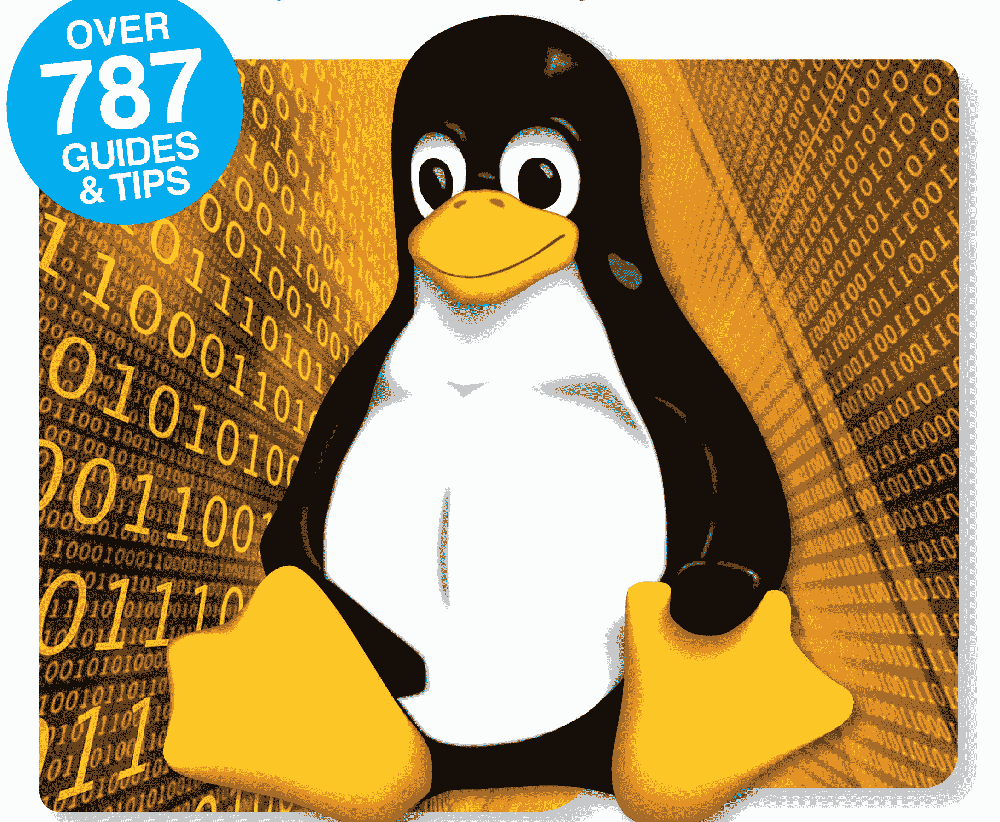

## 你是 Windows PC 用户吗？

那么现在不要在 Readly 上错过我们最新的 Windows 11 必备用户指南了！

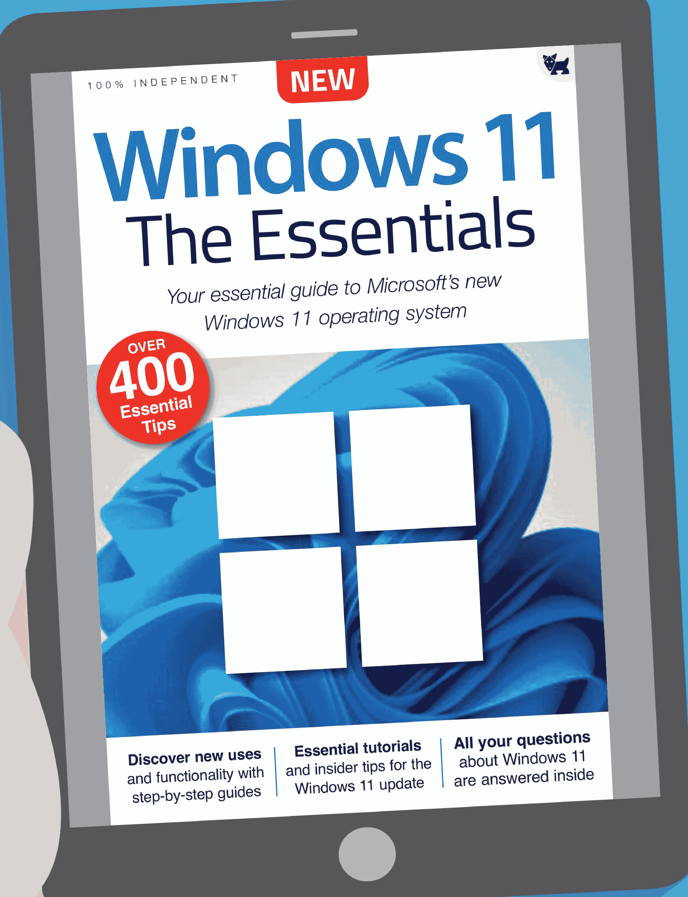

Linux 无处不在。它作为 Web 服务器背后的主操作系统驱动着互联网，它驱动着航天器，它是世界上最快超级计算机的操作系统，并被用于智能电视和移动设备。为什么呢？因为它极其稳定、运行极快，而且完全免费。
然而，Linux 不仅仅是一个免费使用的操作系统。。它独特的配置允许用户将操作系统定制并个性化为他们喜任何形式。Linux 用户可以在一天之内改变操作系统的外观和感受，安装成千上万免费提供的应用程序和程序，并夺回对电脑的控制权。
Linux 关乎自由。不受其他限制性操作系统的“围墙花园”模式限制，自由地在电脑上选择你想要的内容，随心所欲地修改和使用它。这是一个由志同道合的用户组成的全球社区，他们致力于从这个不可越的操作系统中获得最佳开发。
通过这本书，你可以成为 Linux 用户开放社区的一部分。书中的教程将帮助你掌握 Linux，向你展示它的原理，你可以用它做什么，以及你如何通过编写代码来将你的 Linux 体验推向更高高度。
发现 Linux。发现自由。

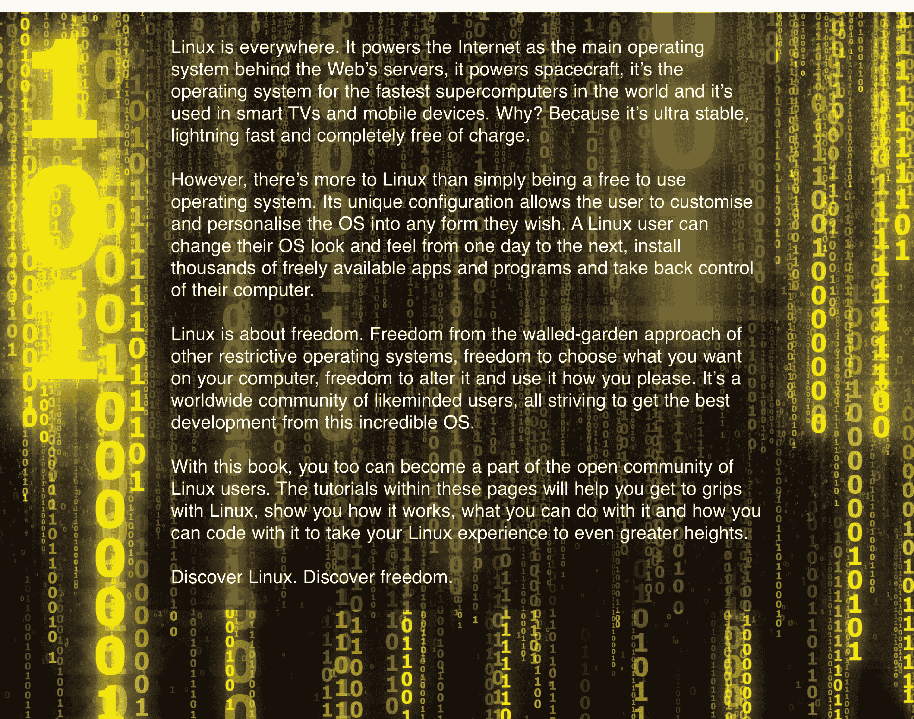

BDM 代码门户

60+ 个 Python 程序

21,500+ 行代码

通过我们强大的代码门户学习 Python，包含初学者的代码以及更多。
访问：https://bdmpublications.com/code-portal，登录即可获取！

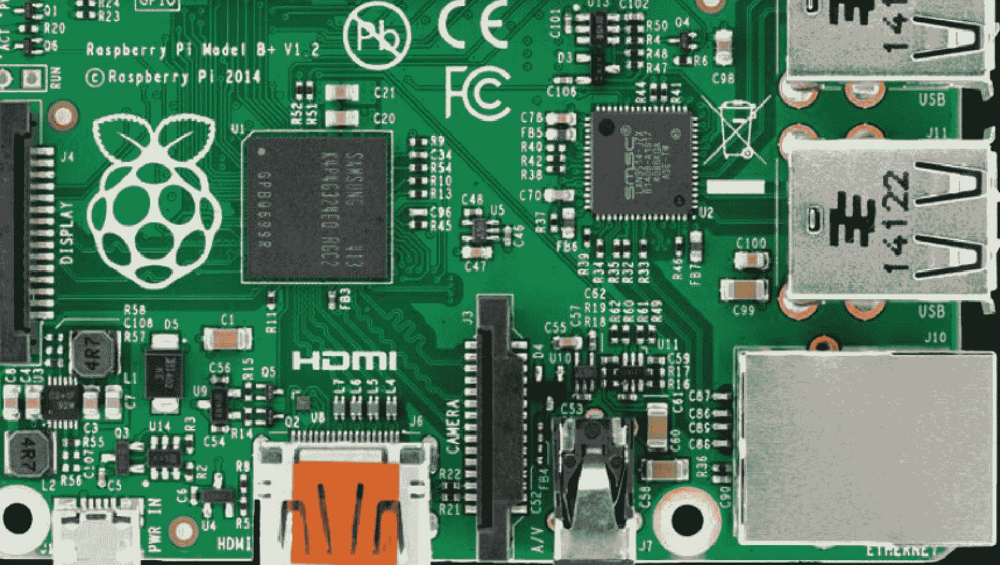

- 144 常见错误

或通过销售咨询 sales@blackdogmedia.com

## 为什么选择 Linux？

对于许多用户来说，Linux 意味着自由。随心所欲地更改和使用操作系统的自由，以及免于其他操作系统、任何许可形式或费用的限制的自由。不过，Linux 的意义远比你想象的要得多。

### 免费且开源

Linux 对于那些追求与众的人来说是极佳的选择。系统的效率、应用程序的可用性和稳定性只是其中几个出色的理由。
你首先需要了解的是，并没有一种名为 Linux 的操作系统。Linux 实际上是操作系统内核，操作系统的核心组件。当你谈论 Linux 时，你指的是使用 Linux 内核的许多发行版（distributions，简称 distros）之一。但你至少听说过其中一个：Ubuntu、Fedora、Arch、Debian、Manjaro 等，不胜此。每一个发行版都为用户提供不同的特性。虽然每个发行版都以 Linux 内核为核心，但它们为用户提供了不同的桌面环境、不同的使用系统和安装应用程序的方法，以及整个系统中略有不同的视觉效果和体验。然而，核心始终是 Linux，这也是我们称它为 Linux 的原因。
Linux 的工作方式与 Windows 或 macOS 不同。它是免费的；可以免费安装在任意数量的计算机上，使用时间无限，且免费使用，这是吸引开发者的最大动力之一。由于 Linux 可以被定制并能实现更多功能，用户（无论是开发者、游戏玩家还是想使用旧电脑的人）都可以快速下载一个发行版并在几分钟内开始工作。
除了免费使用的这一点外，还拥有了根据自己的喜好对系统进行定制和塑造的自由。互联网上提供的每个可用发行版都有特定的“侧重点”，按顺序递增为：更高的安全性、华丽的桌面、游戏空间、针对学生的差异化设计。扩展性使 Linux 成为一个更具吸引力的平台，因为你可以轻松地修改系统以适应任何开发基础，包括用于 Python、Web 开发、C++、Java 等许多不同类型的 IDE；或者为了在线匿名而创建系统，例如作为 Minecraft 服务器、媒体中心以及其他用途。
Linux 是一个开始编程的绝佳操作系统。

```cpp
#include <iostream>

int main() {
    // 我的第一个 C++ 程序
    std::string message = "hello world!";
    std::cout << message << std::endl;
    return 0;
}
```

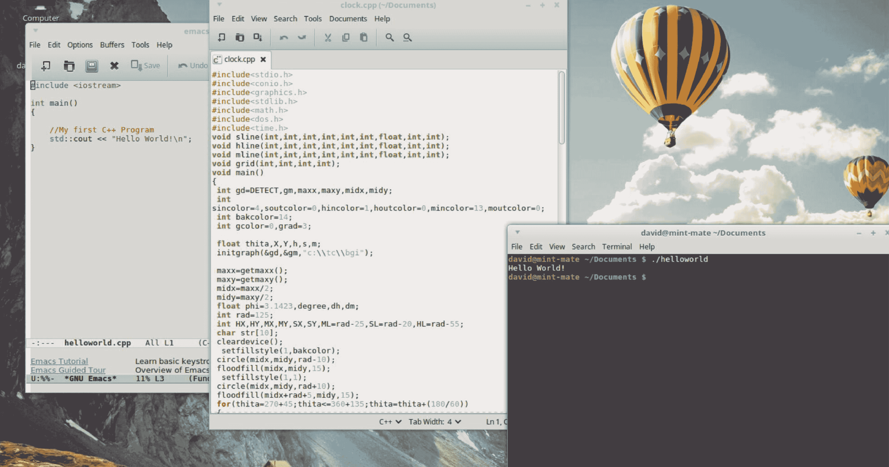

在 Linux 下，为程序员提供了几十种免费软件包。
对于那些想要学习编程的人来说，另一个值得注意的地方是，Linux 内置了大多数流行的环境。在可用的 Linux 发行版中，Python 和 C++ 的预装比例很高，这意味着你一旦安装了系统并首次构建，就可以开始编程。
通常情况下，Linux 并不像 Windows 或 macOS 那样占用大量资源；我们所指的系统资源是指内存、磁盘空间和 CPU 负载。Linux 的代码很小，这对于资源有限的用户非常有帮助。更高效的代码意味着为编码和测试环境以及你创建的程序留出更多可用资源。在旧硬件上，这些硬件通常难以运行甚至拒绝运行最新版本的 Windows 或 macOS；因此，与其扔旧电脑，不如使用 Linux 发行版进行重新利用。
每个发行版都为用户提供独特的东西，但核心都是 Linux。
这与使用 C++、Python 或任何其他更流行的编程语言无关。通过使用特定的程序行（也称为终端 Terminal），你可以学习 Shell 脚本，这些程序设计用于从命令行运行，用于在某些操作的特定输入输出形式下处理数据。
最后，尽管我们还可以列出许多优势，但还有成千上万的免费程序和软件包涵盖了计算的几乎每一个方面。这些被称为软件包（packages），在本文写作时）有 5876 多个从 Ubuntu 到 Mint 的特定编程应用程序，以及来自网络下载的令人惊叹的 62,000 多个软件包。
Linux 是编程的极佳资源和环境。它非常适合开发者并且在不断进化。如果你正准备进入编程领域，或者你想尝试，不妨尝试一下 Linux，看看它是否适合你。
Linux 编程环境可以随你的需要变得一样简单或复杂。

```c
#include <stdio.h>
#include <stdlib.h>
#include <string.h>
#include <time.h>

int main() {
    int i;
    char name[100];
    printf("Enter your name: ");
    scanf("%99s", name);
    printf("Hello, %s!\n", name);
    for (i = 0; i < 5; i++) {
        printf("Iteration %d\n", i);
    }
    return 0;
}
```

## 最佳 Linux 发行版

有很多版本的 Linux可用，被称为发行版（Distributions）。每种都有不同的理念和方法。以下是五个值得尝试的发行版：

### 开始使用 Linux

大多数发行版的安装过程相似。你从网站下载镜像并将其刻录到光盘或创建 USB 启动盘。

#### Linux Mint

最流行的发行版无疑是 Linux Mint，它始于 2006 年。基于 Ubuntu，提供三种主要的桌面环境：Cinnamon、MATE 和 XFCE。每个发行版都为用户提供独特的东西，但核心都是 Linux。

#### Ubuntu

Ubuntu 是非常流行的发行版。它基于 Debian，提供了丰富的软件。它面向初学者和高级用户。

#### Arch

Arch 是适用于那些想要构建自己系统的用户的发行版。它以使用命令行而闻名，这让你能够学习很多关于 Linux 工作原理的。Arch 是滚动更新发行版，这意味着你始终拥有最新的软件。

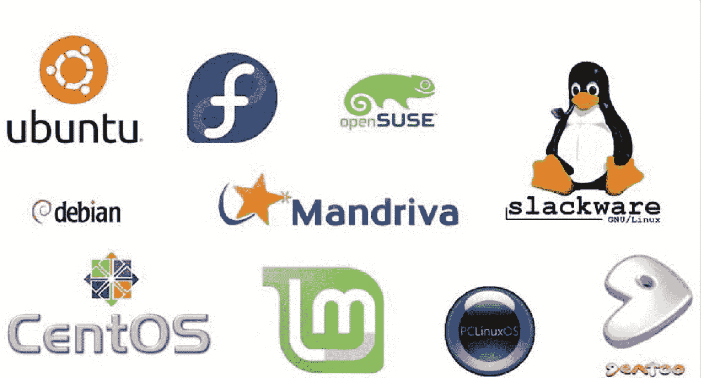

## 你将需要的设备

在 PC 上成功安装 Linux Mint 的系统要求出奇地低，即使是几年前的电脑也能轻松地运行这个发行版。然而，在继续之前，检查你是否已经准备好一切是值得的。

## MINTY 配材料

在我们开始阅读这本书之前，这里是你安装和运行 Linux Mint 所需的配置。你有多种选择，请花些时间看看哪种最适合你。

## 系统要求

+ Linux Mint 的最低系统要求如下：

* **CPU** – 700MHz

* **RAM/内存** – 512MB

* **硬盘空间** – 9GB（推荐 20GB）

* **显示** – 1024 x 768 分辨率

显然，你的系统越好，体验就会越好，速度也越快。

## USB 安装


你可以通过 USB 或 DVD 在你的电脑上安装 Linux Mint。我们稍后会详细介绍每种方法，如果你已经熟悉流程，只需考虑 USB 并收集所需的硬件，那么你至少一个 4GB 的 USB 闪存盘来存储 Linux Mint ISO 镜像。


# DVD 安装

使用 DVD 安装 Linux Mint 只需一张空白的 DVD+ 光盘。当然，在将 ISO 镜像传输或刻录到磁盘之前，你还需要一个光驱（DVD 刻录机）。


# 虚拟机

安装到虚拟环境中是测试和使用 Linux 发行版的喜爱方法。Linux Mint 在虚拟环境中运行效果非常好，但稍后会详细介绍。有很多虚拟环境应用可用；其中，Oracle 的 VirtualBox 是最容易安装的。你可以在 www.virtualbox.org 找到最新版本。


# 网络连接

不而喻之，网络连接对于确保 Linux Mint 保持最新更新和补丁以及安装更多软件至关重要。虽然使用 Linux Mint 不需要网络连接，但你将错过该发行版所提供的大量免费软件。


# MAC 硬件

虽然 Linux Mint 可以安装在 Mac 上，但有一种观点建议 Mac 所有者使用虚拟环境，例如 VirtualBox 或 Parallels；而且况何呢，macOS 已经是一个很出色的操作系统了。如果你想为旧 Mac 注入新生命，请确保它是 Intel CPU 型而不是 Power PC 型号。不过要注意，这并不像在 PC 上安装那样轻松。


# 桌面环境

Linux Mint 有几个不同的版本，或称为“口味”：Cinnamon、MATE 和 Xfce；这些版本也有 32 位和 64 位之分。但这一切意味着什么，你安装时应该选择哪个版本呢？

## 哪哪种 MINT？

桌面环境（Desktop Environment）是你用于与 Linux 系统交互的图形界面。正如 Windows 10 的图形桌面也被称为 Fluent Design 一样，Linux Mint 为用户提供了多种版本：Cinnamon、MATE 和 Xfce。虽然这对于初学者来说可能有些困惑，但每个版本包含相同的 Linux 结构和内核，内核是系统的核心，处理所有指令。每个版本都是不同的桌面环境，即你用于与操作系统交互的图形用户界面 (GUI)。每个桌面环境使用不同的应用程序来访问系统，文件管理器来浏览系统结构或启动方式。再次，核心生产力、视频和图形套件是相同的，功能也相同。为什么要尝试不同的桌面环境？简单来说，取决于个人喜好。有些用户偏爱 MATE，它是经典 GNOME 2 环境的分支，更加传统，并在旧电脑上运行良好。另一些用户偏喜欢 Cinnamon，它是一个运行良好的现代环境。Xfce 是一个由于资源占用极低而在旧硬件上运行的轻量级桌面环境。简而言之，Cinnamon 是 Linux Mint 的旗舰桌面环境。在 Windows 只提供一种桌面环境工作的情况下，Linux Mint 则为用户带来了丰富的选择。


### Cinnamon

Cinnamon 在外观和感受之外许多优点，尽管这些也是重要的因素。在这里，我们列出几个功能来帮助你判断它是否适合你。

#### 特性 1

它在现代系统上表现出色，但比以前稳定得多，不再那么消耗资源。因此，如果你在使用旧电脑安装和测试 Linux Mint，不要错过 Cinnamon。

#### 特性 2

Cinnamon 具有热角（Hot Corners），桌面的每个角都可以点击执行特定任务，如显示工作区或运行命令。热角在不同视图之间切换效果很好，有助于桌面更高效。

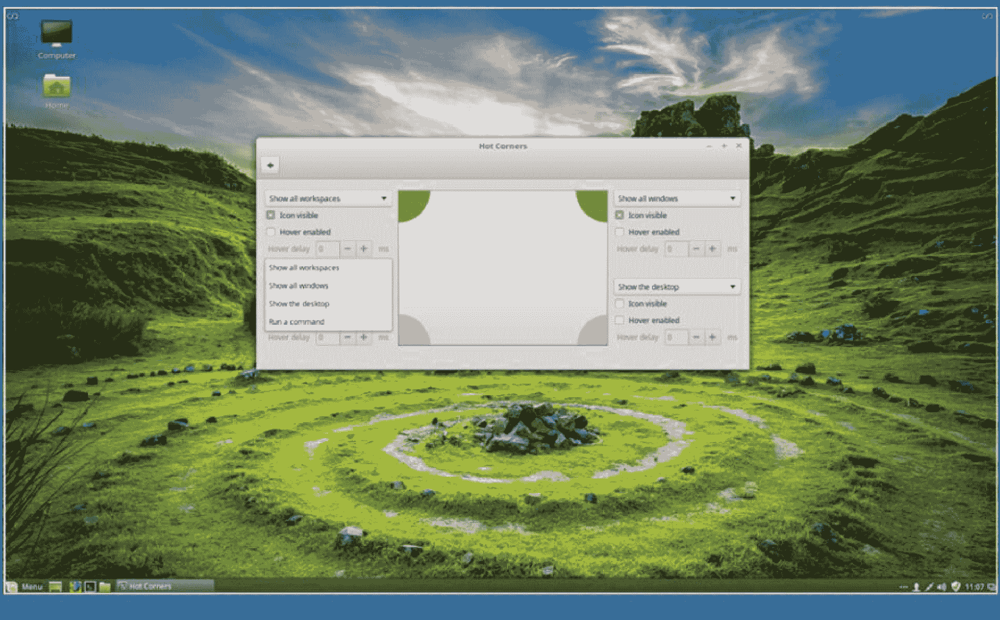

# 最佳 MATE

MATE 简单易用且直观。与 Cinnamon 相比，它看起来有些过时，但这只是表面。MATE 有许多受欢迎的地方。

#### 特性 1

MATE 是旧电脑的极佳桌面环境。它比 Cinnamon 兼容更多的硬件组件，但同样能够提供精美的桌面以及高级定制。


#### 特性 2

由于其高度可配置性，MATE 可以进行很大程度的定制。对于对桌面环境有更高要求的的用户，有很多可用选项，包括 Compiz 设置，你可以在配置各种桌面效果，甚至是 3D 立体。

# 无胆固醇桌面

Xfce 起于 1996 年的通用桌面环境 (CDE)。从那时以后它改变了几次，现在简单称为 Xfce，绰号为“胆固醇环境”。

#### 特性 1

Xfce 确实是一个快速的桌面，并发挥了 Linux 作为足够快速系统的最佳性能。事实上，从页面顶部开始将其安装到新电脑，我们只到了这一点；写了几百字，我们就在使用新的操作系统了。不坏。

#### 特性 2

仅仅因为它快速且轻量，并不意味着 Linux Mint Xfce 不是一个完整的桌面操作系统。就像提供的其他环境一样，你可以获得最新的 Firefox、VLC、Gimp、聊天应用甚至下载客户端。


# 哪种发行版？

到为止我们查看了 Linux Mint，但还有其他的 Linux 发行版可以尝试。事实上有数千个 Linux 发行版可以下载安装，所以你应该决定使用哪一个？

## 发行版跳转 (Distro Hopping)

发行版跳转是社区用来形容那些从固定单一发行版的人的术语。相反，他们在它们之间跳跃，测试每一个；使用它们，从一个移动到新发布的发行版。

发行版跳转没有问题，它是熟悉现有内容的好方法，并发现某个发行版中可能或不符合你口味的元素。问题当然是，你使用哪一个？


例如，Linux Mint 是一个理想的起点。它是一个易于安装和使用的发行版，开箱即用包含了你日常所需的所有软件，并温和地引导你。

Ubuntu 提供了相同的体验，但它的方式略有不同。除非你自己安装，否则 Ubuntu 的压力通常较小。另一点是装饰有 Ubuntu 用户的帮助页面内容海量：如果你遇到困难，你离解决方案并不远。

继续，当你开始熟悉 Linux 时，你可能会测试 Fedora。这些都是出色的发行版，但在 Linux 方面要求不同。虽然发行版跳转是好的，可以让你从中获得最大价值，但说你应该固定在一个发行版并错过很多丰富内容。例如，Tails 是为了匿名而设计的发行版。Kali 包含了许多黑客工具。

| PID | USER | %MEM | VSZ | RSS | S | TIME | COMMAND |
| :--- | :--- | :--- | :--- | :--- | :--- | :--- | :--- |
| 1 | root | 0.0 | 16342 | 8512 | S | 0:00:00 | [kworker] |
| 2 | root | 0.0 | 15890 | 7200 | S | 0:00:00 | [kworker/0] |
| 3 | root | 0.0 | 15950 | 7000 | S | 0:00:00 | [kworker/1] |
| 4 | root | 0.0 | 15950 | 6900 | S | 0:00:00 | [kworker/queue] |
| 5 | root | 0.0 | 16120 | 7100 | S | 0:00:00 | [kworker/ubd2] |
| 6 | root | 0.0 | 15750 | 6400 | S | 0:00:00 | [kworker/ubd1] |
| 7 | root | 0.0 | 16010 | 6700 | S | 0:00:00 | [kworker/ubd3] |
| 8 | root | 0.0 | 15980 | 7000 | S | 0:00:00 | [kworker/ubd4] |
| 9 | root | 0.0 | 16050 | 7000 | S | 0:00:00 | [kworker/ubd5] |
| 10 | root | 0.0 | 15920 | 6600 | S | 0:00:00 | [kworker/ubd6] |


| 11 | user | 0.1 | 25450 | 15200 | S | 0:00:05 | `/usr/bin/bash -f /home/user/.bashrc` |

| 12 | user | 0.0 | 22100 | 12400 | S | 0:00:00 | `/usr/bin/top` |

| 13 | user | 0.0 | 21800 | 11900 | S | 0:00:00 | `/usr/bin/gnome-shell` |

| 14 | user | 0.0 | 24300 | 13500 | S | 0:00:00 | `/usr/libexec/` |

| 15 | user | 0.0 | 23900 | 13200 | S | 0:00:00 | `/usr/lib/dbus...` |

| 16 | user | 0.0 | 24100 | 13400 | S | 0:00:00 | `/usr/lib/dbus...` |

| 17 | user | 0.0 | 23800 | 13200 | S | 0:00:00 | `/usr/lib/dbus...` |

| 18 | user | 0.0 | 24500 | 13800 | S | 0:00:00 | `/usr/lib/dbus...` |

| 19 | user | 0.0 | 23700 | 13100 | S | 0:00:00 | `/usr/lib/dbus...` |

| 20 | user | 0.0 | 24400 | 13600 | S | 0:00:00 | `/usr/lib/dbus...` |

| 21 | user | 0.0 | 23600 | 13300 | S | 0:00:00 | `/usr/lib/dbus...` |

| 22 | user | 0.0 | 24400 | 13700 | S | 0:00:00 | `/usr/lib/dbus...` |

| 23 | user | 0.0 | 23500 | 12900 | S | 0:00:00 | `/usr/lib/dbus...` |

| 24 | user | 0.0 | 24900 | 14000 | S | 0:00:00 | `/usr/lib/dbus...` |

| 25 | user | 0.0 | 23400 | 12800 | S | 0:00:00 | `/usr/lib/dbus...` |

`[top]` - task started by user on Mon Oct 23 up for 0:01 (F6)

| Name | Priority | PR | NI | VIRT | RES | SHR | S | CPU% | TIME | COMMAND |
| :--- | :--- | :--- | :--- | :--- | :--- | :--- | :--- | :--- | :--- | :--- |
| systemd | 20 | 0 | 0 | 16542 | 8500 | 7500 | S | 0.0 | 0:00:01 | `/lib/system/systemd` |
| user-1 | 20 | 0 | 0 | 15890 | 7200 | 7000 | S | 0.0 | 0:00:00 | `/usr/bin/...` |
| user-2 | 20 | 0 | 0 | 15950 | 6900 | 6800 | S | 0.0 | 0:00:00 | `/usr/bin/...` |
| user-3 | 20 | 0 | 0 | 16120 | 7100 | 7000 | S | 0.0 | 0:00:00 | `/usr/bin/...` |
| user-4 | 20 | 0 | 0 | 15750 | 6500 | 6400 | S | 0.0 | 0:00:00 | `/usr/bin/...` |
| user-5 | 20 | 0 | 0 | 16010 | 6800 | 6700 | S | 0.0 | 0:00:00 | `/usr/bin/...` |
| user-6 | 20 | 0 | 0 | 15980 | 7000 | 7000 | S | 0.0 | 0:00:00 | `/usr/bin/...` |
| user-7 | 20 | 0 | 0 | 15950 | 7900 | 7000 | S | 0.0 | 0:00:00 | `/usr/bin/...` |
| user-8 | 20 | 0 | 0 | 16050 | 7000 | 7000 | S | 0.0 | 0:00:00 | `/usr/bin/...` |
| user-9 | 20 | 0 | 0 | 15920 | 6600 | 6600 | S | 0.0 | 0:00:00 | `/usr/bin/bash -f /home/user/.bashrc` |
| user-10 | 20 | 0 | 0 | 25450 | 15200 | 15200 | S | 0.1 | 0:00:05 | `/usr/bin/top` |
| user-11 | 20 | 0 | 0 | 22100 | 12400 | 12400 | S | 0.0 | 0:00:00 | `/usr/bin/gnome-shell` |

11 | 20  00     0000  000 110000 1 |00000  000 00000000 |

user-10 | 20 | 0  0   0000  000000 00000000000000000000000000 | | | | | | | | | | |

user-12 | 20 | 0  0  20000000000000000000000000000000000 | | | | | | | | | | | |

| user-13 | 20 | 0 | 0 | 24300 | 13500 | 13500 | S | 0.0 | 0:00:00 | `/usr/libexec/` |
| user-14 | 20 | 0 | 0 | 23900 | 13200 | 13200 | S | 0.0 | 0:00:00 | `/usr/lib/dbus...` |
| user-15 | 20 | 0 | 0 | 24100 | 13400 | 13400 | S | 0.0 | 0:00:00 | `/usr/lib/dbus...` |
| user-16 | 20 | 0 | 0 | 23800 | 13200 | 13200 | S | 0.0 | 0:00:00 | `/usr/lib/dbus...` |
| user-17 | 20 | 0 | 0 | 24500 | 13800 | 13800 | S | 0.0 | 0:00:00 | `/usr/lib/dbus...` |
| user-18 | 20 | 0 | 0 | 23700 | 13100 | 13100 | S | 0.0 | 0:00:00 | `/usr/lib/dbus...` |
| user-19 | 20 | 0 | 0 | 24400 | 13600 | 13600 | S | 0.0 | 0:00:00 | `/usr/lib/dbus...` |
| user-20 | 20 | 0 | 0 | 24400 | 13700 | 13700 | S | 0.0 | 0:00:00 | `/usr/lib/dbus...` |
| user-21 | 20 | 0 | 0 | 23500 | 12900 | 12900 | S | 0.0 | 0:00:00 | `/usr/lib/dbus...` |
| user-22 | 20 | 0 | 0 | 24900 | 14000 | 14000 | S | 0.0 | 0:00:00 | `/usr/lib/dbus...` |
| user-23 | 20 | 0 | 0 | 23400 | 12800 | 12800 | S | 0.0 | 0:00:00 | `/usr/lib/dbus...` |

## 选择哪种发行版？


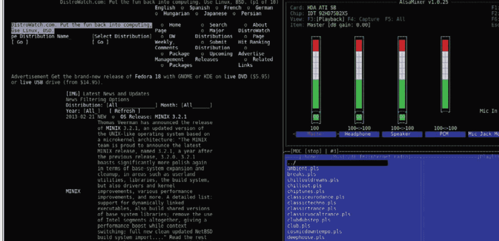

预装了许多工具，用户可以针对自己的网络进行渗透测试。曾经甚至有一个名为“汉娜·蒙塔（Hannah Montana）”的Linux发行版，但我们越少提越好。重点在于，总有一种适合你的发行版。

奇怪的是，高阶技术用户发现自己又回到了起点，使用像 `Linux Mint` 这样的发行版。主要原因通常是因为它是最简单的选择，而且是一个稳定的环境。仅仅因为你对系统了如指掌并不意味着你总是想去修复问题。我们大多数人都倾向于懒惰的生活，特别是在技术方面，逻辑选择应该是选择一个既简单又强大到足以完成你想要的一切的发行版，因此


不言说，一旦你掌握了相当较高水平的 Linux，可能是一个高级用户，那么你就会想要扩展技能，并开始基于 Arch、Debian 或其他可用发行版构建自己的 Linux 发行版。这涉及到大量的命令行知识，以及对 Linux 系统如何工作以及与计算机硬件交互的了解。你需要划分磁盘、配置驱动程序并手动安装你需要的应用程序和程序。如果你不打算学习，这将花费大量时间，并且需要大量的技能。

然而，根结底完全取决于你个人的选择。你可能会发现，在学习了本书中的教程后，你并不喜欢 Linux Mint 或 Cinnamon 桌面。没关系，也许你更喜欢 Ubuntu、Debian 或 openSUSE；这就是 Linux 的魅力所在。你可以自由改变你想要的东西，在不同发行版之间切换（distro hop），而不会受到成本或访问权限的限制。

最终，你可以认为自己是一个技术型 Linux 用户，但永远不要认为自己是专家，毕竟我们总在学习新东西。你可以从零开始构建自己的发行版，帮助其他 Linux 用户解决问题，甚至可以在发行版的测试阶段对其改进做出贡献，又在哪里呢？

这个问题的答案是：你喜欢的任何发行版都可以！它可以根据你的需要变得复杂或简单，只要它能实现你想要的功能，它就是完美的。


# 开始使用 Linux

> “在真正的开源世界中，你有权掌控你自己的命运。”
> 
> —Linus Torvalds（Linux 内内核开发者）


谈论 Linux 多么好很好，但如何把它安装到你的电脑上呢？安装 Linux 非常简单，但你有几种选项可供选择。本节将介绍你如何下载 Linux ISO、将其安装在 PC 上作为主操作系统，甚至安装虚拟环境。

有了虚拟环境，你可以在运行 Linux 的同时仍使用主操作系统（无论是 Windows 还是 macOS）。感兴趣吗？继续读下去了解更多。

- 20 在 Windows 上创建 Linux 安装器
- 22 在 PC 上安装 Linux
- 24 安装虚拟环境
- 26 在虚拟环境中安装 Linux

## 在 Windows 上创建 Linux 安装器

预装了许多工具，用户可以针对自己的网络进行渗透测试。曾经甚至有一个名为“汉娜·蒙塔（Hannah Montana）”的Linux发行版，但我们越少提越好。重点在于，总有一种适合你的发行版。

奇怪的是，高阶技术用户发现自己又回到了起点，使用像 Linux Mint 这样的发行版。主要原因通常是因为它是最简单的选择，而且是一个稳定的环境。仅仅因为你对系统了如指掌并不意味着你总是想去修复问题。我们大多数人都倾向于懒惰的生活，特别是在技术方面，逻辑选择应该是选择一个既简单又强大到足以完成你想要的一切的发行版，因此

### 可启动介质

你需要将 Linux `ISO` 写入 DVD 或 U 盘。这允许你在安装之前测试系统。

**第 1 步**：打开 `Rufus` 网站。找到最新版本并下载。

**第 2 步**：运行下载好的 `Rufus`。它应该已经识别了你的驱动器；如果没有，请重启。

**第 3 步**：第一次启动 `Rufus` 看起来可能有点困惑，但别担心，它非常简单。开始时，点击“磁盘或镜像（请选择）”下拉菜单。这将启动 资源管理器，你可以在其中定位并选择 `ISO`。

**第 4 步**：下一步询问你想对此镜像使用哪种模式，但推荐的 `ISO` 镜像更流行。

**第 5 步**：将显示更多信息并点击“开始”，点击“确定”继续，然后点击“确定”确认操作。

**第 6 步**：`ISO` 现在正在传输到你的闪存器。这个过程不需要太长时间，取决于你找到的 驱动器的速度。`Rufus` 在过程中会在 Windows 资源管理器中打开 USB 驱动器；如果你想，可以关闭它。过程完成后，点击按钮。

> 镜像具有“ISOHybrid”属性。这意味着它可以以 `ISO` 镜像（复制/img）模式或 `DD`（磁盘镜像）模式写入。`Rufus` 建议使用 `ISO` 模式，这样在写入后你可以访问驱动器。

如果你在启动时遇到问题，可以尝试用 `DD` 模式再次写入此镜像。

- 请选择你想对此镜像使用的模式：
- 写入 `ISO` 镜像（推荐）
- 写入 `DD` 模式

# 在 PC 上安装 Linux

大多数 Linux 发行版都带有实机环境（Live Environment）。这意味着你可以直接从创建的 DVD 或 USB 盘启动一个真实的、功能完全的发行版。让我们来看看它是如何工作的，以及你如何从那里安装 Linux。

## UEFI BIOS

统一可扩展固件接口（`UEFI`）用于在 PC 启动过程中识别并保护。它取代了传统的 `BIOS`，但在安装 Linux 时可能会引起问题。

- **第 1 步** 将你的 `USB` 或闪存盘插入 PC，如果尚未关闭，请关闭 Windows。在本例中我们使用的是 `USB` 介质，但过程在视觉上是相同的。启动 PC 并按照提示按键进入 `BIOS` 或 `SETUP`，按键可能是 `F2`、`Del` 或 `F12`。
- **第 2 步** 不同的 `UEFI BIOS` 之间存在差异，因此涵盖所有情况是不可能的。你需要寻找说明启动顺序（Boot Sequence）或启动模式（Boot Mode）的部分。在这里你需要关闭 `UEFI` 并选择 `Legacy` 启动（`Legacy Boot`）。大多数带有 `UEFI` 的现代发行版直接安装时可能会有点棘。
- **第 3 步** 将 `UEFI` 切换到 `legacy` 模式后，有方法进入实机环境。首先是通过你已经进入的 `BIOS`。找到启动顺序，并将第一个启动设备从原始设置（通常是 Internal HDD 或类似设备）更改为：针对 `USB` 介质的 `USB Storage Device`，或针对介质选项的 `DVD Drive`。
- **第 4 步** 也可以使用启动选项菜单（Boot Option Menu）。通过此菜单你可以按 `F2`（或类似的按键）显示启动介质选项列表；从那里你可以选择合适的启动介质。现在你可以导航到 Save & Exit 选项并选择 'Save and Changes' 来保存更改并退出 `BIOS`。

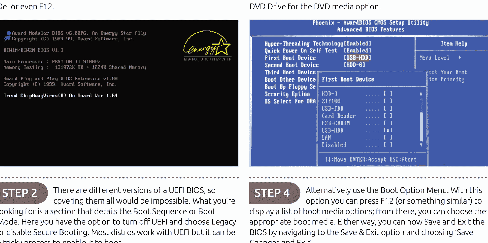

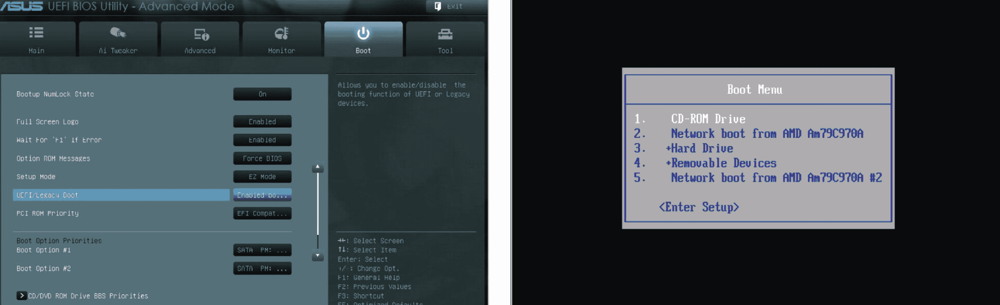

# 安装 LINUX

一旦实机环境启动，你就可以将发行版安装到你的电脑中了。环顾四周，当你准备好后，寻找桌面上的 Install（安装）选项。

- **第 1 步** 只要你已连接网络（如果没有，请先连接）并处于实机环境中，双击桌面上的 Install Mint 图标开始安装过程。其他发行版显示它们的名称，但过程是相同的。准备好后点击 Continue（继续）。


- **第 2 步** 虽然大多数发行版的安装过程非常相似，但某些发行版在安装期间提供不同的问题。这些问题并不困难，不涉及复杂的技术，但诸如“安装”第三方软件可能会让人困惑。在这种情况下，你可以点击 `Continue`，但如果你不确定，请准备好连接了网络的设备以询问任何问题。

- **第 3 步** 安装新操作系统时，建议擦除旧操作系统并用新系统替换。当你到达安装过程的这一阶段时，确保选择了 `Erase disk and install`（清除磁盘并安装）选项。注意：这将完全清除你电脑上的 Windows 10，请确保你已备份了所有的个人文件和数据。

- **第 4 步** 在安装过程开始之前，系统会询问你是否选择确保硬盘擦除是正确的。这是你退出的最后机会。如果你确定不介意擦除所有内容并开始 Linux Mint，点击 `Continue`。如果你需要备份文件，请重启 Linux 磁盘/USB 并重新开始。

- **第 5 步** 最后，你会被要求设置用户名和密码。输入你的名字开始，以及 `Computer Name`（计算机名称），这是它在网络上的标识名称。接下来选择 `Username`（用户名），然后是 `Password`（密码）。你可以勾选 `Login Automatically`（自动登录）选项，但暂时留留 `Enter Home Folder`（进入主文件夹）选项。

- **第 6 步** 安装过程可能很快，可能只是根据你之前的答案进行安装。你最终将进入 `Testing Live Environment`（测试实机环境）或重启到新安装的操作系统。如果你已准备好使用 Linux，点击 `Restart`（重启）。

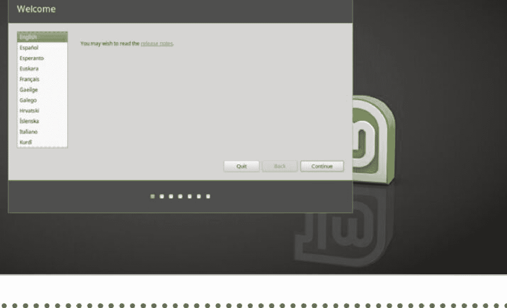
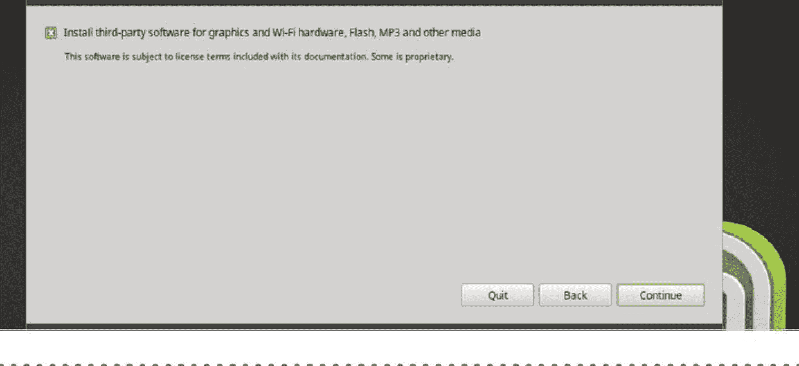
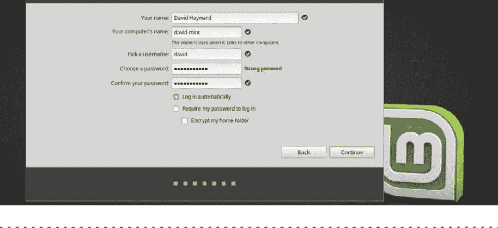
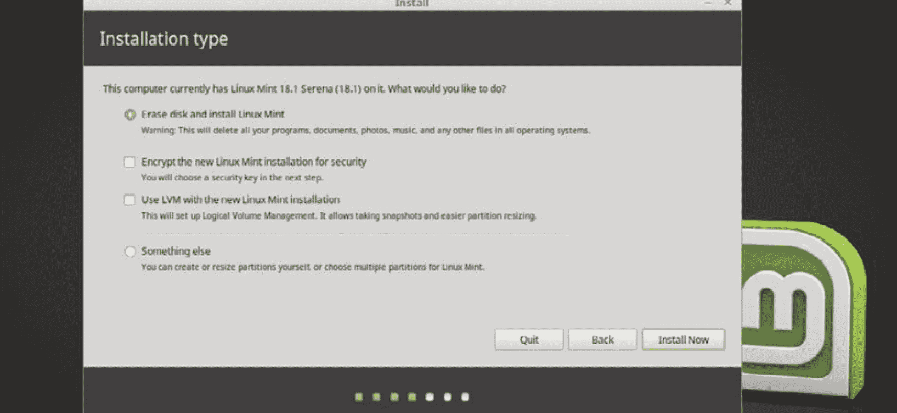
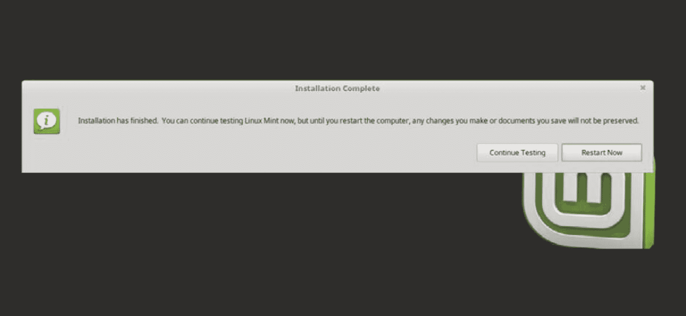

# 开始使用 Linux

## 安装虚拟机环境

虚拟机是一个模拟的计算机系统。使用虚拟机（VM）会消耗你电脑的资源：内存、硬盘空间、处理器等。它可以模拟标准 PC 并在上面安装任何操作系统，而不会影响电脑上已安装的系统。这是在保留 Windows 10 作为主操作系统的同时测试和使用 Linux 的极佳方法。确保你有足够的资源。

- **第 1 步** 我们在本例中使用 `VirtualBox`。访问 `virtualbox.org` 并下载。
- **第 2 步** 安装 `VirtualBox`。此外，还需要下载扩展包（`Extension Pack`）。访问 `VirtualBox` 官网下载对应的扩展包。
- **第 3 步** 安装 `VirtualBox`，完成后重启电脑进入 `BIOS`。
- **第 4 步** 在 `BIOS` 设置中启用虚拟化技术（`Virtualization Technology`）。
- **第 5 步** 启动 `VirtualBox`。
- **第 6 步** 创建新虚拟机，设置名称、类型和版本。
- **第 7 步** 分配硬件资源（内存、处理器），并创建或选择一个现有的虚拟硬盘。
- **第 8 步** 设置网络连接类型，确保虚拟机可以访问网络。
- **第 9 步** 启动虚拟机并安装 Linux 系统。
- **第 10 步** 虚拟机运行后，双击下载好的扩展包，点击 `Next` 并完成安装。

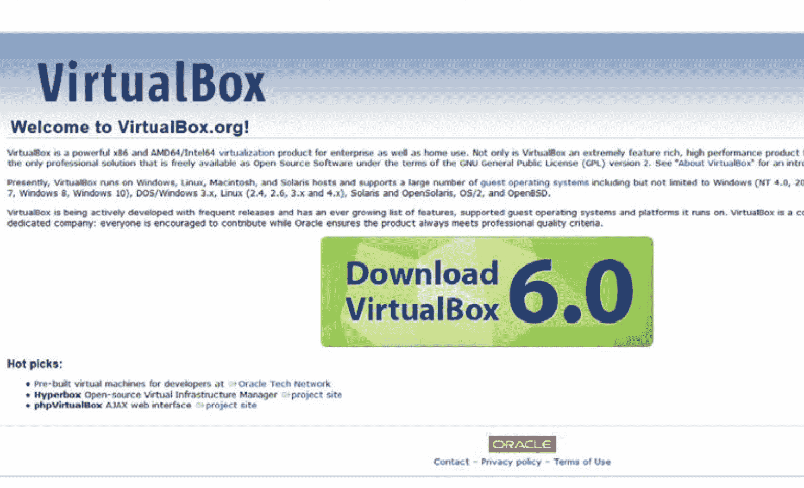
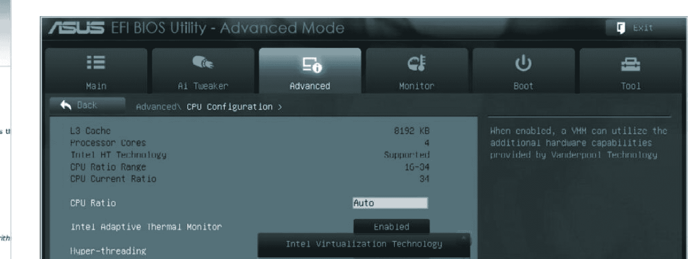

## 在虚拟环境中安装 Linux

现在 `Oracle VirtualBox` 已经运行起来，接下来的任务是创建一个虚拟机（VM）环境，并在其中安装 Linux。此过程不会影响你当前安装的操作系统，这正是为什么虚拟机是一个极佳的选择。

## 创建虚拟机

创建虚拟机有很多选项可以选择。现在，让我们设置一个足以运行 Mint Cinnamon 且运行良好的虚拟机。

**步骤 1** 打开 `VirtualBox` 后，点击应用程序右上角的“新建”图标。这将打开新建向导。

**步骤 3** 下一部分定义分配给虚拟机的系统内存（或 RAM）。此数量是从计算机安装的可用内存中抽取的，因此不要给虚拟机分配太多。例如，我们安装了 8GB 内存，分配了 2GB 给虚拟机。准备好后，点击“下一步”继续：

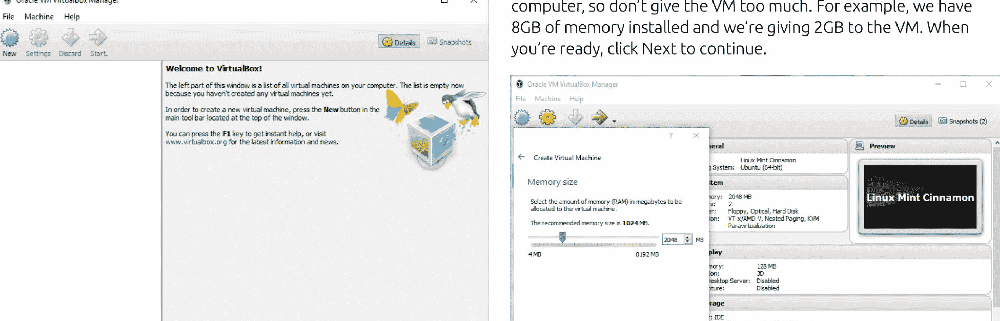

**步骤 2** 在下一个“名称”输入框中，输入 Linux Mint，并在“版本”中输入 Ubuntu (64位)；如果不是，请使用下拉框选择正确的设置（记住 Mint 是基于 Ubuntu 的）。准备好后，点击“下一步”。

**步骤 4** 这一部分是你开始创建虚拟机用于安装的虚拟硬盘的地方。默认选项“创建虚拟硬盘”正是我们正在使用的。点击“创建”继续后续：

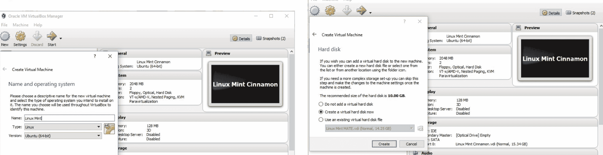

**步骤 5** 点击“创建”后会出现弹出窗口，询问你想要创建什么类型的虚拟硬盘。在这种情况下，我们将使用默认的 `VDI`（VirtualBox 磁盘镜像），因为其他格式用于将虚拟机从一个地方移动到另一个。确保选中了 `VDI` 并点击“下一步”。

**步骤 8** 在完成虚拟机的初始设置后；你现在应该可以在 `VirtualBox` 应用程序中看到新创建的虚拟机。在开始之前，点击“设置”按钮，在“常规”部分点击“高级”下拉菜单，然后将“共享剪板”和“拖放”选择为“双向”。

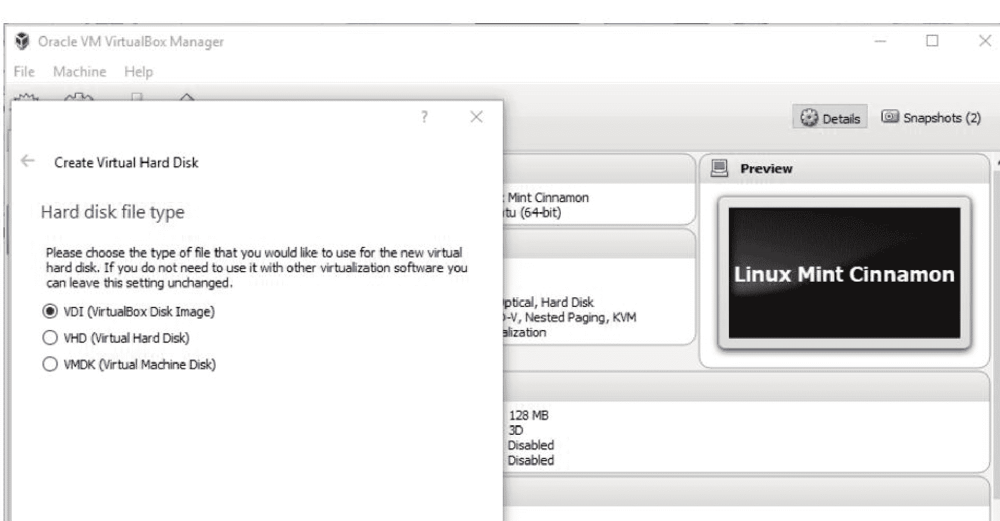

**步骤 6** 使用固定大小还是动态大小虚拟硬盘的问题对于初学者来说可能令人困惑：动态分配的虚拟硬盘是一个更灵活的管理选项，不会占用你硬盘中过多的空间。确保选中了“动态分配”并点击“下一步”。

**步骤 9** 接下来点击“系统”部分，然后是“处理器”。为你的主机系统分配在承受范围内尽可能的核心；我们选择了 2 个 CPU。现在在“显示”部分，选择视频显存并点击“启用 3D 加速”。点击“确定”进入下一步。

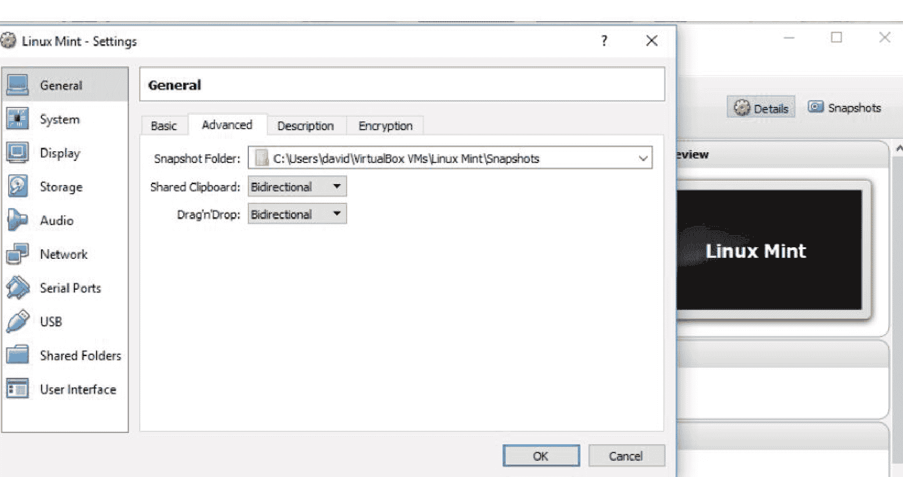
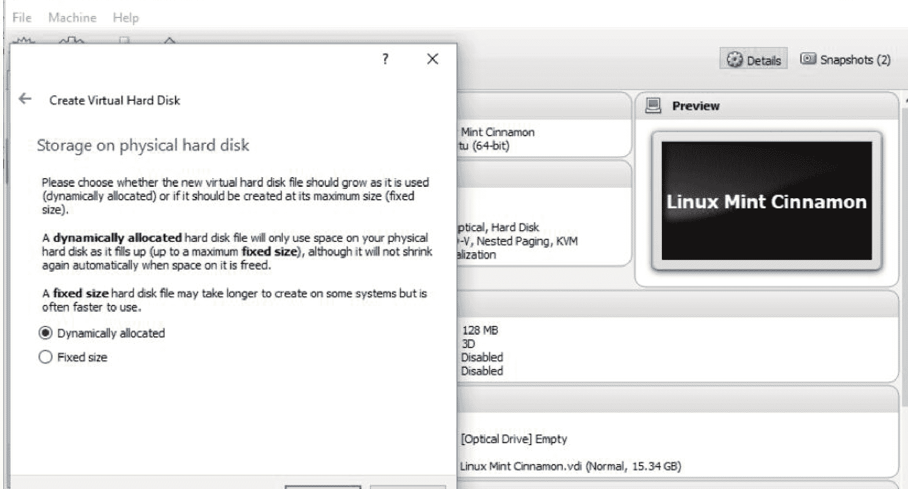

**步骤 7** 虚拟硬盘是一个文件夹，大小取决于你在此处指定的。你计算机上的位置应该有足够的可用空间。例如，我们在 `D:` 盘上使用了较大的存储选项，命名为 Linux Mint，并为虚拟硬盘分配了 25.50GB。

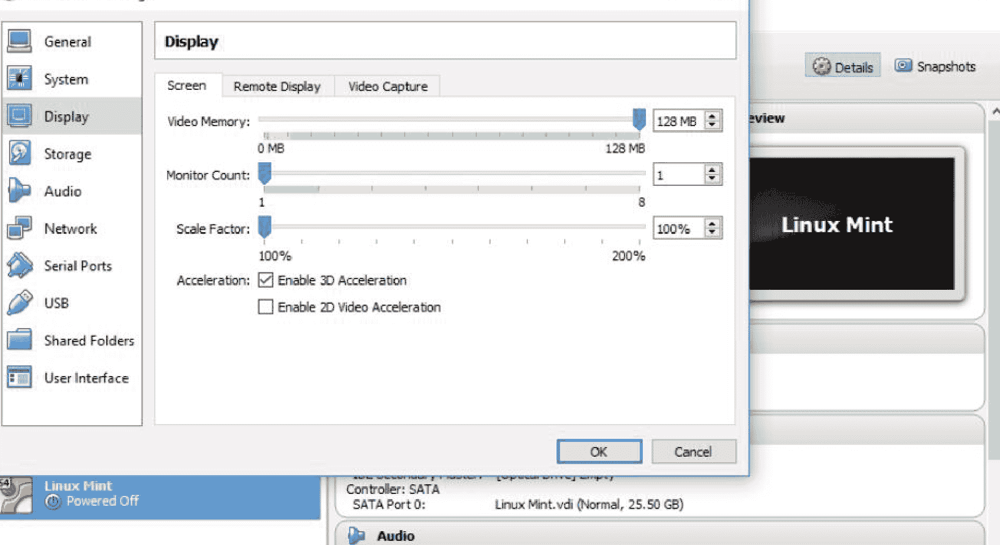

**步骤 10** 点击“启动”按钮，并使用“启动”窗口中的资源管理器（带有绿色箭头的文件夹）找到下载的 Mint `ISO` 文件，点击启动进入 Linux Mint 运行环境。现在可以按照标准安装要求安装 Linux。

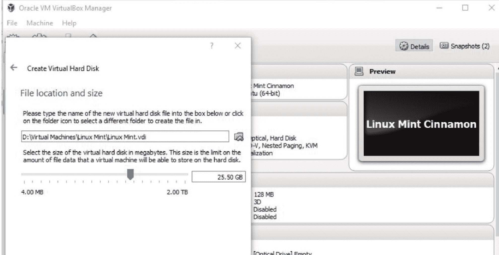
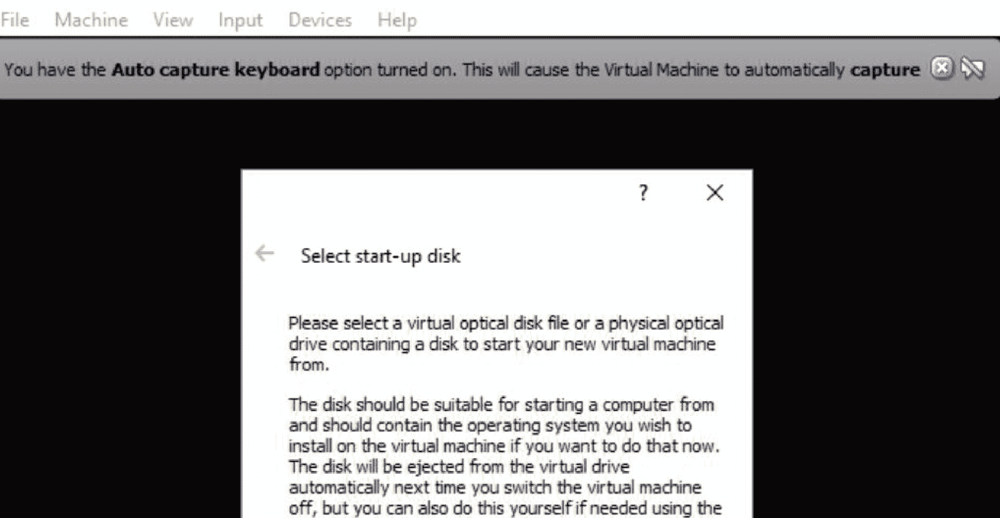

# 了解 Linux

> “任何人都可以构建快速的处理器。技巧在于构建一个快速的系统。” —— 西摩尔·克雷（电气工程师，超级计算机创始人）


我们使用 Linux Mint 作为指南，因为它对 Windows 用户来说是一个易发行版。它也是最先进、文档最全的发行版之一，并且有很多选择。在这一部分中，我们将介绍 Linux Mint 菜单和桌面、它的工作原理以及你可以做什么。想创建另一个用户或发现如何上网吗？请继续往下看。

| 页面 | 主题 |
|---|---|
| 30 | Cinnamon 菜单简介 |
| 32 | 导航 Cinnamon 桌面 |
| 34 | 安装 Mint 后做的 10 件事 |
| 36 | 你知道吗... |
| 38 | 创建用户 |
| 40 | 自定义桌面 |
| 42 | 上网 |

## Cinnamon 菜单介绍

现在你已经安装了 Linux，是时候仔细观察一下了。不过，如果你正在使用 `VirtualBox`，你会收到一个关于“软件渲染”的通知；这里是修复方法。

## CINNAM VIRTUALBOX 修复

你已经查看了一些功能，使用了插入、删除，但也有一些可以应用的功能。


**步骤 1** 在我们开始之前，假设你是在 VirtualBox 中遇到这个问题。要修复它，点击桌面右上角的“设备”。在 VirtualBox 窗口中，选择“插入增强功能 CD”。

**步骤 3** 一分钟或两分钟后，你会自动进入一个命令行，称为“终端”。它会详细说明新 VirtualBox 驱动程序的安装情况，删除它已检测到的任何旧驱动程序，并安装新驱动程序。完成后，将提示你重启。

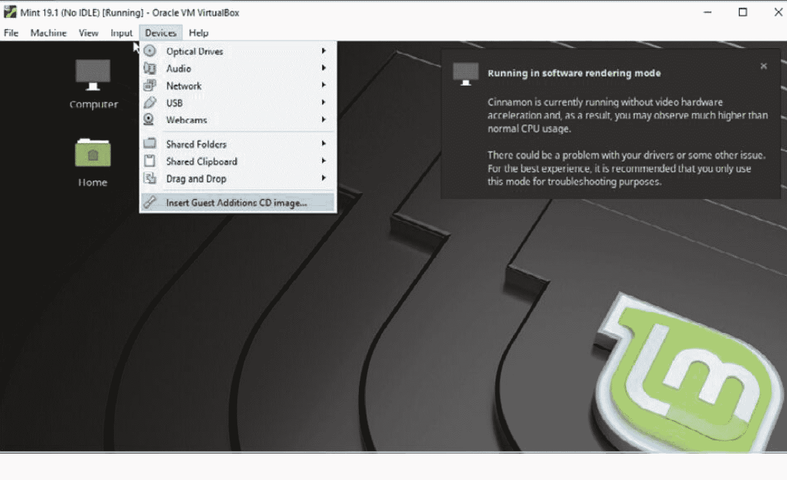

```
File Edit
Uncompressing VirtualBox...
Copying modules...
vboxguest-additions to...
```

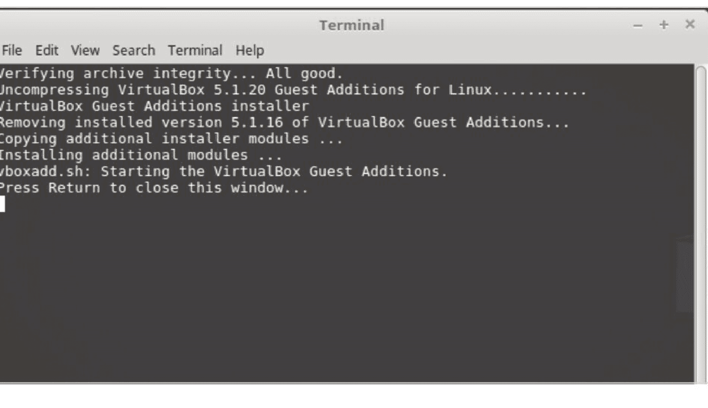

**步骤 2** 增强功能 CD 已经加载。**步骤 4** 修复问题后，将鼠标悬停在右侧的任何应用并右键点击，弹出一个选项列表：添加到面板、添加到桌面、添加到收藏和卸载。大多数选项的用法都一而易见。

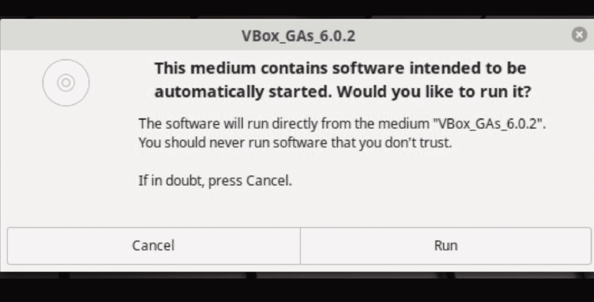


## Cinnamon 菜单介绍

现在你安装了 Linux，VirtualBox 的软件渲染问题已经解决了，它与其他发行版的表现可能有所不同。

**步骤 1** 首先，当你登录 Linux Mint 时，会看到一个欢迎界面。花点时间浏览一下选项。完成后，点击右上角的 X 关闭它。

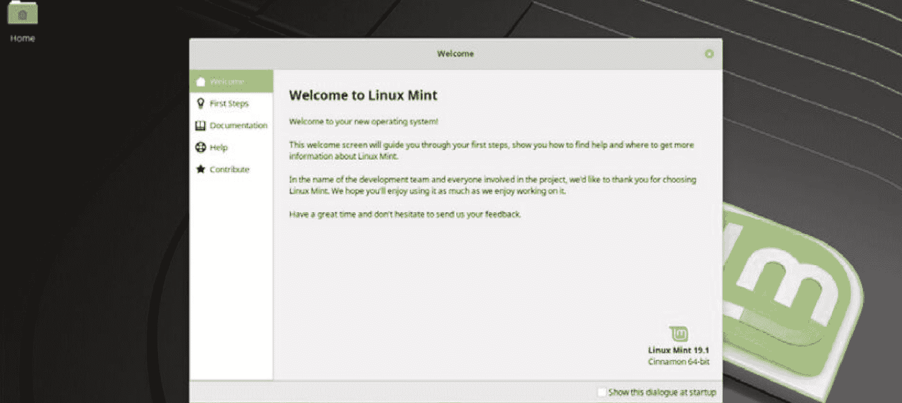

**步骤 2** 你已经在使用 Mint 了，点击中间的“办公”项。这将更改右侧列显示的图标，详细说明该部分下安装了哪些应用。


**步骤 5** 如果你想寻找特定的功能或应用（例如设置打印机），点击菜单顶部的搜索框。输入你想要的应用或功能，Mint 菜单就会显示相关选项。这适用于大多数 Linux 发行版。

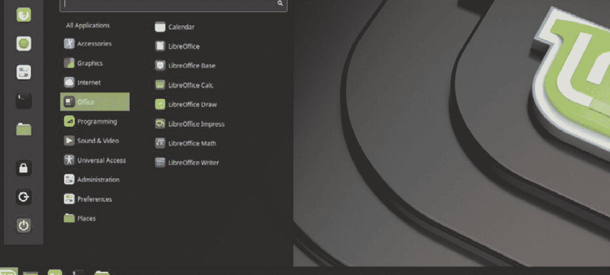

**步骤 3** 从菜单启动任何应用都只需找到并点击它。例如，在“办公”部分，点击“Office Writer”。Writer 是 Linux Mint 预装的文字处理器。它可以打开并保存为 Microsoft Word 格式，功能几乎相同。


**步骤 6** 将鼠标悬停在右侧列出的任何应用上并右键点击，即可获得选项：添加到面板、添加到桌面、添加到收藏和卸载。大多数选项的用途都显而易见，“添加到收藏”会将应用放在左侧的快速访问列。


# 导航 Cinnamon 桌面

每个桌面环境的行为各不相同。有些桌面环境（DE）提供了可以自定义并放置在桌面上的组件，而另一些则选择简洁、锐利的外观，以保持所有程序运行尽可能快。让我们来看看 Cinnamon 桌面提供了什么。

## 一丝风味

Cinnamon 桌面环境是风格与性能的完美融合。它有很多值得了解的地方，这也是它广受欢迎的原因。

- **第 1 步** 双击“计算机”图标开始探索 Cinnamon。这会打开 Nemo，它是 Cinnamon 使用的文件管理器。“计算机”图标会打开根级文件系统，提供对光驱器（如果你安装了的话）、硬盘和 Linux 核心文件系统的访问和视图。
- **第 2 步** 对于以前的 Windows 用户来说，Linux 文件系统可能看起来很困惑，直到你对它的运行原理熟悉一些。我们建议关注桌面上的“主”图标。这里有与你的用户账户相关的所有内容：你存储图片、视频、音乐、文档、下载项等。
- **第 3 步** Nemo 有许多不同的功能、视图以及查看和管理文件和文件夹的方法。例如，如果你在“图片”文件夹中有任何图像，可以使用 Nemo 右下角标记为“调整缩放级别”的滑块来选择图片的缩放级别。

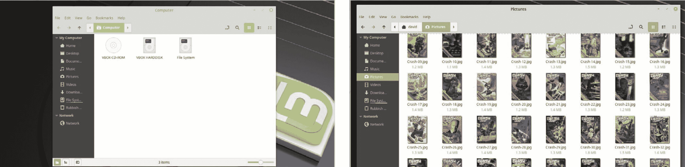

- **第 4 步** 就像任何优秀的管理器一样，如果你右键点击其中的任何文件或文件夹，就会获得丰富的选项。在 Cinnamon 中，默认设置允许你根据文件类型查看文件，并进行复制、剪切、删除、压缩、重命名、通过电子邮件发送以及查看属性。


- **第 5 步** 桌面底部有一个面板（Panel）。我们已经看过了面板的一个部分：菜单。如果你在面板的任何地方（不是应用上）右键点击，你将看到一个菜单，允许你编辑并以不同的方式将其添加到面板。
- **第 6 步** 例如，如果你点击“修改面板”选项，“添加新面板”并清除当前存在的 Applet。移除面板，添加一个 Applet，顺便说一下，这是一个专为工作并适配 Cinnamon 面板设计的程序。
- **第 7 步** 如果在 Cinnamon 上右键点击，你会看到一组选项，允许你以不同的方式进一步添加、编辑或查看桌面内容。这与 Windows 非常相似，这就是为什么 Mint 是前 Windows 用户的良好选择。（如果你在 Cinnamon 上右键点击，你会看到一组选项，允许你以不同的方式进一步添加、编辑或查看桌面内容。）
- **第 8 步** 从桌面右键点击，弹出上下文菜单，选择“自定义”，然后点击新打开窗口底部的“桌面设置”链接。这将打开一个新窗口，你可以在那里编辑桌面图标的位置。如果你使用的是多显示器设置，还可以选择由哪个显示器显示图标。

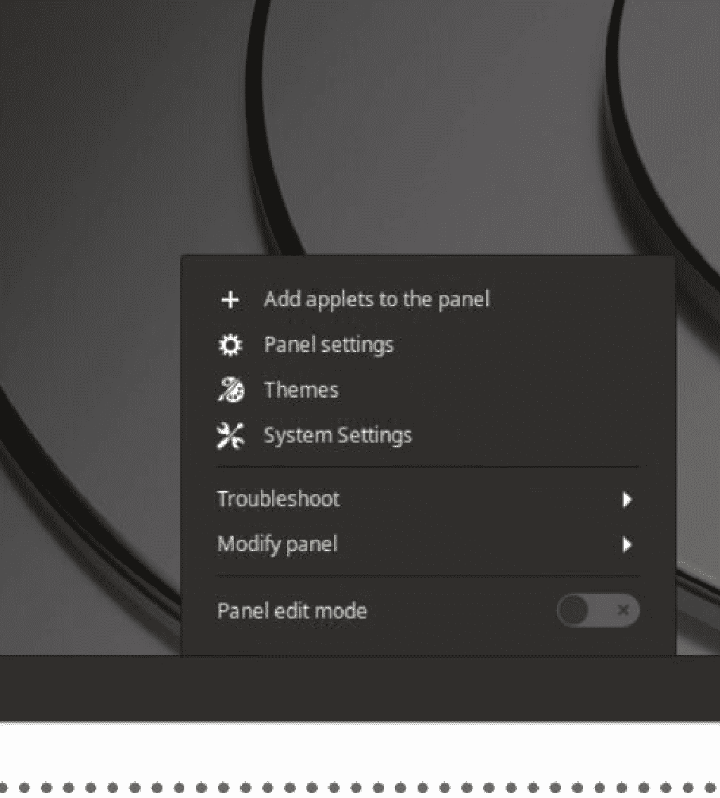

- **第 9 步** 点击菜单并输入“系统设置”，然后打开结果图标。这将带你进入可以控制和编辑 Mint Cinnamon 外观的地方，还可以添加新用户、管理防火墙并启用无辅助选项。

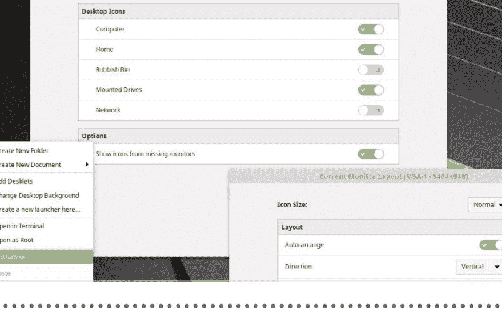

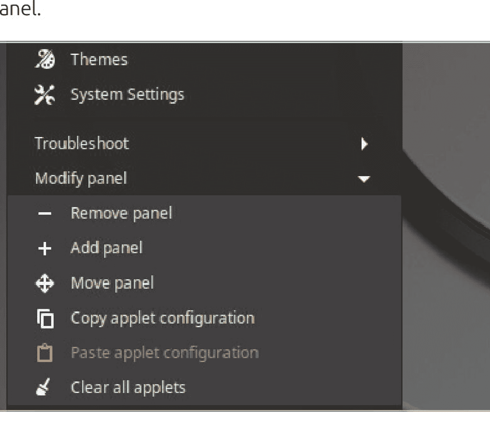

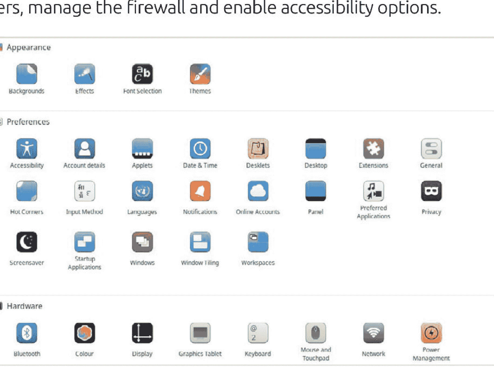

- **第 10 步** 而言之，Mint Cinnamon 可以配置得看起来非常非凡。有很多例子展示了它可以变得多好以及可以实现什么。你可以根据需要变得非常复杂或简单，添加不同的组件和动画，或者仅仅保持平易易读。


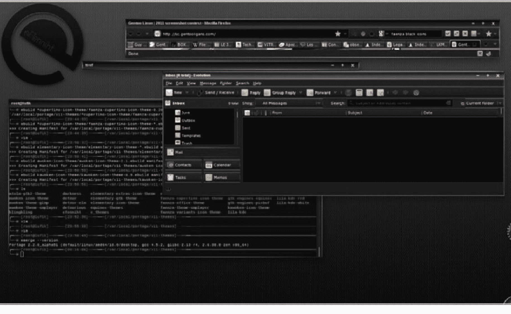

# 了解 Linux

Linux Mint 是一个开箱即用的精良发行版，但与大多数 Linux 发行版一样，可以进行一些调整来改进它的运行方式。虽然这些调整是 Mint 特有的，但大多数可以应用到其他发行版。

## Linux 调整

这些安装后的操作中有些是强烈建议的，而另一些只是方便的添加，仅用于系统调整或增强。

- **第 1 步** 第一个也是最重要的安装后操作是更新系统。点击桌面右下角面板上的图标。
- **第 2 步** 强烈建议执行某些安装后操作，而另一些只是方便的添加，仅用于系统调整或增强。
- **第 3 步** Linux 文件系统对于以前的 Windows 用户可能看起来很困惑，直到你对它的运行原理熟悉。我们建议关注桌面上的“主”图标。这里有与你的用户账户相关的所有内容：你存储图片、视频、音乐、文档、下载项等。
- **第 4 步** Nemo 有许多不同的功能、视图以及查看和管理文件和文件夹的方法。例如，如果你在“图片”文件夹中有任何图像，可以使用 Nemo 右下角标记为“调整缩放级别”的滑块来选择图片的缩放级别。


- **第 5 步** 就像任何优秀的管理器一样，如果你右键点击其中的任何文件或文件夹，就会获得丰富的选项。在 Cinnamon 中，默认设置允许你根据文件类型查看文件，并进行复制、剪切、删除、压缩、重命名、通过电子邮件发送以及查看属性。


- `第 6 步` 桌面底部有一个面板（Panel）。我们已经看过了面板的一个部分：菜单。如果你在面板的任何地方（不是应用上）右键点击，你将看到一个菜单，允许你编辑并以不同的方式将其添加到面板。
- `第 7 步` 例如，如果你点击“修改面板”选项，“添加新面板”并清除当前存在的 Applet。移除面板，添加一个 Applet，顺便说一下，这是一个专为工作并适配 Cinnamon 面板设计的程序。
- `第 8 步` 如果在 Cinnamon 上右键点击，你会看到一组选项，允许你以不同的方式进一步添加、编辑或查看桌面内容。这与 Windows 非常相似，这就是为什么 Mint 是前 Windows 用户的良好选择。
- `第 9 步` 从桌面右键点击，弹出上下文菜单，选择“自定义”，然后点击新打开窗口底部的“桌面设置”链接。这将打开一个新窗口，你可以在那里编辑桌面图标的位置。如果你使用的是多显示器设置，还可以选择由哪个显示器显示图标。


- `第 10 步` 点击菜单并输入“系统设置”，然后打开结果图标。这将带你进入可以控制和编辑 Mint Cinnamon 外观的地方，还可以添加新用户、管理防火墙并启用无辅助选项。


- `第 11 步` 而言之，Mint Cinnamon 可以配置得看起来非常非凡。有很多例子展示了它可以变得多好以及可以实现什么。你可以根据需要变得非常复杂或简单，添加不同的组件和动画，或者仅仅保持平易易读。


# 了解 Linux

Linux Mint 是一个开箱即用的精良发行版，但与大多数 Linux 发行版一样，可以进行一些调整来改进它的运行方式。虽然这些调整是 Mint 特有的，但大多数可以应用到其他发行版。

## Linux 调整

这些安装后的操作中有些是强烈建议的，而另一些只是方便的添加，仅用于系统调整或增强。
- `第 1 步` 第一个也是最重要的安装后操作是更新系统。点击桌面右下角面板上的图标。
- `第 2 步` 强烈建议执行某些安装后操作，而另一些只是方便的添加，仅用于系统调整或增强。
- `第 3 步` Linux 文件系统对于以前的 Windows 用户可能看起来很困惑，直到你对它的运行原理熟悉。我们建议关注桌面上的“主”图标。这里有与你的用户账户相关的所有内容：你存储图片、视频、音乐、文档、下载项等。
- `第 4 步` Nemo 有许多不同的功能、视图以及查看和管理文件和文件夹的方法。例如，如果你在“图片”文件夹中有任何图像，可以使用 Nemo 右下角标记为“调整缩放级别”的滑块来选择图片的缩放级别。


- `第 5 步` 就像任何优秀的管理器一样，如果你右键点击其中的任何文件或文件夹，就会获得丰富的选项。在 Cinnamon 中，默认设置允许你根据文件类型查看文件，并进行复制、剪切、删除、压缩、重命名、通过电子邮件发送以及查看属性。


- `第 6 步` 桌面底部有一个面板（Panel）。我们已经看过了面板的一个部分：菜单。如果你在面板的任何地方（不是应用上）右键点击，你将看到一个菜单，允许你编辑并以不同的方式将其添加到面板。
- `第 7 步` 例如，如果你点击“修改面板”选项，“添加新面板”并清除当前存在的 Applet。移除面板，添加一个 Applet，顺便说一下，这是一个专为工作并适配 Cinnamon 面板设计的程序。
- `第 8 步` 如果在 Cinnamon 上右键点击，你会看到一组选项，允许你以不同的方式进一步添加、编辑或查看桌面内容。这与 Windows 非常相似，这就是为什么 Mint 是前 Windows 用户的良好选择。
- `第 9 步` 从桌面右键点击，弹出上下文菜单，选择“自定义”，然后点击新打开窗口底部的“桌面设置”链接。这将打开一个新窗口，你可以在那里编辑桌面图标的位置。如果你使用的是多显示器设置，还可以选择由哪个显示器显示图标。


- `第 10 步` 点击菜单并输入“系统设置”，然后打开结果图标。这将带你进入可以控制和编辑 Mint Cinnamon 外观的地方，还可以添加新用户、管理防火墙并启用无辅助选项。


# 阿波罗 11 号

你知道吗...

1969年7月20日被记录为人类历史上的转折点，人类首次踏上月球。当时帮助机组完成这次关键航程的软件并不存在，必须从零开始。麻省理工学院实验室的工程师使用一种名为“绳带内存”（Rope Memory）的新程序存储方法，在内存中填充了特殊版本的汇编代码。

令人置信的是，这些代码可以在 GitHub 上免费查看。由一位研究人员于2003年上传，你可以访问 www.github.com/chrisgararry/Apollo-11/ 查看代码。特别注意某些代码段，例如 Burn, Baby_Burn，其带有注释“Goodbye. Come again soon. ”。

浏览一下，看看你还能发现什么。

| 姓名 | 类型 | | 
|---|---|---|
| BARBALL | | |
| JANE | | |
| TOM | | |
| TIFF | | |
| TURSTON | | |
| RACE | | |
| FLASBORG | | |
| PACE | | |
| CUP | | |
| BITTER | | |
| EDITOR | | |
| EXIDER | | |
| TURSTON | | |
| PUBLISH | | |
| GISH | | |
| TCF | | |
| GOTMAN | | |
| HANVILLE | | |
| BORIS | | |
| PUBLISH | | |
| PAGE | | |
| CLASS | | |
| DANCE | | |
| SERVICE | | |
| PRIDERS | | |
| PRIDERS | | |
| DEFINITION | | |
| EDISON | | |
| | |
|---|---|
| 订阅 CHIPS 控制 | | |
| 向待办事项添加新缺陷 | | |
| 向待办事项添加新缺陷 | | |
| 退出不在自动电源控制中 | | |
| 我们在沙漠街上 | | |
| 是的，在这里检查自动瓦片 | | |
| 请重放线路区域 | | |
| 电源位开启 | | |
| 今晚测试 | | |
| | |
|---|---|
| 30 | | |
| 10 | | |
| 50 | | |
| | |
|---|---|
| ************************ | | |
| * 待办事项服务 * | | |
| ************************ | | |
| | |
|---|---|
| 服务 | 可用 | |
| | |
|---|---|
| PRIDERS | 可用 | |
| PRIDERS | 可用 | |
| | |
|---|---|
| 定义 | 可用 | |
| EDISON | 离散 | |

> 程序员并不是没有幽默感：看看里面还有什么。


# 人类的一大步，代码的一大步。


感谢：阿波罗 11 号/NASA

# 了解 Linux

## 创建用户

当你安装 Linux Mint 时，它会为你配置一个单一用户。虽然与全家人共享一个用户账户没有问题，但将来你可能需要创建具有其独立唯一主目录（Home Folders）的独立用户。

## 新用户


拥有不同的用户意味着每个用户都可以访问其在系统中的区域。与其他操作系统中一样，文档、图片、视频等是分开的。

# 用户管理

- 第 1 步：点击 `Linux Mint` 菜单并输入“users”开始搜索相关的控制台。选择“用户和组”（`Users and Groups`）并输入密码。用户和组控制台看起来非常简单，而且容易使用。起初，你只能看到安装 `Linux Mint` 时的自己的主页。

- 第 3 步：输入用户的全名，然后是他们登录 `Linux Mint` 时所需的用户名。确保用户名全为小写字母 a-z 和 0-9 字符，根据需要可以使用下划线或连字符。准备好继续时，点击“添加”（`Add`）按钮。

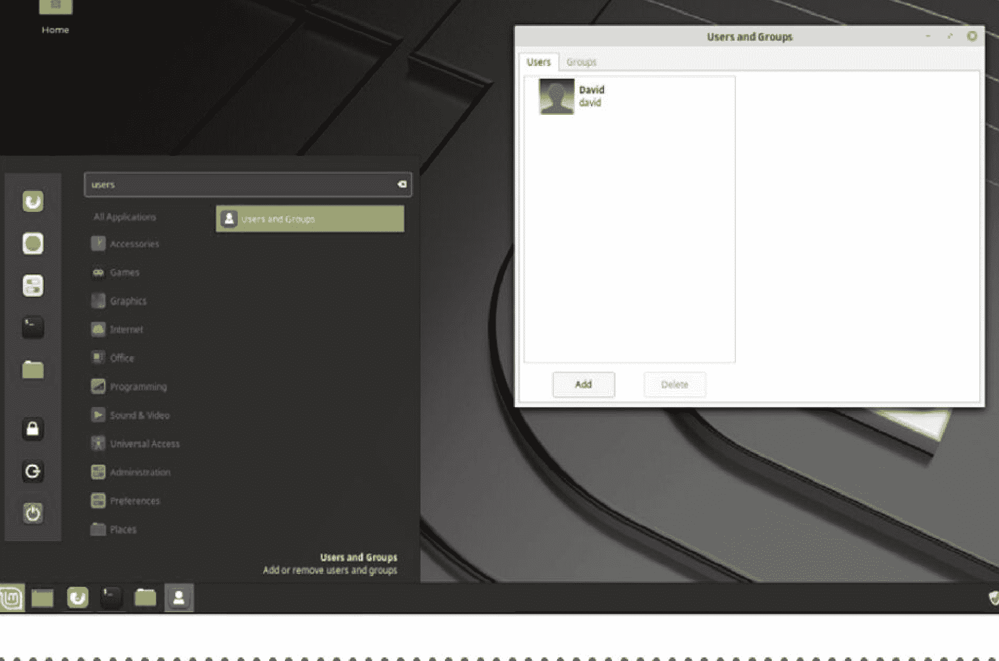

- 第 2 步：要添加新用户，点击控制台底部的“添加”按钮。你可以创建两种类型的用户：标准用户（`Standard`）和管理员（`Administrator`）。除非用户需要安装新应用或访问其主目录之外的文件系统部分，否则请使用标准账户类型。

- 第 4 步：新用户将出现在当前 `Linux Mint` 用户列表中，按字母顺序排列。目前尚未设置密码，因此点击当前用户列表中的用户，点击该用户用户名对应的“未设置密码”（`No Password Set`）选项。

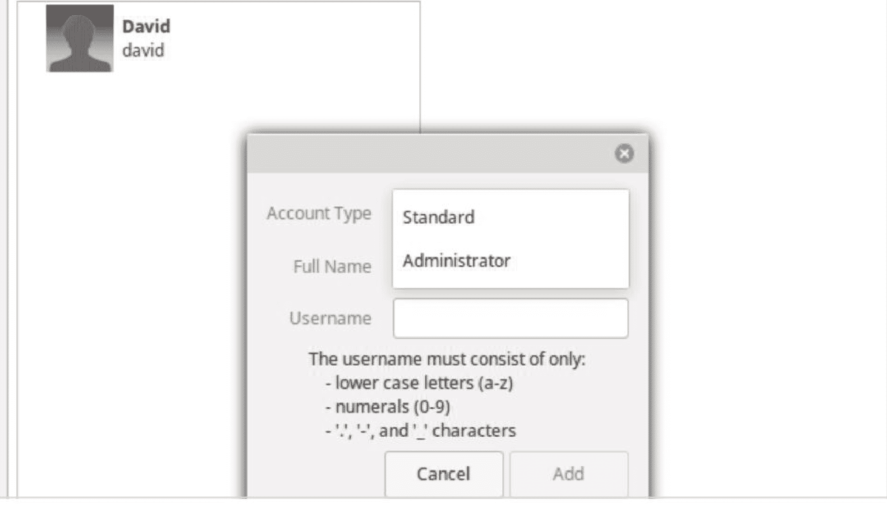

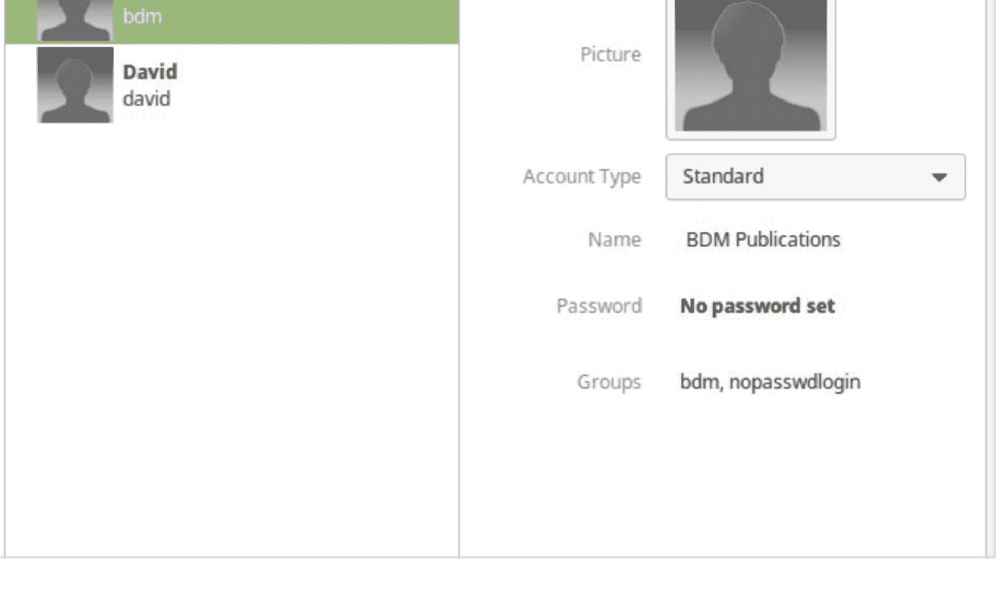

www.bdmpublications.com

## 第 5 步

你可以为新用户输入密码，或者点击新密码框末尾的弯箭头为你生成并显示密码。当然，设置一个强密码是个好主意。完成后，点击“更改”（`Change`）按钮。


## 第 7 步

登录后，新用户需要设置自己的桌面等。根据你设置的账户类型（标准或管理员），他们将无法安装新应用。这张截图来自标准账户。


## 第 6 步

你可以关闭“用户和组”窗口了，因为新用户已经创建。如果你点击 Mint 菜单并点击“注销”（`Logout`），将看到登录管理器。新用户出现在可用用户列表中。点击他们登录。


## 第 8 步

你可以创建需要数量的新账户，并在需要时它们之间切换。最好有一个能够安装新软件的账户，这样你可以跟踪你的系统。


### 命令行账户

正如你所期望，你可以在命令行中创建新用户。在管理员账户下打开终端会。从命令行添加新用户的过程相对简单。首先，使用 `sudo adduser <username>` 作为新用户的登录名。系统提示为用户创建密码以及姓名和其他详情。点击确认详情并创建用户。

```
sudo adduser jim
Adding user jim...
Adding new user jim (1002) with group 'jim'
Creating home directory: /home/jim
Copying skeleton from /etc/skel
Enter password again:
Full Name []: Jim
Room Number: 
Work Phone: 
password updated successfully
```

## 第 2 步

你可以在“用户和组”中检查新用户的详情和账户类型。如果你想从 Mint 中删除用户，可以在终端中输入 `sudo deluser <username>` 或在组中删除。

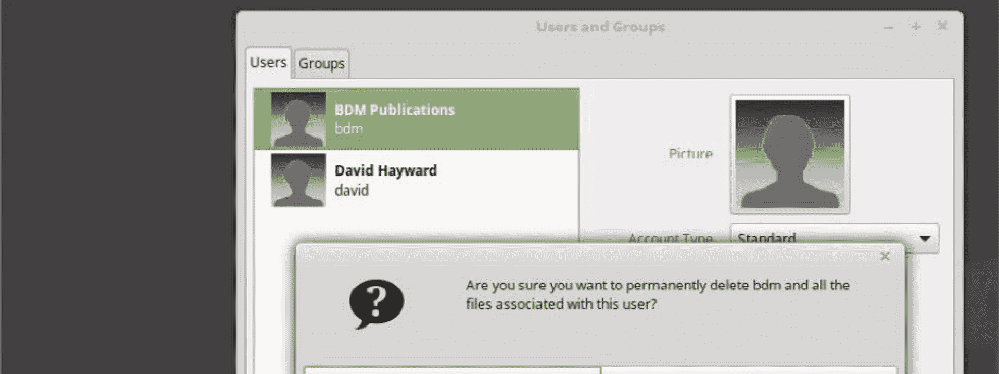

www.bdmpublications.com

# 自定义桌面

自定义操作系统桌面是让它属于你的一种方式：一个帮助你工作、激发灵感或展示标志的个性化工作空间。无论你拥有自己桌面的原因，方法如下。

## 你的桌面

`Linux` 可能是最可自定义的操作系统之一。只需少量调整、安装一两个额外程序并发挥想象力，就能创建出惊的东西。

**第 1 步**：桌面自定义的第一方面是更改壁纸。右键点击桌面并选择“更改背景”。这将打开 `Linux Mint` 中的背景应用；记住，其他系统可能以不同的方式展示背景壁纸选择工具。

**第 3 步**：你只需点击提供的任何位置的可用图片作为桌面壁纸。另外，如果你在系统的或其他位置存储了图片，可以通过点击背景控制台底部的“+”符号并使用文件管理器找到它们。

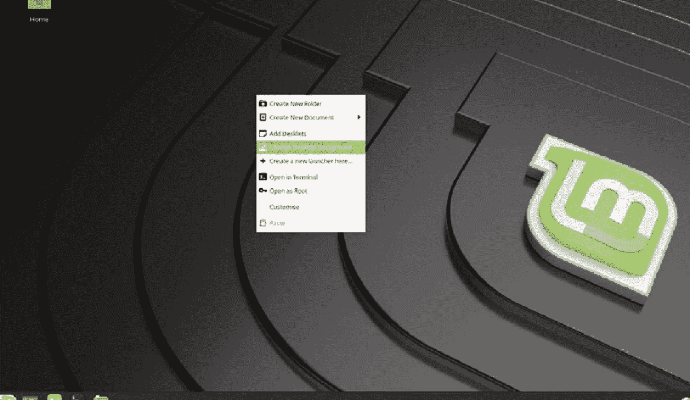

**第 2 步**：较新版本的 `Linux Mint` 根据用户运行的版本显示可用背景。你通常得到三个类别，然后是第四个“图片”，它与其他不同。“图片”选项的不同之处是因为它读取你主目录中“图片”文件夹的内容。

**第 4 步**：通过点击“设置”标签页，你可以将图片作为幻灯片播放，或者将壁纸外观更改多种选择。

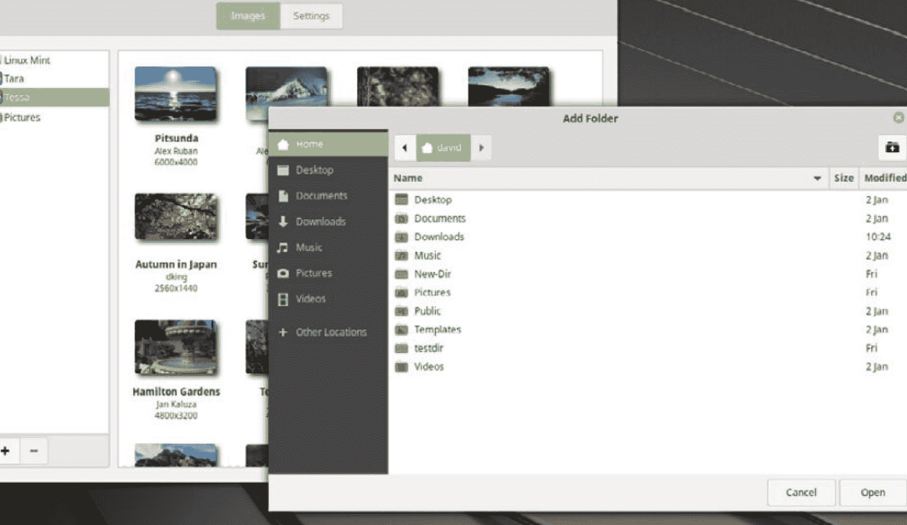


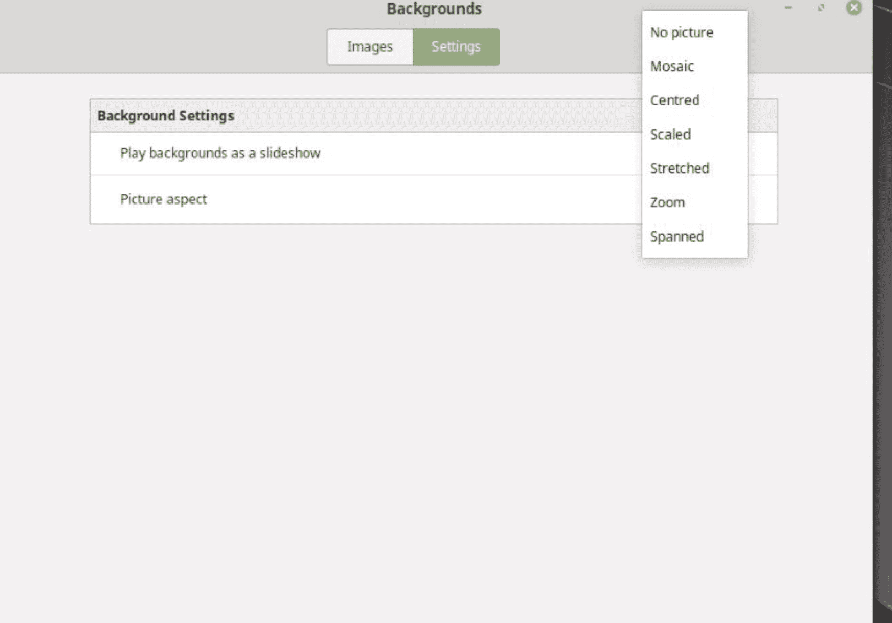

## 自定义桌面

**第 5 步**：如果没有可用壁纸中你喜欢的，打开浏览器并搜索你喜欢的背景图片类型。当你找到了想要作为桌面壁纸的图片时，右键点击它并从选项列表中选择“设置为桌面背景”。当“设置桌面背景”控制台打开时，点击“设置桌面背景”按钮。

**第 8 步**：“主题”允许你更改 Mint 桌面的某些外观：窗口框、图标、控件、鼠标指针和桌面。在“设置”标签页中，你可以通过几个开关滑动条扩展选项。


**第 6 步**：点击菜单按钮并搜索“桌面”，点击设置结果。桌面控制台允许你选择布局、桌面图标以及多显示器支持。你可以根据个人喜味尝试获得最佳设置。

**第 9 步**：除了更改桌面壁纸和图标显示方式，你还可以更改 `Linux Mint` 的整体主题。在 Mint 菜单中搜索“主题”并点击搜索结果中的主题应用。

**第 10 步**：返回“主题”，然后你就可以找到新安装的主题并应用到桌面。任何已安装的主题都可以通过“添加/删除”按钮卸载。花些时间个性化你想要的桌面是值得的，而且有很多非常棒的主题可用。


# 在线实现匿名

数字时代为通信带来了许多巨大的进步；然而，它也带来了一个间谍和窥视的新时代。我们大多数人对政府、秘密组织和地下黑客侵犯我们隐私的频繁新闻并不陌生，但你该如何对抗这一点呢？

## 使用 MINT 实现匿名性

虽然在网上实现完全匿名几乎是不可能的，但你可以采取一些措施来确保我们的隐私达到最佳状态。

- 步骤 1：从基础开始，浏览时使用 `HTTPS` 而不是标准的 `HTTP`。这意味着通过 `HTTPS` 传输任何内容都是安全的（因此结尾的 S 代表 Secure）并且经过加密的。

- 步骤 2：在浏览时，考虑使用浏览器提供的“无痕”或“隐私”模式。这将禁用你的网页历史和缓存，允许你浏览时无需担心细节被存储供他人日后审查。然而，它并阻止任何数据或搜索跟踪。

- 步骤 3：虽然使用 `Google` 似乎是现代互联网搜索的必然选择，但该公司公司会跟踪个人进行的所有搜索。相反，请考虑替代搜索引擎，例如 `DuckDuckGo`，这是一个不存储个人数据或跟踪你的用户的搜索引擎。

- 步骤 4：如果你在互联网上浏览，考虑安装一些可以增强隐私保护的浏览器插件。例如，对于 `Firefox`，使用 `Ghostery`、`NoScript` 和 `Adblock Plus` 来拦截跟踪器和其他数据挖掘技术。


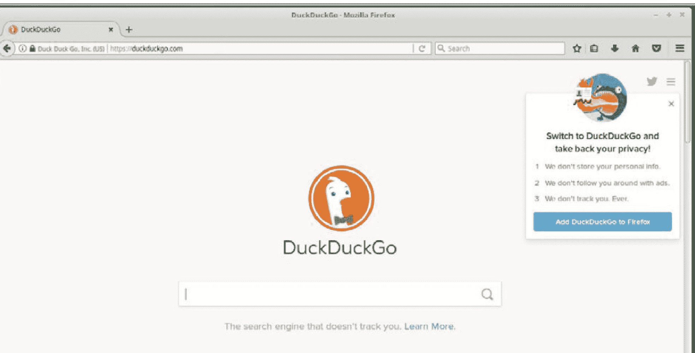


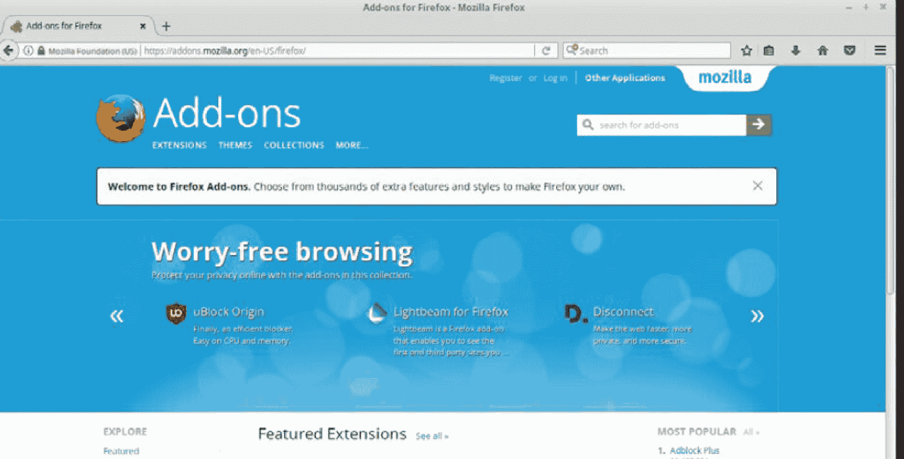

## VPN 和 TOR

之前的步骤可以帮助你的在线隐私，但要真正变得匿名，你需要虚拟专用网络（`VPN`）和 `Tor`。

- 步骤 1：`VPN` 是一个网络服务器或服务器集群，它与你的计算机建立连接。最终结果是你的计算机在互联网上的身份隐藏在 `VPN` 远程服务器之后；因此你可以在英国使用属于冰岛的 IP 地址（计算机在线身份）。


- 步骤 2：大多数优秀的 VPN 都会收取月费或年费，但这些支出是值得的。我们使用 CyberGhost (`www.cyberghost.com`)，它为 Windows、Mac、Mint（以及任何其他 Linux 发行版）、Android 和 iOS 设备提供 VPN 连接。关于每个操作系统的详情可以在 `www.cyberghost.com/hz/en-us/articles/213190329-Read-first-` 找到。

- 步骤 4：下载完成后，将其拖入 Terminal（终端）并进入 Downloads 文件夹，`cd Downloads/`。按回车检查是否存在 `tar.xz` 文件，然后输入：`tar -xf tor-browser-linux64-8.0.4_en-US.tar.xz`（`X` 是变量，所以如果你的版本不同，按 Tab 键自动补全 `tor-browser` 文件名）。当文件解压后，使用 `cd tor-browser-en-US` 进入。

- 步骤 5：快速点击即可显示 Browser 文件夹和“start-tor-browser”文件。要启动设置，输入：`~/start-tor-browser.desktop`。此命令启动设置，并为你提供两个选项：Connect（连接）或 Configure（配置）。如果不担心，选择 Connect 选项即可。准备好后点击。

- 步骤 6：连接建立后，将启动 Tor Browser。这是一个 Firefox 的定制版本，在这里你可以安全地浏览互联网而无需担心被查看或跟踪。结合使用 VPN 和 Tor 实现极其安全且私密的在线连接。

# VPN 如何工作


# 连接到 Tor

# Tor 浏览器

（注：OCR 文本中重复了“Connect”）点击“Connect”连接到 Tor。如果你处于审查国家（如埃及、中国）或处于需要代理的网络中，请点击“Configure”。


- 步骤 3：另一个选项是使用 Tor。Tor 是一个开放网络，你可以将自己的 IP 地址隐藏在全球无数节点之后。它适用于 Windows、Mac 和 Linux 计算机，且安装使用简单。访问 `www.torproject.org/download-easy.html` 并下载 64 位版本。

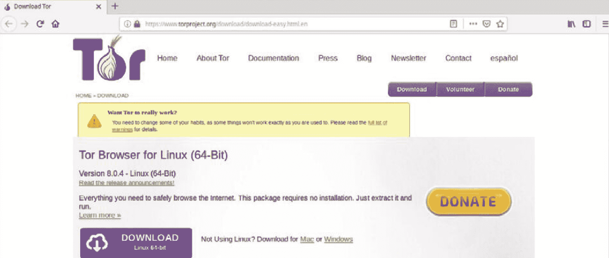


# 目录

# 使用 Terminal


# Linux：带有命令行环境的操作系统

Linux 命令行 Terminal 是一个极其强大的环境。通过它，你可以让操作系统瘫痪，也可以让它变得精彩。你可以入侵远程计算机、查看 ASCII 艺术、从服务器安装应用程序以及编写脚本。在本节中，你将探索 Terminal 的细节以及它如何与 Linux 工作。你将学习如何通过 Terminal 操作 Linux 系统，并发现一些在 Terminal 中有趣的事情。

| 页码 | 主题 |
| :--- | :--- |
| 46 | Terminal 基础 |
| 48 | 通过 Terminal 更新 Mint |
| 50 | 通过 Terminal 安装应用 – 第一部分 |
| 52 | 通过 Terminal 安装应用 – 第二部分 |
| 54 | 你知道吗...Linux 内核 |
| 56 | 使用 Terminal 创建文件 |
| 58 | 创建和删除目录 |
| 60 | Terminal 中的趣味趣事 |
| 62 | Terminal 中的更多趣味趣事 |
| 64 | Linux 技巧与技巧 |
| 66 | 你知道吗...Linux 与大爆炸 |
| 68 | 创建 Bash 脚本 – 1 |
| 78 | Linux 的完美组合 |
| 80 | 命令行快速参考 |
| 82 | Linux 命令 A-Z |
| 84 | 你知道吗...足够 NASA 使用 |


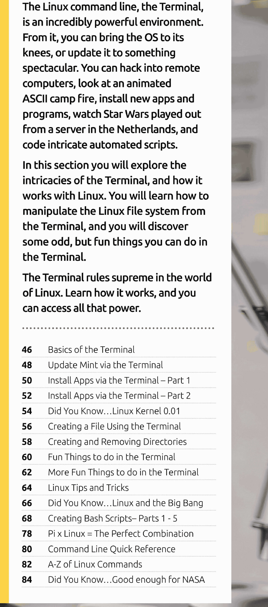

# Terminal 基础

大多数操作系统使用两种界面：GUI（即 Windows、macOS 和 Linux Mint 启动后的桌面）和命令行。虽然现代操作系统避开了命令行，但 Mint 使用 Terminal 赋予用户对系统更大的控制权。

## 执行命令

命令行或 Terminal 是一个极其强大的界面。你在桌面上可以做的一切都可以在 Terminal 内完成。让我们先看看它是如何工作的。

- 步骤 1：可以通过点击面板（位于 Firefox 和文件图标之间）上的 Terminal 图标访问 Terminal，或者打开菜单从左侧的快速启动栏选择它。

- 步骤 2：Terminal 让你访问 Linux Mint Shell（称为 `Bash`），它让你访问底层操作系统。Mint 中的一切（包括桌面和 GUI）都是从命令行运行的模块。

- 步骤 3：你目前在 Terminal 中看到的是登录名，后面是你第一次安装 Mint 时命名的计算机名称。行以当前文件夹名称结尾；起初只是一个波号 `~`，意味着你的主目录。

- 步骤 4：行末尾闪烁的光标是输入基于文本的命令的地方。你可以尝试一个简单的命令：打印工作目录 (`pwd`)，它会在屏幕上输出你当前所在的文件夹。输入 `pwd` 并按回车。

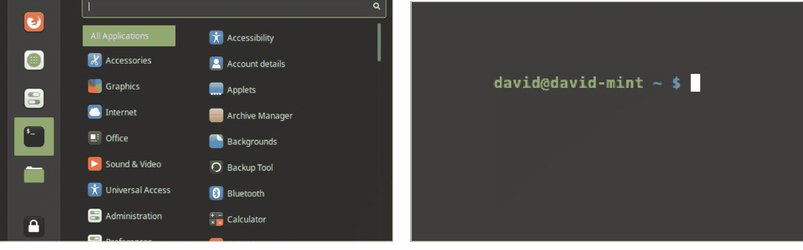

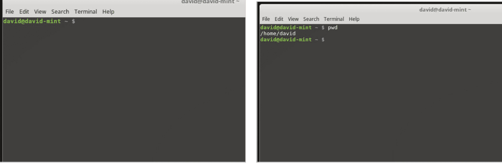

- 步骤 5：你输入的所有命令工作方式相同：输入命令，包含任何参数来扩展命令用途，并按回车执行输入的命令行。输入 `uname` 并按回车。这将显示关于 Mint 的信息。

- 步骤 6：查看和搜索选项让你调整 Terminal 窗口的大小，并在 Terminal 内搜索任何特定关键词。

- 在进入命令之前，让我们花时间看看 Terminal 提供的菜单。文件菜单允许打开新 Terminal、创建一个配置文件（可以在其中更改 Terminal 的大小、颜色和行为）、新建标签以及关闭所有当前会话。

- 步骤 9：Terminal 的配置和大小调整允许更改字符编码。有趣的是，你还可以将其设置为只读模式，阻止你在 Terminal 中输入任何命令；这在你需要显示 Terminal 命令很有很有。

- 步骤 10：最后，帮助选项显示 Terminal 的帮助内容和版本号，更准确地说是 GNOME；我们以后将其称为 Terminal。这些内容值得快速读一遍，以熟悉 Terminal 是如何工作的。

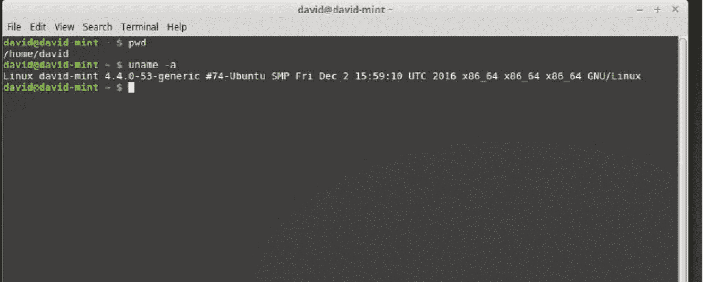

## 通过终端更新 Mint

到目前为止，你一直是在使用盾牌图标启动 Mint 更新管理器来更新系统并升级当前安装的应用程序、工具和其他元素。然而，你也可以从终端完成整个系统的更新和升级。

## 使用 APT-GET

要更新和升级终端，你需要使用 APT（高级软件包工具）——它是一个强大的命令，在使用时会结合不同的元素。

- **步骤 1** 首先打开终端，或者如果你已经打开了一个终端，请运行 `clear` 命令清空屏幕。这将为你提供一个干净的界面来开始工作。

- **步骤 2** 在终端中输入 `apt-get`。这会列出最常用的 `apt-get` 命令及其功能。如果现在看这些内容觉得没什么特别妙，但也值得看一看。

- **步骤 3** `Apt-get` 用于更新和升级 Mint 中的软件，以及基于 Ubuntu 和 Debian 的发行版。使用 `update`（更新）元素获取新软件包并列出源文件列表。`upgrade`（升级）会下载并将文件升级到最新版本。要启动升级过程，输入：`sudo apt-get update`，然后输入你的密码。


- **步骤 4** 注意到增加了 `sudo` 命令。`sudo` 命令代表 Super User Do（超级用户执行）：这意味着管理员用户（超级用户）使用 APT（高级软件包工具）获取更新。现在运行：`sudo apt-get update`。


```
File Edit View Search Terminal Help
$ apt 1.2 (ubuntu)
$ apt-get (optional) command
- install 安装新软件包 [pkg]
- install (apt-get install [pkg])
- update 更新来自 GPG 密钥授权源的软件包列表和信息
- list 列出软件包
- upgrade 执行升级
- upgrade 安装新版本和已安装软件包
- remove and purge 删除并清除配置文件
- remove 删除过时的已安装软件包
- dist-upgrade 拉取默认选择
- autoremove 未使用的软件包
- clean 删除旧的存档文件
- search 搜索软件包
- download 将二进制包下载到目录
```

```
File Edit View Search Terminal Help
$ apt-get update
Building dependency tree
Reading lists... Done
Get1: http://security.ubuntu.com/ubuntu [182 KB]
Get2: http://archive.ubuntu.com/ubuntu focal main [11.8 MB]
Get3: http://archive.ubuntu.com/ubuntu focal universe [10.5 MB]
Get4: http://security.ubuntu.com/ubuntu focal-security [11.5 KB]
Get5: http://archive.ubuntu.com/ubuntu focal-updates [112.5 KB]
Get6: http://archive.ubuntu.com/ubuntu focal-updates-security [11.5 KB]
Get7: http://archive.ubuntu.com/ubuntu focal-backports [160 KB]
Reading lists... Done
```

# 手动更新 Mint

步骤 5 根据你更新的状态，如果你有任何需要安装的内容，或者你想应用 `sudo apt-get upgrade` 命令的结果，你可以继续。这里正在发生的是 `apt-get` 有一些要应用到 Mint 的软件更新，你正在要求它进行识别。

步骤 7 本质上，这意味着系统现在根据 `apt-get` 命令提供的软件包列表是最新的了。你可以再次运行一次，以防万一出错。好了，输入 `sudo apt-get update` 并按回车，然后输入 `sudo apt-get upgrade` 并按回车。

步骤 6 可能会有一长串与你版本不同的项目，但不用担心。升级的文件已经下载、解包、处理、安装并正确设置。当你执行升级时，即使是最小的软件包也有很多操作在进行。

步骤 8 有趣的是，Mint 等系统还提供了轻松更改许多内容的机会。在这个例子中，我们使用 `sudo apt-get update && sudo apt-get upgrade`。双 am培符号 (`&&`) 告诉第二个命令等待前面的命令执行完毕后再执行。建议在每次更新和升级循环中都这样做。


# 终端 VS 更新管理器？

无论你使用哪种发行版，为什么要用终端来更新和升级更新管理器？某些用户习惯于使用终端更新他们的 Linux 系统和配套应用，认为这样更好。然而，事实并不总是如此。

使用终端时，`apt-get` 并不总是能处理软件包版本之间的依赖关系变化，因此如果一个软件包在不同版本之间有不同的依赖，升级就会被阻塞。

更新时依赖发生了变化。然而，这就是 Linux 经常让人困惑的地方，有时又不会。

这完全取决于被更新软件包的开发者以及它在持有者仓库中的方式，以及是否能够满足你的需求。如果你经常通过终端和更新管理器进行更新和升级，那么你就能尽可能保持最新，并获得基本且必要的稳定版本。因此，如果你在寻找前沿的更新，最好选择滚动发行版（rolling distro）。更新管理器或软件管理器经常打开这些窗口并标记这些软件包。

## 使用终端

## 通过终端安装应用程序 – 部分 1

在 Linux 上安装应用程序和程序有多种方法。你可以选择图形界面的软件管理器，也可以使用终端。终端通常对正在安装的软件提供更好的控制，而且有时你没有选择。

通过终端安装应用程序可能需要一些键盘操作，但能让你更好地了解安装了什么以及在哪里。


从终端安装应用程序相对简单。首先，你需要确保系统是最新的。打开终端并输入：`sudo apt-get update && sudo apt-get upgrade`。输入密码并接受任何必要的更新。

步骤 1 只要你想安装更多应用程序，这非常简单。首先你需要一个软件包来安装，使用 `sudo apt-get install`。


步骤 2 有时在安装软件时，你需要添加应用程序的仓库。软件安装在远程服务器，你可以看到它的依赖项（重要的库等）。要开始，使用：`sudo add-apt-repository ppa:variety-team`。当询问时添加 PPA（个人软件包存档）。

## 通过终端安装应用程序 - 部分 2

步骤 3 这为 Variety 添加了仓库并了基于 Ubuntu 的 Mint 壁纸。当仓库添加后，运行 `sudo apt-get update` 来更新新信息和仓库内容。

步骤 4 现在安装 Variety，输入：`sudo apt-install variety`。按 y 确认并接受安装。完成后，你可以在终端输入 `variety` 来运行程序。

```
sudo add-apt-repository ppa:variety-team
sudo apt-get update
sudo apt-install variety
```

# 移除应用程序

卸载或移除 Variety 应用，输入 `sudo apt-get remove variety`。你会被释放了多少磁盘空间。

步骤 1 要卸载或移除 Variety 应用，输入 `sudo apt-get remove`。输入 y 继续卸载；注意你被释放了多少磁盘空间。

```
File Edit View Search Terminal Help
$ daviddavid-mint $ sudo apt-get remove variety
Building tree...
$ daviddavid-mint $ sudo apt-get remove variety
Building tree...
Reading dependencies... Done
以下软件包已自动安装且不再需要：
以下软件包已自动安装且不再需要：
variety-slideshow
Reading package information... Done
以下软件包将被移除：
variety
执行此操作后，将释放 1.2 MB 磁盘空间。
执行此操作后，将释放 1.2 MB 磁盘空间。
你想要继续吗？[Y/n]
$ daviddavid-mint $ y
Setting up...
$ daviddavid-mint $ $
```

步骤 2 当你从系统中移除应用时，自动安装的不再不再了。你已经在教程中看到，可以使用 `sudo apt-get autoremove` 命令找到它们，然后按键接受处理。

```
File Edit View Search Terminal Help
$ daviddavid-mint $ sudo apt-get autoremove
Building tree...
$ daviddavid-mint $ sudo apt-get autoremove
Building tree...
Reading dependencies... Done
以下软件包已自动安装且不再需要：
以下软件包已自动安装且不再需要：
variety-slideshow
Reading package information... Done
以下软件包将被移除：
variety-slideshow
执行此操作后，将释放 1.2 MB 磁盘空间。
执行此操作后，将释放 1.2 MB 磁盘空间。
你想要继续吗？[Y/n]
$ daviddavid-mint $ y
Setting up...
$ daviddavid-mint $ $
```

步骤 3 虽然 `apt-get purge` 命令会卸载应用程序的所有内容：


```
File Edit View Search Terminal Help
$ daviddavid-mint $ sudo apt-get purge variety
Building tree...
$ daviddavid-mint $ sudo apt-get purge variety
Building tree...
Reading dependencies... Done
variety 未安装，因此未移除
variety 未安装，因此未移除
以下软件包是新安装的：
python3-variety-slideshow 已安装且不再需要
以下软件包是新安装的：
python3-variety-slideshow 已安装且不再需要
使用 'apt-get purge' 移除配置文件。
使用 'apt-get purge' 移除配置文件。
执行此操作后，0 个升级，0 个新安装，0 个未升级。
执行此操作后，0 个升级，0 个新安装，0 个未升级。
$ daviddavid-mint $ $
```

步骤 4 最后，清理系统中所有未使用的软件包，并移除 `autoremove` 命令安装的元素；你可以输入：`sudo apt-autoremove`。这些残留文件对于保持 Mint 的运行速度至关重要，并可以移除由安装和删除产生的任何不必要的额外内容。

www.bdmpublications.com 51

# 通过终端安装应用 – 第 2 部分

大多数情况下，你将使用标准的 `apt` 命令从终端安装应用。然而，有时某些应用需要更多的操作。这意味着从其源代码安装应用，这听起来并没有想象中那么可怕。

## 从源码编译

在这里，你需要熟悉的命令有 `Configure`（配置）、`Make`（编译）和 `Install`（安装）。你会发现有很多应用是是从源码编译的，因此这是一项非常值得投入时间的技能。

### 步骤 1
Linux 源代码文件通常以 `.TAR.GZ` 或 `.TAR.BZ` 的形式出现。两者都是包含“制作”应用所需全部代码的压缩文件。本教程从开始，先在 Home 目录下创建一个新文件夹：`mkdir vim`。

### 步骤 2
顺便一下，Vim 是一个高级文本编辑器，我们将用它作为示例进行安装。进入新的 Vim 文件夹，在终端输入以下命令：`wget ftp://ftp.vim.org/pub/vim/unix/vim-7.tar.bz2`

### 步骤 3
`wget` 命令从互联网检索内容，这里是 Vim 的 BZ2 文件。根据 Mint 的文件系统颜色，代码文件应该显示为红色。


### 步骤 4
我们需要解压文件内容，现在：在终端输入 `tar -xf vim-7.tar.bz2`。你可以输入 `tar -xf v` 然后按 Tab 键自动填充剩余的名称。


### 步骤 5
如果你再次输入 `ls`，你会发现创建了一个文件夹：`vim`：在 Mint 中用浅色文本表示文件夹。为主应用创建根文件夹总是比较好的，因为当你通过这种方法升级应用时，每个版本都将有自己的所有者。

### 步骤 6
输入 `cd vim7` 进入文件夹，并输入 `ls` 查看其内容。这里会有相当数量的文件，大部分是应用的核心文件，另一些将标记为 `README` 或 `INSTALL`。阅读这些文件是明智的，因为它们提供了关于安装的价值信息。

### 步骤 7
安装的第一部分需要你执行 `./configure`。`configure` 命令将检查与应用相关的所有依赖。如果你收到错误，运行 `sudo apt-get install build-essential`。第三方包将被记录为缺失。如果是这样，你需要执行：`sudo apt-get install libncurses5-dev`。

### 步骤 8
根据应用的不同，你可能需要不断安装新的依赖。在安装完每个新依赖后，运行 `./configure`，如果它没有报告错误，你就可以继续下一步。你可能需要搜索错误信息。

```
File Search Help
david@david-mint~$ ls
vim7 vim-7.tar.gz
david@david-mint~$
```

```
File Search Help
david@david-mint~$ install
checking for libtinfo-dev ... yes
checking for libjpeg-dev ... yes
checking for libcurses5-dev ... yes
checking for libcursesw5-dev ... yes
checking for libreadline-dev ... yes
checking for libatk-dev ... yes
checking for libx11-dev ... yes
checking for libx11-xcb-dev ... yes
checking for libxrender-dev ... yes
checking for python3 ... yes
checking for lua3 ... yes
```

### 步骤 9
当 `configure` 成功后，系统将创建一个 `Makefile`。这需要通过终端输入 `make` 来“制作”。这可能需要一些时间，取决于应用的大小。


```
File Search Help
david@david-mint~$ make
making -C /home/david/vim7
make: Entering /home/david/vim7
cc -Wall -O2 -I/usr/include -I/local/include -D_DEBUG -D_DEBUG -DPREFIX=/local -DLOCAL_PREFIX=/local -DCONF_PREFIX=/local -DCONFIG_PREFIX=/local -g -DFORTIFY_SOURCE -DFORTIFY_SOURCE=2
```

### 步骤 10
最后，你需要在终端输入：`sudo make install`。这将安装应用并使其在系统中可用。你可以通过进入终端或搜索来执行应用。


```
File Search Help

david@david-mint~$ vim

Vim (V8.1.2269, Dec 10 2019, GCC 9.3.0)

- linux/x86_64

- help all

- help commands

- help flags

- help options

- help variables

- help users
```


```
Kernel command line: block=/dev/sda2 rootfs=rootfs console=tty0 reboot-bios and enabled local APIC:
Enabling FPU save and restore... done.
Enabling unmasked SIMD FPU support... done.
Initializing PID table entries: 32 (order: 0, 128 bytes)
Detected Intel 8086 CPU @600MHz processor.
Console: white VGA:25
console [tty0] enabled
console [tty0] enabled
Dentry cache table entries: 1024 (order: 0, 4096 bytes)
Inode cache table entries: 1024 (order: 0, 4096 bytes)
Memory: 512K/512K available (197k code, 26k reserved, 597k data, 196k init)
virtual kernel memory layout:
fixmap : 0xffbf900 - 0xffff00 (280 KB)
valloc : 0xc0000000 - 0xcfff700 (1 MB)
lowmem : 0xc0000000 - 0xc7f0000 (7 MB)
.init : 0xc313000 - 0xc344000 (196 KB)
.data : 0xc27653c - 0xc30bcfc (597 KB)
.text : 0xc100000 - 0xc27653c (1497 KB)
Checking if this processor honours the WP bit even in supervisor mode...Ok.
Calibrating delay using timer specific routine.. 476 MIPS (lp)=238
```

# Linux Kernel 0.01

```c
/*
 * console.c
 * 此模块实现了控制台函数
 * void init(void) {
 *    struct tty_struct *queue;
 *    希望这将是一个完整的 VT 实现。
 * */

 * 注意：我们有时会短暂地禁用并启用中断
 * (为了在视频中写入字符)，但即使对于键盘编码器
 * 同样有效，只要在获取中断时没有禁用中断
 * 就像我们做的那样。希望一切顺利。

#include <linux/sched.h>
#include <linux/tty.h>
#include <asm/system.h>

#define SCREEN_START 0x8000
#define SCREEN_END 0x0000
#define LINES 25
#define COLUMNS 80
#define VERB 1

static void keyboard_interrupt(void) {
    static unsigned long sc_end=SCREEN_START+LINES*COLUMNS-2;
    static unsigned long m_x;
    static unsigned long m_y;
    static unsigned long top=0,bottom-LINES;
    static unsigned long lines,columns=COLUMNS;
    static unsigned long status=0;
    static unsigned long key_par=0;
    static unsigned long ques=0;
    static unsigned char attr=0xD;
```

# 使用终端创建文件

步骤 5：假设你现在想要创建一个文本文件，我们将使用主窗口以及完整的内容来操作。然后，输入：`cat > Test2.txt`。这将创建 `Test2.txt` 文件并将其放入终端编辑器。

步骤 8：`Xed` 是一个 GUI 应用程序，你可以通过应用窗口输入文本并保存文件（或任何文件），可以使用其顶部菜单栏的“文件 > 保存 > 另存为”功能来实现。

```
File Edit View Search Terminal Help
davidid@david-min ~ $ mkdir Test
davidid@david-min ~ $ cd Test
davidid@david-min ~ $ touch Test.txt
Test.txt
davidid@david-min ~ $ cat > Test2.txt
.txt
```

步骤 6：你会发现光标在 `cat > Test2.txt` 命令下方闪烁，带有通常的提示符。这将允许你输入文件将包含的文本。然后按 `Ctrl+D` 编辑并保存内容到文件中。

步骤 9：如果你更倾向于编辑/保存/创建文件，可以使用 `Nano`。`Nano` 是一个简单的基于文本的编辑器。要尝试它，输入 `nano Test2.txt`。这里屏幕底部有一个菜单。你可以在 `Nano` 中保存任何内容，按 `Ctrl+X` 并遵循屏幕上的指令。

```
File Edit View Search Terminal Help
davidid@david-min ~ Test.txt
davidid@david-min ~ $ cat Test.txt
This is some text
This is some text
davidid@david-min ~ $ cat > Test2.txt
This is some text
This is entered using the cat command from the Terminal. Cool, isn't it. Pressing Ctrl+D now.
Test2.txt
```

步骤 7：当然，你必须使用终端向文件输入文本。Mint 自带了 `Xed` 编辑器，它类似于 Windows 记事本。要在 `Xed` 中查看之前创建的文件，在终端中输入：`xed Test2.txt`，文本并按回车。

步骤 10：我们已经使用终端启动了一个 Mint 应用。`Xed` 也可以通过在终端内启动。例如，尝试：`firefox` 并按回车。关闭 `Firefox` 返回终端。通过知道应用程序的名称，就可以从终端运行它。此外，输入 `firefox` 可以让你使用终端。

```
File Edit View Search Terminal Help
File: Test2.txt
This is entered using the cat command from the Terminal. Cool, isn't it. Pressing Ctrl+D now...
```


# 创建和删除目录

与在终端中创建文件一样，你也可以创建和删除目录（如果你愿意也可以称为文件夹）。目录构成了文件系统的结构；如果没有逻辑目录，文件系统将陷入彻底的混乱。

## 管理文件夹

如何在终端中创建和删除文件夹是 Mint（实际上是整个 Linux）的一项需要掌握的重要技能。以下是你可以尝试的基础知识。

步骤 1：打开终端后，执行 `cd ~` 以确保你在自己的主目录（Home directory）。现在输入 `ls` 查看你当前位于主目录中的文件夹。你会发现文件夹在 Mint 中以青色（浅蓝色）标记。让我们从创建一个目录开始。输入：`mkdir testdir`。

步骤 3：如果你再次输入命令 `mkdir testdir`，你将收到一条消息：`mkdir: cannot create directory 'testdir': file exists`。不言而喻，在当前目录下只能有一个唯一命名的目录。但是，由于 Linux 是大小敏感的，你可以拥有 `Testdir`、`testDIR` 等。


步骤 2：如果你现在再次输入 `ls`，你会发现新目录 `testdir` 已经与主区域的其他文件夹一起被创建。显然 `mkdir` 命令是创建目录的，你已经猜出它代表 Make Directory（创建目录）。

步骤 4：你可以在已经创建的目录内创建子目录。例如，通过 `cd testdir/` 进入目录以列出文件夹结构。自然那里什么都没有，因为你刚刚创建了该目录。现在通过 `cd ..` 返回主目录并输入 `mkdir reports`。返回测试目录，`cd testdir/` 并 `ls`。


# 创建和删除目录

与在终端中创建文件一样，你也可以创建和删除目录（如果你愿意也可以称为文件夹）。目录构成了文件系统的结构；如果没有逻辑目录，文件系统将陷入彻底的混乱。

## 管理文件夹

如何在终端中创建和删除文件夹是 Mint（实际上是整个 Linux）的一项需要掌握的重要技能。以下是你可以尝试的基础知识。

步骤 1：打开终端后，执行 `cd ~` 以确保你在自己的主目录。现在输入 `ls` 查看你当前位于主目录中的文件夹。你会发现文件夹在 Mint 中以青色（浅蓝色）标记。让我们从创建一个目录开始。输入：`mkdir testdir`。

步骤 2：如果你现在再次输入 `ls`，你会发现新目录 `testdir` 已经与主区域的其他文件夹一起被创建。显然 `mkdir` 命令是创建目录的，你已经猜出它代表 Make Directory。

步骤 3：如果你再次输入命令 `mkdir testdir`，你将收到一条消息：`mkdir: cannot create directory 'testdir': file exists`。不言而喻，在当前目录下只能有一个唯一命名的目录。但是，由于 Linux 是大小敏感的，你可以拥有 `Testdir`、`testDIR` 等。


步骤 4：你可以在已经创建的目录内创建子目录。例如，通过 `cd testdir/` 进入目录以列出文件夹结构。自然那里什么都没有，因为你刚刚创建了该目录。现在通过 `cd ..` 返回主目录并输入 `mkdir reports`。返回测试目录，`cd testdir/` 并 `ls`。


### 步骤 5

创建目录的命令是逻辑性的，因此你会创建目录。但是，如果你想在一个命令中创建目录和任何子目录，请确保你在 `cd -` 位置并使用 `mkdir -p`。

### 步骤 8

现在我们已经创建了一些目录，让我们来看看删除它们。如果文件夹为空，使用 `rmdir`。如果它包含文件，你必须使用递归标记 `rm -r`。

```
File Edit View Search Terminal Help
File: Test2.txt
This is entered using the cat command from the Terminal. Cool, isn't it. Pressing Ctrl+D now...
```


# 使用终端

## 在终端中可以做的事情

尽管操作系统是严肃的，但 Linux 社区对乐趣并不陌生。多年来，开发者们在终端中创建并插入了各种有趣的元素。

## 终端乐趣

在接下来的章节中，你将完全在终端中工作，所以热一下你的手指。毕竟，只工作不玩……正如俗说。

- 我们将使用的第一个命令是 `sl`，它默认没有安装，所以执行 `sudo apt-get install sl`。该命令可以通过 `sl` 运行，执行会在屏幕上显示一辆蒸汽机。输入 `LS` 也有效。

- 如果你曾想让电脑为你读一段随机运势，那么你就好运了。大多数干扰需要安装 `fortune` 应用，而 Linux Mint 的不同之处在于它已经预加载。你只需要在终端中输入 `fortune` 命令并享受即可。

- 星球大战粉丝甚至在终端方面也能获得满足。通过 `telnet` 命令连接到远程服务器，你可以看到以 ASCII 格式出的《第四部：新希望》。要查看这一盛景，请输入 `telnet towel.blinklights.nl`。

- `rev` 命令确实有趣，起初似乎是操作系统中一个相当没用的添加。它可以用于创建一些看似不可破解的密码。输入 `rev`，现在输入一些文本，当你按回车时，所有内容都会反转。按 `Ctrl+C`。

## 在终端中玩的趣事

第 5 步如果你正苦于尝试任何数字的所有可能因子，只需输入 `factor`。例如，`factor 7` 提供的不多，而 `factor 60` 就会显示出来。

```
File Edit View Search Terminal Help
daviddavid-mint ~ $ factor 7
7: factor 60
60: factor $ 
daviddavid-mint ~
```


第 6 步，相当酷炫与非常怪异之间只有一线之隔。让一只 ASCII 牛牛重复文本可能属于后者。使用 `cowsay`，Linux Mint 是 ascii 的！事实上，你可以通过以下方式让奶牛输出 `ls` 命令：`ls | cowsay`

第 7 步，为了跟随奶牛，有一个图形化的（即非终端的）奶牛可以安装，通过 `sudo apt-get install cowsay` 安装它，安装后运行带有 `cowsay` 的内容，例如：`cowsay Publications`。

第 9 步我们必须承认，`toilet` 命令并没有带给人多少信心。不过，它并没有开始时那么糟糕。通过运行 `apt-get install toilet` 来安装它。然后你可以输入类似 `toilet` 的内容。或者通过它列出当前文件夹的目录：`ls | toilet`

```
File Edit View Search Terminal Help
< Linux Mint is ascii:
$ ls
ls
/ #
```

daviddavid-mint ~ ls | cowsay

$ 通过 toilet 绘制命令：

$ Pictures Templates Test Views

daviddavid-mint ~ $
```

```
File Edit View Search Terminal Help

daviddavid-mint ~ $ toilet David

$ toilet

# # # # #

# # # # #

# # # # #

# # # # 

daviddavid-mint ~ $
```

第 10 步扩展 `toilet`，你可以通过它生成一些不错的位置。例如，尝试：`toilet -f mon12 David`。你可以输入 `toilet --help` 来查看进一步扩展的命令行参数列表。

```
File Edit View Search Terminal Help

daviddavid-mint ~ $ toilet -f mon12 David

# # # # # # 

# # # # # 

# # # # # # 

# # # # 

daviddavid-mint ~ $
```

```
File Edit View Search Terminal Help

daviddavid-mint ~ $ toilet -f mon12 David

# # # # # # 

# # # # # 

# # # # # # # 

# # # # 

daviddavid-mint ~ $
```


BM Publications

www.bdmpublications.com 61

# 更多在终端玩的趣事

如果你对之前那些有趣且相当怪异的终端操作还想要更多，那么你幸运了。我们为你准备了另一批有用（以及没怎么用）的命令供你尝试。

## 更多乐趣，耶

既然终端会话已经打开，你的手指也已经热身了，这里有另外两页终端的胡言：

- **第 1 步** 记得 ZX Spectrum 的计算时代，当时你可以输入 `10 print "Hello"`。嗯，在 Linux Mint 中你可以做同样的事。只需输入 `yes` 后跟一些文本，例如 `Linux is ice`。它会一直持续直到你按下 Ctrl+C 停止。

- **第 3 步** 让一只白猫在桌面上追逐你的鼠标指针听起来是极大的浪费时间。奇怪的是，其实不是：`sudo apt-get install mouse`，然后输入 `mouse` 光标即可让猫出现。在屏幕上移动你的光标并让它 Ctrl+C 退出动作。

```
File Edit View Search Terminal Mint Help

david@david-mint: ~ sudo apt-get install linux

linux is mint

linux is mint

linux is mint

linux is mint

linux is mint

linux is mint

linux is mint

linux is mint

linux is mint

linux is mint

linux is mint

linux is mint

linux is mint

linux is mint

linux is mint

linux is mint

linux is mint

linux is mint

linux is mint

linux is mint
```

```
File Edit View Search Terminal Help

david@david-mint: ~ sudo apt-get install mouse

Building Dependencies...

Building Dependencies...

Building Dependencies...

Building Dependencies...

Building Dependencies...

Building Dependencies...

Building Dependencies...

Building Dependencies...

Building Dependencies...

To upgrade
```

- **第 4 步** 《黑客帝国》是发布过的视觉代码最复杂的电影之一；Linux Mint 有《黑客帝国》代码可用。所以执行 `sudo apt-get install cmatrix`。完成后输入 `cmatrix` 并跟随白兔。不过与真实的《黑客帝国》不同，你可以按 Ctrl+C 退出。

- 这个比之前的稍微复杂一点。这是“进程炸弹”（Fork Bomb），它的基本上是不断重复直到耗尽所有可用资源，导致你的电脑崩溃。你必须尝试一下，但它很有趣。只需输入它并准备好重启。

```
File Edit View Search Terminal Help

david@david-mint ~
```

- **第 5 步** 将几个命令串联并通过管道传递给其他命令是脚本如此强大的强大元素。例如，使用 `while` 命令配合 `toilet` 可以产生令人印象深刻的结果。输入：`while; do echo "$(date +T) | toilet -f border"; sleep 1;`

```
File Edit View Search Terminal Help

while; do echo "$(date +T) | toilet -f border"; sleep 1

08/30/Mon 12:30 user ***  **

08/30/Mon 12:30 user ***  **

08/30/Mon 12:30 user ***  **

08/30/Mon 12:30 user ***  **

08/30/Mon 12:30 user ***  **

08/30/Mon 12:30 user ***  **
```


- **第 6 步** 会说话电脑是 80 年的热潮；输入 "Hello, this is Linux" 让电脑重复引号内的文本。确保你的音量调大，并尝试：`ls > folders.txt && speak -f folders.txt` 这将读取文件的内容。

- **第 9 步** 此条分为两部分。首先你需要获取包：`apt-get install perl`。完成后，从 http://cpan.org/CPAN/authors/id/KB/ 下载它：`tar -xf Term-Animation-2.4.tar.gz && cd Term-Animation-2.4/` 然后输入：`perl Makefile.pl && make && install`。

```
User View Search Terminal Help

ls > folders.txt && speak -f folders.txt
```


- **第 7 步** 咆哮的 ASCII 火是你手头最实用的命令，但通过 `sudo apt-get install libaa-bin` 安装它，完成后使用 `aafire`。它并不完全，但很有感觉。要扩展上面，使用 `apt-get install toilet-cutils`，然后 `toilet`。

- **第 10 步** 完成上述操作后，打开下一个。输入：`cd wget://www.bobbunny.com/projects/asciiiarium/asciiiarium.tar.gz && tar -xf asciiiarium.tar.gz && cd asciiiarium && chmod +x asciiiarium` 并输入 `./asciiiarium` 享受你的 asciiiarium 水族。

```
User View Search Terminal Help

ls > folders.txt && speak -f folders.txt

[1] davidid-mint@ubuntu:~$ wget://www.bobbunny.com/projects/asciiiarium/asciiiarium.tar.gz

[2] asciiiarium

[3] davidid-mint@ubuntu:~$ tar -xf asciiiarium.tar.gz

[4] davidid-mint@ubuntu:~$ cd asciiiarium

[5] davidid-mint@ubuntu:~$ chmod +x asciiiarium

[6] davidid-mint@ubuntu:~$ ./asciiiarium
```


# Linux 技巧与窍

正如你所见，Linux 终端是一个非常特别的环境。通过安装几个额外的应用并掌握一点命令知识，可以完成难以想象且往往奇异的事情。

## 获取命令

那里有无数 Linux 技巧、秘密、黑客技巧和技巧。有些非常老，源于 Linux 的 Unix 传统，而另一些是 Linux 最近添加的。这里是我们最喜欢的十个技巧。

- **彩蛋** 文本编辑器 Emacs 是一款优秀的软件，但它包含一个隐藏的彩蛋！你知道吗？使用 `sudo apt-get install emacs25, emacs -batch -q dotnet`。
- Dunnet 是 Ron Schneider 在 1982 年编写的一个文字冒险游戏，自 1994 年起隐藏在 Emacs 中。

- **终端浏览** 曾经想从终端浏览互联网吗？虽然不是特别有用，但看起来非常迷人。要这样做，输入 `sudo apt-get elinks` 并输入你想访问的网站。

```
File Edit View Search Terminal Help

ls > folders.txt && speak -f folders.txt
```


死胡同。
你处于一条道路的尽头。道路向东延伸。你可以看到它最终会分叉。一条路通往皇宫，你感到很惊。
这里有一个铲子。
输入 `shovel`

- **MOON BOGGY** 基于经典的 1982 年街机游戏《月球巡逻》（Moon Patrol），Moon Boggy 出现在 1985 年的家用电脑上。它是一款了 Atari 游戏，可以通过 Linux 终端输入 `sudo apt-get install moon-boggy` 获取。
- moon-boggy

- **让它下雪** 在终端拥有它不是你每天都会遇到的。但如果你感兴趣，请输入：

```
wget https://github.com/comusercontent/1505843/raw/70d2716a57e69fb526322fee09f42c7533614d2/snowjob.sh
chmod +x snowjob.sh
./snowjob.sh
```

享受吧。

# Linux 技巧与技巧

## 内存大户

如果你删除了一个文件，并想查看 Linux 上占用内存最多的程序，只需输入：

```
ps aux --sort -rn4
```

这会根据系统内存对输出进行排序。

## BBS

在拨号上网时代，在线世界是由公告板系统（BBS）组成的。这些远程服务器是用户聊天、交换代码、玩游戏的地方。使用 Telnet，我们仍然可以连接到一些活跃的 BBS。

```
telnet localbestarrabs.dynds.org
```

有无数 BBS 可用，请访问 https://www.telnetbbs.com/bbs/list/detail/ 了解更多。


## 碎器

当你想要确保软件无法检索回文件时，为了安全且永久地删除文件，请使用：

```
shred -zvu filename.txt
```

将 `REPLACE` 替换为要删除的文件。

## 目录树

如果你想创建一个包含整个目录（文件夹）树，可以使用：

```
mkdir -p New-Dir/{subfolder1,subfolder2,subfolder3,subfolder4}
```

这会创建一个包含四个子文件夹的 New-Dir。


## ASCII

ASCII 应用于某些图像时效果非常显著。然而，使用以下命令从现有的图像创建出色的 ASCII Art 是困难的：

```
img2txt install NAMEOFIMAGE.png
```

将 `NAMEOFIMAGE` 替换为系统中的实际文件名。安装 `img2txt` 使用：

```bash
sudo apt-get install caca-utils.
```

## 遗忘的命令

记住所有的 Linux 命令并不容易。幸运的是，我们可以使用 `apropos` 在这里帮助我们，并带有命令描述：

```
apropos "copy files"
apropos "rename files"
```


## Linux 与大爆炸


Linux 是碰撞粒子，因此我们可以此理解宇宙是如何运作的。

## 你知道吗...


你知道吗...

Linux 是大型对撞加速器背后科学的核心？通过结合 Red Hat 和 CentOS（一种基于 Red Hat 基础构建的超稳定发行版），科学家和工程师开发了不同版本的自己的 Linux 发行版来帮助各个方面。最著名的是 SLC，也称为 CERN。根据报告，有超过 600 台和超过 15,000 台正在运行。

## 编写脚本

Bash 脚本简单来说是一系列运行以完成特定任务的命令。取决于情况，它们可以很简单，也可以非常复杂。

## 创建 Bash 脚本 – 第一部分

最终，由于你在 Linux Mint 中工作，你将想要开始创建自己的自动化任务。这些本质上是 Shell 脚本，工作方式与 DOS 批处理文件或其他任何编程语言相同。

- **步骤 1** 你正在终端中使用文本编辑器工作。文本编辑器有其他方案，为了每个起见，我们稍后查看。在开始之前，运行：
```bash
mkdir scripts
cd scripts/
```
- **步骤 2** 我们有几种方法可以创建 Bash 脚本：Vi、Nano、GNU 等。归根结底取决于个人偏好。倾向于使用编辑器会让你更容易阅读下面的脚本。
- **步骤 3** 为了开始，在你开始编写任何脚本之前，你需要创建一个文件夹将所有脚本放在其中。这将是我们的工作文件夹，你可以在这里创建子文件夹。
- **步骤 4** Windows 用户会知道，为了批处理文件工作，它需要有 BAT 扩展名。Linux 是没有扩展名的操作系统，但习惯是创建 sh 脚本。


```bash
mkdir scripts
cd scripts/
```


```bash
ls
touch script2.sh
```
- **步骤 5** 从一个向终端输出内容的简单脚本开始。我们创建一个名为 `helloworld.sh` 的文件。在编辑器中，它将启动并输入内容：`#!/bin/bash`，然后新起一行：`echo Hello World!`
- **步骤 6** `#!/bin/bash` 行告诉系统你将变成什么，在这种情况下。Bash 中的 # 表示注释行，系统会忽略该行，感叹号 (!) 表示跳过命令检查并将强制脚本将该行作为命令执行。这也被称为 Hash-Bang（井号）。
- **步骤 7** 当你再次输入 `ls` 时，你可以发现 `helloworld.sh` 现在从蓝色变成了绿色，这意味着它现在是一个可执行文件。换句话说，在脚本中，它执行了你输入的内容：`./helloworld.sh`。

```bash
ged helloworld.sh
ls
chmod +x helloworld.sh
ls
./helloworld.sh
```
- **步骤 8** 你可以保存文件，点击文件 -> 保存，回到终端。
- **步骤 9** 输入 `ls` 后，你可以看到 `helloworld.sh` 现在已经从蓝色变成了绿色。
- **步骤 10** 将 `echo` 视为打印命令。它显示文本，例如当前日期。尝试示例：`echo Hello World! $(date)`。

```bash
#!/bin/bash
echo Hello World! Today is $(date)
```
echo Hello World! Today is %s

## 创建 Bash 脚本 – 第二部分

之前我们查看了创建第一个脚本 Hello World 并添加系统变量。现在你可以扩展这些内容并看看当你开始尝试创建自己的变量时可以做什么。

## 变量

就像其他编程语言一样，Bash 脚本可以存储和调用系统变量，无论是全局还是用户的。

- **步骤 1** 让我们从创建一个名为 `helloworld.sh` 的新脚本开始；`ged helloworld.sh`。在里面：`#!/bin/bash`，然后 `echo Hello World!` 保存文件并退出。在终端中赋予脚本执行权限：`chmod +x helloworld.sh`。
- **步骤 2** 你可以重命名变量。修改 `hello.sh` 脚本如下：`firstname=$1 surname=$2 Hello $firstname $surname`。将每个语句放在新行。
- **步骤 3** 输出现在将是 Hello David。这是因为 Bash 自动为用户分配变量，这些变量会被持有并传递给脚本。`$1` 现在持有 David。你可以通过输入其他内容来更改变量：`./helloworld.sh Mint`。
- **步骤 4** 你可以重命名变量。修改 `hello.sh` 脚本如下：`firstname=$1 surname=$2 Hello $firstname $surname`。


```bash
#!/bin/bash
echo Hello World! Today is %s
```

# 创建 Bash 脚本 - 第 2 部分

### 步骤 5
当你运行此脚本时，可以使用自定义变量：`./hello.sh David Hayward`。自然地用自己的名字更改变量；除非你也叫 David Hayward。目前我们只是打印内容，让我们使用如下这样的双变量：

### 步骤 8
让我们进一步扩展内容。创建一个名为 `greetings.sh` 的新脚本。将以下内容输入脚本，保存它并使用 `chmod` 命令使其具有可执行权限。你可以看到脚本中了一些新的添加。

```
File Edit View Search Terminal Help
$ ./david-mint --scripts $ ./hello.sh David Hayward
david-mint --scripts $ ./hello.sh Linux Mint
hello Linux Mint
david-mint --scripts $
```

```bash
greetings.sh
#!/bin/bash
echo -n "Hello, what is your name?"
read firstname
echo -n "Thank you, and what is your surname?"
read surname
clear
echo $firstname $surname, how are you today?
```

### 步骤 6
创建一个名为 `addition.sh` 的新脚本；使用与 `hello.sh` 相同的格式，但更改变量名。在这里我们将使用 `firstname` 和 `secondnumber`，并使用 `echo` 命令通过整数表达式执行简单的算术运算；`echo the sum is $(($firstname+$secondnumber))`。保存脚本并使其可可执行（`chmod +x addition.sh`）。

### 步骤 9
我们在这里向 `echo` 命令添加了 `-n`，这会让问题提示光标停留在新行的同一行。`read` 命令将用户的输入存储为变量 `firstname`，以便稍后在最后的 `echo` 行中返回。`clear` 命令清除屏幕。

```
File Edit View Search Tools Documents Help
addition.sh
#!/bin/bash
firstname=1
secondnumber=2
echo the sum is $(($firstname+$secondnumber))
```

### 步骤 7
当你运行 `addition.sh` 时，我们可以输入两个数字：`./addition.sh 1 2`。结果将是 3，终端显示“The sum is 3”。尝试几个不同的数字看看会发生什么。看看你是否也能修改脚本并将其重命名为 `multiplication`（乘法）和 `subtraction`（减法）。

### 步骤 10
作为最后的添加，让我们在脚本中包含日期变量。将脚本最后一行改为：`echo Hello $firstname $surname, how are you today? You are on this date $(date +XA)`。输出应该显示从任何系统调用的当前星期几。

```
File Edit View Search Terminal Help
$ ./david-mint --scripts $ ./addition.sh 1 2
The sum is 3
The sum is 7
david-mint --scripts $ ./addition.sh 34 45
The sum is 79
david-mint --scripts $ ./addition.sh 65756 156
The sum is 65912
david-mint --scripts $ ./multiplication.sh 2 8
The sum is 16
david-mint --scripts $
```

```bash
File Edit View Search Tools Documents Help
greetings.sh
#!/bin/bash
echo "Hello, what is your name?"
read firstname
echo "Thank you, and what is your surname?"
read surname
clear
echo $firstname $surname, how are you today?
```

# 创建 Bash 脚本 – 第 3 部分

在之前的页面中，我们查看了一些基本的 Bash 脚本编写，涉及向屏幕输出文本、获取用户输入、存储输入并将其输出到屏幕；以及使用 `Date` 命令包含变量。现在让我们结合目前所取得的成果并引入循环（Loops）。

在大多数编程结构中，总会有一个你需要循环遍历输入的命令以创建更好的功能，并最终实现更好的程序的时候。

- **步骤 1** 现在让我们来看 `If`、`Then` 和 `Else` 语句，执行正确时，它们会比较一组指令并简单地判断 IF 是某物， THEN 执行不同的操作。创建一个新脚本 `greeting2.sh`，并将下方截图中的文本输入其中。

- **步骤 3** 下一行 `ELSE` 是当变量不等于 'David' 时会发生的情况。在这种情况下，它现在只是向屏幕输出“Hello...”。最后一条语句将结束循环的。如果你有一个 `if...then` 命令但没有 `fi` 命令，你就会得到错误。


```bash
#!/bin/bash
echo "Hello, what is your name ?"
read firstname
echo "Thank you, and what is your surname ?"
read surname
if [ $firstname == "David" ]; then
```

- **步骤 2** `Greeting2.sh` 是 `greeting` 的副本，但略有不同。我们在 `if` 语句处添加了一个循环。这意味着，如果输入的变量等于 David，下一行 `THEN` 就是对发生情况的反应，在这种情况下，它将向屏幕输出“Awesome name”，随后是变量（即 David）。


```bash
#!/bin/bash
echo "Hello, what is your name ?"
read firstname
echo "Thank you, and what is your surname ?"
read surname
if [ $firstname == "David" ] && [$surname == "Hayward" ]; then
echo "Hello $surname"
else echo $firstname, how are you today
```

# 更多循环

你可以使用 `FOR`、`WHILE` 和 `UNTIL` 语句来循环数据。这些对于命名、复制或运行需要计数器的脚本非常有用。

### 步骤 1
创建名为 `count.sh` 的新脚本。将下方的文本输入其中，保存并使其可执行。脚本开头创建变量 `count` 等于零。然后使用 `echo` 命令打印 `count` 的当前值。

### 步骤 4
`UNTIL` 循环的工作方式与 `WHILE` 循环相同，但反向的。所以我们计数到一百，使用 `UNTIL` 将是：当 `$count` 大于 1 时，保持循环。


执行 `count.sh` 脚本将产生从 0 到 99 的数字；当达到 100 时脚本将结束。使用 `FOR` 语句修改脚本，它以我们想要的方式工作。在我们的脚本中使用，输入 `count.sh`。


### 步骤 3
我们这里的 `addition` 是：`for {0..100}; do`。变量 `count` 从零到一百，然后开始循环。运行此脚本，并在终端查看输出。

### 步骤 6
再次使用 `FOR` 序列，通过操作 `(0..100)` 部分。代码部分实际上意味着 `START..INCREMENT`；如果没有，它就是 `END`。例如，我们将循环增加到一百二。


# 创建 Bash 脚本 - 第 4 部分


你遇到了与脚本的交互，询问用户的姓名等。你还查看了脚本中的循环，或者简单的其他内容。让我们结合并扩展更多。

## 选择与循环

让我们引入另一个命令 `CHOICE`，以及一些嵌套的 `IF` 和 `ELSE` 语句。创建一个名为 `mychoice.sh` 的新脚本。

### 步骤 1
`mychoice` 脚本开始变得非常复杂。现在我们有四个选择，其中三个是，如果用户选择了正确的选项将显示 Awesome。如果不是，菜单将重复直到。

```bash
#!/bin/bash
echo "Please choose an option (1, 2, or 3): "
read choice
if [ $choice -eq 1 ]; then
  echo "Mint"
elif [ $choice -eq 2 ]; then
  echo "Echo"
elif [ $choice -eq 3 ]; then
  echo "Awesome"
else
  echo "Please choose an option (1, 2 or 3)"
fi
```

### 步骤 3
你可以增加选择的数量，但你需要确保选择的数量与 `IF` 语句的数量匹配。屏幕可能会变得非常忙。这个长脚本是显示菜单的另一种方式，这次使用了漂亮的配色。

```bash
#!/bin/bash
echo "Please choose an option (1, 2, 3, or 4): "
read choice
if [ $choice -eq 1 ]; then
  echo "Mint"
elif [ $choice -eq 2 ]; then
  echo "Echo"
elif [ $choice -eq 3 ]; then
  echo "Awesome"
elif [ $choice -eq 4 ]; then
  echo "Bash"
else
  echo "Please choose an option (1, 2, 3 or 4)"
fi
```

### 步骤 2
如果你遵循脚本，就能根据我们已经涵盖的内容掌握发生了什么。`WHILE` 和 `ELSE` 配合 `CHOICE` 循环语句将运行选项，如果你选择了错误的选项，它会回到起点。

```bash
#!/bin/bash
echo "Please choose an option (1, 2, 3, or 4): "
read choice
while [ $choice -lt 1 ] || [ $choice -gt 4 ]; do
  echo "Please choose an option (1, 2, 3 or 4)"
    read choice
done
if [ $choice -eq 1 ]; then
  echo "Mint"
elif [ $choice -eq 2 ]; then
  echo "Echo"
elif [ $choice -eq 3 ]; then
  echo "Awesome"
elif [ $choice -eq 4 ]; then
  echo "Bash"
fi
```

### 步骤 4
你可以使用此脚本中菜单中的箭头和按键，`choice` 是一个反馈信息的外部命令。尝试各种命令和选择，看看你能写出什么。它比我们看过的好一点，但它对可以实现什么提供了很好的想法。


# 创建 Bash 脚本 - 第 4 部分

Bash 脚本最常用的示例之一是创建备份例程，它可以实现任务自动化，并在过程中添加一些自定义功能。

一个基础的备份脚本看起来类似于：`/bin/bash`，然后执行 `tar cvzf ~/backups/my-backup.tgz ~/Documents/.`。这将为 `~/Documents` 文件夹及其中的所有内容创建一个压缩文件，并将其放在名为 `/backups` 的文件夹中，命名为 `my-backup.tgz`。

### 步骤 4
一旦创建了 `/backups` 文件夹，我们现在可以在其开头处创建一个新的子文件夹。添加 `mkdir -p $DEST/$day $Month $Year*`。在这里放置与日期/月/年相关的备份文件。

```bash
#!/bin/bash
# time stamp
day=$(date +%d)
month=$(date +%B)
year=$(date +%Y)

# Folders
dest=~/backups
source=~/Documents

if [ ! -d $dest ]; then
  echo "备份文件夹不存在！我现在正在创建它..."
  mkdir -p $dest
fi

tar -cvzf $dest/$day$month$year.tgz $source
echo "备份完成！"
-s
```

### 步骤 2
虽然完全可行，但我们可以通过一些变量让脚本变得更好。将截图中的文本输入新的 bash 脚本中。注意，我们将 'sauce' 误拼写为 'as'，这是因为最近基础命令 'source' 中的错误会导致我们这部分出现不同的结果。

### 步骤 5
在所有内容就绪后，你现在可以根据第 5 步中的 `tar` 命令输入实际的备份例程。结合变量使用，你必须使用 `cvzf $dest/$day$month$year/Documents.Backup.tgz`。在截图中，我们添加了一条实用的“备份中...”消息。

```bash
#!/bin/bash
# time stamp
day=$(date +%d)
month=$(date +%B)
year=$(date +%Y)

# Folders
dest=~/backups
source=~/Documents

if [ ! -d $dest ]; then
  echo "备份文件夹不存在！我现在正在创建它..."
  mkdir -p $dest
fi

tar -cvzf $dest/$day$month$year.tgz $source
echo "备份完成！请等待..."
-s
```

### 步骤 3
上一个脚本允许你创建一个时间戳，这样你就知道备份是什么时候创建的。你创建了一个 `dest` 变量，这是备份文件将创建的地方 (`~/backups`)。你可以添加一行代码来检查 `~/backups` 文件夹是否存在，如果不存在，则创建它。

```bash
#!/bin/bash
# time stamp
day=$(date +%d)
month=$(date +%B)
year=$(date +%Y)

# Folders
dest=~/backups
source=~/Documents

if [ ! -d $dest ]; then
  echo "备份文件夹不存在！我现在正在创建它..."
  mkdir -p $dest
fi

tar -cvzf $dest/$day$month$year.tgz $source
echo "备份完成！请等待..."
-s
```

# 创建 Bash 脚本 – 第 5 部分

我们之前看到的备份脚本可以进行修改，以包含选项、关于备份文件将复制到何处的用户交互等。任务自动化是 Bash 脚本的主要优势之一，一个简单的脚本可以在很多方面为你提供帮助。

## 轻松自动化与实用脚本

逐行输入命令来获取系统信息、检索文件或批量重命名文件？脚本是更好的答案。

### 步骤 1
让我们尝试创建一个显示 Mint 系统信息的脚本；这总是很有用的东西。创建一个名为 `sysinfo.sh` 的新脚本，并将其输入 Zed 或你选择的任何文本编辑器。

```bash
# sysinfo x
# information:
hostname:
echo $(hostname) | grep HOSTNAME

# 文件磁盘空间占用
echo $(df -h) | grep DISK SPACE

# 空闲和已用内存
echo $(free -m)

# 更新和性能负载
echo $(uptime) | grep "load"

# 当前登录的用户
echo $(who) | grep USERS

# 系统使用的前五个进程
ps aux | sort --%mem | head -n 5
```

### 步骤 3
每个每个部分都运行一个不同的终端命令，并输出修改后的结果。你可以包含更多内容，例如系统当前使用的别名、当前的日期和时间等。此外，你还可以将所有信息管道到一个实用的 HTML 文件中，准备好在浏览器中查看。

```bash
david@david-mint ~/scripts $ > sysinfo.html
david@david-mint ~/scripts $
```


### 步骤 4
尽管有一些终端命令可以帮助你查找特定的文件或文件夹，但通常为它们创建一个脚本会更好。此外，你可以将其用于非技术用户。创建一个名为 `look4.sh` 的新脚本，从下面的屏幕中输入内容。


我们在此脚本中包含了一些额外的命令。第一个是 – echo 的扩展，这将启用 echo 对新行额外实例以及特殊字符的解释。随后的 `\31;33m` 启用了。

```bash
david@david-mint ~/scripts $
Static:
Class:
Machine:
Architecture:
Operating System:
```

# 树莓派 x Linux = 完美组合

树莓派（Raspberry Pi）是一项卓越的硬件，为了发挥它的潜力，它需要一个卓越的操作系统。坦率地说，Linux 是树莓派默认且推荐的操作系统，它们共同构成了一个更强大的获胜组合。

当树莓派处于开发阶段时，其设计者需要确保他们创建的硬件不仅仅是一个廉价、微小的电脑。

树莓派在功能上需要是灵活的，它需要有空间成长为更具雄心的项目概念和想法，并且需要以尽可能易于使用的方式来实现。目标是创建一个通用的学习平台，让任何年龄的学生都能与之交互，同时学习编程、电子和计算等新概念。自然，一旦硬件准备就绪，操作系统的唯一选择就是 Linux。

Linux 的多功能性是传奇性的。这个极其内核操作系统如此具有塑性，可以引导计算的几乎任何领域，从超级计算到机器人，从太空工业到陆地工程；教育与科学、制造业和互联网。想一个行业，你很可能在任何地方发现 Linux 安装在在后台支撑着这一切。


`Raspian` 是树莓派推荐的操作系统——这是一个基于 Debian 的定制发行版，它装载了一系列实用的工具，满足编码、电子和通用桌面计算任务的需求。除了应用程序之外，还预加载了模块以帮助你充分利用其功能，包括你决定学习和使用的编程语言，以及能够让你供电并使用树莓派独特硬件项目的硬件模块。例如，有 Python 模块可以与树莓派的 40 路 GPIO 交互，允许你为任何硬件扩展板（HAT）设备创建内容。

这种组合使得树莓派成为学习不仅是编码，而且是 Linux 的绝佳操作基础。`Raspian` 基于 Debian，能够运行本书中列出的任何终端（Terminal）命令，因为 Linux、Mint 和 Ubuntu 也是基于 Debian 的。而且由于设置成本很低，你既可以拥有常规的 Windows 或 macOS 电脑，又拥有一台“无头”的树莓派（一个通电但不需要连接键盘或显示器的设备，你可以连接到它），通过它连接并学习如何使用 Linux 以及如何编写代码。


## 选哪款 Pi？

目前有多种树莓派型号可用，每种都与其他略有不同。最新发布的 Pi 是树莓派 3 B+，虽然这个型号比其他一些示例稍贵，但它是最强大且功能最丰富的 Pi。

总的来说，最好的方法可能是使用树莓派 3 B+ 开始尝试树莓派，然后随着你技能的提高和对特定项目的关注，转向其他模型之一，例如需要使用占用空间更小且具有 WiFi 连接功能的 Pi Zero 型号之一。


## 超越 RASPIAN

## PI、Linux 与编程

树莓派 ARM 处理器的灵活性意味着它能够运行如 Debian 等其他操作系统。继续使用 Linux 的同时，你可以安装 Ubuntu Mate、Pidora（基于 Fedora 的发行版）、Lakka、PiPlay（一个复古仿真发行版）和 Arch Linux。还有一些部分基于 Linux 内核的系统，如 RetroPie、Amiga OS 克隆版。

如前所述，树莓派是一个极佳的代码库，以 Linux 为骨干，你可以开始学习用多种不同的编程语言编写代码。Python 在这里非常适合，因为树莓派运行 Linux，你可以轻松扩展脚本来涵盖树莓派的大部分功能。从创建备份脚本开始，你可以创建访问树莓派 GPIO 引脚的脚本，以便控制 LED 甚至制作硬件项目。一旦你完成了对某个版本 Linux 的实验实验，就像在桌面系统上操作一样，你就可以在树莓派上切换到另一个版本并看看效果如何。C++ 是最值得学习的强力语言之一，它被用于游戏，甚至是操作系统。


## 命令参考

当你开始全职使用 Linux 时，你会很快发现 Ubuntu、Mint 等图形化界面对于许多任务很棒，但并非适用于所有任务。理解如何使用命令行不仅能加强你对 Linux 的理解，还能提高你的知识水平。我们的命令行快速旨在帮助你更快地掌握 Linux。

### 前 10 个命令

这些可能不是所有人最常用的，但对于许多 Linux 和命令行用户来说，它们确实频繁出现：

- `cd`: `cd` 是你最常用于切换目录的命令之一。使用它在层次结构中移动。你也可以使用 `cd`。

- `mv`: `mv` 命令将文件移动到不同位置或重命名。如果你必须指定一个新名称来重命名，`mv file ~/Desktop` 会移动文件但不重命名它。

- `ls`: `ls` 显示当前目录下的文件。通过某些选项，它可以让你查看大小、文件权限。例如 `ls -l` 显示你主目录下的文件。

- `chmod`: `chmod` 更改列出文件的权限。权限基于简单的模型。如果只给出一个所有者（数字 ID），它将更改每个文件的所有者，而不更改组。

- `cp`: `cp` 命令用于复制文件和目录。例如，`cp file` 会为输入的文件创建一个副本，原始文件将以原名继续存在。

- `pwd`: `pwd` 命令打印工作目录的全路径（`pwd` 代表“print directory”）。终端在标题栏中也会显示此。

- `rm`: `rm` 命令删除文件和目录。删除过程是将文件从文件系统中取消链接，并将空间标记为未来可用。换句话说，删除文件会增加磁盘上的可用空间。

- `clear`: 如果你在终端环境中，`clear` 会清空屏幕，然后在 terminfo 数据库中确定如何清空屏幕。它等同于在 bash shell 中输入 `Control-L`。

- `mkdir`: “make directory”（创建目录）的缩写，`mkdir` 用于在文件系统中创建目录（如果指定的目录不存在）。例如，`mkdir` 会创建一个工作目录。在调用 `mkdir` 时，可以指定多个目录。

### 有用的帮助/信息命令

当你尝试学习更多关于 Linux 中正在运行的系统或程序时，以下命令非常有用。你可能不需要每天都用它们，但当你需要时，它们将是无价的。

- `free` 显示系统中空闲和使用的物理内存及交换内存总量。例如，`free -m` 以兆字节（Megabytes）为单位提供信息。

- `sed` 打开一个流编辑器。流编辑器用于对输入流（文件或来自管道的输入）执行转换。

- `df` 显示所有分区的文件系统磁盘使用情况。`df -h` 命令最有用（`-h` 表示“human-readable”，即人类可读）。

- `adduser` 向系统添加新用户。同样，`addgroup` 命令向系统添加新用户组。

- `top` 提供运行系统的实时视图。它可以显示系统信息以及进程列表。

- `userdel` 从系统删除一个用户。要删除该用户的文件和主目录，你需要添加 `-remove-home` 选项。

- `uname` 命令配合 `-a` 选项打印所有系统信息，包括机器名称、内核版本和其他一些细节。

- `delgroup` 命令从系统中删除一个用户组。你不能删除作为任何用户主要组的组。

- `ps` 命令允许你查看机器上运行的所有进程。每个操作系统的 `ps` 版本略有不同，但功能相同。

- `man` 命令调出 `man` 命令的手手册条目，这是使用它时一个绝佳的起点。

- `grep` 命令允许你在多个文件中搜索特定模式并打印匹配的行。示例为：`grep blahh file`

- `man intro` 命令 特别有用。它向你介绍“用户命令”（User Commands），这是一份关于 Linux 命令的编写良好且简短的介绍。


### Linux 命令 A-Z 详解

Linux 命令实际上数以千计，虽然这并不是完整的 A-Z 列表，但它包含了你最可能需要的许多命令。你可能会发现自己最终会反复使用一小部分命令，但对整体命令的了解仍然非常有用。

| | | | | |

|---|---|---|---|

| **A** | `adduser` | 添加新用户 | `dd` | 数据转储、转换和复制文件 |

| `arch` | 打印机器架构 | `diff` | 显示两个文件的差异 |

| `awk` | 在文件（s）中查找并替换文本 | `rname` | 将完整路径转换为纯路径 |

| **B** | `bc` | 任意精度计算器 | `du` | 估算文件空间占用 |

| **C** | `cat` | 合并文件并打印到标准输出 | `gawk` | 在文件（s）中查找并替换文本 |

| `chdir` | 更改工作目录 | `grep` | 在文件中搜索匹配模式的行 |


| `chgrp` | 更改文件的所有组 | `groups` | 打印组名或用户（s） |

| `E` | `echo` | 在屏幕上显示消息 | `head` | 输出文件（s）的第一部分 |

| `ed` | 行文本编辑器 (edlin) | `hostname` | 打印或设置系统名称 |

| `egrep` | 搜索匹配扩展表达式的行 | `id` | 打印用户和组 ID |

| `env` | 显示、设置或删除环境变量 | `info` | 帮助信息 |

| `expand` | 压缩制表符 | `install` | 复制文件并设置属性 |

| `expr` | 求值表达式 | `J` | 按公共字段合并行 |

| `F` | `factor` | 打印质因数 | `K` | 停止进程运行 |

| `fdisk` | Linux 分区表操作工具 | `L` | 一次显示屏幕输出 |

| `fgrep` | 搜索匹配固定字符串的行 | `ln` | 创建文件间的链接 |

| `find` | 搜索符合特定标准的文件 | `locate` | 查找文件 |

| `fmt` | 重新格式化段落 | | |

| `fold` | 将文本折叠为指定宽度 | | |

| `format` | 格式化磁盘或磁带 | | |

| `fsck` | 文件系统一致性检查和修复 | | |

| `D` | `date` | 显示或更改日期和时间 | | |

| `dc` | 桌面计算器 | | | |

| `ccksum` | 打印 CRC 校验和和字节计数 | | | |

| `cmp` | 比较两个文件 | | | |

| `comm` | 按行比较两个排序的文件 | | | |

| `cp` | 将一个或多个文件复制到另一个位置 | | | |

| `crontab` | 计划在以后运行命令 | | | |

| `csplit` | 将文件分割成指定部分 | | | |

| `cut` | 将一行分为若干部分 | | | |

| `logname` | | `rcp` | | `U` |

|---|---|---|---|---|

| 登录名 | 在两台机器间复制文件 | `umcount` | 设备 |

| `lpc` | 打印机控制程序 | `rm` | 删除文件 | `unexpand` | 将空格转换为制表符 |

| `lpr` | 离线打印 | `rmdir` | 删除文件夹 | `uniq` | 统一文件内容 |

| `lprm` | 从打印队列中移除作业 | `rpm` | 远程包管理器 | `units` | 在不同比例间转换单位 |

| | | `rsync` | 远程文件复制（同步文件） | | | 解压存档脚本 |

| | | | | `useradd` | 创建新用户账户 |

| | | | | `usermod` | 修改用户账户 |

| | | | | | `users` | 列出当前登录的用户 |

| `S` | | | | | | |

|---|---|---|---|---|

| `man` | 查看帮助手册 | `screen` | 终端窗口管理器 | | |

| `mkdir` | 创建新文件夹 | `diff` | 交互式合并两个文件 | | |

| `mkfifo` | 创建 FIFO（命名管道） | `select` | 接受键盘输入 | | |

| `knod` | 创建块或字符特殊字段 | `seq` | 打印数字序列 | | |

| `more` | 一次显示屏幕输出 | `shutdown` | 关闭或重启 linux | `vdir` | 详细列出目录 (ls -l) |

| `mount` | 挂载文件系统 | `sleep` | 延迟指定时间 | `watch` | 定期执行或显示程序 |

| | | `sort` | 排序文件 | | |

| | | `split` | 分割为固定大小 | `wc` | 打印字节、字和行计数 |

| | | `su` | 切换用户身份 | `where` | 报告命令的所有实例 |

| | | `sum` | 打印文件校验和 | `which` | 在用户路径中定位文件 |

| | | `symlink` | 为文件命名 | `who` | 打印所有当前登录的用户名 |

| | | `sync` | 同步磁盘与内存的数据 | `whoami` | 打印当前用户 ID 和名称 |

| `T` | | | | | | |

|---|---|---|---|---|---|---|

| `nice` | 设置命令或作业的优先级 | `tac` | 反向合并并写入文件 | | | |

| `nl` | 行编号并写入文件 | `tail` | 输出文件的最后部分 | | | |

| `nohup` | 忽略挂断运行命令 | `tar` | 归档工具 | | | |

| | | | | `X` | `Y` |

|---|---|---|---|---|---|

| `passwd` | 修改用户密码 | `time` | 测量程序资源使用 | | 打印字符串直到中断 |

| `paste` | 合并文件行 | `tee` | 将输出重定向到多个文件 | | 执行工具并传递参数列表 |

| `pathck` | 检查路径 | `test` | 条件求值 | `xargs` | |

| | | `env` | | | | |

| `printcap` | 创建存档 | | | | | |

| `printenv` | 显示环境变量 | | | | | |

| | | | | | | |

|---|---|---|---|---|---|---|

| `quota` | 显示用量 | `touch` | 修改文件 | | | |

| `quotacheck` | 扫描文件 | `top` | 列出运行中的进程 | | | |

| `quotactl` | 设置配额 | `traceroute` | 路由到主机 | | | |

| | | `tr` | 翻译、删除 | | | |

| | | `tsort` | 拓扑排序 | | | |

| `ram` | 内存设备 | | | | | |

# Linux 版 Python

## 为什么选择 Python？

现代计算机有许多编程语言，对于 8 位和 16 位计算机仍然可以使用许多语言。其中一些语言是为科学工作设计的，另一些则是为移动平台等设计的。在这么多语言中，你为什么选择 Python 呢？

## Python 的力量

从最早家用计算机出现以来，爱好者、用户和专业人士一直忙碌到深夜，在过热的电路热量旁彻夜不眠，只为创造出类似魔法的事物。

这些编程先驱者开辟了新的疆域，通过微小的细节让字母 “A” 能够在屏幕上滚动。对于习惯了超高定义画质和开放世界、多人游戏的一代人来说，这听起来可能并不十分令人兴奋。然而，四十年前年前它是光彩夺目的。

自然地，这些编码员为我们今天使用的每项数字技术奠定了基础。有些人继续推动了软件公司的可用市场增长，而另一些人则限制了它的边界，让我们数十亿镑的财富不断积聚。

无论你使用的是 Android 设备、iOS 设备、PC、Mac、Linux、智能电视、游戏机、MP3 播放器、汽车内置 GPS 设备、机顶盒或其他连接的“智能”家电器，这一切都是编程的。

所有上述数字设备都需要指令来告诉它们要做什么，并允许与其进行交互。这些指令构成了设备的核心，可以使用多种编程语言来构建。

今天使用的语言取决于设备的情况、平台，以及设备如何与环境或用户进行交互。


操作系统如 Windows、MacOS 等通常是 C++、C#、汇编和某些形式的基于视觉的语言的结合。通常我们使用 C++ 处理内存页，而我们使用大量的可用语言，如 HTML、Java、Python 等。

Python 创建于二十六多年前，它已经演变成一种学习如何编写计算机程序的理想语言。它对于爱好者、学生、老师以及那些需要在自己或与外部硬件之间创建自己的交互的人来说都是都是完美的。

更通用的编程被用于创建程序、应用程序、软件或他们想要它做的任何事情。它们被广泛应用于所有平台和几乎每个方便的应用程序。某些运行得比其他更快，并且比其他更容易学习。Python 是一种通用的——

Python 免费下载，并适用于 Linux、Windows、macOS、MS-DOS、OS、IBM 系列机器和 RIS。它被选为世界前五大编程语言之一，并不断领先于硬件和互联网的需求进行演进。

Python 被称为高级语言，因为它“通过各种数组、对象、属性、子程序、循环和无数次交互与硬件和操作系统‘对话’”。它不像低级语言那样精简（低级语言可以直接处理内存地址、栈和寄存器），但它的优势是随处可访问且易于学习。

所以回答这个问题：为什么选择 Python？简单来说，它是免费的、极其强大的、全球认可的，并且卓越且具有教育意义的工具。


```java
// import Invoke
import java.lang.reflect.*;
class Invoke {
    public static void main(String[] args) throws {
        try {
            Class c = Class.forName(args[0]); // class
            Method m = c.getMethod(args[1], String.class);
            Object obj = m.invoke(null, args);
            System.out.println("Invoked method: " + obj);
        } catch (ClassNotFoundException e) {
            System.out.println("Error: " + e.getMessage());
        } catch (NoSuchMethodException e) {
            System.out.println("Error: " + e.getMessage());
        } catch (IllegalAccessException e) {
            System.out.println("We don't have permission to invoke that method\n");
        } catch (InvocationTargetException e) {
            System.out.println("Exception occurred while invoking that method\n");
        }
    }
}
```

```basic
40 LET py=15
50 FOR y=10 TO -1
60 LET px=5
70 LET BY=1+(RND*28))
80 FOR j=1 TO 20
90 LET px=px+BY
100 PRINT ",py","U"
110 PRINT ",px","X"
120 PRINT ",py","Y"
130 IF py=15 THEN py=1
140 FOR n=1 TO 10: NEXT n
150 IF py=2 THEN py=7
160 LET bx=bx+2
170 LET by=by-1
180 FOR n=1 TO 5: LET s=s+1
190 PRINT "10,score:",s
200 FOR v=1 TO 10: NEXT v
```

BASIC 曾是早期 8 位计算机用户使用的入门语言。Java 是一种用于网页、机顶盒、电视等等处的流行语言。

```python
import random
print("I'm thinking of a number between 1 and 10")
number = random.randint(1, 10)
guess = 0
while guess != number:
    guess = int(input("Enter your guess: "))
    if guess < number:
        print("Too low!")
    elif guess > number:
        print("Too high!")
    else:
        print("Correct!")
    guess += 1
print(f"It took you {guess}.")
```

Python 是 BASIC 的现代变体，它非常简单。

## 如何在 Linux 上安装 Python

虽然树莓派操作系统包含了最新稳定版本的 Python，但其他 Linux 发行版并没有预装 Python。如果你不是树莓派路线，这里是在 Linux 上检查并安装 Python。

- **步骤 1** 首先需要确定你的 Linux 系统安装了哪个版本的 Python。开始，从你的发行版进入终端会话或按下 `Ctrl+Alt+T`。
- **步骤 2** 接下来在终端输入 `python --version` 显示 2.x 版本的 Python。默认情况下，大多数 Linux 发行版都带有 Python 2 和 3，因此有大量的 Python 2 代码可用。现在输入：`python3 --version`。
- **步骤 3** 在我们的案例中我们安装了 Python 2 和 3；只要安装了 3.x，教程就可以运行。始终值得检查发行版是否更新了最新版本，因此输入 `sudo apt-get update && sudo apt-get upgrade` 来更新系统。
- **步骤 4** 更新和升级完成后，运行 `python3 --version` 查看 3.x 是否已安装或更新；只要你有 Python 3.x，你运行的就是最新版本。3. 之后的数字包含补丁和更新。如果它们没必要的话就。

## 如何在 Linux 中设置 Python

### 第 5 步

但是，如果你想要最新、前沿的版本，你需要从源码编译 Python。首先在终端 `Terminal` 输入这些命令：

```
sudo apt-get install build-essential checkinstall
sudo apt-get install libreadline-dev libsqlite3-dev
libcursesw5-dev libsqlite6-dev tk-dev
libdbm-dev libdbm-db2-dev
```

### 第 8 步

在 Python 文件夹内输入：

```
./configure
sudo make altinstall
```

取决于电脑的速度，这可能需要一些时间。完成后，使用 `python3.7 --version` 检查是否安装了最新版本。你现在拥有了 Python 3.7，同时还有旧的 Python 3.x 和 Python 2。


### 第 6 步

打开你的 Linux 浏览器并访问 Python 下载页面：`www.python.org/downloads`。点击你从 Python 源码下载的链接。这会打开一个新的下载页面；选择一个位置并下载源码。


### 第 9 步

对于 GUI，你需要在终端输入命令：

```
sudo apt-get install idle3
```

可以使用最新的 `idle 3` 启动 IDE。注意，IDLE 运行的版本与你从那里安装的版本不同。

### 第 7 步

在终端中，进入包含下载的 Python 源码的文件夹；运行：`tar -xzf Python-3.Y.Y.tar.gz`，将 `Y` 替换为你下载的版本号。现在进入解压后的文件夹 `Python-3.Y.Y/`。

### 第 10 步

你还需要 `PIP`（包安装器），它是一个帮助安装更多模块和额外扩展的工具。

```
sudo apt-get install python3-pip
```

安装 PIP 后，检查是否有最新更新：

```
pip install --upgrade pip
```

完成后，你就可以在你的方法中使用 Python 和 Python 3.x 进行编程了。


## 首次启动 Python

我们将使用树莓派作为我们的 Python 3 硬件平台。最新的 Raspian 预装了 Python 3，具体来说是 3.4.2 版本，只要你使用的是版本 3 Shell，我们所有的代码都可以运行。

## 启动 PYTHON

我们不会详细介绍如何让树莓派运行起来，关于这个主题有很多资料可用。但是，一旦你准备好了，就启动你的 Pi 并准备好编码。

- 第 1 步：通过 `Programming > Python 3 (IDLE)` 使用树莓派菜单按钮。这会打开 Python 3 Shell。Windows 和 Mac 用户可以通过 Windows 开始菜单和 Finder 找到 Python 3 IDLE Shell。
- 第 3 步：例如，在 Shell 中输入：`Z+Z`。按下回车键后，下一行显示答案：4。基本上，Python 已经处理了“代码”并产生了相关的输出。


- 第 2 步：Shell 是你可以输入代码并查看你编写的 Python 代码响应和输出的地方。这是一个沙箱，你可以自由地尝试简单的代码和处理。
- 第 4 步：Python Shell 的作用非常像一个计算器，因为代码是一系列数学交互。整数（无限数字序列）可以进行加、减、乘、除等操作。


```
File Edit Shell Options Windows Help
Python 3.4.2 (Default, Oct 19 2014, 13:31:11)
>>> help on linux
>>> type "copyright", "credits" or "license" for more information.
>>>
```

```
File Edit Shell Options Windows Help
Python 3.4.2 (Default, Oct 19 2014, 13:31:11)
>>> help on linux
>>> type "copyright", "credits" or "license" for more information.
>>> Z+Z
4
>>> 23456+645452
879012
>>> 23456*2778642345-12343
65100000000000000
>>> 9876543210-43210
5064729358
>>>
```

# 首次启动 Python

## 第 5 步
虽然这很有趣，但并不特别令人。相反，尝试一下：

```
print("Hello everyone!")
```

像你在之前的步骤中那样，将其输入 IDE。


## 第 6 步
这样就有点意思了，因为你刚刚产生了你的第一段代码。`Print` 命令是非常是不易懂的。Python 要求使用括号并包含所有参数以便输出到屏幕，在此处你看到了 'Hello everyone!' 的结果。

```
>>> print("Hello everyone!")
>>> |
```


## 第 7 步
你可能已经注意到 Python IDE 中的编码。颜色区分了 Python 代码中的不同元素。它们是：

## 第 10 步
Python IDE 是一个强大的接口，实际上是使用 Python 中所有可用的 Toolkit 创建的。如果你想了解 Shell 的许多功能，我们建议你花几分钟查看 www.python.org/library/idle.html，它详细介绍了许多

- 黑色 - 数据和变量

- 蓝色 - 用户函数

- 绿色 - 字符串

- 红色 - 注释

- 紫色 - 标识

- 橙色 - 命令

| 颜色 | 元素 |
| :--- | :--- |
| 黑色 | 数据和变量 |
| 蓝色 | 用户函数 |
| 绿色 | 字符串 |
| 红色 | 注释 |
| 紫色 | 函数 |
| 橙色 | 命令 |

# 保存并执行代码

在 IDLE 中工作时，短代码片段完全没，但它并不是为了长程序列表设计的。在本节中你将介绍 IDLE 编辑器，你将在那里工作。

## 编辑代码

你最终会遇到需要在 Shell 中输入单行的情况。相反，IDLE 编辑器允许你保存并执行你的 Python 代码。

- **步骤 1** 首先，打开 Python IDLE Shell，当它运行时，点击文件 -> 新文件。这将打开一个名为无标题的窗口。这就是 IDLE 编辑器，你可以在其中输入代码。
- **步骤 2** IDLE 编辑器在本质上是一个具有 Python 功能的简单文本编辑器，与 Sublime 类似；在 Shell 中输入代码，你可以参考之前的教程：
- **步骤 3** 你可以看到相同的代码同时出现在 IDLE 编辑器和 Shell 中，这让你理解代码正在发生什么。然而，为了执行代码，你需要保存它。按下 `F5` 弹出保存...框。
- **步骤 4** 点击保存框中的确定按钮，选择一个你保存所有 Python 代码的目的地。目的地是一个名为 Python 的专用文件夹，或者你也可以放在任何喜欢的地方。为了以后方便你，记得保持整洁。
```python

print("Hello everyone!")

```


- **步骤 5** 为你的代码输入一个名称，例如 'print hello'，然后点击保存按钮。Python 代码已保存并将在 IDLE Shell 中详细显示。在这种情况下，文字为 'Hello everyone!'
- **步骤 8** 让我们扩展代码并输入几个之前的教程示例：
```python

a=2

b=2

name="Dovid"

surname="Hayward"

print(name, surname)

print (a+b)

```

如果你按下 `F5`，你就可以再次保存文件了，因为它被 Python 修改了。


- **步骤 6** 这是你大部分 Python 代码的执行方式。将其输入编辑器，按 `F5`，保存代码并查看 Shell 中的输出。有时会有不同，取决于你是否请求了进程窗口，但除非另有说明，基本上这就是我们使用的进程。
- **步骤 9** 如果你点击确定，文件将被新的代码条目覆盖并在 Shell 中执行。对于这几行代码这不是问题，但如果你想编辑一个较大的文件，覆盖可能会变成问题。使用编辑器的“文件 > 另存为”创建一个副本。


- **步骤 7** 如果你打开保存的 Python 代码的文件位置，你可以看到 `.py` 扩展名。这是默认的 Python 文件名。你创建的任何代码都是 whatever.py，从互联网资源下载的任何代码都是 `.py`。只需确保代码是为 Python 编写的。
- **步骤 10** 创建一个新文件。关闭编辑器并从 Shell 打开新实例（文件 > 新文件）。输入以下内容并保存：

```python

a="Python"

b="15"

c="hello!"

```

你今天使用了这段代码。

# 从终端执行代码

尽管我们在整本书中使用的 GUI 版本的 IDLE，但看一眼 Python 的命令行处理也是值得的。我们已经知道有命令行版本的 Python，但它也被用于执行。命令行代码

使用之前教程创建的代码，名为 `hello.py` 的一个，在 Shell 中输入。命令行方式是 Python 2，或者你使用 Python 3。首先，进入到你操作系统的终端。

- **步骤 3** 你现在位于命令行。对于 Python 3，你需要输入 `python3` 并回车。
```bash

pi@raspberry.py ~

```
- **步骤 2** 就像之前，Raspberry Pi？使用 Windows 将需要点击开始按钮，然后 CMD，可以使用它访问命令行。
- **步骤 4** 从这里，你通过点击文件 > 终端来执行代码。
```python

print(a)

```
你可以看到它工作完全相同。
```bash

pi@raspberry.py ~
$ python3 raspberry.py - Result. Oct 2014, 13:31

```
3.4. >>> [4.0] print('copyright', 'credits' or 'license') for more information.
>>> print('hello')
```

# 从终端执行代码

- **步骤 5** 现在输入 `exit()` 离开命令行并返回提示符。在你保存代码的文件夹中输入：

- **步骤 8** 运行 Python 3 代码的结果是 Python 2 命令行非常明显。这并不是预期的。为了片刻，打开 `hello.py`。

```
File Edit Tabs
pi@raspberry:~/Documents/Python Code
Python3.4.2 (default) Oct 10 2014, 13:31:11
>>> [4.0] print('copyright', 'credits' or 'license') for more information.
>>> print('hello')
hello world
>>> exit()
>>> cd Documents
pi@raspberry~/Documents$ python3.py
hello world
pi@raspberry~/Documents/Python Code$ python3.py
hello world
pi@raspberry~/Documents/Python Code $
```

- **步骤 6** 在相同的文件夹中，你将运行命令行：


- **步骤 9** 既然 Sublime Text 不适用于 Raspberry Pi，你临时离开 Pi。你需要使用 Python IDLE。打开 `hello.py`，将其更改为以下：

```python
python3 hello.py
```

这将执行我们创建的代码，提醒你的是：

```python
a="Python"
b="is"
c="cool"
print(a, b, c)

name="What is your name?"
print("hello", name)
```

```
File Edit Tabs
Python3.4.2 (default) Oct 10 2014, 13:31:11
>>> [4.0] print('copyright', 'credits' or 'license') for more information.
>>> print('hello')
hello world
>>> exit()
>>> cd Documents
pi@raspberry~/Documents$ python3.py
hello world
pi@raspberry~/Documents/Python Code$ python3.py
hello world
pi@raspberry~/Documents/Python Code $
```

```C:\Users\Documents\raspberry-hello.py - Sublime Text (UNREGISTERED)
File Selection View Goto Project Preferences Help
hello.py
1 a="Python"
2 b="is"
3 c="cool"
4 print(a, b, c)
```

- **步骤 7** 自然地，这是 Python 3 代码，使用你选择的语法和布局来利用 Python 3，只有当你尝试通过输入 Python 2 来运行代码时：
- **步骤 10** 保存 `hello.py` 文件并回到命令行。现在执行新保存的

```bash

python3 hello.py

```

结果将是原始的 Python 3 代码！语句，带有你请求名字的额外输入命令，并在窗口中显示它。

```
File Edit Tabs

pi@raspberry:~/Documents/Python Code

Python3.4.2 (default) Oct 10 2014, 13:31:11

>>> [4.0] print('copyright', 'credits' or 'license') for more information.

>>> print('hello')

hello world

>>> exit()

>>> cd Documents

pi@raspberry~/Documents$ python3.py

hello world

pi@raspberry~/Documents/Python Code$ python3.py

hello world

pi@raspberry~/Documents/Python Code $
```

```bash

File Edit Tabs Help

pi@raspberry:~/Documents/Python Code $ python3 hello.py

Hello, David

Hello, David

pi@raspberry~/Documents/Python Code $
```

# 太空入侵者

得分 1,337


## 你知道吗...
当《太空入侵者》的创造者西西度广宏（Tomohiro Nishikado）在编写该游戏时，他必须自己创建硬件和开发工具来编写游戏。此外，他发现由于代码和自定义硬件的原因，屏幕上的入侵者越少，处理器渲染它们就越快。因此，当你杀死的入侵者越多，它们就会变得越快。所以，他并没有设计游戏来补偿速度的增加，而是将其保留作为一种挑战性的游戏机制。

# 数字表达式

我们已经见过 Python 中一些基础的数学表达式，比如简单的加法等。现在让我们来扩展一下，看看 Python 作为计算器有多强大。你可以在 IDLE Shell 中操作，也可以在编辑器中操作，随你喜欢。

## 伙计，这全是数学

你可以利用 Python 的数学能力获得一些令人印象深刻的结果；与大多数（如果不是全部）编程语言一样，数学是代码背后的驱动力。

- **步骤 1** 打开 Python 3 的 GUI 版本，如前所述，你可以使用 Shell 或编辑器。你将使用 Shell 来热身我们的数学肌肉，它位于大脑后部（或者根本不在那儿）。

- **步骤 3** 你可以使用所有的数学运算：除法、括号等等。练习一下其中的几个，例如：

1/2
2*3
(1+2)+(3*4)

```
Python 3.4.2 Shell

Edit Help Debug Options windows help

Python 3.4.2 (default, Oct 19 2014, 13:31:11)

GCC 4.9.2 on linux

>>> Type "copyright", "credits" or "license" for more information.

>>> 1/2

0.5

>>> 54356-3455365

346078

>>> 9986734*273484421

2730810221170024

>>> 2*3

6

>>> (1+2)+(3*4)

14
```

- **步骤 2** 在 Shell 中输入：
2*2
54356-3455365
9986734*273484421

你可以看到 Python 可以处理大数字。

- **步骤 4** 你已经注意到，除法会产生小数。这些被称为浮点数（floats）或浮点算术。然而，如果你需要整数，请使用双斜杠：

1//2
6//2
等等。

```
Python 3.4.2 Shell

Edit Help Debug Options windows help

Python 3.4.2 (default, Oct 19 2014, 13:31:11)

GCC 4.9.2 on linux

>>> Type "copyright", "credits" or "license" for more information.

>>> 1/2

0.5

>>> 54356-3455365

346078

>>> 9986734*273484421

2730810221170024

>>> 2*3

6

>>> (1+2)+(3*4)

14

>>> 6/2

3.0
```

# 数字与表达式

# 步骤 5

你还可以使用运算符来查看除法留下的余数。例如：

## 步骤 8

这将显示为 '01'，将整数转换为二进制并带有 0b 前缀。如果你想移除 0b 前缀，可以使用：

# 10/3

将显示 3.333333333333333，循环小数。现在输入：

# Format(3, 'b')

Format 将值 3 按照 'b' 格式进行表示。

# 10%3

将显示 1，这是除以 3 留下的余数。

```
>> 2**3

>> (1+2)*(4)

>> 15

>> 6/2

>> 3.0

>> 10/3

>> 3.333333333333333

>> 10%3

>> 2**3

>> 10**0
```

## 步骤 6

接下来是幂运算符，或者说指数，如果你想更有技术性的话。使用键盘上的双星：

```
3377843682179024

>> 1/2

>> 0.5

>> 3**2

>> (1+2)*(4)

>> 15

>> 6/2

>> 3.0

>> 10/3

>> 3.333333333333333

>> 10%3

>> 1

>> 2**3

>> 10**0
```

## 步骤 9

逻辑语句是真或假的一种情况。我们可以使用这些来比较数据，并查看它们是否等于、小于或大于。在新文件中：

```
a = 6

b = 7

print(1, a)

6

print(2, a)

7

print(3, a == 6 and b == 7)

true

print(4, a == 7 and b == 7)

false

print(5, not a == 7 and b)

false

print(6, a == 7 or b)

true

print(7, a == 7 or b)

true

print(8, not (a == 7 or b == 6))

false

print(9, not (a == 7 and b == 6))

false
```

这确实如此，但确保你了解数学运算符的基础。这是你在 Python 中实现的方法：

2**2
10**10

```
>> 6/2

3.0

>> 2**3

8

>> (1+2)*(4)

>> 15

>> 6/2

>> 3.0

>> 10/3
```


>> `3.333333333333333`

>> `10%3`

>> `1`

>> `2**3`

`4`

>> `10**10`

`1000000`

## 步骤 7

数字和表达式并不止于此。Python 有许多内置函数来处理绝对值、常量和大量的数学表达式和绕口。要转换为二进制，使用：

`bin(3)`

执行步骤 9 中的代码，你可以看到一系列 True 或 False 值，取决于两个值的结果：这是你所看到的扩展，也是编程的重要部分。

>> `6/2`

`3.0`

>> `2**3`

`8`

>> `(1+2)*(4)`

`15`

>> `6/2`

`3.0`

>> `10/3`

`3.333333333333333`

>> `10%3`

`1`

>> `2**3`

`4`

>> `10**10`

`100000`

>> `bin(3)`

`0b11`

# 使用注释

在编写代码时，流程、每个变量的作用、程序的整体运行方式以及你脑中的想法。另一个程序员可以逐行跟踪代码，但随着时间的推移，它可能会变得难以阅读。

## 注释！

程序员通过对部分进行注释来保持代码的可读性。如果使用了一个变量，程序员会注释它的预期用途，例如。这是一种良好的习惯。

- **步骤 1** 从创建一个新的 IDLE 编辑器实例，创建一个简单的变量和打印命令：
```
a = 10
print("The value of A =", a)
```
保存文件并执行。

- **步骤 2** 运行代码将在 IDLE Shell 窗口返回行：The value of A is 10，这是我们预期的。现在，添加一些代码中常见的注释：
```
# Set the value of A to 10
a = 10
# Print the current value of A
print("The value of A =", a)
```

- **步骤 3** 观察并执行代码。你可以看到 IDLE Shell 中的输出与之前一样，尽管增加了额外的行。简单来说，哈希符号 (`#`) 表示程序员可以插入的一行文本，用于告知他们和其他他人正在发生什么，而不让用户察觉。


- **步骤 4** 假设我们创建的变量 A 是游戏中的生命值。每当玩家死亡，生命值就会减少 1。代码如下：
```
a = a-1
print("You now have,", a, "lives left!")
```

# 变量操作

我们在 Python 代码中看到了一些变量的示例，但回顾一下它们的运行方式以及 Python 如何创建并为变量分配某些值总是值得的。

## VAR 变量（VARIABLES）

在本教程中，你将使用 Python 3 IDLE Shell。如果你还没有打开，请打开 Python 3 或关闭之前的 IDLE Shell 以清理你的旧代码。

- 第 1 步

```
>>> name="David Howard"

>>> print(name)

David Howard
```


你之前已经见过变量之间可以使用加号 `+` 进行连接。在我们的示例中，我们可以使用：`print(name + ": " + title)`。引号之间的中间部分允许我们添加一个冒号和一个空格，因为变量连接时是没有空格的，所以我们需要手动添加它们。

```
>>> name="David Howard"

>>> title="Descended from Vikings"

>>> print(name + ": " + title)

David Howard: Descended from Vikings
```

- 第 3 步

你可以通过发布 `type()` 命令并将变量名放在括号内来更改正在使用的变量类型。在这种情况下，它将是 `type(name)`。添加一个新的字符串变量：`title="Descended from Vikings"`。

```
>>> name="David Howard"

>>> title="Descended from Vikings"

>>> type(name)

class 'str'

>>> type(title)

class 'str'
```

- 第 4 步

你还可以将变量组合在另一个变量中。例如，为了将 `name` 和 `title` 合并为一个新变量，我们使用：

```
>>> name="David Howard"

>>> title="Descended from Vikings"

>>> full_name = name + ": " + title

>>> print(full_name)

David Howard: Descended from Vikings
```

然后输出新变量的内容如下：

```
print (character)
```

数字以不同的变量形式存储：

```
age=44

Type(age)
```

正如我们所知的，它们是整数。

# 第 5 步

然而，你不能在同一个命令中组合字符串和整数值，因为你会得到类型相似的值。你需要将其中一个转换为另一种，或者反之。当你尝试同时组合两者时，你会得到一个错误消息：

```
print (name + "age")
```

```
Python 3.4.2 (default, Oct 19 2014, 13:01:11)

>>> GCC (4.3.0) on linux

>>> type "credits" or "license" for more information.

>>> name = "Howards"

>>> age = 44

>>> type(name)

'str'

>>> type(age)

'int'

>>> name = "Descended from Vikings"

>>> age = 44 old

>>> type(age)

'int'

>>> print(name + "age")

Traceback (most recent call last):

  File "stdin>", line 1, in <module>

TypeError: Can't convert 'int' to 'str' implicitly
```

# 第 8 步

当你想要处理用户输入的数字时，这会产生一些问题，或者 `age + 10` 将无法工作，因为一个是字符串，一个是整数。例如，你需要：

```
int(age) + 10
```

这将将 `age` 强制转换为可以处理的整数。


| 编辑 | Shell | 调试 | 选项 | Windows | 帮助 |

```
Python 3.4.2 (default, Oct 19 2014, 13:01:11)

>>> GCC (4.3.0) on linux

>>> type "credits" or "license" for more information.

>>> age = "44"

>>> type(age)

'str'

>>> age + 10

Traceback (most recent call last):

  File "stdin>", line 1, in <module>

TypeError: Can't convert 'str' to 'int' implicitly

>>> age = 10
```

# 第 6 步

```
print (character + " is " + str(age) + " years old")
```

这个过程被称为类型转换（Typecasting）。Python 代码如下：

注意，在最后一个示例中，你不需要在引号单词之间留空格，因为逗号会将每个参数单独处理，从而将它们分开。

在处理浮点数运算（即带有小数点的数字）时，类型转换的使用也非常重要。例如：

```
print (character, "is," age, "years old.")
```

现在输入 `type(shift)`，你会发现 Python 分配了 `'float'`，因为该值包含小数点。

# 第 9 步

```
>>> print (name + age)

Traceback (most recent call last):

  File "stdin>", line 1, in <module>

TypeError: Can't convert 'int' to 'str'

>>> print (character + " is " + age + " years old")

David Howard: Descended from Vikings is 44 years old.

>>> print (character, "is," age, "years old.")
```


David Howard: Descended from Vikings is 44 old.

类型转换的另一个示例是从用户获取输入，例如：当组合整数和浮点数时，Python 会将整数转换为浮点数，但值得注意的是它不会返回该值。`19.9` 会四舍五入到最接近的整数：

```
age = int(input ("How are you?"))
```

所有数据默认都是字符串。


| 编辑 | Shell | 调试 | 选项 | Windows | 帮助 |
|---|---|---|---|---|---|

```
Python 3.4.2 (default, Oct 19 2014, 13:01:11)

>>> GCC (4.3.0) on linux

>>> type "credits" or "license" for more information.

>>> age = "44"

>>> type(age)

'str'

>>> shirt = 19.9

>>> type(shirt)

'float'

>>> float(age)

44.0
```


| 编辑 | Shell | 调试 | 选项 | Windows | 帮助 |
|---|---|---|---|---|---|

```
Python 3.4.2 (default, Oct 19 2014, 13:01:11)

>>> GCC (4.3.0) on linux

>>> type "credits" or "license" for more information.

>>> age = "44"

>>> type(age)

'str'

>>> class = "str"
```

# 用户输入 (User Input)

我们之前已经通过代码看到了一些基础交互，所以现在是专门关注如何从用户那里获取并展示信息的时候了。

## 用户友好（USER FRIENDLY）

你从用户那里需要的输入类型很大取决于你正在编写的程序。例如，游戏可能会询问名字，而数据库可能会要求个人详情。

- 第 1 步 如果还没有，请打开 Python 3 Shell，并在编辑器中开始一个文件。让我们从简单的开始：

```
print("Hello")

firstname=input("What is your first name?")

print("Thanks.")

surname=input("And is your surname?")
```

- 第 3 步 现在我们已经把用户的名字存储在几个变量中，我们可以随时调用它们：

```
print("Welcome", firstname, surname, ". I hope you're well today.")
```

- 第 4 步 运行代码你会发现一个小问题，姓后面的句号跟着一个空格。为了消除这个问题，可以在代码中添加加号：

```
print("Welcome", firstname, surname+". I hope you're well today.")
```

- 第 5 步 你并不总需要在 `input` 命令中包含引号文本。例如，你可以询问用户的名字，并在下方进行输入：

```
print("Hello. What's your name?")

name=input()
```


- 第 8 步 你在这里创建了一个条件，我们很快就会涵盖。简单来说，我们使用用户的输入并对其条件进行衡量。所以，如果用户输入名字 David，卫兵将让他们无阻地通过。否则，如果他们输入 David 以外的名字，卫兵将向他们挑战战斗。


- 第 6 步 上一步骤的代码通常被认为比在 `input` 命令中使用大量文本要好一点，但这不是铁成不变的规则，所以在这些情况下你可以随心意欲：

```
print("Halt! Who goes there?")

name=input()
```

- 第 9 步 正如你之前学到的，来自输入自动是字符串，所以你需要应用类型转换将其转换为整数。这为 `input` 命令增加了有趣的添加。例如：

```python
print("Input a rate and a distance")

rate=float(input("Rate: "))
```

- 第 7 步 这也许是文字冒险游戏的一个良好开始，吧？现在你可以扩展它来让游戏更丰富：

```python
distance=float(input("Distance: "))

time=float(input("Time: "))

print(distance / rate)
```

- 第 10 步 为了完成速率和距离，我们可以添加：

```python
name=input()

if name=="David":

print("Welcome, good sir. You may pass.")

else:

print("I do not know you. Prepare for battle!")
```

保存并执行代码并输入一些数字。使用浮点元素，我们将得到任何浮点数，而不是字符串。

# 创建函数

现在你已经掌握了 Python 中大部分实用的功能，下一步是处理函数。你已经用过了一些函数，例如 `print` 命令，但 Python 允许你定义自己的函数。

## 奇妙函数

函数是你输入到 Python 中执行某些操作的命令。它是一段自包含的代码，接收数据、对其进行处理然后返回结果。

- **第 1 步** 函数处理的不仅仅是数据。它们可以执行各种操作：将项目从一种格式转换为另一种格式，并检查项目的长度或类型。基本上，函数是一个后面紧跟着括号的短单词。例如，`len()`、`list()` 或 `type()`。

- **第 3 步** 你可以通过相同的名称通过函数传递变量。假设你想获取某人姓氏的字母数量，可以使用以下代码（请在此示例中进入文本编辑器）：
```python
name=input("Enter your surname: ")

count=len(name)

print("Your surname has", count, "letters in it.\n")
```

按 F5 保存并执行。

- **第 4 步** Python 内置了数十个函数，多到无法在这里有限的空间内全部介绍。然而，要查看 Python 3 可用的内置函数列表，请访问 www.python.org/library/functions.html。这些是预定义函数，但用户创建了更多，它们并不是唯一的可用函数。

```
Python 3.4.2 (default, Oct 19 2014, 13:31:11)

"copyright", "credits" or "license" for more information.

>>> len("antidisestablishmentarianism")

28
```


```
Python 3.4.2 (default, Oct 19 2014, 13:31:11)

"copyright", "credits" or "license" for more information.

>>> name=input("Enter your surname: ")

Smith

>>> count=len(name)

>>> print("Your surname has", count, "letters in it.")

Your surname has 5 letters in it.
```


# 创建函数

**第 5 步** 可以通过模块向 Python 添加额外的函数。Python 拥有极其广泛的编程职责。可以在需要时导入它们。例如，使用输入的高级数学函数：
`import math`

```python
import math
```

一旦你 使用了所有的 Math 模块。

**第 6 步** 要使用模块中的函数，使用函数名称后加一个点，例如，使用 Math 模块，你刚刚将其导入 Python 中，你可以利用平方根函数。这样做如下：

```python
math.sqrt(16)
```


然后你可以看到代码为：`math.function(data)`。


# 锻造函数

你可以从其他 Python 程序员那里导入许多不同的函数，未来无疑会遇到一些优秀的示例；你也可以用 `def` 命令创建自己的函数。

输入：

- **第 1 步** 选择 文件（File）-> 新建（New），创建一个名为 `Hello` 的函数来欢迎用户。

```python

def Hello():

    print("Hello")

Hello()

```

按 `F5` 保存并脚本。你可以在 Shell 中看到它，输入 `Hello()` 并返回函数。


- **第 2 步** 扩展函数以接收变量，例如用户的姓名。编辑你的脚本：

```python

def Hello(name):

    print("Hello", name)

```

`Hello("David")` 现在会接受变量，否则打印 `Hello`。在 Shell 中，输入 `name="Bob"`。你的函数现在可以传递参数。

- **第 3 步** （缺失由流程暗示）

- **第 4 步** 你刚刚做的是从保存的 `Hello.py` 导入函数并使用它说 `Hello`。这是函数的工作原理：导入模块来使用函数。尝试这个，并修改它：

```python

def add(a, b):

    result = a + b

    return result

```


# 条件与循环

条件和循环让程序变得有趣；它们可以是简单的，也可以是复杂的。如何使用它们在很大程度上取决于程序试图实现的目标；它们可以是游戏中剩余的生命值，或者仅仅是显示倒计时。

## 条件

开始时保持条件简单会让学习编程变得更有趣。

- **第 1 步** 创建一个新的 Python 程序，要求用户输入单词，从 文件 > 新建 开始并带有变量：

```python

word=input("Please enter a four-letter word: ")

```


- **第 2 步** 现在我们可以创建一个新的变量，使用 `len` 函数并通过它传递用户输入的字母总数：

```python

word=input("Please enter a four-letter word: ")

word_length=len(word)

```


- **第 3 步** 现在你可以使用 `if` 语句检查单词长度是否等于四，并按照规则打印友好的条件：

```python

word=input("Please enter a four-letter word: ")

word_length=len(word)

if word_length==4:

    print("word is a four-letter word. Well done.")

```


- **第 4 步** `if` 结尾的冒号告诉 Python 这是真的；冒号后的所有内容都缩进了，回到编辑器的开头：

```python

word=input("Please enter a four-letter word: ")

word_length=len(word)

if word_length==4:

    print("word is a four-letter word. Well done.")

else:

    print("word is not a four-letter word.")

```


- **第 5 步** 按 `F5` 保存代码并执行。首先在 Shell 中输入一个四字母单词，你应该收到该单词是四个字母的消息。现在再次按 `F5` 运行程序，这次输入五个字母单词。Shell 将显示它不是四字母单词。

- **第 6 步** 现在扩展代码以包含另一个条件。最终它可能会变得非常复杂。我们添加了一个三字母单词的条件：

```python

word=input("Please enter a four-letter word: ")

if len(word)==4:

    print(word, "is a four-letter word. Well done.")

elif len(word)==3:

    print(word, "is a three-letter word. Try again.")

else:

    print(word, "is not a four-letter word.")

```


## 循环

循环看起来和条件非常相似，但它们的操作方式有所不同。循环会运行相同的代码块多次，通常在条件的支持下。

- **第 1 步** 我们从一个简单的 `While` 循环开始。如果这将检查某物是否为“真”，那么缩进的代码：

```python

x = 0

while x < 10:

    print(x)

    x = x + 1

```

- **第 3 步** `For` 循环是另一个例子。它用于遍历数据范围，通常列为方括号内部的变量。例如：

```python

words=("Cat", "Dog", "Unicorn")

for word in words:

    print(word)

```


- **第 2 步** `if` 和 `while` 的区别在于 `while` 直到条件为假都会重复。

- **第 4 步** `For` 循环也可以用于倒计时：

```python

for x in range(1, 10):

    print(x)

```


# 第 5 步

关闭命令提示符或终端并重新启动 IDLE Shell。当你输入：`import pygame` 时，模块将无问题地导入到代码中。你会发现，大多数从互联网下载或复制的代码都会导致崩溃，这通常是因为缺少这些模块而导致执行错误。

```python

import pygame

```


# 第 8 步

在你的代码中可以导入多个模块。为了扩展你的用法，请使用：

```python

import random

import math

for i in range(5):

    print(random.randint(1, 25))

print(math.pi)

```


# 第 6 步

模块包含了在代码中实现特定结果所需的额外代码，正如我们之前实验过的那样。例如：

```python

import random

```

引入来自随机数生成器模块的代码。你可以用它来创建一些：

```python

for i in range(10):

    print(random.randint(1, 25))

```


# 第 9 步

结果是一串随机数，后面是从 Math 模块提取的 Pi。你也可以通过 `math.pi()` 和 `import` 命令从模块中引入函数，例如：

```python

from random import randint

```

```python

for i in range(5):

    print(random.randint(1, 25))

```


# 第 7 步

这段代码保存并执行后，将显示 1 到 25 之间的随机数。你可以显示更多或更少，范围也可以更大或更小。

```python

import random

```

```python

for i in range(25):

    print(random.randint(1, 100))
```


# 第 10 步

这有助于创建更流线的编程方法。你也可以使用 `import*`，它将导入命名模块中的所有内容。然而，这通常被视为资源的浪费，但它是可行的。模块可以作为别名导入：

```python
import math as m

print(m.pi)
```

当然，添加注释来告诉他人正在发生什么。


* Python

# Linux 上的 Python


格蕾丝·霍珀将将，自 40 年代以来一直在调试计算机

## 你知道吗...

调试 (Debugging)

你知道吗……计算机术语中的“调试”（debugging）一词源于格蕾丝·霍珀将将（Admiral Grace Hopper），她在 40 年代正在一台单体哈佛 Mark II 型机电计算机上工作。根据传说，霍珀发现一只飞虫卡在继电器中，导致系统停止工作。因此，移除飞虫被称为“调试”。

www.bdpublications.com

117

# Linux 上的 C++

> “软件开发最重要的单一方面是明确你正在尝试构建什么。
> — 比雅尼·斯特斯特鲁普（Bjarne Stroustrup，C++ 的开发者和创始人）”

# Linux 上的 C++

C++ 是一种优秀的高级编程语言，被用于许多技术中。从你最喜欢的手机应用、游戏机到 PC 游戏，一切都是以 C++ 为核心开发的，并有一系列软件开发工具包和自定义库。

C++ 是你日常使用的大部分内容的驱动力，这使其成为一种复杂且极其强大的语言。它是 Linux 本身的代码，也是大多数（如果不是所有）操作系统的场景驱动程序、库文件和控制元素。

本节展示了如何使用树莓派在 Linux 上开始编写 C++ 代码。从那里开始，你可以开始创造伟大的事物。

| | |
| :--- | :--- |
| 120 | 为什么选择 C++？ |
| 122 | 你的第一个 C++ 程序 |
| 124 | C++ 程序的结构 |
| 126 | 编译与执行 |
| 128 | 你知道吗……病毒！ |
| 132 | 变量 |
| 136 | 字符串 |
| 138 | C++ 数学 |
| 140 | 用户交互 |
| 142 | 你知道吗……霍比特 |
| 144 | 常见编码错误 |


# Linux 上的 C++

# 为什么选择 C++？

C++ 是当今最流行的编程语言之一。最初被称为 C，在 1983 年被更名为 C++。它是原始 C 语言的扩展，是一种通用的面向对象语言。

C++ 追溯到 1979 年（家用电脑时代的开始），它是丹麦科学家比雅尼·斯特斯特鲁普（Bjarne Stroustrup）的脑晶，他当时正在进行博士项目，该项目是原始 C 语言的扩展，被证明在 70 年代的开发者中非常受欢迎，因为它是一个更容易上手的环境，而且重要的是，对于那些无法使用大型主机和大型计算中心的人来说。

C++ 在数字世界中的影响是巨大的。许多程序、应用程序甚至操作系统都是使用 C++ 编写的。例如，Adobe 的 Photoshop、Illustrator 等。你会发现你上网时浏览器是用 C++ 编写的，Microsoft Office 和 Google 搜索引擎、macOS 在很大程度上也是用 C++ 编写的。

由于这种语言的复杂性以及其强大和性能，C++ 通常用于开发游戏、设备驱动程序和操作系统。

```cpp
#include <iostream>

using namespace std;

void main() {
    char ch;
    cout <<"Enter a character to check it is a vowel or not";
    cin >> ch;
    switch (ch) {
        case 'a':
            cout << "is a vowel";
            break;
        case 'e':
            cout << "is a vowel";
            break;
        case 'i':
            cout << "is a vowel";
            break;
        case 'o':
            cout << "is a vowel";
            break;
        case 'u':
            cout << "is a vowel";
            break;
        default:
    }
}
```

对于 C++？

使用 Visual Studio 2017 安装 C++

- C++ 核心
- VC++ 工具集 (v141)
- Windows SDK (10.0.14363.0)
- 移动版 C++
- C++ 工具
- Windows 运行时 (可选)
- C++ 工具集
- Clang 支持
- 标准库

| C++ 工作负载 | |
| :--- | :--- |
| Windows 平台 | 使用通用 C++ 开发 |
| Windows 平台 | 使用 ASP.NET 进行 C++ 开发 |
| Windows 平台 | 使用 MFC 进行 C++ 开发 |
| Windows 平台 | 使用 Core 进行 C++ 开发 |
| Windows 平台 | 使用 Node.js 进行 C++ 开发 |
| Windows 平台 | 使用 SQL Server 进行 C++ 开发 |
| Windows 平台 | 使用 Azure 进行 C++ 开发 |
| Windows 平台 | 使用机器学习进行 C++ 开发 |

## Linux 上的 C++

## 你的第一个 C++ 程序

树莓派是学习 C++ 的绝佳编程基础平台。你不需要任何复杂的第三方 IDE，也不需要安装任何额外的组件。开始所需的所有内容已经内置在树莓派中了。

### 你好，世界！

在编程中，第一段代码的传统做法是在屏幕上输出“Hello, World!”字样。有趣的是，这可以追溯到 1968 年使用的一种名为 BCPL 的语言。

- **步骤 1：** 你可以使用 Geany 编程编辑器在树莓派上编写、编译和执行你的 C++ 代码。你可以在树莓派主菜单的“编程”部分找到第一项中的 Geany。点击 Geany 图标打开并开始编码。
- **步骤 2：** Geany 编辑器功能强大且依然易于使用。你输入的每行代码都会显示在主窗口中，并带有编号帮助你跟踪代码。现在，在第 1 行：

```cpp
#include <iostream>
```

```cpp
int main()
```

- **步骤 3：** 现在看起来没什么特别，但你可以开始根据语言的颜色理解 C++ 头文件命令的含义。要激活此功能，点击“文件 > 保存”保存代码。现在将你的代码命名为 `helloworld.cpp` 并点击保存按钮。


- **步骤 4：** 颜色编码在编码时非常有帮助。现在按回车键，在第 3 行开始一个新命令。注意：括号之间没有空格。


- **步骤 5：** 在下一行，即 `int main()` 下方，输入一个大括号：
- **步骤 8：** 现在你需要通过插入相反的大括号来结束代码。在第 7 行：

```cpp
{
```
这可以通过在英语（英国）键盘布局上按下 `Shift` 和 `Ctrl` 加右侧的 `P` 来完成。注意，你不需要退格键回到行首来删除缩进，只需输入大括号，Geany 就会将其与右侧部分连接；然后结束代码块。


- **步骤 6：** 注意到 Geany 自动创建了轻微的缩进。这是由于 C++ 的结构以及代码主体所在的位置。现在：

```cpp
// My First C++ program
```

- **步骤 7：** 再次注意颜色编码的变化。在在上一步的末尾按回车键，然后输入：

```cpp
std::cout << "Hello, world!";
```


- **步骤 9：** 本质上，这些是你进入 C++ 编码世界的第一步。我们将在接下来的几页中更详细查看代码结构；现在，点击带有绿色向下箭头的保存按钮来保存文件。


- **步骤 10：** 如果你还没有这样做，始终建议创建一个空白文件，用于保存你的 Python 和 C++ 代码，或者简单地建立一个代码文件夹，随你的喜好。这不是必须的，只是一个良好的习惯。


## C++ 程序结构

C++ 有非常明确的结构和处理方式。漏掉任何部分，即使是一个小分号，你的整个程序将无法编译和执行。许多专业程序员都曾疏于这种粗糙的结构。通过学习编程基础，你开始理解程序的结构。命令在不同语言之间可能不同，但你可以开始看到代码是如何工作的。C++ 是由丹麦学生 Bjarne Stroustrup（比雅·斯特鲁strup）于 1979 年发明的，最初作为他名为 C++ 的论文的一部分，它在已经流行的 C 语言基础上增加了功能，同时使其环境更加用户友好。C++ 的发明者 Bjarne Stroustrup。`int main()` 初始化了一个函数的声明，它是名为 "main" 的的一组代码语句。所有的 C++ 代码都从 `main` 函数开始，无论它位于何处。每个 C++ 代码都以指令 `#include` 开头。该指令指示预处理器包含标准 C++ 代码的一个部分。例如：大括号（花括号）可能是你以前没过的东西，特别是如果你用的是 Python 的话。大括号表示主函数的开始，并包含该函数的所有代码。

```cpp
#include <iostream>

int main()
{
}
```

### #INCLUDE

以双斜杠开头的注释是注释。这意味着它们不会被执行，并会被编译器忽略。旨在帮助你或查看代码的另一个程序员的注释解释了正在发生什么。注释有两种类型：多行注释和单行注释。这里使用的两个尖括号（`<<`）是插入运算符。这意味着无论尖括号是什么，都会被插入到 `std` 语句中。在这种情况下，它们是 "Hello, world!"，在你编译和执行代码时显示在屏幕上。

```cpp
#include <iostream>

int main()
{
    // My first C++ program
}
```

```cpp
#include <iostream>

using namespace std;

int main()
{
    // My first C++ program
    cout << 
}
```

`STD` 代表 Standard（标准）。它是 C++ 中标准命名的一部分，涵盖了许多不同的语句和命令。你可以在代码中省去 `std`，但必须在开头使用 `namespace std` 对其进行声明，两者不可兼得。例如：输出。前面的 "Hello, world!" 部分是你希望在屏幕上显示的内容，只要它在引号中即可。取决于编译器，有时需要括号。`<<` 部分添加了要插入的新行。

```cpp
#include <iostream>

using namespace std;

int main()
{
    // My first C++ program
    std::cout << "Hello, world!";
}
```

```cpp
// My first C++ program
cout << "Hello, world!";
```

`COUT` 在此例中，我们使用了 `cout`，它是标准命名的一部分，这就是为什么它会在那里，因为你要求从那个特定的语句中使用它。`cout` 表示 Character Output（字符输出），它在屏幕上显示或呈现某些内容。如果你有 `std`，你必须如前提到的在代码开头声明它。；和) 最后你可以看到函数块内的该行（除了注释）以分号结束。

```cpp
#include <iostream>

using namespace std;

int main()
{
    // My first C++ program
    cout << "Hello, world!";
}
```

## 编译与执行

你已经创建了第一个 C++ 程序，现在理解了其背后的结构。让我们让它运行起来，编译并执行（或者你更喜欢叫运行）程序并查看效果。

## 来自 C++ 的问候

在 Geany 中编译和执行代码非常简单，只需点击几个图标并查看结果。这是操作方法：

- **步骤 1：** 如果你还没有，打开 Geany加载之前保存的世界。确保没有可见错误，例如代码编辑器末尾缺少分号：

```cpp
#include <iostream>

int main()
{
    // My first C++ program
    std::cout << "Hello, world!\n";
}
```


- **步骤 2：** 如果代码就绪，查看 Geany 窗口顶部的菜单栏。注意图标线上有一个红色图标。这是 Build（编译），它会运行代码，检查 C++ 标准以查看在运行之前是否有任何错误。

- **步骤 3：** 成功构建后，现在是执行它的时候。在 Build 窗口旁边有一个纸的飞机图标，这是 Run（运行）。你可以运行之前构建过的或位置有错误的代码。点击 Run 图标。

```cpp
#include <iostream>

int main()
{
    // My first C++ program
    std::cout << "Hello, world!\n";
}
```


### 第 5 步

当你点击时，C++ 代码就会执行，并出现一个简单的终端窗口，显示代码的结果。在这种情况下，你可以看到这些单词：Hello, in the world；当你学会了之后，代码就是 `(cout)`（输出）了 `std::cout` 代码中的引号内容。

### 第 8 步

正如之前提到的，如果你已经在代码开始处声明了命名空间，你就不需要使用 `std::cout` 了。现在，让我们故意制造一个错误，看看会发生什么。删除该行末尾的分号，使其变为如下所示：

```cpp
cout << "Hello, world!\n"
```


### 第 6 步

在命令行框中按 Return/Enter 键会关闭它并返回 Geany。警告信息是代码略有错误。在 `#include` 行下面，输入：

```cpp
using namespace std;
```
然后，将其删除；代码行的一部分例如：

```cpp
cout << "Hello, world!\n"
```


### 第 9 步

现在再次尝试构建代码。这次，注意底部面板是一个关于缺少分号的错误。注意该错误发生在第 8 行，即大括号的第一个字符。这是因为在代码结束之前有一个预期的错误。


### 第 7 步

为了应用新的更改，你需要保存文件并再次构建它。除非你想更改文件名，否则点击砖块图标来执行它。

### 第 10 步

在 `cout` 行下替换分号并输入新行：

```cpp
cout << "Greetings\n"
```
添加新行以输出文本。构建运行以显示头文件。


## C++ 在 Linux

## 病毒！你你知道吗……第一个被编写的病毒传播到野外系统，是 1982 年的 Rich。克隆程序在 Apple DOS 操作系统上运行，当游戏运行了 50 次后，病毒就会激活并显示屏幕上的诗歌：它会渗透所有的磁盘，它会渗透所有的 RAM，它会像胶水一样，它会像胶水一样粘在你的芯片上。

## C++ 注释

在 C++ 中，注释涉及使用双斜杠 `//` 或单斜杠加星号 `'/*'`。你已经看到过简短的示例，但这是它的工作原理。

以 Hello World 为例，你可以轻松地使用双斜杠对代码的不同部分进行注释：

```cpp
// 我的第一个 C++ 程序
```


`cout << "Hello, world!\n";`

```cpp
#include <iostream>
using namespace std;
int main() {
    // 我的第一个 C++ 程序
    cout << "Hello, world!\n";
    cout << "Greetings from C++!\n";
}
```

注释时要小心，尤其是使用块注释 `/* ... */`，很容易忘记添加结束的星号和斜杠，从而导致注释块内的任何代码失效：

```cpp
#include <iostream>
using namespace std;
int main() {
    // 我的第一个 C++ 程序
    cout << "Hello, world!\n";
    /* 这个注释可以
    跨越几行
    无需添加更多斜杠 */
    cout << "Greetings from C++!\n";
}
```

然而，你也可以在行末添加注释，描述你正在进行的操作：

`cout << "Hello, world!\n"; // 这输出 'Hello, world' 单词。\n 表示换行。`

注意，注释末尾没有分号。这是因为编译器会忽略注释中的代码：

```cpp
#include <iostream>
using namespace std;
int main() {
    // 我的第一个 C++ 程序
    cout << "Hello, world!\n"; // 这输出 'Hello, world' 单词。\n 表示换行。
}
```

你可以通过斜杠和星号注释注释几行：

```cpp
/* 这个注释可以
跨越几行
无需添加更多斜杠 */
```

只需记住用相反的星号和斜杠来结束块注释：

```cpp
#include <iostream>
using namespace std;
int main() {
    // 我的第一个 C++ 程序
    cout << "Hello, world!\n"; // 这输出 'Hello, world' 单词。\n 表示换行。
    /* 这个注释可以
    跨越几行
    无需添加更多斜杠 */
    cout << "Greetings from C++!\n";
}
```

在 C++ 中，在注释块的每一行添加一个星号是一个良好的习惯。这也能帮助你记住在继续代码之前关闭注释块：

```cpp
/* 这个注释可以
跨越几行
无需添加更多斜杠 */
```

非常感谢，Jenny 在使用其他 ID 时会自动执行此操作。

```cpp
/* 这个注释可以
跨越几行
无需添加更多斜杠 */
```

| 符号 | helloworld.cpp |
| :--- | :--- |
| 函数 | #include <iostream>\nusing namespace std; |
| main (4) | int main() { |
| 外部变量 | // 我的第一个 C++ 程序 cout << "Hello, world!\n"; // 这输出 'Hello, world' 单词。\n 表示换行。 |
| 中间变量 (2) | /* 这个注释可以\n跨越几行\n无需添加更多斜杠 */\ncout << "Greetings from C++!\n";} |

## 变量

使用 C++ 与 Python 相比，变量略有不同。你可以简单地声明 'a' 等于 10 并赋值一个变量。但在 C++ 中，变量在使用之前必须先根据类型进行声明。

### 变量的声明

你可以通过代码中的语句来声明 C++ 变量。你可以声明几种不同类型的变量。以下是其工作原理。

- 步骤 1：打开一个新的空白的 C++ 文件并输入通常的代码头文件：
- 步骤 3：你可以编译并运行代码，但它不会起什么作用，且 a 和 b。忽略关于值大于 10 和 5 的警告，整数仍然有效。为了输出关于未未使用变量的内容，代码输出了变量的内容，请添加：

```cpp
#include <iostream>
using namespace std;
int main() {
}
```

```cpp
cout << a;
cout << "\n";
cout << b;
```

`cout << "\n";` 部分在 10 和 5 的输出之间放置了一个新行。

```cpp
Variables.cpp
#include <iostream>
using namespace std;
int main() {
    int a;
    int b;
    a = 10;
    b = 5;
    cout << a;
    cout << "\n";
    cout << b;
}
```

- 步骤 2：首先创建两个变量 a 和 b，一个值为 10，另一个值为 5。你使用数据类型 `int` 来声明这些变量。在花括号内：

```cpp
int a;
int b;
a = 10;
b = 5;
```

- 步骤 4：自然你可以声明一个新变量，调用它并输出简单的算术运算：

```cpp
int result;
result = a + b;
cout << result;
```

根据截图将上述内容插入代码中：

```cpp
Variables.cpp
#include <iostream>
using namespace std;
int main() {
    int a;
    int b;
    a = 10;
    b = 5;
    int result;
    result = a + b;
    cout << result;
}
```


## 变量

步骤 5：一旦声明变量，就给它赋一个值。你输入的代码可能如下：

```cpp
int a = 10;
int b = 5;
int result = a + b;
cout << result;
```


步骤 8：之前的步骤创建了变量 `StartLives`，这是一个全局变量。在游戏中，玩家的生命值根据其表现的好坏增加或减少。

```cpp
#include <iostream>
using namespace std;
int main() {
    // ... 代码 ...
}
```
*(由于原始文本中存在大量重复的 OCR 噪声和步骤描述，此处译文已根据核心逻辑整理)*

# 数据类型

```cpp
DataTypes.cpp
#include <iostream>
using namespace std;
double PI = 3.14159265358979238463;
int main() {
    cout.precision(22);
    cout << PI;
}
```

这主要是由于编译器中的二进制转换导致的，而且 IEEE 754 双精度标准携带了 64 位数据，其中 52 位用于有效位（浮点数中的有效数字），大约有 3.5 位被用于存储从 0 到 9 的数值。如果你将 53 除以 3，你会得到 17.666，这恰好是 15 位数字。

老实说，如果你正在编写需要比 15 位小数更高精度的代码，你不会使用 C++，而是会使用某些特定的科学语言，并用 C++ 作为语言之间的胶结组织。

你可以使用一种类似于 `typedef` 的别名系统来创建自己的数据类型。例如：

```cpp
#include <iostream>
using namespace std;
typedef int metres;
int main() {
    metres distance;
    distance = 15;
    cout << "distance in metres: " << distance << " metres;";
    return 0;
}
```

3.14159265358979238463

构建并运行代码，正如你从命令行看到的，变量 `PI` 被定义为你变量中设置的数字。输出显示 Pi 的值为 3.14159265358979238463，数字从第 15 位小数开始开始偏移。

```
(program exited with code: 0)
Press return to continue
```


| DEG | HYP | F-E | M- | MS | M+ |
|---|---|---|---|---|---|
| MC | MR | M+ | sin | cos | tan |
| x² | y² | | | | |
| ✓ | 10x | log | Exp | Mod |
| ↑ | CE | C | | | |
| π | 7 | 8 | 9 | | | |
| n! | 4 | 5 | 6 | | | |
| ± | 1 | 2 | 3 | | | |
| ( | ) | | | . | | |

# 15.2485714285714285714

```cpp
DataTypes cpp

#include <iostream>

using namespace std;

typedef int metres;

int main() {

    metres distance;

    distance = 15;

    cout << "Distance in metres: " << distance << " metres;";

    return 0;

}
```

File Tabs Help

Distance in metres: 15

```
(program exited with code: 0)
Press return to continue
```

这段代码执行了一个新创建的 `int` 数据类型。在主代码块中，有一个了一个新变量 `distance`，它是一个整数；所以你在告诉编译器它有另一个名字。我们为 `distance` 赋值了 `15` 并以米为单位显示了输出。

开始听起来可能有点困惑，但你越使用 C++ 并创建自己的代码，它就会变得越容易。

# 字符串

字符串是表示和持有字符序列的对象。例如，你可以在代码中有一个通用的问候语 `'Welcome'`，并将其赋值为字符串，在程序的任何地方调用它。

## 字符串理论

有不同的方法可以创建字符字符串，这些方法在历史上源自 C 语言并由 C++ 支持。

- 步骤 1 要创建一个字符串，使用 `char` 函数。打开一个新的 C++ 文件并从常用的头文件开始：

- 步骤 3 构建并运行代码，`'Welcome'` 出现在屏幕上。虽然这很好，但它并不是字符串。字符串是一个类，定义了可以表示字符流的对象，并且不需要像数组那样结束。因此代码可以表示为：

```cpp
#include <iostream>

using namespace std;

int main () {

  // missing code

}
```

```cpp
#include <iostream>

using namespace std;

int main () {

  char greet[] = "Welcome";

  cout << greet << "\n";

}
```

```cpp
#include <iostream>

using namespace std;

int main () {

  // missing code

}
```

- 步骤 2 将字符串与数组混淆很容易的。这里有一个数组，可以用空字符结束：

```cpp
#include <iostream>

using namespace std;

int main () {

  char greet[8] = {'W', 'e', 'l', 'c', 'o', 'm', 'e', '\0'};

  cout << greet << "\n";

}
```

```cpp
strings.cpp
#include <iostream>

using namespace std;

int main() {

  char greet[] = "Welcome";

  cout << greet << "\n";

}
```

- 步骤 4 在 C++ 中也有字符串函数，其工作方式相同。使用 `string` 代码：

```cpp
#include <iostream>

using namespace std;

int main () {

  string greet = "Welcome";

  cout << greet << "\n";

}
```

```cpp
strings.cpp
#include <iostream>

using namespace std;

int main() {

  string greet = "Welcome";

  cout << greet << "\n";

}
```

# 字符串

- 步骤 5 还有许多不同的操作可以应用于字符串。例如，要获取字符串的长度你可以使用：

```cpp
#include <iostream>

using namespace std;

int main() {

    string greet = "Welcome";

    cout << "The length of the string is: " << greet.size() << "\n";

}
```

- 步骤 8 正如你预期的，你可以将整数存储到字符串。我们创建了 `length`，它存储了字符串的结果并输出到屏幕上：

```cpp
#include <iostream>

using namespace std;

int main() {

    int length;

    string greet1 = "Hello";

    string greet2 = " world";

    string greet3 = greet1 + greet2;

    cout << "The length of the strings is: " << greet3.size() << "\n";

}
```

```cpp
strings.cpp
#include <iostream>

using namespace std;

int main() {

    string greet = "Welcome";

    cout << "The length of the string is: " << greet.size() << "\n";

}
```

- 步骤 6 你可以使用 `greet.size()` 输出长度，即字符串中有多少字符。自然地，如果你调用除了 `greet` 以外的内容，就可以更改命令使其生效。运行代码查看结果。

- 步骤 9 使用字符串自带的操作，你可以操作字符串的字符。例如，从字符串中删除字符你可以使用：

```cpp
#include <iostream>

using namespace std;

int main() {

    string str = "Hello is a long sentence in a string.";

    cout << str << "\n";

    str.erase(10, 5);

    cout << str << "\n";

    str.erase(str.begin(), 8);

    cout << str << "\n";

    str.erase(str.begin(), str.end());

    cout << str << "\n";

}
```

```
(program exited with code: 0)
Press return to continue
```

- 步骤 7 你可以将字符串相加，或者拼接形成更长的字符串：

```cpp
#include <iostream>

using namespace std;

int main() {

    string greet1 = "Hello";

    string greet2 = " world";

    string greet3 = greet1 + greet2;

    cout << greet3 << "\n";

}
```

- 步骤 10 值得花时间玩玩这些数字，即字符串中的字符位置。这可能会碰运气或失误，如果你弄对了就完美了。看一眼截图查看代码的结果。

```cpp
strings.cpp
#include <iostream>

using namespace std;

int main() {

    string greet1 = "Hello";

    string greet2 = " world";

    string greet3 = greet1 + greet2;

    cout << greet3 << "\n";
}
```


# C 数学

编程在本质上是数学性的，正如你所预期的，有大量的内置空间进行密集的数学计算。C++ 为那些在代码中实现数学模型的人提供了很多内容。它可以极其复杂，也可以相对简单。

# C++

基础的数学符号在 C++ 中的应用与其他大多数编程语言相同。然而，通过使用 C++ 库，你还可以计算平方根、幂、三角函数等。

## 步骤 1

C++ 的数学模式正如在学校学的一样，乘法和除法的优先级高于加减法。为了这一点，你可以创建一个新文件并输入：

```cpp
#include <iostream>
using namespace std;
int main() {
    float numbers = 100;
    numbers = numbers + 10; // 在 100 上加上 10
    cout << "\n";
    numbers = numbers - 10; // 从 100 中减去 10
    cout << "\n";
}
```

```cpp
#include <iostream>
using namespace std;
int main() {
    float numbers = 100;
    numbers = numbers * 10; // 将 100 乘以 10
    cout << "\n";
    numbers = numbers / 10; // 然后将 1000 除以 10
    cout << "\n"
}
```

```cpp
maths.cpp
#include <iostream>
using namespace std;
int main() {
    float numbers = 100;
    numbers = numbers * 10; // 将 100 乘以 10
    cout << "\n";
    numbers = numbers / 10; // 然后将 1000 除以 10
    cout << "\n"
}
```

## 步骤 2

虽然，这让热身了旧的数学。我们注意到我们对数字使用了 `float`。虽然你可以使用整数，但你需要将其更改为 `float` 或 `double`，取决于精度。运行代码并查看结果。

```
File Edit Tabs Help
100
100
(program exited with code: 0)
Press return to continue
```

## C++ 数学

### 步骤 5

当你调用 C++ 数学库时，有趣的数学内容就出现了。这个头文件包含了几十个数学函数和其他操作。从计算到带有两个参数的正切函数，再到圆周的值。你可以通过以下方式调用头文件：

### 步骤 8

计算数字的幂可以通过完成：

```cpp
#include <iostream>
#include <cmath>
using namespace std;
int main () {
}
```

```cpp
#include <iostream>
#include <cmath>
using namespace std;
int main () {
  float number = 12;
  cout << number << " to the power of 2 is " << pow(number, 2) << "\n";
  cout << number << " to the power of 3 is " << pow(number, 3) << "\n";
  cout << number << " to the power of 0.8 is " << pow(number, 0.8) << "\n";
}
```

```cpp
maths.cpp
#include <iostream>
#include <cmath>
using namespace std;
int main() {
  float number = 134;
  cout << "The square root of " << number << " is: " << sqrt(number) << "\n";
}
```

### 步骤 6

开始获取一个数字的平方根：

### 步骤 9

在这里我们创建了一个值为 12 的 `float` 类型数字，并使用了 `pow(variable)`，计算在哪里呢？哦，你可以使用变量来计算幂和平方根。例如，`(12,2)` 输出的值与代码中的第一行相同：

```cpp
#include <iostream>
#include <cmath>
using namespace std;
int main () {
  float number = 134;
  cout << "The square root of " << number << " is: " << sqrt(number) << "\n";
}
```

| 2 次幂次方 | 17956 |
| 3 次幂次方 | 2406104 |
| 0.8 次幂次方 | 7.30037 |


```
程序以代码 0 退出
按回车键继续
```

### 步骤 10

圆周率的值在 `cmath` 库中。可以通过 `M_PI` 函数调用。或者你用它来计算：

```cpp
#include <iostream>
#include <cmath>
using namespace std;
int main () {
  double area, radius = 1.5;
  area = M_PI * radius * radius;
  cout << area << "\n";
}
```

### 步骤 7

在这里我们创建了一个新的 `float` 数字，并显示 134 的平方根，即该数字的值。构建并运行代码，你的答案是 11.575。

```cpp
maths.cpp
#include <iostream>
#include <cmath>
using namespace std;
int main() {
  double area, radius = 1.5;
  area = M_PI * radius * radius;
  cout << area << "\n";
}
```
134 的平方根是: 11.575

```
程序以代码 0 退出
按回车键继续
```

```
程序以代码 0 退出
按回车键继续
```

www.bdpublications.com

## 用户交互

没有什么比创建一个响应你的程序更令人满足的。这种基础的用户交互是任何语言中最核心的方面之一，你通过名称来问候用户。

### 你好，DAVE

你已经使用了 `cout` 标准输出流贯穿整个代码。现在你将使用 `cin` 标准输入流来提示用户。

#### 步骤 1

你想要用户输入需要存储在内存的某处，以便可以检索。因此，任何输入必须声明为一个变量，这样它可以被使用。通过创建一个 C++ 文件开始。

#### 步骤 3

`cin` 命令的工作方式与 `cout` 命令相反。`cout` 显示在屏幕上，而 `cin` 指示输入。构建并运行代码。

```cpp
#include <iostream>
using namespace std;
int main() {
    int age;
    cout << "What is your age: ";
    cin >> age;
    cout << "You are " << age << " years old.\n";
    return 0;
}
```

| 编辑帮助 |
| 你的年龄是 45 你是 25 岁。 |

> (程序以代码 0 退出)
> 回车以继续

#### 步骤 2

变量的数据类型必须与你想要的输入类型匹配。例如，询问他们的年龄，你会使用这样的：

```cpp
#include <iostream>
using namespace std;
int main() {
    int age;
    cout << "What is your age: ";
    cin >> age;
    cout << "You are " << age << " years old.\n";
    return 0;
}
```

```cpp
#include <iostream>
using namespace std;
int main() {
    string name;
```


```cpp
cout << "What is your name: ";

cin >> name;

cout << "Hello, " << name << ", you're well today.\n";

return 0;

}
```

如果你在提问，你需要将输入存储为字符串来询问用户：

- 步骤 5 这里的原则与之前的代码相同。用户的输入 `name` 存储在字符串中，因为它可以包含多个字符。只要 `name` 变量不改变，你就可以调用它。

- 步骤 8 虽然 `cin` 适用于大多数任务，但它有一个局限性。始终考虑空格作为终止符。然而，`getline` 作为第一个参数，而变量作为第二个参数：

```
你的名字是 David

程序以代码 0 退出

回车以继续
```

```cpp
#include <iostream>

using namespace std;

int main() {
    string myst;
    cout << "Enter a sentence: \n";
    getline(cin, myst);
    cout << "Your sentence is: " << myst.size() << " characters long.\n";
}
```

- 步骤 6 你可以链式输入，但要确保你有一个有效的变量来存储输入。假设用户输入两个数字：

```cpp
#include <iostream>

using namespace std;

int main() {
    int num1, num2;
    cout << "Enter two numbers: \n";
    cin >> num1 >> num2;
    cout << "You entered " << num1 << " and " << num2 << "\n";
}
```

```cpp
#include <iostream>

using namespace std;

int main() {
    string myst;
    cout << "Enter a sentence: \n";
    getline(cin, myst);
    cout << "Your sentence is: " << myst.size() << " characters long.\n";
}
```

构建并执行代码，然后输入带有空格的句子。当你完成代码后，将行替换为 `cin >>` 并再次尝试，结果将显示第一个空格之前的字符。

```cpp
interaction.cpp
#include <iostream>

using namespace std;

int main() {
    int num1, num2;
    cout << "Enter two numbers: \n";
    cin >> num1 >> num2;
    cout << "You entered " << num1 << " and " << num2 << "\n";
}
```

```cpp
#include <iostream>

using namespace std;

int main() {
    string myst;
    cout << "Enter a sentence: \n";
    getline(cin, myst);
    cout << "Your sentence is: " << myst.size() << " characters long.\n";
    return 0;
}
```

- 步骤 7 同样，一旦将输入存储在变量中，就可以对其进行处理。例如，用户输入两个数字并对其进行数学计算：`getline` 是一个新 C++ 程序员忘记使用的有用函数。当你发现代码为什么不起工作时，终止空格会很困扰。未来最好使用 `getline(cin, )`：

```cpp
#include <iostream>

using namespace std;

int main() {
    float num1, num2;
    cout << "Enter two numbers: \n";
    cin >> num1 >> num2;
    cout << num1 << " + " << num2 << " is: \n";
}
```

```cpp
#include <iostream>

using namespace std;

int main() {
    string name;
    cout << "Enter your full name: \n";
    getline(cin, name);
    cout << "Hello, " << name << "\n";
}
```

```cpp
#include <iostream>

using namespace std;

int main() {
    int num1, num2;
    cout << "Enter two numbers: \n";
    cin >> num1 >> num2;
    cout << num1 << " + " << num2 << " is: \n";
}
```

```cpp
interaction.cpp
#include <iostream>

using namespace std;

int main() {
    string name;
    cout << "Enter your full name: \n";
    getline(cin, name);
    cout << "Hello, " << name << "\n";
}
```

# sinclair
48K ZX Spectrum


《霍比特》是一个具有计算机软件里程碑意义的超级程序。你将在文字和图形中面对危险、刺激和冒险。结识《霍比特》中的所有角色并用普通的英语与他们交流吧！《霍比特》程序将带你进入一个令人兴奋且充满挑战的幻想世界中的未来！

# MELBOURNE HOUSE

> 《霍比特》，1982年高级编码领域的的奇迹。

# 常见编码错误

当你开始做某事时，不可避免地会犯错，这完全取决于经验，而这些错误本身就是伟大的老师。然而，即使是专家偶尔也会失误。关键在于，要尽可能地从中学习。

# X=MISTAKE, PRINT Y

程序员需要注意许多许多陷阱，多到无法在此一一列举。当你开始进入更高级的领域时，能够强调错误并修复它，就能成为一名更好的程序员。每个人都会犯错，即使是拥有三十多年经验的程序员。从这些基础的常见错误中学习有助于建立更好的编码基础。


# 小块处理

如果能像《矩阵》电影中的尼奥那样工作就太好了。只需询问，你的操作员将其加载到你的内存中，你立刻知道该主题的一切。遗憾的是我们做不到。主要的陷阱是试图过快地学习太多东西。所以要分小块编写代码并慢慢来。

# 简单变量

为变量命名有意义的名字是消除常见编码错误的关键。使用字母表可以，但当代码显示 `x` 变量出现问题时会怎样？给 `lives`、`money`、`player1` 和 `0` 命名并不困难。

```
var points = 1023;
var lives = 5;
var totalTime = 45;
write(\Points: "points");
write(\Lives: "lives");
write(\Total Time: "totaltime");
var totalScore = 0;
write(\Your Total Score is: "totalScore")
```

# //注释

使用注释，当你下次查看代码时，它能节省很多麻烦。在代码中插入注释可以帮助你快速处理导致问题的混乱代码；当你需要审查旧代码时也有用。

```
orig = 2;
target = 2;
#endif
if (n == 0) {
return;
}
// Loop unrolling. 这里的
// (n - (-3)) 是 4 的最大倍数
// 在 while 循环中, orig 将移动过
// increment (4个元素的) break.
// end 标记了我们退出的边界
char const end = orig + 2 * n & (-3);
// 检查是否对齐 64 位进行写入
if ($bit(orig) == 64) {
!((amd6 & 4)) / defined (x86_64
```


# 提前计划

虽然某天醒来决定写一个经典的文字冒险游戏很棒，但这并不总是切实的。良好的代码片段不需要太多思考和规划就能写，但更长、更深入的代码需要良好的工作计划来坚持并帮助修复你的 Bug。


* www.bindinguminations

# 用户错误

用户输入往往是代码中一个瘫痪性的错误。例如，当用户应该输入年龄数字时他们输入了字母。用户经常会输入此类内容导致缓冲区溢出，从而崩溃。观察那些用户输入并清晰说明需要什么。

```
输入一个整数

你输入了错误

你输入了错误

sdf22123123

2232n223

你输入了错误

数字是：12

返回 (0x0) 执行时间：2.49 s

按任意键继续。
```

# 备份

始终对你所做的所有更改进行备份。如果发生了错误，有良好的备份可以进行纠正。从这里开始比从头开始容易得多。


# 重复发明轮子

你可以花费几天时间来理解某些代码以获得良好的结果，这很令人沮丧且浪费时间。在互联网上解决相同的问题同样是有回报的。不要重复发明轮子，看看别人是否已经做过。

```
class="children">

  <div class="row">

    <div class="col-md-6">

      <label>范围</label>

      <input type="range" class="form-range" id="my-slider" min="0" max="100" value="50">

    </div>

    <div class="col-md-6">

      <label>值</label>

      <input type="text" class="form-control" id="slider-value" value="50">

    </div>

  </div>

</div>
```

# 安全数据

如果你正在编写处理或其他敏感数据的代码，请确保数据不是明文。在将敏感数据输入程序之前，学习创建一个加密敏感数据的函数，任何人都可以查看它。


# 帮助！

寻求帮助对于我们大多数过去挣扎过的人来说并不是。默默忍受是一种常见的错误。只要你方法正确，在任何论坛上保持礼貌，提问并不愚蠢。

# 数学

如果你进行多次计算，需要确保背后的数学是正确的。有许多实例人们提供了错误的数学编码，这取决于代码的设置。简而言之，检查方程。

| 切换 | |
|---|---|
| John Doe | $150,000 |
| Jane Smith | $120,000 |
| Bob Brown | $90,000 |


# 媒体

# 从入门到精通

要继续学习你的技术，请访问：
## www.bdmpublications.com

# 免费技术指南


Apple iPhone, iPad, MacBook & Watch
摄影, Lightroom & Elements
Python编码，树莓派 & Linux


# 专属优惠
我们的技术指南书

- 纸质版与数字版
- 包含最新更新
- 逐步教程与指南
- BDM 专家创作

今天就查看我们的新书！


BDM's Ultimate Photoshop
bdmmpublications.com/ultimate-photorp

# 特别优惠
和额外内容

订阅我们的每月通讯邮件，获取最新更新和来自 BDM 的新闻。我们随时随地帮助你精通技术！
