# Linux 编程与代码编写 - 第 14 版, 2022


# 想要掌握代码？

那就不要错过我们在 **Readly** 上发布的 **全新** 编程杂志吧！


**全新** 必备评测内容！

看看我们精选的最佳应用和设备

未来即代码

# 编程

# 用户

第二期 2023年6月–8月 www.codinguser.com 英国 £3.99 / 欧洲 €4.99 / 美国 $5

# 立即开始你的第一个编程项目！

编程所需的一切

包含 **超过270** 条顶级技巧与指南

如何在树莓派上使用 Python

同时学习两个编程平台，真的！

保存并运行你自己的代码

安全地运行和构建你的第一行代码

如何创建和使用 Bash 脚本

深入使用 Linux Mint 进行编程


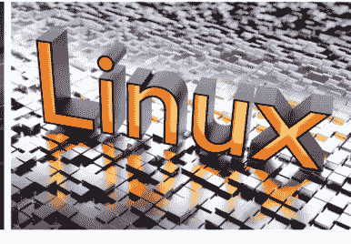

Linux 无处不在。它作为网络服务器背后的主要操作系统驱动着互联网，驱动着航天器，它是世界上最快速超级计算机的操作系统，并被用于智能电视和移动设备。为什么？因为它极其稳定、速度极快且完全免费。

然而，Linux 不仅仅是免费使用的操作系统。其独特的配置允许用户随心所欲地定制和个性化操作系统。Linux 用户可以在一夜之间改变操作系统的界面和外观，安装数千个免费可用的应用程序和程序，并重新掌控他们的计算机。

Linux 代表着自由。摆脱其他限制性操作系统“围墙花园”方式的自由，选择电脑上内容的自由，以及随心所欲修改和使用的自由。这是一个由思想一致的用户组成的全球社区，所有人都在努力从这个不可思议的操作系统中获得最好的开发体验。

通过这本书，你也可以成为 Linux 用户开源社区的一部分。这些章节中的教程将帮助你熟悉 Linux，向你展示它是如何工作的，你可以用它做什么，以及你如何通过它进行编程来将你的 Linux 体验提升到更高的高度。发现 Linux。发现自由。


# 向 Linux 问好

> “你怎么知道这么多
> 关于计算机的事情？”
> “我不知道，那是第一台。”
> 
> — 葛蓓丽海军上将（先驱程序员）
> 在接受大卫·莱特曼采访时所说


# 向 Linux 问好


为什么是 Linux？它是什么？我在哪里获取它？为什么有这么多不同的版本？大多数初学者在开始时都会问这些以及更多的问题。诚然，Linux 是一个极其多功能且功能强大的操作系统，但你从哪里开始呢？幸运的是，你可以在这一章中找到答案。

用 Linux 可以做很多事情，但你需要知道从哪里开始；我们在这里帮助你。在这一章中，你可以了解什么是 Linux，什么是发行版以及什么是桌面环境。你也可以开始探索 Linux 是如何工作的以及它如何为你工作。

- 8 为什么选择 Linux？
- 10 最佳 Linux 发行版
- 12 你需要准备的设备
- 14 桌面环境
- 16 哪种发行版？

## 为什么选择 Linux？

对于许多用户来说，Linux 意味着自由。摆脱其他操作系统“围墙花园”方式的自由，随心所欲更改和使用操作系统的自由，以及摆脱任何形式的许可或支付。然而，Linux 比你想象的要丰富得多。

## 免费且开放

对于那些想要与众不同的人来说，Linux 是一个绝佳的选择。系统的效率、应用程序的可用性和稳定性只是少数几个好理由。

你需要知道的第一件事是，没有名为 Linux 的操作系统。Linux 实际上是操作系统内核，是操作系统的核心组件。当我们谈论 Linux 时，我们（和其他人）指的是使用 Linux 内核的众多发行版（或 distros）之一。毫无疑问，你至少听说过当前流行的发行版中的一个：Ubuntu、Linux Mint、Fedora、openSUSE、Debian、Raspbian，列表还在继续。这些发行版中的每一个都为用户提供了一些略有不同的东西。虽然每一个都以 Linux 内核为核心，但它们为用户提供不同的桌面环境外观、不同的预装应用程序、不同的系统更新方式以及安装更多应用程序的方式，并且整个系统的外观和感觉也略有不同。然而，核心始终是 Linux，这就是为什么我们说 Linux。

Linux 的工作方式与 Windows 或 macOS 有很大不同。首先，它是免费的：免费下载，免费安装在任意数量的计算机上，免费使用无限时间，并且可以使用同样免费程序和应用进行免费升级和扩展。这种免费使用的特性是开发者的最大吸引力之一。虽然 Windows 许可证的费用可能高达 £100，而 Mac 则昂贵得多，但用户——无论是开发者、游戏玩家还是想让旧电脑发挥作用的人——都可以在几分钟内快速下载一个发行版并开始工作。

除了免费使用之外，还有定制和塑造系统以适应我们自身用途的自由。互联网上可用的每个发行版都有某种特定的“风格”，

Linux 是一个开始编程的绝佳操作系统。

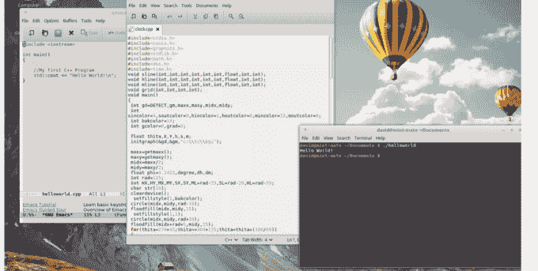


### 在 Linux 系统下有数千个免费软件包供程序员使用

其中一些提供增强的安全性、外观精美的桌面环境、针对游戏玩家优化的版本，或是面向学生的特定方案。这种可扩展性使 Linux 成为一个更具吸引力的使用平台，因为你可以将系统快速塑造成开发基础，包括适用于 Python、Web 开发、C++、Java 等众多语言的集成开发环境（IDE）；或者创建一个在线匿名化的基础，例如 Minecraft 服务器、媒体中心以及更多功能。

对于想要学习编程的人来说，另一个显著优势在于，Linux 自带大多数流行的编程环境。在许多可用的 Linux 发行版中，Python 和 C++ 都预先安装在其中，这意味着你几乎可以在安装系统并首次启动后立即开始编程。

通常来说，与 Windows 或 macOS 相比，Linux 占用的系统资源更少；这里的系统资源我们指的是内存、硬盘空间和 CPU 负载。Linux 代码经过精简，且没有占用这些系统资源的第三方“臃肿软件”。更高效的系统自然意味着有更多的可用资源用于编程和测试环境以及你最终创建的程序。更少的资源占用也意味着你可以在通常难以运行甚至拒绝运行最新版本的 Windows 或 macOS 的旧硬件上使用 Linux；因此，你无需扔掉旧电脑，而是可以用一个 Linux 发行版让它重新发挥作用。

不过，Linux 的优势不仅仅在于 C++、Python 或其他更流行的编程语言。使用 Linux 的命令行（也称为终端），你可以创建 Shell 脚本，这是设计用于从命令行运行的程序，由脚本语言组成。它们主要用于自动化任务，或为特定操作提供某种形式的输入和输出。

最后，虽然我们可以列举出许多其他优势，但现有成千上万个免费程序和应用程序，涵盖了计算的几乎每个方面。这些被称为软件包，截至目前，仅 Linux Mint 就有超过 8,700 个专门的编程应用程序，而总体的软件包数量更是令人惊叹，超过 62,000 个，满足从 Amateru Radio 到 LWWX 工具等各种需求。

因此，Linux 是编程的一个绝佳资源和环境。它非常适合开发者，并不断改进和演进。如果你认真地想要进入编程领域，或者只是想尝试点新事物，请尝试使用 Linux，看看它是否适合你。

Linux 编程环境可以简单到你需要的程度，也可以复杂到你需要的程度。

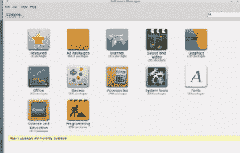
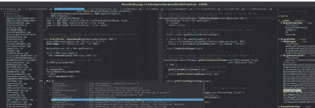


### 每个发行版都为提供独特的用户体验，但它们的核心都是 Linux。

## 最佳的 Linux 发行版

有许多可用的 Linux 版本，称为发行版（Distribution）。每个发行版都有不同的理念和方法。以下是五个值得尝试的优秀发行版以及获取它们的途径。

### 转向 Linux

大多数发行版的安装过程都相似。你需要从网站下载光盘镜像，并将其刻录到光盘或创建 USB 闪存驱动器安装盘。请务必仔细操作，确保选择适合你硬件的发行版，并仔细阅读说明。

#### Linux Mint

目前最受欢迎的 Linux 发行版无疑是 Linux Mint。Mint 始于 2006 年，当时它是当时最流行的发行版 Ubuntu 的替代品。尽管基于 Ubuntu 的长期支持（LTS）构建，但 Linux Mint 采取了不同的方向，并为用户提供更好的整体体验。

每发布一个核心操作系统的新版本，Linux Mint 都会提供三个主要的桌面版本。起初这可能听起来很令人困惑，但其实很简单。目前，Linux Mint 使用 Cinnamon 桌面环境作为其旗舰模型；也有 MATE 和 Xfce 模型可供选择。

Cinnamon 是一个图形丰富的桌面环境，MATE 使用的图形较简单，在更多种类的桌面系统上更稳定，而 Xfce 则是一个极其精简的桌面环境，专为速度和终极稳定性而构建。

在本标题中我们将使用 Cinnamon 版本；然而，你可以随意尝试其他桌面环境。事实上，建议你花些时间尝试不同的环境，甚至不同的发行版，看看哪个最适合你和你的计算机。

www.linuxmint.com


#### Ubuntu

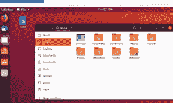

第二受欢迎的发行版是 Ubuntu，这是一个古老的非洲词汇，意为“对他人的仁爱”。Ubuntu 在其十四年寿命中的人气有所起伏。曾经，它是世界上最广泛使用的基于 Linux 的操作系统，但沿途一些关于其展示方式的错误选择，以及一些涉及隐私的令人不快的争议性元素，遗憾的是导致其跌落了第一的位置。

话虽如此，Ubuntu 已经做出了弥补，正在缓慢地重新爬上 Linux 排行榜。该操作系统最新版本使用 GNOME 3 桌面环境，这是一个令人印象深刻的环境，尽管对于前 Windows 用户来说可能有点令人困惑，并且对系统资源的占用稍重，尤其是如果你计划将其安装在旧计算机上时。

尽管有种种缺点，Ubuntu 仍是一个适合开始实验的优质 Linux 发行版。它的界面干净，易于使用和安装，并为用户提供完整的 Linux 体验。

www.ubuntu.com

#### Arch

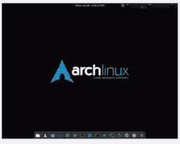

Arch 是运行时间最长的 Linux 发行版之一，也是许多其他 Linux 版本的基础。当你安装了 Arch 时，为什么还要安装 Mint 或 Ubuntu 呢？许多用户确实这样做，但这对于初学者来说并不是理想的。Ubuntu 和 Mint 都提供了更容易的安装路径，并附带软件包帮助你入门。

Arch 是当你更有 Linux 经验时的发行版。你从只有命令行开始，然后必须手动分区硬盘，设置安装文件的位置，创建用户，设置操作系统区域，最后安装一个桌面环境以及你想要的软件。

另一方面，Arch 是一个更加“极简”的方案。Arch 致力于自由软件，其软件仓库包含超过 50,000 个可安装的应用程序，包括多种不同的桌面环境，其使用方式与其他发行版类似。

然而，尽管付出了这么多努力，其优势在于你拥有一个自己创建的发行版。这意味着你的 Arch 发行版不会附带他人预先安装的所有不必要的文件和应用程序；它是为你定制的，由你定制。

www.archlinux.org

#### 树莓派桌面版

毫无疑问，你听说过树莓派（Raspberry Pi）。自其推出以来，这台非凡的小型计算机在过去六年间席卷了科技界，你很难没听过。

树莓派在计算世界中有几个方面的特点使其如此受欢迎。首先，它很便宜，成本约为 25 英镑，而这本质上是一台完全可用的计算机。它很小，尺寸略大于信用卡。你可以使用其完全可编程的接口构建电子产品；并且它附带 Raspbian，这是一个专门定制的基于 Debian 的操作系统，包含办公套件、多种不同的编程语言和教育资源。

Raspbian 专用于树莓派硬件，因为树莓派使用 ARM 处理器进行驱动。然而，树莓派基金会后来发布了 Raspbian 的 PC 版本：树莓派桌面版（Raspberry Pi Desktop）。

与树莓派版本一样，树莓派桌面版附带所有你需要的编程、教育和其他应用程序。它快速、稳定，运行卓越。如果你对扩展自己的 Linux 经验感兴趣，那么这绝对是值得考虑的主要发行版之一。

www.raspberrypi.org/downloads/raspberry-pi-desktop


#### openSUSE


大多数 Linux 发行版分为两大阵营。一类是具有最新功能和技术，如 Ubuntu 和 Mint；另一类是新功能较少但具有极其可靠的稳定性，如 Debian。

与此同时，openSUSE 试图兼顾两者。OpenSUSE Leap 是一个极其稳定的系统；它是由社区与 SUSE 员工共同开源开发的，后者开发了一款企业级操作系统 SUSE；SUSE 驱动着伦敦证券交易所等关键设施。它专为关键任务环境设计，在这些环境中“没有不稳定空间”。如果你觉得这些都太保守了，那么 openSUSE Tumbleweed 是一个滚动发行版，拥有所有最新功能，当然也可能偶尔出现崩溃。

openSUSE 是一个备受尊敬的 Linux 发行版，其许多核心贡献者都在 Linux 内核、LibreOffice、Gnome 及其他 Linux 关键领域工作。简而言之，openSUSE 是专业人士聚集的地方。

www.opensUSE.org


## 所需设备

成功在 PC 上安装 Linux Mint 的系统要求出人意料地低，因此即使是几年前购买的电脑也能愉快地运行这个发行版。不过，在继续之前，值得检查一下你是否已具备所有条件。

### MINT 的必备要素

在我们开始阅读本书之前，以下是安装和运行 Linux Mint 所需的条件。你有多种选择，所以请耐心等待，看看哪种最适合你。

### 系统要求

Linux Mint 的最低系统要求如下：

- **CPU** – 700MHz
- **RAM/内存** – 512MB
- **硬盘空间** – 9GB（建议 20GB）
- **显示器** – 1024 x 768 分辨率

显然，你的系统越好，体验就会越好，速度也会更快。


### USB 安装

你可以通过 USB 或 DVD 将 Linux Mint 安装到计算机上。我们稍后会详细介绍这两种方法，但如果你已经熟悉该过程，或者正准备使用 USB 并收集所需的硬件，那么你需要一个至少 4GB 的 USB 闪存盘来存储 Linux Mint ISO。


### DVD 安装

通过 DVD 安装 Linux Mint 只需一张空白 DVD-R 光盘。当然，在你能够将 ISO 镜像传输或烧录到光盘之前，你还需要一个光驱（DVD 刻录机）。


### 虚拟环境

安装到虚拟环境是测试和使用 Linux 发行版的常见方法。Linux Mint 在虚拟环境中运行非常出色，稍后我们会详细介绍。市面上有许多不同的虚拟环境应用程序；然而，来自 Oracle 的 VirtualBox 是其中最容易入门的。你可以在 **www.virtualbox.org** 找到最新版本。


### 互联网连接

不用说，互联网连接对于确保 Linux Mint 保持最新更新和补丁，以及安装更多软件至关重要。虽然使用 Linux Mint 不需要互联网连接，但你会错过该发行版上可用的众多免费软件。


### MAC 硬件

虽然 Linux Mint 可以安装在 Mac 上，但有一种观点建议 Mac 用户虚拟环境，例如 VirtualBox 或 Parallels，为什么不呢，macOS 已经是一个出色的操作系统。如果你想为较旧的 Mac 注入新活力，请确保它是 Intel CPU 型号，而不是 Power PC 型号。不过请注意，安装过程不像在 PC 上那样轻松无忧。

## 桌面环境

Linux Mint 提供几种不同的版本，或称风味：Cinnamon、MATE 和 Xfce；这些版本都有 32 位和 64 位版本。这一切到底意味着什么，你应该为安装选择哪个版本？

### 哪个 MINT？

桌面环境是你用来与核心 Linux 系统交互的图形界面。正如 Windows 10 的图形桌面也称为 Fluent Design 一样。

Linux Mint 为用户提供发行版的版本选择：Cinnamon、MATE 和 Xfce。虽然这对新手来说可能听起来有点令人困惑，但本质上，每个可用版本都包含相同的 Linux 核心结构和内核，内核是操作系统的核心，负责处理软件和硬件之间的所有指令。

每个版本只是不同的桌面环境，即你用来与操作系统交互的图形用户界面 (GUI)。每个桌面环境使用不同的应用程序来访问或使用系统，例如用于浏览操作系统文件结构的文件管理器，或启动其他应用程序的方式。不过，可用的核心生产力、视频和图形套件是相同的，并且以相同的方式运行。

那么为什么要费心使用不同的桌面环境呢？简单来说，这取决于个人喜好。一些用户更喜欢 MATE，因为 MATE 是经典 GNOME 2 环境的分支，更以菜单为中心，并且在旧计算机上表现良好。另一些人更喜欢 Cinnamon，这是一个更现代的环境，在较新的硬件上表现更好，并具有一些尖端的桌面代码。另一方面，Xfce 是一个轻量级的桌面环境，由于其对可用系统资源的极低占用，在较旧的硬件上运行良好。

简而言之，Cinnamon 是 Linux Mint 的旗舰桌面环境。MATE 与更多种类的硬件兼容。例如，Windows 只提供一种是桌面环境来工作，而 Linux 提供了许多。因此，Linux Mint 选择为用户提供丰富的选择。


### 少许 CINNAMON 风味

Cinnamon 除了外观和感受之外还有许多好处，尽管它们也是重要的因素。这里，我们概述了其中一些功能，帮助你决定它是否是你想要的桌面环境 (DE)。

**FAB FEATURE 1**

它在较现代的系统中表现出色，但比过去稳定得多，也不再是曾经的资源吞噬者。因此，如果你使用较旧的计算机来安装和测试 Linux Mint，请不要因此被 Cinnamon 吓退。

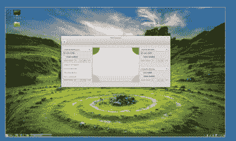

**FAB FEATURE 2**

Cinnamon 具有可配置的 Hot Corners（热角），桌面每个角都可以被单击以执行特定任务，例如显示工作区、显示所有窗口或运行命令。热角是切换不同视图的绝佳方式，有助于使桌面成为更高效的环境。

**BEST MATE**

MATE 是一个易于使用且直观的桌面环境，速度快且稳定。与 Cinnamon 相比，它看起来略显陈旧，但那只是表面现象。MATE 有很多值得喜欢的地方。

**FAB FEATURE 1**

MATE 是较旧计算机的绝佳桌面环境。与 Cinnamon 通常支持的硬件组件相比，它支持更多的硬件组件，但同样有能力提供外观精美的桌面以及高级自定义选项。


**FAB FEATURE 2**

由于其高度可配置性，MATE 可以进行精细程度的自定义。对于希望桌面环境提供更多功能的用户，有许多可用的选项，包括 Compiz Settings，你可以配置各种桌面效果，甚至 3D 桌面立方体。

**无胆固醇桌面**

Xfce 始于 1996 年的通用桌面环境 (CDE)。自那时起，它改了几次名字，现在简单称为 Xfce，昵称为“无胆固醇桌面环境”。

**FAB FEATURE 1**

Xfce 确实是一个快速的桌面，它充分发挥了 Linux 作为快速操作系统的最佳优势。事实上，从页面顶部到这里，我们只需要几页文字就将其安装到了新计算机上。写了几百个字，我们已经在品牌新的操作系统上了。不错。

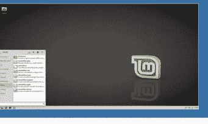

**FAB FEATURE 2**

仅仅因为它快速且轻量，并不意味着 Linux Mint Xfce 不是一个完整的桌面操作系统。就像其他提供的环境一样，你可以获得最新的 Firefox、LibreOffice、VLC、Gimp、聊天应用，甚至 BitTorrent 客户端。

## 哪个发行版？

到目前为止，我们主要查看的是 Linux Mint，但还有其他可供尝试的 Linux 发行版。事实上，有成千上万的 Linux 发行版可供下载和安装，那么你应该决定使用哪一个呢？

### 发行版跳跃

“发行版跳跃”（Distro hopping）是社区用来形容那些从未坚持使用单个发行版的人的术语。相反，他们在不同发行版之间跳转，测试每一个，使用它们，然后转向另一个或新发布的发行版。

例如，Linux Mint 是一个理想的起点。它是一个易于安装和使用的发行版，开箱即已安装你日常通常会使用的软件，并让你温和地融入 Linux 的独特世界，了解其工作原理和性能。

发行版跳跃本身并没有错，这是一种了解市面上有哪些发行版的好方法，可以发现某个发行版的某些元素可能比另一个更吸引你的口味。当然，问题在于你总体上使用哪一个？

Ubuntu 提供了非常相似的经验，但它以一种稍有不同的方式做到这一点。通常，Ubuntu 预装的内容比 Linux Mint 少，所以你需要手动安装。另一个值得考虑的点，是专为 Ubuntu 用户准备的庞大内容量和支持页面，当你使用 Linux 时。如果你遇到困难，解决方案永远不会离你太远。


继续前进，当你开始对 Linux 更加自信时，你可以测试 openSUSE、Fedora 或 Debian 等。这些都是优秀的发行版，每一个都为系统运行方式提供了略有不同的视角。一些在 Linux 技能方面比其他要求更高，但本质上，它们每个都有一些宝贵的教训供用户学习。

虽然发行版跳跃是一件好事，但这并不是享受 Linux 并从中获得最大收益的稳定方式。我们并不是说你应该坚持一个发行版而从不看其他地方，那样你会错过很多很棒的内容，而是建议你找到几个，并根据你日益增长的 Linux 技能缓慢地通过它们。

你可能会发现自己转向某个特定发行版，因为它提供了与常规截然不同的东西。例如，Talis Linux 是一个专为在线匿名设计的发行版。它包含复杂的军用级加密工具，以及旨在帮助你在浏览网页时永不被检测、追踪或监控的工具和浏览器。Kali Linux 专为安全专业人员设计，包含许多不同类型的道德黑客工具。

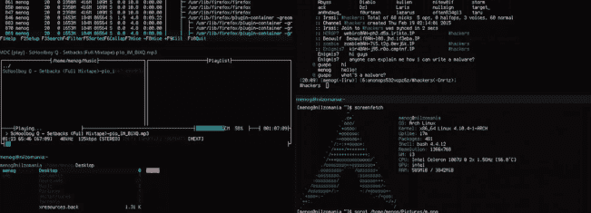


预装工具，用户可以在自己的网络上运行这些工具进行渗透测试。甚至曾经还有一个 Hannah Montana Linux 发行版，但我们最好对那件事少提为妙。重点在于，总有一款发行版适合你。

不用说，一旦你相对熟练地掌握了 Linux（可能达到了高级用户水平），你就会想要拓展技能，并开始基于 Arch、Debian 或其他众多可用发行版之一构建你自己的 Linux 发行版。这需要大量的命令行知识，以及对 Linux 系统如何工作及其如何与计算机硬件交互的了解。你需要自行分区硬盘，安装桌面环境，并最终安装你想要的软件和应用程序。这样做需要时间，而且你还要学习很多其他技能。

最终，你可以认为自己是一名技术型 Linux 用户，但永远不要自认为专家，毕竟我们总是在学习新东西。你可以从零开始构建自己的发行版，帮助其他 Linux 用户解决问题，甚至可能在某个发行版的测试阶段或构建过程中为其改进做出贡献。接下来该往哪里走呢？

奇怪的是，大多数高端技术用户最终发现自己又回到了起点，使用像 Linux Mint 这样的发行版。主要原因通常是它简单易用，且环境稳定。即使你系统了如指掌，也不代表你总是想要修复潜在的问题。我们大多数人更喜欢轻松的生活方式，尤其是在涉及技术时，因此合乎逻辑的选择是挑选一个简单但仍然强大到足以完成你想做的所有事情的发行版，因此 Linux Mint 是一个不错的选择。

然而，归根结底，这完全取决于你个人的选择。你可能发现在阅读完本书中的教程后，你不喜欢 Linux Mint 或 Cinnamon 桌面。没关系，你可能更喜欢 Ubuntu、Debian 或 openSUSE；这就是 Linux 的魅力所在。自由地更改你想要的，从一种发行版跳向另一种，而不会因为成本或缺乏访问权限而受到惩罚。

对于“哪个发行版好”这个问题，答案是：你喜欢的任何一个！它可以复杂或简单，取决于你的需求，只要它能完成你想让它做的事情，它就是完美的。


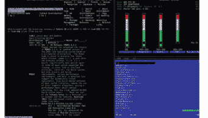

# 入门
## 使用 Linux

> “在真正的开源中，你有权掌控自己的命运。”
> — Linus Torvalds（Linux 内核开发者）


### Linux 入门

谈论 Linux 有多好虽然听起来不错，但你如何将其安装到计算机上？**安装 Linux** 非常简单，但你面前有多种选择。本节将介绍如何下载 Linux ISO 映像，将其作为主要操作系统安装到 PC 上，以及如何安装虚拟环境。

使用虚拟环境，你可以在继续使用主要操作系统（无论是 Windows 还是 macOS）的同时运行 Linux。**好奇吗？继续阅读，了解更多详情。**

- **20** 在 Windows 上创建 Linux 安装介质
- **22** 在 PC 上安装 Linux
- **24** 安装虚拟环境
- **26** 在虚拟环境中安装 Linux

### 在 Windows 上创建 Linux 安装介质

在安装 Linux 到计算机之前，你需要将下载的 Linux ISO 转移到 DVD 或 USB 闪存盘上。这将是一个实时环境，允许你在安装前测试操作系统，但首先你需要创建可启动媒体。

#### DVD 可启动媒体

我们在这里使用 Windows 10 计算机将 ISO 传输到 DVD。如果你使用的是 Windows 7 或更高版本，这个过程非常简单。

- **步骤 1** 首先找到你已下载的 Linux ISO 映像。在 Windows 7、8、1 和 10 计算机中，你通常可以在“下载”文件夹中找到它，除非在保存时指定了其他位置。

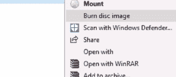

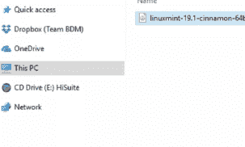

- **步骤 3** 右键单击 Linux ISO，从菜单中选择“烧录光盘映像”。根据计算机的速度，可能需要几秒钟才会有反应。不要担心，除非耗时超过一分钟，如果是这种情况，可能值得重启计算机并重试。幸运的是，Windows 光盘映像刻录机应该会启动。


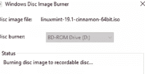

- **步骤 2** 接下来，将一张可记录 DVD 光盘插入计算机的光驱。几秒钟后，在读取光盘期间，Windows 会显示一条弹出消息，询问你对新插入的光盘要做什么。忽略此消息，因为我们要使用内置的图像烧录功能。

- **步骤 4** 当 Windows 光盘映像刻录机对话框打开后，勾选“烧录后验证光盘”复选框，然后单击“烧录”按钮。这个过程可能需要几分钟，具体取决于你 PC 光驱的速度。完成后，它将执行验证阶段，完成后光驱应会自动弹出光盘。


#### USB 可启动媒体

USB 媒体比 DVD 更快，而且通常更方便，因为大多数现代 PC 没有安装光驱。传输映像的过程很简单，但你首先需要一个第三方应用程序和一个 4GB 或更大的 USB 闪存盘。

**步骤 1** 首先打开网络浏览器，访问 www.rufus.akeo.ie/。向下滚动页面一点，你会看到一个“下载”标题，下面就是最新版本的 Rufus。左键单击链接开始下载。

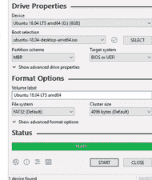

**步骤 2** 双击下载的 Rufus 可执行文件，对 Windows 安全提示单击“是”，对检查更新也单击“是”。Rufus 启动后，它应该已经识别出你插入的 USB 闪存盘；如果没有，只需将其拔出并重新插入。

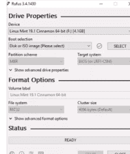

**步骤 3** 乍一看，Rufus 界面可能有点令人困惑，但别担心，它其实很简单。首先，单击“磁盘或 ISO 映像（请选择）”下拉菜单旁边的“选择”按钮。这将打开一个 Windows 资源管理器窗口，你可以在其中定位并选择 Linux ISO。

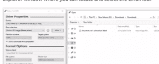

**步骤 4** 当你准备好时，单击 Rufus 应用底部的“开始”按钮。这可能会打开另一个对话框，询问你是否要下载并使用新版本的 SysLinux。SysLinux 是一组引导加载程序，用于允许现代 PC 从 USB 闪存盘访问和引导。这是必需的，因此如果被询问，请单击“是”以继续。

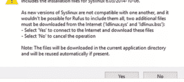

**步骤 5** 下一步询问你希望以哪种映像模式将 Linux ISO 写入 USB 闪存盘。两种方法适用于不同的情况，但通常，推荐的 ISO 映像模式更受欢迎。确保选择此模式，然后单击“确定”继续，再单击一次“确定”确认操作。

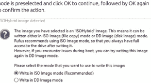

**步骤 6** 现在 Linux ISO 已传输到 USB 闪存盘。这个过程不会花太长时间，同样取决于 USB 设备和 PC 的速度。你可能会发现 Rufus 在处理过程中自动在 Windows 资源管理器中打开 USB 驱动器；别担心，你可以将其最小化或关闭。过程完成后，单击“关闭”按钮。

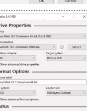

### 在 PC 上安装 Linux

大多数 Linux 发行版都提供实时环境。这意味着你可以直接从刚才创建的 DVD 或 USB 启动到一个实际、完全可用的发行版。让我们看看它是如何工作的，以及如何从中安装 Linux。

### UEFI BIOS

统一可扩展固件接口（UEFI）用于在启动过程中识别硬件并保护 PC。它取代了传统的 BIOS，但在安装 Linux 时可能会引发问题。

- **步骤 1** 将你的 DVD 或 USB 闪存盘插入 PC，如果尚未关闭 Windows，请先关闭。在此实例中，我们使用 USB 启动介质，但过程几乎相同。启动 PC，当提示时，按下相应的键进入 BIOS 或 SETUP，例如可能是 F2、Del 或甚至 F11。

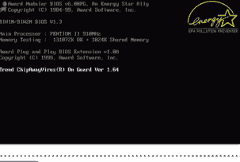

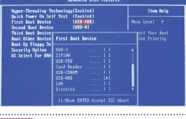

- **步骤 3** 将 UEFI 切换到传统模式后，现在有两种方法可以引导到实时环境。第一种是通过你当前所在的 BIOS。定位到启动顺序，将第一个启动设备从其原始设置（通常是内部硬盘驱动器或类似项）更改为：对于 USB 介质选项，选择“USB 存储设备”；对于 DVD 介质选项，选择“DVD 驱动器”。

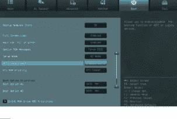

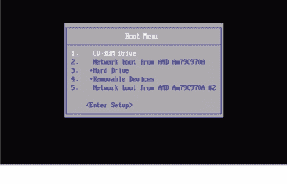

- **步骤 2** 有各种不同版本的 UEFI BIOS，因此无法涵盖所有情况。我们要找的是详细说明启动顺序或启动模式的章节。在这里，你可以选择关闭 UEFI 并选择传统模式或禁用安全启动。大多数发行版都支持 UEFI，但启用 UEFI 启动可能是一个棘手的过程。

- **步骤 4** 或者，使用启动选项菜单。使用此选项，你可以按 F12（或类似键）显示一组启动媒体选项；在那里，你可以选择适当的启动媒体。无论哪种方式，你都可以导航到“保存并退出”选项并选择“保存更改并退出”来保存并退出 BIOS。


# 安装 Linux

一旦启动到 Live 环境（试运行环境），您就会看到将发行版安装到计算机的选项。先四处看看，当您准备就绪时，在桌面上查找安装选项。

- **步骤 1**  
  如果您已连接到互联网（如果没有，请现在连接）并且处于 Live 环境中，请双击桌面上的“Install Linux Mint（安装 Linux Mint）”图标开始安装过程。其他发行版当然会显示它们自己的名称，但过程是一样的。当您准备就绪时，点击“继续（Continue）”。

- **步骤 2**  
  虽然大多数 Linux 发行版的安装过程非常相似，但有些在安装期间会提出不同的问题。通常，这些问题并不太难，没有什么非常技术性的内容，但像“安装第三方软件……”这类问题可能会让人困惑。在这种情况下，您可以点击“继续”，但如果您不确定，请确保有一台连接互联网的设备可用，以便查阅任何问题。

- **步骤 3**  
  在安装新的操作系统时，建议您擦除旧操作系统，并用新系统进行替换。当安装过程达到此阶段时，请确保选中“擦除磁盘并安装 Linux……”选项。注意：这会完全清除您计算机上的 Windows 10，因此请确保您已备份所有个人文件和数据。

- **步骤 4**  
  在安装过程开始之前，系统会询问您关于擦除硬盘所做的选择是否正确。这是您退出的最后机会：如果您确定不介意清除所有内容并重新使用 Linux Mint 开始，请点击“继续”。如果您需要备份文件，请移除 Linux 光盘/USB 驱动器，重启计算机，备份文件后重新开始。

- **步骤 5**  
  最终，您会被要求设置 Linux 用户名和密码。首先输入您的姓名，然后是计算机名称，即该计算机在网络上被识别的名称。接下来选择一个用户名，再选择一个良好的密码。您可以勾选“自动登录”选项，但暂时保留“加密主文件夹”选项。

- **步骤 6**  
  安装过程可能很快，可能会提出更多需要回答的问题，或者它可能根据您之前的回答直接开始安装 Linux。无论哪种情况，您最终会被要求“继续测试 Live 环境”或“重启以使用新安装的操作系统”。如果您准备好使用 Linux，请点击“立即重启”。

## 安装虚拟环境

虚拟环境是一个模拟的计算机系统。使用虚拟机，您可以模拟一台标准 PC，并在其上安装完整的操作系统，而不会影响安装在您计算机上的现有系统。这是一种测试和使用 Linux 的好方法，同时仍保留 Windows 10 作为您的主要操作系统。

### 走向虚拟化

使用虚拟机（VM）会占用您计算机的资源：内存、硬盘空间、处理器使用率等。在开始之前，请确保您拥有足够的各项资源。

- **步骤 1**  
  在这里我们使用 VirtualBox，因为它是掌握起来最容易的虚拟环境之一。访问 www.virtualbox.org 并点击“下载 VirtualBox”。这将带您进入主下载页面。找到适合您系统的正确托管平台：Windows 或 Mac（“托管平台”指的是当前安装的操作系统），然后点击链接开始下载。


- **步骤 2**  
  接下来，在 VirtualBox 下载页面，找到 VirtualBox 扩展包（Extension Pack）链接。扩展包支持 USB 设备以及许多其他附加功能，可以帮助使 VM 环境成为对“真实”计算机更精确的模拟。

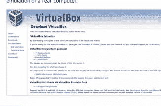

- **步骤 3**  
  在下载完正确的软件包后，在安装任何内容之前，您需要确保正在使用的计算机能够托管虚拟机。为此，请重启计算机并进入 BIOS。当计算机启动时，按 Del、F2 或任何必要的按键进入“设置（Enter Setup）”。

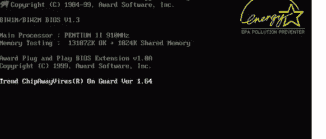

- **步骤 4**  
  每个 BIOS 的布局都不同，评估在每个具体案例中应查看哪里非常困难。然而，根据一般经验法则，您正在寻找的是 Intel 虚拟化技术，或者简称为虚拟化，通常位于 BIOS 的“高级（Advanced）”部分内。找到它后，启用它，保存设置，退出 BIOS 并重启计算机。

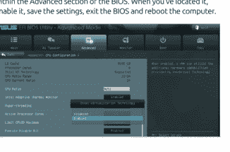


- **步骤 5**  
  计算机恢复运行后，找到已下载的主 VirtualBox 应用程序并双击以开始安装过程。当您准备就绪时，点击“下一步（Next）”继续。

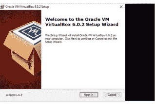

- **步骤 6**  
  VirtualBox 的默认安装位置应该能满足大多数用户，但如果您有特殊的安装位置要求，请点击“浏览（Browse）”按钮更改安装文件夹。然后，确保 VirtualBox 功能树中的所有图标都被选中，即它们旁边没有红色 X。点击“下一步”继续。

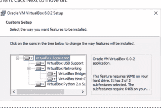

- **步骤 7**  
  如果您愿意，此部分可以保留默认设置。它只是在处理虚拟机时让生活稍微轻松一些，特别是处理下载的虚拟机时，您将来可能会遇到这种情况。同样，点击“下一步”进入下一阶段。

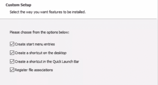

- **步骤 8**  
  在安装 VirtualBox 时，您的网络连接会在非常短的时间内被禁用。这是由于 VirtualBox 正在创建一个联动的虚拟网络连接，以便任何已安装的虚拟机都能通过计算机已建立的网络连接访问互联网或您的家庭网络资源。点击“是（Yes）”，然后点击“安装（Install）”开始安装。

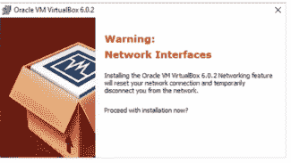

- **步骤 9**  
  Windows 可能会要求您接受一个安全通知。对此点击“是”，您可能会遇到一个要求您信任来自 Oracle 的安装的对话框；同样，点击“是”并接受安装 VirtualBox 应用程序。完成后，点击“完成（Finish）”以启动 VirtualBox。

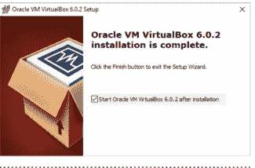

- **步骤 10**  
  当 VirtualBox 运行起来后，您现在可以安装 VirtualBox 扩展包了。找到已下载的附加组件并双击。VirtualBox 分析该包时可能会有短暂的停顿，但最终您会收到安装它的消息；显然点击“安装（Install）”开始过程，在下一个屏幕向下滚动以接受协议，并点击“我同意（I Agree）”。

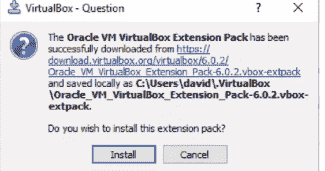

www.bdmpublications.com 2.5

## 在虚拟环境中安装 Linux

随着 Oracle 的 VirtualBox 现在运行起来，下一个任务是创建您将要安装 Linux 的虚拟机（VM）环境。这个过程不会影响您当前安装的操作系统，这就是为什么虚拟机是一个很好的选择。

### 创建虚拟机

在创建虚拟机时，有许多选项可供选择。不过现在，让我们设置一个足以运行 Mint Cinnamon 并表现良好的虚拟机。

- **步骤 1**  
  打开 VirtualBox 后，点击应用右上角的“新建（New）”图标。这将打开新的虚拟机向导。

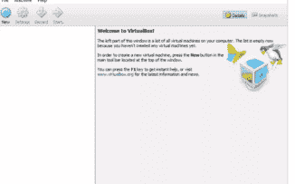

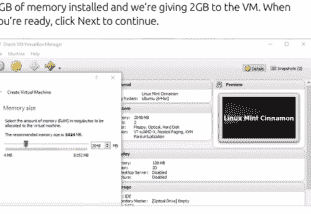

- **步骤 2**  
  在“名称（Name）”旁边的框中，输入 Linux Mint，VirtualBox 应该会自动选择 Linux 作为类型（Type），以及 Ubuntu（64 位）作为版本（Version）；如果没有，请使用下拉框选择正确的设置（记住 Mint 主流版是基于 Ubuntu 的）。当您准备继续时，点击“下一步（Next）”。

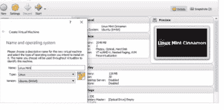

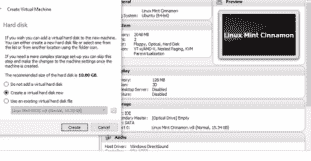

- **步骤 3**  
  下一部分定义了分配给虚拟机的系统内存或 RAM 数量。请记住，这部分内存是从计算机上安装的可用内存中扣除的，所以不要给虚拟机分配太多。例如，我们安装了 8GB 内存，我们将给虚拟机 2GB。当您准备就绪时，点击“下一步（Next）”继续。

- **步骤 4**  
  在这部分，您开始创建虚拟机用于安装 Mint 的虚拟硬盘。默认选项“立即创建虚拟硬盘（Create a virtual hard disk now）”就是我们要使用的。点击“下一步”继续。


## 在虚拟环境中安装 Linux

**步骤 5** 点击“创建”后弹出的窗口询问您想要创建哪种类型的虚拟硬盘（映像）。在本例中，我们将使用默认的 VDI（VirtualBox 磁盘映像），因为其他选项通常用于将虚拟机从一个虚拟化应用程序迁移到另一个应用程序。请确保已选中 VDI，然后点击“下一步”。

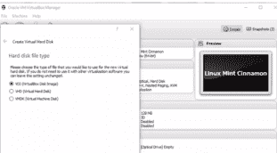

**步骤 6** 关于选择动态分配还是固定大小虚拟硬盘的问题，可能会让初学者感到有些困惑。动态分配的虚拟硬盘是一种更灵活的存储管理选项，最初不会占用物理硬盘的太多空间。请确保选中“动态分配”，然后点击“下一步”。

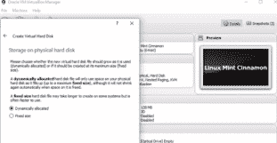

**步骤 7** 虚拟硬盘是一个单独的文件夹，其大小取决于您在此部分设置的数值。请确保虚拟硬盘在计算机上的位置有足够的可用空间。例如，我们在 D:\ 驱动器的更大存储空间选项中，将其命名为 Linux Mint，并分配了 25.55GB 的空间给虚拟硬盘。

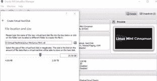

**步骤 8** 点击“创建”后，虚拟机的初始设置就完成了；现在您应该能在 VirtualBox 应用程序中看到新创建的虚拟机。不过，在开始之前，请单击“设置”按钮，并在“常规”部分点击“高级”选项卡。使用下拉菜单，将“共享剪贴板”和“拖放”都设置为“双向”。

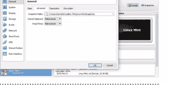

**步骤 9** 接着点击“系统”部分，然后选择“处理器”选项卡。根据您的 CPU，分配尽可能多的核心，但请注意不要对宿主系统造成损害；我们选择了两个 CPU。现在点击“显示”部分，将“视频内存”滑块滑到最大值，并勾选“启用 3D 加速”。点击“确定”以提交新设置。

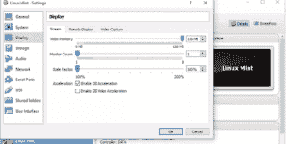

**步骤 10** 点击“启动”按钮，并在“选择启动磁盘”窗口中使用资源管理器按钮（一个带有绿色箭头的文件夹）来定位下载好的 Mint ISO 文件；然后点击“下一步”以 Linux Mint 现场环境启动虚拟机。现在，您可以按照标准 PC 安装要求安装 Linux 了。

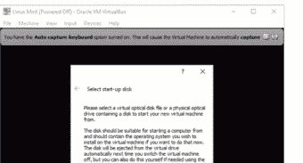

## 认识 Linux

> “任何人都可以制造出一款快速处理器。关键在于制造出一套快速系统。”
>
> — 塞缪尔·克雷（电气工程师，克雷超级计算机的设计者/创始人）


我们在此使用 Linux Mint 作为指导，因为它是一个易于使用的发行版，非常适合前 Windows 用户。它也是最开发完善、文档齐全的 Linux 发行版之一，并拥有一些出色的配置选项。

在本节中，我们将介绍 Linux Mint Cinnamon 菜单和桌面环境，它是如何工作的，以及你可以如何对其进行自定义。想要创建另一个用户，甚至发现如何在网上匿名吗？请继续阅读。

- 30 Cinnamon 菜单简介
- 32 导航 Cinnamon 桌面
- 34 安装 Linux Mint 后要做的 10 件事
- 36 你知道吗... 阿波罗 11 号
- 38 创建用户
- 40 自定义桌面
- 42 在线匿名

## Cinnamon 菜单简介

既然您已经安装了 Linux，现在是时候好好四处看看了。首先，如果您使用的是 VirtualBox，您会收到关于软件渲染的通知；以下是修复方法。

### CINNAMON VIRTUALBOX 修复

您已经查看了一些列表功能，使用了 _insert_、_remove_ 和 _pop_，但也有可以应用于字符串的函数。

**步骤 1** 在开始之前，我们假设您正在 VirtualBox 中遇到此问题。软件渲染消息显示在桌面的右上角。要修复此问题，请单击 VirtualBox 窗口中的“设备”，然后选择“插入客户机增强版 CD 映像”。


**步骤 2** 客户机增强版 CD 包含 VirtualBox 的驱动程序，包括虚拟视频硬件。加载后，您会收到一个显示“软件需要运行”的通知框，其中有两个选项：“取消”和“运行”。单击“运行”按钮并输入您的 Linux 用户密码。

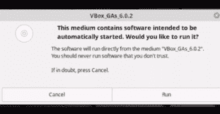

**步骤 3** 片刻之后，您将自动进入一个命令行视图，在 Linux 中称为终端。这里详细列出了新 VirtualBox 驱动程序的安装情况，删除了检测到的旧驱动程序，并安装了最新版本。过程不会花费太长时间，完成后会要求您按下回车键退出终端。

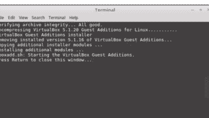

**步骤 4** VirtualBox 增强版 CD 图标位于桌面上，因此右键单击它，然后在菜单中向下滚动并点击“弹出”。现在您可以通过点击菜单（左侧条带上的底部图标），然后点击“重启”按钮来重启 Linux Mint。这将重启 Mint 并修复该问题。


### Cinnamon 菜单

现在 VirtualBox 用户的软件渲染问题已经解决了，让我们来看看 Mint 菜单及其工作原理。请记住，这仅适用于 Mint Cinnamon，其他发行版的外观和行为可能不同。

**步骤 1** 首先，您可能已经注意到登录 Linux Mint 时弹出的欢迎屏幕。花点时间浏览选项，阅读“初入门径”等内容。完成后，点击窗口右上角的 X 关闭它。

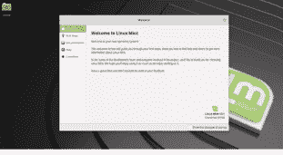

**步骤 2** 您已经在使用系统时通过 Mint 菜单重启过系统，并且第一次使用了现场环境。这次，点击“菜单”按钮，然后将鼠标悬停在中间列的“办公”条目上。这将改变右侧列中显示的图标，详细列出该部分下安装了哪些应用程序。


**步骤 3** 从菜单中启动任何应用程序都很简单，只需找到它并点击即可。例如，在“办公”部分下，点击 LibreOffice Writer。Writer 是 Linux Mint 预装的文字处理器。它可以打开和保存为 Microsoft Word 格式，功能几乎相同。


**步骤 4** 再次打开菜单，但这次将鼠标指针悬停在“图形”上，然后点击 GNU 图像处理程序。GIMP 是一款强大的图像处理应用程序，其效力可能与 Adobe 的 Photoshop 相当，但要获得您想要的效果可能需要多花些功夫。不过，它确实值得花时间去精通。


**步骤 5** 如果您正在寻找特定的功能或应用程序，例如设置打印机，请点击菜单框顶部的搜索框。开始输入您想要的应用程序或功能，例如“打印机”，Mint 菜单会在下方显示相关选项。无论发行版如何，大多数现代 Linux 菜单都支持此功能。

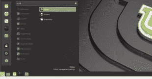

**步骤 6** 将鼠标悬停在右侧列中列出的任何应用程序上并右键单击，将显示一系列选项：添加到面板、添加到桌面、添加到收藏夹以及卸载。这些选项中的大多数用途都很明显。不过，“添加到收藏夹”会将该应用程序放置在左侧的快速访问列中。


## 导航 Cinnamon 桌面

每个桌面环境的行为都与下一个不同。一些 DE（桌面环境）提供可自定义并放置在桌面上的小工具，而另一些则选择简洁、利落的界面，以便尽可能快地运行。让我们看看 Cinnamon 桌面提供了什么。

### 添砖加瓦

Cinnamon 桌面环境是风格与性能的极佳融合。它有很多值得喜爱的地方，这就是为什么它如此流行的原因。

**步骤 1** 通过双击“计算机”图标开始探索 Cinnamon 桌面。这会打开 Nemo，它是 Cinnamon 使用的文件管理器。“计算机”图标打开根级文件系统，提供对光驱（如果已安装）、硬盘和核心 Linux 文件系统的访问和视图。

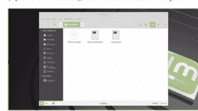

**步骤 2** Linux 文件系统对于前 Windows 用户来说可能看起来很令人困惑，因此在对整体运作方式有更多了解之前，我们建议您先关注桌面上的“主目录”图标。这里包含了与您用户账户相关的所有内容：您存储图片、视频、音乐、文档、下载项等的地方。

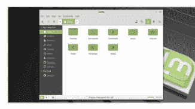

**步骤 3** Nemo 拥有许多不同的功能、视图和方法，您可以查看和操作文件和文件夹。例如，如果您的“图片”文件夹中有任何图像，您可以使用位于 Nemo 右下角的滑块来调整图像的图标缩放级别，该滑块标记为“调整缩放级别”。


**步骤 4** 与任何优秀的文件管理器一样，如果您右键单击任何文件或文件夹，您将获得丰富的选项。在 Cinnamon 的情况下，默认选项允许您根据文件类型播放或查看文件，并执行复制、剪切、删除、压缩、重命名、通过电子邮件发送以及查看其属性等操作。

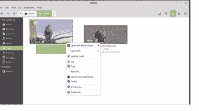


# 导航 cinnamon 桌面

**步骤 5**

在桌面底部是面板。我们已经查看过面板的一个部分，即菜单。如果你在面板的任何位置（除了面板上的应用程序）点击鼠标右键，你会看到一个允许你以不同方式编辑、添加和设置面板的菜单。


**步骤 6**

例如，如果你点击“修改面板”选项，你可以删除、移动、重命名、移除面板，添加新的面板，并清除当前存在的所有小部件。顺便说一下，小部件（Applet）是一种设计用于在 Cinnamon 面板中运行和适配的应用程序。

**步骤 7**

如果你在 Cinnamon 桌面上的任何位置点击鼠标右键，你会看到一组允许你进一步添加、编辑或以不同方式查看桌面内容的选项。它与 Windows 非常相似，这就是为什么 Mint 是前 Windows 用户的良好选择。

**步骤 8**

从该桌面右键上下文菜单中，选择“自定义”，然后选择新打开窗口底部的“桌面设置”链接。这会打开一个新窗口，在那里你可以编辑现有的桌面图标。如果你使用的是连接了多个显示器的设置，你还可以选择哪个显示器显示哪些图标。

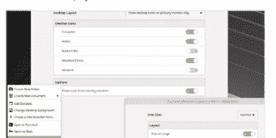

**步骤 9**

点击菜单并输入“system settings”（系统设置），然后打开结果中的图标。这将带你进入系统设置选项。从这里，你可以控制和编辑 Linux Mint Cinnamon 的外观和工作方式，以及添加新用户、管理防火墙和启用辅助功能选项。


**步骤 10**

简而言之，Linux Mint Cinnamon 可以配置得相当非凡。有很多例子展示了它可以有多好以及能实现什么。你可以选择复杂或简单，添加不同的组件和动画，或者保持简洁易读。


# 安装 Linux Mint 后的 10 件事

Linux Mint 开箱即用的版本已经非常精致，但就像大多数 Linux 发行版一样，有一些调整可以提高其工作方式。虽然这些是 Mint 特有的调整，但大多数也可以应用于其他发行版。

### Linux 调整

其中一些安装后操作是高度推荐的，而其他的只是方便的添加，用于调整系统或添加自定义功能。

**步骤 1**
第一个，也是最重要的安装后操作是更新系统。点击面板中位于桌面右下角、时间和日期旁边的盾牌图标。这将启动更新管理器。


**步骤 2**
Linux Mint 为用户提供了三级更新策略方法：不要弄坏我的电脑、优化稳定性和安全性、始终更新所有内容。推荐的选项是“优化稳定性和安全性”，它只更新安全的、基本的补丁，这些补丁不会影响核心操作系统的关键元素。阅读描述，但选择中间且推荐的选项。


**步骤 3**
点击“确定”按钮，你可以看到有几个更新准备安装。但在更新之前，点击蓝色条上的“确定”按钮以切换到本地镜像。这将打开“软件源”选项。在“镜像”部分，点击“主”和“基础”下拉菜单，并选择离你当前位置最近的服务器。


**步骤 4**
点击“更新缓存”按钮并关闭软件源窗口。回到更新管理器，点击“安装更新”图标并输入你的密码。更新会自动应用并重新启动更新管理器，这次会有更多的更新。再次点击“安装更新”，确认任何消息，并等待它们完成。


**步骤 5**
更新按级别分级，1 为低级别到 3 级别更新，5 级为危险级别。坚持使用 3 级更新，如果你因消息提示要覆盖配置文件时进行替换。关于软件渲染问题以及非 VirtualBox 用户缺少驱动程序的情况，点击菜单并在搜索框中输入“driver”（驱动程序）。


**步骤 6**
点击搜索结果中出现的“驱动管理器”应用程序并输入你的密码。Mint 需要一点时间来分析可用选项，并根据检测到的硬件向你展示一系列潜在驱动程序的选择。那些有图形问题，如软件渲染的用户，应该选择使用最新推荐的图形驱动程序。


**步骤 7**
此时你可能需要重启 Linux Mint，所以现在执行此操作。重启后，再次点击菜单按钮，然后选择终端。终端图标位于左侧列中，文件图标上方。打开终端后，输入：`sudo apt-get install libdvd-pkg`，按回车并输入你的密码。这将启用加密 DVD 播放功能。


**步骤 8**
当被要求接受更改时，输入 Y，当被要求配置 libdvd 时也输入 Y。确保“确定”被选中，按回车，然后对后续任何问题输入“是”。接下来，仍在终端中，输入：`cat /proc/sys/vm/swappiness`；结果应为 60。如果你的电脑内存（RAM）少于 4GB，则输入：`gksudo xed /etc/sysctl.conf`。


**步骤 9**
此调整有助于加速内存少于 4GB 的系统。滚动到刚刚打开的文件的底部，并添加以下新行：

```
## Decrease swap usage to a more reasonable level
vm.swappiness=10
```

点击文件 > 保存，然后点击文件 > 退出。重启 Linux Mint，你应该会注意到性能略有提升。


**步骤 10**
在这个现代数字时代，安全始终是一个关注点。虽然 Linux Mint 是一个安全的系统，但建议总是尝试改进它。点击菜单按钮并搜索“防火墙”；点击“防火墙配置”图标并输入你的密码。在防火墙窗口中，点击状态滑块将其设置为“开”。


## 阿波罗 11 号

**你知道吗...** 1969 年 7 月 20 日被视为人类历史的转折点，当时人类首次登上月球。帮助机组人员完成这次关键航行的软件在当时甚至不存在，必须从头开始开发。工程师们使用了一种称为“绳存储”（Rope Memory）的新程序存储方法，在麻省理工学院仪器实验室的记忆中填充了汇编语言的特殊版本。

令人难以置信的是，该代码在 GitHub 上可以免费查看。一位研究人员于 2003 年上传了它，你可以通过访问 www.github.com/chrislgarry/Apollo-11 查看代码。留意代码片段，例如 Burn_Baby_Burn，特别是第 925 行，注释为“再见。很快再会。”

浏览一下，看看你还能找到什么。


程序员并非没有幽默感。看看里面还有什么。

## 人类的一大步，也是一次编码。

图片来源：阿波罗 11 号/美国宇航局

# 创建用户

当你第一次安装 Linux Mint 时，它被配置为单用户使用。虽然与家人共享用户账户是可以的，但可能会有时候你需要创建拥有自己独特主文件夹的独立用户。

### 新用户

拥有不同的用户意味着每个用户都可以访问系统中属于他自己的区域。文档、图片、视频等都是独立的，就像其他操作系统上的多个用户一样。

-   **步骤 1** 点击 Linux Mint 菜单并输入“users”（用户）以开始搜索相关的控制台。从搜索结果中，选择“用户和组”并输入你的密码。“用户和组”控制台外观相当基础，但幸运的是使用起来很容易。起初，你只能看到安装 Linux Mint 时你自己的用户名。


-   **步骤 2** 要添加新用户，点击控制台底部的“添加”按钮。你可以创建两种类型的用户：标准和管理员。除非新用户需要安装新应用程序或访问其主文件夹之外的文件系统部分，否则请选择标准账户类型。否则，请使用管理员账户类型。


-   **步骤 3** 输入新用户的姓名，然后输入登录 Linux Mint 时所需用户名。确保用户名全为小写，仅包含 a-z 和 0-9 字符。如果你愿意，可以包含句点、下划线或连字符。当你准备继续时，点击“添加”按钮。


-   **步骤 4** 新用户将按字母顺序出现在当前 Linux Mint 用户列表中。目前，尚未设置密码，因此点击当前用户列表中的该用户，然后点击用户名下方的“未设置密码”选项。


## 步骤 5

现在可以为新用户输入密码，或者点击“新密码”文本框末尾的弧形箭头，让其为您生成一个密码并显示出来。显然，尽可能设置一个强密码是个好主意。完成后，点击**更改**按钮。


## 步骤 6

现在可以关闭“用户和组”控制台窗口了，因为新用户已创建完毕。如果您点击 Mint 菜单，然后选择注销，您将看到 Mint 登录管理器。新用户名现已出现在当前可用用户列表中。点击该用户以登录其账户。


## 步骤 7

登录新用户后，用户需要设置自己的桌面壁纸、图标、面板、菜单等。根据您为其设置的账户类型（标准用户或管理员），他们将无法安装任何新应用。此截图来自标准用户账户类型。


## 步骤 8

您可以创建任意数量的新账户，并且可以在需要时切换它们。最好只保留一个能够安装新软件的账户，这样您可以更好地掌握系统上的内容。


# 命令行账户

正如您所料，您还可以在命令行中创建新用户。请在主管理员账户下打开一个终端会话。

#### 步骤 1

通过命令行添加新用户的流程相对简单。首先输入：`sudo adduser <username>`，其中 `<username>` 是新用户的登录名。随后系统会要求您为该用户创建新密码，并输入全名及其他详细信息。按 **y** 确认信息并创建用户账户。


#### 步骤 2

您可以通过“用户和组”控制台查看新用户的详细信息和账户类型。如果您想从 Mint 中删除用户，可以在终端中输入 `sudo deluser <username>`，或者在“用户和组”中点击**删除**按钮。


# 定制桌面

定制操作系统桌面是让它变得专属的一种方式：一个个性化的工作空间，旨在帮助您工作、激发您的灵感，或展示公司标志。无论您拥有自己桌面的理由是什么，以下是操作指南。

## 您的桌面

Linux 可能是可定制性最强的操作系统之一。只需稍作调整，安装一两个额外组件并发挥想象力，您就能创造出令人惊叹的效果。

- **步骤 1**
  桌面定制的首要任务是更改壁纸。右键点击桌面，选择**更改桌面背景**。这将打开 Linux Mint 中的“背景”应用；请注意，其他发行版可能以不同的方式提供背景或壁纸选择工具。


- **步骤 2**
  较新版本的 Linux Mint 会根据用户运行的版本显示可用的背景。通常有三个类别，后面跟着一个第四个类别：图片（Pictures），与其他类别分开显示。“图片”选项有所不同，因为它从主目录中的 Pictures 文件夹读取图像内容。


- **步骤 3**
  您只需点击所提供位置中的任意可用图像，即可将其安装为桌面壁纸。顺带一提，如果您在系统或网络的其他位置存储了图像，可以点击“背景”控制台底部的加号图标，使用文件管理器定位并添加它们。


- **步骤 4**
  通过点击**设置**选项卡，您也可以选择将多张图像作为幻灯片播放，或将壁纸的纵横比更改为多种可选样式。


## 步骤 5

如果现有壁纸中没有一个让您满意，请打开浏览器并搜索您喜欢的背景图像类型。找到您想要作为桌面壁纸的图像后，右键点击它，并从选项列表中选择**设为桌面背景**。当“设置桌面背景”控制台打开时，点击**设置桌面背景**按钮。


## 步骤 6

点击菜单按钮，搜索“desktop”并点击“桌面设置”结果。桌面控制台允许您选择布局、桌面图标以及多显示器支持选项。您可以根据个人喜好试验各项选项，以获得最佳设置。


## 步骤 7

除了更改桌面壁纸和图标显示方式外，您还可以更改 Linux Mint 的整体主题。从 Mint 菜单中搜索“themes”，然后点击搜索结果中出现的“主题”应用。


## 步骤 8

主题功能允许您更改 Mint 桌面某些方面的外观，包括：窗口边框、图标、控件、鼠标指针和桌面。在设置选项卡中，您可以通过一些开关滑块按钮扩展选项。


## 步骤 9

如果您点击三个可用选项中间的“添加/删除”按钮，可以从多个预装主题中选择默认视图。点击您想要的主题，然后点击安装按钮（向下箭头）以启用它。


## 步骤 10

点击返回主题，然后选择桌面，您可以找到新安装的主题并将其应用到您的桌面。已安装的主题也可以通过“添加/删除”按钮卸载。值得花些时间按您的喜好个性化桌面，而且也有许多令人惊叹的主题可供选择。


# 在线匿名化

数字时代带来了通信技术的巨大进步；然而，它也带来了窃听和窥探的新时代。我们大多数人都不陌生，政府、秘密组织和地下黑客频繁侵犯隐私的新闻屡见不鲜，但您该如何应对？

## MINT 中的匿名性

虽然要在网上完全匿名几乎是不可能的，但您可以采取措施确保我们的隐私达到最佳状态。

- **步骤 1**
  从基础开始，浏览时请使用 HTTPS 代替标准的 HTTP。这意味着通过 HTTPS 传输的任何内容都是安全的（因此末尾有个 S）并经过加密。


- **步骤 2**
  浏览时，请考虑使用浏览器提供的隐身模式或隐私浏览模式。这会禁用您的网络历史记录和网页缓存，让您在浏览时不会保留详细信息，以免日后被他人审查。但是，它并不能阻止任何数据或搜索跟踪。


- **步骤 3**
  虽然使用 Google 似乎是现代互联网搜索的显而易见选择，但该公司确实会跟踪个人的所有搜索。相反，请考虑替代搜索引擎，例如 DuckDuckGo，这是一个不存储个人数据也不跟踪您的搜索引擎。


- **步骤 4**
  如果您经常上网，请考虑安装一些增强隐私保护的浏览器插件。例如，对于 Firefox，使用 Ghostery、NoScript 和 AdBlock Plus 来阻止跟踪器、广告和其他数据挖掘技术。


# VPN 和 TOR

上述步骤有助于您的在线隐私，但要真正匿名，您需要虚拟私人网络（VPN）和 Tor。

- **步骤 1**
  VPN 是一个远程服务器或服务器集群，它与您的电脑建立连接。最终结果是，您的电脑在 Internet 上的身份隐藏在 VPN 远程服务器之后；因此，如果您居住在英国，但可以拥有属于冰岛的 IP 地址（计算机的在线身份）。

## VPN 如何工作？


```
alex@iMacVirtual:~$ rm -f tor-browser-8.0.4_en-US
dex@iMacVirtual:~/Downloads $ ls
dex@iMacVirtual:~/Downloads $ tar
tor-browser-11inux64-8.0.4_en-US.tar.xz
tor-browser_aarch64-8.5a2_arm64.tar.gz
... [terminal output] ...
```

- **步骤 2**
  大多数优质 VPN 都收取月度或年度费用，但物有所值。我们使用 CyberGhost，网址为 `www.cyberghostvpn.com`，它提供 Windows、Mac、Mint（以及其他 Linux 发行版）、Android 和 iOS 设备的 VPN 连接。各操作系统的详细信息可在 `www.support.cyberghostvpn.com/hc/en-us/articles/21319032-Read-me-first` 找到。


- **步骤 3**
  另一个选择是使用 Tor。Tor 是一个由全球无数节点组成的开放网络。它适用于 Windows、Mac 和 Linux 计算机，且非常容易安装和使用。请前往 `www.torproject.org/download/download-easy.html` 并点击“下载 Linux 64 位”按钮开始。


- **步骤 4**
  下载完成后，进入终端并进入 Downloads 文件夹，执行 `cd Downloads/`。输入 `ls` 检查 tar.xz 文件是否存在，然后输入：`tar --xf tor-browser-11inux64-8.0.4_en-US.tar.xz`（由于更新频繁，如果您的版本不同，请按 Tab 键自动补全 `tor-browser-[filename]`）。文件解压缩后，使用 `cd .tor-browser_en-US/` 进入新文件夹。


- **步骤 5**
  快速执行 `ls` 会显示几个条目：一个名为 Browser 的文件夹和一个名为 `start-tor-browser.desktop` 的文件。要开始 Tor 设置，请输入 `./start-tor-browser.desktop`。此命令将启动 Tor 设置，您将获得两个选项：连接或配置。对于大多数用户，连接选项即可满足需求。准备好后，点击连接。


- **步骤 6**
  连接建立后，Tor 浏览器启动。这是 Firefox 的定制版本，从此您可以安全地浏览互联网，无需担心被查看或跟踪。同时使用 VPN 和 Tor 可打造极其安全和私密的在线连接。


## 使用终端

> “Linux：拥有 CLUE……命令行用户环境（Command Line User Environment）的操作系统。”
>
> — 匿名（发布于 comp.software.testing）

Linux 命令行，即终端，是一个功能极其强大的环境。通过它，你既可以令操作系统不堪重负，也可以将其更新到令人惊叹的状态。你可以入侵远程计算机，观看动画 ASCII 篝火，安装新的应用程序和程序，观看从荷兰服务器上播放的《星球大战》，以及编写复杂的自动化脚本。

在本节中，您将探索终端的复杂机制，以及它如何与 Linux 协作。您将学习如何通过终端操作 Linux 文件系统，并发现一些奇怪但有趣、可以在终端中执行的操作。

终端在 Linux 世界中至高无上。了解它的运作方式，您就能获取所有这种强大的力量。

- 46 终端基础
- 48 通过终端更新 Mint
- 50 通过终端安装应用程序 - 第一部分
- 52 通过终端安装应用程序 - 第二部分
- 54 你知道吗……Linux 内核 0.01
- 56 使用终端创建文件
- 58 创建和删除目录
- 60 在终端中做些有趣的事情
- 62 在终端中做更多有趣的事情
- 64 Linux 技巧与窍门
- 66 你知道吗……Linux 与大爆炸
- 68 创建 Bash 脚本——第 1 - 5 部分
- 78 Pi x Linux = 完美组合
- 80 命令行快速参考
- 82 Linux 命令 A-Z
- 84 你知道吗……足以满足 NASA

## 终端基础

大多数操作系统使用两种类型的界面：GUI（图形用户界面），即 Windows、macOS 和 Linux Mint 启动时进入的桌面，以及命令行。虽然现代操作系统逐渐远离命令行，但 Mint 使用终端赋予用户更大的系统控制权。

### 掌控命令

命令行，或终端，是一个极其强大的界面。你在桌面上能做的任何事，都可以在终端中完成。让我们从了解它是如何工作的开始。

- 步骤 1 您可以通过点击面板上的终端图标来访问终端，该图标位于 Firefox 和文件图标之间；或者打开菜单并从左侧快速启动条中选择它来启动终端。


- 步骤 2 终端为您提供访问 Linux Mint Shell（称为 Bash）的途径，进而访问底层操作系统。Mint 中的一切，包括桌面和 GUI，都是从命令行运行的模块。

- 步骤 3 您目前在终端中看到的是您的登录名，后跟计算机的名称，该名称是您在首次安装 Mint 期间设置的。该行以当前文件夹名称结尾；最初这只是一个波浪号 ~，表示您的主文件夹。

- 步骤 4 行末的闪烁光标是输入基于文本的命令的位置。您可以开始使用一个简单的命令 Print Working Directory（pwd）进行实验，它会将您当前所在的文件夹输出到屏幕上。输入 pwd 并按 Enter。


## 终端基础

- 步骤 5

您输入的所有命令都以相同的方式工作：输入命令，包含扩展命令使用的任何参数，并按 Enter 执行您输入的命令行。在终端中输入：uname -a 并按 Enter。这显示了有关 Mint 的一些系统信息。


- 步骤 8

查看和搜索选项允许您调整终端窗口的大小，当然也可以在终端中搜索任何特定的关键词。


- 步骤 6

在我们开始输入命令之前，让我们花点时间看看终端提供哪些菜单。文件菜单选项允许您打开新终端，创建新配置文件（在其中您可以调整终端的大小、颜色和行为），添加新标签页，并关闭当前所有活动的终端会话。


- 步骤 9

终端入口扩展了配置文件编辑和大小调整功能，允许您更改字符编码。有趣的是，您还可以将其设置为只读模式，这会阻止您向终端输入任何命令；当您只需要永久显示终端内容时，这很有用。


- 步骤 7

编辑选项允许您从终端和其他来源复制和粘贴命令；当您想从网页复制非常长且复杂的命令时，这很有用。它还允许您编辑当前配置文件的设置。


- 步骤 10

最后，帮助选项显示终端的帮助内容和版本号，更准确地说，是 GNOME 终端；我们以后会简单地称之为终端。内容值得快速浏览，以帮助熟悉终端的工作方式。


### 通过终端更新 Mint

到目前为止，您一直使用盾牌图标来启动 Mint 更新管理器，以更新系统并升级当前安装的应用程序、工具和其他元素。然而，您也可以从终端完成完整的系统更新和升级。

### 使用 APT-GET

要通过终端更新和升级，您使用 APT（高级打包工具）命令。它是一个功能强大的命令，根据其使用场景组合不同的元素。

- 步骤 1
从打开新终端开始，或者如果您已经打开了终端，使用 clear 命令清除其内容。这为您提供了一个干净的工作起点。


- 步骤 2
在终端中输入：apt-get。这会列出最常用的 apt-get 命令，以及对该命令作用的简要描述。即使此时它没有多大意义，也值得一看。


- 步骤 3
Apt-get 用于更新和升级 Mint 中的软件，以及 Ubuntu 和其他基于 Debian 的发行版。使用 Update 元素获取新的软件包列表并更新源文件列表。Upgrade 下载并执行这些文件的最新版本升级。要开始整个升级和更新过程，请输入：sudo apt-get update，然后输入您的密码。


- 步骤 4
现在请注意 sudo 命令的添加。sudo 命令曾经意味着“超级用户执行”（Super User Do）；如今，作为“替代用户执行”（Substitute User Do）更可接受。它意味着管理员用户（超级用户）使用 APT（高级打包工具）获取任何更新。现在试试这个：sudo apt-get upgrade。


### 通过终端更新 Mint

- 步骤 5
根据您的更新状态，如果您有任何等待安装的更新，您可能会被询问是否想要应用 sudo apt-get upgrade 命令的结果。您可以按 y 接受并继续。这里发生的事情是，apt-get 有一些更新软件要应用于 Mint，您正在确认该操作。


- 步骤 7
基本上，就是这样，您的系统现在已根据 apt-get update 命令提供的可用软件包列表更新到最新状态。您可以再运行一次该过程，只是检查一下是否一切正常。回顾一下，请输入：sudo apt-get update，按 Enter，然后输入：sudo apt-get upgrade 并按 Enter。


- 步骤 6
您的终端窗口中很可能会填入看似一堆乱码的长列表，但别担心。升级所需的文件已下载、准备、解包、处理、安装并正确设置。当您执行升级时，即使是最小的软件包，也有很多事情在发生。

- 步骤 8
有趣的是，Linux Mint 和其他发行版一样，允许您将几个命令链接在一起。因此，在这个例子中，我们可以使用 sudo apt-get update && sudo apt-get upgrade。双与符号（&&）组合命令，只要前一个命令未出错，它就能完美工作。建议在每次会话开始时都使用更新和升级组合。


### 终端与更新管理器？

无论您使用哪种发行版，为什么选择用终端而不是更新管理器来更新和升级？一些用户强烈喜欢使用终端来更新他们的 Linux 系统和配套应用程序，认为这样更好。然而，情况往往并非如此。

使用终端的 apt-get upgrade，无法处理软件包版本之间的依赖关系变更，因此如果软件包的依赖文件从一个版本到另一个版本发生了变化，升级就会被搁置。

更新管理器，或软件管理器（取决于发行版），通常会分阶段更新，并标记那些依赖关系发生变化的软件包进行更新。然而，Linux 有时会让事情变得困惑，有时又不会。归根结底，这取决于正在更新的软件包的开发者，以及该发行版仓库中保存软件包的方式，还有更新是否被归类为稳定版。本质上，从用户的角度来看，如果您定期使用终端和更新管理器进行更新和升级，那么您将保持尽可能最新，并获得基本和必要的稳定版本软件包和核心软件。如果您追求最前沿的软件包更新，最好选择滚动发行版。


## 通过终端安装应用 – 第一部分

在 Linux 系统中，安装应用程序和软件有多种方式。你可以选择图形化途径，使用软件管理器；也可以使用终端。通常情况下，终端能让你对正在安装的软件拥有更好的控制权，而在某些情况下，你甚至别无选择。

### 命令行安装

使用终端安装应用程序可能需要一些灵巧的键盘操作，但能让你更清楚地了解正在安装什么以及安装到哪里。

- **步骤 1** 从终端安装应用程序通常比较简单。不过，首先你需要确保系统是最新的。为此，打开终端并输入：`sudo apt-get update && sudo apt-get upgrade`。输入你的密码并接受任何必要的更新。


- **步骤 2** 正如你看到的，`sudo apt-get update`/`upgrade` 等命令旨在升级系统中已安装的软件。那么如何安装更多的应用程序呢？恰好这非常简单。首先你需要一个要安装的应用程序，所以我们再次使用 Stella。输入：`sudo apt-get install stella`。


- **步骤 3** 你需要输入 y 来确认安装，这将占用系统中约 5.5MB 的存储空间。Stella 安装完成后，你可以看到 Mint 在菜单中自动创建了“游戏”类别以及该应用的快捷方式。


- **步骤 4** 有时，在安装软件时，你需要添加该应用程序的软件仓库（Repository）。仓库（repo） simply 是指存放软件及其所有依赖项（使其运行所需的关键库等）的远程服务器位置。首先输入以下内容：`sudo add-apt-repository ppa:peterlevi/ppa`。当提示添加 PPA（个人软件包存档）时，按 Enter 键确认。


- **步骤 5** 这将为应用程序 Variety Wallpaper Changer 添加仓库，这是一款基于 Ubuntu 的应用程序，在 Mint 中也能运行，并自动更换壁纸。既然仓库已添加，输入：`sudo apt-get update`，以更新新信息并将仓库的内容添加到包数据库中。


- **步骤 6** 现在安装 Variety，输入：`sudo apt-get install variety`。按 y 确认并接受安装，以继续进行安装。安装完成后，你可以在终端中输入 variety 来运行该应用程序。


### 移除应用程序

除了安装应用程序外，apt 命令还可以用于移除任何应用程序，有助于保持系统整洁并释放资源。

- **步骤 1** 要卸载或移除 Variety 应用程序，请输入以下内容：`sudo apt-get remove variety`。输入 y 以继续卸载该应用程序；请注意，移除应用程序后，你会被告知在硬盘上释放了多少空间。


- **步骤 2** 虽然 'apt-get remove' 命令可以卸载应用程序，但它不会清除随应用程序而来的额外杂乱内容，例如配置文件和库文件。要完全清除这些杂乱内容，请输入：`sudo apt-get purge variety`。


- **步骤 3** 当你从系统中移除应用程序时，你会被告知一些自动安装的包不再需要。你在之前的教程中已经看到过，你可以使用以下命令来整理这些内容：`sudo apt-get autoremove`，然后按 y 接受该过程。


- **步骤 4** 最后，为了整理系统中所有未使用的包，并移除 autoremove 命令未移除的元素，你可以输入：`sudo apt-get autoclean`。最后这几个步骤对于保持你的 Linux Mint 设置处于良好运行状态以及削减因安装和升级造成的不必要冗余至关重要。


## 通过终端安装应用 – 第二部分

大多数时候，你都会使用标准的 apt-get 命令从终端安装应用程序。然而，有时某个应用程序需要更多的操作。这意味着需要从源代码安装应用程序，这听起来可能有点吓人，但实际上并没有那么可怕。

### 从源代码安装

你需要熟悉这里的命令有 Configure、Make 和 Install。你会发现很多应用程序都是从源代码安装的，因此这绝对是一项值得投入时间学习技能。

- **步骤 1** Linux 的源代码文件通常以 .TAR.GZ 或 .TAR.BZ2 的形式出现。两者都是压缩文件，包含“制作”应用程序所需的所有核心文件。从这个教程的开始，让我们在 Home 目录下创建一个新文件夹：`mkdir Vim`。

- **步骤 2** 顺便说一下，Vim 是一款高级文本编辑器，我们将用它作为安装示例。进入新文件夹，`cd Vim`，然后在新 Vim 文件夹内，在终端中输入以下命令：`wget ftp://ftp.vim.org/pub/vim/unix/vim-7.4.tar.bz2`。


- **步骤 3** wget 命令从互联网获取内容，在此情况下是 Vim 的 .BZ2 文件。要检查文件是否下载成功，请输入：`ls`。根据 Mint 的文件系统颜色键，压缩文件应以红色显示。


- **步骤 4** 现在我们需要解压文件内容，所以请在终端中输入：`tar -xf vim-7.4.tar.bz2`。注意：你可以输入 `tar -xf v` 并按 Tab 键自动填充剩余的文件名。

- **步骤 5** 如果你再次输入 `ls`，你会注意到创建了一个新文件夹：`vim74`；在 Mint 中，文件夹以浅蓝色文本表示。为主应用程序创建根文件夹总是很有用的，这样当你通过这种方法升级应用程序时，每个版本都会有自己的文件夹。


- **步骤 6** 输入 `cd vim74` 进入该文件夹，并再次输入 `ls` 查看其内容。可能会出现相当数量的文件；大多数是应用程序的核心文件，而另一些会被标记为 **README** 或 **INSTALL**。先阅读这些文件是明智的，因为它们提供了有关安装的重要信息。


- **步骤 7** 安装的第一部分要求你输入 `./configure`。`./configure` 命令会检查系统中是否存在与该应用程序相关的缺失依赖项。如果你收到关于 C 编译器的错误，请输入：`sudo apt-get install build-essential`。记录显示缺少第三方应用程序 Ncurses。我们需要通过以下命令安装它：`sudo apt-get install libncurses5-dev libncursesw5-dev`。


- **步骤 8** 根据应用程序的不同，你可能需要持续安装新的依赖项。每次安装新的依赖项后，重新运行 `./configure`，当它不再报告错误时，你可以继续安装的下一阶段。注意：你可能需要在线搜索某些错误信息。


- **步骤 9** 成功运行 `./configure` 后，系统将创建 **Makefile**。这需要通过在终端中输入 **make** 来“制作”。根据应用程序的大小，这可能需要一段时间。


- **步骤 10** 最后，你需要在终端中输入：`sudo make install`。这将安装应用程序，使其在系统中就绪可用。完成后，你可以执行该应用程序，在此情况下通过在终端中输入 **vim** 或通过 Dash 搜索它。


## 使用终端

# Linux 内核 0.01

```
console.c
```

* 该模块实现了控制台和写入功能
* 添加了 CVT102 支持
* 添加了 CVT102 滚动和状态行功能
* 希望这将是一个相当完整的 VT102 实现。

注意：当我们向 inb 放入一个字时，有时会在短时间内禁用并重新启用中断。它会在 in_port 或 in_port_word 或 inb_interrupt 中放入一个字。我们知道在获取按键中断时，中断并未启用。

您是否知道第一个 Linux 内核作为一个玩笑，只占用了 65KB 的内存？而且，自 0.01 版本以来，Linux 内核现在拥有超过 1800 万行代码。对于一个如今运行着纽约证券交易所并驱动美国国防部核潜艇船队的大学项目来说，这还不错。

www.bdmpublications.com

## 使用终端创建文件

使用终端，您可以创建文件夹、文件，甚至可以执行 Linux Mint 应用程序。事实上，即使您手边没有 GUI，您仍可以通过终端完成相同的工作。

### 更多终端操作

使用终端创建内容并不像第一眼看上去那样费力。是的，对于新手来说，终端可能看起来是一个令人望而生畏的地方，但一旦掌握，它其实非常直观。

- **步骤 1**
  打开终端，确保您位于主目录（Home folder）。如果没有，请使用 `cd ~` 命令从您当前所在的位置返回主目录。
  

- **步骤 2**
  让我们开始在主目录内创建一个新文件夹，并命名为 **Test**。您需要的命令是 `mkdir`。输入命令后，按下 `Enter` 键创建文件夹，然后输入 `cd Test` 并按下 `Enter`。这将更改目录（因此称为 **CD**）到 newly created Test 文件夹。
  

- **步骤 3**
  您的命令行应该会切换到 Test 文件夹，如果您输入 `ls`（列出文件夹内容），会发现文件夹内没有任何内容，因为您刚刚创建了它。`mkdir` 命令相当自解释：Make Directory（创建目录）后接您选定的名称。
  

- **步骤 4**
  要创建一个名为 **Test.txt** 的空文本文件，请在终端中输入：`touch Test.txt`。然后可以使用 `ls` 查看文件夹中的新文件。Touch 是一个标准的 Linux 命令，允许创建文件，而无需打开文本编辑器、保存文件，然后关闭编辑器。
  

- **步骤 5**
  假设您现在想要创建一个包含一些内容的文本文件，我们将它命名为 Test2.txt。为此，请输入：`cat > Test2.txt`。这将创建文件 Test2.txt 并将终端置于编辑模式。
  

- **步骤 6**
  您会注意到光标在 `cat > Test2.txt` 命令下方闪烁，没有通常的提示符。此编辑模式允许您输入文件将包含的文本。输入一些文本，然后按下 `Ctrl+D` 退出并将内容写入文件。
  

- **步骤 7**
  当然，您不必总是使用终端向文件输入文本。Mint 附带了一个名为 Xed 的文本编辑器，类似于 Windows 的记事本。要在 Xed 中查看之前创建的文件，请在终端中输入：`xed Test2.txt`，并按下 `Enter`。
  

- **步骤 8**
  Xed 是一个 GUI 应用程序，您可以使用应用程序的主窗口以及其顶部菜单栏中的 **文件 > 保存** 或 **文件 > 另存为** 功能来输入文本并相应地保存文件或任何文件。
  

- **步骤 9**
  然而，如果您更喜欢继续留在终端中编辑/保存/创建文件，您可以使用 Nano。Nano 是一个简单的基于终端的文本编辑器。要在示例中尝试使用它，请输入：`nano Test2.txt`。屏幕底部有一个菜单。要在 Nano 中退出并保存任何内容，请按下 `Ctrl+X` 并按照屏幕上的说明进行操作。
  

- **步骤 10**
  我们使用终端启动了 Mint 应用程序 xed，但任何应用程序都可以从终端内部启动。例如，尝试输入：`firefox`，并按下 `Enter`。关闭 Firefox 以返回终端。只要您知道应用程序的名称，就可以从终端运行它。此外，输入 `firefox &` 可以打开 Firefox，同时仍允许您使用终端。
  

## 创建和删除目录

与在终端中创建文件一样，您也可以创建和删除目录，或者如果您喜欢的话，称为文件夹。目录构成了您文件系统的结构；如果没有逻辑目录，文件系统将陷入彻底的混乱。

### 管理文件夹

学习如何在终端中创建和删除文件夹是 Mint 乃至整个 Linux 中需要掌握的重要技能。以下是供您尝试的基本操作。

- **步骤 1**
  打开终端后，输入 `cd ~` 以确保您位于自己的主目录中。现在输入 `ls` 查看您在主目录中当前的文件夹。您会注意到，在 Mint 中文件夹标记为青色（浅蓝色）。让我们开始创建一个新目录。输入 `mkdir testdir`。
  

- **步骤 2**
  如果您再次输入 `ls`，您会看到新目录 testdir 已与其他目录一起创建在主区域中。显然，`mkdir` 命令用于创建目录，毫无疑问您已经猜到它代表 Make Directory（创建目录）。

- **步骤 3**
  如果您再次输入该命令，`mkdir testdir`，您将收到一条消息，内容为：`mkdir: cannot create directory ‘testdir’: File exists`（mkdir: 无法创建目录 'testdir'：文件已存在）。不言而喻，您只能在当前目录中拥有一个唯一命名的目录。然而，由于 Linux 区分大小写，您可以拥有 TestDir、Testdir、testDir 等。
  

- **步骤 4**
  您可以创建在已创建的目录内的目录。例如，使用 `cd testdir/` 进入 testdir 目录，然后使用 `ls` 列出文件夹结构。显然，目前没有任何内容，因为您刚刚创建了该目录。现在通过 `cd ~` 返回主目录，并输入 `mkdir testdir/reports`。回到 testdir，`cd testdir/`，并再次 `ls`。
  
  

- **步骤 5**
  创建目录的命令相当合乎逻辑，因此，您可以创建该目录及其内部的任何子目录。但是，如果您想在一条命令中创建一个目录和一个子目录怎么办？确保您位于主目录（`cd ~`）并输入：`mkdir -p Temp/finances`。现在，`cd Temp/`，并 `ls` 以列出新目录。
  

- **步骤 6**
  `-p` 选项使得 `mkdir` 命令能够创建子目录以及（父）目录。在 Linux 中，命令始终遵循相同的结构：命令（`mkdir`）、选项（`-p`）和参数（`Temp/finances`）。
  

- **步骤 7**
  如果您想深入了解 `mkdir` 命令可用的各种选项，您可以向终端输入 `mkdir -h`（帮助）。这将提供一个快速帮助指南，详细说明选项以及命令结构的工作方式。
  

- **步骤 8**
  既然我们已经创建了一些目录，让我们看看如何删除它们。首先进入 `testdir` 目录并列出其内容：`cd testdir`，然后 `ls`。之前创建的 `reports` 子目录存在。删除它的一种方法是输入：`rmdir reports`，然后再次 `ls` 以确认它已不存在。
  

- **步骤 9**
  快速警告：在终端中删除目录不会将其放入 Mint 回收站（通过 Nemo 文件管理器）。对于任何文件也是如此；如果您从终端命令中删除一个目录，那么它就永久消失了。
  

- **步骤 10**
  `Rmdir` 只能删除空目录。要删除包含子目录或甚至文件的目录，您需要使用带有 `-r` 选项的 `rm` 命令。例如，在 `Temp/finances` 目录上，使用 `rm -r Temp`。简单的 `ls` 显示父文件夹及其所有内容已被删除。使用此命令时要小心。
  


# 在终端里可以玩的有趣事物

尽管操作系统听起来很严肃，但 Linux 社区的人显然对娱乐毫不陌生。多年来，开发者们已经在终端中创建并植入了各种有趣且怪异的元素。

## 终端趣味

接下来的两个部分将完全在终端中操作，所以请准备好你的手指。毕竟，只工作不玩耍... 正如俗话说的那样。

- **步骤 1** 我们要使用的第一个命令是 `sl`，它默认未安装，因此请输入：`sudo apt-get install sl`。运行该命令时只需输入 `sl`，执行后屏幕会显示一列蒸汽机车行驶的画面（这就是“sl”的由来）。输入 `LS`，注意是大写，也能正常工作。


- **步骤 2** 即使是《星球大战》的粉丝在终端里也能得到满足。通过 `telnet` 命令连接到远程服务器，你可以观看 *第四集：新希望* 的播放，尽管是以 ASCII 字符形式呈现。要观看这一奇观，请输入：`telnet towel.blinkenlights.nl`。

- **步骤 3** 如果你曾想过让电脑为你朗读一句随机名言，那你运气不错。大多数发行版要求你安装 fortune 应用，但 Linux Mint 有些不同，它已经预装了该应用。你只需在终端中输入命令 `fortune`，然后享受即可。

- **步骤 4** `rev` 命令确实很有趣，乍一看似乎是对操作系统一个完全无用的添加。然而，它可以用来创建一些看似无法破解的密码。输入 `rev`，然后输入一些文本，当你按 **Enter** 键时，你输入的所有内容都会被反转。按 **Ctrl+C** 退出。


- **步骤 5** 如果你卡在试图找出某个特定数字的所有可能因子上，只需输入 **factor** 后跟该数字。例如，**factor** `7` 提供的输出不多，而 **factor** `60` 会显示更多。


- **步骤 6** 酷炫和真的很奇怪之间有一条微妙的界限。让一只 ASCII 牛向你重复文字，这可能属于后者。输入 **cowsay** 后跟任何你想说的文本，例如 **cowsay** `Linux Mint is ocel`。

实际上，你甚至可以通过牛输出 `ls` 命令，只需输入 `ls` | **cowboy**。


- **步骤 7** 为了进一步拓展“牛”的元素，甚至还有一个图形的、非终端的牛可用。用 `sudo apt-get install xcowsay` 安装它，安装后输入类似于 cowsay 的内容，例如 `xcowsay BDM Publications`。


- **步骤 8** 如果你真的想扩展整个“牛”的主题，无论出于什么原因，你都可以通过管道将 fortune 命令传递给它，使用 **fortune** | **cowsay**，图形牛对应的则是：**fortune** | **xcowsay**。此外，还有 cowthink。尝试：**cowthink** `This book is awesome`。


- **步骤 9** 命令 **toilet** 不会给人多少信心，我们承认。然而，它并不像听起来那么糟糕。首先使用 `sudo apt-get install toilet` 进行安装。安装完成后，输入一行 **toilet** `David`。或者，也许可以通过管道列出当前文件夹的内容，使用 `ls` | **toilet**。


- **步骤 10** 扩展 toilet 命令，你实际上可以通过它生成一些外观不错的图形。例如，尝试这个：**toilet** `-f mono12 -F metal David`。你可以输入 **toilet** `--help`，以查看命令行参数列表，以便进一步使用。


# 在终端里可以做的更多有趣事物

如果之前列出的那些有趣且相当怪异的行为让你想要更多，那你很幸运。我们为你整理了另一批有用的（以及一些没什么用的）命令供你尝试。

## 更多乐趣，耶

既然终端会话已经打开，且你的键盘手指已经热身完毕，这里还有两页终端的胡闹内容。

- **步骤 1** 还记得 ZX Spectrum 时代的计算吗，那时你可以输入 10 print "Hello", 20 goto 10，然后 Hello 会在屏幕上列表下来？在 Linux Mint 中你可以做同样的事。只需输入 yes 后跟一些文本，例如 `yes Linux is ace`。它会一直运行，直到你按下 `Ctrl+C`。

- **步骤 2** 《黑客帝国》是曾经发行的视觉效果被模仿最多的电影之一；Linux Mint 上甚至有一个黑客帝国代码的版本。使用 `sudo apt-get install cmatrix` 安装它。完成后输入：`cmatrix` 并追随白兔。尼奥。不过与真正的黑客帝国不同的是，你可以按 `Ctrl+C` 退出。


- **步骤 3** 让一只小白猫在桌面上追逐你的鼠标指针听起来可能是一种巨大的时间浪费。奇怪的是，事实并非如此。输入：`sudo apt-get install oneko`，然后键入 `oneko` 让猫出现。在屏幕上移动你的“鼠标”光标，猫就会追逐它。使用 `Ctrl+C` 退出操作。

- **步骤 4** 这一项比前面的稍微严肃一点。它被称为 Fork Bomb（叉子炸弹），其基本作用是持续复制自身，直到耗尽所有可用的系统资源，从而导致你的计算机崩溃。你不必尝试它，但它确实很有趣。只需输入 `:(){ :|& };` 并准备好重新启动。


- **步骤 5** 串联多个命令并通过管道传递给其他命令，这正是脚本成为操作系统强大元素的原因。例如，使用 `while` 命令配合 `toilet`，可以产生一些令人印象深刻的结果。输入：
  `while true; do echo "$$(date +%4D %T)" | toilet -f term -F border --meta);"; sleep 1; done.`


- **步骤 6** 会说话的计算机是 80 年代的潮流，输入：`espeak: "Hello, this is Linux Mint"` 让计算机向你重复引号内的文本。确保你的音量已调高，并尝试以下内容：`ls > folders.txt && espeak -f folders.txt`。这将让 Mint 朗读 `ls` 命令的内容。


- **步骤 7** 喧嚣的 ASCII 火焰并不是最实用的命令，但它很有趣。使用 `sudo apt-get install libaa-bin` 安装它，安装完成后使用：`aafire`。它并不真正保暖，但你能理解其中的意思。要扩展上述内容，输入：`sudo apt-get install bb caca-utils`，然后，`cacafire`。


- **步骤 8** 作为旧 Amiga 和 DOS 时代的音乐演示，`bb` 命令让我们回想起那些塞满了各种演示场景珍品的 3.5 英寸软盘。我们在前一步已经安装了 `bb`，所以只需输入 `bb`。遵循屏幕上的说明，并调高音量。


- **步骤 9** 这一项分为两部分。首先你需要获取必要的软件包：`sudo apt-get install libcurves-perl`。完成后输入：`cd Downloads/ && wget http://search.cpan.org/CPAN/authors/id/X/XB/XBAUCOM/Term-Animation-2.4.tar.gz && tar -xf Term-Animation-2.4.tar.gz && cd Term-Animation-2.4/`。然后：`perl Makefile.PL && make && make test && sudo make install.`


- **步骤 10** 完成上面那一小部分后，进入下一步：`Enter: cd ... && wget http://www.robo bunny.com/projects/asciiaquarium/asciiaquarium.tar.gz && tar -xf asciiaquarium.tar.gz && cd asciiaquarium-1.1/ && chmod +x asciiaquarium.` 如果一切顺利，输入 `./asciiaquarium` 并享受你专属的基于 ASCII 的鱼缸。


## Linux 技巧与窍门

正如你所见，**Linux 终端**是一个非常出色的环境。只需安装一些额外的应用，并具备少量的命令知识，就能完成难以置信、甚至相当怪异的操作。

### 掌握命令

世上有无数 Linux 技巧、秘密、黑客技巧和窍门。有些非常古老，源自 Linux 的 Unix 血统，而有些则是 Linux 传奇故事中的近期新增内容。以下是我们最喜欢的十个技巧和窍门。

### 彩蛋

Emacs 是一款文本编辑器，是一款很棒的软件，但你知道它其实还包含一个隐藏的彩蛋吗？在安装了 Emacs 之后（**sudo apt-get install emacs25**），进入终端会话并输入：

`emacs -batch -l dunnet`

Dunnet 是由 Ron Schnell 在 1982 年编写的文本冒险游戏，自 1994 年起就隐藏在 Emacs 中。


### 终端浏览

你是否曾想过可以从终端中浏览互联网？虽然这没什么特别的实际用途，但这确实是一件非常迷人的事情。为此，请输入：

`sudo apt-get install elinks`

输入你想访问的网站。


### 月球 buggy

基于经典的 1982 年街机游戏《月球巡逻》（Moon Patrol），《月球 buggy》（Moon Buggy）于 1985 年出现在家用电脑上，并广受好评。这是一款精彩的 Atari 游戏，你可以通过在 Linux 终端中输入以下命令来体验它：

`sudo apt-get install moon-buggy`

然后：

`moon-buggy`

祝你玩得愉快。


### 让它下雪

在终端控制台中看到下雪可不是每天都能遇到的事。不过，如果你感兴趣，请输入：

```
wget -x //gist.githubusercontent.com/sontek/1505483/raw/7d024716a457e69fb52632fee09f42753361c402/snowjob.sh
chmod +x snowjob.sh
./snowjob.sh
```


### 内存占用大户

如果你需要查看 Linux 上哪些应用程序消耗的内存最多，只需输入：

```
ps aux | sort -rnk 4
```

这会根据系统内存使用量对输出进行排序。


### 电子公告板 (BBS)

在拨号上网时代，在线世界是由电子公告板系统 (Bulletin Board Systems) 组成的。这些远程服务器为用户提供了聊天、交换代码、玩游戏等休闲场所。利用 Linux 中的 telnet，我们仍然可以连接到一些活跃的 BBS：

```
telnet battletestarbs.dynDNS.org
```

有无数的可用 BBS，请查看 [https://www.telnetbbsguide.com/bbs/list/detail/](https://www.telnetbbsguide.com/bbs/list/detail/) 以获取更多。


### 碎纸机

当你删除一个文件时，拥有正确软件的人有可能将其恢复。但是，若要安全且永久地删除文件，请使用 Shred：

```
shred -zvu NAMEOFFILE.txt
```

将 NAMEOFFILE 替换为要删除的文件名。


### 目录树

如果你想用一条命令创建整个目录（或文件夹）树，可以使用：

```
mkdir -p New-Dir/{subfolder1,subfolder2,subfolder3,subfolder4}
```

这会在 New-Dir 中创建四个子文件夹。


### ASCII 艺术

当应用于某些图像时，ASCII 艺术可以非常惊艳。然而，要想做得恰到好处往往很困难。你可以使用 img2txt 从你现有的图像创建出色的 ASCII 艺术：

```
img2txt NAMEOFIMAGEFILE.png
```

将 NAMEOFIMAGEFILE 替换为你系统上实际的图像文件名。如果未安装 img2txt，请使用：

```
sudo apt-get install caca-utils
```


### 被遗忘的命令

记住所有可用的 Linux 命令并不容易。幸运的是，我们可以使用 apropos 来帮助我们。只需使用它并附带命令的描述即可：

```
apropos "copy files"
apropos "rename files"
```


## Linux 与大爆炸

Linux 通过碰撞粒子，帮助我们理解宇宙的运行方式。


**你知道吗……**

Linux 位于大型强子对撞机 (LHC) 背后科学技术的核心？科学家、开发人员和工程师以红帽 Linux 和 CentOS（一种基于红帽核心构建的超稳定发行版）作为首选基础发行版的组合，创造了 SL – 科学 Linux (Scientific Linux)。

以 SL 为基础，欧洲核子研究中心 (CERN) 的聪明才智开发了几个不同版本的定制 Linux 发行版，以协助 LHC 的各个方面。其中最著名的是 SLC，即科学 Linux CERN，也被称为 CERN6。据报道，有超过 36,000 台系统运行 SL，还有超过 15,000 台运行 SLC。

## 创建 Bash 脚本 – 第一部分

随着你在使用 Linux Mint 过程中的进阶，你终将希望开始创建自己的自动化任务和程序。这些本质上是脚本。确切地说是 Bash Shell 脚本，它们的工作原理与 DOS 批处理文件或其他编程语言类似。

### 开始编写脚本

Bash 脚本只是一系列命令，Mint 将按顺序执行这些命令以完成特定任务。它们可以是简单的，也可以异常复杂，这取决于具体情况。

**步骤 1** 在接下来的页面中，你将主要在终端和文本编辑器中进行操作。文本编辑器有一些替代方案，我们稍后会讨论，但为了方便起见，我们将使用 Xed 进行示例。不过，在开始之前，请先运行常规的更新检查：`sudo apt-get update && sudo apt-get upgrade`。


**步骤 2** 我们有几种可用于创建 Bash 脚本的文本编辑器：Xed、VI、Nano、Vim、GNU Emacs 等。归根结底，这都取决于个人偏好。我们使用 Xed 纯粹是为了让你在下方的截图中更容易阅读脚本。


**步骤 3** 首先，在开始编写任何脚本之前，你需要创建一个文件夹来存放我们所有的脚本。从 `mkdir scripts` 开始，然后进入该文件夹 `cd scripts`。这将作为我们的工作文件夹，从此处你可以为创建的每个脚本创建子文件夹（如果需要的话）。


**步骤 4** Windows 用户应该知道，为了使批处理文件工作，即被执行并遵循其中的编程逻辑，它需要具有 .BAT 文件扩展名。Linux 是一个无扩展名的操作系统，但惯例是给脚本加上 .sh 扩展名。


**步骤 5** 让我们从一个向终端输出内容的简单脚本开始。输入 `xed helloworld.sh`。这将启动 Xed 并创建一个名为 helloworld.sh 的文件。在 Xed 中，输入以下内容：`#!/bin/bash`，然后在新的一行输入：`echo Hello World!`。


**步骤 6** `#!/bin/bash` 这一行告诉系统将使用哪个 Shell，在本例中是 Bash。井号 (#) 表示注释行，系统会忽略该注释。感叹号 (!) 意味着该注释被绕过，并强制脚本将该行作为命令执行。这也称为 Hash-Bang。


**步骤 7** 你可以保存此文件，点击 `File > Save`，然后退出回到终端。输入 `ls`，你会看到该脚本出现在文件夹中。要使任何脚本可执行并能够运行，你需要修改其权限。使用 `chmod +x helloworld.sh` 来执行此操作。你需要对创建的每个脚本执行此操作。


**步骤 8** 当你再次输入 `ls` 时，你可以看到 helloworld.sh 脚本的颜色已从白色变为绿色，这意味着它现在是一个可执行文件。要运行该脚本，换句话说，使其执行你输入的内容，请输入：`./helloworld.sh`。


**步骤 9** 虽然这并不那么令人兴奋，但终端现在应该会显示“Hello World!”这几个字。`echo` 命令负责在终端输出其后的单词，随着学习的深入，你可以让 `echo` 命令输出到其他目标。


**步骤 10** 将 `echo` 想象成旧 BASIC 语言中的 Print 命令。它显示文本、数字或存储在系统中的任何变量，例如当前系统日期。尝试这个例子：`echo Hello World! Today is $(date +%A)`。`$(date +%A)` 调用了存储当前星期几的系统变量。


## 创建 Bash 脚本 – 第二部分

前面我们介绍了如何创建你的第一个 Bash 脚本“Hello World”（你好，世界），以及如何添加系统变量。现在你可以在此基础上进行扩展，通过创建自定义变量来探索其更多可能性。

# 变量

与其他编程语言一样，Bash 脚本可以从系统中存储和调用特定变量，这些变量既可以是通用的，也可以是用户创建的。

- **步骤 1** 让我们从创建一个名为 `hello.sh` 的新脚本开始；`xed hello.sh`。在其中输入：`#!/bin/bash`，然后输入 `echo Hello $1`。保存文件并退出 Xed。返回终端后，使用以下命令使脚本可执行：`chmod +x hello.sh`。


- **步骤 2** 由于脚本现在已可执行，使用 `./hello.sh` 运行它。正如你可能预期的那样，终端会显示一个简单的“Hello”（你好）。然而，如果你使用带有变量的命令来运行它，事情就变得更有趣了。例如，尝试运行 `./hello.sh David`。


- **步骤 3** 现在的输出将是 Hello David（你好，大卫）。这是因为 Bash 会自动为用户分配变量，然后这些变量会被保留并传递给脚本。因此，变量 '$1' 现在存储着 'David'。你可以通过输入不同的内容来更改变量：`./hello.sh Mint`。


- **步骤 4** 你甚至可以重命名变量。使用以下内容修改 hello.sh 脚本：`firstName=$1`，`surname=$2`，`echo Hello $firstname $surname`。将每个语句放在新的一行中。保存脚本并退出回到终端。


- **步骤 5** 现在运行脚本时，你可以使用两个自定义变量：`./hello.sh David Hayward`。当然，你可以将这两个变量更改为你自己的名字；除非你也叫 David Hayward。目前我们只是在打印内容，所以让我们稍微扩展一下这两个变量的用法。


- **步骤 6** 创建一个名为 `addition.sh` 的新脚本，使用与 hello.sh 脚本相同的格式，但更改变量名称。在这里，我们添加了 `firstnumber` 和 `secondnumber`，并将 echo 命令更改为通过放置一个整数表达式来输出简单的算术运算，`echo $((($firstnumber+$secondnumber)))`。保存脚本，并使其可执行（`chmod +x addition.sh`）。


- **步骤 7** 现在运行 addition.sh 脚本时，我们可以输入两个数字：`./addition.sh 1 2`。结果应该是 3，终端将显示“总和为 3”（The sum is 3）。尝试几个不同的数字，看看会发生什么。看看你是否可以修改脚本并将其重命名为 multiplication（乘法）和 subtraction（减法）。


- **步骤 8** 让我们进一步扩展。创建一个名为 `greetings.sh` 的新脚本。按照下图截图输入脚本内容，保存它并使用 `chmod` 命令使其可执行。你可以看到脚本现在有一些新的添加内容。


- **步骤 9** 我们在这里给 echo 命令添加了 `-n`，这将使光标停留在与问题相同的行上，而不是新的一行。`read` 命令将用户的输入存储为变量 `firstname` 和 `surname`，以便在最后一行 echo 中稍后读取。而 `clear` 命令用于清屏。


- **步骤 10** 作为最后的添加，让我们包含上一节中使用的日期变量。修改脚本的最后一行如下：`echo Hello $firstname $surname, how are you on this fine day $(date +%A)?`。输出应显示当前星期几，通过从系统变量调用实现。


## 创建 Bash 脚本 – 第三部分

在前面的页面中，我们介绍了一些非常基础的 Bash 脚本编写，包括向屏幕输出文本、获取用户输入、存储该输出并再次输出到屏幕；以及使用 Date 命令包含系统变量。现在让我们结合你目前已掌握的内容，并引入循环（Loops）。

### IF, THEN, ELSE（如果、那么、否则）

在大多数编程结构中，迟早会需要你循环执行已输入的命令，以创建更好的功能，最终实现更好的程序。

- **步骤 1** 让我们现在看看 If、Then 和 Else 语句，当正确执行时，它们会比对一组指令，并简单地判断：如果某事物存在，那么执行某操作，否则执行不同的操作。创建一个名为 `greeting2.sh` 的新脚本，并将下方截图中的文本输入其中。


- **步骤 2** `greeting2.sh` 是 `greeting.sh` 的副本，但略有不同。在这里，我们添加了一个从 if 语句开始的循环。这意味着，如果输入的变量等于 David，那么下一行，即 THEN（那么），是对所发生情况的响应，在这种情况下，它将在屏幕上输出“Awesome name”（很棒的名字），随后是变量（即 David）。


- **步骤 3** 下一行 ELSE（否则），是当变量不等于 'David' 时发生的情况。在这种情况下，它只是向屏幕输出熟悉的“Hello...”（你好……）。最后一行，FI 语句，是结束循环的命令。如果你有 if 命令但没有 FI 命令，就会得到错误。


- **步骤 4** 你显然可以对这个脚本进行一些调整，更改触发响应的名字变量，或者甚至发出一个响应，其中名字和姓氏变量匹配某个特定变量。


### 更多循环

你可以使用 FOR、WHILE 和 UNTIL 语句对数据进行循环。如果你正在批量命名、复制或运行需要计数器的脚本，这些语句会很有用。

- **步骤 1** 创建一个名为 count.sh 的新脚本。输入下方截图中的文本，保存它并使其可执行。这会创建变量 'count'，在脚本开始时它等于零。然后开始 WHILE 循环，只要 count 小于（即 LT 部分）100，就会在 echo 命令中打印 count 的当前值。


- **步骤 2** 执行 count.sh 脚本将导致数字 0 到 99 列在终端屏幕上；当它达到 100 时，脚本将结束。使用 FOR 语句修改脚本，使其工作方式大致相同。要在我们的脚本中使用它，请将截图中的文本输入到 count.sh 脚本中。


- **步骤 3** 我们在这里的添加是：`for count in {0..100}; do`，意思是对于变量 'count'，在从 0 到 100 的数字范围内，然后开始循环。脚本的其余部分相同。运行此脚本，终端中应出现相同的输出。


- **步骤 4** UNTIL 循环的工作方式与 WHILE 循环大致相同，只是通常方向相反。因此，使用 UNTIL 循环计数到 100，应该是：`until [ $count -gt 100 ]; do`。区别在于，直到 count 大于（即 gt 部分）一百，才停止循环。


- **步骤 5** 你并不局限于从 0 到 100 的数字。你可以在循环中拥有任何一组你想执行的命令，并让循环运行你想要的次数。例如，重命名一百万个文件，创建五十个文件夹等。例如，使用 FOR 循环，此脚本将创建 10 个名为 folder1 到 folder10 的文件夹。


- **步骤 6** 再次使用 FOR 语句，我们可以通过操作 `(0..100)` 部分来执行计数序列。代码的这一部分实际上意味着 `[开始..结束..增量]`，如果没有增量，那么它只是单数字递增直到结束。例如，我们可以使用以下命令让循环以 2 为增量计数到 1000：`for count in {0..1000..2}; do`。


## 创建 Bash 脚本 – 第 4 部分

你已经遇到过脚本与用户的交互，例如询问用户姓名等。你也查看了如何在脚本中创建循环，以进行计数或简单地重复执行某些操作。让我们结合并扩展其他一些方案。

### 选择与循环

让我们引入另一个命令 CHOICE，以及一些嵌套的 IF 和 ELSE 语句。首先创建一个名为 mychoice.sh 的新脚本。

- **步骤 1**
  mychoice.sh 脚本开始变得复杂得多。这里有一个包含四个选择、三个可能选项的列表。选项：Mint、ls 和 Awesome 将在用户按下正确的选项键时显示。如果没有，菜单将重新出现，即第四个选择。

  

- **步骤 2**
  如果你跟踪脚本的执行流程，基于我们已经涵盖的内容，很快就会明白发生了什么。带有 IF 闭合循环语句的 WHILE、IF 和 ELSE 将遍历选项，如果你选择了错误的选项，则会带你回到开始。

  

- **步骤 3**
  当然，你可以增加选择数量，但你必须确保选择数量与 IF 语句数量相匹配。脚本可能会迅速变成一个看起来非常繁忙的屏幕。这个冗长的脚本是显示菜单的另一种方式，这次还附带了一个精美的配色方案。

  

- **步骤 4**
  你可以在脚本的菜单设置中使用方向键和 Enter 键。每个选择都是一个外部命令，它反馈各种信息。尝试这些命令和选择，看看你能想出什么。这稍微超出了我们查看的范围，但它很好地展示了可以实现什么。

  

## 创建备份任务脚本

Bash 脚本最广泛使用的示例之一是创建备份例程，它自动化任务，同时添加一些自定义设置。

#### 步骤 1

一个非常基本的备份脚本看起来大致像 `#!/bin/bash`，然后是 `tar cvfz ~/backups/my-backup.tgz ~/Documents/`。这将为 `~/Documents` 文件夹创建一个压缩文件备份，包含其中所有内容，并将其放在名为 `~/backups` 的文件夹中，命名为 my-backup.tgz。

```bash
#!/bin/bash

tar cvfz ~/backups/my-backup.tgz ~/Documents/
```

#### 步骤 2

虽然完全没问题，但我们可以让简单的脚本变得更加交互式。让我们从定义一些变量开始。将截图中的文本输入到一个新的 backup.sh 脚本中。注意，我们将“source”拼错为“sauce”，这是因为已经有一个内置命令叫“source”，所以我们使用了不同的拼写。

```bash
#!/bin/bash

clear
# Time stamp
day=$(date +\%A)
month=$(date +\%B)
year=$(date +\%Y)

# Folders
dest=~/Backups
sauce=~/Documents/
```

#### 步骤 3

之前的脚本条目允许你创建时间戳，这样你就知道备份是在什么时候进行的。你还创建了一个“dest”变量，它是备份文件将创建的文件夹 (~/backups)。现在你可以添加一段代码，首先检查 ~/backups 文件夹是否存在，如果不存在，则创建一个。

```bash
#!/bin/bash

clear
# Time stamp
day=$(date +\%A)
month=$(date +\%B)
year=$(date +\%Y)

# Folders
dest=~/Backups
sauce=~/Documents

if [ -d $dest ]; then
  echo "Backup folder exists"
else
  echo "Backup folder does not exist! I’m now creating it…"; (mkdir -p $dest)
  echo
fi
```

#### 步骤 4

一旦 ~/backups 文件夹创建完成，我们现在可以基于我们在开始时设置的时间戳变量在其中创建一个新的子文件夹。添加 `mkdir -p $dest/"$day $month $year"`。备份文件就放在这里，对应该日/月/年。

```bash
#!/bin/bash

clear
# Time stamp
day=$(date +\%A)
month=$(date +\%B)
year=$(date +\%Y)

# Folders
dest=~/Backups
sauce=~/Documents

if [ -d $dest ]; then
  echo "Backup folder exists"
else
  echo "Backup folder does not exist! I’m now creating it…"; (mkdir -p $dest)
  echo
fi

read -p "Press any key to continue..." -n 1
  mkdir -p $dest/"$day $month $year"
```

## 步骤 5

一旦所有设置就位，你便可以输入实际的备份例程，基于步骤 1 中的 Tar 命令。结合变量，你得到：`tar cvfz $dest/"$day $month $year"/Documents$backup.tgz $sauce.` 在截图中，我们添加了一个方便的“正在备份...” echo 命令。

```bash
#!/bin/bash

clear
# Time stamp
day=$(date +\%A)
month=$(date +\%B)
year=$(date +\%Y)

# Folders
dest=~/Backups
sauce=~/Documents

if [ -d $dest ]; then
  echo "Backup folder exists"
else
  echo "Backup folder does not exist! I’m now creating it…"; (mkdir -p $dest)
  echo
fi

read -p "Press any key to continue..." -n 1
  mkdir -p $dest/"$day $month $year"

clear
  echo "Now backing up... Please wait..."
  tar cvfz $dest/"$day $month $year"/Documents$backup.tgz $sauce
```

## 步骤 6

最后，你可以添加一条友好的信息：`echo "Backup complete. All done..."`。完成的脚本不会过于复杂，并且可以轻松地进行自定义，以包含主区域内的任何文件夹，甚至整个主区域本身。

```bash
#!/bin/bash

clear
# Time stamp
day=$(date +\%A)
month=$(date +\%B)
year=$(date +\%Y)

# Folders
dest=~/Backups
sauce=~/Documents

if [ -d $dest ]; then
  echo "Backup folder exists"
else
  echo "Backup folder does not exist! I’m now creating it…"; (mkdir -p $dest)
  echo
fi

read -p "Press any key to continue..." -n 1
  mkdir -p $dest/"$day $month $year"

clear
  echo "Now backing up... Please wait..."
  tar cvfz $dest/"$day $month $year"/Documents$backup.tgz $sauce

clear
  echo "Backup complete. All done..."

clear
```

## 创建 Bash 脚本 – 第 5 部分

我们之前查看的备份脚本可以进一步修改，以纳入选择、用户交互（关于备份文件将复制到何处等）。自动化任务是 Bash 脚本的主要优点之一，一个简单的脚本可以在许多方面帮助你。

### 轻松自动化和实用脚本

逐行输入命令以获取系统信息、查找文件或批量重命名文件？脚本是更好的解决方案。

- **步骤 1**
  让我们从一个帮助显示 Mini 系统信息的脚本开始；这总是很有用的东西。创建一个名为 `sysinfo.sh` 的新脚本，并将以下内容输入到 Xed 中，或你选择的任何文本编辑器中。

  

- **步骤 2**
  我们在这个脚本中包含了几个额外命令。第一个是 echo 的 -e 扩展，这意味着它将启用换行符和其他特殊字符的额外解释。前面的 '31;43m' 元素启用前景色和背景色。

  

- **步骤 3**
  每个部分运行不同的终端命令，在适当的标题下输出结果。你可以包含更多内容，例如系统当前使用的别名、当前时间和日期等。此外，你还可以将所有这些信息管道到一个实用的 HTML 文件中，准备在浏览器中查看。

  

- **步骤 4**
  虽然有一些简单的终端命令帮助你查找特定文件或文件夹，但创建脚本来帮助你通常更有趣。此外，你可以将该脚本用于其他非技术用户。创建一个名为 `look4.sh` 的新脚本，输入下方截图中的内容。

  

- **步骤 5**
  执行时，脚本等待用户输入，在这种情况下是文件扩展名，例如 jpg、mp4 等。不过它不太友好。让我们让它稍微友好一点。在 read 命令之前添加一个 echo，例如 `echo -n "Please enter the extension of the file you’re looking for: "`。

  

- **步骤 6**
  这是一个使用 espeak 应用的有趣、好玩的脚本。使用 `sudo apt-get install espeak` 安装 espeak，然后将下面的文本输入到一个名为 speak.sh 的新脚本中。如你所见，这是我们运行的第一个问候脚本的刷新版。只不过这次，它使用 espeak 输出中的变量。

  

- **步骤 7**
  我们简要看了在脚本输出中加入一些颜色。虽然篇幅太长无法深入探讨颜色选项，但这里有一个脚本输出可用的颜色。创建一个名为 colours.sh 的新脚本，并将文本（见下文）输入其中。

  

- **步骤 8**
  当然，colours.sh 的输出可以混合在一起，根据你想要输出说明什么带来不同的效果。例如，红色背景上的白色文字闪烁（或频闪）。遗憾的是，闪烁效果在所有终端上都不起作用，因此你可能需要更换到不同的终端。

  

- **步骤 9**
  既然我们在制作花哨的脚本，使用 Zenity 输出图形界面怎么样？将下方看到的内容输入一个新脚本，menus.sh。使其可执行然后运行它。你应该会看到几个对话框出现，随后是一条最终消息。

  

- **步骤 10**
  虽然在游戏中使用 Bash 脚本并不是经常提及的内容，但这是完全可能的，尽管有点基础。如果你想玩游戏，输入 `wget https://github.com/bruxu/regret.cz/1/tmux/housenka/housenka.sh`，使脚本可执行并运行它。它是波兰语，由 Martin Bruchanov 编写，但我们相信你可以修改它。提示：标题屏幕是 Base64。

  


## 使用终端

### 树莓派 x Linux = 完美组合

树莓派是一款非凡的硬件设备，为了充分释放其潜力，它需要一个同样出色的操作系统。幸运的是，Linux 是树莓派的默认且推荐的操作系统，二者结合堪称天作之合。

在树莓派的研发阶段，设计者们需要确保他们正在创建的一款硬件不仅仅是一台便宜但体积小巧的计算机，而是能提供更多功能的设备。

树莓派需要具备处理各种任务的灵活性，它需要有空间去承载更大胆的项目概念和想法，并且需要以尽可能易用的方式实现这些目标。目标是创建一个通用的学习平台，让任何年龄段的学生都能在此基础上进行扩展和探索，同时学习编程、电子学、计算机等新知识。自然而言，一旦硬件开发完成，操作系统唯一真正的选择当然是 Linux。


Linux 的通用性堪称传奇。这个强大的核心操作系统具有极强的可塑性，可以引导其应用于几乎任何计算领域，从超级计算到机器人，从航天工业到更接地气的工程；教育科学、制造业乃至互联网。只要想到一个行业，你很可能就会发现后台有一个 Linux 安装正在支撑其运转。


Raspbian 是树莓派推荐的操作系统，它是一个定制的基于 Debian 的发行版，内置了一组满足编码、电子学及一般桌面计算需求的实用工具。与应用一同预装了模块，帮助最大限度地发挥你所决定学习和使用的每种编程语言的功效，还有支持硬件的模块，使您能够使用并操作树莓派特有的、基于该硬件的专用设备。例如，有 Python 模块可以与树莓派的 40 针 GPIO 进行交互，允许你为任意“硬件附着在顶部”（Hardware Attached on Top, HAT）设备创建内容。

这种组合使得树莓派成为学习不仅是代码，还有 Linux 本身的一个卓越基础。Raspbian 既然是基于 Debian 的，就能运行本书中列出的任何终端命令，因为 Linux Mint 甚至 Ubuntu 也是基于 Debian 的。由于树莓派体积小巧，初始成本极低，你不仅可以拥有普通的 Windows 或 macOS 计算机，还可以拥有一台树莓派作为无头（无头是指一种无需连接键盘、鼠标或显示器，而是通过远程连接使用的通电设备）计算机，你可以连接到它并学习如何使用 Linux 以及如何编写代码。

### 选择哪款树莓派？

市面上有多种树莓派型号，每种与其他型号相比都略有不同。最近发布的型号是树莓派 3 Model B+，尽管这款型号比其它一些型号稍微昂贵，但它是有史以来功能最强大、特性最丰富的树莓派。总体而言，最好先使用 Pi 3 Model B+ 开始进行树莓派实验，然后随着你技能的增长并专注于特定项目，再转向其他型号，例如需要较小体积和 Wi-Fi 连接时选择的 Pi Zero 系列型号。


### Raspbian 之外的选择

树莓派 ARM 处理器的灵活性意味着它有能力运行 Raspbian 以外的其他操作系统。继续坚持使用 Linux 的前提下，你可以改为安装 Ubuntu MATE、Pidora（基于 Fedora 的发行版）、Lakka、PiPlay（复古游戏模拟发行版）和 Arch Linux ARM。还有一些系统松散地基于 Linux 内核，例如 Android、Minibian 和 Chromium OS。

此外还有 Windows 10 IoT Core、FreeBSD、RISC OS、Pi 9，以及令人惊讶的是 ARQOS – 一款 Amiga 操作系统的克隆。不用说，一旦你玩腻了一个 Linux 版本，就像在桌面 Linux 上一样，你可以切换到树莓派上的另一个版本，看看那个版本表现如何，是否适合你。


### 树莓派、Linux 与编码

如前所述，树莓派是一个优秀的代码平台，而 Linux 作为其核心，使你能够开始学习多种不同的编程语言。

Bash 脚本运行完美无缺，因为 Raspbian 是 Linux，且基于 Debian，你可以轻松扩展你的脚本以涵盖树莓派的大部分功能。除了创建备份脚本外，你还可以创建能够访问树莓派 GPIO 引脚的脚本，从而控制 LED 以及更复杂的 HAT 设备。

Python 毫无疑问是初学者最受欢迎的选择，Raspbian 预装了你从 Python 体验中获取最大价值所需的一切。它有无数预装模块，以及该语言最新的稳定版本。

C++ 是学习的最强大的编程语言之一。它用于游戏、应用程序，甚至整个操作系统。树莓派配备了出色的 C++ 编辑器，易于使用且能帮助你开发惊人的内容。无论你何时决定开启你的编码和 Linux 冒险之旅，树莓派都是一个极佳的起步平台。


## 命令行快速参考

当你开始全天候使用 Linux 时，你会很快意识到 Ubuntu、Mint 等图形界面虽然在很多任务中很出色，但并非对所有任务都有效。理解如何使用命令行不仅能增强你对 Linux 的理解，还能提升你总体上的编码和编程知识。我们的命令行快速参考指南旨在帮助你更快地掌握 Linux。

### 前十大命令

这些可能并非每个人最常用的命令，但对于许多 Linux 和命令行用户来说，它们出现频率极高。

-   **cd**: **cd** 命令是你在 Linux 命令行中最常用的命令之一。它允许你改变当前工作目录。你使用它在文件系统层级结构内进行移动。你也可以使用 **cd** .

-   **mv**: **mv** 命令用于将文件移动到其他位置或重命名文件。例如，**mv file sub** 会将原始文件重命名为 **sub**。 **mv sub ~/Desktop** 将文件“sub”移动到你的桌面目录，但不重命名它。你必须指定一个新文件名来重命名文件。

-   **ls**: **ls** 命令显示当前目录中的文件。结合某些选项使用，它可以让你看到文件大小、文件创建时间以及文件权限。例如，**ls ~** 会显示你主目录中的文件。

-   **chown**: **chown** 命令更改给定文件的用户和/或组所有权。如果仅提供所有者（用户名或数字用户 ID），则指定该用户为每个给定文件的拥有者，而文件的组保持不变。

-   **cp**: **cp** 命令用于创建文件和目录的副本。例如，**cp file sub** 会创建你输入名称的文件的完全副本，并将副本命名为 sub，但第一个文件仍然以其原始名称存在。

-   **chmod**: **chmod** 命令更改所列文件的权限。权限基于一个相当简单的模型。你可以为用户、组和所有用户设置权限，并且可以设置每个组是否有权读取、写入或执行文件。

-   **pwd**: **pwd** 命令打印当前工作目录的完整路径名（**pwd** 代表“print working directory”）。请注意，GNOME 终端还会在其窗口标题栏中显示此信息。

-   **rm**: **rm** 命令删除（移除）文件或目录。删除过程将文件系统中的一个文件名与存储设备上的数据分离，并将该空间标记为可用于未来的写入。换句话说，删除文件会增加磁盘上的可用空间。

-   **clear**: **clear** 命令在可能的情况下清除你的屏幕。它会查找终端类型环境，然后在 terminfo 数据库中查找以决定如何清屏。这相当于在使用 bash shell 时按 Ctrl-L。

-   **mkdir**: 全称为“创建目录”，**mkdir** 用于在文件系统中创建目录，如果指定的目录尚不存在。例如，**mkdir work** 创建一个 work 目录。调用 **mkdir** 时可以指定多个目录。


## 命令行快速参考

### 有用的帮助/信息命令

以下命令在你想要了解正在 Linux 中操作的系统或程序时非常有用。你可能不需要每天都使用它们，但当需要时，它们会非常有价值。


**free**
`free` 命令显示系统中已用和空闲的物理内存及交换内存的总量。例如，`free -m` 以兆字节为单位提供信息。

**sed**
`sed` 命令打开一个流编辑器。流编辑器用于对输入流（文件或管道输入）执行文本转换。

**df**
`df` 命令显示所有分区的文件系统磁盘空间使用情况。`df -h` 命令可能最有用（-h 表示人类可读格式）。

**adduser**
`adduser` 命令向系统添加新用户。类似地，`addgroup` 命令向系统添加新组。

**top**
`top` 程序提供运行中系统的动态实时视图。它可以显示系统摘要信息以及进程列表。

**deluser**
`deluser` 命令从系统中移除用户。若要移除用户的文件及主目录，你需要添加 `--remove-home` 选项。

**uname -a**
带 `-a` 选项的 `uname` 命令打印所有系统信息，包括机器名称、内核名称、版本和其他一些细节。

**delgroup**
`delgroup` 命令从系统中移除组。无法移除任何用户的 primary 组（主要组）。

**ps**
`ps` 命令允许你查看机器上正在运行的所有进程。每个操作系统的 `ps` 版本略有不同，但它们的作用相同。

**man man**
`man man` 命令显示 `man` 命令的手册条目，这是使用该命令的一个很好的起点。

**grep**
`grep` 命令允许你在多个文件中搜索特定的搜索模式，然后打印匹配的行。示例如下：`grep blah file`。

**man intro**
`man intro` 命令特别有用。它显示“用户命令简介”，这是一篇写得很好且相当简明的 Linux 命令行介绍。

## Linux 命令 A-Z 索引

Linux 命令有成千上万种，虽然这不是一份完整的 A-Z 列表，但它确实包含了你最可能需要的大多数命令。你可能会发现，最终你反复使用的是一小部分命令，但拥有整体知识仍然非常有用。

- **adduser**：添加新用户
- **arch**：打印机器架构
- **awk**：在文件内查找和替换文本
- **bc**：任意精度计算器语言
- **cat**：连接文件并在标准输出上打印
- **cd**：更改工作目录
- **chgrp**：更改文件的组所有权
- **chroot**：更改根目录
- **cksum**：打印 CRC 校验和及字节计数
- **cmp**：比较两个文件
- **comm**：逐行比较两个已排序的文件
- **cp**：将一个或多个文件复制到另一个位置
- **crontab**：安排命令在稍后时间运行
- **csplit**：将文件分割为上下文决定的片段
- **cut**：将文件分成几部分
- **date**：显示或更改日期和时间
- **dc**：桌面计算器
- **dd**：数据转储，转换并复制文件
- **diff**：显示两个文件之间的差异
- **dirname**：将完整路径名转换为仅路径
- **du**：估算文件空间使用量
- **echo**：在屏幕上显示消息
- **ed**：面向行的文本编辑器（edit）
- **egrep**：搜索匹配扩展表达式的文件行
- **env**：显示、设置或删除环境变量
- **expand**：将制表符转换为空格
- **expr**：计算表达式
- **factor**：打印质因数
- **fdisk**：Linux 分区表操作工具
- **fgrep**：搜索匹配固定字符串的文件行
- **find**：搜索符合预期标准的文件
- **fmt**：重新格式化段落文本
- **fold**：将文本折叠以适应指定宽度
- **format**：格式化磁盘或磁带
- **fsck**：文件系统一致性检查和修复
- **gawk**：在文件内查找和替换文本
- **grep**：搜索匹配给定模式的文件行
- **groups**：打印用户所属的组名
- **gzip**：压缩或解压缩指定文件
- **head**：输出文件的开头部分
- **hostname**：打印或设置系统名称
- **id**：打印用户和组 id
- **info**：帮助信息
- **install**：复制文件并设置属性
- **join**：基于公共字段连接行
- **kill**：停止进程运行
- **less**：一次显示一屏输出
- **ln**：在文件之间创建链接
- **locate**：查找文件

### M

- **man**：查看帮助手册
- **mkdir**：创建新文件夹
- **mkfifo**：创建 FIFO（命名管道）
- **mknod**：创建块或字符特殊文件
- **more**：一次显示一屏输出
- **mount**：挂载文件系统

### N

- **nice**：设置命令或作业的优先级
- **nl**：给行编号并写入文件
- **nohup**：运行对挂断信号免疫的命令

### P

- **passwd**：修改用户密码
- **paste**：合并文件行
- **patchck**：检查文件名可移植性
- **pr**：将文本文件转换为打印格式
- **printcap**：打印机功能数据库
- **printenv**：打印环境变量
- **printf**：格式化并打印数据

### Q

- **quota**：显示磁盘使用量和限制
- **quotacheck**：扫描文件系统以查找磁盘使用情况
- **quotactl**：设置磁盘配额

### R

- **ram**：RAM 磁盘设备
- **rcp**：在两台机器之间复制文件
- **rm**：删除文件
- **rmdir**：删除文件夹
- **rpm**：移除包管理器
- **rsync**：远程文件复制（同步文件树）

### S

- **screen**：终端窗口管理器
- **sdiff**：交互式合并两个文件
- **select**：接受键盘输入
- **seq**：打印数字序列
- **shutdown**：关闭或重启 Linux
- **sleep**：延迟指定时间
- **sort**：排序文本文件
- **split**：将文件分割为固定大小的片段
- **su**：替代用户身份
- **sum**：为文件打印校验和
- **symlink**：为文件创建新名称
- **sync**：同步磁盘与内存中的数据

### T

- **tac**：反向连接并写入文件
- **tail**：输出文件的末尾部分
- **tar**：磁带归档器
- **tee**：将输出重定向到多个文件
- **test**：计算条件表达式
- **time**：测量程序资源使用
- **touch**：更改文件时间戳
- **top**：列出系统上正在运行的进程
- **traceroute**：追踪到主机的路由
- **tr**：转换、压缩或删除字符
- **tsort**：拓扑排序

### U

- **umount**：卸载设备
- **unexpand**：将空格转换为制表符
- **uniq**：去重文件
- **units**：将一个尺度的单位转换为另一个尺度
- **unshar**：解压 shell 归档脚本
- **useradd**：创建新用户账户
- **usermod**：修改用户账户
- **users**：列出当前登录的用户

### V

- **vdtr**：详细列出目录内容（'ls -4B'）

### W

- **watch**：定期执行或显示程序
- **wc**：打印字节、单词和行计数
- **whereis**：报告命令的所有已知实例
- **which**：在用户路径中定位程序文件
- **who**：打印所有当前登录的用户名
- **whoami**：打印当前用户 id 和名称

### X

- **xargs**：执行实用程序，传递构造的参数列表

### Y

- **yes**：打印字符串直到中断


### 你知道吗……

NASA 最先进的超级计算机集群 Pleiades 是由 Linux 驱动的吗？Pleiades 由 160 个机架（11,440 个节点）、245,536 个 CPU 核心、总计 935TB 的内存、184,320 个 NVIDIA CUDA 核心以及超过六英里的光纤电缆组成。

在其核心部分，运行着复杂的 **SUSE Linux Enterprise Server** 配置，以及许多针对 NASA 项目独有的定制开发包和其他软件。NASA 先进超级计算部门使用 Pleiades 开展的项目包括：开普勒任务——搜寻太阳系外的类地行星；CFD（计算流体动力学）建模，旨在帮助创建更高效的空间发射系统；暗物质研究与模拟；以及地球洋流可视化，为 ECCO（海洋环流与气候估算）项目构建数据。


NASA 的这款由 Linux 驱动的超级计算机，Pleiades。目前在全球排名中位列第 11 强。


# 足以令 NASA 放心

# Linux 上的 Python

> “Python 是一场关于程序员需要多少自由度的实验。自由度过大，没有人能读懂别人的代码；自由度太小，表达力就会受到限制。”
> — Guido van Rossum（Python 编程语言开发者）


# Linux 上的 Python

Python 是一种出色的编程语言，它将易用性与强大的功能相结合，使用户既能创建小型实用工具，也能处理对性能要求较高的计算任务。

然而，Python 不仅仅是另一种编程语言那么简单。它背后有一个充满活力和生气的社区，分享知识、代码和项目创意，以及针对未来版本的 bug 修复。

我们在本书的这一章节中使用树莓派（Raspberry Pi），因为它基于 Linux，并且是现有的最佳编码平台之一。树莓派的功能和特性使其成为完美的 Python 编程伙伴，那么让我们开始吧。

-   88  为什么选择 Python？
-   90  如何在 Linux 中设置 Python
-   92  首次启动 Python
-   94  你的第一行代码
-   96  保存和执行代码
-   98  从终端执行代码
-   100  你知道吗…… 太空侵略者
-   102  数字和表达式
-   104  使用注释
-   106  使用变量
-   108  用户输入
-   110  创建函数
-   112  条件和循环
-   114  Python 模块
-   116  你知道吗…… 调试


## 为什么选择 Python？

现代计算机上有许多不同的编程语言，有些甚至仍适用于较老的 8 位和 16 位计算机。其中一些语言专为科学工作设计，另一些则针对移动平台等。那么，在这么多语言中，为什么选择 Python？

### PYTHON 的力量

自最早的家庭电脑出现以来，爱好者、用户和专业人士一直辛勤工作直至深夜，在过热的电路堆中努力，创造出近乎魔法般的成果。

这些编程先驱开辟了新领域，打造小型例程，让字母"A"在屏幕上滚动。对于习惯于超高清图形和开放世界多人在线游戏的这一代人来说，这听起来可能并不那么令人兴奋。然而，四十多年前，这是令人目眩的辉煌成就。

无论你使用 Android 设备、iOS 设备、PC、Mac、Linux、智能电视、游戏机、MP3 播放器、车载 GPS 设备、机顶盒，还是其他千种互联的"智能"电器，其背后都是编程。

自然而然地，这些卧室里的程序员帮助我们奠定了今天所使用的每一件数字技术的基础。有些人后来成为顶级软件公司的首席开发人员，而另一些人则将可用硬件推向极限，创立了让我们不断惊叹的数十亿美元游戏帝国。

上述所有数字设备都需要指令来告诉它们做什么，并允许与它们进行交互。这些指令构成了设备的编程核心，而这个核心可以使用多种编程语言构建。

当今使用的语言因情况、平台、设备用途以及设备如何与其环境或用户交互而异。操作系统，如 Windows、macOS 等，通常是 C++、C#、汇编和某种基于视觉的语言的组合。游戏通常使用 C++，而网页可以使用 HTML、Java、Python 等许多可用的语言。

更通用的编程用于创建程序、应用程序、软件或你想称之为任何名称的东西。它们在所有硬件平台上广泛应用，适用于几乎任何可想象的应用。有些运行速度比其他的快，有些比其他更容易学习和使用，因此这是一种通用的语言。

Python 被称为一种**高级语言**，因为它使用各种数组、变量、对象、算术、子程序、循环和无数其他交互来与硬件和操作系统"对话"。虽然它不像能够直接处理内存地址、调用堆栈和寄存器的低级语言那样精简，但其优点是它普遍易于访问且容易学习。


**Java 是一种强大的语言，用于网页、机顶盒、电视甚至汽车。**

Python 创建于二十多年前，并演变为学习如何编程的理想初学者语言。它非常适合爱好者、发烧友、学生、教师以及那些仅需在自身或外部硬件与计算机之间创建独特交互的人。

Python 可免费下载、安装和使用，适用于 Linux、Windows、macOS、DOS/OS、OS/2、BeOS、IBM i 系列机器，甚至 RISC OS。它被选为世界上前五大编程语言之一，并不断走在硬件和互联网发展曲线的前列。

所以回答这个问题：为什么是 Python？简单来说，它是免费的、易于学习的、异常强大的、普遍接受的、有效的，并且是一个绝佳的学习和教学工具。


**Python 是 BASIC 的更现代版本，它易于学习，是理想的初学者编程语言。**

## 如何在 Linux 中设置 Python

虽然树莓派的操作系统包含最新稳定版的 Python，但其他 Linux 发行版并未预装 Python 3。如果你不打算使用树莓派路径，以下是如何在 Linux 中检查和安装 Python 的方法。

### PYTHON 企鹅

Linux 是一个如此多功能的操作系统，以至于往往很难确定某一种做事方式。不同的发行版以不同的方式安装软件，因此在本教程中，我们坚持使用 Linux Mint。

**步骤 1**
首先，你需要确定当前 Linux 系统中安装了哪个版本的 Python。开始时，从发行版的菜单中进入终端会话，或按下 Ctrl+Alt+T 键。


**步骤 2**
接下来，在终端屏幕中输入 `python --version`。你应该会在显示中看到有关 Python 2.x 版本的输出信息。默认情况下，大多数 Linux 发行版都包含 Python 2 和 3，因为仍有大量代码适用于 Python 2。现在输入：`python3 --version`。


**步骤 3**
在我们的情况下，两个 Python 2 和 3 都已安装，只要安装了 Python 3.x，我们教程中的代码就能运行。总是值得检查一下发行版是否已更新到最新版本，因此输入：`sudo apt-get update && sudo apt-get upgrade` 以更新系统。


**步骤 4**
更新和升级完成后，再次输入：`python3 --version` 以查看 Python 3.x 是否已更新甚至已安装；只要你有 Python 3.x，你就在运行最新的重大版本。3 后面的数字表示补丁和进一步更新。通常它们是不必要的，但可能包含重要的新元素。


# 如何在 Linux 中配置 Python

**步骤 5**
但是，如果你想要最新、最前沿的版本，你需要从源代码构建 Python。请开始在终端中输入以下命令：

```bash
$ sudo apt-get install build-essential checkinstall
$ sudo apt-get install tlibreadline-gplv2-dev
$ libcurses5-dev libssl-dev libsqlite3-dev tk-dev
$ libgdcm-dev libtcl-dev libbz2-dev
```

```bash
david@david-Mint:
$ sudo apt-get install build-essential checkinstall
Reading package lists... Done
Building dependency tree
Reading state information... Done
build-essential is already the newest version (12.4ubuntu3).
```

**步骤 6**
打开你的 Linux 网页浏览器并前往 Python 下载页面：[www.python.org/downloads](http://www.python.org/downloads)。点击 Downloads，然后点击 Python Source 窗口下的 Python。这会打开一个下载对话框；选择一个位置并启动下载过程。


**步骤 7**
在终端中，输入 `cd Downloads` 进入 Downloads 文件夹。然后使用 `tar -xvf Python-3.Y.Y.tar.xz` 解压下载的 Python 源代码内容，将 Y 替换为你下载的版本号。现在进入新解压的文件夹，输入 `cd Python-3.Y.Y`。

```bash
Python-3.2.5/Include/cconfig.h
Python-3.2.5/Include/cpython.h
Python-3.2.5/Include/Python.h
Python-3.2.5/Modules
Python-3.2.5/PC/ldconfig.py
Python-3.2.5/PC/pyconfig.h
Python-3.2.5/PC/pystring.x
Python-3.2.5/PC/pcbuild.py
Python-3.2.5/PC/pyconfig.h
Python-3.2.5/PC/pystring.x
```

```bash
david@david-Mint:~$ tar -xvf Python-3.7.2
david@david-Mint:~$ cd Python-3.7.2
```

**步骤 8**
在 Python 文件夹内，输入：

```bash
./configure
$ sudo make install
```

根据计算机的速度，这可能需要一些时间。完成后，输入 `python3.7 --version` 检查安装的最新版本。现在你已经安装了 Python 3.7，与现有的 Python 3.x.x 和 Python 2 并存。

```bash
Checking whether compile and linking works... Yes
... Configuring C compilation suites...
... Configuring C++ compilation suites...
... Configuring configuration suites...
```

```bash
david@david-Mint:~/Downloads/Python-3.7.2 $ sudo make install
```

**步骤 9**
对于 GUI IDLE，你需要在终端中输入以下命令：

```bash
$ sudo apt-get install idle3
```

然后可以使用命令 `idle3` 启动 IDLE。请注意，IDLE 运行的版本与你从源代码安装的版本不同。

```bash
david@david-Mint:~$ sudo apt-get install idle3
Reading package lists... Done
Building dependency tree
Reading state information... Done
The following additional packages will be installed:
  Python idlelib
The following NEW packages will be installed:
  Python idle3
0 to upgrade, 2 to newly install, 0 to remove and 3 not to upgrade.
Need to get 524 kB of archives.
After this operation, 1.421 MB of additional disk space will be used.
Do you want to continue? [Y/n] Y
```

**步骤 10**
你还需要 PIP（Pip Installs Packages），这是一个帮助你安装更多模块和附加组件的工具。输入 `sudo apt-get install python3-pip`

安装好 PIP 后，使用以下命令检查最新更新：

```bash
pip3 install --upgrade pip
```

完成后，使用终端即可访问编程菜单中的 Python 3.x。

```bash
david@david-Mint:~/Desktop/Python-3.7.2 $ sudo apt-get install python3-pip
Reading package lists... Done
Building dependency tree
Reading state information... Done
The following additional packages will be installed:
  Python idlelib
The following NEW packages will be installed:
  Python idle3
0 to upgrade, 2 to newly install, 0 to remove and 3 not to upgrade.
Need to get 1.386 kB of archives.
After this operation, 2.501 MB of additional disk space will be used.
Do you want to continue? [Y/n] Y
```

# 首次启动 Python

我们将使用 Raspberry Pi 作为我们的 Python 3 硬件平台。最新的 Raspbian 系统预装了 Python 3，确切地说是版本 3.4.2，因此只要你拥有版本 3 的 Shell，我们的所有代码都能运行。

### 启动 Python

我们不会详细介绍如何让 Raspberry Pi 启动并运行，关于这个主题已经有大量的资料可供参考。但是，当你准备就绪时，启动你的 Pi，准备好开始编码。

- **步骤 1** 加载 Raspbian 桌面后，点击菜单按钮，然后选择编程 > Python 3 (IDLE)。这将打开 Python 3 Shell。Windows 和 Mac 用户可以在 Windows 开始菜单和通过 Finder 中找到 Python 3 IDLE Shell。

- **步骤 2** Shell 是你输入代码并查看你编写的 Python 代码的响应和输出的地方。这是一种沙盒环境，你可以在其中尝试一些简单的代码和进程。


- **步骤 3** 例如，在 Shell 中输入：`2+2` 按下回车后，下一行显示答案：4。基本上，Python 接收了 `code` 并产生了相关的输出。

- **步骤 4** Python Shell 非常像一个计算器，因为代码基本上是与系统的一系列数学交互。整数（即无限整数序列）可以轻易地相加、相减、相乘等。


- **步骤 5**
虽然这很有趣，但并不是特别令人兴奋。相反，试试这个：

`print("Hello everyone!")`

只需像在前几步中那样将其输入到 IDLE 中即可。


- **步骤 6**
这就更有趣一些了，因为你刚刚生成了你的第一行代码。Print 命令顾名思义，如果打印机类的事情。Python 3 需要括号以及引号才能将内容输出到屏幕上，在这种情况下就是 'Hello everyone!' 这部分。


- **步骤 7**
你可能已经注意到 Python IDLE 中的颜色编码。颜色代表 Python 代码的不同元素。它们是：

- 黑色 – 数据和变量
- 绿色 – 字符串
- 紫色 – 函数
- 橙色 – 命令
- 蓝色 – 用户函数
- 深红色 – 注释
- 浅红色 – 错误消息

- **步骤 8**
Python IDLE 是一个可配置的环境。如果你不喜欢颜色的表示方式，你始终可以通过 选项 > 配置 IDLE 并点击 突出显示 选项卡来更改它们。不过，我们不建议这样做，因为你所看到的界面将与我们屏幕截图中的不一致。


- **步骤 9**
就像大多数可用程序一样，无论操作系统如何，都有许多快捷键可用。我们没有空间在这里列出所有快捷键，但在 选项 > 配置 IDLE 下的 按键 选项卡中，你可以看到当前绑定列表。


### IDLE 颜色编码

| 颜色 | 用途 | 示例 |
| :--- | :--- | :--- |
| 黑色 | 数据 & 变量 | 23.6 axes |
| 绿色 | 字符串 | "Hello World" |
| 紫色 | 函数 | len() print() |
| 橙色 | 命令 | if for else |
| 蓝色 | 用户函数 | get _area() |
| 深红色 | 注释 | #Remember VAT |
| 浅红色 | 错误消息 | SyntaxError: |

- **步骤 10**
Python IDLE 是一个强大的接口，也是可用的 GUI 工具包之一。如果你想了解 Shell 的许多内部细节，我们建议你花几分钟查看 www.docs.python.org/3/library/idle.html，其中详细介绍了 IDLE 的许多功能。

#### 25.5. IDLE
Release 3.4.x

运行 IDLE

默认情况下，Python 附带一个 IDLE，你可以使用它交互式地运行 Python 程序，并在窗口化环境中编写和运行 Python 脚本。目前 IDLE 在所有平台上都可用，但在 Windows 上，只有在安装过程中选择了“为所有用户安装”选项时才可用。


## 你的第一行代码

本质上，通过前一个教程中的 `print("Hello everyone!")` 函数，你已经编写了你的第一段代码。不过，让我们扩展一下，看看如何扩展你的代码，并尝试一些其他的 Python 示例。

### 玩转 Python

对于大多数语言，无论是计算机语言还是人类语言，核心都在于记住并把正确的词语用在正确的场景中。你并非生来就知道这些词汇，因此你需要去学习它们。

- **步骤 1** 如果你已经关闭了 Python 3 IDLE，请在你偏好的操作系统版本中重新打开它。在 Shell（交互解释器）中，输入熟悉的以下内容：
  - `print("Hello")`


- **步骤 2** 正如预测的那样，单词 Hello 以蓝色文本形式出现在 Shell 中，这表明它是来自字符串的输出。这相当简单，不需要太多的解释。现在尝试：
  - `print("2+2")`

- **步骤 3** 你会发现，输出结果并不是数字 4，而是你要求打印到屏幕上的 2+2。引号定义了输出到 IDLE Shell 的内容；要打印 2+2 的和，你需要去掉引号：
  - `print(2+2)`


- **步骤 4** 你可以继续这样操作，向 Shell 打印 2+2、464+2343 等等。一种更简便的方法是使用变量，关于变量我们稍后会更深入地讲解。目前，请输入：
  - `a=2`
  - `b=2`


- **步骤 5** 你刚才所做的操作是将字母 a 和 b 分别赋值为两个数值，2 和 2。这些现在变成了变量，Python 可以调用它们进行输出、加法、减法、除法等等，只要它们的数值保持不变。试试看：

```python
print(a)
print(b)
```


- **步骤 6** 上一步的输出分别显示了 a 和 b 的当前值，因为你要求将它们分开打印。如果你想将它们相加，可以使用以下代码：

```python
print(a+b)
```

这段代码简单地获取 a 和 b 的值，将它们相加并输出结果。


- **步骤 7** 你可以尝试不同类型的变量和 Print 函数。例如，你可以为某人的名字赋值：

```python
name="David"
print(name)
```


- **步骤 8** 现在让我们添加一个姓氏：

```python
surname="Hayward"
print(surname)
```

现在你拥有了两个变量，分别包含名和姓，并且可以独立打印它们。


- **步骤 9** 如果我们应用之前相同的规则，使用 + 符号，名字将无法在 Shell 的输出中正确显示。尝试一下：

```python
print(name+surname)
```

两个单词之间需要一个空格，这将它们定义为两个独立的值，而不是进行数学运算的对象。


- **步骤 10** 在 Python 3 中，你可以使用逗号将两个变量用空格隔开：

```python
print(name, surname)
```

或者，你也可以手动添加空格：

```python
print(name+" "+surname)
```

可以看出，使用逗号的方法要整洁得多。恭喜你，你刚刚迈出了踏入广阔 Python 世界的第一步。


## 保存和执行你的代码

在 IDLE Shell 中处理小型代码片段完全没问题，但它并非设计用于输入较长的程序列表。在本节中，我们将介绍 IDLE 编辑器，从此你将从这里开始工作。

### 编辑代码

你最终会达到一个阶段，不得不从向 Shell 输入单行代码中走出来。相反，IDLE 编辑器允许你保存并执行你的 Python 代码。

- **步骤 1** 首先，打开 Python IDLE Shell，启动后点击“文件”>“新建文件”。这将打开一个名为“无标题”的新窗口。这就是 Python IDLE 编辑器，你可以在其中输入创建未来程序所需的代码。


- **步骤 2** 从所有目的和意义上来说，IDLE 编辑器是一个带有 Python 功能、语法高亮等特性的简单文本编辑器，类似于 Sublime。你在其中输入代码的方式与在 Shell 中相同，因此引用前一个教程中的例子，输入：
  - `print("Hello everyone!")`


- **步骤 3** 你可以看到，IDLE 编辑器中应用了与 Shell 相同的语法高亮规则，帮助你更好地理解代码发生了什么。不过，要执行代码，你需要先保存它。按 F5，你会看到一个“保存...”对话框打开。


- **步骤 4** 在保存框中点击“确定”按钮，并选择一个保存所有 Python 代码的位置。位置可以是任何地方。不过记得保持驱动器整洁，这将对未来有所帮助。


- **步骤 5** 为你的代码输入一个名称，例如“print hello”，然后点击“保存”按钮。一旦 Python 代码被保存，它就会被执行，输出结果将显示在 IDLE Shell 中。在这种情况下，输出的是“Hello everyone”字样。


- **步骤 6** 你的大部分 Python 代码都会以这种方式进行。将其输入编辑器，按 F5，保存代码，并在 Shell 中查看输出。有时情况会有所不同，这取决于你是否需要单独的窗口，但基本上流程就是这样。除非另有说明，否则我们将在这本书中全程使用此流程。

- **步骤 7** 如果你打开已保存 Python 代码的文件位置，你会发现它以 .py 扩展名结尾。这是 Python 文件的默认扩展名。你创建的任何代码都将是这样，从互联网上众多 Python 资源网站下载的代码也通常是 .py。只需确保代码是为 Python 3 编写的即可。

- **步骤 8** 让我们扩展代码，并从前一个教程中输入几个例子：

```python
a=2
b=2
name="David"
surname="Howard"
print(name, surname)
print(a+b)
```

现在如果你按 F5，系统会再次询问你保存文件，因为文件相对于之前已被修改。


- **步骤 9** 如果你点击“确定”按钮，文件将被新的代码条目覆盖并执行，输出结果将显示在 Shell 中。对于这几行代码来说这没什么问题，但如果你编辑更大的文件，覆盖可能会成为一个问题。相反，请使用编辑器内的“文件”>“另存为”来创建备份。


- **步骤 10** 现在创建一个新的文件。关闭编辑器，并打开一个新实例（从 Shell 中选择“文件”>“新建文件”）。输入以下内容并将其保存为 hello.py：

```python
a="Python"
b="is"
c="cool!"
print(a, b, c)
```

你将在下一个教程中使用这段代码。


## 从终端执行代码

虽然我们在本书中一直使用的是图形界面的 IDLE，但了解 Python 的命令行处理还是很有价值的。我们已经知道有一个命令行版本的 Python，但它也用于执行代码。

### 命令式执行代码

使用我们在前一个教程中创建的代码，即命名为 hello.py 的那个，让我们看看如何在命令行级别运行在 GUI 中制作的代码。

- **步骤 1** 在 Linux 中，Python 提供了通过命令行执行代码的两种可能方式。一种方式使用 Python 2，而另一种则使用 Python 3 库等等。不过，首先请进入你操作系统的命令行或终端。


- **步骤 2** 和之前一样，我们使用的是树莓派。Windows 用户需要点击“开始”按钮并搜索 CMD，然后点击搜索返回的“命令行”；macOS 用户可以通过点击“前往”>“实用工具”>“终端”来访问命令行。


- **步骤 3** 现在你位于命令行，我们可以启动 Python。对于 Python 3，你需要输入命令 **python3** 并按 Enter（回车）。这将使你进入 Shell 的命令行版本，光标是熟悉的三个右向箭头（>>>）。


- **步骤 4** 从这里开始，你可以输入之前看过的代码，例如：

```python
a=2
print(a)
```

你可以看到它的工作方式完全相同。


**步骤 5** 现在输入：`exit()` 以退出命令行 Python 提示符。进入你之前保存代码的文件夹，并列出其中的可用文件；希望你应该能看到 `hello.py` 文件。


**步骤 6** 在与你将要运行的代码相同的文件夹内，在命令行中输入以下内容：

```bash
python3 hello.py
```

这将执行我们创建的代码，提醒一下，其内容是：

```python
a="Python"
b="is"
c="Cool!"
print(a, b, c)
```


**步骤 7** 自然，由于这是 Python 3 代码，使用了 Python 3 独特的语法和布局，它仅在你使用 `python3` 命令时才能工作。如果你愿意，可以尝试在 Python 2 中使用相同的方法，输入：

```bash
python hello.py
```


**步骤 8** 从 Python 2 命令行运行 Python 3 代码的结果相当明显。虽然它没有任何报错，但由于 Python 3 和 Python 2 在处理 `Print` 命令上的差异，结果并不如我们预期。暂时使用 Sublime，打开 `hello.py` 文件。


**步骤 9** 由于 Sublime Text 无法在树莓派上运行，你暂时将离开树莓派，并 Sublime 作为一个例子，说明你并不一定需要使用 Python IDE。在打开 `hello.py` 文件后，将其修改为包含以下内容：

```python
name=input("What is your name? ")
print("Hello,", name)
```


**步骤 10** 保存 `hello.py` 文件并返回命令行。现在使用以下命令执行新保存的代码：

```bash
python3 hello.py
```

结果将是原始的 "Python is cool!" 语句，连同新增的输入命令询问你的名字，并在命令窗口中显示它。


## 太空侵略者

得分 1,337


### 你知道吗……

《太空侵略者》的创作者西角浩贤在编写《太空侵略者》时，不得不创建自己的硬件和开发工具来编写游戏。此外，他后来发现，由于编码和自定义硬件的原因，屏幕上的侵略者数量越少，处理器渲染它们的速度就越快。因此，随着你消灭更多的侵略者，它们变得越快。所以，与其设计游戏来补偿速度的增加，他决定将其保留为一种具有挑战性的游戏机制。

侵略者在数量变少时速度加快纯粹是意外。

## 数字和表达式

我们已经看到了一些 Python 的基本数学表达式，比如简单的加法等。现在让我们深入探讨，看看 Python 作为计算器的强大之处。你可以在 IDLE Shell 或编辑器中进行操作，随你喜好。

### 全是数学题，伙计们

利用 Python 的数学功能，你可以获得一些令人印象深刻的结果；和大多数甚至所有编程语言一样，数学是代码背后的驱动力。

- **步骤 1** 打开 Python 3 的 GUI 版本，如前所述，你可以使用 Shell 或编辑器。暂时，我们将使用 Shell 来热身我们的数学肌肉（我们认为这是位于大脑后部的一个小腺体，或者不是）。


- **步骤 2** 在 Shell 中输入以下内容：
```
2+2
54356+34553245
99867344*273444848221
```
你可以看到 Python 可以处理一些相当大的数字。


- **步骤 3** 你可以使用所有常见的数学运算：除法、乘法、括号等。练习几个，例如：
```
1/2
6/2
2+2*3
(1+2)*(3*4)
```


- **步骤 4** 你肯定注意到了，除法会产生一个小数。在 Python 中，这些被称为浮点数，或浮点算术。然而，如果你需要整数而不是小数答案，你可以使用双斜杠：
```
1//2
6//2
```
等等。


- **步骤 5** 你还可以使用一个运算来查看除法后剩下的余数。例如：
```
10/3
```
将显示 3.333333333，这当然是循环小数 3.3。如果你现在输入：
```
10%3
```
这将显示 1，这是 10 除以 3 后剩下的余数。


- **步骤 6** 接下来是幂运算符，或者如果你想专业一点，就是指数运算。要计算某个数的幂，你可以使用键盘上的双乘号或双星号：
```
2**3
10**10
```
本质上，它是 2x2x2，但我们确信你已知晓数学运算符的基本原理。这就是你在 Python 中计算它的方式。


- **步骤 7** 数字和表达式并没有止步于此。Python 有许多内置函数来计算数字集合、绝对值、复数以及一系列数学表达式和勾股定理绕口令。例如，要将数字转换为二进制，使用：
```
bin(3)
```


- **步骤 8** 这将显示为 '0b11'，将整数转换为二进制并在前面添加前缀 0b。如果你想移除 0b 前缀，你可以使用：
```
format(3, 'b')
```
Format 命令根据格式规范（即 'b' 部分）将值（这里是数字 3）转换为格式化的表示形式。


- **步骤 9** 布尔表达式是一个逻辑语句，其结果要么为真，要么为假。我们可以使用它们来比较数据并测试其是否等于、小于或大于。在新文件中尝试以下代码：
```
a = 6
b = 7
print(1, a == 6)
print(2, a == 7)
print(3, a == 6 and b == 7)
print(4, a == 7 and b == 7)
print(5, not a == 7 and b == 7)
print(6, a == 7 or b == 7)
print(7, a == 7 or b == 6)
print(8, not (a == 7 and b == 6))
print(9, not a == 7 and b == 6)
```


- **步骤 10** 执行步骤 9 中的代码，你将看到一系列 True 或 False 语句，具体结果取决于两个定义值 6 和 7 的结果。这是你之前所看内容的扩展，也是编程的重要组成部分。


## 使用注释

编写代码时，流程、每个变量的作用、整个程序如何运行等等，全都在你的脑海中。另一位程序员可以逐行阅读代码，但随着时间的推移，代码可能会变得难以阅读。

### 注释！

程序员通过为代码的特定部分添加注释来保持代码的可读性。例如，如果使用了一个变量，程序员会注释说明它的用途。这只是良好的实践。

**步骤 1** 首先创建一个新的 IDLE 编辑器实例（文件 > 新建文件），并创建一个简单的变量和打印命令：

```python
a=10
print("The value of A is...", a)
```

保存文件并执行代码。


**步骤 2** 运行代码将在 IDLE Shell 窗口中返回行：The value of A is... 10，这正是我们预期的结果。现在，添加一些代码中常见的注释类型：

```python
# Set the start value of A to 10
a=10
# Print the current value of A
print("The value of A is...", a)
```


**步骤 3** 重新保存代码并执行它。你可以看到，尽管添加了额外的行，但 IDLE Shell 中的输出与之前相同。简单地说，井号符号（#）表示程序员可以插入的一行文本，用于告知自己及他人当前正在发生什么，而用户无需察觉。


**步骤 4** 假设我们创建的变量 A 是游戏中的生命值。每次玩家死亡时，数值减少 1。程序员可以插入一个类似以下的例程：

```python
a=a-1
print("You’ve just lost a life!")
print("You now have", a, "lives left!")
```


### 第 5 步

虽然我们已知变量 A 是存活的，并且玩家刚刚失去了一条命，但随意观看的观众或查看代码的人可能并不知情。请想象一下，如果代码有两万行长，而不仅仅是我们的七行，你能明白注释是多么方便。

### 第 8 步

内联注释是紧跟在代码段之后的注释。拿我们上面的示例来说，除了在单独的一行中插入代码外，我们还可以使用：

```python
a=10 # 将 A 的初始值设置为 10
print("The value of A is:", a) # 打印 A 的当前值
a=a-1 # 玩家失去一条命！
print("You've just lost a life!")
print("You now have", a, "lives left") # 告知玩家，并显示 A 的当前值（剩余生命数）
```

### 第 6 步

本质上，新代码连同注释看起来可能像这样：

### 第 9 步

注释，即井号符号，也可以用于注释掉你不希望程序执行的代码段。例如，如果你想移除第一个 print 语句，你可以使用：

```python
### 将 A 的初始值设置为 10
a=10
### 打印 A 的当前值
print("The value of A is:", a)
### 玩家失去一条命！
a=a-1
### 告知玩家，并显示 A 的当前值（剩余生命数）
print("You've just lost a life!")
print("You now have", a, "lives left")
```

```python
# print("The value of A is:", a)
```

### 第 7 步

你可以以不同的方式使用注释。例如，块注释（Block Comments）是一大段文本，用于详细说明代码中正在发生的事情，例如告诉代码阅读者你打算使用哪些变量：

### 第 10 步

你还使用三个单引号来注释掉块注释或多行注释部分。将它们放在你要注释的区域之前和之后，使它们生效：

```text
# This is the best game ever, and has been developed by a crack squad of Python experts # who haven't slept or washed in weeks. Despite being very smelly, the code at least works really well..
```

```text
"""
This is the best game ever, and has been developed by a crack squad of Python experts who haven't slept or washed in weeks. Despite being very smelly, the code at least works really well.
"""
```

## 处理变量

我们已经在 Python 代码中看到了一些变量的例子，但始终值得深入了解它们的运作方式以及 Python 如何创建并给变量分配特定值。

### 各种变量

在本教程中，你将在 Python 3 IDLE 壳（Shell）中工作。如果你还没有打开，请打开 Python 3 或关闭之前的 IDLE Shell，以清除所有旧代码。

- **第 1 步**
  在某些编程语言中，你需要使用美元符号来表示字符串，字符串是由多个字符组成的变量，例如一个人的名字。在 Python 中，这并非必要。例如，在 Shell 中输入：**name**="David Hayward"（或者使用你自己的名字，除非你也叫 David Hayward）。

- **第 3 步**
  你之前已经看到，变量可以使用变量名之间的加号进行连接。在我们的示例中，我们可以使用：**print (name + “: “ + title)**。引号之间的中间部分允许我们添加冒号和空格，因为变量连接时没有空格，所以我们需要手动添加它们。


- **第 2 步**
  你可以通过发出 **type ()** 命令来检查正在使用的变量类型，将变量名放在括号内。在我们的示例中，这将显示为：**type (name)**。添加一个新的字符串变量：**title**="Descended from Vikings"。

- **第 4 步**
  你还可以将变量组合在另一个变量中。例如，要将 name 和 title 两个变量组合成一个新的变量，我们可以使用：**character**=**name** + “: “ + **title**
  
  然后输出新变量的内容为：**print (character)**
  
  数字以不同的变量存储：**age**=44
  
  **Type (age)**
  
  正如我们所知，这些是整数。

## 处理变量

- **第 5 步**
  然而，你不能在同一个命令中组合字符串和整型变量，就像组合一组类似变量那样。你需要将其中一个转换为另一个，反之亦然。当你尝试组合两者时，你会收到一条错误消息：
  
  `print (name + age)`

```python
Python 3.4.2 (default, Oct 19 2014, 13:31:11)
[GCC 4.9.1] on linux
Type "copyright", "credits" or "license"() for more information.
>>> name=input(name)
'>>> "David Hayward"
David Hayward
>>> print (name)
David Hayward
>>> char="descended from vikings"
>>> print (name + " " + title)
David Hayward: Descended from Vikings
>>> char="-4"  # title
>>> char=""
>>> print(char+name)
David Hayward
>> "type(age)
<class "str">
>>> age= "40"
>> "type(age)
<class "int">
>>> print (name+age)
'>>> print (name+age)
Python 3.4.2 (default, Oct 19 2014, 13:31:11)
[GCC 4.9.1] on linux
Type "copyright", "credits" or "license"() for more information.
>>> name=input(name)
'>>> "David Hayward"
David Hayward
>>> print (name)
David Hayward
>>> title="descended from vikings"
>>> print (name + " " + title)
David Hayward: Descended from Vikings
>>> char="-4"  # title
>>> char=""
>>> print(char+name)
David Hayward
>> "type(age)
<class "str">
>>> age= "40"
>> "type(age)
<class "int">
>>> print (name+age)
'>>> print (name+age)
Traceback (most recent call last):
  File "<pyshell#10>", line 1, in <module>
    print (name+age)
TypeError: Can't convert 'int' object to str implicitly
```

- **第 6 步**
  这是一个称为类型转换（TypeCasting）的过程。Python 代码是：
  
  `print (character + " is " + str(age) + " years old.")`
  
  或者你可以使用：
  
  `print (character, "is", age, "years old.")`
  
  再次注意，在最后一个示例中，引号中的单词之间不需要空格，因为逗号将 print 的每个参数分开处理。

```python
>>> print (name + age)
Traceback (most recent call last):
  File "<pyshell#10>", line 1, in <module>
    print (name + age)
TypeError: Can't convert 'int' object to str implicitly
>>> print (character + " is " + str(age) + " years old.")
David Hayward: Descended from Vikings is 44 years old.
>>> print (character, "is", age, "years old.")
David Hayward: Descended from Vikings is 44 years old.
```

- **第 7 步**
  类型转换（TypeCasting）的另一个例子是当你请求用户输入时，例如名字。例如，输入：
  
  `age=input ("How old are you ? ")`
  
  从 input 命令存储的所有数据都作为字符串变量存储。

```python
Python 3.4.2 Shell
File Edit Shell Debug Options Windows Help
Python 3.4.2 (default, Oct 19 2014, 13:31:11)
[GCC 4.9.1] on linux
Type "copyright", "credits" or "license"() for more information.
>>> age=input("How old are you ?")
'44'
>>> type(age)
<class "str">
```

- **第 8 步**
  当你想要处理由用户输入的数字时，这会有点麻烦，因为 age + 10 不会工作，由于它是字符串变量和整数。相反，你需要输入：
  
  `int(age) + 10`
  
  这将把 age 字符串类型转换为可以处理的整数。

```python
Python 3.4.2 Shell
File Edit Shell Debug Options Windows Help
Python 3.4.2 (default, Oct 19 2014, 13:31:11)
[GCC 4.9.1] on linux
Type "copyright", "credits" or "license"() for more information.
>>> age=input ("How old are you ?")
'44'
>>> type(age)
<class "str">
>>> age=10
Traceback (most recent call last):
  File "<pyshell#12>", line 1, in <module>
    age= 10
TypeError: Can't convert 'int' object to str implicitly
>>> int(age) + 10
54
```

- **第 9 步**
  在处理浮点算术时，使用类型转换也很重要；请记住：包含小数点的数字。例如，输入：
  
  `shirt=19.99`
  
  现在输入 type(shirt)，你会发现 Python 将该数字分配为 'float'（浮点数），因为该值包含小数点。

```python
Python 3.4.2 Shell
File Edit Shell Debug Options Windows Help
Python 3.4.2 (default, Oct 19 2014, 13:31:11)
[GCC 4.9.1] on linux
Type "copyright", "credits" or "license"() for more information.
>>> shirt=19.99
>>> type(shirt)
<class "float">
```

- **第 10 步**
  当组合整数和浮点数时，Python 通常会将整数转换为浮点数，但如果反向应用（将浮点数转换为整数），值得记住的是 Python 不会返回精确值。当将浮点数转换为整数时，Python 总是向下舍入到最近的整数，这称为截断（truncating）；在我们的情况下，19.99 变成了 19。

```python
Python 3.4.2 Shell
File Edit Shell Debug Options Windows Help
Python 3.4.2 (default, Oct 19 2014, 13:31:11)
[GCC 4.9.1] on linux
Type "copyright", "credits" or "license"() for more information.
>>> shirt=19.99
>>> type(shirt)
<class "float">
19
>>> int(shirt)
```


### 用户输入

在之前的一些示例中，我们已经看到了一些基本的用户交互代码，所以现在是一个很好的时机，让我们专门关注如何从用户那里获取信息，然后存储并展示这些信息。

### 用户友好

你需要从用户那里获取的输入类型，很大程度上取决于你正在编写的程序类型。例如，游戏可能会询问角色的名字，而数据库可能会询问个人详细信息。

#### 步骤 1

如果尚未打开，请打开 Python 3 IDLE Shell，并在编辑器中开始一个新文件。让我们从非常简单的事情开始，输入：

```python
print("Hello")
firstname=input("What is your first name? ")
print("Thanks.")
surname=input("And what is your surname? ")
```


#### 步骤 2

保存并执行代码，正如你可能已经猜测的那样，在 IDLE Shell 中，程序会询问你的名（first name），并将其存储在变量 `firstname` 中，然后询问你的姓（surname）；同样存储在另一个变量（`surname`）中。


#### 步骤 3

既然我们已经将用户的名字存储在几个变量中，我们可以在任何时候调用它们：

```python
print("Welcome", firstname, surname, ". I hope you're well today.")
```


#### 步骤 4

运行代码后，你会发现一个小问题：姓氏后面的句号前面多了一个空格。为了消除这个问题，我们可以在代码中用加号代替逗号：

```python
print("Welcome", firstname, surname + ". I hope you're well today.")
```


## 步骤 5

你并不总是需要在 input 命令中包含带引号的文本。例如，你可以询问用户姓名，并在下一行接收输入：

```python
print("Hello. What's your name?")
name=input()
```


## 步骤 6

前一步骤中的代码通常被认为比在 input 命令中包含大量文本更整洁，但这并不是一条固定的规则，因此在这些情况下，你可以随心所欲。扩展该代码，尝试以下内容：

```python
print("Hello! Who goes there?")
name=input()
```

## 步骤 7

这可能是文字冒险游戏的一个很好的开始，也许？现在你可以进一步扩展，使用用户的原始输入来丰富游戏内容：

```python
if name == "David":
    print("Welcome, good sir. You may pass.")
else:
    print("I know you not. Prepare for battle!")
```


## 步骤 8

你在这里创建的是一个条件语句，我们稍后会详细介绍。简而言之，我们正在使用用户的输入并将其与条件进行比较。因此，如果用户输入 David 作为他们的名字，守卫将允许他们通过。否则，如果他们输入的不是 David 的名字，守卫就会向他们发起战斗挑战。


## 步骤 9

正如你之前所学，用户的任何输入自动都是字符串，因此你需要应用类型转换（TypeCast）才能将其转换为其他类型。这为 input 命令带来了一些有趣的扩展。例如：

```python
# Code to calculate rate and distance
print("Input a rate and a distance")
rate = float(input("Rate: "))
```


## 步骤 10

为了完成速率和距离的代码，我们可以添加：

```python
distance = float(input("Distance: "))
print("Time: ", (distance / rate))
```

保存并执行代码，然后输入一些数字。使用 `float(input` 元素，我们告诉 Python 输入的任何内容都是浮点数，而不是字符串。


## 创建函数

既然你掌握了变量和用户输入的使用，下一步就是处理函数。你已经使用过一些函数，如 `print` 命令，但 Python 允许你定义自己的函数。

### 花哨的函数

函数是你输入到 Python 中执行某项任务的命令。它是一小块独立的代码，接收数据，对其进行处理，然后返回结果。

#### 步骤 1

函数处理的不仅仅是数据。它们在 Python 中可以执行各种有用的操作，例如对数据进行排序、将项目从一种格式更改为另一种格式，以及检查项目的长度或类型。基本上，函数是一个后面跟着括号的简短单词。例如，`len()`、`list()` 或 `type()`。


#### 步骤 2

函数接收数据（通常是一个变量），对其进行处理并返回最终值。正在处理的数据位于括号内，因此如果你想知道单词 *antidisestablishmentarianism* 中有多少个字母，那么你可以输入：`len("antidisestablishmentarianism")`，数字 28 将作为结果返回。


#### 步骤 3

你可以以类似的方式通过函数传递变量。假设你想要知道一个人姓氏的字母数，你可以使用以下代码（在此示例中请输入文本编辑器）：

```python
name = input("Enter your surname: ")
count = len(name)
print("Your surname has", count, "letters in it.")
```

按 F5 保存并执行代码。


#### 步骤 4

Python 内置了数十个函数，由于这里空间有限，无法详尽介绍。然而，要查看 Python 3 可用的内置函数列表，请访问 [www.docs.python.org/3/library/functions.html](https://www.docs.python.org/3/library/functions.html)。这些是预定义的函数，但由于用户创建了许多其他函数，它们并不是唯一可用的函数。


## 步骤 5

可以通过模块向 Python 添加更多函数。Python 拥有大量可用的模块，可以涵盖许多编程任务。它们添加函数，并可根据需要随时导入。例如，要使用高级数学函数，请输入：

```python
import math
```

输入后，你可以访问所有 Math 模块函数。


## 步骤 6

要使用模块中的函数，请输入模块名称，后跟一个句点，然后是函数名称。例如，使用 Math 模块，由于你刚刚将其导入 Python，你可以利用平方根函数。为此，请输入：

```python
math.sqrt(16)
```

你可以看到代码的格式是 `module.function(data)`。


### 打造函数

有许多不同的函数可以由其他 Python 程序员创建并供你导入，你无疑在未来会遇到一些优秀的例子；你也可以使用 `def` 命令创建自己的函数。

#### 步骤 1

选择 文件 > 新文件 进入编辑器，让我们创建一个名为 `Hello` 的函数，用于问候用户。输入：

```python
def Hello():
  print("Hello")
Hello()
```

按 F5 保存并运行脚本。你可以在 Shell 中看到 `Hello`，输入 `Hello()` 即可返回新的函数。


#### 步骤 2

现在让我们扩展该函数以接受一个变量，例如用户的名字。编辑你的脚本使其读取：

```python
def Hello(name):
  print("Hello", name)
Hello("David")
```

现在它将接受变量 `name`，否则它将打印 `Hello David`。在 Shell 中，输入 `name="Bob"` 然后：`Hello(name)`。你的函数现在可以通过它传递变量。


#### 步骤 3

为了进一步修改，删除 `Hello('David')` 行，即脚本中的最后一行，并按 Ctrl+S 保存新脚本。关闭编辑器并创建新文件（文件 > 新文件）。输入以下内容：

```python
from Hello import Hello
Hello("David")
```

按 F5 保存并执行代码。


#### 步骤 4

你刚才所做的就是从已保存的 `Hello.py` 程序中导入 `Hello` 函数，然后使用它向 David 打招呼。这就是模块和函数的工作方式：你导入模块，然后使用函数。尝试这个，并修改它以获取额外学分：

```python
def add(a, b):
  result = a + b
  return result
```


## 在 Linux 上运行 Python

### 条件与循环

条件和循环是使程序变得有趣的关键；它们可以很简单，也可以相当复杂。如何使用它们很大程度上取决于程序想要实现的目标；它们可以是游戏中剩余的命数，或者仅仅是一个倒计时的显示。

### 真实条件（TRUE CONDITIONS）

一开始保持条件简单，会让学习编程成为更愉快的体验。那么，让我们从检查某事是否为 TRUE（真）开始，如果它不是 TRUE，则执行其他操作。

- **步骤 1** 让我们创建一个新的 Python 程序，该程序将提示用户输入一个单词，然后检查它是否是一个四字母单词。从 文件 > 新文件 开始，并以 input 变量开始：
  ```python
  word=input("Please enter a four-letter word: ")
  ```
  

- **步骤 2** 现在我们可以创建一个新的变量，然后使用 len 函数并将 word 变量传入其中，以获取用户刚刚输入的总字母数：
  ```python
  word=input("Please enter a four-letter word: ")
  word_length=len(word)
  ```
  

- **步骤 3** 现在你可以使用 if 语句来检查 word_length 变量是否等于四，如果符合规则，则打印一个友好的确认信息：
  ```python
  word=input("Please enter a four-letter word: ")
  word_length=len(word)
  if word_length == 4:
      print (word, "is a four-letter word. Well done.")
  ```
  双等号（==）意味着检查某事物是否等于另一事物。
  

- **步骤 4** IF 末尾的冒号告诉 Python，如果该语句为真，则执行冒号之后缩进的所有内容。接下来，将光标移回编辑器开头：
  ```python
  word=input("Please enter a four-letter word: ")
  word_length=len(word)
  if word_length == 4:
      print (word, "is a four-letter word. Well done.")
  else:
      print (word, "is not a four-letter word.")
  ```
  

- **步骤 5** 按 F5 并保存代码以执行它。先在 Shell 中输入一个四字母单词开始；你应该会收到返回的消息，说它是该单词中的两个字母（注：原文此处可能有误，意指确认它是四字母单词）。现在再次按 F5 重新运行程序，但这次输入一个五字母单词。Shell 将显示它不是四字母单词。

- **步骤 6** 现在扩展代码以包含另一个条件。最终，它可能会变得相当复杂。我们已添加了一个针对三字母单词的条件。
  ```python
  word=input("Please enter a four-letter word: ")
  word_length=len(word)
  if word_length == 4:
      print (word, "is a four-letter word. Well done.")
  elif word_length == 3:
      print (word, "is a three-letter word. Try again.")
  else:
      print (word, "is not a four-letter word.")
  ```
  
  

### 循环（LOOPS）

循环看起来与条件非常相似，但它们的操作方式有所不同。循环会多次运行相同的代码块，通常由条件提供支持。

- **步骤 1** 让我们从一个简单的 While 语句开始。与 if 一样，这将检查某事是否为 TRUE，然后运行缩进的代码。
  ```python
  x = 1
  while x < 10:
      print (x)
      x = x + 1
  ```
  

- **步骤 2** if 和 while 的区别在于，当 while 到达缩进代码的末尾时，它会返回并检查语句是否仍然为真。在我们的例子中，x 小于 10。在每次循环中，它打印 x 的当前值，然后为该值加一。当 x 最终等于 10 时，它会停止。
  

- **步骤 3** For 循环是另一个例子。For 用于循环遍历数据范围，通常是一个存储在方括号内的变量列表。例如：
  ```python
  words=["Cat", "Dog", "Umbrella"]
  for word in words:
      print (word)
  ```
  

- **步骤 4** For 循环也可以使用 range 函数在倒计时示例中使用：
  ```python
  for x in range (1, 10):
      print (x)
  ```
  这里的 xxxx1 部分（注：原文可能有误，指代不明，可能指代步长或结束值）不需要，因为 range 函数会在使用的第一个和最后一个数字之间创建一个列表。
  

## Python 模块（Modules）

我们之前提到过模块（Math 模块），但由于模块是从 Python 中获得最大收益的重要组成部分，值得多花一点时间了解它们。在此处，我们使用的是 Windows 版本的 Python 3。

### 掌握模块（MASTERING MODULES）

将模块视为导入到你的 Python 代码中以增强和扩展其功能的扩展。有 countless 个可用的模块，正如我们所见，你甚至可以制作自己的。


- **步骤 1** 虽然很好，但 Python 内置函数有限。然而，使用模块允许我们制作更复杂的程序。如你所知，模块是被导入的 Python 脚本，例如 import math。

- **步骤 2** 一些模块，特别是在 Raspberry Pi 上，是默认包含的，Math 模块就是一个主要例子。不幸的是，其他模块并不总是可用的。在非 Pi 平台上，Pygame 模块就是一个很好的例子，它包含许多有助于创建游戏的函数。尝试：`import pygame`。

- **步骤 3** 结果是 IDLE Shell 中的错误，因为 Pygame 模块在 Python 中不被识别或未安装。要安装模块，我们可以使用 Pip（Pip Installs Packages）。关闭 IDLE Shell 并进入命令提示符或终端会话。在提升的管理员命令提示符中，输入：`pip install pygame`
  
  

- **步骤 4** Pip 安装需要提升状态，因为 Pip 在不同位置安装组件。Windows 用户可以通过“开始”按钮搜索 CMD，右键单击结果，然后单击“以管理员身份运行”。Linux 和 Mac 用户可以使用 sudo 命令，使用 `sudo pip install pygame`。
  

- **步骤 5** 关闭命令提示符或终端，并重新启动 IDLE Shell。当你现在输入：`import pygame` 时，模块将毫无问题地被导入到代码中。你会发现，从互联网下载或复制的大多数代码都包含模块导入；无论是主流的还是独特的，这些通常是执行过程中错误的根源，因为它们缺失。
  

- **步骤 6** 模块包含在之前实验中实现的特定结果所需的额外代码。例如：`import random` 引入了随机数生成器模块的代码。然后你可以使用此模块创建如下内容：
  ```python
  for i in range(10):
      print(random.randint(1, 25))
  ```
  

- **步骤 7** 这段代码在保存和执行时，将显示 1 到 25 之间的十个随机数。你可以随意调整代码以显示更多或更少的数字，以及更大或更小的范围。例如：`import random`
  ```python
  for i in range(25):
      print(random.randint(1, 100))
  ```
  

- **步骤 8** 可以在代码中导入多个模块。为了扩展我们的示例，使用：
  ```python
  import random
  import math
  for i in range(5):
      print(random.randint(1, 25))
  print(math.pi)
  ```
  

- **步骤 9** 结果是一串随机数，随后是使用 print(math.pi) 函数从 Math 模块提取的 Pi 值。你也可以使用 from 和 import 命令从模块中提取某些函数，例如：
  ```python
  from random import randint
  for i in range(5):
      print(randint(1, 25))
  ```
  

- **步骤 10** 这有助于创建更简化的编程方法。你还可以使用 import module*，这将导入命名模块中定义的所有内容。然而，这通常被视为浪费资源，但尽管如此它仍然有效。最后，模块可以导入为别名：
  `import math as m`
  `print(m.pi)`
  当然，添加注释有助于告诉其他人正在发生的事情。
  


格蕾丝·霍普上将，自 40 年代起就在为计算机调试故障


> 你知道吗……在计算术语中，“调试”（debugging）一词源自格蕾丝·霍普上将。早在 40 年代，她就在处理一台单片式的哈佛 Mark II 机电计算机。根据传说，霍普发现一只 moth（飞蛾）卡在继电器中，导致系统停止工作。因此，移除这只飞蛾的动作就被称为调试。

# 在 Linux 上使用 C++

> “软件开发中最重要的单一方面是清楚地了解你要构建什么。”
>
> – Bjarne Stroustrup（*C++ 开发者和创造者*）


# 在 Linux 上使用 C++

C++ 是一种优秀的高级编程语言，被广泛应用于多种技术领域。从你喜爱的移动应用、控制台和 PC 游戏到整个操作系统，其核心都使用 C++ 开发，并配合一系列软件开发工具包和自定义库。

C++ 是你日常使用的大多数事物背后的驱动力，这使得它成为一种复杂且异常强大的语言，需要付出努力才能掌握。它不仅是 Linux 本身背后的代码，也是大多数（如果不是全部的话）操作系统幕后驱动程序、库文件和控制元素的核心。

本部分将向你展示如何开始在 Linux 上的树莓派（Raspberry Pi）上使用 C++ 进行编程。在此基础上，你便可以开始创造伟大的事物。

- 120 为什么选择 C++？
- 122 你的第一个 C++ 程序
- 124 C++ 程序的结构
- 126 编译和执行
- 128 你知道吗……病毒！
- 132 变量
- 136 字符串
- 138 C++ 数学
- 140 用户交互
- 142 你知道吗……霍比特人
- 144 常见的编程错误


## 为什么选择 C++？

C++ 是当今最受欢迎的编程语言之一。最初被称为“带类的 C”（C with Classes），该语言于 1983 年更名为 C++。它是原始 C 语言的扩展，是一个通用的面向对象（OOP）环境。

### 无所不包的 C

由于该语言的复杂性、强大的功能和性能，C++ 常被用于开发游戏、程序、设备驱动程序甚至整个操作系统。

追溯到 1979 年，那是家庭计算机黄金时代的开端。C++，或者更准确地说是“带类的 C”，是丹麦计算机科学家 Bjarne Stroustrup 在攻读博士学位期间的成果。Stroustrup 的计划是进一步发展自 20 世纪 70 年代初以来广泛使用的原始 C 语言。

C++ 在 80 年代的开发者中很受欢迎，因为它是一个更容易上手的环境，更重要的是，它与原始 C 语言有 99% 的兼容性。这意味着它可以在主流计算实验室之外的环境中使用，普通人在没有访问大型机和大型计算数据中心权限的情况下也可以使用它。

C++ 在数字世界的影响巨大。许多程序、应用、游戏甚至操作系统都是用 C++ 编码的。例如，Adobe 的主要应用程序，如 Photoshop、InDesign 等，都是使用 C++ 开发的。你会发现你用来浏览互联网的浏览器是用 C++ 编写的，Windows 10、Microsoft Office 以及谷歌搜索引擎的骨干也是如此。Apple 的 macOS 主要是用 C++ 编写的（根据功能混合了一些其他语言，且某些 C++ 代码比 Python 快得多）。

```cpp
#include<iostream>
using namespace std;
void main()
{
char ch;
cout<<"Enter a character to check it is vowel or not";
cin>>ch;
switch(ch)
{
case 'a': case 'A':
cout<<ch<<" is a Vowel";
break;
case 'e': case 'E':
cout<<ch<<" is a Vowel";
break;
case 'i': case 'I':
cout<<ch<<" is a Vowel";
break;
case 'o': case 'O':
cout<<ch<<" is a Vowel";
break;
case 'u': case 'U':
cout<<ch<<" is a Vowel";
break;
default:
```


### 微软® Visual Studio 是一个学习 C++ 的绝佳且免费的环境。

NASA、SpaceX 甚至 CERN 等机构也使用 C++ 进行各种应用、程序、控制以及其他计算任务。

C++ 还极其高效，全方位表现良好，并且是核心 C 语言的一种更便捷的扩展。

与其他语言（如 Python、BASIC 等）相比，C++ 具有更高的性能，这使它成为现代计算的理想开发环境，这也是上述公司如此广泛使用它的原因。

虽然 Python 是一门很好的入门编程语言，但 C++ 将开发者带入了更广阔的编码世界。通过掌握 C++，你可能会发现自己正在为微软、Apple 等公司开发代码。通常，C++ 开发者的薪资高于其他一些语言的程序员，而且由于其通用性，C++ 程序员可以在不同工作公司和职位之间流动，而无需重新学习特定的技能。

然而，Python 是一门更容易上手的语言。如果你对编程完全陌生，我们建议你先从 Python 开始，花些时间熟悉编程结构以及通过编程寻找问题解决方案的多种方式。一旦你可以轻松启动计算机并单手在背后系着绳子的情况下快速编写 Python 程序，那么就可以进阶到 C++ 了。当然，没有什么能阻止你直接进入 C++；如果你觉得你能应付得来，那就放手去做吧。

上手 C++ 和 Python 一样简单，你只需要一套合适的工具来用 C++ 与计算机通信，就可以开始你的旅程。C++ IDE 是免费的，即使是功能极其强大的微软 Visual Studio 也可以免费下载和使用。

你可以从任何操作系统入手学习 C++，无论是 macOS、Linux、Windows 还是移动平台。

就像 Python 一样，回答“为什么选择 C++”的问题在于：它快速、高效，并且是你经常使用的大多数应用程序背后的开发语言。它是尖端的，是一门值得掌握的优秀语言。

事实上，你正在使用的操作系统是用 C++ 编写的。


## 你的第一个 C++ 程序

树莓派（Raspberry Pi）是学习 C++ 的绝佳编程基础。你不需要任何复杂的第三方 IDE，也不需要安装额外的组件。开始所需的一切都已内置在树莓派中。

### 你好，世界！

在编程中，传统上输入的第一段代码会在屏幕上输出“Hello, World!”（你好，世界！）的字样。有趣的是，这一传统可以追溯到 1968 年，当时使用一种名为 BCPL 的语言。

**步骤 1** 你可以使用内置的 Geany 程序员编辑器在树莓派上编写、编译和运行你的 C++ 代码。你可以在树莓派主菜单的“编程”部分找到 Geany 的第一项。点击 Geany 图标打开并开始编码。


**步骤 3** 目前看起来没什么特别，但你可以稍后了解 C++ 头文件命令的含义。Geany 使用语法高亮，意味着它根据语言对代码进行颜色编码。要激活此功能，请通过点击 文件 > 另存为 来保存代码。现在将代码命名为 helloworld.cpp 并点击 保存 按钮。


**步骤 2** Geany 编辑器功能强大且易于使用。你输入的所有代码都显示在主窗口中，并带有行号，以帮助你跟踪代码。现在，在第 1 行输入：

```cpp
#include <iostream>
```


**步骤 4** 颜色编码在编码时非常有帮助。现在按 Enter 键，在第 3 行开始新命令。输入以下内容：

```cpp
int main()
```

注意：括号之间没有空格。


## 你的第一个 C++ 程序

**步骤 5**  
在下一行，即在 `int main()` 下方，输入一个左花括号：
```
{
```
你可以按 Shift 键和英国英语键盘布局中 P 右侧的键来完成此操作。


**步骤 6**  
注意 Geany 已自动创建了一个轻微的缩进。这是由于 C++ 的结构所致，这也是输入代码核心部分的地方。现在输入：
```c++
//我的第一个 C++ 程序
```


**步骤 7**  
再次注意颜色编码的变化。在上一步最后一行的末尾按 Return（回车键），然后输入：
```c++
std::cout << "Hello, world!\n";
```


**步骤 8**  
现在你需要通过插入相反的、右花括号来结束代码。在第 7 行输入：
```
}
```
请注意，你不需要退格到行首删除缩进，只需输入花括号，Geany 就会自动跳转到行的正确位置，从而结束代码块。


**步骤 9**  
基本上，这些是你进入 C++ 编程世界的第一步。我们将在接下来的几页中更详细地查看代码的结构；但现在，请点击代表文件柜和绿色向下箭头的保存按钮。


**步骤 10**  
如果你还没有这样做，建议创建一个空白文件夹，以便保存你所有的代码。你可以为 Python 和 C++ 各创建一个文件夹，或者简单地创建一个名为 Code 的文件夹，看你个人喜好。这不是必须的，只是良好的文件管理习惯。


## C++ 程序的结构

C++ 具有非常明确的结构和操作方式。如果遗漏了什么，哪怕是一个分号，你的整个程序都将无法编译和运行。许多专业程序员都曾因结构松散而吃过亏。

### #INCLUDE <C++ 结构>

在学习编程基础时，你开始理解程序的结构。虽然命令可能因语言而异，但你可以开始看到代码是如何工作的。

### C++

C++ 是由丹麦学生 Bjarne Stroustrup 于 1979 年发明的，作为他的博士论文的一部分。最初 C++ 被称为 C with Classes（带类的 C），它在已经很流行的 C 编程语言的基础上增加了特性，同时通过新的结构使其成为更用户友好的环境。


Bjarne Stroustrup，C++ 的发明者。

### INT MAIN()

int main() 启动了一个函数的声明，该函数是一组名为 'main' 的代码语句。无论其在代码中的实际位置如何，所有 C++ 代码都从 main 函数开始。

```cpp
#include <iostream>
int main()
```

### #INCLUDE

C++ 程序的结构相当精确。每个 C++ 代码都以指令 #include <> 开始。该指令指示预处理器包含一段标准 C++ 代码。例如：#include <iostream> 包含 iostream 头文件，以支持输入/输出操作。

### 花括号

左花括号（花括号）可能是你以前没有接触过的东西，特别是如果你习惯使用 Python。左花括号表示 main 函数的开始，并包含属于该函数的所有代码。

```cpp
#include <iostream>
int main()
```

```cpp
#include <iostream>
int main() {
    
}
```

### 注释

以双斜杠开头的行是注释。这意味着它们不会在代码中执行，并被编译器忽略。注释旨在帮助你，或帮助查看你代码的其他程序员，解释正在发生什么。注释有两种类型：`/*` 覆盖多行注释，而 `//` 为单行注释。


### <<

这里使用的两个尖括号是插入运算符。这意味着尖括号后面的内容将被插入到 `std::cout` 语句中。在这种情况下，它们是单词 'Hello, world!'，当你编译和运行代码时，它们将显示在屏幕上。


### STD

虽然 std 代表完全不同的含义，但在 C++ 中它表示 Standard（标准）。它是 C++ 标准命名空间的一部分，涵盖了许多不同的语句和命令。你可以省略代码中的 `std::` 部分，但必须在开始处用 `using namespace std;` 声明，不能两者都用。例如：

```cpp
#include <iostream>
using namespace std;
```


### 输出

接着，"Hello, world!" 部分是你希望代码执行时在屏幕上显示的内容。你可以输入任何内容，只要它在引号内。有时根据编译器的不同，可能需要括号。`\n` 部分表示要插入一个新行。

```cpp
//我的第一个 C++ 程序
cout << "Hello, world!\n"
```

### COUT

在这个例子中，我们使用的是 `cout`，它是标准命名空间的一部分，因此它在那里，因为你要求 C++ 从那个特定的命名空间使用它。`Cout` 表示 Character OUTPUT（字符输出），它将某些内容显示或打印到屏幕上。如果省略 `std::`，则必须在代码开始处声明，如前所述。


### ; 和 }

最后，你可以看到，函数代码块内的行（除了注释）以分号结尾。这标志着语句的结束；C++ 中的所有语句末尾必须有一个分号，否则编译器将无法构建代码。最后一行有右花括号，表示 main 函数的结束。


## 编译和运行

你创建了第一个 C++ 程序，现在理解了其结构的基本知识。让我们开始行动，编译并运行（如果你喜欢也可以说“执行”）程序，看看它的效果如何。

### 来自 C++ 的问候

在 Geany 内部编译和运行代码非常简单，只需点击几个图标并查看结果即可。下面是操作方法。

**步骤 1**  
打开 Geany，如果你还没有的话，并加载你之前保存的 Hello World 代码。确保没有可见的错误，例如 std::cout 行末尾缺少分号。


**步骤 2**  
如果你的代码准备就绪，查看 Geany 窗口顶部的菜单栏。注意在图标行中间有一个红色砖块图标。这是 Build（构建），点击它会运行编译器，对照 C++ 标准检查是否有阻止其运行的错误。


**步骤 3**  
当你点击 Build 图标时，Geany 界面底部的面板会显示一些结果。如果一切正常，你将看到编译成功。如果没有，Geany 会发出错误并显示发现错误所在的行。


**步骤 4**  
代码成功构建后，现在是时候运行它了。在 Build 图标旁边有一个纸飞机图标，这是 Run（运行）图标。你不能运行之前未构建或存在错误的代码。点击 Run 图标。


**步骤 5**  
当你点击 Run 时，C++ 代码执行，并出现一个简单的终端窗口显示代码的结果。对于这段简单的代码，你可以看到单词：**Hello, world!** 在窗口中，正如你已学的，代码正在 cout（输出）std::cout 行引号之间的内容。


**步骤 6**  
在命令行框中按 Return/Enter 键关闭它，返回 Geany。让我们稍微修改一下代码。在函数行下方，输入：`using namespace std;`

然后，删除 Cout 行的 std: 部分；如下所示：`cout << "Hello, world\n";`


**步骤 7**  
为了应用新更改，你需要保存文件，构建它并再次运行它。按照以前的流程进行操作，当然，除非你想更改文件名，否则不需要更改它，然后点击砖块图标，再点击纸飞机图标。


**步骤 8**  
正如之前提到的，如果你已经在代码开始处声明了标准命名空间，就不需要 **std::cout**。现在，让我们故意制造一个错误，看看会发生什么。从 cout 行中删除分号，使其读取为：`cout << "Hello, world\n"`


**步骤 9**  
现在再次尝试构建代码。这一次，注意底部面板显示了一个关于缺少分号的错误。注意错误显示在第 8 行，第一个字符处。即右花括号。这是因为右花括号前缺少一个预期的分号。


**步骤 10**  
替换分号，并在 cout 行下方为你的代码输入一个新行：`cout << "And greetings from C++\n";` **\n** 简单地在最后一行输出文本下方添加一个新行。构建并运行代码，以显示你的成果。


### 病毒！

### 你知道吗……

第一个在受控系统之外传播的早期编程计算机病毒之一，即传播到“野外”的病毒，被称为 Elk Cloner。它由 1982 年一位名叫 Rich Skrenta 的 15 岁学生编写。

Elk Cloner 被编程用于感染 Apple DOS 3.3 操作系统，并附加在一个游戏上。当该游戏被运行了五十次后，病毒就会被激活。此时，屏幕不会显示游戏，而是变黑并显示一首诗：

- Elk Cloner：
- 拥有个性的人格化程序

它将占据你所有的磁盘  
它将渗透你的芯片  
没错，是 Cloner！

它将像胶水一样粘在你身上  
它也会修改内存（RAM）  
派出 Cloner！


> 开发于 1982 年作为恶作剧的 Elk Cloner，是记录在案的早期“野外”病毒之一。

## 使用注释

尽管在由众多代码行组合而成的游戏、应用程序甚至整个操作系统中，注释可能看似微不足道的元素，但事实上，它们很可能是最重要的因素之一。

### 注释的重要性

代码中的注释基本上是人类可读的描述，详细说明代码在该特定点正在执行什么操作。它们听起来似乎并不特别重要，但没有注释的代码是编程中令人沮丧的领域之一，无论你是专业人士还是初学者。

简而言之，所有代码都应该以能够有效描述某一行、某一段或单个元素目的的方式进行注释。你应该养成尽可能多地写注释的习惯，试着想象一下，一个对编程一无所知的人拿起你的代码，仅仅通过阅读你的注释就能理解代码将要做的事情。

在专业环境中，注释对代码的成功至关重要，归根结底，对公司或项目也是如此。在一个组织中，许多程序员与工程师、其他开发者、硬件分析师等人一起以团队形式工作。如果你是负责为公司编写定制软件的团队成员之一，那么当出现问题时，你的注释可以帮助节省大量时间，让另一名团队成员能够接手并顺藤摸瓜，精确定位问题所在。


> 把自己想象成负责找出程序哪里出错的人。该程序拥有超过 800,000 行代码，分布在多个不同的模块中。你很快就能理解，来自原始程序员的良好注释形式的一点帮助是多么必要。

最好的注释总是简洁明了，并在逻辑上将代码串联起来，详细说明当程序运行到某一行或某一段时发生什么。你不需要对每一行都进行注释。比如 `if x==0` 这样的代码就不需要你注释说“如果 x 等于零则执行某事”；这对读者来说显而易见。然而，如果 `x` 等于零会导致程序对用户发生重大变化，例如他们耗尽生命次数，那么确实需要进行注释。

即使代码是我们自己编写的，你也应该像要与他人公开分享那样写注释。这样，当你返回该代码时，总能理解你之前做了什么，哪里做错了，或者哪部分运行得非常好。

注释是一种良好的实践，一旦你理解了如何在需要时添加注释，很快就会将其变成一种本能。

```assembly
DEFS  240,320,328,320,320,320,0,3,328,728,720,323,728,328,329
DEFS  600,600,528,4C,4DB,328,4C3,528,4C0,4C0,2C2D,4C9,6
DEFS  32A,4C8,98C,32D,328,32C,32A,34C,37C,32A,3C9,3C2D,42B,8
DEFS  340,32B,340,32D,32B,3C2D,32B,42B,42D,32B,42B,47B,45H
DEFS  64B,47B,52B,73B,73D,44B,440,448,37B,32A,3C9,3C2B
DEFS  1,0B,0B,0,5,1B0,69B,415,32B,43B,6C8B,8FB9

THISG:
DEFS  60B,72B,4C0,64B,60B,56B,1B0,1,1,82,44B,51B,51B,5B0,54
DEFS  5B0,5B0,72B,72B,6B0,6B0,56B,5B0,56B,52B,60B,51B,51B
DEFS  52B,54B,54B,54B,60B,73B,6B0,6B0,44B,44B,55B,51B,51B
DEFS  51B,51B,5B0,5B0,56B,56B,52C,72B,6B0,82B,60D,6B0,54B,52
DEFS  54B,44B,82B,46B,46B,34B,54B,3B0

; Game restart point
START:
LD      A           ;Initial live count
LD      (SCREEN),A
LD      (SCREEN+1),A
LD      (SCREEN+2),A
LD      A,2
LD      (SCREEN+3),A
LD      HL,TASC
LD      SET,0,(HL)
LD      HL,SCRE
LD      DE,SCREEN+1
LD      BC,1777H    ;Clear screen image
LD      (DE),r
LDIR    HL,00800H   ;Title screen bitmap
LD      DE,SCREEN
LDIR    BC,4096

LD      HL,SCRE+5000+8000+1752+29
LD      DE,WINH+2C4
CALL    NINCHY
LD      HL,0F0C0H           ;Attributes for last room
LD      DE,ATTR
LDIR    BC,256
LDIR

LD      HL,0080H           ;Attributes for title screen
LD      DE    (Bottom two-attributes)
LD      A,3

DRAG1:
LOOP    5,(C)
AND     I,D2
AND     50B
JOR     HZ,36672,3D401
LD      A,1
```

### C++ 注释

在 C++ 中编写注释涉及使用双正斜杠 `//` 或正斜杠和星号 `/*`。你之前已经看过一些简短的示例，但以下是它们的工作方式。

**步骤 1** 以 Hello World 代码为例，你可以轻松使用双正斜杠对代码的不同部分进行注释：

```cpp
//My first C++ program
cout << "Hello, world!\n";
```


**步骤 2** 但是，你也可以在代码行的末尾添加注释，以更好地描述正在发生的事情：

```cpp
cout << "Hello, world!\n"; //This line outputs the words "Hello, world". The \n denotes a new line.
```

请注意，你不需要在注释末尾加分号。这是因为注释是被编译器忽略的代码行。


**步骤 3** 使用正斜杠和星号可以注释多行代码：

```cpp
/* This comment can
 * cover several lines
 * without the need to add more slashes */
```

切记要用相反的星号和正斜杠结束块注释。


**步骤 4** 注释时要小心，特别是块注释。很容易忘记添加闭合的星号和正斜杠，从而导致位于注释块内的代码失效。


**步骤 5** 显然，如果你尝试编译并执行代码，它会报错，抱怨缺少花括号 `}` 来结束代码块。如果你犯过几次这种错误，回去修正会很耗时。幸运的是，Geany 的颜色编码有助于区分注释和代码。


**步骤 6** 对于块注释，在 C++ 中良好的实践是在注释块的每一新行添加一个星号。这也有助于你记得在继续编写代码之前关闭注释块：

```cpp
/* This comment can
 * cover several lines
 * without the need to add more slashes */
```

幸运的是，Geany 会自动完成这一点，但在使用其他 IDE 时要注意这一点。


# 变量

在 C++ 中使用变量与在 Python 中略有不同。在 Python 中，你只需声明 'a' 等于 10，变量就会被赋值。然而，在 C++ 中，变量必须先声明其类型才能被使用。

## 变量的声明

你可以通过代码中的语句来声明 C++ 变量。有几种不同类型的变量可以声明。以下是具体操作方法。

**步骤 1** 打开一个新的空白 C++ 文件，输入常规的代码头：

```cpp
#include <iostream>
using namespace std;

int main()
{
}
```


**步骤 2** 从简单开始，创建两个变量 a 和 b，一个赋值为 10，另一个为 5。你可以使用数据类型 int 来声明这些变量。在花括号内输入：

```cpp
int a;
int b;

a = 10;
b = 5;
```


**步骤 3** 你可以编译并运行代码，但除了将值 10 和 5 存储到整数 a 和 b 中，它不会做太多事。忽略关于变量已设置但未使用的警告，代码仍然可以工作。为了输出变量的内容，添加：

```cpp
cout << a;
cout << "\n";
cout << b;
```

`cout << "\n";` 部分仅在 10 和 5 的输出之间插入一个新行。


**步骤 4** 当然，你可以声明一个新变量，命名为 result，并输出简单的算术运算：

```cpp
int result;
result = a + b;
cout << result;
```

按照截图将上述代码插入到代码中。


## 步骤 5

你可以在声明变量的同时为其赋值。你之前输入的代码看起来可能像这样。反之：

```cpp
int a = 10;
int b = 5;
int result = a + b;

cout << result;
```


## 步骤 6

就 C++ 而言，你在使用声明变量的同时为其赋值时，也可以使用以下写法：

```cpp
int a (10);
int b (5);
```

然后，从 C++11 标准开始，可以使用花括号：

```cpp
int result = {a+b};
```


## 步骤 7

你可以创建全局变量，这些变量是在任何函数外部声明的，并且可以在整个代码中的任何函数内使用。你目前所使用的都是局部变量：即在函数内部使用的变量。例如：

```cpp
#include <iostream>
using namespace std;
int StartLives = 3;

int main()
{
    StartLives = StartLives - 1;
    cout << StartLives;
}
```


## 步骤 8

上一步创建了变量 StartLives，它是一个全局变量。例如在游戏中，玩家的生命值会根据其表现好坏而增减。当玩家重新开始游戏时，StartLives 会恢复到其默认状态。在这里，我们将生命值设为 3，然后减去 1，剩下 2 条命。


## 步骤 9

现代 C++ 编译器比大多数程序员给予其的赞誉要智能得多。虽然我们可以为变量声明许多不同的数据类型，但你可以直接使用 auto 特性：

```cpp
#include <iostream>
using namespace std;
auto pi = 3.141593;

int main()
{
    double area, radius = 1.5;
    area = pi * radius * radius;
    cout << area;
}
```


## 步骤 10

尽管我们在步骤 3 中提到忽略警告，但警告和错误之间存在区别。在这种情况下，它只是一个简单的警告。新的数据类型 double 意味着双精度浮点值，这使得代码更加精确。结果应该是 7.06858。基本上，你可以处理警告，但不能处理错误。


## 数据类型

如前所述，变量存储信息，程序员随后可以调用这些信息进行操作（如有需要）。变量仅仅是保留的内存位置，存储程序员根据所使用的数据类型分配的值。

### 数据的价值

C++ 为程序员提供了许多不同的数据类型，例如整数、浮点数、布尔值、字符等。普遍认为有七种基本数据类型，通常称为“原始内置类型”；但是，如果代码中出现需求，你可以创建自己的数据类型。

| 类型 | 命令 |
| :--- | :--- |
| 整数 | int |
| 浮点数 | float |
| 字符 | char |
| 布尔值 | bool |
| 双精度浮点数 | double |
| 宽字符 | wchar_t |
| 无值 | void |

这些基本类型也可以使用以下修饰符进行扩展：长整型 (Long)、短整型 (Short)、有符号 (Signed) 和无符号 (Unsigned)。基本上，这意味着修饰符可以扩展每种数据类型的最小值和最大值范围。例如，int 数据类型的默认值范围是 -2147483648 到 2147483647，这是一个相当不错的范围，你会同意的。

现在，如果你使用其中一种修饰符，范围会改变：

- 无符号 int (Unsigned int) = 0 到 4294967295
- 有符号 int (Signed int) = -2147483648 到 2147483647
- 短整型 (Short int) = -32768 到 32767
- 无符号短整型 (Unsigned Short int) = 0 到 65,535
- 有符号短整型 (Signed Short int) = -32768 到 32767
- 长整型 (Long int) = -2147483647 到 2147483647
- 有符号长整型 (Signed Long int) = -2147483647 到 2147483647
- 无符号长整型 (Unsigned Long int) = 0 到 4294967295

当然，你可以直接而不必使用修饰符的基本类型，因为每种数据类型都提供了充足的范围。然而，在可能的情况下使用修饰符被认为是良好的 C++ 编程实践。

然而，使用修饰符时也会存在问题。Double 代表双精度浮点值，你可以用它来表示极其精确的数字，但这些数字的精度仅限于小数点后第十五位。在 C++ 中，使用 cout 函数显示此类数字时还有一个问题，即 cout 默认只输出前五位小数。你可以通过添加 cout.precision() 函数并在括号内添加值来应对这种情况，但即便如此，你仍然受限于 double 数据类型的精度。例如，尝试这段代码：

```cpp
#include <iostream>
using namespace std;
double PI = 3.141592653589793238463;

int main()
{
    cout << PI;
}
```


编译并运行代码，你会发现输出仅为 3.14159，代表了本例中 cout 的限制。

你可以修改代码，加入前述的 cout.precision 函数，以获得更高的精度。将精度提高到小数点后 22 位，使用以下代码：

```cpp
#include <iostream>
using namespace std;
double PI = 3.141592653589793238463;

int main()
{
    cout.precision(22);
    cout << PI;
}
```


这主要归因于编译器中的二进制转换，以及 IEEE 754 双精度标准占用 64 位数据，其中 52 位专门用于有效数字（浮点数中的有效数字），大约 3.5 位用于持有 0 到 9 的值。如果你用 53 除以 3.5，你会得到 15.142857...（循环小数），即 15 位精度。

老实说，如果你编写的代码需要精确到小数点后十五位以上，那么你不会使用 C++，而会使用某种特定的科学计算语言，并让 C++ 充当这两种语言之间的连接组织。

再次编译并运行代码；正如你在命令行窗口中看到的那样，变量 PI 表示的数值与你告诉 C++ 在变量中使用的数值不同。输出将 PI 的值读取为 3.141592653589793115998，从第十五位小数开始数字变得混乱。

你可以使用称为 typedef 的类似别名的系统创建自己的数据类型。例如：

```cpp
#include <iostream>
using namespace std;
typedef int metres;

int main()
{
    metres distance;
    distance = 15;
    cout << "Distance in metres is: " << distance;
}
```


这段代码执行时会创建一个新的 int 数据类型，称为 metres。然后，在 main 代码块中，有一个名为 distance 的新变量，它是一个整数；所以你正在告诉编译器 int 有另一个名称。我们将值 15 赋给 distance 并显示输出：distance 为 15 米。

一开始听起来可能有点令人困惑，但只要你更多地使用 C++ 并创建自己的代码，它就会变得更容易理解。

## 字符串

字符串是表示和持有字符序列的对象。例如，你可以在代码中有一个通用的问候语 'Welcome'，并将其作为一个字符串赋值，以便在程序中随时调用。

### 字符串理论

创建字符字符串的方式有多种，从历史上看，这些方法都是从最初的 C 语言继承下来，并且 C++ 仍然支持。

**步骤 1** 要创建字符串，你使用 char 函数。打开一个新的 C++ 文件，并以通常的标头开始：

```cpp
#include <iostream>
using namespace std;

int main ()
{
}
```


**步骤 2** 很容易将字符串与数组混淆。这里是一个数组，它可以用空字符终止：

```cpp
#include <iostream>
using namespace std;

int main ()
{
   char greet[8] = {'W', 'e', 'l', 'c', 'o', 'm', 'e', '\0'};
   cout << greet << "\n";
}
```


**步骤 3** 编译并运行代码，'Welcome' 会出现在屏幕上。虽然这完全没问题，但它不是一个字符串。字符串是一个类，定义可以表示为字符流的对象，并且不需要像数组那样终止。因此，代码可以表示为：

```cpp
#include <iostream>
using namespace std;

int main ()
{
   char greet[] = "Welcome";
   cout << greet << "\n";
}
```


**步骤 4** 在 C++ 中还有一个 string 函数，其工作方式大致相同。再次使用问候语代码，你可以输入：

```cpp
#include <iostream>
using namespace std;

int main ()
{
   string greet = "Welcome";
   cout << greet << "\n";
}
```


## 步骤 5

你还可以使用字符串函数应用许多不同的操作。例如，要获取字符串的长度，你可以使用：

```cpp
#include <iostream>
using namespace std;

int main ()
{
  string greet = "Welcome";
  cout << "The length of the string is: ";
  cout << greet.size() << "\n";
}
```

## 步骤 6

你可以看到，我们使用 `greet.size()` 输出了字符串内容的长度，也就是其中包含的字符数。当然，如果你的字符串命名不叫 `greet`，你就需要更改命令以反映这一变化。规则始终是 `字符串名称.操作`。构建并运行代码以查看结果。

```text
The length of the string is: 7

................................
[program exited with code: 0]
Press return to continue
```

## 步骤 7

当然，你可以将字符串加在一起，更准确地说，是将它们组合起来以形成更长的字符串：

```cpp
#include <iostream>
using namespace std;

int main ()
{
  string greet1 = "Hello";
  string greet2 = ", world!";
  string greet3 = greet1 + greet2;
  
  cout << greet3 << "\n";
}
```

## 步骤 8

正如你可能预期的那样，你可以混合使用整数，并存储与字符串相关的内容。在这个示例中，我们创建了 `int length`，它存储了 `string.size()` 的结果并将其输出给用户：

```cpp
#include <iostream>
using namespace std;

int main ()
{
  int length;
  string greet1 = "Hello";
  string greet2 = ", world!";
  string greet3 = greet1 + greet2;
  length = greet3.size();
  
  cout << "The length of the combined string is: ";
  cout << length << "\n";
}
```

## 步骤 9

使用字符串函数自带的那些可用操作，你可以操纵字符串的内容。例如，要从字符串中删除字符，你可以使用：

```cpp
#include <iostream>
using namespace std;

int main ()
{
  string strg ("Here is a long sentence in a string.");
  cout << strg << "\n";
  
  strg.erase(10,5);
  cout << strg << "\n";
  
  strg.erase (strg.begin()+8);
  cout << strg << "\n";
  
  strg.erase (strg.begin()+9, strg.end()-9);
  cout << strg << "\n";
}
```

## 步骤 10

花点时间玩玩这些数字（即字符串中的字符位置）是值得的。有时候，能否做对可能要看运气，因此熟能生巧。查看截图以了解代码的结果。


## C++ 数学

编程本质上是数学的，正如你可能预期的那样，它有大量的内置空间可以进行相当高强度的数学运算。对于在代码中实现数学模型的人来说，C++ 提供了很多功能。它可以极其复杂，也可以相对简单。

### C++ = MC2

基本的数学符号在 C++ 中适用，与大多数其他编程语言一样。然而，通过使用 C++ 数学库，你还可以计算平方根、幂、三角函数等。

- **步骤 1** C++ 的数学运算遵循与学校教学中相同的模式，即乘法和除法的优先级高于加法和减法。不过你可以改变这一点。目前，创建一个新文件并输入：

```c
#include <iostream>
using namespace std;

int main ()
{
    float numbers = 100;
    
    numbers = numbers + 10; // This adds 10 to the initial 100
    cout << numbers << "\n";
    
    numbers = numbers - 10; // This subtracts 10 from the new 110
    cout << numbers << "\n";
}
```

- **步骤 3** 乘法和除法可以这样应用：

```c
#include <iostream>
using namespace std;

int main ()
{
    float numbers = 100;
    
    numbers = numbers * 10; // This multiplies 100 by 10
    cout << numbers << "\n";
    
    numbers = numbers / 10; // And this divides 1000 by 10
    cout << numbers << "\n";
}
```


- **步骤 2** 虽然简单，但它确实能让旧的数学肌肉热身起来。注意，我们为 `numbers` 变量使用了浮点数。虽然你可以放心地使用整数，但如果你突然开始使用小数，你就需要根据所需的精度将其更改为浮点数（float）或双精度数（double）。运行代码并查看结果。
- **步骤 4** 再次运行这段简单代码并查看结果。虽然特别无趣，但这是 C++ 数学的入门介绍。我们在这里使用了浮点数，因此你可以玩弄代码，乘以小数位，以及进行除法、加法和减法。


138 www.bdnpublications.com

## C++ 数学

## 步骤 5

有趣的数学内容出现在你调用 C++ 数学库时。在这个头文件中，有几十个数学函数以及更多操作。从计算余弦到双参数反正切，再到 PI 的值。你可以这样调用该头文件：

```cpp
#include <iostream>
#include <cmath>
using namespace std;
int main ()
{
}
```


## 步骤 6

从获取一个数的平方根开始：

```cpp
#include <iostream>
#include <cmath>
using namespace std;

int main()
{
    float number = 134;
    cout << "The square root of " << number << " is: " << sqrt(number) << "\n";
}
```


## 步骤 7

在这里，我们创建了一个名为 `number` 的新浮点数，并使用 `sqrt(number)` 函数显示 134（即变量 `number` 的值）的平方根。构建并运行代码，你的答案将是 11.5758。

```bash
The square root of 134 is: 11.5758
[program exited with code: 0]
Press return to continue
```

## 步骤 8

可以使用以下方法计算数字的幂：

```cpp
#include <iostream>
#include <cmath>
using namespace std;
int main ()
{
    float number = 12;
    cout << number << " to the power of 2 is " << pow(number, 2) << "\n";
    cout << number << " to the power of 3 is " << pow(number, 3) << "\n";
    cout << number << " to the power of 0.8 is " << pow(number, 0.8) << "\n";
}
```


## 步骤 9

在这里，我们创建了一个值为 12 的名为 `number` 的浮点数，计算发生在 `pow(变量, 幂)` 中。当然，你可以不使用变量来计算幂和平方根。例如，`pow(12, 2)` 输出的值与代码中第一个 `cout` 行相同。

```bash
12 to the power of 2 is 144
12 to the power of 3 is 1728
12 to the power of 0.8 is 7.20032
[program exited with code: 0]
Press return to continue
```

## 步骤 10

PI 的值也存储在 `cmath` 头文件中。可以通过 `M_PI` 函数调用。在代码中输入 `cout << M_PI`，你会得到 3.14159，或者你可以用它来计算：

```cpp
#include <iostream>
#include <cmath>
using namespace std;
int main ()
{
    double area, radius = 1.5;
    area = M_PI * radius * radius;
    cout << area << "\n";
}
```


## 用户交互

没有什么比创建一个能与你互动的程序更令人满足的了。这种基本的用户交互是任何语言教学中最常讲授的方面之一，借助它，你可以做的远不止按名字问候用户那么简单。

### 你好，戴夫

你已经在整个代码中使用了 `cout`，即标准输出流。现在你将使用 `cin`，即标准输入流，来提示用户响应。

- **步骤 1** 你希望用户输入到程序中的任何内容都需要存储在系统内存中的某个位置，以便检索和使用。因此，任何输入都必须首先声明为变量，以便用户可以使用。通过创建一个带有头文件的空白 C++ 文件开始。

```cpp
#include <iostream>
using namespace std;

int main()
{
}
```

- **步骤 2** 变量的数据类型也必须与你想从用户那里获取的输入类型相匹配。例如，要询问用户的年龄，你会使用如下这样的整数：

```cpp
#include <iostream>
using namespace std;

int main()
{
    int age;

    cout << "What is your age?: ";
    cin >> age;

    cout << "\nYou are " << age << " years old.\n";
}
```


- **步骤 3** `cin` 命令的工作方式与 `cout` 命令相反。通过第一个 `cout` 行，你将“What is your age?”（你几岁？）输出到屏幕上，如箭头所示。`cin` 使用方向相反的箭头，表示输入。输入被放入整数 `age` 中，并在第二个 `cout` 命令中被调用。构建并运行代码。


- **步骤 4** 如果你正在问一个问题，你需要将输入存储为字符串；要询问用户的名字，你会使用：

```cpp
#include <iostream>
using namespace std;

int main()
{
    string name;

    cout << "What is your name?: ";
    cin >> name;

    cout << "\nHello, " << name << ". I hope you're well today!\n";
}
```


## 用户交互

**第 5 步** 主要原理与之前的代码相同。用户的输入（他们的名字）被存储在一个字符串中，因为它包含多个字符，并在第二条 cout 语句中获取。只要变量名不变，你就可以在代码的任何地方召回它。

```cpp
// Output
Hello, David. I hope you're well today.

Program ended with code: 0
Press return to continue
```

**第 6 步** 你可以向用户链接多个输入请求，但首先要确保你有一个有效的变量来存储输入。让我们假设你希望用户输入两个整数：

```cpp
#include <iostream>
using namespace std;

int main()
{
    int num1, num2;

    cout << "Enter two whole numbers: ";
    cin >> num1 >> num2;

    cout << "You entered " << num1 << " and " << num2 << "\n";

}
```


**第 7 步** 同样，一旦你将数据存储在变量中，就可以对其进行操作。例如，要求用户输入两个数字并对它们进行数学运算：

```cpp
#include <iostream>
using namespace std;

int main()
{
    float num1, num2;

    cout << "Enter two numbers: ";
    cin >> num1 >> num2;

    cout << num1 << "+" << num2 << " is: " << num1 + num2 << "\n";
}
```


**第 8 步** 虽然 cin 在大多数输入任务中表现良好，但它确实存在局限性。Cin 始终将空格视为终止符，因此它旨在处理单个单词，而不是多个单词。然而，getline 以 cin 作为第一个参数，变量作为第二个参数：

```cpp
#include <iostream>
using namespace std;

int main()
{
    string mystr;

    cout << "Enter a sentence: \n";
    getline(cin, mystr);

    cout << "Your sentence is: " << mystr.size() << " characters long\n";
}
```


**第 9 步** 编译并执行代码，然后输入一个包含空格和字符的句子。完成后，代码会读取字符数。如果你删除 getline 行并将其替换为 cin >> mystr 再试一次，结果将显示到第一个空格之前的字符数。

**第 10 步** Getline 通常是初学 C++ 的程序员容易忘记包含的命令。当你无法弄清楚为什么代码不工作时，终止空白字符很让人烦恼。简而言之，最好在未来使用 getline(cin, variable)：

```cpp
#include <iostream>
using namespace std;

int main()
{
    string name;

    cout << "Enter your full name: \n";
    getline(cin, name);

    cout << "Hello, " << name << "\n";
}
```


### 霍比特人

**你知道吗……** 1982 年为各种平台发布的《霍比特人》是墨尔本之家（Melbourne House）的一件天才编程作品。由 Philip Mitchell 和 Dr. Veronika Megler 开发，《霍比特人》使用了名为 "Inglish" 的解析器进行独特编码，允许玩家输入完整的句子，例如"从甘道夫处取剑，并用它杀死哥布林。"

角色会随之带走。此外，在游戏的早期版本中，非玩家角色经常在地图上移动，甚至在玩家到达该关卡之前就会捕获并杀死彼此。甚至还有一个随机化事件，涉及来自任何地点的随机对象。这意味着，潜在地，托尔金（Thorin）可能会在整个冒险过程中把你捡起来并携带你。对于占用少于 39KB 内存的游戏来说，这非常出色。

此外，游戏中的每个对象都有特定的尺寸、重量和坚固度；因此，如果你坐在凳子上，而有人捡起凳子或扔凳子，那么你的


《霍比特人》：1982 年先进编程的奇迹。

## 常见编码错误

当你开始新事物时，不可避免地会犯错，这纯粹是由于缺乏经验，而这些错误本身就是极好的老师。然而，即使是专家偶尔也会出错。关键在于，尽可能从中学习。

### X=错误，打印 Y

程序员需要注意的陷阱有很多，多得无法在此一一列出。能够识别错误并修复它，标志着你开始进入更高级的领域，成为一名更好的编码者。每个人都会犯错，即使是拥有三十多年经验的编码者也会如此。从这些基本的常见错误中学习有助于建立更好的编码基础。

### 小块

如果能像《黑客帝国》电影中的 Neo 那样工作那就太好了。只需提问，你的操作员就会将其加载到你的内存中，你瞬间就会知道关于该主题的一切。遗憾的是，我们做不到这一点。第一个主要陷阱是某人试图学得太多、太快。所以要小块地学习编码，并慢慢来。


### 简单变量

为变量赋予有意义的名称是消除常见编码错误的必要条件。使用字母表中的字母没问题，但如果代码指出 x 变量有问题，会发生什么？给变量命名为 lives、money、player 等并不难。

```js
1. var points = 1023;  
2. var lives = 3;  
3. var totalTime = 45;  
4. write("Points: " + points);  
5. write("lives: " + lives);  
6. write("Total Time: " + totalTime + " sec");  
7. write("----------...--
```

### //注释

使用注释。这是一个简单的概念，但给你的代码添加注释能在下次回顾代码时避免很多问题。插入注释行有助于你快速筛选出导致问题的代码部分，如果需要审阅较旧的代码，这也很有用。

```c
22. orig == 0;  
23. target = 2;  
--  
24.  
25. @endif  
26. if (n == 0)  
27.     return;  
28.  
29. //  
30. // Loop unrolling.  
...  
34. // (n & (-3)) is the greatest multiple of 4 less than n.  
35. // In the while loop ahead, orig will move to  
36. // increments (4 elements of 2 bytes).  
37. // end marks our barrier for not falling into  
38. char const * const end = orig + 2 * (n & (-3))  
39. // See if we're aligned for writing in 64 or  
40. #if SIZEOF_LONG == 8  
41. #define( end8 ) || defined ( x86_64
```

### 提前规划

虽然某天早上醒来决定要编写一个经典文本冒险游戏很棒，但没有良好的计划并不总是可行的。小片段的代码可以不经过太多思考和规划就能编写，但更长、更深入的代码需要一个良好的工作计划来遵循并帮助消除 bug。


### 用户错误

用户输入通常是代码中一个瘫痪性的错误。例如，当用户应该输入年龄的数字时，却输入了字母。通常用户可以在输入中放入太多内容，导致内部缓冲区溢出，从而使代码崩溃。密切关注那些用户输入，并清楚地说明需要他们提供什么。


### 重新发明轮子

你可能会轻松花几天时间试图弄懂一段代码以达到特定结果，这既令人沮丧又常常浪费时间。虽然自己解决问题同样有回报，但通常互联网上某处已经有相同的代码。不要试图重新发明轮子，先看看是否有人已经做到了。


### 求助！

寻求帮助是我们大多数人过去都曾挣扎过的事情。我们询问的人会不会嘲笑我们？我是否在浪费所有人的时间？默默地忍受是常见的错误。然而，只要你以正确的方式寻求帮助，遵守任何论坛规则并保持礼貌，那么你的问题就不愚蠢。


### 备份

始终备份你的工作，并为所做的任何更改制作次要备份。如果有良好的备份可以回滚，错误就可以纠正，以防某些事情出错。从你上次留下的地方开始要容易得多，而不是重新开始。


### 数据安全

如果你编写的代码处理用户名和密码或其他此类敏感数据，请确保数据不是明文。学习如何创建函数来加密敏感数据，然后再将其输入到可能传输或存储到他人可以查看的地方的例程中。


### 数学

如果你的代码进行多次计算，你需要确保背后的数学是可靠的。有成千上万的实例表明，程序基于糟糕的数学编码提供了错误的数据，这可能会根据代码设置的功能产生灾难性的影响。简而言之，双重检查你的代码公式。

```cpp
int x = y + z; // 10

int main(int a, int b, int c, int d, int e, int f, int g, int h, int i, int j) {

    // 500 + 5
    // 500 - 1225
    // 12

    int result = a + b - c * d / e + f - g * h + i - j;

    if (result > 500) {
      result = 100;
    }

    cout << result;
    return 0;
}
```


# 想要掌控你的PC吗？

千万别错过我们在 Readly 上全新推出的 Windows 11 PC 杂志！

## 全新必备游戏、应用与设备评测！

## Windows 用户

掌控你的电脑

第二期 2022年6月 | 100% 独立出版

## 你的社交账号安全吗？

保护你的数据和你本人的安全！

## WINDOWS 11 深度解析

探索新功能与特性

### 富含超过 311 个顶级技巧与指南

### 系统被黑

给你一些微笑的理由

- 让摄影师聚焦重点！
- 伸出援手，观看某人的表演
- 是时候扔掉你的手机了！
- 它们有你记忆中那么好？

### 游戏结束

优秀复古应用评测！


## 阅读更多

## 完全手册系列

技术指南可在以下平台获取：

- **完全手册系列** | Linux 编码与编程 | 380 页 | 160 页免费
- **完全手册系列** | Python 编码与编程 | 800 页 | 160 页免费
- **完全手册系列** | 树莓派编码与项目 | 760 页 | 140 页免费
- **完全手册系列** | C++ 与 Python | 780 页 | 140 页免费

- **完全手册系列** | Google 应用与在线服务 | 875 页 | 140 页免费
- **完全手册系列** | 组装你的 PC | 760 页 | 125 页免费
- **完全手册系列** | 云计算 | 795 页 | 160 页免费
- **完全手册系列** | 家庭网络与安全 | 820 页 | 160 页免费

- **完全手册系列** | 互联网安全 | 700 页 | 190 页免费
- **完全手册系列** | Chromebook 与 Chrome OS | 690 页 | 140 页免费
- **完全手册系列** | Windows 11 PC 与笔记本电脑 | 990 页 | 190 页免费
- **完全手册系列** | macOS Monterey | 850 页 | 190 页免费

完全手册系列：Linux 编码与编程

***

14 | ISBN: 978-1-845416-48-8
数字分发商：Freeway、Zinio 和 Pocketbook

© 2020, Paperpress Limited 版权所有。未经许可，不得以复制、存储在检索系统中或整合到其他出版物、数据库或商业程序的形式再现本出版物的任何部分。在任何情况下，未经出版商许可，不得以贸易方式阅读、引用或以任何形式使用本出版物或其内容。虽然我们对自己的信息质量感到自豪，但 Paperpress Limited 有权不对本出版物文本中发现的任何错误或不准确之处承担责任。由于科技行业的性质，硬件即当前设备。确定书籍及其内容是否适用于任何用途完全是购买者的责任。封面正面和背面提供的任何无效内容仅用于设计目的，并不代表内容。我们建议所有潜在买家在购买实际内容贡献者的资金之前先进行检查。本出版物的所有编辑观点均代表作者个人的观点，并不代表出版商或其任何关联公司。出版商对编辑观点和内容不承担责任。这是一份独立出版物，因此不一定反映制造商或硬件和软件、应用程序或所含产品的观点或意见。本出版物未获得或以任何方式与 Linux Foundation、The Raspberry Pi Foundation、ARM Holding、Canonical Ltd、Python、Debian Project、Linux Mint、Microsoft、Lexon、Dell、Hewlett-Packard、Apple 和 Samsung 或其任何关联公司合作或获其背书。承认各公司所有版权、商标和注册商标。相关图形图像经 Linux、Hewlett Packard、Dell、Microsoft、Samsung、Linux Mint、NASA 和 Apple 许可 reproduced。本出版物中附加图像根据 Shutterstock、Pexels、International Licenstock、ritter、tings 的许可 reproduced，内容可能会变更。所有照片首次发表于出版物中。部分内容可能已包含在其他卷或标题中。

## 想要掌控你的 Mac 吗？

千万别错过我们在数字平台上全新推出的 Mac & Macbook 杂志！

内含全新必备评测！看看我们挑选的最佳应用和设备

## Mac 用户 + Macbook

掌控你的 Mac

第二期 2022年6月 | 100% 独立出版

### 超级动力工作室

这是终极 Mac 吗？我们的专家深入 Mac Studio，看看炒作是否名副其实！

### 完美照片

使用你的 Mac 将摄影提升到新水平。

富含超过 285 个顶级技巧与指南

- 突破 Apple App Store 的限制：了解如何下载和安装非官方应用
- 你的 Mac 上密码安全吗？确保你的个人数据在线保持安全
- 如何在设备上使用 Apple Pencil：发现如何在 Mac 上使用 Apple 的必备设备！


