# Linux 命令行与 Shell 脚本圣经：第 4 版

> 献给全能的主上帝，“在他那里藏着一切智慧和知识的宝藏。”
> ——歌罗西书 2:3

## 作者简介

**Richard Blum** 在 IT 行业拥有超过 30 年的工作经验，曾担任系统管理员和网络管理员。在此期间，他有机会使用过许多不同的计算机产品，包括 Windows、NetWare、Cisco、Avaya、不同版本的 UNIX，当然还有 Linux。多年来，他还自愿为多个非营利组织提供支持，帮助那些资金有限的小型网络。Rich 是许多面向 Linux 狂热者的基于 Linux 的书籍的作者，并教授 Linux 和 Web 编程的在线课程。在不忙于做电脑极客的时候，Rich 喜欢弹钢琴和贝斯吉他，并与妻子 Barbara 以及两个女儿 Katie Jane 和 Jessica 共度时光。

**Christine Bresnahan** 在 IT 行业从事系统管理员工作已有 30 多年。Christine 是 Ivy Tech 社区学院的兼任教授，在那里她教授 Linux 认证课程和 Python 编程课程。她还撰写书籍并为课堂制作教学资料。在闲暇时间，Christine 喜欢与家人和丈夫共度时光，喜欢徒步旅行和园艺。

## 技术审校简介

**Jason W. Eckert** 是一位经验丰富的技术培训师、咨询顾问，也是科技行业里的畅销书作者。拥有 45 项行业认证、25 本已出版的教科书以及超过 30 年的技术和编程经验，Jason 将其专业知识应用于他在 triOS College 教授的每一门课程。要了解关于他的更多信息，请访问 [jasoneckert.net](http://jasoneckert.net)。

## 致谢

首先，所有的荣耀和赞美都归于上帝，他通过他的儿子耶稣基督使万事皆成，并赐予我们永生的礼物。

非常感谢 John Wiley & Sons 的杰出团队，他们为这个出色项目所付出的卓越工作。感谢收购编辑 Kenyon Brown，他给了我们机会来撰写这本书。感谢项目编辑 Patrick Walsh，他让事情保持正轨，并使这本书更具可读性。Pat，感谢你的辛勤工作和尽职。技术审校 Jason Eckert 对书中所有工作进行了出色的双重检查，并提出了改进内容的建议。感谢 Saravanan Dakshinamurthy 和他的团队，感谢他们无尽的耐心和尽职，使我们的作品易于阅读。我们还要感谢 Waterside Productions, Inc. 的 Carole Jelen，她为我们安排了这次机会，并在我们的写作生涯中给予了我们帮助。

Christine 想感谢她的丈夫 Timothy，感谢他的鼓励、耐心以及愿意倾听，即使他完全不明白她在说什么。Rich 想感谢他的妻子 Barbara，感谢她随时准备好能维持生命的烘焙食品，帮助他保持写书时的精力！

## 引言

欢迎来到 *Linux Command Line and Shell Scripting Bible* 的第四版。与 *Bible* 系列的所有书籍一样，你可以期望找到动手教程和真实世界的信息，以及提供学习背景的参考和背景信息。本书是关于 Linux 命令行和 shell 命令的一个相当全面的资源。当你完成 *Linux Command Line and Shell Scripting Bible* 时，你将具备充分的准备来编写自己的 shell 脚本，从而自动化你的 Linux 系统上的几乎任何任务。

## 谁应该读这本书

如果你是 Linux 环境中的系统管理员，了解如何编写 shell 脚本将使你会受益匪浅。本书不会带你完成设置 Linux 系统的过程，但在系统运行后，你希望开始自动化一些常规的管理任务。这就是 shell 脚本发挥作用的地方，也是本书帮助你之处。本书演示了如何使用 shell 脚本自动化任何管理任务，从监控系统统计数据和数据文件到为你的老板生成报告。

如果你是家庭 Linux 爱好者，你也会从 *Linux Command Line and Shell Scripting Bible* 中受益。如今，人们很容易迷失在预制小部件的图形世界中。大多数桌面 Linux 发行版都尽力向普通用户隐藏 Linux 系统。然而，有时你必须了解引擎盖下正在发生什么。本书展示了如何访问 Linux 命令行提示符，以及到达那里后该做什么。通常，执行简单的任务（如文件管理）从命令行比从花哨的图形界面更快。你可以从命令行使用丰富的命令，本书展示了如何使用它们。

## 本书的组织结构

本书引导你学习 Linux 命令行的基础知识，并进入更复杂的话题，如创建你自己的 shell 脚本。本书分为四个部分，每一部分都建立在前一部分的基础上。

第一部分假设你已经有一个正在运行的 Linux 系统，或者正在考虑获取一个 Linux 系统。第 1 章“开始使用 Linux Shell”描述了一个完整的 Linux 系统的各个部分，并展示了 shell 是如何融入其中的。在描述了 Linux 系统的基础知识之后，这一部分继续涵盖以下内容：
- 使用终端仿真软件包访问 shell（第 2 章）
- 介绍基本的 shell 命令（第 3 章）
- 使用更高级的 shell 命令查看系统信息（第 4 章）
- 理解 shell 的用途（第 5 章）
- 使用 shell 变量操作数据（第 6 章）
- 理解 Linux 文件系统和安全性（第 7 章）
- 从命令行操作 Linux 文件系统（第 8 章）
- 从命令行安装和更新软件（第 9 章）
- 使用 Linux 编辑器开始编写 shell 脚本（第 10 章）

在第二部分中，你开始编写 shell 脚本。随着你阅读章节，你将执行以下操作：
- 学习如何创建和运行 shell 脚本（第 11 章）
- 更改 shell 脚本中的程序流程（第 12 章）
- 迭代代码段（第 13 章）
- 在脚本中处理来自用户的数据（第 14 章）
- 了解从脚本中存储和显示数据的不同方法（第 15 章）
- 控制你的 shell 脚本在系统上的运行方式和时间（第 16 章）

### 第三部分
深入探讨 shell 脚本编程的更高级领域，包括以下内容：
- 创建你自己的函数以用于你所有的脚本（第 17 章）
- 利用 Linux 图形桌面与脚本用户进行交互（第 18 章）
- 使用高级 Linux 命令来过滤和解析数据文件（第 19 章）
- 使用正则表达式来定义数据（第 20 章）
- 学习在脚本中操作数据的高级方法（第 21 章）
- 使用脚本的高级功能从原始数据生成报告（第 22 章）
- 修改你的 shell 脚本以在其他 Linux shell 中运行（第 23 章）

本书的最后一部分，### 第四部分，演示如何在现实世界的环境中使用 shell 脚本。在这部分中，你将学习以下内容：
- 如何将所有脚本功能结合起来编写你自己的脚本（第 24 章）
- 如何使用流行的 git 软件来组织和跟踪你的脚本版本（第 25 章）

## 约定和特性

你会在整个书中找到许多不同的组织和排版特性，旨在帮助你充分利用这些信息。

## 技巧与警告

每当作者希望引起您对某些重要内容的关注时，相关信息会以警告形式呈现。

> ## 警告
> 此信息很重要，并以独立段落配合特殊图标突出显示。警告提供有关需要注意的事项的信息，这些事项可能仅仅是带来不便，也可能对您的数据或系统构成潜在危险。

对于与章节正文相关的其他有趣内容，作者会使用提示。

> ## 提示
> 提示提供额外和辅助信息，这些信息虽有用，但略微偏离当前信息的展示主线。

## 最低要求

《Linux 命令行与 Shell 脚本编程宝典》不专注于任何特定的 Linux 发行版，因此您可以使用手头可用的任何 Linux 系统来跟随书中的内容。书中大部分内容引用了 `Bash Shell`，它是大多数 Linux 系统的默认 Shell。

## 下一步阅读方向

读完《Linux 命令行与 Shell 脚本编程宝典》后，您已为在日常 Linux 工作中融入 Linux 命令做好了充分准备。在不断变化的 Linux 世界中，紧跟最新发展趋势始终是个好主意。通常，Linux 发行版会发生变化，添加新功能并移除旧功能。为了保持您对 Linux 知识的鲜活度，请始终保持信息畅通。找到一个优质的 Linux 论坛网站，关注 Linux 世界的动态。许多流行的 Linux 新闻网站，如 Slashdot 和 DistroWatch，提供关于 Linux 最新进展的即时信息。

### 第一部分

#### Linux 命令行

**本部分包括**
- 第 1 章 从 Linux Shell 开始
- 第 2 章 进入 Shell
- 第 3 章 基本的 Bash Shell 命令
- 第 4 章 更多 Bash Shell 命令
- 第 5 章 理解 Shell
- 第 6 章 使用 Linux 环境变量
- 第 7 章 理解 Linux 文件权限
- 第 8 章 管理文件系统
- 第 9 章 安装软件
- 第 10 章 使用编辑器

## 第 1 章

### 从 Linux Shell 开始

**本章包括**


在深入接触 Linux 命令行和 Shell 之前，先理解什么是 Linux、它从何而来以及它如何工作是个好主意。本章将向您介绍 Linux 是什么，并解释 Shell 和命令行在 Linux 整体框架中的位置。

## 调查 Linux

如果您以前从未使用过 Linux，可能会困惑于为什么有如此多不同的版本可供使用。我们确信，您在查看 Linux 软件包时，一定听过诸如“发行版”、“LiveDVD”和“GNU”等各种术语，并感到困惑。初次踏入 Linux 世界可能是一段棘手的经历。本章在您开始处理命令和脚本之前，将揭开 Linux 系统的一些神秘面纱。

首先，Linux 系统由四个主要部分组成：

- Linux 内核
- GNU 实用工具
- 图形桌面环境
- 应用软件

这四个部分在 Linux 系统中各司其职。单独来看，任何一个部分都作用有限。`图 1-1` 展示了这些部分如何结合以创建整体 Linux 系统的基本图示。

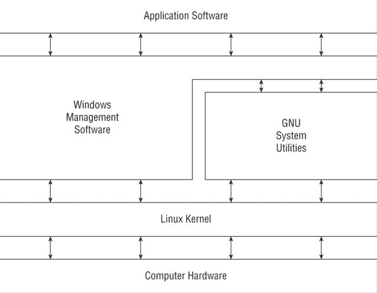

`图 1-1` Linux 系统

本节将详细描述这四个主要部分，并概述它们如何协同工作以创建完整的 Linux 系统。

### 深入了解 Linux 内核

Linux 系统的核心是`内核`。内核控制计算机系统上的所有硬件和软件，在必要时分配硬件，在需要时执行软件。

如果您曾关注过 Linux 世界，毫无疑问您听说过 Linux Torvalds 这个名字。正是他，在赫尔辛基大学求学期间，负责创建了第一个 Linux 内核软件。他原本打算将其打造为 Unix 系统的副本，Unix 当时是许多大学使用的一种流行操作系统。

在开发完 Linux 内核后，Linus 将其发布到互联网社区，并征集改进建议。这一简单过程掀起了计算机操作系统领域的革命。很快，Linus 开始收到来自全球学生和专业程序员的建议。

允许任何人修改内核中的编程代码会导致彻底的混乱。为了简化事宜，Linus 充当所有改进建议的中心节点。最终是否将建议的代码纳入内核，由 Linus 决定。这一概念至今仍存在于 Linux 内核代码中，只不过现在不再由 Linus 一人控制内核代码，而是由一个开发者团队承担了这项任务。

内核主要负责以下四项主要功能：

- 系统内存管理
- 软件程序管理
- 硬件管理
- 文件系统管理

以下小节将更详细地探讨这些功能。

#### 系统内存管理

操作系统内核的主要功能之一是内存管理。内核不仅管理服务器上的物理内存，还可以创建和管理虚拟内存，即实际上并不存在的内存。

它通过使用硬盘上的空间来实现这一点，这种空间称为`交换空间`。内核在交换空间和实际物理内存之间来回交换虚拟内存位置的内容。这使得系统认为可用的内存比实际物理存在的内存更多（如图 1-2 所示）。


`图 1-2` Linux 系统内存映射

内存位置被分组为称为`页`的块。内核将每一页内存定位在物理内存或交换空间中。随后，内核维护一个内存页表，指示哪些页在物理内存中，哪些页已交换到磁盘上。

内核跟踪哪些内存页正在使用，并自动将一段时间未被访问的内存页复制到交换空间区域（称为`换出`），即使其他内存可用也是如此。当程序想要访问已被换出的内存页时，内核必须在物理内存中为其腾出空间，方法是换出另一个内存页，并从交换空间换入所需的页。显然，这个过程需要时间，可能会减慢正在运行的进程。对于正在运行的应用程序，换出内存页的过程将持续到 Linux 系统运行结束。

#### 软件程序管理

Linux 操作系统将正在运行的程序称为`进程`。进程可以在前台运行，在显示器上显示输出；也可以在后台运行，在幕后进行。内核控制 Linux 系统如何管理系统中运行的所有进程。

内核创建第一个进程，称为`init 进程`，用于启动系统中的所有其他进程。当内核启动时，它将 init 进程加载到虚拟内存中。随着内核启动每个附加进程，它会为每个进程分配虚拟内存中的一块唯一区域，用于存储该进程使用的数据和代码。

Linux 中提供了几种不同的 init 进程实现，但如今最流行的两种是：

- `SysVinit`：`SysVinit` 初始化方法，是 Linux 最初使用的方法，基于 Unix System V 初始化方法。虽然如今许多 Linux 发行版不再使用它，但在较旧的 Linux 发行版中仍可能找到它。
- `Systemd`：`systemd` 初始化方法创建于 2010 年，已成为 Linux 发行版中最流行的初始化和进程管理系统。

SysVinit 初始化方法使用一种称为`运行级别`的概念来确定启动哪些进程。运行级别定义了正在运行的 Linux 系统的状态，以及每个状态下应运行哪些进程。表 1-1 显示了与 SysVinit 初始化方法关联的不同运行级别。

**表 1-1 SysVinit 运行级别**

| 运行级别 | 描述 |
| :------- | :----------- |
| 0        | 关闭系统 |
| 1        | 用于系统维护的单用户模式 |

### 系统运行级别和初始化

下表列出了标准的系统运行级别：

| 运行级别 | 描述 |
|---|---|
| 2 | 未启用网络服务的多用户模式 |
| 3 | 启用了网络服务的多用户模式 |
| 4 | 自定义 |
| 5 | 提供图形用户界面（GUI）的多用户模式 |
| 6 | 重启系统 |

`/etc/inittab` 文件定义了系统的默认运行级别。特定运行级别下启动的过程定义在 `/etc/rc.d` 目录的子目录中。你可以随时使用 `runlevel` 命令查看当前的运行级别：

```bash
$ runlevel
N 5
$
```

`systemd` 初始化方法之所以流行，是因为它能够基于不同事件启动进程：

- 当系统启动时
- 当连接特定硬件设备时
- 当服务启动时
- 当建立网络连接时
- 当定时器到期时

`systemd` 方法通过链接事件到单元文件来确定要运行哪些进程。每个单元文件定义了在指定事件发生时启动的程序。`systemctl` 程序允许你启动、停止当前系统正在运行的单元文件以及列出这些单元文件。

`systemd` 方法将单元文件分组到目标（targets）中。目标定义了 Linux 系统的特定运行状态，类似于 SysVinit 的运行级别概念。在系统启动时，`default.target` 单元定义了要启动的所有单元文件。你可以使用 `systemctl` 命令查看当前的默认目标：

```bash
$ systemctl get-default
graphical.target
$
```

图形目标（`graphical target`）单元文件定义了在多用户图形环境运行时启动的进程，类似于旧的 SysVinit 运行级别 5。

> **注意** 在`第 4 章`“更多 Bash Shell 命令”中，你将看到如何使用 `ps` 命令来查看当前在 Linux 系统上运行的进程。

### 硬件管理

内核的另一个职责是硬件管理。Linux 系统必须与其通信的任何设备都需要在内部插入驱动程序代码。驱动程序代码使内核能够与设备之间来回传输数据，充当应用程序和硬件之间的中介。在 Linux 内核中插入设备驱动程序代码使用了两种方法：

- 编译在内核中的驱动程序
- 添加到内核的驱动程序模块

以前，插入设备驱动程序代码的唯一方法是重新编译内核。每次向系统添加新设备时，都必须重新编译内核代码。随着 Linux 内核支持更多硬件，这一过程变得更加低效。幸运的是，Linux 开发者发明了一种更好的方法，将驱动程序代码插入到运行中的内核。

程序员开发了内核模块的概念，允许你将驱动程序代码插入到运行中的内核，而无需重新编译内核。此外，当设备使用完毕时，内核模块可以从内核中移除。这大大简化并扩展了 Linux 中硬件的使用。

Linux 系统将硬件设备标识为特殊文件，称为`设备文件`。设备文件有三种分类：

- 字符设备
- 块设备
- 网络设备

字符设备文件用于一次只能处理一个字符数据的设备。大多数类型的调制解调器和终端都被创建为字符文件。块文件用于一次可以处理大块数据的设备，例如磁盘驱动器。

网络设备类型用于使用数据包发送和接收数据的设备。这包括网卡和一个特殊的环回设备，该设备允许 Linux 系统使用常见的网络编程协议与自身通信。

Linux 为系统中的每个设备创建称为节点的特殊文件。与设备的所有通信都是通过设备节点进行的。每个节点都有一个唯一的编号对，用于向 Linux 内核标识它。编号对包括主设备号和次设备号。相似的设备被分组到同一个主设备号中。次设备号用于标识主设备组内的特定设备。

### 文件系统管理


与其他一些操作系统不同，Linux 内核可以支持不同类型的文件系统来读写硬盘数据。除了拥有十多种自己的文件系统外，Linux 还可以读写其他操作系统（如 Microsoft Windows）使用的文件系统。内核必须编译以支持系统将使用的的所有类型文件系统。表 1-2 列出了 Linux 系统可以使用的标准文件系统来读写数据。

### 表 1-2 Linux 文件系统

| 文件系统 | 描述 |
|---|---|
| ext | Linux 扩展文件系统——最初的 Linux 文件系统 |
| ext2 | 第二代扩展文件系统；比 ext 提供了高级功能 |
| ext3 | 第三代扩展文件系统；支持日志记录 |
| ext4 | 第四代扩展文件系统；支持高级日志记录 |
| btrfs | 一种较新的高性能文件系统，支持日志记录和大文件 |
| exfat | 扩展 Windows 文件系统，主要用于 SD 卡和 USB 闪存盘 |
| hpfs | OS/2 高性能文件系统 |
| jfs | IBM 的日志记录文件系统 |
| iso9660 | ISO 9660 文件系统（CD-ROM） |
| minix | MINIX 文件系统 |
| msdos | Microsoft FAT16 |
| ncp | NetWare 文件系统 |
| nfs | 网络文件系统 |
| ntfs | 对 Microsoft NT 文件系统的支持 |
| proc | 访问系统信息 |
| smb | Samba SMB 文件系统，用于网络访问 |
| sysv | 较旧的 Unix 文件系统 |
| ufs | BSD 文件系统 |
| umsdos | 位于 msdos 之上的类 Unix 文件系统 |
| vfat | Windows 95 文件系统（FAT32） |
| XFS | 高性能 64 位日志记录文件系统 |

Linux 服务器访问的任何硬盘都必须使用表 1-2 中列出的文件系统类型之一进行格式化。

Linux 内核使用虚拟文件系统（VFS）与每个文件系统进行接口。这为内核提供了与任何类型文件系统通信的标准接口。当每个文件系统被挂载和使用时，VFS 会在内存中缓存信息。

## GNU 实用工具

除了拥有用于控制硬件设备的内核外，计算机操作系统还需要实用工具来执行标准功能，例如控制文件和程序。尽管 Linus 创建了 Linux 系统内核，但他没有可以在其上运行的系统实用工具。幸运的是，在他工作的同时，有一群人在互联网上合作，试图开发一套模仿流行 Unix 操作系统的标准计算机操作系统实用工具。

GNU 组织（GNU 代表 GNU’s Not Unix）开发了一套完整的 Unix 实用工具，但没有内核系统来运行它们。这些实用工具是在一种称为开源软件（OSS）的软件哲学下开发的。

OSS 概念允许程序员开发软件，然后将其发布到世界上，且不附带许可费。任何人可以使用、修改或将这些软件整合到他们自己的系统中，而无需支付许可费。将 Linus 的 Linux 内核与 GNU 操作系统实用工具结合，创建了一个完整的、功能齐全的、免费的操作系统。

尽管 Linux 内核和 GNU 实用工具的捆绑通常仅被称为 Linux，但你会看到互联网上的一些 Linux 原教旨主义者将其称为 GNU/Linux 系统，以感谢 GNU 组织对这一事业的贡献。

### 核心 GNU 实用工具

GNU 项目主要设计为让 Unix 系统管理员拥有一个类 Unix 环境。这种关注点导致该项目移植了许多常见的 Unix 系统命令行实用工具。为 Linux 系统提供的核心实用工具捆绑包被称为 `coreutils` 包。

GNU `coreutils` 包由三部分组成：

- 用于处理文件的实用工具
- 用于操纵文本的实用工具
- 用于管理进程的实用工具

这三个主要的实用工具组中的每一个都包含若干对 Linux 系统管理员和程序员极具价值的实用程序。本书详细介绍了 GNU `coreutils` 包中包含的每个实用工具。

## Shell

GNU/Linux shell 是一种特殊的交互式实用工具。它提供了一种方式，让用户可以启动程序、管理文件系统上的文件以及管理在 Linux 系统上运行的进程。Shell 的核心是命令提示符。命令提示符是 shell 的交互部分。它允许你输入文本命令，然后 shell 解释命令并在内核中执行它们。

Shell 包含一组内部命令，用于控制诸如复制文件、移动文件、重命名文件、显示当前在系统上运行的程序以及停止在系统上运行的程序等任务。除了内部命令外，Shell 还允许你在命令提示符处输入程序名称。Shell 将程序名称传递给内核以启动它。

你还可以将 shell 命令分组到文件中，作为程序执行。这些文件被称为 `shell 脚本`。你可以从命令行执行的任何命令都可以放置在 shell 脚本中并作为一组命令运行。这为创建常用于执行命令或需要多个命令组合在一起的过程的实用工具提供了极大的灵活性。

Linux 系统上有许多可用的 shell。不同的 shell 具有不同的特性，有些更适用于创建脚本，有些更适用于管理进程。所有 Linux 发行版使用的默认 shell 是 Bash shell。Bash shell 由 GNU 项目开发，作为标准 Unix shell（称为 Bourne shell，以其创造者的名字命名）的替代品。Bash shell 的名称是对这种说法的文字游戏，被称为“Bourne again shell”。

除了 Bash shell 外，我们将在本书中介绍几种其他流行的 shell。表 1-3 列出了我们将检查的不同 shell。

### 表 1-3 Linux 外壳

| 外壳 | 描述 |
| :--- | :--- |
| ash | 一种简单、轻量级的外壳，可在低内存环境中运行，但具有与 Bash 外壳完全兼容的特性 |
| korn | 一种与 Bourne 外壳兼容的编程外壳，但支持高级编程功能，如关联数组和浮点算术 |
| tcsh | 一种将 C 编程语言元素融入外壳脚本的外壳 |
| zsh | 一种先进的外壳，融合了 Bash、tcsh 和 korn 的特性，提供高级编程功能、共享历史记录文件和主题化提示符 |

大多数 Linux 发行版都包含多个外壳，但通常它们会选择其中一个作为默认外壳。如果你的 Linux 发行版包含多个外壳，不妨尝试不同的外壳，看看哪一个最适合你的需求。

## Linux 桌面环境

在 Linux 的早期（20 世纪 90 年代初），操作系统可用的只是一个简单的文本界面。该文本界面允许管理员启动程序、控制程序操作以及在系统上移动文件。

随着 Microsoft Windows 的普及，计算机用户期望拥有比旧式文本界面更多的工作方式。这激发了开源软件（OSS）社区更多的开发活动，Linux 图形桌面应运而生。

Linux 以其能够以多种方式完成事情而闻名，而在图形桌面方面尤其如此。在 Linux 中，你可以从大量的图形桌面中选择。以下章节介绍了一些流行的桌面环境。

### X Window 软件

两个基本元素控制你的视频环境——你的 PC 中的显卡和显示器。要在计算机上显示复杂的图形，Linux 软件需要知道如何与这两者通信。X Window 软件是呈现图形的核心元素。

X Window 软件是一个底层程序，它直接处理 PC 中的显卡和显示器，并控制 Linux 应用程序如何在计算机上呈现复杂的窗口和图形。

Linux 并不是唯一使用 X Window 的操作系统；针对许多不同的操作系统都编写了相应的版本。在 Linux 世界中，有几个软件包可以实现它。在 Linux 中，两个 X Window 软件包被最常用：

- X.org
- Wayland

X.org 包是两者中较旧的，基于原始的 Unix X Window System 版本 11（通常称为 X11）。越来越多的 Linux 发行版正在迁移到更新的 Wayland 软件，它更安全且更易于维护。

当你首次安装 Linux 发行版时，它会尝试检测你的显卡和显示器，然后创建一个包含所需信息的 X Window 配置文件。在安装过程中，你可能会注意到安装程序扫描显示器以查找支持的显示模式的时间。有时这会导致显示器空白几秒钟。由于市面上存在许多不同类型的显卡和显示器，此过程可能需要一点时间才能完成。

核心 X Window 软件产生图形显示环境，但不产生其他内容。虽然这对于运行单个应用程序来说没问题，但对于日常计算机使用来说用处不大。没有允许用户操作文件或启动程序的桌面环境。为此，你需要在 X Window 系统软件之上拥有一个桌面环境。

### KDE Plasma 桌面

K 桌面环境（KDE）于 1996 年首次发布，作为一个开源项目，旨在创建一个类似于 Microsoft Windows 环境的图形桌面。KDE 桌面包含你作为 Windows 用户可能熟悉的所有功能。**图 1-3** 显示了当前版本，即 KDE Plasma，运行在 openSUSE Linux 发行版中。


KDE Plasma 桌面允许你在桌面上的一个特殊区域放置应用程序和文件图标。如果你单击应用程序图标，Linux 系统就会启动该应用程序。如果你单击文件图标，KDE 桌面会尝试确定启动什么应用程序来处理该文件。


**图 1-3** openSUSE Linux 系统上的 KDE Plasma 桌面

桌面底部的条称为面板（Panel）。面板由四个部分组成：

- **K 菜单**：与 Windows 开始菜单类似，K 菜单包含启动已安装应用程序的链接。
- **程序快捷方式**：这些是直接从面板启动应用程序的快捷链接。
- **任务栏**：任务栏显示当前在桌面上运行的应用程序的图标。
- **小工具**：这些是带有面板图标的小应用程序，其图标通常可以根据来自应用程序的信息而变化。

面板的所有功能都类似于你在 Windows 中找到的功能。除了桌面功能外，KDE 项目还生产了大量在 KDE 环境中运行的应用程序。

### GNOME 桌面

GNU 网络对象模型环境（GNOME）是另一个流行的 Linux 桌面环境。GNOME 于 1999 年首次发布，已成为许多 Linux 发行版的默认桌面环境（最流行的是 Red Hat Linux）。

#### 注意

GNOME 桌面在 2011 年发布的版本 3 中发生了根本性的变化。它背离了大多数桌面使用的标准菜单栏和任务栏的标准外观和感觉，以使接口在多个平台（如平板电脑和移动电话）上更加用户友好。这一变化引发了争议（参见“其他桌面”部分），但慢慢地，许多 Linux 爱好者接受了 GNOME 3 桌面的新外观和感觉。

图 1-4 显示了在 Ubuntu Linux 发行版中使用的标准 GNOME 桌面。


**图 1-4** Ubuntu Linux 系统上的 GNOME 3 桌面

GNOME 3 桌面通过减少可用菜单来整理桌面界面，只保留三个：

- **活动**：显示收藏项以及任何正在运行的应用程序图标
- **日历**：显示当前日期/时间，以及任何系统通知消息
- **系统**：显示网络连接、系统设置和重启系统的选项

GNOME 3 桌面被设计用于在多种类型的设备上工作，因此你找不到大量的菜单。要启动应用程序，你必须使用活动概览（Activities Overview）进行搜索，这是活动菜单上的一个搜索功能。

不甘落后于 KDE，GNOME 开发人员也生产了大量与 GNOME 桌面集成的图形应用程序。

### 其他桌面

Linux 的主要功能之一是选择，而在图形桌面世界中这一点体现得尤为明显。Linux 世界中有大量不同类型的图形桌面可供选择。如果你对你 Linux 发行版的默认桌面不满意，通常不需要太多努力就可以将其更改为其他桌面！

当 GNOME 桌面项目在版本 3 中彻底改变其界面时，许多偏好 GNOME 版本 2 外观和感觉的 Linux 开发人员创建了基于 GNOME 2 的衍生版本。其中，两个变得 somewhat 流行：

- **Cinnamon**：Cinnamon 桌面由 Linux Mint 发行版于 2011 年开发，旨在继续开发原始的 GNOME 2 桌面。它现在是几个 Linux 发行版中的选项，包括 Ubuntu、Fedora 和 openSUSE。
- **MATE**：MATE 桌面也是由一位不喜欢转向 GNOME 3 的 Arch Linux 用户于 2011 年开发的。它包含了一些 GNOME 3 的特性（例如替换任务栏），但保持了 GNOME 2 的整体外观和感觉。

**图 1-5** 显示了 Cinnamon 桌面在 Linux Mint 发行版中的样子。

这些花哨的图形桌面环境的一个缺点是，它们需要大量的系统资源才能正常运行。在 Linux 的早期，其标志性和卖点之一是它能够在较旧的、性能较低的 PC 上运行，而较新的 Microsoft 桌面产品无法在其上运行。然而，随着 KDE Plasma 和 GNOME 3 桌面的普及，这一情况发生了变化，因为运行 KDE Plasma 或 GNOME 3 桌面所需的内存与运行最新的 Microsoft 桌面环境所需的内存一样多。

如果你有一台较旧的 PC，请不要气馁。Linux 开发人员联合起来，致力于让 Linux 回归其根源。他们创建了几个面向低内存的图形桌面应用程序，提供基本功能，并且可以在较旧的 PC 上完美运行。

虽然这些图形桌面没有围绕其设计那么多应用程序，但它们仍然运行许多基本图形支持诸如文字处理、电子表格、数据库、绘图以及当然的多媒体支持等功能的应用程序。**表 1-4** 展示了一些较小的 Linux 图形桌面环境，它们可以运行在低配置 PC 和笔记本电脑上。


**图 1-5** Linux Mint 的 Cinnamon 桌面

#### 表 1-4 其他 Linux 图形桌面

| 桌面 | 描述 |
| :--- | :--- |
| Fluxbox | 一个极简桌面，不包含面板，仅有一个用于启动应用程序的弹出菜单 |
| Xfce | 一个类似于 GNOME 2 桌面的环境，但图形效果较少，适合低内存环境 |
| JWM | 乔的窗口管理器（Joe's Window Manager），一个非常轻量级的桌面，适合低内存和低磁盘空间环境 |
| fvwm | 支持一些高级桌面功能，如虚拟桌面和面板，但可在低内存环境中运行 |
| fvwm95 | 源自 fvwm，但设计为外观类似 Windows 95 桌面 |

这些图形桌面环境不像 KDE Plasma 和 GNOME 3 桌面那样花哨，但它们提供了基本而完善的图形功能。**图 1-6** 展示了 MX Linux 发行版中使用的 Xfce 桌面的样子。


**图 1-6** 在 MX Linux 发行版中看到的 Xfce 桌面

如果你使用的是较旧的 PC，请尝试使用其中一种桌面的 Linux 发行版，看看会发生什么。你可能会 pleasantly 惊喜。

## 检查 Linux 发行版

现在你已经看到了构成完整 Linux 系统所需的四个主要组件，你可能会想知道如何将它们组合在一起以构建一个 Linux 系统。幸运的是，已经有人为你完成了这项工作。

完整的 Linux 系统包被称为*发行版*。有众多 Linux 发行版可供选择，以满足你几乎任何计算需求。大多数发行版针对特定用户群体进行了定制，例如商业用户、多媒体爱好者、软件开发人员或普通家庭用户。每个定制发行版都包含支持特定功能所需的软件包，例如为多媒体爱好者提供音频和视频编辑软件，或为软件开发人员提供编译器和集成开发环境（IDE）。

不同的 Linux 发行版通常分为两类：

- 全核心 Linux 发行版
- 专用发行版

以下章节将描述这些类型的 Linux 发行版，并在每个类别中展示示例。

### 核心 Linux 发行版

核心 Linux 发行版包含内核、一个或多个图形桌面环境，以及几乎所有可用的 Linux 应用程序（预先针对内核编译）。它为完整的 Linux 安装提供了一站式服务。*表 1-5* 列出了一些流行的核心 Linux 发行版。

**表 1-5 核心 Linux 发行版**

| 发行版 | 描述 |
| :--- | :--- |
| Slackware | 最初的 Linux 发行版集合之一；在 Linux 极客中很受欢迎 |
| Red Hat Enterprise | 一种商业级企业发行版，主要用于互联网服务器 |
| Gentoo | 专为高级 Linux 用户设计的发行版，仅包含 Linux 源代码 |
| openSUSE | 针对商业用途和家庭使用提供不同的发行版 |
| Debian | 受 Linux 专家和商业 Linux 用户欢迎 |

在 Linux 早期，发行版是以一组软盘的形式发布的。你需要下载文件组，然后将它们复制到磁盘上。通常一个完整的发行版需要 20 张或更多磁盘！不用说，这是一种痛苦的经历。

如今，Linux 发行版以*ISO 映像文件*的形式发布。ISO 映像文件是 DVD 的完整磁盘映像，作为一个单一文件。你使用软件应用程序将 ISO 映像文件刻录到 DVD 上，或者创建一个可引导的 USB 驱动器。然后，你只需从 DVD 或 USB 驱动器引导工作站即可安装 Linux。这使得安装 Linux 变得容易得多。

然而，初学者在安装核心 Linux 发行版时仍然经常遇到问题。为了涵盖人们可能想要使用 Linux 的几乎所有情况，单个发行版必须包含大量的应用软件。这些软件包括从高端互联网数据库服务器到常见游戏在内的所有内容。


虽然对于 Linux 极客来说，发行版中有许多选项可用是很棒的，但对于 Linux 初学者来说，这可能是一场噩梦。大多数核心发行版在安装过程中会询问一系列问题，以确定默认加载哪些应用程序、PC 连接了什么硬件，以及如何配置硬件。初学者常常觉得这些问题令人困惑。结果，他们经常在计算机上加载了过多的程序，或者加载得不够，后来发现计算机无法做他们想做的事。

幸运的是，对于初学者来说，有一种更简单的方法来安装 Linux。

## 专用 Linux 发行版

Linux 发行版的一个新亚类开始出现。这些发行版通常基于主要发行版之一，但仅包含对特定用途区域有意义的应用程序子集。

除了提供专用软件（例如仅为商业用户提供办公产品）之外，定制 Linux 发行版还试图通过自动检测和自动配置常见硬件设备来帮助 Linux 初学者。这使得安装 Linux 的过程变得更加愉快。

表 1-6 展示了一些可用的专用 Linux 发行版及其专长领域。

### 表 1-6 专用 Linux 发行版

| 发行版 | 描述 |
| :--- | :--- |
| Fedora | 一个基于 Red Hat Enterprise Linux 源代码构建的免费发行版 |
| Ubuntu | 一个用于学校和家庭用途的免费发行版 |
| MX Linux | 一个用于家庭用途的免费发行版 |
| Linux Mint | 一个用于家庭娱乐用途的免费发行版 |
| Puppy Linux | 一个运行在较旧 PC 上效果良好的免费小型发行版 |

这只是专用 Linux 发行版的一小部分样本。互联网上确实有数百种专用 Linux 发行版，而且一直在不断涌现。无论你的专长是什么，你很可能都会找到一个为你制作的 Linux 发行版。

许多专用 Linux 发行版基于 Debian Linux 发行版。它们使用与 Debian 相同的安装文件，但仅打包了完整 Debian 系统的一小部分。

> **注意**
>
> 大多数 Linux 发行版还提供 LiveDVD 版本。LiveDVD 版本是一个自包含的 ISO 映像文件，你可以将其刻录到 DVD（或 USB 驱动器）上，以直接启动一个正在运行的 Linux 系统，而无需将其安装在硬盘上。根据发行版的不同，LiveDVD 包含应用程序的小型子集，或者在专用发行版的情况下，包含整个系统。LiveDVD 的好处在于，在进行系统安装的麻烦过程之前，你可以用它来测试你的系统硬件。

### 摘要

本章讨论了 Linux 系统及其工作原理的基础知识。Linux 内核是系统的核心，控制内存、程序和硬件如何相互交互。GNU 工具也是 Linux 系统中重要的组成部分。Linux shell，也是本书的重点，是 GNU 核心工具的一部分。本章还讨论了 Linux 系统的最后一部分，即 Linux 桌面环境。多年来情况发生了变化，Linux 现在支持几种图形桌面环境。

本章还讨论了各种 Linux 发行版。Linux 发行版将 Linux 系统的各个部分打包成一个简单的包，你可以轻松地将其安装到 PC 上。Linux 发行版世界包括几乎包含所有可想象应用的全功能 Linux 发行版，以及仅包含专注于特定功能应用的专用 Linux 发行版。Linux LiveDVD 热潮创造了另一组 Linux 发行版，允许你轻松试用 Linux，甚至无需将其安装在硬盘上。

在下一章中，我们将探讨开始命令行和 shell 脚本体验所需的内容。你将看到如何从花哨的图形桌面环境进入 Linux shell 工具。如今，这并不总是件容易的事。

# 第 2 章

## 进入 Shell

### 本章内容

- 访问命令行
- 通过 Linux 控制台终端访问 CLI
- 通过图形终端模拟器访问 CLI
- 使用 GNOME 终端模拟器
- 使用 Konsole 终端模拟器
- 使用 xterm 终端模拟器

在 Linux 的早期，系统管理员、程序员和系统用户都坐在一台被称为 Linux 控制台终端的设备前，输入 shell 命令并查看文本输出。如今，随着图形化桌面环境的普及，要在系统上找到 shell 提示符以输入 shell 命令变得愈发困难。本章讨论了访问命令行环境所需的内容。并带你了解你在各种 Linux 发行版中可能会遇到的几种终端模拟软件包。

### 访问命令行

在图形化桌面出现之前，与 Unix 系统交互的唯一方式是通过 shell 提供的文本*命令行界面*（*CLI*）。CLI 仅允许文本输入，并且只能显示文本和基本的图形输出。

由于这些限制，输出设备并不复杂。通常，你只需要一个简单的哑终端（dumb terminal）即可与 Unix 系统交互。哑终端通常只是通过通信电缆（通常是多线串行电缆）连接到 Unix 系统的显示器和键盘。这种简单的组合提供了一种向 Unix 系统输入文本数据并查看文本结果的方式。

正如你所知，当今的 Linux 环境已大不相同。几乎每个 Linux 桌面发行版都使用某种类型的图形化桌面环境。然而，为了输入 shell 命令，你仍然需要一个文本显示器来访问 shell 的 CLI。现在的问题在于如何到达那里。有时，在 Linux 发行版中找到获取 CLI 的方法并非易事。

#### 控制台终端

获取 CLI 的一种方法是访问 Linux 系统的文本模式。这除了提供显示器上的简单 shell CLI 外没有其他功能，就像图形化桌面出现之前的日子一样。这种模式被称为*Linux 控制台*，因为它模拟了早期硬接线控制台终端的日子，并且是 Linux 系统的直接接口。

当 Linux 系统启动时，它会自动创建多个*虚拟控制台*。虚拟控制台是运行在 Linux 系统内存中的终端会话。与其拥有多个连接到计算机的哑终端，大多数 Linux 发行版会启动五个或六个（有时甚至更多）虚拟控制台，你可以使用单个计算机键盘和显示器访问它们。

#### 图形终端

使用虚拟控制台终端的替代方案是在 Linux 图形化桌面环境中使用*终端模拟软件包*。终端模拟软件包模拟在控制台终端上工作的状态，但在桌面图形化窗口内运行。[图 2-1](#figure-2-1) 展示了一个在 Linux 图形化桌面环境中运行的终端模拟器示例。

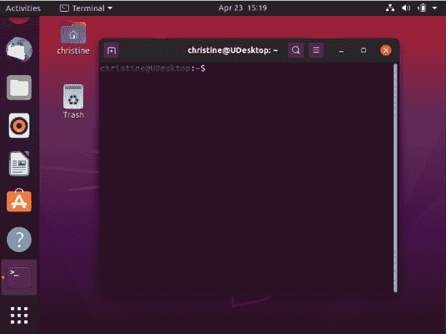

**图 2-1** 运行在 Linux 桌面上的简单终端模拟器

图形化终端模拟仅负责 Linux 图形化体验的一部分。总体而言，这种体验是通过多个组件实现的，包括图形化终端模拟软件（称为*客户端*）。表 2-1 展示了 Linux 图形化桌面环境中的不同组件。

**表 2-1 图形化界面元素**

| 名称 | 示例 | 描述 |
| :--- | :--- | :--- |
| 客户端 | 图形化终端模拟器、桌面环境（GNOME Shell、KDE Plasma）、网络浏览器 | 请求图形化服务的应用程序 |
| 显示服务器 | Wayland、X Window System | 管理显示（屏幕）和输入设备（键盘、鼠标、触摸屏）的元素 |
| 窗口管理器 | Mutter、Metacity、Kwin | 为窗口添加边框并提供移动和管理窗口功能的元素 |
| 小部件库 | Plasmoids、Cinnamon Spices | 为桌面环境客户端添加菜单和外观项目的元素 |

对于从桌面处理命令行，重点在于图形化终端模拟器。你可以将图形化终端模拟器视为图形用户界面（GUI）*内*的 CLI 终端，而将虚拟控制台终端视为 GUI*外*的 CLI 终端。理解各种终端及其功能可以增强你的命令行体验。

## 通过 Linux 控制台终端访问 CLI

在 Linux 的早期，当你启动系统时，你会在监视器上看到登录提示符，仅此而已。如前所述，这被称为 Linux 控制台。它是你为系统输入命令的唯一场所。

尽管在启动时创建了多个虚拟控制台，但许多 Linux 桌面发行版在启动序列完成后会切换到图形化环境。这为用户提供了图形化登录和桌面体验。对于这些系统，访问虚拟控制台是手动完成的。

在大多数 Linux 发行版中，你可以使用简单的按键组合访问 Linux 虚拟控制台之一。通常，你必须按住 `Ctrl+Alt` 键组合，然后按下功能键（F1 到 F7）来选择你想使用的虚拟控制台。功能键 F2 产生虚拟控制台 2，键 F3 产生虚拟控制台 3，键 F4 产生虚拟控制台 4，等等。

> **注意**
>
> Linux 发行版通常使用 `Ctrl+Alt` 键组合配合 F1、F7 或 F8 来访问图形化界面。Ubuntu 和 CentOS 都使用 F1。但是，最好进行测试以查看你的发行版将图形化界面放置在何处，特别是在旧版本的发行版中。

文本模式虚拟控制台使用整个屏幕，并以显示文本登录屏幕开始。图 2-2 展示了虚拟控制台文本登录屏幕的示例。

注意图 2-2 中第一行文本末尾的单词 `tty2`。`tty2` 中的 2 表示它是虚拟控制台 2，是通过按下 `Ctrl+Alt+F2` 键序列到达的。`tty` 代表电传打字机（teletypewriter）。电传打字机是一个旧术语，指用于发送消息的机器。


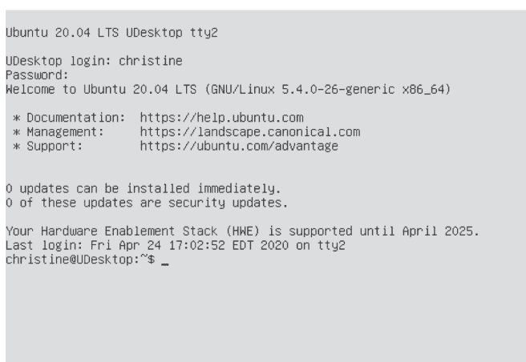

**图 2-2** Linux 虚拟控制台登录屏幕

> **注意**
>
> 并非所有 Linux 发行版都在登录屏幕上显示虚拟控制台的 `tty` 编号。如果你已登录到某个虚拟控制台，你可以输入命令 `tty` 并按下 Enter 键，以查看你当前正在使用的虚拟控制台。关于输入命令的介绍见第 3 章“基本 Bash Shell 命令”。

你通过在 `login:` 提示符后输入用户 ID，并在 `Password:` 提示符后输入密码来登录到控制台终端。如果你以前从未以这种方式登录过，请注意，在图形化环境中输入密码的体验是不同的。在图形化环境中，当你输入时，你可能会看到表示密码字符的点或星号。然而，在虚拟控制台上，当你输入密码时，*什么*都不会显示。

> **注意**
>
> **请记住，在 Linux 虚拟控制台中，你无法运行任何图形化程序。**

登录到虚拟控制台后，你会进入 Linux CLI，并且可以在不丢失当前活动会话的情况下切换到另一个虚拟控制台。你可以在所有虚拟控制台之间切换，同时运行多个活动会话。此功能在你在 CLI 上工作时提供了极大的灵活性。

额外的灵活性涉及虚拟控制台的外观。尽管它是文本模式控制台终端，但你仍然可以修改文本和背景颜色。

例如，将终端背景设置为白色并将文本设置为黑色可能对眼睛更友好。登录后，你可以通过几种方式完成此修改。一种方式是输入命令 `setterm --inversescreen on` 并按下 Enter 键，如图 2-3 所示。注意图中使用选项 `on` 开启了 `--inversescreen` 功能。你也可以使用 `off` 选项将其关闭。

```
CentOS Linux 8 (Core)
Kernel 4.18.0-147.5.1.el8_1.x86_64 on an x86_64

Activate the web console with: systemctl enable --now cockpit.socket

localhost login: chrstine
Password:
Last login: Sat Apr 25 11:30:55 on tty3
lchrstine@localhost ~]$ 
 lchrstine@localhost ~]$ tty
/dev/tty3
 lchrstine@localhost ~]$ setterm --inversescreen on
 lchrstine@localhost ~]$ 
```

**图 2-3** 开启 `inversescreen`（反色）后的 Linux 虚拟控制台

另一种方法是依次输入两条命令。输入 `setterm --background white` 并按下回车键，然后输入 `setterm --foreground black` 并按下回车键。请小心，因为如果你先更改终端背景色，可能很难看到你正在输入的命令。

使用上一段中提到的命令，你并不是像使用 `--inversescreen` 那样开启或关闭功能，而是可以在八种颜色中进行选择。这些选项包括 `black`、`red`、`green`、`yellow`、`blue`、`magenta`、`cyan` 和 `white`（在某些发行版中白色看起来像灰色）。你可以相当有创意地设计你的纯文本模式控制台终端的外观。表 2-2 展示了一些你可以与 `setterm` 命令一起使用的选项，以帮助提高控制台终端的可读性或改善其外观。

### 表 2-2 setterm 用于前景和背景外观的选项

| 选项 | 参数选择 | 描述 |
| :--- | :--- | :--- |
| `--background` | `black`、`red`、`green`、`yellow`、`blue`、`magenta`、`cyan` 或 `white` | 将终端背景颜色更改为指定颜色 |
| `--foreground` | `black`、`red`、`green`、`yellow`、`blue`、`magenta`、`cyan` 或 `white` | 将终端前景颜色（特别是文本）更改为指定颜色 |
| `--inversescreen` | `on` 或 `off` | 将背景色交换为前景色，并将前景色交换为背景色 |
| `--reset` | 无 | 将终端外观恢复为默认设置并清屏 |
| `--store` | 无 | 将当前终端的前景和背景颜色设置为用于 `--reset` 的值 |

虚拟控制台终端非常适合在图形用户界面之外访问 CLI（命令行界面）。然而，有时你需要访问 CLI 并运行图形化程序。使用终端仿真软件包可以解决这个问题，这是从图形用户界面内部访问 shell CLI 的流行方式。接下来的章节将描述提供图形终端仿真的常见软件包。

### 通过图形终端仿真访问 CLI

图形桌面环境比虚拟控制台终端提供了更多样化的 CLI 访问方式。图形环境中有许多终端仿真器应用程序可用。每个软件包都提供自己独特的一套功能和选项。表 2-3 展示了一些流行的图形终端仿真器应用程序及其网站。

### 表 2-3 流行的图形终端仿真器软件包

| 名称 | 网站 |
| :--- | :--- |
| Alacritty | github.com/alacritty/alacritty |
| cool-retro-term | github.com/Swordfish90/cool-retro-term |
| GNOME Terminal | wiki.gnome.org/Apps/Terminal |
| Guake | guake-project.org |
| Konsole | konsole.kde.org |
| kitty | sw.kovidgoyal.net/kitty |
| rxvt-unicode | software.schmorp.de/pkg/rxvt-unicode.html |
| Sakura | pleyades.net/david/projects/sakura |
| st | st.suckless.org |
| Terminator | gnometerminator.blogspot.com |
| Terminology | enlightenment.org/about-terminology.md |
| Termite | github.com/thestinger/termite |
| Tilda | github.com/tlanox/tilda |
| xterm | invisible-island.net/xterm |
| Xfce4-terminal | docs.xfce.org/apps/terminal/start |
| Yakuake | kde.org/applications/system/org.kde.yakuake |

虽然有许多图形终端仿真器应用程序可用，但本章重点介绍其中三个。它们在不同的 Linux 发行版中默认安装，分别是 GNOME Terminal、Konsole Terminal 和 xterm。

### 使用 GNOME 终端仿真器

GNOME Terminal 是 GNOME Shell 桌面环境的默认终端仿真器。许多发行版，如 Red Hat Enterprise Linux (RHEL)、CentOS 和 Ubuntu，默认使用 GNOME Shell 桌面环境，因此也默认使用 GNOME Terminal。它使用相当简单，并且是 Linux 新手的良好终端仿真器。本节将引导你了解访问、配置和使用 GNOME Terminal 的各个部分。

#### 访问 GNOME Terminal

在 GNOME Shell 桌面环境中，访问 GNOME Terminal 相当简单。点击桌面窗口右上角的“活动”图标。当搜索栏出现时，点击栏内以激活它，并输入 `terminal`（终端）。这些操作的结果如图 2-4 所示。


**图 2-4** 在 GNOME Shell 中找到 GNOME Terminal

请注意，在上图中，GNOME Terminal 应用程序图标名为 Terminal。点击图标以打开终端仿真器。图 2-5 显示了 CentOS 发行版中打开的 GNOME Terminal 应用程序。

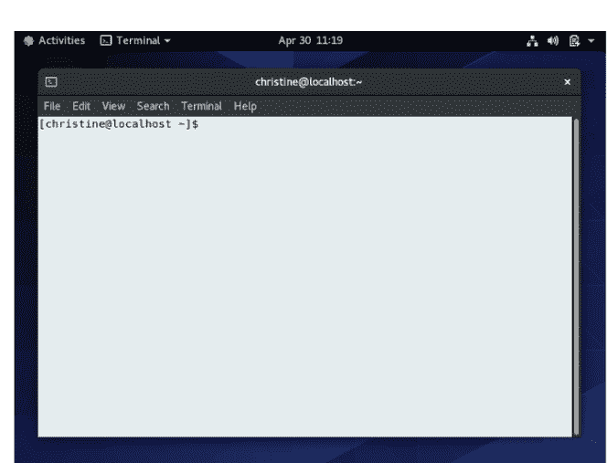

**图 2-5** CentOS 上的 GNOME Terminal

当你使用完终端仿真器应用程序后，你可以像关闭其他桌面窗口一样关闭它：点击窗口右上角的 x。

GNOME Terminal 应用程序的外观可能在不同的 Linux 发行版之间有所不同。例如，在图 2-6 中，显示了 Ubuntu GNOME Shell 桌面环境中的 GNOME Terminal。


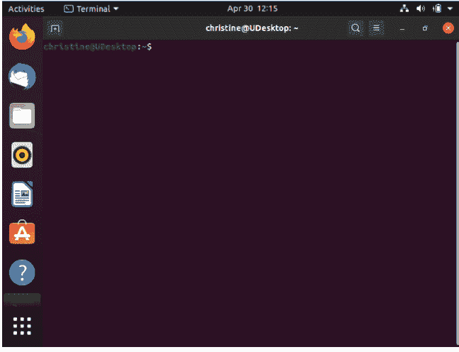

**图 2-6** Ubuntu 上的 GNOME Terminal

请注意，图 2-6 中 GNOME Terminal 应用程序的外观与图 2-5 中的不同。这通常是由于应用程序的默认配置（本章稍后详细介绍）以及 Linux 发行版在其 GUI 窗口中的各种特性所致。

> **提示**
>
> 如果你使用的桌面环境不是 GNOME Shell（并且已安装 GNOME Terminal），请注意你可能没有搜索功能。在这些情况下，请使用该环境的菜单系统查找 GNOME Terminal。它通常名为 Terminal。

在许多发行版中，第一次启动 GNOME Terminal 应用程序时，其终端仿真器图标会出现在你的 GNOME Shell“收藏”栏中。将鼠标悬停在图标上会显示终端仿真器的名称，如 **图 2-7** 所示。


**图 2-7** 收藏栏中的 GNOME Terminal 图标

如果由于某种原因图标未出现在你的“收藏”栏中，你可以设置键盘快捷键来启动它。这种方法对于不喜欢使用鼠标的人来说很方便，并且允许更快地访问 CLI。

> **提示**
>
> Ubuntu 发行版上的 GNOME Shell 已经有一个打开 GNOME 终端仿真器的键盘快捷键：`Ctrl+Alt+T`

要创建键盘快捷键，你需要访问“键盘设置”中的“键盘快捷键”窗口。为了快速完成此操作，点击 GNOME Shell 桌面窗口右上角的“活动”图标。当搜索栏出现时，点击栏内以激活它，并输入 `Keyboard Shortcuts`（键盘快捷键）。这些操作的结果如图 2-8 所示。


**图 2-8** 到达键盘快捷键窗口

进入键盘快捷键窗口后，向下滚动以到达位于最底部的 + 按钮。点击此按钮会打开一个对话框，你可以在其中为新的快捷键命名、提供打开应用程序的命令，并设置快捷键的按键，如 **图 2-9** 所示。

为了正确启动 GNOME 终端仿真器，使用正确的命令名称很重要，因此在“命令”字段中输入 `gnome-terminal`，如 *图 2-9* 所示。当完成新快捷键的设置后，点击窗口中的“添加”按钮。现在，你只需使用指定的按键组合即可快速启动 GNOME Terminal。

应用程序通过菜单和快捷键提供了多个配置选项，你可以在启动 GNOME 终端仿真后应用这些选项。了解这些选项可以增强你的 GNOME Terminal CLI 体验。

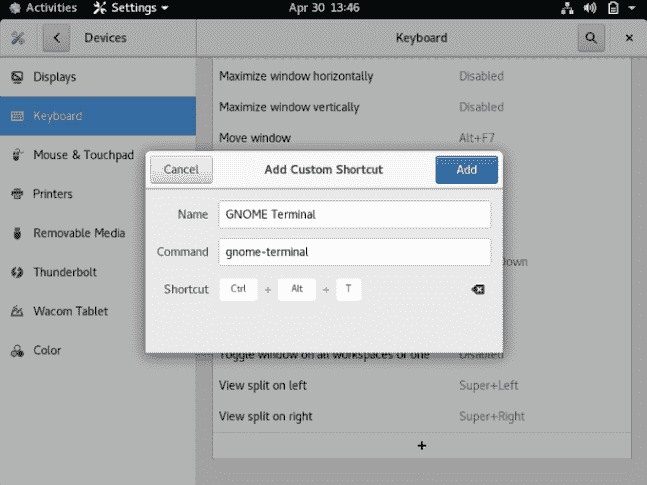

**图 2-9** 创建键盘快捷键

### 菜单栏

GNOME Terminal 菜单栏包含配置和

让你能够按照自己的喜好定制 GNOME 终端的自定义选项。下表简要描述了菜单栏中的配置选项及其关联的快捷方式。

> 提示
>
> 如果 GNOME 终端窗口未显示菜单栏，请在终端模拟会话区域中右键单击，并在下拉菜单中点击“显示菜单栏”。

#### 表 2-4 文件菜单

表 2-4 显示了 GNOME 终端文件菜单系统中可用的配置选项。文件菜单项包含用于创建和管理整体 CLI 终端会话的项目。

| 名称 | 快捷键 | 描述 |
| --- | --- | --- |
| 新标签页 | Shift+Ctrl+T | 在现有的 GNOME 终端窗口中的新标签页中启动一个新的 shell 会话 |
| 新窗口 | Shift+Ctrl+N | 在新的 GNOME 终端窗口中启动一个新的 shell 会话 |
| 关闭标签页 | Shift+Ctrl+W | 关闭 GNOME 终端窗口中的当前标签页 |
| 关闭窗口 | Shift+Ctrl+Q | 关闭当前的 GNOME 终端窗口 |

请注意，与网络浏览器一样，你可以在 GNOME 终端会话中打开新标签页以启动一个全新的 CLI 会话。每个标签页会话都被视为一个独立的 CLI 会话。

> 提示
>
> 你并不总是需要通过点击菜单才能访问文件菜单中的选项。通过右键单击终端模拟会话区域，也可以访问文件菜单中的一些选项。

编辑菜单包含用于处理标签页内文本的选项，如表 2-5 所示。你可以在会话窗口的任何位置复制和粘贴文本。

#### 表 2-5 编辑菜单

| 名称 | 快捷键 | 描述 |
|---|---|---|
| 复制 | Shift+Ctrl+C | 将选中的文本复制到 GNOME 剪贴板 |
| 以 HTML 格式复制 | 无 | 将选中的文本（连同其字体和颜色）复制到 GNOME 剪贴板 |
| 粘贴 | Shift+Ctrl+V | 将文本从 GNOME 剪贴板粘贴到会话中 |
| 全选 | 无 | 选择整个滚动缓冲区的输出 |
| 首选项 | 无 | 编辑当前会话配置文件 |

在终端中复制和粘贴命令对于键盘输入技能不足的用户非常有用。因此，值得记住 GNOME 终端复制和粘贴功能的键盘快捷键。

**注意**

**在浏览这些 GNOME 终端菜单选项时，请记住你的 Linux 发行版的 GNOME 终端可能提供略有不同的菜单选项。这是因为一些 Linux 发行版使用的是较旧版本的 GNOME 终端。你可以通过点击菜单栏中的“帮助”并从下拉菜单中选择“关于”来查看版本号。**

视图菜单（如表 2-6 所示）包含用于控制 CLI 会话窗口显示方式的选项。这些选项对视力受损的人士可能很有帮助。

#### 表 2-6 视图菜单

| 名称 | 快捷键 | 描述 |
|---|---|---|
| 显示菜单栏 | 无 | 切换菜单栏显示的开/关 |
| 全屏 | F11 | 切换终端窗口是否填充整个桌面 |
| 放大 | Ctrl+ + | 逐步增大窗口中的字体大小 |
| 正常大小 | Ctrl+o | 将字体大小恢复为默认值 |
| 缩小 | Ctrl+- | 逐步减小窗口中的字体大小 |

请注意，如果你关闭菜单栏显示，会话的菜单栏将消失。但是，你可以通过在任何终端会话窗口中右键单击并选择“显示菜单栏”选项来轻松再次显示菜单栏。

搜索菜单（如表 2-7 所示）包含用于在终端会话中执行简单搜索的选项。这些搜索类似于你可能在网络浏览器或文字处理器中执行过的搜索。

#### 表 2-7 搜索菜单

| 名称 | 快捷键 | 描述 |
|---|---|---|
| 查找 | Shift+Ctrl+F | 打开查找窗口，提供指定的文本搜索选项 |
| 查找下一个 | Shift+Ctrl+G | 从当前终端会话位置向前搜索指定文本 |
| 查找上一个 | Shift+Ctrl+H | 从当前终端会话位置向后搜索指定文本 |
| 清除高亮 | Shift+Ctrl+J | 移除找到文本的高亮显示 |

终端菜单（如表 2-8 所示）包含用于控制终端模拟会话功能的选项。访问这些项没有快捷键。

#### 表 2-8 终端菜单

| 名称 | 描述 |
|---|---|
| 只读 | 切换终端会话是否接受键盘击键；它不会启用/禁用键盘快捷键 |
| 重置 | 发送重置终端会话控制代码 |
| 重置并清除 | 发送重置终端会话控制代码并清除终端会话屏幕 |
| 80x24 | 调整当前终端窗口大小为 80 列宽 x 24 行高 |
| 80x43 | 将当前终端窗口大小更改为 80 列宽 x 43 行高 |
| 132x24 | 调整当前终端窗口大小为 132 列宽 x 24 行高 |
| 130x43 | 将当前终端窗口大小更改为 130 列宽 x 43 行高 |

重置选项非常有用。有一天，你可能会意外导致终端会话显示随机字符和符号。当这种情况发生时，文本将无法阅读。这通常是由将非文本文件显示在屏幕上引起的。你可以通过选择“重置”或“重置并清除”快速将终端会话恢复正常。

> 注意
>
> **请记住，当你调整终端的大小（例如使用终端菜单中的 80x24 设置）时，实际大小由正在使用的字符字体等因素决定。这是一个好主意，去尝试不同的设置以找到适合你口味的大小。**

**标签页** 菜单（如表 2-9 所示）提供用于控制标签页位置并选择哪个标签页处于活动状态的选项。只有当你打开多个标签页会话时，才会显示此菜单。

#### 表 2-9 标签页菜单

| 名称 | 快捷键 | 描述 |
| --- | --- | --- |
| 上一个标签页 | Ctrl+Page Up | 使列表中的上一个标签页变为活动状态 |
| 下一个标签页 | Ctrl+Page Down | 使列表中的下一个标签页变为活动状态 |
| 左移终端 | Shift+Ctrl+Page Up | 将当前标签页移动到前一个标签页之前 |
| 右移终端 | Shift+Ctrl+Page Down | 将当前标签页移动到下一个标签页之前 |
| 分离终端 | 无 | 移除标签页并使用此标签页会话启动新的 GNOME 终端窗口 |

最后，**帮助** 菜单包含两个菜单选项：


- 内容 提供完整的 GNOME 终端手册，以便你可以研究各个 GNOME 终端项目和功能。

- 关于 显示当前正在运行的 GNOME 终端应用程序版本。

除了 GNOME 终端模拟程序包之外，另一个常用的程序包是 Konsole。在许多方面，Konsole 与 GNOME 终端相似。然而，存在的差异足以为其设立单独章节。

### 使用 Konsole 终端模拟器

KDE 项目创建了自己的终端模拟程序包，称为 *Konsole*。Konsole 应用程序结合了基本的终端模拟功能，以及图形应用程序所期望的更高级功能。本节描述 Konsole 功能并展示如何使用它们。

#### 访问 Konsole

Konsole 应用程序是 KDE 桌面环境 Plasma 的默认终端模拟器。你可以轻松通过 KDE 环境的菜单系统访问它。在其他桌面环境中，通常通过搜索功能访问 Konsole。

在 KDE 桌面环境（Plasma）中，你通过点击屏幕左下角标有 Application Launcher 的图标来启动 Konsole 终端模拟器。然后点击 应用程序 ⇄ 系统 ⇄ 终端 (Konsole)。

> **注意**
>
> 你可能会在 Plasma 菜单环境中看到两个或更多终端菜单选项。如果是这样，带有 *Konsole* 字样的终端菜单选项就是 Konsole 终端模拟器应用程序。

在 GNOME Shell 桌面环境中，Konsole 应用程序通常未默认安装。如果已安装 Konsole，你可以通过 GNOME Shell 的搜索功能访问它。点击桌面窗口右上角的 Activities 图标。当搜索栏出现时，在栏内点击鼠标以访问它，并输入 `konsole`。如果你的系统上有终端模拟器，你会看到显示的 Konsole 图标。


> **注意**
>
> 你的系统中可能未安装 Konsole 终端仿真软件包。如果你想安装它，请参阅第 9 章“安装软件”，了解如何通过命令行安装软件。

用鼠标单击 Konsole 图标以打开终端仿真器。下图 [图 2-10](#) 展示了在 Ubuntu 发行版上打开的 Konsole 应用。

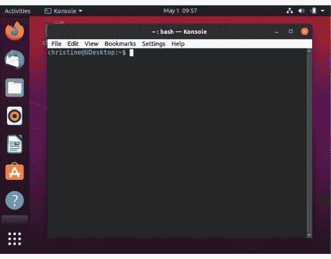

**图 2-10** Konsole 终端仿真器

请记住，在大多数桌面环境中，你可以创建键盘快捷键来访问 Konsole 等应用程序。为了启动 Konsole 终端仿真器，你需要为快捷键输入的命令是 `konsole`。此外，如果已安装 Konsole 应用程序，你可以通过输入 `konsole` 并按回车键从其他终端仿真器中启动它。

> **提示**
>
> 在 Plasma 桌面环境中，Konsole 终端仿真器应用已有一个默认的键盘快捷键：`Ctrl+Alt+T`。

与 GNOME 终端类似，Konsole 终端仿真器提供了由菜单和快捷键提供的几种配置选项。以下部分将描述这些各种功能。

#### 菜单栏

Konsole 菜单栏包含你需要用来轻松查看和更改终端仿真会话中功能的配置和自定义选项。下表简要描述了菜单选项及相关快捷键。

> **提示**
>
> 如果当前未显示 Konsole 菜单栏，你可以按 `Ctrl+Shift+M` 来启用它。

文件菜单（如 *表 2-10* 所示）提供了在当前窗口或新窗口中启动新选项卡的选项。

##### 表 2-10 文件菜单

| 名称 | 快捷键 | 描述 |
| :--- | :--- | :--- |
| 新窗口 | `Ctrl+Shift+N` | 在新 Konsole 终端窗口中启动新的 shell 会话 |
| 新选项卡 | `Ctrl+Shift+T` | 在现有 Konsole 终端窗口中启动新选项卡的 shell 会话 |
| 克隆选项卡 | 无 | 在现有 Konsole 终端窗口中启动一个新选项卡的 shell 会话，尝试复制当前选项卡 |
| 另存输出为 | `Ctrl+Shift+S` | 将当前选项卡回滚缓冲区中的输出保存为文本或 HTML 文件 |
| 打印屏幕 | `Ctrl+Shift+P` | 打印当前选项卡显示的文本 |
| 打开文件管理器 | 无 | 打开默认的文件浏览器应用 |
| 关闭会话 | `Ctrl+Shift+W` | 关闭当前选项卡会话 |
| 关闭窗口 | `Ctrl+Shift+Q` | 关闭当前 Konsole 窗口 |

请注意，Konsole 提供了两个方便的功能用于保存 shell 会话中的信息：另存输出为和打印屏幕。打印屏幕功能允许你将显示的文本打印到系统打印机或保存为 PDF 文件。

> **注意**
>
> 在阅读这些 Konsole 菜单选项时，请记住，你的 Linux 发行版的 Konsole 应用程序可能提供非常不同的菜单选项。这是因为一些 Linux 发行版保留了较旧版本的 Konsole 终端仿真软件包。

编辑菜单（如表 2-11 所示）提供了处理会话中文本的选项。此外，管理选项卡名称也在此选项列表中。

##### 表 2-11 编辑菜单

| 名称 | 快捷键 | 描述 |
| :--- | :--- | :--- |
| 复制 | `Ctrl+Shift+C` | 将选定的文本复制到 Konsole 剪贴板 |
| 粘贴 | `Ctrl+Shift+V` | 将文本从 Konsole 剪贴板粘贴到会话中 |
| 全选 | 无 | 选择当前选项卡中的所有文本 |
| 复制输入到 | 无 | 启动/停止会话输入复制到所选的附加会话 |
| 发送信号 | 无 | 从下拉菜单中发送选定的信号到当前选项卡的 shell 进程或其他进程 |
| 重命名选项卡 | `Ctrl+Alt+S` | 修改会话选项卡标题栏设置 |
| ZModem 上传 | `Ctrl+Alt+U` | 如果支持 ZMODEM 文件传输协议，则启动上传选定文件的过程 |
| 查找 | `Ctrl+Shift+F` | 打开查找窗口以提供回滚缓冲区文本搜索选项 |
| 查找下一个 | `F3` | 在较新的回滚缓冲区历史中查找下一个文本匹配项 |
| 查找上一个 | `Shift+F3` | 在较旧的回滚缓冲区历史中查找下一个文本匹配项 |

Konsole 提供了一种极佳的方法来跟踪每个选项卡会话中正在执行的功能。使用重命名选项卡选项，你可以为一个选项卡命名以匹配其当前任务。这有助于跟踪哪个打开的选项卡会话正在执行什么任务。

> **注意**
>
> **Konsole 为每个选项卡保留历史，正式称为*回滚缓冲区*。历史包含已从终端查看区域滚出的输出文本。默认情况下，保留回滚缓冲区中的最后 1,000 行。你只需使用查看区域中的滚动条即可回滚浏览回滚缓冲区。此外，你可以通过按 `Shift+上箭头` 逐行回滚，或按 `Shift+Page Up` 每次回滚一页（24 行）。**

查看菜单（如表 2-12 所示）包含用于控制 Konsole 终端窗口中单个会话视图的项目。此外，还有选项可用于辅助监控终端会话活动。

##### 表 2-12 查看菜单

| 名称 | 快捷键 | 描述 |
| :--- | :--- | :--- |
| 分割视图 | 无 | 控制当前 Konsole 窗口内的多选项卡会话显示 |
| 分离当前选项卡 | `Ctrl+Shift+L` | 移除一个选项卡会话，并使用该选项卡会话启动一个新的 Konsole 窗口 |
| 分离当前视图 | `Ctrl+Shift+H` | 移除当前选项卡会话的视图，并以此启动一个新的 Konsole 窗口 |
| 监控静默 | `Ctrl+Shift+I` | 切换在选项卡会话没有活动时显示特殊消息的开关 |
| 监控活动 | `Ctrl+Shift+A` | 切换在选项卡会话开始活动时显示特殊消息的开关 |
| 只读 | 无 | 切换终端会话接受键盘输入；*不*启用/禁用键盘快捷键 |
| 放大字体 | `Ctrl++` | 逐步放大窗口中的字体大小 |
| 重置字体大小 | `Ctrl+Alt+0` | 将字体大小恢复为默认值 |
| 缩小字体 | `Ctrl+-` | 逐步缩小窗口中的字体大小 |
| 设置编码 | 无 | 选择用于发送和显示字符的字符集 |
| 清除回滚 | 无 | 移除当前会话回滚缓冲区中的文本 |
| 清除回滚并重置 | `Ctrl+Shift+K` | 移除当前会话回滚缓冲区中的文本并重置终端窗口 |
| 全屏模式 | `F11` | 切换终端窗口填充整个监视器显示区域的开关 |

监控静默选项用于指示选项卡静默。当当前选项卡会话中约七秒没有新文本出现时，会发生选项卡静默。这允许你在等待应用程序输出停止时切换到其他选项卡。

> **提示**
>
> 当你在活动会话区域右键单击时，Konsole 应用程序会提供一个简单的菜单。这个易于访问的菜单中有几个菜单项可用。

如表 2-13 所示，书签菜单选项提供了一种管理在 Konsole 窗口中设置的书签的方法。书签允许你保存活动会话的目录位置，然后在同一会话或新会话中轻松返回那里。

##### 表 2-13 书签菜单

| 名称 | 快捷键 | 描述 |


| :--- | :--- | :--- |

| 添加书签 | Ctrl+Shift+B | 在当前目录位置创建一个新的书签 |

| 选项卡书签 | 无 | 为所有当前终端选项卡会话创建新的书签 |

| 新书签文件夹 | 无 | 创建一个新的书签存储文件夹 |

| 编辑书签 | 无 | 编辑现有的书签 |

设置菜单（如表 2-14 所示）允许你自定义和管理你的配置。配置文件允许用户自动运行命令、设置会话外观、配置回滚缓冲区等。此外，在设置菜单中，你还可以为你的 shell 会话添加更多功能。

### 表 2-14 设置菜单

| 名称 | 快捷键 | 描述 |

| :--- | :--- | :--- |

| 编辑当前配置 | 无 | 打开编辑配置窗口以提供配置选项 |

| 切换配置 | 无 | 将选定的配置应用于当前选项卡 |

| 管理配置 | 无 | 打开管理配置窗口以提供配置管理选项 |

| 显示菜单栏 | Ctrl+Shift+M | 切换菜单栏显示开关 |

| 配置键盘快捷键 | 无 | 创建 Konsole 命令键盘快捷键 |

| 配置通知 | 无 | 创建自定义 Konsole 通知 |

| 配置 Konsole | Ctrl+Shift+, | 配置许多 Konsole 功能 |

配置通知允许你将会话中可能发生的特定事件与不同的操作（如播放声音）关联起来。当其中某个事件发生时，执行定义的操作（或多个操作）。

帮助菜单（如表 2-15 所示）提供完整的 Konsole 手册（如果在你的 Linux 系统中安装了 KDE 手册）distribution）和标准的关于 Konsole 对话框。

### 表 2-15 帮助菜单

| 名称 | 快捷键 | 描述 |

| --- | --- | --- |

| Konsole 手册 | 无 | 包含完整的 Konsole 手册 |

| 这是什么？ | Shift + F1 | 包含终端小工具的提示信息 |

| 报告错误 | 无 | 打开提交错误报告表单 |

| 捐赠 | 无 | 在网页浏览器中打开 KDE 捐赠页面 |

| 切换应用程序语言 | 无 | 打开切换应用程序语言表单 |

| 关于 Konsole | 无 | 显示关于 Konsole 应用程序的信息，包括其当前版本 |

| 关于 KDE | 无 | 显示关于 KDE 桌面环境的信息 |

在“帮助”菜单中提供了相当广泛的文档，以帮助您使用 Konsole 终端仿真程序包。当您遇到程序错误时，向 Konsole 开发人员提交的错误报告表单非常实用。

与另一个流行的软件包 `xterm` 相比，Konsole 终端仿真程序包还年轻。在下一节中，我们将探索这位“老前辈” `xterm`。

## 使用 xterm 终端仿真器

`xterm` 是最古老且最基础的终端仿真程序包。`xterm` 软件包自 X Window 原始时期之前就已存在，X Window 是一个历史上很流行的显示服务器，并且它仍然默认包含在某些发行版中，例如 `openSUSE`。

`xterm` 是一个完整的终端仿真程序包，但它运行时不需要占用太多资源（例如内存）。因此，`xterm` 软件包在那些旨在旧硬件上运行的 Linux 发行版中依然很受欢迎。

虽然 `xterm` 软件包不提供许多花哨的功能，但它在一件事上做得极好：它可以仿真较旧的终端，如 Digital Equipment Corporation (DEC) 的 VT102、VT220 和 Tektronix 4014 终端。对于 VT102 和 VT220 终端，`xterm` 甚至可以仿真 VT 系列的彩色控制代码，从而允许您在脚本中使用颜色。

> 注意
>
> DEC VT102 和 VT220 是“哑终端”（dumb terminals），在 20 世纪 80 年代和 90 年代初常用于连接 Unix 系统。VT102/VT220 可以显示文本，并使用块模式图形显示简单的图形。这种终端访问方式至今仍广泛用于许多商业环境中，因此 VT102/VT220 仿真依然很受欢迎。

[图 2-11] 展示了在 CentOS 发行版的 GNOME Shell 环境中运行基本 `xterm` 显示的样子，该环境需要手动安装 `xterm`。你可以看到它非常基础。

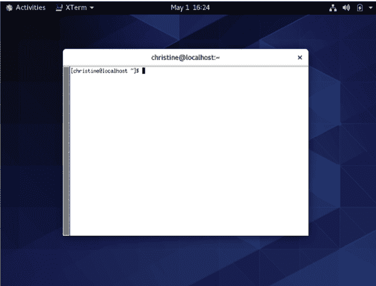

**图 2-11** `xterm` 终端

如今，`xterm` 终端仿真器可能很难找到。通常，它并不包含在桌面环境的图形菜单排列中。

### 访问 xterm

在 KDE 桌面环境（Plasma）中，您可以通过点击屏幕左下角的应用程序启动器图标来访问 `xterm`。然后点击 应用程序 ⌂ 系统 ⌂ X 窗口系统的标准终端仿真器 (`xterm`)。

一旦安装了 `xterm` 软件包，您可以通过 GNOME Shell 搜索功能访问它。点击桌面窗口右上角的“活动”图标。当搜索栏出现时，在搜索栏内点击以访问它并输入 `xterm`，您将看到 Konsole 图标显示出来。此外，请记住，您可以创建自己的键盘快捷键来启动 `xterm`。

`xterm` 软件包允许您使用命令行参数设置单独的功能。以下各节讨论这些功能以及如何更改它们。

### 命令行参数

`xterm` 命令行参数的列表非常广泛。您可以控制许多功能来自定义终端仿真特性，例如启用或禁用单独的 VT 仿真。

> **注意**
>
> `xterm` 拥有大量的配置选项——多到无法在此全部涵盖。广泛的文档可以通过 Bash 手册获取。访问 Bash 手册的内容将在 *第 3 章* 中介绍。此外，`xterm` 开发团队在其网站上提供了一些出色的帮助：`invisible-island.net/xterm`。

您可以通过在 `xterm` 命令中添加参数来调用某些配置选项。例如，要 `xterm` 仿真一个 DEC VT100 终端，在 CLI 中输入命令 `xterm -ti vt100` 并按 Enter 键。*表 2-16* 显示了您在从命令行调用 `xterm` 终端仿真软件时可以包含的一些参数。

#### 表 2-16 xterm 命令行参数

| 参数 | 描述 |

| --- | --- |

| -bg *color* | 指定用于终端背景的颜色 |

| -fb *font* | 设置用于粗体文本的字体 |

| -fg *color* | 指定用于前景文本的颜色 |

| -fn *font* | 设置用于文本的字体 |

| -fw *font* | 指定用于宽文本的字体 |

| -lf *filename* | 设置用于屏幕日志记录的文件名 |

| -ms *color* | 指定用于文本光标的颜色 |

| - *name* | 设置显示在标题栏中的应用名称 |

| -ti *terminal* | 指定要仿真的终端类型 |

一些 `xterm` 命令行参数使用加号 (`+`) 或减号 (`-`) 来表示功能是如何设置的。加号可能开启某个功能，而减号则关闭它。然而，相反的情况也可能成立。加号可能禁用某个功能，而减号启用它，例如在使用 `bc` 参数时。表 2-17 列出了一些您可以使用 `+` / `-` 命令行参数设置更常见的功能。

#### 表 2-17 xterm +/- 命令行参数

| 参数 | 描述 |

|---|---|

| ah | 启用/禁用高亮文本光标 |

| aw | 启用/禁用自动换行 |

| bc | 启用/禁用文本光标闪烁 |

| cm | 启用/禁用 ANSI 颜色更改控制代码的识别 |

| fullscreen | 启用/禁用全屏模式 |

| j | 启用/禁用跳跃滚动 |

| l | 启用/禁用将屏幕数据记录到日志文件 |

| mb | 启用/禁用边界钟 |

| rv | 启用/禁用反色视频颜色 |

| t | 启用/禁用 Tektronix 模式 |

需要注意的是，并非所有 `xterm` 实现都支持所有这些命令行参数。您可以使用 `-help` 参数来确定您的 `xterm` 实现了哪些参数，只需在系统中启动 `xterm` 时使用该参数即可。

> 注意
>
> 如果 `xterm` 对您有吸引力，但您希望使用更现代的终端仿真应用程序，可以考虑尝试 `rxvt-unicode` 软件包。它可以通过大多数发行版的标准存储库安装（在第 9 章中有介绍），占用很少的 RAM，且速度非常快。在 `software.schmorp.de/pkg/rxvt-unicode.html` 上了解更多信息。

既然您已经被介绍了三种终端仿真程序包，一个大问题是，哪一个是最适合使用的终端仿真器？这个问题没有确切的答案。您使用哪个终端仿真程序包取决于您个人的需求和意愿。但拥有如此多的选择是很棒的。

#### 摘要

要开始学习 Linux 命令行命令，您需要访问 CLI。在图形界面的世界里，这有时可能具有挑战性。本章讨论了您应考虑的多种界面，以便到达 Linux 命令行。

首先，本章讨论了通过虚拟控制台终端（GUI 之外的终端）和图形终端仿真程序包（GUI 内部的终端）访问 CLI 之间的区别。我们简要浏览了这两种访问方式的基本差异。


接下来，我们详细探讨了通过虚拟控制台终端访问 CLI，包括如何更改控制台终端配置选项（如背景颜色）的具体细节。

在查看虚拟控制台终端之后，本章介绍了通过图形终端仿真器访问 CLI。主要涵盖了三种类型的终端仿真器：GNOME Terminal、Konsole 和 xterm。

本章还涵盖了 GNOME Shell 桌面项目的 GNOME 终端仿真程序包。GNOME Terminal 通常默认安装在 GNOME Shell 桌面环境中。它提供了通过菜单选项和快捷键设置许多终端功能的便捷方式。

我们还讨论了 KDE 桌面项目的 Konsole 终端仿真程序包。Konsole 应用程序通常默认安装在 KDE 桌面环境（Plasma）中。它提供了一些不错的功能，例如能够监视终端是否处于静默状态。

最后，我们探索了 xterm 终端仿真程序包。xterm 是 Linux 上第一个可用的终端仿真器。它可以仿真较旧的终端硬件，如 VT 和 Tektronix 终端。

在下一章中，我们将开始查看 Linux 命令行命令。我们将引导您执行在 Linux 文件系统中导航以及创建、删除和操作文件所需的命令。

## 第 3 章

### 基本 Bash Shell 命令

**本章内容**

- 与 Shell 交互
- 使用 Bash 手册
- 遍历文件系统
- 列出文件和目录
- 管理文件和目录
- 查看文件内容

许多 Linux 发行版默认使用的 Shell 是 GNU Bash shell。本章介绍了 Bash shell 提供的基本功能，例如 Bash 手册、命令行自动补全以及如何显示文件内容。我们将指导你如何使用 Bash shell 提供的基本命令来处理 Linux 文件和目录。如果你已经熟悉 Linux 环境的基础知识，可以跳过本章，直接前往 [第 4 章](“第 4 章”)“更多 Bash Shell 命令”，查看更多高级命令。

#### 启动 Shell

GNU Bash shell 是一个为 Linux 系统提供交互式访问的程序。它作为一个常规程序运行，通常在用户登录到终端时启动。系统启动的 Shell 取决于你的用户 ID 配置。

`/etc/passwd` 文件包含所有系统用户账户的列表，以及每个用户的基本配置信息。以下是来自 `/etc/passwd` 文件的一个示例条目：

```
christine:x:1001:1001::/home/christine:/bin/bash
```

每个条目有七个数据字段，由冒号 (`:`) 分隔。系统使用这些字段中的数据为用户分配特定功能。大多数这些条目将在第 7 章“理解 Linux 文件权限”中详细讨论。目前，只需关注最后一个字段，该字段指定了用户的 Shell 程序。

> **注意**
>
> 尽管重点在于 GNU Bash shell，本书还将介绍其他 Shell。第 23 章“使用替代 Shell”涵盖了如何使用替代 Shell，例如 dash 和 tcsh。

在之前的 `/etc/passwd` 示例条目中，用户 `christine` 将 `/bin/bash` 设置为默认 Shell 程序。这意味着当 `christine` 登录到 Linux 系统时，GNU Bash shell 程序会自动启动。

虽然 Bash shell 程序在登录时会自动启动，但是否呈现 Shell 命令行界面 (CLI) 取决于使用的登录方法。如果使用虚拟控制台终端登录，CLI 提示符会自动呈现，你可以开始输入 Shell 命令。然而，如果你通过图形桌面环境登录到 Linux 系统，则需要启动一个图形终端模拟器来访问 Shell CLI 提示符。

#### 使用 Shell 提示符

启动终端仿真包或登录到 Linux 虚拟控制台后，你可以访问 Shell CLI 提示符。提示符是你进入 Shell 的入口。这是你输入 Shell 命令的地方。

Bash shell 的默认提示符符号是美元符号 (`$`)。此符号表示 Shell 正在等待你输入文本。不同的 Linux 发行版使用不同的提示符格式。在这个 Ubuntu Linux 系统上，Shell 提示符如下所示：

```
christine@UDesktop:~$
```

在 CentOS Linux 系统上，它看起来像这样：

```
[christine@localhost ~]$
```

除了充当你进入 Shell 的入口点之外，提示符还可以提供其他有用的信息。在前面的两个示例中，提示符显示了当前用户 ID 名称 `christine`。还显示了系统名称，Ubuntu 系统上是 `UDesktop`，CentOS 机器上是 `localhost`。你将在本章后面的内容中了解提示符显示的其他项目。

> **提示**
>
> 如果你是 CLI 的新手，请记住，在提示符处输入 Shell 命令后，需要按 Enter 键才能让 Shell 执行你的命令。

Shell 提示符不是静态的。可以根据需要进行更改。[第 6 章](#)“使用 Linux 环境变量”涵盖了 Shell CLI 提示符的配置。

将 Shell CLI 提示符视为你的助手，协助你处理 Linux 系统，提供有用的见解，并让你知道 Shell 何时准备好接受新命令。Shell 中的另一个有用项目是 Bash 手册。

#### 与 Bash 手册交互

大多数 Linux 发行版都包含在线手册，用于查找 Shell 命令的信息，以及发行版中包含的其他许多 GNU 实用程序。你应该熟悉手册，因为它在处理命令时非常有价值，特别是在尝试弄清楚各种命令行参数时。

`man` 命令提供了访问存储在 Linux 系统上的手册页的途径。输入 `man` 命令后跟特定命令名称即可提供该实用程序的手册条目。[图 3-1](#) 显示了查找 `hostname` 命令手册页的示例。此页面是通过输入命令 `man hostname` 到达的。

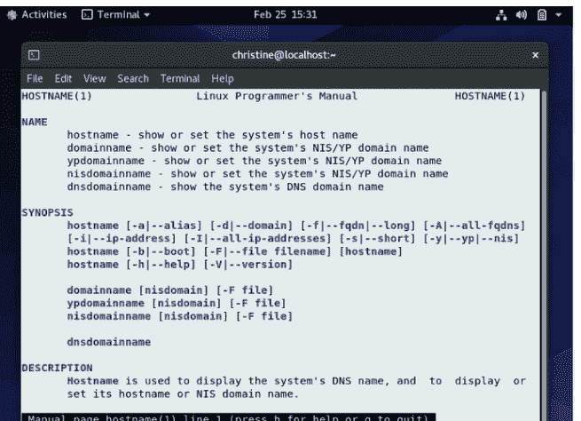

**图 3-1** `hostname` 命令的手册页

注意 **图 3-1** 中 `hostname` 命令的 DESCRIPTION 段落。它相当简短且充满了技术术语。Bash 手册不是一本逐步指南，而是一种快速参考。

> **提示**
>
> 如果你是 Bash shell 的新手，你可能会发现 man 页面起初并不是很有帮助。然而，养成使用它们的习惯，特别是阅读命令 DESCRIPTION 部分的前一两段。最终，你会学会这些技术术语，man 页面对你将更有帮助。

当你使用 `man` 命令查看命令的手册时，信息是通过一种称为 `pager`（分页器）的方式显示的。分页器是一种允许你一次查看一页（或一行）文本的实用程序。因此，你可以通过按空格键翻页浏览 man 页面，或者使用 `Enter` 键逐行查看。此外，你还可以使用方向键向前和向后滚动 man 信息（假设你的终端仿真包支持方向键功能）。

当你完成 man 页面后，按 `Q` 键退出。当你离开 man 页面时，你会收到一个 Shell CLI 提示符，表示 Shell 正在等待你的下一个命令。

> **提示**
>
> **Bash 手册甚至包含关于它自身的参考信息。输入 `man man` 即可查看有关 man 页面的信息。**

手册页将关于命令的信息分为不同的部分。每个部分都有一个传统的命名标准，如 *表 3-1* 所示。

### **表 3-1 Linux Man 页面传统部分名称**

| **部分** | **描述** |
| :--- | :--- |
| Name | 显示命令名称和简短描述 |
| Synopsis | 显示命令语法 |
| Configuration | 提供配置信息 |
| Description | 一般描述命令 |
| Options | 描述命令选项 |
| Exit Status | 定义命令退出状态指示器 |
| Return Value | 描述命令返回值 |
| Errors | 提供命令错误消息 |
| Environment | 描述使用的环境变量 |
| Files | 定义命令使用的文件 |
| Versions | 描述命令版本信息 |
| Conforming To | 提供遵循的标准 |
| Notes | 描述额外的有用命令材料 |
| Bugs | 提供报告发现的缺陷的位置 |
| Example | 显示命令使用示例 |
| Authors | 提供命令开发人员信息 |
| Copyright | 定义命令代码版权状态 |
| See Also | 引用类似的可用命令 |

并非每个命令的 man 页面都包含表 3-1 中描述的所有部分名称。此外，某些命令有部分名称未列在传统标准中。

在命令的 synopsis 部分，你可以了解该命令在 Shell 提示符处应如何输入。许多命令使用基本模式：

```
COMMAND-NAME [OPTION]... [ARGUMENT]...
```

在命令的模式结构中，

- `COMMAND-NAME` 是用于运行所需程序的命令名称。


`[OPTION]`s 是修改命令行为的附加项。通常有许多可以添加的 OPTIONS（也称为 switches）。括号 `([])` 表示 OPTIONS 不是必需的，三个点 ` (...) ` 表示你可以同时使用多个 OPTION。

`[ARGUMENT]` 通常是传递给命令的项目，让程序知道你想让它操作该项目。你可以看到由于括号，它也不是必需的，你可以向程序传递多个 ARGUMENTS。

> **提示**
>
> 如果你想使用多个命令选项，通常可以将它们合并在一起。例如，若要同时使用选项 `-a` 和 `-b`，你只需输入 `-ab` 即可。

由于许多命令是由不同的人编写的，因此你也会发现它们的使用方式各不相同。因此，在 man 手册页中，命令的**概要**部分是一个查找正确语法以完成特定任务的绝佳位置。

> **提示**
>
> 如果你不记得某个命令的名称，可以使用关键字搜索 man 手册页。语法为 `man -k keyword`。例如，要查找处理终端的命令，你可以输入 `man -k terminal`。

除了 man 手册页中常规命名的部分外，还有 man 手册页的**部分区域**。每个部分区域都被分配了一个编号，从 1 到 9；它们列于表 3-2 中。

**表 3-2 Linux Man 手册页部分区域**

| 部分编号 | 区域内容 |
| :--- | :--- |
| 1 | 可执行程序或 Shell 命令 |
| 2 | 系统调用 |
| 3 | 库调用 |
| 4 | 特殊文件 |
| 5 | 文件格式和约定 |
| 6 | 游戏 |
| 7 | 概述、约定和杂项 |
| 8 | 超级用户和系统管理命令 |

通常，`man` 实用工具会提供编号最低的内容区域对应的命令信息。例如，回顾图 3-1 中输入的命令 `man hostname`，请注意左上角和右上角显示区域中，单词 HOSTNAME 后面跟着括号内的数字 `(1)`。这意味着显示的手册页来自内容区域 1（可执行程序或 Shell 命令）。

> **注意**
>
> 你的 Linux 系统的手册页中可能包含一些非标准的部分编号。例如，`1p` 部分涵盖 POSIX（可移植操作系统接口）命令，而 `3n` 部分则用于网络功能。

偶尔会出现这种情况：某个命令与手册页中的特殊文件或概述部分同名，因此该名称会列在多个部分内容区域中。例如，`hostname` 的手册页既包含该命令的信息，也包含关于系统主机名的概述部分。通常默认情况下，`man` 会显示编号最低部分的信息。图 3-1 的情况也是如此，系统自动选择了第 1 部分的 `hostname` 手册页。若要绕过默认的部分搜索顺序，请键入 `man section# topicname`。因此，要查看第 7 部分的 `hostname` 概述手册页，请键入 `man 7 hostname`。

你还可以通过键入 `man 1 intro` 阅读第 1 部分的内容、`man 2 intro` 阅读第 2 部分的内容、`man 3 intro` 阅读第 3 部分的内容，以此类推，逐步浏览各个部分内容区域的简介。

`man` 手册页并非唯一的参考资源。还有称为 `info` 页的信息页。你可以通过键入 `info info` 来了解 `info` 页。

内置命令（在第 5 章“理解 Shell”中介绍）拥有自己的特殊资源，称为 `help` 页。有关使用 `help` 页的更多信息，请键入 `help`。（你发现其中的规律了吗？）

此外，大多数命令都接受 `-h` 或 `--help` 选项。例如，你可以键入 `hostname -help` 来查看简明的帮助界面。

显然，有多种有用的资源可供参考。然而，许多基本的 Shell 概念仍需要详细解释。在下一节中，我们将介绍如何在 Linux 文件系统中导航。

### 导航文件系统

当你登录系统并到达 Shell 命令提示符时，通常会被置于你的主目录中。通常，你希望探索 Linux 系统中主目录以外的其他区域。本节描述如何使用 Shell 命令来实现这一点。首先，你需要浏览 Linux 文件系统的外观，这样你就知道你要去哪里。

#### 查看 Linux 文件系统

如果你是 Linux 系统的新手，你可能会对它是如何引用文件和目录感到困惑，特别是如果你习惯了 Microsoft Windows 操作系统的做法。在探索 Linux 系统之前，了解其布局结构会有所帮助。

你会注意到的第一个区别是，Linux 在路径中不使用驱动器字母。在 Windows 环境中，安装在计算机上的物理磁盘上的分区决定了文件的路径。Windows 为每个物理磁盘分区分配一个字母，每个分区都包含自己的目录结构，用于访问存储在其上的文件。

例如，在 Windows 中，你可能习惯于看到类似这样的文件路径：

```
C:\Users\Rich\Documents\test.doc
```

Windows 文件路径准确地告诉你哪个物理磁盘分区包含名为 `test.doc` 的文件。例如，如果你将 `test.doc` 保存在由字母 E 指定的闪存盘上，文件路径将是

`E:\test.doc`。此路径表示该文件位于被分配为 E 的驱动器的根目录下。

这不是 Linux 使用的方法。Linux 将文件存储在一个称为*虚拟目录*的单目录结构中。虚拟目录包含计算机上安装的所有存储设备的文件路径，并将其合并到单一的目录结构中。

Linux 虚拟目录结构包含一个单一的基目录，称为*根*。根目录下的目录和文件是根据到达它们所使用的目录路径列出的，这与 Windows 的做法类似。

> **提示**
>
> 你会注意到，Linux 使用正斜杠 (`/`) 而不是反斜杠 (`\`) 来表示文件路径中的目录。在 Linux 中，反斜杠字符表示转义字符，如果你在文件路径中使用它，会造成各种问题。如果你是从 Windows 环境转来的，这可能需要一段时间来适应。

在 Linux 中，如图 3-2 所示，你会看到类似以下内容的文件路径：

```
/home/rich/Documents/test.doc
```

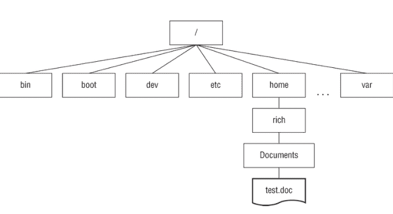

**图 3-2** Linux 虚拟目录文件路径

这表明文件 `test.doc` 位于 `Documents` 目录下，而 `Documents` 目录又位于 `rich` 目录下，`rich` 目录则包含在 `home` 目录中。请注意，路径没有提供任何关于该文件存储在哪个物理磁盘上的信息。

Linux 虚拟目录的棘手之处在于它是如何整合每个存储设备的。在 Linux 系统中安装的第一块硬盘被称为*根驱动器*。根驱动器包含虚拟目录的核心。其他一切都是基于此构建的。

在根驱动器上，Linux 可以使用特殊目录作为*挂载点*。挂载点是虚拟目录中的目录，你可以在这里分配额外的存储设备。Linux 使文件和目录出现在这些挂载点目录中，即使它们在物理上是存储在不同的驱动器上。

通常，系统文件在物理上存储在根驱动器上。用户文件通常存储在单独的驱动器上，如图 **3-3** 所示。

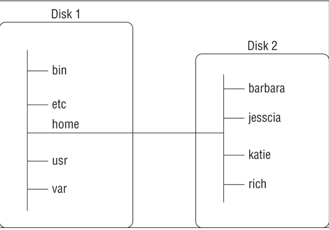

**图 3-3** Linux 文件结构

**图 3-3** 显示了计算机上的两块硬盘。一块硬盘（Disk 1）与虚拟目录的根相关联。其他硬盘可以挂载到虚拟目录结构的任何位置。在这个例子中，第二块硬盘（Disk 2）挂载在 `/home` 位置，这是用户目录所在的位置。

Linux 文件系统结构最初源于 Unix 文件结构。在 Linux 文件系统中，常用的目录名称用于常见的功能。**表 3-3** 列出了一些常见的 Linux 虚拟顶级目录名称及其内容。

**表 3-3** 常见的 Linux 目录名称

| 目录 | 用途 |
| :--- | :--- |
| `/` | 虚拟目录的根，通常不放置文件 |
| `/bin` | 二进制目录，存储许多 GNU 用户级实用工具 |
| `/boot` | 引导目录，存储引导文件 |
| `/dev` | 设备目录，Linux 在此创建设备节点 |
| `/etc` | 系统配置文件目录 |
| `/home` | 主目录，Linux 在此创建用户目录，这是可选的 |
| `/lib` | 库目录，存储系统和应用程序库文件 |
| `/lib*name*` | 库目录，存储替代格式的系统和应用库文件，这是可选的 |
| `/media` | 媒体目录，用于可移动媒体挂载点的常见位置 |
| `/mnt` | 挂载目录，用于临时挂载文件系统的常见位置 |
| `/opt` | 可选目录，存储第三方软件包 |
| `/proc` | 进程目录，存储当前内核、系统和进程信息 |
| `/root` | 根用户的主目录，这是可选的 |
| `/run` | 运行目录，在系统运行期间保存运行时数据 |
| `/sbin` | 系统二进制目录，存储许多 GNU 管理级实用工具 |
| `/srv` | 服务目录，本地服务在此存储其文件 |
| `/sys` | 系统目录，存储设备、驱动程序和一些内核功能信息 |
| `/tmp` | 临时目录，可以在此创建和销毁临时工作文件 |


| `/usr` | 用户目录，二级目录层次结构 |

| `/var` | 变量目录，用于频繁变更的文件，如日志文件 |

在 CentOS Linux 系统中，根虚拟目录通常包含以下顶层目录：

```
bin    dev    home    lib64   mnt   proc   run   srv   tmp   var
boot   etc    lib     media   opt   root    sbin  sys   usr
```

`/usr` 目录值得特别关注，因为它是一个二级目录分组，包含可共享的只读文件。你通常会在这里找到用户命令、源代码文件、游戏等。以下是 CentOS 系统上 `/usr` 目录的一个示例：

```
bin    games    include    lib    lib64    libexec    local    sbin    share    src    tmp
```

常见的 Linux 目录名称基于文件系统层次结构标准（FHS）。许多 Linux 发行版都符合 FHS 标准。因此，你应该能够轻松地在任何符合 FHS 标准的 Linux 系统上找到文件。

## 注意

FHS 标准偶尔会进行更新。你可能会发现一些 Linux 发行版仍在使用较旧的 FHS 标准，而其他发行版仅部分实现了当前标准。为了了解最新的 FHS 标准，请访问其官方主页 `refs._linuxfoundation.org/fhs.shtml`。

当你登录系统并到达 shell CLI 提示符时，你的会话将开始于你的主目录。你的主目录是分配给你的用户账户的唯一目录。当创建用户账户时，系统通常会为该账户分配一个唯一的目录（参见第 7 章）。

你可以使用图形界面在虚拟目录中导航。然而，要从 CLI 提示符在虚拟目录中导航，你需要学会使用 `cd` 命令。

### 遍历目录

你使用改变目录命令 (`cd`) 将 shell 会话移动到 Linux 文件系统中的另一个目录。`cd` 命令的语法非常简单：`cd destination`。

`cd` 命令可以接受单个参数 `destination`，它指定了你要去的目录名称。如果你没有在 `cd` 命令中指定目标，它将带你回到你的主目录。

`destination` 参数可以用两种不同的方法表示。一种方法是使用绝对目录引用。另一种方法使用相对目录引用。

以下各节描述了每种方法。理解这两种方法之间的差异对于你在文件系统中导航至关重要。

### 使用绝对目录引用

你可以使用`绝对目录引用`来引用虚拟目录系统中的目录名称。绝对目录引用从根开始，精确定义了目录在虚拟目录结构中的位置。你可以将绝对目录引用视为目录的全名。

绝对目录引用始终以正斜杠 (`/`) 开头，表示虚拟目录系统的根。因此，要引用包含在 `usr` 目录的 `bin` 子目录中的用户二进制文件，你需要使用

```text
/usr/bin
```

使用绝对目录引用时，对于你要去的确切位置没有疑问。要使用绝对目录引用移动到文件系统中的特定位置，只需在 `cd` 命令中指定完整路径名即可：

```bash
[christine@localhost ~]$ cd /usr/bin
[christine@localhost bin]$ 
```

请注意前面的示例中，提示符最初包含一个波浪号 (`~`)。在更改到新目录后，波浪号被替换为 `bin`。这就是 CLI 提示符可以帮助你在虚拟目录结构中跟踪当前位置的地方。波浪号表示你的 shell 会话位于你的主目录中。当你离开主目录后，提示符中会显示部分目录引用（如果已这样配置提示符）。

#### 注意

如果你的 shell CLI 提示符未显示当前 shell 会话的位置，说明它未被配置为显示该信息。第 6 章讨论了 CLI 提示符配置，如果你希望修改 CLI 提示符，可以查阅该章节。

如果你的提示符未配置为显示 shell 会话的当前绝对目录位置，你可以通过 shell 命令来显示该位置。`pwd` 命令显示 shell 会话的当前目录位置，即当前工作目录（present working directory）或当前目录（current working directory）。以下是使用 `pwd` 命令的示例：

```
[christine@localhost bin]$ pwd
/usr/bin
[christine@localhost bin]$ 
```

##### 提示

每次更改到新的当前工作目录时，使用 `pwd` 命令是一个好习惯。由于许多 shell 命令都在当前工作目录上运行，因此在发出命令前，你总是希望确保自己处于正确的目录中。

你可以使用绝对目录引用从 Linux 虚拟目录结构的任何级别移动到任何级别：

```
[christine@localhost bin]$ cd /var/log
[christine@localhost log]$ pwd
/var/log
[christine@localhost log]$ 
```

你还可以快速从 Linux 虚拟目录结构中的任何级别跳回到你的主目录：

```
[christine@localhost log]$ cd
[christine@localhost ~]$ pwd
/home/christine
[christine@localhost ~]$ 
```

然而，如果你只是在自己的主目录结构内工作，经常使用绝对目录引用可能会变得繁琐。例如，如果你已经处于 `/home/christine` 目录中，为了到达你的 Documents 目录，键入以下命令似乎有些累赘：

```
cd /home/christine/Documents
```

幸运的是，有一个更简单的解决方案。

### 使用相对目录引用

相对目录引用允许你相对于当前位置指定目标目录引用。相对目录引用不以正斜杠 (`/`) 开头。

相反，相对目录引用以目录名称（如果正在导航到当前目录下的子目录）或特殊字符开头。例如，如果你位于主目录并希望移动到 Documents 子目录，你可以结合 `cd` 命令和相对目录引用：

```
[christine@localhost ~]$ pwd
/home/christine
[christine@localhost ~]$ cd Documents
[christine@localhost Documents]$ pwd
/home/christine/Documents
[christine@localhost Documents]$ 
```

在上面的示例中，注意没有使用正斜杠 (`/`)。而是使用了相对目录引用，当前工作目录从 `/home/christine` 更改为 `/home/christine/Documents`，输入量大大减少。

> 如果你是命令行和 Linux 目录结构的新手，建议你在一段时间内坚持使用绝对目录引用。当你更熟悉目录布局后，再切换到使用相对目录引用。

你可以使用 `cd` 命令在任何包含子目录的目录中使用相对目录引用。你还可以使用特殊字符来表示相对目录位置。

用于相对目录引用的两个特殊字符是：

- 单点 ( `.` ) 代表当前目录
- 双点 ( `..` ) 代表父目录

你可以使用单点，但它与 `cd` 命令搭配使用没有意义。在本章后面，你会看到另一个命令如何有效地使用单点进行相对目录引用。

双点字符在尝试遍历目录层次结构时非常有用。例如，如果你位于主目录下的 Documents 目录中，需要转到同样位于主目录下的 Downloads 目录，你可以这样做：

```
[christine@localhost Documents]$ pwd
/home/christine/Documents

[christine@localhost Documents]$ cd ../Downloads
[christine@localhost Downloads]$ pwd
/home/christine/Downloads
[christine@localhost Downloads]$
```

双点字符将你上移一级回到主目录；然后命令中的 `/Downloads` 部分将你下移进入 Downloads 目录。你可以使用任意数量的双点字符进行移动。例如，如果你位于主目录 (`/home/christine`) 并想要转到 `/etc` 目录，你可以键入以下内容：

[christine@localhost ~]$ cd ../../etc

[christine@localhost etc]$ pwd

/etc

[christine@localhost etc]$

当然，在像这样的情况中，你实际上需要输入更多内容，而不仅仅是输入绝对目录引用 `/etc`。因此，只有当这样做有意义时，才使用相对目录引用。

> **注意**
>
> 拥有一个信息丰富的长 shell CLI 提示符（如本章本节所使用的）是有帮助的。然而，为了清晰起见，本书其余示例中使用的都是简单的 `$` 提示符。

现在，既然你已经知道如何遍历目录系统并确认当前工作目录，你就可以开始探索各个目录中包含的内容。下一节将引导你完成查看目录结构中文件的过程。

### 列出文件和目录


要查看系统中可用的文件，请使用 `list` 命令（`ls`）。本节描述了 `ls` 命令以及可用于格式化其显示信息的选项。

## 显示基本列表

最基础形式的 `ls` 命令显示位于当前目录中的文件和目录：

```
$ ls
 Desktop    Downloads   my_script   Public      test_file
 Documents  Music       Pictures    Templates   Videos
$
```

请注意，`ls` 命令生成的列表是按字母顺序排列的（以列而非行显示）。如果你使用的是支持颜色的终端模拟器，`ls` 命令也可能以不同颜色显示不同类型的条目。环境变量 `LS_COLORS` 控制此功能。（环境变量在 **第 6 章** 中有详细说明。不同的 Linux 发行版会根据终端模拟器的功能设置此环境变量。）

如果你没有彩色终端模拟器，可以使用 `-F` 参数与 `ls` 命令结合使用，以便轻松区分文件和目录。使用 `-F` 参数会产生以下输出：

```
$ ls -F
Desktop/   Downloads/  my_script*  Public/    test_file
Documents/ Music/      Pictures/   Templates/ Videos/
$
```

`-F` 参数用正斜杠（`/`）标记目录，以帮助在列表中识别它们。类似地，它用星号（`*`）标记可执行文件（如前面代码中的 `my_script` 文件），帮助你更容易地在系统中找到可以运行的文件。

基本的 `ls` 命令可能会产生一些误导。它显示当前目录中包含的文件和目录，但不一定显示所有文件。Linux 经常使用*隐藏文件*来存储配置信息。在 Linux 中，隐藏文件是文件名以句点（`.`）开头的文件。这些文件不会出现在默认的 `ls` 列表中。因此，它们被称为隐藏文件。

要显示隐藏文件以及普通文件和目录，请使用 `-a` 参数。以下是使用 `-a` 参数与 `ls` 命令的示例：

```
$ ls -a
.  .bash_profile   Desktop  .ICEauthority
.. my_script       Templates  .bashrc   Documents  .local
.bash_history      Pictures test_file   .cache   Downloads  .mozilla   .pki
.bash_logout .config .esd_auth Music
Public
$
```

所有以句点开头的文件，即隐藏文件，现在都显示出来了。请注意，有四个文件以 `.bash` 开头。这些是由 Bash shell 环境使用的隐藏文件，将在第 6 章中详细涵盖。

`-R` 参数是 `ls` 命令可以使用的另一个选项。它被称为递归选项，用于显示当前目录中包含在子目录中的文件。如果你有很多子目录，这个列表可能会非常长。下面是 `-R` 参数产生的简单示例。为了帮助你查看文件类型，附加了 `-F` 选项：

```
$ ls -F -R
 .:
 Desktop/    Downloads/  my_script*  Public/     test_file
 Documents/  Music/      Pictures/   Templates/  Videos/
 
 ./Desktop:
 
 ./Documents:
 
 ./Downloads:
 
 ./Music:
 I LoveLinux.mp3*
 
 ./Pictures:
 
 ./Public:
 
 ./Templates:
 
 ./Videos:
 $
```

请注意，`-R` 参数显示了当前目录的内容，即前面示例中显示的用户主目录中的文件。它还显示了用户主目录中的每个子目录及其内容。唯一包含文件的子目录是 Music 子目录，其中包含可执行文件 `ILoveLinux.mp3`。

> **提示**
> **选项参数不必像前一个示例中那样分开输入：`ls -F -R`。通常可以将它们组合如下：`ls -FR`。**

在上面的示例中，子目录内没有进一步的子目录。如果存在进一步的子目录，`-R` 参数也会继续遍历这些子目录。可以想象，对于大型目录结构，这可能成为一个非常长的列表。

## 显示长列表

在基本列表中，`ls` 命令关于每个文件的信息不多。要列出更多信息，另一个常用参数是 `-l`。`-l` 参数生成长列表格式，提供目录中每个文件的更多信息：

```
$ ls -l
   total 8
   drwxr-xr-x.  2 christine christine     6 Feb 20 14:23 Desktop
   drwxr-xr-x.  2 christine christine     6 Feb 20 14:23 Documents
   drwxr-xr-x.  2 christine christine     6 Feb 20 14:23 Downloads
   drwxr-xr-x.  2 christine christine    28 Feb 29 15:42 Music
   -rwxrw-r--.  1 christine christine   74 Feb 29 15:49 my_script
   drwxr-xr-x.  2 christine christine     6 Feb 20 14:23 Pictures
   drwxr-xr-x.  2 christine christine     6 Feb 20 14:23 Public
   drwxr-xr-x.  2 christine christine     6 Feb 20 14:23 Templates
   -rw-rw-r--.  1 christine christine   74 Feb 29 15:50 test_file
   drwxr-xr-x.  2 christine christine     6 Feb 20 14:23 Videos
   $
```

长列表格式将每个文件和目录列在单独的一行上。除了文件名外，列表还显示其他有用的信息。输出的第一行显示目录内文件分配的总块数（8）。之后，每一行包含关于每个文件（或目录）的以下信息：

- 文件类型 —— 例如目录 `d`、文件 `-`、链接文件 `l`、字符设备 `c` 或块设备 `b`
- 文件权限（参见第 7 章）
- 文件硬链接的数量（参见本章“链接文件”部分）
- 文件所有者的用户名
- 文件的主组名
- 文件字节大小
- 文件最后修改时间
- 文件或目录名称

`-l` 参数是一个强大的工具。配备此参数，你可以看到大多数任何文件或目录所需的信息。

> **提示**
> 
> 如果你只想查看单个文件的长列表，只需将文件名附加到你的 `ls -l` 命令即可。但是，如果你想查看目录的此类列表（而不是其内容），你不仅需要在命令中添加其名称，还需要添加 `-d` 开关，例如：`ls -ld` `Directory-Name`。

`ls` 命令有很多参数，在你进行文件管理时可能会派上用场。如果你在 shell 提示符下输入 `man ls`，你会看到几页可用的参数，供你修改 `ls` 命令的输出使用。

别忘了，你还可以组合许多参数。你通常可以发现一种参数组合，不仅显示期望的输出，而且容易记住，例如 `ls -aIf`。

## 过滤列表输出

正如你在示例中看到的，默认情况下，`ls` 命令列出所有非隐藏目录文件。有时，这可能有点过度，特别是当你只是在寻找几个文件的信息时。

幸运的是，`ls` 命令也提供了一种在命令行上定义过滤器的方法。它使用过滤器来确定应该在输出中显示哪些文件或目录。

在使用过滤器命令之前，让我们通过 `touch` 命令（将在下一节中介绍）创建一些文件来玩玩。如果文件已经存在，该命令不会损坏文件：

```
$ touch my_script my_scrypt my_file
$ touch fall fell fill full
$ ls
Desktop     Downloads   fell      full      my_file     my_script
Public      test_file
Documents   fall        fill      Music     my_scrypt   Pictures
Templates   Videos
$
```

过滤器作为一个简单的文本匹配字符串工作。将你希望使用的任何命令行参数之后包含过滤器：

```
$ ls -l my_script
-rwxrwr-r--. 1 christine christine 74 Feb 29 16:12 my_script
$
```

当你指定特定文件的名称作为过滤器时，`ls` 命令仅显示该文件的信息。有时，你可能不知道确切的文件名你在寻找什么。`ls` 命令还识别标准通配符，并使用它们匹配过滤器内的模式：

- 问号 `?` 代表一个字符
- 星号 `*` 代表任意数量的字符

问号可用于替换过滤器字符串中任何位置的恰好一个字符。例如：


```
$ ls -l my_scr?pt
-rw-rw-r--. 1 christine christine 0 Feb 29 16:12 my_scrypt
-rwxwr-r--. 1 christine christine 74 Feb 29 16:12 my_script
$
```

过滤器 `my_scr?pt` 匹配了目录中的两个文件。类似地，星号可用于匹配零个或多个字符：

```
$ ls -l my*
```

```bash
$ ls -l my_s*t
-rw-rw-r--. 1 christine christine   0 Feb 29 16:12 my_scrap
-rwxrw-r--. 1 christine christine  74 Feb 29 16:12 my_script
$
```

使用星号可以找到三个不同的文件，它们的名称都以 `my` 开头。与问号一样，你可以将星号放置在筛选器的任何位置：

```bash
$ ls -l my_s*t
-rw-rw-r--. 1 christine christine   0 Feb 29 16:12 my_scrap
-rwxrw-r--. 1 christine christine  74 Feb 29 16:12 my_script
$
```

在筛选器中使用星号和问号被称为文件通配 `file globbing`。文件通配是使用通配符进行模式匹配的过程。这些通配符正式被称为元字符通配符。除了星号和问号之外，你还可以使用更多的元字符通配符进行文件通配。你还可以使用括号：

```bash
$ touch my_scrsypt
$ ls -l my_scr[ay]pt
-rw-rw-r--. 1 christine christine   0 Feb 29 16:12 my_scrap
-rw-rw-r--. 1 christine christine   0 Feb 29 16:18 my_scrsypt
$
```

在这个示例中，我们将括号与该位置单个字符的两个可能选项 `a` 或 `y` 一起使用。括号代表一个单个字符位置，并为文件通配提供多个选项。你可以像前面的示例那样列出字符选项，也可以指定字符范围，例如字母范围 `[a-i]`：

```bash
$ ls f*1l
fall fell fill full
$ ls f[a-i]1l
fall fell fill
$
```

此外，你可以使用感叹号 `!` 指定模式中不应包含的内容：

```bash
$ ls -1 f[!a]1l
-rw-rw-r--. 1 christine christine   0 Feb 29 16:12 fell
-rw-rw-r--. 1 christine christine   0 Feb 29 16:12 fill
-rw-rw-r--. 1 christine christine   0 Feb 29 16:12 full
$
```

在搜索文件时，文件通配是一个强大的功能。除了 `ls` 命令外，它还可以与其他 shell 命令一起使用。你将在本章后面的内容中了解更多信息。

### 处理文件

Shell 在 Linux 文件系统上提供了许多文件操作命令。本节将带你了解处理文件所需的基本 shell 命令。

#### 创建文件

偶尔你会遇到需要创建一个空文件的情况。例如，有时应用程序在写入日志文件之前需要该文件已存在。在这些情况下，你可以使用 `touch` 命令轻松创建一个空文件：

```bash
$ touch test_one
$ ls -l test_one
-rw-rw-r--. 1 christine christine 0 Feb 29 17:24 test_one
$
```

`touch` 命令会创建你指定的新文件，并将你的用户名分配为该文件的所有者。注意前面示例中的文件大小为零，因为 `touch` 命令刚刚创建了一个空文件。`touch` 命令还可用于更改修改时间。这是在不更改文件内容的情况下完成的：

```bash
$ ls -l test_one
-rw-rw-r--. 1 christine christine 0 Feb 29 17:24 test_one
$ touch test_one
$ ls -l test_one
-rw-rw-r--. 1 christine christine 0 Feb 29 17:26 test_one
$
```

`test_one` 的修改时间现在已从原始时间 17:24 更新为 17:26。

创建空文件和更改文件时间戳并不是你在 Linux 系统上每天都会做的事情。然而，复制文件是你在 shell 中经常执行的操作。

#### 复制文件

将文件和目录从文件系统中的一个位置复制到另一个位置是系统管理员的常见做法。`cp` 命令提供了此功能。

在最基本的形式中，`cp` 命令使用两个参数——源对象和目标对象：`cp source destination`。

当源和目标参数都是文件名时，`cp` 命令将源文件复制到新的目标文件。新文件表现得像一个全新的文件，其修改时间已更新：

```bash
$ cp test_one test_two
$ ls -l test_one test_two
-rw-rw-r--. 1 christine christine 0 Feb 29 17:26 test_one
-rw-rw-r--. 1 christine christine 0 Feb 29 17:46 test_two
$
```

新文件 `test_two` 显示的修改时间与 `test_one` 文件不同。如果目标文件已存在，`cp` 命令可能不会提示你这一事实。最好添加 `-i` 选项以强制 shell 询问你是否要覆盖文件：

```bash
$ ls -l test_one test_two
-rw-rw-r--. 1 christine christine 0 Feb 29 17:26 test_one
-rw-rw-r--. 1 christine christine 0 Feb 29 17:46 test_two
$
$ cp -i test_one test_two
cp: overwrite 'test_two'? n
$
```

如果你没有回答 `y`，则文件复制不会继续。你还可以将文件复制到已存在的目录中：

```bash
$ cp -i test_one /home/christine/Documents/
$
$ ls -l /home/christine/Documents/
total 0
-rw-rw-r--. 1 christine christine 0 Feb 29 17:48 test_one
$
```

新文件现在位于 `Documents` 目录下，使用与原始文件相同的文件名。

**注意**

前面的示例在目标目录名称末尾使用了一个正斜杠 `/`。使用斜杠表示 `Documents` 是一个目录而不是一个文件。这在清晰度方面很有帮助，在复制单个文件时非常重要。如果没有使用正斜杠，且子目录 `/home/christine/Documents` 不存在，则会在当前目录中创建一个名为 `Documents` 的文件，并且不会显示错误消息。这是有问题的，因此请在你的目标目录名称末尾使用正斜杠。

最后一个示例使用了绝对目录引用，但你同样可以轻松使用相对目录引用：

```bash
$ cp -i test_two Documents/
$ ls -l Documents/
total 0
-rw-rw-r--. 1 christine christine 0 Feb 29 17:48 test_one
-rw-rw-r--. 1 christine christine 0 Feb 29 17:51 test_two
$
```

在本章前面，你阅读了关于可以在相对目录引用中使用的特殊符号。其中，单个点 `.` 非常适合与 `cp` 命令一起使用。请记住，单个点代表你的当前工作目录。如果你需要将一个具有长源对象名称的文件复制到你的当前工作目录，单个点可以简化任务：

```bash
$ cp /etc/NetworkManager/NetworkManager.conf .
$ ls *.conf
NetworkManager.conf
$
```

那个单个点很难看到！如果你仔细看，你会发现它在第一行示例代码的末尾。当源对象名称很长时，使用单个点符号比输入完整的目标对象名称容易得多。

`-R` 参数是一个强大的 `cp` 命令选项。它允许你在一条命令中递归复制整个目录的内容：


```bash
$ ls -l Documents/
total 0
-rw-rw-r--. 1 christine christine 0 Feb 29 17:48 test_one
-rw-rw-r--. 1 christine christine 0 Feb 29 17:51 test_two
$
$ cp -R Documents/ NewDocuments/
$ ls -l NewDocuments/
total 0
-rw-rw-r--. 1 christine christine 0 Feb 29 17:55 test_one
-rw-rw-r--. 1 christine christine 0 Feb 29 17:55 test_two
$
```

在执行 `cp -R` 命令之前，目录 `NewDocuments` 并不存在。它是通过 `cp -R` 命令创建的，并且整个 `Documents` 目录的内容都被复制到了其中。请注意，新 `NewDocuments` 目录中的所有文件都有新的日期与之关联。现在 `NewDocuments` 是 `Documents` 目录的完整副本。

> **提示**
>
> `cp` 命令的参数远不止这里描述的这些。请记住，你可以通过输入 `man cp` 查看所有可用的 `cp` 命令参数。

你也可以在 `cp` 命令中使用通配元字符：

```bash
$ ls
Desktop      public       fall       full       my_scrap     NetworkManager.conf
Documents    Documents   fell       Music      my_script    NewDocuments
Templates    test_one    download   fill_my_file my_script  Pictures
Videos       test_file   
$
$ cp my* NewDocuments/
$ ls NewDocuments/
my_file   my_scrap   my_script   my_scrpyt   test_one   test_two
$
```

此命令将所有以 `my` 开头的文件复制到了 `NewDocuments`。现在该目录包含六个文件，而不仅仅是两个。

在复制文件时，除了单个点和通配元字符外，还有另一个 shell 功能可以帮助你。它叫做**命令行补全**（command-line completion）。

### 使用命令行补全

在命令行工作时，你很容易输入错误的命令、目录名或文件名。实际上，目录引用或文件名越长，你输入错误的几率就越大。

这就是命令行补全（也称为标签补全）可以救命的地方。标签补全允许你开始输入文件名或目录名，然后按 Tab 键让 shell 为你补全：

```bash
$ touch really_ridiculously_long_file_name
$
$ cp really_ridiculously_long_file_name NewDocuments/
$ ls NewDocuments/
my_file   my_script   really_ridiculously_long_file_name
test_two
my_scrap   my_scrpyt   test_one
$
```

在创建了一个名称非常长的文件后（如前面的示例），我们输入了命令 `cp really` 并按了 Tab 键，shell 自动为我们补全了文件名的其余部分！当然，目标目录必须手动输入，但标签补全仍然避免了命令中可能出现的几个打字错误。

使用命令行补全的技巧是给 shell 足够的文件名字符，以便它能够将所需的文件与其他文件区分开来。例如，如果另一个文件名也以 `really` 开头，按 Tab 键将不会自动补全文件名。相反，你会听到一声蜂鸣声。如果发生这种情况，你可以再次按 Tab 键，shell 会显示所有以 `really` 开头的文件名。

此功能允许你查看哪些内容需要键入，才能使制表符补全正常工作。

### 链接文件

在 Linux 文件系统中，链接文件是一个非常有用的选项。如果你需要在系统中维护同一文件的两个（或更多）副本，除了拥有独立的物理副本外，你还可以使用一个物理副本和多个虚拟副本，这些虚拟副本称为链接。链接是目录中的一个占位符，指向文件的真实位置。Linux 中可用的文件链接类型有两种：

- 符号链接
- 硬链接

符号链接，也称为软链接，只是一个物理文件，它指向虚拟目录结构中某处的另一个文件。两个通过符号链接关联的文件并不共享相同的内容。

要创建符号链接，原始文件必须已经存在。然后，我们使用带有 `-s` 选项的 `ln` 命令来创建符号链接：

```bash
$ ls -l test_file
-rw-rw-r--. 1 christine christine 74 Feb 29 15:50 test_file
$
$ ln -s test_file slink_test_file
$
$ ls -l *test_file
lrwxrwxrwx. 1 christine christine 9 Mar 4 09:46 slink_test_file -> test_file
-rw-rw-r--. 1 christine christine 74 Feb 29 15:50 test_file
$
```

在上面的示例中，请注意符号链接的名称 `slink_test_file` 在 `ln` 命令中列为第二个。在符号链接文件的长列表（`ls -l`）中，文件名后显示的 `->` 符号表明它符号链接到了文件 `test_file`。

另外，请注意符号链接的文件大小与数据文件的文件大小。符号链接 `slink_test_file` 仅占 9 字节，而 `test_file` 占 74 字节。这是因为 `slink_test_file` 只是指向 `test_file`。它们不共享内容，并且是两个物理上独立的文件。

判断这些链接文件是独立物理文件的另一种方法是查看它们的 inode 号。文件或目录的 inode 号是内核分配给文件系统中每个对象的唯一标识号。要查看文件或目录的 inode 号，请在 `ls` 命令中添加 `-i` 参数：

```bash
$ ls -i *test_file
1415020 slink_test_file 1415523 test_file
$
```

示例显示 `test_file` 的 inode 号是 1415523，而 `slink_test_file` 的 inode 号不同（它是 1415020）。因此，它们是不同的文件。

硬链接创建了一个独立的虚拟文件，其中包含有关原始文件及其位置的信息。然而，这两个文件实际上是同一个物理文件。要创建硬链接，同样，原始文件必须预先存在，只是这次 `ln` 命令不需要参数：

```bash
$ ls -l *test_one
-rw-rw-r---. 1 christine christine 0 Feb 29 17:26 test_one
$
$ ln test_one hlink_test_one
$
$ ls -li *test_one
1415016 -rw-rw-r---. 2 christine christine 0 Feb 29 17:26 hlink_test_one
1415016 -rw-rw-r---. 2 christine christine 0 Feb 29 17:26 test_one
$
```

在上面的示例中，创建硬链接文件后，我们使用了 `ls -li` 命令来显示 `*test_one` 的 inode 号和长列表。请注意，这两个通过硬链接关联的文件共享相同的 inode 号。这是因为它们在物理上是同一个文件。它们的文件大小也完全相同。

**注意**

> 你只能在同一物理介质上的文件之间创建硬链接。要在不同物理介质上的文件之间创建链接，必须使用符号链接。

你可能会发现符号链接和硬链接的概念比较难理解。幸运的是，重命名文件（下一节的主题）要容易理解得多。

### 重命名文件

在 Linux 世界中，重命名文件被称为*移动文件*。可以使用 `mv` 命令将文件和目录移动到另一个位置或新名称：


```bash
$ ls -li f?ll
   1414976 -rw-rw-r--. 1 christine christine   0 Feb 29 16:12 fall
   1415004 -rw-rw-r--. 1 christine christine   0 Feb 29 16:12 fell
   1415005 -rw-rw-r--. 1 christine christine   0 Feb 29 16:12 fill
   1415011 -rw-rw-r--. 1 christine christine   0 Feb 29 16:12 full
   $
   $ mv fall fzll
   $
   $ ls -li f?ll
   1415004 -rw-rw-r--. 1 christine christine   0 Feb 29 16:12 fell
   1415005 -rw-rw-r--. 1 christine christine   0 Feb 29 16:12 fill
   1415011 -rw-rw-r--. 1 christine christine   0 Feb 29 16:12 full
   1414976 -rw-rw-r--. 1 christine christine   0 Feb 29 16:12 fzll
   $
```

请注意，移动文件时将名称从 `fall` 更改为 `fzll`，但保留了相同的 inode 号和时间戳值。这是因为 `mv` 仅影响文件的名称。

你还可以使用 `mv` 来更改文件的位置：

```bash
$ ls -li /home/christine/fzll
   1414976 -rw-rw-r--. 1 christine christine   0 Feb 29 16:12
   /home/christine/fzll
   $
   $ ls -li /home/christine/NewDocuments/fzll
   ls: cannot access '/home/christine/NewDocuments/fzll': No such file or directory
   $
   $ mv /home/christine/fzll /home/christine/NewDocuments/
$
$ ls -li /home/christine/NewDocuments/fzll
1414976 -rw-rw-r--. 1 christine christine 0 Feb 29 16:12
/home/christine/NewDocuments/fzll
$
$ ls -li /home/christine/fzll
ls: cannot access '/home/christine/fzll': No such file or directory
$
```

在上面的示例中，我们使用 `mv` 命令将文件 `fzll` 从 `/home/christine` 移动到了 `/home/christine/NewDocuments`。同样，文件的 inode 号或时间戳值没有变化。

**提示**

> 与 `cp` 命令类似，你可以在 `mv` 命令上使用 `-i` 选项。因此，在命令尝试覆盖任何现有文件之前，系统会询问你。

唯一的改变是文件的位置。`fzll` 文件不再存在于 `/home/christine` 中，因为没有在原始位置留下它的副本，这与 `cp` 命令的行为不同。

你可以使用 `mv` 命令在一个简单的步骤中同时移动文件位置并重命名它：

```bash
$ ls -li NewDocuments/fzll
1414976 -rw-rw-r--. 1 christine christine 0 Feb 29 16:12
NewDocuments/fzll
$
$ mv /home/christine/NewDocuments/fzll /home/christine/fall
$
$ ls -li /home/christine/fall
1414976 -rw-rw-r--. 1 christine christine 0 Feb 29 16:12
/home/christine/fall
$
$ ls -li /home/christine/NewDocuments/fzll
ls: cannot access '/home/christine/NewDocuments/fzll': No such file or directory
$
```

对于这个示例，我们将文件 `fall`（原为 `fzll`）从子目录 `NewDocuments` 移动到了主目录 `/home/christine`，并将其重命名为 `fall`。时间戳值和 inode 号均未改变。只有位置和名称发生了变化。

你还可以使用 `mv` 命令移动整个目录及其内容：

```bash
$ ls NewDocuments
my_file     my_script   really_ridiculously_long_file_name
test_two
my_scrap    my_scrapt   test_one
$
$ mv NewDocuments OldDocuments
$ ls NewDocuments
ls: cannot access 'NewDocuments': No such file or directory
$
$ ls OldDocuments
my_file     my_script   really_ridiculously_long_file_name
test_two
my_scrap    my_scrapt   test_one
$
```

目录的完整内容保持不变。唯一改变的是目录的名称。

一旦你知道如何使用 `mv` 命令重命名……呃……*移动* 文件，你就会意识到完成这一点是多么简单。另一个简单但潜在危险的任务是删除文件。

### 删除文件

很可能在某个时候你需要删除现有文件。无论是为了清理文件系统还是移除临时工作数据，你总是有机会删除文件。

在 Linux 世界中，删除被称为*移除*。在 Bash shell 中移除文件的命令是 `rm`。`rm` 命令的基本形式很简单：

```bash
$ rm -i fall
rm: remove regular empty file 'fall'? y
$ ls fall
ls: cannot access 'fall': No such file or directory
$
```

请注意，`-i` 命令参数会提示你确认是否真的要移除该文件。Shell 没有回收站或垃圾桶。移除文件后，它将永久消失。因此，一个好习惯是始终在 `rm` 命令后加上 `-i` 参数。你还可以使用通配符元字符来删除一组文件。不过，同样，请使用 `-i` 选项来保护自己：

```bash
$ rm -i f?ll
rm: remove regular empty file 'fell'? y
rm: remove regular empty file 'fill'? y
rm: remove regular empty file 'full'? y
$ ls f?ll
ls: cannot access 'f?ll': No such file or directory
$
```

`rm` 命令的另一个特性是，如果你要删除大量文件且不想被提示打扰，可以使用 `-f` 参数强制移除。请务必小心！

## 管理目录

Linux 有一些命令适用于文件和目录（如 `cp` 命令），也有一些仅适用于目录的命令。要创建新目录，你需要使用一个特定的命令，这将在本节中介绍。移除目录可能会变得有趣，因此本节也将涵盖这一点。

### 创建目录

在 Linux 中创建新目录很容易——只需使用 `mkdir` 命令：

```bash
$ mkdir New_Dir
$ ls -ld New_Dir
drwxrwxr-x. 2 christine christine 6 Mar 6 14:40 New_Dir
$
```

系统创建了一个名为 `New_Dir` 的新目录。在新目录的长列表中，请注意目录的记录以 `d` 开头。这表明 `New_Dir` 是一个目录。

有时，您可能需要“批量”创建目录和子目录。要做到这一点，请按照以下所示，在 `mkdir` 命令中添加 `-p` 选项：

```bash
$ mkdir -p New_Dir/SubDir/UnderDir
$ ls -R New_Dir
New_Dir:
SubDir

New_Dir/SubDir:
UnderDir

New_Dir/SubDir/UnderDir:
$
```

`mkdir` 命令中的 `-p` 选项会按需创建缺失的*父目录*。父目录是指在目录树中下一层级包含其他目录的目录。

当然，创建了某些东西之后，你需要知道如何删除它。如果你在错误的位置创建了目录，这一点尤其有用。

### 删除目录

删除目录可能会很棘手，而且原因很充分。开始删除目录时，有很多机会让坏事发生。Shell 会尽可能保护我们免受灾难性错误的侵害。


删除目录的基本命令是 `rmdir`：

```bash
$ mkdir Wrong_Dir
$ touch Wrong_Dir/newfile
$
$ rmdir Wrong_Dir/
rmdir: failed to remove 'Wrong_Dir/': Directory not empty
$
```

默认情况下，`rmdir` 命令仅用于删除*空*目录。因为我们在 `Wrong_Dir` 目录中创建了一个文件 `newfile`，所以 `rmdir` 命令拒绝删除它。

要使用 `rmdir` 删除此目录，我们必须先删除该文件。

然后我们可以对现在已为空的目录使用 `rmdir` 命令：

```bash
$ rm -i Wrong_Dir/newfile
rm: remove regular empty file 'Wrong_Dir/newfile'? y
$ rmdir Wrong_Dir/
$ ls Wrong_Dir
ls: cannot access 'Wrong_Dir': No such file or directory
$
```

`rmdir` 命令没有 `-i` 选项来询问你是否想要删除目录。这就是为什么 `rmdir` 只删除空目录很有帮助的一个原因。

你也可以对完整的非空目录使用 `rm` 命令。使用 `-r` 选项允许命令进入目录，删除文件，然后删除目录本身：

```bash
$ mkdir TestDir
$ touch TestDir/fileone TestDir/filetwo
$ ls TestDir
fileone filetwo
$ rm -ir TestDir
rm: descend into directory 'TestDir'? y
rm: remove regular empty file 'TestDir/fileone'? y
rm: remove regular empty file 'TestDir/filetwo'? y
rm: remove directory 'TestDir'? y
$ ls TestDir
ls: cannot access 'TestDir': No such file or directory
$
```

对于进入多个子目录的情况，这也适用，并且当你有许多目录和文件需要删除时，它特别有用：

```bash
$ touch New_Dir/testfile
$ ls -FR New_Dir
New_Dir:
SubDir/ testfile

New_Dir/SubDir:
UnderDir/

New_Dir/SubDir/UnderDir:
$
$ rm -iR New_Dir
rm: descend into directory 'New_Dir'? y
rm: descend into directory 'New_Dir/SubDir'? y
rm: remove directory 'New_Dir/SubDir/UnderDir'? y
rm: remove directory 'New_Dir/SubDir'? y
rm: remove regular empty file 'New_Dir/testfile'? y
rm: remove directory 'New_Dir'? y
$
```

虽然这可以工作，但有些繁琐。注意，你仍然必须验证每个被删除的文件。对于一个包含许多文件和子目录的目录，这可能会变得非常繁琐。

> **注意**
>
> 对于 `rm` 命令，`-r` 参数和 `-R` 参数的功能完全相同——它会递归遍历目录并删除文件。一个 Shell 命令拥有大小写不同但功能相同的参数是非常罕见的。

快速删除目录树的终极解决方案是 `rm -rf` 命令。它不提供警告，也不显示信息，它只是删除指定的目录及其所有内容。当然，这是一个极其危险的工具。请谨慎使用，并且务必在三倍检查确保你正在做的是你想做的确切事情之后才使用！

在之前的几节中，我们查看了文件和管理目录。到目前为止，我们已经涵盖了你需要知道的所有关于文件的内容，除了如何查看其内部。

### 查看文件内容

你可以使用几个命令来查看文件内部的内容，而无需调用文本编辑器工具（参见*第 10 章*，“使用编辑器”）。本节演示了其中的一些命令。

#### 查看文件类型

在你试图显示文件之前，你需要了解它是什么类型的文件。如果你试图显示二进制文件，你可能会在屏幕上看到大量乱码，甚至可能导致终端模拟器锁定。

`file` 命令是一个方便的小工具。它可以查看文件内部并确定它到底是什么类型的文件：

```bash
$ file .bashrc
.bashrc: ASCII text
$
```

前一个示例中的文件是一个文本文件。`file` 命令不仅确定该文件包含文本，还确定了文本文件的字符编码格式，即 ASCII。

以下示例显示了一个只是目录的文件。因此，`file` 命令提供了另一种区分目录的方法：

```bash
$ file Documents
Documents/: directory
$
```

第三个 `file` 命令示例显示了一个是符号链接的文件。注意，`file` 命令甚至告诉你它符号链接到了哪个文件：

```bash
$ file slink_test_file
slink_test_file: symbolic link to test_file
$
```

以下示例显示了 `file` 命令针对脚本文件返回的内容。虽然文件是 `ASCII text`，但由于它是脚本文件，你可以在系统上执行（运行）它：

```bash
$ file my_script
my_script: Bourne-Again shell script, ASCII text executable
$
```

最后一个示例是一个二进制可执行程序。`file` 命令确定该程序编译针对的平台以及它需要的库类型。如果你有一个来源不明的二进制可执行程序，这是一个特别有用的功能：

```bash
$ file /usr/bin/ls
/usr/bin/ls: ELF 64-bit LSB shared object, x86-64, version 1
(SYSV),
dynamically linked, interpreter /lib64/ld-linux-x86-64.so.2,
for GNU/Linux 3.2.0, [...] $
```

现在你知道了一种快速查看文件类型的方法，你可以开始显示和查看文件了。

#### 查看整个文件

如果你手头有一个大型文本文件，你可能希望看到里面的内容。Linux 有三个不同的命令可以帮助你在这些方面。

##### 使用 cat 命令

`cat` 命令是一个显示文本文件内所有数据的实用工具：

```bash
$ cat test_file
Hello World
Hello World again
Hello World a third time
How are you World?
$
```

没有什么太令人兴奋的，只是文本文件的内容。然而，`cat` 命令有一些参数可以帮助你。

`-n` 参数为你给所有行编号：

```bash
$ cat -n test_file
1 Hello World
2 Hello World again
3 Hello World a third time
4 How are you World?
5 $
```

当你在检查脚本时，这个功能会派上用场。如果你只是想给有文本的行编号，那么 `-b` 参数适合你：

```bash
$ cat -b test_file
1 Hello World
2 Hello World again
3 Hello World a third time
4 How are you World?
$
```

对于大文件，`cat` 命令可能会有些烦人。文件中的文本会迅速滚动过显示器而不停止。幸运的是，我们有一种简单的方法来解决这个问题。

#### 使用 more 命令

`cat` 命令的主要缺点是，一旦你启动了它，你就无法控制正在发生的事情。为了解决这个问题，开发人员创建了 `more` 命令。`more` 命令显示文本文件，但在显示每页数据后停止。我们输入了命令 `more /etc/profile` 以生成**图 3-4** 中所示的示例 `more` 屏幕。

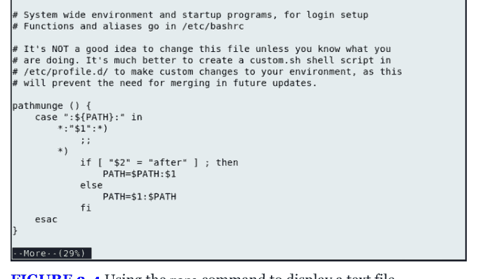

**图 3-4** 使用 more 命令显示文本文件

注意在**图 3-4** 屏幕底部，`more` 命令显示一个标签，表明你仍然在 `more` 应用程序中，以及你在文本文件中的进度（29%）。这是 `more` 命令的提示符。

> **提示**
>
> 如果你正在跟随示例进行操作，并且你的 Linux 系统没有 `/etc/profile` 文件或者它非常短，请尝试在 `/etc/passwd` 文件上使用 `more`。在你的 Shell 提示符下输入 `more /etc/passwd` 并按下回车键。


`more` 命令是一个分页器工具。在本章前面，我们讨论了当你使用 `man` 命令时分页器工具如何显示选定的 Bash 手册页。类似于浏览 `man` 页，你可以通过按空格键使用 `more` 来浏览文本文件，或者使用回车键逐行前进。当你使用 `more` 浏览完文件后，输入 `q` 以退出。

`more` 命令允许对文本文件进行一些基本的移动。对于更高级的功能，请尝试 `less` 命令。

### 使用 less 命令

从它的名字来看，听起来它不应该比 `more` 命令更高级。然而，`less` 命令的名称实际上是一个双关语，它是 `more` 命令的高级版本（`less` 命令的名称来自短语“less is more”）。它提供了几个非常实用的功能，用于在文本文件中向前和向后滚动，以及一些相当高级的搜索功能。

`less` 命令还可以在读取完整个文件之前显示文件的内容。`cat` 和 `more` 命令无法做到这一点。

`less` 命令的操作方式与 `more` 命令非常相似，每次从文件中显示一屏文本。它支持与 `more` 命令相同的命令集，还有许多其他选项。

#### 提示

要查看 less 命令的所有可用选项，请输入 `man less` 来查看其手册页。你可以对 more 命令执行相同的操作，以查看有关其各种选项的参考资料。

其中一个特性是，less 命令识别上箭头和下箭头按键，以及 Page Up 和 Page Down 键（假设你使用的是正确定义的终端）。这使你在查看文件时拥有完全的控制权。

#### 注意

less 实用程序通常是用于 man 手册页的翻页服务。因此，你越了解 less，就越容易浏览各种命令的手册页。

### 查看文件的局部内容

通常，你想要查看的数据要么位于文本文件的顶部，要么埋在文件的底部。如果信息位于一个大文件的顶部，你仍然需要等待 cat 或 more 命令加载整个文件后才能查看它。如果信息位于文件的底部（例如日志文件），你需要翻阅数千行文本才能到达最后几条记录。幸运的是，Linux 有专门的命令来解决这两个问题。

#### 使用 tail 命令

`tail` 命令显示文件中的最后几行（即文件的“尾部”）。默认情况下，它显示文件中的最后 10 行。

在以下示例中，我们创建了一个包含 15 行文本的文本文件。这里使用 cat 命令显示了其完整内容：

```
$ cat log_file
line1
line2
line3
line4
Hello World - line5
line6
line7
line8
line9
Hello again World - line10
line11
line12
line13
line14
Last Line - line15
$
```

既然你已经看到了整个文本文件，你就可以看到使用 tail 查看文件最后 10 行的效果：

```
$ tail log_file
line6
line7
line8
line9
Hello again World - line10
line11
line12
line13
line14
Last Line - line15
$
```

你可以通过包含 `-n` 参数来更改 tail 显示的线条数量。在这个例子中，通过在 tail 命令中添加 `-n 2`，只显示了文件的最后两行：

```
$ tail -n 2 log_file
line14
Last Line - line15
$
```

`-f` 参数是 tail 命令的一个相当酷的功能。它允许你窥视正在被其他进程使用的文件。`tail` 命令保持活动状态，并随着文本文件中新行出现的持续显示它们。这是实时监控系统日志文件的好方法。

### 使用 `head` 命令

`head` 命令的作用正如你所期望的；它显示文件的第一组行（即文件的“头部”）。默认情况下，它显示文本的前 10 行：

```
$ head log_file
line1
line2
line3
line4
Hello World - line5
line6
line7
line8
line9
Hello again World - line10
$
```

与 `tail` 命令类似，`head` 命令支持 `-n` 参数，因此你可以更改显示的内容。这两个命令还允许你简单地输入连字符和要显示的行数，如下所示：

```
$ head -3 log_file
line1
line2
line3
$
```

通常文件的开头不会改变，因此 `head` 命令不支持像 `tail` 命令那样的 `-f` 参数功能。`head` 命令是窥视文件开头的一种便捷方式。

#### 摘要

本章介绍了从 shell 提示符操作 Linux 文件系统的基础知识。我们首先讨论了 Bash shell，并展示了如何与 shell 交互。CLI 使用提示字符串来指示它已准备好接受你输入的命令。shell 提供了丰富的实用程序，你可以使用它们来创建和操作文件。在你开始摆弄文件之前，你应该了解 Linux 是如何存储它们的。本章讨论了 Linux 虚拟目录的基础知识，并展示了 Linux 如何引用存储媒体设备。在描述 Linux 文件系统之后，我们引导你使用 `co` 命令在虚拟目录中移动。

在向你展示如何进入目录之后，我们演示了如何使用 `ls` 命令列出文件和子目录。许多参数可以自定义 `ls` 命令的输出。你可以使用此命令获取文件和目录的信息。

`touch` 命令对于创建空文件和更改现有文件的访问或修改时间非常有用。我们还讨论了使用 `cp` 命令将现有文件从一个位置复制到另一个位置。我们引导你了解了链接文件而不是复制文件的过程，提供了一种简单的方法，可以在两个位置拥有同一个文件而不必制作单独的副本。`ln` 命令提供了这种链接功能。

接下来，你学习了如何在 Linux 中重命名文件（称为*移动*）使用 `mv` 命令，以及如何删除文件（称为*移除*）使用 `rm` 命令。我们还展示了如何使用 `mkdir` 和 `rmdir` 命令对目录执行相同的任务。

最后，本章以对查看文件内容的讨论结束。`cat`、`more` 和 `less` 命令提供了查看文件全部内容的简单方法，而 `tail` 和 `head` 命令则非常适合窥视文件内部以查看其中的一小部分。

下一章继续讨论 Bash shell 命令。我们将查看更高级的管理员命令，这些命令在你管理 Linux 系统时会很有用。

## 第 4 章

### 更多 Bash Shell 命令

#### 本章内容

- 管理进程
- 获取磁盘统计信息
- 挂载新磁盘
- 排序数据
- 归档数据

第 3 章“基本 Bash Shell 命令”介绍了在 Linux 文件系统中搜索以及操作文件和目录的基础知识。文件和目录管理是 Linux shell 的主要功能；然而，在我们开始脚本编程之前，我们应该再看一下一些其他内容。本章深入探讨了 Linux 系统管理命令，向你展示了如何使用命令行命令窥视你的 Linux 系统。之后，它向你展示了一些便捷命令，你可以使用它们来操作系统上的数据文件。

### 监控程序

担任 Linux 系统管理员最艰难的工作之一，就是跟踪系统上正在运行的内容——尤其是现在，图形桌面只需少数几个程序就能生成单个桌面。系统中始终有很多程序在运行。

幸运的是，有一些可用的命令行工具可以帮你的生活变得更轻松。本节介绍了你需要知道的几个基本工具，以管理你的 Linux 系统上的程序。

#### 窥视进程

当程序在系统上运行时，它被称为*进程*。要检查这些进程，你必须熟悉 `ps` 命令，这是实用程序的瑞士军刀。它可以生成关于系统上运行的所有程序的很多信息。

不幸的是，这种健壮性带来了复杂性——以众多参数的形式——使得 `ps` 命令可能成为最难掌握的命令之一。大多数系统管理员找到这些参数的一个子集，提供他们想要的信息，然后坚持只使用那些。

话虽如此，基本的 `ps` 命令并没有提供太多信息：

```
$ ps
  PID TTY          TIME CMD
 3081 pts/0    00:00:00 bash
 3209 pts/0    00:00:00 ps
$ 
```

并不太令人兴奋。默认情况下，`ps` 命令仅显示属于当前用户并且在当前终端上运行的进程。在这种情况下，我们只运行了我们的 Bash shell（记住，shell 只是系统上运行的另一个程序），当然还有 `ps` 命令本身。

基本输出显示了程序的进程 ID (`PID`)，它们运行的终端 (`TTY`)，以及进程使用的 CPU 时间。

> **注意**
> 
> `ps` 命令的棘手功能（也是使其变得如此复杂的部分）在于，曾经有两个版本。每个版本都有自己的一组命令行参数，控制它显示什么信息以及如何显示。最近，Linux 开发者将两种 `ps` 命令格式合并为一个 `ps` 程序（当然也加上了他们自己的特色）。

在 Linux 系统中使用的 GNU `ps` 命令支持三种不同类型的命令行参数：

- Unix 风格的参数，前面加有短横线
- BSD 风格的参数，前面没有短横线
- GNU 长参数，前面加有双短横线

以下部分将探讨这三种不同的参数类型，并展示它们的使用示例。

#### Unix 风格参数


Unix 风格参数源于最初运行在 Bell Labs 发明的 AT&T Unix 系统上的 `ps` 命令。这些参数如表 4-1 所示。

表 4-1 `ps` 命令的 Unix 参数

| 参数 | 说明 |
| :-- | :-- |
| `-A` | 显示所有进程。 |
| `-N` | 显示指定参数的相反操作。 |
| `-a` | 显示除会话头和没有终端的进程之外的所有进程。 |
| `-d` | 显示除会话头之外的所有进程。 |
| `-e` | 显示所有进程。 |
| `-c cmdlist` | 显示包含在列表 `cmdlist` 中的进程。 |
| `-G grplist` | 显示组 ID 在 `grplist` 中列出的进程。 |
| `-u userlist` | 显示由 `userlist` 中列出的用户 ID 拥有的进程。 |
| `-g grplist` | 按会话或 `grplist` 中包含的组 ID 显示进程。 |
| `-p pidlist` | 显示 PID 在列表 `pidlist` 中的进程。 |
| `-s sesslist` | 显示会话 ID 在列表 `sesslist` 中的进程。 |
| `-t ttylist` | 显示终端 ID 在列表 `ttylist` 中的进程。 |
| `-u userlist` | 按列表 `userlist` 中的有效用户 ID 显示进程。 |
| `-F` | 使用完整的额外输出。 |
| `-O *format*` | 在默认列的基础上显示列表 `*format*` 中的特定列。 |
| `-M` | 显示进程的安全信息。 |
| `-c` | 显示关于进程的额外调度器信息。 |
| `-f` | 显示完整格式列表。 |
| `-j` | 显示作业信息。 |
| `-l` | 显示长列表。 |
| `-o *format*` | 仅显示 `*format*` 中列出的特定列。 |
| `-y` | 不显示进程标志。 |
| `-Z` | 显示安全上下文信息。 |
| `-H` | 以层次格式显示进程（显示父进程）。 |
| `-n *namelist*` | 定义要在 `wCHAN` 输出列中显示的数值。 |
| `-w` | 使用宽输出格式，用于无限制宽度的显示。 |
| `-L` | 显示进程线程。 |
| `-V` | 显示 `ps` 的版本。 |

参数非常多，而且记住，还有更多！使用 `ps` 命令的关键在于不要记忆所有可用的参数，而只记住你认为最有用的那些。大多数 Linux 系统管理员都有一组自己常用的参数组合，用于提取相关信息。例如，如果你需要查看系统上正在运行的所有内容，请使用 `-ef` 参数组合（`ps` 命令允许你这样组合参数）：

```
$ ps -ef
  UID          PID  PPID  C STIME TTY          TIME CMD
 root          1     0  0 12:14 ?        00:00:02 /sbin/init splash
 root          2     0  0 12:14 ?        00:00:00 [kthreadd]
 root          3     2  0 12:14 ?        00:00:00 [rcu_gp]
 root          4     2  0 12:14 ?        00:00:00 [rcu_par_gp]
 root          5     2  0 12:14 ?        00:00:00 [kworker/0:0-events]
 root          6     2  0 12:14 ?        00:00:00 [kworker/0:0H-kblockd]
 root          7     2  0 12:14 ?        00:00:00 [kworker/0:1-events]
 ...
 rich       2209  1438  0 12:17 ?        00:00:01 /usr/libexec/gnome-terminal-
 rich       2221  2209  0 12:17 pts/0    00:00:00 bash
 rich       3325  2221  0 12:20 pts/0    00:00:00 ps -ef
$
```

为了节省空间，输出中删除了许多行，但如你所见，Linux 系统上运行着许多进程。此示例使用了两个参数：`-e` 参数，它显示系统上正在运行的所有进程；以及 `-f` 参数，它将输出扩展以显示几列有用的信息：

- `UID`：负责启动该进程的用户
- `PID`：进程的进程 ID
- `PPID`：父进程的 PID（如果进程是由另一个进程启动的）
- `C`：进程生命周期内的处理器利用率
- `STIME`：进程启动时的系统时间
- `TTY`：启动进程的终端设备
- `TIME`：运行该进程所需的累计 CPU 时间
- `CMD`：启动的程序名称

这产生了一定数量的信息，这是许多系统管理员希望看到的内容。如果需要更多信息，可以使用 `-l` 参数，它将产生长格式输出：

```
$ ps -l
  F S UID  PID PPID C PRI NI ADDR SZ WCHAN  TTY TIME CMD
  0 S 500 3081 3080 0 80  0 - 1173 do_wai pts/0 00:00:00 bash
  0 R 500 4463 3081 1 80  0 - 1116 -      pts/0 00:00:00 ps
$
```

请注意使用 `-l` 参数时出现的额外列：

- `F`：内核分配给进程的 system flags
- `S`：进程的状态（0 = 在处理器上运行；s = 睡眠；r = 可运行，等待运行；Z = 僵尸，进程已终止但父进程不可用；T = 进程已停止）
- `PRI`：进程的优先级（数字越大优先级越低）
- `NI`：nice 值，用于确定优先级
- `ADDR`：进程的内存地址
- `SZ`：如果进程被交换出内存所需的近似交换空间量
- `WCHAN`：进程正在睡眠的内核函数地址

### BSD 风格参数

既然你已经了解了 Unix 参数，让我们来看看 BSD 风格的参数。Berkeley 软件发行版（BSD）是加州大学伯克利分校开发的一个 Unix 版本。它与 AT&T Unix 系统有许多细微差别，因此在过去几年引发了许多 Unix 之争。`ps` 命令的 BSD 版本参数如表 4-2 所示。

表 4-2 `ps` 命令的 BSD 参数

| 参数 | 说明 |
| :--- | :--- |
| `T` | 显示与此终端相关的所有进程。 |
| `a` | 显示与任何终端相关的所有进程。 |
| `g` | 显示所有进程，包括会话头。 |
| `r` | 仅显示正在运行的进程。 |
| `x` | 显示所有进程，即使那些没有分配终端设备的进程。 |
| `u userlist` | 显示由 `userlist` 中列出的用户 ID 拥有的进程。 |
| `p pidlist` | 显示 PID 在 `pidlist` 中列出的进程。 |
| `t ttylist` | 显示与 `ttylist` 中列出的终端相关的进程。 |
| `O format` | 在标准列的基础上列出 `format` 中指定的列以进行显示。 |
| `x` | 以寄存器格式显示数据。 |
| `z` | 在输出中包含安全信息。 |
| `j` | 显示作业信息。 |
| `1` | 使用长格式。 |
| `o format` | 仅显示 `format` 中指定的列。 |
| `s` | 使用信号格式。 |
| `u` | 使用面向用户的格式。 |
| `v` | 使用虚拟内存格式。 |
| `N namelist` | 定义要在 `WCHAN` 列中使用的值。 |
| `O order` | 定义显示信息列的顺序。 |
| `S` | 将子进程的数值信息（如 CPU 和内存使用情况）汇总到父进程中。 |
| `c` | 显示真实的命令名称（用于启动进程的程序名称）。 |
| `e` | 显示该命令使用的所有环境变量。 |
| `f` | 以层次格式显示进程，显示哪些进程启动了哪些进程。 |
| `h` | 不显示头部信息。 |
| `k sort` | 定义用于排序输出的列。 |
| `n` | 对用户和组 ID 使用数值，并包含 `WCHAN` 信息。 |
| `w` | 为更宽的终端生成宽输出。 |
| `H` | 将线程显示为进程。 |
| `m` | 在进程之后显示线程。 |
| `L` | 列出所有格式说明符。 |
| `V` | 显示 `ps` 的版本。 |

如你所见，Unix 和 BSD 类型的参数之间存在大量重叠。你可以从一个获取的大多数信息也可以从另一个获取。大多数时候，你选择参数类型是基于你对哪种格式更熟悉（例如，如果你在使用 Linux 之前习惯了 BSD 环境）。

当你使用 BSD 风格的参数时，`ps` 命令会自动将输出更改为模拟 BSD 格式。以下是使用 `l` 参数的一个示例：


```
$ ps l
  F   UID   PID  PPID PRI NI   VSZ   RSS WCHAN  STAT TTY  TIME COMMAND
  4 1000  1491  1415  20  0 163992 6580 poll_s Ss+l tty2 0:00 /usr/li
  4 1000  1496  1491  20  0 225176 58712 ep_poll S+l  tty2 0:05 /usr/li
  0 1000  1538  1491  20  0 192844 15768 poll_s S+l  tty2 0:00 /usr/li
  0 1000  2221  2209  20  0  10608  4740 do_wai Ss   pts/0 0:00 bash
  0 1000  2410  2221  20  0  11396  1156 -      R+   pts/0 0:00 ps l
$
```

请注意，虽然许多输出列与使用 Unix 风格参数时相同，但有几个是不同的：

- `VSZ`：进程在内存中的大小（以 KB 为单位）
- `RSS`：进程已使用的未被交换出的物理内存
- `STAT`：表示当前进程状态的多字符状态代码

许多系统管理员喜欢 BSD 风格的 `l` 参数，因为它能为进程生成更详细的状态代码（`STAT` 列）。多字符代码比单字符的 Unix 风格输出能更精确地定义进程正在发生的具体状况。

第一个字符使用与 Unix 风格 `s` 输出列相同的值，用于指示进程是处于睡眠、运行还是等待状态。后续字符进一步定义进程的状态：

- `<`：进程正在以高优先级运行。
- `N`：进程正在以低优先级运行。
- `L`：进程的页被锁定在内存中。
- `s`：进程是会话领导者（session leader）。
- `l`：进程是多线程的。
- `+`：进程正在前台运行。

从前面展示的简单示例中，你可以看到 `bash` 命令正处于睡眠状态，但它是一个会话领导者（它是我会话中的主进程），而 `ps` 命令则在系统的前台运行。

### GNU 长参数

最后，GNU 开发人员通过向参数组合中添加一些额外选项，为这个新的、改进的 `ps` 命令加入了他们自己的特色。其中一些 GNU 长参数复制了现有的 Unix 或 BSD 风格参数，而另一些则提供了新功能。表 4-3 列出了可用的 GNU 长参数。

**表 4-3** `ps` 命令的 GNU 参数

| 参数 | 描述 |
| :--- | :--- |
| `--deselect` | 显示除命令行中列出的那些之外的所有进程。 |
| `--Group grp-list` | 显示组 ID 列在 `grp-list` 中的进程。 |
| `--User user-list` | 显示用户 ID 列在 `user-list` 中的进程。 |
| `--group grpulist` | 显示有效组 ID 列在 `grpulist` 中的进程。 |
| `--pid pidlist` | 显示进程 ID 列在 `pidlist` 中的进程。 |
| `--ppid pidlist` | 显示父进程 ID 列在 `pidlist` 中的进程。 |
| `--sid sidlist` | 显示会话 ID 列在 `sidlist` 中的进程。 |
| `--tty ttylist` | 显示终端设备 ID 列在 `ttylist` 中的进程。 |
| `--user userlist` | 显示有效用户 ID 列在 `userlist` 中的进程。 |
| `--format format` | 仅显示在 `format` 中指定的列。 |
| `--context` | 显示额外的安全信息。 |
| `--cols n` | 将屏幕宽度设置为 `n` 列。 |
| `--columns n` | 将屏幕宽度设置为 `n` 列。 |
| `--cumulative` | 包含已停止的子进程信息。 |
| `--forest` | 以显示父进程的层次化列表形式显示进程。 |
| `--headers` | 在输出的每一页上重复列标题。 |
| `--no-headers` | 不显示列标题。 |
| `--lines n` | 将屏幕高度设置为 `n` 行。 |
| `--rows n` | 将屏幕高度设置为 `n` 行。 |
| `--sort order` | 定义用于对输出进行排序的列。 |
| `--width n` | 将屏幕宽度设置为 `n` 列。 |
| `--help` | 显示帮助信息。 |
| `--info` | 显示调试信息。 |
| `--version` | 显示 `ps` 程序的版本。 |

你可以将 GNU 长参数与 Unix 或 BSD 风格参数结合使用，以自定义你的显示效果。GNU 长参数的一个我们非常喜欢的酷炫功能是 `--forest` 参数。它显示层次化的进程信息，但使用 ASCII 字符来绘制可爱的图表：

```
1981 ? 00:00:00 sshd
3078 ? 00:00:00 \ sshd
3080 ? 00:00:00 \ sshd
3081 pts/0 00:00:00 \ bash
16676 pts/0 00:00:00 \ ps
```

这种格式使追踪子进程和父进程变得轻而易举！

### 实时进程监控

`ps` 命令非常适合获取系统中正在运行的进程信息，但它有一个缺点。`ps` 命令只能显示特定时间点的信息。如果你试图查找频繁在内存中换入和换出的进程趋势，使用 `ps` 命令很难做到这一点。

相反，`top` 命令可以解决这个问题。`top` 命令以与 `ps` 命令类似的方式显示进程信息，但它是在实时模式下进行的。图 4-1 是 `top` 命令运行时的截图。

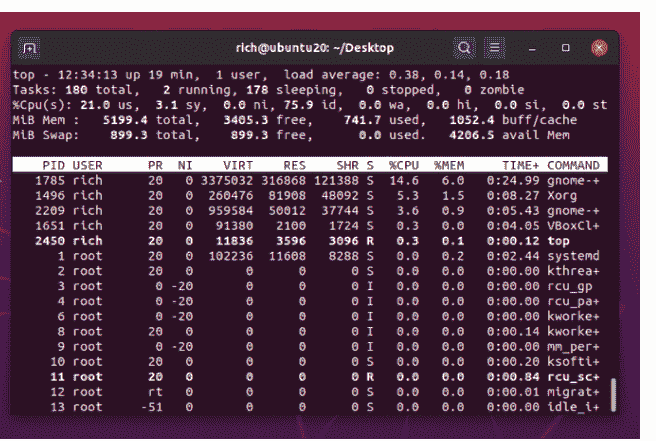

**图 4-1** `top` 命令运行时的输出

输出的第一部分显示一般系统信息。第一行显示当前时间、系统已运行的时长、登录的用户数以及系统上的负载平均值。

负载平均值显示为三个数字，即 1 分钟、5 分钟和 15 分钟的负载平均值。数值越高，系统经历的负载越大。1 分钟负载值在短促的活动期间很高并不罕见。如果 15 分钟负载值很高，你的系统可能遇到了麻烦。

#### 注意

Linux 系统管理中的诀窍在于确切地定义什么是“高”负载平均值。这个值取决于系统上通常运行的内容以及硬件配置。对某台系统来说很高的负载，对另一台系统来说可能是正常的。最佳做法是记录系统在正常条件下的负载水平，这将有助于更容易地检测系统何时处于高负载状态。

第二行显示一般进程信息（在 `top` 中称为任务）：有多少进程正在运行、睡眠、停止以及僵尸状态（已结束但其父进程尚未响应）。

接下来一行显示一般的 CPU 信息。`top` 显示根据进程的所有者（用户进程与系统进程）和进程状态（运行、空闲或等待）将 CPU 使用率分解为几个类别。

随后，有两行详细说明系统内存的状态。第一行显示系统中物理内存的状态，包括总内存量、当前使用的内存量以及空闲的内存量。第二行内存信息显示系统中交换内存区域的状态（如果已安装），包含相同的信息。

最后，下一部分显示当前运行进程的详细列表，其中包含一些从 `ps` 命令输出中看起来应该很熟悉的列信息：

- `PID`：进程的进程 ID
- `USER`：进程所有者的用户名
- `PR`：进程的优先级
- `NI`：进程的 `nice` 值
- `VIRT`：进程使用的虚拟内存总量
- `RES`：进程正在使用的物理内存量
- `SHR`：进程与其他进程共享的内存量
- `S`：进程状态（`D` = 可中断睡眠，`R` = 运行，`S` = 睡眠，`T` = 被跟踪或停止，或 `Z` = 僵尸）
- `%CPU`：进程使用的 CPU 时间份额
- `%MEM`：进程使用的可用物理内存份额
- `TIME+`：自进程启动以来使用的总 CPU 时间
- `COMMAND`：进程的命令行名称（启动的程序）

默认情况下，当你启动 `top` 时，它会根据 `%CPU` 值对进程进行排序。你可以通过在 `top` 运行时使用多个交互式命令之一来更改排序顺序。每个交互式命令都是你在 `top` 运行时可以按下的单个字符，它会改变程序的行为。按下 `f` 允许你选择用于排序输出的字段，按下 `d` 允许你更改轮询间隔。按 `q` 退出 `top` 显示。你可以对 `top` 命令的输出进行很多控制。使用此工具，你通常可以找到那些接管了你系统的问题进程。当然，一旦找到，下一步就是停止它，这就引出了下一个主题。

### 停止进程

作为一名系统管理员，关键的一部分是知道何时以及如何停止一个进程。有时，一个进程会卡住，只需要轻轻一推就能让它再次运行或停止。其他时候，进程会霸占 CPU 并拒绝释放它。在这两种情况下，你都需要一个命令来让你控制进程。Linux 遵循 Unix 的进程间通信方法。


在 Linux 中，进程使用`信号`相互通信。进程信号是进程识别并可以选择忽略或执行的预定义消息。开发人员对进程如何处理信号进行编程。大多数编写良好的应用程序都具有接收并对标准 Unix 进程信号采取行动的能力。这些信号在表 4-4 中显示。

**表 4-4 Linux 进程信号**

| 信号 | 名称 | 描述 |
| :--- | :--- | :--- |
| 1 | HUP | 挂起。 |

### 信号类型

| 信号 | 名称 | 描述 |
| :--- | :--- | :--- |
| INT | 中断。 |
| 3 | QUIT | 停止运行。 |
| 9 | KILL | 无条件终止。 |
| 11 | SEGV | 段错误。 |
| 15 | TERM | 尽可能终止。 |
| 17 | STOP | 无条件停止，但不终止。 |
| 18 | TSTP | 停止或暂停，但继续在后台运行。 |
| 19 | CONT | 在 STOP 或 TSTP 之后恢复执行。 |

Linux 中有几种不同的命令允许你向运行中的进程发送进程信号。本节讨论其中两个最常用的命令：`kill` 和 `pkill`。

#### kill 命令

`kill` 命令允许你根据进程的 PID 向进程发送信号。默认情况下，`kill` 命令向命令行中列出的所有 PID 发送 TERM 信号。不幸的是，你只能使用进程 PID 而不是其命令名，这使得 `kill` 命令有时难以使用。

要发送进程信号，你必须是该进程的所有者，或者以 root 用户身份登录：

```bash
$ kill 3940
-bash: kill: (3940) - Operation not permitted
$
```

TERM 信号指示进程停止运行。不幸的是，如果你有一个失控的进程，它很可能会忽略该请求。当你需要强制操作时，`-s` 参数允许你指定其他信号（使用其名称或信号编号）。

如下例所示，`kill` 命令没有关联的输出：

```bash
# kill -s HUP 3940
#
```

要查看命令是否有效，你必须执行另一个 `ps` 或 `top` 命令，以查看违规进程是否已停止。

#### pkill 命令

`pkill` 命令是一种强大的方法，它允许你通过进程名称而不是 PID 编号来停止进程。`pkill` 命令还允许你使用通配符，这使得它在系统出现异常时成为一个非常有用的工具：

```bash
# pkill http*
#
```

此示例将终止所有以 `http` 开头的进程，例如 Apache Web 服务器的 `httpd` 服务。

> **注意**
>
> 以 root 用户身份登录时使用 `pkill` 命令时要格外小心。很容易在使用通配符时过火，从而意外停止重要的系统进程。这可能导致文件系统损坏。

### 监控磁盘空间

系统管理员的另一个重要任务是跟踪系统上的磁盘使用情况。无论你是运行简单的 Linux 桌面系统还是大型 Linux 服务器，都需要知道你的应用程序有多少可用空间。

有一些可用的命令行命令可以帮助你管理 Linux 系统上的媒体环境。本节描述你在系统管理职责中可能会遇到的核心命令。

#### 挂载媒体

如第 3 章所述，Linux 文件系统将所有媒体磁盘合并到一个虚拟目录中。在系统上使用新的媒体磁盘之前，你需要将其放置在虚拟目录中。此任务称为`挂载`。

在今天的图形桌面世界中，大多数 Linux 发行版都具有自动挂载特定类型`可移动媒体`的能力。可移动媒体设备是一种（显然）可以轻松从 PC 中移除的介质，例如 DVD 和 USB 内存棒。

如果你使用的发行版不会自动挂载和卸载可移动媒体，你就得自己来做。本节介绍帮助你管理可移动媒体设备的 Linux 命令行命令。

#### mount 命令

奇怪的是，用于挂载媒体的命令叫做 `mount`。默认情况下，`mount` 命令显示当前系统中已挂载的媒体设备列表。然而，较新版本的内核除了标准存储设备外，还会挂载许多虚拟文件系统用于管理目的。这可能使 `mount` 命令的默认输出非常杂乱且令人困惑。如果你知道驱动分区使用的文件系统类型，可以使用以下命令进行过滤：

```bash
$ mount -t ext4
/dev/sda5 on / type ext4 (rw,relatime,errors=remount-ro)
$ mount -t vfat
/dev/sda2 on /boot/efi type vfat
(rw,relatime,fmask=0077,dmask=0077,codepage=437,iocharset=iso8859-1,shortname=mixed,errors=remount-ro)
/dev/sdb1 on /media/rich/54A1-7D7D type vfat
(rw,nosuid,nodev,relatime,uid=1000,gid=1000,fmask=0022,dmask=0077,iocharset=iso8859-1,shortname=mixed,showexec,utf8,flush,errors=remountro,uhelper=udisks2)
$
```

`mount` 命令提供四条信息：
- 媒体的设备文件名
- 媒体挂载在虚拟目录中的挂载点
- 文件系统类型
- 已挂载媒体的访问状态

前一个示例中的最后一项是 GNOME 桌面自动挂载在 `/media/rich/54A1-7D7D` 挂载点的 USB 内存棒。vfat 文件系统类型表明它是为 Microsoft Windows PC 格式化的。

要在虚拟目录中手动挂载媒体设备，你需要以 root 用户身份登录，或者使用 `sudo` 命令以 root 用户身份运行该命令。以下是手动挂载媒体设备的基本命令：

```bash
mount -t type device directory
```

`type` 参数定义磁盘格式化时使用的文件系统类型。Linux 识别众多文件系统类型。如果你与 Windows PC 共享可移动媒体设备，你最可能遇到的类型是：
- **vfat**：支持长文件名的 Windows FAT32 文件系统
- **ntfs**：在 Windows NT 及后续操作系统中使用的 Windows 高级文件系统
- **exfat**：针对可移动媒体优化的 Windows 文件系统
- **iso9660**：标准 CD-ROM 和 DVD 文件系统

大多数 USB 内存棒使用 vfat 文件系统格式化。如果你需要挂载数据 CD 或 DVD，必须使用 `iso9660` 文件系统类型。

接下来的两个参数定义媒体设备的设备文件位置以及虚拟目录中的挂载点位置。例如，要手动将设备 `/dev/sdb1` 处的 USB 内存棒挂载到位置 `/media/disk`，你可以使用以下命令：

```bash
mount -t vfat /dev/sdb1 /media/disk
```

一旦媒体设备在虚拟目录中挂载，root 用户将对该设备具有完全访问权限，但其他用户的访问将受到限制。你可以使用目录权限来控制谁可以访问该设备（在第 7 章“理解 Linux 文件权限”中讨论）。

如果你需要使用 `mount` 命令的一些更高级功能，可用参数见表 4-5。

##### 表 4-5 mount 命令参数

| 参数 | 描述 |
| :--- | :--- |
| -a | 挂载在 `/etc/fstab` 文件中指定的所有文件系统。 |
| -f | 使 `mount` 命令模拟挂载设备，但实际不挂载。 |
| -F | 与 -a 参数一起使用时，同时挂载所有文件系统。 |
| -v | 详细模式；解释挂载设备所需的所有步骤。 |
| -i | 不使用 `/sbin/mount.filesystem` 下的任何文件系统辅助文件。 |
| -L | 为 ext2、ext3、ext4 或 XFS 文件系统自动添加文件系统标签。 |
| -n | 挂载设备时不在 `/etc/mtab` 已挂载设备文件中注册它。 |
| -p num | 对于加密挂载，从文件描述符 num 读取密码短语。 |
| -s | 忽略文件系统不支持的挂载选项。 |
| -r | 将设备以只读方式挂载。 |
| -w | 将设备以读写方式挂载（默认值）。 |
| -L label | 使用指定的标签挂载设备。 |
| -U uuid | 使用指定的 uuid 挂载设备。 |
| -O | 与 -a 参数一起使用时，限制应用的文件系统集合。 |
| -o | 向文件系统添加特定选项。 |

**-o** 选项允许你使用逗号分隔的附加选项列表来挂载文件系统。常用的选项如下：
- **ro**：以只读方式挂载。
- **rw**：以读写方式挂载。
- **user**：允许普通用户挂载文件系统。
- **check=none**：在不执行完整性检查的情况下挂载文件系统。
- **loop**：挂载一个文件。

#### umount 命令

要移除可移动媒体设备，你绝不能直接将其从系统中移除。相反，你应该始终先`卸载`它。

> **提示**


Linux 不允许你弹出已挂载的 CD 或 DVD。如果你在任何时候遇到从驱动器中移除 CD 或 DVD 的困难，很可能意味着它仍然挂载在虚拟目录中。先卸载它，然后再尝试弹出。

用于卸载设备的命令是 `umount`（是的，命令中没有“n”，这有时让人困惑）。`umount` 命令的格式非常简单：

```bash
umount [directory | device]
```

`umount` 命令让你可以选择通过设备位置或其已挂载目录名称来定义媒体设备。如果任何程序在设备上打开了文件，系统将不允许你卸载它。

```bash
# umount /home/rich/mnt
umount: /home/rich/mnt: device is busy
umount: /home/rich/mnt: device is busy
# cd /home/rich
```

### 使用 umount 命令

在这个示例中，命令提示符位于文件系统结构内的一个目录中，因此 `umount` 命令无法卸载该镜像文件。当将命令提示符移出该镜像文件文件系统后，`umount` 命令便能够成功卸载该镜像文件。

```
# umount /home/rich/mnt
# ls -l mnt
total 0
#
```

### 使用 df 命令

有时你需要查看单个设备上可用的磁盘空间是多少。`df` 命令可以让你轻松查看所有已挂载磁盘的状态：

```
$ df -t ext4 -t vfat
Filesystem     1K-blocks     Used Available Use% Mounted on
/dev/sda5     19475088   7326256   11136508  40% /
/dev/sda2      524272        4     524268   1% /boot/efi
/dev/sdb1      983552    247264     736288  26% /media/rich/54A1-7D7D
$
```

`df` 命令会显示包含数据的每个已挂载文件系统。与 `mount` 命令类似，`df` 命令也会显示内核挂载的任何虚拟文件系统，因此我们通过使用 `-t` 选项指定文件系统类型，从而将这些虚拟文件系统从列表中过滤掉。该命令显示以下信息：

- 设备的所在位置
- 它能容纳多少 1024 字节的数据块
- 已使用多少个 1024 字节的块
- 可用多少个 1024 字节的块
- 已用空间的百分比
- 设备挂载点

`df` 命令提供了几种不同的命令行参数，其中大多数你永远不会用到。一个常用的参数是 `-h`，它以人类可读的形式显示磁盘空间，通常用 M 表示兆字节，用 G 表示吉字节：

```
$ df -h
Filesystem     Size  Used Avail Use% Mounted on
/dev/sda5        19G  7.0G   11G  40% /
/dev/sda2       512M  4.0K  512M   1% /boot/efi
/dev/sdb1        961M  242M  720M  26% /media/rich/54A1-7D7D
$
```

现在，你不需要去解读那些丑陋的块数字，所有的磁盘大小都以“正常”大小显示。`df` 命令在排查系统中的磁盘空间问题时非常有价值。

> 注意
>
> 请记住，Linux 系统始终有在后台处理文件的进程。`df` 命令的值反映了 Linux 系统在该时刻认为的当前值。你运行某个进程创建或删除了文件但尚未释放文件是可能的。该值未包含在可用空间计算中。

### 使用 du 命令

使用 `df` 命令，很容易看出磁盘何时空间不足。对于系统管理员来说，下一个问题是当这种情况发生时该做什么。

另一个有助于你的有用命令是 `du` 命令。`du` 命令显示特定目录（默认是当前目录）的磁盘使用情况。这是确定系统中是否存在明显的磁盘占用大户的快速方法。

默认情况下，`du` 命令显示当前目录下的所有文件、目录和子目录，并显示每个文件或目录占用的磁盘块数。对于标准大小的目录，这可能是一个相当长的列表。以下是使用 `du` 命令的部分列表：

```
$ du
484    ./.gstreamer-0.10
8      ./Templates
8      ./Download
8      ./.ccache/7/0
24     ./.ccache/7
368    ./.ccache/a/d
384    ./.ccache/a
424    ./.ccache
8      ./Public
8      ./.gphpedit/plugins
32     ./.gphpedit
72     ./.gconfd
128    ./.nautilus/metafiles
384    ./.nautilus
8      ./Videos
8      ./Music
16     ./.config/gtk-2.0
40     ./.config
8      ./Documents
```

每行左侧的数字是每个文件或目录占用的磁盘块数。请注意，列表从目录底部开始，并向上遍历该目录中包含的文件和子目录。

单独使用 `du` 命令可能有点无用。能够看到每个单独文件和目录占用了多少磁盘空间是很好的，但当必须浏览一页又一页的信息才能找到你要找的内容时，这可能毫无意义。

你可以使用以下命令行参数与 `du` 命令配合使用，使内容更易读：

- `-c` : 生成所有列出文件的总计。
- `-h` : 以人类可读的形式打印大小，使用 K 表示千字节，M 表示兆字节，G 表示吉字节。
- `-s` : 汇总每个参数。

系统管理员的下一步是使用一些文件处理命令来操纵大量数据。这正是下一节所涵盖的内容。

## 处理数据文件

当你拥有大量数据时，通常很难处理信息并使其有用。正如你在上一节中使用 `du` 命令时所见，在使用系统命令时很容易出现数据过载。

Linux 系统提供了几个命令行工具来帮助你管理大量数据。本节介绍每个系统管理员——以及任何日常 Linux 用户——为了让生活更轻松都应该知道的基本命令。

### 排序数据

在处理大量数据时，一个方便且流行的功能是 `sort` 命令。`sort` 命令顾名思义——它对数据进行排序。

默认情况下，`sort` 命令使用标准排序规则对文本文件中的数据行进行排序，该规则基于你为会话指定的默认语言：

```
$ cat file1
one
two
three
four
five
$ sort file1
five
four
one
three
two
$
```

非常简单。然而，事情并不总是看起来那么简单。请看看这个示例：

```
$ cat file2
1
2
100
45
3
10
145
75
$ sort file2
1
10
100
145
2
3
45
75
$
```

如果你期待数字按数值顺序排序，你可能会失望。默认情况下，`sort` 命令将数字解释为字符并执行标准字符排序，生成的输出可能不是你所想要的。要解决此问题，请使用 `-n` 参数，它告诉 `sort` 命令将数字识别为数字而不是字符，并根据其数值进行排序：

```
$ sort -n file2
1
2
3
10
45
75
100
145
$
```

现在，这就好多了！另一个常用参数是 `-M`，即月份排序。Linux 日志文件通常在行首包含时间戳以指示事件发生的时间：

```
Apr 13 07:10:09 testbox smartd[2718]: Device: /dev/sda, opened
```

如果你对使用时间戳日期的文件使用默认排序，你会得到类似这样的结果：

```
$ sort file3
Apr
Aug
Dec
Feb
Jan
Jul
Jun
Mar
May
Nov
Oct
Sep
$
```

这完全不是你想要的。如果使用 `-M` 参数，`sort` 命令会识别三字符月份命名法并适当排序：

```
$ sort -M file3
Jan
Feb
Mar
Apr
May
Jun
Jul
Aug
Sep
Oct
Nov
Dec
$
```

表 4-6 展示了你可以使用的其他有用 `sort` 参数。

### 表 4-6 sort 命令参数

| 单破折号 | 双破折号 | 描述 |
| :--- | :--- | :--- |
| -b | -ignore-leading-blanks | 排序时忽略前导空格。 |
| -C | -check=quiet | 不排序，但如果数据排序顺序不正确也不报告。 |
| -c | -check | 不排序，但检查输入数据是否已排序。如果未排序则报告。 |
| -d | --dictionary-order | 仅考虑空格和字母数字字符；不考虑特殊字符。 |
| -f | --ignore-case | 默认情况下，排序将大写字母排在前面。此参数忽略大小写。 |
| -g | --general-numeric-sort | 使用通用数值进行排序。 |
| -i | --ignore-nonprinting | 忽略排序中的非打印字符。 |


| `-k` | `--key=POS1[,POS2]` | 基于位置 `POS1` 进行排序，如果指定了则结束于 `POS2`。 |
| `-M` | `--month-sort` | 使用三字符月份名称按月份顺序排序。 |
| `-m` | `--merge` | 合并两个已排序的数据文件。 |
| `-n` | `--numeric-sort` | 按字符串数值排序。 |
| `-o` | `--output=file` | 将结果写入指定文件。 |
| `-R` | `--random-sort` | 根据键的随机哈希值排序。 |
| | `--random-source=FILE` | 指定用于 `-R` 参数的随机字节源文件。 |
| `-r` | `--reverse` | 反转排序顺序（降序而不是升序）。 |
| `-S` | `--buffer-size=SIZE` | 指定要使用的内存量。 |
| `-s` | `--stable` | 禁用最后手段比较。 |
| `-T` | `--temporary-directory=DIR` | 指定存储临时工作文件的位置。 |
| `-t` | `--field-separator=SEP` | 指定用于区分键位置的字符。 |
| `-u` | `--unique` | 结合 `-c` 参数时，检查严格排序；没有 `-c` 参数时，仅输出两个相似行的第一次出现。 |
| `-z` | `--zero-terminated` | 用 NULL 字符而不是换行符结束所有行。 |

`-k` 和 `-t` 参数在排序使用字段的数据时非常实用，例如 `/etc/passwd` 文件。使用 `-t` 参数指定字段分隔符，使用 `-k` 参数指定要排序的字段。例如，要基于数字用户 ID 排序密码文件，只需执行以下操作：

```
$ sort -t ':' -k 3 -n /etc/passwd
root:x:0:0:root:/root:/bin/bash
bin:x:1:1:bin:/bin:/sbin/nologin
daemon:x:2:2:daemon:/sbin:/sbin/nologin
adm:x:3:4:adm:/var/adm:/sbin/nologin
lp:x:4:7:lp:/var/spool/lpd:/sbin/nologin
sync:x:5:0:sync:/sbin:/bin/sync
shutdown:x:6:0:shutdown:/sbin:/sbin/shutdown
halt:x:7:0:halt:/sbin:/sbin/halt
mail:x:8:12:mail:/var/spool/mail:/sbin/nologin
news:x:9:13:news:/etc/news
uucp:x:10:14:uucp:/var/spool/uucp:/sbin/nologin
operator:x:11:0:operator:/root:/sbin/nologin
games:x:12:100:games:/usr/games:/sbin/nologin
gopher:x:13:30:gopher:/var/gopher:/sbin/nologin
ftp:x:14:50:FTP User:/var/ftp:/sbin/nologin
```

现在数据已完美地基于第三个字段（即数字用户 ID 值）进行了排序。

`-n` 参数对于排序数值输出非常有用，例如 `du` 命令的输出：

```
$ du -sh * | sort -nr
1008k mrng-2.9.29.tar.gz
972k bldg1
888k fbs2.pdf
760k Printtest
680k rsyc-2.6.6.tar.gz
660k code
516k fig1001.tiff
496k test
496k php-common-4.0.4pl1-6mdk.i586.rpm
448k MesaGLUT-6.5.1.tar.gz
400k p1p
```

请注意，`-r` 选项还将值按降序排序，这样你可以轻松看到哪些文件在你的目录中占据了最多的空间。

> **注意**
>
> 本例中使用的管道命令 (`|`) 将 `du` 命令的输出重定向到 `sort` 命令。第 11 章《基本脚本构建》中对此有更详细的讨论。

### 搜索数据

在一个大文件中，你通常需要在文件中间的某个位置寻找特定的数据行。与其手动滚动整个文件，不如让 `grep` 命令为你进行搜索。`grep` 命令的命令行格式为

```
grep [选项] 模式 [文件]
```

`grep` 命令在输入或你指定的文件中搜索包含与指定模式匹配字符的行。`grep` 的输出是包含匹配模式的行。以下是使用“排序数据”部分中使用的 `file1` 文件的两两个 `grep` 命令简单示例：

```
$ grep three file1
three
$ grep t file1
two
three
$
```

第一个示例在 `file1` 文件中搜索匹配模式 `three` 的文本。`grep` 命令输出包含匹配模式的行。下一个示例在 `file1` 文件中搜索匹配模式 `t` 的文本。在这种情况下，两行匹配了指定的模式，并且都显示了。由于 `grep` 命令的流行，在其生命周期内经历了大量的开发变化。`grep` 命令添加了许多功能。如果你查看 `grep` 命令的 `man` 页面，你会看到它是多么多功能。

如果你想反转搜索（输出不匹配模式的行），请使用 `-v` 参数：

```
$ grep -v t file1
one
four
five
$
```

如果你需要找到匹配模式所在的行号，请使用 `-n` 参数：

```
$ grep -n t file1
2:two
3:three
$
```

如果你只需要查看包含匹配模式的行数的计数，请使用 `-c` 参数：

```
$ grep -c t file1
2
$
```

如果你需要指定多个匹配模式，请使用 `-e` 参数来指定每个单独的模式：

```
$ grep -e t -e f file1
two
three
four
five
$
```

此示例输出包含字符串 `t` 或字符串 `f` 的行。

默认情况下，`grep` 命令使用基本的 Unix 风格正则表达式来匹配模式。Unix 风格正则表达式使用特殊字符来定义如何查找匹配的模式。有关正则表达式的更详细解释，请参见第 20 章《正则表达式》。

以下是在 `grep` 搜索中使用正则表达式的一个简单示例：

```
$ grep [tf] file1
two
three
four
five
$
```

正则表达式中的方括号表示 `grep` 应该查找包含 `t` 或 `f` 字符的匹配项。如果没有正则表达式，`grep` 将搜索匹配字符串 `tf` 的文本。

`egrep` 命令是 `grep` 的一个分支，它允许你指定 POSIX 扩展正则表达式，其中包含更多字符来指定匹配模式（同样，详见第 20 章）。`fgrep` 命令是另一个版本，允许你将匹配模式指定为以换行符分隔的固定字符串值列表。这允许你将字符串列表放在一个文件中，然后使用该列表在 `fgrep` 命令中搜索更大文件中的字符串。

### 压缩数据

如果你曾在 Microsoft Windows 环境中工作，毫无疑问你使用过 `zip` 文件。这一功能变得如此流行，以至于 Microsoft 最终从 XP 开始将其整合到 Windows 操作系统中。`zip` 工具允许你轻松地将大型文件（文本文件和可执行文件）压缩成占用更少空间的文件。

Linux 包含几种文件压缩工具。虽然这听起来很不错，但在尝试下载文件时，这往往会导致混乱和困惑。表 4-7 列出了 Linux 中可用的文件压缩工具。

#### 表 4-7 Linux 文件压缩工具

| 工具 | 文件扩展名 | 描述 |
|---|---|---|
| `bzip2` | `.bz2` | 使用 Burrows-Wheeler 块排序文本压缩算法和 Huffman 编码 |
| `compress` | `.z` | 原始的 Unix 文件压缩工具；正逐渐变得鲜为人知 |
| `gzip` | `.gz` | GNU 项目的压缩工具；使用 Lempel-Ziv-Welch 编码 |
| `xz` | `.xz` | 一种正在流行起来的通用压缩工具 |
| `zip` | `.zip` | Windows 版 PKZIP 程序的 Unix 版本 |

`compress` 文件压缩工具在 Linux 系统上并不常见。如果你下载了一个 `.z` 扩展名的文件，通常可以安装 `compress` 包（在许多 Linux 发行版中称为 `ncompress`），使用第 9 章《安装软件》中讨论的软件安装方法，然后使用 `uncompress` 命令解压该文件。`gzip` 工具是 Linux 中最常用的压缩工具。

`gzip` 包是 GNU 项目的创作，旨在创建原始 Unix `compress` 工具的免费版本。此包包含以下文件：

- `gzip` 用于压缩文件
- `gzcat` 用于显示压缩文本文件的内容
- `gunzip` 用于解压文件

这些工具的工作方式与 `bzip2` 工具相同：

```
$ gzip myprog
$ ls -1 my*
-rwxrwxr-x 1 rich rich 2197 2007-09-13 11:29 myprog.gz
$
```

`gzip` 命令压缩你在命令行中指定的文件。你还可以指定多个文件名，甚至使用通配符一次压缩多个文件：


```
$ gzip my*
$ ls -1 my*
-rwxr-r-r--     1 rich        rich            103 Sep   6 13:43 myprog.c.gz
-rwxr-xr-x    1 rich     rich          5178 Sep   6 13:43 myprog.gz
-rw-r--r--    1 rich     rich             59 Sep   6 13:46 my script.gz
-rw-r--r--    1 rich     rich             60 Sep   6 13:44 my script2.gz
$
```

`gzip` 命令压缩目录中匹配通配符模式的每个文件。

### 归档数据

虽然 `zip` 命令在将数据压缩和归档到单个文件方面表现优异，但它并不是 Unix 和 Linux 世界中使用的标准工具。迄今为止，Unix 和 Linux 中最受欢迎的归档工具是 `tar` 命令。

`tar` 命令最初用于将文件写入磁带设备以进行归档。但是，它也可以将输出写入文件，这已成为 Linux 中归档数据的一种流行方式。

`tar` 命令的格式如下：

```
tar 功能 [选项] 对象1 对象2 ...
```

功能参数定义了 `tar` 命令应该做什么，如表 4-8 所示。

#### 表 4-8 tar 命令功能

| 功能 | 长名称 | 描述 |

| :------- | :-------- | :---------- |

| -A | --concatenate | 将一个现有的 tar 归档文件追加到另一个现有的 tar 归档文件。 |

| -c | --create | 创建一个新的 tar 归档文件。 |

| -d | --diff | 检查 tar 归档文件和文件系统之间的差异。 |

| -D | --delete | 从现有的 tar 归档文件中删除。 |

| -r | --append | 将文件追加到现有的 tar 归档文件末尾。 |

#### 摘要

本章讨论了一些 Linux 系统管理员和程序员使用的较为高级的 bash 命令。`ps` 和 `top` 命令对于确定系统状态至关重要，它们可以让你查看正在运行的应用程序及其消耗的资源数量。

在可移动存储介质的时代，挂载存储设备也是系统管理员关注的另一个热门话题。`mount` 命令允许你将物理存储设备挂载到 Linux 虚拟目录结构中。要移除设备，你需要使用 `umount` 命令。

最后，我们讨论了用于处理数据的各种实用工具。`sort` 实用工具可以轻松地对大型数据文件进行排序，帮助你组织数据；而 `grep` 实用工具则允许你快速扫描大型数据文件以查找特定信息。Linux 中有几种文件压缩实用工具，包括 `gzip` 和 `zip`。这些工具都允许你压缩大文件以帮助节省文件系统的空间。Linux 的 `tar` 实用工具是一种流行的方法，可以将目录结构归档为单个文件，从而轻松移植到另一个系统。

下一章讨论 Linux 环境变量。环境变量允许你从脚本中访问系统信息，同时也提供了一种在脚本中存储数据的便捷方式。

## 第 5 章

### 理解 Shell

**本章内容**

- 调查 shell 类型

- 理解父/子 shell 关系

- 创造性地使用子 shell

- 调查内置 shell 命令

既然你已经知道了一些 shell 基础知识，例如如何进入 shell 以及基本命令，现在是时候探索实际的 shell 进程了。为了理解它，你需要知道它在不同情况下的运行方式。

Shell 不仅仅是一个 CLI。它是一个复杂的交互式运行程序。输入命令并使用 shell 运行脚本可能会引发一些有趣且令人困惑的问题。理解 shell 进程及其关系有助于你解决这些问题，或者完全避免这些问题。

本章将带你了解 shell 进程及其在多种情况下的运行方式。我们将探索子 shell 是如何创建的，以及它们与其父 shell 之间的关系。我们将考察那些创建子进程的命令，以及那些不创建子进程的命令（内置命令）。我们还涵盖了一些 shell 技巧，你可以尝试这些技巧来提高 CLI 体验的效率。

#### 调查 Shell 类型

当你登录系统时，系统启动的 shell 程序取决于你的用户 ID 配置。在 `/etc/passwd` 文件中，用户 ID 条目中的第 7 个字段列出了其默认 shell 程序。当用户登录到虚拟控制台终端或在 GUI 中启动终端模拟器时，就会启动这个默认 shell 程序。

在以下示例中，用户 christine 的默认 shell 程序是 GNU Bash shell：

```
$ cat /etc/passwd
[...]
christine:x:1001:1001::/home/christine:/bin/bash
$ 
```

Bash shell 程序（`bash`）通常位于现代 Linux 系统的 `/usr/bin` 目录中。但是，在你的 Linux 系统中，你可能会发现它位于 `/bin` 目录中。`which bash` 命令可以通过提供用于 Bash shell 的目录和文件名来提供帮助：

```
$ which bash
/usr/bin/bash
$ 
```

长列表显示 `bash` 文件（即 Bash shell）是一个可执行程序，其文件名末尾带有星号（*）：

```
$ ls -lF /usr/bin/bash
-rwxr-xr-x. 1 root root 1219248 Nov  8 11:30 /usr/bin/bash*
$ 
```

> 注意
>
> 在现代 Linux 系统中，`/bin` 目录通常通过符号链接指向 `/usr/bin/` 目录，这就是为什么用户 christine 的默认 shell 程序被列出为 `/bin/bash`，但 Bash shell 程序实际上位于 `/usr/bin/` 目录中。符号链接（软链接）在*第 3 章 “基础 Bash Shell 命令”中已经讲解过。

此特定 Linux 系统上有其他几种 shell 程序。其中包括基于原始 C shell 的 `tcsh`：

```
$ which tcsh
/usr/bin/tcsh
$ ls -lF /usr/bin/tcsh
-rwxr-xr-x. 1 root root 465200 May 14  2019 /usr/bin/tcsh*
```

该系统上的另一个 shell 是 `zsh`，它是 Bash shell 的一个更复杂的版本。它还具有一些 `tesh` 特性以及其他元素：

```
$ which zsh
/usr/bin/zsh
$ ls -lF /usr/bin/zsh
-rwxr-xr-x. 1 root root 879872 May 11 2019 /usr/bin/zsh*
$
```

> **提示**
>
> **如果你在你的 Linux 系统上没有找到其中一些 shell，你可能能够安装它们。第 9 章 “安装软件” 可以帮助你完成此任务。**

指向 `tesh` shell 的 C shell 软链接（参见 [第 3 章](https://example.com/chapter3)）：

```
$ which csh
/usr/bin/csh
$ ls -lF /usr/bin/csh
lrwxrwxrwx. 1 root root 4 May 14 2019 /usr/bin/csh -> tesh*
$
```

在基于 Debian 的 Linux 系统（如 Ubuntu）上，你通常会找到 `dash`，它是 Ash shell 的一个版本：

```
$ which dash
/usr/bin/dash
$ ls -lF /usr/bin/dash
-rwxr-xr-x 1 root root 129816 Jul 18 2019 /usr/bin/dash*
$
```

> **注意**
>
> **第 1 章 “初识 Linux Shell” 中简要介绍了各种 shell。你可能对了解除 GNU Bash shell 以外的其他 shell 感兴趣。有关替代 shell 的额外信息见** **第 23 章** “使用替代 Shell。”

在大多数 Linux 系统中，你可以在 `/etc/shells` 文件中找到可以作为用户默认 shell 使用的所有已安装 shell，如下所示：

```
$ cat /etc/shells
/bin/sh
/bin/bash
/usr/bin/sh
/usr/bin/bash
/bin/csh
/bin/tcsh
/usr/bin/csh
/usr/bin/tcsh
/usr/bin/zsh
/bin/zsh
$
```

###### 注意

> 在许多 Linux 发行版中，你会发现 shell 文件似乎存在于两个位置——`/bin` 和 `/usr/bin`。这是因为在现代 Linux 系统中，这两个目录通常通过符号链接连接在一起，`/bin` 指向 `/usr/bin`。你可以使用任一目录来访问 shell。符号链接也称为软链接，已在**第 3 章**中讲解过。


用户可以将该系统上的任何这些不同的 shell 程序设置为他们的 shell。然而，由于其普及程度，除了 Bash 之外，很少使用其他 shell 作为账户的默认交互式 shell。`默认交互式 shell`，也称为`登录 shell`，每当用户登录到虚拟控制台终端或在 GUI 中启动终端模拟器时启动。

另一个 shell，`sh`，是`默认系统 shell`。默认系统 shell 用于系统 shell 脚本，例如启动时所需的脚本。

通常，你会看到一个发行版的默认系统 shell（`sh`）通过符号链接指向 Bash shell。以下是在一个 CentOS 发行版中的示例：

```bash
$ which sh
/usr/bin/sh
$ ls -l /usr/bin/sh
lrwxrwxrwx. 1 root root 4 Nov  8 11:30 /usr/bin/sh -> bash
$
```

但是，请注意，在某些发行版中，默认系统 shell 的链接方式不同，例如在此 Ubuntu 发行版中：

```bash
$ which sh
/usr/bin/sh
$ ls -l /usr/bin/sh
lrwxrwxrwx 1 root root 4 Mar 10 18:43 /usr/bin/sh -> dash
$
```

在这种情况下，默认系统 shell `/usr/bin/sh` 指向的是 Dash shell，而不是 Bash shell。

> **提示**
>
> 对于 Bash shell 脚本，这两种不同的 shell（默认交互式 shell 和默认系统 shell）可能会导致问题。请务必阅读第 11 章“基础脚本构建”中关于 Bash shell 脚本第一行所需重要语法的说明，以避免这些问题。

你不必局限于默认的交互式 shell。你只需键入任意在发行版中可用的 shell 的名称，即可启动该 shell。不过，系统不会显示任何华丽的效果或消息来指示你当前正在使用哪个 shell。但可以从 `$0` 变量中获取帮助。命令 `echo $0` 会显示当前 shell 的名称，提供所需的参考信息。

> **注意**
>
> `echo $0` 命令仅在 shell 提示符处执行时，才会显示当前使用的 shell。如果在 shell 脚本中使用，它将显示脚本的名称。这一点将在第 14 章“处理用户输入”中详细介绍。

借助方便的 `$0` 变量，我们将显示当前使用的 shell，通过输入命令 `dash` 启动 Dash shell，并再次通过 `echo $0` 显示新 shell 的名称：

```bash
$ echo $0
-bash
$
$ dash
$
$ echo $0
dash
$
```

> **注意**
>
> 在上面的示例中，请注意第一个 `echo $0` 命令返回的 `bash` 响应前的破折号（`-`）。这表明该 shell 是用户的登录 shell。

`$` 提示符是 Dash shell 的 CLI 提示符。你可以通过输入命令 `exit` 退出 Dash shell 程序（顺便说一下，也可以退出 Bash shell）：

```bash
$ echo $0
dash
$ exit
$ echo $0
-bash
$
```

在 various shells 之间来回切换看似简单，但幕后发生的过程还有更多内容。为了理解这个过程，下一节将探讨登录 shell 程序与新启动的 shell 程序之间的关系。

#### 探索父 shell 和子 shell 的关系

当用户登录到虚拟控制台终端或在 GUI 中启动终端模拟器时启动的默认交互式 shell（登录 shell）是一个`父 shell`。正如你在此书中阅读的内容所述，父 shell 进程提供 CLI 提示符并等待输入命令。当在 CLI 提示符处输入 `bash` 命令（或其他 shell 程序名称）时，会创建一个新的 shell 程序。这是一个`子 shell`。子 shell 同样拥有 CLI 提示符并等待输入命令。

由于输入 `bash` 并生成子 shell 时你看不到任何相关信息，另一个命令可以帮助澄清情况。`ps` 命令已在*第 4 章*“更多 Bash shell 命令”中介绍过。在进入子 shell 前后使用带有 `-f` 选项的 `ps` 命令非常有用：

```bash
$ ps -f
UID     PID  PPID  C STIME TTY          TIME CMD
christi+ 6160  6156  0 11:01 pts/1    00:00:00 -bash
christi+ 7141  6160  0 12:51 pts/1    00:00:00 ps -f
$
$ bash
$
$ ps -f
UID     PID  PPID  C STIME TTY          TIME CMD
christi+ 6160  6156  0 11:01 pts/1    00:00:00 -bash
christi+ 7142  6160  0 12:52 pts/1    00:00:00 bash
christi+ 7164  7142  0 12:52 pts/1    00:00:00 ps -f
$
```

第一次使用 `ps -f` 显示了两个进程。一个进程的过程 ID 为 6160（第二列），正在运行 Bash shell 程序（最后一列）。第二个进程（进程 ID 7141）是正在运行的实际 `ps -f` 命令。

> **注意**
>
> 进程是一个正在运行的程序。Bash shell 是一个程序，当它运行时，它就是一个进程。正在运行的 shell 只是一种类型的进程。因此，在阅读有关运行 Bash shell 的内容时，你会经常看到“shell”和“process”这两个词互换使用。

在之前的示例中，输入命令 `bash` 后，创建了一个子 shell。第二个 `ps -f` 是在子 shell 内部执行的。从这个显示中，你可以看到*两个* Bash shell 程序正在运行。第一个 Bash shell 程序（父 shell 进程）具有原始的进程 ID（PID）6160。第二个 Bash shell 程序（子 shell 进程）的 PID 为 7142。请注意，子 shell 的父进程 ID（PPID）为 6160，表明父 shell 进程是它的父进程。图 5-1 图示了这种关系。

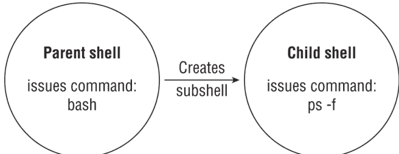

**图 5-1** 父 Bash shell 进程和子 Bash shell 进程

当生成子 shell 进程时，只有一部分父进程的环境会被复制到子 shell 的环境中。这可能会导致变量等项目出现问题。如何防止此类问题将在*第 6 章*“使用 Linux 环境变量”中介绍。

子 shell 也被称为`子 shell（subshell）`。可以从父 shell 创建子 shell，也可以从另一个子 shell 创建子 shell：

```bash
$ ps -f
  UID          PID  PPID  C STIME TTY              TIME CMD
christi+     7650  7649  0 16:01 pts/0    00:00:00 -bash
christi+     7686  7650  0 16:02 pts/0    00:00:00 ps -f
$
$ bash
$ bash
$ bash
$
$ ps --forest
  PID TTY          TIME CMD
 7650 pts/0        00:00:00 bash
 7687 pts/0        00:00:00 \_ bash
 7709 pts/0        00:00:00    \_ bash
 7731 pts/0        00:00:00      \_ bash
 7753 pts/0        00:00:00        \_ ps
$
```

在上面的示例中，`bash` 命令被输入了三次。实际上，这创建了三个子 shell。`ps --forest` 命令显示了这些子 shell 的嵌套结构。**图 5-2** 也展示了这种子 shell 嵌套。

`ps -f` 命令在子 shell 嵌套中非常有用，因为它通过 PPID 列显示谁是父进程：


```bash
$ ps -f
  UID         PID   PPID  C STIME TTY          TIME CMD
christi+    7650   7649  0 16:01 pts/0    00:00:00 -bash
christi+    7687   7650  0 16:02 pts/0    00:00:00 bash
christi+    7709   7687  0 16:02 pts/0    00:00:00 bash
christi+    7731   7709  0 16:02 pts/0    00:00:00 bash
christi+    7781   7731  0 16:04 pts/0    00:00:00 ps -f
$
```

Bash shell 程序可以使用命令行选项来修改 shell 的启动方式。**表 5-1** 列出了可用于 `bash` 命令的几个可用开关。

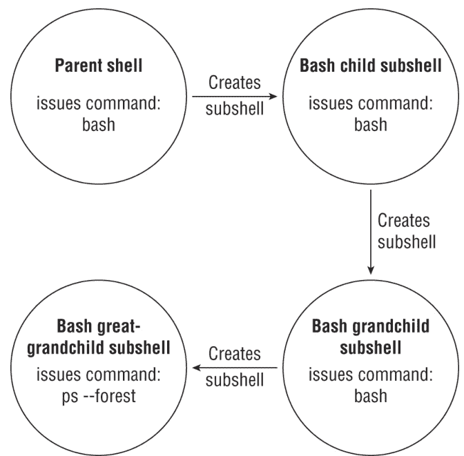

**图 5-2** 子 shell 嵌套

### 表 5-1 bash 命令行选项

| 选项 | 描述 |

|---|---|

| `-c string` | 从 *string* 读取命令并处理它们 |

| `-i` | 启动交互式 shell，允许用户输入 |

| `-l` | 表现得像作为登录 shell 被调用一样 |

| `-r` | 启动受限 shell，将用户限制在默认目录 |

| `-s` | 从标准输入读取命令 |

通过输入 `man bash` 可以找到有关 `bash` 命令的更多帮助以及更多的命令行参数。`bash --help` 命令也能提供额外的帮助。

> **提示**
>
> 如果你想查看 Bash shell 的版本，只需在命令行输入 `bash --version`。这不会创建子 shell，而是显示你系统中 GNU Bash shell 程序的当前版本。

你可以通过输入 `exit` 命令优雅地退出每个子 shell：

```bash
$ ps -f
UID        PID PPID C STIME TTY        TIME CMD
christi+  7650 7649 0 16:01 pts/0    00:00:00 -bash
christi+  7687 7650 0 16:02 pts/0    00:00:00 bash
christi+  7709 7687 0 16:02 pts/0    00:00:00 bash
christi+  7731 7709 0 16:02 pts/0    00:00:00 bash
christi+  8081 7731 0 16:35 pts/0    00:00:00 ps -f
$
$ exit
exit
$
$ ps --forest
  PID TTY          TIME CMD
 7650 pts/0    00:00:00 bash
 7687 pts/0    00:00:00 \_ bash
 7709 pts/0    00:00:00   \_ bash
 8081 pts/0    00:00:00     \_ ps
$
$ exit
exit
$ exit
exit
$
```

```
$ ps --forest
  PID TTY          TIME CMD
 7650 pts/0    00:00:00 bash
 8082 pts/0    00:00:00  \_ ps
$ 
```

`exit` 命令不仅允许你退出子 shell，还可以注销当前的虚拟控制台终端或终端仿真软件。只需在父 shell 中输入 `exit`，你就能优雅地退出 CLI。

此外，运行 shell 脚本时有时也会创建子 shell。关于该主题的更多知识将在[第 11 章](#)中介绍。接下来我们将通过进程列表来看子 shell 是如何被派生的。

### 查看进程列表

在一行中，你可以指定按顺序逐个执行的一组命令。这是通过在命令之间使用分号 (`;`) 输入命令列表来实现的：

```
$ pwd ; ls test* ; cd /etc ; pwd ; cd ; pwd ; ls my*
/home/christine
test_file test_one test_two
/etc
/home/christine
my_file my_scrap my_script my_scrip
$ 
```

在上面的示例中，所有命令都顺利依次执行，没有任何问题。然而，虽然以这种方式使用命令被称为列表，但它并不是进程列表。要将命令列表视为进程列表，这些命令必须用括号括起来：

```
$ (pwd ; ls test* ; cd /etc ; pwd ; cd ; pwd ; ls my* )
/home/christine
test_file test_one test_two
/etc
/home/christine
my_file my_scrap my_script my_scrip
$ 
```

虽然添加括号看似没有多大区别，但它会产生截然不同的效果。添加括号并将命令列表变为进程列表后，会创建一个子 shell 来执行这些命令。

#### 注意

> 进程列表是一种命令分组类型。另一种命令分组类型将命令放在花括号中，并以分号 (`;`) 结束命令列表。其语法如下：`{ command; }`。与进程列表不同，使用花括号进行命令分组不会创建子 shell。

为了指示是否派生了子 shell，这里需要使用一个涉及环境变量的命令。（关于环境变量的详细说明见[第 6 章](#)。）所需的命令是 `echo $BASH_SUBSHELL`。如果返回 `0`，则表示没有子 shell。如果返回 `1` 或更大的数字，则表示创建了子 shell。

首先，执行仅使用命令列表的示例，并在末尾加上 `echo $BASH_SUBSHELL`：

```bash
$ pwd ; ls test* ; cd /etc ; pwd ; cd ; pwd ; ls my* ; echo $BASH_SUBSHELL
/home/christine
test_file  test_one  test_two
/etc
/home/christine
my_file  my_scrap  my_scrip
0
$ 
```

在命令输出的最后，你可以看到显示了一个零 (`0`)。这表明没有创建子 shell 来执行这些命令。

使用进程列表时，结果会有所不同。在列表末尾加上 `echo $BASH_SUBSHELL` 执行：

```bash
$ (pwd ; ls test* ; cd /etc ; pwd ; cd ; pwd ; ls my* ; echo $BASH_SUBSHELL)
/home/christine
test_file test_one test_two
/etc
/home/christine
my_file my_scrap my_script my_scrp
1
$
```

在这种情况下，输出末尾显示了一个数字一 (`1`)。这表明确实创建了一个子 shell 用于执行这些命令。

因此，进程列表是用括号括起来的命令分组，它会创建一个子 shell 来执行命令。你甚至可以通过在进程列表内嵌套括号来创建孙级子 shell：

```
$ (pwd ; echo $BASH_SUBSHELL)
/home/christine
1
$ (pwd ; (echo $BASH_SUBSHELL))
/home/christine
2
$
```

请注意，在第一个进程列表中，显示了一个数字一 (`1`)，表示子 shell，这是符合预期的。然而，在示例的第二个进程列表中，`echo $BASH_SUBSHELL` 命令周围包含了额外的括号。这些额外的括号导致为该命令的执行创建了一个孙级子 shell。因此，显示了一个数字二 (`2`)，表示子 shell 中的子 shell。

子 shell 常用于 shell 脚本中的多进程处理。然而，进入子 shell 是一种代价高昂的方法。（在这种情况下，*代价高昂* 意味着消耗更多的资源，如内存和处理能力。）它也可能显著减慢任务的完成速度。交互式 CLI shell 会话中也存在子 shell 的问题，这并非真正的多进程处理，因为终端会被子 shell 的 I/O 占用。

### 创造性地使用子 shell

在交互式 shell CLI 中，你有更高效的方式来使用子 shell。进程列表、协作进程和管道（在第 11 章中介绍）都使用子 shell。它们都可以在交互式 shell 中有效地使用。

交互式 shell 中一种高效的子 shell 方法是使用后台模式。在我们讨论如何同时使用后台模式和子 shell 之前，你需要理解后台模式。

#### 探索后台模式

以后台模式运行命令允许处理该命令，并释放你的 CLI 以供其他用途。演示后台模式的经典命令是 `sleep` 命令。


`sleep` 命令接受一个参数，表示你希望进程等待（休眠）的秒数。该命令常用于在 shell 脚本中引入暂停。命令 `sleep 10` 会使会话暂停 10 秒，然后返回 shell CLI 提示符：

```
$  sleep 10
$
```

要将命令放入后台模式，在其末尾添加 `&` 字符。将 `sleep` 命令放入后台模式后，可以使用 `ps` 命令进行一些调查：

```
$  sleep 3000&
[1]  2542
$
$  ps -f
UID          PID  PPID  C STIME TTY          TIME CMD
christi+   2356  2352  0 13:27 pts/0    00:00:00 -bash
christi+   2542  2356  0 13:44 pts/0    00:00:00 sleep 3000
christi+   2543  2356  0 13:44 pts/0    00:00:00 ps -f
$
```

`sleep` 命令被指示在后台 `(&)` 休眠 `3000` 秒（50 分钟）。当它被放入后台时，在返回 shell CLI 提示符之前显示了两项信息。第一项信息是显示在括号中的后台作业编号 `(1)`。第二项信息是后台作业的进程 ID `(2542)`。

使用 `ps` 命令来显示各种进程。请注意 `sleep 3000` 命令列在其中。还要注意其第二列中的 PID 与命令进入后台时显示的 PID 相同，即 `2542`。

除了 `ps` 命令，你还可以使用 `jobs` 命令来显示后台作业信息。`jobs` 命令显示当前在后台模式下运行的进程（作业）：

```
$ jobs
[1]+  Running              sleep 3000 &
$
```

`jobs` 命令显示括号中的作业编号 `(1)`。它还显示作业的当前状态 `(Running)` 以及命令本身 (`sleep 3000 &`)。

使用 `jobs` 命令的 `-l` 参数可以看到更多的信息。`-l` 参数除了显示其他信息外，还显示命令的 PID：

```
$ jobs -l
[1]+  2542 Running       sleep 3000 &
$
```

### 提示

> 当有多个后台进程运行时，有一些额外的有用信息显示哪个后台作业是最近启动的。最近启动的作业在 `jobs` 命令显示中的作业编号旁边有一个加号 `(+)`。而第二新的进程会有一个减号 `(-)`，以提供额外信息。

当后台作业完成时，下次在命令行按 Enter 键时会显示其完成状态：

```
$
[1]+  Done               sleep 3000
$
```

后台模式非常实用。它提供了一种在 CLI 上创建有用子 shell 的方法。

### 将进程列表放入后台

通过将进程列表放入后台，你可以在子 shell 中执行大量的多进程处理。一个附带好处是你的终端不会被子 shell 的 I/O 占用。

如前所述，进程列表是在子 shell 中执行的命令或一系列命令。使用包含 `sleep` 命令并显示 `BASH_SUBSHELL` 变量的进程列表，其运行结果符合预期：

```
$ (sleep 2 ; echo $BASH_SUBSHELL ; sleep 2)
1
$
```

在上面的示例中，发生两秒暂停，显示数字一 `(1)` 表示单个子 shell 级别（子 shell），然后再次发生两秒暂停，之后提示符返回。这里没有什么特别引人注目的。

将相同的进程列表放入后台模式可能会导致命令输出略有不同的效果：

```
$ (sleep 2 ; echo $BASH_SUBSHELL ; sleep 2)&
[1] 2553
$ 1

[1]+  Done                       ( sleep 2; echo $BASH_SUBSHELL;
sleep 2 )
$
```

将进程列表放入后台会导致出现作业编号和进程 ID，并返回提示符。然而，奇怪的现象是，显示数字一 `(1)`（表示单级子 shell）位于提示符旁边！请不要为此感到困惑。只需按 Enter 键，你就会得到另一个提示符。

在后台模式下使用进程列表是 CLI 上使用子 shell 的一种创造性方法。这能让你用更少的击键获得更高的生产力。

当然，`sleep` 和 `echo` 命令的进程列表仅仅是为了举例说明。使用 `tar` 创建备份文件（参见第 4 章）是有效使用后台进程列表的一个更实用的例子：

```
$ (tar -cf Doc.tar Documents ; tar -cf Music.tar Music)&
[1] 2567
$
$ ls *.tar
Doc.tar  Music.tar
[1]+  Done    (tar -cf Doc.tar Documents;
tar -cf Music.tar Music )
$
```

将进程列表置于后台模式并不是在命令行界面（CLI）中创造性地使用子 shell 的唯一方法。协同处理（Co-processing）是另一种方法。

### 探索协同处理

协同处理同时执行两项任务。它以后台模式生成一个子 shell，并执行该子 shell 内的命令。

要进行协同处理，需要使用 `coproc` 命令，并结合要在子 shell 中执行的命令：

```
$ coproc sleep 10
[1] 2689
$
```

协同处理的操作几乎与将命令置于后台模式相同，区别在于它会创建一个子 shell。你会注意到，当输入 `coproc` 命令及其参数时，启动了一个后台任务。后台任务编号（1）和进程 ID（2689）显示在屏幕上。

`jobs` 命令允许你查看协同处理的状态：

```
$ jobs
[1]+  Running     coproc COPROC sleep 10 &
$
```

从前面的例子中，你可以看到在子 shell 中执行的后台命令是 `coproc COPROC sleep 10`。`COPROC` 是 `coproc` 命令赋予该进程的名称。你可以使用该命令的扩展语法自行设置名称：

```
$ coproc My_Job { sleep 10; }
[1] 2706
$
$ jobs
[1]+  Running            coproc My_Job { sleep 10; } &
$
```

通过使用扩展语法，协同处理的名称被设置为 `My_Job`。请注意，扩展语法有点棘手。确保你在第一个大括号 `({)` 后面和命令开始之前放置一个空格。此外，命令必须以分号 `(;)` 结尾。并且，你必须在分号后面和闭大括号 `(})` 前面放置一个空格。

> **注意**
>
> 协同处理允许你执行非常花哨的操作，向在子 shell 中运行的进程发送/接收信息。只有当你有多个协同进程正在运行且需要与它们全部通信时，才需要为协同进程命名。否则，只需让 `coproc` 命令将名称设置为默认值 `COPROC` 即可。

你可以非常巧妙地结合协同处理和进程列表，创建嵌套的子 shell。只需输入你的进程列表，并在其前面加上 `coproc` 命令即可：

```
$ coproc ( sleep 10; sleep 2 )
[1] 2750
$
$ jobs
[1]+  Running            coproc COPROC ( sleep 10; sleep 2 ) &
$
$ ps --forest
  PID TTY          TIME CMD
2367 pts/0    00:00:00 bash
2750 pts/0    00:00:00 \_ bash
2751 pts/0    00:00:00 | \_ sleep
2752 pts/0    00:00:00 \_ ps
$
```

请记住，生成子 shell 可能会带来高昂的代价并导致速度变慢。创建嵌套的子 shell 更是如此！

使用子 shell 可以提供灵活性和便利性。理解其行为对于实现这些目标至关重要。理解命令操作也很重要。在下一节中，我们将探讨内置命令和外部命令之间的行为差异。

### 理解外部命令和内置命令

在学习 GNU Bash shell 时，你可能已经听过 *内置命令* 这一术语。理解 shell 内置命令和非内置（外部）命令非常重要。内置命令和非内置命令的工作方式截然不同。

#### 观察外部命令

*外部命令*，有时也称为文件系统命令，是存在于 Bash shell 之外的程序。换句话说，它不是内置于 shell 程序中的。外部命令程序通常位于 `/bin`、`/usr/bin`、`/sbin` 或 `/usr/sbin` 目录中。

`ps` 命令是一个外部命令。你可以使用 `which` 和 `type` 命令来查找其文件名：

```
$ which ps
/usr/bin/ps
$ type ps
ps is /usr/bin/ps
$ ls -l /usr/bin/ps
-rwxr-xr-x. 1 root root 142216 May 11  2019 /usr/bin/ps
$ 
```


每当执行外部命令时，都会创建一个子进程。这种操作称为 `fork（分叉）`。 conveniently，外部命令 `ps` 会显示其当前父进程以及它自身的分叉子进程：

```
$ ps -f
UID   PPID  C STIME  TTY        TIME CMD
christi+ 2367 2363  0 10:47 pts/0    00:00:00 -bash
christi+ 4242 2367  0 13:48 pts/0    00:00:00 ps -f
$
```

由于它是一个外部命令，当 `ps` 命令执行时，会创建一个子进程。在这种情况下，`ps` 命令的 PID 是 4242，父进程 PID 是 2367。Bash shell 进程在这种情况下是父进程，其 PID 为 2367。**图 5-3** 展示了当外部命令执行时发生的 `fork（分叉）` 过程。

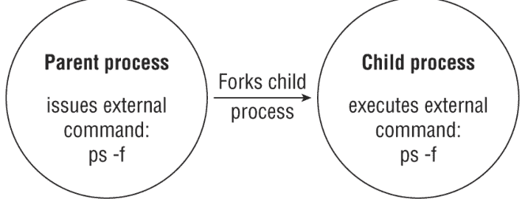

### 图 5-3 外部命令的 fork（分叉）

每当进程必须 `fork（分叉）` 时，设置新子进程的环境都需要时间和 effort（努力）。因此，外部命令可能会稍显昂贵。

> **注意**
>
> 如果你 `fork（分叉）` 一个子进程或创建一个子 shell，你仍然可以通过 `signaling（信号发送）` 与其通信，这在命令行和编写 shell 脚本中都极其有用。`Signaling（信号发送）` 允许通过信号进行进程间通信。信号和 `signaling（信号发送）` 在第 16 章“脚本控制”中进行了介绍。

### 观察内置命令

`内置命令` 的不同之处在于，它们不需要子进程即可执行。它们被编译到 shell 中，因此是 shell 工具包的一部分。不存在运行它们的外部程序文件。`cd` 和 `exit` 命令都内置于 Bash shell 中。你可以通过使用 `type` 命令来判断一个命令是否为内置命令：

```
$ type cd
cd is a shell builtin
$
$ type exit
exit is a shell builtin
$
```

由于它们不需要 `fork（分叉）` 子进程来执行或打开程序文件，内置命令更快且更高效。[附录 A](appendix#a "Appendix A") 中提供了 GNU Bash shell 内置命令的列表。

请注意，某些命令具有多种变体。例如，`echo` 和 `pwd` 都有内置命令变体和外部命令变体。这些变体略有不同。要查看命令的多种变体，请使用 `type` 命令的 `-a` 选项：

```
$ type -a echo
echo is a shell builtin
echo is /usr/bin/echo
$
$ which echo
/usr/bin/echo
$
$ type -a pwd
pwd is a shell builtin
pwd is /usr/bin/pwd
$
$ which pwd
/usr/bin/pwd
$
```

使用 `type -a` 命令可以显示这两个命令的两种类型（内置和外部）。注意，`which` 命令只显示外部命令文件。

> **提示**
>
> 要使用具有多种变体的命令中的外部命令，直接引用该文件即可。例如，要使用 `pwd` 外部命令，请输入 `/usr/bin/pwd`。

## 使用 `history` 命令

Bash shell 会记录你最近使用的命令。你可以调用这些命令，甚至重新使用它们。一个有用的内置命令，允许你浏览和管理这些先前发出的命令，是 `history` 命令。

要查看最近使用的命令列表，请输入不带选项的 `history` 命令：

```
$ history
  1  ps -f
  2  pwd
  3  ls
  4  coproc ( sleep 10; sleep 2 )
  5  jobs
  6  ps --forest
  7  ls
  8  ps -f
  9  pwd
 10  ls -l /usr/bin/ps
 11  history
 12  cd /etc
 13  pwd
 14  ls
 15  cd
 16  type -a pwd
 17  which pwd
 18  type -a echo
 19  which echo
 20  ls
[...]
$
```

在这个例子中，列表被截断，只显示了前 20 条命令。通常，历史中保留的是最后 1,000 条命令。这是很多命令！

> **提示**
>
> 你可以设置保留在 Bash 历史中的命令数量。为此，你需要修改一个名为 `HISTSIZE` 的环境变量（参见第 6 章）。

你可以调用并重新使用历史记录列表中的上一条命令。这可以节省时间和输入。要调用并重新使用上一条命令，请输入 `!!` 并按下 Enter 键：

```
$ ps --forest
PID TTY TIME CMD
2367 pts/0 00:00:00 bash
5240 pts/0 00:00:00 \_ ps
$
$ !!
ps --forest
PID TTY TIME CMD
2367 pts/0 00:00:00 bash
5241 pts/0 00:00:00 \_ ps
$
```

当输入 `!!` 时，Bash shell 首先显示它正在从 shell 历史中调用的命令。在显示该命令后，它被执行了。

命令历史保存在隐藏的 `.bash_history` 文件中，该文件位于每个用户的家庭目录中：

```
$ pwd
/home/christine
$
$ ls .bash_history
.bash_history
$
```

请注意，在你的 CLI 会话期间，`bash` 命令历史存储在内存中。只有当……时，它才会写入历史文件

## 请注意，当运行 `history` 命令时，显示的最后一组命令与 `.bash_history` 文件中的最终命令并不匹配

有六条额外发出的命令，它们并未记录在 `history` 文件中。

你可以在不退出 Shell 会话的情况下，强制将命令历史写入 `.bash_history` 文件。为了执行此写入操作，请在 `history` 命令上使用 `-a` 选项：

```text
$ history -a
$
$ history
      1  ps -f
      2  pwd
[...]
     38  exit
     39  history
     40  ps --forest
     41  ps --forest
     42  pwd
     43  ls .bash_history
     44  history
     45  cat .bash_history
     46  history -a
     47  history
$
$ cat .bash_history
ps -f
pwd
[...]
exit
history
ps --forest
ps --forest
pwd
ls .bash_history
history
cat .bash_history
history -a
$
```

请注意，除了列出的最后一条命令（`history` 命令）外，`history` 命令和 `.bash_history` 文件的内容是一致的，因为该命令是在发出 `history -a` 命令之后执行的。

> **注意**
>
> 如果你打开了多个终端会话，你仍然可以在每个打开的会话中使用 `history -a` 命令来追加到 `.bash_history` 文件中。然而，其他打开的终端会话的历史记录不会自动更新。这是因为 `.bash_history` 文件在终端会话最初启动时是只读的。为了强制重新读取 `.bash_history` 文件并更新终端会话内存中的历史记录，请使用 `history -n` 命令。

你可以从历史记录列表中调用任何命令。只需输入感叹号以及该命令在历史记录列表中的编号即可：

```text
$ history
      1  ps -f
      2  pwd
[...]
     39  history
     40  cat .bash_history
     41  ps --forest
     42  pwd
     43  ps -f
     44  history
     45  cat .bash_history
     46  history -a
     47  history
     48  cat .bash_history
     49  history
$
$ !42
pwd
/home/christine
$
```

命令编号 42 是从历史记录列表中调出的。请注意，类似于执行历史中的最后一条命令，Bash Shell 会首先显示它正在从 Shell 历史中调用的命令。在命令显示之后，该命令被执行。

> **提示**
>
> 如果出于某种原因你需要清除命令历史，操作很简单。只需输入 `history -c`，当前历史的内容就会被清除。接下来输入 `history -a` 也会清除 `.bash_history` 文件。


使用 Bash Shell 命令历史可以极大地节省时间。你还可以利用内置的 `history` 命令做更多事情。务必通过输入 `man history` 来查看 `history` 的 Bash 手册页。

## 使用命令别名

`alias` 命令是另一个有用的内置 Shell 命令。**命令别名**允许你为常用命令连同其参数创建一个别名，以最大程度地减少你的打字量。

最有可能的是，你的 Linux 发行版已经为你设置了一些常用的命令别名。要查看当前活动别名的列表，请使用带有 `-p` 参数的 `alias` 命令：

```text
$ alias -p
[...]
alias 1='ls -CF'
alias la='ls -A'
alias ll='ls -aIF'
alias ls='ls --color=auto'
$
```

请注意，在这个 Ubuntu Linux 发行版中，使用了一个别名来覆盖标准的 `ls` 命令。它自动提供了 `--color=auto` 参数，如果终端支持颜色化，该参数将使 `ls` 命令使用颜色编码，例如，目录可能显示为蓝色。环境变量 `LS_COLORS` 控制所使用的颜色代码，环境变量在第 6 章中介绍。

### 提示

> 在跳转至不同的发行版时，请谨慎使用颜色编码来帮助你确定列表中的名称哪个是目录，哪个是文件。由于颜色代码并非标准化，最好使用 `ls -F` 命令来查看文件的类型代码。

你可以使用 `alias` 命令创建自己的别名：

```text
$ alias li='ls -i'
$
$ li
34665652 Desktop             1415018 NetworkManager.conf
1414976 Doc.tar               50350618 OldDocuments
34665653 Documents           1414981 Pictures
51693739 Downloads           16789591 Public
1415016 hlink_test_one       1415019
really_ridiculously_long_file_name
1415021 log_file             1415020 slink_test_file
51693757 Music               1415551 Templates
1414978 Music.tar            1415523 test_file
1415525 my_file
1415524 my_scrap
1415519 my_script
1415015 my_scrpyt
1415016 test_one
1415017 test_two
16789592 Videos
$
```

定义别名值后，你可以在 Shell 中的任何时候使用它，包括在 Shell 脚本中。请注意，由于命令别名是内置命令，别名仅在其定义的 Shell 进程中有效：

```text
$ alias li='ls -i'
$ bash
$ li
bash: li: command not found...
$ exit
exit
$ li
34665652 Desktop             1415018 NetworkManager.conf
1414976 Doc.tar               50350618 OldDocuments
1415017 test_two
16789592 Videos
1415524 my_scrap
1415519 my_script
1415015 my_scrpyt
$
```

### 提示

> 如有需要，你可以在命令行输入 `unalias alias-name` 来关闭某个别名。请记住，如果该别名不是你设置的，下次登录系统时它会重新启用。你可以通过修改环境文件来永久禁用某个别名。环境文件在第 6 章中介绍。

幸运的是，你可以使别名值在子 Shell 之间持久化。下一章将介绍如何做到这一点，以及环境变量的相关内容。

### 摘要

本章讨论了复杂的交互式程序：GNU Bash Shell。我们探讨了理解 Shell 进程及其关系，包括如何生成子 Shell 以及它们与父 Shell 的关系。我们还探索了创建子进程的命令和未创建子进程的命令。

默认交互式 Shell 通常在用户登录终端时启动。系统启动的 Shell 取决于用户 ID 配置。通常，它是 `/usr/bin/bash`。默认系统 Shell `/usr/bin/sh` 用于系统 Shell 脚本，例如启动时所需的脚本。

可以使用 `bash` 命令生成子 Shell 或子 Shell 进程。当使用进程列表或 `coproc` 命令时也会创建它们。在命令行上使用子 Shell 可以实现 CLI 的创造性和高效使用。子 Shell 可以嵌套，从而生成孙 Shell 和曾孙 Shell。创建子 Shell 是一个昂贵的过程，因为必须为 Shell 创建新的环境。

最后，我们研究了两种不同类型的 Shell 命令：内置命令和外部命令。外部命令创建具有新环境的子进程，但内置命令不会。这使得外部命令的使用成本更高。由于不需要新的环境，内置命令更高效，且不受任何环境变化的影响。

Shell、子 Shell、进程和分叉进程都受环境变量影响。这些变量如何在这些不同上下文中产生影响以及如何使用，将在下一章中探讨。

# 第 6 章

## 使用 Linux 环境变量

### 本章内容

- 查看环境变量
- 创建你自己的局部变量
- 移除变量
- 探索默认 Shell 环境变量
- 设置 `PATH` 环境变量
- 定位环境文件
- 使用变量数组

Linux 环境变量有助于定义你的 Linux Shell 体验。许多程序和脚本使用环境变量来获取系统信息，以及存储临时数据和配置信息。Linux 系统在很多地方都设置了环境变量，了解它们的位置是很有帮助的。

本章将带你走进 Linux 环境变量的世界，展示它们在哪里、如何使用，甚至如何创建你自己的变量。本章最后介绍了如何使用变量数组。

### 探索环境变量

Bash Shell 使用一种称为*环境变量*的功能来存储关于 Shell 会话和工作环境的信息，因此得名环境变量。此功能还允许你将数据存储在内存中，任何从 Shell 运行的程序或脚本都可以轻松访问这些数据。这是一种存储所需持久数据的好方法。

#### 查看全局环境变量

全局环境变量在 shell 会话及任何生成的子 shell 中都是可见的。局部变量仅在创建它们的 shell 中可用。这一事实使得全局环境变量在需要父 shell 信息的创建子 shell 的应用程序中非常有用。

当你启动 Bash 会话时，Linux 系统会设置几个全局环境变量。关于当时启动哪些变量的更多细节，请参阅本章稍后的“定位系统环境变量”部分。系统环境变量几乎总是使用全大写字母，以区别于用户定义的变量。

要查看全局环境变量，请使用 `env` 或 `printenv` 命令：

```
$ printenv
[...]
USER=christine
[...]
PWD=/home/christine
HOME=/home/christine
[...]
TERM=xterm
SHELL=/bin/bash
[...]
HISTSIZE=1000
[...]
$ 
```

Bash shell 设置了如此多的全局环境变量，以至于显示内容不得不进行截取。不仅在登录过程中会设置许多变量，而且你的登录方式也会影响哪些变量被设置。

要显示单个环境变量的值，你可以使用 `printenv` 命令，但不能使用 `env` 命令：

```
$ printenv HOME
/home/christine
$
$ env HOME
env: 'HOME': No such file or directory
$ 
```

你也可以使用 `echo` 命令来显示变量的值。在这种情况下引用环境变量时，必须在环境变量名称前加一个美元符号 `$`：

```
$ echo $HOME
/home/christine
$ 
```

在变量名称前使用美元符号不仅限于在配合 `echo` 命令使用时显示其当前定义。变量名称前的美元符号允许将变量作为参数传递给其他各种命令：

```
$ ls $HOME
Desktop Music NetworkManager.conf
Templates Doc.tar Music.tar OldDocuments
test_file Documents my_file Pictures
test_one
Downloads my_scrap Public
test_two
hlinc_test_one my_script really_ridiculously_long_file_name
Videos
log_file my_scrpt slinc_test_file
$
```

如前所述，全局环境变量也可用于任何进程的子 shell：


```
$ bash
$ ps -f
UID PID PPID C STIME TTY TIME CMD
christi+ 2770 2766 0 11:19 pts/0 00:00:00 -bash
christi+ 2981 2770 4 11:37 pts/0 00:00:00 bash
christi+ 3003 2981 0 11:37 pts/0 00:00:00 ps -f
$ 
$ echo $HOME
/home/christine
$ exit
exit
$
```

在此示例中，在使用 `bash` 命令生成子 shell 后，显示了 `HOME` 环境变量的当前值。它被设置为与父 shell 中完全相同的值 `/home/christine`。

### 查看局部环境变量

顾名思义，局部环境变量只能在定义它们的本地进程中看到。尽管它们是局部的，但它们与全局环境变量同样重要。事实上，Linux 系统默认也为你定义了标准的局部环境变量。然而，你也可以定义自己的局部变量。这些，正如你想象的那样，被称为用户定义的局部变量。

在 CLI（命令行界面）上尝试查看局部变量列表稍微有点棘手。不幸的是，没有专门仅显示这些变量的命令。`set` 命令会显示为特定进程定义的所有变量，包括局部和全局环境变量以及用户定义的变量：

```
$ set
BASH=/bin/bash
[...]
HOME=/home/christine
[...]
PWD=/home/christine
[...]
SHELL=/bin/bash
[...]
TERM=xterm
[...]
USER=christine
[...]
colors=/home/christine/.dircolors
my_variable='Hello World'
[...]
_command ()
{
[...]
$ 
```

使用 `env` 或 `printenv` 命令显示的所有全局环境变量都会出现在 `set` 命令的输出中。额外的环境变量是局部环境变量和用户定义变量。`set` 命令的输出还包含局部 shell 函数，例如在上一个显示中列出的 `_command` 函数。shell 函数在 [第 17 章](#) “创建函数”中进行了介绍。

**注意**

`env`、`printenv` 和 `set` 命令之间的差异很微妙。`set` 命令显示全局和局部环境变量、用户定义变量以及局部函数。它还按字母顺序对显示进行排序。`env` 和 `printenv` 与 `set` 的不同之处在于它们不对变量进行排序，也不包括局部环境变量、局部用户定义变量或局部 shell 函数。在此上下文中使用，`env` 和 `printenv` 会产生重复的列表。但是，`env` 命令具有 `printenv` 所不具备的额外功能，使其成为稍强大的命令。

### 设置用户定义变量

你可以直接从 Bash shell 设置自己的变量。本节向你展示如何创建自己的变量，以及如何从交互式 shell 或 shell 脚本程序中引用它们。

#### 设置局部用户定义变量

启动 Bash shell（或生成 shell 脚本）后，你可以创建在 shell 进程中可见的局部用户定义变量。你可以通过使用等号将变量赋值给值，为环境变量分配数值或字符串值：

```
$ my_variable=Hello
$ echo $my_variable
Hello
$
```

这很简单！现在，任何时候你需要引用 `my_variable` 用户定义变量的值，只需通过名称 `$my_variable` 引用它即可。

如果你需要分配包含空格的字符串值，你必须使用单引号或双引号来界定字符串的开头和结尾：

```
$ my_variable=Hello World
bash: World: command not found...
$
$ my_variable="Hello World"
$ echo $my_variable
Hello World
$
```

如果没有引号，Bash shell 会假设下一个单词（World）是要处理的另一个命令。请注意，对于你定义的局部变量，你使用了小写字母，而你之前看到的系统环境变量都使用了大写字母。

**提示**

标准 Bash shell 约定是所有环境变量都使用大写字母。如果你为自己和自己的 shell 脚本创建局部变量，请使用小写字母。变量是区分大小写的。通过保持用户定义的局部变量为小写，你可以避免重新定义系统环境变量的潜在灾难性后果。

在变量名称、等号和值之间不使用空格至关重要。如果你在赋值中放入任何空格，Bash shell 会将该值解释为独立的命令：

```
$ my_variable = "Hello World"
bash: my_variable: command not found...
```

设置局部变量后，它可在 shell 进程中的任何位置使用。但是，如果你生成另一个 shell，它在子 shell 中不可用：

```
$ my_variable="Hello World"
$
$ bash
$ echo $my_variable

$ exit
exit
$ echo $my_variable
Hello World
$ 
```

在此示例中，通过 `bash` 命令生成了一个子 shell。用户定义的 `my_variable` 在子 shell 中不可用。这通过 `echo $my_variable` 命令后返回的空白行来证明。在退出子 shell 并返回到原始 shell

shell，该局部变量可用。

类似地，如果在子进程中设置了一个局部变量，在离开该子进程后，该局部变量将不再可用：

```
$ echo $my_child_variable

$ bash
$ my_child_variable="Hello Little World"
$ echo $my_child_variable
Hello Little World
$ exit
exit
$ echo $my_child_variable

$
```

在子 shell 中设置的局部变量在返回父 shell 后不再存在。您可以通过将局部用户定义变量转换为全局变量来改变这种行为。

#### 设置全局环境变量

全局环境变量对于父进程（即设置该变量的进程）创建的任何子进程都是可见的。创建全局环境变量的方法是先创建一个局部变量，然后将其导出到全局环境。

这是通过使用 `export` 命令和变量名（不带美元符号）来完成的：

```
$ my_variable="I am Global now"
$
$ export my_variable
$
$ echo $my_variable
I am Global now
$ bash
$ echo $my_variable
I am Global now
$ exit
exit
$ echo $my_variable
I am Global now
$
```

在定义并导出局部变量 `my_variable` 后，通过 `bash` 命令启动了一个子 shell。子 shell 能够正确显示 `my_variable` 变量的值。该变量保留其值，因为 `export` 命令使其变成了全局变量。

**提示**

为了减少打字量，您可以使用一条命令同时设置变量并导出它。 使用前面的示例，您只需在命令行输入 `export my_variable="I am Global Now"` 并按下 Enter 键即可。

在子 shell 中修改全局环境变量不会影响父 shell 中该变量的值：

```
$ export my_variable="I am Global now"
$ echo $my_variable
I am Global now
$
$ bash
$ echo $my_variable
I am Global now
$ my_variable="Null"
$ echo $my_variable
Null
$ exit
exit
$
$ echo $my_variable
I am Global now
$
```

在定义并导出变量 `my_variable` 后，通过 `bash` 命令启动了一个子 shell。子 shell 正确显示了 `my_variable` 全局环境变量的值。随后该变量的值被子 shell 修改。然而，该变量的值仅在子 shell 内部被修改，而在父 shell 环境中并未改变。

子 shell 甚至不能使用 `export` 命令来改变父 shell 全局变量的值：

```
$ echo $my_variable
I am Global now
$
$ bash
$ export my_variable="Null"
$ echo $my_variable
Null
$ exit
exit
$
$ echo $my_variable
I am Global now
$
```

尽管子 shell 重新定义并导出了变量 `my_variable`，但父 shell 中的 `my_variable` 变量仍保留其原始值。

### 移除环境变量


当然，如果您可以创建新的环境变量，那么移除现有的环境变量也是合乎情理的。您可以使用 `unset` 命令来执行此操作。在 `unset` 命令中引用环境变量时，请记住不要使用美元符号：

```
$ my_variable="I am going to be removed"
$ echo $my_variable
I am going to be removed
$
$ unset my_variable
$ echo $my_variable
$
```

**提示**

记住何时使用环境变量上的美元符号以及何时不使用可能会令人困惑。只需记住这一点：如果您正在对变量进行操作（如查看值），请使用美元符号。如果您正在对变量本身进行操作（如设置或移除），请不要使用美元符号。这条规则的唯一例外是使用 `printenv` 来显示变量的值。

在处理全局环境变量时，事情会变得稍微复杂一些。如果您位于子进程中并 `unset` 了一个全局环境变量，这只适用于该子进程。全局环境变量在父进程中仍然可用：

```
$ export my_variable="I am Global now"
$ echo $my_variable
I am Global now
$
$ bash
$ echo $my_variable
I am Global now
$ unset my_variable
$ echo $my_variable

$ exit
exit
$ echo $my_variable
I am Global now
$
```

与修改变量一样，您不能在子 shell 中 `unset` 一个变量并期望它在父 shell 中也被 `unset`。

### 揭示默认 Shell 环境变量

Bash shell 使用特定的环境变量来定义系统环境，这些是默认的。您可以始终依赖这些变量在您的 Linux 系统上被设置或可用于设置。由于 Bash shell 是原始 Unix Bourne shell 的衍生版本，因此它还包括最初在该 shell 中定义的环境变量。

#### 表 6-1 Bash Shell 的 Bourne 变量

##### 表 6-1 Bash Shell 的 Bourne 变量

| 变量 | 描述 |
|---|---|
| `CDPATH` | 用于 `cd` 命令搜索路径的以冒号分隔的目录列表 |
| `HOME` | 当前用户的家目录 |
| `IFS` | shell 用于拆分文本字符串的字段分隔符字符列表 |
| `MAIL` | 当前用户邮件箱的文件名（Bash shell 会检查此文件是否有新邮件） |
| `MAILPATH` | 当前用户多个邮件箱文件名的以冒号分隔的列表（Bash shell 会检查此列表中的每个文件是否有新邮件） |
| `OPTARG` | 由 `getopt` 命令处理的最后一个选项参数的值 |
| `OPTIND` | 由 `getopt` 命令处理的最后一个选项参数的索引值 |
| `PATH` | shell 查找命令的以冒号分隔的目录列表 |
| `PS1` | 主要 shell 命令行接口的提示字符串 |
| `PS2` | 次要 shell 命令行接口的提示字符串 |

除了默认的 Bourne 环境变量外，Bash shell 还提供了几个它自己的变量，如表 6-2 所示。

#### 表 6-2 Bash Shell 环境变量

##### 表 6-2 Bash Shell 环境变量

| 变量 | 描述 |
| --- | --- |
| `BASH` | 执行当前 Bash shell 实例的完整路径名 |
| `BASH_ALIASES` | 当前设置的别名的关联数组 |
| `BASH_ARGC` | 包含传递给子例程或 shell 脚本的参数数量的变量数组 |
| `BASH_ARCV` | 包含传递给子例程或 shell 脚本的参数的变量数组 |
| `BASH_ARGV` | 包含 shell 名称或（如果在脚本中使用）shell 脚本名称的变量 |
| `BASH_CMDS` | shell 已执行的命令位置的关联数组 |
| `BASH_COMMAND` | 当前正在执行或即将执行的 shell 命令 |
| `BASH_COMPAT` | 指定 shell 兼容性的值 |
| `BASH_ENV` | 当设置时，每个 Bash 脚本在运行前都会尝试执行由此变量定义的启动文件 |
| `BASH_EXECUTION_STRING` | 使用 `bash` 命令的 `-c` 选项传递的命令 |
| `BASH_LINENO` | 包含当前正在执行的 shell 函数源代码行号的变量数组 |
| `BASH_LOADABLE_PATH` | shell 查找动态加载内置命令的以冒号分隔的目录列表 |
| `BASH_REMATCH` | 包含使用正则表达式比较运算符 `=~` 进行正向匹配的模式及其子模式的只读变量数组 |
| `BASH_SOURCE` | 包含当前正在执行的 shell 函数源代码文件名的变量数组 |
| `BASH_SUBSHELL` | 当前子 shell 环境的嵌套级别（初始值为 0） |
| `BASH_VERSIONINFO` | 包含当前 Bash shell 实例的主版本号和次版本号各个数字的变量数组 |
| `BASH_VERSION` | 当前 Bash shell 实例的版本号 |
| `BASH_XTRACEFD` | 如果设置为有效的文件描述符 (0,1,2)，由 'set -x' 调试选项生成的跟踪输出可以重定向。这通常用于将跟踪输出分离到一个文件中。 |
| `BASHOPTS` | 当前启用的 Bash shell 选项列表 |
| `BASHPID` | 当前 Bash 进程的流程 ID |
| `CHILD_MAX` | 控制 shell 跟踪的已退出子进程状态值数量的设置 |
| `COLUMNS` | 包含用于当前 Bash shell 实例的终端宽度 |
| `COMP_CWORD` | 指向变量 `COMP_WORDS` 的索引，其中包含当前光标位置 |
| `COMP_LINE` | 当前命令行 |
| `COMP_POINT` | 当前光标位置相对于当前命令开头的索引 |
| `COMP_KEY` | 用于调用当前 shell 函数完成的最终按键 |
| `COMP_TYPE` | 表示导致调用完成 shell 函数的尝试完成的类型的整数值 |
| `COMP_WORDBREAKS` | 用于执行单词补全的 Readline 库单词分隔符字符 |
| `COMP_WORDS` | 包含当前命令行上各个单词的数组变量 |
| `COMPREPLY` | 包含由 shell 函数生成的可能补全代码的数组变量 |
| `COPROC` | 持有未命名协同进程 I/O 文件描述符的数组变量 |
| `DIRSTACK` | 包含当前的数组变量 |

##### 环境变量

| 环境变量 | 描述 |
| :--- | :--- |
| `EMACS` | 指示 Emacs shell 缓冲区正在执行且行编辑已禁用，当设置为 't' 时 |
| `EPOCHREALTIME` | 包含自 Unix 纪元（1970 年 1 月 1 日 00:00:00 UTC）以来的秒数（包含微秒） |
| `EPOCHSECONDS` | 包含自 Unix 纪元（1970 年 1 月 1 日 00:00:00 UTC）以来的秒数（不包含微秒） |
| `ENV` | 当设置时，在 Bash shell 脚本运行之前执行定义的启动文件（仅在 Bash shell 以 POSIX 模式调用时使用） |
| `EUID` | 当前用户的有效用户数字 ID |
| `EXECIGNORE` | 在使用 `PATH` 进行搜索时，确定要忽略的可执行文件（如共享库文件）的冒号分隔过滤器列表 |
| `FCEEDIT` | `fc` 命令使用的默认编辑器 |
| `FIGNORE` | 执行文件名补全时要忽略的后缀的冒号分隔列表 |
| `FUNCNAME` | 当前正在执行的 shell 函数的名称 |
| `FUNCNEST` | 设置允许的最大函数嵌套级别，当设置为大于 0 的数字时（如果超出，当前命令中止） |
| `GLOBIGNORE` | 定义文件名扩展中要忽略的文件名集合的模式的冒号分隔列表 |
| `GROUPS` | 包含当前用户所属组列表的变量数组 |
| `histchars` | 最多两个字符，用于控制历史扩展：第一个是“历史扩展”字符（默认为 `!`），第二个是“两字符历史扩展”字符（默认为 `!!`）。 |
| `HISTCMD` | 当前命令的历史编号 |
| `HISTCONTROL` | 控制哪些命令被输入到 shell 历史列表中 |
| `HISTFILE` | 保存 shell 历史列表的文件名称（默认为 `.bash_history`） |
| `HISTFILESIZE` | 保存在历史文件中的最大行数 |
| `HISTIGNORE` | 用于决定哪些命令被忽略以写入历史文件的模式的冒号分隔列表 |
| `HISTSIZE` | 保存在历史文件中的最大命令数 |
| `HISTTIMEFORMAT` | 如果已设置且不为空，则用作格式化字符串，以在 Bash 历史中打印每个命令的时间戳 |


## 环境变量列表

| `HOSTFILE` | 当 shell 需要完成主机名时应读取的文件名 |
| `HOSTNAME` | 当前主机的名称 |
| `HOSTTYPE` | 描述 Bash shell 所运行机器的字符串 |
| `IGNOREEOF` | shell 在退出之前必须接收的连续 EOF 字符数（如果此值不存在，默认值为 1） |
| `INPUTRC` | Readline 初始化文件的名称（默认为 `.inputrc`） |
| `INSIDE_EMACS` | 仅在进程在 Emacs 编辑器 shell 缓冲区中运行时设置，可禁用行编辑（禁用行编辑还取决于 `TERM` 变量的值） |
| `LANG` | shell 的区域设置类别 |
| `LC_ALL` | 覆盖 `LANG` 变量，定义区域设置 |
| `LC_COLLATE` | 设置对排序字符串值使用的排序顺序 |
| `LC_CTYPE` | 确定文件名扩展和模式匹配中使用的字符解释 |
| `LC_MESSAGES` | 确定解释由美元符号开头的双引号字符串时使用的区域设置 |
| `LC_NUMERIC` | 确定格式化数字时使用的区域设置 |
| `LC_TIME` | 确定格式化数据和时间时使用的区域设置 |
| `LINO` | 当前正在执行的脚本中的行号 |
| `LINES` | 定义终端上可用的行数 |
| `MACHTYPE` | 以 cpu-company-system 格式定义系统类型的字符串 |
| `MAILCHECK` | shell 应检查新邮件的频率（以秒为单位）（默认为 60） |
| `MAPFILE` | 当未提供数组变量名称时，从 `mapfile` 命令读取文本的数组变量 |
| `OLDPWD` | shell 中使用的上一个工作目录 |
| `OPTERR` | 如果设置为 1，Bash shell 将显示由 `getopt` 命令生成的错误。 |
| `OSTYPE` | 定义 shell 所运行操作系统的字符串 |
| `PIPESTATUS` | 包含前台进程中退出状态值列表的变量数组 |
| `POSIXLY_CORRECT` | 如果设置，Bash 以 POSIX 模式启动。 |
| `PPID` | Bash shell 父进程的进程 ID (PID) |
| `PROMPT_COMMAND` | 如果设置，则是在显示主提示之前执行的命令 |
| `PROMPT_DIRTRIM` | 用于指示在使用 `\w` 和 `\W` 提示字符串转义时要显示多少尾部目录名称的整数（被移除的目录名称将由一组省略号替换） |
| `PS0` | 如果设置，内容将由交互式 shell 在命令输入后但在命令执行前显示。 |
| `PS3` | `select` 命令使用的提示 |
| `PS4` | 如果使用 Bash `-x` 参数，则在命令行被回显之前显示的提示 |
| `PWD` | 当前工作目录 |
| `RANDOM` | 返回 0 到 32767 之间的随机数（为此变量赋值会播种伪随机数生成器） |
| `READLINE_LINE` | 使用 `bind -x` 命令时 Readline 缓冲区的内容 |
| `READLINE_POINT` | 使用 `bind -x` 命令时 Readline 缓冲区内容插入点的位置 |
| `REPLY` | `read` 命令的默认变量 |
| `SECONDS` | shell 启动以来的秒数（赋值会重置计时器为该值） |
| `SHELL` | Bash shell 的完整路径名 |
| `SHELOPTS` | 已启用的 Bash shell 选项的冒号分隔列表 |
| `SHLVL` | 指示 shell 级别，每次启动新的 Bash shell 时递增一次 |
| `TIMEFORMAT` | 指定 shell 如何显示时间值的格式 |
| `TMOUT` | `select` 和 `read` 命令等待输入的时长（以秒为单位）的值（默认值 0 表示无限期等待） |
| `TMPDIR` | Bash shell 创建临时文件供其使用的目录名 |
| `UID` | 当前用户的真实用户数字 ID |

你可能会注意到，当使用 `set` 命令时，并非所有默认环境变量都会显示出来。当未使用时，默认环境变量不需要包含值。

### 注意

> 默认环境变量是否在系统中使用有时取决于正在运行的 Bash shell 版本。例如，`EPOCHREALTIME` 仅在 Bash shell 版本 5 及以上版本中可用。你可以通过在 CLI 中输入 `bash --version` 并按 Enter 键来查看你的 Bash shell 版本号。

### 设置 PATH 环境变量

当你在 shell CLI 中输入外部命令（参见第 5 章，“理解 Shell”）时，shell 必须搜索系统以找到程序。`PATH` 环境变量定义了它查找命令和程序的目录。在这个 Ubuntu Linux 系统中，`PATH` 环境变量看起来是这样的：

```bash
$ echo $PATH
/usr/local/sbin:/usr/local/bin:/usr/sbin:/usr/bin:/sbin:/bin:/usr/games:/usr/local/games:/snap/bin
$
```

`PATH` 中的目录由冒号分隔。这表明有九个目录，shell 在其中查找命令和程序。

如果命令或程序的位置未包含在 `PATH` 变量中，shell 在没有绝对目录引用的情况下无法找到它。如果 shell 无法找到命令或程序，它会产生一条错误消息：

```bash
$ myprog
myprog: command not found
$
```

问题是，有时应用程序会将它们的可执行程序放在不在 `PATH` 环境变量中的目录里。诀窍是确保你的 `PATH` 环境变量包含你的应用程序所在的所有目录。

> **注意**
>
> 一些脚本构建者在 Bash shell 脚本的第一行使用 *env* 命令（在**第 11 章**，“基本脚本构建”中介绍），如下所示：`#!/usr/bin/env bash`。这种方法的优点是 *env* 实用程序在 `$PATH` 目录中搜索 *bash* shell 程序，使脚本更具可移植性到其他 Linux 发行版。

你可以将新的搜索目录添加到现有的 `PATH` 环境变量中，而不必从头开始重建它。`PATH` 中列出的各个目录由冒号分隔。你所要做的只是引用原始的 `PATH` 值，添加一个冒号 `:`，并使用绝对目录引用输入新目录。在 CentOS Linux 系统中，它看起来是这样的：

```bash
$ ls /home/christine/Scripts/
myprog
```

```
$ echo $PATH
/home/christine/.local/bin:/home/christine/bin:/usr/local/bin:
$
$ PATH=$PATH:/home/christine/Scripts
$
$ myprog
5 的阶乘是 120
$
```

通过将目录添加到 `PATH` 环境变量中，你现在可以在虚拟目录结构的任何位置执行你的程序：

```
$ cd /etc
$ myprog
5 的阶乘是 120
$
```

> **提示**
>
> 如果你希望你的程序位置对子 shell 可用，请务必导出你修改后的 `PATH` 环境变量。

对 `PATH` 变量的更改仅持续到你退出系统或系统重启为止。这些更改不是持久的。在下一节中，你将看到如何使环境变量的更改永久化。

### 定位系统环境变量

Linux 系统使用环境变量来实现许多功能。你现在已经知道如何修改系统环境变量以及创建自己的变量。关键在于这些环境变量如何被持久化。

当你登录 Linux 系统启动 Bash shell 时，默认情况下 Bash 会检查几个文件中的命令。这些文件称为启动文件或环境文件。Bash 处理哪些启动文件取决于你启动 Bash shell 的方式。启动 Bash shell 有三种方式：

- 作为登录时的默认登录 shell
- 作为通过生成子 shell 启动的交互式 shell
- 作为运行脚本的非交互式 shell

以下部分描述了 Bash shell 在每种启动方法中执行的启动文件。

#### 理解登录 shell 流程

当你登录 Linux 系统时，Bash shell 作为*登录 shell* 启动。登录 shell 通常查找五个不同的启动文件来处理命令：

- `/etc/profile`
- `$HOME/.bash_profile`
- `$HOME/.bashrc`
- `$HOME/.bash_login`
- `$HOME/.profile`

`/etc/profile` 文件是系统中 Bash shell 的主要默认启动文件。系统上的所有用户在登录时都会执行此启动文件。

> **注意**


> 请注意，某些 Linux 发行版使用可插拔认证模块（PAM）。在这种情况下，在 Bash shell 启动之前，会处理 PAM 文件，包括可能包含环境变量的文件。PAM 文件示例包括 `/etc/environment` 文件和 `$HOME/.pam_environment` 文件。在 [www.linux-pam.org](http://www.linux-pam.org) 上可以查找更多关于 PAM 的信息。

其余四个启动文件是特定于每个用户的，位于主目录（`$HOME`）中，并可以根据单个用户的需求进行自定义。让我们更仔细地看看这些文件。

## 查看 `/etc/profile` 文件

`/etc/profile` 文件是 Bash shell 的主要默认启动文件。每次你登录 Linux 系统时，Bash 首先执行 `/etc/profile` 启动文件中的命令。不同的 Linux 发行版在此文件中放置不同的命令。在这个 Ubuntu Linux 系统上，该文件看起来是这样的：

```
$ cat /etc/profile
# /etc/profile: system-wide .profile file for the Bourne
shell (sh(1))
# and Bourne compatible shells (bash(1), ksh(1), ash(1),
...).
if [ "${PS1-}" ]; then
	if [ "${BASH-}" ] && "$BASH" != "/bin/sh" ]; then
		# The file bash.bashrc already sets the default PS1.
		# PS1='${h:\w\$ '
		if [ -f /etc/bash.bashrc ]; then
			. /etc/bash.bashrc
		fi
	else
		if [ `id -u` -eq 0 ]; then
			PS1='# '
		else
			PS1='$ '
		fi
	fi
fi
if [ -d /etc/profile.d ]; then
	for i in /etc/profile.d/*.sh; do
		if [ -r $i ]; then
			. $i
		fi
	done
	unset i
fi
$
```

你在这个文件中看到的大部分命令和语法在第 12 章“使用结构化命令”及后续章节中会有更详细的介绍。每个发行版的 `/etc/profile` 文件都有不同的设置和命令。例如，请注意，这个 Ubuntu 发行版的 `/etc/profile` 文件中提到了一个名为 `/etc/bash.bashrc` 的文件。它包含系统环境变量。

然而，在下一个列出的 CentOS 发行版的 `/etc/profile` 文件中，没有调用 `/etc/bash.bashrc` 文件。此外请注意，它在其内部设置并导出了一些系统环境变量（`HISTSIZE`; `HOSTNAME`）：

```
$ cat /etc/profile
# /etc/profile
# System wide environment and startup programs, for login
setup
# Functions and aliases go in /etc/bashrc
# It's NOT a good idea to change this file unless you know
# what you
# are doing. It's much better to create a custom.sh shell
# script in
# /etc/profile.d/ to make custom changes to your environment, as this
# will prevent the need for merging in future updates.

pathmunge () {
    case ":${PATH}:" in
        *:"$1":*)
            ;;
        *)
            if [ "$2" = "after" ] ; then
                PATH=$PATH:$1
            else
                PATH=$1:$PATH
            fi
    esac
}

if [ -x /usr/bin/id ] ; then
    if [ -z "$EUID" ] ; then
        # ksh workaround
        EUID=`id -u`
        UID=`id -ru`
    fi
    USER="`id -un`"
    LOGNAME=$USER
    MAIL="/var/spool/mail/$USER"
fi

# Path manipulation
if [ "$EUID" = "0" ]; then
    pathmunge /usr/sbin
    pathmunge /usr/local/sbin
else
    pathmunge /usr/local/sbin after
    pathmunge /usr/sbin after
fi

HOSTNAME=~/usr/bin/hostname 2>/dev/null
HISTSIZE=1000
if [ "$HISTCONTROL" = "ignorespace" ] ; then
    export HISTCONTROL=ignoreboth
else
    export HISTCONTROL=ignoredups
fi

export PATH USER LOGNAME MAIL HOSTNAME HISTSIZE HISTCONTROL

# By default, we want umask to get set. This sets it for
login shell
# Current threshold for system reserved uid/gids is 200
# You could check uiggid reservation validity in
# /usr/share/doc/setup-*/uidgid file
if [ "$UID" -gt 199 ] && [ "$id -gn" = "$id -un" ]; then
    umask 002
else
    umask 022
fi

for i in /etc/profile.d/*.sh /etc/profile.d/sh.local ; do
    if [ -r "$i" ]; then
        if [ "${-#*i}" != "${-}" ]; then
            . "$i"
        else
            . "$i">/dev/null
        fi
    fi
done

unset i
unset -f pathmunge

if [ -n "${BASH_VERSION-}" ]; then
    if [ -f /etc/bashrc ] ; then
        # Bash login shells run only /etc/profile
        # Bash non-login shells run only /etc/bashrc
        # Check for double sourcing is done in /etc/bashrc.
        . /etc/bashrc
    fi
fi
$
```

两个发行版的 `/etc/profile` 文件都使用了一个特定功能。这是一个 `for` 语句，它遍历位于 `/etc/profile.d` 目录中的任何文件。`for` 语句在第 13 章“更多结构化命令”中详细讨论。这为 Linux 系统提供了一个位置，用于放置由 shell 在你登录时执行的应用程序特定和/或管理员自定义的启动文件。在这个 Ubuntu Linux 系统上，`/etc/profile.d` 目录中有以下文件：

```
$ ls /etc/profile.d
01-locale-fix.sh bash_completion.sh gawk.csh Z97-byobu.sh
apps-bin-path.sh cedilla-portuguese.sh gawk.sh
$
```

你可以看到这个 CentOS 系统 `/etc/profile.d` 中有很多更多的文件：


```
$ ls /etc/profile.d
bash_completion.sh colorxzgrep.csh flatpak.sh less.csh
vim.sh
colorgrep.csh colorxzgrep.sh gawk.csh less.sh
vte.sh
colorgrep.sh colorxzgrep.csh gawk.sh
PackageKit.sh which2.csh
coloris.csh colorxzgrep.sh lang.csh sh.local
which2.csh
coloris.csh csh.local lang.sh vim.csh
$
```

请注意，有几个文件与系统上的特定应用程序相关。大多数应用程序创建两个启动文件——一个用于 Bash shell（使用 `.sh` 扩展名）和一个用于 C shell（使用 `.csh` 扩展名）。

### 查看 `$HOME` 启动文件

剩余的启动文件都用于相同的功能——为定义用户特定环境变量提供用户特定的启动文件。大多数 Linux 发行版仅使用这四个启动文件中的一个或两个：

- `$HOME/.bash_profile`
- `$HOME/.bashrc`
- `$HOME/.bash_login`
- `$HOME/.profile`

请注意，这四个文件都以点开头，使它们成为隐藏文件（它们不会出现在普通的 `ls` 命令列表中）。由于它们位于用户的 `$HOME` 目录中，每个用户都可以编辑文件并添加他们自己的环境变量，这些环境变量在他们启动的每个 Bash shell 会话中都是活动的。

> **注意**
>
> **环境文件是 Linux 发行版差异很大的领域之一。本部分中列出的每个 `$HOME` 文件并不存在于每个用户处。例如，有些用户可能只有 `$HOME/.bash_profile` 文件。这是正常的。**

以下有序列表中找到的第一个文件会被运行，其余的被忽略：

```
$HOME/.bash_profile
$HOME/.bash_login
$HOME/.profile
```

请注意，`$HOME/.bashrc` 不在这个列表中。这是因为它通常由其他文件之一运行。

> **提示**
>
> **请记住，`$HOME` 代表用户的主目录。**
>
> 此外，波浪线 (`~`) 用于表示用户的主目录。

此 CentOS Linux 系统的 `.bash_profile` 文件中包含以下内容：

```bash
$ cat $HOME/.bash_profile
# .bash_profile

# Get the aliases and functions
if [ -f ~/.bashrc ]; then
	. ~/.bashrc
fi

# User specific environment and startup programs
$
```

`.bash_profile` 启动文件首先检查启动文件 `.bashrc` 是否存在于 `$HOME` 目录中。如果存在，启动文件将执行其中的命令。

#### 理解交互式 Shell 进程

如果你在系统中登录时未启动 Bash shell（例如，只是在 CLI 提示符下输入 `bash`），你启动的是所谓的*交互式 shell*。与登录 shell 一样，交互式 shell 也提供 CLI 提示符供你输入命令。

如果 Bash 作为交互式 shell 启动，它不会处理 `/etc/profile` 文件。相反，它仅检查用户 `$HOME` 目录中的 `.bashrc` 文件。

在此 Linux CentOS 发行版中，该文件看起来如下：

```bash
$ cat $HOME/.bashrc
# .bashrc

# Source global definitions
if [ -f /etc/bashrc ]; then
	. /etc/bashrc
fi

# User specific environment
PATH="$HOME/.local/bin:$HOME/bin:$PATH"
export PATH
# Uncomment the following line if you don't like systemctl's auto-paging feature:
# export SYSTEMD_PAGER=

# User specific aliases and functions
$ 
```

`.bashrc` 文件做了两件事。首先，它检查 `/etc` 目录中是否有通用的 `bashrc` 文件。其次，它为用户提供了一个输入个人命令别名（在第 5 章中讨论）和脚本函数（在第 17 章中描述）的地方。

#### 理解非交互式 Shell 进程

最后一种 shell 类型是*非交互式子 shell*。这是系统可以开始执行 shell 脚本的 shell。其不同之处在于没有需要担心的 CLI 提示符。然而，你可能希望每次在系统上启动脚本时都运行特定的启动命令。


为了适应这种情况，Bash shell 提供了 `BASH_ENV` 环境变量。当 shell 启动非交互式子 shell 进程时，它会检查该环境变量以获取要执行的启动文件名。如果存在，shell 将执行该文件的命令，这些命令通常包括为 shell 脚本设置的变量。

在此 CentOS Linux 发行版中，默认未设置此环境值。当变量未设置时，`printenv` 命令仅返回 CLI 提示符：

```bash
$ printenv BASH_ENV
$ 
```

在此 Ubuntu 发行版中，`BASH_ENV` 变量也未设置。请记住，当变量未设置时，`echo` 命令会显示一行空白并返回 CLI 提示符：

```bash
$ echo $BASH_ENV
$ 
```

那么，如果 `BASH_ENV` 变量未设置，shell 脚本是如何获取其环境变量的？请记住，某些 shell 脚本执行方法会启动子 shell，也称为子级 shell（参见第 5 章）。子级 shell 继承其父级 shell 导出的变量。

例如，如果父级 shell 是登录 shell，并且在 `/etc/profile` 文件、`/etc/profile.d/*.sh` 文件以及 `$HOME/.bashrc` 文件中设置并导出了变量，那么脚本的子级 shell 将继承这些已导出的变量。

> **提示**
>
> 父级 shell 中设置但未导出的变量是局部变量。子 shell 不会继承局部变量。

对于不启动子 shell 的脚本，变量已经存在于当前 shell 中。因此，即使未设置 `BASH_ENV`，当前 shell 的局部和全局变量也都存在并可供使用。

#### 使环境变量持久化

既然你已经熟悉了各种 shell 进程类型及其各自的环境文件，查找永久环境变量就更容易了。你也可以使用这些文件设置自己的永久全局或局部变量。

对于全局环境变量（那些 Linux 系统上所有用户都需要的变量），你可能想把新的或修改后的变量设置放在 `/etc/profile` 中，但这是个坏主意。当你的发行版升级时，该文件可能会发生变化，你会失去所有自定义的变量设置。更好的想法是在 `/etc/profile.d/` 目录中创建一个以 `.sh` 结尾的文件。在该文件中，放置你所有新的或修改后的全局环境变量设置。在大多数发行版中，存储单个用户持久化 Bash shell 变量的最佳位置是 `$HOME/.bashrc` 文件。这对于所有 shell 进程类型都是如此。但是，如果设置了 `BASH_ENV` 变量，请记住，除非它指向 `$HOME/.bashrc`，否则你可能需要将非交互式 shell 类型的用户变量存储在其他地方。

> **注意**
>
> **图形界面元素（如 GUI 客户端）的用户环境变量可能需要在与 Bash shell 环境变量设置不同的配置文件中设置。**

回顾第 5 章可知，命令别名设置也不是持久的。你还可以将个人别名设置存储在 `$HOME/.bashrc` 启动文件中以使其永久化。

#### 了解变量数组

环境变量的一个非常酷的功能是它们可以作为*数组*使用。数组是一个可以容纳多个值的变量。值可以单独引用，也可以作为整个数组的整体进行引用。要为环境变量设置多个值，只需在括号中列出它们，值之间用空格分隔：

```bash
$ mytest=(zero one two three four)
$ 
```

这里没什么激动人心的。如果你尝试将数组作为普通环境变量显示，你会失望地发现：

```bash
$ echo $mytest
zero
$
```

只有数组中的第一个值出现。要引用单独的数组元素，必须使用数字索引值，该值表示其在数组中的位置。数字值用方括号括起来，美元符号后面的所有内容用大括号括起来：

```bash
$ echo ${mytest[2]}
two
$
```

> **提示**
>
> 环境变量数组的索引值从 0 开始。这可能会造成混淆。

要显示整个数组变量，使用星号通配符字符作为索引值：

```bash
$ echo ${mytest[*]}
zero one two three four
$
```

你还可以更改单个索引位置的值：


```bash
$ mytest[2]=seven
$ echo ${mytest[2]}
seven
$
```

你甚至可以使用 `unset` 命令移除数组中的单个值，但请小心，因为这会变得更加复杂。考虑这个例子：

```bash
$ unset mytest[2]
$ echo ${mytest[*]}
zero one three four
$ echo ${mytest[2]}
$ echo ${mytest[3]}
three
$
```

这个例子使用 `unset` 命令移除索引值 2 处的值。当你显示数组时，似乎其他索引值都向下移动了一位。然而，如果你专门显示索引值 2 处的数据，你会发现该位置是空的。

你可以通过在 `unset` 命令中仅使用数组名称来移除整个数组：

```bash
$ unset mytest
$ echo ${mytest[*]}
$
```

有时变量数组只会使事情变得更复杂，因此它们很少在 shell 脚本编程中使用。它们不太容易移植到其他 shell 环境，这是如果你为不同的 shell 编写大量 shell 代码时的一个缺点。一些 Bash 系统环境变量使用数组（例如 `BASH_VERSIONINFO`），但总体而言，你可能很少会遇到它们。

### 总结

本章探讨了 Linux 环境变量世界。全局环境变量可以从由定义它们的父级 shell 生成的任何子级 shell 中访问。局部环境变量只能从其定义所在的进程中访问。

Linux 系统使用全局和局部环境变量来存储有关系统环境的信息。你可以从 shell 命令行接口以及 shell 脚本内访问这些信息。Bash shell 使用原始 Unix Bourne shell 中定义的系统环境变量，以及许多新的环境变量。`PATH` 环境变量定义了 Bash shell 查找可执行命令时采用的搜索模式。你可以修改 `PATH` 环境变量来添加你自己的目录。

你还可以为你创建全局和局部环境变量

仅用于自身用途。创建环境变量后，在整个 shell 会话期间均可访问该变量。

Bash shell 在启动时会执行多个启动文件。这些启动文件可以包含环境变量定义，以便为每个 Bash 会话设置标准环境变量。登录 Linux 系统时，Bash shell 会访问 `/etc/profile` 启动文件以及每个用户的本地启动文件。用户可以自定义这些文件，以便包含环境变量和启动脚本供自己使用。最后，我们讨论了环境变量数组的使用。这些环境变量可以在单个变量中包含多个值。你可以通过引用索引值逐个访问这些值，或者通过引用整个环境变量数组名作为整体进行访问。

下一章将深入探讨 Linux 文件权限的世界。这或许是 Linux 初学者最难理解的主题之一。然而，要编写良好的 shell 脚本，你需要理解文件权限的工作机制，并能够在你的 Linux 系统上使用它们。

## 第 7 章

### 理解 Linux 文件权限

#### 本章内容

- 理解 Linux 安全
- 解读权限
- 操作 Linux 组

任何系统若缺乏某种形式的保护，都不算是完整的。必须提供一种机制来防止文件被未经授权地查看或修改。Linux 系统遵循 Unix 的文件权限方法，根据每个文件和目录的一组安全设置，允许特定用户和组访问文件。本章讨论了如何使用 Linux 文件安全系统在必要时保护数据，在希望时共享数据。

### 探索 Linux 安全

Linux 安全系统的核心是 *用户账户*。每个访问 Linux 系统的人都应被分配一个唯一的用户账户。用户对其系统中的对象拥有什么权限，取决于他们登录时使用的用户账户。

用户权限通过 *用户 ID*（通常称为 `UID`）进行跟踪，该 ID 在账户创建时分配。`UID` 是一个数值，对每个用户都是唯一的。然而，你并不是使用 `UID` 登录 Linux 系统的。相反，你使用的是 *登录名*。登录名是一个不超过八个字符的字母数字字符串，用户用它登录系统（连同相关的密码）。

Linux 系统使用特殊文件和实用工具来跟踪和管理系统中的用户账户。在讨论文件权限之前，我们需要先查看 Linux 如何处理用户账户。本节描述了用户账户所需的文件和实用工具，以便你理解在操作文件权限时如何使用它们。

#### `/etc/passwd` 文件

Linux 系统使用一个特殊文件将登录名匹配到对应的 `UID` 值。这个文件就是 `/etc/passwd` 文件。`/etc/passwd` 文件包含关于用户的若干信息。以下是 Linux 系统上典型的 `/etc/passwd` 文件的样子：

```
$ cat /etc/passwd
root:x:0:0:root:/bin/bash
bin:x:1:1:bin:/bin:/sbin/nologin
daemon:x:2:2:daemon:/sbin:/sbin/nologin
adm:x:3:4:adm:/var/adm:/sbin/nologin
lp:x:4:7:lp:/var/spool/lpd:/sbin/nologin
sync:x:5:0:sync:/sbin:/bin/sync
shutdown:x:6:0:shutdown:/sbin:/sbin/shutdown
halt:x:7:0:halt:/sbin:/sbin/halt
rich:x:500:500:Rich Blum:/home/rich:/bin/bash
mama:x:501:501:Mama:/home/mama:/bin/bash
katie:x:502:502:Katie:/home/katie:/bin/bash
jessica:x:503:503:Jessica:/home/jessica:/bin/bash
mysql:x:27:27:MySQL Server:/var/lib/mysql:/bin/bash
$
```

列表可能非常长，因此我们截取了系统中的部分文件内容。`root` 用户账户是 Linux 系统的管理员，并且始终被分配 `UID` 0。正如你所见，Linux 系统为各种并非实际用户的角色创建了许多用户账户。这些被称为系统账户。系统账户是一种特殊账户，由系统中运行的服务使用，以获取对系统资源的访问权限。所有以后台模式运行的服务都需要以系统用户账户登录到 Linux 系统。

在安全尚未成为重大议题之前，这些服务通常直接使用 `root` 用户账户登录。不幸的是，如果未授权人员入侵了其中一个服务，他们就会立即以 `root` 用户身份获得对系统的访问权限。为了防止这种情况，现在几乎每个在 Linux 服务器上后台运行的服务都有自己专用的用户账户用于登录。这样，即使麻烦制造者攻破了某个服务，他们也不一定能获得整个系统的访问权限。

Linux 保留 500 以下的 `UID` 供系统账户使用。某些服务甚至需要特定的 `UID` 才能正常工作。当你为普通用户创建账户时，大多数 Linux 系统会分配从 500 开始的下一个可用 `UID`（虽然这并不一定适用于所有 Linux 发行版，例如 Ubuntu 从 1000 开始）。

你可能已经注意到，`/etc/passwd` 文件包含的内容远不止用户的登录名和 `UID`。`/etc/passwd` 文件的字段包含以下信息：

- 登录用户名
- 用户的密码
- 用户账户的数值 `UID`
- 用户主组的数值组 ID（`GID`）
- 用户账户的文本描述（称为注释字段）
- 用户的 `$HOME` 目录位置
- 用户的默认 `shell`

`/etc/passwd` 文件中的密码字段被设置为 `x`。这并不意味着所有用户账户都有相同的密码。在 Linux 的早期，`/etc/passwd` 文件包含用户密码的加密版本。然而，由于许多程序需要访问 `/etc/passwd` 文件来获取用户信息，这在一定程度上成为一个安全问题。随着能够轻松解密加密密码的软件的出现，坏家伙们在破解存储在 `/etc/passwd` 文件中的用户密码方面如鱼得水。Linux 开发者需要重新考虑这一策略。

如今，大多数 Linux 系统将用户密码存储在单独的文件中（称为 shadow 文件，位于 `/etc/shadow`）。只有特殊程序（如 `login` 程序）才被允许访问此文件。

如前所述，`/etc/passwd` 文件是一个标准文本文件。你可以使用任何文本编辑器直接在 `/etc/passwd` 文件中手动执行用户管理功能（如添加、修改或删除用户账户）。然而，这是一种极其危险的做法。如果 `/etc/passwd` 文件损坏，系统将无法读取它，这会阻止任何人（包括 `root` 用户）登录。因此，使用标准的 Linux 用户管理实用工具执行所有用户管理功能更为安全。

#### `/etc/shadow` 文件

`/etc/shadow` 文件提供了对 Linux 系统如何管理密码的更多控制。只有 `root` 用户有权访问 `/etc/shadow` 文件，使其比 `/etc/passwd` 文件更安全。

`/etc/shadow` 文件为系统中的每个用户账户包含一条记录。记录看起来像这样：

```
rich:$1$.FfcK0ns$f1UgiyH0Q5wrB/hykCn0@20:11627:0:99999:7:::
```

每条 `/etc/shadow` 文件记录包含九个字段：


- 与 `/etc/passwd` 文件中的登录名相对应的登录名
- 加密密码
- 密码上次更改的日期，表示为自 1970 年 1 月 1 日起的天数
- 允许更改密码前的最小天数
- 密码必须更改前的天数
- 在密码过期前提醒用户更改密码的天数
- 密码过期后账户被禁用前的天数
- 用户账户被禁用的日期（存储为自 1970 年 1 月 1 日起的天数）
- 保留用于未来的字段

使用 `shadow` 密码系统，Linux 系统对用户密码有更加精细的控制。它可以控制用户多久必须更改一次密码，以及何时禁用账户，如果密码尚未更改。

### 添加新用户

在 Linux 系统中添加新用户的主要工具是 `useradd`。该命令提供了一种便捷的方式，用于一次性创建新的用户账户并设置用户的 `$HOME` 目录结构。`useradd` 命令通过结合系统默认值和命令行参数来定义用户账户。要查看您的 Linux 发行版使用的系统默认值，请输入带有 `-D` 参数的 `useradd` 命令：

```
# useradd -D
GROUP=100
HOME=/home
INACTIVE=-1
EXPIRE=
SHELL=/bin/bash
SKELE=/etc/skel
CREATE_MAIL_SPOOL=yes
#
```

> **注意**
>
> `useradd` 命令的默认值是通过 `/etc/default/useradd` 文件设置的。此外，在 `/etc/login.defs` 文件中还定义了进一步的安全设置。您可以调整这些文件以更改 Linux 系统上的默认安全行为。

如果未在命令行中指定默认值，`useradd` 命令在创建新用户账户时将使用 `-D` 参数所示的默认值。此示例显示了以下默认值：

- 新用户将被添加到一个公共组，其组 ID 为 100。
- 新用户将在 `/home/$loginname$` 目录中创建一个 `$HOME` 账户。
- 当密码过期时，该账户不会被禁用。
- 新账户不会设置为在特定日期过期。
- 新账户将使用 `bash` shell 作为默认 shell。
- 系统会将 `/etc/skel` 目录的内容复制到用户的 `$HOME` 目录。
- 系统将在邮件目录中为该用户账户创建一个文件以接收邮件。

`useradd` 命令允许管理员创建默认的 `$HOME` 目录配置，然后将其作为模板来创建新用户的 `$HOME` 目录。这允许系统自动将默认文件放入每个新用户的 `$HOME` 目录中。在 Ubuntu Linux 系统中，`/etc/skel` 目录包含以下文件：

```
$ ls -al /etc/skel
total 32
drwxr-xr-x  2 root root  4096 2010-04-29 08:26 .
drwxr-xr-x 135 root root 12288 2010-09-23 18:49 ..
-rw-r--r--   1 root root   220 2010-04-18 21:51 .bash_logout
-rw-r--r--   1 root root  3103 2010-04-18 21:51 .bashrc
-rw-r--r--   1 root root   179 2010-03-26 08:31 examples.desktop
-rw-r--r--   1 root root   675 2010-04-18 21:51 .profile
$
```

您应该能从第 6 章“使用 Linux 环境变量”中认出这些文件。这些是 Bash shell 环境的标准启动文件。系统会自动将这些默认文件复制到您创建的每个用户的 `$HOME` 目录中。

您可以通过使用默认系统参数创建一个新的用户账户，然后查看新用户的 `$HOME` 目录来测试这一点：

```
# useradd -m test
# ls -al /home/test
total 24
drwxr-xr-x 2 test test  4096 2010-09-23 19:01 .
drwxr-xr-x 4 root root  4096 2010-09-23 19:01 ..
-rw-r--r--  1 test test   220 2010-04-18 21:51 .bash_logout
-rw-r--r--  1 test test  3103 2010-04-18 21:51 .bashrc
-rw-r--r--  1 test test   179 2010-03-26 08:31 examples.desktop
-rw-r--r--  1 test test   675 2010-04-18 21:51 .profile
#
```

在许多 Linux 发行版中，`useradd` 命令默认不会创建 `$HOME` 目录，但 `-m` 命令行选项指示它创建 `$HOME` 目录。您可以在 `/etc/login.defs` 文件中更改该行为。如您所见，在示例中，`useradd` 命令使用 `/etc/skel` 目录中包含的文件创建了新的 `$HOME` 目录。

> **注意**
>
> 要运行本章中的用户账户管理命令，您需要以特殊的 `root` 用户账户登录，或者使用 `sudo` 命令以 `root` 用户身份运行这些命令。

如果您希望在创建新用户时覆盖默认值或行为，可以使用命令行参数来实现。这些参数如表 7-1 所示。

#### 表 7-1 `useradd` 命令行参数

| 参数 | 描述 |
| :--- | :--- |
| `-c comment` | 在新用户的注释字段中添加文本。 |
| `-d home_dir` | 指定主目录的不同名称（除登录名外）。 |
| `-e expire_date` | 指定账户过期的日期，格式为 YYYY-MM-DD。 |
| `-f inactive_days` | 指定密码过期后多少天禁用账户。值为 0 表示密码过期后立即禁用账户；值为 -1 表示禁用此功能。 |
| `-g initial_group` | 指定用户登录组的组名或 GID。 |
| `-G group ...` | 指定用户所属的一个或多个辅助组。 |
| `-k` | 将 `/etc/skel` 目录内容复制到用户的 `$HOME` 目录（必须同时使用 `-m`）。 |
| `-m` | 创建用户的 `$HOME` 目录。 |
| `-M` | 不创建用户的 `$HOME` 目录（用于默认设置为创建该目录的情况）。 |
| `-n` | 使用与用户登录名相同的名称创建新组。 |
| `-r` | 创建系统账户。 |
| `-p passwd` | 指定用户账户的默认密码。 |
| `-s shell` | 指定默认登录 shell。 |
| `-u uid` | 为账户指定唯一的 UID。 |

如您所见，只需使用命令行参数，在创建新用户账户时就可以覆盖所有系统默认值。然而，如果您发现自己经常需要覆盖某个值，直接更改系统默认值会更容易。

您可以使用 `-D` 参数以及代表需要更改值的参数来更改系统默认的新用户值。这些参数如表 7-2 所示。

#### 表 7-2 `useradd` 更改默认值参数

| 参数 | 描述 |
| --- | --- |
| `-b default_home` | 更改用户主目录的创建位置。 |
| `-e expiration_date` | 更改新账户的过期日期。 |
| `-f inactive` | 更改密码过期后多少天禁用账户。 |
| `-g group` | 更改使用的默认组名或 GID。 |
| `-s shell` | 更改默认登录 shell。 |

更改默认值非常简单：

```
# useradd -D -s /bin/tcsh
# useradd -D
GROUP=100
HOME=/home
INACTIVE=-1
EXPIRE=
SHELL=/bin/tcsh
SKELE=/etc/skel
CREATE_MAIL_SPOOL=yes
#
```

现在，`useradd` 命令将在所有创建的新用户账户中使用 `tcsh` shell 作为默认登录 shell。

### 删除用户

如果您想从系统中删除用户，您需要使用 `userdel` 命令。默认情况下，`userdel` 命令仅从 `/etc/passwd` 和 `/etc/shadow` 文件中删除用户信息。它不会删除该账户在系统上拥有的任何文件。

如果使用 `-r` 参数，`userdel` 将删除用户的 `HOME` 目录以及用户的邮件目录。然而，系统中可能仍会有其他属于已删除用户账户的文件。在某些环境中，这可能是一个问题。

以下是使用 `userdel` 命令删除现有用户账户的示例：

```
# userdel -r test
# ls -al /home/test
ls: cannot access /home/test: No such file or directory
#
```

使用 `-r` 参数后，用户的旧 `/home/test` 目录不再存在。

> **警告**
>
> 在拥有大量用户的环境中使用 `-r` 参数时要小心。你永远不会知道用户是否在 `HOME` 目录中存储了对他人或其他程序重要的文件。在删除用户的 `HOME` 目录之前，务必进行检查！


### 修改用户

Linux 提供了一些用于修改现有用户账户信息的实用工具。表 7-3 列出了这些工具。

#### 表 7-3 用户账户修改工具

| 命令 | 描述 |
| :------- | :---------- |
| `usermod` | 编辑用户账户字段，并指定主要和次要组成员身份 |
| `passwd` | 更改现有用户的密码 |
| `chpasswd` | 读取包含登录名和密码对的 文件，并更新密码 |
| `chage` | 更改密码的过期日期 |
| `chfn` | 更改用户账户的注释信息 |
| `chsh` | 更改用户账户的默认 shell |

每个工具都提供特定的功能来更改有关用户账户的信息。以下部分将描述这些实用工具中的每一个。

#### `usermod`

`usermod` 命令是用户账户修改工具中最强大的一个。它提供了用于更改 `/etc/passwd` 文件中大多数字段的选项。要做到这一点，您只需使用与您想要更改的值相对应的命令行参数即可。参数大多与 `useradd` 参数相同（例如，`-c` 用于更改注释字段，`-e` 用于更改过期日期，`-g` 用于更改默认登录组）。但是，一些额外的参数可能很有用：

- `-l` 用于更改用户账户的登录名
- `-L` 用于锁定账户，使用户无法登录
- 使用 `-p` 更改账户的密码
- 使用 `-u` 解锁账户，以便用户可以登录

`-L` 参数特别实用。使用它可以锁定账户，这样用户就无法登录，且无需删除账户和用户数据。若要恢复账户至正常状态，只需使用 `-u` 参数。

#### `passwd` 和 `chpasswd`

快速更改特定用户密码的方法是 `passwd` 命令：

```bash
# passwd test
Changing password for user test.
New UNIX password:
Retype new UNIX password:
password: all authentication tokens updated successfully.
#
```

如果仅单独使用 `passwd` 命令，它将更改您自己的密码。系统中的任何用户都可以更改自己的密码，但只有 root 用户可以更改他人的密码。

`-e` 选项是一种方便的方法，可强制用户在下次登录时更改密码。这允许您将用户的密码设置为简单值，然后强制他们更改为更复杂且容易记住的密码。

如果需要为系统中的大量用户进行批量密码更改，`chpasswd` 命令将非常有帮助。`chpasswd` 命令从标准输入读取登录名和密码对的列表（以冒号分隔），自动加密密码，并将其设置为用户账户的密码。您还可以使用重定向命令将包含 `username:password` 对的文件重定向到该命令：

```bash
# chpasswd < users.txt
#
```

#### `chsh`、`chfn` 和 `chage`

`chsh`、`chfn` 和 `chage` 实用程序用于特定的账户修改功能。`chsh` 命令允许您快速更改用户的默认登录 Shell。必须使用 Shell 的完整路径名，而不仅仅是 Shell 名称：

```bash
# chsh -s /bin/csh test
Changing shell for test.
Shell changed.
#
```

`chfn` 命令提供了一种标准方法，用于在 `/etc/passwd` 文件的注释字段中存储信息。而不是插入随机文本（如姓名或昵称），甚至保持注释字段为空，`chfn` 命令使用 Unix `finger` 命令所需的特定信息来存储注释字段中的数据。`finger` 命令允许您轻松查找 Linux 系统中人员的信息：

```bash
# finger rich
Login: rich          Name: Rich Blum
Directory: /home/rich   Shell: /bin/bash
On since Thu Sep 20 18:03 (EDT) on pts/0 from 192.168.1.2
No mail.
No Plan.
#
```

> 注意
>
> 出于安全考虑，大多数 Linux 发行版默认不安装 `finger` 命令。请注意，安装该命令可能会使系统面临攻击漏洞。

如果您不带任何参数使用 `chfn` 命令，它会提示您输入要填入注释字段的适当值：

```bash
# chfn test
Changing finger information for test.
Name []: Ima Test
Office []: Director of Technology
Office Phone []: (123)555-1234
Home Phone []: (123)555-9876
Finger information changed.
```

```bash
# finger test
Login: test Name: Ima Test
Directory: /home/test Shell: /bin/csh
Office: Director of Technology Office Phone:
(123)555-1234
Home Phone: (123)555-9876
Never logged in.
No mail.
No Plan.
#
```

如果您现在查看 `/etc/passwd` 文件中的条目，其内容如下：

```bash
# grep test /etc/passwd
test:x:504:504:Ima Test, Director of Technology, (123)555-1234, (123)555-9876:/home/test:/bin/csh
#
```

所有 `finger` 信息都整齐地存储在 `/etc/passwd` 文件条目中。

最后，`chage` 命令有助于管理用户账户的密码老化过程。设置单个值时有几个参数，如表 7-4 所示。

#### 表 7-4 chage 命令参数

| 参数 | 描述 |
| :--- | :--- |
| `-d` | 设置自密码上次更改以来的天数。 |
| `-E` | 设置密码过期的日期。 |
| `-I` | 设置密码过期后不活动多少天锁定账户。 |
| `-m` | 设置两次密码更改之间的最小天数。 |
| `-M` | 设置密码有效的最大天数。 |
| `-W` | 设置密码过期前多少天显示警告消息。 |

`chage` 的日期值可以使用以下两种方法之一表示：

- `YYYY-MM-DD` 格式的日期
- 代表自 1970 年 1 月 1 日以来天数的数值

`chage` 命令的一个实用功能是可以为账户设置过期日期。利用此功能，您可以创建在特定日期自动过期的临时用户账户，而无需记住删除它们！过期账户与锁定账户类似。账户仍然存在，但用户无法用它登录。

## 使用 Linux 组

用户账户对于控制单个用户的安全非常有用，但不太适合让一组用户共享资源。为了实现这一点，Linux 系统使用了另一个称为*组*的安全概念。

组权限允许多个用户共享系统中对象的通用权限集，例如文件、目录或设备（稍后将在“解码文件权限”章节中详细介绍）。

Linux 发行版在处理默认组成员资格方面略有不同。一些 Linux 发行版仅创建一个组，其中包含所有用户账户作为成员。如果您的 Linux 发行版这样做，您需要小心，因为您的文件可能会被系统中的其他所有用户读取。其他发行版为每个用户创建独立的用户账户，以提供更高的安全性。

每个组都有唯一的 GID，与 UID 一样，它是系统中的唯一数值。除了 GID 之外，每个组都有唯一的组名称。有一些组实用程序可用于在 Linux 系统上创建和管理您自己的组。本节讨论组信息如何存储，以及如何使用组实用程序创建新组并修改现有组。

#### `/etc/group` 文件

与用户账户一样，组信息存储在系统中的文件中。`/etc/group` 文件包含系统中使用的每个组的信息。以下是典型 Linux 系统 `/etc/group` 文件中的几个示例：

```bash
root:x:0:root
bin:x:1:root,bin,daemon
daemon:x:2:root,bin,daemon
sys:x:3:root,bin,adm
adm:x:4:root,adm,daemon
rich:x:500:
mama:x:501:
katie:x:502:
jessica:x:503:
mysql:x:27:
test:x:504:
```

与 UID 一样，GID 使用特殊格式分配。用于系统账户的组分配 500 以下的 GID，用户组分配从 500 开始的 GID。`/etc/group` 文件使用四个字段：

- 组名
- 组密码
- GID
- 属于该组的用户账户列表

组密码允许非组成员通过使用密码暂时成为组成员。这个功能并不常用，但它确实存在。


由于`/etc/group`文件是标准文本文件，您可以手动编辑该文件以添加和修改组成员资格。但是，请注意不要犯任何拼写错误，否则可能会损坏文件并给系统带来问题。相反，使用`usermod`命令（在“探索 Linux 安全”章节中讨论过）将用户账户添加到组中更为安全。在将用户添加到不同组之前，必须先创建这些组。

> **注意**
>
> 用户账户列表有点令人困惑。您会注意到列表中有几个组没有列出任何用户。这并不是因为它们没有成员。当用户账户在`/etc/passwd`文件中将某个组用作主组时，该用户账户不会作为成员出现在`/etc/group`文件中。多年来，这已经让不止一位系统管理员感到困惑！

### 创建新组

`groupadd`命令允许您在系统上创建新组：

```bash
# /usr/sbin/groupadd shared
# tail /etc/group
haldaemon:x:68:
xfs:x:43:
gdm:x:42:
rich:x:500:
mama:x:501:
katie:x:502:
jessica:x:503:
mysql:x:27:
test:x:504:
shared:x:505:
#
```

创建新组时，默认不会分配任何用户。`groupadd`命令不提供将用户账户添加到组的选项。相反，要添加新用户，请使用`usermod`命令：

```bash
# /usr/sbin/usermod -G shared rich
# /usr/sbin/usermod -G shared test
# tail /etc/group
haldaemon:x:68:
xfs:x:43:
gdm:x:42:
rich:x:500:
mama:x:501:
katie:x:502:
jessica:x:503:
mysql:x:27:
test:x:504:
shared:x:505:rich, test
#
```

共享组现在包含两个成员：`test`和`rich`。`usermod`命令中的`-g`参数会将新组追加到用户账户的组列表中。

#### 注意

如果您修改了当前已登录系统账户的用户组，用户必须先注销，然后重新登录，组更改才会生效。

#### 警告

在为用户账户分配组时要格外小心。如果使用`-g`参数，您指定的组名将替换`/etc/passwd`文件中分配给用户账户的主组。`-g`参数会将组添加到用户所属的组列表中，同时保留主组不变。

### 修改组

如您从`/etc/group`文件中看到，关于组的信息并不多供您修改。`groupmod`命令允许您更改现有组的 GID（使用`-g`参数）或组名（使用`-n`参数）：

```bash
# groupmod -n sharing shared
# tail /etc/group
haldaemon:x:68:
xfs:x:43:
gdm:x:42:
rich:x:500:
mama:x:501:
katie:x:502:
jessica:x:503:
mysql:x:27:
test:x:504:
sharing:x:505:test,rich
#
```

更改组名时，GID 和组成员保持不变，只有组名发生变化。由于所有安全权限都基于 GID，您可以随意更改组名而不会对文件安全性产生不利影响。

## 解码文件权限

既然您已经了解了用户和组，现在是时候解码您在使用`ls`命令时看到的那些晦涩难懂的文件权限了。本节将介绍如何解读这些权限及其来源。

### 使用文件权限符号

正如您在第 3 章“基本 Bash Shell 命令”中回忆的那样，`ls`命令允许您查看 Linux 系统中文件、目录和设备的文件权限：

```bash
$ ls -l
total 68
-rw-rw-r--  1 rich rich   50 2010-09-13 07:49 file1.gz
-rw-rw-r--  1 rich rich   23 2010-09-13 07:50 file2
-rw-rw-r--  1 rich rich   48 2010-09-13 07:56 file3
-rw-rw-r--  1 rich rich   34 2010-09-13 08:59 file4
-rwxrwxr-x  1 rich rich 4882 2010-09-18 13:58 myprog
-rw-rw-r--  1 rich rich  237 2010-09-18 13:58 myprog.c
drwxrwxr-x  2 rich rich 4096 2010-09-03 15:12 test1
drwxrwxr-x  2 rich rich 4096 2010-09-03 15:12 test2
$
```

输出列表中的第一个字段是一个代码，描述了文件和目录的权限。该字段中的第一个字符定义了对象类型：

- `-` 代表文件
- `d` 代表目录
- `1` 代表链接
- `c` 代表字符设备
- `b` 代表块设备
- `p` 代表命名管道
- `s` 代表网络套接字

之后是三组各三个字符。每组三个字符定义了一个访问权限三元组：

- `r` 代表对象的读权限
- `w` 代表对象的写权限
- `x` 代表对象的执行权限

如果拒绝某个权限，相应位置将显示一个连字符（dash）。这三组对应于对象的三个安全级别：

- 对象的所有者
- 拥有该对象的组
- 系统中的其他所有人

图 7-1 对此进行了分解说明。

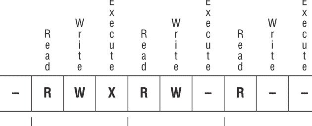

**图 7-1 Linux 文件权限**

讨论此主题最简单的方法是结合示例，逐一解码文件权限：

```bash
-rwxrwxr-x 1 rich rich 4882 2010-09-18 13:58 myprog
```

文件 `myprog` 具有以下权限集合：

- `rwx` 用于文件所有者（设置为登录名 `rich`）
- `rwx` 用于文件组所有者（设置为组名 `rich`）
- `r-x` 用于系统中的其他所有人

这些权限表明，登录名为 `rich` 的用户可以读取、写入和执行该文件（被视为完全权限）。同样，`rich`组的成员也可以读取、写入和执行该文件。然而，不属于 rich 组的任何人只能读取和执行该文件；`w` 被连字符取代，表明未授予该安全级别的写权限。

### 默认文件权限

您可能想知道这些文件权限的来源。答案是 `umask`。`umask`命令设置您创建的任何文件或目录的默认权限：

```bash
$ touch newfile
$ ls -al newfile
-rw-r--r-- 1 rich rich 0 Sep 20 19:16 newfile
$
```

`touch`命令使用分配给我用户账户的默认权限创建了该文件。`umask`命令显示并设置默认权限：

```bash
$ umask
0022
$
```

不幸的是，`umask`命令的设置并不十分清晰，试图确切理解其工作原理只会让事情变得更加复杂。第一个数字代表分配给文件的特殊安全功能。我们将在本章后面的“共享文件”部分详细讨论。

接下来的三个数字代表文件或目录的 `umask`八进制值。要理解 `umask`的工作原理，首先需要理解八进制模式的安全设置。

八进制模式安全设置将三个 `rwx`权限值转换为 3 位二进制值，由单个八进制值表示。在二进制表示中，每个位置是一个二进制位。因此，如果只设置了读权限，值变为 `r--`，对应二进制值 100，表示八进制值 4。*表 7-5* 显示了您可能会遇到的所有可能组合。

**表 7-5 Linux 文件权限代码**

| 权限 | 二进制 | 八进制 | 描述 |
| :--- | :--- | :--- | :--- |
| --- | 000 | 0 | 无权限 |
| --x | 001 | 1 | 仅执行权限 |
| -w- | 010 | 2 | 仅写权限 |
| -wx | 011 | 3 | 写和执行权限 |
| r-- | 100 | 4 | 仅读权限 |
| r-x | 101 | 5 | 读和执行权限 |
| rw- | 110 | 6 | 读和写权限 |
| rwx | 111 | 7 | 读、写和执行权限 |

八进制模式按顺序列出三个八进制权限值，分别对应三个安全级别（用户、组和其他人）。因此，八进制模式值 664 表示用户和组拥有读写权限，而其他所有人仅拥有读权限。

既然您了解了八进制模式权限，`umask`值就变得更加令人困惑了。我的 Linux 系统上默认 umask 显示的八进制模式是 `0022`，但我创建的文件八进制模式权限却是 644。这是如何发生的？

`umask`值就是一个掩码。它遮罩掉您不希望授予特定安全级别的权限。现在我们需要深入研究一些八进制算术来弄清楚剩下的故事。

`umask`值是从对象的完整权限集中减去的。文件的完整权限是模式 666（所有人读写权限），但目录的完整权限是 777（所有人读、写、执行权限）。

因此，在示例中，文件初始权限为 666，应用 022 的 `umask`后，剩余的文件权限为 644。


umask 值通常在 `/etc/profile` 启动文件中设置（参见第 6 章）。您可以使用 `umask` 命令指定不同的默认 umask 设置：

```bash
$ umask 026
$ touch newfile2
$ ls -l newfile2
-rw-r---- 1 rich rich 0 Sep 20 19:46 newfile2
$
```

当我们设置 umask 值为 `026` 时，默认文件权限变为 `640`，因此新文件现在对组成员而言仅限于只读，系统中的其他人对该文件没有任何权限。

umask 值也适用于创建新目录：

```bash
$ mkdir newdir
$ ls -l
drwxr-x--x 2 rich rich 4096 Sep 20 20:11 newdir/
$
```

由于目录的默认权限是 `777`，因此由 umask 生成的权限与新文件不同。将 `026` 的 umask 值从 `777` 中减去，得到 `751` 的目录权限设置。

### 更改安全设置

如果您已经创建了一个文件或目录，并需要更改其安全设置，Linux 中提供了几种不同的实用工具。本节将展示您如何更改文件或目录的现有权限、默认所有者以及默认组设置。

#### 更改权限

#### 更改 chmod 命令

`chmod` 命令允许你更改文件和目录的安全设置。`chmod` 命令的格式为：

```
chmod options mode file
```

`mode` 参数允许你使用八进制或符号模式来设置安全设置。八进制模式的设置相当简单；只需使用你希望文件拥有的标准三位八进制代码即可：

```
$ chmod 760 newfile
$ ls -l newfile
-rwxrw----  1 rich      rich                0 Sep 20 19:16 newfile
$
```

八进制文件权限会自动应用于指定的文件。符号模式的权限实现起来就不那么容易了。

`chmod` 命令没有使用正常的三组三字符字符串，而是采用了不同的方法。以下是在符号模式下指定权限的格式：

```
[ugoa...][+-=][rwxXstugo...]
```

这看起来很合理，不是吗？第一组字符定义了新权限适用于谁：

- `u` 表示用户
- `g` 表示组
- `o` 表示其他人（其他所有人）
- `a` 表示以上所有

接下来，使用一个符号来指示你是想将权限添加到现有权限中（`+`），从现有权限中减去权限（`-`），还是将权限设置为该值（`=`）。

最后，第三个符号是用于设置的权限。你可能会注意到这里的值比正常的 `rwx` 更多。额外的设置如下：

- `X` 仅在对象是目录或对象已具有执行权限时才分配执行权限
- `s` 设置执行时的 SUID 或 SGID
- `t` 设置粘滞位
- `u` 将权限设置为主权限
- `g` 将权限设置为组权限
- `o` 将权限设置为其他用户权限

使用这些权限看起来如下：

```
$ chmod o+r newfile
$ ls -l newfile
-rwxwrw-r-- 1 rich rich 0 Sep 20 19:16 newfile
$
```

`o+r` 条目将读取权限添加到“所有人”安全级别已有的任何权限中。

```
$ chmod u-x newfile
$ ls -l newfile
-rw-rw-r-- 1 rich rich 0 Sep 20 19:16 newfile
$
```

`u-x` 条目移除了用户已有的执行权限。请注意，`ls` 命令的设置通过文件名后的星号来表示文件是否具有执行权限。

`options` 参数为 `chmod` 命令的行为提供了一些额外功能。`-R` 参数递归地执行文件和目录的更改。你可以在指定的文件名中使用通配符，仅用一个命令即可更改多个文件的权限。

#### 更改所有权

有时你需要更改文件的所有者，例如当某人离开组织或开发者创建的应用程序在生产环境中需要由系统账户拥有时。

Linux 提供了两个命令来执行此操作。`chown` 命令可以轻松更改文件的所有者，而 `chgrp` 命令允许你更改文件的默认组。

`chown` 命令的格式为：

```
chown options owner[. group] file
```

你可以指定新文件所有者的登录名或数字 UID：

```
# chown dan newfile
# ls -l newfile
-rw-rw-r--    1 dan       rich           0 Sep 20 19:16 newfile
#
```

简单明了。`chown` 命令还允许你同时更改文件的用户和组：

```
# chown dan.shared newfile
# ls -l newfile
-rw-rw-r--    1 dan       shared         0 Sep 20 19:16 newfile
#
```

如果你真的想要更灵活一点，可以仅更改文件的默认组：

```
# chown .rich newfile
# ls -l newfile
-rw-rw-r--    1 dan       rich           0 Sep 20 19:16 newfile
#
```

最后，如果你的 Linux 系统使用了与用户登录名匹配的单独组名，你可以仅通过一个条目同时更改两者：

```
# chown test. newfile
# ls -l newfile
-rw-rw-r--    1 test      test           0 Sep 20 19:16 newfile
#
```

`chown` 命令使用几个不同的 `options` 参数。`-R` 参数允许你通过子目录和文件递归地进行更改，使用通配符。`-h` 参数还会更改符号链接到该文件的任何文件的所有权。

> **注意**
>
> 只有 root 用户可以更改文件的所有者。任何用户都可以更改文件的默认组，但该用户必须是文件从中更改的目标组的成员。

`chgrp` 命令提供了一种简单的方法来仅更改文件或目录的默认组：

```
$ chgrp shared newfile
$ ls -l newfile
-rw-rw-r-- 1 rich shared 0 Sep 20 19:16 newfile
$
```

现在，共享组中的任何成员都可以写入该文件。这是在 Linux 系统上共享文件的一种方法。然而，在系统中一群人之间共享文件可能会变得复杂。下一节将讨论如何执行此操作。

#### 共享文件

正如你可能已经意识到的，创建组是在 Linux 系统上共享文件访问权限的方法。然而，对于完整的文件共享环境，情况要复杂得多。

正如你在“解码文件权限”部分中已经看到的，当你创建一个新文件时，Linux 会使用你的默认 UID 和 GID 来分配新文件的文件权限。为了允许他人访问该文件，你需要更改“所有人”安全组的安全权限，或者为文件分配一个包含其他用户的不同默认组。

如果在大型环境中你想在几个人之间创建和共享文档，这可能会很麻烦。幸运的是，有一个简单的解决方案。Linux 为每个文件和目录存储三个额外的信息位：

- **设置用户 ID (SUID)：** 当文件由用户执行时，程序在文件所有者的权限下运行。
- **设置组 ID (SGID)：** 对于文件，程序在文件组的权限下运行。对于目录，在目录中创建的新文件使用该目录的组作为默认组。
- **粘滞位：** 当应用于目录时，只有文件所有者可以删除或重命名目录中的文件。

SGID 位对于共享文件很重要。通过启用 SGID 位，你可以强制共享目录中创建的所有新文件由目录的组而非单个用户的组拥有。

SGID 使用 `chmod` 命令设置。它被添加到标准三位八进制值的开头（使其成为四位八进制值），或者在符号模式下使用符号 `s`。

如果你正在使用八进制模式，你需要了解位的排列，如表 7–6 所示。

**表 7–6** `chmod` 的 SUID、SGID 和粘滞位八进制值

| 二进制 | 八进制 | 描述 |
| :------- | :------ | :------------ |
| 000    | 0     | 所有位均清除。 |
| 001    | 1     | 设置粘滞位。 |
| 010    | 2     | 设置 SGID 位。 |
| 011    | 3     | 设置 SGID 和粘滞位。 |
| 100    | 4     | 设置 SUID 位。 |
| 101    | 5     | 设置 SUID 和粘滞位。 |
| 110    | 6     | 设置 SUID 和 SGID 位。 |
| 111    | 7     | 所有位均设置。 |

因此，要创建一个始终为所有新文件设置目录组的共享目录，你只需要为该目录设置 SGID 位：


```
$ mkdir testdir
$ ls -l
drwxrwxr-x 2 rich rich 4096 Sep 20 23:12 testdir/
$ chgrp shared testdir
$ chmod g+s testdir
$ ls -l
drwxrwsr-x 2 rich shared 4096 Sep 20 23:12 testdir/
$ umask 002
$ cd testdir
$ touch testfile
$ ls -l
total 0
-rw-rw-r-- 1 rich shared 0 Sep 20 23:13 testfile
$
```

第一步是使用 `mkdir` 命令创建你想要共享的目录。接下来，使用 `chgrp` 命令将目录的默认组更改为包含需要共享文件的成员的组。最后，为该目录设置 SGID 位，以确保在目录中创建的任何文件都使用共享组名作为默认组。

为了使此环境正常工作，所有组成员都需要设置它们的 `umask` 值，使文件可被组成员写入。在上面的示例中，`umask` 被更改为 `002`，以便文件可被组写入。

完成所有这些设置后，组的任何成员都可以进入共享目录并创建新文件。正如预期那样，新文件使用目录的默认组，而不是用户账户的默认组。现在，共享组中的任何用户都可以访问此文件。

### 访问控制列表

Linux 基本权限方法的一个缺点是它受到一定的限制。你只能为文件或目录分配给单个组或用户账户的权限。在具有不同群体需要不同文件和目录权限的复杂商业环境中，这是行不通的。

Linux 开发者设计了一种更为高级的文件和目录安全机制，称为访问控制列表（ACL）。ACL 允许你指定一个包含多个用户或组的列表，以及分配给他们的权限。与基本安全机制一样，ACL 权限使用相同的读、写和执行权限位，但现在可以分配给多个用户和组。

要在 Linux 中使用 ACL 功能，你需要使用 `setfacl` 和 `getfacl` 命令。`getfacl` 命令允许你查看分配给文件或目录的 ACL：

```bash
$ touch test
$ ls -l
total 0
-rw-r---- 1 rich rich 0 Apr 19 17:33 test
$ getfacl test
# file: test
# owner: rich
# group: rich
user::rw-
group::r--
other::---
$
```

如果你只给文件分配了基本的安全权限，这些权限仍然会显示在 `getfacl` 的输出中，如本示例所示。

要为额外的用户或组分配权限，请使用 `setfacl` 命令：

```bash
setfacl [options] rule filenames
```

`setfacl` 命令允许你使用 `-m` 选项修改分配给文件或目录的权限，或使用 `-x` 选项删除特定权限。你可以使用以下三种格式定义规则：

- `u[ser]:uid:perms`

- `g[roup]:gid:perms`

- `o[ther]:::perms`

要为额外的用户账户分配权限，使用用户格式；为额外的组使用组格式；为其他用户使用其他格式。对于 `uid` 或 `gid` 值，你可以使用数字用户 ID 或组 ID，也可以使用名称。以下是一个示例：

```bash
$ setfacl -m g:sales:rw test
$ ls -l
total 0
-rw-rw----+ 1 rich rich 0 Apr 19 17:33 test
$
```

本示例为 `test` 文件中的 `sales` 组添加了读和写权限。请注意，`setfacl` 命令没有输出。当列出文件时，仅显示标准的拥有者、组和其他权限，但请注意权限列表末尾添加了一个加号（`+`）。这表明该文件已应用了额外的 ACL。要查看这些额外的 ACL，请再次使用 `getfacl` 命令：

```bash
$ getfacl test
# file: test
# owner: rich
# group: rich
user::rw-
group::r--
group:sales:rw-
mask::rw-
other::---
$
```

`getfacl` 的输出现在显示两个组被分配了权限。默认文件组（`rich`）被分配了读权限，但现在 `sales` 组对该文件拥有读和写权限。要删除这些权限，请使用 `-x` 选项：

```bash
$ setfacl -x g:sales test
$ getfacl test
# file: test
# owner: rich
# group: rich
user::rw-
group::r--
mask::r--
other::---

$
```

Linux 还允许你在目录上设置默认 ACL，该目录中创建的任何文件都会自动继承此 ACL。此功能称为继承。

要在目录上创建默认 ACL，请以 `d:` 开头启动规则，随后是常规规则定义。它看起来像这样：

```bash
$ sudo setfacl -m d:g:sales:rw /sales
```

本示例为 `/sales` 目录中的 `sales` 组分配了读和写权限。现在，在该文件夹中创建的所有文件将自动为 `sales` 组分配读和写权限。

#### 摘要

本章讨论了管理 Linux 系统安全所需的命令行命令。Linux 使用用户 ID 和组 ID 系统来保护对文件、目录和设备的访问。Linux 在 `/etc/passwd` 文件中存储有关用户账户的信息，在 `/etc/group` 文件中存储有关组的信息。每个用户都被分配一个唯一的数字用户 ID，以及一个文本登录名称，用于在系统中识别该用户。组也被分配唯一的数字组 ID 和文本组名称。一个组可以包含一个或多个允许共享访问系统资源的用户。

有几种命令可用于管理用户账户和组。`useradd` 命令允许你创建新的用户账户，而 `groupadd` 命令允许你创建新的组账户。要修改现有的用户账户，请使用 `usermod` 命令。类似地，使用 `groupmod` 命令来修改组账户信息。

Linux 使用复杂的位系统来确定文件和目录的访问权限。每个文件包含三个安全级别的保护：文件的所有者、拥有文件访问权限的默认组，以及系统中其他所有人的级别。每个安全级别由三个访问位定义：读、写和执行。这三个位的组合通常通过符号 `rwx` 表示，分别代表读、写和执行。如果权限被拒绝，其符号将被连字符替换（例如，仅读权限为 `r--`）。

符号权限通常被称为八进制值，其中三个位合并为一个八进制值，三个八进制值代表三个安全级别。`umask` 命令用于设置系统中创建的文件和目录的默认安全设置。系统管理员通常会在 `/etc/profile` 文件中设置默认的 umask 值，但你可以随时使用 `umask` 命令更改你的 umask 值。

`chmod` 命令用于更改文件和目录的安全设置。只有文件的所有者才能更改文件或目录的权限。但是，`root` 用户可以更改系统中任何文件或目录的安全设置。`chown` 和 `chgrp` 命令可用于更改文件的默认所有者和组。

本章还讨论了如何使用 set GID 位来创建共享目录。SGID 位强制在目录中创建的任何新文件或目录使用父目录的默认组名，而不是创建者的组名。这提供了一种在系统用户之间共享文件的简便方法。

最后，本章提供了有关使用 Linux ACL 功能为文件和目录分配更详细和高级权限的入门知识。`getfacl` 和 `setfacl` 命令提供了对此功能的访问。

现在，既然你已熟悉文件权限，是时候仔细看看如何在 Linux 中操作实际的文件系统了。下一章将向你展示如何从命令行在 Linux 中创建新分区，然后如何格式化这些新分区，以便它们可以在 Linux 虚拟目录中使用。

# 第 8 章

## 文件系统管理

### 本章内容

- 了解文件系统基础知识
- 探索日志文件和卷管理文件系统
- 管理文件系统
- 研究逻辑卷布局
- 使用 Linux 逻辑卷管理器

当使用你的 Linux 系统时，你需要做出的决定之一是选择哪种文件系统用于存储设备。大多数 Linux 发行版在安装时提供默认文件系统，而大多数初学 Linux 用户只是使用它而不做进一步思考。

虽然使用默认文件系统不一定是不好的，但有时了解可用的其他选项会很有帮助。本章讨论了在 Linux 世界中可用的不同文件系统选项，并展示了如何从 Linux 命令行创建和管理它们。

### 探索 Linux 文件系统

第 3 章“基础 Bash Shell 命令”讨论了 Linux 如何使用文件系统在存储设备上存储文件和文件夹。文件系统提供了 Linux 在硬盘中存储的 1 和 0 与你应用程序中处理的文件和文件夹之间架起桥梁的方式。

Linux 支持多种类型的文件系统来管理文件和文件夹。每个文件系统使用略有不同的特性在存储设备上实现虚拟目录结构。本节将带你了解在 Linux 环境中使用的常见文件系统的优缺点，以及它们的一些历史。

### 探索 Linux 文件系统的演变

最初的 Linux 系统使用一个简单的文件系统，模拟了 Unix 文件系统的功能。本节讨论了它随时间的改进。

### 查看 ext 文件系统


最初随 Linux 操作系统引入的文件系统称为*扩展文件系统*（或简称为 `ext`）。它为 Linux 提供了基本的类 Unix 文件系统，使用虚拟目录来处理物理设备，并在物理设备上以固定长度的块存储数据。

`ext` 文件系统使用称为*inode*的系统来跟踪存储在虚拟目录中的文件信息。`inode` 系统在每个物理设备上创建了一个单独的表，称为*inode 表*，用于存储文件信息。虚拟目录中存储的每个文件在 `inode` 表中都有一个条目。名称中的*扩展*部分来自于它跟踪的每个文件的额外数据，包括以下项：

- 文件名
- 文件大小
- 文件的所有者
- 文件所属的组
- 文件的访问权限
- 指向包含文件数据的每个磁盘块的指针

Linux 使用唯一的数字（称为 `inode` 号）引用 `inode` 表中的每个 `inode`，该号码由文件系统在创建数据文件时分配。文件系统使用 `inode` 号来识别文件，而不是必须使用完整的文件名和路径。

### 查看 ext2 文件系统

最初的 `ext` 文件系统存在许多限制，例如将文件大小限制在 2 GB 以内。在 Linux 首次推出后不久，`ext` 文件系统就被升级以创建第二扩展文件系统，即 `ext2`。

`ext2` 文件系统保持了相同的 `ext` 文件系统结构，但增强了其功能：

- 在 `inode` 表中添加了文件的创建、修改和最后访问时间值。
- 允许的最大文件大小增加到 2 TB，随后又增加到 32 TB。
- 保存文件时，磁盘块以组的形式进行分配。

`ext2` 文件系统也存在局限性。如果在文件保存和 `inode` 表更新之间系统发生故障，潜在的结果是丢失文件在磁盘上的数据位置。`ext2` 文件系统因系统崩溃和电力中断而容易出现这些损坏而闻名。没过多久，开发人员就开始探索 Linux 文件系统的其他途径。

### 深入探索日志文件系统

日志文件系统为 Linux 系统提供了更高程度的安全性。与直接写入存储设备然后更新 `inode` 表不同，日志文件系统首先将文件更改写入临时文件（称为日志）。在数据成功写入存储设备和 `inode` 表后，日志条目会被删除。

如果系统在数据写入存储设备之前崩溃或遭遇断电，日志文件系统会读取日志文件并处理任何未提交的数据。

Linux 通常使用三种不同的日志记录方法，每种方法具有不同的保护级别。这些方法如表 8-1 所示。

#### 表 8-1 日志文件系统方法

| 方法 | 描述 |
| :--- | :--- |
| 数据模式 | `inode` 和文件数据都会记录日志。丢失数据的风险低，但性能较差 |
| 顺序模式 | 仅将 `inode` 数据写入日志，但在文件数据成功写入之前不会删除。在性能和安全性之间取得良好平衡 |
| 回写模式 | 仅将 `inode` 数据写入日志；对文件数据何时写入没有控制。丢失数据的风险较高，但仍比不使用日志记录要好 |

数据模式日志记录方法是目前保护数据最安全的方法，但它也是最慢的。写入存储设备的所有数据都必须写入两次，一次写入日志，再次写入实际存储设备。这可能会导致性能较差，特别是对于执行大量数据写入的系统。

多年来，Linux 中出现了几种不同的日志文件系统。以下各节简要描述了可用的流行 Linux 日志文件系统。

### 查看 ext3 文件系统

`*ext3*` 文件系统是 `ext2` 的后继者，支持最大 2 TB 的文件，文件系统总大小为 32 TB。默认情况下，它使用顺序模式的日志记录方法，但可以通过命令行选项使用其他模式。默认情况下，它不提供意外文件删除恢复功能，也不允许数据压缩。

### 查看 ext4 文件系统

`ext3` 仍然流行的后继者，`*ext4*` 文件系统支持最大 16 太字节 (TiB) 的文件，文件系统总大小为 1 艾字节 (EiB)。默认情况下，它使用顺序模式的日志记录方法，但可以通过命令行选项使用其他模式。它支持加密、压缩以及在单个目录内创建无限个子目录。旧的 `ext2` 和 `ext3` 文件系统可以像 `ext4` 一样挂载，以提高其性能。

### 查看 JFS 文件系统

可能是现存最古老的日志文件系统之一，*日志文件系统 (JFS)* 是 IBM 在 1990 年为 AIX (Advanced Interactive Executive) 版本的 Unix 开发的。然而，直到其第二个版本才移植到 Linux 环境。

> **注意**
>
> JFS 文件系统第二版的官方 IBM 名称是 JFS2，但大多数 Linux 系统将其简称为 JFS。

JFS 文件系统使用顺序日志记录方法，仅在日志中存储 `inode` 表数据，并且在实际文件数据写入存储设备之前不会将其删除。

### 查看 ReiserFS

2001 年，Hans Reiser 为 Linux 创建了第一个日志文件系统，称为 *ReiserFS*，它提供了现在 `ext3` 和 `ext4` 中常见的功能。Linux 已经放弃了对最新版本 Reiser4 的支持。

### 查看 XFS

*X 文件系统 (XFS)* 是由 Silicon Graphics 为其（现已停产的）高级图形工作站创建的。该文件系统提供了一些先进的高性能功能，使其在 Linux 中依然流行。

XFS 文件系统使用回写模式的日志记录，虽然提供高性能，但由于实际数据未存储在日志文件中，因此会引入一定程度的风险。

### 理解卷管理文件系统

在使用日志记录时，您必须在安全性和性能之间做出选择。虽然数据模式日志记录提供最高的安全性，但由于 `inode` 和数据都记录了日志，性能会受到影响。使用回写模式日志记录，性能是可以接受的，但安全性会受到损害。

对于文件系统，日志记录的一种替代技术称为写时复制 (COW)。COW 通过快照同时提供安全性和性能。在修改数据时，使用克隆或可写快照。修改后的数据不是覆盖当前数据，而是放在新的文件系统位置。

> **注意**
>
> 真正的 COW 系统仅在数据修改完成后才修改旧数据。如果旧数据从未被覆盖，描述此行为的正确术语是写时重定向 (ROW)。然而，通常 ROW 简单地被称为 COW。

尽管多年来磁盘大小显著增加，但对更多空间的需求始终存在。由一个或多个磁盘或磁盘分区创建的存储池，提供了创建看起来像是单个磁盘（称为卷）的能力。使用这些存储池允许根据需要扩展卷，提供灵活性并大大减少停机时间。

具有 COW、快照和卷管理功能的文件系统正日益流行。两个最受欢迎的文件系统 Btrfs 和 ZFS 将在以下各节中简要回顾，以及一位新成员 Stratis。

### 查看 ZFS 文件系统

ZFS 文件系统最初由 Sun Microsystems 在 2005 年为 OpenSolaris 操作系统发布。它于 2008 年开始移植到 Linux，并于 2012 年最终可供 Linux 生产环境使用。

ZFS 是一个稳定的文件系统，在竞争 Reiser4、Btrfs 和 `ext4` 方面表现出色。它拥有数据完整性验证和自动修复功能，提供最大 16 EB 的文件大小，以及 256 千万亿 ZB 的最大存储大小。这是一个非常大的文件系统！

不幸的是，它最大的缺点是 ZFS 没有 GNU 通用公共许可证 (GPL)，因此不能包含在 Linux 内核中。幸运的是，大多数 Linux 发行版都提供了安装它的方式。

### 查看 Btrfs 文件系统

`*Btrfs*` 文件系统（通常发音为 *butter-fs*）也称为 B-tree 文件系统。Oracle 于 2007 年开始开发 Btrfs。它基于 Reiser4 的许多特性，但提供了可靠性的改进。随着时间的推移，更多的开发人员加入并帮助 Btrfs 迅速跻身流行文件系统排行榜的前列。这种 popularity 是由于其稳定性和易用性，以及能够动态调整已挂载文件系统大小的能力。

虽然 openSUSE Linux 发行版将 Btrfs 设为其默认文件系统，但在 2017 年，红帽对其进行了弃用，这意味着它不再支持该文件系统（从 RHEL 版本 8 及以后开始）。不幸的是，对于那些绑定于 RHEL 的组织来说，这意味着 Btrfs 不是首选的文件系统。

### 查看 Stratis 文件系统

当红帽弃用 Btrfs 时，决定创建一个新的文件系统 *Stratis*。但根据标准定义，不能准确地将 Stratis 称为文件系统。相反，它提供了更多的管理视角。它维护的存储池由一个或多个 XFS 文件系统组成。它还提供了 COW 功能，类似于更传统的卷管理文件系统，如 ZFS 和 Btrfs。“易用性”和“高级存储功能”是经常用来描述它的术语，但此时还难以判断 Stratis 在这些概念上的表现有多接近。

> **注意**
>
> XFS 近年来一直在改进其 COW 功能。例如，它现在具有 always_cow 模式。

这会导致 XFS 在修改时不会覆盖原始数据。

Stratis 最早在 Fedora 29（2018 年发布）中提供以供审查，在 RHEL v8 中它被视为技术预览功能。这意味着 Stratis 目前还不适合在生产环境中使用。提醒你一下。

## 与文件系统协同工作


Linux 提供了一些实用工具，使命令行下操作文件系统变得更加容易。你可以从舒适的键盘上添加新的文件系统或修改现有的文件系统。本节将带你了解从命令行环境管理文件系统的命令。

## 创建分区

一开始，你需要在存储设备上创建一个分区来容纳文件系统。该分区可以是整个磁盘，也可以是包含虚拟目录一部分的磁盘子集。

有许多可用的工具可以帮助你组织和管理分区。本节我们将重点关注以下三个 CLI 程序：

- `fdisk`
- `gdisk`
- `GNU parted`

有时，创建新磁盘分区最难的部分是在 Linux 系统上找到物理磁盘。Linux 使用标准格式为硬盘分配设备名称，你在分区磁盘之前需要熟悉这种格式：

- SATA 驱动器和 SCSI 驱动器：Linux 使用 `/dev/sd x`，其中 x 是根据驱动器检测顺序确定的字母（第一个驱动器为 a，第二个为 b，依此类推）
- SSD NVMe 驱动器：设备名称格式为 `/dev/nvme n n #`，其中 n 是根据驱动器检测顺序确定的数字，从 0 开始。# 是分配给驱动器命名空间结构的数字，从 1 开始。
- IDE 驱动器：Linux 使用 `/dev/hd x`，其中 x 是根据驱动器检测顺序确定的字母（第一个驱动器为 a，第二个为 b，依此类推）。

一旦你有了正确的驱动器名称，你就可以考虑使用哪种分区工具。以下章节将介绍三种选择。

### 查看 fdisk 实用工具

`fdisk` 实用工具是一个较老但强大的工具，用于在任何驱动器上创建和管理分区。但是，`fdisk` 仅处理大小不超过 2 TB 的磁盘。如果你有一个更大的磁盘，你可以使用 `gdisk` 或 GNU `parted` 实用工具代替。

> **提示**
>
> **如果你第一次对存储设备进行分区，`fdisk` 会警告该设备上没有分区表。**

`fdisk` 命令是一个交互式程序，允许你输入命令以逐步完成分区硬驱的步骤。要启动 `fdisk` 实用工具，你需要指定你想要分区的存储设备的设备名称，并且你需要具有超级用户权限（以 root 用户登录或使用 `sudo` 命令）。

```
# whoami
root
# fdisk /dev/sda

Welcome to fdisk (util-linux 2.32.1).
Changes will remain in memory only, until you decide to write them.
Be careful before using the write command.

Command (m for help):
```

`fdisk` 程序使用自己的命令行，允许你提交命令来操作驱动器分区。表 8-2 显示了你可使用的常用命令。

#### 表 8-2 常见的 fdisk 命令

| 命令 | 描述 |
|---|---|
| a | 切换启动标志。 |
| b | 编辑损坏的磁盘标签。 |
| c | 切换 DOS 兼容性标志。 |
| d | 删除一个分区。 |
| g | 创建一个新的空 GPT 分区表。 |
| G | 创建 IRIX (SGI) 分区表。 |
| l | 列出已知的分区类型。 |
| m | 打印此菜单。 |
| n | 添加一个新分区。 |
| o | 创建一个新的空 DOS 分区表。 |
| p | 打印分区表。 |
| q | 退出而不保存更改。 |
| s | 创建一个新的空 Sun 磁盘标签。 |
| t | 更改分区的系统 ID。 |
| u | 更改显示/输入单位。 |
| v | 验证分区表。 |
| w | 将表写入磁盘并退出。 |
| x | 额外功能（仅限专家使用）。 |

`p` 命令显示选定驱动器上当前的分区方案：

```
Command (m for help): p
Disk /dev/sda: 20 GiB, 21474836480 bytes, 41943040 sectors
Units: sectors of 1 * 512 = 512 bytes
Sector size (logical/physical): 512 bytes / 512 bytes
I/O size (minimum/optimal): 512 bytes / 512 bytes
Disklabel type: dos
Disk identifier: 0x8a136eb4

Device Boot Start End Sectors Size Id Type
/dev/sda1 * 2048 2099199 2097152 1G 83 Linux
/dev/sda2 2099200 41943039 39843840 19G 8e Linux LVM

Command (m for help):
```

在这个例子中，`/dev/sda` 驱动器被划分为两个分区，`sda1` 和 `sda2`。第一个分区分配了大约 1 GB 的空间（如 Size 列所示），而第二个分区分配了略超过 19 GB 的空间。

`fdisk` 命令相当基础，因为它不允许你更改现有分区的大小；你所能做的只有删除现有分区并从头开始重建。

> **提示**
>
> 某些发行版和较旧的发行版版本在创建新分区后不会自动通知你的 Linux 系统。在这种情况下，你需要使用 `partprobe` 或 `hdparm` 命令（参见其 man 页），或者重启系统以便其读取更新后的分区表。

如果你对驱动器分区进行了任何更改，必须使用 `w` 命令退出以将更改写入驱动器。若要退出而不进行任何修改，请使用 `q` 命令：

```
Command (m for help): q
#
```

以下示例在 `/dev/sdb` 驱动器上创建了一个新分区，供本章后面的“创建文件系统”部分使用：

```
$ sudo fdisk /dev/sdb
[sudo] password for christine:
[...]
Command (m for help): n
Partition type
   p   primary (0 primary, 0 extended, 4 free)
   e   extended (container for logical partitions)
Select (default p): p
Partition number (1-4, default 1): 1
First sector  (2048-4194303, default 2048):
Last sector, +sectors or +size{K,M,G,T,P} (2048-4194303,
default 4194303):

Created a new partition 1 of type 'Linux' and of size 2 GiB.

Command (m for help): w
The partition table has been altered.
Calling ioctl() to re-read partition table.
Syncing disks.

$
```

现在，一个新的磁盘分区 `/dev/sdb1` 已准备就绪，可以进行格式化。请注意，使用 `fdisk` 创建新的磁盘分区时，你不必输入任何信息。只需按 Enter 键接受显示的默认值即可。

### 使用 gdisk 操作

如果你正在使用采用 GUID 分区表（GPT）索引方法的驱动器，可以使用 `gdisk` 程序：

```
$ sudo gdisk /dev/sda
[sudo] password for christine:
GPT fdisk (gdisk) version 1.0.3

Partition table scan:
 MBR: MBR only
 BSD: not present
 APM: not present
 GPT: not present

*******************************************************

Found invalid GPT and valid MBR; converting MBR to GPT format
in memory. THIS OPERATION IS POTENTIALLY DESTRUCTIVE! Exit by
typing 'q' if you don't want to convert your MBR partitions
to GPT format!

[...]
Command (? for help): q
$
```

`gdisk` 程序识别驱动器上使用的格式化类型。如果驱动器当前未使用 GPT 方法，`gdisk` 提供选项将其转换为 GPT 驱动器。

> **警告**
>
> **请务必小心转换指定驱动器的驱动器方法。你选择的方法必须与系统固件（BIOS 或 UEFI）兼容。如果不兼容，你的驱动器将无法启动。**

`gdisk` 程序也使用自己的命令提示符，允许你输入命令以操作驱动器布局，如表 8-3 所示。

#### 表 8-3 常见的 gdisk 命令

| 命令 | 描述 |
| :--- | :--- |
| b | 将 GPT 数据备份到文件。 |


| c | 更改分区名称。 |
| d | 删除一个分区。 |
| i | 显示分区的详细信息。 |
| l | 列出已知的分区类型。 |
| n | 添加一个新分区。 |
| o | 创建一个新的空 GUID 分区表（GPT）。 |
| p | 打印分区表。 |
| q | 退出而不保存更改。 |
| r | 恢复和转换选项（仅限专家使用）。 |
| s | 排序分区。 |

### GNU parted 命令

GNU `parted` 程序提供了另一种用于操作磁盘分区的命令行界面。与 `fdisk` 和 `gdisk` 程序不同，该实用程序中的命令更偏向于单词形式：

```
$ sudo parted
GNU Parted 3.2
Using /dev/sda
Welcome to GNU Parted! Type 'help' to view a list of
commands.
(parted) print
Model: ATA VBOX HARDDISK (scsi)
Disk /dev/sda: 21.5GB
Sector size (logical/physical): 512B/512B
Partition Table: msdos
Disk Flags:

Number Start End Size Type File system Flags
1 1049kB 1075MB 1074MB primary ext4 boot
2 1075MB 21.5GB 20.4GB primary lvm

(parted) quit
$
```

`parted` 程序的一个主要优点是允许你修改现有分区的大小，因此你可以轻松地缩小或扩大磁盘上的分区。

## 创建文件系统

在你能在分区上存储数据之前，必须使用文件系统对其进行格式化，以便 Linux 可以使用它。每种文件系统类型都使用自己的命令行程序来格式化分区。

### 表 8-4 用于创建文件系统的命令行程序

| 工具 | 用途 |
| :--- | :--- |
| `mkfs` | 创建 ext 文件系统。 |
| `mke2fs` | 创建 ext2 文件系统。 |
| `mkfs.ext3` | 创建 ext3 文件系统。 |
| `mkfs.ext4` | 创建 ext4 文件系统。 |
| `mkreiserfs` | 创建 ReiserFS 文件系统。 |
| `jfs_mkfs` | 创建 JFS 文件系统。 |
| `mkfs.xfs` | 创建 XFS 文件系统。 |
| `mkfs.zfs` | 创建 ZFS 文件系统。 |
| `mkfs.btrfs` | 创建 Btrfs 文件系统。 |

并非所有文件系统工具都默认安装。要确定你是否有某个文件系统工具，请使用 `type` 命令：

```
$ type mkfs.ext4
mkfs.ext4 is /usr/sbin/mkfs.ext4
$ type mkfs.btrfs
-bash: type: mkfs.btrfs: not found
$
```

上述示例表明 `mkfs.ext4` 工具是可用的。然而，Btrfs 工具不可用。

> **提示**
>
> 检查你正在使用的 Linux 发行版是否支持你希望创建的文件系统。如果受支持，且其文件系统工具当前未提供，你可以安装所需的软件和工具。有关更多详细信息，请参见**第 9 章 “安装软件”**。

所有文件系统命令都允许你仅通过简单的命令且不带任何选项来创建默认文件系统，但你需要拥有超级用户权限：

```
$ sudo mkfs.ext4 /dev/sdb1
[sudo] password for christine:
mke2fs 1.44.6 (5-Mar-2019)
Creating filesystem with 524032 4k blocks and 131072 inodes
[...]
Creating journal (8192 blocks): done
Writing superblocks and filesystem accounting information:
done
$
```

新文件系统使用 ext4 文件系统类型，这是 Linux 中一种日志记录文件系统。注意创建过程的一部分是创建新的日志。

> **提示**
>
> 每个文件系统工具命令都有许多命令行选项，允许你自定义文件系统在分区中的创建方式。要查看可用的所有命令行选项，请使用 `man` 命令（参见第 3 章）来显示你要使用的文件系统命令的手册页。

为分区创建文件系统后，下一步是将其挂载到虚拟目录挂载点上，以便你可以将数据存储在那里。你可以将新文件系统挂载到虚拟目录中任何你需要的额外空间的地方。

```
$ mkdir /home/christine/part
$ sudo mount -t ext4 /dev/sdb1 /home/christine/part
[sudo] password for christine:
$
$ lsblk -f /dev/sdb
```

```
NAME  FSTYPE LABEL UUID           MOUNTPOINT
sdb
├sdb1 ext4   a8d1d[...]. /home/christine/part
$
```

`mkdir` 命令（第 3 章）在虚拟目录中创建挂载点，而 `mount` 命令将新的硬盘分区添加到挂载点。`mount` 命令中的 `-t` 选项指示你要挂载的文件系统类型，即 ext4。而 `lsblk -f` 命令允许你查看新格式化和挂载的分区。

> **警告**
>
> 这种挂载文件系统的方法仅临时挂载文件系统。当你重启 Linux 系统时，文件系统不会自动挂载。若要强制 Linux 在启动时自动挂载新文件系统，请将新文件系统添加到 `/etc/fstab` 文件中。

现在文件系统已挂载在虚拟目录系统中，它可以开始常规使用。不幸的是，常规使用带来了严重问题的可能性，例如文件系统损坏。下一节讨论如何应对这些问题。

## 检查和修复文件系统

即使是现代文件系统，如果意外断电，或者某个失控的应用程序在文件访问过程中锁定系统，也可能会出错。幸运的是，有一些命令行工具可供你尝试恢复文件系统。

每个文件系统都有自己用于与文件系统交互的恢复命令。这可能会变得繁琐，因为 Linux 环境中可用的文件系统越来越多，这意味着你需要知道许多单独的命令。幸运的是，一个通用前端程序可以确定存储设备上的文件系统，并根据要恢复的文件系统使用相应的文件系统恢复命令。

`fsck` 命令用于检查和修复大多数 Linux 文件系统类型，包括本章前面讨论的类型。该命令的格式为

```
fsck options filesystem
```

你可以在命令行上列出多个 `filesystem` 条目进行检查。文件系统通过几种方法引用，例如设备名称或其虚拟目录中的挂载点。但是，在使用 `fsck` 之前必须卸载该设备。

`fsck` 命令使用 `/etc/fstab` 文件自动确定通常挂载在系统上的存储设备上的文件系统。如果存储设备通常未挂载（例如，如果你刚在新存储设备上创建了文件系统），则需要使用 `-t` 命令行选项指定文件系统类型。表 8-5 列出了其他常用的命令行选项。

### 表 8-5 `fsck` 常用命令行选项

| 选项 | 描述 |
| :--- | :--- |
| `-a` | 如果检测到错误，自动修复文件系统。 |
| `-A` | 检查 `/etc/fstab` 文件中列出的所有文件系统。 |
| `-N` | 不运行检查；仅显示将执行哪些检查。 |
| `-r` | 如果发现错误，提示进行修复。 |
| `-R` | 如果使用 `-A` 选项，则跳过根文件系统。 |
| `-t` | 指定要检查的文件系统类型。 |
| `-V` | 在检查期间产生详细输出。 |
| `-y` | 如果检测到错误，自动修复文件系统。 |

你可能会注意到某些命令行选项是冗余的。这是尝试为多个命令实现通用前端时存在的问题的一部分。某些单独的文件系统修复命令还有可用的其他选项。

> **提示**
>
> **你只在未挂载的文件系统上运行 `fsck` 命令。对于大多数文件系统，只需卸载要检查的文件系统，完成后重新挂载即可。然而，由于根文件系统包含所有核心 Linux 命令和日志文件，你无法在运行中的系统上卸载它。**
>
> **此时，拥有一个 Linux 启动光盘、DVD 或 USB 非常方便！只需使用 Linux 启动媒体启动系统，然后在根文件系统上运行 `fsck` 命令。**

本章展示了如何处理物理存储设备中包含的文件系统。Linux 还提供了一些创建文件系统逻辑存储设备的方法。下一节将研究如何使用逻辑存储设备作为你的文件系统。

## 管理逻辑卷

数据通常有增长的趋势。如果你使用...

对于硬盘上的标准分区，尝试为现有文件系统增加空间可能会是一个相当痛苦的过程。如果该硬盘上没有更多可用空间，你就不得不换一块更大的硬盘，并手动将现有文件系统迁移到新硬盘上。


如果有一种方法，可以通过将其他硬盘上的分区直接添加到现有文件系统，从而动态地为现有文件系统增加更多空间，那将非常实用。Linux 的*逻辑卷管理*或*管理器（LVM）*正好允许你这样做。它提供了一种简单的方式来操作 Linux 系统上的磁盘空间，而无需重建整个文件系统。本节将介绍逻辑卷及相关术语，并提供设置它们的实用步骤。

## 探索 LVM 布局

LVM 允许将多个分区分组在一起，并将其作为一个单一分区用于格式化、挂载到 Linux 虚拟目录结构、存储数据等。随着数据需求的增长，你还可以向逻辑卷添加分区。

LVM 由三个主要部分组成，将在接下来的几节中介绍。每个部分在创建和维护逻辑卷中都扮演着重要角色。

### 物理卷

*物理卷（PV）*是使用 LVM 的 `pvcreate` 命令创建的。该实用程序指定一个未使用的磁盘分区（或整个驱动器）供 LVM 使用。在此过程中，LVM 结构、卷标签和元数据会被添加到该分区中。

### 卷组

*卷组（VG）*是使用 LVM 的 `vgcreate` 命令创建的，该命令将 PV 添加到存储池。该存储池随后用于构建各种逻辑卷。

你可以拥有多个卷组。当你使用命令将 PV 添加到 VG 时，卷组元数据会在此过程中被添加到 PV 中。

硬盘的分区一旦被指定为 PV，就只能属于单个 VG。然而，硬盘上的其他分区（也被指定为 PV）可以属于其他 VG。

### 逻辑卷

*逻辑卷*（*LV*）是使用 LVM 的 `lvcreate` 命令创建的。这是逻辑卷创建过程中的最终对象。LV 由 VG 池中的存储块组成。它可以像典型的磁盘分区一样进行格式化、挂载和使用。

虽然你可以拥有多个 VG，但每个 LV 仅从一个指定的 VG 中创建。然而，你可以让多个 LV 共享单个 VG。你可以使用适当的 LVM 命令调整 LV 的大小（扩展或缩减）。这一特性为你的数据存储管理带来了极大的灵活性。

使用 LVM 划分和管理数据存储介质有许多方法。接下来，我们将深入了解创建和管理这些卷的细节。

## 理解 Linux 中的 LVM

`lvm` 实用程序是一个用于创建和管理 LV 的交互式实用程序。如果未安装，你可以通过 `lvm2` 包安装它（参见[第 9 章](#)）。你不需要进入 `lvm` 实用程序来访问各种 LVM 工具。相反，你可以直接通过 CLI 访问这些工具，如本节所述。

> **注意**
>
> `lvm2` 或 LVM2 中的“2”指的是 LVM 的第二个版本。与 LVM 版本 1（lvm1）相比，它增加了一些额外特性并改进了设计。本章使用的是 LVM2。

首次设置逻辑卷时：
- 1. 创建物理卷。
- 2. 创建卷组。
- 3. 创建逻辑卷。
- 4. 格式化逻辑卷。
- 5. 挂载逻辑卷。

设置逻辑卷的前三个步骤涉及重要的考量。你在早期步骤中做出的每个决定都将决定管理你的 LV 的灵活性和易用程度。

## 创建 PV

在指定驱动器作为 PV 之前，请确保它们已经分区且当前未被使用。使用带有超级用户权限的 `pvcreate` 命令将分区指定为 PV：

```bash
$ lsblk
NAME        MAJ:MIN RM  SIZE RO TYPE MOUNTPOINT
[ ... ]
sdb         8:16    0    2G  0 disk
└sdb1       8:17    0    2G  0 part
sdc         8:32    0    1G  0 disk
└sdc1       8:33    0 1023M  0 part
sdd         8:48    0    1G  0 disk
└sdd1       8:49    0 1023M  0 part
sde         8:64    0    1G  0 disk
└sde1       8:65    0 1023M  0 part
sr0        11:0    1 1024M  0 rom
$
$ sudo pvcreate /dev/sdc1 /dev/sdd1 /dev/sde1
[sudo] password for christine:
Physical volume "/dev/sdc1" successfully created.
Physical volume "/dev/sdd1" successfully created.
Physical volume "/dev/sde1" successfully created.
$
```

明智的做法是设置多个 PV。LVM 的重点在于可以随时为你的 LV 添加额外的存储介质。一旦设置了 PV，就可以创建 VG。

## 创建 VG

任何 PV 都可以被添加到卷组中。使用的命令是 `vgcreate`。

> **提示**
>
> 在 VG 创建过程中，你可以指定多个 PV。如果你需要稍后将 PV 添加到 VG，请使用 `vgextend` 命令。

常见的做法是将第一个 VG 命名为 `vg00`，下一个命名为 `vg01`，依此类推。然而，卷组的命名由你决定。由于许多发行版在安装期间为虚拟目录结构的根（`/`）设置 LVM，因此建议使用 `vgdisplay` 命令检查系统中当前的 VG 是一个好主意：

```bash
$ sudo vgdisplay
--- Volume group ---
VG Name     c1
System ID
Format      lvm2
[...]
$
```

请注意，在上面的示例中，已经设置了一个名为 `c1` 的 VG。因此，我们可以安全地使用 `vg00` 作为我们第一个卷组的名称：

```bash
$ sudo vgcreate vg00 /dev/sdc1 /dev/sdd1
Volume group "vg00" successfully created
$
```

在上面的示例中，仅使用我们的两个 PV 来创建 VG `vg00`：`/dev/sdc1` 和 `/dev/sdd1`。既然我们的 VG 存储池至少包含一个 PV，我们就可以创建 LV。

## 创建 LV

要创建逻辑卷，请使用 `lvcreate` 命令。生成的存储卷的大小使用 `-L` 选项设置，该选项使用指定 VG 存储池中的空间：

```bash
$ sudo lvcreate -L 1g -v vg00
[sudo] password for christine:
Archiving volume group "vg00" metadata (seqno 1).
Creating logical volume lvol0
[...]
  Logical volume "lvol0" created.
$
```

请注意，从此 VG 的第一个 LV 的默认名称是 `lvol0`。其完整的设备路径名是 `/dev/vg00/lvol0`。

> **注意**
>
> 如果由于某种原因 VG 没有足够的分区空间分配给指定大小的 LV，`lvcreate` 命令将不会创建 LV。相反，你会收到一个可用空间不足的错误消息。

LV 创建后，使用 `lvdisplay` 命令显示其信息。请注意，使用完整的路径名来向命令指定逻辑卷：

```bash
$ sudo lvdisplay /dev/vg00/lvol0
[sudo] password for christine:
--- Logical volume ---
  LV Path        /dev/vg00/lvol0
  LV Name        lvol0
  VG Name        vg00
[...]
  LV Size        1.00 GiB
[...]
$
```

除了 `lvdisplay` 命令，你还可以使用 `lvs` 和 `lvscan` 命令来显示所有系统 LV 的信息。拥有多种选择是很好的。

## 使用 Linux LVM

一旦 LV 创建完成，请将其视为常规分区。当然，它的不同之处在于你可以根据需要随时扩展或缩减此分区。但在执行任何操作之前，你需要将 LV 附加到虚拟目录结构。

## 格式化和挂载 LV

对于你的 LV，为了让其上的文件系统挂载到虚拟目录结构，没有特别需要做的事情：

```bash
$ sudo mkfs.ext4 /dev/vg00/lvol0
[sudo] password for christine:
[...]
Writing inode tables: done
Creating journal (8192 blocks): done
Writing superblocks and filesystem accounting information: done

$ mkdir my_LV
$ sudo mount -t ext4 /dev/vg00/lvol0 my_LV
$ ls my_LV
lost+found
$
```

现在，各种 LVM 部分都已创建，并且 LV 已附加到你的虚拟目录结构，你可以按需使用它。请记住，你需要在 `/etc/fstab` 文件中添加一条记录，以便新 LV 在系统启动时自动挂载。


## 扩展或缩减你的 VG 和 LV

总会有时候你需要增加 VG 或 LV 的大小。这可能是由于卷上的数据增加，也可能是安装了新的应用程序。然而，你可能想要缩减 VG 或 LV。如果你无法访问用于处理 Linux LVM 环境中这些活动的花哨图形界面，一切也未完全结束。表 8-6 列出了用于完成这些任务的常用命令。

**表 8-6 扩展和缩减 LVM 的命令**

| 命令 | 功能 |
|---|---|
| `vgextend` | 将物理卷添加到卷组。 |
| `vgreduce` | 从卷组中移除物理卷。 |
| `lvextend` | 增加逻辑卷的大小。 |
| `lvreduce` | 减小逻辑卷的大小。 |

使用这些命令行程序，你对你的...

Linux LVM 环境。请务必查阅相关手册页以获取更多详细信息。

> **提示**
>
> **要查看所有可用的 LVM 命令，请在 CLI 中输入 `lvm help` 并按下 Enter 键。**

使用本文介绍的各种命令行程序，你可以完全控制 Linux LVM 环境。同时，你还能获得 LVM 带来的额外灵活性。

### 总结

在 Linux 中处理存储设备需要了解一些文件系统知识。当你在使用 Linux 系统时，知道如何从命令行创建和处理文件系统会非常有用。本章讨论了如何从 Linux 命令行处理文件系统。

在存储设备上安装文件系统之前，必须先准备磁盘。使用 `fdisk`、`gdisk` 和 `parted` 命令对存储设备进行分区，使其准备好安装文件系统。对存储设备进行分区时，必须定义将使用什么类型的文件系统。

对存储设备进行分区后，你可以为该分区使用几种文件系统之一。流行的 Linux 文件系统包括日志记录或卷管理功能，这使得它们更不容易出现错误和问题。

直接在存储设备分区上创建文件系统的一个限制因素是，当磁盘空间不足时，你无法轻松更改文件系统的大小。然而，Linux 支持逻辑卷管理（LVM），这是一种在多个存储设备上创建虚拟分区的方法，它允许你轻松扩展现有文件系统，而无需完全重建它。

既然你已经看到了核心的 Linux 命令行命令，是时候开始编写一些 Shell 脚本程序了。但是，在开始编码之前，我们需要讨论另一个元素：安装软件。如果你打算编写 Shell 脚本，你需要一个环境来创作你的杰作。下一章讨论了如何在不同的 Linux 环境中从命令行安装和管理软件包。

# 第 9 章

## 安装软件

### 本章内容

- **安装软件**
- **使用 Debian 软件包**
- **操作 Red Hat 软件包**
- **探索应用程序容器**
- **回顾 tar 包**

在 Linux 的早期，安装软件可能是一种痛苦的经历。幸运的是，Linux 开发者通过将软件打包成预构建的软件包，使我们的生活变得轻松了一些，这些软件包更容易安装。然而，在我们这边仍有一些工作需要来做，以便安装软件包，特别是如果你希望从命令行这样做。本章介绍了 Linux 中可用的各种包管理系统以及用于软件安装、管理和移除的命令行工具。

### 探索包管理

在深入 Linux 软件包管理的世界之前，本章将介绍一些基础知识。每个主要的 Linux 发行版都使用某种形式的包管理系统来控制软件应用程序和库的安装。*包管理系统*使用数据库来跟踪以下内容：

- Linux 系统上安装了哪些软件包
- 为每个软件包安装了哪些文件
- 已安装软件包的版本

软件包存储在称为*仓库*的服务器上，并通过运行在本地 Linux 系统上的包管理系统实用程序通过互联网访问。你可以使用这些实用程序搜索新的软件包或已安装在系统上的软件包更新。

软件包通常具有*依赖项*，即为了使软件正常运行必须先安装的其他软件包。包管理系统实用程序会检测这些依赖项，并在安装所需的软件包之前提供安装任何其他所需软件包。

包管理系统的一个缺点是，没有单一的通用工具。尽管本书中讨论的所有 Bash Shell 命令在任何 Linux 发行版上都有效，但软件包管理并非如此。

各种 Linux 发行版之间的包管理系统实用程序及其相关命令存在巨大差异。Linux 世界中常用的两个主要包管理系统基础实用程序是 *dpkg* 和 *rpm*。

基于 Debian 的发行版，如 Ubuntu 和 Linux Mint，在其包管理系统实用程序的基础使用 `dpkg` 命令。该命令直接与 Linux 系统上的包管理系统交互，用于安装、管理和移除软件包。

基于 Red Hat 的发行版，如 Fedora、CentOS 和 openSUSE，在其包管理系统的基础使用 `rpm` 命令。与 `dpkg` 命令类似，`rpm` 命令可以列出已安装的软件包、安装新软件包以及移除现有软件。

请注意，这两个命令分别是其各自包管理系统的核心，而不是整个包管理系统本身。许多使用 `dpkg` 或 `rpm` 方法的 Linux 发行版在这些基础命令之上构建了额外的专用包管理系统实用程序，以让你的生活变得更轻松。以下几节将介绍你在流行的 Linux 发行版中遇到的各种包管理系统实用程序命令。

#### 检查基于 Debian 的系统

`dpkg` 命令是 Debian 家族包管理工具的核心。它提供了在 Linux 系统上安装、更新和移除 DEB 软件包文件的选项。

`dpkg` 命令假设你已将 DEB 软件包文件下载到本地 Linux 系统，或者以 URL 形式可用。通常，情况并非如此。通常，你想从 Linux 发行版的仓库中安装应用程序包。为此，你将使用高级包工具（APT）工具套件：

- `apt-cache`
- `apt-get`
- `apt`

`apt` 命令基本上是 `apt-cache` 和 `apt-get` 命令的前端。APT 的好处是你不需要记住什么时候使用哪个工具——它涵盖了包管理所需的一切。`apt` 命令的基本格式为

```python
apt [options] command
```

`command` 定义了 `apt` 要执行的操作。如有需要，你可以指定一个或多个 `options` 来微调发生的情况。本节介绍了如何使用 APT 命令行工具来操作 Linux 系统上的软件包。

#### 使用 apt 管理软件包

Linux 系统管理员面临的一个常见任务是确定系统上已安装了哪些软件包。`apt list` 命令显示仓库中可用的所有软件包，但通过添加 `--installed` 选项，你可以将输出限制为仅那些已安装在系统上的软件包：

```bash
$ apt --installed list
Listing... Done
accountsservice/focal, now 0.6.55-0ubuntu11 amd64 [installed, automatic]
acl/focal, now 2.2.53-6 amd64 [installed, automatic]
acpi-support/focal, now 0.143 amd64 [installed, automatic]
acpid/focal, now 1:2.0.32-1ubuntu1 amd64 [installed, automatic]
adduser/focal, focal, now 3.118ubuntu2 all [installed, automatic]
adwaita-icon-theme/focal, focal, now 3.36.0-1ubuntu1 all [installed, automatic]
aisleriot/focal, now 1:3.22.9-1 amd64 [installed, automatic]
alsa-base/focal, focal, now 1.0.25+dfsg-0ubuntu5 all [installed, automatic]
alsa-topology-conf/focal, focal, now 1.2.2-1 all [installed, automatic]
alsa-ucm-conf/focal, focal, now 1.2.2-1 all [installed, automatic]
...
$ 
```

你可以猜到，已安装软件包的列表会非常长，因此我们简化了输出，仅显示输出的示例。在软件包名称旁边是有关该软件包的额外信息，例如版本名称，以及该软件包是否已安装并被标记为自动升级。

如果你已经知道系统中的软件包，并希望快速显示特定软件包的详细信息，请使用 `show` 命令：

```bash
apt show *package_name*
```

以下是显示软件包 `zsh` 详情的示例：


```bash
$ apt show zsh
Package: zsh
Version: 5.8-3ubuntu1
Priority: optional
Section: shells
Origin: Ubuntu
Maintainer: Ubuntu Developers <ubuntu-devel- discuss@lists.ubuntu.com>
Original-Maintainer: Debian Zsh Maintainers <pkg-zsh- devel@lists.alioth.debian.org>
Bugs: https://bugs.launchpad.net/ubuntu/+filebug
Installed-Size: 2,390 kB
Depends: zsh-common (= 5.8-3ubuntu1), libc6 (>= 2.29), libcap2 (>= 1:2.10), libtinfo6 (>= 6)
```

推荐：libgdbm6 (>= 1.16), libncursesw6 (>= 6), libpre3

建议：zsh-doc

主页：https://www.zsh.org/

下载大小：707 kB

APT 来源：http://us.archive.ubuntu.com/ubuntu focal/main amd64 Packages

描述：拥有许多功能的 shell

Zsh 是一个 UNIX 命令解释器（shell），可用作交互式登录 shell 以及 shell 脚本命令处理器。在标准 shell 中，zsh 与 ksh 最为相似，但包含许多增强功能。Zsh 具有命令行编辑、内置拼写纠正、可编程命令补全、shell 函数（支持自动加载）、历史记录机制以及众多其他功能。

$

> **注意**
>
> `apt show` 命令并不表示该包已安装在系统上。它仅显示软件仓库中的详细包信息。

通过 apt 无法获取的一项详细信息是列出与特定软件包相关的所有文件。要获取此列表，你需要直接使用 `dpkg` 命令：

```
dpkg -L package_name
```

下面是一个使用 `dpkg` 列出作为 `acl` 包一部分安装的所有文件的示例：

```
$ dpkg -L acl
/.
/bin
/bin/chacl
/bin/getfacl
/bin/setfacl
/usr
/usr/share
/usr/share/doc
/usr/share/doc/acl
/usr/share/doc/acl/copyright
/usr/share/man
/usr/share/man/man1
/usr/share/man/man1/chacl.1.gz
/usr/share/man/man1/getfacl.1.gz
/usr/share/man/man1/setfacl.1.gz
/usr/share/man/man5
/usr/share/man/man5/acl.5.gz
/usr/share/doc/acl/changelog.Debian.gz
$
```

你还可以进行反向操作——查找特定文件属于哪个包：

```
dpkg --search *absolute_file_name*
```

注意，为了使此操作生效，你需要使用绝对文件引用：

```
$ dpkg --search /bin/getfacl
acl: /bin/getfacl
$
```

输出显示 `getfacl` 文件是作为 `acl` 包的一部分安装的。

### 使用 apt 安装软件包

既然你已经了解了如何查看系统上的软件包信息，本节将指导你进行软件包安装。首先，你需要确定要安装的包名。如何找到特定的软件包？使用带有 `search` 命令的 `apt`：

```
apt search *package_name*
```

`search` 命令的优点在于你不需要在 `package_name` 周围插入通配符。通配符是隐含的。默认情况下，`search` 命令显示那些包名或包描述中包含搜索词的软件包，这有时可能会产生误导。如果你希望将输出限制为仅包名，请包含 `--names-only` 选项：

```
$ apt --names-only search zsh
```

正在排序... 完成

全文搜索... 完成

fizzsh/focal,focal 1.0.9-1 all

    友好的交互式 ZShell

zsh/focal 5.8-3ubuntu1 amd64

    拥有许多功能的 shell

zsh-antigen/focal,focal 2.2.3-2 all

    管理你的 zsh 插件

zsh-autosuggestions/focal,focal 0.6.4-1 all

    为 zsh 提供类似 Fish 的快速/无干扰自动建议

zsh-common/focal,focal 5.8-3ubuntu1 all

    Zsh 的架构无关文件

zsh-dev/focal 5.8-3ubuntu1 amd64

    拥有许多功能的 shell（开发文件）

zsh-doc/focal,focal 5.8-3ubuntu1 all

    zsh 文档 - info/HTML 格式

zsh-static/focal 5.8-3ubuntu1 amd64

    拥有许多功能的 shell（静态链接）

zsh-syntax-highlighting/focal,focal 0.6.0-3 all

    为 zsh 提供类似 Fish shell 的语法高亮

zsh-theme-powerlevel9k/focal,focal 0.6.7-2 all

    powerlevel9k 是 zsh 的一个主题，使用 powerline 字体

zshdb/focal,focal 1.1.2-1 all

    Z-Shell 脚本的调试器

$

一旦找到你想要安装的包，使用 `apt` 安装它就像下面这样简单：

```
apt install package_name
```

输出将显示关于该软件包的基本信息，并询问你是否要继续安装：

```
$ sudo apt install zsh
[sudo] rich 的密码：
正在读取软件包列表... 完成
正在构建依赖树
正在读取软件包状态信息... 完成
将要安装以下附加软件包：
  zsh-common
建议的软件包：
  zsh-doc
将要安装以下新软件包：
  zsh zsh-common
升级 0 个，新安装 2 个，移除 0 个，有 56 个未升级。
需要下载 4,450 kB 的归档文件。
此操作完成后，将额外使用 18.0 MB 磁盘空间。
你想要继续吗？ [Y/n] y
获取:1 http://us.archive.ubuntu.com/ubuntu focal/main amd64
zsh-common all 5.8-3ubuntu1 [3,744 kB]
获取:2 http://us.archive.ubuntu.com/ubuntu focal/main amd64
zsh amd64 5.8-3ubuntu1 [707 kB]
在 4 秒内获取了 4,450 kB (1,039 kB/s)
正在选择此前未选择的软件包 zsh-common。
(正在读取数据库 ... 当前已安装 179515 个文件和目录。)
准备解包 .../zsh-common_5.8-3ubuntu1_all.deb ...
正在解包 zsh-common (5.8-3ubuntu1) ...
正在选择此前未选择的软件包 zsh。
准备解包 .../zsh_5.8-3ubuntu1_amd64.deb ...
正在解包 zsh (5.8-3ubuntu1) ...
正在设置 zsh-common (5.8-3ubuntu1) ...
正在设置 zsh (5.8-3ubuntu1) ...
正在处理 man-db (2.9.1-1) 的触发器 ...
$
```

#### 注意

在上面的列表中的 `apt` 命令之前，使用了 `sudo` 命令。`sudo` 命令允许你以 root 用户身份运行命令。你可以使用 `sudo` 命令执行管理任务，例如安装软件。

若要检查安装是否成功处理，只需再次使用带有 `--installed` 选项的 `list` 命令。你应该能看到该包出现，表明它已安装。

请注意，在安装请求的软件包时，`apt` 还要求安装其他软件包。这是因为 `apt` 会自动为我们解析必要的软件包依赖关系，并安装所需的附加库和软件包。这是许多包管理系统中包含的一个绝佳功能。

### 使用 apt 升级软件

虽然 `apt` 有助于保护你免受安装软件问题的困扰，但尝试协调包含依赖关系的多软件包更新可能会变得棘手。为了安全地升级系统中所有具有仓库中新版本的所有软件包，请使用 `upgrade` 命令：

```
apt upgrade
```

注意，此命令不接受任何软件包名称作为参数。这是因为 `upgrade` 选项将把所有已安装的软件包升级到仓库中可用的最新版本，这对系统稳定性而言更安全。

以下是运行 `apt upgrade` 命令时的示例输出：


```
$
$ sudo apt upgrade
正在读取软件包列表... 完成
正在构建依赖树
正在读取软件包状态信息... 完成
正在计算升级... 完成
将要安装以下新软件包：
binutils binutils-common binutils-x86-64-linux-gnu build-
essential dpkg-dev
fakeroot g++ g++-9 gcc gcc-9 libalgorithm-diff-perl
libalgorithm-diff-xs-perl libalgorithm-merge-perl libasan5
libatomic1
libbinutils libc-dev-bin libc6-dev libcrypt-dev libcif-
nobfd0 libctf0
libfakeroot libgcc-9-dev libitm1 liblsan0 libquadmath0
libstdc++-9-dev
libtsan0 libubsan1 linux-libc-dev make manpages-dev
将升级以下软件包：
chromium-codecs-ffmpeg-extra eog file-roller fonts-
opensymbol gedit
gedit-common gir1.2-gnomedesktop-3.0 glib-networking glib-
networking-common
glib-networking-services gnome-control-center gnome-
control-center-data
gnome-control-center-faces gnome-desktop3-data gnome-
initial-setup
libgnome-desktop-3-19 libjuh-java libjurt-java libnautilus-
extension1a
libnetplan0 libreoffice-base-core libreoffice-calc
libreoffice-common
libreoffice-core libreoffice-draw libreoffice-gnome
libreoffice-gtk3
libreoffice-help-common libreoffice-help-en-us libreoffice-
impress
libreoffice-math libreoffice-ogltrans libreoffice-pdfimport
libreoffice-style-breeze libreoffice-style-colibre
libreoffice-style-elementary libreoffice-style-tango
libreoffice-writer
libridl-java libuno-cppu3 libuno-cppuhelpergcc3-3 libuno-
purpenvhelpergcc3-3
libuno-sal3 libuno-salhelpergcc3-3 libunoloader-java
nautilus nautilus-data
netplan.io python3-distupgrade python3-uno thermald ubuntu-
drivers-common
ubuntu-release-upgrader-core ubuntu-release-upgrader-gtk
ure
升级 56 个，新安装 32 个，移除 0 个，有 0 个未升级。
需要下载 133 MB 的归档文件。
此操作完成后，将额外使用 143 MB 磁盘空间。
你想要继续吗？ [Y/n]
```

在输出中，请注意 `apt` 列出了将要升级的软件包，但也列出了因升级而需要安装的新软件包。

`upgrade` 命令不会在升级过程中移除任何软件包。如果升级过程中需要移除某个软件包，请使用命令

```
apt full-upgrade
```

虽然这看起来可能有些奇怪，但有时为了在发行版升级之间保持同步，确实需要移除软件包。

> 注意
>
> 显然，运行 `apt` 的 `upgrade` 选项是定期更新系统以保持其最新状态时应执行的操作。然而，在新安装发行版之后运行该命令尤为重要。通常，自发行版最后一次完整发布以来，已经发布了大量的安全补丁和更新。

### 使用 apt 卸载软件

使用 `apt` 删除软件包与安装和升级软件包一样简单。你唯一真正需要做出的选择是之后是否保留该软件的数据和配置文件。

若要删除软件包但保留其数据和配置文件，请使用 `apt` 的 `remove` 命令。若要删除软件包及其相关的数据和配置文件，请使用 `purge` 选项：

```
$ sudo apt purge zsh
Reading package lists... Done
Building dependency tree
Reading state information... Done
The following package was automatically installed and is no
longer required:
  zsh-common
Use 'sudo apt autoremove' to remove it.
The following packages will be REMOVED:
  zsh*
0 upgraded, 0 newly installed, 1 to remove and 56 not
upgraded.
After this operation, 2,390 kB disk space will be freed.
Do you want to continue? [Y/n] y
(Reading database ... 180985 files and directories currently
installed.)
Removing zsh (5.8-3ubuntu1) ...
Processing triggers for man-db (2.9.1-1) ...
(Reading database ... 180928 files and directories currently
installed.)
Purging configuration files for zsh (5.8-3ubuntu1) ...
```

不过请注意，作为 `purge` 输出的一部分，`apt` 警告我们，作为依赖项安装的 `zsh-common` 包并未被自动删除，以防它可能其他软件包所需要。如果你确定该依赖包不被其他任何包所需，你可以使用 `autoremove` 命令将其删除：

```
$ sudo apt autoremove
Reading package lists... Done
Building dependency tree
Reading state information... Done
The following packages will be REMOVED:
 zsh-common
0 upgraded, 0 newly installed, 1 to remove and 56 not
upgraded.
After this operation, 15.6 MB of disk space will be freed.
Do you want to continue? [Y/n] y
(Reading database ... 180928 files and directories currently
installed.)
Removing zsh-common (5.8-3ubuntu1) ...
Processing triggers for man-db (2.9.1-1) ...
```

`autoremove` 命令将检查所有标记为依赖项且不再需要的软件包。

### apt 软件库

`apt` 的默认软件库位置是在你安装 Linux 发行版时为你配置好的。库的位置存储在 `/etc/apt/sources.list` 文件中。

在许多情况下，你永远不会需要添加/删除软件库，因此无需触碰此文件。然而，`apt` 只会从这些库中获取软件。此外，在搜索要安装或更新的软件时，`apt` 仅会检查这些库。如果你需要为包管理系统添加一些额外的软件库，这就是该进行配置的地方。

> 提示
>
> Linux 发行版开发者努力确保添加到库中的软件包版本互不冲突。通常，从库中升级或安装软件包是最安全的。即使其他地方有更新版本，你可能也要等到该版本在你的 Linux 发行版库中可用后再安装它。

以下是 Ubuntu 系统中 `sources.list` 文件的一个示例：


```
$ cat /etc/apt/sources.list
#deb cdrom:[Ubuntu 20.04 LTS _Focal Fossa_ - Release amd64 (20200423)]/ focal main restricted

# See http://help.ubuntu.com/community/UpgradeNotes for how
# to upgrade to
# newer versions of the distribution.
deb http://us.archive.ubuntu.com/ubuntu/ focal main
deb http://us.archive.ubuntu.com/ubuntu/ focal-updates main
deb http://us.archive.ubuntu.com/ubuntu/ focal-updates main
# deb-src http://us.archive.ubuntu.com/ubuntu/ focal main
deb http://us.archive.ubuntu.com/ubuntu/ focal main restricted
deb http://us.archive.ubuntu.com/ubuntu/ focal-updates main restricted
# deb-src http://us.archive.ubuntu.com/ubuntu/ focal-updates main restricted

## Major bug fix updates produced after the final release of the
## distribution.
deb http://us.archive.ubuntu.com/ubuntu/ focal-updates main restricted
# deb-src http://us.archive.ubuntu.com/ubuntu/ focal-updates main restricted

## N.B. software from this repository is ENTIRELY UNSUPPORTED by the Ubuntu
## team. Also, please note that software in universe WILL NOT
## receive any
## review or updates from the Ubuntu security team.
deb http://us.archive.ubuntu.com/ubuntu/ focal universe
deb http://us.archive.ubuntu.com/ubuntu/ focal-updates universe
deb http://us.archive.ubuntu.com/ubuntu/ focal-updates universe
# deb-src http://us.archive.ubuntu.com/ubuntu/ focal-updates universe

## N.B. software from this repository is ENTIRELY UNSUPPORTED
## by the Ubuntu
## team, and may not be under a free licence. Please satisfy
## yourself as to
## your rights to use the software. Also, please note that
software in
## multiverse WILL NOT receive any review or updates from the
Ubuntu
## security team.
deb http://us.archive.ubuntu.com/ubuntu/ focal multiverse
# deb-src http://us.archive.ubuntu.com/ubuntu/ focal
multiverse
deb http://us.archive.ubuntu.com/ubuntu/ focal-updates
multiverse
# deb-src http://us.archive.ubuntu.com/ubuntu/ focal-updates
multiverse

## N.B. software from this repository may not have been
## tested as
## extensively as that contained in the main release,
although it includes
## newer versions of some applications which may provide
useful features.
## Also, please note that software in backports WILL NOT
receive any review
## or updates from the Ubuntu security team.
deb http://us.archive.ubuntu.com/ubuntu/ focal-backports main
restricted universe multiverse
# deb-src http://us.archive.ubuntu.com/ubuntu/ focal-
backports main restricted universe multiverse

## Uncomment the following two lines to add software from
Canonical's
## 'partner' repository.
## This software is not part of Ubuntu, but is offered by
Canonical and the
## respective vendors as a service to Ubuntu users.
# deb http://archive.canonical.com/ubuntu focal partner
# deb-src http://archive.canonical.com/ubuntu focal partner

deb http://security.ubuntu.com/ubuntu focal-security main
restricted
# deb-src http://security.ubuntu.com/ubuntu focal-security
main restricted
deb http://security.ubuntu.com/ubuntu focal-security universe
# deb-src http://security.ubuntu.com/ubuntu focal-security
universe
deb http://security.ubuntu.com/ubuntu focal-security
multiverse
# deb-src http://security.ubuntu.com/ubuntu focal-security
multiverse

# This system was installed using small removable media
# (e.g. netinst, live or single CD). The matching "deb cdrom"
# entries were disabled at the end of the installation
# process.
# For information about how to configure apt package sources,
# see the sources.list(5) manual.
```

首先，请注意该文件充满了有用的注释和警告。指定的库源使用以下结构：

```
deb (或 deb-src) 地址 发行版名称
软件包类型列表
```

`deb` 或 `deb-src` 值指示软件包类型。`deb` 值表示它是编译后程序的资源，而 `deb-src` 值表示它是源代码的资源。

`地址` 条目是软件库的 Web 地址。`发行版名称` 条目是该特定软件库的 `distribution` 版本名称。在示例中，`distribution` 名称为 `focal`。这并不一定意味着你正在运行的 `distribution` 是 Ubuntu 的 Focal Fossa；它仅表示该 Linux `distribution` 使用的是 Ubuntu Focal Fossa 软件库。例如，在 Linux Mint 的 `sources.list` 文件中，你会看到 Linux Mint 和 Ubuntu 软件库的混合使用。


最后，`软件包类型列表`条目可能由不止一个单词组成，并指示库中有哪些类型的软件包。例如，你可能会看到诸如`main`、`restricted`、`universe`或`partner`等值。

当你需要向`sources`文件添加软件库时，你可以尝试自行编写，但这很可能会引发问题。通常，软件库网站或各类软件包开发者网站会提供确切的文本行，你可以从网站复制并粘贴到`sources.list`文件中。最好选择更安全的路径，直接进行复制/粘贴。

前端接口`apt`为操作基于 Debian 的`dpkg`工具提供了智能的命令行选项。现在，是时候来看看基于 Red Hat 的`distributions’` `rpm`工具及其各种前端接口了。

### 基于 Red Hat 的系统

与基于 Debian 的发行版一样，基于 Red Hat 的系统也有多种可用的前端工具。常见的工具有：

- `yum`：用于 Red Hat、CentOS 和 Fedora
- `zypper`：用于 openSUSE
- `dnf`：`yum`的更新版本，带有一些额外的功能

这些前端都基于`rpm`命令行工具。下面部分将讨论如何使用这些基于`rpm`的工具来管理软件包。重点将放在`dnf`上，但其他软件包使用类似的命令和格式。

#### 列出已安装的软件包

要查看系统当前安装了什么，请在 shell 提示符下输入以下命令：

```
dnf list installed
```

信息可能会在显示屏上飞速滚动，因此最好将已安装软件的列表重定向到一个文件中。然后，你可以使用`more`或`less`命令（或图形界面编辑器）以受控的方式查看该列表。

```
dnf list installed > installed_software
```

要了解特定软件包的详细信息，`dnf`真的表现出色。它不仅会给出非常详细的软件包描述，而且通过另一个简单的命令，你还可以查看该软件包是否已安装：

```
$ dnf list xterm
Last metadata expiration check: 0:05:17 ago on Sat 16 May
2020 12:10:24 PM EDT.
Available Packages
xterm.x86_64                      351-1.fc31
updates
```

```
$ dnf list installed xterm
Error: No matching Packages to list
```

```
$ dnf list installed bash
  Installed Packages
  Bash.x86_64                     5.0.11-1.fc31
  @updates
  $
```

最后，如果你需要知道文件系统中的某个特定文件是由哪个软件包提供的，功能强大的`dnf`也可以做到！只需输入以下命令即可：

```
dnf provides file_name
```

下面是一个查找提供`/usr/bin/gzip`文件的软件包的示例：

```
$ dnf provides /usr/bin/gzip
  Last metadata expiration check: 0:12:06 ago on Sat 16 May
  2020 12:10:24 PM EDT.
  gzip-1.10-1.fc31.x86_64 : The GNU data compression program
  Repo       : @System
  Matched from:
  Filename    : /usr/bin/gzip

  gzip-1.10-1.fc31.x86_64 : The GNU data compression program
  Repo       : fedora
  Matched from:
  Filename    : /usr/bin/gzip

  $
```

`dnf`检查了两个独立的软件源：本地系统和默认的 fedora 软件源。

#### 使用 dnf 安装软件

使用`dnf`安装软件包极其简单。以下是从软件源安装软件包、其所需库和软件包依赖关系的基本命令：

```
dnf install package_name
```

下面是一个安装`zsh`软件包的示例，该软件包提供了一个替代的命令行 shell：

```
$ sudo dnf install zsh
[sudo] password for rich:
Last metadata expiration check: 0:19:45 ago on Sat 16 May
2020 12:05:01 PM EDT.
Dependencies resolved.
===================================================================================================
Package                 Architecture        Version              Repository
Size
===================================================================================================

Installing:
 zsh                     x86_64            5.7.1-6.fc31         updates
    2.9 M

Transaction Summary
===================================================================================================
Install  1 Package

Total download size: 2.9 M
Installed size: 7.4 M
Is this ok [y/N]:
Downloading Packages:
zsh-5.7.1-6.fc31.x86_64.rpm                        1.5 MB/s | 2.9 MB
-----------------------------------------------------------------------
    Total                                        1.0 MB/s |
2.9 MB     00:02
Running transaction check
Transaction check succeeded.
Running transaction test
Transaction test succeeded.
Running transaction
  Preparing        :                                                        1/1
  Installing       : zsh-5.7.1-6.fc31.x86_64                                1/1
  Running scriptlet: zsh-5.7.1-6.fc31.x86_64                                 1/1
  Verifying        : zsh-5.7.1-6.fc31.x86_64                                 1/1

Installed:
  zsh-5.7.1-6.fc31.x86_64

Complete!
```

> **注意**
>
> 在上面的示例中，在`dnf`命令之前使用了`sudo`命令。该命令允许你切换到 root 用户以运行该命令。你应该仅在为了执行管理任务（如安装和更新软件）时才暂时切换到 root 用户。

你可以开始看到 dnf 的优势之一，即它使用非常逻辑清晰且用户友好的命令。

#### 使用 dnf 升级软件

在大多数 Linux 发行版中，当你在图形界面中工作时，你会看到那些可爱的小通知图标，告诉你需要升级到软件的新版本。但在命令行下，这需要多做一些工作。

要查看已安装软件包的所有可用升级列表，请输入以下命令：

```
dnf list upgrades
```

如果对这个命令没有响应总是很棒的，因为这意味着你没有任何需要升级的软件包！然而，如果你发现某个特定软件包需要升级，则输入以下命令：

```
dnf upgrade package_name
```

如果你希望升级升级列表中列出的所有软件包，只需输入以下命令：

```
dnf upgrade
```

> **注意**
>
> `dnf`的一个不错的附加功能是`upgrade-minimal`命令。它将软件包升级到最新的错误修复或安全补丁版本，而不是最新的最佳版本。


### 使用 dnf 卸载软件

`dnf`工具还提供了一种简单的方法来卸载你不再需要的系统上的软件：

```
dnf remove package_name
```

不幸的是，截至本文撰写时，没有选项或命令可以删除应用程序文件但保留任何配置或数据文件。虽然使用包管理系统安装的软件包会使生活轻松许多，但它并不总是没有问题的。偶尔事情也会出错。幸运的是，有办法帮忙。

### 处理损坏的依赖项

有时，随着多个软件包被加载，一个软件包的软件依赖项可能会因另一个软件包的安装而被覆盖。这被称为损坏的依赖项。

如果这种情况在你的系统上发生，请首先尝试以下命令：

```
dnf clean all
```

然后尝试使用`dnf`命令中的升级选项。有时，只需清理任何位置错误的文件即可帮助解决问题。

如果这没有解决问题，请尝试以下命令：

```
dnf repquery --deplist package_name
```

此命令显示软件包的所有库依赖项以及提供它们的软件包。一旦你知道了软件包所需的库，你就可以安装它们。下面是一个确定`xterm`软件包依赖项的示例：

```
# dnf repquery --deplist xterm
```

> **注意**
>
> `yum`工具的`upgrade`命令支持`--skip-broken`选项，该选项跳过损坏的软件包，但试图继续升级其他软件包。`dnf`工具会自动执行此操作。

### RPM 软件源

就像`apt`系统一样，`dnf`在安装时设置了其软件源。对于大多数用途来说，这些预装软件源将完全满足你的需求。但是，当你需要从不同的软件源安装软件时，以下是一些你需要知道的事项。

> **提示**
>
> 明智的系统管理员坚持使用经过批准的软件源。经过批准的软件源是指由发行版官方网站认可的软件源。如果你开始添加未经批准的软件源，你将失去稳定性的保证。而且你将进入损坏依赖项的领域。

要查看你当前正在从哪些软件源获取软件，请输入以下命令：

```
dnf repolist
```

如果你没有找到需要从中获取软件包的软件源，那么你需要进行一些配置文件编辑。`dnf`软件源定义可以在两个地方找到：

- 在`/etc/dnf/dnf.conf`配置文件中
- 作为`/etc/yum.repos.d`目录中的单独文件

良好的软件源站点（如`rpmfusion.org`）会列出使用它们所需的所有步骤。有时这些软件源站点会提供一个`RPM`文件，您可以下载并安装它。安装`RPM`文件将为您完成所有软件源配置工作。这真方便！

## 使用容器管理软件

虽然包管理系统确实使 Linux 世界中的软件安装变得更加容易，但它们也有其缺点。首先，正如您在本章中已经看到的，存在多个相互竞争的包管理系统。因此，为了让应用程序开发者分发的应用程序能够安装在所有 Linux 发行版中，他们必须创建多个版本进行分发。

但复杂性远不止于此。每个应用程序都依赖于某些类型的库函数才能运行。当开发者创建 Linux 应用程序时，他们必须考虑大多数 Linux 发行版中可用的库文件，不仅如此，还必须考虑这些库文件的版本。尽管包管理系统可以跟踪依赖关系，但正如您所能想象的，这可能会迅速变成让试图使应用程序在大多数 Linux 发行版上正常工作的软件开发者不堪重负的噩梦。

随着云计算的到来，应用程序打包方式出现了一种新范式：应用程序容器。应用程序容器创建了一个环境，将应用程序运行所需的所有文件捆绑在一起，包括运行时库文件。然后，开发者可以将应用程序容器作为单个软件包发布，并保证它能在任何 Linux 系统上正常运行。

虽然容器技术相对较新，但几个相互竞争的应用程序容器标准开始浮现。以下部分将介绍其中较流行的两个：`snap`和`flatpak`。

### 使用 snap 容器

Canonical（Ubuntu Linux 发行版的创建者）开发了一种名为*snap*的应用程序容器格式。`snap`打包系统将应用程序所需的所有文件打包到单个`snap`发行文件中。`snapd`应用程序在后台运行，您使用`snap`命令行工具查询`snap`数据库以显示已安装的`snap`软件包，并安装、升级和移除`snap`软件包。

要检查`snap`是否正在您的系统上运行，请使用`snap version`命令：

```bash
$ snap version
snap    2.44.3+20.04
snapd   2.44.3+20.04
series  16
ubuntu  20.04
kernel  5.4.0-31-generic
$
```

如果`snap`正在运行，您可以使用`snap list`命令查看当前已安装的`snap`应用程序列表：

```bash
$ snap list
Name                 Version             Rev Tracking
Publisher   Notes                          
core                   16-2.44.3                         9066
latest/stable  canonical✓   core
core18                 20200427                      1754
latest/stable  canonical✓   base
gimp                   2.10.18                         273
latest/stable  snapcrafters -
gnome-3-28-1804        3.28.0-16-g27c9498.27c9 116
latest/stable  canonical✓   -
gnome-3-34-1804        0+git.3009fc7                     33
latest/stable/...  canonical✓   -
gtk-common-themes      0.1-36-gc75f853                  1506
latest/stable/...  canonical✓   -
gtk2-common-themes     0.1                               9
latest/stable  canonical✓   -
snap-store             3.36.0-74-ga164ec9              433
latest/stable/...  canonical✓   -
snapd                  2.44.3                          7264
latest/stable  canonical✓   snapd
$
```

要在`snap`仓库中搜索新应用程序，请使用`snap find`命令：

```bash
$ snap find solitaire
Name          Version  Publisher     Notes  Summary
solitaire     1.0      1bsyl         -      usual
Solitaire card game,
   as known as Patience or Klondike
kmahjongg      20.04.1  kde          -      Mahjongg
Solitaire
kshisen       19.08.0  kde          -      Shisen-
Sho Mahjongg-like TileGame
kpat          20.04.0  kde          -
Solitaire card game
freecell-solitaire
            1.0      1bsyl         -      FreeCell
Solitaire, card game
open-solitaire-classic
            0.9.2    metasmug      -      Open-
source implementation of the
classic solitaire game
spider-solitaire
            1.0      1bsyl         -      Spider
Solitaire card game
solvitaire    master   popey        -
solitaire (klondike & spider) in your terminal
gnome-mahjongg
            3.34.0   ken-vandine   -      Match
tiles and clear the board
```

要查看有关`snap`应用程序（简称`snap`）的更多信息，请使用`snap info`命令：


```bash
$ snap info solitaire
name:       solitaire
summary:    usual Solitaire card game, as known as Patience or
Klondike
publisher:  Sylvain Becker (1bsyl)
store-url:  https://snapcraft.io/solitaire
contact:    sylvain.becker@gmail.com
license:    Proprietary
description: |
 This is the usual Solitaire card game. Also known as
 Patience or Klondike.
snap-id:    0rnkesZh4jFy9oo0DTvL661qVTw4iDdE
channels:
 latest/stable:    1.0 2017-05-17 (2) 11MB -
 latest/candidate: 1.0 2017-05-17 (2) 11MB -
 latest/beta:      1.0 2017-05-17 (2) 11MB -
 latest/edge:      1.0 2017-05-17 (2) 11MB -
```

要安装新的 snap，请使用 `snap install` 命令：

```bash
$ sudo snap install solitaire
[sudo] password for rich:
solitaire 1.0 from Sylvain Becker (1bsyl) installed
$
```

请注意，安装 snap 需要 root 用户权限。在 Ubuntu 中，这意味着使用 `sudo` 命令。

> **注意**
>
> 当安装 snap 时，`snapd` 程序会将其挂载为一个驱动器。您可以使用 `mount` 命令查看新的 snap 挂载点。

如果需要移除某个 snap，只需使用 `snap remove` 命令：

```bash
$ sudo snap remove solitaire
solitaire removed
$
```

当 snap 被移除时，您会看到一些关于移除进程的信息。

> **注意**
>
> 您可以选择禁用 snap 而不是移除它。只需使用 `snap disable` 命令。要重新启用 snap，请使用 `snap enable` 命令。

### 使用 flatpak 容器

*flatpak* 应用程序容器格式是作为一个独立的开源项目创建的，与任何特定的 Linux 发行版没有直接联系。话虽如此，战线已经划清，Red Hat、CentOS 和 Fedora 倾向于使用 flatpak 而不是 Canonical 的 snap 容器格式。

如果您使用的 Linux 发行版支持 flatpak，您可以使用 `flatpak list` 命令列出已安装的应用程序容器：

```bash
$ flatpak list
Name        Application ID                  Version
Branch    Installation  Platform
f32       system    org.fedoraproject.Platform
$
```

要在 flatpak 仓库中查找应用程序，请使用 `flatpak search` 命令：

```bash
$ flatpak search solitaire
Name        Description                       Application ID           Version
Branch    Remotes
Aisleriot Solitaire                   org.gnome.Aisleriot     stable
fedora
GNOME Mahjongg                    org.gnome.Mahjongg     3.32.0
stable      fedora
$
```

为了简化操作，我们编辑了输出中的一些信息。在使用容器时，必须使用其 Application ID 值，而不是名称。要安装应用程序，请使用 `flatpak install` 命令：

```bash
$ sudo flatpak install org.gnome.Aisleriot
Looking for matches...
Found similar ref(s) for 'org.gnome.Aisleriot' in remote
'fedora' (system).
Use this remote? [Y/n]: y

org.gnome.Aisleriot permissions:
   ipc        pulseaudio       wayland      x11       dri
file access [1]     dbus
access [2]

[1] xdg-run/dconf, ~/.config/dconf:ro
[2] ca.desrt.dconf, org.gnome.GConf
       ID                            Arch     Branch    Remote
Download
1. [✓] org.gnome.Aisleriot           x86_64   stable    fedora
8.4MB / 8.4MB
Installation complete.
$
```

要检查安装是否成功，您可以再次使用 `flatpak list` 命令：

```bash
$ flatpak list
Name			Application ID		Version
Branch	Installation
Platform	org.fedoraproject.Platform		f32
system
Aisleriot Solitaire org.gnome.Aisleriot
stable		system
$
```

最后，要移除应用程序容器，请使用 `flatpak uninstall` 命令：

```bash
$ sudo flatpak uninstall org.gnome.Aisleriot

		ID			Arch		Branch
1. [-] org.gnome.Aisleriot		x86_64	stable

Uninstall complete.
$
```

使用应用程序容器类似于使用包管理系统，但幕后发生的事情有着根本的不同。然而，最终结果是，您的 Linux 系统上安装了一个应用程序，可以轻松维护和升级。

## 从源代码安装

在包管理系统和应用程序容器出现之前，开源应用程序开发者必须以源代码的形式分发他们的软件，并允许用户在自己的系统上编译应用程序。源代码包通常以 tarball 的形式发布。第 4 章“更多 Bash Shell 命令”讨论了 tarball 包——如何使用 `tar` 命令行命令创建它们以及如何用于解包它们。

如果你经常开发或使用开源软件源代码，你很可能会遇到以 tarball（tar 包）形式分发的软件。本节将指导你完成解包并安装 tarball 软件包的过程。

在本示例中，将使用 `sysstat` 软件包。`sysstat` 工具是一个非常好用的软件包，提供了多种系统监控工具。

首先，你需要将 `sysstat` tarball 下载到你的 Linux 系统。虽然你可以在不同的 Linux 网站上找到 `sysstat` 软件包，但最好直接前往程序的源网站。在这种情况下，该网站是 [sebastien.godard.pagesperso-orange.fr](https://sebastien.godard.pagesperso-orange.fr/)。

点击“下载”链接后，你会进入包含可下载文件的页面。截至本文撰写时，当前版本为 12.3.3，发行版文件名为 `sysstat-12.3.3.tar.xz`。点击链接将该文件下载到你的 Linux 系统。下载文件后，你就可以解包它了。

要解包软件 tarball，请使用标准的 `tar` 命令：


# 解包

```
$ tar -Jxvf sysstat-12.3.3.tar.xz
sysstat-12.3.3/
sysstat-12.3.3/pcp_stats.h
sysstat-12.3.3/rd_sensors.h
sysstat-12.3.3/xml/
sysstat-12.3.3/xml/sysstat.xsd
sysstat-12.3.3/xml/sysstat-3.9.dtd
sysstat-12.3.3/sa.h
sysstat-12.3.3/man/
sysstat-12.3.3/man/sadf.in
sysstat-12.3.3/man/mpstat.1
...
sysstat-12.3.3/pcp_stats.c
sysstat-12.3.3/pr_stats.h
sysstat-12.3.3/rd_stats.c
sysstat-12.3.3/pr_stats.c
sysstat-12.3.3/.travis.yml
sysstat-12.3.3/configure
$
```

现在 tarball 已解包，文件已整齐地放入名为 `sysstat-12.3.3` 的目录中，你可以进入该目录继续操作。

## 进入目录并查看内容

首先，使用 `cd` 命令进入新目录，然后列出目录内容：

```
$ cd sysstat-12.3.3
$ ls
```

activity.c images pr_stats.h sar.c

BUG_REPORT INSTALL raw_stats.c sa_wrap.c

build iocnf.c raw_stats.h svg_stats.c

CHANGES ioconf.h rd_sensors.c svg_stats.h

cifs.iostat.c iostat.c rd_sensors.h sysconfig.in

cifs.iostat.h iostat.h rd_stats.c sysstat-

12.3.3.1m commo.c json_stats.c sysstat-

common.h json_stats.h README.md sysstat.in

configure Makefile.in sadf_stats.c sysstat.iocnf

configure.in man rndr_stats.h

sysstat.service.in

contrib mstat.c sa1.in

sysstat.sysconfig.in

COPYING mstat.h sa2.in systest.c

count.c nls sa_common.c systest.h

count.h pcp_def_metrics.c sa_conv.c tapstat.c

CREDITS pcp_def_metrics.h sa_conv.h tapstat.h

cron pcp_stats.c sadc.c tests

do_test pcp_stats.h sadf.c version.in

FAQ.md pidstat.c sadf.h xml

format.c pidstat.h sadf_misc.c xml:stats.c

iostatic pr_stats.c sa.h xml:stats.h

在目录列表中，你通常会看到 `README` 或 `INSTALL` 文件。阅读此文件非常重要。该文件将包含完成软件安装所需的说明。

## 配置

按照 `INSTALL` 文件中包含的建议，下一步是为你的系统运行 `configure` 工具。这将检查你的 Linux 系统以确保它具有适当的库依赖项，以及编译源代码所需的适当编译器：

```
$ ./configure
```

```
Check programs: . checking for gcc... gcc checking whether the C compiler works... yes checking for C compiler default output file name... a.out checking for suffix of executables... checking whether we are cross compiling... no checking for suffix of object files... o checking whether we are using the GNU C compiler... yes checking whether gcc accepts -g... yes ... config.status: creating man/cifsiostat.1 config.status: creating tests/variables config.status: creating Makefile Sysstat version: 12.3.3 Installation prefix: /usr/local rc directory: /etc Init directory: /etc/init.d Systemd unit dir: /lib/systemd/system Configuration file: /etc/sysconfig/Sysstat Man pages directory: ${datarootdir}/man Compiler: gcc Compiler flags: -g -O2
```

```
$
```

如果出现问题，`configure` 步骤将显示一条错误消息，说明缺少什么。

### 注意

大多数 Linux 实用程序都是用 C 或 C++ 编程语言编写的。要在你的系统上编译它们，你需要安装 `gcc` 软件包以及 `make` 软件包。大多数 Linux 桌面发行版默认不安装这些软件包。如果 `configure` 程序显示错误提示这些部分缺失，请查阅你特定的 Linux 发行版文档，了解你需要安装哪些软件包。

## 编译

下一阶段是使用 `make` 命令构建各种二进制文件。`make` 命令编译源代码，然后使用链接器创建该包的最终可执行文件。与 `configure` 命令一样，`make` 命令在执行编译和链接所有源代码文件的步骤时会生成大量输出：

```
$ make
gcc -o sadc.o -c -g -O2 -Wall -Wstrict-prototypes -pipe -O2
    -DSA_DIR=\/var\/log\/sa\\
    -DSADC_PATH=\/usr\/local\/lib\/sa\/sadc\\
    -DHAVE_SYS_SYSMACROS_H -DHAVE_LINUX_SCHED_H -
    DHAVE_SYS_PARAM_H sadc.c
gcc -o act_sadc.o -c -g -O2 -Wall -Wstrict-prototypes -pipe -
    O2 -DSOURCE_SADC
    -DSA_DIR=\/var\/log\/sa\\
    -DSADC_PATH=\/usr\/local\/lib\/sa\/sadc\\
    -DHAVE_SYS_SYSMACROS_H -DHAVE_LINUX_SCHED_H -
    DHAVE_SYS_PARAM_H activity.c
gcc -o sa_wrap.o -c -g -O2 -Wall -Wstrict-prototypes -pipe -
    O2 -DSOURCE_SADC
    -DSA_DIR=\/var\/log\/sa\\
    -DSADC_PATH=\/usr\/local\/lib\/sa\/sadc\\
    -DHAVE_SYS_SYSMACROS_H -DHAVE_LINUX_SCHED_H -
    DHAVE_SYS_PARAM_H sa_wrap.c
gcc -o sa_common_sadc.o -c -g -O2 -Wall -Wstrict-prototypes -
    pipe -O2 -DSOURCE_SADC
    -DSA_DIR=\/var\/log\/sa\\
    -DSADC_PATH=\/usr\/local\/lib\/sa\/sadc\\
    -DHAVE_SYS_SYSMACROS_H -DHAVE_LINUX_SCHED_H -
    DHAVE_SYS_PARAM_H sa_common.c
    ...
$
```

当 `make` 完成后，你就可以在该目录中获得实际的 sysstat 软件程序！然而，从该目录运行它有些不便。相反，你希望将其安装在 Linux 系统的常见位置。为此，你需要以 root 用户身份登录（如果你的 Linux 发行版偏好，则使用 `sudo` 命令），然后使用 `make` 命令的 `install` 选项：

```
# make install
mkdir -p /usr/local/share/man/man1
mkdir -p /usr/local/share/man/man5
mkdir -p /usr/local/share/man/man8
```


```
    rm -f /usr/local/share/man/man8/sa1.8*
    install -m 644 -g man man/sa1.8 /usr/local/share/man/man8
    rm -f /usr/local/share/man/man8/sa2.8*
    install -m 644 -g man man/sa2.8 /usr/local/share/man/man8
    rm -f /usr/local/share/man/man8/sadc.8*
    ...
    install -m 644 -g man man/sadc.8 /usr/local/share/man/man8
    install -m 644 FAQ /usr/local/share/doc/sysstat-12.3.3
    install -m 644 *.1sm /usr/local/share/doc/sysstat-12.3.3
#
```

现在，sysstat 软件包已安装在系统上！虽然不像通过包管理系统安装软件包那么容易，但使用 tarball 安装软件也并非难以做到。

#### 总结

本章讨论了如何使用软件包管理系统从命令行安装、更新或移除软件。大多数 Linux 发行版使用精美的 GUI 工具进行软件包管理，但你也可以从命令行进行包管理。

基于 Debian 的 Linux 发行版使用 `dpkg` 工具从命令行与包管理系统交互，并使用 `apt-cache` 和 `apt-get` 工具与公共存储库交互，以便轻松下载和安装新软件。这些工具的前端是 `apt`。它提供了简单的命令行选项，用于处理 `dpkg` 格式的软件包。

基于 Red Hat 的 Linux 发行版基于 `rpm` 工具，但在命令行上使用不同的前端工具。Red Hat、CentOS 和 Fedora 使用 `dnf` 来安装和管理软件包。openSUSE 发行版使用 `zypper` 来管理软件。

应用程序容器是软件包管理领域的一个相对新成员。应用程序容器将一个应用程序运行所需的所有文件打包在一个可安装的包中。这意味着该应用程序不依赖于任何外部依赖项（如库文件），并且容器捆绑包可以安装在任何 Linux 系统上

分发和运行。目前，最常见的两种容器软件包是 Ubuntu Linux 发行版中常用的 snap 和 Red Hat Linux 环境中使用的 flatpak。

本章以关于如何安装仅以源代码 tarball 形式分发的软件包的讨论结束。`tar` 命令允许你从 tarball 中提取源代码文件，然后使用 `configure` 和 `make` 从源代码构建最终的执行程序。

下一章将介绍 Linux 发行版中可用的各种编辑器。当你准备开始编写 shell 脚本时，了解有哪些可用的编辑器会很有帮助。

## 第 10 章

### 使用编辑器

**本章内容**

- 使用 vim 编辑器

- 探索 nano

- 理解 Emacs

- 熟悉 KWrite

- 查看 Kate

- 使用 GNOME 编辑器

在开始你的 shell 脚本编写生涯之前，明智的做法是先熟练掌握 Linux 中至少一个文本编辑器。使用搜索、剪切和粘贴等功能，可以让你更快地开发 shell 脚本。

你可以选择几种编辑器。许多人会找到某个功能令其钟爱的特定编辑器，并专门使用该编辑器。本章简要介绍你可以在 Linux 世界中使用的一些文本编辑器。

#### 访问 vim 编辑器

vi 编辑器是早期在 Unix 系统上使用的编辑器之一。它使用控制台图形模式模拟文本编辑窗口，允许你查看文件行；在文件中移动；以及插入、编辑和替换文本。

虽然 vi 可能是世界上最复杂的编辑器（至少在那些不喜欢它的人看来是这样），但 vi 提供了许多功能，使其几十年来一直是程序员和系统管理者的必备工具。

当 GNU 项目将 vi 编辑器移植到开源世界时，他们选择对其进行一些改进。由于它扩展了 Unix 世界中原始的 vi 编辑器，开发人员还将其重命名为“vi improved”或 *vim*。本节将指导你了解使用 vim 编辑器编辑文本 shell 脚本文件的基础知识。

##### 检查你的 vim 软件包

在你开始探索 vim 编辑器之前，了解你的 Linux 系统安装了哪个 vim 软件包是个好主意。在某些发行版中，你将安装完整的 vim 软件包，并且 vi 命令有一个别名，如下所示在 CentOS 发行版中：

```bash
$ alias vi
alias vi='vim'
$ which vim
/usr/bin/vim
$ ls -l /usr/bin/vim
-rwxr-xr-x. 1 root root 3522560 Nov 11 14:08 /usr/bin/vim
$
```

请注意，程序文件的详细列表没有显示任何链接文件（有关链接文件的更多信息，请参见第 3 章“基本 Bash Shell 命令”）。如果 vim 程序是链接的，它可能链接到一个功能不全的编辑器。因此，检查链接文件是个好主意。

在其他发行版中，你会发现 vim 编辑器的各种变体。请注意，在这个 Ubuntu 发行版中，不仅没有 vi 命令的别名，而且 `/usr/bin/vi` 程序文件属于一系列文件链接：

```bash
$ alias vi
-bash: alias: vi: not found
$ which vi
/usr/bin/vi
$ ls -l /usr/bin/vi
lrwxrwxrwx 1 root root 20 Apr 23 14:33 /usr/bin/vi -> /etc/alternatives/vi
$
$ ls -1 /etc/alternatives/vi
lrwxrwxrwx 1 root root 17 Apr 23 14:33 /etc/alternatives/vi -> /usr/bin/vim.tiny
$
$ readlink -f /usr/bin/vi
/usr/bin/vim.tiny
$
```

因此，当输入 vi 命令时，执行的是 `/usr/bin/vim.tiny` 程序。`vim.tiny` 程序仅提供少数 vim 编辑器功能。如果你认真想尝试 vim 编辑器，并且使用的发行版使用 vim 替代方案（如 `vim.tiny`），请考虑安装基本 vim 软件包以获得更多 vim 功能。

> **注意**
>
> 请注意在前面的示例中，为了找到一系列链接文件的最终对象，你不需要多次使用 `ls -1` 命令，你可以使用 `readlink -f` 命令。它立即产生链接文件系列的最终对象。

软件包管理在第 9 章“安装软件”中详细讨论过。在这个 Ubuntu 发行版上安装基本 vim 软件包相当简单：

```bash
$ sudo apt install vim
[sudo] password for christine:
[...]
The following additional packages will be installed:
 vim-runtime
Suggested packages:
 ctags vim-doc vim-scripts
The following NEW packages will be installed:
 vim vim-runtime
[...]
Do you want to continue? [Y/n] Y
[...]
Setting up vim (2:8.1.2269-1ubuntu5) ...
[...]
Processing triggers for man-db (2.9.1-1) ...
$
$ readlink -f /usr/bin/vi
/usr/bin/vim.basic
$
```

现在，这个 Ubuntu 发行版上安装了基本 vim 编辑器，`/usr/bin/vi` 程序文件的链接自动更改为指向 `/usr/bin/vim.basic`。因此，在这个 Ubuntu 系统上输入 vi 命令时，使用的是基本 vim 编辑器而不是 tiny vim。

##### 探索 vim 基础知识

vim 编辑器在内存缓冲区中处理数据。要启动 vim 编辑器，只需输入 `vim` 命令（如果有别名或链接文件，则输入 `vi`）以及你想编辑的文件名：

```bash
$ vi myprog.c
```

如果你在没有文件名的情况下启动 vim，或者文件不存在，vim 会打开一个新的缓冲区区域进行编辑。如果你在命令行中指定一个现有文件，vim 将读取整个文件的内容到缓冲区区域，在那里它准备好进行编辑，如图中 10-1 所示。

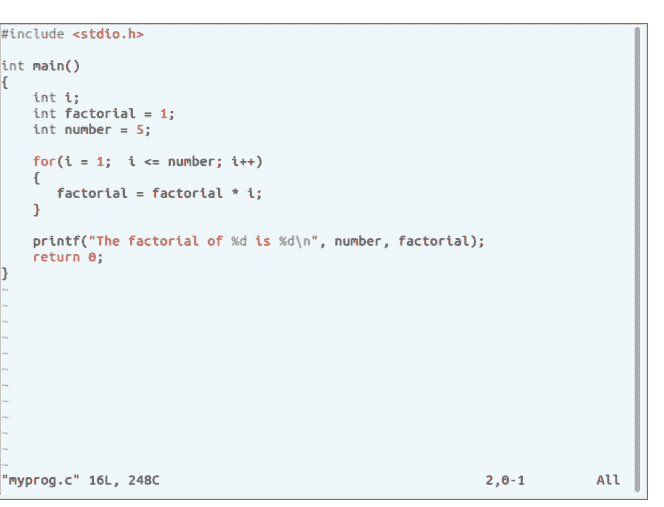

**图 10-1** vim 主窗口

vim 编辑器检测会话的终端类型（参见第 2 章“访问 Shell”），并使用全屏模式占用整个控制台窗口作为编辑器区域。

初始 vim 编辑窗口显示文件内容（如果有的话）以及窗口底部的消息行。如果文件内容没有占据整个屏幕，vim 会在不属于文件内容的行上放置一个波浪号（~）（如图 10-1 所示）。


底部的消息行根据文件状态和 vim 安装中的默认设置显示有关被编辑文件的信息。如果文件是新的，消息 `[New File]` 会出现。

vim 编辑器有三种操作模式：

- `命令模式`
- `Ex 模式`
- `插入模式`

当你首次打开一个文件（或启动一个新文件）进行编辑时，vim 编辑器进入`命令模式`（有时也称为正常模式）。在`命令模式`下，vim 编辑器将按键解释为命令（有关这些命令的详细信息稍后介绍）。

在`插入模式`中，vim 将你在缓冲区当前光标位置输入的字母、数字或符号放置在该位置。要进入`插入模式`，输入 `i`。要退出`插入模式`并返回`命令模式`，按下键盘上的 `Esc` 键。

在`命令模式`下，你可以使用方向键在文本区域内移动光标（前提是 vim 正确检测到你的终端类型）。如果你碰巧在一个未定义方向键的异常终端连接上，也不必绝望。vim 编辑器包含用于移动光标的命令：

- `h` 向左移动一个字符
- `j` 向下移动一行（文本中的下一行）
- `k` 向上移动一行（文本中的上一行）
- `l` 向右移动一个字符

在大型文本文件中逐行移动可能会变得繁琐。幸运的是，vim 提供了一些命令来加快速度：

- 按 `PageDown`（或 `Ctrl+F`）向前移动一屏数据。
- 按 `PageUp`（或 `Ctrl+B`）向后移动一屏数据。
- 输入 `g` 移动到缓冲区中的最后一行。
- 输入 `num` `g` 移动到缓冲区中第 `num` 行。
- 输入 `gg` 移动到缓冲区中的第一行。

vim 编辑器在`命令模式`下有一个特殊功能，称为 `Ex 模式`。此模式提供了一个交互式命令行，你可以在其中输入额外的命令来控制 vim 中的操作。要进入 `Ex 模式`，在`命令模式`下按下冒号键（`:`）。光标移动到消息行，并且会出现一个冒号（`:`），等待你输入命令。

`Ex 模式`中包含若干用于将缓冲区保存到文件并退出 vim 的命令：

- 若未对缓冲区数据进行修改，使用 `q` 退出
- 使用 `q!` 退出并丢弃对缓冲区数据所做的任何修改
- 使用 `w` `filename` 将文件保存为不同的文件名
- 使用 `wq` 将缓冲区数据保存到文件并退出

仅看到几个基本的 vim 命令后，你可能会理解为什么有些人会厌恶 vim 编辑器。为了充分发挥 vim 的功能，你必须掌握大量生僻的命令。然而，一旦你掌握了一些基本的 vim 命令，无论你处于什么类型的环境中，都可以快速地从命令行直接编辑文件。凭借其强大的功能以及陡峭的学习曲线，vim 编辑器依然保持着其 popularity（普及度/人气）。它至今仍被认为是十大文本编辑器之一。

## 编辑数据

在`命令模式`下，vim 编辑器提供若干用于编辑缓冲区中数据的命令。`表 10-1` 列出了 vim 的一些常用编辑命令。

TABLE 10-1 vim 编辑命令

| 命令 | 描述 |
| :--- | :--- |
| `x` | 删除当前光标位置的字符。 |
| `dd` | 删除当前光标位置的行。 |
| `dw` | 删除当前光标位置的单词。 |
| `d$` | 从当前光标位置删除到行尾的内容。 |
| `J` | 删除当前光标所在行行尾的换行符（合并行）。 |
| `u` | 撤销上一个编辑命令。 |
| `a` | 在当前光标位置后附加数据。 |
| `A` | 在当前光标所在行的行尾附加数据。 |
| `r char` | 将当前光标位置的单个字符替换为 `char`。 |
| `R text` | 用 `text` 覆盖当前光标位置的数据，直到按下 `Esc` 键。 |

部分编辑命令还允许你使用数字修饰符来指示执行该命令的次数。例如，命令 `2x` 从当前光标位置开始删除两个字符，命令 `5dd` 从当前光标所在的行开始删除五行。

### 注意

当你在 vim 编辑器的`命令模式`下尝试使用键盘上的 `Backspace`（退格）或 `Delete`（删除）键时要小心。vim 编辑器通常仅将 `Delete` 键识别为 `x` 命令的功能，即删除当前光标位置的字符。通常，vim 编辑器在`命令模式`下不将 `Backspace` 键识别为删除操作，而是将其作为将光标向后移动一个空格的方法。

## 复制和粘贴

标准编辑功能包括剪切或复制数据并将其粘贴到文档其他位置的能力。vim 编辑器提供了实现此功能的方法。剪切和粘贴相对简单。你已经在`表 10-1`中见过可以从缓冲区移除数据的命令。然而，当 vim 移除数据时，它实际上会将其存储在另一个区域中。在`命令模式`下，可以使用 `p` 命令检索该数据。

例如，使用 `dd` 命令删除一行文本，将光标移动到你想要放置该行的缓冲区位置，然后使用 `p` 命令。`p` 命令会将文本插入到当前光标位置的下一行之后。你可以对`命令模式`下的任何移除文本的命令执行此操作。

复制文本稍微复杂一些。vim 中的复制命令是 `y`（代表 yank/抓取）。你可以使用与 `d` 命令相同的第二个字符配合 `y` 使用（`yw` 抓取一个单词，`y$` 抓取到行尾）。抓取文本后，将光标移动到你想要放置文本的位置并使用 `p` 命令。被抓取的文本将出现在该位置。

抓取操作比较棘手，因为你无法看到发生了什么，因为你并没有影响你所抓取的文本。你从来无法确切知道自己抓取了什么，直到你将其粘贴到某个地方。但是 vim 中还有一个功能可以帮助处理抓取操作。

在`命令模式`下，`可视模式`会高亮显示你移动光标时的文本。你使用`可视模式`来选择要抓取以进行粘贴的文本。要进入`可视模式`，将光标移动到你希望开始抓取的位置，然后按下 `v`。你会注意到光标位置的文本现在被高亮显示。接下来，移动光标以覆盖你想抓取的文本（甚至可以向下移动多行以抓取多行文本）。当你移动光标时，vim 会高亮显示抓取区域内的文本。在你覆盖完想要复制的文本后，输入 `y` 以激活抓取命令。现在文本已在寄存器中，只需将光标移动到你想要粘贴的位置并使用 `p` 命令即可。

## 搜索和替换

你可以轻松使用 vim 搜索命令在缓冲区中搜索数据。要输入搜索字符串，请按正斜杠键（`/`）。光标将移至消息行，vim 显示一个正斜杠。输入你想查找的文本，然后按 `Enter` 键。vim 编辑器会以以下三种动作之一作出响应：

- 如果该词出现在当前光标位置之后，它将跳转到该文本出现的第一位置。
- 如果该词未出现在当前光标位置之后，它将环绕到文件末尾，然后跳转到文件中该文本出现的第一位置（并通过消息指示这一点）。
- 它会生成一条错误消息，说明在文件中未找到该文本。

如果该词出现了，若要继续搜索相同的词，请按正斜杠字符然后按 `Enter` 键，或者使用 `n`（代表 next/下一个）。

### 注意

你是否更熟悉在带有集成开发环境（IDE）的 Microsoft Windows 平台上编写脚本和程序？如果是，Microsoft 的 Visual Studio Code 在 Linux 上也可用。（请花一分钟重读一下这句话。）是的，Microsoft 为 Linux 提供 Visual Studio。请在 `code.visualstudio.com/docs/setup/linux` 查找适用于你特定 Linux 发行版的安装信息。如果需要，你可以为 Visual Studio 添加 VSCodeVim 插件，从而随时使用所有 vim 命令。

在 `Ex 模式`下执行的替换（substitute）命令允许你在文本中快速将一个词替换为另一个词。要获取替换命令，你必须处于命令行模式。替换命令的格式为 `:s / old / new /`。vim 编辑器跳转到文本 `old` 的第一次出现位置并将其替换为文本 `new`。你可以对替换命令进行一些修改，以替换文本的多个出现位置：

- `:s / old / new / g` 替换一行中 `old` 的所有出现位置
- `: n , m s / old / new / g` 替换行号 `n` 和 `m` 之间 `old` 的所有出现位置
- `:%s / old / new / g` 替换整个文件中 `old` 的所有出现位置
- `:%s / old / new / gc` 替换整个文件中 `old` 的所有出现位置，但对每个出现位置进行提示

由此可见，作为控制台模式的文本编辑器，vim 包含了许多高级功能。由于几乎每个 Linux 发行版都包含它，因此最好至少了解 vim 编辑器的基础知识，这样无论你在哪里或手头有什么资源，你都可以随时编辑脚本。

## 导航 nano 编辑器

与 vim 这个功能强大但复杂的编辑器相比，nano 是一个简单的编辑器。对于需要一个易于导航的简单控制台模式文本编辑器的个人来说，nano 是合适的工具。它也是刚开始涉足 Linux 命令行冒险之旅的新手们优秀的文本编辑器。

nano 文本编辑器是 Unix 系统 Pico 编辑器的克隆。虽然 Pico 也是一个轻量且简单的文本编辑器，但它并未在 GPL 下授权。不仅 nano 文本编辑器在 GPL 下授权，它还是 GNU 项目的一部分。

nano 文本编辑器默认安装在大多数 Linux 发行版中。nano 文本编辑器的一切都很简单。要在命令行使用 nano 打开文件，请输入

```
$ nano myprog.c
```


如果你在没有文件名的情况下启动 `nano`，或者文件不存在，`nano` 将简单地打开一个新的缓冲区区域供编辑。如果在命令行中指定了一个现有文件，`nano` 会将文件的全部内容读取到缓冲区区域中，准备进行编辑，如图 10-2 所示。

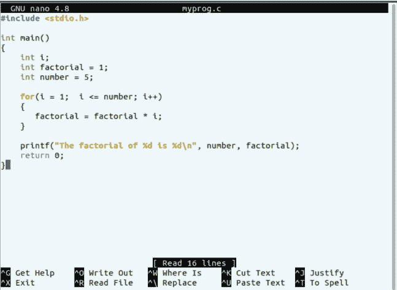

**图 10-2** `nano` 编辑器窗口

请注意，在 `nano` 编辑器窗口的底部，显示了一系列带有简要说明的命令。这些命令是 `nano` 控制命令。显示的插入符号（`^`）代表 `Ctrl` 键。因此，`^X` 代表键盘序列 `Ctrl+X`。

> **提示**
>
> 虽然 `nano` 控制命令在键盘序列中使用了大写字母，但对于控制命令，你可以使用小写或大写字符。

大多数基本命令都直接列在你面前，这非常方便——无需记忆哪个控制命令执行什么功能。**表 10-2** 展示了各种 `nano` 控制命令。

### 表 10-2 nano 控制命令

| 命令 | 描述 |
| :--- | :--- |
| `Ctrl+C` | 显示光标在文本编辑缓冲区中的位置。 |
| `Ctrl+G` | 显示 `nano` 的主帮助窗口。 |
| `Ctrl+J` | 对当前文本段落进行两端对齐。 |
| `Ctrl+K` | 剪切文本行并将其存储在剪切缓冲区中。 |
| `Ctrl+O` | 将当前文本编辑缓冲区写入文件。 |
| `Ctrl+R` | 将文件读取到当前文本编辑缓冲区中。 |
| `Ctrl+T` | 启动可用的拼写检查器。 |
| `Ctrl+U` | 粘贴存储在剪切缓冲区中的文本并放在当前行。 |
| `Ctrl+V` | 将文本编辑缓冲区滚动到下一页。 |
| `Ctrl+W` | 在文本编辑缓冲区中搜索单词或短语。 |
| `Ctrl+X` | 关闭当前文本编辑缓冲区，退出 `nano`，并返回 `shell`。 |
| `Ctrl+Y` | 将文本编辑缓冲区滚动到上一页。 |

*表 10-2* 中列出的控制命令基本上是你所需的全部。然而，如果你希望拥有比列出那些更强大的控制功能，`nano` 也提供了。要查看更多控制命令，请在 `nano` 文本编辑器中按 `Ctrl+G` 以显示包含额外控制命令的主帮助窗口。

> **注意**
>
> `nano` 中可用的这些额外命令中有一些被称为 Meta 键序列。在 `nano` 文档中，它们由字母 `M` 表示。例如，你会发现用于撤销最后任务的键序列在 `nano` 帮助系统中被标记为 `M-U`。但不要按 `M` 键来完成此操作。相反，`M` 代表 `Esc`、`Alt` 或 Meta 键，具体取决于你的键盘配置。因此，你可能会按 `Alt+U` 键组合来撤销 `nano` 中的最后一个任务。

通过命令行选项还可以使用更多功能来控制 `nano` 编辑器。在编辑之前创建备份文件是一个不错的选择。输入 `man nano` 以查看启动 `nano` 的额外命令行选项。

`vim` 和 `nano` 文本编辑器提供了在功能强大和简单的控制台模式文本编辑器之间的选择。然而，两者都不提供使用图形功能进行编辑的能力。一些文本编辑器可以在两个世界中运行，这在下一节中进行了探讨。

#### 探索 Emacs 编辑器

`Emacs` 编辑器在 20 世纪 70 年代末是数字设备公司（DEC）计算机上极受欢迎的编辑器。开发人员非常喜欢它，以至于他们将其移植到 Unix 环境，然后是 Linux 环境，在那里它的官方名称是 GNU Emacs。虽然目前不如 `vim` 流行，但它仍然在世界上有一席之地。

`Emacs` 编辑器最初是作为控制台编辑器诞生的，类似于 `vim`，但后来被迁移到了图形世界。原始的控制台模式编辑器仍然可用，但它可以使用图形窗口以允许在图形环境中编辑文本。通常，当你从命令行启动 `Emacs` 编辑器时，如果编辑器检测到你有可用的图形会话，它将以图形模式启动。如果没有，它将以控制台模式启动。

本节介绍了控制台模式和图形模式的 `Emacs` 编辑器，以便如果你想（或需要）使用任何一个时，你都知道如何使用。

##### 检查你的 Emacs 软件包

许多发行版默认并不安装 `Emacs` 编辑器。你可以使用 `which` 和/或 `dnf list`（在较旧版本的基于 Red Hat 的发行版上使用 `yum list`）命令检查你的基于 Red Hat 的发行版，如在这个 CentOS 发行版中所示：

```bash
$ which emacs
/usr/bin/which: no emacs in (/home/christine/.local/bin:/home/christine/bin:/usr/local/bin:/usr/bin:/usr/local/sbin:/usr/sbin)
$
$ dnf list emacs
[...]
Available Packages
emacs.x86_64[...]
$
```

`emacs` 编辑器软件包尚未安装在这个 CentOS 发行版上。但是，它是可以安装的。（关于显示已安装软件的更详细讨论，请参阅第 9 章。）

对于基于 Debian 的发行版，使用 `which` 和/或 `apt show` 命令检查 `Emacs` 编辑器软件包，如在这个 Ubuntu 发行版中所示：

```bash
$ which emacs
$
$ apt show emacs
Package: emacs
[...]
Description: GNU Emacs editor (metapackage)
GNU Emacs is the extensible self-documenting text editor.
This is a metapackage that will always depend on the latest recommended Emacs variant (currently emacs-gtk).
$
```

这里的 `which` 命令运行方式略有不同。当它找不到已安装的命令时，它只是返回 Bash shell 提示符。这个 Ubuntu 发行版的 `emacs` 编辑器软件包是可以安装的。以下显示在 Ubuntu 上安装 `Emacs` 编辑器：

```bash
$ sudo apt install emacs
[sudo] password for christine:
Reading package lists... Done
[...]
Do you want to continue? [Y/n] Y
[...]
$
```

```bash
$ which emacs
/usr/bin/emacs
$
```

现在，当使用 `which` 命令时，它指向 `emacs` 程序文件。`Emacs` 编辑器在这个 Ubuntu 发行版上已准备好使用。

对于 CentOS 发行版，使用 `dnf install` 或 `yum install` 命令安装 `Emacs` 编辑器：

```bash
$ sudo yum install emacs
[sudo] password for christine:
[...]
Dependencies resolved.
[...]
Is this ok [y/N]: y
Downloading Packages:
[...]
Complete!
$ which emacs
/usr/bin/emacs
$
```

随着 `Emacs` 编辑器成功安装在你的 Linux 发行版上，你可以开始探索其不同功能，从在控制台上使用它开始。

##### 在控制台上使用 Emacs

`Emacs` 的控制台模式版本是另一个使用大量键命令来执行编辑功能的编辑器。`Emacs` 编辑器使用涉及 `Ctrl` 键和 `Meta` 键的组合键。在大多数终端仿真器软件包中，`Meta` 键映射到 `Alt` 键。

正式的 `Emacs` 文档将 `Ctrl` 键缩写为 `C-`，将 `Meta` 键缩写为 `M-`。因此，`Ctrl+X` 键组合在文档中显示为 `C-x`。本章部分使用 `Emacs` 的文档格式。

##### 探索 Emacs 的基础知识

要使用 `Emacs` 编辑文件，从命令行输入

```bash
$ emacs myprog.c
```

`Emacs` 控制台模式窗口会出现，并将文件加载到活动缓冲区中，如**图 10-3**所示。

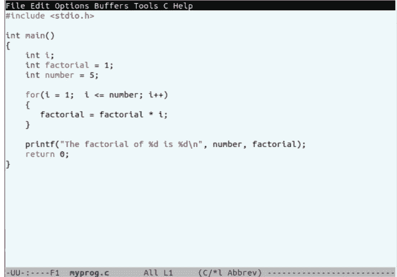

**图 10-3** 在控制台模式下使用 `Emacs` 编辑器编辑文件

你会发现，控制台模式窗口的顶部显示了一个典型的菜单栏。不幸的是，在控制台模式下不能使用菜单栏，只能在图形模式下使用。

> **注意**
>
> 如果你在图形桌面环境中运行 `Emacs`，本节中的一些命令的工作方式与描述不同。要在图形桌面环境中使用 `Emacs` 的控制台模式，请使用 `emacs -nw` 命令。如果你想使用 `Emacs` 的图形功能，请参阅“在 GUI 中使用 Emacs”部分。

与 `vim` 编辑器不同，`vim` 让你进入和退出插入模式，并在输入命令和插入文本之间切换，`Emacs` 编辑器只有一种模式。如果你输入一个可打印字符，`Emacs` 会在当前光标位置插入它。如果你输入一个命令，`Emacs` 会执行该命令。


要在缓冲区区域内移动光标，你可以使用箭头键和 `PageUp` 和 `PageDown` 键，假设 Emacs 正确检测到了你的终端仿真器。如果没有，这些命令可以移动光标：

- `C-p` 向上移动一行（文本中的上一行）。
- `C-b` 向左（向后）移动一个字符。
- `C-f` 向右（向前）移动一个字符。
- `C-n` 向下移动一行（文本中的下一行）。

以下命令在文本中做出更长的跳转：

- `M-f` 向右（向前）移动到下一个单词。
- `M-b` 向左（向后）移动到上一个单词。
- `C-a` 移动到当前行的开头。
- `C-e` 移动到当前行的末尾。
- `M-a` 移动到当前句子的开头。
- `M-e` 移动到当前句子的末尾。
- `M-v` 向后移动一屏数据。
- `C-v` 向前移动一屏数据。
- `M-<` 移动到文本的第一行。
- `M->` 移动到文本的最后一行。

你应该知道这些命令，用于将编辑器缓冲区保存回文件并退出 Emacs：

- `C-x C-s` 将当前缓冲区内容保存到文件。
- `C-z` 退出 Emacs，但保持其在当前会话中运行，以便你稍后返回。
- `C-x C-c` 退出 Emacs 并停止该程序。

你会注意到，其中两个功能需要两个按键组合。`C-x` 命令被称为扩展命令。这提供了另一整套可供操作的命令。

### 编辑数据

Emacs 编辑器在缓冲区中插入和删除文本方面相当健壮。要插入文本，只需将光标移动到你要插入文本的位置，然后开始输入。

要删除文本，Emacs 使用 `Backspace` 键删除当前光标位置之前的字符，并使用 `Delete` 键删除当前光标位置处的字符。

Emacs 编辑器还有用于剪切文本的命令。Emacs 文档将此称为“kill（杀戮/清除）”文本，但我们这里将使用更友好的“剪切”术语。

删除文本和剪切文本的区别在于，当你剪切文本时，Emacs 会将其放置在一个临时区域，你可以从中恢复它（参见下一节“复制和粘贴”）。删除的文本则永远消失。

这些命令用于剪切缓冲区中的文本：

- `M-Backspace` 剪切当前光标位置之前的单词。
- `M-d` 剪切当前光标位置之后的单词。
- `C-k` 剪切从当前光标位置到行尾的文本。
- `M-k` 剪切从当前光标位置到句子末尾的文本。

> **提示**
>
> 如果你在剪切文本时不小心犯了错，`C-/` 命令可以撤销剪切操作，并将数据恢复到剪切前的状态。

Emacs 编辑器还包含一种批量剪切文本的便捷方式。只需将光标移动到你想要切起始位置，然后按下 `C-@` 或 `C-空格` 键。接着，将光标移动到你想要切结束的位置，并输入 `c-w`。两个位置之间的所有文本都会被剪切。

### 复制和粘贴

你已经了解了如何从 Emacs 缓冲区区域剪切数据；现在该看看如何将其粘贴到其他位置了。不幸的是，如果你使用 vim 编辑器，当使用 Emacs 编辑器时，这个过程可能会让你困惑。

在一个不幸的巧合中，Emacs 中的粘贴操作被称为 *yanking（拖拽/抓取）*。而在 vim 编辑器中，复制也被称为 yanking，这使得如果你同时使用这两种编辑器，这就成了很难记住的事情。

在使用其中一个剪切命令剪切数据后，将光标移动到你想要粘贴数据的位置，并使用 `c-y` 命令。这将把文本从临时区域取出并粘贴到当前光标位置。`c-y` 命令会抓取最后一次剪切命令的文本。如果你执行了多个剪切命令，可以使用 `M-y` 命令在它们之间循环切换。

要复制文本，只需将其从剪切的位置反向抓取（yank）回来，然后移动到新位置并再次使用 `c-y` 命令。你可以将文本抓取回来任意多次。

### 搜索和替换

在 Emacs 编辑器中搜索文本是使用 `c-s` 和 `c-r` 命令完成的。`c-s` 命令在缓冲区区域中从当前光标位置到缓冲区末尾执行向前搜索，而 `c-r` 命令在缓冲区区域中从当前光标位置到缓冲区开头执行向后搜索。

当你输入 `c-s` 或 `c-r` 命令时，底部行会出现一个提示，询问你要搜索的文本。你可以执行两种类型的搜索。

在 *增量* 搜索中，Emacs 编辑器以实时模式执行文本搜索，随着你输入单词进行搜索。当你输入第一个字母时，它会突出显示缓冲区中该字母的所有出现位置。当你输入第二个字母时，它会突出显示文本中这两个字母组合的所有出现位置，依此类推，直到你完成要搜索的文本。

在 *非增量* 搜索中，在 `C-s` 或 `C-r` 命令后按下 `Enter` 键。这将搜索查询锁定在底部行区域，允许你在搜索之前完整输入搜索文本。

要将现有文本字符串替换为新的文本字符串，你必须使用 `M-x` 命令。该命令需要文本命令以及参数。

文本命令是 `replace-string`。输入命令后，按下 `Enter` 键，Emacs 会询问你现有的文本字符串。输入后，再次按下 `Enter` 键，Emacs 会询问你新的替换文本字符串。

### 在 Emacs 中使用缓冲区

Emacs 编辑器允许通过拥有多个缓冲区区域来同时编辑多个文件。你可以将文件加载到缓冲区中，并在编辑时在缓冲区之间切换。

要在 Emacs 中加载新文件到缓冲区，请使用 `C-x C-f` 命令。这是 Emacs 的查找文件模式，称为 *Dired*。它会带你进入窗口底部行，允许你输入想要开始编辑的文件名。如果你不知道文件名或位置，只需按下 `Enter` 键。这会在编辑窗口中调出一个文件浏览器，如图 10-4 所示。

```
File Edit Options Buffers Tools Operate Mark Regex Immediate Subdir Help 
/home/christine:
total used in directory 120 available 11645800
drwxr-xr-x 17 christine christine 4096 May 8 16:05 .
drwxr-xr-x 4 root root 4096 Apr 23 15:12 ..
-FW------- 1 christine christine 828 May 8 14:11 .bash_history
-FW------- 1 christine christine 220 Feb 25 07:03 .bash_logout
-FW------- 1 christine christine 3782 May 7 13:55 .bashrc
drwx------ 14 christine christine 4096 May 1 15:14 .cache
drwxr-xr-x 13 christine christine 4096 May 1 15:06 .config
drwxr-xr-x 2 christine christine 4096 Apr 23 15:13 Desktop
drwxr-xr-x 2 christine christine 4096 Apr 23 15:13 Documents
drwxr-xr-x 2 christine christine 4096 Apr 23 15:13 Downloads
drwx------ 3 christine christine 4096 May 8 15:35 .local
drwx------ 3 christine christine 4096 May 2 15:35 .gnupg
drwx------ 3 christine christine 4096 Apr 23 15:13 .mozilla
drwxr-xr-x 2 christine christine 4096 May 1 15:14 Music
-rwxrwxr-x 1 christine christine 16688 May 7 14:26 myprog
-FW-FW-r-- 1 christine christine 248 May 8 16:05 myprog.c#
lrwxrwxrwx 1 christine christine 34 May 8 16:03 .#myprog.c -> christine\
@UDesktop:3662:1589892380
-FW-FW-r-- 1 christine christine 248 May 8 11:11 myprog.c
-FW------- 20 christine christine 807 Feb 23 14:29 myprog.c.save
drwxr-xr-x 2 christine christine 4096 May 8 15:13 Pictures
-FW------- 1 christine christine 807 Feb 25 07:03 .profile
drwxr-xr-x 2 christine christine 4096 May 8 15:13 Public
-UUU:%*-F1 christine Top L3 (dir by name) -------------------
```

**图 10-4** Emacs 文件浏览器

从这里，你可以浏览到你要编辑的文件。要向上遍历一层目录，移动到双点条目并按下 `Enter` 键。要向下遍历目录，移动到目录条目并按下 `Enter` 键。当你找到要编辑的文件时，按下 `Enter`，Emacs 会将其加载到一个新的缓冲区区域中。


你可以通过输入 `c-x c-b` 扩展命令组合来列出活动的缓冲区区域。Emacs 编辑器将编辑窗口分割，并在底部窗口中显示缓冲区列表。除了你的主编辑缓冲区外，Emacs 提供两个额外的缓冲区：

- 一个称为 `scratch` 的草稿区域
- 一个称为 `Messages` 的消息区域

草稿区域允许你输入 LISP 编程命令以及给你自己输入笔记。消息区域显示 Emacs 在运行时生成的消息。如果使用 Emacs 时发生任何错误，它们将显示在消息区域中。

你可以通过两种方式在窗口中切换到不同的缓冲区区域：

- 使用 `C-x C-b` 打开缓冲区列表窗口。然后使用 `C-x b` 并输入 `*Buffer List*` 切换到该窗口。使用箭头键将光标移动到你想要的缓冲区区域，并按下 Enter 键。
- 使用 `C-x b` 输入你要切换到的缓冲区区域的名称。

当你选择切换到缓冲区列表窗口的选项时，Emacs 会在新窗口区域中打开该缓冲区区域。Emacs 编辑器允许你在单个会话中打开多个窗口。下一节讨论如何在 Emacs 中管理多个窗口。

### 在控制台模式 Emacs 中使用窗口

控制台模式的 Emacs 编辑器是在图形窗口概念出现之前很久开发的。然而，对于其时代来说，它相当先进，因为它可以在主 Emacs 窗口内支持多个编辑窗口。

你可以使用两个命令之一将 Emacs 编辑窗口分割为多个窗口：

- `C-x 2` 将窗口水平分割为两个窗口。
- `C-x 3` 将窗口垂直分割为两个窗口。

要从一个窗口移动到另一个窗口，请使用 `C-x o` 命令。请注意，当你创建新窗口时，Emacs 会使用来自该缓冲区的区域...

新窗口中的原始窗口。移动到新窗口后，你可以使用 `c-x c-f` 命令加载新文件，或使用其中一个命令切换到新窗口中的另一个缓冲区。

要关闭一个窗口，请先移动到该窗口，然后使用 `c-x 0` 即数字 0 命令。如果你想关闭当前窗口以外的所有窗口，请使用 `c-x 1` 即数字 1 命令。

### 在 GUI 中使用 Emacs

如果你从图形用户界面环境例如 GNOME Shell 桌面使用 Emacs，它将启动图形模式，如图 10–5 所示。

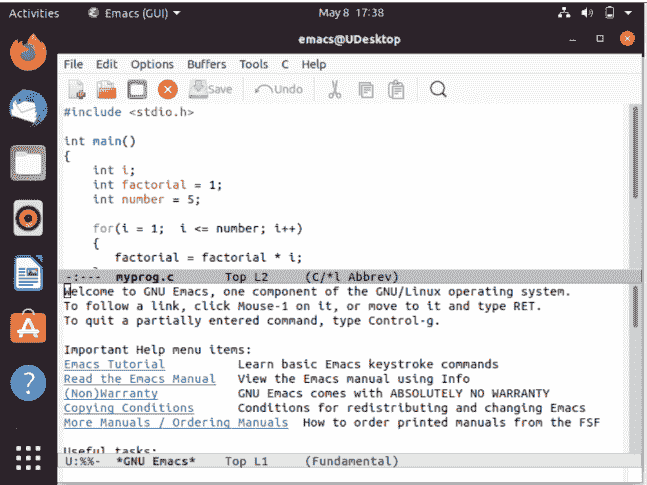

图 10–5 Emacs 图形窗口

如果你已经在使用控制台模式使用过 Emacs，你应该对图形模式相当熟悉。所有的键命令都可用菜单栏项目。Emacs 的菜单栏包含以下项目：

- `文件` 允许你在窗口中打开文件、创建新窗口、关闭窗口、保存缓冲区以及打印缓冲区。
- `编辑` 允许你将选定的文本剪切和复制到剪贴板，将剪贴板数据粘贴到当前光标位置，搜索文本以及替换文本。
- `选项` 提供许多其他 Emacs 功能的设置，例如高亮显示、自动换行、光标类型和字体设置。
- `缓冲区` 列出当前可用的缓冲区，并允许你轻松地在缓冲区之间切换。
- `工具` 提供访问 Emacs 高级功能的入口，例如命令行界面访问、拼写检查、比较文件之间的文本称为差异比较、发送电子邮件、日历和计算器。
- `C` 允许对 C 程序语法的高亮显示、编译、运行和调试代码进行高级设置。
- `帮助` 提供在线的 Emacs 手册，以便访问特定 Emacs 功能的帮助。

图形 Emacs 窗口是旧的控制台应用程序向图形世界迁移的一个例子。现在，许多 Linux 发行版都提供图形桌面甚至在不需要的服务器上也提供，图形编辑器正变得越来越普遍。流行的 Linux 桌面环境如 KDE Plasma 和 GNOME Shell 也为其环境提供了专门的图形文本编辑器，本章的其余部分将对此进行介绍。

#### 探索 KDE 编辑器家族

如果你使用的是使用 KDE Plasma 桌面环境的 Linux 发行版，那么你有几个文本编辑器的选择。KDE 项目官方支持两个流行的文本编辑器：

- `KWrite`：单屏幕文本编辑程序包
- `Kate`：全功能、多窗口文本编辑程序包

这两个编辑器都是图形文本编辑器，包含许多高级功能。Kate 编辑器还提供了标准文本编辑器中不常见的额外便利功能。本节将描述每个编辑器，并展示一些可用于帮助编辑 shell 脚本的功能。

##### 查看 KWrite 编辑器

KDE Plasma 环境的基本编辑器是 KWrite。它提供简单的文字处理风格的文本编辑，并支持代码语法高亮和编辑。默认的 KWrite 编辑窗口如图 10-6 所示。

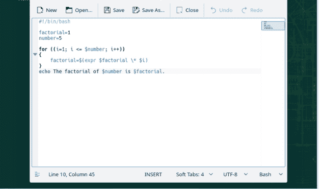

图 10-6 默认的 KWrite 窗口正在编辑一个 shell 脚本程序

从图 10-6 中你无法看出，但 KWrite 编辑器识别几种编程语言，并使用颜色编码来区分常量、函数和注释。KWrite 编辑窗口提供完整的剪切和粘贴功能，使用鼠标和方向键。与文字处理器一样，你可以在缓冲区内的任何位置突出显示并剪切或复制文本，并将其粘贴到任何其他位置。

> **提示**
>
> 通常，KDE 桌面环境默认不再安装 KWrite。但是，你可以轻松地在 Plasma 或其他桌面环境中安装它参见第 9 章，如果可用。包名称是 `kwrite`。

要使用 KWrite 编辑文件，你可以从桌面上的 KDE 菜单系统选择 KWrite 一些 Linux 发行版甚至为其创建了一个面板图标，或从命令行提示符启动它：

```
$ kwrite factorial.sh
```

`kwrite` 命令有几个命令行参数，你可以使用它们来定制其启动方式。以下是其中一些更实用的参数：

- `--stdin` 使 KWrite 从标准输入设备读取数据，而不是从文件。
- `--encoding` 指定用于文件的字符编码类型。
- `--line` 指定在编辑器窗口中开始编辑的文件行号。
- `--column` 指定在编辑器窗口中开始编辑的文件列号。

KWrite 编辑器在编辑窗口顶部提供菜单栏和工具栏，允许你选择功能并更改 KWrite 编辑器的配置设置。

菜单栏包含以下项目：

- `文件` 从文件加载、保存、打印和导出文本。
- `编辑` 操作缓冲区中的文本。
- `查看` 管理文本在编辑器窗口中的显示方式。
- `书签` 处理返回到文本中特定位置的指针；此选项可能需要在配置中启用。
- `工具` 包含用于操作文本的专业功能。
- `设置` 配置编辑器处理文本的方式。
- `帮助` 提供关于编辑器和命令的信息。

编辑菜单栏项为你的所有文本编辑需求提供命令。你不必记住晦涩的键命令顺便说一句，KWrite 也支持这些，只需选择编辑菜单栏中的项目即可，如图表 10-3 所示。

###### 表 10-3 KWrite 编辑菜单项

| 项目 | 描述 |
| :--- | :--- |
| 撤销 | 撤销上一个操作或动作。 |
| 重做 | 恢复上一个撤销动作。 |
| 剪切 | 删除选定的文本并将其放入剪贴板。 |
| 复制 | 将选定的文本复制到剪贴板。 |
| 粘贴 | 将剪贴板的当前内容插入当前光标位置。 |
| 剪贴板历史 | 显示最近复制到剪贴板的文本片段，你可以从中选择进行粘贴。 |
| 以 HTML 复制 | 将选定的文本作为 HTML 复制。 |
| 全选 | 选择编辑器中的所有文本。 |
| 取消选择 | 取消当前选定的任何文本。 |
| 块选择 | 切换开/关块选择模式，该模式允许垂直选择文本。 |
| 模式 |  |
| 输入模式 | 在正常编辑模式和类 vi 编辑模式之间切换。 |
| 覆盖模式 | 将插入模式切换为覆盖模式，用新输入的文本来替换文本，而不是仅插入新文本。 |
| 查找 | 产生查找文本对话框，允许你定制文本搜索。 |
| 查找变体 | 提供各种文本搜索的子菜单——查找下一个、查找上一个、查找选定、反向查找选定。 |
| 替换 | 产生替换对话框，允许你定制文本搜索和替换。 |
| 前往 | 提供各种前往选择的子菜单——移至匹配括号、选择到匹配括号、移至上一次修改的行、移至下一次修改的行、前往指定行。 |

查找功能有两种模式。正常模式执行简单文本搜索和强力搜索。替换模式允许你进行高级搜索和替换如果需要。你可以通过窗口右下角的图标在两种模式之间切换，如图 10-7 所示。

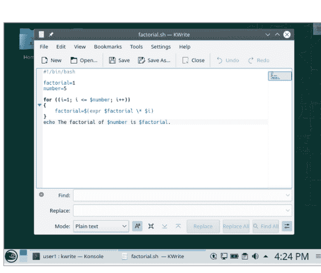

**图 10-7** KWrite 查找部分

查找强力模式允许你不仅使用单词进行搜索，还可以使用正则表达式在第 20 章“正则表达式”中讨论进行搜索。你还可以使用其他一些选项来定制搜索，例如，指示是否执行区分大小写的搜索，或者只查找完整单词而不是在单词内查找文本。

`工具` 菜单栏项提供了几个方便的功能，用于处理缓冲区中的文本。**表 10-4** 描述了 KWrite 中可用的工具。


### 表 10-4 KWrite 工具

| 工具 | 描述 |
| :--- | :--- |
| 只读 | 锁定文本，使其在此状态下无法更改 |

### KWrite 模式菜单选项

- **模式**：通过子菜单选择来设置文本的文件类型排列。
- **突出显示**：通过子菜单选择来选定文本的突出显示方案。
- **缩进**：通过子菜单选择来设置文本的缩进风格。
- **编码**：选择文本使用的字符集编码。
- **行尾**：在 Unix、Windows/DOS 和 Macintosh 之间切换行尾字符。
- **添加字节序标记**：切换开启/关闭在文本开头设置字节序标记（BOM）的操作。
- **脚本**：从子菜单中选择脚本化操作，以快速完成编辑等项目。
- **调用代码补全**：显示提示气泡，建议在光标位置使用的代码文本；按下 Enter 键可选择使用提示完成自动补全。
- **单词补全**：通过子菜单选择对当前输入的文本执行自动补全。
- **拼写检查**：启动和/或控制文本的拼写检查程序。
- **清理缩进**：将所有段落的缩进恢复为初始设置。
- **对齐**：强制当前行或选定的行恢复为默认缩进设置。
- **切换注释**：基于当前选定的模式语法，将文本行转换为注释行。
- **大写**：将选定的文本或当前光标位置的字符设为大写。
- **小写**：将选定的文本或当前光标位置的字符设为小写。
- **首字母大写**：将选定文本或当前光标位置的单词的首字母大写。
- **连接行**：将选定的行，或当前光标位置及其下一行的内容合并为一行。
- **应用自动换行**：在文本中启用自动换行。如果一行超出了编辑器窗口边缘，该行将在下一行继续显示。

这个简单的文本编辑器拥有许多工具！如果你在编写脚本或程序，**模式**和**缩进**工具特别有助于辅助你。该模式的**脚本**子菜单如图 10-8 所示。

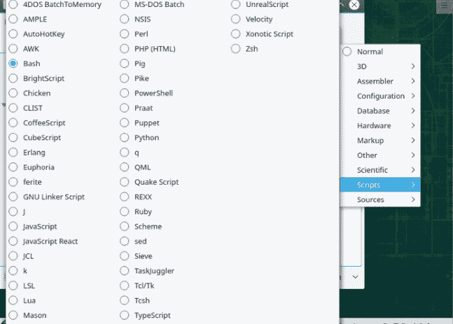

**图 10-8** KWrite 工具的模式脚本子菜单

**设置**菜单包含“配置编辑器”对话框框，如图 10-9 所示。

配置对话框使用左侧的图标供你选择要在 KWrite 中配置的功能。当你选择一个图标时，对话框右侧将显示该功能的配置设置。

**外观**功能允许你设置若干控制文本在文本编辑器窗口中显示方式的功能。你可以在此启用自动换行、行计数（对程序员非常有用）和单词计数。通过**字体与颜色**功能，你可以自定义编辑器的完整配色方案，确定程序中每类文本的颜色。此外，你还可以选择多种自定义选项，例如编码和模式，这样每次打开文件时就不必通过菜单系统来设置它们了。


**图 10-9** KWrite 配置编辑器对话框

#### 了解 Kate 编辑器

Kate 编辑器是 KDE 项目的主打编辑器。它使用与 KWrite 应用程序相同的核心文本编辑器（因此大多数功能相同），但它将许多其他功能整合到一个包中，包括多文档界面（MDI）。

> **提示**
>
> 如果你发现 KDE 桌面环境没有安装 Kate 编辑器，你可以轻松安装它（参见*第 9 章*）。包含 Kate 的包名为 `kate` 或 `kdesdk`。

当你从 Plasma 菜单系统启动 Kate 编辑器时，你会看到主 Kate 编辑器窗口，如*图 10-10*所示。

你会注意到该窗口与之前*图 10-6*中显示的 KWrite 编辑窗口非常相似。但是，存在差异。例如，左侧框架显示了文档图标。点击此图标会打开一个新的界面，称为文档列表，如*图 10-11*所示，它允许在打开的文档之间切换、创建新文档以及浏览其他要打开的文件。

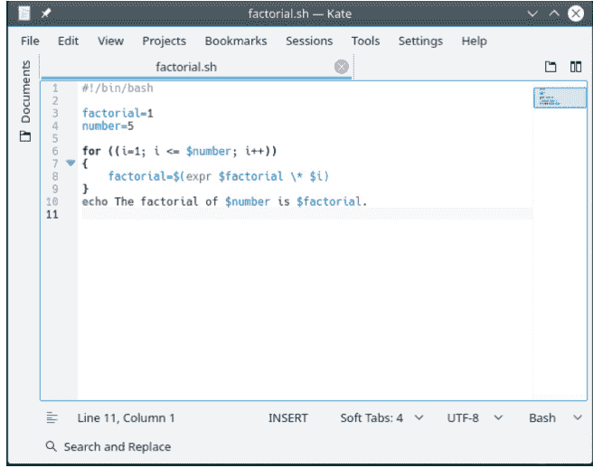

**图 10-10** 主 Kate 编辑窗口

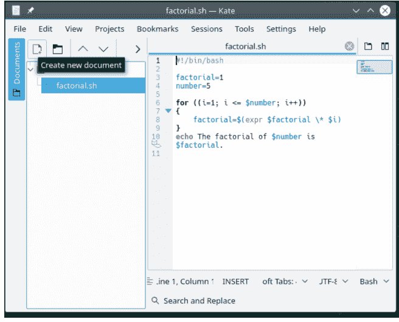

**图 10-11** Kate 文档列表

Kate 还支持多个外部插件应用，这些应用可以在插件管理器窗口中激活，如**图 10-12**所示。通过选择 设置 ⌘ 配置 ⌘ Kate ⌘ 插件 即可访问此功能。在此窗口中，你可以选择各种插件，使你的 shell 脚本环境更具生产力。


**图 10-12** Kate 插件管理器

Kate 编辑器的一个强大功能是内置的终端插件（终端工具视图），它提供终端窗口，如图 10-13 所示。底部文本编辑器窗口中的终端图标启动 Kate 内置的终端模拟器（使用 KDE Konsole 终端模拟器在第 2 章“进入 Shell”中有介绍）。

> **提示**
>
> 如果你没有看到 Kate 窗口底部的终端图标，很可能是因为你还没有激活终端工具视图插件。一旦你到达插件管理器窗口（前文所述）并选择了终端工具视图插件，请务必点击应用图标以激活此功能。

此终端模拟器功能在水平方向上分割当前编辑窗口，创建一个在其中运行 Konsole 的新窗口。现在你可以输入命令行命令、启动程序或检查系统设置，而无需离开编辑器！要关闭终端窗口，只需在命令提示符下输入 `exit` 即可。

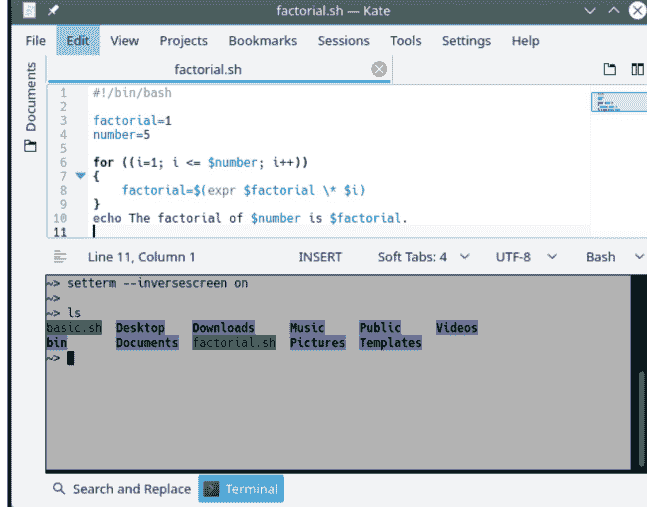

**图 10-13** Kate 内置终端窗口

正如终端功能所示，Kate 也支持多个窗口。**窗口**菜单栏项（**视图**）提供了执行这些任务的选项，例如：

- 使用当前会话创建新的 Kate 窗口。
- 垂直分割当前窗口以创建新窗口。
- 水平分割当前窗口以创建新窗口。
- 关闭当前窗口。

**视图**菜单还允许你控制编辑器窗口的功能，例如显示各种工具、更改字体大小以及显示非打印字符。Kate 功能丰富。

**注意**

> **Kate 编辑器通过会话处理文件。你可以在一个会话中打开多个文件，并且可以通过“会话”菜单保存多个会话。当你启动 Kate 时，可以调回已保存的会话。这允许你通过为每个项目使用单独的工作区来轻松管理来自多个项目的文件。**

要在 Kate 中设置配置设置，请选择 设置 ⇄ 配置 Kate。将出现配置对话框，如图 10-14 所示。应用程序设置区域允许你配置 Kate 项的设置，例如控制会话（如图 10-14 所示）、文档列表和文件系统浏览器。

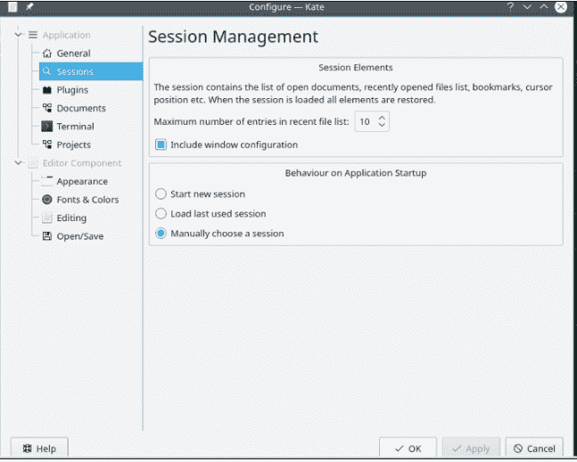

**图 10-14** Kate 配置对话框

Kate 和 KWrite 可以并排良好运作。Kate 是一个功能丰富的 MDI 编辑器，充当 IDE，使其适用于创建和编辑 shell 脚本。另一方面，KWrite 启动快速，提供与 Kate 几乎同等强大的功能，使你可以快速修复脚本。两个编辑器都有其各自的位置。

### 探索 GNOME 编辑器

如果你是在使用 GNOME Shell 桌面环境的 Linux 系统上工作，还有一个你可以使用的图形化文本编辑器。`gedit` 文本编辑器是一个基本的文本编辑器，附带了一些有趣的高级功能。本节将带你了解 `gedit` 的功能，并演示如何在 shell 脚本中使用它

#### 启动 gedit

在 GNOME Shell 桌面环境中，访问 `gedit` 相当简单。点击桌面窗口右上角的“活动”图标。当搜索栏出现时，在搜索栏内点击以获取焦点，输入 `gedit` 或 `text editor`，然后点击“文本编辑器”。


如果您的桌面环境没有默认安装 `gedit`，您可以轻松安装它（参见第 9 章）。包名为 `gedit`。您还应该安装 `gedit` 插件，因为它们提供了强大且高级的功能。它们的包名，如您可能已经猜到的，是 `gedit-plugins`。

如果需要，您可以在 GUI 终端模拟器的命令提示符下启动 `gedit`：

```
$ gedit factorial.sh myprog.c
```

当您使用多个文件启动 `gedit` 时，它会将所有文件加载到单独的缓冲区中，并在主编辑器窗口中将其作为选项卡窗口显示，如图 10-15 所示。

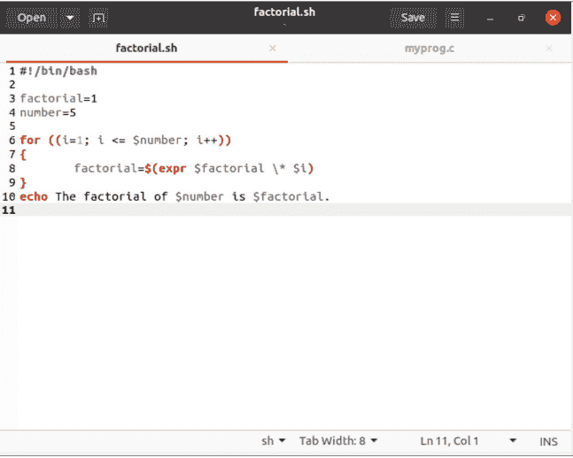

**图 10-15** `gedit` 主编辑器窗口

在*图 10-15*中，`gedit` 主编辑器窗口左侧的框架显示您当前正在编辑的文档。右侧显示包含第二个文件缓冲区文本的选项卡窗口。如果将鼠标指针悬停在每个选项卡上，会出现一个对话框，显示文件的完整路径名、MIME 类型及其使用的字符集编码。

> **提示**
>


> 您可以点击选项卡在 gedit 选项卡之间快速跳转。如果您更喜欢使用快捷键，按下 `Ctrl+Alt+PageDown` 可以切换到右侧的选项卡缓冲区。按下 `Ctrl+Alt+PageUp` 可以切换到左侧。

## 理解 gedit 的基本功能

现代版本的 `gedit` 不使用菜单栏。相反，它们使用通过标题栏中的折叠菜单图标（也称为汉堡按钮）访问的菜单系统，该系统允许您控制文件、管理编辑会话、配置设置等，如图 10-16 所示。

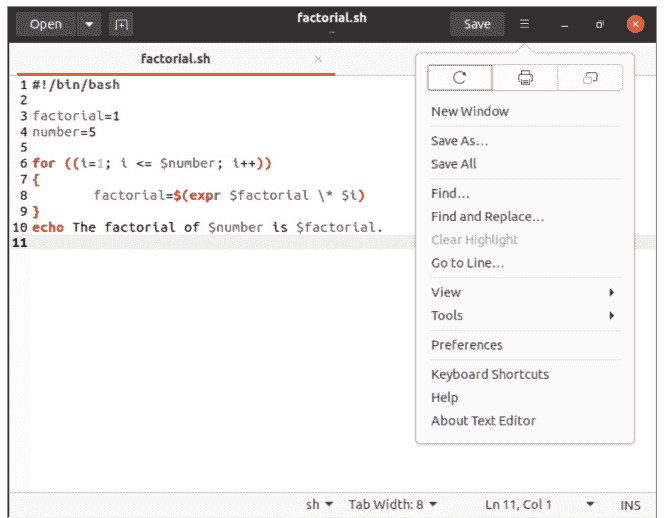

**图 10-16** `gedit` 菜单系统

可用的这些菜单项是：

- **新建窗口** 打开一个新的编辑窗口，而不是选项卡。
- **另存为** 将当前缓冲区的文件保存到新的文件名。
- **全部保存** 将所有选项卡的内容保存到磁盘。
- **查找** 打开“查找文本”对话框，允许您自定义文本搜索并高亮显示的找到文本。
- **查找和替换** 显示“查找/替换”弹出窗口，允许您自定义文本搜索和替换。
- **清除高亮** 移除找到文本的高亮显示。
- **转到行** 打开“转到行”对话框，将光标移动到输入的文本行号。
- **查看** 打开一个子菜单，允许选择显示“文档列表/文件管理器”（侧边栏）、“嵌入式终端”（底部面板）和语法高亮（高亮模式）。
- **工具** 显示一个子菜单，允许激活拼写检查器（拼写检查）、更改拼写检查器的语言（设置语言）、高亮显示的拼写错误（高亮显示拼写错误单词）、显示文本统计信息（文档统计信息），以及选择特定的日期和时间格式用于插入（插入日期和时间）。
- **首选项** 打开一个弹出窗口，提供 `gedit` 编辑器操作自定义，包括显示行号、制表位、文本字体和颜色以及激活的 `gedit` 插件等选项。
- **键盘快捷键** 显示可用的 `gedit` 键盘快捷键的简短列表。
- **帮助** 提供访问完整的 `gedit` 手册。
- **关于文本编辑器** 显示有关 `gedit` 版本、描述、网站等的信息。

菜单上没有的一项功能是基本的保存功能，它允许您将当前选项卡缓冲区中的文本以其原始文件名保存。这是因为 `gedit` 方便地在标题栏上提供了保存图标（见图 10-16）。只需点击图标即可保存文件。如果您更喜欢使用键盘，`Ctrl+S` 快捷键提供相同的功能。

### 注意

> 您的 Linux 桌面环境可能拥有比这些图中所示的 `gedit` 版本更旧或更新的版本。在这种情况下，您的 `gedit` 文本编辑器可能具有不同的选项，或者拥有相同的选项，但它们位于稍微不同的菜单位置。请查阅您的发行版 `gedit` 的“帮助”菜单以获取更多帮助。

`gedit` 中的侧边栏提供了类似于 Kate 中“文档列表”的功能。通过点击菜单汉堡图标，然后选择“查看”来访问此功能。当“查看”子菜单出现时，点击“侧边栏”旁边的复选框。这些操作会产生类似图 10-17 的结果。

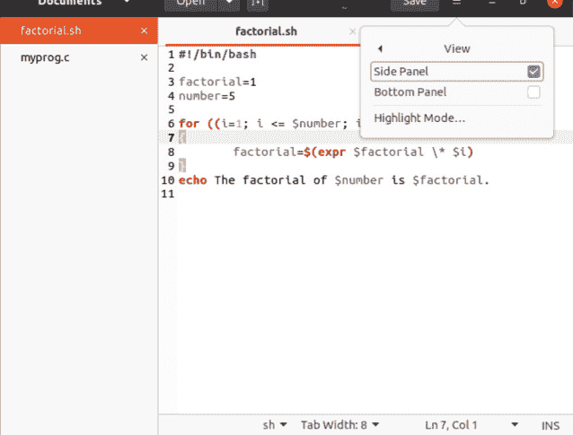


`gedit` 侧边栏提供了在打开的文档之间快速切换的功能。您还可以通过点击“文档”并选择“文件浏览器”来切换到文件管理器，如图 **10-18** 所示。

在“文件浏览器”窗格中，您可以浏览各种文件夹并找到其他要编辑的文件。如果需要，可以通过点击“文件浏览器”并选择“文档”切换回文档。

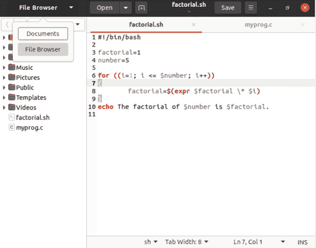


> **提示**
>
> 代替使用鼠标和 `gedit` 菜单系统，按下 `F9` 键可以快速打开或关闭侧边栏。

文件浏览器是一个 `gedit` 插件。如果由于某种原因无法从侧边栏访问文件浏览器，它可能未启用或未安装。您始终可以使用 `Ctrl+O` 键盘快捷键打开文件，但文件浏览器是一个有用的插件。接下来我们将详细介绍 `gedit` 插件的管理。

## 管理插件

`gedit`“首选项”窗口内的“插件”选项卡（如*图 10-19*所示）提供了对 `gedit` 中使用的插件的控制。插件是可以与 `gedit` 接口以提供额外功能的独立程序。

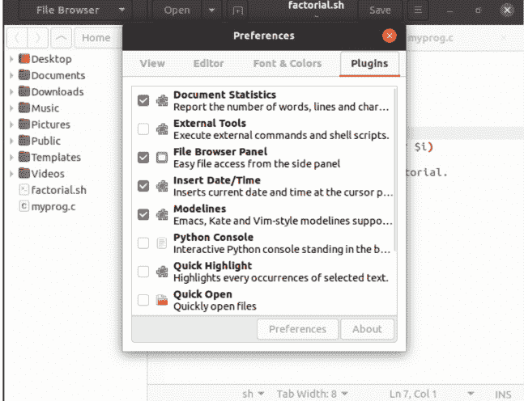


通常只默认安装基本的 `gedit` 插件。表 10-5 描述了当前在 GNOME 桌面的 `gedit` 应用中可用的基本插件。

如果需要，您可以通过安装插件元包来获得额外的有用功能，例如嵌入式终端（参见第 9 章），如在 Ubuntu 上所示：

```
$ sudo apt install gedit-plugins
[sudo] password for christine:
[...]
0 upgraded, 29 newly installed, 0 to remove and 77 not
upgraded.
Need to get 2,558 kB of archives.
After this operation, 13.6 MB of additional disk space will
be used.
Do you want to continue? [Y/n] Y
[...]
Setting up gedit-plugins (3.36.2-1) ...
$
```

一旦您已在系统上安装了额外的插件，您将在 `gedit`“首选项”窗口内的“插件”选项卡上看到许多额外的选择，如图 10-20 所示。

# **表 10-5** GNOME 桌面 `gedit` 插件

| 插件 | 描述 |
| :--- | :--- |
| 文档统计信息 | 报告单词数、行数、字符数和非空格字符数。 |
| 外部工具 | 在编辑器中提供 shell 环境以执行命令和脚本。 |
| 文件浏览器面板 | 提供一个简单的文件浏览器，使选择要编辑的文件更容易。 |
| 插入日期/时间 | 在当前光标位置以多种格式插入当前日期和时间。 |
| Modelines | 在编辑器窗口底部提供 Emacs、Kate 和 vim 样式的消息行。 |
| Python 控制台 | 在编辑器窗口底部提供一个交互式控制台，用于使用 Python 编程语言输入命令。 |
| 快速高亮 | 高亮显示选区的所有匹配文本。 |
| 快速打开 | 直接在 `gedit` 编辑窗口中打开文件。 |
| 代码片段 | 允许您存储常用的文本片段，以便在文本中的任何位置轻松检索。 |
| 排序 | 快速对整个文件或选定的文本进行排序。 |
| 拼写检查器 | 为文本文件提供字典拼写检查。 |

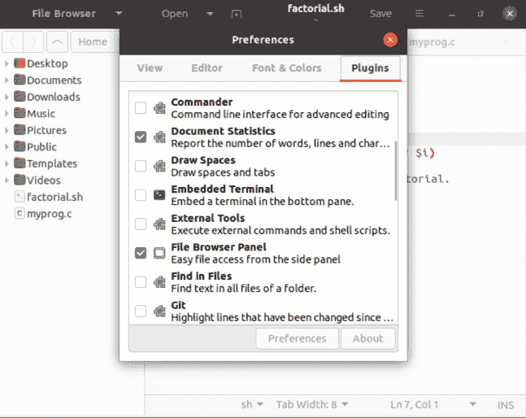

**图 10-20** 安装后的 `gedit` 插件选项卡

已启用的插件在其名称旁边的复选框中显示一个对勾。启用插件并不会启动它。如果你想使用某个插件，例如嵌入式终端（Embedded Terminal），你必须先在“偏好设置”（Preferences）选项卡中启用它。之后，你可以点击菜单汉堡图标并选择“查看”（View）来访问该插件；当“查看”子菜单出现时，点击“底部面板”（Bottom Panel）旁边的方框即可打开嵌入式终端，如图 10-21 所示。

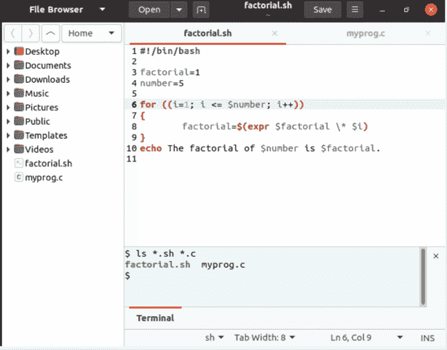

**图 10-21** `gedit` 嵌入式终端插件

本章仅涵盖了 Linux 上可用的文本编辑器中的少数几款。如果你发现这里描述的文本编辑器不能满足你的需求，你还有其他选择。市面上还有许多其他的 Linux 编辑器，例如 Geany、Sublime Text、Atom、Visual Studio Code 和 Brackets 等等。当你开始你的 Bash shell 脚本编写之旅时，所有这些编辑器都能为你提供帮助。

## 摘要

在创建 shell 脚本时，你需要某种类型的文本编辑器。Linux 环境中有几种流行的文本编辑器可用。Unix 世界中最流行的编辑器 vi 已被移植到 Linux 世界，成为 `vim` 编辑器。`vim` 编辑器使用简单的全屏图形模式，从控制台提供基本的文本编辑功能。`vim` 编辑器提供了许多高级编辑器功能，例如文本搜索和替换。

另一个从 Unix 世界移植到 Linux 的编辑器是 `nano` 文本编辑器。`vim` 编辑器可能相当复杂，但 `nano` 编辑器提供了简洁性。`nano` 编辑器允许在控制台模式下进行快速文本编辑。


另一个流行的 Unix 编辑器——Emacs——也已进入 Linux 世界。Linux 版本的 Emacs 既有控制台模式也有图形模式，使其成为旧世界与新世界之间的桥梁。Emacs 编辑器提供多个缓冲区，允许你同时编辑多个文件。

KDE 项目为 KDE Plasma 桌面创建了两个编辑器。KWrite 编辑器是一个提供基本文本编辑功能以及少量高级功能（如编程代码语法高亮和行号）的简单编辑器。Kate 编辑器为程序员提供了更高级的功能。Kate 中一个很棒的功能是内置终端窗口。你可以直接在 Kate 编辑器中打开命令行界面会话，而无需打开单独的终端模拟器窗口。Kate 编辑器还允许你打开多个文件，为每个打开的文件提供不同的窗口。

GNOME 项目也为程序员提供了图形化文本编辑器。gedit 编辑器提供了一些高级功能，如代码语法高亮和行号，但它被设计为一个基础功能的编辑器。为了美化 gedit 编辑器，开发人员创建了插件，这些插件扩展了 gedit 中可用的功能。插件包括拼写检查器、终端模拟器和文件浏览器。

这就结束了关于在 Linux 中处理命令行的背景章节。本书的下一部分将深入 shell 脚本世界。下一章将从展示如何创建 shell 脚本文件以及如何在你的 Linux 系统上运行它开始。它还介绍了 shell 脚本的基础知识，使你能通过将多个命令串联成一个可运行的脚本来创建简单的程序。

## 第二部分

### Shell 脚本基础

**本部分包括**

- *第 11 章 基本脚本构建*
- *第 12 章 使用结构化命令*
- *第 13 章 更多结构化命令*
- *第 14 章 处理用户输入*
- *第 15 章 呈现数据*
- *第 16 章 脚本控制*

## 第 11 章

### 基本脚本构建

**本章包括**

- 使用多个命令
- 创建脚本文件
- 显示消息
- 使用变量
- 重定向输入和输出
- 管道
- 执行数学运算
- 退出脚本

既然我们已经涵盖了 Linux 系统和命令行的基础知识，现在是时候开始编码了。本章讨论了编写 shell 脚本的基础知识。在开始编写你自己的 shell 脚本杰作之前，你需要了解这些基本概念。

#### 使用多个命令

到目前为止，你已经看到了如何使用 shell 的命令行界面（CLI）提示符输入命令并查看命令结果。shell 脚本的关键在于能够输入多个命令并处理每个命令的结果，甚至可能将一个命令的结果传递给另一个命令。shell 允许你将命令串联成单个步骤。

如果你想一起运行两个命令，可以在同一提示行中输入它们，用分号分隔：

```
$ date ; who
Mon Jun 01 15:36:09 EST 2020
Christine tty2 2020-06-01 15:26
Samantha tty3 2020-06-01 15:26
Timothy tty1 2020-06-01 15:26
user tty7 2020-06-01 14:03 (:0)
user pts/0 2020-06-01 15:21 (:0.0)
$
```

恭喜，你刚刚写了一个 shell 脚本！这个简单脚本只使用了两个 Bash shell 命令。`date` 命令首先运行，显示当前日期和时间，随后是 `who` 命令的输出，显示当前登录到系统的用户。使用这种技术，你可以串联任意数量的命令，最多可达命令行字符数限制的 255 个字符。

虽然对于小型脚本来说使用这种技术没问题，但它有一个主要的缺点，即每次想要运行该命令时，你都必须手动输入整个命令。你无需在命令行上手动输入命令，而是可以将它们组合到一个简单的文本文件中。当需要运行这些命令时，只需简单地运行该文本文件即可。

#### 创建脚本文件

要将 shell 命令放入文本文件中，首先你需要使用文本编辑器（参见第 10 章，“使用编辑器”）创建一个文件，然后将命令输入到文件中。

在创建 shell 脚本文件时，你应该在文件的第一行指定你正在使用的 shell。其格式如下：

```
#!/bin/bash
```

在普通的 shell 脚本行中，井号（`#`）用作注释行。shell 脚本中的注释行不会被 shell 处理。

然而，shell 脚本文件的第一行是一个特殊情况，井号后跟感叹号告诉 shell 在哪个 shell 下运行该脚本（是的，你可以使用 Bash shell，但用另一个 shell 运行你的脚本）。

在指示 shell 之后，命令输入到文件的每一行，后跟回车符。如前所述，可以使用井号添加注释。示例如下：

```
#!/bin/bash
# This script displays the date and who's logged on
who
```

这就全部了。如果你想，可以使用分号将两个命令放在同一行，但在 shell 脚本中，你可以将命令列在不同行上。shell 将按照命令在文件中出现的顺序处理它们。

还请注意，包含了一行以井号开头并添加注释的代码。以井号开头的行（除了第一行 `#!` 外）不会被 shell 解释。这是为自己留下关于脚本中发生什么的注释的好方法，以便你在两年后回来时能轻松记住你做了什么。

将这个脚本保存为名为 *test1* 的文件，你几乎准备就绪了。在运行新的 shell 脚本文件之前，还有几件事要做。

如果你现在尝试运行该文件，你会略显失望地看到以下内容：

```
$ test1
bash: test1: command not found
$
```

需要跨越的第一道障碍是让 Bash shell 找到你的脚本文件。如果你还记得第 6 章“使用 Linux 环境变量”，shell 使用名为 *PATH* 的环境变量来查找命令。快速查看 *PATH* 环境变量就能说明我们的问题：

```
$ echo $PATH
/usr/kerberos/sbin:/usr/kerberos/bin:/usr/local/bin:/usr/bin:/bin:/usr/local/sbin:/usr/sbin:/sbin:/home/user/bin
$
```

`*PATH*` 环境变量设置为仅在少数几个目录中查找命令。为了让 shell 找到 `test1` 脚本，我们需要做以下两件事之一：

- 将包含我们的 shell 脚本文件的目录添加到 `PATH` 环境变量中。
- 在 prompt 中使用绝对路径或相对文件路径来引用我们的 shell 脚本文件。

##### 提示

一些 Linux 发行版会将 `$HOME/bin` 目录添加到 `PATH` 环境变量中。这会在每个用户的 `$HOME` 目录下创建一个位置，用于放置文件，以便 shell 能够找到并执行它们。

在这个例子中，我们将使用第二种方法，明确告知 shell 脚本文件的确切位置。请记住，要在 shell 中引用当前目录中的文件，可以使用单点运算符：

```bash
$ ./test1
bash: ./test1: Permission denied
$
```

现在 shell 成功找到了 shell 脚本文件，但还有另一个问题。Shell 显示你没有权限执行该文件。快速查看文件权限应该会揭示这里发生了什么：

```bash
$ ls -l test1
-rw-r--r--     1 user     user        73 Jun 02 15:36 test1
$
```

当创建新的 `test1` 文件时，`umask` 值决定了新文件的默认权限设置。由于 `umask` 变量设置为 022（参见第 7 章，“理解 Linux 文件权限”），系统创建的文件仅具有文件所有者的读/写权限。

下一步是使用 `chmod` 命令（参见第 7 章）授予文件所有者执行文件的权限：

```bash
$ chmod u+x test1
$ ./test1
Mon Jun 01 15:38:19 EST 2020
Christine tty2          2020-06-01 15:26
Samantha  tty3          2020-06-01 15:26
Timothy   tty1          2020-06-01 15:26
user      tty7          2020-06-01 14:03 (:0.0)
user      pts/0         2020-06-01 15:21 (:0.0)
$
```

成功！现在所有部件都已到位，可以执行新的 shell 脚本文件了。

#### 显示消息

大多数 shell 命令都会产生自己的输出，这些输出显示在运行脚本的控制台监视器上。然而，很多时候，你会希望添加自己的文本消息，以帮助脚本用户了解脚本内部正在发生什么。你可以使用 `echo` 命令来实现这一点。如果添加字符串跟随在命令之后，`echo` 命令可以显示一个简单的文本字符串：

```bash
$ echo This is a test
This is a test
$
```

请注意，默认情况下，你不需要使用引号来界定你要显示的字符串。但是，如果你在字符串内部使用引号，这有时会变得棘手：


```bash
$ echo Let's see if this'll work
Lets see if this'll work
$
```

`echo` 命令使用双引号或单引号来界定文本字符串。如果你在字符串内部使用它们，你需要在文本中使用一种类型的引号，并使用另一种类型的引号来界定字符串：

```bash
$ echo "This is a test to see if you're paying attention"
This is a test to see if you're paying attention
$ echo 'Rich says "scripting is easy".'
Rich says "scripting is easy".
$
```

现在所有的引号都正确地出现在输出中。

你可以在 shell 脚本中任何需要显示额外信息的地方添加 `echo` 语句：

```bash
$ cat test1
#!/bin/bash
# This script displays the date and who's logged on
echo The time and date are:
date
echo "Let's see who's logged into the system:"
who
$ 
```

当你运行这个脚本时，它会生成以下输出：

```bash
$ ./test1
The time and date are:
Mon Jun 01 15:41:13 EST 2020
Let's see who's logged into the system:
Christine tty2	2020-06-01 15:26
Samantha tty3	2020-06-01 15:26
Timothy tty1	2020-06-01 15:26
user	tty7	2020-06-01 14:03 (:0)
user	pts/0	2020-06-01 15:21 (:0.0)
$ 
```

这很不错，但如果你希望在同一行上显示文本字符串和命令输出怎么办？你可以使用 `echo` 语句的 `-n` 参数来实现。只需将第一个 `echo` 语句行更改为以下内容：

```bash
echo -n "The time and date are: "
```

你需要在字符串周围使用引号，以确保在回显字符串的末尾有一个空格。命令输出从字符串输出停止的确切位置开始。输出现在看起来像这样：

```bash
$ ./test1
The time and date are: Mon Jun 01 15:42:23 EST 2020
Let's see who's logged into the system:
Christine tty2	2020-06-01 15:26
Samantha tty3	2020-06-01 15:26
Timothy tty1	2020-06-01 15:26
user	tty7	2020-06-01 14:03 (:0)
user	pts/0	2020-06-01 15:21 (:0.0)
$ 
```

完美！`echo` 命令是与用户交互的 shell 脚本中至关重要的部分。你会发现自己在许多情况下都会使用它，尤其是当你想要显示脚本变量的值时。接下来让我们看看这一点。

## 使用变量

仅仅从 shell 脚本中运行单独的命令是有用的，但这样做有其局限性。通常，你希望在 shell 命令中整合其他数据以处理信息。你可以通过使用变量来实现这一点。变量允许你在 shell 脚本中临时存储信息，以便在脚本中的其他命令中使用。本节展示了如何在 shell 脚本中使用变量。

### 环境变量

你已经见过一种 Linux 变量在发挥作用。第 6 章描述了 Linux 系统中可用的环境变量。你也可以从你的 shell 脚本中访问这些值。

Shell 维护跟踪特定系统信息的环境变量，例如系统名称、登录系统的用户名、用户的系统 ID（称为 `UID`）、用户的默认主目录以及 shell 用于查找程序的搜索路径。你可以使用 `set` 命令显示所有活动的可用环境变量列表：

```bash
$ set
BASH=/bin/bash
...
HOME=/home/Samantha
HOSTNAME=localhost.localdomain
HOSTTYPE=i386
IFS=$' \t\n'
IMSETTINGS_INTEGRATE_DESKTOP=yes
IMSETTINGS_MODULE=none
LANG=en_US.utf8
LESSOPEN= '|/usr/bin/lesspipe.sh %s'
LINES=24
LOGNAME=Samantha
...
```

你可以通过使用环境变量名称，并在其前面加一个美元符号，来在脚本内部利用这些环境变量。

以下脚本演示了这一点：

```bash
$ cat test2
#!/bin/bash
# display user information from the system.
echo "User info for userid: $USER"
echo UID: $UID
echo HOME: $HOME
$  
```

环境变量 `$USER`、`$UID` 和 `$HOME` 被用来显示关于登录用户的相关信息。输出应该类似于以下内容：

```bash
$ chmod u+x test2
$ ./test2
User info for userid: Samantha
UID: 1001
HOME: /home/Samantha
$ 
```

请注意，在脚本运行时，`echo` 命令中的环境变量会被其当前值替换。还要注意，我们能够将 `$USER` 系统变量放在第一个字符串的双引号内，而 shell 脚本仍然能够理解我们的意思。然而，使用这种方法有一个缺点。看看在这个例子中发生了什么：

```bash
$ echo "The cost of the item is $15"
The cost of the item is 5  
```

显然这不是预期的结果。每当脚本在引号内看到美元符号时，它就假定你正在引用一个变量。在这个例子中，脚本试图显示变量 `$1`（该变量未定义），然后是数字 5。要显示实际的美元符号，你必须在其前面加上反斜杠字符：

```bash
$ echo "The cost of the item is \$15"
The cost of the item is $15  
```

这样就更好了。反斜杠使 shell 脚本将美元符号解释为实际的美元符号，而不是变量。下一节展示了如何在你的脚本中创建自己的变量。

> **注意**
>
> **你也可能看到使用格式 `$[variable]` 引用的变量。变量名称周围的额外括号通常用于帮助将变量名称与美元符号区分开来。**

### 用户变量

除了环境变量，shell 脚本还允许你在脚本内设置和使用自己的变量。设置变量允许你临时存储数据并在整个脚本中使用它们，使 shell 脚本更像真正的计算机程序。

用户变量可以是任意长度的文本字符串，最长可达 20 个字母、数字或下划线字符。用户变量对大小写敏感，因此变量 `var1` 与变量 `VAR1` 不同。这条小规则常常让初学者脚本程序员陷入困境。

使用等号将值分配给用户变量。变量、等号和值之间不能有空格（这是另一个让初学者容易出错的地方）。以下是向用户变量分配值的几个例子：

```bash
var1=10
var2=-57
var3=testing
var4="still more testing"
```

Shell 脚本将所有变量值存储为文本字符串；至于用于变量值的数据类型，则由 shell 中的各个命令决定。在 shell 脚本内定义的变量在整个 shell 脚本的生命周期中保持其值，但当 shell 脚本完成时会被删除。

与系统变量一样，可以使用美元符号引用用户变量：

```bash
$ cat test3
```

### 命令替换

Shell 脚本最有用的功能之一是能够提取命令输出中的信息并将其赋值给变量。一旦将输出赋值给变量，你就可以在脚本的任何地方使用该值。这在处理脚本中的数据时非常有用。

有两种方式将命令的输出赋值给变量：

- 反引号字符
- `$()` 格式

请注意反引号字符——它不是你习惯用于字符串的普通单引号字符。由于它很少在 shell 脚本之外使用，你可能甚至不知道键盘上的哪里能找到它。你应该熟悉它，因为它是许多 shell 脚本的重要组件。提示：在美国键盘上，它通常与波浪线符号（~）在同一个键上。

命令替换允许你将 shell 命令的输出赋值给变量。虽然这看起来不多，但它是脚本编程中的重要构建模块。

你必须用反引号字符包围整个命令行命令：

```text
testing=`date`
```

或者使用 `$()` 格式：

```text
testing=$(date)
```

Shell 运行命令替换字符内部的命令，并将输出赋值给变量 `testing`。注意，赋值等号和命令替换字符之间没有空格。这里是一个使用普通 shell 命令的输出创建变量的示例：


```bash
$ cat test5
#!/bin/bash
testing=$(date)
echo "The date and time are: " $testing
$
```

变量 `testing` 接收 `date` 命令的输出，并用于 `echo` 语句中显示它。运行 shell 脚本会产生以下输出：

```bash
$ chmod u+x test5
$ ./test5
The date and time are: Mon Jun 01 15:45:25 EDT 2020
$
```

在这个例子中，这并不是什么令人兴奋的地方（你可以很容易地将命令直接放在 `echo` 语句中），但一旦你将命令输出捕获到变量中，你就可以对其做任何事情。

这里是一个流行的示例，展示如何运用命令替换来捕获当前日期并将其用于在脚本中创建唯一的文件名：

```bash
#!/bin/bash
# copy the /usr/bin directory listing to a log file
today=$(date +%y%m%d)
ls /usr/bin -al> log.$today
```

变量 `today` 被赋值为格式化 `date` 命令的输出。这是一种常用于提取日期信息用于日志文件名的技术。`+%y%m%d` 格式指示 `date` 命令将日期显示为两位数的年份、月份和日期：

```bash
$ date +%y%m%d
200601
$
```

脚本将该值赋值给变量，然后将其用作文件名的一部分。文件本身包含重定向的输出（将在“输入和输出重定向”部分讨论）的目录列表。运行脚本后，你应该能在目录中看到一个新的文件：

    -rw-r--r--    1 user     user        769 Jun 01 16:15

        log.200601

日志文件出现在目录中，使用 `$today` 变量的值作为文件名的一部分。日志文件的内容是来自 `/usr/bin` 目录的目录列表。如果脚本在第二天运行，日志文件名将是 `log.200602`，从而为新的日子创建一个新文件。

**警告**

命令替换会创建一个所谓的子 shell 来运行封闭的命令。子 shell 是从运行脚本的 shell 生成的独立子 shell。因此，你在脚本中创建的任何变量都不会对运行在子 shell 中的命令可用。

如果你在命令提示符下使用 `./` 路径运行命令，也会创建子 shell，但如果你只是不带路径运行命令，则不会创建。但是，如果你使用内置 shell 命令，那不会生成子 shell。在命令提示符下运行脚本时要小心！

## 输入和输出重定向

有时你希望保存命令的输出，而不仅仅是让它显示在监视器上。Bash shell 提供了一些不同的运算符，允许你将命令的输出重定向到另一个位置（例如文件）。重定向也可用于输入和输出，将文件重定向到命令作为输入。本节描述了你在 shell 脚本中使用重定向需要做什么。

### 输出重定向

最基本的重定向类型是将命令的输出发送到文件。Bash shell 使用大于号符号 (`>`) 来实现这一功能：

```text
command> outfile
```

任何原本会显示在监视器上的命令内容，现在都会存储在指定的输出文件中：

```bash
$ date> test6
$ ls -l test6
-rw-r--r-- 1 user user 29 Jun 01 16:56 test6
$ cat test6
Mon Jun 01 16:56:58 EDT 2020
$
```

重定向运算符创建了文件 `test6`（使用默认的 `umask` 设置），并将 `date` 命令的输出重定向到 `test6` 文件。如果输出文件已经存在，重定向运算符会用新文件数据覆盖现有文件：

```bash
$ who> test6
$ cat test6
rich pts/0 Jun 01 16:55
$
```

现在，`test6` 文件的内容包含 `who` 命令的输出。

有时，你可能需要覆盖文件的内容，而不是将命令的输出附加到现有文件中——例如，如果你正在创建一个日志文件来记录系统上的操作。在这种情况下，你可以使用双大于号符号 (`>>`) 来追加数据：

```bash
$ date>> test6
$ cat test6
rich pts/0 Jun 01 16:55
Mon Jun 01 17:02:14 EDT 2020
$
```

`test6` 文件仍然包含之前处理的 `who` 命令的原始数据——现在它还包含了 `date` 命令的新输出。

### 输入重定向

输入重定向是输出重定向的反面。输入重定向不是将命令的输出重定向到文件，而是将文件的内容重定向到命令。输入重定向符号是小于号符号 (`<`)：

```text
command < inputfile
```

记住这一点的一个简单方法是，命令总是列在命令行中的第一位，而重定向符号“指向”数据流动的方向。小于号表示数据从输入文件流向命令。

这里是一个使用 `wc` 命令进行输入重定向的示例：

```bash
$ wc < test6
2       11       60
$
```

`wc` 命令提供数据中文本的计数。默认情况下，它生成三个值：

- 文本中的行数
- 文本中的单词数
- 文本中的字节数

通过将文本文件重定向到 `wc` 命令，你可以快速获得文件中行数、单词数和字节数的计数。示例显示 `test6` 文件中有 2 行，11 个单词和 60 个字节。

还有另一种输入重定向方法，称为*内联输入重定向*。这种方法允许你在命令行中指定用于输入重定向的数据，而不是在文件中。这起初可能看起来有点奇怪，但这个过程有一些应用（如后面“执行数学运算”部分所示）。

内联输入重定向符号是双小于号符号 (`<<`)。除了这个符号，你还必须指定一个文本标记，用于界定用于输入的数据的开始和结束。你可以使用任何字符串值作为文本标记，但在数据的开始和结束必须是相同的：

```text
command << marker
```

在命令行上使用内联输入重定向时，shell 会使用由 `ps2` 环境变量（参见第 6 章）定义的第二级提示符来提示用户输入数据。以下是其实际使用效果：

```
$ wc << EOF
> test string 1
> test string 2
> test string 3
> EOF
        3           9          42

$ 
```

第二级提示符会持续提示输入更多数据，直到你输入文本标记的字符串值。`wc` 命令会对通过内联输入重定向提供的数据执行行数、单词数和字节数的统计。

## 使用管道

有时你需要将一个命令的输出发送到另一个命令的输入中。虽然可以通过重定向实现这一点，但这种方式略显笨拙：

```
$ rpm -qa>  rpm.list
$ sort < rpm.list
abattis-cantarell-fonts-0.0.25-1.el7.noarch
abrt-2.1.11-52.el7.centos.x86_64
abrt-addon-ccpp-2.1.11-52.el7.centos.x86_64
abrt-addon-kerneloops-2.1.11-52.el7.centos.x86_64
abrt-addon-pstoreoops-2.1.11-52.el7.centos.x86_64
abrt-addon-python-2.1.11-52.el7.centos.x86_64
abrt-addon-vccore-2.1.11-52.el7.centos.x86_64
abrt-addon-xorg-2.1.11-52.el7.centos.x86_64
abrt-cli-2.1.11-52.el7.centos.x86_64
abrt-console-notification-2.1.11-52.el7.centos.x86_64
...
```

`rpm` 命令用于管理在 Red Hat 包管理系统（RPM）上安装的系统（如所示的 CentOS 系统）上的软件包。当与 `-qa` 参数一起使用时，它会生成已安装包列表，但不一定按特定顺序排列。如果你正在查找特定的包或包组，使用 `rpm` 命令的输出可能会很难找到它们。

使用标准输出重定向，`rpm` 命令的输出被重定向到名为 `rpm.list` 的文件中。命令完成后，`rpm.list` 文件包含该系统上所有已安装软件包的列表。接下来，使用输入重定向将 `rpm.list` 文件的内容发送到 `sort` 命令，以按字母顺序对包名进行排序。

这很有用，但同样是一种略显笨拙的信息生成方式。与其将命令的输出重定向到文件，你可以将输出重定向到另一个命令。这个过程称为*管道*。

与命令替换的反引号（`` ` ``）一样，管道符号在 shell 脚本之外并不常用。该符号是两条垂直线，一条在另一条上方。然而，印刷体中的管道符号通常看起来像单条垂直线（`|`）。在美国键盘上，它通常与反斜杠（`\`）位于同一个键上。管道放在命令之间，以将一个命令的输出重定向到另一个命令：

```
command1 | command2
```


不要认为管道是连续运行两个命令。Linux 系统实际上同时运行这两个命令，并在系统内部将它们链接在一起。当第一个命令产生输出时，它会立即发送到第二个命令。不使用中间文件或缓冲区来传输数据。

现在，使用管道可以轻松地将 `rpm` 命令的输出直接管道传输到 `sort` 命令以生成结果：

```
$ rpm -qa | sort
abattis-cantarell-fonts-0.0.25-1.el7.noarch
abrt-2.1.11-52.el7.centos.x86_64
abrt-addon-ccpp-2.1.11-52.el7.centos.x86_64
abrt-addon-kerneloops-2.1.11-52.el7.centos.x86_64
abrt-addon-pstoreoops-2.1.11-52.el7.centos.x86_64
abrt-addon-python-2.1.11-52.el7.centos.x86_64
abrt-addon-vmcore-2.1.11-52.el7.centos.x86_64
abrt-addon-xorg-2.1.11-52.el7.centos.x86_64
abrt-cli-2.1.11-52.el7.centos.x86_64
abrt-console-notification-2.1.11-52.el7.centos.x86_64
…
```

除非你阅读速度非常快，否则你可能无法跟上此命令生成的输出。由于管道功能实时操作，一旦 `rpm` 命令产生数据，`sort` 命令就开始对其排序。等到 `rpm` 命令完成数据输出时，`sort` 命令已经排序完毕，并开始在显示器上显示数据。

你可以使用的管道数量没有限制。你可以继续将命令的输出管道传输到其他命令以细化操作。

在这种情况下，由于 `sort` 命令的输出速度很快，你可以使用文本分页命令（如 `less` 或 `more`）强制输出在每一屏数据结束时停止：

```
$ rpm -qa | sort | more
```

此命令序列运行 `rpm` 命令，将输出管道传输到 `sort` 命令，然后再将该输出管道传输到 `more` 命令以显示数据，并在每屏信息后停止。这现在允许你在继续之前暂停并阅读显示屏上的内容，如图 11-1 所示。

要想更高级一点，你可以将重定向与管道结合使用，将输出保存到文件：

```
$ rpm -qa | sort> rpm.list
$ more rpm.list
abrt-1.1.14-1.fc14.i686
abrt-addon-ccpp-1.1.14-1.fc14.i686
abrt-addon-kerneloops-1.1.14-1.fc14.i686
abrt-addon-python-1.1.14-1.fc14.i686
abrt-desktop-1.1.14-1.fc14.i686
abrt-gui-1.1.14-1.fc14.i686
abrt-libs-1.1.14-1.fc14.i686
abrt-plugin-bugzilla-1.1.14-1.fc14.i686
abrt-plugin-logger-1.1.14-1.fc14.i686
abrt-plugin-runapp-1.1.14-1.fc14.i686
acl-2.2.49-8.fc14.i686
```

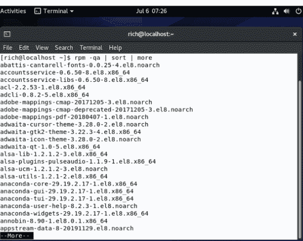

图 11-1 使用管道将数据发送到 `more` 命令

不出所料，`rpm.list` 文件中的数据现在已排序！

迄今为止，最受欢迎的用法之一是将产生较长输出的命令结果管道传输到 `more` 命令。这在 `ls` 命令中尤为常见，如图 11-2 所示。

`ls -l` 命令生成目录中所有文件的长列表。对于包含大量文件的目录，这会是一个很长的列表。通过将输出管道传输到 `more` 命令，你强制输出在每屏数据末尾停止。

### 执行数学运算

对任何编程语言至关重要的另一个功能是操纵数字的能力。不幸的是，对于 shell 脚本，这个过程有点麻烦。你有两种方法在 shell 脚本中执行数学运算。

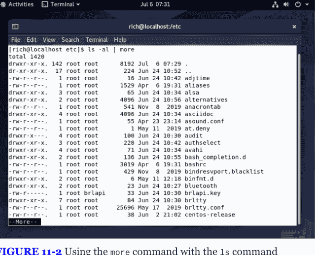

#### expr 命令

最初，Bourne shell 提供了一种用于处理数学方程的特殊命令。`expr` 命令允许从命令行处理方程，但它非常笨拙：

```
$ expr  1 + 5
6
```

`expr` 命令识别几种不同的数学和字符串运算符，如表 11-1 所示。

标准运算符在 `expr` 命令中运行良好，但问题出现在从脚本或命令行使用它们时。许多 `expr` 命令运算符在 shell 中有其他含义（例如星号）。在 `expr` 命令中使用它们会产生奇怪的结果：

```
$ expr 5 * 2
expr: syntax error
$ 
```

##### 表 11-1 `expr` 命令运算符

| 运算符 | 描述 |
| :--- | :--- |
| ARG1 \| ARG2 | 如果两个参数都不是 null 或 0，则返回 ARG1；否则，返回 ARG2。 |
| ARG1 & ARG2 | 如果两个参数都不是 null 或 0，则返回 ARG1；否则，返回 0。 |
| ARG1 < ARG2 | 如果 ARG1 小于 ARG2，则返回 1；否则，返回 0。 |
| ARG1 <= ARG2 | 如果 ARG1 小于或等于 ARG2，则返回 1；否则，返回 0。 |
| ARG1 = ARG2 | 如果 ARG1 等于 ARG2，则返回 1；否则，返回 0。 |
| ARG1 != ARG2 | 如果 ARG1 不等于 ARG2，则返回 1；否则，返回 0。 |
| ARG1 >= ARG2 | 如果 ARG1 大于或等于 ARG2，则返回 1；否则，返回 0。 |
| ARG1 > ARG2 | 如果 ARG1 大于 ARG2，则返回 1；否则，返回 0。 |
| ARG1 + ARG2 | 返回 ARG1 和 ARG2 的算术和。 |
| ARG1 - ARG2 | 返回 ARG1 和 ARG2 的算术差。 |
| ARG1 * ARG2 | 返回 ARG1 和 ARG2 的算术积。 |
| ARG1 / ARG2 | 返回 ARG1 除以 ARG2 的算术商。 |
| ARG1 % ARG2 | 返回 ARG1 除以 ARG2 的算术余数。 |

#### 字符串：正则表达式

| 命令 | 描述 |
| :--- | :--- |
| `STRING : REGEXP` | 如果 REGEXP 在 STRING 中匹配某个模式，则返回该模式匹配项。 |
| `match STRING REGEXP` | 如果 REGEXP 在 STRING 中匹配某个模式，则返回该模式匹配项。 |
| `substr STRING POS LENGTH` | 返回长度为 LENGTH 的子字符串，从位置 POS（起始位置为 1）开始。 |
| `index STRING CHARS` | 返回 CHARS 在 STRING 中找到的位置；否则返回 0。 |
| `length STRING` | 返回字符串 STRING 的数值长度。 |
| `+ TOKEN` | 即使 TOKEN 是关键字，也将其解释为字符串。 |
| `(EXPRESSION)` | 返回 EXPRESSION 的值。 |

为了解决这个问题，你需要使用 shell 转义字符（反斜杠）来标识那些在传递给 `expr` 命令之前可能会被 shell 错误解释的字符：

```bash
$ expr 5 \* 2
10
$
```

这就真的开始变得很难用了！在 shell 脚本中使用 `expr` 命令同样笨重：

```bash
$ cat test6
#!/bin/bash
# 一个使用 expr 命令的示例
var1=10
var2=20
var3=$(expr $var2 / $var1)
echo 结果是 $var3
```

要将数学方程的结果分配给变量，你必须使用命令替换从 `expr` 命令中提取输出：

```bash
$ chmod u+x test6
$ ./test6
结果是 2
$
```

幸运的是，Bash shell 在处理数学运算符方面有所改进，你将在下一节中看到。

#### 使用方括号

Bash shell 包含了 *expr* 命令以保持与 Bourne shell 的兼容性；然而，它也提供了一种进行数学方程计算更简单的方法。在 Bash 中，当将数学值分配给变量时，你可以使用美元符号和方括号（$[ 操作 ]）来包围数学方程：

```bash
$ var1=$[ 1 + 5]
$ echo $var1
6
$ var2=$[$var1 * 2]
$ echo $var2
12
$
```

使用方括号使 shell 数学运算比使用 *expr* 命令容易得多。同样的技术也适用于 shell 脚本：


```bash
$ cat test7
#!/bin/bash
var1=100
var2=50
var3=45
var4=$[$var1 * ($var2 - $var3)]
echo 最终结果是 $var4
$
```

运行此脚本会产生以下输出：

```bash
$ chmod u+x test7
$ ./test7
最终结果是 500
$
```

此外，请注意，使用方括号方法计算方程时，你不需要担心乘法符号或其他字符被 shell 错误解释。shell 知道它不是通配符字符，因为它位于方括号内。

在 Bash shell 脚本中进行数学运算有一个主要限制。看看这个例子：

```bash
$ cat test8
#!/bin/bash
var1=100
var2=45
var3=$[$var1 / $var2]
echo 最终结果是 $var3
$
```

现在运行它，看看会发生什么：

```bash
$ chmod u+x test8
$ ./test8
最终结果是 2
$
```

Bash shell 的数学运算符仅支持整数算术。如果你试图进行任何形式的现实世界数学计算，这是一个巨大的限制。

注意

`z shell` `zsh` 提供了完整的浮点算术操作。如果你的 shell 脚本需要浮点计算，你可能需要考虑使用 `z shell`（在第 23 章“使用替代 Shell”中讨论）。

### 浮点解决方案

有几种解决方案可以克服 Bash 整数限制。最流行的解决方案使用内置的 Bash 计算器，称为 `bc`。

#### `bc` 的基础

Bash 计算器实际上是一种编程语言，允许你在命令行输入浮点表达式，然后解释这些表达式，计算它们并返回结果。Bash 计算器识别以下内容：

- 数字（包括整数和浮点数）
- 变量（包括简单变量和数组）
- 注释（以井号开头的行或 C 语言的 `/* */` 对）
- 表达式
- 编程语句（如 `if`-then 语句）
- 函数

你可以使用 `bc` 命令从 shell 提示符访问 Bash 计算器：

```bash
$ bc
bc 1.06.95
Copyright 1991-1994, 1997, 1998, 2000, 2004, 2006 Free
Software Foundation, Inc.
这是免费软件，绝对没有保证。
详细信息请输入 'warranty'。
12 * 5.4
64.8
3.156 * (3 + 5)
25.248
quit
$
```

示例首先输入表达式 `12 * 5.4`。Bash 计算器返回答案。输入到计算器的每个后续表达式都会被评估，并显示结果。要退出 Bash 计算器，你必须输入 `quit`。

浮点算术由一个名为 `scale` 的内置变量控制。你必须将此值设置为你希望答案中的小数位数，否则你无法获得你想要的结果：

```bash
$ bc -q
3.44 / 5
0
scale=4
3.44 / 5
.6880
quit
$
```

`scale` 变量的默认值为 0。在设置 `scale` 值之前，Bash 计算器提供零位小数的答案。当你将 `scale` 变量值设置为 4 后，Bash 计算器显示四位小数的答案。`-q` 命令行参数抑制了来自 Bash 计算器的冗长欢迎横幅。除了普通数字外，Bash 计算器还理解变量：

```bash
$ bc -q
var1=10
var1 * 4
40
var2 = var1 / 5
print var2
2
quit
$
```

一旦定义了变量值，你可以在整个 Bash 计算器会话中使用该变量。`print` 语句允许你打印变量和数字。

#### 在脚本中使用 `bc`

现在你可能想知道 Bash 计算器将如何帮助你在 shell 脚本中进行浮点算术。还记得你的朋友反引号字符吗？是的，你可以使用命令替换字符运行 `bc` 命令并将输出分配给变量！使用的基本格式如下：

```bash
variable=$(echo "options; expression" | bc)
```

第一部分 `options` 允许你设置变量。如果你需要设置多个变量，使用分号将它们分开。`expression` 参数定义了使用 `bc` 评估的数学表达式。以下是在脚本中快速完成此操作的示例：

```bash
$ cat test9
#!/bin/bash
var1=$(echo "scale=4; 3.44 / 5" | bc)
echo 答案是 $var1
$
```

此示例将 `scale` 变量设置为四位小数，然后指定表达式的特定计算。运行此脚本将产生以下输出：

```bash
$ chmod u+x test9
$ ./test9
答案是 .6880
$
```

这很时髦！你不仅限于仅使用数字作为表达式值。你还可以使用在 shell 脚本中定义的变量：

```bash
$ cat test10
#!/bin/bash
var1=100
var2=45
var3=$(echo "scale=4; $var1 / $var2" | bc)
echo 这个的答案是 $var3
$
```

脚本定义了两个变量，这些变量用于发送给 `bc` 命令的表达式中。请记住使用美元符号来指示变量的值，而不是变量本身。此脚本的输出如下：

```bash
$ ./test10
这个的答案是 2.2222
$
```

当然，一旦将值分配给变量，该变量就可以在另一次计算中使用：

```bash
$ cat test11
#!/bin/bash
var1=20
var2=3.14159
var3=$(echo "scale=4; $var1 * $var1" | bc)
var4=$(echo "scale=4; $var3 * $var2" | bc)
echo 最终结果是 $var4
$
```

这种方法对于简短的计算运行良好，但有时你需要更深入地处理数字。如果你有超过两个计算，试图在同一命令行上列出多个表达式会变得令人困惑。

这个问题有一个解决方案。`bc` 命令识别输入重定向，允许你将文件重定向到 `bc` 命令进行处理。然而，这也可能令人困惑，因为你需要将表达式存储在文件中。

最佳方法是使用内联输入重定向，允许你直接从命令行重定向数据。在 shell 脚本中，你将输出分配给一个变量：

```bash
variable=$(bc << EOF
options
statements
expressions
EOF
)
```

`EOF` 文本字符串指示内联重定向数据的开始和结束。请记住，仍然需要命令替换字符将 `bc` 命令的输出分配给变量。

现在你可以将所有的单个 Bash 计算器元素放在脚本文件中的单独行上。这是使用此技术在脚本中的示例：

```bash
$ cat test12
#!/bin/bash

var1=10.46
var2=43.67
var3=33.2
var4=71

var5=$(bc << EOF
scale = 4
a1 = ( $var1 * $var2)
b1 = ($var3 * $var4)
a1 + b1
EOF
)

echo 这一堆 mess 的最终答案是 $var5
$
```

将每个选项和表达式放在脚本中的单独行上会使事情更整洁、更容易阅读和理解。`EOF` 字符串指示要重定向到 `bc` 命令的数据的开始和结束。当然，你需要使用命令替换字符来指示要分配给变量的命令。

在这个示例中，你还会注意到你可以在内部分配变量

Bash 计算器。请记住，在 Bash 计算器中创建的任何变量仅在 Bash 计算器内有效，不能用于 Shell 脚本中。

### 退出脚本

到目前为止，在我们的示例脚本中，我们以非常仓促的方式结束了程序。当最后一个命令执行完毕后，我们直接结束了脚本。实际上，我们还有更优雅的方式来完成任务。

Shell 中运行的每个命令都使用*退出状态*来向 Shell 指示其已处理完毕。退出状态是一个在命令执行结束时由该命令传递给 Shell 的 0 到 255 之间的整数值。你可以捕获这个值并在脚本中使用它。

#### 检查退出状态

Linux 提供了 `$?` 特殊变量，其中保存了最后执行的命令的退出状态值。您必须在要检查的命令后立即查看或使用 `$?` 变量。它的值会变更为 Shell 执行的最后一个命令的退出状态：

```
$ date
Mon Jun 01 16:01:30 EDT 2020
$ echo $?
0
$
```

按照惯例，成功完成的命令的退出状态为 0。如果命令因错误而完成，则会在退出状态中放入一个正整数值：

```
$ asdfg
-bash: asdfg: command not found
$ echo $?
127
$
```

无效命令返回的退出状态为 127。对于 Linux 错误退出状态代码，并没有太多的标准约定。不过，你可以使用一些准则，如表 11-2 所示。

#### 表 11-2 Linux 退出状态代码

| 代码 | 描述 |
| :--- | :--- |
| 0 | 命令成功完成 |
| 1 | 一般未知错误 |
| 2 | Shell 命令使用不当 |
| 126 | 无法执行该命令 |
| 127 | 未找到命令 |


| 128 | 无效的退出参数 |
| 128+x | 带有 Linux 信号 x 的致命错误 |
| 130 | 命令被 Ctrl+C 终止 |
| 255 | 退出状态超出范围 |

退出状态值 126 表示用户未设置执行该命令所需的适当权限：

```
$ ./myprog.c
-bash: ./myprog.c: Permission denied
$ echo $?
126
$
```

你将遇到的另一个常见错误是，如果你向命令提供无效的参数：

```
$ date %t
date: invalid date '%t'
$ echo $?
1
$
```

这将生成通用的退出状态代码 1，指示命令中发生了未知错误。

### exit 命令

默认情况下，你的 Shell 脚本将以脚本中最后一个命令的退出状态退出：

```
$ ./test6
The result is 2
$ echo $?
0
$
```

你可以将其更改为返回你自己的退出状态代码。`exit` 命令允许你在脚本结束时指定一个退出状态：

```
$ cat test13
#!/bin/bash
# testing the exit status
var1=10
var2=30
var3=$[ $var1 + $var2 ]
echo The answer is $var3
exit 5
$
```

当你检查脚本的退出状态时，你会得到用作 `exit` 命令参数的值：

```
$ chmod u+x test13
$ ./test13
The answer is 40
$ echo $?
5
$
```

你还可以在 `exit` 命令的参数中使用变量：

```
$ cat test14
#!/bin/bash
# testing the exit status
var1=10
var2=30
var3=$[ $var1 + $var2 ]
exit $var3
$
```

运行此命令时，会产生以下退出状态：

```
$ chmod u+x test14
$ ./test14
$ echo $?
40
$
```

然而，你应该小心使用此功能——退出状态代码只能高达 **255**。看看这个示例中发生了什么：

```
$ cat test14b
#!/bin/bash
# testing the exit status
var1=10
var2=30
var3=$[ $var1 * $var2 ]
echo The value is $var3
exit $var3
$
```

现在当你运行它时，你会得到以下结果：

```
$ ./test14b
The value is 300
$ echo $?
44
$
```

退出状态代码会被缩减以适合 0 到 255 的范围。Shell 通过使用模运算来实现这一点。一个值的*模*是指除法后的余数。结果数字是给定数字除以 256 的余数。在本例中，300（结果值）的余数是 44，这就是显示为退出状态代码的值。

在下一章中，你将看到如何使用*if*-then 语句来检查命令返回的错误状态，以确定该命令是否成功。

#### 通过实际示例进行操作

现在你已经掌握了 Shell 脚本的基础知识，我们可以尝试将它们组合在一起创建一个有用的脚本。在这个示例中，我们将创建一个 Shell 脚本来计算两个日期之间的天数。在我们的示例中，我们将允许用户以任何 Linux `date` 命令识别的格式指定日期。

首先，我们将两个指定的日期存储在变量中：

```
$date1="Jan 1, 2020"
$date2="May 1, 2020"
```

执行日期运算很困难；你必须知道哪些月份有 28、30 或 31 天，并且你需要知道哪些年份是闰年。不过，我们可以借助 `date` 命令获得一些帮助。

`date` 命令允许我们使用 `-d` 选项指定特定日期（任意格式），然后以我们定义的任何其他格式输出日期。为了进行计算，我们将利用 Linux 的一个特性，称为纪元时间（epoch time）。纪元时间将时间指定为自 1970 年 1 月 1 日午夜以来的秒数整数值（这是一个古老的 Unix 标准）。因此，要获取 2020 年 1 月 1 日的纪元时间，你可以这样做：

```
$ date -d "Jan 1, 2020" +%s
1577854800
$
```

我们将使用该方法获取两个日期的纪元时间，然后只需将这两个值相减即可得到两个日期之间的秒数。从此处开始，我们可以将该值除以一天中的秒数（每分钟 60 秒，每小时 60 分钟，每天 24 小时）来获取两个日期之间以天为单位的差值。

我们将使用命令替换特性将 `date` 命令的输出捕获到变量中：

```
$time1=$(date -d "$date1" +%s)
```

一旦我们有了两个日期的纪元时间，剩下的问题就是使用我们的新朋友 `expr` 命令来计算差异（我们可以使用 `bc` 实用工具，但由于我们处理的是整数值，`expr` 对我们来说就足够了）。

因此，将所有这些组合在一起，我们就得到了这个脚本：

```
$ cat mydate.sh
#!/bin/bash
# calculate the number of days between two dates
date1="Jan 1, 2020"
date2="May 1, 2020"

time1=$(date -d "$date1" +%s)
time2=$(date -d "$date2" +%s)

diff=$(expr $time2 - $time1)
secondsinday=$(expr 24 \* 60 \* 60)
days=$(expr $diff / $secondsinday)

echo "The difference between $date2 and $date1 is $days days"
$
```

然后，只需分配正确的权限并运行该脚本即可：

```
$ chmod u+x mydate.sh
$ ./mydate.sh
The difference between May 1, 2020 and Jan 1, 2020 is 120 days
$
```

现在你可以将任何日期插入变量中（使用你需要的几乎任何日期格式），你应该会得到正确的结果！

### 摘要

Bash Shell 脚本允许你将命令串联成一个脚本。创建脚本最基本的方法是使用分号在命令线上分隔多个命令。Shell 按顺序执行每个命令，并在监视器上显示每个命令的输出。

你也可以创建一个 Shell 脚本文件，在文件中放置多个命令供 Shell 按顺序执行。Shell 脚本文件必须定义用于运行脚本的 Shell。这是在脚本文件的第一行使用 `#!` 符号，后跟 Shell 的完整路径来完成的。

在 Shell 脚本中，你可以在变量前使用美元符号来引用环境变量值。你还可以定义自己的变量供脚本内部使用，并通过使用反引号字符或 `$()` 格式来分配值甚至命令的输出。在变量名前放置美元符号即可在脚本中使用变量值。

Bash Shell 允许你将命令的输入和输出从标准行为中重定向。你可以使用大于号（greater-than）将任何命令的输出从监视器显示重定向到文件中。

大于号，后跟要捕获输出数据的文件名。通过使用两个大于号，你可以将输出数据追加到现有文件中。小于号用于将输入重定向到命令。你可以将输入从文件重定向到命令。

Linux 管道命令（断字符符号）允许你将一个命令的输出直接重定向到另一个命令的输入。Linux 系统同时运行这两个命令，将第一个命令的输出发送到第二个命令的输入中，而无需使用任何重定向文件。

Bash shell 提供了几种方法供你在 shell 脚本中执行数学运算。`expr` 命令是一种执行整数运算的简单方法。在 Bash shell 中，你还可以通过在方括号内包裹等式（并以美元符号开头）来执行基本数学计算。若要执行浮点算术，你需要使用 `bc` 计算器命令，将输入重定向自内联数据，并将输出存储在一个用户变量中。

最后，我们讨论了如何在 shell 脚本中使用退出状态。每个在 shell 中运行的命令都会产生一个退出状态。退出状态是介于 0 和 255 之间的整数值，用于指示命令是否成功完成，如果没有成功，则可能说明原因。退出状态为 0 表示命令成功完成。你可以在 shell 脚本中使用 `exit` 命令来声明脚本完成时的特定退出状态。

到目前为止，你的 shell 脚本中的事情都按顺序从一个命令平稳地过渡到下一个命令。在下一章中，你将了解如何使用某些逻辑流程控制来更改脚本中执行哪些命令。

# 第 12 章

## 使用结构化命令

### 本章内容

- 处理 if-then 语句
- 嵌套 if
- 理解 test 命令
- 测试复合条件
- 使用双括号和圆括号
- 查看 case

在第 11 章“基本脚本构建”中，shell 按照命令在 shell 脚本中出现的顺序处理每个单独的命令。虽然这对于顺序操作来说运行良好，但许多程序需要脚本中命令之间的某种逻辑流程控制。

有一整个命令类允许 shell 根据测试条件跳过脚本部分并改变操作流。这些命令通常被称为结构化命令。


Bash shell 中有许多可用的结构化命令，因此我们将它们划分为不同的章节。在本章中，我们查看 `if-then` 和 `case` 语句。

## 处理 if-then 语句

最基本的结构化命令类型是 `if-then` 语句。`if-then` 语句具有以下格式：

```bash
if command
then commands
fi
```

如果你在其他编程语言中使用过 `if`-`then` 语句，这种格式可能会让你有些困惑。在其他编程语言中，`if` 语句后的对象是一个等式，用于评估 `true` 或 `false` 值。Bash shell 的 `if` 语句并非如此工作。

Bash shell 的 `if` 语句会执行定义在 `if` 行上的命令。如果命令的退出状态（见[第 11 章](Chapter11)）为零（命令成功完成），则执行列在 `then` 部分下的命令。如果命令的退出状态不是零，则不执行 `then` 命令，Bash shell 继续执行脚本中的下一个命令。`fi` 语句标记了 `if`-`then` 语句的结束。

下面是一个简单的示例，用来说明这个概念：

```bash
$ cat test1.sh
#!/bin/bash
# testing the if statement
if pwd
then
  echo "It worked"
fi
$
```

此脚本在 `if` 行中使用了 `pwd` 命令。如果命令成功完成，`echo` 语句应显示该文本字符串。当我们从命令行运行此脚本时，得到以下结果：

```bash
$ ./test1.sh
/home/christine/scripts
It worked
$
```

shell 执行了列在 `if` 行上的 `pwd` 命令。由于退出状态为零，它还执行了列在 `then` 部分中的 `echo` 语句。

这是另一个示例：

```bash
$ cat test2.sh
#!/bin/bash
# testing an incorrect command
if IamNotaCommand
then    echo "It worked"
fi
echo "We are outside the if statement"
$
./test2.sh
./test2.sh: line 3: IamNotaCommand: command not found
We are outside the if statement
$
```

在此示例中，我们在 `if` 语句行中故意使用了一个不存在的命令 `IamNotaCommand`。由于这是一个错误的命令，它会产生非零的退出状态。因此，Bash shell 跳过了 `then` 部分中的 `echo` 语句。还要注意，尽管是从 `if` 语句中的命令运行中产生的，错误消息仍然显示在脚本的输出中。有时你可能不希望错误声明出现。第 15 章“呈现数据”讨论了如何避免这种情况。

> ### 注意
>
> 你可能会在某些脚本中看到 `if-then` 语句的替代形式：
>
> ```
> if command; then
>    commands
> fi
> ```
>
> 通过在要评估的命令末尾加上分号（`;`），你可以将 `then` 语句包含在同一行上，这看起来更接近某些其他编程语言处理 `if-then` 语句的方式。

`then` 部分并不限于仅一个命令。你可以像在 shell 脚本的其他部分一样列出命令。Bash shell 将这些命令视为一个块，当 `if` 语句行中的命令返回零退出状态时执行所有命令，或当命令返回非零退出状态时跳过所有命令：

```bash
$ cat test3.sh
#!/bin/bash
# testing multiple commands in the then block
#
testuser=christine
#
if grep $testuser /etc/passwd
then
    echo "This is my first command in the then block."
    echo "This is my second command in the then block."
    echo "I can even put in other commands besides echo:"
    ls /home/$testuser/*.sh
fi
echo "We are outside the if statement"
```

`if` 语句行使用 `grep` 命令搜索 `/etc/passwd` 文件，以查看系统中是否正在使用特定的用户名。如果存在具有该登录名的用户，脚本将显示一些文本，然后列出用户 `$HOME` 目录中的 Bash 脚本：

```bash
$ ./test3.sh
christine:x:1001:1001::/home/christine:/bin/bash
This is my first command in the then block.
This is my second command in the then block.
I can even put in other commands besides echo:
/home/christine/factorial.sh
We are outside the if statement
$
```

但是，如果你将 `testuser` 变量设置为系统中不存在的用户，则 `then` 代码块内的内容都不会执行：

```bash
$ cat test3.sh
#!/bin/bash
# testing multiple commands in the then block
#
testuser=NoSuchUser
#
if grep $testuser /etc/passwd
then
    echo "This is my first command in the then block."
    echo "This is my second command in the then block."
    echo "I can even put in other commands besides echo:"
    ls /home/$testuser/*.sh
fi
echo "We are outside the if statement"
$ ./test3.sh
We are outside the if statement
$
```

这并不那么令人兴奋。如果我们能显示一条简短的消息，说明在系统中未找到该用户名，那就好了。当然可以，我们可以使用 `if-then` 语句的另一个特性来实现。

## 探索 if-then-else 语句

在 `if-then` 语句中，对于命令是否成功你只有一个选项。如果命令返回非零退出状态码，Bash shell 只是继续执行脚本中的下一个命令。在这种情况下，能够执行另一组命令将是很好的。这正是 `if-then-else` 语句的作用所在。

`if-then-else` 语句在语句中提供了另一组命令：

```bash
if command
then
commands
else
commands
fi
```

当 `if` 语句行中的命令返回零退出状态码时，列在 `then` 部分中的命令会被执行，正如普通的 `if-then` 语句那样。当 `if` 语句行中的命令返回非零退出状态码时，Bash shell 执行 `else` 部分中的命令。

现在你可以复制并修改测试脚本，以包含一个 `else` 部分：

```bash
$ cp test3.sh test4.sh
$
$ nano test4.sh
$
$ cat test4.sh
#!/bin/bash
# testing the else section
#
testuser=NoSuchUser
```

## 脚本示例与条件语句

以下是一个简单的脚本示例，用于检查用户是否存在：

```bash
$
if grep $testuser /etc/passwd
then
    echo "The script files in the home directory of
$testuser are:"
    ls /home/$testuser/*.sh
    echo
else
    echo "The user $testuser does not exist on this system."
    echo
fi
echo "We are outside the if statement"
$
$ ./test4.sh
The user NoSuchUser does not exist on this system.

We are outside the if statement
$
```

这样对用户更友好。就像 `then` 部分一样，`else` 部分可以包含多条命令。`fi` 语句标志着 `else` 部分的结束。

## 嵌套 If

有时，您必须在脚本代码中检查多种情况。对于这些情况，您可以嵌套 `if-then` 语句。


要检查登录名不在 `/etc/passwd` 文件中，但该用户的目录仍然存在，请使用嵌套的 `if-then` 语句。在这种情况下，嵌套的 `if-then` 语句位于主 `if-then-else` 语句的 `else` 代码块内：

```bash
$ cat test5.sh
#!/bin/bash
# testing nested ifs
#
testuser=NoSuchUser
#
if grep $testuser /etc/passwd
then
    echo "The user $testuser account exists on this system."
    echo
else
    echo "The user $testuser does not exist on this system."
    if ls -d /home/$testuser/
    then
        echo "However, $testuser has a directory."
    fi
fi
echo "We are outside the nested if statements."
$ ls -d /home/NoSuchUser/
/home/NoSuchUser/
$ ./.test5.sh
The user NoSuchUser does not exist on this system.
/home/NoSuchUser/
However, NoSuchUser has a directory.
We are outside the nested if statements.
$ 
```

该脚本正确地发现，尽管登录名已从 `/etc/passwd` 文件中删除，但用户目录仍存在于系统上。使用这种嵌套 `if-then` 语句的问题在于代码可能难以阅读，逻辑流程变得难以跟踪。

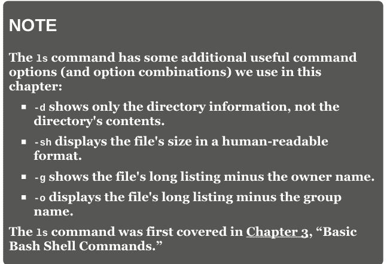

### 使用 elif

代替编写单独的 `if-then` 语句，您可以使用 `else` 部分的一个替代版本，称为 `elsif`（在 Bash 中通常写作 `elif`）。`elif` 使用另一个 `if-then` 语句继续 `else` 部分：

```bash
if command1
then
    commands
elif command2
then
    more commands
fi
```

`elif` 语句行提供了另一个要评估的命令，类似于原始的 `if` 语句行。如果来自 `elif` 命令的退出状态代码为零，Bash 将执行第二个 `then` 语句部分中的命令。使用这种嵌套方法提供了更干净的代码和更容易跟踪的逻辑流程：

```bash
$ cat test5.sh
#!/bin/bash
# testing nested ifs - using elif
#
testuser=NoSuchUser
#
if grep $testuser /etc/passwd
then
    echo "The user $testuser account exists on this system."
    echo
elif ls -d /home/$testuser/
then
    echo "The user $testuser has a directory,"
    echo "even though $testuser doesn't have an account."
fi
echo "We are outside the nested if statements."
$ . /test5.sh
/home/NoSuchUser/
The user NoSuchUser has a directory, even though NoSuchUser doesn't have an account.
We are outside the nested if statements.
$
```

这个脚本的问题是，如果账户和目录都不存在，您将不会收到这些事实的通知。您可以修复这个问题，甚至进一步扩展脚本，使其同时检查没有目录的不存在用户和有目录的不存在用户。通过添加嵌套在 `elif` 内的 `else` 语句来实现：

```bash
$ cat test5.sh
#!/bin/bash
# testing nested ifs - using elif and else
#
testuser=NoSuchUser
#
if grep $testuser /etc/passwd
then
    echo "The user $testuser account exists on this system."
    echo
elif ls -d /home/$testuser/
then
    echo "The user $testuser has a directory,"
    echo "even though $testuser doesn't have an account."
else
    echo "The user $testuser does not exist on this system,"
    echo "and no directory exists for the $testuser."
fi
echo "We are outside the nested if statements."

$
$ ./test5.sh
/home/NoSuchUser/
The user NoSuchUser has a directory,
even though NoSuchUser doesn't have an account.
We are outside the nested if statements.
$
$ sudo rmdir /home/NoSuchUser/
[sudo] password for christine:
$
$ ./test5.sh
ls: cannot access '/home/NoSuchUser/': No such file or directory
The user NoSuchUser does not exist on this system,
and no directory exists for the NoSuchUser.
We are outside the nested if statements.
$
```

在 `/home/NoSuchUser` 目录被移除并且测试脚本执行 `elif` 语句之前，返回了零退出状态。因此，`elif` 的 `then` 代码块内的语句被执行。在 `/home/NosuchUser` 目录被移除后，`elif` 语句返回了非零退出状态。这导致在 `elif` 块内的 `else` 块中的语句被执行。

#### 注意

请记住，使用 `elif` 语句时，紧随其后的任何 `else` 语句仅用于该 `elif` 代码块。它们不是前面 `if-then` 语句代码块的一部分。

您可以继续将 `elif` 语句串联起来，创建一个巨大的 `if-then-elif` 组合体：

```bash
if command1
then
    command set 1
elif command2
then
    command set 2
elif command3
then
    command set 3
elif command4
then
    command set 4
fi
```

每个命令块根据哪个命令返回零退出状态代码来执行。请记住，Bash shell 按顺序执行 `if` 语句，只有第一个返回零退出状态的语句会导致 `then` 部分被执行。

尽管使用 `elif` 语句的代码看起来更干净，但跟踪脚本的逻辑仍然可能令人困惑。在后面的“考虑 `case` 命令”部分，您将看到如何使用 `case` 命令代替嵌套许多 `if-then` 语句。

### 尝试 test 命令

到目前为止，您在 `if` 语句行中看到的只有普通的 shell 命令。您可能会想知道 Bash `if-then` 语句是否有可能评估命令退出状态代码以外的任何条件。

答案是否定的，它不能。然而，Bash shell 中有一个实用工具可以帮助您使用 `if-then` 语句评估其他内容。

`test` 命令提供了一种在 `if-then` 语句中测试不同条件的方法。如果 `test` 命令中列出的条件评估为 TRUE，`test` 命令以零退出状态代码退出。这使得 `if-then` 语句的行为与其他编程语言中的 `if-then` 语句非常相似。如果条件为 false，`test` 命令以非零退出状态代码退出，这会导致 `if-then` 语句退出。

`test` 命令的格式很简单：

```bash
test condition
```

条件是 `test` 命令评估的一系列参数和值。当在 `if-then` 语句中使用时，`test` 命令如下所示：

```bash
if test condition
then
    commands
fi
```

如果您省略 `test` 命令语句的条件部分，它以非零退出状态代码（false）退出，并触发任何 `else` 块语句：


```bash
$ cat test6.sh
#!/bin/bash
# testing the test command
#
if test
then
    echo "No expression returns a True"
else
    echo "No expression returns a False"
fi
$
$ ./test6.sh
No expression returns a False
$
```

当添加条件时，由 `test` 命令进行测试。例如，使用 `test` 命令，您可以确定变量是否有内容。需要一个简单的条件表达式来确定变量是否有内容：

```bash
$ cat test6.sh
#!/bin/bash
# testing if a variable has content
#
my_variable="Full"
#
if test $my_variable
then
    echo "The my_variable variable has content and returns a True."
    echo "The my_variable variable content is: $my_variable"
else
    echo "The my_variable variable doesn't have content,"
    echo "and returns a False."
fi
$
$ ./test6.sh
The my_variable variable has content and returns a True.
The my_variable variable content is: Full
$
```

变量 `my_variable` 包含内容（`Full`），因此当 `test` 命令检查条件时，退出状态返回零。这会触发 `then` 代码块中的语句。

如您所料，当变量不包含内容时，发生相反的情况：

```bash
$ cat test6.sh
#!/bin/bash
# testing if a variable has content
#
my_variable=""
#
if test $my_variable
then
    echo "The my_variable variable has content and returns a True."
    echo "The my_variable variable content is: $my_variable"
```

```
else
echo "The my_variable variable doesn't have content,"
echo "and returns a False."
fi
$
$ ./test6.sh
The my_variable variable doesn't have content,
and returns a False.
$
```

Bash shell 提供了一种在 `if-then` 语句中测试条件的替代方法，而无需声明 `*test*` 命令：

```
if [ condition ]
then
commands
fi
```

方括号定义了测试条件。请注意：你在第一个方括号后必须有一个空格，在最后一个方括号前也必须有一个空格，否则你会收到错误信息。

`*test*` 命令和测试条件可以评估三类条件：

- 数值比较
- 字符串比较
- 文件比较

接下来的章节将描述如何在 `if`-then 语句中使用这些测试类。

### 使用数值比较

最常见的测试评估方法是执行两个数值值的比较。**表 12-1** 显示了用于测试两个值的条件参数列表。

#### 表 12-1 测试数值比较

| 比较 | 描述 |
| :--- | :--- |
| `n1` -eq `n2` | 检查 `n1` 是否等于 `n2`。 |
| `n1` -ge `n2` | 检查 `n1` 是否大于或等于 `n2`。 |
| `n1` -gt `n2` | 检查 `n1` 是否大于 `n2`。 |
| `n1` -le `n2` | 检查 `n1` 是否小于或等于 `n2`。 |
| `n1` -lt `n2` | 检查 `n1` 是否小于 `n2`。 |
| `n1` -ne `n2` | 检查 `n1` 是否不等于 `n2`。 |

数值测试条件可用于评估数字和变量。这是一个示例：

```
$ cat numeric_test.sh
#!/bin/bash
# Using numeric test evaluations
#
value1=10
value2=11
#
if [ $value1 -gt 5 ]
then
	echo "The test value $value1 is greater than 5."
fi
#
if [ $value1 -eq $value2 ]
then
	echo "The values are equal."
else
	echo "The values are different."
fi
$
```

第一个测试条件：

`if [ $value1 -gt 5 ]`

测试变量 `value1` 的值是否大于 5。第二个测试条件：

`if [ $value1 -eq $value2 ]`

测试变量 `value1` 的值是否等于变量 `value2` 的值。这两个数值测试条件都如预期般评估：

```
$ ./numeric_test.sh
The test value 10 is greater than 5
The values are different
$
```

#### 警告

对于测试条件，Bash shell 只能处理整数。尽管你可以使用像 `echo` 这样的命令中的浮点值，但它们不会在测试条件中正常工作。

### 使用字符串比较

测试条件也允许你对字符串值执行比较。对字符串执行比较可能会变得棘手，你稍后会看到。表 12-2 显示了你可以用来评估两个字符串值的比较函数。

#### 表 12-2 测试字符串比较

| 比较 | 描述 |
| :--- | :--- |
| `str1 = str2` | 检查 `str1` 是否与字符串 `str2` 相同。 |
| `str1 != str2` | 检查 `str1` 是否与 `str2` 不同。 |
| `str1 < str2` | 检查 `str1` 是否小于 `str2`。 |
| `str1 > str2` | 检查 `str1` 是否大于 `str2`。 |
| `-n str1` | 检查 `str1` 的长度是否大于零。 |
| `-z str1` | 检查 `str1` 的长度是否为零。 |

以下部分描述了可用的不同字符串比较。

#### 查看字符串相等性

对于字符串，相等和不相等条件相当不言自明。了解两个字符串值是否相同非常容易：

```
$ cat string_test.sh
#!/bin/bash
# Using string test evaluations
#
testuser=christine
#
if [ $testuser = christine ]
then     echo "The testuser variable contains: christine"
else     echo "The testuser variable contains: $testuser"
fi
$
$ ./string_test.sh
The testuser variable contains: christine
$
```

同样，使用字符串不相等比较可以让你确定两个字符串的值是否相同：

```
$ cat string_not_test.sh
#!/bin/bash
# Using string test not equal evaluations
#
testuser=rich
#
if [ $testuser != christine ]
then     echo "The testuser variable does NOT contain: christine"
else     echo "The testuser variable contains: christine"
fi
$
$ ./string_not_test.sh
The testuser variable does NOT contain: christine
$
```

请记住，在比较字符串是否相等时，测试比较会考虑所有标点和大小写。

### 查看字符串顺序

试图确定一个字符串是否小于或大于另一个字符串时，事情开始变得棘手。当 shell 程序员试图使用测试条件的大于或小于功能时，通常有两个问题困扰他们：

- 大于和小于符号必须转义，否则 shell 会将它们用作重定向符号，将字符串值作为文件名。
- 大于和小于的顺序与 `sort` 命令使用的顺序不同。

第一个问题可能导致编程脚本时经常未被检测到的大问题。这是一个新手 shell 脚本程序员有时会发生的情况示例：


```
$ cat bad_string_comparison.sh
#!/bin/bash
# Misusing string comparisons
#
string1=soccer
string2=zorbffootball
#
if [ $string1> $string2 ]
then
    echo "$string1 is greater than $string2"
else
    echo "$string1 is less than $string2"
fi
$
$ ./bad_string_comparison.sh
soccer is greater than zorbffootball
$
$ ls z*
zorbffootball
$
```

仅仅在脚本中使用大于符号本身，不会生成错误，但结果是错误的。脚本将大于符号解释为输出重定向（参见 [第 15 章](#chapter-15)）。因此，它创建了一个名为 `zorbffootball` 的文件。由于重定向成功完成，测试条件返回零退出状态码，`if` 语句将其评估为事情成功完成！

要解决这个问题，你需要使用反斜杠 `\` 正确转义大于符号：

```
$ cat good_string_comparison.sh
#!/bin/bash
# Properly using string comparisons
#
string1=soccer
string2=zorbffootball
#
if [ $string1 \> $string2 ]
then	echo "$string1 is greater than $string2"
else	echo "$string1 is less than $string2"
fi
$
$ rm -i zorbfutbol1
rm: remove regular empty file 'zorbfutbol1'? y
$
$ ./good_string_comparison.sh
soccer is less than zorbfutbol1
$ ls z*
ls: cannot access 'z\*': No such file or directory
$
```

现在那个答案更接近你从字符串比较中预期的结果。

### 注意

> 字符串 `soccer` 小于字符串 `zorbfutbol1`，因为测试比较使用每个字符的 Unicode 数值。小写 `s` 等于 115，而 `z` 是 122。因此，`s` 小于 `z`，从而 `soccer` 小于 `zorbfutbol1`。

第二个问题要微妙一些，除非你处理大写字母和小写字母，否则你可能甚至不会遇到它。`sort` 命令处理大写字母的方式与测试条件考虑的方式相反：

```
$ cat SportsFile.txt
Soccer
soccer
$
$ sort SportsFile.txt
soccer
Soccer
$
$ cat sort_order_comparison.sh
#!/bin/bash
# Testing string sort order
#
string1=Soccer
string2=soccer
#
if [ $string1 \> $string2 ]
then	echo "$string1 is greater than $string2"
else	echo "$string1 is less than $string2"
fi
$
$ ./sort_order_comparison.sh
Soccer is less than soccer
$
```

在测试比较中，大写字母被视为小于小写字母。然而，`sort` 命令的做法恰恰相反。当你将相同的字符串放入文件并使用 `sort` 命令时，小写字母首先出现。这是由于不同的排序技术。

测试比较使用标准的 Unicode 排序，使用每个字符的 Unicode 数值来确定排序顺序。`sort` 命令使用系统区域语言设置定义的排序顺序。对于英语，区域设置指定在排序顺序中小写字母出现在大写字母之前。

### 注意

> `test` 命令和测试表达式使用标准的数学比较符号进行字符串比较，使用文本代码进行数值比较。这是一个许多程序员设法弄反的微妙特性。如果你对数值使用数学比较符号，shell 会将它们解释为字符串值，可能无法产生正确的结果。

#### 查看字符串大小

在评估变量是否包含数据时，`-n` 和 `-z` 比较非常实用：

```bash
$ cat variable_content_eval.sh
#!/bin/bash
# 测试字符串长度
#
string1=Soccer
string2=''
#
if [ -n $string1 ]
then	echo "字符串 '$string1' 不为空"
else	echo "字符串 '$string1' 为空"
fi
#
if [ -z $string2 ]
then	echo "字符串 '$string2' 为空"
else	echo "字符串 '$string2' 不为空"
fi
#
if [ -z $string3 ]
then	echo "字符串 '$string3' 为空"
else	echo "字符串 '$string3' 不为空"
fi
$
$ ./variable_content_eval.sh
字符串 'Soccer' 不为空
字符串 '' 为空
字符串 '' 为空
$
```

此示例创建了两个字符串变量。`string1` 变量包含一个字符串，而 `string2` 变量被创建为空字符串。执行了以下比较：

```
if [ -n $string1 ]
```

上述代码确定 `string1` 变量的长度是否非零。由于它确实非零，因此处理其 `then` 部分。

```
if [ -z $string2 ]
```

上述代码确定 `string2` 变量的长度是否为零。由于它确实为零，因此处理其 `then` 部分。

```
if [ -z $string3 ]
```

上述代码确定 `string3` 变量的长度是否为零。该变量从未在 shell 脚本中定义，因此表明即使未定义，其字符串长度仍被视为零。

> **警告**
>
> 空变量和未初始化的变量可能会对你的 shell 脚本测试产生灾难性影响。如果你不确定变量的内容，最好在将其用于数值或字符串比较之前，使用 `-n` 或 `-z` 测试该变量是否包含值。

#### 使用文件比较

测试比较的最后一类包括 shell 脚本中可能最强大且使用最广泛的比较。此类允许你测试 Linux 文件系统中文件和目录的状态。表 12-3 列出了这些比较。

##### 表 12-3 测试文件比较

| 比较 | 描述 |
| :--- | :--- |
| `-d file` | 检查文件是否存在且为目录。 |
| `-e file` | 检查文件是否存在。 |
| `-f file` | 检查文件是否存在且为普通文件。 |
| `-r file` | 检查文件是否存在且可读。 |
| `-s file` | 检查文件是否存在且不为空。 |
| `-w file` | 检查文件是否存在且可写。 |
| `-x file` | 检查文件是否存在且可执行。 |
| `-o file` | 检查文件是否存在且由当前用户拥有。 |
| `-G file` | 检查文件是否存在且默认组与当前用户相同。 |
| `file1 -nt file2` | 检查 `file1` 是否比 `file2` 更新。 |
| `file1 -ot file2` | 检查 `file1` 是否比 `file2` 更旧。 |

这些条件使你能在 shell 脚本中检查文件系统文件。它们常用于访问文件的脚本中。由于使用非常频繁，让我们逐一查看它们。

##### 检查目录

`-d` 测试检查指定目录是否存在于系统中。如果你试图向目录写入文件或尝试更改到某个目录位置，这通常是件好事：

```bash
$ cat jump_point.sh
#!/bin/bash
# 跳跃前先查看
#
jump_directory=/home/Torfa
#
if [ -d $jump_directory ]
then
	echo "$jump_directory 目录存在。"
	cd $jump_directory
	ls
else
	echo "$jump_directory 目录不存在。"
fi
$ ./jump_point.sh
/home/Torfa 目录不存在。
$
```

`-d` 测试条件检查 `jump_directory` 变量的目录是否存在。如果存在，它继续执行 `cd` 命令更改到当前目录并执行目录列表。如果不存在，脚本会发出警告消息并退出脚本。

##### 检查对象是否存在

`-e` 比较允许你在尝试在脚本中使用文件或目录对象之前，检查其是否存在：


```bash
$ cat update_file.sh
#!/bin/bash
# 检查目录或文件是否存在
#
location=$HOME
file_name="sentinel"
#
if [ -d $location ]
then
	echo "$location 目录正常"
	echo "现在检查文件，$file_name..."
	if [ -e $location/$file_name ]
	then
		echo "文件 $file_name 正常。"
		echo "正在更新文件内容。"
		date >> $location/$file_name
	#
	else
		echo "文件 $location/$file_name 不存在。"
		echo "没有可更新的内容。"
	fi
#
else
	echo "目录 $location 不存在。"
	echo "没有可更新的内容。"
fi
$
$ ./update_file.sh
/home/christine 目录正常
现在检查文件，sentinel...
文件 /home/christine/sentinel 不存在。
没有可更新的内容。
$
$ touch /home/christine/sentinel
$
$ ./update_file.sh
/home/christine 目录正常
现在检查文件，sentinel...
文件 sentinel 正常。
正在更新文件内容。
$
```

第一次检查使用 `-e` 比较来确定用户是否有 `$HOME` 目录。如果有，下一个 `-e` 比较检查以确定 `sentinel` 文件是否存在于 `$HOME` 目录中。如果文件不存在，shell 脚本记录该文件缺失且没有可更新的内容。

为确保更新有效，创建了 `sentinel` 文件并第二次运行了 shell 脚本。这次当测试条件时，找到了 `$HOME` 和 `sentinel` 文件，并将当前日期和时间追加到文件中。

## 检查文件

`-e` 比较适用于文件和目录。要确保指定对象是文件而不是目录，你必须使用 `-f` 比较：

```bash
$ cat dir-or-file.sh
#!/bin/bash
# 检查对象是否存在且是目录还是文件
#
object_name=$HOME
echo
echo "正在检查的对象：$object_name"
echo
#
if [ -e $object_name ]
then
	echo "对象 $object_name 存在，"
	#
	if [ -f $object_name ]
	then
		echo "且 $object_name 是一个文件。"
	#
	else
		echo "且 $object_name 是一个目录。"
	fi
#
else
	echo "对象 $object_name 不存在。"
fi
$
$ ./dir-or-file.sh
正在检查的对象：/home/christine
对象 /home/christine 存在，且 /home/christine 是一个目录。
$
```

首先，此脚本使用 `-e` 比较测试 `$HOME` 是否存在。如果存在，它使用 `-f` 测试它是否是文件。如果它不是文件，则显示一条消息，说明它是一个目录。对变量 `object_name` 进行轻微修改，将目录 `$HOME` 替换为文件 `$HOME/sentinel`，会产生不同的结果：

```bash
$ nano dir-or-file.sh
$ cat dir-or-file.sh
#!/bin/bash
# 检查对象是否存在且是目录还是文件
#
object_name=$HOME/sentinel
echo
echo "正在检查的对象：$object_name"
echo
#
if [ -e $object_name ]
then
	echo "对象 $object_name 存在，"
	#
	if [ -f $object_name ]
	then
		echo "且 $object_name 是一个文件。"
	#
	else
		echo "且 $object_name 是一个目录。"
	fi
#
else
	echo "对象 $object_name 不存在。"
fi
$ ./dir-or-file.sh
正在检查的对象：/home/christine/sentinel
对象 /home/christine/sentinel 存在，且 /home/christine/sentinel 是一个文件。
$
```

现在当脚本运行时，对 `$HOME/sentinel` 的 `-f` 测试以零状态退出，触发 `then` 语句，进而输出消息 `/home/christine/sentinel` 是一个文件。

## 检查读取访问权限

在尝试从文件读取数据之前，测试你是否能读取该文件通常是个好主意。你可以使用 `-r` 比较来实现这一点：

```bash
$ cat can-I-read-it.sh
#!/bin/bash
# 检查你是否能读取文件
#
pwfile=/etc/shadow
echo
echo "正在检查你是否能读取 $pwfile..."
#
# 检查文件是否存在且是文件。
if [ -f $pwfile ]
then
    # 文件存在。检查是否可以读取。
    #
    if [ -r $pwfile ]
    then
        echo "显示文件末尾..."
        tail $pwfile
    #
    else
        echo "抱歉，拒绝了对 $pwfile 的读取访问权限。"
    fi
#
else
    echo "抱歉，$pwfile 文件不存在。"
fi
$ ./can-I-read-it.sh
正在检查你是否能读取 /etc/shadow...
抱歉，拒绝了对 /etc/shadow 的读取访问权限。
$
```

`/etc/shadow` 文件包含系统用户的加密密码，因此系统上的普通用户无法读取该文件。`-r` 比较确定不允许对该文件进行读取访问，因此测试命令失败，Bash shell 执行了 `if-then` 语句的 `else` 部分。

## 检查空文件

你应该使用 `-s` 比较运算符来检查文件是否为空，特别是在你不希望删除非空文件的时候。请注意，当 `-s` 比较成功时，表明文件中包含数据：

```
$ cat is-it-empty.sh
#!/bin/bash
# Check if a file is empty
#
file_name=$HOME/sentinel
echo
echo "Checking if $file_name file is empty..."
echo
#
# Check if file exists and is a file.
#
if [ -f $file_name ]
then
    # File does exist. Check if it is empty.
    #
    if [ -s $file_name ]
    then
        echo "The $file_name file exists and has data in
        it."
        echo "Will not remove this file."
    else
        echo "The $file_name file exists, but is empty."
        echo "Deleting empty file..."
        rm $file_name
    fi
else
    echo "The $file_name file does not exist."
fi
$ ls -sh $HOME/sentinel
4.0K /home/christine/sentinel
$ ../is-it-empty.sh
Checking if /home/christine/sentinel file is empty...
The /home/christine/sentinel file exists and has data in it.
Will not remove this file.
$ 
```

首先，`-f` 比较测试文件是否存在。如果文件存在，则触发 `-s` 比较来确定文件是否为空。空文件将被删除。你可以从 `ls -sh` 命令中看到，`sentinel` 文件并非为空，`4.0K`，因此脚本不会删除它。

## 检查是否可写入文件

`-w` 比较运算符用于确定你是否有权限向某个文件写入数据。`can-I-write-to-it.sh` 脚本仅仅是 `can-I-read-it.sh` 脚本的一个更新版本。现在，该脚本不再检查你是否可以读取 `item_name` 文件，而是检查你是否有权限向文件写入：


```
$ cat can-I-write-to-it.sh
#!/bin/bash
# Check if a file is writable

item_name=$HOME/sentinel
echo
echo "Checking if you can write to $item_name..."
#
# Check if file exists and is a file.
# if [ -f $item_name ]
then
        # File does exist. Check if can write to it.
        # if [ -w $item_name ]
        then
            echo "Writing current time to $item_name"
            date +%H%M> > $item_name
        #
        else
            echo "Sorry, write access to $item_name is denied."
        fi
#
else 
echo "Sorry, the $item_name does not exist"
echo "or is not a file."
fi
$
$ ls -o $HOME/sentinel
-rw-rw-r-- 1 christine 32 May 25 17:08
/home/christine/sentinel
$
$ ./can-I-write-to-it.sh
Checking if you can write to /home/christine/sentinel...
Writing current time to /home/christine/sentinel
$
```

变量 `item_name` 被设置为 `$HOME/sentinel`，该文件允许用户进行写入访问（有关文件权限的更多信息，请参阅第 7 章“理解 Linux 文件权限”）。因此，当脚本运行时，`-w` 测试表达式返回非零退出状态，`then` 代码块被执行，向 `sentinel` 文件写入了时间戳。

当通过 `chmod` 移除 `sentinel` 文件的用户写入权限时，`-w` 测试表达式返回非零状态，且时间戳未写入文件：

```
$ chmod u-w $HOME/sentinel
$
$ ls -o $HOME/sentinel
-r---rw-r-- 1 christine 37 May 29 12:07
/home/christine/sentinel
$
$ ./can-I-write-to-it.sh
Checking if you can write to /home/christine/sentinel...
Sorry, write access to /home/christine/sentinel is denied.
$
```

可以再次使用 `chmod` 命令授予用户的写权限。这将使写测试表达式返回零退出状态，并允许尝试向文件写入。

### 检查是否可运行文件

`-x` 比较运算符是一种便捷的确定你是否具有特定文件执行权限的方法。虽然大多数命令可能不需要这一点，但如果你从 shell 脚本中运行大量脚本，这可能很有用：

```
$ cat can-I-run-it.sh
#!/bin/bash
# Check if you can run a file
#
item_name=$HOME/scripts/can-I-write-to-it.sh
echo
echo "Checking if you can run $item_name..."
#
# Check if file is executable.
#
if [ -x $item_name ]
then
        echo "You can run $item_name."
        echo "Running $item_name..."
        $item_name
#
else
        echo "Sorry, you cannot run $item_name."
#
fi
$
$ ./can-I-run-it.sh

Checking if you can run /home/christine/scripts/can-I-write-
to-it.sh...You can run /home/christine/scripts/can-I-write-to-it.sh.
Running /home/christine/scripts/can-I-write-to-it.sh... [...] 
$
$ chmod u-x can-I-write-to-it.sh
$
$ ./can-I-run-it.sh

Checking if you can run /home/christine/scripts/can-I-write-
to-it.sh... Sorry, you cannot run /home/christine/scripts/can-I-write-
to-it.sh.
$
```

这个示例 shell 脚本使用 `-x` 比较运算符来测试你是否具有执行 `can-I-write-to-it.sh` 脚本的权限。如果是，它将运行该脚本。在第一次成功运行 `can-I-write-to-it.sh` 脚本后，权限发生了变化。这一次，`-x` 比较失败，因为 `can-I-write-to-it.sh` 脚本的执行权限已被移除。

### 检查所有权

`-o` 比较运算符允许你轻松测试你是否是某个文件的所有者：

```
$ cat do-I-own-it.sh
#!/bin/bash
# Check if you own a file
#
if [ -o /etc/passwd ]
then
    echo "You are the owner of the /etc/passwd file."
#
else
    echo "Sorry, you are NOT /etc/passwd file's owner."
#
fi
$
$ whoami
christine
$
$ ls -o /etc/passwd
-rw-r--- 1 root 2842 Apr 23 15:25 /etc/passwd
$
$ ./do-I-own-it.sh
Sorry, you are NOT /etc/passwd file's owner.
$
```

该脚本使用 `-o` 比较运算符测试运行该脚本的用户是否是 `/etc/passwd` 文件的所有者。由于脚本是在除 `root` 以外的用户账户下运行的，因此测试失败。

### 检查默认组成员资格

`-G` 比较运算符检查文件的组，如果该组与用户的默认组匹配，则比较成功。这在某些情况下可能会引起混淆，因为 `-G` 比较运算符仅检查脚本用户的默认组，而不是用户所属的所有组。以下是一个示例：

```
$ cat check_default_group.sh
#!/bin/bash
# Compare file and script user's default groups
#
if [ -G $HOME/TestGroupFile ]
then
    echo "You are in the same default group as"
    echo "the $HOME/TestGroupFile file's group."
#
else
    echo "Sorry, your default group and $HOME/TestGroupFile"
    echo "file's group are different."
#
fi
$
touch $HOME/TestGroupFile
$
ls -g $HOME/TestGroupFile
-rw-rw-r-- 1 christine 0 May 29 13:58
/home/christine/TestGroupFile
$
./check_default_group.sh
You are in the same default group as
the /home/christine/TestGroupFile file's group.
$
groups
christine adm cdrom sudo dip plugdev lpadm inxd sambashare
$
chgrp adm $HOME/TestGroupFile
$
ls -g $HOME/TestGroupFile
-rw-rw-r-- 1 adm 0 May 29 13:58 /home/christine/TestGroupFile
$
./check_default_group.sh
Sorry, your default group and /home/christine/TestGroupFile
file's group are different.
$
```


脚本第一次运行时，`$HOME/TestGroupFile` 文件属于 `christine` 组，`-G` 比较成功。接下来，该文件所属的组被更改为 `adm` 组，用户也是该组的成员。然而，`-G` 比较失败了，因为它仅比较用户的默认组，而不考虑任何其他组成员资格。

### 检查文件日期

最后一组比较涉及比较两个文件的创建时间。这在编写用于安装软件的脚本时非常有用。

有时，你不想安装一个比系统上已安装文件更旧的文件。

`-nt` 比较运算符确定一个文件是否比另一个文件更新。如果文件更新，则其文件创建时间更近。`-ot` 比较运算符确定一个文件是否比另一个文件更旧。如果文件更旧，则其文件创建时间更早：

```
$ cat check_file_dates.sh
#!/bin/bash
# Compare two file's creation dates/times
#
if [ $HOME/Downloads/games.rpm -nt $HOME/software/games.rpm ]
then
    echo "The $HOME/Downloads/games.rpm file is newer"
    echo "than the $HOME/software/games.rpm file."
#
else
    echo "The $HOME/Downloads/games.rpm file is older"
    echo "than the $HOME/software/games.rpm file."
#
fi
$
$ ./check_file_dates.sh
The /home/christine/Downloads/games.rpm file is newer
than the /home/christine/software/games.rpm file.
$
```

脚本中的这两个比较都没有先检查文件是否存在。这是一个问题。尝试这个测试：

```
$ rm $HOME/Downloads/games.rpm
$
$ ./check_file_dates.sh
The /home/christine/Downloads/games.rpm file is older
than the /home/christine/software/games.rpm file.
$
```

这个小例子表明，如果其中一个文件不存在，`-nt` 比较将返回错误的信息。务必确保在使用 `-nt` 或 `-ot` 比较之前，文件是存在的。

### 考虑复合测试

### if-then 语句与布尔逻辑

`if-then` 语句允许你使用布尔逻辑来组合测试。你可以使用以下两个布尔运算符：

- `[ 条件1 ] && [ 条件2 ]`
- `[ 条件1 ] || [ 条件2 ]`

第一个布尔操作使用 AND（与）布尔运算符将两个条件组合在一起。只有当两个条件都满足时，`then` 部分才会执行。

> **注意**
>
> **布尔逻辑是一种将潜在返回值简化为 TRUE（真）或 FALSE（假）的方法。**

第二个布尔操作使用 OR（或）布尔运算符将两个条件组合在一起。如果任一条件评估为 TRUE，`then` 部分就会执行。

以下示例展示了 AND 布尔运算符的用法：

```bash
$ cat AndBoolean.sh
#!/bin/bash
# Testing an AND Boolean compound condition
#
if [ -d $HOME ] && [ -w $HOME/newfile ]
then
    echo "The file exists and you can write to it."
#
else
    echo "You cannot write to the file."
#
fi
$
$ ls -l $HOME/newfile
ls: cannot access '/home/christine/newfile': No such file or directory
$
$ ./AndBoolean.sh
You cannot write to the file.
$
$ touch $HOME/newfile
$ ./AndBoolean.sh
The file exists and you can write to it.
$
```

使用 AND 布尔运算符时，必须满足两个比较条件。第一个比较检查用户的 `$HOME` 目录是否存在。第二个比较检查用户 `$HOME` 目录中是否存在名为 `newfile` 的文件，以及用户是否对该文件拥有写权限。如果这两个比较中有任何一个失败，`if` 语句就会失败，`shell` 将执行 `else` 部分。如果两个比较都成功，`if` 语句就会成功，`shell` 将执行 `then` 部分。

### 使用高级 if-then 特性

`Bash` `shell` 提供三种附加功能，可在 `if-then` 语句中使用：

- 使用单括号在子 shell 中运行命令
- 使用双括号进行数学表达式运算
- 使用双方括号进行高级字符串处理功能

以下各部分将更详细地描述这些功能。

#### 使用单括号

单括号允许你在 `if` 语句的比较中使用子 shell。子 shell 在第 5 章“理解 Shell”中已有介绍。这是单括号测试命令的格式：

```text
( command)
```

在 `Bash` `shell` 执行命令之前，它会创建一个子 shell 来运行该命令。如果命令成功完成任务，退出状态（在第 11 章中有介绍）将被设置为零，并执行 `then` 部分下列出的命令。如果命令的退出状态为其他任何值，则不执行 `then` 命令。以下是一个使用子 shell 进行测试的脚本：

```bash
$ cat SingleParentheses.sh
#!/bin/bash
# Testing a single parentheses condition
echo $BASH_SUBSHELL
#
if (echo $BASH_SUBSHELL)
then
    echo "The subshell command operated successfully."
#
else
    echo "The subshell command was NOT successful."
#
fi
$
$ ./SingleParentheses.sh
0
1
The subshell command operated successfully.
$
```

当脚本第一次运行 `echo $BASH_SUBSHELL` 命令时（在 `if` 语句之前），它会在当前 `shell` 中完成操作。该命令显示 `0`，表示没有使用子 shell。`$BASH_SUBSHELL` 环境变量在第 5 章中已有介绍。在 `if` 语句中，脚本在子 shell 中执行命令，并且 `echo $BASH_SUBSHELL` 命令显示 `1`，表示使用了子 shell。该子 shell 操作成功完成，触发了 `then` 命令。

> **警告**
>
> **虽然你可以在 `if` 测试语句中使用进程列表（在第 5 章中有介绍），但可能会产生意外的结果。如果进程列表中除最后一个命令外的所有命令都失败，子 shell 会将退出状态设置为零，并执行 `then` 部分下列出的命令。**

稍微修改一下脚本，这里有一个在子 shell 中运行失败命令的例子：

```bash
$ cat SingleParentheses.sh
#!/bin/bash
# Testing a single parentheses condition
#echo $BASH_SUBSHELL
if (cat /etc/PASSWORD)
    then
        echo "The subshell command operated successfully."
    else
        echo "The subshell command was NOT successful."
fi
$ ./SingleParentheses.sh
cat: /etc/PASSWORD: No such file or directory
The subshell command was NOT successful.
$
```

由于子 shell 命令在操作中包含了一个错误的文件名，退出状态未被设置为零。因此，触发的是 `else` 命令，而不是 `then` 命令。

#### 使用双括号

*双括号* 命令允许你在比较中加入高级数学公式。*test* 命令仅允许在比较中进行简单的算术运算。双括号命令提供了更多的数学符号，这可能为使用过其他编程语言的程序员所熟悉。以下是双括号命令的格式：

```text
(( expression ))
```

*表达式* 项可以是任何数学赋值或比较表达式。除了 *test* 命令使用的标准数学运算符外，表 12-4 中显示的额外运算符也可以在双括号命令中使用。

##### 表 12-4 双括号命令符号

| 符号 | 描述 |
| :--- | :--- |
| `val ++` | 后置递增 |
| `val --` | 后置递减 |


| `++ val` | 前置递增 |
| `-- val` | 前置递减 |
| `!` | 逻辑非 |
| `~` | 按位非 |
| `**` | 乘方 |
| `<<` | 按位左移 |
| `>>` | 按位右移 |
| `&` | 按位布尔 AND |
| `|` | 按位布尔 OR |
| `&&` | 逻辑 AND |
| `||` | 逻辑 OR |

你可以将双括号命令用于 `if` 语句中，也可以用于脚本中作为普通命令来赋值：

```bash
$ cat DoubleParentheses.sh
#!/bin/bash
# Testing a double parentheses command
#
val1=10
#
if (( $val1 ** 2 > 90 ))
then
    (( val2 = $val1 ** 2 ))
    echo "The square of $val1 is $val2,"
    echo "which is greater than 90."
#
fi
$ ./DoubleParentheses.sh
The square of 10 is 100,
which is greater than 90.
$
```

请注意，在双括号内的表达式中，无需转义大于号（greater-than symbol）。这是双括号命令之外的另一个高级特性。

## 使用双方括号

双方括号命令为字符串比较提供了高级功能。以下是双方括号命令的格式：

```text
[[ expression ]]
```

带双方括号的表达式使用 `test` 评估中标准的字符串比较。然而，它提供了一种 `test` 评估没有的功能——模式匹配。

> **注意**
>
> 双方括号在 Bash shell 中工作良好。但请注意，并非所有 shell 都支持双方括号。

在模式匹配中，你可以定义一个正则表达式（在第 20 章“正则表达式”中详细讨论），并将其与字符串值进行匹配：

```bash
$ cat DoubleBrackets.sh
#!/bin/bash
# Using double brackets for pattern matching
#
#if [[ $BASH_VERSION == 5.* ]]
then
    echo "You are using the Bash Shell version 5 series."
fi
$
$ ./DoubleBrackets.sh
You are using the Bash Shell version 5 series.
$
```

在上面的脚本中请注意，使用了双等号（`==`）。这些双等号将右侧的字符串（`5.*`）指定为模式，并应用模式匹配规则。双方括号命令将 `$BASH_VERSION` 环境变量进行匹配，以检查它是否以 `5.` 字符串开头。如果是，比较成功，shell 将执行 `then` 部分的命令。

## 考虑使用 case 命令

通常，你会发现自己正在评估一个变量的值，试图在一组可能的值中找到特定的值。在这种情况下，你不得不编写一个冗长的 `if`-then-else 语句，如下所示：

```bash
$ cat LongIf.sh
#!/bin/bash
# Using a tedious and long if statement
#
if [ $USER == "rich" ]
then
	echo "Welcome $USER"
	echo "Please enjoy your visit."
elif [ $USER == "barbara" ]
then
	echo "Hi there, $USER"
	echo "We're glad you could join us."
elif [ $USER == "christine" ]
then
	echo "Welcome $USER"
	echo "Please enjoy your visit."
elif [ $USER == "tim" ]
then
	echo "Hi there, $USER"
	echo "We're glad you could join us."
elif [ $USER == "testing" ]
then
	echo "Please log out when done with test."
else
	echo "Sorry, you are not allowed here."
fi
$
$ ./LongIf.sh
Welcome christine
Please enjoy your visit.
$
```

`elif` 语句继续 `if`-then 检查，针对单个比较变量寻找特定的值。

与其编写所有的 `elif` 语句来继续检查相同的变量值，你可以使用 `case` 命令。`case` 命令以列表导向的格式检查单个变量的多个值：

### 通过一个实际示例进行操作

在本节中，我们将描述一个脚本，该脚本将本章中介绍的 shell 结构命令付诸实用——确定当前系统上有哪些可用的包管理器。它还通过安装的包管理器作为参考，推测当前系统基于哪个 Linux 发行版。

为了进行分析，该脚本首先检查标准的基于 Red Hat 的包管理器（`rpm`、`dnf` 和 `flatpak`）。它对每个包管理器使用 `which` 命令，并在 `if` 条件语句中使用单括号。如果找到该包管理器，则针对该特定管理器的特殊布尔变量被设置为 `TRUE` (1)；如果未找到，则设置为 `FALSE` (0)，如下面的片段所示：

```bash
$ cat PackageMgrCheck.sh
#!/bin/bash
[...]
if (which rpm &> /dev/null)
then
    item_rpm=1
    echo "You have the basic rpm utility."
#
else
    item_rpm=0
#
fi
[...]
if (which flatpak &> /dev/null)
then
    item_flatpak=1
    echo "You have the flatpak application container."
#
else
    item_flatpak=0
#
fi
[...]
$
```

对于 `dnf` 和 `yum` 有特殊处理（详见第 9 章“安装软件”），以应对您正在较旧的基于 Red Hat 的发行版上运行该脚本且该发行版尚未具备 `dnf` 工具的情况。请注意，如果未找到 `dnf`，则使用 `elif` 语句来检查 `yum`：

```bash
$ cat PackageMgrCheck.sh
[...]
if (which dnf &> /dev/null)
then
    item_dnfyum=1
    echo "You have the dnf package manager."
elif (which yum &> /dev/null)
then
    item_dnfyum=1
    echo "You have the yum package manager."
else
    item_dnfyum=0
#
fi
[...]
$
```

> **注意**
>
> 在单括号内的 `which` 命令之后使用了输出重定向。基于第 10 章“使用编辑器”中介绍的内容，`which` 命令的常规（标准）输出和任何错误消息都通过 `&>` 符号进行重定向。它们被重定向到 `/dev/null`，这幽默地被称为黑洞，因为放入其中的东西永远不会出来。这一操作显著清理了脚本的输出，但并不会对其完整性产生不利影响。错误重定向在第 15 章中有更详细的介绍。

在脚本完成对系统的包管理器分析后，它计算一个得分（`redhatscore`）。这个得分稍后用于提出关于该系统发行版基础的假设：

```bash
$ cat PackageMgrCheck.sh
[...]
redhatscore=$[item_rpm + $item_dnfyum + $item_flatpak]
[...]
$
```

当基于 Red Hat 的包管理器审计完成后，开始进行基于 Debian 的分析。它与基于 Red Hat 的评估非常相似，只是涵盖了基于 Debian 的包管理器（`dpkg`、`apt`、`snap`），并确定一个 Debian 得分，如下面的片段所示：

```bash
$ cat PackageMgrCheck.sh
[...]
if (which dpkg &> /dev/null)
then
    item_dpkg=1
    echo "You have the basic dpkg utility."
#
else
    item_dpkg=0
#
fi
[...]
debeanscore=$[item_dpkg + $item_aptget + $item_snap]
[...]
$
```

比较两个得分 `redhatscore` 和 `debeanscore`，并声明一个发行版的判定结果：


```bash
$ cat PackageMgrCheck.sh
[...]
if [ $debeanscore -gt $redhatscore ]
then
    echo "Most likely your Linux distribution is Debian-based."
#
elif [ $redhatscore -gt $debianscore ]
then
    echo "Most likely your Linux distribution is Red Hat-based."
else
    echo "Unable to determine Linux distribution base."
fi
[...]
$
```

以下是完整的脚本供您查阅。在阅读过程中，请思考使用修改后的 `if-then` 语句甚至 `case` 结构来完成这些任务的不同方法。激发您的创造力是学习的一部分：

```bash
$ cat PackageMgrCheck.sh
#!/bin/bash
# Checks system for popular package managers
#
#################### User Introduction ####################
echo "######################################################"
echo "    This script checks your Linux system for popular"
echo "package managers and application containers, lists"
echo "what's available, and makes an educated guess on your"
echo "distribution's base distro (Red Hat or Debian)."
echo
echo "######################################################"
#
############### Red Hat Checks ############################
#
echo "Checking for Red Hat-based package managers &"
echo "application containers..."
####
if (which rpm &> /dev/null)
then
    item_rpm=1
    echo "You have the basic rpm utility."
#
else
    item_rpm=0
#
fi
####
if (which dnf &> /dev/null)
then
    item_dnfyum=1
    echo "You have the dnf package manager."
#
elif (which yum &> /dev/null)
then
    item_dnfyum=1
    echo "You have the yum package manager."
else
    item_dnfyum=0
#
fi
####
if (which flatpak &> /dev/null)
then
    item_flatpak=1
    echo "You have the flatpak application container."
#
else
    item_flatpak=0
#
fi
####
redhatscore=$[$item_rpm + $item_dnfyum + $item_flatpak]
#
###################### Debian Checks #######################
#
echo "Checking for Debian-based package managers &"
echo "application containers..."
####
if (which dpkg &> /dev/null)
then
    item_dpkg=1
    echo "You have the basic dpkg utility."
#
else
    item_dpkg=0
#
fi
####
if (which apt &> /dev/null)
then
    item_aptaptget=1
    echo "You have the apt package manager."
#
elif (which apt-get &> /dev/null)
then
    item_aptaptget=1
    echo "You have the apt-get/apt-cache package manager."
#
else
    item_aptaptget=0
#
fi
####
if (which snap &> /dev/null)
then
    item_snap=1
    echo "You have the snap application container."
#
else
    item_snap=0
#
fi
####
#
debianscore=$[$item_dpkg + $item_aptaptget + $item_snap]
#
#
################################################
################################################
#
if [ $debianscore -gt $redhatscore ]
then
    echo "Most likely your Linux distribution is Debian-based."
#
elif [ $redhatscore -gt $debianscore ]
then
    echo "Most likely your Linux distribution is Red Hat-based."
else
    echo "Unable to determine Linux distribution base."
fi
#
exit
$
```

以下是该脚本在 Ubuntu 系统上的运行效果：

```
$ ./PackageMgrCheck.sh
################################################
    This script checks your Linux system for popular
    package managers and application containers, lists
    what's available, and makes an educated guess on your
    distribution's base distro (Red Hat or Debian).
################################################
Checking for Red Hat-based package managers &
application containers...

Checking for Debian-based package managers &
application containers...
You have the basic dpkg utility.
You have the apt package manager.
You have the snap application container.

Most likely your Linux distribution is Debian-based.

$
```

希望你会思考自己的方式，利用本章涵盖的主题以不同的方式完成此脚本的任务。你可能还有一些关于额外脚本的想法。

### 总结

结构化命令允许你改变 shell 脚本执行的正常流程。最基本的结构化命令是 `if-then` 语句。该语句提供命令评估，并根据被评估命令的输出执行其他命令。

你可以扩展 `if-then` 语句，包含一组在指定命令失败时由 Bash shell 执行的命令。`if-then-else` 语句仅在正在评估的命令返回非零退出状态码时执行命令。

你还可以使用 `elif` 语句将多个 `if-then-else` 语句链接在一起。`elif` 等效于使用 `else if` 语句，提供对原始被评估命令是否失败的额外检查。

在大多数脚本中，你不是评估一个命令，而是想评估一个条件，例如数值、字符串的内容，或者文件或目录的状态。`test` 命令为你提供了一种评估所有这些条件的简便方法。如果条件评估为 `TRUE`，`test` 命令为 `if-then` 语句产生零退出状态码。如果条件评估为 `FALSE`，`test` 命令为 `if-then` 语句产生非零退出状态码。


方括号是一个特殊的 Bash 命令，它是 `test` 命令的同义词。你可以在 `if-then` 语句中使用方括号包围测试条件，以测试数字、字符串和文件条件。

双括号命令提供使用额外运算符的进阶数学评估。双方括号命令允许你执行高级字符串模式匹配评估。

最后，我们讨论了 `case` 命令，它是执行多个 `if-then-else` 命令的简写方式，将单个变量的值与一系列值进行比对。

下一章将继续讨论结构化命令，通过检查 shell 循环命令来实现。`for` 和 `while` 命令允许你创建循环，在给定时间内迭代执行命令。

## 第 13 章

### 更多结构化命令

#### 本章内容

- 使用 `for` 语句进行循环
- 使用 `until` 语句迭代
- 使用 `while` 语句
- 组合循环
- 重定向循环输出

在上一章中，你看到了如何通过检查命令输出和变量值来操控 shell 脚本程序的流程。在这一章中，我们将继续查看控制你的 shell 脚本流程的结构化命令。你将看到如何执行重复的过程，即可以循环执行一组命令，直到满足指定条件为止。本章讨论并演示了 `for`、`while` 和 `until` Bash shell 循环命令。

#### 查看 `for` 命令

迭代一系列命令是一种常见的编程实践。通常，你需要重复一组命令，直到满足特定条件为止，例如处理目录中的所有文件、系统上的所有用户，或者文本文件中的所有行。

Bash shell 提供 `for` 命令，允许你创建一个循环，迭代一系列值。每次迭代使用系列中的一个值执行一组预定义命令。以下是 Bash shell `for` 命令的基本格式：

```bash
for var in list
do
    commands
done
```

你在 `list` 参数中提供迭代中使用的值系列。你可以用几种方式指定列表中的值。在每次迭代中，变量 `var` 包含列表中的当前值。第一次迭代使用列表中的第一个项目，第二次迭代使用第二个项目，依此类推，直到列表中的所有项目都被使用为止。在 `do` 和 `done` 语句之间输入的 `commands` 可以是一个或多个标准的 Bash shell 命令。在 `commands` 中，`$var` 变量包含迭代的当前列表项值。


我们提到有几种方式来指定列表中的值。以下部分展示了各种方式。

##### 读取列表中的值

`for` 命令最基本的用法是迭代定义在 `for` 命令本身内部的一系列值：

```bash
$ cat test1
#!/bin/bash
# basic for command

for test in Alabama Alaska Arizona Arkansas California Colorado
do
    echo The next state is $test
done
$ ./test1
The next state is Alabama
The next state is Alaska
The next state is Arizona
The next state is Arkansas
The next state is California
The next state is Colorado
$
```

每次 `for` 命令迭代提供的值列表时，它都会为 `$test` 变量分配列表中的下一个值。`$test` 变量可以像 `for` 命令语句中的任何其他脚本变量一样使用。在最后一次迭代之后，`$test` 变量在整个 shell 脚本的剩余部分保持有效。它保留了最后一次迭代的值（除非你更改其值）：

```bash
$ cat test1b
#!/bin/bash
# testing the for variable after the looping

for test in Alabama Alaska Arizona Arkansas California Colorado
do
    echo "The next state is $test"
done
echo "The last state we visited was $test"
test=Connecticut
echo "Wait, now we're visiting $test"
$ ./test1b
The next state is Alabama
The next state is Alaska
The next state is Arizona
The next state is Arkansas
The next state is California
The next state is Colorado
The last state we visited was Colorado
Wait, now we're visiting Connecticut
$
```

`$test` 变量保留了其值，允许我们在 `for` 命令循环之外更改其值并使用它，就像任何其他变量一样。

##### 读取列表中的复杂值

使用 `for` 循环时，事情并不总是看起来那么简单。有时候你会遇到导致问题的数据。以下是 shell 脚本程序员可能遇到的问题的经典示例：

```bash
$ cat badtest1
#!/bin/bash
# another example of how not to use the for command
for test in I don't know if this'll work
do
    echo "word:$test"
done
$ ./badtest1
word:I
word:don't know if this'll
word:work
$
```

哎哟，这很痛。shell 看到列表值中的单引号，并试图使用它们来定义单个数据值，结果在过程中彻底搞乱了。

你有两种方法来解决这个问题：

- 使用转义字符（反斜杠）转义单引号。
- 使用双引号来定义使用单引号的值。

这两种解决方案都不是特别完美，但每一种都有助于解决问题：

```bash
$ cat test2
#!/bin/bash
# solutions to the quote problem

for test in I don\'t know if "this'll" work
do
    echo "word:$test"
done
$ ./test2
word:I
word:don't
word:know
word:if
word:this'll
word:work
$
```

在第一个问题值中，你添加了反斜杠字符以转义 `don't` 值中的单引号。在第二个问题值中，你用双引号包围了 `this'll` 值。这两种方法都能很好地区分该值。

你可能遇到的另一个问题是多词值。请记住，`for` 循环假设每个值由空格分隔。如果你的数据值包含空格，你就会遇到又一个问题：

```bash
$ cat badtest2
#!/bin/bash
# another example of how not to use the for command

for test in Nevada New Hampshire New Mexico New York North Carolina
do
        echo "Now going to $test"
done
$ ./badtest2
Now going to Nevada
Now going to New
Now going to Hampshire
Now going to New
Now going to Mexico
Now going to New
Now going to York
Now going to North
Now going to Carolina
$
```

哎呀，这完全不是我们想要的。`for` 命令用空格将列表中的每个值与其他值分开。如果单独的数据值中包含空格，你必须使用双引号来处理它们：

```bash
$ cat test3
#!/bin/bash
# an example of how to properly define values

for test in Nevada "New Hampshire" "New Mexico" "New York"
do
        echo "Now going to $test"
done
$ ./test3
Now going to Nevada
Now going to New Hampshire
Now going to New Mexico
Now going to New York
```

现在 `for` 命令能够正确区分不同的值。此外，请注意，当你使用双引号将值括起来时，Shell 不会将引号作为值的一部分包含在内。

##### 从变量中读取列表

在 Shell 脚本中，常见的情形是你先累积一个存储在变量中的值列表，然后需要遍历该列表。你也可以使用 `for` 命令来实现这一点：


```bash
$ cat test4
#!/bin/bash
# 使用变量来存储列表

list="Alabama Alaska Arizona Arkansas Colorado"
list=$list" Connecticut"

for state in $list
do
    echo "Have you ever visited $state?"
done
$ ./test4
Have you ever visited Alabama?
Have you ever visited Alaska?
Have you ever visited Arizona?
Have you ever visited Arkansas?
Have you ever visited Colorado?
Have you ever visited Connecticut?
$
```

`$list` 变量包含用于迭代的值的标准文本列表。请注意，代码还使用了另一个赋值语句将一项添加到（或拼接）现有在 `$list` 变量中包含的列表中。这是一种将文本添加到存储在变量中的现有字符串末尾的常见方法。

### 从命令中读取值

生成列表中值的另一种方法是使用命令的输出。你使用命令替换来执行任何产生输出的命令，然后在 `for` 命令中使用该命令的输出：

```bash
$ cat test5
#!/bin/bash
# 从文件中读取值

file="states.txt"

for state in $(cat $file)
do
    echo "Visit beautiful $state"
done
```

```text
$ cat states.txt
Alabama
Alaska
Arizona
Arkansas
Colorado
Connecticut
Delaware
Florida
Georgia
$ ./test5
Visit beautiful Alabama
Visit beautiful Alaska
Visit beautiful Arizona
Visit beautiful Arkansas
Visit beautiful Colorado
Visit beautiful Connecticut
Visit beautiful Delaware
Visit beautiful Florida
Visit beautiful Georgia
$
```

此示例使用命令替换中的 `cat` 命令来显示文件 `states.txt` 的内容。请注意，`states.txt` 文件中每个州都位于单独的一行上，而不是用空格分隔。假设每个州都在单独的一行上，`for` 命令仍然逐行遍历 `cat` 命令的输出。然而，这并未解决数据中包含空格的问题。如果你列出一个包含空格的州名，`for` 命令仍然将每个单词视为一个独立的值。其中原因将在下一节中讨论。

#### 注意

`test5` 代码示例仅使用文件名而没有路径将文件名赋值给变量。这要求文件必须与脚本位于同一目录中。如果情况并非如此，你需要使用完整的路径名（绝对路径或相对路径）来引用文件位置。

### 更改字段分隔符

造成此问题的原因是特殊环境变量 `IFS`，即*内部字段分隔符*。`IFS` 环境变量定义了 Bash Shell 用作字段分隔符的字符列表。默认情况下，Bash Shell 将以下字符视为字段分隔符：

- 空格
- 制表符
- 换行符

如果 Bash Shell 在数据中检测到这些字符中的任何一个，它假设你正在列表中开始一个新的数据字段。在处理可能包含空格的数据（例如文件名）时，这可能会很麻烦，正如你在前面的脚本示例中所看到的那样。

为了解决这个问题，你可以暂时更改 Shell 脚本中 `IFS` 环境变量的值，以限制 Bash Shell 识别为字段分隔符的字符。例如，如果你想更改 `IFS` 值以仅识别换行符，你需要这样做：

```bash
IFS=$'\n'
```

在你的脚本中添加此语句会告诉 Bash Shell 忽略数据值中的空格和制表符。将此技术应用于前面的脚本会产生以下结果：

```bash
$ cat test5b
#!/bin/bash
# 从文件中读取值
file="states.txt"
IFS=$'\n'
for state in $(cat $file)
do
    echo "Visit beautiful $state"
done
$ ./test5b
Visit beautiful Alabama
Visit beautiful Alaska
Visit beautiful Arizona
Visit beautiful Arkansas
Visit beautiful Colorado
Visit beautiful Connecticut
Visit beautiful Delaware
Visit beautiful Florida
Visit beautiful Georgia
Visit beautiful New York
Visit beautiful New Hampshire
Visit beautiful North Carolina
$
```

现在，Shell 脚本可以使用列表中包含空格的值。

#### 警告

在处理长脚本时，你可能在一个地方更改了 `IFS` 值，然后忘记了它，并在脚本的其他地方假设它是默认值。养成一种安全的做法是在更改之前保存原始的 `IFS` 值，并在完成后恢复它。

该技术可以这样编码：

```bash
IFS_OLD=$IFS
IFS=$'\n'
<在代码中使用新的 IFS 值>
IFS=$IFS_OLD
```

这确保了 `IFS` 值在脚本内的未来操作中恢复为默认值。

`IFS` 环境变量的其他出色应用也是可能的。假设你想要遍历文件中由冒号分隔的值（例如 `/etc/passwd` 文件中的值）。你只需将 `IFS` 值设置为冒号：

```bash
IFS=:
```

如果你想要指定多个 `IFS` 字符，只需在赋值行上将它们串联起来：

```bash
IFS=$'\n:;'
```

此赋值使用换行符、冒号、分号和双引号字符作为字段分隔符。使用 `IFS` 字符解析数据的方式没有限制。

### 使用通配符读取目录

最后，你可以使用 `for` 命令自动遍历目录中的文件。为此，你必须在文件或路径名中使用通配符字符。这会强制 Shell 使用*文件通配*（file globbing）。文件通配是生成匹配指定通配符字符的文件名或路径名的过程。

当你不知道所有文件名时，此功能非常适合处理目录中的文件：

```bash
$ cat test6
#!/bin/bash
# 遍历目录中的所有文件

for file in /home/rich/test/*
do

if [ -d "$file" ]
then
echo "$file is a directory"
elif [ -f "$file" ]
then
echo "$file is a file"
fi
done
$ ./test6
/home/rich/test/dir1 is a directory
/home/rich/test/myprog.c is a file
/home/rich/test/myprog is a file
/home/rich/test/myscript is a file
/home/rich/test/newdir is a directory
/home/rich/test/newfile is a file
/home/rich/test/newfile2 is a file
/home/rich/test/testdir is a directory
/home/rich/test/testing is a file
/home/rich/test/testprog is a file
/home/rich/test/testprog.c is a file
$
```

`for` 命令遍历 `/home/rich/test/*` 列表的结果。代码使用 `test` 命令（使用方括号方法）测试每个条目，查看它是目录（使用 `-d` 参数）还是文件（使用 `-f` 参数）（参见[第 11 章](#)，“基础脚本构建”）。

在这个示例中，请注意我们在 `if` 语句测试中做了一些不同的事情：

```bash
if [ -d "$file" ]
```

在 Linux 中，拥有包含空格的目录和文件名是完全合法的。为了适应这种情况，你应该用双引号将 `$file` 变量括起来。如果你不这样做，当你遇到包含空格的目录或文件名时，你将遇到错误：

```text
./test6: line 6: [: too many arguments
./test6: line 9: [: too many arguments
```

Bash Shell 将额外的单词解释为 `test` 命令中的参数，从而导致错误。

你还可以通过在 `for` 命令中列出一系列目录通配符，将目录搜索方法和列表方法组合在同一个 `for` 语句中：


```bash
$ cat test7
#!/bin/bash
# 遍历多个目录

for file in /home/rich/.b* /home/rich/badtest
do
    if [ -d "$file" ]
    then
    echo "$file is a directory"
elif [ -f "$file" ]
then
echo "$file is a file"
else
echo "$file doesn't exist"
fi
done
$ ./test7
/home/rich/.backup.timestamp is a file
/home/rich/.bash_history is a file
/home/rich/.bash_logout is a file
/home/rich/.bash_profile is a file
/home/rich/.bashrc is a file
/home/rich/badtest doesn't exist
$
```

`for` 语句首先使用文件通配符遍历由通配符字符产生的文件列表；然后遍历列表中的下一个文件。你可以在列表中组合任意数量的通配符条目进行遍历。


### 尝试 C 风格的 for 命令

如果你曾使用 C 编程语言进行过任何编程，你可能会惊讶于 Bash Shell 使用 `for` 命令的方式。在 C 语言中，`for` 循环通常定义一个变量，然后该循环在每次迭代中自动修改该变量。通常，程序员将此变量用作计数器，并在每次迭代中将其递增或递减 1。Bash 的 `for` 命令也可以提供此功能。本节将向你展示如何在 Bash shell 脚本中使用 C 风格的 `for` 命令。

#### C 语言的 `for` 命令

C 语言的 `for` 命令提供了一种指定变量、必须保持为 true 才能继续迭代的条件，以及每次迭代时更改变量的方法。当指定的条件变为 false 时，`for` 循环停止。条件方程使用标准数学符号定义。例如，考虑以下 C 语言代码：

```
for (i = 0; i < 10; i++)
{
    printf("The next number is %d\n", i);
}
```

这段代码生成了一个简单的迭代循环，其中变量 `i` 被用作计数器。第一部分为变量分配默认值。中间部分定义了循环将继续迭代的条件。当定义的条件变为 false 时，`for` 循环停止迭代。最后一部分定义了迭代过程。在每次迭代之后，执行在最后一部分中定义的表达式。在本例中，`i` 变量在每次迭代后递增 1。

Bash shell 还支持一种看起来类似于 C 风格 `for` 循环的 `for` 循环版本，尽管它确实有一些细微的差别，包括一些会让 shell 脚本程序员困惑的地方。以下是 C 风格 Bash `for` 循环的基本格式：

```
for (( variable assignment ; condition ; iteration process ))
```

C 风格 `for` 循环的格式可能会让 Bash shell 脚本程序员感到困惑，因为它使用 C 风格的变量引用，而不是 shell 风格的变量引用。以下是 C 风格 `for` 命令的示例：

```
for (( a = 1; a < 10; a++ ))
```

请注意，有几处不符合标准 Bash shell `for` 方法：

- 变量值的分配可以包含空格。
- 条件中的变量前面没有美元符号。
- 迭代过程的方程不使用 `expr` 命令格式。

Shell 开发人员创建这种格式是为了使其更接近 C 风格的 `for` 命令。虽然这对 C 程序员来说很棒，但即使是专家级的 shell 程序员也可能因此感到困惑。在脚本中使用 C 风格 `for` 循环时要小心。

以下是在 Bash shell 程序中使用 C 风格 `for` 命令的示例：

```
$ cat test8
#!/bin/bash
# testing the C-style for loop

for (( i=1; i <= 10; i++ ))
do
    echo "The next number is $i"
done
$ ./test8
The next number is 1
The next number is 2
The next number is 3
The next number is 4
The next number is 5
The next number is 6
The next number is 7
The next number is 8
The next number is 9
The next number is 10
$
```

`for` 循环使用在 `for` 循环中定义的变量（本例中的字母 `i`）迭代执行命令。在每次迭代中，`i` 变量包含在 `for` 循环中分配的值。在每次迭代之后，循环迭代过程应用于该变量，本例中使该变量递增 1。

##### 使用多个变量

C 风格的 `for` 命令还允许你使用多个变量进行迭代。循环分别处理每个变量，允许你为每个变量定义不同的迭代过程。虽然可以有多个变量，但你只能在 `for` 循环中定义一个条件：

```
$ cat test9
#!/bin/bash
# multiple variables

for ((  a=1,  b=10;  a <= 10;  a++, b-- ))
do
        echo "$a  -  $b"
done
$ ./test9
1 - 10
2 - 9
3 - 8
4 - 7
5 - 6
6 - 5
7 - 4
8 - 3
9 - 2
10 - 1
$
```

`a` 和 `b` 变量分别初始化为不同的值，并定义了不同的迭代过程。当循环增加 `a` 变量时，它每次迭代都减少 `b` 变量。

### 探索 `while` 命令

`while` 命令是 `if`-`then` 语句和 `for` 循环的某种结合。`while` 命令允许你定义一个测试命令，然后只要定义的测试命令返回零退出状态，就循环执行一组命令。它在每次迭代的开始时测试测试命令。当测试命令返回非零退出状态时，`while` 命令停止执行命令集。

#### 基本 while 格式

以下是 `while` 命令的格式：

```
while test command
   do
      other commands
   done
```

`while` 命令中定义的 `test command` 与 `if`-then 语句中的格式完全相同（见第 11 章）。与 `if`-then 语句一样，你可以使用任何普通的 Bash shell 命令，也可以使用 `test command` 来测试条件，例如变量值。

`while` 命令的关键在于，所指定的 `test command` 的退出状态必须根据在循环中运行的命令而变化。如果退出状态从不变化，`while` 循环将陷入无限循环。

`test command` 最常见的用途是使用括号检查在循环命令中使用的 shell 变量的值：

```
$ cat test10
#!/bin/bash
# while command test

var1=10
while [ $var1 -gt 0 ]
do
  echo $var1
  var1=$[ $var1 - 1 ]
done
$ ./test10
10
9
8
7
6
5
4
3
2
1
$
```

`while` 命令定义了在每次迭代中检查的测试条件：

```
while [ $var1 -gt 0 ]
```

只要测试条件为 true，while 命令就会继续循环执行定义的命令。在命令内部，测试条件中使用的变量必须被修改，否则会导致无限循环。在本例中，我们使用 shell 算术将变量值减少 1：

```
var1=$[ $var1 - 1 ]
```

当测试条件不再为 true 时，while 循环停止。

#### 使用多个测试命令

`while` 命令允许你在 `while` 语句行中定义多个测试命令。只有最后一个测试命令的退出状态被用来确定循环何时停止。如果你不小心，这可能会产生一些有趣的结果。以下是我们的意思示例：


```
$ cat test11
#!/bin/bash
# testing a multicommmand while loop

var1=10

while echo $var1
        [ $var1 -ge 0 ]
do
        echo "This is inside the loop"
        var1=$[ $var1 - 1 ]
done
$ ./test11
10
This is inside the loop
9
This is inside the loop
8
This is inside the loop
7
This is inside the loop
6
This is inside the loop
5
This is inside the loop
4
This is inside the loop
3
This is inside the loop
2
This is inside the loop
1
This is inside the loop
0
This is inside the loop
-1
$
```

密切关注此示例中发生的事情。在 `while` 语句中定义了两个测试命令：

```
while echo $var1
    [ $var1 -ge 0 ]
```

第一个测试只是显示 `var1` 变量的当前值。第二个测试使用括号确定 `var1` 变量的值。在循环内部，`echo` 语句显示一条简单消息，表示循环已被处理。注意运行示例时输出是如何结束的：

```
This is inside the loop
-1
$
```

当 `var1` 变量等于 0 时，`while` 循环执行了 `echo` 语句，然后减少了 `var1` 变量的值。然后执行测试命令进行下一次迭代。执行了 `echo` 测试命令，显示 `var1` 变量的值，该值现在小于 0。直到 shell 执行测试命令，`while` 循环才终止。

这证明了在多命令 `while` 语句中，每次迭代（包括最后一个测试命令失败的最后一次迭代）都会执行所有测试命令。对此要小心。另一件需要小心的是如何指定多个测试命令。注意每个测试命令都在单独的行上！

### 使用 until 命令

`until` 命令的工作方式与 `while` 命令完全相反。`until` 命令要求你指定一个通常产生非零退出状态的测试命令。只要测试命令的退出状态为非零，Bash shell 就会执行循环中列出的命令。当测试命令返回零退出状态时，循环停止。

正如你所料，`until` 命令的格式如下：

```bash
until test commands
do
    other commands
done
```

与 `while` 命令类似，你可以在 `until` 命令语句中包含多个测试命令。只有最后一个命令的退出状态决定 Bash shell 是否执行定义的 *其他命令*。

以下是使用 `until` 命令的一个示例：

```bash
$ cat test12
#!/bin/bash
# using the until command

var1=100

until [ $var1 -eq 0 ]
do
    echo $var1
    var1=$[ $var1 - 25 ]
done
$ ./test12
100
75
50
25
$
```

此示例通过测试 `var1` 变量来确定何时停止 `until` 循环。一旦变量的值等于 0，`until` 命令就会停止循环。当你在 `until` 命令中使用多个测试命令时，我们在 `while` 命令中提到的注意事项同样适用：

```bash
$ cat test13
#!/bin/bash
# using the until command
var1=100
until echo $var1
[ $var1 -eq 0 ]
do
echo Inside the loop: $var1
var1=$[ $var1 - 25 ]
done
$ ./test13
100
Inside the loop: 100
75
Inside the loop: 75
50
Inside the loop: 50
25
Inside the loop: 25
0
$
```

Shell 会执行指定的测试命令，并仅在最后一个命令为真时才停止。

### 嵌套循环

循环语句可以在循环内使用任何类型的其他命令，包括其他循环命令。这被称为 *嵌套循环*。使用嵌套循环时应谨慎，因为你在一个迭代内执行另一个迭代，这会成倍增加命令执行的次数。如果你不密切关注这一点，可能会导致脚本中出现问题。

以下是一个将 `for` 循环嵌套在另一个 `for` 循环内的简单示例：

```bash
$ cat test14
#!/bin/bash
# nesting for loops

for (( a = 1; a <= 3; a++ ))
do
    echo "Starting loop $a:"
    for (( b = 1; b <= 3; b++ ))
    do
        echo "   Inside loop: $b"
    done
done
$ ./test14
Starting loop 1:
   Inside loop: 1
   Inside loop: 2
   Inside loop: 3
Starting loop 2:
   Inside loop: 1
   Inside loop: 2
   Inside loop: 3
Starting loop 3:
   Inside loop: 1
   Inside loop: 2
   Inside loop: 3
$
```

嵌套循环（也称为内层循环）会在外层循环的每次迭代中遍历其值。注意，两个循环的 `do` 和 `done` 命令之间没有区别。Bash shell 知道当第一个 `done` 命令执行时，它指的是内层循环而不是外层循环。

当你混合使用循环命令时也是如此，例如将 `for` 循环放在 `while` 循环内：

```bash
$ cat test15
#!/bin/bash
# placing a for loop inside a while loop

var1=5

while [ $var1 -ge 0 ]
do
    echo "Outer loop: $var1"
    for (( var2 = 1; $var2 < 3; var2++ ))
    do
        var3=$[ $var1 * $var2 ]
        echo "   Inner loop: $var1 * $var2 = $var3"
    done
    var1=$[ $var1 - 1 ]
done
$ ./test15
Outer loop: 5
    Inner loop: 5 * 1 = 5
    Inner loop: 5 * 2 = 10
Outer loop: 4
    Inner loop: 4 * 1 = 4
    Inner loop: 4 * 2 = 8
Outer loop: 3
    Inner loop: 3 * 1 = 3
    Inner loop: 3 * 2 = 6
Outer loop: 2
    Inner loop: 2 * 1 = 2
    Inner loop: 2 * 2 = 4
Outer loop: 1
    Inner loop: 1 * 1 = 1
    Inner loop: 1 * 2 = 2
Outer loop: 0
    Inner loop: 0 * 1 = 0
    Inner loop: 0 * 2 = 0
$
```

再次，shell 区分了内层 `for` 循环的 `do` 和 `done` 命令与外层 `while` 循环中的相同命令。如果你真的想挑战一下你的大脑，你甚至可以组合 `until` 和 `while` 循环：


```bash
$ cat test16
#!/bin/bash
# using until and while loops

var1=3

until [ $var1 -eq 0 ]
do
	echo "Outer loop: $var1"
	var2=1
	while [ $var2 -lt 5 ]
	do
		var3=$(echo "scale=4; $var1 / $var2" | bc)
		echo "   Inner loop: $var1 / $var2 = $var3"
		var2=$[ $var2 + 1 ]
	done
	var1=$[ $var1 - 1 ]
done
$ ./test16
Outer loop: 3
Inner loop: 3 / 1 = 3.0000
Inner loop: 3 / 2 = 1.5000
Inner loop: 3 / 3 = 1.0000
Inner loop: 3 / 4 = .7500
Outer loop: 2
Inner loop: 2 / 1 = 2.0000
Inner loop: 2 / 2 = 1.0000
Inner loop: 2 / 3 = .6666
Inner loop: 2 / 4 = .5000
Outer loop: 1
Inner loop: 1 / 1 = 1.0000
Inner loop: 1 / 2 = .5000
Inner loop: 1 / 3 = .3333
Inner loop: 1 / 4 = .2500
$
```

外层 `until` 循环从值 3 开始，持续运行直到值等于 0。内层 `while` 循环从值 1 开始，持续运行只要值小于 5。每个循环都必须改变测试条件中使用的值，否则循环将无限卡住。

## 基于文件数据的循环

通常，你必须遍历存储在文件中的项目。这需要结合使用两种涵盖的技术：
- 使用嵌套循环
- 更改 `IFS` 环境变量

通过更改 `IFS` 环境变量，你可以强制 `for` 命令将文件中的每一行作为单独的处理项，即使数据中包含空格。在提取文件中的单行后，你可能需要再次循环以提取其中包含的数据。

这方面的经典示例是处理 `/etc/passwd` 文件中的数据。这需要你逐行遍历 `/etc/passwd` 文件，然后将 `IFS` 变量值更改为冒号，以便你可以分离每行中的各个组件。

以下是执行此操作的示例：

```bash
#!/bin/bash
# changing the IFS value

IFS_OLD=$IFS
IFS=$'\n'
for entry in $(cat /etc/passwd)
do
	echo "Values in $entry -"
	IFS=:
	for value in $entry
	do
		echo "	$value"
	done
done
$
```

此脚本使用两个不同的 `IFS` 值来解析数据。第一个 `IFS` 值解析 `/etc/passwd` 文件中的单独行。内层 `for` 循环接下来将 `IFS` 值更改为冒号，这允许你解析 `/etc/passwd` 行中的单独值。

当你运行此脚本时，你会得到类似以下的输出：

```
Values in rich:x:501:501:Rich Blum:/home/rich:/bin/bash -
rich
x
501
501
Rich Blum
/home/rich
/bin/bash
Values in katie:x:502:502:Katie Blum:/home/katie:/bin/bash -
katie
x
502
502
Katie Blum
/home/katie
/bin/bash
```

内层循环解析 `/etc/passwd` 条目中的每个单独值。这也是处理逗号分隔数据的一种极佳方式，这是导入电子表格数据的常见方式。

## 控制循环

你可能会有种错觉，认为一旦开始循环，你就得等到循环完成所有迭代。这是不正确的。有几个命令帮助我们控制循环内部发生的事情：
- `break` 命令
- `continue` 命令

每个命令在控制循环操作时都有不同的用途。以下部分描述如何使用这些命令来控制循环的操作。

### `break` 命令

`break` 命令是逃逸进行中的循环的一种简单方式。你可以使用 `break` 命令退出任何类型的循环，包括 `while` 和 `until` 循环。

你可以在几种情况下使用 `break` 命令。本节展示了这些方法中的每一种。

#### 跳出单个循环

当 shell 执行 `break` 命令时，它试图跳出当前正在处理的循环：

```bash
$ cat test17
#!/bin/bash
# breaking out of a for loop

for var1 in 1 2 3 4 5 6 7 8 9 10
do
    if [ $var1 -eq 5 ]
    then
        break
    fi
    echo "Iteration number: $var1"
done
echo "The for loop is completed"
$ ./test17
Iteration number: 1
Iteration number: 2
Iteration number: 3
Iteration number: 4
The for loop is completed
$
```

`for` 循环通常应该遍历列表中指定的所有值。然而，当 `if-then` 条件满足时，shell 执行了 `break` 命令，这停止了 `for` 循环。

此技术也适用于 `while` 和 `until` 循环：

```bash
$ cat test18
#!/bin/bash
# breaking out of a while loop

var1=1

while [ $var1 -lt 10 ]
do
if [ $var1 -eq 5 ]
then
break
fi
echo "Iteration: $var1"
var1=$[ $var1 + 1 ]
done
echo "The while loop is completed"
$ ./test18
Iteration: 1
Iteration: 2
Iteration: 3
Iteration: 4
The while loop is completed
$
```

当 `if-then` 条件满足并执行 `break` 命令时，`while` 循环终止。

#### 跳出内层循环

当你处理多个循环时，`break` 命令会自动终止你所在的最内层循环：

```bash
$ cat test19
#!/bin/bash
# breaking out of an inner loop
```

```bash
for (( a = 1; a < 4; a++ ))
do
    echo "Outer loop: $a"
    for (( b = 1; b < 100; b++ ))
    do
        if [ $b -eq 5 ]
        then
            break
        fi
        echo "  Inner loop: $b"
    done
done
$ ./test19
Outer loop: 1
  Inner loop: 1
  Inner loop: 2
  Inner loop: 3
  Inner loop: 4
Outer loop: 2
  Inner loop: 1
  Inner loop: 2
  Inner loop: 3
  Inner loop: 4
Outer loop: 3
  Inner loop: 1
  Inner loop: 2
  Inner loop: 3
  Inner loop: 4
$
```

内层循环中的 `for` 语句指定迭代直到 `b` 变量等于 100。然而，内层循环中的 `if-then` 语句指定当 `b` 变量的值等于 5 时，执行 `break` 命令。请注意，尽管内层循环被 `break` 命令终止，但外层循环仍按指定继续运行。

#### 跳出外层循环

有时你可能处于内层循环中，但需要停止外层循环。`break` 命令包含一个命令行参数值：

```bash
break n
```

其中 `n` 指示要跳出的循环层级。默认情况下，`n` 为 1，表示跳出当前循环。如果你将 `n` 设置为 2，`break` 命令将停止下一层的外层循环：


```bash
$ cat test20
#!/bin/bash
# breaking out of an outer loop

for (( a = 1; a < 4; a++ ))
do
    echo "Outer loop: $a"
    for (( b = 1; b < 100; b++ ))
    do
        if [ $b -gt 4 ]
        then
            break 2
        fi
        echo "  Inner loop: $b"
    done
done
$ ./test20
Outer loop: 1
    Inner loop: 1
    Inner loop: 2
    Inner loop: 3
    Inner loop: 4
$
```

现在当 Shell 执行 `break` 命令时，外层循环停止。

### continue 命令

`continue` 命令是一种在循环内部提前停止处理命令但不完全终止循环的方式。这允许你在循环中设置条件，使 Shell 不执行某些命令。以下是使用 `continue` 命令的 `for` 循环的简单示例：

```bash
$ cat test21
#!/bin/bash
# using the continue command

for (( var1 = 1; var1 < 15; var1++ ))
do
    if [ $var1 -gt 5 ] && [ $var1 -lt 10 ]
    then
        continue
    fi
    echo "Iteration number: $var1"
done
$ ./test21
Iteration number: 1
Iteration number: 2
Iteration number: 3
Iteration number: 4
Iteration number: 5
Iteration number: 10
Iteration number: 11
Iteration number: 12
Iteration number: 13
Iteration number: 14
$
```

当 `if-then` 语句的条件满足时（值大于 5 且小于 10），Shell 执行 `continue` 命令，该命令跳过循环中其余的命令，但保持循环继续运行。当 `if-then` 条件不再满足时，一切恢复正常。

你可以在 `while` 和 `until` 循环中使用 `continue` 命令，但务必极其小心你所做的事情。请记住，当 Shell 执行 `continue` 命令时，它会跳过剩余的命令。如果你在这些条件中递增测试条件变量，就会发生不好的事情：

```bash
$ cat badtest3
#!/bin/bash
# improperly using the continue command in a while loop

var1=0

while echo "while iteration: $var1"
    [ $var1 -lt 15 ]
do
    if [ $var1 -gt 5 ] && [ $var1 -lt 10 ]
    then
        continue
    fi
    echo "    Inside iteration number: $var1"
    var1=$[ $var1 + 1 ]
done
$ ./badtest3 | more
while iteration: 0
Inside iteration number: 0
while iteration: 1
    Inside iteration number: 1
while iteration: 2
    Inside iteration number: 2
while iteration: 3
    Inside iteration number: 3
while iteration: 4
    Inside iteration number: 4
while iteration: 5
    Inside iteration number: 5
while iteration: 6
while iteration: 6
while iteration: 6
while iteration: 6
while iteration: 6
while iteration: 6
while iteration: 6
while iteration: 6
while iteration: 6
while iteration: 6
while iteration: 6
while iteration: 6
$
```

你需要确保将此脚本的输出重定向到 `more` 命令，以便你可以停止它。在 `if-then` 条件满足且 Shell 执行 `continue` 命令之前，一切都看起来正常。当 Shell 执行 `continue` 命令时，它会跳过 `while` 循环中的剩余命令。不幸的是，正是在 `while` 测试命令中测试的 `$var1` 计数变量在此处被递增。这意味着变量没有被递增，正如你从不断显示的输出处可以看到的。

与 `break` 命令一样，`continue` 命令允许你通过命令行参数指定继续哪个层级的循环：

```bash
continue n
```

其中 `n` 定义要继续的循环层级。以下是一个继续外层 `for` 循环的示例：

```bash
$ cat test22
#!/bin/bash
# continuing an outer loop

for (( a = 1; a <= 5; a++ ))
do
    echo "Iteration $a:"
    for (( b = 1; b < 3; b++ ))
    do
        if [ $a -gt 2 ] && [ $a -lt 4 ]
        then
            continue 2
        fi
        var3=$[ $a * $b ]
        echo "   The result of $a * $b is $var3"
    done
done
$ ./test22
Iteration 1:
   The result of 1 * 1 is 1
   The result of 1 * 2 is 2
Iteration 2:
   The result of 2 * 1 is 2
   The result of 2 * 2 is 4
Iteration 3:
Iteration 4:
   The result of 4 * 1 is 4
   The result of 4 * 2 is 8
Iteration 5:
   The result of 5 * 1 is 5
   The result of 5 * 2 is 10
$
```

`if-then` 语句：

```bash
if [ $a -gt 2 ] && [ $a -lt 4 ]
then
    continue 2
fi
```

使用 `continue` 命令来停止处理循环内部的命令，但继续外层循环。请注意，在脚本输出中，值 3 的迭代没有处理任何内层循环语句，因为 `continue` 命令停止了处理，但它继续外层循环的处理。

### 处理循环的输出

最后，你可以将 Shell 脚本中循环的输出进行管道传输或重定向。你通过在 `done` 命令的末尾添加处理命令来实现这一点：

```bash
for file in /home/rich/*
do
    if [ -d "$file" ]
    then
        echo "$file is a directory"
    elif
        echo "$file is a file"
    fi
done > output.txt
```

Shell 不会在监视器上显示结果，而是将 `for` 命令的结果重定向到文件 `output.txt`。

考虑以下将 `for` 命令输出重定向到文件的示例：

```bash
$ cat test23
#!/bin/bash
# redirecting the for output to a file

for (( a = 1; a < 10; a++ ))
do
    echo "The number is $a"
done > test23.txt
echo "The command is finished."
$ ./test23
The command is finished.
$ cat test23.txt
The number is 1
The number is 2
The number is 3
The number is 4
The number is 5
The number is 6
The number is 7
The number is 8
The number is 9
$
```


Shell 创建文件 `test23.txt` 并将 `for` 命令的输出仅重定向到该文件。Shell 像往常一样在 `for` 命令之后显示 `echo` 语句。

同样的技术也适用于将循环的输出管道传输到另一个命令：

```bash
$ cat test24
#!/bin/bash
# piping a loop to another command

for state in "North Dakota" Connecticut Illinois Alabama Tennessee
do
    echo "$state is the next place to go"
done | sort
echo "This completes our travels"
$ ./test24
Alabama is the next place to go
Connecticut is the next place to go
Illinois is the next place to go
North Dakota is the next place to go
Tennessee is the next place to go
This completes our travels
$
```

`for` 命令列表中的州值并未按任何特定顺序列出。`for` 命令的输出被管道传输到 `sort` 命令，该命令改变了 `for` 命令输出的顺序。运行脚本确实表明输出在脚本内部被正确排序。

### 通过几个实际示例进行操作

既然你已经看到了如何使用不同的方式在 Shell 脚本中创建循环，让我们看看一些实际使用它们的示例。循环是遍历系统上数据的一种常见方式，无论是文件夹中的文件还是文件中包含的数据。这里有一些示例，展示了如何使用简单的循环来处理数据。

#### 查找可执行文件

当你从命令行运行程序时，Linux 系统会搜索一系列文件夹以查找该文件。这些文件夹在 `PATH` 环境变量中定义。如果你想找出什么

系统中有一些可执行文件可供你使用，你只需扫描 `PATH` 环境变量中定义的所有文件夹即可。手动完成这可能很耗时，但编写一个小 shell 脚本来实现这件事则易如反掌。

第一步是创建一个 `for` 循环，以遍历存储在 `PATH` 环境变量中的文件夹。执行此操作时，别忘了设置 `IFS` 分隔符：

```
IFS=
for folder in $PATH
do
```

现在，既然你已经在 `$folder` 变量中获得了各个文件夹，你可以使用另一个 `for` 循环来遍历该特定文件夹内的所有文件：

```
for file in $folder/*
do
```

最后一步是检查各个文件是否设置了可执行权限，你可以使用 `if`-then 测试功能来实现：

```
if [ -x $file ]
then
echo "    $file"
fi
```

就是这样！将所有部分组合成一个脚本，看起来像这样：

```
$ cat test25
#!/bin/bash
# finding files in the PATH
IFS=
for folder in $PATH
do
echo "$folder:"
    for file in $folder/*
    do
        if [ -x $file ]
        then
            echo "    $file"
        fi
fi
done
$
```

当你运行这段代码时，你会得到一个可用可执行文件的列表，这些文件可以从命令行中使用：

```
$ ./test25 | more
/usr/local/bin:
/usr/bin:
/usr/bin/Mail
/usr/bin/Thunar
/usr/bin/X
/usr/bin/Xorg
/usr/bin/[
/usr/bin/a2p
/usr/bin/abiword
/usr/bin/ac
/usr/bin/activation-client
/usr/bin/addr2line
...
```

输出显示了在 `PATH` 环境变量中定义的所有文件夹中找到的所有可执行文件，数量相当多！

#### 创建多个用户账户

Shell 脚本的目标是让系统管理员的工作更轻松。如果你恰好在有大量用户的环境中工作，那么最枯燥的任务之一就是创建新用户账户。幸运的是，你可以使用 `while` 循环让你的工作稍微轻松一些。你不必手动为每个需要创建的新用户账户输入 `useradd` 命令，而是可以将新用户账户放在一个文本文件中，并创建一个简单的 shell 脚本来为你完成这项工作。我们将要使用的文本文件格式如下：

```
`loginname, name`
```

第一个条目是你想要为新用户账户使用的登录名。第二个条目是用户的全名。这两个值由逗号分隔，使其成为逗号分隔值（CSV）文件格式。这是电子表格中非常常见的文件格式，因此你可以轻松地在电子表格程序中创建用户账户列表，并将其保存为 CSV 格式供你的 shell 脚本读取和处理。

为了读取文件数据，我们将使用一种 shell 脚本技巧。我们将把 `IFS` 分隔符设置为逗号，作为 `while` 语句的测试部分。然后，为了读取各个行，我们将使用 `read` 命令。看起来像这样：

```
while IFS=',' read -r userid name
```

`read` 命令负责移动到 CSV 文本文件中的下一行，因此我们不需要另一个循环来执行此操作。当 `read` 命令返回 FALSE 值时，`while` 命令终止，这发生在文件中没有更多行可读取时。有点棘手！

为了将文件中的数据输入到 `while` 命令中，你只需在 `while` 命令的末尾使用重定向符号即可。

将所有内容组合在一起，结果得到此脚本：

```
$ cat test26
#!/bin/bash
# process new user accounts

input="users.csv"
while IFS=',' read -r loginname name
do
    echo "adding $loginname"
    useradd -c "$name" -m $loginname
done < "$input"
$
```

`$input` 变量指向数据文件，并用作 `while` 命令的重定向数据。`users.csv` 文件看起来像这样：

```
$ cat users.csv
rich,Richard Blum
christine,Christine Bresnahan
barbara,Barbara Blum
tim,Timothy Bresnahan
$
```

要运行该程序，你必须是 `root` 用户账户，因为 `useradd` 命令需要 root 权限：

```
#  ./test26
adding rich
adding christine
adding barbara
adding tim
#
```

然后，通过快速查看 `/etc/passwd` 文件，你可以看到账户已经被创建：

```
# tail /etc/passwd
rich:x:1001:1001:Richard Blum:/home/rich:/bin/bash
christine:x:1002:1002:Christine Bresnahan:/home/christine:/bin/bash
barbara:x:1003:1003:Barbara Blum:/home/barbara:/bin/bash
tim:x:1004:1004:Timothy Bresnahan:/home/tim:/bin/bash
#
```

恭喜你，你在添加用户账户方面节省了大量时间！

### 总结

循环是编程的组成部分。Bash shell 提供了三种你可以在脚本中使用的循环命令。

`for` 命令允许你遍历一个值列表——这些值可以是命令行中提供的、包含在变量中的，或者通过文件通配符从通配符中获取文件/目录名称——。

`while` 命令提供了一种基于命令条件的循环方法，使用普通命令或 `test` 命令，后者允许你测试变量的条件。只要命令（或条件）产生零退出状态，`while` 循环就会继续遍历指定的命令集。

`until` 命令也提供了一种遍历命令的方法，但它基于命令（或条件）产生非零退出状态来进行迭代。此功能允许你设置一个必须满足的条件，迭代才会停止。

你可以在 shell 脚本中组合循环，产生多层循环。Bash shell 提供了 `continue` 和 `break` 命令，允许你根据循环内的不同值来改变正常循环流程的控制流。

Bash shell 还允许你使用标准的命令重定向和管道来改变循环的输出。你可以使用重定向将循环的输出重定向到文件，或使用管道将循环的输出重定向到另一个命令。这提供了丰富的功能，使你可以控制 shell 脚本的执行。

下一章将探讨如何与你的 shell 脚本用户交互。通常，shell 脚本并不是完全自包含的。它们需要某种必须在你运行它们时提供的外部数据。下一章讨论了你可以为 shell 脚本提供实时数据进行处理的不同方法。

## 第 14 章

处理用户输入

### 本章内容

- 传递参数
- 跟踪参数


- 灵活的移位（Being shifty，指利用位置参数灵活性）
- 处理选项
- 标准化选项
- 获取用户输入

到目前为止，你已经看到了如何编写与 Linux 系统上的数据、变量和文件进行交互的脚本。有时，你需要编写必须与运行脚本的人进行交互的脚本。Bash shell 提供了几种从人那里检索数据的不同方法，包括命令行参数（添加到命令之后的数据值）、命令行选项（修改命令行为的单字母值）以及直接从键盘读取输入的能力。本章讨论了如何将这些各种方法结合到你的 Bash shell 脚本中，以便从运行脚本的人那里获取数据。

### 传递参数

向你的 shell 脚本传递数据的最基本方法是使用 *命令行参数*。命令行参数允许你在执行脚本时在命令行中添加数据值：

```
$ ./addem 10 30
```

此示例向脚本 `addem` 传递了两个命令行参数（10 和 30）。该脚本使用特殊变量来处理命令行参数。以下几个部分描述了如何在你的 Bash shell 脚本中使用命令行参数。

#### 读取参数

Bash shell 为输入的所有命令行参数分配特殊变量，称为 *位置参数*。这包括 shell 正在执行的脚本的名称。位置参数变量是标准数字，其中 `$0` 是脚本的名称，`$1` 是第一个参数，`$2` 是第二个参数，等等，直到 `$9` 代表第九个参数。

这里有一个在 shell 脚本中使用一个命令行参数的简单示例：

```
$ cat positional1.sh
#!/bin/bash
# Using one command-line parameter
#
factorial=1
for (( number = 1; number <= $1; number++ ))
do
        factorial=$[ $factorial * $number ]
done
echo The factorial of $1 is $factorial
exit
$
./positional1.sh 5
The factorial of 5 is 120
$
```

你可以像使用 shell 脚本中的任何其他变量一样使用 `$1` 变量。shell 脚本会自动将来自命令行参数的值分配给变量，因此你不需要做特别的处理。

如果你希望为你的脚本输入更多命令行参数，每个参数必须在命令行上由空格分隔。并且 shell 会将每个参数分配到相应的变量中：

```
$ cat positional2.sh
#!/bin/bash
# Using two command-line parameters
#
product=$[ $1 * $2 ]
```

#### Shell 脚本编程：参数与特殊变量

在前面的示例中，使用的命令行参数都是数值。你也可以使用文本字符串作为参数：

```bash
$ cat stringparam.sh
#!/bin/bash
##### 使用一个命令行字符串参数
#
echo 你好 $1，很高兴见到你。
exit
$
$ ./stringparam.sh world
你好 world，很高兴见到你。
$
```

Shell 会将命令行中输入的字符串值传递给脚本。但是，如果你尝试对包含空格的文本字符串执行此操作，就会遇到问题：

```bash
$ ./stringparam.sh big world
你好 big，很高兴见到你。
$
```

请记住，参数之间是以空格分隔的，因此 Shell 将空格解释为仅用于分隔两个值。要将空格作为参数值的一部分，你必须使用引号（单引号或双引号均可）：

```bash
$ ./stringparam.sh 'big world'
你好 big world，很高兴见到你。
$
$ ./stringparam.sh "big world"
你好 big world，很高兴见到你。
$
```

> **注意**
>
> **在将文本字符串作为参数传递时使用的引号不属于数据的一部分。它们仅用于界定数据的开始和结束。**

如果你的脚本需要超过九个命令行参数，你可以继续添加，但变量名的写法会略有不同。在第九个变量之后，你必须在大括号中包裹变量编号，例如 `${10}`。以下是这样做的示例：

```bash
$ cat positional10.sh
#!/bin/bash
##### 处理大量的命令行参数
#
product=$((${10} * ${11}))
echo 第十个参数是 ${10}。
echo 第十一个参数是 ${11}。
echo 乘积值是 $product。
exit
$
$ ./positional10.sh 1 2 3 4 5 6 7 8 9 10 11 12
第十个参数是 10。
第十一个参数是 11。
乘积值是 110。
```

这种技术允许你向脚本添加尽可能多的命令行参数，以满足你的需求。

##### 读取脚本名称

你可以使用 `$0` 参数来确定 Shell 从命令行启动的脚本名称。如果你在编写具有多个功能或产生日志消息的工具时，这会非常有用。

```bash
$ cat positional0.sh
#!/bin/bash
# 处理 $0 命令行参数
#
echo 此脚本名称是 $0。
exit
$ bash positional0.sh
此脚本名称是 positional0.sh。
$
```

然而，这里存在一个潜在问题。当使用不同的命令运行 Shell 脚本时，该命令会与 `$0` 参数中的脚本名称混淆在一起：

```bash
$ ./positional0.sh
此脚本名称是 ./positional0.sh。
$
```

另一种情况是，当实际传递的字符串是完整的脚本路径，而不仅仅是脚本名称时。在这种情况下，`$0` 变量会被设置为完整的脚本路径和名称：

```bash
$ /home/christine/scripts/positional0.sh
此脚本名称是 /home/christine/scripts/positional0.sh。
$
```

如果你希望编写一个仅使用脚本名称的脚本，你需要做一些工作来去除用于运行脚本的路径或任何混入的命令。幸运的是，有一个方便的命令可以做到这一点。`basename` 命令返回不含路径的脚本名称：

```bash
$ cat posbasename.sh
#!/bin/bash
# 在 $0 命令行参数中使用 basename
# 
name=$(basename $0)
# 
echo 此脚本名称是 $name。
exit
$ ./posbasename.sh
此脚本名称是 posbasename.sh。
$
```

这样好多了。你可以使用这种技术来编写一个脚本，生成标识其运行时间的日志消息：

```bash
$ cat checksystem.sh
#!/bin/bash
# 在消息中使用 $0 命令行参数
scriptname=$(basename $0)
#
echo $scriptname 在 $(date) 运行 >> $HOME/scripttrack.log
exit
$
$ ./checksystem.sh
$ cat $HOME/scripttrack.log
checksystem.sh 在 Thu 04 Jun 2020 10:01:53 AM EDT 运行
$
```

拥有一个能自我识别的脚本对于追踪脚本问题、审计系统以及生成日志消息非常有用。

##### 测试参数

在 Shell 脚本中使用命令行参数时要小心。如果脚本在没有所需参数的情况下运行，可能会发生不良后果：

```bash
$ ./positional1.sh
./positional1.sh: line 5: ((: number <= : 语法错误：
期望操作数（错误标记为 "<= "）
 的阶乘是 1
$
```

当脚本假设参数变量中有数据，但实际上没有数据时，你很可能会收到脚本发出的错误消息。这是一种糟糕的脚本编写方式。在使用参数之前，务必始终检查它们，以确保数据存在：

```bash
$ cat checkpositional1.sh
#!/bin/bash
# 使用一个命令行参数
#
if [ -n "$1" ]
then
    factorial=1
    for (( number = 1; number <= $1; number++ ))
    do
        factorial=$(($factorial * $number))
    done
    echo $1 的阶乘是 $factorial
else
        echo "你没有提供参数。"
fi
exit
$ ./checkpositional1.sh
你没有提供参数。
$ ./checkpositional1.sh 3
3 的阶乘是 6
$
```

在这个示例中，使用 `-n` 测试评估来检查 `$1` 命令行参数中是否有数据。在下一节中，你将学习另一种检查命令行参数的方法。

##### 使用特殊参数变量

有几个特殊的 Bash Shell 变量用于跟踪命令行参数。本节将描述它们是什么以及如何使用它们。

###### 统计参数数量

正如你在上一节所见，在脚本中使用命令行参数之前，你应该验证这些参数。对于使用多个命令行参数的脚本，这种检查可能会变得繁琐。


与其测试每个参数，你可以统计在命令行中输入了多少个参数。Bash Shell 为此提供了一个特殊变量。

`$#` 变量包含运行脚本时包含的命令行参数数量。你可以像普通变量一样在脚本的任何地方使用这个特殊变量：

```bash
$ cat countparameters.sh
#!/bin/bash
# 统计命令行参数
#
if [ $# -eq 1 ]
then
    fragment="个参数被"
else
    fragment="个参数被"
fi
echo $# $fragment 提供。
exit
$ ./countparameters.sh
0 个参数被提供。
$ ./countparameters.sh Hello
1 个参数被提供。
$ ./countparameters.sh Hello World
2 个参数被提供。
$ ./countparameters.sh "Hello World"
1 个参数被提供。
$
```

现在你具备了在尝试使用参数之前测试存在参数数量的能力：

```bash
$ cat addem.sh
#!/bin/bash
# 添加命令行参数
#
if [ $# -ne 2 ]
then
    echo 用法: $(basename $0) 参数1 参数2
else
    total=$[ $1 + $2 ]
    echo $1 + $2 是 $total
fi
exit
$
$ ./addem.sh
用法: addem.sh 参数1 参数2
$ ./addem.sh 17
用法: addem.sh 参数1 参数2
$ ./addem.sh 17 25
17 + 25 是 42
$
```

`if-then` 语句使用 `-ne` 评估对提供的命令行参数进行数值测试。如果没有正确数量的参数，将显示一条错误消息，展示脚本的正确用法。

该变量还提供了一种很酷的方式来获取命令行中的最后一个参数，而无需知道使用了多少个参数。但是，你需要使用一个小技巧来达到目的。

仔细想想，你可能会认为，由于 `$#` 变量包含参数数量的值，因此使用变量 `${$#}` 将代表最后一个命令行参数变量。尝试一下看看会发生什么：

```bash
$ cat badlastparamtest.sh
#!/bin/bash
# 测试获取最后一个参数
#
echo 参数数量是 $#
echo 最后一个参数是 ${$#}
exit
$ ./badlastparamtest.sh one two three four
参数数量是 4
最后一个参数是 2648
$
```

显然，出问题了。事实证明，你不能在大括号内使用美元符号。相反，你必须用感叹号替换美元符号。这有点奇怪，但它是有效的：

```bash
$ cat goodlastparamtest.sh
#!/bin/bash
# 测试获取最后一个参数
#
echo 参数数量是 $#
echo 最后一个参数是 ${!#}
exit
$ ./goodlastparamtest.sh one two three four
参数数量是 4
最后一个参数是 four
$ ./goodlastparamtest.sh
参数数量是 0
最后一个参数是 ./goodlastparamtest.sh
$
```

完美。需要注意的是，当命令行中没有参数时，`$#` 的值为 0，但 `${!#}` 的值是用于运行脚本的命令。

`$0` 返回命令行上使用的脚本名称。

### 获取所有数据

在某些情况下，您可能希望获取在命令行上提供的所有参数。您无需费力使用 `$#` 变量来确定命令行上有多少个参数并遍历所有参数，而是可以使用其他几个特殊变量。

`$*` 和 `$@` 变量提供了轻松访问所有参数的方式。这两个变量都在单个变量中包含了所有命令行参数。

`$*` 变量将命令行上提供的所有参数视为一个单词。该单词包含命令行上出现的每个值。基本上，`$*` 变量将所有参数视为一个参数，而不是多个对象。

另一方面，`$@` 变量将命令行上提供的所有参数视为同一字符串中的独立单词。它允许您遍历这些值，将提供的每个参数分离出来。这通常通过 `for` 循环实现。

试图弄清楚这两个变量如何工作时，很容易感到困惑。让我们看看这两者之间的区别：

```bash
$ cat grabbingallparams.sh
#!/bin/bash
# Testing different methods for grabbing all the parameters
#
echo
echo "Using the \$* method: $*"
echo
echo "Using the \$@ method: $@"
echo
exit

$ ./grabbingallparams.sh alpha beta charlie delta

Using the $* method: alpha beta charlie delta

Using the $@ method: alpha beta charlie delta
```

表面上看，这两个变量产生的输出是相同的，都一次性显示所有提供的命令行参数。以下示例说明了它们之间的差异：

```bash
#!/bin/bash
# Exploring different methods for grabbing all the parameters
#
echo
echo "Using the \$* method: \$*"
count=1
for param in "\$*"
do
	echo "\$* Parameter #\$count = \$param"
	count=\$[ \$count + 1 ]
done
#
echo
echo "Using the \$@ method: \$@"
count=1
for param in "\$@"
do
	echo "\$@ Parameter #\$count = \$param"
	count=\$[ \$count + 1 ]
done
echo
exit
```

```bash
$ ./grabdisplllparams.sh alpha beta charlie delta
Using the \$* method: alpha beta charlie delta
\$* Parameter #1 = alpha
Using the \$@ method: alpha beta charlie delta
\$@ Parameter #1 = alpha
\$@ Parameter #2 = beta
\$@ Parameter #3 = charlie
\$@ Parameter #4 = delta
$
```

现在情况有所改观。通过使用 `for` 命令遍历这些特殊变量，您可以看到它们如何分别处理命令行参数。`$*` 变量将所有参数视为单个参数，而 `$@` 变量将每个参数单独处理。这是遍历命令行参数的一种好方法。

### 移形换影（Shift 命令）

您在 Bash shell 工具箱中的另一个工具是 `shift` 命令。Bash shell 提供了 `shift` 命令来帮助您操作命令行参数。`shift` 命令实际上会按相对位置移动命令行参数。

使用 `shift` 命令时，默认情况下它会每个参数变量向左移动一个位置。因此，变量 `$3` 的值移动到 `$2`，变量 `$2` 的值移动到 `$1`，而变量 `$1` 的值被丢弃（请注意，变量 `$0`，即程序名称，保持不变）。

这是遍历命令行参数的另一种绝佳方式。您只需对第一个参数进行操作，将参数移位，然后再次对第一个参数进行操作。

以下是其工作原理的简短演示：

```bash
$ cat shiftparams.sh
#!/bin/bash
# Shifting through the parameters
#
echo
echo "Using the shift method:"
count=1
while [ -n "$1" ]
do
    echo "Parameter #$count = $1"
    count=$((count + 1))
    shift
done
echo
exit

$ ./shiftparams.sh alpha bravo charlie delta

Using the shift method:
Parameter #1 = alpha
Parameter #2 = bravo
Parameter #3 = charlie
Parameter #4 = delta

$
```

该脚本执行 `while` 循环，测试第一个参数值的长度。当第一个参数的长度为 0 时，循环结束。在对第一个参数进行测试后，使用 `shift` 命令将所有参数移位一个位置。

> **注意**
>
> **使用 `shift` 命令时要小心。当一个参数被移出时，其值会丢失且无法恢复。**

或者，您可以通过向 `shift` 命令提供参数来执行多次位置移位。只需提供您想要移位的位数：


```bash
$ cat bigshiftparams.sh
#!/bin/bash
# Shifting multiple positions through the parameters
#
echo
echo "The original parameters: $*"
echo "Now shifting 2 ..."
shift 2
echo "Here's the new first parameter: $1"
echo
exit

$ ./bigshiftparams.sh alpha bravo charlie delta

The original parameters: alpha bravo charlie delta
Now shifting 2 ...
Here's the new first parameter: charlie
$
```

通过使用 `shift` 命令中的值，您可以轻松跳过在特定情况下不需要的参数。

## 处理选项

如果您一直在阅读本书，您会看到几个同时提供参数和选项的 Bash 命令。*选项* 是跟在短横线前面的单个字母，用于改变命令的行为。本节展示了在 shell 脚本中处理选项的三种方法。

### 查找您的选项

表面上看，命令行选项并没有那么特别。它们出现在命令行中，紧跟在脚本名称之后，与命令行参数完全相同。实际上，如果您愿意，可以像处理命令行参数一样处理命令行选项。

### 处理简单选项

在前面的 `shiftparams.sh` 脚本中，您看到了如何使用 `shift` 命令来处理脚本程序提供的命令行参数。您可以使用相同的技术来处理命令行选项。

在您提取每个单独参数时，使用 `case` 语句（参见第 12 章“使用结构化命令”）来确定参数何时格式化为选项：

```bash
$ cat extractoptions.sh
#!/bin/bash
# Extract command-line options
#
echo
while [ -n "$1" ]
do
	case "$1" in
	-a) echo "Found the -a option" ;;
	-b) echo "Found the -b option" ;;
	-c) echo "Found the -c option" ;;
	*) echo "$1 is not an option" ;;
	esac
	shift
done
echo
exit
```

```bash
$ ./extractoptions.sh -a -b -c -d

Found the -a option
Found the -b option
Found the -c option
-d is not an option

$
```

`case` 语句检查每个参数的有效选项。找到选项时，在 `case` 语句中运行相应的命令。无论选项在命令行上以何种顺序呈现，此方法都有效：

```bash
$ ./extractoptions.sh -d -c -a

-d is not an option
Found the -c option
Found the -a option

$
```

`case` 语句按其在命令行参数中找到的顺序处理每个选项。如果命令行上包含其他参数，您可以在 `case` 语句的通用部分中包含命令来处理它们。

### 将选项与参数分离

通常会遇到这样一种情况：您希望在 shell 脚本中同时使用选项和参数。在 Linux 中实现这一点的标准方法是通过使用特殊字符码来分离两者，告知脚本选项何时结束以及常规参数何时开始。

对于 Linux，这个特殊字符是双破折号（`--`）。Shell 使用双破折号表示选项列表的结束。看到双破折号后，您的脚本可以安全地将剩余的命令行参数作为参数而不是选项进行处理。

要检查双破折号，只需在 `case` 语句中添加另一个条目：

```bash
$ cat extractoptionparams.sh
#!/bin/bash
# Extract command-line options and parameters
#
echo
while [ -n "$1" ]
do
	case "$1" in
	-a) echo "Found the -a option" ;;
	-b) echo "Found the -b option" ;;
	-c) echo "Found the -c option" ;;
	--) shift
		break;;
	*) echo "$1 is not an option" ;;
	esac
	shift
done
#
echo
count=1
for param in $@
do
	echo "Parameter #$count: $param"
	count=$[ $count + 1 ]
done
echo
exit
$
```

此脚本使用 `break` 命令在遇到双破折号时跳出 `while` 循环。由于我们提前跳出，需要确保再插入另一个 `shift` 命令，将双破折号移出参数变量。

对于第一个测试，尝试使用普通的选项和参数集运行脚本：

```bash
$ ./extractoptionparams.sh -a -b -c test1 test2 test3

Found the -a option
Found the -b option
Found the -c option
test1 is not an option
test2 is not an option
test3 is not an option

$
```

结果表明，该脚本在处理时假定所有命令行参数都是选项。接下来，尝试做同样的事情，但这次使用双破折号将选项与命令行上的参数分隔开：

```
$ ./extractoptionparams.sh -a -b -c -- test1 test2 test3

Found the -a option
Found the -b option
Found the -c option

Parameter #1: test1
Parameter #2: test2
Parameter #3: test3

$
```

当脚本到达双破折号时，它停止处理选项，并假定剩余的任何参数都是命令行参数。

### 处理带值的选项

某些选项需要额外的参数值。在这种情况下，命令行看起来像这样：

```
$ ./testing.sh -a test1 -b -c -d test2
```

你的脚本必须能够检测命令行选项何时需要额外的参数，并能够适当地处理它。下面是一个如何实现此功能的示例：

```
$ cat extractoptionvalues.sh
#!/bin/bash
# Extract command-line options and values
#
echo
while [ -n "$1" ]
do
    case "$1" in
        -a) echo "Found the -a option" ;;
        -b) param=$2
            echo "Found the -b option with parameter value $param"
            shift;;
        -c) echo "Found the -c option" ;;
    --) shift
    break;;
    *) echo "$1 is not an option" ;;
    esac
    shift
done
#
echo
count=1
for param in $@
do
    echo "Parameter #$count: $param"
    count=$[ $count + 1 ]
done
exit
```

```
$ ./extractoptionvalues.sh -a -b BValue -d

Found the -a option
Found the -b option with parameter value BValue
-d is not an option
```

在这个示例中，`case` 语句定义了它处理的三个选项。`-b` 选项也需要一个额外的参数值。由于正在处理的参数是 `$1`，因此知道额外的参数值位于 `$2` 中（因为所有参数在处理完毕后都会向后移动）。只需从 `$2` 变量中提取参数值即可。当然，由于我们为这个选项使用了两个参数位置，因此还需要运行 `shift` 命令再移动一个额外位置。

与基本功能一样，无论您以何种顺序放置选项，此流程都能正常工作（请记住为每个选项包含相应的选项参数）：

```
$ ./extractoptionvalues.sh -c -d -b BValue -a

Found the -c option
-d is not an option
Found the -b option with parameter value BValue
Found the -a option
```

现在，你已经具备了在 shell 脚本中处理命令行选项的基本能力，但存在一些限制。例如，如果你试图在一个参数中结合多个选项，这就不起作用了：


```
$ ./extractoptionvalues.sh -ac

-ac is not an option
$
```

在 Linux 中，结合选项是一种常见做法。如果你的脚本旨在方便用户，你也希望为用户提供此功能。幸运的是，还有另一种处理选项的方法可以帮助你。

### 使用 getopt 命令

`getopt` 命令是处理命令行选项和参数时非常好用的工具。它重新组织命令行参数，使脚本中的解析变得更容易。

#### 查看命令格式

`getopt` 命令可以接受任意形式的命令行选项和参数列表，并自动将它们转换为正确的格式。它使用以下命令格式：

```
getopt optstring parameters
```

*optstring* 是该过程的关键。它定义了命令行中可用的有效选项字母。它还定义了哪些选项字母需要参数值。

首先，在 *optstring* 中列出你将在脚本中使用的每个命令行选项字母。然后，在每个需要参数值的选项字母后面加一个冒号。`getopt` 命令根据你定义的 *optstring* 解析提供的参数。

#### 警告

有一个更高级版本的 **getopt** 命令，称为 **getopts**（注意它是复数形式）。本章稍后将介绍 **getopts** 命令。由于这两个命令的拼写几乎相同，很容易混淆它们。请小心！

下面是 `getopt` 工作原理的一个简单示例：

```
$ getopt ab:cd -a -b BValue -cd test1 test2
-a -b BValue -c -d -- test1 test2
$
```

*optstring* 定义了四个有效的选项字母：a、b、c 和 d。字母 b 后面放置了一个冒号 (`:`)，以便要求选项 b 必须有一个参数值。当 `getopt` 命令运行时，它会检查提供的参数列表 (`-a -b BValue -cd test1 test2`)，并根据提供的 *optstring* 进行解析。请注意，它自动将 `-cd` 选项分离为两个选项，并插入双破折号以分隔行上的额外参数。

如果你指定了 *optstring* 中不存在的参数选项，`getopt` 命令默认会生成一条错误消息：

```
$ getopt ab:cd -a -b BValue -cde test1 test2
getopt: invalid option -- 'e'
-a -b BValue -c -d -- test1 test2
$
```

如果你只想忽略错误消息，请使用带有 `-q` 选项的 `getopt`：

```
$ getopt -q ab:cd -a -b BValue -cde test1 test2
-a -b 'BValue' -c -d -- 'test1' 'test2'
$
```

请注意，`getopt` 命令的选项必须列在 *optstring* 之前。现在，你应该准备好在脚本中使用此命令来处理命令行选项了。

#### 在脚本中使用 getopt

你可以在脚本中使用 `getopt` 命令来格式化输入给脚本的任何命令行选项或参数。然而，使用起来有点棘手。

诀窍是用 `getopt` 命令生成的格式化版本替换现有的命令行选项和参数。实现这一目标的方法是使用 `set` 命令。

你在第 6 章“使用 Linux 环境变量”中见过 `set` 命令。`set` 命令与 shell 中的不同变量配合使用。

`set` 命令的选项之一是双破折号 (`- -`)。双破折号指示 `set` 用 `set` 命令命令行上的值替换命令行参数变量。

因此，诀窍是将原始脚本的命令行参数传递给 `getopt` 命令，然后将 `getopt` 命令的输出传递给 `set` 命令，以用 `getopt` 生成的格式良好的参数替换原始命令行参数。它看起来像这样：

```
set -- $(getopt -q ab:cd "$@")
```

现在，原始命令行参数变量的值被 `getopt` 命令的输出所替换，该命令为我们格式化了命令行参数。

使用这种技术，我们现在可以编写能够为我们处理命令行参数的脚本：

```
$ cat extractwithgetopt.sh
#!/bin/bash
# Extract command-line options and values with getopt
# set -- $(getopt -q ab:cd "$@")
# echo
while [ -n "$1" ]
do
    case "$1" in
        -a) echo "Found the -a option" ;;
        -b) param=$2
            echo "Found the -b option with parameter value $param"
            shift;;
        -c) echo "Found the -c option" ;;
        --) shift
            break;;
        *) echo "$1 is not an option" ;;
    esac
        shift
done
#
echo
count=1
for param in $@
do
    echo "Parameter #$count: $param"
    count=$[ $count + 1 ]
done
exit
```

你会注意到，这基本上与 `extractoptionvalues.sh` 中的脚本相同。唯一改变的是添加了 `getopt` 命令以帮助格式化我们的命令行参数。

现在，当你使用复杂选项运行脚本时，效果要好得多：

```
$ ./extractwithgetopt.sh -ac
Found the -a option
Found the -c option
$
```

当然，所有原始功能也都完美运行：

```
$ ./extractwithgetopt.sh -c -d -b BValue -a test1 test2
Found the -c option
-d is not an option
Found the -b option with parameter value 'BValue'
Found the -a option

Parameter #1: 'test1'
Parameter #2: 'test2'
$
```

现在情况看起来相当不错。然而，`getopt` 命令中仍然存在一个小 bug。查看这个示例：

```
$ ./extractwithgetopt.sh -c -d -b BValue -a "test1 test2" test3
Found the -c option
```

```
-d 不是选项
找到 -b 选项，参数值为 'BValue'
找到 -a 选项

参数 #1: 'test1'
参数 #2: 'test2'
参数 #3: 'test3'
$ 
```

`getopt` 命令不太擅长处理包含空格和引号的参数值。它将空格解释为参数分隔符，而不是遵循双引号并将两个值合并为一个参数。幸运的是，这个问题还有另一种解决方案。

#### 进阶使用 getopts

`getopts` 命令（注意它是复数形式）是 Bash shell 内置的。它看起来很像其 `get` 表亲，但有一些扩展功能。

与 `getopt` 不同，`getopt` 会为命令行中找到的所有已处理选项和参数产生一个输出，而 `getopts` 命令则按顺序处理现有的 shell 参数变量。

每次调用时，它都会逐个处理在命令行中检测到的参数。当参数用完时，它会以大于零的退出状态退出。这使得它非常适合在循环中使用，以解析命令行上的所有参数。

以下是 `getopts` 命令的格式：

```
getopts optstring variable
```

`optstring` 值与在 `get` 命令中使用类似。有效的选项字母列在 `optstring` 中，如果选项字母需要参数值，还会包含一个冒号。若要抑制错误消息，请以冒号开头写 `optstring`。`getopts` 命令将当前参数放置在命令行中定义的变量中。

`getopts` 命令使用两个环境变量。`OPTARG` 环境变量包含当选项需要参数值时要使用的值。`OPTIND` 环境变量包含 `getopts` 停止时参数列表中当前位置的值。这允许你在完成选项处理后继续处理其他命令行参数。

让我们看一个使用 `getopts` 命令的简单示例：


```
$ cat extractwithgetopts.sh
#!/bin/bash
# 使用 getopts 提取命令行选项和值
#
echo
while getopts :ab:c opt
do
	case "$opt" in
		a) echo "Found the -a option" ;;
		b) echo "Found the -b option with parameter value $OPTARG";;
		c) echo "Found the -c option" ;;
		*) echo "Unknown option: $opt" ;;
	esac
done
exit
$ ./extractwithgetopts.sh -ab BValue -c

Found the -a option
Found the -b option with parameter value BValue
Found the -c option
$
```

`while` 语句定义了 `getopts` 命令，指定了要查找哪些命令行选项，以及用于在每次迭代中存储它们的变量名（`opt`）。

你会发现这个示例中的 `case` 语句有些不同。当 `getopts` 命令解析命令行选项时，它会去除前导破折号，因此你在 `case` 定义中不需要前导破折号。

`getopts` 命令提供了几个不错的功能。首先，你可以在参数值中包含空格：

```
$ ./extractwithgetopts.sh -b "BValue1 BValue2" -a
Found the -b option with parameter value BValue1 BValue2
Found the -a option
$ 
```

另一个不错的特性是，你可以将选项字母和参数值连在一起运行，中间没有空格：

```
$ ./extractwithgetopts.sh -abBValue

Found the -a option
Found the -b option with parameter value BValue
$ 
```

`getopts` 命令正确地从 `-b` 选项中解析出了 `BValue` 值。此外，`getopts` 命令会将它在命令行中发现的任何未定义选项捆绑为一个输出，即问号：

```
$ ./extractwithgetopts.sh -d

Unknown option: ?
$ ./extractwithgetopts.sh -ade

Found the -a option
Unknown option: ?
Unknown option: ?
$ 
```

任何未在 `optstring` 值中定义的选项字母都会以问号的形式发送给你的代码。

`getopts` 命令知道何时停止处理选项并将参数留给你处理。随着 `getopts` 处理每个选项，它会将 `OPTIND` 环境变量递增 1。当你到达 `getopts` 处理的末尾时，你可以使用 `OPTIND` 值和 `shift` 命令移动到参数：

```
$ cat extractoptsparamswithgetopts.sh
#!/bin/bash
# 使用 getopts 提取命令行选项和参数
#
echo
while getopts :ab:cd opt
do
     case "$opt" in
          a) echo "Found the -a option" ;;
          b) echo "Found the -b option with parameter value $OPTARG" ;;
          c) echo "Found the -c option" ;;
          d) echo "Found the -d option" ;;
          *) echo "Unknown option: $opt" ;;
     esac
done
#  shift $( $OPTIND - 1 )
#  echo
count=1
for param in "$@"
do
    echo "Parameter $count: $param"
    count=$(( $count + 1 ))
done
exit
$
$  ./extractoptsparamswithgetopts.sh -db BValue test1 test2

Found the -d option
Found the -b option with parameter value BValue

Parameter 1: test1
Parameter 2: test2
$
```

现在，你拥有了一个功能完整的命令行选项和参数处理工具，可以在所有 shell 脚本中使用！

### 标准化选项

当你创建 shell 脚本时，显然你控制着发生的事情。完全由你决定选择使用哪些字母选项以及如何选择使用它们。

然而，一些字母选项在 Linux 世界中已经获得了某种标准的含义。如果你在 shell 脚本中利用这些选项，你的脚本将更易于用户使用。

表 14-1 展示了 Linux 中命令行选项的一些常见含义。

通过阅读本书中处理各种 `bash` 命令，你可能已经认出了这些选项的大多数含义。对你的选项使用相同的含义有助于用户与你的脚本交互，而无需担心何时使用哪些选项。

#### 表 14-1 常见的 Linux 命令行选项

| 选项 | 描述 |
| :----- | :---------- |
| -a     | 显示所有对象。 |
| -c     | 生成计数。 |
| -d     | 指定目录。 |
| -e     | 展开对象。 |
| -f     | 指定要读取数据的文件。 |
| -h     | 显示命令的帮助信息。 |
| -i     | 忽略文本大小写。 |
| -l     | 生成长格式版本的输出。 |
| -n     | 使用非交互（批处理）模式。 |
| -o     | 指定所有输出重定向到的文件。 |
| -q     | 以安静模式运行。 |
| -r     | 递归处理目录和文件。 |
| -s     | 以静默模式运行。 |
| -v     | 生成详细输出。 |
| -x     | 排除对象。 |
| -y     | 对所有问题回答是。 |

### 获取用户输入

虽然提供命令行选项和参数是从脚本用户那里获取数据的好方法，但有时你的脚本需要更具交互性。你可能需要在脚本运行时提出问题，并等待运行你脚本的人作出回应。Bash shell 提供了 `read` 命令专门用于此目的。

#### 阅读基础

`read` 命令接受来自标准输入（例如来自键盘）或来自其他文件描述符的输入。在接收到输入后，`read` 命令将数据放入变量中。以下是 `read` 命令最简形式：

```
$ cat askname.sh
#!/bin/bash
# 使用 read 命令
#
echo -n "Enter your name: "
read name
echo "Hello $name, welcome to my script."
exit
$
$ ./askname.sh
Enter your name: Richard Blum
Hello Richard Blum, welcome to my script.
$
```

这非常简单。注意，产生提示信息的 `echo` 命令使用了 `-n` 选项。这抑制了字符串末尾的换行符，允许脚本用户在字符串后立即输入数据，而不是在下一行。这使得你的脚本具有更像表单的外观。

事实上，`read` 命令包含 `-p` 选项，允许你直接在 `read` 命令行中指定提示：

```
$ cat askage.sh
#!/bin/bash
# 使用 read 命令配合 -p 选项
#
read -p "Please enter your age: " age
days=$[ $age * 365 ]
echo "That means you are over $days days old!"
exit
$
$ ./askage.sh
Please enter your age: 30
That means you are over 10950 days old!
$
```

你会注意到，在第一个示例中，当输入一个名字时，

`read` 命令将名字和姓氏都赋给了同一个变量。`read` 命令会将提示符下输入的所有数据赋给一个单一变量，或者你可以指定多个变量。每个输入的数据值会被依次赋给列表中的下一个变量。如果变量列表在数据结束前就用完了，剩余的数据将被赋给最后一个变量：


```bash
$ cat askfirstlastname.sh
#!/bin/bash
# Using the read command for multiple variables
#
read -p "Enter your first and last name: " first last
echo "Checking data for $last, $first..."
exit
$
$ ./askfirstlastname.sh
Enter your first and last name: Richard Blum
Checking data for Blum, Richard...
$
```

你也可以在 `read` 命令中不指定任何变量。这样做的话，`read` 命令会将它接收到的任何数据放入特殊的环境变量 `REPLY` 中：

```bash
$ cat asknamereply.sh
#!/bin/bash
# Using the read command with REPLY variable
#
read -p "Enter your name: "
echo
echo "Hello $REPLY, welcome to my script."
exit
$
$ ./asknamereply.sh
Enter your name: Christine Bresnahan

Hello Christine Bresnahan, welcome to my script.
$
```

`REPLY` 环境变量包含输入中键入的所有数据，并且可以像其他任何变量一样在 shell 脚本中使用。

## 设置超时

使用 `read` 命令时要小心。你的脚本可能会卡在等待脚本用户输入数据的位置。如果脚本无论是否输入数据都必须继续执行，你可以使用 `-t` 选项来指定一个计时器。`-t` 选项指定了 `read` 命令等待输入的秒数。当计时器到期时，`read` 命令返回非零退出状态：

```bash
$ cat asknametimed.sh
#!/bin/bash
# Using the read command with a timer
#
if read -t 5 -p "Enter your name: " name
  then
     echo "Hello $name, welcome to my script."
  else
     echo
     echo "Sorry, no longer waiting for name."
fi
exit
$
$ ./asknametimed.sh
Enter your name: Christine
Hello Christine, welcome to my script.
$
$ ./asknametimed.sh
Enter your name:
Sorry, no longer waiting for name.
$
```

由于如果计时器到期，`read` 命令会以非零退出状态退出，因此使用标准的结构化语句（例如 `if-then` 语句或 `while` 循环）来跟踪发生的事情是非常简单的。在这个例子中，当计时器到期时，`if` 语句失败，shell 执行 `else` 部分中的命令。

除了对输入进行计时，你还可以设置 `read` 命令来计数输入字符。当输入了预设数量的字符时，脚本会自动继续（用户无需按下 Enter 键），并将输入的数据赋给变量：

```bash
$ cat continueornot.sh
#!/bin/bash
# Using the read command for one character
#
read -n 1 -p "Do you want to continue [Y/N]? " answer
#
case $answer in
Y | y)  echo
         echo "Okay. Continue on...";
N | n)  echo
         echo "Okay. Goodbye"
         exit;
esac
echo "This is the end of the script."
exit
$
$ ./continueornot.sh
Do you want to continue [Y/N]? Y
Okay. Continue on...
This is the end of the script.
$
$ ./continueornot.sh
Do you want to continue [Y/N]? n
Okay. Goodbye
$
```

这个例子使用了值为 `1` 的 `-n` 选项，指示 `read` 命令在继续之前只接受一个字符。一旦你按下那个单一字符作为回答，`read` 命令就会接受输入并将其传递给变量 `answer`。你不需要按下 Enter 键。

### 无显示读取

有时你需要从脚本用户那里获取输入，但不希望这些输入显示在监视器上。经典的例子是输入密码，但还有很多其他类型的数据需要隐藏。

`-s` 选项防止在 `read` 命令中输入的数据显示在监视器上；实际上，数据是被显示的，但 `read` 命令将文本颜色设置为与背景颜色相同。下面是一个在脚本中使用 `-s` 选项的例子：

```bash
$ cat askpassword.sh
#!/bin/bash
# Hiding input data
#
read -s -p "Enter your password: " pass
echo
 "Your password is $pass"
exit
$
$ ./askpassword.sh
Enter your password:
Your password is Day31Bright-Test
$ 
```

在输入提示符处键入的数据不会出现在监视器上，但会被赋给变量 `pass` 以在脚本中使用。

### 从文件读取

最后，你还可以使用 `read` 命令来读取存储在 Linux 系统文件中数据。每次调用 `read` 命令都会从文件中读取一行文本。当文件中没有更多行时，`read` 命令以非零退出状态退出。

困难的部分在于如何从文件获取数据到 `read` 命令。最常见的方法是将文件的 `cat` 命令结果通过管道 `|` 直接传递给包含 `read` 命令的 `while` 命令。下面是一个示例：

```bash
$ cat readfile.sh
#!/bin/bash
# Using the read command to read a file
#
count=1
cat $HOME/scripts/test.txt | while read line
do
    echo "Line $count: $line"
    count=$[ $count + 1 ]
done
echo "Finished processing the file."
exit
$
$ cat $HOME/scripts/test.txt
The quick brown dog jumps over the lazy fox.
This is a test. This is only a test.
O Romeo, Romeo! Wherefore art thou Romeo?
$
$ ./readfile.sh
Line 1: The quick brown dog jumps over the lazy fox.
Line 2: This is a test. This is only a test.
Line 3: O Romeo, Romeo! Wherefore art thou Romeo?
Finished processing the file.
$
```

`while` 命令循环使用 `read` 命令继续处理文件的各行，直到 `read` 命令以非零退出状态退出。

### 通过一个实用示例进行练习

本节是一个实用的脚本，处理我们在本章中涉及的用户输入，并采用 `ping` 或 `ping6` 命令来测试与其他本地系统的连接性。`ping`（或 `ping6`）命令是判断系统是否在线并在网络上运行的一种快速方法。这是一个有用的命令，通常作为首要检查被使用。如果你只有一台系统需要检查，直接使用命令即可。但如果你有二、三台甚至成百上千台系统需要检查，shell 脚本可以有所帮助。

这个示例脚本有两种选择要检查系统的方法——通过命令行选项或通过文件。以下是该脚本在 Ubuntu 系统上使用命令行选项的实际运行效果：


```bash
$ ./CheckSystems.sh -t IPv4 192.168.1.102 192.168.1.104

Checking system at 192.168.1.102...
[...]
--- 192.168.1.102 ping statistics ---
3 packets transmitted, 3 received, 0% packet loss, [...]

Checking system at 192.168.1.104...
[...]
--- 192.168.1.104 ping statistics ---
3 packets transmitted, 0 received, +3 errors, 100% packet loss, [...]
$
```

如果 IP 地址参数意外缺失，脚本将向用户产生一条消息并退出：

```bash
$ ./CheckSystems.sh -t IPv4

IP Address(es) parameters are missing.
Exiting script...
$
```

在这个例子中，当未输入命令行选项时，脚本会询问一个文件名（其中填充了 IP 地址），该文件由用户提供：

```bash
$ cat /home/christine/scripts/addresses.txt
192.168.1.102
IPv4
192.168.1.103
IPv4
192.168.1.104
IPv4
$
$ ./CheckSystems.sh
Please enter the file name with an absolute directory reference...
Enter name of file: /home/christine/scripts/addresses.txt
/home/christine/scripts/addresses.txt is a file, is readable, and is not empty.

Checking system at 192.168.1.102...
[...]
--- 192.168.1.102 ping statistics ---
3 packets transmitted, 3 received, 0% packet loss, [...]

Checking system at 192.168.1.103...
[...]
Checking system at 192.168.1.104...
[...]
Finished processing the file. All systems checked.
$
```

## 脚本示例

以下是该脚本。请注意，使用 `getopt` 来获取提供的命令行选项、值和参数。但如果没有输入，脚本则要求用户提供文件名，该文件包含系统的 IP 地址和类型。使用 `read` 命令处理该文件：

```bash
$ cat CheckSystems.sh
#!/bin/bash
# Check systems on local network allowing for
```

# 多种输入方法。

# ################# 确定输入方法 ###################

# 在此使用 getopt s 检查命令行选项。

# 如果没有，则继续到文件输入方法

#

while getopt s t: opt

do

    case "$opt" in

        t) # 找到 -t 选项

            if [ $OPTARG = "IPv4" ]

            then

                #

                pingcommand=$(which ping)

            elif [ $OPTARG = "IPv6" ]

            then

                #

                pingcommand=$(which ping6)

            else

                #

                echo "用法：-t IPv4 或 -t IPv6"

                echo "正在退出脚本..."

                exit

            fi

            ;;

        *) echo "用法：-t IPv4 或 -t IPv6"

           echo "正在退出脚本..."

           exit;;

    esac

# shift $[ $OPTIND - 1 ]

#

if [ $# -eq 0 ]

then

    echo

    echo "缺少 IP 地址参数。"

    echo

    echo "正在退出脚本..."

    exit

fi

#

for ipaddress in "$@"

do

    echo

    echo "正在检查 $ipaddress 处的系统..."

    echo

    $pingcommand -q -c 3 $ipaddress

    echo

done

exit

done

#

############ 文件输入方法 ################

#

echo

echo "请输入带有绝对目录引用的文件名..."

echo

choice=0

while [ $choice -eq 0 ]

do

    read -t 60 -p "输入文件名： " filename

    if [ -z $filename ]

    then

        quitanswer=""

        read -t 10 -n 1 -p "退出脚本 [Y/n]? " quitanswer

        #

        case $quitanswer in

            Y | y ) echo

                    echo "正在退出脚本..."

                    exit;;

            N | n ) echo

                    echo "请回答该问题： "

                    choice=0;;

            * )     echo

                    echo "无响应。正在退出脚本..."

                    exit;;

        esac

    else

        choice=1

    fi

done

#

if [ -s $filename ] && [ -r $filename ]

then

    echo "$filename 是一个文件，可读且非空。"

    echo

    cat $filename | while read line

do

    ipaddress=$line

    read line

    iptype=$line

    if [ $iptype = "IPv4" ]

    then          pingcommand=$(which ping)

    else          pingcommand=$(which ping6)

    fi            echo "正在检查 $ipaddress 处的系统..."

                  $pingcommand -q -c 3 $ipaddress

                  echo

    done

    echo "文件处理完成。所有系统已检查。"

else

    echo

    echo "$filename 要么不是文件，要么为空，要么"

    echo "您没有读取权限。正在退出脚本..."

fi

#

################## 退出脚本 ##################

#

exit
```

您可能注意到此脚本中有一些重复的代码。使用函数来消除重复代码将是一个好主意，但我们必须等到第 17 章“创建函数”，该章节将涵盖这一主题。另一个需要考虑的脚本改进是检查用户提供的文件格式是否正确（确保 IP 地址下方的文件行是 IPv4 或 IPv6）。此外，该脚本没有帮助选项（`-h`），这是您可以添加的另一个不错的功能。在阅读此脚本时，您想到了哪些额外的用户输入改进？

### 总结

本章展示了从脚本用户获取数据的三种方法。命令行参数允许用户在运行脚本时直接在命令行上输入数据。脚本使用位置参数来获取命令行参数并将其分配给变量。

`shift` 命令允许通过在主位置参数内旋转来操作命令行参数。此命令允许您轻松遍历参数，而无需知道有多少可用参数。


在处理命令行参数时，您可以使用三个特殊变量。shell 将 `$#` 变量设置为在命令行上输入的参数数量。`$*` 变量将所有参数作为单个字符串包含，而 `$@` 变量将所有参数作为单独的单词包含。当您需要处理长参数列表时，这些变量非常有用。

除了参数之外，您的脚本用户还可以使用命令行选项向您的脚本传递信息。命令行选项是以破折号开头的单个字母。可以分配不同的选项来改变脚本的行为。

Bash shell 提供了三种处理命令行选项的方法。您可以使用位置参数变量遍历选项，按其在命令行上出现的顺序处理每个选项。使用 `getopt` 命令将命令行选项和参数转换为您在脚本中可以处理的标准格式。或者，您可以使用 `getopts` 命令，它对命令行参数提供更高级的处理。

从脚本用户那里获取数据的一种交互式方法是 `read` 命令。`read` 命令允许您的脚本向用户查询信息并等待。`read` 命令将脚本用户输入的任何数据放入一个或多个变量中，您可以在脚本中使用这些变量。

`read` 命令提供多个选项，允许您自定义输入到脚本中的数据，例如使用隐藏数据输入、应用定时数据输入以及请求特定数量的输入字符。

在下一章中，我们将更深入地探讨 Bash shell 脚本如何输出数据。到目前为止，您已经了解了如何在监视器上显示数据并将其重定向到文件。接下来，我们将探讨其他一些可用选项，不仅用于将数据定向到特定位置，还用于将特定类型的数据定向到特定位置。这将有助于让您的 shell 脚本看起来更专业！

## 第 15 章

### 数据呈现

#### 本章内容

- 理解输入和输出
- 在脚本中重定向输出
- 在脚本中重定向输入
- 创建自定义重定向
- 列出打开的文件描述符
- 抑制命令输出
- 使用临时文件
- 记录消息

迄今为止，本书中展示的脚本通过向监视器回显数据或将数据重定向到文件来显示信息。*第 11 章“基本脚本构建”* 演示了如何将命令的输出重定向到文件。本章通过展示如何将脚本的输出重定向到 Linux 系统上的不同位置来扩展该主题。

#### 理解输入和输出

到目前为止，您已看到两种用于显示脚本输出的方法：

- 在监视器屏幕上显示输出
- 将输出重定向到文件

这两种方法都产生了全有或全无的数据输出方法。然而，有时最好是在监视器上显示一些数据，在其他文件中显示其他数据。对于这些情况，了解 Linux 如何处理输入和输出会很有用，以便您可以将脚本输出发送到正确的位置。

以下各节描述了如何利用标准的 Linux 输入和输出系统，以帮助您将脚本输出定向到特定位置。

##### 标准文件描述符

Linux 系统将每个对象都作为文件处理。这包括输入和输出过程。Linux 使用 `文件描述符` 来标识每个文件对象。文件描述符是一个非负整数，唯一地标识会话中打开的文件。每个进程一次允许最多九个打开的文件描述符。Bash shell 保留前三个文件描述符（0、1 和 2）用于特殊目的。这些在 `表 15-1` 中显示。

`表 15-1` Linux 标准文件描述符

| 文件描述符 | 缩写 | 描述 |
|---|---|---|
| 0 | STDIN | 标准输入 |
| 1 | STDOUT | 标准输出 |
| 2 | STDERR | 标准错误 |

这三个特殊的文件描述符处理脚本的输入和输出。shell 使用它们将 shell 中的默认输入和输出定向到适当的位置，默认情况下通常是您的监视器。以下各节更详细地描述这些标准文件描述符中的每一个。

###### STDIN

`STDIN` 文件描述符引用 shell 的标准输入。对于终端界面，标准输入是键盘。shell 通过 `STDIN` 文件描述符从键盘接收输入，并在您键入时处理每个字符。

当您使用输入重定向符号（`<`）时，Linux 用重定向引用的文件替换标准输入文件描述符。它读取该文件并获取数据，就像它是通过键盘输入的一样。

许多 Bash 命令都接受来自标准输入（STDIN）的数据，特别是当命令行中未指定文件时。下面是一个使用 `cat` 命令并结合从 STDIN 输入的数据的示例：

```bash
$ cat
this is a test
this is a test
this is a second test.
this is a second test.
```

当你在命令行中单独输入 `cat` 命令时，它会接受来自 STDIN 的输入。随着你输入每一行内容，`cat` 命令会将该行回显到显示屏上。

不过，你也可以使用 STDIN 重定向符号，强制 `cat` 命令接受来自除 STDIN 以外其他文件的输入：

```bash
$ cat < testfile
This is the first line.
This is the second line.
This is the third line.
$
```

此时，`cat` 命令将 `testfile` 文件中包含的行作为输入。你可以使用这种技术向任何接受 STDIN 数据的 shell 命令输入数据。

###### 标准输出（STDOUT）

`STDOUT` 文件描述符引用 shell 的标准输出。在终端界面中，标准输出即终端监视器。shell 产生的所有输出（包括你在 shell 中运行的程序和脚本）都被重定向到标准输出，也就是监视器。

大多数 Bash 命令默认将其输出重定向到 `STDOUT` 文件描述符。如`第 11 章`所示，你可以使用输出重定向来改变这种行为：

```bash
$ ls -1 > test2
$ cat test2
total 20
-rw-rw-r-- 1 rich rich 53 2020-06-20 11:30 test
-rw-rw-r-- 1 rich rich 0 2020-06-20 11:32 test2
-rw-mw-r-- 1 rich rich 73 2020-06-20 11:23 testfile
$
```

使用输出重定向符号后，原本会发送到监视器的所有输出，都会由 shell 重定向到指定的重定向文件中。

你还可以向文件追加数据。通过 `>>` 符号来实现：

```bash
$ who >> test2
$ cat test2
total 20
-rw-mw-r-- 1 rich rich 53 2020-06-20 11:30 test
-rw-rw-r-- 1 rich rich 0 2020-06-20 11:32 test2
-rw-rw-r-- 1 rich rich 73 2020-06-20 11:23 testfile
rich      pts/0     2020-06-20 15:34 (192.168.1.2)
$
```

`who` 命令生成的输出被追加到了 `test2` 文件中已有的数据之后。

然而，如果你对脚本使用标准输出重定向，可能会遇到问题。以下是脚本中可能发生的情况示例：

```bash
$ ls -al badfile > test3
ls: cannot access badfile: No such file or directory
$ cat test3
$
```

当命令产生错误消息时，shell 不会将该错误消息重定向到输出重定向文件中。虽然 shell 创建了输出重定向文件，但错误消息显示在监视器屏幕上，而不是在文件中。请注意，尝试显示 `test3` 文件内容时并没有出现错误。`test3` 文件已成功创建，但它是空的。

Shell 将错误消息与普通输出分开处理。如果你正在创建一个以后台模式运行的 shell 脚本，通常必须依赖将输出消息发送到日志文件。使用这种技术时，如果发生任何错误消息，它们不会出现在日志文件中。你需要采取不同的方法。

###### 标准错误（STDERR）

Shell 使用特殊的 `STDERR` 文件描述符来处理错误消息。`STDERR` 文件描述符引用 shell 的标准错误输出。这是 shell 将 shell 本身或 shell 中运行的程序和脚本生成的错误消息发送到的位置。

默认情况下，`STDERR` 文件描述符指向与 `STDOUT` 文件描述符相同的位置（尽管它们被分配了不同的文件描述符值）。这意味着，默认情况下，所有错误消息都会发送到监视器显示屏。

然而，如前面的示例所示，当你重定向 `STDOUT` 时，并不会自动重定向 `STDERR`。在处理脚本时，你通常希望改变这种行为，尤其是当你希望将错误消息记录到日志文件时。

###### 重定向错误

你之前已经看到如何使用重定向符号来重定向 `STDOUT` 数据。重定向 `STDERR` 数据并没有太大区别；你只需要在使用重定向符号时定义 `STDERR` 文件描述符即可。你可以用几种方式来实现。

###### 仅重定向错误

如`表 15-1` 所示，`STDERR` 文件描述符的值设为 `2`。你可以通过将此文件描述符值紧放在重定向符号之前，来选择仅重定向错误消息。该值必须紧放在重定向符号之前才能生效：

```bash
$ ls -al badfile 2> test4
$ cat test4
ls: cannot access badfile: No such file or directory
$
```


现在，当你运行该命令时，错误消息不再显示在监视器上。相反，输出文件中包含了命令生成的任何错误消息。使用这种方法，shell 仅重定向错误消息，而不重定向正常数据。以下是将 `STDOUT` 和 `STDERR` 消息混合在同一输出中的另一个示例：

```bash
$ ls -al test badtest test2 2> test5
-rw-mw-r-- 1 rich rich 158 2020-06-20 11:32 test2
$
```

```bash
$ cat test5
ls: cannot access test: No such file or directory
ls: cannot access badtest: No such file or directory
$
```

`ls` 命令试图查找三个文件的信息—— `test` 、 `badtest` 和 `test2` 。`ls` 命令的正常 `STDOUT` 输出被发送到默认的 `STDOUT` 文件描述符，即监视器。由于该命令将文件描述符 `2`（`STDERR`）的输出重定向到了输出文件，因此 shell 将生成的任何错误消息直接发送到了指定的重定向文件中。

## 重定向错误和数据

如果你想同时重定向错误和正常输出，你需要使用两个重定向符号。你需要在每个符号前加上你希望重定向的数据对应的适当文件描述符，并使它们指向用于存储数据的适当输出文件：

```bash
$ ls -al test test2 test3 badtest 2> test6 1> test7
$ cat test6
ls: cannot access test: No such file or directory
ls: cannot access badtest: No such file or directory
$ cat test7
-rw-mw-r-- 1 rich rich 158 2020-06-20 11:32 test2
-rw-mw-r-- 1 rich rich   0 2020-06-20 11:33 test3
$
```

shell 使用 `1>` 符号将本应发送到 `STDOUT` 的 `ls` 命令正常输出重定向到了 `test7` 文件。任何本应发送到 `STDERR` 的错误消息，则使用 `2>` 符号被重定向到了 `test6` 文件。

你可以使用这种技术将脚本的正常输出与脚本中出现的任何错误消息分开。这让你能够轻松识别错误，而无需在成千上万行正常输出数据中翻找。

或者，如果你愿意，可以将 `STDERR` 和 `STDOUT` 的输出都重定向到同一个输出文件。`Bash` shell 提供了一个专门用于此目的的特殊重定向符号：`&>` 符号：

```bash
$ ls -al test test2 test3 badtest &> test7
$ cat test7
```

```bash
ls: cannot access test: No such file or directory
ls: cannot access badtest: No such file or directory
-rw-mw-r-- 1 rich rich 158 2020-06-20 11:32 test2
-rw-mw-r-- 1 rich rich   0 2020-06-20 11:33 test3
$
```

当你使用 `&>` 符号时，命令生成的所有输出（包括数据和错误）都会发送到同一位置。注意，其中一条错误消息的顺序与你预期的不同。`badtest` 文件（最后一个被列出的文件）的错误消息在输出文件中排在第二位。`Bash` shell 自动赋予错误消息比标准输出更高的优先级。这允许你将错误消息集中在一起查看，而不是让它们分散在输出文件的各处。

### 在脚本中重定向输出

你可以在脚本中使用 `STDOUT` 和 `STDERR` 文件描述符，通过重定向适当的文件描述符，在多个位置产生输出。在脚本中重定向输出有两种方法：

- 临时重定向每一行
- 永久重定向脚本中的所有命令

以下几部分分别介绍这些方法的工作原理。

#### 临时重定向

如果你希望在脚本中故意生成错误消息，可以将某一行输出重定向到 `STDERR`。你只需使用输出重定向符号将输出重定向到 `STDERR` 文件描述符即可。当你重定向到文件描述符时，必须在文件描述符编号前加上 `&` 符号：

```bash
echo "This is an error message" >&2
```

这行代码会在脚本的 `STDERR` 文件描述符指向的任何位置显示文本，而不是正常的 `STDOUT`。以下是一个使用此功能的脚本示例：

#### 永久重定向

如果您的脚本中有大量数据需要进行重定向，那么逐一重定向每条 `echo` 语句会非常繁琐。作为替代方案，您可以使用 `exec` 命令告诉 shell 在脚本执行期间将特定的文件描述符重定向：

```bash
$ cat test10
#!/bin/bash
# 将所有输出重定向到一个文件
exec 1>testout

echo "This is a test of redirecting all output
from a script to another file.
without having to redirect every individual line"
$ ./test10
$ cat testout
This is a test of redirecting all output
from a script to another file.
without having to redirect every individual line
$
```

`exec` 命令会启动一个新的 shell，并将 `STDOUT` 文件描述符重定向到一个文件。脚本中所有原本流向 `STDOUT` 的输出现在都会被重定向到该文件。

您也可以在脚本的中途重定向 `STDOUT`：

```bash
$ cat test11
#!/bin/bash
# 将输出重定向到不同的位置

exec 2>testerror

echo "This is the start of the script"
echo "now redirecting all output to another location"

exec 1>testout

echo "This output should go to the testout file"
echo "but this should go to the testerror file">&2
$ ./test11
This is the start of the script
now redirecting all output to another location
$ cat testout
This output should go to the testout file
$ cat testerror
but this should go to the testerror file
$
```

该脚本使用 `exec` 命令将流向 `STDERR` 的任何输出重定向到文件 `testerror`。接着，脚本使用 `echo` 语句向 `STDOUT` 显示几行内容。之后，再次使用 `exec` 命令将 `STDOUT` 重定向到 `testout` 文件。请注意，即使 `STDOUT` 被重定向，您仍然可以指定 `echo` 语句的输出流向 `STDERR`，在这种情况下，它仍会被重定向到 `testerror` 文件。

当您只想将脚本部分输出重定向到替代位置（例如错误日志）时，这个功能会非常有用。但在使用时会遇到一个问题。

在重定向 `STDOUT` 或 `STDERR` 之后，您无法轻松地将它们重定向回原始位置。如果您需要在重定向之间切换，您需要学习一个技巧。本章后面“创建您自己的重定向”部分将讨论这个技巧以及如何在 shell 脚本中使用它。

### 脚本中的输入重定向

您可以使用与重定向 `STDOUT` 和 `STDERR` 相同的技术，将键盘输入的 `STDIN` 重定向。`exec` 命令允许您从 Linux 系统上的文件重定向 `STDIN`：

```bash
exec 0< testfile
```

此命令通知 shell 应从文件 `testfile` 而不是 `STDIN` 获取输入。此重定向适用于脚本请求输入的任何时候。以下是此技术实际运作的示例：

```bash
$ cat test12
#!/bin/bash
# 重定向文件输入

exec 0< testfile
count=1

while read line
do
    echo "Line #${count}: ${line}"
    count=$(( ${count} + 1 ))
done
$ ./test12
Line #1: This is the first line.
Line #2: This is the second line.
Line #3: This is the third line.
$
```


# 第 14 章“处理用户输入”

第 14 章“处理用户输入”向您展示了如何使用 `read` 命令读取用户从键盘输入的数据。通过将从文件重定向 `STDIN`，当 `read` 命令尝试从 `STDIN` 读取时，它会从文件而不是键盘获取数据。这是读取文件中数据以在脚本中进行处理的绝佳技术。Linux 系统管理员的一项常见任务是读取日志文件中的数据进行处理。这是完成该任务最简单的方法。

## 创建您自己的重定向

在脚本中重定向输入和输出时，您并不局限于三个默认的文件描述符。我之前提到过，您可以在 shell 中拥有多达九个打开的文件描述符。其余六个文件描述符的编号从 3 到 8，您可以将它们用作输入或输出重定向。您可以将这些文件描述符中的任何一个分配给一个文件，然后在脚本中使用它们。本节向您展示如何在脚本中使用其他文件描述符。

### 创建输出文件描述符

您使用 `exec` 命令来分配输出文件描述符。与标准文件描述符一样，在您将替代文件描述符分配给文件位置后，该重定向将保持永久状态，直到您重新分配它。以下是使用替代文件描述符在脚本中的简单示例：

```bash
$ cat test13
#!/bin/bash
# 使用替代文件描述符

exec 3>test13out

echo "This should display on the monitor"
echo "and this should be stored in the file">&3
echo "Then this should be back on the monitor"
$ ./test13
This should display on the monitor
Then this should be back on the monitor
$ cat test13out
and this should be stored in the file
$
```

该脚本使用 `exec` 命令将文件描述符 3 重定向到一个替代的文件位置。当脚本执行 `echo` 语句时，它们按预期显示在 `STDOUT` 上。然而，重定向到文件描述符 3 的 `echo` 语句会流向替代文件。这允许您保留监控器的正常输出，同时将特殊信息重定向到文件（如日志文件）。

您还可以使用 `exec` 命令将数据追加到现有文件中，而不是创建新文件：

```bash
exec 3>>test13out
```

现在，输出被追加到 `test13out` 文件，而不是创建新文件。

### 重定向文件描述符

这里有一个技巧可以帮助您带回已重定向的文件描述符。您可以将替代文件描述符分配给标准文件描述符，反之亦然。这意味着您可以将 `STDOUT` 的原始位置重定向到替代文件描述符，然后将该文件描述符重定向回 `STDOUT`。这听起来可能有些复杂，但在实际操作中相当简单。以下示例将为您澄清一切：

```bash
$ cat test14
#!/bin/bash
# 存储 STDOUT，然后返回
exec 3>&1
exec 1>test14out

echo "This should store in the output file"
echo "along with this line."

exec 1>&3

echo "Now things should be back to normal"
$ . ./test14
Now things should be back to normal
$ cat test14out
This should store in the output file
along with this line.
$
```

这个例子有点疯狂，所以我们一步步来看。首先，脚本将文件描述符 3 重定向到文件描述符 1 的当前位置，即 `STDOUT`。这意味着发送到文件描述符 3 的任何输出都流向监控器。

第二个 `exec` 命令将 `STDOUT` 重定向到一个文件。shell 现在将发送到 `STDOUT` 的任何输出直接重定向到输出文件。然而，文件描述符 3 仍然指向 `STDOUT` 的原始位置，即监控器。此时如果您将输出数据发送到文件描述符 3，它仍然流向监控器，尽管 `STDOUT` 已被重定向。

在向 `STDOUT`（此时指向文件）发送一些输出后，脚本接着将 `STDOUT` 重定向到文件描述符 3 的当前位置，而该位置仍然设置为监控器。这意味着现在 `STDOUT` 指向其原始位置，即监控器。

这种方法可能会让人困惑，但它是临时重定向脚本文件中的输出，然后将输出恢复为正常设置的常见方法。

### 创建输入文件描述符

您可以以与输出文件描述符完全相同的方式重定向输入文件描述符。在将 `STDIN` 重定向到文件之前，请先保存 `STDIN` 文件描述符的位置到另一个文件描述符；当您读完文件后，就可以将 `STDIN` 恢复为其原始位置：

```bash
$ cat test15
#!/bin/bash
# 重定向输入文件描述符

exec 6<&0

exec 0< testfile

count=1
while read line
do
    echo "Line #$count: $line"
    count=$[ $count + 1 ]
done
exec 0<&6
```

```bash
read -p "Are you done now? " answer
case $answer in
Y[y]*) echo "Goodbye";;
N[n]*) echo "Sorry, this is the end.";;
esac
$ ./test15
Line #1: This is the first line.
Line #2: This is the second line.
Line #3: This is the third line.
Are you done now? y
Goodbye
$
```

在这个示例中，使用文件描述符 6 来保存 `STDIN` 的位置。随后，脚本将 `STDIN` 重定向到一个文件。`read` 命令的所有输入都来自被重定向的 `STDIN`，此时它已成为该输入文件。

当读取完所有行后，脚本通过将 `STDIN` 重定向回文件描述符 6 来将其恢复到原始位置。该脚本使用另一个 `read` 命令来测试 `STDIN` 是否已恢复正常，这次它会等待来自键盘的输入。

### 创建读写文件描述符

尽管看起来有些奇怪，但你也可以为一个文件描述符同时打开输入和输出功能。然后，你可以使用同一个文件描述符既从文件读取数据，又将数据写入同一个文件。

然而，在使用此方法时需要格外小心。当你对文件进行读写操作时，Shell 会维护一个内部指针，指示其在文件中的位置。任何读取或写入操作都发生在文件指针上次停留的位置。如果不仔细，这可能会导致一些有趣（甚至意外）的结果。请看这个示例：

```bash
$ cat test16
#!/bin/bash
# testing input/output file descriptor

exec 3<> testfile
read line <&3
echo "Read: $line"
echo "This is a test line">&3
$ cat testfile
This is the first line.
This is the second line.
This is the third line.
$ ./test16
Read: This is the first line.
$ cat testfile
This is the first line.
This is a test line
ine.
This is the third line.
$
```

此示例使用 `exec` 命令为文件 `testfile` 分配文件描述符 3，用于输入和输出。接着，它使用 `read` 命令通过分配的文件描述符读取文件中的第一行数据，然后在 `STDOUT` 中显示读取的数据行。之后，它使用 `echo` 语句将一行数据写入通过相同文件描述符打开的文件。

当你运行脚本时，起初一切看起来都很正常。输出显示脚本读取了 `testfile` 文件中的第一行。然而，如果你在运行脚本后显示 `testfile` 文件的内容，你会发现写入文件的数据覆盖了现有的数据。

当脚本向文件写入数据时，它从文件指针所在位置开始。`read` 命令读取了第一行数据，因此它使文件指针指向第二行数据的第一个字符。当 `echo` 语句向文件输出数据时，它将数据放置在文件指针的当前位置，从而覆盖了那里的任何数据。

### 关闭文件描述符

如果你创建了新的输入或输出文件描述符，Shell 会在脚本退出时自动关闭它们。但是，在某些情况下，你需要在脚本结束前手动关闭文件描述符。

要关闭文件描述符，请将其重定向到特殊符号 `&-`。这在脚本中看起来是这样的：

```bash
exec 3>&-
```

该语句关闭文件描述符 3，防止在脚本中进一步使用它。下面是一个尝试使用已关闭的文件描述符时发生情况的示例：


```bash
$ cat badtest
#!/bin/bash
# testing closing file descriptors

exec 3> test17file

echo "This is a test line of data">&3

exec 3>&-

echo "This won't work">&3
$ ./badtest
./badtest: 3: Bad file descriptor
$
```

关闭文件描述符后，你无法在脚本中向其写入任何数据，否则 Shell 会产生一条错误消息。

在关闭文件描述符时，还有一件事需要特别注意。如果你在脚本的后续部分再次打开相同的输出文件，Shell 会用一个新文件替换现有文件。这意味着如果你输出任何数据，它会覆盖现有的文件。考虑以下关于此问题的示例：

```bash
$ cat test17
#!/bin/bash
# testing closing file descriptors

exec 3> test17file
echo "This is a test line of data">&3
exec 3>&-

cat test17file

exec 3> test17file
echo "This'll be bad">&3
$ ./test17
This is a test line of data
$ cat test17file
This'll be bad
$
```

在向 `test17file` 文件发送数据字符串并关闭文件描述符之后，脚本使用 `cat` 命令显示文件的内容。到目前为止，一切良好。接下来，脚本重新打开输出文件并向其发送另一个数据字符串。当你显示输出文件的内容时，你只看到第二个数据字符串。Shell 覆盖了原始输出文件。

### 列出打开的文件描述符

既然只有九个文件描述符可用，你可能会认为保持条理清晰并不难。然而，有时在试图跟踪哪个文件描述符被重定向到何处时，很容易迷失方向。为了帮助你保持理智，Bash shell 提供了 `lsof` 命令。

`lsof` 命令列出整个 Linux 系统上所有打开的文件描述符。这包括由所有在后台运行的进程打开的文件，以及登录到系统的任何用户帐户。

有很多命令行参数和选项可用于帮助过滤 `lsof` 的输出。最常用的包括 `-p`（允许你指定进程 ID [PID]）和 `-d`（允许你指定要显示的文件描述符编号，用逗号分隔）。

为了轻松确定当前进程的 PID，你可以使用特殊的环境变量 `$$`，Shell 会将其设置为当前 PID。使用 `-a` 选项对其他两个选项的结果执行布尔 AND 运算，以产生以下结果：

```bash
$ /usr/sbin/lsof -a -p $$ -d 0,1,2
COMMAND PID USER FD TYPE DEVICE SIZE NODE NAME
bash 3344 rich 0u CHR 136,0 2 /dev/pts/0
bash 3344 rich 1u CHR 136,0 2 /dev/pts/0
bash 3344 rich 2u CHR 136,0 2 /dev/pts/0
$
```

这显示了当前进程（Bash shell）的默认文件描述符（0、1 和 2）。`lsof` 的默认输出包含几列信息，描述见表 15-2。

#### 表 15-2 lsof 默认输出

| 列 | 描述 |
| :--- | :--- |
| COMMAND | 进程中命令名称的前九个字符 |
| PID | 进程的 ID |
| USER | 拥有该进程的用户登录名 |
| FD | 文件描述符编号和访问类型（r – [读取]，w – [写入]，u – [读写]） |
| TYPE | 文件类型（CHR – [字符设备]，BLK – [块设备]，DIR – [目录]，REG – [常规文件]） |
| DEVICE | 设备的主设备号和次设备号 |
| SIZE | 如果可用，文件的大小 |
| NODE | 本地文件的节点号 |
| NAME | 文件名 |

与 `STDIN`、`STDOUT` 和 `STDERR` 关联的文件类型是字符模式。由于 `STDIN`、`STDOUT` 和 `STDERR` 文件描述符都指向终端，因此输出文件的名称是终端的设备名称。这三个标准文件都可以用于读取和写入（尽管能够向 `STDIN` 写入并从 `STDOUT` 读取似乎有些奇怪）。

现在，让我们看看在一个打开了一些替代文件描述符的脚本内部运行 `lsof` 命令的结果：

```bash
$ cat test18
#!/bin/bash
# testing lsof with file descriptors

exec 3> test18file1
exec 6> test18file2
exec 7> testfile

/usr/sbin/lsof -a -p $$ -d0,1,2,3,6,7
$ ./test18
COMMAND PID USER    FD TYPE DEVICE SIZE     NODE NAME
test18  3594 rich   0u  CHR  136,0          2 /dev/pts/0
test18  3594 rich   1u  CHR  136,0          2 /dev/pts/0
test18  3594 rich   2u  CHR  136,0          2 /dev/pts/0
test18  3594 rich     3w  REG  253,0   0 360712
/home/rich/test18file1
test18  3594 rich 6w REG 253,0 0 360715
/home/rich/test18file2
test18  3594 rich 7r REG 253,0 73 360717
/home/rich/testfile
$
```

该脚本创建了三个替代文件描述符，两个用于输出（3 和 6），一个用于输入（7）。当脚本运行 `lsof` 命令时，你可以在输出中看到新的文件描述符。我们截取了输出的前半部分，以便你可以看到文件名的结果。文件名显示了文件描述符中使用的文件的完整路径名。它将每个文件显示为类型 `REG`，这表明它们是文件系统中的常规文件。

### 抑制命令输出

有时，你可能不希望显示脚本的任何输出。当你将脚本作为后台进程运行时，这种情况经常发生（参见第 16 章“脚本控制”）。如果脚本在后台运行时发生任何错误消息，Shell 会通过电子邮件将其发送给进程的所有者。这可能会变得繁琐，特别是如果你运行产生轻微干扰错误的脚本时。

为了解决这个问题，你可以将 `STDERR` 重定向到一个称为空文件的特殊文件。空文件基本上就是它的名字所暗示的那样——一个不包含任何内容的文件。Shell 输出到空文件的任何数据都不会被保存，因此数据会丢失。

在 Linux 系统上，空文件的标准位置是 `/dev/null`。重定向到该位置的任何数据都会被丢弃，不会显示出来：

```bash
$ ls -al > /dev/null
$ cat /dev/null
$
```

这是在不实际保存错误消息的情况下抑制任何错误消息的常见方法：

```bash
$ ls -al badfile test16 2> /dev/null
-rwxr--r-- 1 rich rich 135 Jun 20 19:57
```

### 使用临时文件

Linux 系统包含一个专门用于临时文件的特殊目录位置。Linux 使用 `/tmp` 目录来存储那些不需要永久保留的文件。大多数 Linux 发行版都配置系统在启动时自动清除 `/tmp` 目录中的任何文件。

系统上的任何用户账户都有权限在 `/tmp` 目录中读取和写入文件。这一特性为您提供了一种简单的方式，用于创建临时文件，而您不必太担心后续的清理工作。

甚至还有一个专门用于创建临时文件的命令。`mktemp` 命令允许您轻松地在 `/tmp` 文件夹中创建一个唯一的临时文件。Shell 会创建该文件，但不会使用您的默认 `umask` 值（参见第 7 章“理解 Linux 文件权限”）。相反，它仅为文件的所有者分配读和写权限，并让您成为该文件的所有者。创建文件后，您可以从脚本中完全自由地读取和写入该文件，但其他人无法访问该文件（当然，root 用户除外）。

#### 创建本地临时文件

默认情况下，`mktemp` 在当前目录中创建文件。要在本地目录中使用 `mktemp` 命令创建临时文件，您只需指定一个文件名模板。该模板由任意文本文件名组成，并在文件名末尾附加六个 X：

```bash
$ mktemp testing.XXXXXX
$ ls -al testing*
-rw-------    1 rich    rich        0 Jun 20 21:30
    testing.UfIi13
$ 
```

`mktemp` 命令将六个 X 替换为六个字符的代码，以确保文件名在目录中是唯一的。您可以创建多个临时文件，并确信每个文件都是唯一的：


```bash
$ mktemp testing.XXXXXX
testing.1DRLuV
$ mktemp testing.XXXXXX
testing.lvBtkW
$ mktemp testing.XXXXXX
testing.PgqNKG
$ ls -l testing*
-rw-------    1 rich    rich        0 Jun 20 21:57
testing.1DRLuV
-rw-------    1 rich    rich        0 Jun 20 21:57
testing.PgqNKG
-rw-------    1 rich    rich        0 Jun 20 21:30
testing.UfIi13
-rw-------    1 rich    rich        0 Jun 20 21:57
testing.lvBtkW
$ 
```

如您所见，`mktemp` 命令的输出是其创建的文件名。当您在脚本中使用 `mktemp` 命令时，您希望将该文件名保存在一个变量中，以便在脚本的后续部分中引用它：

```bash
$ cat test19
#!/bin/bash
# 创建并使用临时文件

    tempfile=$(mktemp test19.XXXXXX)

    exec 3>$tempfile

echo "此脚本写入临时文件 $tmpfile"
echo "这是第一行">&3
echo "这是第二行." >&3
echo "这是最后一行." >&3
exec 3>&-

echo "创建临时文件完成。内容如下："
cat $tmpfile
rm -f $tmpfile 2> /dev/null
$ ./test19
此脚本写入临时文件 test19.vCHoya
创建临时文件完成。内容如下：
这是第一行。
这是第二行。
这是最后一行。
$ ls -al test19*
-rwxr--r--  1 rich rich           356 Jun 20 22:03 test19
$
```

该脚本使用 `mktemp` 命令创建一个临时文件，并将文件名分配给 `$tmpfile` 变量。然后，它将临时文件用作文件描述符 3 的输出重定向文件。在标准输出 `STDOUT` 上显示临时文件名后，它向临时文件写入几行内容，然后关闭该文件描述符。最后，它显示临时文件的内容，并使用 `rm` 命令将其删除。

### 在 `/tmp` 中创建临时文件

`-t` 选项强制 `mktemp` 在系统的临时目录中创建文件。当您使用此功能时，`mktemp` 命令返回用于创建临时文件的完整路径名，而不仅仅是文件名：

```bash
$ mktemp -t test.XXXXXX
/tmp/test.xG3374
$ ls -al /tmp/test*
-rw------- 1 rich rich 0 2020-06-20 18:41 /tmp/test.xG3374
$
```

由于 `mktemp` 命令返回完整路径名，您可以从 Linux 系统上的任何目录引用该临时文件，无论临时目录位于何处：

```bash
$ cat test20
#!/bin/bash
###### 在 /tmp 中创建临时文件

tempfile=$(mktemp -t tmp.XXXXXX)

echo "这是一个测试文件." > $tempfile
echo "这是测试的第二行.">> $tempfile

echo "临时文件位于: $tempfile"
cat $tempfile
rm -f $tempfile
$ ./test20
临时文件位于: /tmp/tmp.Ma3390
这是一个测试文件。
这是测试的第二行。
$
```

当 `mktemp` 创建临时文件时，它将完整路径名返回给环境变量。然后，您可以在任何命令中使用该值来引用临时文件。

### 创建临时目录

`-d` 选项告知 `mktemp` 命令创建一个临时目录而不是文件。然后，您可以将该目录用于您需要的任何目的，例如创建额外的临时文件：

```bash
$ cat test21
#!/bin/bash
# 使用临时目录

tempdir=$(mktemp -d dir.XXXXXX)
cd $tempdir
tempfile1=$(mktemp temp.XXXXXX)
tempfile2=$(mktemp temp.XXXXXX)
exec 7> $tempfile1
exec 8> $tempfile2

echo "正在向目录 $tempdir 发送数据"
echo "这是为 $tempfile1 准备的测试数据行">&7
echo "这是为 $tempfile2 准备的测试数据行">&8
$ ./test21
正在向目录 dir.ouT8S8 发送数据
```

```bash
$ ls -al
total 72
drwxr-xr-x    3 rich    rich          4096 Jun 21 22:20 ./
drwxr-xr-x    9 rich    rich          4096 Jun 21 09:44 ../
drwx------    2 rich    rich          4096 Jun 21 22:20
dir.out8S8/
-rwxr--r--    1 rich    rich           338 Jun 21 22:20
test21
$ cd dir.out8S8
[dir.out8S8]$ ls -al
total 16
drwx------    2 rich    rich          4096 Jun 21 22:20 ./
drwxr-xr-x    3 rich    rich          4096 Jun 21 22:20 ../
-rw-------    1 rich    rich            44 Jun 21 22:20
temp.N5F306
-rw-------    1 rich    rich            44 Jun 21 22:20
temp.SQslb7
[dir.out8S8]$ cat temp.N5F306
这是为 temp.N5F306 准备的测试数据行
[dir.out8S8]$ cat temp.SQslb7
这是为 temp.SQslb7 准备的测试数据行
[dir.out8S8]$
```

该脚本在当前目录中创建一个目录，并在创建两个临时文件之前使用 `cd` 命令切换到该目录。然后将这两个临时文件分配给文件描述符，并用于存储脚本的输出。

### 记录日志消息

有时，将输出同时发送到监视器和文件以进行记录会很有用。无需两次重定向输出，您可以使用特殊的 `tee` 命令。

`tee` 命令类似于管道中的 T 型连接器。它将来自标准输入 `STDIN` 的数据同时发送到两个目标。一个目标是标准输出 `STDOUT`。另一个目标是 `tee` 命令行中指定的文件名：

```bash
tee filename
```

由于 `tee` 重定向来自 `STDIN` 的数据，您可以将其与管道命令一起使用，将任何命令的输出重定向：

```bash
$ date | tee testfile
Sun Jun 21 18:56:21 EDT 2020
$ cat testfile
Sun Jun 21 18:56:21 EDT 2020
$ 
```

输出显示在 `STDOUT` 中，并写入指定的文件。请注意，默认情况下，每次使用 `tee` 命令时都会覆盖输出文件：

```bash
$ who | tee testfile
rich  	pts/0 	2020-06-20 18:41 (192.168.1.2)
$ cat testfile
rich  	pts/0 	2020-06-20 18:41 (192.168.1.2)
$ 
```

如果您想向文件追加数据，必须使用 `-a` 选项：

```bash
$ date | tee -a testfile
Sun Jun 21 18:58:05 EDT 2020
$ cat testfile
rich  	pts/0 	2020-06-20 18:41 (192.168.1.2)
Sun Jun 21 18:58:05 EDT 2020
$ 
```

使用这种技术，您可以既在文件中保存数据，又在监视器上向用户显示数据：

```bash
$ cat test22
#!/bin/bash
# 使用 tee 命令进行日志记录

tempfile=test22file

echo "这是测试的开始" | tee $tempfile
echo "这是测试的第二行" | tee -a $tempfile
echo "这是测试的结束" | tee -a $tempfile
$ ./test22
这是测试的开始
这是测试的第二行
这是测试的结束
$ cat test22file
这是测试的开始
这是测试的第二行
这是测试的结束
$ 
```

现在，您可以在向用户显示输出的同时保存输出的永久副本。

### 通过实例进行讲解


文件重定向非常常见，无论是将文件读入脚本，还是将脚本中的数据输出到文件中。本例脚本同时执行了这两项操作。它读取一个 CSV 格式的数据文件，并输出 SQL INSERT 语句以将这些数据插入到数据库中。

该 shell 脚本使用命令行参数来定义要从中读取数据的 CSV 文件的名称。CSV 格式常用于从电子表格导出数据，因此你可以将数据库数据放入电子表格，将该电子表格保存为 CSV 格式，读取该文件，并创建 INSERT 语句以将数据插入到 MySQL 数据库中。

以下是脚本的样子：

```bash
$cat test23
#!/bin/bash
#  读取文件并为 MySQL 创建 INSERT 语句

outfile='members.sql'
IFS=','
while read lname fname address city state zip
do
      cat>> $outfile << EOF
     INSERT INTO members (lname,fname,address,city,state,zip)
     VALUES ('$lname', '$fname', '$address', '$city', '$state',
     '$zip');
     EOF
  done < ${1}
$
```

得益于其中发生的文件重定向，这个脚本相当简短！脚本中有三个重定向操作正在发生。`while` 循环使用 `read` 语句从数据文件中读取文本。请注意 `done` 语句中的重定向符号：

```bash
done < ${1}
```

当你运行 `test23` 程序时，`$1` 代表第一个命令行参数。它指定了要从中读取数据的数据文件。`read` 语句使用 `IFS` 字符解析文本，我们将 `IFS` 指定为逗号。

脚本中另外两个重定向操作都出现在同一个语句中：

```bash
cat >> $outfile << EOF
```

这一条语句包含一个输出追加重定向（双大于号符号）和一个输入 here-document 重定向（双小于号符号）。输出重定向将 `cat` 命令的输出追加到由 `$outfile` 变量指定的文件中。`cat` 命令的输入从标准输入重定向为使用存储在脚本内部的数据。`EOF` 符号标记了追加到文件的数据的开始和结束定界符：

```sql
INSERT INTO members (lname, fname, address, city, state, zip)
    VALUES ('$lname', '$fname',
'$address', '$city', '$state', '$zip');
```

该文本创建了一个标准的 SQL INSERT 语句。请注意，数据值被替换为从 `read` 语句读取的数据变量。

因此，基本上 `while` 循环逐行读取数据，将这些数据值填入 INSERT 语句模板，然后将结果输出到输出文件。

对于这个实验，我们使用了这个作为输入数据文件：

```bash
$ cat members.csv
Blum,Richard,123 Main St.,Chicago,IL,60601
Blum,Barbara,123 Main St.,Chicago,IL,60601
Bresnahan,Christine,456 Oak Ave.,Columbus,OH,43201
Bresnahan,Timothy,456 Oak Ave.,Columbus,OH,43201
$
```

当你运行脚本时，监视器上的输出中不会显示任何内容：

```bash
$ ./test23 < members.csv
$
```

但是，当你查看 `members.sql` 输出文件时，你应该能看到输出数据：

```sql
$ cat members.sql
INSERT INTO members (lname, fname, address, city, state, zip)
VALUES ('Blum',
       'Richard', '123 Main St.', 'Chicago', 'IL', '60601');
INSERT INTO members (lname,fname,address,city,state,zip)
VALUES ('Blum',
       'Barbara', '123 Main St.', 'Chicago', 'IL', '60601');
INSERT INTO members (lname,fname,address,city,state,zip)
VALUES ('Bresnahan',
       'Christine', '456 Oak Ave.', 'Columbus', 'OH', '43201');
INSERT INTO members (lname,fname,address,city,state,zip)
VALUES ('Bresnahan',
       'Timothy', '456 Oak Ave.', 'Columbus', 'OH', '43201');
$
```

脚本完全按预期工作！现在你可以轻松地将 `members.sql` 文件导入到 MySQL 数据库表中。

### 总结

理解 Bash shell 如何处理输入和输出，在创建脚本时可能会很有用。你可以操纵脚本接收数据的方式和显示数据的方式，以便为任何环境定制你的脚本。你可以将脚本的输入从标准输入（`STDIN`）重定向到系统上的任何文件。你还可以将脚本的输出从标准输出（`STDOUT`）重定向到系统上的任何文件。

除了 `STDOUT`，你可以通过重定向 `STDERR` 输出来重定向脚本生成的任何错误消息。这是通过重定向与 `STDERR` 输出相关联的文件描述符（即文件描述符 2）来实现的。你可以将 `STDERR` 输出重定向到与 `STDOUT` 输出相同的文件，或到一个完全独立的文件。这使得你可以将正常的脚本消息与脚本生成的任何错误消息分离开来。

`Bash` shell 允许你创建自己的文件描述符以供在脚本中使用。你可以创建文件描述符 3 到 8，并将它们分配给你想要输出的任何文件。创建文件描述符后，你可以使用标准重定向符号将任何命令的输出重定向到该描述符。

`bash` shell 还允许你将输入重定向到文件描述符，提供了一种从文件读取数据到脚本中的简便方法。

你可以使用 `lsof` 命令显示 shell 中的活动文件描述符。

Linux 系统提供了一个特殊文件，称为 `/dev/null`，允许你重定向不需要的输出。Linux 系统会丢弃任何重定向到 `/dev/null` 文件的内容。你还可以使用此文件，通过将 `/dev/null` 文件的内容重定向到该文件来生成一个空文件。

`mktemp` 命令是 Bash shell 的一个实用功能，允许你轻松创建临时文件和目录。只需为 `mktemp` 命令指定一个模板，每次调用它时，它都会根据文件模板格式创建一个唯一的文件。你还可以在 Linux 系统的 `/tmp` 目录中创建临时文件和目录，这是一个特殊的存储位置，在系统启动之间不会保留。

`tee` 命令是一种便捷的方法，可以将输出同时发送到标准输出和日志文件。这使得你可以同时在监视器上显示脚本的消息，并将它们存储在日志文件中。

在第 16 章中，你将看到如何控制并运行你的脚本。Linux 提供了几种不同的方法来运行脚本，而不仅仅是直接从命令行界面提示符运行。你将看到如何安排脚本在特定时间运行，以及学习如何在脚本运行期间暂停它们。

## 第 16 章

### 脚本控制

- 处理信号
- 在后台模式下运行脚本
- 无挂起运行脚本
- 控制作业
- 保持礼貌
- 准时运行

当你开始构建高级脚本时，你可能会想知道如何在 Linux 系统上运行和控制它们。到目前为止，这本书中我们运行脚本的唯一方式就是直接从实时模式下的命令行界面运行。但这并不是在 Linux 中执行脚本的唯一方法。有许多选项可用于运行你的 shell 脚本。控制脚本也有许多选项。各种控制方法包括向脚本发送信号、修改脚本的优先级，以及在脚本运行期间切换运行模式。本章探讨你可以控制 shell 脚本的各种方式。

#### 处理信号

Linux 使用信号与系统中运行的进程进行通信。第 4 章“更多 Bash shell 命令”描述了不同的 Linux 信号，以及 Linux 系统如何使用这些信号来停止、启动和杀死进程。你可以通过编程使脚本在接收到特定信号时执行某些命令，从而控制 shell 脚本的运行。

##### 向 Bash shell 发送信号

系统和应用可以产生 30 多个 Linux 信号。表 16-1 列出了你在编写 shell 脚本时最常遇到的 Linux 系统信号。

表 16-1 Linux 信号

| 信号 | 值 | 描述 |
|:-------|:-------|:------------|
| 1 | `SIGHUP` | 挂起该进程 |
| 2 | `SIGINT` | 中断该进程 |
| 3 | `SIGQUIT` | 停止该进程 |
| 9 | `SIGKILL` | 无条件终止该进程 |
| 15 | `SIGTERM` | 如果可能则终止该进程 |


| 18 | `SIGCONT` | 继续一个已停止的进程 |

| 19 | `SIGSTOP` | 无条件停止但不终止该进程 |

| 20 | `SIGTSTP` | 停止或暂停该进程，但不终止 |

默认情况下，`Bash` shell 忽略它接收的任何 `SIGQUIT` (3) 和 `SIGTERM` (15) 信号（因此交互式 shell 不会被意外终止）。然而，`Bash` shell 并不忽略接收到的 `SIGHUP` (1) 和 `SIGINT` (2) 信号。

如果 `Bash` shell 收到 `SIGHUP` 信号，例如当你离开一个交互式 shell 时，它会退出。然而，在退出之前，它将 `SIGHUP` 信号传递给 shell 启动的任何进程，包括任何正在运行的 shell 脚本。

对于 `SIGINT` 信号，shell 只是被中断。Linux 内核停止为 shell 提供 CPU 处理时间。当这种情况发生时，shell 将 `SIGINT` 信号传递给 shell 启动的任何进程，以通知它们这种情况。

你可能已经注意到，shell 将这些信号传递给你的 shell 脚本程序进行处理。然而，shell 脚本的默认行为并不受这些信号的控制，这可能会对脚本的运行产生不利影响。为了避免这种情况，你可以对你的脚本进行编程以识别信号并执行命令，以

准备脚本以应对信号带来的后果。

### 生成信号

`Bash` shell 允许你通过键盘上的按键组合来生成两种基本的 Linux 信号。如果你需要停止或暂停一个失控的脚本，这项功能会非常实用。

#### 中断进程

`Ctrl+C` 按键组合会产生 `SIGINT` 信号，并将其发送给当前在 shell 中运行的任何进程。你可以通过运行一个通常需要较长时间才能完成的命令，然后按下 `Ctrl+C` 按键组合来测试这一点：

```
$ sleep 60
^C
$
```

`sleep` 命令会暂停 shell 的操作，持续指定的秒数，然后返回 shell 提示符。`Ctrl+C` 按键组合会发送 `SIGINT` 信号，该信号会直接停止当前在 shell 中运行的进程。通过在时间耗尽（60 秒）之前按下 `Ctrl+C` 按键组合，你永久终止了 `sleep` 命令。

#### 暂停进程

你可以暂停正在执行某些操作中途的进程，而不仅仅是终止它。有时候，这可能是一件危险的事情（例如，如果一个脚本对一个关键系统文件持有文件锁），但它通常允许你窥视脚本正在执行的操作，而无需实际终止该进程。

`Ctrl+Z` 按键组合会产生 `SIGTSTP` 信号，停止在 shell 中运行的任何进程。停止进程与终止进程不同。停止进程会将程序保留在内存中，并使其能够从暂停的地方继续运行。在本章后面的“控制作业”部分，你将学习如何重启已被停止的进程。

当你使用 `Ctrl+Z` 按键组合时，shell 会通知你该进程已被停止：

```
$ sleep 60
^Z
[1] + Stopped sleep 60
$
```

方括号中的数字是 shell 分配的作业号。shell 将在 shell 中运行的每个进程称为一个作业，并为每个作业在当前 shell 中分配一个唯一的编号。它将第一个启动的进程分配为作业号 1，第二个为作业号 2，以此类推。

如果你的 shell 会话中有已停止的作业，`Bash` 会在你第一次尝试退出 shell 时发出警告：

```
$ sleep 70
^Z
[2] + Stopped sleep 70
$
$ exit
logout
There are stopped jobs.
$
```

你可以使用 `ps` 命令查看已停止的作业：

```
$ ps -l
F S UID PID PPID [ ... ] TTY TIME CMD
F S 1001 1509 1508 [ ... ] pts/0 00:00:00 bash
0 T 1001 1532 1509 [ ... ] pts/0 00:00:00 sleep
0 T 1001 1533 1509 [ ... ] pts/0 00:00:00 sleep
0 R 1001 1534 1509 [ ... ] pts/0 00:00:00 ps
$
```

在 S 列（进程状态）中，`ps` 命令显示已停止作业的状态为 T。这表明命令正在被跟踪或已被停止。

如果你确实想要在仍有活动停止作业的情况下退出 shell，只需再次输入 `exit` 命令。shell 将退出，并终止已停止的作业。

或者，既然你已经知道了停止作业的 PID，你可以使用 `kill` 命令发送 `SIGKILL` (9) 信号来终止它：

```
$ kill -9 1532
[1]- Killed sleep 60
$ kill -9 1533
[2]+ Killed sleep 70
$
```

每次 shell 产生提示符时，它还会显示任何在 shell 中状态发生变化的作业的状态。在你杀死一个作业后，shell 会显示一条消息，表明该作业在运行时被杀死，然后提供提示符。

> **注意**
>
> 在某些 Linux 系统上，当你杀死作业时，最初可能不会得到任何响应。然而，下一次你执行导致 shell 提示符的操作时（例如按下 Enter 键），你将看到一条表明作业已被杀死的消息。

#### 捕获信号

你可以捕获出现时的信号并执行其他命令，而不是让脚本对信号不加管理。`trap` 命令允许你指定 shell 脚本可以监视和从 shell 中截获的 Linux 信号。如果脚本接收到 `trap` 命令中列出的信号，它会阻止该信号被 shell 处理，而是进行本地处理。

`trap` 命令的格式为

```
trap commands signals
```

在 `trap` 命令中，你只需列出希望 shell 执行的命令，以及你希望捕获的信号的空格分隔列表。你可以通过信号的数值或其 Linux 信号名称来指定信号。

以下是一个使用 `trap` 命令捕获 `SIGINT` 信号并控制脚本在信号发送时行为的简单示例：

```
$ cat trapsignal.sh
#!/bin/bash
#Testing signal trapping
#
trap "echo ' Sorry! I have trapped Ctrl-C'" SIGINT
# echo This is a test script.
#
count=1
while [ $count -le 5 ]
do
	echo "Loop #$count"
	sleep 1
	count=$[ $count + 1 ]
done
#
echo "This is the end of test script."
exit
$
```

此示例中使用的 `trap` 命令每次检测到 `SIGINT` 信号时都会显示一条简单的文本消息。捕获此信号使脚本能够抵御用户尝试使用 `Bash` shell 键盘 `Ctrl+C` 命令停止程序的企图：

```
$ ./trapsignal.sh
This is a test script.
Loop #1
Loop #2
^C Sorry! I have trapped Ctrl-C
Loop #3
^C Sorry! I have trapped Ctrl-C
Loop #4
Loop #5
This is the end of test script.
$
```

每次使用 `Ctrl+C` 按键组合时，脚本都会执行 `trap` 命令中指定的 `echo` 语句，而不是不管理该信号并允许 shell 停止脚本。

> **警告**
>
> 如果你的脚本中的某个命令被信号中断，使用带有指定命令的 `trap` 并不一定能使被中断的命令从停止处继续执行。为了保持脚本中关键操作的流畅进行，使用空规格与要捕获的信号列表一起使用 `trap`，例如
>
> ```
> trap "" SIGINT
> ```
>
> 以这种方式使用 `trap` 允许脚本完全忽略信号中断，并继续其重要工作。

#### 捕获脚本退出

除了在 shell 脚本中捕获信号外，你还可以在 shell 脚本退出时捕获它们。这是一种在 shell 完成其工作时执行命令的便捷方式。

要捕获 shell 脚本退出，只需在 `trap` 命令中添加 `EXIT` 信号：

```
$ cat trapexit.sh
#!/bin/bash
#Testing exit trapping
#
trap "echo Goodbye..." EXIT
#
count=1
while [ $count -le 5 ]
do
    echo "Loop #$count"
    sleep 1
    count=$[ $count + 1 ]
done
#
exit
$
$ ./trapexit.sh
Loop #1
Loop #2
Loop #3
Loop #4
Loop #5
Goodbye...
$
```

当脚本到达正常退出点时，`trap` 被触发，shell 执行你在 `trap` 命令行中指定的命令。如果你过早退出脚本，`EXIT` `trap` 也会起作用：

```
$ ./trapexit.sh
Loop #1
Loop #2
Loop #3
^C Goodbye...
$
```


由于 `SIGINT` 信号不在 `trap` 命令列表中，当使用 Ctrl+C 按键组合发送该信号时，脚本会退出。然而，在脚本退出之前，由于捕获了 `EXIT`，shell 会执行 `trap` 命令。

### 修改或移除 trap

为了在 shell 脚本的不同部分以不同方式处理 trap，你只需使用新选项重新发出 `trap` 命令：

```
$ cat trapmod.sh
#!/bin/bash
#Modifying a set trap
#
trap "echo ' Sorry...Ctrl-C is trapped.'" SIGINT
#
count=1
while [ $count -le 3 ]
do
       echo "Loop #$count"
       sleep 1
       count=$[ $count + 1 ]
done
#
trap "echo ' I have modified the trap!'" SIGINT
#
count=1
while [ $count -le 3 ]
do
       echo "Second Loop #$count"
       sleep 1
       count=$[ $count + 1 ]
done
#
exit
$
```

修改信号 `trap` 后，脚本将以不同方式管理信号。然而，如果在 `trap` 被修改前收到信号，脚本将根据原始的 `trap` 命令处理该信号：

```
$ ./trapmod.sh
Loop #1
^C Sorry...Ctrl-C is trapped.
Loop #2
Loop #3
Second Loop #1
Second Loop #2
^C I have modified the trap!
Second Loop #3
$
```

> **提示**
>
> 如果你在交互式 shell 会话中试用 `trap` 命令，可以通过发出 `trap -p` 来查看正在捕获哪些信号。如果没有显示任何内容，说明你的 shell 会话正在以默认方式处理信号。

你也可以移除已设置的 `trap`。在 `trap` 命令后添加两个破折号，并列出你希望恢复为默认行为的信号：

```
$ cat trapremoval.sh
#!/bin/bash
#Removing a set trap
#
trap "echo ' Sorry...Ctrl-C is trapped.'" SIGINT
#
count=1
while [ $count -le 3 ]
do
    echo "Loop #$count"
    sleep 1
    count=$(( count + 1 ))
```

#### 注意

在 `trap` 命令之后，你可以使用单个破折号来移除信号陷阱。单个破折号和双破折号都能正常工作。

移除信号陷阱后，脚本将以默认方式处理 `SIGINT` 信号，终止脚本。然而，如果在移除陷阱之前接收到信号，脚本将按照原始的 `trap` 命令进行处理：

```
$ ./trapremoval.sh
Loop #1
Loop #2
^C Sorry...Ctrl-C is trapped.
Loop #3
The trap is now removed.
Second Loop #1
Second Loop #2
^C
$
```

在这个示例中，第一次 Ctrl+C 组合键尝试提前终止脚本。由于信号是在移除陷阱之前接收到的，脚本执行了 `trap` 中指定的命令。在脚本执行了移除陷阱的操作后，Ctrl+C 就可以提前终止脚本了。

## 在后台模式下运行脚本

有时，直接从命令行运行 shell 脚本可能不太方便。一些脚本处理时间可能很长，你可能不想在脚本执行期间占用命令行界面。当脚本正在运行时，你在终端会话中无法执行其他任何操作。幸运的是，这个问题有一个简单的解决方案。

当你使用 `ps -e` 命令时，你会看到许多不同的进程正在 Linux 系统上运行：

```
$ ps -e
  PID TTY          TIME CMD
    1 ?        00:00:02 systemd
    2 ?        00:00:00 kthreadd
    3 ?        00:00:00 rcu_gp
    4 ?        00:00:00 rcu_par_gp
  [...]
 2585 pts/0    00:00:00 ps
$
```

显然，这些进程并不是都在你的终端上运行的。事实上，许多进程甚至没有连接到任何终端——它们正在*后台*运行。在后台模式下，进程运行时不与终端会话上的 `STDIN`、`STDOUT` 和 `STDERR` 关联（第 15 章，“呈现数据”）。

你也可以利用这一功能来运行 shell 脚本，让它们在后台运行而不锁定你的终端会话。接下来的部分描述了如何在 Linux 系统上以后台模式运行脚本。

### 在后台运行

在后台模式下运行 shell 脚本是一件相当简单的事。要在命令行界面以后台模式运行 shell 脚本，只需在命令后面加一个 `&` 符号：

```
$ cat backgroundscript.sh
#!/bin/bash
#Test running in the background
#
count=1
while [ $count -le 5 ]
do
    sleep 1
    count=$[ $count + 1 ]
done
#
exit
$
$ ./backgroundscript.sh &
[1] 2595
$
```

当你在命令后面加上 `&` 符号时，它会将该命令与当前 shell 分离，并将其作为系统中一个独立的后台进程运行。首先显示的是：

```
[1] 2595
```

方括号中的数字是 shell 分配给该后台进程的作业号（1）。下一个数字是 Linux 系统分配给该进程的进程 ID（PID）。在 Linux 系统上运行的每个进程都必须有唯一的 PID。

系统显示这些内容后，新的命令行界面提示符会出现。你返回到当前的 shell，而你执行的命令则在后台模式下安全运行。此时，你可以在提示符处输入新的命令。

当后台进程结束时，它会在终端上显示一条消息：

```
[1]+  Done                                ./backgroundscript.sh
```

这显示了作业号和作业的状态（已完成），以及启动该作业所用的命令（去掉了 `&`）。

请注意，当后台进程正在运行时，它仍然使用你的终端监视器来显示 `STDOUT` 和 `STDERR` 消息：

```
$ cat backgroundoutput.sh
#!/bin/bash
#Test running in the background
#
echo "Starting the script..."
count=1
while [ $count -le 5 ]
do
   echo "loop #$count"
   sleep 1
   count=$[ $count + 1 ]
done
#
echo "Script is completed."
exit
$
$ ./backgroundoutput.sh &
[1] 2615
$ Starting the script...
Loop #1
Loop #2
Loop #3
Loop #4
Loop #5
Script is completed.

[1]+  Done              ./backgroundoutput.sh
$
```

你会发现，示例中 `backgroundoutput.sh` 脚本的输出会被显示出来。输出与 shell 提示符交织在一起，这就是为什么 "Starting the script" 会出现在 `$` 提示符旁边。

你可以在此输出发生的同时发出命令：

```
$ ./backgroundoutput.sh &
[1] 2719
$ Starting the script...
Loop #1
Loop #2
Loop #3
pwd
/home/christine/scripts
$ Loop #4
Loop #5
Script is completed.

[1]+  Done              ./backgroundoutput.sh
$
```

当 `backgroundoutput.sh` 脚本在后台运行时，输入了命令 `pwd`。脚本的输出、输入的命令以及命令的输出都相互交织显示。这可能会让人困惑！为了避免这种混乱的显示，最好将要在后台运行的脚本的 `STDOUT` 和 `STDERR`（第 15 章）重定向。

### 运行多个后台作业

你可以从命令行提示符同时启动任意数量的后台作业：


```
$ ./testAscript.sh &
[1] 2753
$ This is Test Script #1.

$ ./testBscript.sh &
[2] 2755
$ This is Test Script #2.

$ ./testCscript.sh &
[3] 2757
$ And... another Test script.

$ ./testDscript.sh &
[4] 2759
$ Then... there was one more Test script.

$
```

每次启动新作业时，Linux 系统都会为其分配一个新的作业号和 PID。你可以使用 `ps` 命令查看所有脚本都在运行：

```
$ ps
    PID TTY          TIME CMD
   1509 pts/0    00:00:00 bash
   2753 pts/0    00:00:00 testAscript.sh
   2754 pts/0    00:00:00 sleep
   2755 pts/0    00:00:00 testBscript.sh
   2756 pts/0    00:00:00 sleep
   2757 pts/0    00:00:00 testCscript.sh
   2758 pts/0    00:00:00 sleep
   2759 pts/0    00:00:00 testDscript.sh
   2760 pts/0    00:00:00 sleep
   2761 pts/0    00:00:00 ps
$
```

从终端会话使用后台进程时必须小心。注意 `ps` 命令的输出中，每个后台进程都与终端会话（`pts/0`）绑定。如果终端会话退出，后台进程也会退出。

# 注意

本章前面提到，当你尝试退出终端会话时，如果有停止的进程，系统会发出警告。然而，对于后台进程，只有部分终端模拟器会提醒你后台作业正在运行，然后你才尝试退出终端会话。

如果你希望脚本在你注销控制台后继续以后台模式运行，你还需要做其他事情。下一部分讨论了该过程。

### 运行不挂起的脚本

有时，你可能希望从终端会话启动 shell 脚本，并让脚本以后台模式运行直到完成，即使你退出了终端会话。你可以使用 `nohup` 命令来实现这一点。

`nohup` 命令会阻止发送给受保护进程的 `SIGHUP` 信号。这可以防止进程在你退出终端会话时终止。

`nohup` 命令的格式如下：

```
nohup command
```

以下是一个示例，使用 shell 脚本作为 `command` 启动到后台：

```
$ nohup ./testAscript.sh &
[1] 1828
$ nohup: ignoring input and appending output to 'nohup.out'
$
```

与普通的后台进程一样，shell 会为*命令*分配一个作业号，Linux 系统会分配一个 PID 号。区别在于，当你使用 `nohup` 命令时，如果你关闭会话，脚本会忽略终端会话发送的任何 `SIGHUP` 信号。因为 `nohup` 命令将进程与终端分离，该进程失去了 `STDOUT` 和 `STDERR` 输出链接。为了容纳命令产生的任何输出，`nohup` 命令会自动将 `STDOUT` 和 `STDERR` 消息重定向到一个名为 `nohup.out` 的文件中。

# 注意

如果可能，`nohup.out` 文件会在你的`当前工作目录`中创建。否则，它会创建在你的 `$HOME` 目录中。

`nohup.out` 文件包含通常会发送到终端监视器的所有输出。进程运行结束后，你可以查看 `nohup.out` 文件以获取输出结果：

```
$ cat nohup.out
This is Test Script #1.
$
```

输出出现在 `nohup.out` 文件中，就好像进程是在命令行上运行的一样。

# 注意

如果你使用 `nohup` 运行另一个命令，输出会追加到现有的 `nohup.out` 文件中。从同一目录运行多个命令时要小心，因为所有输出都会发送到同一个 `nohup.out` 文件，这可能会令人困惑。

通过使用 `nohup`，你可以在后台运行脚本，退出当前终端会话去执行其他任务而不中断脚本进程，并在之后查看其输出。管理后台任务还有更多的灵活性，这将在下一节中介绍。

### 控制任务

在本章前面，你看到了如何使用 `Ctrl+C` 快捷键组合来停止在 shell 中运行的任务。停止任务后，Linux 系统允许你结束（kill）或重启它。你可以使用 `kill` 命令来结束进程。重启一个已停止的进程需要向它发送 `SIGCONT` 信号。

启动、停止、结束和恢复任务的功能被称为*作业控制*（job control）。通过作业控制，你可以完全控制进程在 shell 环境中的运行方式。本节介绍用于查看和控制 shell 中正在运行的任务的命令。

#### 查看任务

作业控制的关键命令是 `jobs` 命令。`jobs` 命令允许你查看当前由 shell 处理的任务。虽然以下脚本本身不包含 `jobs` 命令，但它将帮助我们展示该命令的强大功能：

```bash
$ cat jobcontrol.sh
#!/bin/bash
#Testing job control
#
echo "Script Process ID: $$"
#
count=1
while [ $count -le 5 ]
do
    echo "Loop #$count"
    sleep 10
    count=$[ $count + 1 ]
done
#
echo "End of script..."
exit
```

该脚本使用 `$$` 变量来显示 Linux 系统分配给脚本的 PID；然后它进入一个循环，在每次迭代中休眠 10 秒。

你可以从命令行界面启动该脚本，然后使用 `Ctrl+Z` 快捷键组合停止它：

```bash
$ ./jobcontrol.sh
Script Process ID: 1580
Loop #1
Loop #2
Loop #3
^Z
[1]+ Stopped ./jobcontrol.sh
$
```

使用相同的脚本，另一个任务作为后台进程启动，使用与号（&）符号。为了使生活更轻松，该脚本的输出被重定向到一个文件，因此不会出现在屏幕上：

```bash
$ ./jobcontrol.sh > jobcontrol.out &
[2] 1603
$
```

`jobs` 命令允许你查看分配给 shell 的任务，如下所示：

```bash
$ jobs
[1]+ Stopped ./jobcontrol.sh
[2]- Running ./jobcontrol.sh> jobcontrol.out
&
$
```

`jobs` 命令显示已停止和正在运行的任务，以及它们的任务编号和任务中使用的命令。

#### 注意

你可能已经注意到 *jobs* 命令输出中的加号和减号。带有加号的任务被视为默认任务。如果在命令行中没有指定任务编号，那么任何作业控制命令都将引用该任务。

带有减号的任务是当当前默认任务完成处理后将成为默认任务的任务。无论 shell 中有多少任务正在运行，任何时刻都只有一个带有加号的任务和一个带有减号的任务。

你可以通过向 `jobs` 命令添加 `-l` 参数（小写 L）来查看各种任务的 PID：

```bash
$ jobs -l
[1]+ 1580 Stopped          ./jobcontrol.sh
[2]- 1603 Running          ./jobcontrol.sh>
jobcontrol.out &
$
```

`jobs` 命令使用一些不同的命令行参数，包括表 16-2 中显示的那些。

##### 表 16-2 jobs 命令参数

| 参数 | 描述 |

| :--- | :--- |

| -l | 列出进程 PID 及任务编号 |

| -n | 仅列出自上次 shell 通知以来状态发生变化的任务 |

| -p | 仅列出任务的 PID |

| -r | 仅列出正在运行的任务 |

| -s | 仅列出已停止的任务 |

如果需要移除已停止的任务，请使用 `kill` 命令向正确的 PID 发送 SIGKILL (9) 信号。仔细检查是否获取了准确的进程编号是一个好主意，以避免停止需要继续运行的进程：

```bash
$ jobs -l
[1]+ 1580 Stopped          ./jobcontrol.sh
$
$ kill -9 1580
[1]+  Killed          ./jobcontrol.sh
$
```

反复检查正确的 PID 有点繁琐。因此，在下一节中，你将学习如何使用命令与默认进程进行交互，而无需使用 PID 或任务编号。

#### 重启已停止的任务


在 Bash 作业控制下，你可以将任何已停止的任务作为后台进程或前台进程重启。前台进程会接管你正在操作的终端的控制权，因此在使用该功能时要小心。

要在后台模式下重启任务，请使用 `bg` 命令：

```bash
$ ./restartjob.sh
^Z
[1]+  Stopped                    ./restartjob.sh
$ bg
[1]+ ./restartjob.sh &
$ jobs
[1]+  Running                    ./restartjob.sh &
$
```

由于该任务是默认任务（由加号指示），因此只需要 `bg` 命令即可在后台模式下重启它。请注意，当任务被移至后台模式时，未列出 PID。

如果你有额外的任务，则需要使用任务编号连同 `bg` 命令来控制那些非默认任务的运行：

```bash
$ jobs
$
$ ./restartjob.sh
^Z
[1]+  Stopped                    ./restartjob.sh
$
$ ./newrestartjob.sh
^Z
[2]+  Stopped                    ./newrestartjob.sh
$
$ bg 2
[2]+ ./newrestartjob.sh &
$
$ jobs
[1]+ Stopped          ./restartjob.sh
[2]- Running          ./newrestartjob.sh &
$ 
```

使用命令 `bg 2` 将第二个任务置于后台模式。请注意，当使用 `jobs` 命令时，它列出了两个任务及其状态，尽管默认任务当前并不在后台模式中。

要在前台模式下重启任务，请使用 `fg` 命令，并加上任务编号：

```bash
$ jobs
[1]+ Stopped          ./restartjob.sh
[2]- Running          ./newrestartjob.sh &
$ fg 2
./newrestartjob.sh
This is the script's end.
$ 
```

由于该任务以前台模式运行，命令行提示符直到脚本结束才会出现。

### 降低优先级（Nice）

在多任务操作系统中（Linux 即如此），内核负责为系统上运行的每个进程分配 CPU 时间。*调度优先级*是内核分配给该进程的 CPU 时间相对于其他进程的数量。默认情况下，从 shell 启动的所有用户进程在 Linux 系统上具有相同的调度优先级。

调度优先级，也称为*nice 值*（nice value），是一个整数值。它的范围从 −20（最高优先级）到 +19（最低优先级）。默认情况下，Bash shell 以调度优先级 0 启动所有用户进程。


> 记住 `-20`（最低值）是最高优先级，而 `+19`（最高值）是最低优先级，这让人很困惑。只需记住这句话：“*好人最后到*（Nice guys finish last）”。数值越“nicer”或越高，你获得 CPU 的机会就越小。

有时，你想更改 shell 脚本的调度优先级——降低其优先级，使其不从其他正在运行的程序中占用那么多处理能力，或者提高其优先级，使其获得更多 CPU 时间。你可以通过使用 `nice` 命令来实现这一点。

#### 使用 `nice` 命令

`nice` 命令允许你在启动命令时设置其调度优先级。要使命令以较低的优先级运行，只需使用 `nice` 的 `-n` 命令行选项来指定新的优先级级别：

```bash
$ nice -n 10 ./jobcontrol.sh > jobcontrol.out &
[2] 16462
$
$ ps -p 16462 -o pid,ppid,ni,cmd
      PID    PPID  NI CMD
    16462    1630  10 /bin/bash ./jobcontrol.sh
$
```

请注意，你必须将 `nice` 命令与你启动的命令放在同一行。`ps` 命令的输出证实 `nice` 值（列 `NI`）已设置为 `10`。

`nice` 命令使脚本以较低的优先级运行。但是，如果你尝试提高其中一个命令的优先级，你可能会感到惊讶：

```bash
$ nice -n -5 ./jobcontrol.sh > jobcontrol.out &
[2] 16473
$ nice: cannot set niceness: Permission denied

$ ps -p 16473 -o pid,ppid,ni,cmd
      PID    PPID  NI CMD
    16473    1630   0 /bin/bash ./jobcontrol.sh
```

`nice` 命令会阻止普通系统用户提高其命令的优先级。请注意，尽管使用 `nice` 命令提高优先级的尝试失败了，但任务仍然会运行。只有 root 用户或具有超级用户特权的用户才能提升任务的优先级。

使用 `nice` 命令时，您不必使用 `-n` 选项。您可以简单地输入优先级，前面加一个连字符：

```bash
$ nice -10 ./jobcontrol.sh > jobcontrol.out &
[2] 16520
$
$ ps -p 16520 -o pid,ppid,ni,cmd
    PID  PPID  NI CMD
  16520  1630  10 /bin/bash ./jobcontrol.sh
$
```

然而，当优先级为负数时，这可能会造成混淆，因为此时需要使用双连字符。为了避免混淆，最好直接使用 `-n` 选项。

#### 使用 `renice` 命令

有时，您希望更改系统上已经运行的命令的优先级。`renice` 命令在此类情况下非常有用。它允许您指定正在运行的进程的 PID 以更改其优先级：

```bash
$ ./jobcontrol.sh > jobcontrol.out &
[2] 16642
$
$ ps -p 16642 -o pid,ppid,ni,cmd
    PID  PPID  NI CMD
  16642  1630   0 /bin/bash ./jobcontrol.sh
$
$ renice -n 10 -p 16642
16642 (process ID) old priority 0, new priority 10
$
$ ps -p 16642 -o pid,ppid,ni,cmd
    PID  PPID  NI CMD
  16642  1630  10 /bin/bash ./jobcontrol.sh
$
```

`renice` 命令会自动更新正在运行的进程的调度优先级。与 `nice` 命令一样，`renice` 命令对没有超级用户特权的人有一些限制——您只能调整您拥有的进程，并且只能将其优先级降低。然而，root 用户帐户以及具有超级用户特权的用户可以使用 `renice` 命令将任何进程的优先级更改为任意值。

### 像时钟一样精准运行

当您开始处理脚本时，您可能希望在将来的某个时间运行脚本——通常是在您不在场的时候。Linux 系统提供了在预先选定的未来时间运行脚本的方法：`at` 命令、`cron` 表和 `anacron`。每种方法使用不同的技术来安排运行脚本的时间和频率。以下部分将描述这些方法中的每一种。

#### 使用 `at` 命令调度任务

`at` 命令允许您指定一个未来的时间点，届时 Linux 系统将运行脚本。`at` 命令将任务提交到队列中，并附带有关 shell 应在何时运行该任务的说明。

`at` 守护进程 `atd` 在后台运行，并检查任务队列中是否有待运行的任务。许多 Linux 发行版在启动时自动启动此守护进程，但有些发行版甚至没有安装该软件包。如果您的发行版没有它，并且您想要安装它（第 9 章，“安装软件”），软件包名称如您可能猜测的那样，是 `at`。

`atd` 守护进程检查系统上的一个特殊目录（通常是 `/var/spool/at` 或 `/var/spool/cron/atjobs`），以查找使用 `at` 命令提交的任务。默认情况下，`atd` 守护进程每 60 秒检查一次此目录。当存在任务时，`atd` 守护进程检查任务的预定运行时间。如果时间匹配当前时间，`atd` 守护进程将运行该任务。

以下部分描述了如何使用 `at` 命令提交待运行任务以及如何管理这些任务。

##### 了解 `at` 命令格式

基本的 `at` 命令格式相当简单：

```bash
at [-f filename] time
```

默认情况下，`at` 命令将 STDIN 的输入提交到队列。您可以使用 `-f` 参数指定用于读取命令（您的脚本文件）的文件名。

`time` 参数指定您希望 Linux 系统运行任务的时间。如果您指定了一个已经过去的时间，`at` 命令将在第二天的该时间运行任务。

在指定时间方面，您可以非常有创意。`at` 命令识别许多不同的时间格式：


- 标准的小时和分钟，如 `10:15`

- 上午/下午指示符，如 `10:15PM`

- 特定的命名时间，如 `now`、`noon`、`midnight` 或 `teatime`（`4:00 p.m.`）

除了指定运行任务的时间外，您还可以使用几种不同的日期格式包含具体日期：

- 标准日期格式，如 `MMDDYY`、`MM/DD/YY` 或 `DD.MM.YY`

- 文本日期，如 `Jul 4` 或 `Dec 25`，可以带年份也可以不带

- 时间增量：

  - `Now + 25 minutes`

  - `10:15PM tomorrow`

  - `10:15 + 7 days`

> **提示**
>
> 可供 `at` 工具使用的不同日期和时间格式有很多种。它们都方便地描述在 `/usr/share/doc/at/timespec` 文件中。

当您使用 `at` 命令时，任务被提交到任务队列。任务队列保存由 `at` 命令提交的处理任务。对于不同的优先级级别，共有 52 个不同的任务队列可用。任务队列使用小写字母 `a` 到 `z` 和大写字母 `A` 到 `Z` 进行引用，其中 `A` 队列与 `a` 队列是不同的队列。

**注意**

几年前，`batch` 命令是另一种允许稍后运行脚本的方法。`batch` 命令的独特之处在于，您可以安排脚本在系统使用率较低时运行。如今，`batch` 命令只是一个脚本 `/usr/bin/batch`，它调用 `at` 命令并将您的任务提交到 `b` 队列。

任务队列的字母在字母表中越靠后，任务运行的优先级越低（nice 值越高）。默认情况下，`at` 任务提交到 `a` 队列。如果您希望以较低的优先级运行任务，可以使用 `-q` 参数指定不同的队列字母。如果您希望与其他当前进程相比，您的任务尽可能少地消耗 CPU，最好将任务放入 `z` 队列。

## 获取任务输出

当 `at` 任务在 Linux 系统上运行时，该任务没有关联的监视器。相反，Linux 系统使用提交 `at` 任务的用户的电子邮件地址作为 STDOUT 和 STDERR。任何指向 STDOUT 或 STDERR 的输出都会通过邮件系统发送给该用户。

这里有一个使用 `at` 命令在 CentOS 发行版上安排任务运行的简单示例：

```bash
$ cat tryat.sh
#!/bin/bash
# Trying out the at command
#
echo "This script ran at $(date +%B%d,%T)"
echo
echo "This script is using the $SHELL shell."
echo
sleep 5
echo "This is the script's end."
#
exit
$
$ at -f tryat.sh now
warning: commands will be executed using /bin/sh
job 3 at Thu Jun 18 16:23:00 2020
$
```

`at` 命令显示分配给任务的编号以及计划运行任务的时间。`-f` 选项指定使用的脚本文件，而 `now` 时间指示符指示 `at` 立即运行脚本。

**注意**

不要让 `at` 命令发出的那个警告消息让您担心。由于此脚本的第一行是 `#!/bin/bash`，此 shell 脚本中的命令将由 Bash shell 执行。

使用电子邮件作为 `at` 命令的输出最多也只是不方便。`at` 命令通过 `sendmail` 应用程序发送电子邮件。如果系统不使用 `sendmail`，您将不会收到任何输出！因此，使用 `at` 命令时，最好在脚本中重定向 STDOUT 和 STDERR，如以下示例所示：

```bash
$ cat tryout.sh
#!/bin/bash
# Trying out the at command redirecting output
#
outfile=$HOME/scripts/tryat.out
#
echo "This script ran at $(date +%B%d,%T)" > $outfile
echo >> $outfile
echo "This script is using the $SHELL shell." >> $outfile
echo >> $outfile
sleep 5
echo "This is the script's end." >> $outfile
#
exit
$
$ at -M -f tryatout.sh now
warning: commands will be executed using /bin/sh
job 4 at Thu Jun 18 16:48:00 2020
$
$ cat $HOME/scripts/tryat.out
This script ran at June18,16:48:21
This script is using the /bin/bash shell.
This is the script's end.
$
```

如果您不想在使用 `at` 时使用电子邮件或重定向，最好添加 `-M` 选项以抑制由使用 `at` 命令的作业生成的任何输出。

### 列出待处理任务

`atq` 命令允许您查看系统上待处理的任务：

```bash
$ at -M -f tryatout.sh teatime
warning: commands will be executed using /bin/sh
job 5 at Fri Jun 19 16:00:00 2020
$
$ at -M -f tryatout.sh tomorrow
warning: commands will be executed using /bin/sh
job 6 at Fri Jun 19 16:53:00 2020
$
$ at -M -f tryatout.sh 20:30
warning: commands will be executed using /bin/sh
job 7 at Thu Jun 18 20:30:00 2020
$
$ at -M -f tryatout.sh now+1hour
warning: commands will be executed using /bin/sh
job 8 at Thu Jun 18 17:54:00 2020
$
$ atq
      Thu Jun 18 16:11:00 2020 a  christine
      Fri Jun 19 16:00:00 2020 a  christine
```

`atq` 命令显示的作业列表包含作业编号、系统计划运行该作业的日期和时间，以及存储该作业的作业队列。

```bash
$ atq
6   Fri Jun 19 16:53:00 2020 a  christine
7   Thu Jun 18 20:30:00 2020 a  christine
8   Thu Jun 18 17:54:00 2020 a  christine
$
```

### 移除作业

在了解作业队列中有哪些待处理作业的信息后，你可以使用 `atrm` 命令移除待处理作业。只需指定你想要移除的作业编号即可：

```bash
$ atq
1   Thu Jun 18 16:11:00 2020 a  christine
5   Fri Jun 19 16:00:00 2020 a  christine
6   Fri Jun 19 16:53:00 2020 a  christine
7   Thu Jun 18 20:30:00 2020 a  christine
8   Thu Jun 18 17:54:00 2020 a  christine
$ atrm 5
$ atq
1   Thu Jun 18 16:11:00 2020 a  christine
6   Fri Jun 19 16:53:00 2020 a  christine
7   Thu Jun 18 20:30:00 2020 a  christine
8   Thu Jun 18 17:54:00 2020 a  christine
$
```

你只能移除你自己提交的执行作业。其他人提交给 `at` 的作业，你是无法移除的。

### 调度定期脚本

使用 `at` 命令将脚本安排在将来预定的时间运行非常有用，但如果你需要该脚本每天在同一时间运行，或者每周、每月运行一次呢？与其不断提交 `at` 作业，你可以使用 Linux 系统的另一个功能。

Linux 系统使用 `cron` 程序允许你调度需要定期运行的作业。`cron` 程序在后台运行，并检查特殊的表（称为 *cron 表*）以查找计划运行的作业。

#### 查看 cron 表

*cron* 表使用一种特殊的格式，允许你指定作业应运行的时间。*cron* 表的格式如下：

`*minute* *past* *hour* *hour*of*day* *day*of*month* *month* *day*of*week* *command*`


`cron`表允许你指定条目为数值、数值范围（例如`1-5`）或通配符（星号）。例如，如果你希望每天在`10:15`运行命令，应使用以下`cron`表条目：

```
15 10 * * * command
```

在`dayofmonth`、`month`和`dayofweek`字段中使用的通配符表示`cron`将执行该命令，于每个月的每一天在`10:15`运行。若要指定每周一下午`4:15`运行命令，你需要使用军事时间（下午`1:00`为`13`，下午`2:00`为`14`，下午`3:00`为`15`，以此类推），如下所示：

```
15 16 * * 1 command
```

你可以将`dayofweek`条目指定为三字符文本值（`mon`、`tue`、`wed`、`thu`、`fri`、`sat`、`sun`）或数值，其中`0`和`7`代表周日，`6`代表周六。

这里还有另一个例子。若要每月第一天的中午`12:00`执行命令，你可以使用以下格式：

```
00 12 1 * * command
```

`dayofmonth`条目指定月份的日期值（`1-31`）。

### TIP

敏锐的读者可能会想知道如何设置命令在每月最后一天执行，因为无法设置`dayofmonth`值来涵盖每个月的最后一天。一种常见方法是添加一个使用`date`命令来检查明天是否为每月第一天（`01`）的`if-then`语句：

```bash
00 12 28-31 * * if [ "$(date +%d -d tomorrow)" = 01 ] ; then command ; fi
```

这行代码在每月的潜在最后一天（`28-31`）的中午`12:00`进行检查，确认是否确实为当月最后一天，如果是，则`cron`执行该命令。

另一种方法是用一个控制脚本来替换该命令，并在每月的潜在最后一天运行它。控制脚本中包含一个`if-then`语句，用于检查明天是否为每月第一天。当明天是`1`号时，控制脚本会发出命令来执行必须在当月最后一天运行的脚本。

命令列表必须指定要运行的完整命令路径名或 shell 脚本。你可以像普通命令行一样添加任何命令行参数或重定向符号：

```bash
15 10 * * * /home/christine/backup.sh > backup.out
```

`cron`程序使用提交作业的用户账户来运行该脚本。因此，你必须拥有适当的权限来访问命令列表中指定的脚本（或命令）以及输出文件。

### 构建 `cron` 表

每个系统用户（包括 root 用户）都可以拥有自己的`cron`表来运行计划作业。Linux 提供了`crontab`命令来处理`cron`表。若要列出现有的`cron`表，请使用`-l`参数：

```bash
$ crontab -l
no crontab for christine
$
```

默认情况下，每个用户的`cron`表文件不存在。若要向你的 cron 表中添加条目，请使用`-e`参数。这样做时，`crontab`命令将启动一个文本编辑器（第 10 章，“使用编辑器”），打开现有的 cron 表（如果尚不存在则打开一个空文件）。

### 查看 `cron` 目录

当你创建一个执行时间需求不那么精确的脚本时，使用预配置的`cron`脚本目录之一会更简单。有四个基本目录：`hourly`、`daily`、`monthly`和`weekly`。

```bash
$ ls /etc/cron.*

/etc/cron.daily:
@anacron apt-compat cracklib-runtime logrotate [...] 
appport bsdmainutils dpkg man-db [...]

/etc/cron.hourly:

/etc/cron.monthly:
@anacron

/etc/cron.weekly:
@anacron man-db update-notifier-common
$
```

因此，如果你有一个需要每天运行一次的脚本，只需将该脚本复制到`daily`目录，`cron`每天都会执行它。

### 了解 anacron 程序

`cron`程序唯一的问题是，它假设你的 Linux 系统每周 7 天、每天 24 小时都在运行。除非你是在服务器环境中运行 Linux，否则这种情况未必属实。

如果在`cron`表中计划运行作业的时间点 Linux 系统处于关闭状态，则该作业不会运行。`cron`程序不会在系统重新开启时补跑错过的作业。为了解决这个问题，许多 Linux 发行版都包含了`anacron`程序。

如果`anacron`确定某个作业错过了计划运行时间，它会尽快运行该作业。这意味着，如果你的 Linux 系统关闭了几天，当它重新启动时，在系统关闭期间计划运行的任何作业都会自动运行。使用`anacron`，你可以确保作业得到运行，这就是为什么它常被用于代替 cron 来管理计划作业的原因。

`anacron`程序只处理位于 cron 目录（如`/etc/cron.monthly`）中的程序。它使用时间戳来确定作业是否在适当的计划间隔内运行过。每个 cron 目录都有一个时间戳文件，位于`/var/spool/anacron`中：

```bash
$ ls /var/spool/anacron
 cron.daily  cron.monthly  cron.weekly
$
$ sudo cat /var/spool/anacron/cron.daily
[sudo] password for christine:
20200619
$
```

`anacron`程序有自己的表（通常位于`/etc/anacrontab`）来检查作业目录：

```bash
$ cat /etc/anacrontab
# /etc/anacrontab: configuration file for anacron

# See anacron(8) and anacrontab(5) for details.

SHELL=/bin/sh
PATH=/usr/local/sbin:/usr/local/bin:/sbin:/bin:/usr/sbin:/usr/
HOME=/root
LOGNAME=root

# These replace cron's entries
1       5       cron.daily    run-parts --report /etc/cron.daily
7       10      cron.weekly   run-parts --report /etc/cron.weekly
@monthly 15     cron.monthly  run-parts --report /etc/cron.monthly
$
```

`anacron`表的基本格式与`cron`表略有不同：

```
period delay identifier command
```

`period`条目定义了作业应运行的频率，以天为单位指定。`anacron`程序使用此条目与作业的时间戳文件进行比对。`delay`条目指定了系统启动后多少分钟`anacron`程序应运行错过的脚本。

#### NOTE

> `anacron`实用程序不运行位于`/etc/cron.hourly`目录中的脚本。这是因为`anacron`程序不处理执行时间需求小于每天的脚本。

`identifier`条目是一个唯一的非空字符串——例如，`cron_weekly`。它用于在日志消息和错误电子邮件中唯一标识该作业。`command`条目包含`run-parts`程序和一个 cron 脚本目录名称。`run-parts`程序负责运行传递给它的目录中的任何脚本。

`at`、`cron`和`anacron`实用程序在确保你的脚本按预定时间运行方面都各有所长。但是，你可能希望脚本在用户启动新的 Bash shell 时触发执行，而不是在时钟上的特定时间。接下来我们将探讨这一点。

#### 启动新 shell 时运行脚本

每当用户启动新的 Bash shell（甚至只是特定用户启动 Bash shell）时都能运行脚本的功能，有时非常有用。有时，你希望为 shell 会话设置 shell 特性，或确保某个特定文件已被设置。

请记住，用户的启动文件是在他们登录到 Bash shell 时运行的（在第 6 章“使用 Linux 环境变量”中详细涵盖）。此外，请记住并非所有发行版都具有所有的启动文件。基本上，以下有序列表中找到第一个文件会被运行，其余的会被忽略：

- `$HOME/.bash_profile`
- `$HOME/.bash_login`
- `$HOME/.profile`

因此，您应该将希望在登录时运行的任何脚本放在为您的发行版列出的第一个文件中。

Bash shell 每次启动新的 shell 时都会运行`.bashrc`文件。您可以向主目录中的`.bashrc`文件添加一个简单的`echo`语句并启动一个新的 shell 来测试这一点：


```text
$ cat $HOME/.bashrc
# .bashrc

# Source global definitions
if [ -f /etc/bashrc ]; then
        . /etc/bashrc
fi

# User specific environment
PATH="$HOME/.local/bin:$HOME/bin:$PATH"
export PATH

# Uncomment the following line if you don't like systemctl's auto-paging feature:
# export SYSTEMD_PAGER=

# User specific aliases and functions
echo "I'm in a new shell!"
$
$ bash
I'm in a new shell!
$
$ exit
exit
$
```

`.bashrc`文件通常也由 Bash 启动文件之一调用。由于`.bashrc`文件在您登录 Bash shell 以及启动 Bash shell 时都会运行，如果需要在两种情况下都运行脚本，请将该 shell 脚本或调用该脚本的指令放入此文件中。

### 通过一个实际示例进行演练

在本节中，我们将介绍一个脚本，该脚本将我们在本章中涵盖的一些脚本控制命令用于实际用途——捕获脚本的信号，然后让其在后台运行。这个特定的脚本最适合用于执行您已经在使用的、在运行期间需要保护免受中断信号影响的小型脚本。

为了使用方便，控制脚本将待捕获的信号作为脚本选项接受，并使用`getopts`（第 14 章，“处理用户输入”）接受一个指定要运行的脚本名称的参数。用于指定信号的脚本选项在此脚本中处理：

```
while getopts S: opt   #Signals to trap listed with -S option
do
    case "$opt" in
    S)  # Found the -S option
        signalList=""   #Set signalList to null
        #
        for arg in $OPTARG
        do
        case $arg in
        1)  #SIGHUP signal is handled
            signalList=$signalList"SIGHUP "
            ;;
        2)  #SIGINT signal is handled
            signalList=$signalList"SIGINT "
            ;;
        20) #SIGTSTP signal is handled
            signalList=$signalList"SIGTSTP "
            ;;
        *)   #Unknown or unhandled signal
            echo "Only signals 1 2 and/or 20 are allowed."
            echo "Exiting script..."
            exit
        esac
        done
        ;;
    *)  echo 'Usage: -S "Signal(s)" script-to-run-name'
        echo 'Exiting script...'
        exit
        ;;
    esac
    #
done
```

请注意，此代码段使用`while`和`for`循环（第 13 章，“更多结构化命令”）以及`case`语句（第 12 章，“使用结构化命令”）来处理`-s`选项及其伴随的信号号。允许用此脚本捕获的唯一信号是`SIGHUP` (1)、`SIGINT` (2) 和`SIGTSTP` (20)。如果使用了除`-s`以外的选项，或者列出了不正确的待捕获信号，则会向脚本用户提供“错误”消息。

处理完`-s`选项及其参数后，脚本使用存储在`$OPTIND`环境变量中的`$@`来确定是否提供了脚本名称：

```
shift $[ $OPTIND - 1 ] #Script name should be in parameter #
if [ -z $@ ]
then	echo
	echo 'Error: Script name not provided.'
	echo 'Usage: -S "Signal(s)" script-to-run-name'
	echo 'Exiting script...'
	exit
elif [ -o $@ ] && [ -x $@ ]
then	scriptToRun=$@
	scriptOutput="$@.out"
else	echo
	echo "Error: $@ is either not owned by you or not executable."
	echo "Exiting..."
	exit
fi
```

如果提供了脚本名称参数，则会通过`if - then`和`elif`语句（第 12 章）进行几项额外检查，以确保该脚本文件归脚本用户所有且可执行。如果一切正常，脚本名称将存储在另一个变量`scriptToRun`中，虽然这不是必需的，但增加了代码的清晰度。此外，会创建一个包含脚本名称并附加`.out`扩展名的输出文件。现在，既然我们已经有了要运行的脚本名称和要阻止的信号，我们就准备好捕获信号并启动脚本了：

```
trap "" $signalList  #Ignore these signals
#
source $scriptToRun> $scriptOutput &  #Run script in background
#
trap -- $signalList  #Set to default behavior
#
```

首先请注意，我们在运行脚本的方式上稍微花了一点巧思。我们没有使用`bash`或`./`来执行文件，而是使用了`source`工具。这是运行 Bash 脚本的另一种方法，称为*源引用*（sourcing）。它的操作方式与使用`bash`运行脚本相同，但不会创建子 shell。然而，`source`无法很好地处理`trap`中列出的除了`null`（`""`）以外的任何命令。这不是一个问题，因为使用`null`会导致`source`执行的脚本简单地忽略`trap`命令中列出的任何信号。我们运行的脚本将无视发送的`$signalList`信号。一旦`$scriptToRun`被放入后台执行，其输出将被保存到`$scriptOutput`文件中。

在这个脚本片段中，另一个值得注意的项目是第二个`trap`命令。在将`$scriptToRun`发送到后台后立即移除信号捕获。这被认为是良好的规范——在需要捕获信号的代码之前捕获信号，然后立即移除信号捕获。

在我们测试这个实用脚本之前，让我们看一下一个专门为此代码创建进行测试的脚本。这里没有什么特别令人兴奋的，但您将需要熟悉该脚本的输出，以便测试的输出文件有意义：

```
$ cat testTandR.sh
#!/bin/bash
#Test script to use with trapanndrun.sh
#
echo "This is a test script."
#
count=1
while [ $count -le 5 ]
do
	echo "Loop #$count"
	sleep 10
done
count=$[ $count + 1 ]
#
echo "This is the end of test script."
#exit
$
```

现在我们将运行测试，并向正在运行的脚本进程发送被捕获的信号，看看它们是被忽略还是按默认方式处理。首先，我们将使用正确的语法向我们的脚本（`trapandr.sh`）指定要忽略的信号（1、2 和 20）以及要执行的脚本名称（`testTandR.sh`）：

```
$ ./trapandr.sh -S "1 2 20" testTandR.sh

Running the testTandR.sh script in background
while trapping signal(s): SIGHUP SIGINT SIGTSTP
Output of script sent to: testTandR.sh.out

$
```

既然脚本（`testTandR.sh`）正在运行，我们将使用`ps`命令找到其 PID，并使用`kill`命令向其发送信号：


```
$ ps
    PID TTY          TIME CMD
   1637 pts/0    00:00:00 bash
   1701 pts/0    00:00:00 trapandr.sh
   1702 pts/0    00:00:00 sleep
   1703 pts/0    00:00:00 ps
$ kill -1 1701
$ cat testTandR.sh.out
This is a test script.
Loop #1
Loop #2
$ ps
    PID TTY          TIME CMD
   1637 pts/0    00:00:00 bash
   1701 pts/0    00:00:00 trapandr.sh
   1704 pts/0    00:00:00 sleep
   1706 pts/0    00:00:00 ps
   $
```

从脚本的输出文件以及第二个 `ps` 命令可以看出，脚本只是忽略了我们 `SIGHUP (1)` 信号，并没有挂断。这一次，让我们尝试使用 `SIGINT (2)` 信号中断脚本：

```
$ kill -2 1701
$ cat testTandR.sh.out
This is a test script.
Loop #1
Loop #2
Loop #3
$ ps
PID TTY TIME CMD
1637 pts/0 00:00:00 bash
1701 pts/0 00:00:00 trapandr.sh
1709 pts/0 00:00:00 sleep
1711 pts/0 00:00:00 ps
$
```

脚本也忽略了该信号！到目前为止，它正按照我们的计划运行。让我们尝试发送我们最后一个被捕获的信号 `SIGTSTP (20)`：

```
$ kill -20 1701
$ ps
PID TTY TIME CMD
1637 pts/0 00:00:00 bash
1701 pts/0 00:00:00 trapandr.sh
1712 pts/0 00:00:00 sleep
1714 pts/0 00:00:00 ps
$ cat testTandR.sh.out
This is a test script.
Loop #1
Loop #2
Loop #3
Loop #4
Loop #5
$ cat testTandR.sh.out
This is a test script.
Loop #1
Loop #2
Loop #3
Loop #4
Loop #5
This is the end of test script.
$ 
$ ps
  PID TTY          TIME CMD
 1637 pts/0    00:00:00 bash
 1718 pts/0    00:00:00 ps
$ 
```

它完美地工作了。所有三个指定的信号都被忽略，脚本在后台运行而未受干扰。以下是完整的控制脚本供您参阅：

```
$ cat trapandrunc.sh
#!/bin/bash
# Set specified signal traps; then run script in background
#
############### Check Signals to Trap
###############
#
while getopts S: opt   #Signals to trap listed with -S option
do
	case "$opt" in
	S)
		# Found the -S option
		signalList="" #Set signalList to null
		#
		for arg in $OPTARG
		do
			case $arg in
			1)
				#SIGHUP signal is handled
				signalList=$signalList"SIGHUP "
			;;
			2)
				#SIGINT signal is handled
				signalList=$signalList"SIGINT "
			;;
			20)
				#SIGTSTP signal is handled
				signalList=$signalList"SIGTSTP "
			;;
			*)
				#Unknown or unhandled signal
				echo "Only signals 1 2 and/or 20 are allowed."
				echo "Exiting script..."
				exit
			;;
		esac
	done
	;;
	*)
		echo 'Usage: -S "Signal(s)" script-to-run-name'
```

```bash
    echo 'Exiting script...'
    exit
    ;;
    esac
    #
done
#
##################### Check Script to Run
#####################
#
shift [ $OPTIND - 1 ] #Script name should be in parameter
#
if [ -z $@ ]
then
    echo
    echo 'Error: Script name not provided.'
    echo "Usage: -S "Signal(s)"  script-to-run-name"
    echo 'Exiting script...'
    exit
elif [ -O $@ ] && [ -x $@ ]
then
    scriptToRun=$@
    scriptOutput="$@.out"
else
    echo
    echo "Error: $@ is either not owned by you or not executable."
    echo
    echo "Exiting..."
    exit
fi
#
##################### Trap and Run
#####################
#
echo
echo "Running the $scriptToRun script in background"
echo "while trapping signal(s): $signalList"
echo "Output of script sent to: $scriptOutput"
echo
trap "" $signalList  #Ignore these signals
#
source $scriptToRun > $scriptOutput &  #Run script in background
#
trap -- $signalList  #Set to default behavior
#
##################### Exit script #####################
#
exit
$
```

在阅读这段控制脚本时，我们希望你能注意到一点：检查是否对文件拥有执行权限其实是不必要的。在使用 `source` 命令运行脚本时，就像在 `bash` 中一样，你不需要在文件上设置执行权限。在阅读这段脚本代码时，你考虑过哪些改进？比如，是否可以修改它，让脚本用户可以选择以后使用 `at` 实用程序来运行该脚本？你可能需要考虑允许用户选择在默认优先级或较低优先级下运行脚本。你可以捕获控制脚本的所有退出操作，以使所有退出消息保持一致。有许多方法可以调整脚本的控制！

### 摘要

Linux 系统允许你使用信号来控制 shell 脚本。`Bash` shell 会接收信号并将其传递给在 shell 进程下运行的任何进程。Linux 信号让你能够轻松地终止失控进程或暂时暂停长时间运行的进程。你可以在脚本中使用 `trap` 语句来捕获信号并执行命令。这一功能提供了一种简单的方法，用于控制用户在脚本运行期间是否可以中断它。默认情况下，当你在终端会话 shell 中运行脚本时，交互式 shell 会被挂起，直到脚本完成。通过在命令名称后添加 `&` 符号，你可以让脚本或命令以后台模式运行。当你在后台模式下运行脚本或命令时，交互式 shell 会返回，允许你继续输入更多命令。你启动的任何后台进程仍然绑定到你的终端会话。如果你退出终端会话，后台进程也会退出。为了防止这种情况发生，请使用 `nohup` 命令。该命令会拦截任何旨在停止命令的信号——例如，当你退出终端会话时。这使得脚本即使在退出终端会话后也能继续以后台模式运行。

当你将进程移至后台模式时，你仍然可以控制其后续行为。`jobs` 命令允许你查看从 shell 会话启动的进程。在得知后台进程的作业 ID 后，你可以使用 `kill` 命令向该进程发送 Linux 信号，或者使用 `fg` 命令将进程重新带回 shell 会话的前台。你可以使用 `Ctrl+Z` 组合键暂停正在运行的前台进程，并使用 `bg` 命令将其放回后台模式。


`nice` 和 `renice` 命令允许你更改进程的优先级级别。通过降低进程的优先级，你为其他较高优先级的进程提供了更多的 CPU 时间。这在运行可能需要大量 CPU 时间的长进程时非常有用。

除了在进程运行时控制它们，你还可以确定进程在系统上的启动时间。除了直接从命令行界面提示符运行脚本外，你还可以安排进程在另一个时间运行。你可以通过几种不同的方式实现这一点。`at` 命令允许你在预设时间运行一次脚本。`cron` 程序提供了一个接口，可以按照定期计划间隔运行脚本。而 `anacron` 实用程序确保需要运行的脚本能及时执行。

最后，Linux 系统提供了脚本文件，供你在用户启动新的 Bash shell 时安排脚本运行。类似地，如 `.bashrc` 等启动文件位于每个用户的主目录中，提供了一个放置在新 shell 中运行的脚本和命令的位置。

在下一章中，我们将介绍第三部分：高级 Shell 脚本编写，并探讨如何编写脚本函数。脚本函数允许你只编写一次代码块，然后在脚本的多个位置使用它们。这使得你的代码更整洁，并大大简化了脚本更新。

# 第三部分

## 高级 Shell 脚本编写

**在本部分中**

- 第 17 章 创建函数
- 第 18 章 为图形桌面编写脚本
- 第 19 章 介绍 sed 和 gawk
- 第 20 章 正则表达式
- 第 21 章 高级 sed
- 第 22 章 高级 gawk
- 第 23 章 使用替代 Shell

# 第 17 章

## 创建函数

**在本章中**

- 探索基本的脚本函数
- 从函数返回值
- 在函数中使用变量
- 研究数组变量和函数
- 考虑函数递归
- 创建库
- 在命令行中使用函数

在编写 shell 脚本时，你通常会发现自己需要在多个位置使用相同的代码。如果只是一个小的代码片段，通常问题不大。然而，在 shell 脚本中多次重写大段代码可能会令人疲惫。Bash shell 提供了一种方法来帮助你，即支持用户定义的函数。你可以将 shell 脚本代码封装到一个函数中，并在脚本的任何位置使用它任意多次。本章将引导你完成创建自己的 shell 脚本函数的过程，并演示如何在其他 shell 脚本应用程序中使用它们。

### 探索基本脚本函数

当你开始编写更复杂的 shell 脚本时，你会发现自己正在重用执行特定任务的代码部分。有时，这很简单，例如显示文本消息并从脚本用户那里获取答案。其他时候，它是一个复杂的计算，在你的脚本中作为更大过程的一部分被多次使用。

在这些情况中，在脚本中一遍又一遍地编写相同的代码块可能会令人厌倦。如果能只编写一次代码块，并能够在脚本的任何地方引用该代码块而无需重写，那就太好了。

Bash shell 提供了一个功能，允许你做到这一点。*函数* 是你分配名称并可以在代码任何位置重用的脚本代码块。每当你需要在脚本中使用该代码块时，只需使用你分配的函数名称（称为 *调用函数*）即可。本节描述如何在你的 shell 脚本中创建和使用函数。

### 创建函数

你可以使用两种格式之一在 Bash shell 脚本中创建函数。第一种格式使用关键字 `function`，连同你分配给代码块的函数名称：

```bash
function name {
    commands
}
```

`name` 属性定义了分配给函数的唯一名称。你在脚本中定义的每个函数都必须分配一个唯一的名称。

`commands` 是构成你函数的一个或多个 Bash shell 命令。当你调用该函数时，Bash shell 会按照命令在函数中出现的顺序执行每个命令，就像在普通脚本中一样。

在 Bash shell 脚本中定义函数的第二种格式更贴近其他编程语言中定义函数的方式：

```bash
name() {
    commands
}
```

函数名称后的空括号表示你正在定义一个函数。在此格式中，命名规则与原始 shell 脚本函数格式相同。

### 使用函数

要在脚本中使用函数，只需在单独的一行中指定函数名，就像使用其他任何 shell 命令一样：

```bash
$ cat test1
#!/bin/bash
# using a function in a script

function func1 {
    echo "This is an example of a function"
}

count=1
while [ $count -le 5 ]
do
    func1
    count=$[ $count + 1 ]
done

echo "This is the end of the loop"
func1
echo "Now this is the end of the script"
$
$ ./test1
This is an example of a function
This is an example of a function
This is an example of a function
This is an example of a function
This is an example of a function
This is the end of the loop
This is an example of a function
Now this is the end of the script
$
```

每次你引用 `func1` 函数名时，Bash shell 都会返回到 `func1` 的函数定义并执行你在那里定义的任何命令。

函数定义不必是 shell 脚本中的第一部分内容，但请小心。如果你尝试在定义之前使用函数，你会收到一条错误消息：

```bash
$ cat test2
#!/bin/bash
# using a function located in the middle of a script

count=1
echo "This line comes before the function definition"

function func1 {
    echo "This is an example of a function"
}

while [ $count -le 5 ]
do
    func1
    count=$[ $count + 1 ]
done
echo "This is the end of the loop"
func2
echo "Now this is the end of the script"

function func2 {
    echo "This is an example of a function"
}
$
$ ./test2
This line comes before the function definition
This is an example of a function
This is an example of a function
This is an example of a function
This is an example of a function
This is an example of a function
This is the end of the loop
./test2: func2: command not found
Now this is the end of the script
$
```

第一个函数 `func1` 是在脚本中的几条语句之后定义的，这完全没问题。当在脚本中使用 `func1` 函数时，shell 知道去哪里找到它。

然而，该脚本尝试在定义之前使用 `func2` 函数。由于 `func2` 函数未定义，当脚本到达使用它的位置时，产生了一条错误消息。

你还需要注意你的函数名。记住，每个函数名必须是唯一的，否则你会遇到问题。如果你重新定义一个函数，新定义将覆盖原始函数定义，而不会产生任何错误消息：

```bash
$ cat test3
#!/bin/bash
# testing using a duplicate function name

function func1 {
echo "This is the first definition of the function name"
}

func1

function func1 {
    echo "This is a repeat of the same function name"
}

func1
echo "This is the end of the script"
$
$ ./test3
This is the first definition of the function name
This is a repeat of the same function name
This is the end of the script
$
```

`func1` 函数的原始定义工作正常，但在 `func1` 函数的第二次定义之后，该函数的任何后续使用都将利用第二个定义。

### 从函数返回值

Bash shell 将函数视为迷你脚本，具有完整的退出状态（参见第 11 章，“基本脚本构建”）。有三种不同的方法可以生成函数的退出状态。

#### 默认退出状态


默认情况下，函数的退出状态是该函数中最后一个命令返回的退出状态。函数执行后，你使用标准的 `$?` 变量来确定函数的退出状态：

```bash
$ cat test4
#!/bin/bash
# testing the exit status of a function

func1() {
    echo "trying to display a non-existent file"
    ls -1 badfile
}

echo "testing the function: "
func1
echo "The exit status is: $?"
$
$ ./test4
testing the function:
trying to display a non-existent file
ls: badfile: No such file or directory
The exit status is: 1
$
```

函数的退出状态为 1，因为函数中的最后一个命令失败了。然而，你无法知道函数中的其他命令是否成功完成。看这个例子：

```bash
$ cat test4b
#!/bin/bash
# testing the exit status of a function

func1() {
    ls -1 badfile
    echo "This was a test of a bad command"
}

echo "testing the function:"
func1
echo "The exit status is: $?"
$
$ ./test4b
testing the function:
ls: badfile: No such file or directory
This was a test of a bad command
The exit status is: 0
$
```

这次，因为函数以一条成功完成的 `echo` 语句结束，尽管函数中的一个命令失败了，函数的退出状态仍为 0。使用函数的默认退出状态可能是一种危险的做法。幸运的是，我们还有另外几种解决方案。

### 使用 `return` 命令

Bash shell 使用 `return` 命令以特定的退出状态退出函数。`return` 命令允许你指定一个单一的整数值来定义函数退出状态，提供了一种以编程方式设置函数退出状态的便捷方法：

```bash
$ cat test5
#!/bin/bash
# using the return command in a function

function dbl {
    read -p "Enter a value: " value
    echo "doubling the value"
    return $[ $value * 2 ]
}

dbl
echo "The new value is $?"
$
```

`dbl` 函数将用户输入提供的 `$value` 变量中包含的整数值加倍。然后，它使用 `return` 命令返回结果，脚本使用 `$?` 变量显示该结果。

然而，在使用这种技术从函数返回值时必须小心。请记住以下两条提示以避免问题：

- 记得在函数完成后立即获取返回值。
- 记得退出状态必须在 0 到 255 的范围内。

如果在获取 `$?` 变量的值以检索函数结果之前执行任何其他命令，函数的返回值将丢失。请记住，`$?` 变量返回最后执行命令的退出状态。

第二个问题定义了使用这种返回值技术的局限性。因为退出状态必须小于 256，所以你的函数结果必须产生一个小于 256 的整数值。任何超过该值的值都会返回一个错误值：

```bash
$ ./test5
Enter a value: 200
doubling the value
The new value is 1
$
```

如果你需要返回更大的整数值或字符串值，就不能使用这种返回值技术。相反，你需要使用另一种方法，如下节所示。

### 使用函数输出

正如你可以捕获命令的输出到 shell 变量一样，你也可以捕获函数的输出到 shell 变量。你可以使用这种技术从函数检索任何类型的输出并将其赋值给一个变量：

```bash
result=$(dbl)
```

此命令将 `dbl` 函数的输出赋值给 `$result` shell 变量。以下是在脚本中使用此方法的示例：

```bash
$ cat test5b
#!/bin/bash
# using the echo to return a value

function dbl {
  read -p "Enter a value: " value
  echo $[ $value * 2 ]
}

result=$(dbl)
echo "The new value is $result"
$
$ ./test5b
Enter a value: 200
The new value is 400
$
$ ./test5b
Enter a value: 1000
The new value is 2000
$
```

新函数现在使用 `echo` 语句显示计算结果。脚本只需捕获 `dbl` 函数的输出，而不是查看退出状态以获取答案。

这个例子展示了一个微妙的小技巧。你会注意到 `dbl` 函数实际上输出了两条消息。`read` 命令输出一条简短的消息，询问用户输入值。Bash shell 脚本足够智能，不会将此视为 `STDOUT` 输出的一部分并忽略它。如果你使用 `echo` 语句向用户生成此询问消息，它也会被 shell 变量捕获，连同输出值一起。

> **注意**
>
> 使用这种技术，你还可以返回浮点数和字符串值，使其成为从函数返回值的一种极其通用的方法。

## 在函数中使用变量

你可能已经注意到上一节的 `test5` 示例中，我们在函数内使用了一个名为 `$value` 的变量来存储它处理的值。当你在函数中使用变量时，你需要稍微小心地定义和处理它们。这是 shell 脚本中出现问题的常见原因。本节介绍了一些在 shell 脚本函数内部和外部处理变量的技术。

### 向函数传递参数

如前文“从函数返回值”部分所述，Bash shell 将函数仅视为迷你脚本。这意味着你可以像向常规脚本传递参数一样向函数传递参数（参见第 14 章，“处理用户输入”）。

函数可以使用标准的参数环境变量来表示在命令行上传递给函数的任何参数。例如，函数名定义在 `$0` 变量中，而函数命令行上的任何参数使用变量 `$1`、`$2` 等定义。你还可以使用特殊变量 `$#`，以确定传递给函数的参数数量。

在脚本中指定函数时，必须在与函数相同的命令行上提供参数，格式如下：

`func1 $value1 10`

然后，该函数可以使用参数环境变量来获取参数值。以下是使用此方法向函数传递值的示例：

```bash
$ cat test6
#!/bin/bash
# passing parameters to a function

function addem {
    if [ $# -eq 0 ] || [ $# -gt 2 ]
    then
        echo -1
    elif [ $# -eq 1 ]
    then
        echo $[ $1 + $1 ]
    else
        echo $[ $1 + $2 ]
    fi
}

echo -n "Adding 10 and 15: "
value=$(addem 10 15)
echo $value
echo -n "Let's try adding just one number: "
value=$(addem 10)
echo $value
echo -n "Now try adding no numbers: "
value=$(addem)
echo $value
echo -n "Finally, try adding three numbers: "
value=$(addem 10 15 20)
echo $value
$
./test6
Adding 10 and 15: 25
Let's try adding just one number: 20
Now try adding no numbers: -1
Finally, try adding three numbers: -1
$
```

`test6` 脚本中的 `addem` 函数首先检查由脚本传递给它的参数数量。如果没有参数，或者参数多于两个，`addem` 将返回 `-1` 的值。如果只有一个参数，`addem` 会将该参数自身相加作为结果。如果有两个参数，`addem` 会将它们相加作为结果。

由于函数使用特殊的参数环境变量来获取其自身的参数值，因此它无法直接访问脚本从命令行获取的脚本参数值。以下示例将会失败：


```bash
$ cat badtest1
#!/bin/bash
# trying to access script parameters inside a function
function badfunc1 {
    echo $[ $1 * $2 ]
}
if [ $# -eq 2 ]
then
    value=$(badfunc1)
    echo "The result is $value"
else
    echo "Usage: badtest1 a b"
fi
$ ./badtest1
Usage: badtest1 a b
$ ./badtest1 10 15
./badtest1: * : syntax error: operand expected (error token is "*")
The result is
$
```

即使函数使用了 `$1` 和 `$2` 变量，它们也不等同于脚本主体部分可用的 `$1` 和 `$2` 变量。相反，如果你想在函数中使用这些值，必须在调用函数时手动传递它们：

```bash
$ cat test7
#!/bin/bash
# trying to access script parameters inside a function

function func7 {
    echo $[ $1 * $2 ]
}

if [ $# -eq 2 ]
then
    value=$(func7 $1 $2)
    echo "The result is $value"
else
    echo "Usage: badtest1 a b"
fi
$ ./test7
Usage: badtest1 a b
$ ./test7 10 15
The result is 150
$
```

当我们向函数传递 `$1` 和 `$2` 变量时，它们就会像其他任何参数一样，变得可供函数使用。

### 处理函数中的变量

导致 Shell 脚本程序员遇到问题的一件事是变量的作用域。作用域是指变量可见的区域。函数中定义的变量可能与普通变量具有不同的作用域——也就是说，它们可能对脚本的其余部分隐藏。

函数使用两种类型的变量：

- 全局变量
- 局部变量

以下各节描述了如何在函数中使用这两种类型的变量。

#### 全局变量

全局变量是在 Shell 脚本中任何位置都有效的变量。如果你在脚本的主部分中定义一个全局变量，你可以在函数内部获取它的值。同样，如果你在函数内部定义一个全局变量，你也可以在脚本的主部分中获取它的值。

默认情况下，你在脚本中定义的任何变量都是全局变量。在函数外部定义的变量可以在函数内部正常访问：

```bash
$ cat test8
#!/bin/bash
# using a global variable to pass a value

function dbl {
    value=$[ $value * 2 ]
}

read -p "Enter a value: " value
dbl
echo "The new value is: $value"
$
$ ./test8
Enter a value: 450
The new value is: 900
$
```

`$value` 变量在函数外部定义，并在函数外部被赋值。当调用 `dbl` 函数时，该变量及其值在函数内部仍然有效。当在函数内部为变量分配新值时，当脚本引用该变量时，该新值仍然有效。

然而，这种实践可能很危险，特别是如果你打算在不同的 Shell 脚本中使用你的函数时。这要求你确切知道函数中使用了哪些变量，包括任何用于计算未返回给脚本的值所用的变量。以下是事情可能出错的示例：

```bash
$ cat badtest2
#!/bin/bash
# demonstrating a bad use of variables

function func1 {
    temp=$[ $value + 5 ]
    result=$[ $temp * 2 ]
}

temp=4
value=6
func1
echo "The result is $result"
if [ $temp -gt $value ]
then
    echo "temp is larger"
else
    echo "temp is smaller"
fi
$
$ ./badtest2
The result is 22
temp is larger
$
```

因为 `$temp` 变量在函数中被使用，它的值在脚本中受到影响，从而产生了你可能并未预期的结果。有一种简单的方法可以解决函数中的这个问题，如下一节所示。

#### 局部变量

与其在函数中使用全局变量，函数内部使用的任何变量都可以声明为局部变量。为此，只需在变量声明前使用 `local` 关键字即可：

```bash
local temp
```

你还可以在赋值语句中使用 `local` 关键字，同时为变量赋值：

```bash
local temp=$[ $value + 5 ]
```

`local` 关键字确保该变量仅限于函数内部使用。如果同名变量出现在脚本中函数外部，Shell 会保持这两个变量值分开。这意味着你可以轻松地将函数变量与脚本变量分开，并且只共享你希望共享的那些变量：

```bash
$ cat test9
#!/bin/bash
# demonstrating the local keyword

function func1 {
    local temp=$[ $value + 5 ]
    result=$[ $temp * 2 ]
}

temp=4
value=6

func1
echo "The result is $result"
if [ $temp -gt $value ]
then
    echo "temp is larger"
else
    echo "temp is smaller"
fi
$
$ ./test9
The result is 22
temp is smaller
$
```

现在，当你在 `func1` 函数内使用 `$temp` 变量时，它不会影响主脚本中分配给 `$temp` 变量的值。

### 研究数组变量和函数

*第 5 章*“理解 Shell”讨论了一种高级方法，通过数组允许单个变量持有多个值。在函数中使用数组变量值有点棘手，并且有一些特殊的考虑事项。本节描述了一种允许你这样做的技术。

#### 向函数传递数组

向脚本函数传递数组变量的艺术可能会令人困惑。如果你尝试将数组变量作为单个参数传递，它是行不通的：

```bash
$ cat badtest3
#!/bin/bash
# trying to pass an array variable

function testit {
    echo "The parameters are: $@"
    thisarray=$1
    echo "The received array is ${thisarray[*]}"
}
myarray=(1 2 3 4 5)
echo "The original array is: ${myarray[*]}"
testit $myarray
$
$ ./badtest3
The original array is: 1 2 3 4 5
The parameters are: 1
The received array is 1
$
```

如果你尝试使用数组变量作为函数参数，函数只会获取数组变量的第一个值。

为了解决这个问题，你必须将数组变量分解为其单个值，并将这些值用作函数参数。在函数内部，你可以将所有参数重新组装成一个新的数组变量。以下是这样做的示例：

```bash
$ cat test10
#!/bin/bash
# array variable to function test

function testit {
    local newarray
    newarray=(`echo "$@"`)
    echo "The new array value is: ${newarray[*]}"
}

myarray=(1 2 3 4 5)
echo "The original array is ${myarray[*]}"
testit ${myarray[*]}
$
$ ./test10
The original array is 1 2 3 4 5
The new array value is: 1 2 3 4 5
$
```

该脚本使用 `myarray` 变量持有所有单独的数组值，以便将它们全部放置在函数的命令行上。然后，函数从命令行参数重建数组变量。一旦进入函数内部，该数组可以像其他任何数组一样使用：

#### 从函数返回数组

将数组变量从函数传回 shell 脚本使用类似的技术。函数使用 `echo` 语句按正确顺序输出单个数组值，脚本必须将它们重新组装成一个新的数组变量：


```bash
$ cat test12
#!/bin/bash
# returning an array value

function arraydblr {
    local origarray
    local newarray
    local elements
    local i
    origarray=($(echo "$@"))
    newarray=($(echo "$@"))
    elements=$[ $# - 1 ]
    for (( i = 0; i <= $elements; i++ ))
    {
        newarray[$i]=$[ ${origarray[$i]} * 2 ]
    }
    echo ${newarray[*]}
}

myarray=(1 2 3 4 5)
echo "The original array is: ${myarray[*]}"
arg1=$(echo ${myarray[*]})
result=($(arraydbl1 $arg1))
echo "The new array is: ${result[*]}"
$ ./test12
The original array is: 1 2 3 4 5
The new array is: 2 4 6 8 10
```

该脚本使用 `$arg1` 变量将数组值传递给 `arraydbl1` 函数。`arraydbl1` 函数将数组重新组装为一个新的数组变量，并为输出数组变量创建一个副本。然后，它遍历单个数组变量值，将每个值加倍，并将其放入函数中的数组变量副本中。
接着，`arraydbl1` 函数使用 `echo` 语句输出数组变量值的单个值。脚本使用 `arraydbl1` 函数的输出，带有这些值重新组装一个新的数组变量。

#### 考虑函数递归

局部函数变量提供的特性之一是自包含性。自包含的函数不使用函数以外的任何资源，除了脚本在命令行中传递给它的变量。
这一特性使函数可以被递归调用，这意味着函数调用自身以得出答案。通常，递归函数有一个基准值，它最终会迭代到该值。许多高级数学算法使用递归，将复杂方程逐层降低，直到达到由基准值定义的那一层。
递归算法的经典例子是计算阶乘。一个数的阶乘是前面的数与该数相乘的值。因此，要找到 5 的阶乘，你需要执行以下方程式：

```text
5! = 1 * 2 * 3 * 4 * 5 = 120
```

使用递归，该方程式被简化为以下格式：

```text
x! = x * (x-1)!
```

或者用英语来说，x 的阶乘等于 x 乘以 x-1 的阶乘。这可以用一个简单的递归脚本来表示：

```bash
function factorial {
    if [ $1 -eq 1 ]
    then
        echo 1
    else
        local temp=$[ $1 - 1 ]
        local result=$(factorial $temp)
        echo $[ $result * $1 ]
    fi
}
```

`factorial` 函数使用自身来计算阶乘的值：

```bash
$ cat test13
#!/bin/bash
# using recursion
function factorial {
    if [ $1 -eq 1 ]
    then
        echo 1
    else
        local temp=$[ $1 - 1 ]
        local result=$(factorial $temp)
        echo $[ $result * $1 ]
    fi
}
read -p "Enter value: " value
result=$(factorial $value)
echo "The factorial of $value is: $result"
$ ./test13
Enter value: 5
The factorial of 5 is: 120
$
```

使用 `factorial` 函数很简单。创建了这样的函数后，你可能希望在其他脚本中使用它。接下来，让我们看看如何高效地做到这一点。

#### 创建库

很容易看出函数如何帮助在单个脚本中减少输入，但如果只是在脚本之间使用相同的单个代码块呢？如果你必须在每个脚本中定义相同的函数，只是在每个脚本中只用一次，这显然具有挑战性。
对于这个问题有一个解决方案！Bash shell 允许你为函数创建一个库文件，然后在需要时引用该单个库文件到任意多个脚本中。
过程中的第一步是创建一个包含你在脚本中所需的函数的通用库文件。这里有一个名为 `myfuncs` 的简单库文件，它定义了三个简单函数：

```bash
$ cat myfuncs
# my script functions
function addem { echo $(( $1 + $2 )) }
function muliem { echo $(( $1 * $2 )) }
function divem { if [ $2 -ne 0 ] then echo $(( $1 / $2 )) else echo -1 fi }
$
```

下一步是在需要使用其中任何函数的脚本文件中包含 `myfuncs` 库文件。这里事情变得棘手。问题在于 shell 函数的作用域。与环境变量一样，shell 函数仅在你定义它们的 shell 会话中有效。如果你从 shell 命令行接口提示符运行 `myfuncs` shell 脚本，shell 会创建一个新 shell 并在那个新 shell 中运行脚本。这为那个 shell 定义了三个函数，但当你尝试运行使用这些函数的另一个脚本时，它们是不可用的。
这也适用于脚本。如果你试图像常规脚本文件一样运行库文件，函数不会出现在你的脚本中：

```bash
$ cat badtest4
#!/bin/bash
# using a library file the wrong way
./myfuncs

result=$(addem 10 15)
echo "The result is $result"
$
$ ./badtest4
./badtest4: addem: command not found
The result is
$
```

使用函数库的关键在于 `source` 命令。`source` 命令在当前 shell 上下文中执行命令，而不是创建一个新 shell 来执行它们。你使用 `source` 命令在 shell 脚本内部运行库文件脚本。这样做使函数对脚本可用。
`source` 命令有一个快捷别名，称为点运算符。要在 shell 脚本中 `source` `myfuncs` 库文件，你只需要添加以下行：

```bash
. ./myfuncs
```

此示例假设 `myfuncs` 库文件位于与 shell 脚本相同的目录中。如果没有，你需要使用适当的路径来访问该文件。以下是一个创建使用 `myfuncs` 库文件的脚本的示例：

```bash
$ cat test14
#!/bin/bash
# using functions defined in a library file
. ./myfuncs

value1=10
value2=5
result1=$(addem $value1 $value2)
result2=$(muliem $value1 $value2)
result3=$(divem $value1 $value2)
echo "The result of adding them is: $result1"
echo "The result of multiplying them is: $result2"
echo "The result of dividing them is: $result3"
$
$ ./test14
The result of adding them is: 15
The result of multiplying them is: 50
The result of dividing them is: 2
$
```

该脚本成功使用了 `myfuncs` 库文件中定义的函数。

#### 在命令行上使用函数

你可以使用脚本函数来创建一些相当复杂的操作。有时，能够直接在命令行接口上使用这些函数会很好。
就像你可以在 shell 脚本中使用脚本函数作为命令一样，你也可以在命令行接口中使用脚本函数作为命令。这是一个不错的特性，因为一旦你在 shell 中定义了函数，你就可以从系统上的任何目录使用它；你不需要担心脚本是否在 `PATH` 环境变量中。技巧在于让 shell 识别该函数。你可以通过几种方式做到这一点。

##### 在命令行上创建函数

由于 shell 在你输入时解释命令，你可以

##### 在命令行上定义函数

您可以直接在命令行上定义函数。您可以以两种方式做到这一点。
第一种方法将函数定义在同一行中：

```bash
$ function divem { echo $[ $1 / $2 ]; }
$ divem 100 5 20
$
```


当您在命令行上定义函数时，必须记得在每个命令末尾包含分号，以便 `shell` 知道在哪里分隔命令：

```bash
$ function doubleit { read -p "Enter value: " value; echo $[ $value \* 2 ]; }
$ doubleit
Enter value: 20
40
$
```

另一种方法是使用多行来定义函数。当您这样做时，`Bash` `shell` 会使用二级提示符要求您输入更多命令。使用这种方法，您不需要在每个命令末尾放置分号；只需按 `Enter` 键即可。

```bash
$ function multern {
> echo $[ $1 \* $2 ]
> }
$ multern 2 5 10
$
```

当您在函数末尾使用花括号时，`shell` 就知道您已完成函数定义。

### 警告

在命令行上创建函数时要格外小心。如果您使用的函数与内置命令或其他命令同名，该函数将覆盖原始命令。

### 在 `.bashrc` 文件中定义函数

直接在命令行上定义 `shell` 函数的明显缺点在于，当您退出 `shell` 时，您的函数会消失。对于复杂的函数，这可能成为一个问题。一种简单得多的方法是将函数定义在一个每次启动新 `shell` 时都会被 `shell` 重新加载的位置。

最佳位置是 `.bashrc` 文件。每次启动时，无论是交互式启动还是从现有 `shell` 内部启动新 `shell`，`Bash` `shell` 都会在其主目录中查找此文件。

#### 直接定义函数

您可以直接在主目录的 `.bashrc` 文件中定义函数。大多数 `Linux` 发行版已经在 `.bashrc` 文件中定义了一些内容，因此请小心不要删除这些项。只需将您的函数添加到现有文件的底部即可。以下是这样做的一个示例：

```bash
$ cat .bashrc
# .bashrc

# Source global definitions
if [ -r /etc/bashrc ]; then
    . /etc/bashrc
fi

function addem {
    echo $[ $1 + $2 ]
}
```

在下一次您启动新的 `Bash` `shell` 之前，该函数不会生效。那样做之后，您可以在系统的任何地方使用该函数。

#### 加载函数文件

与 `shell` 脚本一样，您可以使用 `source` 命令（或其别名，点运算符）从现有库文件中将函数添加到您的 `.bashrc` 脚本中：

```bash
$ cat .bashrc
# .bashrc

# Source global definitions
if [ -r /etc/bashrc ]; then
    . /etc/bashrc
fi

. /home/rich/libraries/myfuncs
$
```

请确保您包含正确的路径名，以便 `Bash` `shell` 能够找到并引用库文件。下次您启动 `shell` 时，您的库中的所有函数都可在命令行界面中使用：

```bash
$ addem 10 5
15
$ multem 10 5
50
$ divem 10 5
2
$
```

更好的是，`shell` 还会将已定义的函数传递给子 `shell` 进程，以便您的函数自动可用于您从 `shell` 会话运行的任何 `shell` 脚本。您可以通过编写一个使用这些函数而不定义或加载它们的脚本来测试这一点：

```bash
$ cat test15
#!/bin/bash
# using a function defined in the .bashrc file

value1=10
value2=5
result1=$(addem $value1 $value2)
result2=$(multem $value1 $value2)
result3=$(divem $value1 $value2)
echo "The result of adding them is: $result1"
echo "The result of multiplying them is: $result2"
echo "The result of dividing them is: $result3"
$
```

```bash
$ ./test15
The result of adding them is: 15
The result of multiplying them is: 50
The result of dividing them is: 2
$
```

即使没有加载库文件，这些函数在 `shell` 脚本中也完美地工作。

#### 通过实际示例进行操作

使用函数的内容远不止创建自己的函数。在开源世界中，代码共享至关重要，这也适用于 `shell` 脚本函数。有许多不同的 `shell` 脚本函数可供您下载并用于自己的应用程序中。

本节将引导您下载、安装和使用 `GNU` `shtool` `shell` 脚本函数库。`shtool` 库提供了一些简单的 `shell` 脚本函数，用于执行日常 `shell` 功能，例如处理临时文件和文件夹或格式化输出显示。

### 下载和安装

该过程的第一步是下载并将 `GNU` `shtool` 库安装到您的系统中，以便您能够在自己的 `shell` 脚本中使用库函数。为此，您需要使用 `FTP` 客户端程序或图形桌面上的浏览器。使用此 `URL` 下载 `shtool` 包：

```bash
ftp://ftp.gnu.org/gnu/shtool/shtool-2.0.8.tar.gz
```

这将文件 `shtool-2.0.8.tar.gz` 下载到您的下载文件夹。从那里，您可以使用 `Linux` 发行版中的 `cp` 命令行工具或图形文件管理器工具（如 `Ubuntu` 中的 `Files`）将文件复制到您的主目录。

将文件复制到主目录后，您可以使用 `tar` 命令解压它：

```bash
tar -zxvf shtool-2.0.8.tar.gz
```

这将解包文件到一个名为 `shtool-2.0.8` 的文件夹中。使用 `cd` 命令切换到新创建的文件夹：

```bash
cd shtool-2.0.8
```

现在您可以开始构建 `shell` 脚本库文件了。

#### 构建库

`shtool` 发行版文件必须针对您的特定 `Linux` 环境进行配置。为此，它使用标准的 `configure` 和 `make` 命令，这些命令通常用于 `C` 编程环境。要构建库文件，您只需运行两个命令：

```bash
$ ./configure
$ make
```

`configure` 命令检查构建 `shtool` 库文件所需的软件。随着它找到所需的工具，它会使用正确的工具路径修改配置文件。

`make` 命令执行构建 `shtool` 库文件的步骤。生成的文件（`shtool`）是完整的库包文件。您还可以使用 `make` 命令测试库文件：

```bash
$ make test
Running test suite:
echo........ok
md4te.......ok
table.......ok
prop........ok
move........ok
install.....ok
mkdir.......ok
mklm........ok
mkshadow....ok
fixperm.....ok
rotate......ok
tarball.....ok
subst.......ok
platform....ok
arx.........ok
slo.........ok
scpp........ok
version.....ok
path.........ok
OK: passed: 19/19
$
```

测试模式测试 `shtool` 库中可用的所有函数。如果全部通过，则您可以准备将库安装到 `Linux` 系统上的通用位置，以便您的所有脚本都可以使用它。为此，您可以使用 `make` 命令的 `install` 选项。但是，您需要以 `root` 用户账户登录才能运行它：

```bash
# make install
Password:
./shtool mkdir -f -p -m 755 /usr/local
./shtool mkdir -f -p -m 755 /usr/local/bin
./shtool mkdir -f -p -m 755 /usr/local/share/man/man1
./shtool mkdir -f -p -m 755 /usr/local/share/aclocal
./shtool mkdir -f -p -m 755 /usr/local/share/shtool
...
./shtool install -c -m 644 sh.version
/usr/local/share/shtool/sh.version
./shtool install -c -m 644 sh.path
/usr/local/share/shtool/sh.path
#
```

现在您可以开始在自己的 `shell` 脚本中使用这些函数了！

#### shtool 库函数

`shtool` 库提供了许多在处理 `shell` 脚本时可能有用的函数。表 17.1 显示了库中可用的函数。


# 表 17.1 shtool 库函数

| 函数 | 描述 |
| :--- | :--- |
| `arx` | 创建具有扩展功能的归档 |
| `echo` | 显示字符串值，带有结构扩展 |
| `fixperm` | 更改文件夹树内部的文件权限 |
| `install` | 安装脚本或文件 |
| `mdate` | 显示文件或目录的修改时间 |
| `mkdir` | 创建一个或多个目录 |
| 函数 | 描述 |
| :--- | :--- |
| `mk1n` | 使用相对路径创建链接 |
| `mkshadow` | 创建影子树 |
| `move` | 移动文件时进行替换 |
| `path` | 处理程序路径 |
| `platform` | 显示平台标识 |
| `rop` | 显示动画进度螺旋桨 |
| `rotate` | 轮换日志文件 |
| `scpp` | 共享 C 预处理器 |
| `slo` | 按库类别分离链接器选项 |
| `subst` | 使用 sed 替换操作 |
| `table` | 以表格格式显示字段分隔的数据 |
| `tarball` | 从文件和文件夹创建 tar 文件 |
| `version` | 创建版本信息文件 |

每个 `shtool` 函数都有许多选项和参数，你可以使用它们来修改其工作方式。以下是使用 `shtool` 函数的格式：

```
shtool [options] [function [options] [args]]
```

## 使用库

你可以直接从命令行或在你的 shell 脚本内部使用 `shtool` 函数。以下是在 shell 脚本内部使用 `platform` 函数的示例：

```
$ cat test16
#!/bin/bash
shtool platform
$ ./test16
Ubuntu 20.04 (AMD64)
$
```

`platform` 函数返回宿主系统正在使用的 Linux 发行版和 CPU 硬件。我们最喜欢的功能之一是 `prop` 函数。它通过在某个过程处理时交替使用 \ 、/ 和 – 字符来创建一个旋转的螺旋桨。这是一个很好的工具，可以帮助你的 shell 脚本用户知道在脚本运行时后台正在发生什么。

要使用 `prop` 函数，只需将你想要监视的函数输出管道传输到 `shtool` 脚本：

```
$ ls -al /usr/bin | shtool prop -p "waiting......"
        waiting...
        $
```

`prop` 函数在螺旋桨字符之间交替，以指示正在发生某些事情。在这种情况下，它是来自 `ls` 命令的输出。你能看到多少输出取决于你的 CPU 列出 `/usr/bin` 文件夹中所有文件的速度！`-p` 选项允许你自定义显示在螺旋桨字符之前的输出文本。这下变得高级了！

### 摘要

Shell 脚本函数允许你将脚本中重复使用的脚本代码放置在一个位置。你不必重写代码块，而是可以创建一个包含该代码块的函数，然后在脚本中仅引用该函数名。Bash shell 在脚本中看到使用函数名时，就会跳转到函数代码块。

你甚至可以创建返回值的脚本函数。这允许你创建与脚本交互的函数，返回数字和字符数据。脚本函数可以通过使用函数中最后一个命令的退出状态或使用 `return` 命令来返回数字数据。`return` 命令允许你根据函数的结果将函数的退出状态设置为特定值。

函数还可以使用标准的 `echo` 语句返回值。你可以像使用其他 shell 命令一样，使用反引号字符捕获输出数据。这使你可以从函数返回任何类型的数据，包括字符串和浮点数。

你可以在函数内部使用 shell 变量，为变量赋值并从现有变量中获取值。这允许你在主脚本程序和脚本函数之间传递任何类型的数据。函数还允许你定义局部变量，这些变量仅可从函数代码块内部访问。局部变量允许你创建自包含的函数，这些函数不会干扰主 shell 脚本中使用的任何变量或进程。

函数还可以调用其他函数，包括它们自身。当函数调用自身时，这被称为递归。递归函数通常有一个基数，它是函数的终止值。该函数继续以递减的参数值调用自身，直到达到基数。

如果你在 shell 脚本中使用大量函数，可以创建脚本函数的库文件。库文件可以通过使用 `source` 命令或其别名点操作符包含在任何 shell 脚本文件中。这种方法称为 source 库文件。Shell 不运行库文件，而是使函数在运行脚本的 shell 中可用。你可以使用相同的技术创建你可以在普通 shell 命令行上使用的函数。你可以直接在命令行上定义函数，或者将它们添加到你的 `.bashrc` 文件中，以便在你启动的每个新 shell 会话中可用。这是一种便捷的方式，用于创建无论你的 `PATH` 环境变量设置为何种值都可用的实用工具。

下一章讨论在脚本中使用文本图形。在如今现代化图形界面的时代，有时纯文本界面根本不够用。Bash shell 提供了一些简单的方法来在你的脚本中集成简单的图形功能，以帮助丰富内容。

# 第 18 章

## 为图形桌面编写脚本

### 本章内容

- **创建文本菜单**
- **执行 Windows**
- **获取图形效果**

多年来，shell 脚本获得了枯燥乏味的声誉。然而，如果你计划在图形环境中运行你的脚本，情况并不一定是这样。有很多方法可以与你的脚本用户交互，而不仅仅依赖于 `read` 和 `echo` 语句。本章深入探讨了一些你可以使用的方法，为你的交互式脚本增添活力，使其看起来不那么过时。

### 创建文本菜单

创建交互式 shell 脚本最常见的方式是利用菜单。为用户提供各种选项供选择，有助于指导他们了解脚本能做什么和不能做什么。

菜单脚本通常会清除显示区域，然后显示可用选项列表。用户可以通过按下分配给每个选项的关联字母或数字来选择选项。图 18-1 显示了示例菜单的布局。

shell 脚本菜单的核心是 `case` 命令（参见第 12 章，“使用结构化命令”）。`case` 命令根据用户从菜单中选择的字符执行特定的命令。

以下部分将指导你完成创建基于菜单的 shell 脚本的步骤。

#### 创建菜单布局

创建菜单的第一步，显然是确定你希望出现在菜单中的元素，并按你希望它们出现的方式排列。

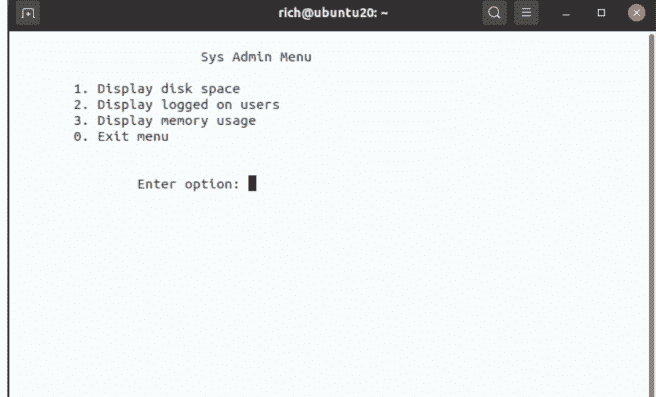

图 18-1 从 shell 脚本中显示菜单

在创建菜单之前，通常清除监视器显示是一个好主意。这样做可以让你在一个没有分散注意力文本的干净环境中显示你的菜单。

`clear` 命令使用你的终端会话的终端设置信息（参见第 2 章，“进入 Shell”）来清除监视器上出现的任何文本。在 `clear` 命令之后，你可以使用 `echo` 命令显示你的菜单元素。

默认情况下，`echo` 命令只能显示可打印的文本字符。在创建菜单项时，使用不可打印项（如制表符和换行符）通常很有帮助。要在 `echo` 命令中包含这些字符，你必须使用 `-e` 选项。

因此，命令

```
echo -e "1.\tDisplay disk space"
```

产生输出行

```
1.           Display disk space
```

这极大地有助于格式化菜单项的布局。只需几条 `echo` 命令，你就可以创建一个外观合理的菜单：

```
clear
echo
echo -e "\t\tSys Admin Menu\n"
echo -e "\t1. Display disk space"
echo -e "\t2. Display logged on users"
echo -e "\t3. Display memory usage"
echo -e "\t0. Exit menu\n\n"
echo -en "\tEnter option: "
```

最后一行的 `-en` 选项在不添加末尾换行符的情况下显示该行。这使菜单看起来更专业，因为光标停留在行尾等待用户输入。

创建菜单的最后部分是获取来自用户的输入。这是使用 `read` 命令完成的（参见第 14 章，“处理用户输入”）。因为我们只预期单字符输入，所以最好使用 `read` 命令的 `-n` 选项来仅检索一个字符。这样做允许用户输入数字而无需按下 Enter 键：

```
read -n 1 option
```

接下来，你需要创建你的菜单函数。

#### 创建菜单函数

shell 脚本菜单选项作为一组独立的函数更容易创建。这种方法使你可以创建简单、简洁且易于遵循的 `case` 命令。

为此，你必须为每个菜单选项创建单独的 shell 函数。创建菜单 shell 脚本的第一步是确定你希望脚本执行什么函数，并按...

#### 桩函数

为尚未实现的函数创建*桩函数*是一种常见的做法。桩函数是一个尚未包含任何命令的函数，或者可能仅包含一个*echo*语句，用以指示最终应该在那里放置什么内容：

```bash
function disspace {
    clear
    echo "This is where the disspace commands will go"
}
```


桩函数使你的菜单在开发各个功能的过程中能够平稳运行。你无需为菜单编写所有功能，它也能正常工作。你会注意到函数以`clear`命令开始。这允许你在干净的监视器屏幕上启动函数，而不会显示菜单。

在 shell 脚本菜单中有帮助的一件事是，将菜单布局本身也创建一个函数：

```bash
function menu {
    clear
    echo
    echo -e "\t\tSys Admin Menu\n"
    echo -e "\t1. Display disk space"
    echo -e "\t2. Display logged on users"
    echo -e "\t3. Display memory usage"
    echo -e "\t0. Exit program\n\n"
    echo -en "\tEnter option: "
    read -n 1 option
}
```

这种策略使你能够轻松地在任何时间仅通过调用`menu`函数来重新显示菜单。

### 添加菜单逻辑

现在你拥有了菜单布局和函数，你只需要创建编程逻辑将两者结合在一起。正如前面提到的，这需要`case`命令。

`case`命令应根据从菜单预期选择的字符来调用相应的函数。使用默认的 case 命令字符（`*`）来捕获任何错误的菜单输入始终是个好主意。

以下代码说明了在典型菜单中如何使用`case`命令：

```bash
menu
case $option in
    0)
        break ;;
    1)
        diskspace ;;
    2)
        whoseon ;;
    3)
        memusage ;;
    *)
        clear
        echo "Sorry, wrong selection";;
esac
```

这段代码首先使用`menu`函数清除监视器屏幕并显示菜单。`menu`函数中的`read`命令会暂停，直到用户在键盘上按下一个字符。之后，`case`命令接管。`case`命令根据返回的字符调用相应的函数。函数完成后，`case`命令退出。

### 将所有部分结合在一起

既然你已经看到了组成 shell 脚本菜单的所有部分，让我们把它们放在一起，看看它们如何协同工作。下面是一个完整菜单脚本的示例：

```bash
$ cat menu1
#!/bin/bash
# simple script menu

function diskspace {
    clear
    df -k
}

function whoseon {
    clear
    who
}

function memusage {
    clear
    cat /proc/meminfo
}

function menu {
    clear
    echo
    echo -e "\t\tSys Admin Menu\n"
    echo -e "\t1. Display disk space"
    echo -e "\t2. Display logged on users"
    echo -e "\t3. Display memory usage"
    echo -e "\t0. Exit program\n"
    echo -en "\tEnter option: "
    read -n 1 option
}

while [ 1 ]
do
    menu
    case $option in
    0)
        break ;;
    1)
        diskspace ;;
    2)
        whoseon ;;
    3)
        memusage ;;
    *)
        clear
        echo "Sorry, wrong selection";;
    esac
    echo -en "\n\n\t\tHit any key to continue"
    read -n 1 line
done
clear
$
```

此菜单创建三个函数，使用常见命令检索有关 Linux 系统的管理信息。它使用`while`循环不断循环菜单，直到用户选择选项 0，该选项使用`break`命令跳出`while`循环。

你可以使用此模板创建任何 shell 脚本菜单界面。它提供了一种与用户进行交互的简单方式。

### 使用 Select 命令

你可能已经注意到，创建文本菜单的挑战之一仅仅是创建菜单布局并获取你输入的答案。Bash shell 为你提供了一些实用的小工具，可以自动完成所有这些工作。

`select`命令允许你通过单个命令行创建菜单，然后获取输入的答案并自动处理它。`select`命令的格式如下：

```bash
select variable in list
do
    commands
done
```

`list`参数是一个空格分隔的文本项列表，用于构建菜单。`select`命令将列表中的每个项目显示为编号选项，然后显示由`PS3`环境变量定义的特殊提示符，用于选择。

下面是一个`select`命令实际运行的简单示例：

```bash
$ cat smenu1
#!/bin/bash
# using select in the menu

function diskspace {
    clear
    df -k
}

function whoseon {
    clear
    who
}

function memusage {
    clear
    cat /proc/meminfo
}

PS3=\"Enter option: \"
select option in \"Display disk space\" \"Display logged on users\" \"Display memory usage\" \"Exit program\"
do
case $option in
\"Exit program\")
break ;;
\"Display disk space\")
disk space ;;
\"Display logged on users\")
who e on ;;
\"Display memory usage\")
memusage ;;
\*)
clear
echo \"Sorry, wrong selection\";;
esac
done
clear
$ 
```

在代码文件中，`select`语句必须全部位于一行中。列表中显示的续行字符表明这一点。当你运行程序时，它会自动生成以下菜单：

```
$ ./smenu1
1) Display disk space 3) Display memory usage
2) Display logged on users 4) Exit program
Enter option:
```

使用`select`命令时，请记住存储在变量中的结果值是整个文本字符串，而不是与菜单项关联的数字。在你的`case`语句中需要比较的是文本字符串值。

### 操作 Windows 风格

使用文本菜单是朝着正确方向迈出的一步，但在我们的交互式脚本中仍然缺少很多内容，尤其是如果我们试图将它们与图形化的 Windows 世界进行比较。幸运的是，开源世界中一些 resourceful 的人帮助我们解决了这个问题。`dialog`包是一个小巧实用的工具，最初由 Savio Lam 创建，目前由 Thomas E. Dickey 维护。该包使用 ANSI 转义控制代码在文本环境中重新创建标准的 Windows 对话框。你可以轻松地将这些对话框集成到你的 shell 脚本中，以与脚本用户进行交互。本节介绍`dialog`包，并演示如何在 shell 脚本中使用它。

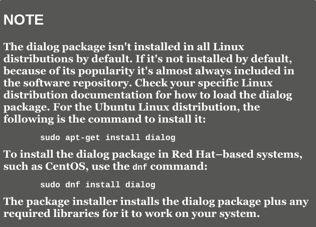

#### Dialog 包

`dialog`命令使用命令行参数来确定生成哪种类型的 Windows 控件。控件是`dialog`包对 Windows 元素类型的术语。`dialog`包目前支持表 18.1 中显示的控件类型。

**表 18.1 Dialog 控件**

| 控件 | 描述 |

| :--- | :--- |

| calendar | 提供日历以便选择日期 |

| checklist | 显示多个条目，每个条目可以开启或关闭 |

| form | 允许你构建带有标签和需要填写的文本字段的表单 |

| fselect | 提供文件选择窗口以浏览文件 |

| gauge | 显示一个计量器，指示完成百分比 |

| infobox | 显示消息，无需等待响应 |

| inputbox | 显示单个文本表单框以输入文本 |

| inputmenu | 提供可编辑的菜单 |

| menu | 显示选择列表以供选择 |

| msgbox | 显示消息并要求用户单击确定按钮 |

| pause | 显示计量器，指示指定暂停期间的状态 |

| passwordbox | 显示隐藏输入文本的单个文本框 |


| `passwordform` | 显示带有标签和隐藏文本字段的表单 |

| `radiolist` | 提供一组菜单项，其中只能选择一个条目 |

| `tailbox` | 使用 `tail` 命令在滚动窗口中显示文件中的文本 |

| `tailboxbg` | 与 `tailbox` 相同，但在后台模式下运行 |

| `textbox` | 在滚动窗口中显示文件内容 |

| `timebox` | 提供窗口以选择小时、分钟和秒 |

| `yesno` | 提供带有“是”和“否”按钮的简单消息 |

如表 18.1 所示，你可以从许多不同的控件中选择，只需很少的努力就可以让脚本具有专业的外观。

要在命令行上指定特定控件，请使用双破折号格式：

```bash
dialog --widget parameters
```

其中 `widget` 是表 18.1 中看到的控件名称，`parameters` 定义小部件窗口的大小以及小部件所需的任何文本。

每个对话框小部件以两种形式提供输出：

- 使用 `STDERR`
- 使用退出代码状态

`dialog` 命令的退出代码状态决定了用户所选择的按钮。如果用户选择了 `OK` 或 `Yes` 按钮，`dialog` 命令将返回 `0` 的退出状态。如果用户选择了 `Cancel` 或 `No` 按钮，`dialog` 命令将返回 `1` 的退出状态。您可以使用标准的 `$?` 变量来确定在对话框小部件中点击了哪个按钮。

如果小部件返回任何数据（例如菜单选择），`dialog` 命令会将数据发送到 `STDERR`。您可以使用标准的 Bash shell 技术将 `STDERR` 输出重定向到另一个文件或文件描述符：

```
dialog --inputbox "Enter your age:" 10 20 >age.txt
```

此命令将文本框中输入的文本重定向到 `age.txt` 文件。

以下几节将介绍一些更常见的对话框小部件示例，您将在 shell 脚本中使用它们。

### msgbox 小部件

`msgbox` 小部件是最常见的对话框类型。它在一个窗口中显示一条简单的消息，并在消失前等待用户点击 `OK` 按钮。使用 `msgbox` 小部件所需的格式如下：

```
dialog --msgbox text height width
```

`text` 参数是您希望放置在窗口中的任意字符串。`dialog` 命令会自动换行文本，使其适应您创建的窗口大小，使用 `height` 和 `width` 参数。如果您想在窗口顶部放置标题，还可以使用 `--title` 参数以及标题文本。以下是使用 `msgbox` 小部件的示例：

```
$ dialog --title Testing --msgbox "This is a test" 10 20
```

输入此命令后，消息框将出现在您正在使用的终端模拟器会话的屏幕上。**图 18-2** 展示了其外观。

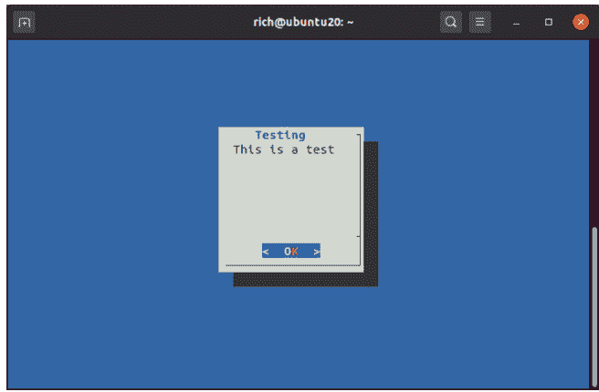

**图 18-2** 在 `dialog` 命令中使用 `msgbox` 小部件

如果您的终端模拟器支持鼠标，您可以点击 OK 按钮关闭对话框。您也可以使用键盘命令模拟点击——只需按 Enter 键即可。

### yesno 小部件

`yesno` 小部件在 `msgbox` 小部件的基础上更进一步，允许用户回答显示在窗口中的是/否问题。它在窗口底部生成两个按钮——一个用于“是”，另一个用于“否”。用户可以使用鼠标、Tab 键或键盘方向键在按钮之间切换。要选择按钮，用户可以按空格键或 Enter 键。

以下是使用 `yesno` 小部件的示例：

```
$ dialog --title "Please answer" --yesno "Is this thing on?" 10 20
$ echo $?
1
$ 
```

此代码生成了图 18-3 中所示的小部件。对话框命令的退出状态根据用户选择的按钮而定。如果点击 No 按钮，退出状态为 1；如果点击 Yes 按钮，退出状态为 0。

### inputbox 小部件

`inputbox` 小部件提供一个简单的文本框区域，供用户输入文本字符串。`dialog` 命令将文本字符串的值发送到 `STDERR`。您必须重定向该输出以获取答案。图 18-4 展示了 `inputbox` 小部件的外观。

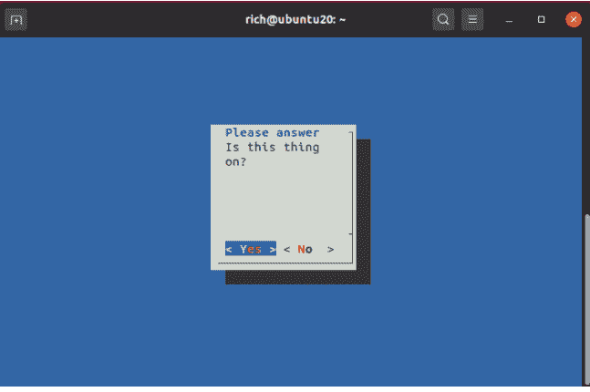

**图 18-3** 在 `dialog` 命令中使用 `yesno` 小部件

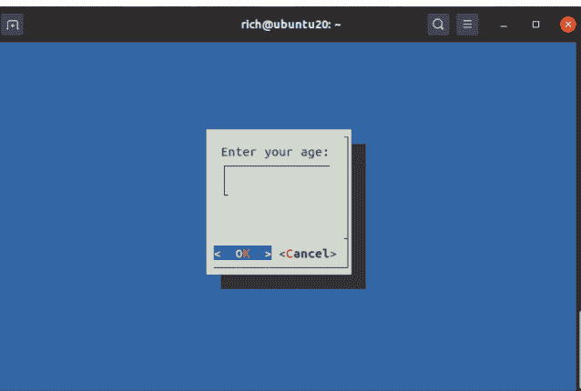

**图 18-4** `inputbox` 小部件

如您所见（见**图 18-4**），`inputbox` 提供两个按钮——OK 和 Cancel。如果点击 Cancel 按钮，命令的退出状态为 1；否则，退出状态为 0：

```bash
$ dialog --inputbox "Enter your age:" 10 20 2>age.txt
$ echo $?
0
$ cat age.txt
12$
```

您会注意到，当使用 `cat` 命令显示文本文件内容时，值后面没有换行符。这样，您可以在 shell 脚本中轻松地将文件内容重定向到变量，以提取用户输入的字符串。

### `textbox` 小部件

`textbox` 小部件是在窗口中显示大量信息的绝佳方式。它生成一个可滚动的窗口，其中包含参数中指定的文件中的文本：

```
$ dialog --textbox /etc/passwd 15 45
```

`/etc/passwd` 文件的内容显示在可滚动的文本窗口中，如**图 18-5** 所示。

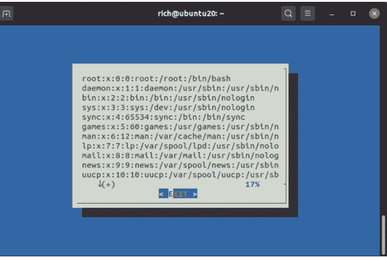

**图 18-5** `textbox` 小部件

您可以使用方向键在文本文件中左右以及上下滚动。窗口底部的行显示您当前正在查看的文件位置百分比。`textbox` 小部件仅包含一个 Exit 按钮，应选择该按钮以退出小部件。

### menu 小部件

`menu` 小部件允许您创建本章早些时候创建的文字菜单的窗口版本。您只需为每个项目提供一个选择标记和文本：

```
$ dialog --menu "Sys Admin Menu" 20 30 10 1 "Display disk" 2 "Display users" 3 "Display memory usage" 4 "Exit" 2>test.txt
```

第一个参数定义了菜单的标题。接下来的两个参数定义了菜单窗口的高度和宽度，第三个参数定义了窗口中一次显示的菜单项数量。如果有更多的菜单项，您可以使用方向键滚动查看。

在这些参数之后，您必须添加菜单项对。第一个元素是用于选择菜单项的标记。每个菜单项的标记都应该是唯一的，可以通过按键盘上相应的键进行选择。第二个元素是菜单中使用的文本。**图 18-6** 展示了由示例命令生成的菜单。

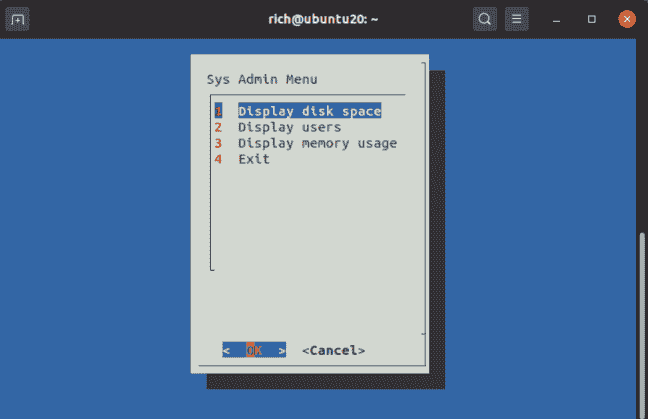

**图 18-6** 带有菜单项的 `menu` 小部件

如果用户通过按下标记相应的键选择菜单项，该菜单项将被高亮显示，但并未被选中。只有在通过鼠标或 Enter 键选择 OK 按钮后，才会完成选择。`dialog` 命令将所选菜单项的文本发送到 `STDERR`，您可以按需重定向。

### fselect 小部件

`dialog` 命令提供了几个花哨的内置小部件。在处理文件名时，`fselect` 小部件非常实用。您无需强制用户键入文件名，而是可以让他们使用 `fselect` 小部件浏览到文件位置并选择文件，如图 18-7 所示。

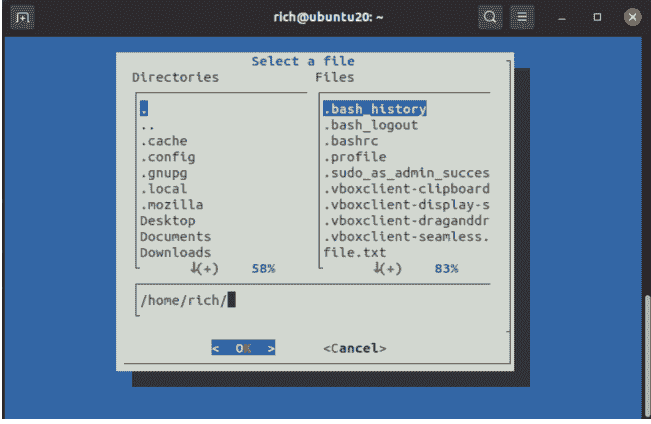

**图 18-7** `fselect` 小部件

`fselect` 小部件的格式如下：

```
$ dialog --title "Select a file" --fselect $HOME/ 10 50 2>file.txt
```

`fselect` 选项后的第一个参数是窗口中使用的起始文件夹位置。`fselect` 小部件窗口由左侧的目录列表、右侧显示所选目录中所有文件的文件列表，以及一个包含当前所选文件或目录的简单文本框组成。您可以在文本框中手动输入文件名，也可以使用目录和文件列表进行选择（使用空格键选择要添加到文本框中的文件）。

### dialog 选项

除了标准小部件，您还可以在 `dialog` 命令中定制许多不同的选项。您之前已经见过 `--title` 参数的实际效果。该参数允许您为显示在窗口顶部的小部件设置标题。

### 表 18.2 dialog 命令选项

| 选项 | 描述 |

| --- | --- |

| --add-widget | 除非按下 Esc 键或点击 Cancel 按钮，否则继续下一个对话框 |

| --aspect-ratio | 指定窗口的宽高比 |


| `--backtitle title` | 指定显示在背景顶部屏幕上的标题 |
| `--begin x y` | 指定窗口左上角的起始位置 |
| `--cancel-label label` | 指定 Cancel 按钮的替代标签 |
| `--clear` | 使用默认对话框背景颜色清除显示 |
| `--colors` | 在对话框文本中嵌入 ANSI 颜色代码 |
| `--cr-wrap` | 允许对话框文本中的换行符并强制换行 |
| `--create-rc file` | 将示例配置文件转储到指定文件 |
| `--defaultno` | 使是/否对话框的默认值为 No |
| `--default-item string` | 设置清单、表单或菜单对话框中的默认项 |
| `--exit-label label` | 指定 Exit 按钮的替代标签 |

### 选项表

| 选项 | 描述 |
| :--- | :--- |
| `--extra-button` | 在确定（OK）和取消（Cancel）按钮之间显示一个额外的按钮 |
| `--extra-label label` | 为额外按钮指定替代标签 |
| `--help` | 显示对话框命令的帮助信息 |
| `--help-button` | 在确定和取消按钮之后显示一个帮助（Help）按钮 |
| `--help-status` | 如果点击了帮助按钮，则在帮助信息后写入复选框列表（checklist）、单选列表（radiolist）或表单信息 |
| `--ignore` | 忽略对话框不识别的选项 |
| `--input-fd fd` | 指定除 `STDIN` 以外的文件描述符 |
| `--insecure` | 将密码小部件更改为输入时显示星号 |
| `--item-help` | 为复选框列表、单选列表或菜单中的每个标签项在屏幕底部添加一列帮助信息 |
| `--keep-window` | 不清除屏幕上的旧小部件 |
| `--max-input size` | 指定输入的最大字符串大小；默认为 2048 |
| `--nocancel` | 抑制取消按钮 |
| `--no-collapse` | 不将对话框文本中的制表符转换为空格 |
| `--no-kill` | 将 `tailboxbg` 对话框置于后台，并禁用该进程的 `SIGHUP` 信号 |
| `--no-label label` | 为“否”（No）按钮指定替代标签 |
| `--no-shadow` | 不为对话框窗口显示阴影 |
| `--ok-label label` | 为“确定”（OK）按钮指定替代标签 |
| `--output-fd fd` | 指定除 `STDERR` 以外的输出文件描述符 |
| `--print-maxsize` | 输出允许的最大对话框窗口大小 |
| `--print-size` | 输出每个对话框窗口的大小 |
| `--print-version` | 输出对话框的版本号 |
| `--separate-output` | 逐行输出复选框列表小部件的结果，不加引号 |
| `--separator string` | 指定用于分隔每个小部件输出的字符串 |
| `--separate-widget string` | 指定用于分隔每个小部件输出的字符串 |
| `--shadow` | 在每个窗口的右侧和底部绘制阴影 |
| `--single-quoted` | 如果需要，使用单引号输出复选框列表 |
| `--sleep sec` | 在处理完对话框窗口后延迟指定的秒数 |
| `--stderr` | 将输出发送到 `STDERR` - 这是默认行为 |
| `--stdout` | 将输出发送到 `STDOUT` |
| `--tab-correct` | 将制表符转换为空格 |
| `--tab-len n` | 指定制表符字符使用的空格数；默认为 8 |
| `--timeout sec` | 指定如果没有用户输入，在多久（秒）后以错误代码退出 |
| `--title title` | 指定对话框窗口的标题 |
| `--trim` | 从对话框文本中移除前导空格和换行符 |
| `--visit-items` | 修改对话框窗口中的制表位以包含项目列表 |
| `--yes-label label` | 为“是”（Yes）按钮指定替代标签 |

还有许多其他选项允许您完全自定义窗口的外观和行为。表 18.2 显示了 `dialog` 命令可用的选项。

`--backtitle` 选项是一种通过脚本为菜单创建通用标题的便捷方式。如果您为每个对话框窗口指定它，它将贯穿整个应用程序，为您的脚本营造专业的外观。

如您从表 18.2 中可以看出，您可以重写对话框窗口中的任何按钮标签。此功能允许您创建几乎任何所需的窗口情况。

### 在脚本中使用 dialog 命令

在脚本中使用 `dialog` 命令非常简单。只需记住两件事：

- 如果存在取消或“否”按钮，请检查 `dialog` 命令的退出状态。
- 重定向 `STDERR` 以获取输出值。

如果您遵循这两条规则，您将很快拥有一个外观专业的交互式脚本。下面是一个使用 `dialog` 小部件重现本章前面创建的系统管理员菜单的示例：

```bash
$ cat menu3
#!/bin/bash
# using dialog to create a menu

temp=$(mktemp -t test.XXXXX)
temp2=$(mktemp -t test2.XXXXX)

function diskspace {
    df -k > $temp
    dialog --textbox $temp 20 60
}

function whoseon {
    who > $temp
    dialog --textbox $temp 20 50
}

function memusage {
    cat /proc/meminfo > $temp
    dialog --textbox $temp 20 50
}

while [ 1 ]
do
    dialog --menu "Sys Admin Menu" 20 30 10 1 "Display disk space" 2 \
    "Display users" 3 "Display memory usage" 0 "Exit" 2> $temp2
    if [ $? -eq 1 ]
    then
        break
    fi

    selection=$(cat $temp2)

    case $selection in
    1) diskspace ;;
    2) whoseon ;;
    3) memusage ;;
    0) break ;;
    *) dialog --msgbox "Sorry, invalid selection" 10 30
    esac
done
rm -f $temp 2> /dev/null
rm -f $temp2 2> /dev/null
$
```

该脚本使用具有恒定真值的 `while` 循环来创建一个无限循环，不断显示菜单对话框。这意味着在每次函数执行后，脚本都会返回并显示菜单。

菜单对话框包含一个取消按钮，因此如果用户按下取消按钮以退出，脚本会检查 `dialog` 命令的退出状态。因为它位于 `while` 循环中，使用 `break` 命令跳出 while 循环即可轻松退出。

该脚本使用 `mktemp` 命令创建两个临时文件，用于存储 `dialog` 命令的数据。第一个文件 `$temp` 用于存储 `df`、`who` 和 `meminfo` 命令的输出，以便在文本框对话框中显示（参见图 18-8）。第二个临时文件 `$temp2` 用于存储主菜单对话框的选择值。

现在这开始看起来像一个您可以向人们展示的真实应用程序了！

#### 图形化

如果您正在寻找用于交互式脚本的更多图形，您可以更进一步。KDE 和 GNOME 桌面环境（参见第 1 章，“开始使用 Linux Shell”）扩展了 `dialog` 命令的概念，并包含生成各自环境 X Windows 图形小部件的命令。

本节描述了 `kdialog` 和 `zenity` 软件包，它们分别为 KDE 和 GNOME 桌面提供图形窗口小部件。

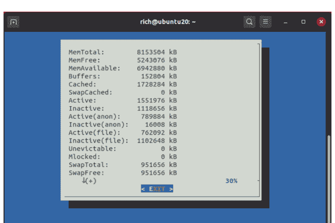

**图 18-8** 使用文本框对话框选项显示的 `meminfo` 命令输出

##### KDE 环境

KDE 图形环境默认包含 `kdialog` 软件包。`kdialog` 软件包使用 `kdialog` 命令在您的 KDE 桌面中生成标准窗口，类似于 `dialog` 样式的小部件。然而，这些窗口没有笨拙的感觉，它们与您的其他 KDE 应用程序窗口完美融合。这允许您直接从 shell 脚本中生成 Windows 质量的用户界面。

> **注意**
>


> 您的 Linux 发行版使用 KDE 桌面环境并不意味着它默认安装了 `kdialog` 软件包。您可能需要手动从发行版仓库中安装它。

### kdialog 小部件

与 `dialog` 命令类似，`kdialog` 命令使用命令行选项来指定要使用的窗口小部件类型。`kdialog` 命令的格式如下：

```bash
kdialog display-options window-options arguments
```

`display-options` 允许您自定义窗口小部件，例如添加标题或更改颜色。`window-options` 允许您指定要使用的窗口小部件类型。可用选项如表 18.3 所示。

#### 表 18.3 kdialog 窗口选项

| 选项 | 描述 |
| :--- | :--- |
| `--checklist title [tag item status]` | 复选框列表菜单，其中 status 指定项目是否已勾选 |
| `--error text` | 错误消息框 |
| `--inputbox text [init]` | 输入文本框，您可以使用 init 值指定默认值 |
| `--menu title [tag item]` | 菜单选择框标题以及由标签标识的项目列表 |
| `--msgbox text` | 带有指定文本的简单消息框 |
| `--password text` | 隐藏用户输入的密码输入文本框 |
| `--radiolist title [tag item status]` | 单选列表菜单，其中 status 指定项目是否已选中 |
| `--separate-output` | 针对复选框和单选列表菜单，逐行返回项目 |
| `--sorry text` | 抱歉消息框 |
| `--textbox file [width] [height]` | 显示文件内容的文本框，替代方式是通过宽度和高度指定 |
| `--title title` | 为 TitleBar 区域指定标题 |

### 使用 kdialog

你可以在 shell 脚本中使用 `kdialog` 窗口组件，方式类似于使用 `dialog` 组件。主要的区别在于，`kdialog` 窗口组件使用 `STDOUT` 而不是 `STDERR` 来输出值。下面是一个脚本，它将之前创建的系统管理菜单转换为一个 KDE 应用程序：

```bash
$ cat menu4
#!/bin/bash
# using kdialog to create a menu

temp=$(mktemp -t temp.XXXXXX)
temp2=$(mktemp -t temp2.XXXXXX)

function diskspace {
  df -k> $temp
  kdialog --textbox $temp 1000 10
}

function whoseon {
  who> $temp
  kdialog --textbox $temp 500 10
}

function memusage {
  cat /proc/meminfo> $temp
  kdialog --textbox $temp 300 500
}

while [ 1 ]
do
kdialog --menu "Sys Admin Menu" "1" "Display disk space" "2" "Display users" "3" "Display memory usage" "0" "Exit"> $temp2
if [ $? -eq 1 ]
then
  break
fi

selection=$(cat $temp2)

case $selection in
1)
  diskspace ;;
2)
  whoseon ;;
3) memusage ;;
0) break ;;
*)
    kdialog --msgbox "Sorry, invalid selection"
esac
done
$
```

使用 `kdialog` 命令的脚本与使用 `dialog` 命令的脚本没有太大区别。生成后的主菜单如图 18-10 所示。

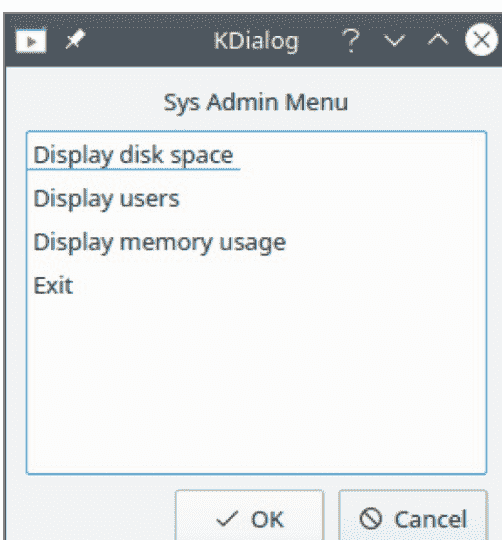

**图 18-10** 使用 `kdialog` 的系统管理菜单脚本

现在，你简单的 shell 脚本看起来就像一个真正的 KDE 应用程序！现在你可以用交互式脚本做的事情没有上限。

### GNOME 环境

GNOME 图形环境支持两个可以生成标准窗口的流行软件包：

- `gdialog`
- `zenity`

迄今为止，`zenity` 是大多数 GNOME 桌面 Linux 发行版中最常见的软件包（在 Ubuntu 和 CentOS 中默认安装）。本节将描述 `zenity` 的功能，并演示如何在你的 shell 脚本中使用它。

#### zenity 组件

正如你所预期的那样，`zenity` 允许你通过使用命令行选项来创建不同的窗口组件。表 18.4 展示了 `zenity` 可以生成的各种组件。

**表 18.4** zenity 窗口组件

| 选项 | 描述 |
| :--- | :--- |
| `--calendar` | 显示完整的月份日历 |
| `--entry` | 显示文本输入对话框窗口 |
| `--error` | 显示错误消息对话框窗口 |
| `--file-selection` | 显示完整路径名和文件名对话框窗口 |
| `--info` | 显示信息对话框窗口 |
| `--list` | 显示检查列表或单选列表对话框窗口 |
| `--notification` | 显示通知图标 |
| `--progress` | 显示进度条对话框窗口 |
| `--question` | 显示是/否问题对话框窗口 |
| `--scale` | 显示带有滑动条以在范围内选择值的比例对话框窗口 |
| `--text-info` | 显示包含文本的文本框 |
| `--warning` | 显示警告对话框窗口 |

`zenity` 命令行程序的工作方式与 `kdialog` 和 `dialog` 程序略有不同。许多组件类型是通过在命令行上使用额外选项来定义的，而不是作为某个选项的参数包含在内。

`zenity` 命令确实提供了一些相当酷的高级对话框窗口。`--calendar` 选项会生成一个完整的月份日历，如图 18-11 所示。

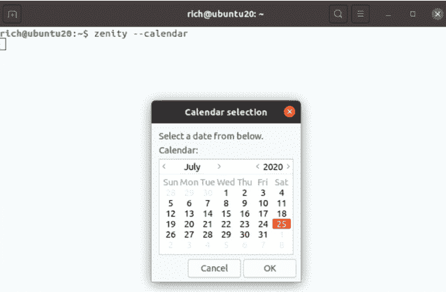

**图 18-11** `zenity` 日历对话框窗口

当你从日历中选择一个日期时，`zenity` 命令将该值返回给 `STDOUT`，就像 `kdialog` 一样：

```bash
$ zenity --calendar
12/25/2011
$
```

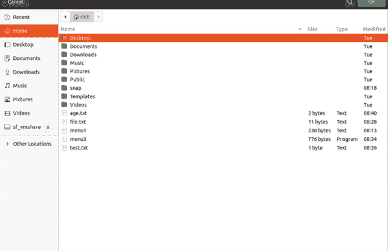

**图 18-12** `zenity` 文件选择对话框窗口

`zenity` 中另一个相当酷的功能是文件选择选项，如图 18-12 所示。

你可以使用该对话框窗口浏览到系统上的任何目录位置（只要你拥有查看该目录的权限）并选择一个文件。当你选择一个文件时，`zenity` 命令返回完整的文件和路径名：

```bash
$ zenity --file-selection
/home/ubuntu/menu5
$
```

有了像这样的工具，你的 shell 脚本创作的可能性将无限广阔！

#### 在脚本中使用 zenity

正如你所预期的，`zenity` 在 shell 脚本中表现良好。不幸的是，`zenity` 的创建者选择不遵循 `dialog` 和 `kdialog` 中使用的选项约定，因此将任何现有的交互式脚本转换为 `zenity` 可能会具有挑战性。

在将系统管理菜单从 `kdialog` 转换为 `zenity` 时，我们需要对组件定义进行大量的操作：


```bash
$ cat menu5
#!/bin/bash
# using zenity to create a menu

temp=$(mktemp -t temp.XXXXXX)
temp2=$(mktemp -t temp2.XXXXXX)

function diskpace {
  df -k> $temp
  zenity --text-info --title "Disk space" --filename=$temp \
  --width 750 --height 10
}

function whoseon {
  who> $temp
  zenity --text-info --title "Logged in users" \
  --filename=$temp \
  --width 500 --height 10
}

function memusage {
  cat /proc/meminfo> $temp
  zenity --text-info --title "Memory usage" \
  --filename=$temp \
  --width 300 --height 500
}

while [ 1 ]
do
  zenity --list --radiolist --title "Sys Admin Menu" --column "Select" \
  --column "Menu Item" FALSE "Display disk space" \
  FALSE "Display users" \
  FALSE "Display memory usage" FALSE "Exit"> $temp2
  if [ $? -eq 1 ]
  then
     break
  fi

selection=$(cat $temp2)
case $selection in
"Display disk space")
  diskpace ;;
"Display users")
  whoseon ;;
"Display memory usage")
  memusage ;;
Exit)
  break ;;
*)
  zenity --info "Sorry, invalid selection"
esac
done
$
```

由于 `zenity` 不支持菜单对话框窗口，我们使用 `radiolist` 类型的窗口作为主菜单，如图 18-13 所示。


**图 18-13** 使用 zenity 的系统管理菜单

单选列表使用两列，每列都有一个列标题。第一列包含单选按钮，第二列是项目文本。单选列表还不对项目使用标签。当你选择一个项目时，项目的完整文本会返回给 `STDOUT`。如果你使用 `case` 命令，这会让生活变得稍微有趣一些。你必须使用项目中的完整文本来作为 case 选项。如果文本中包含空格，你需要在文本周围使用引号。使用 `zenity` 软件包，你可以在 GNOME 桌面环境中为你的交互式 shell 脚本添加 Windows 风格。

### 通过实际示例进行操作

这些图形化软件包的缺点是，无法创建包含多个输入的窗口，例如将几个文本框输入与日历输入结合使用，就像你在真正的图形环境中做的那样。这种限制使得查询多个数据项变得有点笨拙，但仍然可以管理。诀窍是使用适当命名的变量来跟踪每个数据查询。

`dialog` 软件包确实包含一个表单功能，但它相当基础。它只允许你将几个文本框组合到一个窗口中以输入多个数据项。`--form` 选项的格式如下：

```bash
--form text height width formheight [ label y x item y x flen ilen ] ...
```

`--form` 选项使用的参数如下：

- `text`: 显示在表单顶部的标题
- `height`: 表单窗口的总高度
- `width`: 表单窗口的总宽度
- `formheight`: 窗口内表单的总高度
- `label`: 表单字段的标签
- `y`: 标签或项目在表单内的 Y 坐标位置
- `x`: 标签或项目在表单内的 X 坐标位置
- `item`: 分配给表单字段的默认值
- `flen`: 要显示的表单字段长度
- `ilen`: 可以输入的数据的最大长度

字段

例如，要创建一个用于输入员工信息的表单，你可以使用以下代码：

```bash
dialog --form "Enter new employee" 19 50 0 \
    "Last name " 1 1 "" 1 15 30 0 \
    "First name " 3 1 "" 3 15 30 0 \
    "Address " 5 1 "" 5 15 30 0 \
    "City " 7 1 "" 7 15 30 0 \
    "State " 9 1 "" 9 15 30 0 \
    "Zip " 11 1 "" 11 15 30 0 2>data.txt
```

这段代码生成了如图 18-14 所示的表单窗口。

当你在表单字段中输入数据并点击“确定”按钮时，表单会将数据发送到 `data.txt` 文件。`data.txt` 文件会按顺序将每个数据项放在文件中的单独一行：

```
$ cat data.txt
Test
Ima
123 Main Street
Chicago
Illinois
60601
$
```


**图 18-14** 对话框表单功能

然后，你的脚本可以通过逐行读取文件来从该文件中检索表单数据。`head` 和 `tail` 命令是检索文件中特定行的简单方法：

```
last=$(cat data.txt | head -1)
first=$(cat data.txt | head -2 | tail -1)
address=$(cat data.txt | head -3 | tail -1)
city=$(cat data.txt | head -4 | tail -1)
state=$(cat data.txt | head -5 | tail -1)
zip=$(cat data.txt | tail -1)
```

现在，你将表单中的所有数据存储在变量中，你可以在脚本的任何地方使用这些变量：

```
record="INSERT INTO employees (last, first, address, city, state, zip) VALUES ('$last', '$first', '$address', '$city', '$state', '$zip');"
echo $record>> newrecords.txt
```

`newrecords.txt` 文件将包含每个新表单记录的 `INSERT` 语句，这样你可以轻松地将它们全部导入数据库。

然后，你可以为脚本创建一个简单的前端菜单，并将所有内容整合在一起：


```bash
#!/bin/bash
temp=$(mktemp -t record.XXXX)

function newrecord {
  dialog --form "Enter new employee" 19 50 0 \
"Last name " 1 1 "" 1 15 30 0 \
"First name " 3 1 "" 3 15 30 0 \
"Address " 5 1 "" 5 15 30 0 \
"City " 7 1 "" 7 15 30 0 \
"State " 9 1 "" 9 15 30 0 \
"Zip " 11 1 "" 11 15 30 0 2>$temp

last=$(cat $temp | head -1)
first=$(cat $temp | head -2 | tail -1)
address=$(cat $temp | head -3 | tail -1)
city=$(cat $temp | head -4 | tail -1)
state=$(cat $temp | head -5 | tail -1)
zip=$(cat $temp | head -6 | tail -1)
record="INSERT INTO employees (last, first, address, city,
state, zip) VALUES
('$last', '$first', '$address', '$city', '$state', '$zip');"
echo $record>> newrecords.txt
}

function listrecords {
  dialog --title "New Data" --textbox data.txt 20 50
}

while [ 1 ]
do
dialog --menu "Employee Data" 20 30 5 \
"1 "Enter new employee" \
2 "Display records" \
"3 "Exit" 2>$temp

if [ $? -eq 1 ]
then
break
fi

selection=$(cat $temp)

case $selection in
1)
newrecord ;;
2) listrecords ;;
3) break ;;
*) dialog --msgbox "Invalid selection" 10 30
esac
done
rm -f $temp 2> /dev/null
```

此脚本创建一个简单的图形用户前端，允许你快速输入员工数据以创建 SQL 文件，你可以轻松地将该文件导入数据库。

## 摘要

交互式 Shell 脚本通常被认为枯燥乏味。你可以使用大多数 Linux 系统上可用的几种技术和工具来改变这种情况。首先，你可以使用 `case` 命令和 Shell 脚本函数为你的交互式脚本创建菜单系统。

`menu` 命令允许你使用标准的 `echo` 命令绘制菜单，并使用 `read` 命令读取用户的响应。然后，`case` 命令根据输入的值选择相应的 Shell 脚本函数。

`dialog` 程序提供了几个预构建的文本控件，用于在基于文本的终端仿真器上创建类似 Windows 的对象。你可以使用 `dialog` 程序创建用于显示文本、输入文本以及选择文件和日期的对话框。这样做会让你的 Shell 脚本更加生动。

如果你正在图形化的 X Windows 环境中运行 Shell 脚本，你可以在交互式脚本中利用更多的工具。对于 KDE 桌面，有 `kdialog` 程序。该程序提供了简单的命令来创建窗口控件，以实现所有基本的窗口功能。对于 GNOME 桌面，有 `gdialog` 和 `zenity` 程序。这些程序中的每一个都提供窗口控件，使其像真正的 Windows 应用程序一样无缝融入 GNOME 桌面。

下一章将深入探讨编辑和操作文本数据文件的主题。Shell 脚本最大的用途往往围绕解析和显示文本文件中的数据，例如日志文件和错误文件。Linux 环境包括两个非常有用的工具，`sed` 和 `gawk`，用于在 Shell 脚本中处理文本数据。下一章将介绍这些工具，并展示如何使用它们的基本知识。

# 第 19 章

## 介绍 sed 和 gawk

### 本章内容

- **操作文本**
- **了解 sed 编辑器**
- **查看 sed 编辑器的基本命令**
- **认识 gawk 编辑器**
- **探索 sed 编辑器的基础知识**

迄今为止，人们使用 Shell 脚本的最常见功能之一就是处理文本文件。无论是查看日志文件、读取配置文件还是处理数据元素，Shell 脚本都可以帮助自动执行操作文本文件中任何类型数据的常规任务。然而，仅使用 Shell 脚本命令来操作文本文件的内容有些笨拙。如果你在 Shell 脚本中执行任何类型的数据操作，你需要熟悉 Linux 中可用的 `sed` 和 `gawk` 工具。这些工具可以极大地简化你需要执行的数据处理任务。

### 文本操作

第 10 章“使用编辑器”演示了如何使用 Linux 环境中可用的不同编辑器程序来编辑文本文件。这些编辑器通过使用简单命令或鼠标点击轻松操作文本文件中的文本。

然而，在某些时候，你会发现自己希望即时操作文本文件中的文本，而无需调用完整的交互式文本编辑器。在这种情况下，拥有一个简单的命令行编辑器会很有用，它可以自动格式化、插入、修改或删除文本元素。

Linux 系统提供了两个常见的工具来实现这一目标。本节将描述 Linux 世界中最常用的两个命令行编辑器：`sed` 和 `gawk`。

#### 认识 sed 编辑器

`sed` 编辑器被称为*流编辑器*，与普通交互式文本编辑器不同。在交互式文本编辑器（如 `vim`）中，使用键盘命令以交互方式插入、删除或替换数据中的文本。流编辑器根据预先提供的一组规则编辑数据流。

`sed` 编辑器可以根据输入到命令行或存储在命令文本文件中的命令来操作流中的数据。`sed` 编辑器的工作流程如下：

1. 从输入中读取一行数据。
2. 将该数据与提供的编辑器命令进行匹配。
3. 根据命令中的指定更改流中的数据。
4. 将新数据输出到 `STDOUT`。

流编辑器对一行数据匹配并执行所有命令后，它会读取下一行数据并重复该过程。当流编辑器处理完流中的所有数据行后，它将终止。

由于命令是按顺序逐行应用的，`sed` 编辑器只需遍历一次数据流即可进行编辑。这一特性使 `sed` 编辑器比交互式编辑器更快，并能够快速修改文件数据。

以下是使用 `sed` 命令的格式：

```
sed options script file
```

`options` 参数允许你自定义 `sed` 命令的行为，包括表 19.1 中显示的选项。

##### 表 19.1 sed 命令选项

###### 在命令行中定义编辑器命令

| 选项 | 描述 |
|---|---|
| `-e commands` | 在处理输入时添加额外的 `sed` 命令以执行 |
| `-f file` | 将文件中指定的命令添加到处理输入时执行的命令中 |
| `-n` | 不为每个命令产生输出，而是等待打印 `p` 命令 |

`script` 参数指定针对数据流应用单个命令。如果需要多个命令，必须使用 `-e` 选项在命令行中指定它们，或使用 `-f` 选项在单独文件中指定它们。有许多可用的命令用于操作数据。在本章中，我们将探讨 `sed` 编辑器使用的一些基本命令，然后在第 21 章“高级 sed”中查看一些更高级的命令。

默认情况下，`sed` 编辑器将指定命令应用于 `STDIN` 输入流。这允许你将数据直接管道传输到 `sed` 编辑器进行处理。以下是一个演示如何这样做的快速示例：

```
$ echo "This is a test" | sed 's/test/big test/'
This is a big test
$
```

此示例使用 `sed` 编辑器中的 `s` 命令。`s` 命令将指定的前向斜杠之间的第一个文本字符串模式替换为第二个文本字符串。在本示例中，单词 `big test` 替换了单词 `test`。

当你运行此示例时，结果几乎会即时显示。这就是使用 `sed` 编辑器的强大之处。你可以在某些交互式编辑器仅仅启动所需的大致时间内对数据进行多次编辑！

当然，这个简单的测试演示了一行数据的编辑。当编辑完整的数据文件时，也会发生相同的高速结果，如下所示：


```
$ cat data1.txt
The quick brown fox jumps over the lazy dog.
The quick brown fox jumps over the lazy dog.
The quick brown fox jumps over the lazy dog.
The quick brown fox jumps over the lazy dog.
$ sed 's/dog/cat/' data1.txt
The quick brown fox jumps over the lazy cat.
The quick brown fox jumps over the lazy cat.
The quick brown fox jumps over the lazy cat.
The quick brown fox jumps over the lazy cat.
$
```

`sed`命令执行并非常快地返回数据。随着它处理每一行数据，结果会显示出来。在`sed`编辑器完成处理整个文件之前，你就能看到结果。

需要注意的是，`sed`编辑器 *不会* 修改文本文件本身中的数据；它只是将修改后的文本发送到 `STDOUT`。如果你查看该文本文件，它仍然包含原始数据：

```
$ cat data1.txt
The quick brown fox jumps over the lazy dog.
The quick brown fox jumps over the lazy dog.
The quick brown fox jumps over the lazy dog.
The quick brown fox jumps over the lazy dog.
$
```

### 在命令行中使用多个编辑器命令

要从`sed`命令行执行多个命令，请使用`-e`选项：

```
$ sed -e 's/brown/red/; s/dog/cat/' data1.txt
The quick red fox jumps over the lazy cat.
The quick red fox jumps over the lazy cat.
The quick red fox jumps over the lazy cat.
The quick red fox jumps over the lazy cat.
$
```

两个命令都会应用于文件中的每一行数据。命令必须用分号 (`;`) 分隔，且第一个命令末尾和分号之间不应该有空格。

除了使用分号分隔命令外，你还可以通过 Bash shell 中的辅助提示符来实现。只需输入第一个单引号以打开`sed`程序脚本（也称为`sed`编辑器命令列表），Bash 会继续提示你输入更多命令，直到你输入结束引号：

```
$ sed -e '
> s/brown/green/
> s/fox/toad/
> s/dog/cat/' data1.txt
The quick green toad jumps over the lazy cat.
The quick green toad jumps over the lazy cat.
The quick green toad jumps over the lazy cat.
The quick green toad jumps over the lazy cat.
$ 
```

你必须记得在出现结束单引号的同一行完成命令。在 Bash shell 检测到结束引号后，它会处理该命令。启动后，`sed`命令会将其指定的每个命令应用于文本文件中的每一行数据。

### 从文件读取编辑器命令

最后，如果你有许多要处理的`sed`命令，通常将它们存储在一个单独的文件中更容易。使用`-f`选项在`sed`命令中指定该文件：

```
$ cat script1.sed
s/brown/green/
s/fox/toad/
s/dog/cat/
$ 
$ sed -f script1.sed data1.txt
The quick green toad jumps over the lazy cat.
The quick green toad jumps over the lazy cat.
The quick green toad jumps over the lazy cat.
The quick green toad jumps over the lazy cat.
$ 
```

在这种情况下，每个命令后面 *不* 放置分号。`sed`编辑器知道每行包含一个独立的命令。与在命令行上输入命令一样，`sed`编辑器从指定文件中读取命令，并将它们应用于数据文件中的每一行。

**提示**

*`sed`编辑器脚本文件很容易与 Bash shell 脚本或其他文本文件混淆。为了消除混淆，在`sed`脚本文件中使用`.sed`文件扩展名被认为是良好的格式。*

我们将在“查看 *sed* 编辑器基本命令”部分中查看其他一些方便用于操作数据的 *sed* 编辑器命令。在此之前，让我们快速了解一下另一个 Linux 数据编辑器。

### 了解 *gawk* 程序

虽然 *sed* 编辑器是即时修改文本文件的一个便捷工具，但它有其局限性。通常，需要一个更高级的工具来操作文件中的数据，该工具提供一个更像编程的环境，允许修改和重组文件中的数据。这就是 *gawk* 的作用所在。

**注意**

*`gawk`程序并非在所有发行版上默认安装。如果你的 Linux 发行版没有`gawk`程序，请参考第 9 章“安装软件”，安装`gawk`包。*

*`gawk`*程序是原始 Unix *awk* 程序的 GNU 版本。*`gawk`*程序通过提供编程语言而不是仅仅编辑器命令，将流编辑向前推进了一步。在 *`gawk`* 编程语言中，可以执行以下操作：

- 定义变量以存储数据。
- 使用算术和字符串运算符对数据进行操作。
- 使用结构化编程概念，如 *if-then* 语句和循环，为你的数据处理添加逻辑。
- 通过提取数据文件中的数据元素并以另一种顺序或格式重新定位它们，生成格式化报告。

*`gawk`*程序的报告生成功能通常用于从大型、庞大的文本文件中提取数据元素，并将其格式化为可读的报告。完美的例子是格式化程序日志文件。在日志文件中挖掘错误行可能很困难。*`gawk`*程序允许你从日志文件中过滤出想要查看的数据元素，然后以更易阅读重要数据的方式对其进行格式化。

#### 访问 *gawk* 命令格式

以下是 *`gawk`* 程序的基本格式：

```
*gawk* options program file
```

表 19.2 显示了 *`gawk`* 程序可用的几个选项。

**表 19.2 *gawk* 选项**

| 选项 | 描述 |
|---|---|
| `-F fs` | 指定用于界定一行中数据字段的文件分隔符 |
| `-f file` | 指定读取程序的文件名 |
| `-v var = value` | 定义在 *`gawk`* 程序中使用的变量和默认值 |
| `-L [ keyword ]` | 指定 *`gawk`* 的兼容性模式或警告级别 |

命令行选项为自定义 *`gawk`* 程序中的功能提供了简单的方法。在我们探索 *`gawk`* 基础知识时，我们将更仔细地查看其中的一些选项。

*`gawk`* 的强大之处在于程序脚本。你可以编写脚本读取文本行内的数据，然后操作和显示

数据以创建任何类型的输出报告。

#### 从命令行读取程序脚本

一个 `awk` 程序脚本由开括号和闭括号定义。您必须将脚本命令放在两个括号 (`{}`) 之间。如果您错误地使用括号代替花括号来包裹您的 `awk` 脚本，将会产生类似以下所示的错误消息：

```
$ awk '(print "Hello World!")'
awk: cmd. line:1: (print "Hello World!")
awk: cmd. line:1: ^ syntax error
awk: cmd. line:2: (print "Hello World!")
awk: cmd. line:2: ^ unexpected newline
or
end of string
$
```

由于 `awk` 命令行假定脚本是一个单一的文本字符串，因此您还必须用单引号将脚本包裹起来。以下是一个在命令行上指定的简单 `awk` 程序脚本的示例：

```
$ awk '{print "Hello World!"}'
```

该程序脚本定义了一个单一命令，即 `print` 命令。`print` 命令的作用如其所言：它将文本打印到 `STDOUT`。如果您尝试运行此命令，您会略显失望，因为当下不会发生任何事情。由于命令行中未定义文件名，`awk` 程序将从 `STDIN` 获取数据。当您运行程序时，它只是等待通过 `STDIN` 输入文本。

如果您输入一行文本并按下 Enter 键，`awk` 就会将该文本通过程序脚本进行处理。就像 `sed` 编辑器一样，`awk` 程序会针对数据流中可用的每一行文本执行该程序脚本。由于程序脚本被设置为显示一个固定的文本字符串，无论您在数据流中输入什么文本，您得到的文本输出都是相同的：


```
$ awk '{print "Hello World!"}'
This is a test
Hello World!
hello
Hello World!
Goodbye
Hello World!
This is another test
Hello World!
```

为了终止 `gawk` 程序，您必须发出信号表明数据流已结束。Bash shell 提供了一个键位组合来生成文件结束（EOF）字符。在 Bash 中，`Ctrl+D` 键位组合会生成一个 EOF 字符。使用该键位组合将终止 `gawk` 程序，并返回到命令行界面提示符。

### 使用数据字段变量

`gawk` 的主要功能之一是它能够操纵文本文件中的数据。它通过自动为每行中的每个数据元素分配变量来实现这一点。默认情况下，`gawk` 为它在文本行中检测到的每个数据字段分配以下变量：

- `$0` 代表整行文本。
- `$1` 代表文本行中的第一个数据字段。
- `$2` 代表文本行中的第二个数据字段。
- `$n` 代表文本行中的第 n 个数据字段。

文本行中的每个数据字段由字段分隔符确定。当 `gawk` 读取一行文本时，它会使用定义的字段分隔符来区分每个数据字段。`gawk` 中的默认字段分隔符是任何空白字符（例如制表符或空格字符）。

以下是一个示例 `gawk` 程序，它读取一个文本文件并仅显示第一个数据字段的值：

```
$ cat data2.txt
One line of test text.
Two lines of test text.
Three lines of test text.
$
$ gawk '{print $1}' data2.txt
One
Two
Three
```

此程序使用 `$1` 字段变量来显示每行文本的仅第一个数据字段。

对于读取使用不同字段分隔符的文件，请使用 `-F` 选项指定该字符：

```
$ gawk -F: '{print $1}' /etc/passwd
root
daemon
bin
[...]
christine
sshd
$
```

这个简短的程序显示了系统中密码文件的第一个数据字段。由于 `/etc/passwd` 文件使用冒号 `:` 来分隔数据字段，为了分隔每个数据元素，我们在 `gawk` 选项中使用了字段分隔符 `-F:`。

#### 在程序脚本中使用多个命令

如果您只能执行一条命令，那么编程语言就没太大用处了。`gawk` 编程语言允许将命令组合成一个正常的程序。要在命令行指定的程序脚本中使用多个命令，只需在每个命令之间放置一个分号：

```
$ echo "My name is Rich" | gawk '{$4="Christine"; print $0}'
My name is Christine
$
```

第一个命令将值分配给 `$4` 字段变量。第二个命令然后打印整个数据字段。从输出中可以看到，`gawk` 程序将原始文本中的第四个数据字段替换为新值。

您也可以使用次要提示符逐行输入您的程序脚本命令：

```
$ gawk '{
> $4="Christine";
> print $0}'
My name is Rich
My name is Christine
$
```

当我们用单引号打开后，Bash shell 提供了次要提示符，提示我们输入更多数据。我们在每一行上逐条添加命令，直到输入闭合的单引号为止。由于命令行中未定义文件名，`gawk` 程序从 `STDIN` 获取数据。当我们运行程序时，它等待通过 STDIN 输入文本。为了退出程序，我们按下了 `Ctrl+D` 键位组合以表明数据结束并回到 shell 提示符。

### 从文件中读取程序

与 `sed` 编辑器一样，`gawk` 编辑器允许您将程序存储在文件中，并在命令行中引用它们：

```
$ cat script2.gawk
{print $1 "'s home directory is " $6}
$
$ gawk -F: -f script2.gawk /etc/passwd
root's home directory is /root
daemon's home directory is /usr/sbin
bin's home directory is /bin
[...]
christine's home directory is /home/christine
sshd's home directory is /run/sshd
$
```

`script2.gawk` 程序脚本再次使用 `print` 命令来打印 `/etc/passwd` 文件的主目录数据字段（字段变量 `$6`）和用户名数据字段（字段变量 `$1`）。

您可以在程序文件中指定多个命令。为此，只需将每个命令放在单独的一行上即可。您不需要使用分号：

```
$ cat script3.gawk
{
 text = "'s home directory is "
 print $1 text $6
}
$
```

```
$ gawk -F: -f script3.gawk /etc/passwd
root's home directory is /root
daemon's home directory is /usr/sbin
bin's home directory is /bin
[...]
christine's home directory is /home/christine
sshd's home directory is /run/sshd
$
```

`script3.gawk` 程序脚本定义了一个变量 `text`，用于存储 `print` 命令中使用的文本字符串。请注意，`gawk` 程序在引用变量值时不使用美元符号，这与 shell 脚本不同。

### 在处理数据之前运行脚本

`gawk` 程序还允许您指定程序脚本的运行时间。默认情况下，`gawk` 从输入中读取一行文本，然后在该行文本的数据上执行程序脚本。有时，您可能需要在处理数据之前运行脚本，例如创建报告的文件头部分。`BEGIN` 关键字用于实现此目的。它强制 `gawk` 在读取数据之前执行 `BEGIN` 关键字后指定的程序脚本：

```
$ gawk 'BEGIN {print "Hello World!"}'
Hello World!
$
```

这次，`print` 命令在读取任何数据之前显示了文本。然而，显示文本后，它很快就退出，而不等待任何数据。

原因是 `BEGIN` 关键字仅在处理任何数据之前应用指定的脚本。如果您希望使用普通程序脚本处理数据，必须使用另一个脚本部分定义程序：

```
$ cat data3.txt
Line 1
Line 2
Line 3
$
$ gawk 'BEGIN {print "The data3 File Contents:"}
> {print $0}' data3.txt
The data3 File Contents:
Line 1
Line 2
Line 3
$
```

现在，在 `gawk` 执行完 `BEGIN` 脚本后，它使用第二个脚本来处理任何文件数据。这样做时请小心 —— `gawk` 命令行上的这两个脚本仍然被视为一个文本字符串。您需要相应地放置单引号。

### 在处理数据之后运行脚本

与 `BEGIN` 关键字类似，`END` 关键字允许您指定 `gawk` 在读取数据之后执行的程序脚本：

```
$ gawk 'BEGIN {print "The data3 File Contents:"}
> {print $0}
> END {print "End of File"}' data3.txt
The data3 File Contents:
Line 1
Line 2
Line 3
End of File
$
```

当 `gawk` 程序打印完文件内容后，它会执行 `END` 脚本中的命令。这是一种很好的技术，用于在所有常规数据处理完成后为报告添加页脚数据。

您可以将所有这些元素组合到一个小的程序脚本文件中，以从简单的数据文件创建完整的报告：

```
$ cat script4.gawk
BEGIN {
print "The latest list of users and shells"
print "UserID \t Shell"
print "------- \t -------"
FS=";"
}

{
print $1 "          \t "  $7
}
```

```
END {
    print "This concludes the listing"
}
$
```

该脚本使用 `BEGIN` 脚本为报告创建头部部分。它还定义了一个名为 `FS` 的特殊变量。这是另一种定义字段分隔符的方式。这样，你就不必依赖脚本用户在命令行选项中定义字段分隔符。

以下是运行此 `gawk` 程序脚本时输出的部分截断内容：


```
$ gawk -f script4.gawk /etc/passwd
The latest list of users and shells
UserID          Shell
--------    --------
root        /bin/bash
daemon      /usr/sbin/nologin
[...]
christine   /bin/bash
sshd        /usr/sbin/nologin
This concludes the listing
$
```

正如预期，`BEGIN` 脚本生成了头部文本，程序脚本处理了来自指定数据文件（`/etc/passwd` 文件）的信息，而 `END` 脚本则生成了底部文本。`print` 命令中的 `\t` 产生了一些格式美观的制表符输出。

这让你初步体验了通过简单的 `gawk` 脚本所拥有强大功能。第 22 章“高级 `gawk`”介绍了一些可供你 `gawk` 脚本使用的基本编程原则，以及一些更高级的编程概念，你可以利用这些概念在 `gawk` 程序脚本中创建专业外观的报告，即使面对最晦涩的数据文件也是如此。

### 查看 `sed` 编辑器基本命令

成功使用 `sed` 编辑器的关键在于了解其众多命令和格式，这些帮助你定制文本编辑。

本节介绍了一些基本命令和功能，你可以将它们整合到你的脚本中，开始使用 `sed` 编辑器。

#### 介绍更多替换选项

我们已经涵盖了如何使用 `s` 命令将文本中的文本替换为新文本。然而，`s` 命令还有一些额外的选项，可以简化你的生活。

##### 替换标志

`s` 命令在文本字符串中替换匹配模式时有一些注意事项。观察以下示例中发生了什么：

```
$ cat data4.txt
This is a test of the test script.
This is the second test of the test script.
$
$ sed 's/test/trial/' data4.txt
This is a trial of the test script.
This is the second trial of the test script.
$
```

`s` 命令在替换多行文本方面工作正常，但默认情况下，它只替换每行中的第一个出现。要让 `s` 命令处理文本的不同出现位置，你必须使用替换标志。替换标志设置在替换命令字符串之后：

```
s/pattern/replacement/flags
```

有四种类型的替换标志可用：

- 一个数字，指示应替换新文本的模式出现位置
- `g`，指示应替换现有文本的所有出现为新文本
- `p`，指示应打印原始行的内容
- `w file`，表示将替换结果写入文件

在第一种替换类型中，你可以指定 `sed` 编辑器应替换新文本的匹配模式的哪个出现位置：

```
$ sed 's:/test/trial/2/' data4.txt
This is a test of the trial script.
This is the second test of the trial script.
$
```

通过指定 `2` 作为替换标志的结果，`sed` 编辑器仅在每行的第二个出现位置替换该模式。`g` 替换标志允许你替换文本中模式的所有（全局）出现：

```
$ sed 's:/test/trial/g/' data4.txt
This is a trial of the trial script.
This is the second trial of the trial script.
$
```

`p` 替换标志打印包含匹配模式的行（在替换命令中）。这最常与 `-n` `sed` 选项一起使用：

```
$ cat data5.txt
This is a test line.
This is a different line.
$
$ sed -n 's:/test/trial/p/' data5.txt
This is a trial line.
$
```

`-n` 选项抑制了 `sed` 编辑器的输出。然而，`p` 替换标志会输出任何已被修改的行。将两者结合使用，仅为被替换命令修改的行产生输出。

`w` 替换标志产生相同的输出，但将输出存储在指定的文件中：

```
$ sed 's:/test/trial/w test.txt/' data5.txt
This is a trial line.
This is a different line.
$
$ cat test.txt
This is a trial line.
$
```

`sed` 编辑器的正常输出显示在 `STDOUT` 中，但只有包含匹配模式的行才存储在指定的输出文件中。

##### 替换字符

有时，你会遇到文本字符串中在替换模式中不容易使用的字符。Linux 领域的一个流行例子是正斜杠（`/`）。

在文件中替换路径名可能会变得尴尬。例如，如果你想在 `/etc/passwd` 文件中将 C shell 替换为 Bash shell，你必须这样做：

```
$ sed 's/\bin\bash/\bin\csh/' /etc/passwd
```

由于正斜杠用作字符串分隔符，如果模式文本中出现正斜杠，你必须使用反斜杠进行转义。这通常会导致混淆和错误。

为了解决这个问题，`sed` 编辑器允许你在替换命令中为字符串分隔符选择不同的字符：

```
$ sed 's!/bin/bash!/bin/csh!' /etc/passwd
```

在这个例子中，感叹号（`!`）用作字符串分隔符，使路径名更容易阅读和理解。

##### 使用地址

默认情况下，你在 `sed` 编辑器中使用的命令应用于文本数据的所有行。如果你只想将命令应用于特定行或一组行，你必须使用*行寻址*。

`sed` 编辑器中有两种形式的行寻址：

- 数字行范围
- 匹配行内文本的文本模式

这两种形式都使用相同的格式来指定地址：

```
[*address*] *command*
```

你也可以为特定地址将多个命令组合在一起：

```
address {
    command1
    command2
    command3
}
```

`sed` 编辑器将指定的每个命令仅应用于匹配指定地址的行。本节展示了在 `sed` 编辑器脚本中使用这两种寻址技术。

##### 寻址数字行

使用数字行寻址时，你使用文本流中的行位置来引用行。`sed` 编辑器将文本流中的第一行分配为行号 `1`，并对每一新行依次编号。

你在命令中指定的地址可以是单个行号，或者由起始行号、逗号和结束行号指定的行范围。以下是指定 `sed` 命令将应用的行号示例：

```
$ cat data1.txt
    The quick brown fox jumps over the lazy dog.
    The quick brown fox jumps over the lazy dog.
    The quick brown fox jumps over the lazy dog.
    The quick brown fox jumps over the lazy dog.
    $
    $ sed '2s/dog/cat/' data1.txt
    The quick brown fox jumps over the lazy dog.
    The quick brown fox jumps over the lazy cat.
    The quick brown fox jumps over the lazy dog.
    The quick brown fox jumps over the lazy dog.
    $
```

`sed` 编辑器根据指定的地址仅修改了第 `2` 行中的文本。这是另一个示例，这次使用行地址范围（第 `2` 到第 `3` 行）：

```
$ sed '2,3s/dog/cat/' data1.txt
    The quick brown fox jumps over the lazy dog.
    The quick brown fox jumps over the lazy cat.
    The quick brown fox jumps over the lazy cat.
    The quick brown fox jumps over the lazy dog.
    $
```

如果你想在文本中某一点开始的一组行上应用命令，并持续到文本结尾，你可以使用美元符号代替最后一个地址范围数字：

```
$ sed '2,$s/dog/cat/' data1.txt
The quick brown fox jumps over the lazy dog.
The quick brown fox jumps over the lazy cat.
The quick brown fox jumps over the lazy cat.
The quick brown fox jumps over the lazy cat.
$
```

由于你可能不知道文本中有多少行数据，美元符号通常很有用。

##### 使用文本模式过滤器


限制命令应用行的另一种方法稍微复杂一些。`sed` 编辑器允许指定文本模式，并使用它作为过滤器来确定命令应用于哪些行。这是其格式：

```
/pattern/command
```

你必须用正斜杠包裹你指定的*模式*。`sed` 编辑器仅将命令应用于包含指定文本模式的行。

例如，如果你只想更改用户`rich`的默认 shell，你会使用 `sed` 命令：

```
$ grep /bin/bash /etc/passwd
root:x:0:0:root:/root:/bin/bash
christine:x:1001:1001::/home/christine:/bin/bash
rich:x:1002:1002::/home/rich:/bin/bash
$
```

```
$ sed '/rich/s/bash/csh/' /etc/passwd
root:x:0:0:root:/root:/bin/bash
daemon:x:1:1:daemon:/usr/sbin:/usr/sbin/nologin
[...]
christine:x:1001:1001::/home/christine:/bin/bash
sshd:x:126:65534::/run/sshd:/usr/sbin/nologin
rich:x:1002:1002::/home/rich:/bin/csh
$
```

该命令仅应用于与匹配文本模式相符的那一行。尽管使用固定文本模式对于过滤特定值可能有用（如前一个示例所示），但它的用途相对有限。`sed` 编辑器使用一种称为*正则表达式*的功能，使您可以在文本模式中创建相当复杂的匹配规则。

正则表达式允许您创建高级的文本模式匹配公式，以匹配各种类型的数据。这些公式将一系列通配符、特殊字符和固定文本字符组合在一起，生成一个简洁的模式，可以匹配几乎任何文本情况。正则是 shell 脚本编程中较为复杂的部分之一，**第 20 章**“正则表达式”对此进行了详细介绍。

### 分组命令

如果您需要对某一行执行多个命令，请使用大括号将命令分组。`sed` 编辑器会处理地址行上列出的每个命令：

```
$ sed '2{
> s/fox/toad/
> s/dog/cat/
> }' data1.txt
The quick brown fox jumps over the lazy dog.
The quick brown toad jumps over the lazy cat.
The quick brown fox jumps over the lazy dog.
The quick brown fox jumps over the lazy dog.
$
```

这两个命令仅针对指定的地址进行处理。当然，您还可以在分组命令之前指定一个地址范围：

```
$ sed '3,${
> s/brown/green/
> s/fox/toad/
> s/lazy/sleeping/
> }' data1.txt
The quick brown fox jumps over the lazy dog.
The quick brown fox jumps over the lazy dog.
The quick green toad jumps over the sleeping dog.
The quick green toad jumps over the sleeping dog.
$
```

`sed` 编辑器将所有命令应用于地址范围内的所有行。

### 删除行

文本替换命令并不是 `sed` 编辑器中唯一的可用命令。如果您需要删除文本流中的特定行，可以使用删除命令。

删除（`d`）命令基本如其所述。它会删除所有与所提供寻址方案匹配的行。使用 `d` 命令时要小心，因为如果您忘记包含寻址方案，所有行都将从流中删除：

```
$ cat data1.txt
The quick brown fox jumps over the lazy dog.
The quick brown fox jumps over the lazy dog.
The quick brown fox jumps over the lazy dog.
The quick brown fox jumps over the lazy dog.
$ sed 'd' data1.txt
$
```

显然，当与指定地址一起使用时，`d` 命令最有帮助。这允许您从数据流中删除特定文本行，可以通过行号：

```
$ cat data6.txt
This is line number 1.
This is line number 2.
This is the 3rd line.
This is the 4th line.
$
$ sed '3d' data6.txt
This is line number 1.
This is line number 2.
This is the 4th line.
$
```

或通过特定的行范围：

```
$ sed '2,3d' data6.txt
This is line number 1.
This is the 4th line.
$
```

或使用特殊的文件结束字符：

```
$ sed '1,3d' data6.txt
This is line number 1.
This is line number 2.
$
```

`sed` 编辑器的模式匹配功能也适用于删除（`d`）命令：

```
$ sed '/number 1/d' data6.txt
This is line number 2.
This is the 3rd line.
This is the 4th line.
$
```

`sed` 编辑器会删除包含与您指定模式匹配的文本的行。

#### 注意

> 请记住，`sed` 编辑器不会修改原始文件。您删除的行仅从 `sed` 编辑器的输出中消失。原始文件仍然包含这些“已删除”的行。

您也可以使用两个文本模式删除一定范围的行，但这样做时要小心。您指定的第一个模式“开启”行删除，第二个模式“关闭”行删除。`sed` 编辑器会删除两个指定模式之间的任何行（包括指定模式所在的行）：

```
$ sed '/1/,/3/d' data6.txt
This is the 4th line.
$
```

此外，您必须小心，因为每当 `sed` 编辑器在数据流中检测到起始模式时，删除功能就会“开启”。这可能会产生意外结果：

```
$ cat data7.txt
This is line number 1.
This is line number 2.
This is the 3rd line.
This is the 4th line.
This is line number 1 again; we want to keep it.
This is more text we want to keep.
Last line in the file; we want to keep it.
$
$ sed '/1/,/3/d' data7.txt
This is the 4th line.
$
```

包含数字 1 的行的第二次出现再次触发了删除（`d`）命令，导致数据流中的其余行被删除，因为没有识别到停止模式。当然，如果您指定的停止模式在文本中从未出现，还会出现另一个明显的问题：

```
$ sed '/3/,/5/d' data7.txt
This is line number 1.
This is line number 2.
$
```

因为删除功能在第一个模式匹配时“开启”，但从未找到结束模式匹配，所以没有“关闭”。整个数据流的剩余部分都被删除了。

### 插入和附加文本

正如您所见，与其他任何编辑器一样，`sed` 编辑器允许您向数据流中插入和附加文本行。但是，这两种操作之间的区别可能会令人困惑：

- 插入（`i`）命令在指定行*之前*添加新行。
- 附加（`a`）命令在指定行*之后*添加新行。

这两个命令令人困惑的地方在于它们的格式。您不能总是在单行命令中使用这些命令。有时您必须在单独的一行中指定要插入或附加的行。以下是这样做的格式：

```
sed '[address]command\
new line'
```

*new line* 中的文本将按照您指定的位置出现在 `sed` 编辑器的输出中。请记住，当您使用插入（`i`）命令时，文本会出现在数据流文本*之前*：

```
$ echo "Test Line 2" | sed 'i\Test Line 1'
Test Line 1
Test Line 2
$
```

当您使用附加（`a`）命令时，文本会出现在数据流文本*之后*：

```
$ echo "Test Line 2" | sed 'a\Test Line 1'
Test Line 2
Test Line 1
$
```

当您从命令行界面提示符使用 `sed` 编辑器时，您会看到二级提示符以输入新的数据行。您必须在此行上完成 `sed` 编辑器命令。在您输入结束的单引号后，Bash shell 会处理该命令：


```
$ echo "Test Line 2" | sed 'i\
> Test Line 1'
Test Line 1
Test Line 2
$
```

这对于在数据流中的文本之前或之后添加文本非常有用，但是如果在数据流内部添加文本呢？

要在数据流行内部插入或附加数据，您必须使用寻址来告诉 `sed` 编辑器您希望数据出现在哪里。使用这些命令时，您只能指定单个行地址。您可以匹配数字行号或文本模式，但不能使用地址范围。这是合乎逻辑的，因为您只能在一行之前或之后插入或附加，而不能针对一行范围进行此操作。

以下是向数据流中第 3 行之前插入新行的示例：

```
$ cat data6.txt
This is line number 1.
This is line number 2.
This is the 3rd line.
This is the 4th line.
$
$ sed '3i\
> This is an inserted line.
> ' data6.txt
This is line number 1.
This is line number 2.
This is an inserted line.
This is the 3rd line.
This is the 4th line.
$
```

以下是向数据流中第 3 行之后附加新行的示例：

```
$ sed '3a\
> This is an appended line.
> ' data6.txt
This is line number 1.
This is line number 2.
This is the 3rd line.
This is an appended line.
This is the 4th line.
$
```

这与插入（`i`）命令使用相同的流程；它只是将新的文本行放置在指定行号之后。如果您有一个多行数据流，并希望在数据流末尾附加一行新文本，只需使用美元符号，它代表最后一行数据：

```
$ sed '$a\
> This line was added to the end of the file.
> ' data6.txt
This is line number 1.
This is line number 2.
This is the 3rd line.
This is the 4th line.
This line was added to the end of the file.
$
```

如果您想在数据流开头添加一行新文本，同样的想法也适用。只需在第 1 行之前插入（`i`）一行新文本即可。

要插入或附加多行文本，您必须在每一行新文本后使用反斜杠，直到最后一行文本为止

你要在其中插入或追加文本的位置：

```bash
$ sed '1i\
> This is an inserted line.\
> This is another inserted line.
> ' data6.txt
This is an inserted line.
This is another inserted line.
This is line number 1.
This is line number 2.
This is the 3rd line.
This is the 4th line.
$ 
```

指定的两行都被添加到了数据流中。

### 更改行

更改（`c`）命令允许你更改数据流中整行文本的内容。它的运作方式与 `insert` 和 `append` 命令相同，即必须将新行与 `sed` 命令的其余部分分开指定：

```bash
$ sed '2c\
> This is a changed line of text.
> ' data6.txt
This is line number 1.
This is a changed line of text.
This is the 3rd line.
This is the 4th line.
$ 
```

在前面的示例中，`sed` 编辑器更改了第 2 行中的文本。你也可以使用文本模式作为地址：

```bash
$ sed '/3rd line/c\
> This is a changed line of text.
> ' data6.txt
This is line number 1.
This is line number 2.
This is a changed line of text.
This is the 4th line.
$ 
```

文本模式更改（`c`）命令会更改数据流中与它匹配的任何文本行。

```bash
$ cat data8.txt
I have 2 Infinity Stones
I need 4 more Infinity Stones
I have 6 Infinity Stones!
I need 4 Infinity Stones
I have 6 Infinity Stones...
I want 1 more Infinity Stone
$ sed '/have 6 Infinity Stones/c\
> Snap! This is changed line of text.
> ' data8.txt
I have 2 Infinity Stones
I need 4 more Infinity Stones
Snap! This is changed line of text.
I need 4 Infinity Stones
Snap! This is changed line of text.
I want 1 more Infinity Stone
$
```

你可以在更改命令中使用地址范围，但结果可能不是你所期望的：

```bash
$ cat data6.txt
This is line number 1.
This is line number 2.
This is the 3rd line.
This is the 4th line.
$
$ sed '2,3c\
> This is a changed line of text.
> ' data6.txt
This is line number 1.
This is a changed line of text.
This is the 4th line.
$
```

`sed` 编辑器并没有使用文本更改这两行，而是使用单行文本替换了这两行。

### 转换字符

转换（`y`）命令是唯一一个操作单个字符的 `sed` 编辑器命令。转换命令使用的格式为：

```text
[address]y/ inchars/outchars/
```

转换命令对 *inchars* 和 *outchars* 值执行一对一的映射。*inchars* 中的第一个字符被转换为 *outchars* 中的第一个字符。*inchars* 中的第二个字符被转换为 *outchars* 中的第二个字符。这种映射在指定字符的长度范围内持续进行。如果 *inchars* 和 *outchars* 的长度不同，`sed` 编辑器将产生错误消息。

下面是一个使用转换（`y`）命令的简单示例：

```bash
$ cat data9.txt
This is line 1.
This is line 2.
This is line 3.
This is line 4.
This is line 5.
This is line 1 again.
This is line 3 again.
This is the last file line.
$ sed 'y/123/789/' data9.txt
This is line 7.
This is line 8.
This is line 9.
This is line 4.
This is line 5.
This is line 7 again.
This is line 9 again.
This is the last file line.
$ 
```

从输出中可以看出，*inchars* 模式中指定的字符的每个实例都被 *outchars* 模式中相同位置的字符替换了。

转换（`y`）命令是一个全局命令；也就是说，它会自动对文本行中找到的任何字符执行转换，而无需考虑其出现次数：

```bash
$ echo "Test #1 of try #1." | sed 'y/123/678/'
Test #6 of try #6.
$ 
```

`sed` 编辑器转换了文本行中匹配的字符 1 的两个实例。你无法将转换限制在字符的特定出现上。

### 重新审视打印

“引入更多替换选项”一节介绍了如何使用替换（`s`）命令中的 `p` 标志来显示 `sed` 编辑器更改的行。此外，可以使用三个命令来打印数据流中的信息：

- 打印（`p`）命令用于打印文本行
- 等号（`=`）命令用于打印行号
- 列表（`l`）命令用于列出行

以下各节将查看 `sed` 编辑器中的这三个打印命令。

#### 打印行

与替换（`s`）命令中的 `p` 标志一样，打印（`p`）命令在 `sed` 编辑器输出中打印一行。单独来看，这个命令并不那么令人兴奋：


它所做的只是打印你已经知道存在的数据文本。打印命令最常见的用途是打印包含文本模式中匹配文本的行：

```bash
$ cat data6.txt
This is line number 1.
This is line number 2.
This is the 3rd line.
This is the 4th line.
$
$ sed -n '/3rd line/p' data6.txt
This is the 3rd line.
$
```

通过在命令行上使用 `-n` 选项，你可以抑制所有其他行，只打印包含匹配文本模式的行。

你也可以将此作为快速打印数据流中一行子集的方法：

```bash
$ sed -n '2,3p' data6.txt
This is line number 2.
This is the 3rd line.
$
```

当你需要在一行被更改之前查看该行时，也可以使用打印 `p` 命令，例如使用替换 `s` 或更改 `c` 命令时。你可以创建一个脚本来显示该行被更改前的版本：

```bash
$ sed -n '/3/{
> p
> s/line/test/p
> }' data6.txt
This is the 3rd line.
This is the 3rd test.
$
```

此 `sed` 编辑器命令搜索包含数字 `3` 的行并执行两个命令。首先，脚本使用 `p` 命令打印行的原始版本；然后使用 `s` 命令替换文本，并使用 `p` 标志打印结果文本。输出显示了原始行文本和新行文本。

### 打印行号

等号 `=` 命令打印数据流中当前行的行号。行号是通过使用数据流中的换行符来确定的。每当数据流中出现换行符时，`sed` 编辑器就假设它终止了一行文本：

```bash
$ cat data1.txt
The quick brown fox jumps over the lazy dog.
The quick brown fox jumps over the lazy dog.
The quick brown fox jumps over the lazy dog.
The quick brown fox jumps over the lazy dog.
$
$ sed '=' data1.txt
1
The quick brown fox jumps over the lazy dog.
2
The quick brown fox jumps over the lazy dog.
3
The quick brown fox jumps over the lazy dog.
4
The quick brown fox jumps over the lazy dog.
$
```

`sed` 编辑器在实际文本行之前打印行号。如果在数据流中搜索特定的文本模式，`=` 命令会非常有用：

```bash
$ cat data7.txt
This is line number 1.
This is line number 2.
This is the 3rd line.
This is the 4th line.
This is line number 1 again; we want to keep it.
This is more text we want to keep.
Last line in the file; we want to keep it.
$
$ sed -n '/text/{
> =
> p
> }' data7.txt
6
This is more text we want to keep.
$
```

通过使用 `-n` 选项，你可以让 `sed` 编辑器显示包含匹配文本模式的行的行号和文本。

### 列出行

列表 `l` 命令允许你打印数据流中的文本和不可打印字符。任何不可打印字符都使用其八进制值显示，前面加一个反斜杠，或者使用常见的不可打印字符的标准 C 风格命名法，例如制表符的 `\t`：

```bash
$ cat data10.txt
This    line   contains        tabs.
This line does contain tabs.
$
$ sed -n 'l' data10.txt
This\tline\tcontains\ttabs.$
This line does contain tabs.$
$
```

制表符的位置用 `\t` 显示。每行末尾的美元符号表示换行符。如果你的数据流包含转义字符，列表 `l` 命令将显示它（必要时使用八进制代码）：

```bash
$ cat data11.txt
This line contains an escape character.
$ $ sed -n 'l' data11.txt
This line contains an escape character. \a$
$
```

`data11.txt` 文件包含一个转义控制码，它会发出铃声。当使用 `cat` 命令显示文本文件时，转义控制码不会显示；只会生成声音（如果计算机的声音是开启的）。但是，使用 list 命令时，所使用的转义控制码会被显示出来。

### 在 sed 中使用文件

替换 `s` 命令包含允许你处理文件的标志。还有一些常规的 `sed` 编辑器命令可以让你在不替换文本的情况下做到这一点。

#### 写入文件

`write` `w` 命令用于将行写入文件。`write` 命令的格式如下：

```text
[address]w filename
```

`filename` 可以指定为相对路径或绝对路径名，但无论哪种情况，运行 `sed` 编辑器的人都必须具有该文件的写入权限。地址可以是 `sed` 中使用的任何类型的寻址方法，例如单个行号、文本模式或行号或文本模式的范围。

下面是一个仅将数据流的前两行打印到文本文件的示例：

当然，如果你不希望这些行显示在标准输出 `STDOUT` 上，可以使用 `sed` 命令的 `-n` 选项。

如果需要基于常见的文本值（例如邮件列表中的值）从主文件创建数据文件，这是一个非常实用的工具：

```bash
$ cat data12.txt
Blum, R       Browncoat
McGinness, A  Alliance
Bresnahan, C  Browncoat
Harken, C     Alliance
$
$ sed -n '/Browncoat/w Browncoats.txt' data12.txt
$
$ cat Browncoats.txt
Blum, R       Browncoat
Bresnahan, C  Browncoat
$
```

`sed` 编辑器仅将包含该文本模式的数据行写入目标文件。

#### 从文件读取数据

你已经了解了如何从 `sed` 命令行向数据流插入数据以及追加文本。读取 `r` 命令允许你插入包含在单独文件中的数据。

读取命令的格式如下：

```
[地址]r 文件名
```

*文件名* 参数指定包含数据的文件的绝对或相对路径名。你不能为读取 `r` 命令使用地址范围。你只能指定单个行号或文本模式地址。`sed` 编辑器会在该地址之后插入文件中的文本。

```bash
$ cat data13.txt
This is an added line.
This is a second added line.
$
$ sed '3r data13.txt' data6.txt
This is line number 1.
This is line number 2.
This is the 3rd line.
This is an added line.
This is a second added line.
This is the 4th line.
$
```

`sed` 编辑器将数据文件中的所有文本行插入到数据流中。当使用文本模式地址时，同样的技术也适用：

```bash
$ sed '/number 2/r data13.txt' data6.txt
This is line number 1.
This is line number 2.
This is an added line.
This is a second added line.
This is the 3rd line.
This is the 4th line.
$
```

如果你想向数据流末尾添加文本，只需使用美元符号地址符号即可：

```bash
$ sed '$r data13.txt' data6.txt
This is line number 1.
This is line number 2.
This is the 3rd line.
This is the 4th line.
This is an added line.
This is a second added line.
$
```

读取 `r` 命令的一个酷应用是将其与删除 `d` 命令结合使用，以用另一个文件中的数据替换文件中的占位符。例如，假设你在一个文本文件中存储了一个表单，其内容如下所示：


```bash
$ cat notice.std
Would the following people:
LIST
Please report to the ship's captain.
$
```

该表单信函使用通用占位符 `LIST` 代替人员名单。要在占位符后插入人员名单，只需使用读取（`r`）命令即可。然而，这仍然会在输出中留下占位符文本。要移除它，只需使用删除（`d`）命令。结果看起来像这样：

```bash
$ sed '/LIST/{
> r data12.txt
> d
> }' notice.std
Would the following people:
Blum, R       Browncoat
McGinness, A  Alliance
Bresnahan, C  Browncoat
Harken, C     Alliance
Please report to the ship's captain.
$
```

现在，占位符文本已被替换为数据文件中的姓名列表。

### 通过实际示例进行操作

在本节中，我们将描述一个将 `sed` 和 `gawk` 同时投入使用的脚本。在查看脚本之前，让我们先描述一下该脚本适用的场景。首先，我们需要讨论 `shebang`（哈希标记）。在第 11 章“基础脚本构建”中，我们介绍了 shell 脚本文件的第一行：

```bash
#!/bin/bash
```

这一行有时被称为 `shebang`，传统上在 Unix shell 脚本中看起来像这样：

```bash
#!/bin/sh
```

这种传统经常延续到 Linux 上的 Bash shell 脚本中，过去这并没有问题——大多数发行版将 `/bin/sh` 链接到 Bash shell（`/bin/bash`）。因此，如果在 shell 脚本中使用 `/bin/sh` 作为 shebang，效果就等同于写了 `/bin/bash`：

```bash
$ ls -l /bin/sh
lrwxrwxrwx 1 root root 4 Nov 8 2019 /bin/sh -> bash
$
```

不知从何时起，在某些 Linux 发行版（如 Ubuntu）中这种情况发生了变化。在这些 Linux 系统上，`/bin/sh` 文件现在链接到与 Bash shell 不同的文件：

```bash
$ ls -l /bin/sh
lrwxrwxrwx 1 root root 4 Apr 23 14:33 /bin/sh -> dash
$
```

如果一个以 `/bin/sh` 作为 shebang 的 shell 脚本在此系统上运行，该脚本将在 Dash shell 而不是 Bash shell 中运行。这可能会导致许多 shell 脚本命令失败。

现在让我们看看这个实用脚本的实际场景：一家特定的公司仅使用 RHEL，其系统上的 Bash shell 脚本使用旧式的 `/bin/sh` shebang。这不是一个问题，因为在该发行版中，`/bin/sh` 文件仍然链接到 `/bin/bash`。但是，现在该公司希望引入运行 Ubuntu 的服务器，并且必须将这些 shell 脚本转换为使用 `/bin/bash` shebang，以便它们能在这些新服务器上正确运行。

如何解决这个问题？你愿意花几个小时在文本编辑器中手动修复每一个 shebang 吗？是否会让新的 IT 实习生被迫从事这种可怕的手工劳动？正是在这种场景下，`sed` 和 `gawk` 表现出色，因此我们将利用它们来解决这个问题。

首先，我们将使用 `sed` 创建一个列表，列出某个目录中所有第一行包含 `/bin/sh` 作为 shebang 的 shell 脚本。我们可以通过仅针对 shell 脚本的第一行使用替代（`s`）命令来开始这个过程：

```bash
$ sed '1s!/bin/sh!/bin/bash!' OldScripts/testAScript.sh
#!/bin/bash
[...]
echo "This is Test Script #1."
[...]
#
exit
$
```

这提供了替代结果，因此 `testAScript.sh` 脚本确实包含 `#!/bin/sh` 作为其 shebang。但我们需要检查目录中的所有文件，而且我们不想看到脚本的内容，所以我们要稍微修改一下命令。使用 `-s` 选项（本章尚未介绍）会告诉 `sed` 将目录中的每个文件视为独立的数据流，因此我们可以检查每个文件的第一行。`-n` 选项将抑制任何输出，因此我们无需查看所有脚本的内容：

```bash
$ sed -sn '1s!/bin/sh!/bin/bash!' OldScripts/*.sh
$
```

嗯，它起作用了，但这并不是我们完全想要的。我们需要看到脚本文件的名称，以便知道哪些脚本使用旧的 shebang。我们将引入另一个有用的 `sed` 命令——`F`。该命令告诉 `sed` 打印当前正在操作的数据文件名，即使使用了 `-n` 选项。我们只需要看到名称一次，因此我们在命令前面加一个 `1`（否则我们会看到每个文件中每个已处理行的名称）。现在我们得到了期望的列表：

```bash
$ sed -sn '1F;
> 1s!/bin/sh!/bin/bash!' OldScripts/*.sh
OldScripts/backgroundoutput.sh
OldScripts/backgroundscript.sh
[...]
OldScripts/tryat.sh
$
```

现在让我们引入 `gawk` 来美化这个报告。通过将从 `sed` 重定向（`|`）的输出到 `gawk`，我们可以让信息看起来更清晰：

```bash
$ sed -sn '1F;
> 1s!/bin/sh!/bin/bash!' OldScripts/*.sh |
> gawk 'BEGIN {print "The following scripts have /bin/sh as their shebang:"}
> {print $0}
> END {print "End of Report"}'
The following scripts have /bin/sh as their shebang:
OldScripts/backgroundoutput.sh
OldScripts/backgroundscript.sh
[...]
OldScripts/tryat.sh
End of Report
$
```

既然我们已经生成了报告，我们将验证是否希望更新这些脚本以使用更现代的 shebang。一旦决定更新脚本，我们就能进行所需的更改。但我们将让 `sed` 配合 `for` 循环为我们完成所有更新工作：

```bash
$ mkdir TestScripts
$
$ for filename in $(grep -l "bin/sh" OldScripts/*.sh)
> do
> newFilename=$(basename $filename)
> cat $filename |
> sed '1c\#!/bin/bash' > TestScripts/$newFilename
> done
$
$ grep "/bin/bash" TestScripts/*.sh
TestScripts/backgroundoutput.sh:#!/bin/bash
TestScripts/backgroundscript.sh:#!/bin/bash
[...]
TestScripts/tryat.sh:#!/bin/bash
$
```

成功！接下来，我们需要将此基本的 `sed` 和 `gawk` 功能整合到我们的实用脚本中。以下是该脚本的完整内容供您参考：

```bash
$ cat ChangeScriptShell.sh
#!/bin/bash
# Change the shebang used for a directory of scripts
#
################## Function Declarations
#####################
#
function errorOrExit {
    echo
    echo $message1
    echo $message2
    echo "Exiting script..."
    exit
}
#
function modifyScripts {
```

## 第 20 章

### 正则表达式

#### 本章内容

- 探索正则表达式
- 定义 BRE 模式
- 尝试扩展正则表达式

在 shell 脚本中熟练使用 `sed` 和 `gawk` 的关键，在于你对正则表达式的掌握程度。这通常并不是一件轻松的事，因为从大量数据中过滤特定数据（而且经常会发生这种情况）可能会变得相当复杂。本章描述了如何在 `sed` 和 `gawk` 中创建正则表达式，以过滤出你需要的数据。

#### 探索正则表达式

理解正则表达式的第一步，是明确定义究竟是什么。本节将解释什么是正则表达式，并描述 Linux 如何使用正则表达式。

##### 定义


正则表达式是一种你定义的模式模板，Linux 实用程序使用它来过滤文本。Linux 实用程序（如 `sed` 或 `gawk`）将正则表达式模式与流入该实用程序的数据进行匹配。如果数据匹配该模式，则被接受处理。如果数据不匹配该模式，则被拒绝。图 20-1 对此进行了说明。

正则表达式模式利用通配符来表示数据流中的一个或多个字符。在 Linux 中有很多场景允许你指定通配符来表示未知的数据。你已经在 Linux `ls` 命令中见过使用通配符来列出文件和目录的例子（参见第 3 章“基础 Bash Shell 命令”）。


**图 20-1** 将数据与正则表达式模式进行匹配

星号通配符允许你只列出符合特定条件的文件。例如：

```bash
$ ls -al da*
-rw-r--r-- 1 rich rich 45 Nov 26 12:42 data
-rw-r--r-- 1 rich rich 25 Dec 4 12:40 data.tst
-rw-r--r-- 1 rich rich 180 Nov 26 12:42 data1
-rw-f--r-- 1 rich rich 45 Nov 26 12:44 data2
-rw-r--r-- 1 rich rich 73 Nov 27 12:31 data3
-rw-r--r-- 1 rich rich 79 Nov 28 14:01 data4
-rw-f--r-- 1 rich rich 187 Dec 4 09:45 datest
$
```

`da*` 参数指示 `ls` 命令只列出文件名以“da”开头的文件。文件名中“da”之后可以有任意数量的字符（包括没有字符）。`ls` 命令读取目录中所有文件的相关信息，但只显示那些匹配通配符的文件。

正则表达式通配符模式的工作方式类似。正则表达式模式包含文本和/或特殊字符，用于定义 `sed` 和 `gawk` 在匹配数据时应遵循的模板。你可以在正则表达式中使用不同的特殊字符来定义用于过滤数据的特定模式。

## 正则表达式的类型

使用正则表达式的最大问题在于，它们并非只有一套标准。Linux 环境中的几个不同应用程序使用了不同类型的正则表达式。其中包括各种各样的应用程序，如编程语言（Java、Perl 和 Python）、Linux 实用程序（如 `sed`、`gawk` 和 `grep` 工具）以及主流应用程序（如 MySQL 和 PostgreSQL 数据库服务器）。

正则表达式是使用*正则表达式引擎*实现的。正则表达式引擎是解释正则表达式模式并使用这些模式来匹配文本的底层软件。

尽管 Linux 世界中有许多不同的正则表达式引擎，但其中两个最流行的是：

- POSIX 基本正则表达式（BRE）引擎
- POSIX 扩展正则表达式（ERE）引擎

大多数 Linux 实用程序至少符合 POSIX BRE 引擎规范，识别其定义的所有模式符号。不幸的是，某些实用程序（如 `sed`）仅符合 BRE 引擎规范的一个子集。这是由于速度限制，因为 `sed` 试图尽可能快地处理数据流中的文本。

POSIX ERE 引擎常用于依赖正则表达式进行文本过滤的编程语言中。它提供了高级模式符号以及用于常见模式的特殊符号，例如匹配数字、单词和字母数字字符。`gawk` 使用 ERE 引擎来处理其正则表达式模式。

由于实现正则表达式的方式多种多样

对于表达式，很难用一个简洁的描述来概括所有可能的正则表达式。以下几节将讨论最常见的正则表达式，并展示如何在 `sed` 和 `gawk` 中使用它们。

### 定义 BRE 模式

最基本的 BRE 模式是匹配数据流中的文本字符。本节将展示如何在正则表达式模式中定义文本，以及预期得到的结果是什么。

#### 纯文本

[第 18 章](#)，“为图形桌面编写脚本”，演示了如何在 `sed` 和 `gawk` 中使用标准文本字符串来过滤数据。下面是一个例子，帮你刷新记忆：

```
$ echo "This is a test" | sed -n '/test/p'
This is a test
$ echo "This is a test" | sed -n '/trial/p'
$
$ echo "This is a test" | gawk '/test/{print $0}'
This is a test
$ echo "This is a test" | gawk '/trial/{print $0}'
$
```

第一个模式定义了一个单词，“test”。`sed` 和 `gawk` 脚本各自使用其版本的 print 命令来打印任何匹配正则表达式模式的行。由于 `echo` 语句的文本字符串中包含单词“test”，数据流文本匹配了定义的正则表达式模式，因此 `sed` 显示该行。

第二个模式同样只定义了一个单词，这次是单词“trial”。由于 `echo` 语句的文本字符串不包含该单词，正则表达式模式不匹配，因此 `sed` 或 `gawk` 都不打印该行。

你可能已经注意到，正则表达式并不关心模式出现在数据流的哪个位置。模式出现多少次也不重要。一旦正则表达式能在文本字符串的任意位置匹配到模式，它就会将该字符串传递给正在使用它的 Linux 实用工具。

关键在于将正则表达式模式与数据流文本进行匹配。务必记住，正则表达式在匹配模式时非常挑剔。需要记住的第一条规则是正则表达式模式区分大小写。这意味着它们只匹配字符大小写正确的模式：

```
$ echo "This is a test" | sed -n '/this/p'
$
$ echo "This is a test" | sed -n '/This/p'
This is a test
$
```

第一次尝试未能匹配，因为单词“this”在文本字符串中并非全小写出现，而第二次尝试使用大写模式则完全正常。

你不必在正则表达式中局限于完整的单词。如果定义的文本出现在数据流的任何位置，正则表达式就会匹配以下情况：

```
$ echo "The books are expensive" | sed -n '/book/p'
The books are expensive
$
```

尽管数据流中的文本是“books”，但流中的数据包含正则表达式“book”，因此正则表达式模式匹配了数据。当然，如果你尝试反向操作，正则表达式就会失败：

```
$ echo "The book is expensive" | sed -n '/books/p'
$
```

完整的正则表达式文本没有出现在数据流中，因此匹配失败，`sed` 没有显示文本。

你也不必在正则表达式中局限于单个文本单词。你同样可以在文本字符串中包含空格和数字：

```
$ echo "This is line number 1" | sed -n '/ber 1/p'
This is line number 1
$
```

空格在正则表达式中与其他字符一样被处理：

```
$ echo "This is line number1" | sed -n '/ber 1/p'
$
```

如果在正则表达式中定义了空格，它必须出现在数据流中。你甚至可以创建一个匹配多个连续空格的正则表达式模式：

```
$ cat data1
  This is a normal line of text.
  This is  a line with too many spaces.
$ sed -n '/ /p' data1
  This is  a line with too many spaces.
$
```

单词之间有两个空格的那一行匹配了正则表达式模式。这是捕获文本文件中空格问题的绝佳方式！

#### 特殊字符

在正则表达式模式中使用文本字符串时，有一些你需要注意的事项。在正则表达式中定义文本字符时有一些例外情况。正则表达式模式赋予某些字符特殊含义。如果你试图在文本模式中使用这些字符，将不会得到预期的结果。

这些特殊字符被正则表达式识别：

- `+ . \* \[ \] \^ \$ \{ \} \+ \? \| \( \)`

随着章节的深入，你会发现这些特殊字符在正则表达式中的具体作用。目前，只需记住你不能在文本模式中单独使用这些字符。

如果你想将某个特殊字符用作文本字符，你需要*转义*它。转义特殊字符时，会在其前面添加一个特殊字符，以指示正则表达式引擎将下一个字符解释为普通文本字符。执行此功能的特殊字符是反斜杠字符（`\`）。

例如，如果你想在文本中搜索美元符号，只需在前面加上一个反斜杠字符：

```
$ cat data2
The cost is $4.00
$ sed -n '/\$/$p' data2
The cost is $4.00
$
```

由于反斜杠是一个特殊字符，如果你需要在正则表达式模式中使用它，你也必须转义它，从而产生双反斜杠：

```
$ echo "\ is a special character" | sed -n '/\/p'
\ is a special character
$
```


最后，虽然正斜杠不是正则表达式的特殊字符，但如果你在 `sed` 或 `gawk` 的正则表达式模式中使用它，会得到错误：

```
$ echo "3 / 2" | sed -n '//p'
sed: -e expression #1, char 2: No previous regular expression
$
```

要使用正斜杠，你也需要转义它：

```
$ echo "3 / 2" | sed -n '/\ /p'
3 / 2
$
```

现在 `sed` 可以正确解释正则表达式模式，一切正常。

## 锚定字符

如“纯文本”部分所示，默认情况下，当你指定正则表达式模式时，如果模式出现在数据流的任何位置，它都会匹配。你可以使用两个特殊字符将模式锚定到数据流中行的开头或结尾。

### 从开头开始

脱字符（`^`）定义了一个从数据流中某行文本开头开始的模式。如果模式位于行文本开头以外的任何位置，正则表达式模式将失败。

要使用脱字符，你必须将其放在正则表达式中指定的模式之前：

```
$ echo "The book store" | sed -n '/^book/p'
$
$ echo "Books are great" | sed -n '/^Book/p'
Books are great
$
```

脱字符锚定字符根据换行符确定的每一行新数据的开头来检查模式：

```
$ cat data3
This is a test line.
this is another test line.
A line that tests this feature.
Yet more testing of this
$ sed -n '/^this/p' data3
this is another test line.
$
```

只要模式出现在新行的开头，脱字符锚点就会捕获它。

如果你将脱字符放置在模式开头以外的任何位置，它将像普通字符一样起作用，而不是作为特殊字符：

```
$ echo "This ^ is a test" | sed -n '/s ^/p'
This ^ is a test
$
```

由于脱字符在正则表达式模式中列在最后，`sed` 将其作为普通字符来匹配文本。


如果是单独的脱字符，你不必用反斜杠转义它。然而，如果你首先指定脱字符，随后在模式中添加更多文本，你需要在脱字符前使用转义字符。

### 查找结尾

查找行首模式的反面是查找行尾。美元符号（`$`）特殊字符定义结束锚点。在文本模式后添加此特殊字符，以指示数据行必须以该文本模式结尾：

```
$ echo "This is a good book" | sed -n '/book$/p'
This is a good book
$ echo "This book is good" | sed -n '/book$/p'
$
```

使用结尾文本模式的问题在于，你必须小心你要查找的内容：

```
$ echo "There are a lot of good books" | sed -n '/book$/p'
$
```

在行尾将单词“book”变为复数意味着它不再匹配正则表达式模式，即使“book”在数据流中。文本模式必须是行上的最后一项，模式才能匹配。

### 组合锚点

在某些常见情况下，你可以在同一行组合使用开始锚点和结束锚点。在第一种情况下，假设你想查找仅包含特定文本模式的数据行：

```
$ cat data4
this is a test of using both anchors
I said this is a test
this is a test
I'm sure this is a test.
$ sed -n '/^this is a test$/p' data4
this is a test
$
```

`sed` 会忽略包含指定文本以外的其他文本的行。第二种情况乍一看可能有点奇怪，但极其有用。通过在模式中组合两个锚点且不包含任何文本，你可以从数据流中过滤掉空行。请考虑以下示例：

```
$ cat data5
This is one test line.
This is another test line.
$ sed '/'$'/d' data5
This is one test line.
This is another test line.
$
```

定义的正则表达式模式寻找那些在行首和行尾之间没有任何内容的行。由于空行在两个换行符之间不包含任何文本，因此它们会匹配该正则表达式模式。`sed` 使用 `d` 命令删除匹配正则表达式模式的行，从而从文本中移除所有空行。这是从文档中移除空行的有效方法。

## 点号

点号特殊字符用于匹配除换行符以外的任何单个字符。然而，点号必须匹配一个字符；如果在点号的位置没有字符，则模式匹配失败。

让我们看几个在正则表达式模式中使用点号字符的示例：

```
$ cat data6
This is a test of a line.
The cat is sleeping.
That is a very nice hat.
This test is at line four.
at ten o'clock we'll go home.
$ sed -n '/.at/p' data6
The cat is sleeping.
That is a very nice hat.
This test is at line four.
$
```

你应该能够弄清楚为什么数据文件中的第一行未能匹配，而第二行和第三行通过了匹配。第四行有点棘手。注意我们匹配了 `at`，但它前面没有字符来匹配点号。啊，但是有的！在正则表达式中，空格也算作字符，因此 `at` 前面的空格匹配了该模式。第五行证明了这一点，因为 `at` 位于行首，导致模式匹配失败。

## 字符类

点号特殊字符非常适合匹配任意字符位置，但如果你想限制要匹配的字符呢？这在正则表达式中被称为字符类。

你可以定义一个字符类，使其匹配文本模式中的某个位置。如果数据流中包含该字符类中的任何一个字符，则匹配该模式。

要定义一个字符类，你需要使用方括号。括号内应包含你希望纳入该类的任何字符。然后，你可以在模式中使用整个字符类，就像使用其他通配符字符一样。一开始这可能有点难习惯，但一旦你掌握了它，就能产生一些相当惊人的结果。

以下是一个创建字符类的示例：

```
$ sed -n '/[ch]at/p' data6
The cat is sleeping.
That is a very nice hat.
$
```

使用与点号特殊字符示例相同的数据文件，我们得出了不同的结果。这一次，我们成功过滤掉了仅包含单词 `at` 的行。匹配此模式的唯一单词是 “cat” 和 “hat”。还要注意，以 “at” 开头的行也没有匹配。必须有字符类中的一个字符匹配相应的位置。

如果你不确定某个字符是哪种大小写形式，字符类会很有用：

```
$ echo "Yes" | sed -n '/[Yy]es/p'
Yes
$ echo "yes" | sed -n '/[Yy]es/p'
yes
$
```

你可以在单个表达式中使用多个字符类：

```
$ echo "Yes" | sed -n '/[Yy][Ee][Ss]/p'
Yes
$ echo "yEs" | sed -n '/[Yy][Ee][Ss]/p'
yEs
$ echo "yes" | sed -n '/[Yy][Ee][Ss]/p'
yes
$
```

该正则表达式使用了三个字符类来涵盖所有三个字符位置的大小写形式。

字符类不一定要包含字母；你也可以在其中使用数字：

```
$ cat data7
This line doesn't contain a number.
This line has 1 number on it.
This line a number 2 on it.
This line has a number 4 on it.
$ sed -n '/[0123]/p' data7
This line has 1 number on it.
This line a number 2 on it.
$
```

正则表达式模式匹配包含数字 0、1、2 或 3 的任何行。其他数字会被忽略，没有数字的行也会被忽略。

你可以组合字符类来检查格式正确的数字，例如电话号码和邮政编码。但是，当你试图匹配特定格式时，必须小心。以下是一个邮政编码匹配错误的示例：

```
$ cat data8
60633
46201
223001
4353
22203
```

```
$ sed -n '/[0123456789][0123456789][0123456789][0123456789][0123456789]/p' data8
60633
46201
223001
22203
$
```

这可能没有产生你期望的结果。它很好地过滤掉了数字过短而无法作为邮政编码的数字，因为最后一个字符类没有可匹配的字符。然而，它仍然通过了六位数的数字，尽管我们只定义了五个字符类。


请记住，正则表达式模式可以在数据流的文本中任何位置找到。除了匹配模式的字符外，你可能始终会有额外的字符。如果你想确保只匹配五个数字，你需要以某种方式界定它们，例如用空格，或者如本例所示，表明它们位于行首和行尾：

```
$ sed -n '/^[0123456789][0123456789][0123456789][0123456789][0123456789]$/p' data8
60633
46201
22203
$
```

这样就好多了！在本章后面，我们将探讨如何进一步简化这一点。

字符类的一个极其常见的用途是解析可能拼写错误的单词，例如从用户表单输入的数据。你可以轻松创建正则表达式来接受数据中常见的拼写错误：

```
$ cat data9
I need to have some maintenance done on my car.
I'll pay that in a seperate invoice.
After I pay for the maintainence my car will be as good as new.
```

```
$ sed -n '/maint[ea]n[ae]nce/p;/sep[ea]r[ea]te/p' data9
I need to have some maintenance done on my car.
I'll pay that in a separate invoice.
After I pay for the maintenance my car will be as good as new.
$
```

此示例中的两个 `sed` 打印命令利用正则表达式字符类来帮助捕获文本中拼写错误的单词，“maintenance” 和 “separate”。相同的正则表达式模式也匹配了正确拼写的 “maintenance”。

## 否定字符类

在正则表达式模式中，你还可以反转字符类的效果。你不需要寻找包含在类中的字符，而是可以寻找不在类中的任何字符。为此，只需在字符类范围的开头放置一个插入符（caret）字符：

```
$ sed -n '/[^ch]at/p' data6
This test is at line four.
$
```

通过否定字符类，正则表达式模式匹配既不是 “c” 也不是 “h” 的任何字符，连同文本模式一起。由于空格字符符合此类别，因此它通过了模式匹配。然而，即使经过否定，字符类仍必须匹配一个字符，因此以 “at” 开头的行仍然不匹配该模式。

## 使用范围

你可能已经注意到，当我之前展示邮政编码示例时，在每个字符类中列出所有可能的数字有点麻烦。幸运的是，你可以使用快捷方式，无需这样做。

你可以在字符类中使用字符范围，方法是使用短划线符号。只需指定范围内的第一个字符、短划线，然后是范围内的最后一个字符。正则表达式包含在指定字符范围内的任何字符，根据 Linux 系统使用的字符集（参见第 2 章，“进入 Shell"）。

现在你可以通过指定数字范围来简化邮政编码示例：

```
$ sed -n '/^[0-9][0-9][0-9][0-9][0-9]$/p' data8
60633
46201
45902
$
```

这节省了大量的输入！每个字符类匹配 0 到 9 之间的任何数字。如果数据中任何位置存在字母，模式就会失败：

```
$ echo "a8392" | sed -n '/^[0-9][0-9][0-9][0-9][0-9]$/p'
$
$ echo "1839a" | sed -n '/^[0-9][0-9][0-9][0-9][0-9]$/p'
$
$ echo "18a92" | sed -n '/^[0-9][0-9][0-9][0-9][0-9]$/p'
$
```

相同的技术也适用于字母：

```
$ sed -n '/[c-h]at/p' data6
The cat is sleeping.
That is a very nice hat.
$
```

新模式 “[c-h]at” 匹配第一个字母在字母 “c” 和 “h” 之间的单词。在这种情况下，仅包含单词 “at” 的行未能匹配该模式。

你也可以在单个字符类中指定多个不连续的范围：

```
$ sed -n '/[a-c-h-m]at/p' data6
The cat is sleeping.
That is a very nice hat.
$
```

字符类允许 “a” 到 “c” 以及 “h” 到 “m” 的范围出现在 “at” 文本之前。此范围将拒绝 “d” 和 “g” 之间的任何字母：

## 特殊字符类

除了定义自己的字符类，BRE（基本正则表达式）还包含一些特殊的字符类，你可以使用它们来匹配特定类型的字符。表 20.1 描述了你所能使用的 BRE 特殊字符。

### 表 20.1 BRE 特殊字符类

| 类 | 描述 |
|---|---|
| `[[:alpha:]]` | 匹配任意字母字符，包括大写或小写 |
| `[[:alnum:]]` | 匹配任意字母数字字符 0-9, A-Z, 或 a-z |
| `[[:blank:]]` | 匹配空格或 Tab 字符 |
| `[[:digit:]]` | 匹配 0 到 9 之间的数字字符 |
| `[[:lower:]]` | 匹配任意小写字母字符 a-z |
| `[[:print:]]` | 匹配任意可打印字符 |
| `[[:punct:]]` | 匹配标点符号字符 |
| `[[:space:]]` | 匹配任意空白字符：空格、Tab、NL（换行）、FF（换页）、VT（垂直制表符）、CR（回车） |
| `[[:upper:]]` | 匹配任意大写字母字符 A-Z |

在正则表达式模式中使用特殊字符类的方式与普通字符类完全相同：

```
$ echo "abc" | sed -n '/[[:digit:]]/p'
$
$ echo "abc" | sed -n '/[[:alpha:]]/p'
abc
$ echo "abc123" | sed -n '/[[:digit:]]/p'
abc123
$ echo "This is, a test" | sed -n '/[[:punct:]]/p'
This is, a test
$
$ echo "This is a test" | sed -n '/[:punct:]/p'
$
```

使用特殊字符类是定义范围的一种简便方法。你不必使用范围 $[0-9]$，可以直接使用 $[:digit:]$。

## 星号

在字符后放置星号表示该字符必须出现零次或多次才能匹配该模式：

```
$ echo "ik" | sed -n '/ie*k/p'
ik
$ echo "iek" | sed -n '/ie*k/p'
iek
$ echo "ieek" | sed -n '/ie*k/p'
ieek
$ echo "ieeeek" | sed -n '/ie*k/p'
ieeeek
$ echo "ieeeeek" | sed -n '/ie*k/p'
ieeeeek
$
```

该模式符号常用于处理那些常见拼写错误或在不同语言中拼写存在变体的单词。例如，如果你需要编写一个可能用于美式英语或英式英语的脚本，你可以这样写：

```
$ echo "I'm getting a color TV" | sed -n '/colou*r/p'
I'm getting a color TV
$ echo "I'm getting a colour TV" | sed -n '/colou*r/p'
I'm getting a colour TV
$
```

模式中的 $u$* 表示字母 $u$ 在文本中可能出现在匹配模式中，也可能不出现。同样，如果你知道某个单词常被拼错，你可以通过使用星号来适应这种情况：

```
$ echo "I ate a potatoe with my lunch." | sed -n '/potatoe*/p'
I ate a potatoe with my lunch.
$ echo "I ate a potato with my lunch." | sed -n '/potatoe*/p'
I ate a potato with my lunch.
$
```

在可能的额外字母旁放置星号，使你能够接受拼写错误的单词。

另一个实用功能是组合点号特殊字符和星号特殊字符。这种组合提供了匹配任意数量的任意字符的模式。它常用于两个文本字符串之间，这两个字符串在数据流中可能相邻，也可能不相邻：

```
$ echo "this is a regular pattern expression" | sed -n '/regular.*expression/p'
this is a regular pattern expression
$
```

使用该模式，你可以轻松搜索数据流中一行文本中可能出现在任意位置的两个或多个单词。

星号还可以应用于字符类。这样做允许你指定一组或在文本中可能出现一次以上的字符范围：


```
$ echo "bt" | sed -n '/b[ae]*t/p'
bt
$ echo "bat" | sed -n '/b[ae]*t/p'
bat
$ echo "bet" | sed -n '/b[ae]*t/p'
bet
$ echo "btt" | sed -n '/b[ae]*t/p'
btt
$ echo "baat" | sed -n '/b[ae]*t/p'
baat
$ echo "baaaeeet" | sed -n '/b[ae]*t/p'
baaaeeet
$ echo "baeeeaeeat" | sed -n '/b[ae]*t/p'
baeeeaeeat
$ echo "baakeeet" | sed -n '/b[ae]*t/p'
$
```

只要 `$a$` 和 `$e$` 字符以任何组合形式出现在 `$b$` 和 `$t$` 字符之间（包括完全不出现），模式就会匹配。如果出现任何定义在字符类之外的其他字符，模式匹配就会失败。

### 尝试扩展正则表达式

POSIX ERE（扩展正则表达式）模式包含一些额外的符号，某些 Linux 应用程序和实用工具会使用这些符号。`gawk` 识别 ERE 模式，但 `sed` 不识别。

**注意**

请记住，`sed` 和 `gawk` 中的正则表达式引擎是不同的。`gawk` 可以使用大多数扩展正则表达式模式符号，并且可以提供一些 `sed` 不具备的额外过滤功能。然而，因此，它在处理数据流时通常更慢。

本节描述了你在 `gawk` 程序脚本中可使用的更常见的 ERE 模式符号。

#### 问号

问号与星号类似，但略有不同。问号表示前面的字符可以出现零次或一次，仅此而已。它不会匹配该字符的重复出现：

```
$ echo "bt" | gawk '/be?t/{print $0}'
bt
$ echo "bet" | gawk '/be?t/{print $0}'
bet
$ echo "beet" | gawk '/be?t/{print $0}'
$
$ echo "beet" | gawk '/be?t/{print $0}'
$
```

如果 `$e$` 字符在文本中不出现，或者在文本中仅出现一次，模式就会匹配。

与星号一样，你可以将问号符号与字符类一起使用：

```
$ echo "bt" | gawk '/b[ae]?t/{print $0}'
bt
$ echo "bat" | gawk '/b[ae]?t/{print $0}'
bat
$ echo "bot" | gawk '/b[ae]?t/{print $0}'
$
$ echo "bet" | gawk '/b[ae]?t/{print $0}'
bet
$ echo "baet" | gawk '/b[ae]?t/{print $0}'
$
$ echo "beat" | gawk '/b[ae]?t/{print $0}'
$
$ echo "beet" | gawk '/b[ae]?t/{print $0}'
$
```

如果字符类中零个或一个字符出现，模式匹配通过。然而，如果两个字符都出现，或者其中一个字符出现两次，模式匹配失败。

#### 加号

加号是另一个与星号类似的模式符号，但与问号有不同的变化。加号表示前面的字符可以出现一次或多次，但必须至少出现一次。如果该字符不存在，模式不会匹配：

```
$ echo "beet" | gawk '/be+t/{print $0}'
beet
$ echo "bet" | gawk '/be+t/{print $0}'
bet
$ echo "bt" | gawk '/be+t/{print $0}'
$
```

如果 `*e*` 字符不存在，模式匹配失败。加号也能与字符类一起使用，方式与星号和问号相同：

```
$ echo "bt" | gawk '/b[ae]+t/{print $0}'
$
$ echo "bat" | gawk '/b[ae]+t/{print $0}'
bat
$ echo "bet" | gawk '/b[ae]+t/{print $0}'
bet
$ echo "beat" | gawk '/b[ae]+t/{print $0}'
beat
$ echo "beet" | gawk '/b[ae]+t/{print $0}'
beet
$ echo "beeat" | gawk '/b[ae]+t/{print $0}'
beeat
$
```

这次，如果字符类中定义的任意字符出现，文本就匹配指定模式。

#### 使用花括号

在 ERE 中可以使用花括号来指定可重复正则表达式的限制。这通常被称为 *区间*。你可以用两种格式表示区间：

- `*m*`——正则表达式恰好出现 `*m*` 次。
- `*m, n*`——正则表达式至少出现 `*m*` 次，但不超过 `*n*` 次。

此功能允许你精细调整允许字符（或字符类）在模式中出现的次数。

> **注意**
>
> 默认情况下，`gawk` 不识别正则表达式区间。你必须为 `gawk` 指定 `--re-interval` 命令行选项，以识别正则表达式区间。

下面是一个使用单值简单区间的示例：

```
$ echo "bt" | gawk --re-interval '/be{1}t/{print $0}'
$
$ echo "bet" | gawk --re-interval '/be{1}t/{print $0}'
bet
$ echo "beet" | gawk --re-interval '/be{1}t/{print $0}'
$
```

通过指定区间为 1，你限制了字符串匹配模式时字符出现的次数。如果字符出现的次数更多，模式匹配失败。

通常，指定上下限非常方便：

```bash
$ echo "bt" | gawk --re-interval '/be{1,2}t/{print $0}'
$ 
$ echo "bet" | gawk --re-interval '/be{1,2}t/{print $0}'
bet
$ echo "beet" | gawk --re-interval '/be{1,2}t/{print $0}'
beet
$ echo "beet" | gawk --re-interval '/be{1,2}t/{print $0}'
$ 
```

在这个示例中，字符 `*e*` 出现一次或两次时，模式匹配才会通过；否则，模式匹配失败。

区间模式匹配也适用于字符集：

```bash
$ echo "bt" | gawk --re-interval '/b[ae]{1,2}t/{print $0}'
$ 
$ echo "bat" | gawk --re-interval '/b[ae]{1,2}t/{print $0}'
bat
$ echo "bet" | gawk --re-interval '/b[ae]{1,2}t/{print $0}'
bet
$ echo "beat" | gawk --re-interval '/b[ae]{1,2}t/{print $0}'
beat
$ echo "beet" | gawk --re-interval '/b[ae]{1,2}t/{print $0}'
beet
$ echo "beeat" | gawk --re-interval '/b[ae]{1,2}t/{print $0}'
$ 
$ echo "baeet" | gawk --re-interval '/b[ae]{1,2}t/{print $0}'
$ 
$ echo "baeaet" | gawk --re-interval '/b[ae]{1,2}t/{print $0}'
$ 
```

如果文本模式中恰好有一个或两个 `*a*` 或 `*e*` 字母，则此正则表达式模式匹配；但如果以任何组合形式出现更多个，则匹配失败。

#### 管道符号

管道符号允许你指定两个或多个模式，正则表达式引擎在检查数据流时会使用逻辑或公式。如果其中任何一个模式与数据流文本匹配，该文本即通过。如果没有任何模式匹配，数据流文本即失败。

以下是使用管道符号的格式：

```
expr1|expr2|...
```

以下是一个示例：

```bash
$ echo "The cat is asleep" | gawk '/cat|dog/{print $0}'
The cat is asleep
$ echo "The dog is asleep" | gawk '/cat|dog/{print $0}'
The dog is asleep
$ echo "The sheep is asleep" | gawk '/cat|dog/{print $0}'
$
```

这个示例在数据流中查找正则表达式“cat”或“dog”。你不能在正则表达式和管道符号之间放置任何空格，否则它们会被添加到正则表达式模式中。

管道符号两侧的正则表达式可以使用任何正则表达式模式，包括字符集，来定义文本：

```bash
$ echo "He has a hat." | gawk '/[ch]at|dog/{print $0}'
He has a hat.
$
```


该示例将匹配数据流文本中的“cat”、“hat”或“dog”。

## 表达式分组

正则表达式模式也可以通过使用括号进行分组。当对正则表达式模式进行分组时，该组会被当作标准字符处理。你可以像对待普通字符一样对组应用特殊字符。例如：

```bash
$ echo "Sat" | gawk '/Sat(urday)?/{print $0}'
Sat
$ echo "Saturday" | gawk '/Sat(urday)?/{print $0}'
Saturday
$
```

将“urday”结尾进行分组并配合问号使用，使模式可以匹配完整的一天名称“Saturday”或缩写名称“Sat”。

使用分组与管道符号组合以创建可能的模式匹配组是很常见的做法：

```bash
$ echo "cat" | gawk '/(c|b)a(b|t)/{print $0}'
cat
$ echo "cab" | gawk '/(c|b)a(b|t)/{print $0}'
cab
$ echo "bat" | gawk '/(c|b)a(b|t)/{print $0}'
bat
$ echo "bab" | gawk '/(c|b)a(b|t)/{print $0}'
bab
$ echo "tab" | gawk '/(c|b)a(b|t)/{print $0}'
$
$ echo "tac" | gawk '/(c|b)a(b|t)/{print $0}'
$
```

模式 `(c|b)a(b|t)` 匹配第一组中字母的任何组合加上第二组中字母的任何组合。

### 通过一些实用示例进行操作

既然你已经了解了规则以及使用正则表达式模式的几个简单演示，现在是时候将这些知识付诸实践了。以下部分展示了 shell 脚本中一些常见的正则表达式示例。

#### 统计目录文件

首先，让我们看一下一个统计 `PATH` 环境变量中定义的目录中存在的可执行文件数量的 shell 脚本。为此，你需要将 `PATH` 变量解析为单独的目录名称。**第 6 章**“使用 Linux 环境变量”展示了如何显示 `PATH` 环境变量：

```bash
$ echo $PATH
/usr/local/sbin:/usr/local/bin:/usr/sbin:/usr/bin:/sbin:/bin:/usr/local/games
$
```

你的 `PATH` 环境变量会根据应用程序在 Linux 系统中的位置而有所不同。关键是认识到 `PATH` 中的每个目录由冒号分隔。要获取可在脚本中使用的目录列表，你必须将每个冒号替换为空格。现在你认识到 `sed` 可以使用简单的正则表达式来完成这一点：

```bash
$ echo $PATH | sed 's/:/ /g'
/usr/local/sbin /usr/local/bin /usr/sbin /usr/bin /sbin /bin
/usr/games /usr/local/games
$ 
```

在将目录分离出来之后，你可以使用标准的 for 语句（参见第 13 章“更多结构化命令”）来遍历每个目录：

```bash
mypath=`echo $PATH | sed 's/:/ /g'`
for directory in $mypath
do
  ...
done
```

在获取每个目录后，你可以使用 `ls` 命令列出每个目录中的每个文件，并使用另一个 for 语句遍历每个文件，为每个文件递增计数器。

脚本的最终版本如下所示：

```bash
$ cat countfiles
#!/bin/bash
# count number of files in your PATH
mypath=$(echo $PATH | sed 's/:/ /g')
count=0
for directory in $mypath
do
  check=$(ls $directory)
  for item in $check
  do
    count=$[ $count + 1 ]
  done
  echo "$directory - $count"
  count=0
done
$ ./countfiles
/usr/local/sbin - 0
/usr/local/bin - 2
/usr/sbin - 213
/usr/bin - 1427
/sbin - 186
/bin - 152
/usr/games - 5
/usr/local/games - 0
$ 
```

现在我们开始看到正则表达式背后的一些强大功能！

#### 验证电话号码

上一个示例展示了如何将简单的正则表达式与 `sed` 结合使用，以替换数据流中的字符来处理数据。通常，正则表达式用于验证数据，以确保数据格式符合脚本要求。

常见的数据验证应用程序用于检查电话号码。通常，数据输入表单要求输入电话号码，而客户往往未能正确格式化电话号码。在美国，人们使用几种常见方式来显示电话号码：

```
(123)456-7890
(123) 456-7890
123-456-7890
123.456.7890
```

这留下了客户在表单中输入电话号码的四种可能性。正则表达式必须足够健壮，以处理这些情况中的任何一种。

在构建正则表达式时，最好从左侧开始，构建你的模式以匹配你将要遇到的可能字符。在这个示例中，电话号码中可能有也可能没有左括号。这可以使用以下模式进行匹配：

```
^\(?
```

脱字符用于指示数据的开始。由于左括号是特殊字符，你必须转义它才能将其作为普通字符使用。问号表示左括号可能出现在匹配的数据中，也可能不出现。

接下来是三位数的区号。在美国，区号以数字 2 开头（没有区号以数字 0 或 1 开头），可以是 2 到 9。要匹配区号，你可以使用以下模式：

```
[2-9][0-9]{2}
```

这要求第一个字符是 2 到 9 之间的数字，后面跟随任意两个数字。区号之后，结尾的右括号可能出现在数据中，也可能不出现：

```
\)?
```

区号之后，可以是空格、无空格、破折号或点。你可以使用字符组配合管道符号将这些进行分组：

```
( | |-|\.)
```

最开始的管道符号出现在左括号之后，用于匹配无空格的条件。你必须对点使用转义字符；否则，它会被解释为匹配任何字符。

接下来是三位数的电话交换号。这里不需要特殊处理：

```
[0-9]{3}
```

电话交换号之后，你必须匹配空格、破折号或点（这次你不需要担心匹配无空格，因为电话交换号和其他部分之间至少有一个空格）：

```
( | -|\.)
```

然后，为了完成，你必须匹配字符串末尾的四位本地电话分机号：

```
[0-9]{4}$
```

将整个模式组合在一起，结果如下：

```
^\(?[2-9][0-9]{2}\)?( | |-|\.)[0-9]{3}( | -|\.)[0-9]{4}$
```

你可以使用 `gawk` 中的这个正则表达式模式来过滤掉无效的电话号码。现在你只需要创建一个使用 `gawk` 中该正则表达式的简单脚本，并将你的电话列表通过该脚本进行过滤。请记住，当你在 `gawk` 中使用正则表达式区间时，必须使用 `--re-interval` 命令行选项，否则你不会得到预期结果。

正确的结果。

脚本如下：

```bash
$ cat isphone
#!/bin/bash
# script to filter out bad phone numbers
gawk --re-interval '/^(?:[2-9][0-9]{2}\)?( |\\.)[0-9]{3}( |\\.)[0-9]{4}/{print $0}'
$ 
```

尽管从这个列表看不出来，但在 shell 脚本中，`gawk` 命令是写在一行中的。然后，你可以将电话号码重定向到该脚本进行处理：

```bash
$ echo "317-555-1234" | ./isphone
317-555-1234
$ echo "000-555-1234" | ./isphone
$ echo "312 555-1234" | ./isphone
312 555-1234
$ 
```

或者，你可以将整个包含电话号码的文件重定向，以过滤掉无效的号码：

```bash
$ cat phonelist
000-000-0000
123-456-7890
212-555-1234
(317) 555-1234
(202) 555-9876
33523
1234567890
234.123.4567
$ cat phonelist | ./isphone
212-555-1234
(317) 555-1234
(202) 555-9876
234.123.4567
$ 
```

只有符合正则表达式模式的有效电话号码才会显示出来。

#### 解析电子邮件地址

如今，电子邮件已成为一种至关重要的沟通方式。

由于创建电子邮件地址的方式多种多样，脚本编写者试图验证电子邮件地址已成为一大挑战。电子邮件地址的基本形式如下：

*用户名@主机名*

*用户名*的值可以使用任何字母数字字符，以及以下几个特殊字符：

- 点

- 短横线

- 加号

- 下划线


在一个有效的电子邮件用户 ID 中，这些字符可以任意组合出现。电子邮件地址中的*主机名*部分由一个或多个域名和一个服务器名称组成。服务器名称和域名也必须遵循严格的命名规则，只允许使用字母数字字符，以及这些特殊字符：

- 点
- 下划线

服务器名称和域名之间用点分隔，首先指定服务器名称，接着指定任何子域名名称，最后指定顶级域名，且顶级域名末尾不带点。

曾经，顶级域名相对有限，正则表达式模式构建者曾试图在验证模式中将其全部包含进来。不幸的是，随着互联网的发展，可能的顶级域名也随之增加。这种技术不再是一种可行的解决方案。

让我们从左侧开始构建正则表达式模式。我们知道用户名中可能包含多个有效字符。这应该相当容易：

```
^[a-zA-Z0-9_\-.\+]+@
```

此分组指定了用户名中允许的字符，以及加号（plus sign），表示必须存在至少一个字符。下一个字符显然是 `@` 符号——不出所料。

主机名模式使用相同的技术来匹配服务器名称和子域名：

```
([a-zA-Z0-9\-\.]+)
```

此模式匹配以下文本：

```
server
server.domain
server.subdomain.domain
```

顶级域名有特殊规则。顶级域名仅包含字母字符，且长度不得少于两个字符（用于国家代码），不得超过五个字符。以下是顶级域名的正则表达式模式：

```
\.[a-zA-Z]{2,5}$
```

将完整的模式组合在一起，结果如下：

```
^([a-zA-Z0-9_\-.\+]+)@([a-zA-Z0-9\-.\+]*)\.[a-zA-Z]{2,5}$
```

此模式可以从数据列表中过滤出格式错误的电子邮件地址。现在你可以创建脚本来实现这个正则表达式：

```bash
$ echo "rich@here.now" | ./isemail
rich@here.now
$ echo "rich@here.now." | ./isemail
$
$ echo "rich@here.n" | ./isemail
$
$ echo "rich@here-now" | ./isemail
$
$ echo "rich.blum@here.now" | ./isemail
rich.blum@here.now
$ echo "rich_blum@here.now" | ./isemail
rich_blum@here.now
$ echo "rich/blum@here.now" | ./isemail
$
$ echo "rich#blum@here.now" | ./isemail
$
$ echo "rich*blum@here.now" | ./isemail
$
```

这不仅展示了正则表达式的强大功能，还展示了其简洁性。乍一看，用于过滤电子邮件地址的正则表达式看起来很复杂，但逐个通过模式后，理解其工作原理就容易得多。

### 摘要

如果在 shell 脚本中操作数据文件，你需要熟悉正则表达式。正则表达式在 Linux 实用工具、编程语言以及使用正则表达式引擎的应用中得到实现。在 Linux 世界中，有许多不同的正则表达式引擎可用。其中最流行的是 POSIX 基本正则表达式 `BRE` 引擎和 POSIX 扩展正则表达式 `ERE` 引擎。`sed` 主要遵循 `BRE` 引擎，而 `gawk` 则利用了 `ERE` 引擎中的大多数功能。

正则表达式定义了一个模式模板，用于过滤数据流中的文本。该模式由标准文本字符和特殊字符的组合组成。特殊字符被正则表达式引擎用来匹配一系列一个或多个字符，类似于其他应用程序中通配符的工作方式。

通过组合字符和特殊字符，你可以定义一个模式来匹配几乎任何类型的数据。然后，你可以使用 `sed` 或 `gawk` 从较大的数据流中过滤特定数据，或者验证从数据输入应用程序接收到的数据。

下一章将更深入地探讨使用 `sed` 进行高级文本操作。`sed` 中有很多高级功能，使其在处理大型数据流和过滤出所需内容时非常有用。

# 第 21 章

## 高级 sed

### 本章内容

- 使用多行命令
- 理解保持空间
- 取反命令
- 改变流程
- 通过模式替换
- 在脚本中使用 sed
- 制作 sed 实用工具

第 19 章“介绍 sed 和 gawk”展示了如何使用 `$sed$` 编辑器的基本功能来操作数据流中的文本。基本的 `$sed$` 编辑器命令能够处理你日常文本编辑的大多数需求。本章探讨了 `$sed$` 编辑器提供的更高级功能。这些功能你可能不会经常使用。但当你需要它们时，知道它们的存在以及如何正确使用它们总是好的。

### 查看多行命令

使用基本的 `$sed$` 编辑器命令时，你可能已经注意到一个局限性。所有 `$sed$` 编辑器命令都在单行数据上执行功能。当 `$sed$` 编辑器读取数据流时，它根据换行符的存在将数据分为行。`$sed$` 编辑器一次处理一行数据，对数据行执行定义的脚本命令，然后移动到下一行并重复处理。

有时，你需要对在跨越多行的数据上执行操作。如果你试图查找或替换短语，这种情况尤为明显。

例如，如果你在数据中查找短语 `Linux System Administrators Group`，该短语的单词很可能被拆分到两行上。如果你使用普通的 `sed` 编辑器命令处理文本，将不可能检测到这个被拆分的短语。

幸运的是，`sed` 编辑器的设计者想到了这种情况并 devised 了一个解决方案。`sed` 编辑器包括三个特殊命令，你可以使用它们来处理多行文本：

- `n` 将数据流中的下一行添加进来，以创建用于处理的多行组。
- `d` 删除多行组中的单行。
- `P` 打印多行组中的单行。

接下来的部分将更详细地考察这些多行命令，并演示如何在你的脚本中使用它们。

#### 导航 next 命令

在你能够检查多行 `next` `n` 命令之前，首先需要看看单行版本的 next 命令是如何工作的。一旦知道了该命令的作用，理解多行版本的 next 命令如何操作就容易得多。

##### 使用单行 next 命令

单行 `next` `n` 命令告诉 `sed` 编辑器移动到数据流中的下一行文本，而不回到命令的开头。请记住，通常 `sed` 编辑器在处理完一行数据上的所有定义命令之前，会移动到数据流中的下一行文本。单行 `next` `n` 命令改变了这种流程。

这听起来可能有点复杂，有时确实如此。在这个例子中，我们有一个数据文件，包含五行，其中两行是空行。目标是删除第一个空行（在标题行之后），但保留第二个空行。如果我们写一个 `sed` 删除空白行的脚本：两个空白行都被删除了，这并非我们期望的结果：

```
$ cat data1.txt
Header Line

Data Line #1

End of Data Lines
$
$ sed '/^$/d' data1.txt
Header Line
Data Line #1
End of Data Lines
$
```

由于我们要删除的是空白行，因此没有可搜索的文本来唯一标识该行。解决方案是使用单行下一条命令（`n`）。在下一个示例中，该脚本查找包含单词 `Header` 的唯一行。在脚本标识出该行后，`n` 命令将 `sed` 编辑器移动到下一行文本，即那个空白行。

```
$ sed '/Header/{n ; d}' data1.txt
Header Line
Data Line #1

End of Data Lines
$
```

此时，`sed` 编辑器继续处理命令列表，该列表使用 `d` 命令删除空行。当 `sed` 编辑器到达命令脚本的末尾时，它从数据流中读取下一行文本，并重新开始从命令脚本顶部处理命令。`sed` 编辑器未再找到包含单词 `Header` 的行；因此，不再删除其他行。

##### 合并文本行

既然你已经看到了单行下一条命令（`n`），我们可以来看看多行版本。单行下一条命令将数据流中的下一行文本移入 `sed` 编辑器的处理空间（称为模式空间）。下一条命令的多行版本（使用大写的 `N`）将下一行文本添加到模式空间中已有的文本。

这实际上将数据流中的两行文本合并到了同一个模式空间中。文本行之间仍然由换行符分隔，但 `sed` 编辑器现在可以将这两行文本视为一行。

以下是多行（`N`）命令工作方式的一个演示：

```
$ cat data2.txt
Header Line
First Data Line
Second Data Line
End of Data Lines
$
$ sed '/First/{ N ; s/\n/ / }' data2.txt
Header Line
First Data Line Second Data Line
End of Data Lines
$
```

`sed` 编辑器脚本搜索包含单词 `First` 的文本行。找到该行后，它使用 `N` 命令将下一行与该模式空间中的该行合并。然后使用替换命令（`s`）将换行符（`\n`）替换为空格。结果是，文本文件中的两行在 `sed` 编辑器的输出中显示为一行。

如果你在搜索的数据文件中，一个短语可能跨两行分裂，这将具有实际应用价值。以下是示例：


替换命令（`s`）正在文本文件中查找特定的两个单词短语 `System Admin`。在该短语出现的单行中，一切正常；替换命令可以替换文本。但在短语跨两行分裂的情况下，替换命令无法识别匹配的模式。

`N` 命令有助于解决这个问题：

```
$ sed 'N ; s/System.Admin/DevOps Engineer/' data3.txt
On Tuesday, the Linux DevOps Engineer group meeting will be held.
All DevOps Engineers should attend.
Thank you for your cooperation.
$
```

通过使用多行（`N`）命令将下一行与找到第一个单词的行合并，你可以检测短语中是否发生了换行分割。

请注意，替换命令（`s`）在单词 `System` 和单词 `Admin` 之间使用通配符模式（`.`）以同时匹配空格和换行符的情况。然而，当它匹配到换行符时，它从字符串中删除了它，导致两行合并为一行。这可能并不是你完全想要的结果。

要解决此问题，你可以在 `sed` 编辑器脚本中使用两个替换命令，一个用于匹配多行出现的情况，另一个用于匹配单行出现的情况：

```
$ sed 'N
> s/System\nAdmin/DevOps\nEngineer/
> s/System Admin/DevOps Engineer/
> ' data3.txt
On Tuesday, the Linux DevOps
Engineer group meeting will be held.
All DevOps Engineers should attend.
Thank you for your cooperation.
$
```

第一个替换命令专门查找两个搜索单词之间的换行符，并将其包含在替换字符串中。这允许你在新文本的相同位置添加换行符。

然而，这个脚本仍有一个微妙的问题。该脚本在执行 `sed` 编辑器命令之前，总是将下一行文本读入模式空间。当它到达最后一行文本时，没有下一行文本可读，因此 `N` 命令会导致 `sed` 编辑器停止。如果匹配的文本位于数据流的最后一行，命令将无法捕获匹配的数据：

```
$ cat data4.txt
On Tuesday, the Linux System
Admin group meeting will be held.
All System Admins should attend.
$
$ sed 'N
> s/System\nAdmin/DevOps\nEngineer/
> s/System Admin/DevOps Engineer/
> ' data4.txt
On Tuesday, the Linux DevOps
Engineer group meeting will be held.
All System Admins should attend.
$
```

由于 `System Admin` 文本出现在数据流的最后一行，多行（`N`）命令会遗漏它，因为没有另一行可以读入模式空间进行合并。我们可以通过将单行编辑命令移到多行命令之前，并让仅用于多行的编辑命令出现在 `N` 之后，轻松解决这个问题，如下所示：

```
$ sed '
> s/System Admin/DevOps Engineer/
> N
> s/System\nAdmin/DevOps\nEngineer/
> ' data4.txt
On Tuesday, the Linux DevOps
Engineer group meeting will be held.
All DevOps Engineers should attend.
$
```

现在，查找短语的单行替换命令（`s`）在数据流的最后一行上工作正常，而在多行（`N`）命令之后的替换命令覆盖了数据流中间出现的情况。

## 导航多行删除命令

在第 19 章“介绍 `sed` 和 `gawk`”中，我们提到了单行删除（`d`）命令的话题。`sed` 编辑器使用它来删除模式空间中的当前行。但是，如果你正在使用 `N` 命令，使用单行删除命令时必须小心：

```
$ sed 'N ; /System\nAdmin/d' data4.txt
All System Admins should attend.
$
```

删除命令（`d`）在单独的各行中查找单词 `System` 和 `Admin`，并删除了模式空间中的这两行。这可能并不是你 intended 的。

`sed` 编辑器提供了多行删除（`D`）命令，它仅删除模式空间中的第一行。它删除所有字符直到并包括换行符：

```
$ sed 'N ; /System\nAdmin/D' data4.txt
Admin group meeting will be held.
All System Admins should attend.
$
```

由 `N` 命令添加到模式空间中的第二行文本保持完整。如果你需要删除出现在你找到数据字符串的那一行之前的一行文本，这会很有用。

以下是删除数据流中出现在第一行之前的空白行的示例：

```
$ cat data5.txt

Header Line
First Data Line

End of Data Lines
$
$ sed '/^$/N ; /Header/D' data5.txt
Header Line
First Data Line

End of Data Lines
$
```

此 `sed` 编辑器脚本查找空白行，然后使用 `N` 命令将下一行文本添加到模式空间。如果新的模式空间内容包含单词 `Header`，`D` 命令将删除模式空间中的第一行。如果没有 `N` 和 `D` 命令的组合，将无法在不删除所有其他空白行的情况下删除第一个空白行。

## 导航多行打印命令

到现在为止，你可能已经注意到了单行和多行命令之间的区别。多行打印命令（`P`）采用相同的技术。它仅打印多行模式空间中的第一行。这包括模式空间中直到换行符的所有字符。当你使用 `-n` 选项抑制脚本输出以显示文本时，其用法与单行 `p` 命令非常相似。

```
$ sed -n 'N ; /System\nAdmin/P' data3.txt
On Tuesday, the Linux System
$
```

当发生多行匹配时，`P` 命令仅打印模式空间中的第一行。多行 `P` 命令的威力在于将其与 `N` 和 `D` 多行命令结合使用时。

`D` 命令具有一个独特功能，即在从模式空间删除第一行后，它强制 `sed` 编辑器返回脚本开头，并对当前模式空间重复执行命令（它不会从数据流读取新的文本行）。通过在命令脚本中包含 `N` 命令，你可以有效地在模式空间中单步执行，匹配多个行。

接下来，通过使用 `P` 命令，你可以打印第一行，然后使用 `D` 命令删除第一行并循环回到脚本开头。当你回到脚本开头时，`N` 命令读取下一行文本并重新开始整个过程。该循环持续直到你到达数据流的末尾，如下面所示，用于移除文件中的数据损坏：

```
$ cat corruptData.txt
```

```
Header Line#
@
Data Line #1
Data Line #2#
@
End of Data Lines#
@
$
sed -n '
>N
>s/^\n@//
>P
>D
> ' corruptData.txt
Header Line
Data Line #1
Data Line #2
End of Data Lines
$
```

该数据文件在某些行末尾被损坏，增加了 `#` 号，并在下一行添加了 `@` 符号。要修复此问题，使用 `sed` 将“Header Line#”行加载到模式空间，然后多行 `next (n)` 命令将第二行（@）加载到模式空间，并追加到第一行之后。替换命令（`s`）通过用空值替换非法数据（`#\n@`）来移除这些字符。接下来，打印命令（`p`）仅打印模式空间中现在已清理好的第一行。删除命令（`d`）将此第一行从空间移除，并返回脚本开头，此时下一个 `n` 命令将第三行文本（Data Line #1）读入模式空间，编辑循环继续。

## 保持空间

模式空间是 `sed` 编辑器在处理命令时用于存储被检查文本的主动缓冲区。然而，它并不是 `sed` 编辑器中用于存储文本的唯一空间。


`sed` 编辑器利用了另一个称为*保持空间*（hold space）的缓冲区。你可以使用保持空间在模式空间中处理其他行时，暂时存放文本行。与操作保持空间相关的五个命令在表 21.1 中展示。

### 表 21.1 `sed` 编辑器保持空间命令

| 命令 | 描述 |
| :--- | :--- |
| `h` | 将模式空间复制到保持空间 |
| `H` | 将模式空间追加到保持空间 |
| `g` | 将保持空间复制到模式空间 |
| `G` | 将保持空间追加到模式空间 |
| `x` | 交换模式空间和保持空间的内容 |

这些命令允许你将文本从模式空间复制到保持空间。这释放了模式空间以加载另一个字符串进行处理。

通常，在使用 `h` 或 `H` 命令将字符串移动到保持空间后，最终你会希望使用 `g`、`G` 或 `x` 命令将存储的字符串移回模式空间（否则，你一开始也不会关心保存它们）。

有了两个缓冲区，试图确定哪一行文本在哪个缓冲区中有时会变得令人困惑。下面是一个简短的示例，演示如何使用 `h` 和 `g` 命令在 `sed` 编辑器缓冲区之间来回移动数据：

```
$ cat data2.txt
Header Line
First Data Line
Second Data Line
End of Data Lines
$
$ sed -n '/First/ {
> h ; p ;
> n ; p ;
> g ; p ;}
> ' data2.txt
First Data Line
Second Data Line
First Data Line
$
```

让我们逐步查看前面的代码示例：

- `sed` 脚本在地址中使用正则表达式来筛选包含单词 First 的行。
- 当包含单词 First 的行出现时，`{}` 中的初始命令 `h` 将模式空间中的行复制到保持空间。此时，模式空间和保持空间拥有相同的数据。
- 然后，`p` 命令打印模式空间的内容（First Data Line），它仍然是被复制到保持空间的那一行。
- `n` 命令获取数据流中的下一行（Second Data Line）并将其放入模式空间。现在模式空间拥有与保持空间*不同*的数据。
- `p` 命令打印模式空间的内容（Second Data Line）。
- `g` 命令将保持空间的内容（First Data Line）放回模式空间，替换当前文本。模式空间和保持空间现在再次拥有相同的数据。
- `p` 命令打印模式空间的当前内容（First Data Line）。

通过使用保持空间重新排列文本行，我们可以强制 First Data Line 在输出中出现在 Second Data Line 之后。如果我们只是去掉第一个 `p` 命令，就可以以相反顺序输出这两行：

```
$ sed -n '/First/ {
> h ;
> n ; p
> g ; p }
> '
 data2.txt
Second Data Line
First Data Line
$
```

这是某项有用功能的开端。你可以使用这种技术创建一个 `sed` 脚本，反转整个文本文件中的数据！然而，要做到这一点，你需要了解 `sed` 编辑器的否定功能，这也是下一节的主要内容。

### 否定命令

第 19 章表明，`sed` 编辑器将命令应用于数据流中的每一行文本，或者应用于由单个地址或地址范围特定指示的行。你还可以配置命令，使其不应用于数据流中的特定地址或地址范围。

感叹号（`!`）命令用于否定一个命令。这意味着在命令通常会被激活的情况下，它不会被执行。下面是一个演示此功能的示例：

```
$ sed -n '/Header/!p' data2.txt
First Data Line
Second Data Line
End of Data Lines
$
```

正常的 `p` 命令本应只打印 `data2` 文件中包含单词 Header 的行。通过添加感叹号，情况正好相反——除了包含单词 Header 的那一行外，文件中的所有行都会被打印。

在几种应用场景中使用感叹号非常有帮助。回想一下，本章前部的“导航 Next 命令”部分展示了一种情况，其中 `sed` 编辑器命令不会在数据流中的最后一行文本上操作，因为它后面没有行。你可以使用感叹点来修复该问题：

```
$ cat data4.txt
On Tuesday, the Linux System
Admin group meeting will be held.
All System Admins should attend.
$
$ sed 'N;
> s/System\nAdmin/DevOps\nEngineer/
> s/System Admin/DevOps Engineer/
> ' data4.txt
On Tuesday, the Linux DevOps
Engineer group meeting will be held.
All System Admins should attend.
$
$ sed '!IN;
> s/System\nAdmin/DevOps\nEngineer/
> s/System Admin/DevOps Engineer/
> ' data4.txt
On Tuesday, the Linux DevOps
Engineer group meeting will be held.
All DevOps Engineers should attend.
$
```

此示例展示了感叹号与 `N` 命令一起使用，以及美元符号（`$`）特殊地址。美元符号代表数据流中的最后一行文本，因此当 `sed` 编辑器到达最后一行时，它不会执行 `N` 命令。然而，对于其他所有行，它都会执行该命令。

使用这种技术，你可以反转数据流中文本行的顺序。要反转文本流中出现的行顺序（先显示最后一行，最后显示第一行），你需要使用保持空间进行一些巧妙的操作。

为了完成此任务，使用 `sed` 进行以下操作：

- 将一行文本放入模式空间。
- 将模式空间中的行复制到保持空间。
- 将下一行文本放入模式空间。
- 将保持空间追加到模式空间。
- 将模式空间中的所有内容复制到保持空间。
- 重复步骤 3 到 5，直到将所有行以相反顺序放入保持空间。
- 检索行，并打印它们。

图 21-1 详细说明了这一过程。


#### 图 21-1 使用保持空间反转文本文件顺序

使用此技术时，你不希望在处理过程中打印行。这意味着对 `sed` 使用 `-n` 命令行选项。接下来需要确定如何将保持空间文本追加到模式空间文本。这是通过使用 `g` 命令完成的。唯一的问题是，你不希望将保持空间追加到处理的第一行文本。这很容易通过使用感叹号命令来解决：

```
1!G
```

下一步是将新的模式空间（带有追加的反向行的文本行）复制到保持空间。这很简单；只需使用 `h` 命令。

当你已将整个数据流以相反顺序放入模式空间时，你只需打印结果。当你到达数据流中的最后一行时，你就知道整个数据流都在模式空间中。要打印结果，只需使用以下命令：

```
$p
```

这些是我们创建行反转 `sed` 编辑器所需的组成部分...脚本。现在我们将在测试运行中尝试一下：

```bash
$ cat data2.txt
Header Line
First Data Line
Second Data Line
End of Data Lines
$
$ sed -n '{!G ; h ; $p }' data2.txt
End of Data Lines
Second Data Line
First Data Line
Header Line
$
```

`sed` 编辑器脚本按预期执行。脚本的输出反转了文本文件中的原始行。这展示了在 `sed` 脚本中使用保持空间（hold space）的强大功能。它为操纵脚本输出中的行顺序提供了一种简单的方法。

> **注意**
>
> 如果你想知道的话，一个 Bash shell 命令也可以执行反转文本文件的功能。`tac` 命令以相反的顺序显示文本文件。你可能已经注意到了该命令巧妙的命名，因为它执行的是 `cat` 命令的相反功能。

### 更改流程

通常情况下，`sed` 编辑器从顶部开始处理命令，并逐步处理到脚本的末尾（例外是 `d` 命令，它强制 `sed` 编辑器返回脚本顶部而不读取新的文本行）。`sed` 编辑器提供了一种改变命令脚本流程的方法，产生类似于结构化编程环境的结果。

#### 分支

在上一节中，你看到了感叹号命令如何用于否定命令对某行文本的影响。`sed` 编辑器提供了一种否定整个命令部分的方法，基于地址、地址模式或地址范围。这允许你仅在数据流中的特定子集上执行一组命令。

分支（`b`）命令的格式如下：

```text
[address]b [label]
```


`address` 参数确定哪些数据行触发分支（b）命令。`label` 参数定义要跳转到的脚本位置。如果 `label` 参数不存在，分支（b）命令会跳过触发分支的那一行或多行数据，继续处理其他文本行。

下面是一个使用 `address` 参数和分支命令但不使用 `label` 的示例：

```bash
$ cat data2.txt
Header Line
First Data Line
Second Data Line
End of Data Lines
$
sed '{2,3b ;
> s/Line/Replacement/}
> ' data2.txt
Header Replacement
First Data Line
Second Data Line
End of Data Replacements
$
```

分支（b）命令跳过了数据流中第二行和第三行的替换命令。

你可以定义一个 `label`，为分支命令提供一个跳转位置，而不是跳转到脚本末尾。标签以冒号开头，长度最长为七个字符：

```text
:label2
```

要指定 `label`，只需在 b 命令后添加即可。使用标签允许你为匹配分支地址的数据提供备用命令，同时仍使用脚本中的原始命令处理其他文本行：

```bash
$ sed '{Firstb jump1 ;
> s/Line/Replacement/
> :jump1
> s/Line/Jump Replacement/}
> ' data2.txt
Header Replacement
First Data Jump Replacement
Second Data Replacement
End of Data Replacements
$
```

分支（b）命令指定如果行中出现匹配文本 First，程序应跳转到标记为 jump1 的脚本行。如果分支命令的地址不匹配，`sed` 编辑器继续处理脚本中的命令，包括分支标签 jump1 后的命令。（因此，对于不匹配分支地址的行，两个替换命令都会被处理。）

如果行匹配分支地址，`sed` 编辑器分支到标记行 jump1。因此，对于匹配分支地址的行，仅执行最后一个替换命令。

该示例展示了跳转到 `sed` 脚本中更下方的标签。你也可以跳转到脚本中较早出现的标签，从而产生循环效果：

```bash
$ echo "This, is, a, test, to, remove, commas." |
> sed -n {
> :start
> s/,,//1p
> b start
> }
This is, a, test, to, remove, commas.
This is a, test, to, remove, commas.
This is a test, to, remove, commas.
This is a test to remove, commas.
This is a test to remove commas.
^C
$
```

每次脚本迭代都会从字符串中移除第一个逗号的出现并打印该字符串。这个脚本有一个陷阱——它永远不会结束。这种情况会产生一个无限循环，不断寻找逗号，直到你手动通过 Ctrl+C 键组合发送信号停止它。

为了防止这个问题，请为分支（b）命令指定一个地址模式。如果模式不存在，分支就会停止：

```bash
$ echo "This, is, a, test, to, remove, commas." |
> sed -n {
> :start
> s/,//1p
> /,/b start
> }'
This is, a, test, to, remove, commas.
This is a, test, to, remove, commas.
This is a test, to, remove, commas.
This is a test to, remove, commas.
This is a test to remove, commas.
This is a test to remove commas.
$
```

现在分支命令只有当行中有逗号时才分支。在最后一个逗号被移除后，分支（b）命令不再执行，允许脚本正确结束。

### 测试

与分支命令类似，测试（t）命令也用于修改 `sed` 编辑器脚本的流程。与基于地址跳转到标签不同，测试（t）命令基于先前替换命令的结果跳转到标签。

如果替换命令成功匹配并替换了模式，测试命令会分支到指定的标签。如果替换命令未匹配指定模式，测试命令不会分支。

测试（t）命令使用与分支命令相同的格式：

```text
[address]t [label]
```

与分支命令一样，如果你不指定标签，`sed` 将跳转到脚本命令的末尾，但仅在测试成功时。

测试（t）命令提供了一种廉价的方法来对数据流中的文本执行基本的 if-then 语句。例如，如果另一个替换已经执行，你就不需要再进行替换，不带指定标签的测试命令可以帮助实现：

```bash
$ sed '{s/First/Matched/ ; t
> s/Line/Replacement/}
> ' data2.txt
Header Replacement
Matched Data Line
Second Data Replacement
End of Data Replacements
$
```

第一个替换命令寻找模式文本 First。如果它匹配行中的模式，则替换该文本，并且测试（t）命令跳过第二个替换命令。如果第一个替换命令不匹配文本模式，则处理第二个替换命令。

使用测试命令，我们可以清理我们尝试使用分支命令时创建的循环：

```bash
$ echo "This, is, a, test, to, remove, commas." |
> sed -n '{
> :start
> s/,/\1p
> t start
> }'
This is, a, test, to, remove, commas.
This is a, test, to, remove, commas.
This is a test, to, remove, commas.
This is a test to, remove, commas.
This is a test to remove, commas.
This is a test to remove commas.
$
```

当没有更多的逗号替换需要执行时，测试命令不会分支，处理结束。

### 通过模式替换

我们已经涵盖了如何使用模式在 `sed` 命令中替换数据流中的文本。然而，当使用通配符时，很难确切知道哪些文本会匹配模式。

例如，假设你想在一行中匹配的一个词周围加上双引号。如果你只是在模式中查找一个要匹配的词，那很简单：

```bash
$ echo "The cat sleeps in his hat." |
> sed 's/cat/"cat"/'
  The "cat" sleeps in his hat.
  $
```

但如果你在模式中使用通配符（.）来匹配多个词会怎样？

```bash
$ echo "The cat sleeps in his hat." |
> sed 's/.at/".at"/g'
  The ".at" sleeps in his ".at".
  $
```

替换字符串使用了点通配符来匹配“at”前的任何字符的任何出现。不幸的是，替换字符串中匹配的单词的通配符值并不匹配。

### 使用和号

`sed` 编辑器有一个解决方案。和号符号（&）用于在替换命令中表示匹配的模式。任何匹配定义的模式的文本，你都可以使用和号符号在替换模式中引用它。这允许你操纵任何匹配定义模式的单词：

```bash
$ echo "The cat sleeps in his hat." |
> sed 's/.at/"&"/g'
  The "cat" sleeps in his "hat".
  $
```

当模式匹配单词 cat 时，"cat" 出现在被替换的词中。当它匹配单词 hat 时，"hat" 出现在被替换的词中。

### 替换单个单词

`&`（和号）符号用于检索与替换命令中指定模式匹配的所有字符串。有时，你只希望检索字符串的一部分。这也行，但稍微有点棘手。

`sed` 编辑器使用括号来定义替换模式中的子字符串组件。然后，你可以在替换模式中使用特殊字符来引用每个子字符串组件。这个替换字符由反斜杠和一个数字组成。数字指示子字符串组件的位置。`sed` 编辑器将第一个组件分配给字符 `\1`，第二个组件分配给字符 `\2`，以此类推。

#### 注意

> 在替换命令中使用括号时，必须使用转义字符将它们标识为分组字符，而不是普通括号。这与你转义其他特殊字符的情况相反。

以下是在 `sed` 编辑器脚本中使用此功能的一个示例：

```bash
$ echo "The Guide to Programming" | \
> sed 's/\(^Guide to\) Programming/^\1 DevOps/'
    The Guide to DevOps
$
```


此替换命令在 *Guide to* 周围使用了一组括号，将其标识为一个子字符串组件。然后，它在替换模式中使用 `\1` 来调用第一个标识的组件。这本身并不令人兴奋，但在处理通配符模式时，它可能非常有用。

假设你需要用一个单词替换一个短语，而这个单词恰好是该短语的一个子字符串，但该子字符串恰好使用了通配符字符。在这种情况下，使用子字符串组件是救星：

```bash
$ echo "That furry cat is pretty." | \
> sed 's/furry \(.at\)/\1/'
That cat is pretty.
$
$ echo "That furry hat is pretty." | \
> sed 's/furry \(.at\)/\1/'
That hat is pretty.
$
```

在这种情况下，你不能使用 `&` 符号，因为它会替换整个匹配模式。子字符串组件提供了答案，允许你选择模式中的哪一部分作为替换模式。

当需要在一到多个子字符串组件之间插入文本时，此功能可能特别有用。下面是一个使用子字符串组件在长数字中插入逗号的脚本：

```bash
$ echo "1234567" | sed '{ \
> :start \
> s/^(.*[0-9])\([0-9]\{3\}\)/\1,\2/2 \
> t start }'
1,234,567
$
```

脚本将匹配模式分为两个组件：

- `.*[0-9]`
- `[0-9]{3}`

此模式查找两个子字符串。第一个子字符串是以数字结尾的任意数量的字符。第二个子字符串是三个数字的序列（有关如何在正则表达式中使用花括号的信息，请参阅第 20 章“正则表达式”）。如果在文本中找到此模式，替换文本会在两个组件之间插入一个逗号，每个组件都通过其位置进行标识。脚本使用测试（`t`）命令遍历数字，直到所有逗号都放置到正确位置。

### 在脚本中使用 sed 命令

既然你已经了解了 `sed` 编辑器的各个部分，现在是时候将它们组合起来并在你的 shell 脚本中使用了。本节演示了在使用 Bash shell 脚本中的 `sed` 编辑器时你应该知道的一些功能。

#### 使用封装器（Wrapper）

你可能已经注意到，尝试实现 `sed` 编辑器脚本可能很麻烦，特别是当脚本很长时。与其每次想要使用脚本时都要重新输入整个脚本，不如将 `sed` 编辑器命令放在 shell 脚本*封装器*中。封装器充当 `sed` 编辑器脚本和命令行之间的中介。一个 shell 脚本封装器 `ChangeScriptShell.sh` 曾在**第 19 章**中作为一个实用示例被使用。

一旦进入 shell 脚本，你就可以在 `sed` 编辑器脚本中使用普通的 shell 变量和参数。下面是一个使用命令行参数变量作为 `sed` 脚本输入示例：

```bash
$ cat reverse.sh
#!/bin/bash
# Shell wrapper for sed editor script
# to reverse test file lines.
#
sed -n '{1!G; h; $p}' $1
#
exit
$
```

名为 `reverse.sh` 的 shell 脚本使用 `sed` 编辑器脚本来反转数据流中的文本行。它使用 `$1` shell 参数从命令行检索第一个参数，这应该是反转文件的名称：

```bash
$ cat data2.txt
Header Line
First Data Line
Second Data Line
End of Data Lines
$
$ ./reverse.sh data2.txt
End of Data Lines
Second Data Line
First Data Line
Header Line
$
```

现在，你可以轻松地在任何文件上使用 `sed` 编辑器脚本，而无需不断重新输入整个 `sed` 命令行。

#### 重定向 sed 输出

默认情况下，`sed` 编辑器将脚本的结果输出到 STDOUT（标准输出）。你可以在 shell 脚本中使用所有标准方法来重定向 `sed` 编辑器的输出。

你可以使用美元符号/括号，`$()`，将 `sed` 编辑器命令的输出重定向到一个变量，以便在脚本后面使用。下面是使用 `sed` 脚本为数字计算结果添加逗号的示例：

```bash
$ cat fact.sh
#!/bin/bash
# Shell wrapper for sed editor script
# to calculate a factorial, and
# format the result with commas.
#
factorial=1
counter=1
number=$1
#
while [ $counter -le $number ]; do
    factorial=$[ $factorial * $counter ]
    counter=$[ $counter + 1 ]
done
#
result=$(echo $factorial | sed '{
:start
s/^\(.\*[0-9]\)\([0-9]\{3\}\)/\1,\2/
t start
}')
# echo "The result is $result"
#
exit
$ ./fact.sh 20
$ The result is 2,432,902,008,176,640,000
```

在使用普通的阶乘计算脚本之后，该脚本的结果被用作 `sed` 编辑器脚本的输入，该脚本添加逗号。然后，这个值在 `echo` 语句中用于产生结果。而且，在 Bash shell 脚本中包含这么长的 `sed` 脚本真是太好了，这样你可以再次使用它而无需再次输入所有 `sed` 命令！

#### 创建 sed 实用工具

正如本章前面展示的简短示例所示，你可以使用 `sed` 编辑器完成许多很酷的数据格式处理任务。本节展示了一些用于执行常见数据处理功能的方便的、众所周知的 `sed` 编辑器脚本。

##### 使用双行间距

首先，看看一个简单的 `sed` 脚本，用于在文本文件的行之间插入一个空行：

```bash
$ sed 'G' data2.txt
Header Line

First Data Line

Second Data Line

End of Data Lines

$
```

这很简单！这个技巧的关键在于保持空间（hold space）的默认值。请记住，`g` 命令只是将保持空间的内容追加到当前模式空间的内容中。当你启动 `sed` 编辑器时，保持空间包含一个空行。通过将其追加到现有行，你在现有行之后创建了一个空行。

你可能已经注意到，此脚本还会在数据流的最后一行添加一个空行，从而在文件末尾产生一个空行。如果你想消除这一点，你可以使用否定符号和最后一行符号，以确保脚本不会在数据流的最后一行添加空行：

```bash
$ sed '$!G' data2.txt
Header Line
First Data Line
Second Data Line
End of Data Lines
$
```

现在看起来好多了。只要该行不是最后一行，`g` 命令就会追加保持空间的内容。当 `sed` 编辑器到达最后一行时，它会跳过 `g` 命令。

##### 为可能包含空行的文件设置间距

为了将双行间距进一步向前推进，如果文本文件已经有几个空行，但你想让所有行都双行间距，该怎么办？如果你使用前面的脚本，你会得到一些空行过多的区域，因为每个现有的空行都被加倍了：

```bash
$ cat data6.txt
Line one.
Line two.
Line three.
Line four.
$
$ sed '$!G' data6.txt
Line one.
Line two.
Line three.
Line four.
$
```

现在我们在原来的空行位置有了三个空行。解决这个问题的方法是首先删除任何空行

从数据流中获取，然后使用 `g` 命令在所有行的后面插入新的空行。要删除现有的空行，我们只需要使用与匹配空行的模式一起配合的 `d` 命令：

```
/^$/d
```

该模式使用了行首标签（脱字符）和行尾标签（美元符号）。将此模式添加到脚本中即可产生期望的结果：

```
$ sed '/^$/d ; $!G' data6.txt
Line one.
Line two.
Line three.
Line four.
$
```

完美！它完全按预期工作。

##### 为文件中的行编号

第 19 章向你展示了如何使用等号显示数据流中各行的行号：

```
$ sed '=' data2.txt
1
Header Line
2
First Data Line
3
Second Data Line
4
End of Data Lines
$
```

这在阅读上可能有点别扭，因为行号位于数据流中实际行的上方。一个更好的解决方案是将行号放在与文本相同的行上。

既然你已经看到了如何使用 `n` 命令组合行，那么利用该信息在 `sed` 编辑器脚本中应该不会太难。然而，这个实用技巧的窍门在于，你不能将这两个命令放在同一个脚本中。


在获得等号命令的输出后，你可以将输出通过管道传递给另一个使用 `n` 命令将两行组合在一起的 `sed` 编辑器脚本。你还需要使用替换 `s` 命令将换行符替换为空格或制表符。以下是最终解决方案的样子：

```
$ sed '=' data2.txt | sed 'N; s/\n/ /'
1 Header Line
2 First Data Line
3 Second Data Line
4 End of Data Lines
$
```

现在看起来好多了。这是一个非常实用的小工具，当你正在处理需要在错误消息中查看行号的程序时，它非常有用。

也有一些 Bash shell 命令可以添加行号。但是，它们会添加一些额外的可能不需要的间距：

```
$ nl data2.txt
    1  Header Line
    2  First Data Line
    3  Second Data Line
    4  End of Data Lines
$
$ cat -n data2.txt
    1  Header Line
    2  First Data Line
    3  Second Data Line
    4  End of Data Lines
$
$ nl data2.txt | sed 's/    ///; s/\t/ /'
1 Header Line
2 First Data Line
3 Second Data Line
4 End of Data Lines
$
```

`sed` 编辑器脚本处理输出时没有任何额外的间距。但如果你想使用这些实用工具，`sed` 可以帮你去除任何不需要的间距！

## 打印最后几行

到目前为止，我们已经介绍了如何使用 `p` 命令打印数据流中的所有行或仅匹配特定模式的行。如果你只需要处理长列表例如日志文件的最后几行怎么办？

美元符号 `$` 代表数据流的最后一行，因此显示最后一行很容易：

```
$ sed -n '$p' data2.txt
End of Data Lines
$
```

现在，如何使用美元符号来显示数据流末尾的指定行数？答案是创建一个滚动窗口。

滚动窗口是一种常见的方法，通过组合使用 `n` 命令来检查模式空间中的文本行块。`n` 命令将下一行文本附加到模式空间中已有的文本后面。当你在模式空间中拥有 10 行文本块后，你可以检查是否处于数据流的末尾，使用美元符号进行判断。如果你不在末尾，请继续将更多行添加到模式空间中，同时移除原始行记得 `d` 命令，它删除模式空间中的第一行。

通过循环执行 `n` 和 `d` 命令，你将新行添加到模式空间中的行块中，同时移除旧行。分支 `b` 命令非常适合这个循环。要结束循环，只需识别最后一行并使用 `q` 命令退出。

以下是最终的 `sed` 编辑器脚本：

```
$ cat data7.txt
Line1
Line2
Line3
Line4
Line5
Line6
Line7
Line8
Line9
Line10
Line11
Line12
Line13
Line14
Line15
$
$ sed '{
> :start
> $q ; N ; 11,$D
> b start
> }' data7.txt
Line6
Line7
Line8
Line9
Line10
Line11
Line12
Line13
Line14
Line15
$
```

脚本首先检查该行是否是数据流中的最后一行。如果是，退出 `q` 命令将停止循环。`N` 命令将下一行附加到模式空间中的当前行。`11,$D` 命令在当前行在第 10 行之后时删除模式空间中的第一行。这在模式空间中创建了滑动窗口效果。因此，`sed` 程序脚本仅显示 `data7.txt` 文件的最后 10 行。

## 删除行

`sed` 编辑器的另一个实用功能是移除数据流中不需要的空行。移除数据流中的所有空行很容易，但有选择性地移除空行需要一点巧思。本节向你展示了三个快速的 `sed` 编辑器脚本，你可以使用它们来帮助用户从数据中移除不需要的空行。

### 删除连续的空行

当数据文件中出现额外的空行时，这可能会带来麻烦。通常你有一个包含空行的数据文件，但有时某行数据缺失会产生过多的空行正如你之前在全间距示例中看到的那样。

移除连续空行的最简单方法是使用范围地址检查数据流。在第 19 章中，我们介绍了如何在地址中使用范围，包括如何在地址范围中整合模式。`sed` 编辑器对指定地址范围内匹配的所有行执行命令。

移除连续空行的关键是在地址范围中包含一个非空行和一个空行。如果 `sed` 编辑器遇到这个范围，它不应该删除该行。然而，对于不匹配该范围两个或更多连续空行的行，它应该删除这些行。

以下是执行此操作的脚本：

```
/,/^$/!d
```

该范围从 `/./` 到 `/^$/`。范围中的起始地址匹配包含至少一个字符的任何行。范围中的结束地址匹配空行。在此范围内的行不会被删除。

以下是脚本的运行效果：

```
$ cat data8.txt
Line one.

Line two.

Line three.

Line four.
$ sed '/,/^$/!d' data8.txt
Line one.

Line two.

Line three.

Line four.
$
```

无论文件中数据行之间出现多少个空行，输出都只在行之间放置一个空行。

### 删除开头的空行

当数据文件在开头包含多个空行时也很麻烦。通常当你试图将数据从文本文件导入数据库时，空行会创建空条目，从而扰乱使用该数据的任何计算。

从数据流顶部移除空行并非困难的任务。以下是实现此功能的脚本：

```
///,$!d
```

该脚本使用地址范围来确定哪些行被删除。该范围从包含字符的行开始，一直持续到数据流的末尾。在此范围内的任何行都不会从输出中删除。这意味着在第一个包含字符的行之前的任何行都会被删除。

看看这个简单脚本的运行效果：

```
$ cat data9.txt
Line one.

Line two.

Line three.

Line four.

$ sed '///,$!d' data9.txt
Line one.

Line two.

Line three.

Line four.
```

测试文件在数据行之前包含两个空行。脚本成功删除了开头的两个空行，同时保留数据内部的空行不变。

### 删除末尾的空行

不幸的是，删除末尾的空行并不像删除开头的空行那么简单。就像打印数据流的末尾一样，删除数据流末尾的空行需要一点巧思和循环。

在我们开始讨论之前，让我们看看脚本长什么样：

```
sed '{
:start
/^\n*$/{$d; N; b start }
}'
```

乍一看，这可能会让你觉得有点奇怪。注意在普通的脚本大括号内部还有大括号。这允许你在整体命令脚本中将命令组合在一起。这组命令应用于指定的地址模式。该地址模式匹配仅包含换行符的任何行。当找到时，如果是最后一行，`d` 命令将其删除。如果不是最后一行，`N` 命令将下一行附加到它，并且分支 `b` 命令循环回到开头重新开始。

以下是脚本的运行效果：

```
$ cat data10.txt
Line one.
Line two.

$
$ sed '{
> :start
> /^\n*$/{$d; N; b start}
> }' data10.txt
Line one.
Line two.
$
```

脚本成功从末尾移除了空行。

## 移除 HTML 标签

如今，从网站下载文本以保存或作为应用程序中的数据使用已不罕见。然而，有时当你从网站下载文本时，还会获取用于格式化数据的 HTML 标签。如果你只想看到数据，这会成为一个问题。

一个标准的 HTML 网页包含多种不同类型的 HTML 标签，用于识别正确显示页面信息所需的格式化特性。以下是一个 HTML 文件的示例：

```bash
$ cat data11.txt
<html>
<head>
<title>This is the page title</title>
</head>
<body>
<p>
This is the first line in the Web page.
This should provide some useful
information to use in our sed script.
</body>
</html>
$
```

HTML 标签由小于号和大括号符号标识。大多数 HTML 标签成对出现。一个标签开始格式化过程例如 `<b>` 用于加粗，另一个标签停止格式化过程例如 `</b>` 用于取消加粗。

然而，如果不仔细，移除 HTML 标签会引发问题。乍一看，你可能会认为移除 HTML 标签的方法是寻找一个以小于号 `<` 开头、以大于号 `>` 结尾，且符号之间包含数据的文本字符串：

```bash
s/</.*>//g
```

不幸的是，这个命令有一些非预期的后果：

```bash
$ sed 's/</.*>//g' data11.txt
```

This is the line in the Web page.


This should provide some

information to use in our sed script.

```
$
```

请注意，标题文本丢失了，连同加粗和斜体显示的文字一起消失了。`sed` 编辑器从字面上将脚本解释为任何位于小于号和大于号之间的文本，包括其他小于号和大于号！每次文本被包含在 HTML 标签中时（例如 `<b>first</b>`），`sed` 脚本都会删除整段文本。

解决此问题的方法是让 `sed` 编辑器忽略原始标签之间嵌入的任意大于号。为此，你可以创建一个否定大于号的字符类。这将脚本更改为：

```bash
s/<[^>]*>//g
```

此脚本现在可以正常工作，显示你需要从网页 HTML 代码中看到的数据：

```bash
$ sed 's/<[^>]*>//g' data11.txt
```

This is the page title

This is the first line in the web page.

This should provide some useful

information to use in our sed script.

```
$
```

这就好一些了。为了整理，我们可以添加一个删除命令，以摆脱那些烦人的空行：

```bash
$ sed 's/[<>]*>//g ; /^$/d' data11.txt
This is the page title
This is the first line in the Web page.
This should provide some useful
information to use in our sed script.
$
```

现在紧凑多了；只剩下你需要看到的数据。

### 通过一个实际示例进行操作

在本章的实际示例中，我们将使用 `sed` 来扫描 Bash 脚本。扫描的目的是找出可能更适合放在函数内的命令。

在[第 17 章](#)“创建函数”中，我们介绍了如何设置可以在脚本中多次调用的函数。将重复的代码块放入函数中被认为是良好的编码风格。这样，如果需要对代码块中的命令进行更改，你只需要在一个地方进行更改。这种方法不仅节省了时间，还减少了如果你更改了一个代码块但未更改脚本中散布的其他代码块时引入错误的机会。

为了简化，我们只查找文件中重复的三行代码。考虑以下文本文件：

```bash
$ cat ScriptData.txt
Line 1
Line 2
Line 3
Line 4
Line 5
Line 6
Line 3
Line 4
Line 5
Line 7
Line 8
Line 3
Line 4
Line 5
Line 9
Line 10
Line 11
Line 12
$
```

如果你仔细看，你会发现 `Line 3`、`Line 4` 和 `Line 5` 在整个文件中重复了三次。为了找到这些重复的行，我们将每行文本与接下来的两行合并：

- 1. 读取下一行，但仅在处理文本文件的第一行时使用多行 `N` 命令。
- 2. 使用多行 `N` 命令读取下一行（这是对文本文件第一行的第二次读取）。现在模式空间内有三行。
- 3. 将模式空间打印到 `STDOUT`。
- 4. 使用 `D` 命令删除模式空间中的第一行，该命令删除模式空间内直到并包括第一个换行符的文本，然后从开始处重新处理 `sed` 脚本命令。

以下命令展示了此过程：

```bash
$ sed -n '{
> 1N
> N
> P
> D}
> ' ScriptData.txt
Line 1
Line 2
Line 3
Line 2
Line 3
Line 4
Line 3
Line 4
Line 5
Line 4
Line 5
Line 6
Line 5
Line 6
Line 3
Line 6
Line 3
Line 4
Line 3
Line 4
Line 5
Line 4
Line 5
Line 5
[...]
Line 9
Line 10
Line 9
Line 10
Line 11
Line 10
Line 11
Line 12
$
```

这种方法的问题是，人类很难区分哪些行被合并在一起。由于行仍然包含换行符 `\n`，输出几乎无法解读。

为了解决这个问题，我们将使用替换 `s` 命令将每行文本末尾的换行符替换为铃声音符 `\a`：

```bash
$ sed -n '{
> 1N
> N
> s/\n/\a/g
> p
> s/\a/\n/
> D}' ScriptData.txt
Line 1Line 2Line 3
Line 2Line 3Line 4
Line 3Line 4Line 5
Line 4Line 5Line 6
Line 5Line 6Line 3
Line 6Line 3Line 4
Line 3Line 4Line 5
Line 4Line 5Line 7
Line 5Line 7Line 8
Line 7Line 8Line 3
Line 8Line 3Line 4
Line 3Line 4Line 5
Line 4Line 5Line 9
Line 5Line 9Line 10
Line 9Line 10Line 11
Line 10Line 11Line 12
$
```

现在，我们有了一些进展！请注意，尽管我们在 `sed` 脚本的第三行中将换行符替换为铃声音符（全局），但在打印模式空间后，我们必须将第一个铃声音符切换回换行符。这是因为删除 `d` 命令需要在第一行文本后的换行符，以便它不会删除整个模式空间。

虽然可能很想直接进行行比较和查找重复项，但还有一个考虑因素。Shell 脚本行通常每行内部包含空格或制表符，如这个测试文本文件所示：

```bash
$ cat ScriptDataB.txt
 Line 1
Line 2
Line 3
Line 4
   Line 5
Line 6
      Line 3
   Line 4
   Line 5
Line 7
Line 8
      Line 3
   Line 4
      Line 5

Line 9
Line 10
Line 11
Line 12
$
```

这些空格和制表符将干扰匹配过程。但处理这种情况相当简单。我们将通过全局 `g` 替换 `s` 命令消除空格和制表符：

```bash
$ sed -n '{
> 1N
> N
> s/ / /g
> s/\\t/\\/g
> s/\\n/\\a/g
> p
> s/\\a/\\n/
> D}
> ' ScriptDataB.txt
Line1Line2Line3
Line2Line3Line4
Line3Line4Line5
Line4Line5Line6
Line5Line6Line3
Line6Line3Line4
Line3Line4Line5
Line4Line5Line7
Line5Line7Line8
Line7Line8Line3
Line8Line3Line4
Line3Line4Line5
Line4Line5Line9
Line5Line9Line10
Line9Line10Line11
Line10Line11Line12
$
```

现在我们将使用另外两个 Bash shell 命令来帮助我们对文件进行排序 `sort` 并查找任何重复项 `uniq -d`：

```bash
$ sed -n '{
> 1N;
> N;
> s// /g;
> s/\\t/\\/g;
> s/\\n/\\a/g;
> p
> s/\\a/\\n/;
> D}
> ' ScriptDataB.txt |
> sort | uniq -d |
> sed 's/\\a/\\n/g'
Line3
Line4
Line5
$
```

完美！命令扫描了文件并找到了三行重复的行。现在我们可以美化这一点，并将其存储在一个 shell 包装器中。以下是实现方式之一：

```bash
$ cat NeededFunctionCheck.sh
#!/bin/bash
# Checks for 3 duplicate lines in scripts.
# Suggest these lines be possibly replaced
# by a function.
#
tempfile=$2
#
#
sed -n '{
1N; N;
s/ /g; s\t//g;
s\n/a/g; p;
s/\\a\n/; D}' $1>> $tempfile
# sort $tempfile | uniq -d | sed 's/a/\n/g'
# rm -i $tempfile

exit
$
```

请注意，此脚本接受两个参数 — 第一个 `$1` 指定要扫描的文件，第二个 `$2` 指定用于存储合并文件行的临时文件。我们将 `STDOUT` 重定向到文件，而不是直接重定向到 `sort` 命令，是因为这让你有能力保留临时文件，以查看你的 `sed` 合并过程（以及你对所做的任何调整）是否正常工作。

在你开始深入修改此脚本以尝试变体之前，让我们用它扫描我们的测试文本文件：


```bash
$ ./NeededFunctionCheck.sh ScriptDataB.txt TempFile.txt
Line3
Line4
Line5
rm: remove regular file 'TempFile.txt'? Y
$
```

这正是我们想要的。现在，让我们尝试扫描一个真实的脚本，看看它的表现如何：

### 移除 HTML 标签

如今，从网站下载文本以便保存或作为应用程序的数据使用已不罕见。然而，有时当你从网站下载文本时，你也会获取用于格式化数据的 HTML 标签。如果你只想看到数据，这会成为一个问题。

一个标准的 HTML 网页包含多种不同类型的 HTML 标签，用于识别正确显示页面信息所需的格式化特性。以下是一个 HTML 文件的示例：

```bash
$ cat data11.txt
<html>
<head>
<title>This is the page title</title>
</head>
<body>
<p>
This is the first line in the Web page.
This should provide some useful
information to use in our sed script.
</body>
</html>
$
```

HTML 标签由小于号和大于号标识。大多数 HTML 标签成对出现。一个标签开始格式化过程（例如，`<b>` 用于加粗），另一个标签停止格式化过程（例如，`</b>` 用于取消加粗）。

然而，如果不仔细，移除 HTML 标签会引发问题。乍一看，你可能会认为移除 HTML 标签的方法是寻找一个以小于号（`<`）开头、以大于号（`>`）结尾，且符号之间包含数据的文本字符串：

```bash
s/</.*>//g
```

不幸的是，这个命令有一些非预期的后果：

```bash
$ sed 's/</.*>//g' data11.txt
```

This is the line in the Web page.

This should provide some

information to use in our sed script.

$

请注意，标题文本丢失了，连同加粗和斜体显示的文字一起消失了。`sed` 编辑器从字面上将脚本解释为任何位于小于号和大于号之间的文本，包括其他小于号和大于号！每次文本被包含在 HTML 标签中时（例如 `<b>first</b>`），`sed` 脚本都会删除整段文本。

解决此问题的方法是让 `sed` 编辑器忽略原始标签之间嵌入的任意大于号。为此，你可以创建一个否定大于号的字符类。这将脚本更改为：

```bash
s/<[^>]*>//g
```

此脚本现在可以正常工作，显示你需要从网页 HTML 代码中看到的数据：

```bash
$ sed 's/<[^>]*>//g' data11.txt
```

This is the page title

This is the first line in the web page.

This should provide some useful

information to use in our sed script.

$

这就好一些了。为了整理，我们可以添加一个删除命令，以摆脱那些烦人的空行：

```bash
$ sed 's/[<>]*>//g ; /^$/d' data11.txt
This is the page title
This is the first line in the Web page.
This should provide some useful
information to use in our sed script.
$
```

现在紧凑多了；只剩下你需要看到的数据。

### 通过一个实际示例进行操作

在本章的实际示例中，我们将使用 `sed` 来扫描 Bash shell 脚本。扫描的目的是找出可能更适合放在函数内的命令。

在[第 17 章](#)“创建函数”中，我们介绍了如何设置可以在脚本中多次调用的函数。将重复的代码块放入函数中被认为是良好的编码风格。这样，如果需要对代码块中的命令进行更改，你只需要在一个地方进行更改。这种方法不仅节省了时间，还减少了如果你更改了一个代码块但未更改脚本中散布的其他代码块时引入错误的机会。

为了简化，我们只查找文件中重复的三行代码。考虑以下文本文件：

```bash
$ cat ScriptData.txt
Line 1
Line 2
Line 3
Line 4
Line 5
Line 6
Line 3
Line 4
Line 5
Line 7
Line 8
Line 3
Line 4
Line 5
Line 9
Line 10
Line 11
Line 12
$
```

如果你仔细看，你会发现 `Line 3`、`Line 4` 和 `Line 5` 在整个文件中重复了三次。为了找到这些重复的行，我们将每行文本与接下来的两行合并：

1. 读取下一行，但仅在处理文本文件的第一行时使用多行 `N` 命令。
2. 使用多行 `N` 命令读取下一行（这是对文本文件第一行的第二次读取）。现在模式空间内有三行。
3. 将模式空间打印到 `STDOUT`。
4. 使用 `D` 命令删除模式空间中的第一行，该命令删除模式空间内直到并包括第一个换行符的文本，然后从开始处重新处理 `sed` 脚本命令。

以下命令展示了此过程：

```bash
$ sed -n '{
> 1N
> N
> P
> D}
> ' ScriptData.txt
Line 1
Line 2
Line 3
Line 2
Line 3
Line 4
Line 3
Line 4
Line 5
Line 4
Line 5
Line 6
Line 5
Line 6
Line 3
Line 6
Line 3
Line 4
Line 3
Line 4
Line 5
Line 4
Line 5
Line 5
[...]
Line 9
Line 10
Line 9
Line 10
Line 11
Line 10
Line 11
Line 12
$
```

这种方法的问题是，人类很难区分哪些行被合并在一起。由于行仍然包含换行符 `\n`，输出几乎无法解读。

为了解决这个问题，我们将使用替换 `s` 命令将每行文本末尾的换行符替换为铃声音符 `\a`：

```bash
$ sed -n '{
> 1N
> N
> s/\n/\a/g
> p
> s/\a/\n/
> D}' ScriptData.txt
Line 1Line 2Line 3
Line 2Line 3Line 4
Line 3Line 4Line 5
Line 4Line 5Line 6
Line 5Line 6Line 3
Line 6Line 3Line 4
Line 3Line 4Line 5
Line 4Line 5Line 7
Line 5Line 7Line 8
Line 7Line 8Line 3
Line 8Line 3Line 4
Line 3Line 4Line 5
Line 4Line 5Line 9
Line 5Line 9Line 10
Line 9Line 10Line 11
Line 10Line 11Line 12
$
```

现在，我们有了一些进展！请注意，尽管我们在 `sed` 脚本的第三行中将换行符替换为铃声音符（全局），但在打印模式空间后，我们必须将第一个铃声音符切换回换行符。这是因为删除 `d` 命令需要在第一行文本后的换行符，以便它不会删除整个模式空间。

虽然可能很想直接进行行比较和查找重复项，但还有一个考虑因素。Shell 脚本行通常每行内部包含空格或制表符，如这个测试文本文件所示：

```bash
$ cat ScriptDataB.txt
 Line 1
Line 2
Line 3
Line 4
   Line 5
Line 6
      Line 3
   Line 4
   Line 5
Line 7
Line 8
      Line 3
   Line 4
      Line 5

Line 9
Line 10
Line 11
Line 12
$
```

这些空格和制表符将干扰匹配过程。但处理这种情况相当简单。我们将通过全局 `g` 替换 `s` 命令消除空格和制表符：


```bash
$ sed -n '{
> 1N
> N
> s/ / /g
> s/\\t/\\/g
> s/\\n/\\a/g
> p
> s/\\a/\\n/
> D}
> ' ScriptDataB.txt
Line1Line2Line3
Line2Line3Line4
Line3Line4Line5
Line4Line5Line6
Line5Line6Line3
Line6Line3Line4
Line3Line4Line5
Line4Line5Line7
Line5Line7Line8
Line7Line8Line3
Line8Line3Line4
Line3Line4Line5
Line4Line5Line9
Line5Line9Line10
Line9Line10Line11
Line10Line11Line12
$
```

现在我们将使用另外两个 Bash shell 命令来帮助我们对文件进行排序 (`sort`) 并查找任何重复项 (`uniq -d`)：

```bash
$ sed -n '{
> 1N;
> N;
> s// /g;
> s/\\t/\\/g;
> s/\\n/\\a/g;
> p
> s/\\a/\\n/;
> D}
> ' ScriptDataB.txt |
> sort | uniq -d |
> sed 's/\\a/\\n/g'
Line3
Line4
Line5
$
```

完美！命令扫描了文件并找到了三行重复的行。现在我们可以美化这一点，并将其存储在一个 shell 包装器中。以下是实现方式之一：

```bash
$ cat NeededFunctionCheck.sh
#!/bin/bash
# Checks for 3 duplicate lines in scripts.
# Suggest these lines be possibly replaced
# by a function.
#
tempfile=$2
#
#
sed -n '{
1N; N;
s/ /g; s\t//g;
s\n/a/g; p;
s/\\a\n/; D}' $1>> $tempfile
# sort $tempfile | uniq -d | sed 's/a/\n/g'
# rm -i $tempfile

exit
$
```

请注意，此脚本接受两个参数 — 第一个 (`$1`) 指定要扫描的文件，第二个 (`$2`) 指定用于存储合并文件行的临时文件。我们将 STDOUT 重定向到文件，而不是直接重定向到 `sort` 命令，是因为这让你有能力保留临时文件，以查看你的 `sed` 合并过程（以及你对所做的任何调整）是否正常工作。

在你开始深入修改此脚本以尝试变体之前，让我们用它扫描我们的测试文本文件：

```bash
$ ./NeededFunctionCheck.sh ScriptDataB.txt TempFile.txt
Line3
Line4
Line5
rm: remove regular file 'TempFile.txt'? Y
$
```

这正是我们想要的。现在，让我们尝试扫描一个真实的脚本，看看它的表现如何：

```bash
$ ./NeededFunctionCheck.sh CheckMe.sh TempFile.txt
  echo"Usage: ./CheckMe.sh parameter1 parameter2"
  echo"Exiting script.."
  exit
rm: remove regular file 'TempFile.txt'? Y
  $
```

这段内容稍微难以阅读，因为我们去除了每行脚本中的*所有*空格。（你可以对脚本做的一项改进是仅去除字符之间的多个空格。）然而，这给了我们足够的推动力朝正确的方向前进。我们知道这三行在脚本中是重复出现的。并且需要审查该脚本，以考虑是否用函数替换重复的命令。

你可以对这个脚本进行许多潜在的改进。一旦你的修改就位并正常工作，删除那个临时文件以使其更快。生成行号以显示代码在脚本中的位置如何？你甚至可以将信息制成一份精美的报告……但我们建议在你尝试该脚本改进之前，先读完下一章“高级 *gawk*”。

### 摘要

*sed* 编辑器提供了一些高级功能，允许你处理跨多行文本的模式。本章向你展示了如何使用多行下一行（`N`）命令从数据流中检索下一行并将其放入模式空间。一旦它进入模式空间，你就可以执行复杂的替换（`s`）命令来替换跨越多行文本的短语。

多行删除（`d`）命令允许你在模式空间包含两行或更多行时删除第一行。这是一种迭代处理数据流中多行数据的便捷方式。类似地，多行打印（`P`）命令允许你在模式空间包含两行或更多行文本时仅打印第一行。多行命令的组合允许你迭代处理数据流并创建一个多行替换系统。

接下来，我们介绍了保持空间。保持空间允许你在处理更多行文本时将一行文本暂时存储起来。你可以随时召回保持空间的内容，并替换模式空间中的文本或将保持空间的内容追加到模式空间中的文本。使用保持空间允许你整理数据流，反转文本行在数据中出现的顺序。

然后，我们回顾了 `sed` 编辑器的各种流控制命令。分支（`b`）命令为你提供了一种改变 `sed` 编辑器命令在脚本中正常流程的方法，从而创建循环或在特定条件下跳过命令。测试（`t`）命令为你的 `sed` 编辑器命令脚本提供了 `if`-`then` 类型的语句。测试（`t`）命令仅在前一个替换（`s`）命令成功替换行中的文本时才会分支。

本章继续讨论了如何在你的 shell 脚本中使用 `sed` 脚本。对于大型 `sed` 脚本，一种常见的技术是将脚本放在 shell 封装器中。你可以在 `sed` 脚本中使用命令行参数变量来传递 shell 命令行值。这提供了一种直接从命令行甚至从其他 shell 脚本利用你的 `sed` 编辑器脚本的便捷方式。

我们本章的结尾是看看创建常见的 `sed` 实用程序，这些实用程序允许你对文本文件进行大量的处理。一些功能包括以更易读的格式为文件中的行编号、打印最后一个文本文件的行以及移除 HTML 标签。

下一章将深入探索 `gawk` 的世界。`gawk` 程序支持许多高级编程语言的特性。仅通过使用 `gawk`，你就可以创建相当复杂的数据处理和报告程序。本章描述了各种编程特性，并展示了如何使用它们从简单数据生成你自己精美的报告。

## 第 22 章

### 高级 gawk

#### 本章内容

- 使用变量
- 处理数组
- 考虑模式
- 结构化命令
- 使用格式化打印
- 使用内置函数
- 尝试用户定义函数

第 19 章“介绍 `sed` 和 `gawk`”介绍了 `gawk` 程序，并展示了如何使用它从原始数据文件生成格式化报告的基本方法。本章更深入地探讨了定制 `gawk` 以生成报告。`gawk` 程序是一种完整的编程语言，提供允许你编写高级程序来操纵数据的特性。如果你是从其他编程语言进入 shell 脚本领域的，你在 `gawk` 中会感到宾至如归。在本章中，你将看到如何使用 `gawk` 编程语言编写程序来处理你遇到的几乎任何数据格式化任务。

#### 使用变量

任何编程语言的一个重要特性都是使用变量存储和召回值的能力。`gawk` 编程语言支持两种不同类型的变量：

- 内置变量
- 用户定义变量

在 `gawk` 中可以使用多个内置变量。内置变量包含用于处理数据文件中数据字段和记录的信息。你也可以在你的 `gawk` 程序中创建自己的变量。接下来的部分将指导你如何在你的 `gawk` 程序中使用变量。

**表 22.1** `gawk` 数据字段和记录变量

| 变量 | 描述 |
| :--- | :--- |
| `FIELDWIDTHS` | 定义每个数据字段确切宽度（以空格计）的数字空格分隔列表 |
| `FS` | 输入字段分隔符字符 |
| `RS` | 输入记录分隔符字符 |
| `OFS` | 输出字段分隔符字符 |
| `ORS` | 输出记录分隔符字符 |

##### 内置变量

`gawk` 程序使用内置变量来引用程序数据中的特定特性。本节描述了在你的 `gawk` 程序中可用的内置变量，并展示了如何使用它们。

###### 字段和记录分隔符变量

第 19 章展示了 `gawk` 中可用的一种内置变量类型，即*数据字段变量*。数据字段变量允许你使用美元符号和数据字段在记录中的数字位置来引用数据记录中的单个数据字段。因此，要引用记录中的第一个数据字段，你使用 `$1` 变量。要引用第二个数据字段，你使用 `$2` 变量，等等。

数据字段由字段分隔符字符界定。默认情况下，字段分隔符字符是空白字符，如空格或制表符。第 19 章展示了如何通过使用 `-F` 命令行参数在命令行上改变字段分隔符字符，或者通过使用特殊的 `FS` 内置变量在 `gawk` 程序内部改变字段分隔符字符。

`FS` 内置变量属于一组控制 `gawk` 如何处理输入数据和输出数据中的字段和记录的内置变量。**表 22.1** 列出了该组中包含的内置变量。

`FS` 和 `OFS` 变量定义了你的 `gawk` 程序如何处理数据流中的数据字段。你已经看到了如何使用 `FS` 变量来定义什么字符分隔记录中的数据字段。`OFS` 变量执行相同的功能，但用于使用 `print` 命令的输出。

默认情况下，`gawk` 将 `OFS` 变量设置为空格，因此当你使用命令


```bash
print $1, $2, $3
```

你看到的输出是

```
field1 field2 field3
```

你可以在以下示例中看到这一点：

```bash
$ cat data1
data11,data12,data13,data14,data15
data21,data22,data23,data24,data25
data31,data32,data33,data34,data35
$ gawk 'BEGIN{FS=","} {print $1, $2, $3}' data1
data11 data12 data13
data21 data22 data23
data31 data32 data33
$
```

`print` 命令自动在输出的每个数据字段之间放置 `OFS` 变量的值。通过设置 `OFS` 变量，你可以使用任何字符串来分隔输出中的数据字段：

```bash
$ gawk 'BEGIN{FS=","; OFS="-"} {print $1, $2, $3}' data1
data11-data12-data13
data21-data22-data23
data31-data32-data33
$ gawk 'BEGIN{FS=""; OFS="--"} {print $1, $2, $3}' data1
data11--data12--data13
data21--data22--data23
data31--data32--data33
$ gawk 'BEGIN{FS=""; OFS="<->"} {print $1, $2, $3}' data1
data11<->data12<->data13
data21<->data22<->data23
data31<->data32<->data33
$
```

data31<-->data32<-->data33

`FIELDWIDTHS` 变量允许你在不使用字段分隔符的情况下读取记录。在某些应用程序中，数据不使用字段分隔符，而是放置在记录内的特定列中。在这些情况下，你必须将 `FIELDWIDTHS` 变量设置为与记录中数据的布局相匹配。

设置 `FIELDWIDTHS` 变量后，`gawk` 会忽略 `FS`，并根据提供的字段宽度大小计算数据字段。下面是一个使用字段宽度而非字段分隔符的示例：

```
$ cat data1b
1005.3247596.37
115-2.349194.00
05810.1298100.1
$ gawk 'BEGIN{FIELDWIDTHS="3 5 2 5"}{print $1,$2,$3,$4}'
data1b
100 5.324 75 96.37
115 -2.34 91 94.00
058 10.12 98 100.1
$
```

`FIELDWIDTHS` 变量定义了四个数据字段，`gawk` 会相应地解析数据记录。每个记录中的数字字符串会根据定义的字段宽度值进行拆分。

> **警告**
>
> 重要的是要记住，一旦设置了 `FIELDWIDTHS` 变量，这些值必须保持恒定。此方法无法适应可变长度的数据字段。

`RS` 和 `ORS` 变量定义了你的 `gawk` 程序如何处理数据流中的记录。默认情况下，`gawk` 将 `RS` 和 `ORS` 变量设置为换行符。默认的 `RS` 变量值表明输入数据流中的每一行新文本都是一个新的记录。

有时你会遇到数据字段分布在数据流多行中的情况。一个经典的例子是包含地址和电话号码的数据，每一项都在单独的一行上：

```
Ima Test
123 Main Street
Chicago, IL 60601
(312) 555-1234
```

如果你尝试使用默认的 `$FS` 和 `$RS` 变量值来读取这些数据，`gawk` 会将每一行读取为独立的记录，并将记录中的每个空格解释为字段分隔符。这并不是你预期的结果。

为了解决这个问题，你需要将 `FS` 变量设置为换行符。这表明数据流中的每一行都是一个独立的字段，并且该行上的所有数据都属于该数据字段。

然而，这样做时，你不知道新记录从哪里开始。为了解决这个问题，请将 `RS` 变量设置为空字符串，并在数据流中的数据记录之间留一个空行。`gawk` 程序将把每个空行解释为记录分隔符。

下面是使用此技术的示例：

```
$ cat data2
Ima Test
123 Main Street
Chicago, IL 60601
(312) 555-1234

Frank Tester
456 Oak Street
Indianapolis, IN 46201
(317) 555-9876

Haley Example
4231 Elm Street
Detroit, MI 48201
(313) 555-4938
$ gawk 'BEGIN{FS="\n"; RS=""} {print $1, $4}' data2
Ima Test (312) 555-1234
Frank Tester (317) 555-9876
Haley Example (313) 555-4938
$
```

完美——`gawk` 程序将文件中的每一行解释为数据字段，将空行解释为记录分隔符。

### 数据变量

除了字段和记录分隔符变量外，`gawk` 还提供了一些其他内置变量，帮助你了解数据的情况并从 shell 环境中提取信息。表 22.2 展示了 `gawk` 中的其他内置变量。

| **变量** | **描述** |
|---|---|
| `ARGC` | 存在的命令行参数数量。 |
| `ARGIND` | 当前正在处理的文件在 `ARGV` 中的索引。 |
| `ARGV` | 命令行参数的数组。 |
| `CONVFMT` | 数字的转换格式（参见 `printf` 语句）。默认值为 `%.6g`。 |
| `ENVIRON` | 当前 shell 环境变量及其值的关联数组。 |
| `ERRNO` | 如果读取或关闭输入文件时发生错误，则为系统错误。 |
| `FILENAME` | 用于 `gawk` 程序输入的数据文件名。 |
| `FNR` | 数据文件中的当前记录编号。 |
| `IGNORECASE` | 如果设置为非零值，忽略在 `gawk` 命令中使用的字符串中字符的大小写。 |
| `NF` | 数据文件中数据字段的总数。 |
| `NR` | 处理的输入记录数量。 |
| `OFMT` | 显示数字的输出格式。默认为 `%.6g`，这将以较短的形式显示值，即使用小数点或科学计数法，最多使用六位小数。 |
| `RLENGTH` | 在 `match` 函数中匹配的 substring 的长度。 |
| `RSTART` | 在 `match` 函数中匹配的 substring 的起始索引。 |

**表 22.2 更多的 `gawk` 内置变量**

```
$ gawk 'BEGIN{print ARGC,ARGV[1]}' data1
2 data1
$
```

`ARGC` 变量表明命令行上有两个参数。这包括 `gawk` 命令和 `data1` 参数（请记住，程序脚本不计入参数）。`ARGV` 数组从索引 0 开始，代表命令。第一个数组值是 `gawk` 命令之后的第一个命令行参数。

> 请注意，与 shell 变量不同，当你在脚本中引用 `gawk` 变量时，不需要在变量名前面加美元符号。

`ENVIRON` 变量对你来说可能有点奇怪。它使用关联数组来获取 shell 环境变量。关联数组使用文本作为数组索引值，而不是数值。

数组索引中的文本是 shell 环境变量。数组的值是 shell 环境变量的值。下面是一个示例：

```
$ gawk '
> BEGIN{
> print ENVIRON["HOME"]
> print ENVIRON["PATH"]
> }'
/home/rich
/usr/local/sbin:/usr/local/bin:/usr/sbin:/usr/bin:/sbin:/bin/
$
```

`ENVIRON["HOME"]` 变量从 shell 中获取 `HOME` 环境变量的值。同样，`ENVIRON["PATH"]` 变量获取 `PATH` 环境变量的值。你可以使用这种技术从 shell 中获取任何环境变量的值，以便在 *gawk* 程序中使用。

*`FNR`*、*`NF`* 和 *`NR`* 变量在你试图跟踪 *gawk* 程序中的数据字段和记录时非常有用。有时你处于一种不知道记录中确切有多少数据字段的情况。*`NF`* 变量允许你指定记录中的最后一个数据字段，而无需知道其位置：

```
$ gawk 'BEGIN{FS=";"; OFS=""} {print $1,$NF}' /etc/passwd
root::/bin/bash
daemon:/usr/sbin/nologin
bin:/usr/sbin/nologin
sys:/usr/sbin/nologin
sync:/bin/sync
games:/usr/sbin/nologin
man:/usr/sbin/nologin
...
rich:/bin/bash
$
```

*`NF`* 变量包含数据文件中最后一个数据字段的数值。然后你可以通过在其前面加上美元符号将其用作数据字段变量。


`FNR` 和 `NR` 变量彼此相似，但略有不同。`FNR` 变量包含当前数据文件中已处理的记录数。`NR` 变量包含已处理的总记录数。让我们看几个例子来了解这种区别：

```
$ gawk 'BEGIN{FS=","}{print $1,"FNR="FNR}' data1 data1
data11 FNR=1
data21 FNR=2
data31 FNR=3
data11 FNR=1
data21 FNR=2
data31 FNR=3
$
```

在这个示例中，`gawk` 程序命令行定义了两个输入文件。（它指定了同一个输入文件两次。）脚本打印第一个数据字段值以及 `FNR` 变量的当前值。请注意，当 `gawk` 程序处理第二个数据文件时，`FNR` 的值重置为 1。

现在，让我们添加 `NR` 变量，看看会产生什么结果：

```
$ gawk '
> BEGIN {FS=","}
> {print $1, "FNR="FNR, "NR="NR}
> END{print "There were",NR,"records processed"}' data1 data1
data11 FNR=1 NR=1
data21 FNR=2 NR=2
data31 FNR=3 NR=3
data11 FNR=1 NR=4
data21 FNR=2 NR=5
data31 FNR=3 NR=6
There were 6 records processed
$
```

当 `gawk` 处理第二个数据文件时，`FNR` 变量的值被重置，但 `NR` 变量保持其对第二个数据文件的计数。结论是，如果你只使用一个数据文件作为输入，`FNR` 和 `NR` 的值将是相同的。如果你使用多个数据文件作为输入，`FNR` 的值将为每个数据文件重置，而 `NR` 的值将在所有数据文件中保持计数。

### 注意

> 你会注意到，在使用 `gawk` 时，`gawk` 脚本通常会变得比你的 shell 脚本的其余部分更大。在本章的示例中，为了简单起见，我们只是直接从命令行运行 `gawk` 脚本，利用 shell 的多行功能。当你在 shell 脚本中使用 `gawk` 时，你应该将不同的 `gawk` 命令放在单独的行上。这样做会让你更容易阅读和跟踪，而不是试图将所有内容挤在 shell 脚本的一行中。此外，如果你发现自己在不同的 shell 脚本中使用相同的 `gawk` 脚本，请记得

你可以将 `gawk` 脚本保存到一个单独的文件中，并使用 `-f` 参数来引用它（参见第 19 章）。

### 用户定义变量

就像其他任何受人尊敬的编程语言一样，`gawk` 允许你在程序代码中定义自己的变量。`gawk` 的用户定义变量名可以是任意数量的字母、数字和下划线，但不能以数字开头。同时记住 `gawk` 变量名是区分大小写也很重要。

#### 在脚本中为变量赋值

在 `gawk` 程序中为变量赋值类似于在 shell 脚本中进行，使用赋值语句：

```
$ gawk '
> BEGIN{
> testing="This is a test"
> print testing
> }'
This is a test
$
```

`print` 语句的输出是变量 `testing` 的当前值。与 shell 脚本变量类似，`gawk` 变量可以保存数值或文本值：

```
$ gawk '
> BEGIN{
> testing="This is a test"
> print testing
> testing=45
> print testing
> }'
This is a test
45
$
```

在这个例子中，`testing` 变量的值从文本值变为了数值。

赋值语句还可以包含数学算法来处理数值：

```
$ gawk 'BEGIN{x=4; x= x * 2 + 3; print x}'
11
$
```

正如你从这个例子中看到的，`gawk` 编程语言包含用于处理数值的标准数学运算符。这些可以包括取模符号 (`%`) 和指数符号（使用 `^` 或 `**`）。

#### 在命令行上为变量赋值

你还可以使用 `gawk` 命令行来为 `gawk` 程序中的变量赋值。这允许你在正常代码之外设置值，从而随时更改值。下面是一个使用命令行变量来显示文件中特定数据字段的示例：

```
$ cat script1
BEGIN{FS=",",}
{print $n}
$ gawk -f script1 n=2 data1
data12
data22
data32
$ gawk -f script1 n=3 data1
data13
data23
data33
$
```

此功能允许你改变脚本的行为，而不需要实际修改脚本代码。第一个示例显示文件中的第二个数据字段，而第二个示例显示第三个数据字段，只需在命令行中设置 `n` 变量的值即可实现。

使用命令行参数定义变量值存在一个问题。当你设置变量时，该值在代码的 `BEGIN` 部分中不可用：

```
$ cat script2
BEGIN{print "The starting value is",n; FS=","}
{print $n}
$ gawk -f script2 n=3 data1
The starting value is
data13
data23
data33
$ 
```

你可以通过使用 `-v` 命令行参数来解决这个问题。这允许你指定在代码 `BEGIN` 部分之前设置的变量。`-v` 命令行参数必须放置在命令行中脚本代码之前：

```
$ gawk -v n=3 -f script2 data1
The starting value is 3
data13
data23
data33
$ 
```

现在，`$n` 变量在代码 `BEGIN` 部分期间包含了在命令行中设置的值。

### 使用数组

许多编程语言提供数组，用于在单个变量中存储多个值。`gawk` 编程语言使用关联数组提供数组功能。

关联数组与数值数组不同，因为其索引值可以是任何文本字符串。你不需要使用连续数字来识别数组中包含的数据元素。相反，关联数组是由引用值的字符串集合组成的。每个索引字符串必须是唯一的，并唯一地标识分配给它的数据元素。如果你熟悉其他编程语言，这与哈希映射或字典的概念相同。

以下章节将带你了解如何在 `gawk` 程序中使用关联数组变量。

#### 定义数组变量

你可以使用标准赋值语句来定义数组变量。数组变量赋值的格式为 `var[index] = element`，其中 `var` 是变量名，`index` 是关联数组的索引值，`element` 是数据元素值。以下是 `gawk` 中一些数组变量的示例：

- `capital["Illinois"] = "Springfield"`
- `capital["Indiana"] = "Indianapolis"`
- `capital["Ohio"] = "Columbus"`

当你引用数组变量时，必须包含索引值以获取适当的数据元素值：

```
$ gawk 'BEGIN{
> capital["Illinois"] = "Springfield"
> print capital["Illinois"]
> }'
Springfield
$ 
```

当你引用数组变量时，显示数据元素值。这也适用于数值型数据元素值：

```
$ gawk 'BEGIN{
> var[1] = 34
> var[2] = 3
> total = var[1] + var[2]
> print total
> }'
37
$ 
```

正如你从这个例子中看到的，你可以在 `gawk` 程序中使用数组变量，就像使用任何其他变量一样。

#### 遍历数组变量

关联数组变量的问题在于你可能无法知道索引值是什么。与使用连续数字作为索引值的数值数组不同，关联数组的索引可以是任何东西。

如果你需要在 `gawk` 中遍历关联数组，你可以使用 `for` 语句的特殊格式：

```
for (var in array)
{
    statements
}
```

`for` 语句循环执行 `statements`，每次将变量 `var` 分配为数组关联数组中的下一个索引值。重要的是要记住，该变量是索引的值，而不是数据元素值。你可以轻松通过将变量作为数组索引来提取数据元素值：

```
$ gawk 'BEGIN{
> var["a"]  = 1
> var["g"]  = 2
> var["m"]  = 3
> var["u"]  = 4
> for (test in var)
> {
> print "Index:",test," - Value:",var[test]
> }
> }'
Index: u - Value: 4
Index: m - Value: 3
Index: a - Value: 1
Index: g - Value: 2
$
```

请注意，索引值不是以任何特定顺序返回的，但它们都引用适当的数据元素值。这在某种程度上是重要的，因为你不能指望返回的值以相同的顺序出现，只能保证索引和数据值相匹配。

#### 删除数组变量

从关联数组中删除数组索引需要一条特殊命令：

```
delete  array[index]
```

`delete` 命令从数组中删除关联索引值及其关联的数据元素值：


```
$ gawk 'BEGIN{
> var["a"]  = 1
> var["g"] = 2
> for (test in var)
> {
> print "Index:",test," - Value:",var[test]
> }
> delete var["g"]
> print "---"
> for (test in var)
> print "Index:",test," - Value:",var[test]
> }
Index: a - Value: 1
Index: g - Value: 2
---
Index: a - Value: 1
$
```

一旦你从关联数组中删除了一个索引值，你就无法再检索它。

### 考虑模式

`*gawk*` 程序支持多种匹配模式来过滤数据记录，方式与 `*sed*` 编辑器非常相似。**第 19 章**已经展示了两种特殊模式的实际应用。`BEGIN` 和 `END` 关键字是特殊模式，它们在读取数据流数据之前或之后执行语句。同样，你可以创建其他模式，以便在数据流中出现匹配数据时执行语句。

本节演示如何在 `*gawk*` 脚本中使用匹配模式来限制程序脚本应用的记录范围。

#### 正则表达式

**第 20 章**“正则表达式”展示了如何使用正则表达式作为匹配模式。你可以使用基本正则表达式 `BRE` 或扩展正则表达式 `ERE` 来过滤数据流中程序脚本应用哪些行。

当你使用正则表达式时，该正则表达式必须出现在其控制的程序脚本的左花括号之前：

```
bash
$ gawk 'BEGIN{FS="",} /11/{print $1}' data1
data11
$ 
```

正则表达式 `/11/` 匹配在数据字段任何位置包含字符串 `11` 的记录。`gawk` 程序将定义的正则表达式与记录中所有数据字段进行匹配，包括字段分隔符字符：

```
$ gawk 'BEGIN{FS=", "} /,d/{print $1}' data1
data11
data21
data31
$ 
```

这个示例匹配正则表达式中用作字段分隔符的逗号。这并不总是好事。它可能会导致试图匹配特定数据字段中可能出现的问题，而这些数据也可能出现在另一个数据字段中。如果你需要将正则表达式匹配到特定的数据实例，你应该使用匹配运算符。

#### 匹配运算符

*匹配运算符*允许你将正则表达式限制在记录中的特定数据字段。匹配运算符是波浪号符号 `~`。你指定匹配运算符、数据字段变量以及要匹配的正则表达式：

```
$1 ~ /^data/
```

`$1` 变量代表记录中的第一个数据字段。此表达式过滤第一个数据字段以文本 `data` 开头的记录。以下是使用匹配运算符在 `gawk` 程序脚本中的示例：

```
$ gawk 'BEGIN{FS=", "} $2 ~ /^data2/{print $0}' data1
data21,data22,data23,data24,data25
$ 
```

匹配运算符将第二个数据字段与正则表达式 `/^data2/` 进行比较，该正则表达式表示字符串以文本 `data2` 开头。

这是一个强大的工具，常用于 `gawk` 程序脚本中搜索数据文件中的特定数据元素：

此示例在第一个数据字段中搜索文本 `rich`。当它在记录中找到该模式时，会打印该记录的第一个和最后一个数据字段的值。

```bash
$ gawk -F: '$1 ~ /rich/{print $1,$NF}' /etc/passwd
rich /bin/bash
$
```

你还可以通过使用 `!` 符号来取反正则表达式匹配：

```bash
$1 !~ /expression/
```

如果在记录中未找到该正则表达式，则程序脚本会被应用于该记录的数据：

```bash
$ gawk -F: '$1 !~ /rich/{print $1,$NF}' /etc/passwd
root /bin/bash
daemon /bin/nologin
bin /bin/nologin
sys /bin/nologin
--- output truncated ---
$
```

在此示例中，`gawk` 程序脚本打印了 `/etc/passwd` 文件中所有不匹配用户 ID `rich` 的条目的用户 ID 和 Shell。

#### 数学表达式

除了正则表达式，你还可以在匹配模式中使用数学表达式。当匹配数据字段中的数值时，此功能非常有用。例如，如果你想显示所有属于 root 用户组（组号为 0）的系统用户，可以使用此脚本：

```bash
$ gawk -F: '$4 == 0{print $1}' /etc/passwd
root
$
```

该脚本检查第四个数据字段中包含值 `0` 的记录。在此 Linux 系统中，只有一个用户账户属于 root 用户组。

你可以使用任何标准的数学比较表达式：

- `x == y`：值 `x` 等于 `y`。
- `x <= y`：值 `x` 小于或等于 `y`。
- `x < y`：值 `x` 小于 `y`。
- `x >= y`：值 `x` 大于或等于 `y`。
- `x > y`：值 `x` 大于 `y`。

你也可以在文本数据中使用表达式，但必须小心。与正则表达式不同，表达式是精确匹配。数据必须与模式完全匹配：

```bash
$ gawk -F, '$1 == "data"'{print $1}' data1
$
$ gawk -F, '$1 == "data11"'{print $1}' data1
 data11
$
```

第一个测试没有匹配任何记录，因为没有任何记录的第一个数据字段值不是 `data`。第二个测试匹配了一个值 `data11` 的记录。

#### 结构化命令

`gawk` 编程语言支持常见的结构化编程命令。本节描述这些命令中的每一个，并展示如何在 `gawk` 编程环境中使用它们。

##### if 语句

`gawk` 编程语言支持 `if` 语句的标准 `if-then-else` 格式。你必须为 `if` 语句定义一个条件进行评估，该条件用括号括起来。如果条件评估为 `TRUE`，则立即执行 `if` 语句后的语句。如果条件评估为 `FALSE`，则跳过该语句。可以使用以下格式：

```bash
if (condition)
   statement1
```

或者将其放在一行上，如下所示：

```bash
if (condition) statement1
```

下面是一个演示此格式的简单示例：

```bash
$ cat data4
10
5
13
50
34
$ gawk '{if ($1> 20) print $1}' data4
50
34
$
```

并不复杂。如果你需要在 `if` 语句中执行多个语句，必须用大括号将它们括起来：

```bash
$ gawk '{
> if ($1> 20)
> {
> x = $1 * 2
> print x
> }' data4
100
68
$
```

请注意，不要将 `if` 语句的大括号与用于开始和结束程序脚本的大括号混淆。`gawk` 程序可以检测缺失的大括号，如果出错，会产生错误消息：

```bash
$ gawk '{
> if ($1> 20)
> {
>     x = $1 * 2
>     print x
> }' data4
gawk: cmd. line:7: (END OF FILE)
gawk: cmd. line:7: parse error
$
```

`gawk` 的 `if` 语句还支持 `else` 子句，允许你在 `if` 语句条件失败时执行一个或多个语句。下面是使用 `else` 子句的示例：

```bash
$ gawk '{
> if ($1> 20)
> {
>     x = $1 * 2
>     print x
> } else
> {
>     x = $1 / 2
>     print x
> }}' data4
5
2.5
6.5
100
68
$
```

你可以在单行上使用 `else` 子句，但你必须在 `if` 语句部分之后使用分号：

```bash
if (condition) statement1; else statement2
```

下面是使用单行格式执行相同示例：

```bash
$ gawk '{if ($1> 20) print $1 * 2; else print $1 / 2}' data4
5
2.5
6.5
100
68
$
```

此格式更紧凑，但可能更难跟踪。

##### while 语句

`while` 语句为 `gawk` 程序提供基本的循环功能。以下是 `while` 语句的格式：

```bash
while (condition)
{
    statements
}
```

`while` 循环允许你遍历一组数据，并检查停止迭代的条件。如果你在每个记录中有多个必须用于计算的数据值，这将很有用：


```bash
$ cat data5
130 120 135
160 113 140
145 170 215
$ gawk '{
> total = 0
> i = 1
> while (i < 4)
> {
>     total += $i
>     i++
> }
> avg = total / 3
> print "Average:",avg
> }' data5
Average: 128.333
Average: 137.667
Average: 176.667
$
```

`while` 语句遍历记录中的数据字段，将每个值加到 `total` 变量，然后递增计数器变量 `i`。当计数器值等于 4 时，`while` 条件变为 `FALSE`，循环终止，并落入脚本中的下一个语句。该语句计算平均值；然后打印平均值。此过程对数据文件中的每个记录重复执行。

`gawk` 编程语言支持在 `while` 循环中使用 `break` 和 `continue` 语句，允许你从循环中间跳出：

```bash
$ gawk '{
> total = 0
> i = 1
> while (i < 4)
> {
>     total += $i
>     if (i == 2)
>         break
>     i++
> }
> avg = total / 2
> print "The average of the first two data elements is:",avg
> }' data5
The average of the first two data elements is: 125
The average of the first two data elements is: 136.5
The average of the first two data elements is: 157.5
$
```

`break` 语句用于当 `i` 变量的值为 `2` 时跳出 `while` 循环。

### do-while 语句

`do-while` 语句与 `while` 语句类似，但在检查条件语句之前执行语句。以下是 `do-while` 语句的格式：

```bash
do
{
    statements
} while (condition)
```

此格式保证在评估条件之前至少执行一次语句。当需要在评估条件之前执行语句时，这非常方便：

```bash
$ gawk '{
> total = 0
> i = 1
> do
> {
>     total += $i
>     i++
> } while (total < 150)
> print total }' data5
250
160
315
$
```

该脚本读取每个记录的数据字段并求和，直到累积值达到 `150`。如果第一个数据字段超过 `150`（如第二条记录所示），脚本保证在评估条件之前至少读取第一个数据字段。

### for 语句

`for` 语句是许多编程语言中用于循环的常用方法。`gawk` 编程语言支持 C 风格的 `for` 循环：

```
for(variable assignment; condition; iteration process)
```

这有助于通过在一个语句中合并几个功能来简化循环：

```bash
$ gawk '{
> total = 0
> for( i = 1; i < 4; i++)
> {
>     total += $i
> }
> avg = total / 3
> print "Average:", avg
> }' data5
Average: 128.333
Average: 137.667
Average: 176.667
$
```

通过在 `for` 循环中定义迭代计数器，你不必像使用 `while` 语句时那样担心自己递增它。

### 格式化打印

你可能注意到 `print` 语句并没有让你对 `gawk` 如何显示数据有太多控制。你几乎只能控制输出字段分隔符 `OFS`。如果你正在创建详细的报告，通常你需要将数据放置在特定的格式和位置。

解决方案是使用格式化打印命令，称为 `printf`。如果你熟悉 C 编程，`gawk` 中的 `printf` 命令表现相同，允许你指定关于如何显示数据的详细指令。

以下是 `printf` 命令的格式：

#### printf 与格式字符串

```
printf "format string", var1, var2
```

*格式字符串* 是格式化输出的关键。它利用文本元素和*格式说明符*，精确指定了格式化输出应呈现的样子。格式说明符是一种特殊代码，用于指示显示的是哪种类型的变量以及如何显示。`gawk` 程序将每个格式说明符用作命令中列出的每个变量的占位符。第一个格式说明符匹配列出的第一个变量，第二个匹配第二个变量，依此类推。格式说明符使用以下格式：

```
%[*modifier*]control-letter
```

其中 *control-letter* 是一个单字符代码，指示将显示的数据值类型，而 *modifier* 定义了一个可选的格式化特性。**表 22.3** 列出了可在格式说明符中使用的控制字母。

##### 表 22.3 格式说明符控制字母

| 控制字母 | 描述 |
|---|---|
| c | 将数字显示为 ASCII 字符 |
| d | 显示整数值 |
| i | 显示整数值（与 d 相同） |
| e | 以科学计数法显示数字 |
| f | 显示浮点值 |
| g | 显示科学计数法或浮点数，取其中较短者 |
| o | 显示八进制值 |
| s | 显示文本字符串 |
| x | 显示十六进制值 |
| X | 显示十六进制值，但对 A 到 F 使用大写字母 |

因此，如果需要显示字符串变量，请使用格式说明符 `%s`。如果需要显示整数变量，请使用 `%d` 或 `%i`（`%i` 是 C 语言风格的十进制表示）。如果想以科学计数法显示一个大数值，请使用 `%e` 格式说明符：

```
$ gawk 'BEGIN{
> x = 10 * 100
> printf "The answer is: %e\n", x
> }
'
The answer is: 1.000000e+03
$
```

除了控制字母，还有三个你可以用来更精细控制输出的修饰符：

- `width`（宽度）：一个数值，指定输出字段的最小宽度。如果输出较短，`printf` 会使用空格填充输出，并对文本进行右对齐。如果输出长于指定宽度，则覆盖 `width` 值。
- `prec`（精度）：一个数值，指定浮点数小数点右侧的位数，或文本字符串中显示的最大字符数。
- `-`（减号）：减号表示在将数据放入格式化空间时，应使用左对齐而不是右对齐。

使用 `printf` 语句时，你可以完全控制输出的外观。例如，在“内置变量”部分，我们使用 `print` 命令来显示记录中的数据字段：

```
$ gawk 'BEGIN{FS="\n"; RS=""} {print $1,$4}' data2
Ima Test (312)555-1234
Frank Tester (317)555-9876
Haley Example (313)555-4938
$
```

你可以使用 `printf` 命令来帮助格式化输出，使其看起来更美观。首先，让我们将 `print` 命令转换为 `printf` 命令，看看会产生什么效果：

```
$ gawk 'BEGIN{FS="\n"; RS=""} {printf "%s %s\n", $1, $4}'
data2
  Ima Test    (312)555-1234
  Frank Tester  (317)555-9876
  HALEY Example  (313)555-4938
  $
```

这与 `print` 命令产生的输出相同。`printf` 命令使用 `%s` 格式说明符作为两个字符串值的占位符。

请注意，你必须手动在 `printf` 命令末尾添加换行符以强制换行。如果没有它，`printf` 命令将在后续的打印中继续使用同一行。

如果你需要在同一行打印多个内容，但使用单独的 `printf` 命令，这就很有用：

```
$ gawk 'BEGIN{FS=", "} {printf "%s  ", $1} END{printf "\n"}'
data1
  data11 data21 data31
  $
```

每个 `printf` 输出都出现在同一行上。为了能够终止该行，`END` 部分打印了一个单独的换行符。

接下来，让我们使用一个修饰符来格式化第一个字符串值：

```
$ gawk 'BEGIN{FS="\n"; RS=""} {printf "%16s  %s\n", $1, $4}'
data2
  Ima Test    (312)555-1234
  Frank Tester  (317)555-9876
  HALEY Example  (313)555-4938
  $
```


通过添加修饰符值 `16`，我们强制第一个字符串的输出使用 `16` 个空格。默认情况下，`printf` 命令使用右对齐将数据放置在格式空间中。若要使其左对齐，只需在修饰符中添加一个减号：

```
$ gawk 'BEGIN{FS="\n"; RS=""} {printf "%-16s  %s\n", $1, $4}'
data2
  Ima Test      (312)555-1234
  Frank Tester  (317)555-9876
  HALEY Example  (313)555-4938
  $
```

现在看起来相当专业了！

在处理浮点值时，`printf` 命令也非常有用。通过为变量指定格式，你可以使输出看起来更加统一：

```
$ gawk '{
> total = 0
> for (i = 1; i < 4; i++)
> {
>     total += $i
> }
> avg = total / 3
> printf "Average: %5.1f\n", avg
> }' data5
Average: 128.3
Average: 137.7
Average: 176.7
$ 
```

通过使用 `%.1f` 格式说明符，你可以强制 `printf` 命令将浮点值四舍五入到一位小数。

### 使用内置函数

`gawk` 编程语言提供了相当多的内置函数，用于执行常见的数学、字符串甚至时间功能。你可以在 `gawk` 程序中使用这些功能，有助于减少脚本中的编码需求。本节将介绍 `gawk` 中可用的不同内置函数。

#### 数学函数

如果你曾以任何类型的语言进行过编程，你可能熟悉在代码中使用内置函数来执行常见的数学运算。`gawk` 编程语言不会让那些寻找高级数学功能的人失望。

**表 22.4** 显示了 `gawk` 中可用的数学内置函数。

##### 表 22.4 `gawk` 数学函数

| 函数 | 描述 |
| :--- | :--- |
| `atan2(x, y)` | `x / y` 的反正切值，其中 `x` 和 `y` 以弧度指定。 |
| `cos(x)` | `x` 的余弦值，其中 `x` 以弧度指定。 |
| `exp(x)` | `x` 的指数值。 |
| `int(x)` | `x` 的整数部分，向 `0` 截断。 |
| `log(x)` | `x` 的自然对数。 |
| `rand()` | 一个大于 `0` 且小于 `1` 的随机浮点值。 |
| `sin(x)` | `x` 的正弦值，其中 `x` 以弧度指定。 |
| `sqrt(x)` | `x` 的平方根。 |
| `srand(x)` | 指定用于计算随机数的种子值。 |

虽然 `gawk` 没有广泛的数学函数列表，但它确实提供了一些你进行标准数学处理所需的基本元素。`int()` 函数产生值的整数部分，但它不会四舍五入该值。它的行为很像其他编程语言中的向下取整函数。它产生介于该值和 `0` 之间最近的整数。

这意味着值 `5.6` 的 `int()` 函数将返回 `5`，而值 `-5.6` 的 `int()` 函数将返回 `-5`。

`rand()` 函数对于生成随机数非常有用，但你需要使用一个技巧来获得有意义的值。`rand()` 函数返回一个随机数，但仅在 `0` 和 `1` 之间（不包括 `0` 或 `1`）。要获得更大的数字，你需要对返回值进行缩放。

生成较大整数随机数的常见方法是创建一个算法，该算法使用 `rand()` 函数，并结合 `int()` 函数：

```
x = int(10 * rand())
```

这返回 `0` 到 `9` 之间（包含 `0` 和 `9`）的一个随机整数值。只需将公式中的 `10` 替换为你的应用程序的上限值，即可开始使用。

在使用某些数学函数时要小心，因为 `gawk` 编程语言可以处理的数值范围有限。如果超出该范围，你将收到错误信息：

```
$ gawk 'BEGIN{x=exp(100); print x}'
26881171418161356094253400435962903554686976
$ gawk 'BEGIN{x=exp(1000); print x}'
gawk: warning: exp argument 1000 is out of range
inf
$
```

第一个例子计算 `100` 的指数，这是一个非常大的数字，但在系统范围内。第二个例子试图计算 `1000` 的指数，这超出了系统的数值范围限制并产生错误信息。

除了标准数学函数外，`gawk` 还提供了一些用于数据按位操作的功能：

- `and(v1, v2)`：对值 `v1` 和 `v2` 执行按位与运算
- `compl(val)`：对 `val` 执行按位补运算
- `lshift(val, count)`：将值 `val` 向左移动 `count` 个比特位
- `or(v1, v2)`：对值 `v1` 和 `v2` 执行按位或运算
- `rshift(val, count)`：将值 `val` 向右移动 `count` 个比特位
- `xor(v1, v2)`：对值 `v1` 和 `v2` 执行按位异或运算

当你的数据中包含二进制值时，位操作函数非常有用。

#### 字符串函数

`gawk` 编程语言还提供了多个用于操作字符串值的函数，如表 22.5 所示。

##### 表 22.5 `gawk` 字符串函数

| 函数 | 描述 |
| :--- | :--- |
| `asort(s)` | 基于数据元素值对数组 `s` 进行排序。The |
| `asort( s [ , d ] )` | 对数组 `s` 中的数据元素值进行排序。生成的数组包含索引值，替换为表示新排序顺序的连续数字。或者，如果指定了参数，新排序的数组将存储在数组 `d` 中。 |
|---|---|
| `asorti( s [ , d ] )` | 基于索引值对数组 `s` 进行排序。生成的数组以索引值作为数据元素值，并以表示排序顺序的连续数字作为索引。或者，如果指定了参数，新排序的数组将存储在数组 `d` 中。 |
| `gensub( r , s , h [ , t ] )` | 搜索变量 `$0` 或（如果提供）目标字符串 `t`，查找正则表达式 `r` 的匹配项。如果 `h` 是字符串且以 `g` 或 `G` 开头，则用 `s` 替换匹配文本。如果 `h` 是数字，它代表要替换的 `r` 的第几次出现。 |
| `gsub( r , s [ , t ] )` | 搜索变量 `$0` 或（如果提供）目标字符串 `t`，查找正则表达式 `r` 的匹配项。如果找到，则全局替换字符串 `s`。 |
| `index( s , t )` | 返回字符串 `t` 在字符串 `s` 中的索引，如果未找到则返回 `0`。 |
| `length([ s ] )` | 返回字符串 `s` 的长度，如果未指定，则返回 `$0` 的长度。 |
| `match( s , r [ , a ] )` | 返回正则表达式 `r` 在字符串 `s` 中出现的索引。如果指定了数组 `a`，它将包含匹配正则表达式的 `s` 的部分。 |
| `split( s , a [ , r ] )` | 使用字段分隔符 `FS` 字符或（如果提供）正则表达式 `r` 将 `s` 拆分到数组 `a` 中。返回字段的数量。 |
| `sprintf( format , variables )` | 使用提供的格式和变量，返回类似 `printf` 输出的字符串。 |
| `sub( r , s [ , t ] )` | 搜索变量 `$0` 或目标字符串 `t`，查找正则表达式 `r` 的匹配项。如果找到，则用字符串 `s` 替换第一次出现的位置。 |
| `substr( s , i [ , n ] )` | 返回 `s` 中从索引 `i` 开始的第 `n` 个字符子串。如果未提供 `n`，则使用 `s` 的剩余部分。 |
| `tolower( s )` | 将 `s` 中的所有字符转换为小写。 |
| `toupper( s )` | 将 `s` 中的所有字符转换为大写。 |

其中一些字符串函数相对直观：

```
$ gawk 'BEGIN{x = "testing"; print toupper(x); print length(x) }'
TESTING
7
$
```

然而，某些字符串函数可能会变得相当复杂。`asort` 和 `asorti` 函数是新的 `gawk` 函数，允许你基于数据元素值（`asort`）或索引值（`asorti`）对数组变量进行排序。以下是使用 `asort` 的示例：

```
$ gawk 'BEGIN{
> var["a"] = 1
> var["g"] = 2
> var["m"] = 3
> var["u"] = 4
> asort(var, test)
> for (i in test)
> print "Index:" ,i," - value:" ,test[i]
> }'
Index: 4 - value: 4
Index: 1 - value: 1
Index: 2 - value: 2
Index: 3 - value: 3
$
```

新数组 `test` 包含原始数组中新排序的数据元素，但索引值现在已更改为数值，表示正确的排序顺序。

`split` 函数是将数据字段推送到数组中以供进一步处理的好方法：


```
$ gawk 'BEGIN{ FS=", " }{
> split($0, var)
> print var[1], var[5]
> }' data1
data11 data15
 data21 data25
 data31 data35
$
```

新数组使用连续数字作为数组索引，从索引值 1 开始，包含第一个数据字段。

### 时间函数

`gawk` 编程语言包含几个帮助你处理时间值的函数，如表 22.6 所示。

#### 表 22.6 gawk 时间函数

| **函数** | **描述** |

| :--- | :--- |

| `mktime(*datespec*)` | 将格式为 YYYY MM DD HH MM SS [DST] 指定的日期转换为时间戳值 |

| `strftime(*format [*, *timestamp*]*)` | 使用 `date()` shell 函数格式，将当前时间戳或提供的 `timestamp` 格式化为格式化的日期和时间 |

| `systime()` | 返回当前时间的时戳 |

当处理包含需要比较的日期的日志文件时，通常会使用这些时间函数。通过将日期的文本表示转换为纪元时间（自 1970 年 1 月 1 日午夜以来的秒数），你可以轻松比较日期。

以下是在 `gawk` 程序中使用时间函数的示例：

```
$ gawk 'BEGIN{ 
> date = systime() 
> day = strftime("%A, %B %d, %Y", date) 
> print day 
> }' 
 Friday, December 26, 2014 
$ 
```

此示例使用 `systime` 函数从系统获取当前纪元时间戳，然后使用 `strftime` 函数将其转换为人类可读的格式，使用 shell 命令的日期格式字符。

### 尝试使用用户定义函数

你不仅限于使用 *gawk* 中可用的内置函数。你可以创建自己的函数以在 *gawk* 程序中使用。本节展示如何在 *gawk* 程序中定义和使用你自己的函数。

#### 定义函数

要定义你自己的函数，必须使用 `function` 关键字：

```
function *name*((*variables*))
{
   *statements*
}
```

函数 `name` 必须唯一标识你的函数。你可以从调用的 `gawk` 程序向函数传递一个或多个变量：

```
function printthird()
{
   print $3
}
```

此函数将打印记录中的第三个数据字段。函数还可以使用 `return` 语句返回值：

```
*return* *value*
```

`value` 可以是一个变量，或一个评估为值的表达式：

```
function myrand(limit)
{
   *return* int(limit * rand())
}
```

你可以将函数返回的 `value` 赋值给 `gawk` 程序中的变量：

```
x = myrand(100)
```

该变量将包含函数返回的值。

#### 使用你的函数

当你定义函数时，它必须单独出现在你定义任何编程部分（包括 `BEGIN` 部分）之前。这一开始可能看起来有点奇怪，但它有助于将函数代码与 `awk` 程序的其余部分分开：

```
$ awk '
> function myprint()
> {
>	printf "%-16s - %s\n", $1, $4
> }
> BEGIN{FS="\n"; RS=""}
> {
>	myprint()
> }' data2
Ima Test      - (312)555-1234
Frank Tester  - (317)555-9876
Haley Example - (313)555-4938
$
```

该函数定义了 `myprint()` 函数，它将记录中的第一和第四数据字段格式化以供打印。然后 `awk` 程序使用该函数显示数据文件中的数据。

一旦你定义了函数，就可以尽可能多次地在代码的程序部分中使用它。当使用长算法时，这会节省大量工作。

#### 创建函数库

显然，每次需要时都要重写你的 `awk` 函数并不是那么愉快的体验。然而，`awk` 提供了一种方法，允许你将函数合并到一个单一的库文件中，该文件可用于所有的 `awk` 编程。

首先，你需要创建一个包含所有 `awk` 函数的文件：

```
$ cat funclib
function myprint()
{
	printf "%-16s - %s\n", $1, $4
}
function myrand(limit)
{
	return int(limit * rand())
}
function printthird()
{
    print $3
}
$
```

`funclib` 文件包含三个函数定义。要使用它们，你需要使用 `-f` 命令行参数。不幸的是，你不能将 -f 命令行参数与内联 `gawk` 脚本结合使用，但你可以使用多个 -f 参数在同一命令行上。

因此，要使用你的库，只需创建一个包含你 `gawk` 程序的文件，并在命令行上指定库文件和你的程序文件：

```
$ cat script4
BEGIN{ FS="\n"; RS=""}
{
    myprint()
}
$ gawk -f funclib -f script4 data2
Ima Test      - (312)555-1234
Frank Tester  - (317)555-9876
Haley Example - (313)555-4938
$
```

现在，你只需要在需要使用时，将 `funclib` 文件添加到你的 `gawk` 命令行中。

##### 通过实际示例进行操作

如果你需要处理数据文件中的数据值，例如汇总销售数字或计算保龄球得分，高级 `gawk` 功能会很有用。当处理数据文件时，关键是首先将相关数据记录分组，然后对相关数据执行所需的计算。

例如，让我们处理一个包含两支队伍（每队两名球员）之间比赛的保龄球得分的数据文件：

```
$ cat scores.txt
Rich Blum,team1,100,115,95
```

Barbara Blum,team1,110,115,100

Christine Bresnahon,team2,120,115,118

Tim Bresnahon,team2,125,112,116

每个玩家在数据文件中都有来自三场独立比赛的分数，并且每个玩家通过第二列中的队名来标识。以下是用于整理每个团队的数据并计算总分和平均值的 shell 脚本：

```sh
#!/bin/sh

for team in $(gawk -F, '{print $2}' scores.txt | uniq)
do
gawk -v team=$team 'BEGIN{FS=","; total=0}
{
    if ($2==team)
    {
        total += $3 + $4 + $5;
    }
}
END {
    avg = total / 6;
    print "Total for", team, "is", total, ",the average is",avg
}' scores.txt
done
```

`for` 循环内部的第一个 `gawk` 语句从数据文件中过滤出队名，然后使用 `uniq` 函数为每个独立的队名返回一个值。随后，`for` 循环对每个独立的队名进行迭代。

`for` 循环内部的 `gawk` 语句负责执行计算。对于每条数据记录，它首先判断队名是否与当前循环迭代中的团队值匹配。这是通过使用 `gawk` 的 `-v` 选项来实现的，该选项允许我们将 shell 变量传递到 `gawk` 程序内部。如果队名匹配，代码会保持对数据记录中三个分数的累加总和，只要该数据记录与队名匹配，就添加每条数据记录的值。

在每次循环迭代结束时，`gawk` 代码会显示分数总和以及分数的平均值。输出结果应该如下所示：

```sh
$ ./bowling.sh
    Total for team1 is 635, the average is 105.833
    Total for team2 is 706, the average is 117.667
    $
```

现在你拥有了一个方便的 shell 脚本来计算所有保龄球锦标赛的结果；你只需将每位玩家的数据填入数据文本文件并运行该脚本即可！

#### 摘要

本章带你了解了 *gawk* 编程语言更高级的功能。每种编程语言都需要使用变量，*gawk* 也不例外。*gawk* 编程语言包含一些内置变量，你可以使用它们来引用特定的数据字段值，并获取有关处理的数据字段和记录数的信息。你还可以创建自己的变量供脚本使用。

*gawk* 编程语言还提供了你从编程语言中期望的许多标准结构化命令。你可以轻松使用 *if*-then 逻辑、*while*、*do*-while 和 *for* 循环来创建复杂的程序。这些命令中的每一个都允许你更改 *gawk* 程序脚本的流程，以遍历数据字段值，从而创建详细的数据报告。


如果你需要自定义报告输出，`printf`命令是一个非常强大的工具。它允许你指定显示`gawk`程序脚本中数据的精确格式。你可以轻松创建格式化报告，将数据元素放置在完全正确的位置。

最后，本章讨论了`gawk`编程语言中可用的许多内置函数，并展示了如何创建自己的函数。`gawk`程序包含许多用于处理数学功能的有用函数，例如标准平方根和对数，以及三角函数。还有一些字符串相关函数，使从较大的字符串中提取子字符串变得轻而易举。

在`gawk`程序中，你并不局限于内置函数。如果你正在开发一个使用大量专用算法的应用程序，你可以创建自己的函数来处理这些算法，然后在自己的代码中使用这些函数。你还可以设置一个包含你在`gawk`程序中使用的所有函数的库文件，从而节省所有编码中的时间和精力。

下一章会稍微转换一下话题。它将考察你在 Linux shell 脚本开发中可能会遇到的其他几种 shell 环境。尽管 Bash shell 是 Linux 中最常用的 shell，但它并非唯一的 shell。了解一些其他可用 shell 及其与 Bash shell 的差异会有所帮助。

# 第 23 章 使用替代 Shell

## 本章内容

- 理解 Dash shell
- 在 Dash shell 中编程
- 介绍 zsh shell
- 为 zsh 编写脚本

尽管 Bash shell 是 Linux 发行版中使用最广泛的 shell，但它并不是唯一的。既然你已经了解了标准 Linux Bash shell 的方方面面以及你能用它做什么，现在是时候考察 Linux 世界中可用的其他几种 shell 了。本章描述了你在 Linux 之旅中可能遇到的另外两种流行 shell，并展示了它们与 Bash shell 的区别。

### 考虑 Dash Shell

Debian Linux 发行版，以及其许多衍生版本（如 Ubuntu），使用 Dash shell 作为标准 Linux Bash shell 的替代品。Dash shell 有一段有趣的过往。它是 ash shell 的直接后代，而 ash shell 是 Unix 系统上可用的 Bourne shell 的一个简单副本（参见 [第 1 章](chapter1)，“Linux Shell 入门”）。Kenneth Almquist 为 Unix 系统创建了一个小规模的 Bourne shell 版本，并将其命名为 Almquist shell，随后简称为 ash。这个原始的 ash shell 版本极其小巧且快速，但缺乏许多高级功能，如命令行编辑和历史记录功能，这使得它很难作为交互式 shell 使用。

NetBSD Unix 操作系统采用了 ash shell，直到今天仍将其用作默认 shell。NetBSD 开发者通过添加几个新功能来定制 ash shell，使其更接近 Bourne shell。这些新功能包括使用 Emacs 和 vi 编辑器命令进行命令行编辑，以及用于回忆之前输入命令的 history 命令。FreeBSD 操作系统也使用这个版本的 ash shell 作为默认的登录 shell。

Debian Linux 发行版创建了自己版本的 ash shell（称为 Debian ash，或 `Dash`）并将其包含在其 Linux 版本中。在大多数情况下，Dash 复制了 NetBSD 版本 ash shell 的功能，提供了高级的命令行编辑能力。然而，为了增加 shell 的混乱程度，Dash shell 在许多基于 Debian 的 Linux 发行版中实际上并不是默认的用户 shell。由于 Bash shell 在 Linux 中的流行程度，大多数基于 Debian 的 Linux 发行版使用 Bash shell 作为常规登录 shell，并且仅将 Dash shell 用作安装脚本的快速启动 shell 以安装发行版文件。

要在你的系统上检查这一点，只需查看你的用户账户在 `/etc/passwd` 文件中的条目；你可以看到分配给你的账户的默认交互式 shell。以下是一个示例：

```sh
$ cat /etc/passwd | grep rich
rich:x:1000:1000:Rich,,,:/home/rich:/bin/bash
$
```

这个 Ubuntu 系统使用 Bash shell 作为交互式用户 shell 的默认 shell。要检查默认系统 shell，请使用 `ls` 命令查看 `/bin` 目录中的 `sh` 文件：

```sh
$ ls -al /bin/sh
lrwxrwxrwx 1 root root 4 Jul 21 08:10 /bin/sh -> dash
$
```

果然，这个 Ubuntu 系统使用 Dash shell 作为默认系统 shell。问题可能就出在这里。

正如你在 [第 11 章] “基本脚本构建” 中所看到的，每个 shell 脚本必须以一行声明脚本所使用的 shell 开头。在我们的 Bash shell 脚本中，我们一直使用以下行：

```sh
#!/bin/bash
```

这告诉 shell 使用位于 `/bin/bash` 的 shell 程序来执行脚本。在 Unix 世界中，默认 shell 始终位于 `/bin/sh`。熟悉 Unix 环境的许多 shell 脚本程序员在 Linux shell 脚本中使用以下内容：

```sh
#!/bin/sh
```

在大多数 Linux 发行版中，`/bin/sh` 文件是一个符号链接（参见第 3 章，“基本 Bash Shell 命令”），指向 `/bin/bash` shell 程序。这使得你能够轻松地将为 Unix Bourne shell 设计的 shell 脚本移植到 Linux 环境，而无需修改它们。

但正如你在示例中所看到的，Ubuntu Linux 发行版将 `/bin/sh` 文件链接到 `/bin/dash` shell 程序。由于 Dash shell 仅包含原始 Bourne shell 中可用命令的一个子集，这（并且经常确实）会导致某些 shell 脚本无法正常工作。

下一节将带你了解 Dash shell 的基础知识以及它与 Bash shell 的区别。如果你编写了可能在 Ubuntu 环境中需要运行的 Bash shell 脚本，知道这一点尤为重要。

#### 查看 Dash Shell 功能

尽管 Bash shell 和 Dash shell 都以 Bourne shell 为模型，但它们存在一些差异。本节将带你了解 Dash shell 中的功能，以便在我们深入 shell 脚本功能之前，熟悉其工作原理。

##### Dash 命令行参数

Dash shell 使用命令行参数来控制其行为。表 23.1 列出了这些参数，并描述了每个参数的作用。

###### 表 23.1 Dash 命令行参数

| 参数 | 描述 |
| :-------- | :---------- |
| `-a` | 导出分配给 shell 的所有变量。 |
| `-c` | 从指定的命令字符串中读取命令。 |

**Dash 命令行参数**

- `-e` | 如果非交互模式，且任何未测试的命令执行失败，则立即退出。
- `-f` | 显示路径通配符字符。
- `-n` | 如果非交互模式，读取命令但不执行它们。
- `-u` | 在尝试扩展未设置的变量时，向 `STDERR` 写入错误消息。
- `-v` | 在读取输入时，将输入写入 `STDERR`。
- `-x` | 在执行命令时，将每个命令写入 `STDERR`。
- `-I` | 在交互模式下，忽略来自输入的 EOF 字符。
- `-i` | 强制 Shell 以交互模式运行。
- `-m` | 开启作业控制（在交互模式下默认启用）。
- `-s` | 从 `STDIN` 读取命令（如果没有文件参数，这是默认行为）。
- `-E` | 启用 Emacs 命令行编辑器。
- `-V` | 启用 vi 命令行编辑器。

Debian 在原始 ash Shell 命令行参数列表中仅增加了少数几个命令行参数。`-E` 和 `-v` 命令行参数启用了 Dash Shell 特殊的命令行编辑功能。

`-E` 命令行参数允许你使用 Emacs 编辑命令来编辑命令行文本（参见第 10 章，“使用编辑器”）。你可以通过使用 Ctrl 和 Alt 键组合来使用所有 Emacs 命令操作单行文本。

`-v` 命令行参数允许你使用 vi 编辑命令来编辑命令行文本（同样参见第 9 章，“安装软件”）。此功能允许你通过按 Esc 键在普通模式和 vi 编辑模式之间切换。当你处于 vi 编辑模式时，你可以使用所有标准的 vi 编辑命令（例如 x 用于删除字符，i 用于插入文本）。编辑完命令行后，你必须再次按 Esc 键以退出 vi 编辑模式。

##### Dash 环境变量

Dash Shell 使用了许多默认环境变量来跟踪信息，你也可以创建自己的环境变量。本节描述环境变量以及 Dash 如何处理它们。

###### 默认环境变量


Dash 的环境变量与 Bash 使用的环境变量非常相似（参见第 5 章，“理解 Shell”）。这不是巧合。请记住，Dash 和 Bash Shell 都是 Bourne Shell 的扩展，因此它们都包含了许多其特性。然而，由于追求简单性的目标，Dash Shell 包含的环境变量比 Bash 少得多。在 Dash Shell 环境中创建 Shell 脚本时，你需要考虑这一事实。

Dash Shell 使用 `set` 命令显示环境变量：

```
$ set
COLORTERM=''
DESKTOP_SESSION='default'
DISPLAY=':0.0'
DM_CONTROL='/var/run/xdmctl'
GS_LIB='/home/atest/.fonts'
HOME='/home/atest'
IFS=''
'
KDEROOTHOME='/root/.kde'
KDE_FULL_SESSION='true'
KDE_MULTIHEAD='false'
KONSOLE_DCOOP='DCOPRef(konsole-5293,konsole)'
KONSOLE_DCOOP_SESSION='DCOPRef(konsole-5293,session-1)'
LANG='en_US'
LANGUAGE='en'
LC_ALL='en_US'
LOGNAME='atest'
OPTIND='1'
PATH='/usr/local/sbin:/usr/local/bin:/usr/sbin:/usr/bin:/sbin:'
PPID='5293'
PS1='$ '
PS2='> '
PS4='+ '
PWD='/home/atest'
SESSION_MANAGER='local/testbox:/tmp/.ICE-unix/5051'
SHELL='/bin/dash'
SHLVL='1'
TERM='xterm'
USER='atest'
XCURSOR_THEME='default'
_='ash'
$
```

你的默认 Dash Shell 环境可能有所不同，因为不同的 Linux 发行版在登录时分配了不同的默认环境变量。

### 位置参数

除了默认环境变量外，Dash Shell 还会为命令行中定义的任何参数分配特殊变量。以下是 Dash Shell 中可用的位置参数变量：

-   `$0`：Shell 脚本的名称
-   `$n`：第 *n* 个位置参数
-   `$*`：包含所有参数内容的单个值，参数之间由 `IFS` 环境变量的第一个字符分隔，如果未定义 `IFS` 则用空格分隔
-   `$@`：扩展为包含所有命令行参数的多个实参
-   `$#`：位置参数的数量
-   `$?`：最近一条命令的退出状态
-   `$-`：当前的选项标志
-   `$$`：当前 Shell 的进程 ID (PID)
-   `$!`：最近一条后台命令的进程 ID (PID)

所有 Dash 位置参数都模拟了 Bash Shell 中可用的相同位置参数。你可以像在 Bash Shell 中那样，在 Shell 脚本中使用每个位置参数。

### 用户定义的环境变量

Dash Shell 也允许你设置自己的环境变量。与 Bash 一样，你可以使用赋值语句在命令行上定义新的环境变量：

```
$ testing=10 ; export testing
$ echo $testing
10
$
```

如果没有 `export` 命令，用户定义的环境变量仅在当前 Shell 或进程中可见。

> **警告**
>
> Dash 变量和 Bash 变量之间有一个巨大的区别。Dash Shell 不支持变量数组。这个小特性给高级 Shell 脚本编写者带来了各种问题。

### Dash 内置命令

与 Bash Shell 一样，Dash Shell 包含一组它识别的内置命令。你可以直接从命令行接口使用这些命令，也可以将它们整合到你的 Shell 脚本中。表 23.2 列出了 Dash Shell 的内置命令。

**表 23.2 Dash Shell 内置命令**

| 命令 | 描述 |
| :--- | :--- |
| alias | 创建一个别名字符串来代表一个文本字符串。 |
| bg | 在后台模式下继续指定的作业。 |
| cd | 切换到指定目录。 |
| echo | 显示文本字符串和环境变量。 |
| eval | 用空格连接所有参数。 |
| exec | 用指定命令替换 Shell 进程。 |
| exit | 终止 Shell 进程。 |
| export | 导出指定环境变量，供所有子 Shell 使用。 |
| fc | 列出、编辑或重新执行之前输入的命令行命令。 |
| fg | 在前台模式下继续指定的作业。 |
| getopts | 从参数列表中获取选项和参数。 |
| hash | 维护并检索最近命令及其位置的哈希表。 |
| pwd | 显示当前工作目录的值。 |
| read | 从 STDIN 读取一行并将值赋给变量。 |
| readonly | 从 STDIN 读取一行到不可更改的变量中。 |
| printf | 使用格式化字符串显示文本和变量。 |
| set | 列出或设置选项标志和环境变量。 |
| shift | 将位置参数移动指定的次数。 |
| test | 评估表达式，如果为真返回 0，否则返回 1。 |
| times | 显示 Shell 和所有 Shell 进程的累积用户时间和系统时间。 |
| trap | 当 Shell 接收到指定信号时，解析并执行动作。 |
| type | 解释指定名称并显示解析结果（别名、内置、命令、关键字）。 |
| ulimit | 查询或设置进程的限制。 |
| umask | 设置默认文件和目录权限的值。 |
| unalias | 移除指定的别名。 |
| unset | 从导出变量中移除指定的变量或选项标志。 |
| wait | 等待指定作业完成并返回退出状态。 |

你可能已经熟悉这些来自 Bash Shell 的内置命令。Dash Shell 支持许多与 Bash Shell 相同的内置命令。你会注意到没有用于命令历史文件或目录堆栈的命令。Dash Shell 不支持这些功能。

### 在 Dash 中编写脚本

不幸的是，Dash Shell 并不识别 Bash Shell 的所有脚本功能。为 Bash 环境编写的 Shell 脚本在 Dash Shell 中运行时常常失败，给 Shell 脚本程序员带来了各种麻烦。本节描述了你需要了解的差异，以确保你的 Shell 脚本能在 Dash Shell 环境中正确运行。

#### 创建 Dash 脚本

你大概已经猜到，为 Dash Shell 创建 Shell 脚本与为 Bash Shell 创建 Shell 脚本非常相似。你应该始终在脚本中指定你想使用的 Shell，以确保脚本在正确的 Shell 中运行。

你在 Shell 的第一行这样做：

```
#!/bin/dash
```

你也可以在这一行指定 Shell 命令行参数，如前面“Dash 命令行参数”一节所示。

### 无法实现的事项

不幸的是，由于 Dash shell 只是 Bourne shell 功能的一个子集，Bash shell 脚本中的某些功能在 Dash shell 中无法使用。这些通常被称为 BASHism（Bash 特有语法）。本节快速总结了你可能在 Bash shell 脚本中习以为常使用的、但在 Dash shell 环境中无法工作的 Bash shell 功能。

#### 使用算术运算

第 11 章展示了在 Bash shell 脚本中表示数学运算的三种方法：

- 使用 `expr` 命令：`expr operation`
- 使用方括号：`$[ operation ]`
- 使用双括号：`$(( operation ))`

Dash shell 支持 `expr` 命令和双括号方法，但不支持方括号方法。如果你有许多使用方括号的数学运算，这可能会成为一个问题。

在 Dash shell 脚本中执行数学运算的正确格式是使用双括号方法：

```bash
$ cat test1
#!/bin/dash
# 测试数学运算

value1=10
value2=15

value3=$(( $value1 * $value2 ))
echo "The answer is $value3"
$ ./test1
The answer is 150
$
```

现在 shell 可以正确地执行计算了。

##### test 命令

虽然 Dash shell 支持 `test` 命令，但你必须小心如何使用它。Bash shell 版本的 `test` 命令与 Dash shell 版本略有不同。

Bash shell 的 `test` 命令允许你使用双等号 (`==`) 来测试两个字符串是否相等。这是为了迎合熟悉在其他编程语言中使用此格式的程序员而增加的附加功能。


然而，Dash shell 中可用的 `test` 命令不识别用于文本比较的 `==` 符号。相反，它只识别 `=` 符号。如果你在 Bash 脚本中使用 `==` 符号，你需要将文本比较符号改为单个等号：

```bash
$ cat test2
#!/bin/dash
# 测试 = 比较

test1=abcdef
test2=abcdef

if [ $test1 = $test2 ]
then
    echo "They're the same!"
else
    echo "They're different"
fi
$ ./test2
They're the same!
$
```

这个小小的 BASHism 让 shell 程序员耗费了许多小时的沮丧！

### function 命令

第 17 章“创建函数”展示了如何在 shell 脚本中定义自己的函数。Bash shell 支持两种定义函数的方法：

- 使用 `function` 语句
- 仅使用函数名

Dash shell 不支持 `function` 语句。相反，你必须使用函数名后跟括号来定义函数。

如果你编写可能在 Dash 环境中使用的 shell 脚本，请始终使用函数名而不是 `function` 语句来定义函数：

```bash
$ cat test3
#!/bin/dash
# 测试函数

func1() {
    echo "This is an example of a function"
}

count=1
while [ $count -le 5 ]
do
    func1
    count=$(( $count + 1 ))
done
echo "This is the end of the loop"
func1
echo "This is the end of the script"
$ ./test3
This is an example of a function
This is an example of a function
This is an example of a function
This is an example of a function
This is an example of a function
This is the end of the loop
This is an example of a function
This is the end of the script
$
```

现在 Dash shell 正确识别了脚本中定义的函数，并能够在脚本中使用它。

### 探索 zsh Shell

你可能会遇到的另一种流行 shell 是 Z shell（称为 `zsh`）。`zsh` shell 是由 Paul Falstad 开发的开源 Unix shell。它借鉴了所有现有 shell 的想法，并添加了许多独特的功能，以创建一个专为程序员设计的先进 shell。

以下是使 `zsh` shell 与众不同的部分功能：

- 改进的 shell 选项处理
- Shell 兼容性模式
- 可加载模块

在所有这些功能中，可加载模块是 shell 设计中最先进的功能。正如你在 Bash 和 Dash shell 中所见，每个 shell 都包含一组内置命令，这些命令无需外部实用程序即可使用。内置命令的好处是执行速度。Shell 无需在运行前将实用程序加载到内存中；内置命令已经在 shell 内存中，随时可以使用。

`zsh` shell 提供了一组核心内置命令，并具备添加额外命令模块的能力。每个命令模块为特定情况提供一组额外的内置命令，例如网络支持和高级数学函数。你只能添加你认为在特定情况下需要的模块。

此功能提供了一种很棒的方式，既可以限制 `zsh` shell 的大小（适用于需要小 shell 尺寸和较少命令的情况），也可以扩展可用内置命令的数量（适用于需要更快执行速度的情况）。

> **提示**
>
> 大多数 Linux 发行版默认不安装 Z shell。但是，由于其流行程度，你可以轻松地通过几乎所有 Linux 发行版的标准存储库安装它（参见第 9 章）。

#### 查看 zsh Shell 的组成部分

本节将引导你了解 `zsh` shell 的基础知识，展示可用的内置命令（或通过安装模块添加的命令），以及 `zsh` shell 使用的命令行参数和环境变量。

##### Shell 选项

大多数 shell 使用命令行参数来定义 shell 的行为。`zsh` shell 使用一些命令行参数来定义 shell 的操作，但主要使用*选项*来定制 shell 的行为。你可以使用 `set` 命令在命令行或 shell 内部设置 shell 选项。

**表 23.3** 列出了 `zsh` shell 可用的命令行参数。

**表 23.3 zsh Shell 命令行参数**

| 参数 | 描述 |
|---|---|
| `-c` | 仅执行指定的命令并退出。 |
| `-i` | 作为交互式 shell 启动，提供命令行界面提示符。 |
| `-s` | 强制 shell 从 STDIN 读取命令。 |
| `-o` | 指定命令行选项。 |

尽管这看起来像是一组很小的命令行参数，但 `-o` 参数有些误导性。它允许你设置定义 shell 内部功能的 shell 选项。就其可定制性而言，`zsh` shell 是最可定制的 shell。有许多你可以为 shell 环境更改的功能。不同的选项分为几个一般类别：

- **更改目录：** 控制 `cd` 和 `dirs` 命令如何处理目录更改的选项
- **补全：** 控制命令补全功能的选项
- **扩展和通配：** 控制命令中文件扩展的选项
- **历史：** 控制命令历史调用的选项
- **初始化：** 控制 shell 启动时如何处理变量和启动文件的选项
- **输入/输出：** 控制命令处理的选项
- **作业控制：** 规定 shell 如何处理和启动作业的选项
- **提示符：** 定义 shell 如何与命令行提示符交互的选项
- **脚本和函数：** 控制 shell 如何处理 shell 脚本并定义 shell 函数的选项
- **Shell 模拟：** 允许你设置 `zsh` shell 行为以模拟其他 shell 类型行为的选项
- **Shell 状态：** 定义要启动的 shell 类型的选项
- **zle：** 控制 `zsh` 行编辑器 (`zle`) 功能的选项
- **选项别名：** 可用作其他选项名称别名的特殊选项

有了这么多不同类别的 shell 选项，你可以想象 `zsh` shell 支持的实际选项有多少。

##### 内置命令

`zsh` shell 的独特之处在于它允许你扩展 shell 中可用的内置命令。这为你提供了大量快速的实用工具，可用于各种应用程序。

本节描述了核心内置命令以及截至本文撰写时可用的各种模块。

###### 核心内置命令

`zsh` shell 的核心包含你习惯在其他 shell 中看到的基本内置命令。表 23.4 描述了你可用的内置命令。

**表 23.4 zsh 核心内置命令**

##### 内置命令参考

| 命令 | 描述 |
| :--- | :--- |
| `alias` | 为命令和参数定义替代名称。 |
| `autoload` | 将 Shell 函数预加载到内存中以便快速访问。 |
| `bg` | 在后台模式下执行任务。 |
| `bindkey` | 将键盘组合绑定到命令。 |
| `builtin` | 执行指定的内置命令，而不是同名可执行文件。 |
| `bye` | 与 `exit` 相同。 |
| `cd` | 更改当前工作目录。 |
| `chdir` | 更改当前工作目录。 |
| `command` | 将指定命令作为外部文件执行，而不是作为函数或内置命令。 |
| `declare` | 设置变量的数据类型（与 `typeset` 相同）。 |
| `dirs` | 显示目录堆栈的内容。 |
| `disable` | 临时禁用指定的哈希表元素。 |
| `disown` | 从任务表中删除指定的任务。 |
| `echo` | 显示变量和文本。 |
| `emulate` | 设置 `zsh` 模拟其他 Shell，如 Bourne、Korn 或 C shell。 |
| `enable` | 启用指定的哈希表元素。 |
| `eval` | 在当前 Shell 进程中执行指定的命令和参数。 |
| `exec` | 执行指定的命令和参数，替换当前 Shell 进程。 |
| `exit` | 以指定的退出状态退出 Shell。如果未指定，则使用最后一个命令的退出状态。 |
| `export` | 允许在子 Shell 进程中使用指定的环境变量名称和值。 |
| `false` | 返回退出状态 1。 |
| `fc` | 从历史记录列表中选择一系列命令。 |
| `fg` | 在前台模式下执行指定任务。 |
| `float` | 将指定变量设置为浮点变量。 |
| `functions` | 将指定名称设置为函数。 |
| `getln` | 读取缓冲区堆栈中的下一个值并将其放入指定变量中。 |
| `getopt` | 获取命令行参数中的下一个有效选项并将其放入指定变量中。 |


| `hash` | 直接修改命令哈希表的内容。 |
| `history` | 列出历史文件中包含的命令。 |
| `integer` | 将指定变量设置为整数值。 |
| `jobs` | 列出关于指定任务或分配给 Shell 进程的所有任务的信息。 |
| `kill` | 向指定进程或任务发送信号（默认 `SIGTERM`）。 |
| `let` | 评估数学运算并将结果分配给变量。 |
| `limit` | 设置或显示资源限制。 |
| `local` | 设置指定变量的数据特征。 |
| `log` | 显示所有当前登录并受 watch 参数影响的用户。 |
| `logout` | 与 `exit` 相同，但仅在 Shell 是登录 Shell 时有效。 |
| `popd` | 从目录堆栈中删除下一个条目。 |
| `print` | 显示变量和文本。 |
| `printf` | 使用 C 风格格式字符串显示变量和文本。 |
| `pushd` | 更改当前工作目录，并将之前的目录放入目录堆栈中。 |
| `pushln` | 将指定参数放入编辑缓冲区堆栈中。 |
| `pwd` | 显示当前工作目录的完整路径名。 |
| `read` | 读取一行并使用 IFS 字符将数据字段分配给指定变量。 |
| `readonly` | 为不可更改的变量分配值。 |
| `rehash` | 重建命令哈希表。 |
| `set` | 为 Shell 设置选项或位置参数。 |
| `setopt` | 设置 Shell 选项。 |
| `shift` | 读取并删除第一个位置参数，然后将剩余参数向前移动一位。 |
| `source` | 查找指定文件并将其内容复制到当前位置。 |
| `suspend` | 暂停 Shell 执行，直到收到 `SIGCONT` 信号。 |
| `test` | 如果指定条件为 TRUE，则返回退出状态 0。 |
| `times` | 显示 Shell 及在 Shell 中运行的进程的累计用户时间和系统时间。 |
| `trap` | 阻止 Shell 处理指定信号，如果在收到信号时执行指定命令。 |
| `true` | 返回零退出状态。 |
| `ttyctl` | 锁定和解锁显示。 |
| `type` | 显示 Shell 将如何解释指定命令。 |
| `typeset` | 设置或显示变量的属性。 |
| `ulimit` | 设置或显示 Shell 或在 Shell 中运行的进程的资源限制。 |
| `umask` | 设置或显示创建文件和目录的默认权限。 |
| `unalias` | 删除指定的命令别名。 |
| `unfunction` | 删除指定的已定义函数。 |
| `unhash` | 从哈希表中删除指定的命令。 |
| `unset` | 删除指定的变量属性。 |
| `unsetopt` | 删除指定的 Shell 选项。 |
| `wait` | 等待指定任务或进程完成。 |
| `whence` | 显示 Shell 将如何解释指定命令。 |
| `where` | 如果 Shell 找到，则显示指定命令的路径名。 |
| `which` | 使用 csh Shell 风格输出显示指定命令的路径名。 |
| `zcompile` | 编译指定函数或脚本以加快自动加载速度。 |
| `zmodload` | 对可加载的 zsh 模块执行操作。 |

zsh Shell 在提供内置命令方面毫不逊色！你应该能从 Bash 对应命令中认出其中大多数。zsh Shell 内置命令最重要的特性是模块。

### 附加模块

有一个很长的模块列表，它们为 zsh Shell 提供额外的内置命令，随着能干的程序员创建新模块，这个列表还在不断增长。表 23.5 展示了一些流行模块。

#### 表 23.5 zsh 模块

| 模块 | 描述 |
| :--- | :--- |
| `zsh/datetime` | 额外的日期和时间命令和变量 |
| `zsh/files` | 基本文件处理命令 |
| `zsh/mapfile` | 通过关联数组访问外部文件 |
| `zsh/mathfunc` | 额外的科学计算函数 |
| `zsh/pcre` | 扩展正则表达式库 |
| `zsh/net/socket` | Unix 域套接字支持 |
| `zsh/stat` | 访问 stat 系统调用以提供系统统计信息 |
| `zsh/system` | 各种低级系统功能的接口 |
| `zsh/net/tcp` | 访问 TCP 套接字 |
| `zsh/zftp` | 专门的 FTP 客户端命令 |
| `zsh/zselect` | 当文件描述符就绪时阻塞并返回 |
| `zsh/zutil` | 各种 Shell 实用工具 |

zsh Shell 模块涵盖广泛的主题，从提供简单的命令行编辑功能到高级网络功能。zsh Shell 的理念是提供一个基本的最小 Shell 环境，并让你添加完成编程任务所需的组件。

#### 查看、添加和移除模块

`zmodload` 命令是访问 zsh 模块的接口。你使用此命令查看、添加和从 zsh Shell 会话中移除模块。

在不使用任何命令行参数的情况下使用 `zmodload` 命令可以显示 zsh Shell 中当前已安装的模块：

```
% zmodload
zsh/complete
zsh/files
zsh/main
zsh/parameter
zsh/stat
zsh/terminfo
zsh/zle
zsh/zutil
%
```

不同的 zsh Shell 实现默认包含不同的模块。要添加新模块，只需在 `zmodload` 命令行上指定模块名称：

```
% zmodload zsh/net/tcp
%
```

没有任何指示显示模块已加载。你可以执行另一个 `zmodload` 命令，新模块应该会出现在已安装模块列表中。一旦加载模块，与该模块相关的命令可作为内置命令使用。

> **提示**
>
> **将 `zmodload` 命令放置在 `$HOME/.zshrc` 启动文件中是常见的做法，这样你喜欢的功能会在 zsh Shell 启动时自动加载。**

### 使用 zsh 进行脚本编写

zsh Shell 的主要目的是为 Shell 程序员提供高级编程环境。基于此，zsh Shell 提供了许多使 Shell 脚本编写更便捷的功能也就不足为奇了。

#### 数学运算

不出所料，zsh Shell 允许你轻松执行数学功能。过去，Korn Shell 通过提供对浮点数的支持，在支持数学运算方面一直领先。zsh Shell 在其所有数学运算中完全支持浮点数！

##### 执行计算

zsh Shell 支持两种执行数学运算的方法：

- `let` 命令
- 双括号

当使用 `let` 命令时，应使用双引号将操作包围起来，以允许其中包含空格：

```
% let value1=" 4 * 5.1 / 3.2 "
% echo $value1
6.3749999999999991
%
```

请注意，使用浮点数会引入精度问题。为了解决这个问题，使用 `printf` 命令并指定正确显示答案所需的十进制精度总是一个好主意：

```
% printf "%6.3f\n" $value1
6.375
%
```

这样就好多了！

第二种方法是使用双括号。该方法结合了定义数学运算的两种技术：

```
% value1=$(( 4 * 5.1 ))
% (( value2 = 4 * 5.1 ))
% printf "%6.3f\n" $value1 $value2
20.400
20.400
%
```

请注意，双括号可以仅包围在运算周围（前面加一个美元符号），也可以包围在整个赋值语句周围。这两种方法都会产生相同的结果。

如果事先不使用 `typeset` 命令声明变量的数据类型，zsh shell 会尝试自动分配数据类型。在处理整数和浮点数时，这可能是危险的。看看这个例子：

```
% value1=10
% value2=$(( $value1 / 3 ))
% echo $value2
3
%
```

这显然不是你希望从计算中得到的结果。当你指定没有小数位的数字时，zsh shell 会将它们解释为整数值并执行整数计算。为了确保结果是浮点数，你必须指定带有小数位的数字：

```
% value1=10.
% value2=$(( $value1 / 3. ))
% echo $value2
3.3333333333333335
%
```

现在结果变成了浮点格式。

#### 数学函数

在 zsh shell 中，内置的数学函数要么非常丰富，要么非常匮乏。默认的 zsh shell 不包含任何特殊的数学函数。但是，如果你安装了 `zsh/mathfunc` 模块，你将拥有比你可能需要的多得多的数学函数：

```
% value1=$(( sqrt(9) ))
zsh: unknown function: sqrt
% zmodload zsh/mathfunc
% value1=$(( sqrt(9) ))
% echo $value1
3.
%
```

这很简单！现在你手头有一个完整的函数数学库。

> **提示**


> `zsh` 支持许多数学函数。要获取 `zsh/mathfunc` 模块提供的所有数学函数的完整列表，请查看 `zshmodules` 的手册页。

### 结构化命令

`zsh` shell 为你的 shell 脚本提供了一组常规的结构化命令：

- `if-then-else` 语句
- `for` 循环（包括 C 风格）
- `while` 循环
- `until` 循环
- `select` 语句
- `case` 语句

`zsh` shell 对每个结构化命令使用的语法与你从 `Bash` shell 中习惯使用的一样。`zsh` shell 还包含另一个称为 `repeat` 的结构化命令。`repeat` 命令使用以下格式：

```
repeat param
do
    commands
done
```

`param` 参数必须是一个数字或等于数字的数学运算。然后，`repeat` 命令将指定的命令执行该数字次：

```
% cat test4
#!/bin/zsh
# using the repeat command

value1=$(( 10 / 2 ))
repeat $value1
do
    echo "This is a test"
done
$ ./test4
This is a test
This is a test
This is a test
This is a test
This is a test
%
```

此命令允许你基于计算结果，将代码片段重复执行设定的次数。

### 函数

`zsh` shell 支持通过使用 `function` 命令或定义函数名后跟括号的方式创建你自己的函数：

```
% function functest1 {
> echo "This is the test1 function"
}
% functest2() {
> echo "This is the test2 function"
}
% functest1
This is the test1 function
% functest2
This is the test2 function
%
```

与 `Bash` shell 函数一样（参见第 17 章），你可以在 shell 脚本中定义函数，然后使用全局变量或将参数传递给函数。

### 通过实际示例进行操作

`zsh` shell 中非常实用的模块是 `tcp` 模块。它允许你创建一个 TCP 套接字，监听传入连接，然后与远程系统建立连接。这是在 shell 应用程序之间传输数据的一种绝佳方式！

为了演示，这里有一个快速示例。首先，你需要打开一个 shell 窗口作为服务器。启动 `zsh`，加载 `tcp` 模块，然后定义一个监听传入连接的 TCP 套接字编号。使用这些命令完成：

```
server$ zsh
server% zmodload zsh/net/tcp
server% ztcp -l 8000
server% listen=$REPLY
server% ztcp -a $listen
```

带有 `-l` 选项的 `ztcp` 命令监听指定的 TCP 端口（本例中为 8000）上的传入网络连接。特殊的 `$REPLY` 变量包含与网络套接字关联的文件句柄。带有 `-a` 选项的 `ztcp` 命令会等待直到建立传入连接。

现在在你的系统上打开另一个 shell 窗口（或者你可以在同一网络上的另一台 Linux 系统上执行此操作）作为客户端，并输入这些命令以连接到另一个 shell：

```
client$ zsh
client% zmodload zsh/net/tcp
client% ztcp localhost 8000
client% remote=$REPLY
client%
```

当连接建立时，你将在服务器 shell 窗口中看到出现一个 `zsh` shell 提示符。然后你可以将服务器上的新连接句柄保存到一个变量中：

```
server% remote=$REPLY
```

现在你准备好发送和接收数据了！要从一个系统向另一个系统发送消息，使用 `print` 语句，将文本发送到 `$remote` 连接句柄：

```
client% print 'This is a test message'>&$remote
client%
```

然后，在另一个 shell 窗口中使用 `read` 命令检索 `$remote` 连接句柄上接收到的数据，并使用 `print` 命令显示它：

```
server% read -r data >&$remote; print -r $data
This is a test message
server%
```

恭喜你，你刚刚将一个 shell 中的数据发送到了另一个 shell！你可以使用相同的技术将数据发送到相反方向。完成后，使用 `-c` 选项关闭每个系统上相应的句柄。对于服务器，使用以下内容：

```
server% ztcp -c $listen
server% ztcp -c $remote
```

对于客户端，使用此内容：

```
client% ztcp -c $remote
```

现在你的 shell 脚本拥有了网络功能，使其提升到了新的水平！

#### 总结

本章讨论了两个你可能遇到的流行的替代 Linux shell。`Dash` shell 是作为 Debian Linux 发行版的一部分开发的，主要存在于 Ubuntu Linux 发行版中。它是 Bourne shell 的一个较小版本，因此它不支持像 `Bash` shell 那样多的功能，这可能会给脚本编写带来问题。

`zsh` shell 通常出现在编程环境中，因为它为 shell 脚本程序员提供了许多很棒的功能。它使用可加载模块来加载独立的代码库，这使得使用高级功能就像运行命令行命令一样简单。可加载模块可用于许多不同的功能，从复杂的数学算法到 FTP 和 HTTP 等网络应用程序。

本书的下一部分将深入探讨你在使用 Linux 环境时可能会遇到的一些特定脚本应用程序。在下一章中，你将看到如何运用你的脚本技能来帮助 Linux 系统管理。

## 第四部分

创建和管理实用脚本

在本部分中

- 第 24 章 编写简单的脚本实用工具
- 第 25 章 整理有序

### 第 24 章

#### 编写简单的脚本实用工具

##### 在本章中

- 自动化归档
- 脚本化账户移除
- 审计你的系统

Shell 脚本的核心在于自动化任务，简化你的生活，并让系统处理枯燥的工作。

我们在整本书中包含了几个有用的示例脚本，本章又增加了一些额外的脚本。学习如何编写 Bash 脚本实用工具将给你带来数倍的回报。而且，Shell 脚本的美妙之处在于它们很容易根据你的特定需求进行定制——尤其是现在你几乎已经是一个 Bash 脚本编写专家了！

##### 执行备份

无论你是负责大型企业环境中的 Linux 系统，还是小型夫妻店，或者只是在家中使用它，数据丢失都可能造成灾难性的后果。为了防止坏事发生，定期进行*备份*（也称为*归档*）总是一个好主意。

然而，好主意和实际可行性往往是两回事。试图安排一个备份计划来存储重要的项目文件可能是一个挑战。这也是 shell 脚本经常派上用场的地方。

> **注意**
>
> 有许多花哨的基于 GUI 和/或 Web 的程序

你可以使用这些工具来执行和管理备份，例如 `Amanda`、`Bacula` 和 `Duplicity`。然而，它们的底层核心是 Bash shell 命令。如果你不想或不需要那么花哨的工具，或者你想了解这些程序内部的运行机制，那么本章节的内容就是为你准备的。

如果你希望编写自己的备份脚本，我们将演示两种使用 shell 脚本的方法，以便你可以对 Linux 系统中的特定数据进行归档。

###### 每日文件备份

如果你正在使用 Linux 系统处理一个重要项目，你可以创建一个 shell 脚本，自动对特定目录进行备份。这样做有助于避免从主归档文件中进行耗时恢复的过程。通过在配置文件中指定这些目录，当某个项目发生变化时，你可以修改它们，或者将脚本的配置文件用于另一个项目。

在这里，我们将展示如何创建一个自动化的 shell 脚本，它可以对指定目录进行备份，并保留你数据的历史版本记录。

###### 获取所需的功能

在 Linux 世界中，备份数据的主力是 `tar` 命令（第四章，“更多 Bash Shell 命令”）。`tar` 命令用于将整个目录归档到单个文件中。下面是一个使用 `tar` 命令创建工作目录归档文件的示例：


```bash
$ ls -l /home/christine/Project
addem.sh
AndBooleean.sh
askage.sh
[...]
update_file.sh
variable_content_eval.sh
$
$ tar -cf archive.tar /home/christine/Project/*.*
tar: Removing leading '/' from member names
tar: Removing leading '/' from hard link targets
$ ls -og archive.tar
-rw-rw-r-- 1 112640 Aug 6 13:33 archive.tar
$
```

请注意，`tar` 命令会发出一个警告信息，指出它正在移除成员名称中的前导斜杠。这意味着路径名从绝对路径名转换为相对路径名（第三章，“基本 Bash Shell 命令”），这允许你将在文件系统中任何你想要的位置解压 tar 归档文件。你很可能希望在脚本中去除任何输出信息。我们可以通过将标准错误（`STDERR`）重定向到 `/dev/null` 文件来实现这一点（第十五章，“呈现数据”）：

```bash
$ pwd
/home/christine
$
$ tar -cf archive.tar Project/*.* 2>/dev/null
$
$ ls -og archive.tar
-rw-rw-r-- 1 112640 Aug 6 13:38 archive.tar
$
```

由于 tar 归档文件可能会占用大量磁盘空间，压缩文件是个好主意。你只需简单地添加 `-z` 选项即可做到这一点（第四章）。这将把 tar 归档文件压缩为 gzipped tar 文件，称为 tarball。务必使用正确的文件扩展名来表示该文件是一个 tarball。使用 `.tar.gz` 或 `.tgz` 都可以。下面是一个创建项目目录 tarball 的示例：

```bash
$ tar -zcf archive.tgz Project/*.* 2>/dev/null
$
$ ls -hog archive.tgz
-rw-rw-r-- 1 11K Aug 6 13:40 archive.tgz
$
$ ls -hog archive.tar
-rw-rw-r-- 1 110K Aug 6 13:38 archive.tar
$
```

请注意，由于压缩的作用，`archive.tgz` 比 `archive.tar` 文件小约 99 KB。现在，我们备份脚本的主要组件已经完成。

对于我们想要备份的每个新目录，我们不必修改或创建新的归档脚本，我们可以使用一个配置文件。配置文件应包含我们希望包含在归档中的每个目录的绝对目录引用。

```bash
$ cat Files_To_Backup.txt
    /home/christine/BackupScriptProject/
    /home/christine/Downloads/
    /home/christine/Does_not_exist/
    /home/christine/PythonConversion/
$
```

请注意 `does_not_exist` 目录。我们将使用那个特定的目录（它不存在）来测试脚本的某个功能。

**注**

如果你使用的是包含图形桌面的 Linux 发行版，请小心备份整个 `$HOME` 目录。虽然这很有诱惑力，但 `$HOME` 目录包含大量与图形桌面相关的配置和临时文件。它创建的归档文件比你预期的要大得多。请选择一个（或两个）子目录来存储你的工作文件，并在归档配置文件中使用该子目录。

为了让我们的脚本读取配置文件并将每个目录的名称添加到归档列表中，我们将使用简单的 `read` 命令（第十四章，“处理用户输入”）。但是，不使用将 `cat` 命令管道传入 `while` 循环（第十三章，“更多结构化命令”），这个脚本使用 `exec` 命令重定向标准输入（`STDIN`）（参见第十五章）。这是脚本中的样子：

```bash
exec 0 < $config_file
read file_name
```

请注意，使用了一个变量来表示归档配置文件，`config_file`。每条记录都是从配置文件中读取的。只要 `read` 命令找到新的配置文件记录来读取，它就会在 `$?` 变量中返回 0 的退出值表示成功（第十一章，“基本脚本构建”）。你可以将此作为 `while` 循环中的测试条件，以读取配置文件中的所有记录：

```bash
while [ $? -eq 0 ]
do
    [...]
    read file_name
done
```

当 `read` 命令到达配置文件末尾时，它会在 `$?` 变量中返回非零状态。此时，`while` 循环退出。

在 `while` 循环中，需要发生两件事。首先，我们必须将目录名称添加到我们的归档列表中。更重要的是检查该目录是否真的存在！从文件系统中移除一个目录并忘记更新归档配置文件非常容易。我们可以使用一个简单的 `if` 语句来检查目录的存在性（参见第十二章，“使用结构化命令”）。如果目录存在，它会被添加到要归档的目录列表 `file_list` 中。否则，会发出警告信息。这是该 `if` 语句的样子：

```bash
if [ -f $file_name -o -d $file_name ]
then
    file_list="$file_list $file_name"
else
    echo
    echo "$file_name, does not exist."
    echo "Obviously, I will not include it in this archive."
    echo "It is listed on line $file_no of the config file."
    echo "Continuing to build archive list..."
fi
file_no=$[$file_no + 1]
```

因为归档配置文件中的一条记录可以是文件名或目录，所以 `if` 语句使用 `-f` 和 `-d` 选项来测试两者的存在性。`or` 选项，`-o`，允许文件或目录的存在性测试返回非零状态，以便整个 if 语句被视为真。

为了提供额外的帮助来追踪不存在的目录和文件，添加了变量 `file_no`。因此，脚本可以准确告诉你归档配置文件中哪一行包含不正确或缺失的文件或目录。

### 创建每日归档位置

如果你只是备份几个文件，将归档保留在你的个人目录中是可以的。然而，如果备份了多个目录，最好创建一个中央存储库归档目录：

```bash
$ sudo mkdir /archive
[sudo] password for christine:
$ ls -ld /archive
drwxr-xr-x 2 root root 4096 Aug 6 14:20 /archive
$
```

创建中央存储库归档目录后，你需要授予特定用户对其的访问权限。如果你不这样做，尝试在此目录中创建文件会失败，如下所示：

```bash
$ mv Files_To_Backup.txt /archive/
mv: cannot move 'Files_To_Backup.txt' to
'/archive/Files_To_Backup.txt': Permission denied
$
```

你可以通过 sudo 授予需要在此目录中创建文件的用户权限，或者创建一个用户组。在这种情况下，创建了一个特殊的用户组 Archivers：

```bash
$ sudo groupadd Archivers
$ sudo chgrp Archivers /archive
$ ls -ld /archive
drwxr-xr-x 2 root Archivers 4096 Aug 6 14:20 /archive
$ sudo usermod -aG Archivers christine
$ sudo chmod 775 /archive
$
$ ls -ld /archive
drwxrwxr-x 2 root Archivers 4096 Aug 6 14:20 /archive
$
```

将用户添加到 Archivers 组后，用户必须注销并重新登录，才能使组成员身份生效。现在，该组的成员无需使用超级用户权限即可创建文件：

```bash
$ mv Files_To_Backup.txt /archive/
$
$ ls /archive/
Files_To_Backup.txt
$
```

请记住，所有 Archivers 组成员都可以从此目录中添加和删除文件。最好为该目录添加粘滞位（第七章，“理解 Linux 文件权限”），以防止组成员相互删除彼此的 tarballs。为了保持整洁，考虑在 `/archive` 目录内为每个用户创建子目录。

现在你应该有足够信息开始构建脚本了。下一节将指导你创建这个每日项目备份脚本。

### 创建每日备份脚本


`Daily_Archive.sh` 脚本自动在指定位置创建归档，使用当前日期来唯一标识文件。这是该部分脚本的代码：

```bash
today=$(date +%y%m%d)
#  # Set Archive File Name
backupFile=archive$today.tar.gz
#  # Set Configuration and Destination File
config_file=/archive/Files_To_Backup
destination=/archive/$backupFile
#
```

`destination` 变量为归档添加完整的路径名

文件。`config_file` 变量指向包含要归档目录的归档配置文件。如有需要，这两个变量可以轻松地更改为其他目录和文件。

`Daily_Archive.sh` 脚本汇总后，现在看起来是这样的：

```bash
$ cat Daily_Archive.sh
#!/bin/bash
#
# Daily_Archive - Archive designated files & directories
######################################################
#
# Gather Current Date
#
today=$(date +%y%m%d)
#
# Set Archive File Name
#
backupFile=archive$today.tar.gz
#
# Set Configuration and Destination File
#
config_file=/archive/Files_To_Backup.txt
destination=/archive/$backupFile
#
######## Main Script #######################
#
# Check Backup Config file exists
#
if [ -f $config_file ] # Make sure the config file still
    exists.
    then         # If it exists, do nothing but continue on.
        echo
    else          # If it doesn't exist, issue error & exit
        script.
        echo
        echo "$config_file does not exist."
        echo "Backup not completed due to missing Configuration
    File"
        echo
        exit
fi
#
# Build the names of all the files to backup
#
file_no=1           # Start on Line 1 of Config File.
exec 0< $config_file   # Redirect Std Input to name of Config
File
# read file_name               # Read 1st record
# while [ $? -eq 0 ]      # Create list of files to backup.
do         
# Make sure the file or directory exists.
if [ -f $file_name -o -d $file_name ]
then
# If file exists, add its name to the list.
file_list="$file_list $file_name"
else
# If file doesn't exist, issue warning
echo
echo "$file_name, does not exist."
echo "Obviously, I will not include it in this
archive."
echo "It is listed on line $file_no of the config
file."
echo "Continuing to build archive list..."
fi

# 
file_no=$[ $file_no + 1 ]  # Increase Line/File number by
one.
read file_name             # Read next record.
done
#
#####################################
# # Backup the files and Compress Archive
#
echo "Starting archive..."
echo
#
tar -czf $destination $file_list 2> /dev/null
#
echo "Archive completed"
echo "Resulting archive file is: $destination"
echo
#
exit
$ 
```

希望您看到了这个脚本的一些潜在需要改进的地方。例如，如果没有要备份的现有文件或目录，而 `$file_list` 为空，该怎么办？你可以使用 `if - then` 语句来检查这个问题。如何使用 `tar` 命令的 `-v` 选项并将标准输出重定向以创建报告或日志？你可以根据需要让脚本变得更加严谨。

### 运行每日归档脚本

在尝试测试脚本之前，请记住我们需要更改脚本文件的权限（第 11 章）。在运行脚本之前，必须授予文件所有者可执行（`x`）权限：

```bash
$ ls -og Daily_Archive.sh
-rw-r--r-- 1 2039 Aug 6 14:13 Daily_Archive.sh
$
$ chmod u+x Daily_Archive.sh
$
$ ls -og Daily_Archive.sh
-rwxr--r-- 1 2039 Aug 6 14:13 Daily_Archive.sh
$
```

测试 `Daily_Archive.sh` 脚本很简单：

```bash
$ ./Daily_Archive.sh
/home/christine/Does_not_exist/, does not exist.
Obviously, I will not include it in this archive.
It is listed on line 3 of the config file.
Continuing to build archive list...

Starting archive...

Archive completed
Resulting archive file is: /archive/archive200806.tar.gz

$
```

可以看到，该脚本捕获了一个不存在的目录，`/home/christine/Does_not_exist`。它告知您该错误目录在配置文件中的行号，并继续构建列表和归档数据。

我们的特殊项目数据（和其他文件）现在已安全归档到一个 tarball 文件中：

```bash
$ ls /archive/
archive200806.tar.gz  Files_To_Backup.txt
$
```

由于这是一个重要的脚本，请考虑使用 `anacron`（第 16 章，“脚本控制”），以便每天自动运行该脚本，而无需您记住启动脚本。

> **提示**
> 
> 请记住，`tar` 是使用 Bash shell 命令在系统上执行备份的一种方式。还有其他几种实用程序（或命令组合）可能更好地满足您的需求，例如 `rsync`。要查看可能有助于此备份工作的各种实用程序名称，请在命令行提示符下输入 `man -k archive`，然后输入 `man -k copy`。

### 创建每小时归档脚本

如果您处于文件快速变化的高流量生产环境中，每日归档可能无法满足您的需求。如果您想将归档频率增加到每小时一次，您需要考虑另一项事项。

当您每小时备份文件并尝试使用 `date` 命令为每个 tarball 添加时间戳时，事情可能会迅速变得糟糕。筛选像这样命名的 tarball 目录非常繁琐：

```text
archive200806110233.tar.gz
```

与其将所有归档文件放在同一个文件夹中，您可以为归档文件创建目录层次结构。图 24.1 演示了这一原理。

归档目录包含一年中每个月份的目录，使用月份编号作为目录名称。每月的目录又包含该月每一天的文件夹（使用日期的数值作为目录名称）。这允许您仅为各个 tarball 添加时间戳，并将它们放在合适的日期和月份目录中。

首先，必须创建新的目录 `/archive/hourly`，并设置适当的权限。请记住本章前面提到的，`Archivs` 组的成员被授予在此目录区域创建归档的权限。因此，新创建的目录必须更改其主组和组权限：


图 24.1 创建归档目录层次结构

```bash
$ sudo mkdir /archive/hourly
[sudo] password for christine:
```

```bash
$ sudo chgrp Archivvers /archive/hourly
$ ls -ogd /archive/hourly/
drwxr-xr-x 2 4096 Aug 7 15:56 /archive/hourly/
$ sudo chmod 775 /archive/hourly
$ ls -ogd /archive/hourly/
drwxrwxr-x 2 4096 Aug 7 15:56 /archive/hourly/
$
```

新目录设置完成后，每小时归档的 `Files_To_Backup` 配置文件可以移动到新的目录中：

```bash
$ cat Files_To_Backup.txt
/usr/local/Production/Machine_Errors/
/home/Development/Simulation_Logs/
$ mv Files_To_Backup.txt /archive/hourly/
$
```

现在，有一个新的挑战需要解决。脚本必须自动创建单独的月份和日期目录。但是，如果这些目录已经存在，而脚本尝试创建它们，则会产生错误。这不是我们期望的结果！

如果您查看 `mkdir` 命令（第 3 章）的命令行选项，会发现 `-p` 命令行选项。此选项允许您在单个命令中创建目录和子目录。此外，附加的好处是，如果目录已经存在，它不会产生错误消息。完美符合脚本所需的功能！

我们现在准备创建 `Hourly_Archive.sh` 脚本。以下是脚本的上半部分：

```bash
$ cat Hourly_Archive.sh
#!/bin/bash
#
# Hourly_Archive - Every hour create an archive
####################################################
#
# Set Configuration File
#
config_file=/archive/hourly/Files_To_Backup.txt
#
# Set Base Archive Destination Location
# basedest=/archive/hourly
#
# Gather Current Day, Month & Time
# day=$(DATE +%D)
month=$(DATE +%M)
time=$(DATE +%K%M)
#
# Create Archive Destination Directory
#
mkdir -p $basedest/$month/$day
#
# Build Archive Destination File Name
#
destination=$basedest/$month/$day/archive$time.tar.gz
#
##################### Main Script ######################
[…]
```

当 `Hourly_Archive.sh` 到达“主脚本”部分时，其余代码是 `Daily_Archive.sh` 脚本中内容的完全复制。大部分工作已经完成！

`Hourly_Archive.sh` 从 `date` 命令中获取日期和月份值，以及用于唯一标识归档文件的时间戳。然后，它使用这些信息为该天创建归档目录（如果目录已存在，则静默继续）。最后，脚本使用 `tar` 命令创建归档并将其压缩为 tarball。

### 运行每小时归档脚本

与 `Daily_Archive.sh` 脚本一样，在将 `Hourly_Archive.sh` 脚本放入 `cron` 表之前测试它是一个好主意。但首先需要修改权限。此外，在测试脚本之前通过 `date` 命令获取当前小时和分钟是个好主意。拥有这些信息可以验证最终归档文件名的正确性：

```bash
$ chmod u+x Hourly_Archive.sh
$ 
```

第一次运行时脚本工作正常，创建了相应的月份和日期目录，然后创建了命名正确的存档文件。注意，存档文件的名称中包含正确的小时（16）和分钟（10），即 `archive1610.tar.gz`。

#### 提示

如果在白天运行 `Hourly_Archive.sh` 脚本，且小时数为个位数时，存档文件的名称将只包含三位数字。例如，如果在凌晨 1:15 运行该脚本，存档文件的名称将是 `archive115.tar.gz`。如果您希望存档文件名称始终包含四位数字，请修改脚本行 `TIME=$(date +%k%M)` 为 `TIME=$(date +%k%0M)`。通过在 `%` 后添加零（0），任何个位数的小时都会在前面补零，变成两位数字。因此，`archive115.tar.gz` 将被命名为 `archive0115.tar.gz`。

为了进行测试，脚本第二次运行，以查看其对现有目录 `/archive/hourly/08/07/` 是否存在问题：

```bash
$ date +%k%M
1615
$
$ ./Hourly_Archive.sh
Starting archive...
Archive completed
Resulting archive file is:
/archive/hourly/08/07/archive1615.tar.gz
$ ls /archive/hourly/08/07/
archive1610.tar.gz archive1615.tar.gz
$
```

现有目录没有问题！脚本再次正常运行并创建了第二个存档文件。现在已准备好在 cron 表中使用。

### 管理账户删除

管理本地用户账户不仅仅涉及添加、修改和删除账户。您还必须考虑安全问题、保留工作文件的需求以及准确删除账户的问题。这可能是一项耗时的任务。这里是编写脚本工具能真正节省时间的另一个实例！

#### 获取所需功能

删除本地账户是账户管理中更复杂的任务，因为至少需要执行四个独立的步骤：

- 1. 获取要删除的正确用户账户名称。
- 2. 终止当前属于该账户正在系统上运行的任何进程。
- 3. 确定属于该账户的所有系统文件。
- 4. 移除用户账户。

很容易遗漏某个步骤。本节的 shell 脚本工具可帮助您（或您的系统管理实习生）避免此类错误。

#### 获取正确的账户名称

账户删除过程中的第一步最为关键：获取要删除的正确用户账户名称。由于这是一个交互式脚本，我们使用 `read` 命令（第 14 章）来获取账户名称。由于脚本用户可能会被打断导致问题悬而未决，我们在 `read` 命令中添加了 `-t` 选项，并在给脚本用户 60 秒时间回答问题后设置超时：

```bash
echo "Please enter the username of the user "
echo -e "account you wish to delete from system: \c"
read -t 60 answer
```

因为中断是生活的一部分，最好给用户三次机会来回答问题。这是通过使用带有 `-z` 选项的 `while` 循环（第 13 章）来实现的，用于测试 `answer` 变量是否为空。当脚本首次进入 `while` 循环时，`answer` 变量故意被设为空。用于填充 `answer` 变量的问题位于循环的末尾：

```bash
while [ -z "$answer" ]
do
[...]
echo "Please enter the username of the user "
echo -e "account you wish to delete from system: \c"
read -t 60 answer
done
```

当第一个问题超时时，当还有另一次机会回答问题时，需要一种与脚本用户沟通的方式。`case` 语句（第 12 章）是此处完美适用的结构化命令。通过一个递增的变量（`ask_count`），设置了不同的消息以与脚本用户沟通。该部分的代码如下所示：

```bash
case $ask_count in
2)
echo
echo "Please answer the question."
echo
;;
3)
echo
echo "One last try...please answer the question."
echo
;;
4)
echo
echo "Since you refuse to answer the question..."  
echo "exiting program."  
echo  
#  
exit  
;;  
esac  
#
```


现在，脚本拥有了询问用户要删除哪个账户所需的所有结构。这个脚本中还有几个其他问题需要询问用户，而仅仅询问那一个问题就已经需要大量的代码！因此，我们将把这段代码转换成一个函数（第 17 章，“创建函数”），以便在 `Delete_User.sh` 脚本中的多个位置使用它。

## 创建一个函数以获取正确的账户名称

我们首先做的是声明函数名称，`get_answer`。接下来，我们使用 `unset` 命令（第 6 章，“使用 Linux 环境变量”）清除脚本用户之前对问题的任何回答。执行这两项任务的代码如下所示：

```bash
function get_answer {  
#  
unset answer
```

我们需要更改的另一个原始代码项是向脚本用户提出的问题。脚本并不是每次都问同样的问题，因此创建了两个新变量 `line1` 和 `line2` 来处理问题行：

```bash
echo $line1  
echo -e $line2" \c"
```

然而，并非每个问题都有两行需要显示。有些只有一行。`if` 语句（第 12 章）有助于解决此问题。该函数测试 `line2` 是否为空，如果为空则仅使用 `line1`：

```bash
if [ -n "$line2" ]  
then  
echo $line1  
echo -e $line2" \c"  
else  
echo -e $line1" \c"
fi
```

最后，函数需要自我清理，通过清除 `line1` 和 `line2` 变量。该函数现在看起来像这样：

```bash
function get_answer {
    #
    unset answer
    ask_count=0
    #
    while [ -z "$answer" ]
    do
    ask_count=$[ $ask_count + 1 ]
    #
    case $ask_count in
    2)	echo
    [...]
    esac
    #
    echo
    if [ -n "$line2" ]
    then				#Print 2 lines
    echo $line1
    echo -e $line2" \c"
    else			#Print 1 line
    echo -e $line1" \c"
    fi
    #	read -t 60 answer
    done
    #
    unset line1
    unset line2
    #
    }  #End of get_answer function
```

为了询问脚本用户要删除哪个账户，设置了一些变量并调用 `get_answer` 函数。使用此函数使脚本代码更简洁：

```bash
line1="Please enter the username of the user "
line2="account you wish to delete from system:"
get_answer
user_account=$answer
```

## 验证输入的账户名称

由于可能存在拼写错误，输入的用户账户名称需要验证。这样做很容易，因为处理询问问题的代码已经就位：

```bash
line1="Is $user_account the user account "
line2="you wish to delete from the system? [y/n]"
get_answer
```

提出问题后，脚本必须处理答案。变量 `answer` 再次携带脚本用户对问题的回答。如果用户回答“是”，则输入了要删除的正确用户账户，脚本可以继续。使用 `case` 语句（参见第 12 章）来处理答案，其编码方式旨在检查输入答案“是”的多种可能形式。

```bash
case $answer in
y|Y|YES|yes|Yes|yEs|yeS|YeS|yES )
#
;;
*)
echo
	echo "Because the account, $user_account, is not "
	echo "the one you wish to delete, we are leaving the
script..."
	echo
	exit
;;
esac
```

这很麻烦！由于我们计划在用户对我们的问题回答“是”的变体时才继续处理，我们可以通过简化 `answer` 变量来简化 `case` 语句。为了完成此任务，我们采用命令替换（第 11 章）、管道和 `cut` 命令，这将允许我们减少 `answer` 变量中的字符。具体来说，`cut` 命令的 `-c1` 选项会移除 `answer` 中除第一个字符外的所有内容：

```bash
answer=$(echo $answer | cut -c1)
```

既然我们只需要处理第一个字符，我们的 `case` 语句就更紧凑了：

```bash
case $answer in
y|Y)
```

### 注意

你可能会好奇，为什么我们在 `get_answer` 函数内的 `read` 命令中不使用 `-n1` 选项（第 14 章），将 `answer` 限制为单个字符长度，而不是稍后使用 `cut` 命令对其进行裁剪。这样做的原因是 `get_answer` 函数也用于获取用户账户名称，而账户名称通常长于一个字符。通过使用 `cut` 命令来限制 `answer`，使 `get_answer` 函数具有更高的通用性。

在脚本的不同位置，该脚本处理来自用户的多个“是/否”回答。因此，再次创建函数来处理此任务是合理的，并且只需对前面的代码进行少量修改：声明函数名称，并在 `case` 语句中添加变量 `exit_line1` 和 `exit_line2`。这些更改以及末尾的一些变量清理工作，构成了 `process_answer` 函数：

```bash
function process_answer {
    # answer=$(echo $answer | cut -c1)
    # case $answer in
    y|Y)
        ;;
    *)
        echo
        echo $exit_line1
        echo $exit_line2
        echo
        exit
        ;;
    esac
    unset exit_line1
    unset exit_line2
    #
} #End of process_answer function
```

一个简单的函数调用即可处理该回答：

```bash
    exit_line1="Because the account, $user_account, is not "
    exit_line2="the one you wish to delete, we are leaving the script..."
    process_answer
```

## 确定账户是否存在

用户已向我们提供要删除的账户名称并进行了验证。现在是一个很好的时机来再次确认该用户账户确实存在于系统中。另外，为了保险起见，我们将向脚本用户显示完整的账户记录，以再次确认这就是要删除的账户。为了实现这些目标，变量 `user_account_record` 被设置为通过 `/etc/passwd` 文件使用 `grep`（第 4 章）搜索账户的结果。`-w` 选项允许对该特定用户账户进行精确的单词匹配：

```bash
    user_account_record=$(cat /etc/passwd | grep -w $user_account)
```

如果在 `/etc/passwd` 中找不到用户账户记录，说明该账户已被删除或根本不存在。在这两种情况下，都需要通知脚本用户这一情况，并且脚本将退出。`grep` 命令的退出状态在此处很有帮助。如果找不到账户记录，变量 `$?` 会被设置为 1：

```bash
    if [ $? -eq 1 ]
    then
        echo
        echo "Account, $user_account, not found. "
        echo "Leaving the script..."
        echo
        exit
    fi
```

如果找到了记录，我们仍需要与脚本用户核实这是否是正确的账户。这里，设置函数的所有前期工作真正发挥了作用！我们只需设置相应的变量并调用这些函数：


```bash
	echo "I found this record:"
	echo $user_account_record
	echo
	#
	line1="Is this the correct User Account? [y/n]"
	get_answer
	#
	exit_line1="Because the account, $user_account, is not"
	exit_line2="the one you wish to delete, we are leaving the script..."
	process_answer
```

## 移除任何账户进程

到目前为止，脚本已获取并验证了要删除的用户账户的正确名称。为了从系统中移除该用户账户，该账户当前不能拥有任何正在运行的进程。因此，下一步是找到并终止这些进程。这将变得有些复杂！

查找用户进程是容易的部分。在这里，脚本可以使用 `ps` 命令（第 4 章）和 `-u` 选项来定位由该账户拥有的任何正在运行的进程。通过将输出重定向到 `/dev/null`，用户看不到任何显示。这是很有用的，因为没有进程时，`ps` 命令只显示一个标题，这可能会混淆脚本用户：

```bash
ps -u $user_account >/dev/null
```

使用 `ps` 命令的退出状态和一个 `case` 结构来确定下一步操作：

```bash
case $? in
1)		# No processes running for this User Account
		#
		echo "There are no processes for this account currently running."
		echo
;;
0)		# Processes running for this User Account.
		# Ask Script User if wants us to kill the processes.
		#
		echo "$user_account has the following process(es) running:"
        ps -u $user_account
        #
        line1="Would you like me to kill the process(es)? [y/n]"
        get_answer
        #
        [...]
        ;;
esac
```

如果 `ps` 命令的退出状态返回 `1`，则表示系统中没有属于该用户账户的正在运行的进程。然而，如果退出状态返回 `0`，则表示由该账户拥有的进程正在系统中运行。在这种情况下，脚本需要询问脚本用户是否希望终止这些进程。可以使用 `get_answer` 函数来完成此任务。

你可能会认为脚本执行的下一个操作是调用 `process_answer` 函数。不幸的是，下一项任务对于 `process_answer` 来说过于复杂。因此，嵌入了另一个 `case` 语句来处理脚本用户的回答。`case` 语句的第一部分看起来与 `process_answer` 函数非常相似：

```bash
answer=$(echo $answer | cut -c1)
# 
case $answer in 
    y|Y)      # If user answers "yes",
              # kill User Account processes.
              [...]
              ;; 
    *)       # If user answers anything but "yes", do not kill.
              echo
              echo "Will not kill the process(es)"
              echo
              #
              ;;
esac
```

如你所见，`case` 语句本身没有什么特别有趣的地方。然而，在 `case` 语句的“是”部分内部，即终止用户账户进程的地方，情况变得引人入胜。为了构建用于终止一个或多个进程所需的命令，需要三个命令。第一个命令再次是 `ps` 命令。它用于收集当前正在运行的用户账户进程的过程 ID `PIDs`。必要的 `ps` 命令被赋值给变量 `command_1`：

```bash
command_1="ps -u $user_account --no-heading"
```

第二个命令仅剥离 `PIDs`。这个简单的 `gawk` 命令（第 19 章，“介绍 `sed` 和 `gawk`”）剥离了 `ps` 命令输出的第一个字段，该字段恰好是 `PIDs`：

```bash
gawk '{print $1}'
```

第三个命令 `xargs` 尚未在本书中引入。`xargs` 命令从标准输入 `STDIN`（第 15 章）构建并执行命令。它是管道末端的一个极佳命令，用于从生成的每个 `STDIN` 项构建并执行命令。`xargs` 命令实际上是通过使用 `kill` 命令和 `sudo` 的绝对目录引用来通过其 `PID` 终止每个进程：

```bash
command_3="xargs -d \\n /usr/bin/sudo /bin/kill -9"
```

`xargs` 命令被赋值给变量 `command_3`。它使用 `-d` 选项来指定什么被视为分隔符。换句话说，因为 `xargs` 命令可以接受多个项作为输入，那么什么将一个项与另一个项分开？在这种情况下，使用 `\n`（换行符）作为分隔符。因此，当每个 `PID` 被发送到 `xargs` 时，它将 `PID` 视为单独的项进行处理。由于 `xargs` 命令被赋值给一个变量，`\n` 中的反斜杠 `\` 必须用额外的反斜杠 `\` 进行转义。

注意 `xargs` 对其在每个 `PID` 上使用的命令使用了完整的路径名。`sudo` 和 `kill`（第 4 章）命令都用于终止用户账户的任何正在运行的进程。还要注意使用了 `kill` 信号 `-9`。

### 注意

> 现代版本的 `xargs` 命令实现不再需要命令的绝对目录引用，例如 `sudo` 和 `kill`。然而，仅几年前发布的 Linux 发行版可能仍在使用旧版本的 `xargs` 命令，因此我们保留了绝对目录引用。

这三个命令通过管道连接在一起。`ps` 命令生成用户正在运行的进程列表，其中包括每个进程的 `PID`。`ps` 命令将其标准输出 `STDOUT` 作为 `STDIN` 传递给 `gawk` 命令。`gawk` 命令进而从 `ps` 命令的 `STDOUT`（第 15 章）中仅剥离 `PIDs`。`xargs` 命令将 `gawk` 命令生成的每个 `PID` 作为 `STDIN`。它为每个 `PID` 创建并执行 `kill` 命令，以终止用户所有正在运行的进程。整个命令管道如下所示：

```bash
$command_1 | gawk '{print $1}' | $command_3
```

因此，终止用户账户任何正在运行的进程的完整 `case` 语句如下：

```bash
case $answer in
y|Y)    # If user answers "yes",
        # kill User Account processes.
        #
        echo
        echo "Killing off process(es)..."
        #
        # List user process running code in command_1
        command_1="ps -u $user_account --no-heading"
        #
        # Create command_3 to kill processes in variable
        command_3="xargs -d \\n /usr/bin/sudo /bin/kill -9"
        #
        # Kill processes via piping commands together
        $command_1 | gawk '{print $1}' | $command_3
        #
        echo
        echo "Process(es) killed."
        ;;
*)      # If user answers anything but "yes", do not kill.
        echo
        echo "Will not kill process(es)."
        ;;
esac
```

迄今为止，这是脚本中最复杂的部分！然而，现在

当所有由用户账户拥有的进程都已消失后，脚本可以进入下一步：查找该用户账户的所有文件。

## 查找账户文件


当用户账户从系统中删除时，备份属于该账户的所有文件是一种良好的做法。除了这一做法，删除这些文件或将其所有权分配给另一个账户也很重要。如果你删除的账户的用户 ID 为 1003，并且你未删除或重新分配这些文件，那么下一个创建且用户 ID 为 1003 的账户将拥有这些文件！你可以想象在这种场景下可能发生的安全灾难。

`Delete_User.sh` 脚本不会替你完成所有这些事情；相反，它会创建一个报告，该报告可以稍加修改并用作备份脚本中的存档配置文件。此外，你还可以使用该报告来帮助删除或重新分配文件。

为了查找用户的文件，我们使用本书中介绍的一个新命令：`find` 命令。在这种情况下，`find` 命令使用 `-user` 选项搜索整个虚拟目录（`/`），以定位任何属于 `user_account` 的文件。该命令如下所示：

```bash
find / -user $user_account > $report_file
```

与处理用户账户进程相比，这相当简单。在 `Delete_User.sh` 脚本的下一步中会更加容易：实际上是删除用户账户。

## 删除账户

在从系统中删除用户账户时，保持谨慎总是个好主意。因此，我们再次询问脚本用户是否确实想要删除该账户：

```bash
line1="Remove $user_account’s account from system? [y/n]"
get_answer
# exit_line1="Since you do not wish to remove the user account,
# exit_line2="$user_account at this time, exiting the script..."
# process_answer
```

最终，我们进入脚本的主要目的：实际上从系统中删除用户账户。这里使用了 `userdel` 命令（第 7 章）：

```bash
userdel $user_account
```

既然我们已经有了脚本的所有组成部分，现在就可以将它们组合成一个完整的、实用的脚本工具。

## 创建脚本

`delete_user.sh` 脚本与脚本用户具有高度交互性。因此，包含大量的文字说明以保持脚本用户了解脚本执行期间发生的情况非常重要。

在脚本顶部，声明了两个函数 `get_answer` 和 `process_answer`。然后脚本进入删除用户账户的四个步骤：

- 获取并确认用户账户名称
- 查找并终止任何用户进程
- 创建拥有该用户账户的所有文件的报告
- 删除用户账户

以下是完整的 `delete_user.sh` 脚本：


```bash
$ cat Delete_User.sh
#!/bin/bash
#
#Delete_User - Automates the 4 steps to remove an account
#
############################################################

# Define Functions
#
#######################################################
function get_answer {
#
    unset answer
    ask_count=0
#
    while [ -z "$answer" ]    #While no answer is given, keep asking.
    do
        ask_count=$[ $ask_count + 1 ]
        #
        case $ask_count in    #If user gives no answer in time
            2) echo "Please answer the question."
               ;;
            3) echo "One last try...please answer the question."
               ;;
            4) echo "Since you refuse to answer the question..."
               echo "exiting program."
               # exit
               ;;
        esac
#
        if [ -n "$line2" ]    #Print 2 lines
        then
            echo $line1
            echo -e "$line2" "\c"
        else                  #Print 1 line
            echo -e "$line1" "\c"
        fi
#
        # Allow 60 seconds to answer before time-out
        read -t 60 answer
    done
#
    # Do a little variable clean-up
    unset line1
    unset line2
} # End of get_answer function
#
###############################################
function process_answer {
#
    answer=$(echo $answer | cut -c1)
#
    case $answer in
        y|Y)
            # If user answers "yes", do nothing.
            ;;
        *)
            # If user answers anything but "yes", exit script
            echo
            echo $exit_line1
            echo $exit_line2
            echo
            exit
            ;;
    esac
#
    # Do a little variable clean-up
    unset exit_line1
    unset exit_line2
} # End of process_answer function
#
###############################################################################
# End of Function Definitions
#
###############################################################################
# Get name of User Account to check
#
echo "Step #1 - Determine User Account name to Delete "
echo
line1="Please enter the username of the user "
line2="account you wish to delete from system:"
get_answer
user_account=$answer
#
# Double check with script user that this is the correct User Account
#
line1="Is $user_account the user account "
line2="you wish to delete from the system? [y/n]"
get_answer
#
# Call process_answer function:
#    if user answers anything but "yes", exit script
#
exit_line1="Because the account, $user_account, is not "
exit_line2="the one you wish to delete, we are leaving the script..."
process_answer
#
###############################################################################
# Check that user_account is really an account on the system
#
user_account_record=$(cat /etc/passwd | grep -w $user_account)
#
if [ $? -eq 1 ]                 # If the account is not found, exit script
then
    echo
    echo "Account, $user_account, not found. "
    echo "Leaving the script..."
    echo
    exit
fi
#
echo
echo "I found this record:"
echo $user_account_record
echo
#
line1="Is this the correct User Account? [y/n]"
get_answer
#
# Call process_answer function:
#       if user answers anything but "yes", exit script
#
exit_line1="Because the account, $user_account, is not "
exit_line2="the one you wish to delete, we are leaving the script..."
process_answer
#
###############################################################################
# Search for any running processes that belong to the User Account
#
echo
echo "Step #2 - Find process on system belonging to user account"
echo
#
ps -u $user_account > /dev/null   #List user processes running.
case $? in
    1)    # No processes running for this User Account
        echo "There are no processes for this account currently running."
        echo
        ;;
    0)    # Processes running for this User Account.
        # Ask Script User if wants us to kill the processes.
        #
        echo "$user_account has the following process(es) running:"
        ps -u $user_account
        #
        line1="Would you like me to kill the process(es)? [y/n]"
        get_answer
        #
        answer=$(echo $answer | cut -c1)
        #
        case $answer in
            y|Y) # If user answers "yes",
                # kill User Account processes.
                #
                echo
                echo "Killing off process(es)..."
                #
                # List user process running code in command_1
                command_1="ps -u $user_account --no-heading"
                #
                # Create command_3 to kill processes in variable
                command_3="xargs -d \\n /usr/bin/sudo /bin/kill -9"
                #
                # Kill processes via piping commands together
                $command_1 | gawk '{print $1}' | $command_3
                #
                echo
                echo "Process(es) killed."
                ;;
            *)    #If user answers anything but "yes", do not kill.
                echo
                echo "Will not kill process(es)."
                ;;
        esac
        ;;
esac
#
#####################################################################
# Create a report of all files owned by User Account
#
echo
echo "Step #3 - Find files on system belonging to user account"
echo
echo "Creating a report of all files owned by $user_account."
echo
echo "It is recommended that you backup/archive these files,"
echo "and then do one of two things:"
echo " 1) Delete the files"
echo " 2) Change the files' ownership to a current user account."
echo
echo "Please wait. This may take a while..."
#
report_date=$(date +%Y%m%d)
report_file="$user_account"_Files_"$report_date".rpt
#
find / -user $user_account > $report_file 2>/dev/null
#
echo
echo "Report is complete."
echo "Name of report:  $report_file"
echo -n "Location of report: "; pwd
echo
######################################################
# Remove User Account
echo
echo "Step #4 - Remove user account"
echo
#
line1="Do you wish to remove $user_account's account from system? [y/n]"
get_answer
#
# Call process_answer function:
# if user answers anything but "yes", exit script
#
exit_line1="Since you do not wish to remove the user account,"
exit_line2="$user_account at this time, exiting the script..."
process_answer
#
```


## 运行脚本

由于该脚本旨在作为交互式脚本运行，因此不应将 `Delete_User.sh` 脚本放入 `cron` 表中。然而，确保其按预期工作仍然非常重要。

在测试脚本之前，需要为该脚本文件设置适当的权限：

```
$ chmod u+x Delete_User.sh
$ ls -og Delete_User.sh
-rwxr-xr-x 1 6111 Aug 12 14:18 Delete_User.sh
$
```

> **注意**
>
> 要运行此类脚本，你必须以 root 用户身份登录，或者使用 `sudo` 命令以超级用户权限运行脚本。

通过删除一个名为 `consultant` 的账户来测试脚本，该账户是为该公司在此系统上的临时顾问设置的：

```
$ sudo ./Delete_User.sh
[sudo] password for christine:
步骤 #1 - 确定要删除的用户账户名称

请输入您希望从系统中删除的用户账户的用户名：consultant
Is consultant the user account you wish to delete from the system? [y/n] yes

我找到此记录：
consultant:x:1003:1004::/home/consultant:/bin/bash

Is this the correct User Account? [y/n] y

步骤 #2 - 查找属于该用户账户的系统进程

consultant 有正在运行以下进程：
PID TTY TIME CMD
5781 ? 00:00:00 systemd
[...]
5884 ? 00:00:00 trojanhorse.sh
5885 ? 00:00:00 sleep
5886 ? 00:00:00 badjuju.sh
5887 ? 00:00:00 sleep

Would you like me to kill the process(es)? [y/n] y

正在终止进程....

进程已终止。

步骤 #3 - 查找属于该用户账户的系统文件

正在创建一份 consultant 拥有的所有文件的报告。

建议您备份/归档这些文件，
然后执行以下两项操作之一：
1) 删除这些文件
2) 将这些文件的所有权更改为当前用户账户。

请稍候，这可能花费一些时间...

报告已完成。
报告名称：consultant_Files_200812.rpt
报告位置：/home/christine/scripts

步骤 #4 - 删除用户账户

Do you wish to remove consultant's account from system? [y/n]
yes

用户账户 consultant 已被删除

$ ls *.rpt
consultant_Files_200812.rpt
```

```
$
$ grep ^consultant /etc/passwd
$
```

效果非常好！请注意，脚本是使用 `sudo` 运行的，因为删除账户需要超级用户权限。此外请注意，`consultant` 用户的文件已被找到并放入报告文件中，然后该账户被删除。

现在，您拥有了一个在需要删除用户账户时协助您的脚本工具。更好的是，您可以对其进行修改以满足您组织的需求。

## 监控系统

错误是难免的。但你不想让这些错误危及你的 Linux 系统的安全性。为了密切关注这些事情，你可以做的一件事是使用审计脚本监控系统。在本节中，我们将深入研究一个脚本，该脚本允许你监控 Linux 系统中两个特别棘手的区域——系统账户 shell 和潜在危险的文件权限。

### 获取默认 shell 审计功能

系统账户（第 7 章）是提供服务的账户或执行特殊任务的账户。通常，它们需要在 `/etc/passwd` 文件中有一个账户记录，但被阻止登录系统。（root 账户是这个规则的经典例外。）

防止任何人登录这些账户的方法是将它们的默认 shell 设置为 `/bin/false`、` /usr/sbin/nologin` 或某种变体（如 `/sbin/nologin`）。问题发生在系统账户的默认 shell 从当前设置更改为 `/bin/bash` 时。虽然一个恶意人员（在现代安全术语中称为 bad actor）除非为该账户设置了密码，否则无法登录该账户，但这仍然是安全减弱的一步。因此，需要审计这些账户设置，并纠正任何不正确的默认 shell 情况。

审计此潜在问题的一种方法是确定有多少账户将 `false` 或 `nologin` 设置为默认 shell，然后定期检查这个数字。如果数字减少，则值得进一步调查。

首先，为了从 `/etc/passwd` 文件中的每个账户中获取默认 shell，我们将使用 `cut` 命令。通过这个命令，我们可以指定文件使用的字段分隔符，并告诉它我们想要每个记录的哪个字段。在 `/etc/passwd` 文件的情况下，分隔符是冒号（`:`），我们想看到默认 shell 字段的内容，这恰好是每个记录中的第七个字段：

```
$ cut -d: -f7 /etc/passwd
/bin/bash
/usr/sbin/nologin
/usr/sbin/nologin
/usr/sbin/nologin
[...]
/bin/false
/bin/bash
/usr/sbin/nologin
/bin/bash
/usr/sbin/nologin
/bin/bash
$
```

现在我们已经能够获取正确的字段，我们需要过滤结果。我们唯一感兴趣的是 `false` 和 `nologin` shell。在这里，`grep`（第 4 章）可以帮助我们要。关于 `grep` 的一个不错之处在于，我们可以使用正则表达式（第 20 章，"正则表达式"）作为我们要搜索的模式。在这种情况下，由于我们需要搜索 `false` 和 `nologin` 两者，我们需要扩展正则表达式（ERE）。只要加上 `-E` 选项，`grep` 也可以处理这些。我们将 `cut` 命令的发现管道传输到 `grep` 命令中，并过滤掉与我们要找的内容不匹配的默认 shell：

```
$ cut -d: -f7 /etc/passwd |
> grep -E "(false|nologin)"
/usr/sbin/nologin
/usr/sbin/nologin
/usr/sbin/nologin
/usr/sbin/nologin
[...]
/bin/false
/bin/false
/usr/sbin/nologin
/usr/sbin/nologin
$
```

效果完美！在我们的 `grep` 命令中，要查找的两个选项是 `false` 和 `nologin`。为了作为扩展正则表达式起作用，这些或/或选项被放入括号中，并由管道 `|` 符号分隔。让这个 `grep` 过滤器工作还需要另一项内容：*shell 引号*。由于括号和管道对 Bash shell 有特殊含义，我们必须将此 ERE 语法包裹在 shell 引号中，以保护它们免受 shell 的错误解释。

现在，我们已经将拼图的大部分部件就位。仍然需要的功能是计算具有这些特殊默认 shell 的账户数量。因此，我们将包含 `wc` 命令（第 11 章）。由于我们唯一感兴趣的是具有这些 shell 的账户数量，我们将使用 `-l`（小写 L）选项来统计 `grep` 命令生成的行数。现在我们的代码如下：

```
$  cut -d: -f7  /etc/passwd |
> grep -E "(false|nologin)" |  wc -l
44
$
```

因此，在此系统上有 44 个账户将 `false` 或 `nologin` 作为其默认 shell。我们仍然需要将此数字发送到报告文件，但我们也希望它显示给脚本用户。为了完成此任务，我们将使用 `tee` 命令（第 15 章）。

```
$  cut -d: -f7  /etc/passwd |
> grep -E "(false|nologin)" |  wc -l |
> tee mydefaultshell.rpt
44
$  cat mydefaultshell.rpt
44
$
```

现在我们有了一点进展。然而，由于我们需要保留生成的报告的多个副本以便日后比较，`mydefaultshell.rpt` 这样更好的名称是必不可少的。在这种情况下，在文件名中包含当前日期通常是个好主意。为了获取日期和一些额外的时间识别信息，我们将使用 `date` 命令。`date` 命令所需的格式如下：

```
$ date +%F%s
2020-08-141597420127
$
```

为了在文件名中使用它，我们将格式设置为以破折号（`%F`）显示当前日期。因为此审计可能每天运行多次，我们在时间戳上附加了额外的时间识别信息（`%s`）：自 1970 年 1 月 1 日以来的秒数。

> **注意**
>
> Unix Epoch 时间，也称为 POSIX 时间，是自 1970 年 1 月 1 日以来的秒数。它在 Linux 系统中用于各种目的，例如记录上次修改密码的时间。


现在我们可以为我们的独特命名文件创建一个绝对目录引用，以用于我们的 `tee` 命令：

```
reportDir="/home/christine/scripts/AuditReports"
reportDate="$(date +%F%s)"
accountReport=$reportDir/AccountAudit$reportDate.rpt
cat /etc/passwd | cut -d: -f7 |
grep -E "(nologin|false)" | wc -l |
tee $accountReport
```

在继续该脚本的第二项审计之前，还有另一个问题需要处理：保护新创建的报告。一旦记录了此系统账户默认 shell 数量，你不想让任何人修改报告或删除它，因为脚本稍后需要它进行数量比较。

为了保护报告，我们将利用*不可变*属性。此设置之所以如此命名，是因为一旦在文件上设置，任何人就不能修改文件或移除该属性（以及一些其他附加功能）。要设置此属性，需要超级用户权限，并使用 `chattr` 命令：

```
$ sudo chattr +i mydefaultshell.rpt
[sudo] password for christine:
$
$ rm -i mydefaultshell.rpt
rm: cannot remove 'mydefaultshell.rpt': Operation not
permitted
$
$ sudo rm -i mydefaultshell.rpt
rm: remove regular file 'mydefaultshell.rpt'? y
rm: cannot remove 'mydefaultshell.rpt': Operation not
permitted
$
$ echo "Hello" >> mydefaultshell.rpt
-bash: mydefaultshell.rpt: Operation not permitted
$
```

一旦设置了不可变属性（有时也称为不可变位），任何人都无法删除或修改该文件，即使是拥有超级用户权限的人也不例外！要检查该属性是否已设置，请使用 `lsattr` 命令并在输出中查找 `i`。要移除该属性，再次需要使用超级用户权限来使用 `chattr` 命令。移除后，文件即可被修改或删除：

```
$ lsattr mydefaultshell.rpt
----i---------e---- mydefaultshell.rpt
$
$ sudo chattr -i mydefaultshell.rpt
$
$ lsattr mydefaultshell.rpt
---------e--- mydefaultshell.rpt
$
$ echo "Hello" >> mydefaultshell.rpt
$
$ cat mydefaultshell.rpt
44
Hello
$
$ rm -i mydefaultshell.rpt
rm: remove regular file 'mydefaultshell.rpt'? y
$
```

既然我们已经能够保护审计报告，那么只剩下最后一个问题：将当前报告与上一个报告进行比较。为了实现这一点，我们将使用 `ls` 命令以及两个新选项：`-1`（数字一）和 `-t`。使用这些选项，`ls` 命令将以单列形式列出文件，顺序是从最新报告到最旧报告：

```
$ reportDate="$(date +%F%s)"
$ touch AccountAudit$reportDate.rpt
$ reportDate="$(date +%F%s)"
$ touch AccountAudit$reportDate.rpt
$ 
$ ls -1t AccountAudit*.rpt
AccountAudit2020-08-141597422307.rpt
AccountAudit2020-08-141597422296.rpt
$
```

将文件列为单列格式的原因，是为了让我们能够使用 `sed` 来帮助我们获取第二新（即倒数第二旧）报告的文件名以便进行比对，如下所示：

```
$ prevReport="$(ls -1t AccountAudit*.rpt | 
> sed -n '2p')"
$ 
$ echo $prevReport
AccountAudit2020-08-141597422296.rpt
$
```

结果正如我们预期的那样有效。但如果第二份报告不存在怎么办？我们会得到意想不到的结果，这可能会导致脚本中出现错误。为了解决这个最后的审计报告问题，我们将引入 `if-then` 语句：

```
prevReport="$(ls -1t $reportDir/AccountAudit*.rpt |
sed -n '2p')"
# 
if [ -z $prevReport ]
then
    echo
    echo "No previous false/nologin report exists to
    compare."
else
    echo
    echo "Previous report's false/nologin shells: "
    cat $prevReport
fi
```

既然我们已经确定了默认 shell 审计功能的所有细节，我们可以开始查看脚本中权限审计的部分了。

### 注意

此脚本非常适合执行审计。但它不是一个入侵检测系统 (`IDS`)。`IDS` 应用程序监控运行在系统上的网络和/或应用程序，寻找可疑行为。它提供多种功能，例如阻止攻击以及报告发现的任何潜在恶意行为。如果您担心恶意行为者破坏您的系统，`IDS` 应用程序是最佳选择。您可以从多个选项中做出选择，例如 `Snort`、`DenyHosts` 和 `Fail2ban`。

### 获取权限审计功能

设置用户 ID (`SUID`) 和设置组 ID (`SGID`) 是几种在 Linux 虚拟目录系统（第 7 章）中使用的程序所依赖的便捷权限。然而，如果这些权限被无意中甚至恶意地设置在程序上，导致它们在不同的权限组下运行，就会出现问题。因此，这两种潜在的“危险”权限值得在您的系统上进行审计，以确保它们仅在应该存在的地方被设置。

要定位具有这两种权限的文件和目录，我们将使用 `find` 命令。由于我们需要审计此系统上所有驻留的文件和目录，搜索的起点将是虚拟目录结构的顶部 (`/`)。要指定 `find` 命令要搜索的权限，可以使用 `-perm`（权限）选项。此特定选项允许我们使用八进制值（第 7 章）来指定需要查找的特定权限设置。我们还将使用超级用户权限来检查所有各种文件和目录。并且为了保持显示整洁，我们将错误（2）丢弃到黑洞 (`/dev/null`) 中：

```
$ sudo find / -perm /6000 2>/dev/null
[sudo] password for christine:
/var/local
/var/crash
/var/metrics
/var/log/journal
[...]
/usr/bin/umount
/usr/bin/sudo
/usr/bin/csh
[...]
/run/log/journal
$ 
```

请注意，`-perm` 后面的值是 `/6000`。八进制值 `6` 指示 `find` 搜索 `SUID` 和 `SGID` 权限。前斜杠 (`/`) 和八进制值 `000` 告诉 `find` 命令 `忽略` 文件或目录权限的其余部分。如果没有使用斜杠 (`/`)，`find` 将查找具有 `SUID` 和 `SGID` 权限且其他所有权限均设置为 *无* (`000`) 的文件，这不是我们想要的结果。

> **注意**
>
> 在旧版本的 `find` 命令中，使用加号符号 (`+`) 而不是斜杠 (`/`) 来忽略某些权限。如果您使用的是旧版本的 Linux，可能需要将斜杠替换为加号符号。

你可以将 `find` 命令的标准输出重定向到文件中，以便稍后从容审阅。保存此报告以便与这些权限的后续审计进行比对也很有用：

```
reportDir="/home/christine/scripts/AuditReports"
reportDate="$(date +%F%s)"
permReport=$reportDir/PermissionAudit$reportDate.rpt
#
sudo find / -perm /6000>$permReport  2>/dev/null
```

既然权限审计报告已保存，我们可以将报告的早期版本与当前版本进行比较，以通知脚本用户两者之间的任何差异。文件权限的变化表明新安装了需要这些设置软件，或者某个文件被错误地（或恶意地）设置了这些权限。为了执行此比较，我们可以使用 `diff` 命令。该实用程序允许我们比较文件，并将两者之间的任何差异显示到标准输出。

## 警告


`diff` 命令仅逐行比较文件。因此，对于这些报告，它将比较第一个报告的第 `1` 行与第二个报告的第 `1` 行，第 `2` 行与第 `2` 行，第 `3` 行与第 `3` 行，依此类推。如果由于软件安装等原因新增了文件或一组文件，并且这些文件需要 SUID 或 SGID 权限，当下一次运行审计时，`diff` 将显示许多差异！为了解决这个潜在问题，可以在 `diff` 命令中使用 `-q` 或 `--brief` 选项，它只会显示两个报告不同的消息。

在尝试此比较之前，我们还需要验证是否存在另一个报告。以下是该代码的样子：

```
prevReport="$(ls -1t $reportDir/PermissionAudit*.rpt |
        sed -n '2p')"
#        if [ -z $prevReport ]
        then
            echo
            echo "No previous permission report exists to compare."
        else
            echo
            echo "Differences between this report and the last: "
            #    differences=$(diff $permReport $prevReport)
            #    if [ -z "$differences" ]
            then
                echo "No differences exist."
            else
                echo $differences
            fi
```

请注意，检查不仅针对另一个报告的存在，还针对两个报告之间是否确实存在差异。如果没有差异，仅显示 `No differences exist`。

### 创建脚本

既然我们已经确定了此审计脚本的所有主要功能，我们可以开始将其整合起来。对于这个特定的 Bash shell 脚本，我们决定使用 `getopts`（第 14 章），并提供使用 `-A` 选项仅运行账户审计，使用 `-p` 选项仅执行权限审计的功能。虽然你可以通过组合两个选项 (`-Ap`) 来运行两个审计，但我们提供了在没有提供选项时也运行两个审计的灵活性。这使得通过 `cron` 或 `anacron` 将此脚本更容易集成到自动化环境中。

以下是完整的 `Audit_System.sh` 脚本供你审阅：

```
$ cat Audit_System.sh
#!/bin/bash
#
# Audit_System.sh - Audit system files and accounts
####################################################
#
### Initialize variables ####################
#
runAccountAudit="false"
runPermAudit="false"
#
reportDir="/home/christine/scripts/AuditReports"
#
### Get options (if provided) #################
#
while getopts :Ap opt
do
    case "$opt" in
        A) runAccountAudit="true" ;;
        p) runPermAudit="true" ;;
        *) echo "Not a valid option."
```

### 运行脚本

在运行脚本之前，我们需要创建审计报告目录。该目录将用于存放审计报告，因此请仔细选择目录位置。

```bash
$ mkdir AuditReports
$ ls AuditReports/
$
```

一旦创建了审计报告目录，你就可以开始运行脚本了。第一次运行时，我们将仅使用 `-A` 选项来运行账户默认 shell 审计：

```bash
$ ./Audit_System.sh -A
```

```
***** 账户审计 *****

当前 false/nologin shell 的数量：
44

没有以前的 false/nologin 报告可供比较。
$
```

运行完美。请注意，该系统上有 44 个账户使用 false 或 nologin 作为其默认 shell。另外请注意，由于没有其他账户审计报告，脚本正确地通知我们没有可供比较此报告的内容。

现在，让我们通过使用 `-p` 选项来试用脚本的权限审计部分：

```bash
$ ./Audit_System.sh -p
***** SUID/SGID 审计 *****

正在创建报告。这可能需要一些时间...

没有以前的权限报告可供比较。
$
$ ls -1 AuditReports/
AccountAudit2020-08-141597427922.rpt
PermissionAudit2020-08-141597428079.rpt
$
```

结果符合预期。现在我们已在 `AuditReports` 目录中存储了两份审计报告。

#### 注意

您可能已经注意到，该脚本中使用了两次 `sudo` 命令。脚本运行时未要求输入密码，是因为我们最近使用过 `sudo` 命令。如果有一段时间没有使用过 `sudo`，它会弹出窗口要求输入密码。如果你不希望脚本中出现这种行为，请移除其中的 `sudo` 命令，并像这样运行脚本：`sudo ./Audit_System.sh`，并加上你选择使用的选项。

现在，让我们添加一个具有 SUID 权限的虚假文件，看看脚本是否能检测到它。这次我们将使用两个选项（以便执行两种审计）：

```bash
$ touch sneakyFile.exe
$ chmod u+xs sneakyFile.exe
$
$ ./Audit_System.sh -Ap

***** 账户审计 *****

当前 false/nologin shell 的数量：
44

前一份报告中 false/nologin shell 的数量：
44

***** SUID/SGID 审计 *****

正在创建报告。这可能需要一些时间...

本份报告与前一份报告之间的差异：
82d81 < /home/christine/scripts/sneakyFile.exe
$
```

不仅两种审计都运行了，而且权限审计还捕获了我们的 `sneakyFile.exe` SUID 权限。既然我们知道脚本运行正确，是时候开始考虑修改和改进措施了。以下是一些供您考虑的建议：

- 向脚本添加额外的审计功能，例如关于新添加账户或登录失败尝试的报告。
- 限制在 `AuditReports` 目录中存储的报告数量。
- 使用校验和（输入 `man SHA512sum` 了解更多）来增加一个额外的层级，以确保报告未被篡改。

你还想为此脚本添加什么额外的功能或调整？既然你现在已经是 Linux Bash shell 脚本大师，我们敢说你有很多好主意。

### 总结

本章将书中介绍的一些 shell 脚本知识很好地应用于创建额外的 Linux 实用工具。当你负责一个 Linux 系统时，无论它是大型多用户系统还是你个人的系统，都需要监控很多内容。你可以创建 shell 脚本实用工具来代替手动运行命令，让它们替你完成工作。

第一部分指导你使用 shell 脚本来归档和备份 Linux 系统上的数据文件。`tar` 命令是一个用于归档数据的流行命令。本章展示了如何在 shell 脚本中使用它来创建归档文件，以及如何管理归档目录中的归档文件。

下一节介绍了使用 shell 脚本来执行删除用户账户所需的四个步骤。为脚本中重复使用的 shell 代码创建函数可以使代码更容易阅读和修改。该脚本结合了许多不同的结构化命令，例如 `case` 和 `while` 命令。本章演示了专为 `cron` 表准备的脚本与交互式脚本在结构上的区别。

本章以一个有助于审计某些潜在问题的脚本结束：SUID 和 SGID 权限的误用，以及系统账户不正确的默认 shell。该脚本可以轻松地扩展以添加许多额外的审计功能。修改脚本使其可以由 `anacron` 每天或每周自动运行也相当简单。

接下来，我们将研究如何管理你现有的所有这些 shell 脚本，以及你在 Bash shell 脚本职业生涯中将编写的其他额外脚本。

## 第 25 章

### 整理有序

#### 本章内容

- 查看版本控制
- 构建 Git 环境
- 使用 Git

编写复杂且有用的 shell 脚本可以节省大量时间，但你可能会因脚本管理不善而迅速失去这些节省的时间。跟踪脚本的更新、与其他参与修改脚本的团队成员合作，以及将脚本分发到你的各个系统，都会增加脚本管理的复杂性。幸运的是，有一个实用工具可以帮助你正确地管理你的 Bash shell 脚本。在本章中，我们将带你了解版本控制的概念以及实现这一概念流行的 Git 实用工具。

#### 理解版本控制


想象一个系统管理员团队，其成员为公司的各种 Linux 系统编写脚本。该团队管理着一个备份脚本，并部署在公司的几乎所有服务器上。存在几个特殊版本的该备份脚本，由于文件通过公共网络传输，因此使用了加密。

有一天，人们确定备份脚本需要更新以提高处理速度和可靠性。团队启动了备份脚本更新项目。他们开始修改备份脚本并测试修改的过程。在这个过程中，每个项目团队成员都必须确保获取最新版本的脚本进行修改和/或测试。使事情更复杂的是，团队不在同一栋大楼里。事实上，他们分布在全世界各地。为了让一切井井有条，备份脚本更新项目需要大量的短信、电子邮件和有时也会进行在线会议。此外，使用加密的特殊备份脚本版本也必须根据最新变更进行修改并测试。这个脚本更新项目很快就会因复杂情况和额外的沟通需求而陷入困境。

备份脚本更新项目团队可以通过版本控制获得帮助。`版本控制`也称为`源代码控制`或`修订控制`是一种组织各种项目文件并跟踪其更新的方法或系统。

> **注意**
>
> **版本控制方法或系统可以控制的内容不仅仅是 Bash 脚本。它们通常可以处理内部编写的软件程序、纯文本文件、图形、文字处理文档、压缩文件等。**

版本控制系统（VCS）提供了一个共同的中心位置，用于存储和合并 Bash 脚本文件，以便轻松访问最新版本。它保护文件，防止脚本被另一个脚本编写者意外覆盖。并且它消除了关于谁正在修改什么的额外沟通。

其他好处包括脚本项目新团队成员的相关情况。例如，新的脚本编写者团队成员可以通过版本控制系统获取最新备份脚本版本的副本，并立即开始在备份脚本更新项目上工作。

`分布式 VCS`使脚本项目变得更加容易。脚本编写者可以在自己的 Linux 系统上进行开发或修改工作。一旦达到修改目标，他们就会将修改后的文件和 VCS 元数据的副本发送到远程中心系统，其他团队成员可以下载此最新项目版本并进行测试或针对其修改目标开展工作。附带的好处是，现在工作已备份到中心位置，这在全球范围内都容易访问。

### 注意

2005 年，Linus Torvalds 为 Linux 项目创建了一个版本控制系统。你可能认识这个名字，因为他开发了 Linux 内核（`第 1 章`，`从 Linux Shell 开始`）。Linus 希望拥有一个能够快速合并文件并提供 Linux 内核开发人员所需其他功能的分布式 VCS。他找不到这样一个系统，于是他写了一个！结果就是 Git，它仍然是一个非常流行的高性能分布式 VCS。

Git 是一个分布式 VCS，常用于敏捷和持续软件开发环境。但它也用于管理 Bash shell 脚本。为了理解 Git 的底层原理，你需要了解一些与其配置相关的术语。`图 25-1`展示了 Git 环境的概念图。

Git 环境中的每个位置都很重要。接下来的部分涵盖了这些区域的细节，并突出了一些特殊的 Git 功能。

### 工作目录

`工作目录`是所有脚本创建、修改和审查的地方。它通常是脚本编写者主目录中的一个子目录，类似于`/home/christine/scripts`。最好为每个项目创建一个新的子目录，因为 Git 会在此位置放置文件以进行跟踪。


**图 25-1** Git 环境的概念图

包含工作目录的脚本编写者的 Linux 系统通常是本地服务器或笔记本电脑，具体取决于工作场所的要求。甚至可以在模拟脚本目标系统的本地虚拟机中设置你的工作环境。这对于测试修改过或新的脚本也是一个绝佳的方法，因为它保护目标 Linux 系统免受干扰。

### 暂存区

`暂存区`也称为`索引`。此区域位于与工作目录相同的系统上。工作目录中的 Bash 脚本通过 Git 命令（`git add`）`注册`到暂存区中。暂存区使用工作目录中名为`.git`的隐藏子目录。通过`git init`命令创建这个必需的位置。

当脚本被编目到暂存区时，Git 会在索引文件`.git/index`中创建或更新脚本信息。记录的数据包括校验和（第 24 章，`编写简单的脚本实用程序`）、时间戳和关联的脚本文件名。

除了更新索引文件外，Git 还会压缩脚本文件并将这些压缩文件存储为`.git/objects/`目录中的对象，也称为`blob`。如果脚本已被修改，它会被压缩并存储为`.git/objects/`目录中的`新`对象。Git 不仅仅存储脚本修改；它保留每个`已修改`脚本的压缩副本。

### 查看本地仓库

本地仓库包含每个脚本文件的历史记录。它同样使用工作目录的`.git`子目录。脚本文件版本（称为`项目树`）与提交信息之间的关系作为对象存储在`.git/objects/`目录中，通过 Git 命令（`git commit`）实现。

项目树和提交数据合称为`快照`。每次提交都会创建`新`快照。然而，旧快照会被保留，并且可以查看。另一个不错的功能是，如果需要，你可以返回到以前的快照。

### 探索远程仓库

在 Git 配置中，远程仓库通常是一个提供代码托管服务的基于云的位置。但是，你可以在本地网络中的另一台服务器上设置代码托管站点，作为远程仓库。你使用什么真的取决于你项目的需要以及你的脚本管理团队的位置。

杰出的远程仓库包括 GitHub、GitLab、BitBucket 和 Launchpad。然而，迄今为止，GitHub 是最受欢迎的。我们在本书中使用 GitHub 作为远程仓库示例。

### 分支

Git 提供的另一个功能称为`分支`，可以帮助你进行各种脚本项目。分支是本地仓库中特定项目部分的一个区域。例如，你可以有一个名为`main`的脚本项目主分支，当你修改`main`分支中的脚本时，最佳实践是创建一个名为`modification`之类的新分支，并在那里进行脚本修改。一旦脚本更改经过测试，`modification`分支中的脚本通常会被合并回主分支。

使用此方法的好处是你的`main`分支中的脚本保持生产就绪状态，因为正在修改和测试的 Bash shell 脚本位于另一个分支中。只有当修改过的脚本成功测试后，脚本才会合并到主分支。

### 克隆

Git 的另一个不错功能是可以复制项目。这个过程称为`克隆`。如果你的团队引入了新成员，该个人可以从远程仓库克隆脚本和跟踪文件，从而拥有开始参与修改脚本所需的所有内容。

此功能对于脚本的专用版本也很有用。在我们之前的场景中，备份脚本在几个 Linux 系统上进行了修改以包含加密。当备份脚本更新项目完成其修改，将它们合并到主分支，并将本地仓库推送到远程仓库时，负责制作特殊备份脚本版本的团队可以克隆项目。然后他们将拥有添加加密到改进的备份脚本所需的所有部分。


## 使用 Git 作为 VCS

如果你尚未被使用 Git 作为脚本项目的版本控制系统的想法说服，我们将尝试使我们的论点更有力一些。使用 Git 作为你的 VCS 包括以下好处：

- **性能** Git 仅使用本地文件进行操作，使其使用速度更快。例外包括向远程仓库发送和检索文件。

History Git 在文件注册到索引的那一刻，会捕获所有文件的内容。当向本地仓库完成一次提交时，Git 会创建并存储对该时间快照的引用。

Accuracy Git 使用校验和（`checksums`）来保护文件完整性。

Decentralization 脚本编写者可以在同一个项目上工作，但他们无需位于同一网络或系统上。

Older VCSs 旧的版本控制系统（VCS）要求脚本编写者必须处于同一网络中，这缺乏很大的灵活性。它们的运行速度也较慢，这正是 Linus Torvalds 决定创建 Git 的原因之一。

现在，希望我们已经说服你考虑使用 Git，接下来我们将介绍使用它进行下一个脚本编写或修改项目的基础知识。

### 配置你的 Git 环境

Git 工具通常不会默认安装。因此，在配置 Git 环境之前，你需要先安装`git`包。有关软件包安装的详细信息，请参阅第 9 章`安装软件`。

以下是在 CentOS Linux 发行版上安装 Git 的示例：


```
$ sudo dnf install git
[sudo] password for christine:
[...]
Dependencies resolved.

================================================================================================= Transaction Summary
=================================================================================================
 Package         Arch         Version             Repository               Size
=================================================================================================
Installing:
 git              x86_64      2.18.4-2.el8_2      AppStream                186 k
Installing dependencies:
 git-core         x86_64      2.18.4-2.el8_2      AppStream                4.0 M
 git-core-doc     noarch      2.18.4-2.el8_2      AppStream                2.3 M
 perl-Error noarch 1:0.17025-2.el8
 AppStream 46 k
 perl-Git noarch 2.18.4-2.el8_2
 AppStream 77 k
 perl-TermReadKey x86_64 2.37-7.el8
 AppStream 40 k
 Transaction Summary
 ================================================================================
 Install 6 Packages
 Total download size: 6.6 M
 Installed size: 36 M
 Is this ok [y/N]: y
 Downloading Packages:
 [...]
 Running transaction check
 Transaction check succeeded.
 Running transaction test
 Transaction test succeeded.
 [...]
 Installed:
   git-2.18.4-2.el8_2.x86_64 git-core-2.18.4-2.el8_2.x86_64
   git-core-doc-2.18.4-2.el8_2.noarch perl-Error-1:0.17025-2.el8.noarch
   perl-Git-2.18.4-2.el8_2.noarch perl-TermReadKey-2.37-7.el8.x86_64
 Complete!
 $
 $ which git
 /usr/bin/git
 $
```

以下是在 Ubuntu Linux 发行版上安装 Git 的示例：

```
$ sudo apt install git
[sudo] password for christine:
Reading package lists... Done
Building dependency tree
Reading state information... Done
The following additional packages will be installed:
  git-man liberror-perl
[...]
After this operation, 38.4 MB of additional disk space will be used.
Do you want to continue? [Y/n] Y
[...]
Fetched 5,464 kB in 1min 33s (58.9 kB/s)
Selecting previously unselected package liberror-perl.
(Reading database ... 202052 files and directories currently installed.)
[...]
Unpacking git (1:2.25.1-1ubuntu3) ...
Setting up liberror-perl (0.17029-1) ...
Setting up git-man (1:2.25.1-1ubuntu3) ...
Setting up git (1:2.25.1-1ubuntu3) ...
Processing triggers for man-db (2.9.1-1) ...
$ which git
/usr/bin/git
$
```

这个过程并不太困难。只要你拥有超级用户权限，安装 `git` 相对容易。

在你的系统上安装好 `git` 包后，为新的脚本编写项目配置 Git 环境包括四个基本步骤：

- 1. 创建一个工作目录。
- 2. 初始化 `.git/` 目录。
- 3. 设置本地仓库选项。
- 4. 建立远程仓库位置。

为了开始这一过程，创建一个工作目录。你本地主目录中的一个子目录就足够了：

```
$ mkdir MWWard
$ cd MWWard/
$ pwd
/home/christine/MWWard
$
```

为脚本编写项目创建了一个简单的子目录 `MWWard`。创建工作目录后，使用 `cd` 命令将当前工作目录移动到其中。

在工作目录内，初始化 `.git/` 目录。此任务使用 `git init` 命令：

```
$ git init
Initialized empty Git repository in /home/christine/MwGuard/.git/
$ ls -ld .git
drwxrwxr-x 7 christine christine 4096 Aug 24 14:49 .git
$
```

`git init` 命令会创建 `.git/` 子目录。由于目录名称以点 `.` 开头，因此它对于普通的 `ls` 命令是不可见的。使用 `ls -la` 命令，或将目录名作为参数添加到 `ls -ld` 命令中（如前所示），即可查看其元数据。

> **注意**
>
> 你可以同时拥有多个项目目录。要实现这一点，请为每个项目创建一个单独的工作目录。

如果这是你第一次在系统上构建 `.git/` 子目录，请在全局 Git 仓库配置文件中添加姓名和电子邮件地址。这些识别数据有助于跟踪文件变更，特别是当项目中涉及多人时。要执行此任务，请使用 `git config` 命令：

```
$ git config --global user.name "Christine Bresnahan"
$ git config --global user.email "cbresn1723@gmail.com"
$ git config --get user.name
Christine Bresnahan
$ git config --get user.email
cbresn1723@gmail.com
$
```

通过在 `git config` 命令中包含 `--global`，`user.name` 和 `user.email` 数据将存储在全局 Git 配置文件中。请注意，你可以使用 `--get` 选项并传入数据名称作为参数来查看此信息。

> **注意**
>
> 全局 Git 配置信息意味着此数据适用于此系统上的所有 Git 项目。本地 Git 配置信息仅适用于存储在系统工作目录中的特定 Git 项目。

Git 全局配置信息存储在你主目录内的 `.gitconfig` 文件中，以及本地仓库（即 `working-directory/.git/config` 配置文件）中。请注意，某些系统具有系统级配置文件，即 `/etc/gitconfig`。

要查看存储在这些文件中的各种配置，请使用 `git config --list` 命令：


```
$ git config --list
user.name=Christine Bresnahan
user.email=cbresn1723@gmail.com
core.repositoryformatversion=0
core.filemode=true
core.bare=false
core.logallrefupdates=true
$ ls /home/christine/.gitconfig
/home/christine/.gitconfig
$ cat /home/christine/.gitconfig
[user]
    name = Christine Bresnahan
    email = cbresn1723@gmail.com
$ ls /home/christine/MwGuard/.git/config
/home/christine/MwGuard/.git/config
$ cat /home/christine/MwGuard/.git/config
[core]
repositoryformatversion = 0
filemode = true
bare = false
logallrefupdates = true
$
```

通过 `--list` 选项显示的设置使用 `file-section.name` 格式。请注意，当使用 `cat` 命令将两个 Git 配置文件（全局和项目本地仓库）输出到 STDOUT 时，会显示部分名称及其包含的数据。

配置好本地 Git 环境后，是时候建立你项目的远程仓库了。为了演示目的，我们选择了基于云的远程仓库 GitHub。如果你想跟随操作，可以通过 github.com/join 链接设置一个免费的远程仓库。

> **注意**
>
> 虽然 Git 可以处理任何类型的文件，但其工具主要针对纯文本文件，如 Bash shell 脚本。因此，请注意你无法对所有非文本文件使用所有的 `git` 实用工具。

建立项目的远程仓库后，你需要记录它提供的 web 地址。此地址用于将项目文件发送到远程仓库，这在本章后面会有详细介绍。

### 使用 Git 提交

当你建立了 Git 环境后，你可以开始使用它的各种组织功能。基本步骤如下四步：

- 1. 创建或修改脚本。
- 2. 将脚本添加到暂存区（索引）。
- 3. 将脚本提交到本地仓库。
- 4. 将脚本推送到远程仓库。

根据您的工作流程，在继续下一步之前，可能需要重复某些步骤。例如，Linux 管理员在一天内编写 Bash shell 脚本，每完成一个脚本，就将其移至暂存区。在一天结束前，脚本编写者将整个项目提交到本地仓库。之后，他们将项目工作推送到远程仓库，以便非本地团队成员访问。

此处，创建了一个简单的 shell 脚本 `MyGitExampleScript.sh`，作为使用 Git 的项目示例：

```
$ cat MyGitExampleScript.sh
#!/bin/bash
# Git example script
#
echo "Hello Git World"
exit
$
```

脚本创建后，将其添加到暂存区（索引）。这是通过 `git add` 命令完成的。由于脚本当前不在我们的工作目录 `/home/christine/MWGuard` 中，我们首先将其复制到该位置。现在脚本位于正确的位置，我们将执行 `git add` 命令，此时我们的当前工作目录（通过 `pwd` 命令显示）也位于正确的位置 `/home/christine/MWGuard`：

```
$ pwd
/home/christine/scripts
$
$ cp MyGitExampleScript.sh /home/christine/MWGuard/
$
$ cd /home/christine/MWGuard/
$
$ pwd
/home/christine/MWGuard
$
$ ls *.sh
MyGitExampleScript.sh
$
$ git add MyGitExampleScript.sh
$
$ git status
[ ... ]
No commits yet

Changes to be committed:
  (use "git rm --cached <file>..." to unstage)
  new file:  MyGitExampleScript.sh
```

执行 `git add` 命令时没有任何输出。因此，为了查看它是否按预期工作，我们使用了 `git status` 命令。`git status` 命令显示一个新文件 `MyGitExampleScript.sh` 已被添加到索引中。这正是我们想要看到的结果。

> **提示**
>
> 如果需要，您可以同时将当前工作目录中的所有脚本添加到暂存区的索引中。为此，请执行 `git add .` 命令。注意命令末尾的句点（`.`）！它实际上是一个通配符，指示 Git 将工作目录中的所有文件添加到索引中。
>
> 但是，如果工作目录中有不想添加到暂存区索引的文件，请在工作目录中创建一个 `.gitignore` 文件。接下来，使用您喜欢的文本编辑器将这些不想包含在索引中的文件和目录的名称添加到该文件中。现在，`git add .` 命令将忽略这些文件，但会将其余的脚本文件移至暂存区的索引中。

暂存区索引文件的文件名是 `.git/index`，当对它使用 `file` 命令时，显示的文件类型为 Git 索引。这是 Git 用于跟踪更改的文件。

```
$ file .git/index
.git/index: Git index, version 2, 1 entries
$
```

流程的下一步是将项目提交到本地仓库。提交是通过 `git commit` 命令完成的。我们添加了 `-m` 选项以添加注释，这对记录提交很有用：

```
$ git commit -m "Initial Commit"
[ ... ] Initial Commit
1 file changed, 5 insertions(+)
create mode 100644 MyGitExampleScript.sh
$
$ cat .git/COMMIT_EDITMSG
Initial Commit
$
$ git status
[ ... ]
nothing to commit, working tree clean
$
```

> **提示**
>
> 注释存储在 `COMMIT_EDITMSG` 文件中，它们有助于跟踪为何对各个脚本进行了更改。在脚本生命周期后期进行提交时，请在 `-m` 选项参数中包含修改原因，例如 `-m "Improved script's user interface."`

在发出 `git commit` 之后，`git status` 命令将显示消息 **nothing to commit, working tree clean**。这告诉您，Git 现在认为工作目录中的所有脚本都已提交到本地仓库。

> **警告**
>
> 如果未在 `git commit` 命令中添加 `-m` 选项及其参数，您将被放入 `vim` 编辑器中，手动编辑 `.git/COMMIT_EDITMSG` 文件。`vim` 编辑器在第 10 章“使用编辑器”中有所介绍。

现在，脚本项目已提交到本地仓库，可以通过将其推送到远程仓库与其他脚本项目团队成员共享。如果脚本已完成，您还可以将其与特定人员或整个世界共享。

如果这是一个新的脚本项目，在建立远程仓库账户后，创建一个名为 *Markdown 文件* 的特殊文件。该文件的内容显示在远程仓库的网页上，并描述该仓库。它使用所谓的 *Markdown* 语言。您需要将该文件命名为 **README.md**。以下是创建此文件、将其添加到暂存区索引并提交到本地仓库的示例：

```
$ pwd
/home/christine/MWGuard
$
$ ls
MyGitExampleScript.sh
$
$ echo "# Milky Way Guardian" > README.md
$ echo "## Script Project" >> README.md
$
$ cat README.md
# Milky Way Guardian
## Script Project
$
$
$ git add README.md
$
$ git status
[ ... ]
Changes to be committed:
   (use "git restore --staged <file>..." to unstage)
  new file:   README.md
$
$ git commit -m "README.md commit"
[ ... ]
README.md commit
1 file changed, 2 insertions(+)
create mode 100644 README.md
$
$ git status
[ ... ]
nothing to commit, working tree clean
$
```

> **注意**
>


> 您可以使用 Markdown 语言的各种功能，让您的 `README.md` 文件变得非常复杂。请访问 [guides.github.com/features/mastering-markdown](https://guides.github.com/features/mastering-markdown) 以了解有关 Markdown 的更多信息。

您可以随时审查 Git 日志，但在将脚本项目推送到远程仓库之前执行此操作总是个好主意。每个提交都会被分配一个哈希号以进行识别，并在日志中显示。此外，请注意各种注释行以及日期和作者信息。

```
$ git log
commit 898330bd0b01e0b6eee507c5eeb3c72f9544f506[ ... ]
Author: Christine Bresnahan <cbresn1723@gmail.com>
Date: Mon Aug 24 15:58:52 2020 -0400

      README.md commit

commit 3b484638bc6e391d0a1b816946cba8c5f4bbc8e6
Author: Christine Bresnahan <cbresn1723@gmail.com>
Date: Mon Aug 24 15:46:56 2020 -0400

      Initial Commit
$
```

在将项目推送到远程仓库之前，您需要在系统中配置其地址。当您使用 Git 服务提供商（如 GitHub）设置远程仓库时，会提供此地址。

要添加地址，请使用 `git remote add origin URL` 命令，其中 `URL` 是远程仓库的地址：

```
$ git remote add origin https://github.com/C-Bresnahan/MWGuard.git
$
$ git remote -v
origin	https://github.com/C-Bresnahan/MWGuard.git (fetch)
origin	https://github.com/C-Bresnahan/MWGuard.git (push)
$
```

请注意，我们通过 `git remote -v` 命令检查了远程地址的状态。在推送项目之前检查地址是个好主意。如果地址错误或存在拼写错误，推送将不起作用。因此，请仔细检查所有内容！

> **提示**
>
> 如果在地址中犯了错误（例如拼写错误），您可以通过 `git remote rm origin` 命令删除远程仓库的地址。删除后，使用正确的地址重新设置远程地址。

配置远程仓库地址后，我们可以将脚本项目推送到其位置。但是，在此之前，为了简化操作，我们将使用 `git branch` 命令将主分支重命名为 `main`：

```
$ git branch -m main
$
$ git branch --show-current
main
$
```

请注意，您可以使用 `git branch --show-current` 命令查看当前分支名称。在推送之前执行此操作是个好主意，以确保您拥有正确的分支名称，这是推送命令所需的。

现在，要将我们的脚本复制到远程仓库，我们需要在 `push` 命令后附加 `-u origin` 选项以指示仓库位置，以及我们当前使用的分支名称 `main`。

```
$ git push -u origin main
Username for 'https://github.com': C-Bresnahan
Password for 'https://C-Bresnahan@github.com':
Enumerating objects: 6, done.
Counting objects: 100% (6/6), done.
Compressing objects: 100% (4/4), done.
Writing objects: 100% (6/6), 604 bytes | 60.00 KiB/s, done.
Total 6 (delta 0), reused 0 (delta 0)
To https://github.com/C-Bresnahan/MWGuard.git
 * [new branch]      main -> main
Branch 'main' set up to track remote branch 'main' from
'origin'.
$
```

通常，远程仓库会要求输入用户名和密码。当项目被推送到远程仓库后，你应该能够使用你喜欢的 Web 浏览器查看它。如果它是一个私有仓库，你必须登录到远程仓库服务才能看到你的工作成果。

**图 25-2** 显示了该项目的 GitHub 远程仓库。请记住，不同的 Git 远程仓库提供商针对你的脚本项目会有不同的用户界面。


###### 图 25-2 MWGuard 远程仓库

远程仓库真正令人满意的一点是，你的 Linux 管理团队成员中任何正在参与该项目的人，都可以使用 `git pull` 命令拉取最新的脚本版本。你需要为他们在远程仓库中设置访问权限，或者将其设为公开仓库。

```
$ whoami
rich
$
$ pwd
/home/rich/MWGuard
$
$ git remote add origin https://github.com/C-Bresnahan/MWGuard.git
$
$ git pull origin main
remote: Enumerating objects: 6, done.
remote: Counting objects: 100% (6/6), done.
remote: Compressing objects: 100% (4/4), done.
remote: Total 6 (delta 0), reused 6 (delta 0), pack-reused 0
Unpacking objects: 100% (6/6), 584 bytes | 58.00 KiB/s, done.
From https://github.com/C-Bresnahan/MWGuard
 * branch main -> FETCH_HEAD
 * [new branch] main -> origin/main
$
```

如果拉取项目文件的用户在其本地仓库中已经拥有某个脚本的修改版本，并且该版本尚未上传到远程仓库，那么 `git pull` 命令将失败，从而保护该脚本。不过，错误信息会说明如何修复此问题。

> **警告**
>
> 请记住，如果有人想要获取最新的脚本版本，而此前他们并未参与该项目，那么当他们尝试执行 `git remote add origin` 命令时，会遇到类似于 `fatal: not a git repository` 的错误信息。最好让他们克隆该项目，这在下一部分中会进行介绍。

新加入开发团队的成员可以使用 `git clone` 命令从远程仓库将*整个*脚本项目复制到其本地系统：

```
$ whoami
tim
$
$ ls
$
$ git clone https://github.com/C-Bresnahan/MWGuard.git
Cloning into 'MWGuard'...
remote: Enumerating objects: 6, done.
remote: Counting objects: 100% (6/6), done.
remote: Compressing objects: 100% (4/4), done.
remote: Total 6 (delta 0), reused 6 (delta 0), pack-reused 0
Unpacking objects: 100% (6/6), 584 bytes | 58.00 KiB/s, done.
$
$ ls
MWGuard
$
$ cd MWGuard/
$
$ ls -a
. .. .git MyGitExampleScript.sh README.md
$
$ git log
commit [..](HEAD -> main, origin/main, origin/HEAD)
Author: Christine Bresnahan <cbresn1723@gmail.com>
Date: Mon Aug 24 15:58:52 2020 -0400

    README.md commit

commit 3b484638bc6e391d0a1b816946cba8c5f4bbbc8e6
Author: Christine Bresnahan <cbresn1723@gmail.com>
Date: Mon Aug 24 15:46:56 2020 -0400

    Initial Commit

$
```

当项目从远程仓库克隆时，工作目录会自动创建，同时还会创建 `.git/` 目录、Git 暂存区（索引）以及本地仓库。`git log` 命令显示了项目的历史记录。这是新团队成员获取开始该项目工作所需一切内容的便捷方式。


分布式版本控制系统工具 Git 在许多方面都超越了脚本编写者的需求而非常有用。Git 还具备许多其他实用的项目功能。本章所涵盖的内容将帮助你迈出管理你一生中将编写的所有精彩 Bash shell 脚本的正确路径的第一步。

## 摘要

在本章中，我们首先通过介绍 VCS 等概念为 Git 的使用奠定了基础。由 Linus Torvalds 创建的 Git 提供了一款出色的分布式 VCS，对许多事物都有用，包括管理 Bash shell 脚本。我们还考察了重要的 Git 位置，例如工作目录；也称为索引的暂存区；以及本地和远程仓库。此外，我们还简要介绍了 Git 的分支和克隆功能。

由于许多 Linux 发行版默认未安装 Git，我们逐步演示了如何在 CentOS 和 Ubuntu 上安装 `git` 包。首先为项目的本地配置设置工作目录。下一部分介绍了如何使用 `git init` 命令，该命令在工作目录内创建一个隐藏的子目录 `.git/`。之后，我们演示了如何配置本地仓库选项以用于跟踪目的。最后，我们以 GitHub 为例，介绍了远程仓库。

本章以在实用场景中使用 Git 结束。使用一个示例 Bash shell 脚本，我们将其移至工作目录，然后使用 `git add` 命令将其添加到暂存区（索引）。接下来，示例脚本被提交到本地仓库。这是通过使用 `git commit` 命令实现的。此过程中的最后一步是将项目文件移至远程仓库。我们使用 GitHub 作为远程仓库，并通过 `git push` 命令将项目发送过去。

感谢加入我们在 Linux 命令行和 shell 脚本编写这段旅程。希望你在探险过程中乐在其中，并学会了如何在命令行上导航，以及如何创建和管理 shell 脚本以节省时间。但不要让你的命令行教育止步于此！开源世界总在不断开发新事物，无论是新的命令行实用工具还是完整的 shell。请保持与 Linux 社区的联系，并关注新的进展和功能。

## 附录 A

### Bash 命令快速指南

#### 本附录内容

- 回顾内置命令
- 查看常见的 Bash 命令
- 评估环境变量

正如你在这本书中看到的那样，Bash shell 包含许多功能，因此提供了大量的可用命令。本附录提供了一个简洁的指南，让你可以快速查阅可以在 Bash 命令行或 Bash shell 脚本中使用的功能或命令。

#### 回顾内置命令

Bash shell 将许多常用命令内置于 shell 中。你可以使用这些命令来实现更快的处理速度。表 A.1 显示了可直接从 Bash shell 使用的内置命令。

**表 A.1 Bash 内置命令**

| 命令 | 描述 |
| :--- | :--- |
| `&` | 在后台模式启动一个任务 |
| `(( x ))` | 评估 `x` 数学表达式 |
| `.` | 在当前 shell 中读取并执行指定文件中的命令 |
| `:` | 不做任何事，并且始终成功退出 |
| `[ t ]` | 评估 `t` 条件表达式 |
| `[[ e ]]` | 评估 `e` 条件表达式 |
| `alias` | 为指定命令定义别名 |
| `bg` | 在后台模式恢复任务 |
| `bind` | 将键盘序列绑定到 readline 函数或宏 |
| `break` | 从 `for`、`while`、`select` 或 `until` 循环中退出 |
| `builtin` | 执行指定的 shell 内置命令 |
| `caller` | 返回任何活动子程序调用的上下文 |
| `case` | 根据模式选择性地执行命令 |
| `cd` | 将当前目录更改为指定目录 |
| `command` | 执行指定命令，而不进行正常的 shell 查找 |
| `compgen` | 生成指定单词的可能补全匹配项 |
| `complete` | 显示指定单词将如何被补全 |
| `comopt` | 更改指定单词补全时的选项 |
| `continue` | 恢复 `for`、`while`、`select` 或 `until` 循环的下一次迭代 |
| `coproc` | 执行共进程 |
| `declare` | 声明变量或变量类型 |
| `dirs` | 显示当前记住的目录列表 |
| `disown` | 从进程的任务表中移除指定任务 |
| `echo` | 将指定字符串显示到 `STDOUT` |
| `enable` | 启用或禁用指定的 shell 内置命令 |
| `eval` | 将指定参数连接为单个命令，并执行该命令 |
| `exec` | 用指定命令替换 shell 进程 |
| `exit` | 强制 shell 以指定的退出状态退出 |
| `export` | 设置指定变量，使其可用于子 shell 进程 |
| `false` | 将结果设置为失败状态 |
| `fc` | 从历史记录列表中选择一系列命令 |
| `fg` | 以前台模式恢复作业 |
| `for` | 为列表中的每个项目执行一组命令 |
| `function` | 定义一个 shell 脚本函数 |
| `getopt` | 解析指定的位置参数 |
| `hash` | 查找并记住指定命令的完整路径名 |
| `help` | 显示帮助文件 |
| `history` | 显示命令历史 |
| `if` | 基于条件表达式执行一组命令 |
| `jobs` | 列出活动作业 |
| `kill` | 向指定的进程 ID `PID` 发送系统信号 |
| `let` | 对数学表达式中的每个参数求值 |
| `local` | 在函数中创建一个作用域受限的变量 |
| `logout` | 退出登录 shell |
| `mapfile` | 读取标准输入 `stdin` 的行并将其放入索引数组中 |
| `popd` | 从目录堆栈中移除条目 |
| `printf` | 使用格式化字符串显示文本 |
| `pushd` | 将目录添加到目录堆栈中 |
| `pwd` | 显示当前工作目录的路径名 |
| `read` | 从标准输入读取一行数据，并将其赋值给一个变量 |
| `readarray` | 读取标准输入的行，并将其放入索引数组中 |
| `readonly` | 从标准输入读取一行数据，并将其赋值给一个不可更改的变量 |
| `return` | 强制函数以可被调用脚本检索的值退出 |
| `select` | 显示带编号的单词列表以允许选择 |
| `set` |  |
| `shift` | 将位置参数向下移动一个位置 |
| `shopt` | 切换控制可选 shell 行为的变量值 |
| `source` | 在当前 shell 中读取并执行指定文件中的命令 |
| `suspend` | 挂起 shell 的执行，直到收到 `SIGCONT` 信号 |
| `test` | 基于指定条件返回 0 或 1 的退出状态 |
| `time` | 显示执行命令时累计的实际时间、用户时间和系统时间 |
| `times` | 显示累计的用户和系统 shell 时间 |
| `trap` | 如果收到指定的系统信号，则执行指定命令 |
| `true` | 将结果设置为成功状态 |
| `type` | 显示如果将指定单词用作命令时会被如何解释 |
| `typeset` | 声明变量或变量类型 |
| `ulimit` | 为系统用户设置指定资源的限制 |
| `umask` | 为新创建的文件和目录设置默认权限 |
| `unalias` | 删除指定的别名 |
| `unset` | 删除指定的环境变量或 shell 属性 |
| `until` | 执行一组命令，直到条件语句返回 true |
| `wait` | 等待指定进程完成，并返回退出状态 |
| `while` | 当条件语句返回 true 时，执行一组命令 |
| `; }` | 分组以在当前 shell 中执行的命令 |

内置命令比外部命令提供更高的性能，但添加到 shell 的内置命令越多，消耗的内存就越多，其中可能包含你永远用不到的命令。Bash shell 还包含提供扩展 shell 功能的外部命令。以下内容将在下一节中讨论。

##### 查看常见的 Bash 命令

除了内置命令外，Bash shell 还利用外部命令来允许你在文件系统中导航以及操作文件和目录。表 A.2 显示了你在 Bash shell 中工作时想要使用的常见外部命令。

表 A.2 Bash Shell 外部命令

| 命令 | 描述 |
| :--- | :--- |
| `at` | 在设定的未来时间执行指定的脚本或命令 |
| `atq` | 显示 `at` 实用程序队列中的作业 |
| `atrm` | 从 `at` 实用程序队列中移除指定的作业 |
| `bash` | 解释来自标准输入或文件的命令，或者使用 Bourne Again Shell 命令语言启动子 shell |
| `bc` | 通过其编程语言执行计算 |


# 命令参考

| `bzip2` | 使用 Burrows–Wheeler 块排序文本压缩算法和哈夫曼编码进行压缩 |
| `cat` | 列出指定文件的内容 |
| `chage` | 更改指定系统用户账户的密码过期日期 |
| `chfn` | 更改指定用户账户的当前信息 |
| `chgrp` | 更改指定文件或目录的默认组 |
| `chmod` | 更改指定文件或目录的系统安全权限 |
| `chown` | 更改指定文件或目录的默认所有者 |
| `chpasswd` | 读取包含登录名和密码对的 文件并更新密码 |
| `chsh` | 更改指定用户账户的默认 shell |
| `clear` | 从终端模拟器或虚拟控制台终端中移除文本 |
| `compress` | 原始 Unix 文件压缩实用程序 |
| `cproc` | 在后台模式生成子 shell 并执行指定的命令 |
| `cp` | 将指定的文件复制到另一个位置 |
| `crontab` | 如果允许，启动用户 cron 表文件的编辑器 |
| `cut` | 移除指定文件每行的指定部分 |
| `date` | 以各种格式显示日期 |
| `df` | 显示所有挂载设备当前的磁盘空间统计信息 |
| `dialog` | 在文本环境中创建窗口对话框 |
| `du` | 显示指定文件路径的磁盘使用统计信息 |
| `emacs` | 调用 Emacs 文本编辑器 |
| `env` | 在修改后的环境中执行指定的程序，或显示所有环境变量的值 |
| `exit` | 执行当前进程的常规终止 |
| `expr` | 对指定的表达式求值 |
| `fdisk` | 组织并创建指定磁盘的分区表 |
| `file` | 显示指定文件的文件类型 |
| `find` | 执行文件的递归搜索 |
| `free` | 检查系统中可用和已使用的内存 |
| `fsck` | 检查并可选地修复指定的文件系统 |
| `gawk` | 使用编程语言命令进行流编辑 |
| `grep` | 在文件中搜索指定的模式 |
| `gedit` | 调用 GNOME 桌面编辑器 |
| `getopt` | 解析命令行选项，包括长选项 |
| `gdialog` | 为 GNOME Shell 创建窗口对话框 |
| `groups` | 显示指定用户的组成员身份 |
| `groupadd` | 创建一个新的系统组 |
| `groupmod` | 修改现有的系统组 |
| `gunzip` | GNU 项目使用 Lempel–Ziv 压缩进行的反向解压 |
| `zcat` | GNU 项目用于显示使用 Lempel–Ziv 压缩的压缩文件内容的实用程序 |
| `gzip` | GNU 项目使用 Lempel–Ziv 进行的压缩 |
| `head` | 显示指定文件内容的前一部分 |
| `help` | 显示 Bash 内置命令的帮助页 |
| `kdialog` | 为 KDE 创建窗口对话框 |
| `killall` | 基于进程名向运行中的进程发送系统信号 |
| `kwrite` | 调用 KWrite 文本编辑器 |
| `less` | 高级查看文件内容 |
| `link` | 使用别名创建指向文件的链接 |
| `ln` | 创建指向指定文件的符号链接或硬链接 |
| `ls` | 列出目录内容和/或文件信息 |
| `lvcreate` | 创建一个逻辑卷管理器 (LVM) 卷 |
| `lvdisplay` | 显示一个 LVM 卷 |
| `lvextend` | 增加 LVM 卷的大小 |
| `lvreduce` | 减小 LVM 卷的大小 |
| `man-db` | 创建允许 man 页关键字搜索的数据库 |
| `man` | 显示指定命令或主题的 man 页 |
| `mkdir` | 创建指定的目录 |
| `mkfs` | 使用指定的文件系统格式化分区 |
| `mktemp` | 创建一个临时文件或目录 |
| `more` | 列出指定文件的内容，并在每屏数据后暂停 |
| `mount` | 显示或挂载磁盘设备到虚拟文件系统 |
| `mv` | 重命名文件或目录 |
| `nano` | 调用 nano 文本编辑器 |
| `nice` | 在系统中使用不同的优先级级别运行命令 |
| `nohup` | 忽略 SIGHUP 信号执行指定的命令 |
| `passwd` | 更改系统用户账户的密码 |
| `printenv` | 显示指定环境变量的值，或显示所有环境变量的值 |
| `ps` | 显示系统中正在运行的进程信息 |
| `pvcreate` | 创建一个物理 LVM 卷 |
| `pvdisplay` | 显示一个物理 LVM 卷 |
| `pwd` | 显示当前工作目录 |
| `renice` | 更改系统中正在运行的应用程序的优先级 |
| `rm` | 删除指定的文件或目录 |
| `rmdir` | 删除指定的空目录 |

| 命令 | 描述 |
| :--- | :--- |
| `sed` | 使用编辑器命令进行流式行编辑 |
| `setterm` | 修改终端设置 |
| `sleep` | 暂停 Bash shell 操作指定的时间 |
| `sort` | 根据指定顺序对数据文件中的数据排序 |
| `stat` | 查看指定文件的统计信息 |
| `sudo` | 以 root 用户身份运行应用程序 |
| `tail` | 显示指定文件内容的末尾部分 |
| `tar` | 将数据和目录归档到单个文件中 |
| `tee` | 将信息同时发送到 STDOUT 和 STDIN |
| `top` | 显示活动进程，展示关键系统统计信息 |
| `touch` | 创建新的空文件或更新现有文件的时间戳 |
| `umount` | 从虚拟文件系统中卸载已挂载的磁盘设备 |
| `uptime` | 显示系统运行时间的信息 |
| `useradd` | 创建新的系统用户账户 |
| `userdel` | 删除现有的系统用户账户 |
| `usermod` | 修改现有的系统用户账户 |
| `vgchange` | 激活或停用 LVM 卷组 |
| `vgcreate` | 创建 LVM 卷组 |
| `vgdisplay` | 显示 LVM 卷组 |
| `vgextend` | 增加 LVM 卷组的容量 |
| `vgreduce` | 减少 LVM 卷组的容量 |
| `vgremove` | 删除 LVM 卷组 |
| `vi` | 调用 vim 文本编辑器 |
| `vim` | 调用 vim 文本编辑器 |
| `wc` | 显示文本文件统计信息 |
| `whereis` | 显示指定命令的文件，包括二进制文件、源代码和 man 页 |
| `which` | 查找可执行文件的位置 |
| `who` | 显示当前登录系统的用户 |
| `whoami` | 显示当前用户的用户名 |
| `xargs` | 从 STDIN 获取项目，构建命令并执行这些命令 |
| `xterm` | 调用 xterm 终端模拟器 |
| `zenity` | 为 GNOME Shell 创建窗口小部件 |
| `zip` | Windows PKZIP 程序的 Unix 版本 |

你可以使用这些命令在命令行上完成几乎所有需要完成的任务。

## 评估环境变量

Bash shell 还利用许多环境变量。虽然环境变量不是命令，但它们通常会影响 shell 命令的工作方式，因此了解一些 shell 环境变量很重要。表 A.3 显示了 Bash shell 中可用的几个环境变量。

### 表 A.3 Bash Shell 环境变量

| 变量 | 描述 |
| :--- | :--- |
| `*` | 将所有命令行参数作为单个文本值包含在内 |
| `@` | 将所有命令行参数作为单独的文本值包含在内 |
| `#` | 命令行参数的数量 |
| `?` | 最近使用的前台进程的退出状态 |
| `-` | 当前的命令行选项标志 |
| `$` | 当前 shell 的进程 ID (PID) |
| `!` | 最近执行的后台进程的 PID |
| `0` | 来自命令行的命令名称 |
| `$0` | 来自命令行的命令名称 |
| `$SHELL` | shell 的绝对路径名 |
| `BASH` | 用于调用 shell 的完整文件名 |
| `BASHOPTS` | 以冒号分隔列表形式的已启用 shell 选项 |
| `BASHPID` | 当前 Bash shell 的 PID |
| `BASH_ALIASES` | 包含当前使用的别名的数组 |
| `BASH_ARGC` | 当前子程序中的参数数量 |
| `BASH_ARGV` | 包含指定的所有命令行参数的数组 |
| `BASH_CMDS` | 包含命令内部哈希表的数组 |
| `BASH_COMMAND` | 当前正在执行的命令的名称 |
| `BASH_ENV` | 当设置时，每个 Bash 脚本在运行前都会尝试执行由此变量定义的启动文件。 |
| `BASH_EXECUTION_STRING` | 在 -c 命令行选项中使用的命令 |
| `BASH_LINENO` | 包含脚本中每个命令的行号的数组 |
| `BASH_REMATCH` | 包含与指定正则表达式匹配的文本质元的数组 |


# Bash 环境变量列表

| 变量名 | 说明 |
|---|---|
| `BASH_SOURCE` | 包含源文件名的数组 |
| `BASH_SUBSHELL` | 由当前 shell 派生的子 shell 的数量 |
| `BASH_VERSINFO` | 包含当前 Bash shell 实例的独立主要和次要版本号的变量数组 |
| `BASH_VERSION` | 当前 Bash shell 实例的版本号 |
| `BASH_XTRACEFD` | 当设置为有效的文件描述符整数时，生成跟踪输出并将其与诊断和错误消息分开。该文件描述符必须启用 set -x。 |
| `BROWSER` | 首选 Web 浏览器的绝对路径名 |
| `COLUMNS` | 包含用于当前 Bash shell 实例的终端宽度 |
| `COMP_CWORD` | 变量 `COMP_WORDS` 的索引，其中包含当前光标位置 |
| `COMP_KEY` | 补全调用字符键盘键 |
| `COMP_LINE` | 当前命令行 |
| `COMP_POINT` | 当前光标位置相对于当前命令开头的索引 |
| `COMP_TYPE` | 补全类型的整数值 |
| `COM_WORDBREAKS` | 在执行单词补全时用作单词分隔符的一组字符 |
| `COMP_WORDS` | 包含当前命令行中各个单词的变量数组 |
| `COMPREPLY` | 包含由 shell 函数生成的可能补全代码的变量数组 |
| `COPROC` | 保存无名协程 I/O 文件描述符的变量数组 |
| `DBUS_SESSION_BUS_ADDRESS` | 提供连接映射的当前登录会话的 D-Bus 地址 |
| `DE` | 包含当前登录会话桌面环境的变量 |
| `DESKTOP_SESSION` | 在 LXDE 环境中，包含当前登录会话桌面环境的变量 |
| `DIRSTACK` | 包含目录堆栈当前内容的变量数组 |
| `DISPLAY` | 包含图形应用程序映射的变量，用于指定显示图形用户界面的位置 |
| `EDITOR` | 当设置时，定义某些 shell 命令使用的默认编辑器 |
| `EMACS` | 当设置时，shell 假定它正在 Emacs shell 缓冲区中运行并禁用行编辑。 |
| `ENV` | 当 shell 在 POSIX 模式下调用时，每个 Bash 脚本在运行前都会尝试执行由此变量定义的启动文件。 |
| `EUID` | 当前用户的数字有效用户 ID |
| `FCEDIT` | `fc` 命令使用的默认编辑器 |
| `FIGNORE` | 执行文件名补全时要忽略的后缀冒号分隔列表 |
| `FUNCNAME` | 当前正在执行的 shell 函数的名称 |
| `FUNCNEST` | 嵌套函数的最大级别 |
| `GLOBIGNORE` | 定义由文件名扩展忽略的文件名集合的模式的冒号、逗号分隔列表 |
| `GROUPS` | 包含当前用户所属组列表的变量数组 |
| `histchars` | 控制历史扩展的至多三个字符 |
| `HISTCMD` | 当前命令的历史编号 |
| `HISTCONTROL` | 控制哪些命令输入到 shell 历史列表中 |
| `HISTFILE` | 保存 shell 历史列表的文件名称（默认为 `~/.bash_history`） |
| `HISTFILESIZE` | 在历史文件中保存的最大行数 |
| `HISTIGNORE` | 用于决定哪些命令被历史文件忽略的模式的冒号、逗号分隔列表 |
| `HISTSIZE` | 存储在历史文件中的最大命令数 |
| `HISTTIMEFORMAT` | 当设置时，确定历史文件条目的时间戳格式字符串 |
| `HOME` | 当前登录会话的主目录名称 |
| `HOSTALIASES` | 包含持有各种主机名别名的文件名称，这些别名叫用于某些 shell 命令 |
| `HOSTFILE` | 包含当 shell 需要完成主机名时应读取的文件名称 |
| `HOSTNAME` | 当前主机的名称 |
| `HOSTTYPE` | 描述 Bash shell 正在运行的机器的字符串 |
| `IFS` | 包含用于分隔文件的字符列表，当单词作为扩展的一部分被拆分时 |
| `IGNOREEOF` | shell 在退出前必须接收的连续 EOF 字符数量。如果此值不存在，默认值为 1。 |
| `INFODIR` | 由 `info` 命令搜索的信息页目录的冒号、逗号分隔列表 |
| `INPUTRC` | readline 初始化文件的名称。默认是 `~/.inputrc`。 |
| `INVOCATION_ID` | 用于由 `systemd` 标识登录 shell（和其他单元）的随机且唯一的 128 位标识符 |
| `JOURNAL_STREAM` | 文件描述符的设备编号和 inode 号（十进制格式）的冒号、逗号分隔列表。仅当 `STDOUT` 或 `STDERR` 连接到日志系统时设置此变量。 |
| `LANG` | shell 的语言环境类别 |
| `LC_ALL` | 覆盖 `LANG` 变量，定义语言环境类别 |
| `LC_ADDRESS` | 确定地址信息的显示方式 |
| `LC_COLLATE` | 设置排序字符串值时使用的排序顺序 |
| `LC_CTYPE` | 确定用于文件名扩展和模式匹配的字符解释 |
| `LC_IDENTIFICATION` |  |
| `LC_MEASUREMENT` | 设置用于测量单位的区域设置 |
| `LC_MESSAGES` | 确定解释由美元符号开头的双引号字符串时所使用的区域设置 |
| `LC_MONETARY` | 定义货币数值的格式 |
| `LC_NAME` | 设置姓名的格式 |
| `LC_NUMERIC` | 确定格式化数字时所使用的区域设置 |
| `LC_PAPER` | 定义纸张标准和格式的区域设置 |
| `LC_TELEPHONE` | 设置电话号码的结构 |
| `LD_LIBRARY_PATH` | 在标准库目录之前搜索的库目录的冒号分隔列表 |
| `LINENO` | 当前执行脚本中的行号 |
| `LINES` | 定义终端可用的行数 |
| `LOGNAME` | 当前登录会话的用户名 |
| `LS_COLORS` | 确定用于显示文件名的颜色 |
| `MACHTYPE` | 定义 cpu.company.system 格式的系统类型的字符串 |
| `MAIL` | 如果已设置，则定义当前登录会话的邮件文件，某些邮件程序会间歇性地搜索该文件以查找新邮件 |
| `MAILCHECK` | 设置 shell 检查新邮件的频率（以秒为单位）（默认值为 60） |
| `MAILPATH` | 某些邮件程序间歇性搜索新邮件的邮件文件名的冒号分隔列表 |
| `MANPATH` | `man` 命令搜索的手册页目录的冒号分隔列表 |
| `MAPFILE` | 包含 `mapfile` 命令读取文本的数组变量；仅在没有指定变量名时使用 |
| `OLDPWD` | shell 中之前使用的工作目录 |
| `OPTARG` | 如果选项需要参数值，则包含要使用的值，并由 `getopts` 命令设置 |
| `OPTERR` | 如果设置为 1，则 Bash shell 显示由 `getopts` 命令生成的错误。 |
| `OPTIND` | 包含 `getopts` 命令停止位置在参数列表中的当前位置值 |
| `OSTYPE` | 定义 shell 正在其上运行的操作系统的字符串 |
| `PAGER` | 确定用于使用某些 shell 命令查看文件的分页实用程序 |
| `PATH` | shell 搜索命令的目录的冒号分隔列表 |
| `PIPESTATUS` | 包含前台进程中各进程退出状态值列表的变量数组 |
| `POSIXLY_CORRECT` | 如果已设置，Bash 将以 POSIX 模式启动。 |
| `PPID` | Bash shell 父进程的 PID |
| `PROMPT_COMMAND` | 如果已设置，则在显示主提示符之前要执行的命令 |
| `PS1` | 主命令行提示符字符串 |
| `PS2` | 次要命令行提示符字符串 |
| `PS3` | 用于 `select` 命令的提示符 |
| `PS4` | 如果使用 `Bash -x` 参数，在命令行被回显之前显示的提示符 |
| `PWD` | 当前工作目录 |
| `RANDOM` | 返回 0 到 32767 之间的随机数。向此变量赋值会设置随机数生成器的种子。 |
| `READLINE_LINE` | 读入行缓冲区的内容 |
| `READLINE_POINT` | 当前读入行缓冲区的插入点位置 |
| `REPLY` | `read` 命令的默认变量 |
| `SECONDS` | 自 shell 启动以来经过的秒数。向此变量赋值会将计时器重置为该值。 |
| `SHELL` | shell 的完整路径名 |
| `SHELLOPTS` | 已启用的 `Bash` shell 选项的冒号分隔列表 |
| `SHVL` | 指示 shell 级别，每次启动新的 `Bash` shell 时递增 1 |
| `TERM` | 当前登录会话正在使用的终端类型，信息由该变量指向的文件提供 |
| `TERMCAP` | 当前登录会话正在使用的终端类型，信息包含在该变量内 |


| `TIMEFORMAT` | 指定 shell 如何显示时间值的格式 |
| `TMOUT` | `select` 和 `read` 命令等待输入的时长值（以秒为单位）。默认值 0 表示无限期等待。 |
| `TMPDIR` | 当设置为目录名时，shell 使用该目录作为临时 shell 文件的位置。 |
| `TZ` | 如果已设置，指定系统时区 |
| `TZDIR` | 定义时区文件所在的目录 |
| `UID` | 当前用户的数字真实用户 ID |
| `USER` | 当前登录会话的用户名 |
| `VISUAL` | 当设置时，定义某些 shell 命令使用的默认基于屏幕的编辑器 |

您可以使用 `printenv` 命令显示当前定义的环境变量。在启动时建立的 Shell 环境变量可能（并且通常确实）在不同的 Linux 发行版之间有所不同。

### 附录 B

#### `sed` 和 `gawk` 快速指南

##### 本附录内容

- 使用 `sed` 的基础知识
- 您需要了解的关于 `gawk` 的内容

如果您在 shell 脚本中进行任何类型的数据处理，很可能您需要使用 `sed` 程序或 `gawk` 程序（有时两者都需要）。本附录提供了在处理 shell 脚本中的数据时非常方便的 `sed` 和 `gawk` 命令快速参考。

##### `sed` 编辑器

`sed` 编辑器可以根据您输入到命令行或存储在命令文本文件中的命令，在数据流中操纵数据。它一次从输入中读取一行数据，将该数据与提供的编辑器命令进行匹配，按照命令中指定的方式修改流中的数据，然后将新数据输出到 STDOUT。

###### 启动 `sed` 编辑器

以下是使用 `sed` 命令的格式：

```bash
sed options script file
```

`options` 参数允许您自定义 `sed` 命令的行为，包括表 B.1 中显示的选项。

####### 表 B.1 `sed` 命令选项

| 选项 | 描述 |
| :--- | :--- |
| `-e` | 将脚本中指定的命令添加到处理输入时执行的命令中 |
| `-f file` | 将文件 `file` 中指定的命令添加到处理输入时执行的命令中 |
| `-n` | 不针对每个命令产生输出，而是等待 `print` 命令 |

`script` 参数指定针对流数据应用的单个命令。如果需要多个命令，您必须使用 `-e` 选项在命令行中指定它们，或者使用 `-f` 选项在单独的文件中指定它们。

###### `sed` 命令

`sed` 编辑器脚本包含 `sed` 针对输入流中每一行数据处理的命令。本节介绍您希望使用的一些常见 `sed` 命令。

####### 替换

`s` 命令替换输入流中的文本。以下是 `s` 命令的格式：

```text
s/pattern/replacement/flags
```

`pattern` 是要替换的文本，`replacement` 是 `sed` 在其位置插入的新文本。

`flags` 参数控制替换的方式。有四种类型的替换标志可用：

- 数字指示应该替换的 `pattern` 出现次数。
- `g` 指示应该替换文本的所有出现。
- `p` 指示应该打印原始行的内容。
- `w file` 指示应该将替换的结果写入文件。

在第一类替换中，您可以指定 `sed` 编辑器应该替换哪个匹配的 `pattern` 出现。例如，您使用数字 2 仅替换 `pattern` 的第二种出现。

####### 寻址

默认情况下，您在 *sed* 编辑器中使用的命令适用于文本数据的所有行。如果您希望将命令仅应用于特定行或一组行，则必须使用*行寻址*。

*sed* 编辑器中有两种形式的行寻址：

- 数字行范围
- 过滤出某行文本的文本模式

这两种形式使用相同的格式来指定地址：

```text
[address]command
```

使用数字行寻址时，您通过行在文本流中的位置来引用行。*sed* 编辑器将文本流中的第一行指定为行号 1，并为每一新行顺序继续。要将单词“dog”替换为单词“cat”，但仅限于它出现在数据文件的第 2 或第 3 行，您可以使用以下命令：

```bash
$ sed '2,3s/dog/cat/' data1
```

限制命令适用于哪些行的另一种方法稍微复杂一些。*sed* 编辑器允许您指定一个文本模式，该模式用于为命令过滤行。格式如下：

```text
/pattern/command
```

您必须使用正斜杠封装您指定的 *pattern*。*sed* 编辑器仅将命令应用于包含您指定的文本模式的行。

```bash
$ sed '/rich/s/bash/csh/' /etc/passwd
```

此过滤器查找包含文本 *rich* 的行，并将文本 *bash* 替换为 *csh*。

您还可以将多个命令组合在一起用于特定地址：

```text
address {
    command1
    command2
}
```

####### 删除行

删除命令 `d` 基本上就是字面意思。它会删除任何符合所提供寻址方案的文本行。使用删除命令时要小心，因为如果你忘记包含寻址方案，流中的所有行都会被删除：

```
$ sed 'd' data1
```

删除命令显然在与指定地址配合使用时最为有用。这允许你从数据流中删除特定的文本行，无论是按行号：

```
$ sed '3' data1
```

还是按特定的行范围：

```
$ sed '2,3d' data1
```

`sed` 编辑器的模式匹配功能也适用于删除命令：

```
$ sed '/number 1/d' data1
```

只有匹配指定文本的行才会从流中删除。

####### 插入和追加文本

正如你所料，像其他编辑器一样，`sed` 编辑器允许你向数据流中插入和追加文本行。这两种操作之间的区别可能会让人困惑：

- 插入命令（`i`）在指定行之前添加新行。
- 追加命令（`a`）在指定行之后添加新行。

这两个命令的格式可能会让人困惑；你不能在单个命令行上使用这些命令。你必须单独使用一行来指定要插入或追加的行。以下是这样做的格式：

```
sed '[address]command\
new_line'
```

*new_line* 中的文本会显示在 `sed` 编辑器输出中你指定的位置。请记住，当你使用插入命令时，文本会出现在数据流文本之前：

```
$ echo "testing" | sed 'i\
> This is a test'
This is a test
testing
$
```

当你使用追加命令时，文本会出现在数据流文本之后：

```
$ echo "testing" | sed 'a\
> This is a test'
testing
This is a test
$
```

这允许你在普通文本的末尾插入文本。

####### 更改行

更改命令（`c`）允许你更改数据流中整行文本的内容。其工作方式与插入和追加命令相同，即你必须将新行与 `sed` 命令的其余部分分开指定：

```
$ sed '3c\
> This is a changed line of text.' data1
```

反斜杠字符用于指示脚本中的新数据行。

####### 转换命令

转换命令（`y`）是唯一的 *sed* 编辑器命令，它仅针对单个字符进行操作。转换命令使用以下格式：

```
[address]y/inchars/outchars/
```

转换命令对 *inchars* 和 *outchars* 值执行一对一映射。*inchars* 中的第一个字符被转换为 *outchars* 中的第一个字符。*inchars* 中的第二个字符被转换为 *outchars* 中的第二个字符。此映射持续贯穿指定字符的长度。如果 *inchars* 和 *outchars* 长度不同，*sed* 编辑器将产生错误消息。

####### 打印行

类似于替换命令中的 `p` 标志，`p` 命令在 *sed* 编辑器输出中打印一行。打印命令最常见的用途是打印包含来自文本模式的匹配文本的行：

```
$ sed -n '/number 3/p' data1
This is line number 3.
$
```

打印命令允许你仅从输入流中过滤特定的数据行。

####### 写入文件

`w` 命令用于将行写入文件。以下是 `w` 命令的格式：

```
[address]w filename
```

*filename* 可以指定为相对或绝对路径名，但无论哪种情况，运行 *sed* 编辑器的人员必须对文件具有写入权限。*address* 可以是 *sed* 中使用的任何类型的寻址方法，例如单个行号、文本模式或行号或文本模式的范围。

以下示例仅将数据流的前两行打印到文本文件：

```
$ sed '1,2w test' data1
```

输出文件 `test` 仅包含来自输入流的前两行。

####### 从文件读取

你已经看到了如何从 `sed` 命令行向数据流中插入和追加文本。`read` 命令（`r`）允许你插入包含在单独文件中的数据。

以下是 `read` 命令的格式：

```
[address]r filename
```


`filename` 参数指定包含数据的文件的绝对或相对路径名。你不能为 `read` 命令使用地址范围。你只能指定单个行号或文本模式地址。`sed` 编辑器将文件中的文本插入到地址之后。

```
$ sed '3r data' data1
```

`sed` 编辑器从 `data` 文件的第 3 行开始，将完整文本插入到 `data1` 文件中。

## gawk 程序

`gawk` 程序是原始 Unix 中 `awk` 程序的 GNU 版本。与 `sed` 编辑器相比，`awk` 程序通过提供编程语言而不仅仅是编辑器命令，将流编辑向前推进了一步。本节描述了 `gawk` 程序的基础知识，作为对其功能的快速参考。

### gawk 命令格式

`gawk` 程序的基本格式如下：

```
gawk options program file
```

表 B.2 显示了 `gawk` 程序可用的选项。

#### 表 B.2 gawk 选项

| 选项 | 描述 |
| :------- | :----------------------------- |
| -F $f s$ | 指定用于界定一行中数据字段的文件分隔符 |
| -f $file$ | 指定读取程序的文件名 |
| -v $var=value$ | 定义在 `gawk` 程序中使用的变量及其默认值 |
| -mF $N$ | 指定要处理的数据文件中的最大字段数 |
| -mr $N$ | 指定数据文件中的最大记录大小 |
| -W $keyword$ | 指定 `gawk` 的兼容模式或警告级别。使用 help 选项列出所有可用的关键字。 |

命令行选项提供了一种在 `gawk` 程序中自定义功能的方法。

### 使用 gawk

你可以直接从命令行或从 shell 脚本中使用 `gawk`。本节演示如何使用 `gawk` 程序以及如何输入供 `gawk` 处理的脚本。

#### 从命令行读取程序脚本

`gawk` 程序脚本由开括号和闭括号定义。你必须将脚本命令放在两个括号之间。由于 `gawk` 命令行假定脚本是单个文本字符串，因此你还必须用单引号将脚本括起来。以下是命令行上指定的简单 `gawk` 程序脚本的一个示例：

```
$ gawk '{print $1}'
```

此脚本显示输入流中每行的第一个数据字段。

#### 在程序脚本中使用多个命令

如果你只能执行一个命令，编程语言将没有太大用处。`gawk` 编程语言允许你将命令组合成一个常规程序。要在命令行指定的程序脚本中使用多个命令，只需在命令之间放置分号：

```
$ echo "My name is Rich" | gawk '{$4="Dave"; print $0}'
My name is Dave
$
```

该脚本执行两个命令：它用不同的值替换第四个数据字段，然后显示流中的整个数据行。

#### 从文件读取程序

与 `sed` 编辑器一样，`gawk` 编辑器允许你将程序存储在文件中，并在命令行中引用它们：

```
$ cat script1
{ print $5 "'s userid is " $1 }
$ gawk -F: -f script1 /etc/passwd
```

`gawk` 程序处理文件中指定的所有命令，作用于输入流数据。

#### 在处理数据前运行脚本

`gawk` 程序还允许你指定运行程序脚本的时间。默认情况下，`gawk` 从输入中读取一行文本，然后在该行文本的数据上执行程序脚本。有时，你可能需要在处理数据之前运行脚本，例如为报告创建标题部分。为此，你使用 `BEGIN` 关键字。这迫使 `gawk` 在读取数据之前执行 `BEGIN` 关键字后指定的程序脚本：

```
$ gawk 'BEGIN {print "This is a test report"}'
This is a test report
$
```

你可以在 `BEGIN` 部分放置任何类型的 `gawk` 命令，例如为变量分配默认值的命令。

#### 在处理数据后运行脚本

### gawk 变量

类似于 `BEGIN` 关键字，`END` 关键字允许你指定一个程序脚本，`gawk` 会在读取数据后执行该脚本：

```
$ gawk 'BEGIN {print "Hello World!"} {print $0} END {print "byebye"}' data1
Hello World!
This is a test
This is a test
This is another test.
This is another test.
byebye
$
```

`gawk` 程序首先执行 `BEGIN` 部分的代码，然后处理输入流中的任何数据，最后执行 `END` 部分的代码。

`gawk` 程序不仅仅是一个编辑器；它是一个完整的编程环境。因此，`gawk` 关联了大量的命令和功能。本节将介绍使用 `gawk` 进行编程时需要了解的主要功能。

#### 内置变量

`gawk` 程序使用内置变量来引用程序数据中的特定功能。本节描述了你可以在 `gawk` 程序中使用 `gawk` 内置变量，并展示了如何使用它们。

`gawk` 程序将数据定义为记录和数据字段。记录是一行数据（默认由换行符分隔），而数据字段是行内的一个独立数据元素（默认由空白字符（如空格或制表符）分隔）。

`gawk` 程序使用数据字段变量来引用每个记录中的数据元素。表 B.3 描述了这些变量。

**表 B.3** gawk 数据字段和记录变量

| 变量 | 描述 |
| :--- | :--- |
| $0 | 整个数据记录 |
| $1 | 记录中的第一个数据字段 |
| $2 | 记录中的第二个数据字段 |
| $n | 记录中第 n 个数据字段 |
| FIELDWIDTHS | 一个由空格分隔的数字列表，定义每个数据字段的精确宽度（以空格计） |
| FS | 输入字段分隔符 |
| RS | 输入记录分隔符 |
| OFS | 输出字段分隔符 |
| ORS | 输出记录分隔符 |

除了字段和记录分隔符变量外，`gawk` 还提供了一些其他内置变量，帮助你了解数据的状态并从 shell 环境中提取信息。表 B.4 展示了 `gawk` 中的其他内置变量。

**表 B.4** 更多 gawk 内置变量

| 变量 | 描述 |
| :--- | :--- |
| ARGC | 存在的命令行参数数量 |
| ARGIND | 正在处理的当前文件在 ARGV 中的索引 |
| ARGV | 命令行参数的数组 |
| CONVFMT | 数字的转换格式（参见 printf 语句），默认值为 %.6g |
| ENVIRON | 当前 shell 环境变量及其值的关联数组 |
| ERRNO | 读取或关闭输入文件时发生错误时的系统错误 |
| FILENAME | 用作 `gawk` 程序输入的数据文件的文件名 |
| FNR | 数据文件中的当前记录号 |
| IGNORECASE | 如果设置为非零值，`gawk` 将忽略所有字符串函数（包括正则表达式）中所有字符的大小写 |
| NF | 数据文件中数据字段的总数 |
| NR | 处理的输入记录数 |
| OFMT | 显示数字的输出格式，默认为 %.6g |
| RLENGTH | 在 `match` 函数中匹配的子串长度 |
| RSTART | 在 `match` 函数中匹配的子串的起始索引 |

你可以在 `gawk` 程序脚本中的任何地方使用内置变量，包括 `BEGIN` 和 `END` 部分。

#### 在脚本中赋值变量

在 `gawk` 程序中给变量赋值与在 shell 脚本中给变量赋值类似——使用*赋值语句*：

```
$ gawk '
> BEGIN{
> testing="This is a test"
> print testing
> }'
This is a test
$
```

将值分配给变量后，你可以在 `gawk` 脚本的任何地方使用该变量。

#### 在命令行中赋值变量

你也可以使用 `gawk` 命令行来为 `gawk` 程序中的变量赋值。这允许你在正常代码之外设置值，即时更改值。以下是使用命令行变量显示文件中特定数据字段的示例：

```
$ cat script1
BEGIN{FS=" , "}
{print $n}
$ gawk -f script1 n=2 data1
$ gawk -f script1 n=3 data1
```

这个功能是在 `gawk` 脚本中处理 shell 脚本数据的一种绝佳方式。

### gawk 程序功能

`gawk` 程序的某些功能使其在操纵数据时非常方便，允许你创建可以解析几乎任何类型文本文件的 `gawk` 脚本，包括日志文件。

#### 正则表达式

你可以使用基本正则表达式（BRE）或扩展正则表达式（ERE）来过滤程序脚本应用的数据流中的行。

使用正则表达式时，该正则表达式必须出现在其控制的程序脚本的左花括号之前：


```
$ gawk 'BEGIN{FS=", "} /test/{print $1}' data1
$ This is a test
$ 
```

## 匹配操作符

*匹配操作符* 允许你将正则表达式限制为记录中的特定数据字段。匹配操作符是波浪号字符（`~`）。你指定匹配操作符、数据字段变量以及要匹配的正则表达式：

```
$1 \- \- /\^data/
```

该表达式过滤第一个数据字段以文本 `data` 开头的记录。

## 数学表达式

除了正则表达式，你还可以在匹配模式中使用数学表达式。当你匹配数据字段中的数值时，这个功能非常有用。例如，如果你想显示属于 `root` 用户组（组号 `0`）的所有系统用户，可以使用此脚本：

```
$ gawk -F: '$4 == 0{print $1}' /etc/passwd
```

该脚本显示所有在第四个数据字段中包含值 `0` 的行的第一个数据字段值。

## 结构化命令

`gawk` 程序支持本节讨论的结构化命令。

`if-then-else` 语句：

```
if (condition) statement1; else statement2
```

`while` 语句：

```
while (condition)
{
    statements
}
```

`do-while` 语句：

```
do {
    statements
} while (condition)
```

`for` 语句：

```
for(variable assignment; condition; iteration process)
```

这为 `gawk` 脚本程序员提供了丰富的编程机会。你可以编写 `gawk` 程序，其功能可与几乎任何高级语言程序相媲美。

### 索引

#### 符号和数字

- `$#`, 382–384

- `$@`, 384–386

- `$*`, 384–386

- `$?`, 477, 478–479

- `$()`, 609–610

- `$?`, 663

- `$( $# )`, 384–386

- `$()` 格式, 283

- `$?` 特殊变量, 297

- `&>`, 415

- `$0`, 380, 480, 537

- `$1`, 378, 537

- `1>`, 415

- `$2`, 537

- `2>`, 415

- `&` (and 符号), 443–444, 449, 606–607

- `*` (星号), 64–65, 114, 502, 566, 578–579

- `\` (反斜杠字符), 758

- `` ` `` (反引号字符), 283

- `^` (脱字符), 243, 570–571

- `'` (闭引号), 534

- `{}` (花括号), 127, 536, 581–582

- `$` (美元符号), 48, 571–572, 600

- `.` (点) 操作符, 59, 68, 277, 490, 493, 572–573

- `--` (双短划线), 389–390, 393

- `..` (双点), 59–60

- `!!` (双感叹号), 131

- `>>` (双大于号), 285, 413

- `<<` (双小于号), 286

- `=` (等号), 555

- `!` (感叹号), 65, 600–602

- `/` (正斜杠), 570

- `>` (大于号), 285

- `<` (小于号), 285

- `+` (加号), 580–581

- `|` (管道字符), 106, 582–583

- `#` (井号), 在 `shell` 脚本中, 276

- `?` (问号), 64–65, 579–580

- `"` (引号), 141

- `;` (分号), 121, 122, 127, 275, 276, 534

- `[]` (方括号), 573–575

- `~` (波浪号), 639–640

- `|` (竖线), 287

#### A

- 绝对目录引用, 57–60, 67

- 访问控制列表 (`ACL`), 184–186

- 访问权限三元组, 176–177

- 账户

  - 创建多个, **374-375**

  - **管理**

    - 创建脚本, **703-708**

    - 确定存在性, **698-699**

    - 查找文件, **702**

    - 获取名称, **693-696**

    - 删除账户, **702**

    - 删除进程, **699-702**

    - 运行脚本, **708-710**

    - 验证名称, **696-698**

  - 系统, **164**

  - 用户, **163**

- 活动菜单 (`GNOME 3` 桌面), **14**

- `add` 命令, **732-733**

- 地址模式, **604**

- **地址**

  - 电子邮件, **587-589**

  - 范围, **615**

  - `sed`

    - 关于, **756-757**

    - 分组, **546**

    - 数字, **544-545**

    - 文本模式过滤器, **545-546**

- 高级包工具 (`APT`) 套件, **210**

- `AIX Unix`, **192**

- `Alacritty`, **27**

### 索引

#### A

- 别名，159, 236

- `Almqvist`, `Kenneth`，659

- `Almqvist` 外壳，659

- 和号 (`&`)，443–444, 449, 606–607

- `anacron`，460–461

- 锚字符

  - `^`（脱字符），570–571

  - `$`（美元符号），571–572

  - 组合使用，572

- `append` 命令，549–551, 758

- 小程序，13

- 应用容器，225–228

- `apt-cache`，210

- `apt-get`，210

- `apt-get install`，506

- `aptitude`

  - 简介，210

  - 安装软件包，213–215

  - 管理软件包，211–213

  - 存储库，218–220

  - 卸载软件，216–217

  - 更新软件，215–216

- `aptitude full-upgrade`，216

- `aptitude install`，214

- `aptitude purge`，217

- `aptitude search`，213

- 归档数据

  - 简介，109–111

  - 每日归档脚本

    - 创建，686–688

    - 运行，688–689

  - 每小时归档脚本

    - 创建，689–693

    - 运行，692–693

  - 脚本编写

    - 配置文件，682–684

    - 创建每日归档位置，685–686

- `ARGC` 变量，632

- `ARGV` 变量，632

- 数组

  - 关联数组，632, 636

  - 函数

    - 传递，485–487

    - 返回，487–488

  - `gawk`

    - 删除，638

    - 迭代遍历，637–638

    - 变量赋值，636–637

  - 变量，159–161

- `ash` 外壳，11, 659

- `asort`，651–652

- `asorti`，651–652

- 赋值语句，634

- 关联数组，632, 636

- 星号 (`*`)，64–65, 114, 502, 566, 578–579

- `at`，454–458

- `atd`，454

- `atq`，457

- `atrm`，457–458

- `AT&T Unix`，86, 89

- `autoremove` 命令，217

#### B

- 后台任务，445–446

- 后台模式，429–430

- `--background` 选项，26

- 反斜杠字符 (`\`)，758

- 反引号字符 (`` ` ``)，283

- `basename`，380

- `bash`，117–120, 139, 142

- `bash` 计算器 (`bc`)，293–297

- `bash` 外壳

  - 简介，11, 660

  - 基本命令，47–82

  - `Bourne` 变量，145

  - 命令

    - 简介，85–111

    - 内置命令，127, 741–744

    - 常用命令，744–748

    - 环境变量，748–753

    - `EOF` 键组合，537

    - 外部命令，744–748

    - 文件处理，66–74

    - 与 `Bash` 手册交互，49–53

    - 行号，612–613

    - 列出文件和目录，60–65

    - 管理目录，74–76

    - 数学运算，292–293

    - 文件系统导航，53–60

    - 引用当前目录，277

    - 信号处理，435–436

    - 启动，47–48

    - 使用外壳提示符，48–49

    - 查看文件内容，77–82


- `BASH_ENV` 环境变量，146, 158

- `.bash_history`，131–132

- `.bash_login` 文件，462

- `.bash_profile` 文件，462

- `.bashrc` 文件

  - 简介，152, 462

  - 其中的函数定义

    - 直接定义，492–493

    - 加载函数文件，493–494

- `batch`，455

- `bc`，293–297

- `BEGIN` 关键字，539–541, 638

- Bell Labs，86

- Berkeley Software Distribution (BSD)，89–91

- `bg`，450–451

- `/bin/bash`，660

- `/bin/sh`，115, 116, 660

- 位操作，650

- 块设备文件，8

- Bookmarks 菜单 (Konsolle 终端模拟器)，40–41

- 布尔运算符，331–332

- Bourne 外壳，11, 290, 292, 659

- Bourne 变量，145

- 括号

  - 双括号，335

  - 数学括号，292–293

  - 模式匹配括号，335

  - 方括号，573–575

- `branch` 命令，603–605

- 分支，726

- BRE。参见 POSIX 基本正则表达式引擎

- `break` 命令，365–368, 390, 504

- `break` 语句，644

- 损坏的依赖项，223–224

- BSD。参见 Berkeley Software Distribution

- B 树文件系统，193

- Btrfs 文件系统，193

- 缓冲区

  - emacs 缓冲区，250–251

  - 回滚缓冲区，39

- 内置命令

  - bash 内置命令，127, 741–744

  - dash 外壳内置命令，664–665

  - 查看内置命令，741–744

  - 外壳内置命令，129–132

  - zsh

    - 附加模块，673

    - 核心模块，670–672

    - 查看、添加和删除模块，673–674

- 内置变量，gawk，628–634, 763–764

- Burrows-Wheeler 块排序文本压缩，108

- `bzip2`，108

### C

- C 外壳，114

- Calendar 菜单 (GNOME 3 桌面)，14

- 脱字符 (`^`)，243, 570–571

- `case` 命令，335–337

- 大小写敏感性，正则表达式，568

- `case` 语句

  - 默认情况，502

  - 菜单函数，501–502

  - 菜单逻辑，502

  - 处理选项，388–389

  - 移除账户进程，700–702

  - 外壳脚本菜单，499

  - zsh，676

- `cat`，78, 80, 403, 412, 731

- `cd`，59, 129, 230

- CentOS，24, 116, 153–154, 727–728

- `chage`，170, 171–173

- `change` 命令，551–552

- 更改所有权，181–182

- 字符类

  - 简介，573–575

  - 否定，575–576

  - 特殊字符类，577

- 字符设备文件，8

- 字符模式，425

- 字符

  - 锚字符

    - `^`（脱字符），570–571

    - `$`（美元符号），571–572

    - 组合使用，572

  - 点号，572–573

  - EOF，296–297, 537

  - 转义字符，292, 347–348, 569–570

  - 字段分隔符，537, 628

  - 范围，576–577

  - 正则表达式

    - 锚字符，570–572

    - 星号，578–579

    - 花括号，581–582

    - 字符类，573–575

    - 点号字符，572–573

    - 转义字符，569–570

    - 否定字符类，575–576

    - 管道符号，582–583

    - 纯文本，567–569

    - 加号，580–581

    - 问号，579–580

    - 范围，576–577

    - 特殊字符，569–570

    - 特殊字符类，577

  - 使用 `sed` 替换，543–544

  - 外壳转义，292

  - 特殊字符，569–570, 572–573

  - 使用 `sed` 转换，552–553

  - 通配符

    - 简介，64, 565–566

    - cron 表格，458

    - 使用通配符读取目录，352–354

    - 替换字符串，606–608

- 检查文件系统，201–202

- 检查列表小工具，518

- `chfn`，170, 171–173

- `chgrp`，181–182, 184

- 子进程，128

- 子外壳与父级关系，117–125

- `chmod`，180–181, 183, 277

- `chown`，181–182

- `chpasswd`，170–171

- `chsh`，170, 171–173

- Cinnamon 桌面，15, 16

- `clear` 命令，500, 502

- CLI。参见 命令行界面 (CLI)

- Client，23

- `clone`，192

- 克隆，726

- 关闭文件描述符，424–425

- 闭合引号 (`'`)，534

- 冒号 (`:`)，47, 151

- 组合锚字符，572

- 命令别名，157

- 命令分组，122

- 命令行界面 (CLI)

  - 简介，21–23, 275

  - 通过图形终端模拟器访问，26–27

  - 通过 Linux 控制台终端访问，23–26

  - 函数，491–494

  - gawk

    - 简介，536–537

    - 变量赋值，635–636, 764

  - `sed`，533–535

- 命令行模式，242

- 命令行选项

  - `getopt` 命令，392–395

  - `getopts` 命令，393, 395–398

  - 处理，388–389, 391–392

  - 与参数分离，389–390

  - 标准化，398–399

  - zsh，668

- 命令行参数

  - 计数，382–384

  - dash 外壳，661–662

  - gawk，634

  - `getopt` 命令，392–395

  - `getopts` 命令，393, 395–398

  - 使用 `for` 语句迭代，384–386

  - 读取，377–380

  - 脚本名称，380–381

  - 移位，386–388

  - 特殊变量，382–386

  - 测试，381–382

  - `useradd`，166–169

  - `xterm`，44–45

  - zsh，668

- 命令模式 (vim 编辑器)，238–239

- 命令模块

  - 简介，668

  - 附加模块，673

  - 查看、添加和删除，673–674

- 命令替换

  - 反引号，287

  - 子壳，284

  - 变量，283–284

- 命令行补全，69

- 命令行参数，44–45

- 命令。*另见* 特定命令

  - 外部命令，127–129, 744–748

  - 历史命令，130–132

  - 从命令中读取值，350–351

  - 外壳内置命令

    - 简介，129–132

    - bash 外壳内置命令，127, 741–744

    - dash 外壳内置命令，664–665

    - zsh 内置命令，670–674

  - 结构化命令

    - gawk，641–645

    - zsh，676

- 逗号分隔值文件，374

- 提交，使用 Git，732–739

- 常用 bash 命令，744–748

- 复合测试，331–332

- `compress`，108–109

- 压缩数据，108–109, 683

- 条件，311

- `configure` 命令，230–231

- 连续空行，615–616

- 控制台终端，22

- 容器，使用容器管理软件，225–228

- `continue` 命令，368–371

- `continue` 语句，644

- 控制命令 (nano 编辑器)，243–244

- cool-retro-term，27

- `coproc`，126–127

- 协进程，126–127

- 复制和粘贴

  - 在 Emacs 编辑器中，249

  - 在 vim 编辑器中，240–241

- 复制文件，66–69

- 写时复制 (COW)，192–193

- coreutils，10

- `cp`，66–69, 72

- CPU 利用率，94

- 创建

  - 目录，74–75


- 文件，66

- 文件系统，199–201

`cron`，454，458–460

`cron` 目录，460

`cron` 表，458–459，692，708

`crontab`，459

`.csv` 文件，374

`Ctrl+Alt` 键组合，24

`Ctrl+Alt+T`，30

`Ctrl+Shift+M`，38

花括号（`{}`），127，536，581–582

当前工作目录，58

## D

`d` 命令，241

破折号（`-`），117

`dash` shell

- 简介，659–661

- 内置命令，664–665

- 命令行参数，661–662

- 环境变量，662–664

- 特性，661–665

- 位置参数，663

- 脚本编写

    - 算术，666

    - `function` 命令，667–668

    - `test` 命令，666–667

数据，编辑。参见编辑器

数据字段变量，537–538，628，639

数据文件

- 归档

    - 简介，109–111

    - 配置文件，682–684

    - 创建存放位置，685–686

    - 每日脚本，686–688

    - 每小时脚本，689–693

    - 脚本编写，681–693

- 压缩，108–109，683

- 循环处理，364–365

- 搜索，106–108

- 排序，102–106

数据模式日志记录，191

`date`，276，692

`dd` 命令，241

`deb`，219

Debian

- 简介，18

- `dash` shell，659–661

- 软件包管理，210–220

`deb-src`，219

DEC。参见数字设备公司

解码文件权限，176–179

默认退出状态，477–478

默认组，329–330

默认交互式 shell，117

默认 shell 审计函数，710–714

默认 shell 程序，113

默认系统 shell，116

`delete` 命令，`sed`，547–549

删除目录，75–76

删除文件，73–74

删除行，614–617

依赖项，210，223–224

桌面环境

- GNOME 桌面，13–15

- KDE，12–13

- Linux，11–17

`/dev/hdx`，194

设备驱动程序，8

设备文件，8

设备名称，硬盘驱动器，194

`/dev/sdx`，194

`df`，100–101，516

`dialog` 命令

- 简介，506–507

- 脚本编写，515–516

- 指定小工具，507

`dialog` 软件包

- 选项，513–515

- 输出，507

- 在脚本中使用，515–516

小工具

- 简介，506–507

- `fselect`，512

- `inputbox`，508–510

- `menu`，511–512

- `msgbox`，507–508

- `textbox`，510–511

- `yesno`，508，509

Dickey，Thomas E.，505

`diff`，716

数字设备公司（DEC），42

目录

- 绝对引用，57–60，67

- 统计文件数量，584–585

- 创建，74–75

- `cron`，460

- 删除，75–76

- 使用目录进行文件比较，320–321

- HOME，277

- `$HOME/bin`，277

- 列出，60–65

- 管理，74–76

- 父目录，75

- 使用通配符读取，352–354

- 引用当前目录，277

- 相对引用，59–60

- 根目录，54

- 临时目录，429–430

- `/tmp`，427

- 遍历，57–60

- 虚拟目录，53–54

磁盘块，190

磁盘空间，监控，96–102，710–721

显示服务器，23

显示消息，脚本编写，278–279

分布式版本控制系统（VCS），724

发行版，17–19

`dnf`

- 损坏的依赖项，223–224

- 安装软件，221–222

- 列出已安装的软件包，220–221

- 存储库，224

- 卸载软件，223

- 更新软件，223

`dnf clean all`，223

`dnf deplist`，224

`dnf install`，221，246

`dnf list`，223，245

`dnf list installed`，220

`dnf remove`，223

`do` 语句，346

美元符号（`$`），48，571–572，600

`done` 命令，362

`done` 语句，346

点号（`.`）运算符，59，68，277，490，493，572–573

双括号命令，335

双破折号（`--`），389–390，393

双点号（`..`），59–60

双感叹号（`!!`），131

双大于号（`>`），285，413

双小于号（`<<`），286

双行间距，610–611

双圆括号命令，333–335

`do-while` 语句，644–645

`dpkg`，210，212

`du`，101–102，106

哑终端，21

## E

`echo $0` 命令，117

`echo $BASH_SUBSHELL`，122

`echo` 命令

- 简介，126，129，139，278–279，422

- 后台进程列表，126

- `-en` 选项，501

- 菜单布局，499–501

- `-n` 参数，279

`echo $my_variable`，141–142

编辑菜单

- GNOME Terminal，33

- Konssole 终端仿真器，39

- KWrite 编辑器，255–256

编辑数据，240

编辑器。另参见 `gawk`；`sed`

`editer emacs`

- 基础，247–248

- 缓冲区，250–251

- 在控制台上，246–252

    - 复制和粘贴，249

    - 编辑，248–249

- 在 GUI 中，252–253

- 安装，244

- 搜索和替换，249–250

- 窗口，251–252

- GNOME，263–271

- Kate，259–263

- KDE，253–263

- `nano`，242–244

- `stream`，531

`vim`

- 基础，237–239

- 复制和粘贴，240–241

- 编辑，240

- 安装，236–237

- 搜索和替换，241–242

`egrep` 命令，108

`elif` 语句，308–311

`else` 子句，309–312，642–643

`emacs`

- 基础，247–248

- 缓冲区，250–251

- 复制和粘贴，249

- 编辑，248–249

- 安装，244

- 搜索和替换，249–250

- 使用

    - 在控制台上，246–252

    - 在 GUI 中，252–253

    - 窗口，251–252

电子邮件地址，解析，587–589

空文件，325–326

`END` 关键字，540，638

`env`，138–139，140

`ENVIROn` 变量，632

环境，Git，727–732

环境文件，152

环境变量

- 简介，137–138

- `bash` shell

    - 简介，146–150

    - 命令，748–753

- 默认值，748–753

- `BASH_ENV`，146，158

- `dash` shell，662–664

- 默认 shell，145–150

- 在 `gawk` 中，632

- 全局变量，138–139

- `IFS`，364–365

- 局部变量，140

- `LS_COLORS`，61

- `OPTARG`，396

- `OPTIND`，396，397

- `PAM`，152

- `PATH`，150–151，277，373

- 持久化，159

- 移除，144–145

- 脚本编写，280–281

- 系统

    - 交互式 shell，157

    - 登录 shell，152–157

    - 非交互式 shell，158

- 用户定义变量，141–144

- 变量数组，159–161

`EOF` 文本字符串，296–297，537

纪元时间，652，712

等号（`=`），555

等号命令，555

`ERE`。参见 POSIX 扩展正则表达式引擎

错误消息，414–415

转义字符，292，347–348，569–570

`/etc/apt/sources.list`，218

`/etc/bash.bashrc`，153

`/etc/cron.hourly`，461

`/etc/cron.monthly`，460–461

`/etc/fstab`，201

`/etc/group` 文件，173–174

`/etc/inittabs` 文件，7

`/etc/login.defs`，`umask` 值，166

`/etc/passwd` 文件，164–165，169，307–308，364–365，698，710–711

`/etc/profile`

- 简介，152–156，159

- CentOS，155–156

- Ubuntu Linux，153


- `umask` 值，179

`/etc/profile.d`，153–154，158

`/etc/rc.d` 文件夹，7

`/etc/shadow`，165–166

`/etc/skel` 目录，166

`/etc/yum.repos.d`，224

Ex 模式（`vim` 编辑器），238–239

感叹号（`!`），65，600–602

`exec`，418，419，683

可执行文件，328，373–374

执行特权，688

`exit`，120–121，129，298–300，438

`EXIT` 信号，440

退出状态

- 代码

    - 检查，297–298

        - `dialog` 小工具输出，507

        - `test` 命令，311–312

    - 默认值，477–478

    - `ps`，699–700

退出脚本，297–300

`export`，142–144

`expr` 命令，290–292，666

`((expression))`（双括号命令），335

`((expression))`（双圆括号命令），333–335

`ext` 文件系统，9，190

`ext2` 文件系统，9，190

`ext3` 文件系统，9，191

`ext4` 文件系统，9，191

扩展文件系统。参见 `ext` 文件系统

扩展正则表达式，567，579–583

外部命令，127–129，744–748

### F

Fals tad，Paul，668

`fdisk`，194–196

Fedora Linux，19，210，220

- `fg`, 451

- `fgrep` 命令, 108

- FHS. 参见 [文件系统层次标准](https://example.org/fhs)

- 字段分隔符, 537, 628

- 内部字段分隔符, 351–352

- `FIELDWIDTHS` 变量, 629–630

- 文件, 77

- 文件浏览器, 268

- 文件压缩工具, 108–109

- 文件描述符

    - 简介, 412

    - 关闭, 424–425

    - 创建输入, 421

    - 创建输出, 419–420

    - 列出已打开的描述符, 424–426

    - 读/写, 422

    - 重定向, 420–421

    - 标准, 412–414

- 文件通配, 65, 352

- 文件菜单

    - GNOME 终端, 33

    - Konsol 终端模拟器, 38

- 文件路径, 54

- 文件权限

    - 访问控制列表 (`ACL`), 184–186

    - 修改, 179–182

    - 代码, 176–179

    - 解码, 176–179

    - 组, 173–176

    - 安全性, 163–173

    - 文件共享, 182–184

- 文件重定向, 432

- 文件

    - 账户, 702

    - 比较

        - 检查目录, 320–321

        - 检查文件是否存在, 322–324

        - 检查对象是否存在, 321–322

        - 日期, 330

        - 默认组, 329–330

        - 执行权限, 328

        - 所有权, 328–329

        - 读访问, 324

        - 写权限, 326–327

    - 复制, 66–69

    - 创建, 66

    - 日期, 330

    - 默认组, 329–330

    - 删除, 73–74

    - 可执行文件，查找, 373–374

    - 链接, 69–71

    - 列出, 60–65

    - 在数据上循环, 364–365

    - 对其行号编号, 612–613

    - 所有权, 328–329

    - 打印最后几行, 613–614

    - 从中读取编辑器命令, 534–535, 759

    - 从中读取 `gawk` 脚本, 539, 760

    - 将循环输出重定向到, 371–372

    - 重命名, 71–73

    - 脚本，创建, 276–278

    - `sed` 使用

        - 读取, 557–559

        - 写入, 556–557

    - 共享, 182–184

    - 使用双行进行间距, 610–611

    - 启动, 462

    - 临时, 427–430

    - 使用命令行补全, 69

    - 查看内容, 77–82

- 文件系统命令. 参见外部命令

- 文件系统层次标准 (`FHS`), 57

## 文件系统

- 简介, 8–9, 189–190

- 检查和修复, 201–202

- 创建, 199–201

- 作为 Linux 内核的功能, 5, 8–9

- GNU `parted` 程序, 198–199

- 日志功能, 191–192

- Linux, 53–57

- 管理, 8–9

- 管理逻辑卷, 202–207

- 挂载媒体, 97–100

- 导航, 53–60

- 分区, 194–197

- 遍历目录, 57–60

- 卷管理, 192–194

- 使用, 194–202

- 使用 `gdisk`, 197–198

- 过滤列表输出, 64–65

- `find`, 702, 715

- 查找可执行文件, 373–374

- `finger`, 171, 172

- `fod` 命令, 240

- 标志, 756

- `flatpak` 命令, 227–228

- `flatpak` 容器, 227–228

- 浮点运算, 293–297

- Fluxbox, 16

- `FNR` 变量, 632–633

- `for` 命令

    - 简介, 345–354

    - 更改字段分隔符, 351–352

    - C 风格, 354–357

    - 管道输出, 371–372

    - 读取列表中的复杂值, 347–349

    - 使用通配符读取目录, 352–354

    - 从变量读取列表, 349–350

    - 从命令读取值, 350–351

    - 读取列表中的值, 346–347

    - 将输出重定向到文件, 371–372

- `for` 循环, 361–363, 676

- `for` 语句, 384–386, 645

- `--foreground` 选项, 26

- 进程派生, 128

- 格式说明符

    - 控制字符, 646

    - 修饰符, 647

- 格式字符串, 646

- 格式化数字, 574–575

- 格式化打印, 645–648

- 正斜杠 (`/`), 54, 57, 59, 61, 67, 241, 570

- FreeBSD, 659

- `fs` 变量, 628

- `fsck`, 201–202

- `fselect` 组件, 512

- `function` 命令, 667–668

- `function` 关键字, 474, 653–654

- `function()` 语句, 667–668

- 函数

    - 数组变量, 485–488

    - 命令行使用, 491–494

    - 创建, 474

    - 在命令行上创建, 491–492

    - `dash` shell, 667–668

    - 默认退出状态, 477–478

    - 默认 shell 审计, 710–714

    - 在 `.bashrc` 文件中定义, 492–494

    - `gawk`

        - 内置, 648–653

        - 创建库, 654–655

        - 定义, 653–654

        - 数学, 649–650

        - 字符串, 650–652

        - 时间, 652–653

        - 用户定义, 653–655

        - 使用, 654

    - 获取账户名, 695–696

    - 库, 489–491

    - 向其传递参数, 480–482

    - 递归, 488–489

    - `return` 命令, 478–479

    - 返回值, 477–480

    - 作用域, 482

    - 桩, 501

    - 使用, 474–476

    - 使用输出, 479–480

    - 其中的变量, 480–485

    - `zsh`, 675–677

- Fvwm, 16

- `fvwm95`, 16

### G

- `gawk`

    - 简介, 535–541, 566, 760–765

    - 数组

        - 删除, 638

        - 遍历, 637–638

        - 变量赋值, 636–637

    - 位操作, 650


## 命令格式, 536, 760

- 数据字段变量, 537–538, 763
- 环境变量, 632
- 特性, 764–765
- 格式化打印, 645–648
- 函数
  - 内置, 648–653
  - 创建库, 654–655
  - 定义, 653–654
  - 数学, 649–650
  - 字符串, 650–652
  - 时间, 652–653
  - 用户定义, 653–655
  - 使用, 654
- 区间, 581
- 匹配运算符, 764
- 数学表达式, 764
- 程序脚本中的多个命令, 538, 761
- 选项, 760
- 模式匹配
  - 匹配运算符, 639–640
  - 数学表达式, 640–641
  - 正则表达式, 639, 764
- `print` 命令, 629
- 读取程序文件, 539, 761
- 从命令行读取脚本, 536–537, 760
- 记录变量, 763
- 运行脚本
  - 处理数据后, 540–541, 761–762
  - 处理数据前, 539–540, 761
- 结构化命令, 641–645, 765
- 使用, 760–762
- 变量
  - 简介, 537–538, 627–636
  - `ARGC`, 632
  - `ARGV`, 632
  - 在脚本中赋值, 634–635
  - 在命令行上赋值, 635–636, 764
  - 内置, 628–634, 763–764
  - 数据, 631–634
  - 数据字段, 628–631, 639
  - `ENVIRON`, 632
  - 字段和记录分隔符, 628–631
  - `FIELDWIDTHS`, 629–630
  - `FNR`, 632–633
  - `FS`, 628
  - `NF`, 632–633
  - `NR`, 632–633
  - `OFS`, 628–629
  - `ORS`, 630
  - `RS`, 630
  - 用户定义, 634–636

- `gdialog`, 521
- `gdisk` 工具, 194, 197–198
- `gedit`, 264–271
- Gentoo, 18
- `getfacs` 命令, 184–186
- `getopt` 命令, 392–395, 393
- `getopts` 命令, 395–398
- Git. 另参见版本控制
  - 使用它进行提交, 732–739
  - 设置环境, 727–732
  - 用于版本控制, 727
- 全局环境变量, 138–139
- 函数中的全局变量, 483–484
- GNOME 桌面, 13–15
- GNOME 编辑器. 参见 `gedit`
- GNOME 图形环境, 521–525
- GNOME 终端
  - 访问, 27–32
  - 菜单栏, 32–36
- `gnome-terminal`, 31
- GNU
  - 简介, 3, 9–11
  - `gzip`, 109
  - `vim`, 235
- GNU bash shell, 114–115
- GNU 长参数, 91–92
- GNU 网络对象模型环境. 参见 GNOME 桌面
- GNU parted 程序, 198–199
- GNU 工具, 9–11
- 图形接口，元素, 26–27
- 通过图形终端模拟访问 CLI, 26–27
- 图形终端, 22–23
- 大于 (`>`), 285
- `grep`, 106–108, 305, 711
- `grip` 工具, 108–109
- `groupadd`, 174–175
- 命令分组, 546
- 表达式分组, 583
- `groupmod`, 175–176
- 组
  - 简介, 173, 685–686
  - 更改文件所有权, 181–182
  - 创建, 174–175
  - 默认, 329–330
  - `/etc/group` 文件, 173–174
  - 修改, 175–176
- Guake, 29
- 在 GUI 环境中使用 Emacs 编辑器, 252–253
- `gunzip`, 109
- `gzcatt`, 109
- `gzip`, 109

## H

- 硬链接, 70–71
- 硬件管理, 5, 8
- `hdparm`, 196
- `head`, 82
- 帮助菜单
  - GNOME 终端, 36
  - Konsole 终端模拟器, 41–42
- `history` 命令, 130–132
- hold 键, 598–599
- `$HOME`, 280–281, 322–324
- `HOME` 目录, 277
- `$HOME` 启动文件, 156–157
- `$HOME/.bash_login`, 152
- `$HOME/.bash_profile`, 152
- `$HOME/.bashrc`, 152
- `$HOME/bin` 目录, 277
- `$HOME/.profile`, 152
- `hpfs` 文件系统, 9
- HTML 标签，移除, 617–619
- 霍夫曼编码, 108

## I

- `-i` 命令, 73–74
- IBM, 192
- IDE 驱动器, 194
- `if` 语句
  - 归档数据文件脚本, 684
  - `gawk`, 641–643
  - 嵌套, 307–311
- `IFS`, 351–352
- `IFS` 环境变量, 364–365
- `if-then` 语句
  - 简介, 605
  - 复合测试, 331–332
  - `continue` 命令, 368–371
  - 作为 `test` 命令的替代方案, 313
  - 使用, 303–306
- `if-then-else` 语句, 306–307, 676
- 不可变属性, 712–713
- 增量搜索, 249–250
索引，725
`init` 命令，730
`init` 进程，6
内联输入重定向，285-286, 296
内层循环，362, 366-367
`inode` 编号，70-71, 190
`inode` 表，190, 191
`inode`，190
输入重定向
  - 内联，285-286, 296
  - 脚本中的，285-286, 418-419
`inputbox` 小部件，508-510
`insert` 命令，549-551, 758
插入模式 (`vim` 编辑器)，238-239
插入文本，549-551, 608
安装软件，209-232
`int()`, 649-650
交互式 shell，157
内部字段分隔符，351-352
进程间通信，95
中断进程，436-437
间隔，581-582
`--inversescreen` 选项，26
IRIX Unix，195
ISO 映像文件，18
`iso9660` 文件系统，9, 98

## J

JFS。参见 日志文件系统
- `jfs` 文件系统，9
- 作业控制，448
- 作业编号，437
- 作业队列，455
- 作业
  - 后台，445-446
  - 控制，448-451
  - 重启，450-451
  - 调度
    - 列出待处理，457
    - 输出，455-457
    - 移除，457-458
    - 停止，437-438
    - 查看，448-450
- 作业，124-125, 448-450
- 日志文件系统 (`JFS`)，192
- 日志文件系统，191
- JWM，16

## K

- K Desktop Environment (`KDE`)。参见 KDE
- K 菜单，13
- Kate 编辑器，259-263
- KDE。另参见 Konsolе 终端
  - 关于，12-13
  - 编辑器
    - Kate，259-263
    - KWrite，253-259


## KDE Plasma，12-13

- `Kdialog`
  - 使用，519-521
  - 小部件，517-519

## 内核

- 文件系统管理，8-9
- 硬件管理，8
- 软件程序管理，6-7
- 系统内存管理，5-6

- `kill`，95-96, 448, 450, 701

- `kitty`，27

- Konsol 终端
  - 关于，27
  - 访问，36-37
  - 菜单栏，38-42
  - 使用，36-42

- `korn shell`，11

- `Kwin`，23

- `KWrite`，253-259

- `kwrite` 命令，254-255

## L

- `label` 参数，603-604

- Lam, Savio，505

- 前导空行，616

- Lempel-Ziv 编码，108

- `less`，80, 220

- 小于 (`<`)，285

- `let` 命令，674

- 库，489-491, 493-494

- 行寻址
  - 关于，756-757
  - 分组，546
  - 数值，544-545
  - 文本模式过滤器，545-546

- 行号，555, 612-613

- 行
  - 列出，555-556
  - 打印，554
  - 打印数字，555

- 链接文件，69-71

- 链接，符号，70, 660

- Linux
  - 关于，3-4
  - 桌面环境，11-17
  - 发行版，17-19
  - GNU 实用工具，9-11
  - 内核
    - 文件系统管理，8-9
    - 硬件管理，8
    - 软件程序管理，6-7
    - 系统内存管理，5-6
  - 信号，436

- Linux 控制台，22, 23-26

- Linux 文件系统，53-57

- Linux LiveDVD，19

- Linux Mint，19, 210, 220

- LISP，251

- `list` 参数，504

- 列出行，555-556

- 列表
  - 读取其中的复杂值，347-349
  - 从变量读取，349-350
  - 读取其中的值，346-347

- LiveDVD，3, 19

- `ln`，70

- 平均负载，93, 94

- 本地环境变量，140

- `local` 关键字，484-485

- 本地仓库，725-726

- 局部变量，140, 484-485

- 记录日志，脚本中的，430-431

- 登录，23-26

- 逻辑卷 (`LV`)，202-207

- 逻辑卷管理器 (`LVM`)，202-207

- 登录名，163

- 登录程序，165

- 登录 shell，116, 152-157

- 循环
  - `for`，361-363, 676
  - 控制
    - `break` 命令，365-368
    - `continue` 命令，368-371
    - 在文件数据上，364-365
    - 内层，362, 366-367
    - 嵌套，361-363
    - 外层，跳出，367-368
    - 处理输出，371-372
  - `until`，363, 676
  - `while`
    - 关于，390, 676
    - 归档数据文件脚本，684
    - 菜单对话框，516
    - 嵌套，361-363
    - 读取文件，403-404
    - 文本菜单，504

- `ls`，60-65, 176-177, 237, 713, 730

- `ls -l` 命令，237

- `LS_COLORS` 环境变量，61

- `ls` of，424-426

- `LV`。参见 逻辑卷

- `lvcreate`，205-206

- `lvdisplay`，205

- `lvextend`，207

- `LVM`。参见 逻辑卷管理器

- `lvreduce`，207

## M

- `man`，50-52

- `man` 手册页，50-53

- 管理目录，74-76

- 手册，Bash，49-53

- Markdown 文件，734

- 匹配运算符，639-640, 764

- MATE 桌面，15

- 数学
  - 括号，292-293
  - `expr` 命令，290-292
  - 浮点数，293-297
  - `gawk`
    - 按位操作，650
    - 内置函数，649-650
    - 模式匹配，639-640
    - 脚本编写，289-297

- 数学比较，333-335

- 数学函数，675-676

- 媒体
  - 挂载，97-100
  - 可移动，97, 98

- `meminfo`，516

- 内存管理，5-6

- 菜单栏
  - GNOME Terminal，32-36
  - Konsole Terminal Emulator，38-42

- 菜单脚本，499

- 菜单小部件，511-512

- 消息
  - 从脚本显示，278-279
  - 错误，414-415

- 元字符通配符，65

- Metacity，23

- Microsoft Windows，11

- minix 文件系统，9

- Mint，19, 210, 220

- 减号 (`-`)，125

- `mkdir`，74-75, 200, 691

- `mke2fs`，199

- `mkefs`，199

- `mkfs.btrfs`，199

- `mkfs.ext3`，199

- `mkfs.ext4`，199, 200, 206

- `mkfs.xfs`，199

- `mkfs.zfs`，199

- `mkreiserfs`，199

- `mktmp`，427-428, 516

- `mktemp -t`，428-429

- 监控磁盘空间，710-721

- `more`，78-79, 80

- `mount`，97-99; 200

- 挂载点，55

- 挂载，97-100

- 移动文件，71-73

- msdos 文件系统，9

- `msgbox` 小部件，597-508

- 多行命令
  - 删除，595-596
  - `next`，592-595
  - 打印，596-597

- 多个后台作业，445-446

- 多个命令，脚本中的，275-276

- 多词值，348-349

- `mv`，72-73

- MX Linux，19

## N

- `$n`，537

- `n` 命令，592-593

- `nano`，242-244

- ncp 文件系统，9

- 否定字符类，575-576

- 嵌套循环，361-363

- 网络浏览器，23

- 网络设备文件，8

- 换行，758

- `next` 命令
  - 多行，593-595
  - 单行，592-593

- `NF` 变量，632-633

- nfs 文件系统，9

- `nice`，452-453

- 节点，8

- `nohup`，447-448


- `nohup.out`，447-448
- 非增量搜索，250
- 非交互式 shell，158
- 普通模式，256
- `NR` 变量，632-633
- ntfs 文件系统，9, 98
- 数字操作。参见 数学
- 行编号，612-613
- 数值比较，313-314
- 数值行寻址，544-545

#### O
- 八进制模式，178-179
- `OFS` 变量，628-629
- 开源软件 (OSS)，10
- OpenSolaris，193
- openSUSE，12, 18, 193, 210, 220
- `OPTARG` 环境变量，396
- `OPTIND` 环境变量，396, 397
- 选项。参见 命令行选项
- 有序模式日志记录，191
- `ORS` 变量，630
- OSS。参见 开源软件
- 外层循环，跳出，367-368
- 输出重定向，413-414, 416-418
- 输出重定向
    - 永久性，417-418
    - 脚本中的，285, 416-418
- 输出抑制，426
- 所有权，更改，181-182

#### P
- `p` 命令，196, 241
- 包管理，209-210
- 包管理系统 (PMS)
    - 关于，209-210
    - aptitude
        - 安装软件包，213-215
        - 管理包，211-213
        - 仓库，218-220
        - 卸载软件，216-217
        - 更新软件，215-216
    - `dnf`，220
    - `yum`，220
    - `zypper`，220
- 分页器，50
- 页，6
- PAM。参见 可插拔身份验证模块
- Panel (KDE Plasma 桌面)，13
- 参数。另参见 命令行参数
    - BSD 风格，89-91
    - dash shell
        - 命令行，661-662
        - 命令行，661-662
        - 位置，663
    - GNU 长选项，91-92
    - 列表，504
    - 传递数组作为，486
    - 传递给函数，480-482
    - 位置，378-379, 663
    - 测试，381-382
    - Unix 风格，86-89
- 父目录，75
- 父进程 ID (`PPID`)，88
- 父 shell，子关系，117-127
- 分区，创建，194-197
- `partprobe`，196
- `passwd`，170-171
- 密码，读取，402-403
- `PATH` 环境变量，150-151, 277, 373

### 模式匹配
- 双括号命令，335
- 过滤文件列表，64–65
- `gawk`
    - 匹配运算符，639–640
    - 数学表达式，640–641
    - 正则表达式，639, 764
- `sed`，545–546, 551
- 模式空间，593, 597, 602
- `/模式/`命令，757
- 暂停进程，437–438
- 句点 (`.`)，61
- 永久重定向，417–418

### 权限
- 关于，688
- 审计功能，714–716
- 更改，180–181
- 文件比较，327–328
- 持久环境变量，159
- 电话号码，验证，585–587
- 物理卷 (`PV`)，203, 204
- `PID`。参见 进程 ID
- 管道符 (`|`)，106, 582–583

### 管道
- 循环输出，371–372
- 从文件读取，403–404
- 脚本编写，287–289
- `tee` 命令，439–440

##### `pkill` 命令
- 96

### PZIP
- 108

### 可插拔认证模块 (PAM)
- 152

### 插件
- 管理，268–271

### 加号 (`+`)
- 125, 580–581

### PMS
- 参见 包管理系统 (PMS)

##### 位置参数
- 378–379, 663

### POSIX 基本正则表达式引擎 (BRE)
- 567

### POSIX 扩展正则表达式引擎 (ERE)
- 567

### 井号 (`#`)
- 在 shell 脚本中，276

### `PPID`
- 参见 父进程 ID

### 当前工作目录
- 58

### `print` 命令
- 629

### 打印屏幕选项（文件菜单）
- 38

### `printenv`
- 138–139, 140, 144

### `printf` 命令
- 645–648, 674–675

### 打印
- 格式化，645–648
- 最后几行，613–614
- 行，759
- 优先级，451–452

### proc 文件系统
- 9

### 进程
- 协同进程，126–127
- 定义，6, 85, 118
- 创建（forking），128
- 初始化 (`init`)，6
- 中断，436–437
- 暂停，437–438
- 实时监控，93–95
- 从账户中移除，699–702
- 停止，95–96

### 进程 ID (`PID`)
- 444

### 进程列表
- 关于，121–123, 333
- 后台，125–126
- 协同处理，126–127

### 进程信号
- 95–96

### `.profile` 文件
- 462

### `profile.d`
- 153–154

### 程序快捷方式
- 13

### 程序
- `gawk` 脚本
    - 多个命令，538, 761
    - 读取文件，539, 761
- 管理，6–7
- 监控，85–96

### 提示符
- Bash shell，48–49

### `ps`
- 关于，86–95, 124, 128
- BSD 风格参数，89–91
- 退出状态，699–700
- `--forest` 参数，119
- GNU 长参数，91–92
- Unix 风格参数，86–89

### Puppy Linux
- 19

### `PV`
- 参见 物理卷 (`PV`)

### `pvcreate`
- 204

### `pwd`
- 58, 129, 304

#### Q
- `-qa` 参数，288
- 问号 (`?`)，64–65, 579–580
- 引号 (`"`)，141

#### R
- `radiolist` 小部件，518
- `rand()`，649
- 范围地址，615
- 范围，576–577
- 读访问，324

### `read` 命令
- 关于，399–400, 422, 684, 693–694
- 从文件读取，403–404
- 菜单函数，501, 502
- 无显示模式，402–403
- `sed`，557–559
- 超时，401–402

####### 从文件读取
- 关于，403–404
- `gawk`，539, 761
- `sed`，534–535, 759
- `while` 循环，403–404

### `readlink` 命令
- 237

#### 实时进程监控
- 93–95

### 恢复命令
- 201

### 递归
- 488–489

### Red Hat Linux
- 13, 18, 220–224. 另见 RHEL

### Red Hat 包管理系统 (RPM)
- 287

### 重定向
- 创建，419–420
- 错误，414–416
- 文件，371–372, 432
- 文件描述符，420–421
- 输入
    - 关于，296, 418–419
    - 内联，285–286, 296
    - 脚本编写，285–286
- 输出
    - 关于，285, 413–414
    - 永久，417–418
    - 在脚本中，416–418
    - `sed` 脚本，609–610
    - 临时，416–417
    - 输出和错误，416–418

### 重定向时写 (ROW)
- 192

### 正则表达式引擎
- 567

####### 正则表达式
- 关于，546
- BRE 模式，567–579
- 构建，585
- 大小写敏感性，568
- 字符


- 锚点，570–572
- 星号，578–579
- 大括号，581–582
- 字符类，573–575
- 句点字符，572–573
- 转义，569–570
- 否定字符类，575–576
- 管道符，582–583
- 纯文本，567–569
- 加号，580–581
- 问号，579–580
- 范围，576–577
- 特殊，569–570
- 特殊字符类，577
- 特殊字符，569–570
- 组合锚点，572
- 统计目录文件，584–585
- 定义，565–566
- `gawk`，639, 764
- 分组表达式，583
- 间隔，581–582
- 解析电子邮件地址，587–589
- 类型，567
- 验证电话号码，585–587
- 空白符，537

### Reiser, Hans
- 192

### Reiser4 文件系统
- 192, 193

### ReiserFS 文件系统
- 192

### 相对目录引用
- 59–60

### 远程存储库
- 726

### 可移除媒体
- 97, 98

### 移除
- 环境变量，144–145
- 文件，73–74
- HTML 标签，617–619
- 用户，169

#### 重命名文件
- 71–73

### `renice`
- 453

### 修复文件系统
- 201–202

### `repeat` 命令
- 676

### 替换字符串
- 606–608

### `replace-string`
- 250

### 替换
- 在 Emacs 编辑器中，249–250

### 报告 Bug 选项（帮助菜单）
- 42

### 存储库
- 关于，209–210
- `aptitude`，218–220
- 本地，725–726
- 远程，726
- `rpm`，224

### `--reset` 选项
- 26

### 重启作业
- 450–451

### `return` 命令
- 478–479

### 修订控制
- 参见 版本控制

### `rf` 命令
- 76

### RHEL
- 27, 193, 194

### `rm`
- 73–74, 76

### `rmdir`
- 75–76

### 滚动窗口
- 613

### 根目录
- 54

### 根驱动器
- 54

### `rpm`
- 210, 220, 287–289

### RPM
- 参见 Red Hat 包管理系统

### `rpmfusion.org`
- 224

### `rpm.list`
- 289

### `rs` 变量
- 630

### 运行级别
- 6–7

### `run-parts`
- 461

### `rxvt-unicode`
- 27

#### S
- `s` 命令，593–594
- Sakura，27
- SATA 驱动器，194
- 比例尺，294

### 计划任务
- 作业，454–458
- 常规脚本，458–461
- 计划任务优先级，451–452

### 作用域
- 函数，482–483

### 脚本退出
- 捕获 (trapping)，440

### 脚本名称
- 读取，380–381

### 脚本编写
- 归档数据文件
    - 关于，681–693
    - 配置文件，682–684
    - 创建每日归档位置，685–686
    - 每日归档脚本，686–688
    - 每小时归档脚本，689–693
- 后台模式，443–445
- `bc`，295–297
- 注释行，276
- 创建文件，276–278
- 创建多个用户账户，374–375
- `dash` shell
    - 算术，666
    - `function` 命令，667–668
    - `test` 命令，666–667
- 其中包含 `dialog` 命令，515–516
- 显示消息，278–279
- 退出，297–300
- 文件描述符
    - 关闭，424–425
    - 列出已打开的，424–426
    - 重定向，419–424
- 查找可执行文件，373–374
- 浮点数学运算，293–297
- 函数
    - 关于，473–476
    - 数组变量，485–488
    - 命令行用法，491–494
    - 创建，474
    - 在命令行上创建，491–492
    - 默认退出状态，477–478
    - 在 `.bashrc` 文件中定义，492–494
    - 全局变量，483–484
    - 库，489–491
    - 局部变量，484–485
    - 向函数传递参数，480–482
    - 传递数组，485–487
    - `return` 命令，478–479
    - 返回数组，487–488
    - 返回值，477–480
    - 作用域，482–483
    - 使用，474–476
    - 使用输出，479–480
    - 其中的变量，480–485
- `gawk`，在脚本中赋值，634–635
- 其中包含 `getopt` 命令，393–395
- 输入重定向，285–286, 418–419
- 日志记录，430–431
- 管理用户账户
    - 为其创建脚本，703–708
    - 确定是否存在，698–699
    - 查找文件，702
    - 获取名称，693–696
    - 移除账户，702
    - 移除进程，699–702
    - 为其运行脚本，708–710
    - 验证名称，696–698
- 监控磁盘空间，710–721
- 多个命令，275–276
- 选项
    - 处理，388–389
    - 带值处理，391–392
- 输出重定向，285, 416–418
- 参数
    - 命令行，377–382
    - 计数，382–384
    - 读取，377–380
    - 脚本名称，380–381
    - 移位，386–388
    - 特殊变量，382–386
    - 测试，381–382
- 执行数学运算，289–297
- 管道，287–289
- 重定向输入和输出，284–286
- 无挂起运行，447–448
- 计划任务，458–461
- 其中包含 `sed` 命令
    - 重定向输出，609–610
    - 封装器 (wrappers)，608–609
- 以新 shell 启动，462–463
- 抑制输出，426
- 临时文件，427–430
- 文本字符串，278
- 用户输入，399–404
- 变量
    - 环境变量，280–281
    - 用户变量，281–283
- 其中包含 `zenity`，521–525
- `zsh`，674–677
- 脚本

### 索引

#### A
- 创建，716–719
- 运行，719–721

#### B
- 滚动缓冲区，39

#### C
- SCSI 驱动器，194
- 搜索命令，213
- 搜索菜单（GNOME 终端），34
- 搜索
    - 数据，106–108
    - 在 Emacs 编辑器中，249–250
    - 在 `vim` 编辑器中，241–242

#### D
- 安全性
    - 添加用户，166–169
    - 更改设置，179–182
    - `/etc/passwd` 文件，164–165
    - `/etc/shadow` 文件，165–166
    - Linux，163–173
    - 修改用户，169–173
    - 删除用户，169

#### E
- `sed` 编辑器
    - `&`，606–607
    - 概述，532–535, 566, 755–759
    - 地址模式，604
    - 地址，544–546
    - `branch` 命令，603–605
    - 分支，603–605
    - 更改行，551–552
    - 字符
        - 替换，543–544
        - 转换，552–553
    - 命令选项，532, 755
    - 命令
        - 地址定位，756–757
        - 更改行，758
        - 定义，533
        - 删除行，757
        - 插入和追加文本，549–551, 758
        - 打印行，759
        - 从文件读取，534–535, 759
        - 替换，756


## transform 命令，758–759

- 写入文件，759

## d 命令，595–596

- 删除行，547–549

## 文件

- 读取，557–559
- 写入，556–557

## g 命令，610–611

- 保持空间命令，598–599

- 插入和追加文本，549–551, 758

- 插入文本，608

- `label` 参数，603–604

- 行地址定位，756–757

## 多行命令

- 删除，595–596
- 下一个，592–595
- 打印，596–597

- 多个命令，534

- `n` 命令，592–593

- `N` 命令，593–595

- 命令取反，599–602

- 选项脚本文件，755

- `p` 命令，596–597

## 打印

- 概述，543
- 行号，555
- 行，554
- 列出行，555–556

- 通过模式替换，606–608

- 替换单个单词，607–608

- `s` 命令，593–595

- 脚本流程，602–606

## 在脚本中

- 重定向输出，609–610
- `shell` 脚本包装器，608–609

- 启动，755–759

- 替换标志，542–544

- 测试，605–606

- 文本字符串，568

## 实用工具

- 删除连续的空行，615–616
- 删除前导空行，616
- 删除行，614–617
- 删除尾随空行，616–617
- 行编号，612–613
- 打印最后几行，613–614
- 移除 HTML 标签，617–619
- 用空行间隔文件，611–612
- 用双行间隔，610–611

- `select` 命令，504–505, 676

- 自包含性，488

- 分号 (`;`)，121, 122, 127, 275, 276, 534

- `sendmail`，456

- 串行电缆，21

- `set`，140, 393, 662–663

- 设置组 ID (`SGID`)，183, 714

- 设置用户 ID (`SUID`)，183, 714

- `setfapl` 命令，184–186

- `setterm -background white`，26

- `setterm -foreground black`，26

- `setterm -inversescreen on`，26

- `setterm` 选项，25–26

- 设置菜单（Konsole 终端模拟器），41

- `SGID`。参见 设置组 ID

- 文件共享，182–184

### F

## shell

- 概述，10–11, 113
- 通过图形终端模拟器访问 CLI，26–27
- 通过 Linux 控制台终端访问 CLI，23–26
- 内置命令，127–132
- 外部命令，127–132
- 进入方法，21–45
- GNU 实用工具，10–11
- 交互式，157
- 非交互式，158
- 父进程和子进程关系，117–127
- 到达命令行，21–23
- 使用新的 shell 启动脚本，462–463
- 类型，113–117
- 使用 GNOME 终端模拟器，27–36
- 使用 Konsole 终端模拟器，36–42
- 使用 xterm 终端模拟器，42–45

- `shell` 转义字符，292

- 使用 `shell` 提示符，48–49

- `shell` 引号，711

- `shell` 脚本，275–276, 499

- `shell` 脚本包装器，608–609

- `shell` 脚本，10–11

- `shift`，386–388, 390

- `SIGCONT`，448

- `SIGHUP`，436, 447

### G

- `SIGINT`，436–437, 438–439, 442

- `SIGKILL`，438

- 信号发送，129, 435–436

## 信号

- 概述，129
- `EXIT`，440
- 生成，436–438
- Linux，436
- 进程，95–96
- `TERM`，95
- 捕获，438–439

- `SIGQUIT`，436

- `SIGTERM`，436

- `SIGTSTP`，437

- 单括号，332–333

- 单引号，347–348

- 单用户模式，6

- Slackware，18

- `sleep`，124, 125–126, 437

- `smb` 文件系统，9

- `snap` 命令，225–227

- `snap` 容器，225–227

- 快照，192, 193

- 软链接，70

### H

## 软件

- 基于 Debian 的系统，210–220
- 安装，209–232
- 从源代码安装，228–232
- 安装包管理，209–210
- 使用容器管理，225–228
- 基于 Red Hat 的系统，220–224
- X Window，12

- 软件程序管理，5, 6–7

- `sort`，102–106, 288

- 数据排序，102–106

- 从源代码安装软件，229–232

- `source` 命令，490, 493–494

- 源代码控制。参见 版本控制

- 引用函数文件，493–494

- 用空行间隔文件，611–612

- `s/pattern/replacement/flags`，756

- 特殊字符类，577

- 特殊字符，569–570, 572–573

- `split`，652

- 方括号，573–575

- 方括号 (`[][]`)，573–575

- SSD NVMe 驱动器，194

- `st`，27

- 暂存区，725

- 标准文件描述符，412–414

- 标准输入，399–400

- 启动文件，152, 156–157, 462

### I

## STDERR

- 概述，414
- 对话框部件输出，507
- 重定向，414–416, 507

## 重定向

- 永久，417–418
- 临时，416–417

## STDIN

- 概述，412–413
- `gawk` 输入，536
- 重定向，418–419
- `sed` 输入，533

## STDOUT

- 概述，413–414
- `gawk` 输出，536

## 重定向

- 替代文件描述符，420–421
- 永久，417–418
- 临时，416–417

- `sed` 输出，532–533

### J

- 粘滞位，183

- 存储设备，55

- `--store` 选项，26

- Stratis 文件系统，193

- 流编辑器，532

- `strftime`，653

### K

## 字符串比较

- 相等，315–316
- 顺序，316–318
- 大小，318–319

- 字符串分隔符，543–544

## 字符串

- `eof` 文本，296–297, 537
- 格式，646
- `gawk` 函数，650–652
- 替换，606–608
- 脚本，278
- `sed`，568

## 结构化命令

- 概述，303

## gawk

- `do-while` 语句，644–645
- `if` 语句，641–643
- `for` 语句，645
- `while` 语句，643–644

- `gawk` 程序，765

- `zsh`，676

- 存根函数，501

## 子 shell

- 概述，119, 123–127
- 命令替换，284
- 分叉，128

### L

- 在 `vim` 编辑器中替换，241–242

## 替换命令

- 概述，593–595, 756
- 单个单词替换，607–608
- 其中的括号，607

- 替换标志，542–544, 756

### M

- `sudo`，215, 232, 701


- SUID。参见 设置用户 ID

- Sun Microsystems，193

- 抑制命令输出，426

- 交换空间，5

- 换出，6

### N

- 符号链接，70, 660

- `sysstat`，229

- 系统账户，164

- 系统环境变量

    - 交互式 shell，157

    - 登录 shell，152–157

    - 非交互式 shell，158

- 系统信息，93

- 系统内存，状态，94

- 系统内存管理，5–6

- 系统菜单（GNOME 3 桌面），14

- `systemd` 初始化方法，6–7

- `systime`，653

- `sysv` 文件系统，9

- SysVinit (SysV) 初始化方法，6

### T

- Tab 自动补全，69

- Tab 静默，40

- 选项卡菜单（GNOME 终端），35–36

- `tac` 命令，602

- `tail`，80–81, 82

- `tar`，109–111, 229, 683

- `tar` 包，229, 683

- 任务栏，13

- `tcsh`，114

- `tcsh` shell，11

- `tee`，430–431

- Tektronix 4014，42

- 电传打字机，24

- 临时目录，429–430

- 临时文件，427–430

- 临时重定向，416–417

- `TERM` 信号，95

- 终端 (TTY)，86

- 终端仿真，22

- 终端菜单（GNOME 终端），34–35

- Terminator，27

- Terminology，27

- Termite，27

- `test` 命令

`about`, 605–606, 666–667

#### 文件比较

- 检查目录，320–321

- 检查文件是否存在，322–324

- 检查对象是否存在，321–322

- 日期，330

- 默认组，329–330

- 空文件，325–326

- 执行权限，328

- 所有权，328–329

- 读取访问，324

- 写入权限，326–327

#### 数值比较，313–314

#### 字符串比较

- 相等性，315–316

- 顺序，316–318

- 大小，318–319

#### 测试命令，357–359

#### 测试参数，381–382

#### 文本

- 插入，608

- 使用 `sed` 插入和追加，549–551

- 操作，531–541

- 移除其中的 HTML 标签，617–619

#### 文本菜单

- 创建，499–505

- 菜单功能，501–502

- 菜单布局，499–501

- 菜单逻辑，502

- 文本模式虚拟控制台，24

- 文本模式虚拟控制台，24

- 文本模式虚拟控制台，24

#### 文本字符串

- EOF，296–297, 537

- 脚本编写，278

- `sed`，568

- 文本框小部件，510–511

#### 波浪号 (Tilde)，27

#### 波浪号 (~)，58, 156, 238, 639–640

#### 时间

- 纪元时间 (Epoch)，652, 712

- `gawk`，函数，652–653

#### 时间戳

- `anacron`，461

- 每小时备份，692

- `/tmp` 目录，427

- `top` 命令，94–95

- 托瓦兹，林纳斯 (Torvalds, Linus)，4–5

- `touch` 命令，66

- 末尾空行，616–617

- 转换命令，552–553, 758–759

- `trap` 命令，438–439, 441–442

- 捕获脚本退出，440

- 捕获信号，438-439

#### 陷阱 (Traps)

- 修改或移除，441-443

- 脚本退出，440

#### TTY，24

#### TTY。参见 终端

#### 2x 命令，240

#### `type`，128

#### `typeset` 命令，675

### U

#### 乌班图 Linux (Ubuntu Linux)，19, 660

#### `ufs` 文件系统，9

#### 用户 ID (UID)。参见 用户 ID

#### `$ID`，280-281

#### `umask`，178

#### `umount`，99-100

#### `umsdos` 文件系统，9

#### `uncompress` 命令，109

#### 卸载

- 使用 `aptitude` 卸载软件，216-217

- 使用 `dnf` 卸载软件，223

#### 加州大学伯克利分校 (University of California, Berkeley)，89

#### Unix 风格参数，86-89

#### `unset`，144, 160

#### `until` 命令，359-361

#### `until` 循环，363, 676

#### 升级命令，215–216, 223–224

#### 升级

- 使用 `aptitude` 升级软件，215–216

- 使用 `dnf` 升级软件，223

#### `$USER`，280–281

#### 用户账户

- 概述，163

- 创建多个，374–375

- 管理

    - 创建脚本，703–708

    - 判断是否存在，698–699

    - 查找文件，702

    - 获取名称，693–696

    - 移除账户，702

    - 移除进程，699–702

    - 运行脚本，708–710

    - 验证名称，696–698

#### 用户 ID (UID)，163, 166, 280

#### 用户输入，399–404

#### 用户变量，281–283

#### `useradd`，166–169

##### 用户定义变量

- 概述，140

- dash 外壳，663–664

- `gawk`，634–636

- 设置，141–144

#### `userdel`，169

#### `usermod`，170, 174

#### 用户

- 添加新用户，166–169

- 创建多个账户，374–375

- 修改，169–173

- 进程，699–702

- 移除，169

- `/usr/bin/batch`，455

### V

#### 变量数组，159–161

#### `${variable}` 格式，280–281

#### 变量。*另见 环境变量*

- 命令替换，283–284

- 函数

    - 输出赋值给，479–480

    - 使用，480–485

- `gawk`

    - 概述，537–538, 627–636

    - `ARGC`，632

    - `ARGV`，632

    - 数组变量赋值，636–637

    - 在脚本中赋值，634–635

    - 在命令行中赋值，635–636

    - 内置，628–634, 763–764

    - 数据，631–634

    - 数据字段，628

    - `ENVIRON`，632

    - 字段和记录分隔符，628–631

    - `FIELDWIDTHS`，629–630

    - `FNR`，632–633

    - `FS`，628

    - `NF`，632–633

    - `NR`，632–633

    - `OFS`，628–629

    - `ORS`，630

    - `RS`，630

    - 多个，356–357

    - 从列表读取，349–350

    - 脚本编写，279–284, 382–386

    - 用户，281–283

    - 用户定义

        - 概述，149–144

        - dash 外壳，663–664

        - `gawk`，634–636

#### `/var/spool/anacron`，461

#### `/var/spool/at`，454

#### 版本控制

- 概述，723–724

- 分支，726

- 克隆，726

- 本地仓库，725–726

- 远程仓库，726

- 暂存区，725

- 使用 Git 进行版本控制，727

- 工作目录，724–725

#### 垂直线 (|)，287

#### `vfat` 文件系统，9, 97, 98

#### VFS。参见 虚拟文件系统

#### VG。参见 卷组

#### `vgcreate`，204–205

#### `vgdisplay`，205

#### `vgextend`，204

#### `vgreduce`，207

#### `vi`，237

#### 查看菜单

- GNOME 终端，34

- Konsoler 终端模拟器，39–40

#### 查看文件内容，77–82

#### `vim`

- 基础，237–239

- 复制和粘贴，240–241

- 编辑，240

- 安装，236–237

- 搜索和替换，241–242

#### `vim`，532

#### 虚拟控制台，22, 23–26

#### 虚拟目录，53–54

#### 虚拟文件系统 (VFS)，9

#### 虚拟内存，5, 6

#### 可视模式，241

#### Visual Studio for Linux，242

#### 卷，193

#### 卷组 (VG)，203–207


## W

### 卷管理文件系统，192–194

### VT102，42

### VT220，42

### `w` 命令，556–557

### Wayland，12

### `wc` 命令，286

### `which`，246

### `while` 命令
- 概述，374
- 格式，357–358
- 多个测试命令，358–359

### `while` 循环
- 概述，390, 676
- 归档数据文件脚本，684
- 菜单对话框，516
- 嵌套，361–363
- 读取文件，403–404
- 文本菜单，504

### `while` 语句，643–644

### `who`，276, 413

### `whoezon`，516

### 小部件库
- 概述，23
- `kdialog`，517–521
- `zenity`，521–525

### 通配符
- 概述，64, 565–566
- `cron` 表，458
- 使用通配符读取目录，352–354
- 替换字符串，606–608
- 通配元字符，68, 69

### 窗口管理器，23

### 工作目录，724–725

### 可写快照，192

### 写入访问，326–327

### 写回模式日志记录，191, 192

### 写入文件，759

## X

### X 文件系统 (XFS)，192

### X 窗口系统，12, 516

### `xargs` 命令，700–701

### Xfce，17

### Xfce4 终端，27

### XFS 文件系统，9, 192

### X.org 软件包，12

### 概述，27, 42–43

### 访问，43–44

### 命令行参数，44–45

### `xz` 实用程序，108

## Y

### Yakuake，27

### `yesno` 小部件，508, 509

### `yum`，220

## Z

### `z` 外壳。参见 `zsh`

### `zenity`
- 在脚本中使用，523–525
- 小部件，521–523

### 零，297

### ZFS 文件系统，193

### `zip`，108, 109

### `zmodload` 命令，673–674

### `zsh` (zshell)
- 概述，11, 293
- 内置命令
    - 附加模块，673
    - 核心，670–672
    - 查看、添加、移除模块，673–674
- 选项，669–670
- 脚本编写
    - 计算，674–675
    - 函数，677
    - 数学函数，675–676
    - 数学运算，674–676
    - 结构化命令，676
    - `zsh/mathfunc` 模块，676

### `zypper`，220

## 威尔利最终用户许可协议 (WILEY END USER LICENSE AGREEMENT)

访问 `www.wiley.com/go/eula` 以获取威尔利电子书 EULA。
