# Linux 命令行：快速易学！Linux 命令、Bash 脚本技巧、Linux Shell 编程技巧与 Bash 单行命令


## 免责声明

尽管已尽一切努力验证书中提供的信息，但作者对书中包含的错误、遗漏或对主题的相反的解释不承担任何责任。书中提供的信息仅供教育和娱乐目的之用。

## 引言

Linux 是一个开源操作系统。它的开发是为了提供一个类 Unix 的免费操作系统。内核是 Linux 的主要部分，其第一个版本于 1991 年发布。人们很少在桌面端使用 Linux，这是由于它的操作门槛较高。例如，那些接触过 Linux 的人一定会意识到 Linux 支持图形界面。在启动电脑后，你获得的是一个闪烁的光标。然后你必须提供命令来运行支持图形界面的桌面版本。GUI（图形用户界面）是默认设置，尽管你仍然可以访问命令行。

## 第 1 章- 定义

Linux 的开发始于 1983 年，当时理查德·斯尔曼（Richard Stallman）想出了开发一个完全类 Unix 操作系统的想法。这标志着 Gnu 项目的开始。到 1990 年，该操作系统的基本组件如编译器、库、shell 和文本编辑器已经创建完成。该操作系统的其他复杂组件如设备驱动程序、内核和守护进程在随后得到了开发。Linux 内核的开发始于 1991 年，这是理查德·斯尔曼就读赫尔辛基大学之后。Linux 操作系统的用户界面支持图形界面或命令行。在桌面版本中，图形用户界面和命令行均受到支持。

## 第 2 章- Linux 命令行命令

让我们探索从你开始所需的基础命令到复杂的 Linux 命令。要打开命令行，请在桌面上点击右键并选择 `Open Terminal`（打开终端）。如果不可用，在桌面顶部找到 `Applications`（应用程序）。点击后，选择 `Accessories`（附件）。选择 `Open terminal`（打开终端）。打开一个你喜欢的文本编辑器，如 Gedit 或 Vim。要打开 Gedit 文本编辑器，只需在搜索栏中搜索它。要在命令行中打开被称为 vi 编辑器的 Vim，输入命令：

```
vi filename
```


其中 `filename` 是文件的名称。我将文件命名为 `myfile`。按下回车键后，将打开 `vi` 编辑器。现在你可以向文件中添加任意的文本。请注意，要从 `vi` 编辑器的命令模式切换，你必须按下字母 `i`，否则你将无法向文件中添加任何文本。

文本内容如下：

Linux 命令行是程序员来说中一个非常强大的工具。
通过它可以实现很多功能。

然后，你可以将文件保存到你可以方便访问的地方，例如桌面。在 `vi` 编辑器中，只需按下 `Esc` 键然后输入 `wq` 即可。这将保存文件。

在命令行中，输入以下命令然后按回车键：

```
cat myfile
```

按下回车键后，你在文件中添加的文本将显示在标准输出上。如下图所示：

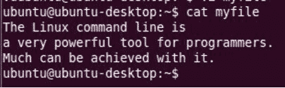

这表明 `cat` 命令用于在标准输出上显示文件的内容。然而，请用它来显示短文件的内容。

### 更改目录

有时，你可能需要更改工作目录。可以通过终端使用 `cd`（更改目录）命令来实现，如下所示：

```
cd /home
```

上面的命令将工作目录更改为 home 目录，由于使用了正斜杠，它是相对于根目录的，即 `/`。无论当前的工作目录是什么，上述命令都将执行。输入以下命令：

```
cd httpd
```

在按下回车键后，完整的工作目录将变为 `/home/httpd`，这意味着我们已经切换到了 `httpd` 目录，但相对于 `/home` 目录。要切回用户的家目录，请使用以下命令：

```
cd ~
```

用户的家目录是 `/home/username` 目录，其中 `username` 是你在计算机上使用的名称。注意，我们使用了符号 `~`，它被称为波浪号。在 Linux 中，它象征着用户的家目录。

### 复制文件

在 Linux 中，`cp`（copy files）用于复制文件。在复制过程中，会在指定位置创建一个原始文件的副本，这意味着初始文件不会被删除。要为文件 `myfile` 创建一个副本，请运行以下命令：

```
cp myfile myfile2
```

上面的命令将创建文件 `myfile` 的副本并将其命名为 `myfile2`。这两个文件将非常相似，但命名有所不同。然而，运行上述命令是有风险的，因为如果目录中已经存在文件 `myfile2`，它将在不发出警告的情况下被覆盖。为了这个问题，应该使用如下所示的 `-i` 选项：

```
cp –i myfile myfile2
```

如果文件 `myfile2` 已经存在于目录中，在覆盖它之前会收到警告，这是一个非常好的主意。

你可能需要将某个目录中包含的所有文件复制到另一个目录。可以使用以下命令完成：

```
cp –dpr originaldirectory finaldirectory
```

文件将从 `originaldirectory` 复制到 `finaldirectory`。它们不会从后者中删除。`-dpr` 选项非常重要，因为它起到了以下作用：

- `-d-` 用于保留链接。
- `-p-` 用于保留文件属性。
- `-r-` 用于递归复制。

如果你不指定上述选项，则将应用默认选项。这不建议这样做，因为你可能需要保留链接和文件属性，而默认选项可能无法完成这些操作。

每个挂载的文件系统都占用了磁盘上的一些空间。要此每个文件系统的空间大小，请使用命令：

```
df
```

### less 命令

此命令与“more”命令几乎相似，区别在于，使用此命令时你可以通过文件向上和向下移动页面。考虑下面的命令：

```
less myfile
```

按下回车键后，文件 `myfile` 的内容将显示出来。

### ln 命令

要为你的文件创建符号链接，请使用 `ln` 命令。输入下所示命令：

```
ln –s myfile mlink
```

上面的命令将创建一个名为 `mlink` 的符号链接以链接到文件 `myfile`。要显示两个文件不同且包含不同的索引节点（inodes），请使用命令

```
ln –i myfile mlink
```

### locate 命令

如果你需要在数据库中进行搜索，请使用 `locate` 命令。考虑下所示命令：

```
slocate –u
```

该命令将创建一个数据库并将其命名为 `slocate`。问题是该过程可能需要很长时间，因此需要耐心。但该命令是重要的，因为在没有运行它之前你就无法搜索文件。听过 `cron` 吗？它被用于调度任务。它会定期运行上述命令，因此你可能不需要手动执行。输入下所示命令并运行它：

```
locate whois
```

上面的命令将搜索你系统中包含的所有名称中包含“whois”字符串的文件。

### logout 命令

此命令仅注销当前登录的用户。打开终端并输入以下内容：

```
logout
```

一旦你输入了上述命令，只需按下回车键。你会发现你已注销系统，然后将回到登录界面。

### ls 命令

此命令用于列出当前登录的用户（注：此处应为文件）。使用此命令列出特定目录包含的文件，`ls` 意味着列出。该命令有许多相关选项需要理解。输入下所示命令并按下回车键：

```
ls
```

该命令将列出当前目录包含的文件。

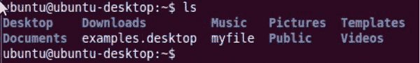

上面的图显示了目录中包含的文件。然而，如果该目录包含以点（`.`）开头的文件，使用此命令将无法无法列出。假设你想知道文件的大小、创建日期以及相关的权限，你可以通过以下命令实现：

```
ls –al
```

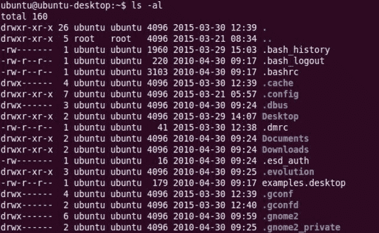

如你在图中所示，输出更加详细。第一部分以“d”或“-”开头，其中“d”表示目录，而“-”表示这是一个文件。`rwx` 代表权限，其中 `r` 代表读取权限，`w` 代表写入权限，而 `x` 表示执行权限。文件的大小和创建日期也可见。

### more 命令

使用此命令，文件的内容将发送到屏幕上。这将按页的方式进行。该命令也适用于管道输出。

输入并运行下所示命令：

```
more /etc/profile
```

上面的命令将输出 `/etc/profile` 文件的内容。该文件包含了有关系统的详细信息。按下回车键后，输出如下所示：

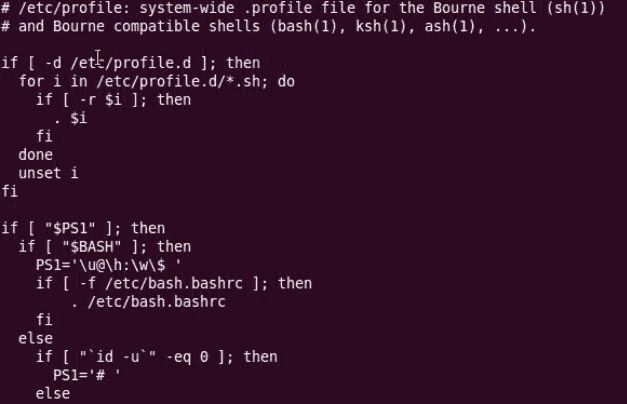

注意，这是一个内置文件，它随操作系统自带。该文件还包含大量内容，无法在一个页面显示完。通过上述命令，这些内容将逐页显示。输入并运行下面的命令：

```
ls –al | more
```

输出将是该目录包含的文件。这些输出将通过管道传递给 `more` 命令。由于输出很大，它将逐页列出。

### mv 命令

`mv` 命令用于移动或重命名文件，`mv` 代表移动。输入下所示命令：

```
mv –i myfile file
```

上面的命令将文件 `myfile` 重命名为 `file`，这意味着它已被移动。这是在 Linux 中重命名命名文件最简单的方法。考虑以下命令：

```
mv /directory1/myfile
```

上面的命令将文件 `myfile` 从目录 `/directory1` 移动到当前工作目录中。这非常简单，并展示了 `mv` 命令的功能。


问题是，什么是工作目录？这是你当前正在工作的目录。要查看你所所在的目录，请使用以下命令：

```
pwd
```

像往常一样按下回车键即可。输出将是你正在工作的目录。该命令在你不知道自己处于哪个目录时用于此目的。`pwd` 的意思是“打印工作目录”（print working directory）。

### shutdown 命令

每当你想要关闭系统时，请使用此命令。运行下方所示的命令：

```bash
shutdown –h now
```

运行上述命令后，你会发现系统将立即停止，也就是说，它将关机。考虑下一个命令：

```bash
shutdown –r now
```

上述命令会关闭系统然后重新启动，这意味着它用于重启系统。

你可能需要检查你之前运行过的命令。原因可能是你更改了某些内容，而现在你想要撤销这些更改。要查看这些命令的列表，请运行如下所示的 `history` 命令：

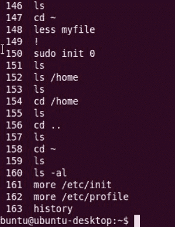

上图显示了我最近运行的命令。

### sudo 命令

`sudo` 代表“super user do”（以超级用户执行）。通过此命令，任何用户都可以以超级用户的身份执行其命令。`sudoers` 文件定义了所有这些内容。敏感命令，特别是那些更改 Linux 操作系统文件系统的命令，只能使用此命令执行。`su` 命令允许你以超级用户身份登录，而 `sudo` 命令借用超级用户的权限。

要更新系统，你必须使用如下所示的 `sudo` 命令：

```bash
sudo apt-get update
```

如果这是你第一次运行该命令，系统将提示你输入 `sudo` 密码。要运行上述命令，你必须连接互联网，否则你将收到错误。在 Linux 中，更新是从我们所谓的“仓库”（repositories）获取的。这里是 Linux 开发团队上传有关各种 Linux 发行版的最新更新的地方。

要升级系统，请运行以下命令：

```bash
sudo apt-get upgrade
```

上述命令将升级你系统中正在使用的操作系统版本。同样，你必须连接互联网。注意，在 Red Hat Linux 中，该命令被 `yum` 命令取代，因此 Red Hat Linux 不支持 `sudo` 命令。

mkdir 命令

`mkdir` 代表“make directory”（创建目录）。它用于创建新目录。如果代表目录的文件夹已经存在，你将收到一个告知该情况的错误。让我创建一个目录并将其命名为 myfiles。

```bash
mkdir myfiles
```

上述命令显示我将创建一个名为 `myfiles` 的目录。这可以通过底图所示来说：

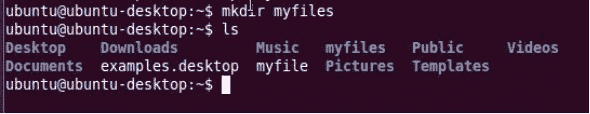

注意，在创建目录后，我使用了 `list` 命令，该目录将列在可用目录列表中。这说明它已被创建。如果上述命令运行失败，请在前面加上 `sudo` 命令，并在提示时提供密码。

### cal 命令

此命令显示特定年份的月份。这一年份可以是当前的、过去的、甚至是未来的。只需打开命令提示符并输入命令 `cal` 即可。按回回车键：

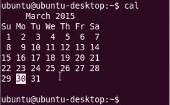

如所示，它显示了当天的日期，并且是正确的。现在，让我们显示 1980 年的 5 月，这是一个过去的年份：

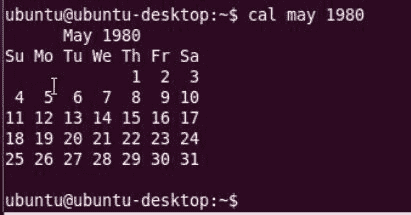

你也可以显示未来年份的月份，如下所示：

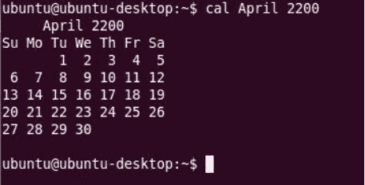

### date 命令

如果你需要显示当前的时间日期，请使用如下所示的命令：

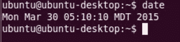

执行 `date` 命令后，当前的日期和时间将形成上图所示的输出。然而，你可能会发现系统上的日期是错误的。

你可以通过如下所示的命令行进行设置：

```bash
date –set='1 April 2015 19:30'
```

一旦你运行了上述命令，日期将设置为 2015 年 4 月 1 日，时间将设置为 19:50 小时。

### grep 命令

有时，你可能需要从某个文件中搜索模式或字符串。在大多数情况下，各种 Linux 发行版都都预装了此命令。

然而，如果你发现没有安装，也可以通过以下命令进行安装：

```bash
sudo apt-get install grep
```

如果你正在使用 Red Hat，请使用命令安装它：

```bash
yum install grep
```

记得我们创建了文件并将其命名为 `myfile`，内容如下：

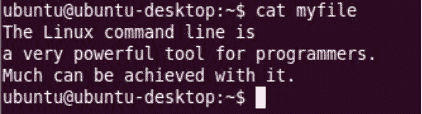

我们想使用 `grep` 命令对其进行搜索。要在文件中搜索单词 `powerful`，应该使用以下方法：

```bash
grep ‘powerful’ myfile
```

这通过下图所示进行了说明：

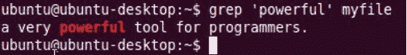

该命令输出文件中包含搜索词的行，并将搜索词标为红色。这将其与其他单词区分开来。注意，搜索是区分大小写的。

让我们搜索单词 `Powerful` 而不是 `powerful`：

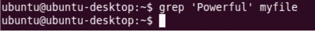

如上述输出所示，文件中不存在 `Powerful` 单词。这是因为我们使用了大写字母。然而，可以进行不区分大小写的搜索。这可以通过如下所示的 `-i` 参数来实现：

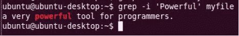

`-i` 让 `powerful` 和 `Powerful` 相同，因此我们将得到结果。

要执行多重搜索，即一次性搜索多个单词，我们仍然可以使用 `grep` 命令。演示如下：

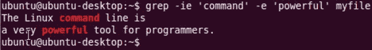

注意在图中，我们正在搜索两个单词，即 `powerful`。`-i` 让不区分大小写，所以不要被它困扰。

要查看包含单词 `powerful` 的文件行号，请使用如下所示的命令：

```bash
grep -n ‘powerful’ myfile
```

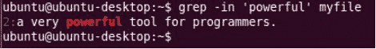

考虑下面的命令及其输出：

```bash
grep -i1 ‘can’ myfile
```

上述命令输出如下：

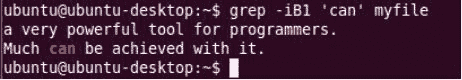

该命令输出了符合我们搜索标准 `can` 的一行。这是因为我们使用了 `1`。如果我们使用 `2`，输出将如下：

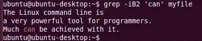

### tail 命令

Linux 中非常常用的命令，用于提供文件的末部分。它提供指定文件的最后 10 行。如果你需要获取 `myfile` 的最后 10 行，请使用以下命令：

```bash
tail myfile
```

然而，我们只向文件中添加了三行。这意味着上述命令的结果将是文件的这三行。如果它超过 10 行，那么它只会输出最后 10 行。

然而，文件的最后 10 行是 `tail` 命令的默认设置。用户可以选择他们想要形成输出的行数。

考虑下面的命令及其输出：

```bash
tail myfile –n 2
```

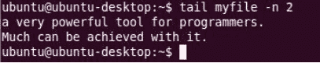

如所示，我们指定了只想输出 `myfile` 的最后 2 行。这就是我们输出的内容。`-n` 选项在使用此命令时用于指定形成输出的行数。


```bash
tail -f myfile | grep 24.13.152.12
```

注意，我们将 `tail` 命令的输出通过管道到 `grep` 命令中。上述命令可用于实时监控文件 `myfile` 的更新，即在更新发生时立即显示。该文件的最后 10 行以及添加到文件中的任何新行都将通过传递给 `grep` 命令。然后，`grep` 命令的任务是将这些内容输出到标准窗口。请注意，只有包含上述指定地址（即 `24.13.152.12`）的行会被打印在标准输出上。

该命令可以根据文件的大小而非行数来显示文件的最后部分。大小通常以字节为单位。要打印文件 `myfile` 的最后 5 个字节，请使用以下命令：

```bash
tail –c5 myfile
```

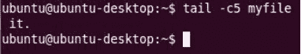

输出结果意味着只有“it”这个单词和句号（`.`）构成了文件的最后 5 个字节。还可以将上述选项与加号（`+`）符号结合，从某个字节开始打印字节。

考虑下面所示的命令：

```bash
tail –c+10 first
```

上述命令将打印从第 10 个字节开始的文件最后几个字节。输出如下所示：

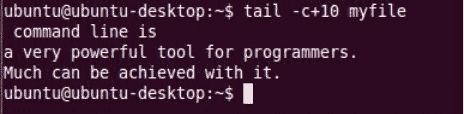

### wc 命令

`wc` 代表 word count（字数统计）。此命令用于统计特定文件中包含的行数。要查看文件 `myfile` 中包含的行数，请运行以下命令：

```bash
wc –l <myfile
```

该命令输出以下内容：

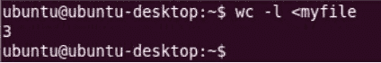

该命令给出了文件 `myfile` 中包含的行数，共三行。如果你还需要获取文件名，请使用以下命令：

```bash
wc –l myfile
```

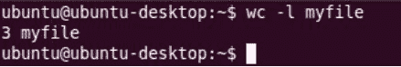

运行下面所示的命令：

```bash
wc myfile
```

以下内容将形成文件的输出：

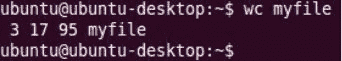

该命令将显示文件的行数、文件中包含的单词数、文件的字节大小以及文件名。这些内容按上述提到的顺序显示，其中 3 是文件的行数，17 是文件中单词的总数，95 是文件的字节大小，最后是文件名。然而，某些人可能会被上述内容搞混。

当像下面所示分割上述输出时，就变得简单了：

`wc –c myfile`– 这将输出构成文件的总字节数。

`wc –w myfile`– 输出文件中包含的单词数。

`wc –m myfile`– 将输出构成文件的字符数。

如果你无法记住第一条命令使用的顺序，那么建议你使用上述简单的替代选项。

### last 命令

当你想要知道最近登录系统的用户时，这个命令非常有用。这在工业界安全目的中非常有价值。用户不会否认曾在某个时间登录过系统。打开命令行并输入命令 `last`。观察输出：

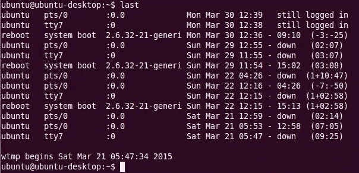

该命令显示了用户名和其他细节，包括他们登录的终端以及登录时间。如果任何用户仍在在线，你将收到通知。用户最后登录和注销之间的时间差也将显示。注意，只显示最后的登录记录。

该命令还与以下选项关联：

1. `–R`– 这将确保不显示主机名。
2. `–d`– 用于远程登录。识别主机名的 IP 地址将被翻译为主机本身。
3. `–a`– 这将在最后一列显示主机名。
4. `–x`– 显示关机历史以及运行级别（run levels）发生了哪些变化。
5. `–i`– 显示远程登录主机的 IP 地址。IP 地址通常为点和数字格式。
6. `–F`– 显示完整登录和注销系统的完整时间和日期。
7. `–w`– 用户名和域名作为输出显示。

# 第 3 章 - Bash 技巧

`Bash` 代表 Bourne Again，在大多数 Linux 发行版中，它是默认的 shell。许多 Unix 和 Linux 用户非常喜欢它，因为它对用户非常友好。在本章中，我们将学习 Bash shell。

## 大括号扩展（Brace Expansion）

在这种情况下，字符串列表被用作参数。这些字符串使用逗号分隔。逗号后不能有空格。示例：

```bash
echo {John,Jacob}
```

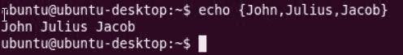

从图中可以看到输出。仅仅是大括号中提供的参数。现在，在命令行中输入以下内容：

```bash
echo $today today=$(date +%d-%b-%Y)
```

输出将与上面的示例相同。我确定你没有看到大括号的用处。考虑下面所示示例：

```bash
echo {John,Julius}David
```

也许这三个是 David 的儿子。观察输出：


你现在看到了大括号在 bash 脚本中是多有用。当放在大括号中的列表应该出现在另一个字符串之后或之前时，它们非常有用。在上面的例子中，这些应该出现在字符串 `David` 之前。上述内容可以通过另一种方式实现：

```bash
echo David{John,Julius}
```

以下内容将形成上述脚本的输出：


如你所见，大括号内部的列表出现在 `David` 字符串之后。还可以将大括号内的列表放在两个字符串之间。这种方式如下所示：

```bash
tail –c5 myfile
```
（注：此处原文逻辑可能有误或引用了 tail，此处保持原意）
如你所见，大括号内的列表出现在 `David` 字符串之后。这种方式如下所示：

```bash
echo David{John,Julius}
```
（注：此处原文逻辑似乎重复，按原意翻译）
如你所见，大括号内的列表出现在 `David` 字符串之后。这种方式如下所示：

```bash
echo David{John,Julius}
```
（注：此处原文逻辑似乎重复，按原意翻译）
如你所见，大括号内的列表出现在 `David` 字符串之后。这种方式如下所示：
```bash
echo David{John,Julius}
```
（注：此处原文逻辑似乎重复，按原意翻译）
如你所见，大括号内的列表出现在 `David` 字符串之后。这种方式如下所示：
```bash
echo David{John,Julius}
```
（注：此处原文逻辑似乎重复，按原意翻译）
如你所见，大括号内的列表出现在 `David` 字符串之后。

（注：此处原文似乎存在多处重复逻辑错误）

你可能需要这样的输出，所以请你也使用双引号，如下所示：

```bash
echo "{John,Julius}" David
```

上述将产生以下输出：


大括号也可以嵌套，即大括号放在另一个大括号内部，如下所示：

```bash
echo {{a,b,c},a,b,c
```

以下将形成示例的输出：


考虑如下所示示例：

```bash
echo {{6,7,8}1,2,3
```

输出如下：


问题是大括号扩展技巧的应用场景。当然，在备份文件时，将需要使用这种技巧，因此非常重要。一个示例如下：

```bash
cp /etc/httpd/conf/httpd.conf{,.backup}
```

在上述示例中，我们正在备份 `httpd.conf` 文件。

## 命令替换（Command Substitution）

这也是另一个实用的 bash 脚本技巧。它包括在标准输出中使用 `$` 符号和括号来包裹任何旨在输出的命令。这种技巧适用于给变量赋值。

你可以如下所示将日期赋值给变量：

```bash
date +%d-%b-%Y
```

上述将如所示给你当前日期：


也可以通过以下方式实现：

```bash
echo $today=$(date +%d-%b-%Y)
```

输出将完全相同。为了同时获取多个 RPM 包的信息，你也可以使用命令替换。命令替换也可以通过反引号包裹命令来实现。可以通过所示示例进行说明：

```bash
day=`date +%d-%b-%Y`
echo $day
```

上述将给出最终结果：


将显示当前日期。通过上述样式，命令可以轻松嵌套，并且会变得易于阅读。

特定命令的输出也可以重定向到特定文件。操作如下所示：

```
find / -name file > result.txt
```

在上面的示例中，我们正将命令 `find` 的输出重定向到文件 `result.txt`。

然而，你会发现会产生错误信息。如果你对这些信息感兴趣，也可以将它们重定向到文件中。在重定向符号前加一个 `2` 就可以实现这一操作。

如果我们完全不这些这些信息，也可以将它们重定向到 `/dev/null`。如下所示：

```bash
find / -name file 2> /dev/null
```

系统将显示文件“file”的位置，而不会显示错误信息，`2` 代表标准错误输出流。大多数 Linux 命令将它们的错误重定向到这里，而发送到标准输出的正确输出用 `1` 表示。

考虑下面的命令：

```bash
find / -name file > result.txt
find / -name file 1> result.txt
```

有些人可能认为上述命令是不同的。然而，它们是完全相同的。`1` 代表正常的标准输出。

你可能需要将错误信息和标准输出都保存到文件中。Cron job（定时任务）通常用于此目的。实现方式如下所示：

```bash
find / -name file > result.txt 2> result.txt
```

注意，两个输出流都被重定向到了同一个文件。然而，上面的方法很麻烦。可以通过下面的简单得多的方法实现：

```bash
find / -name file > result.txt 2>&1
```

在正上面的示例中，我们使用了一个安符 `&` 将标准错误流和标准输出流绑定。此后，标准错误将转到标准输出所在的地方。再次强调，上面示例中使用的语法非常重要。

你可能还对将输出管道到另一个命令感兴趣。如下所示：

```bash
find -name file.sh 2>&1 | d /tmp/result2.txt
```

上述行将按预期工作。现在考虑下面这一行：

```bash
find -name file.sh | d /tmp/result2.txt 2>&1
```

在运行上述行时，你会发现它并不会按预期工作。这与另一行是矛盾的。

## 命令历史

通过 Bash，你可以搜索最近运行过的命令。然后你可以使用向上和向下方向键在这些命令之间进行导航。如果你寻找的命令是在最后执行的 10-20 条命令之间执行的，那么这对你来说就很简单。

如果你想进行交互式搜索，即系统会提供你正在搜索内容的建议，只需按下 `Ctrl-R`。

提示符将变为如下所示：

```
(reverse-i-search)`':
```

然后你就可以开始输入命令的字母。你会发现系统会提供建议。然而，这些建议仅包含最近输入以及相关的命令。

在我的情况下，按下 `Ctrl-R` 后输入 `ech`，接下来的建议如下：


上面显示我最近运行的包含包含 `ech` 单词的命令是 “echo day” 命令。

要执行该命令，只需按回车键即可。如果你需要对命令进行一些编辑，只需按左或右方向键。命令将放置在普通提示符上，然后你就可以对其进行编辑。

## 循环

通过 Bash，你可以在命令行上创建循环。然而，如果代码量很大或太复杂，这并不合适。在命令行上，循环可以用两种方式编写。第一种方法涉及使用分号分隔不同的代码行。要创建一个备份特定目录下包含的所有文件的循环，可以使用以下这种方法实现：

```bash
for doc in *; do cp $doc $doc.bak; done
```

上面的代码行将备份目录中的所有文件。与其使用分号分隔行，不如使用次级提示符。在完成每个单行后按一次回车键即可实现。一旦你按了回车键，Bash 就会理解你想创建一个循环，并为你提供次级提示符。

然后你就可以输入第二行。如下所示：

```bash
for doc in *
  > do cp $doc $doc.bak
  > done
```

有时，你的 Linux 系统可能会耗尽内存。这意味着你将无法执行命令，包括像 `ls` 这样的简单命令以及切换目录的命令。如果 `ls` 失败且你想查看特定目录中包含的文件，可以通过以下方式实现：

```bash
for doc in *; do echo $doc; done
```

这将解决 `ls` 问题。这展示了 bash 脚本的力量。

# 第 4 章 Linux shell 编程

在 Linux 中，创建 shell 脚本非常简单。通过 shell 编程，我们可以将多个命令组合成链，然后执行它们以获得所需的输出。让我们从编写第一个脚本开始。打开你喜欢的编辑器；我正在使用 `vi` 编辑器。将以下 shell 程序添加到文件中：

```bash
#!/bin/bash
echo "Hello World"
```

这是一个 shell 程序示例。通过 shell 编程，我们可以将多个命令组合成链并执行它们以获得所需的输出。保存文件并将其命名为 `hello.sh`。注意我们使用了 `.sh` 扩展名来表示这是一个 shell 程序。下一步是使其变为可执行。可以通过如下方式实现：

```bash
chmod 744 hello.sh
```

运行上述命令将创建一个可执行的 `hello.sh`。`chmod` 代表模式，`744` 代表权限，我们使用它来赋予文件执行权限。由于我们已经赋予了执行权限，现在需要执行它。

可以通过在终端运行以下命令实现：

```bash
./hello.sh
```

运行上述命令后，在标准输出中观察到如下内容：

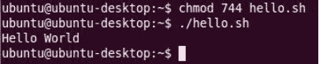

该命令输出了文本 “Hello World”。记住 `#!/bin/bash` 被称为 shebang，用于位于程序的开头。

要在你的程序中添加注释，请以井号 `#` 开头。

考虑下面的 shell 程序：

```bash
#!/bin/bash
echo "Hey $USER"
echo "Hello, i am" $USER "The following are the running currently"
echo "List of running processes:"
ps
```

你可以编写并运行该程序。运行程序后观察如下：

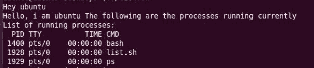

所示，程序输出了你的名字。它还显示了系统中运行的进程列表。

现在，让我们写一个更有交互性的程序。编写下面的代码并运行它：

```bash
#!/bin/bash
echo "Enter your name”
read name;
echo "welcome Mr. /Mrs. $name ";
echo "Thanks Mr./Mrs. $name. You have provided us with your names"
echo "-------------------------------------------------"
echo "Mr. /Mrs. $name, good bye friend"
```

运行上述程序后，观察到如下输出：


如所示，你被提示提供你的名字。这是通过使用 `read` 命令实现的，该命令提示用户提供输入。然后，这些输入将与其他文本一起显示。

## Shell 变量

Shell 变量有两类：

1.  **系统变量**：这些由操作系统创建并维护。它们用大写字母定义。
2.  **用户定义变量**：用户创建并维护。它们用小写字母定义。

以下是一些 shell 系统变量：

`BASH`: shell 的名称。

`HOME`: 我们的家目录

`LOGNAME`: 我们的登录名。

`PATH`: 我们的路径设置。

`USERNAME`: 当前登录的用户。


`COLUMNS` - 构成屏幕的列数。

`OSTYPE` - 我们正在运行的操作系统类型。

`PWD` - 当前工作目录。

上述内容仅为系统变量的示例。如果你想打印上述任何变量，可以使用如下所示的 `echo` 命令和 `$` 符号：

```bash
echo $HOME
echo $PWD
```

下部分是关于如何使用用户自定义变量。

使用以下语法定义用户自定义变量：

```
variable name=value
```

`name` 指用于指代变量的名称。`value` 是该变量的内容。这通常是一个数字或字符串。示例：

```
num=10
name=Mary
```

### 变量命名的小贴士

1. 等号两边不应该有空格。例如：
```bash
num=12- this is right
num= 12- this is wrong
num =12- this is wrong
num = 12- this is wrong
```

2. 变量名应以下划线或字母、数字开头。随后可以跟任何字母或数字。以下是有效变量的示例：
- `PWD`
- `SYSTEM_VERSION`
- `num`

3. 变量名是大小敏感的。例如：
```bash
Num=2
num=6
nUm=9
nuM=10
NUM=90
```
上述示例显示变量名是不相等的。要打印上述任何一个，也请确保指定正确。例如，要打印 10，请使用以下代码：

```bash
echo $nuM
```

4. 要定义空变量，请执行以下操作：
```bash
num=
num=""
```
要打印它，请使用以下代码：
```bash
E=echo $num
```
然而，请注意由于变量是空的，将不会显示任何内容。

5. 某些字符不应用于命名变量。这些包括星号 `*` 和问号 `?`。

## Shell 中的循环

循环代表一组重复执行的指令。

### for 循环

该循环遵循以下语法：

```
for { name of the variable} in {list }
do
    逐一个执行列表中的项目，直到完成。
done
```

考虑下面的程序：

```bash
for j in 1 2 3 4 5
do
    echo "Test for for loop"
done
```
运行上述程序后，你将看到输出。程序的操作首先定义变量 `j` 并将其值设置为从 1 到 5。程序的行 `echo "Test for for loop"` 将执行 5 次，因为 `j` 的值将递增到最大 5。这解释了输出。

### while 循环

Shell 中的 `while` 循环采用以下语法：

```
while [ condition]
do
    1st command
    2nd command
    3rd command
    ..
    ....
done
```
只要你指定的条件为真，循环就会一直执行。

### case 语句

这在 Linux 中也很常见。人们可以使用它来代替 `if-else` 语句。

它采用以下语法：

```
case $name_of_the_variable in
    1st pattern) command
        ...
        ..
        ;;
    2nd pattern) command
        ...
        ..
        ;;
    nth pattern) command
        ...
        ..
        ;;
    *) command
        ...
        ..
        ;;
esac
```
注意我们以 `case` 开始，但以 `esac` 语句结束。考虑下面的示例：

```bash
if [ -y $1 ]
then
    r="the vehicle is unknown"
elif [ -x $1 ]
then
    r=$1
fi

case $r in
    "lorry") echo "For $r 10 per k/m";;
    "merc") echo "For $r 80 per k/m";;
    "corolla") echo "For $r 15 per k/m";;
    "motorbyke") echo "For $r 5 per k/m";;
    *) echo "we can’t obtain a $r for you";;
esac
```

## 用于决策的 if-else-fi

`if-else-fi` 命令可以在 Shell 编程中用于决策目的。程序员指定一个条件，一旦满足，就会执行一条命令；如果不满足，则执行另一条命令。它采用以下语法：

```
if condition
then
    the condition is 零
    执行命令直到遇到 else 语句
else
    ... 执行命令
fi
```
考虑下面的示例：

```bash
#!/bin/bash
if [ $# -eq 0 ]
then
    exit 1
fi
```

## 第 5 章：Bash - 操作文件

1. **截断文件大小**：使用 `>` 命令。如果文件存在，其大小会被截断；如果不存在，则会创建它。注意该运算符。
```bash
echo "string" > file
```

2. **向文件添加字符串**：单行命令使用 `>>` 运算符向文件中追加某些内容。如果操作符未找到文件，则会创建一个新的。示例：
```bash
echo "content" >> file
```

3. **将文件的第一行赋值给变量**：在这种情况下，你需要读取文件的第一行并将其赋值给变量。使用输入运算符 `<`。
```bash
read -r myline < file
```

4. **读取文件**：`read` 命令可以与 `while` 循环结合，以便逐行读取文件。下例所示：

```bash
while IFS read -r myline; do
    # 对变量 myline 进行操作
done < file
```
当 `read` 命令遇到结束时，将返回失败代码。`while` 循环随后将停止。注意我们将 `< file` 放在了末尾。为了避免这种情况，将文件内容通过到 while 循环，如下所示：

```bash
cat file | while IFS= read -r myline; do
    # 对变量 myline 进行操作
done
```


### 5. 读取文件的任意行并将其赋值给变量
外部程序可以协助 bash 读取程序的行。请考虑下面的代码：

```bash
read -r rline < <(shuf file)
```

`shuf` 在现代 Linux 系统可用，并对此提供帮助。上述代码将读取文件的随机行并将其赋值给变量 `rline`。

### 6. 要提取 tar 归档，请使用以下命令：

```bash
tar xvf b.tar
```

### 7. 查找两个文件之间的公共行数：

```bash
sort doc1 doc2 | uniq –d
```

### 8. 随机打乱文件的行：

```bash
shuf filename.txt
```

### 9. 求某一列的和：

```bash
awk '{ sum+=$1} END {print sum}' document.txt
```

# 结论

可以得出结论，Linux 是开源操作系统，拥有多种发行版。开发 Linux 的背后理念是为计算机开发一个免费的类 Unix 操作系统。每个 Linux 发行版都有两个版本，即服务器版本和桌面版本。桌面版本同时支持图形用户界面（GUI）和命令行。

默认情况下，登录系统后会进入 GUI。如果需要，然后可以启动命令行。这些发行版的服务器版本仅支持命令行。Linux 服务器没有图形界面。此举目的是确保这些系统的安全性，因为黑客通常会利用添加到系统中的任何功能。这解释了为什么你应该熟悉 Linux 命令。

Linux 命令行可以用于系统所需的几乎一切。当人们成为 Linux 命令行专家时，会在社会上获得很多尊重。通过 Shell 脚本，程序员可以组合多个命令并同时运行它们，以实现预期的输出。这也节省了系统可用的时间和空间。Shell 脚本开头有一个 shebang。

这会系统 Shell 脚本只需执行。这些脚本必须被设置为可执行，随后才会发生执行。`bash` 代表 Bourne Again Shell。它是大多数 Linux 发行版的默认 shell。`bash` 脚本在命令行运行，你可以通过它们实现许多功能并对系统有深入了解。`bash` 单行命令（on-liners）在 Linux 中也很重要。你可以使用它们来处理你的文件。

谢谢！

我们感谢你购买本书。希望它对你现在**轻松且快速**的编程生活发展有所帮助。我们乐意向你推荐该作者的其他书籍：

1. Linux 命令行：成为 Linux 专家！（涵盖输入/输出重定向、通配符、文件安全、进程管理、Shell 编程高级特性、GUI 元素、实用的 Linux 命令）

[`www.amazon.com/gp/product/B00XGUO4E4?Version=1&entries=0`](http://www.amazon.com/gp/product/B00XGUO4E4?Version=1&entries=0)


2. 初学者 PHP 和 MySQL 编程：从零到专业的逐步进课程

[`www.amazon.com/gp/product/B00XQBYXVW?Version=1&entries=0`](http://www.amazon.com/gp/product/B00XQBYXVW?Version=1&entries=0)


3. Python 编程：通过学习 Python 编程基础知识快速入门。

[`www.amazon.com/gp/product/B00WUNSH6Y?Version=1&entries=0`](http://www.amazon.com/gp/product/B00WUNSH6Y?Version=1&entries=0)

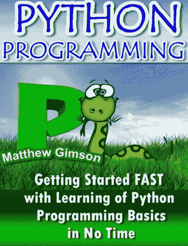

4. 安卓编程：面向初学者的完整介绍 - 逐步指南如何轻松创建你自己的 Android 应用！

[`www.amazon.com/gp/product/B00WPK68IQ?Version=1&entries=0`](http://www.amazon.com/gp/product/B00WPK68IQ?Version=1&entries=0)


5. 安卓游戏编程：面向初学者的完整介绍：逐步指南如何轻松创建你自己的 Android 应用！

[`www.amazon.com/gp/product/B011R2H2JQ?Version=1&entries=0`](http://www.amazon.com/gp/product/B011R2H2JQ?Version=1&entries=0)


6. DOCKER：掌握 Docker 所需的所有知识（Docker 容器、容器链接、Whalesay 镜像、在 Mac OS X 和 Windows 上安装 Docker）

[`www.amazon.com/gp/product/B013X2RPT0?Version=1&entries=0`](http://www.amazon.com/gp/product/B013X2RPT0?Version=1&entries=0)

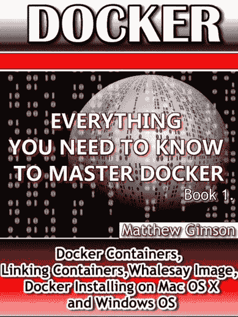

7. Docker：生产环境 Docker 指南（编程简单系列第 8 本）

[`www.amazon.com/gp/product/B01452V9IA?Version=1&entries=0`](http://www.amazon.com/gp/product/B01452V9IA?Version=1&entries=0)

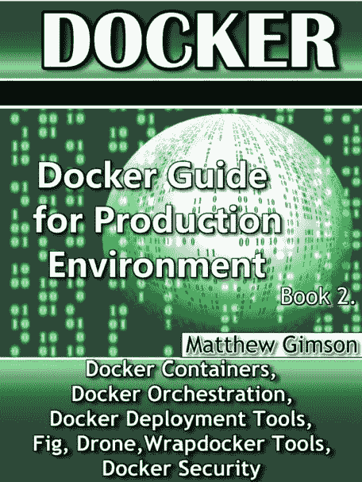

8. Excel VBA 编程：快速学习 Excel 编程！（编程简单系列第 9 本）

[`www.amazon.com/gp/product/B014DGVW?Version=1&entries=0`](http://www.amazon.com/gp/product/B014DGVW?Version=1&entries=0)


9. VAGRANT：用 VAGRANT 让生活更简单。快速掌握 VAGRANT！（编程简单系列第 10 本）

[`www.amazon.com/gp/product/B0151GIRCA?Version=1&entries=0`](http://www.amazon.com/gp/product/B0151GIRCA?Version=1&entries=0)


10. Scala 编程：快速学习 Scala 编程！（编程简单系列第 11 本）

http://www.amazon.com/gp/product/B0151TBXEQ?Version=1&entries=0


11. Node. JS：初学者实用指南（编程简单系列第 12 本）

[`www.amazon.com/gp/product/B01588CXAS?Version=1&entries=0`](http://www.amazon.com/gp/product/B01588CXAS?Version=1&entries=0)


12. iOS 8 应用开发：快速轻松地开发你自己的应用！

http://www.amazon.com/gp/product/B015CMEJVQ?Version=1&entries=0

