# LINUX 命令行初学者指南：黑客学习命令行基础、管理与安全的指南。包含核心要素与提示（2022 速成课程）


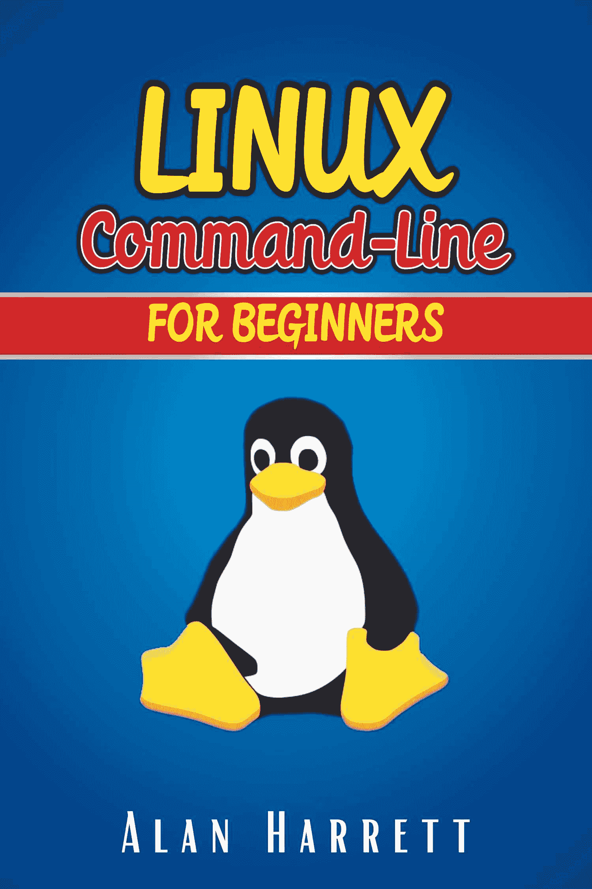


## 目录

- 引言
- 第 1 章：什么是 Linux 以及你为什么要使用它？
- 第 2 章：Linux 发行版与安装方法
- 第 3 章：Linux 内核与操作系统简介
- 第 4 章：在虚拟机上安装 Linux
- 第 5 章：Linux 用户管理与系统管理
- 第 6 章：Linux 目录结构
- 第 7 章：磁盘、介质与数据文件操作 (gzip – tar)
- 第 8 章：文件、目录管理器、权限、网络与 SSH
- 第 9 章：Linux 终端、编辑器与 Shell
- 第 10 章：基础 Linux Shell 命令
- 第 11 章：Shell 脚本编写
- 第 12 章：创建脚本
- 第 13 章：基础 Bash Shell 命令
- 第 14 章：高级 Bash Shell 命令
- 结语

## 引言

感谢购买《初学者入门 Linux 命令行》。我们现在使用的几乎所有东西都是基于 Linux 的。如果你是一个新手，或者刚刚开始学习关于 Linux 操作系统的所有知识，你会很快发现阅读这本电子书是彻底掌握 Linux 及其各种变体的极佳方法。在 Linux 命令行中操作有时可能会遇到困难。在书中，你将看到多种用于实现顺畅 Linux 操作的方法。此外，还有某些 Linux 发行版你不仅可以在初学者阶段使用，也可以在旧旧系统上尝试使用。最后，本书还深入探讨了 Linux Shell 命令和 Shell 脚本的基础知识。为此，书中的某些章节将涉及 Linux 用户管理和管理，涵盖了 Linux 系统管理员承担的一些职责，例如使用基础 `bash` 命令管理目录、用户和文件，管理 root 或超级用户账户等。书中还涵盖了 Linux 文件函数，以及三种类型的 Linux 文件所有权、权限以及 `SSH` 命令。此外，将介绍其他 `SSH` 命令、Linux 终端、编辑器和 Shell 命令。在建立起对目录、文件管理器和编辑器的良好理解后，本书将介绍如何从命令行构建 `tar gzip` 文件、如何挂载和卸载介质以及 Linux 数据处理。书架上还有其他关于 Linux 命令行的书籍，我们感谢你选择这一本。从我们的角度来说，我们正努力确保这本书包含了你成功所需的所有实用和核心信息。再次表示感谢！

## 第 1 章

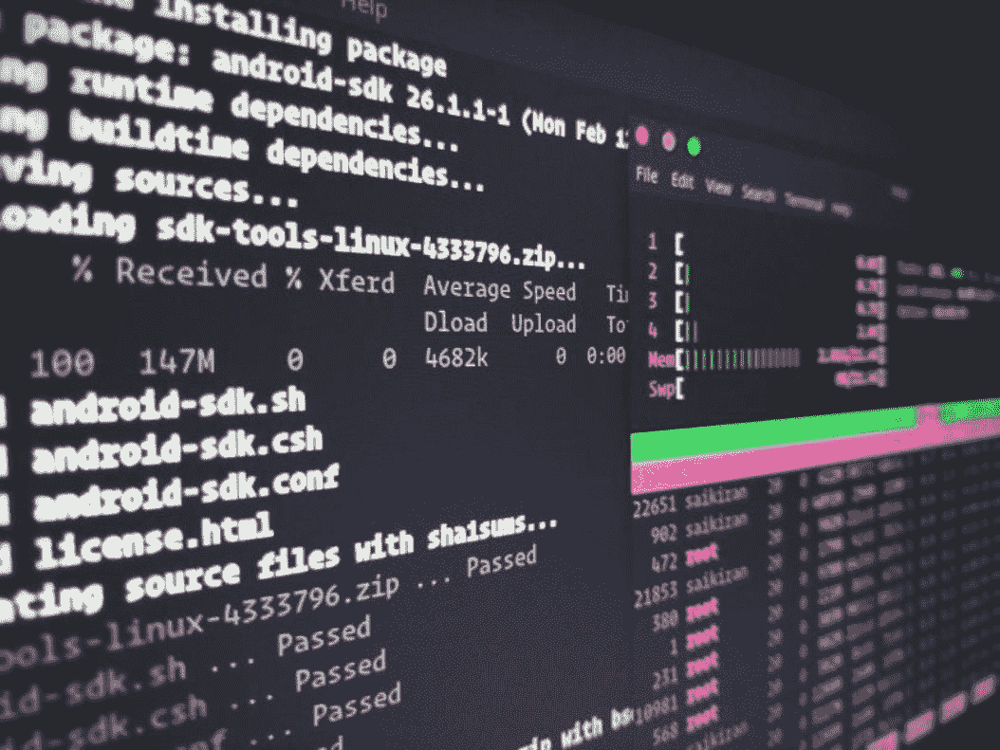 什么是 Linux 以及你为什么要使用它？

Linux 是一种广泛使用的操作系统，它加强了从手机、服务器再到 PC 的几乎任何设备。事实上，全球范围内大量的人在各个领域和应用中都在 Linux。Linux 自 20 世纪 90 年代以来一直存在。Linux 运行着从你的电视盒到冰箱的一切设备。Linux 还支撑着互联网的很大部分。许多科学进步都可以归功于 Linux，因为这个计算机操作系统推动了无数创新。尽管 Linux 几十年来一直提供安全、可靠的操作系统功能，但“Linux”这个词对普通大众来说并不熟悉。然而，Linux 被应用于从企业级服务器到个人电脑、家电、超级计算机、汽车和手机的各种设备上。你可以在电视、Roku 设备、冰箱和恒温器等地方找到 Linux。Linux 是全球运行嵌入式系统、服务器和桌面的理想平台，因为它是可用的最省心、安全且最稳定的操作系统之一。

### 什么是 Linux 操作系统？

首先，当你说“OS”或“操作系统”时，你指的是什么？被称为操作系统的计算机代码负责管理物理计算机中的硬件。操作系统充当硬件和软件之间的中间层。此外，大多数人并不感兴趣于学习如何与显卡通信或用汇编语言处理 CPU 地址。像 Windows 或 Linux 这样的操作系统充当了中间人。因此，Linux 是一种操作系统，就像 Mac OS 和 Windows 一样。全球最流行的平台 Android 是 Linux 操作系统驱动的。由于 Linux 作为操作系统负责监督硬件和软件之间的通信，如果没有它，软件很可能无法运行。Linux 操作系统由多个不同的组件组成，包括：

- **应用程序 (Applications)** —— 但桌面环境中提供的全部程序。因此，Linux 像 macOS 和 Windows 一样，允许你快速搜索并安装成千上万个高质量程序。大多数最新 Linux 发行版中的应用程序安装过程是简单且集中的。例如，`Ubuntu Linux` 提供的 `Ubuntu Software Center`（代表 `GNOME Software`），让用户能够从单一的中心平台在数百个应用中快速发现并安装。
- **桌面环境 (Desktop environment)** - 用户可以在桌面环境中与此项进行交互。可用的桌面环境包括 `Xfce`、`KDE`、`Enlightenment`、`Pantheon`、`Mate`、`Cinnamon`、`GNOME` 等。每个桌面环境都内置了如游戏、浏览器、配置工具和文件管理器等应用。
- **图形服务器 (Graphical server)** - 使用这个子系统，可以在显示器上获得图形显示。许多人将其简称为 `X` 或 `X-server`。
- **守护进程 (Daemons)** - 这些是后台服务，如调度、声音、打印等，在登录桌面后或在启动期间启动。
- **Init 系统 (Init system)** – 用户空间由此子系统引导，它还负责控制守护进程。因此，尽管争议很大，`systemd` 是最广泛使用的 init 系统。当引导加载程序（如 `Unified Bootloader` 或 `GRUB`）处理初始启动时，init 系统负责监督启动过程。
- **操作系统内核 (OS Kernel)** - 内核是一个完整的软件，负责管理外围设备、内存、CPU 和系统核心。
- **引导加载程序 (Bootloader)** - 是一段控制计算机启动过程的软件。它是操作系统中出现的启动界面，在大多数用户完成启动之前就消失了。
- **操作系统 Shell (OS Shell)** - Shell 是我们告诉操作系统想要让它做什么的地方。你利用文本来指示操作系统，许多人将其其为命令行。然而，只有少数人了解命令行代码。因此，人们一直回避使用 Linux。这种情况随着 Linux 发行版的出现发生了改变，Linux 像 Windows 一样也会使用桌面。

### 为什么要使用 Linux？


这是一个几乎所有人都会问的问题。既然几乎所有服务器、笔记本电脑和台式机自带的操作系统运行得完美，为什么还要费精力学习一个完全不同的计算机环境呢？与其给出回答，这个问题的答案将是一个问题：你对目前操作系统的运行方式满意吗？或者你是否必须处理许可费、昂贵的维修费用、崩溃、运行缓慢、间谍软件和病毒？如果你在以下任何一个问题上遇到困扰，那么 Linux 可能可能是适合你的平台。Linux 目前是地球上最可靠的计算机生态系统。当你将零成本的优势与桌面平台的可靠性相结合时，你将拥有一个极佳的选择。你可以在任意任意数量的计算机上安装 Linux，因为服务器许可或软件是不收费的。此外，你使用 Linux 无需支付任何费用。除外，如果你不在意零成本带来的影响，那么拥有一个随你使用多久都无压力且稳定的操作系统又如何？二十年来，Linux 用户（无论是服务器还是桌面端）还没有出现过大规模的病毒、恶意软件或勒索软件爆发。问题在于，此类攻击对 Linux 无效。即使只升级内核，服务器也需要重启。Linux 服务器多年不重启也并非罕见。只要你坚持建议的升级，你将获得极大的可靠性和稳定性。此外，我们使用的大多数桌面操作系统都安装在电脑上，我们很少尝试更改操作系统。而且，不仅如此，大多数人并不愿意学习新的操作系统。以下是你应该尝试 Linux 的一些原因。

## 各种不同的发行版

有许多不同的发行版供选择。不同的 Linux 发行版或版本之间存在差异。有些设计用于服务器，而另一些设计用于个人电脑。虽然有些面向新手，但另一些则面向更高级的用户。大多数 Linux 版本（也称为发行版）通过 USB 闪盘、光盘安装，也可以免费下载。有大量的 Linux 发行版供你选择。虽然 `openSUSE` 和 `Debian` 是流行的替代方案，但 `Linux Mint`、`Arch` 和 `Fedora` 是最流行的桌面发行版。得益 `Ubuntu Unity`，`Ubuntu` 成为最流行的 Linux 发行版之一。由于 `openSUSE` 的存在，你可以通过 `KDE` 实现更传统的 Linux 外观。如果你正在寻找服务器 Linux 操作系统的列表，那也是很大的列表。一些最著名的发行版包括 `CentOS`、`SUSE Enterprise`、`Ubuntu Server` 和 `Red Hat`。然而，如果你想使用特定的 Linux 服务器发行版，你可能需要花费费用，因为可能需要 `Red Hat` 许可。但是，你支付许可费后获得的支持对你的业务至关重要。

## Linux 是自由的同义词。

我们需要一个与 Linux 媲美的开源定义。任何软件软件都必须遵循一套原则，例如：

*   你修改后的任何软件副本都将不受限制。
*   软件分发将不会有任何限制。
*   你有能力对软件进行任何需要的修改、检查、研究和解构。
*   无论你运行它的意图或动机如何，都拥有运行该软件的完全自由。

首先，开源软件并没有一个社区，这是你应该意识到的点。这个社区负责 Linux 的开发及其持续维护。因此，如果你好奇 Linux 是什么以及它是如何变得流行的，人们创建 Linux 是为了给全球其他地区提供软件。这完全源于开源精神。

## 第 2 章：Linux 发行版与安装方法


如果你正在寻找最优秀的 Linux 发行版，你可能得不到明确的回答，因为 Linux 发行的数量很多，计算出一个准确的数字非常困难。有些看起来是独一无二的，而另一些则是彼此的克隆。毕竟，这就是 Linux 的魅力之处，即使它是一团糟。然而，你不必担心，因为尽管有数千个 Linux 发行版可用，你将在下方发现一个顶级列表。我们必须对这些发行版进行分类，因为对每个人都有适合自己的东西。

### 具有广泛应用的 Linux 发行版

某些 Linux 变体可以同时用于服务器和桌面，作为一种高级/新手友好的操作系统。因此，你将在下文中了解这些发行版的不同部分：

*   **Debian**: `Debian` 是一个基于 `Ubuntu` 的优秀发行版。`Debian` 不仅在桌面上运行良好，在服务器上也运行良好。虽然你可以通过阅读官方文档快速上手，但它可能不是最适合新手的操作系统。最近发布的 `Debian 10 Buster` 包含了几项必要的增强以及各种改进。所以，尽管尝试一下吧！
*   **Manjaro**: `Manjaro` 的源代码由 `Arch Linux` 提供。尽管它是为资深用户设计的，但 `Manjaro` 让新手能够非常轻松地使用 `Arch Linux`。所以不要担心。这个 Linux 发行版确实简单且对新手友好。它内置了许多实用的 GUI 应用，还有一个极佳的用户界面。在下载 `Manjaro` 时，你有机会选择桌面环境。大多数 `Manjaro` 用户偏好 `KDE` 桌面。
*   **Fedora**: `Fedora` 有两个版本，每个版本都有自己的特性。它提供了服务器和桌面选项。`Fedora Server` 和 `Fedora Workstation` 是这两个选项。如果你想要一个学习曲线低的用户友好型桌面操作系统，`Fedora` 是一个很好的选择。无论如何，如果你选择 `Fedora` 作为你的 Linux 操作系统，你的服务器将获得新生。

### 面向高级用户的顶级 Linux 发行版

要研究专为高级用户构建的 Linux 发行版，你必须首先熟悉各种软件包命令和管理器进行故障排除。如果你是专业人士，你绝对需要收集精确的标准。如果你已经使用 Linux 一段时间并且是一个普通用户，那么花时间研究这些发行版是值得的。

**Slackware**: 尽管许多人的选择发生了变化，但作为最古老的 Linux 发行版之一，它仍然是最流行的之一。

如果你计划编写或汇软件软件你可能考虑利用 `Slackware` 为自己设置一个最佳环境。尽管开发者和用户数量大幅减少，`Slackware` 仍然是资深用户的极佳替代方案。随着最近 `Slackware` 开设 Patreon 页面的消息，预计它将继续是可用的最强大的 Linux 发行版之一。

**Gentoo Linux**: `Gentoo Linux` 是任何能够构建源代码的人的必备之。`Gentoo` 是一个轻量级发行版，尽管这需要一些技术知识才能运行。如果你需要，可以从官方手册中获取相关信息。然而，如果你不确定自己在做什么，可能需要很长时间才能弄清楚如何充分利用它。


## Arch Linux

尽管 Arch Linux 是一个强大且简单的发行版，但它的学习曲线非常陡峭。与其他发行版不同，你可能无法一次性获得所有所需的内容。在配置系统时，你需要手动添加所需的软件包。此外，如果你不想使用图形界面（GUI），则必须使用一系列命令来安装 Arch Linux。如果你打算继续安装，可能还需要彻底理解在安装 Arch Linux 之后需要进行的一些关键操作。除了这些简单性和多功能之外，至关重要的是 Arch Linux 拥有一个活跃的社区。因此，当你遇到问题时，不必过于担心。

### 最适合旧旧电脑的 Linux 发行版

如果你不想升级系统，或者手里有一台旧电脑闲置，可以使用一些可用最棒的 Linux 发行版。以下是一些适合旧机器的最佳 Linux 发行版。

### Sparky Linux
Sparky Linux 是一个基于 `Debian` 的适用于配置系统的优秀 Linux 发行版。Sparky Linux 为用户提供了各种特殊版本和变体，以及快速的流媒体体验。例如，它可以针对特定的消费者群体发布定制版本，同时提供具有多种选项的稳定版本。Sparky Linux Game Over 是玩家之间的热门选择，因为它预装了许多游戏。

### AntiX
AntiX 是一个轻量级 Linux 发行版，主要负责 `MX Linux`。它既可以用于新机器也可以旧机器。尽管运行正常，但 AntiX 的 UI 并不特别吸引人。AntiX 可以作为现场 CD 发行版使用而无需安装，并且它是基于 `Debian`。与其他某些发行版不同，你可以保留设置，而无需每次重启都丢失它们。不仅如此，你还可以利用其“活动层持久化”（Live persistence）功能存储对根目录的一些修改。因此，如果你想通过使用现场-USB 发行版在老旧硬件上提供快速的用户体验，antiX 是一个很好的选择。

### Bodhi
虽然它在旧设备上运行良好，但与 `Ubuntu` 不同，Bodhi Linux 是基于 `Ubuntu` 创建并构建的。Bodhi Linux `Moksha Desktop` 的主要魅力在于它是 `Enlightenment 17 desktop` 的延续。用户在使用它时可以获得快速且易于使用的流媒体体验。即使人们对其的看法是不适合个人使用，你也可以在你的旧电脑上尝试一下。

### Solus Budgie
这是一个轻量级的桌面操作系统，最近发布了重大版本 `Solus 4 Fortitude`。当你想要选择如 `MATE` 或 `GNOME` 等桌面环境时，这是一个非常好的选择。然而，尽管对系统资源极极，Solus Budgie 仍然是新手最受欢迎的全功能 Linux 发行版之一。

### Puppy Linux
Puppy Linux 是可用发行中最小的。如果你想加快旧系统的运行速度，可以尝试它。由于集成了各种其他基本功能，用户体验随着时间的推得到了改进。

`Peppermint`、`Lubuntu` 和 `Linux Lite` 是你可能测试的其他轻量级 Linux 变体。

## 最佳 Linux 服务器发行版

在选择服务器 Linux 发行版时，企业支持、性能和稳定性都是至关重要的。然而，无论你是为了关键任务还是 Web 服务器安装它，都应该注意以下这些建议。

对于 `CentOS`，你需要订阅。对于 `RHEL`，你需要订阅。尽管如此，由于 Red Hat Linux 的社区版是基于它开发的，`RHEL` 的社区版与 `CentOS` 非常相当。它也是免费开源软件。长期以来，它一直是一个受欢迎的选择。它与使用它的托管提供商的相关性较低。相反，人们认为 `CentOS` 是一个值得赖的 Linux 发行版，因为它的软件软件包是最新的。`CentOS` 镜像在许多云平台上可用。如果你还没有镜像，也可以选择它提供的自托管 `CentOS` 镜像。

### MX Linux
MX Linux 已经在该领域深耕很长时间。MX Linux 现在是 `Distrowatch.com` 上最受欢迎的 Linux 发行版。如果你以前没用过，你会惊讶于自己适应它的有多快。与 `Ubuntu` 不同，MX Linux 是一个以 `Xfce` 作为桌面环境的日益流行的 Linux 发行版，并且也基于 `Debian`。除了其卓越的可靠性外，任何 Mac/Windows 用户都会发现它非常易用。它带有各种 GUI 特性。此外，软件包管理器非常适合一键安装。`Flathub` 将作为软件包管理器现有的源之一出现，你可以在搜索 `Flatpak` 软件包后快速安装它。

### Elementary OS
elementary OS 是一个非常精美的 Linux 发行版。如果你以前用过 Mac 驱动的系统，你会发现很容易适应它，因为它的 UI 与 `MacOS` 相同。这个基于 `Ubuntu` 的发行版专注于提供易于使用的 Linux 环境，同时兼顾性能并尽可能好看看。

### Linux Mint Cinnamon
另一个深受新手欢迎的 Linux 发行版是 Linux Mint Cinnamon。由于 Windows XP 和默认的 `Cinnamon desktop` 之间的相似之处，许多人在 Windows XP 停用时选择了它。它拥有 `Ubuntu` 程序，因为 Linux Mint 是基于 `Ubuntu` 的。因为其易用和简单，它迅速成为新手 Linux 用户的热门选择。

### Ubuntu
Ubuntu 无疑是最受欢迎的 Linux 变体之一，它预装在许多笔记本电脑上。它的用户界面会让你感到熟悉。如果你尝试一下它，可以简单地更改样式以满足你的需求。主题安装是你可以选择的另一种方式。如果你想开始使用，需要学习更多关于 `Ubuntu` 的知识。此外，除了它提供的功能，Ubuntu 用户还有一个庞大的社区你可以加入。如果你遇到问题，去 subreddit 或论坛。你应该在网上查找一些 Ubuntu 的介绍，以防需要即时补救。

最后，你可以测试上述的一些发行版。尽管有许多值得考虑的 Linux 发行版，但决定将根据你对每种发行版的个人喜好而具有主观。

## 服务器角色与安装类型

这是 Linux 的独特之处，因为更多的操作系统与它有紧密的联系。因此，你可以在 Linux 旁边运行其他操作系统。由于存在更多的操作系统和 Linux 的安装方式，通用的安装方法是重新安装 Linux。当你这样做时，机器将投入所有资源来运行 Linux。另一方面，作为计算机操作系统程序的一部分安装 Linux 并不困难。你还可以使用以下方法在 PC 上运行或安装任何 Linux 发行版：

### 新的 Linux 安装

这是最流行的安装方法之一。当你使用这种策略时，将在格式化计算机硬盘后从 DVD/CD 安装 Linux。然后，只有这样，Linux 才能在你的计算机操作系统上运行。以下是安装选项：

- `PXE`
- `Kickstart`
- 使用 `HTTP`、`FTP` 或 `NFS` 进行网络安装
- `Hard disk`
- `CD-ROM`

### 作为另一个操作系统中的虚拟机 (VM) 安装 Linux


如果你喜欢运行喜爱的开源软件，或者即使你喜欢当前的非 Linux 桌面操作系统，也想简单的方法访问 Linux 桌面，你可能想要尝试在另一个操作系统中作为虚拟机运行 Linux。作为第一步，你需要下载并安装一个虚拟机应用程序，这可以通过多种方法实现。然后，在主机软件下安装你的 Linux 发行版。结果，你可以在 Linux 上完成在其他操作系统上执行的任何操作。即使你的其他操作系统没有某些功能，Linux 也能为你提供其中的许多功能。

## 从现场 DVD/CD 启动 Linux

当你想保留主操作系统但又想尝试一下 Linux 时，可以使用 Live DVD/CD 来实现。几个 Linux 发行版包含了此类内容作为 Live CD，以供运行或下载。因此，Linux 可以从 DVD/CD 作为一个完整的操作系统启动。你还可以将文件加载到计算机的内存中，而不是存储在硬盘上。这意味着，Linux 可以从 DVD/CD 安装，而且无例外地，当你移除 DVD/CD 并重启电脑时，系统将恢复到之前的操作系统。你可以轻松地尝试几个 Linux 发行版，直到找到你最喜欢的一个。

## 双启动

当你想在保留当前操作系统的情况下安装 Linux 时，你将拥有一个双启动系统。因为你有一台可以运行两个独立操作系统的 PC，你需要在启动过程中选择你想要启动的哪一个。到目前，你应该对 Linux 以及一些可以与之使用的发行版有了基本的了解。现在是时候进一步，向你介绍 Linux 内核和操作系统了。

## 第 3 章：Linux 内核与操作系统

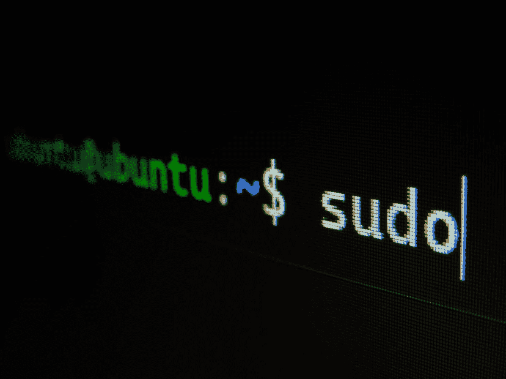

计算机如何以如此精确和高效的完成如此困难的任务？简单直接的回答是，计算机的操作系统负责它所做的一切。通过高效地利用硬件资源，操作系统让生活变得更容易并执行各种功能。从高级来说，操作系统可以分为两个部分。实用应用程序是初始部分，随后是内核。内核用户空间进程请求的一些系统资源，例如网络连接、内存、存储、CPU 等。此外，本栏将研究 Linux/GNU 中的可加载内核模块。Linux 内核是单式的，因为整个操作系统都运行在内核模式下。尽管内核是一个进程，但它由多个子系统组成，每个子系统负责完成某些职责。通常，任何内核都会执行以下任务。

### 可以动态加载的内核模块

大多数时候，我们应用安全补丁和内核升级来保持系统最新状态。在 Microsoft Windows 的情况下，经常需要重启。另一方面，这远不是理想的。例如，当在生产服务器上时，计算机不能重启。如果不需要重启系统就能动态地从内核中删除或添加功能，那不是极好的吗？Linux 内核支持内核模块的动态卸载和加载。任何代码项都是你可以在运行时添加到内核的内核模块。当系统运行期间，你可以在不中断的情况下卸载和加载模块。作为对象代码，你可以使用 `insmod` 命令将内核模块动态链接到运行的内核，并使用 `rmmod` 命令将其取消链接。

## 网络

网络是操作系统的重要方面，因为它促进了主机之间的数据传输并实现了通信。同时也是通过它进行数据包的传输、识别和收集，因为路由能力是由它提供的。

### 设备控制

控制计算机系统的设备需要使用许多设备。然而，为了让该层发挥作用，需要设备驱动程序使设备可用。有各种驱动程序可用，包括视频/音频驱动、蓝牙驱动、显卡驱动等。

### 文件系统

组织你的文件。Linux/GNU 系统深受文件系统的影响。在 Linux/GNU 中，几乎一切都是文件。该子系统还管理着分级数据结构的存储关系需求、数据日志和压缩、文件的删除和创建等。Linux 内核支持所有主要文件系统，包括 MS Windows NTFS。

### 内存管理

该子系统负责所有相关请求。页面是从可用内存划分的固定大小块，可以根据需要从进程或向进程释放或分配。它通过内存管理单元 `MMU` 映射进程虚拟地址，因为它创建了从连续大地址空间到物理地址空间的幻。

### 进程管理

进程由该子系统作为生命周期的一部分处理。它允许进程之间的数据共享和交互，以及通过进程间通信进行进程的销毁和创建。在进程调度器的帮助下，它还允许资源共享并调度进程。

## 一些实用工具

Linux/GNU 提供了各种提供内核模块信息的用户空间程序。现在来看它们。

-   **dmesg**: 尽管内核使用了独立的方法，任何用户空间程序的输出都显示在标准输出流上，即 `/dev./stdout`。内核将其输出附加到环形缓冲区，以便我们使用 `dmesg` 命令管理环形缓冲区的内容。
-   **modinfo**: 当作为命令行参数传递时，传递此类过程的模块将显示信息。如果参数不是文件名，它会在 `/lib/modules/<version>` 目录下搜索模块。`modinfo` 还使用“字段：值”格式显示模块的每个属性。记住内核版本是 `<version>`，我们可以通过运行 `uname –r` 命令查看它是什么。
-   **rmmod**: 你可以使用此命令从内核中卸载模块。只有当当前模块未被使用时，你才能卸载它。`rmmod` 还支持 `--force` 或 `-f` 选项，可用于强制卸载模块。然而，利用这种技术存在很大风险，有更安全的方法删除模块。`rmmod` 将使用 `--wait` 或 `-w` 选项隔离模块，直到它不再被使用。

## 系统准备

现在是时候采取行动了。我们现在需要做的只是建立一个有利于进展的环境。作为所需的包，将安装一个基于 Debian 的 Linux/GNU 发行版（如 Ubuntu）和一个基于 PRM 的 Linux/GNU 发行版（如 CentOS）。

### 安装 CentOS

第一步是以 root 用户使用以下命令安装 GCC 编译器：

```bash
[root]# yum -y install GCC
```

现在在下一层级安装内核开发包：

```bash
[root]# yum -y install kernel-devel
[root]# yum -y install make
```

### 安装 Ubuntu

GCC 编译器是安装序列中的第一个：

```bash
sudo apt-get install GCC
```

然后是内核开发包：

```bash
sudo apt-get install kernel-package
```

然后是 make 安装实用程序：

```bash
sudo apt-get install make
```

我们还有一个内核模块。

我们现在已经完成了系统准备。之后，我们需要编写内核的第一个模块。当你打开你喜爱的文本编辑器时，使用 `hello.c` 保存文件并包含以下内容：

```c
#include <linux/kernel.h>
#include <linux/module.h>

Int init_module (void)
{
    printk(KERN_INFO "Hello, World !!!\n");
    return 0;
}
```


```c
}

void cleanup_module(void)
{
    printk(KERN_INFO "Exiting...\n");
}

MODULE_LICENSE("GPL");
MODULE_AUTHOR("Narendra Kangralkar.");
MODULE_DESCRIPTION("Hello world module.");
```

任何模块都至少有两个函数。第一个和第二个初始化函数分别由清理和初始化执行。因此，`cleanup_module()` 作为清理函数，而 `init_module()` 作为初始化函数。在模块加载后、卸载前，会调用一次启动函数，然后调用一次清理函数。其他宏（如 `MODULE_LICENSE`）易于理解。用户空间的语法是 `printk()`，它与 `printf()` 几乎相同。与 `printf()` 不同，它不会在常规的生产输出流中打印消息。相反，消息是由内核的环形缓冲区（ring buffer）接收并追加的。每个 `printk()` 声明都有一个优先级值。在本例中使用了 `KERN_INFO` 优先级。格式字符串与 `KERN_INFO` 字符串之间没有逗号（`,`）。如果不存在无条件优先级，可以使用 `DEFAULT_MESSAGE_LOGLEVEL` 优先级。`init_module()` 最后一个声明中的 `return 0` 作为成功指示。清理函数和初始化函数分别命名为 `cleanup_module()` 和 `init_module()`。然而，在新内核（>= 2.3.13）中，我们可以使用任何名称来代替清理和初始化函数。为了向后兼容，内核支持这些旧的名称。模块退出和模块初始化是内核提供的宏，用于替换清理和初始化例程的注册。让我们使用我们对清理和初始化函数的偏好名称重写同一个模块：

```c
#include <linux/kernel.h>
#include <linux/module.h>

static int hello_init(void)
{
    printk(KERN_INFO "Hello, World !!!\n");
    return 0;
}

static void hello_exit(void)
{
    printk(KERN_INFO "Exiting...\n");
    return 0;
}

module_init(hello_init);
module_exit(hello_exit);

MODULE_LICENSE("GPL");
MODULE_AUTHOR("Narendra Kangralkar.");
MODULE_DESCRIPTION("Hello world module.");
MODULE_VERSION("1.0")
```

在此处，清理和初始化函数通过 `_exit` 和 `_init` 关键字体现。

### 模块的编译与加载

此时必须理解模块编译的机制。对于内核模块编译，我们将使用内核的构建系统。在将其保存为 `Makefile` 之前，你可能希望再次打开你喜欢的文本编辑器时记录构建过程。你必须为内核 `Makefile` 和 `hello.c` 的模块准备一个相应的目录，因此在此需要注意。

为了构建模块，我们需要内核头文件。上述 `makefile` 调用内核源码中的内核构建系统，而我们的 `Makefile` 可能会由内核的 `makefile` 执行以完成模块。你可以将设计的内核模块过程完成为 `hello.ko`，因为我们现在已经具备构建模块的所有条件。

内核第一个模块的首次编译已经完成。现在是时候查看如何在内核中卸载和加载此模块。你应该意识到，为了卸载或加载内核模块，我们必须获得 root 用户权限。当你切换到超级用户模式时，你需要运行 `insmod` 命令来加载模块，如下所示：

```bash
[root]# insmod hello.ko
```

`insmod` 负责任务的成功。另一方面，输出是我们必须找到的内容。内核的环形缓冲区是追加输出的地方。我们也可以通过运行 `dmesg` 命令学习以下内容：

```bash
[root]# dmesg
Hello, World !!!
```

我们还可以使用命令 `lsmod` 查看模块是否已加载。

```bash
[root]# lsmod | grep hello
hello 859 0
```

你现在需要做的是在运行 `rmmod` 命令时检查 `dmesg` 命令的输出。要从内核卸载模块，请按所示操作。你现在可以使用清理函数看到来自 `dmesg` 的消息。模块信息通过模块内的几个宏提供。`modinfo` 命令以后所示精美的准备格式提供信息。

### 我如何找到进程 PID PID？

我们可能需要再编写一个内核模块来识别进程 ID（PID），即现有进程的 PID。内核存储所有进度的相关信息都在头文件中，定义在 `<linux/sched.h>` 中的 `task_struct` 结构中。它提供了一个现有变量作为现有进程的信号。要识别当前进程 PID，你只需要报告 `current->pid` 变量的值。随后将提供包含完整代码的 `pid.c` 文件。

`Makefile` 与原始 `makefile` 的相似之处在于它以对象文件命名。在插入模块后，使用 `dmesg` 命令确认输出，然后进行编译。

### 使用模块连接多个文件

之前我们仅使用一个文件研究了模块编译。然而，将模块拆分为多个文件可能是非常有用的，在大型项目中，我们一个模块可能有多个源文件。我们必须理解这种方法以构建跨越两个文件的模块。`hello.c` 中的清理和初始化函数可以分离到两个文件中：`cleanup.c` 和 `startup.c`。


首先，你需要从 VMware 网站下载最新版本的 VMware Workstation Player 程序。对于 `12.5` 版本，64 位版本大约为 `80 MB`。VMware Workstation Player 作为评估版本，供家庭、个人和非商业用途免费使用。非营利组织和学生可以从免费版本中受益，这一事实足以让 VMware 感到欣慰。在功能方面，VMware Workstation Player 的所有功能都包含在常规虚拟机任务中。另一方面，VMware 为各种规模的企业提供了广泛虚拟化解决方案。

然后，在你下载完 VMware Workstation Player 后，是时候安装它了。当你从常规安装向导收到安装说明时，你将会有增强键盘驱动程序的选项。你还可以使用该功能提供的国际键盘。即使你认为自己可能不需要，但你也会意识到为了以防万一，安装它是值得的。在执行安装程序的过程中，请按照提示重启 Windows。

## 你想要使用的 Linux 操作系统

你可能对想要尝试的 Linux 类型很熟悉。虽然某些 Linux 发行版在虚拟机中运行效果并不理想，但另一些则可以。在 ARM 架构（如树莓派）上运行 Linux 发行版在 VMware 中可能无法实现。因此，你可能无法通过 `x64` 或 `x86` 虚拟化 ARM。然而，现在是研究 `QEMU` 的时候了。

## 虚拟机配置

你可以在下载 Linux  way 系统的同时开始配置你的虚拟机。当你开始运行 VMware Workstation Player 时，在提示时输入你的电子邮件地址。这部分完全是为了免费获取软件，加入 VMware 邮件列表即可加入其中。完成这一步后，VMware Workstation Player 的主程序将启动。为了继续操作，你需要在虚拟机上创建一个账户。你将选择 `ISO` 安装盘镜像文件作为默认。需要注意的是，如果你有一个空磁盘，可以以后创建虚拟系统并安装操作系统。安装好你所需的操作系统后，点击“下一步”。关于 VMware 简易安装（Easy Install）的提示，你选择的客机操作系统将立即安装。

### 创建账户

在下一个屏幕中，在你按下“下一步”按钮为虚拟机命名之前，你将输入密码、用户名和选定的名称。你可以为正在安装的操作系统指定位置（这通常是默认值），你也可以对虚拟机进行同样的操作。再次按下“下一步”按钮选择虚拟机的磁盘容量。保存的虚拟硬盘是计算机实际磁盘上的文件集或单个文件。你可以选择其中任一选项。同时，你可以更改或接受建议的 `HDD` 大小。这种差异可能会非常明显，因为调大容量是一个更安全的替代方案。无论你选择什么，再次按下“下一步”按钮进入“准备好创建虚拟机”屏幕。点击“完成”按钮后虚拟机将启动。到此为止，在创建后运行你的虚拟计算机。你很快会收到关于 VMware for Linux 工具包的建议，将通过警提示送。这对于完成简易安装过程可能并非必需。但一旦你接受了它，一切都会正常。

### 虚拟机硬件自定义

“准备好开发...”的另一个屏幕选项是修改硬件。现在，除了 `HDD` 之外，你可能希望调整虚拟机的硬件。网络适配器配置、CPU 和内存只是你可以选择的几种可能性。你可能想查看处理器屏幕。在右侧面板中，你会看到虚拟化引擎的引用。默认情况下，此过程设置为 `Automatic`。因此，你可能不需要担心 Linux 的任何问题。如果你遇到任何问题，可以将其更改为 `Intel VT-x` 或其他选项。然后在内存内存屏幕中，你可以解决特定的性能问题。你可能还会看到一个显示虚拟机建议 `RAM` 大小的推荐最大值和最小值。请遵循这些建议，因为它们通常是最好的。当你将 `RAM` 设置得太高，从运行虚拟机软件到普通系统任务的一切都会变慢，如果你设置得太小，仍然会有麻烦。

最后，你的显示设置需要一些关注。因为你可以更改 3D 加速，你可以选择在虚拟机中设置多个显示器或使用主机的显示器设置。与客操作系统的内存一样，将显示建议的数量，你也可以更改显存。

安装 VMware Workstation Player 后，你就可以使用 Linux 了。

虚拟机安装的操作系统在物理桌面工作站上启动 `ISO` 是常见的。你可以使用简易安装方法自动化整个过程，并可以使用你的 Windows 主机操作系统配置来设置客机虚拟机操作系统。这里这里很重要，因为如果你选择稍后安装操作系统，你对整个过程有完全控制权。之后，你就可以开始使用客操作系统了，因为安装完成后，你可以通过简易安装登录虚拟机。就是简单！之后，你可以从菜单启动虚拟机。

## 虚拟机的价值

在 2005 年，硬件对于 Linux 来说是一次重大的体验。USB 设备、显卡、蓝牙甚至无线都给人们带来了问题。而且，为了让功能正常，每当引入新发明时，你可能都需要发现封装器和驱动程序。由于虚拟机看起来是不可行的，任何想要解决方案的 Linux 用户必须与“真实”硬件接触。然而，现在发生了许多变化。Linux 上的部分硬件以意想不到的方式工作。重点已转向发行版的独特特性，而对硬件支持的关注减少了。

### 谁需要虚拟机？

由于缺少特定的专用服务和软件，某些 Linux 用户被迫以两种方式启动。在许多国家，报税软件和各种政府工作仅在 Windows 上支持。与其经历双系统启动的痛苦和复杂，你可能只需使用虚拟机来运行 Windows 软件。这时，虚拟计算机在玩游戏时可能无法工作。为了获得最佳的游戏体验，你可能需要与真实的 `RAM`、`GPU` 和 `CPU` 交互。由于硬件和应用程序之间的兼容性问题，你可能不喜欢虚拟层，视频音频编辑可能无法。除了这些以及额外的容量之外，虚拟机是非常棒的。


虚拟机对于那些尝试通过转换为 `Linux` 或格式化他们熟悉的操作系统或玩 `Linux` 来尝试转换的非 `Linux` 用户来说也可能有用。当他们准备好时，他们将会有信心进行切换，因为虚拟计算机让他们熟悉了 `Linux`。因此，`Linux` 可以在你的 `Windows 10` 或 `Mac OS` 运行。最重要的是，你可以在虚拟机上运行各种 `Linux` 发行版，并在它们之间切换，而无需在同一台硬件上重启。作为一名 `Linux` 用户，你需要熟悉各种主流发行版，而不是完全依赖于任何人或被供应商锁定。而且，你可能不需要注销来更改环境，而是可以使用虚拟机在同一台系统上运行不同的桌面背景。你可能不知道你的客户或雇主使用的操作系统。因此，无论如何，你都需要一些 `Linux` 专业知识，因为如果你想成为一名开发者或系统管理员，你不想只了解一个发行版。如果你是一个开发者，你需要的许多发行版来测试你的应用程序。

## 虚拟机的优势

正如你所看到的，使用虚拟机具有各种优势。除了多启动之外，操作虚拟化还提供了其他关键优势，例如效率。在不同的发行版之间切换并格式化硬盘是浪费时间。所以，它就像打开当前应用程序一样简单，你可以在不中断工作的情况下，通过虚拟机为发行版启动一个新虚拟机。如果你是一个发行版跳槽者或爱好者，虚拟机可以是天堂。即使你使用 `Arch Linux`，你也应该考虑其他发行版，如 `Linux Mint`、`Fedora`、`Ubuntu`、`Kubuntu`、`OpenSUSE` 等。拥有许多物理系统几乎很难，因为它们占用空间并浪费钱。与其购买六台物理机器，不如投资可以运行额外虚拟系统的多核心处理器和额外的内存。如果你现在在同一台电脑上处理近十种发行版，你将没有任何任何停机时间。

## 你应该使用什么样的虚拟机？

有 `Virtual-Box`、`Xen`、`KVM`、`Qemu`、`VMware` 以及许多其他选项。其他都有自己的优缺点。无论你是否选择 `VirtualBox`，像 `KVM` 这样的技术都更高效、强大。作为一个新的 `Linux` 用户，你会发现 `VirtualBox` 使用起来非常简单。即使你没有很多技术知识，也可以使用它的许多功能和特性。因为 `VirtualBox` 可以安装在 `Mac`、`Windows` 和 `Linux` 上，它在跨平台支持方面具有显著优势。

## 第 5 章：Linux 用户管理与系统管理

 `Linux` 是计算技术的一大优势。许多云服务器、超级计算机、桌面电脑、手机和 Web 服务器都运行在 `Linux` 上。`Linux` 系统管理员的职责包括创建、增强和维护用户报告或帐户，以及使用命令行界面工具和 `Linux` 实用程序控制计算机系统的操作。由于其开源特性、卓越的安全性和可靠性，`Linux` 驱动了大多数计算设备。意识到并理解以下 `Linux` 系统管理员的特征是至关重要的：

- 用户、目录和文件管理
- `bash` 命令是关重要的。
- 以超级用户身份管理层次结构

`Linux` 系统管理员的职责包括：
- `Linux` 系统。

`Linux` 管理员的任务包括：
- `Linux` 系统。
- `Linux` 系统。
- `Linux` 发行版。
- `Linux` 系统。
- `Linux` 发行版。
- `Linux` 发行版。
- `Linux`。
- 文档。
- `Linux` 操作系统。

## Linux 用户

`UID`（用户唯一标识符）是一个唯一标识系统用户帐户的二进制数字。整个帐户信息保存在 `/etc/passwd` 文件中，而哈希密码存储在 `/etc/shadow` 文件中。

### 创建默认设置的用户

可以在命令行提示符下使用 `useradd` 命令添加用户。

```
useradd enirban
passwd enirban
```

### 创建带有 UID 的用户

可以使用 `-u` 选项和自定义 UID 创建用户。

```
useradd -u 1036 handy32
```

要创建用户，请使用非默认值的主目录。


你可以通过以下步骤创建一个非默认的家目录：

```bash
[root@localhost handy32]# useradd –d /home/test handy32
```

## 将用户添加到附加组并作为主组

可以使用 `-G` 和 `-g` 选项由管理员定义互补组和主组。

```bash
[root@loaclhost handy32]# useradd –g “head” –G “faculty” handy32
```

## 由用户进行锁定和解锁

超级用户可以锁定或解锁用户的账户。要使用 `- /` 选项锁定账户，只需输入 `passwd`。

```bash
[root@localhost handy32]# passwd -/ handy32
```

对于用户 `handy32`，锁定密码
`passwd: Success`

你可以使用带有 `-u` 选项的 `passwd` 来解锁账户：

```bash
[root@localhost handy32]# passwd –u handy32
```

对于用户 `handy32`解锁密码
`passwd: Success`

## 修改你的登录名

使用带有 `-/` 参数的 `usermod` 命令修改你的用户名。

```bash
[root@localhost handy32]# usermod -/ “nishant” handy32
```

## 删除用户

使用 `-r` 选项和 `userdel` 结合家目录和用户：

```bash
[root@loaclhost handy32]# userdel –r handy32
```

## Linux 用户组

Linux 组是一种汇集和组织用户的技术。`GID`（或组 ID）是每个组的唯一 ID，类似于用户 ID。组分为两类：附加组和主组。每个用户属于一个主组以及一个或多个附加组。组信息保存在 `/etc./group/` 中，适当的密码存储在 `/etc./gshadow` 文件。

### 使用默认设置创建组
要创建一个新组，请以 root 用户身份使用默认设置运行 `groupadd` 命令：

```bash
[root@localhost handy32]# groupadd employee
```

如果你想添加密码，使用组名输入 `gpasswd`：

```bash
[root@localhost handy32]# gpasswd employee
```

对于组 `employee`，更改密码
`New Password:`
`Re-enter new password:`

### 使用特定 GID 创建组
使用 `-g` 选项执行 `groupadd` 命令以显式指定组的 `GID`：

```bash
[root@loaclhost handy32]# groupadd –g 1200 manager
```

### 组密码正在被移除
要删除组密码，请使用正确的组名执行 `gpasswd –r`：

```bash
[root@loaclhost handy32]# gpasswd –r employee
```

### 组名正在更改
要更改组名，请以超级用户身份使用 `-n` 选项运行 `groupmod` 命令：

```bash
[root@loacalhost handy32]# groupmod –n hrsupervisor employee
```

### 修改组的 GID（组标识符）
运行带有 `-g` 的 `groupmod` 命令来更改组的 GID：

```bash
[root@loaclhost handy32]# groupmod –g 1050 manager
```

### 删除组
在删除主组之前，你必须先删除该主组的用户。要删除一个组，请使用组名使用 `groupdel` 命令：

```bash
[root@loaclhost handy32]# groupdel employee
```

## Linux 文件系统

文件系统是一种在硬盘上存储文件的方法。Linux 还支持多种文件系统，包括：

* `Debugfs`, `tmpfs`, `sysfs`, `procfs` 以及其他特殊用途文件系统
* `YAFFS`, `JFFS2`, `ubifs` 和闪存存储文件系统
* `NTFS`, `JFS`, `Btrfs`, `XFS`, `ext4`, `ext3`, `ext2` 以及其他常见的磁盘文件系统

### 文件系统的层次结构
文件系统层次是 Linux 系统存储文件的标准方式。对于最流行的 Linux 发行版，这些是不同的目录结构：

Linux 用户手册可以在网上。Linux 中的每个命令都有帮助或协助，这是操作系统最重要的特性之一。你必须输入以下命令来访问 Linux 手册页：

```bash
[handy32@localhost~]$man /
```

当你执行此操作时，将被引导到手册的命令页面。

### 超级用户或 root
该账户是一种特殊的用户账户，允许任何人访问各种权限更改任何 Linux 服务或程序。你将使用 `su` 命令变成 root 或超级用户，你只需要通过输入以下命令输入 root 密码

```bash
[handy32@localhost~]$su
```

## 处理目录和文件

在 Linux 内部，一切都是文件。因此，在处理设备文件或普通文本文件时，通过文件操作相关的命令与它们交互。下面列出了一些文件操作：

### 创建文件
创建文件需要两个命令：`cat` 和 `touch`。你可以按照以下步骤使用 `touch` 创建空文件：

```bash
[handy32@loaclhost~]$touch filel
```

你可以利用 `cat` 来检查或创建文件，步骤如下：

```bash
[handy32@loacalhost~]$cat>filel
```

你还可以使用以下命令检查特定文件类型：

```bash
[handy32@localhost~]$cat filel
```

### 复制文件
你可以使用 `cp` 命令将文件从一个位置传输到另一个位置，如下：

```bash
[handy32@localhost~]$cp filel /home/sandra/Documents/
```

此命令将当前工作目录复制到删除文件：`/home/bhargab/Documents/.`。

### 删除文件
要删除文件，输入以下命令：

```bash
[handy32@localhost~]$rm filel
```

### 重命名或移动文件
`mv` 命令可用于重命名或移动文件。要将文件从一个位置移动到另一个位置，使用以下命令：

```bash
[handy32@loaclhost~]$mv file /home/sandra/Document
```

使用上述命令，文件 `file1` 将添加到 `/home/sandra/` 下的 `Document` 目录。然后，要重命名文件，使用以下命令将 `file1` 改为 `file2`。

```bash
[handy32@loaclhost~]$mv filel file2
```

### 列出目录和文件
`ls` 列出提供的目录或当前目录下的目录和文件。使用以下命令显示当前目录的内容：

```bash
[handy32@localhost~]$ls
```

此命令将显示目录名称以及文件。你可以使用以下命令列出家目录中的所有文件：

```bash
[handy32@localhost~]$ls -a
```

要使用长列表格式检查文件，使用 `l` 选项并输入：

```bash
[handy32@localhost~]$ls -l
```

输出示例如下：
```
Total 48
drwxr-xr-x 2 handy32 4096 Jan 25 21:32 Desktop
drwxr-xr-x 2 handy32 4096 Apr 24 16:33 Documents
drwxr-xr-x 6 handy32 4096 Jan 20 23:55 Downloads
-rw-rw-r-- 1 handy32 1024 Apr 28 22:18 file1
-rw-rw-r-- 1 handy32 1024 Apr 28 22:01 file2
-rw-rw-r-- 1 handy32 1024 Apr 28 22:01 file3
drwxr-xr-x 2 handy32 4096 Dec 20 08:48 Music
drwxr-xr-x 2 handy32 4096 Dec 20 08:48 Pictures
drwxr-xr-x 2 handy32 4096 Dec 20 08:48 Public
drwxr-xr-x 2 handy32 4096 Dec 20 08:48 Videos
```

## 软连接和硬连接

链接是硬盘上实际数据与文件名之间的连接，分为两种类型：软链接和硬链接。你可以使用以下命令建立硬链接：

```bash
[handy32@loaclhost~]$ln filel file2
```

运行以下命令创建软链接：

```bash
[handy32@localhost~]$ln -s filel file3
```

## 修改权限

对于 Linux 中的每个文件，三种类型的连接权限，它们是 `(x)` 执行、`(w)` 写入和 `(r)` 读取。通过超级用户或文件所有者，可以轻松更改现有文件权限。要为组嵌入写入权限，使用以下命令：


```bash
[handy32@localhost~]$chmod g+w filel
```

此外，使用以下命令可以让其他用户拥有执行权限：

```bash
[handy32@localhost~]$chmod o+x filel
```

当你想要从某个组移除执行权限时，可以使用下面的命令：

```bash
[handy32@localhost~]$chmod g-x filel
```

## 当前工作目录

下面，你将看到通过 `pwd` 命令显示的当前工作目录：

```bash
[sandrahandy32@localhost~]$pwd
/home/sandra
```

因此，`/home/sandra/` 是当前工作目录。

### 目录创建

要创建目录，你可以像这样使用 `mkdir` 命令：

```bash
[sandrahandy32@localhost~]$mkdir myDir
```

在 `/home/sandra/` 下将创建一个目录。

## 目录删除

要删除一个空目录，你将如下使用 `rmdir` 命令：

```bash
[sandrahandy32@localhost~]$rmdir MyDir
```

你还可以使用 `rmdir` 的 `p` 选项来删除父目录，而不仅仅是指定的目录。

```bash
[handy32@localhost~]$rmdir myDir
```

到目前为止，我们已经广泛涵盖了系统管理以及 Linux 用户管理的许多方面。你可能想花时间重新阅读一遍，以跟上本节讨论的内容。当你准备好后，可以进入下一节，我们将深入探讨 Linux 目录结构。

## 第 6 章：Linux 目录结构


对于每台通用计算机，都需要在 HDD、各种类型的硬盘或一些类似的设备（包括 USB）上进行数据存储。这些需求的产生有几个原因。首先，如果你关闭电脑，`RAM` 中的内容可能会丢失。在涉及到固态硬盘和 USB 闪存盘时，存储在其中的数据维护往往取决于在掉电时的非易失性 `RAM` 类型。`Flash RAM` 比其他类似的类别（如易失性常规 `RAM`，如 `DDR3`）更贵。由于硬盘数据存储是第二个原因，磁盘空间比普通 `RAM` 便宜。从每字节成本来看，`RAM` 仍然是更好的选择。磁盘和 `RAM` 的价值已大幅下降。根据对 2TB 硬盘与 16GB `RAM` 每字节成本的快速估计，硬盘的单位价格大约是 `RAM` 的七十一之一。

关于文件系统，有很多来源的讨论，它们都很复杂且相互矛盾。因为“文件”一词本身可以有许多含义，当你从文档或分析的角度来看，需要区分其具体含义。让我们尝试根据特定情况和人们的观察对“文件系统”一词给出多种定义。目标是根据其各种解释来建立这一定义，以符合官方定义。

1. 一个经过格式化的逻辑卷或分区卷，可以按照特定类型的文件系统挂载到 Linux 文件系统的精确点上。
2. 一种特定的数据存储格式，例如 `XFS`、`BTRFS`、`EXT4`、`EXT#`、`EXT2` 等。Linux 支持 100 多种文件系统，包括最新的和最老的。这些文件系统变体使用元数据结构来指定如何访问和存储数据。
3. 根目录 (`/`) 是整个 Linux 目录层次结构开始的地方。

## 文件系统的基本功能

磁盘存储包含某些不可避免且引人入胜的特征。文件系统最重要的目的之一是提供非易失性数据存储。然而，由于这种需求，还必须满足一些额外的功能。命名空间的创建是所有文件系统必须执行的任务，是一种命名和组织方法。而且在所有可用字符中，这种方法决定了你如何为文件命名，即你可以用于文件名的字符子集和文件名长度。此外，数据的逻辑结构定义在磁盘之上，这包括在大型统一组合中管理文件，以及使用目录组织文件。在定义命名空间时，元数据的格式对于为该命名空间提供合理基础关重要。因此，必须包含数据结构以实现分类目录结构。这些结构决定了磁盘上哪些块空间被利用，哪些是可用的。在维护目录和文件的名称和大小方面，实现了这些功能的结构，以及数据在磁盘上的位置或位置、所属文件夹的最后查看或修改时间，以及生成时间和大小。它们使用其他信息（如逻辑分区和卷）来存储磁盘细分的复杂材料。它描述了包含数据的更复杂的元数据，这些数据表达了在分区或驱动器上累积的文件系统，且独立于文件系统信息。

`API`或“应用程序编程接口”对于文件系统提供管理目录和文件等文件系统对象的系统调用访问也是必要的。`APIs` 处理删除、传输和创建文件的任务。`APIs` 提供的部分内容是决定某些事项的算法，例如文件应该放在文件系统的什么位置。此类算法的目标可能是为了减少并加速磁盘碎片化处理。此外，当前文件系统还提供了一种安全模型，作为目录和文件访问权限规范的模式。由于 Linux 文件系统的安全机制，你可以作为用户访问他人的文件或操作系统。基本软件是实现这些目标的终极构建组件。双部分软件的应用是 Linux 用来提高程序员效率和两个系统性能的方法。Linux 的虚拟文件系统是该实现中两个部分的第一部分。这个虚拟文件系统负责提供对各种文件系统的访问，并为开发者和内核提供单一命令集。虚拟文件系统软件通过特定必要设备的接口驱动程序对各种文件系统进行调用。文件系统专用设备的驱动程序是执行的的部分组件。设备驱动程序解释逻辑卷或分区卷上的文件系统命令标准集，以及特定于文件系统类型的命令。

## Linux 目录结构

如果你来自 Windows 背景，Linux 的文件系统结构可能看起来特别奇怪。听起来晦涩的目录和 `a/` 选项大多取代了被遗忘的驱动器以及 `C:` 盘，使用了三字母名称。`FHS`（或“文件系统层次结构标准”）决定了 Linux 和其他 Unix 类操作系统的文件系统结构。然而，Linux 文件系统中的某些目录尚未被标准定义。

### /var - 可变数据文件

与 `/usr` 目录的可写等价物是 `/var` 目录，它在正常运行时必须是只读的。在常规操作期间，我们可以将日志文件以及任何通常写入 `/usr` 的内容写入 `/var` 目录。例如，可以在 `/var/log` 下访问日志文件。

### /usr — 用户二进制文件与只读数据


用户使用包含 `/usr` 目录的文件和应用程序，而不是系统使用的文件和应用程序。例如，非本质程序位于 `/usr/bin` 目录，而不是 `/sbin` 目录（后者包含非本质系统管理二进制文件）。`/usr` 目录还包含额外的目录，例如与架构无关的文件夹 `graphics`，它们在 `/usr/` 中共享一个位置。这可以防止它们对系统的其他造成破坏，因为本地构建的应用程序默认安装在本地目录 `usr/`。

### /tmp - 临时文件
由于 `/tmp` 目录是应用程序存储临时文件的地方，如果系统重启，像 `tmpwatch` 等程序将删除这些文件。

### /srv — 服务数据
`/srv` 目录存放“系统提供的服务数据”。如果你正在使用 `Apache` HTTP 服务器来提供网站，通常会将文件放在 `/srv` 目录内部的目录中。

### /selinux - SELinux 虚拟文件系统
如果你的 Linux 发行版出于安全考虑使用了 `SELinux`，那么 `/selinux` 目录包含特殊文件。它与 `/proc` 相同。由于 Ubuntu 不使用 `SELinux`，这个子目录的出现看起来像是一个问题。

### /sbin - 系统管理二进制文件
`/bin` 目录类似于 `/sbin` 目录。它通常设计为由 root 用户运行用于系统管理，因为它包含了重要的二进制文件。

### /run – 运行状态文件
由于 `/run` 目录较新，它为应用程序存储临时位置提供了标准，例如进程 ID 和套字。这些文件不能存储在 `/tmp` 中，因为它们可能会被删除。

### /root - Root 家目录
`/root` 目录是 root 操作者的家目录。由于它是系统根目录，它位于 `/root` 而不是 `/home/root`。

### /proc - 进程与内核文件
`/dev` 目录与 `/proc` 目录相同，因为它不包含标准文件。它只包含处理和表示数据的特殊文件。

### /opt - 可选软件包
`/opt` 目录中的这些目录用于可选软件软件包。由于传统的文件系统层次结构不受遵守，专有软件经常使用它。例如，当你安装它时，它可能会将专有程序文件泄漏到 `/opt/application`。

### /mnt – 移动挂载点
`/mnt` 目录是系统管理员在使用临时文件系统时挂载的地方。例如，如果你在 Windows 的 `/mnt/` 上挂载一个分区，你可能想为了几次文件恢复活动挂载它。另一方面，其他系统文件可以挂载到系统上的任何可用空间。

### /media - 可移动式介质
`/media` 目录位于安装到计算机的设备挂载的子目录下。例如，当你向 Linux 系统插入一张 CD 时，`/media` 目录内部会自动生成一个目录。你也可以从该目录内部访问 CD 的内容。

### /lost+found – 恢复的文件
每个 Linux 文件系统都包含一个 `lost+found` 目录。因此，如果文件系统崩溃，下次启动时将进行文件系统检查。发现的任何损坏文件将存储在 `lost+found` 目录中以便进行广泛的数据恢复。

### /lib – 核心共享库
`/lib` 目录包含了关键二进制文件所需的库，可以在 `/sbin` 和 `/bin` 目录中找到。`/usr/lib` 包含了 `/usr/bin` 文件夹中所需的所需的文件。

### /home - 用户文档
每个用户的家目录都位于 `/home` 目录。例如，如果你的用户名是 `Greg`，那么家文件夹将位于 `/home/greg`。此家文件夹包含用户的显式配置文件以及用户的数据文件。每个用户必须在系统上获得提升权限才能以超级用户的身份修改其他文件，即使他们对自己的家文件夹有写权限。

### /etc – 配置文件
配置文件保存在 `/etc` 目录中，可以使用文本编辑器手动修改。请记住，`/etc/` 目录包含系统级配置文件，而用户特定的配置文件位于每个用户的家目录中。

### /dev - 设备文件
Linux 将设备以文件的形式暴露。因此，`/dev` 目录包含代表某些特定文件的设备。尽管它们看起来像是我们所熟悉的文件，但我们不能称它们为原始文件。例如，主 SATA 驱动器在操作系统由 `/dev/sda` 设备表示。如果你想将其分区为没有任何硬件关联的虚拟设备，可以启动分区编辑器并告诉它更改 `/dev/sda`。此外，此目录还包含伪设备。例如，`/dev/random` 命令只生成随机数。因为它不产生输出，`/dev/null` 是一个特殊设备，当命令的输出管道到它时，它会自动丢弃所有输入。

### /cdrom - 历史挂载点 CD-ROM
`/cdrom` 目录是 FHS 标准的例外。然而，可以在 Ubuntu 和其他操作系统找到它。它是插入系统的 CD-ROM 的临时位置。然而，对于临时介质的正常位置，它在 `/media` 目录下。

### /boot - 静态启动文件
`/boot` 目录包含了启动系统所需的文件。例如，你的 Linux 内核和 `GRUB` 引导加载器文件位于这里。引导加载器的配置文件不在 `/etc` 目录中，尽管它们与其他文件位于同一个目录。

### /bin - 核心用户二进制文件
当系统以单用户模式挂载时，重要的用户二进制文件（通常称为必须存在的应用程序）位于 `/bin` 目录中。如 `Firefox` 之类的应用程序位于 `/usr/bin` 中，而如 `bash` shell 这样的重要工具和系统程序位于 `/bin` 目录中。`/usr` 目录也可以被存储在单独的分区上。即使没有挂载额外的文件系统，将这些文件放在 `/bin` 目录中也能确保你拥有关键工具。`/sbin` 目录与它类似，包含了用于系统管理的重要二进制文件。

/ - 根目录
Linux 系统上的所有内容都位于 `/` 目录下，这被称为根目录。Windows 中的 `C:` 目录与 `/` 目录非常相似。这并不完全准确，因为 Linux 没有驱动器号。虽然 Windows 中的另一个分区出现在 `/` 目录下的不同文件夹，但在 Linux 中它也出现在 `/` 目录下的不同文件夹。

## 第 7 章：处理磁盘、介质和数据文件 (gzip – tar)


由于删除和创建分区是 Linux 中的常见活动，在利用它们之前，你必须对 USB 驱动器和硬盘等存储设备进行结构划分。划分后，分区通常包含大量存储空间的设备区域。你也可以使用分区将硬盘划分为隔离的部分，每个部分的操作都像一个独立的硬盘。如果你管理许多操作系统，分区将非常有用。通过使用 Linux 中各种复杂的工具（也称为磁盘分区管理工具），你可以删除或创建这些。因此，拥有巨大磁盘的设备以及多个磁盘分区都能受益，我们将详细介绍如何使用 `parted` 命令。这里有一些常用命令，如 `cfdisk` 和 `fdisk`，以及分离与分区之间的区别。


## 分区表与工具

- 为了可靠性，DOS 分区中仅存储一份分区表副本。GPT 则在磁盘的开头和结尾各保留一份分区表副本。与 DOS 分区一样，GPT 也使用 CRC 校验和来检查分区表的完整性。
- 更多分区：当使用扩展分区和主分区时，DOS 分区表仅允许 16 个分区。你可以选择拥有更多分区，GPT 默认允许你拥有多达 128 个分区。
- 更大的磁盘：尽管 DOS 表的分区倾向于格式化高达 2TB 的磁盘空间，但在某些情况下可以达到 16TB。相反，GPT 分区表可以寻址 8ZiB 的空间。
- 虽然 `cfdisk` 和 `fdisk` 局限于 DOS 分区表，但 `parted` 工具可以生成 GPT（全局唯一标识分区表）。

由于在如今更大的磁盘上进行磁盘分区需要更高的灵活性，建议你使用 `parted`。磁盘分区的创建通常是操作系统安装程序的一部分。在向现有系统添加存储设备时，直接使用 `parted` 命令特别有用。

## 在 Linux 上分析磁盘空间和硬盘分区的命令

你可以使用某些命令来检查系统上的分区。这些命令的作用之一是检查每个软驱器上存在哪些分区，以及文件系统、已用空间、总大小等其他信息。某些分区工具，如 `cfdisk`、`sfdisk` 和 `fdisk`可以显示分区内容并对其进行编辑。

### `hwinfo`
作为一个通用的硬件信息工具，你可以使用 `hwinfo` 打印分区和磁盘列表。与其他工具一样，结果不包含每个分区的信息。

### `blkid`
`blkid` 输出块设备、存储和分区媒体，以及 `uuid` 和文件系统类型等属性，尽管它不报告分区的空间。

### `lsblk`
`lsblk` 显示光驱和磁盘分区列表，以及所有存储块。它列出挂载点，最重要的是如果存在，还会显示块/分区的总大小。不报告分区的空/用空间。如果没有 `MOUNTPOINT`，意味着文件系统尚未挂载。它也意味着没有 DVD/CD 磁盘。使用设备时，`lsblk` 可以显示更多信息，如型号和标签。

### `pydf`
`pydf` 的增强版本用 Python 编写，并以易读的格式打印所有硬盘分区。此外，`pydf` 只能显示已挂载的文件系统。

### `df`
尽管这不是一个分区程序，该命令也会打印已挂载文件系统的信息。即使不是真实磁盘分区的文件系统也包含在 `df` 列表中。使用它时，你会发现以 `/dev` 开头的分区或设备都是文件系统，你可以使用 `grep` 过滤出真实的硬盘分区或文件系统。然后，使用 `df` 显示带有分区类型的实际磁盘分区。

### `parted`
作为一个命令行工具，它会在需要时更改列表，因为它也列出了分区。

### `cfdisk`
Linux 的分区编辑器是 `cfdisk`，它基于 ncurses 并具有交互式用户界面。它可以用于修改或创建现有分区，也可以列出这些分区。由于 `cfdisk` 每次只能执行一个分区，如果需要特定磁盘的详情，请向 `cfdisk` 提供设备名称。

### `sfdisk`
另一个工具是 `sfdisk`，它的目标与 `fdisk` 类似，但具有额外功能。每个分区的尺寸可以以兆字节 (MB) 为单位显示。

### `fdisk`
`fdisk` 命令是检查磁盘分区最常用的命令。通过 `fdisk` 命令，你可以看到分区及其详情（就像文件系统类型一样）。然而，通过 `fdisk` 每个分区的尺寸报告可能无法访问。

## Linux 数据操作

如果你习惯了 Windows，Linux 世界可能会让你感到困惑。没有图像、链接或任何可以点击的内容，寥寥几个提示，没有向导等，很难知道从何开始。此外，在实现任何目标之前，你必须先知道自己想要什么。假设你别无选择只能使用 Linux 提示，而学习基于 xkcd 的痛苦、晦涩的软件并不符合你的热切愿望。然而，使用命令行处理数据可能有一些令人信服的理由。即使新技术提供了数 TB 级的数字数据，更多仪器提供了数字输出，尝试使用 Excel 处理这些数据可能并不合适。你处理 CSV 文件的运气可能也不好。在 Linux 上，使用免费且相当简单的工具可以轻松管理这些文件。选择这条路线的另一个动力是 Linux 强大的主流工具是完全免费的。

虽然我们可能希望跳过大部分这些内容，但 SAS、Mathematica、MATLAB 和其他品牌程序已经适配了 Linux，并且非常出色。由于原生应用和工具在 Linux 上的性能更好，并且对 Linux 用户来说是本能，我们不能说它们在 Windows 上无法运行。此外，可以保证它们在 Linux 上始终可以运行。你不需要每 6 个月学习一个新界面，因为苹果和微软不会通过发布另一个为了增加利润而毫无意义的升级来向你支付金钱和时间。

## 识别文件类型

即使数据是在实验室生成的，你可能不知道它是什么类型的数据。文件是一个可以提供一些帮助的工具，尽管它并非没有缺陷。它通常给出的响应是针对“它是什么类型？”这个问题。与 Windows 文件映射技术（通过文件名 `.typ` 映射到特定类型）不同，它通过检查文件来查看是否有诊断特征。如果文件名称在传输过程中损坏了，它会非常有用。

## 假设

在安装了典型的 Linux 工具（如 R）后，假设你可以访问 bash shell。可以为这个实验创建一个目录。在 `$DDIR` 上你可以提供参考路径，尽管你可以给它任何喜欢的名称。你大可以给 shell 的 `DDIR` 变量分配一个实际的项：

```bash
export DDIR=/stephen/
```

`Bash>` 是 shell 命令的前缀，你可以输入它来测试你的 shell，包括以 `#` 为前缀的注释；你可以忽略它们。你可能也想忽略前缀 `bash>`。所有提到的工具在加州大学欧文分校 (UC Irvine) 以及交互式 BDUC 集群节点上都可以访问。此外，除非另有说明，你可以免费获取任何 Linux 发行版。

我们将利用 `red+blue all.txt.gz` 文件，这是一个大小为 25MB 的制表符分隔数据文件。你可以在 Firefox 中右键点击链接并选择“保存”来下载它。将其保存在实验的 `$DDIR` 目录中。然后使用 `gunzip blue+red all.txt` 将其解压。然后使用 `ls` 获取完整字节的结果。

## 在 Linux 上挂载和卸载媒体

在使用 Linux 操作系统时，你可以挂载和卸载媒体。你应该意识到，这种方法采用了默认的红帽（Red Hat）安装，如果你使用不同的 Linux 操作系统，命令、结构和文件名可能会有所不同。现在进入正题吧！

如果你正在挂载光盘，请按照以下步骤操作：

1. 检查你的服务器上是否存在 `/mnt/cdrom` 目录。如果目录 `mkdir/mnt/cdrom` 不存在，可以使用命令 `mkdir/mnt/cdrom` 创建它。然后按回车键。


2. 然后，要挂载 CD，输入 `mount/dev/scd0 –t iso9660 –o ro /mnt/cdrom`。再次按下‘enter’ 键。

如果你想从磁盘挂载设备，请使用以下命令：

1. 验证服务器上是否存在 `/mnt/floppy` 目录。如果此目录不存在，你可能需要输入以下命令：
`mkdir/mnt/disk`
再次按下‘enter’ 键。

2. 你可以通过输入以下命令来挂载驱动器：
`mount/dev/sda –o auto/mnt/disk`
然后按下‘enter’ 键。

你可以使用以下命令卸载介质：

1. 输入 CD 并按回车。
2. 按照下面的说明操作：
● 如果你想卸载的是 CD，请输入以下命令：
`unmounts /mnt/cdrom`
然后按下‘enter’ 键。
● 如果你想卸载的是磁盘，输入以下命令：
`unmounts /mnt/cdrom`
再次按下‘enter’ 键。

## 从命令行创建 Tar GZip 文件

如果你在 Time Machine 之外管理备份，或者想要移动文件组，那么制作 zip 文件可能是你的工作内容。如果你更喜欢更优的压缩率和额外的复杂设置，利用易用且易访问的 GUI zip 工具，命令行可能是你创建 gzip 和 tar 归档的极佳选择。而且正如 Linux 元素的特性，其语法在 Mac OS X 中也是相似的。

tar gzip 归档是以包的形式创建的。

该语法可以在 `(terminal/applications/)` 命令行中使用。例如，你可以使用一些特殊命令来压缩 jpg 文件文件夹。

在这种情况下，通配符是 `*`，这意味着 `*.jpg` 可以从任何扩展名为 `.jpg` 的文件进行压缩，仅此而已。生成的 `.tar.gz` 文件将从系列文件变成单个文件的包，尽管 tar 包本身就支持压缩。因此，gzip 压缩是增强 tar 压缩效果的一种极佳方法。如果你愿意，也可以将它们作为单独的命令运行。然而，得益于 tar 命令中的 `-z` 参数，tar 文件会自动进行 gzip 压缩，因此没有必要这样做。

## 第 8 章：

 文件、目录管理器、权限、网络和 SSH

Linux 中的任何文件系统都是作为层处理你在存储器上数据位置的操作系统。即使你发现了一个不支持的文件系统类型，如果没有它，你也无法判断文件从哪里开始到哪里结束。如果你有可以处理它的软件，甚至可以下载它。那么，Linux 有哪些不同的文件系统呢？当你尝试安装 Linux 时，你会发现它带有许多文件系统，如下所示列出的：swap, btrfs, jfs, ext4, ext3, ext2, ext3+, ext4+, ext4+, ext4+（重复省略）。

那么，Linux 提供的这些文件系统究竟是什么？

## Btrfs
这一个由 Oracle 创建，在某些发行版中不如 Ext 那么稳定。然而，如果你有需要，可以认为它是 Ext 的替代品，而且它的性能出色。

## XFS
它在处理小文件时运行缓慢，因为它是一个古老的文件系统。

## JFS
JFS 是由 IBM 创建的旧文件系统，对大文件和极小文件都良好。然而，报告显示它在运行一段时间后会失败，导致文件损坏。

## Ext4
这允许以快速速度传输巨大的文件。如果你正在寻找 SSD 存储选择，这是你在安装 Linux 时看到的建议默认文件系统。

## Ext3
Ext2 提供了向后兼容性和改进。服务器不再使用这种文件系统，因为它不支持磁盘快照或文件恢复。

## Ext2
结果是 Linux 的第一个文件系统可以存储高达 2 terabytes 的数据。由于限制，人们不再使用这个旧的系统了。

## 高层次级解释

现在你已经熟悉了 Linux 文件系统，是时候从高层次级了解这些文件系统内部的内容了。如果你是从 Windows 转过来的，你能够安装分区，如 `D:` 和 C:`（最常见的是 `C:`），因为 Windows 有像这样的分区。尽管我们在上一个章节中讨论过，但 Linux 的文件系统结构是什么？当你进入根分区（`/`）时，你会看到 Linux 的文件系统结构。

## 管理 Linux 目录的命令

域名系统或 `DNS` 是我们用于在 IP 地址和域名之间进行转换的。例如，在 Linux 机器上，你可以使用 `host` 或 `dig` 命令连接到 DNS。同样，Linux 文件通过文件名而不是 inode 号来引用。那么，目录的目的究竟是什么？你倾向根据使用方式对文件进行分组。例如，你可以在 `/etc/` 目录中这样做，它包含所有的配置文件。目录的目的是将文件名与其对应的 inode 号连接起来。在每个目录内部，你会发现两个子目录。

1. `..`（双点）—— 指向上一个目录的指针，即你当前所在目录的上一级目录。除了根目录外，每个出现 `..` 的目录都存在它。而且它始终指向与 `.` 相同的 inode。
2. `.`（单点）—— 表示当前目录。

为了列出目录和文件，我们可以使用 `ls` 命令，包括 Linux 中的 `.` 和 `..` 目录。

```
ls –la
```

## 目录
子目录包含在另一个目录内部。目录最后形成了一个树结构，要查看目录树结构，请使用 `tree` 命令。

```bash
$ tree /etc │ less
```

与文件一样，目录也有一个 inode。由于它将每个名称与 inode 号连接起来，它是一个包含记录的特殊格式文件。在 `ext2/3` 文件系统中，注意目录的以下局限性是非常关重要的：

## 局限性
● `Ext4` 和其他现代 Linux 文件系统中可能存在无限数量的子目录。
● 在单个目录中，有一个大约 10-15k 个文件的软上限。

然而，根据 `ext2/3` 文件系统的官方文档，使用正在开发中的哈希目录索引，允许单个目录中存放 100k-1M+ 文件。与目录相关的，下面是一些 bash 别名命令：

```bash
alias ..=‘cd..’
alias d=‘ls –l │ grep –E "^d”’
```

Linux 目录管理命令

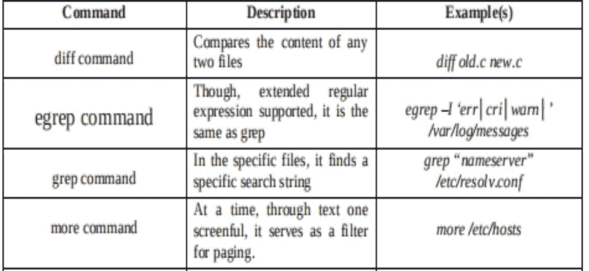
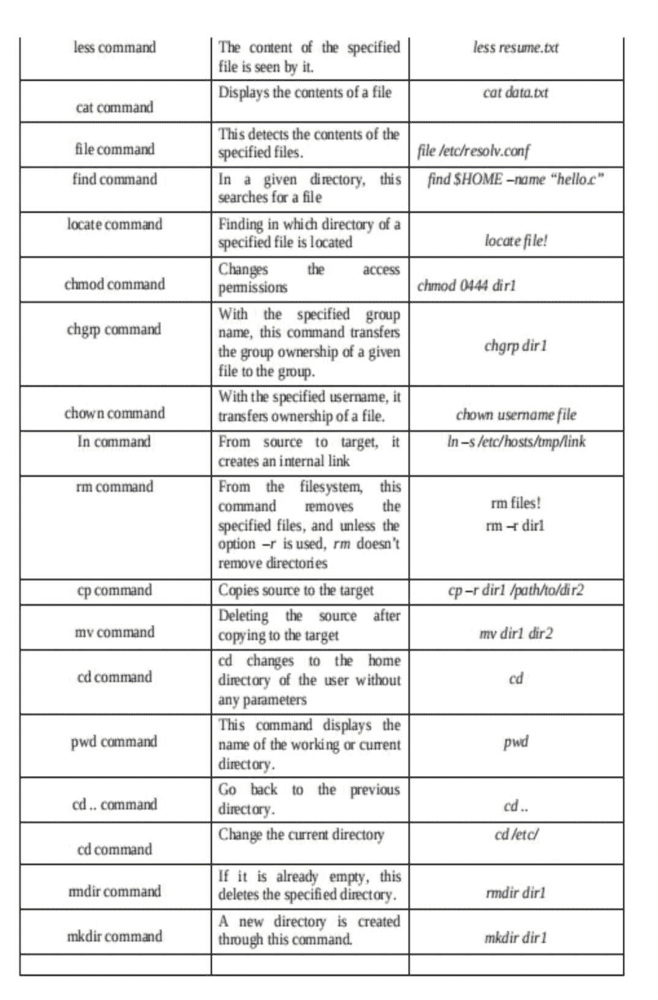

## 要管理的目录
由于你可以从 Nautilus 复制、移动、删除或创建它们，你需要学习像文件一样对待你的目录，并使用 shell 提示符命令来实现。

## 建立目录
你必须学习写权限以便创建新的子目录。大多数用户在 `/temp/` 和家目录以及子目录中拥有这些权限。要使用 Nautilus 创建原始目录，你需要导航到你的新目录。在窗口空白处右键点击并选择创建文件夹。如果你使用带有突出内容的未命名文件夹，将出现一个新的文件夹图标。记住在按下回车键之前给这个新文件夹命名。当你想要从 shell 提示符创建原始目录时，只需执行 `mkdir` 命令。只需输入 `mkdir directory-name>` 用新目录所需的标题替换 `mkdir directory-name>`。

## 目录删除
要在 Nautilus 中删除目录，右键点击图标并将其放入垃圾桶，或在右键点击后将其拖到垃圾桶。要删除空目录，请从 shell 提示符输入 `rmdir` 命令。要删除非空目录及其所有内容，请使用 `rm –rf directory>` 命令。


Dotfiles 同样是由“点”开文件夹创建的并包含在程序中的。应用程序所需的其他文件存储在一个隐藏的配置目录中，这是一个用于 dot 的目录，而这些文件都包含在一个隐藏的配置文件中。这些目录通常是用户特定的非配置文件，只有安装了它们的用户才有权访问。

## Linux 文件权限
Linux 是 UNIX 的克隆，因为它允许多个用户同时访问系统，并且它是一个多用户操作系统。Linux 也可以在不修改的情况下用于服务器和大型主机。然而，这种情况带来了安全问题，因为重要数据可能会被恶意或不受欢迎的人删除、修改或损坏。因此，Linux 将授权分为两个层以确保适当的安全：

1. 获取权限
2. 

所有权和权限是 Linux 中的重要概念。我们将从所有权开始，因为两者都将被评估。

### Linux 中的文件所有权
你 Linux 系统上的每个目录和文件都有三类不同的所有者。

用户组由许多人组成。此外，组中的所有用户对文件具有类似的访问权限。如果你正在进行一个项目，你需要与其他人共享文件。与其手动为每个用户提供权限，你可以将所有用户添加到组中。当你对文件应用组权限时，其他人将无法更改或查看它。

- **用户 (User)**：文件的所有者是一个用户，如果你是创建文件的人，默认情况下你就是所有者。因此，作为所有者，你可能也被称为用户。
- **其他 (Other)**：在这种情况下，任何其他用户对文件的访问被称为“其他”。这种用户不是创建或拥有该文件的用户组的成员。在大多数情况下，这可以是任何人。当你为“其他”设置权限时，通常被称为为全局（globe）设置权限。

最后，出现了差异化问题。如何在不向另一方泄露敏感信息的情况下，将这三类用户分开？向使用你 Linux 机器的同事隐藏你电脑上的图像是常见做法。权限也是如此，你可以通过用户行为来指定它们。我们可能需要再次回顾 Linux 权限系统，以便你完全理解。

### 权限
下面列出的三种权限定义了上述三个所有者对你 Linux 系统中每个目录和文件的权限。

- **执行 (Execute)**： Windows 中有一个扩展名为 ".exe" 的可执行应用程序，因为你可以有效地运行它。然而，除非在 Linux 中设置了执行权限，否则你将无法启动应用程序。即使你不能运行它，如果你设置了写入和读取权限，你可能也可以更改或查看程序代码。
- **写入 (Write)**：如果你有写入权限，你将能够编辑文件的内容。作为写入权限的一部分，你还可以修改、删除和向目录中添加文件。你可以猜到文件所在的位置，因为你对目录没有写入权限，但你确实需要文件的写入权限。你有更改文件内容的能力。但是，你将无法从目录中删除、移动或重命名文件。
- **读取 (Read)**：使用此权限授予的权限，你可以读取和打开文件。因为你有读取权限，你还可以列出目录的内容。

## SSH 命令
`ssh` 是每个 Linux 系统标准自带的命令。该命令启动 SSH 客户端，在远程机器上的 SSH 服务器上建立安全连接。`ssh` 命令用于在远程设备上执行指令并在两台计算机之间传输数据，从登录远程工作站等各种功能。

### Linux 的 SSH 命令
`ssh` 命令在不安全的网络和两个主机之间建立安全的加密连接。它也可以在隧道传输其他应用程序时用于文件传输和终端访问。你可以从远程位置通过 `ssh` 安全地运行图形化 X11 程序。

### 附加 SSH 命令
除了客户端 `ssh` 之外，每个页面上还有其他的 SSH 命令。

- `sshd` - OpenSSH 服务器
- `sftp` - 具有类似 FTP 命令界面的文件传输程序
- `scp` — 用于文件传输的 RCP 相关的命令界面
- `ssh-add` - 一个允许你向 agent 添加密钥的实用工具
- `ssh-agent` – 用于持有单点登录私钥的代理
- `ssh-copy-id` – 将公钥配置为服务器上的授权
- `ssh-keygen` — 生成用于身份验证的密钥对

## 第 9 章：Linux 终端、编辑器和 Shell
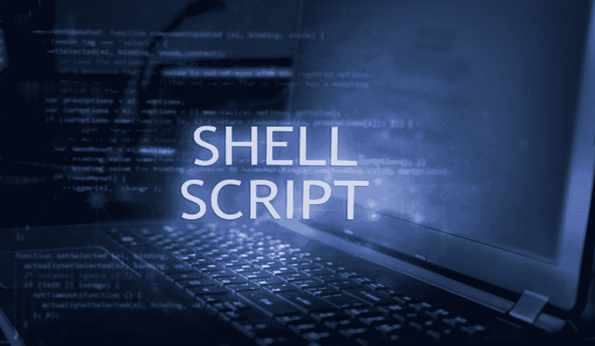

无论你是已经使用 Linux 长期，还是初学者，你都可以获得关于启动终端的帮助。终端无疑是一个具有许多益处的强大工具，它并不可怕。你无法通过阅读单本书或一篇文章来学习关于终端的所有知识。亲自操作终端需要练习。

### 终端使用的基础知识
当你打开终端时，`bash` shell 会出现在你桌面的程序菜单中。尽管有不同的 shell，但大多数 Linux 发行版默认使用 `bash`。你可以通过在提示符输入输入名称来启动程序。然后，你在这里启动的任何内容都是程序，从命令行工具到图形化应用。尽管这些操作在程序中很常见，但 `bash` 提供了几个用于文件管理的内置命令。而且，与 Windows 不同，你可能不需要输入应用程序的完整路径来启动它。例如，当你尝试在 Windows 上打开 Firefox 时，你必须输入 `.exe` 文件的完整路径。在 Linux 上，输入以下命令：

```
Firefox
```

要使用它，输入命令并然后按回车键。在 Linux 上不需要为程序添加 `.exe` 或其他任何内容，因为它没有。接受参数（arguments）也是终端命令的一个功能。你可以针对程序使用某些类型的参数。例如，Firefox 接受 Web 地址作为参数。

### 软件安装
最节省时间的方法之一是从终端安装软件。软件管理程序是某些在后台运行终端命令的复杂界面，例如 Ubuntu 软件中心。这样，你不需要通过选择和点击应用程序来逐一安装，而可以在终端后台进行。你还可以使用单个命令安装许多应用。因为你可以看到其他发行版如何处理包管理，你可以使用以下命令在 Ubuntu 上安装新的软件包包：

```bash
sudo apt-get install packagename
```

它与上面的 Firefox 命令类似，但稍微困难。在运行 `apt-get` 之前，通过 `sudo`，你可以以 root（管理员）权限运行上述行。`originalname` 将读取参数 `apt-get` 程序后安装名为 `originalname` 的包。另一方面，可以指定多个包作为参数。例如，要安装 Pidgin 即时通讯工具和 Chromium 浏览器，运行以下命令：

```bash
sudo apt-get install chromium-browser pidgin
```

如果你想在安装 Ubuntu 后安装所有你喜爱的软件，可以使用类似上面的单个命令。你选择的程序的包名就是你唯一需要知道的，因为你可以很快地猜出它们。你的预测也可以通过 Tab 补全方法进行修正。

## 桌面 Linux 文本编辑器


对于某些文本编辑器来说，能够兼任 IDE 的功能是非常有益的。它们通常也是系统的默认编辑器。这些编辑器在 Linux 环境以及在 Linux 桌面环境中开发应用程序时非常有用。尽管有许多文本编辑器可用，但我们将重点介绍少数几个。现在，让我们开始吧：

## Emacs (GNU Emacs)

GNU Emacs 历史悠久，是 Linux 环境最早的文本编辑器之一。它是由 GNU 项目的创始人 Richard Stallman 创建的。全球有成千上万 Linux 程序员将其作为他们首选和最喜欢的文本编辑器。他们借助 `C` 和 `LISP` 的帮助创建了它。使用以下脚本在 Linux Mint 或 Ubuntu 上安装 `emacs`：

```bash
linuxtechi@linuxtechi:~/Downloads$ sudo apt-get update
linuxtechi@linuxtechi:~/Downloads$ sudo apt-get install emacs
```

GNU Emacs 包含许多独特特性，包括：
- 丰富的支持和文档。
- 调试器界面中的新闻和邮件。

除了文本编辑器外，`Atom` 和 `notepadqq` 也可以在 Linux 桌面面上作为 IDE 和文本编辑器使用。

## Nano

Nano 是另一种用于 UNIX 系统的流行文本编辑器。它于 2000 年发布，与 `Pico` 文本编辑器相同。它还有一些新功能，使其成为更先进、更强大的文本编辑器。它仅在界面上可以从命令行运行。以下是 Nano 的一些显著特征：
- 支持 Autoconf
- 标签页补全
- 自动缩进
- 区分大小写的搜索

## Kwrite

Kwrite 最初于 2000 年向公众提供，由 KDE 开发。它在很大程度上基于 KDE 的 `Kate` 文本编辑器以及 `KParts` 技术。你可以通过安装其他插件来极大扩展 `Kwrite` 的功能，使其成为一个更强大的编程环境。除了编码之外，它还可以用于编辑远程文件。要在 Linux Mint 或 Ubuntu 上安装 `kwrite`，请执行以下命令：

```bash
linuxtechi@linuxtechi:~/Downloads$ sudo apt-get install kwrite
```

Kwrite 有几个独特特性：
- `vi` 输入模式
- 语法高亮
- 自动缩进
- 单词补全

## Eclipse

对于前端设计师和开发者来说，`Eclipse` 编辑器可以作为先进且强大的代码/文本编辑器的合适解决方案。它完全用 `JAVA` 设计，因为它具有各种功能，使设计和编写 Java 应用程序变得简单。它也深受 Java 程序员的喜爱。如果有人需要更多语言支持，他们可能需要安装额外的插件。通过借助额外的插件向编辑器中整合新功能，`Eclipse` IDE 会变得更加强大。你可以用它创建 `COBOL`、`Ruby on Rails`、`C++`、`C`、`Python` 和 `PHP` 等语言程序。使用以下命令在 Linux Mint 或 Ubuntu 上安装 `eclipse`：

```bash
linuxtechi@linuxtechi:~$ sudo apt update
linuxtechi@linuxtechi:~$ sudo apt install eclipse
```

以下是 Eclipse 的一些突出特性：
- 支持插件
- 为 Java 开发者提供 Java 开发工具。
- 开源免费的文本编辑器。

## Kate

如果你熟悉 Kubuntu 桌面环境，你可能需要了解 `Kate` 文本编辑器，它是作为默认编辑器加载到 Kubuntu 环境中的。因为你可以将其作为一个强大的 IDE 使用，你还可以同时处理多个文件，因为它有一个易于使用且轻量级的文本编辑器。要在 Linux Mint 或 Ubuntu 上安装 `Kate`，请运行以下命令：

```bash
linuxtechi@linuxtechi:~$ sudo apt-get install kate
```

Kate 有许多显著特征，包括：
- 自动处理文档缩进。
- 自动检测语言。
- 支持多种语言。
- 一个健壮的 IDE。

## Gedit

在 GNOME 桌面环境中，`Gedit` 默认作为文本编辑器安装。`Gedit` 的目标相似，即具有简单简洁的用户界面且非常轻量，这与 `GNOME` 持续提供简单简洁功能的目标一致。直到 2000 年，公众才能使用 `GNOME` 桌面环境。因为它完全用 `C` 编程语言编写，因此它完全支持国际化文本。`Gedit` 有几个独特特性，包括：
- 支持多种编程语言。
- 支持国际化文本。
- 语法高亮

## Brackets

Adobe 于 2014 年发布了 `Brackets` 作为 Linux 系统的文本编辑器。它提供了许多有趣的特性，使其作为开源文本编辑器使用变得非常有趣。它既直观又于使用，布局清晰。它旨在为程序员和网页设计师提供代码编辑器和文本编辑器，以获得所需的帮助。他们完全用 `JavaScript`、`CSS` 和 `HTML` 创建。尽管它很轻量，但由于其先进的特性，一些优秀的文本编辑器可能无法涵盖所有功能。你可以使用以下命令在 Linux Mint 或 Ubuntu 上安装：

```bash
linuxtechi@linuxtechi:~$ sudo add-apt-repository ppa:webupd8team/brackets
linuxtechi@linuxtechi:~$ sudo apt-get update
linuxtechi@linuxtechi:~$ sudo apt-get install brackets
```

文本编辑器 `Brackets` 有几个独特特性，包括：
- 专注于专注的视觉辅助 - 预处理器支持
- 实时编辑
- 可实时预览。

## Sublime Text

Sublime Text 是一款文本编辑器。一个对 Linux 环境如此推崇的文本编辑器是非常棒的编辑器。它具有各种功能，既可以作为开发环境也可以作为文本编辑器使用。除了许多标记语言外，它还支持广泛的编程语言。许多可插件也从很大程度上扩展了其功能，使文本编辑器变得更加复杂。该文本编辑器的一个突出特性是能够使用“跳转任意”选项到系统上的任何文件或直接跳转到代码部分。要在 Linux Mint 或 Ubuntu 上安装 sublime text 编辑器的稳定版，只需运行几条指令。以下是 sublime text 编辑器的一些独特特性：
- 项目特有的偏
- 基于 Python 的插件 API 用于并行代码编辑
- 优秀的命令面板

## Geany

Geany 是 Linux 环境中广为人知的文本编辑器，包含了 `GTK+` 工具包集成。`Geany` 也可以是程序员和开发者极佳的开发环境。如果你需要编程环境以及文本编辑器，`Geany` 是一个很好的选择。它不需要安装任何其他包即可正常工作，因为它支持几乎所有主要的编程语言且非常轻量。你只需要使用一个命令在 Linux Mint 或 Ubuntu 上安装 `Geany`。Geany 有几个与的特征，包括：
- 插件式界面简单易用。
- 行号帮助你跟踪代码。
- 有许多自定义选项。
- 为了方便开发，使用了语法高亮。
- 用户界面简单直观。

## VIM


因为 Linux 默认的 "vi" 编辑器可能让你感到无聊，如果你喜欢在复杂的文本编辑器中编辑内容时拥有大量的选项和强大的性能，那么 `vim` 将是你的最佳替代方案。`vim` 的定义正如其名称暗示的那样是“vi 增强版”（vi enhanced），它是默认 Linux 文本编辑器的高级版本。在创建它时，他们考虑了开发者的特定需求。由于其广泛的自定义功能，它也被称为程序员编辑器。它可以作为一个独立的 GUI 程序使用，也可以作为一个命令行实用程序，与 `Vi` 编辑器类似。以下是 VIM 的一些独特特征：

- 自动执行的命令
-   输入双键组合位（Input digraph）
-   屏幕分屏
-   会话屏幕上的制表符扩展
-   标签系统
-   语法高亮

## Linux Shell：概览

如果你使用任何主要的操作系统，你都在间接地处理 shell。如果你正在使用 Linux Mint、`Ubuntu` 或另一个 Linux 发行版，每当你使用终端时，都在与 shell 交互。在我们开始之前，有几个术语必须理解，我们将在下一章节中详细介绍它们。

## 第 10 章：

 基础 Linux Shell 命令

shell 命令用于 Linux 上的分析。shell 是用户在终端仿真窗口中交互的程序。仿真窗口是 Linux 上工作站的伙伴终端（mate-terminal）GUI。它也是类似于 `PuTTY` 或安全外壳客户端的应用程序；在 Windows PC 上的 `SSH` 安全外壳，你可能通过网络将其注册到 Linux。在某些企业或组织情况下，他们采用 Bourne Again Shell，即 `bash`。如果你愿意，可以从中选择多种 shell，包括 `TC-Shell`、`C-Shell` 和 `Bourne Shell`。它们都具有相同的性质，因为它们拥有各自特有的特殊属性。以下特征属于 `bash`：

- shell 的历史记录系统正在运行，因为它记得最后几条指令。除了引用编号外，你还可以使用 `history` 命令列出之前的几个命令。
- 你可以从工作站的终端仿真窗口历史记录中剪切和粘贴来重新运行命令。符号 `!` 也可以用于重放过去的任何命令。
- shell 还有“任务控制”功能，允许你在后台运行任何不需要终端交互的程序。
- 当程序 `sort` 在后台运行时，shell 可以立即用于执行额外的命令。在这种情况下，shell 会打印作业控制号 "1" 以及进程标识号 "3470"。你也可以使用特殊字符 `Ctrl + z` 挂起正在前运行的程序。然后你可以使用 `fg` 命令让程序继续在前台运行，或使用 `bg` 命令将其放入后台。如果有许多后台或挂起的程序，你可以通过它们的作业编号来引用它们。要查看你的作业及其作业编号，请使用 `jobs` 命令列出任何挂起或后台作业的状态。
- 你可以编写 shell 命令脚本，就像编译后的程序一样，你可以通过命名来调用它们。例如，我们最初可能会在 `/bin` 中创建一个文件，其中包含创建一个脚本的命令，该脚本用于统计最近目录中 `C` 程序文件的数量。
- 可以在正常运行该文件之前，使用 `chmod` 命令使文件具有可执行权限。
- `Bash` 是一种解释型编程语言，使用 `if-then-else` 表达式、`for` 循环和 `while` 循环。如果你输入以下命令，将获得更多关于 Linux 在线文档的信息：
- shell 中可以找到数值和字符串值的变量。
- `$HOME` 目录已为某些变量进行了预配置，`set` 命令显示已赋值变量列表。
- 如果你发现输入困难或经常执行特定的命令或一组指令，你可能想要分配别名（aliases）。例如，在当前目录中，我们可以为使用 `wc` 生成的行计数分配别名 `countc`，并使用 `ls` 显示文件以统计 `C` 程序文件的数量。
- shell 引以为傲具有将一个程序的输出管道到另一个程序的输入的能力。管道的符号是 `|`。例如，在 `wc` 程序中，我们可以在 `cat` 文件后管道输出，以便统计文件 A 中的单词数。
- 大多数 Linux 程序和指令都遵循标准输出和标准输入的原则。平均输出是程序写入的数据流，而标准输入是程序读取的数据流。终端通常伴随着大多数程序，这样输出就可以显示在屏幕上，而输入可以通过键盘提供。可以使用 shell 将标准重定向到输出和输入。
- shell 会扩展最近目录中的通配符以匹配文件名。例如，你可以使用某个命令列出名为 "anything.c" 的文件的目录列表。
- 命令包含的参数字符串用于表示文件名。例如，命令可以将你主目录下的当前目录更改为 "bin"，波浪号 `~` 的含义是 shell 是你的主目录。
- 为了识别它，必须首先验证内置元素是否与命令链接，之后它可以通过输入命令名称来搜索一组目录。这指的是搜索路径，包括搜索路径、其子目录 `bin` 以及当前目录中的你的主目录。当你完成应用程序编写后，可以通过输入它们的名称来调用它们。无论你现在处于哪个目录，只要你将此类程序放在该目录，它就会被发现并运行。
- 你可以通过命名来使用命令。大多数 Linux 命令都只是 shell 运行的程序。例如，当你使用命令 `ls` 时，它可以列出它的文件名并读取最近目录，你将获得特定的结果。
- shell 和其他程序一样，关联了一个当前目录。Linux 程序利用当前目录作为起点。使用 shell 的 `cd` 命令，你可以通过更改最近目录来访问 Linux 文件系统中的不同位置。
- 此提示符可以由用户自定义。默认提示符是一个美元符号，后跟着 `bash` 和 `bash` 程序的版本号。
- 借助额外的 bash 机制，你可以通过向上方向键使用之前的编辑和召回命令。当你按下终端顶部的向上方向键时，最后的命令将再次，你可以再次按下向上方向键接收之前的命令。要重放命令，按 `RETURN`。在重新运行命令之前，你可以通过向后方向键移动光标插入或删除字符，或通过删除键删除末尾字符来编辑命令。

## Shell 中的命令

下面是可访问命令列表。关于每个命令的更多信息可以在手册页的参考部分找到。要在线查看这些内容，请在选择名称后输入 `man`。

### 数据库管理

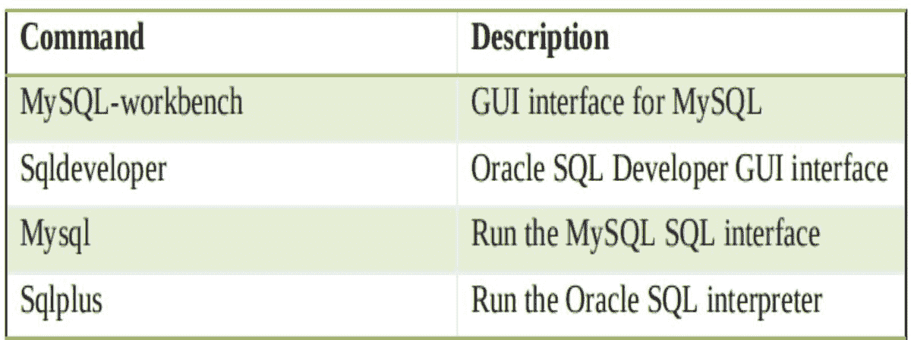 `Oracle` 和 `MySQL` 是两个可以管理的数据库。

`LibreOffice` 是一个文字处理器，并且兼容 `Microsoft Office`。

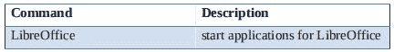 EURU1269036 Antichi Colli Load `TeX` 是一种广泛使用的排版语言，用于使用 Linux 或或其他操作系统创建高质量的打印文本。当在 Linux 上格式化指令页面时，另一个基于 `Troff` 的应用程序集合也常用。

`TeX`

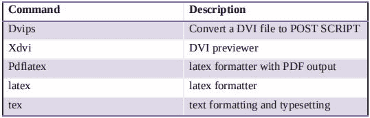

`Troff`

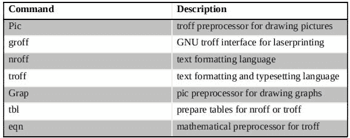

#### 普通命令

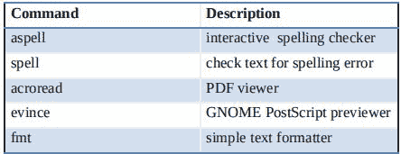 这些语言和编程工具均可用。

  `JAVA`

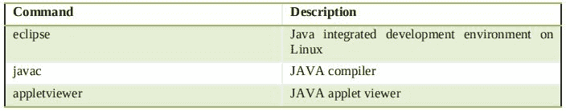 `C++`

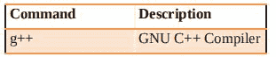 `C`


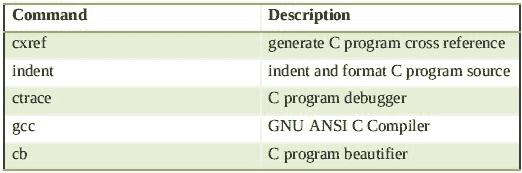

## 通用

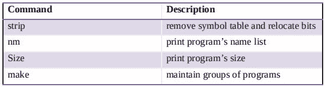

## 其他语言（这些语言在所有系统上均可用。）

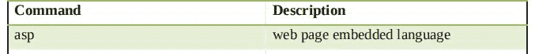
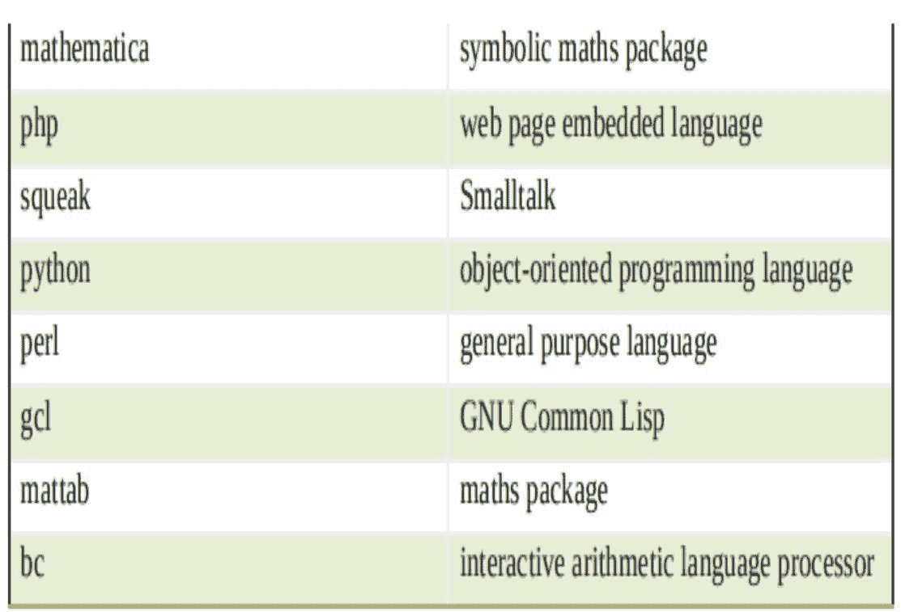

## 网络

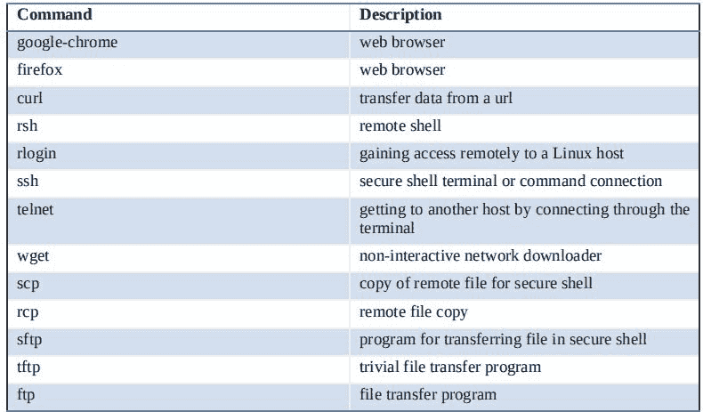

### 用户之间的交互
Linux 系统提供了向其他用户发送屏幕消息以及发送电子邮件的功能。

 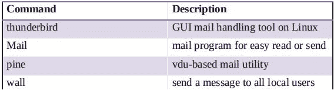

### 打印
与其他可能打印文件的命令一样，打印机名称将在 `-p` 参数之后指定。文件可以作为简单的文本文件提供给打印机或激光打印机，并可以以多种方式进行处理。

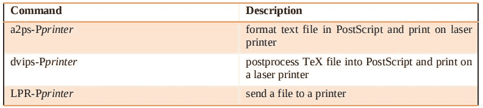

可以使用 shell 直接从某些应用程序或通过 GUI 打印管理器打印文件。你必须提供打印机名称，这里是一些示例：

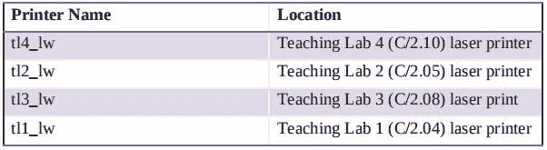

### 状态
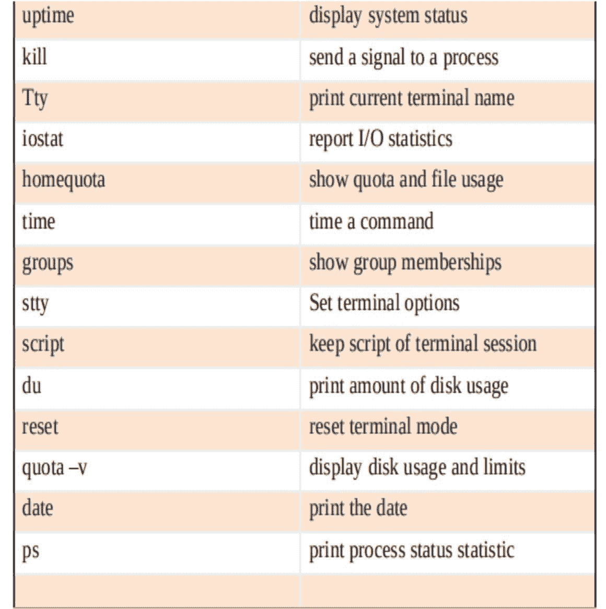 这些命令用于更改或显示系统信息。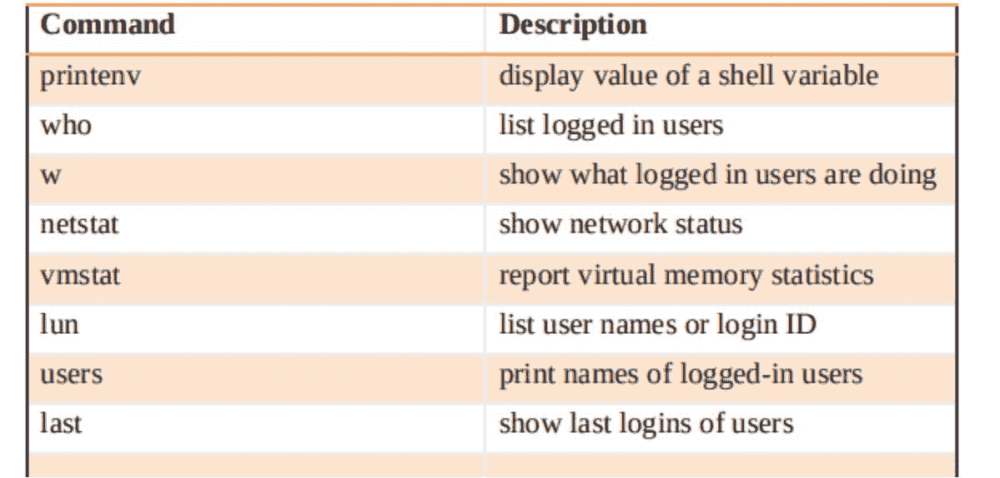

### 信息
这里是一些用于收集信息的 shell 命令。

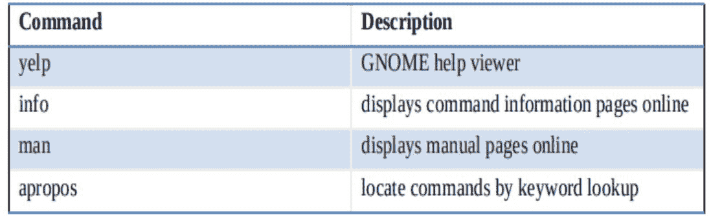

### 压缩文件
你可能需要压缩文件以节省空间。要分析和创建压缩文件，请使用以下命令。

 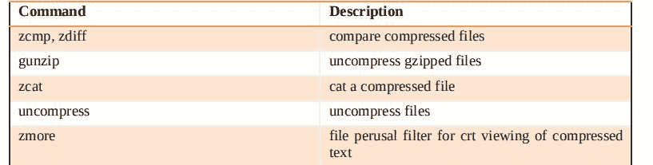

### 数据处理
下面的命令可用于更改或比较文件内容。

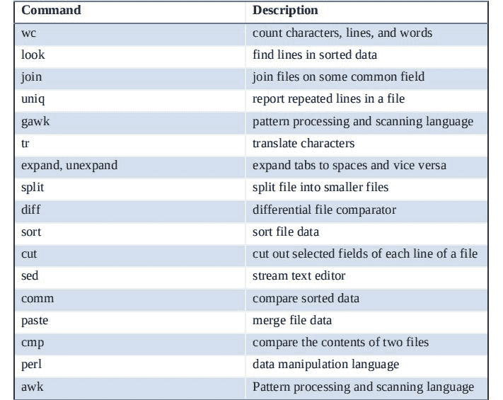

### 文件编辑器
使用编辑器，你可以修改文件并创建新文件。

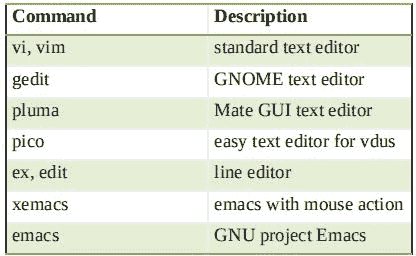

### 文件目录
这些命令允许你管理文件并创建文件目录。

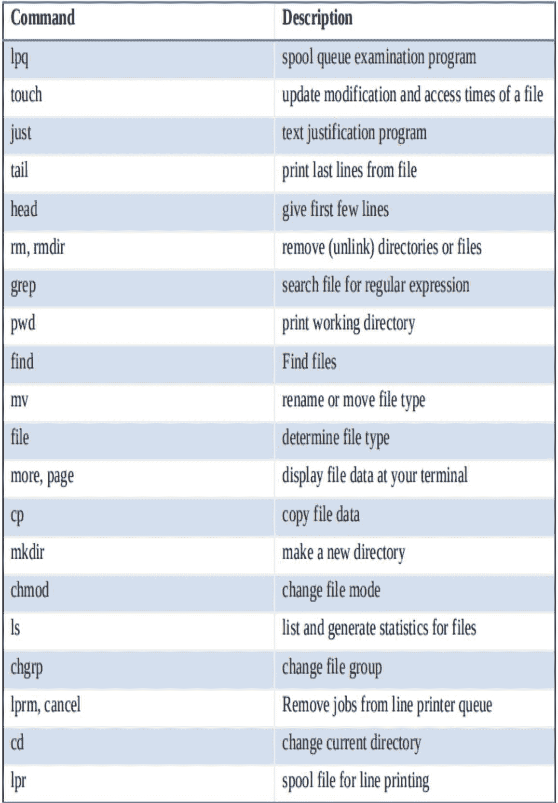

### 退出程序
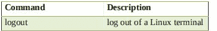

需要注意的是，你需要离开的不是 Linux 工作站而是桌面环境。

## 第 11 章：Shell 脚本


Shell 脚本是一个包含 Linux 操作系统命令序列的文本文件。shell 脚本的命令必须通过键盘一个一个地写入到单个脚本中。shell 是命令行界面的操作系统，充当用于与系统通信的命令的解释器。用户必须经常使用 shell 脚本的命令序列以节省时间。子命令、注释和参数都必须被 shell 遵循，就像其他程序必须一样。用户可以通过在 shell 的命令行提示符中输入文件名来启动命令序列。在 DOS 操作系统中，shell 脚本被称为批处理文件，而在 IBM 主机 VM 操作系统中，它被称为 EXEC。

由于 shell 应用位于 Linux 操作系统内部，因此你可以输入执行系统所需的命令。当在 Linux 计算机上启动终端窗口时，shell 软件将启动，允许你通过界面输入命令。人们将这种界面称为命令行界面 (CLI)。输出显示在屏幕上，当输入命令时 shell 会执行它。除了能够交互式地执行和接受命令外，shell 还可以执行包含在文件中中的。这种执行方式被称为 shell 脚本。

## Shell 脚本是如何工作的？

Shell 脚本编写涉及几个基本步骤，包括赋予 shell 执行权限、使脚本可被 shell 访问以及编写脚本。由于 shell 脚本包含 ASCII 字符，可以使用图形用户界面 (GUI)、文字处理器或文本编辑器进行编写。shell 可以解析脚本内容中一组命令的语言。shell 脚本支持快捷方式、数组、if/then/else 表达式、变量和循环等。文件完成后，将其以 `.sh` 或 `.txt` 扩展名保存到 shell 可以访问的位置。

### shell 的背景

Ken Thomson 在 20 世纪 70 年代创建了 Unix 的 shell 应用 V6 Shell。尽管它具有带有交互元素的 shell，但它的编程能力非常差。Bourne Shell 在 1977 年被引入 root 账户，今天仍被用作默认 shell。而且，得益于它的脚本能力，随着时间的推移，它被证明非常有用。20 世纪 80 年代，流行的 shell 变体 Korn Shell 和 C-Shell 为公众提供了丰富的话题。这些 shell 中的每一个都有了自己的语法，这与原始 shell 有显著偏离。因此，Bash 是目前非常流行的 shell。它代表 Bourne-Again-Shell，是独特的 Bourne Shell 的显著升级变体。

## Shell 脚本应用示例

当你使用 shell 脚本时，通过一次输入一行命令而不是执行重复性过程，可以节省大量时间。以下是可以使用 shell 脚本的一些应用示例：

*   正在监控系统。
*   执行定期备份
*   整合现有举措
*   文件操作批量完成
*   开发程序或在编程环境中工作
*   自动编译代码

## Shell 脚本的执行

如果你想运行 shell 脚本，只需将脚本路径作为参数提供给 shell 即可。你应该意识到 shell 需要 LF 字符（换行符）来结束行。如果你尝试在 Linux 系统上快速运行 shell 脚本或在 Windows 上编写它，很容易遇到麻烦。Windows 使用 CR-LF（回车-换行）组合作为行结束符，而你需要将其转换为仅 LF。你可以使用 Windows 编辑器来完成操作。

shell 脚本可以通过另一种方式作为命令直接运行。你可以在脚本的第一行使用下面的 hash （shebang）：

```bash
#!/bin/bash
```

之后，你可以运行一个程序使你的脚本具有可执行权限。你现在可以无需指定 shell 即可执行该文件。

## Shell 脚本有很多优点

当你使用 shell 脚本时，通过一次输入一行命令而不是执行重复性过程，可以节省时间。它消除了解释方面的担忧，因为它在 shell 命令行中和脚本中使用相同的语法。此外，在编写 shell 脚本时，它要求的学习曲线更短，速度更快。然而，如果 shell 脚本错误未被检查，可能会非常昂贵。此外，shell 脚本可能不兼容不同平台，且 shell 脚本执行时间可能更长。无论如何，shell 脚本还有额外的优点。

### 可移植性

shell 脚本可以传输到其他 Unix 或相关操作系统。此外，当将 shell 脚本从一种架构传输到另一种架构（如 Sparc、MIPS 或 x86）时，其移植性远高于 C++ 程序。要传输和使用 C 程序，你必须首先尝试执行它，然后编译并复制源代码。如果使用了特定架构的代码，它可能无法按预期工作。

### 透明性

由于它是文本文件，你可以轻松查看 shell 脚本正在执行的操作。相反，如果你有源代码或源代码希望告知你，你可以在 C/C++ 等语言中确定程序类型。例如，你可以确定 shell 脚本正在删除哪些文件，如果你需要这些文件，则可以将它们传输到另一个位置。shell 脚本也比传统程序更容易故障排除，因为你可能检查源代码。

### 更容易编写


你可以在标准的 C/C++ 应用程序中高效地执行与 shell 脚本相同的任务。相反，shell 脚本比 C/C++ 应用程序更容易调试和编写。shell 被用于各种系统管理活动，包括重定向输出、删除目录和文件以及运行外部命令。而 C/C++ 应用程序则更适合更低层的操作，例如操作数据结构、启动系统函数等。

## 大量的命令序列

shell 脚本编写的优势之一是，你可以拥有多个独立的命令序列，并自动化常用操作。与记住执行单条命令的方向相比，记住可以执行许多命令的方向可能要困难得多。Linux 操作系统的启动阶段就是一个很好的例子。作为启动过程的一部分，操作系统会执行一系列命令以使系统进入正确状态。这些命令可以在 `/etc` 目录下的 shell 脚本中找到。如果没有 shell 脚本，你可能不得不手动完成整个过程，如果你查看这些 shell 脚本，系统启动过程的复杂性就会显而易见。`/etc/profile` 文件就是一个用户访问系统时可以的 shell 脚本示例。

任务自动化：使用 shell 脚本的第一个优势是，你执行的工作通常可以实现自动化。假设你每天需要完成一组职责。当你需要每天在 Linux 上运行几条命令时，可以将这些命令保存到文件中，然后在脚本中运行这些命令。考虑以下场景：

- 当价格过低或过高满足某些条件时，在解析获取的数据或获取股票价格时发送短信或电子邮件。
- 如果日志文件似乎每天都在增长，你可以对其进行压缩。
- 每天，你可以将一个文件夹或文件上传并存档到如 `S3` 等云存储服务。

## Shell 脚本特性

shell 脚本是一个非常有用的工具。

你几乎可以为任何基于 Linux 的操作系统获取帮助而没有任何抱怨，这非常有用。当你将其与 `sed`、`grep` 和 `awk` 等常用工具结合时，你就有了一个坚实的基础。

### 可读性

使用 shell 脚本，创建不可读内容的几率会大大降低。你无疑可以利用某些其他人未觉的 shell 特殊特性。

### 随时可用

你可以在遇到的任何程序上利用 shell 脚本。它通过自动化单调的任务让你的生活变得更容易。你只需要将选择的指令输入到文件中，并在使其具有执行权限后运行它。它很容易学习，因为它很容易掌握。

### 重复

你不需要每天在 shell 脚本中编写重复的相似语句。创建一个吸引人的函数集，你可以在旧、新的 shell 脚本中使用它们。你可以将你的函数命名为 `"Display"`，但在准备使用它时不要使用 `"echo"`。

## 结论

shell 脚本范围范围为 epsilon、ETL 以及各种其他工具开发工作流以节省时间，这对许多企业来说非常有价值。想要在 Linux 上自动化工作的专业人士和 Linux 用户是学习 shell 脚本技能的目标群体。shell 脚本可以帮助创建具有限制函数、循环和语句的复杂条件程序。shell 脚本也可以用于存储数据。

## 第 12 章：创建脚本


短程序是用 shell 编程语言编写的，并通过 shell 脚本和 shell 进程完成解释。它们对于 Linux 和其他操作系统的任务自动化非常有用。shell 程序是一种为 Unix 相关操作系统提供纯文本传统界面的软件。你可以读取在终端窗口中输入的命令，以及控制台（这是一种全文本显示模式），然后运行其主功能。Linux 默认 shell 是 `bash`，它是一系列你可能翻译的命令，被编译或解释为机器语言形式，并可以被系统的 CPU（即中央处理器）完全理解。编程语言是一种用于创建计算机程序的人造、精确语言。

shell 脚本语言或 shell 编程语言用于生成 shell 脚本，其他 Unix 相关的操作系统使用 shell，每个 shell 都包含一种带有内置功能的编程语言。shell 脚本很容易构建，可以在网上和各种书籍中找到，用于各种任务，这些任务可以在有或没有通知的情况下。这些只是使用 shell 脚本的益处之一。shell 脚本在 Unix 相关操作系统的默认安装中也被广泛使用。

### 第一个脚本是由

通过以下示例，你将很好地理解如何处理和创建 shell 脚本。该脚本会清除显示器屏幕之前的所有行，并在上面写上文本 `Good morning, world`。你可能不需要文字处理器来编写此脚本；相反，你需要使用如 `vi` 或 `gedit` 等文本编辑器。

你也可以复制上面的代码，打开文本编辑器并使用普通键盘的复制和粘贴功能将其粘贴进去。在给文件命名并保存此纯文本后，脚本就完成并准备好运行了。你可以通过在斜杠和点之后输入文件名（它们之间没有任何空格）然后按回车键来启动脚本。如果你将上面的脚本保存为 `morning`，例如，可以使用下面的命令尝试启动它。`./morning`

尽管如此，由于你必须先使文件可执行，你可能会在计算机上看到错误提示。在这种情况下，脚本不会运行。新文件默认拥有的权限只有写和读。你可以使用 `chmod` 命令通过其 `755` 选项简单地解决这个问题。如果你在下方相同的目录中使用此操作，你不仅可以读写该文件，还可以执行它：

```
chmod 755 morning
```

然后，仍在同一目录中，通过执行下面的命令准备启动脚本。继续，请使用回车键：

```bash
./morning
```

### 操作方法

前三行将告诉操作系统使用什么种类型的 shell 进行脚本解释以及 shell 的位置。因为它位于 `/bin` 目录，所以 shell 是 `bash`，该行包含 `/bin/bash`。感叹号和井号始终位于此指令之前，以便操作系统获取信号，表明提供了 shell 的位置和名称以及其他脚本语言。

shell 提醒你可以在第二行使用 `clear` 命令。你可以使用这个简单的命令从终端或控制台窗口中删除之前的所有输出和命令。屏幕上的第三行给 shell 提供了句子 `"Good morning, world."`。`echo` 命令用于重复 shell 指令后的任何内容。即使在更高级的脚本中不需要，但作为一种编程实践，使用引号可以产生重大影响。`Good morning, world` 用稍微更技术性的词汇来说，是输入数据，是命令 `echo` 获取的参数。个人可以自由自由使用的脚本包括 `echo` 和 `clear`，以及额外的命令。当你在屏幕上输入 `clear` 并按回车键时，你将获得输入下一个命令的提示，整个之前的输出和命令都将消失。

这行不通的！


有几个原因导致 `Good morning, world` 没有显示在屏幕顶部，包括：

1. 文件的所有者忘记更新运行该文件的权限。
2. 命令执行时，文件并不所在的同一个目录下。
3. 文件是用文字处理程序而非文本编辑器创建的，因此它不是纯文本文件。
4. 在斜杠或点之后放置了空格。
5. 你在命令中遗漏或反转了正斜杠或点。
6. 文件名与命令中给名称不同。例如，可能存在大小写、拼写差异，甚至多了一个或微小的空格。
7. 你忘记包含 `echo` 单词，导致在复制代码时提交了错误。

不要以管理员用户或 `root` 身份练习执行和开发脚本，这是至关重要的。构造不当的脚本可能会损坏操作系统。在最坏的情况下，可能需要重新安装整个操作系统，导致重要数据丢失。如果由于这个原因计算机上尚不存在普通用户账户，你可以使用 `adduser` 等命令快速建立。

### 实验

如果你是一个好奇心强的用户，在进入更高级的示例之前，可以尝试一系列指导性的简单实验。以下建议包括代码修改、将更改保存为不同的文件名或相似的文件，然后按照上述方法运行它们。

1. 要求更改某些措辞。例如，将该行修改为 `echo "Good morning, everyone!"`。
2. 对于写在屏幕上的行，你可以添加一个或多个额外的行，在任何情况下它们后面都有一个水平空格，并且每行开头都带有 `echo`。
3. 你也可以在两个 `echo` 行之间留一个空行。你可以通过在该行输入 `echo` 来生成一个空行，但仅此而已。很明显，这对结果没有影响。
4. 在之后插入空白水平空格。取决于你在插入主要的引用标记之前还是之后，结果将会有不同。
5. 为文件的执行设置一个不同的目标目录。因此，当你执行它时，你需要在命令名称的开头添加可执行脚本的路径。如果你将文件移动到 `test`（这是一个子目录名称），你将拥有 `./test/morning`。
6. 你可能想作为实验向脚本文件添加其他命令，例如显示磁盘空间使用的 `df`、显示系统硬件和软件信息的 `uname`、显示当前目录的 `pwd`，以及显示系统上正在运行进程的 `ps`。至关重要的是，你可以对脚本的任何命令使用任何接受的参数或选项。

### Hello, World!

为了创建 shell 脚本，你必须执行以下操作：

1. `vi` 是一个你可以用于此目的文本编辑器，在文件中，它包含了你需要的逻辑和 Linux 命令。
2. 你需要退出 `vi`，并在保存文件后关闭它。
3. 脚本的可执行版本至关重要。
4. 在测试完脚本并对结果满意后，你可以进入生产环境。
5. `Bash` 中的某行是一个简单的程序，告诉计算机某条命令。首先，在你选择的文本编辑器（如 `vi`）中打开它。`Vi` 的常用命令：

* 退出 `vi`：按下 `ESC` 后，输入 `:q`。
* 查找字符串：按下 `ESC` 后，输入 `/wordToSearch`。
* 跳转到特定行：按下 `ESC` 后，输入 `:the line number`。
* 在保存文件后退出程序：按下 `ESC` 后，输入 `:x` 或在按下 `ESC` 后输入 `:wq`。
* 保存文件，按照这些步骤：按下 `ESC` 后，输入 `:w filename`。
* 进入命令模式，按照这些步骤：按下 `ESC` 键。
* 进入编辑模式，按下以下键：按下 `ESC` 后，输入 `I`。
* 打开文件，按照这些步骤：在 `vi` 中输入 `filename`。

保存脚本后，它开始运行。

执行 `./hello.sh` 命令导致屏幕上显示错误消息。因为你没有为 `hello.sh` 脚本设置执行权限，它可能运行失败。

### 使用 chmod 命令

`chmod` 命令可更改文件的访问权限。以下是语法：

`filename chmod ugo+rwx`

其中：

* `x` 表示执行权限，
* `w` 表示写入权限，
* `r` 表示读取权限，
* `=` 表示覆盖，
* `-` 禁用
* `+` 启用
* `u` 表示用户
* `g` 表示组
* `o` 表示其他

以下是你可以如何用数字表示法表示的示例：

* `7`：读、写、执行权限
* `1`：执行权限
* `2`：写入权限
* `4`：读取权限

### 错误

程序的韧性经常被用来区分好程序和坏程序。因此，当出现问题时，程序处理某些情况的能力会被测试。

### 退出状态

当程序成功完成时，它返回退出状态 0。如果退出状态为 0，则认为程序以某种方式失败了。当你的脚本结束时，退出状态必须有一个有意义的返回值。Unix 系统管理员可以为创建系统编写特定的代码行，例如 `some directory`。如果一切顺利，这可能不是最糟糕的方法。通过这两行代码将工作目录更改为 `some directory` 所拥有的名称，并且在该目录中删除了该文件。如果 `some directory` 中命名的目录不存在会怎样？脚本将在当前运行的目录上运行 `rm` 命令，并且 `cd` 命令将失败。

### 检查退出类别

你有许多选项来响应并获取程序的退出状态。首先，必须仔细观察 `$?` 环境变量及其内容，并且执行最后一条命令需要一个 `$?` 将包含的退出状态。

`false` 和 `true` 命令除了返回退出状态 0 和 1 之外，它们都是不活跃的程序。上一个程序的退出位置由 `$?` 参数决定。因此，检查退出类别是关重要的。

在这种变体中，检查 `cd` 命令的退出级别，如果它不是 0，则将错误消息打印到标准错误，并以退出状态 1 终止脚本。尽管这是解决这一困境的有效方法，但我们可以通过采用更好的策略来节省一些打字工作。我们可以精确地使用 `if` 语句作为下一个要尝试的技术，因为它可以评估退出状态的给定指令。


当一个目录由于没有父目录或仅包含在另一个目录中时，它被称为根“父目录”（parent）的子目录。因此，当前文件系统中存在文件夹或目录树。而且，正如回溯文件树的特征一样，你始终可以通过从子目录移动到父目录来到达根目录。尽管 Unix 和 Unix 类系统仅有一个根目录，但某些文件系统具有多个根目录，例如 Windows 的驱动器：`A:`、`C:` 等。`pwd`、`ls` 和 `cd`。

工作目录（也称为当前目录）始终位于用户在操作文件系统时使用的一组目录中。使用 `pwd` 打印用户的工作目录。使用 `ls` 列出文件和子目录等（即目录的内容）。你应该注意以下几点：

-   你有时可以使用像 `ls –la` 这样的链标志来代替 `ls -1 –a`。
-   组合使用多个标志，例如 `ls –l –a`。
-   通过 `ls –l`，你可能会看到文件的内容。
-   要显示隐藏（以点开头）的文件，请使用 `ls –a`。

`cd`（切换目录）的简写是 `cd`。它用于切换到不同的目录和父目录。`cd` 的缩写或直接使用 `cd` 是回到主目录，通常是 `/home/username` 或类似的目录。由于 `..` 是简写，`cd ..` 在此目录中可能没有太大影响。要返回最近的目录，请输入 `cd –`。你也可以通过输入 `cd ../..` 等在多个目录层级之间移动。

### `;` `&&` 和 `&`

命令是你输入到命令行提示符并保存到计算机某处的内容；它们始终运行机器码。这些机器码有时是 Linux 内置命令，有时是你自己编写的某些代码，例如某个应用程序。我们可能偶尔想一个接一个地运行命令，可以使用 `;`（分号）来实现：

分号意味着 `ls` 先列出工作目录的内容（`ls`），然后由 `pwd` 打印其位置。接着可以使用 `&&` 运算符来链接命令，这是一个非常实用的功能。如果左侧的命令失败，右侧的命令将不会运行。你可以在同一行中多次使用 `&&` 和 `;`。

如果第一个失败了，第二个会通过 `;` 继续执行。尽管它看起来与 `&&` 相似，但 `&` 有完全不同的用途。当你执行一个耗时操作时，命令行通常会等待该命令完成后才允许你输入另一个。在先前的命令仍在运行时，你将能够运行新命令，但如果你在命令后加上 `&`，这种情况就不会发生。

至关重要的一点是，当我们在命令后使用 `&` 来隐藏进程或任务时，我们假设它是“后台运行”的。然后，要查看当前正在执行哪些后台任务，请使用 `job` 命令。

### 获取帮助

在几乎任何命令之前输入 `man` 都可以打开该命令的手手册（按 `q` 退出 man）。

使用 `-h` 或 `–h` 可以打开该命令的帮助菜单。

### 编辑和查看文件

#### `nedit` / `nano`

`nano` 是一个极佳的命令行文本编辑器，具有极简主义特点，非常适合想要学习数百万快捷键的人或初学者。它对于编程生涯前几年的任何开发者或程序员来说足够了。`nedit` 设置了一个 X 窗口作为一个小型图形化编辑器，具有语法高亮、拖放和点点编辑功能。当你想要修改脚本并重新运行它时，应该考虑使用 `nedit`。其他常见的编辑器，如图形用户界面 GUI 或命令行界面 CLI，包括 `Atom`、`Notepad++`、`gedit`、`vim`、`vi`、`emacs` 等。`VS Code`、`Light Table` 和 `Micro` 是其他一些。语法高亮、搜索替换以及其他功能是目前所有编辑器的标准功能。尽管 `nano` 和 `nedit` 的功能没有 `emacs` 和 `vi` 多，但它们的学习曲线陡得多。在尝试了几种编辑器后，你会找到最适合你的一个。

#### `head` / `tail` / `cat` / `less`

文件的前几行是 `head` 的输出。`-n` 参数指定显示的行数，默认为 10 行。`tail` 输出是文件的最后几行。通过 `tail –n +N`，你可以接收文件的末尾，或者如上所述，从第 `N` 行开始的最后 `n` 行。通常使用终端，尽管 `cat` 用于将文件传输到标准输出流并连接文件列表。你可以用它来快速查看文件，并将其与多个文件或单个文件一起使用。然而，这里要注意：如果你这样使用 `cat`，可能会被指责为 UUOC，即“无意义的使用 cat”（Useless Use of Cat）。你不必担心这个，因为这不是主要问题。

另一个工具是 `less`，适用于快速查看文件，因为它打开了一个类似 vim 的只读窗口。另一个命令是 `more`。相比之下，`less` 的推荐程度更高，因为它提供了 `more` 功能的超集。你可以在它们的 `man` 页面上发现更多关于它们的信息。

### 创建和删除文件及文件夹

#### `mkdir` / `rm` / `rmdir`

你可以使用 `mkdir` 命令创建新的空目录。由于这是不可逆的，你必须谨慎操作，因为 `rm` 可以删除任何文件。可以使用 `-i` 选项来移除“确定吗？”的提示。你可以使用 `rmdir` 命令删除空目录。当你在空目录中运行 `ls –a` 时，你会注意到对其父目录（`..`）以及目录本身（`.`）的引用。只有空文件夹才能被 `rmdir` 删除。

使用 `rm –rf`（`-r` = 递归，`-f` = 强制）可以删除目录及其所有内容。

#### `touch`

`touch` 的发明是为了更改文件时间戳。然而，你可以通过文本编辑器打开它来创建一个空文件，例如 `nano`。你也可以对文件进行更改。此外，还可以使用 `touch`。注意 `z`（`Ctrl+z`）代表后台进程。然后，在打开编辑文件的情况下，按下 `z`。使用 `kill %N` 来杀死后台进程，如 `jobs` 命令所示，其中 `N` 是任务索引。在它运行时，按下 `c`（`Ctrl+c`）停止其处理任何内容。

### 命令历史、链接创建以及文件复制与创建

#### `mv` / `cp` / `ln`

使用 `mv` 重命名或移动文件。你可以将文件 `mv` 到一个新文件、重命名它、保持不变或将其移动到不同的目录。然后使用 `cp` 复制文件。你也可以使用 `ln` 为文件创建硬链接。还可以使用 `ln –s` 为文件创建软链接（符号链接）。硬链接在内存中引用包含文件的相同实际字节，虽然它指向了这些字节，但软链接引用的是原始文件名。

### 命令历史

`bash` 提供了两个主要功能，允许你重新运行和补全命令。第一个功能是 Tab 补全。你只需要在编写命令的第一部分后按下 `tab` 键，即可猜测你正尝试执行的具体操作。当你输入了 `ls t` 并按下 `TAB` 键时，命令将完成。如果发生歧义情况，你可能被迫多次点击 `tab` 按钮。而且由于 `bash` 会记录你之前的命令，你可以通过输入 `r`（`Ctrl+r`）获取它们的简要历史，这将允许对它们进行搜索。要查看命令历史搜索，按下 `r`（`Ctrl+r`）。


如果你想查看文件在系统硬盘或磁盘上占用了多少空间，`df` 命令可以为你显示。在运行此程序时，你会注意到 `-h` 的含义是“人类可读”（human-readable）而不是“帮助”（help）。某些命令使用 `G` 表示千字节，使用 `K` 表示千字节，而不是打印巨大的整数型字节数来显示磁盘或文件大小。`du` 命令显示的是特定目录下子目录的文件空间占用情况。你可以使用 `df` 来查找硬盘上的剩余可用空间。`Du` 也可以用于确定目录的大小。`--max-depth=N` 标志选择从提供的目录向下或向上 N 级的目录，`du` 会处理该参数。`ps` 命令显示用户正在运行的当前进程。

默认情况下，`mkdir` 只创建一个目录。因此，仅用 `mkdir` 创建 `d/e/f` 可能会困难，因为 `d/e` 目录不存在。此外，如果它们不存在，我们可以使用带有 `-p` 选项的 `mkdir` 来创建所有父目录。此外，如果目录不存在，我们可以使用 `mkdir` 配合 `-p` 选项来创建所有父目录。此外，通过 `tree` 的帮助，我们可以更好地可视化显示目录的结构。`tree` 从指定的目录开始整洁地打印整个结构。然而，如果你使用 `-L` 标志，可以限制显示的目录层级。`tree` 输出中可以通过 `-prune` 标志隐藏任何非空目录。此外，该命令将递归地包含任何空目录。

## 杂项

### Exit / logout / passwd

`Passwd` 可用于更改账户密码。你可能需要提供当前密码进行验证。然后，为了避免任何拼写错误，它要求你输入新密码。如果你只是有一个用户账户，`logout` 将退出已登录的 shell。

### / clear

如果你想让新的终端行出现在屏幕顶部，请运行 `clear`。此命令会在提示符下方添加空行。结果是，你能够清理工作区域。此外，在需要查找某些文件，通配符（也称为星号 `*`）是理想的。你可以多次使用 `glob` 命令，因为它等同于字符。

## 处理器、内存和磁盘使用

### htop / top

`top` 显示最近运行的进程以及它们的内存占用情况、所有者以及许多其他细节。`htop` 是 `top` 的交互式升级版本。你应该注意到，通过指定用户名 `-u` 标志，可以限制显示特定用户的进程。

### ncdu

`ncdu` 提供了可导航的文件空间总结，这是改进的 `du` 的典型用法。它具有打开与 `vim` 相关的窗口的功能。要关闭计算机，按 `q`。

### REPLs

求值-打印循环（Evaluate-Print Loop，即 `REPL`）是一种常见的命令行工具，用于某些编程语言。虽然函数 `quit()` 可用于退出，`python` 命令可访问 Python REPL。你也可以使用 `R` 命令启动 R REPL，并使用函数 `q()` 退出。你还可以打开 Scala REPL 并使用 `:quit` 命令退出，这通过 `scala` 命令实现。你可以使用 `jshell` 命令打开 Java REPL，并使用 `/exit` 命令关闭它。如果你需要，可以使用 `^d` (Ctrl+d) 退出任何 REPL。在 Unix 上，`d` 表示输入的结束，它也表示文件的结束，即 EOF。

### -v / --version / -version

大多数应用程序和命令使用 `--version` 或 `-version` 标志来获取软件版本。即使对于大多数应用来说，这个元素并不直观，但这些信息通常可用。你应该注意到，有些程序使用 `-v` 作为版本标志，而另一些程序在执行应用程序或打印各种诊断信息时表示“详细”（verbose）。

## 环境中的变量

环境变量是在 `bash` shell 中可以使用和创建的持久变量，“env vars”是它们的简写。你可以配合美元符号 (`$`) 使用它们，并且它们使用等号 (`=`) 来进行定义。当你使用 `printenv` 时，可以看到所有最近定义的环境变量。你可以通过 `=` 运算符创建一个新的环境变量。重要的是记住 `=` 前后不能有空格。你可以通过使用带有 `$` 符号的 `echo` 命令将特定的环境变量写入终端。尝试使用引号 (`"..."`) 包围环境变量周围的所有空格。此外，要小心，因为不会有警告，你可能会通过给它重新赋值来覆盖环境变量。除了上述出的选项外，你还可以使用 `export` 命令来定义环境变量。当你从此 shell 调用命令时，子进程可能也可以访问这些环境变量。如果你使用 `unset` 命令或让 `=` 的右侧留空，可以取消环境变量。

## 第 14 章：高级 Bash Shell 命令


shell 既是一个命令解释器，也是一种相当强大的编程语言，而不仅仅是连接用户和操作系统内核的缝隙。你还可以通过组合内置二进制文件、实用、工具和系统调用，在 shell 程序内部使用称为脚本的简单设备来创建程序。整个 Unix 工具、插件和命令库都可以通过 shell 脚本调用。如果这还不够，外部 shell 命令（如 `loop` 和测试结构）可以为脚本提供更大的灵活性和威力。 脚本特别适用于系统管理活动以及其他例行、重复性工作，因为它们不需要一种完整、紧凑且功能完备的编程语言。

## 正则表达式：概述

表达式是字符字符串。元字符是意义扩展了其字面含义的字符。例如，引号符号可以表示某人的话，随后的表示元含义的符号也是如此。正则表达式是用于指定或匹配模式的元字符或字符。以下是组成正则表达式的一些元素：

-   **修饰符**。通过更改这些修饰符，可以缩小或扩大正则表达式匹配的文本范围。
-   **锚点**，如果可以这么说。它指定了文本行与正则表达式之间的位置。例如，锚点是 `$` 和 `^`。
-   **字符集**。这些字符的字面意义被保留。字符集是最简单的正则表达式类型。


## 正则表达式基础

- 转义字符 — \ — 它们的特性被误解，因为它是一个独一无二的字符。

`\$\$` 还原到其字面意思 `$`，而不是其在正则表达式中的行尾含义。此外，`\’` 的字面意思是 `\\`。

- **括号 – `[...]`** – 包围一组字符，用于单个正则表达式的匹配。

通过混合括号字符序列，可以匹配常见的单词模式。例如，“yes, Yes, YES, yes, 等与 `[Yy][Ee] [Ss]` 之间存在匹配。”`[0-9]` 是任何社会安全号码的另一种匹配方式。`[0-9] [0-9][0-9] [0-9] [0-9] [0-9] [0-9] [0-9]`。

除了 `b` 到 `d` 范围内的字符，所有字符都匹配 `[^b-d]`。反转或否定是后续正则表达式含义的一个常见示例（在另一种语境下，它起着类似的作用！）。

- 任何对应于字母 `[a-z0-9]` 的数字或小写字母。

- 任何匹配 `k` 到 `y` 和 `b` 到 `P` 范围内 `[B- Pk=y]` 的字符。

- 任何匹配 `c` 到 `n` 范围内 `[c-n]` 的字符。`[xyz]` 匹配字符 `x`、`y` 或 `z`。

- 正则表达式的结束对应行尾的美元符号 — `$`。

匹配空行的符号是 `^$`。

`XXX` 匹配行尾的 `XXX$`。

- 脱字符符号 —`^`—匹配行首，根据上下文它有时会否定正则表达式中字符序列的含义。

- 任何除换行符外的字母都匹配点 —`.`.。

尽管没有缺失 13 个字符，但 "13" 对应 `13 +` 至少一个其他字符，包括空格：`1133`、`11333`。

- 除了零次出现外，任何带有正则表达式或字符字符串重复的数字都匹配星号 — `*`—。

`11 +` 一个或多个 `3` 由 `1133*` 表示：`113`、`1133`、`1133333` 等。

- 更长的正则表达式。基础字符集中还有其他字符。它们在 `perl`、`awk` 和 `egrep` 中被使用。

- 加号符号 —`+`—由一个或多个前一个正则表达式匹配。虽然它不匹配零次出现，但它的功能与 `*` 相同。

- 问号符号 —`?`—由零或一个前一个正则表达式匹配。

- 大括号 `\{}` 用于指示出现次数。

`[0-9]{5}` 匹配正好五个数字。

`[0-9]{5,}` 匹配五个或更多数字。 

`[0-9]{5,8}` 匹配五到八个数字。

- 圆括号 `()` 用于分组正则表达式的部分。

- 管道符号 `|` 充当（OR）运算符。

- 反斜杠 `\` 用于转义特殊字符。

## 字符类

- `[:digit]` 匹配任意数字。

- `[:alpha]` 匹配任意字母字符。

- `[:alnum]` 匹配任意字母数字字符。

- `[:xdigit]` 匹配任意十六进制数字。

- `[:upper]` 匹配任意大写字母。

- `[:space]` 匹配任意空白字符。

- `[:posspace]` 匹配任意空白字符。

- `[:print]` 匹配任意可打印字符。

- `[:graph]` 匹配任意可打印字符（排除空格）。

- `[:lower]` 匹配任意小写字母。

- `[:loweralpha]` 匹配任意小写字母数字。

- `[:blank]` 匹配空格或制表符。

- `[:cntrl]` 匹配任意控制字符。

## 结

感谢阅读《入门 Linux 命令行》。我们希望这本书对你有所帮助，并且它提供了实现你目标所需的所有工具，无论你的目标是什么。

如果你读到了这里，可能是因为你想学习如何操作 Linux 操作系统，并理解许多命令行以及使用它们的最佳方法。你一路走到这里，是因为你想学习组成 Linux 操作系统的许多不同组件，以及如何安装不同的 Linux 变体。

在本书中，你学习了 Linux 内核和操作系统、Linux 目录结构、一些基础 Linux Shell 命令、如何处理磁盘、媒体和数据，以及更多内容。这本书为你提供了关于基本终端、编辑器和 Shell 的足够信息，让你能够更好地掌握如何使用 Linux 以及一些相关工具。

