# Linux 命令行简易：面向初学者和中级者的 Linux 命令实用分步指南


## 引言

欢迎阅读《初学者 Linux 命令行指南》，感谢你选择这本书作为通往 Linux 世界的钥匙。请注意，本书是为 Linux 初学者编写，而非高级用户。无论你是从 Windows 还是 OSX 版本转换，还是准备尝试 Linux，这本书对你来说都将价值连城。

然而，尽管这本书确实非常适合初学者，但它不会让你在一夜之间从新手变成 Linux 命令行大师。这是因为 Linux 命令行非常庞大且极具挑战性，对初学者尤其是如此。学习它需要巨大的决心和努力，并不是因为 Linux 命令行有多复杂或需要天才级别的 IQ，而是因为它规模宏大，包含了成百甚至上千条命令。

坦诚地说，我们可以为每一个章节只讲解一个命令及其所有的参数。尽管如此，命令行是 Linux 用户的基础工具。命令行让你仅通过键盘就能在操作系统的方方面面使用所有可能的工具进行工作。如果你对此表示怀疑，请跟随本书阅读，你将发现真正的力量。

本书的结构高效：

1. 第一章将为你提供操作 Linux 命令行的基础和必须的元素。
2. 第二章中，我们将查看 Linux 配置以及应用程序配置文件的存储位置，以及如何管理它们。
3. 第三章中，我们将深入探讨你在操作命令行时最频繁使用的 Linux 工具和常用命令。
4. 最后，我们将对 Linux 权限、组等内容进行讨论并结束。

简单来说，Linux 和 Linux 命令行非常神奇，因为它们为你开启了许多机会。在这本初学者书中，我们并不假设你具备任何编程知识。这就是为什么本书将带你走每一步。请从头到尾阅读这本书，因为它的结构更像大纲而不是快速参考指南。你只需要一台电脑和网络连接来安装 Linux——这一点稍后会介绍。一旦你准备好所需物品，我们就可以开始安装并上手输入命令行，这是最有趣的部分！

备注：我想听取你的反馈。如果你对这本书满意，请在 Amazon 上留下评价。请访问下方页面为本书留评：[`https://amzn.to/2VMR5qr`]

- 使用 Live 介质（如 USB 或 DVD）。

对于 Mac OS 用户，你可以使用与 Linux 双启动、使用虚拟化软件，或选择启动介质。让我们开始吧。

# 如何选择 Linux 发行版

本节介绍了如何选择合适的 Linux 发行版。Linux 发行版通常称为 `distro`，是基于原生 Linux 内核构建的 Linux 操作系统的不同“口味”，用于满足各种用例和偏好。

由于所有发行版都是基于 Linux 的，它们往往非常相似，因此可以互换使用。例如，像 `Ubuntu` 这样的发行版因为其易于使用并且能够为用户抽象化小型配置任务而最受欢迎。而像 `Arch Linux` 这样的发行版并不提供相同的功能，如果你想对系统拥有更多控制并对其进行调整以适应你的需求，它更合适。

如果你是 Linux 初学者，请选择 `Debian` 类的发行版，如 `Ubuntu` 或 `Linux Mint`；本书也支持如 `Manjaro` 等 `Arch` 发行版。请不要将此推荐意味着这些发行版是专为初学者设计的。本书推荐这些 `distros` 是因为它们为新用户提供了一个熟悉的环境。

# 在 Windows 上安装 Linux：虚拟化

我们将为 PC 用户探索的第一种方法是使用虚拟化软件。这是最简单的方法，因为它不需要你更改任何系统配置或设置。你只需要一个简单易用的软件。

第一步是下载你 Linux 发行版的 `iso` 文件。对于本书，我们将选择 `Ubuntu 20.04.1`——这是编写本书时的当前版本。打开浏览器，导航到下面的资源链接，并下载 `Ubuntu` `iso`：[`ubuntu.com/`](https://ubuntu.com/)

接下来，我们需要获取虚拟化软件。我们将使用 `Oracle VirtualBox`，因为它容易安装和使用。你也可以选择其他工具，如 `VMware`、`KVM` 或 `Hyper-V`。打开浏览器，导航到下面的资源链接，下载最新版本的 `VirtualBox`：[`www.virtualbox.org/`](https://www.virtualbox.org/)

**注意**：你将必须启用虚拟化技术（`VT-X`）来运行任何虚拟化软件。请查看网页如何为你的特定设备启用虚拟化。

一旦下载了 `VirtualBox` 安装程序，启动它并按照典型的 Windows 安装过程进行。确保在安装过程中选择所有的功能，如下所示：

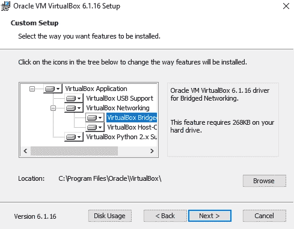

在安装过程中，设置程序可能会提示你安装 `Oracle USB driver`。选择 `install`。


软件设置完成后，我们就可以开始安装 `Ubuntu` 或你的 Linux 发行版。在大多数情况下，你选择的发行版将提供安装指南。请检查你特定发行版的指南。

一旦你启动 `VirtualBox`，你将得到一个与下面所示类似的窗口：

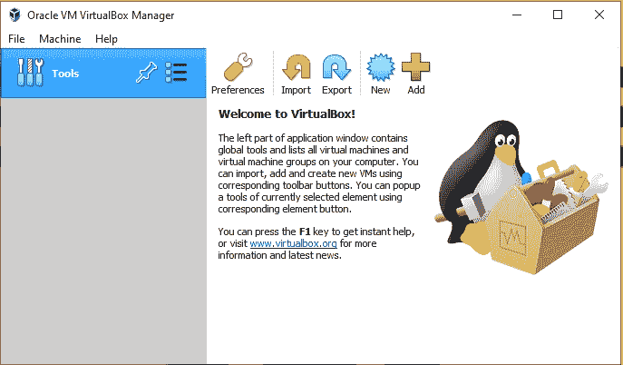

接下来，点击 `New`（新建），这将启动一个要求你提供操作系统基本详细信息的对话框。输入 `VirtualBox` 的名称——可以提供任何合适的名称。在这种情况下，我们将将其命名为 `Ubuntu`。

接下来，在你的文件系统中选择你想要存储虚拟机文件的位置。你可以保持默认设置。接下来，从下拉菜单中选择类型。如果你为流行的操作系统提供了名称，`VirtualBox` 应该会检测到 `Type`（类型）和 `Version`（版本）。如果没有发生这种情况，请选择类型为 `Linux`，版本为 `Ubuntu_64`。对于所有 `Debian` 派生版选择 `Debian`，对于基于 `Arch` 的 `distros` 选择 `Arch`。

!image_rsrc15F.jpg

一旦获取了安装程序，安装并启动以开始过程。一旦你启动 `Balena`，你将得到一个与下面所示类似的窗口：


在上面的窗口中，选择 `Flash from File`（从文件闪存）选项。这样做将提示你提供我们下载的 `Ubuntu` 镜像的位置。接下来，将闪存盘插入计算机；`BalenaEtcher` 应该会自动检测到它。如果你连接了多个设备，从 `Target`（目标）菜单选择正确的设备。一旦选择，点击 `Flash`（闪存）开始刻录过程。**注意**：这将擦除你的 USB 驱动器。备份重要数据！

我们要做的下一步是创建一个分区。在你的 Windows 机器上，右键点击开始菜单启动 `Disk management`（磁盘管理）。在你想要创建空间的分区上，右键点击并选择 `Shrink Volume`（压缩卷）。提供要分配的空间量；建议是 `10GB` 以上。

完成后，重启机器并选择我们创建的 USB 作为启动设备。**注意**：查看网页如何为你的特定设备启用启动。这将引导你进入 `GRUB` 菜单以选择使用哪种选项。在第一个选项中选择 `Ubuntu`——如下所示：


在启动期间，`VirtualBox` 将提示你选择启动磁盘。选择我们配置的 `Ubuntu` `iso`。

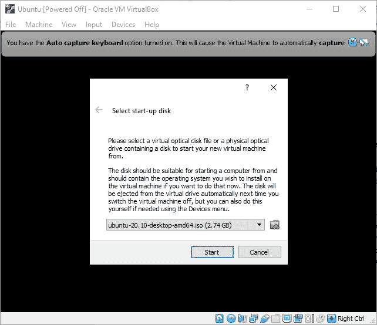

如果所有配置和设置运行正常，它应该使用来自 `iso` 的 `Ubuntu` 安装程序启动。一旦进入安装程序菜单，选择 `Install Ubuntu`（安装 Ubuntu），因为我们正在虚拟机上运行。继续安装选项，如 `Language`（语言）和 `Keyboard Layout`（键盘布局）。接下来，你可以选择 `Normal installation`（常规安装，预装了游戏和其他实用程序）或 `Minimal install`（最小化安装，仅包含基本系统实用程序）。由于我们将处理 `terminal`，最好选择 `Minimal install` 选项。你可以在安装期间启用或禁用安装更新。

在下一节中，选择 `erase disk`（擦除磁盘）并 `install Ubuntu`（安装 Ubuntu）。如果你想自定义磁盘分配，选择 `advanced options`（高级选项）。由于我们运行的是只影响虚拟磁盘的虚拟机，我们可以使用整个磁盘进行安装。

!image_rsrc15F.jpg

一旦获取了安装程序，安装并启动以开始过程。一旦你启动 `Balena`，你将得到一个与下面所示类似的窗口：


在上面的窗口中，选择 `Flash from File`（从文件闪存）选项。这样做将提示你提供我们下载的 `Ubuntu` 镜像的位置。接下来，将闪存盘插入计算机；`BalenaEtcher` 应该会自动检测到它。如果你连接了多个设备，从 `Target`（目标）菜单选择正确的设备。一旦选择，点击 `Flash`（闪存）开始刻录过程。**注意**：这将擦除你的 USB 驱动器。备份重要数据！

我们要做的下一步是创建一个分区。在你的 Windows 机器上，右键点击开始菜单启动 `Disk management`（磁盘管理）。在你想要创建空间的分区上，右键点击并选择 `Shrink Volume`（压缩卷）。提供要分配的空间量；建议是 `10GB` 以上。

完成后，重启机器并选择我们创建的 USB 作为启动设备。**注意**：查看网页如何为你的特定设备启用启动。这将引导你进入 `GRUB` 菜单以选择使用哪种选项。在第一个选项中选择 `Ubuntu`——如下所示：


# 第 2 节：Linux 命令、终端和 Shell

在深入执行 Linux 命令之前，让我们先定义 Linux 中的一些常见术语。虽然这些术语是基础的，但很好了解它们的含义和区别。

## Linux 词典

你需要了解常用的 Linux 术语有：

### 1. 命令（command）

Linux 中的 `command` 指的是内核识别的一组字符，用于执行各种任务。

### 2. 终端（Terminal）

`Terminal` 指的是图形界面，用于接收用户的命令并将其传递给 `shell`。它通常包含一个格式为 `username@machinenane` 的 shell 提示符光标。尽管你在不同的发行版中会发现各种版本的终端，但它们执行的任务主要是相同的。

### 3. 壳（Shell）

`shell` 指的是用户和内核之间的中间人。它允许你输入命令并将其解释给内核。Linux 包含了多种类型的 shell，例如 `bash`、`zhs`、`fish`、`dash` 等。

既然你已经了解了最重要的术语，让我们开始学习第一个 Linux 命令。如果你正在使用虚拟机或双系统，请打开应用程序菜单并搜索终端（terminal）。对于 WSL 用户，请启动 Ubuntu 应用；你应该立即进入 shell 界面。一旦进入 shell，你将看到类似下面的内容：

```shell
ubuntu@VSALEM:~$
```

我们称其为 shell 提示符（shell prompt）；它表示 shell 已经准备好访问并执行命令。shell 提示符可能会根据你的发行版而异，但主要包含你的 `用户名@机器名`，后面跟着一个美元符号 `$`。如果你看到的是井号 `#` 而不是美元符号 `$`，意味着你正在以超级用户权限运行 shell 会话。这意味着你以超级用户身份登录了，或者启动了一个包含 root 权限的终端。

如果终端已就绪且一切看起来正常，让我们尝试输入一些无意义的内容，看看会发生什么。

```shell
ubuntu@VSALEM:~$ dfsskdhd
```

由于输入的命令对 shell 来说没有任何意义，它将向你返回一个错误并提供输入另一个命令的提示符。

```shell
ubuntu@VSALEM:~$ dfsskdhddfsskdhd: command not found
ubuntu@VSALEM:~$
```

## 命令行历史

shell 赋予了我们查看所有执行过的命令的能力。我们可以通过向上或向下箭头键来查看这些命令。这个功能被称为命令行历史（Command Line History）；它可以存储 500 多个命令。

## 简单命令

既然我们已经验证了终端和 shell 工作正常，让我们执行一些有效的命令。输入的第一个命令是 `pwd`，用于打印当前工作目录。

```shell
ubuntu@VSALEM:~$ pwd
/home/ubuntu
```

该命令告诉我们正处于 `/home/ubuntu` 目录——我们将在后续章节学习更多关于目录的内容。尝试另一个命令如 `free`，查看系统中的空闲内存总量。

```shell
ubuntu@VSALEM:~$ free
total             used        free      shared buff/cache    available
Mem:             4127084      2684684      1213048      17720      229352      1308668
Swap:            12582912      164640      12418272
```

完成终端会话后，可以通过关闭终端窗口或使用 shell 提示符的 `exit` 命令来关闭它。

```shell
ubuntu@VSALEM:~$ exit
```

**注意**：即使你以用户身份运行终端会话，后台始终运行着各种终端会话。这些终端会话被称为虚拟控制台，可以通过 `CTRL + ALT + F1` 访问。

# 第三节：文件系统

在本章中，我们将学习如何使用命令行导航 Linux 文件系统。使用命令行导航文件系统是一项基本技能，因为大多数时候你与文件打交道。

现在，在进入终端之前，让我们聊聊 Linux 文件系统。Linux 以及所有其他 Unix 类操作系统都使用分级目录文件结构。分级目录结构使得目录和文件具有树形的文件系统或组织结构。目录也被称为文件夹。

分级结构中的第一个目录称为根目录（root directory）。根目录内部还包含子目录和其他文件。这些子目录又包含其他目录和文件，以此类推。

你可以在这里学习更多关于 HFS 的信息：

[`en.wikipedia.org/wiki/Filesystem_Hierarchy_Standard`](https://en.wikipedia.org/wiki/Filesystem_Hierarchy_Standard)

[`tldp.org/LDP/Linux-Filesystem-Hierarchy/html/Linux-Filesystem-Hierarchy.html`](https://tldp.org/LDP/Linux-Filesystem-Hierarchy/html/Linux-Filesystem-Hierarchy.html)

`-l` 参数更改了文件和目录的列表格式，并提供了更详细的信息。例如：

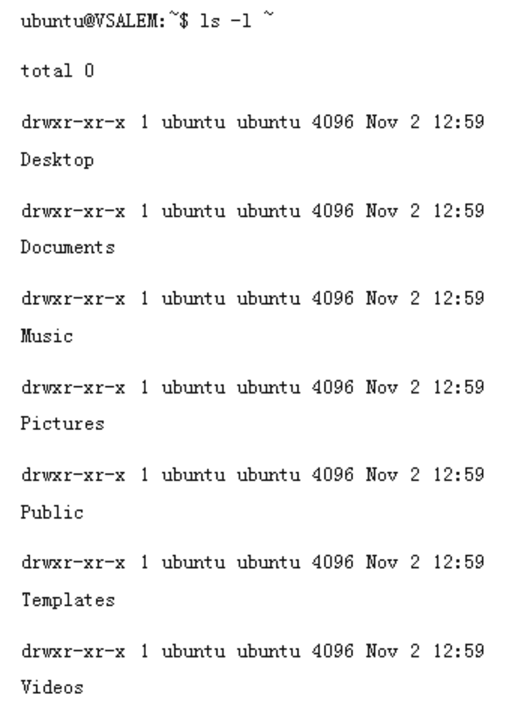

不要担心这些细节的具体含义，我们将在接下来的章节中介绍它们，但从上面的输出中，我们获得了关于相同文件的更多详细信息。这引出了关于命令的一个基本概念。Linux 中的大多数命令都使用我们所说的“参数”（arguments）。参数是用于修改命令行为的额外选项（如所示）。

在某些情况下，选项（options）和参数可能意味着两种不同的意思。例如，一个管理无线设备的命令可能接受设备名称作为选项，并接受另一个参数来修改其操作。参数和选项的通用语法为：

`command -option argument`

大多数命令都有参数，包括一个以连字符（`-`）符号开头的单个字母，例如 `ls -l`。这些参数还可以使用单个连字符组合在一起，如下例所示：

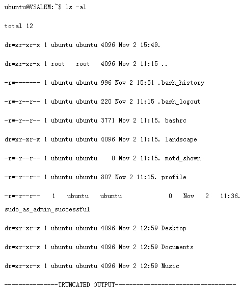

通过上述命令，`ls` 命令使用 `-al` 参数被修改，以特定的格式列出文件，并包含隐藏文件和目录。你还可以使用 `--reverse` 参数修改文件和目录的排序顺序。

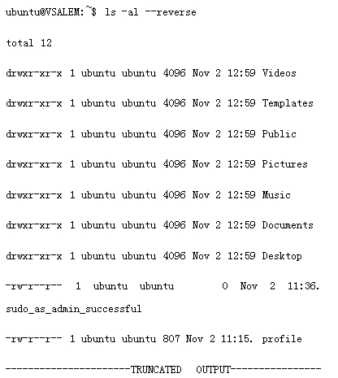

如你所示，文件列表顺序现在是反的，按字母降序排列。你还记得我们提到过一个命令如何占据一整章吗？`ls` 就是其中一个命令。在这里，我们不再深入探讨。请查看 `ls` 手册以获取更多信息：[`man7.org/linux/man-pages/man1/ls.1.html`](https://man7.org/linux/man-pages/man1/ls.1.html)

相反，我们将列出 `ls` 最常用的参数，包括：

1. `-a` 或 `--all` – 该参数列出所有文件和目录，包括隐藏文件（以点开头的文件），这些文件在普通的 `ls` 命令下是不列出的。
2. `-t` – `-t` 参数按修改日期对文件排序。
3. `-d` 或 `--directory` – 该参数与 `-l` 参数结合使用，列出目录本身的详细信息而不是其内容。
4. `-r` 或 `--reverse` – 如我们所见，`--reverse` 命令反序列出文件。在普通的 `ls` 命令中，文件和目录按字母升序显示。
5. `-l` – 用于以长格式列出文件和目录。
6. `-F` 或 `--classify` – 分类参数在文件或目录的末尾放置一个指示字符。例如，它会在目录后添加正斜杠（`/`）。
7. `-h` 或 `--human-readable` – `-h` 参数与 `-l` 参数结合使用，以人类可读的格式显示文件和目录的大小。即以 KB、MB、GB 等单位，而不是字节。
8. `-S` – `-S` 参数按文件大小对文件和目录进行排序。

让我们聊聊通过 `ls -l` 命令获取的细节。我们看到类似这样的内容：

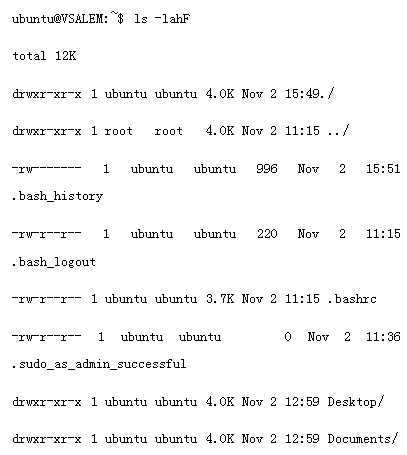

让我们检查一个文件并看看它的含义。


1. `drwxr-xx-x` – 第一个字段表示文件类型和该文件的访问权限。第一个字段第一个字符表示文件类型，其余部分用于显示访问权限。在各种文件类型中，第一个字符为连字符 `-` 表示普通文件，而 `d` 表示目录。接下来的三个字符显示文件所有者的访问权限。第二个字段中的后三个字符表示文件组成员的访问权限，而第三字段的最后字符显示其他所有人的访问权限。注意：关于这些含义的细节请参见“用户、组和权限”章节。

2. `1` – 下一个是一个数字，用于表示文件的硬链接节点数。我们将在接下来的章节中讨论文件链接。

3. `ubuntu` – 我们看到的下一个字段是文件所有者的用户名。因为我的用户名是 `Ubuntu`，所以所有者是 `Ubuntu`。尝试列出 `/usr` 目录查看区别。

4. `ubuntu` – 此字段显示文件的组所有者。我们将在后面的章节介绍用户和组。

5. `4.0k` – 这显示以人类可读格式的文件的大小。如果你不使用 `-h` 参数，大小将以字节形式显示。

6. `Nov 2 11:15` – 下一个是文件的修改日期时间。

7. `.bashrc` – 这表示文件名。

# 第 4 节 理解文件系统

现在我们已经学习了如何探索和导航文件系统，可以进入下一部分：理解 Linux 文件系统的组织结构。

我们将从学习如何查看文件内容开始。然后，我们将学习 Linux 如何组织一切，包括应用程序的存储位置、启动配置、用户目录等，最后以符号链接和硬链接结束。

正如你可能从之前的章节记得的，我们提到过 Linux 不需要文件扩展名来确定文件和文件类型。例如，普通文档会有像 `*.pdf`、`*.odt` 或 `*.doc` 这样的扩展名，但 Linux 不需要。

在这一节中，我们将学习如何使用 `file` 命令查看文件内容。首先，使用命令创建一个文本文件：

```bash
ubuntu@VSALEM:~$ echo “Hello world!”> myfile.txt
```

目前，不用担心这些命令的含义。接下来，使用 `file` 命令查看文件内容。

```bash
ubuntu@VSALEM:~$ file myfile.txt
myfile.txt: ASCII text
```

Linux 随后告诉你 `myfile.txt` 是一个 ASCII 文本文件，这是正确的。值得注意的是，有许多文件类型。在 Linux 中，你经常会遇到一句话：“在 Linux 中，万物皆文件”，这是正确的。在 Linux 中，甚至目录也是文件的一种类型。

## `less` 命令

让我们来看看另一个有趣的 Linux 命令：`less` 命令。`less` 命令是一个允许你查看文件内容的工具。不要将其与显示文件类型的 `file` 命令混淆。

在 Linux 中，许多文件是原始 ASCII 文本格式的，例如源代码文件、bash 脚本、配置文件等。使用 `less` 命令允许我们查看和检查这些文件中的内容。在下一节中，我们将学习如何使用各种工具（包括 `vi` 和 `nano`）来编辑文件，但现在，让我们先看看它们里面有什么。

`less` 命令的通用语法为：`less <filename>`

使用 `less` 命令，我们可以查看文件内容并使用上下方向键上下滚动。如果文件内容大于终端窗口确定的单页，我们可以使用空格导航到下一页。完成文件查看后，我们使用 `Q` 键退出文件。

例如，使用 `less` 命令查看用于存储安装包源的文件。

```bash
ubuntu@VSALEM:~$ sudo less /etc/apt/sources.list
```

`less` 命令与键盘命令结合使用时效果非常好。以下是在操作 `less` 时使用的一些快捷键：

1. `Spacebar`（空格键） – 用于滚动到文件的下一页。
2. `Up Arrow`（向上箭头） – 用于向上滚动一行。
3. `Down Arrow`（向下箭头） – 一次向下滚动一行。
4. `Q` – 退出 `less` 命令。
5. `H` – 用于显示 `less` 帮助菜单。
6. `B` – 到上一页。
7. `G` – 滚动到文件末尾。
8. `/characters` – 用于向前搜索字符串的下一次出现处。

`less` 命令是其前身命令 `more` 的改进版。尝试运行命令：

```bash
ubuntu@VSALEM:~$ whatis less
less (1)             - opposite of more
```

## Linux 文件系统

Linux 文件系统可能是本书最重要的部分。因此，本书将让你对 Linux 文件系统有深入的理解，例如根目录在哪里等。一旦你理解了文件系统（FS），你就能找到更多命令，读取、写入、执行文件以及更多内容。理解了这部分，你就可以像大师一样处理任何 Linux 发行版。

在大多数情况下，Linux 文件系统的布局在所有 Linux 发行版中都是相同的。虽然在所有发行版中并不如此，但在大多数情况下，其结构是相似的，并由《Linux 文件系统层次结构标准》实现。[`refspecs.linuxfoundation.org/FHS_3.0/fhs/index.html`](https://refspecs.linuxfoundation.org/FHS_3.0/fhs/index.html)

当我们探索文件系统并理解这个神奇操作系统背后的原理时，请使用你的设备实际操作这些目录，使用 `file` 命令检查文件，甚至使用 `less` 命令查看特定文件的内容。

## Linux 目录组织

以下是 Linux 系统中的目录以及每个目录预留的内容：

1. `/` – 这是 Linux 系统的根目录，一切从这里开始。
2. `/bin` – bin 目录存储或包含系统启动和运行所需的二进制文件。
3. `/boot` – boot 目录包含 Linux 内核、RAM 磁盘镜像和所需的加载程序。你会在其中找到如 `/boot/grub/grub.conf` 或使用 grub 作为加载程序的系统的内核镜像，如 `/boot/vmlinuz` 等文件。
4. `/dev` – Dev 目录包含设备节点。这是内核用于存储其识别的设备列表的目录。
5. `/etc` – etc 是 Linux 系统最重要的目录之一。它包含系统级配置文件。`/etc` 目录还可以包含系统启动期间使用的 shell 脚本。`/etc` 目录中的几乎每个文件都是纯文本。该目录中的常见文件包括 `/etc/passwd`（账户列表）、`/etc/resolv.conf`（DNS 解析器配置）、`/etc/crontab`（启动列表）。
6. `/home` – 目录为每个用户提供特定目录。然而，并不总是如此，你可能会发现用户操作其他目录的特殊情况。
7. `/lib` – Lib 文件夹包含 Linux 系统核心使用的共享库文件。将其视为 Windows 中的 dll 目录。
8. `/lost+found` – 此目录包含在文件系统事件（如 `ext4` 或 `ext3` 格式的设备和分区）发生故障时部分恢复的文件。在大多数情况下，该目录是空的。
9. `/media` – 我们在前面的章节中提到的 media 目录主要用于自动挂载的可移动设备的挂载点。
10. `/mnt` – `/mnt` 目录用于手动挂载设备。
11. `/opt` – `/opt` 目录存放安装在系统上的第三方软件。如果你在使用，可能会在这里找到。
12. `/proc` – 这是一个特殊的目录并充当文件系统。它不是存储在磁盘上的真实文件系统，而是由内核维护的。`/proc` 目录中的文件是可读的，展示了内核如何管理系统。例如，查看 CPU 信息可以使用 `less /proc/cpuinfo`。
13. `/root` – 此目录是 root 用户的主目录。
14. `/sbin` – `/sbin` 目录由内核存储系统二进制文件。这些系统二进制文件用于在系统上执行关键任务，主要为超级用户预留。
15. `/tmp` – 此目录存储各种程序生成的临时或瞬时文件。该目录在重启时会被清空。
16. `/usr` – 这是 Linux 中的另一个重要目录。它包含所有用户使用的程序和文件。它是 Linux 系统最大的目录之一，包含数千个文件。
17. `/usr/bin` – 存放你的 Linux 发行版安装的可执行程序。
18. `/usr/lib` – 包含 `/bin` 目录中程序使用的共享库。
19. `/usr/local` – 此目录包含 Linux 发行版默认未包含但供系统级使用的编译程序。尽管该目录默认存在，但在特权用户将其添加文件之前它是空的。
20. `/usr/sbin` – 用于存储系统管理程序。
21. `/usr/share` – `/share` 目录包含 `/bin` 目录程序使用的共享数据。你在这里会找到配置文件、主题、声音文件等。
22. `/usr/share/doc` – 此目录存储系统上安装的大多数软件包的文档文件。
23. `/var` – 此目录存储不断变化的数据，如数据库、日志、邮件等。Linux 中除 `/tmp` 和 `/home` 之外的所有目录都是静态的。
24. `/var/log` – 如名称所示，`/log` 目录存储各种操作的日志文件。该目录包含系统关键文件，需要持续监控。你可能需要超级权限来查看日志文件。

# 第 5 节 Linux 中的文件和目录操作

本节将讨论允许我们操作 Linux 文件和目录的命令。操作电脑时文件和目录非常常见，因此本节的命令至关重要。通过学习，你会发现使用图形化文件管理器进行移动、重命名、删除和文件操作更简单。然而，如果你对执行的操作有更多控制和灵活性，命令行提供了这种可能。

## 创建目录 – `mkdir`

我们将查看第一个命令是 `mkdir`。它在当前或指定的工作空间创建目录。以下是 `mkdir` 命令的工作原理：

```bash
mkdir directoryName
```

尽管看起来足够简单，但 `mkdir` 非常强大。你可以在一个命令中创建多个目录：

```bash
mkdir dir1 dir2 dir3 dir4 dir5…dir(n)
```

一旦执行该命令，它将按如下方式创建所有传递的目录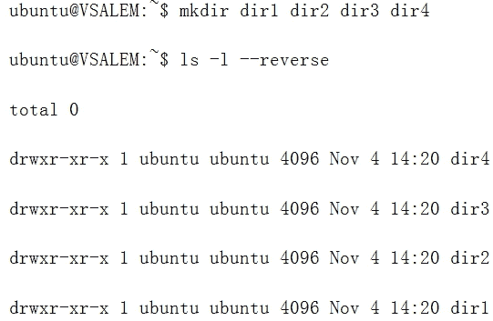

## 复制文件和目录 – `cp` 命令

下一个命令是 `cp` 命令，用于在 Linux 文件系统内从一个位置复制文件和目录到另一个。`cp` 命令支持两种语法：

```bash
cp file1 file2 or dir1 dir2
```

此语法将 `file1` 或 `dir1` 复制到 `file2` 或 `dir2`。这在处理单个项目或单个目录时非常有用。

`cp` 命令的另一种语法是：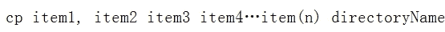

在这种情况下，`cp` 命令将当前目录的所有指定文件复制到指定目录。`cp` 命令有许多选项，可以使用它们来操控命令执行的方式和内容。虽然我们不会讨论所有的选项，但这里有一些值得提及的选项：

1. `-a` 或 `--archive` – 使用 `--archive` 选项使用 `cp` 命令允许你复制带有所有相应属性和权限的文件和目录。如果没有该参数，复制命令将使用执行命令的用户的权限。例如，如果 `ubuntu` 用户拥有被复制的文件，而 `root` 执行了复制，则 `root` 拥有该文件。请注意这一点。
2. `-i` 或 `--interactive` – 交互参数启用 `cp` 命令在覆盖文件之前提示用户。默认情况下，`cp` 将自动并静默地覆盖文件。
3. `-v` 或 `--verbose` – 如名称所示，详细模式会在每个文件被复制时显示信息消息。
4. `-r` 或 `--recursive` – 允许 `cp` 命令递归复制文件。该命令被频繁使用，且复制目录时是必须的。
5. `-u` 或 `--update` – 更新参数非常有效。它告诉命令进行更新。

## 移动、重命名文件和目录 – `mv` 命令

下一个命令是 `mv` 命令，它允许我们移动或重命名文件和目录。通用语法为：

```bash
mv file1 file2
```

此语法将 `file1` 或 `dir1` 移动到 `file2` 或 `dir2`。这在处理单个项目或单个目录时非常方便手。

`mv` 命令的另一种语法是：

```bash
mv file1 file2…dir(n) destination
```

在这种情况下，`mv` 命令将当前目录的所有指定文件移动到目标目录。

## 删除文件和目录 – `rm` 命令

最后我们来看 `rm` 命令。`rm` 命令删除文件和目录。通用语法为：

```bash
rm file2 or directory2
```

取决于你如何以及何处使用该命令，`rm` 命令可能非常危险。Linux 不提供撤销命令，一旦 `rm` 执行了删除操作，它就消失了！删除单个文件请使用：

```bash
rm file1
```

要删除目录及其内容，请使用递归标志：

```bash
rm -r directory1
```

1. `[:alnum:]` – 使用字母数字字符作为类。
2. `[:alpha:]` – 字母字符类。
3. `[:lower:]` – 小写字母字符类。
4. `[:upper:]` – 大写字母字符类。
5. `[:digit:]` – 数字字符类。

因此，通配符为文件名创建自定义的筛选标准则提供了一种方便的方法。以下是一些通配符的用例示例及其对应的匹配项：

1. `*` - 包括文件和目录在内的所有内容。
2. `a*` - 任何以字母 a 开头的文件或目录。
3. `a??` – 任何以字母 a 开头且后跟好两个字符的文件或目录。
4. `Log.[0-9][0-9][0-9]` – 任何以单词 log 开头且后跟三个三个数字的文件或目录。
5. `[[:upper:]]*` – 任何以大写字母开头的文件或目录。
6. `a*.txt` – 任何以字符 a 开头、跟随任意字符但以 txt 字符结尾的文件或目录。
7. `[abc]*` - 任何以字母 a、b 或 c 之一开头的文件或目录。
8. `[![:lower:]]` – 任何不以小写字母开头的文件或目录。
9. `*[[:digit:]txt]` – 任何以数字或 txt 字符结尾的文件或目录。

通配符可以用于所有接受文件名的命令，如 `cp`、`mv`、`rm` 等。现在你可以知道为什么在 `/` 目录上执行 `sudo rm -rf *` 是一个糟糕的主意了。我们将在后续章节中学习更多关于 `sudo` 的知识。

## 软链接与硬链接

在 Linux 中，你可能会遇到这样的目录：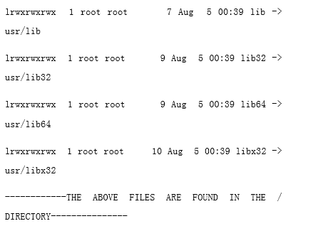你会注意到列表中目录第一个字母是 `l` 而不是目录的普通字母 `d`。它看起来还像包含了两个目录。这是 Linux 中的一种特殊文件，被称为软链接（soft link）、symlink 或符号链接（symbolic link）。Linux 允许通过多个名称引用文件。

从上面的命令中，我们可以看到如 `libx32` 这样的符号链接，它指向目录 `/usr/libx32`。因此，任何查找 `libx32` 目录的程序都会获取 `/usr/libx32` 目录。

## 创建链接

在 Linux 中创建符号链接，我们使用 `ln` 命令。通用语法为：

`ln file link`

上述语法创建一个硬链接。

`ln -s item link`

这为传递的 item 创建软链接。传递的 item 可以是目录也可以文件。

## 硬链接 vs 软链接

硬链接和软链接之间没有显著区别。主要区别在于引用文件的方式。

硬链接是 Linux 中创建链接的默认方式，而符号链接更现代，并且默认情况下，每个文件都有一个为文件提供名称的硬链接。

创建硬链接后，该文件还会被创建一个额外的目录条目。以下是硬链接的主要特征：

1. 它们不用于引用目录。
2. 它们不能引用文件系统之外的文件。这意味着硬链接无法引用与其所在位置不同分区上的文件。

硬链接与主文件是不可分的。与包含符号链接的目录列表相反，拥有硬链接的目录列表不会显示链接的任何特殊指示。一旦删除硬链接，链接就会被删除，但文件的主要内容不会被删除。这意味着在文件删除之前，空间不会被释放。

符号链接是硬链接更更新、更改进的版本。它们的开发目标是帮助克服硬链接带来的一些局限性。基本上，符号链接的工作原理是执行一个包含指向引用目录或文件的文本指针的特殊文件。它们的工作方式类似于 Windows 快捷方式。

符号链接与其引用的主文件非常难以区分。符号链接在被删除后不会删除文件。然而，如果文件在链接删除之前被移除，符号链接就会损坏。你使用 `ls` 命令时会遇到用红色表示的损坏符号链接。

**注意：** 仅这一节我们就涵盖了大量信息。可能需要一段时间时间来掌握（而不是背诵）这些命令及其参数，最好的学习方法是实践。多尝试这些命令直到你掌握它们。

# 第 6 节：用于处理命令的命令

到为止，我们讨论了大量的命令，每个命令都有更广泛的、与之不同或执行方式不同的选项。在本章中，我们将简化这些命令，甚至编写独特的命令。

## 命令：简单定义

在讨论帮助我们处理其他命令的命令之前，让我们更好地了解一下命令。命令到底是什么？

正如书开头提到的，命令是你在终端中输入并供 shell 执行的文本或字符。输入的命令引用 Linux 文件系统（`fs`）中的某些内容。例如，像 `ls` 这样的命令是寻找文件和目录的代码集合——这个过程并不像听起来那么直接。因此，命令可以引用四种类型的内容：

1. shell 函数 – shell 函数是合并到 Linux 环境中的小型 shell 脚本。
2. 可执行程序 – 命令可以是编译后的二进制文件，如在 `/bin` 和 `/usr/bin` 目录找到的文件。程序员可以使用各种语言（如 C/C++、Python、Perl、Ruby 等）编译这些二进制文件。
3. 内置 shell 命令 – 这些是内置到 shell 中的命令——也称为 shell 内置（built-ins）。
4. 别名（alias）——命令也可以是指命令的别名或替代名称。例如，你可以创建一个命令将 `free` 显示为 `fmem`。

## 识别命令


识别命令是指用于识别其他命令是什么以及它们在系统中执行什么操作的命令。它们包括：

### 显示可执行位置 – `which` 命令

在服务器上安装了多个版本的可执行程序的情况下，我们可以使用`which`命令来定位可执行文件，如下：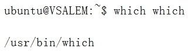

`which`只作用于可执行程序，不作用于内置 shell 命令。如果你对`cd`这样的命令运行`which`，将得到一个错误：

### 显示命令类型 – `type` 命令

`type`命令显示 shell 将执行的命令类型。类型可以包括我们上面提到的那些。

`type`命令的工作方式如下：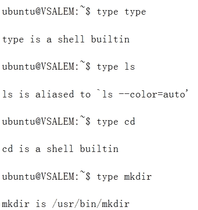

从上面的命令中我们可以看到`cd`命令是 shell 内置，`mkdir`是位于`/usr/bin/mkdir`的可执行文件。像`ls`这样的命令实际上是带有`--color=auto`参数的`ls`命令的别名。

## 显示命令帮助和文档

一旦我们知道命令是什么及其位置，我们就可以存储在系统手册数据库中找到它的文档。

`help`命令帮助你查找命令接受的选项和参数。大多数情况下，`help`命令只对 shell 内置命令有效。例如：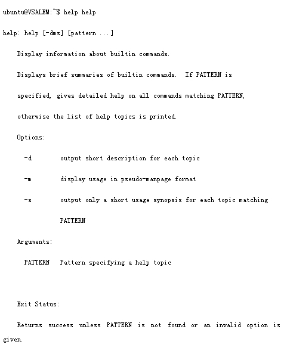

尽管`help`命令提供了选项及其工作原理，但它绝不是教程。然而，当你想要学习更多关于命令的信息时，它是实用的。

`help`命令的另一种流行模式是使用`--help`语法作为参数。Linux 中的大多数可执行程序都提供此参数，允许你查找命令的用法。例如：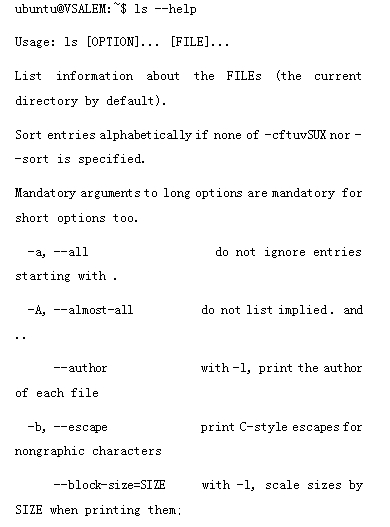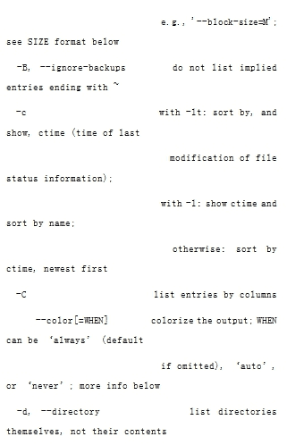

并不是所有命令都支持`--help`参数。某些支持`-h`，而其他使用手动页。不过，尝试一下看看是否有效。

查找命令信息最常见的方法是使用手册（manual pages）。手册是针对各种命令的正式文档。手册页通常被称为 man pages，可以使用名为`man`的特殊命令来访问。

该命令的通用语法为：

```
man program
```

其中`program`代表你需要的文档的命令。虽然手册包含不同的格式和样式，但它们主要包含一个标题、命令语法的摘要以及命令作用的描述。它可能还包括命令选项的列表和描述。手册更像参考资料，而不是指南。

手册使用`less`命令来浏览文档。尝试查看`less`命令的手页。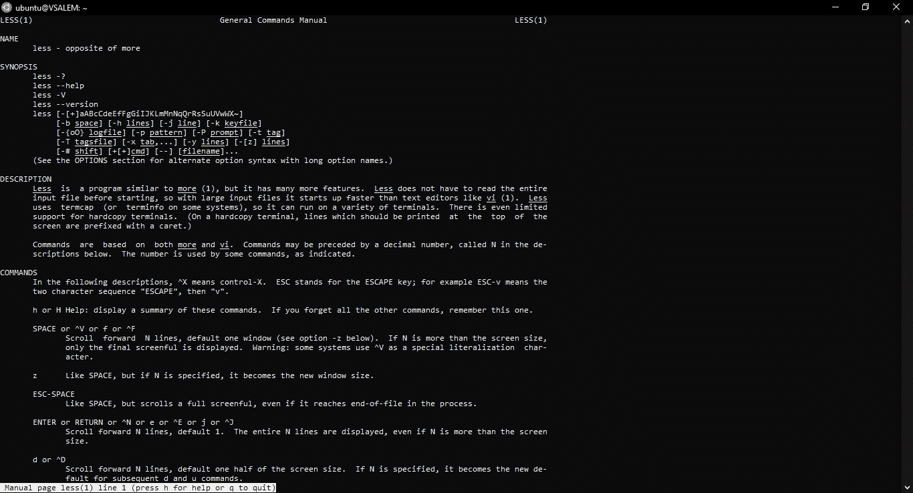

## 手页的组织

在处理命令时，手册是极的工具。它们存储在手册数据库中，按特定格式组织，涵盖可执行命令、用户命令、系统管理命令、文件格式等。

以下是手册布局的提纲。

1. `1` – 手册的第一部分包含用户命令的文档。

2. `2` – 第二部分是内核系统调用编程接口。

3. `3` – 第三部分包含 C 库的编程接口文档。

4. `4` – 第四部分用于特殊文件。包括驱动程序和设备节点。

5. `5` – 五用于文件格式文档。

6. `6` – 第六部分用于游戏和其他娱乐，如壁纸和屏幕保护程序。

7. `7` – 第七部分用于杂项

# 8 – 第八部分

第八部分包含系统管理命令的文档。

有时，你可能需要在特定的文档章节中搜索以找到你寻找的内容。例如：

```
ubuntu@VSALEM:/etc$ man 5 sudoers
```

上面的命令显示了关于`sudoers`文件格式的文档。

## 显示简要描述 – `whatis`命令

`whatis`命令是一个实用的命令。它会从手册页（man pages）显示匹配特定关键词的命令名称和单行描述。

例如：

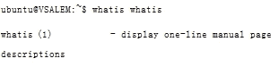

## 显示相关命令 – `apropos`

手册页允许你根据传递的术语进行匹配搜索。使用`apropos`命令，你可以从手册页中搜索相似的命令。例如：

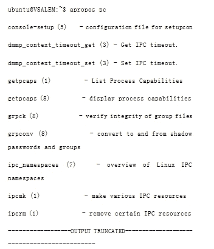

你也可以用`man -k`参数替换`apropos`命令。

另一个你可以用来查找命令帮助和文档的常用命令是`info`命令。它是`man`命令的替代方案，但提供了超链接以以帮助导航到特定章节。

`info`程序读取`info`文件，这些文件像树结构一样被组织成独立的节点，每个节点包含一个主题。`info`文件包含你可以用来从一个节点移动到另一个节点的超链接。超链接因为前面的星号而很容易识别。你可以通过将光标置于其上然后按下`ENTER`键来激活它们。

例如：

```
ubuntu@VSALEM:~$ info ls
```

到目前为止我们所有的命令都属于`coreutils`软件包或`GNU Project`。要查找关于位置和文档的更多详情，请使用命令：

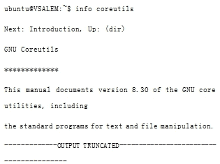

你在系统上安装的许多软件包都有存储在`/usr/share/doc`目录下的文档文件。大多数以纯文本格式存储，但有些是 HTML 格式，可以使用网络浏览器查看。

某些文件具有`.gz`扩展名，表示使用`gzip`压缩程序压缩的文件。`gzip`包有一个特殊的`less`版本称为`zless`，它可以显示`gzip`压缩的文本文件中包含的信息。


手册页可以作为广泛命令的极佳参考。然而，正如我们提到的，它们并不是教程。如果你想测试手册页有多疯狂，可以尝试查看`bash`的手册页。不过不要感到沮丧；继续学习：你将理解这一切的含义。

## 创建自定义命令

本小节涵盖了如何使用`alias`命令创建命令。`alias`命令允许你创建一个更好的名称来替换命令，或者用单个命令代表一系列命令。

在我们开始之前，首要任务是为我们的命令找到一个合适的名称，并确保没有其他关键函数在使用它。

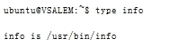

遗憾的是，`info`似乎被占用了，我们无法使用它。让我们尝试`mshell`：

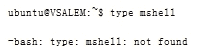

那个是可以用的。我们使用`alias`命令，后面跟着我们要使用的命令或命令序列。

例如，为了导航到`/etc`目录、读取`passwd`文件、返回家目录并最后列出目录，我们可以使用下面显示的 shell 技巧将所有命令合并为一行：

```
cd /etc; less passwd; cd ~; ls -la;
```

使用`alias`，我们可以像下面所示创建一个单个命令：`alias`命令的通用语法为：`alias name='string'`

注意下面命令的结构：

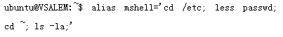

紧接`alias`命令，我们传递想要替换的名称和命令字符串。一旦使用`alias`命令定义了命令，我们就可以任何地方使用它。

我们可以使用`type`命令查看我们的别名。

```
ubuntu@VSALEM:~$ type mshell
mshell is aliased to `cd /etc; less passwd; cd ~; ls -la;`
```

要删除别名命令，请使用下面的`unalias`命令。

```
ubuntu@VSALEM:~$ unalias mshell
ubuntu@VSALEM:~$ type mshell
bash: type: mshell: not found
```

诚然，我们避免了使用现有命令的别名，因为有时这样做是合适的。例如，`ls`命令是`ls --color-auto`的别名。以下是环境中定义的一些别名，使用不带参数的`alias`命令可以获取更多。

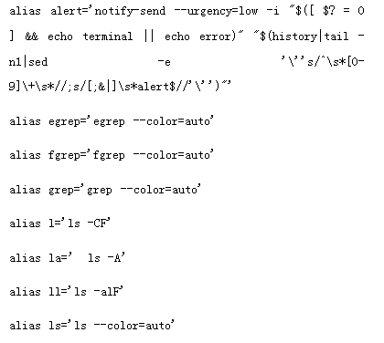

# 第 7 节 权限

Linux 以及其他基于 Unix 的系统的最佳特性之一是它们是多任务和多用户的。这意味着多一个用户可以同时使用系统并运行多个进程。

例如，连接到网络的系统可以有一个用户在物理上工作，另一些用户通过`SSH`远程工作。如`X Window`系统等功能允许远程用户运行 GUI 应用程序。

这是构建在 Linux 内核深处的强大功能。然而，为了实现这一点，用户必须受到彼此的保护，防止用户干扰其他用户创建的文件。

本章将介绍 Linux 如何实现如身份、文件权限、文件所有权、用户组等保护措施。

### 所有者、组和其他用户

偶尔在探索 Linux 文件系统时，你会遇到某些在尝试读取时会输出“Permission Denied（拒绝访问）”错误的文件。此类文件的示例位于`/etc/shadow`

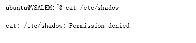

这种类型错误的主要原因是由于用户操作错误。这意味着，如果你以普通用户身份运行，你可能没有读取某些文件的权限。

让我们讨论它是如何工作的：

Linux 使用我们所谓的 Unix 安全模型，该模型描述用户可以拥有文件系统中的文件和目录。如果用户拥有特定的文件或目录，他/她对它们具有完全控制权。该用户可以属于一个由多个用户组成的组，所有用户都获得所有者授予的文件和目录的访问权限。

除了为其所属的组提供访问权限外，用户或目录所有者还可以向世界或系统内的所有人授予访问权限。

你可以通过`id`命令获取更多关于你的用户身份的信息。

```
ubuntu@VSALEM:~$ id
```

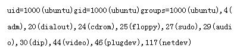

让我们分析输出并看看它的含义（并非全部！）

当创建一个用户时，他/她会被分配分配一个称为`uid`或唯一 ID 的唯一值，然后映射到用户的用户名。系统为用户分配一个主组 ID，也称为`gid`值。该组 ID 可能还属于其他组。

取决于你运行`id`命令的系统，你将得到不同的结果。例如，像 Fedora 这样的系统从 500 开始编号账户。另一方面，Ubuntu 从 1000 开始。

Ubuntu 中的单个用户可以属于更多组——如上所示——这是因为 Ubuntu 系统处理系统服务和设备权限的方式。

`systemdevices and services.`

这些信息源自 Linux 文本文件。Linux 中的帐户存储在`/etc/passwd`文件中，而组存储在`/etc/groups`文件中。在创建 Linux 用户帐户或组时，这些文件中的每一个都会被修改。用于存储密码的`/etc/shadow`文件也会发生变化。`/etc/passwd`和`/etc/groups`

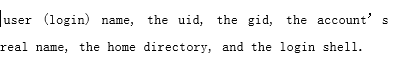

### 读、写、执行文件权限

Linux 中的访问权限由身份、文件权限、文件所有权、组等定义。

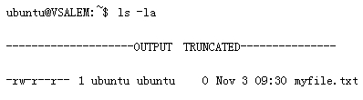

正如在前面的章节中讨论，块中的第一个字母表示文件类型。`-`（连字符）表示普通文件，`d`表示目录，`l`表示符号链接，`c`表示字符特殊文件，`b`表示块设备。其余九块表示文件模式：

1. `r` – 授予读取权限，允许用户和组打开并读取文件。如果应用到目录上，用户可以列出目录的内容。

2. `w` – 允许写入文件或截断；然而，写入属性允许删除取决于父目录。当你设置执行属性时，写入属性允许创建、重命名目录。

3. `x` – 使文件表示为可执行程序成为可能。为了让使用脚本语言编写的文件具有执行性，你还必须将它们设置为可读。在目录上，执行属性使得进入目录成为可能。

以下是设置在文件和目录上的权限示例：

1. `-rwx------` – 显示仅文件所有者具有读、写和执行权限的普通文件。其他人没有对该文件的读、写、执行权限。

2. `-rw-------` – 也是一个普通文件，文件所有者具有读写权限，其他人没有。

3. `-rw-r--r--` – 一个普通文件，文件所有者具有读写权限，所有组也可以读取该文件，全世界也可以读取。

4. `-rwxr-xr-x` – 显示文件所有者具有读、写和执行权限，用户组具有执行和读取权限，其他人仅只有执行权限。

5. `drwxrwx---` – 表示目录。所有者和用户组可以进入目录并在目录内创建、重命名和删除文件。

6. `lrwxrwxrwx` – 带有占位权限的符号链接。占位权限意味着实际权限由所引的文件管理。

### 更改文件模式 – `chmod`命令

要更改文件或目录的权限，我们使用`chmod`命令。更改文件权限仅对文件所有者和超级用户有效。`chmod`支持两种指定权限的主要方式：

1. 八进制表示法

2. 符号表示

### 符号表示

让我们从文件权限的符号表示开始。符号表示有三个主要部分：受影响的对象、执行的操作以及权限设置。

在受影响的对象上，使用了`u`、`g`、`o`和`a`等字母。

* `u` – 文件所有者

* `g` – 组所有者

* `o` – 其他人或世界

* `a` – 所有；意味着用户、组和世界的组合

如果未指定字符，则默认为所有，且更改将适用于用户、组和世界。要执行的操作由三个主要字符指定，即`+`（加号）、`-`（减号）和`=`（等号）。`+`表示您应该添加权限。`-`表示应该移除权限，而`=`表示只应用指定的权限，并移除其他权限。要应用的权限由三个字母指定，`r`（读）、`w`（写）和`x`（执行）。这里是一些符号表示法的示例：

1. `u+r` – 赋予文件所有者读取权限

2. `u+x` – 赋予文件所有者执行权限

3. `u-w` – 移除文件所有者的写权限。

4. `+x` – 为所有者、组和世界添加执行权限。

5. `u+x,go=rx` – 赋予文件所有者执行权限。它还设置了组和其他人的读取和执行权限。逗号可以分隔多个指定。

### 八进制表示法

八进制表示法顾其实名，使用八进制值表示所需的权限模式。您可以在`https://www.tutorialpoint.com/linux/file_permissions.html`（https://www.tutorialpoint.com/linux/file_permissions.html）或`https://www.wikipedia.org/wiki/File_permissions`（https://www.wikipedia.org/wiki/File_permissions）学习更多关于八进制的知识。

八进制表示法顾其实名，使用八进制值表示所需的权限模式。你可以在`https://www.tutorialpoint.com/linux/file_permissions.html`（https://www.tutorialpoint.com/linux/file_permissions.html）学习更多关于八进制的知识。

要执行的操作由三个主要字符指定，即`+`（加号）、`-`（减号）和`=`（等号）。`+`表示您应该添加权限。`-`表示应该移除权限，而`=`表示只应用指定的权限，并移除其他权限。

要应用的权限由三个字母指定，`r`（读）、`w`（写）和`x`（执行）。这里是一些符号表示法的示例：

1. `u+r` – 赋予文件所有者读取权限

2. `u+x` – 赋予文件所有者执行权限

3. `u-w` – 移除文件所有者的写权限。

4. `+x` – 为所有者、组和世界添加执行权限。

5. `u+x,go=rx` – 赋予文件所有者执行权限。它还设置了组和其他人的读取和执行权限。逗号可以分隔多个指定。

`go=rx` – 赋予文件所有者执行权限。它还设置了组和其他人的读取和执行权限。逗号可以分隔多个指定。

---

`https://www.wikipedia.org/wiki/File_permissions`（https://www.wikipedia.org/wiki/File_permissions）

八进制表示法顾其实名，使用八进制值表示所需的权限模式。你可以在`https://www.tutorialpoint.com/linux/file_permissions.html`（https://www.tutorialpoint.com/linux/file_permissions.html）学习更多关于八进制的知识。

要执行的操作由三个主要字符指定，即`+`（加号）、`-`（减号）和`=`（等号）。`+`表示您应该添加权限。`-`表示应该移除权限，而`=`表示只应用指定的权限，并移除其他权限。

要应用的权限由三个字母指定，`r`（读）、`w`（写）和`x`（执行）。这里是一些符号表示法的示例：

1. `u+r` – 赋予文件所有者读取权限

2. `u+x` – 赋予文件所有者执行权限

3. `u-w` – 移除文件所有者的写权限。

4. `+x` – 为所有者、组和世界添加执行权限。

5. `u+x,go=rx` – 赋予文件所有者执行权限。它还设置了组和其他人的读取和执行权限。逗号可以分隔多个指定。
