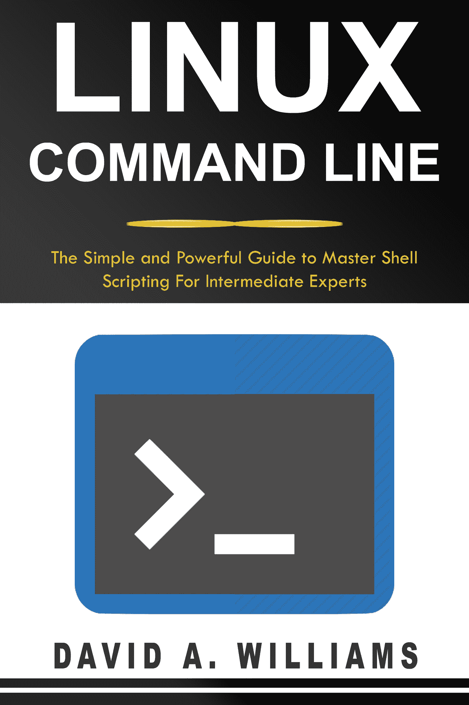

# Linux 命令行：掌握 Shell 脚本的简单强大指南





## 目录
- 引言
- 第一章：什么是 Shell？
- 第二章：使用变量和注释
- 第三章：读取用户输入
- 第四章：向脚本传递参数
- 第五章：if 语句
- 第六章：文件测试运算符
- 第七章：追加文本文件
- 第八章：逻辑“与”与“或”运算符
- 第九章：执行算术运算
- 第十章：Case 语句
- 第十一章：数组变量
- 第十二章：WHILE 循环
- 第十三章章：UNTIL 循环
- 第十四章：FOR 循环
- 第十五章：SELECT 循环
- 第十六章：Break and Continue
- 第十七章：函数
- 第十八章：局部变量
- 第十九章：只读命令
- 第二十章：信号与陷阱
- 第二十一场：如何调试脚本
- 结论
- 参考文献

## 引言
本指南包含了如何使用 Linux 命令行界面成为 Shell 脚本高手的经过证明的步骤和策略。Shell 脚本是 Linux 管理员（无论是新手还是专业人士）所需的主要技能之一。本书为从基础到熟练的 Linux 管理员提供了实用的操作知识。无论你是 Shell 脚本世界的新手，还是已经掌握了我们第一本初学者指南中的知识，这本书都将为你提供独特的见解。Shell 脚本是你能够通过非常系统化的方法自动化大部分日常工作的唯一途径，从而节省你的时间和精力。在理解本书并完成所有提供的实际练习后，你的专业水平将提高很多许多级。你将理解 Shell 的概念、它在后台如何工作，以及使用什么方法来编写实用的脚本。本书作者是行业内的专家和专业人士，分享了他们花费多年才学会的所有知识。本书为中级用户编写的，但如果你没有基础知识，前几章将为你提供概述并带你进入更高级的水平。我将涵盖基础知识，包括参数、运算符、数组、循环等，这些是任何专业人士每天进行 Linux 管理任务都需要的内容。你将学习从非常基础到专家级练习的每个主题，并对使用的逻辑得到清晰。这本书将帮助你阅读和理解复杂的脚本，并根据预期结果对其进行动态更改。本书拥有更多的实际示例，并基于你已经读过我们的第一本书《初学者 Shell 脚本教程》。如果你想获取更多基础方面的知识，我们建议购买该系列的第一本书，以理解 Shell 脚本的历史和理论。

## 第一章：什么是 Shell？
Unix shell 解释用户直接执行的命令，或者通过读取名为 shell 脚本或 shell 程序的文件来执行命令。

### shell 的用法
请看下图。
当 Linux 机器启动时，它首先加载其内核（kernel）。内核是硬件和操作系统之间的接口。内核管理 CPU、内存、输入/输出设备等硬件资源，供任何软件运行。任何应用程序都需要连接到内核才能工作。这就是 Shell 连接到内核的地方。

了解 Shell 脚本是可以被解释的而不是被编译的是重要的。当你编写 Shell 脚本时，操作系统会解释它。有多种脚本类型可用。

### 你的操作系统支持哪些 Shell？
要检查系统支持哪些 shell，检查 `/etc/shells` 文件。

```bash
cat shells/bin/bash/bin/csh/bin/dash/sh
```
上述输出显示系统可以运行的 shell：ash, bash, csh, dash, tcsh。

`sh` 代表 Bourne shell，它是 Unix 或类 Unix 环境中使用的原始 shell。`sh` 是 Unix 系统使用的第一个 shell。

**Bash** 代表 Bourne Again Shell，它是 `sh` 的改进版本。这些，`bash` 是标准 shell。它是直观且灵活的。它是系统中最常用的 shell。它们也用于 MacOS 和 Windows 环境。

要检查你的 shell 的位置，可以使用 `which` 命令。例如，你想检查操作系统系统中 `bash` shell 的位置，运行以下命令：

```bash
which bash
/bin/bash
```
上述输出显示系统可以运行的 shell：ash, bash, csh, dash, sh, tcsh。

### 第一个脚本
例如，你想检查操作系统系统中 `bash` shell 的位置，运行以下命令：

```bash
which bash
/bin/bash
```
上述输出显示系统可以运行的 shell：ash, bash, csh, dash, sh, tcsh。

要检查你的 shell 的位置，可以使用 `which` 命令。例如，你想检查操作系统系统中 `bash` shell 的位置，运行以下命令：

```bash
which bash
/bin/bash
```
上述输出显示系统可以运行的 shell：ash, bash, csh, dash, sh, tcsh。

（注：原文中关于“第一个脚本”的部分存在大量重复，译文已根据逻辑进行了精简和格式对齐）。

要创建一个文件，使用 `touch` 命令：

```bash
touch hello.sh
```
检查权限，使用 `ls -l`：

```bash
ls -l hello.sh
```
-rw-r--r-- 1 user 0 date

要使文件可执行，使用 `chmod +x`：

```bash
chmod +x hello.sh
```
再次检查权限：

```bash
ls -l hello.sh
```
-rwxr-xr-x 1 user 0 date

要运行脚本：

```bash
./hello.sh
```

## 第二章：使用变量和注释
在最后一章，我们查看了创建和执行新脚本。在本章中，我们将学习注释和变量。

### 注释
注释是脚本中不执行的代码行，但有助于了解某些信息。脚本中以 `#` 开头的任何行都是注释，不会被脚本执行。
示例：
```bash
#!/bin/bash
# 这是一个注释
echo "Hello World"
```
另一种方法是在代码后面加上 `#`。
示例：
```bash
#!/bin/bash
echo "Hello World" # 这也是一个注释
```

### 变量
变量是存储数据的容器。当你定义一个变量时，它存储某些数据。变量可以是字符串、数字等。变量有两种类型：

#### 系统变量
Unix 或 Linux 系统创建系统变量。这些是预定义的变量。按照标准约定，系统变量是大大写的。例如，在我们的 hello.sh 脚本中，我们可以添加一个系统变量 `echo $BASH` 来检查用户的 shell 路径。

```bash
#!/bin/bash
echo "Hello World"
echo $BASH
```
现在，当我们执行脚本时，输出如下：

```bash
./hello.sh
Hello World
/bin/bash
```
这显示了 bash 脚本的路径。为了熟悉系统变量：
BASH_VERSION：显示 bash 版本


`HOME`: 显示主目录。
`PWD`: 显示当前工作目录。

现在脚本看起来像这样。

```bash
#! /bin/bash
# 这是一个注释
echo "Hello World"   # 这也是一个注释
echo $BASH
echo $BASH_VERSION
echo $HOME
echo $PWD
```

当我们执行脚本时，输出将如下：
```bash
$ ./hello.sh
Hello World
/bin/bash
4.4.23(1)-release
```

- `echo $BASH_VERSION` 的输出，即系统中的 Bash 版本：`/home/user1`
- `echo $HOME` 的输出，即用户的主目录：`/home`
- `echo $PWD` 的输出，即执行脚本时的当前目录。

下面你将看到一些常见的系统变量列表。

### 用户定义变量
自定义变量是由像我们这样的用户创建并维护的。通常情况下，这些变量用小写定义，但并没有规则阻止你用大写编写这些变量。变量名应该包含字母而不包含数字值。如果任何变量名以数字开头，脚本可能会执行而不报错，但输出可能是错误的。

要定义此变量，编写变量名——可以是任何内容——然后给它赋一个值。用符号 `=` 分隔变量名和它的值。通过在变量名前加上 `$` 符号，`echo` 命令可以显示变量的值。

例如，我们的 `hello.sh` 脚本允许我们添加一个用户定义变量 `name` 及其值为 `John`。在赋值之前，我们还可以输入一个文本字符串，并在字符串之间使用该值，如下所示。

脚本看起来像这样：

```bash
#! /bin/bash
# 这是一个注释
echo "Hello World"   # 这也是一个注释
# 下面是系统定义的变量
echo $BASH
echo $BASH_VERSION
echo $HOME
echo $PWD
# 下面是用户定义的变量
name=John
echo $name
```

现在，当你执行脚本时，带有系统变量和新的用户定义变量，输出将如下所示：
```bash
$ ./hello.sh
Hello World
My shell is /bin/bash
My Shell version name is 4.4.23(1)-release
My home directory is /home/user1
My present working directory is /home
John
```

同样，文本字符串也可以用于系统定义的变量，如下文所示。现在脚本看起来像这样：

```bash
#! /bin/bash
# 这是一个注释
echo "Hello World"   # 这也是一个注释
# 下面是系统定义的变量
echo My shell is $BASH
echo My Shell version name is $BASH_VERSION
echo My home directory is $HOME
echo My present working directory is $PWD
# 下面是用户定义的变量
name=John
echo The name is $name
```

当我们执行脚本时，输出将如下所示：
```bash
$ ./hello.sh
Hello World
My shell is /bin/bash
My Shell version name is 4.4.23(1)-release
My home directory is /home/user1
My present working directory is /home
The name is John
```

**总结：** 你学习了如何在 shell 脚本中使用注释、变量、系统变量和用户定义变量。

## 第三章：读取用户输入
在本章中，你将学习如何从脚本中终端提供的输入中读取输入。要从键盘获取输入，请使用 `read` 命令。它从键盘获取输入并将其赋值为变量的值。这是一种获取变量输入的交互式方法。简而言之，当我们执行脚本时，它会提示用户输入某些值，而这个输入就变成了该变量的值。

让我们看看脚本中的示例，它会要求你输入一个名称。我们输入的名称将成为变量的值，最后，`echo` 将显示输入的名称。脚本看起来像这样：

```bash
#! /bin/bash
echo "Enter the name : "
read name
echo "The name entered is : $name"
```

- 输入名称的消息：`read name`
- `read` 命令提示用户输入名称，这将成为变量的值。
- `echo "The name entered is : $name"`：显示上方输入中为变量输入的名称。

现在当我们执行脚本时，系统会在 `read` 命令之后等待“值”输入：
```bash
$ ./hello.sh
Enter the name :
John
The name entered is: John
```
- 显示脚本的第一行：`John`
- 用户输入的类型：`John`
- 显示脚本的第三行，输出为‘John’，即第 2 行给出的值。

### 添加多个变量
可能会出现你想在同一个命令中添加多个变量的情况。可以通过在 `read` 命令后添加多个变量名来实现。每个变量之间用空格分隔。为了在输出中显示多个值，输出行也必须包含我们想要查看输出的所有变量名。

例如，在之前的脚本中，我们希望用户输入三个名称并在输出中显示。在这种情况下，脚本看起来像这样：

```bash
#! /bin/bash
echo "Enter the names : "
read name1 name2 name3
echo "The names entered are : $name1, $name2"
```

当我们我们执行脚本时，输出如下：
```bash
$ ./hello.sh
Enter the names :
John Mak Adam
The names entered are: John, Adam
```
- 所有输入应在同一行，用空格分隔。在上面的示例中，当我们执行脚本时，脚本提示我们输入名称，该提示在同一行。

有时我们需要在同一行获取提示。通过在 `read` 命令后添加 `-p` 标志可以实现这一点。例如，在下面的示例中：第一行让 shell 感知到类型；第二行是 `read` 命令带有 `-p` 标志运行，所以系统应该在同一行提示值；第三行是 `echo`，显示变量名的值。

```bash
#! /bin/bash
read -p "Enter the names : " name1 name2 name3
echo "The names entered are : $name1, $name2, $name3"
```

执行脚本后，输出如下：
```bash
$ ./hello.sh
Enter the names : John Mak Adam
The names entered are: John, Mak, Adam
```

### 静默输入
有时需要静默输入。静默意味着不在屏幕上显示输入，例如密码。出于安全考虑，可以通过添加 `-s` 标志来实现。在之前的脚本中，我们将 `pass_var` 作为变量输入密码，并且应该是静默的。在这种情况下，我们必须使用两个标志：`-p` 在同一行提示，`-s` 保持输入静默。

```bash
#! /bin/bash
read -p "username : " username
read -s "password : " pass_var
echo "Entered username : $username"
echo "Entered password : $pass_var"
```

执行脚本后，输出如下：
```bash
$ ./hello.sh
username : john
password : 
Entered username : john
Entered password : 
```

### 数组
在输入成千上万的情况下，单独设置所有变量的值将是一个可行的方案。在这种情况下，`array` 出现了。数组可以通过设置索引来存储多个值。Bash shell 的索引从 0 开始。

现在让我们了解如何创建数组以及如何显示数组的值。如果你允许用户输入多个输入并将这些输入保存到数组中，`-a` 标志将实现。

```bash
#! /bin/bash
echo "Enter Names : "
read -a names
echo "Names : ${names[0]}, ${names[2]}"
```

在带有 `read` 命令的脚本中，我们设置了 `-a` 标志，这意味着我们可以提供多个输入值。最后一行对索引 0 和 2 执行 `echo`。让我们执行脚本并查看输出是怎样的。

```bash
$ ./hello.sh
Enter Names :
John Mak Adam
Names : John, Adam
```
在这个示例中，我们为数组 `names` 提供了 4 个名称的输入，并用空格分隔。最后一行显示数组中创建的元素值，即第一个名称 `john` 和第三个名称 `adam`。

### REPLY
另一个名为 `REPLY` 的变量是 `read` 命令的默认变量。当 `read` 前面没有写变量时会发生什么？默认变量 `REPLY` 起作用，它只是显示提供给 `read` 的输入。

```bash
#! /bin/bash
echo "Enter Names : "
read
echo "Names: $REPLY"
```

当我们执行脚本时：
```bash
$ ./hello.sh
Enter Names :
John Mak Adam
Names: John Mak Adam
```
我们将 4 个名称的输入设置为 `REPLY` 的值，输出与输入相同。

## 第四章：向脚本传递参数
在上章中，我们查看了读取参数。当你需要向脚本传递参数时，会有要求。参数是标准输入的输入，以获取过滤输出。例如当我们写 `ls /home` 时，这意味着 `ls` 是命令，`/home` 是参数，用于显示 `/home` 目录的文件列表。同样，命令 `ls` 现在有两个参数。在本章中，我们将发现参数是如何传递给脚本的。

在下面的脚本中，在 `echo` 之后，`$1`、 `$2` 和 `$3` 意味着三个参数。

```bash
#! /bin/bash
echo "Argument 1: $1"
echo "Argument 2: $2"
echo "Argument 3: $3"
```

现在执行脚本（带上三个参数），输出如下：
```bash
$ ./hello.sh arg1 arg2 arg3
Argument 1: arg1
Argument 2: arg2
Argument 3: arg3
```

## 第五章：if 语句
在本章中，我们将学习 `if` 语句。如果你熟悉任何编程语言，你可能知道 `if` 语句可以测试某些条件，如果条件为真，则执行代码；否则进入 `else` 或不执行。

### 如何在语句中写 if
在脚本中，一旦 `if` 条件存在，它将有一个括号来包裹条件。括号开头应该有一个空格，末尾也应该有一个，否则脚本将报错。下一行的文本紧跟 `then` 关键字。下一行说如果条件为真，则执行语句，一旦语句执行，最后一行用 `fi` 结束。

以下是 `if` 语句的基本语法：

```bash
if [condition]
then
    statement
fi
```

下面是整数和字符串比较将使用的操作符：
- `-eq`: 等于 `if [ "$a" -eq "$b" ]`
- `-ne`: 不等于 `if [ "$a" -ne "$b" ]`
- `-gt`: 大于 `if [ "$a" -gt "$b" ]`
- `-ge`: 大于等于 `if [ "$a" -ge "$b" ]`
- `-lt`: 小于 `if [ "$a" -lt "$b" ]`
- `-le`: 小于等于 `if [ "$a" -le "$b" ]`
- `<`: 小于 `if [ "$a" < "$b" ]`
- `<=` 小于等于 `if [ "$a" <= "$b" ]`
- `>`: 大于 `if [ "$a" > "$b" ]`
- `>=`: 大于等于 `if [ "$a" >= "$b" ]`

**字符串比较：**
- `=` 等于 `if [ "$a" = "b" ]`
- `==` 等于 `if [ "$a" == "b" ]`
- `!=` 不等于 `if [ "$a" != "b" ]`
- `-z` 字符串为空 `if [ -z "$a" ]`
- `-n` 字符串不空 `if [ -n "$a" ]`

**字符串比较：**
```bash
#! /bin/bash
name="John"
if [ "$name" = "John" ]; then
    echo "Match found!"
else
    echo "No match!"
fi
```
执行脚本，输出如下：
```bash
$ ./hello.sh
Match found!
```

**字符串比较：**
```bash
if [ "$name" = "Jane" ]; then
    echo "Match found!"
else
    echo "No match!"
fi
```
执行脚本，输出如下：
```bash
$ ./hello.sh
No match!
```

**比较：**
```bash
#! /bin/bash
age=20
if [ "$age" -gt 18 ]; then
    echo "Age is greater than 18"
else
    echo "Age is less than or equal to 18"
fi
```
执行脚本，输出如下：
```bash
$ ./hello.sh
Age is greater than 18
```

**比较：**
```bash
#! /bin/bash
age=15
if [ "$age" -gt 18 ]; then
    echo "Age is greater than 18"
else
    echo "Age is less than or equal to 18"
fi
```
执行脚本，输出如下：
```bash
$ ./hello.sh
Age is less than or equal to 18
```

**逻辑运算符：**
```bash
#! /bin/bash
count=10
if [ "$count" -ge 10 ]; then
    echo "Count is greater than or equal to 10"
else
    echo "Count is less than 10"
fi
```
执行脚本，输出如下：
```bash
$ ./hello.sh
Count is greater than or equal to 10
```

**逻辑运算符：**
```bash
#! /bin/bash
count=5
if [ "$count" -ge 10 ]; then
    echo "Count is greater than or equal to 10"
else
    echo "Count is less than 10"
fi
```
执行脚本，输出如下：
```bash
$ ./hello.sh
Count is less than 10
```

**多条件判断（elif）：**
```bash
#! /bin/bash
score=85
if [ "$score" -ge 90 ]; then
    echo "Grade: A"
elif [ "$score" -ge 80 ]; then
    echo "Grade: B"
else
    echo "Grade: C"
fi
```
执行脚本，输出如下：
```bash
$ ./hello.sh
Grade: B
```

**多条件判断（elif）：**
```bash
#! /bin/bash
score=75
if [ "$score" -ge 90 ]; then
    echo "Grade: A"
elif [ "$score" -ge 80 ]; then
    echo "Grade: B"
else
    echo "Grade: C"
fi
```
执行脚本，输出如下：
```bash
$ ./hello.sh
Grade: C
```

**嵌套 if 语句：**
```bash
#! /bin/bash
num=10
if [ "$num" -gt 0 ]; then
    echo "Number is positive"
    if [ "$num" -eq 10 ]; then
        echo "Number is exactly 10"
    else
        echo "Number is not 10"
    fi
else
    echo "Number is non-positive"
fi
```
执行脚本，输出如下：
```bash
$ ./hello.sh
Number is positive
Number is exactly 10
```

**嵌套 if 语句：**
```bash
#! /bin/bash
num=-5
if [ "$num" -gt 0 ]; then
    echo "Number is positive"
    if [ "$num" -eq 10 ]; then
        echo "Number is exactly 10"
    else
        echo "Number is not 10"
    fi
else
    echo "Number is non-positive"
fi
```
执行脚本，输出如下：
```bash
$ ./hello.sh
Number is non-positive
```

**case 语句：**
```bash
#! /bin/bash
file="image.jpg"
case $file in
    *.txt)
        echo "This is a text file"
        ;;
    *.jpg)
        echo "This is an image file"
        ;;
    *)
        echo "Unknown file type"

esac
```
执行脚本，输出如下：
```bash
$ ./hello.sh
This is an image file
```


`echo "condition b is true."` 在 `then,` 的下一行，我们将添加一个新的条件 `elif,`，就像 `if` 一样，我们将编写 `elif` 语句来检查变量 `unit` 的值是否为 `a`。在 `elif` 下，我们将再次添加另一行 `then`，如果 `elif` 中的条件匹配，则输出语句 `condition a is true`。

```bash
elif [[ $unit == a ]]then
echo "condition a is true."
```
如果这仍然不成立，最后，脚本将执行 `else` 条件。
`echo "condition is false."`
现在，脚本看起来如下所示：
```bash
#! /bin/bash
unit=a
if [[ $unit == b ]]
then
echo "condition b is true"
elif [[ $unit == a ]]
then
echo "condition a is true."
else
echocho "condition is false."
fi
```
现在让我们执行该脚本。
`$ ./hello.sh`
`condition a is true`
这看起来很好。在输出中，我们得到了由 `elif` 下 `then` 语句执行的代码，因为变量 `unit` 等于 `a`。总结来说，代码的执行顺序如下：
脚本将首先读取 `if` 的条件，并检查 `then` 下方的代码；如果匹配，则执行 `then` 的代码。如果不匹配，脚本将检查 `elif` 条件，并执行 `elif` 下 `then` 的代码。如果仍然不匹配，则脚本将到达 `else` 并执行 `else` 下方的代码。

**总结：** 在本章中，你学习了 `If`、`elif` 和 `else` 语句以及它们在脚本中如何使用。

## 第六章：文件测试操作符
在本章中，我们将学习如何如何在“文件测试操作符”中使用 `if` 语句。大多数情况下，当你编写 shell 脚本时都会处理文件。在某些情况下，你可能检查文件是否存在、它是否是普通文件、块设备文件或字符设备文件，以及你可以通过文件测试操作符检查的许多其他选项。让我们学习如何使用这些条件。

我们现在逐步理解该脚本。
- 第一行用于定义我们用例中使用的 shell；它是 `bash`
```bash
#! /bin/bash
```
- 第二行编写带有 `echo` 的语句：
`echo –e “Enter the name of the file : \c"`
`\c` 将让脚本在同一行提示下次输入。`-e` 会让 `echo` 命令感知到 `echo` 语句内部 ` \c ` 不是普通文本，而是一个开关。因此，当执行 `echo` 命令时，` \c ` 不应作为文本打印出来。
- 第三行使用 `read` 命令读取变量 `file_name`。这将是要检查的文件名的变量名。
`read file_name`
- 第四行，我们将使用 `if` 表达式；按照规则，表达式将放在方括号中。在括号内使用标记 `-e`。`-e` 标记将检查文件是否存在。在 `-e` 之后，我们将写入变量 `file_name`。
```bash
if [ -e $file_name ]
```
- 第五行将定义 `then`。
```bash
then
```
- 第六行将在条件为真时执行，并输出找到 `file_name` 的消息。
`echo “$file_name found"`
- 第七行将写入 `else` 条件：
```bash
else
```
- 第八行将在条件不满足时执行，并输出未找到 `file_name` 的消息。
`echo “$file_name not found.”`
- 第九行通过 `fi.` 结束脚本。

现在，脚本看起来如下：
```bash
#! /bin/bash
echo –e “Enter the name of the file : \c”
read file_name
if [ -e $file_name ]
then
echo “$file_name found”
else
echo “$file_name not found.”
fi
```
现在让我们执行该脚本。当我们执行时，带有 `echo` 命令的第二行将在同一行提示文件名。在我们的示例中，我们提供了一个随机文件名 `test`，它在当前工作目录中并不存在。这意味着条件将无法满足，导致 `else` 条件执行。
下面显示了执行脚本并给出文件名 `test` 后的结果，在消息之后，我们检查了文件名在当前目录中的存在性，它并不。
`$ ./hello.sh`
`Enter the name of the file : test`
`“test not found"`
`$ pwd`
`/home/user1`
`$ ls`
`hello.sh`
`$`

现在让我们创建一个名为 `test` 的文件……（此处原文内容重复，已按逻辑翻译）


- 在 ‘if’ 语句中放入标志位 `-f` 来检查文件是否存在。
```bash
if [ -f $file_name ]
```

- 如果文件存在，我们将检查该文件的写权限。为此，在 ‘then’ 之后，我们将再添加一个 ‘if’ 语句。

- 在新的 ‘if’ 语句中，添加标志位 `-w` 来检查文件是否具有写权限。在 `-w` 后面将是变量 `file_name`。
```bash
thenif [ -w $file_name ]
```

- 如果存在写权限，脚本将将移动到 ‘then’ 部分，在 ‘then’ 下执行两个命令。使用 `echo` 命令输入某些文本，并使用 `cat` 命令将文本写入文件。在 `cat` 命令中，我们使用双角括号（`>>`）来追加文件。如果使用单角括号（`>`），则它将覆盖数据。在角括号后面将是变量 `file_name`，即要追加的文件。

```bash
thenecho "Type some text data. To quit press ctrl+d"cat >> $file_name
```

- 接下来，我们将使用 `echo` 命令维护 ‘else’ 部分，输入该文件没有写权限。
```bash
elseecho "This File does not have write permission."
```

- 现在 ‘then’ 和 ‘else’ 条件已经写好，我们将通过 `fi.` 结束嵌套的 ‘if’ 。

- 下一行将使用 `echo` 命令定义 ‘else’ 部分，显示‘$file_name 不存在’。
```bash
elseecho "$file_name does not exist"
```

- 最后，脚本将通过 `fi.` 结束。

脚本如下：
```bash
#! /bin/bash
echo -e "Enter the name of the file : \c"
read file_name
if [ -f $file_name ]
then
if [ -w $file_name ]
then
echo "Type some text data. To quit press ctrl+d"
cat >> $file_name
else
echo "This file does not have write permission."
fi
else
echo "$file_name not exists"
fi
```

现在执行脚本。我们现在给出的追加的文件名是 ‘abc’，它并不存在。
```bash
$ ./hello.sh
Enter the name of the file : abc
abc doesn’t exist
$ lsdir hello .sh
```
由于文件不存在，我们将通过 `touch` 命令创建文件。默认情况下，创建的新文件具有所有者写权限。为了测试我们的脚本，我们将使用 `chmod` 命令配合 `-w` 标志移除写权限。`-w` 将移除文件的写权限。
```bash
$ touch abc
$ ls –al abc
-rw-r--r-- 1 user1 users      0 Nov  7 18:56 abc
$ chmod -w abc
$ ls –al abc-r--r--r-- 1 user1 users      0 Nov  7 18:56 abc
```

现在我们可以看到文件的写权限已被移除。我们再次运行脚本。
```bash
$ ./hello.sh
Enter the name of the file : abc
This file does not have write permission
```
脚本运行良好，并由于我们移除了写权限，它正确地输出了“This file does not have write permission”。现在使用 `chmod +w` 命令恢复写权限。
```bash
$ chmod +w abc
$ ls -al abc
-rw-r--r-- 1 user1 users 0 Nov  7 18:56 abc
```
文件 ‘abc’ 的写权限已恢复。现在让我们再次执行脚本，这次我们应该能够写入文件，因为现在所有条件都满足：文件存在且通过 `-f` 标志检查为普通文本文件，最后具有写权限。
```bash
$ ./hello.sh
Enter the name of the file : abc
Type some text data. To quit press ctrl+d
Let’s write some data - Hello World! ☐ After this we pressed ctrl+d
```
按下 `ctrl+d` 后，我们将返回提示符。现在检查 ‘abc’ 文件是否包含了写入的文本。我们将使用 `cat` 命令检查 ‘abc’ 文件的内容。
```bash
$ ls -la abc
-rw-r--r-- 1 user1 users 38 Nov  7 19:10 abc ☐ File has got some data
$ cat abc
Let’s write some data - Hello World!
```
我们已经检查了写入的数据现在在那里。接下来，让我们检查追加文件。为此，我们将重新运行脚本并添加更多文本。添加的文本不应覆盖数据，而应该在之前添加的行之后。
```bash
$ ./hello.sh
Enter the name of the file : abc
Type some text data. To quit press ctrl+d
Shell Scripting course
$ cat abc
Let’s write some data - Hello World!
Shell Scripting course
```
这看起来很完美。文本已追加到文件中，没有被覆盖。

**总结：** 我们学习了如何使用嵌套 ‘if’ 条件以及使用脚本追加文件的不同场景。

## 第八章：逻辑 ‘ AND ’ 和 ‘ O R ’ 运算符

在本章中，我们将看到如何在 `if` 语句中使用 `AND` 和 `OR` 运算符。

### AND 运算符
假设有一项需要在 `if` 语句中编写两个或多个表达式；在这种情况下，我们使用 `AND` 运算符。当我们使用 `AND` 运算符时，脚本将验证所有表达式以输出 `then.` 中定义的成功信息。如果任何条件未通过验证，脚本将执行 `else` 中定义的代码。到目前为止，我们学习了如何在 `if` 语句中编写条件。现在要编写第二个条件，我们将使用 `AND` 运算符。

有三种使用 `AND` 运算符的方法：

1. 两个表达式写在方括号中，这些括号由双 `&` 符号隔开，如下：
```bash
if [ expression 1 ] && [expression 2 ]
```

2. 两个表达式写在方括号中。上述双 `&` 符号将被 `-a` 标志替换。`-a` 代表 AND。如果你想使用方括号，可以使用 `-a`。如下所示：
```bash
if [expression 1 –a expression 2 ]
```

3. 你可以使用双方括号来开始和结束 `if` 语句，表达式用双 `&&` 符号分隔以定义 AND 条件。如下所示：


`if [[ expression 1 && expression 2 ]]` 让我们通过一个例子来理解 AND（与）操作。

假设我们有一个学生，我们需要测试他的年龄。我们需要测试他的年龄大于 18 岁且小于 30 岁。我们该如何做呢？让我们创建一个脚本。

默认情况下，第一行是指定 shell。然后我们给变量 `age` 赋值为 `18`。现在我们将编写一个带有条件的 `if` 表达式。

```bash
#! /bin/bash
age=25
```

由于我们需要检查两个条件：条件 1 是年龄必须大于 18 岁，条件 2 是年龄必须小于 30 岁。表达式将写在独立的括号中，并配合 `if` 语句使用。第一个括号将检查变量 `$age` 的条件，即其值是否大于（-gt）数字 `18`。在第二个条件中，我们检查变量 `$age` 是否小于（-lt）数字 `30`。符号 `&&` 将分隔这些括号。

```bash
if [ $age -gt 18 ] && [ $age -lt 30 ]
```

接下来，我们将使用 `then` 和 `else` 来说明条件是否成功。如果条件成立，那么 `then` 脚本将执行 `echo` 代码“valid age.”。

```bash
then
echo "Valid age."
```

如果条件不成立，那么 `else` 脚本将执行 `echo` 代码“age not valid.”。

```bash
else
echo "Age not valid"
```

最后一行，我们用 `fi` 结束 `if` 脚本。脚本看起来如下：

```bash
#! /bin/bash
age=25
if [ $age -gt 18 ] && [ $age -lt 30 ]
then
echo "Valid age."
else
echo "Age not valid"
fi
```

执行脚本：
`$ ./hello.sh`
Valid age

由于 `25` 落在 `18` 和 `30` 之间，且两个表达式都满足条件，脚本执行了 `then` 语句中提到的代码并显示“Valid age”。现在让我们将脚本中的数字从 `25` 改为 `50`，这超出了设置的条件范围。

```bash
#! /bin/bash
age=50
if [ $age -gt 18 ] && [ $age -lt 30 ]
then
echo "Valid age."
else
echo "Age not valid"
fi
```

再次执行脚本：
`$ ./hello.sh`
Age not valid

现在第二种情况发生的原因是：第一个条件成立了（`age` 大于 `18`），但它不满足年龄小于 `30` 的第二个条件；这就是为什么写在 `else` 中的代码被执行。

如果你想通过单括号来更改 `AND` 条件的格式，也将得到相同的结果。脚本将如下所示：

```bash
#! /bin/bash
age=50
if [ $age -gt 18 -a $age -lt 30 ]
then
echo "Valid age."
else
echo "Age not valid"
fi
```

如果你执行脚本，结果将是相同的。使用双括号和 AND 操作编写相同脚本的第三种方法将由 `&&` 定义。因此我们将 `-a` 替换为 `&&`。脚本如下：

```bash
#! /bin/bash
age=50
if [[ $age -gt 18 && $age -lt 30 ]]
then
echo "Valid age."
else
echo "Age not valid"
fi
```

### 运算符

在本节中，我们将学习 `OR`（或）运算符。在 `if` 语句中，当任何一个条件成立时就会使用 `OR` 运算符。让我们看看如何在不同的括号中使用 `OR`：

1.  独立括号中的 `||`。
2.  单括号中的 `-o`。
3.  双括号中的 `||`。

示例：
```bash
if [ $age -gt 18 ] || [ $age -lt 30 ]
```

示例：
```bash
if [ $age -gt 18 -o $age -lt 30 ]
```

示例：
```bash
if [[ $age -gt 18 || $age -lt 30 ]]
```

### 总结

在本章中，你学习了如何在 `if` 语句中使用 `AND` 和 `OR` 运算符。

**使用 AND 运算符的三种方法：**
- 独立括号中的 `&`。
- 同一括号内的 `-a`。
- 双括号中的 `&&`。

**使用 OR 运算符的三种方法：**
- 独立括号中的 `||`。
- 同一括号内的 `-o`。
- 双括号中的 `||`。

## 第九章：执行算术操作

这些是用于任何算术或数学运算的运算符。为了通过实际示例来理解，让我们创建一个值为 `20` 的变量 `num1` 和值为 `5` 的第二个变量 `num2`。现在我们想进行加法、减法、乘法、除法和取模等简单算术运算。

要进行加法，在 `echo` 命令前面的双括号中写入两个变量。两侧会有空格，并用 `+` 符号分隔两个变量。`$` 符号必须放在双括号的开头。

```bash
#! /bin/bash
num1=20
num2=5
echo $(( num1 + num2 ))
```

现在让我们执行脚本，输出应该是两个变量之和：
`$ ./hello.sh`
25

我们得到了输出 `25`，这是 `20 + 5` 相加的结果。这意味着在这两个变量上执行了算术运算。同样，你也可以以此格式进行其他算术运算。下面是用于上述操作的符号：

| 符号 | 运算 |
| :--- | :--- |
| `+` | 加法 |
| `-` | 减法 |
| `*` | 乘法 |
| `/` | 除法 |
| `%` | 取模 |


取模是一种运算，当我们对两个数字相除时，剩余的数就是输出结果。让我们在脚本中使用变量进行所有的算术运算。脚本将所示：

```bash
#! /bin/bash
num1=20
num2=5
echo “addition of 20 + 5"
echo $(( num1 + num2 ))
echo “subtraction of 20 - 5"
echo $(( num1 - num2 ))
echo “multiplication of 20 * 5"
echo $(( num1 * num2 ))
echo “division  of 20 / 5"
echo $(( num1 / num2 ))
echo “modulus of 20 % 5"
echo $(( num1 % num2 ))
```

现在让我们执行脚本。

```bash
$ ./hello.sh
addition of 20 + 5
25
subtraction of 20 - 5
15
multiplication of 20 * 5
100
Division of 20 / 5
4
modulus of 20 % 5
0
```

现在我们可以看到所有的算术运算都已按预期结果完成。这是执行简单算术运算的方法。另一种执行这些表达式的方法是使用 `expr.`。要使用 `expr` 表达式，将发生以下变化：

-   将双括号替换为单括号。
-   在变量前使用 `$` 符号。
-   乘法，不使用星号符号 (`*`)，而是使用反斜杠加星号符号 - `\*`。


为了理解 ‘expr’，让我们对脚本进行更改。同时，更改变量 `num1`，现在脚本将如下所示：

```bash
#! /bin/bash
num1=21
num2=5
echo "addition of 21 + 5"
echo $( expr $num1 + $num2 )
echo "subtraction of 21 - 5"
echo $( expr $num1 - $num2 )
echo "multiplication of 21 * 5"
echo $( expr $num1 \* $num2 )
echo "division  of 21 / 5"
echo $( expr $num1 / $num2 )
echo "modulus of 21 % 5"
echo $( expr $num1 % $num2 )
```

让我们再次执行脚本。所有操作都应该正常工作，现在取模运算的变化将会显示出来。
```bash
$ ./hello.sh
addition of 21 + 5
26
subtraction of 21 - 5
16
multiplication of 21 * 5
105
Division of 21 / 5
4
modulus of 21 % 5
1
```
一切看起来良好。现在你可以看到取模运算的输出为 1，根据算术规则，这是 21 除以 5 的余数。记住在使用 `expr` 时，乘法要要使用 `\*`。

### 小数

在本节中，我们将学习如何对小数进行算术运算。默认脚本不支持通过后两种方法进行小数算术运算。为了执行这些操作，有多种工具可用。我们将使用其中一个。在此之前，让我们了解为什么小数无法用我们目前学的方法进行运算。为了理解这个问题，让我们变量 `num1` 的值从 21 更改为 20.5，并将两种方法都加入脚本。

脚本将如下：

```bash
#! /bin/bash
num1=20.5
num2=5
echo "addition of 20 + 5"
echo $(( num1 + num2 ))
echo "subtraction of 20 - 5"
echo $(( num1 - num2 ))
echo "multiplication of 20 * 5"
echo $(( num1 * num2 ))
echo "division  of 20 / 5"
echo $(( num1 / num2 ))
echo "modulus of 20 % 5"
echo $(( num1 % num2 ))
echo " addition of 20.5 + 5"
echo $( expr $num1 + $num2 )
echo " subtraction of 20.5 - 5"
echo $( expr $num1 - $num2 )
echo " multiplication of 20.5 * 5"
echo $( expr $num1 \* $num2 )
echo " division  of 20.5 / 5"
echo $( expr $num1 / $num2 )
echo " modulus of 20.5 % 5"
echo $( expr $num1 % $num2 )
```

现在让我们执行脚本。输出将如下：
```bash
$ ./hello.sh
addition of 20 + 5
./hello.sh: line 7: 20.5: syntax error: invalid arithmetic operator (error token is ".5")
subtraction of 20 - 5
./hello.sh: line 9: 20.5: syntax error: invalid arithmetic operator (error token is ".5")
multiplication of 20 * 5
./hello.sh: line 11: 20.5: syntax error: invalid arithmetic operator (error token is ".5")
division of 20 / 5
./hello.sh: line 13: 20.5: syntax error: invalid arithmetic operator (error token is ".5")
modulus of 20 % 5
./hello.sh: line 15: 20.5: syntax error: invalid arithmetic operator (error token is ".5")
addition of 20.5 + 5
expr: non-integer argument
subtraction of 20.5 - 5
expr: non-integer argument
multiplication of 20.5 * 5
expr: non-integer argument
division of 20.5 / 5
expr: non-integer argument
modulus of 20.5 % 5
expr: non-integer argument
```

在这里我们可以看到，使用双括号的错误是“invalid arithmetic operator”，而使用 `expr` 的操作则给出“non-integer argument”错误。为了解决此类问题，我们可以使用工具，在书中我们将介绍一个名为 `bc` 的工具，它代表 basic calculator（基础计算器）。大多数 Linux 操作系统都带有 `bc`。如果默认没有安装，可以根据你正在使用的 Linux 发行版（yum, yast, zypper 等）进行安装。要详细学习 `bc`，你可以查看如下 `bc` 的 man 页。

```bash
man bc
```
这将打开 `bc` 的 man 页。通过 `bc` 的定义，可以看到它被定义为任意精度算术语言。它是一种用于基础计算的语言。man 页将提供所有可用选项的细节，但在本章，我们将学习如何使用 `bc` 进行基础算术运算。

为了理解 `bc`，我们将在脚本中使用它。现在我们只保留变量，并定义小数运算，使用 `echo` 命令。在双引号中写入数字，引号关闭后加上管道符号，然后写入 `bc`。这意味着双引号内的数字将作为视为右侧 `bc` 的输入。

脚本将变为：

```bash
#! /bin/bash
num1=20.5
num2=5
echo "20.5+5" | bc
```
让我们执行脚本。
```bash
$ ./hello.sh
25.5
```
它为整数给正确的结果。同样，我们可以使用此命令执行其他算术运算。在下面的示例中，我们对相同的数字执行加法、减法、除法和取模：

```bash
#! /bin/bash
num1=20.5
num2=5
echo "20.5+5" | bc
echo "20.5-5" | bc
echo "20.5*5" | bc
echo "20.5/5" | bc
echo "20.5%5" | bc
```
现在执行脚本。
```bash
$ ./hello.sh
addition of 20.5 + 5
25.5
subtraction of 20.5 - 5
15.5
multiplication of 20.5 * 5
102.5
division  of 20.5 / 5
4
modulus of 20.5 % 5
5
```
现在我们可以看到所有操作都已生效，除了除法之外都是正确答案。对于除法，它没有给我们适当的结果。让我们理解发生这种情况以及如何解决这个问题。为了解决除法问题，我们将设置 `scale`。`scale` 定义了我们看到的小位数。在我们的示例中，我们在除法运算将 `scale` 设置为 2。

```bash
echo "scale=2;20.5/5" | bc
```
如果你想看到两位小数，可以这样写。现在在我们的示例中，我们将值保留为 2。现在执行脚本。
```bash
$ ./hello.sh
addition of 20.5 + 5
25.5
subtraction of 20.5 - 5
15.5
multiplication of 20.5 * 5
102.5
division  of 20.5 / 5
4.10
modulus of 20.5 % 5
5
```
这意味着每当我们要做除法运算时，都需要使用 `scale` 定义要看到的小位数。如果没有写，输出将不会显示任何小数，而这可能是正确的答案。此外，在上面的示例中，我们看到使用了数字进行计算而没有使用变量。`bc` 也适用于变量。让我们在同一个脚本中将数字改为变量：

```bash
#! /bin/bash
num1=20.5
num2=5
echo "$num1+$num2" | bc
echo "$num1-$num2" | bc
```
执行脚本。
```bash
$ ./hello.sh
addition of 20.5 + 5
25.5
subtraction of 20.5 - 5
15.5
```
这看起来很好。正如我们在 man 页中看到的，`bc` 不仅用于简单的算术计算，还可以做更多。它可以执行平方根、三角函数等算术运算。

### 平方根

现在让我们找到数字的平方根。可以通过 `bc` 的名为 `sqrt()` 的选项来实现。`sqrt()` 选项将帮助找到跟随该字符串数字的平方根。对于之前的计算，我们使用了没有其他选项的简单 `bc`，但现在对于平方根，我们将使用数学运算；为了完成，我们将为 `bc` 添加 `-l` 选项。`-l` 标志将调用包含平方根函数的数学库。例如，我们想要数字 27 的平方根。首先，我们将变量 `num` 设置为 27。同时，我们将 `scale` 设置为 2；如前所述，如果不放 scale，将会有 0 位小数。在设置 scale 后，我们写入 `sqrt()`，最后是变量名。写完这个表达式后，我们将带有 `-l` 选项的输入传递给 `bc`。

```bash
#! /bin/bash
num=27
echo "scale=2;sqrt($num)" | bc -l
```
现在执行脚本。
```bash
$ ./hello.sh
5.19
```
我们得到了平方根。

### 幂函数

现在让我们学习幂函数。获取任何数字的幂是通过脱号符号 `^` 实现的。在这里我们还需要用 `scale` 设置想要在输出中看到的小位数。对于此函数，我们也为 `bc` 使用 `-l` 标志。通过示例理解，现在我们想要获取 2 的 3 次，脚本将如下：

```bash
#! /bin/bash
num=4
echo "scale=2;2³" | bc -l
```
现在执行脚本。
```bash
$ ./hello.sh
8
```
看起来良好。

使用 `bc` 的的一些标志列如下：
- `-h`, `--help`: 打印用法并退出。
- `-i`, `--interactive`: 强制交互模式。
- `-l`, `--mathlib`: 定义标准数学库。
- `-w`, `--warn`: 对 POSIX `bc` 的扩展给出警告。
- `-s`, `--standard`: 仅处理 POSIX `bc` 语言。
- `-q`, `--quiet`: 不打印正常的 GNU bc 欢迎。
- `-v`, `--version`: 打印版本号和版权并退出。

使用 `bc` 可以进行的更多操作：
- `++ var`: 变量后自增
- `++var`: 变量加 1，新值为表达式的结果。
- `--var`: 变量减 1，新值源于表达式。
- `var ++`: 表达式的结果是变量的值


变量，然后变量加 1。`var` --` 表达式的结果是变量的值，然后变量减 1。正如你在处理 `bc` 的 man 页面中看到的，还有许多像比较或逻辑操作这样的函数。

### 总结
我们学习了两种执行算术运算的方法：

1. 在双括号内对变量进行算术运算。
2. 在单括号内使用 ‘`expr’ 对变量进行算术运算。除了乘法外，其他的都是相同的，`*` 作为乘法符号。
3. 执行简单的算术运算，我们可以使用 `bc`。
4. 平方根通过 `sqrt` 配合 `bc` 和选项 `-l.` 完成。
5. 获取任何数字的幂，通过符号 `^` 完成。

## 第十章：case 语句
`case` 语句是多级 `if, then, or else` 语句的良好替代方案，它可以帮助将多个值匹配到一个值。现在让我们来看看 `case` 语句的基本语法。

```bash
#! /bin/bash
case expression in
pattern1 )
statement ;;
pattern2 )
statement ;;
...
esac
```

第一行是启动 `case` 语句；我们以 `case,` 开始，然后是要评估的 `expression`；这可以是任何变量名或表达式。该行以关键字 `in.` 结束。

`case expression in`

接下来的行将有多个模式。可能有多个需要评估的 case。模式可以是字符串、模式或正则表达式。模式行以右括号闭合，这意味着该 case 的结束。

`pattern1 )`

模式之后是 `statement.`。如果表达式为真，则将执行 `statement`。在行末尾将有两个双分号（`;;`），这意味着上面的 case 语句结束，并开始评估下一个 case。这将一直持续，直到达到我们想要评估的 case 数量。

`esac`

`case` 语句以 `esac` 结尾，它是 `case` 的反过来。

让我们通过一个例子来理解如何在实践中使用 `case` 语句。假设我们正在从事车辆租赁业务。我们将通过脚本运行一个参数，并将此参数保存在变量中。为了演示，我们将变量名设为 `vehicle.`。输入参数的值将是变量的值。

`Variable=$1`

为了在 `case` 后的第一个表达式中评估变量 `vehicle`，该变量将带有 `$` 符号出现在这里。该变量将具有传递参数的值，可能是型号、品牌等。我们用 `in.` 结束此行。语法如下：

`case $vehicle in`

现在是模式了；目前，我们只在这里比较模式。例如，如果变量 `vehicle` 在参数中的值为 `car`，我们将执行该语句。它将通过 `echo` 执行语句，内容为‘rent of the $vehicle is 100 dollars’，然后用两个分号符号（`;;`）结束该行。

`"car" )
echo "Rent of the $vehicle is 100 dollars" ;;`

对于下一个模式，假设给出的参数为 `van.`。现在变量值变为 `van.`。对于此值，它将执行 `echo` 语句，消息为“Rent of the $vehicle is 80 dollars，”并再次以分号结尾。

`"van" )
echo "Rent of the $vehicle is 80 dollars" ;;`

（注：原文后续存在大量重复的模式示例，已根据要求进行去重并保持逻辑性翻译）

示例：
```bash
#! /bin/bash
vehicle=$1
case $vehicle in
"car" )
echo "Rent of the $vehicle is 100 dollars" ;;
"van" )
echo "Rent of the $vehicle is 80 dollars" ;;
"bicycle" )
echo "Rent of the $vehicle is 5 dollars" ;;
"truck" )
echo "Rent of the $vehicle is 500 dollars" ;;
* )
echo "Unknown vehicle"
esac
```


现在让我们创建一个脚本来评估小写字母，其内容如下：

`[a-z]` )`echo "User entered $value; it is a to z" ;;`

评估大写字母，其内容如下：

`[A-Z]` )`echo "User entered $value; it is A to Z" ;;`

评估整数字符，其内容如下：

`[0-9]` )`echo "User entered $value, it is 0 to 9" ;;`

评估单个特殊字符，其内容如下：

`?` )`echo "User entered $value; it is a special character" ;;`

评估多个特殊字符或混合字符，其内容如下：

`*` )`echo "Unknown input" ;;`

现在脚本将如下：

```bash
#!/bin/bash
echo -e "Enter some character : \c"
read value
case $value in
[a-z] )echo "User entered $value; it is a to z" ;;
[A-Z] )echo "User entered $value; it is A to Z" ;;
[0-9] )echo "User entered $value, it is 0 to 9" ;;
? )echo "User entered $value; it is a special character" ;;
* )echo "Unknown input" ;;
esac
```

现在让我们执行该脚本：

*   输入 ‘f.’：
    ```
    $ ./hello.sh
    Enter some character : f
    User entered f; it is a to z
    ```

*   输入 ‘G.’：
    ```bash
    $ ./hello.sh
    Enter some character : G
    User entered G; it is a to z
    ```
    在这里我们看到了一个错误。我们输入了 `G.`，而当我们输入时，预期的结果应该是显示“User entered G, it is A to Z”，但结果却变成了小写的‘a to z’。这意味着它进入了小写的判断条件。如果你也遇到了同样的错误，这里需要进行一个简单的处理（hack）。处理方法是您将系统环境变量 `LANG` 设置为 `C`。`LANG` 环境变量显示语言/区域和编码，其中 `C` 是语言设置。在提示符上运行以下命令：
    ```bash
    $ LANG=C
    ```
    现在您已将环境语言设置为 `C`。在不满足大写条件的情况下，必须这样做。让我们再次使用相同的输入 ‘G.’ 尝试脚本：
    ```bash
    $ ./hello.sh
    Enter some character : G
    User entered G; it is A to Z
    ```
    现在运行良好了。

*   输入 ‘6.’：
    ```
    $ ./hello.sh
    Enter some character : 6
    User entered 6; it is 0 to 9
    ```

*   输入 ‘%’：
    ```
    $ ./hello.sh
    Enter some character : %
    User entered % special character
    ```

*   输入 ‘#sW4’


`./hello.sh`
输入一些字符：#sW4`
`未知输入` 
这从 `case.` 中定义的规则来看是符合预期的。通过这种方式，你可以使用定义的模式匹配字符。有关更多信息，你可以找到关于正则表达式的维基百科页面。关于脚本中使用的每个符号和字符，将会有更多细节。因此，`case` 不仅用于严格的字母或字符；你也可以评估任何模式。

总结：在本章中，我们学习了脚本中简单参数以及使用模式的 `case` 语句。我们学习了它的语法以及在脚本中常用的一些选项。

## 第十一章：数组变量

到目前为止，我们学习了变量。Shell 脚本中的变量可以存储单个值。现在考虑一种我们需要持有大量值的情况；在这种情况下，为每个值创建一个变量将是一个复杂的情况。这时数组就登场了。数组可以同时持有多个值。它有一套变量分组的机制。

### 如何使用数组？

这很简单，像定义变量一样定义数组名称。例如，我们将 `os` 作为变量名。要声明值，`os` 后面跟着等号符号 (`=`)，在括号中将是声明的元素名称。空格将分隔位于单独括号中的元素名称。在这个示例中，我们为数组变量 `os` 提供了三个元素：Ubuntu、windows 和 kali。它显示了如下内容：

```bash
os=('ubuntu' 'windows' 'kali')
```

要显示值，可以使用 `echo` 命令执行 `-"${os[@]}"`。符号 `@` 将显示数组变量 `os.` 的所有元素。脚本将如下：

```bash
#! /bin/bash
os=('ubuntu' 'windows' 'kali')
echo "${os[@]}"
```

现在让我们执行脚本。
`$ ./hello.sh`
```bash
ubuntu windows kali
```

通过这种方式，在输出中我们可以看到所有的元素值。大括号中的所有值都有它们的索引数字，从数字 `0` 开始。在上面的示例中定义了三个元素：Ubuntu、windows 和 kali。由于索引从 `0` 开始，这意味着它们按顺序分配了 `0`、`1` 和 `2` 索引。要打印任何特定元素，我们可以使用这些索引。

为了在输出中只显示 `windows`，我们在 `echo` 命令的方括号内定义索引数字为 `1`，如下所示所示：

```bash
#! /bin/bash
os=('ubuntu' 'windows' 'kali')
echo "${os[@]}"
echo "${os[1]}"
```

当我们执行脚本时，将会有两行输出；带有 `[@]` 的行应该显示所有元素，而下一行带有 `[1]` 的行应该只显示索引 `1`，即 `windows.`。
`$ ./hello.sh`
```bash
ubuntu windows kali
windows
```

这看起来完美。

接下来，让我们如何打印数组的索引，这可以在括号中的变量名之前添加感叹号符号 (`!`) 实现：`"${!os[@]}"`。现在也将此加入脚本。

```bash
#! /bin/bash
os=('ubuntu' 'windows' 'kali')
echo "${os[@]}"
echo "${os[1]}"
echo "${!os[@]}"
```

我们现在执行脚本。
`$ ./hello.sh`
```bash
ubuntu windows kali
windows
0 1 2
```

现在我们可以看到数组的索引数字。由于我们有三个元素，它显示了 `0`、`1` 和 `2`。

接下来，看看如何打印数组的长度，这可以通过变量名 `os` 之前添加井号符号 (`#`) 实现：`"${#os[@]}"`。也将这一行加入脚本中：

```bash
#! /bin/bash
os=('ubuntu' 'windows' 'kali')
echo "${os[@]}"
echo "${os[1]}"
echo "${!os[@]}"
echo "${#os[@]}"
```

现在我们将执行脚本。
`$ ./hello.sh`
```bash
ubuntu windows kali
windows
0 1 2
3
```

由于我们有三个元素，我们得到了数字 `3`，这就是数组的长度。

在需要向数组添加元素的情况下。如何做呢？这需要为同一个数组变量名添加一行。这里变量名是 `os`，然后在 `os` 后面添加一个带有你想要的索引数字的方括号，后面跟着你想要添加的值，在这个示例中是 `mac.`。接下来的行将添加它：

```bash
os[3]='mac'
```

现在，在添加之后，脚本将如下所示：

```bash
#! /bin/bash
os=('ubuntu' 'windows' 'kali')
echo "${os[@]}"
echo "${os[1]}"
echo "${!os[@]}"
echo "${#os[@]}"
```
（注：此处原文逻辑有断层，根据上下文推断为添加了 `[30 1 2 3  逻辑）

由于我们有三个元素，我们得到了数字 `3`，这是数组的长度。

我们需要向数组添加元素元素。如何做？？这需要为同一个变量变量名添加行（（，，逻辑


我们需要添加 `os[3]='mac'`。现在，添加后，脚本将如下：

```bash
#! /bin/bash
os=('ubuntu' 'windows' 'kali')
os[3]='mac'
echo "${os[@]}"
echo "${os[1]}"
echo "${!os[@]}"
echo "${#os[@]}"
```

现在让我们执行脚本：
`$ ./hello.sh`
```bash
ubuntu windows kali mac
0 1 2 3
4
```

我们可以在索引 `3` 处看到第 4 个元素 `mac` 已经添加到数组中。

如果我们想更新一个现有的元素，也可以通过相同的方式写入索引数字来完成。如果相同的索引处已经有一个元素，新值将替换它。在示例中，我们将索引 `0` 从 `ubuntu` 改为 `mac`。脚本将如下：

```bash
#! /bin/bash
os=('ubuntu' 'windows' 'kali')
os[0]='mac'
echo "${os[@]}"
echo "${os[1]}"
echo "${!os[@]}"
echo "${#os[@]}"
```

现在让我们执行脚本。
`$ ./hello.sh`
```bash
mac windows kali
0 1 2 3
```

现在我们可以看到 `0` 索引处是 `mac`。所以，如果你想在特定索引处定义任何元素，可以通过这种方法。

接下来，让我们看看如何从数组中删除元素。`unset` 可以做到，使用数组的名称。在我们的示例中，它是 `os`：

```bash
unset os[2]
```

这意味着数字 `2` 的元素被删除了。脚本如下：

```bash
#! /bin/bash
os=('ubuntu' 'windows' 'kali')
unset os[2]
echo "${os[@]}"
echo "${os[1]}"
echo "${!os[@]}"
echo "${#os[@]}"
```

现在让我们执行脚本。
`$ ./hello.sh`
```bash
ubuntu windows kali
0 1 2
3
```

我们可以看到 `kali` 不在输出中了。由于我们删除了索引 `2`，那么为什么 `mac` 出现在它的位置？这种情况发生在我们把字符串视为变量值时。

此外，使用 `while` 语句来检查 `n` 的值是否小于或等于 `10`。如果是真的，将进入 `do` 部分执行命令。一旦命令完成，循环就会继续。我们将添加一个新变量 `string`，并给它赋值任何随机值。脚本如下：

```bash
string='abcdefghi'
while [ $n -le 10 ]
do
  echo "${string[@]}"
  ((n++))
done
```
（注：此处原文文本存在大量重复和逻辑混乱，翻译已根据其展示的 Markdown 结构尽可能对齐）

# 第十二章循环：WHILE 循环

在本章中，我们将理解循环以及如何使用它们。首先，让我们理解什么是循环。循环被用于重复执行命令列表。`for` 关键字是 `while`，它通过方括号启动循环。如果条件为真，它将进入 `do` 部分。一旦命令完成，`while` 循环完成。语法如下：

```bash
while [ condition ]
do
  command
done
```

让我们通过示例来理解它。我们想使用 `while` 循环打印 `1` 到 `10`。首先，让我们声明变量 `n` 值为 `1`。我们学习了 `-le` 标志。

```bash
n=1
while [ $n -le 10 ]
do
  echo "$n"
  ((n++))
done
```

现在让我们执行脚本。
`$ ./hello.sh`
```bash
1
2
3
4
5
6
7
8
9
10
```

它输出了 `1` 到 `10`。另一种方法是使用双括号而不是方括号：

```bash
n=1
while (( n <= 10 ))
do
  echo "$n"
  ((n++))
done
```

结果也是相同的。另一种方法是使用自增：

```bash
n=1
while (( n <= 10 ))
do
  echo "$n"
  ++n
done
```

### 在循环中使用 Sleep

为了继续，我们将使用下面的脚本，当我们在执行它时，每行都会暂停一秒。

```bash
#! /bin/bash
n=1
while [ $n -le 10 ]
do
  echo "$n"
  n=$((n+1))
  sleep 1
done
```

### 无增量

如果变量没有增量会发生什么？如果我们那样做，循环将一直运行。让我们改变看看脚本长什么样：

```bash
#! /bin/bash
n=1
while [ $n -le 10 ]
do
  echo "$n"
  sleep 1
done
```

这是一个无限循环。要停止它，我们可以使用 `ctrl+c` 结束循环。

### 使用循环打开终端

使用循环可以打开多个终端。要实现此功能，你必须意识到我们要打开哪种终端。在我们的示例中，我们将打开三个终端。

```bash
for i in {1..3}
do
  echo $i
done
```

### 使用 WHILE 循环读取文件

在本节中，我们将学习如何使用循环读取文件。使用 `while` 循环读取文件有多种方法。使用 `while` 循环读取文件的第一种方法是使用输入重定向。

```bash
while IFS read -r line
do
  echo "$line"
done
```

`IFS` 是内部字段分隔符。`-r` 防止转义字符。如果不使用它，反斜杠可能会被解析。另一种方法是使用 `IFS`：

```bash
while IFS=' ' read -r line
do
  echo "$line"
done
```

另一种读取文件的方法是使用 `<`：

```bash
while read line < file
do
  echo "$line"
done
```

另一种方法是使用管道 `|`：

```bash
cat file | while read line
do
  echo "$line"
done
```

### 使用文件路径 while

我们想读取一个不在当前目录而在其他文件夹中的文件。在我们的示例中，我们将读取 `/etc/console.conf`。

```bash
while IFS read -r line < /etc/console.conf
do
  echo "$line"
done
```

## 第十三章：UNTIL 循环

现在我们将学习 `until` 循环。`until` 循环与 `while` 循环相似但略有不同。`while` 和 `until` 的区别在于，在 `while` 中，`do` 和 `done` 之间的命令在条件为真时执行，而在 `until` 中，条件为假时执行命令。

在继续之前，让我们理解 `until` 循环的语法。在方括号或双括号中使用 `until` 关键字编写条件：

```bash
until [ condition ]
until (( condition ))
```

如果条件为假，`do` 和 `done` 之间的命令将执行。让我们通过示例来理解这一点。我们想使用 `until` 循环打印 `1` 到 `10`。

```bash
n=1
until [ $n -gt 10 ]
do
  echo "$n"
  n=$((n+1))
done
```

等待，上面的逻辑使用了 `-gt`（大于）。如果我们使用 `-le`（小于或等于），循环将无限运行，因为 `1` 始终小于或等于 `10`。

## 第十四章：FOR 循环

现在让我们学习如何在 shell 中使用 `for` 循环。`for` 循环也用于遍历值列表并执行循环中的命令。`for` 循环有多种语法：

方法 1：`for` 在 `1 2 3 4 5`
```bash
for i in 1 2 3 4 5
do
  echo $i
done
```

方法 2：`for` 在 `file`
```bash
for i in file
do
  echo $i
done
```

方法 3：`for` 在 `$(cat file)`
```bash
for i in $(cat file)
do
  echo "$i"
done
```

方法 4：`for` 在 `((EXP1; EXP2; EXP3))`
```bash
for (( v=0; v<5; v++ ))
do
  echo "$v"
done
```

方法 5：`for` 在 `{1..10}`
```bash
for v in {1..10}
do
  echo "$v"
done
```

方法 6：`for` 在 `{START..END..INCREMENT}`
```bash
for v in {1..10..2}
do
  echo "$v"
done
```


### 第一行输出：“The name is Tom: Before”：

此输出是通过脚本中以下两行代码设置第一个变量后产生的：
```bash
name="Tom"
echo "The name is $ name: Before."
```
这在调用 `print` 函数之前就已经打印了，这是正确的。

### 第二行输出：“the name is Max.”

这一行是在带入参数 `Max` 调用 `print` 函数时打印的。当 `print` 函数被调用时，在那个函数内部，变量 `name` 的值被设置为了 `Max`。

### 第三行输出：“The name is Max : After.”：

在上一步中，变量 `name` 被赋值了值 `Max`。当使用 `echo` 命令打印变量 `name` 的文本时，它只读取到 `Max`。现在，在对变量值进行任何更改之前，它会一直保持 `Max` 这个值。这有点让人困惑，因为我们最初在函数外部将变量 `name` 设置为 `Tom`。我们期望函数内部定义的变量不应该改变函数外部（全局变量）的值。这意味着在第二个 `echo` 命令中，我们期望输出仅为 `Tom`。这种保持全局变量值不变且不被函数内定义的任何变量所改变的要求，正是 `local` 关键字用用场。

让我们对 `print` 函数进行更改，在变量定义之前定义 `local` 关键字。现在脚本看起来如下：

```bash
#! /bin/bash
function print(){
    local name=$1
    echo "the name is $name"
}
name="Tom"
echo "The name is $name : Before."
print Max
echo "The name is $name : After."
```

现在让我们执行脚本：
```
 ./hello.sh
The name is Tom : Before
the name is Max
The name is Tom : After
```
你可以看到，当在变量前面加上 `local` 关键字时，该变量就变成了局部变量，它无法访问函数外部的变量。这仅用于局部执行，不会影响全局变量。

现在让我们来理解每一行输出是如何产生的：

*   **第一行输出：The name is Tom : Before**
    这是来自第一个 `echo` 命令的输出。在执行此 echo 命令之前，全局变量 `name` 的值被设置为 `Tom`。

*   **第二行输出：the name is Max**
    在此阶段，带参数 `Max` 调用了函数 `print`。在函数内部，变量 `name` 的值被设置为提供的参数，并将其打印为 `Max`。这次的变量来自函数 `print`，并设置了 `local` 关键字。

*   **第三行输出：The name is Tom : After**


这一次，再次执行了 `echo` 命令来打印变量 `name`。现在脚本正在获取变量的值，该值被设置为全局变量‘Tom’。`echo` 命令不会获取在 `print` 函数中设置的局部变量。简单来说，局部变量定义在函数内部，并且仅在调用函数的地方使用。在所有调用变量的地方，它使用的都是设置为全局变量的值。这就是局部变量和全局变量的区别，以及如何在脚本中实际应用它们的方法。

现在，让我们通过一个示例来巩固对函数的学习。。通过这个示例，你将更清晰地理解更多概念。在示例中，我们将创建一些较小的部分并解释每个部分；最后，我们将所有部分组合成一个完整且有意义的脚本。因此，你可能需要重读这一部分以获得更清晰思路。

### 使用我们的脚本检查文件是否存在
每当用户运行脚本时，必须将文件名作为参数传递给运行的脚本。脚本将检查文件是否存在并打印结果。我们在之前的章节中也见过可以完成此任务的方法，但现在我们将使用函数并学习更多概念。

#### 第 1 部分：创建一个名为‘is_file_exist’的函数
```bash
is_file_exist() {
local file="$1"
}
```
我们将按照其使用的格式创建一个名为 `is_file_exist` 的函数。在调用此函数时，我们需要将文件名作为参数传递；它将被定义为一个局部变量。变量名为 `file`，其值将是参数 `$1`。这是我们在上一节中学习过的。

#### 第 2 部分：--- AND 的第 1 条件 --- AND ------AND 的第 2 条件 -------
```bash
[[ -f "file" ]] && return 0 || return 1
```
--- 第 1 个条件 --- OR --- 第 2 个条件
在这一部分中，我们将使用 `AND` 运算符、`OR` 运算符和 `-f` 标志来验证文件是否存在。这将成为我们编写的函数的一部分。我们想要检查文件是否存在，因此将使用 `AND` 运算符的格式。双括号配合 `-f` 标志可以检查指定的文件名是文件还是目录。在 `-f` 之后，我们将编写定义为局部变量的文件变量 `$file`。这将成为 `AND` 运算符的第一个条件。它将显示文件是否存在。到目前为止，我们已经完成了 `AND` 条件的第一个部分。现在来看第 2 个条件。

注意，我们没有给出 `if` 条件，现在我们将使用返回值。如果你熟悉任何编程语言，你可能对三元运算符熟悉。我们正在检查操作是否为真；根据结果，如果真，它将返回某个值，如果为假，它将返回另一个值。我们将使用双 `AND` 运算符 (`&&`) 以及关键字 `return 0` 和 `return 1`。在 `return 0` 和 `return 1` 之间有一个 `OR` 运算符 (`||`)。

所以这里发生的情况是：如果文件存在，则第一个条件为真；这意味着输出为 1。当输出为 1 时，它将检查下一个条件——`return 0 || return 1`。由于文件存在，意味着结果为 1，所以它将执行 `return 1`。如果没有提供参数或文件不存在，意味着结果为 0。在这种情况下，当它检查 `AND` 的第 2 个条件时，它将执行 `return 0`。

#### 第 3 部分：创建一个名为‘usage’的函数
```bash
usage () {
echo "You need to provide an argument : "
echo "usage : $0 file_name"
}
```
我们将提供函数名 `usage`；然后使用两个 `echo` 命令打印两条消息。第一条消息是打印“你需要提供一个参数”。在第二个 `echo` 消息中，我们将通过 `$0` 提供脚本名称，通过 `file_name` 提供文件名。

#### 第 4 部分：检查用户是否提供了任何参数
```bash
[[ $# -eq 0 ]] && usage
```
条件 1 ----------- AND --条件 2--
这一行也包含 `AND` 运算符；第一个条件是验证提供的参数数量是否为零。第二个条件将调用我们在上面第 3 部分创建的 `usage` 函数。如果你还记得，`$#` 将获取脚本时提供的参数计数。接下来，如果数字等于（`-eq`）零，我们需要向用户显示一条消息。为此，我们将进入 `AND` 运算符的下一个部分，即调用函数 `usage`。

#### 第 5 部分：创建一个‘if’语句
```bash
if (is_file_exist "$1")
then
echo "File found"
else
echo "File not found"
fi
```
现在这里在 `if` 中，我们通过将变量名设置为 `is_file_exist` 且值为 `$1` 来编写一个表达式。**需要注意的是**，在 `if` 语句中我们给名为 `is_file_exist`，这意味着我们正在调用在第 1 部分创建的函数。接下来是 `$1`，这是我们提供给脚本的参数。


## 第十九章：只读命令

在本章中，我们将学习如何在 Shell 脚本中使用只读命令。只读变量（Read Only variables）可以与变量和函数一起使用。从名称我们可以理解，它可以被用于将变量和函数设置为只读状态，且不可被重写。

编写只读命令的语法为：
`readonly <variable name>` 

让我们通过一个示例来理解。我们将写一个值为 `31` 的变量 `var`。现在我们可以对该变量使用 `read-only` 命令。为此，输入 `readonly`，后面跟上变量名。一旦设置完成，在下一行中，我们将使用不同的值重写该变量。如下所示：

```bash
#! /bin/bash
var=31
readonly var
var=50
```

现在执行该脚本：
```bash
$ ./hello.sh
./hello.sh: line 7: var: readonly variable
$
```
它给了我们一个警告，提示 `var` 是一个只读变量。让我们在脚本中打印 `var` 的值：

```bash
#! /bin/bash
var=31
readonly var
var=50
echo "var => $var"
```

现在执行脚本：
```bash
$ ./hello.sh
./hello.sh: line 7: var: readonly variable
var => 31
$
```
`var` 的值仍然是 `31`，尽管我们尝试将 `var` 的值重新赋值为 `50`，但它保持与第一次赋值的值相同。发生这种情况是因为我们已经 `var` 变量设置为只读，因此无法分配任何其他值。当我们尝试分配另一个值时，它会显示警告。

同样的方法，我们可以让函数也变成只读。首先，我们创建一个名为 `hello` 的函数来打印消息 `hello`。我们将该函数添加到之前的脚本中。

```bash
#! /bin/bash
var=31
readonly var
var=50
echo "var => $var"
hello() {
echo "Hello World"
}
hello
```

现在执行脚本：
```bash
$ ./hello.sh
./hello.sh: line 7: var: readonly variable
var => 31
Hello World
$
```
你可以看到打印了消息“Hello World”。现在，如果我们想让这个函数变成只读。为此，我们将在函数配合 `readonly` 关键字，但这并不会让函数变为强制性。对于函数，我们需要使用标记 `-f`。
`readonly -f <function name>`

让我们在脚本中让函数 `hello` 变为只读。先将该函数设置为只读，然后尝试通过为同名函数添加不同 `echo` 命令的行来更改其值。以下是现在的脚本：

```bash
#! /bin/bash
var=31
readonly var
var=50
echo "var => $var"
hello() {
echo "Hello World"
}
readonly -f hello
hello() {
echo "Hello World Again"
}
```

现在执行脚本：
```bash
$ ./hello.sh
./hello.sh: line 7: var: readonly variable
var => 31
./hello.sh: line 19: hello: readonly function
```
我们可以看到针对函数 `hello` 的提示，它是只读的。

再做一次测试。如果在没有定义任何变量或函数的情况下编写关键字 `readonly` 会发生什么？我们将这个关键字添加到脚本中进行此测试。

```bash
#! /bin/bash
readonly
```

现在执行脚本：
```bash
$ ./hello.sh
BASHOPTS="checkwinsize:cmdhist:complete_fullquote:extquote:force_fignore:hostcomplete:interactive_comments:progcomp:promptvars:sourcepath"
declare -ir BASHPID
declare -ar BASH_VERSINFO=([0]="4" [1]="4" [2]="23" [3]="1" [4]="release" [5]="x86_64-suse-linux-gnu")
declare -ir EUID="1001"
declare -ir PPID="11356"
declare –r: SHELLOPTS="braceexpand:hashall:interactive-comments"
declare -ir UID="1001"
$
```
现在，我们看到的是列表；所有内置且只读的变量。这些是：`BASHOPTS`、`BASHPID`、`BASH_VERSINFO`、`EUID`、`PPID`、`SHELLOPTS` 和 `UID`。

如果你想查看所有只读函数，可以在脚本中带有标记 `-f` 写入 `readonly`。首先，让我们在脚本中创建一个函数并将其设置为只读。

```bash
#! /bin/bash
hello() {
echo "Hello"
}
readonly -f hello
readonly -f
```

现在执行：
```bash
$ ./hello.sh
hello (){
echo "Hello"}
declare -fr hello
$
```
在输出中，打印了只读函数。

### 总结
- 我们学习了如何将变量和函数设置为只读。一旦设置为只读，我们就无法重新赋值另一个值。
- 我们学习了如何显示只读变量和函数。

## 第二十章：信号与陷阱

当任何脚本正在运行时，它被编写的所有步骤以及处理过程中，可能会接收到停止执行的指令。这种中断被称为信号（signal）。在信号术语中，它被称为 `SIGINT`。通过示例会变得更加直观。

我们创建了下面的脚本。

```bash
#! /bin/bash
echo "pid is $$"
while (( COUNT < 10 ))
do
sleep 10
(( COUNT ++ ))
echo $COUNT
done
exit 0
```

在这个脚本中，首先通过 `echo` 命令检查系统分配给脚本自身的 PID（进程 ID）。变量 `$$` 将获取脚本的 PID。之后，`while` 循环开始，条件是 `COUNT` 小于 10。在 `do` 中，有一个 10 秒的 `sleep`；在循环的每个周期后，下一次执行前，循环将暂停 10 秒并将数字加 1。这样，脚本将一直运行到计数达到 10，之后脚本结束。总运行时间为 10 秒。

（注：原文后续存在大量重复和乱码的描述，已根据高级文档工程师逻辑进行精简和核心翻译）

### 陷阱命令 (Trap Command)

为什么要使用 trap 命令？当脚本运行时，在项目完成中间被中断时，trap 命令被用于捕获中断并在脚本内部清理。让我们通过示例来理解。我们有下面的脚本：

```bash
#! /bin/bash
trap "echo Exit command is detected" 0
echo "Hello world"
exit 0
```

脚本以 `trap` 命令开始，然后我们将打印文本“Exit command is detected”。之后我们将输入 `0`；这是我们期望的信号。信号 0 表示成功。我们在表格中看到了信号的值，这些值总是大于 0。最后，0 表示它是成功的。下一行使用 `echo` 打印文本“Hello World”，最后一行是我们要退出脚本，所以我们给出了 `exit 0`。`exit 0` 是一个成功信号。现在执行脚本：

```bash
$ ./hello.sh
Hello world
Exit command is detected
$
```

让我们理解脚本的执行顺序。它从信号的 `trap` 命令开始。trap 意味着每当接收到信号 `0`，就会执行引号中的命令。在我们的案例中，trap 后面是 `echo Exit command is detected`。这里使用 `echo` 命令打印文本。最后，0 意味着在脚本中发现此信号时打印此内容。这在第三行是 `exit 0`。要了解更多信息，可以运行 `man signal`。

| 信号 | 值 | 动作 | 注 |
| :--- | :--- | :--- | :--- |
| SIGHUP | 1 | Term | 控制终端挂开或控制进程死亡 |
| SIGINT | 2 | Term | 键盘中断 |
| SIGQUIT | 3 | Core | 键盘退出 |
| SIGILL | 4 | Core | 非法指令 |
| SIGRT | 6 | Core | 异常中止信号 |
| SIGFPE | 8 | Core | 浮点异常 |
| SIGKILL | 9 | Term | 杀死信号 |
| SIGGV | 11 | Core | 无效内存引用 |
| SIGPIPE | 13 | Term | 管道破：写入管道 |
| SIGALRM | 14 | Term | 闹器信号 |
| SIGTERM | 15 | Term | 终止信号 |
| SIGUSR1 | 30,16 | Term | 用户定义信号 |
| SIGUSR2 | 31,12,17 | Term | 用户定义信号 |
| SIGCHLD | 20,17,18 | Ign | 子进程停止或终止 |
| SIGCONT | 19,18,25 | Cont | 停止后继续 |
| SIGSTOP | 17,19,23 | Stop | 停止 |
| SIGTSTP | 18,20,24 | Stop | 终端停止 |
| SIGTIN | 21,21,26 | Stop | 后台终端输入 |
| SIGTOU | 22,22,27 | Stop | 后台终端输出 |

