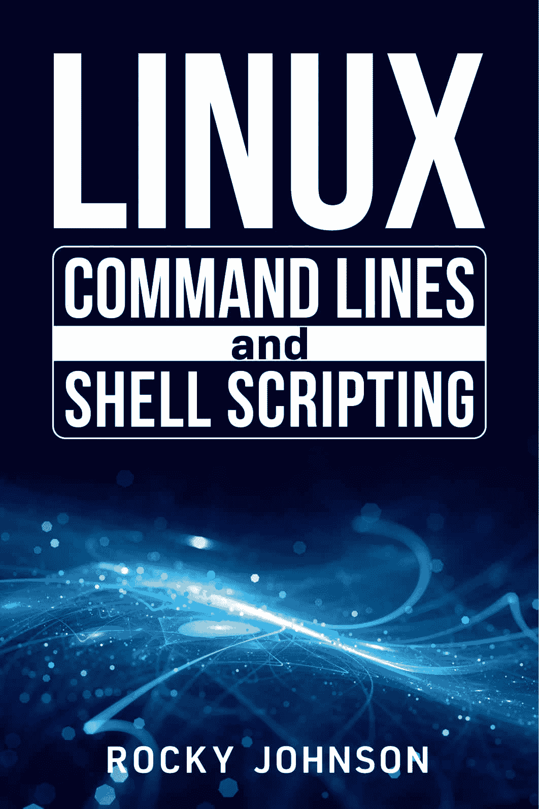
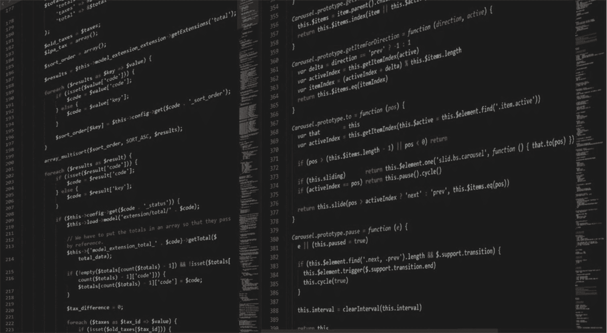

# Linux 命令行与 Shell 脚本



## 目录

- 引言
- 第 1 章 什么是 Linux？
- 第 2 章 使用 Linux 命令操作
- 第 3 章 文件与目录命令
- 第 4 章 命令实战操作
- 第 5 章 重定向命令与 Linux 命令快捷技巧
- 第 6 章 进程命令
- 第 7 章 使用 Linux 编辑器
- 第 8 章 Linux Shell 脚本
- 第 9 章 函数的 Linux Shell 脚本
- 结语

# Linux 命令与 Shell 脚本

## 引言

本关于 Linux 命令行和 Shell 脚本的书将向你展示如何使用键盘输入命令并编写 Shell 脚本来制作程序。通常情况下，Linux 比 Windows 和 Mac 操作系统更困难，但它三者中最安全的。当你学习 Linux 时，你可以编写自己的软件并用它来处理日常事务。如果你愿意，你可以让计算机按照你设想的方式运行。

你可以从 Linux 中获得很多乐趣，但它并不容易使用。Linux 没有像 Windows 那样的图形化界面。相反，它有一个命令行。如果你不知道什么是命令行，应该在 Windows 中查找`Dos`或`Command Prompt`以了解更多信息。它是一个黑屏，你必须在上面编写命令并完成日常差工作。

这本书分为两部分：第一部分介绍命令，第二部分介绍 Shell 脚本。如果你不知道如何使用 Linux 命令和 Shell 脚本，你就无法很好地运行系统。我在书中填满了你将最常用、最需要的命令。人们在运行程序后可以在命令行中看到一些结果。我也将其中一些结果列在了下面的列表中。

Shell 脚本部分可能会很难。如果你有编程背景，阅读这部分会很有趣。书的后面有一章关于 Linux 编辑器的章节，所以不用担心那个。你可以编写自己的脚本，也可以复制我的脚本并粘贴到编辑器中，以便学习如何编写它们。这样，你可以比较每个脚本的结果。作为额外奖励，我还包含了许多展示如何使用命令的简单脚本示例。

# 第 1 章 什么是 Linux？


作为 Linux 的学生，你首先学习的是 Linux 是如何诞生的。这将帮助你理解这个操作系统是如何工作的。在计算机的硬件和软件之间，Linux 是一层被称为“Linux”的软件。它允许你在计算机上进行高效工作并编写自己的程序。简单来说，操作系统是计算机软件和硬件之间的桥梁。操作系统允许你使用存储设备（如硬盘、固态硬盘和 USB 闪盘）来存储数据。它确保数据从一个地方移动到另一个地方。

例如，它确保数据从操作系统传输到你办公室或家的打印机。如果你在计算机上安装了 Microsoft Windows 操作系统，Windows 操作系统就会运行硬件。它负责鼠标、键盘、打印机、扫描仪等设备。根据工作需要安装 Microsoft Office、Adobe 阅读器、PDF 转换器和其他软件。如果你希望计算机上拥有这每种程序，你必须为此付费。

在控制硬件方面，Linux 与 Windows 是一样的。不同之处在于，它充当了软件指令代码与运行它的物理设备之间的桥梁。主要的区别在于你在 Linux 操作系统中使用的软件。这是主要的不同点。如果你有一台 Mac，软件将与在 Windows 上运行的软件不同。你无法在 Linux 上运行 Microsoft Office 或 Adobe Photoshop。使用 Linux，你可以运行不同的服务器，如虚拟化服务器、Apache 服务器、数据库服务器等。这些服务器都运行在 Linux 上。

尽管如此，Linux 许多许多为个人电脑制作的不同发行版。这些发行版与 macOS 和 Windows 非常相似。它们使用相同类型的程序，如文字处理器、图像编辑器和游戏来工作。这些 Linux 发行版看起来更面向那些想在家使用免费计算机系统的人。

起初，Linux 并不是作为一个操作系统或 Windows 操作系统的竞争者出现的。起初，Linux 只是由 Linus Torvalds 制作的一个内核，由他创建了它。如果你当时在读高中，Linus 是赫尔辛基大学的一名学生。内核仍然可以使用系统中，但它不像以前那么重要了。它是这样开始的：第一次被使用是通过 GNU 操作系统。你可以说，没有内核，GNU 系统将无法运行。

内核是 Linux 的重要部分。内核是操作系统中最重要的部分，因为它负责应用程序和硬件之间所有的连接。在目前的市场中，有两种内核：Unix 类内核和 Windows 内核。

### Linux 操作系统的诞生

在 1991 年到 1994 年之间，Linus 更进一步了。他制作了 Linux 操作系统。他将 GNU 操作系统与 Linux 内核结合在一起。最初，他想制作一个免费的操作系统。相反，他想做一个可以满足他编程需求的东西。起初，很多人认为 Linux 是他最喜欢做的事，像是一份兼职。使用 Linux 的人不用`UNIX`。

整个 Linux 都是由 Linus 从零开始制作。为了制作一个人们可以使用开源操作系统，他想出了“Linux”这个名字。在此之前，UNIX 不是开源的。Unix 必须付费。同样，微软的操作系统也要收费。

因此，Linux 提出了一个免费使用的操作系统的想法。在麻省理工学院（MIT）朋友的帮助下，他想出了这个想法（MIT）。除了构建开源操作系统外，他们还需要一个易于使用且高效的操作系统，以便他们进行更改以满足他们的编程需求。这就是他们做的。

### Linux 的发行版

当 Linus 编写 Linux 操作系统时，他停止工作了一段时间进行休息。那时他公开了操作系统的源代码。这让每个人参与到系统的制造成为可能。科学家和电脑极客也在研究这个想法。他们根据认为最好的方式对其进行修改。

教育机构和企业对这个新操作系统的想法感到兴奋，因为任何拥有源代码的人都可以在自己的计算机上安装并运行 Linux。这些是人们开始制作不同版本的 Linux 操作系统系统的步骤。加州大学伯克利分校的学生尝试开始制作一个新版本。来自中国的人和从事不同工作的人也开始制作自己的版本以满足自己的需求。

公众可以查看源代码，这使得制作发行版（distros）或发布变得更容易。发行版是人们随着时间推移制作的不同类型的 Linux。Linux 有许多不同的版本，而它的许多发行版每一个都赋予了它不同的技能组合。当你必须选择使用哪种 Linux 发行版时，你必须先弄清楚你想让电脑通过 Linux 做什么，然后选择一个发行版。Windows 是一个很好的类比，可以展示我将如何解释。当你在计算机上安装 Microsoft Windows 时，每个发行版都是为了以特定的方式执行任务。

人们使用`Trustix`，这是一种人们使用的 Linux。有许多人说 Linux`Trustix`是市场上最安全的 Linux 操作系统。它就像一块砖头一样坚固。除非你做了一些非常愚蠢的事情，否则任何都不可能进入 Linux`Trustix`。带有病毒的人无法进入。它是一个安全且强大的服务器。在获取源代码并开始安装之前，考虑你是否真的需要一个安全的服务器也很重要，所以务必确定。

为了获得一台可以运行某些工作应用程序的电脑，你可能需要一个`Ubuntu`Linux 桌面版本。如果你想要一台非常安全的电脑，你可能需要 Linux`Trustix`。如果你想要带有大量支持的东西，你可能需要使用 Linux 发行版并寻求技术支持中心来帮助你。这样，你就能得到你需要的。在这种情况下，`Red Hat`Linux 将是你需求的最佳选择。同样，你仍然需要清楚你想让你的电脑做什么，以便为你的计算机系统选择最佳的 Linux 发行版。

因为 Linux 是免费的，你可以随心所欲地更改它。

现在你已经学习了 Linux 的历史和它的不同发行版，是时候转向开源许可的概念了，这个概念让 Linux 与其他操作系统与众不同，因为它允许任何人使用它。Linux 的许可是开源的。你可能在人生的某个阶段听过开源软件。它是可以免费使用的软件。因为你的软件被公开了，这并不意味着任何人都可以免费使用。由于开源软件是免费的，如果你把所有软件都看作是免费的，你可能会失去你的工作以及你的公司。这是违法的，所以我们需要谈论开源软件以消除疑义。

这被称为开源软件。当程序员为某个软件编写代码时，他们将代码交给你，这样你就可以看到他们最初是如何编写该程序的。这并不意味着该程序是免费使用的，但它确实说明了它是免费的。开源供应商有许多付费方式，它们的方法各不相同。

他们这样做的第一种方法是免费提供他们的软件。然而，如果你需要该软件的帮助或培训，他们将向你收取一定费用。例如，你可以下载 Linux 服务器的`MySQL`服务器并在其上运行。同样的情况也适用于你。尽管你已经完全了解了`MySQL`程序的不同复杂之处，但仍然有一些你可能需要学习或寻求帮助的事情。所以，你去软件开发者那里寻求有关软件的帮助或培训。编写计算机程序或进行其他此类工作的人在此时应该就他们为你所做的事情获得报酬。

他们还通过非商业开源许可获得报酬，这是他们获得工作付费的方式。大多数人在这里遇到了麻烦。他们向你收取使用费用。

对于家庭使用，这完全没有问题。一旦你用它连接到业务服务器，你就拥有了将该软件用于业务的权利。最糟糕的情况是，许可费用有时超过 8000 美元。在某些情况下它可能非常贵，但也可能非常廉。因此，考虑你可能如何将非商业、个人或商业用途使用该软件是非常重要的。

他们还通过付费开源许可获得报酬。你们中的许多人可能很好奇即使软件本身需要付费使用，开源软件是如何被使用的。开源程序是指需要付费的程序。如果你能看到程序的代码，它就是开源的。

这是这些程序员赚钱的第四种方式。他们对制作的开源软件收取定期费用。这就像大多数免费使用的程序一样。他们会让你免费下载并尝试他们的软件，这样你可以看到它是如何工作的。他们还会向你展示软件如何工作，以便你理解它的运行原理。然而，如果你想拥有软件的法律权利，你必须每年或每月支付一次费用。在这里，你不需要为花费过高的单分钟许可费付费。

## Linux Shell

现在，我将谈论 Linux shell（外壳），它是 Linux 操作系统的一部分。每当你与计算机交互时，shell 就是当你看向屏幕时看到的内容。看看 Microsoft Windows。你可以看到你的鼠标指针在 Windows shell 中工作，Windows shell 是计算机中看起来像图片的部分。当你在屏幕上移动时，你使用指针移动屏幕的不同部分，如图标和文件夹。shell 有两种类型。第一种是图形用户界面（`GUI`），第二种是命令行用户界面（`LUI`）。`LUI`看起来像 DOS 提示符。如果你曾经在 Microsoft DOS 提示符上工作，你应该知道你看到并操作的屏幕被称为命令行界面（`LUI`）。

Linux 是一个非常技术性的操作系统，这就是为什么程序员、工程师以及其他喜欢技术的人非常喜欢它。他们喜欢使用这种界面，因为这有助于他们编程。当你安装 Linux 时，你可以选择图形用户界面，就像你使用 Windows 界面一样。在这里，你可以使用鼠标点击，也可以使用对程序员更好的命令行界面。由于这个原因，Linux 的命令行界面可以用于很多事情。

## Root

这是你需要思考和考虑的下一个问题。它被称为 root。在 Linux 操作系统中，`root`指某个东西的顶层。当你处理 Linux 时，会有有很多“root”这个词。`root user`是一个负责计算机的人。`root user`是计算机上可能的最强大的人。如果你能以`root user`身份登录，你可以做很多事情。

root 用户（超级用户）拥有巨大的权限，他或她是所有用户中权限最高的。在 Linux 操作系统中有许多不同的文件夹。主目录（home folder）充满了用户的设置、文档、程序和其他重要内容。因此，主目录可以视为单个用户的最高层级。关于 Linux 操作系统中的 root 用户，最重要的一点是：root 级别是最高级别。root 用户可以在操作系统中执行任何操作。当我们开始输入命令并让 Linux 操作系统执行不同的任务时，就会发现 root 用户这一概念对我们有多么重要。那些非 root 用户无法执行的操作，我们作为 root 用户就可以完成。

## 使用 Linux 操作系统的原因

由于服务器运行在 Linux 上，你应该更多地了解它。Linux 操作系统非常强大。一旦你安装了 Linux 操作系统并处理了那些特殊问题且配置了设置，它运行得非常顺畅。Linux 操作系统不会在工作过程中过热或死机，它可以一直运行。一旦你正确配置了 Linux 操作系统，它可以不关机运行一百五十天。

Linux 操作系统与 Windows 的不同在于，你必须每周重启一次以避免丢失部分内存。如果你配置得当，Linux 操作系统就会运行并执行其工作，完全无需担心正在发生什么。当你在电脑上安装 Linux 操作系统时，它的运行方式会有极少甚至没有问题。

## 安装 Linux 操作系统

为了让你能够尝试并感受它的工作原理，我将向你展示如何设置 Linux 操作系统。我会向你展示如何设置 Ubuntu Linux 服务器版以便你可以使用。它是开源且免费的。无论你将 Ubuntu 用于业务还是个人使用，都不会产生费用。访问 Google 并打开 Ubuntu 网站。然后，从网站下载 Ubuntu 服务器版的`ISO`文件并将其放入硬盘。将该文件刻录到 CD 或放入 USB 优存盘中。我希望你已经了解如何使用刻录程序制作一个可以启动的启动 U 盘，我不想在这上面浪费时间。

由于它是用于服务器的，屏幕上将没有图形用户界面（GUI）。简单来说，这意味着你看到的是一个黑白屏幕。屏幕上有一个会移动的光标。当你想要继续工作时，你需要输入命令。如果你不这样做，就会卡住。在服务器上运行 Linux 时，屏幕是黑白的。我会告诉你这是为什么。安全是主要原因。Linux 服务器版本上的每个功能对于黑客客来说都是一个攻击点。这就是为什么 Linux 服务器版本采用基于行的用户界面。任何黑入你电脑的人都可以通过安装在你电脑“图形界面”上的任何程序进入。Linux 操作系统没有图形界面，也没有在之外使用的应用程序，这使得它被黑客的概率较低。

尽管 Mac 操作系统非常安全，但黑客已经发现了进入 Mac 系统使用的 Adobe Flash 插件的方法。随着时间的推移，黑客学会了如何进入 Mac OS 一直使用的 Adobe Flash 插件。尽管 Mac OS X 是一个非常安全的系统，但 Flash 仍有漏洞。黑客现在可以借助 Flash 软件接管 Mac 电脑，这让他们更容易实现这一点。然而，Linux 操作系统并没有这个缺陷。现在，让我们讨论如何在你的电脑上设置 Linux 操作系统。

在设置服务器之前，你需要下载 Ubuntu Linux 服务器软件。你可以访问`www.ubuntu.com`了解更多关于该公司的信息。在 Ubuntu 首页上，你会发现可以执行许多不同功能的 Ubuntu 版本。那里有 Ubuntu 桌面版供你使用。还有笔记本电脑版，不要忘记它。会有云版本，以及适用于平板电脑和手机的版本。寻找 Ubuntu Server 并从像这样的网站获取它的下载链接：

如果你想把 Ubuntu 放在电脑上，文件应该从 DVD 而不是硬盘启动。为了实现这一点，你需要按下键盘上的`DELETE`或`F1`进入主板的 BIOS 设置。要设置你想要启动电脑的位置，请进入下一步。检查你主板的用户手册以查看如何进入 BIOS 设置。进入 BIOS 设置有许多方法。

要安装文件，你需要获取该文件并准备好从 CD 或 DVD 启动。系统会询问你想使用什么语言来安装 Ubuntu Linux。选择你想要的语言并按`Enter`。Linux 将被安装到你的电脑上。


# 第 2 章 使用 Linux 命令

当我们谈论 Linux 命令行时，称之为 Linux shell（外壳）。Linux shell 是一个接收键盘命令并将其发送到操作系统以供使用的程序。所有的 Linux 发行版都带有一个名为`bash`的 shell 程序。`bash`代表 Bourne Again Shell（再次 Bourne 壳）。这些词是关于`bash`的，它是第一个 UNIX shell`sh`的更高级版本。

当你使用图形界面时，你需要另一个名为终端（terminal）的程序进行通信。这就是 Linux shell。

### 让我们开始吧

是时候在 Linux 系统上开始输入命令了。这是第一行。你你你你你你你你你你你你你你你你

 the

11111

111111111111111111

1

1

    1:35:22 UTC 20box1

```
2221
```

```
linuxbox1:~$ date
```

Sun Jan 24 10:35:23 UTC 2021

当你使用操作系统时，你需要知道系统中的精确空间，以保持系统运行的顺畅轻松。

```
linuxbox1:~$ df
```

Filesystem1K-blocksUsed Available Use% Mounted on
| devtmpfs | 125912 |  | 0 | 1259120% /dev |
| tmpfs | 126068 | 8 |  | 1260600% /run |

| none | 126068 | 0 |  | 1260680% /dev/shm |

`/dev/root51200002417728`

2702272 47% /`

如果你想查看空闲内存，你需要输入`free`命令。

```bash
linuxbox1:~$ free
totalusedfreeshared buff/cacheavailable
| Mem: | 252140 | 5252 |  | 245980 | 8 | 908243104 |
| Swap: | 0 | 0 | 0 |  |  |  |
```

当你完成工作并想要结束终端会话时，只需在命令行中输入`exit`并关闭终端会话即可。

## 基础命令

本章这一节将带你了解 Unix 命令和工具。位于行的第一个命令是`cat`命令，它用于显示文件的内容。我将使用系统信息文件，然后返回 Shell 提示符。这是最容易理解的命令之一。你可以获取一个或多个文件的输出并阅读它们。


注意：从现在开始，我将使用 Fedora 发行版测试命令。

## Linux 中的文件导航

你们很多人可能对图形用户界面很熟悉。在那个系统中进行导航非常容易。你可以看到一个完美的文件树来查看系统上的不同文件。你可以在几秒钟内打开并在它们之间导航。然而，在 Linux 中情况并非如此。Linux 操作系统中没有文件的图形化显示。最好将 Linux 文件系统看作一个迷宫。你当前所在的目录就是当前目录。你上方的目录是父级目录。你可以使用`pwd`命令显示当前工作目录。

```bash
[gha@localhost ~]$ pwd
/root
```

### ls 命令

`ls`命令将显示系统中某个目录的目录。默认是当前目录。你可以使用`ls -1`命令显示更长格式的文件列表。你也可以使用`ls –F`命令显示文件类型的信息。

```bash
[gha@localhost ~]$ ls bench.py hello.c
```

你可以使用`cd`命令更改当前工作目录。只需在 shell 中输入`cd`加上你想要工作的目录路径即可。路径是沿着树的分支到达你目标目录的通用路径。你可以通过两种方式指定路径。第一种是绝对路径。绝对路径从根目录开始，并逐分支跟踪树结构，直到文件或目标目录的路径完成。以你系统中的一个目录为例，大多数系统程序都安装在该处。

```bash
[gha@localhost ~]$ cd /usr/downloads
[gha@localhost downloads]$ pwd
/usr/downloads
[gha@localhost downloads]$ ls
```

该命令将列出该目录下的文件。`ls`命令是 Linux 操作系统广泛使用的命令之一。通过这个命令的帮助，你可以查看目录的内容并确定文件的数量和目录属性。正如你所看到的，你可以输入`ls`命令查看当前工作目录中包含的文件和子目录列表。

```bash
[gha@localhost ~]$ ls /usr
bin games include lib lib64 libexec local sbin share src tmp
```

你可以使用以下命令列出用户目录和`/usr`。

```bash
[gha@localhost ~]$ ls ~ /usr
/root:
bench.py hello.c
/usr:
bin games include lib lib64 libexec local sbin share src tmp
```

你可以为`ls`命令添加`-1`来更改显示格式并显示更多细节。通过在同一个`ls`命令中添加`-1`，你可以将输出更改为长格式。

## 选项和参数命令

大多数 Linux 命令由一个连字符前的一个字符组成。然而，有些命令较长，带有两个连字符后跟一个单词，例如 GNU 支持项目中的命令。某些命令甚至允许将两个或多个较短选项标记在一起。在下方的示例中，我们将为`ls`命令提供两个选项——第一个（`l`）将减少长格式输出，而第二个（`t`）将按修改时间对结果排序。

让我们看看`–l`命令的结果。

```bash
[gha@localhost ~]$ ls -l total 8
-rw-r--r-- 1 root root 114 Dec 26 15:19 bench.py
-rw-r--r-- 1 root root 185 Sep 9 2018 hello.c
```

现在我将`t`添加到`–l`中，如果可以延长输出，则延长它。

```bash
[gha@localhost ~]$ ls -lt total 8
-rw-r--r-- 1 root root 114 Dec 26 15:19 bench.py
-rw-r--r-- 1 root root 185 Sep 9 2018 hello.c
```

你可以使用`reverse`命令反转输出顺序。该命令的语法如下所示：

```bash
[gha@localhost ~]$ ls -lt --reverse total 8
-rw-r--r-- 1 root root 185 Sep 9 2018 hello.c
-rw-r--r-- 1 root root 114 Dec 26 15:19 bench.py
```

让我们来看一些可以与`ls`命令配合使用的杂项命令。

- `ls a`用于列出所有以点开头且具有正确名称的文件列表。它还会产生那些通常被列为隐藏的文件。

- `ls --all`是相同命令的长格式选项。

- `ls –d`用于指定一个目录并显示其内容。它不显示目录本身。你可以将此命令与`–l`命令配合使用，以探索有关目录的细节而非内容。

- `ls --directory`用于产生关于目录或其内容的更多细节。

- `ls –F`用于在列出的名称末尾添加特定的指示字符，例如名称后的正斜杠表示已在目录中。

- `ls --classify`用于在末尾添加指示字符。

- `ls --human-readable`用于以易读格式显示，而不是以字节为单位。

- `ls –S`用于按大小排序。

- `ls –t`用于按修改时间排序。

## 查看文件类型

当我们开始探索系统时，你应该学习的最有用事情之一就是查看文件。为了做到这一点，我们使用`file`命令来帮助我们。Linux 不需要通过文件名来指定类型，例如你预期的`.jpg`文件包含图像。当`file`命令被调用时，它会打印出文件的描述。

```bash
[gha@localhost ~]$ file image.jpg
```

有很多文件类型，而且像许多操作系统一样，Linux 将一切都视为文件。

### less 命令

我们使用`less`命令查看文本文件。Linux 操作系统包含许多肉眼可读的文件，`less`命令为我们提供了阅读它们的简单方法。文本文件需要检查，因为其中一些充满了系统设置。你会看到这些被标记为配置文件，而且它们都以特定的格式存储。当你阅读这些文件时，你将对 Linux 的运行方式有一个了解，并且你会发现系统的某些程序（称为脚本）是以相同方式存储的。

一旦执行了`less`命令，你就可以后滚动文本文件。假设你正在查看定义系统账户的文件。你可以使用此命令：

```bash
[gha@localhost ~]$ less /etc/passwd
```

* 使用`n`搜索不同字符的下一个出现位置

* 使用`/characterstosearchforward`跳转到字符在页面上的下一次出现位置

* 使用`q`退出 less 命令

你的 Linux 文件系统与其他 UNIX 类系统相似，而《Linux 文件系统层级标准》（Linux File System Hierarchy Standard）是规定该设计的发布标准。以下是一些你可以探索的目录：

* `/`是根目录，充当所有事物起点的角色。

* `/bin`是根目录，包含了系统启动和运行必须的二进制文件或程序。

* `/boot`是包含 Linux 内核的根目录。这是引导加载程序所在，包含了系统启动所需的驱动程序。

* `/var`是根目录，存储最可能变化的数据的地方。你在这个目录中会发现许多池文件、数据库和用户邮件。

* `/var/log`是包含不同日志文件的根目录。它还包含某些系统活动记录。封装在该目录内的文件非常重要。你应该定期监控它。最有用的是

    * `/var/log/messages`。在某些系统中，你可能需要以超级用户（root）身份登录才能访问日志文件。

* `/imp`用于存储由许多程序创建的临时文件。某些配置可能会导致目录在每次重启系统时清空。

* `/usr`是你 Linux 操作系统中最大的目录。它可能包含普通用户使用的程序和某些支持文件。

* `/proc`是一个特殊目录，因为它不是用于在硬盘上存储文件的系统。相反，它是内核维护的虚拟文件系统，其中的文件是内核的快照，可读的，并会告诉你内核是如何看待计算机的。

* `/root`如果你以 root 账户操作，这是主目录。

* `/tmp`用于存储临时文件。请注意，某些配置可能会每次系统重启时清空此目录。

* `/usr/bin`带有由 Linux 发行版安装的一些可执行程序。该目录包含许多程序的情况并不罕见。

* `/usr/lib`是位于`/usr/bin`中不同程序所需的共享库。

* `/usr/sbin`加载了许多系统管理程序。

* `/usr/local`是一个树结构，包含了不属于实际发行版但系统级使用仍需要的程序。从源代码编译的程序进入`/usr/local/bin`，你会在新安装的 Linux 系统中找到它。然而，在系统管理员为其添加文件之前，它将保持为空。

* `/usr/share`包含了`/usr/bin`中程序使用的共享数据。该目录包含了图标、配置文件、音频文件和屏幕背景等不同内容。

* `/usr/share/doc`包含按包组织的文档文件。

* `/lib`填充满了核心系统程序使用的共享库文件。这些程序类似于 Windows 操作系统中的 DLL。

* `/mnt`用于旧版本的 Linux 操作系统。`/mnt`目录为系统中可移动设备提供了某些挂载点。条件是设备应该手动挂载。

* `/lost+found`用于在文件系统损坏事件后进行部分恢复。在你的系统遇到问题之前，该目录一直保持为空。

* `/media`用于现代 Linux 操作系统。`/media`目录包含 CD-ROM、USB 驱动器和其他任何自动挂载的设备的挂载点。

 第 3 章文件与目录命令

本章将向你展示如何使用 Linux 操作系统中的命令查看文件和文件夹并移动它们。你可以更改文件夹和文件的名称。某些任务是简单的。当你使用命令移动时，你比使用图形用户界面拥有更多的控制权和灵活性。使用命令行来做简单的事情更容易，但你需要它来完成更复杂的事情。在图形用户界面中，将 HTML 文件从一个目录移动到另一个是困难的。在命令行系统中，移动文件要容易得多。首先，我将讨论你在 Linux 中可以使用一些特殊字符。然后，我将讨论你可以用于更改文件和目录的命令。

## 特殊字符

当你与他人讨论 Linux 时，你可能会听到 Linux 用户在操作过程中遇到的一些特殊字符。每个特殊字符都有其职责，了解它们将会让你的工作变得更容易。

* `*`技术上称为星号（asterisk）。它用于正则表达式和作为通配符（glob character）。

* `‘`技术上称为 tick 或单引号。它用于字面量字符串。

* 特殊字符`.`技术上称为点（dot）。它用于表示你工作的当前目录、主机名或文件分隔符。

* `$`技术上称为美元符号。它用于表示变量或表示行尾。

* `\`技术上称为反斜杠（backslash）。它用于宏和字面量。

* `/`技术上称为正斜杠（forward slash）。它作为搜索命令或目录分隔符。

* `!`技术上称为 bang。它用于命令历史。

* `|`技术上称为管道（pipe）。它用于命令管道。

* `_`技术上称为下划线（underscore 或 under）。它用于特定的空格占位。

* `` ` ``技术上称为反引号（backtick 或 backquote）。它用于命令。

* `“`技术上称为双引号（double quote）。它用于字面量字符串。

* `{}`技术上称为大括号（braces）。它们用于块。

* `^`技术上称为脱字符（caret）。它用于表示行首。

* `[]`技术上称为方括号（squares）。它们用于范围。

* `~`技术上称为波浪号（squiggle 或 tilde）。它作为目录快捷。

* `#`技术上称为井号（pound、hash 或 sharp）。它用于注释。

## 命令行编辑

在探索 Linux shell 时，你会发现可以通过方向键在 shell 中移动。这在大多数操作系统中都是标准的。了解 Linux 的标准快捷键是一个好主意

* `CTRL-B`用于将光标在屏幕上向左移动。

* `CTRL-F`用于将光标在屏幕上向右移动。

* `CTRL-E`用于将光标移动到行的末尾。

* `CTRL-A`用于将光标移动到行的开头。

* `CTRL-P`用于查看屏幕上之前的命令。它用于将光标向上移动。

* `CTRL-N`用于将光标向下移动，它也用于查看下一个命令。

* `CTRL-K`用于删除从光标到行尾的所有内容。

* `CTRL-W`用于删除光标前一个单词。

* `CTRL-U`用于删除从光标到行首的所有内容。

* `CTRL-Y`用于粘贴之前通过`CTRL-U`命令剪掉的文本。

## 目录命令

`mkdir` Linux 命令用于创建目录。它的工作方式如下：

```bash
mkdir directoryname
```

### cp 命令

另一个命令`cp`用于复制目录和文件。你可以以不同的方式使用它，例如：

```bash
cp file1 file2
cp files… directoryname
```

你可以在`cp`命令中使用以下选项。

- `cp`命令选项`-a`或`--archive`用于复制目录和文件及其所有属性，包括权限和所有关系。通常情况下，复制的文件将采用执行复制操作的用户默认属性。

- `cp`命令选项`-u`或`--update`用于当你从一个目录复制到另一个目录时，且你复制的文件在目标目录不存在或比目标目录中的文件新。

- `cp`命令选项`-v`或`--verbose`用于在执行复制时显示信息消息。

- `cp`命令选项`-i`或`--interactive`用于在覆盖现有文件之前，它会提示用户进行确认。如果你没有指定该选项，`cp`命令将覆盖现有文件，这对于你的文档记录是不利的。

- `cp`命令选项`-r`或`--recursive`用于递归复制内容和文件。当你复制目录时，需要此特定选项。

### `cp`命令示例

- Linux 命令`cp item1 item2`将将`item1`的文件复制到`item2`的文件中。如果`item2`存在，它将被`item1`的内容覆盖。如果它不存在，系统将创建它。

- Linux 命令`-i item1 item2`将将`item1`的文件复制到`item2`的文件中。然而，唯一的例外是，如果`item2`存在，在覆盖文件之前会提示用户。

- Linux 命令`item1 item2 dir1`将将`item1`和`item2`的内容复制到`dir1`。在执行此命令之前，目录`dir1`必须存在。

- Linux 命令`cp dir1* dir2`使用通配符。它将`dir1`的所有文件复制到`dir2`。条件是在执行命令之前`dir2`必须存在。

- Linux 命令`-r dir1 dir2`将将目录`dir1`复制到目录`dir2`。如果`dir2`不存在，它将被创建并包含与目录`dir1`相同的内容。

### `mv`命令

Linux 命令`mv`根据用户的使用方式对文件进行移动和重命名。执行命令后，原始文件名将不再存在。`mv`命令用法与`cp`命令相同。

```
mv file1 file2
```

就像`cp`命令一样，`mv`命令也带有不同的选项，如下：

- `mv`命令选项`-u`或`--update`用于当你从一个目录移动到另一个目录时，且你移动的文件在目标目录不存在或比目标目录中的文件新。

- `mv`命令选项`-v`或`--verbose`用于在执行移动时显示信息消息。

- `mv`命令选项`-i`或`--interactive`用于在覆盖现有文件之前，它会提示用户进行确认。如果你没有指定该选项，`mv`命令将覆盖现有文件，这对于你的文档记录是不利的。

### `mv`命令示例

- Linux 命令`mv item1 item2`将`item1`的文件移动到`item2`的文件中。如果`item2`存在，它将被`item1`的内容覆盖。如果不存在，系统将创建它。在任何情况下，文件`item1`都将不再存在。

- Linux 命令`mv -i item1 item2`将`item1`的文件移动到`item2`的文件中。然而，唯一的例外是，如果`item2`存在，在覆盖文件之前会提示用户。

- Linux 命令`mv item1 item2 dir1`将`item1`和`item2`的内容移动到`dir1`。在执行此命令之前，目录`dir1`必须存在。

- Linux 命令`mv dir1* dir2`使用通配符。它将`dir1`的所有文件移动到`dir2`。条件是在执行命令之前`dir2`必须存在。

- Linux 命令`mv dir1 dir2`将目录`dir1`移动到目录`dir2`。如果`dir2`不存在，你必须创建并将`dir1`的内容移动到`dir2`。

### `rm`命令

`rm`命令用于移除或删除目录和文件，如下：

```
rm file...
```

在此命令中，`file`是一个或多个目录和文件的名称。使用此命令可能是非常危险的。一旦你用`rm`命令删除了某些东西，你就永远无法找回它。Linux 假设你是故意删除该文件的，它不会把文件还给你。因此，你应该谨慎使用它。假设你想删除某些目录中的 HTML 文件。

所以，当你使用`rm`命令配合通配符时，你应该先用`ls`命令测试通配符，以查看你将从系统中删除的文件内容。你可以使用方向键回命令，然后将其替换为`rm`。

- `rm`命令选项`-r`或`--recursive`用于递归删除目录。这意味着如果你要删除的目录有子目录，你也可以删除它们。如果你想删除一个目录，应该指定此选项。

- `rm`命令选项`-f`或`--force`用于忽略不存在的文件。它不会提示。它倾向于覆盖`-interactive`选项。


- `rm` 命令选项 `-v` 或 `--verbose` 用于在执行删除时显示信息消息。
- `rm` 命令选项 `-i` 或 `--interactive` 用于在删除现有文件之前提示用户进行确认。如果你没有指定该选项，`rm` 命令将静默删除现有文件，这对于你的文档记录是不利的。

### `rm` 命令示例

- Linux 命令 `rm item1` 将静默删除 `item1` 的文件。
- Linux 命令 `rm -i item1` 将删除 `item1` 的文件。然而，唯一的例外是，在删除文件之前会提示用户。
- Linux 命令 `rm item1 dir1` 将删除 `item1` 和 `dir1` 的内容。在执行此命令之前，目录 `dir1` 必须存在。
- Linux 命令 `rm -rf item1 dir1` 的工作与上述相同，例外是如果 `item1` 和 `dir1` 都不存在。

# 第 4 章 命令实践


当你完成了所有任务，现在应该结束了。每个人都有许多未知的选项和参数。在这里，我们将向你展示如何在命令行中使用更多命令，以帮助变得更加熟悉。

## `type` 命令

这是一个 Linux 内置命令，用于显示 shell 将执行的典型类型。查看如何使用它。

```text
[gha@localhost ~]# type type
type is a shell builtin

[gha@localhost ~]# type ls
ls is aliased to `ls --color=auto’

[gha@localhost ~]# type cp
cp is /bin/cp
[gha@localhost ~]# type mv
mv is /bin/mv
[gha@localhost ~]# type rm
rm is /bin/rm
[gha@localhost ~]# type cd
cd is a shell builtin

[gha@localhost ~]# type help
help is a shell builtin
```

你可以看到这些不同命令有不同的结果。

## `which` 命令

有时特定的系统上安装了多个版本的可执行程序。虽然这在桌面系统中并不常见，但在大型服务器上并不罕见。你可以使用 `which` 命令确定可执行程序的确切位置。

```text
[gha@localhost ~]# which ls
ls=’ls --color=auto’
/bin/ls

[gha@localhost ~]# which help
/usr/bin/which: no help in (/usr/local/sbin:/bin:/sbin:/usr/bin:/usr/sbin:/usr/local/bin)
```

`which` 命令对可执行程序有效，但对于作为可执行程序的内置命令或别名无效。当你对内置命令使用 `which` 命令时，你会得到无响应或一个巨大的错误信息。

# 命令文档

## `help` 命令

Bash shell 为内置命令提供了一个内置帮助设施。如果你想使用它，可以输入 `help` 后跟内置命令的名称。参见下示例。

```text
[gha@localhost ~]$ help cd cd: cd [-L|[-P [-e]] [-@]] [dir]
```

更改 shell 工作目录。

将当前目录更改为 `DIR`。默认的 `DIR` 是 `HOME` Shell 变量的值。

`CDPATH` 变量用于定义通往 `DIR` 所在目录的搜索路径。`CDPATH` 使用冒号（`:`）分隔来指示备选文件名。空名称表示当前目录，如果目录名称前面有斜杠（`/`），则不使用 `CDPATH`。

详细内容比我在这里提到的要多得多。为了节省空间，我进行了精简。你可以在终端上输入 `cmd` 命令，查看在操作 Linux 操作系统遇到困难时，`help` 命令是如何帮助帮助的。当你在命令语法的描述中看到方括号 `[]` 时，应该记住它们仅表示可选项目。如果你在描述中看到竖线字符 `|`，它表示互斥的项目。某些可执行程序支持 `--help` 选项。应用该选项时，它会显示该命令支持的语法和相关选项的详细描述。

```text
[gha@localhost ~]$ mkdir --help
```

用法：`mkdir [OPTION]... DIRECTORY...`

如果 `DIRECTORY(ies)` 不存在，则创建它们。

长选项的强制性参数对于短选项也是强制性的。

`-m, --mode=MODE` 设置文件模式（类似于 `chmod`），而不是 a=rwx - umask

## `man` 命令

大多数供命令行使用的可执行程序都提供一份正式的文档，被称为 `man` 页面（手册页）或用户手册页。Linux 上加载了一个名为 `man` 的特殊分页程序来查看详情。你可以输入 `man` 命令，然后跟上命令的标题。man 页面的格式各异，包含命令的标题或语法摘要、列表以及命令目的的描述。man 页面不包含示例，它们旨在作为特殊的参考资料，而不是教程。请参考下方的示例。

```text
[gha@localhost ~]$ man ls
```

```text
LS(1) 用户命令 LS(1)

NAME

ls - 列出目录内容

SYNOPSIS

ls [OPTION]... [FILE]...

DESCRIPTION

列出关于 `FILEs`（默认为当前目录）的信息。

如果没有指定 `-cftuvSUX` 或 `--sort` 中的任何一个，则按字母顺序对条目排序。
```

在大多数 Linux 操作系统中，`man` 使用 `less` 显示手册，这样在页面显示时所有熟悉的 `less` 命令都可以生效。`man` 显示的手册有不同的章节，涵盖了用户命令和系统管理命令。此外，它还涵盖了文件格式、编程接口等更多内容。手册的完整布局如下：

- `man` 命令的第 1 节将显示用户命令。
- `man` 命令的第 2 节将显示内核系统调用的编程接口。
- `man` 命令的第 3 节将显示 C 库的编程接口。
- `man` 命令的第 4 节将显示特殊文件，如设备节点和驱动程序。
- `man` 命令的第 5 节将显示文件格式。
- `man` 命令的第 6 节将显示游戏和屏幕保护等娱乐内容的详情。
- `man` 命令的第 7 节将显示杂项内容。
- `man` 命令的第 8 节将显示与系统管理相关的命令。

有时，你可能需要查看手册的特定章节以找到你正在寻找的内容。如果不指定章节编号，你始终会在第 1 节中获得特定匹配的实例。

### `apropos` 命令

根据特定的搜索词在 man 页面列表中搜索可能的匹配项。这种粗略的方法通常很有帮助。语法如下：

```text
[gha@localhost ~]$ apropos floppy
```

### `whatis` 命令

Linux 中的 `whatis` 命令用于显示 man 页面的名称和简短描述。语法如下：

```text
[gha@localhost ~]$ whatis ls
```

Linux 发行版自带的 man 页面标记为参考文档而非教程。许多 man 页面非常难以阅读，以至于我们大多数人会直接跳过它们，不再多看一眼。然而，最难的 man 页面是 `bash` 的。它们冗长、复杂且几乎不可读。但是，它们的长度就成了它们的优势，因为其中包含了许多你可以增加知识的有用信息。当你读完一页后，它就会开始变得意义。

## `info` 命令

GNU 项目提供了 `info` 页面作为 man 页面的替代方案。一个名为 `info` 的读取程序显示这些页面，这些页面的链接方式与网页相同。例如：

```text
[gha@localhost ~]$ info ls
```

下一步：dir 运行，向上：目录列表

10.1 ‘ls’:列出目录内容

===============================

在 `ls` 程序中，你将找到关于任何类型文件的信息，包括目录。按照惯例，接受选项和文件参数的任意混合。

默认情况下，`ls` 将列出也是目录的非选项命令行参数的内容，但这不是递归列表，且以 `.` 开头的文件会被排除。

`info` 程序将读取 `info` 文件——这些结构进入单个节点，每个节点包含一个主题。`info` 文件中的超链接帮助用户在节点之间移动，这些超链接由开头的星号 `*` 标识。通常，激活这些超链接需要用户用光标点击它们并按回车。`info` 命令提供了这些信息：

- `info` 菜单中的 `?` 键将显示帮助菜单。

I/O 重定向可以帮助你重新定义输出的方向。要将标准输出重定向到文件而不是屏幕，你需要使用重定向操作符并在后面加上文件名。这对于某些命令的输出存储在文件中非常有用。你可以告诉 shell 将 `ls` 命令的输出重定向到名为 `ls-output.txt` 的文件，而不是屏幕。

```text
[gha@localhost ~]$ ls -1 /usr/bin > ls-pt.txt
```

我创建了 `/usr/bin` 目录的详细列表，并将结果发送到了文件 `ls-pt.txt` 中。

# 键盘技巧

Unix 是一个为热爱打字的人设计的操作系统。命令行不允许使用鼠标操作。Linux 命令可能非常繁琐，因此你应该学习许多键盘技巧。

## 文本修改

以下列表显示了你如何在 Linux 命令行中修改文本。`killing`（“杀死”）和 `yanking`（“拉取”）术语分别指剪切和粘贴。

- 键盘技巧 `CTRL-D` 将帮助你删除光标当前位置的字符。
- 键盘技巧 `CTRL-T` 将帮助你交换光标当前位置字符与前一个字符的位置。
- 键盘技巧 `Alt-U` 将帮助你将光标当前位置到单词结束点的字符转换为大写写。
- 键盘技巧 `Alt-L` 将帮助你将光标当前位置到单词结束点的字符转换为小写。
- 键盘技巧 `Alt-T` 将帮助你交换光标当前位置单词与前一个单词的位置。
- 键盘技巧 `CTRL-K` 将帮助你删除光标当前位置到行尾的文本。
- 键盘技巧 `CTRL-U` 将帮助你删除光标当前位置到行首的文本。
- 键盘技巧 `ALT-D` 将帮助你删除光标当前位置到当前单词末的文本。
- 键盘技巧 `ALT-Backspace` 将帮助你删除光标当前位置到当前单词开头的文本。如果光标位于单词开头，它还会删除上一个单词。
- 键盘技巧 `CTRL-Y` 将帮助从剪贴板（kill-ring）中提取文本并粘贴到光标当前位置。

# 全命令

shell 帮助你的另一种方式是通过补全。当你输入命令时按下 Tab 键，就会发生这种情况。当你输入命令的一半时，可以按 Tab 键完成命令。需要记住的一点是你不要按 Enter 键。

## 补全命令

- 键盘技巧 `Alt-$` 将帮助显示所有可能的补全列表。你也可以通过双击 Tab 键来实现。这简单得多。
- 键盘技巧 `Alt-*` 将帮助你插入可能的补全内容。当你打算使用多个匹配项时，这非常有用。

# 历史记录

Bash 会维护你输入命令的历史记录。命令列表保存在主目录下一个名为 `.bash_history` 的文件中。历史记录功能对于减少所需的打字量非常有用，特别是当它与命令行编辑结合使用时。这里是 `history` 命令的语法。

```text
[gha@localhost ~]$ history | less
```

Bash 默认存储你最后输入的 500 条命令。假设你想找到以前列出 `/usr/bin` 的命令。以下是实现方法。

```text
[gha@localhost ~]$ history | grep /usr/bin
```

在浏览 `history` 命令时，你可以使用一系列按键组合。

- 你可以使用快捷键 `CTRL-P` 移动到最新的历史记录项。此操作与向上方向键相同。
- 你可以使用快捷键 `CTRL-N` 移动到下一条历史记录项。此操作与向下方向键相同。
- 你可以使用快捷键 `ALT->` 移动到历史列表的底部（即当前命令行位置）。
- 你可以使用快捷键 `ALT-<` 移动到历史列表的起点。
- 你可以使用快捷键 `CTRL-R` 进行反向增量搜索。此选项从当前命令行开始向上历史列表进行增量搜索。
- 你可以使用快捷键 `CTRL-O` 执行历史列表中的当前项并移动到下一个。如果你希望重新执行列表中的一系列命令，这非常方便。
- 你可以使用快捷键 `ALT-N` 进行正向搜索。这是非增量的。
- 你可以使用快捷键 `ALT-P` 进行反向搜索。这同样是非增量的。结合此快捷键，你可以在执行搜索之前先输入搜索字符串并按 ENTER。

## 历史扩展

shell 通过使用 `!` 字符对历史列表中的不同项目提供特殊类型的扩展。我们已经看到数字可以跟在感叹号后面，以插入历史列表中的特定条目。还有许多其他扩展功能。历史扩展机制有许多可用元素，但这个主题太深奥了。

- 你可以输入序列 `!!` 来重复最新命令。不过，按下向上箭头再按 ENTER 可能更容易。
- 你可以输入序列 `!?string` 重复包含该字符串的最新历史列表项。
- 你可以输入 `!string` 重复以字符串开头的最新历史项。
- 你可以输入 `!number` 重复指定数字的历史项。

# 第 6 章进程


如果你有一台计算机，它可以同时完成多件事。它在任务之间快速切换，这被称为多任务处理。有时计算机会遇到问题，或者某个程序无法工作，所以你需要修复它们。当你的电脑启动时，内核会启动。这些事情发生：然后，一个名为 `init` 的程序启动。这些服务是用 shell 语言编写的。许多服务在后台运行，不需要用户界面。这个链接将向你如何找到 `process` 命令。如果我们为 `ps` 添加一个选项，就可以详细显示结果在屏幕上。查看下面的示例。

```text
[gha@localhost ~]$ ps
```

| PID | TTY | TIME | CMD |
| :--- | :--- | :--- | :--- |
| 1 | ? | S | 0:00 /sbin/init |
| 2 | ? | S | 0:00 [kthreadd] |
| 3 | ? | I | 0:00 [kworker/0:0] |
| 4 | ? | I< | 0:00 [kworker/0:H] |
| 5 | ? | I | 0:00 [kworker/u2:0] |
| 6 | ? | I< | 0:00 [mm_percpu_wq] |
| 7 | ? | S | 0:00 [ksoftirqd/0] |
| 8 | ? | S | 0:00 [kdevtmpfs] |
| 9 | ? | I< | 0:00 [netns] |
| 10 | ? | S | 0:00 [oom_reaper] |
| 11 | ? | I< | 0:00 [writeback] |
| 12 | ? | I< | 0:00 [crypto] |
| 13 | ? | I< | 0:00 [kblockd] |
| 14 | ? | S | 0:00 [kswapd0] |
| 15 | ? | I | 0:00 [kworker/0:1] |
| 33 | ? | S | 0:00 [khvcd] |
| 43 | ? | Ss | 0:00 dhcpcd |
| 48 | hvc | 0Ss | 0:00 sh -l |
| 71 | ? | I | 0:00 [kworker/u2:1] |
| 102 | hvc0 | R+ | 0:00 ps |

结果分别列出了 `sh` 和 `ps`。

`x` 选项告知 `ps` 需要显示所有进程，无论由哪个终端控制。由于系统正在运行许多进程，会产生很长的列表，通常情况下，将 `ps` 的输出管道到 `less` 并进行查看非常有帮助。某些选项组合会产生很多输出行，此时将终端模拟器窗口最大化是一个好主意。

## 进程状态

以下是进程状态的概述。

- 进程状态 `R` 表示运行中（running）。该进程正在系统中运行，或者处于准备就绪状态。
- 进程状态 `S` 表示睡眠（sleeping）。该进程处于睡眠模式，未运行。它正在等待某个事件的启动，例如击键或网络包。
- 进程状态 `Z` 表示僵尸进程（z）。这是一个已经终止的子进程，但父进程尚未对其进行清理。
- 进程状态 `D` 表示不可中断睡眠（uninterruptable sleep）。该进程正在等待 I/O，例如磁盘驱动器。
- 进程状态 `T` 表示停止（stopping）。该进程被指令停止。
- 进程状态 `N` 表示低优先级进程。这是一个良好的进程，当所有其他高优先级进程处理完毕后，它将获得处理器时间。
- 进程状态 `<` 表示高优先级进程。可以赋予进程更高的重要性，并允许它在 CPU 上占用更多时间。优先级较高的进程通常不那么“友好”，因为它占用了更多的 CPU 时间。

该进程后面可能跟随其他字符，这些字符表示其他进程的特征。`aux` 命令可以配合 `ps` 使用，提供另一组选项。


```text
[gha@localhost ~]$ ps aux

USERPID %CPU %MEMVSZRSS TTYSTAT

| root | 1 | 0.0 | 1.3 | 3136 | 2516 ? | | S14:350:00 /bin/sh /sbin/i |
| root | 2 | 0.0 | 0.0 | 0 | 0 ? | S | 14:350:00 [kthreadd] |
| root | 3 | 0.0 | 0.0 | 0 | 0 ? | I | 14:350:00 [kworker/0:0] |
| root | 4 | 0.0 | 0.0 | 0 | 0 ? | I< | 14:350:00 [kworker/0:0H] |
| root | 5 | 0.0 | 0.0 | 0 | 0 ? | I | 14:350:00 [kworker/u2:0] |
| root | 6 | 0.0 | 0.0 | 0 | 0 ? | I< | 14:350:00 [mm_percpu_wq] |
| root | 7 | 0.1 | 0.0 | 0 | 0 ? | S | 14:350:02 [ksoftirqd/0] |
| root | 8 | 0.0 | 0.0 | 0 | 0 ? | S | 14:350:00 [kdevtmpfs] |
| root | 9 | 0.0 | 0.0 | 0 | 0 ? | I< | 14:350:00 [netns] |
| root | 10 | 0.0 | 0.0 | 0 | 0 ? | S | 14:350:00 [oom_reaper] |
| root | 11 | 0.0 | 0.0 | 0 | 0 ? | I< | 14:350:00 [writeback] |
| root | 12 | 0.0 | 0.0 | 0 | 0 ? | I< | 14:350:00 [crypto] |
| root | 13 | 0.0 | 0.0 | 0 | 0 ? | I< | 14:350:00 [kblockd] |
| root | 14 | 0.0 | 0.0 | 0 | 0 ? | S | 14:350:00 [kswapd0] |
| root | 15 | 0.0 | 0.0 | 0 | 0 ? | I | 14:350:00 [kworker/0:1] |
| root | 33 | 0.0 | 0.0 | 0 | 0 ? | S | 14:350:00 [khvcd] |
| root | 43 | 0.0 | 0.7 | 1944 | 1472 ? | Ss14:350:00 dhcpcd |
| root | 48 | 0.0 | 1.5 | 6204 | 2940 hvc0 | Ss14:350:00 sh -l |

START TIME COMMAND
root71 0.0 0.000 ?I14:350:00 [kworker/u2:1]
root160 0.0 1.48180 2740 hvc0R+15:020:00 ps aux
```

该命令显示了属于系统中所有用户的进程。当你使用不带前导横杠的选项时，它将以 BSD 风格的行为调用命令。以下是 BSD 风格`ps`列头的详细信息。

- BSD 风格的`ps`列头`USER`指的是用户 ID（User ID）。它表示进程的所有者。
- BSD 风格的`ps`列头`RSS`表示驻存集大小（Resident Set Size）。这表示进程所占用的物理内存（RAM）量。
- BSD 风格的`ps`列头`VSZ`指系统的虚拟内存大小。
- BSD 风格的`ps`列头`%CPU`指 CPU 使用率的百分比。

## 使用`top`命令查看进程

`ps`命令揭示了大量你的 Linux 机器正在运行的状况。然而，它提供的只是`ps`命令在系统中执行时机器状态的快照。为了查看机器活动的的动态视图，我将使用`top`命令。

```text
[gha@localhost ~]$ top

top - 15:10:01 up 34 min, 0 users, load average: 0.05, 0.05, 0.02
Tasks: 20 total,1 running, 19 sleeping, 0 stopped,               0 zombie
%Cpu(s): 1.9 us, 4.9 sy, 0.0 ni, 93.2 id, 0.0 wa, 0.0 hi, 0.0 si, 0.0 st
MiB Mem :182.0 total,171.2 free,4.9 used,5.8 buff/cache
MiB Swap:0.0 total,0.0 free,0.0 used.172.1 avail Mem
PID USERPR NIVIRTRESSHR S %CPU %MEM TIME+ COMMAND
| 180 root | 200 | 842430842584 R7.41.70:01.82 top |
```

- `vim` Linux 编辑器中的命令`k`用于将光标向上移动一行。
- `vim` Linux 编辑器中的命令`PageDown`或`Ctrl-f`用于向下滚动一页数据。
- `vim` Linux 编辑器中的命令`PageUp`或`Ctrl-b`用于向上滚动一页数据。
- `vim` Linux 编辑器中的命令`gg`用于跳转到缓冲区的第一行。
- `vim` Linux 编辑器中的命令`G`用于跳转到缓冲区的最后。
- `vim` Linux 编辑器中的命令`num G`用于跳转到缓冲区指定的行行。

`vim`普通模式下的一个特殊模式被称为命令行模式（command line mode），它允许你执行诸如向其中输入命令等操作。命令行模式有一个命令行，你可以通过它来控制`vim`编辑器中不同类型的动作。你可以向命令行添加命令来控制不同类型的动作。在`vim`编辑器中，当你处于普通模式时，必须按下冒号键（`:`）。当你点击消息行时，光标将移动到该行。在这里，你会看到屏幕上出现一个冒号。这意味着你现在应该输入一个命令。

当你处于命令行模式时，你可能会输入多个命令将缓冲区保存到文件并离开编辑器。

- `vim` Linux 编辑器中的命令`q`用于在未对缓冲区数据做任何更改时退出系统。
- `vim` Linux 编辑器中的命令`wq`用于将缓冲区数据保存到文件并退出编辑器。
- `vim` Linux 编辑器中的命令`q!`用于退出编辑器并丢弃对缓冲区数据做的更改。
- `vim` Linux 编辑器中的命令`w filename`用于以不同的文件名保存文件。

## 数据编辑

当你处于插入模式（insert mode）时，你可以在缓冲区中插入数据。有时在进入缓冲区后，你需要添加或删除某些数据。当你处于普通模式时，`vim`编辑器将提供某些命令来编辑缓冲区中的数据。当你在`vim`编辑器内部尝试使用 PC 键盘上的`Delete`或`Backspace`键时，你应该格外小心。`vim`编辑器会将键盘的`Delete`键识别为`x`命令功能，这将删除当前光标位置的字符。

## 复制与粘贴

这些编辑器的一个标准功能是能够剪切或复制数据，然后将其粘贴到文档中。剪切和粘贴文本很容易。当`vim`你的数据时，它会将其发送到一个单独的寄存器中。然后你可以通过使用`p`命令检索该数据。你可以使用`dd`命令删除不同的文本行。当你尝试复制文本时，你可能会发现这稍微复杂一点。

- `vim` Linux 编辑器中的`x`用于删除光标当前位置的字符。
- `vim` Linux 编辑器中的`R text`用于用`text`覆盖光标当前位置的数据，直到你按下`Escape`键为止。
- `vim` Linux 编辑器中的`r char`用于将光标当前位置的任何单个字符替换为`char`。
- `vim` Linux 编辑器中的`dd`用于删除光标当前位置的一行。
- `vim` Linux 编辑器中的`A`用于在光标当前位置所在行的末尾追加数据。
- `vim` Linux 编辑器中的`a`用于在光标当前位置旁边追加数据。
- `vim` Linux 编辑器中的`J`用于删除光标当前位置行尾的换行符。
- `vim` Linux 编辑器中的`dw`用于删除光标当前位置的单词。
- `vim` Linux 编辑器中的`d$`用于删除从光标位置到行尾的文本。

## KDE 编辑器家族

如果你正在使用带有 KDE 桌面的 Linux 发行版，你将看到一些与文本编辑器相关的选项。KDE 项目将正式支持几个编辑器，例如`Kate`和`KWrite`。它们都是图形化文本编辑器，包含许多高级功能以及一些在常用标准编辑器中找不到的额外便利。本节将描述每种编辑器，以及你可以在 Shell 脚本中使用的功能。

## KWrite 编辑器

这是 KDE 环境的基础编辑器。它提供了类似文字风格的文本编辑，支持代码语法编辑和高亮，并用于不同类型的编程语言。它使用颜色编码来区分注释、常量和函数。你应该注意到`for`循环带有一个连接左、右括号的图标。编辑窗口提供了剪切和粘贴功能。

- 该编辑器有许多你可能使用的命令行参数，用于自定义它的启动方式。
- `Kwrite`编辑器命令`--stdin`触发编辑器从标准输入设备读取数据而非文件。
- `--column`触发编辑器指定文件中的列号，以便在编辑器窗口中启动该进程。
- `--encoding`触发编辑器指定文件的字符编码类型。
- `--line`触发编辑器指定文件中的行号，以便在编辑器窗口中启动。

`KWrite`编辑器在窗口顶部提供了一个用于编辑的工具栏和菜单栏，允许你选择不同的功能并更改编辑器的配置设置。菜单栏包含以下项目：

- `File`帮助你加载、保存、导出或打印文本。
- `Edit`帮助你操作缓冲区。
- `View`帮助你管理文本的外观。
- `Bookmarks`帮助你返回文本的位置。
- `Tools`具有一些处理文本的功能。
- `Settings`帮助你配置编辑器处理的方式。
- `Help`提供关于编辑器的信息。

### KWrite 的编辑菜单

以下是编辑菜单的各种命令列举：

- `Undo`用于撤销你的操作。`Redo`用于重做你刚撤销的操作。
- `Cut`用于删除你选择的文本并放入剪贴板。
- `Copy`用于将你选择的文本复制到剪贴板。
- `Copy as HTML`用于将选中的文本作为 HTML 代码复制。
- `Paste`用于在光标当前位置插入剪贴板的内容。
- `Select All`用于选择编辑器中的所有文本。
- `Deselect`用于取消选择当前的文本。
- `Block Selection Mode`允许选择列之间的文本而不是整行。
- `Overwrite Mode`用于在插入模式和覆盖模式之间切换，用新输入的文本替换文本而不是插入新文本。
- `Find`用于产生查找文本对话框，允许你自定义文本搜索。
- `Find Next`用于在缓冲区向前重复上一次查找操作。
- `Find Previous`用于向缓冲区后重复上一次查找操作。
- `Replace`用于在屏幕上弹出替换对话框。你可以用它自定义文本搜索。
- `Go to Line`用于产生跳转行对话框。它允许你输入行号。光标将跳转到指定行。

## KWrite 编辑器工具

KWrite 为用户提供了广泛的工具来编写和编辑脚本。某些工具如下：

- `KWrite`编辑工具`Read Only Mode`（只读模式）将锁定文本，以便在你在使用编辑器时无法进行更改。
- `Filetype`选择文本中所使用的文件类型方案。
- `Spelling`在文本起始点启动拼写检查程序。
- `Highlighting`根据程序代码或配置文件等内容高亮文本。
- `Indent`（缩进）将段落的缩进增加一个。
- `Indentation`（缩进）将根据你在编辑器中的选择自动进行缩进。
- `Spelling`（拼写检查）将在文本起始点启动检查程序。
- `Spellcheck Selection`（检查选中文）将在文本的选中区域启动检查程序。
- `Unindent`（取消缩进）将段落的缩进减少一个。
- `Clean Indentation`（清理缩进）将段落缩进恢复为原始设置。
- `Align`（对齐）将选中行的当前行恢复默认缩进设置。
- `Uncomment`（取消注释）根据文件类型消除当前行的注释符号。
- `Lowercase`（小写）将所选文本或光标所在字符设置为小写。
- `Uppercase`（大写）将所选文本或光标所在字符设置为大写。
- `Capitalize`（首字母大写）将所选文本或光标所在单词的首字母大写。
- `Join Lines`（合并行）将当前位置的所选文本或行与下一行合并为单行。
- `Word Wrap Document`（自动换行）将启用文本的自动换行。如果一行超过编辑器窗口边缘，它将继续在下一行。

## GNOME 编辑器

如果你正在通过 GNOME 编辑器运行 Linux，使用一个看起来像图像一样的文本编辑器是非常简单的。它是一个简单的文本编辑器，具有一些额外的功能来增加编辑的乐趣。当你启动`gedit`并打开多个一个文件时，它会将这些文件加载到不同的缓冲区中，并在编辑器的主窗口中以标签页的形式显示每一个文件。要查看你在`gedit`中处理过的文档，请查看左侧边框。

### 编辑器的基本功能

除了编辑窗口外，`gedit`还使用菜单栏和工具栏，允许你设置配置和功能。工具栏提供了对菜单栏项的快速访问，如下：

- `File`（文件）菜单项帮助你加载新文件、保存现有文件并打印来自不同文件的不同文本。
- `Edit`（编辑）帮助你操作缓冲区中的文本并设置编辑器偏好。
- `View`（视图）帮助你设置与显示相关的编辑器功能。它也用于设置文本高亮模式。
- `Search`（搜索）帮助你在编辑器活动缓冲区区域查找并替换文本段。
- `Tools`（工具）用于访问安装在`gedit`中的插件工具。
- `Documents`（文档）帮助你管理在缓冲区区域打开的不同文件。
- `Help`（帮助）将为你提供关于编辑器及其命令的信息。你将看到一份完整的手册，用于使用编辑器和操作命令。

### 偏好

`Edit`菜单提供`Preferences`（偏好）项，允许你自定义编辑器的操作。`Preferences`对话框带有标签区域，允许你根据需求设置编辑器功能。

### 视图

`View`标签页提供了许多在编辑器窗口中显示文本的选项。

- 你在`View`标签页中找到第一个选项名为`Text Wrapping`（换行）。它决定了你如何处理编辑器中的长文本。当你启用该选项时，长文本将折到编辑器的下一行。`Do Not Split Words Over Two Lines`（不要跨两行拆分单词）选项防止在长单词中自动插入连字符，以防止单词在两行之间断开。
- 你在`View`标签页中找到的第二个选项名为`Line Numbers`（行号）。该选项在编辑器窗口的左侧边缘显示行号。
- 你在`View`标签页中找到的第三个选项是`Current Line`（当前行），突出光标所在的行。这让你能够轻松找到光标位置。
- 你在`View`标签页中找到的第四个选项名为`Right Margin`（右边界），用于启用右边界。该选项还允许你设置编辑器窗口的列数。列的默认值为 80。
- 你在`View`标签页中找到的第五个选项名为`bracket matching`（括号匹配）。当你启用此选项时，编写`if-then`语句、`for`循环或`while`循环以及任何涉及括号的代码行时，可以轻松匹配括号。

行号和括号匹配为用户提供了一个方便的环境。这有助于故障排除，并且在许多其他文本编辑器中并没有找到。

### 编辑器标签页

- `Editor`（编辑器）标签页提供了处理缩进和制表符的选项。它还负责编辑后如何保存文档。
- `Editor`标签页中的`Tab Stops`（制表停止）选项允许你设置按下`Tab`键时跳过的空格数。默认跳过值为 8。你可以重置它。该功能还有一个复选框，用于插入空格而不是制表符。
- 你在`Editor`标签页中找到的第二个选项名为`Automatic Indentation`（自动缩进）。当你启用它时，`gedit`会对文本中的代码元素和段落（如`if-then`语句和循环）缩进。
- 你在`Editor`标签页中找到的第三个选项名为`File Saving`（文件保存），提供了两个保存文件的功能。你可以为编辑窗口中打开的文件创建备份。你还可以设置是否喜欢按预选间隔保存文件。

### 字体与颜色

`Font & Colors`（字体与颜色）选项提供了两项配置。

- `Font & Colors`标签页中的`Font`（字体）选项允许你选择`Monospace 10`作为默认字体，或从对话框中选择自定义字体样式和大小。
- `Font & Colors`标签页中的`Colors`（颜色）选项允许你选择用于文本、选中文本、背景和选择颜色的默认颜色方案。它用于为列表中的不同类别选择自定义颜色。

默认颜色与为桌面选择的`GNOME`标准桌面主题匹配。当你选择不同的颜色时，这些颜色会改变以匹配桌面主题。

### 语法高亮

`Syntax Highlighting`（语法高亮）标签页提供了`gedit`在编程模式下高亮不同元素的配置选项。`gedit`编辑器具有检测文件中存在什么编程语言的能力。它会自动为该文本设置相应的语法高亮。此外，它允许你通过选择你喜欢的颜色来高亮代码的不同元素，从而自定义高亮功能。元素根据你选择的编程代码类型而变化。对于脚本，你可以选择`sh`高亮模式，它包含某些颜色方案。

## 插件


`Plugins`（插件）标签页提供了对 `gedit` 中使用的插件的控制。插件是独立的程序，通常与 `gedit` 接口并提供额外的功能。`gedit` 有许多可用插件。但并非所有插件都默认安装在系统中。启用的插件在其名称旁边的复选框中会显示勾选。像 `External Tools`（外部工具）这样的插件在你选择它们后会提供一些额外的配置功能。它允许你设置快捷键来启动 `gedit` 显示输出的终端。

- 你可以使用 `Change Case`（更改大小）插件更改所选文本的大小写。
- 你可以使用 `Document Statistics`（文档统计）插件报告单词数、字符、行数和非空格字符的数量。
- 你可以使用 `Insert Date/Time`（插入日期/时间）插件在光标当前位置以多种格式插入当前时间和日期。
- 你可以使用 `External Tools`（外部工具）插件在编辑器中提供特定的 shell 环境来执行脚本和命令。
- 你可以使用 `Indent Lines`（缩进行）插件提供取消缩进和高级行缩进功能。
- 你可以使用 `File Browser Pane` 插件来提供文件浏览器，以简化文件选择和编辑的过程。
- 你可以使用 `Tag List` 插件提供一个常用字符串列表，你可以方便地将它们输入文本中。
- 你可以使用 `Modelines` 插件在编辑器窗口的底部提供 emacs 风格的消息。
- 你可以使用 `Python Console` 插件在编辑器窗口底部提供交互式控制台，在 Python 编程语言的帮助下输入命令。
- 你可以使用 `Spell Checker` 插件为文本文件提供适当的字典拼写检查。
- 你可以使用 `Snippets` 插件存储一些经常使用的文本段，以便在文中进行检索。
- 你可以使用 `Sort` 插件对整个文件或选定的部分文本进行排序。

# emacs 编辑器

Emacs 是一款流行的编辑器，在 Unix 出现之前就已经存在，开发者非常喜欢它，因为它可以移植到 Linux 中。它最初是一个控制台编辑器，类似于 `vi`，但很快迁移到了图形化环境。它提供了对原始控制台编辑器的访问，并在图形环境中使用图形化的 X 窗口进行文本编辑。

当从命令行启动 emacs 编辑器时，它会确定是否存在活跃的 X Window 会话并以图形模式启动。控制台模式版本使用多个你需要学习的命令来编辑程序。这需要使用键盘上的 `CTRL` 和 `Meta` 键进行组合。通常，`Meta` 键映射到 PC 的 `ALT` 键，尽管并非所有系统都是如此。这里使用了缩写——`CTRL` 简写为 `C-`，`Meta` 简写为 `M-`。

## emacs 编辑器的基本命令

要从命令行编辑 emacs 文件，需要以下命令：

```bash
emacs myfile.c
```

当 emacs 控制台窗口打开时，你会看到简短的介绍和帮助屏幕。当按下按键时，文件会被加载到缓冲区并显示文本。你会在窗口顶部看到标准的菜单栏，但在控制模式下无法使用，只有在图形模式下可以使用。与 `vim` 编辑器不同，emacs 编辑器只有单一模式，你通过进入和退出插入模式在插入命令和文本之间切换。当你输入可打印字符时，emacs 将将其插入到光标的当前位置；当输入命令时，它会被执行。要在缓冲区中移动光标，需要使用方向键以及 `PageUp` 和 `PageDown` 键。移动光标的其他命令还包括：

- 你可以使用 `C-p` 命令移动到文本的上一行。
- 你可以使用 `C-n` 命令移动到文本的下一行。
- 你可以使用 `C-b` 命令向后或向左移动一个字符。
- 你可以使用 `C-f` 命令向前或向右移动一个字符。

如果你希望进行更长跨度的跳转，可以使用以下命令：

- 你可以使用 `M-f` 命令移动到右侧下一个单词。
- 你可以使用 `M-b` 命令移动到左侧上一个单词。
- 你可以使用 `M-a` 命令移动到当前句子的开头。
- 你可以使用 `M-e` 命令移动到当前句子的末尾点。
- 你可以使用 `C-e` 命令移动到当前句子的末尾点。
- 你可以使用 `C-a` 命令移动到当前句子的起始点。
- 你可以使用 `M->` 命令移动到文本的末尾行。
- 你可以使用 `M-<` 命令移动到文本的起始行。
- 你可以使用 `M-v` 命令向后移动一屏幕的数据。
- 你可以使用 `C-v` 命令向前移动一屏幕的数据。

你可以使用以下命令将编辑器缓冲区保存为文件并退出 emacs 编辑器：

- 你可以使用 `C-x C-s` 命令将你在当前缓冲区中编写的内容保存到文件中。
- 你可以使用 `C-x C-c` 命令退出 emacs 编辑器并停止编辑器的操作。
- 你可以使用 `C-z` 命令退出 emacs 编辑器。但是，该命令不会保持会话运行，因此你可能需要回来。

# 常用 Linux 命令

Linux 命令多到无法逐一详细讨论，但我们涵盖了一些最常用的。如果你想知道某个 Linux 命令的作用，只需使用下面的语法访问其帮助页（manual page）：

```bash
man command-name
```

下表显示了更多命令、它们的语法及其功能的描述：

| 命令 | 语法 | 描述 |
| :--- | :--- | :--- |
| adduser/ addgroup | `sudo adduser / sudo addgroup` | 这两个命令分别向系统添加用户或组。 |
| agetty | `agetty -L 9600 tty1 vt100` | 一个管理虚拟和物理终端的程序。由 init 调用，在建立连接时打开 tty 端口。 |
| alias | `alias home='cd'` | 在用户系统上为特定的 Linux 命令创建快捷方式或别名。 |
| apropos | `apropos adduser` | 搜索并显示命令或程序的帮助页描述。 |
| apt | `sudo apt update` | 用于 Ubuntu 和 Debian 系统的层级包管理器。 |
| apt-get | `sudo apt-get update` | 用于安装、删除和升级软件包以及升级操作系统。 |
| aptitude | `sudo aptitude update` | 基于文本的 GNU/Linux 包管理器系统，用于安装或删除包。 |
| arch | `arch` | 显示机器硬件或架构名称。 |
| arp | `sudo arp scan` | ARP 将 IP 网络地址映射到 MAC 地址——此命令扫描指定网络上的所有活动主机。 |
| at | `sudo echo` | 调度任务在未来的指定时间执行。 |
| atq | `atq` | 用于查看 at 命令队列中的作业。 |
| atrm | `atrm (job number)` | 用于通过作业号从 at 命令队列中删除作业。 |
| awk | `awk '` | 用于处理文本以及报告和数据提取工具的程序。 |
| basename | `basename bin/findhosts.sh` | 从绝对路径中去除目录并打印文件名。 |
| bc | `echo 20.05 +15.00 | bc` | 强大的命令行计算器语言——详见语法语法下的示例。 |
| bzip2 | `bzip2 -z filename / bzip2 -d filename.bz2` | 压缩或解压缩指定的文件。 |
| cal | `cal` | 打印日历。 |
| cat | `cat file.txt` | 查看文件内容，合并文件或数据并显示它们。 |

| 命令 | 示例 | 说明 |
| :--- | :--- | :--- |
| `chgrp` | `$ chgrp (new) (old)` | 更改文件的组所有权。先提供新名，后提供旧名 |
| `chmod` | `$ chmod` | 更改或更新指定文件的访问权限 |
| `chown` | `$ chown` | 更改或更新目录或文件的组和用户所有权 |
| `cksum` | `$ cksum` | 显示输入文件的字节数 CRC 和 |
| `clear` | `$ clear` | 清除终端屏幕 |
| `cmp` | `$ cmp file1 file2` | 逐字节比较两个文件 |
| `comm` | `$ comm file1 file2` | 按行比较排序后的文件 |
| `cp` | `$ cp` | 将目录和文件从一处复制到另一处 – 必须指定位置 |
| `date` | `$ date` | 显示和设置系统时间和日期 |
| `df` | `$ df -h` | 显示指定文件系统的磁盘使用情况 |
| `diff` | `$ diff file1 file2` | 按行比较指定的文件，还可以查找和定位目录之间的差异 |
| `dir` | `$ dir` | 与 `ls` 命令类似，列出目录内容 |
| `dmidecode` | `$ sudo dmidecode` | 获取 Linux 系统的硬件信息 |
| `du` | `$ du` | 显示目录及其相关子目录的文件占用磁盘空间的情况 |
| `echo` | `$ echo` | 取指定的行文本并打印输出 |
| `eject` | `$ eject` | 弹出 DVD、CD-ROM 和其他可移动介质 |
| `env` | `$ env` | 列出并设置当前环境变量 |
| `exit` | `$ exit` | 退出 shell |
| `expr` | `$ expr` | 计算指定的表达式 |
| `factor` | `$ factor` | 显示指定数的质因数 |
| `find` | `$ find` | 使用用户、权限、数据、文件类型、大小等属性在目录及其子目录中搜索指定的文件 |
| `free` | `$ free` | 显示系统内存使用情况。在命令中添加 `-h` 以人类可读的格式显示信息 |
| `grep` | `$ grep` | 在文件中搜索指定的模式并显示包含模式的行 |
| `groups` | `$ groups` | 显示指定用户所属的组 |
| `gzip` | `$ gzip` | 压缩指定的文件并用扩展名为 `.gz` 的文件替换 |
| `gunzip` | `$ gunzip` | 扩展/恢复使用 `gzip` 压缩的文件 |
| `head` | `$ (file or stdin) | head` | 显示指定的文件或标准输入的前 10 行 |
| `history` | `$ history` | 显示命令或获取用户已执行的命令的相关信息 |
| `hostname` | `$ hostname` | 打印或设置 Linux 系统主机名 |
| `hostnamectl` | `$ hostnamectl` | 控制系统中的主机名并修改或打印主机名及相关设置 |
| `hwclock` | `$ sudo hwclock` | 管理硬件时钟并读取或设置 |
| `hwinfo` | `$ hwinfo` | 检查系统查看硬件情况 |
| `id` | `$ id` | 显示当前或指定用户名的组和用户信息 |
| `ifconfig` | `$ ifconfig` | 配置、查看和控制指定 Linux 系统的网络接口 |
| `ionice` | `$ ionice` | 设置/查看进程 I/O 调度类和指定的进程优先级 |
| `iostat` | `$ iostat` | 显示分区和设备的输入/输出及 CPU 统计，并产生关于如何更新输入输出平衡配置的报告 |
| `ip` | `$ sudo ip` | 显示/管理设备、路由、隧道和策略路由 |
| `iptables` | `$ sudo iptables` | 使用可配置的表规则管理入出站流量 |
| `iw` | `$ iw list` | 管理无线设备和配置 |
| `iwlist` | `$ iwlist` | 显示指定无线接口的详细信息 |
| `kill` | `$ kill` | 使用指定的进程 PID 杀死它 |
| `killall` | `$ killall (process name)` | 使用名称杀死指定的进程 |
| `kmod` | `$ kmod` | 管理内核模块 |
| `last` | `$ last` | 显示最后登录的用户 |
| `ln` | `$ ln -s` | 使用 `-s` 标志在文件之间创建软链接 |
| `locate` | `$ locate (file name)` | 通过指定的名称查找文件 |
| `login` | `$ sudo login` | 创建新的系统会话 |
| `ls` | `$ ls` | 列出目录内容，使用 `-1` 标志将创建详细列表 |
| `ishw` | `$ sudo ishw` | 提供机器硬件配置的基本详细信息 – 使用超级用户权限获取更详细的信息 |
| `iscpu` | `$ iscpu` | 显示系统架构信息 |
| `lsof` | `$ lsof` | 显示进程已打开的文件详情 |
| `lsusb` | `$ lsusb` | 显示系统 USB 总线和任何连接设备的信息 |
| `man` | `$ man (command)` | 显示指定命令或程序的帮助页 |
| `mkdir` | `$ mkdir` | 创建一个多个目录 |
| `more` | `$ more (file name)` | 每次一屏显示长文件 |
| `mv` | `$ mv` | 重命名目录或文件，或将其移动到结构中的指定位置 |
| `nc/netcat` | `$ nc/netcat` | 执行 UDP、TCP 或 UNIX 域套接字操作 |
| `netstat` | `$ netstat` | 显示有关网络子系统的有用信息 |
| `nice` | `$ nice` | 显示或更改指定运行程序的 nice 值。调整的 niceness 必须指定，否则将显示当前 niceness |
| `nmap` | `$ nmap` | 开源网络扫描器 |
| `nproc` | `$ nproc` | 显示当前进程可用的处理单元数量 |
| `passwd` | `$ passwd` | 为指定账户创建或更新密码，还可以更改有效期。 |
| `pidof` | `$ pidof` | 显示运行中的命令或程序的进程 ID |
| `ping` | `$ ping` | 确定网络或互联网主机之间的连通性 |
| `ps` | `$ ps` | 显示运行的系统进程 |
| `pstree` | `$ pstree` | 以树形格式显示运行的进程 |
| `pwd` | `$ pwd` | 显示当前工作目录名称 |
| `reboot` | `$ reboot` | 用于停止、关机或重启系统 |
| `rename` | `$ rename` | 一次重命名多个文件，例如将所有 .html 文件重命名为 .php |
| `rm` | `$ rm (file/directory name)` | 删除目录或文件 |
| `rmdir` | `$ rmdir (directory name)` | 删除空目录 |
| `scp` | `$ scp` | 在网络主机之间安全地复制文件 |
| `shutdown` | `$ shutdown` | 计划时间停止、关机或重启系统 |
| `sleep` | `$ sleep` | 为指定时间段暂停命令执行 |
| `sort` | `$ sort (file name)` | 排序文件或标准输入的文本行 |
| `split` | `$ split` | 将指定的文件分成小部分 |
| `ssh` | `$ ssh` | 使用加密安全通信在不安全网络上访问并在远程机器运行命令 |
| `stat` | `$ stat` | 显示文件或文件系统的状态 |
| `su` | `$ su` | 从一个用户切换到另一个用户或 root。未指定用户名时默认为 root |
| `sudo` | `$ sudo` | 允许系统用户以另一个用户或 root 身份运行命令 |
| `sum` | `$ sum` | 显示所有文件的块计数和校验和 |
| `tac` | `$ tac` | 拼接指定文件并反向显示 |
| `tail` | `$ tail` | 将指定文件的最后 10 行显示到标准输出 |
| `talk` | `$ talk person (login name)` | 与网络或系统用户对话。`talk user@host`。登录名用于对话同一机器的用户，user@host 用于对话不同机器的用户 |
| `tar` | `$ tar` | 强大的文件归档工具 |
| `tree` | `$ tree` | 跨平台命令行程序，以树形格式递归显示或列出目录内容 |
| `time` | `$ time` | 运行程序并提供系统资源摘要 |
| `top` | `$ top` | 显示所有 Linux 系统进程 CPU 和内存使用情况 |
| `touch` | `$ touch` | 更改文件时间戳或创建文件 |
| `uname` | `$ uname` | 显示系统信息，如版本、发布日期、主机名、内核名称、操作系统等。`-a` 标志显示所有信息 |

| Command | Usage | Description |
| :--- | :--- | :--- |
| `uptime` | `$ uptime` | 显示系统运行时间、登录用户数以及负载平均值 |
| `users` | `$ users` | 显示当前登录用户的名称 |
| `vim/vi` | `$ vim file` | 用于编辑程序和文本文件的文本编辑器 |
| `w` | `$ w` | 显示负载平均、运行时间以及当前用户信息、及其进程等 |
| `wall` | `$ wall (message)` | 向所有系统用户发送指定的消息 |


| `watch` | `$ watch` | 周期性运行指定的程序，同时显示程序输出。也可以监控文件或目录 |
| `wc` | `$ wc (filename)` | 显示指定文件的字数、行数和字节数，以及多个文件的总计 |
| `wget` | `$ wget` | 非交互式地下载网络文件 |
| `whatis` | `$ whatis (command)` | 显示指定命令的简短 man 页描述 |
| `which` | `$ which` | 显示当前环境中可能执行的指定文件的绝对路径 |
| `who` | `$ who` | 显示当前登录用户的信息 |
| `whereis` | `$ whereis (command)` | 显示指定命令的手册、源和二进制文件 |
| `yes` | `$ yes (string)` | 重复显示指定的字符串，直到被杀死或终止 |
| `zip` | `$ zip` | 打包并压缩存档文件 |


# 第 8 章 Linux Shell 脚本



很多人喜欢使用命令行工具来解决计算机问题，但它们并不能让你成为 Linux 世界的大师。shell 让你成为 Linux 的大师，从而使你无所不能。了解 shell 的工作原理以及如何在 Linux shell 中编写不同类型的脚本至关重要。通过少量的练习，你可以独立完成很多事情。

简单来说，“shell 脚本”（shell script）就是一个内部包含命令列表的文件。如果你在命令行中编写命令，shell 就会读取该文件并执行你想让它执行的操作。shell 的独特之处在于它既是一个命令行界面系统，又是一个脚本解释器，这使得它脱颖而出。在命令行中可以做的很多事情在 shell 脚本中也可以完成。Linux 的用户经常使用 shell 脚本来完成许多你在命令行中可以做的相同操作。

我们现在已经涵盖了 shell 脚本的大部分功能。我们专注于那些在命令行中使用频繁的特性。当我们编写程序时，可以使用 shell 为我们执行的很多功能。

## 编写 Shell 脚本

如果你想用文本编辑器编写 shell 脚本，你需要先获取一个。shell 脚本仅仅是文本文件。最好的文本编辑器会提供语法高亮，让你能够看到脚本不同部分的颜色编码视图。如果你想写 shell 脚本，可以使用 `kate` 或 `vim` 来编写。如果你尝试像运行程序一样运行旧的文本文件，系统对此将并不高兴。这一切都是有原因的。你需要设置脚本文件的权限以便它可以运行。由于 shell 会查找并运行这些文件，所以你应该将脚本放在一个容易找到的地方。

## Linux Shell 脚本的格式

现在我将进入编写阶段，向你展示如何编写 shell 脚本。脚本的语言非常简单。脚本如下：

```bash
[gha@localhost ~]$ echo 'I am learning Linux' I am learning Linux
```

这就是 shell 脚本。现在我将在同一个脚本中添加注释。

```bash
[gha@localhost ~]$ echo 'I am learning Linux' # 我在代码中添加了注释。

I am learning Linux
```

现在你必须让脚本变为可执行状态。如如下所示：

```bash
[gha@localhost ~]$ ls -1 Linux_learning
[gha@localhost ~]$ chmod 755 Linux_learning
```

文本 `Linux_learning` 是我保存脚本的文件名。`chmod` 命令用于在 Linux 中使脚本变为可执行。

## 显示文本

大多数 shell 命令倾向于产生特定的输出，这些输出会显示在你运行脚本的控制台显示器上。你可能需要添加文本消息，以帮助脚本用户知道脚本内部将发生什么。你可以通过使用我在上一节中提到过的 `echo` 命令来实现。`echo` 命令显示简单的文本字符串。使用 `echo` 命令编写脚本有不同的技术，我将探索所有的技术。

```bash
[gha@localhost ~]$ echo I am learning Linux shell scripting I am learning Linux shell scripting
```

最显著的一点是，你不需要使用引号来包裹字符串文本，就像其他编程语言那样。然而，有时必须使用引号。你需要使用单引号或双引号来显示文本字符串。

```bash
[gha@localhost ~]$ echo ‘I am learning Linux shell scripting.’ I am learning Linux shell scripting
```

在下一个示例中，使用引号将是不可避免。

```bash
[gha@localhost ~]$ echo 'Adam says, "I am learning Linux shell scripting."'

Adam says, “I am learning Linux shell scripting."
```

你可以看到，当你必须添加以直接引语形式存在的文本时，你必须给文本加上引号。

## `if-then` 语句

许多 Linux shell 脚本程序在脚本的不同命令之间需要一些逻辑流控制，这意味着 shell 倾向于根据问题的命令来运行不同的命令。由于它还可以运行其他命令，让脚本根据其他命令的结果在命令之间来回执行，因此它也具备这种能力。我们称之为结构化命令。也称为“条件语句”（conditionals），这是一种语句。

如果程序具有结构化命令，你就可以改变程序工作的方式。很多命令会被执行，但在某些情况下，很多命令并不会执行。在其他编程语言中，`if` 语句后面的对象是系统检查其为真还是为假的方程，那个对象被称为对象。`bash` shell 的工作原理并不是这样。相反，它执行 `if` 行上写的内容。如果此命令的退出状态为零，那么下一部分中的命令更有可能执行。如果此命令没有按预期工作，其他命令将被暂停。`bash` shell 然后将移动到脚本中的下一个命令，即使该命令没有执行。

```bash
$ cat testing5
#!/bin/bash

# 我现在正在测试 bash shell 的 if 语句

if date
then
    echo "The structured command has completely worked"
fi

$ bash -f main.sh

Tue Jan 26 05:02:54 UTC 2021
The structured command has completely worked
```

脚本在 `if` 行上使用了 `date` 命令。如果该命令执行成功，`echo` 语句将显示文本字符串。当你从命令行运行脚本时，你将得到与上面相同的结果。shell 将执行 `date` 命令。由于退出状态为零，它还将执行在 `then` 部分列出的 `echo` 语句。在下一个示例中，我将测试一个错误的命令看看它是如何工作的。

```bash
$ cat testing2
#!/bin/bash

# 是时候对错误命令进行测试了
if hgjdksll
then
    echo "it is not going to work"
fi

echo "I cannot run the command because you’re out of the if statement."

$ bash -f main.sh

I cannot run the command because you’re out of the if statement
```

由于上面的命令是错误的，它产生了一个非零的退出状态。`bash` shell 将跳过 `then` 部分的 `echo` 语句。

## `if-then-else` 语句

`if-then` 语句提供了一个判断命令是否成功的选项。如果返回非零退出状态码，`bash` shell 将执行下一个脚本命令。在这种情况下，最好的办法是有另一组我们可以执行的命令，这就是 `if-then-else` 语句派上用场的地方。

如果 `if` 语句命令产生的退出状态码为零，则语句中 `then` 部分的命令将被执行。如果返回了非零退出状态码，则语句中 `else` 部分的命令将被执行。

```bash
$ cat testing4
#!/bin/bash

# I am now going to test the else section
testinguser=thisisabadtest

if grep $testinguser /etc/passwd
then
    echo The files for user $testinguser are:
    ls -a /home/$testinguser/.b*
else
    echo "The user name $testinguser cannot be found on the system"
fi
```

```bash
$ ./test4

The user name thisisabadtest cannot be found on the system

$

$ bash -f main.sh

The user name thisisabadtest cannot be found on the system
```

偶尔，你可能需要检查脚本代码中的某些内容。与其使用分开的 `if-then` 语句，可以使用不同版本的 `else` 语句。这被称为 `elif`，它通过后续的 `if-then` 语句延续 `else` 语句。它提供了一个不同的评估命令，非常类似于第一个 `if` 语句。如果返回了零退出状态码，`bash` 壳将执行第二个 `then` 语句中的命令。

## 高级 `if-then` 特性

Linux 中有一种双括号命令，允许你在进行比较时引入一些高级数学公式。`test` 命令允许在比较中进行简单操作。然而，双括号命令提供了许多来自其他语言的程序员正在使用的数学符号。

表达式项可以是任何类型的数学赋值或表达式。除了 `test` 命令使用的标准运算符外，双括号命令还提供了额外的可用运算符。

你也可以使用双括号命令的高级功能进行字符串比较。双括号命令格式使用了我们在 `test` 命令中使用的标准字符串比较。它的不同之处在于模式匹配选项。你将能够定义一个正则表达式与字符串值进行匹配。

```bash
$ cat testing2
#!/bin/bash

# I will now be using pattern matching
if [[ $MyUSER == r* ]]
then
    echo "Hello $MyUSER I know you from the days when you used to work in a restaurant in Europe."
else
    echo "Sorry, I have never seen you before. I don’t know you."
fi
```

```bash
$ bash -f main.sh

Sorry, I have never seen you before. I don’t know you.
```

更多情况下，你可能会发现自己尝试评估某些变量的值，以便在可能的可能值集中找到一个特定值。在这种典型场景下，你可能会写出如下冗长的 `if-then-else` 语句：

```bash
$ cat testing555
#!/bin/bash

# I am now looking for some possible values
if [ $MyUSER = "rich" ]
then
    echo "Welcome $MyUSER to the heavens on the earth."
    echo "Please enjoy your visit in plush green fields and lush green mountains. I wonder if you want to take a bath in the river beneath the valley."
elif [ $MyUSER = Jason ]
then
    echo "Welcome $MyUSER to the lakes of Madora."
    echo "Please enjoy your stay in the shining waters of Madora lakes. I hope you enjoy the resorts, the sun, the breeze, the food, and the drinks."
elif [ $MyUSER = Simra ]
then
    echo "Welcome $MyUSER to the lakes of Madora."
    echo "Please enjoy your stay in the shining waters of Madora lakes. I hope you enjoy the resorts, the sun, the breeze, the food, and the drinks."
elif [ $MyUSER = Linda ]
then
    echo "Don’t forget to logout when you’re done"
else
    echo "Sorry, you’re not allowed here"
fi
```

## `for` 命令

在编程中，对一系列命令进行迭代是标准做法。很多时候，你可能需要重复不同的命令。通常，你需要重复一组命令，直到程序满足指定条件，例如处理目录内部的文件或文本文件中的所有行。

`bash` 壳提供了 `for` 命令来开发一个遍历一组值的循环。每次迭代倾向于通过使用序列中的单个值来执行一组命令。`for` 命令最基本的用法之一是遍历在 `for` 命令内部定义的值列表。

```bash
v=$ cat testing111
#!/bin/bash

# This is the basic for command in Linux

for mytest in Alabama Texas Alaska Virginia Arizona Ohio Arkansas South Dakota California North Dakota Colorado New Jersey Florida Michigan Georgia
do
    echo I am planning to continue my travel circle across the United States in the summer. The next state I will visit is $mytest
done
```

```bash
$ bash -f main.sh

I am planning to continue my travel circle across the United States in the summer. The next state I will visit is Alabama

I am planning to continue my travel circle across the United States in the summer. The next state I will visit is Texas

And so on until the last line:

I am planning to continue my travel circle across the United States in the summer. The next state I will visit is Georgia
```

当 `for` 命令每次遍历对象列表时，它会将 `mytest` 变量赋值给列表中的下一个项。`$mytest` 变量在 `for` 命令语句中的用法与其他脚本变量一样。在最后一次迭代之后，`$test` 变量在壳脚本的剩余部分始终保持有效。除非你更改它，否则它将保留最后迭代的值。

```bash
v=$ cat testing111
#!/bin/bash

# This is the basic for command in Linux

for mytest in Alabama Texas Alaska Virginia Arizona Ohio Arkansas South Dakota California North Dakota Colorado New Jersey Florida Michigan Georgia
do
    echo I am planning to continue my travel circle across the United States in the summer. The next state I will visit is $mytest
done

echo "The last US state I traveled to was $mytest"
mytest=Connecticut

echo "Now I am going to visit $mytest"
```


```bash
$bash -f main.sh

I am planning to continue my travel circle across the United States in the summer. The next state I will visit is Alabama

I am planning to continue my travel circle across the United States in the summer. The next state I will visit is Texas

And so on, until the last line:

I am planning to continue my travel circle across the United States in the summer. The next state I will visit is Georgia

The last US state I traveled to was Georgia Now I am going to visit Connecticut
```

你可以看到 `$mytest` 变量保留了它的原始值，并允许我们在 `for` 循环之外更改它。让我们来看另一个 `for` 循环的示例：

```bash
v=$ cat testing111 #!/bin/bash

# This is the basic for command in Linux

for mytest in pumpkin tomato spinach ginger garlic cauliflower cabbage pepper beet ladyfinger broccoli

do

echo I am planning to make a shift to the cooking schedule as the summer sets in. I have bought lots of vegetables. However, today I plan to cook $mytest.

done

echo "The last vegetable I cooked was $mytest" mytest=onion

echo "Now I am going to cook $mytest"
```

```bash
$bash -f main.sh

I am planning to make a shift to the cooking schedule as the summer sets in. I have bought lots of vegetables. However, today I plan to cook pumpkin.

I am planning to make a shift to the cooking schedule as the summer sets in. I have bought lots of vegetables. However, today I plan to cook potato.

This continues through each of the vegetabes, ending with:

I am planning to make a shift to the cooking schedule as the summer sets in. I have bought lots of vegetables. However, today I plan to cook broccoli.

The last vegetable I cooked was broccoli Now I am going to cook onion
```

当你处理 `for` 命令时，可能会遇到的最大问题是使用多单词的值。`for` 循环假设每个值都应该由空格分隔。如果你有包含空格的数据值，可能会遇到另一个问题。你可能会从美国州的例子中看到这一点。`bash` 编辑器将 `South` 和 `Dakota` 视为两个独立的值。

`for` 命令允许我们使用引号来分隔包含多个单词的数值。你可以使用双引号在 `for` 命令中分隔不同的不同的值。请参考以下示例。

```bash
$ cat testing111 #!/bin/bash

# This is the basic for command in Linux

for mytest in Alabama Texas "New York" Alaska Virginia Arizona Ohio Arkansas "South Dakota" California "North Dakota" Colorado "New Jersey" Florida Michigan Georgia "North Carolina" "South Carolina" "New Mexico" "Rhode Island" "West Virginia" "New Hampshire" Vermont
do

echo I am planning to continue my travel circle across the United States in the summer. The next state I will visit is $mytest
done

echo "The last US state I traveled to was $mytest" mytest=Connecticut
echo "Now I am going to visit $mytest"

$bash -f main.sh
```

我计划在夏天继续我的全美旅行。我下一个要访问的州是 `Alabama`。

我计划在夏天继续我的全美旅行。我下一个要访问的州是 `Texas`。

继续遍历各个州直到到达最后一个：

我计划在夏天继续我的全美旅行。我下一个要访问的州是 `Vermont`

我上一次旅行的美国州是 `Vermont` 现在我要去访问 `Connecticut`

现在 `for` 命令可以区分单单词值和多单词值。此外，最棒的一点是，当你使用双引号时，shell 会去掉作为值一部分的引号。

### 通过变量读取列表

通常在 shell 脚本内部发生是积累一组数值列表并存储在变量中。然后需要对该列表进行迭代。你可以借助 `for` 命令来实现这一点。

```bash
$ cat testing111 #!/bin/bash

# This is the basic for command in Linux

list="Alabama Texas New York Alaska Virginia Arizona Ohio Arkansas South Dakota California North Dakota Colorado New Jersey Florida Michigan Georgia North Carolina South Carolina New Mexico Rhode Island West Virginia New Hampshire Vermont"
list=$list" Idaho"

for state in $list do

echo "I am planning to continue my travel circle across the United States in the summer. The next state I will visit is $state"

done

$bash -f main.sh
```

我计划在夏天继续我的全美旅行。我下一个要访问的州是 `Alabama`

我计划在夏天继续我的全美旅行。我下一个要访问的州是 `Texas`

一直到最后一个州：

我计划在夏天继续我的全美旅行。我下一个要访问的州是 `Idaho`

`list` 变量包含了用于迭代的数值列表。你应该注意，代码使用了另一个赋值语句来将项目连接到现有列表中。即使你忘记在列表中添加项目，你也可以稍后通过连接方法添加它们。我将在下一个示例中向列表中再添加五个项目。

```bash
$ cat testing111 #!/bin/bash

# This is the basic for command in Linux

list="Alabama Texas Alaska Virginia Arizona Ohio Arkansas California Colorado Florida Michigan Georgia Vermont Iowa Nebraska Arkansas Kansas Kentucky Tennessee Utah Maine Missouri Minnesota" list=$list" Idaho"
list=$list" Oregon" list=$list" Montana" list=$list" Delaware"

for state in $list do

echo "I am planning to continue my travel circle across the United States in the summer. The next state I will visit is $state"

done

$bash -f main.sh
```

我计划在夏天继续我的全美旅行。我下一个要访问的州是 `Alabama`

我计划在夏天继续我的全美旅行。我下一个要访问的州是 `Texas`

此输出继续列出各个州，直到最后一个：

我计划在夏天继续我的全美旅行。我下一个要访问的州是 `Delaware`

有一种方法为列表生成自定义用途的值，以便使用特定命令的输出。

```bash
$ cat testing111 #!/bin/bash

# I will read values from files

myfile="states"

for state in `cat $myfile` do

echo "I am planning to continue my travel circle across the United States in the summer. The next state I will visit is $state"

done

$cat states Alabama Texas Alaska Virginia Arizona Ohio Arkansas California Colorado Florida Michigan Georgia Vermont Iowa Nebraska Arkansas Kansas Kentucky Tennessee Utah Maine Missouri Minnesota Idaho Oregon Montana Delaware
```

### while 命令

`while` 命令是 `if-then` 语句和 Linux `for` 循环的结合。允许允许定义一个命令来测试条件，然后循环执行一组命令直到达到零退出状态。它会在每次迭代开始时分析测试命令。当达到非零退出状态时，`while` 命令将停止执行该组命令。

```bash
$ cat test10 #!/bin/bash

# This is a while command test in Linux var15=20

while [ $var15 -gt 0 ] do

echo This is $var15 in the while loop. var15=$[ $var15 - 1 ]

done

$bash -f main.sh
```

This is 20 in the while loop. This is 19 in the while loop. This is 18.

循环继续到最后一行：

This is 1 in the while loop.

## 多个测试命令

你可以在 `while` 循环中封装多个测试命令。

```bash
$ cat test1133 #!/bin/bash

# Now I am testing a multicommand while loop in Linux shell var15=20

while echo $var15 [ $var15 -ge 0 ] do

echo "This operation is being conducted inside the while loop." var15=$[ $var15 - 1 ]

done

$bash -f main.sh
```

20

This operation is being conducted inside the while loop. 19

This operation is being conducted inside the while loop.

18

This operation is being conducted inside the while loop. 17

这将持续直到达到最后一个数字：

This operation is being conducted inside the while loop. 0

This operation is being conducted inside the while loop.

-1

第一个测试命令显示 `var15` 变量当前值。第二个命令将使用测试命令来获取 `var15` 变量的值。`echo` 语句在循环内返回一条简单的消息，表示循环已结束。

### until 命令

`until` 命令的作用与 `while` 命令相反。它要求指定一个测试命令，该命令将产生非零退出状态，此时 bash shell 将执行 `while` 循环命令。

然而，与 `while` 命令类似，`until` 语句也可以包含多个测试命令，并且最后一个命令的退出状态是决定因素。

```bash
$ cat test1222 #!/bin/bash

# In this code block I will be using the until command var15=100

until [ $var15 -eq 0 ] do

echo You are seeing the operations of the until command. The next digit in the loop is $var15

var15=$[ $var15 - 5 ] done

$bash -f main.sh
```

You are seeing the operations of the until command. The next digit in the loop is 100

You are seeing the operations of the until command. The next digit in the loop is 95

You are seeing the operations of the until command. The next digit in the loop is 90

并持续，直到达到最后一个数字：

You are seeing the operations of the until command. The next digit in the loop is 5

示例已成功测试了 `var15` 变量以确定循环何时停止 - 当变量值降到零时，`until` 命令立即停止。

你正在看到 `until` 命令的操作。循环中的下一个数字是 95

90

再次，这将持续到循环中的最后一个数字：

你正在看到 `until` 命令的操作的操作。循环中的下一个数字是 5

0

## 嵌套循环

循环语句可以在循环内部使用另一个命令，包括同一个循环的其它命令。这个过程被称为嵌套循环。你将在一个迭代内部包含另一个迭代，这将使得命令运行的次数成倍数增加。请参看示例以掌握如何嵌套循环。

```bash
$ cat test1444 #!/bin/bash

# 以下代码块展示了 (( x = 1; x <= 7; x++ )) 循环的嵌套

do

echo "You are seeing the operations of the until command. The next digit in the loop is $x:"

for (( y = 1; y <= 7; y++ )) do

echo " Now you are seeing what is going on inside loop: $y" done

done
```


执行`bash -f main.sh`后，输出结果如下：

```
You are seeing the operations of the until command. The next digit in the loop is 1:
Now you are seeing what is going on inside loop: 1 Now you are seeing what is going on inside loop: 2
And so on, finishing with
Now you are seeing what is going on inside loop: 7
You are seeing the operations of the until command. The next digit in the loop is 2:
Now you are seeing what is going on inside loop: 1 Now you are seeing what is going on inside loop: 2 Again, this will continue until it ends with
Now you are seeing what is going on inside loop: 7
You are seeing the operations of the until command. The next digit in the loop is 3:
Now you are seeing what is going on inside loop: 1 Now you are seeing what is going on inside loop: 2 Ending with:
Now you are seeing what is going on inside loop: 7
You are seeing the operations of the until command. The next digit in the loop is 4:
Now you are seeing what is going on inside loop: 1 Now you are seeing what is going on inside loop: 2 Ending with:
Now you are seeing what is going on inside loop: 7
The entire cycle continues through the loop, until it reaches: Now you are seeing what is going on inside loop: 7
```

你可以尝试修改循环中的数字来收缩或扩大两个循环的大小。通过改变循环的数字，你将能够改变循环的行为。

查看脚本内容`cat test1444`：

```bash
#!/bin/bash

# 以下代码块展示了 (( x = 1; x <= 3; x++ )) 循环的嵌套

do

echo "You are seeing the operations of the until command. The next digit in the loop is $x:"

for (( y = 1; y <= 5; y++ )) do

echo " Now you are seeing what is going on inside loop: $y" done

done
```

执行`bash -f main.sh`，输出结果如下：

```
You are seeing the operations of the until command. The next digit in the loop is 1:
Now you are seeing what is going on inside loop: 1 Repeated to:
Now you are seeing what is going on inside loop: 5
You are seeing the operations of the until command. The next digit in the loop is 2:
Now you are seeing what is going on inside loop: 1 Repeated to:
Now you are seeing what is going on inside loop: 5
You are seeing the operations of the until command. The next digit in the loop is 3:
Now you are seeing what is going on inside loop: 1 And finishing on:
Now you are seeing what is going on inside loop: 5
```

嵌套循环在外层循环的迭代中遍历值。对于两个循环来说，`do` 和 `done` 命令没有区别。你可以通过配对 `for` 循环和 `while` 循环来创建嵌套循环。

查看脚本内容`cat test15`：

```bash
#!/bin/bash

# 这是我们如何将 for 循环放在 while 循环中 var15=15

while [ $var15 -ge 0 ] do

echo "You are seeing the operations of nesting loops. The next digit in the loop is $var15:"

for (( var12 = 1; $var12 < 3; var12++ )) do

var13=$[ $var15 * $var12 ]

echo " Now you are seeing what is going on inside loop: $var15 *
$var12 = $var13" done

var15=$[ $var15 - 1 ] done
```

执行`bash -f main.sh`，输出结果如下：

```
You are seeing the operations of nesting loops. The next digit in the loop is 15:
Now you are seeing what is going on inside loop: 15 * 1 = 15 Now you are seeing what is going on inside loop: 15 * 2 = 30 This will continue down to the final line:
You are seeing the operations of nesting loops. The next digit in the loop is 0:
Now you are seeing what is going on inside loop: 0 * 1 = 0 Now you are seeing what is going on inside loop: 0 * 2 = 0
```

在下一个示例中，我将配对 `until` 和 `while` 循环以测试嵌套循环的极限。请看以下示例。

查看脚本内容`cat test16`：

```bash
#!/bin/bash

until [ $var15 -eq 0 ] do

echo "You are seeing the operations of nesting loops. The next digit in the loop is $var15:"

var12=10

while [ $var12 -lt 5 ] do

var13=$[ $var15 * $var12 ]

echo " Now you are seeing what is going on inside loop: $var15 *
$var12 = $var13" var12=$[ $var12 + 1 ]

done

var15=$[ $var15 - 1 ] done
```


```bash
$bash -f main.sh
You are seeing the operations of nesting loops. The next digit in the loop is 15:
Now you are seeing what is going on inside loop: 15 * 10 = 150
Now you are seeing what is going on inside loop: 15 * 11 = 165
Now you are seeing what is going on inside loop: 15 * 12 = 180
Now you are seeing what is going on inside loop: 15 * 13 = 195
Now you are seeing what is going on inside loop: 15 * 14 = 210
You are seeing the operations of nesting loops. The next digit in the loop is 14:
Now you are seeing what is going on inside loop: 14 * 10 = 140
Now you are seeing what is going on inside loop: 14 * 11 = 154
Now you are seeing what is going on inside loop: 14 * 12 = 168
Now you are seeing what is going on inside loop: 14 * 13 = 182
Now you are seeing what is going on inside loop: 14 * 14 = 196
You are seeing the operations of nesting loops. The next digit in the loop is 13:
Now you are seeing what is going on inside loop: 13 * 10 = 130
Now you are seeing what is going on inside loop: 13 * 11 = 143
Now you are seeing what is going on inside loop: 13 * 12 = 156
Now you are seeing what is going on inside loop: 13 * 13 = 169
Now you are seeing what is going on inside loop: 13 * 14 = 182
You are seeing the operations of nesting loops. The next digit in the loop is 12:
Now you are seeing what is going on inside loop: 12 * 10 = 120
Now you are seeing what is going on inside loop: 12 * 11 = 132
Now you are seeing what is going on inside loop: 12 * 12 = 144
Now you are seeing what is going on inside loop: 12 * 13 = 156
Now you are seeing what is going on inside loop: 12 * 14 = 168
You are seeing the operations of nesting loops. The next digit in the loop is 11:
Now you are seeing what is going on inside loop: 11 * 10 = 110
Now you are seeing what is going on inside loop: 11 * 11 = 121
Now you are seeing what is going on inside loop: 11 * 12 = 132
Now you are seeing what is going on inside loop: 11 * 13 = 143
Now you are seeing what is going on inside loop: 11 * 14 = 154
You are seeing the operations of nesting loops. The next digit in the loop is 10:
Now you are seeing what is going on inside loop: 10 * 10 = 100
Now you are seeing what is going on inside loop: 10 * 11 = 110
Now you are seeing what is going on inside loop: 10 * 12 = 120
Now you are seeing what is going on inside loop: 10 * 13 = 130
Now you are seeing what is going on inside loop: 10 * 14 = 140
You are seeing the operations of nesting loops. The next digit in the loop is 9:
Now you are seeing what is going on inside loop: 9 * 10 = 90
Now you are seeing what is going on inside loop: 9 * 11 = 99
Now you are seeing what is going on inside loop: 9 * 12 = 108
Now you are seeing what is going on inside loop: 9 * 13 = 117
Now you are seeing what is going on inside loop: 9 * 14 = 126
You are seeing the operations of nesting loops. The next digit in the loop is 8:
Now you are seeing what is going on inside loop: 8 * 10 = 80
Now you are seeing what is going on inside loop: 8 * 11 = 88
Now you are seeing what is going on inside loop: 8 * 12 = 96
Now you are seeing what is going on inside loop: 8 * 13 = 104
Now you are seeing what is going on inside loop: 8 * 14 = 112
You are seeing the operations of nesting loops. The next digit in the loop is 7:
Now you are seeing what is going on inside loop: 7 * 10 = 70
Now you are seeing what is going on inside loop: 7 * 11 = 77
Now you are seeing what is going on inside loop: 7 * 12 = 84
Now you are seeing what is going on inside loop: 7 * 13 = 91
Now you are seeing what is going on inside loop: 7 * 14 = 98
You are seeing the operations of nesting loops. The next digit in the loop is 6:
Now you are seeing what is going on inside loop: 6 * 10 = 60
Now you are seeing what is going on inside loop: 6 * 11 = 66
Now you are seeing what is going on inside loop: 6 * 12 = 72
Now you are seeing what is going on inside loop: 6 * 13 = 78
Now you are seeing what is going on inside loop: 6 * 14 = 84
You are seeing the operations of nesting loops. The next digit in the loop is 5:
Now you are seeing what is going on inside loop: 5 * 10 = 50
Now you are seeing what is going on inside loop: 5 * 11 = 55
Now you are seeing what is going on inside loop: 5 * 12 = 60
Now you are seeing what is going on inside loop: 5 * 13 = 65
Now you are seeing what is going on inside loop: 5 * 14 = 70
You are seeing the operations of nesting loops. The next digit in the loop is 4:
Now you are seeing what is going on inside loop: 4 * 10 = 40
Now you are seeing what is going on inside loop: 4 * 11 = 44
Now you are seeing what is going on inside loop: 4 * 12 = 48
Now you are seeing what is going on inside loop: 4 * 13 = 52
Now you are seeing what is going on inside loop: 4 * 14 = 56
You are seeing the operations of nesting loops. The next digit in the loop is 3:
Now you are seeing what is going on inside loop: 3 * 10 = 30
Now you are seeing what is going on inside loop: 3 * 11 = 33
Now you are seeing what is going on inside loop: 3 * 12 = 36
Now you are seeing what is going on inside loop: 3 * 13 = 39
Now you are seeing what is going on inside loop: 3 * 14 = 42
You are seeing the operations of nesting loops. The next digit in the loop is 2:
Now you are seeing what is going on inside loop: 2 * 10 = 20
Now you are seeing what is going on inside loop: 2 * 11 = 22
Now you are seeing what is going on inside loop: 2 * 12 = 24
Now you are seeing what is going on inside loop: 2 * 13 = 26
Now you are seeing what is going on inside loop: 2 * 14 = 28
You are seeing the operations of nesting loops. The next digit in the loop is 1:
Now you are seeing what is going on inside loop: 1 * 10 = 10
Now you are seeing what is going on inside loop: 1 * 11 = 11
Now you are seeing what is going on inside loop: 1 * 12 = 12
Now you are seeing what is going on inside loop: 1 * 13 = 13
Now you are seeing what is going on inside loop: 1 * 14 = 14
You are seeing the operations of nesting loops. The next digit in the loop is 0:
Now you are seeing what is going on inside loop: 0 * 10 = 0
Now you are seeing what is going on inside loop: 0 * 11 = 0
Now you are seeing what is going on inside loop: 0 * 12 = 0
Now you are seeing what is going on inside loop: 0 * 13 = 0
Now you are seeing what is going on inside loop: 0 * 14 = 0
```

嵌套循环在外层循环的迭代中遍历值。对于两个循环来说，`do` 和 `done` 命令没有区别。你可以通过配对 `for` 循环和 `while` 循环来创建嵌套循环。

## 循环控制

你可能会认为一旦循环开始，你就会困在里面。然而，使用 `break` 命令可以让你跳出循环。这种技术对于 `until` 和 `while` 循环也同样有效。

```bash
$ cat test17 #!/bin/bash

for countries in 2 3 4 5 6 7 8 9 10 11 12 13 14 do

if [ $countries -eq 12 ] then

break

fi

echo "I am going to visit $countries after Covid-19 is over." done

echo "I have visited the countries."
```

```bash
$bash -f main.sh
I am going to visit 2 countries after Covid-19 is over. I am going to visit 3 countries after Covid-19 is over. I am going to visit 4 countries after Covid-19 is over. I am going to visit 5 countries after Covid-19 is over.
I am going to visit 6 countries after Covid-19 is over. I am going to visit 7 countries after Covid-19 is over. I am going to visit 8 countries after Covid-19 is over. I am going to visit 9 countries after Covid-19 is over. I am going to visit 10 countries after Covid-19 is over. I am going to visit 11 countries after Covid-19 is over.
I have visited the countries.
```

`for` 循环运行到使用 `break` 关键字为止。当 `if-then` 条件满足时，bash shell 执行了 `break` 命令，这为 `for` 循环设置了停止器。这种技术对于 `until` 和 `while` 循环同样适用。

```bash
$ cat test18 #!/bin/bash

# 跳出 while 循环 countries=1

while [ $countries -lt 15 ] do

if [ $countries -eq 8 ] then

break

fi

echo "I am going to visit $countries after Covid-19 is over." countries=$[ $countries + 1 ]

done

echo "I have visited the countries."
```


```bash
$bash -f main.sh
I am going to visit 1 countries after Covid-19 is over. I am going to visit 2 countries after Covid-19 is over. I am going to visit 3 countries after Covid-19 is over. I am going to visit 4 countries after Covid-19 is over. I am going to visit 5 countries after Covid-19 is over. I am going to visit 6 countries after Covid-19 is over. I am going to visit 7 countries after Covid-19 is over.
I have visited the countries.
```

`for` 循环运行到使用 `break` 关键字为止。

在下一个示例中，我将在 `for` 循环中使用 `break` 语句。

```bash
$ cat test1444
#!/bin/bash

# 对于 (( x = 1; x <= 4; x++ )) 循环的嵌套

do

echo "You are seeing the operations of the until command. The next digit in the loop is $x:"

for (( y = 1; y <= 7; y++ ))
do

if [ $y -eq 5 ]
then

break

fi
```

```bash
echo " Now you are seeing what is going on inside loop: $y"

done
done

$bash -f main.sh
```

你正在看到 `until` 命令的操作。循环中的下一个数字是 1：

Now you are seeing what is going on inside loop: 1
Now you are seeing what is going on inside loop: 2
Now you are seeing what is going on inside loop: 3
Now you are seeing what is going on inside loop: 4
这个循环重复了次并以以下内容结束：

你正在看到 `until` 命令的操作。循环中的下一个数字是 4：

Now you are seeing what is going on inside loop: 1
Now you are seeing what is going on inside loop: 2

Now you are seeing what is going on inside loop: 3
Now you are seeing what is going on inside loop: 4

你可以重定向脚本中 `a` 循环的输出，或者将其管道输出以便使用。你需要添加一个处理命令到 `done` 命令的末尾。

循环是许多编程语言不可或缺的一部分，包括 Linux，bash shell 中有三种类型的循环命令可以在脚本中使用。

第一种是 `for` 命令，它允许你遍历命令行中的值列表、变量中的值或通过文件通配符获取的值（用于文件提取）。

第二种是 `while` 命令，它提供了一种通过使用命令条件和普通命令进行循环的方法。通过这种方式，可以测试不同的变量条件，只要返回零退出状态，`while` 循环就会继续迭代一组指定的命令。

第三种是 `until` 命令，它提供了一种迭代命令的方法，但它是基于产生非零退出状态的命令或条件。使用此功能，你可以设置一个在迭代结束前必须满足的条件。可以通过产生不同的循环层来组合脚本中的循环。bash shell 提供了 `continue` 和 `break` 命令，我们用它们来改变多个循环值的正常循环流过程。

## 更多基础 Shell 脚本

这里有一些你可以自己尝试的简单 bash shell 脚本示例：

### Hello World 程序

大多数初级程序员都使用“帮助世界”程序开始学习他们选择的语言。它是最简单的程序之一，功能只是向标准输出打印一个简单的字符串“Hello World”。在 Linux 中，可以使用 `nano` 或 `vim` 编辑器创建 `hello-world.sh` 文件，然后将下面的代码复制并粘贴到其中：

```bash
#!/bin/bash

echo "Hello World"
```

保存文件并退出。

需要使用下面的命令使文件具有可执行权限：

```bash
chmod a+x hello-world.sh
```

然后，你可以使用以下命令之一运行该文件：

```bash
bash hello-world.sh
./hello-world.sh
```

结果是你传递给 `echo` 的字符串打印在屏幕上。

### 如何使用 echo 打印

`echo` 命令将打印 bash 的信息，与 `C` 语言中的 `printf` 函数相似。事实上，它们共享许多相同的选项，包括重定向和转义序列。

创建一个新文件并命名为 `echo.sh`。使用第一个示例中的说明将文件设置为可执行：

```bash
#!/bin/bash

echo "Printing text"

echo -n "Print text without newline"

echo -e "\nRemoving \t special \t characters\n"
```

运行此脚本查看它将做什么。脚本中有两个选项：`-n` 用于不换行，`-e` 告诉 `echo` 你传递了一个包含某些特殊字符的字符串，它需要额外的功能。

### 如何使用注释

注释是任何脚本中最实用的部分之一，对于高质量代码是必须的。它们告诉编写者和其他阅读代码的人代码的作用，但不应该是冗长且啰嗦的——保持简洁明了。通常做法是在任何包含关键逻辑的代码内部添加注释。`#` 符号用于注释一行，如下面的示例所示：

```bash
#!/bin/bash

# Add two values ((sum=25+45))

#Print result echo $sum
```

脚本将给我们 70 的结果。看看在第一行之外，每行之前是如何使用注释的。第一行是 shebang，它告诉系统应该使用哪个解释器来运行脚本。

### 如何使用多行注释

一些程序员使用多行注释来记录他们的脚本，你可以在下面看到是如何做的：

```bash
#!/bin/bash

: '
This script will calculate
the square of 5.  '

((area=5*5)) echo $area
```

多行注释不使用 `#`；相反包含在 `'` 和 `'` 字符之间。

### 如何使用 While 循环

当你希望多次运行某指令时，使用 `while` 循环。看看下面的脚本以了解它是如何工作的：

```bash
#!/bin/bash
i=0

while [ $i -le 2 ]
do

echo Number: $i
((i++))

done
```

`while` 循环的形式如下所示：

```bash
while [ condition ]
do

commands 1
commands n
done
```

你必须包含括号周围的空格——这不是可选的；而是强制性的。漏掉它将导致错误。

### 如何使用 For 循环

另一个流行且用户常用的结构是 `for` 循环。它用于对一组代码进行高效迭代，你可以在这里看到一个简单的示例：

```bash
#!/bin/bash

for (( counter=1; counter<=10; counter++ ))
do

echo -n "$counter "
done

printf "\n"
```

创建一个文件并命名为 `for.sh`，保存并使其变为可执行。然后运行它，你应该看到从 1 到 10 的数字。

### 如何接收用户输入

在 bash 脚本中实现用户交互至关重要，这要求你获取用户输入。下面的示例展示了如何操作：

```bash
#!/bin/bash

echo -n "Enter anything:"
read anything

echo "You Entered: $anything"
```

### 如何使用 If 语句

`if` 语句是 shell 脚本编写中最常用的条件结构，它们采用以下格式：

```bash
if CONDITION
then STATEMENTS
fi
```

如果 `CONDITION` 为真，将执行语句。`fi` 标记语句的结束，你可以在下面的示例中看到所有内容是如何工作的：

```bash
#!/bin/bash
echo -n "Enter a number: "
read num

if [[ $num -gt 10 ]]
then

echo "Number is greater than 10"
```

只有当给定输入大于 10 时你才会获得输出。`-gt` 选项表示“大于”，而如果使用 `-lt`，则表示“小于”。`-le` 用于“小于等于”，`-ge` 用于“大于等于”。你必须包含 `[]` —— 它们不是可选的。

### 如何使用 If Else 获取更多控制

通过结合 `else` 和 `if` 结构，你可以对脚本中的逻辑获得更多控制。看看示例：

```bash
#!/bin/bash

read n

if [ $n -lt 10 ]; then

echo "It is a one-digit number."
else

echo "It is a two-digit number."
fi
```

`else` 部分必须放在 `if` 语句的操作部分、`fi` 之前。

#### 如何使用 AND 运算符

我们可以使用 `AND` 运算符来检查是否满足了多个条件。运算符分隔的每个部分都必须为真；否则 `AND` 语句将返回假。看看下面的脚本以了解运算符如何工作：

```bash
#!/bin/bash

echo -n "Enter Number:"
read num

if [[ ( $num -lt 10 ) && ( $num%2 -eq 0 ) ]]; then
echo "Even Number"

else

echo "Odd Number"
fi
```

我们使用双和符符号 (`&&`) 来表示 `AND` 运算符。

#### 如何使用 OR 运算符

另一个重要的结构是 `OR` 运算符。使用它可以帮助我们在 shell 脚本中实现健壮且复杂的逻辑。与 `AND` 运算符不同，当仅一个操作数为真时，任何带有 `OR` 运算符的语句都会返回真。当 `OR` 运算符两侧的操作数都为假时，返回假。这里是一个例子：

```bash
#!/bin/bash

echo -n "Enter any number:"
read n
```

```bash
if [[ ( $n -eq 15 || $n -eq 45 ) ]]
then

echo "You won"
else

echo "You lost!"
fi
```

这是一个简单的示例，展示了 Linux Shell 脚本中逻辑或（OR）运算符的工作。只有当输入数字 15 或 45 时，用户会被宣布为获胜。

我们使用 `||` 符号来表示逻辑或运算符。

## 如何使用 Elif

`elif` 语句意味着 "else-if"（否则如果），用于实现链式逻辑。来看这个示例看看它是如何工作的：

```bash
#!/bin/bash

echo -n "Enter a number: "
read num

if [[ $num -gt 10 ]]
then

echo "Number is greater than 10."
elif [[ $num -eq 10 ]]
then

echo "Number is equal to 10."
else

echo "Number is less than 10."
fi
```

这是一个自言其懂的示例，因此我不会过多介绍细节。你可以尝试更改变量名或其值，看看它们是如何运行的。

## 如何使用 Switch 结构

这是 Linux 脚本中另一个非常强大的结构，当你需要使用嵌套条件但不想编写复杂的 if-else-elif 链时，可以使用它。这里是它的工作原理示例。

```bash
#!/bin/bash

echo -n "Enter a number: "
read num

case $num in
100)

echo "Hundred!!" ;;
200)

echo "Double Hundred!!" ;;

*)

echo "Neither 100 nor 200" ;;
esac
```

条件位于两个关键字之间——`case` 和 `esac`。我们使用 `*` 来匹配所有不为 100 或 200 的输入。

## 如何使用命令行参数

有几个原因可能导致你想直接从命令行 shell 中获取参数，接下来的示例演示了你如何使用 bash shell 做到这一点：

```bash
#!/bin/bash

echo "Total arguments : $#"
echo "First Argument = $1"
echo "Second Argument = $2"
```

在脚本名后加上两个额外的参数运行脚本。脚本保存为 `test.sh`，你可以在这里看到调用过程：

`$ ./test.sh Hey Howdy`

`$1` 访问第一个参数而 `$2` 访问第二个，以此此类推。我们使用 `$#` 来获取总参数数。

## 如何使用名称获取参数

下一个示例演示了你如何使用名称来获取命令行参数：

```bash
#!/bin/bash
for arg in "$@"
do

index=$(echo $arg | cut -f1 -d=)
val=$(echo $arg | cut -f2 -d=)
case $index in

X) x=$val;;

Y) y=$val;;

*)
esac
done

((result=x+y))

echo "X+Y=$result"
```

将此脚本保存为 `test.sh` 并这样调用它：

`$ ./test.sh X=44 Y=100`

你应该看到返回 `X+Y=144`。我们将参数存储在 `'@'` 中，然后使用 Linux 中的 `cut` 命令获取它们。

## 如何拼接字符串

许多现代 shell 脚本使用字符串处理，最常见的方法之一是字符串拼接。Bash 让这变得简单且精确，下面的示例向你展示了它是如何工作的：

```bash
#!/bin/bash
string1="Ubuntu"
string2="Pit"
string=$string1$string2

echo "$string is a fantastic Linux resource for beginners."
```

运行此程序应该给你输出 "UbuntuPit is a great Linux Resource for Beginners.:"

## 如何切片字符串

大多数编程语言都提供了现成的函数来帮助你切分字符串的一部分。Bash 没有，但下面的示例展示了如何使用参数扩展来实现：

```bash
#!/bin/bash
Str="Learn the Bash Commands from UbuntuPit"
subStr=${Str:0:20}

echo $subStr
```

运行此脚本应该得到输出 "Learn the Bash Commands"。参数扩展的格式为 `${VAR_NAME:S:L}`，其中 `S` 表示切片的起始位置，`L` 表示切片应该有多长。

## 如何使用 Cut 提取子字符串

Linux 有一个名为 `cut` 的命令，你可以在脚本中使用它从字符串中切出某部分——这就是子字符串，下一个示例演示了它是如何工作的：

```bash
#!/bin/bash
Str="Learn the Bash Commands from UbuntuPit"
#subStr=${Str:0:20}

subStr=$(echo $Str| cut -d ' ' -f 1-3)
echo $subStr
```

## 如何相加两个值

在 Linux shell 脚本中算术运算很容易。你可以从下面的示例看到如何将两个数字作为输入并相加：

```bash
#!/bin/bash
echo -n "Enter the first number:"
read x

echo -n "Enter the second number:"
read y

(( sum=x+y ))

echo "The result of the addition=$sum"
```

你可以从此看出，在 bash shell 中加两个数字是非常简单的。

## 如何相加多个值

如果你想在脚本中获取多个用户输入并将它们相加，你会使用循环。下一个示例演示了如何实现：

```bash
#!/bin/bash
sum=0

for (( counter=1; counter<5; counter++ ))
do

echo -n "Enter number $counter: "
read n

(( sum=sum+n ))

done

echo "The total sum is $sum"
```

# 如何向文件追加内容

下一个 shell 示例将向你如何使用 bash 脚本将数据追加到你的文件系统文件中。这将向 `editors.txt` 文件中添加额外的行：

```bash
#!/bin/bash
echo "Before you append the file"
cat editors.txt
echo "6\. NotePad++" >> editors.txt
echo "After you append the file"
cat editors.txt
```

到此时，你应该已经注意到 bash 脚本中使用了标准的终端命令。

## 如何测试文件是否存在


在下一个示例中，我们可以看到如何使用 `bash` 程序来查找文件是否存在：

```bash
#!/bin/bash filename=$1
if [ -f "$filename" ]; then echo "File exists"
else
echo "File does not exist" fi
```

参数是`filename`，它直接从命令行传递。

## 如何从 Shell 脚本发送邮件

从 `bash` 脚本中发送电子邮件非常简单。在下方的示例中，你可以看到实现此目的的一种方法：

```bash
#!/bin/bash
recipient=" admin@example.com" subject=" Greetings"
message=" Welcome to UbuntuPit"
mail -s $subject $recipient <<< $message
```

这将向指定的收件者发送带有指定主题和消息的电子邮件。

## 如何解析日期和时间

在下一个脚本示例中，你可以看到如何使用脚本处理时间和日期。我们使用`date`命令来获取所需的信息，脚本将执行必要的解析：

```bash
#!/bin/bash year=`date +%Y` month=`date +%m` day=`date +%d` hour=`date +%H`
minute=`date +%M` second=`date +%S` echo `date`
echo "Current Date is: $day-$month-$year" echo "Current Time is: $hour:$minute:$second"
```

保存并运行该程序以查看它是如何工作的，同时也从你自己的终端运行`date`命令。

运行此程序查看它是如何工作的。此外，尝试从你的终端运行`date`命令。

## 如何使用 Sleep 命令

你可以使用`sleep`命令让你的 shell 脚本在每个指令之间暂停。这对于许多事情都有用，包括当你想要执行系统级任务时。在下一个示例中，可以看到`sleep`命令在 shell 脚本中工作：

```bash
#!/bin/bash
echo "How long should you wait?" read time
sleep $time
echo "Waited for $time seconds!"
```

程序会根据指定的时间停止执行最后一个指令——该时间由用户提供。

## 如何使用 Wait 命令

我们可以使用`wait`命令暂停 `bash` 脚本的系统进程。下方的示例详细演示了这在 `bash` 脚本中是如何工作的：

```bash
#!/bin/bash
echo "Testing the wait command" sleep 5 &
pid=$! kill $pid wait $pid
echo $pid was terminated.
```

保存并运行该程序，亲眼观察它是如何工作的。

## 如何显示最后更新的文件

有时，你可能需要找到最后更新的文件——这对于某些特定操作可能是需要的。下面你可以看到一个简单的程序，它向了如何在 `bash` 中使用`awk`命令来实现这一点。它将列出两者之一——最后更新的文件或当前工作目录下最后创建的文件。

```bash
#!/bin/bash
ls -lrt | grep ^- | awk 'END{print $NF}'
```

将此代码复制到文件中并运行它，查看它是如何工作的。

## 如何添加批量扩展

在下面的程序中，我们正在对指定目录下的每个文件应用自定义扩展。为了演示起，请创建一个全新的目录并将几个文件放在其中。在我的文件夹中，我有五个文件。每个都命名为`test`后面跟一个 0 到 4 之间的数字。为了演示，脚本将在每个文件的末尾添加`.UP`——你可以添加任何想要的扩展，只需确保相应地更改脚本即可。

```bash
#!/bin/bash dir=$1
for file in `ls $1/*` do
mv $file $file.UP done
```

一个重要的说明是——你不应该尝试在普通目录下运行此脚本，只在测试目录中运行。你还必须提供一个包含文件目录名的命令行参数——点（`.`）应用于当前工作目录。

## 如何打印文件或目录的数量

下面的脚本将使用 Linux 提供的`find`命令查找指定目录中有多少个文件夹或文件。你查找文件的目录名称应该从命令行传递。

```bash
#!/bin/bash
if [ -d "$@" ]; then
echo "Files found: $(find "$@" -type f | wc -l)" echo "Folders found: $(find "$@" -type d | wc -l)" else
echo "[ERROR] Please retry with another folder." exit 1
fi
```

如果你指定的目录不可用，你将被要求尝试另一个。如果你没有权限访问指定的目录，也会出现相同的消息。

## 如何清理日志文件

在接下来的演示中，你可以看到 shell 脚本如何方便地用在生活中。我们将删除存储在`/var/log`目录下的每个日志文件。如果你想清理不同的日志，只需更改持有目录的变量即可：

```bash
#!/bin/bash LOG_DIR=/var/log cd $LOG_DIR
cat /dev/null > messages cat /dev/null > wtmp echo "Logs cleaned up."
```

重要——此 shell 脚本必须以`root`身份运行。

## 使用 Bash 备份你的脚本

Shell 脚本提供了一种强大且有效的目录和文件的方法。在下一个示例中，你可以看到如何备份 24 小时内修改过的每个文件。`find`命令被用于此。

```bash
#!/bin/bash BACKUPFILE=backup-$(date +%m-%Y) archive=${1:-BACKUPFILE}
find . -mtime -1 -type f -print0 | xargs -0 tarf "$archive"
echo "Directory $PWD backed up in $archive.gz."
```

## 如何查看用户是否为 Root

在下一个示例中，你可以看到如何使用 `bash` 脚本查看用户是否为 root：

```bash
#!/bin/bash ROOT_UID=0
if [ "$UID" -eq "$ROOT_UID" ]
then
echo "You are root." else
echo "You are not root" fi
exit 0
```

输出完全取决于运行脚本的用户是谁。root 用户通过`$UID`进行匹配。

## 如何删除文件中的重复行

处理文件可能花费大量时间，并严重降低管理员的效率。最耗时的任务之一是尝试找到文件中的重复行，但一个简单的 shell 脚本就能解决问题：

```bash
#! //sh
echo -n "Enter the Filename-> " read filename
if [ -f "$filename" ]; then
sort $filename | uniq | tee sorted.txt else
echo "No $filename in $pwd...try again" fi
exit 0
```

此脚本将检查指定文件的每一行并移除任何重复项。这些行将被放入一个新文件中，而原始文件保持不变。

## 如何进行系统维护

如果你想让生活更轻松一点，可以使用小型 shell 脚本来升级你的系统，而不是手动完成所有操作。这是一个如何做的示例：

```bash
#!/bin/bash
echo -e "\n$(date "+%d-%m-%Y --- %T") --- Starting work\n" apt-get update
apt-get -y upgrade
apt-get -y autoremove apt-get autoclean
echo -e "\n$(date "+%T") \t Script Terminated"
```

此脚本还将移除你不再需要的旧软件包。确保使用`sudo`运行它——如果不是，它将无法工作。

我已经尝试对你今天学习 Linux Shell 脚本所需的知识提供一些深入的见解。然而，这个主题比这要深得多，为了帮助你学习，我保持了内容的简单直接。虽然它不是太技术化，但这是一个很好的起点。

# 第 9 章：用于函数的 Linux Shell 脚本

你编写的代码可以用于脚本中的多个地方。如果代码很短，重写它并不是什么大问题。当你有大量代码需要在很多地方使用时，这会非常耗时。`bash` shell 做的就是**封装**。通过这种方式，代码被放入一个函数中，可以在代码中任何需要的地方使用它。

## 你需要知道的一切

每隔一段时间，你代码中执行某些特定功能的部分可能需要在更复杂的脚本中被重用。这可能简单来说是反复显示一条消息来让人回答。也可能更复杂，例如脚本中需要频繁使用的复杂数学运算。人们厌倦了不断重写自己的代码。`bash` shell 让人们能够轻松做到这一点。在这种情况下，我们只编写一次代码并将其放入函数中。在脚本中，当你需要那段代码时，只需调用函数名即可。

## 函数的创建

函数可以通过两种方式创建。第一种方式是写一个单词或短语并作为函数名。函数的名称属性是人们对函数的认知。名称不应该是保留字之一；它应该是唯一的与函数内容相关。当函数被调用时，命令将按照它们在函数中的编写顺序执行。

第二种格式与其他编程语言创建函数的方式相同。

```bash
cat test15567 #!/bin/bash

function Myfunction1 {

echo "You are looking at the example of a Linux shell function."

}

count=1

while [ $count -le 10 ] do

Myfunction1 count=$[ $ count + 1 ] done

echo "You have reached the end of the loop."
Myfunction1

echo "This is the finishing point of your Linux shell script. Where do you want to go now?"

$bash -f main.sh
```

你正在查看一个 Linux shell 函数的示例。你正在查看一个 Linux shell 函数的示例。重复八次，直到最后几行：

You have reached the end of the loop.

You are looking at the example of a Linux shell function.

This is the finishing point of your Linux shell script. Where do you want to go now?

当引用名称`Myfunction1`时，`bash` shell 会返回其定义并执行其中定义的命令。定义不需要在 shell 脚本的开头，但如果你尝试在定义之前使用函数，则会抛出错误消息：

```bash
cat test15567 #!/bin/bash count=1

echo "You are seeing this line that comes before the function definition."

function Myfunction1 {

echo "You are looking at the example of a Linux shell function."

}

while [ $count -le 10 ] do

Myfunction1 count=$[ $ count + 1 ] done

echo "You have reached the end of the loop." function Myfunction2

echo "This is a definition of another function"

$bash -f main.sh
```

你正在看到这行位于函数定义之前的行。你正在查看一个 Linux shell 函数的示例。

再重复九次，直到最后几行：

You have reached the end of the loop. main.sh: line 1: $: command not found

main.sh: line 17: syntax error near unexpected token `echo' main.sh: line 17: `echo "This is a definition of another function"`

### 思考题

为第一个函数设置 shell 使用了很多命令。当我们在脚本中使用`Myfunction1`时，shell 立即找到了它。然而，我们的脚本在定义它之前尝试使用`Myfunc2`，这导致了错误消息。

这里的点在于，函数必须在在脚本中使用之前写下来，并且你需要小心函数的名称。这些名称不能是单词，并且必须是唯一的。当函数被更改时，新定义将覆盖旧定义。重要的是我们没有在屏幕上看到错误消息，但肯定出什么问题了。弄清楚到底是什么会很难，而这些都是当你开始编写 Linux 脚本时需要考虑的事情。

```bash
cat test15567 #!/bin/bash count=1

function Myfunction1 {

echo "You are looking at the example of a Linux shell function."

}

Myfunction1

function Myfunction1 {

echo "This is a definition of another function"

}

Myfunction1

echo "This Linux script ends here."

$bash -f main.sh
```

你正在查看一个 Linux shell 函数的示例。这是另一个函数的定义

这个 Linux 脚本在此结束。

## 在 Linux 函数中返回返回值

`bash` shell 倾向于将函数视为具有退出状态的微型脚本。你可以通过不同的方式为函数生成退出状态。默认的退出状态是函数中最后一个命令返回的内容。在函数执行后，你可能可以使用标准变量`$?`来确定它的退出状态。

## 向函数传递参数

`bash` shell 将函数视为微型脚本，这意味着你可以像对待普通脚本一样向函数传递参数。函数可以使用标准的参数环境变量来表示从命令行传递给函数的参数。

```bash
cat test6 #!/bin/bash

# 在此示例中，我将向函数传递参数函数 function addemdigits {

if [ $# -eq 0 ] || [ $# -gt 2 ] then

echo -1

elif [ $# -eq 1 ] then

echo $[ $1 + $1 ] else

echo $[ $1 + $2 ] fi

}

echo -n "I am now Adding 30 and 85: " valuedigits=`addemdigits 30 85`

echo $valuedigits

echo -n "Shall we try adding a single number: " valuedigits=`addemdigits 10`

echo $valuedigits

echo -n "I am not trying to add any numbers now: " valuedigits=`addemdigits`

echo $valuedigits

echo -n "Finally, I am trying to add three numbers: " valuedigits=`addemdigits 40 15 90`

echo $valuedigits

$bash -f main.sh
```

I am now Adding 30 and 85: 115

Shall we try adding a single number: 20

I am not trying to add any numbers now: -1 Finally, I am trying to add three numbers: -1

`addemdigits`函数检查传递给函数的参数数量。如果没有参数或参数超过两个，则返回 -1。如果只有一个参数，它将该参数与其相加得到结果。如果有两个参数，它将所有所有参数相加得到结果。由于函数使用特殊的参数环境变量作为其参数值，它无法从脚本的命令行访问参数值。

## 向函数传递数组

向函数传递数组是一门精细的艺术，但刚开始时可能会令人困惑。如果将数组变量作为单个变量传递，它将不起作用：

```bash
cat badtest3 #!/bin/bash function func555 {

echo "The parameters being used in the function are: $@" myarray=$1

echo "The array that is received as follows: ${myarray[*]}"

}

thisarray=(1 2 3 4 5 6 7 8 9 10)

echo "This is the original array : ${thisarray[*]}" func555 $thisarray

$bash -f main.sh
```

This is the original array : 1 2 3 4 5 6 7 8 9 10 The parameters being used in the function are: 1 The array that is received as follows: 1


如果你尝试将数组变量作为函数参数，函数将获取数组变量中的第一个值。修复此问题需要将数组变量拆分为单独的值，然后将其作为函数参数。你可以在函数中重新组合这些参数为一个新的数组变量。以下是一个示例：

```bash
cat test10 #!/bin/bash

function testingfunction {

local myarray myarray=(`echo "$@"`)

echo "This the new value of the array: ${myarray[*]}"

}

thisarray=(1 2 3 4 5 6 7 8 9 10)
```

```bash
echo "This the original value of the array ${thisarray[*]}" testingfunction ${thisarray[*]}
```

```bash
$bash -f main.sh
```

这是数组的原始值：`1 2 3 4 5 6 7 8 9 10`

这是数组的新值：`1 2 3 4 5 6 7 8 9 10`

名为`$thisarray`的变量包含了单独的数组值，并将它们放置在函数的命令行上。随后，该函数将使用命令行参数构建数组变量。一旦你进入函数内部，就可以像使用任何其他数组一样使用该数组。

```bash
$ cat test11
#!/bin/bash

function addingthearray { 
    local sum=0
    local thisarray
    thisarray=(`echo "$@"`) 
    for values in ${thisarray[*]} do
        sum=$[ $sum + $values ] 
    done
    echo $sum
}

iarray=(1 2 3 4 5 6 7 8 9 10 11 12 13)
echo "This is the original value of the array: ${iarray[*]}" arg1=`echo ${iarray[*]}`
theresult=`addingthearray $arg1`
echo "This is the final result : $theresult"
```

```bash
$bash -f main.sh
```

这是数组的原始值：`1 2 3 4 5 6 7 8 9 10 11 12 13`

这是最终结果：`91`

## 处理用户输入

你已经学习了如何编写在 Linux 操作系统上与数据、文件和变量交互的 Shell 脚本。然而，有时你需要编写一个必须与运行脚本的人进行交互的脚本。Shell 为我们提供了多种从用户那里获取数据的方法，包括命令行参数、命令行选项以及从键盘读取输入等。本章将带你逐步了解如何在`bash` Shell 脚本中结合不同的方法，以从运行脚本的人员处获取数据。

被称为“位置参数”的变量由`bash` Shell 分配给命令行参数，包括 Shell 执行的程序名称。我们使用标准数字作为位置参数变量——`$0`是程序名，`$1`是第一个参数，`$2`是第二个参数，以此类推直到`$9`。

## 结论

在读完这本书后，你应该已经能够熟练使用 Linux 命令行和 Shell 脚本了。Linux 操作系统比其他操作系统更复杂。因为你无法看到可以使用鼠标操作的图形界面，这个游戏并不允许你这样做。为了学习 Linux，你必须使用所有的按键。有了这本书在手，这并不困难。当你使用 Linux 命令行或在编辑器中编写 Shell 脚本时，可以将此书作为指南。当你阅读脚本时，如果你能坚持下去并每天练习代码，你可能会更快地学会命令和代码。

一个好主意是将这本书随身携带。当你需要时，始终可以使用键盘快捷键和命令。现在，让我们开始 Linux 之旅吧。我会向你展示如何使用它。


