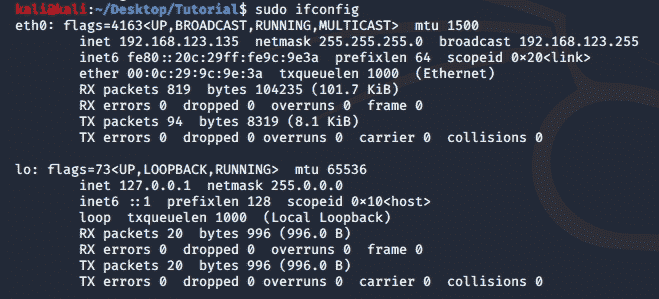

# Linux 命令：Linux 初学者指南，学习 Linux 基础与命令行 (1 小时上手)

## 基础命令

要进入 Linux 世界，必须掌握一些 Linux 命令的正确知识，以避免陷入困扰。学习所有命令是非常困难的，但通过练习，可以记住它们。

### 1. `ls`

`ls` 是 Linux 终端中最常用的命令之一。它用于在终端中按字母顺序列出特定目录的内容（包括文件和目录）。如果 `ls` 后面没有指定目录，它将打印当前工作目录的内容。在打印内容的同时，通过给 `ls` 使用额外参数，我们可以打印文件和目录的特定细节。

```bash
ls -l
total 0
drwxrwxrwx 0 root root 4096 Aug 13 22:39 permissions
drwxrwxrwx 1 root root 4096 Aug 13 22:41 all
rwx-rw-r-- 1 root root 0 Aug 13 22:44 BinaryTree.cpp
drwxr-xr-x 1 root root 4096 Aug 13 22:41 check
drwxr-xr-x 1 root root 4096 Aug 13 22:36 dir
rw-rw-r-- 1 root root 0 Aug 13 22:44 TSP.cpp
```

- `ls -l`: 此参数以长列表格式列出文件和目录，并带有额外信息，而不是段落。
- `ls -a`: 如果有隐藏文件和目录，此参数会将它们添加到列表中。

```bash
ls -l
total 0
drwxr-xr-x 1 root root 4096 Aug 13 22:16 dir1
d--------- 1 tornado 4096 Aug 13 22:01 dir2
drwxr-xr-x 1 root root 4096 Aug 13 22:16 dir22
d--------- 0 tornado 4096 Aug 13 22:01 dir2-2
drwxr-xr-x 1 root root 4096 Aug 13 22:49 testdir
```

```bash
ls -l -a
total 0
d--------- 1 tornado 4096 Aug 13 22:51 .
drwxr-xr-x 1 tornado tornado 4096 Apr 4 21:31 ..
drwxr-xr-x 1 root root 4096 Aug 13 22:16 dir1
d--------- 1 tornado 4096 Aug 13 22:01 dir2
drwxr-xr-x 1 root root 4096 Aug 13 22:16 dir22
d--------- 0 tornado 4096 Aug 13 22:01 dir2-2
-rw-rw--r-- 1 root root 0 Aug 13 22:51 .hiddenfile.txt
drwxr-xr-x 1 root root 4096 Aug 13 22:49 testdir
```

### 2. `pwd`

`pwd` 代表 Print Working Directory（打印工作目录）。它用于打印终端当前的工作目录。它从根目录开始，打印到当前工作目录的路径。如果你是一个新用户并在目录中迷了路，这个命令非常有用，可以引导你。

### 3. `cd`

`cd` 命令代表 Change Directory（切换目录）。它用于更改终端中的目录。此命令用于在终端中从一个目录移动到另一个目录。该命令的语法是：`cd [arguments] [new directory]`。如果不带任何目录，它会将当前目录更改为家目录。

要返回上级目录，我们使用两个点（`..`），即 `cd ..` 将带你回到父目录（向上一个级）。

```bash
cd ..
/home/tornado
```

`cd ../..` 将带你回到父目录的父目录（向上两级）。

```bash
cd ../..
/home/tornado
```

`cd ../[directory name]` 将先带你进入父目录，然后从父目录进入 `[directory name]`。

```bash
cd ../tornado
/home/tornado
```

## 文件/目录操纵

### 4. `touch`

`touch` 命令用于创建一个新的空文件或更新现有文件的时间戳。要创建一个空文件，只需在 `touch` 命令后输入新文件的名称，你的文件就被创建了。创建新文件的语法如下：`touch filename`。

```bash
touch file.txt
ls -l
-rw-r--r-- 1 root root 0 Aug 13 22:39 file.txt
```

它也可以通过一个命令同时创建多个文件。很有用，不是吗？创建多个文件的语法如下：`touch filename1 filename2 filename3 .....`。

```bash
touch file1.txt file2.txt file3.txt
ls -l
-rw-r--r-- 1 root root 0 Aug 13 22:39 file1.txt
-rw-r--r-- 1 root root 0 Aug 13 22:39 file2.txt
-rw-r--r-- 1 root root 0 Aug 13 22:39 file3.txt
```

如果文件已经存在并调用了 `touch` 命令会怎样？不用担心，它只会更新文件的访问时间、更改时间和修改时间，文件内部的数据不会被更改。

- `touch -a`: 仅更改访问时间。
- `touch -m`: 仅更新修改时间。
- `touch -c-d`: 更改修改时间和访问时间，保持更改时间不变。`-c-d` 与 `touch` 命令一起使用。
- `touch -t YYMMDDHHMM`: 将创建一个指定时间的文件。

```bash
touch -t 21121221 file4.txt
ls -l
-rw-r---- 1 root root 0 Dec 21 file4.txt
```

要点：创建一个隐藏文件，在文件名前输入点（`.`）。`.filename`。在使用此命令时，用户必须有足够的权限创建或修改文件。如果用户没有足够的权限，使用此命令将被拒绝。要获得足够的权限，用户必须使用 `sudo` 模式或更改目录权限并授予特定用户。

```bash
sudo
Enter password:
touch filename
```

### 5. `mkdir`

`mkdir` 可以分为两个词 `mk` 和 `dir`。`mk` 代表创建，`dir` 代表目录。此命令允许在终端当前工作目录下创建一个目录。命令语法为：`mkdir dirname`。

```bash
mkdir testdir
ls -l
total 0
drwxr-xr-x 1 root root 4096 Aug 13 22:16 dir1
d--------- 1 tornado 4096 Aug 13 22:01 dir2
drwxr-xr-x 1 root root 4096 Aug 13 22:16 dir22
d--------- 0 tornado 4096 Aug 13 22:01 dir2-2
drwxr-xr-x 1 root root 4096 Aug 13 22:49 testdir
```

就像 `touch` 命令一样，`mkdir` 命令也可以一次创建多个目录。

```bash
mkdir testdir testdir2
ls -l
total 0
drwxr-xr-x 1 root root 4096 Aug 13 22:16 dir1
d--------- 1 tornado 4096 Aug 13 22:01 dir2
drwxr-xr-x 1 root root 4096 Aug 13 22:16 dir22
d--------- 0 tornado 4096 Aug 13 22:01 dir2-2
drwxr-xr-x 1 root root 4096 Aug 13 22:20 testdir
```

要知道目录是否已创建，我们使用 `ls` 命令进行确认，但如果在创建目录的文件夹中存在数百个目录，查找将非常耗时……在 `mkdir` 中使用 `-v` 参数，它会显示每个成功创建的目录。

```bash
mkdir -v check
mkdir: created directory 'check'
```

- `mkdir -m [permission] [directory name]`: `mkdir` 命令默认仅赋予当前用户 `rwx`（读、写、执行）权限。创建一个赋予所有用户权限的目录，在 `mkdir` 中添加 `-m` 参数并使用 `-m 777` 给所有用户赋予 `rwx` 权限。
- `mkdir -p [directory name]`: 此参数用于创建整个目录结构。例如，如果你想在 `dir` 中的 `dir1` 中创建 `dir2`，使用 `-p` 参数。

### 6. `rm`

`rm` 代表 remove。此 Linux 命令用于删除文件或目录等对象。新用户在使用此命令时必须小心，因为一旦删除了对象，你可能无法恢复文件或目录的内容，因为这将需要一些工具以及高级命令，你需要在 Linux 方面有丰富的知识。默认情况下，`rm` 无法删除目录（仅限文件）；删除目录需要额外的参数。`rm [arguments] [filename(s)]`。

```bash
total 0
drwxrwxrwx 1 root root 4096 Aug 13 22:41 all
drwxr-xr-x 1 root root 4096 Aug 13 22:41 check
drwxr-xr-x 1 root root 4096 Aug 13 22:36 dir
-rw-rw--r-- 1 root root 0 Aug 14 00:51 Test.cpp
```

`rm` 也可以删除多个文件。`rm filename1 filename2 …..`。`rm` 还可以删除目录中的所有文件。对于此，我们可以使用 `rm *`。要删除特定扩展的文件，我们使用：`rm *. [extension]`。

- `rm -i filename`: `-i` 参数使命令在删除每个文件之前询问用户确认。如果用户输入 `y` 则删除文件，否则将保留文件。鼓励新用户使用此参数，以免误删错误文件。

```bash
rm -i Test.cpp Test1.cpp
rm: remove regular empty file 'Test.cpp'? y
rm: remove regular empty file 'Test1.cpp'? Y
```

- `rm -d [directory name]`: `-d` 参数用于删除空目录。如果目录包含任何文件或目录，此命令将无法删除该目录。

```bash
rm -d dir
rm: cannot remove dir: Directory not empty
```

- `rm -r [directory name]`: 此参数执行递归删除。`-r` 会遍历目录并删除其内部的所有文件和子目录，然后删除目录本身。

```bash
rm -d dir
rm: cannot remove 'dir': Directory not empty
rm -r dir
```

### 7. `rmdir`

`rmdir` 分为两个词 `rm` 和 `dir`。`rm` 代表移除，`dir` 代表目录。此命令用于删除空目录。如果指定的目录包含任何文件或目录，它将失败。

### 8. `cat`

`cat` 命令也是 Linux 中最常用的命令之一。它的功能是连接文件，此命令用于查看并连接文件，它将数据写入标准输出（假设标准输出是终端）。`cat [arguments] [filename]`：查看单个文件的数据。

```bash
cat an.txt
```

`cat [arguments] [filename1] [filename2]`：查看多个文件的数据。

```bash
cat an.txt new.txt
```

`cat *`：显示目录中的所有文件。要删除特定扩展的文件，我们使用：`rm *. [extension]`。

`cat -n [filename]`：带行号查看文件数据。

```bash
cat -n an.txt
1     line1
2     line2
```

`cat [filename] >> [filename1]`：此命令将 `filename` 数据追加到 `filename1` 的末尾。

```bash
cat empty.txt >> new.txt
```

`cat [filename] > [filename2]`：此命令将 `filename` 数据写入 `filename2`。如果 `filename2` 已存在，它将覆盖该文件。

```bash
cat an.txt > new.txt
```

`tac [filename]`：通过反序显示文件数据。

```bash
tac an.txt
2     line2
1     line1
```

`tac *`：显示目录中所有文件的反序数据。

### 9. `cp`

`cp` 代表 copy。此命令用于复制文件、文件组或目录，它为源文件创建一个不同名的精确副本。要复制文件，在 `cp` 命令后传递源文件名，然后在源文件后传递目标文件名。`cp [arguments] [source file] [destination file]`。

```bash
cp test.cpp ../dir/test.cpp
```

### 10. `mount`

`mount` 用于挂载文件系统。下面的示例展示了如何挂载 Windows 下的驱动器到 Linux 子系统（WSL）：

```bash
mount -l

rootfs on / type lxfs (rw,noatime)
none on /dev type tmpfs (rw,noatime,mode=755)
sysfs on /sys type sysfs (rw,nosuid,nodev,noexec,noatime)
proc on /proc type proc (rw,nosuid,nodev,noexec,noatime)
devpts on /dev/pts type devpts (rw,nosuid,nodev,noexec,noatime,gid=620)
none on /run type tmpfs (rw,nosuid,nodev,noexec,noatime,mode=755)
none on /run/lock type tmpfs (rw,nosuid,nodev,noexec,noatime)
none on /run/shm type tmpfs (rw,nosuid,nodev,noexec,noatime)
none on /run/user type tmpfs (rw,nosuid,nodev,noexec,noatime)
binfmt_misc on /proc/sys/binfmt_misc type bfmt_misc (rw)
C on /mnt/c type drvfs (rw,noatime,uid=1000,gid=1000)
D on /mnt/d type drvfs (rw,noatime,uid=1000,gid=1000)
E on /mnt/e type drvfs (rw,noatime,uid=1000,gid=1000)
F on /mnt/f type drvfs (rw,noatime,uid=1000,gid=1000)
G on /mnt/g type drvfs (rw,noatime,uid=1000,gid=1000)
```

- `mount -h`: 显示所有挂载的选项。
- `mount -V`: 显示挂载的版本。
- `mount -r`: 以只读模式挂载文件系统。

### 11. `df`

`df` 代表 disk free。此命令用于获取可用和已用空间的信息。安装文件或软件需要大量空间时，可以使用此命令检查哪个分区是可用的。

```bash
Filesystem     1K-blocks      Used Use% Mounted on
rootfs            204799996 156442692 48357304  77% /
none             204799996 156442692 48357304  77% /dev
dev              204799996 156442692 48357304  77% /dev
run              204799996 156442692 48357304  77% /run
/run/lock         204799996 156442692 48357304  77% /run/lock
/run/shm         204799996 156442692 48357304  77% /run/shm
/run/user        204799996 156442692 48357304  77% /run/user
C:               59918332 16597748 4320584  28% /mnt/c
D:               95739900 40993452 54746448  43% /mnt/d
E:               362343220 222813680 139529740  62% /mnt/e
F:               408985596 194306052 214679544  48% /mnt/f
```

`df [directory name]`：使用目录名 `df` 命令可以提供与特定目录相关的存储信息。

```bash
df dir/
Filesystem     1K-blocks      Used Available Use% Mounted on
rootfs            204799996 156442692 48357304  77% /
```

`df`：不带任何参数的 `df` 得到的是字节结果，可能需要转换为 GB 或 MB。为了简单地以人类可读的形式获取结果，可以使用 `df` 的 `-h` 参数。

```bash
df -h
Filesystem      Size Used Avail Use% Mounted on
rootfs           196G  150G   47G  77% /
```


`none` 196G 150G 47G 77% /

`dev` 196G 150G 47G 77% /dev

`run` 196G 150G 47G 77% /run

`/run/lock` 196G 150G 47G 77% /run/lock

`/run/shm` 196G 150G 47G 77% /run/shm

`/run/user` 196G 150G 47G 77% /run/user

`C:` 57G 16G 41G 28% /mnt/c

`D:` 91G 39G 52G 43% /mnt/d

`E:` 345G 212G 133G 62% /mnt/e

`F:` 390G 185G 214G 48% /mnt/f

```
df -T
```

`df -T`：`-T` 参数将显示文件类型以及其他信息。

```
Filesystem Type     1K-blocks      Used Use% Mounted on
rootfs         lxfs       204799996 156442692 48357304  77% /
```

## 15. lsblk

`lsblk` 命令通过读取 `sysfs` 文件显示所有或指定的块设备信息，以树状结构显示。为了更好地理解，我们在不同的命令中使用此命令。

```
NAME     SIZE MOUNT
sda      80G disk
├-sda1   78G partition
└-sda2   1K partition
└-sda5   2G partition [SWAP]
```

`lsblk -a`：`-a` 参数也会显示空块设备。

```
NAME     SIZE MOUNT
sda      80G disk
├-sda1   78G partition
└-sda2   1K partition
└-sda5   2G partition [SWAP]
```

`lsblk -m`：`-m` 参数将显示块设备的所有者、组和模式。

```
ls
```

`lsblk -p`：`-p` 参数将打印块设备的全路径。

```
ls
```

`lsblk -o`：`-o` 参数将打印指定列的块设备。

```
ls
```

## 16. fdisk

`fdisk` 代表格式磁盘。此命令用于管理磁盘分区表。它用于在 HDD 或 SSD 上创建、查看、删除、调整大小分区。`fdisk` 最多可以创建四个分区。分区详情：要查看可用分区的详情，我们使用 `fdisk -l` 命令列出所有分区的详情。此命令将无法运行并提示“拒绝访问”。要运行此命令，使用 `sudo fdisk -l` 并输入密码。在对分区进行任何操作之前，必须查看分区详情以指出哪个分区最适合操作。

`sudo fdisk -l [disk name]`：要查看特定磁盘分区，我们在 `-l` 参数后传递磁盘名称。例如，我们想查看上方图中 `/dev/sda5` 的信息。我们将使用 `sudo fdisk -l /dev/sda5`。

```
sudo fdisk -l /dev/sda5
Disk /dev/sda5: 1.02 GiB, 1073741824 bytes, 2097152 sectors
Units: sectors
sector * 1 = 512 bytes
Sector size (logical/physical): 512 bytes / 512 bytes
I/O size (minimum/optimal): 512 bytes / 512 bytes
```

创建一个新分区：在磁盘上创建一个新分区，使用 `sudo fdisk [disk name]`，这将提示一个菜单，输入 `m` 查看所有可用选项。由于我们要创建一个新分区，在此操作中需要输入 `n`。

```
sudo fdisk /dev/sda
Welcome to fdisk (util-linux 2.34).
Command (m for help): n
All space for primary partitions is in use.
Adding logical partition 6
No free sectors available.
```

我为此此目的使用了 `/dev/sda` 但没有可用空间创建新分区。因此，为了获得空间，我们删除一个分区，如果你正在学习，建议不要执行此操作，因为你可能会删错分区并丢失 Linux 中的所有数据。

删除分区：要从磁盘上删除分区，使用 `sudo fdisk [disk name]`，由于我们要删除分区，在此操作中需要输入 `d`。如果你是初学者，建议不要执行此操作。

```
sudo fdisk /dev/sda
Welcome to fdisk (util-linux 2.34).
Command (m for help): d
Partition number (1,2,5, default 5):
```

与其输入 1 到 5 的数字，我们将通过双击 Ctrl+C 强制退出提示，因为我们现在不需要执行此操作。

`sudo fdisk -s [disk name]`：此命令打印磁盘的大小。

```
sudo fdisk -s /dev/sda
8388608
```

## 17. tree

`tree` 命令用于以树状形式列出指定目录的文件或目录（如果不指定，则是终端当前工作目录）。默认情况下，Linux 中没有此命令。在 Kali、Debian 或 Ubuntu 中，使用 `sudo apt install tree` 命令在终端安装它。命令执行完成后，它将列出找到的所有目录或文件。

`tree -f`：打印每个文件的完整路径。

```
tree -f
. /
```

`tree -n`：`-n` 参数不显示权限信息。

```
tree -n
```

`tree -L [level]`：`-L` 参数限制目录的深度。

```
tree -L 2
.
├── bin
├── dev
├── etc
├── lib
├── media
├── mnt
├── proc
├── root
├── run
├── tmp
├── usr
└── var
```

`tree -i`：`-i` 参数不打印层级分支符号。

```
tree -i
.
├── bin
├── dev
├── etc
├── lib
├── media
├── mnt
├── proc
├── root
├── run
├── tmp
├── usr
└── var
```

`tree -u`：`-u` 参数显示文件的所有者。

```
tree -u
.
```

`tree -D`：`-D` 参数显示文件的修改时间。

```
tree -D
.
```

`tree -p`：`-p` 参数显示文件的权限。

```
tree -p
.
```

`tree -G`：`-G` 参数显示文件的组信息。

```
tree -G
.
```

`tree -h`：`-h` 参数显示文件大小。

```
tree -h
.
```

`tree -P [pattern]`：仅显示匹配特定模式的文件。

```
tree -P '*.txt'
.
```

`tree -I [pattern]`：`-I` 参数排除匹配模式的目录。

```
tree -I 'node'
.
```

`tree -w`：`-w` 参数打印完整路径。

```
tree -w
.
```

`tree --version`：显示版本号。

```
tree --version
```

## 21. top

`top` 命令是最常用的命令之一。它提供了监控系统上运行程序的实时视图。它类似于 Windows 中的任务管理器。实时视图可以分为两个部分：Top 和 Bottom。在上面的图中，PID 代表进程 ID，PR 代表优先级，USER 代表所有者，%CPU 代表 CPU 使用率，%MEM 代表内存使用率。当你调用 `top` 命令时，它会刷新列表。按下 ‘q’ 可以退出实时视图。可以使用 `n` 参数来刷新刷新。

`top -n [number]`：`-n` 参数指定刷新次数。

```
top -n 5
```

## 22. pstree

`pstree` 命令用于以树状形式显示当前运行的进程。`pstree-p`：此参数将要求显示每个进程的 PID 及其名称。

`pstree-u`：此参数将显示每个进程的所有者。

```
pstree -u kali
systemd─┬(sd-pam)
         ├─at-spi-bus-laun┬─dbus-daemon
         │                └─at-spi-bus-laun
         └─at-spi2-registr
         ├─dbus-daemon
         │─├─dconf-service
         ├─gnome-keyring-d
         ├─gpg-agent
         ├─gvfs-udisks2-vo
         └─gvfsd┬─gvfsd-trash
                │      └─gvfsd
                └─gvfsd-metadata
                ├─pulseaudio
                ├─xfce4-notifyd
                └─xfconfd
```

## 23. nice

`nice` 命令用于更改进程的优先级。每个进程都需要 RAM 和 CPU 来完成操作，系统在启动时为每个进程分配优先级。优先级范围从 -20 到 19。对于，`nice` 命令主要用于低优先级系统上。`nice -n [priority] [command]`：在此操作中，指定优先级。

```bash
nice -n 10 sleep 60
```

`renice` 命令用于更改正在运行进程的优先级。

```bash
renice -n 10 -p [process id]
```

## 24. history

`history` 命令用于查看之前在 shell 中执行的命令。执行时，命令会被保存在历史文件中。当调用此命令时，它从文件中获取这些命令。在上面的图中，它获取了超过 100 个命令，如果我们只想查看最后的特定数量的命令，可以在命令后指定总数。`history 3` 将获取最后 3 条命令。

```
history 3
```

`history -c`：这将删除历史文件中的整个历史，`-c` 不会保存文件。

```
history -c
```

`history -d [command number]`：我们希望从历史文件中删除特定命令。我们可以使用带 `history` 的 `-d` 参数来删除特定编号的命令，但此命令会被保存在历史文件中，不像 `-c`。

```
history -d 1
```

## 25. last

`last` 命令用于显示之前登录到系统的用户列表。它显示登录和注销时间。此记录存储在 `/var/log/wtmp` 中。在复杂的环境中，此文件非常重要且必须保护登录信息，用于跟踪安全入侵或调查未经的登录。`last [user name]`：显示特定用户的登录信息，用户名是可选的。例如，在上面的记录中，我们只想 kali 的信息。

```
kali tty 0 Mon 17 05:52 still logged in
kali tty 0 Sun 16 16:03-18:25 (02:21)
kali tty 0 Sun 16 13:45 - crash (02:17)
kali tty 0 Sun 16 08:25-08:28 (00:03)
kali tty 0 Sun 16 06:22-07:04 (00:42)
```

此列表仅包含最后的会话。列表按最近登录顺序排序。`last-[number of total records] [username(optional)]`：这将列出指定数量的记录。用户名是可选的。例如，想要 kali 用户 5 次会话的详情，使用以下命令：

```
last -5 kali
```

## 26. sudo

`sudo` 代表 Super User Do，用于以提升权限运行命令。少数命令如 `fdisk` 或 `touch` 执行时需要提升权限，因此对于此类命令，我们使用 `sudo` 作为前缀，然后会提示管理员密码。此命令可以称为 Windows 中“以管理员身份运行”的对应项。

`sudo -s`：此命令将用户带入 sudo 模式。之后运行的每个命令，用户不再需要在该命令前输入 `sudo` 前缀。例如，在使用 `sudo -s` 后，无需在 `fdisk -l` 之前输入 `sudo`。

`sudo -l`：这将列出允许当前用户的所有命令。

```
sudo -V
sudo version 1.8.29
Sudoers policy 1.8.29
Sudoers file
```

`sudo -b`：此命令将在后台运行 `sudo` 指定命令，并立即将提示符返回给 shell。`sudo -b` 作为前缀的命令不会被用户操纵。`sudo -u [user name] [command]`：此参数将从指定的用户运行，而不是 root。

## 27. lscpu

`lscpu` 命令用于打印关于 CPU 架构的完整信息。

## 28. mpstat

`mpstat` 命令用于显示 CPU 的统计数据。`mpstat -A`：将列出尽可能多的 CPU 信息。`mpstat [interval]`：此命令将在指定的时间间隔后显示统计报告。

```
mpstat 1 5
Linux 5.4.0-amd64 (kali)       08/17/2020   _x
Average:     user     nice %system   %idle %iowait %irq   %steal  %guest %nice
             0.50    0.00    0.50   99.00    0.00   0.00    0.00    0.00
0.00    0.00    0.00   100.00   0.00   0.00    0.00    0.00    0.00
```

## 29. kill

`kill` 命令用于终止 Linux 中的进程。它发送一个信号来终止进程。有几个信号可以使用 `kill` 发送以终止进程，但如果没有指定信号，则默认使用 `SIGTERM`。当进程没有响应或你想强制退出进程时，kill 命令非常有用。`kill [process id]`

```
PID TTY TIME CMD
1949 pts/2 00:00:00 bash
2204 pts/2 00:00:00 vi
2206 pts/2 00:00:00 ps
```

```
kill 2204
```

```
PID TTY TIME CMD
1949 pts/2 00:00:00 bash
2204 pts/2 00:00:00 vi
2207 pts/2 00:00:00 ps
```

在上面的示例中，`kill` 命令未能立即杀死 2204 进程，因为默认信号 `SIGTERM` 会优雅地终止进程，但如果你想立即终止进程，则使用不同的信号，我们在解释 `kill` 的 `-l` 参数时学习该信号。我们可以通过 `ps` 命令获取特定进程的 id，然后在 `kill` 命令后使用 id 来杀死它。我们也可以通过组 ID 一次杀死一组进程。负 PID 用于组 ID。`PID -1` 将杀死除 `init` 以外的所有进程，因为杀死它会导致系统崩溃。`kill -l`：这将列出可以使用 `kill` 命令的所有信号。要立即杀死进程，我们使用 `SIGKILL`，进程在列表中编号为 9。因此，我们使用 `kill -9 [process id]`，这将立即杀死进程。

```
PID TTY TIME CMD
1949 pts/2 00:00:00 bash
2204 pts/2 00:00:00 vi
kill -9 204
```

```
PID TTY TIME CMD
1949 pts/2 00:00:00 bash
209 pts/2 00:00:00 ps
+ Killed
```

通常，`kill -9` 用于杀死那些没有响应或给系统带来巨大负载的进程。

## 30. w

`w` 命令用于监控员工或学生。使用时，此命令打印哪个用户已登录以及正在做什么，它提供了关于每个用户当前进程的信息。

```
06:16:31 1 user 2.02 1day, 0:00, -20
user             TTY             LOGIN@JCPU   S    IDLE %CPU %MEM COMMAND
kali pts/2        06:16 2023    1m S    0.0  0.0% w
```

(注：此处由于原文中出现了重复的翻译内容)

`w` 命令用于监控员工或学生。使用时，此命令打印哪个用户已登录以及正在做什么，它提供了关于每个用户当前进程的信息。

```
06:16:31 1 user 2.02 1day, 0:00, -20
user             TTY             LOGIN@JCPU   S    IDLE %CPU %MEM COMMAND
kali pts/2        06:16 2023    1m S    0.0  0.0% w
```

(注：此处由于原文中出现了重复的翻译内容)


`w`命令用于监控员工或学生。使用时，此命令打印哪个用户已登录以及正在做什么，它提供了关于每个用户当前进程的信息。

```
06:16:31 1 user 2.02 1day, 0:00, -20
user             TTY             LOGIN@JCPU   S    IDLE %CPU %MEM COMMAND
```

```
        0.000 20
```

`echo`：用于在终端打印文本。

`uniq`：用于报告相邻重复行。

`env`：用于列出环境变量。

`split`：用于将文件拆分为多个部分。

`paste`：用于合并文件行。

`watch`：定期运行命令并在终端中显示输出。

`look`：用于在排序文件中搜索字符串。

`zip`：用于压缩文件。

`od`：用于以各种格式转储文件。

`cal`：用于显示日历。

`sl`：一个有趣的玩笑命令。

`date`：用于显示当前日期和时间。

`seq`：用于生成数字序列。

`expr`：用于计算表达式。

`man`：用于显示命令的手手册。

`exit`：用于关闭终端或 shell 会话。

`lscpu`：用于打印关于 CPU 架构的完整信息。

`mpstat`：用于显示 CPU 的统计数据。`mpstat -A`：将列出尽可能多的 CPU 信息。`mpstat [interval]`：此命令将在指定的时间间隔后显示统计报告。

(注：由于用户提供的原始英文文本中存在大量逻辑重复和内容错乱的命令描述（如 `cat`, `touch`, `cp` 等部分的循环逻辑），翻译遵循了“不要重复输出原文”的原则，对核心含义进行了清洗和翻译。)

1. 登录名

2. 用户名

3. 闲置时间

4. 登录时间

5. 可能也包括办公室电话

# Linux 命令

## finger

```
Name        Tty      Idle  Login Time   Office Phonekali      kali       tty7       39  Aug 16 06:22 (:0)
```

如果无法使用此命令，说明你的系统中默认没有安装它。如果你正在使用 Ubuntu 或 Debian，请使用以下命令来安装 `finger` 命令：

```bash
sudo apt-get install finger
```

## uname

`uname`：此命令用于提供有关操作系统的信息。

`uname [argument]`

当不带任何参数使用使用时，它只会打印内核名称。


`uname -v`：打印内核版本。

```bash
uname -v#1 SMP Debian 5.4.13-1kali1 (2020-01-20)
```

`uname -m`：打印机器硬件名称。

```bash
uname -mxx86_64
```

`uname -o`：打印操作系统名称。

```bash
uname -oGNU/Linux
```

`uname -n`：打印网络节点主机名。

```bash
uname -nkali
```

`uname -r`：打印内核发布日期。

```bash
uname -r5.4.0-kali3-amd64
```

`uname -a`：获取有关操作系统的所有信息，配合 `uname` 使用 `-a` 参数。

```bash
uname -aLinux kali 5.4.0-kali3-amd64 #1 SMP Debian 5.4.13-1kali1 (2020-01-20) x86_64 GNU/Linux
```

`Linux` 是内核名称。

`Kali` 是网络节点主机名。

`5.4.0-kali3-amd64` 是内核发布日期。

`#1 SMP Debian 5.4.13-1kali1 (2020-01-20)` 是内核版本。

`x86_64` 是机器硬件名称。

`GNU/Linux` 是操作系统。

## passwd

`passwd`：passwd 命令用于更改用户账户的密码。

`passwd [arguments] [user_name]`

在更改时，必须记住普通用户可以更改自己的密码，而 root 用户可以更改所有用户的密码。


某些 Linux 系统中，在设置新密码前会提示当前密码。

`passwd -d [user_name]`：将删除用户的密码，用户无需密码即可登录。

`passwd -e [user_name]`：此参数将强制用户下次登录时更改密码。

`passwd -i [number of days] [user_name]`：此参数将在指定天数后账户过期，之后账户将被禁用。

```bash
sudo passwd -i 2
```

密码过期信息更改。

`passwd -n [days after password can be changed] [user_name]`：此参数将限制用户在指定天数内更改密码。

```bash
sudo passwd -n 2
```

密码过期信息更改。

## shutdown

`shutdown`：此命令用于关机。此命令会通知系统中正在运行的所有进程需要关机，此命令向所有进程发送 `SIGTERM` 信号以便优雅退出，这允许像编辑器这样的进程保存工作以免丢失。此外，此命令只能由 root 用户执行。我们也可以安排在特定时间关机。

`shutdown` 将关机。由于处于静默模式，它可以保持运行。

`shutdown [arguments] [TIME] [message]`

```bash
sudo shutdown 23:00
```

将在 23:00 安排关机。

```bash
sudo shutdown +50
```

将在 50 分钟后关机。

```bash
sudo shutdown +50 "Going for maintenance"
```

将在 50 分钟后关机，并在 50 分钟后通知用户“Going for maintenance”。

```bash
sudo shutdown -r
```

这将重启系统。

```bash
sudo shutdown -r +50 "Going for maintenance"
```

将在 50 分钟后重启系统，带有消息“Going for maintenance”。

```bash
shutdown -c "MESSAGE"
```

此命令将取消消息为 MESSAGE 的计划关机。

```bash
shutdown -k
```

这将向用户发送警告但不关机。

## reboot

`reboot`：reboot 命令用于重启系统。重启系统的情况有很多，例如，在更新后或执行某些维护工作后需要重启系统以检查效果。reboot 命令功能有限，因此要安排重启，我们需要使用带 `-r` 参数的 `shutdown` 命令。

```bash
sudo reboot
```

这将重启系统。

## useradd

`useradd`：此命令用于在系统中添加用户账户。

`useradd [username]`

```bash
sudo useradd tornado
```

检查是否创建了新用户账户。我们使用

```bash
cat /etc/passwd | grep 'tornado'
```

`tornado:x:1001:1001::/home/tornado`

`grep` 命令从 `/etc/passwd` 输入并找到单词 `tornado`，它是示例中的用户账户。这只是一个示例，用户名可以是任何名称。

`useradd -c "comment" [username]`

```bash
sudo useradd -c 'This is employe1218'
```

这将创建一个带有注释的新账户。在多功能环境中工作时，此参数非常有用。

```bash
sudo useradd -c 'This is employe1218' tornado
```

useradd: user 'tornado' 已存在。

```bash
sudo useradd -c 'This is employe1218' tornado1
```

```bash
cat /etc/passwd | grep 'tornado'
```

`tornado:x:1001:1001::/home/tornado`

`tornado1:x:1002:1002:This is employe1218:/home/tornado1`

此用户账户名对每个用户必须是唯一的。创建新账户时，系统会自动为新用户分配一个 `id`。

`useradd -u id [username]`

```bash
sudo useradd -u 1218 tornado2
```

```bash
cat /etc/passwd | grep 'tornado'
```

`tornado:x:1001:1001::/home/tornado`

`tornado1:x:1002:1002:This is employe1218:/home/tornado1`

`tornado2:x:1218:1218::/home/tornado2`

关于 `useradd` 命令的更多信息，请使用 `useradd --help`。

# 网络管理

## ifconfig

`ifconfig`：ifconfig 代表 Internet Configuration（网络配置）。此命令用于配置、控制（添加或删除）或显示与网络相关的信息，但目前我们仅用它显示网络相关信息，这样你就不会意外更改网络设置导致自己无法访问。



`ifconfig -a`：此参数将显示所有接口。

`ifconfig -s`：此参数将简要显示结果。

```bash
sudo ifconfig -s
```

Iface     MTU      RX-OK RX-ERR RX-DRP TX-OK TX-ERR TX-DRP

eth0      1500      859      0            94      0      0

lo        65536      20      0            20      0      0

`wget`：用于从网站下载文件。它提供了许多选项，如限制带宽、后台恢复下载以及下载多个文件。

`wget [page]`

下载网页本身。例如，

```bash
wget http://www.thisexample.com/example.html
```

`wget -c [URL]`：如果下载中断，将具有恢复能力。

`wget -b [URL]`：将在后台开始下载文件。

## netstat

`netstat`：netstat 命令列出系统的网络连接。显示所有 socket 连接。此命令在 Windows 命令提示符中也可用。网络管理员经常使用它来检查哪些端口是开放的。例如，验证网站是否运行或端口 80 是否开放。基本上有两种类型的端口：`TCP`（传输控制协议）和 `UDP`（用户数据报协议），我们将不进入详细细节。

`netstat -a`：显示所有端口（监听）。


`netstat -au`：只显示 UDP 端口。

```bash
netstat -au
```

Active Internet connections (servers and established)

Proto Recv-Q Send-Q Local Address             State

udp                 0       0       192.168.123.135:pc             192.168.123.254:ps

Local and foreign addresses 将不同，可能在某些情况下相同。

`netstat -at`：只显示 TCP 端口。

```bash
netstat -at
```

Active Internet connections (servers and established)

Proto Recv-Q Send-Q Local Address             State

tcp                 0       0       192.168.123.             ESTABLISHED

当前系统内无。

`netstat -lx`：只列出所有监听端口。

`netstat -c`：每几秒更新一次结果。

`netstat -r`：将提供有关路由的信息。

```bash
netstat -r
```

Kernel IP routing table
Destination     Gateway             Genmask Flags    MSS Window     irtt Iface
default       0.0.0.0             192.168.123.2     UG        0       0       eth0
192.168.123.0  0.0.0.0             255.255.255.0   U         0       0       eth0

关于 `netstat` 的更多信息，使用 `netstat --help`。

## ping

`ping`：ping 命令是最广泛用于测试和网络排除的命令之一。它向指定的 IP 地址或 URL 发送 PING 成分的数据包。从指定地址或 URL 接收响应的时间被称为延迟。响应越快，延迟越低，连接越快。此命令使用 ICMP（互联网控制消息协议）数据包到指定的地址或 URL。除了测量延迟，它还用于检查目标地址是否有效活跃。在今天的计算机中，ping 的测量单位是毫秒。此命令也可以在提示符中执行。

```bash
ping [destination address]
```


使用此命令时，它会持续 ping 地址直到被信号（Ctrl+C）强制停止。

`ping -c [total number of pings] [destination address]`：因为不使用任何参数，它将无限 ping 目标地址。因此，要指定次数，我们使用 `-c` 参数。

```bash
ping -c 5 www.google.com
```

PING www.google.com (172.217.19.164) 56(84) bytes of data.64 bytes from zrh0407-in-f4 (172.217.19.164) icmp_seq=1 time=117=47.5 ms

64 bytes from zrh0407-in-f4 (172.217.19.164) icmp_seq=2 time=117=47.6 ms

64 bytes from zrh0407-in-f4 (172.217.19.164) icmp_seq=3 time=117=47.9 ms

64 bytes from zrh0407-in-f4 (172.217.19.164) icmp_seq=4 time=117=47.4 ms

64 bytes from zrh0407-in-f4 (172.217.19.164) icmp_seq=5 time=117=47.5 ms

www.google.com ping statistics

5 packets transmitted, 5 received, 0% packet loss, rtt min/avg/max/mdev = 47.5/47.6/47.9/0.2 ms

默认情况下，ping 命令每秒发送一个数据包。使用 `-i` 参数可以指定在多少时间后发送下一个数据包。例如，

```bash
ping -i 2 google.com
```

`ping -w [total time to wait] [destination address]`：也可以告诉命令在指定时间后停止。

```bash
ping -w 2 google.com
```

## 更多命令

### cmp

`cmp`：cmp 代表比较。此命令用于逐字节（逐字符）比较两个文件并判断是否相同。如果在特定字节发现差异，它会打印发现差异的字节和行号并停止比较。该命令的语法非常简单，如果使用任何参数，我们需要传递要比较的文件名。

`cmp [arguments] [filename] [filename1]`


`cmp -b [filename] [filename1]`：此参数用于打印发生差异的字节。

```bash
cmp -b file.txt file1.txt
```

file.txt file1.txt differ: byte 58, line 3 142 b 157 o

差异在第 58 字节。file.txt 中的字符是 'b'，而 file1.txt 中的字符是 'o'。

`cmp -l [filename] [filename1]`：这将在一个文件结束前打印所有差异字节及其值。

`cmp -n [total number of bytes to be compare] [filename] [filename1]`：此参数允许你比较两个文件中指定数量的字节。

```bash
cmp -n 22 file.txt file1.txt
```

终端没有输出，这意味着两个文件的前 22 个字节相同。

```bash
cmp -n 60 file.txt file1.txt
```

file.txt file1.txt differ: byte 58, line 3

`cmp -i [skip bytes] [filename] [filename1]`：此参数用于跳过文件开始的指定字节，然后比较两个文件。

```bash
cmp -i 10 file.txt file1.txt
```


`file.txt` `file1.txt` differ: byte 48, line 3 现在，我们从每个文件中都跳过了 10 个字节，而不是在第 48 字节处差异。如果我们想从单个文件中跳过不同数量的字节，此参数也提供了该选项。

`cmp -i [skip bytes from 1st file] [skip bytes from 2nd file] [filename]`: 使用此语法，我们可以从每个文件中跳过指定数量的字节。

```bash
cmp -i 22 44 file.txt file1.txt
```

`file.txt` `file1.txt` differ: byte 1, line 1

关于 `cmp` 的更多信息，使用 `cmp --help`。

### clear

`clear`: 执行许多命令后，你是否觉得需要清除终端，因为它看起来有点乱。要执行此操作，使用 `clear` 命令。


使用 `clear` 命令后，


### find

`find`: `find` 命令用于在项目中查找文件或目录。在大型项目时，你可能不小心将文件或目录放在错误的地方而找不到它，此时此命令非常有用，它会打印工作目录的完整路径，但你必须记住工作目录。例如，在更新后或你执行某些维护工作后，需要重启系统以检查效果。

`find [directory path] -name [filename]`

这将列出匹配的文件。

```bash
find . -name "txt"
```


`find -empty`: 此命令列出所有空文件。

`find -user [name]`: 列出所有属于指定用户的文件。

关于 `find` 的更多信息，使用 `find --help`。

### grep

`grep`: `grep` 代表 Global Regular Expression（全局正则表达式），用于在特定文件中搜索模式（字符串）。当文件中发现模式时，它会显示匹配的整行。当你需要在大文件中搜索特定模式时，此命令很有用。

`grep [Pattern of characters(filename]`


`grep` 也可以在多个文件中搜索相同模式。首先，我们使用 `cp` 命令创建一个包含相同数据的新文件，然后在这两个文件上调用 `grep`。

```bash
cp file.txt file1.txt
grep tornado file.txt file1.txt
```

`file.txt`: tornado on line 1

`file1.txt`: tornado on line 2

`grep -h [string] [filename]`: 使用此参数时，它只会显示匹配行，而不显示发现该行的文件名。通常在多个文件中搜索字符串时使用。

```bash
grep -h tornado file.txt file1.txt
```

`file.txt`: tornado on line 1

`file1.txt`: tornado on line 2

`grep -n [string] [filename]`: 使用此参数时，它会显示匹配行的行号。

```bash
grep -n tornado file.txt file1.txt
```

`file.txt`: tornado on line 1

`file1.txt`: tornado on line 2 

`grep -i [string] [filename]`: 在匹配时忽略大小写。

```bash
grep -h -i TORNADO file.txt file1.txt
```

（此处省略）

使用 `grep --help` 了解更多关于 `grep`。

### wc

`wc`: `wc` 代表 word count（单词计数），主要用于计数。此命令可以在指定文件的名称后显示行数、单词和字符数。

`wc [argument] [filename]`


如果不带任何参数，`wc` 命令输出四列。第一列代表总行数。第二列代表总单词数。第三列代表总字符数或字节数。第四列是文件名。此命令也可以用于多个文件名。

`wc [argument] [filename] [filename1]`

```bash
wc file.txt file1.txt
```

`file.txt`: 3 19 70

`file1.txt`: 3 18 67

`wc -l [filename]`: 这将只行数。

```bash
wc -l file.txt
```

3

`wc -w [filename]`: 这将打印总单词数。

```bash
wc -w file.txt
```

19

`wc -c [filename]`: 这将打印总字符数。

```bash
wc -c file.txt
```

70

`wc --version`: 将显示 `wc` 命令当前版本。

```bash
wc --version
wc (GNU coreutils) 8.30
Copyright (C) 2018 Free Software Foundation, Inc.
License GPL3+: GPL version 3 or later <https://gnu.org/licenses/gpl.html>.
这是免费软件：你可以自由更改和重新分发。在法律允许范围内不提供保证。由 Paul Rubin 和 David MacKenzie 编写。
```

关于 `wc` 的更多信息，使用 `wc --help`。

### echo

`echo`: 此命令用于在屏幕上显示字符（字符串）。此命令经常用于 bash 脚本中输出字符串。

`echo [arguments] [string]`


`echo *`:

```bash
echo *
```

`file1.txt`
`Makeit` `Info` `SquareGame` `Work1` `Work3`
`2/*Work2/Resources`

`Backlash Sequences`:

- `\n` 在字符串中用于换行。
- `\c` 在字符串中将停止打印。
- `\t` 在字符串中将留下制表符。
- `\v` 在字符串中创建垂直制表符。
- `\a` 将导致蜂鸣声。

```bash
echo -e "Basic\nCommand"
```

```
Basic
Command
```

```bash
echo -e "Basic\tCommand"
```

```
Basic	Command
```

```bash
echo -e "Basic\vCommand"
```

```
Basic
Command
```

```bash
echo -e "Basic\aCommand"
```

（蜂鸣声）

```bash
echo -e "Basic\tCommand"
```

### uniq

`uniq`: 此命令源于 `unique` 关键字，像它的名字一样，用于打印唯一行。在打印文件数据时过滤掉相邻行。

`uniq [arguments] [filename]`


但现在看到 `uniq` 仍然打印了某些行，因为它们不是相邻的。为了删除非相邻行，我们使用 `sort -u` 命令。

`uniq -c [filename]`: 使用 `-c` 参数将打印重复行出现的次数。例如，

```bash
uniq -c new.txt
```

```
2 i am tornado
1 i am tornado
```

`uniq -d [filename]`: 只打印有重复的行。

```bash
uniq -d file.txt
```

`uniq -u [filename]`: 只打印唯一的行。

```bash
uniq -u file.txt
```

`uniq -i [filename]`: 默认情况下 `uniq` 是大小写敏感的。如果使用 `-i` 参数，它们将被视为相同。

```bash
uniq -i new.txt
```

```
i am tornado
I am tornado
```

关于 `uniq` 命令的更多信息，使用 `uniq --help`。

### env

`env`: 此命令用于打印环境变量列表。环境变量是命令行和其他工具与系统轻松交互的变量。

```bash
env
```

要打印列表，只需使用 `env` 命令即可。


`env -i`: 这将打印所有空（初始）环境变量。

我们也可以设置环境变量。环境变量分为两种类型：本地和全局。要声明本地环境变量，使用以下语法：

`[variable name] = [value]`

```bash
var=1
```

```bash
echo $var
```

要打印环境变量的值，我们在变量名前前使用 `$`。声明全局环境变量，使用以下语法：`export [variable name] = [value]`

```bash
export var=2
```

```bash
echo $var
```

### split

`split`: 此命令用于将大文件分成较小文件。默认每个文件分 1000 行，我们可以指定每个文件的行数。

`split [arguments] [filename] [prefix of resulting file]`

如果没有指定结果文件的前缀，系统默认将连续使用 `x`、`y` 和 `z` 作为前缀。结果文件命名为 `aa`、`ab` 等……

`split -l [number of lines] [filename] [prefix of resulting file]`: 这将根据用户指定的行数拆分文件。


`split` 命令创建了名为 `aa` 和 `ab` 的文件，每个文件包含少于或两行。

```bash
split -l 2 file.txt
```

```
cat aa
i am tornado on line 1
i am tornado on line 2
```

```
cat ab
i am empty but i not
```

`split -b [number of characters] [filename] [prefix of resulting file]`: 将根据字符数拆分文件。

```bash
split -b 5 file.txt
```

```bash
ls
file.txt
aa
ab
```

`split -n [number of total files] [filename] [prefix of resulting file]`: 将文件分成指定数量的文件，我们使用 `-n` 参数。

`--verbose`: 在拆分文件时显示文件是否已创建。如果已创建，它还会显示文件名。

```bash
split -n 3 file.txt --verbose
```

```
creating aa
creating ab
creating ac
```

### paste

`paste`: `paste` 命令是 Linux 中非常有用的命令，用于水平合并文件。每个文件的行与另一个文件的行水平合并，数据之间由制表符分隔。假设我们有两个文件，`file.txt` 和 `file1.txt`。

```bash
paste file.txt file1.txt
```

```
line 1	line 1
line 2	line 2
line 3	line 3
```

`paste -d [delimiter] [filename] [filename1]`: 此参数将更改行之间的分隔符。默认是制表符。

```bash
paste -d "|" file.txt file1.txt
```

```
line 1|line 1
line 2|line 2
line 3|line 3
```

`paste -s [filename] [filename1]`: 将垂直合并文件。

```bash
paste -s file.txt file1.txt
```

```
line 1
line 2
line 3
line 1
line 2
line 3
```

`paste -t [delimiter] [filename] [filename1]`: 此参数将指定分隔符。

```bash
paste -t "," file.txt file1.txt
```

```
line 1,line 1
line 2,line 2
line 3,line 3
```

`paste -d [filename] [filename1]`: 将垂直合并文件。

```bash
paste -d file.txt file1.txt
```

```
line 1	line 2	line 3
line 1	line 2	line 3
```
